# 太虚大师全书．第七编　法界圆觉学(第19卷-第51卷)



> **藏经**：太虚大师全书（太虚大师全书）　**册次** 第 10 册（TX10）　**编号** TX0007　**卷次** 1 卷　**篇幅** 191,509 字

> **作者（译者）**：大方广佛华严经入不思议解脱境界普贤行愿品讲录、药师琉璃光如来本愿功德经讲记

> **卷／品**：26 卷 · 56 品



---



## 目录



  - [序品第一](#序品第一)

  - [方便品第二](#方便品第二)

  - [譬喻品第三](#譬喻品第三)

  - [信解品第四](#信解品第四)

  - [药草喻品第五](#药草喻品第五)

  - [授记品第六](#授记品第六)

  - [化城喻品第七](#化城喻品第七)

  - [五百弟子受记品第八](#五百弟子受记品第八)

  - [授学无学人记品第九](#授学无学人记品第九)

  - [法师品第十](#法师品第十)

  - [见宝塔品第十一](#见宝塔品第十一)

  - [提婆达多品第十二](#提婆达多品第十二)

  - [持品第十三](#持品第十三)

  - [安乐行品第十四](#安乐行品第十四)

  - [从地涌出品第十五](#从地涌出品第十五)

  - [如来寿量品第十六](#如来寿量品第十六)

  - [分别功德品第十七](#分别功德品第十七)

  - [随喜功德品第十八](#随喜功德品第十八)

  - [法师功德品第十九](#法师功德品第十九)

  - [常不轻菩萨品第二十](#常不轻菩萨品第二十)

  - [如来神力品第二十一](#如来神力品第二十一)

  - [嘱累品第二十二](#嘱累品第二十二)

  - [药王菩萨本事品第二十三](#药王菩萨本事品第二十三)

  - [妙音菩萨品第二十四](#妙音菩萨品第二十四)

  - [观世音菩萨普门品第二十五](#观世音菩萨普门品第二十五)

  - [陀罗尼品第二十六](#陀罗尼品第二十六)

  - [妙庄严王本事品第二十七](#妙庄严王本事品第二十七)

  - [普贤菩萨劝发品第二十八](#普贤菩萨劝发品第二十八)

- [（守志记）(见海刊十五卷六](#守志记见海刊十五卷六)

  - [乙一　通序](#乙一通序)

  - [乙二　别序](#乙二别序)

  - [佛国品第一](#佛国品第一)

  - [乙一　通序](#乙一通序-1)

  - [乙二　别序](#乙二别序-1)

  - [方便品第二](#方便品第二-1)

  - [弟子品第三](#弟子品第三)

  - [菩萨品第四](#菩萨品第四)

  - [文殊师利问疾品第五](#文殊师利问疾品第五)

  - [不思议品第六](#不思议品第六)

  - [观众生品第七](#观众生品第七)

  - [佛道品第八](#佛道品第八)

  - [入不二法门品第九](#入不二法门品第九)

  - [香积佛品第十](#香积佛品第十)

  - [菩萨行品第十一](#菩萨行品第十一)

  - [见阿閦佛品第十二](#见阿閦佛品第十二)

  - [法供养品第十三](#法供养品第十三)

  - [嘱累品第十四](#嘱累品第十四)

- [（象贤记）(见海刊五卷八](#象贤记见海刊五卷八)

- [(海刊七卷第十](#海刊七卷第十)

- [（普照、余苍一、楼维克合记）(见海刊十五卷十二](#普照余苍一楼维克合记见海刊十五卷十二)

  - [乙一　证信序](#乙一证信序)

  - [乙二　发起序](#乙二发起序)

  - [乙一　证信序](#乙一证信序-1)

  - [乙二　发起序](#乙二发起序-1)

- [(见海刊七卷二](#见海刊七卷二)

- [（吴印若记）(见海刊十六卷十一](#吴印若记见海刊十六卷十一)

  - [乙一　化成序](#乙一化成序)

  - [乙二　缘起序](#乙二缘起序)

  - [乙一　化成序](#乙一化成序-1)

  - [乙二　缘起序](#乙二缘起序-1)

- [（胡法智记）(见海刊十四卷二](#胡法智记见海刊十四卷二)

  - [乙一　通序](#乙一通序-2)

  - [乙二　别序](#乙二别序-2)

- [(并见海刊七卷七](#并见海刊七卷七)

- [（雨昙记）(见海刊十七卷九](#雨昙记见海刊十七卷九)

- [(见海刊一卷十](#见海刊一卷十)

- [（孙志钧记）(见海刊五卷九](#孙志钧记见海刊五卷九)

- [（灯霞记）(见海刊十五卷六](#灯霞记见海刊十五卷六)

- [（王净元记）(见海刊三卷十一](#王净元记见海刊三卷十一)

- [（了参、光宗合记）(见海刊二十四卷一](#了参光宗合记见海刊二十四卷一)

- [(见海刊五卷三](#见海刊五卷三)

- [(见海刊七卷十二](#见海刊七卷十二)

- [(见海刊四卷十二](#见海刊四卷十二)

- [（竹摩记）(见海刊十七卷三](#竹摩记见海刊十七卷三)

- [（满智记）(见海刊六卷十二](#满智记见海刊六卷十二)

- [(见海刊二卷四](#见海刊二卷四)

- [（会觉记）(见海刊六卷八](#会觉记见海刊六卷八)

- [(见海刊第六卷第十二](#见海刊第六卷第十二)

- [(见海刊十三卷九](#见海刊十三卷九)

- [(见海刊十五卷四](#见海刊十五卷四)

- [(见海刊十五卷五](#见海刊十五卷五)

- [(见海刊十六卷二](#见海刊十六卷二)



---



教释



法华讲演录上



——十年秋在北京辛酉讲经会讲——



> 序经题  

> 明纲宗  

> 一　叙经之起意  

> 二　明经之宗旨  

> 三　解经品得名  

> 四　显经品废立  

> 五　彰品之次第  

> 释经文  

> 甲一　序分  

> 乙一　序成就  

> 乙二　众成就  

> 丙一　众类成就  

> 丁一　内护五众  

> 戊一　声闻众  

> 戊二　菩萨众  

> 丁二　外护十众  

> 丙二　礼仪成就  

> 乙三　时成就  

> 乙四　说法所依随顺威仪成就  

> 丙一　依三昧之威仪成就  

> 丙二　依器世间之威仪成就  

> 丙三　依众生世间之威仪成就  

> 乙五　依止说因成就  

> 丙一　放光照境  

> 丙二　光中所见  

> 乙六　大众现前欲闻法成就  

> 丙一　弥勒示相怀疑  

> 丙二　众人实心生惑  

> 丙三　弥勒申意问因  

> 丁一　长行  

> 丁二　重颂  

> 戊一　颂所见瑞相  

> 己一　依世间之威仪  

> 己二　放光照境  

> 己三　所见六趣众生  

> 己四　所见三宝出现  

> 庚一　诸佛说法  

> 庚二　结前生后  

> 庚三　菩萨修行  

> 己五　所见佛化流行  

> 戊二　颂述问  

> 乙七　文殊师利答成就  

> 丙一　标名总告  

> 丙二　正答所徵  

> 丁一　示相筹量答  

> 丁二　举古成今答  

> 丁三　指陈别事答  

> 戊一　长行  

> 己一　赞扬希有  

> 己二　显后胜妙  

> 己三　委陈别事  

> 庚一　受用大因  

> 辛一　示相同今  

> 辛二　唱灭异即  

> 辛三　当成佛记  

> 辛四　现入涅槃  

> 庚二　摄取诸佛转法轮因  

> 庚三　善坚实如来法轮因  

> 庚四　能进入因  

> 庚五　忆念因  

> 己四　古今相即  

> 戊二　重颂  

> 已一　颂指陈别事  

> 庚一　颂赞扬希有  

> 庚二　颂委陈别事  

> 辛一　颂佛在宣扬  

> 辛二　颂灭后行化  

> 己二　颂古今相即  

> 丙三　劝诫听法  

> 甲二　正宗分  

> 乙一　显一乘境  

> 丙一　正明权实三根得记  

> 丁一　初周说法  

> 戊一　世尊晓喻  

> 己一　二深先唱警察群生之心  

> 庚一　长行  

> 辛一　叹所证所说法妙  

> 壬一　总标胜妙  

> 壬二　释斯胜妙  

> 辛二　叹能证能说师胜  

> 壬一　总标  

> 壬二　别释  

> 庚二　重颂  

> 辛一　颂前二妙  

> 壬一　总颂二妙  

> 壬二　别颂法妙  

> 壬三　别颂师妙  

> 辛二　劝信今说  

> 己二　四众惊疑发扬鹙子之请  

> 庚一　蹑止初请  

> 辛一　大众怀疑  

> 辛二　鹙子启请  

> 壬一　长行  

> 壬二　偈颂  

> 庚二　二止二请  

> 辛一　长行  

> 辛二　偈颂  

> 庚三　三止三请  

> 辛一　止说  

> 辛二　请说  

> 壬一　长行  

> 壬二　重颂  

> 己三　开斯实相启彼权门  

> 庚一　长行  

> 辛一　明二记  

> 壬一　取记  

> 壬二　与记  

> 辛二　破四疑  

> 壬一　何时说  

> 壬二　云何知增上慢  

> 壬三　云何堪说  

> 壬四　云何不成妄语  

> 庚二　重颂  

> 辛一　明二记  

> 壬一　颂记取  

> 壬二　颂与记  

> 癸一　颂所说难知  

> 癸二　颂令住一乘  

> 癸三　颂无二无三  

> 癸四　颂佛出世本意  

> 癸五　颂开示悟入  

> 癸六　颂依法式显  

> 子一　总颂  

> 子二　颂过去诸佛  

> 子三　颂未来诸佛  

> 子四　颂现在诸佛  

> 子五　颂今佛法式  

> 丑一　总颂  

> 丑二　颂初以方便诱引  

> 丑三　颂今说真实  

> 癸七　颂未闻令闻  

> 壬三　明破疑  

> 己四　劝发欢喜  

> 戊二　鹙子领解  

> 己一　长行  

> 己二　重颂  

> 戊三　如来述成  

> 戊四　佛为授记  

> 己一　如来授记  

> 庚一　长行  

> 庚二　重颂  

> 己二　四众回向  

> 庚一　长行  

> 庚二　重颂  

> 丁二　二周说法  

> 戊一　如来喻化  

> 己一　鹙子请  

> 己二　释尊说  

> 庚一　总略指答  

> 庚二　正说法喻  

> 辛一　长行  

> 壬一　喻说  

> 癸一　喻昔权说  

> 子一　三界佛有喻  

> 子二　五趣危亡喻  

> 子三　权设方便喻  

> 子四　依言免难喻  

> 癸二　喻今实说  

> 子一　授实喻  

> 子二　释疑喻  

> 壬二　合法  

> 癸一　合昔权  

> 子一　合三界佛有  

> 子二　合五趣危亡  

> 子三　合权设方便  

> 子四　合依言免难  

> 癸二　合今实  

> 子一　合说实  

> 子二　合释疑  

> 壬三　结答  

> 辛二　偈颂  

> 壬一　颂喻说  

> 癸一　颂昔权说喻  

> 子一　颂三界佛有喻  

> 子二　颂五趣危亡喻  

> 丑一　颂宅宇危朽  

> 丑二　颂人众甚多  

> 丑三　颂诸方灾起  

> 寅一　总明变怪之相  

> 卯一　喻五钝使  

> 卯二　喻五利使  

> 卯三　通结  

> 寅二　别明扰攘之由  

> 寅三　结明可畏  

> 子三　颂权设方便喻  

> 子四　颂依言免难喻  

> 癸二　喻今实说  

> 壬二　颂合说  

> 癸一　颂合昔权  

> 子一　颂合三界佛有  

> 子二　颂合五趣危亡  

> 子三　颂合权设方便  

> 子四　颂合依言免难  

> 癸二　颂合今实  

> 壬三　颂结说  

> 庚三　劝信解经欣当佛智  

> 辛一　显法有权实令舍权取实  

> 辛二　示人有是非令学是除非  

> 壬一　观根以说勿妄宣传  

> 壬二　信者位高久植德本  

> 壬三　无智之人不信罪相  

> 壬四　於有智者应为说之  

> 戊二　中根领悟  

> 己一　叙四人之喜敬  

> 己二　申四人之领述  

> 庚一　长行  

> 辛一　法领  

> 壬一　彰昔不悕  

> 壬二　显今获得  

> 辛二　喻领  

> 壬一　总谈说喻  

> 壬二　正陈喻词  

> 癸一　喻昔不悕  

> 子一　最初发心喻  

> 子二　退流生死喻  

> 子三　中还见佛喻  

> 子四　不肯修大喻  

> 子五　化以二乘喻  

> 子六　示大不悕喻  

> 癸二　喻今获得  

> 子一　父付  

> 子二　子获  

> 辛三　合领  

> 壬一　合昔不悕  

> 壬二　合今获得  

> 庚二　偈颂  

> 辛一　颂法说  

> 辛二　颂喻说  

> 壬一　颂昔不悕喻  

> 癸一　颂发心退失喻  

> 癸二　颂中还见佛喻  

> 癸三　颂不肯修大喻  

> 癸四　颂化以二乘喻  

> 癸五　颂示大不悕喻  

> 壬二　颂今获得喻  

> 辛三　颂合说  

> 壬一　颂合昔不悕  

> 壬二　颂合今获得  

> 己三　陈四人之荷恩  

> 戊三　佛重述成  

> 己一　赞印  

> 己二　陈述  

> 庚一　长行  

> 辛一　法述  

> 辛二　喻述  

> 壬一　总喻  

> 壬二　别喻  

> 癸一　法王出世说教普滋喻  

> 癸二　禀润各异喻  

> 癸三　不自觉知喻  

> 辛三　合述  

> 壬一　合法王出世说教普滋喻  

> 壬二　合禀润各异  

> 壬三　合不自觉知  

> 壬四　结成  

> 庚二　重颂  

> 辛一　颂陈述  

> 壬一　颂法述  

> 壬二　颂喻述  

> 壬三　颂合述  

> 癸一　合佛兴於世说教普滋  

> 癸二　合禀润各异  

> 子一　合自标召集  

> 子二　合佛应利导  

> 子三　合生闻获益  

> 癸三　颂结成  

> 己三　结实  

> 戊四　佛为授记  

> 己一　为四人现前授记  

> 庚一　授大迦叶记  

> 辛一　长行  

> 壬一　授因记  

> 壬二　授果记  

> 辛二　重颂  

> 庚二　为餘三人授记  

> 辛一　请记  

> 辛二　授记  

> 壬一　授须菩提记  

> 癸一　长行  

> 癸二　重颂  

> 壬二　授迦旃延记  

> 癸一　长行  

> 癸二　重颂  

> 壬三　授大目连记  

> 癸一　长行  

> 癸二　重颂  

> 己二　起三周标当授记  

> 丁三　三周说法  

> 戊一　说法  

> 己一　长行  

> 庚一　说宿因令念退大就小  

> 辛一　说往因会自身事  

> 壬一　明大通佛去今久远  

> 壬二　明大通智胜佛事  

> 癸一　佛寿成道  

> 癸二　转正法轮  

> 子一　供养请转  

> 丑一　王子请转  

> 丑二　梵天请转  

> 寅一　神光动照  

> 寅二　供养请转  

> 卯一　东方  

> 卯二　东南方  

> 卯三　南方  

> 卯四　六方  

> 卯五　上方  

> 子二　许可为转  

> 丑一　佛转法轮  

> 丑二　生闻获益  

> 癸三　子继传灯  

> 子一　出家启请  

> 子二　许可正说  

> 子三　诸子传灯  

> 子四　佛起赞叹  

> 子五　所化常益  

> 癸四　会成今佛  

> 辛二　结夙缘会弟子事  

> 庚二　显今果令知舍权取实  

> 辛一　法说  

> 辛二　喻说  

> 壬一　喻昔说权  

> 壬二　喻今说实  

> 辛三　合说  

> 己二　重颂  

> 庚一　颂说夙因令念退大就小  

> 辛一　颂知自身事  

> 壬一　颂佛寿成道  

> 壬二　颂转正法轮  

> 癸一　颂供养请转  

> 癸二　颂许可为转  

> 壬三　颂子继传灯  

> 壬四　颂会成今佛  

> 辛二　颂会弟子事  

> 庚二　颂显今果令知舍权取实  

> 辛一　颂喻说  

> 辛二　颂合说  

> 戊二　领记  

> 己一　满慈领解得记  

> 庚一　满慈心念领解  

> 庚二　如来印述授记  

> 辛一　长行  

> 壬一　如来发言印述  

> 壬二　正为满慈授记  

> 癸一　授因记  

> 癸二　授果记  

> 辛二　重颂  

> 壬一　颂如来印述  

> 壬二　颂满慈授记  

> 己二　五百悕领得记  

> 庚一　心悕  

> 庚二　许可  

> 庚三　正记  

> 辛一　现前授记  

> 壬一　长行  

> 壬二　重颂  

> 辛二　展转授记  

> 庚四　悔领  

> 辛一　长行  

> 壬一　悔责  

> 壬二　领解  

> 癸一　喻领  

> 癸二　合领  

> 辛二　重颂  

> 壬一　颂悔责  

> 壬二　颂领解  

> 己三　学无学人悕领得记  

> 庚一　众自希望  

> 辛一　二人悕请  

> 辛二　二千人悕请  

> 庚二　佛为记别  

> 辛一　授阿难记  

> 壬一　正为授记  

> 癸一　长行  

> 癸二　重颂  

> 壬二　众起疑念  

> 壬三　佛为解说  

> 壬四　阿难证说  

> 辛二　授罗睺罗记  

> 壬一　长行  

> 壬二　重颂  

> 辛三　授二千人记  

> 壬一　授记  

> 癸一　长行  

> 癸二　重颂  

> 壬二　领记  

> 丙二　叹人美法劝募持行  

> 丁一　人法可师  

> 戊一　明人法师  

> 己一　长行  

> 庚一　对佛现前法师  

> 庚二　不对佛前法师  

> 辛一　闻已随喜法师  

> 辛二　正行六种法师  

> 壬一　明悲愿  

> 壬二　明尊重  

> 己二　重颂  

> 庚一　叙尊重之由  

> 庚二　颂法师之德  

> 辛一　悲愿殊胜  

> 辛二　可尊可重  

> 庚三　颂法最第一  

> 戊二　明法法师  

> 己一　长行  

> 庚一　法难信解勿妄宣传  

> 庚二　法身舍利应可供养  

> 庚三　末世为众说法仪则  

> 己二　重颂  

> 庚一　颂法难信解勿妄宣传  

> 庚二　颂正闻是经得近正觉  

> 庚三　颂说法仪轨  

> 庚四　颂读经说经佛常加被  

> 庚五　颂说法受法两俱利益  

> 丁一　古今同证  

> 戊一　长行  

> 己一　塔涌闻法证经胜妙  

> 庚一　塔涌印证经之可信  

> 辛一　支提应现  

> 辛二　灵祇敬奉  

> 辛三　叹佛印经  

> 庚二　塔开听证经之可重  

> 辛一　辨因由  

> 辛二　明开塔  

> 壬一　请见佛  

> 壬二　集分身  

> 癸一　放光照土  

> 癸二　诸佛言来  

> 癸三　变土延宾  

> 子一　变大千界  

> 子二　诸佛集坐  

> 子三　广变佛土  

> 子四　佛方安处  

> 癸四　持华慰主  

> 壬三　正开塔  

> 辛三　明见赞  

> 己二　募众说经方陈咐嘱  

> 戊二　重颂  

> 己一　颂塔涌闻法证经胜妙  

> 己二　颂募众说经方陈咐嘱  

> 庚一　陈募说经  

> 庚二　对比胜劣  

> 庚三　重募持人结成胜行  

> 丁三　顺逆为友  

> 戊一　明天授与佛违缘善友之德  

> 己一　明释尊昔重法以求经  

> 庚一　往昔求法  

> 辛一　长行  

> 辛二　重颂  

> 庚二　结会今古  

> 己二　明天授由经当来成佛  

> 己三　结闻经获益  

> 戊二　明文殊与众顺缘善友之力  

> 己一　智积请归释尊留止  

> 己二　文殊涌出来见智积  

> 己三　文殊智积共为论议  

> 庚一　论化众多少  

> 辛一　问化多少答数无量  

> 辛二　龙宫涌出文殊指示  

> 辛三　智积赞扬文殊告化  

> 庚二　论成佛迟速  

> 辛一　智积问  

> 辛二　文殊答  

> 辛三　智积疑  

> 辛四　龙女现  

> 壬一　龙女现赞  

> 壬二　鹙子申疑  

> 壬三　龙女道成  

> 壬四　生闻获益  

> 丙三　禀命舍权持行实法  

> 丁一　二万菩萨请此方持  

> 丁二　四类声闻请他方持  

> 戊一　前二众请持  

> 戊二　后二众请持  

> 己一　授记  

> 庚一　二类得记  

> 庚二　二类喜领  

> 己二　持经  

> 丁三　八十万亿诸菩萨持  

> 戊一　长行  

> 戊二　偈颂  

> 己一　标当说  

> 己二　广忍受  

> 庚一　打骂忍  

> 庚二　慢谤忍  

> 庚三　毁辱忍  

> 庚四　默摈忍  

> 己三　结持经  

> 乙二　明一乘行  

> 丙一　所行之行  

> 丁一　启请  

> 丁二　开示  

> 戊一　详答因安乐行行  

> 己一　标答  

> 己二　显答  

> 庚一　正身行  

> 辛一　长行  

> 壬一　标处  

> 壬二　别释  

> 癸一　明行处  

> 癸二　明亲近处  

> 子一　初亲近处  

> 子二　第二亲近处  

> 辛二　重颂  

> 壬一　颂住安乐行  

> 癸一　劝示  

> 癸二　别颂  

> 子一　颂外人境有法二处  

> 子二　颂有空法行处  

> 子三　颂中道境亲近处  

> 壬二　颂得安乐果  

> 庚二　正语行  

> 辛一　标劝  

> 辛二　别示  

> 壬一　长行  

> 壬二　重颂  

> 癸一　颂修安乐行  

> 癸二　颂得安乐果  

> 庚三　意离诸恶自利行  

> 辛一　长行  

> 壬一　修安乐行  

> 癸一　离恶  

> 癸二　修善  

> 壬二　得安乐果  

> 辛二　重颂  

> 庚四　心修诸善利他行  

> 辛一　长行  

> 壬一　修安乐行  

> 癸一　教慈悲  

> 癸二　教作念  

> 壬二　得安乐果  

> 壬三　叹经胜妙  

> 癸一　标胜妙  

> 癸二　喻胜妙  

> 子一　明佛昔施权  

> 子二　明佛今显实  

> 辛二　重颂  

> 壬一　颂安乐行  

> 壬二　颂经胜妙  

> 癸一　颂喻说  

> 癸二　颂法合  

> 己三　结答  

> 戊二　总明果安乐行相  

> 己一　寤时果  

> 己二　梦时果  

> 己三　结前果  

> 丙二　能行之人  

> 丁一　他土请持  

> 丁二　如来不许  

> 丁三　此方涌出  

> 戊一　从地涌出  

> 戊二　升空赞礼  

> 戊三　神力促时  

> 戊四　众人共见  

> 戊五　导师省问  

> 戊六　世尊答慰  

> 戊七　诸人随喜  

> 戊八　如来赞许  

> 丁四　菩萨疑生  

> 戊一　疑问  

> 己一　总申疑请  

> 己二　众所疑事  

> 己三　申众疑意  

> 戊二　分身诸佛答慰群疑  

> 戊三　如来赞许  

> 戊四　正答所疑  

> 己一　长行  

> 己二　偈颂  

> 戊五　众生疑念  

> 戊六　陈疑请说  

> 己一　长行  

> 己二　重颂  

> 乙三　明一乘果  

> 丙一　明已满果  

> 丁一　明果德殊胜  

> 戊一　释迦三敕  

> 戊二　弥勒四请  

> 戊三　如来正告  

> 己一　长行  

> 庚一　敕听标示  

> 庚二　正说寿量  

> 辛一　明菩提无上  

> 壬一　明三乘所共见之应身  

> 壬二　明三乘所不知之真身  

> 癸一　标成道已来甚久  

> 癸二　显成道已来时节  

> 子一　显说报佛久成为物说近  

> 子二　密说法身久证应物权现  

> 辛二　明涅槃无上  

> 壬一　法说正明二身常住起灭  

> 癸一　明报身寿命常住  

> 癸二　明化身现有起灭  

> 壬二　喻说  

> 癸一　喻说常灭  

> 癸二　辨非虚妄  

> 己二　重颂  

> 庚一　颂菩提无上  

> 庚二　颂涅槃无上  

> 丁二　辨时众获益  

> 戊一　时会获益现前阶降  

> 己一　标时益  

> 己二　佛告益  

> 庚一　明证得  

> 庚二　明信发  

> 己三　供养益  

> 己四　领受益  

> 戊二　校量胜劣后时利益  

> 己一　随喜信解益  

> 庚一　长行  

> 庚二　重颂  

> 己二　解持读诵益  

> 庚一　长行  

> 庚二　重颂  

> 丙二　明未满果  

> 丁一　傍随喜福果  

> 戊一　弥勒请  

> 戊二　世尊答  

> 己一　长行  

> 庚一　校量为问  

> 庚二　正成校量  

> 辛一　成傍随喜功德  

> 辛二　成正随喜功德  

> 己二　重颂  

> 庚一　颂傍随喜之福  

> 庚二　颂正随喜之福  

> 丁二　正依行福果  

> 戊一　明法师功德  

> 己一　告修行法师差别  

> 己二　显所得功德多少  

> 己三　显六根殊胜功德  

> 庚一　眼根殊胜果用  

> 庚二　耳根殊胜果用  

> 庚三　鼻根殊胜果用  

> 庚四　舌根殊胜果用  

> 庚五　身根殊胜果用  

> 庚六　意根殊胜果用  

> 戊二　举法师事证  

> 己一　长行  

> 庚一　示前违顺所生罪福  

> 庚二　显持经人违顺人相  

> 辛一　标往古时节佛世  

> 辛二　显能行违顺人相  

> 戊三　会今古示违顺人相  

> 戊四　结劝众人除违行顺  

> 己二　重颂  

> 庚一　颂说经人违顺之相  

> 庚二　颂结会古今  

> 庚三　颂结劝众人除违行顺  

> 甲三　流通分  

> 乙一　付嘱流通  

> 丙一　现神力以起信行  

> 丁一　涌出请  

> 丁二　如来现  

> 戊一　长行  

> 己一　示现如来神力  

> 己二　付嘱修行供养  

> 戊二　重颂  

> 丙二　正嘱累以令流通  

> 丁一　如来付嘱  

> 丁二　菩萨敬受  

> 丁三　令塔等还  

> 丁四　众皆欢喜  

> 乙二　禀命流通  

> 丙一　自行苦行力以流通  

> 丁一　宿王华问  

> 丁二　世尊委答  

> 戊一　叙称古佛  

> 戊二　叙述修行  

> 己一　精进得定  

> 己二　供养佛法  

> 己三　供养舍利  

> 己四　会成今古  

> 丁三　称经妙德  

> 丁四　叹胜咐嘱  

> 丁五　时众获益多宝赞叹  

> 丙二　密行教化力以流通  

> 丁一　神光往召  

> 丁二　妙音来至  

> 戊一　彼来  

> 戊二　至此  

> 戊三　化行  

> 丁三　事讫还国  

> 丁四　时众得道  

> 丙三　救济苦难力以流通  

> 丁一　救未发心除苦得乐  

> 戊一　问答名因  

> 己一　问观世音之名因  

> 己二　答观世音之字义  

> 庚一　观声救济  

> 辛一　总标称名脱苦  

> 辛二　别显称名脱厄  

> 辛三　结告威神之大  

> 庚二　观心救济  

> 庚三　观色救济  

> 戊二　问答化行  

> 戊三　重颂问答名因  

> 己一　颂问名因  

> 己二　颂答名因  

> 庚一　总标许说  

> 庚二　正答名因  

> 庚三　兼答化行  

> 庚四　叹德劝归  

> 戊四　持地劝赞  

> 戊五　时众获益  

> 丁二　救已发心破恶卫善  

> 戊一　明持经之福  

> 戊二　明神咒之力  

> 己一　二圣说咒  

> 己二　二天说咒  

> 己三　十神说咒  

> 戊三　明时众之益  

> 丙四　功德胜力以流通  

> 丁一　叙本缘  

> 戊一　叙述时人  

> 戊二　广明由绪  

> 己一　赞二子德  

> 己二　善友引化  

> 己三　出家获益  

> 丁二　会今古  

> 丁三　劝归礼  

> 丁四　结胜益  

> 丙五　护持劝发力以流通  

> 丁一　普贤来轨  

> 丁二　启白闻经  

> 丁三　佛告四法  

> 丁四　普贤劝发  

> 戊一　明劝发相  

> 己一　与现益  

> 己二　与后益  

> 戊二　结劝发心  

> 丁五　释迦赞劝  

> 戊一　赞美普贤  

> 戊二　赞持经者  

> 戊三　明违顺相  

> 丁六　时众获益  

> 贯经义



妙法莲华经，传入震旦，信受甚盛。初在南方风行，南北朝时，有光宅、嘉祥诸师弘扬；隋时，天台智者大师集其大成，尤阐发无遗。继则贤宗诸师亦甚提倡，李唐之际乃大振於北方。慈恩大师著有玄赞四十卷，讲者多宗之。宋元以降，玄赞佚失，数百年来讲此经者，大都仅依台、贤二教。近时海上交通，始将玄赞一书从日本取回重刊。今以大众因缘，复在北方讲演，故依据之。



讲演经文之前，有三问题须解释之：一、五乘一乘孰为权实：本经以一乘为宗，就佛出世本怀而言，唯一大事因缘，无二、无三。如一雨之所润，一地之所生，故应以一乘为实，五乘为权。然众生机类各各不同，如三草、二木形相互异，故应以五乘为实，一乘为权。又就佛法言，众生根性虽有差别，然皆以实相为体，如三草二木不离一地所生。就众生法言，实际理地虽平等无二，然离种种差别亦无所谓平等，如一地即是种种山川草木，非除去山川草木别有一地。是以各就一方面言，或以五乘为实，一乘为权，或以五乘为权，一乘为实，皆不违理。



二、佛性有无孰为权实：就各种经论中，有谓一切有情皆有佛性；阐提不得作佛者，权巧之谈。有谓众生实有五性差别；言皆有佛性者，乃诱导不定性众生权巧之辞。兹以二门解说之：一、就理性行性言：理性则一切众生皆同，以理性即一相无相平等不二之真如性，亦即佛性，故无一众生不完全具足。因众生性与佛性本无二故，皆同一实相故。行性则一切众生不必皆同，以一切众生相乃种种业行所成，业行既异则众生界应各自成差别，故佛性不必皆有。以上二义，各具一理，皆真实了义也。二、就现实门展转门言：吾人现前一念上，观察过去之过去及未来之未来，众生种性皆各不同，决定有五性差别。若於十法界展转缘起上观察，则非有决定性。唯识论上，种子有本有、新熏两说，本有之种子虽不完全，因新熏则可成故。由以上二门，可知众生皆有佛性，其立言虽异，均不违理。



三、大乘一乘之异同：此问题，在经论无有明文，而学者每以大乘在三乘之内，以一乘超三乘之外。依本经言，一乘当即大乘也。大有二义：一、大对小而言，然小为大之方便，证小果后回心向大，则无大小之相对。二、大就法体言，法体无二亦无不二，强名为大，或名为一。故大乘与一乘，无二无别。



序经题



本经为诸经之王，以显示唯一佛乘故，以显示唯一佛乘、即具足无量方便乘故。今欲开阐是经妙义，宜备有古德之注释以为参究之资。唐窥基大师所撰妙法莲华经玄赞，群流宗仰。兹於演讲妙法莲华经之时，即假玄赞以为敷陈经义之佐。



「玄赞」盖闻至觉权真，乘物机而诞迹，灵枢擅妙，应群品以扬筌。振融山而秀大千，腾委海而津八万。　佛觉无上，故曰至觉。权衡真界，故曰权真。以极灵之枢机，擅无方之妙用；盖随众生之机而表示应身之迹，应群品之求而标举求道之方耳。筌者、求鱼之筌，喻求道之具。融山、融金之山，喻法身也。委海、犹言无量智慧功德海之海，喻诸法之所归聚也。津、梁也，济也。八万、施八万四千法门，随处兴起而度人以八万四千法门也。以上标如来一乘实相之总体用。



「玄赞」叆慈云而广庇，骤法雨以遐清，滋两木之分华，润三草之殊茂。然以幼商倦于绵险，始循诱於化城，稚子玩於羬轩，竟照普於犪驾。　叆叇、云出貌。骤、普遍广大之义。慈云广庇，喻佛恩之加被。法雨遐清，喻佛法之遍及。两木、即本经药草喻品中所说之大树、小树：小树、喻界内之菩萨，大树、喻界外之大菩萨也。三草、即上中小三药草：上喻菩萨，中喻声闻、缘觉，小喻人、天也。幼商、喻初发心不定种性人，以恒畏大乘法之绵远艰险也。化城、即本经化城品所说之化城，指小乘涅槃，为佛所化现之方便城，慰小乘人使暂休息而实非究竟寂场也。羬轩、即羊车，喻小乘。犪驾、即牛车，喻大乘也。言佛法既兴，菩萨——大乘人既已发心，而人、天、声闻、缘觉诸小乘并蒙沾润。惟佛以初发心人易於倦怠，故先以涅槃之化城诱之。小乘人局於果地，故须以大乘之牛车进之，以上明一乘实相之境，并冀一切众生了然於权实，而能舍权趋实以跻於无上涅槃也。



「玄赞」由是摧十军之圣后，解髻上之明珠；建八谛之医王，授掌中之妙药。军、指魔军。即众生心中之欲魔、愁魔、饥渴魔、渴爱魔、睡眠魔、怖畏魔、疑魔、食毒魔、利养魔、名闻自高魔之十种烦恼魔也。圣后、犹言圣王。谓佛为摧破上十种魔军之圣王也。解髻上明珠为赏，喻以此妙法莲华经开示众生也。八谛、即四真谛、四俗谛，谓以此经利益众生，如寿量品所说医王授药喻也。此明一乘实相之行、果。以上总叙分叙一经之纲宗。



「玄赞」藻掞众筌之表，邃轶百宗之外。笼七地而孤荣九分，冠五乘而独颖千古。文藻超众筌之上，颂教妙也。深邃出百宗之外，颂理妙也。地、谓菩萨地位，七地者、自种性地、解行地以上有七。至八地以上，念念不退，即为行不退地。迨於佛果即究竟地也。九分、与十二分教同，以文字关系故略称九分。言此经义笼七地，独标九分，颂行、果妙也。五乘虽殊，实皆以此一乘为究竟，故此经为五乘之冠冕，而特超去来今三际也。以上赞扬经旨玄妙。



「玄赞」大矣哉！扬一实而包总太虚，振两权而遗罗万象，岂可以溟渤类其深旨，妙高方其峻躅者乎！大之名对小而立，故此教义大不足以喻之，兹第强赞为大耳。一实、即一法，即一真实不虚之法。包括无外，总持无遗，明法体之大也。权、谓权门。振落两种权门，而万相空空无不息寂而见为遗弃。振发两种权门，而万相森森无不显现而见为包罗——喻法用之大也。以是之故，溟海不足喻其深，须弥不足拟其峻矣。妙高、即须弥山也。以上叙经宗竟。



「玄赞」首称妙法莲华经者，藻宏纲之极唱，旌一部之都名。序品第一者，镜义类之鸿标，显异筌之别目。　对他经而言，则此妙法莲华经为极唱。就本经而言，则此妙法莲华四字为都名。而序品第一，则又兼总题、别题之义也。以上总叙经题及序品竟。



「玄赞」法含持轨，绾群祥以称妙。华兼秀发，总众美而彰莲。体业俱陈，法喻双举，半满之途已晓，取舍之路方著。法界之法性法相，无论有佛无佛，自性常住。佛以方便善巧开示安立，为使众生了解。若知一切诸法无不为佛境界所摄，即知佛智无不融满遍照，总摄群相。以是之故，称为妙法。秀、秀出也。发、开敷也。莲之为法，在污不染，具足众美，故以莲为赞。盖妙法者举其法，莲华者彰其喻也。以上释别题妙法莲华四字竟。



「玄赞」经者，为常、为法、是摄、是贯。常则道轨百王，法乃德模千叶，摄则集斯妙理，贯又御彼庸生：庶令毕离苦津，终登觉岸。经具四义。轨、率由也。千叶、千世也。摄贯二义，明此经集妙理之大成，陶庸愚而无外也。以上分叙经题竟。



「玄赞」序者、由也，始也。陈教起之因由，作法兴之渐始。品者、类也，别也。区玄旨而异类，派幽筌而汇别。第者、次也，居也。一者、极也，首也。经有二十八品。条贯真宗，此品次居极首，故名第一。义如本文。以上序经题竟。



明纲宗



凡演讲一经之先，必先提挈此一经之纲宗，故天台宗分五重玄义，贤首宗有十门玄谈。兹於讲此妙法莲华经之先，仍依窥基大师所撰玄赞，略以六门分释。兹胪列如下：



一　叙经之起意



此起意复析为五：甲、酬因请，乙、破疑执，丙、彰记行，丁、利今后，戊、显时机。



甲　酬因请



此复析为酬因、酬请二义：酬因之义又有六：一曰、酬行因。凡学佛者，必有因行方成果德。佛既亲近无量阿僧祇佛，尽修六度万行，能圆满无上功德，显现一乘实相，仍愿众生亦能如是修习因行，是为酬行因。二曰、酬愿因。在佛本因地中，原具最大誓愿，愿一切众生得入於佛道，成就阿耨多罗三藐三菩提；并愿众生亦尽如我能发此愿，是为酬愿因。三曰、酬求因。佛於无量劫来勤求无上菩提，曾不退转，如本经提婆达多品所说是已。佛即以所求得之妙法，答众生之所求，并愿众生亦尽如我能作此无上妙法之希求，是为酬求因。四曰、酬持因。佛於过去无量阿僧祇劫，得值八百四千万亿那由他诸佛，供养承事，值多善友，长时受持。又释迦过去为常不轻菩萨，临终闻空中说法华二十千万亿偈，悉能受持，历无量劫。往时既自常持此经，并愿众生亦常受持，是为酬持因。五曰、酬相因。佛说大经，天雨曼陀罗华，地遍六种震动，均为瑞相，如本经序品中所说。佛放眉间白毫相光，遍照东方万八千世界。文殊师利告言：世尊将说大法。以将说此经，故先现大相，先现大相即为说是经也，是为酬相因。六曰、酬说因。如来以一大事因缘出现於世，本愿广说开示众生，令得究竟一切种智。而舍利弗三请世尊说此妙法，遂能开此法会，利益当机，是为酬说因。酬请者，即酬答诸大菩萨诚请说法之请也。如本经舍利弗及弥勒三请演说妙法，乃为说之，是即酬请之义。



乙　破疑执



此复析为破疑、破执二义：破疑者，破众生之疑。众生之疑有二：一为耽涅槃之二乘众生，自谓已得自度解脱，疑彼大乘佛果永无我分。一为发大心之菩萨，虽已发大乘心，然因舍利弗等已具种种功德智慧，尚於大乘无分，故自疑亦难成佛，驯至失心退转。自此经诸品出现后，阐发三乘唯是一乘，声闻悉当作佛，而三乘众生之疑破矣。破执者、破众生之执。众生执中，有大乘执与小乘声闻执之别。声闻又分四种：一为曾发菩提心，而因怯弱已至退转，遂发小乘心修行得果，如舍利弗等是也。二为菩萨应化示现为声闻身，如富楼那、阿难等是也。三为未发大乘心，未修大乘行，但著於小乘，自谓已得灭度而误以为即究竟地者。四为勤求世间禅，或已证初禅、二禅、三禅及四禅者，未得谓得，未证谓证，自谓与佛无二无别；如楞严经所说之无闻比丘，本经所说增上慢之阿罗汉是也。大乘亦分二种：一为从凡夫地即发大乘心修菩提行者，此名顿悟菩萨。一为先发大乘心，已至退转修小乘行，后复遭遇法会，重发大心回向佛乘，此名渐悟菩萨。在四种声闻小乘中，除应化示现声闻身之菩萨原本无执，及增上慢之阿罗汉尚未证果无有可执者外，其餘两种声闻，均自谓所证之果即是佛乘，所得涅槃无可再上，此即为声闻小乘之执。自本经出现，乃知所得涅槃，不过解脱於三界生死之苦，仍居暂息之化城，而小乘之执破矣。在二种大乘中，均以为证小乘果之人再不能发无上心，修菩提行，证究竟涅槃，圆满无上妙功德智。以此种种，悉为我大乘人所修证，非小乘所堪，此即大乘菩萨之执。自本经出现，乃知小乘证果，正为修大乘法之方便，以彼已解脱於三界烦恼，即可直趋於无上涅槃，而大乘之执破矣。



丙　彰记行



此复析为彰记、彰行二义：彰记者，佛自成道后，未为声闻授菩提记，今因时机已至，为诸声闻悉皆授记，故说此经即为彰记。彰行者，佛为六道轮回众生说二乘法，然实唯一乘。此经正以彰二乘之权，一乘之实，亦即是彰一乘因行为绝对之因行也，是为彰行。



丁　利今后



此复析为利今、利后二义：利今者，指利益遍於佛说法之时言。利今亦分二种：一为果记利。如佛为诸大弟子亲口授记，决定成佛。诸大弟子因是决定勤求无上菩提，修入佛乘，是名果记利。一为现证利。如佛说妙法，龙女立地成佛，餘众悉发阿耨多罗三藐三菩提心，是名现证利。利后者，如於后末世，有人受持读诵是经，即为供养佛之舍利。又自佛示现迄今二千九百四十八年，因此经典，正法、像法、末法悉获利益，均名利后。



戊　显时机



此复析为显时、显机二义：显时者，显明说经之时期也。或别为五时，或云三时，或云唯一时，说各不同。玄奘法师则谓：各时说教，因机不同，实则唯是一时之教。特随时相长短而现，而实亦并无有时分之相可见，故唯是一时。兹可略为第一时多说有，第二时多说性空相空，至第三时则说此妙法莲华经等。为显露第三时中道了义、开权显实之教也。显机者，显说此经之机也。从根本言，机唯是一，以众生本具同一法性，同以真如法性为性。但以众生种姓不同，故令说经之机亦随之不同。或先说小乘，使先证果，后入大乘，此一机也。而此经所正被之机，即使曾发菩提心，怯弱退失，流入小乘之声闻众，再发大心，重趋佛乘，此则本经之机也。



二　明经之宗旨



本国古德总判经论，约分四宗：一、立性宗，明法有体性。二、破性宗，明法有相无体，如成实论是也。三、破相宗，明法相亦空，如般若等经是也。四、显实宗，显中道了义之一乘实相，如华严、法华等经是也。此经即属第四宗。至於依文判教，教凡三类：一、多说有宗，虽多说有总归於空，如阿含等小乘经是。二、多说空宗，虽多说空不碍於有，如般若等经是。三、非空有宗，说真俗二谛非空故名为有，说我法二执非有故名为空，如华严、法华等经是。以上义故，此经摄於中道了义宗，然亦尽摄各宗，以此经能显示诸法实相，而总括趋入无上乘之方便也。



三　解经品得名



先解经得名，即解释经题之名也。妙法莲华经五字，梵云萨达摩奔荼利迦素呾揽。萨、正妙之义，平正正直为正，众善毕彰为妙。达摩、法也。奔荼利迦、白莲华也。素呾揽、经也。亦译契经，以能契於说法之时、及契於众生之机也；亦略称为经。



经名妙法者，具妙以成法，因法以彰妙。盖自有此经，而一切大小乘众生皆知回向於一乘如来智慧，即知以一切根本智、后得智，证於理智无别之法性。而此法性、即为真如平等法界之本来实相。故此经名，堪称妙法也。经云开佛知见者，一真法界平等实相，生佛无二，本有不可思议之妙相妙用。若由证知心空、法空，随顺无上妙智以证於不二法性，即可显现本具之无边功德，以顺成此不可思议之性用。然众生不悟，恒迷没於烦恼生死海中。佛乃以根本智、后得智所证之广大性用，向众生性海烦恼中而开发之也。经云示佛知见者，即佛以所证得之佛乘、涅槃、解脱三德之理显示众生，使莫不知同具此三德涅槃与佛无二是也。经云悟佛知见者，即显示佛所成就之菩提圆满报身，使众生知可依以修习，得悟入於佛智是也。经云入佛知见者，因众生在无明烦恼中，不复知有佛乘之无上妙果。佛乃开示解悟，使之因悟趋行，得渐证入，於是修於一乘因行，以入於佛之知见是也。以上所说，若理若智，若因若果，均名妙法。又此妙者，绝对之妙，何以故？以在三恶道恶法中，若为言人天之法，即为妙法。然福果易空，乃为说四谛、十二因缘之二乘法，以较人天之法，即又为妙法矣。然二乘妙法虽可解脱於三界生死轮回之苦趣，而於一心本具之法身、般若德用，实未能成就，则二乘法仍非究竟妙法。故惟有唯一大乘，始足为究竟妙法也。是故未有法华会以前，佛所说种种法各为妙法；法华会既开以后，则从前所说诸法，不过为趋入佛智海之方便因缘，惟此经义能以一法界摄入一切法界，乃堪称为圆融绝待之妙法也。



经名莲华者，所以彰喻。盖莲花与众花异，莲花未开之先即已有实，喻真如法性不因生灭而起，佛本具足一切智德也。莲花既开实即同时显现，喻真如法相随时随机无不显示开露也。莲花既落实即圆满，喻幻妄既销，本来之真如实相、一切妙功德智，及一乘之妙果，无不圆满具足也。真如智德，生佛不二，徒以众生妄想执著，不能显露受用。佛乃以方便善巧诱化众生，若去烦恼，若去无明，无非为实施权。后乃开权显实，卒使众生了知一一方便皆为趋向於无上之一佛乘；而此一乘，即具足无量方便乘。迨一乘显现，而诸方便乘亦融，有如白莲华之花落而莲实显现也。以有如是等义，故是经名为妙法莲华经。



次解品得名，即解释经品之名也。本经计共二十八品，有从法得名者，如方便品等是也。有从喻得名者，如譬喻品、药草喻品等是也。有从人得名者，如法师品、提婆达多品等是也。有从事得名者，如序品、授记品等是也。有从人法得名者，如授学无学人记品等是也。有能所为名者，如分别功德品是也。有因果为名者，如随喜功德品是也。有三义为名者，如五百弟子授记品是也。有不定为名者，如安乐行品、见宝塔品是也。均可依类以为辨别。



四　显经品废立



本经计有三译：姚秦鸠摩罗什译本，最为通行。然鸠译原只二十七品，无提婆达多品。至梁末真谛法师，始从梵文原本译出。并增置於见宝塔品之后。鸠师於童子之年，即具耆宿之德，其译著向为学者称颂。今鸠译既无此品，于是后增之品人遂引为疑议矣。第本经各译，均有提婆达多品，且均在见宝塔品之后。考其文义，后先亦无抵触。鸠译偶缺，或以贝叶脱简以致漏译一品，亦未可知。且经名虽佛当时所命，而经品多为结集经典之人所分配，或为后来受持读诵之人所分配，如梁昭明太子配金刚经三十二分之类，容不免间有舛错，要不足为全经之疑难也。



五　彰品之次第



经品次第，为一经之脉络。鸠译本经各品及真谛法师译增之提婆达多品，共二十八品，教义品次，互为衔接。惟流通分中嘱累一品，在神力品之后，药王品之前，此与诸经通例微有不同。正法华经及添品法华经，均以嘱累品列於经后。鸠译维摩诘经亦以嘱累品列后，而此译独列於流通分之中间。或其本无用意，然赞劝既周，化缘已毕，慇懃付受，远使流通，故有此品。要以居后为合宜耳。



六　释经之本文（广如下述）



释经文



本经二十八品，计分三分：首、序品为序分；次、自方便品至常不轻品，共十九品，为正宗分；次、自神力品至嘱累品，共八品，为流通分。正宗分有诸释之不同，试分说如下：唐窥基大师将正宗分约为境、行、果三门：以自方便品至持品，共十二品，为显一乘之境。安乐行品、从地涌出品二品，为显一乘之行。自如来寿量品至常不轻品，共五品，为显一乘之果。又、嘉祥吉藏大师，则将正宗分约为乘权实与身权实两大分：以自方便品至安乐行品，共十三品，为明乘之权实。以自从地涌出品至法师功德品，为明身之权实。天台智者大师之分迹本二门，似之。而以窥基大师之科判，较诸家为特胜，因由了解妙境，即可发起因行，趋入佛果故也。



------



### 序品第一



甲一　序分



天亲菩萨论说此序品，有七种成就，为他宗所无，兹述如下：一、序成就，即由如是我闻至耆阇崛山中一节是。以亲闻之人，说教之时，说教之主，说教之处，圆满胜餘故也。二、众成就，即与大比丘众一节是也。三、时成就，即为诸菩萨说大乘经以下一节是。以先说无量义经具十七名，胜於餘经故也。四、随顺威仪住成就，即佛说此经已结跏趺坐一节是也。五、依止说因成就，即尔时佛放眉间光一节是也。六、大众现前欲闻法成就，即尔时弥勒菩萨作是念一节是也。七、文殊师利答成就，即以宿命智显现过去因果，能作是答，并为餘经所无故也。第一与第二种成就，为通序，以与通常之序相似。第三至第七种成就，为别序，则以别叙此一经之所由缘起也。



乙一　序成就



如是我闻：一时，佛住王舍城耆阇崛山中。



如是我闻，一切经首多置此语，兹释其义：一曰、遵遗教：因佛临涅槃时，酬优波离、阿㝹楼陀、阿难等之请，特命置此四字於经首，故经首用此遵遗教也。二曰、断三疑：众生之疑有三：一疑，佛因大悲从涅槃起，更说妙法。二疑，更有佛从他方来，住此说法。三疑，阿难转身成佛为众说法。今标明如是所说之法，为我昔日侍佛亲闻，则非佛更起及他方佛至与自己转身成佛所说之法矣。三曰、生信心：『信为道源功德母，长养一切诸善根』。首述如是我闻，则先确然自信，因以起大众之信顺矣。四曰、离过失：如是之法，由我亲闻，则我於此经初无增减之过失也。



以上四种，均为经首置如是我闻之因由。兹更因文释义如下：一、常语如是二字，恒为譬喻，例若如是妙法、如是莲花之类。而阿难则亦云：如是一部妙法莲华经，实为我所亲闻也。二、有教诲之义，犹言如是一部妙法莲华经，乃我所亲闻，汝等应当受持是也。三、有问答之义，如人问此经是否亲闻，而阿难答言：如是乃我亲闻也。四、有允许之义，如人言可否开示此经，而阿难答言：如是当说我之所闻者，乃欣喜答应之意也。



我之义有三：有凡夫外道等我执之我，有依法性常住自在而假名施设之我，有通俗对人称谓之我。今阿难所说我闻之我，乃对人称谓之我耳。言我闻者，别於众闻也。以上为总显己闻。



一时之义，非一刹那，非亿万劫，非佛成道后之说法三时、五时，亦非通常之年月日时。盖自有众生感佛说此妙法莲华经以迄於终，皆谓之一时也。以上释说教之时。佛、梵语为佛陀，亦简称为佛。梵经中多题婆迦梵，义译世尊，此方多名为佛，译云觉者，即具有无上正等正觉之智者。觉之义，约分为三：自觉以超於三界凡夫，觉他以超於二乘圣人，觉行圆满以超於菩萨而为佛也。以上释说教之主。



住、非行住坐卧四仪中之住，凡佛所居止游化之处，即谓之住於是处。王舍城为摩揭陀国王之都。耆阇崛山即灵鹫山，亦称鹫峰，最称高胜，过於餘山，以喻法胜超越二乘也。以上释所化之处。



乙二　众成就



丙一　众类成就



众成就所摄，即经文自与大比丘众万二千人俱，至与若干百千眷属俱一节是也。众成就有五义，分释如下：



一、明众之缘由，复判为五：甲、证信，以所集妙法为有名大德所同闻，可证此妙法为当信。乙、显德，以在会大众多有威德，如诸大菩萨及帝释天王诸天子人王等诸圣围绕於佛，益以彰佛之德。丙、启请，以舍利弗三次请求而为说法，显妙法之可尊宝。丁、当机，以此经既已显现，大小乘及凡夫等众各被其机，随类获益。戊、引摄，以当时众集，可引餘生发心，经法所垂，可引今众发心，显佛法於法界中最为功德圆满，能摄受一切也。



二、明众之权实：如在佛实报庄严土中，惟菩萨众为实，而应化示现之声闻众为权。在凡圣同居土中，声闻等众为实，而菩萨为应化及示教善巧之权。此经即化土是报土，即化报土是法土，权实互融。



三、明众之有无：本经通序所列十五众，有六殊异：一、在会三乘之中无独觉众，以独觉多出於无佛之世，彼无果成，故不与会。二、在会三界之中无无色界，以无色界机缘未熟，佛光不加被故。三、在会五趣之中无地狱，以佛光虽可加被，而无缘不能即至。四、四众之中无优婆塞、优婆夷。五、八部之中无夜叉及摩睺罗伽。六、二王之中无转轮圣王，唯有小王。观此，可具见异於餘经也。



四、明众之次第：初众分为四类。一、声闻众，二、菩萨众，三、八部众，四、诸王众。声闻、菩萨则为内护，八部、诸王则为外护，故以内护、外护为次。内护之次，则声闻居先，菩萨居后。外护之次，则八部居先，人王居后。在八部之中，则以天非天为次。天之中，又以地居、空居为次。地居中，帝、臣为次。空居中，非禅主、禅主为次也。后众之中亦分六类：如证法众，开塔众，经利广大众，持法无边众，他方行法众，他方劝持众是也。



五、释众成就之偏全：众成就有四解：一、数成就，谓万二千人等。二、行成就，如声闻比丘等修小乘行，菩提萨埵及示现四众身之应身菩萨，修大乘行是。三、摄功德成就，如经文赞叹声闻、菩萨之功德等是。四、威仪住成就，如四众绕佛威仪恭敬是。在此十五众中，菩萨、声闻具足四种成就；其有学无学及比丘尼，未赞功德，只具三种成就；其餘天、龙、人王等，未赞行与功德，只具二种成就。



　　　　　　　　　　　　　　　　　　　　　　　　　　　　┌─类数  

　　　　　　　　　　　　　　┌─比　丘──┬─有名高德─┤　叹德  

　　　　　┌─内护─┬─声闻┤　　　　　　│　　　　　　└─列名  

　　　　　│　　　　│　　　│　　　　　　└─无名大德  

　　　　　│　　　　│　　　└─比丘尼──┬─尊重诸尼  

　　　　　│　　　　│　　　　　┌─类数　│  

　　　　　│　　　　└─菩萨──┤　叹德　└─内眷诸尼  

　　　　众┤　　　　　　　　　　└─列名  

　　　　　│　　　　　　　　　　　　　　　　　┌─帝  

　　　　　│　　　　┌─非人─┬天─┬─地居─┴─臣  

　　　　　│　　　　│　　　　│　　└─空居─┬─欲界  

　　　　　└─外护─┤　　　　│　　　　　　　└─色界  

　　　　　　　　　　│　　　　└非天(一)龙(二)紧捺落(三)健闼缚(四)阿素洛(五)揭路荼  

　　　　　　　　　　└─人



丁一　内护五众



以下当先明内护五众，即声闻比丘中之有名高德众，与无名大德众；声闻比丘尼中之尊重诸尼众，与内眷诸尼众；及菩萨众是也。



与大比丘众万二千人俱。



戊一　声闻众



此一、内护声闻比丘中之有名高德众也。比丘、举其类。万二千人、举其数。与者、共同和合之义。依大智度论，与字有七义：同处、同时、同心、同见、同戒、同道、同解脱，是名为与，明无有不同道之餘众与俱也。大有六义：一、数大，以万二千人故。二、解脱大，以离一切烦恼故。三、位大，以皆为大德大阿罗汉故。四、德大，以具足功德故。五、名大，以名称普闻故。六、识大，以众所知识故。比丘有五义：一曰、乞士，以依法出家乞食自活故。二曰、净持戒，以渐入僧数应持戒故。三曰、怖魔，以发愿出家，天魔震慑故。四曰、净命，以三业清净，不依贪邪活命故。五曰、破恶，以能依佛智，摧灭烦恼故。众之义，与僧同，惟此众字兼括四众而言也。



皆是阿罗汉：诸漏已尽，无复烦恼，逮得己利，尽诸有结，心得自在。



新翻及旧论中，自皆是阿罗汉以下，共有十六句，本经只此六句，赞大比丘众之德也。阿罗汉，为梵音，其义甚广，而有一通义足以赅之：即应已断烦恼，应己尽诸漏是也。阿罗汉所成就之功德，共有十五，其最大者有三：一、应受人天供养，以尽断烦恼诸漏，已为人天福田故。二、应无分段生死，以已尽后有，超出三界故。三、已成智通殊胜功德，应正智解脱故。



凡烦恼现行，令心连注流散不绝，名之为漏，如漏器、漏舍，污损物体，深可厌恶者是。故有漏者，皆烦恼种子未尽断绝故也。凡有烦恼之众生，即为八种大随烦恼若昏沈、散乱等缠绕，起伏轮转无有休息。由烦恼起业，因业受死生果报，所修功德永无圆满之望，故名有漏也。漏之种类非一：一曰、欲漏，三界中之欲界诸烦恼最为深重，而其根株悉由贪欲而起，故别名欲漏。二曰、有漏，有即三有——亦称三界，亦称二十五有；色界、无色界诸众生，虽已无瞋，而因根本烦恼未断，致仍受三有之果报，均为三有之漏。三曰、无明漏，烦恼为漏之体，无明又为烦恼之本，烦恼之至隐微者为无明漏。已尽者，已伏断无餘之谓。漏之义，亦兼果报而言。如受人天果报及受凡夫禅定果报者，至报尽时复又堕落，故此种果报亦名有漏之果。而此果报既尽之后，即又复有烦恼。经言无复烦恼，正赞诸大阿罗汉之诸漏已尽无餘也。逮得己利者，弃舍重担，已证涅槃，即以涅槃为己利也。证阿罗汉果者，为有餘涅槃，因三界分段生死之因虽可断灭，而现有业果之身，仍然存在尚未解脱，仍是有报，故为有餘涅槃。阿罗汉若以三昧火自焚其身，正智解脱，则亦谓证无餘涅槃也。结，即三界二十五有之结。如爱结、恚结、慢结、无明结、疑结、见结、取结、嫉结、悭结、九种，均系结缚之义，仍为烦恼之因。以是之故，仍不能解脱於三界，甚至复起业力，重招果报。如十二因缘中无明缘爱、爱缘取等，即是有结之义。尽者，销落无餘也。心得自在者，即以定力修习增上心学已得圆满，能出入自在，此以定力得自在也。若於真俗二谛，了知无结无缚心得解脱，此以慧力得自在也。真如实相本来自在，漏结既尽，则本来自在之相全体显现。经云得者，亦得而无得之谓也。



其名曰：阿若憍陈如，摩诃迦叶，优楼频螺迦叶，伽耶迦叶，那提迦叶，舍利弗，大目犍连，摩诃迦旃延，阿㝹楼驮，劫宾那，憍梵波提，离婆多，毕陵伽婆蹉，薄拘罗，摩诃拘𫄨罗，难陀，孙陀罗难陀，富楼那弥多罗尼子，须菩提，阿难，罗睺罗，如是众所知识大阿罗汉等。



此列举声闻比丘有名高德众、上首大弟子之名也。是时阿难尚未证无学阿罗汉果，惟多闻第一，佛所称叹，众所知识，故亦列诸大阿罗汉之内。又前列声闻比丘众之原因，约有数义：一、比丘出家，形同佛仪。二、此常随众，常依佛住。三、令诸菩萨於声闻众舍离我慢。至诸有名上首之次序，亦各具有意义，如阿若憍陈如，为僧宝之始——五比丘中最初得度者，故列为首。至他经或因阿罗汉中智慧最大，故列舍利弗为第一，其例非一。阿若亦译阿若多，了解之义。憍陈、姓也，此云器。摩诃、大也。迦叶、为上古婆罗门姓，义言饮吞日月之光。此迦叶年最长老，身光能蔽日月，功德最大，故名大迦叶。优楼频螺，译言木瓜，以此迦叶胸瘤如木瓜，故名。又伽耶、山名。那提、河名。此二迦叶，均因地得名。优楼频螺、伽耶、那提三迦叶，盖三弟兄也。舍利弗、译言鹙子。大目犍连、译言大采菽氏，亦婆罗门古姓，神通第一。迦旃延、译言翦剃，论义第一。阿㝹楼驮、译言无灭。劫宾那、译言房宿。憍梵波提、译言牛相，以有宿业身带牛相故。离婆多、译言室星，北方星也，与劫宾那均以星宿得名。毕陵迦婆蹉、译言餘习，言有婆罗门我慢之遗习，此以过失得名。薄拘罗、译言善容。拘𫄨罗、即大膝之义，舍利弗之舅氏也。难陀、译言喜。难陀之名非一，如孙陀罗难陀，阿难陀等是。此难陀非佛之弟，系一牧牛人，曾问佛闻法，心深欢喜，故名。孙陀罗难陀、译言艳喜，此佛亲弟。孙陀罗、译言艳，其妻名也。富楼那弥多罗尼，译言满慈，谓满慈氏之子也。须菩提、译言善现。阿难、译言庆喜，此佛堂弟，世尊成道时阿难始生，故名庆喜。罗睺罗、译言执日，佛之子也。声闻比丘凡万二千人，势难遍举，特举诸上首弟子众所知识者耳。言大阿罗汉等者，等此诸阿罗汉众中非尽已证阿罗汉，如阿难辈是也。



复有学无学二千人。



此二、内护声闻比丘中之无名大德众也。凡声闻等众，修习戒、定、慧，学未圆满者为有学。至进趣圆满，已证阿罗汉果者，则为无学，以无须再学也。



摩诃波阇波提比丘尼，与眷属六千人俱。



此三、内护声闻比丘尼之尊重诸尼众也。波阇波提、译言胜生主，本系天名，亦义翻大爱道。为佛姨母，佛母命终，由此姨母养佛，故言大胜生主。佛门本无比丘尼，最初因波阇波提获闻佛法出家，遂为比丘尼之始，故称为大。尼者、梵音，犹言女也。眷属、即彼所摄之大众也。



罗睺罗母耶输陀罗比丘尼，亦与眷属俱。



此四、内护声闻比丘尼之内眷诸尼众也。耶输陀罗、译言持誉，为佛在家时之妻，生罗睺罗者是也。



戊二　菩萨众



菩萨摩诃萨八万人。



菩萨摩诃萨、以标其类。八万人、举其数也。梵言菩提萨埵摩诃萨埵，略言为菩萨摩诃萨也。译义为觉有情，其义有三：以发四弘誓，上求佛道、下度众生故；以具足自觉、觉他功德故；以遍十方世界，历阿僧祇劫，勇猛精进自度度生故。此菩萨皆八地以上之菩萨，故云摩诃萨也。



皆於阿耨多罗三藐三菩提不退转。



阿、云无，耨多罗、云上，三、云正，藐、云等，菩提、云觉：阿耨多罗三藐三菩提，即云无上正等正觉。言无上觉者，显菩提清净法界也。言正觉者，别於外道邪觉也。言等觉者，别於二乘偏空之觉也。又言正觉者，即遍正之义，圆满之义，别於因地菩萨觉行未圆满之觉也。退转者、退失与转变之谓。退失者，已成就之功德而复退失；转变者，虽未退失却已转变。不退转者，即於已成就未成就之功德，不退亦不转而究竟成就也；故八地名为不动地。



不退有四：一、信不退，十信第六名不退心，坚信正法，不惟一世乃至生生世世信心坚固。二、位不退，十住第七名不退位，谓不复退入於小乘也。三、证不退，初地以上为证不退，谓证於真如法身永不退转也。盖未证以前，修真如止观等法亦能相应，但未能不退耳。四、行不退，八地以上名念念行不退转地，至此究竟不退，一切所行念念不退，已成就未成就之法均决定可成就不退也。此不退者，即是不转。以上一段，依天亲菩萨法华论，为总叹其德。



皆得陀罗尼；乐说辩才；转不退转法轮；供养无量百千诸佛，於诸佛所植众德本；常为诸佛之所称叹；以慈修身；善入佛慧；通达大智；到於彼岸；名称普闻无量世界，能度无数百千众生。



此下至能度百千无量众生句，均为别释其德。陀罗尼、犹云总持。总持有二；一、摄持一切，谓於一法、一义中，能摄无量法、无量义以自持也。二、散施一切，谓以所摄持之法义，散施於众使随机受益也。得者、闻法受持终不退失之谓。故云得陀罗尼，即谓之住闻法不退转。



辩才有四：一、法无碍辩，即能说明一切法之性相用。二、义无碍辩，能於一法中说无量义。三、词无碍辩，不碍於种种方言音声差别而演圆音，能得一切音声言语陀罗尼。四、乐说无碍辩，能契於一切众生之机而为说法；乐说者，即能随顺众生心所好乐以为说法，而自亦以说法为愿乐也。故云乐说辩才，即谓之乐说不退转。



转法轮者，即说法之谓。法者、佛所说之法，以轮为喻，具有数义：一、轮为圆相，以法义圆满，故名为轮。二、佛法能转恶为善，转染为净，转生死为涅槃，有转动之义，故名为轮。三、法能摧破一切无明烦恼，如轮可碾破糠秕等，故名为轮。说法之退转与不退转亦有二义：说法者功德未圆满具足，往往此时能说法，彼时未必能说法，此生能说法，他生未必能说法，此皆名为退转。而此菩萨功德，已达於说法不退转之地位。更就法言之，若所说之法，非究竟了义之法，则亦有时退转。而此所说，即为究竟了义之法，无可退转也。故云转不退转法轮，即谓之说法不退转。



供养有二：一、财供养，布施供给。二、法供养，如实修行。如此供养，成就福、慧二德，斯为植众德本。德本、即善根，不外此福德智慧二德之本也。由供养诸佛，故能植众德本；由植众德本，斯能供养诸佛，皆八地以上菩萨之功行也。故云供养无量百千诸佛，於诸佛所植众德本者，即谓之依止善知识不退转。



诸佛称叹，明非一佛。由此可断二疑；一、菩萨以佛为师，不知自身所修之行与佛合否，故恒自疑，今为佛所称叹，则自疑可断。二、法会大众，有疑此菩萨功德胜劣者，今诸佛既尽称叹此菩萨之功德，则众疑亦断。由断二疑，故第八地名决定地。故云常为诸佛之所称叹者，即谓之断疑不退转。



身者、菩萨之无生身，无生而无不生，无生故超三界，无不生故示现六道。修身者，即修此在一切法界中所示现之身。内自证入，外说利他，而悉以大慈悲心为本。故云以慈修身，即谓之以大慈悲说彼彼法入彼彼事不退转。



善入佛慧，即谓之入如实境界之一切智不退转。



通达大智，即为证我空、法空不退转。



到於彼岸，谓证於所证之真如法性、大般涅槃，即谓之入如实境界不退转。



名闻於无量界，即能住持於无量世界，使法不灭，以成就菩萨度生之大事业，即谓之应作所作住持不退转。



以上十种不退转，为别释其德。



其名曰：文殊师利菩萨，观世音菩萨，得大势菩萨，常精进菩萨，不休息菩萨，宝掌菩萨，药王菩萨，勇施菩萨，宝月菩萨，月光菩萨，满月菩萨，大力菩萨，无量力菩萨，越三界菩萨，跋陀婆罗菩萨，弥勒菩萨，宝积菩萨，导师菩萨，如是等菩萨摩诃萨八万人俱。



此下列名。文殊师利、译言妙德，具足不可思议之智德，是为大智。观世音菩萨、能观一切世界音声以大悲心救度众生，是为大悲。得大势菩萨、具足大威势力，救度十方世界众生，成就此大威势力，是为智悲双运。勤求佛智，自利利他，名常精进。无有疲倦，为不休息。宝掌、谓手中具足财宝、法宝，能与众生以乐。药王、具足世药、法药，能拔众生於苦。勇施菩萨、兼以此宝、此药施舍众生，使去苦得乐也。宝月、月光、满月者，以月生於夜，有破暗导明之义。十波罗蜜中，有力波罗蜜，以有力故，能摄一切世界，度一切众生，非八地以下菩萨所能及。无量力、更非如大力之尚可称量矣。越三界者，具足超越三界生死烦恼之功德，并能说法令人超越一切染污之法。跋陀婆罗，义言贤护，即护守善法令不散失也。弥勒、义言慈氏，姓也。宝积、积菩提法宝与人。导师、导引归於涅槃也。



上列菩萨竟，诸大菩萨随德列名，称名即称德也。——以上明内护五众已竟。



丁二　外护十众



此下当明外护十众。外护中先判为人与非人二类，非人中复判为天与非天二类，天中更析地居天、空居天为二。外护十众者，即地居天中之帝众与臣众，空居天中之欲界众、色界众，非天中之龙众、紧捺洛众、健闼缚众、阿素洛众、揭路荼众，及人众是也。



尔时、释提桓因与其眷属二万天子俱。



此一、地居天中之帝众也。释、能也，提婆、天也，桓因、帝也，即能天帝之谓；亦云天帝释。住持妙高之顶，为三十三天之帝主。



复有明月天子，普香天子，宝光天子，四大天王，与其眷属万天子俱。



此二、地居天中之臣众也，亦云四王众。凡日月星宿之天，均为四大天王所摄，四大天王为天帝释之四大将，住须弥山半腹之四方面，其所统亦住七金山之顶。



自在天子，大自在天子，与其眷属三万天子俱。



此三、空居天中之欲界天众也。



娑婆世界主梵天王，尸弃大梵，光明大梵等，与其眷属万二千天子俱。



此四、空居天中之色界天众也。梵天即禅天，无五欲之烦恼，仍有形色之相。梵天王、即摩醯首罗天之王。尸弃、义言火顶，此梵天为二禅天。三灾中之火灾，至此梵天即止。光明大梵，即二禅天中之少光天、无量光天等。



有八龙王：难陀龙王，跋难陀龙王，娑伽罗龙王，和修吉龙王，德叉迦龙王，阿那婆达多龙王，摩那斯龙王，优钵罗龙王等，各与若干百千眷属俱。



此五、非天五众中之龙众。难陀、云喜。跋难陀、云贤喜。娑伽罗、咸海也。和修吉、云九头。德叉迦、云多舌。阿那婆达多、云无热恼池，在雪山之顶。摩那斯、云慈心。优钵罗、云红莲华。此八龙王皆龙众之上首也。



有四紧那罗王：法紧那罗王，妙法紧那罗王，大法紧那罗王，持法紧那罗王，各与若干百千眷属俱。



此六、非天五众中之紧那罗众。紧那罗，即歌神也。法、教法也。妙法、法之妙义也。大法、法之大功行也。持法、佛果功德之法也。



有四乾闼婆王：乐乾闼婆王，乐音乾闼婆王，美乾闼婆王，美音乾闼婆王，各与若干百千眷属俱。



此七、非天五众中之乾闼婆众也。乾闼婆、此云作乐神。乐、指乐器。美、指乐美。美音、专指音之美也。



有四阿修罗王：婆稚阿修罗王，佉罗骞驮阿修罗王，毗摩质多罗阿修罗王，罗睺阿修罗王，各与若干百千眷属俱。



此八、非天五众中之阿修罗众也。阿修罗、此云非天。以无天德、好为斗诤，为天谪降故。婆稚、云被缚，亦云勇健。佉罗骞驮、云广肩。毗摩质多罗、云宝锦，谓以此文其冠服也。罗睺、云执日，阿修罗之前锋也。



有四迦楼罗王：大威德迦楼罗王，大身迦楼罗王，大满迦楼罗王，如意迦楼罗王，各与若干百千眷属俱。



此九、非天五众中之迦楼罗众也。迦楼罗、即妙翅鸟，具大威德，能使龙类怖畏。大身者、两翅相去三十亿万里。大满者、腹恒饱满。如意者、颔下有珠。



韦提希子阿阇世王，与若干百千眷属俱。



此释外护中之人众。韦提希、即无量寿经所因缘发起者，乃阿阇世之母。佛住阿阇世王城说法，故独举之。



丙二　礼仪成就



各礼佛足，退坐一面。尔时、世尊四众围绕，供养恭敬，尊重赞叹。



礼佛退坐，明众礼成就，餘明众仪成就也。此处四众，依智者大师所说：以在坐默然者为影响众，启请说教如弥勒等为发起众，闻教悟解者为当机众，现未悟解已结后缘者为结缘众也。



以上通序已竟。



乙三　时成就



为诸菩萨说大乘经，名无量义，教菩萨法，佛所护念。



凡说法不应於众生根性未熟时遽说，必至众生根性已熟，如舍利弗等三请说法，始为说此妙法，此为时至因缘成就。



说法者佛，而佛为说者，非地狱、饿鬼、畜生，非人、非天、非二乘，乃为菩萨而说。又所说之法，非人、天之法，非二乘之法，乃大乘之法也。大乘者、乃佛本智所证之大法，此大法因随顺众生之机，能演为种种方便法，而此一一方便法即无不摄於大乘法中，如是所说法之文辞，即名大乘经。诸大乘经之中，惟是经有独得之名，曰无量义，曰教菩萨法，曰佛所护念。依天亲法华论，此经有十七种名，如维摩诘经亦称不可思议解脱经，及楞严经有五名之类是也。此无量义即为十七名中之第一，教菩萨法为十七名中之第四，佛所护念为十七名中之第五。无量义者，以虚空无量故世界无量，世界无量故众生无量，众生无量故众生之心欲无量，众生心欲无量故佛随顺众生心欲说种种法亦复无量。无量者、不堕於数量，即所说法之义不可称量测度之谓。此无量义，皆从佛智所证实相之一法所生，而此一法实相亦即无相无不相，虽假言语文字以显现此实相，而此实相并无言语文字之相可得，此即本经之实相也。以是义故，是经为佛唯一无上之至宝，以能生一切佛故，以一切佛以此法度三世十方众生故，以众生皆当由此唯一无上之法究竟成佛故。是法所被之机，尽为菩萨，故又名教菩萨法也。是法皆称佛之本量而说，如佛之本智而说，为佛所自证之法，唯佛乃知，非他众生可得此究竟了义之法，故为一切诸佛之所护念，而名是经为佛所护念也。



又、大以常遍为义，竖穷三际为常，横遍十方为遍。乘以运转为义，能运载一切、能转变一切故，此见大乘之用。若以大乘之体言之，即一真法界平等真如之法性是。以乘体大故，修此大法之菩萨即以此为境，由是发四宏誓，对治烦恼，救度众生，成就佛业，是为境大。因境大故起於大行，六度万行自他双利，是为行大。因行增悟，了二无我，是为智大。净心修习菩萨功行，无有疲倦，是为精进大。随顺众生心性，说种种法令得受益，是为方便善巧大。一切功德无不修习，究竟证於根本佛智，是为证大。遍十方界，穷未来际，修菩萨道，建立佛事，是为业用大。以上七种大，等同一味。大乘即妙法，妙法即大乘，是为教授菩萨之大乘法也。佛所说法，皆从一实相起，流为无量义，或顿、或渐、或大、或小。而此无量义法，或教六凡，或教二乘，均无二致，唯是一乘：以教菩萨故；以此法皆教菩萨法故；以闻佛所说一句一义，悉当成佛故；以此所说之法及受持此法者，皆为一切诸佛之所护念故。



乙四　说法所依随顺威仪成就



如来说法，能随顺十方三世诸佛说法之威仪，无不具足，故曰成就。



丙一　依三昧之威仪成就



佛说此经已，结跏趺坐，入於无量义处三昧，身心不动。



佛为大众既说无量义经，此无量义无非随顺众生说方便法，而实从一真法界之平等实相所生。故佛说此无量义经已，仍证入於此无量义所缘起之实相，是即无量义处三昧也。趺、足根。跏字，古无足旁。交加也。谓两足交加向上，以左足加右足，为降伏坐，谓降伏妄想。以右加左，为吉祥坐，说法时多用之。三昧、亦译三摩提。三、即正等之义。狭义亦译正定，亦译等持，谓平等正住其心，住一实相，如如不二。此即通用定字之义，以心住一境，心境相契於一，故曰定。至证於真如定，无有心境可分，即入无量义处之三昧也。入於无量义处三昧者，即佛已说从一实相起之无量义后，复归证於无量义所从起之究竟实相也。夫佛心常在定中，何有入定出定之相可言？佛智常证於实相，何有不证之时？此言入者，系结经者就会众观察佛身之记载，见佛由语而默，身相由动而不动，心相由动而不动，遂以为佛此时入於三昧，及入於无量义处三昧耳。又、既证三昧之后，则身亦实相，心亦实相，身心既皆为实相，实相不动故身心亦不动也。又、佛本常定，以大智大慈故为一切散乱昏沈之不定众生，示现入定——身心不动而己。



丙二　依器世间之威仪成就



是时、天雨曼陀罗华，摩诃曼陀罗华，曼殊沙华，摩诃曼殊沙华，而散佛上及诸大众，普佛世界六种震动。



器世间、即有情众生所共得之依报。每一众生堕於某器世间，即为某器世间所限，即有一共同分心理以为依住。器世间之威仪，为二：一、雨华，二、动地。雨华，华自空而落也。曼陀罗、云适意。摩诃曼陀罗、云大适意，言适大众之意也。曼殊沙、云柔软。天雨众华，为器世间所现瑞相之一。天雨者、不必为天神所散，天界之中自有众华缤纷而下也。华必有果，故华有因义，古德恒以华表十住、十行、十回向、十地之因行。此经所说，正显示佛乘之因行，故有此华以为瑞应、即表示四位之因行也。地动有六义，动、涌、震、击、吼、爆六种是也。形摇为动，凹凸为涌，有声为震，互扣为击，巨响为吼，声异为爆。一切诸法，不外六根、六尘、六识。六种震动，隐有震落一切根、尘、识，使众生同能证入无量义三昧之意。又有惊怖诸魔，警觉放逸之意。



丙三　依众生世间之威仪成就



尔时、会中比丘、比丘尼、优婆塞、优婆夷，天、龙、夜叉、乾闼婆、阿修罗、迦楼罗、紧那罗、摩睺罗伽、人非人，及诸小王、转轮圣王，是诸大众得未曾有，欢喜合掌，一心观佛。



本节所列，为人众中之四众，非天中之八众，及人王等众是也。优婆者、近事之义，塞、言男，夷、言女也。夜叉、勇健暴恶之义，有天行、地行、空行三种，为四大天王所属神将。摩睺罗伽、系腹行类，如大蟒之属，亦神道中之有大威力者，寿命甚长，往往於庙中享受香火、血食等。小王、为一国之王。转轮圣王有四种，以福德果报，分金、银、铜、铁四轮王，亦称飞行王。凡初地以上菩萨因报示现，及有闻法之缘之转轮圣王，得因佛力来预法会。以上大众叹未曾有者，知此瑞相由佛入三昧而现，故赞叹欢喜。以未知所因，故一心观佛以求开示也。



乙五　依止说因成就



说因者、佛虽示现於十方世界，然无众生恳切之感求，则无说法之因以为依止。今诸大众现见种种瑞相不可思议，於是发生渴仰希求之心而求说法，是名依止说因成就。



丙一　放光照境



尔时、佛放眉间白毫相光，照东方万八千世界靡不周遍，下至阿鼻地狱，上至阿迦尼咤天。



凡佛说经，均有放光之瑞。其义略述如下：一、使一切众生见佛光明之德，知佛为世出世间之最殊胜。二、无光末由显示一切境界。三、佛光本无放不放之相，特随顺众生以为显现。又、佛所放之身光各各不同，此所放光为两眉中间之白毫相光。毫长一丈五尺，其形右卷，为佛三十二相之一。眉间放光，在本经之义，即以两眉喻二乘，为开二乘之权；於其间放光者，即显一乘之实也。又、众生修习，或从有门入，或从空门入，而眉间则非空非有正以显示中道。



所照之境，依本经三种译本，均为东方，则东方众生之与佛有缘可见。又、东方为日所从出之方，世间之光以日为本，故东为诸方之始，即东方为诸佛因行之始。此之世界，指每一个大千世界而言。万八千世界，即一万八千个大千世界也。言一万八千者，以万显万德圆满之果德，以八显八正道之因行也。周遍者、普照之义，此指横界而言。下至阿鼻地狱，上至阿迦尼咤天，此兼竖界而言矣。地狱、非有定处，非无定处，非别有处，亦非别无有处，原义即指各器世间之苦趣而言。阿鼻、云无间，即无休息之义。阿鼻地狱居地之最下，苦无休息之所也。阿迦尼咤、有顶之义，即色界天中之色究竟天。最高之天，以无色界之非非想处天为最，然为定中之空境，无依报，无方所，故佛光不能照及。惟色究竟天有果报色，故佛光亦照至此天为止。



丙二　光中所见



於此世界，尽见彼土六趣众生。又见彼土现在诸佛，及闻诸佛所说经法。并见彼诸比丘、比丘尼、优婆塞、优婆夷、诸修行得道者。复见诸菩萨摩诃萨：种种因缘，种种信解，种种相貌，行菩萨道。复见诸佛般涅槃者；复见诸佛般涅槃后，以佛舍利起七宝塔。



此释光中所见，共分为三：一、生死流转，即於此世界尽见彼土六趣众生是也。趣、归趣之义，以六道众生所造有漏之业，不出三种：一、造恶业者，趣修罗、地狱、饿鬼、畜生四恶趣。二、造五戒十善业者，趣人道及欲界诸天。三、造不动业，如修有漏诸禅定者，趣色界、无色界诸天。是为六趣众生。尽见者，尽见此诸趣众生，造何种因趣何种果，由生趣死由死趣生，轮回不息。於东方万八千土，一一显现於佛光之内。二、三宝出现，即众生以佛光故，能於彼净国土中亲见诸佛；亲闻彼诸佛说法；并亲见诸声闻四众修行得道，复见彼诸大菩萨以何因缘而发大行，因何信解而登住地，以何相仪行菩萨道是也。三、佛化流行，谓於佛光中见诸佛应化示现，行圆示寂，及以佛身之坚固身分舍利，建造宝塔，以明佛灭后之行化。



乙六　大众现前欲闻法成就



佛光照境，显现种种瑞相，故大众遂生渴望闻法之心。因既现如是相，必说如是法也。



丙一　弥勒示相怀疑



尔时、弥勒菩萨作是念：今者世尊现神变相，以何因缘而有此瑞？今佛世尊入於三昧，是不可思议现希有事，当以问谁，谁能答者？复作此念：是文殊师利法王之子，已曾亲近供养过去无量诸佛，必应见此希有之相，我今当问。



弥勒已曾亲近供养诸佛，为一生补处菩萨，与文殊菩萨同为释迦文佛之上首弟子，对此瑞相之因缘，已一目了然，本无有疑。但为此经将欲宣布饶益将来大众，特於此示现怀疑，因问徵答以显露将说妙法莲华之一线消息耳。神变、即神境变。佛有十八变神通，地动为震动变，放光为流布变，皆为瑞相。世尊、梵语为婆伽梵。婆伽梵具六义，其一义为最尊，故译称世尊。佛既入於三昧，身心俱寂，一切声闻、天、人等众，无能令佛由定而起。佛在定中，虽雷鸣、地震亦不能动。故弥勒云：今有此希有事，不能向佛亲问，当以问谁，及谁能答此问也。不可思议，即不可以思量拟议、测度而知其因缘也。法王、指佛言，佛於一切法均能自在，为万法之王，故称法王。文殊师利、具根本妙智之德，最初证法性，能生正智；且在一切法会中皆为上首，又为诸法王子中之最多亲近诸佛者，於法会之因缘事实必多经验，故弥勒欲问之也。弥勒既知文殊曾见此瑞相因缘之事，可知弥勒亦既已知之矣。



丙二　众人实心生惑



尔时、比丘、比丘尼、优婆塞、优婆夷、及诸天、龙、鬼、神等咸作此念：是佛光明神通之相，今当问谁？



此众人实心生惑也。念者，心缘前境，重作是想之谓。



丙三　弥勒申意问因



丁一　长行



尔时、弥勒菩萨欲自决疑，又观四众——比丘、比丘尼、优婆塞、优婆夷——及诸天、龙、鬼、神等众会之心，而问文殊师利言：『以何因缘而有此瑞——神通之相，放大光明，照於东方万八千土，悉见彼佛国界庄严？



长行，即散文体，如本节之辞。



丁二　重颂



戊一　颂所见瑞相



己一　依世间之威仪



於是弥勒菩萨欲重宣此义，以偈问曰：『文殊师利！导师何故？眉间白毫大光普照。雨曼陀罗、曼殊沙华，旃檀香风，悦可众心。以是因缘，地皆严净，而此世界六种震动。时四部众咸皆欢喜，身意快然，得未曾有。



偈、梵语祇夜，此译应颂。每四句为一偈，即一颂也。重颂，即下节之四字偈也，重颂即重述前文之意。重颂有二义：或为后到法会者令得全闻，或为未甚了解者使之易解。



己二　放光照境



『眉间光明，照於东方万八千土，皆如金色，从阿鼻狱上至有顶。



己三　所见六趣众生



『诸世界中，六道众生生死所趣，善恶业缘。受报好丑，於此悉见。



己四　所见三宝出现



庚一　诸佛说法



『又睹诸佛圣主师子，演说经典微妙第一，其声清净出柔软音，教诸菩萨无数亿万，梵音深妙令人乐闻。各於世界讲说正法，种种因缘，以无量喻照明佛法，开悟众生。



菩萨、阿罗汉，皆为出世之圣人，故佛为圣主。师子、兽中之最勇猛无畏者，佛能断众生一切疑惑，使之由凡入圣，故以师子为喻。佛说法时，必具因缘，即以佛之大悲心为因，以众生之乐欲为缘，能以无量譬喻显明佛法，使众生得因开示而悟入於佛之知见也。



『若人遭苦，厌老、病、死，为说涅槃，尽诸苦际。



此述所见佛为声闻说四谛法也。能知厌苦，则不生贪、瞋、痴之烦恼。涅槃、即灭苦解脱之法。



『若人有福，曾供养佛，志求胜法，为说缘觉。



此述所见佛为缘觉说因缘法也。缘觉、无师自悟，从十二因缘修入者。其人本有福德，曾种福田，至因缘成熟时，遂志求解脱生死之胜法。



『若有佛子，修种种行，求无上慧，为说净道。



此述所见佛为三界内之菩萨，说无上菩提之清净道也。无上慧、即无上菩提。净道、即由自心清净般若所生之道也。



庚二　结前生后



『文殊师利！我住於此，见闻若斯，及千亿事；如是众多，今当略说：



庚三　菩萨修行



『我见彼土恒沙菩萨，种种因缘而求佛道。



此总述诸大菩萨求道因缘。



『或有行施：金银、珊瑚、真珠、摩尼、砗磲、码瑙、金刚、诸珍、奴婢、车乘、宝饰、辇舆、欢喜布施，回向佛道，愿得是乘，三界第一，诸佛所叹。或有菩萨，驷马、宝车，栏楯、华盖、轩饰，布施。复见菩萨：身肉手足及妻子施，求无上道。又见菩萨：头目身体欣乐施与，求佛智慧。



此述所见菩萨行布施波罗蜜之道。金银车马等物为外施，身肉头目等为内施，妻子为内外施，言一切施与也。所施之人经未指明，大概布施有二意：一、因恭敬，如布施以供养诸佛及师友等是。二、因悲悯，如施济贫乏，救其求不得苦等是。布施之时欢喜欣乐，则无勉强之意，回向佛道，即於施与时，不见能施之我，不见所施之人，不见所施之物，三轮空寂，是为不住相布施，故不起福报，是即回向佛道之布施也。



『文殊师利！我见诸王，往诣佛所，问无上道；便舍乐土，宫殿、臣妾，剃除须发而被法服。



此述菩萨行持戒波罗蜜。诣佛向道，遂舍家国，遵佛律仪，被著佛服，此即能持净戒之表示。



『或见菩萨，而作比丘，独处闲静，乐诵经典。



此述菩萨行忍辱波罗蜜。处静穷经，耽研佛法，是为谛察法忍，能摄一切忍，即忍辱之义。



『又见菩萨，勇猛精进，入於深山，思惟佛道。



此述菩萨行精进波罗蜜，因求佛道发起猛利之乐欲，名被甲精进，以被甲入阵接战之勇猛为喻也。



『又见离欲，常处空闲，深修禅定，得五神通。又见菩萨安禅合掌，以千万偈赞诸法王。



此述菩萨行禅定波罗蜜。离欲者，远离色、声、香、味、触五欲之乐。处闲绝缘以修禅定，已得初禅能超欲界，更深修习遂发天眼、天耳、他心、宿命、神境之五神通，此为安住禅定。此仅五通无漏尽通者，以未至佛境故。又以般若智慧修习禅定者，合掌赞佛，随境能定，此为办事禅定。



『复见菩萨，智深志固，能问诸佛，闻悉受持。又见佛子，定慧具足，以无量喻为众讲法，欣乐说法化诸菩萨，破魔兵众而击法鼓。又见菩萨，寂然宴默，天龙恭敬，不以为喜。又见菩萨，处林放光，济地狱苦，令入佛道。



此述所见菩萨行般若波罗蜜。菩萨以加行之智修习佛道，疑而能问，意乐不坏故能志固。佛子定慧具足，即已证於根本智。说法欣乐，即已满足后得智也。破魔、破烦恼之魔。击法鼓、即以智慧振法性而发教言也。又菩萨不喜恭敬，反之即不怒毁谤，八风不动，是智德也。放光济苦，又即菩萨之悲德也。——以上次第述所见菩萨行六波罗蜜之道。以下复杂序之。



『又见佛子，未尝睡眠，经行林中，勤求佛道。



此述精进。



『又见具戒，威仪无缺，净如宝珠，以求佛道。



此述持戒。戒能出生人、天、三乘乃至於佛，故净戒如宝珠。



『又见佛子，住忍辱力，增上慢人恶骂捶打，皆悉能忍，以求佛道。



此述忍辱。凡未得谓得，少得谓多得者，名为增上慢人。



『又见菩萨，离诸戏笑及痴眷属，亲近智者，一心除乱，摄念山林，亿千万岁以求佛道。



此述禅定。戏笑则心起散乱，故应离。痴眷属则不求脱离五欲，故亦应离。心戒散乱，惟自摄念以修於定。



『或见菩萨，肴膳饮食，百种汤药，施佛及僧。名衣上服价直千万，或无价衣，施佛及僧。千万亿种旃檀宝舍，众妙卧具，施佛及僧，清净园林，华果茂盛，流泉浴池，施佛及僧。如是等施种种微妙，欢喜无厌，求无上道。



此述布施。旃檀、香水之名。卧具，非仅寝卧之具、包房舍而言。



『或有菩萨，说寂灭法，种种教诏无数众生。或见菩萨，观诸法性无有二相，犹如虚空。又见佛子，心无所著，以此妙慧求无上道。



此述般若。说寂灭法，为后得智。观法性空，为根本智。心无所著，求无上道，为加行智。



己五　所见佛化流行



『文殊师利！又有菩萨，佛灭度后，供养舍利。又见佛子，造诸塔庙无数恒沙，严饰国界。宝塔高妙，五千由旬，纵广正等二千由旬。一一塔庙，各千幢旛，珠交露幔，宝铃和鸣。



此言恒沙国土供养舍利，造诸高塔，兼有严饰塔庙之诸宝物也。由旬，梵语，驿站之义。



『诸天、龙、神、人及非人，香华伎乐常以供养。文殊师利！诸佛子等为供舍利，严饰塔庙，国界自然殊特妙好，如天树王其华开敷。



此述供养舍利塔庙之众，及供养之功果，严饰塔庙，国界妙好，有二义解；一、有宝塔以为庄严，则国界自然见为妙好。二、有佛舍利塔庙，共伸供养，则众知趋善修道，国土自然安宁妙好，如天树开华之敷荣也。



戊二　述问



『佛放一光，我及众会见此国界种种殊妙。诸佛神力、智慧希有！放一净光，照无量国。我等见此，得未曾有。佛子文殊！愿决众疑！四众欣仰瞻仁及我：世尊何故放斯光明？佛子时答，决疑令喜。何所饶益演斯光明？佛坐道场所得妙法，为欲说此？为当授记？示诸佛土众宝严净，及见诸佛，此非小缘。文殊当知！四众、龙神瞻察仁者，为说何等』？



此述正问文殊师利以徵其答。瞻仁及我，仁、指文殊，我、弥勒自谓也。佛子、指文殊。时答、谓当及时而答也。弥勒於此重颂中，预问是否将说妙法，抑将为弟子授记，已为后文诸品隐示其机，亦可见弥勒已了然於此瑞相因缘，特示现怀疑以徵答耳。



乙七　文殊师利答成就



文殊师利答成就者，释文殊师利、以宿命之智，现见过去因果之相，故能答弥勒之问，非以拟议测度之常见所能答也。



丙一　标名总告



尔时、文殊师利语弥勒菩萨摩诃萨、及诸大士：



丙二　正答所徵



丁一　示相筹量答



『善男子等！如我惟忖，今佛世尊欲说大法，雨大法雨，吹大法螺，击大法鼓，演大法义。



此下直至本序品重颂之末句，为正答所徵。



能起大行成大业者，谓之男子；复具足世出世间之一切善法，为善男子。惟忖、思惟忖度也。大法、指由佛实智所自证之法性中所流出之法，圆融绝对，不但大乘法属於此法，即三乘种种方便法亦皆归趣於此一乘之法，故名为大。又、说此法者，非但使善根成熟者信闻受益，即一切心识俱空之焦芽败种亦能闻之，如获灌溉得复萌芽其本有之大乘种子，故说此大法即为雨大法雨也。吹大法螺者，引导发行之义。法鼓、指法性，击者、振起之义。或说小乘，或说大乘，无非使众生究竟趣於大乘；众生闻法受益，随类得解，如击大鼓而群众咸闻也。又开示悟入佛之知见为大法，而分说三乘究竟仍归一乘，即为演大法之义。文殊师利忖度现见瑞相，系佛欲说大法，故为示相筹答。



丁二　举古成今答



『诸善男子！我於过去诸佛曾见此瑞，放斯光已即说大法，是故当知今佛现光亦复如是。欲令众生咸得闻知一切世间难信之法，故现斯瑞。



世间、非仅指凡夫世间，兼包圣人世间言，谓声闻、缘觉、菩萨之三乘圣人也。凡夫固不易信此大法；而唯一佛法，惟佛与佛乃能究竟；声闻、缘觉以闻佛教得证涅槃，自谓已证无生，故不信更有无上菩提之道。故此大法，并为一切凡夫世间、圣人世间所难信。殊不知佛教二乘之解脱法，即是教菩萨大乘法之方便法也。



丁三　指陈别事答



戊一　长行



己一　赞扬希有



『诸善男子！如过去无量无边不可思议阿僧祇劫，尔时有佛号日月灯明如来，应供、正遍知、明行足、善逝、世间解、无上士调御丈夫、天人师、佛、世尊。演说正法，初善、中善、后善，其义深远，其语巧妙，纯一无杂，具足清白梵行之相。



自下至重颂之末句止，为文殊师利之指陈别事答也。



首为赞扬四种希有，本节赞三种希有：一、时久远希有，即过去无量无边不可思议阿僧祇劫是。二、佛名号希有，即佛之别号为日月灯明如来，与佛之通号应供、正遍知等十种是也。三、法胜妙希有，即演说正法、深远巧妙、具足众相是也。



无量无边不可思议阿僧祇，为佛心量中数目之名。日月灯三字，皆具光明之义。以佛之如来藏心，具有大智慧光明，故以三光喻德：日比佛果上之智德，以日能生一切世间光，能生长成熟一切物，而佛智亦能生一切明、及生长成熟一切众生之智慧也。月比佛果上之断德，以月光既出，则断除昼之餘热而获清凉，而佛亦能断除世界众生烦恼之热、使获清凉也。灯比佛果上之恩德，以灯能破暗，而佛之大悲，亦能破除众生痴暗；且佛法展转流传於世间，如灯灯相传无尽也。此三种德，皆由自心本来清净之大光明而起，故随德列名曰日月灯明如来，此为佛之别号。



应供、梵语阿罗汉，谓已断一切烦恼，解脱生死，应受人天供养，此为阿罗汉应供之义。至佛之应供，即已断一切烦恼，应受九法界等觉菩萨以下之供养是也。正遍知、即无上正等正觉，以别於二乘之偏觉、外道之邪觉也。明行足、释为明足行足二种：明足者、即三明具足：一、宿世念智明，二、生死智明，三、漏尽智明。能了然於自他一切夙世生死果报之因缘，并究尽解脱於一切有漏之法，而证一切无漏之果是也。行足者、即遮行与行行具足，谓一切恶行无不遮止，一切善行无不奉行是也。善逝、亦有数解：一、佛善入於无量无边世界，随顺众生心欲以为说法；并由生死烦恼中而善往於无住大般涅槃；又令众生闻法，能善往於无上菩提是也。世间解者，谓佛於有情世间之一切众生种种心欲、种种果报，及器世间之体相形状、成住坏空、寿命增减，悉能了解。无上士调御丈夫者，士与丈夫均具大力成大业者之称。无上、具无上觉也。调御、谓以种种法调御法界一切众生，使未种善根者种，未成熟者成熟，已成熟者趣无上菩提也。天人师、谓为天与人之导师，以一切众生欲了知佛法便於修持者，惟天与人二众果报之身最易成办，故佛为天人师。师者、引导轨范之义。



初善、谓闻法能生信解，中善、谓如解能实修行，后善、谓究竟远离诸垢——此总括佛法教化之善。三者皆正信、正行、正果，故曰正法。法义无上，故曰深远。说法随顺众机能令获益，故曰巧妙。又说法令一切众生转恶为善，转染为净，皆为趣於究竟无上菩提，不落二乘，故曰纯一无杂。所有种种方便法，即皆开示令悟入於佛知见之法，皆为显清净洁白之本心，出离染污以趋於佛智，故佛所说法具足清白梵行之相。



『为求声闻者说应四谛法，度生、老、病、死，究竟涅槃。为求辟支佛者说应十二因缘法。为诸菩萨说应六波罗蜜，令得阿耨多罗三藐三菩提，成一切种智。



本节赞生利益希有也。求声闻乘者志在解脱，故应其求法之机，为说知苦、断集、证灭、修道之四谛法，令得灭度。辟支佛、指独觉与缘觉而言。独觉者、无师自悟，出於无佛之世；若闻十二因缘说而修入者，名为缘觉。菩萨志在自度度他，故应其机为说六波罗蜜。波罗蜜者，言到彼岸，谓到生死之彼岸，以证於无上涅槃而得一切种智之佛乘也。成一切种智句，亦可总结声闻、辟支、菩萨而言，谓此三乘圣人闻佛说法，究竟皆成一切种智也。



己二　显后胜妙



追述各日月灯明佛之故事，是为显后胜妙。



『次复有佛亦名日月灯明，次复有佛亦名日月灯明，如是二万佛皆同一字，号日月灯明，又同一姓姓颇罗堕。弥勒当知！初佛后佛皆同一字，名日月灯明，十号具足，所可说法初中后善。



此显先后二万佛同名、同姓、同说善法之胜妙。颇罗堕、译利根，为婆罗门十八巨姓之一。



己三　委陈别事



庚一　受用大因



辛一　示相同今



『其最后佛未出家时，有八王子：一名有意，二名善意，三名无量意，四名宝意，五名增意，六名除疑意，七名响意，八名法意。是八王子威德自在，各领四天下。是诸王子闻父出家，得阿耨多罗三藐三菩提，悉舍王位亦随出家，发大乘意，常修梵行，皆为法师，已於千万佛所植诸善本。



自本节至下供养恭敬尊重赞叹句止，为文殊师利委陈别事以为答也。委陈别事分五，今一受用大因。受用大因复判为四，今第一示相同今之众成就也。往昔诸佛说法之相，同於今日，亦有六种成就。此八王子出家修行，为众成就。



天台教有观心释之例，今用以解释八王子出家，其义如下：佛未出家时有八王子，即言依如来藏而生八种识也。心、意、识三名义相通，故此亦名八意。有意、即阿赖耶识，为诸有之本故。善意、即末那识，乃善恶染净之依故；此取其起於如来藏者，故名为善。无量意、即第六意识，以能遍缘一切法故。宝意、即身识，增意、即舌识，除疑意、即鼻识，响意、即耳识，法意、即眼识也。八王子威德自在领四天下，即八识心王各统领诸相应心所及所缘境之义，谓统领心所缘境之分际也。闻父出家得无上觉，亦随出家发大乘意者，谓八识亦转为如来藏心之妙用，即转识成智也。法师之意有二：一、以法为师，二、以自所修习了解之法为众生之师。



『是时日月灯明佛，说大乘经名无量义，教菩萨法，佛所护念。



此示相同今之时成就也。



『说是经已，即於大众中结跏趺坐，入於无量义处三昧，身心不动。是时天雨曼陀罗华，摩诃曼陀罗华，曼殊沙华，摩诃曼殊沙华，而散佛上及诸大众。普佛世界六种震动。尔时、会中比丘、比丘尼、优婆塞、优婆夷、天、龙、夜叉、乾闼婆、阿修罗、迦楼罗、紧那罗、摩睺罗伽、人非人、及诸小王、转轮圣王等，是诸大众得未曾有，欢喜合掌，一心观佛。



此示相同今之威仪成就也。自身心不动以上，为依三昧威仪成就。自六种震动以上，为依器世间威仪成就。自一心观佛以上，为依众生世间威仪成就。悉与今日释迦如来说法时同。



『尔时、如来放眉间白毫相光，照东方万八千佛土，靡不周遍，如今所见是诸佛土。



此示相同今之说因成就也。



『弥勒当知！尔时会中有二十亿菩萨乐欲听法，是诸菩萨见此光明普照佛土，得未曾有，欲知此光所为因缘。



此示相同今之欲闻法成就也。



『时有菩萨名曰妙光，有八百弟子。是时日月灯明佛从三昧起，因妙光菩萨说大乘经，名妙法莲华，教菩萨法，佛所护念。六十小劫不起於座，时会听者亦坐一处六十小劫，身心不动听佛所说，谓如食顷。是时众中无有一人，若身若心而生懈倦。



此示相同今之答成就也。妙光、妙智之光，谓以根本无分别智证於实相，而发生智慧之光，以德列名也。此妙光菩萨，盖当时以菩萨而示现声闻者。劫有大小之别，此云小劫，或指一年、或指一若干时为一小劫也。身心不动，谓如食顷，无有懈倦，表当时大众乐欲听法之诚也。



辛二　唱灭异即



『日月灯明佛於六十小劫说是经已，即於梵、魔、沙门、婆罗门及天、人、阿修罗众中而宣此言：「如来於今日中夜当入无餘涅槃」。



日月灯明佛说是经已，唱於大众，言将灭度入於涅槃也。梵、即清净之众。沙门、息心止恶之义。婆罗门、净行之义。佛之法性身，无来无去本无生灭。惟应化之身应众生之机缘以为说法，迨机缘已毕，则此应化之身即示寂灭无餘，故云入无餘涅槃。



辛三　当成佛记



『时有菩萨名曰德藏，日月灯明佛即授其记，告诸比丘：「是德藏菩萨次当作佛，号曰净身，多陀阿伽度、阿罗诃、三藐三佛陀」。



含持众善，名曰德藏。净身、清净法身。多陀阿伽度、译言如来。阿罗诃、即阿罗汉。三藐三佛陀、即正遍知，即无上正等正觉。



辛四　现入涅槃



『佛授记已，便於中夜入无餘涅槃。



庚二　摄取诸佛转法轮因



『佛灭度后，妙光菩萨持妙法莲华经，满八十小劫，为人演说。



佛既灭度，妙光菩萨持经化众，明转法轮不断也。持有数义，闻法了解，解而能行，行而自证，复行化他，均谓之持。述此故事，即为佛将说此妙法之因。



庚三　善坚实如来法轮因



『日月灯明佛八子皆师妙光，妙光教化，令其坚固阿耨多罗三藐三菩提。



八子皆师妙光，皆能坚固无上觉心，教者及受教者均为善坚实教化，即不退转之意。



庚四　能进入因



『是诸王子，供养无量百千万亿佛已，皆成佛道。



谓能进入於如来法轮究竟之地。供养、兼财供养、法供养而言。



庚五　忆念因



『其最后成佛者名曰然灯，八百弟子中有一人号曰求名，贪著利养，虽复读诵众经而不通利，多所忘失，故号求名。是人亦以种诸善根因缘故，得值无量百千万亿诸佛，供养恭敬，尊重赞叹。



然灯佛成佛，在释迦牟尼佛修行圆满之第二阿僧祇劫以前。贪著利养者，自於经义不能通利，故被号求名。然以善根深重，得值诸佛，终亦成道。



己四　古今相即



『弥勒当知！尔时妙光菩萨岂异人乎？我身是也。求名菩萨，汝身是也。今见此瑞与本无异，是故惟忖，今日如来当说大乘经名妙法莲华，教菩萨法，佛所护念』。



即者、离即之即。自汝身是也以上，为古今之人相即。自佛所护念以上，为古今之法相即。前释说法时至成就节中，佛为诸菩萨说大乘经名无量义，此无量义经亦别名妙法莲华经。此节说大乘经名妙法莲华，而此妙法莲华经亦旁名无量义经。盖就本经方便品中所说开示悟入佛之知见观之。则可证知佛所将说之经为妙法莲华经。以其所说为一乘妙法，而非说由一法所起之无量义也。



戊二　重颂



己一　颂指陈别事



庚一　颂赞扬希有



尔时、文殊师利於大众中，欲重宣此义而说偈言：『我念过去世无量无数劫，有佛人中尊，号日月灯明，世尊演说法，度无量众生，无数亿菩萨，令入佛智慧。



此颂时希有，佛名希有，法希有，利益希有。



庚二　颂委陈别事



辛一　颂佛在宣扬



『佛未出家时所生八王子，见大圣出家，亦随修梵行。



此颂众成就。



『时佛说大乘经名无量义，於诸大众中而为广分别。



此颂时至成就。



佛说此经已，即於法座上，跏趺入三昧，名无量义处。天雨曼陀华，天鼓自然鸣。诸天、龙、鬼、神，供养人中尊；一切诸佛土，即时大震动。



此颂威仪成就。



『佛放眉间光，现诸希有事，此光照东方万八千佛土。



此颂说因成就中之放光照境。



『示一切众生生死业报处。有见诸佛土，以众宝庄严，琉璃玻璃色，斯由佛光照。及见诸天、人、龙、神、夜叉众、乾闼、紧那罗，各供养其佛。又见诸如来，自然成佛道，身色如金山，端严甚微妙，如净琉璃中内现真金像。世尊在大众敷演深法义，一一诸佛土，声闻众无数。



此颂说因成就中之所见也。首二句、颂生死流转。以下，颂三宝出现。如来、佛宝也。法义、法宝也。声闻、僧宝也。



『因佛光所照，悉见彼大众：或有诸比丘，在於山林中，精进、持净戒，犹如护明珠。又见诸菩萨，行施、忍辱等，其数如恒沙，斯由佛光照。又见诸菩萨，深入诸禅定，身心寂不动，以求无上道。又见诸菩萨，知法寂灭相，各於其国土，说法求佛道。



此颂说因成就中所见之菩萨行六波罗蜜也。法寂灭相，非证根本智不能知之，故知法寂灭相即为般若，说法求佛道即后得智也。



『尔时四部众，见日月灯佛，现大神通力，其心皆欢喜，各各自相问：是事何因缘？



此颂大众欲闻法成就也。



『天人所奉尊，适从三昧起。赞妙光菩萨：「汝为世间眼！一切所归信，能奉持法藏；如我所说法，唯汝能证知」。世尊既赞叹，令妙光欢喜，说是法华经，满六十小劫不起於此座。所说上妙法，是妙光法师悉皆能受持。



此颂答成就也。天人所奉尊，即天人师，指日月灯明佛。世间、谓有情世间。佛有五眼：肉眼、天眼、慧眼、法眼、佛眼。烦恼能障慧眼，尘沙能障法眼，无明能障佛眼。妙光菩萨智慧第一，故能为世间眼。受持、有境界受、自性受二义：闻此一乘妙法领之以为境，为境界受；复因信解以证於自心，为自性受。由能受，故能持也。



『佛说是法华，令众欢喜已，寻即於是日，告於天人众：「诸法实相义，已为汝等说，我今於中夜，当入於涅槃。汝一心精进，当离於放逸，诸佛甚难值，亿劫时一遇」。世尊诸子等，闻佛入涅槃，各各怀悲恼，佛灭一何速！



此颂唱灭异即也。诸法实相之义既已尽说，则应化已毕，故应示寂。又佛入涅槃，亦有警众觉悟之义，令勿恃佛久存恒自懈逸也。悲恼、非世情之悲恼，以佛为世间之光明，一入涅槃，如昼无日，如暗无灯，众生失导，故可悲恼也。



『圣主法之王，安慰无量众：「我若灭度时，汝等勿忧怖！是德藏菩萨，於无漏实相心已得通达，其次当作佛，号曰为净身，亦度无量众」。



此颂当成佛记也。前既警众生之放逸而入涅槃，此复慰众生之悲恼而示授记。



『佛此夜灭度，如薪尽火灭。分布诸舍利，而起无量塔。比丘、比丘尼，其数如恒沙，倍复加精进，以求无上道。



此颂现入涅槃也。以上颂受用大因已竟。



辛二　颂灭后行化



『是妙光法师，奉持佛法藏，八十小劫中，广宣法华经。



此颂摄取诸佛转法轮因。



『是诸八王子，妙光所开化，坚固无上道，当见无数佛。



此颂善坚实如来法轮因。



『供养诸佛已，随顺行大道，相继得成佛，转次而授记。



此颂能进入因。



『最后天中天，号曰然灯佛，诸仙之导师，度脱无量众。是妙光法师，时有一弟子，心常怀懈怠，贪著於名利，求名利无厌，多游族姓家，弃舍所习诵，废忘不通利，以是因缘故，号之为求名。亦行众善业，得见无数佛，供养於诸佛，随顺行大道，具六波罗蜜。今见释师子，其后当作佛，号曰名弥勒，广度诸众生，其数无有量。



此颂忆念因。仙、指舍离愦闹、寂静修行之沙门言，非指神仙道之仙。



己二　颂古今相即



『彼佛灭度后，懈怠者汝是。妙光法师者，今则我身是。我见灯明佛，本光瑞如此，以是知今佛欲说法华经。今相如本瑞，是诸佛方便，今佛放光明，助发实相义。



今佛放光等於往昔，是即佛之方便，欲以显发诸法实相难显之义也。



丙三　劝诫听法



『诸人今当知！合掌一心待，佛当雨法雨，充足求道者。诸求三乘人，若有疑悔者，佛当为除断，令尽无有餘』。



求三乘法者，或疑、或悔，约有三种：修小乘之初心菩萨，谓佛以小乘示我，遂自疑不能成无上菩提。修菩萨乘者，复疑大乘法为我等所独有，非小乘人所堪。已证小乘果者，复自叹所证尚非究竟，悔未由大乘法修入。此三种疑悔，皆当待佛以大法为之除断也。



------



### 方便品第二



正宗分共十九品，方便品为正宗分内之首品。兹先释本品之来意：在序品中，已委曲显示将说妙法之意，故应继说本经之宗；而本经之宗，即是一乘大法，刊落枝叶，直截根源，故有先逗上根之方便品。



次释本品之名：方者、方法轨式之义，便者、善巧便利之谓。方便之对待为真实，故欲明方便，必须先明真实；欲明佛之方便智，必先明佛之真实智。佛之真实智有二：一曰、实法，二曰、实智。实法复分为二：一名、体实，即一切有为无为等法；二名、真实，即妙真如性也。实智亦分为二：一名、如体实智，即观体实之无漏真智，谓於一切有为无为、有漏无漏等法皆了其究竟；二名、证真实智，即根本智，此智所证之法，即一切法根本之妙真如性，此真实智与所证之法，皆名为般若也。以上合为佛之真实智。　佛既自证圆满，今欲应机开示众生，是为佛之方便智。方便智有四：一曰、进趣方便，譬旅行者之有筹备，如十住、十行、十回向等，皆名为方便位，以未证於真如法身故，恒修种种方便，如六度万行等，要皆以智为先导。二曰、施为方便，即事实行为上之方便，包下二种：一、如说法教众，以自证者开示众生，为教导方便；二、了知自他所证境界，假何方便可以修入，为证道方便——上二均属施为方便。三曰、集成方便，如来说法圆融，一法一义皆成总持，如唯识为门，般若为门，各摄集一切法尽。四曰、权巧方便，随机权说令众获益，亦施为方便之一。分之又有三类：一、接下方便，谓以权说接引诸根；二、显上方便，谓以权智显示实相；三、通彰上下方便，谓以种种譬喻言辞，随顺开示，使知三乘诸法皆是一乘是也。以上皆是佛之方便智，而此中所云方便，正属通彰上下方便。盖方者、秘也，便者、巧也，惟佛始有此秘巧，以显现如来一切种智圆满之智，非等觉菩萨所能也。此为本品方便之义。



复释本品之体：一切方便皆智为主，佛之方便即佛之不思议智，故即以智为体也。



甲二　正宗分



乙一　显一乘境



丙一　正明权实三根得记



丁一　初周说法



戊一　世尊晓喻



己一　二深先唱警察群生之心



第一周说法中，约分为四：一、世尊晓喻，二、鹙子领解，三、如来述成，四、佛为授记是也。方便一品，全属世尊晓喻。本品复分四条，兹先释二深先唱警察群生之心。二深者、智慧深及智慧门深也。智慧、谓诸佛自证之智慧，智慧门、谓诸佛教化之门。先唱者、首先标举及称扬咏叹之义，所以启在会大众之欣慕渴仰，坚其欲闻信受之心也。



庚一　长行



辛一　叹所证所说法妙



壬一　总标胜妙



尔时、世尊从三昧安详而起，告舍利弗：『诸佛智慧甚深无量，其智慧门难解难入，一切声闻、辟支佛所不能知。



佛先已入无量义处三昧，中经放光照境等瑞相，及弥勒、文殊问答已竟，始复出於三昧。安详者、从容不迫，出入自在之义。起者、佛在三昧中身心不动，现复从不动法界中重现三轮不思议教化之相也。在会大众有天龙八部及诸大菩萨等众而首告舍利弗者，以舍利弗智慧功德为声闻众中之上首也。又不告文殊师利诸大菩萨等者，因此经正开三乘之权，显一乘之实，若对大乘众，即无所谓开显；故此经开显，正为对治二乘，尤为接引二乘之上根，故特告舍利弗，使不著於小果涅槃而趣於大果涅槃。又若不告声闻而告诸菩萨，彼声闻等众，且将疑此妙法系佛为菩萨说，而与己等无与，将何以启其歆慕而生信受乎？



佛首言诸佛智慧甚深无量，以此智慧乃诸佛自证所成就之智，虽等觉菩萨亦不及了解。约摄为五义：一、智慧之体性，即真如，即实相。二、智慧之相，即根本智及后得智之二无漏智，於一切法界种种性相因果差别无不了知。三、智慧之伴，即六度万行庄严功德等是；无不以智为先导，以根本、后得二智为总持。四、智慧之因，即因解而起行，因行而证位，因证而成就佛果万德圆满之智觉等是。五、智慧之境，谓若空、若有、若有为、若无为、若有漏、若无漏一切诸法，皆名为一切种；此一切种之境界，即为一切种智之境，即下文云如是相、如是性等是。以上五义，总显佛之智慧，惟有如是智慧，故为甚深无量。甚深有五义：一、自体甚深，智慧体性即真如实相故。二、自义甚深，智之义相即佛之二智，非九法界众所能及故。三、内证甚深，佛智自证，餘智难及。四、依止甚深，以此智慧以法界法性为依止故。五、无上甚深，以佛所究竟圆满无上菩提之智，等於无等之真如法性故。由此五义，故曰甚深。无量者，如空无尽，不可以数限量之义。又、众生无量，即众生之心欲无量，即一切随顺教化之差别智无量；而佛之根本智，既超过於此无量之一切差别智，故亦为无量。



智慧门，指佛教化众生之方便、及其境界而言，兼教门、行门二种。门以能通能入为义。经言佛智慧门难解难入，即其门甚深之义，约释为难见、难觉、难知、难解、难入五义。难见者，以等觉菩萨所见佛之境界，尚为其少分，非即佛之究竟境界故。难觉者，以等觉菩萨尚非究竟觉故。难知者，以佛境界惟佛与佛乃能了知，餘不得故。难解者，以非思量分别可解故。难入者，以佛之境界，非语言文字可入故。由此五难，益显甚深之义。



壬二　释斯胜妙



『所以者何？佛曾亲近百千万亿无数诸佛，尽行诸佛无量道法，勇猛精进，名称普闻，成就甚深未曾有法，随宜所说意趣难解。



因断二疑，故须别释。二疑者何？一、声闻众以为佛证涅槃，我等亦行佛法而证涅槃，胡为我等不能了知佛智？二、佛之言教，即佛之智慧门。所云三界二十五有诸苦，悉由贪、瞋、痴所自招受，应修三十七道品等行，今我声闻等如法修习，已证无学得阿罗汉果，已为圆满，胡云不能了知佛智？以上二疑，皆由声闻等众不知自证之果，仅解脱於三界生死，尚未得无明漏尽，於一真法界之根本、后得二智悉未亲证也（凡如法修持之声闻：利根须三生，钝根须六十劫，始证阿罗汉果）。



佛曾亲事无量诸佛，则教门甚深；尽行无量道法，则行门甚深；勇进则非仅自了；名称普闻则为佛所叹增己功德，众所知识增人功德，非二乘独了之无闻者可比；成就甚深未曾有法，则自证者不可思议；随宜所说意趣难解，则化度众生虽随契理契机之宜，根性未熟者仍难了解。以上、明佛智慧门甚深，难解难入，为二乘人所不能知。



辛二　叹能证能说师妙



壬一　总标



『舍利弗！吾从成佛已来，种种因缘，种种譬喻：



法性身佛，本无自他之相及成佛之相可得，此云成佛其义有二：一为因圆果满之报身佛，二、为机缘成熟出现世间之应身佛。应身佛多为众生示现而来，故有成佛之相。又能证一真法界之智，即为报身佛；能起身口意三轮不思议教化之智，即为应身佛。



此总标佛说一切法度一切众，悉已成就，无不圆满具足也。种种因缘有三义，即经文下云无数方便、知见波罗蜜、及念观等是。譬喻之义如下。佛所自证之实相，为语言文字所不能及，非假佛之方便智无由委曲显现。故佛法本无可说，而佛所说法悉就各类众生心量所及之语文以为开示。例如本经佛所说者为妙法，惟一堕名相即已非佛所自证之法，故妙法二字即是等於譬喻。所有种种经文，亦即谓之种种譬喻可也。



壬二　别释



『广演言教，无数方便，引导众生令离诸著。所以者何？如来方便知见波罗蜜皆已具足。舍利弗！如来知见，广大、深远、无量、无碍，力、无所畏、禅定、解脱、三昧。



别释中分四，本节具别释中之三。



一、自令离诸著以上，属种种方面。佛既成就种种功德教化众生，因众生心欲无量，故方便亦无量。九法界众生各有所著，各著於自类之境界、自类之知见，故不能超出於自类。如修行各众之证四果、证十地者，均易各著於自所现造之境界；修外道者，尤各自著於所执之境界。惟佛以大悲方便，随类现身，广为开示，引离诸著。



二、自皆已具足以上，属种种知见。佛於一切境界，无不究竟了知。波罗蜜、即究竟，此即后得智。



三、自禅定解脱三昧以上，属种种念观。广则难度量，大则难包举，深则难测知，远则难追及，均赞如来知见。无量、即四无量心，无碍、即四无碍辩，力、即十力，无所畏、即四无畏，禅定、即四禅八定，解脱、即八解脱，三昧、即三摩提。谓佛於一切法无不了知，为种种念观成就。



『深入无际，成就一切未曾有法。舍利弗！如来能种种分别巧说诸法，言辞柔软，悦可众心。舍利弗！取要言之，无量无边未曾有法，佛悉成就。止！舍利弗！不须复说。所以者何？佛所成就第一希有难解之法，唯佛与佛乃能究竟诸法实相。



此下属别释之四、种种言词。种种言词复分为六：一、种种成就，二、语言成就，三、相成就，四、堪成就，五、无量种成就，六、随顺众意为说修行法成就。



自成就一切未曾有法句以上，为种种成就。谓佛於若空若有，世出世间，一切等觉菩萨所未曾有之法，悉皆深入，洞无涯际，究竟成就。自悦可众心以上，为语言成就。佛法本无可说，亦无能说之者，佛以甚深之方便智，分别众生心欲，契理契机以为之说，故名为巧。因能柔软，遂悦众心。自不须复说句以上，为相成就。以能证故能说，因能说益显能证。取要言之者，显佛於一切菩萨所未曾有之法悉已成就。而止不复说者，於佛之成就赞叹至极，以为无容再说，适益启会众歆慕欲闻之心。正为世尊说法方便善巧之相，故曰相成就。自难解之法句以上，为堪成就。以成就第一希有，堪能证说故。自乃能究竟诸法实相句以上，为无量种成就，以诸法实相无尽，唯佛智亦无尽故。



『所谓诸法如是相，如是性，如是体，如是力，如是作，如是因，如是缘，如是果，如是报，如是本末究竟等』。



此随顺众意为说修行法成就也，谓随顺九法界说种种法。在种种言词成就中，有证有说，即因说显证。如经云深入无际成就一切未曾有法，及无量无边未曾有法佛悉成就等语，即显能证，均为显境言词。又经云如来能种种分别巧说诸法，及第一希有难解之法惟佛与佛乃能究竟，又所谓诸法如是性相力用等语，即显能说，均为显义言词。



诸法、指一切法，实相即法性。若以法性言之，虽一字一义亦无可立；若以法相言之，随举一法皆有性、相、力、用等十种。犹虑此十种不足以尽之，故复云诸法之本末究竟等，以明一法之有无量义也。相、即可名之相，即可取以为法之分际者。法、有变迁者，有不变迁者，有显现者，有不显现者。变迁者为相，不变迁者即名为性；显现者为相，不显现者即名为体。法之性、相、体三者，各有业用，即名为力。有所作为，故名为作。又诸法皆从因与缘生，皆有其果与报。从此一法生彼一法者，此一法即为因；彼一法助成此一法者，彼一法即为缘。如谷种因日光与水分而生芽，谷种为因，水日为缘。芽即其果，生芽即为其报也。本末究竟者，以法性为本，即以法相为末，法相之最高最后之果，即为究竟。以上种种，佛无不如实了知，即无不称性而说，此为随顺众意说法成就。



依玄赞及法华论，有五种问词：即何等法，何体法，何似法，云何法，何相法，以释明诸法之性、相、力、用等。略述如下：如问：法为何等法？答言：如是相，如是性。以诸法非一法，总摄有为、无为等法，相即有为法，性即无为法也。如问：法为何体？答言：如是体。以有为法相以五蕴为体，无为法性以五蕴法为体也。如问：法果何似？答言：如是力，如是作。以常住之法具有力能，无常之法全假造作也。如问：云何为法？答言：如是因，如是缘，如是果，如是报。以有为法从因缘生，故有果报；无为法不从因缘生，则无果报也。如问：法为何相？答言：如是本末究竟等。以本末究竟等，即为诸法之通相也。



若依天台教义空假中三观法释之：即将一切法之假名分别指示，谓如是相、如是性、如是力、乃至如是本末究竟等，以显无量假名差别之法，是名假观。又显示一切法如如不二，倒会其文义，谓相是如，性是如，力是如等等，以观诸法之当体空寂，是名空观。更显示一切法无二无别，谓相如是、性如是、体如是等等，即如是无差别之义，以明如是等法唯一实相，无二边分别，是名中观。单观空寂为通教，三观次第为别教，三观一心为圆教，此即南岳大师之三番读法。



智者大师复以十法界释此经义：如谓佛法界，有佛法界之性，相，力，用等；菩萨法界，有菩萨法界之性，相，力，用等；乃至畜生法界，有畜生法界之性，相，力，用等是也。又若以任何法界为主，即以餘九法界为伴，如是主伴相入，则成千如。又每一法界皆有依正二报，依正二报中即皆有法法之性，相，力，用；此二报皆以五蕴法为体，五蕴法中亦各自有其性，相，力，用等，则成三千。而皆不外於此一念心中具之造之，何以故？以此一念心中，於十法界一切法之性，相，力，用等无欠无遗。圆教谛观法，即欲使此十法界一切法之性，相，力，用等，了然於此一念中，此即不思议之解脱也。观此一念时，前念为所观之境，后念即能观之智；至究竟显现时，则即佛之甚深智慧矣。



又诸法之义，大至虚空世界，小至微尘邻虚，均各名为一法。譬诸微尘，亦自有其性，相，力，用等。又譬之於火，以光为相，以热为性，以烧为作，以化为用等。如是证明，如是说法，如是随顺众生，即如是教化成就。一一法皆可作如是观，固不必论其为有为、或无为等法也。



庚二　重颂



辛一　颂前二妙



壬一　总颂二妙



尔时、世尊欲重宣此义而说偈言：『世雄不可量，诸天及世人、一切众生类，无能知佛者。佛力、无所畏、解脱、诸三昧、及佛诸餘法，无能测量者。



此下重颂共二十一颂，前十七颂半颂法妙师妙；后三颂半，劝信今说也。此总颂二妙。



壬二　别颂法妙



『本从无数佛具足行诸道，甚深微妙法，难见难可了，於无量亿劫行此诸道已，道场得成果，我已悉知见。如是大果、报、种种性、相义，我及十方佛乃能知是事。是法不可示，言辞相寂灭。诸餘众生类，无有能得解；除诸菩萨众，信力坚固者。



此四颂半，重述佛智甚深难入之义。云何难入？以是妙法离於言语文字之相，不易解示。等觉菩萨，虽信力坚固，亦祗证少分而已。



『诸佛弟子众，曾供养诸佛，一切漏已尽，住是最后身，如是诸人等，其力所不堪。



此颂阿罗汉不堪了知佛智。已证阿罗汉果之报身为最后身，以尽此报身则超出三界生死，无后有也。



『假使满世间皆如舍利弗，尽思共度量，不能测佛智。正使满十方皆如舍利弗，及餘诸弟子亦满十方刹，尽思共度量，亦复不能知。



此颂舍利弗乃至十方利根，亦难测知佛智。



『辟支佛利智，无漏最后身，亦满十方界，其数如竹林，斯等共一心，於亿无量劫，欲思佛实智，莫能知少分。



此颂辟支佛利根，亦难测知佛智。



『新发意菩萨，供养无数佛，了达诸义趣，又能善说法，如稻麻竹苇，充满十方刹，一心以妙智，於恒河沙劫，咸皆共思量，不能知佛智。



此颂菩萨不能测知佛智。新发意菩萨，指初地以前菩萨言，初地前亦能证法，但未能不退耳。刹、梵语刹多罗，即国土世界之义。



『不退诸菩萨，其数如恒沙，一心共思求，亦复不能知。



此颂十地以上菩萨亦难测知佛智。十地以上，如证不退等，仍在无明障中，尚带有漏。



壬三　别颂师妙



『又告舍利弗：无漏不思议，甚深微妙法，我今已具得；唯我知是相，十方佛亦然。



辛二　劝信今说



『舍利弗当知！诸佛语无异，於佛所说法，当生大信力。世尊法久后，要当说真实。告诸声闻众、及求缘觉乘，我今脱苦缚，逮得涅槃者：佛以方便力，示以三乘教，众生处处著，引之令得出』。



三乘教义，悉是权说，皆非真实。众生耽著小果，不知趋出进向大乘，故佛将以大法引之也。



己二　四众惊疑发扬鹙子之请



四众惊疑发扬鹙子之请，共分为三：一、蹑止初请，二、二止二请，三、三止三请。每次佛止不说，用意各殊。初止者，以自证之智不可言显，冀使众生了知一真法性，本不应求之於语言名相。再止者，舍利弗因中根难悟，再申请说，佛虽允许而又止说，以众生求法之心若未诚切，虽为说之不能受益。三止者，欲闻心切者固可为说，而不欲闻者亦当俟其请退，免启疑谤而增彼罪也。



庚一　蹑止初请



辛一　大众怀疑



尔时、大众中有诸声闻漏尽阿罗汉阿若憍陈如等千二百人，及发声闻、辟支佛心——比丘、比丘尼、优婆塞、优婆夷，各作是念：今者世尊，何故殷勤称叹方便而作是言：佛所得法甚深难解，有所言说意趣难知，一切声闻、辟支佛所不能及？佛说一解脱义，我等亦得此法到於涅槃，而今不知是义所趣！



蹑、踵蹑之义。舍利弗踵前文世尊止勿复说之后，而初次请说也。自今者世尊句以下，至一切声闻、辟支佛所不能及一段，均为会众怀疑之念。佛说解脱，我亦得到涅槃，即是误以二乘涅槃为佛之究竟解脱，故不知如来殷勤称叹之义。



辛二　鹙子启请



壬一　长行



尔时、舍利弗知四众心疑，自亦未了，而白佛言：『世尊！何因何缘殷勤称叹诸佛第一方便，甚深微妙难解之法？我自昔来，未曾从佛闻如是说。今者四众咸皆有疑，惟愿世尊敷演斯事！世尊何故殷勤称叹甚深微妙难解之法』？



壬二　偈颂



尔时、舍利弗欲重宣此义而说偈言：『慧日大圣尊，久乃说是法，自说得如是力、无畏、三昧、禅定、解脱等不可思议法。道场所得法、无能发问者，我意难可测，亦无能问者。无问而自说，称叹所行道，智慧甚微妙，诸佛之所得。无漏诸罗汉，及求涅槃者，今皆堕疑网：佛何故说是？其求缘觉者，比丘、比丘尼、诸天、龙、鬼、神、及乾闼婆等，相视怀犹豫，瞻仰两足尊。是事为云何？愿佛为解说！於诸声闻众，佛说我第一，我今自於智，疑惑不能了，为是究竟法？为是所行道？佛口所生子，合掌瞻仰待，愿出微妙音，时为如实说。诸天、龙、神等，其数如恒沙；求佛诸菩萨，大数有八万；又诸万亿国，转轮圣王至：合掌以敬心，欲闻具足道』。



首述世尊自叹所证智德之妙，次述在会三乘、天、龙、人众之疑，以显欣慕欲闻之意。究竟法、指灭谛言。所行道、指道谛言。闻佛说法，发生慧命，故曰佛口所生子。如实说，契於实理而说也。



庚二　二止二请



辛一　长行



尔时、佛告舍利弗：『止！止！不须复说。若说是事，一切世间诸天及人皆当惊疑』。舍利弗重白佛言：『世尊！惟愿说之！惟愿说之！所以者何？是会无数百千万亿阿僧祇众生，曾见诸佛，诸根猛利，智慧明了，闻佛所说，则能敬信』。



惊疑有数义：著小乘者，谓涅槃即是佛果，此外何由更有佛法！生颠倒见者，谓佛自语后先矛盾。增上慢者，不信佛说，益滋疑谤。已证小乘果者，自悔未从大乘法修入。凡此均属惊疑之义。佛知其必当惊疑而先揭破之者，正以此种惊疑为非是，而期以大法除断之也。舍利弗言会众利根智慧，正表堪能闻受之意。



辛二　偈颂



尔时、舍利弗欲重宣此义而说偈言：『法王无上尊，惟说愿勿虑！是会无量众，有能敬信者』。



庚三　三止三请



辛一　止说



佛复止舍利弗：『若说是事，一切世间天、人、阿修罗皆当惊疑，增上慢比丘将坠於大坑』。尔时、世尊重说偈言：『止！止！不须说，我法妙难思，诸增上慢者，闻必不敬信』。



此佛第三次止说。盖此品说法，乃佛称本心而说，非坚固深信乐闻而遽予开示，必召惊疑；又将使增上慢之比丘等，不惟不获利益，反因疑谤而生过失。慢有七种：一、通常之慢，自谓智慧功德过人，是为慢。二、过慢，智慧功德与人相等，而自高以轻人，慢上加慢，是为过慢。三、慢过慢，智慧功德实不及人，而反自谓过人，是为慢过慢。四、我慢，即我相之最著者，例如自命甚高；因有此我相，遂独见己之优胜而益显他人之不己若，是为我慢，为诸慢之根本。五、增上慢，如始得初禅自谓已证初果，甫得第四禅便谓已证阿罗汉，其实所证者不过暂能降伏烦恼，并未除断。如是未得谓得、未证谓证，迨定力既完之后，应堕地狱，是为增上慢，恒为修行者之通病。六、卑劣慢，自谓我不如人，然亦何求於人，以是任意慢人，是为卑劣慢。七、邪慢，於一切是非曲直不加审察，而自执著於先入之邪见，慢侮一切，由是因果报应都不之信，是为邪慢。增上慢、为此七慢中之一。专言比丘者，比丘为四众之首，故以比丘摄四众。佛意：此增上慢比丘，若闻今说一乘妙法，必疑与前说之二乘法互有是非抵触，发生妄语过失，将不待升入四禅天之后而即堕地狱，故云将坠大坑。佛以大悲故，於彼等未退席以前不忍即说。颂言法妙者，佛以二乘权说为一乘之方便，未经宣示以前人莫之知，故曰妙。此善巧之法，所由为增上慢者不易敬信也。



辛二　请说



壬一　长行



尔时、舍利弗重白佛言：『世尊！惟愿说之！惟愿说之！今此会中，如我等比百千万亿，世世已曾从佛受化，如此人等必能敬信，长夜安隐，多所饶益』。



舍利弗以宿命之智，谓此多数会众，久蒙三世诸佛之教化，必能敬信。佛不可以少数人之故，止而不说。长夜、喻生死烦恼之昏暗，冀佛以妙法智慧之光饶益之也。



壬二　重颂



尔时、舍利弗欲重宣此义而说偈言：『无上两足尊！愿说第一法！我为佛长子，惟垂分别说！



此为已请说。



『是会无量众，能敬信此法；佛已曾世世，教化如是等，皆一心合掌，欲听受佛语。



此为众请说。



『我等千二百、及餘求佛者，愿为此众故，惟垂分别说！是等闻此法，则生大欢喜』。



此为人己总请。



己三　开斯实相启彼权门



开斯实相启彼权门者，即开一乘之实，启二乘之权。此节经文，为正宗分中之正宗，最关重要。



庚一　长行



辛一　明二记



壬一　取记



记、即分明记别不昧不忘之意。记之种类有三：一、记过去未来功德过失等事，於小乘法中常见。二、记甚深法义，如佛云三乘唯是一乘，此即於大乘法中分明记别。三、记当成佛，即本经授记品中，於诸弟子当来作佛分别授记是也。取记者，取决之义，谓佛许可决为之记，如经云汝已三请岂得不说是也。与记者，明与授记，为之解释也。



尔时、世尊告舍利弗：『汝已殷勤三请，岂得不说。汝今谛听，善思念之！吾当为汝分别解说』。



此释许可摄受，善思念、善巧思念也。



说此语时，会中有比丘、比丘尼、优婆塞、优婆夷五千人等，即从座起礼佛而退。所以者何？此辈罪根深重，及增上慢未得谓得、未证谓证，有如此失，是以不住。世尊默然而不制止。尔时、佛告舍利弗：『我今此众无复枝叶，纯有真实。舍利弗！如是增上慢人退亦佳矣。汝今善听，当为汝说』！舍利弗言：『唯然！世尊！愿乐欲闻』！



此释恶人退席。罪根深重即报障，增上慢即业障。枝叶、即指德本未深、信根未固之增上慢人。真实、他译亦作贞实，赞会中之德信兼备者。



壬二　与记



佛告舍利弗：『如是妙法，诸佛如来时乃说之，如优昙钵华时一现耳。舍利弗！汝等当信佛之所说言不虚妄！



此释未闻令闻。优昙钵华、即大金莲花，惟金轮王出世乃应瑞一见。佛希说此经，故举此为喻。佛於本经再三述诸佛言无虚妄者，虑会众於权实二说不善思念，则不生信受反起过失，故再明佛言之无妄。



『舍利弗！诸佛随宜说法，意趣难解，所以者何？我以无数方便、种种因缘、譬喻言辞演说诸法，是法非思量分别之所能解，唯有诸佛乃能知之。



此释所说难知。佛所自证之实相，即诸法寂灭相，一切诸相到实相均已失其自相。故佛所说之方便、因缘、譬喻，非即是法，特假是方便、因缘、譬喻以委曲显现是法而已。而人即欲於佛所说之方便、因缘、譬喻上，以思量分别解释之，以为是即佛所证之法性，故佛特显彰其非如是等所能解也。



『所以者何？诸佛世尊唯以一大事因缘故出现於世。舍利弗！云何名诸佛世尊唯以一大事因缘故出现於世？诸佛世尊欲令众生开佛知见使得清净故出现於世，欲示众生佛之知见故出现於世，欲令众生悟佛知见故出现於世，欲令众生入佛知见道故出现於世。舍利弗！是为诸佛以一大事因缘故出现於世』。



此释依何等义，谓释佛依何等义而作如是说也。诸佛世尊、广包十方、三世诸佛。一大事、谓最大之事，且为三世诸佛共认为唯一最大之事。因缘、亦作缘由解。又众生既经多劫之佛化，即有一乘之因，必待佛之增上缘以为之启发，此即诸佛共认之大事因缘也。出现於世，即应身示现於此世界，佛之出现非由宿业果报，乃本其大悲愿力以示现也。



知见之义，通十法界。此知见、既专指为佛之知见，则为佛所成就无上菩提——佛果上之知见，非二乘之知见可知。就佛出现於世之本意言之，既专为开佛知见，则非二乘可知。



佛知见有数义，释之如下：佛所亲证之一真实相为所证，能证法性之正智为能证，此能所之知见并名佛知见。又、真如为知见之性，正智为知见之相，此知见之性相亦并称为佛知见。又、无著般若论云：无上菩提是法身，正等菩提是报身，法身为性，报身为相。又智度论云：说智及智处，俱名为般若。此菩提法身、菩提报身、与智及智处，均名佛知见。又、正体智为知，后得智为见，并照真俗二境，合之名为佛知见。



开佛知见，具开显、开发二义。所云欲令众生开显佛知见者，以众生本有之法性真如圆满常寂，即一切法平等所依之体性，无始以来为烦恼、无明二障所蔽不能显现，如矿掩於真金，如土覆於草种，佛悉欲使之开显。盖此本有之体性，唯佛能究竟知见，而众生不自知、不自见，故须佛开显之也。又、所云欲令众生开发佛知见者，以众生於一切有为有漏之烦恼藏中，亦具有无漏法之智种，特因二障为碍，不能萌芽滋长。若闻佛演说妙法以为熏习，便能开发生长，至於圆满即成无上菩提。故诸佛出世，欲於众生心中开显、开发如来功德藏耳。所显现者，即无上涅槃法身理；所发生者，即无上菩提报身智；如是，则如来藏出障圆明而得清净矣。示佛知见者，以众生昧於本有之平等法性与佛无别，特显示其为众生所本具，为佛与众生所同具，使能发心起行以自证於究竟实相也。欲令众生悟佛知见者，即令其觉悟之义。夫至於觉悟，则此一悟即是佛知见之端，但尚非佛知见之全耳。此能悟之心，即大乘起信论中所说之始觉是也。能以始觉对待不觉，使由不觉而渐次以几於究竟觉——佛之知见，此即悟佛之知见。入佛知见道者，即趣入或修入佛知见之道路也。佛欲令众生起菩萨之因行，如十地以上菩萨证於法身而不退转，是即令众生入於佛知见之道。



以上四事，均为诸佛出世一大事因缘之义，本经所称为妙法者即此，所喻为莲花者亦即此。盖是经非说种种法相，但说诸佛出世说法之因缘，明其因缘之所在，专为开示悟入佛之知见。以故闻其一句一义者悉当成佛，斯佛及众生之大事已毕，而此经所由得名为诸经之王欤！



佛告舍利弗：『诸佛如来但教化菩萨，诸有所作常为一事，唯以佛之知见示悟众生。



此释如来之意。谓佛於众生，或说人天之法，或说声闻之法，无论如何说教，皆是欲令成菩萨道，故云但教化菩萨。诸有所作者，即或现种种身，或说种种法是，无非令成就佛知见也。



『舍利弗！如来但以一佛乘故为众生说法，无有餘乘若二若三。



此释令住一乘。就因言之，佛所说法既为教菩萨法；就果言之，自为成就佛之知见，故知唯是一乘无有二三矣。即可知二乘、三乘之法，皆为权说，一切众生要当安住於一乘，而不当歧求声闻、辟支之乘，及滞著於声闻、辟支之乘矣。



法华本以一乘为正宗，宗者、宗主之义，即以一乘为此经之主旨。无论大乘、小乘、声闻乘、辟支乘、菩萨乘，悉归於一乘，故曰无有餘乘。乘者、运行载容之义。一乘之体即真如法性，一切法皆以此为体，故此能运行一切、载容一切，俾一切凡夫有情随分运载以至於究竟地。以是义故，名之为乘。



以下更释一乘之义：圆教随分说法，或说声闻、辟支二乘，或兼说菩萨乘为三乘，或说人天、声闻、辟支、菩萨四乘，或说人、天、声闻、辟支、菩萨五乘。



教相不同，故起行不同，证果不同。今於此种种差别之中，显示其但为方便法之差别相，而在如来说教开佛知见之本意中原无差别：是由教意上观之唯是一乘。又、小乘执著二乘权说以为究竟，今既显示其并非究竟，仅为方便，且终当由此方便以趋於究竟：是就因行上观之惟是一乘。又、四谛、十二因缘等法，既皆是教菩萨法，则彼滞著於半时教之钝性声闻，一经於是法了解圆满，自知更无餘法可为一乘之对待：是就果德上观之惟是一乘。又、一之义由相对而名，以有权说之二乘、三乘，故特标为一。若无二、三，则一之名且不得立。又、一之义由当体而立，一真法界体原不二，故其运载之大用亦唯是一乘。



如来演说唯一佛乘之意，以用言之：一、因不定种性之众生，往往由菩萨因行而怯弱以退入小乘，佛特显示佛法唯是一乘；既无小乘之可退休，自亦无大乘之可怖怯矣。一、因菩萨多以二乘与大乘相对待，佛特显示一乘，令直趋无上正觉。一、因令一切众生知佛法唯是一乘，则可知心佛众生三无差别，佛即众生心中之佛，众生即佛心中之众生，得以发心起行，共归佛乘。又、以体言之，惟一法性，即是一乘。如本经所云：三草二木，同为一地所生。徒以众生执有我见，妄见法法差别。实则九法界均无自体之相，悉以一真法性为自体；亦并无声闻、缘觉、菩萨等差别之相可得，以是故说唯一佛乘。



『舍利弗！一切十方诸佛法亦如是。舍利弗！过去诸佛以无量无数方便、种种因缘、譬喻言辞而为众生演说诸法，是法皆为一佛乘故。是诸众生从诸佛闻法，究竟皆得一切种智。舍利弗！未来诸佛当出於世，亦以无量无数方便、种种因缘、譬喻言辞而为众生演说诸法，是法皆为一佛乘故。是诸众生从佛闻法，究竟皆得一切种智。舍利弗！现在十方无量百千万亿佛土中诸佛世尊，多所饶益、安乐众生，是诸佛亦以无量无数方便、种种因缘、譬喻言辞而为众生演说诸法，是法皆为一佛乘故。是诸众生从佛闻法，究竟皆得一切种智。舍利弗！是诸佛但教化菩萨，欲以佛之知见示众生故，欲以佛之知见悟众生故，欲令众生入佛之知见故。舍利弗！我今亦复如是，知诸众生有种种欲深心所著，随其本性，以种种因缘、譬喻言辞方便力而为说法。舍利弗！如此皆为得一佛乘、一切种智故。舍利弗！十方世界中，尚无二乘，何况有三？



此释依法式显。谓依三世诸佛之法式，以证显上说之义也。言三世诸佛悉先用方便权教，而后开权显实以会归於一佛乘，我今亦复如是。然诸佛说法，有时亦不尽先权后实，如为法身之大士等，恒直说菩萨法。又上根利性之凡夫众生，亦多顿悟大乘。此所指之诸佛，盖指同类应化示现之应身佛也。一切，概括无遗之义，又专指一切先权后实之应身佛之义。又三世诸佛之方便，亦各各不同：释迦牟尼之方便法，不惟用於三乘，於六道众生均各有方便善巧之权说。如於三恶道，则为说三恶道之恶法；如於无十恶之人道众生，则为说人天之善法。故释迦牟尼之方便法，亦不尽同於三世诸佛。然於不同之中而有一共同之根本法，即为唯一之佛乘，以成一切种智，此则可引以证显者也。



一切种智，即佛正智，以其种别能知一切法故。饶益、利益之也。安乐，使众生证显本有之佛知见，与以安乐也。究竟者，不以小法为究竟，以佛智为究竟也。



众生根性不同，由渐入者为说渐法，从顿入者为说顿法。总之，此诸众生皆为菩萨，而顿、渐种种说法，皆但教之以成菩萨也。开示使悟，由悟起行，行至究竟，则得菩提报身以证入於佛之知见，是诸佛之本意也。众生心欲恒沙差别，佛以十力之智随悉了知，知其深心执著之所在，而随顺开示之。如怖畏生死者，若告以生死本空无足畏怖，但当於浊世中生生世世修菩萨道，至功行圆满自当成佛，则此怯弱之众生必不堪忍。佛以方便，先告以解脱三界烦恼之法，则欢喜奉行。此为随众生之本性；而此法，实亦即为彼开佛知见得一切智之惟一佛乘，更别无离一乘独立之二乘、三乘也。



辛二　破四疑



壬一　何时说



『舍利弗！诸佛出於五浊恶世，所谓：劫浊，烦恼浊，众生浊，见浊，命浊。如是舍利弗！劫浊乱时，众生垢重，悭贪嫉妒，成就诸不善根故，诸佛以方便力，於一佛乘分别说三。



此释佛於何时说此一乘法也。浊，秽浊及重浊之义。劫、梵语劫波，犹言时代，即指一总相相同之时代也。在一劫中，亦自有增劫、减劫、善恶、轻重之分。若至刀兵、水、火、饥馑、灾变、疫疠、夭亡种种日见增多，斯为劫浊。在此劫浊内之众生，善根浅薄，不善根增长，故惟有贪、瞋、痴及种种烦恼，障覆深厚，斯为烦恼浊。具此无量烦恼之众生，即为恶众生，为恶者众，而仁慈柔和之众生不复见容，斯为众生浊。此恶众生嫉妒贪残，不复相助相利，但知相争相害，惟执有种种邪见、不正见，而於一切道德不复能闻能受，斯为见浊。因斯见浊，生活困苦，恶业弥满，果报显现，如寿命短促，无复远志能修出世之大道，斯为命浊。在此五者之中，以烦恼浊、见浊为因，即以劫浊、众生浊、命浊为果。诸佛乃於此时示现出世者，为度一切有善根有缘之众生使之出世。又以五浊之故，不能顿化，遂有三乘权教之说，实仍以一乘为究竟也。



壬二　云何知增上慢



『舍利弗！若我弟子自谓阿罗汉、辟支佛者，不闻不知诸佛如来但教化菩萨事，此非佛弟子，非阿罗汉，非辟支佛。又舍利弗！是诸比丘、比丘尼自谓已得阿罗汉，是最后身，究竟涅槃，便不复志求阿耨多罗三藐三菩提，当知此辈皆是增上慢人。所以者何？若有比丘实得阿罗汉，若不信此法，无有是处。



此谓如何察知为增上慢也。凡为佛弟子者，虽修证小乘，必不能昧然於佛大乘之义。若昧於一乘之义，甚至妄谓已证，此即非佛弟子，此即为增上慢。若实得阿罗汉，实得辟支佛者，对於佛乘或回小向大，或虽未起行，然必深信此大乘之义；若不信者，即非真证二乘之果者，是即增上慢人也。



壬三　云何堪说



『除佛灭度后现前无佛。所以者何？佛灭度后，如是等经受持、读诵、解义者，是人难得；若遇餘佛，於此法中便得决了。



此谓佛说法契理、契机。今此增上慢人不信佛法，佛不能化，云何佛可称为堪说法之人乎？佛言：如来终当为之说法，今不为说者，以是等人根未熟故。若当佛灭度之后，现世无佛，即无人为之说是妙法矣。何以故？以解是等经，非九地以上菩萨不能，解者难得故。但倘值餘佛，亦能决了此义而为之解说也。



壬四　云何不成妄语



『舍利弗！汝等当一心信解，受持佛语！诸佛如来言无虚妄，无有餘乘，唯一佛乘』。



此谓诸佛必无妄语也。佛意：诸佛已证佛智，汝等未证，自不能解，岂得疑佛为妄！但当先以信心领解此唯一佛乘之旨而已。



庚一　重颂



辛一　明二记



壬一　颂记取



此偈颂共一百二十一颂。前一百十八颂为重颂，重颂中与长行文之次第相较，微有后先详略之不同。



尔时、世尊欲重宣此义而说偈言：『比丘、比丘尼，有怀增上慢，优婆塞我慢，优婆夷不信；如是四众等，其数有五千。不自见其过，於戒有缺漏，护惜其瑕玼，是小智已出。众中之糟糠，佛威德故去。斯人鲜福德，不堪受是法。此众无枝叶，唯有诸真实。



在俗男子多自矜高，故为我慢。不信者，并无己见，但随顺众人亦不之信，此即卑劣慢也。



戒为出生死海之宝筏，若筏有缺漏，则仍沈没於生死海矣；故戒有无缺戒、无漏戒等。玉之病：在内为瑕，在外为玼。犯戒之众，内起过如瑕，外讥嫌为玼。护惜、即讳藏之意。小智已出，谓自为独出之智，实乃真实修行众中之糟糠枝叶，无福受斯大法，卒被佛之威德所加，退席而去也。



壬二　颂与记



癸一　颂所说难知



『舍利弗善听！诸佛所得法，无量方便力，而为众生说。众生心所念，种种所行道，若干诸欲性，先世善恶业，佛悉知是已，以诸缘、譬喻言辞方便力，令一切欢喜。或说修多罗、伽陀、及本事、本生、未曾有、亦说於因缘、譬喻、并祇夜、优波提舍经。钝根乐小法，贪著於生死，於诸无量佛，不行深妙道，众苦所恼乱，为是说涅槃。



十二部经之次第：一曰、契经，二曰、应颂，三曰、记别，四曰、讽诵，五曰、自说，六曰、缘起，七曰、譬喻，八曰、本事，九曰、本生，十曰、方广，十一、曰希法，十二、曰论议。修多罗者、即契经，广义指经之全文，此则仅指长行中之略说。亦译法本，盖修多罗之别相也。伽陀、即讽诵，即以数句总结教义之经文。本事、即宣说诸佛及大众等夙生之事。本生、即宣说世尊过去世修行等事。未曾有、即希法，如神通等是。因缘、即诸法之因由缘起。譬喻、即假事比譬以为晓谕。祇夜、即应颂，谓以偈语重明前义也。优波提舍、即论议，谓佛及弟子研述经典之论议也。佛说以上种种方便小法，实皆以一乘大法为究竟。而钝根独乐此小法者，以著於生死之苦恼，认为真实，故专求解脱於生死，而於佛之甚深妙法，不能了解起行，此佛所以先说小乘之涅槃也。



癸二　颂令住一乘



『我设是方便，令得入佛慧。未曾说汝等当得成佛道，所以未曾说，说时未至故；今正是其时，决定说大乘。我此九部法，随顺众生说，入大乘为本，以故说是经。有佛子心净，柔软亦利根，无量诸佛所而行深妙道，为此诸佛子说是大乘经，我记如是人，来世成佛道，以深心念佛、修持净戒故。此等闻得佛，大喜充遍身，佛知彼心行，故为说大乘。声闻若菩萨，闻我所说法，乃至於一偈，皆成佛无疑。



九部法、谓九部小乘之法。佛子、指当时声闻将授佛记者。深心、谓沉潜恒久之心。佛之功德宝，在心最深处，故惟深心方与佛会。佛知会众欣喜成佛之心，故说大乘。是会众咸知从前种种权教，皆会归於一大乘，故苟闻一偈，尽当因之以究竟成佛也。



癸三　颂无二无三



『十方佛土中，唯有一乘法，无二亦无三，除佛方便说；但以假名字，引导於众生。



谓二乘、三乘之称，悉是假名，但藉为导入大乘之方便耳。如羊车、鹿车、涅槃、化城等名，悉是引导之假名，实只有一乘牛车，以终入於究竟道场耳。



癸四　颂佛出世本意



『说佛智慧故，诸佛出於世，唯此一事实，餘二则非真；终不以小乘，济度於众生。



癸五　颂开示悟入



『佛自住大乘，如其所得法，定慧力庄严，以此度众生。



此颂开佛知见。自住大乘，指佛自证之实相，以所得之法度生，即开众生之佛知见。



『自证无上道，大乘平等法，若以小乘化，乃至於一人，我则堕悭贪，此事为不可。若人信归佛，如来不欺诳，亦无贪嫉意，断诸法中恶。故佛於十方，而独无所畏。我以相严身，光明照世间，无量众所尊，为说实相印。舍利弗当知！我本立誓愿，欲令一切众，如我等无异。



此颂悟佛知见。佛证大乘平等之法，即以平等之心化导一切，故若以小乘化人，即为堕於悭贪。佛语固无欺诳，亦无世人贪惜大乘及嫉人证大之意，以佛具足佛果上之断德，已究竟断除五种烦恼及二种生死之恶，而能作无畏吼於十方也。实相印、指佛果上之智证，即唯一实相之印。说实相印者，盖称佛之本愿而说，欲令众生一切如我，悟先所不知之大乘正智也。



『如我昔所愿，今者已满足，化一切众生，皆令入佛道。



此颂入佛知见。



『若我遇众生，尽教以佛道，无智者错乱，迷惑不受教。我知此众生，未曾修善本，坚著於五欲，痴爱故生恼。以诸欲因缘，坠堕三恶道，轮回六趣中，备受诸苦毒，受胎之微形，世世常增长。薄德少福人，众苦所逼迫，入邪见稠林，若有若无等，依止此诸见，具足六十二深著虚妄法，坚受不可舍。我慢自矜高，谄曲心不实，於千万亿劫，不闻佛名字，亦不闻正法，如是人难度，是故舍利弗！我为设方便，说诸尽苦道，示之以涅槃，我虽说涅槃，是亦非真灭，诸法从本来，常自寂灭相。佛子行道已，来世得作佛。我有方便力，开示三乘法。



此共十颂，颂示佛知见。佛遇众生，皆示佛乘，惟愚痴无智者，错学乱行，心迷意惑，不能受教。然佛悉了知此诸众生种种不能受教之由也：一为贪痴众生，坚著五欲，自生烦恼，因造恶业，坠堕三途。间因十善，轮回六趣，受苦受胎，世世增长其生死轮回之报。一为外道众生，薄德少福之命浊众生，生於众苦逼迫之劫浊中。中於外道之邪见，如游稠密之森林，不易得出。依止於有无、断常相所组成之六十二见等，深著坚受。由是我慢日甚，排斥异己，谄曲为心，尽乖真实，虽有佛法不易令度矣。此二种人，一因愚痴自蹈於苦，一修邪见以求脱苦。是均能知有苦，佛故即说小乘涅槃灭苦之道。然此涅槃，非自证之本性涅槃，即非真能灭苦之道。盖常寂法性，乃为究竟涅槃；若能证此，方能究竟灭苦，方能成佛。此小乘灭苦之涅槃，第为我之方便说法耳。



癸六　颂依法式显



子一　总颂



『一切诸世尊，皆说一乘道。今此诸大众，皆应除疑惑，诸佛语无异，唯一无二乘。



此颂十方佛法唯是一乘，故知二乘云云者，权说也。



子二　颂过去诸佛



『过去无数劫，无量灭度佛，百千万亿种，其数不可量。如是诸世尊，种种缘、譬喻、无数方便力，演说诸法相。是诸世尊等，皆说一乘法，化无量众生，令入於佛道。又诸大圣主，知一切世间天人群生类，深心之所欲，更以异方便，助显第一义：若有众生类，值诸过去佛，若闻法布施，或持戒、忍辱、精进、禅、智等，种种修福慧，如是诸人等，皆已成佛道。诸佛灭度后，若人善软心，如是诸众生，皆已成佛道。诸佛灭度已，供养舍利者，起万亿种塔，金、银、及玻璃、砗磲、与码瑙、玫瑰、琉璃珠、清净广严饰，庄校於诸塔；或有起石庙；栴檀、及沈水、木樒、并餘材、砖瓦、泥土等；若於旷野中，积土成佛庙；乃至童子戏，聚沙为佛塔：如是诸人等，皆已成佛道。若人为佛故，建立诸形像，刻雕成众相，皆已成佛道。或以七宝成，𨱎、鉐、赤白铜、白镴、及铅锡、铁、木、及与泥、或以胶漆布，严饰作佛像，如是诸人等，皆已成佛道。彩畫作佛像，百福庄严相，自作若使人，皆已成佛道。乃至童子戏，若草木及苇、或以指爪甲、而畫作佛像，如是诸人等，渐渐积功德，具足大悲心，皆已成佛道，但化诸菩萨，度脱无量众。若人於塔庙，宝像、及畫像，以华、香、旛、盖，敬心而供养；若使人作乐，击鼓、吹角贝、箫、笛，琴、箜篌，琵琶、铙、铜钹，如是众妙音，尽持以供养；或以欢喜心，歌呗颂佛德，乃至一小音，皆已成佛道。若人散乱心，乃至以一华，供养於畫像，渐见无数佛；或有人礼拜，或复但合掌，乃至举一手，或复小低头，以此供养像，渐见无量佛：自成无上道，广度无数众，入无餘涅槃，如薪尽火灭。若人散乱心，入於塔庙中，一称南无佛，皆已成佛道。於诸过去佛，在世或灭后，若有闻是法，皆已成佛道。



此言过去诸佛，皆以一乘大法化导众生，惟随顺天人一切众生之心欲，故以异妙之方便说法，助显妙义。如值佛闻法者，精修六度，皆成佛道。在佛灭后者，敬重舍利，建筑塔庙，庄严佛像，及供养此塔、此像，虽种因极微，佛皆决其终成佛道。甚至心多散乱之人，一拜佛像，一礼塔庙，一称佛号，佛亦决其终成佛道。盖此经营塔像，供养恭敬之因行，均能长养善根，增益福慧；并能以此熏习之胜因，起无漏之功德，若不退转，自得究竟成佛，此明过去诸佛种种方便，悉是一乘之法式。



子三　颂未来诸佛



『未来诸世尊，其数无有量，是诸如来等，亦方便说法。一切诸如来，以无量方便，度脱诸众生，入佛无漏智；若有闻法者，无一不成佛。诸佛本誓愿：我所行佛道，普欲令众生亦同得此道。未来世诸佛，虽说百千亿无数诸法门，其实为一乘。诸佛两足尊，知法常无性，佛种从缘起，是故说一乘。是法住、法位、世间相常住，於道场知已，导师方便说。



此言未来诸佛亦以方便说法，度脱众生入佛知见。无漏智、即佛知见也。若有闻法无一不成佛者，以所闻之法即修习成佛之唯一妙法也。两足尊、谓佛福德、智慧两者俱足，为世所尊。法常者、法中道，圆成实性也。法无性者、法空，即遍计执性也。佛种、谓众生本具之无漏种子。从缘起、谓从佛法熏习之胜缘而起。是法住、指佛所自证之一乘实相常住。法住法位、谓此实相常住之法，常住於一切世出世间差别法之位也。此佛所自证住於一切差别法位之常住实相，是即一切世间最真实之相，故其相常住也。道场、即成就无上正遍觉之场，即佛及众生之真实本心。此言诸佛世尊知法中实理，知法性本空，并知众生本有之无漏佛种，须藉熏习之胜缘而起，故说一乘之法。又一真实相常住之法，遍住於一切差别之位，是即为世间真实之相。佛已於成最正觉之场中如实证知，特以导引众生故而为此方便说法耳。



子四　颂现在诸佛



『天人所供养现在十方佛，其数如恒沙，出现於世间，安隐众生故，亦说如是法。知第一寂灭，以方便力故，虽示种种道，其实为佛乘。知众生诸行，深心之所念，过去所习业、欲、性、精进力、及诸根利、钝、以种种因缘，譬喻亦言辞，随应方便说。



第一寂灭，谓第一义谛离於言相。知众生诸行以下五句，玄赞释为知众生之心行相、与心所念、及过去之业力、欲力、性力、精进力、与根之胜劣力。佛惟知此故起方便，虽说方便仍为佛乘也。



子五　颂今佛法式



丑一　总颂



『今我亦如是，安隐众生故，以种种法门宣示於佛道。我以智慧力，知众生性、欲，方便说诸法，皆令得欢喜。



此颂我今亦由是法式。



丑二　颂初以方便诱引



『舍利弗当知！我以佛眼观，见六道众生，贫穷无福慧，入生死险道，相续苦不断。深著於五欲，如牦牛爱尾，以贪爱自蔽，盲瞑无所见，不求大势佛，及与断苦法。深入诸邪见，以苦欲舍苦。为是众生故，而起大悲心。我始坐道场，观树亦经行，於三七日中，思惟如是事：我所得智慧，微妙最第一，众生诸根钝，著乐痴所盲，如斯之等类，云何而可度？尔时、诸梵王、及诸天帝释、护世四天王、及大自在天、并餘诸天众、眷属百千万，恭敬合掌礼，请我转法轮。我即自思惟：若但赞佛乘，众生没在苦，不能信是法；破法不信故，坠於三恶道。我宁不说法，疾入於涅槃！寻念过去佛，所行方便力，我今所得道，亦应说三乘。作是思惟时，十方佛皆现，梵音慰喻我：善哉释迦文！第一之导师！得是无上法，随诸一切佛，而用方便力。我等亦皆得最妙第一法，为诸众生类分别说三乘；少智乐小法，不自信作佛，是故以方便分别说诸果；虽复说三乘，但为教菩萨。舍利弗当知！我闻圣师子深净微妙音，称南无诸佛。复作如是念：我出浊恶世，如诸佛所说，我亦随顺行。思惟是事已，即趣波罗奈。诸法寂灭相，不可以言宣，以方便力故，为五比丘说，是名转法轮，便有涅槃音，及以阿罗汉，法僧差别名。从久远劫来，赞示涅槃法，生死苦永尽，我常如是说。



佛有五眼，通称佛眼。六道众生无法身功德庄严，故曰贫穷。牦牛尾大，性贪爱其尾，以目顾尾而行，故别无所见。喻众生贪著於五欲，不能别见生死之苦也。大势佛、言惟佛有大威力。断苦法、断生死苦之佛法。邪见、指非佛法之外道。外道亦以求脱苦恼而发道心，第彼所谓灭苦之法，终不能灭苦，仍为苦法，是以苦舍苦，苦终不尽，故为释迦所悲。佛之智慧虽极微妙，然为钝根贪痴之众生所盲视，佛即无由以唯一佛乘度之。因彼在苦之众生，不惟不信，甚或破毁佛法，致坠恶道。迨诸梵天请转法轮，佛始隐其应化示现於色究竟天之大化身，而以丈六金身之小化身应化示现於人道之中。由是讳实施权，说三乘法，为十方诸佛之所赞善。其实诸果小法，即教菩萨法，亦即佛乘之方便也。波罗奈、即鹿野苑，为五比丘得度处。由此次转法轮后，遂有佛、法、僧三宝差别之名出现於世。而涅槃永尽众苦之说，遂为古今赞示矣。



丑三　颂今说真实



『舍利佛当知！我见佛子等，志求佛道者，无量千万亿，咸以恭敬心，皆来至佛所，曾从诸佛闻方便所说法。我即作是念：如来所以出，为说佛慧故，今正是其时。舍利弗当知！钝根小智人，著相憍慢者，不能信是法。今我喜无畏，於诸菩萨中，正直舍方便，但说无上道。菩萨闻是法疑网皆已除；千二百罗汉，悉亦当作佛。如三世诸佛说法之仪式，我今亦如是，说无分别法。



正直舍方便，谓佛可正直称心而说，随佛意而说，不复随众生根性而为方便之说也，此明契机之至。



癸七　颂未闻令闻



『诸佛兴出世，悬远值遇难；正使出於世，说是法复难；无量无数劫，闻是法亦难；能听是法者，斯人亦复难。譬如优昙华，一切皆爱乐，天人所希有，时时乃一出。闻法欢喜赞，乃至发一言，则为已供养一切三世佛。是人甚希有，过於优昙华。汝等勿有疑！我为诸法王，普告诸大众：但以一乘道，教化诸菩萨，无声闻弟子。汝等舍利弗、声闻及菩萨，当知是妙法，诸佛之秘要。



无声闻弟子者，谓凡为佛法，即是一乘，即是教诸菩萨，别无教声闻之法，亦别无声闻弟子之名可立。盖所谓声闻乘及声闻弟子之名，皆佛之方便假名，引众生入佛知见之权说耳。但言声闻，则缘觉等乘括於其中矣。



壬三　明破疑



『以五浊恶世，但乐著诸欲，如是等众生，终不求佛道。当来世恶人，闻佛说一乘，迷惑不信受，破法堕恶道。有惭愧清净、志求佛道者，当为如是等广赞一乘道。



此颂何时说法，及云何知增上慢，云何堪说，三项。



己四　劝发欢喜



『舍利弗当知！诸佛法如是，以万亿方便，随宜而说法。其不习学者，不能晓了此。汝等既已知，诸佛世之师，随宜方便事，无复诸疑惑，心生大欢喜，自知当作佛』。



此颂劝发喜心令欣作佛。



------



### 譬喻品第三



譬喻品为正宗分之第二。譬、比譬，喻、晓喻，譬以他事使易晓喻也。本经如药草、化城等品，共有七譬喻，此品独以譬喻命名。盖因本品所说，以三车喻三乘，以火宅喻三界，为譬喻中之最大者。又因本品中舍利弗请说因缘，佛云：诸有智者当以譬喻得解；及七譬喻中，此譬喻复居最前，故名譬喻品。方便一品专利上根，故独舍利弗闻法了解。而中下等根尚未起信解之心，故为说譬喻使得了解，回小向大。又、方便一品专说实相，此下皆说譬喻、说因缘，皆为引导中下根同明佛乘之义。



七譬喻者：譬喻品中之火宅喻，信解品中之穷子喻，药草品中之云雨喻，化城品中之化城喻，五百弟子授记品中之衣珠喻，安乐行品中之髻珠喻，及寿量品中之医师喻。此七种，均为对治七种增上慢。此品火宅一喻，正对治以求天人果报为究竟者。



又、佛为对治各慢详说三平等之义，如前三周皆有为声闻人授记之事，此明乘平等。在见宝塔品中，现生死涅槃等相，此明生死涅槃平等。又开塔后，见释迦牟尼与多宝佛报身同坐，此明报化二身平等。是为三平等。此譬喻品，即为明乘平等之始。



戊二　鹙子领解



己一　长行



尔时、舍利弗踊跃欢喜，即起合掌，瞻仰尊颜而白佛言：『今从世尊闻此法音，心怀踊跃，得未曾有。



此释闻法欢喜。舍利弗闻开权显实之说，叹为得未曾有。盖以为闻法四十年来，初不知所修之二乘法，即是一乘法，正为大乘法之方便也。踊跃，身业欢喜之表示。



『所以者何？我昔从佛闻如是法，见诸菩萨受记作佛，而我等不预斯事，甚自感伤失於如来无量知见。世尊！我常独处山林树下，若坐、若行每作是念：我等同入法性，云何如来以小乘法而见济度？是我等咎，非世尊也。所以者何？若我等待说所因成就阿耨多罗三藐三菩提者，必以大乘而得度脱。然我等不解方便随宜所说，初闻佛法，遇便信受，思惟取证。世尊！我从昔来终日竟夜每自剋责，而今从佛闻所未闻未曾有法，断诸疑悔，身意泰然，快得安隐。今日乃知真是佛子，从佛口生，从法化生，得佛法分』。



此释欢喜之由。我昔从佛闻如是法，指所闻之权说小乘法。舍利弗因所闻者为如是权法，而所见者则为诸菩萨受记作佛等事，故甚感伤，自失於如来不可度量之知见也。同入法性，犹言同闻佛法，契入於无为之涅槃性也。待说所因成就阿耨多罗三藐三菩提者，犹言等待希望佛为说成就大菩提之因行，即发四宏愿成无上觉之大心也。遇便信受思惟取证，谓遇此方便权说，即信受求证，误以此为究竟。疑悔，即舍利弗自疑何以独受小乘之度脱，并悔当日不早从大乘法修习也。佛子者，佛以法界性为身，众生亦同为一法性所生，故同为佛子。然因迷於五蕴之法，违背法性，故众生不能真为佛子。从佛口生，谓众生闻佛口轮不思议化说法，遂生慧命也。从法化生，谓以闻、思、修三慧了解起行，伏断一切无明，开显一切功德，以证於真如而生於如来之家也。得佛法分，谓亲证入於佛身之少分。舍利弗既自感伤，复谓我等常自悔恨同闻佛法，而佛不以大乘度我，为我等不仰待佛说成就菩提因行之咎。然实由我等不解佛之方便说法，而即以此方便为佛法之究竟，遂思惟取证，以是致生疑悔耳。今闻前说小乘即是一乘之方便，则是我等前所修证者，并非有背於大乘，正可由此以趋於一乘之究竟，仍为真佛子，仍从佛口生，仍从法化生。且因佛说，可证我等为已得如来法身之一部分，更何有所修小乘法终非大乘之疑，及往昔不早修习大乘之悔也哉！



己二　重颂



尔时、舍利弗欲重宣此义而说偈言：『我闻是法音，得所未曾有，心怀大欢喜，疑网皆已除。昔来蒙佛教，不失於大乘。佛音甚希有，能除众生恼，我已得漏尽，闻亦除忧恼。



此下重颂，共二十五颂半。此颂闻法欢喜及断诸疑悔。疑网，疑惑难於出离，如堕於网。除众生恼，谓除众生烦恼障之忧恼。我虽漏尽，已无烦恼，然有此法执之忧恼，今亦断除矣。



『我处於山谷，或在林树下，若坐若经行，常思惟是事。呜呼！深自责，云何而自欺？我等亦佛子，同入无漏法，不能於未来演说无上道。



此颂自叹证於小智，失於大法。自欺、谓自安於小，不求大果，为自欺蔑。同入无漏法，犹言同入佛性也。



『金色三十二，十力、诸解脱，同共一法中，而不得此事。八十种妙好，十八不共法，如是等功德，而我皆已失。我独经行时，见佛在大众，名闻满十方，广饶益众生，自惟失此利，我为自欺诳。我常於日夜，每思惟是事，欲以问世尊：为失、为不失？我常见世尊称赞诸菩萨，以是於日夜筹量如是事。



此颂甚自感伤失於如来无量知见。金色、佛身紫磨金色。三十二、指佛身之三十二相好。十力、解脱，已见前释。八十种妙好，即佛身相之八十随形好。十八不共法、谓佛有种种智慧功德，如身无误失，定、慧无减，知三世无著无碍等，共十八种，为二乘人之所不能共有。舍利弗言：我与诸菩萨共同修此佛法，而独於佛之光明、智慧、功德一无所得，自惟悉由自心欺诳，得於小乘自谓究竟。每欲问佛以证明我所修习，是否失於大法。而又常见佛称赞菩萨之大乘，以是故我日夜筹量於是事也。



『今闻佛音声，随宜而说法，无漏难思议，令众至道场。我本著邪见，为诸梵志师，世尊知我心，拔邪说涅槃。我悉除邪见，於空法得证，尔时心自谓：得至於灭度。而今乃自觉：非是实灭度。若得作佛时，具三十二相，天、人、夜叉众、龙、神等恭敬，是时乃可谓永尽灭无餘。佛於大众中说我当作佛，闻如是法音，疑悔悉己除。初闻佛所说，心中大惊疑：将非魔作佛，恼乱我心耶？佛以种种缘、譬喻巧言说，其心安如海，我闻疑网断。佛说过去世无量灭度佛，安住方便中，亦皆说是法。现在、未来佛，其数无有量，亦以诸方便，演说如是法。如今者世尊，从生及出家，得道、转法轮，亦以方便说。世尊说实道，波旬无此事，以是我定知非是魔作佛。我堕疑网故，谓是魔所为。闻佛柔软音，深远甚微妙，演畅清净法，我心大欢喜，疑悔永已尽，安住实智中。



此颂闻所未闻，疑悔永断。梵志、即以升梵天为志，为婆罗门外道。仍在分段生死中，故曰邪见。舍利弗原从婆罗门出家修行，后佛说以涅槃，由空得证，故曰本著邪见，世尊为之拔除也。小乘灭度，不过了脱於三界生死之苦，仍非永尽无餘；然欲证大乘之究竟涅槃，亦可先证四果。故舍利弗虽证小乘之果，初不自信终当作佛。一闻佛说己当作佛，几疑为波旬之说，来相恼乱。迨闻佛示开权显实之说，及闻三世诸佛亦以方便演说，而说此方便即是说实道，即皆为演畅清净之法。由是心大欢喜，疑悔悉除，立证入於如来实智之中也。



『我定当作佛，为天人所敬，转无上法轮，教化诸菩萨』。



此颂真是佛子，得佛法分。



戊三　如来述成



尔时、佛告舍利弗：『吾今於天、人、沙门、婆罗门等大众中说，我昔曾於二万亿佛所，为无上道故常教化汝，汝亦长夜随我受学，我以方便引导汝故生我法中。舍利弗！我昔教汝志愿佛道，汝今悉忘，而便自谓已得灭度。我今还欲令汝忆念本愿所行道故，为诸声闻说是大乘经，名妙法莲华，教菩萨法，佛所护念。



此谓如来叙述昔权今实之事也。婆罗门、即梵志，谓以升梵天为志。佛於天、人、沙门、婆罗门等众中说，明非对少数人说也。长夜受学，长夜即无明昏暗之义，喻舍利弗昔在生死烦恼中，随佛受学也。以方便引导生我法中，谓佛以二乘权法引导舍利弗，舍利弗由是遂能入道，能从佛口生，从法化生也。佛於往劫，本令舍利弗志愿佛道，乃今生已忘本因，但证小乘，便谓已度。故佛为诸声闻开示大乘，实欲令声闻中上首之上根舍利弗，还忆本愿之大乘道也。



戊四　佛为授记



己一　如来授记



庚一　长行



『舍利弗！汝於未来世过无量无边不可思议劫，供养若干千万亿佛，奉持正法，具足菩萨所行之道。



此明授因记。正法、即大乘法，亦即不离於大乘之方便法。具足菩萨所行之道，谓修菩萨之六度万行，已圆满具足也。



『当得作佛，号曰华光如来，应供、正遍知、明行足、善逝、世间解、无上士调御丈夫、天人师、佛、世尊。国名离垢，其土平正，清净严饰，安隐丰乐，天人炽盛。琉璃为地，有八交道，黄金为绳以界其侧。其傍各有七宝行树，常有华果。华光如宝庄严，何故名曰大宝庄严？其国中以菩萨为大宝故。彼诸菩萨无量无边不可思议，算数譬喻所不能及，非佛智力无能知者。若欲行时，宝华承足。此诸菩萨非初发意，皆久植德本，於无量百千万亿佛所净修梵行，恒为诸佛之所称叹，常修佛慧，具大神通，善知一切诸法之门，质直无伪，志念坚固——如是菩萨充满其国。舍利弗！华光佛寿十二小劫，除为王子未作佛时。其国人民寿八小劫。华光如来过十二小劫，授坚满菩萨阿耨多罗三藐三菩提记，告诸比丘：是坚满菩萨次当作佛，号曰华足安行，多陀阿伽度、阿罗诃、三藐三佛陀，其佛国土亦复如是。舍利弗！是华光佛灭度之后，正法住世三十二小劫，像法住世亦三十二小劫』。



此明授果记。作佛、谓作应化身佛。依华严经云：初地菩萨已证法身者，始能八相成道。起信论则云：初住——发心住——菩萨得法少分，亦能应化作佛。故舍利弗作佛，当为应化身之佛。盖究竟佛为妙觉圆满之位，而初地或初位得佛身法分者，亦得示现八相应化身也。佛能授记，为佛十力中之一力。惟佛以后得智中之世俗智，於未来事一切差别之相悉皆了知，故於舍利弗等成佛名号、依正庄严、佛及众生寿命劫数，尽能一一记之无遗。至菩萨亦能为人授记，然只能因众生皆有佛性之故。如常不轻菩萨，谓人皆当作佛，隐约以为记别耳。菩萨但能授因行之记，而受记者将来因果差别之相，则唯佛能知。本经授记有六：一为菩萨记，五为如来记。如常不轻品授因记，餘皆授别记，谓分别授记。又五百弟子品授同记，谓共同授记，学无学品授后记，即现不在会后展转授记。提婆达多品授无怨记，提婆达多远劫以来与佛同发心修道，中间屡违害佛，及佛说法时，提婆达多已入地狱，故授记为示无怨恶故。又与比丘尼及龙女授通行记，示现女人在家出家修菩萨行者皆堪成佛。此为本经各各授记之相。本节为舍利弗授记，即为别记中之一。



佛授舍利弗记，与为即当作佛之等觉菩萨授记，为八地以上不退转之菩萨授记，及为初地以上证於法身之菩萨等授记，均各不同。盖佛只以舍利弗既经回小向大，决趋大乘，将来必当作佛，故此时即为授记也。



华、即妙法莲华之华。就众生本心开显佛之知见，是为华之意义。光、即如来智慧之光。华光如来，为舍利弗将来应身佛之别号。应供、正遍知等十种为通号。离垢、清净之义。琉璃、喻地光明之象。八交道、为修八正道之因行。盖其国清净，无四恶趣，尽为善趣众生，故天人炽盛，菩萨充满。离垢国土既无恶趣，且多菩萨，所以仍用三乘说法者，以舍利弗本愿如是，亦如释迦牟尼之先以方便化导舍利弗也。劫者、时分之通名。一刹那、一时、一日、一岁、乃至一世界之成住坏空，均得名为一劫。此小劫者，当指合阎浮提人寿之一增劫、一灭劫为一小劫而言。华光如来佛寿十二小劫，自作佛时算起，其为王子及未作佛时之年岁，不在此数也。坚满者、精进成就意。华足安行者，由闻法华佛果圆足，并行法华之安乐行也，此皆菩萨因名显德之别号。正法住世，谓值佛正法时，有教、有行、有证。像法住世，谓正法已衰，惟有教、有行，无证果者。至佛末法时，则唯有教在，行证皆无矣。



庚二　重颂



尔时、世尊欲重宣此义而说偈言：『舍利弗来世，成佛普智尊，号名曰华光，当度无量众。供养无数佛，具足菩萨行，十力等功德，证於无上道。过无量劫已，劫名大宝严，世界名离垢，清净无瑕秽。以琉璃为地，金绳界其道，七宝杂色树，常有华果实。彼国诸菩萨，志念常坚固，神通、波罗密，皆已悉具足。於无数佛所，善学菩萨道，如是等大士，华光佛所化。佛为王子时，弃国舍世荣，於最末后身，出家成佛道。华光佛住世，寿十二小劫；其国人民众，寿命八小劫。佛灭度之后，正法住於世，三十二小劫，广度诸众生；正法灭尽已，像法三十二，舍利广流布，天人普供养。华光佛所为，其事皆如是。



此十颂半，重颂授因记果记。



『其两足圣尊，最胜无伦匹，彼即是汝身，宜应自欣庆』。



此颂结会令欣，言舍利弗汝既受佛记，汝即是佛，应自欣庆，述此以为此法会之归结也。



己二　四众回向



庚一　长行



尔时、四部众——比丘、比丘尼、优婆塞、优婆夷，天、龙、夜叉、乾闼婆、阿修罗、迦楼罗、紧那罗、摩睺罗伽等大众，见舍利弗於佛前受阿耨多罗三藐三菩提记，心大欢喜，踊跃无量，各各脱身所著上衣以供养佛。释提桓因、梵天王等与无数天子，亦以天妙衣、天曼陀罗华、摩诃曼陀罗华等供养於佛，所散天衣住虚空中而自回转。诸天伎乐百千万种，於虚空中一时俱作，雨众天华而作是言：『佛昔於波罗奈初转法轮，今乃复转无上最大法轮』。



此释人天供养、赞叹回向。舍利弗本为声闻众之上首，众所知识，故天人等众闻佛为之授记作佛，均起自庆庆人之意。欢喜、喜发於内。踊跃、喜形於外。脱衣供养於佛，表示庄严佛身之诚意。天衣住空回转，显当时之灵瑞，并喻闻法华经者超出四生，心凝妙理，兼有循回三界俯悲群物之意。百千伎乐同时俱作，有二义：一、因天人共同业所感之果报，空中自然有音乐应时显现。一、即非天众中紧那罗王等之各种天乐，应时齐奏也。波罗奈、即鹿野。天人等众谓佛昔於波罗奈度五比丘，说苦、集、灭、道四谛小乘法，为初转法轮，今於此会乃说此一乘妙法，是为转最大之法轮也。



庚二　重颂



尔时、诸天子欲重宣此义而说偈言：『昔於波罗奈，转四谛法轮，分别说诸法，五众之生灭。今复转最妙，无上大法轮，是法甚深奥，少有能信者。



此颂昔说小乘，今说大法。五众：指天、人、畜、鬼、地狱之五趣众生。生灭、谓五众均在生灭之中也。又、五众亦释为五蕴法，即五阴法。众之义为聚，故五众生灭，即五蕴之生灭法也。言佛初说四谛小法，及分别说五蕴等之生灭法，今乃於此转大法轮也。



『我等从昔来，数闻世尊说，未曾闻如是、深妙之上法；世尊说是法，我等皆随喜。



此颂叹法胜妙。随喜、随顺佛法而喜悦也。



『大智舍利弗，今得受尊记，我等亦如是，必当得作佛。於一切世间，最尊无有上，佛道叵思议，方便随宜说。我所有福业，今世、若过世，及见佛功德，尽回向佛道』。



此颂众欣作佛，发心回向。言佛既授舍利弗记当作佛，则知我等亦当作佛，故欣佛道为不可思议。愿以今昔一切福业功德，尽回向於佛乘也。



丁二　二周说法



二周说法，专利中根，以中根众生非直说所能领悟，故须以譬喻得解。



戊一　如来喻化



己一　鹙子请



尔时、舍利弗白佛言：『世尊！我今无复疑悔，亲於佛前得受阿耨多罗三藐三菩提记。是诸千二百心自在者，昔住学地，佛常教化言：我法能离生老病死究竟涅槃。是学无学人，亦各自以离我见及有无见等，谓得涅槃。而今於世尊前闻所未闻，皆堕疑惑。善哉世尊！愿为四众说其因缘，令离疑悔』。



鹙子首言己亲受记，不复再有疑悔，此可明如来为弟子授记之深意。心自在、指阿罗汉，於性障、禅定障俱得解脱，故得自在。以有我见故生有无等边邪见，此有无见等总摄有无、断常六十二外道邪见而言。舍利弗言：佛昔自说：我法能离现前所见生老病死之苦，究竟涅槃。诸人由是如法修行，定知已灭苦因，决证涅槃。今复闻佛舍权就实之说，则彼各不知自当作佛，复不知先所证得者果为何法，故堕疑惑，愿世尊为之说明也。



己二　释尊说



庚一　总略指答



尔时、佛告舍利弗：『我先不言诸佛世尊以种种因缘、譬喻、言辞方便说法，皆为阿耨多罗三藐三菩提耶？是诸所说，皆为化菩萨故。然舍利弗！今当复以譬喻更明此义，诸有智者以譬喻得解。



佛於二乘众生说方便法，即是说大乘法，已无日不为说阿耨多罗三藐三菩提法。故先总略指诸佛世尊之往事为答，次复许用譬喻以再明此义。



庚二　正说法喻



辛一　长行



壬一　喻说



癸一　喻昔权说



子一　三界佛有喻



『舍利弗！若国邑聚落有大长者，其年衰迈，财富无量，多有田宅及诸僮仆，其家广大唯有一门。



国邑聚落，泛指一处所而言。聚落、犹云村落，谓聚居之处及其院落也。国大於邑，邑大於聚落，聚落最小喻小千世界，邑喻中千世界，国喻大千世界。又若国、若邑、若聚落，亦标举一处为喻佛土之义。佛土有法性土、受用土、应化土之别：法性土、即常寂光土，所谓如来之常住真心寂灭清净者是也。受用土、即实报庄严土，如来之依报庄严是也。应化土、即如来以本愿力示现应身教化之国土是也。如释迦牟尼示现应化身於娑婆大千世界，此世界即为释尊之应化土。故以国、邑、聚落喻世尊之应化土。长者、家主之称，喻佛也。佛有法性佛、受用佛、应化佛之别，即佛之法身、报身、应身是也，义如前释。此长者喻应身佛。大者、非可等同之义。年高则衰迈，又六根成熟谓之衰迈，喻佛经过长劫修行，始得功德成熟以至成佛也。财富、言多财而富，喻佛法财无量，所有智慧功德等同真如，六波罗蜜究竟成就，万德庄严能与众生以乐，随顺说法能拔众生於苦。地能生物者为田，田能生财、喻能生一切功德，以佛先有导引万行之智德，断除烦恼之断德，故能生长成熟一切功德。此田即喻智断二种之生德处。宅、家宅也，喻根本识，即庵摩罗识——即清净无垢识——故本识亦名为宅识。此识佛与众生根本相同，第此识在佛则为无垢识，在众生则因为无明覆障、惑业熏积遂成为阿赖耶识耳。佛与众生既同此根本识，即同以此识为宅。众生因有无明覆障此识，如朽秽毁坏之宅，复不自知其有而惟佛能有之，故曰：佛以诸众生而为其家；又曰：诸有情土是为菩萨严净佛土。复以众生无量，佛土亦无量，此宅识在依报即器界体，在正报即根身体，故曰多有。僮仆、指在此宅中之奴仆，既喻众生心内之一切无明烦恼，亦喻佛果上戒、定、慧所成之功德。盖惟佛智能转一切烦恼为功德，如家主清明，奸狡之奴亦听调御，所有僮仆悉属有用之人。而众生为无明所驱使，本心丧失，如仆强主弱，田宅悉被侵占，所有僮仆皆贼人耳。家与宅同义。十法界皆在此根本心中，故曰广大。此广大之家，即喻大乘之自体相。能出入者为门，此家惟有一门，喻即唯一大乘之门。以语文显示大乘法性者，为一乘之教门。以功行证入大乘法性者，为一乘之行门。此为唯一佛乘之门；其餘修习人天福报，贪著有漏禅定，及执著有无、断常等外道邪见者，皆非此门。



子二　五趣危亡喻



『多诸人众，一百、二百、乃至五百人止住其中。堂阁朽故，墙壁𬯎落，柱根腐败，梁栋倾危。周匝俱时欻然火起，焚烧舍宅。长者诸子，若十、二十、或至三十，在此宅中。



依上文所述，根本识既为家宅之体，佛与众生同具此识，是佛与众生原在一家。若众生不为无明烦恼所覆障，则同一清净真性，同一为佛，何有众生之相可得？更何有五趣众生之相可得？故佛与众生非可言异。然因无明妄动，各末那识执持阿赖耶识以为自己，遂安立此有情世间，遂有三界，而五趣众生之差别相亦由是显现；故佛与众生，即非可言一。以非一故，故曰多诸人众。又家宅之实体为虚空，虚空无相，非一非多，非大非小，非方非圆，悉随宅之一多、大小、方圆以为一多、大小、方圆。此宅亦复如是，故真空为第一义之宅，以无明烦恼故名曰火宅。百人、举多数而言，五百、指五趣。先有天为一百，次有天、人为二百，次有天、人、畜、鬼、狱为五百。此五趣众生流浪生死，轮回不息，皆不出於三界，故曰止住其中。又五百人止住其中，别义亦释为趣业识止住於根本识之中。



堂、喻身根，即眼、耳、鼻、舌之总相；阁、为堂之附部，喻附身之眼、耳、鼻、舌诸根，此喻色阴。五根为地、水、火、风之四大所成，四大之性互相为碍，如水、火相剋，风、地相碍等是。以碍故变，由是刹那迁流，念念生灭。始以业力大之故，能互揽相碍之四大和合以为身根，其和合继续之时间即为身根之寿命。以变碍已极，相续之相将尽，遂有老病之相。堂阁朽故之义，亦复如是。宅之外御为墙，内捍为壁；又墙壁均有边际之义，此喻想阴。想为心相，心所缘境，等同虚空，本无边际。以想取相，遂有分限。譬之於色本无限量，以虚空莫非色故。今见为青相或白相，则所缘之境遂有白、青等相之限量，有相斯有名矣。宅内之有墙壁亦复如是，故墙壁为宅之分际，喻想阴为心境之分际。以想阴刹那生灭，故以墙壁𬯎落为喻。柱、为宅舍存在之根，犹人生之有命根，此喻行阴。一切心所，除想及受皆行阴之所摄，命根为不相应心行中之一法。是法即依能生第八识报体之业种所有势限而立，是为一身之生命。业势未尽，则此命根相续，业尽则命根断矣。又命有命定之义，如既受人身之后即定为人，不能通於他趣。然命根之时分有限，必有败坏之日，柱根腐败即喻命尽之义。梁为横梁，栋为竖袱，皆以撑柱屋宇，即喻受阴。受有内受、外受二种，内受、即正报之异熟果受，谓受内有之正报，故以栋喻之。外受、即依报之增上果受、谓受外领之境界，故以梁喻之。以柱根腐败，故梁栋倾危，喻命根既败坏，故果受销亡也。



周匝、喻遍於五蕴，俱时、喻念念同起。欻然、无端而有之义。火、喻烦恼。焚烧舍宅，喻烦恼增长五蕴，复因五蕴生诸烦恼，两相因有，使五蕴身成不净、苦、无常、无我也。



五趣众生皆是佛子，等是无二，惟此堪称为长者之子者，乃指具有出世无漏种子者而言。若十者、指大乘种姓之菩萨，二十、指独觉，三十、指声闻也。又或释：十为大乘种姓者，二十为大乘兼具声闻或独觉种姓者，三十为兼具此三乘种姓者，其义亦通。此诸人众同居是宅，喻三乘种姓人悉依此根本识而住。然此识若不为末那识所覆障，即不名为阿赖耶识而名为庵摩罗识，喻不名火宅而名为安宅。若一为末那识所覆障，则此识遂转为阿赖耶识。处此无明烦恼炽盛之中，难於出离，犹诸子在火宅中不易救脱，为长者之所惊怖也。



子三　权设方便喻



『长者见是大火从四面起，即大惊怖而作是念：我虽能於此所烧之门安隐得出，而诸子等於火宅内，乐著嬉戏，不觉、不知、不惊、不怖，火来逼身；苦痛切己，心不厌患，无求出意。



此释见苦悲生。谓长者见火焚宅，自固安然出於火门，而见诸子著於戏乐，不知远离，致遭火逼之苦，心起大悲也。长者本无惊怖，就相言之，佛在安宅，众生在火宅，何有惊怖？自根本识言，佛与众生、同以此识为体，故佛亦众生，即同在此火宅烦恼之中，然佛究不为烦恼之火所灼，更何惊怖之有？盖长者乃为诸子而惊怖耳，此长者之大悲也。佛所自证之本心，本无烦恼，故佛之安宅本无焚烧之相，即亦无安隐出入之相可言。盖长者念自处之安而显诸子之危，不易出离於火耳。何以故？以诸子方著於嬉戏，不觉有火故。喻众生方著於五欲，不知有将堕恶道之苦也。



『舍利弗！是长者作是思惟：我身手有力，当以衣祴、若以几案、从舍出之。复更思惟：是舍唯有一门而复狭小，诸子幼稚未有所识，恋著戏处，或当堕落为火所烧。我当为说怖畏之事，此舍已烧，宜时疾出，无令为火之所烧害。作是念已，如所思惟具告诸子：汝等速出！父虽怜愍善言诱喻，而诸子等乐著嬉戏，不肯信受，不惊、不畏，了无出心，亦复不知何者是火？何者为舍？云何为失？但东西走戏视父而已。



此释示大不悕。谓示以大乘而众生并不悕求也。佛具根本、后得二智为身有力，佛具神通为手有力。衣祴可护幼小童孺以出於火，喻度下根；几案可佐少壮登陟以逃於火，喻度中根。一门、唯喻一大乘之门。狭小者、喻此大乘教门，为二乘人说，彼不能行，致此大乘门不容彼行即反名为狭小也。堕落为火所烧，喻初心众生贪著欲乐，将为烦恼所缠永不能出也。不知何者是火、何者为舍、云何为失者，喻众生不知五欲之为苦本，不知何者为清净之自心，及如何为覆障其本心也。东西走戏视父而已，喻众生但自取生死轮回於三界，於佛所说毫无觉悟也。本节譬喻之意，言佛曾思惟欲以佛果上之智慧神通力度此众生，而众生以障重之故，其去佛果功德太遥，无由接受。复思以大乘因行之门示之，而众生未能起信，即无由起行。乃为说生死怖畏之事，以促其速求出於三界火宅，此即权说，此即密说大乘，而无如众生之不惊不怖如故也。



『尔时长者即作是念：此舍已为大火所烧，我及诸子若不时出，必为所焚，我今当设方便，令诸子等得免斯害。



此释思方拔济。谓思方便之法，以拔济众生也。诸子皆已具出世无漏智种者，故此时亟应度脱以免其受烦恼业苦之害。彼既以生死轮回为乐，我以其所更乐者引之，斯易出矣。



『父知诸子先心各有所好种种珍玩奇异之物，情必乐著，而告之言：「汝等所可玩好希有难得，汝若不取后必忧悔。如此种种羊车、鹿车、牛车，今在门外，可以游戏。汝等於此火宅宜速出来，随汝所欲皆当与汝」。



此释正说三乘。知先心者，为长者根胜劣智力、及宿住念智力之所知也。各有所好，喻各人种姓、与其自果诸功德之所趣向各有不同，此如来先逗说法之机也。以下告言往取三车速出火宅，喻如来正说方便之法。忧悔、喻三乘众生、幸亲值佛，得由方便引出，否则贪著於三界火宅不易出离，为可忧之事而悔将无及也。说牛车、所以歆上根，说羊车、鹿车，所以并歆中、下二根。佛之本意，原无有此若二、若三之乘，而众生因歆於三乘之故，不知方便，取证耽著。如修禅定者，贪於禅味之乐，研教义者，著於胜妙之文。不知此第如来欲令众生由是以出於生死，并不欲其止滞於是也。三车之喻，亦复如是，牛车喻大乘，即求证根本法性，成后得智，以圆成佛果上之一切种智是。而车之体、即后得智也。二乘众生以未证法性故，不能得此车，但已闻牛车之名相，可由是求而得之耳。



子四　依言免难喻



『尔时、诸子闻父所说珍玩之物，适其愿故，心各勇锐，互相推排，竞共驰走，争出火宅。是时、长者见诸子等安隐得出，皆於四衢道中露地而坐，无复障碍，其心泰然，欢喜踊跃。



诸子适愿，喻三乘众生在三界中，本各各求其玩乐，及闻有羊车、鹿车、牛车之可得玩，故皆适愿。由是因佛方便之教，争起於行，得出火宅。推排、喻勤进善行及排斥恶业。四衢、喻四谛法。露地而坐，地、喻理，坐、喻以智证於理也。又、大乘之人已入初地，得无住涅槃，伏诸烦恼，离分段死，故名露地而坐无复障碍也。泰然、谓诸子出苦心安。欢喜、则明长者之无复惊怖也。



癸二　喻今实说



子一　授实喻



『时诸子等各白父言：「父先所许玩好之具——羊车、鹿车、牛车，愿时赐与」！舍利弗！尔时、长者各赐诸子等一大车，其车高广，众宝庄校，周匝栏楯，四面悬铃。又於其上张设幰盖，亦以珍奇杂宝而严饰之。宝绳交络，垂诸华缨，重敷婉筵，安置丹枕，驾以白牛，肤色充洁，形体姝好，有大筋力，行步平正，其疾如风。又多仆从而侍卫之。



此喻授实中之子索三车、父与一乘也。一大车、喻唯一大乘。大乘法、即菩萨法，本遍摄九法界。以地位言，初地以上证不退位，方为真正菩萨；以前则以初发心故为相似菩萨。若回小向大之圣众，亦得称为菩萨：盖虽未证於法身，然既发大乘心，必修大乘行，更不退堕，已以佛之种智为趋向，为依止，定可得一乘种智之车。此长者赐诸子等一大车之微意也。



此下详释大车、白牛、仆从三种。大车既喻大乘法，故此车体即为后得智，亦即一切种智也。高广、喻体性、相、用之竖超三际横遍十方也。又、以一切智起万行，万行成就为万德，此为众宝庄校之义。遮外恶而不入，持内善而不失，是周匝栏楯之义。四面、喻四辩才。铃、喻振导教化。幰盖、喻慈、悲、喜、舍四无量心，覆盖一切。宝绳喻四宏愿，有四宏愿则一切功德不致散失，故有交络之义。垂、摄也，华缨、喻布施、爱语、同事、利行之四摄法。筵、为安止之处，婉、华美也，重敷婉筵，喻四禅八定。又依维摩诘经，可释为三业清净。丹枕、止息之具。喻灭受想定；或通指一切禅定言。以三业清净，因戒生定，故有诸禅。以上释大车。



白牛、喻根本无分别智，能导引一切种智之车，如牛之引车也。白、喻根本法性清净，与一切染法不相应。肤充、喻真智性体充实，色洁、喻智体本来清洁。形体姝好，喻有根本无分别智以起清净之行，则一一诸法皆成无漏功德也。有大筋力，喻以无分别大般若为先导，故一切善无不成，一切恶无不断也。行步平正。喻能伏烦恼。具足二空真智，无所滞著，故云行步。无所偏倚，故曰平正。其疾如风、喻正智顿圆，直趋佛果。以上释白牛。



根本、后得二智，既为牛车之体，所有智体上之功德——转一切烦恼而成之功德，是为仆从之义。多者、喻佛以法界藏为功德藏，法界无尽功德藏亦无尽也。以上释仆从。



『所以者何？是大长者财富无量，种种诸藏悉皆充溢，而作是念：我财物无极，不应以下劣小车与诸子等。今此幼童皆是吾子，爱无偏党，我有如是七宝大车其数无量，应当等心各各与之，不宜差别。所以者何？以我此物周给一国犹尚不匮，何况诸子？是时、诸子各乘大车，得未曾有，非本所望。



此喻授实中之释成父志、越子本心也。喻众生同具出世无漏种子，同闻佛法，同起於行，即皆平等同为佛子，故应以平等心各与以大乘，不宜差别也。此物周给一国不匮者，喻清净法性众生同具，佛不过就众生所自有者而指示之，是为不给与之给与，夫何匮乏之有？诸子求牛车者，惧或不得，今竟已得；求羊车、鹿车者，所求甚小，今竟得大，故均出於本望之外。



子二　释疑喻



『舍利弗！於汝意云何？是长者等与诸子珍宝大车，宁有虚妄不』？舍利弗言：『不也，世尊！是长者但令诸子得免火难，全其躯命，非为虚妄。何以故？若全身命便为已得玩好之具，况复方便於彼火宅而拔济之。世尊！若是长者乃至不与最小一车，犹不虚妄。何以故？是长者先作是意：我以方便令子得出。以是因缘，无虚妄也。何况长者自知财富无量，欲饶益诸子等与大车』？佛告舍利弗：『善哉善哉！如汝所言。



此以譬喻释明前言虚妄之疑。谓长者先於火宅之中，许诸子三种之车，今既至宅外，则各与一大白牛车，是与前许三车有别。诸子或疑前言为虚妄，遂借舍利弗之答以释明之。言长者但为欲免诸子火难，故从其心好许以三车，苟全其命，彼已便为得乐。即不与一小车，犹非虚妄，何况等与大车？更无虚妄之嫌矣。喻佛今日之正说大乘，无碍於昔日之权说三乘也。



壬二　合法



癸一　合昔权



子一　合三界佛有



『舍利弗！如来亦复如是，则为一切世间之父，於诸怖畏衰恼忧患，无明暗蔽永尽无餘，而悉成就无量知见、力、无所畏，有大神力及智慧力，具足方便、智慧波罗密，大慈、大悲，常无懈倦，恒求善事，利益一切，而生三界朽故火宅。



一切世间，合前国、邑、聚落。父、合长者。世间、指有情世间。佛及菩萨得五无怖畏：一、不活畏，二、恶名畏，三、死畏，四、恶趣畏，五、怯众畏。老、病、死为衰，苦恼为恼，在心为忧，在事为患。惑业苦之根本为无明暗蔽，永尽无餘者，已断一切恶法，此明佛之断德。因以成就一切功德，此明佛之智德。既有智、断二德以为根本，故有无量佛知见、十力、四无畏、六通、十八变之大神力等功德。此合上多有田宅。又有内德智慧，善巧方便，以方便波罗密为福德庄严，以智慧波罗密为智慧庄严，此合上财富无量。佛之自受用身有平等同具之慈悲，为众生之增上缘，恒无休息；应化身有随顺教化之慈悲，拔众生於火宅，亦恒无休息。故曰慈悲无倦，恒求善事，此合上其年衰迈也。朽故火宅，合上有一大宅，以佛应身所在之宅，即为与众生同居之三界火宅也。



子二　合五趣危亡



『为度众生生老病死、忧悲苦恼、愚痴暗蔽三毒之火，教化令得阿耨多罗三藐三菩提。



生老病死四相，迁流不住，兹述如下：分段生死之众生，自有生以后，各有其才力技能，一至命尽，倏归乌有。转生以后，以无夙命之智不能忆知，而其所造善恶业之种子，悉埋没於无明覆障之中不自知觉，长此随业受生，受诸苦恼，是名生苦。及至於老，六根衰败，动不自由，是名老苦。老不必皆病，病不必老，然病与老相缘，一旦四大不调，变异乖适，是名病苦。老病逼迫，四大分离，业报既尽，一切弃捐，恒情视之，最为悲痛，是名死苦。人之欲望恒不能满，未得求得，既得患失，存於内为忧，形於外为悲。身心二受均不自在，是为苦恼。此合上宅宇危朽。又在此火宅中不知为若，是为愚痴暗蔽，以痴故有贪，以贪不遂故有瞋，是为贪瞋痴三毒之火，此合上诸方灾起。言如来所以应身三界者，即为拔济众生出此火宅，以趣於无上正等正觉，所谓以一大事因缘出现於世也。



子三　合权设方便



『见诸众生为生老病死、忧悲苦恼之所烧煮，亦以五欲财利故受种种苦，又以贪著追求故现受众苦，后受地狱、畜生、饿鬼之苦，若生天上及在人间贫穷困苦、爱别离苦、冤憎会苦，如是等种种诸苦，众生没在其中，欢喜游戏，不觉、不知、不惊、不怖。亦不生厌，不求解脱，於此三界火宅东西驰走，虽遭大苦不以为患。



此合上见苦悲生。烧煮喻为苦恼之所逼迫。五欲财利：指色、声、香、味、触五欲之乐，以非财利不能满此乐故。凡夫误以谋五欲之乐，为谋人生幸福，故有贪著。贪著不得故追求之，推追求者之用心，必以为不得此乐则不乐而苦，若得此五欲财利之乐则乐而不苦矣。岂知此即所谓以苦欲舍苦，苦终无尽也。盖人之妄心，於所身受之事，稍久即厌以为苦，另以一事代之，其实仍为苦事，而妄心立即以为可乐；而此相代之苦事，亦无不从辛苦追求得来，是於所受各苦之中更增一苦，故曰现受众苦。夫人道之生活，赖衣、食、住三者以为依止，非此则苦，故须求衣、食与房舍，以为此苦之抵抗，而人心之苦由是遂生，此已为以苦代苦。诚以既在分段生死之中，随业堕为人身，未证无生，则於根本之苦，实别无究竟解决之法。然此犹为人身不得已之事，即为人心无可避免之苦；若彼追求增上五欲之乐者，则不可解矣。此增上五欲之乐，於所需为不必，於自心为不安，乃仍贪著追求之不已。求不可得，复极种种贪、瞋、痴之烦恼，造种种杀、盗、淫、妄之罪业，以务得此虚幻不实之五欲财利。或竟终不可得；或虽暂得而仍失；或虽未失而报终命尽之己身，已不复能待，终仍舍之而去，以往受自业所招之种种三恶道苦报。彼众生者，自作之不自见之，而如来见之，此所以悲生也。贫穷困苦唯在人间，爱离、冤憎通於人天。如强力天子入天宫内，夺其妻子，驱出自宫，是亦爱别离苦。阿修罗王好与帝释战斗，是亦冤憎会苦。以上既明欲界诸苦之别相，更明三种通相之苦：一曰、苦苦，为人及三恶道所受显著之苦。二曰、坏苦，亦曰乐苦，如诸天所受天福之乐，报尽乐坏终归於苦。三曰、行苦，无色界天既无苦苦、亦无坏苦，以此天只有舍受并无乐受，以无乐受故自无乐坏之苦受，惟此天随其定业以为迁流，而不能自主，故有行苦。行苦如漏舟漂流於海中，随风漂荡，听其自沈，此行苦通於三界。众生贪痴，以苦为乐，沉没其中，故曰欢喜游戏。既不觉知，故不怖厌，惟滞著於三界中。忽知为善，则生人、天；忽复造恶，又回恶道；出殁生死，不求解脱，故曰东西驰走不以为苦患也。



『舍利弗！佛见此已，便作是念：我为众生之父，应拔其苦难，与无量无边佛智慧乐，令其游戏。舍利弗！如来复作是念：若我但以神力及智慧力，舍於方便，为诸众生赞如来知见、力、无所畏者，众生不能以是得度。所以者何？是诸众生未免生老病死、忧悲苦恼，而为三界火宅所烧，何由能解佛之智慧。



此合上示大不悕。佛若以神力及智慧力度众生，即是但赞如来知见之胜妙，不随顺众生根性以为说法。如是、则彼众生虽具出世无漏之种子，将为三界烦恼火之所烧毁，何由得度？更何由能解佛之智慧乎？



『舍利弗！如彼长者虽复身手有力而不用之，但以殷勤方便勉济诸子火宅之难，然后各与珍宝大车。如来亦复如是，虽有力、无所畏而不用之，但以智慧、方便，於三界火宅拔济众生，为说三乘——声闻、辟支佛、佛乘。



此合上思方拔济。如来拔济众生，亦如长者之殷勤方便，不恃身手之力。如来拔济之方便为何？即能知众生有此三乘种姓之善根已熟，故为说三，不遽说一。使各各求於所契之乘，不复再起颠倒之心，以苦为乐，则庶可速出於三界火宅也。



『而作是言：「汝等莫得乐住三界火宅，勿贪麤弊色、声、香、味、触也！若贪著生爱，则为所烧，汝速出三界，当得三乘——声闻、辟支佛、佛乘。我今为汝保任此事，终不虚也。汝等但当勤修精进」！如来以是方便诱进众生，复作是言：「汝等当知！此三乘法皆是圣所称叹，自在无系，无所依求。乘是三乘，以无漏根、力、觉、道、禅定、解脱、三昧等而自娱乐，便得无量安隐快乐」。



此合上正说三乘。三界火宅为内体，麤弊五尘为外境，此内外之苦果体，若贪著之，虽有出世无漏之种子，均为所烧。若不贪著，速出三界，则可得三乘之果。佛即以所自经验者为之保任，以明不虚。诱进者、三界火宅则诱之出，无上觉路则诱之进。无系、无生死之系缚：有漏之法名为有依、有求，无依求、则非有漏之法矣。既非有漏之法，则无所依求於三界，自不为三界所系缚。五根、五力、七觉、八正道、四禅、八定、八解脱、三三昧等，为通於三乘之共德。大乘以一切种智所持之无漏功德为乘，二乘所起之功德，但有名相，尚无实体。佛则已具法性常住之无漏功德乘也。言众生若乘是三乘，而以无漏诸功德为娱乐，则其安隐快乐更为无量。



子四　令依言免难



『舍利弗！若有众生内有智性，从佛世尊闻法信受，殷勤精进，欲速出三界，自求涅槃，是名声闻乘。如彼诸子为求羊车出於火宅。



此合上求羊车。智性、为因力，从佛闻法、为善友力，闻法信受、为作意力，殷勤精进、为资粮力。依此四胜力修於涅槃，为声闻乘。涅槃、亦译灭度，谓已度生死河，灭尽烦恼法也。在四涅槃之中，为择灭涅槃——以智慧择别破灭烦恼而得解脱——之少分。此为小乘涅槃，以但能度见思惑、灭分段苦也。



『若有众生，从佛世尊闻法信受，殷勤精进，求自然慧，乐独善寂，深知诸法因缘，是名辟支佛乘。如彼诸子为求鹿车出於火宅。



此合上求鹿车。辟支佛、一称独觉，出无佛之世，不待值佛方成道故。一名缘觉，以观十二因缘法成道故。辟支佛者，已曾於百劫以来闻法修行，广种福德。其证果也，为求自在慧，不必尽从他缘而得，以自性中之智慧种子最强有力，纵无外缘亦能生起。又所谓自在慧者，因福德、智慧在因已熟，故其慧力不假闻法而始能发动。其性好习静，不乐愦闹，独求独习，亦无急於利众之心。声闻但信受佛语以求解脱，辟支虽共闻法，然以好求自在慧故，须观一切因缘，故名缘觉，是为辟支佛乘。



『若有众生，从佛世尊闻法信受，勤修精进，求一切智、佛智、自然智、无师智——如来知见、力、无所畏，愍念安乐无量众生，利益天人，度脱一切，是名大乘。菩萨求此乘故，名为摩诃萨。如彼诸子为求牛车出於火宅。



此合上求牛车。凡乘必具教、理、行、果四义，即闻教、解理、起行、证果。四者兼具，始谓之乘。二乘皆从佛闻法，大乘则专求佛智，佛智以平等法性为体。然平等法性不从求得，故所求者为佛智慧之德。然此德何由成？必求证於法性，斯无明可去而智慧之德以显，由证法性故成一切智。一切智仍可通於三乘，以二乘亦得人空智故，惟必二空智证真如性，始为根本无分别智等缘一切，无有所缘能缘之相，即成法体性相之相，斯为佛智。盖真如性本相，即根本一切智，以有无明故其相未显，然体自未失。若无明一分灭，则智相一分显矣。得此则起后得智，为万行之先导，成万德之庄严，由此万行、万德之二智，即可成为佛智也。一切智及佛智之成就圆满，均起於自觉，故名自然智。豁破根本无明，智性显现，不待外缘，为无师智。如释迦牟尼坐大树下，自誓不成正觉不起於座，是即其无师智也。如来知见，总上四智而言。在菩萨因地心中名为般若，在佛果上名为一切种智及一切不共德之种智，如来知见即其别名也。愍念与以乐，是为大慈；利益拔其苦，是为大悲。求此佛智及力、无畏等功德以自度，利益人天众生以度他，如是发心、领境、修行、成果，均各无上，故名大乘。就发心向大之因行言之，则名菩萨乘。就果地言之，亦名佛乘。萨、言有情，摩诃萨、义言大有情也。



癸二　合今实



子一　合说实



『舍利弗！如彼长者，见诸子等安隐得出火宅，到无畏处，自惟财富无量，等以大车而赐诸子。如来亦复如是，为一切众生之父，若见无量亿千众生，以佛教门出三界苦怖畏险道，得涅槃乐。如来尔时便作是念：我有无量无边智慧、力、无畏等诸佛法藏，是诸众生皆是我子，等与大乘，不令有人独得灭度，皆以如来灭度而灭度之。是诸众生脱三界者，悉与诸佛禅定、解脱等娱乐之具，皆是一相一种、圣所称叹、能生净妙第一之乐。



此言长者既以诸子得出火宅，自惟无量财富，等以大车而赐诸子。如来见众生出三界苦，得四谛乐，佛智无边，亦等以大乘开示众生，不令有人独得灭度也。怖畏险道、指三界火宅。涅槃乐、指四谛法乐。灭度、亦名圆寂。如来灭度、谓法性圆满，无不成就，法性常寂，无一切生灭之相，是即如来之常、乐、我、净也。以如来灭度而灭度之，是即等与大乘。一相、即等同真如，非有杂染。一种、即圆融常净，尽为无漏。此诸一相一种功德，为众德本，是以能生无上法乐也。



子二　合释疑



『舍利弗！如彼长者初以三车诱引诸子，然后但与大车，宝物庄严，安隐第一，然彼长者无虚妄之咎。如来亦复如是无有虚妄，初说三乘引导众生，然后但以大乘而度脱之。何以故？如来有无量智慧、力、无所畏诸法之藏，能与一切众生大乘之法，但不尽能受。



就示教上言，为佛以智力与众生，以大乘法与众生。其实皆为众生本有之法，特待佛开示而后能有，故以为佛与之耳。又如来法性圆满，智慧如海，其所教人等同一法，但众生祗能随量领受，故曰不尽能受。盖倘能尽受，则即生即佛，亦无受而受矣。



壬三　结答



『舍利弗！以是因缘，当知诸佛方便力故，於一佛乘分别说三』。



法唯一乘，本无二三，惟众生虽尽具出世无漏种性，而仍有大小差别，故於佛乘方便说三耳。



辛二　偈颂



壬一　颂喻说



癸一　颂昔权说喻



子一　颂三界佛有喻



佛欲重宣此义而说偈言：『譬如长者，有一大宅。



长者、指释迦牟尼。大宅、指此三界火宅。



子二　颂五趣危亡喻



丑一　颂宅宇危朽



『其宅久故而复顿弊，堂舍高危，柱根摧朽，梁栋倾斜，基陛𬯎毁，墙壁圯坼，泥涂阤落，覆苫乱坠，椽梠差脱，周障屈曲，杂秽充遍。



堂舍、喻色阴；柱根、喻行阴；梁栋、喻受阴；基陛、为堂舍之所由立，喻命根所由起之业思种子；墙壁、喻想阴，悉如前释。自泥涂句以下，喻依正二报通常败坏不净之相。



丑二　颂人众甚多



『有五百人止住其中。



丑三　颂诸方灾起



寅一　总明变怪之相



卯一　喻五钝使



『鸱、枭、雕、鹫、乌、鹊、鸠、鸰。



此下初十七颂半，总明虫鬼交加变怪之相。复分为三：初六颂喻贪、瞋、痴、疑、慢、五钝烦恼，次十颂喻身、边、邪、见、戒、五利烦恼，后一颂半颂通结。



此喻贪烦恼。



『蚖、蛇、蝮、蝎、蜈蚣、蚰蜒、守宫、百足、鼬狸、鼷鼠、诸恶虫辈，交横驰走。



此喻瞋烦恼。毒物喻瞋心。守宫、虫名，古以此虫血注於宫女皮肤以察贞淫，故名守宫。



『屎尿臭处，不净流溢，蜣蜋诸虫而集其上。



此喻痴烦恼。人类见为不净而蜣蜋乐之，故为痴。犹天界众生观人道之不净而人不自知，出世圣人观三界之不净而众生不自知也。



『狐、狼、野干、咀嚼践踏，哜啮死尸，骨肉狼藉。



此喻疑烦恼。野干、似狐而小。狐性多疑，外道以疑故不信正法，遂不知生死流转之因果而陵灭谛理也。



『由是群狗竞来搏撮，饥羸慞惶，处处求食，斗诤摣掣，啀喍嗥吠。其舍恐怖，变状如是。



此一颂半喻慢烦恼，后半颂结之。因疑生慢，故群狗遂来搏撮。群狗、喻七慢九慢也。饥羸、喻不得法性之法食，慞惶、疑根未断之貌。斗诤者、凡夫以名利为斗诤，外道以邪见神通为斗诤。摣、音叉，五指往取也。啀喍、亦作啀龇，开口见齿之状，皆慢态也。



卯二　喻五利使



『处处皆有魑魅、魍魉、夜叉、恶鬼，食噉人肉。毒虫之属，诸恶禽兽，孚乳产生，各自藏护；夜叉竞来，争取食之。食之既饱，恶心转炽，斗诤之声，甚可怖畏。



此喻邪见烦恼。山川之怪曰魑魅，木石之怪曰魍魉，此皆精灵，若有若无。夜叉、恶鬼，恶业最盛。食噉人肉，谓摧毁人天善道，以上喻邪见之总相。毒虫恶兽产生藏护，复见食於恶道之夜叉，共相诤斗，以上喻邪见生众烦恼，烦恼更滋邪见，互相倚伏之相。



『鸠槃茶鬼，蹲踞土埵，或时离地一尺、二尺，往返游行，纵逸嬉戏；捉狗两足扑令失声，以脚加颈，怖狗自乐。



此喻戒取烦恼。谓重执己见、戒取餘法也。鸠槃茶、为可怖之鬼。蹲踞土埵，专执己见之相。一尺者、执为最胜之义，二尺者、执为涅槃之因。又别解：离地为离欲界，一尺为离色界，二尺为离无色界，皆往返游行升降轮回徒劳无功之意。以上喻戒取之总相。外道涅槃非真胜法，生死可贱，喻如於狗。捉狗两足，喻执守外道之禁戒。扑令失声，喻使外道传布於外。以狗脚加狗颈，喻自谓禁戒能取涅槃，如是修习自喜，等於使狗怖畏以自乐也。以上喻戒取之别相。



『复有诸鬼，其身长大，裸形黑瘦，常住其中，发大恶声，叫呼求食。



此喻身见烦恼。身见、即我见显现之相。身长大、喻我见增上，裸形、喻无惭愧，黑、喻无明覆蔽，瘦、喻不得法食，常住中、喻不暂辍，发声求食、喻身见与我贪相应也。



『复有诸鬼其咽如针。



此喻见取烦恼。固执己见，不受他见，如喉细小不堪受食。



『复有诸鬼首如牛头，或食人肉，或复噉狗；头发髼乱，残害凶险，饥渴所逼，叫唤驰走。



此喻边见烦恼，依高大之身见起。如牛头有两角，喻著两边见。食人肉，喻伤害人天善道。噉狗、喻习行恶业。头发髼乱，为边见外道凶恶之相。边见外道不过强执所见，而无功德食、法性水以自给，故有饥渴之相。



卯三　通结



『夜叉、饿鬼、诸恶鸟兽，饥急四向，窥看窗牖，如是诸难，恐畏无量。



夜叉、饿鬼，喻外道之邪见。诸恶鸟兽，喻凡夫之邪见。四向窥牖，喻不见正理，不自满足而不自在也。



寅二　别明扰攘之由



『是朽故宅属於一人，其人近出，未久之间，於后宅舍忽然火起，四面一时其燄俱炽。



此明主在无灾，主亡灾起。主人近出，指佛不应身示化於娑婆世界时而言。



『栋、梁、椽、柱，爆声震裂，摧折堕落，墙壁崩倒。



此明火焚宅坏，总显三界无常之相。



『诸鬼神等扬声大叫；雕鹫诸鸟、鸠槃茶等，周慞惶怖不能自出；恶兽毒虫藏窜孔穴，毗舍阇鬼亦住其中。薄福德故，为火所逼，共相残害，饮血噉肉。野干之属并已前死，诸大恶兽竞来食噉。臭烟烽熢，四面充塞。蜈蚣、蚰蜒、毒蛇之类，为火所烧，争走出穴，鸠槃茶鬼随取而食。又诸饿鬼头上火然，饥渴热恼，周慞闷走。



此明虫鬼扰攘之相。喻凡夫烦恼、外道烦恼、欲界烦恼、色界烦恼、无色界烦恼、各各有自焚之苦，不能自出。以显烦恼之多非惟欲界，即色、无色界并可厌离，此火宅喻之所以为如来之大悲心也。毗舍阇、为噉精气之鬼，喻诸外道厌离欲界，亦修禅定以趣入色、无色界。



寅三　结明可畏



『其宅如是，甚可怖畏，毒害、火灾，众难非一。



子三　颂权设方便喻



『是时、宅主在门外立，闻有人言：汝诸子等，先因游戏来入此宅，稚小无知，欢娱乐著。长者闻已：惊入火宅，方宜救济，令无烧害。



此三颂、颂见苦悲生。令无烧害，喻出世善根令勿为烦恼火之所烧害。



『告喻诸子，说众患难：恶鬼、毒虫，灾火蔓延，众苦次第相续不绝。毒蛇、蚖蝮及诸夜叉、鸠槃茶鬼、野干、狐狗、雕、鹫、鸱、枭、百足之属，饥渴恼急，甚可怖畏。此苦难处，况复大火？诸子无知，虽闻父诲，犹故乐著，嬉戏不已。



此五颂、颂示大不悕。



『是时、长者而作是念：诸子如此，益我愁恼。今此舍宅无一可乐，而诸子等耽湎嬉戏，不受我教，将为火害。即便思惟，设诸方便：



此三颂、颂思方拔济。



『告诸子等：我有种种珍玩之具，妙宝好车——羊车、鹿车、大牛之车，今在门外。汝等出来，吾为汝等造作此车，随意所乐，可以游戏。



此三颂、颂正说三乘。



子四　颂依言免难喻



『诸子闻说如此诸车，即时奔竞驰走而出，到於空地，离诸苦难。长者见子得出火宅，住於四衢，坐师子座，而自庆言：我今快乐！此诸子等生育甚难，愚小无知而入险宅：多诸毒虫、魑魅可畏，大火猛燄四面俱起，而此诸子贪乐嬉戏。我已救之令得脱难，是故诸人，我今快乐。



此诸子等生育甚难，喻此诸子之出世无漏种子，缘起非易；今在无明覆障之中，仍易被烧害也。



癸二　喻今说实



『尔时、诸子知父安坐，皆诣父所而白父言：「愿赐我等三种宝车！如前所许；诸子出来，当以三车，随汝所欲。今正是时，唯垂给与」！长者大富，库藏众多：金、银、琉璃、砗磲、码瑙，以众宝物造诸大车。庄校严饰，周匝栏楯，四面悬铃，金绳交络，珍珠罗网张施其上，金华诸缨处处垂下，众彩杂饰周匝围绕，柔软缯纩以为茵褥，上妙细氎价值千亿、鲜白净洁以覆其上。有大白牛，肥壮多力，形体姝好，以驾宝车。多诸傧从而侍卫之。以是妙车等赐诸子。诸子是时欢喜踊跃，乘是宝车游於四方，嬉戏快乐，自在无碍。



真珠罗网、即幰盖。柔软缯纩三句，即重敷婉筵之意。餘如前释。



壬二　颂合说



癸一　颂合昔权



子一　颂合三界佛有



『告舍利弗：我亦如是，众圣中尊，世间之父。



子二　颂合五趣危亡



『一切众生皆是吾子，深著世乐，无有慧心。三界无安，犹如火宅，众苦充满，甚可怖畏，常有生、老、病、死、忧患，如是等火炽然不息。



子三　颂合权设方便



『如来已离三界火宅，寂然闲居，安处林野。今此三界皆是我有，其中众生悉是吾子。而今此处多诸患难，唯我一人能为救护。虽复教诏而不信受，於诸欲染贪著深故，以是方便为说三乘，令诸众生知三界苦，开示演说出世间道。



安处林野，喻如来已证究竟涅槃。三界我有，以佛应化於三界故。



子四　颂合依言免难



『是诸子等若心决定，具足三明及六神通；有得缘觉；不退菩萨。



三明：即天眼明、宿命明、漏尽明。不退菩萨，住初地上证不退之菩萨也。



癸二　颂合今实



『汝舍利弗！我为众生，以此譬喻说一佛乘。汝等若能信受是语，一切皆当成得佛道。是乘微妙，清净第一，於诸世间为无有上，佛所悦可，一切众生所应称赞、供养、礼拜。无量亿千诸力、解脱、禅定、智慧、及佛餘法——得如是乘，令诸子等日夜劫数常得游戏，与诸菩萨及声闻众，乘此宝乘，直至道场。



壬三　颂结说



『以是因缘，十方谛求，更无餘乘，除佛方便。



庚三　劝信解经欣当佛智



辛一　显法有权实令舍权取实



『告舍利弗：汝诸人等皆是吾子，我则是父。汝等累劫众苦所烧，我皆济拔令出三界。



此二颂明父子情深，见苦能拔。



『我虽先说汝等灭度，但尽生死而实不灭，今所应作唯佛智慧。



此一颂半，总标昔权今实。但尽分段生死，实非如来灭度，故今日正当求佛智也。



『若有菩萨，於是众中能一心听诸佛实法。诸佛世尊，虽以方便，所化众生皆是菩萨。若人小智深著爱欲，为此等故说於苦谛。众生心喜得未曾有，佛说苦谛真实无异。若有众生不知苦本，深著苦因不能暂舍，为是等故方便说道。诸苦所因，贪欲为本。若灭贪欲，无所依止，灭尽诸苦，名第三谛。为灭谛故修行於道，离诸苦缚，名得解脱。是人於何而得解脱？但离虚妄名为解脱，其实未得一切解脱。佛说是人未实灭度，斯人未得无上道故，我意不欲令至灭度。



此十一颂明今实昔权。佛说方便，实皆教菩萨法也，此颂今实；以下颂昔权。著於爱欲者、为说苦谛。又苦因即集之业烦恼，乃为说断集之道，是为集谛。贪为苦本，贪灭则苦无所依，故为说第三谛之灭谛。欲求证灭，复为说修行离苦解脱之道，是为道谛。若但离虚妄以为解脱，则其所证者为有作四谛，能证无作四谛斯为一切解脱耳。由是知仅住权乘之人，实未得无上大般涅槃之道，故佛说其未实灭度。且不欲此住权之人，不取于大般涅槃之道而即至无餘之灭度也。



辛二　示人有是非令学是除非



壬一　观根以说勿妄宣传



『我为法王，於法自在，安隐众生，故现於世。汝舍利弗！我此法印，为欲利益世间故说，在所游方，勿妄宣传。



此言我於一切法得大自在，能契正法之理而说，契众生之机而说，故为法王，利益众生。若汝等不知，则勿妄宣传也。



壬二　信者位高久植德本



『若有闻者随喜顶受，当知是人阿惟越致。若有信受此经法者，是人已曾见过去佛，恭敬供养，亦闻是法。若人有能信汝所说，则为见我，亦见於汝及比丘僧、并诸菩萨。斯法华经，为深智说，浅识闻之，迷惑不解。一切声闻及辟支佛，於此经中力所不及。汝舍利弗，尚於此经以信得入，况餘声闻？其餘声闻信佛语故，随顺此经，非己智分。



阿惟越致，言不退转。信汝所说，信法宝也。则为见我、及比丘、并菩萨，见佛僧二宝也。斯法华经为深智说者，以此经难信故，以信此经即当成佛故。言舍利弗汝最上根以信始能证入，餘不信者益不能矣。盖彼但以信为之故随顺此经，而实非有能信之深智也。



壬三　无智之人不信罪相



『又舍利弗！憍、慢、懈怠、计我见者，莫说此经。凡夫浅识，深著五欲，闻不能解，亦勿为说。



此明外道、凡夫具四恶、三恶者，应勿为说。憍、高纵之意。憍、与慢、怠、我见、为四恶。又浅识、与著五欲与不能解、为三恶也。



『若人不信毁谤此经，则断一切世间佛种。或复颦蹙而怀疑惑，汝当听说此人罪报！若佛在世、若灭度后，其有诽谤如斯经典，见有读诵、书持经者，轻贱憎嫉而怀结恨，此人罪报，汝今复听！



此明不信此经故种恶因。



『其人命终入阿鼻狱，具足一劫，劫尽更生，如是展转至无数劫。



此下明不信此经故受恶果。此先释受地狱果相。狱、即受苦之处。阿鼻、义言无间，无休息也。



『从地狱出，常堕畜生，若狗、野干，其形𫖪瘦，黧黮、疥癞，人所触娆，又复为人之所恶贱。常困饥渴，骨肉枯竭，生受楚毒，死被瓦石，断佛种故受斯罪报。



此释受畜生报中之狗、野干果相。𫖪、音窟，头秃貌。黧黮、深黑。疥癞、恶疮。触娆、击触而娆乱之也。



『若作馲驼，或生驴中，身常负重，加诸杖捶，但念水草，餘无所知，谤斯经故获罪如是。



此释受驼、驴果相。馲驼，即橐驼。



『有作野干，来入聚落，身体疥癞，又无一目，为诸童子之所打掷，受诸苦痛，或时致死。



此释受野干果相。



『於此死已，更受蟒身，其形长大——五百由旬。聋𫘤、无足，宛转腹行，为诸小虫之所咂食，昼夜受苦无有休息，谤斯经故获罪如是。



此释受蟒身果相。咂、义同唼，鸟类口食曰唼。



『若得为人，诸根暗钝，矬、陋、𤼣、躄、盲、聋、背伛。有所言说，人不信受；口气常臭，鬼魅所著。贫穷下贱，为人所使，多病痟瘦，无所依怙。



此释得恶人果后形容丑恶也。根、即眼、耳、鼻、舌、身、意之六根。矬、音坐，平声，短也。𤼣、音挛，手拘之病。躄、脚跛也。背伛、背曲也。病渴曰痟。无依怙、孤苦也。



『虽亲附人，人不在意，若有所得，寻复忘失。



此释得恶人果后无所依托。



『若修医道，顺方治病，更增他疾，或复致死。若自有病，无人救疗，设服良药而复增剧。



此释得恶人果后福祐浅薄。



『若他反逆、抄劫、窃盗，如是等罪，横罹其殃。



此释得恶人果后横罹灾殃。



『如斯罪人，永不见佛。众圣之王，说法教化，如斯罪人常生难处，狂聋、心乱，永不闻法。於无数劫，如恒河沙，生辄聋、哑，诸根不具。



此释得恶人果后无一善果。难处、有困难之处，使不便於闻法也。既不见佛，复难闻法，常根又缺。如是罪人，真永无受度之机缘矣。



『常处地狱，如游园观。在餘恶道，如己舍宅。驼、驴、猪、狗，是其行处，谤斯经故，获罪如是。



此释轮受地狱、饿鬼、畜生三恶趣之果相。



『若得为人，聋、盲、瘖、哑、贫穷诸衰、以自庄严，水肿、乾痟、疥癞、痈疽——如是等病以为衣服。身常臭处，垢秽不净，深著我见，增益瞋恚，淫欲炽盛，不择禽兽，谤斯经故，获罪如是。



此释复得为人之诸恶果相。诸衰、容貌衰丑之总相。残疾、贫病、丑垢之苦集於外，更有贪、瞋、痴三毒之恶行起於内，罪重障深，莫过是矣！



『告舍利弗：谤斯经者，若说其罪，穷劫不尽。以是因缘，我故语汝：无智人中，莫说此经。



此结成。



壬四　於有智者应为说之



『若有利根，智慧明了，多闻强识，求佛道者，如是之人乃可为说。



此明虽未发心而已具佛种性之人，即可为说。



『若人曾见亿百千佛，植诸善本，深心坚固，如是之人乃可为说。



此明既已发心、曾种施习者，可为说。既久事佛，自曾广行布施。



『若人精进，常修慈心，不惜身命，乃可为说。若人恭敬，无有异心，离诸凡愚，独处山泽，如是之人乃可为说。



此明曾种精进习、及禅定习者，可为说。



『又舍利弗！若见有人，舍恶知识，亲近善友，如是之人乃可为说。若见佛子持戒清洁，如净明珠，求大乘经，如是之人乃可为说。



此明曾种智慧习、及持戒习者，可为说。亲善远恶，斯即智慧。



『若人无瞋，质直柔软，常愍一切，恭敬诸佛，如是之人乃可为说。



此明曾种忍辱习者，可为说。



『复有佛子，於大众中，以清净心，种种因缘、譬喻言辞说法无碍，如是之人乃可为说。



此明发菩萨心说法利他者，可为说。



『若有比丘，为一切智四方求法，合掌顶受，但乐受持大乘经典，乃至不受餘经一偈，如是之人乃可为说。



此明心乐大乘勤求佛法自度者，可为说。



『如人至心求佛舍利，如是求经，得已顶受，其人不复志求餘经，亦未曾念外道典籍，如是之人乃为可说。



此明远离外道求佛菩提者，可为说。



『告舍利弗：我说是相求佛道者，穷劫不尽。如是等人，则能信解，汝当为说妙法华经』！



此二颂结成。



------



### 信解品第四



中根、指须菩提、摩诃迦叶、摩诃迦旃延、摩诃目犍连等。领悟者、以如来既说三车，仍归一乘，中根等众闻之领受信悟也。以是之故，譬喻品后有信解品。



上根舍利弗闻佛说法，亦曾信受了解，而未立有信解品者，以舍利弗陈悟之经文颇短故。此次须菩提等领解，文辞特长，故专立信解一品。佛前以譬喻为说，而中根须菩提等即能因譬喻而了解，故现更说穷子之譬喻以陈其悟。小乘果证，如穷子甫得一地，堪谋生活，暂足衣食而已。此品实可名为穷子喻品，如法华论以七譬喻说此诸品，其义亦通。特以穷子喻实因信受了解之后始能说之，故此品以信受了解之心为本，不名为穷子喻品而名为信解品。又、譬喻品为对治求胜妙境界果报之增上慢，故说火宅喻。今为对治执声闻乘与如来乘无别之增上慢，故当为说此品之穷子喻也。



信以信从为义，解须如实了解，必先信从方能了解，若不了解即非真信。故知增上慢之千五百比丘闻法即退，为不信不解；人天会众，对佛恭敬赞叹，似极尊信，仍为不能了解；又须菩提等於说方便品时，亦信而未解；又人天众中之大心凡夫，闻法虽多领解而或不能深信：凡此种种，均不能称为信解。必能先信佛法，由信法故起正思惟，由是了解；信受此一乘之法，即了解此一乘之法，斯为亦信亦解，信解并彰，此则本品须菩提等之信解也。



戊二　中根领悟



己一　叙四人之喜敬



尔时、慧命须菩提，摩诃迦旃延，摩诃迦叶，摩诃目犍连，从佛所闻未曾有法，世尊授舍利弗阿耨多罗三藐三菩提记，发希有心，欢喜踊跃。



此明欢喜。尔时、指佛说火宅喻已毕之时。慧命者、比丘从佛出家，乞食以资生命，乞法以资慧命。须菩提等已证生空之慧，且久在般若法会中演说空理，已得法性常住大乘慧命之少分，即可由空以成就一切不空之功德，故四人者均称慧命。慧命、亦译具寿，不仅色身之寿，兼有智慧之寿也。未曾有法，即佛说二乘法悉是趋入大乘之方便，此说为未曾有也。须菩提等闻授记不奇，闻为小乘人授记则奇；闻授菩萨成佛记或授声闻人阿罗汉记不奇，闻授声闻人佛记则奇。由是知二乘即是一乘，故身心并悦。



即从座起，整衣服，偏袒右肩，右膝著地，一心合掌，曲躬恭敬，瞻仰尊颜而白佛言：



此明敬仰，具足身口意三业恭敬。从座起，喻不滞著於小乘涅槃之地。整衣、喻将以大乘为庄严。右肩、右膝，喻降伏小乘也。



己二　申四人之领述



庚一　长行



辛一　法领



壬一　彰昔不悕



『我等居僧之首，年并朽迈，自谓已得涅槃，无所堪任，不复进求阿耨多罗三藐三菩提。



此下四人陈述其领受信解之义也。



彰昔不悕中，先略释。既为僧之上首，年复长老，又已证阿罗汉果，自谓与佛同得涅槃，复自信不能更作何事。以此种种，故更无进求妙觉之心。盖此四人证阿罗汉果颇早，在佛成道后之数年，当时佛印可已证涅槃，而彼等不察，遂即以此为究竟也。



『世尊往昔说法既久，我时在座身体疲懈，但念空、无相、无作，於菩萨法，游戏神通，净佛国土，成就众生，心不喜乐。所以者何？世尊令我等出於三界，得涅槃证，又今我等年已朽迈，於佛教化菩萨阿耨多罗三藐三菩提，不生一念好乐之心。



此彰昔不悕中之广释也。空、即空观，观一切法为苦、空、无常、无我、不净等。无相、即涅槃，即灭、尽、妙、离，无相可得。无作、即无愿，言所作已办，初地以上菩萨所共有之神通。净佛国土，如维摩诘经所说，即以净众生之心者为能净佛国土。盖土为依报，即众生之共业所成，而众生之业，实依众生之心而住。若众生之心净，则众生之共业净，共业净则其依报之国土亦因之而净矣。然净众生之心，必依佛法，故所净之国土即为佛国土也。成就众生，即佛以法化度众生，如未种善根者令种，已种善根者令成熟，已成熟者令度脱也。须菩提等於佛说大乘之法，久已熟闻，而在座之时反生疲懈，但滞著於其所证生空之法，而於一切大乘事业概不好乐。何以故？以观此菩萨法种种悉皆空故，以自证涅槃与佛无异别无堪作故，以朽迈故，以佛所说大乘法为教化菩萨与己无与故，此所以不起悕求也。



壬二　显今获得



『我等今於佛前闻授声闻阿耨多罗三藐三菩提记，心甚欢喜，得未曾有。不谓於今忽然得闻希有之法！深自庆幸，获大善利，无量珍宝不求自得。



忽闻此三乘唯是一乘之希有法，所获实堪深幸，如不求而得无量珍宝也。



辛二　喻领



壬一　总谈法喻



『世尊！我等今者乐说譬喻，以明斯义。



此下说譬喻以生领解也。



壬二　正陈喻辞



癸一　喻昔不悕



子一　最初发心喻



『譬若有人，年既幼稚。



此下喻昔不悕，复分为六，此最初发心喻也。有人、喻发大乘心，幼稚、喻发大心不久。



子二　退流生死喻



『舍父逃逝，久住他国，或十、二十至五十岁。



父、喻佛，舍父、喻违佛乘之教义。逃逝久住他国，喻退转以流浪於生死之三界，而不安住於大乘心之本国也。十、喻天道，二十、喻人道，五十、喻五趣也。



子三　中还见佛喻



『年既长大，加复穷困，驰骋四方以求衣食。渐渐游行，遇向本国。其父先来求子不得，中止一城。其家大富，财宝无量：金、银、琉璃、珊瑚、琥珀、玻璃珠等，其诸仓库，悉皆盈溢。多有僮仆、臣佐、吏民。象、马、车乘、牛、羊无数，出入息利乃遍他国，商估、贾客亦甚众多。时贫穷子游诸聚落，经历国邑，遂到其父所止之城。



年长大、喻原有之大乘心发动。穷困求衣食，喻为生死烦恼所逼迫，知求解脱。渐渐游行，喻熏习既久。遇者、不期而有之谓。遇向本国，喻忽又回向佛道也。其父求子中止一城，喻佛本教子以大乘，故於大乘中求之；求之不得，乃示现应化於三界也。其家财富无量等，喻佛功德教化之盛。金、银等财宝，喻法财也。仓库，喻有为、无为功德之藏。僮仆、喻八万四千功德。臣佐、喻佛之方便法以佐正智。象马、喻神通教化。车乘、喻三乘。牛羊、喻万行庄严。出入息利遍於他国，喻成就自利、利他功德，遍於九法界之国也。商贾、喻宣扬佛法之三乘圣众。穷子游行经历遂至父城，喻熏习既久，重复值佛应身於三界也。



子四　不肯修大喻



『父每念子，与子离别五十餘年，而未曾向人说如此事。但自思惟，心怀悔恨。自念老朽，多有财物，金、银、珍宝仓库盈溢，无有子息，一旦终没，财物散失，无所委付，是以殷勤每忆其子。复作是念：我若得子委付财物，坦然快乐，无复忧虑。



此明父恒念子也。父曾教子发大心，今已退转，故曰离别。未向人说者，未向菩萨说也。老朽多财物等，喻佛自身功德成熟。子息者，佛以一切众生具出世大乘心者为子息，今已发大乘心者既已退转，故如无子息，以小乘人不能担荷佛法也。



『世尊！尔时穷子佣赁展转遇到父舍，住立门侧，遥见其父踞师子床，宝几承足，诸婆罗门、刹利、居士皆恭敬围绕，以真珠、璎珞、价直千万庄严其身，吏民、僮仆、手执白拂侍立左右，覆以宝帐，垂诸华旛，香水洒地，散众名华，罗列宝物，出内取与，有如是等种种严饰，威德特尊。穷子见父有大力势，即怀恐怖，悔来至此。窃作是念：此或是王，或是王等，非我佣力得物之处，不如往至贫里，肆力有地，衣食易得。若久住此，或见逼迫强使我作。作是念已，疾走而去。



此明子见惊走也。佣赁、佣工取赁，喻乐小法。门侧、喻大乘教门之侧。遥见其父者，喻佛之大化身与他受用身，为十地之菩萨所可见，而声闻众不能见之，故曰遥见。佛以一切法空为床，以万行为足，婆罗门、刹利、居士，喻大乘、独觉、声闻三乘之圣众。吏民、僮仆等，如前已释。散众名华，喻施教化。罗列宝物、出内取与，亦喻自利、利他之功德。见父力势怖悔走去者，喻此退失大乘心之人，现在苦中虽求法食，而因已自忘其原有之大乘心，遂反怯怖大乘，以为与己不类，非我所堪，转不如小法之与己方便也。



『时富长者於师子座，见子便识，心大欢喜，即作是念：我财物库藏今有所付，我常思念此子，无由见之而忽自来，甚适我愿。我虽年朽，犹故贪惜。即遣傍人急追将还，尔时使者疾走往捉，穷子惊愕，称怨大唤：「我不相犯，何为见捉」？使者执之逾急，强牵将还，於时穷子自念无罪而被囚执，此必定死，转更惶怖，闷绝躄地。



此明父令急捉及子遂忧惶也。见子便识，喻佛唯一乘而以大乘为心，故见曾发大心者，即能识为佛子。傍人、喻佛之大乘教义。以佛自证於大乘之理，故理即大乘之主，而教即为大乘之傍人也。我不相犯，喻我本不求大乘，即须菩提前所谓不生一念好乐之心是也。惶怖闷绝躄地，喻大乘教义强为教化，不但不能使之信受以引起其原有之大乘心，乃并其原有之善根亦遭伤断，而将永沦於生死海矣。



子五　化以二乘喻



『父遥见之，而语使言：「不须此人，勿强将来！以冷水洒面，令得醒悟，莫复与语」。所以者何？父知其子志意下劣，自知豪贵为子所难。审知是子，而以方便不语他人云是我子。使者语之：「我今放汝，随意所趣」。穷子欢喜，得未曾有，从地而起，往至贫里以求衣食。



此明启发权心。豪贵、喻大乘。不语他人云是我子者，喻佛本知其曾发大心，今因时机未熟，教之不利，爰随顺其意，听用小法修行，是即方便权说，而佛初不预言其曾发大心、原为佛子也。往至贫里求食，即用小法修行之谓。



『尔时、长者将欲诱引其子而设方便，密遣二人——形色憔悴无威德者——汝可诣彼徐语穷子：「此有作处，倍与汝直。穷子若许，将来使作。若言欲何所作，便可语之雇汝除粪，我等二人亦共汝作」。时二使人即求穷子，既已得之，具陈上事。尔时、穷子先取其价，寻与除粪。



此明随顺诱引。二人、喻二乘之教义。理通一乘，此未明言，故云密遣。憔悴无威德，喻小乘功德缺乏庄严之相。除粪、喻修断见、思等惑。二乘教义本通大乘，二乘所作亦趋一乘，而教法之力亦能助断烦恼，故曰我等二人亦共汝作。先取价后除粪者，喻先得闻思之慧，后起修慧也。



『其父见子，愍而怪之。又以他日，於窗牖中遥见子身，羸瘦憔悴，粪土尘坌，污秽不净，即脱璎珞细软上服严饰之具，更著麤弊垢腻之衣，尘土坌身，右手执持除粪之器，状有所畏。语诸作人：「汝等勤作！勿得懈息」。以方便故得近其子，后复告言：「咄！男子！汝常此作，勿复餘去，当加汝价。诸有所须盆器、米、面、盐、醋之属，莫自疑难，亦有老弊使人，须者相给，好自安意。我如汝父，勿复忧虑。所以者何？我年老大而汝少壮，汝常作时，无有欺怠、瞋恨、怨言，都不见汝有此诸恶，如餘作人，自今已后如所生子」。



此明引入二乘。羸瘦污秽等，喻虽修三慧，仍不免烦恼不净之相。脱庄严之具、著麤弊之衣、执除粪之器、近与子言等，喻佛审观众生根器，随顺诱引之相。常作加价，喻令恒常修习，惑业可断，则果位自增。盆器、米盐等，喻三昧功德之法。老弊使人，喻四神足解脱所修之法，言此诸功德皆可获得也。无有欺怠等，喻已能折伏三业之恶，复已堪为佛子也。



『即时长者，更与作字，名之为儿。尔时、穷子虽欣此遇，犹故自谓客作贱人，由是之故，於二十年中常令除粪。过是已后，心相体信，入出无难，然其所止犹在本处。



此明便登果位。名为儿者、喻预圣流，已断初果见惑也。再二十年常令除粪，喻已断思惑，证二果、三果也。心相体信，喻识达生空，得证解脱，成四果阿罗汉也。入出无难，喻自他俱利。仍止本处，喻虽已证涅槃，而心仍著小未能向大也。



子六　示大不悕喻



『世尊！尔时、长者有疾，自知将死不久，语穷子言：「我今多有金、银、珍、宝仓库盈溢，其中多少所应取与，汝悉知之。我心如是，当体此意。所以者何？今我与汝便为不异，宜加用心，无令漏失」。尔时、穷子即受教敕，领知众物，金、银、珍、宝及诸库藏，而无希取一餐之意。然其所止，故在本处，下劣之心亦未能舍。



有疾、喻佛念根性已熟之四人尚未度脱，惧其不得度而示现忧疾也。已证罗汉者，已不疑於大乘法，且知小乘所证之空性与大乘功德之第一义空，本自无二无别，故此云我有金银珍宝等汝悉知之也。体此意，喻当体此领受各功德之意。今我与汝便为不异者，喻小乘、大乘终唯一乘。盖小乘专取生空之门，大乘则等取生空、法空之门，然小乘所证之真如法性，则与大乘所证之第一义空及所免之分段生死，初无所异，此不异之义也。故所有自利利他之功德，当勿漏失。领知、即领取一切佛功德，且知为佛宣说此功德以教化菩萨，然自不希求，仍止於小乘之地。犹穷子虽已被长者认为己子，而仍心甘下劣，常自安止於佣工之本处也。



癸二　喻今获得



子一　父付



『复经少时，父知子意渐以通泰，成就大志，自鄙先心。临欲终时，而命其子并会亲族、国王、大臣、刹利、居士，皆悉已集。即自宣言：「诸君当知！此是我子，我之所生。於某城中舍吾逃走，竛竮辛苦五十餘年，其本字某，我名某甲，昔在本城怀忧推觅，忽於此间遇会得之，此实我子，我实其父。今我所有一切财物，皆是子有，先所出内是子所知」。



少时、喻说大法之因缘已熟。子意通泰等，喻小乘人之意，渐通入於大乘，而心已泰然向大也。临欲终时，就法华会言之，喻应说之大法已说，应度之众生已度，应化将毕也。以下各句，喻佛复於菩萨大众中说：彼本佛子，我於昔曾教以菩萨法，彼忽退转失大乘心，堕於生死，流浪五趣。我久教化，今复成就，一切大乘法财自利利他功德，彼悉有之，与佛无异也。



子二　子获



『世尊！是时穷子闻父此言，即大欢喜，得未曾有。而作是念：「我本无心有所希求，今此宝藏自然而至」。



喻本不知好乐大乘，而不料大乘之法即由小乘权法获之。今一开示，立知真为佛子，从佛口生也。



辛三　合领



壬一　合昔不悕



『世尊！大富长者则是如来，我等皆似佛子，如来常说我等为子。世尊！我等以三苦故，於生死中受诸热恼。迷惑无知，乐著小法。



合领，谓回合前喻以生领解也。



此下为合昔不悕。此三小段，合最初发心、退流生死、及不肯修大。三苦、指苦苦、坏苦、行苦，如前已释。



『今日世尊令我等思惟蠲除诸法戏论之粪，我等於中勤加精进，得至涅槃一日之价。既得此已，心大欢喜，自以为足。便自谓言：於佛法中勤精进故，所得弘多。



此合化以二乘。思惟、即思心所，善恶之行皆其所起。此指正思惟，故由是修习，以断身、边、邪、见、戒、五见等法之戏论，遂断见、思等惑，取证阿罗汉，然只证小乘涅槃，仅免分段生死，故云一日之价。粪、仍喻烦恼，诸戏论法皆是烦恼也。



『然世尊先知我等心著弊欲，乐於小法，便见纵舍，不为分别汝等当有如来知见宝藏之分。世尊以方便力说如来智慧，我等从佛得涅槃一日之价以为大得，於此大乘无有志求。我等又因如来智慧为诸菩萨开示演说，而自於此无有志愿。所以者何？佛知我等心乐小法，以方便力随我等说，而我等不知真是佛子。



此合示大不悕。文有数义：一、世尊知我著於贪欲，以小法为乐，即不分别说明我等亦有大乘之分。二、佛说方便权教，即是密说如来智慧，因我著於已得涅槃之价，遂不志求大乘。三、以佛说如来智慧专为菩萨，自遂无有志愿。其实佛为随顺我等之种姓权说小乘，而我等固真为佛子也。



壬二　合今获得



『今我等方知世尊於佛智慧无所吝惜，所以者何？我等昔来真是佛子，而但乐小法，若我等有乐大之心，佛则为我说大乘法。於此经中唯说一乘，而昔於菩萨前毁訾声闻乐小法者，然佛实以大乘教化。是故我等说本无心有所希求，今法王大宝自然而至，如佛子所应得者皆已得之』。



此亦有三义：一、我昔疑佛不教我以大乘为吝，今知佛早为我密说，原无所吝。若我等早知乐大，佛更早为显说矣。二、佛虽於菩萨前毁訾声闻，如维摩诘经所言小乘为焦芽败种，为贫所乐法，如莲不出於高原之类，然佛实以大乘隐为教化。观佛於此经唯说一乘，其意可知。三、言我等昔不知求，今已实获，真为佛子。



庚二　偈颂



辛一　颂法说



尔时、摩诃迦叶欲重宣此义而说偈言：『我等今日闻佛音教，欢喜踊跃，得未曾有。佛说声闻当得作佛，无上宝聚，不求自得。



此颂、共八十六颂半，约分为二：初七十三颂半，颂法领、喻领、合领；后十三颂，属本品经文第三条、陈四人之荷恩。摩诃迦叶，在四人中年最长老，故以领首。



辛二　颂喻说



壬一　颂昔不悕喻



癸一　颂发心退失喻



『譬如童子幼稚无识，舍父逃逝，远到他土，周流诸国五十餘年。



此初半颂颂最初发心喻，次一颂颂退流生死喻。解均见上。



癸二　颂中还见佛喻



『其父忧念，四方推求，求之既疲，顿止一城，造立舍宅，五欲自娱。其家巨富，多诸金、银、砗磲、码瑙、真珠、琉璃，象、马、牛、羊、辇舆、车乘、田业、僮仆、人民众多，出入息利乃遍他国，商估、贾人无处不有。千万亿众围绕恭敬，常为王者之所爱念，群臣豪族皆共宗重。以诸缘故往来者众，豪富如是，有大力势。



一城、即大乘之化城。五欲、即净法界等五法之乐。田业、喻智断二德。人民、喻佛为九法界之法王，九法界众生皆其人民。利息遍於他国，喻佛化遍行於凡圣同居土。商贾、喻传布佛化之三乘圣众，亦喻应现人天六道之三类化身。为王者爱念，喻为佛法性身、受用身之所护念。群臣、豪族，喻法身诸菩萨众。豪富有势，喻佛万德庄严以自住於大乘也。



癸三　颂不肯修大喻



『而年朽迈，益忧念子，夙夜惟念死时将至，痴子舍我五十餘年，库藏诸物当如之何！



此二颂、颂父恒念子。



『尔时、穷子求索衣食，从邑至邑，从国至国。或有所得，或无所得，饥饿羸瘦，体生疮癣。渐次经历，到父住城，佣赁展转，遂至父舍。



此三颂、颂遇到父舍也。求索衣食，喻求离苦之人天善法。饥饿羸瘦，喻无大法食以充养此大乘种子。疮癣、喻恶见及不持坚戒之过失。渐次经历，喻求人天则有向上心，求解脱则有出世心，渐次求法，遂趋向於中道之大乘也。



『尔时、长者於其门内，施大宝帐，处师子座，眷属围绕，诸人侍卫。或有计算金银宝物，出内财产，注记券疏。穷子见父豪贵尊严，谓是国王、若国王等，惊怖自怪：何故至此？覆自念言：我若久住，或见逼迫，强驱使作。思惟是已，驰走而去，借问贫里，欲往佣作。



此六颂、颂所见父相及见已惊走也。佛自住於大乘，故以大乘为宅。门、喻大乘之教。未信解大教者，均在大乘之教门外；佛因教通理，因行证果，故在门内。国王喻佛，国王等喻法身菩萨。餘解见前。



『长者是时在师子座，遥见其子，默而识之。即敕使者：「追捉将来」！穷子惊唤，迷闷躃地，是人执我，必当见杀，何用衣食？使我至此！



此三颂、颂父捉子惊也。默而识之者，喻佛以妙智观察，於众生界中识知此为已发大心之人也。见杀，喻本未希求，逼修大行，与死不殊。何用衣食，言但求小法，何为至此被大乘见逼也。



癸四　颂化以二乘喻



『长者知子愚痴狭劣，不信我言，不信是父，即以方便，更遣餘人——眇目、矬陋、无威德者。汝可语之：「云当相雇，除诸粪秽，倍与汝价」。穷子闻之，欢喜随来，为除粪秽，净诸房舍。



此四颂、颂父命子依也。佛以方便导以小乘，令除烦恼粪，净五蕴舍。发小心者，遂闻之欢喜矣。遣餘人，喻不说大而说小。眇目、喻小乘只证生空，异於大乘圆证二空。又断见、思惑者，即是断贪欲，贪欲既断，慈悲乃显，则此心即大慈大悲之净舍；若贪欲不断，则此舍即不净矣。



『长者於牖常见其子，念子愚劣，乐为鄙事。於是长者著弊垢衣，执除粪器，往到子所，方便附近，语令勤作。既益汝价，并涂足油，饮食充足，荐席厚煖。如是苦言：「汝当勤作」！又以软语：「若如我子」。长者有智，渐令入出，经二十年，执作家事。



此五颂半、颂劝登果位也。涂足油、谓涂以防足风湿之油，为印度土人之常需，此喻修戒。饮食充足、喻修慧。荐席厚煖，喻修定。若如我子，喻许为相似佛子以诱之。入出、喻自行、教人。经二十年执作家事，喻居二乘之位，知说大乘之法也。



癸五　颂示大不悕喻



『示其金、银、真珠、玻璃，诸物出入，皆使令知。犹处门外，止宿草庵，自念贫事，我无此物。



犹处门外以下，喻虽知大乘教门之义，而自卑谓无我分，故仍止於大乘之门外也。



壬二　颂今获得喻



『父知子心渐已旷大，欲与财物，即聚亲族、国王、大臣、刹利、居士，於此大众，说：「是我子，舍我他行，经五十岁；自见子来，已二十年。昔於某城而失是子，周行求索，遂来至此。凡我所有舍宅、人民，悉以付之，恣其所用」。子念昔贫，志意下劣，今於父所大获珍宝，并及舍宅、一切财物，甚大欢喜，得未曾有。



辛三　颂合说



壬一　颂合昔不悕



『佛亦如是，知我乐小，未曾说言汝等作佛，而说我等得诸无漏，成就小乘，声闻弟子。



此二颂、颂佛初不说我堪作佛故不悕。



『佛敕我等说最上道，修习此者当得成佛。我承佛教，为大菩萨，以诸因缘、种种譬喻、若干言辞，说无上道。诸佛子等，从我闻法，日夜思惟、精勤修习。是时诸佛即授其记、汝於来世当得作佛。一切诸佛秘藏之法，但为菩萨演其实事，而不为我说斯真要。如彼穷子、得近其父，虽知诸物，心不希取。我等虽说佛法宝藏，自无志愿，亦复如是。



此八颂、颂佛说大乘，专教菩萨，非正敕我故不悕。



『我等内灭，自谓为足，唯了此事，更无餘事。我等若闻净佛国土，教化众生，都无欣乐。所以者何？一切诸法皆悉空寂：无生、无灭，无大、无小，无漏、无为，如是思惟，不生喜乐。我等长夜，於佛智慧无贪无著，无复志愿，而自於法谓是究竟。我等长夜修习空法，得脱三界苦恼之患，住最后身有餘涅槃。佛所教化，得道不虚，则为已得报佛之恩。我等虽为诸佛子等说菩萨法以求佛道，而於是法求无愿乐。导师见舍，观我心故，初不劝进说有实利。



此十颂半，颂自得涅槃，谓已满足故不悕。内灭、已灭见、思惑，已灭分段生死也。一切诸法皆悉空寂，谓我已证空，菩萨亦空，即金刚经所谓实无有法名为菩萨也。无漏、无为，即无相观。已报佛恩，谓我等如实修行成道，自度度他，即为已报佛恩。下复结言：佛观我心不乐大乘，故於我等舍而不劝。此总释其不悕之旨也。



壬二　颂合今获得



『如富长者，知子志劣，以方便力柔伏其心，然后乃付一切财物。佛亦如是，现希有事，知乐小者，以方便力调伏其心，乃教大智。



此三颂法喻对明，初教方便，后说真实。



『我等今日得未曾有，非先所望而今自得，如彼穷子得无量宝。世尊！我今得道得果，於无漏法得清净眼。我等长夜持佛净戒，始於今日得其果报；法王法中久修梵行，今得无漏无上大果。我等今者真是声闻，以佛道声令一切闻。我等今者真阿罗汉，於诸世间——天、人、魔、梵，普於其中应受供养。



此七颂、明我今获得也。无漏法、指无上功德。清净眼、指无上智慧。言今者真知得道得果，真是声闻，真阿罗汉，而决定自当作佛矣。



己三　陈四人之荷恩



『世尊大恩，以希有事怜愍教化，利益我等，无量亿劫谁能报者！手足供给，头顶礼敬，一切供养皆不能报。若以顶戴两肩荷负，於恒沙劫尽心恭敬；又以美膳、无量宝衣，及诸卧具、种种汤药；牛头旃檀及诸珍宝以起塔庙，宝衣布地：如斯等事以用供养，於恒沙劫亦不能报。



此六颂半、总明佛恩难报。



『诸佛希有！无量无边不可思议大神通力，无漏无为诸法之王，能为下劣忍於斯事，取相凡夫，随宜为说。诸佛於法得最自在，知诸众生种种欲乐、及其志力，随所堪任，以无量喻而为说法。随诸众生宿世善根，又知成熟、未成熟者，种种筹量分别知已，於一乘道随宜说三』。



此六颂半、别明佛恩难报。诸佛於法得最自在，即下文知诸众生欲乐、随顺宿根、方便喻说等事。佛具无量无边功德智慧，乃不居净土示现秽方，随逐凡夫，因机化度。此恩最为难报，故真能如法修行者，斯真能报佛恩也已！



------



### 药草喻品第五



第二周说法中，第一节如来喻化、及第二节中根领悟已释竟，兹释第三节佛重述成。即佛重述前所未尽之义，再伸引证，俾共了解也。成此义者，为药草喻品。



方便品为上根正说法相，而鹙子当下即能领悟斯法，故曰如来法说、鹙子法领。譬喻、信解二品，为中根显说譬喻，而四人当下亦即解此譬喻，故曰如来喻说、四人喻领。今佛仍欲以喻重显法义，故有此品。



前说佛唯一乘方便说三，则知三乘原为一乘。而於应行权说之处，仍不能不随宜说法，或说人天，或说二乘，或直说唯一佛乘。若必执著唯一佛乘无别餘乘，如是之说虽能契於佛之本怀，而於佛方便说法之智，即是未能了解。盖众生种姓，各类心性恒沙差别，若专执一乘之教，是即成法华论所说之第三增上慢，必有若干种姓众生不能曲受佛乘之利益矣。为对治此种增上慢，故有此品。



方便品曾说佛之智慧及其智慧门二均甚深，嗣於譬喻品中开权显实，方便说三，佛乘唯一，已共领悟佛之智慧甚深矣。今须说明众生之机虽各不同，而如来说法则皆平等：或闻四谛、因缘，或闻教菩萨法，三根各润，一雨均沾，以明佛之智慧门甚深，故说此品。



法华论十种无上云：第一为显种子无上，故说雨譬喻。盖此雨普润三草，而大草取喻佛种，与中小二草虽同被一雨，独有大根、大茎、大枝、大叶之殊异，以此大草之种子为无上故也。为显此种子无上故，故说此品。



药草、总喻五乘种姓之众生，众生依佛教化以修行证果，犹草依土地雨水以滋养生长也。药不必皆草，如金石等药是。草不必皆药，如非药之草等是。以药草为喻，取其有善种无漏种，皆能对治恶烦恼疾病之功用也。



戊三　佛重述成



己一　赞印



尔时、世尊告摩诃迦叶及诸大弟子：『善哉！善哉！迦叶善说如来真实功德，诚如所言。如来复有无量无边阿僧祇功德，汝等若於无量亿劫说不能尽。



此赞许大迦叶之说，而加以印可也。告诸大弟子，则所示者不仅大迦叶等四人，已寓普利中、下根之意。佛意谓：唯一佛乘方便说三，此如来不可思议之随顺众生功德，而汝大迦叶乃能说之，故堪赞善。然如来尚有无尽藏功德，为汝等穷劫所不能尽说。此重申实法之义以广众心，兼以明无上之自利利他佛功德，非仅借语言所能尽显也。阿僧祇、义言无数。



己二　陈述



庚一　长行



辛一　法述



『迦叶当知！如来是诸法之王，若有所说，皆不虚也。



法述、谓正述法相。约分为四，此释佛兴於世。佛为众生说法，无论说虚、说实、说有、说无，均各随宜显示，无不自在，能转法轮，不为法缚，故曰法王。又所说诸法，均能契於正法之理，契於众生之机，令各随分获实在之利益，故曰不虚。又不虚之义，非语言有一定轨式之谓；若以一定轨式为不虚，如佛先说小乘涅槃为究竟，后复说大乘涅槃方为究竟，则前说岂非虚语。盖前语契机，后语契理，皆於众生各有实益，是谓不虚。试反证之，彼世间种种施为造作，然不久即归破灭，以用有漏法收有漏果故，以所说非无漏、非究竟、非第一义故。更换言之，惟佛一一所说，皆无漏、皆究竟、皆第一义，故皆不虚。然非佛之智慧，亦何由能了一切种，察众生机，说此无漏、究竟、第一义之法，使众生证知其不虚乎？故又知惟佛之说，始皆不虚也。



『於一切法，以智方便而演说之，其所说法，皆悉到於一切智地。



此释法利群生。一切智地即佛之究竟地。一切法之实相，非真智不能证，非语文所可示，即欲说之亦不过以此不能及之语文，曲显其假相而已。譬有人言：「如人饮水，冷暖自知」。试问此所言之冷暖，岂复彼饮水人所自证知之冷暖乎？盖彼心自证知之冷暖，为法之自相，非语文所能及；而此设言之冷暖，只为语文上所述任何物之冷暖通相耳。然佛以方便之智，悉能随顺众生以演说一切法；而其所说之法，亦尽契合於佛之究竟智地，使众生莫不先后了然於佛所自证之实际理地也。



『如来观知一切诸法之所归趣，亦知一切众生深心所行，通达无碍。



此释受道有殊。佛既以方便，用五乘之法随顺示教，则众生闻此教理以起行证果者，自各异其归趣。又众生之心，其显者本非难知，然由无始劫来善恶等根所发动以起於行之深心，则不易观照而晓了，而惟佛悉能观而知之，通达无碍。此为佛之正智，以无碍故。由是观何众生、说何法义，即得令曲折以赴於一切智地也。



『又於诸法究竟明了，示诸众生一切智慧。



此释不能自达。谓佛於诸法能知究竟，故能随顺众生根性，初与三乘，后示一乘，令诸众生终入佛之智慧。因是益显众生非得佛为开示，则末由知种种差别法，悉终会归於一切种智，故曰不能自达。



以上法述四种，又可别释如下：以佛为法王所说不虚一段，为总标。以佛所说法悉到一切智地一段，为开佛知见；以观知诸法所归趣，即系显示真如，为示佛知见；以能知众生深心所行，即能使众生开悟，为悟佛知见；以示诸众生一切智慧，即系导引众生入於佛智，为入佛知见。於前释之义，亦能互相显明。



辛二　喻述



壬一　总喻



『迦叶！譬如三千大千世界山川、溪谷——土地所生卉木、丛林、及诸药草，种类若干，名色各异。



三千大千世界，指生佛所依之凡圣同居土。四圣、六凡——十法界之平等根本依，本为一相无相之真如。就佛之清净本心言，为庵摩罗识；就众生之覆障心言，遂为阿赖耶识。由是从共相业种而起於现行，因有此三千大千世界，亦为十法界所同居之依报。山川溪谷，均属土地：高起为山，流水为川，两山之间为谷，水之所注为溪。卉、草也，卉木丛林，言卉与木皆有丛林。复言诸药草者，明药草异於他草，即以喻具世出世善法种子之五乘众生也。五乘种子体类各别，如药草之种类甚多；五乘之相用攸殊，如药草之名色各异也。



壬二　别喻



癸一　法王出世说教普滋喻



『密云弥布，遍覆三千大千世界。



云、喻佛之应化身，化佛非一，随类应现於九法界，故以密云遍布喻之。化佛同时示现，随处说法，一音圆演，异类等解，如密云之遍覆大千世界也。



癸二　禀润各异喻



『一时等澍，其泽普洽卉木丛林、及诸药草：小根小茎小枝小叶，中根中茎中枝中叶，大根大茎大枝大叶，诸树大、小，随上中下各有所受。一云所雨，称其种性而得生长，华果敷实。



及时行雨曰澍。因雨平等而澍，故其泽普遍周洽於草木，而能治疾病之药草亦等同受其滋润也。草干曰茎。大、中、小三草之根、茎、枝、叶，次第生长，喻人天乘、声闻独觉乘、菩萨乘，各各依教证理，依理起行，依行得果也。又根、茎、枝、叶，亦分释为种姓、发心、修行、得果四者。因根有大小，其所生之茎、枝、叶、亦有大小，喻大乘种姓及小乘种姓既各不同，斯其所发之心、所起之行、所得之果，亦遂各有大小之不同也。诸树之中，但分大小树二类。小树、喻七地以前菩萨，大树、喻八地已上，以具四不退故也。观本品重颂之义，经但於二木分上中下三品，兹释之如下：初二三四五地以前之菩萨为小，六七八地为中，九十————二地为上也。又别释：大树、小树各有上中下三品：以十住、十行、十回向比小树之三品。以相同世间人天乘之初二三地，比大树之下；以四五六地相同出世二乘，比大树之中；以超过世间二乘道之七八九十地，比大树之上，其义亦有所显。生长华果敷实各称种姓者，明禀润之各殊也。生、喻初心，长、喻后习，华敷、喻闻教修行，果实、喻证理得果。言同受等澍之雨，而所生之饶益各有差别也。



癸三　不自觉知喻



『虽一地所生、一雨所润、而诸草木各有差别。



一地、即此大千世界之土地。雨无差别，受有差别，喻教施无差别而机益有差别，均为各各众生所不自知也。



辛三　合述



壬一　合法王出世说教普滋



『迦叶当知！如来亦复如是，出现於世，如大云起。以大音声普遍世界天、人、阿修罗，如彼大云遍覆三千大千国土。



壬二　合禀润各异



『於大众中而唱是言：「我是如来、应供、正遍知、明行足、善逝、世间解、无上士调御丈夫、天人师、佛、世尊。未度者令度，未解者令解，未安者令安，未涅槃者令得涅槃。今世后世如实知之，我是一切知者、一切见者、知道者、开道者、说道者。汝等天、人、阿修罗众，皆应到此，为听法故」。尔时无数千万亿众生，来至佛所而听法。



此释自标召集及他闻普至也。佛以所成就佛果之功德，标示於众，此即出大音声普遍世界之意。盖佛所成就之自性功德，非佛自唱，则众生无由知之也。度、即脱离苦恼。解、即断恶修善。安、即修安乐行。得涅槃、即得佛涅槃。此亦知苦、断集、修道、证灭之四弘愿。今世后世如实了知，即佛之三明智，解已见前。一切知、即佛之如理、如量之二智。一切见、即如来肉眼、天眼、慧眼、法眼、佛眼之五眼。道、即佛之中道第一义谛，惟佛之真智能自证知；众生烦恼能为道之障蔽，惟佛能开发；法性理同，众生机异，惟佛能方便演说。故佛以此标示天人等众，而无数千万亿种众生悉至佛所而听法也。



『如来於时观是众生诸根利钝，精进懈怠，随其所堪而为说法，种种无量，皆令欢喜，快得善利。是诸众生闻是法已，现世安隐，后生善处，以道受乐；亦得闻法，既闻法已，离诸障碍，於诸法中任力所能渐得入道。如彼大云，雨於一切卉木丛林、及诸药草，如其种性，具足蒙润，各得生长。



此释佛应导利及生闻获益也。根钝者、为说人天法，根利者、为说二乘法，精进者、为说菩萨修行法，懈怠者、为说简便易行之十念生西等法，此皆如来随众生之所堪而为说法也。众生根性之中，利之中尤有利，钝之中仍有钝，根性之差别无量，即说法之方便无量，故曰种种无量；而要皆能使众生各各获益。获益之别有二：一、为世间果，如善根未种者种，未成熟者成熟，均名现世安隐。现世既能如是，故其后生亦在善道之中。以正因果之道，受正因果之乐，是为以道受乐。二、为出世间果，久闻佛法，渐离烦恼及所知之二障以入於道。或无种姓令得前果，或有种姓令得后果。若为二乘，则离见、思障碍，若为菩萨，则离无明障碍。均由是以入於无上菩提之道。如彼大云一时等澍，而草木已各随其种性，蒙润生长矣。



壬三　合不自觉知



『如来说法，一相一味，所谓解脱相、离相、灭相，究竟至於一切种智。其有众生闻如来法，若持、读诵、如说修行，所得功德不自觉知。所以者何？唯有如来知此众生种相体性：念何事，思何事，修何事；云何念，云何思，云何修；以何法念，以何法思，以何法修，以何法得何法。众生住於种种之地，唯有如来如实见之，明了无碍。如彼卉木丛林、诸药草等，而不自知上中下性。



一相、即一真如相。一味、即一无漏味。因解脱烦恼障而显之真如相，名解脱相；因离所知障而显之真如相，为离相；因灭除二种生死而显之真如相，为灭相。如来所说诸法，究竟不离涅槃智性。众生闻之，随顺受持，皆得各成就其三草、二木之行果而不自觉知也。念为闻慧，思为思慧，修为修慧。何事、即每一乘人所受为何乘教之谓。如来知此众生念何事者，谓知此众生所念为二乘或大乘之教，抑他乘之教也。思何事、修何事倣此。又如来知此众生云何念、思、修者，谓知此众生念、思、修三慧之行相也。又知其以何法念、思、修者，谓知其念、思、修三慧之体也。又知其以何法得何法者，谓知其以何行得何果，以何教得何理也。住种种地，谓如人天、二乘、菩萨等，各居自种姓之地位。盖众生之种相体性及其因行果位之各各差别，唯佛以正智观照，尽能如实了知，而众生各不自知，犹如草木不自知其有上中下三性也。



壬四　结成



『如来知是一相、一味之法，所谓解脱相、离相、灭相、究竟涅槃常寂灭相，终归於空。佛知是已，观众生心欲而将护之，是故不即为说一切种智。汝等迦叶甚为希有！能知如来随宜说法，能信能受。所以者何？诸佛世尊随宜说法，难解难知』。



如来知是实法终归於空者，以是法究竟圆满毕竟空寂，愣严所谓究竟菩提为无所得者是也。众生心欲尚有覆障，未及知此，故如来不遽为说，所以将护之令免生谤罪也。以下叹法之难知，并再赞迦叶之能知。



庚二　重颂



辛一　颂陈述



壬一　颂法述



尔时、世尊欲重宣此义而说偈言：『破有法王，出现世间，随众生欲，种种说法。如来尊重，智慧深远，久默斯要，不务速说。有智若闻，则能信解；无智疑悔，则为永失。是故迦叶！随力为说，以种种缘令得正见。



有之名对无而成，始以和合而有，复以相续而有，而法界於以安立，遂显万有之相。然此万有实始於一业之所成，故名业有；因业召苦，复名苦有；合上业、有为二有；统欲界、色界、无色界为三有；合生有、死有、中有——即中阴身——本有为四有；分观五趣为五有；加阿修罗为六有；加仙趣为七有；又八苦之相为八有；九地、九有情居为九有；然九有均由十善道、十恶道所成，又为十有；更就果报上之四洲人类、及地狱、鬼、畜、修罗之四恶趣、六欲天、并四禅天、四空天、更加大梵天、无想天、阿那含天、统为二十五有。一真法界本无差别之相，徒以无明妄动，业相横生，如大幻师，以大幻力现为幻相，遂成诸有。法王如佛，惧众生之著於有也，故先破有。破之奈何？若直截根源，则即教照破此造作万有之无明令空而已。如不能空，先令离我障、离所知障。如不能离，先令以善业代恶业，然后以不动业代善、恶业，次更以定慧均等之无漏业代不动业，由是渐可断离无明而成破有之佛智。



又、别释数义如下：凡有法执者，必堕於因果之范围，以皆为有为法故。佛以真智证於平等真如法性，一切有为法悉不离而离，泯绝无寄，故曰破有法王。以佛智如如，离有为之相也。又破者、破一切法，有者、有一切法，谓佛破一切遍计所执本空之法，有一切依、圆所显本有之法也。又经云：一切法不生故般若生。故知一切有漏法破即一切无漏法有，一切有为法破即一切无为法有，一切众生法破即一切圣人法有，一切世间法破即一切出世间法有：以破故有，此又由破而有之一释也。本节重颂之意，以法王示现，原为随顺众生说种种法，令终得入於佛之正见。有智、无智，悉视所堪，不务速说致令永失也。



壬二　颂喻述



『迦叶当知！譬如大云起於世间，遍覆一切，慧云含润，电光晃曜，雷声远震，令众悦豫。日光揜蔽，地上清凉，叆叇垂布，如可承揽。其雨普等，四方俱下，流澍无量，率土充洽。山川、险谷、幽邃所生，卉木、药草、大小诸树、百谷、苗稼、甘蔗、蒲萄，雨之所润，无不丰足；乾地普洽，药、木并茂。其云所出一味之水，草木丛林随分受润，一切诸树上中下等，称其大小各得生长。根、茎、枝、叶、华、果、光色，一雨所及，皆得鲜泽。如其体相、性分大小，所润是一而各滋茂。



电曜、所以放光动众，雷震、所以慑伏恶人，蔽日、喻能摧灭外道，皆颂大云之德。其雨普等四句，颂雨之功能。山川险谷句以下二颂半，颂所润之物。其云所出句以下三颂，颂所润各物之差别功用。如其体相下一颂，颂不自觉知。



壬三　颂合述



癸一　合佛兴於世说教普滋



『佛亦如是，出现於世，譬如大云普覆一切。既出於世，为诸众生分别演说诸法之实。



癸二　合禀润各异



子一　合自标召集



『大圣世尊，於诸天人一切众中而宣是言：「我为如来两足之尊，出於世间，犹如大云，充润一切枯槁众生，皆令离苦得安隐乐——世间之乐及涅槃乐。」诸天人众，一心善听！皆应到此，觐无上尊。



『我为世尊，无能及者，安隐众生故现於世。为大众说甘露净法，其法一味、解脱、涅槃，以一妙音演畅斯义，常为大乘而作因缘。我观一切普皆平等，无有彼此爱憎之心，我无贪著亦无限碍，恒为一切平等说法。如为一人，众多亦然。常演说法，曾无他事，去来坐立，终不疲厌。充足世间，如雨普润。贵、贱、上、下，持戒、毁戒，威仪具足、及不具足，正见、邪见，利根、钝根，等雨法雨而无懈倦。



甘露、喻法义能使人心清凉，息烦恼热。无有爱憎、冤亲平等也。我无贪著、不悭大法也。亦无限碍、不存嫉妒也。无有贵贱种性、持戒毁戒、威仪具足与否、及是否外道、根性利钝等差别者，以但观善根随顺度脱，此总明说法平等也。



子三　合生闻获益



『一切众生闻我法者，随力所受，住於诸地：或处人、天，转轮圣王，释、梵诸王，是小药草。知无漏法，能得涅槃，起六神通及得三明；独处山林，常行禅定，得缘觉证，是中药草。求世尊处，我当作佛，行精进定，是上药草。又诸佛子专心佛道，常行慈悲，自知作佛决定无疑，是名小树。安住神通，转不退轮，度无量亿百千众生，如是菩萨名为大树。佛平等说，如一味雨，随众生性所受不同，如彼草木所禀各异。



此九颂半、颂禀润各殊之性。盖人天乘为小药草，二乘为中药草，菩萨为大药草，七地以前菩萨为小树，八地以上菩萨为大树，悉各因其本具之种姓而逢润滋长也。



『佛以此喻方便开示，种种言辞演说一法，於佛智慧如海一滴。我雨法雨，充满世间，一味之法，随力修行。如彼丛林、药草、诸树，随其大小渐增茂好。



此三颂半、颂禀润滋茂之因。



『诸佛之法，常以一味，令诸世间普得具足，渐次修行皆得道果。声闻、缘觉处於山林，住最后身，闻法得果，是名药草各得增长。若诸菩萨智慧坚固，了达三界，求最上乘，是名小树而得增长。复有住禅，得神通力，闻诸法空，心大欢喜，放无数光度诸众生，是名大树而得增长。如是迦叶！佛所说法，譬如大云，以一味雨，润於人华，各得成实。



此八颂，颂禀润成实之果。



癸三　颂结成



『迦叶当知！以诸因缘、种种譬喻，开示佛道，是我方便，诸佛亦然。



己三　结实



『今为汝等说最实事，诸声闻众皆非灭度，汝等所行是菩萨道，渐渐修学悉当成佛』。



此结成经说之实法也。佛再申言二乘非究竟灭度，及汝等所行已为菩萨道，则迦叶等当知无上菩提非无己分，而正为其所应作之事也。



------



### 授记品第六



第二周说法中，已说如来喻化、中根领悟、及佛重述成三节，此应说第四节佛为授记。授、与也，记、记别也。善与恶皆可授记，如将为阿罗汉、将堕地狱之类。又或为众所知识之人，或为甚深微妙之义，及或有广大殊胜之因果，均应授记。摩诃迦叶四人，以有因果各各广大殊胜，当为授记，故有此品。



如来方便说三，则乘体有异矣。然若执著乘定有异之说，是必小乘种姓人不能成佛。今为对治此染慢及显示乘平等故，故说此品。



能授者，为有后得智中世俗智之佛；所授者，必为可受记体性之众生。若无此体性，则不能授之矣。故如举外道妄执之无体性法以询佛，佛虽一切智者，亦默置不答，以既无体性则不可记别故。



戊四　佛为授记



己一　为四人现前授记



庚一　授大迦叶记



辛一　长行



壬一　授因记



尔时、世尊说是偈已，告诸大众，唱如是言：『我此弟子摩诃迦叶，於未来世，当得奉觐三百万亿诸佛世尊，供养恭敬，尊重赞叹，广宣诸佛无量大法。



此记别大迦叶将来成佛之因行也。恭敬尊重赞叹，谓以身、口、意三业虔诚奉佛。广宣大法，则为利他功德也。



壬二　授果记



『於最后身得成为佛，名曰光明如来、应供、正遍知、明行足、善逝、世间解、无上士调御丈夫、天人师、佛、世尊。



此记别号。大迦叶本有身光饮吞日月之德为本因，遂以彰其佛果。



『国名光德，劫名大庄严，佛寿十二小劫，正法住世二十小劫，像法亦住二十小劫。



此记国名、劫名、与寿量。光德者、亦以光明为国之果德。正法、像法等，解均见前。



『国界严饰，无诸秽恶、瓦砾、荆棘、便利不净。其土平正，无有高下、坑坎、堆阜。琉璃为地，宝树行列，黄金为绳以界道侧，散诸宝华，周遍清净。



此记国土庄严清净之相。



『其国菩萨无量千亿，诸声闻众亦复无数。无有魔事，虽有魔、及魔民，皆护佛法』。



此记眷属皆为菩萨，及魔民皆知护法也。迦叶以修头陀苦行为因，故其果报上亦无贪著五欲、娆乱佛法之魔民魔事。



辛二　重颂



尔时、世尊欲重宣此义而说偈言：『告诸比丘！我以佛眼，见是迦叶，於未来世过无数劫，当得作佛。而於来世，供养奉觐三百万亿诸佛世尊，为佛智慧净修梵行，供养最上二足尊已，修习一切无上之慧，於最后身得成为佛。其土清净，琉璃为地，多诸宝树，行列道侧，金绳界道，见者欢喜。常出好香，散众名华，种种奇妙以为庄严。其地平正，无有邱坑。诸菩萨众不可称计，其心调柔，逮大神通，奉持诸佛大乘经典。诸声闻众无漏后身，法王之子，亦不可计，乃以天眼不能数知。其佛当寿十二小劫，正法住世二十小劫，像法亦住二十小劫，光明世尊其事如是』。



此中初一颂半、标告，次十颂半、颂记，末半颂、结之。



庚二　为餘三人授记



辛一　请记



尔时、大目犍连、须菩提、摩诃迦旃延等，皆悉悚栗，一心合掌，瞻仰尊颜，目不暂舍，即共同声而说偈言：『大雄猛世尊，诸释之法王！哀愍我等故，而赐佛音声。若知我深心，见为授记者，如以甘露洒，除热得清凉。如从饥国来，忽遇大王膳，心犹怀疑惧，未敢即便食；若复得王教，然后乃敢食。我等亦如是，每惟小乘过，不知当云何得佛无上慧？虽闻佛音声，言我等作佛，心尚怀忧惧，如未敢便食。若蒙佛授记，尔乃快安乐。大雄猛世尊，常欲安世间，愿赐我等记，如饥须教食』。



此长行与偈颂，标请记之式与请记之辞。悚栗、敬惧之貌。长行叙大目犍连等三人，惧不得受记及希得受记之状。以下七颂，复分为三：初二颂，颂赞请。次四颂，颂喻请。后一颂，颂结请。诸释法王，谓以释迦为姓者非止一人，而佛则诸释中之法王也。深心、甚深恳切之心。见人受记，如受甘露，正明希望之深心。饥国、喻小乘匮乏大乘之法。大王膳、喻一乘妙法。疑惧未食，喻虑己无大乘之分，未敢领取修行也。言我等若得佛授记，则自尔欣当作佛，犹得王教食，而饥国之民始敢食於王膳。



辛二　授记



壬一　授须菩提记



癸一　长行



尔时、世尊知诸大弟子心之所念，告诸比丘：『是须菩提，於当来世，奉觐三百万亿那由他佛，供养恭敬，尊重赞叹，常修梵行，具菩萨道。於最后身得成为佛，号曰名相如来，应供、正遍知、明行足、善逝、世间解、无上士调御丈夫、天人师、佛、世尊。劫名有宝，国名宝生。其土平正，玻璃为地，宝树庄严，无诸邱坑、沙砾、荆棘、便利之秽，宝华覆地，周遍清净。其土人民，皆处宝台珍妙楼阁。声闻弟子无量无边，算数譬喻所不能知；诸菩萨众无数千万亿那由他。佛寿十二小劫，正法住世二十小劫，像法亦住二十小劫。其佛常处虚空为众说法，度脱无量菩萨及声闻众』。



此授须菩提记中之因记、果记也。那由他、即世俗数量中亿兆京𥞨之𥞨——但内典数量中，每一大数，均由前数自乘而得，如亿亿为兆，兆兆为京，京京为𥞨之类——𥞨即那由他也。须菩提了知一切法空，故一切名相空，所谓但有言说都无实义也。以了知法唯名相故，故佛果上之德号，曰名相如来。又善现诞日，宅舍都现空相，继复现多数宝物之相，故依报之佛国土名曰宝生，所应之劫名曰有宝。人民居处，亦多珍宝台阁，皆显历劫因行之德义。一切法既空，即一切事无不空，由是依空而住之大千世界亦毕竟空，则依此世界而住之佛与众生之相更无不空。是故证第一义空之名相如来，为众说法亦常住於空。



癸二　重颂



尔时、世尊欲重宣此义而说偈言：『诸比丘众！今告汝等，皆当一心听我所说。我大弟子须菩提者，当得作佛，号曰名相。当供无数万亿诸佛，随佛所行，渐具大道。最后身得三十二相，端正姝妙，犹如宝山。其佛国土，严净第一，众生见者，无不爱乐。佛於其中，度无量众。其佛法中，多诸菩萨，皆悉利根，转不退轮，彼国常以菩萨庄严。诸声闻众不可称数，皆得三明，具六神通，住八解脱，有大威德。其佛说法，现於无量神通变化，不可思议。诸天、人民，数如恒沙，皆共合掌，听受佛语。其佛当寿十二小劫，正法住世二十小劫，像法亦住二十小劫』。



此颂约分为二：初一颂、标告，后十一颂、正告也。



壬二　授迦旃延记



癸一　长行



尔时、世尊复告诸比丘众：『我今语汝，是大迦旃延，於当来世，以诸供具供养奉事八千亿佛，恭敬尊重。诸佛灭后，各起塔庙，高千由旬，纵广正等五百由旬，以金、银、琉璃、砗磲、玛瑙、真珠、玫瑰、七宝合成，众华、璎珞、涂香、末香、烧香、绘盖、幢旛、供养塔庙。过是已后，当复供养二万亿佛，亦复如是。供养是诸佛已，具菩萨道。



此释授迦旃延记中之因记。迦旃延当於佛在时供养奉事，於佛灭后供养塔庙，后更值佛供养承事，始能具足菩萨修行之道。



当得作佛，号曰阎浮那提金光如来，应供、正遍知、明行足、善逝、世间解、无上士调御丈夫、天人师、佛、世尊。其土平正，玻璃为地，宝树庄严，黄金为绳以界道侧，妙华覆地，周遍清净，见者欢喜。无四恶道——地狱、饿鬼、畜生、阿修罗道，多有天、人、诸声闻众、及诸菩萨无量万亿，庄严其国。佛寿十二小劫，正法住世二十小劫，像法亦住二十小劫』。



此释授果记。阎浮那提，亦译阎浮提，即胜金之义。阎浮提中有处出金，光最胜妙，故名。



癸二　重颂



尔时、世尊欲重宣此义而说偈言：『诸比丘众，皆一心听，如我所说，真实无异。是迦旃延，当以种种妙好供具，供养诸佛。诸佛灭后，起七宝塔，亦以华、香供养舍利。其最后身，得佛智慧，成等正觉。国土清净，度脱无量万亿众生，皆为十方之所供养。佛之光明无能胜者，其佛号曰阎浮金光。菩萨、声闻，断一切有，无量无数庄严其国』。



此七颂分二：一颂标告，六颂正告。



壬三　授大目连记



癸一　长行



尔时、世尊复告大众：『我今语汝！是大目犍连，当以种种供具供养八千诸佛，恭敬尊重。诸佛灭后，各起塔庙高千由旬，纵广正等五百由旬，以金、银、琉璃、砗磲、码瑙、真珠、玫瑰七宝合成，众华、璎珞、涂香、末香、烧香、缯盖、幢旛以用供养。过是已后，当复供养二百万亿诸佛，亦复如是。当得成佛，号曰多摩罗跋栴檀香如来，应供、正遍知、明行足、善逝、世间解、无上士调御丈夫、天人师、佛、世尊。劫名喜满，国名意乐。其土平正。玻璃为地，宝树庄严，散真珠华，周遍清净，见者欢喜。多诸天、人、菩萨、声闻，其数无量。佛寿二十四小劫，正法住世四十小劫，像法亦住四十小劫』。



此授大目犍连之因记果记也。大目犍连之因记，同於迦旃延。其果记，则佛之寿量与正法、像法住世之劫，均倍於前。多摩罗跋：多、性也；摩罗跋亦译摩罗波，即庵摩罗，义言无垢；跋、为贤义，总云性无垢贤栴檀香。喻佛性贤善身无垢，具功德之香，能熏发众生善根也。



癸二　重颂



尔时、世尊欲重宣此义而说偈言：『我此弟子，大目犍连，舍是身已，得见八千二百万亿诸佛世尊，为佛道故供养恭敬，於诸佛所常修梵行，於无量劫奉持佛法。诸佛灭后，起七宝塔，长表金刹、华、香、伎乐而以供养诸佛塔庙。渐渐具足菩萨道已，於意乐国而得作佛，号多摩罗旃檀之香。其佛寿命二十四劫。常为天人演说佛道，声闻无量如恒河沙，三明、六通有大威德；菩萨无数，志固精进，於佛智慧皆不退转。佛灭度后，正法当住四十小劫，像法亦尔。



此重颂有十，约分为二：初五颂因记，后五颂果记。



己二　起三周标当授记



『我诸弟子，威德具足，其数五百，皆当授记，於未来世咸得成佛。我及汝等宿世因缘，吾今当说，汝等善听』！



颂内於五百弟子特为标明应当授记，即为起下文三周说法之缘由也。



------



### 化城喻品第七



正宗分为显一乘之境，有三周说法：其中法说利上根，喻说化中根，今已释竟；为利下根，乃说因缘，是为第三周说法因说利下根之缘起。此第三周因说利下根，共分四节，其第一节为佛正喻化，释之者即此化城喻品。



本品经文分二：一曰、说宿因令念退大就小，二曰、显今果令知舍权趋实。化城喻之前，虽先已叙述宿昔因缘以利下根，而佛之正意，则尤在对治阿罗汉等，令勿执著於化城之小涅槃，而当进趋於无上佛乘之宝所，故以化城喻为名也。



上、中根既皆受记，而前品之末云五百弟子皆当授记，是下根终当得记，已露端倪。然恐此下根人不易领解，今欲假说因缘，使之兴起信解，故说此品。又、此品为对治有定之增上慢人而说，若凡夫、若阿罗汉，其所得禅定与涅槃，均属暂许取为休息之化城，而不容著为究竟。盖凡夫所得之四禅、四定，仅暂伏惑种不生现行。即阿罗汉亦只得解脱道时才证於法性，而一刹那间分别心起，其所取之境已非先时所证之法性，而为分别心所另取之境矣；若便执此以为究竟，实即取於灭受想定，并非涅槃，故仍属化城，未跻究竟。今欲令行者不滞於中途自证之境界，故说此品。



化城之喻，虽通对治各类众生之执著，而此品正被之机，则指住小乘涅槃为究竟之阿罗汉等众也。



丁三　三周说法



戊一　说法



己一　长行



庚一　说宿因令念退大就小



辛一　说往因会自身事



壬一　明大通佛去今久远



佛告诸比丘：『乃往过去无量无边不可思议阿僧祇劫，尔时有佛名大通智胜如来，应供、正遍知、明行足、善逝、世间解、无上士调御丈夫、天人师、佛、世尊。其国名好城，劫名大相。诸比丘！彼佛灭度已来甚大久远，譬如三千大千世界所有地种，假使有人磨以为墨，过於东方千国土乃下一点，大如微尘，又过千国土复下一点，如是展转尽地种墨。於汝等意云何？是诸国土，若算师、若算师弟子，能得边际知其数不』？『不也，世尊』！『诸比丘！是人所经国土，若点不点尽抹为尘，一尘一劫，彼佛灭度已来复过是数无量无边百千万亿阿僧祇劫。



此下叙说过去因缘，以领会佛之自身事也。甚大久远者，言此佛去今久远之时分甚大也。地种者，地为四大之一，以能为发生之因，故名为种。地种、即专指大千世界中地大之质而言。地种尽磨为墨，显成墨之多；过千国土始下一点，显用墨之少；墨多点少，展转卒至於墨尽，显所经国土之多。每过千国土即下一点，为所点之国；其所超越之九百九十九国土，即为不点之国；合此点不点之国土尽抹为尘，显尘数之多。以如是一尘一劫之劫数，而大通智胜如来去今之劫数乃更过之，其久远甚大如是。



『我以如来知见力故，观彼久远犹若今日』。



此显如来之智能见也。知见力、即如来之大圆镜智。佛智甚深，於古今刹海，皆於一念中等如显现。



尔时、世尊欲重宣此义而说偈言：『我念过去世，无量无边劫，有佛两足尊，名大通智胜。如人以力磨三千大千土，尽此诸地种，皆悉以为墨；过於千国土，乃下一尘点，如是展转点，尽此诸尘墨。如是诸国土，点与不点等，复尽抹为尘，一尘为一劫；此诸微尘数，其劫复过是，彼佛灭度来，如是无量劫。如来无碍智，知彼佛灭度，及声闻、菩萨，如见今灭度。诸比丘当知！佛智净微妙，无漏、无所碍，通达无量劫』。



初五颂、颂时久远，后二颂、颂己能见。见甲而遗乙谓之漏，见彼不见此谓之碍，佛以无漏、无碍之智，见彼佛及其声闻、菩萨之灭度，宛如见之於今日，所以为净妙之智也。



壬二　明大通智胜佛事



癸一　佛寿成道



佛告诸比丘：『大通智胜佛寿五百四十万亿那由他劫，其佛本坐道场破魔军已，垂得阿耨多罗三藐三菩提，而诸佛法不现在前。如是一小劫乃至十小劫，结跏趺坐，身心不动，而诸佛法犹不在前。尔时、忉利诸天，先为彼佛於菩提树下敷师子座，高一由旬，佛於此坐当得阿耨多罗三藐三菩提。适坐此座，时诸梵天王雨众天华，面百由旬，香风时来，吹去萎华，更雨新者，如是不绝，满十小劫供养於佛。乃至灭度，常雨此华。四王诸天，为供养佛常击天鼓，其餘诸天作天伎乐，满十小劫；至於灭度，亦复如是。诸比丘！大通智胜佛过十小劫，诸佛之法乃现在前，成阿耨多罗三藐三菩提。



道场、谓菩提场，即非证菩提不起於座之场。破魔军，谓破烦恼魔、五蕴魔、死魔、天魔。佛法现在前，谓证於一切种智。师子座、即佛座。大通如来端坐道场，历十小劫，过此以后，佛法乃得现前，显大道难成之相。诸天之华供养、乐供养，亦满十小劫；至佛灭度，仍复如是，显天人供养之相。又诸佛之法乃现在前、成阿耨多罗三藐三菩提者，此为诸佛自证之境，岂众生所能测度！惟佛从自证之性海中，发起大悲心以回向於众生界，自为标示，由是众生始获知佛之成道因缘耳。



癸二　转正法轮



子一　供养请转



丑一　王子请转



『其佛未出家时，有十六子，其第一者名曰智积。诸子各有种种珍异玩好之具，闻父得成阿耨多罗三藐三菩提，皆舍所珍，往诣佛所，诸母涕泣而随送之。其祖转轮圣王，与一百大臣、及餘百千万亿人民，皆共围绕随至道场，咸欲亲近大通智胜如来，供养恭敬，尊重赞叹。到已、头面礼足，绕佛毕已，一心合掌，瞻仰世尊，以偈颂曰：「大威德世尊！为度众生故，於无量亿岁，尔乃得成佛。诸愿已具足，善哉吉无上！世尊甚希有，一坐十小劫，身体及手足，静然安不动，其心常憺怕，未曾有散乱，究竟永寂灭，安住无漏法。今者见世尊，安隐成佛道，我等得善利，称庆大欢喜。众生常苦恼，盲瞑无导师，不识苦尽道，不知求解脱，长夜增恶趣，减损诸天众，从冥入於冥，永不闻佛名。今佛得最上安隐无漏道，我等及天人为得最大利，是故咸稽首，归命无上尊」。



此释王子诣佛、供养礼赞。诣所绕佛为礼，偈颂为赞。减损诸天众，即减少善道众生之意；恶趣增多，故善道减少也。



『尔时、十六王子偈赞佛已，劝请世尊转於法轮，咸作是言：「世尊说法，多所安隐，怜愍饶益诸天人民」。重说偈言：「世雄无等伦，百福自庄严，得无上智慧，愿为世间说！度脱於我等，及诸众生类，为分别显示，令得是智慧；若我等得佛，众生亦复然。世尊知众生深心之所念，亦知所行道，又知智慧力、欲乐及修福、宿命所行业，世尊悉知已，当转无上轮」』。



此释请转法轮。佛於诸天人民，以大慈故多所安隐；以大悲故多所怜愍饶益；以一切智故，能知一切众生根性、欲乐、三世因缘，而为之转无上法轮也。



丑二　梵天赞请



寅一　神光动照



佛告诸比丘：『大通智胜佛得阿耨多罗三藐三菩提时，十方各五百万亿诸佛世界六种震动，其国中间幽冥之处——日月威光所不能照——而皆大明。其中众生各得相见，咸作是言：此中云何忽生众生？又其国界诸天宫殿乃至梵宫，六种震动，大光普照，遍满世界，胜诸天光。



其国中间幽冥之处，谓两世界中间日月不及照临之处，如世界边际为铁围山等是。



寅二　供养请转



卯一　东方



『尔时、东方五百万亿诸国土中梵天宫殿，光明照曜，倍於常明。诸梵天王各作是念：今者宫殿光明，昔所未有，以何因缘而现此相？是时、诸梵天王即各相诣，共议此事，时彼众中有一大梵天王名救一切，为诸梵众而说偈言：「我等诸宫殿，光明昔未有，此是何因缘，宜各共求之。为大德天生？为佛出世间？而此大光明，遍照於十方」。



此东方梵天因光惊问，而救一切梵天王集议推求也。十方梵天，因光而推瑞相，因瑞相而推因缘，於是请转法轮。此先始於东方。诸天中之具威德者，将生之时光明先现，故共疑为大德天生。



『尔时、五百万亿国土诸梵天王，与宫殿俱，各以衣裓盛诸天华，共诣西方，推寻是相。见大通智胜如来处於道场菩提树下坐师子座，诸天、龙王、乾闼婆、紧那罗、摩睺罗伽、人非人等恭敬围绕，及见十六王子请佛转法轮。即时诸梵天王头面礼佛，绕百千匝，即以天华而散佛上。其所散华，如须弥山，并以供养佛菩提树，其菩提树高十由旬。华供养已，各以宫殿奉上彼佛而作是言：「惟见哀愍饶益我等，所献宫殿，愿垂纳处」！时诸梵天王即於佛前，一心同声以偈颂曰：「世尊甚希有！难可得值遇，具无量功德，能救护一切。天人之大师，哀愍於世间，十方诸众生，普皆蒙饶益。我等所从来五百万亿国，舍深禅定乐，为供养佛故。我等先世福，宫殿甚严饰，今以奉世尊，惟愿哀纳受」！



此释共诣西方寻光诣佛及礼赞供养。色界天众之依正二报，俱各随身自有，故云诸梵天王与宫殿俱，及各以宫殿奉上彼佛。



『尔时、诸梵天王偈赞佛已，各作是言：「惟愿世尊转於法轮，度脱众生，开涅槃道」！时诸梵天王一心同声而说偈言：「世雄两足尊！惟愿演说法，以大慈悲力，度苦恼众生」！尔时、大通智胜如来默然许之。



此释东方梵天请转法轮，而佛已默许也。



卯二　东南方



『又诸比丘！东南方五百万亿国土诸大梵王，各自见宫殿光明照曜，昔所未有。欢喜踊跃，生希有心，即各相诣共议此事。时彼众中有一大梵天王，名曰大悲，为诸梵众而说偈言：「是事何因缘而现如此相？我等诸宫殿，光明昔未有。为大德天生？为佛出世间？未曾见此相，当共一心求。过千万亿土，寻光共推之，多是佛出世，度脱苦众生」。



此东南方梵天因光惊问，而大悲梵天王集议推求也。大悲梵王於大德天生、及有佛出世二疑问中，独信为有佛出世，与前稍异。



『尔时、五百万亿诸梵天王，与宫殿俱，各以衣裓盛诸天华，共诣西北方推寻是相。见大通智胜如来处於道场菩提树下坐师子座，诸天、龙王、乾闼婆、紧那罗、摩睺罗伽、人非人等恭敬围绕，及见十六王子请佛转法轮。时诸梵天王头面礼佛，绕百千匝，即以天华而散佛上。所散之华如须弥山，并以供养佛菩提树。华供养已，各以宫殿奉上彼佛而作是言：「惟见哀愍饶益我等，所献宫殿，愿垂纳受」！尔时、诸梵天王即於佛前，一心同声以偈颂曰：「圣主天中王，迦陵频伽声，哀愍众生者，我等今敬礼。世尊甚希有，久远乃一现，一百八十劫空过无有佛，三恶道充满，诸天众减少。今佛出於世，为众生作眼，世间所归趣，救护於一切。为众生之父，哀愍饶益者，我等宿福庆，今得值世尊」！



此释共诣西北方寻光诣佛及礼赞供养。圣主、颂大通智胜。天中王、谓佛本为天中之天，如为之王也。迦陵频伽、妙音之鸟，喻佛说教之慈妙。



『尔时、诸梵天王偈赞佛已，各作是言：「惟愿世尊哀愍一切，转於法轮，度脱众生」！时诸梵天王，一心同声而说偈言：「大圣转法轮，显示诸法相，度苦恼众生，令得大欢喜。众生闻此法，得道若生天，诸恶道减少，忍善者增益」。尔时、大通智胜如来默然许之。



此释东南方梵天请转法轮，而佛默然许之。



卯三　南方



『又诸比丘！南方五百万亿国土诸大梵王，各自见宫殿光明照曜，昔所未有。欢喜踊跃，生希有心，即各相诣共议此事，以何因缘我等宫殿有此光曜？时彼众中有一大梵天王名曰妙法，为诸梵众而说偈言：「我等诸宫殿，光明甚威曜，此非无因缘，是相宜求之。过於百千劫，未曾见是相，为大德天生？为佛出世间」？



此南方梵天因光惊问，而妙法梵王集议推求也。



『尔时、五百万亿诸梵天王与宫殿俱，各以衣裓盛诸天华，共诣北方推寻是相。见大通智胜如来处於道场菩提树下坐师子座，诸天、龙王、乾闼婆、紧那罗、摩睺罗伽、人非人等恭敬围绕，及见十六王子请佛转法轮。时诸梵天王头面礼佛，绕百千匝，即以天华而散佛上。所散之华如须弥山，并以供养佛菩提树。华供养已，各以宫殿奉上彼佛而作是言：「惟见哀愍饶益我等，所献宫殿，愿垂纳受」！尔时、诸梵天王即於佛前，一心同声以偈颂曰：「世尊甚难见，破诸烦恼者，过百三十劫，今乃得一见。诸饥渴众生，以法雨充满，昔所未曾睹，无量智慧者，如优昙钵华，今日乃值遇。我等诸宫殿，蒙光故严饰，世尊大慈愍，惟愿垂纳受」！



此释共诣北方寻光诣佛，及礼赞供养。



『尔时、诸梵天王偈赞佛已，各作是言：「惟愿世尊转於法轮，令一切世间诸天、魔、梵、沙门、婆罗门皆获安隐而得度脱」！时诸梵天王，一心同声以偈颂曰：「惟愿天人尊转无上法轮，击於大法鼓，而吹大法螺，普雨大法雨，度无量众生！我等咸归请，当演深远音」。尔时、大通智胜如来默然许之。



此释南方梵天请转法轮，而佛默然许之。



卯四　六方



『西南乃至下方，亦复如是。



此省叙各方，谓西南方、西方、西北方、北方、东北方、下方。此六方之因光惊问，寻光诣佛，请转法轮，均各相同。



卯五　上方



『尔时、上方五百万亿国土诸大梵王，皆悉自睹所止宫殿光明威曜，昔所未有。欢喜踊跃，生希有心，即各相诣共议此事，以何因缘我等宫殿有斯光明？时彼众中有一大梵天王名曰尸弃，为诸梵众而说偈言：「今以何因缘我等诸宫殿，威德光明曜，严饰未曾有？如是之妙相，昔所未闻见，为大德天生？为佛出世间」？



此上方梵天因光惊问，而尸弃梵王集议推求也。尸弃、即火顶，如前已释。



『尔时、五百万亿诸梵天王与宫殿俱，各以衣裓盛诸天华，共诣下方推寻是相。见大通智胜如来处於道场菩提树下坐师子座，诸天、龙王、乾闼婆、紧那罗、摩睺罗伽、人非人等恭敬围绕，及见十六王子请佛转法轮。时诸梵天王头面礼佛绕百千匝，即以天华而散佛上。所散之华如须弥山，并以供养佛菩提树。华供养已，各以宫殿奉上彼佛而作是言：「惟见哀愍饶益我等，所献宫殿，愿垂纳处」！时诸梵天王即於佛前，一心同声以偈颂曰：「善哉见诸佛救世之圣尊！能於三界狱，勉出诸众生。普智天人尊，哀愍群萌类，能开甘露门，广度於一切。於昔无量劫，空过无有佛。世尊未出时，十方常暗瞑，三恶道增长，阿修罗亦盛，诸天众转减，死多堕恶道；不从佛闻法，常行不善事，色力及智慧，斯等皆减少；罪业因缘故，失乐及乐想，住於邪见法，不识善仪则：不蒙佛所化，常堕於恶道。佛为世间眼，久远时乃出，哀愍诸众生故现於世间，超出成正觉，我等甚欣庆，及餘一切众喜叹未曾有。我等诸宫殿，蒙光故严饰，今以奉世尊，惟垂哀纳受！愿以此功德，普及於一切，我等与众生，皆共成佛道」！



此释共诣下方寻光诣佛及礼赞供养。失乐及乐想，谓以罪业因缘，失去人天乐果及此福乐之因。乐想、即乐因也。



『尔时、五百万亿诸梵天王偈赞佛已，各白佛言：「惟愿世尊转於法轮，多所安隐，多所度脱」！时诸梵天王而说偈言：「世尊转法轮，击甘露法鼓，度苦恼众生，开示涅槃道。惟愿受我请，以大微妙音，哀愍而敷演，无量劫习法」！



此释上方梵天请转法轮。以上明大通智胜如来成佛之久、得道之艰，故十方世界梵王愿转法轮，殷勤启请，求之者众。



子二　许可为转



丑一　佛转法轮



『尔时、大通智胜如来受十方诸梵天王及十六王子请，即时三转十二行法轮，若沙门、婆罗门、若天、魔、梵、及餘世间所不能转。



此释大通智胜如来许可为转，并明转此法轮非餘众所能也。所转法轮为何？即四谛与十二因缘之法也。三转者、谓每於一法必有三转，兹先假四谛中之苦谛释之：如说苦法，佛必先示苦之事相，如广说三界二十五有中之三苦、八苦、一百八苦、种种逼迫不自在之相，以显苦之事，此名示相转。次复各各说明苦之所由来，以明苦之理，虽苦之理非即是苦，然理恒通於三界各苦之事相，故须明苦理乃知苦之谛实不虚，此名劝修转。次更说苦之实性，若明实性则苦无自性，即以真如法身实相之性为性。苟证知此，则苦之事相、与苦之理、均了不可得，此明作证转。是谓三转。若集、若灭、若道，亦复如是。以四谛各有三转，故名十二行法轮。沙门、婆罗门，均修行者，能有智慧。魔天、与梵天，均有大势力之天。世间、指一切有情言。此诸人众，皆不能转此法轮，以明彼佛独能正证而遍说也。



『谓是苦，是苦集，是苦灭，是苦灭道。



此彰所转之境中之四谛法也。此所谓苦，通指三界依正二报而言，谓三界所得之报皆是苦也。依正二报之苦，何以有？以有集故。谓集合惑因与业缘以生起，致得有此果也。惑、谓贪、瞋、痴三毒之烦恼，业、谓善业、恶业、与不善不恶之不动业三者，是故集为苦因。然苦与苦因，均可灭而尽也，云何能灭？当断惑，即断烦恼使不生业。盖烦恼之所由起与所由增，皆由居三界内不知有苦，不知苦则生於贪欲，贪欲则执於我及执有我所依之境。若证知此和合相续之假相我并非真实，则我相灭，我相灭则我所有相灭，贪欲灭则苦因灭，即集灭故苦灭。欲灭苦，必灭苦因而后苦灭，故当修所以能知苦、断集、证灭之圣道。



以上略说四谛之体，为有作四谛，谓以分段生死十二因缘名苦，惑业名集，择灭名灭，而生空智品为道也。若无作四谛，则以变易生死五蕴名苦，所知障名集，无住涅槃名灭，而法空智品名道。盖四谛之法，其义至为深广，摄诸法尽，通於大小乘，故佛言二乘圣人犹有所不能尽知也。经文於示相转、劝修转、作证转三者中，但举示相转以例其餘，故曰是苦、是苦集云云，犹言是苦相、是苦集相云云也。



『及广说十二因缘法：无明缘行，行缘识，识缘名色，名色缘六入，六入缘触，触缘受，受缘爱，爱缘取，取缘有，有缘生，生缘老死忧悲苦恼。无明灭则行灭，行灭则识灭，识灭则名色灭，名色灭则六入灭，六入灭则触灭，触灭则受灭，受灭则爱灭，爱灭则取灭，取灭则有灭，有灭则生灭，生灭则老死忧悲苦恼灭。



此彰所转之境中十二因缘法也。能发生者为因，助发生者为缘。此法亦名十二缘起，又名十二有支。无明即迷於真实义之理、及异熟果之事也。迷故起种种妄动，故曰无明缘行。妄动熏为业种，至成熟时前异熟识既舍，即引生后异熟识，故曰行缘识，识、即第八识也。报识既起，揽色为身，即有色、受、想、行、识之五阴，故曰识缘名色。名、即指受、想、行、识之四阴也。由有五阴，故起眼、耳、鼻、舌、身、意之六入，故曰名色缘六入。根、尘和合为触，故曰六入缘触。因根、尘和合而有违境、顺境、不违顺境之不同，遂起苦受、乐受、舍受三者之差别，故曰触缘受。以有受故，内身外境起於贪恋，故曰受缘爱。爱则执著，起我、我所，故曰爱缘取。执著之业因既熟，必受后有之报，故曰取缘有。后有之依报，厥惟身相，故曰有缘生。有生则有少壮之假相，故其对待之相为衰老；有生则有灭，故其对待之相为死，有生则有苦苦、坏苦、行苦之互相逼迫，故有忧悲苦恼：故曰生缘老死忧悲苦恼。以上种种杂染之法，顺序而缘起，名为杂染流转观。此诸染法缘起之究竟卒归於苦，而苦之始因则为无明，故能破除无明，始为究竟不受后有。而云无无明尽者，以体即如来所证之甚深法性也。无明灭则行灭以下十一句清净之法，名为清净还灭观。本节佛说四谛、十二因缘，均为三乘相同之法。



丑二　生闻获益



『佛於天人大众之中说是法时，六百万亿那由他人，以不受一切法故而於诸漏心得解脱，皆得深妙禅定，三明、六通、具八解脱。第二、第三、第四说法时，千万亿恒河沙那由他等众生，亦以不受一切法故而於诸漏心得解脱。从是已后，诸声闻众无量无边不可称数。



大通智胜如来正转法轮，共有四会。说是四谛、十二因缘之初会时，得证二乘之解脱果者，已有六百万亿那由他人之多。及第二三四等会时，则饶益弥众。仅言声闻众者，以现尚未说大乘故无菩萨也。不受一切法，谓於一切外境界受、内果报受之中皆不乐受，不受故不爱，不爱故不取，不取故不有，故无生老死忧悲苦恼，而得取证於有餘涅槃也。诸漏、指见、思烦恼。由证解脱，故能得超过世间，得与慧相应之深妙禅定。三明等均见前解。



癸三　子继传灯



子一　出家启请



『尔时、十六王子皆以童子出家而为沙弥，诸根通利，智慧明了，已曾供养百千万亿诸佛，净修梵行，求阿耨多罗三藐三菩提，俱白佛言：「世尊！是诸无量千万亿大德声闻皆已成就，世尊亦当为我等说阿耨多罗三藐三菩提法！我等闻已，皆共修学。世尊！我等志愿如来知见，深心所念，佛自证知」。尔时、转轮圣王所将众中八万亿人，见十六王子出家，亦求出家，王即听许。



此释诸子出家启请及臣佐随从出家。沙弥、义言息争，亦言行慈，又言求寂，谓出家发愿志求涅槃也。所受戒为十戒，随顺比丘修习律仪，盖初出家者之称。根利复多智慧，悉由久供养佛，曾发大心，此明王子之德。昔转小乘法轮，利益声闻，皆已成就，今当开示大乘，遂我等求佛知见之志愿，此明启请说法之意。末言；我等既有志愿，久发此心且又甚深，今以此深心念於如来知见，当为如来观根之智所证知也。



子二　许可正说



『尔时、彼佛受沙弥请，过二万劫已，乃於四众之中说是大乘经，名妙法莲华，教菩萨法，佛所护念。说是经已，十六沙弥为阿耨多罗三藐三菩提故，皆共受持讽诵通利。说是经时，十六菩萨沙弥皆悉信受，声闻众中亦有信解，其餘众生千万亿种皆生疑惑。佛说是经，於八千劫、未曾休废。说此经已，即入静室，住於禅定八万四千劫。



此中分为五：一、明说法之时，二、明所说之法，三、明沙弥领悟，四、明三根领悟，五、明说法时期。大通如来已许十六王子之请，乃过二万劫后始为说者，明待说法之机成熟，且明佛寿甚长。其所迟延之二万劫，在彼佛腊中并不见为过久也。大乘经、即大乘法，苟闻是经，皆当成佛，为佛之不共法，故名大乘。是经全说实法，尽称佛之本怀而说，故为佛所护念。专教菩萨，故曰教菩萨法。讽诵为闻慧，通利为思慧，受持为修慧，此明十六沙弥之领悟。沙弥信受、即顿悟菩萨，为上根；声闻信解，即渐悟菩萨，为中根；餘众须因疑启悟，为下根。此诸千万亿种众生，或居声闻地，或居辟支地，或处凡夫地，本具善根，但未成熟，故尚须如来喻化也，故曰三根领悟。佛说经八千劫，复入静室住八万四千劫，谓佛入禅定之室，不起於座，共经如是劫。总言说经、住定时期之久，益以明佛寿之长也。



子三　诸子传灯



『是时、十六菩萨沙弥知佛入室，寂然禅定，各升法座，亦於八万四千劫为四部众广说分别妙法华经，一一皆度六百万亿那由他恒河沙等众生，示教利喜，令发阿耨多罗三藐三菩提心。



此释诸子传灯，谓依佛教化，等说是经，为传佛之心灯也。佛住定八万四千劫，十六菩萨沙弥即於是劫期内，亦广说是妙法莲华经。且所度甚众，亦皆令发无上觉心，此所谓传佛心灯也。示教利喜，谓指示其本有之无上觉心，教之以菩萨修行之道，行有成就故获善利，功德自在故有法喜也。



子四　佛起赞叹



『大通智胜佛过八万四千劫已，从三昧起，往诣法座，安详而坐。普告大众：「是十六菩萨沙弥，甚为希有！诸根通利，智慧明了，已曾供养无量千万亿数诸佛，於诸佛所常修梵行，受持佛智，开示众生令入其中，汝等皆当数数亲近而供养之。所以者何？若声闻、辟支佛、及诸菩萨，能信是十六菩萨所说经法、受持不毁者，是人皆当得阿耨多罗三藐三菩提如来之慧」』。



此谓劝人亲近十六菩萨沙弥，并信持其所说之经法也。受持二句，言自度度他。诸菩萨、指初发心之菩萨而言。



子五　所化常益



佛告诸比丘：『是十六菩萨常乐说是妙法莲华经，一一菩萨所化六百万亿那由他恒河沙等众生，世世所生与菩萨俱，从其闻法悉皆信解，以此因缘得值四万亿诸佛世尊，於今不尽。



此言是经化度之益，至为常久。十六菩萨既乐常说是经；一一菩萨每次法会所亲化度者，又如是之众；而此众生生生劫劫，复从菩萨闻法修行，各各皆得后先成佛。以是知十方三世所有法华会上诸大菩萨及一切众生，互相值遇，盖莫不具有夙世殊胜因缘，所以能共相饶益於无尽也。



癸四　会成今佛



『诸比丘！我今语汝：彼佛弟子十六沙弥，今皆得阿耨多罗三藐三菩提，於十方国土现在说法，有无量百千万亿菩萨声闻以为眷属。其二沙弥东方作佛：一名阿閦，在欢喜国；二名须弥顶。东南方二佛：一名师子音，二名师子相。南方二佛：一名虚空住，二名常灭。西南方二佛：一名帝相，二名梵相。西方二佛：一名阿弥陀，二名度一切世间苦恼。西北方二佛：一名多摩罗跋旃檀香神通，二名须弥相。北方二佛：一名云自在，二名云自在王。东北方佛，名坏一切世间怖畏。第十六我释迦牟尼佛，於娑婆国土成阿耨多罗三藐三菩提。



▆▆▆▆释成今日诸佛之名号国土。约分为二：一曰、标成佛现利群生，即十六沙弥皆得正觉，现在说法，无量眷属一节。二曰、显异名成佛处所，即八方诸佛国土等是。阿閦、佛名，义言不动。欢喜、国名，维摩诘经亦作妙喜。须弥顶、义言妙高。阿弥陀、义言无量寿。餘如本文，或见前解。



辛二　结夙缘会弟子事



『诸比丘！我等为沙弥时，各各教化无量百千万亿恒河沙等众生，从我闻法，为阿耨多罗三藐三菩提。此诸众生，於今有住声闻地者，我常教化阿耨多罗三藐三菩提，是诸人等应以是法渐入佛道。所以者何？如来智慧难信难解，尔时所化无量恒河沙等众生者，汝等诸比丘、及我灭度后未来世中声闻弟子是也。



此言我昔日所化度之众生为谁，即今者汝等比丘与未来之声闻弟子是也。此诸众生，於夙世中固已熟闻大乘之法，特或因怯弱之故，今已退转而堕於声闻；或本为菩萨，今为应化示现而隐於声闻，以共住於我诸声闻地弟子之中。然我仍以大乘常时教化，使终由渐以入於佛道也。盖众生法广，如来法高，佛之智慧不易信解，必久渐熏习始可夙因不昧。如来於法华会以前，说般若等经，即是方便密化大乘之意。



『我灭度后，复有弟子不闻是经，不知不觉菩萨所行，自於所得功德生灭度想，当入涅槃；我於餘国作佛，更有异名，是人虽生灭度之想入於涅槃，而於彼土求佛智慧，得闻是经。唯以佛乘而得灭度，更无餘乘，除诸如来方便说法。



此释疑难，谓佛灭度后，声闻弟子有不易成佛之疑难也。佛既灭度，所有夙曾值佛之弟子，其所生之时，所处之国，未必尽有此大乘经典，故或致不闻是经。然以曾植善根故，亦知问道求法，殷勤修习。徒以未闻此经之故，虽其所行已为入於菩萨修行之道，而恒不自知觉，且於自所成就之功德误以为究竟灭度，即思入住於小乘涅槃。如是之人，岂非有终难成佛之疑乎？佛复释之云：如来八相成道，随方示现，我於是人所在之国土，以因缘应化作佛时，时号虽殊，佛无有二。是人虽欲安住於小乘涅槃，然以本具大乘种姓及根姓将熟之故，仍必知发大心，即於彼土求无上大般涅槃之佛智，而因以获闻是经，终得以唯一佛乘证究竟之灭度。所以然者，餘乘均非究竟，均为方便权说，一闻是经即知之矣。



以上各节，如大通智胜如来远劫修证，十六沙弥久发大心，声闻餘众久具胜因，皆须长劫修行始能成佛，均显修行无上之义。



庚二　显今果令知舍权取实



辛一　法说



『诸比丘！若如来自知涅槃时到，众又清净，信解坚固，了达空法，深入禅定，便集诸菩萨及声闻众为说是经：世间无有二乘而得灭度，唯一佛乘得灭度耳。



此法说中之明今实，谓标明今日实说之所由也。涅槃时到，谓众生度尽，佛将涅槃之时。众生虑佛灭后无法可闻，於佛此时所说闻易深信。众清净者，即尽为净心乐法之众，唯有真实，别无枝叶，如增上慢人尽已退席是也。信解坚固，为众生信力。了达法空，为众生智力。深入禅定，为众生定力。茍具如是因缘，是为说大法之时机成熟。佛言：若如来自知说大法之机已熟，即可集三乘之众，说示是经，使知究竟灭度唯有一乘。今日之会，正说一乘实相，即以此也。



『比丘当知！如来方便，深入众生之性，知其志乐小法，深著五欲，为是等故说於涅槃。是人若闻，则便信受。



此法说中之释先权，谓释明昔日权说之所由也。深著五欲，方流转於分段生死，何由近於佛道？故度以小乘涅槃，使先离於烦恼无明，再趋佛智。佛惟以方便智深入众生之性，故能知众生乐小之志，且能说此众生易信之方便法也。



辛二　喻说



壬一　喻昔说权



『譬如五百由旬险难恶道，旷绝无人怖畏之处，若有多众欲过此道至珍宝处，有一导师聪慧明达，善知险道通塞之相，将导众人欲过此难。



喻昔说权，约分为四，此一、释导将离险。五百由旬之喻，其义如下：以三界之见思惑、善恶及不动业、分段生死苦、为三百由旬，以二乘圣人之无明惑、变易生死苦、为二百由旬。以惑苦等为恶法，故曰险难恶道。旷绝无人，喻此恶法中无有佛智，无有一法与清净本心相应。怖畏、即喻五怖畏处，此生死烦恼去佛智远之处，修行者应先断离诸惑，透过此途，方能上趋佛智。故喻之曰：多众欲过此道至珍宝处。珍宝、喻佛功德宝。导师、喻佛。善知险道通塞，喻如何断惑业苦，如何断除无明，如何次第免除分段、变易生死，佛尽了知。导师既知恶道之相，故将导人令出於难也。



『所将人众，中路懈退，白导师言：「我等疲极而复怖畏，不能复进，前路犹远，今欲退还」。



此二、释中途懈退。疲极、则不能进，怖畏、则亟欲退，故需有休息之所矣。



『导师多诸方便而作是念：「此等可愍，云何舍大珍宝而欲退还」？作是念已，以方便力，於险道中过三百由旬化作一城，告众人言：「汝等勿怖！莫得退还！今此大城可於中止，随意所作。若入是城，快得安隐；若能前至宝所，亦可得去」。



此三、释为设化城。众生畏佛功德宝之难求，甘从弃舍而退堕於生死海中。导师念而愍之，此即其方便智。说断惑、业、苦等法，令出三界成阿罗汉，便许为已入涅槃之城，此即导师之方便力。过三百由旬，喻已断三界之惑、业、苦。小乘涅槃，本非究竟，亦无行者可停止之处，而佛权谓至此即为灭度之境，故曰化作一城，明此城并非实相也。既以中止安隐、随意所作、暂慰小心者，复以前至宝所、亦可得去、歆动大心者，导师之智至矣！



『是时疲极之众，心大欢喜，叹未曾有：「我等今者免斯恶道，快得安隐」。於是众人前入化城，生已度想，生安隐想。



此四、释众倦皆息。免恶道、得安隐，喻已出三界狱，已免分段死。前入化城，喻仍在信心位上，尚未入初住，然便生已度安隐等想，则已滞著於所得之境矣。



壬二　喻今说实



『尔时、导师知此人众既得止息，无复疲倦，即灭化城，语众人言：「汝等去来！宝处在近。向者大城，我所化作，为止息耳」。



即灭化城、并说宝处在近，喻昔说涅槃是假，今说如来灭度是真，此即开权显实之说也。



辛三　合说



『诸比丘！如来亦复如是，今为汝等作大导师，知诸生死烦恼恶道险难长远，应去应度。若众生但闻一佛乘者，则不欲见佛，不欲亲近。便作是念：佛道长远，久受勤苦乃可得成。佛知是心怯弱下劣，以方便力，而於中道为止息故说二涅槃。



此合昔权。应去应度，谓应离去此恶道，应度过此恶道也。众生心怯志劣，若但闻长远勤苦之唯一佛乘，则不欲见佛。即已见之，亦不亲近。故佛假说二乘涅槃之果境，以遂其中道止息之愿。



『若众生住於二地，如来尔时即便为说：汝等所作未办，汝所住地近於佛慧，当观察筹量所得涅槃非真实也，但是如来方便之力，於一佛乘分别说三。如彼导师，为止息故化作大城，既知息已而告之言：宝处在近，此城非实，我化作耳』。



此合今实。住於二地，谓已证声闻、辟支佛果。斯时、佛即实告以汝所应作，为佛之智慧，犹未成办，勿以方便说之小乘涅槃为真实而滞著於是也。宝处在近，喻二乘无学去佛已近，非凡夫众生所能及。



己二　重颂



庚一　颂说宿因令念退大就小



辛一　颂知自身事



壬一　颂佛寿成道



尔时、世尊欲重宣此义而说偈言：『大通智胜佛，十劫坐道场，佛法不现前，不得成佛道。诸天、神、龙王、阿修罗众等，常雨於天华，以供养彼佛。诸天击天鼓，并作众伎乐，香风吹萎华，更雨新好者。过十小劫已，乃得成佛道，诸天及世人，心皆怀踊跃。



佛法不现前，不得成佛道，言正觉未成，不现佛之胜相。



壬二　颂转正法轮



癸一　颂供养请转



『彼佛十六子，皆与其眷属，千万亿围绕，俱行至佛所，头面礼佛足，而请转法轮，圣师子法雨，充我及一切。世尊甚难值，久远时一现，为觉悟群生，震动於一切。东方诸世界，五百万亿国，梵宫殿光曜，昔所未曾有。诸梵见此相，寻来至佛所，散华以供养，并奉上宫殿，请佛转法轮，以偈而赞叹。佛知时未至，受请默然坐。三方及四维、上下亦复尔，散华奉宫殿，请佛转法轮。世尊甚难值，愿以本慈悲，广开甘露门，转无上法轮！



四维，指东南、西南、东北、西北之四方。



癸二　颂许可为转



『无量慧世尊，受彼众人请，为宣种种法，四谛、十二缘：无明至老死皆从生缘有，如是众过患，汝等应当知。宣畅是法时，六百万亿姟，得尽诸苦际，皆成阿罗汉。第二说法时，千万恒沙众，於诸法不受，亦得阿罗汉。从是后得道，其数无有量，万亿劫算数，不能得其边。



无明至老死皆从生缘有者，谓生缘即为十二种之因缘也。



壬三　颂子继传灯



『时十六王子，出家作沙弥，皆共请彼佛，演说大乘法。我等及营从，皆当成佛道；愿得如世尊，慧眼第一净。



此二颂颂出家启请。菩萨亦有慧眼，但不如佛之慧眼，能照根本性至於究竟。



『佛知童子心，宿世之所行，以无量因缘、种种诸譬喻，说六波罗密，及诸神通事，分别真实法，菩萨所行道：说是法华经，如恒河沙偈。



此二颂半、颂佛许正说。此所说、皆佛之不共法，故为正说大乘。



『彼佛说经已，静室入禅定，一心一处坐，八万四千劫。是诸沙弥等，知佛禅未出，为无量亿众，说佛无上慧。各各坐法座，说是大乘经，於佛宴寂后，宣扬助法化。一一沙弥等，所度诸众生，有六百万亿恒河沙等众。



此四颂、颂诸子传灯。



『彼佛灭度后，是诸闻法者，在在诸佛土，常与师俱生。



此一颂、颂所化常益。



壬四　颂会成今佛



『是十六沙弥，具足行佛道，今现在十方，各得成正觉。



辛二　颂会弟子事



『尔时闻法者，各在诸佛所，其有住声闻，渐教以佛道。我在十六数，曾亦为汝说，是故以方便，引汝趣佛慧。以是本因缘，今说法华经，令汝入佛道，慎勿怀惊惧。



十六数、谓在王子中居第十六之数。



庚二　颂显今果令知舍权取实



辛一　颂喻说



『譬如险恶道，回绝多毒兽，又复无水草，人所怖畏处。无数千万众，欲过此险道，其路甚旷远，经五百由旬。时有一导师，强识有智慧，明了心决定，在险济众难。众人皆疲倦，而白导师言：「我等今顿乏，於此欲退还」。导师作是念：此辈甚可愍，如何欲退还而失大珍宝？寻时思方便，当设神通力，化作大城郭，庄严诸舍宅，周匝有园林，渠流及浴池，重门高楼阁，男女皆充满。即作是化已，慰众言勿惧：「汝等入此城，各可随所乐」。诸人既入城，心皆大欢喜，皆生安隐想，自谓已得度。导师知息已，集众而告言：「汝等当前进，此是化城耳！我见汝疲极，中路欲退还，故以方便力，权化作此城。汝今勤精进，当共至宝所」！



化作大城郭等喻，兹以无垢称经释之：无垢称经云：『思空胜义舍，觉品华庄严，总持为园苑，大法为林树，九定为渠流，八解为浴池』。八解、即八解脱也。又三解脱门为重门。高楼阁、喻高逾外道生死之外。智慧为男，慈悲为女。



辛二　颂合说



『我亦复如是，为一切导师，见诸求道者，中路而懈废，不能度生死，烦恼诸险道。故以方便力，为息说涅槃，言汝等苦灭，所作皆已办。既知到涅槃，皆得阿罗汉。尔乃集大众，为说真实法：诸佛方便力，分别说三乘，唯有一佛乘，息处故说二。今为汝说实，汝所得非灭，为佛一切智，当发大精进！汝证一切智、十力等佛法，具三十二相，乃是真实灭。诸佛之导师，为息说涅槃，既知是息已，引入於佛慧』。



------



### 五百弟子受记品第八



每周之中，均具四事：首说法，次领解，次述成，次即授记。第三周佛说因缘已竟，下根即须领记，故有此品。此品受记非止一人，满慈及千二百人皆同得记。若以总数言，应名千二百阿罗汉受记品。若以受记之班首言，应名富楼那弥多罗尼子受记品。而独名为五百弟子受记品者，以佛授记时，千二百人或不在会；五百弟子均现在会，且说领解之衣珠喻，故此品即以之命名。又、满慈一人少数，亦不取为此品之名。



弟子、为四众对佛之通称，非仅为比丘对佛自称之号。但比丘从佛出家，形同於佛，故此专以称诸比丘。佛与众生本同一觉，佛觉在先，众生觉悟在后，在先为兄，故在后称弟；诸比丘从佛乞法，遂生慧命，从佛口生，故为佛子：是即弟子之义。又、佛之左右，常住之众其数五百，故恒称五百弟子。又不云授记而云受者，自弟子方面闻法领解后言之也。



依法华论：谓前品化城喻，为对治有禅定之增上慢；此品则对治无禅定之增上慢，以散乱下劣之心，生虚妄憍慢之解，自谓得一切智，故后以醉夫失於了解喻之。为对治此慢，故说此品。本品於十无上中，为解无上，以五百阿罗汉喻於宝珠了解甚深故。又本品不为别记而为同记，以诸人同时受记，且同一佛名，同一国名故也。



戊二　颂记



己一　满慈领解得记



庚一　满慈心念领解



尔时、富楼那弥多罗尼子，从佛闻是智慧方便随宜说法，又闻授诸大弟子阿耨多罗三藐三菩提记，复闻宿世因缘之事，复闻诸佛有大自在神通之力，得未曾有，心净踊跃，即从座起，到於佛前，头面礼足，却住一面，瞻仰尊颜，目不暂舍。而作是念：世尊甚奇特！所为希有！随顺世间若干种性，以方便知见而为说法，拔出众生处处贪著。我等於佛功德言不能宣，唯佛世尊能知我等深心本愿。



富楼那、义言满；弥多罗尼、义言慈，母名也，盖以母名为名，故言满慈子。亦简称满慈。智慧方便随宜说法，指所闻方便、譬喻等品。授诸大弟子佛记，指授舍利弗及摩诃迦叶等记。宿世因缘，远指日月灯明佛，近指大通智胜如来十六菩萨沙弥等长劫修行之事。大自在神通力，指日月灯明佛等放光照境，及大通智胜如来光照十方梵天等事。满慈受记虽迟，实於初二三周种种说法，无不亲闻领解，前后贯彻，是以独深念赞奇特希有，即非三乘圣众所能共之义。以方便知见说法，拔众生处处贪著，谓如著於三界火宅，则以小乘方便而拔度之。如著於有餘涅槃，则以如来知见而拔度之。盖满慈本为菩萨化现之声闻，功德不在舍利弗之下。以一切下根众生不易回小向大，故必有示现下根之菩萨出於其中以为领袖，并受记作佛，而后始可起群众克自振拔之意。满慈所心念，实已深达佛智，故其所受记，即为报身佛之记，与他人所受之记不同。



庚二　如来印述授记



辛一　长行



壬一　如来发言印述



尔时、佛告诸比丘：『汝等见是富楼那弥多罗尼子不？我常称其於说法人中最为第一，亦常叹其种种功德：精勤护持助宣我法，能於四众示教利喜，具足解释佛之正法，而大饶益同梵行者，自舍如来无能尽其言论之辩。



此释如来印可述成也。约分为二：此叹满慈之今德。总叹德则许为说法第一。别叹德则称为有护持佛法，宏教利他，能释正法，饶益同行，辩同如来之五种。



『汝等勿谓富楼那但能护持助宣我法，亦於过去九十亿诸佛所护持助宣佛之正法，於彼说法人中亦最第一。又於诸佛所说空法明了通达；得四无碍智；常能审谛清净说法，无有疑惑；具足菩萨神通之力；随其寿命常修梵行；彼佛世人咸皆谓之实是声闻，而富楼那以斯方便，饶益无量百千众生；又化无量阿僧祇人令立阿耨多罗三藐三菩提；为净佛土故，常作佛事教化众生。



此叹满慈之往德。一、於过去佛所说法人中第一。二、圆证二空。三、辩才无碍。四、清净说法。无有疑惑，谓能以善巧名言显露法性，而不滞著於所说之法；不惟能说，且能证知，故无疑惑。五、具足神通。六、常修梵行。七、隐於声闻，即以小乘方便利益众生。八、化他令立无上菩提，为利他行。九、为净佛土常作佛事，即由利他成自利行。以上种种，显满慈往劫以来久有佛功德，实为菩萨示现之声闻也。



壬二　正为满慈授记



癸一　授因记



『诸比丘！富楼那亦於七佛说法人中而得第一，今於我所说法人中亦为第一，於贤劫中当来诸佛说法人中亦复第一。而皆护持助宣佛法，亦於未来护持助宣无量无边诸佛之法；教化饶益无量众生，令立阿耨多罗三藐三菩提；为净佛土故，常勤精进教化众生，渐渐具足菩萨之道。



七佛者、即前劫三佛，为毗钵尸佛，尸弃佛，毗湿缚浮佛。贤劫四佛，为迦路迦村陀佛，迦路迦牟尼佛，迦叶波佛，释迦牟尼佛。共为过去七佛。满慈於三世诸佛劫中，说法人中均为第一。又皆护持正法，教化众生，饶益无量，能以利他为自利之功德。



癸二　授果记



『过无量阿僧祇劫，当於此土得阿耨多罗三藐三菩提，号曰法明如来，应供、正遍知、明行足、善逝、世间解、无上士调御丈夫、天人师、佛、世尊。



明解法义，故名法明，为佛之别号。餘均通号。



『其佛以恒河沙等三千大千世界为一佛土，七宝为地，地平如掌，无有山陵、谿涧、沟壑，七宝台观充满其中。



此明佛土之宽狭及其相状。



『诸天宫殿近处虚空，人天交接，两得相见。无诸恶道，亦无女人，一切众生皆以化生，无有淫欲。



此明佛土之天人两道相通。众皆化生，无恶道，无女人。



『得大神通，身出光明，飞行自在。志念坚固，精进智慧，普皆金色，三十二相而自庄严。



此明人天之相好光明、及其福德。



『其国众生，常以二食：一者、法喜食，二者、禅悦食。



此明众生之食相。三界众生皆依食住，所谓段食、触食、思食、识食四者。段食、即此土众生饮食之类。触食、即五根之境界受乐受等。思食、即思念希望等是。识食、即由各业熏习阿赖耶识，起相续不断之果报，使妄心安住是。此四食亦名为身食、受食、法食、心食。能长气力，能长喜乐，能长希望，能摄诸根、造色并寿与煖相续不坏，均名有漏之世间食。至无漏之出世间食，有五种：一、禅食，二、愿食，三、念食，四、八解脱食，五、喜食。修行之始，恒以此五种之无漏食，破裂前四种之有漏食。本节所云法喜食、即喜食，禅悦食、即禅食，此二食最能长养法身。



『有无量阿僧祇千万亿那由他诸菩萨众，得大神通，四无碍智善能教化众生之类。其声闻众，算数校计所不能知，皆得具足六通、三明及八解脱。其佛国土，有如是等无量功德庄严成就。



此明三乘眷属之德。



『劫名宝明，国名善净，其佛寿命无量阿僧祇劫，法住甚久。佛灭度后，起七宝塔，遍满其国』。



此记劫名国名、及佛法寿命、与佛灭后之塔。以善说一切法，法宝显明，故曰宝明。善化众生使心清净，则国土清净，故曰善净。



辛二　重颂



壬一　颂如来印述



尔时、世尊欲重宣此义而说偈言：『诸比丘谛听！佛子所行道，善学方便故，不可得思议。知众乐小法，而畏於大智，是故诸菩萨作声闻、缘觉，以无数方便，化诸众生类。自说是声闻，去佛道甚远，度脱无量众，皆悉得成就，虽小欲懈怠，渐当令作佛。内秘菩萨行，外现是声闻，少欲厌生死，实自净佛土，示众有三毒，又现邪见相。我弟子如是方便度众生，若我具足说，种种现化事，众生闻是者，心则怀疑惑。



此七颂、颂叹今德。佛子、隐指满慈而言。满慈以菩萨而示现声闻，即是善学佛之方便。作声闻、缘觉并自说去佛道甚远者，即是示现於声闻、缘觉。然始而发大行，继而受佛记，由是能使同类之众亦尽发心趋上。虽小志之人恒欲懈退，然渐教之终令作佛，此即为以菩萨行秘之於内而不令外露者也。令众生少欲，令众生厌生死，以净众生之心，实即为自净其心之佛国土。自心本无贪、瞋、痴三毒，兹示现为有而断除之；自心本无邪见等相，兹示现为有而降伏之，皆属佛子方便度生之事。若详述之，恐众生闻之而不敢尽信也。



『今此富楼那，於昔千亿佛，勤修所行道，宣护诸佛法。为求无上慧，而於诸佛所，现居弟子上，多闻有智慧，所说无所畏，能令众欢喜，未曾有疲倦，而以助佛事。已度大神通，具四无碍智，知诸根利钝，常说清净法。演畅如是义，教诸千亿众，令住大乘法，而自净佛土。



此五颂、颂叹往德。



壬二　颂满慈授记



『未来亦供养无量无数佛，护助宣正法，亦自净佛土。常以诸方便，说法无所畏，度不可计众，成就一切智。供养诸如来，护持法宝藏。



此二颂半、颂因记。



『其后得成佛，号名曰法明，其国名善净，七宝所合成。劫名为宝明，菩萨众甚多，其数无量亿，皆度大神通，威德力具足，充满其国土。声闻亦无数，三明、八解脱、得四无碍智，以是等为僧。其国诸众生，淫欲皆已断，纯一变化生，具相庄严身；法喜、禅悦食，更无餘食想；无有诸女人，亦无诸恶道。富楼那比丘，功德悉成满，当得斯净土，贤圣众甚多。如是无量事，我今但略说』。



此七颂、颂果记。



己二　五百悕领得记



庚一　心悕



尔时、千二百阿罗汉心自在者，作是念：我等欢喜得未曾有，若世尊各见授记如餘大弟子者，不亦快乎！



庚二　许可



佛知此等心之所念，告摩诃迦叶：『是千二百阿罗汉，我今当现前次第与授阿耨多罗三藐三菩提记。



庚三　正记



辛一　现前授记



壬一　长行



『於此众中，我大弟子憍陈如比丘，当供养六万二千亿佛，然后得成为佛，号曰普明如来，应供、正遍知、明行足、善逝、世间解、无上士调御丈夫、天人师、佛、世尊。其五百阿罗汉：优楼频螺迦叶、伽耶迦叶、那提迦叶、迦留陀夷、优陀夷、阿㝹楼驮、离婆多、劫宾那、薄拘罗、周陀、莎伽陀等，皆当得阿耨多罗三藐三菩提，尽同一号，名曰普明』。



供养六万二千亿佛，为因记。以下，为果记。迦留陀夷、义言黑光。优陀夷、义言出现。周陀、义言蛇奴。莎伽陀、亦云娑婆揭多，义言善来。餘见前释。先授憍陈如及五百弟子者，以五百弟子现在法会，而憍陈如又为其上首也。



壬二　重颂



尔时、世尊欲重宣此义而说偈言：『憍陈如比丘，当见无量佛，过阿僧祇劫，乃成等正觉。常放大光明，具足诸神通，名闻遍十方，一切之所敬。常说无上道，故号为普明。其国土清净，菩萨皆勇猛，咸升妙楼阁，游诸十方国，以无上供具，奉献於诸佛。作是供养已，心怀大欢喜，须臾还本国，有如是神力。佛寿六万劫，正法住倍寿，像法复倍是，法灭天人忧。其五百比丘次第当作佛，同号曰普明，转次而授记：「我灭度之后，某甲当作佛，其所化世间，亦如我今日」。国土之严净，及诸神通力，菩萨、声闻众，正法、及像法，寿命劫多少，皆如上所说。



颂内叙佛寿六万劫，正法十二万劫，像法二十四万劫，以补长行文所未及。并言五百比丘作佛时，应在憍陈如佛法既灭之后。且言五百比丘，当一一次第作佛，并一一转次而授记也。



辛二　展转授记



『迦叶汝已知，五百自在者，餘诸声闻众，亦当复如是。其不在此会，汝当为宣说』。



此言不惟五百心自在之阿罗汉已受佛化，彼千二百人，亦当如是受记。特属大迦叶展转告知，以彼在弟子中年最长老也。



庚四　悔领



辛一　长行



壬一　悔责



尔时、五百阿罗汉於佛前得授记已，欢喜踊跃，即从座起，到於佛前，头面礼足，悔过自责：『世尊！我等常作是念：自谓已得究竟灭度，今乃知之，如无智者。所以者何？我等应得如来智慧，而便自以小智为足。



悔领、谓悔昔日之住小迷大，并领今日之开权显实也。昔自谓已得灭度，而实不知有如来智慧。殊不知如来智慧，本为我等所应得，奈何竟不自知，便以小智为足，此皆悔过自责之词。



壬二　领解



癸一　喻领



『世尊！譬如有人至亲友家，醉酒而卧。是时亲友官事当行，以无价宝珠系其衣里，与之而去。其人醉卧都不觉知，起已游行，到於他国。为衣食故，勤力求索，甚大艰难。若少有所得，便以为足。於后亲友会遇见之，而作是言：『咄哉丈夫！何为衣食乃至如是？我昔欲令汝得安乐五欲自恣，於某年日月以无价宝珠系汝衣里，今故现在而汝不知！勤苦忧恼以求自活，甚为痴也！汝今可以此宝贸易所须，常可如意无所乏短』。



自譬如有人句下，至便以为足句止，为领昔权。自於后亲友句下，至无所乏短句止，为领今实。亲友家、喻前菩萨沙弥应化之国。有人、喻受化之众生。醉酒而卧，喻烦恼未断，无明所缠，虽遇佛法，犹如惛醉。亲友官事当行，喻菩萨应化已毕，当更示现他国也。以宝珠系其衣里，喻教以大乘，使大菩提心、熏习於其识田之内。醉卧不觉，起而游行到於他国，喻为烦恼之酒所迷，不能安住於佛之教化，而退堕於生死流转之他国也。为衣食故勤力求索，喻怖畏生死，复发心修行力求解脱也。甚大艰难、少得为足，喻怯畏佛道长远，一得小乘涅槃便生住著也。於后亲友会遇，喻释迦牟尼示现娑婆，重复值前所教化之众生也。何为衣食乃至如是，喻何故求如是小乘涅槃之受用？得安乐及五欲自恣，喻得无上安乐而自娱於五净法之欲也。宝珠现在衣里，喻佛直指其本菩提心之所在，令此众生勿昧夙因，并毋戚戚於小法之不足自给也。贸易所须、如意无乏，喻此大菩提心，能发生无量功德，无有匮乏也。



癸二　合领



『佛亦如是，为菩萨时教化我等令发一切智心，而寻废忘不知不觉。既得阿罗汉道，自谓灭度，资生艰难，得少为足，一切智愿犹在不失。



此合昔权。一切智愿，即大乘之本愿。犹在不失者，以无上觉心久曾熏习於心识衣里，故今未忘失也。



『今者世尊觉悟我等，作如是言：『诸比丘！汝等所得非究竟灭，我久令汝等种佛善根，以方便故示涅槃相，而汝谓为实得灭度。世尊！我今乃知实是菩萨，得受阿耨多罗三藐三菩提记。以是因缘，甚大欢喜，得未曾有』。



此合今实。我今乃知实是菩萨，明昔不自知故勤苦忧恼，自开权显实以后，已了然於真为佛子，因以得受佛记故欢喜无量也。



辛二　重颂



壬一　颂悔责



尔时、阿若憍陈如等欲重宣此义而说偈言：『我等闻无上安隐授记声，欢喜未曾有，礼无量智佛。今於世尊前，自悔诸过咎。於无量佛宝，得少涅槃分，如无智愚人，便自以为足。



无上安隐，指释迦佛。言我等闻佛之授记声，而心生欢喜也。



壬二　颂领解



『譬如贫穷人，往至亲友家，其家甚大富，具设诸肴膳，以无价宝珠，系著内衣里，默与而舍去，时卧不觉知。是人既已起，游行诣他国，求衣食自济，资生甚艰难，得少便为足，更不愿好者；不觉内衣里，有无价宝珠。与珠之亲友，后见此贫人，苦切责之已，示以所系珠。贫人见此珠，其心大欢喜，富有诸财物，五欲而自恣。



此颂喻领。求衣食自济，资生甚艰难，喻在生死流转之他国中，发心修行不易脱离，困苦已极。是以一证小果涅槃，便思休息也。苦切责之已，谓亲友苦言切责既毕也。



『我等亦如是，世尊於长夜，常愍见教化，令种无上愿。我等无智故，不觉亦不知，得少涅槃分，自足不求餘。今佛觉悟我，言非实灭度，得佛无上慧，尔乃为真灭。我今从佛闻，授记庄严事，乃转次受决，身心遍欢喜』。



此颂合领。转次受决，谓遵佛之命，於千二百人众展转宣说，次第受记，而彼等住於大乘之心益以决定也。



------



### 授学无学人记品第九



下根领记，首为满慈，次为憍陈如及五百弟子，再次即本品之学无学人，故此品居下根领记之第三。



凡未证三果，或已证三果尚未证阿罗汉者，仍有地位应进趣学，名为有学。若已证四果，修习圆满无须修学者，名为无学。第三周授记之声闻众，如满慈、憍陈如及五百弟子，皆为无学阿罗汉。而此品所授记者，为未证四果之阿难，及罗睺罗与二千人等，非尽阿罗汉，非尽无学，故此品通称为授学无学人记品。



满慈以有名大阿罗汉，示现下根声闻，故於前授记中居首。此阿难亦以夙世菩萨示现为佛之侍者，故於本品中居首。



己三　学无学人悕领得记



庚一　众自悕望



辛一　二人悕请



尔时、阿难、罗睺罗而作是念：我等每自思惟：设得授记，不亦快乎！即从座起，到於佛前，头面礼足，俱白佛言：『世尊！我等於此亦应有分，唯有如来我等所归，又我等为一切世间天、人、阿修罗所见知识，阿难常为侍者护持法藏，罗睺罗是佛之子，若佛见授阿耨多罗三藐三菩提记者，我愿既满，众望亦足』。



快、即庆喜之意。於此有分，释有二义：谓以佛法言，我等亦当趣证无上菩提。以授记言，我等同是声闻，亦应受记作佛也。唯有如来我等所归，谓一心归向於如来知见，明小乘果位非彼之所归趣也。护持法藏，谓阿难追随法会，多闻善悟，能受持正法使不遗失也。若佛见授阿耨多罗三藐三菩提记，谓如来以佛记见授也。与见爱於人、见恶於人之见，同义。又见、与现同，谓佛现在即授以佛记也。言阿难常为侍者护持法藏，罗睺罗为佛之子，以是故为天、人、阿修罗所共知识。若蒙佛授记，则众望斯足，不但满我等之愿而已。



辛二　二千人悕请



尔时、学无学声闻弟子二千人，皆从座起，偏袒右肩，到於佛前，一心合掌，瞻仰世尊。如阿难、罗睺罗所愿，住立一面。



阿难等请记，先作念而后陈词。此二千人，并无请记之词，但抱阿难等之愿，一心合掌，瞻仰佛颜。盖不待伸说请记之词，而佛早知其心之所念矣。



庚二　佛为记别



辛一　授阿难记



壬一　正为授记



癸一　长行



尔时、佛告阿难：『汝於来世当得作佛，号山海慧自在通王如来，应供、正遍知、明行足、善逝、世间解、无上士调御丈夫、天人师、佛、世尊。当供养六十二亿诸佛，护持法藏，然后得阿耨多罗三藐三菩提。教化二十千万亿恒河沙诸菩萨等，令成阿耨多罗三藐三菩提。国名常立胜旛。其土清净，琉璃为地。劫名妙音遍满。其佛寿命无量千万亿阿僧祇劫，若人於千万亿无量阿僧祇劫中，算数校计不能得知。正法住世倍於寿命，像法住世复倍正法。阿难！是山海慧自在通王佛，为十方无量千万亿恒河沙等诸佛如来所共赞叹，称其功德』。



中分为八：一、佛名，二、因行，三、教化，四、国名，五、土相，六、劫名，七、住寿，八、赞叹。山海慧自在通王，言阿难智慧，其高如山，其深如海。於远劫以来，发愿护持法藏，由有此愿力、智力，故能证能说，皆得自在，深入经藏，通达无碍。以此为因，故其果德之别号如是也。常立胜旛，亦以如来胜义导引众生之义。妙音遍满，谓以多闻之因，成山海慧自在通王之果，故其劫有妙音遍满之相。阿难佛寿，至无量千万亿阿僧祇劫，而於此巨数之劫中，若人计算校量，均不能知其数之究竟。此寿数之长远，已为不可测度，而其正法住世之数仍倍之，像法住世之数更较正法住世之数复又倍之。是其佛法住世之久远，较餘佛为殊胜，茍非具有护持法藏宏愿之因行，其果德曷克臻此！



癸二　重颂



尔时、世尊欲重宣此义而说偈言：『我今僧中说，阿难持法者，当供养诸佛，然后成正觉。号曰山海慧自在通王佛，其国土清净，名常立胜旛。教化诸菩萨，其数如恒沙。佛有大威德，名闻满十方，寿命无有量，以愍众生故。正法倍寿命，像法复倍是。如恒河沙等无数诸众生，於此佛法中，种佛道因缘』。



前一颂颂因记，后四颂颂果记。



壬二　众起疑念



尔时、会中新发意菩萨八千人，咸作是念：我等尚不闻诸大菩萨得如是记，有何因缘而诸声闻得如是决！



新发意、谓新发大乘心。此诸菩萨，意谓如上根舍利弗等诸大弟子，倘受如是决定之佛记，我等犹可无疑。乃今於未证无学之阿难，亦受如是决记，果以何因缘而获有此？此意但默存於念，并未明言，盖彼等亦非心存不信，特欲启如来之答，以显现阿难尊者之夙世因行与本地功德，并以明阿难现劫实为菩萨化现之声闻也。



壬三　佛为解说



尔时、世尊知诸菩萨心之所念而告之曰：『诸善男子！我与阿难等於空王佛所，同时发阿耨多罗三藐三菩提心。阿难常乐多闻，我常勤精进，是故我已得成阿耨多罗三藐三菩提；而阿难护持我法，亦护将来诸佛法藏，教化成就诸菩萨众，其本愿如是，故获斯记』。



空王、谓第一义谛本来空寂，於诸空法能得自在也。此言佛之今世，与阿难在世俗亲谊上虽为弟兄，而在过去世，佛与阿难本於空王佛所同发大心。佛以常勤精进已登正觉，而阿难以常乐多闻且具有护持法藏教化菩萨之大愿，是以不即入涅槃。此正菩萨大悲功行，正应得如是决定成佛之记也。



壬四　阿难证说



阿难面於佛前，自闻授记国土庄严，所愿具足，心大欢喜，得未曾有。即时忆念过去无量千万亿诸佛法藏，通达无碍，如今所闻；亦识本愿。尔时阿难而说偈言：『世尊甚希有！令我念过去，无量诸佛法，如今日所闻。我今无复疑，安住於佛道，方便为侍者，护持诸佛法』。



阿难闻佛说示夙因，即时亦能忆念往劫所曾护持之诸佛法藏，与其护法之本愿。并证知今日为佛侍者，正为护法之方便，遂益安住於如是之佛道而无复有疑也。



辛二　授罗睺罗记



壬一　长行



尔时、佛告罗睺罗：『汝於来世当得作佛，号蹈七宝华如来，应供、正遍知、明行足、善逝、世间解、无上士调御丈夫、天人师、佛、世尊。当供养十世界微尘等数诸佛如来，常为诸佛而作长子，犹如今也。是蹈七宝华佛，国土庄严，寿命劫数，所化弟子，正法、像法，亦如山海慧自在通王如来无异；亦为此佛而作长子，过是已后，当得阿耨多罗三藐三菩提』。



蹈七宝华，以有七觉因行，故果上有宝华之庄严也。常为诸佛之长子，且将为山海慧自在通王之长子，永为佛子，此罗睺罗果记中之殊胜者。



壬二　重颂



尔时、世尊欲重宣此义而说偈言：『我为太子时，罗睺罗为长子；我今成佛道，受法为法子。於未来世中，见无量亿佛，皆为其长子，一心求佛道。罗睺罗密行，唯我能知之。现为我长子，以示诸众生，无量亿千万，功德不可数，安住於佛法，以求无上道』。



罗睺罗於诸弟子中密行第一。以彼示现种种违佛律仪，发起如来之训诫，以是因缘教化无量众生，是即罗睺罗之密行。又罗睺罗发愿不入灭度，愿常在阎浮提示现教化众生，皆为密行。



辛三　授二千人记



壬一　授记



癸一　长行



尔时、世尊见学无学二千人，其意柔软，寂然清净，一心观佛。佛告阿难：『汝见是学无学二千人不』？『唯然，已见』。『阿难！是诸人等，当供养五十世界微尘数诸佛如来，恭敬尊重护持法藏，末后同时於十方国各得成佛，皆同一号，名曰宝相如来，应供、正遍知、明行足、善逝、世间解、无上士调御丈夫、天人师、佛、世尊。寿命一劫，国土庄严，声闻、菩萨，正法、像法，皆悉同等』。



柔软、谓心意柔和，明无执著於二乘之相。寂则能空，净则无垢，一心则意无二三，观佛功德即为能向佛智，由是故堪承受大乘之法。故佛不俟其发言动念，即为授记。此二千人在三根领记中为最后得记，故为后记。而末后於十方国复同时成佛，同号宝相如来，故亦为同记。



癸二　重颂



尔时、世尊欲重宣此义而说偈言：『是二千声闻，今於我前住，悉皆与授记，未来当成佛。所供养诸佛，如上说尘数，护持其法藏，后当成正觉。各於十方国，悉同一名号，俱时坐道场，以证无上慧。皆名为宝相，国土及弟子、正法与像法、悉等无有异。咸以诸神通，度十方众生，名闻普周遍，渐入於涅槃』。



叙宝相如来，咸以神通化度众生，补长行文所未及。



壬二　领记



尔时、学无学二千人，闻佛授记，欢喜踊跃而说偈言：『世尊慧灯明，我闻授记音，心欢喜充满，如甘露见灌』。



二千人喜领佛记，谓佛授我记，如以甘露见灌於我顶也。



------



### 法师品第十



本经序分——序品第一，为通叙一经之大意。自方便品以下八品，为正明权实，三根得记，兹已讲竟。本经显一乘之境，显一乘之行，及显一乘之果者。依玄赞科判，正宗分为十九品；实则方便以下八品，可谓为正宗分之正宗。盖自此以下法师品等，已於正宗之中寓流通之意矣。在显一乘境之中，共分三章：其第一、为正明权实三根得记，即方便以下八品。其第二、为叹人美法劝募持行，谓赞叹信持妙法之人，嘉善人所信持之法，与劝募信持妙法之人也。在此章中共有三品：其第一、即为法师品。但在本经各品之中，则位居第十耳。



法师之义有二：一、能信解受持并为人解说此妙法者，即为修行者之轨范；是人即为奉佛法者之师，此名人法师。二、妙法即诸佛菩萨及未来学者之师，以一切功德皆由此妙法而生；此妙法即为奉佛法者之师，此名法法师。



依法华论十无上中，第十为示现胜妙力无上。力者何？一、法力，二、修行力。法力有五：一、证，二、信，三、供养，四、闻法，五、读诵持说。修行力有七：一、持力，二、说力，三、行苦行力，四、教化众生行苦行力，五、护众生诸难力，六、功德胜力，七、护法力。持力摄三品，本品即三品中之第一持力也。



丙二　叹人美法劝募持行



丁一　人法可师



戊一　明人法师



己一　长行



庚一　对佛现前法师



尔时、世尊因药王菩萨告八万大士：『药王！汝见是大众中无量诸天、龙王、夜叉、乾闼婆、阿修罗、迦楼罗、紧那罗、摩睺罗伽、人与非人、及比丘、比丘尼、优婆塞、优婆夷，求声闻者、求辟支佛者、求佛道者，如是等类咸於佛前闻妙法华经一偈、一句、乃至一念随喜者，我皆与授记，当得阿耨多罗三藐三菩提』。



此谓现前值佛受持妙法之人，即是法师也。药王久持是经，燃身供养，能医法身之五住烦恼病，以其当机，故呼而与言，因以正告现当受记之人也。八万、即下天龙八部之众。言万者、举其大数也。大士、菩萨之称，就法华会言之，所有发心求道者，不拘所求之果大小，均为菩萨，均堪称为大士。以闻此经一偈、一句者，皆当究竟成佛。经云：『若人散乱心，入於塔庙中，一称南无佛，皆已成佛道』。又云：『乃至童子戏，若草木及苇，或以指爪甲，而畫作佛像，如是诸人等，渐渐积功德，具足大悲心，皆已成佛道』。何况现在值佛信受此经，而有不由信生解，由解起行，卒能因行证果乎？盖此经专显如来种种说法，无论为小、为大，为顿、为渐，无不为大乘，即无不为使众生逐渐成佛。法法虽各差别，一经融会佛之方便妙用，即知无有一法为二乘说者；故於佛前闻是妙法华经者，佛悉许为受记也。随喜、即随顺欢喜，谓只随顺众人而生欢喜，并未信受奉行。随喜乃至一念，亦获受将来作佛之记，以喜则不拒，喜则能信，信为功德母；此一信喜之念，即为领解此妙法之金刚种子也。



庚二　不对佛前法师



辛一　闻己随喜法师



佛告药王：『又如来灭度之后，若有人闻妙法华经，乃至一偈、一句，一念随喜者，我亦与授阿耨多罗三藐三菩提记。



此谓佛灭度后受持妙法之人，即是法师。约分为二，此释闻法随喜法师。



辛二　正行六种法师



壬一　明悲愿



『若复有人，受持、读、诵、解说、书写妙法华经乃至一偈；於此经卷敬视如佛，种种供养——华、香、璎珞、末香、涂香、烧香、缯盖、幢旛、衣服、伎乐，乃至合掌恭敬。药王当知！是诸人等，已曾供养十万亿佛，於诸佛所成就大愿，愍众生故生此人间。



六种，指受持、读、诵、解说、书写、供养此妙法也。佛灭度后，能正行此六种之人，即是法师。此先释受持供养是经乃至一偈者，由於夙世悲愿。受持、谓信受执持此经义於心，使不忘失。读、谓朗读此经。诵、谓背诵。解说、谓解释演说。书写、指写经、刻经等事。供养、即以华、香、璎珞等供养此经。盖此经为描写法界之影像，一切众生可由此以证於法性，故供养此一偈之妙法，如供养一切佛之法身也。合掌恭敬、亦为身、心二业之供养。言此正行六种之法师，远劫以来，实已承事诸佛，夙植德本。然不生净土，不住诸天，仍随逐於人间秽土者，实以愍念众生，欲为化度，故示现於此也。



『药王！若有人问：何等众生於未来世当得作佛？应示是诸人等於未来世必得作佛。何以故？若善男子、善女人，於法华经乃至一句，受持、读、诵、解说、书写、种种供养经卷——华、香、璎珞、末香、涂香、烧香、缯盖、幢旛、衣服、伎乐、合掌恭敬，是人一切世间所应瞻奉，应以如来供养而供养之。当知此人是大菩萨，成就阿耨多罗三藐三菩提，哀愍众生愿生此间，广演分别妙法华经。



此复释受持供养是经乃至一句者，来世必当作佛。是诸人等，既曾多劫奉佛，今以悲愿生此人间，正行六种，能使人闻其言而领解，因其行而观感，此即为广演是经。能使人因正行六种之故，知是经较餘经为胜，此即为分别是经。此人来世必得作佛，今即当以如来供养而供养之也。



『何况尽能受持种种供养者！药王！当知是人自舍清净业报，於我灭度后，愍众生故生於恶世，广演此经。



此复释生於恶世受持供养全经者，更显是人悲愿。以上於受持供养或为全经，或为一偈、一句，较量多少，实则经义无多少之可言。说遍十方尘刹，未足云多；说仅一偈、一句，岂容言少？於此特显行者之功德愈多耳！



壬二　明尊重



『若是善男子、善女人，我灭度后，能窃为一人说法华经乃至一句，当知是人则如来使，如来所遣，行如来事，何况於大众中广为人说！



此释说者为佛使。窃说此经，即为行如来事，即为佛之所使；而广为众说，功德尤多。盖此妙法华经，为诸佛如来秘密之大悲方便，所以曲顺众生导令作佛，惟如来能行之，亦唯如来能说之。故知能说此经之一偈、一句者，皆为如来同体大悲愿力之所加被也。



『药王！若有恶人，以不善心，於一劫中现於佛前常毁骂佛，其罪尚轻；若人以一恶言，毁訾在家、出家读诵法华经者，其罪甚重。



此释毁者之罪甚於詈佛。盖虽有恶人，未必常有恶心。今假有恶人，即以其不善之心当面詈佛，且久至一劫，此已显其罪重，而犹不若以片言毁訾四众读是经者之罪甚。良以佛不因毁骂而有所动，毁骂亦无能有伤於佛；若毁訾读是经者，则自损即以损他，容可以一言妨阻无数行者自利利他之功德。且此经为三世诸佛之法身，一切佛功德之父母，毁是经与毁读是经者，是即毁坏一切佛功德之种子，故其罪莫重於是而甚於詈佛也。



『药王！其有读诵法华经者，当知是人以佛庄严而自庄严，则为如来肩所荷担。



此释读诵是经者之庄严同佛，为如来荷担，即蒙佛加被之意。



『其所至方，应随向礼，一心合掌，恭敬供养，尊重赞叹。华、香、璎珞、末香、涂香、烧香、缯盖、幢旛、衣服、肴馔、作诸伎乐，人中上供而供养之，应持天宝而以散之，天上宝聚应以奉献。



此释读诵是经者，普受赞礼，人天供养。



『所以者何？是人欢喜说法，须臾闻之，即得究竟阿耨多罗三藐三菩提故』。



此释读诵是经者说法利生，由能读诵此妙法华经，故其说法之利益，能使闻之者获登上觉以至究竟，此人法师所以为可尊重也。



己二　重颂



庚一　叙尊重之由



尔时、世尊欲重宣此义而说偈言：『若欲住佛道，成就自然智，常当勤供养，受持法华者。其有欲疾得，一切种智慧，当受持是经，并供养持者。



自然智、即任运而得之者，如八地以上菩萨念念任运流入般若海是也。欲住佛道以成自然智，但当勤供养此受持法华之人。盖能供养此人法师，即为能以法供养於法也。一切智、即佛之究竟智，即无上正等正觉。欲疾登无上正等正觉，但当自为正行六种之人法师，并供养一切人法师。由上两义观之，凡能受持是经及供养受持是经者，已可决其渐能成就自然智而终得证於一切智也。



庚二　颂法师之德



辛一　悲愿殊胜



『若有能受持妙法华经者，当知佛所使，愍念诸众生。诸有能受持，妙法华经者舍於清净土，愍众故生此。当知如是人，自在所欲生，能於此恶世，广说无上法。



自在所欲生，明由其悲悯之本愿，示现受生，非由业报致生恶世。盖有一人及多人能受持是经，是即能以法宝流通於世，减一切恶，增一切善，并成就一切出世善根，使佛种常出兴於世而不断也。



辛二　可尊可重



『应以天华香、及天宝衣服、天上妙宝聚，供养说法者。吾灭后恶世，能持是经者，当合掌礼敬，如供养世尊。上馔众甘美，及种种衣服，供养是佛子，冀得须臾闻。若能於后世受持是经者，我遣在人中，行於如来事。



以真能受持是经之正行六种法师，为如来使，行如来事，故为人天所应供养。须臾闻、言所得闻之经，祇在须臾之间。



『若於一劫中，常怀不善心，作色而骂佛，获无量重罪。其有读、诵、持是法华经者，须臾加恶言，其罪复过彼。



此颂毁者罪重。



『有人求佛道，而於一劫中，合掌在我前，以无数偈赞，由是赞佛故，得无量功德。叹美持经者，其福复过彼。於八十亿劫，以最妙色、声、及与香、味、触，供养持经者，如是供养已，若得须臾闻，则应自欣庆，我今获大利。



以此妙法为一切佛功德母，故一叹美之词，一须臾之闻，均足发起自利、利他之无量饶益，其福利非可等同也。



庚三　颂法最第一



『药王！今告汝：我所说诸经，而於此经中，法华最第一』！



此经、谓此诸经。诸经之法，或大、或小、或虚、或实，皆随顺众生之机而说为各各差别法。唯此经之妙法，自开显以后众皆领解，於是为人天八部授记，为二乘授记，为菩萨授记，悉以成就此一乘妙法也。以此经法之妙，故能妙一切诸经之法。若无此经，则诸经之法，不过各为相对之妙，非究竟妙。此经既现，则一切经法尽各成绝对之妙，斯即本经法之所以为妙，故为最第一也。妙法既可尊重，则受持是经之人法师，愈可尊重，其义益显。



戊二　明法法师



己一　长行



庚一　法难信解勿妄宣传



尔时、佛复告药王菩萨摩诃萨：『我所说经典无量千万亿，已说、今说、当说，而於其中此法华经最为难信难解！



此释法难信解。佛为众生说种种差别法，能委曲承顺使之无疑，而终使入於佛之知见。如为说小乘，而已为大乘之方便；为说世间法，而实为出世间法之方便，此即为密说一切佛功德。然於说法时，初未明言显现，至说是妙法华经时，始尽情开示，使以前所说诸法悉会归於一乘佛智之海；并明信受佛说者无不尽为菩萨。如是意义，非至初地以上，岂易了知，故曰难信；以难信，故难解。



『药王！此经是诸佛秘要之藏，不可分布妄授与人！诸佛世尊之所守护，从昔已来未曾显说。而此经者，如来现在犹多怨嫉，况灭度后？



此释勿妄宣传。一、是法为秘要之藏，诸佛未曾显说；二、如来现说是法，犹多怨嫉；三、佛灭度后，於此难信难解之经，怨嫉之者更多，故佛戒人妄授。秘要、指如来之利他方便言，非因圆果满者不能行此秘要。譬如补虚、泻实，为因病使药之常，若以毒药治病，非深达医药妙用之良工不堪任也。佛亦如是，如於曾发大乘心者，佛或先以小乘度令成熟，后乃开权显实，灭其化城仍令归於一乘，此非佛具有无上秘要之方便智，安能成此妙用乎！怨嫉、如佛说是经时，五千增上慢等退席皆是。谓昔说小乘，今忽云非究竟，为可怨嫉也。



『药王当知！如来灭后，其能书、持、读、诵、供养、为他人说者，如来则为以衣覆之；又为他方现在诸佛之所护念。是人有大信力，及志愿力，诸善根力，当知是人与如来共宿，则为如来手摩其头。



此释人法师之德，因法师而愈显。难信难解之法而能信之解之，此人法师即是菩萨，即为释迦牟尼佛与十方诸佛之所共摄受也。衣、即本品所说柔和忍辱之衣，此明为释迦如来之所加被。护念、谓护持忆念，即忆念受持是经之菩萨众而加以护持也。信力、谓因胜解乐欲而生信，因信心清净，自信坚固，遂能发起他人之信心，为信力。志愿力、即具足受持是经之志愿，以志愿宏大坚固故，起利他之大功用，为志愿力。诸善根力，谓信根、念根、定根等。自能信念是经不可摇动，兼能化人使亦信念是经，如根不动为善根力。宿者、安住之义，如来以法身、解脱、般若三德为大般涅槃，是即佛三秘要之法，为如来所安住。受持是经者，则为与佛同安住於如是秘要之藏，故曰共宿。摩头、为尊长对於卑幼安慰护持之表示。如来以智慧为手，以方便为手，凡受持是经者，皆在如来摄受之中，故曰手摩其头。



庚二　法身舍利应可供养



『药王！在在处处，若说、若读、若诵、若书、若经卷所住处，皆应起七宝塔，极令高广严饰，不须复安舍利。所以者何？此中已有如来全身。此塔应以一切华、香、璎珞、缯盖、幢旛、伎乐、歌颂，供养恭敬，尊重赞叹。



此释经为佛之全身。在在处处，谓或在说经之处，或在读经之处，及或在书写此经等处，不拘何处也。七宝、珍宝之总称，古之所谓宝者约有七种，故相沿称为七宝。塔、梵语塔婆，义言灵庙，以为安放舍利之处；无舍利者名为支提，实皆公共敬礼所依之处也。舍利、即佛之坚固身分，经火化而不毁，乃佛禅定、三昧等功德之所成就。塔内本应安放舍利，而此因经典所曾在之处即云不须复放者，以此经义悉为佛自证之法性所流露，佛口所宣扬，此处有经即已兼佛之法身、报身而尽有之，等於有佛之全身，较仅有佛之舍利益为尊重也。



『若有人得见此塔，礼拜供养，当知是等皆近阿耨多罗三藐三菩提。



此释礼供是塔即近菩提。仅礼拜供养任何处所见之塔，并不必见此经，佛已许其得近菩提，是即间接授记。此既明本经被机之广，并使彼回小向大者心更坚固，知将来决定作佛也。盖如来以法平等之心，见一切法无非佛法，即无一众生非本来是佛，故於称佛本怀而说之法华经中，说之如此。



『药王！多有人在家、出家行菩萨道，若不能得见、闻、读、诵、书、持、供养是法华经者，当知是人未善行菩萨道。若有得闻是经典者，乃能善行菩萨之道。



此释见闻是经善行胜道。善行菩萨道，谓善於行此菩萨之胜道。即先具足如来无量教法，复於自利利他种种所行之法无所执著，斯即善行菩萨道之义。如心念於恶，则以人、天乘对治之而不著於人天道；心念於世间，则以二乘法对治之而不著於二乘道：自化、化他悉皆如是，则无一法而不为波罗密之法矣。斯真善持是经，斯真善行菩萨之道！若执著於所修某乘之法而餘法悉非议之，以为非佛法，斯谓之不善行，是皆未得见、闻、读、诵是法华经者。



『其有众生求佛道者，若见、若闻是法华经，闻已信解、受持者，当知是人得近阿耨多罗三藐三菩提。药王！譬如有人渴乏须水，於彼高原穿凿求之，犹见乾土，知水尚远。施功不已，转见湿土，遂渐至泥，其心决定知水必近。菩萨亦复如是，若未闻、未解、未能修习是法华经，当知是人去阿耨多罗三藐三菩提尚远。若得闻解、思惟、修习，必知得近阿耨多罗三藐三菩提。所以者何？一切菩萨阿耨多罗三藐三菩提，皆属此经。此经开方便门，示真实相。是法华经藏深固幽远，无人能到，今佛教化成就菩萨而为开示。



此释见闻此经得近正觉。有人、喻发大心者。渴乏须水，喻未得法性功德之水，即未得无上菩提。高原、喻佛法中之一乘境。穿凿犹见乾土，喻仍滞二乘。施功不已渐至见泥，喻自利利他不息，遂露大乘之相，因以渐能通达是经之义，更由是得近於佛智也。言欲近佛智，必於是经，具足闻、思、修三慧，以是经於秘要方便之门尽已开辟，於一乘真实之相尽已显示，所谓统摄群机导归究竟，出生一切菩萨阿耨多罗三藐三菩提，惟此经是赖也。又如来方便，为佛证果以后利他大悲所起之无上法用，倘非如来於此经中尽为开显，各乘众生狃於法执，终莫能知佛意。故曰：此法华经藏深固幽远，无人能到也。教化成就菩萨，谓教化根机已熟、将成就之菩萨，盖是经正为教菩萨法，故佛为契机之开示也。



『药王！若有菩萨闻是法华经惊疑怖畏，当知是为新发意菩萨。若声闻人闻是经惊疑怖畏，当知是为增上慢者。



此释闻经惊疑，新学具慢。言已发大心之菩萨，闻是经而惊怖，必为新学。声闻之人，闻是经而惊布，必具增上慢习也。



庚三　末世为众生说法仪则



『药王！若有善男子、善女人，如来灭后，欲为四众说是法华经者，云何应说？是善男子、善女人，入如来室，著如来衣，坐如来座，尔乃应为四众广说斯经。如来室者，一切众生中大慈悲心是。如来衣者，柔和忍辱心是。如来座者，一切法空是。安住是中，然后以不懈怠心，为诸菩萨、及四众广说是法华经。



此释如来灭后说法仪轨。法师不必尽为比丘，故佛以善男子、善女人统召四众。如来自证之第一义空法性，即为如来所常安住之室。惟此以利乐众生言，故以大慈悲心为室。慈悲有三：一、生缘慈悲，如见苦痛心怀拔济，由有我相故有生相。二、法缘慈悲，以二空观智空除众生之相而发慈悲，此仍有功用之观智，为有法相。三、无缘慈悲，照见从本以来生佛同体，无有所起慈悲之境及能起慈悲之心，此无功用道，为如来之大慈悲。若人能安住於此心，即名入如来室。如来衣者，柔和忍辱心是。衣以外调寒暑、内护身命为用，能柔和忍辱，则足以外遮暴恶，内持贤善，故即名著如来衣。如来座者，一切法空是。盖如如智之谓如来，如如智常契证於一切法毕竟空寂之如如理体，即名坐如来座。言说法者能如是存心，复无懈怠，斯为末世说是经之仪轨，如是方可为菩萨说经。学者亦必如是修习，来世方得作佛也。



『药王！我於餘国，遣化人为其集听法众，亦遣化比丘、比丘尼、优婆塞、优婆夷听其说法。是诸化人，闻法信受，随顺不逆。若说法者在空闲处，我时广遣天、龙、鬼神、乾闼婆、阿修罗等听其说法。我虽在异国，时时令说法者得见我身。若於此经忘失句读，我还为说，令得具足』。



此释说是经者佛常加被。集听法众，谓召集听法之人。异国、谓此土化缘已毕，示现他国。或释：佛既灭度，即不在此凡圣同居土，而在佛之实报庄严土或常寂光净土，故曰异国。言遵此仪轨常说是经，必为佛所护念。由是可知发起讲习是经及听受净信者，皆同受我佛世尊之所加被也。



己二　重颂



庚一　颂法难信解勿妄宣传



尔时、世尊欲重宣此义而说偈言：『欲舍诸懈怠，应当听此经。是经难得闻，信受者亦难。



庚二　颂见闻是经得近正觉



『如人渴须水，穿凿於高原，犹见乾燥土，知去水尚远。渐见湿土泥，决定知近水。药王汝当知！如是诸人等不闻法华经，去佛智甚远；若闻是深经，决了声闻法，是诸经之王，闻已谛思惟，当知此人等近於佛智慧。



庚三　颂说法仪轨



『若人说此经，应入如来室，著於如来衣，而坐如来座：处众无所畏，广为分别说。大慈悲为室，柔和忍辱衣，诸法空为座，处此为说法。



庚四　颂读经说经佛常加被



『若说此经时，有人恶口骂，加刀、杖、瓦、石，念佛故应忍。我千万亿土现净坚固身，於无量亿劫为众生说法。若我灭度后，能说此经者，我遣化四众：比丘、比丘尼、及清净士、女，供养於法师，引导诸众生，集之令听法。若人欲加恶，刀杖及瓦石，则遣变化人，为之作卫护。若说法之人，独在空闲处，寂寞无人声，读诵此经典，我尔时为现清净光明身。若忘失章句，为说令通利。若人具是德，或为四众说，空处读诵经，皆得见我身。若人在空闲，我遣天、龙王、夜叉鬼神等，为作听法众。



庚五　颂说法受法两俱利益



『是人乐说法，分别无罣碍，诸佛护念故，能令大众喜。若亲近法师，速得菩萨道。随顺是师学，得见恒沙佛。



正宗分十九品，分显一乘之境、一乘之行、与一乘之果。而在显一乘境之诸品中，亦自有其境、行、果：自方便品至学无学人受记品，为一乘境中之境；而法师一品，即为一乘境中之行，如受持、读诵、书写、供养等，皆就前此所领受之境践之起行，故即为显一乘之行。至见宝塔、提婆达多二品，即为由行显一乘之果。以释迦牟尼为今现之佛果，多宝佛为已现之佛果，龙女为当现之佛果，三世佛果均於此二品中显出。故曰：一乘境中，亦自有其具备之境、行、果也。



------



### 见宝塔品第十一



本品文内详叙释迦如来与十方分身佛聚集，及三变净土等事。不仅见宝塔，而独以是为品题者，一、以众见宝塔生希有心，遂为开塔、变土、集佛等事之因缘、二、於说法华经处，令众生见多宝佛塔，又为多宝如来之本愿，故以见宝塔名品。



依法华论三平等中：一曰、乘平等，已於开权显实三根领记章内释竟。二曰、生死涅槃平等，以多宝如来现身塔中，明佛涅槃如不涅槃，有生死如无生死，本无生死涅槃之可言而亦不妨有生死涅槃之相。三曰、佛身平等，以多宝如来一体示现，显一佛身即摄诸佛身，兼显佛之自身他身了无差别。为明此二平等，故有此品。



法华论十无上中，第五示现清净国土无上。今多宝如来示现涌塔，释迦如来放光集佛、三变净土，不惟变秽土为净土，兼於净土之中化示无量清净国土为一大清净国土。为显佛国本来清净无上，故有此品。



在叹人美法劝募持行章内，所有三品之意，悉在赞重流通。法师一品，既显若法若人皆可尊重，此品即叙但说是经之处，多宝如来必来听经示现，所以标明灵证，劝发深信，故有此品。



阿难传经，以同闻为证。释迦说此法华，即以多宝之现身为证。多宝如来为过去古佛，久入涅槃，为证法华乃复化身及塔。为欲使众生知法华一经以佛为证，故有此品。



品之别题，释之者如法华文句等，其义至富，未能广述。兹就名义之概略释之：凡塔，皆为佛所安住之处，而此佛所安住之处则有众宝庄严，故名宝塔。又释：以此塔为多宝如来所居，故名宝塔。见、与现通，以塔从地涌起，出现空中，有显现之义。又、见即见闻之见，谓会众所目睹。就宝塔涌出言则为现，就众生观察言则为见，其义一也。



复以慈恩三教教相释之：三教者，一、有教，二、空教，三、非空非有中道教。真如之自体性，虽了不可得，而所发生之一切法，则不能无一一法之相，此为有教之义。真如之自体性固了不可得，而一切法之相亦毕竟空，此为空教之义。法相虽毕竟空，然无碍其为森然之万有而同时同处，又即为第一义空之空性，此为非空非有中道教之义。以此三义，释本性如下：如法华会前，见有宝塔种种庄严之相，会众复闻塔内音声之相，众欲启塔，因以得观三变清净佛土之相，及十方诸佛集座之相，以有此种种法相，故为有教。既有能见之大众，复有所见之诸法相，可谓能所俱备；然此能见之大众及所见之诸法，究亦毕竟空寂了不可得，故又为空教。而此空无所见之法，实即为佛所究竟安住之处，为佛显现万德庄严之处，亦正为第一义空之空性示现之处。以是故、一一法皆显空性，一一空法皆显庄严之相，空不碍有，有不碍空，空空不相碍，有有不相碍，故为非有非空中道教。若人能见诸相无相，相相无边，斯为真能见宝塔者。



更以观心义释之：地、喻众生心，宝塔、喻如来藏。众生心为无始无明烦恼之所覆障，故如来藏无由显现。今既於方便品以下开示一乘之境，复於法师品起六种之行，由是於覆障之中显现如来藏性，此即宝塔从地涌出之义。见宝塔者，谓以始觉之智见於如来藏性，即在人人心地中开显本具之如来藏性是也。



丁二　古今同证



戊一　长行



己一　塔涌闻法证经胜妙



庚一　塔涌印证经之可信



辛一　支提应现



尔时、佛前有七宝塔，高五百由旬，纵广二百五十由旬，从地涌出住在空中。种种宝物而庄校之：五千栏楯，龛室千万，无数幢旛以为严饰，垂宝璎珞，宝铃万亿而悬其上，四面皆出多摩罗跋旃檀之香充遍世界。其诸旛盖，以金、银、琉璃、砗磲、玛瑙、真珠、玫瑰七宝合成，高至四天王宫。



宝塔从地涌出，系有过去古佛多宝如来亲来闻法，以证是经之胜妙也。支提、与塔同义，应时机而显现也。佛前、即法华会前。七宝塔、喻如来藏心。高五百由旬、喻如来藏心与众生染心不相应，高出五趣之上也。纵广二百五十由旬，谓如来藏即为二十五有之真实体性也。涌出、喻如来藏心由见思等烦恼障中显现。住空、喻依於真空实相而住也。五千栏楯，喻信、进、念、定、慧五力。龛室千万，喻禅定甚多。幢旛、喻智德高显。璎珞、喻三念住。宝铃、喻四辩才。出性无垢旃檀香，喻以三轮不思议化，使一切众生转恶为善，转染为净，成无垢功德之香。旛盖七宝合成，喻具七圣财。高至四天王宫，喻高出四生之上。



辛二　灵祇敬奉



三十三天雨天曼陀罗华供养宝塔；餘诸天、龙、夜叉、乾闼婆、阿修罗、迦楼罗、紧那罗、摩睺罗伽、人非人等千万亿众，以一切华、香、璎珞、旛盖、伎乐供养宝塔，恭敬尊重赞叹。



此指三十三天之忉利天王言，非列举欲界、色界、无色界之诸天也。以此天为地居天之王，故首举其雨华供养。其餘八部、四众，各以其所有者供养此塔；恭敬尊重赞叹，亦身、口、意三业之供养也。



辛三　叹佛印经



尔时、宝塔中出大音声，叹言：『善哉！善哉！释迦牟尼世尊，能以平等大慧教菩萨法，佛所护念，妙法华经，为大众说。如是如是！释迦牟尼世尊，如所说者，皆是真实』。



此赞叹释迦牟尼佛而印可所说之妙法莲华经也。音声、即塔中出言赞叹之声。再赞善哉，一、赞其能施权，一、赞其能显实也。佛观众生本来是佛，即皆可成佛，此谓平等大慧。佛以此慧，为诸众生说种种恶法、善法，有为法、无为法，法相虽有差别，而实无一非为教菩萨法也。如佛说地狱等种种果报之恶法，即为使众生先能转恶为善，得受善报。迨善根增长，则可渐为出世之因缘。至习出世法成就，能发大心，即可直趋无上菩提之道。又如随顺众机所说之种种权法，实无一非假为方便以会归於一乘实法者。故塔内大声赞叹其如是施权、如是显实，皆为真实，为是经作充分之印证也。



庚二　塔开听证经之可重



辛一　辨因由



尔时、四众见大宝塔住在空中，又闻塔中所出音声，皆得法喜，怪未曾有，从座而起，恭敬合掌，却住一面。尔时、有菩萨摩诃萨名大乐说，知一切世间天、人、阿修罗等心之所疑而白佛言：『世尊！以何因缘、有此宝塔从地涌出，又於其中发是音声』？



此释众人心请及乐说言请。众人欲辨塔音赞叹之因由，故惊喜而心请；大乐说菩萨知众心之所念，故以言请，因以启佛之答而显现其因缘也。法喜、谓既见佛之不思议法，心生喜悦。



尔时、佛告大乐说菩萨：『此宝塔中有如来全身，乃往过去东方无量千万亿阿僧祇世界，国名宝净，彼中有佛号曰多宝。其佛行菩萨道时，作大誓愿：若我成佛灭度之后，於十方国土有说法华经处，我之塔庙，为听是经故涌现其前为作证明，赞言善哉。



此释塔内佛身及佛之本愿。如来全身，指佛法身。以多宝具有此愿，故於释迦牟尼法华会前，涌塔赞言以为之证。



『彼佛成道已，临灭度时，於天人大众中告诸比丘：「我灭度后，欲供养我全身者，应起一大塔」。其佛以神通愿力，十方世界在在处处，若有说法华经者，彼之宝塔皆涌出其前，全身在於塔中，赞言善哉善哉。大乐说！今多宝如来塔，闻说法华经故从地涌出，赞言善哉善哉』。



此释多宝如来临灭度时，诫敕起塔，并於他处法会听经现塔也。释迦牟尼既叙答多宝如来之往事，复明今日之塔涌虚空如来赞善者，即此之由，故再呼大乐说而申告之也。



辛二　明开塔



壬一　请见佛



是时、大乐说菩萨以如来神力故白佛言：『世尊！我等愿欲见此佛身』！



此释请见佛身。以如来神力故白佛，谓由如来神力之所加被，故有此请。盖此一请之因缘，至为重大，以下放光、集佛、变土等事，悉由此一问启之也。



佛告大乐说菩萨摩诃萨：『是多宝佛有深重愿，若我宝塔为听法华经故出於诸佛前时，其有欲以我身示四众者，彼佛分身诸佛在於十方世界说法，尽还集一处，然后我身乃出现耳。大乐说！我分身诸佛在於十方世界说法者，今应当集』。大乐说白佛言：『世尊！我等亦愿欲见世尊分身诸佛，礼拜供养』。



此释多宝愿重、及乐说重请。多宝如来所谓我身，即圆明净妙常遍真实之如来全体法身，为十方三世诸佛之所共。释迦牟尼欲以多宝如来法身显示於众，即与欲自显示其法身无异，即与显一切佛之法身无异，以一佛即一切佛，一切佛即一佛，故十方世界诸佛，亦称为佛之分身。至所集诸分身佛之法身既显现，是即释迦牟尼之法身显现，亦即为多宝如来之法身显现也。



壬二　集分身



癸一　放光照土



尔时、佛放白毫一光，即见东方五百万亿那由他恒河沙等国土诸佛。彼诸国土，皆以玻璃为地，宝树、宝衣以为庄严，无数千万亿菩萨充满其中，遍张宝幔，宝网罗上。彼国诸佛以大妙音而说诸法；及见无量千万亿菩萨，遍满诸国为众说法。南、西、北方、四维、上、下，白毫相光所照之处，亦复如是。



释迦牟尼放白毫相光，照见十方诸佛清净国土。白毫居眉之中间，喻中道之教义。



癸二　诸佛言来



尔时、十方诸佛各告众菩萨言：『善男子！我今应往娑婆世界释迦牟尼佛所，并供养多宝如来宝塔』。



此释十方诸佛感应言来。



癸三　变土延宾



子一　变大千界



时娑婆世界即变清净，琉璃为地，宝树庄严，黄金为绳以界八道，无诸聚落、村营、城邑、大海、江河、山川、林薮。烧大宝香，曼陀罗华遍布其地，以宝网幔罗覆其上，悬诸宝铃。唯留此会众，移诸天人置於他土。



变土、谓变秽土为净土。宾、指十方分身佛。诸分身佛将至，是即如来大法身将同时显现，故秽土立现净相。在此净土者，皆其心清净已受佛记之众，不住小乘，远离心垢，故亦不见秽土之相。



子二　诸佛集坐



是时、诸佛各将一大菩萨以为侍者，至娑婆世界，各到宝树下。一一宝树高五百由旬，枝叶华果次第庄严。诸宝树下皆有师子之座，高五由旬，亦以大宝而校饰之。尔时、诸佛各於此座结跏趺坐。如是展转，遍满三千大千世界，而於释迦牟尼佛一方所分之身犹故未尽。



犹故未尽、谓十方诸佛已坐遍三千大千世界，而释迦牟尼一方分身佛之坐，犹未尽足也。



子三　广变佛土



时释迦牟尼佛，欲容受所分身诸佛故，八方各更变二百万亿那由他国，皆令清净，无有地狱、饿鬼、畜生、及阿修罗，又移诸天人置於他土。所化之国，亦以琉璃为地，宝树庄严，树高五百由旬，枝叶华果次第严饰。树下皆有宝师子座，高五由旬，种种诸宝以为庄校。亦无大海、江河、及目真邻陀山、摩诃目真邻陀山、铁围山、大铁围山、须弥山等诸山王，通为一佛国土，宝地平正，宝交露幔遍覆其上，悬诸旛盖，烧大宝香，诸天宝华遍布其地。



此广变其他之大千世界。国、指每一大千世界而言，即一佛教主所应化之国土也。目真邻陀山、即土石之山。山王、谓山之大者。



释迦牟尼佛，为诸佛当来坐故，复於八方各更变二百万亿那由他国，皆令清净，无有地狱、饿鬼、畜生、及阿修罗，又移诸天、人置於他土。所化之国，亦以琉璃为地，宝树庄严，树高五百由旬，枝叶华果次第庄严。树下皆有宝师子座，高五由旬，亦以大宝而校饰之。亦无大海、江河、及目真邻陀山、摩诃目真邻陀山、铁围山、大铁围山、须弥山等诸山王，通为一佛国土，宝地平正，宝交露幔遍覆其上，悬诸旛盖，烧大宝香，诸天宝华遍布其地。



此三变其他之大千世界。以上明小乘人既发大心，则所证涅槃立变为无漏净土。又明一切依报入於一依报，一切清净国土通为一佛国土，无有障碍隔别之相。



子四　佛方安处



尔时、东方释迦牟尼所分之身，百千万亿那由他恒河沙等国土中诸佛，各各说法来集於此。如是次第十方诸佛，皆悉来集，坐於八方。尔时、一一方四百万亿那由他国土诸佛如来，遍满其中。



癸四　持华慰主



是时、诸佛各在宝树下，坐师子座，皆遣侍者问讯释迦牟尼佛，各赍宝华满掬而告之言：『善男子！汝往诣耆阇崛山释迦牟尼佛所，如我辞曰：「少病、少恼、气力安乐、及菩萨声闻众悉安隐不」？以此宝华散佛供养而作是言：「彼某甲佛与欲开此宝塔」。诸佛遣使，亦复如是。



主、指释迦牟尼。耆阇崛山即灵鹫山，为佛说法安住之处。秽土既尽变为净土，更何有此山之相？解之者约有二义：一、此灵山即为本心之山，二、净土之相亦不碍於灵山之相。盖凡圣同居土，实报庄严土，及常寂光土等，并无二土，即是一土，但随其心净则国土净耳。病恼、非佛身之病恼，众生心净易化则佛安乐，难化即增佛之病恼，所谓众生病则佛病也。



壬三　正开塔



尔时、释迦牟尼佛见所分身佛悉已来集，各各坐於师子之座。皆闻诸佛与欲同开宝塔，即从座起，住虚空中。一切四众起立合掌，一心观佛。於是释迦牟尼佛以右指开七宝塔户，出大音声，如却关钥开大城门。



诸佛齐集，与欲同开，显十方诸佛无不欲於如来藏心，显现本有之清净法身。故释迦牟尼即先示现住空，以显中道之义。空则非有，住则非空，即无住而住之义也。右指以随顺为义，喻顺於一切众生根性以为开示。开权显实之妙法，为二乘所希闻，故曰出大音声。破除一切执著，故曰如却关钥。统摄群机，导归一乘，故曰开大城门。



辛三　明见赞



即时一切众会皆见多宝如来，於宝塔中坐师子座，全身不散，如入禅定。又闻其言：『善哉！善哉！释迦牟尼佛，快说是法华经，我为听是经故而来至此』。尔时、四众等见过去无量千万亿劫灭度佛说如是言，叹未曾有。以天宝华聚，散多宝佛及释迦牟尼佛上。



此释众见佛身、散华赞叹。坐师子座下三句，显如来法身常住、圆满寂灭之相。会众既见佛身，再闻赞善，故叹未曾有，益证是经之可尊重也。会众亲闻过去古佛之言，正明生死涅槃平等。



己二　募众说经方陈付嘱



尔时、多宝佛於宝塔中分半座与释迦牟尼佛，而作是言：『释迦牟尼佛！可就此座』。即时、释迦牟尼佛入其塔中，坐其半座，结跏趺坐。



此释如来塔中同坐。古佛今佛法身不二，正明佛身平等。



尔时、大众见二如来在七宝塔中师子座上，结跏趺坐，各作是念：佛坐高远，惟愿如来以神通力，令我等辈俱处虚空。即时、释迦牟尼佛以神通力，接诸大众皆在虚空。



此释如来接众处空。以神通力、接诸大众皆在虚空，喻以方便智力，尽引众生处处离著，以上趣一乘中道。此即释迦牟尼所正说之妙法，与多宝如来所由赞善之义也。



以大音声普告四众：『谁能於此娑婆国土广说妙法华经？今正是时，如来不久当入涅槃，佛欲以此妙法华经付嘱有在』！



此释付嘱流通。



戊二　重颂



己一　颂塔涌闻法证经胜妙



尔时、世尊欲重宣此义而说偈言：『圣主世尊，虽久灭度，在宝塔中，尚为法来；诸人云何不勤为法？



此一颂半，颂多宝如来尚为经证，并劝勤求法。圣主世尊、指多宝如来。



『此佛灭度无央数劫，处处听法，以难遇故。彼佛本愿：我灭度后，在在所往常为听法。



此二颂、颂多宝如来本愿。



『又我分身无量诸佛，如恒沙等来欲听法，又见灭度多宝如来。各舍妙土及弟子众、天、人、龙、神诸供养事，令法久住，故来至此。



此三颂、颂分身佛愿来听法，及愿与同开塔亲见如来。



『为坐诸佛，以神通力移无量众，令国清净。诸佛各各诣宝树下，如清净池莲华庄严，其宝树下诸师子座，佛坐其上，光明严饰，如夜暗中然大炬火。



此三颂半，一颂、变土，二颂、集坐。



『身出妙香，遍十方国，众生蒙熏，喜不自胜。譬如大风吹小树枝，以是方便，令法久住』。



此二颂、颂佛香熏众、利生说法。就法身言，则众所蒙熏者，应为佛功德之香。是方便、指变净土集佛身等事。久住、谓令妙法显现，流通於世也。



己二　颂募众说经方陈付嘱



庚一　陈募说经



告诸大众：『我灭度后，谁能护持、读说斯经，今於佛前自说誓言？其多宝佛，虽久灭度，以大誓愿而师子吼；多宝如来及与我身所集化佛，当知此意。



此三颂半，颂护持读说是经者、应自说誓，并颂古佛今佛，悉知其意。



『诸佛子等，谁能护法，当发大愿，令得久住。其有能护此经法者，则为供养我及多宝。此多宝佛处於宝塔，常游十方，为是经故；亦复供养诸来化佛，庄严光饰诸世界者。



此四颂、颂护法者当发大愿，并言护法即是供养我及多宝与诸化佛。护者、如对於是经受持、读诵、书写、刻印、供养、礼拜、一切尊重赞叹恭敬等皆是。盖自能尊重是经，即是使人知是经之可尊重，由知尊重故生信，由信故起解，由解起行，由行起证，即可直趋无上菩提也。又此经为诸佛之法身舍利，为诸佛之所护念，能护此经即为随顺佛之本意，亦即为供养诸佛。



『若说此经，则为见我、多宝如来、及诸化佛。诸善男子，各谛思惟！此为难事，宜发大愿！



此二颂、颂说法者即是见我、与多宝如来与诸化佛。并言此为难事，宜发大愿。佛有身、语、意，此经妙义即为佛之本意，能说此经故如见佛。又说经为荷担佛法教化众生，故曰难事。



庚二　对比胜劣



『诸餘经典数如恒沙，虽说此等，未足为难。若接须弥掷置他方无数佛土，亦未为难。若以足指动大千界，远掷他国，亦未为难。若立有顶，为众演说无量餘经，亦未为难。若佛灭后，於恶世中能说此经，是则为难。



此六颂、颂说经之难，非但具神通力、及能演说无量餘经者可及。须弥为最高之山，然仍为大千界之一部分。言大千界，则其体更巨矣。有顶、为大千界之最高处，即色究竟天。



『假使有人，手把虚空而以游行，亦未为难。於我灭后，若自书持，若使人书，是则为难。若以大地置足甲上，升於梵天，亦未为难。佛灭度后，於恶世中暂读此经，是则为难。



此四颂、颂书持是经及暂读是经之难，亦非但有神通力者可及。以大地升於梵天，须通过欲界天，极言其高以先显上升之难。而此经义为平等大慧法身之所流露，彼为无明烦恼覆障之众生，虽暂读此经，因有覆障而不能入，较大地上升之通过欲界天为尤难也。



『假使劫烧，担负乾草入中不烧，亦未为难。我灭度后，若持此经为一人说，是则为难。



此二颂、颂为一人说经之难。三灾内之火灾，至初禅天为止，业力既尽，世界乃坏，故有劫火烧坏世界之时。乃求乾薪入劫火不烧易，求为恶世一人说经难，正显信解是经者不易得也。



『若持八万四千法藏、十二部经，为人演说，令诸听者得六神通，虽能如是，亦未为难。於我灭后，听受此经，问其义趣，是则为难。



此三颂、颂教授神通易，听受经义难。经有八万四千法门，对治八万四千烦恼，故曰法藏。十二部经，即契经等十二部之教相。六神通、谓天眼通等。均见前释。声闻罗汉虽得神通，然未闻是经之义，仍属小乘。若获闻此义，即得回小向大以趋於无上菩提，故听经而能领受，因问而识义趣，为难事也。



『若人说法，令千万亿无量无数恒沙众生得阿罗汉，具六神通，虽有是益，亦未为难。於我灭后，若能奉持如斯经典，是则为难。



此三颂、颂奉持是经之难。奉持、谓敬奉忆持，使不忘失。



『我为佛道，於无量土，从始至今广说诸经，而於其中此经第一，若有能持，则持佛身。



此二颂、颂经最胜，并颂持经功德。



庚三　重募持人结成胜行



『诸善男子！於我灭后谁能受持、读诵此经，今於佛前自说誓言？此经难持，若暂持者，我则欢喜，诸佛亦然；如是之人，诸佛所叹，是则勇猛，是则精进，是名持戒、行头陀者，则为疾得无上佛道。



此四颂半、颂当誓持经，及暂能持经之功德。



『能於来世读持此经，是真佛子，住淳善地。佛灭度后，能解其义，是诸天人世间之眼。於恐畏世，能须臾说，一切天人皆应供养。



此三颂、颂当来读持是经者之功德。富於决信，为淳善地。世间眼、谓具足如来智慧光明，堪为痴暗世人之导引。恐畏世、即恶世；不信是经，更加谤毁，故此世间令人恐畏。结言：於佛灭后如此读诵受持是经，则为荷承如来事业，而堪受人天之供养也。



------



### 提婆达多品第十二



此为叹人美法劝募持行章内之第三品。在全经各品中，则居第十二。提婆、天也，达多、授也；斛饭王之子，佛之堂弟，乞於天而生，故名天授。他经记载佛与天授往劫之事颇多，大概天授对於佛之行事多所违害，正俗情之所谓冤敌也。虽亦曾从佛出家，然意在学佛之神通，冀以炫众而已。往劫见佛修忍辱行，遂发愿生生世世与佛相值，专害佛生命，乞其头目、手足、骨髓等，以成就其忍辱之行。就道言之，此实为佛之善友，但为违缘之善友耳。盖违缘善友，能使人道心愈益坚固，更胜於顺缘善友，故修道者当视违缘之友为善知识也。文殊师利为龙女顺缘之善友，顺则易见。天授为释迦逆缘之善友，逆则难知。为表逆缘并示世尊无怨，故有此品。



又、龙女闻经，现前成佛，为显此经殊胜，故有此品。



又、在显一乘境之各品中，方便品以下已明一乘之境，法师一品遂明一乘境中之行。见宝塔品叙多宝如来听经现身，复明一乘境中之过去佛果；本品叙释尊因往劫求经成佛，显一乘境中之现在佛果；又叙龙女成佛，即显一乘境中之当成佛果。为表经力能生三世佛果，故有此品。



丁三　顺逆为友



戊一　明天授与佛违缘善友之德



己一　明释尊昔重法以求经



庚一　往昔求法



辛一　长行



尔时、佛告诸菩萨及天人四众：『吾於过去无量劫中求法华经无有懈倦，於多劫中常作国王，发愿求於无上菩提心不退转。为欲满足六波罗密，勤行布施，心无吝惜，象马、七珍、国城、妻子、奴婢仆从、头目髓脑、身肉手足，不惜躯命。时世人民寿命无量，为於法故捐舍国位，委政太子，击鼓宣令，四方求法：谁能为我说大乘者，吾当终身供给走使。



此释释迦往劫舍位求法。求者、不仅求能闻而已，求能信，求能解，求能行，求能证，求能开示悟入佛之知见皆是。求法华经、即求无上菩提。心不退转、谓或受王位五欲之乐而不以丧其本心，或受怨敌违害之苦而不以懈其初志。象马等为外施，头目等为内施，妻子奴婢等为内外施。所有受用境界、及正报眷属等，莫非个人之福报，乃均不复滞著，愿舍此报以求能为说此法华经者，并愿为之终身服役。释迦远劫以来，即勤求是经如此。



『时有仙人来白王言：「我有大乘名妙法华经，若不违我，当为宣说」。王闻仙言，欢喜踊跃，即随仙人供给所须，采果汲水，拾薪设食，乃至以身而为床座，身心无倦。於时奉事经於千岁，为於法故精勤给侍，令无所乏』。



此释仙人许说、释迦敬奉。不违、谓不违其意旨命令。佛度众生，悉随顺众心以施教化，今仙人欲人之不违其意乃为说法，此已显示为违缘之友矣。释迦事此仙人，不易行者行，难久行者久，於供给果薪而外，其间必已经有无量忍辱之行毫不退转，故曰乃至以身为床，盖充类至尽之词也。千岁无倦，给侍无乏，求法之愿可谓深重矣！



辛二　重颂



尔时、世尊欲重宣此义而说偈言：『我念过去劫，为求大法故，虽作世国王，不贪五欲乐。椎钟告四方：谁有大法者，若为我解说，身当为奴仆。时有阿私仙，来白於大王：我有微妙法，世间所希有，若能修行者，吾当为汝说。时王闻仙言，心生大喜悦，即便随仙人，供给於所须。采薪及果蓏，随时恭敬与，情存妙法故，身心无懈倦。



此五颂半内，二颂颂求法，一颂半颂仙许，二颂颂敬奉。椎钟、击钟也。阿私仙、仙之上首也。蓏、瓜瓞之属。



『普为诸众生勤求於大法，亦不为己身及以五欲乐，故为大国王，勤求获此法，遂致得成佛，今故为汝说』。



此二颂、颂释迦求法之由并劝示勤学。不为己身，言非为己身专求涅槃，亦不为五欲之乐。正明舍大国之王位，悉因为众求法，以能利众故终致成佛也。



庚二　结会今古



佛告诸比丘：『尔时王者，则我身是。时仙人者，今提婆达多是。由提婆达多善知识故，今我具足六波罗密、慈悲喜舍、三十二相、八十种好，紫磨金色，十力、四无所畏、四摄法、十八不共神通道力，成等正觉，广度众生，皆因提婆达多善知识故』。



自发大乘心，并助人发大乘心者，为善知识。六波罗密以下十一种功德，均见前释。成等正觉，广度众生，佛悉归功於天授宣说是经之力。显如来於一切众生及一切法相，悉照以平等大慧，了无执著差别之相也。



己二　明天授当来成佛



告诸四众：『提婆达多却后过无量劫，当得成佛，号曰天王如来，应供、正遍知、明行足、善逝、世间解、无上士调御丈夫、天人师、佛、世尊。世界名天道。时天王佛住世二十中劫，广为众生说於妙法，恒河沙众生得阿罗汉果，无量众生发缘觉心，恒河沙众生发无上道心，得无生忍至不退转。



此为授现前记，即记天王佛成佛时之果相。大千界每一成住坏空为一大劫，一住劫为一中劫。无上道心即菩萨心。无生忍者，证於无生法性之理，印可於心，不复可退转破坏，故名无生忍。菩萨已证於不生不灭之法性，即可得证无生忍。初地创证真如，暨八地之无相行不退，均是得无生忍义。二乘人於平等真如之法性未能了知，执著於善法、恶法之差别，因有生佛之异相。今法华会受佛记者，多为随顺佛教之众，而天授为违害佛教之人亦获受记。此大乘妙法所以为统摄群生，使一切皆导归佛智也，是为授无怨恨之记。



『时天王佛般涅槃后，正法住世二十中劫。全身舍利起七宝塔，高六十由旬，纵广四十由旬。诸天人民，悉以杂华、末香、烧香、涂香、衣服、璎珞、幢旛、宝盖、伎乐、歌颂、礼拜、供养七宝妙塔。无量众生得阿罗汉果，无量众生悟辟支佛，不可思议众生发菩提心，至不退转』。



此明授灭后记，谓记天王佛灭度后之果相。



己三　结闻经获益



佛告诸比丘：『未来世中，若有善男子、善女人，闻妙法华经提婆达多品，净心信敬不生疑惑者，不堕地狱、饿鬼、畜生，生十方佛前所生之处，常闻此经。若生人天中，受胜妙乐。若在佛前，莲华化生』。



此释净信是经、获受利益。净心信敬，谓清净其心信受敬奉也。若不体佛之平等大慧，不知众生皆有佛性，但执著於种种差别法相，以为某当堕狱，某当成佛，某为善人，某为恶道，此皆违於如来生佛同体之平等大慧，即为其心不净。由不净故不信，由不信故疑。以为此品经文，不过示佛不念恶之德，及佛戒人以不当念恶而已。甚或疑此品为本来无有，为非佛所说，如此皆为不净、不信、不敬，断佛种子，即系自绝於佛，更何由永离恶趣，生恒值佛及常闻此经，或升梵天，或生净土，受有得近菩提之报也哉？



戊二　明文殊与众顺缘善友之力



己一　智积请归释尊留止



於时下方多宝世尊所从菩萨名曰智积，白多宝佛，当还本土。释迦牟尼佛告智积曰：『善男子！且待须臾。此有菩萨名文殊师利，可与相见论说妙法，可还本土』。



多宝如来本为东方过去古佛，兹云下方者，从其涌出之方称之也。智积以说法既毕，故请多宝还归本土。而释尊告使暂留，因以引起文殊师利教化龙女之事。



己二　文殊涌出来见智积



尔时、文殊师利坐千叶莲华，大如车轮，俱来菩萨亦坐宝莲华，从於大海娑竭罗龙宫自然涌出，住虚空中，诣灵鹫山。从莲华下，至於佛所，头面敬礼二世尊足。修敬已毕，往智积所共相慰问，却坐一面。



娑竭罗龙王、即盐海龙王。二世尊、指多宝如来与释迦牟尼，因二世尊正同坐於多宝塔中也。以多宝如来摄一切过去佛，以释迦牟尼摄一切现在佛，故但云敬礼二世尊足也。文殊礼佛既毕，往慰智积，遂启以下问答之因缘。释尊先时放光照境及说方便等品，文殊本在法会，何忽於此时从大海龙宫涌出？盖说此法华全经，本非一朝一夕。方便一品开显既毕，文殊师利等诸大菩萨，即已本佛所说，往化十方诸菩萨众，去来无定，此次适於教化龙宫后复来法会耳。就事相言之，其义如是。若就观心义言之，海中龙宫，即众生心海中自在清净之本心。文殊师利，即如来藏心中之根本无分别智。智积以修积为义，即后得智。根本智於心中忽然开显，名为涌出。坐莲华者，显其具足因行领证果位，如花开而莲见，莲实而花落也。



己三　文殊智积共为论议



庚一　论化众多少



辛一　问化多少答数无量



智积菩萨问文殊师利：『仁往龙宫，所化众生其数几何』？文殊师利言：『其数无量，不可称计，非口所宣，非心所测。且待须臾，自当证知』。



仁、犹言仁者，即具足菩萨之德者。以大智故名为菩提，以大悲故名为萨埵，仁者、即其通称也。智积问所化众生几何，而文殊答以非可口宣心测，盖佛智境界离於语言，不堕数量，唯证乃知也。



辛二　龙宫涌出文殊指示



所言未竟，无数菩萨坐宝莲华从海涌出，诣灵鹫山，住在虚空。此诸菩萨，皆是文殊师利之所化度，具菩萨行，皆共论说六波罗密。本声闻人，在虚空中说声闻行，今皆修行大乘空义。文殊师利谓智积曰：『於海教化，其事如是』。



此释化众涌出、文殊指示。无数菩萨均坐宝莲华，喻以无分别根本智为母，皆能出生一切佛功德宝。又自见宝塔品以来，皆云诸大菩萨住於虚空，盖显无住而住之义。此空非枯寂之空，乃菩萨具德之空。小乘之空，为灰身泯智之空；大乘之空，为净妙庄严之空。非证不知，非言可显，故文殊师利先以所化菩萨万德庄严之相示之，而复明言其教化之事如是也。



辛三　智积赞扬文殊告化



尔时、智积菩萨以偈赞曰：『大智德勇健，化度无量众，今此诸大会，及我皆已见。演畅实相义，开阐一乘法，广导诸众生，令速成菩提』。文殊师利言：『我於海中，唯常宣说妙法华经』。



智积谓：文殊导众之功，全由开闸一乘实相。而文殊亦言：我在龙宫，唯常宣说是经，则妙法华经之尊重益彰矣。文殊亦名妙智、妙德，故云大智德。勇健、有力之义。



庚二　论成佛迟速



辛一　智积问



智积问文殊师利言：『此经甚深微妙，诸经中宝，世所希有，颇有众生勤加精进修行此经，速得佛不』？



此释问修是经、得佛迟速。此经所以微妙者，正以其能为经中之宝。以有此宝，故能转一切法皆为佛法，摄一切经尽为妙法之经。智积欲显经力能致现前佛果，故问以启之。



辛二　文殊答



文殊师利言：『有娑竭罗龙王女，年始八岁，智慧利根，善知众生诸根行业，得陀罗尼。诸佛所说甚深秘藏悉能受持，深入禅定，了达诸法，於刹那顷发菩提心得不退转，辩才无碍，慈念众生犹如赤子，功德具足，心念口演，微妙广大，慈悲仁让，志意和雅，能至菩提。



此释龙女受持是经、能至菩提。多慧则根利，根利多慧故於众生则善知其根业，於经义则能得其总持。因能受持此甚深秘藏之妙法华经，故深入禅定，证於法性，通达法相。是以无上觉心任运而生，一发永发得不退转，心念口演、谓心之所念，口即能演，故说法度人恒不失时，亦不失机；所说法义，共见为微妙广大。慈让和雅、谓烦恼习气消除净尽。以上种种，明龙女定慧具足，顿发大心，成就自利利他诸功德，遂得疾至菩提。而悉由得闻是经之故，初不以恶趣女身为碍，则是经最可尊重之义益明矣。



辛三　智积疑



智积菩萨言：『我见释迦如来於无量劫难行苦行、积功累德求菩提道，未曾止息，观三千大千世界乃至无有如芥子许非是菩萨舍身命处，为众生故然后乃得成菩提道。不信此女於须臾顷便成正觉。



此释智积不信龙女速成正觉。难行苦行，谓艰难困苦之行。智积但就成佛艰难之通常事相观之，故不信当下遂能成佛。



辛四　龙女现



壬一　龙女现赞



言论未讫，时龙王女忽现於前，头面礼敬，却住一面，以偈赞曰：『深达罪福相，遍照於十方，微妙净法身，具相三十二，以八十种好用庄严法身；天人所戴仰，龙神咸恭敬，一切众生类，无不宗奉者。又闻成菩提，唯佛当证知。我阐大乘教，度脱苦众生』。



罪福相、谓全法界一切因缘果报之相。如三恶道为罪相，则人天为福相；世间为罪相，则出世间为福相；菩萨为罪相，则佛为福相是也。佛於此差别之相，悉皆遍照，遍照者了知其等於法界，等於虚空，此为佛之报身。深达实相之智体，本来微妙清净，此为佛之法身。相好庄严，此为佛之应化身。龙女既先赞佛之身，复言自将成佛，唯佛证知，但我永以大乘教义度脱众生而已。此正龙女受持妙法应速得佛之由也。上节智积疑问，正待文殊之答。然而众生当下可以成佛之证，岂语言所能显示？兹不待文殊言答之时，龙女已当下显现，先示佛身差别之相，后复自承作佛与其作佛之本怀。如是事相，文殊并未答言，然此正文殊无言之妙答，故智积闻之而了然无疑也。



壬二　鹙子申疑



时舍利弗语龙女言：『汝谓不久得无上道，是事难信。所以者何？女身垢秽，非是法器，云何能得无上菩提？佛道悬旷，经无量劫勤苦积行，具修诸度，然后乃成。又女人身，犹有五障：一者、不得作梵天王，二者、帝释，三者、魔王，四者、转轮圣王，五者、佛身，云何女身速得成佛』？



在人道中之女身，本为罪业报之相，不堪为胜法所依，故非法器。诸度、谓忍辱、布施等度，即菩萨行之各波罗密也。梵天王、为色界天之主，帝释、为三十三天之主，魔王、为欲界天之主，转轮圣王、为四天下之主。作此诸天之主，均须具足梵行，而女子成就烦恼诸染污智，故不得作。又男身为佛三十二相之一，故女身亦不得作佛。以上总言女身不能作佛，且非久劫修行亦难作佛。此皆舍利弗尊者所闻佛说三乘之教，以尘沙烦恼未尽故，而仍滞於分别法执如此。



壬三　龙女道成



尔时、龙女有一宝珠，价值三千大千世界，持以上佛，佛即受之。龙女谓智积菩萨、尊者舍利弗言：『我献宝珠，世尊纳受，是事疾不』？答言：『甚疾』。女言：『以汝神力观我成佛，复速於此』。当时众会，皆见龙女忽然之间，变成男子，具菩萨行，即往南方无垢世界，坐宝莲华，成等正觉，三十二相，八十种好，普为十方一切众生演说妙法。



龙女不即以言答舍利弗，以此当下成佛之境非言可显，惟证乃知。故即假献纳宝珠，以喻成道之速。献宝珠、喻将本有之清净如来藏心，於一刹那间显示於佛。即献即受，喻即悟即证。夫一献一受，石火电光不足以比其速，而龙女成道之速乃复过之，皆显顿悟成佛之义。佛之无相法身，本无男女之相可得，茍於本觉中一念相应，当下即是，何有此三十二相等之示现？惟此依正庄严，正为示现成佛之胜相，亦即佛之名所由以立。故龙女於忽然之间，有变相说法、依正庄严等之示现。此正以无言之答，破舍利弗等之分别法执，而显是经力之不可思议也。



壬四　生闻获益



尔时、娑婆世界菩萨、声闻、天龙八部、人与非人，皆遥见彼龙女成佛，普为时会人天说法，心大欢喜，悉遥敬礼。无量众生闻法解悟得不退转，无量众生得受道记。无垢世界六反震动，娑婆世界三千众生住不退地，三千众生发菩提心而得受记。智积菩萨及舍利弗、一切众会，默然信受。



此释娑婆无垢两世界、生闻获益。



------



### 持品第十三



明一乘境之中，共有三章：第一章、正明权实三根得记，第二章、叹人美法劝募持行，均已释竟。以下第三章，为禀命舍权持行实法。谓禀佛之教命，舍弃权说而奉持实法也。释之者，即为持品。



持者、持於是经，使不忘失，不敝坏。如受持、读诵、书写、解说、供养、礼拜、恭敬、赞叹等皆是。品居第十三。以上各品，既明一乘境中之境、行、果，故即以此品为流通，亦劝募持行之旨也。



丙三　禀命舍权持行实法



丁一　二万菩萨请此方持



尔时、药王菩萨摩诃萨、及大乐说菩萨摩诃萨，与二万菩萨眷属俱，皆於佛前作是誓言：『惟愿世尊不以为虑！我等於佛灭后，当奉持读诵说此经典。



此方持，谓即於娑婆世界五浊恶世中奉持是经也。



此释誓请持经。药王与大乐说为二万菩萨之上首，以佛於前品历述浊世奉持是经之难，故今与诸菩萨众作誓持经，请佛勿以为虑。



『后恶世众生，善根转少，多增上慢，贪利供养，增不善根，远离解脱』。



此释世多恶人。善根转少谓善根薄弱，以是故无远大志愿，得少为足，因起诸慢。又多贪著缘法上之利养，故不惟善根减少，并增长不善根，去解脱之大道乃愈益遥远。



『虽难可教化，我等当起大忍力，读诵此经，持说、书写、种种供养，不惜身命』。



此释不怖恶人。六恶之人虽难教化，然我等应以坚忍而益生起持经之力，於应摄受者而摄受之，於应折伏者而折伏之，不惜弃命持法。



丁二　四类声闻请他方持



戊一　前二众请持



尔时、众中五百阿罗汉得受记者白佛言：『世尊！我等亦自誓愿，於异国土广说此经』！复有学无学八千人得受记者，从座而起，合掌向佛作是誓言：『世尊！我等亦当於他国土广说此经。所以者何？是娑婆国中人多弊恶，怀增上慢，功德浅薄，瞋浊谄曲心不实故』。



异国土、他国土、均指娑婆国外之大千界而言。弊、坏也。恶、指贪、瞋、痴、慢、邪见浊等。希意导言为谄曲，口有心无为不实。五百阿罗汉及八千人等，虽已受佛记，然仍贪著安乐，怖畏生死，冀托净邦，远离秽土，盖由涅槃之习气未空，犹有分别法执。由是可知在本世界五浊恶世中，荷担如来之慧命，良非小心怯弱者所堪任此也。



戊二　后二众请持



己一　授记



庚一　二类得记



尔时、佛姨母摩诃波阇波提比丘尼、与学无学比丘尼六千人俱，从座而起，一心合掌，瞻仰尊颜，目不暂舍。於时世尊告憍昙弥：『何故忧色而视如来？汝心将无谓我不说汝名，授阿耨多罗三藐三菩提记耶？憍昙弥！我先总说一切声闻皆已授记。今汝欲知记等，将来之世，当於六万八千亿诸佛法中为大法师，及六千学无学比丘尼俱为法师。汝如是渐渐具菩萨道，当得作佛，号一切众生喜见如来，应供、正遍知、明行足、善逝、世间解、无上士调御丈夫、天人师、佛、世尊。憍昙弥！是一切众生喜见佛及六千菩萨转次授记，得阿耨多罗三藐三菩提』。



此释授姨母记。目不暂舍，希受佛记，求而未得之貌。憍昙弥、佛姨母姓也。



尔时、罗睺罗母耶输陀罗比丘尼，作是念：世尊於授记中独不说我名。佛告耶输陀罗：『汝於来世百千万亿诸佛法中，修菩萨行，为大法师，渐具佛道，於善国中当得作佛，号具足千万光相如来，应供、正遍知、明行足、善逝、世间解、无上士调御丈夫、天人师、佛、世尊。佛寿无量阿僧祇劫』。



此释授妻记。善国、谓清净国土。



庚二　二类喜领



尔时、摩诃波阇波提比丘尼及耶输陀罗比丘尼，并其眷属，皆大欢喜，得未曾有，即於佛前而说偈言：『世尊导师，安隐天人，我等闻记，心安具足』。



己二　持经



诸比丘尼说是偈已，白佛言：『世尊！我等亦能於他方国广宣此经』。



以上四类声闻，均愿他国持经，其怖畏娑婆之烦恼至矣。盖已味清净者，必不习於烦恼，故不易於浊恶世中行菩萨道。若向在烦恼场中即已能发大心，迨修行稍久，必可转烦恼为菩提，而其所得之功行疾速坚固，殆非性耽清净者所可及矣！



丁三　八十万亿诸菩萨持



戊一　长行



尔时、世尊视八十万亿那由他诸菩萨摩诃萨。是诸菩萨皆是阿惟越致，转不退法轮，得诸陀罗尼。即从座起，至於佛前，一心合掌而作是念：若世尊告敕我等持说此经者，当如佛教，广宣斯法。复作是念：佛今默然不见告敕，我当云何？时诸菩萨敬顺佛意，并欲自满本愿，便於佛前作师子吼而发誓言：『世尊！我等於如来灭后，周旋往反十方世界，能令众生书写此经，受持、读诵、解说其义、如法修行、正忆念，皆是佛之威力。惟愿世尊在於他方遥见守护』！



作师子吼而誓，谓以决定说及无怖畏之志而作誓言也。周旋往反於十方世界，显誓愿无穷尽。如法修行，即如妙法而行。正忆念，谓不杂邪见。他方、谓佛彼时所应化之他国土也。



戊二　重颂



己一　标当说



即时诸菩萨俱同发声而说偈言：『惟愿不为虑，於佛灭度后，恐怖恶世中，我等当广说。



己二　广忍受



庚一　打骂忍



『有诸无智人，恶口骂詈等，及加刀杖者，我等皆当忍。



庚二　慢谤忍



『恶世中比丘，邪智心谄曲，未得谓为得，我慢心充满。



此一颂、颂恶比丘之慢相。



『或有阿练若，纳衣在空闲，自谓行真道，轻贱人间者。贪著利养故，与白衣说法，为世所恭敬，如六通罗汉。是人怀恶心，常念世俗事，假名阿练若，好出我等过。



此三颂、颂恶比丘之假行。阿练若、村落闲寂之处。纳衣、行头陀行者之衲衣。人间者、指不居阿练若而与世往来之人。贪著利养下四句，义可两释：一、即诸菩萨谓此恶人贪著利养，妄拟罗汉。一、即指恶人所轻贱之人，贪著利养，妄拟罗汉，其义均通。好出我等过，谓搜寻诸持经者之过失。



『而作如是言：此诸比丘等，为贪利养故，说外道论义，自作此经典，诳惑世间人，为求名闻故，分别於是经。常在大众中，欲毁我等故，向国王、大臣、婆罗门、居士、及餘比丘众，诽谤说我恶，谓是邪见人，说外道论义。



此颂恶人诽谤之词。恶人无智，不解经义，故谓持是经者为邪见，为外道论议也。



『我等敬佛故，悉忍是诸恶，为斯所轻言：汝等皆是佛。如此轻慢言，皆当忍受之。



此颂诽谤能忍。汝等皆是佛五字，即恶人轻侮之词。谓汝既通斯妙法，汝等岂非即是佛乎？诸菩萨以敬佛重经之故，悉皆忍受。



庚三　毁辱忍



『浊劫恶世中多有诸恐怖，恶鬼入其身，骂詈毁辱我。我等敬信佛，当著忍辱铠，为说是经故，忍此诸难事。我不爱身命，但惜无上道，我等於来世，护持佛所嘱。



恶鬼入身，喻恶人狂詈如中魔鬼也。



庚四　默摈忍



『世尊自当知，浊世恶比丘，不知佛方便，随宜所说法，恶口而颦蹙，数数见摈出，远离於塔寺。如是等众恶，念佛告敕故，皆当忍是事。



恶人不知佛所说法，为随顺众生机宜而说，而反以为外道，故恶口颦蹙而横加摈斥也。



己三　结持经



『诸聚落、城邑，其有求法者，我皆到其所，说佛所嘱法。我是世尊使，处众无所畏，我当善说法，愿佛安隐住。我於世尊前，诸来十方佛，发如是誓言，佛自知我心』。



此二颂颂劝持，一颂结成。



------



### 安乐行品第十四



乙二　明一乘行



丙一　所行之行



唐窥基法师玄赞科判中，计分三编：上编自方便品至持品，共十三品，明一乘之境；前已释竟。以下为中编，专明一乘之行。在此编中、共有二品：首为安乐行品，释所行之行；次为从地涌出品，专释能行之人。欲明能行之人，必先明所行之行，故明一乘行编中先有安乐行品。



法华论谓求三乘果者，说於大乘而取非大乘，为第六增上慢人。其所已集之功德尚非无上，不堪闻受此经。如建功者未至殊勋，岂足当髻内明珠之上赏！此品正明已堪得此会归一乘之无上功德者，获佛说是经之赐，正与有大功者被赐明珠无异。为对治此增上慢，故有此品。



十无上中有力无上，而力无上之三力中有持力，其通释所持之法与能持之人者，为法师品。但释能持之人者为持品。至专释所持之行者，则为此安乐行品。前在法师品中，如讲末世法师说法仪轨等，亦明一乘之行。然此但於一乘境中带明之行，未为正明持是经者所行之行，为欲正明行者之行相，故有此品。



离危险怖畏曰安，适身悦心为乐，威仪可轨、语言有则曰行。凡能安住於法，则在浊恶末世中，即可远离怖畏，身心安乐。以行为因，以安乐为果，此为安乐行之依主释。若安住於远离险怖之法，即行即安乐，安乐即为行之自身，并以表示行之性质，此为安乐行之持业释。又因能安住於法，而身口意三业以住於法故悉皆悦乐，由是能自行法并能教人行法，使此妙法得流通於世，此为有观安乐行。若知一切法相当体空寂，毕竟无所安、无所乐、无所住、无可行，是为真安乐，是为真安住於安乐法而行，是为真能於末法宣扬是经，此为空观安乐行。若知一切法虽体性空寂，而业用之相不坏不杂，业用虽不坏不杂而亦无定相可取，此为中道安乐行。



丁一　启请



尔时、文殊师利法王子菩萨摩诃萨白佛言：『世尊！是诸菩萨甚为难有！敬顺佛故，发大誓愿，於后恶世护持读说是法华经。世尊！菩萨摩诃萨於后恶世，云何能说是经』？



文殊师利为菩萨之上首，前品诸菩萨既已发誓持经，故问如来行何方法，始能於浊恶末世中流传解说此经。盖已将前所信受领解者，力为荷担，而期与诸菩萨众实力奉行矣。能说是经者，必先能行、能证而后始可为人解说，故以能说赅括一切观行等。



丁二　开示



戊一　详答因安乐行行



己一　标答



佛告文殊师利：『若菩萨摩诃萨，於后末世欲说是经，当安住四法。



四法者、即下文之四行是：一、正身行，二、正语行，三、意离诸恶自利行，四、心修诸善利他行。



己二　显答



庚一　正身行



辛一　长行



壬一　标处



『一者、安住菩萨行处、亲近处，能为众生演说是经。



安住著，心契是理，身习是事，行之纯熟了无不适之谓。行处、谓心所游息依止之处。亲近处、谓亲习接近之处。凡心之所缘，身之所接，茍非契於正法理性者，皆非菩萨之行处、亲近处也。



壬二　别释



癸一　明行处



『文殊师利！云何名菩萨摩诃萨行处？若菩萨摩诃萨住忍辱地，柔和善顺而不卒暴，心亦不惊；又复於法无所行而观诸法如实相，亦不行不分别，是名菩萨摩诃萨行处。



行、即观行。自住忍辱地句至心亦不惊，为有观安乐行，盖以如实观智为先导而起於行也。凡小乘法以离欲为本，而菩萨法则以无瞋为本，若不能无瞋即不能利人，处此浊恶世中，将无往而不为烦恼之所动摇矣。菩萨以忍辱为住，住於忍辱，如住於地，喻如大地能容摄一切山海、草木、众生，而一切有情、无情亦不能离地而别有所住，尽当安住於是也。住忍辱地一句为下三句之总纲。菩萨入世度生，所作之事非能顺於世间之心欲，所有贪著五欲生死之法，菩萨悉愿使之舍离，故往往为恶众生之所怨害。菩萨以忍辱故，所有对此怨害之语言、行动，尽离粗犷之习。又以忍辱故，不但於众生之怨害不加违拒，且能顺於二空之智以为修习，使不见有我法，不见有众生法，不见有损害之法，不见有瞋恨之法，故曰柔和善顺，此名怨害忍。怨害之相不一，或为饥寒逼迫，乃至打击苦痛等事，受之者恒易轻卒暴动。菩萨以忍辱故，内无所动而无有卒暴，是名苦逼忍。菩萨观於无生法性，心常与实相之真理相应，对於一切外境外缘之动扰，恒觉其心清净有如虚空，故能不惊，此名谛察法忍。以上、均名有观安乐行。



菩萨复以如实之智，观於众生及法，究竟都非真实。故虽行於一切法，而不分别执著於所行之相，因能照了於一切法之真实自体性相。譬如菩萨行忍辱法，以照见我、及众生、及辱者、忍者皆假相故，虽行忍辱，自不执著於我忍及我所忍之辱之相，是谓於法无所行及能观法之实相也。此为空观安乐行。



然但观空而不修有行，将滞著於小乘而无所利，故菩萨不专以空为观行。又但观有而不修空行，将滞著於生死而无所证，故菩萨不专於有起分别。故曰：亦不行不分别。菩萨於空有两俱无住，若心有住即为非住也，此名中道观安乐行。



以上总名菩萨摩诃萨行处，为身、语、意、心四行之通因。



癸二　明亲近处



子一　初亲近处



『云何名菩萨摩诃萨亲近处？菩萨摩诃萨不亲近国王、王子、大臣、官长；不亲近诸外道、梵志、尼犍子等，及造世俗文笔、赞咏外书、及路伽耶陀、逆路伽耶陀者；亦不亲近诸有凶戏、相扠相扑，及那罗等种种变现之戏；又不亲近旃陀罗、及畜猪羊鸡狗、畋猎渔捕诸恶律仪。如是人等或时来者，则为说法，无所希望。



先应离四恶缘。国王、王子、大臣、官长，为一时有权力之人，以世缘深重，故其行动未必尽合佛道。若与亲近，不随顺则受种种烦恼纠缠之逆境损害，若随顺之则受非分名利供养之顺境损害，均为害道之增上缘，此应离损害缘者一也。外道、梵志，已见前释。尼犍子、亦名离系子，谓离於人世羁缚，即现由印度流入英美之瑜伽外道。其生活务简单，亦修禅定，求神通，自谓永得解脱，与婆罗门教已稍有异。世俗文笔赞咏，指诗文词言。外书，指教外文字。攻世俗文字者，易令道心散乱。路伽耶陀、即顺世外道：其说谓万有悉由四大而成，四大不外质力二者，物质不灭即四大不灭，无轮回之法，无出世之法，悉顺世人之心欲而行。反其说者，即为逆路伽耶陀，以其学说务与相反，故名为逆，亦称左顺世外道，言与顺世外道之见相左也。以上诸外道，皆为互相诤论斗议之法。由其具有种种恶知见，自执以为是，故於平等真如常住普遍之真理永不相应，亲近则有妨於正见，此应离恶见缘者又一也。凶戏及相扠相扑为戏，皆凶恶游戏之事。那罗能涂面扮演，变现幻状，盖优伶之类。言此种种游戏，能败坏善业，扰乱心性，故菩萨不应亲近，此应离坏乱缘者又一也。旃陀罗、为婆罗门四巨姓外之一，号称劣种人，执诸贱业。畜猪羊等及畋猎渔捕者，为造恶业以资生活之人。近之则增长恶缘，故不当亲近，此应离恶业缘者又一也。以上四种，菩萨但不应与之亲近而已，并非拒不与言。若有来者，亦应随宜说法，而不希望其有所利养与受其赞叹也。



『又不亲近求声闻比丘、比丘尼、优婆塞、优婆夷，亦不问讯。若於房中，若经行处，若在讲堂中，不共住止。或时来者，随宜说法，无所希求。



此应离劣友缘。求声闻果者志在小乘，若菩萨具有佛智，遇此小乘人，亦可随缘摄受。但此系初发心菩萨，始获闻一乘境之行者。一与亲近，则彼声闻人亦自各有其修证独得之处，菩萨或为所移以致退堕，或因所见互异致起争论，反碍进修，故不与亲近为最合宜。若来问法，则亦当随宜为说。然亦即说——此大乘之妙法——之即已，并不希求其必能领受也。



『文殊师利！又菩萨摩诃萨，不应於女人身取能生欲想相而为说法，亦不乐见；若入他家，不与小女、处女、寡女等共语，亦复不近五种不男之人以为亲厚。



此应离长染缘。能生欲想，谓能令彼起爱欲之想。言菩萨不应存此心而为女人说法，非谓不应为女人说法也。小女、即幼女，处女、守贞不字者，寡女、已无夫者。五种不男之人，谓生来便不具男根者，以刀除去者——如阉宦是，遇男变男遇女变女嫉妒不能淫者，半月变男半月变女者，或男或女随时变移无定者。以上各种，菩萨应不乐见、不与语、不与亲厚者，为此非法器，徒致增长不清净法，於宏法无益耳。



『不独入他家；若有因缘须独入时，但一心念佛。若为女人说法，不露齿笑，不现胸臆；乃至为法犹不亲厚，况复餘事！不乐畜年少弟子，沙弥小儿亦不乐与同师。



此应离讥诃缘、非轨缘、及散乱缘。独入女子家，非即便有过失，特易渐生过失，且召讥嫌，故不独入。至不得已独入时，则如入险途，应即一心念佛。既以摄心清净，兼望佛力加被护持净戒也。露齿笑为轻笑，现胸臆为无仪，均属非轨，并应远离。畜年少弟子、沙弥小儿及与同师，则均不免任教育保护之责，事至纷扰，亦非菩萨志存宏道之时所宜也。



以上种种，皆教菩萨之律仪。离此十恶缘，即为菩萨之修戒行也。



『常好坐禅，在於闲处修摄其心。文殊师利！是名初亲近处。



此释修定行并总结也。一切恶律仪之法既无不远离，由是守护六根不令放逸，故能与禅定相应，此为由戒生定。恶缘之处既不应亲近，益显善缘之处当亲近耳。



子二　第二亲近处



『复次、菩萨摩诃萨观一切法空，如实相不颠倒，不动、不退、不转。



此下释修慧行，为由定生慧也。约分为二：初、空观，后、有观。自观一切法空句至无碍无障，共十八句，为空观，兹逐次释之：一切法皆由遍计所执而有，先有种种我，如世间有士夫等我，出世间有预流等我。世法中有五行、五常等法，佛法中有六根、六尘等法。皆因妄心分别，遂见有我法可得。而究其体性，毕竟空寂，故曰一切法空。以人我、法我二俱空故，一切法之实体於以显现，故曰如实相。以随顺於遍计所执，遂依之起颠倒所生染法，若随顺真如实法，即为清净依他起性故不颠倒，以上为三性空观。由观一切法空，显於平等实相，远离颠倒，故法体常住不动。凡可进退移转者为动，以能动故或随上品进转，或随下品退失。有为法若是，无为法不尔。此於空观之中，一一显法体之实相。



『如虚空无所有性，一切语言道断，不生、不出、不起。



虚空无所有，亦无能有，故无能得无所得，二得俱无是即真如性，故为言语理路之所不能达。生、出、起三相，皆有为相，即有变异有毁灭。若实相平等常住，无毁灭相故无生相，无变异相故无出相、起相。



『无名无相实无所有，无量、无边、无碍、无障。以



分别故有相，以分别相故有名，法体离於能遣所遣，故非名相所能到，故曰无名无相。以言语道断名相不及故，一切妄法遂於实相上均无所有。以下四句，更显法体之超妙。无有三世之相可得、为无量，无有十方之际可得、为无边，离一切烦恼障、为无碍，离一切所知障、为无障。以上十八句，为三观中之空观。



『但以因缘有，从颠倒生，故说。常乐观如是法相，是名菩萨摩诃萨第二亲近处。



此为有观。一切法空既为真空，一切法有即为妄有。虚空、国土、三界、五趣、四生一切法境，莫不由迷妄想成，由无明生起，故曰以因缘有，从颠倒生。此特略说其义耳，能常作有、空两观，即能破人、法二我执，离烦恼、所知之二障，是即菩萨摩诃萨第二亲近处也。



辛二　重颂



壬一　颂住安乐行



癸一　劝示



尔时、世尊欲重宣此义而说偈言：『若有菩萨，於后恶世，无怖畏心，欲说是经，应入行处及亲近处。



此一颂半颂劝示，谓劝行此安乐行而示以应安住之处也。



癸二　别颂



子一　颂外人境有法二处



『常离国王、及国王子、大臣、官长，凶险戏者，及旃陀罗，外道、梵志；亦不亲近增上慢人，贪著小乘三藏学者，破戒比丘，名字罗汉；及比丘尼好戏笑者，深著五欲求现灭度诸优婆夷，皆勿亲近。



此前一颂半，颂离损害、坏乱、恶业、恶见四缘。后三颂颂离劣友缘。三藏、指小乘之经、律、论三藏。名字罗汉，谓非真阿罗汉。现灭度，谓於现法中求究竟安乐，亦称现法涅槃。如在家、出家实未能离於五欲，而但求现世一生之安乐清净者，非解脱生死之涅槃也。以上均言应离。



『若是人等，以好心来，到菩萨所，为闻佛道，菩萨则以无所畏心，不怀希望而为说法。



此二颂、颂不离。闻佛道、谓闻修行成佛之道。不怀希望，谓不希望其名利恭敬，与必能荷担佛法也。



『寡女、处女、及诸不男，皆勿亲近以为亲厚。亦莫亲近屠儿、魁脍、畋猎、渔捕，为利杀害，贩肉自活，衒卖女色，如是之人皆勿亲近。凶险相扑、种种嬉戏，诸淫女等，尽勿亲近。莫独屏处为女说法，若说法时无得戏笑。入里乞食，将一比丘，若无比丘，一心念佛。



此六颂、颂离四处。不男、谓非法器之众生，如前已释。魁脍、细切肉之人。畋猎、射击禽兽者。为利杀害，为谋生之利而以杀害生命为事。衒卖女色，指业淫者。屏处、独处也，屏处为女说法，则有乖仪轨。



『是则名为行处、近处，以此二处，能安乐说。



此总结也。无所畏等名为行处，离外恶缘等名为亲近处。以上总明外离恶缘，为行处、亲近处。



子二　颂有空法行处



『又复不行上中下法、有为无为、实不实法，亦不分别是男是女，不得诸法，不知不见，是则名为菩萨行处。



此颂有空二观为菩萨行处。不行、即於法无所行，为无法执。上、指佛法，中、指三乘之出世法，下、指世间法。有为、谓有生灭法，无为、无生灭法。实、即有实体之实法，不实、谓实体上分位之假法。以上颂法空。亦不分别为男为女，此为无众生执。不得诸法、不知、不见，谓我所有法空、及知者见者空也，以上颂生空。



子三　颂中道境亲近处



『一切诸法空无所有，无有常住，亦无起灭，是名智者所亲近处。颠倒分别，诸法有无、是实非实、是生非生。在於闲处修摄其心，安住不动如须弥山。观一切法皆无所有，犹如虚空，无有坚固，不生、不出、不动、不退、常住一相，是名近处。



此颂中道实相观为菩萨之亲近处。空无所有，谓有为法空；无有常住，谓无为法亦空。一切诸法有无、虚实、生灭之相，悉由因缘颠倒分别而生，而诸法之实体，唯是平等真如一真常住。故若了自心，则一切无有坚固之法，悉皆无有。菩萨惟修摄其心常住一相，即住於无所住，亦无住而无不住也。



壬二　颂得安乐果



『若有比丘，於我灭后，入是行处及亲近处，说斯经时，无有怯弱。菩萨有时入於静室，以正忆念，随义观法。从禅定起，为诸国王、王子、臣民、婆罗门等，开化演畅说斯经典，其心安隐，无有怯弱。文殊师利！是名菩萨安住初法，能於后世说法华经。



远离诸恶，住於佛法，故心无怯弱；无怯故安，因安故乐。后五句结之。



庚二　正语行



辛一　标劝



『又文殊师利！如来灭后，於末法中欲说是经，应住安乐行。



此标举应住之处、以劝诸菩萨也。



辛二　别示



壬一　长行



『若口宣说，若读经时，不乐说人及经典过，亦不轻慢诸餘法师，不说他人好恶、长短，於声闻人亦不称名说其过恶，亦不称名赞叹其美，又亦不生怨嫌之心。



此释应离七恶。乐说人过，及说经典过，轻慢其餘法师，及说人长短，均为言语之过，为说经时所应远离。智度论云：善人相者，不自赞毁，不赞毁他。又说经典过，及慢餘法师者，大都为大乘、小乘互较优劣等事。若称名说其过恶，则阻其向大。若赞声闻小乘人之美，则使信大乘者心志不坚。以上六种，均为应离之语恶。无怨嫌声闻之心，似属意业，然既存是心，则易出诸口，故亦应戒。



『善修如是安乐心故，诸有听者不逆其意，有所难问不以小乘法答，但以大乘而为解说，令得一切种智』。



此释善修安乐心。盖所住者安乐行，能住者心也，故应善修此心。不逆听者之意、为契机，答必以大乘法、为契理。令得一切种智，则为菩萨之体佛心也。



壬二　重颂



癸一　颂修安乐行



尔时、世尊欲重宣此义而说偈言：『菩萨常乐安隐说法，於清净地而施床座，以油涂身，澡浴尘秽，著新净衣，内外俱净，安处法座，随问为说。



此颂安坐净身、随问说法。



『若有比丘及比丘尼、诸优婆塞及优婆夷、国王、王子、群臣、士民，以微妙义，和颜为说。



此颂和颜演说微妙法义。



『若有难问，随义而答，因缘、譬喻，敷演分别。以是方便，皆使发心，渐渐增益，入於佛道。



此颂方便答问、令他饶益。难问、谓疑义未能通达之处，举此为问，故曰难问。方便、谓以善巧之语，使难问之义通达，卒以佛理启发其向道之心也。



『除懒惰意及懈怠想，离诸忧恼，慈心说法。昼夜常说无上道教，以诸因缘、无量譬喻，开示众生，咸令欢喜。



此颂自除恶染、勤宣法义。对於世间染污之法，不妨懒惰而不为，而於宏扬佛法修菩萨道，则须以极大之勇猛行之。若於此起懒惰之意，生懈怠之想，其何能与诸佛三大阿僧祇劫修行之意相应乎？除懒惰与懈怠，为精进波罗密。忧恼、谓烦忧恼乱，离诸忧恼，为禅定波罗密。



『衣服、卧具、饮食、医药，而於其中无所希望，但一心念说法因缘，愿成佛道，令众亦尔，是则大利，安乐供养。



此颂自无希求、愿共成佛。衣服、卧具、饮食、医药，为四受用事。菩萨於此无所希求，惟念诸佛说法之因缘，以求自他共利，此即为真安乐、真供养也。诸佛说法因缘，即内自观证於实相，安住行处、亲近处，远离诸外恶缘，与随顺众生之机说法等是也。



癸二　颂得安乐果



『我灭度后，若有比丘能演说斯妙法华经，心无嫉恚、诸恼障碍，亦无忧愁及骂詈者，又无怖畏加刀杖等，亦无摈出，安住忍故。智者如是善修其心，能住安乐，如我上说。其人功德，千万亿劫，算数譬喻说不能尽。



心无嫉恚下二颂，颂比丘能离诸恶。谓心既无嫉恚诸恼障碍，心亦无忧愁，复不忧愁於人之骂詈，又无怖畏於加以刀杖等事，亦无怖畏於受人摈出也。



庚三　意离诸恶自利行



辛一　长行



壬一　修安乐行



癸一　离恶



『又、文殊师利！菩萨摩诃萨，於后末世法欲灭时，受持、读诵斯经典者，无怀嫉妒、谄、诳之心，亦勿轻骂学佛道者，求其长短。



以意离诸恶究竟，即为常乐我净，即为大般涅槃，故为自利之行。



此释离恶。一、离嫉妒，二、离谄曲，三、离诳诈，四、离求人长短。盖嫉妒、谄曲及诳诈，为意业烦恼之最猛利者，恒妨碍质直心之发达；而求人长短之意业，亦为恶身语业之先导。若隐存是意以对於受持是经者，则必妨害行者之精进与佛法之流通，不能利他而又害之，安能成自利之功德乎！故菩萨深戒之。



『若比丘、比丘尼、优婆塞、优婆夷——求声闻者，求辟支佛者，求菩萨道者，无得恼之令其疑悔——语其人言：「汝等去道甚远，终不能得一切种智。所以者何？汝是放逸之人，於道懈怠故」。又亦不应戏论诸法，有所诤竞。



此复释离恶。一、不恼他，二、不戏论。比丘等四众之中，或求声闻，或求辟支佛，或求菩萨道。若对於其一种人，不知方便引导以会归於一乘，但轻率言其去佛智甚远终不能得，甚或责之为放逸懈怠，此於三乘人之进修毫无所益，徒足以恼乱其心志而已。又对於诸法，作无义理及无饶益之言者，皆为不应说而说，易启辩争，即为戏论。是均非誓持一乘妙法华经之菩萨所应出此。恼乱戏论，均属语业，然能谨之於意，则语恶不生。故曰：无得恼乱，不应戏论，盖望菩萨於意业中深戒之也。



癸二　修善



『当於一切众生起大悲想，於诸如来起慈父想，於诸菩萨起大师想，於十方诸大菩萨常应深心恭敬礼拜，於一切众生平等说法。以顺法故，不多不少，乃至深爱法者亦不为多说。



心佛众生三无差别，生佛本来同体，惟佛能证之，故有大悲心於佛之智海中任运流出。若菩萨始领一乘之境，尚未证於此境，故令於一切众生起同体大悲之想。如来能与众生以乐，如慈父之於子，故令於如来起慈父想。菩萨以般若行为主，般若行为学佛之师，故令於诸菩萨起大师想。以敬师故，遂於十方菩萨起身业之恭敬礼拜。以悲众生、复不戏论诸法故，遂於一切众生能为平等说法。是法平等本无高下，斯乃法性平等而说，故为顺法。若为爱法者多说，即为有爱憎心。既启论诤，亦违法性，故不应为深爱法者多说。



壬一　得安乐果



『文殊师利！是菩萨摩诃萨，於后末世法欲灭时，有成就是第三安乐行者，说是法时，无能恼乱，得好同学共读诵是经，亦得大众而来听受。听已能持，持已能诵，诵已能说，说已能书，若使人书，供养经卷，恭敬尊重赞叹』。



此释意离诸恶之果。菩萨既无嫉妒、谄、诳，亦不求人长短，复不恼乱他人，亦不戏论诸法，如是质直、慈悲，宜乎说是法时，听法者、同学者、亦不好为恼乱，而悉乐於受持也。



辛二　重颂



尔时、世尊欲重宣此义而说偈言：『若欲说是经，当舍嫉、恚、慢、谄、诳、邪伪心，常修质直行。不轻懱於人，亦不戏论法，不令他疑悔，云汝不得佛。



此二颂、颂离恶。质、谓质朴，直、谓直心。能质直，故远离诸恶。又不欲以此质直表示於人，故无轻懱他人之意。疑悔、即恼他之结果。行者闻言生恼之后，或疑所习之是非莫定，或竟悔其所习之已非也。



『是佛子说法，常柔和能忍，慈悲於一切，不生懈怠心。十方大菩萨，愍众故行道，应生恭敬心，是则我大师。於诸佛世尊，生无上父想。破於憍慢心，说法无障碍。第三法如是，智者应守护，一心安乐行，无量众所敬。



前三颂、颂修善，末一颂、劝修。於不甚了解法义者，即不肯为说，是为憍慢，亦属有爱憎心，乖平等义，故於说法易启论诤，致生障碍。



庚四　心修诸善利他行



辛一　长行



壬一　修安乐行



癸一　教慈悲



『又、文殊师利！菩萨摩诃萨，於后末世法欲灭时，有持是法华经者，於在家、出家人中生大慈心，於非菩萨人中生大悲心。



无论为在家、出家之人，既持是经修大乘之行，必以能得大乘之果为乐；菩萨欲与以乐，故生大慈心。不修大乘行之众生，即为非菩萨人，不修大行以为因，即不能得大果以为乐，不能得乐即有一切苦；菩萨欲令离苦，故生大悲心。此慈悲心，全对众生而起，故曰利他行。



癸二　教作念



『应作是念：如是之人则为大失！如来方便随宜说法，不闻、不知、不觉。不问、不信、不解。



此教念惛迷。如来方便之教，原以随顺众生之机，乃众生以下劣之心，起限量之见，不悟方便，反生执著。故本为一乘之理，而闻如未闻，不能了知，不能觉证。既有所疑，复不能问，故疑未断而不信，以不信故不起修习，故不真了解，致永失於佛法，故所失甚大。以上均属惛迷之相。而此闻、知、觉、问、信、解之六事中，尤以真正信解为最难得。如纵论经典，高谈禅理，往往辩辞甚富，则不能谓为一无所解。然於行持，则於佛法或多未合。推其不能起行，仍由未能真信，是之谓解而不信。又若闻三宝之名，即发生赞叹、恭敬、礼拜等事，似不能谓为不信佛。然考其信佛之真际，或视同仙、鬼、神祇之类，则又尚未明了佛之义谛，是之谓信而不解。故信而能解，斯为正解；解而又信，斯为正信也。



『其人虽不问、不信、不解是经，我得阿耨多罗三藐三菩提时，随在何地，以神通力、智慧力，引之令得住是法中。



此教念化导。菩萨於此惛迷之人，仍本其大悲誓愿及神通智慧之力，终得引之令住是一乘之大法。



壬二　得安乐果



『文殊师利！是菩萨摩诃萨，於如来灭后，有成就此第四法者，说是法时无有过失，常为比丘、比丘尼、优婆塞、优婆夷、国王、王子、大臣、人民、婆罗门、居士等供养恭敬，尊重赞叹。虚空诸天，为听法故亦常随侍。若在聚落、城邑、空闲林中，有人来欲难问者，诸天昼夜常为法故而卫护之，能令听者皆得欢喜。



无有过失，谓菩萨慈悲，於一切众生护念化导，令得究竟住於佛法。如是功行，所有天、人、魔怨，无能得其过失，故为一切天人等众所共供养而护持也。



『所以者何？此经是一切过去、未来、现在诸佛神力所护故。



此释所由。三世诸佛皆共说是一乘妙法，故共呵护。



壬三　叹经胜妙



癸一　标胜妙



『文殊师利！是法华经，於无量国中，乃至名字不可得闻，何况得见、受持、读诵？



无量大千界中，多有不得闻是经名字者，显经不妄传，与非至其时不获听闻者为数至众。



癸二　喻胜妙



子一　明佛昔施权



『文殊师利！譬如强力转轮圣王，欲以威势降伏诸国，而诸小王不顺其命。时转轮王起种种兵而往讨伐，王见兵众战有功者，即大欢喜随功赏赐：或与田宅、聚落、城邑，或与衣服、严身之具，或与种种珍宝、金、银、琉璃、砗磲、玛瑙、珊瑚、琥珀、象、马、车乘、奴婢、人民，唯髻中明珠不以与之。所以者何？独王顶上有此一珠，若以与之，王诸眷属必大惊怪。文殊师利！如来亦复如是，以禅定、智慧力得法国土，王於三界。而诸魔王不肯顺伏，如来贤圣诸将与之共战，其有功者心亦欢喜。於四众中为说诸经，令其心悦，赐以禅定、解脱、无漏根、力诸法之财，又复赐与涅槃之城，言得灭度，引导其心令皆欢喜，而不为说是法华经。



强力转轮圣王，喻具大威德之如来。威势降伏诸国，即以禅定、智慧力之威势，降伏其心，而净本心之佛土。不顺命之诸小王，喻果上之欲、色二界天魔。因中之无明、烦恼等魔，如识阴为五阴之魔王是也。起兵讨伐，喻修习佛法，对治魔恼。有功赏赐田宅等，喻佛为四众分别权说三乘，令各获功德之乐，及先证涅槃之果。髻中明珠不即与此有寻常之功者，喻此法华经为第一妙宝，三乘人根性未熟时，尚不能为之宣说也。珠在顶上，喻妙法无上。眷属惊怪，喻一乘妙法未经开显，若骤说之，一切世间诸天及人皆当惊疑也。田宅、聚落、象马等，俱见前解。



子二　明佛今显实



『文殊师利！如转轮王，见诸兵众有大功者，心甚欢喜，以此难信之珠——久在髻中，不妄与人而今与之。如来亦复如是，於三界中为大法王，以法教化一切众生，见贤圣军与五阴魔、烦恼魔、死魔共战，有大功勋，灭三毒，出三界，破魔网。尔时、如来亦大欢喜，此法华经能令众生至一切智，一切世间多怨难信，先所未说而今说之。文殊师利！此法华经，是诸如来第一之说，於诸说中最为甚深，末后赐与。如彼强力之王，久护明珠，今乃与之。文殊师利！此法华经，诸佛如来秘密之藏，於诸经中最在其上，长夜守护，不妄宣说。始於今日，乃与汝等而敷演之』。



兵众有大功，即贤圣军已伏诸魔，已灭三毒，出三界等是。难信之珠，即多怨难信之法华经。髻珠久秘今与，喻秘密法藏之法华经，向未宣说今乃敷演也。五阴魔、谓色、受、想、行、识之魔，能覆障如来知见。烦恼魔、谓烦热恼害心性，使起种种变幻生死之法。如见烦恼、思烦恼、无明等烦恼是也。以此烦恼覆障，故一真法界悉变为五阴之相。实则无明一破，烦恼一空，则五阴原为法性也。由此五阴，发生诸有漏业，如善业、恶业、不动业等，因业招报，在六凡则有分段生死，在三乘则有变易生死，是为死魔。三毒、指贪、瞋、痴，亦指见、思、无明三者。因能灭毒，故出三界。故破上述诸魔之网，是谓有大功勋，以由此即能回小向大也。一切智、即佛智，非仅指根本智。多怨难信，以一切世间均堕魔网，故於是经不能起信，不信则疑，故多怨谤也。



辛二　重颂



壬一　颂安乐行



尔时、世尊欲重宣此义而说偈言：『常行忍辱，哀愍一切，乃能演说佛所赞经。后末世时，持此经者，於家、出家及非菩萨，应生慈悲。斯等不闻、不信是经，则为大失；我得佛道，以诸方便，为说此法，令住其中。



斯等不闻、言如斯等人，不闻是经也。



壬二　颂经胜妙



癸一　颂喻说



『譬如强力转轮之王，兵战有功，赏赐诸物：象马、车乘、严身之具，及诸田宅、聚落、城邑，或与衣服、种种珍宝、奴婢、财物，欢喜赐与。如有勇健能为难事，王解髻中明珠赐之。



此前三颂、颂喻昔权，后一颂、颂喻今实。能为难事，谓能为趋向大乘之难事也。



癸二　颂法合



『如来亦尔，为诸法王，忍辱大力、智慧宝藏、以大慈悲，如法化世。见一切人受诸苦恼，欲求解脱，与诸魔战，为是众生说种种法，以大方便说此诸经。



此三颂半、颂合昔权。



『既知众生得其力已，末后乃为说是法华，如王解髻明珠与之。此经为尊，众经中上，我常守护，不妄开示，今正是时，为汝等说。



此三颂、颂合今实。得力、谓众生闻法得证，根性已熟。



己三　结答



『我灭度后，求佛道者，欲得安隐演说是经，应当亲近如是四法。



此颂结成。欲得安隐，谓欲安隐於浊世之中为人说法。四法：即上身、语、意心等四行。



戊二　总明果安乐行相



己一　寤时果



『读是经者，常无忧恼，又无病痛，颜色鲜白。不生贫穷、卑贱、丑陋，众生乐见，如慕贤圣。天诸童子以为给使，刀杖不加，毒不能害。若人恶骂，口则闭塞。游行无畏，如师子王；智慧光明，如日之照。



一颂半、颂自体无恶，一颂、颂天人爱敬，一颂、颂外恶不侵，一颂、颂聪慧无畏。恶骂之口闭塞，显骂人者省悟退阻之状。



己二　梦时果



『若於梦中，但见妙事：见诸如来坐师子座，诸比丘众围绕说法。又见龙、神、阿修罗等，数如恒沙，恭敬合掌，自见其身而为说法。



此初一颂半、颂见佛，后一颂半、颂见自说法。妙事、谓胜妙之事。唐仰山禅师梦升兜率天，升弥勒第二座说法，此即梦中说法果相。盖至观行相应时，始有之也。



『又见诸佛身相金色，放无量光，照於一切，以梵音声演说诸法；佛为四众，说无上法。见身处中，合掌赞佛，闻法欢喜而为供养；得陀罗尼，证不退智。佛知其心，深入佛道，即为授记，成最正觉：「汝善男子，当於来世得无量智，佛之大道；国土严净，广大无比；亦有四众合掌听法」。



此六颂半、颂见佛授记。得无量智佛之大道，谓得超过限量数量之佛智，以入无上菩提之道也。



『又见自身在山林中，修习善法，证诸实相。深入禅定，见十方佛，诸佛身金色，百福相庄严，闻法为人说，常有是好梦。



此二颂半、颂见身寂静，修行见佛。



『又梦作国王，舍宫殿、眷属，及上妙五欲，行诣於道场。在菩提树下，而处师子座，求道过七日，得诸佛之智。成无上道已，起而转法轮，为四众说法，经千万亿劫，说无漏妙法，度无量众生。后当入涅槃，如烟尽灯灭。



此四颂、颂梦中八相成道之相。烟尽灯灭、喻众生应度者度尽，而佛入於涅槃也。菩萨修行精进至相应时，一切果相均於梦中先时显现。是将来一切之果，已在今日之梦中；然则今日之果，亦曾在昔日之梦中；前日之果，更曾在昔日之昔日之梦中。是所有诸法果相，固无一不在众生之梦中也。更进言之，梦固为梦，而非梦者亦岂果为真实？未来之果固在梦中，过去之果又如烟尽灯灭，即亦与梦何异？而现在之刹那、刹那，复不可以一瞬住，然则所谓三世、十方诸法，又安往而非梦中也耶？



己三　结前果



『若后恶世中，说是第一法，是人得大利，如上诸功德』。



此颂结成。第一法、即妙法华经。大利、指寤时安乐、梦中安乐两种。



------



### 从地涌出品第十五



正宗分明一乘之行，其第一章、明所行行已竟，兹明能行人，即明由修安乐行所成就之人也。释之者、为从地涌出品。在经品次第，则居十五。



佛自久远劫来，所化成之菩萨，数量无上，功德无上，即佛化导巧妙之智慧无上。为示现教化无上，故有此品。



以诸菩萨从地中而升至虚空，故曰从地涌出。然此为事相，兹更就教义详释之如下。先释地为何义：或云超出於生死之地，或云开显菩提心於众生心地，解之者良非一说。但就本经言，地者、即一乘实相之境地，以为佛果妙觉智所究竟证故，亦名为佛之果地、觉地。次、释从地涌出者为何等菩萨：六万恒河沙菩萨，亦各各有六万恒河沙眷属，中有四大上首为导师。六万者、即六识心。四导师者：即十住、十行、十回向、十地，共四十也。言此一一皆具六法之根、尘、识心，若能契合於一乘实相之境，即皆应念化为圆明妙智，显现於妙觉果地之中，以证住、行、向、地之果也。次、复释以何因缘而此诸菩萨从地涌出：即已修习此四安乐行故，及行此四行之人已成就故。



丙二　能行之人



丁一　他土请持



尔时、他方国土诸来菩萨摩诃萨，过八恒河沙数，於大众中起，合掌作礼而白佛言：『世尊！若听我等於佛灭后，在此娑婆世界，勤加精进，护持读、诵、书写、供养是经典者，当於此土而广说之』。



此谓从他国土来之诸菩萨，请在娑婆世界护持是经也。



丁二　如来不许



尔时、佛告诸菩萨摩诃萨众：『止！善男子！不须汝等护持此经。所以者何？我娑婆世界，自有六万恒河沙等菩萨摩诃萨，一一菩萨各有六万恒河沙眷属，是诸人等能於我灭后护持读诵、广说此经』。



此谓不须由他方菩萨住於本土护持是经也。以他土菩萨於他土有缘，而此土自有菩萨与本土有缘，故未之许。更就深密相言之，一切佛法皆从自性而得，六识心虽具足烦恼，若悟本心尽为妙智，故须自修自证，不待他求，不假他助。若向外驰求，及希他教化，皆如来之所不许也。



丁三　此方涌出



戊一　从地涌出



佛说是时，娑婆世界三千大千国土，地皆振裂，而於其中有无量千万亿菩萨摩诃萨同时涌出。是诸菩萨身皆金色，三十二相，无量光明，先尽在此娑婆世界之下此界虚空中住。是诸菩萨，闻释迦牟尼佛所说音声，从下发来。一一菩萨，皆是大众唱导之首，各将六万恒河沙眷属，况将五万、四万、三万、二万、一万恒河沙等眷属者，况复乃至一恒河沙、半恒河沙、四分之一，乃至千万亿那由他分之一，况复千万亿那由他眷属，况复亿万眷属，况复千万、百万乃至一万，况复一千、一百乃至一十，况复将五、四、三、二、一弟子者，况复单己乐远离行。如是等比，无量无边，算数譬喻所不能知。



大千界地皆振裂，以将有诸大菩萨从地涌出，故现是相。佛身三十二相，而诸菩萨亦皆如是相好者，以初地以上菩萨，已由相似位而进於分证位，皆於十方世界分现应化，相好等同於佛也。虚空轮、周遍十方，本无上下可言；惟此就所依之地涌出以升住於空，故显为来从地下。又、诸法实相之地，本离一切分别相，故此地即为第一义空，亦即前说所安住无量、无边、无障、无碍之空。惟因当下开发显现之故，斯分别名其事相为涌出、为住空耳。眷属、即弟子众多之称。由六万恒河沙眷属，至千万亿那由他分恒河沙眷属之一，此为以恒河沙为单位而递减之诸数。那由他、即此土数量之姟。千万亿那由他眷属、至五四三二一弟子，此亦眷属递减之数，但不带分数耳。单己乐远离行，谓乐自独行并无弟子者，然亦不可以数计，总言涌出菩萨之多。



戊二　升空赞礼



是诸菩萨从地出已，各诣虚空七宝妙塔，多宝如来、释迦牟尼佛所。到已，向二世尊头面礼足，及至诸宝树下师子座上佛所，亦皆作礼。右绕三匝，合掌恭敬，以诸菩萨种种赞法而以赞叹，住在一面，欣乐瞻仰於二世尊。



既礼多宝、释迦，复向各分身佛绕行礼赞，显佛众礼繁，以启下文时分之久。



戊三　神力促时



是诸菩萨摩诃萨从初涌出，以诸菩萨种种赞法而赞於佛，如是时间经五十小劫。是时、释迦牟尼佛默然而坐，及诸四众亦皆默然。五十小劫，佛神力故令诸大众谓如半日。



五十小劫之久，佛以神力促之，令大众谓如半日也。盖众生感觉此时分，如众生心量中之半日，实则佛心量中之五十小劫如故，此所谓由佛神力也。盖一类有一类之时劫，而每类时劫中即各自有其心量中之单位，与其极短极长之概量。如人类心量中之寿量，为时、日、月、年、世纪等；四王天之寿量，以人间五十年为一天等；至佛之寿量，则短劫摄长劫，长劫摄短劫，劫至无量佛亦与为无量，劫只半日佛亦与为半日，此即不可思议佛境界之时劫数量矣。非若众生心量中之寿量，有智慧、根器等为之囿限也。



戊四　众人共见



尔时、四众亦以佛神力故，见诸菩萨遍满无量百千万亿国土虚空。



戊五　导师省问



是菩萨众中有四导师：一名上行，二名无边行，三名净行，四名安立行。是四菩萨於其众中，最为上首唱导之师。在大众前，各共合掌，观释迦牟尼佛而问讯言：『世尊！少病、少恼，安乐行不？所应度者受教易不？不令世尊生疲劳耶』？尔时、四大菩萨而说偈言：『世尊安乐、少病、少恼！教化众生得无疲倦？又诸众生受化易不？不令世尊生疲劳耶』？



上行者，十住位中初发心住最难，故称为上。无边行，谓修广大菩萨之行。净行，谓修一切回向行而不生住著。安立行，谓随顺一切功德而能安住。众生烦恼病轻，则易化度，不生疲劳。省问如来，即省问其度生之事业也。



戊六　世尊答慰



尔时、世尊於菩萨大众中而作是言：『如是，如是！诸善男子！如来安乐，少病、少恼，诸众生等易可化度，无有疲劳。所以者何？是诸众生世世已来常受我化，亦於过去诸佛恭敬尊重种诸善根，此诸众生始见我身，闻我所说，即皆信受入如来慧；除先修习学小乘者，如是之人，我今亦令得闻是经入於佛慧』。



是诸众生世世已来常受我化，就已开显后言之，则为下文如来寿量品中所述；此处应指受世尊前劫十六沙弥之教化而言。亦曾敬事过去诸佛，明已宿植德本。众生始见、始闻即能信受入於佛慧，此为顿悟菩萨，本具佛智，开显即悟，不独华严，而阿含、方等、般若等会均有之。习小乘者为渐悟菩萨，久受佛教，特尚未闻会三归一之义。一闻是经，即入佛慧，显是经最为胜妙而有力也。



戊七　诸人随喜



尔时、诸大菩萨而说偈言：『善哉！善哉！大雄世尊！诸众生等易可化度，能问诸佛甚深智慧，闻已信行，我等随喜』。



能问於佛之甚深智慧，故能有闻；闻复信行，均显众生易度。随喜、谓随顺欢喜也。



戊八　如来赞许



於时、世尊赞叹上首诸大菩萨：『善哉！善哉！善男子！汝等能於如来，发随喜心』。



丁四　菩萨疑生



戊一　疑问



己一　总由疑请



尔时、弥勒菩萨及八千恒河沙诸菩萨众，皆作是念：我等从昔已来，不见、不闻如是大菩萨摩诃萨众，从地涌出，住世尊前，合掌供养，问讯如来。时弥勒菩萨摩诃萨，知八千恒河沙诸菩萨等心之所念，并欲自决所疑，合掌向佛以偈问曰：『无量千万亿大众诸菩萨，昔所未曾见，愿两足尊说。



此疑问诸菩萨涌地住空，从未见闻是事，今果从何而至也。



弥勒为等觉地菩萨，为十地以上果地菩萨之上首，法华开会之始，释尊放光照境，即由弥勒领众兴疑；而今者佛涌虚空，亦由弥勒动念申问。显一乘妙法，为佛自证究竟利他之智，悉由佛之果地觉海中流出，彼等觉菩萨犹有一间之隔也。如来自证利他之大乘法门有三，释之如下：一、以众生心为本，开相显性，使转为佛智慧，此为唯心法门，恒假弥勒开示之。一、以发生一切佛法之智，为万行之先导，因以成就佛果之功德，此为般若法门，恒假文殊师利开示之。一、直从佛之圆满妙觉果海发心为因，使最初一念即直入於佛之果海，从佛权实二智之法以发心起行，即密宗之大日如来法，亦即毗卢遮那法，此为佛果法门，惟佛能证之说之。以上、为三种大乘教门，而此经之妙法，正合佛果教门，是以召弥勒等之疑也。



己二　众所疑事



『是从何所来？以何因缘集？巨身，大神通，智慧叵思议，其志念坚固，有大忍辱力，众生所乐见，为从何所来？



此颂菩萨来处。谓从何处来及以何因缘来也。巨身、神通、智慧、志坚固、忍辱力，以此五德故为众所乐见。



『一一诸菩萨，所将诸眷属，其数无有量，如恒河沙等。或有大菩萨，将六万恒沙，如是诸大众，一心求佛道。是诸大师等，六万恒河沙，俱来供养佛，及护持是经。将五万恒沙，其数过於是。四万及三万，二万至一万，一千、一百等，乃至一恒沙半及三四分，亿万分之一；千万那由他，万亿诸弟子，乃至於半亿，其数复过上。百万至一万，一千及一百，五十与一十，乃至三、二、一，单己无眷属，乐於独处者，俱来至佛所，其数转过上。如是诸大众，若人行筹数，过於恒沙劫，犹不能尽知。



此颂菩萨来数。兹以经颂互证。释其数量之义如下。初一颂、总叹其数无量。以下各颂、乃次第举其数目。六万恒河沙菩萨摩诃萨，一一各将六万恒河沙眷属，如是三十六万恒河沙之大师，既皆一心求道，俱来供佛，俱来持经。然仍有将五万恒河沙眷属之诸菩萨，此诸菩萨之数，更多於将六万恒河沙眷属之菩萨摩诃萨之数，即不止为六万恒河沙之数是也。然更有将四万恒河沙眷属之诸菩萨，此诸菩萨之数，又多於将五万恒河沙眷属之菩萨之数，即更不止为六万恒河沙之数是也。况犹有将三万、将二万、乃至一恒河沙、二分恒河沙之一、三分恒河沙之一，乃至千万亿那由他分恒河沙之一，此诸眷属之数之大，姑不具论。而此一一大众导首菩萨之数，实已不可思议，况仍当加入将千万亿那由他眷属者，将亿万眷属者，将千万、百万眷属者，乃至将一千、一百、一十眷属者，乃至将五、四、三、二、一弟子者，乃至一无所将者。如是等诸菩萨众之数，故为筹人计算，历恒沙劫所不能尽。



『是诸大威德精进菩萨众，谁为其说法？教化而成就？从谁初发心？称扬何佛法？受持行谁经？修习何佛道？



此颂如何教化。



『如是诸菩萨，神通大智力，四方地振裂，皆从中涌出。世尊！我昔来未曾见是事，愿说其所从国土之名号。我常游诸国，未曾见是众，我於此众中，乃不识一人。忽然从地出，愿说其因缘。



此颂向未闻见。



己三　申众疑意



『今此之大会，无量百千亿，是诸菩萨等，皆欲知此事。是诸菩萨众本末之因缘，无量德世尊，惟愿决众疑』！



戊二　分身诸佛答慰群疑



尔时、释迦牟尼分身诸佛，从无量千万亿他方国土来者，在於八方诸宝树下师子座上结跏趺坐。其佛侍者，各各见是菩萨大众，於三千大千世界四方从地涌出，住於虚空，各白其佛言：『世尊！此诸无量无边阿僧祇菩萨大众，从何所来』？尔时、诸佛各告侍者：『诸善男子！且待须臾。有菩萨摩诃萨名曰弥勒，释迦牟尼佛之所授记，次后作佛，已问斯事，佛今答之，汝等自当因是得闻。



戊三　如来赞许



尔时、释迦牟尼佛告弥勒菩萨：『善哉！善哉！阿逸多！乃能问佛如是大事。汝等当共一心，被精进铠，发坚固意；如来今欲显发宣示诸佛智慧，诸佛自在神通之力，诸佛师子奋迅之力，诸佛威猛大势之力』。



此赞其能问，许以宣说也。阿逸多、弥勒菩萨之名，义言无能胜。弥勒此问，并非问菩萨之因行，乃问佛果觉地之德，故曰佛之大事。下文如来寿量品，即伏於此。精进、坚固，此为告诫会众，令起深信。以心不精进，意不坚固，则易滋惑乱，将不能信於佛道。佛之法身即智慧性，佛之报身即智慧相，佛之化身即神通力。顺众生之机，说决定了义之教，为师子奋迅力。正行所作，制服摧破，为威猛力。言今因弥勒之问，将以如来之秘密一一显示也。



尔时、世尊欲重宣此义而说偈言：『当精进一心，我欲说此事，勿得有疑悔，佛智叵思议。汝今出信力，住於忍善中，昔所未闻法，今皆当得闻。我今安慰汝，勿得怀疑惧！佛无不实语，智慧不可量，所得第一法，甚深叵分别。如是今当说，汝等一心听』！



信而有力，斯为深信，仍须住於忍善之中，则此信力更为不可摇动。能以此信闻受昔所未闻之如来智慧，方免疑悔与惧耳。



戊四　正答所疑



己一　长行



尔时、世尊说此偈已，告弥勒菩萨：『我今於此大众宣告汝等：阿逸多！是诸大菩萨摩诃萨无量无数阿僧祇从地涌出，汝等昔所未见者，我於是娑婆世界得阿耨多罗三藐三菩提已，教化示导是诸菩萨，调伏其心，令发道意。



此释正告我化。谓是诸菩萨，为我於此世界成道以后所自教化之菩萨也。



『此诸菩萨，皆於是娑婆世界之下，此界虚空中住。於诸经典读诵通利，思惟分别正忆念。阿逸多！是诸善男子等，不乐在众多有所说，常乐静处，勤行精进，未曾休息，亦不依止人天而住。常乐深智，无有障碍，亦常乐於诸佛之法，一心精进求无上慧』。



此释菩萨住行。虚空中住、为住，於诸经典读诵通利句以下、为行。大千世界，固为三界、二十五有众生有漏十业之所幻现，亦即释尊大悲愿力之所摄持，究其体性，本来空寂。菩萨心已调伏，依於佛智究竟果地，发菩提心，修安乐行，其心清净，所居秽土无复垢相，即为已安住於本师常寂光土之中，即为住最上品之净土，亦即为住於第一义空，此为虚空中住之义。经典、指大乘经典。不依止人天而住，谓不依人天乘而住，依佛乘而住也。



己二　重颂



尔时、世尊欲重宣此义而说偈言：『阿逸汝当知！是诸大菩萨，从无数劫来，修习佛智慧，悉是我所化，令发大道心。



此一颂半、颂佛所教化。



『此等是我子，依止是世界，常行头陀事，志乐於静处，舍大众愦闹，不乐多所说。如是诸子等，学习我道法，昼夜常精进，为求佛道故。



此二颂半、颂乐静精进。发精进行者，名为头陀。



『在娑婆世界下方空中住，志念力坚固，常勤求智慧，说种种妙法，其心无所畏。我於伽耶城、菩提树下坐，得成最正觉，转无上法轮，尔乃教化之，令初发道心。今皆住不退，悉当得成佛。



此三颂半、颂住及行。伽耶城、与佛菩提场相近之城。



『我今说实语，汝等一心信，我从久远来，教化是等众』。



此颂结劝生信。佛前言诸菩萨众为成道后所化，而於此忽言久远教化。虽欲以佛之果德微示其机，正恐非众生思议所及，故佛先再三劝信其为实语也。



戊五　众生疑念



尔时、弥勒菩萨摩诃萨及无数诸菩萨等，心生疑惑，怪未曾有，而作是念：云何世尊於少时间，教化如是无量无边阿僧祇诸大菩萨，令住阿耨多罗三藐三菩提？



盖化行之时短，化众之人多，化成之德大，故为难信。



戊六　陈疑疑说



己一　长行



即白佛言：『世尊！如来为太子时，出於释宫，去伽耶城不远，坐於道场，得成阿耨多罗三藐三菩提。从是已来，始过四十餘年，世尊云何於此少时大作佛事？以佛势力，以佛功德，教化如是无量大菩萨众，当成阿耨多罗三藐三菩提？世尊！此大菩萨众，假使有人於千万亿劫数不能尽，不得其边。斯等久远已来，於无量无边诸佛所植诸善根，成就菩萨道，常修梵行。世尊！如此之事，世所难信。



此释事相难信。如来说法，本不限於时相。惟就显相言之，法华一会，在般若会以后，去佛成道后止四十年耳。佛之势力功德，化生成道，原为不可测度。但时少、人众，而所化成者均为久远以来夙植德本之人，故於事实为难信耳。



『譬如有人，色美发黑，年二十五，指百岁人言是我子，其百岁人亦指年少言是我父，生育我等，是事难信。



此释喻理难信。幼为老者之父，形之於喻，亦无是理也。



『佛亦如是，得道以来其实未久，而此大众诸菩萨等，已於无量千万亿劫，为佛道故勤行精进，善入、出、住无量百千万亿三昧，得大神通，久修梵行，善能次第习诸善法，巧於问答，人中之宝，一切世间甚为希有。今日世尊、方云得佛道时初令发心，教化示导令向阿耨多罗三藐三菩提。世尊得佛未久，乃能作此大功德事！



此释时期难信。诸菩萨众，已於无量千万亿劫以前修习成就。而世尊今日，乃谓於自成道后方令发心，以时考之，尤为难信。



『我等虽复信佛随宜所说，佛所出言未曾虚妄，佛所知者皆悉通达，然诸新发意菩萨，於佛灭后，若闻是语或不信受，而起破法罪业因缘。唯然世尊！愿为解说！除我等疑，及未来世诸善男子，闻此事已亦不生疑』。



此释疑问所由。言如来说法，恒随众生所宜，且从无妄语。又我等於佛所说，纵未了解，然因信佛智通达无碍故，即无不先信佛之所说。以上三义，均为我等久从佛化者、信佛之理由。至新学菩萨，则易以众生思议测度如来，迨思议不及则不信，不信故疑谤，或指为虚妄，或指为惑世之说。自不信佛，并阻人信佛，故为破法之罪业因缘。此弥勒所由率众生疑，冀启如来之解说，得以将护新发心之大乘众生也。



己二　重颂



尔时、弥勒菩萨欲重宣此义而说偈言：『佛昔从释种，出家近伽耶，坐於菩提树，尔来尚未久。此诸佛子等，其数不可量，久已行佛道，住於神通力，善学菩萨道，不染世间法，如莲华在水，从地而涌出。皆起恭敬心，住於世尊前，是事难思议，云何而可信！佛得道甚近，所成就甚多，愿为除众疑，如实分别说。



此五颂、颂事相难信。如实分别说，谓依於真实之理而一一解说也。



『譬如少壮人，年始二十五，示人百岁子，发白而面皱，是等我所生，子亦说是父；父少而子老，举世所不信。



此二颂、颂喻理难信。



『世尊亦如是，得道来甚近；是诸菩萨等，志固无怯弱，从无量劫来，而行菩萨道，巧於难问答，其心无所畏，忍辱心决定，端正有威德，十方佛所赞，善能分别说，不乐在人众，常好在禅定，为求佛道故，於下空中住。我等从佛闻，於此事无疑。愿佛为未来，演说令开解！若有於此经生疑不信者，即当堕恶道，愿今为解说！是无量菩萨，云何於少时，教化令发心，而住不退地』？



此七颂、颂时期难信。言我等因从佛闻，以信佛故信佛所言，并不疑於此事。惟此少时教化无量菩萨令住不退之道，实不易信，愿佛为未来者解说，免致疑谤招罪也。



------



### 如来寿量品第十六



安乐行品及从地涌出品，一明所行之行，一明能行之人，均为总明一乘之行，今已释竟。而能行之人，即此无量诸菩萨众，兹欲明如来对此能行之人，於何而起教化，必须明不可思议之佛果功德。为明一乘之果，故先有此如来寿量品。小乘以涅槃为究竟，不取一乘，法华论说为第一增上慢。如来说医师喻以为对治，亦即示现如来涅槃，为显涅槃无上，故有此品。



佛之法身、报身、化身——三身菩提，体深用宏，为显示成菩提无上，故有此品。



如来之名，通於法、报、化三身。金刚经云：『如来者，即诸法如义』。又云：『若见诸相非相，即见如来』。又云：『如来者，无所从来，亦无所去』。此明法身佛。始觉与等觉不二，究竟圆满常住，此明报身佛，亦即自受用身佛。本自愿力，随众机缘示生示灭，愿缘无尽即示现无尽，此明化身佛。从三身如来，显佛寿量无有齐限，即以显佛究竟功德之果相也。



此编明一乘果，共分二章：一、明已满果，即本品与分别功德品是。二、明未满果，即随喜功德品、与法师功德品、常不轻品是。而如来寿量品，在全经品第中，则为第十六也。



乙三　明一乘果



丙一　明已满果



丁一　明果德殊胜



戊一　释迦三敕



尔时佛告诸菩萨及一切大众：『诸善男子！如等当信解如来诚谛之语』！复告大众：『汝等当信解如来诚谛之语』！又复告诸大众：『汝等当信解如来诚谛之语』！



弥勒等既疑佛於少时不能教化无量菩萨，如来於此必为述成佛以来久远之劫量，即必先述法报身本为久远无尽。然此皆佛果上之境界，为二乘声闻所不能证知，不及推知，故於此亦唯有信知而已。盖佛此语为诚实不虚，为审谛无漏，惟能信之庶冀渐入於佛智之量；倘欲以自心量比较推测，则反不得入矣。三诫者，诫之甚深，且分别告教声闻、辟支、与诸菩萨也。



戊二　弥勒四请



是时菩萨大众，弥勒为首，合掌白佛言：『世尊！惟愿说之！我等当信受佛语』。如是三白已，复言：『惟愿说之！我等当信受佛语』。



三白、谓佛每一诫敕，弥勒即白佛一次，声明信受。兹复再陈请说信受一次，故云四请。



戊三　如来正告



己一　长行



庚一　敕听标示



尔时、世尊知诸菩萨三请不止，而告之言：『汝等谛听如来秘密神通之力！



谛听、宁境专一而听也。菩萨、阿罗汉亦有秘密神通，但此为如来之秘密神通耳。秘者、诸法实相，惟佛与佛乃能究竟，为九法界所不尽知，故曰秘。密者、严密、妙密之意。以佛究竟显现圆满之法性身，与究竟修证圆满之受用身，乃如来独自证知之法，故曰如来秘密之力。力者、实体上有力用之谓。又变化不测之谓神，出入无碍之谓通；佛之随类示现为身轮，观众生机为意轮，说种种法为口轮，此皆不思议之变化身，故曰如来神通之力。言今为汝等说此秘密之法报二身，与神通之变化身，汝等但当谛听，毋生疑也！又、别释：秘密为佛果后起之大悲方便，以佛之法性身及佛之自受用身，虽等觉菩萨亦有所不知，佛即以应化身所起善巧方便之不思议化以显法报二身。如专入一乘者令入一乘，未入涅槃者令入涅槃，未出火宅者令出火宅，未证法空人空者令证二空，由是化身所显示之方便，令各渐证入於佛之法、报二身，此即如来秘密之力，故令谛听。



庚二　正说寿量



辛一　明菩提无上



壬一　明三乘所共见之应身



『一切世间天、人及阿修罗，皆谓今释迦牟尼佛出释氏宫，去伽耶城不远，坐於道场，得阿耨多罗三藐三菩提。



就三身合言之，统为一佛，更无别相，以三身即一身故。若别言之，则可分为应身、真身二种。为二乘、凡夫应现之三类化身，皆为应身；至佛之法身及报身——即自受用身，皆为真身。又、受用身中之他受用身，亦为应身。然若为新发意菩萨及二乘人言，则他受用身亦为真身。被机虽各不同，其说互有所当。



壬二　明三乘所不知之真身



癸一　标成道已来甚久



『然善男子！我实成佛已来无量无边百千万亿那由他劫。



此标成道已来之久。出释氏宫，坐菩提场，为佛应化身之迹。由迹溯本，故此节述报身成佛之久。法性身、无成无不成。若由因行修证圆满，则其报身之福德、智慧自有其圆满之相，故名之曰成佛。此节所显成佛之久，为无限量之久，较梵网经所显其量尤广。又、报身佛之所以成，由能证於法身；菩萨亦能证法身之少分，得成报身，但欠圆满耳。若至於妙觉，使法性显现究竟圆满，则为法身佛成。若起於因行，修证功德究竟圆满，则为报身佛成也。



癸二　显成道已来时节



子一　显说报佛久成为物说近



『譬如五百千万亿那由他阿僧祇三千大千世界，假使有人抹为微尘，过於东方五百千万亿那由他阿僧祇国乃下一尘，如是东行尽是微尘。诸善男子！於意云何？是诸世界可得思惟校计知其数不』？弥勒菩萨等俱白佛言：『世尊！是诸世界无量无边，非算数所知，亦非心力所及，一切声闻、辟支佛以无漏智不能思惟知其限数；我等住阿惟越致地，於是事中亦所不达。世尊！如是诸世界无量无边』。尔时、佛告大菩萨众：『诸善男子！今当分明宣语汝等：是诸世界，若著微尘及不著者尽以为尘，一尘一劫，我成佛已来复过於此百千万亿那由他阿僧祇劫。自从是来，我常在此娑婆世界说法教化，亦於餘处百千万亿那由他阿僧祇国导利众生



此显成道已来之久。此喻数理，与大通智胜如来成佛劫数之喻法略同。法性身缘遍法界，一真常住，固无方际，而佛之报身，果觉圆满，无欠无遗，圆同法界，亦不可以寿限。又报身既圆同法界，云何有在娑婆与不在娑婆之相，及常在此界与不常在之相？此则如来报身之神通大用。及大悲方便秘密之力，随众机缘以为显示耳。



『诸善男子！於是中间，我说然灯佛等，又复言其入於涅槃，如是皆以方便分别。诸善男子！若有众生来至我所，我以佛眼观其信等诸根利钝，随所应度，处处自说名字不同，年纪大小，亦复现言当入涅槃。又以种种方便说微妙法，能令众生发欢喜心。诸善男子！如来见诸众生乐於小法德薄垢重者，为是人说我少出家，得阿耨多罗三藐三菩提。然我实成佛已来久远若斯，但以方便教化众生令入佛道，作如是说。



此广显化身以释群众之疑。方便分别，非谓以言语宣示，皆各有显现之事相，如住宫、出家、八相成道之相，共见共闻者皆是。机熟而至，故见说法；缘尽而去，故见涅槃，无一非化身之大用也。又佛观众生信根利钝随宜说法者，如为凡夫示修人天乘或出世间法，为菩萨示修菩萨道与授记作佛等事。说法之相不同，皆不离化身之妙用，但众生根有浅深、机有迟速。又复著於所见，於是执有彼佛、此佛、古佛、今佛、来去坐卧佛、相好光明佛、出家成道佛、三转法轮佛、大悲涅槃佛、种种差别之相，其实在佛法身上并无此差别相，固非一非异也。云何非异？以平等真如究竟等同故。云何非一？以对异言一，无异则无一故。即在佛之报身，亦仍无此差别相而非一非异。云何非异？以报身圆同法界，无有分齐限量，报身之功德福慧，三世十方诸佛各各等同故。云何非一？以十方三世分身诸佛，又各各示现大悲愿力不同、与果德土相不同故。实则、止此应机随类示相之化身，能为种种法说、喻说、权说、实说，因得令一切众生起於分别，正足以显如来秘密神通之力耳。



子二　密说法身久证应物权现



『诸善男子！如来所演经典，皆为度脱众生：或说己身，或说他身，或示己身，或示他身，或示己事，或示他事，诸所言说皆实不虚。



此释应物说示皆有实益。如来随类应化，本为度生，故所演经典不外斯义。说己身，如说释尊自身往世作忍辱仙人、十六沙弥、及萨埵王、尸毗王等是。说他身，如说弥勒往世为一切智光仙人，阿弥陀佛作法藏比丘等是。示己身，现为释迦身是。示他身，现为毗钵尸佛出现世间，及开塔见多宝如来等是。示己事，现为释迦降魔、成道、说法、现神通等是。示他事，说阿弥陀佛发愿度生，大通智胜放光化众等是。凡有言说，皆於众生实有利益，非是虚语也。



『所以者何？如来如实知见三界之相，无有生死若退若出，亦无在世及灭度者，非实非虚，非如非异，不如三界见於三界。如斯之事，如来明见无有错谬。



此明实证法身权现非真。三界者、六道众生虚妄想成之依报，是知三界即众业所起之空华，悉是幻相，假名三界，究其体性毕竟无相，唯佛能如实知之耳。能如实知见三界之相，即是如实证於平等常住法身。如空华之体，本为清净虚空，能悟空华即见虚空清净。众生在三界中，因惑有业，因业有报，报熟则有生，报尽则有死，发心修道以求解脱为出，道心忽昧复致堕落为退。如此种种对待变异之名所由安立，无一非众生虚妄相想之所造。盖常住不灭之法性，无生死相，无世间相，无出世间相。如来随顺法性，是以亦不滞於生死、灭度等法相。以世间、出世间，即是如来平等法身；一切世间、出世间法，即不能离法身而有相，法身无相故一切法亦究竟无相也。有实在因缘及实在作用之法为实，与实体不相应之假法为虚。等同为如，差别为异。而平等法身，非有为、非无为、非有漏、非无漏，有无皆非，一多互摄，是法身已尽离於一切法相；而以法身为体之一切法，自亦毕竟无相，故曰非实、非虚、非如、非异。众生处处执著，见於三界有生死、退出之相，有世间出世间之相，有一切法虚实、同异之相，惟佛所见能不如是，佛能如实证知三界之实相无相，不随三界众生之见以为见，故曰不如三界见於三界。次复结言：如斯之事，佛明见之无或错谬也。



『以诸众生有种种性、种种欲、种种行、种种忆想、分别故，欲令生诸善根，以若干因缘譬喻言辞、种种说法，所作佛事未曾暂废。如是、我成佛以来甚大久远，寿命无量阿僧祇劫，常住不灭。



此明法身应化、权现所由。性、即由习所成之性，为报得上与生俱来者，世俗称为天然者是。所喜乐者为欲。以习成之性引欲为行。思念所行为忆想。比较所行为分别。佛欲令众生由此种种转移化导，发生善根，故须随缘方便说法，此权说示现之所由也。下复再言报身久成、寿命无尽以结之。



辛二　明涅槃无上



壬一　法说



癸一　明报身寿命常住



『诸善男子！我本行菩萨道所成寿命，今犹未竟，复倍上数。



寿命、即报身之慧命。行菩萨道者，誓愿度尽众生方入无餘涅槃，众生无尽，行菩萨道无尽，故万行圆满、万德庄严之报身亦与为无尽。复倍上数者，将来寿命之量，更倍於过去寿命之量也。



癸二　明化身现有起灭



『然今非实灭度而便唱言当取灭度，如来以是方便教化众生。



此标示现灭度之事。法身本无生灭，报身寿命无尽，至化身本为度生示现，岂肯即入无餘灭度？而如来唱言当取灭度，盖众生中有应以示现涅槃而得益者，佛即以示现涅槃而济度之，此即如来方便之力。



『所以者何？若佛久住於世，薄德之人，不种善根，贫穷下贱，贪著五欲，入於忆想妄见网中。若见如来常在不灭，便起憍恣、而怀厌怠，不能生难遭之想、恭敬之心。是故如来以方便说：「比丘当知！诸佛出世难可值遇」。所以者何？诸薄德人，过无量百千万亿劫，或有见佛或不见者。以此事故我作是言：「诸比丘！如来难可得见」。斯众生等闻如是语，必当生於难遭之想，心怀恋慕渴仰於佛，便种善根，是故如来虽不实灭而言灭度。



此释示现灭度之由。佛既住世，则闻法者多。然闻而不信，信而不解，解而不行，则善根无由培植，功德法财何由富裕！自甘轻蔑，岂非下贱？皆由贪著财、色、名、食、睡五者之欲，迷堕见、思二惑之网，故均为薄德之人。此薄德之人，以习见如来之故，起於憍恣，心自放逸，怀有厌怠，不乐亲近。无难遭之想，则不能勇猛精进；无恭敬之心，则无由发生功德。是故如来以大悲方便唱言灭度，冀可警斯懈怠俾种善根也。佛本无生灭，故曰不实灭。唱言者、非仅见於言辞，实亦现於事相，特佛能预言之而自践之耳。



『又善男子！诸佛如来法皆如是，为度众生皆实不虚。



此释成前说明法不虚。佛之化身，随顺众生欣厌示有生死，皆能令众获益，真实不虚，此为十方三世诸佛之所同也。



壬二　喻说



癸一　喻说常灭



『譬如良医智慧聪达，明练方药，善治众病。其人多诸子息，若十、二十、乃至百数。以有事缘，远至餘国。诸子於后饮他毒药，药发闷乱，宛转於地。是时、其父还来归家，诸子饮毒，或失本心或不失者，遥见其父皆大欢喜，拜跪问讯：「善安隐归！我等愚痴误服毒药，愿见救疗更赐寿命」！



全喻共分十二段，兹逐次释之如下。



佛为无上医王，故以医为喻；良以表德。智慧、明正见，聪达、明利根。明练者、通晓之义，通晓药性喻知教法，通晓方剂喻能调御，洞见病原则能善治。喻佛慧甚深，通晓众生种种病原，复善对治。以上、总显佛三身、四智之德，为善达机宜喻。众生出世无漏种子，为佛密施教化所致，由佛化生，即皆为佛子，故言多诸子息。十、喻顿悟种姓众生，二十、喻渐悟种姓众生，百数、喻此二类种姓众生甚多。此为慈矜起化喻。此土已度而缘尽，他土当度而机熟，应往他土示现，故曰以有事缘远至餘国。餘国、或为净土，或为秽土，均对此土而言。此为观机道隐喻。已有出世无漏种姓，以远违佛化，故中途昧失，受烦恼无明之覆障，名曰饮毒。惑起为药发，业重为闷乱，以惑业招受生死之苦为宛转於地。虽曾发大心而竟致流转生死，此为逢缘惑起喻。佛以应化机熟复现斯土、为还家。谓以度生故复还此众生生死之家，亦释现所应化之土为家。盖佛本无家，适示现八相成道於此土，即以此土为家。此为济生成道喻。众生有流转生死而夙因不昧、本性不迷者，为不失心。如善根深重者，值佛应化，欢喜信受，即为不失心之证。以故见父即能认父，并知为大医王，求赐救其慧命。曾发大心之众生，即以出世无漏智慧种子为其寿命。倘隐没於无明烦恼之中，不能发育滋长，则寿命即有断绝之虞矣。此为见佛咸欣喻。



『父见子等苦恼如是，依诸经方，求好药草，色香美味皆悉具足，捣筛和合与子令服，而作是言：「此大良药，色香美味皆悉具足，如等可服，速除苦恼无复众患」。其诸子中不失心者，见此良药色香俱好，即便服之，病尽除愈。餘失心者，见其父来，虽亦欢喜问讯求索治病，然与其药而不肯服。所以者何？毒气深入失本心故，於此好色香药而谓不美。



依经求药，喻观机施教。色香味并美之好药，喻唯一大乘妙法。捣筛和合与子令服，喻以种种方便善巧说此妙法。令众由信起解，由解起行，由行取证以断诸苦。此为应机说法喻。不失心者见药便服，服便病愈。喻顿悟菩萨有领受妙法之智慧，得因妙法发生功德。此为根熟成道喻。失心之人，见父欢喜求治，然不肯服药。盖其欢喜之心、本非诚实，尚无辨药之智慧。喻渐悟菩萨覆障甚深，根性未熟，故於妙法貌生信解不肯修行。此为未熟厌法喻。



『父作是念：此子可愍，为毒所中心皆颠倒，虽见我喜求索救疗，如是好药而不肯服，我今当设方便令服此药。即作是言：「汝等当知！我今衰老，死时已至，是好良药今留在此，汝可取服勿忧不差」。作是教已，复至它国，遣使还告汝父已死。是时、诸子闻父背丧，心大忧恼而作是念：若父在者，慈愍我等能见救护。今者舍我远丧他国，自惟孤露无复恃怙，常怀悲感，心遂醒悟。乃知此药色香美味，即取服之，毒病皆愈。其父闻子悉已得差，寻便来归，咸使见之。



当设方便令服此药，喻佛起大悲方便示现涅槃，以起其悕求妙法之心。遣使告言父死，即如来唱言灭度也。此为令悕示灭喻。父丧子悲，心遂醒悟，复念良药，服之病愈。喻悲佛涅槃，勇进於行，断苦、证道。此为恋佛爱法喻。父闻子差，归使子见，喻大心菩萨已证法身，入於圣位，故复得见佛身。此为得圣见佛喻。



癸二　辨非虚妄



『诸善男子！於意云何？颇有人能说此良医虚妄罪不』？『不也，世尊』！佛言：『我亦如是，成佛已来无量无边百千万亿那由他阿僧祇劫，为众生故，以方便力言当灭度，亦无有能如法说我虚妄过者』。



报身如父，实体常存，而化身如医，方便示死，实为度脱众生之故。佛法虽戒虚妄，然亦无有能说佛过失者矣。佛之示现涅槃，身智既不永无，起灭尽随缘法，由此故名涅槃无上。



己二　重颂



庚一　颂菩提无上



尔时、世尊欲重宣此义而说偈言：『自我得佛来，所经诸劫数，无量百千万亿载阿僧祇，常说法教化无数亿众生，令入於佛道。尔来无量劫，为度众生故，方便现涅槃，而实不灭度，常住此说法。



此三颂、总明报化二身。



『我常住於此，以诸神通力，令颠倒众生，虽近而不见。



此一颂、颂佛之报身，无缘不见。众生颠倒自不见佛，况加神通隐令不见。亦如日月自明，盲者不见，是盲者过，非日月之咎也。



『众见我灭度，广供养舍利，咸皆怀恋慕，而生渴仰心。众生既信伏，质直意柔软，一心欲见佛，不自惜身命。时我及众僧，俱出灵鹫山。我时语众生：常在此不灭；以方便力故，现有灭不灭。餘国有众生，恭敬信乐者，我复於彼中，为说无上法。汝等不闻此，但谓我灭度。



此五颂、颂佛之报身，有缘得见。众生根熟即为有缘，即能见佛。盖佛之报身本无生灭，在此涅槃即他方应化矣。



『我见诸众生，没在於苦恼；故不为现身，令其生渴仰，因其心恋慕，乃出为说法。



此释见报身佛、与不见之所由。



『神通力如是，於阿僧祇劫，常在灵鹫山及於诸住处。众生见劫尽，大火所烧时，我此土安隐，天人常充满。园林诸堂阁，种种宝庄严，宝树多华果，众生所游乐。诸天击天鼓，常作众伎乐，雨曼陀罗华，散佛及大众。我净土不毁，而众见烧尽，忧怖诸苦恼，如是悉充满。



此五颂、颂报身化身二土之相。众生所依之土，即凡圣同居土，即化土。见劫尽，谓见此妄想所成之世界为劫火烧尽。报佛如来之真实净土，为第一义谛所摄，非世俗谛摄之化土可比，故化土烧尽而净土不毁。



『是诸罪众生，以恶业因缘，过阿僧祇劫不闻三宝名。诸有修功德，柔和质直者，则皆见我身，在此而说法。或时为此众，说佛寿无量；久乃见佛者，为说佛难值。



此再颂无缘不见、有缘得见。



『我智力如是，慧光照无量，寿命无数劫，久修业所得。汝等有智者，勿於此生疑，当断令永尽，佛语实不虚。



此结颂智慧、寿命，久远无量。



庚二　颂涅槃无上



『如医善方便，为治狂子故，实在而言死，无能说虚妄。我亦为世父，救诸苦患者，为凡夫颠倒，实在而言灭。以常见我故，而生憍恣心，放逸著五欲，堕於恶道中。我常知众生行道不行道，随所应可度，为说种种法。每自作是意：以何令众生得入无上慧，速成就佛身』！



此五颂、颂涅槃无上。初一颂喻，后四颂合。狂子、指根性未熟者。



------



### 分别功德品第十七



正宗分明一乘果中，首明已满果。共有二品：一为已释之如来寿量品，其次即分别功德品。在全经品第中，则为第十七。



分别、即辨闻法者受益之浅深、多少、远近。功者、功行，德者、果德。此功德即由闻如来寿量所发生成就者；所闻之法殊胜，故能闻之功德亦因之殊胜也。



前品如来寿量，为已满之佛果，为明闻佛果者所成之德相、及显佛法之威力，故有此品。



法力有五门：一、证，二、信，三、供养，四、闻法，五、读诵持说。证、信、供养三门，皆见本品。为明此法力无上，故有此品。



本品经文约分为二：初一长行与颂，明时会获益、现前阶降。谓当时会众获益，现前有高低、浅深之别也。后诸长行与诸颂，明校量胜劣、后时利益。谓与修习他功德者校量胜劣，而显其后时之利益也。



丁二　辨时众获益



戊一　时会获益现前阶降



己一　标时益



尔时、大会闻佛说寿命劫数长远如是，无量无边阿僧祇众生得大饶益。



前品一字一句皆显佛之法身，故闻证者众，能获饶益。



己二　佛告益



庚一　明证得



於时、世尊告弥勒菩萨摩诃萨：『阿逸多！我说是如来寿命长远时，六百八十万亿那由他恒河沙众生得无生法忍，复有千倍菩萨摩诃萨得闻持陀罗尼门，复有一世界微尘数菩萨摩诃萨得乐说无碍辩才，复有一世界微尘数菩萨摩诃萨得百千万亿无量旋陀罗尼，复有三千大千世界微尘数菩萨摩诃萨能转不退法轮，复有二千中国土微尘数菩萨摩诃萨能转清净法轮。



此明依位证得，谓各依菩萨地位而有证得之益也。自前品以来，佛已非为声闻弟子说法，乃为果地菩萨而说，故呼果地菩萨上首弥勒之名而告之也。无生灭法为无生法，证於无生法而安住其中，为得无生忍。证此者，为入於初地、二地。闻持陀罗尼、即发生智光，得大总持，能入一切教海。证此者，为入於三、四地。乐说无碍辩才，证此者为入於五、六地。旋陀罗尼、即由无相而观有相，复由有相而观无相，能观有无二相平等不二，为得旋陀罗尼。证此者为入於七地。转不退法轮、即念念不退转，证此者为入於八地。转清净法轮、即具足辩才，现大神通，覆众生界，无碍无著，证此者为入於九地、十地。二千中国土，即二千个中千世界也。



『复有小千国土微尘数菩萨摩诃萨八生当得阿耨多罗三藐三菩提，复有四四天下微尘数菩萨摩诃萨四生当得阿耨多罗三藐三菩提，复有三四天下微尘数菩萨摩诃萨三生当得阿耨多罗三藐三菩提，复有二四天下微尘数菩萨摩诃萨二生当得阿耨多罗三藐三菩提，复有一四天下微尘数菩萨摩诃萨一生当得阿耨多罗三藐三菩提。



此明依生证得，谓依再受后生之次数而有证得之益也。得菩提、此指初地菩萨离分段死，随分得见真如法性，名得菩提，非得果满佛位菩提。小千国土、即小千世界。四天下、即东、西、南、北四大部洲，每一四大部洲为一个四天下。



庚二　明信发



『复有八世界微尘数众生皆发阿耨多罗三藐三菩提心』。



此谓信心成就，即信不退也。



己三　供养益



佛说是诸菩萨摩诃萨得大法利时，於虚空中雨曼陀罗华、摩诃曼陀罗华，以散无量百千万亿宝树下师子座上诸佛，并散七宝塔中师子座上释迦牟尼佛及久灭度多宝如来，亦散一切诸大菩萨及四部众。又雨细末旃檀、沈水香等。於虚空中天鼓自鸣，妙声深远。又雨千种天衣，垂诸璎珞：真珠璎珞，摩尼珠璎珞，如意珠璎珞，遍於九方。众宝香罏烧无价香，自然周至，供养大会。一一佛上有诸菩萨执持旛盖，次第而上至於梵天。是诸菩萨以妙音声，歌无量颂，赞叹诸佛。



此释供养益：一、雨华，二、雨香，三、鼓乐，四、雨严具，五、烧香，六、旛盖。凡说证果之法，均有瑞应，此非有意而成，皆佛法威德之力所感召，为不可思议之佛境界也。



己四　领受益



尔时、弥勒菩萨从座而起，偏袒右肩，合掌向佛而说偈言：『佛说希有法，昔所未曾闻，世尊有大力，寿命不可量。无数诸佛子，闻世尊分别，说得法利者，欢喜充遍身。



此二颂、颂闻法欢喜。



『或住不退地；或得陀罗尼；或无碍乐说；万亿旋总持；或有大千界微尘数菩萨，各各皆能转不退之法轮；复有中千界微尘数菩萨，各各皆能转清净之法轮。复有小千界微尘数菩萨，餘各八生在，当得成佛道；复有四、三、二，如此四天下微尘诸菩萨，随数生成佛；或一四天下微尘数菩萨，餘有一生在，当成一切智。如是等众生，闻佛寿长远，得无量无漏清净之果报。复有八世界微尘数众生，闻佛说寿命，皆发无上心。



此八颂中，初七颂颂证得益，后一颂颂信发益。



『世尊说无量不可思议法，多有所饶益，如虚空无边。雨天曼陀罗、摩诃曼陀罗；释梵如恒沙，无数佛土来，雨旃檀、沈水，缤纷而乱坠，如鸟飞空下，供散於诸佛；天鼓虚空中，自然出妙声；天衣千万种，旋转而来下；众宝妙香罏，烧无价之香，自然悉周遍，供养诸世尊；其大菩萨众，执七宝旛盖，高妙万亿种，次第至梵天。一一诸佛前，宝幢悬胜旛，亦以千万偈，歌咏诸如来。如是种种事，昔所未曾有。闻佛寿无量，一切皆欢喜。佛名闻十方，广饶益众生，一切具善根，以助无上心』。



此九颂中，初七颂颂供养益，末二颂颂结成欢喜。



戊二　校量胜劣后时利益



己一　随喜信解益



庚一　长行



尔时、佛告弥勒菩萨摩诃萨：『阿逸多！其有众生闻佛寿命长远如是，乃至能生一念信解，所得功德无有限量。若有善男子、善女人，为阿耨多罗三藐三菩提故，於八十万亿那由他劫行五波罗密——檀波罗密，尸罗波罗密，羼提波罗密，毗梨耶波罗密，禅波罗密——除般若波罗密，以是功德比前功德，百分、千分、百千万亿分不及其一，乃至算数譬喻所不能知。若善男子、善女人有如是功德，於阿耨多罗三藐三菩提退者，无有是处』。



闻佛寿命长远，仅生一念之信解，为随喜信解，而其功德已为长劫修五波罗密者所不能及，故不复有退转之虑。盖一念信解於如来三身之力，即是证於法性，故胜於行五波罗密之功德，但除般若波罗密。以六度之中，能修般若波罗密，则其餘所修五度即臻究竟耳。比前功德，指比一念信解之功德，百分一念信解之功德、乃至百千万亿分一念信解之功德而取其一，喻其数极小，则功德之量愈微；算数譬喻所不能知，则此分数小而又小，即此功德之量微而益微。而久修五度以求无上觉者之功德仍不能及之，深显一念信解者之功德无量也。



庚二　重颂



尔时、世尊欲重宣此义而说偈言；『若人求佛慧，於八十万亿那由他劫数，行五波罗密：於是诸劫中，布施供养佛，及缘觉弟子，并诸菩萨众，珍异之饮食，上服与卧具，旃檀立精舍，以园林庄严，如是等布施，种种皆微妙；尽此诸劫数，以回向佛道。若复持禁戒，清净无缺漏，求於无上道，诸佛之所叹。若复行忍辱，住於调柔地，设众恶来加，其心不倾动；诸有得法者，怀於增上慢，为斯所轻恼，如是亦能忍。若复勤精进，志念常坚固，於无量亿劫，一心不懈息。又於无数劫，住於空闲处，若坐、若经行，除睡常摄心，以是因缘故，能生诸禅定；八十亿万劫，安住心不乱，持此一心福，愿求无上道：我得一切智，尽诸禅定际。是人於百千万亿劫数中，行此诸功德，如上之所说。



此十二颂、颂行五度。



『有善男女等，闻我说寿命，乃至一念信，其福过於彼。若人悉无有一切诸疑悔，深心须臾信，其福为如此。



此二颂、颂一念生信之福。解而能信，斯为真信，故不言解而解在其中矣。



『其有诸菩萨，无量劫行道，闻我说寿命，是则能信受。如是诸人等，顶受此经典，愿我於未来，长寿度众生；如今日世尊，诸释中之王，道场师子吼，说法无所畏；我等未来世，一切所尊敬，坐於道场时，说寿亦如是。若有深心者，清净而质直，多闻能总持，随义解佛语，如是之人等，於此无有疑。



此五颂半中，初四颂颂能信之人，末一颂半、结成。愿我於未来下十句，均为顶受经典者发愿之辞。



己二　解持读诵益



庚一　长行



『又、阿逸多！若有闻佛寿命长远，解其言趣，是人所得功德无有限量，能起如来无上之慧，何况广闻是经、若教人闻，若自持、若教人持，若自书、若教人书，若以华、香、璎珞、幢旛、缯盖、香油苏灯、供养经卷？是人功德无量无边，能生一切种智。



此明行者功德无边、能生种智。解其言趣、谓解如来寿量品所言之意趣。无上慧、即无上菩提。起者、能发生之谓。闻、谓求法，持、谓修行，书、谓流通。言信解之功德无量，已如上节所述，何况闻持书写供养是经，功德更为无量，必生佛智无疑矣！



『阿逸多！若善男子、善女人，闻我说寿命长远，深心信解，则为见佛常在耆阇崛山，共大菩萨、诸声闻众围绕说法；又见此娑婆世界，其地琉璃，坦然平正，阎浮檀金以界八道，宝树行列，诸台楼观皆悉宝成，其菩萨众咸处其中。若有能如是观者，当知是为深信解相。



此明行者为见报身净土。惟深心信解，故能常见如来报身与如来报土。报土亦不离於化土，惟佛心清净，故秽土即净土，化土即报土。若众生能信解佛身常住，则其心清净，亦能见秽土为净土矣。



『又复如来灭后，若闻是经而不毁訾，起随喜心，当知已为深信解相，何况读诵、受持之者！斯人则为顶戴如来。



此明行者即为顶戴於佛。不毁訾、即能随顺，故生喜心。喜即已能深信深解，况加诵持是经，故如有佛常住其顶。



『阿逸多！是善男子、善女人，不须为我复起塔寺、及作僧坊、以四事供养众僧。所以者何？是善男子、善女人受持读诵是经典者，为已起塔、造立僧坊、供养众僧；则为以佛舍利起七宝塔，高广渐小至於梵天，悬诸旛盖及众宝铃，华、香、璎珞、末香、涂香、烧香，众鼓、伎乐、箫笛、箜篌、种种舞戏，以妙音声、歌呗赞颂；则为於无量千万亿劫作是供养已。阿逸多！若我灭后，闻是经典，有能受持，若自书、若教人书，则为起立僧坊，以赤旃檀、作诸殿堂三十有二，高八多罗树，高广严好，百千比丘於其中止，园林、浴池、经行、禅窟、衣服、饮食、床褥、汤药、一切乐具充满其中；如是僧坊、堂阁若干百千万亿其数无量，以此现前供养於我及比丘僧。是故我说如来灭后，若有受持、读诵、为他人说，若自书、若教人书，供养经卷，不须复起塔寺、及造僧坊、供养众僧。



此明行者即为已起佛塔、僧坊供养。僧所居处为僧坊。四事，谓衣服、饮食、卧具、医药等。起塔、建坊，原以供养三宝，而受持读诵是经，即於一切诸佛及诸佛阿耨多罗三藐三菩提法所从出之处，已为有身、口、意三业之供养，故等於已起造、已供养。自则为以佛句起、至作是供养已止，广释行者为已起佛塔供养。自若我灭后句起、至供养於我及比丘僧止，广释行者为已立僧坊供养。是故我说以下二句，重言不须复作以结前意。



『况复有人能持是经，兼行布施、持戒、忍辱、精进、一心、智慧，其德最胜无量无边。譬如虚空，东、西、南、北、四维、上、下无量无边，是人功德亦复如是无量无边，疾至一切种智。



此明行者兼行六度自利、疾得种智。一心、即禅定。能修六度，则不惟安住於教义，而已见之於躬行，故功德益为无量无边。前者非不应兼行六度，今但於此显兼行者之功德愈多耳。



『若人读诵、受持是经，为他人说，若自书、若教人书，复能起塔、及造僧坊，供养赞叹声闻众僧，亦以百千万亿赞叹之法赞叹菩萨功德，又为他人种种因缘随义解说此法华经，复能清净持戒与柔和者而共同止，忍辱无瞋，志念坚固，常贵坐禅，得诸深定，精进勇猛，摄诸善法，利根智慧，善答问难。阿逸多！若我灭后，诸善男子、善女人受持读诵是经典者，复有如是诸善功德，当知是人已趣道场，近阿耨多罗三藐三菩提，坐道树下。



此明行者兼行六度利他、为趣道场。起塔、造坊等为财施，赞三乘、说法华经为法施，合持戒忍辱禅定精进智慧为六度，多为利他而起，故为直趣菩提之场。



『阿逸多！是善男子、善女人，若坐、若立、若行处，此中便应起塔，一切天人皆应供养如佛之塔。



此明行者在处、应起塔供养。真能受持是经者所在之处，即为佛法身所在之处，以佛法身遍於法界，能持是经即与法身相应。又诸佛报身福德智慧，悉此经所成就，行者能兼行六度，即为佛报身少分之所在处也。



庚二　重颂



尔时、世尊欲重宣此义而说偈言：『若我灭度后，能奉持此经，斯人福无量，如上之所说。



此一颂、颂前三项。



『是则为具足一切诸供养；以舍利起塔，七宝而庄严，表刹甚高广，渐小至梵天，宝铃千万亿，风动出妙音；又於无量劫，而供养此塔，华香诸璎珞、天衣、众伎乐、然香油苏灯、周匝常照明。恶世法末时，能持是经者，则为已如上，具足诸供养。



此四颂半、颂即为起塔供养。



『若能持是经，则如佛现在，以牛头旃檀，起僧坊供养，堂有三十二，高八多罗树，上馔、妙衣服、床卧皆具足。百千众住处，园林、诸浴池，经行及禅窟，种种皆严好。



此三颂、颂即为起坊供养。多罗树、即棕树。



『若有信解心，受持、读诵、书，若复教人书；及供养经卷，散华香、末香，以须曼、薝卜、阿提目多伽、熏油常然之。如是供养者，得无量功德，如虚空无边，其福亦如是。



此三颂、颂兼行六度自利，疾得种智。须曼华、即适意花。薝卜、即黄花。阿提目多伽、即善思惟花。颂中但论一施，不说五度。



『况复持此经，兼布施、持戒、忍辱、乐禅定、不瞋、不恶口；恭敬於塔庙，谦下诸比丘，远离自高心，常思惟智慧，有问难不瞋，随顺为解说：若能行是行，功德不可量。



此三颂、颂兼行六度利他，为趣道场。恭敬塔庙，谦下比丘，皆精进度所摄。



『若见此法师，成就如是德，应以天华散，天衣覆其身，头面接足礼，生心如佛想。又应作是念：不久诣道树，得无漏无为，广利诸人天。其所住止处，经行若坐卧，乃至说一偈，是中应起塔，庄严令妙好，种种以供养。佛子住此地，则是佛受用，常在於其中，经行及坐卧』。



此五颂、颂行者在处应起塔供养。



法华讲演录下



------



### 随喜功德品第十八



一乘果中已满之佛果，前已释竟，以下明未满果。未满果者，即因中之果。释之者有三品，以随喜功德品为首，在全经品第中则居第十八也。



随者、不违反之意，喜、即受心所中之喜受。根尘识三和合为受，即所领受之境，能领受之心、与居心境间之根、和合而起受心也。顺受为喜，违受为苦，不违不顺之受为舍。凡对一切境，皆先领受而后思想。此品所明为领受之喜，显心与所闻之佛境相顺而不相违。苟非夙植德本，深具善根，何由致此？盖此诸人，本有法性之德，无漏之功，故一闻妙法，便现有随顺喜悦之相，能使本有之功德相显现分明，发荣滋长也。



五法力中第四为闻法，由从他闻能生随喜，故为法力之一。为明法力所由生，故有此品。



丙二　明未满果



丁一　傍随喜福果



戊一　弥勒请



尔时、弥勒菩萨摩诃萨白佛言：『世尊！若有善男子、善女人，闻是法华经随喜者，得几所福』？而说偈言：『世尊灭度后，其有闻是经，若能随喜者，为得几所福』？



闻，兼摄见闻二义。几所福、犹言几许福。



戊二　世尊答



己一　长行



庚一　校量为问



尔时、佛告弥勒菩萨摩诃萨：『阿逸多！如来灭后，若比丘、比丘尼、优婆塞、优婆夷，及餘智者若长、若幼，闻是经随喜已，从法会出至於餘处——若在僧坊，若空闲地，若城邑巷陌、聚落田里，如其所闻，为父母、宗亲、善友知识随力演说。是诸人等闻已随喜，复行转教。餘人闻已，亦随喜转教。如是展转至第五十，阿逸多！其第五十善男子、善女人随喜功德，我今说之，汝当善听！



首明能随喜之人。比丘等四众，为已信佛法、受戒修行者。餘智者、指尚未闻法修行之众。随喜、即见人得益心生欢喜，不生嫉妒；闻所说法，与心和顺，不生违戾。宗亲、同宗之亲族。知识、相知相识之人。随喜闻法及随喜演说，均不必得於经之全义，至展转传说之后，其义当益不完。直至第五十人者，极言所传法义之微，其随喜功德当至有限也。



『若四百万亿阿僧祇世界六趣四生众生——卵生、胎生、湿生、化生，若有形、无形，有想、无想、非有想非无想，无足、二足、四足、多足，如是等在众生数者，有人求福，随其所欲娱乐之具皆给与之。一一众生，与满阎浮提金、银、琉璃、砗磲、玛瑙、珊瑚、琥珀、诸妙珍宝，及象马车乘、七宝所成宫殿楼阁等，是大施主如是布施满八十年已。



此下明所校量之境。四生，即胎、卵、湿、化。自卵生以下，若加非有形、非无形两类，共名十二类生。又四生亦可通摄十二类生，因化生可摄形、想等类也。此以生类为别。无足、即腹行类，合二足、四足、多足等，皆以足数为别。在众生数者，指一切含灵之类。有人求福，犹云此众生中有求福者，非专指人类也。世界既多，生类又众，广大布施更历多年，其财施功德之胜如此。



『而作是念：我已施众生娱乐之具，随意所欲。然此众生皆已衰老，年过八十，发白面皱，将死不久，我当以佛法而训导之。即集此众生，宣布法化，示教、利喜，一时皆得须陀洹道、斯陀含道、阿那含道、阿罗汉道，尽诸有漏，於深禅定皆得自在，具八解脱。



既有财施，则众生生活上之苦已为除免，然众生老病之苦，生死流转之苦，尚难获免。此非财施之力所能拔济，故更以佛之解脱法示教利喜，令次第证於四果，成阿罗汉。尽诸有漏，为断性障。於诸禅定皆得自在，为断定障。性障由无始俱来，定障则由修习而得者。执著断尽，则生死本空，遂得小乘涅槃，其法施功德之胜又如此。



『於汝意云何？是大施主所得功德宁为多不』？弥勒白佛言：『世尊！是人功德甚多，无量无边。若是施主，但施众生一切乐具，功德无量，何况令得阿罗汉果』！



此校量施主功德。



庚二　正成校量



辛一　成傍随喜功德



佛告弥勒：『我今分明语汝：是人以一切乐具施於四百万亿阿僧祇世界六趣众生又令得阿罗汉果，所得功德，不如是第五十人闻法华经一偈、随喜功德，百分、千分、百千万亿分不及其一，乃至算数譬喻所不能知。



此释成施主功德不如第五十人随喜功德之少分。盖财施只救世人生计之苦，至法施虽令人人得证阿罗汉亦仍非究竟解脱；又况得阿罗汉者，著於小乘涅槃，於众生究有何益？故不如闻妙法一偈者功德之大也。



『阿逸多！如是第五十人，展转闻法华经随喜功德，尚无量无边阿僧祇，何况最初於会中闻而随喜者，其福复胜，无量无边阿僧祇不可得比！』



此释成最初随喜法会者之福更较第五十人为胜。盖此第五十人，能以随喜之法施饶益众生，皆由展转传说经义所致；而此展转传说，则皆第五十人以前诸人之力；而推展转传说之由来，非有最初随喜法会者之随喜演说，又曷克致此！是此最初者之功德，皆餘人功德之所从出，故其福无可得比。盖一人、一时之法会随喜，一偈、一句之随喜演说，其发端虽微，而往往能唤起夙具智根之人，由闻起信，由信生解，由解起行，由行证果，诸佛诸祖丰盛伟大之佛事业，盖莫不肇基於是。故一人、一言之佛法功德，实非可以限量计也。



辛二　成正随喜功德



『又、阿逸多！若人为是经故，往诣僧坊，若坐、若立须臾听受，缘是功德，转身所生得好上妙象马车乘、珍宝辇舆，及乘天宫。若复有人於讲法处坐，更有人来劝令坐听，若分座令坐，是人功德，转身得帝释坐处，若梵王坐处，若转轮圣王所坐之处。』



此释听闻随喜、及劝听随喜之果。及乘天宫，谓色界天等得乘宫殿往来空中也。劝坐、分座，令得久听，自身虽未宏法，即为助人宏法，故随各人功行，转身可得天人等王位之福报。



『阿逸多！若复有人语餘人言：「有经名法华，可共往听。」即受其教，乃至须臾间闻，是人功德，转身得与陀罗尼菩萨共生一处，利根智慧，百千万世终不瘖痖。』



此下详释劝听随喜之果。先释得好善友。即受其教，谓此餘人中有人即从其言而往听也。是人、指劝人听经之人。陀罗尼菩萨，指五地以上。得与共处，故常闻法，因能完成慧德，永劫不遭瘖痖。



『口气不臭，舌常无病，口亦无病；齿不垢黑、不黄、不疏、亦不缺落，不差不曲；唇不下垂，亦不褰缩，不麤涩，不疮胗，亦不缺坏，亦不呙斜，不厚不大，亦不黧黑，无诸可恶，鼻不匾㔸，亦不曲戾；面色不黑，亦不陿长，亦不窊曲，无有一切不可喜相。唇、舌、牙齿悉皆严好，鼻修高直，面貌圆满，眉高而长，额广平正，人相具足。』



此释福相庄严。差、谓齿参差。曲、谓齿屈曲。褰音愆，义与缩同。唇下垂则长，褰缩则短，麤则不细，涩则不滑，唇疡为胗，不正为呙，皆唇之恶相。𠥶、即俗书之𠥶，匾薄曰𠥶。不正为戾。陿与狭同。窊音洼，义与凹同。以上口、唇、齿、鼻、面五节，分显正报庄严之相。自唇、舌、牙齿句以下，总叙善根深厚，诸相具足之相。



『世世所生，见佛闻法，信受教诲。』



此释生生见佛。能见佛闻法世世不断，则终当成佛，其福慧何可几及也？



『阿逸多！汝且观是劝於一人令往听法功德如此，何况一心听说读诵，而於大众为人分别，如说修行』！



此释举劣成胜。谓劝一人听法者所获色相庄严之报，只为劣果。举此、正以释成自能听说，并劝众如说修行者之功德殊胜也。



己二　重颂



庚一　颂傍随喜之福



尔时，世尊欲重宣此义而说偈言：『若人於法会，得闻是经典，乃至於一偈，随喜为他说，如是展转教，至於第五十。最后人获福，今当分别之：如有大施主，供给无量众，具满八十岁，随意之所欲。见彼衰老相，发白而面皱，齿疏形枯竭，念其死不久，我今应当教，令得於道果。即为方便说，涅槃真实法：「世皆不牢固，如水沫、泡、燄，汝等咸应当，疾生厌离心」！诸人闻是法，皆得阿罗汉，具足六神通，三明八解脱。最后第五十，闻一偈随喜，是人福胜彼，不可为譬喻。如是展转闻，其福尚无量，何况於法会，初闻随喜者？



傍随喜，即展转闻法之众。



庚二　颂正随喜之福



『若有劝一人，将引听法华，言此经深妙，千万劫难遇，即受教往听，乃至须臾闻，斯人之福报，今当分别说：世世无口患；齿不疏黄黑，唇不厚褰缺，无有可恶相；舌不乾黑短。鼻高修且直，额广而平正，面目悉端严，为人所喜见。口气无臭秽，优钵华之香，常从其口出。若故诣僧坊，欲听法华经，须臾闻欢喜，今当说其福：后生天人中，得妙象马车，珍宝之辇舆，及乘天宫殿。若於讲法处，劝人坐听经，是福因缘得释梵转轮座。何况一心听，解说其义趣，如说而修行，其福不可限』。



正随喜、即自往闻法，及劝人听法者。优钵华、即青莲花。



------



### 法师功德品第十九



在明未满果章中，第一节为明傍随喜福果。凡随顺真能了解如实修行之人而喜者为傍随喜，福果即其功德，已於随喜功德品中释竟。第二节为明正依行福果，谓正依妙法如实修行之福果。释之者共有二品，首品即法师功德品，在全经品第中则居第十九。



前讲法师品，分法法师、人法师两种。此品法师，指能行之人言，非指所行之法。能行，即指受持、读诵、解说、书写等五事。法师本有十种：一、持，二、读，三、诵，四、说，五、写，六、供养，七、施他，八、听闻，九、思维，十、修习。此但言五种者，举此以例其餘耳。为明此法师当得福果多少，故有此品。



丁二　正依行福果



戊一　明法师功德



己一　告修行法师差别



尔时、佛告常精进菩萨摩诃萨：『若善男子、善女人受持是法华经，若读、若诵，若解说、若书写，



每品各有缘起：如来寿量及随喜功德等品，皆佛果之德，非等觉菩萨不足知之，故佛告弥勒。此品明能行之人，非具精进之德不足以因行证果，故佛告常精进菩萨。



己二　显所得功德多少



『是人当得八百眼功德，千二百耳功德，八百鼻功德，千二百舌功德，八百身功德，千二百意功德。以是功德，庄严六根皆令清净。



功德、即由功行所发生之果德。眼、鼻、身功德，不及耳、舌、意德之多者，盖耳、舌、意三根，对於妙法之义理，或能闻、或能说、或能证，所闻、所说、所证之义理无边，即能闻、能说、能证之功德无边。而眼、鼻、身之功行，则不如耳、舌、意：如耳能闻四方之声，眼只见前方及左右方一半之色；身根合触方觉，意遍虚空；鼻仅通息，舌能发语宣演之类，可以概见。故以人类六根功德之数量，假定耳、舌、意功德与眼、鼻、身功德之比，为三与二之比，或为千二百与八百之比也。至八百与千二百数目之取义所由，释之者亦有数说，兹举一为例。其说曰：十善行为本，每一善皆有他九善为助，各成十善行，十十善行为一百。於每一善行中，各有自作、教他、赞叹法胜、及赞行十善四义，合为四百。为每一根功德之本数。此四百之功行，各有上中下三品：下品四百，中品倍之，上品三倍之。以耳、舌、意三根，听闻谈说，心得法义，修行力胜，具足三品，故为上品，各得千二百功德。眼、鼻、身较劣，故次之各得八百功德。复次、此明功德数量，原就世间凡夫身根功德言之。凡已生世间者，即为此世间量之所囿，所谓见不超色，听不出声。故此所定六根功德之数，亦即不能出於此世间之数量矣。三世为世，四方为界，三四、四三，宛转十二；由十二变百二，由百二变千二。是诸功德，皆由此经殊胜之增上力，故能庄严使得清净。此清净功德，非楞严所说必先破除五阴而后清净圆通者比，以非由自力修证之所致，全由善持是经之力，加持所成，与密宗三密加持即身成佛之理盖相同也。



己三　显六根殊胜功德



庚一　眼根殊胜果用



『是善男子、善女人，父母所生清净肉眼，见於三千大千世界内外所有山林、河海；下至阿鼻地狱，上至有顶，亦见其中一切众生，及业因缘果报生处，悉见悉知』。尔时、世尊欲重宣此义而说偈言：『若於大众中，以无所畏心，说是法华经，汝听其功德。是人得八百功德殊胜眼，以是庄严故，其目甚清净。父母所生眼，悉见三千界，内外弥楼山，须弥及铁围，并诸餘山林，大海江河水。下至阿鼻狱，上至有顶处，其中诸众生，一切皆悉见。虽未得天眼，肉眼力如是。



前五根中，皆有浮尘根，亦名粗色根。而真能发生六识之根体，则为伏藏於内之胜义根，亦名净色根。在外之浮尘根，只以扶助胜义根之成用，故以净色根为主体，此为五根所同。肉眼为浮尘根，眼之能见为胜义根。以经力殊胜，得眼清净，故眼根之果用亦成殊胜。山林、河海及阿鼻、有顶，兼横竖而言。业因缘果报生处，谓以何种业之因缘，得何种果报及受生何处。父母所生眼、谓肉眼。弥楼山、即金光山，为围绕须弥七金山之一。每一小世界，以须弥山为体，以铁围山为边际。悉见三千界之须弥、铁围，即悉见三千大千世界所有之各小世界矣。凡天眼通，能见最远、最大、最细，能透障碍，能观未来。如行者欲以修证而得之，须证四禅始发此通。受持是经者，并不须修证四禅，故曰未得天眼。然由是经殊胜威力之所加被，竟以肉眼而见於大千界，正天台教所说之相似位也。凡六根圆通互用之殊胜果用，本须菩萨报身始有之，此经不离应化身而即法报身，故不离肉眼而显有天眼通之力。以下耳、鼻、舌、身、意五根，倣此。



庚二　耳根殊胜果用



『复次、常精进！若善男子、善女人受持此经，若读、若诵、若解说、若书写，得千二百耳功德。以是清净耳，闻三千大千世界，下至阿鼻地狱，上至有顶，其中内外种种语言音声：象声、马声、牛声，车声，啼哭声、愁叹声，螺声、鼓声、钟声、铃声，笑声、语声，男声、女声，童子声、童女声，法声、非法声，苦声、乐声，凡夫声、圣人声，喜声、不喜声，天声、龙声、夜叉声、乾闼婆声、阿修罗声、迦楼罗声、紧那罗声、摩睺罗伽声，火声、水声、风声，地狱声、畜生声、饿鬼声，比丘声、比丘尼声，声闻声、辟支佛声、菩萨声、佛声。以要言之，三千大千世界中一切内外所有诸声，虽未得天耳，以父母所生清净常耳皆悉闻知。如是分别种种音声，而不坏耳根』。



此长行。耳仍肉耳，以经力显千二百殊胜功德，故曰清净耳。行者虽未得天耳通，而大千内外所有诸声，悉能分别，皆善持是经之力所致。诸声总类，以全法界有情、无情等声摄之略尽。



尔时、世尊欲重宣此义而说偈言：『父母所生耳，清净无浊秽，以此常耳闻三千世界声。象、马、车、牛声，钟、铃、螺、鼓声，琴、瑟、箜篌声，箫、笛之音声，清净好歌声，听之而不著。无数种人声，闻悉能解了。又闻诸天声，微妙之歌音；及闻男、女声，童子、童女声；山川险谷中，迦陵频伽声，命命等诸鸟，悉闻其音声。地狱众苦痛，种种楚毒声；饿鬼饥渴逼，求索饮食声；诸阿修罗等，居在大海边，自共言语时，出於大音声：如是说法者，安住於此间，遥闻是众声，而不坏耳根。十方世界中，禽兽鸣相呼，其说法之人，於此悉闻之。其诸梵天上，光音及遍净，乃至有顶天，言语之音声，法师住於此，悉皆得闻之。一切比丘众，及诸比丘尼，若读诵经典，若为他人说，法师住於此，悉皆得闻之。复有诸菩萨，读诵於经法，若为他人说，撰集解其义，如是诸音声，悉皆得闻之。诸佛大圣尊，教化众生者，於诸大会中，演说微妙法，持此法华者，悉皆得闻之。三千大千界，内外诸音声，下至阿鼻狱，上至有顶天，皆闻其音声，而不坏耳根。其耳聪利故，悉能分别知。持是法华者，虽未得天耳，但用所生耳，功德已如是。



此重颂。命命鸟，即共命鸟，一身二首，故为二命。



庚三　鼻根殊胜果用



『复次、常精进！若善男子、善女人受持是经，若读、若诵、若解说、若书写，成就八百鼻功德。以是清净鼻根，闻於三千大千世界上下内外种种诸香：须曼那华香、阇提华香、末利华香、薝卜华香、波罗罗华香、赤莲华香、青莲华香、白莲华香，华树香，果树香，旃檀香、沈水香、多摩罗跋香、多伽罗香，及千万种和香——若末、若丸、若涂香，持是经者於此间住悉能分别。又复别知众生之香：象香、马香、牛、羊等香。男香、女香、童子香、童女香，及草木丛林香，若近若远所有诸香，悉皆得闻，分别不错。持是经者，虽住於此，亦闻天上诸天之香：波利质多罗拘鞞陀罗树香，及曼陀罗华香、摩诃曼陀罗华香、曼殊沙华香，摩诃曼殊沙华香，旃檀、沈水种种末香，诸杂华香，如是等天香和合所出之香，无不闻知。又闻诸天身香：释提桓因在胜殿上五欲娱乐嬉戏时香，若在妙法堂上为忉利诸天说法时香，若於诸园游戏时香：及餘天等男女身香，皆悉遥闻。如是展转乃至梵世，上至有顶诸天身香，亦皆闻之。并闻诸天所烧之香，及声闻香、辟支佛香、菩萨香、诸佛身香，亦皆遥闻知其所在。虽闻此香，然於鼻根不坏不错；若欲分别为他人说，忆念不谬』。



此长行。此土以臭味之臭字，兼摄香、臭二气，佛典以香字摄香、臭二气。须曼那华、即称意华。阇提华、即金钱华。末利华、即奈华。薝卜华、即黄花。波罗罗华、即熏花。多摩罗跋、义言无垢。多伽罗香、即木香。分别、谓能辨别为何种也。波利质多罗、为帝释殿前圆生树。拘鞞陀罗、为帝释天大游戏地树。释提桓因、即天帝释。五欲娱乐，指其果报上之乐受。梵世、谓梵天王之世界。以上诸香，以四圣、六凡界、有情、无情摄之略尽。凡夫但能辨别少数之香，若至种数众多则不复能辨，此为根坏。持是经者，以清净鼻能辨诸香，且不错误，复能忆别，显鼻根通利、六根可以互用之相。



尔时、世尊乐欲重宣此义而说偈言：『是人鼻清净，於此世界中，若香若臭物，种种悉闻知。须曼那、阇提、多摩罗、旃檀、沈水、及桂香，种种华果香；及知众生香，男子、女人香，说法者远住，闻香知所在。大势转轮王、小转轮、及子、群臣、诸宫人，闻香知所在。身所著珍宝，及地中宝藏，转轮王宝女，闻香知所在。诸人严身具，衣服、及璎珞，种种所涂香，闻香知其身。诸天若行坐、游戏、及神变，持此法华者，闻香悉能知。诸树华果实，及酥油香气，持经者住此，悉知其所在。诸山深险处，旃檀树华敷，众生在中者，闻香悉能知。铁围山、大海、地中诸众生，持经者闻香，悉知其所在。阿修罗男女，及其诸眷属，斗诤游戏时，闻香皆能知。旷野险隘处，师子、象、虎、狼、野牛、水牛等，闻香知所在。若有怀妊者，未辨其男女，无根及非人，闻香悉能知。以闻香力故，知其初怀妊，成就不成就，安乐产福子。以闻香力故，知男女所念，染欲、痴、恚心，亦知修善者。地中众伏藏，金、银、诸珍宝，铜器之所盛，闻香悉能知。种种诸璎珞，无能识其价，闻香知贵贱，出处及所在。天上诸华等，曼陀、曼殊沙、波利质多树，闻香悉能知。天上诸宫殿，上中下差别，众宝华庄严，闻香悉能知。天园林、胜殿、诸观、妙法堂，在中而娱乐，闻香悉能知。诸天若听法，或受五欲时，来、往、行、坐、卧，闻香悉能知。天女所著衣，好华香庄严，周旋游戏时，闻香悉能知。如是展转上，乃至於梵世，入禅、出禅者，闻香悉能知。光音、遍净天，乃至於有顶，初生及退没，闻香悉能知。诸比丘众等，於法常精进，若坐、若经行，及读诵经典，或在林树下专精而坐禅，持经者闻香，悉知其所在。菩萨志坚固，坐禅、若读诵、或为人说法，闻香悉能知。在在方世尊，一切所恭敬，愍众而说法，闻香悉能知。众生在佛前，闻经皆欢喜，如法而修行，闻香悉能知。虽未得菩萨无漏法生鼻，而是持经者，先得此鼻相。



此重颂。无根及非人，谓怀妊者之所怀，或为男女不分之无根者，或为异物而非人类也。五通为阿罗汉之所共，而鼻、舌等根之神通则为罗汉所无，惟至菩萨地位始有此通。持经者尚未及此，故云未得菩萨。然以善持是经之故，已得相似之位，正显经力殊胜也。



庚四　舌根殊胜功德



『复次、常精进！若善男子、善女人受持是经，若读、若诵、若解说、若书写，得千二百舌功德。若好、若丑、若美、不美、及诸苦涩物，在其舌根皆变成上味，如天甘露，无不美者。若以舌根，於大众中有所演说，出深妙声，能入其心，皆令欢喜快乐。又诸天子、天女、释、梵诸天，闻是深妙音声有所演说、言论次第，皆悉来听，及诸龙、龙女，夜叉、夜叉女，乾闼婆、乾闼婆女，阿修罗、阿修罗女，迦楼罗、迦楼罗女，紧那罗、紧那罗女，摩睺罗伽、摩睺罗伽女，为听法故，皆来亲近恭敬供养。及比丘、比丘尼，优婆塞、优婆夷，国王、王子，群臣眷属，小转轮王、大转轮王、七宝千子内外眷属，乘其宫殿俱来听法。以是菩萨善说法故，婆罗门、居士、国内人民，尽其形寿随侍供养。又诸声闻、辟支佛、菩萨、诸佛，常乐见之。是人所在方面，诸佛皆向其处说法。悉能受持一切佛法，又能出於深妙法音』。



此长行。首显舌根之用，次显巧於说法，多众听受供养。



尔时、世尊欲重宣此义而说偈言：『是人舌根净，终不受恶味，其有所食噉，悉皆成甘露。以深净妙声，於大众说法，以诸因缘、喻，引导众生心；闻者皆欢喜，设诸上供养。诸天、龙、夜叉、及阿修罗等，皆以恭敬心，而共来听法。是说法之人，若欲以妙音遍满三千界，随意即能至。大小转轮王、及千子眷属，合掌恭敬心，常来听受法。诸天、龙、夜叉、罗刹、毗舍阇，亦以欢喜心，常乐来供养。梵天王、魔王，自在、大自在，如是诸天众，常来至其所。诸佛及弟子，闻其说法音，常念而守护，或时为现身』。



此重颂。罗刹、可怖畏之鬼。毗舍阇，啖众生精气以为滋养之鬼。善持是经，则所说诸法即摄遍十法界，舌之功德殊胜如是。



庚五　身根殊胜功德



『复次、常精进！若善男子、善女人受持是经，若读、若诵、若解说、若书写、得八百身功德。得清静身，如净琉璃。众生喜见。其身净故，三千大千世界众生——生时、死时，上下、好丑，生善处、恶处，悉於中现。及铁围山、大铁围山、弥楼山、摩诃弥楼山等诸山，及其中众生，悉於中现。下至阿鼻地狱，上至有顶所有及众生，悉於中现。若声闻、辟支佛、菩萨、诸佛说法，皆於身中现其色像』。尔时、世尊欲重宣此义而说偈言：『若持法华者，其身甚清净，如彼净琉璃，众生皆喜见。又如净明镜，悉见诸色像。菩萨於净身，皆见世所有，唯独自明了，餘人所不见。三千世界中，一切诸群萌——天、人、阿修罗、地狱、鬼、畜生，如是诸色像，皆於身中现。诸天等宫殿，乃至於有顶，铁围及弥楼，摩诃弥楼山，诸大海水等，皆於身中现。诸佛及声闻、佛子菩萨等，若独若在众，说法悉皆现。虽未得无漏法性之妙身，以清净常体，一切於中现。



净琉璃、谓身相内外明彻。上下、好丑、生善处恶处，谓上界下界、好相丑相之众生，转生善处或恶处也。佛之无漏清净法身，即是圆同法界，换言之，十法界即为佛之无漏清净法身。故十法界一切众生，悉在佛无漏法性身之内一一显现。十地以上菩萨分能证此，惟佛始能圆满。彼持是经者，虽尚未能得此，然以善持是经之故，即可与此果用相应，正显经力之殊胜也。此经一偈、一句，皆不可思议之解脱境界，为凡夫心量思议分别所无从测知。持是经者，须随顺信受，如实修行。当念六种修行之处，即诸大菩萨、声闻四众、一切天、人、阿修罗等恭敬围绕欢喜听法之处。行者毫不加以凡情测度，始为善持此经，方能发生诸通，与不可思议之佛境界相应也。



庚六　意根殊胜果用



『复次、常精进！若善男子、善女人，如来灭后，受持是经，若读、若诵、若解说、若书写，得千二百意功德。以是清净意根，乃至闻一偈、一句，通达无量无边之义。解是义已，能演说一句、一偈，至於一月、四月、乃至一岁，诸所说法随其义趣皆与实相不相违背，若说俗间经书、治世语言、资生业等，皆顺正法。三千大千世界、六趣众生心之所行，心所动作，心所戏论，皆悉知之。虽未得无漏智慧，而其意根清净如此。是人有所思惟筹量言说，皆是佛法，无不真实，亦是先佛经中所说』。



此长行。以持是妙法经义，故得清净意根。以意根清净故，闻少字句，通无量义。以能解法义故，演一句一偈经历岁时，悉随义趣不离於此实相之法。由是、故於世俗之经书、语言、及资生事业等，悉可为之，而尽能假为方便，终仍回向於佛法。复得悉知众生心念，而自心之思量言说，亦永不出於佛法之外。其所得清净意根之殊胜果用如是。



尔时、世尊欲重宣此义而说偈言：『是人意清净，明利无浊秽，以此妙意根，知上中下法；乃至闻一偈，通达无量义；次第如法说，月、四月至岁。是世界内外一切诸众生，若天、龙及人、夜叉、鬼神等，其在六趣中，所念若干种，持法华之报，一时皆悉知。十方无数佛，百福庄严相，为众生说法，悉闻能受持。思惟无量义，说法亦无量，终始不忘错，以持法华故。悉知诸法相，随义识次第，达名字语言，如所知演说，此人有所说，皆是先佛法，以演此法故，於众无所畏。持法华经者，意根净若斯，虽未得无漏，先有如是相。是人持此经，安住希有地，为一切众生欢喜而爱敬。能以千万种善巧之语言，分别而说法，持法华经故』。



此重颂。上中下法、即菩萨、二乘、人天三法。以上六根殊胜果用，悉由善持妙法华经之故。虽不离凡夫之六根，而即已深入诸佛秘密之藏，故於诸法能离执著，能善分别，能为方便，统教众生共归佛乘也。



------



### 常不轻菩萨品第二十



修行法师能得六根清净功德，已於法师功德品释明。但未知自昔以来，曾有证得此项功德之人与否？为显示此能行之人，故有常不轻菩萨一品。本品专明常不轻菩萨故事，既显受持是经一句一偈者，为妙法威力之所加持，能得登地菩萨六根互用之功德；兼显不受持是经或毁谤是经者，现前虽获罪报，终仍因是经之缘力能入於佛道。为显斯义，故有此品。



前授各记，为佛授果上之记，而此菩萨对於四众，则为授因中之记。明但行菩萨道，皆当成佛，故有此品。



法师及随喜功德等品，皆云受一句、一偈皆当作佛。而常不轻菩萨即不诵经说法，但礼拜赞叹谓人尽当作佛，此即能受持本经之一句忆念不失者。以是能行忍辱、精进等菩萨行，自信作佛，信人作佛，终得六根究竟清净功德。为显斯义，故有此品。



常、恒也，不轻、恭敬也，即恒顺众生爱护恭敬之义。不见有众生恶相，而但见其皆具佛性，是即清净功德之所由来也。在全经品第中，则居第二十。



戊二　举法师事证



己一　长行



庚一　示前违顺所生罪福



尔时、佛告得大势菩萨摩诃萨：『汝今当知！若比丘、比丘尼、优婆塞、优婆夷、持法华经者，若於恶口骂詈诽谤，获大罪报，如前所说；其所得功德，如向所说眼、耳、鼻、舌、身、意清净。



谓违反是经加以诽谤者，所得罪报，如譬喻品颂所说。顺於经义修持者所得功德，如法师功德品所说，皆违顺所生之罪福也。得大势、即大势至菩萨，有大威力名曰大势至者，成就圆满之义。此品经文，佛以告得大势菩萨者，显常不轻菩萨持经勇猛成就功德之势力；兼显违反是经者终亦成佛，亦由是经之殊胜势力也。又、大势至菩萨报身，常在西方极乐世界，赞助弥陀接引众生，而复应化於此土中，在法华经会上证明此经之威德力也。



庚二　显持经人违顺人相



辛一　标往古时节佛世



『得大势！乃往古昔过无量无边不可思议阿僧祇劫，有佛名威音王如来、应供、正遍知、明行足、善逝、世间解、无上士调御丈夫、天人师、佛、世尊，劫名离衰，国名大成。其威音王佛，於彼世中为天、人、阿修罗说法：为求声闻者，说应四谛法，度生老病死究竟涅槃；为求辟支佛者，说应十二因缘法；为诸菩萨，因阿耨多罗三藐三菩提说应六波罗密法，究竟佛慧。得大势！是威音王佛寿四十万亿那由他恒河沙劫，正法住世劫数如一阎浮提微尘，像法住世劫数如四天下微尘。其佛饶益众生已，然后灭度。正法、像法灭尽之后，於此国土复有佛出，亦号威音王如来、应供、正遍知、明行足、善逝、世间解、无上士调御丈夫、天人师、佛、世尊。如是次第有二万亿佛，皆同一号。



此释古时佛世。此方佛教以音闻为体。音王、音之有大威力者。威音王如来，为古佛之别号。离衰、谓离一切衰恶之法。大成、谓成一切善法。威音王国中，亦以三乘法教化众生。应四谛法者，谓以求声闻乘感佛，佛乃应以四谛法也。究竟佛慧，即佛之究竟智慧。言威音王佛为诸菩萨说六波罗密法，以入於佛之究竟智慧。亦可以究竟佛慧四字，通属上三乘而言，言为三乘各各说法，皆令直趣於究竟佛智也。每四大部洲为一个四天下，阎浮提即四大部洲中之一洲，为一个四天下四分之一。故威音王正法住世之数，为像法住世数四分之一。阎浮提，义言胜金洲，即吾人现所依止之土。以上详释威音王佛世，所以启常不轻菩萨之出现也。



辛二　显能行违顺人相



『最初威音王如来既已灭度，正法灭后，於像法中，增上慢比丘有大势力。尔时、有一菩萨比丘，名常不轻。得大势！以何因缘名常不轻？是比丘凡有所见，若比丘、比丘尼、优婆塞、优婆夷，皆悉礼拜赞叹而作是言：「我深敬汝等，不敢轻慢，所以者何？汝等皆行菩萨道，当得作佛」。而是比丘不专读诵经典，但行礼拜。乃至远见四众，亦复故往礼拜赞叹而作是言：「我不敢轻於汝等，汝等皆当作佛」。



此释恶人益势、善士增勤。谓增上慢比丘增益势力，而修忍辱行之菩萨益勤精进也。正法既灭之时，所有善根成熟之众生，已以佛法度脱，而善根未成熟者，当然尚无护持正法之力，故未知解谓已知解、未修证谓已修证之增上慢人，值此时最有势力。去佛既遥，妄人之势复炽，苟欲护持佛法，非有不避讥嫌、甘受苦痛、排除一切、高唱正义之极大勇猛势力，何由使此佛法之将亡者存，将晦者曙、将绝者续乎！故尔时常不轻菩萨出世之因缘，至为重大也。当威音王佛法衰微之际，比丘等四众对於佛法，或信而不解，或解而不信，甚或不解不信，假托律仪。而常不轻菩萨，一心深信众生皆当作佛之佛说，悉皆不敢轻慢，谓当作佛。在在处处独标真义，统摄群机，遂使佛法果因之不至坠落。其奉持经法，实已能以一句摄无量义，岂止胜於但能读诵经典者哉！



『四众之中，有生瞋恚心不净者，恶口骂詈言：「是无智比丘，从何所来？自言我不轻汝而与我等授记，当得作佛；我等不用如是虚妄授记」。如此经历多年，常被骂詈，不生瞋恚。常作是言：「汝当作佛」。说是语时，众人或以杖木、瓦石而打掷之。避走远住，犹高声唱言：「我不敢轻於汝等，汝等皆当作佛」。以其常作是语故，增上慢比丘、比丘尼、优婆塞、优婆夷，号之为常不轻。



此释语加能忍、身害能受、及善名缘起。常被骂詈，或受杖石，经历多年，不生瞋恚，仍一心深信众生皆当作佛。此已摄尽忍辱、精进等波罗密。而其心中、目中，只见有佛，不见众生，实能契於即生即佛、心佛众生三无差别之境，更无一相之可安立，其清净为何如也！



『是比丘临欲终时，於虚空中具闻威音王佛先所说法华经二十千万亿偈，悉能受持，即得如上眼根清净，耳、鼻、舌、身、意根清净。得是六根清净已，更增寿命二百万亿那由他岁，广为人说是法华经。於时增上慢四众——比丘、比丘尼、优婆塞、优婆夷——轻贱是人为作不轻名者，见其得大神通力、乐说辩力、大善寂力，闻其所说皆信伏随从。是菩萨复化千万亿众，令住阿耨多罗三藐三菩提。



此释胜果遂生、恶人从化。常不轻菩萨受持妙法华经众生皆当成佛一句之义，既已尽其形寿。至临终时，复受持威音王佛说授是经诸偈，故以此增上法力得六根清净功德，增寿说法，降伏恶人，化令成道。寿命为果报之主体，因行殊胜故果报殊胜，故果报主体之寿命亦与为殊胜。大善寂力，即由清净功德所发生之禅定力。



『命终之后，得值二千亿佛，皆号日月灯明，於其法中说是法华经。以是因缘，复值二千亿佛，同号云自在灯王，於此诸佛法中受持读诵。为诸四众说此经典故，得是常眼清净，耳、鼻、舌、身、意诸根清净。於四众中说法，心无所畏。得大势！是常不轻菩萨摩诃萨，供养如是若干诸佛，恭敬尊重赞叹，种诸善根。於后复值千万亿佛，亦於诸佛法中说是经典，功德成就，当得作佛。



此释善士增进。谓常不轻菩萨更值诸佛，受持是经，增进功德，终成正觉也。既久值日月灯明及云自在灯王诸佛，因得自持是经并令人持，故功行圆满，能证得是常清净六根功德。常者、谓此功德修证圆满，得究竟清净永住不退也；为初地菩萨法身、六根互用、圆通清净之相。无所畏，谓无五怖畏：一、无不活畏，初地证无住身，得净慧命，随愿应生，故无不活畏。二、无恶名畏，凡有所行皆利众生，名称普闻，故无恶名畏。三、无死畏，菩萨法身常住，本无来去，既离我见，安有身相？故无死畏。四、无堕恶道畏，菩萨历劫奉佛，修诸善法，远离三毒，除以大悲愿力示现恶道方便度生外，餘所修行与恶趣无一相应，故无堕恶道畏。五、无大众威德畏，尚不见世间有一众生能与菩萨相等者，况能胜过？但由悲愿随顺应导，故无此畏。又、六根既常清净，故闻一切法能持，得诸陀罗尼，常忆念不忘，三德具足，亦即菩萨之说法无所畏也。



庚三　会今古示违顺人相



『得大势！於意云何？尔时常不轻菩萨岂异人乎？则我身是。若我於宿世不受持、读诵此经、为他人说者，不能疾得阿耨多罗三藐三菩提；我於先佛所受持、读诵此经、为人说故，疾得阿耨多罗三藐三菩提。得大势！彼时四众——比丘、比丘尼、优婆塞、优婆夷，以瞋恚意轻贱我故，二百亿劫常不值佛，不闻法、不见僧，千劫於阿鼻地狱受大苦恼。毕是罪已，复遇常不轻菩萨，教化阿耨多罗三藐三菩提。得大势！於汝意云何？尔时四众常轻是菩萨者，岂异人乎？今此会中跋陀婆罗等五百菩萨，师子月等五百比丘，尼思佛等五百优婆塞，皆於阿耨多罗三藐三菩提不退转者是。



四众比丘等身为佛徒，乃轻贱真能奉法之人，故其果报即以多劫不逢三宝为报。盖必有如是之离善友缘，始能三毒增上，恶业重重，以造成是千劫无间狱之苦因。故无间狱之苦报非酷，而不闻三宝名之报乃为真酷，以胜缘既绝，斯觉路永断也。然此四众等，卒因与常不轻有违反骂詈之缘，及曾与闻众生皆当作佛一句经义之缘，能於罪报既尽之餘，复遇释尊受教，发心趣道。此既显经力圆赅统摄之殊胜势力，益显不值佛、不闻法、不见僧之果报为至可惊危也。跋陀婆罗、此云贤护，无定仪者。师子月及尼思佛，皆上首之名。或谓：菩萨度生，当以观机化导为主。常不轻菩萨值正法已灭之时，既知四众不能明於佛义，曷为作此惊人之行，故启其怒詈、使造罪业而罹诸苦乎？不知随机示教之方便善巧，乃诸佛果后大悲方便之秘密力，非未入地之菩萨所能行。常不轻菩萨，但以其所自信之法义如说修行，冀以自信者并使人信，为尊佛法、为宏佛法、为昌明佛法、为建立佛法，以是种种故惟重法而不重己，但顾法而不顾机，虽当时众生有不能现时受益之处，亦有所不暇恤也。况在被化之众生中，往往有具极劣根性，非先以大法激起其烦恼、令受诸毒苦之后，不能有顺受化度之希望。如此增上慢比丘等，即以获受罪苦之故，得降伏其我慢，终於报尽以后，遂能善根生发，闻法修行。此正逆行将护之法，适以速其度脱，否则虽再历二百亿劫，恐尚在沈沦飘堕中耳。



庚四　结劝众人除违行顺



『得大势！当知是法华经，大饶益诸菩萨摩诃萨，能令至於阿耨多罗三藐三菩提。是故诸菩萨摩诃萨，於如来灭后，常应受持、读、诵、解说、书写是经』！



此结劝众人除违行顺。以随顺是经者既疾得成佛，而违反是经者久亦成佛，故为大饶益於诸菩萨。惟彼不闻是经者，则终绝於佛，以是知值正法已灭之后，若为人说是经之一偈、一句，即为能增益人以无上之功德也。



己二　重颂



尔时、世尊欲重宣此义而说偈言：



庚一　颂说经人违顺之相



『过去有佛，号威音王，神智无量，将导一切，天、人、龙、神所共供养。是佛灭后，法欲尽时，有一菩萨，名常不轻。时诸四众计著於法，不轻菩萨往到其所而语之言：「我不轻汝；汝等行道，皆当作佛」。诸人闻已，轻毁骂詈，不轻菩萨能忍受之。其罪毕已，临命终时，得闻此经，六根清净；神通力故，增益寿命。复为诸人广说是经，诸著法众，皆蒙菩萨教化成就令住佛道。不轻命终，值无数佛，说是经故，得无量福；渐具功德，疾成佛道。



计著於法，谓妄计执著於小乘等教法也。其罪毕已，谓常不轻菩萨先世或有罪业，以今世受持是经，为人轻贱故先世罪业则为消灭，故曰其罪毕已。



庚二　颂结会古今



『彼时不轻，则我身是。时四部众著法之者，闻不轻言汝当作佛，以是因缘，值无数佛；此会菩萨五百之众，并及四部清信士女，今於我前听法者是。



结会今古，以示众人违顺之相。



庚三　颂结劝众人除违行顺



『我於前世，劝是诸人听受斯经第一之法，开示教人令住涅槃，世世受持如是经典。亿亿万劫至不可议，时乃得闻是法华经；亿亿万劫至不可议，诸佛世尊时说是经：是故行者，於佛灭后闻如是经，勿生疑惑，应当一心广说此经。世世值佛，疾成佛道』。



亿亿万劫至不可议，明劫数之久远。言诸佛世尊经如是久远之劫，时为一说此经，而诸人乃时得一闻此经，显正法难闻，既获闻法应疾受持。以上既显示古今人违顺罪福之相，故行者如欲除违，应以彼四众为戒；如欲行顺，当以常不轻菩萨为法也。



------



### 如来神力品第二十一



序分及正宗分均已释竟，以下为流通分。共有八品：初二品——即神力、嘱累二品，为付嘱流通。以后六品，为禀命流通。此如来神力品，为付嘱流通之第一品；而在全经品第，则居第二十一。



如来、指释尊及十方分身如来。变化无方之谓神，有大威势之谓力。以有无方之变化，能令未信者生信，未解者领解，未行者起行，故曰如来神力。是经既为难信难解之法，欲令流通，必先起信；欲资深信，必赖神通。故如来以身轮不思议化，起出舌、放光、摩顶等妙用，令知世尊具大神通，出言谛实，斯众皆决信，付嘱即为有力，故付嘱流通之中，先有此品。



甲三　流通分



乙一　付嘱流通



丙一　现神力以起信行



丁一　涌出请



尔时，千世界微尘等菩萨摩诃萨从地涌出者，皆於佛前一心合掌，瞻仰尊颜而白佛言：『世尊！我等於佛灭后，世尊分身所在国土灭度之处，当广说此经。所以者何？我等亦自欲得是真净大法，受持、读、诵、解说、书写而供养之』。



从地涌出之菩萨，请广说是经也。微尘、犹言无数。言当於释尊及分身佛灭度之处，受持供养是经，并为人广说。



丁二　如来现



戊一　长行



己一　示现如来神力



尔时、世尊於文殊师利等无量百千万亿旧住娑婆世界菩萨摩诃萨，及诸比丘、比丘尼、优婆塞、优婆夷、天、龙、夜叉、乾闼婆、阿修罗、迦楼罗、紧那罗、摩睺罗伽、人非人等一切众前，现大神力：出广长舌，上至梵世；一切毛孔，放於无量无数色光，皆悉遍照十方世界。众宝树下师子座上诸佛，亦复如是出广长舌，放无量光。



此释出舌放光。从地涌出诸人，皆新来之菩萨，而世尊及其分身佛，独於旧住娑婆世界无量菩萨等众前现此神力，明咐嘱流通之胜缘，独重於兹土也。出舌、放光，为如来神境通变化之力。化无为有为化，如化无身为有身，化无语言为有语言，化无境界为有境界之类。变常为奇为变，共有十八变，兹附释如下：一、震动，地六动等是。二、炽然，身之上下出水火等是。三、流布，如声光等从渐远及等是。四、示现，示现他方诸界各趣事物等是。五、转变，转地为金，水为酪，净秽为秽净等是。六、往来，於一切处行无障碍等是。七、卷，八、舒，卷大入小，舒小令大，纳须弥令入芥子，展一毛使充法界等是。九、众像入身，能以诸世界纳於身毛孔等是。十、同类往趣，应物现形，往为说法，事讫还没，令不识知等是。十一、显，十二、隐，於大众中隐没自身复令显现等是。十三、所作自在，谓转动有情令其往来，己身语默皆得自在等是。十四、制他神通，谓佛、菩萨、二乘等，各能制伏本位以下所现神通。十五、能施辩才，谓不能说法者加持能使说法。十六、能施忆念，於法失念，能令复忆不至忘失；如阿难以佛力加持，能忆念无量经义，资以结集等是。十七、能施安乐，如说法消除众生怖畏、疾疫、灾患等是。十八、放大光明，谓能放一光，顿照无量国土，作大利益等是。本节出广长舌，属神境通之第八变舒。放无量光，属第十八变大放光明。



释迦牟尼佛及宝树下诸佛现神力时，满百千岁，然后还摄舌相，一时謦欬。俱共弹指。是二音声，遍至十方诸佛世界，地皆六种震动。其中众生、天、龙、夜叉、乾闼婆、阿修罗、迦楼罗、紧那罗、摩睺罗伽、人非人等，以佛神力故，皆见此娑婆世界无量无边百千万亿众宝树下师子座上诸佛，及见释迦牟尼佛共多宝如来在宝塔中坐师子座，又见无量无边百千万亿菩萨摩诃萨、及诸四众恭敬围绕释迦牟尼佛。既见是已，皆大欢喜，得未曾有。即时诸天於虚空中高声唱言：『过此无量无边百千万亿阿僧祇世界，有国名娑婆，是中有佛名释迦牟尼，今为诸菩萨摩诃萨说大乘经，名妙法莲华，教菩萨法，佛所护念。汝等当深心随喜，亦当礼拜、供养释迦牟尼佛』。彼诸众生闻虚空中声已，合掌向娑婆世界，作如是言：『南无释迦牟尼佛！南无释迦牟尼佛』！



此释謦欬、弹指、地动、示现四事。满百千岁，盖结经者假此土岁量以表当时经历时间之久。舌既还摄，诸佛复各謦欬，并各弹指，故曰一时謦欬俱共弹指。十方世界天人等众，尽见此土诸佛，树下集坐，围绕世尊，此非佛光加被，何由致此？故曰示现。彼土众生，既悉见此土事物，遂起皈命世尊之想，均显神力之殊胜也。謦欬、由无而有，属化而不属变；弹指、属第十三变所作自在；地动、属第一变；示现、属第四变。



以种种华、香、璎珞、旛、盖及诸严身之具，珍宝妙物，皆共散娑婆世界。所散诸物，从十方来，譬如云集。变成宝帐，遍覆此间诸佛之上。於时、十方世界通达无碍，如一佛土。



此释合盖、变土二事。十方供养之具变为宝帐，遍盖佛上，故曰合盖。十方世界如一佛土，故曰变土。合盖、属第七变；变土、属第五变。



己二　付嘱修行供养



尔时佛告上行等菩萨大众：『诸佛神力，如是无量无边不可思议。若我以是神力，於无量无边百千万亿阿僧祇劫，为嘱累故说此经功德，犹不能尽。以要言之，如来一切所有之法，如来一切自在神力，如来一切秘要之藏，如来一切甚深之事，皆於此经宣示显说。是故汝等於如来灭后，应一心受持、读、诵、解说、书写，如说修行！



此释咐嘱修行。



『所在国土，若有受持、读、诵、解说、书写、如说修行；若经卷所住之处——若於园中，若於林中，若於树下，若於僧坊，若白衣舍，若在殿堂，若山谷旷野，是中皆应起塔供养。所以者何？当知是处即是道场，诸佛於此得阿耨多罗三藐三菩提，诸佛於此转於法轮，诸佛於此而般涅槃』。



此劝随喜供养。



戊二　重颂



尔时、世尊欲重宣此义而说偈言：『诸佛救世者，住於大神通，为悦众生故，现无量神力。舌相至梵天，身放无数光，为求佛道者，现此希有事。诸佛謦欬声，及弹指之声，周闻十方国，地皆六种动。以佛灭度后，能持是经故，诸佛皆欢喜，现无量神力。



此四颂、颂神力。



『嘱累是经故，赞美受持者，於无量劫中，犹故不能尽。是人之功德，无边无有穷，如十方虚空，不可得边际。能持是经者，则为已见我，亦见多宝佛，及诸分身者；又见我今日，教化诸菩萨。能持是经者，令我及分身、灭度多宝佛，一切皆欢喜；十方现在佛，并过去、未来，亦见亦供养，亦令得欢喜。诸佛坐道场，所得秘要法，能持是经者，不久亦当得。能持是经者，於诸法之义，名字及言辞，乐说无穷尽；如风於空中，一切无障碍。於如来灭后，知佛所说经，因缘及次第，随义如实说。如日月光明，能除诸幽冥，斯人行世间，能灭众生暗，教无量菩萨，毕竟住一乘。是故有智者，闻此功德利，於我灭度后，应受持斯经；是人於佛道，决定无有疑』。



此十二颂、颂咐嘱。



------



### 嘱累品第二十二



流通分内，依经文次第，於如来神力品之后即为嘱累品，故在全经品第中，居第二十二。



前品佛既显大神通，令众信受，此更以手摩诸菩萨顶，嘱咐流通。显受持是经者，即为佛力之所护持摄受。为明斯义，故有此品。



胜妙力无上中，有护法力。本品与普贤菩萨劝发品，同为护法力无上。但普贤品为菩萨之护法力；为明佛之护法力无上，故有此品。



嘱、咐嘱，累、重叠之义，谓再三咐嘱。又依中土文义，亦可释云：以此妙法咐嘱菩萨，即以此事累诸菩萨荷担责任也。



丙二　正嘱累以令流通



丁一　如来付嘱



尔时、释迦牟尼佛从法座起，现大神力，以右手摩无量菩萨摩诃萨顶而作是言：『我於无量百千万亿阿僧祇劫，修习是难得阿耨多罗三藐三菩提法，今以付嘱汝等，汝等应当一心流布此法，广令增益』！如是三摩诸菩萨摩诃萨顶而作是言：『我於无量百千万亿阿僧祇劫，修习是难得阿耨多罗三藐三菩提法，今以付嘱汝等，汝等当受持、读、诵、广宣此法，令一切众生普得闻知！



此释三业加持、咐嘱流通。手摩为身业，口言为语业，咐嘱必有意旨为意业，故云三业加持。以手摩无量菩萨顶，则当有无量手；摩顶同时，则手之数亦当同时与为无量，故曰现大神力。一心流布，谓专事流通。广令增益，谓令众生得闻此法而增长法益，即闻此法后能发菩提心、入佛知见也。下复三摩顶而三告之。



『所以者何？如来有大慈悲，无诸悭吝，亦无所畏，能与众生佛之智慧、如来智慧、自然智慧，如来是一切众生之大施主。汝等亦应随学如来之法，勿生悭吝！於未来世，若有善男子、善女人信如来智慧者，当为演说此法华经，使得闻知，为令其人得佛慧故。



此释三业加持咐嘱之所由。盖妙法既为如来修习所得，则欲受持是法者必当先知如来之功德也。能与人以乐为慈，能拔人於苦为悲，不秘大法为无悭吝，敢决定说为无所畏。佛智慧、指佛之种智；如来智慧、指根本一切智，即一切智之体性智；自然智慧、为无为智。凡此诸智，佛悉能与众生令得法乐，故曰施主；以所授妙法、为给众生以究竟之乐，故曰大施主。菩萨欲学佛，即应学如来以如是难得之妙法施给众生，令入佛之知见，否则即不为学佛。得佛慧、谓由闻生信，由信生解，由解起行，由行而证入於佛之知见也。



『若有众生不信受者，当於如来餘深法中示教利喜。汝等若能如是，则为已报诸佛之恩』。



此释权教餘法、及劝信报恩。谓若遇根性未熟之众生，不能信此妙法华经者，当为权说其餘有深义之经法，以调伏其心，令生法喜。苟能如是受持，如是示教，斯为已报佛恩也。餘深法、不专指何经，或为大乘方广经典，或为小乘经典，或为人天等善法。既为佛法，皆令众生会归佛义，故即尽为深法。其不见法之深义者，以众生取著於法相故耳。盖苟为佛法，虽极浅为五戒、三皈依、一称南无佛之类，均为深法，以已入佛道故。彼外道之世间有漏诸法，虽已修证至非非想定，固不足以及之也。佛恩难报，然亦非竟难报，若能受持是经，并广劝人受持，即为已报。否则空鹜於布施供养三宝之为，虽非无缘法之益，固无当於能报佛恩之万一也。



丁二　菩萨敬受



时诸菩萨摩诃萨闻佛作是说已，皆大欢喜遍满其身，益加恭敬，曲躬低头，合掌向佛，俱发声言：『如世尊敕，当具奉行。唯然，世尊！愿不有虑』！诸菩萨摩诃萨众，如是三反俱发声言：『如世尊敕，当具奉行！唯然，世尊！愿不有虑』。



菩萨因佛三敕，故三反答之。



丁三　令塔等还



尔时、释迦牟尼佛令十方来诸分身佛各还本土，而作是言：『诸佛各随所安，多宝佛塔还可如故』。



丁四　众皆欢喜



说是语时，十方无量分身诸佛坐宝树下师子座上者，及多宝佛，并上行等无边阿僧祇菩萨大众，舍利弗等声闻四众，及一切世间天、人、阿修罗等，闻佛所说，皆大欢喜。



结经之末。并无信受奉行或作礼而去等语，显是品之后仍有下文也。



------



### 药王菩萨本事品第二十三



前两品为咐嘱流通，释尊之说已毕，故以嘱累品结之。自本品以下，为禀命流通，谓禀佛之命以流通此经也。共有六品，总分五节：本品为一节，妙音品为一节，普门品、陀罗尼品合为一节，妙庄严品为一节，劝发品为一节。若以嘱累品附於最后，则与劝发品合为一节，仍共为五节耳。



药王者、具去疾治病之功用为药，有大威德自在之势力为王。菩萨说誓度生，愿以身化为药树，使听其名字、闻其气味者，皆能已疾。具此本愿，故为药王。又以心相言之，菩萨以众生一切染心、与自性清净心不相应，愿以自性清净心之妙药，起烦恼之沈疴，势力无双，威神自在，故为药王。本者、往古之因由，事者、报身之体业。为叙药王菩萨本因修行之事以利时会，故有此品。於禀命流通中为第一节，於全经品第中，则居第二十三。



乙二　禀命流通



丙一　自行苦行力以流通



丁一　宿王华问



尔时、宿王华菩萨白佛言：『世尊！药王菩萨云何游於娑婆世界？世尊！是药王菩萨有若干百千万亿那由他难行苦行。善哉！世尊！愿少解说，诸天、龙神、夜叉、乾闼婆、阿修罗、迦楼罗、紧那罗、摩睺罗伽、人非人等，又他国土诸来菩萨，及此声闻众闻皆欢喜』。



宿王华，谓宿世已来持法华经，如王自在，举德列名也。云何游於娑婆世界，谓以何功德行化於此世界。难行、人所难为之行，苦行、刻苦己身之行也。



丁二　世尊委答



戊一　叙称古佛



尔时、佛告宿王华菩萨：『乃往过去无量恒河沙劫，有佛号日月净明德如来，应供、正遍知、明行足、善逝、世间解、无上士调御丈夫、天人师、佛、世尊。其佛有八十亿大菩萨摩诃萨，七十二恒河沙大声闻众；佛寿四万二千劫，菩萨寿命亦等。彼国无有女人、地狱、饿鬼、畜生、阿修罗等、及以诸难。地平如掌，琉璃所成，宝树庄严，宝帐覆上，垂宝华旛，宝瓶、香罏周遍国界。七宝为台，一树一台，其树去台尽一箭道；此诸宝树，皆有菩萨、声闻而坐其下。诸宝台上，各有百亿诸天作天伎乐，歌叹於佛以为供养。尔时、彼佛为一切众生喜见菩萨及众菩萨、诸声闻众，说法华经。



日月净明德、为古佛之别号。其佛有八十亿大菩萨等，指佛眷属而言。无女人、三恶道、阿修罗等及以诸难，统明无恶之相。难、指八难。以下更分显国土、台榭之相，及所说之经法。一切众生喜见，为菩萨之别号。



戊二　叙述修行



己一　精进得定



『是一切众生喜见菩萨，乐习苦行，於日月净明德佛法中，精进经行，一心求佛，满二千岁已，得现一切色身三昧。



此释精进得定。苦行、即刻苦己身之行。真修行者，必先克治一己之忧悲、贪欲、忿诤、散乱、放逸、懈怠之种种烦恼。三昧、亦言三摩提，义言正定，或言等持，谓心体平等任持无所偏著；亦称正受，谓心体圆明不受一切也。现一切色身三昧者，佛之法身一真常住，本来圆遍法界，若真能证此者，於其所见之山河、大地、草木、丛林、虚空、日月、一切有情、无情，即知无一不由法身所现，即知此一切色身无一非法身所摄。所见一切物之色身，既无一非法身，则能见者之色身，自亦不离於法身之性。如是、故无我相，无人相，无一切色身之相，即为已得一切平等法身之体。故在此法体上，普现一切众生世界，而此一切众生世界亦即为自身，是为现一切色身三昧之义。众生以向执己见，故见各物皆非己有，若己见破则我相破，我相破则一切色身相破，是为能得此三昧之义。



己二　供养佛法



『得此三昧已，心大欢喜，即作念言：我得现一切色身三昧，皆是得闻法华经力，我今当供养日月净明德佛及法华经。



此释喜念供养。



『即时入是三昧，於虚空中雨曼陀罗华、摩诃曼陀罗华、细末坚黑栴檀，满虚空中如云而下；又雨海此岸栴檀之香——此香六铢，价直娑婆世界——以供养佛。



此释入定起通。能现一切色身，即无一不能变现，故於虚空中起生神通、化有华香等事。



『作是供养已，从三昧起而自念言：我虽以神力供养於佛，不如以身供养。



此释重思不足。神力、谓神通力，即上雨华、雨香等事。重复思惟，以此供养为未足，故更欲以所得报身为供养之具。



『即服诸香——栴檀、薰陆、兜楼婆、毕力迦、沈水胶香，又饮薝卜诸华香油；满千二百岁已，香油涂身，於日月净明德佛前，以天宝衣而自缠身，灌诸香油，以神通力愿而自然身。



此释然身供养。薰陆、即乳香，兜楼婆、有香之草，毕力迦、即丁香。舍身自然，亦苦行之一。苦行以克治我相为本，我相以身见为本，身见为一切烦恼之所依止；此见一空，则一切烦恼空：此就凡夫对治恶见言之也。更就菩萨功德言之：菩萨功行圆满，福德庄严，在在与般若相应，故其报身即等同法身。此法身既具足一切功德之香，复具足智慧光明之德，是为能自炽然之义。然仍不自满足，以此智身回向於佛，是即然身供养於佛之义。



『光明遍照八十亿恒河沙世界，其中诸佛同时赞言：「善哉！善哉！善男子！是真精进！是名真法供养如来！若以华、香、璎珞、烧香、末香、涂香、天缯旛盖、及海此岸栴檀之香，如是等种种诸物供养所不能及。假使国城、妻子布施，亦所不及。善男子！是名第一之施，於诸施中最尊最上，以法供养诸如来故」。



此释光明远照、诸佛同赞。常人供养於佛，皆起於妄想、妄见、妄境界以为供养，此则以自所修证之福德智慧光明回向於如来。光照於世界，是即以供养正法者供养於佛，故曰真法供养，为彼妄心、妄业所造有漏果报之供养所不能及也。又、行此法供养者，即真能行法之人。如是布施，必能一切舍，即无妄不除，无真不显，成就法施波罗密，故曰第一最尊最上之施。



『作是语已而各默然。其身火然千二百岁，过是已后，其身乃尽。



此释然身时节。



己三　供养舍利



『一切众生喜见菩萨作如是法供养巳，命终之后，复生日月净明德佛国中，於净德王家，结跏趺坐忽然化生。即为其父而说偈言：「大王今当知！我经行彼处，即时得一切现诸身三昧，勤行大精进，舍所爱之身」。



此释化生说法。菩萨身既然尽，重生净土，以无女人故为化生。说法、谓说其前劫为一切众生喜见菩萨时舍身然身之法也。



『说是偈已而白父言：「日月净明德佛今故现在，我先供养佛已，得解一切众生语言陀罗尼，复闻是法华经八百千万亿那由他、甄迦罗、频婆罗、阿閦婆等偈。大王！我今当还供养此佛。白已，即坐七宝之台，上升虚空高七多罗树，往到佛所，头面礼足，合十指爪以偈赞佛：容颜甚奇妙，光明照十方！我适曾供养，今复还亲觐」。



『尔时、一切众生喜见菩萨说是偈已，而白佛言：「世尊！世尊！犹故在世」。



此释白父诣佛。一切众生语言陀罗尼，即四无碍辩。那由他、即中土之姟数。甄迦罗、为佛典第十六转之大数，频婆罗、为第十八转大数，阿閦婆、为第二十转大数。七多罗树，谓七个棕树之高量也。我适曾供养，此我字指常住无相之法身而言。菩萨以法身为身，不以劣报身为身，故有变易而无分段。言我适来曾以然身供养於佛，而今复还觐也。



『尔时、日月净明德佛告一切众生喜见菩萨：「善男子！我涅槃时到，灭尽时至，汝可安施床座，我於今夜当般涅槃」。又敕一切众生喜见菩萨：「善男子！我以佛法嘱累於汝；及诸菩萨大弟子，并阿耨多罗三藐三菩提法，亦以三千大千七宝世界诸宝树、宝台及给侍诸天，悉付於汝；我灭度后所有舍利，亦付嘱汝，当令流布，广设供养，应起若干千塔」。如是日月净明德佛敕一切众生喜见菩萨已，於夜后分入於涅槃。



此释咐嘱入灭。大施主之功德法财，及其最尊最上之布施事业，悉以嘱此能荷担佛法之人矣。



『尔时、一切众生喜见菩萨见佛灭度，悲感懊恼恋慕於佛，即以海此岸栴檀为𧂐，供养佛身而以烧之。火灭已后，收取舍利，作八万四千宝瓶，以起八万四千塔，高三世界，表刹庄严，垂诸旛盖，悬众宝铃。



此释起塔。𧂐、草薪也。



『尔时、一切众生喜见菩萨复自念言：我虽作是供养，心犹未足，我今当更供养舍利。便语诸菩萨大弟子及天、龙、夜叉等一切大众：「汝等当一心念，我今供养日月净明德佛舍利」。作是语已，即於八万四千塔前，然百福庄严臂，七万二千岁而以供养。令无数求声闻众、无量阿僧祇人发阿耨多罗三藐三菩提心，皆使得住现一切色身三昧。尔时、诸菩萨、天、人、阿修罗等，见其无臂，忧恼悲哀而作是言：「此一切众生喜见菩萨，是我等师，教化我者，而今烧臂，身不具足」。於时、一切众生喜见菩萨，於大众中立此誓言：「我舍两臂，必当得佛金色之身。若实不虚，令我两臂还复如故」。作是誓已，自然还复。



此释然臂供养舍利、及誓毕复得还复。百福庄严臂，谓臂相圆满，为百福庄严之所成就。又臂有转移及负荷之义，今为利他而然，故起众生利益。诸天人众见菩萨无臂而忧恼者，但见报身之臂，而不见有方便法身之妙臂也。得佛金色之身，金之体性不易毁变，喻得佛之常住法身、圆满报身也。



『由斯菩萨福德智慧淳厚所致，当尔之时，三千大千世界六种震动，天雨宝华，一切人天得未曾有』。



此释感生瑞应。



戊三　会成今古



佛告宿王华菩萨：『於汝意云何？一切众生喜见菩萨，岂异人乎？今药王菩萨是也。其所舍身布施，如是无量百千万亿那由他数。宿王华！若有发心欲得阿耨多罗三藐三菩提者，能然手指乃至足一指，供养佛塔，胜以国城、妻子、及三千大千国土、山林、河池、诸珍宝物而供养者。



身见不忘，即我见不忘，即我所有见不忘，以此故有四相，故多烦恼。能然手指，则先能舍身，身见断则我见断，我所有见断，而一切烦恼亦无不断矣。



丁三　称经妙德



『若复有人以七宝满三千大千世界供养於佛，及大菩萨、辟支佛、阿罗汉，是人所得功德，不如受持此法华经乃至一四句偈其福最多。



此校量经德胜妙。



『宿王华！譬如一切川流江河诸水之中，海为第一，此法华经亦复如是，於诸如来所说经中最为深大。又如土山、黑山、小铁围山、大铁围山、及十宝山众山之中，须弥山为第一，此法华经亦复如是，於诸经中最为其上。又如众星之中月天子最为第一，此法华经亦复如是，於千万亿种诸经法中最为照明。又如日天子能除诸暗，此经亦复如是，能破一切不善之暗。又如诸小王中转轮圣王最为第一，此经亦复如是，於众经中最为其尊。又如帝释於三十三天中王，此经亦复如是，诸经中王。又如大梵天王一切众生之父，此经亦复如是，一切贤圣、学无学、及发菩萨心者之父。又如一切凡夫人中，须陀洹、斯陀含、阿那含、阿罗汉、辟支佛为第一，此经亦复如是，一切如来所说、若菩萨所说、若声闻所说、诸经法中最为第一。有能受持是经典者，亦复如是，於一切众生中亦为第一。一切声闻、辟支佛中，菩萨为第一。此经亦复如是，於一切诸经法中最为第一。如佛为诸法王，此经亦复如是，诸经中王。



此比喻经德胜妙。一切凡夫人中一段，应释如下：谓凡夫人中以须陀洹为第一，须陀洹中以斯陀含为第一，乃至阿罗汉中则以辟支佛为第一也。



『宿王华！此经能救一切众生者；此经能令一切众生离诸苦恼；此经能大饶益一切众生，充满其愿，如清凉池能满一切诸渴乏者。如寒者得火，如躶者得衣，如商人得主，如子得母，如渡得船，如病得医，如暗得灯，如贫得宝，如民得王，如贾客得海，如炬除暗，此法华经亦复如是，能令众生离一切苦、一切病痛，能解一切生死之缚。



此释经德作用胜。



『若人得闻此法华经，若自书、若使人书，所得功德，以佛智慧筹量多少不得其边。若书是经卷，华、香、璎珞，烧香、末香、涂香，旛盖、衣服，种种之灯——苏灯、油灯，诸香油灯——薝卜油灯，须曼那油灯，波罗罗油灯，婆利师迦油灯，那婆摩利油灯供养，所得功德亦复无量。



此释经德无边胜。



丁四　叹胜付嘱



『宿王华！若有人闻是药王菩萨本事品者，亦得无量无边功德。若有女人闻是药王菩萨本事品能受持者，尽是女身，后不复受。



此释闻经者男得功德，女转女身。



『若如来灭后后五百岁中，若有女人闻是经典如说修行，於此命终即往安乐世界，阿弥陀佛、大菩萨众围绕住处，生莲华中宝座之上；不复为贪欲所恼，亦复不为瞋恚、愚痴所恼，亦复不为憍慢、嫉妒诸垢所恼；得菩萨神通，无生法忍。得是忍已，眼根清净，以是清净眼根见七百万二千亿那由他恒河沙等诸佛如来。是时诸佛遥共赞言：『善哉！善哉！善男子！汝能於释迦牟尼佛法中，受持、读、诵、思惟是经、为他人说，所得福德无量无边，火不能焚，水不能漂，汝之功德，千佛共说不能令尽。汝今已能破诸魔贼，坏生死军，诸餘怨敌皆悉摧灭。善男子！百千诸佛，以神通力共守护汝，於一切世间天人之中无如汝者，唯除如来，其诸声闻、辟支佛乃至菩萨智慧禅定，无有与汝等者。



此释女人持经，获生净土。



『宿王华！此菩萨成就如是功德智慧之力，若有人闻是药王菩萨本事品能随喜赞善者，是人现世口中常出青莲华香，身毛孔中常出牛头栴檀之香，所得功德，如上所说。



此释赞善本品，现世获福。



『是故宿王华！以此药王菩萨本事品嘱累於汝，我灭度后后五百岁中，广宣流布於阎浮提，无令断绝——恶魔、魔民、诸天、龙、夜叉、鸠槃茶等得其便也。宿王华！汝当以神通之力守护是经，所以者何？此经则为阎浮提人病之良药，若人有病，得闻是经，病即消灭不老不死。



此释正明咐嘱、及敕令守护。众生之病，尽由身见、我见，若身我见除，则法身清净，自可一真常住不老不死矣。



『宿王华！汝若见有受持是经者，应以青莲华、盛满末香供散其上。散已、作是念言：此人不久必当取草作於道场，破诸魔军，当吹法螺，击大法鼓，度脱一切众生老病死海。是故求佛道者，见有受持是经典人，应当如是生恭敬心』。



此释劝供劝持。取草、坐道场，谓取生草为道场座蓐，喻将成道也。



丁五　时众获益多宝赞叹



说是药王菩萨本事品时，八万四千菩萨得解一切众生语言陀罗尼。多宝如来於宝塔中，赞宿王华菩萨言：『善哉！善哉！宿王华！汝成就不可思议功德，乃能问释迦牟尼佛如此之事，利益无量一切众生』。



------



### 妙音菩萨品第二十四



此品在禀命流通中为第二节，而在全经品第中，则居第二十四。



前品明药王自修苦行，得证六根常清净功德。此明远方菩萨来至本土，密化众生教行苦行，故有此品。



前品已显药王得现一切色身三昧，此欲明从三昧所起之功用，取妙音菩萨不离东方国土、而示现本土之事以为佐证，故有此品。



妙音菩萨於过去世中，在雷音王佛所，曾以无量妙乐供养於佛，故有此妙音之号。又、此菩萨本其神力，能现种种身而说妙法，即为能演无量之妙音声，名从果德，故名妙音。此品专叙妙音菩萨之过去事实，故以为品名。



丙二　密行教化力以流通



丁一　神光往召



尔时、释迦牟尼佛放大人相肉髻光明，及放眉间白毫相光，遍照东方百八万亿那由他恒河沙等诸佛世界。过是数已，有世界名净光庄严，其国有佛号净华宿王智如来，应供、正遍知、明行足、善逝、世间解、无上士调御丈夫、天人师、佛、世尊，为无量无边菩萨大众恭敬围绕而为说法；释迦牟尼佛白毫光明，遍照其国。



大人相、亦名大士相，为三十二相之一。肉髻、为大人相中最高最上之顶相，但见顶肉相隆起而不见其顶，故又名无见顶相，亦三十二相之一。佛从最上之肉髻放光，显此次所欲召集者为位齐等觉之菩萨，所欲宏扬者为会权归实之妙法也。光虽遍照东方无量佛土，而光线最注集之处则为净光庄严世界。净光庄严者，离垢染、无黑暗之义。光照之国，必有其教主，名净华宿王如来。此佛具足妙净行华之德，严饰法身，如星宿之丽空而得自在，故佛号如此。



丁二　妙音来至



戊一　彼来



尔时、一切净光庄严国中有一菩萨，名曰妙音，久已植众德本，供养亲近无量百千万亿诸佛，而悉成就甚深智慧，得妙幢相三昧、法华三昧、净德三昧、宿王戏三昧、无缘三昧、智印三昧、解一切众生语言三昧、集一切功德三昧、清净三昧、神通游戏三昧、慧炬三昧、庄严王三昧、净光明三昧、净藏三昧、不共三昧、日旋三昧，得如是等百千万亿恒河沙等诸大三昧。



此释妙音德相。植众德本，谓以无漏智为先导，起一切无漏行，使本心原有之种种德相，令由熏习悉得显现；而此能植德本之增上缘，则由供养亲近无量亿佛也。甚深智慧，谓由根本智信解入证一乘实相之理，由后得智了十法界一切因果，以久事佛故成就如是智慧。又以定慧相应，故尽得诸大三昧。三昧者、正定之谓，以一心真如为体，而平等正住於无边功德之相，特随相立名分别为十六三昧名称耳。妙幢相三昧，谓正定境界，超过一切三昧之上，如妙幢高显。法华三昧，谓深证於一乘实相之理。净德三昧，谓安住於本心清净之德。宿王戏三昧，谓能於第一义空显无量世界，森如列宿，游戏於其中。无缘三昧，谓离於能缘所缘而亲证真如。智印三昧，谓法性印定真智，而真智印定诸法也。解一切众生语言三昧，谓尽能随顺了解於一切语言而为说法。集一切功德三昧，谓集成一切福德而得自在。清净三昧，谓住於究竟清净而得自在。神通游戏三昧，谓能以神力度脱众生，如本品妙音菩萨，以神通力不离东方本国而示现来至娑婆世界，度人无量是也。慧炬三昧，谓以真俗二智照了二谛。庄严王三昧，谓具最胜福慧。净光明三昧，谓性净大光明照。净藏三昧，谓具足一切清净德藏。不共三昧，谓此定为二乘不共之定。日旋三昧，谓定光照耀，如日轮回旋空中，遍照世界一切。其餘百千万亿等诸大三昧，皆为此十六三昧之眷属。



释迦牟尼佛光照其身，即白净华宿王智佛言：『世尊！我当往诣娑婆世界，礼拜亲近供养释迦牟尼佛，及见文殊师利法王子菩萨、药王菩萨、勇施菩萨、宿王华菩萨、上行意菩萨、庄严王菩萨、药上菩萨』。



此释妙音请来。妙音见佛光照及其身，故请於净华宿王智佛，来见释尊及诸大菩萨之上首。



尔时、净华宿王智佛告妙音菩萨：『汝莫轻彼国生下劣想！善男子！彼娑婆世界，高下不平，土石诸山秽恶充满，佛身卑小，诸菩萨众其形亦小；而汝身四万二千由旬，我身六百八十万由旬，汝身第一端正，百千万福光明殊妙。是故汝往莫轻彼国——若佛、菩萨及国土——生下劣想』。



此释彼佛申诫。净光庄严世界本为净土，而妙音复为果地菩萨，具足福德光明圆满报身之相，依正二报均极殊胜，非此土所及，故彼佛诫以勿轻。佛佛报身、光明、相好等同无二，何以释尊报身不及彼佛乎？盖释尊本其大悲愿力，应化秽邦，自不得不示现劣身之相。行者当深观德本，不应取著於形相也。



妙音菩萨白其佛言：『世尊！我今诣娑婆世界，皆是如来之力——如来神通游戏，如来功德智慧庄严』。



此释妙音承敕。言承佛之神通、功德智慧庄严之力，能往娑婆以作佛事，非逞己能，故离轻慢。



戊二　至此



於是、妙音菩萨不起於座，身不动摇而入三昧。以三昧力，於耆阇崛山，去法座不远，化作八万四千众宝莲华；阎浮檀金为茎，白银为叶，金刚为须，甄叔迦宝以为其台。



此释豫来华现。以金银等宝为茎叶，故曰宝莲华。阎浮檀金、即胜金。甄叔迦宝，即赤色宝。



尔时，文殊师利法王子，见是莲华而白佛言：『世尊！是何因缘先现此瑞？有若干千万莲华，阎浮檀金为茎，白银为叶，金刚为须，甄叔迦宝以为其台』。尔时、释迦牟尼佛告文殊师利：『是妙音菩萨摩诃萨，欲从净华宿王智佛国，与八万四千菩萨围绕而来至此娑婆世界，供养亲近礼拜於我，亦欲供养听法华经』。



此释文殊问由、佛说所以。



文殊师利白佛言：『世尊！是菩萨种何善本，修何功德，而能有是大神通力？行何三昧？愿为我等说是三昧名字，我等亦欲勤修行之！行此三昧，乃能见是菩萨色相大小，威仪进止。惟愿世尊以神通力，彼菩萨来令我得见』！



此释文殊问行，问行何三昧乃得见妙音菩萨也。善本、犹上所言之德本。功德、谓功行之果德。大神通力、指上未来华现等事。文殊欲勤修妙音所行之三昧，冀可得见妙音。盖修同一因行，斯可入同一果地，自可於同一三昧中得见此菩萨之法、报二身。如欲见观世音菩萨者，必修观世音菩萨之行；欲见阿弥陀佛者，必修阿弥陀佛之行，皆此理也。然虽勤修与妙音同一之三昧，仍非佛力加被不易得见，故文殊复求释尊神力护持也。



尔时、释迦摩尼佛告文殊师利：『此久灭度多宝如来，当为汝等而现其相』。时多宝佛告彼菩萨：『善男子！来！文殊师利法王子欲见汝身』。於时、妙音菩萨於彼国没，与八万四千菩萨俱共发来，所经诸国六种震动，皆悉雨於七宝莲华，百千天乐不鼓自鸣。是菩萨目如广大青莲华叶；正使和合百千万月，其面貌端正复过於此。身真金色，无量百千功德庄严，威德炽盛，光明照耀，诸相具足，如那罗延坚固之身。入七宝台，上升虚空，去地七多罗树，诸菩萨众恭敬围绕，而来诣此娑婆世界耆阇崛山。



此释释迦垂答、多宝召请、及妙音来此。释尊言多宝如来能令妙音示现，显妙音三昧因地，悉自佛果地之寂灭觉海而来，惟久灭度之古佛能令见之也。以下明来时瑞相、及妙音身相。梵语那罗延，即华语坚固，经文盖华梵双举耳。



到已，下七宝台，以价值百千璎珞，持至释迦牟尼佛所，头面礼足，奉上璎珞而白佛言：『世尊！净华宿王智佛问讯世尊：少病、少恼，起居轻利，安乐行不？四大调和不？世事可忍不？众生易度不？无多贪欲、瞋恚、愚痴、嫉妒、悭慢不？无不孝父母、不敬沙门、邪见、不善心、不摄五情不？世尊！众生能降伏诸魔怨不？久灭度多宝如来，在七宝塔中来听法不？又问讯多宝如来，安隐少恼，堪忍久住不？



此释下台礼问。每一菩萨必有所居之国，与所奉事之佛，故妙音问讯，皆代表净华宿王智佛而问。自四大调和以上，为问佛起居。世事可忍至不摄五情一段，为问众生。贪、瞋、痴、妒、慢，为秽土众生之积业，知其必有，故以无多为希望。孝亲、敬僧，为众生福田，若无不孝不敬则福报日增，善根生长，更易度脱。邪见、不善心，为宗教学者之所易依附，最为道障，若能无之，即为顺於佛法。情生於欲，若以色、声、香、味、触五尘为所欲，则五识即为五情；能摄止之，则背尘合觉，不复逐妄流转，无妄可缘，斯无真不显矣。以上为问众生。降伏魔怨，谓断烦恼无明，此问三乘圣人。以下复问讯多宝如来。



『世尊！我今欲见多宝佛身，惟愿世尊示我令见』！尔时、释迦牟尼佛语多宝佛：『是妙音菩萨欲得相见』。时多宝佛告妙音言：『善哉！善哉！汝能为供养释迦牟尼佛、及听法华经、并见文殊师利等故来至此』！



此释请见多宝、释迦为请、及多宝赞扬。妙音原受多宝召请而来，乃此时未获相见，故假释尊之增上缘而请见之。多宝重加赞善，正启下文华德之问也。



戊三　化行



尔时华德菩萨白佛言：『世尊！是妙音菩萨种何善根，修何功德，有是神力』？



此释华德问因，问具何因行有斯神力也。文殊师利前见现华，亦以种何善根、修何功德三昧为问，盖欲修同一之因行冀得一见。此则於既见之后实考其因行矣。



佛告华德菩萨：『过去有佛名云雷音王，多陀阿伽度、阿罗诃、三藐三佛陀，国名现一切世间，劫名喜见。妙音菩萨於万二千岁，以十万种伎乐，供养云雷音王佛，并奉上八万四千七宝钵。以是因缘果报，今生净华宿王智佛国，有是神力。华德！於汝意云何？尔时云雷音王佛所妙音菩萨，伎乐供养奉上宝器者，岂异人乎？今此妙音菩萨摩诃萨是。



此释佛示往因、会合今古。多陀阿伽度、即如来，阿罗诃、即应供，三藐三佛陀、即正等正觉。以巨数伎乐、宝钵供养於佛，为妙音往劫因行之一。



『华德！是妙音菩萨已曾供养亲近无量诸佛，久植德本，又值恒河沙等百千万亿那由他佛。



此释久遇诸佛。



『华德！汝但见妙音菩萨其身在此，而是菩萨现种种身，处处为诸众生说是经典。或现梵王身，或现帝释身，或现自在天身，或现大自在天身，或现天大将军身，或现毗沙门天王身，或现转轮圣王身，或现诸小王身，或现长者身，或现居士身，或现宰官身，或现婆罗门身，或现比丘、比丘尼、优婆塞、优婆夷身，或现长者、居士妇女身，或现宰官妇女身，或现婆罗门妇女身，或现童男、童女身，或现天、龙、夜叉、乾闼婆、阿修罗、迦楼罗、紧那罗、摩睺罗伽、人非人等身而说是经；诸有地狱、饿鬼、畜生、及众难处，皆能救济；乃至於王后宫，变为女身而说是经。华德！是妙音菩萨能救护娑婆世界诸众生者。是妙音菩萨如是种种变化现身。在此娑婆国土为诸众生说是经典，於神通变化智慧无所损减。



此释现身此土说是经典。是经、专指妙法莲华经。梵王、即诸梵天之王。帝释、为三十三天之主。自在天、即他化自在天。大自在天、即色究竟天。毗沙门、即四天王之一，为北方天王。转轮圣王及小王，皆人中之王。婆罗门、外道修行者。众难处、言与三恶道相似之苦趣，修行最难之处。而妙音於此娑婆世界，悉能现种种身为说是经，以求拔济；其神通智慧之力，并不因化度之难而有所损减也。



『是菩萨以若干智慧，明照娑婆世界，令一切众生各得所知；於十方恒河沙世界中，亦复如是。若应以声闻形得度者，现声闻形而为说法；应以辟支佛形得度者，现辟支佛形而为说法；应以菩萨形得度者，现菩萨形而为说法；应以佛形得度者，即现佛形而为说法。如是种种随所应度而为现形，乃至应以灭度而得度者示现灭度。



此释现身他土、说是经典。应以灭度而得度者，谓假佛涅槃，警众懈逸，使自精进，则速可得度也。若值是机，即示现灭度以度之。



『华德！妙音菩萨摩诃萨成就大神通智慧之力，其事如是』。



此释结答所由。



尔时、华德菩萨白佛言：『世尊！是妙音菩萨深种善根。世尊！是菩萨住何三昧，而能如是在所变现度脱众生』？佛告华德菩萨：『善男子！其三昧名现一切色身。妙音菩萨住是三昧中，能如是饶益无量众生。



此释赞问修定。在所变现，谓在所住之三昧中变现一切。



说是妙音菩萨品时，与妙音菩萨俱来者八万四千人，皆得现一切色身三昧；此娑婆世界无量菩萨，亦得是三昧及陀罗尼。



此释时众获益。



丁三　事讫还国



尔时、妙音菩萨摩诃萨，供养释迦牟尼佛及多宝佛塔已，还归本土。所经诸国，六种震动，雨宝莲华，作百千万亿种种伎乐。既到本国，与八万四千菩萨围绕，至净华宿王智佛所，白佛言：『世尊！我到娑婆世界饶益众生；见释迦牟尼佛及见多宝佛塔，礼拜供养；又见文殊师利法王子菩萨、及见药王菩萨、得勤精进力菩萨、勇施菩萨等；亦令是八万四千菩萨得现一切色身三昧』。



丁四　时众得道



说是妙音菩萨来往品时，四万二千天子得无生法忍，华得菩萨得法华三昧。



此释时众得道。妙音之三昧，为现一切色身三昧，亦即药王菩萨所证之三昧。而其因行无不由受持法华经，是即无异於法华三昧。故已闻妙音因行果地之华德菩萨，即立证此法华三昧也。



------



### 观世音菩萨普门品第二十五



一切众生，因有惑业，始和合相续现种种报身之苦相。而与乐拔苦，为如来大慈大悲之本愿，於是始有救诸苦难之如来事业发生。为救已发心持是经之众生，则有陀罗尼品。为救未发心持是经之众生，则有观世音菩萨普门品。良以众生遭遇灾难，受诸苦恼，不易受持是经；若先有本品以为摄受，则可仗佛力，免苦难，终获得持是经，故此品实为求持是经者之增上缘也。在禀命流通中为第三节，在全品经文中则居第二十五。



持经免难、为法力，称菩萨名免难因得究竟不退转，为菩萨护经之力，实即菩萨之救众生诸难力。为明此力无上，故有此品。



本品所称观世音，义与楞严不同。楞严指因行而言：谓以所闻之音为所观之境，不令心缘於境，而一一悉返於清净如来藏心，此为以闻思修耳根圆通。盖能返闻以闻於自性，则能闻之心，所闻之境悉皆销落，心得自在，故楞严为就因行而名观世音。本品所称观世音，则就果德而言：系以音字代表一切众生烦恼、灾难苦痛之声与呼号求救之声，菩萨以大悲愿力，既尝观察众生苦恼，遇有称其名以求济度者，菩萨以大悲之智观照一切，即施救度，此正利他之妙用，故本品为就果德而名观世音。又就果言之，十方三世诸佛，孰不以悲观之智普照苦恼、拔济有情？似无不可同名观世音。但此菩萨以修耳根圆通之故，故独擅此果德之名耳。音非仅口语之谓，众生心内所默念者亦谓之音。盖音乃为显境、显义之名体，而缘境之心、取义之念，凡动於中皆为心声，为音之别相。如众生真有迫切求救之动於中者，此即为菩萨悲智所观之音，而菩萨亦无不悉知悉见加以济度，此亦观世音之义。



普门者、以菩萨现身遍於趣类，菩萨施教广说诸法，非专用一门，故云普门。应以何法度脱者即为宣说何法，初不拘於一说，与药王专教苦行、妙音专说法华者略异。



丙三　救济苦难力以流通



丁一　救未发心除苦得乐



戊一　问答名因



己一　问观世音之名因



尔时、无尽意菩萨即从座起，偏袒右肩，合掌向佛而作是言：『世尊！观世音菩萨以何因缘名观世音』？



无尽意者、以观世音普门示现，即为无尽意之教化。盖随类应化，化化无尽，皆生於无尽之意；以意无尽故，化亦无尽。此即菩萨之大悲愿力，所谓尽未来际，虚空有尽，愿无穷尽也。又、无尽意之愿力，佛佛皆同，惟此菩萨之无尽意最为殊胜，故以其德为名。观世音菩萨普门品悲愿之力，至无穷尽，即由无尽意菩萨发起之，宜矣。



己二　答观世音之字义



庚一　观声救济



辛一　总标称名脱苦



佛告无尽意菩萨：『善男子！若有无量百千万亿众生受诸苦恼，闻是观世音菩萨，一心称名，观世音菩萨即时观其音声皆得解脱。



所以名为观世音者，以此菩萨能观见世间一切众生苦恼求救之音声，施以救济，令悉解脱；无能令此求救之音声为菩萨观见者，必由众生一心称名之所感召。盖此名固为菩萨万德之总持，而一心专念，即其所以能契於平等法性，而与佛之报身、化身相应也。然凡夫之心，居常散乱放逸，而於忽然之间能称名至一心不乱者，往往皆由奇痛极苦之境界所逼迫而成。盖众生清净之本心，原与佛心无二，本可心心相印，感而遂通。徒以贪、瞋、痴、妒、慢等诸烦恼之所覆障，致众生真心汩没不彰，去佛智心日益遥远，而生佛感应之道遂几乎绝矣。及众生当极大危难时，苦痛既极，救援已穷，希望尽绝，愧悔懊丧之餘，所有一切妄心悉皆销灭，而与佛无二之清净本心又渐接近；以此净心号救於佛，故此猛利之一心立显有不可思议之力量，立通於不可思议之神明，即立获不可思议之救度。又况所一心呼救之名，即为夙具悲愿救诸苦难之观世音菩萨，则机愿相投，循声拔济，其感应之速，自非世间心量所可测度矣！中土及印度古今所记灵迹甚多，要皆求救者一心哀切，斯无有不获感应耳。故观世音者，为菩萨果地利他功德之体，而名即因之以立也。



又、众生音声有二：一、苦恼音声，二、因苦恼而求救之音声。倘但有苦恼而不知求救，生佛之间即无济度之缘，譬水不自清，月胡由现？若称名求救，即可尽获解脱。盖菩萨慈悲之愿，在在处处均与此相遭也。故亦名大慈大悲救苦救难观世音菩萨。



辛二　别显称名脱厄



『若有持是观世音菩萨名者，设入大火火不能烧，由是菩萨威神力故。若为大水所漂，称其名号即得浅处。若有百千万亿众生，为求金、银、琉璃、砗磲、玛瑙、珊瑚、琥珀、真珠等宝入於大海，假使黑风吹其船舫，飘堕罗刹鬼国，其中若有乃至一人称观世音菩萨名者，是诸人等皆得解脱罗刹之难。以是因缘，名观世音。



此释称名脱火水风三灾。火水与风，皆器世间所起之灾。火以热为体，以烧为用。凡物及人，以体质之力不敌於火，故为所烧。今以称名求救故，蒙菩萨神力加被，人虽入火而火至失其能烧之力。楞严所谓『性空真火、性火真空』，火不烧火，空不碍空，故不能烧。既受水漂，生命须臾，以称名求救故，菩萨神力加被，卒以种种不可思议因缘令得救济。盖凡夫沈溺於爱河中，久为爱欲之水所漂没，今既知一心称念观世音菩萨，则爱欲即可减少，慧命即自延长；慧命既自延长，则其果报主体之寿命，菩萨亦必满其愿欲而使获延长也。寻常之风，未必为灾，遇风於海则为灾。凡以身入海而流转於海中各处者，必由有所求，且尽由求财利；盖名誉者，亦财利之别相也。海中事物之可求者极富，兹但举七宝为例耳。罗刹国、食人恶鬼之集合处。黑风、黑色之风，起则昏暗；遭其摧荡者，迷於去来，昧於升沈，懵於拔济。众生以贪求财利故，冒风波之险，几至相率而堕於恶道之中。然以一人发心称名求救，菩萨神力加被；卒得共免於难。盖贪欲为本漂溺生死海之众生，今因怖於生死，知一心称名求救，则贪欲立自消殒。生后既免沦饿鬼之途，生前以神力加被故，自亦立免罗刹之难也。以上为称名获免火水风三灾。更广言之，火灾能烧及初禅，水灾能坏及二禅，风灾能灭及三禅。是既在三禅下，终不免三灾之苦厄，虽一时称名求救，获幸免此人世之三灾，然或不幸而瞬又遭遇，仍未能究竟脱苦。究竟脱苦之道奈何？即惟此称念观世音菩萨名之一法。应一心称名，出声称名，默念称名，常时称名，毕生称名，以之出三界、了生死，斯究竟脱於三灾之厄矣。



『若复有人临当被害，称观世音菩萨名者，彼所执刀杖寻段段坏而得解脱。若三千大千国土，满中夜叉、罗刹欲来恼人，闻其称观世音菩萨名者，是诸恶鬼尚不能以恶眼视之，况复加害？设复有人，若有罪、若无罪，杻械、枷锁检系其身，称观世音菩萨名者，皆悉断坏，即得解脱。若三千大千国土满中冤贼，有一商主将诸商人，赍持重宝，经过险路。其中一人作是唱言：「诸善男子！勿得恐怖！汝等应当一心称观世音菩萨名号，是菩萨能以无畏施於众生。汝等若称名者，於此冤贼当得解脱」。众商人闻，俱发声言：「南无观世音菩萨」！称其名故，即得解脱。



此释称名脱四杂灾。一、脱刑罚灾：或被官刑，或遇盗贼，以称名求救故，菩萨神力加被，则刀杖断坏。昔东魏孙敬德为盗劫掠，梦受救生观世音经，诵满千遍，临刑刀折。其经奉敕写布於世，是为高王观世音经之缘起，即可为此节之佐证。一、脱非人灾：夜叉、罗刹等恶鬼，本以害人为事。然十二类生之本性，无不以智为其心体。至遇一心称观世音名者，则与其根本智心相感召，彼后起之恶心，以神力摄持故可不期息而自息，故不复加害，亦不仇视。一、脱检系灾：或有罪而当刑，或无罪而波及，均至械系於狱。然苟知苦悔罪，能一心称念观世音名求救，神力加被，枷锁即自断坏。北史载卢景裕系晋阳狱，至心诵经，枷锁自脱。餘书载诵经械落因以蒙赦者，甚多。盖因罪而系狱，至因悔罪之故能一心称念观世音菩萨，则妄心既灭，罪业即亡，斯亦应赦而解脱之矣。一、脱冤贼灾：冤贼、通指人及鬼神等众欲来恼害者而言。众生贪、瞋业重，故冤贼恒遍满於大千世界。然以赍持重宝经过险路之少数商人，能一心称名求救，即获免於冤贼侵害之难。盖神力加被，得使转恶为善，既息其害人之心，并令不见为有可害之人矣。



辛三　结告威神之大



『无尽意！观世音菩萨摩诃萨威神之力，巍巍如是！



盖称名以语业成之，而菩萨有天耳通故，故能观声救济如此。



庚二　观心救济



『若有众生多於淫欲，常念恭敬观世音菩萨，便得离欲。若多瞋恚，常念恭敬观世音菩萨，便得离瞋。若多愚痴，常念恭敬观世音菩萨，便得离痴。无尽意！观世音菩萨有如是等大威神力，多所饶益，是故众生常应心念。



不修行者，往往以淫欲为可乐而不知其为苦，修行者则知淫欲为众苦之因。以有淫欲，则不能逆生死流，不能断轮回根，不能离烦恼障，不能登清净觉，故佛弟子以淫欲为世间最苦也。修行者既知淫欲为最苦，若不能摄制之，则应常念恭敬观世音菩萨；盖不仅口念称名，仍当心存恭敬，以菩萨悲能拔苦、慈可与乐故也。且常念恭敬观世音之心，即是常契於观世音慈悲智慧之心，若更以淫欲心入於此心，则如春雪之入洪𬬻矣。淫欲为三毒之首，故瞋恚、愚痴随之以共同增长。若常念恭敬菩萨之慈悲，则瞋恚自息；常念恭敬菩萨之智慧，则愚痴自破。所谓常念恭敬者，悉属意业，而菩萨有他心通，故能观心救济如此。



庚三　观色救济



『若有女人，设欲求男，礼拜供养观世音菩萨，便生福德智慧之男。设欲求女，便生端正有相之女，宿植德本，众人爱敬。无尽意！观世音菩萨有如是力。若有众生恭敬礼拜观世音菩萨，福不唐捐，是故众生皆应受持观世音菩萨名号。



礼拜、供养，为众生身业恭敬。菩萨有天眼通，悉知悉见其心之所求，故为满足其愿欲如此。求男女者、举此为例，略释其义耳。唐、言空虚，捐、谓捐弃，言恭敬礼拜观世音之福，必无空弃之理。



『无尽意！若有人受持六十二亿恒河沙菩萨名字，复尽形供养饮食、衣服、卧具、医药，於汝意云何？是善男子、善女人功德多不』？无尽意言：『甚多！世尊』！佛言：『若复有人受持观世音菩萨名号，乃至一时礼拜供养，是二人福正等无异，於百千万亿劫不可穷尽。无尽意！受持观世音菩萨名号，得如是无量无边福德之利』。



此校量功德胜劣。受持六十二亿恒河沙菩萨名号，盖逐取名相而称，至受持观世音菩萨名号者，则因忆念其利他之德，不复取著於名相，斯为无量名、无量相，故持之者功德无边也。



戊二　问答化行



无尽意菩萨白佛言：『世尊！观世音菩萨，云何游此娑婆世界？云何而为众生说法？方便之力其事云何』？



无尽意前问观世音菩萨名何由立，此则问其化何由行。意谓观世音菩萨报身原在极乐世界，而垂形布化於此土，固如何也。



佛告无尽意菩萨：『善男子！若有国土众生应以佛身得度者，观世音菩萨即现佛身而为说法。应以辟支佛身得度者，即现辟支佛身而为说法。应以声闻身得度者，即现声闻身而为说法。应以梵王身得度者，即现梵王身而为说法。应以帝释身得度者，即现帝释身而为说法。应以自在天身得度者，即现自在天身而为说法。应以大自在天身得度者，即现大自在天身而为说法。应以天大将军身得度者，即现天大将军身而为说法。应以毗沙门身得度者，即现毗沙门身而为说法。应以小王身得度者，即现小王身而为说法。应以长者身得度者，即现长者身而为说法。应以居士身得度者，即现居士身而为说法。应以宰官身得度者，即现宰官身而为说法。应以婆罗门身得度者，即现婆罗门身而为说法。应以比丘、比丘尼、优婆塞、优婆夷身得度者，即现比丘、比丘尼、优婆塞、优婆夷身而为说法。应以长者、居士、宰官、婆罗门妇女身得度者，即现妇女身而为说法。应以童男、童女身得度者，即现童男、童女身而为说法。应以天、龙、夜叉、乾闼婆、阿修罗、迦楼罗、紧那罗、摩睺罗伽、人非人等身得度者，即皆现之而为说法。应以执金刚神得度者，即现执金刚神而为说法。



此释化身说法。共十九种，分圣身、天身、人身、非人身、金刚神身数类。小王、即人中帝王，因不及转轮王，故别言小。不在官位，乡国矜式为长者。清心寡欲，抱道自守为居士。长者、居士、宰官、婆罗门妇女，谓为长者等家属之妇女。童男女、即男女之幼者。执金刚神、即观世音异相，为守护正法之神。观世音示现非人身，所以密行教化，令早得脱於恶报之身。盖说法不必尽以口语，或显神通，或示威德，皆足令於见闻之下，默化潜移得早度脱也。



『无尽意！是观世音菩萨成就如是功德，以种种形游诸国土，度脱众生，是故汝等应当一心供养观世音菩萨。是观世音菩萨摩诃萨，於怖畏急难之中，能施无畏，是故此娑婆世界皆号之为施无畏者』。



此总结劝持。能使众生离於恐怖，为施无畏，故众生亦以救苦救难颂观世音之德，盖有苦有难方有恐怖也。



无尽意菩萨白佛言：『世尊！我今当供养观世音菩萨』。即解颈众宝珠璎珞，价直百千两金而以与之。作是言：『仁者受此法施珍宝璎珞』！时观世音菩萨不肯受之。无尽意复白观世音菩萨言：『仁者愍我等故，受此璎珞』！尔时、佛告观世音菩萨：『当愍此无尽意菩萨及四众、天、龙、夜叉、乾闼婆、阿修罗、迦楼罗、紧那罗、摩睺罗伽、人非人等故受是璎珞』！即时观世音菩萨，愍诸四众及於天、龙、人非人等，受其璎珞，分作二分：一分奉释迦牟尼佛，一分奉多宝佛塔。『无尽意！观世音菩萨有如是自在神力，游於娑婆世界』。



此释奉献结成。谓奉献璎珞以为供养，并结答行化娑婆之事也。受此法施，谓受此如法之施。菩萨受他供养，悉为怜愍众生令种福田，若违斯义而取著於利养，即为不当受。观世音菩萨初不肯受此璎珞，即是此意。既受璎珞，复作二分供养於佛，显以一切所修福德回向於佛，而不滞著於所住之境也。



戊三　重颂问答名因



己一　颂问名因



尔时、无尽意菩萨以偈问曰：『世尊妙相具，我今重问彼：佛子何因缘，名为观世音』？



己二　颂答名因



庚一　总标许说



具足妙相尊，偈答无尽意：『汝听观音行，善应诸方所，弘誓深如海，历劫不思议，侍多千亿佛，发大清净愿。我为汝略说，闻名、及见身、心念不空过，能灭诸有苦。



「具足妙相尊，偈答无尽意」十字，若译作长行文，为尔时世尊以偈答曰八字，则问答段落之起讫，较为明显。今译者并译为颂文，殆取便诵读之意乎！汝听观音行以下，始为佛之答词。观音行，即善应诸方、能灭诸苦之行。惟其观世音声，誓深愿大，故能善应。观世音威神之力，本来超过名相，故只可略说。但得闻其名号，见其化身，念其功德，皆可获离苦得乐之果，故曰不空过。



庚二　正答名因



『假使兴害意，推落大火坑，念彼观音力，火坑变成池。或漂流巨海，龙、鱼、诸鬼难，念彼观音力，波浪不能没。



此颂免火水风三灾。兴害意、通指人、鬼而言。火坑变池，谓变热恼为清凉。漂流巨海，兼显水风二难。



『或在须弥峰，为人所推堕，念彼观音力，如日虚空住。或被恶人逐，堕落金刚山，念彼观音力，不能损一毛。



此颂免山难。被人自山推堕，时促势危，忽念佛力求救，则心极猛利，故获观音拔济。



『或值冤贼绕，各执刀加害，念彼观音力，咸即起慈心。或遭王难苦，临刑欲寿终，念彼观音力，刀寻段段坏。



此颂免刀难。起慈心、谓冤贼转暴为慈，忽不加害。



『或囚禁枷锁，手足被杻械，念彼观音力，释然得解脱。



此颂免拘挚难。



『咒诅诸毒药，所欲害身者，念彼观音力，还著於本人。



此颂免诅毒难。咒诅、为人或鬼习恶鬼法以毒人者，如巫蛊等是。还著、谓自毒其身。此非念观音之人求咒诅者之自伤，乃咒诅者不能毒人，还以自毒，由是遂不敢再起害人之心也。



『或遇恶罗刹、毒龙、诸鬼等，念彼观音力，时悉不敢害。



此颂免非人难。



『若恶兽围绕，利牙爪可怖，念彼观音力，疾走无边方。蚖蛇及蝮蝎，气毒烟火然，念彼观音力，寻声自回去。



此颂免恶兽难。寻声自回去，谓毒虫闻声而自退也。



『云雷鼓、掣电、降雹、澍大雨，念彼观音力，应时得消散。



此颂免天灾难。以上为三灾七难。众生猝遭此厄，迫无能逃，至心求救，此时凡情尽息，归命极虔，是以能为夙具悲愿之观世音菩萨天眼、天耳所见闻，他心通所寂照，而以神力加被护持之，使获安隐。然苟非平日早生净信，夙切皈依，广结佛国之因缘，勤除本身之业妄，亦岂易以仓猝称名、临时一念，便获感通之效，立免恶报之加乎？故应於无灾无难之时，即当常念恭敬观世音菩萨之慈悲利他功德，息息持名，心心念德。并以观世音救苦救难之慈心为心，悲愿为愿，而后始可永离於灾难。即不幸偶有所遭，亦庶易得临时之感应而获济於危乎！



庚三　兼答化行



『众生被困厄，无量苦逼身，观音妙智力，能救世间苦。具足神通力，广修智方便，十方诸国土，无刹不现身。种种诸恶趣——地狱、鬼、畜生，生、老、病、死苦，以渐悉令灭。



此颂现身灭苦。妙智、即由根本后得智所起之利他大悲方便智。以具此智，故有救世间苦之力。生老病死苦以渐悉令灭，谓并渐令解脱於生死轮回之苦，使得涅槃，不仅救免其暂时之灾难而已。



庚四　叹德劝归



『真观、清净观、广大智慧观、悲观、及慈观，常愿常瞻仰。



此颂五观应常愿仰。一、真观，谓以妙智观於真性，知自身、众生身、一切身平等不二，此即同体大悲之所由起。二、清净观，谓观於净法，从本以来不与染法相应，远离我、我所之二障。三、广大智慧观，以自心清净故观於真俗二谛之法，一一照了，无有遗漏。四、悲观，观於生佛同体，而悲众生以惑业故不能免苦。五、慈观，观世音菩萨以悲愿救苦，故常念给众生以乐。以上五观，众生当常愿行此并常瞻仰也。



『无垢清净光，慧日破诸暗，能伏灾风火，普明照世间。



此颂大智能灭灾难。无垢清净光，即智慧之光，能破诸暗。以先降伏本心之灾——无明风、烦恼火等，故能以普遍光明之智，观照世间一切众生而加以救济。



『悲体戒雷震，慈意妙大云，澍甘露法雨，灭除烦恼燄。



此颂法施能除烦恼。以同体大悲之愿力，兴起一切戒法，如雷之始震。戒能灭一切恶，遍与众生法乐，故如慈云。戒能滋生一切善，故如露雨。如是，则烦恼热燄可以销除矣。



『诤讼经官处，怖畏军阵中，念彼观音力，众冤悉退散。



此颂无畏施能除怖畏。诤讼、战斗，均可怖畏之事，观世音菩萨本号为施无畏者，故至心敬念，得蒙加被，众冤自然退散。



『妙音、观世音、梵音、海潮音，胜彼世间音，是故须常念。



此颂观世音须常持念。能观世间音者，本为不可思议、不可测度之微妙性体，以此微妙性体能持音故，为众音所从出故，故名妙音。而其大用所在，即观众音声而施救济，故名观世音。以能观之妙音及所观求救之音悉清净故，故名梵音。又此音使求救者当机获益，应时解脱，如海能受而遍容，如潮有泛而应时，故曰海潮音。而皆为超出世间一切音之殊胜音，是故须常敬念此观世音也。常念之道奈何？即先将本品所述菩萨之种种慈悲利他功德，悉体会明了於自心，更时时称名而念，时时忆德而念，斯为真念观世音菩萨者矣。



『念念勿生疑！观世音净圣，於苦恼、死厄，能为作依怙。具一切功德，慈眼视众生，福聚海无量，是故应顶礼』。



此颂敬念能免苦厄。盖所谓世者、即三灾七难之世间相。观、即上五观。音、即上五音。如能常念不疑，则观世音菩萨遂可於怖畏之中作依怙矣。以观世音为福聚之海，其功德威神至无量也。



戊四　持地赞叹



尔时、持地菩萨即从座起，前白佛言：『世尊！若有众生闻是观世音菩萨品自在之业、普门示现神通力者，当知是人功德不少』！



持地、菩萨之别名，如地为功德力用所持载之义。自在之业，谓观世音菩萨三业神通之用，无障无碍，随生示现，随众所求，能得自在。但闻此品所说神通力者功德即为不少，正显能了解、能受持者，其受益为更多。故获闻此品者，亟应未解求解，未行起行，方为不负持地菩萨之所咐嘱耳。



戊五　时众获益



佛说是普门品时，众中八万四千众生，皆发无等等阿耨多罗三藐三菩提心。



此释时众获益。无等等、谓真如性为绝对无等，而正遍觉则等於此无等之真如也。



------



### 陀罗尼品第二十六



梵语陀罗尼，此云总持，以不思议之念慧为体，能以少文少义摄多文多义，功力殊胜。咒者、即总持之一，一字、一句皆离思绝议，超过数量，故又曰密咒；有时亦得名为陀罗尼。为护已发心持经者之厄难，故有此陀罗尼品。在禀命流通中，与前品同属第三节，在全经品第中则居第二十六。



丁二　救已发心破恶卫善



戊一　明持经之福



尔时、药王菩萨即从座起，偏袒右肩，合掌向佛而白佛言：『世尊！若善男子、善女人有能受持法华经者，若读诵通利，若书写经卷，得几所福』？佛告药王：『若有善男子、善女人供养八百万亿那由他恒河沙等诸佛，於汝意云何？其所得福宁为多不』？『甚多，世尊』！佛言：『若善男子、善女人，能於是经乃至受持一四句偈，读诵、解义，如说修行，功德甚多』。



一四句偈虽少，然能信受行持，了解义理，如说修行，则即为真能受持全经。故其功德过於供养八百万亿那由他恒河沙诸佛，乃重在真解与实行也。



戊二　明神咒之力



己一　二圣说咒



尔时、药王菩萨白佛言：『世尊！我今当与说法者陀罗尼咒以守护之』。即说咒曰：



『安尔(一)　曼尔(二)　摩祢(三)　摩摩祢(四)　旨隶(五)　遮梨第(六)　赊(诗遮切)咩(莫者切)(七)　赊履多玮(八)　膻(尸连切)帝(九)　目帝(十)　目多履(十一)　娑履(十二)　阿玮娑履(十三)　桑履(十四)　娑履(十五)　叉裔(十六)　阿叉裔(十七)　阿耆腻(十八)　膻帝(十九)　赊履(二十)　陀罗尼(廿一)　阿卢伽婆娑(苏奈切)簸蔗毗叉腻(廿二)　祢毗剃(廿三)　阿便哆逻祢履剃(廿四)　阿亶(多罕切)哆波隶输地(廿五)　欧究隶(廿六)　牟究隶(廿七)　阿罗隶(廿八)　波罗隶(廿九)　首迦差(初几切)(三十)　阿三磨三履(三十一)　佛陀毗吉利衺(音姪)帝(三十二)　达磨波利差(猜离切)帝(三十三)　僧伽涅瞿沙祢(三十四)　婆舍婆舍输地(三十五)　曼哆逻(三十六)　曼哆逻叉夜多(三十七)　邮(音尤)楼哆(三十八)　邮楼多憍舍略(来加切)(三十九)　恶叉逻(四十)　恶叉冶多冶(四十一)　阿婆卢(四十二)　阿摩若(荏蔗切)那多夜(四十三)



『世尊！是陀罗尼神咒，六十二亿恒河沙等诸佛所说。若有侵毁此法师者，则为侵毁是诸佛已』。时释迦牟尼佛赞药王菩萨言：『善哉！善哉！药王！汝愍念拥护此法师故，说是陀罗尼，於诸众生多所饶益』。



此为药王菩萨说咒。此咒与说法者以为守护，明说法华经者当诵持此咒也。又此咒原为诸佛所说，法师既持此咒，故侵毁法师者即为侵毁诸佛。



尔时、勇施菩萨白佛言：『世尊！我亦为拥护读诵、受持法华经者说陀罗尼。若此法师得是陀罗尼，若夜叉、若罗刹、若富单那、若吉蔗、若鸠槃茶、若饿鬼等，伺求其短无能得便』。即於佛前而说咒曰：



『痤(誓螺切)隶(一)　摩诃痤隶(二)　郁枳(音纸)(三)　目枳(四)　阿隶(五)　阿罗婆第(六)　涅隶第(七)　涅隶多婆第(八)　伊致(者利切)柅(女纸切)(九)　韦致柅(十)　旨致柅(十一)　涅隶墀柅(十二)　涅犁墀婆底(十三)



『世尊！是陀罗尼神咒，恒河沙等诸佛所说，亦皆随喜，若有侵毁此法师者，则为侵毁是诸佛已』。



此为勇施菩萨说咒。此咒亦为诸佛所说，并有降伏魔鬼之力用。富单那、为热病鬼，亦饿鬼之一种。吉蔗、为起尸鬼。鸠槃茶、形状极丑陋可怖畏之鬼。饿鬼、亦恶鬼，常伺人短以求饮食。



己二　二天说咒



尔时、毗沙门天王护世者白佛言：『世尊！我亦为愍念众生，拥护此法师故，说是陀罗尼』。即说咒曰：



『阿梨(一)　那梨(二)　㝹那梨(三)　阿那卢(四)　那履(五)　拘那履(六)



『世尊！以是神咒拥护法师，我亦自当拥护持是经者，令百由旬内无诸衰患』。



此为毗沙门天王说咒。毗沙门、即北方天王，义言多闻，为四大王天之一。四天王统率鬼神护持世间，故有大威力於鬼神界。毗沙门不仅以咒拥护法师，兼以自身拥护，即令於所部，使法师所在之百由旬内无诸衰患是也。



尔时、持国天王在此会中，与千万亿那由他乾闼婆众恭敬围绕，前诣佛所，合掌白佛言：『世尊！我亦以陀罗尼神咒拥护持法华经者』。即说咒曰：



『阿伽祢(一)　伽祢(二)　瞿利(三)　乾(音虔)陀利(四)　旃陀利(五)　摩蹬(音邓)耆(六)　常求利(七)　浮楼莎柅(八)　頞(音遏)底(九)



『世尊！是陀尼神咒，四十二亿诸佛所说，若有侵毁此法师者，则为侵毁是诸佛已』。



此为持国天王说咒。四天王分统鬼神众，计每一天王统率二部：东方持国天王，统乾闼婆、富单那二部；南方增长天王，统饿鬼、鸠槃茶二部；西方丑目天王，统毒龙、毗舍阇二部；北方毗沙门天王，统夜叉、罗刹二部。持国天王以乾闼婆为所部之上首，亦称乾闼婆王，故专言千万亿乾闼婆恭敬围绕。此诸天王为天，乾闼婆等皆神鬼也。诸咒虽为天王所说，实皆受之於佛，盖已自持此咒以增长威力，更愿以此咒护持说经之人也。



己三　十神说咒



尔时、有罗刹女等，一名蓝婆，二名毗蓝婆，三名曲齿，四名华齿，五名黑齿，六名多发，七名无厌足，八名持璎珞，九名皋帝，十名夺一切众生精气。是十罗刹女，与鬼子母并其子及眷属，俱诣佛所，同声白佛言：『世尊！我等亦欲拥护读诵、受持法华经者，除其衰患；若有伺求法师短者，令不得便』。即於佛前而说咒曰：



『伊提履(一)　伊提泯(二)　伊提履(三)　阿提履(四)　伊提履(五)　泥履(六)　泥履(七)　泥履(八)　泥履(九)　泥履(十)　楼醯(呼奚切)(十一)　楼醯(十二)　楼醯(十三)　楼醯(十四)　多醯(十五)　多醯(十六)　多醯(十七)　兜醯(十八)　㝹醯(十九)



罗刹为食人且啖精气之恶鬼，此十女为之上首。蓝婆、义言结缚。毗蓝婆、言离结缚。皋帝、义言无所不具。鬼子母、为胎生之鬼，自有五百鬼子，故云并其子俱诣佛所也。令不得便，言令遭惩罚。此咒为罗刹神之所共持，一宣此咒，则诸罗刹如奉密令，悉皆慑伏不敢来恼矣。



『宁上我头上，莫恼於法师。若夜叉、若罗刹、若饿鬼、若富单那、若吉蔗、若毗陀罗、若犍驮、若乌摩勒伽、若阿跋摩罗、若夜叉吉蔗、若人吉蔗、若热病——若一日、若二日、若三日、若四日、若至七日、若常热病，若男形、若女形、若童男形、若童女形，乃至梦中亦复莫恼』。



此更明令诸鬼众，勿恼法师，致干殃咎。毗陀罗、赤色鬼。犍陀、黄色鬼。乌摩勒伽、黑色鬼。阿跋摩罗、青色鬼。夜叉吉蔗，以夜叉之力起尸者。人吉蔗，以人力起尸者。热病、即鬼祟之热病。若一日以下至若童女形，均鬼祟病之相。罗刹女告戒诸鬼众，无论寤时或梦寐之中，均不得恼於法师。



即於佛前而说偈言：『若不顺我咒，恼乱说法者，头破作七分，如阿梨树枝。如杀父母罪，亦如压油殃，斗秤欺诳人，调达破僧罪，犯此法师者，当获如是殃』。诸罗刹女说此偈已，白佛言：『世尊！我等亦当身自拥护受持、读诵、修行是经者，令得安隐，离诸衰患，消众毒药』。



此复拟罪示警，并言愿以自身拥护持经者。阿梨树、印度最脆之树，枝叶坠地即碎，故以喻头破七分之相。压油殃、印度制油，先沤麻使生诸虫，后并虫而压之以取油肥，为杀无数生命之恶业，在佛教中罪为最重。调达、即提婆达多，曾设法破清净律仪所和合之僧众，使不获安心修道，此罪最重。意谓恼乱法师，即为逆我咒命，当令受殃如是。离诸衰患，消众毒药，均为法师免於侵害之相。



佛告诸罗刹女：『善哉！善哉！汝等但能拥护受持法华名者，福不可量，何况拥护具足受持、供养经卷——华、香、璎珞、末香、涂香、烧香、旛盖、伎乐，然种种灯：苏灯、油灯、诸香油灯、苏摩那华油灯、薝卜华油灯、婆师迦华油灯、优钵罗华油灯，如是等百千种供养者。皋帝！汝等及眷属，应当拥护如是法师』。



此显示拥护法师之福。苏灯、即苏薪之灯也。苏摩那华、即须曼那华。婆师迦华、即波利师迦华。皋帝、在罗刹十女中，为最有威德者，故佛独呼其名而劝当拥护。



戊三　明时众之益



说是陀罗尼品时，六万八千人得无生法忍。



以上诸陀罗尼神咒，虽为护持受经者使无灾难，然皆为诸佛所已熟说之真言，故当机之众即得立证无生法忍，而登於初地也。



------



### 妙庄严王本事品第二十七



妙庄严王、即释尊时华德菩萨远劫之前身，夙具善根，中经一世著於邪见，几不能复闻佛法。赖其王夫人及二王子善知识胜缘之力，得以往听法华，重识本心，卒舍外道仍住正见。本品叙此，既显善友之力，亦显是经之力。以所叙皆王前世本因之事，故曰妙庄严王本事品。在禀命流通中，为第四节；在全经品第中，则居第二十七。



丙四　功德胜力以流通



丁一　叙本缘



戊一　叙述时人



尔时、佛告诸大众：『乃往古世过无量无边不可思议阿僧祇劫，有佛名云雷音宿王华智，多陀阿伽度、阿罗诃、三藐三佛陀，国名光明庄严，劫名喜见。彼佛法中，有王名妙庄严，其王夫人名曰净德，有二子——一名净藏，二名净眼。



此标举佛世及菩萨父子。彼佛法中有王名妙庄严，谓在云雷音宿王华智佛法时代中，有一国王，其名为妙庄严也。彼王宿因中，修增上福德以为庄严，故得王位果报，称妙庄严王。夫人及二子，不昧於本来清净心，并能转变王之邪见，化染为净，故其果德之号均名为净。



戊二　广明由绪



己一　赞二子德



『是二子有大神力福德智慧，久修菩萨所行之道，所谓：檀波罗密、尸罗波罗密、羼提波罗密、毗离耶波罗密、禅波罗密、般若波罗密、方便波罗密、慈、悲、喜、舍乃至三十七品助道法，皆悉明了通达；又得菩萨净三昧、日星宿三昧、净光三昧、净色三昧、净照明三昧、长庄严三昧、大威德藏三昧，於此三昧亦悉通达。



此明二王子之德。是时、二王子尚未从佛出家，已具大神通力，且已久行菩萨道得诸三昧等，显为夙植德本之菩萨而示现为王子身也。方便波罗密、为果后之利他智，合上六度为七波罗密。爱众生、令得法乐为慈，悯众生、欲令解脱为悲，有所饶益、欢喜无悔为喜，所作福祐、无所希望为舍：此为四无量心。观身不净，观受是苦，观心无常，观法无我，为四念处。未生恶令不生，已生恶令灭，未生善令生，已生善令长，为四正勤。欲、念、进、慧、为四如意足。信、进、念、定、慧、为五根。此五转生功用，则为五力。念、择、进、喜、轻安、定、舍、为七觉支。正见、正思、正语、正业、正命、正进、正念、正定、为八圣道。合为三十七品助道法。净三昧以下诸三昧，皆其所分别修习诸法门功用成就之定相。



己二　善友引化



尔时、彼佛欲引导妙庄严王及愍念众生故，说是法华经。时净藏、净眼二子，到母所，合十指爪掌白言：『愿母往诣云雷音宿王华智佛所，我等亦当侍从亲近、供养、礼拜，所以者何？此佛於一切天人众中说法华经，宜应听受』。



此明时佛说法导王，二子启母诣佛。云雷音宿王华智佛，以欲引导王故，特说法华。显王本具夙因，今当度脱，遂为法华会当机之人矣。



母告子言：『汝父信受外道，深著婆罗门法，汝等应往白父，与共俱去』。净藏、净眼合十指爪掌白母：『我等是法王子而生此邪见家』。母告子言：『汝等当忧念汝父，为现神变！若得见者，心必清净，或听我等往至佛所』。



此释母令化父。净德独忧念妙庄严王信受外道，心不清净，深知其著於婆罗门神教之非。苟非夙具清净本因，何足以知此？显二子为大智心增上，而净德则为大悲心增上，所谓本为菩萨、而示现王后宫女身者是也。净德以王为家国之长，若著此邪见不能信佛，则将为一切之障，不听我等皆往佛所。以王素信神教，故欲以示现神通为方便教化，遂令二子试为之也。



於是二子念其父故，涌在虚空，高七多罗树，现种种神变：於虚空中行住坐卧；身上出水、身下出火，身下出水、身上出火；或现大身满虚空中，而复现小，小复现大；於空中灭忽然在地；入地如水，履水如地；现如是等种种神变，令其父王心净信解。



此释二子现神通行化。念父、谓忧念妙庄严王著於邪见、心不清净也。涌虚空、出水火、现大小等事，皆神境通十八变所摄。



时父见子神力如是，心大欢喜，得未曾有。合掌向子言：『汝等师为是谁，谁之弟子』？二子白言：『大王！彼云雷音宿王华智佛，今在七宝菩提树下法座上坐，於一切世间天人众中广说法华经，是我等师，我是弟子』。父语子言：『我今亦欲见汝等师，可共俱往』。



此释时王慕通向佛。因信神通故信其子，因信子故信子师，遂委宛而入佛门，赴法华之会，作当机之人矣。



於是二子从空中下，到其母所，合掌白母：『父王今已信解，堪任发阿耨多罗三藐三菩提心。我等为父已作佛事，愿母见听，於彼佛所出家修道』！尔时、二子欲重宣其意以偈白母：『愿母放我等，出家作沙门！诸佛甚难值，我等随佛学。如优昙钵华，值佛复难是；脱诸难亦难，愿听我出家』！母即告言：『听汝出家，所以者何？佛难值故』。



此释二子化成修道。因已信解，故堪任发无上心。可知以佛道化人，但使其确能了解、决定生信，则度生之佛事已毕。是以昔日示现为二王子者，今复欲示现出家。既示因缘已毕，兼劝当时四众，应於佛作难遭之想也。沙门、息灭诸恶，净受自在之义。优昙钵华、值转轮王出世，始出应瑞，喻不常有。脱诸难亦难，谓解脱八难，既生人道，复得遇佛甚难也。总言：值佛在世，从佛出家，必可成道，此为甚难遭遇之美事，故二子启求而净德亦遂许之也。



於是二子白父母言：『善哉！父母！愿时往诣云雷音宿王华智佛所，亲近供养。所以者何？佛难得值，如优昙钵罗华；又如一眼之龟，值浮木孔。而我等宿福深厚，生值佛法，是故父母当听我等令得出家。所以者何？诸佛难值，时亦难遇』。



此释子请父母、及时诣佛。龟岂易渡海，必匿居浮木之孔，始可随流飘渡。然以一眼之龟，觅浮木之孔，甚言其难值。今生值佛法，皆由宿福深厚，故不可负此难遭之遇也。



彼时、妙庄严王后宫八万四千人，皆悉堪任受持是法华经。净眼菩萨於法华三昧久已通达。净藏菩萨、已於无量百千万亿劫，通达离诸恶趣三昧，欲令一切众生离诸恶趣故。其王夫人，得诸佛集三昧，能知诸佛秘密之藏。二子如是以方便力善化其父，令心信解，好乐佛法。於是妙庄严王与群臣眷属俱，净德夫人与后宫采女眷属俱，其王二子与四万二千人俱，一时共诣佛所。到已，头面礼足，绕佛三匝，却住一面。



此释王及眷属、同诣佛所。诸佛集三昧，谓集一切佛功德。王宫八万四千人，皆能持经。二王子及王夫人，悉久证甚深三昧。显此眷属之因缘，今正美满成熟，尽是彼佛法华会上应受度脱之人也。



尔时、彼佛为王说法，示、教、利、喜，王大欢悦。尔时、妙庄严王及其夫人，解颈真珠璎珞，价直百千以散佛上。於虚空中，化成四柱宝台，台中有大宝床，敷百千万天衣，其上有佛结跏趺坐，放大光明。尔时、妙庄严王作是念：佛身希有，端严殊特，成就第一微妙之色。时云雷音宿王华智佛告四众言：『汝等见是妙庄严王於我前合掌立不？此王於我法中作比丘，精勤修习助佛道法，当得作佛，号娑罗树王，国名大光，劫名大高王。其娑罗树王佛，有无量菩萨众及无量声闻，其国平正，功德如是』。



此释时佛为王说法授记。示、教、利、喜、即开示正见，教以修行，令获利益，大生欢喜。此时王始见佛，一闻说法，即大欢悦，斯所谓发起宿世善根，堪任发无上心者矣。



始作比丘，精勤修习助佛道法，为授因记。作娑罗树王佛等，为授果记。



己三　出家获益



其王即时以国付弟，与夫人、二子并诸眷属，於佛法中出家修道。王出家已，於八万四千岁常勤精进，修行妙法华经。过是已后，得一切净功德庄严三昧，即升虚空高七多罗树，而白佛言：『世尊！此我二子已作佛事，以神通变化转我邪心，令得安住於佛法中，得见世尊。此二子者，是我善知识，为欲发起宿世善根饶益我故来生我家』。



妙庄严王出家以后，经八万四千岁始证一切净功德庄严三昧，发宿命通之智。始知二子来生我家，为作佛事故，为转我邪心令住佛法故，盖已悟知善友之增上缘矣。法性体本具一切净功德，以修习此经故，即以令自清净及令人清净为庄严，尽得自在，是为一切净功德庄严三昧。



尔时、云雷音宿王华智佛告妙庄严王言：『如是，如是！如汝所言。若善男子、善女人种善根故，世世得善知识，其善知识能作佛事，示、教、利、喜，令入阿耨多罗三藐三菩提。大王当知！善知识者是大因缘，所谓化导令得见佛，发阿耨多罗三藐三菩提心。大王！汝见此二子不？此二子已曾供养六十五百千万亿那由他恒河沙诸佛，亲近恭敬，於诸佛所受持法华经，愍念邪见众生令住正见』。



此释时佛证明善友因缘。能遇善知识者，皆由曾种善根，能种善根者即可遇善知识，二者互为因缘。而善知识所作之佛事，皆为众生令得见佛，令发无上心，令离邪见，令住正见。而所以得成为善知识者，则又由於无量佛所受持法华经。由是可知法华经者，即众生之大善知识，而众生欲种善根以遇善知识者，亦正当於法华经中求之种之矣。



妙庄严王即从虚空中下而白佛言：『世尊！如来甚希有！以功德智慧故，顶上肉髻光明显照，其眼长广而绀青色，眉间毫相白如珂月，齿白齐密常有光明，唇色赤好如频婆果』。尔时、妙庄严王赞叹佛如是等无量百千万亿功德已，於如来前一心合掌，复白佛言：『世尊！未曾有也！如来之法，具足成就不可思议微妙功德，教戒所行，安隐快善。我从今日，不复自随心行，不生邪见、憍慢、瞋恚、诸恶之心』。说是语已，礼佛而出。



此释赞佛叹法、永离邪见。甚希有、未曾有，均不易形容而力为赞美之极词。功德圆满、智慧究竟者，始得具足三十二相，成佛报身。王略举佛相数事以为赞，盖赞相即所以赞佛，故次即叹佛法有不可思议微妙功德。教、谓教理，所以生善；戒、谓戒律，所以遮恶。如说而行者，身心俱泰。王既证知，故复谋利大众示现宣言，谓当随佛正法而行，不当随自心之业力而行致生诸恶也。



丁二　会古今



佛告大众：『於意云何？妙庄严王岂异人乎？今华德菩萨是。其净德夫人，今佛前光照庄严相菩萨是。哀愍妙庄严王及诸眷属故，於彼中生。其二子者，今药王菩萨、药上菩萨是。



丁三　劝归礼



『是药王、药上菩萨，成就如此诸大功德，已於无量百千万亿诸佛所植众德本，成就不可思议诸善功德。若有人识是二菩萨名字者，一切世间诸天人民亦应礼拜』。



丁四　结胜益



佛说是妙庄严王本事品时，八万四千人远尘离垢，於诸法中得法眼净。



远尘离垢，就小乘人言为断见惑，应得初果。就大乘人言，为证我法二空，应证初地。法眼净，谓照了一切法悉皆空相，而惟是一相无相之法也。



------



### 普贤菩萨劝发品第二十八



欲护佛法，必应护持是经；欲护持是经，必应劝人发心——对於是经，应受持、读诵、解说、书写、供养、礼拜、赞叹、及流通等，为劝发心——故有此品。



能劝发之人，为普贤菩萨。周遍含容为普，德慧妙善曰贤。此普贤菩萨，以法界为身，无地、无时、无事不可示现，故无定相，无方所。凡修等同法界之一切菩萨行者，即无不为普贤之行，故普贤菩萨无自他之相可得。凡十方三世一切菩萨，皆为普贤菩萨之分身，故普贤菩萨亦无去来之相可得。有果前普贤，即一切修因未满、上求佛果之菩萨行者。有果后普贤，即一切因圆果满、下化众生之菩萨行者。为明发心者、及劝人发心者，必皆具有普贤之德，方能受持是经，即方能流通是经，故有此品。在禀命流通中为第五节，在全经品第中则居第二十八，为最末一品。



丙五　护持劝发力以流通



丁一　普贤来轨



尔时、普贤菩萨以自在神通力，威德名闻，与大菩萨无量无边不可称数，从东方来。所经诸国，普皆震动，雨宝莲华，作无量百千万亿种种伎乐。又与无数诸天、龙、夜叉、乾闼婆、阿修罗、迦楼罗、紧那罗、摩睺罗伽、人非人等大众围绕，各现威德神通之力，到娑婆世界耆阇崛山中，头面礼释迦牟尼佛，右绕七匝。



普贤以威德名闻，能摄受十方界之修普贤行者，故随行之大菩萨极众。以极众故，因有雨华、动地之瑞应。天龙八部并皆随从，盖法界众生，无不以普贤为导首而趣向佛地也。



丁二　启白闻经



白佛言：『世尊！我於宝威德上王佛国，遥闻此娑婆世界说法华经，与无量无边百千万亿诸菩萨众共来听受，惟愿世尊当为说之！若善男子、善女人，於如来灭后，云何能得是法华经』？



宝威德上王、为东方佛国主。修佛道者无不修普贤行，而修普贤行者即无不由持法华经。惟佛灭度后，既失如来说权说实、殷勤劝导之教化，复有末世小乘贫法、外道邪见之娆乱，修行者当以何法修习为能得於佛之知见，即为得是法华经乎？故普贤率众兴问。



丁三　佛告四法



佛告普贤菩萨：『若善男子、善女人成就四法，於如来灭后当得是法华经。一者、为诸佛护念，二者、植众德本，三者、入正定聚，四者、发救一切众生之心。善男子、善女人如是成就四法，於如来灭后必得是经』。



一、先须心所信愿者，口所称道者，身所奉行者，耳目所思察者，志意所悕求者，功业所倾向者，一一皆为佛之智慧，佛之功德，佛之知见；既在在处处知随顺於佛法，斯能为诸佛之所护念。二、次须所修习者为大乘经典，所承事者为大乘法师；精修波罗密，广行菩萨道，而一一皆起於无上觉心；复一一能生无量功德，斯为植众德本。三、信为正信，解为正解，行为决定行；法惟一乘无有疑惑，众善普会能得总持，一真常住，千魔不转，心得自在到不退地，是为入正定聚。四、应谛念如来出世一大因缘，本为众生开示悟入佛之知见，应念佛与众生原为同体，众生不觉仍滞生死，当起大悲及诸方便，本怜悯心，发宏誓愿，荷担如来，教化众生，说一切法，救一切苦。更知无有一法可说，亦实无有众生得灭度者；斯度众生之心一发永发，亦无发而无不发矣，是为发救一切众生之心。如是修行成此四法，即为得是法华经矣。



丁四　普贤劝发



戊一　明劝发相



己一　与现益



尔时、普贤菩萨白佛言：『世尊！於后五百岁浊恶世中，其有受持是经典者，我当守护——除其衰患，令得安隐，使无伺求得其便者。若魔、若魔子、若魔女、若魔民、若为魔所著者，若夜叉、若罗刹、若鸠槃茶、若毗舍阇、若吉蔗、若富单那、若韦陀罗等诸恼人者，皆不得便。



本品意旨，全在以下数节，就受持是经者功候之浅深，约分上、中、下三品以为劝导。此所劝发者为下品。佛法时代，以每五百岁计算，如第一五百岁，第二五百岁，第三五百岁等。至最后之五百岁，则已为末法时代，故曰后五百岁浊恶世中。自此以下至为诸如来手摩其头止，均为与现益，谓与修持是经者现身之利益也。魔子、魔民等，指修禅定者不断淫欲、必落魔道，如上品魔王、中品魔民、下品魔女等是。毗舍阇、即啖精气之鬼。韦陀罗、即厌祷鬼，谓作厌胜之法以祟人者，皆恶鬼神，常伺便恼人，阻行者之修习，故普贤发愿，为受持是经者之守护。



『是人若行、若立读诵此经，我尔时乘六牙白象王，与大菩萨众俱诣其所而自现身，供养守护，安慰其心，亦为供养法华经故。是人若坐思惟此经，尔时我复乘白象王现其人前。其人若於法华经有所忘失一句、一偈，我当教之，与共读诵，还令通利。尔时受持、读诵法华经者，得见我身，甚大欢喜，转复精进。以见我故，即得三昧，及陀罗尼——名为旋陀罗尼，百千万亿旋陀罗尼，法音方便陀罗尼，得如是等陀罗尼。



此所劝发者为中品。行立读诵、属闻慧，谓以闻慧受持是经。象、为陆地上最富於负荷力者，普贤菩萨乘白象王现身其前，喻修习大乘即为荷担清净佛法也。普贤现身，不惟守护，并加供养；既令持经者安心精进，亦即为供养是经，以是经为诸佛菩萨功德之父母也。



若坐思惟是经，谓於禅定中思惟是经，即以思慧思一乘实相之理以受持是经也。若有忘失，普贤即於禅定之中教共读诵。盖已见普贤现身，故能受教。又以能见故欢喜，以欢喜故精进，以精进故得定。定、即所得三昧也。以所见为普贤，故此三昧即可名为普贤三昧。旋、谓旋转，旋陀罗尼，谓能旋一切差别之法而入於无相平等真如法性，以转生一切清净功德之法，斯一切法即一法矣。由是一法生无量法，转为百千万亿陀罗尼。以得此陀罗尼，故能即一心显一切法，亦可由一法显一心。因得四无碍辩，起方便善巧，能以无量义纳於一句、一字之中，即以一句一字显无量义，使法音宣流於世，此即为法音方便陀罗尼。中品修持者，以普贤守护神通之力，可得此益。



『世尊！若后世后五百岁浊恶世中，比丘、比丘尼、优婆塞、优婆夷，求索者、受持者、读诵者、书写者，欲修习是法华经，於三七日中应一心精进。满三七日已，我当乘六牙白象，与无量菩萨而自围绕，以一切众生所喜见身，现其人前而为说法，示、教、利、喜，亦复与其陀罗尼咒。得是陀罗尼故，无有非人能破坏者，亦不为女人之所惑乱；我身亦自常护是人。惟愿世尊听我说此陀罗尼咒』！即於佛前而说咒曰：



『阿檀地(一)　檀陀婆地(二)　檀陀婆帝(三)　檀陀鸠舍隶(四)　檀陀修陀隶(五)　修陀隶(六)　修陀罗婆底(七)　佛驮波膻祢(八)　萨婆陀罗尼阿婆多尼(九)　萨婆婆沙阿婆多尼(十)　修阿婆多尼(十一)　僧伽婆履叉尼(十二)　僧伽涅伽陀尼(十三)　阿僧祇(十四)　僧伽婆伽地(十五)　帝隶阿惰僧伽兜略(卢遮切)阿罗帝波罗帝(十六)　萨婆僧伽地三摩地伽兰地(十七)　萨婆达磨修波利刹帝(十八)　萨婆萨埵楼驮憍舍略阿㝹伽地(十九)　辛阿毗吉利地帝(二十)



此所劝发者为上品。求索、谓尚未得闻是经而求索是经。求索既得，因加受持及读诵、书写、修习。如理而解，如解而修，更加三七日一心精进。普贤法身本无所不在，况行者已得普贤三昧？由是故复见普贤现身其前。所喜见身、谓各行者心所崇拜之身相。盖菩萨身相本无一定，众生喜见与否，又随各类众生之各别识心以为差别。今以各所喜见之身相现前说法，则众生精进之心益随法喜而增进矣。非人、指上鬼神等。女人之不修行者，每能惑乱行者之戒定力，故普贤自说陀罗尼，令行者持之以为守护，而普贤亦自以身守护之也。此陀罗尼共二十句，即名普贤陀罗尼。



『世尊！若有菩萨得闻是陀罗尼者，当知普贤神通之力。若法华经行阎浮提有受持者，应作此念：皆是普贤威神之力。若有受持、读诵、正忆念、解其义趣、如说修行，当知是人行普贤行，於无量无边诸佛所深种善根，为诸如来手摩其头。



此正明普贤劝发之益。菩萨得闻是咒，由普贤力，以是咒为普贤所说故。阎浮提有受持者，皆普贤力，以持经者为所守护故。真能受持修行之人，即行同普贤，以为普贤所劝发故。而此如说修行之人，即为如来之所摄受，以具有胜因故有胜缘也。



己二　与后益



『若但书写，是人命终当生忉利天上。是时、八万四千天女作众伎乐而来迎之；其人即著七宝冠，於采女中娱乐快乐。何况受持、读诵、正忆念、解其义趣、如说修行？若有人受持、读诵、解其义趣，是人命终，为千佛授手，令不恐怖，不堕恶趣，即往兜率天上弥勒菩萨所——弥勒菩萨有三十二相——大菩萨众所共围绕，有百千万亿天女眷属而於中生。



此释与后益。谓后生所得之益，明非仅现身得益已也。授手、接引之意。言能广写是经，则流通既富，由是使大乘教义普益群生，故得命终生忉利天之福报。若更受持、忆念、了解、修行，则命终即永离恶趣，为千佛所接引。十方佛土，随其本愿劝令往生；并得往生兜率天内院承事弥勒。盖修习大乘教义，行菩萨自利利他之行者，命终当生兜率天内院也。入弥勒内院，即入菩萨不退地位。兜率内院为菩萨众，外院为天人众，故外院有天女眷属等生於其中。



戊二　结劝发心



『有如是等功德利益，是故智者应当一心自书、若使人书，受持、读诵、正忆念、如说修行。世尊！我今以神通力故守护是经，於如来灭后阎浮提内，广令流布，使不断绝』。



此释结劝发心。



丁五　释迦赞劝



戊一　赞美普贤



尔时、释迦牟尼佛赞言：『善哉！善哉！普贤！汝能护助是经，令多所众生安乐利益。汝已成就不可思议功德，深大慈悲，从久远来发阿耨多罗三藐三菩提意，而能作是神通之愿守护是经。我当以神通力，守护能受持普贤菩萨名者。



普贤菩萨以神通愿守护是经，佛即愿以神通力受护能受持普贤菩萨名者。显欲护持是经令不失坠，必众生各具普贤之行；而守护是能受持普贤名者，即所以守护普贤之行，以守护是妙法华经耳。



戊二　赞持经者



『普贤！若有受持、读诵、正忆念、修习、书写是法华经者，当知是人则见释迦牟尼佛，如从佛口闻此经典。当知是人供养释迦牟尼佛，当知是人佛赞善哉，当知是人为释迦牟尼佛手摩其头，当知是人为释迦牟尼佛衣之所覆。



此赞持经者为已见佛。



『如是之人，不复贪著世乐，不好外道经书手笔，亦复不喜亲近其人；及诸恶者——若屠儿，若畜猪、羊、鸡、狗，若猎师，若衒卖女色。是人心意质直，有正忆念，有福德力；是人不为三毒所恼，亦不为嫉妒、我慢、邪慢、增上慢所恼；是人少欲知足，能修普贤之行。



此赞持经者为已离恶。但能受持是经，如说修行，则可疾入佛道，不遮恶而恶自离矣。



『普贤！若如来灭后后五百岁，若有人见受持、读诵法华经者，应作是念：此人不久当诣道场，破诸魔众，得阿耨多罗三藐三菩提，转法轮，击法鼓，吹法螺，雨法雨，当坐天人大众中师子法座上。



此赞持经者为当得出世成佛。道场、成道之场，如释尊不成正觉誓不起座之处是也。言善持是经，已具足普贤行，即为直趣佛果，破无明，成正觉，为说法度生之正因行也。



『普贤！若於后世受持、读诵是经典者，是人不复贪著衣服、卧具、饮食资生之物，所愿不虚，亦於现世得其福报。



此赞持经者为已不著世间。盖资生等物，现虽无缺，行者之心早无取著，不复再造生死之业，以惟有真实不虚度生宏愿在耳。



戊三　明违顺相



『若有人轻毁之言：「汝狂人耳！空作是行，终无所获」。如是罪报，当世世无眼。若有供养赞叹之者，当於今世得现果报。



首明轻毁者之罪相。毁者世世无眼，以毁世人能照见佛法之眼故。赞叹者现得福报，以助人种善根故。



『若复见受持是经者，出其过恶若实、若不实，此人现世得白癞病。若轻笑之者，当世世牙齿疏缺，丑唇、平鼻，手脚缭戾，眼目角睐，身体臭秽，恶疮脓血，水腹、短气，诸恶重病。是故普贤！若见受持是经典者，当起远迎，当如敬佛』。



次明说过者与轻笑者之罪相。出人过恶，无论实与不实，均得癞病恶报。盖持经者即使曾有隐恶，然现既受持是经，则其忏悔往业已回心向佛可知。今仍宣扬其恶，不惟娆乱其心使难安心修道，以致妨碍其成就；且令曾由此持经者所接引向道之人，亦尽顿生疑诽，而不免群焉退沮。是说修行者之过恶，其影响於度生之事甚大。故无论所说之过实与不实，而谤者之罪固不易忏悔而𤏄除也。癞病、遍体痛痒不安，与被谤者终日跼蹐不宁相似，此为与所造罪相似之恶报。轻笑持经者，亦令世世得被人轻笑之报相，如唇、齿、眼、鼻、身体种种欠缺秽恶等是。缭戾、屈曲不正之状，视斜曰睐，水腹则有腹大之相，短气为语声低促之相，皆人所贱恶之病。末复言见持是经者应如见佛，以真持是经一偈、一句皆当成佛故耳。



丁六　时众获益



说是普贤劝发品时，恒河沙等无量无边菩萨得百千万亿旋陀罗尼，三千大千世界微尘等诸菩萨具普贤道。



此明时众获益，以结本品。



佛说是经时，普贤等诸菩萨、舍利弗等诸声闻，及诸天、龙、人非人等一切大会，皆大欢喜，受持佛语，作礼而去。



此释会众欢喜受持，以结全经。



贯经义



以上释妙法莲华经竟。兹更条贯全经义例如下：



就全经二十八品之文字相言之，可谓今已释竟。但妙法莲华之经义，无量无边，则永无有尽。所谓遍虚空界，尽未来际，亦不能以众生之语言心量阐之令尽也。但约其义於此七卷经文中，亦并未见其有所缺漏而显为未尽，故说经者之言语相即亦当尽於此也。且无量义即发生於一实相无相之法，若更将全经七卷之义约之於一卷，或更约之於一品，或更约之於一偈、一句，仍亦未见其义有所少，故全经之义，直可以开示悟入佛之知见一句摄之。以是之故，一切法即皆为教菩萨法，即皆为一乘妙法，此正宗分第一品方便品之要旨，亦即法华全经之要旨也。全经科判，原列为序分、正宗分、流通分三者，分摄二十八品。兹即以全经妙法之总义——开示悟入佛之知见一句，分显教、理、行、果四义，则序品一品即以笼罩全经。其方便以下各品，已如佛光中所现差别之境矣。故自方便品至劝发品共二十七品，直可皆谓为此经之正宗分，别无流通分之可言。关於经末佛说是经时一段，即谓仅此二行为流通分可也。试本开示悟入四义及教理行果四法，以约分诸品如下：自方便品以下至法师品共九品，为开佛知见、以会一乘之教。以唯一佛乘方便说为三乘、五乘，而开权显实以后会归一乘，皆授佛记。故此诸品即为开佛知见，以破除若二、若三之众生机教，而开出不二之佛知见也。法师品兼流通此分。自见宝塔品至安乐行品共四品，为示佛知见、以显一乘之理。如在见宝塔品，显过现、主伴诸佛之法身平等；天授品、显违顺、罪福众生之法身平等。专示佛知见之法性，故此诸品即为示佛知见。持品、明持经人，安乐行品、明持经行，流通此分。自从地涌出品至嘱累品，为悟佛知见、以起一乘之行。以此诸品，显佛已由始觉至究竟觉，成自受用圆满报身，智慧无尽，福德无尽，慈悲无尽，愿力无尽，方便无尽，应化无尽，系由地涌出诸菩萨依佛究竟觉为因地心故，进明佛之圆满果觉真身寿命长远，悟而起大乘之行也。神力、嘱累，流通此分。自药王品以下、至劝发品共六品，为入佛知见、以证一乘之果。药王品证自利果德；妙音密化，观音救难，陀罗尼咒破恶卫善，妙庄严王回邪入正，为证利他果德；普贤劝发以要二利之终，故此诸品为入佛知见。入者、即修习证入，皆菩萨渐次证入一乘实相之果位。而普贤行通於佛果前后，果前为等觉之菩萨，邻极佛果；果后利他无尽，亦明此经之终而无终也。



准上开示悟入四义及教理行果四法，以约分方便以下二十七品皆为正宗，正以彰妙法华经之无尽，故无有特判数品为流通分之必要。以由此开示悟入佛之知见之义，分显一乘教理行果，即是流通此无尽之教义；而流通之功力，即亦与为无尽。然因此益见行者当於是经受持、读诵、讲解、书写、能於一偈、一句之名言，见一乘实相之无尽义，如说而解，如解而行，由行而证，尽具普贤道，同获法性身，而是经方为流布不断绝於世也。



（周秉清记）(北京单行本)



大乘妙法莲华经悬论



——二十三年四月在四明延庆寺讲——



一　释名甲　列众名  

乙　定今名  

丙　析名义１　大乘  

２　妙法  

３　莲华  

４　经



丁　综名义



二　提纲甲　天台绝待妙  

乙　嘉祥乘权实身权实  

丙　慈恩境行果  

丁　教理行果１　开佛知见信法华教分  

２　示佛知见解法华理分  

３　悟佛知见修法华行分  

４　入佛知见证法华果分



三　考经甲　佛经起源  

乙　佛经结集  

丙　佛经流布  

丁　本经翻译  

戊　本经品次  

己　本经讲诵



此妙法莲华经，自印度译到中国来，迄今已近一千六七百年。在中国的大本经典，为世人所读诵与研究，流通最普遍而极弘盛者，确推此经。是因震旦众生特具大乘根性，故其所诵持与弘传的经典，大乘居多，尤以此经为最。古今各处，时有讲读，而宁波弘通愈盛；如宁波人皆知有所谓大经者，即系此经。今此延庆寺、就是宋朝四明尊者法智大师弘扬此经的道场；因天台是宗法华经的，故中兴天台宗的法智大师，亦弘传此经。但中国弘传此经的古德虽多，推智者为独步，故后世弘传此经者皆宗之。智者大师当时讲说此经之记录传於后世者，有法华玄义，法华文句二书；玄义是提纲挈领玄谈此经之精义；文句是入文释义，剖解名句。此二部所明意义，浩瀚深广，研究颇不易易！故今乃综提智者大师之要意，而以融通浅显出之，以便初机。如智者大师解释经题，则以名——如此经以法喻为名，体——以诸法实相为体，宗——以一乘因果为宗，用——以断疑生信为用，教——以无上醍醐为教的五重玄义。在五重玄义中，又先以七番共解。相传智者九旬谈一妙字，尚未罄其义，其深广可知。故今根据其意，而变通说之，列释名、提纲、考经、解文、四段，分别如下：



一　释名



释名、即五重玄义中的名；体宗用等，亦可摄入此释名中。若收摄不尽者，可在提纲中摄尽。



甲　列众名



此经之名，散布经中，种种不一。据天亲菩萨法华释论，可得十七名。普通诸经中所表经名，每多在佛说流通分时，由菩萨或声闻启问於佛，如说：『世尊！当何名此经？我等云何奉持』？然后由佛定出经名。惟此经不然，在佛未说此经之前，由佛入无量义处三昧，天雨四华，六种震动，弥勒质疑於文殊，文殊已将此经之名显出。又如本经中诸品，处处皆点出此经之名，其非经后流通分中由问而说者可知。所谓十七名者：一、无量义：佛未说此经前，已说无量义经；盖佛所证甚深，为众生故，从一实相说无量义，故名。二、最胜：此经纯圆独妙，胜过四十年所说一切粗法故。三、大方等：即大乘义，如本经之标题是。四、教菩萨法：显此经是教大乘菩萨法，非教小乘法，纵有小机在座，亦皆会归一乘。五、佛所护念：显此经微妙希有，为十方诸佛之所护念，如弥陀经等亦有为诸佛所护念语。六、诸佛秘藏，此经据诸佛所证所说之法藏，皆藏於此。七、（？）八、一切佛密字：言此经是三世诸佛所说百千旋陀罗尼等无量秘密咒，诸佛所有善巧言辞，摄尽无遗。九、生一切佛：由此微妙法，出生一切佛。十、一切佛道场：此为诸佛所坐之道场，即所证之菩提；此所证菩提，即妙法莲华经，故此经可谓佛之道场。十一、一切佛所转法轮：十方诸佛从根本智亲证真如，为度众生，起大悲心宣扬自证之法，闻者由此领解修习，辗转悟入佛之知见，由佛自证法界，流转入众生心识中，使烦恼转成菩提，生死转入涅槃，佛与众生间，如车轮之旋转。三世诸佛出世之本怀，无非使诸众生证佛所证，觉佛所觉，而此经皆已说故。十二、一切佛坚固舍利：诸佛一期化缘既毕，遂入灭度，而为利益将来人天，从色身遗留坚固之舍利子，使后人见相供养，种诸善根，舍利在世，亦犹佛之住世。故此经寿量品明佛寿命无量，时时处处示现成佛，为诸众生开示悟入佛知见故，无量国土，种种教化。此法传流于世，令人深入佛慧，亦同佛入灭时色身所遗留下来之舍利子。所谓『经典所在，即如来舍利之身』。是显经中能诠之教与所诠之理，皆坚固不坏。十三、诸佛大巧方便：诸佛为利众生，大权善巧，施设无量言教，凡有所作所说，皆为众生成佛。然其说法，并无定相可得；如方便品所谓向佛前举一手，低一头，合一掌，一称南无佛，生一念欢喜心，『乃至童子戏，聚沙为佛塔』；一与佛法发生关系者，法华开显，皆当作佛。如经中所明声闻等皆得授记，甚至破坏诽谤佛法如提婆达多者，亦得授记作佛。故依法华本意：若赞若谤，俱作胜缘而得成佛，诸根普被，法雨均沾，此之谓也。十四、说一乘：此经唯显一佛乘法，所谓『十方佛土中，唯有一乘法，无二亦无三』；『诸佛所说，唯是一乘』。盖佛陀平等意趣，无非欲众生证悟一乘之妙法也。十五、第一义住：第一义住即最胜义，所谓『诸法实相，唯佛与佛乃能究尽』；『诸法寂灭相，不可以言宣』。正显诸佛内自所证之妙真如性。此经以诸法实相为体，亦即由第一义住上显明。十六、妙法莲华：即今所标之题，详解如下。十七、摄无量名句文身：不但前名所诠义理无量，即能诠之名句文身等言教亦复无量。普通人往往以为除此经外另有他经，其实即此一经，便可摄尽无量诸经，十方诸佛所有言教，皆不外乎此也。



上来所列十七名，在经文中，处处流露点示，非由有人请问于佛而定名者。不过其最著者，唯推妙法莲华。虽示十七名，而亦更有其餘非能尽述者。



乙　定今名



诸经中有名此经为妙法莲华，或加大乘二字，即十七名中第三大方等，亦即是大方广，十二分教中方广一分所摄。依瑜伽，小乘通十一分，大乘唯是方广。故依大方广言，此经亦可名大方等经。此经古今传译，名亦有别：如竺法护译为正法华经，而鸠摩罗什与阇那笈多，则同译妙法莲华经。考梵文正、妙、二字，其义相近。但就正确惬适，恰到好处与佛意契合言之，故名为正；若就尽善尽美、庄严圆满言之，则以译妙为圆满。故今十七名中，唯取第十六名妙法莲华，定为今名；或如大乘二字，则兼取第三名而已。



丙　析名义



１　大乘



梵语摩诃，此土言大。大对小而言，非小非大，称法性故大，绝待绝对故大；乘是运载义，佛所说法，依之信解修习，便可运出生死之海，载至涅槃之岸，故言乘。诸佛平等意乐，普令作佛，而众生机随有大小，不称佛意，故运载有限；若明佛意，其运载力用无量无边，故言大乘。诸经论明大乘义，说或不同：如大乘起信论，依体、相、用，三大，运凡夫众生到如来地，乃为大菩萨所乘之大乘。依天台三德说：体大即法身德，相大即般若德，用大即解脱德。三德秘藏、为诸法之奥府，无所不包，无所不容，故言大乘。瑜伽七义显大乘，就是：法大，心大，解大，净心大，众具大，时大，得大。若天台则以观境，起心，善巧止观，破法遍，识通塞，对治助，知次位，能安忍，修道品，无法爱之十法以成乘。古来诸师解释大乘虽有种种，今直依法华譬喻品中所譬喻之大白牛车来显大乘之自体，则此经从法立名，故名大乘经。若依喻立名，亦名大白牛车经。



（一）大白牛



此喻根本智，即般若无分别智。诸佛以种种方便说法虽别，而无分别智所证无分别理，即法华诸法实相之理则同。其显大白牛之殊胜有五义：一、肤色纯洁，二、形体姝好，三、有大筋力，四、行步平正，五、其疾如风。此中肤色纯洁，显此般若智精纯无杂，惑障不染。形体姝好，犹般若智之离过绝非。有大筋力，一、喻般若之智，无所不遍，无所不照，如大白牛具大筋力，任何法无不遍照。二、喻般若之智，在死生险道中得其自在，如大白牛具大筋力，冲锋陷阵，出生入死，而无所畏避。三、喻般若之智，於烦恼魔、五蕴魔、死魔、天魔摧毁无餘，如大白牛具大筋力，所有怨敌，悉能摧折。行步平正，喻证理之智，不偏生死，不偏涅槃，寂照同时，无所侧倚；如大白牛行四衢道，足步均齐，而无跛跌。其疾如风，喻般若之智，一刹那中深入法界，直登佛果菩提。



（二）大车



喻后得智，即从根本无分别智上所起任运照法度生种种之妙智。经有十喻：一、其车高广，喻佛后得智体，高彻三际，横遍十方。二、众宝庄校，喻后得智在菩萨因修万差，果获无量无边功德庄严。三、周匝栏楯，喻佛所得陀罗尼，总持一切法而不散失。四、四面悬铃，喻佛四无碍八音齐宣，能令闻者咸生敬信。五、上张幰盖，喻四无量心，慈悲普覆故。六、珍奇杂饰，喻佛遍摄世出世间一切善法，无不为成佛之广大方便。七、宝绳交络，使大车坚固，喻佛因中修四弘誓愿，果上为愿力所动，任运能行四弘愿法。八、垂诸华缨，喻佛行四摄法，摄化一切众生；种种神通，骇动一切众生；乃至十八不共法等，一一皆为摄化众生之工具。九、重敷婉筵，婉筵指车床毡褥，喻佛后得智，能常与世间禅乃至出世间大乘无上深妙禅相应也。十、安置丹枕，车内巾枕以枕其头，所以喻佛之后得智方便自在也。



（三）仆从侍卫



喻佛果根本后得二智之大乘自体，圆照诸法性相，于平等性相中以种种善巧方便化五乘、三乘诸众生，皆为佛乘之侍卫；亦犹大白牛车出发时，众多仆从侍卫。总之、大白牛车，是显大乘之自体，仆从侍卫是由大乘体所等起的五乘、三乘之种种教化，随从大乘，为大乘所摄也。此依经文略释大乘义竟。



２　妙法



美善精微之极曰妙，妙极于不可思议。法有二义：一、任持自性，二、轨生物解。任持自性者，诸法之相生住异灭，诸法之性本无迁变，所谓『是法住法位，世间相常住』。世间诸法，以众生视之，变化无常；以佛慧视之，若有漏、若无漏，性相任持，古今不迁。轨生物解者，即此法尔如是之法，因随见者之智慧浅深，学识厚薄，业力不同，种种知解亦别。例如依佛界观，九界尽成佛界；依九界观，各自所见，作别别解。所言妙法者，依法谈妙，有总有别。智者玄义等总显妙法，有相待妙与绝待妙。法华以前，粗妙对说，对三途法粗说人天法妙，乃至对菩萨法粗，说佛果法妙，是谓相待妙；法华会开，显三乘同归一乘，九界同归佛界，妙外无粗，纯圆独妙，是为绝待妙。华严明五教，第五圆教又分别圆与同圆，显华严超胜餘经之妙为别圆，而判法华属同圆，不及华严。殊不知法华之同圆同妙，即绝待妙，所谓『粗言及细语，皆归第一义』也。



别显妙法，即法华迹门十妙与本门十妙。迹门十妙者：一、境妙，二、智妙，三、行妙，四、位妙，五、三法妙，六、感应妙，七、神通妙，八、说法妙，九、眷属妙，十、利益妙。十妙次第相生，理极圆妙，藕益大师法华纶贯释云：『实相之境，非佛天人所作，本自有之，非适今也，故居最初。迷理故起惑，解理故生智。智为行本，因於智目起於行足。目、足及境，三法为乘，乘於是乘，入清凉池，登於诸位。位何所住？住於三德秘密藏中。住是法已，寂而常照，照十界机，机来必应。若赴机垂应，先用身轮，神通骇动。次以口轮，开示宣导。既沾法雨，禀教受道，成眷属妙。拔生死本，开佛知见，得大利益』。此为迹门十妙。



本门十妙者：一、本因妙，佛最初发菩提心，修菩萨道，所行之因。二、本果妙，本初所行圆妙之因，契得究竟常乐我净之本佛果也。三、本国土妙，本既成果，必有依土，即最初在此娑婆成佛教化之本娑婆，为本国土妙。四、本感应妙，即证本时所证果已，慈悲誓愿，机感相叩，即寂而照，教化众生是也。五、本神通妙，即从本果所起神通妙用，教化可度众生是也。六、本说法妙，亦即尘点劫前，八相成道所转法轮，名本说法妙。七、本眷属妙，本时说法所化之众，从地涌出，弥勒不识，即本眷属妙。八、本涅槃妙，本时所证断德涅槃，缘尽入灭，为本涅槃妙。九、本寿命妙，即本时所有之寿命。十、本利益妙，即本时眷属所获之功德利益也。此为本门十妙。本迹十妙，其义深广，今别以三义，简略言之：——



（一）一切法妙



法华未开显前，四十年间所说有漏、无漏，有为、无为，若大小，若色心，若假实，若粗妙，千差万别，相隔不融，虽说妙法，而实非妙。法华开显，小大圆融，众粗无不皆妙，一色一香，无非中道妙法，故云：『世间一切资生事业，皆与实相不相违背』；『是法住法位，世间相常住』；『佛种从缘起，是故说一乘』；『十方佛土中，唯有一乘法，无二亦无三』。凡有所说，皆是妙法；昔日三乘、人、天因果等法，一经法华开显，无非无上菩提之妙法。诸佛为一大事因缘出现于世，无非使一切众生开示悟入佛之知见，故方便品言：童子游戏，皆已成佛；举手低头，皆当作佛。此法华之法，所以绝待绝对而纯圆独妙也。达此则不用分迹、分本、标章列段，自全显以至一句一字皆妙法也！



（二）教证法妙



佛法不出证法与教法，而法华教证皆妙。证法妙者，方便品云：『尔时世尊，从三昧安庠而起，告舍利弗：「诸佛智慧，甚深无量，其智慧门，难解难入，一切声闻、辟支佛所不能知」』。此显诸佛所证之法，甚深微妙，唯佛与佛乃能究尽，非一切声闻、菩萨所能测度，即所证法妙。教法妙者，本品又云：『所以者何？佛曾亲近百千万亿无数诸佛，尽行诸佛无量道法，勇猛精进，名称普闻，成就甚深未曾有法，随宜所说，意趣难解』。因所证法微妙甚深，故从自证法界中平等流出之教化法，亦复意趣甚深，不可思量。又云：『舍利弗！吾从成佛已来，种种因缘，种种譬喻，广演言教，无数方便，引导众生，令离诸著。所以者何？如来方便、知见、波罗密，皆已具足。舍利弗！如来知见广大深远；无量、无碍、力、无所畏，禅定、解脱、三昧，深入无际，成就一切未曾有法』。此等言教，皆显如来教证法妙也。



（三）境行果妙



法华显佛自证之实相，畅佛说法之本怀，明三乘唯一乘，皆与授记成佛，是为境妙。依此妙境所起妙行，如安乐行品说如何修习四安乐行等，即是行妙。由修妙行，克证妙果，如寿量品等所明，即所成佛果之妙也。



３　莲华



此经以莲华喻妙法，故妙法为莲华之所喻，而莲华为妙法之能喻。古来解莲华，可有三句：一、为莲故华；二、华开莲现；三、华落莲成。为莲故华，即华未敷时，莲已发生。华开莲现，即华果同时，微妙希有，不同其他梅兰桃李等华华果不同时，或先华后果，或先果后华，或有华无果，或有果无华。华落莲成，即华谢果存。具此三义，不同餘华，乃为莲华独胜特殊之义；故唯以莲华可喻妙法。所喻妙法分二门：一、权实门，二、本迹门。权实门有三句义：一、为实施权；二、开权显实；三、废权存实。为实施权者，实即佛自证佛果之妙法，权是权宜，佛为适应机宜，开悟众生，故从自住一大乘中，方便施设二乘等无量权教。虽说权教，非佛本意；盖佛本意，是使个个众生同成佛果，故虽说权而是为实施权，权即实家之权。开权显实者，是因声闻等不知为实施权，执权教为究竟，故至法华会上开四十年前之权，显一乘妙法是实，使诸众生预入佛流，故开权显实，实即权家之实也。废权存实者，法华会上，印可一切众生，授记作佛，所谓『汝等所行，是菩萨道，举手低头，皆得作佛』。会三乘之权法，皆广大之一实，则权名自失矣。若以莲华合妙法，为莲故华，即为实施权；华敷莲现，即开权显实；华落莲成，即废权存实。本迹门亦有三句义：一、从本垂迹；二、开迹显本；三、废迹立本。从本垂迹者，迹是释迦如来应化身，从兜率降王宫，三轮说法，八相成道，所现之事迹。但考迹自何来，必有过去久已成佛之本佛，如雪中见脚迹，必有脚本，此之谓从本垂迹。开迹显本者，如寿量品中揭开伽耶城出家之近迹，显出久远尘点劫前之本佛。若不开迹，云何知本？故须开迹显本。废迹立本者，未经法华开显，不知本迹，既经法华开显，了知法华会上迹中之释迦，即久远劫前所成之本佛，应化身即同报身、法身，报身、法身即应化身，三身即一身。既知本已，迹自废矣。总之、从本垂迹，是佛应机设化之事实；开迹显本，是佛说明真佛事实；废迹立本，是由众生了解真佛。若以莲华喻之，为莲故华即从本垂迹；华敷莲现，即开迹显本；华落莲成，即废迹立本。



然上来所述古解莲华之义，似重莲而轻华。直考经文言莲华，乃简别其非梅华、桃华而已，其意在华而不在莲；如言梅之华、桃之华等，皆注重於华。故应是以此华之美妙庄严圆满，以喻妙法耳。故在天亲法华论中，有二义解释莲华云：一、出水义，莲华生污泥而不为污泥所染，华开时出现于水外，其根犹在污泥之中；是喻佛从二乘粗法显一乘妙法，而一乘妙法不离二乘浊水淤泥，然亦不为所染。经法华开显，畅佛本怀，使出小乘淤泥，与诸菩萨同坐於莲华也。二、莲华开敷义，此言莲华盛开，其形美丽，其香色光洁清妙，遇者欢喜。正显法华会中授记成佛等种种身土功德庄严，声闻、缘觉等诸弟子，皆能决定作佛，故闻者自知成佛，生决定信，猛勇精进，踊跃欢喜，亦犹莲华盛开时使人欢喜亲爱也。



今更以三义助明莲华之义：一、优昙钵罗华灵瑞希有义：如方便品云：『诸佛出世希有难得，如优钵罗华时一现耳』。优钵罗华，即是金莲华，其华於金轮王出世乃生，故为灵奇希有之祥瑞。正显诸佛出世固希有，而说此法尤为希有，若优钵罗华时一现耳，故以优钵罗华即莲华喻之。二、芬陀利华洁白开敷义：正显法华纯圆独妙，阐一乘实相之妙法，畅如来出世之本怀，是显露非秘密，亦犹芬陀利华之洁白开敷也；故以芬陀利华即莲华喻之。三、正敷莲华微妙香洁义：此言莲华盛开时，微妙香洁，庄严美丽，喻佛自所成就无量功德智慧，法财充溢，方便品所谓：『佛自住大乘，定慧力庄严』。综上诸义，故以难能可贵之莲华，喻希有无上之妙法也。



４　经



梵语修多罗，或素怛缆，义同音异，中国可直译为线，有贯穿义。如珠花等物，以线贯穿，便成串而不散失；亦犹佛所说教法，结集成经，贯穿摄持所诠义理，使不散失，便可流传后代。修多罗约别义说，是十二分教中之一分；若约广义，凡佛所说，乃至菩萨、声闻、人天等所说经佛印证者，皆称为经。佛所说教，结集之不出修多罗与毗奈耶；修多罗是经，毗奈耶是律；而经为佛自说或由佛印定之至教量，极可信奉者。此与中国训经为常义、法义，颇为相当，故译之为经。或加一契字，译为契经；契即契合义，言经有契机、契理之胜用。佛所说法，皆不与自证实相之理相违，而契合于正理，故曰契理。同时、佛说法时，必先鉴机，故凡有所说，皆与众生机宜相投。如在本经之前，先说三乘等种种隔别之法，然后开显一佛乘理，其中均含契机作用也。一切佛典，别为经、律、论三藏，若加杂藏为四藏，此经为三藏或四藏中之经藏所摄。



丁　综名义



妙法莲华、是法喻得名：妙法是法，莲华是喻；莲华是妙法之所喻，妙法是莲华之能喻；妙法与莲华并称即法喻双彰，以华喻法更显妙法，故本经中以优钵罗等种种华喻妙法为莲华也。若大乘妙法莲华总合起来，亦显此经非小乘教，是大乘教。大乘是通，通于大乘理趣，大方广圆觉等诸大乘经；妙法莲华是别，正名此经。故大乘与妙法莲华，有通别之异。若再以大乘妙法莲华经综合言之，则大乘妙法莲华是经中所诠之理，经与名句文身为能诠之教，故就能所诠上，显大乘妙法莲华是经之所诠理，经是大乘妙法莲华之能诠教，故名大乘妙法莲华经。



二　提纲



甲　天台绝待妙



据天台绝待妙之意，就可以妙法为本经之纲宗；以莲华是喻，意在妙法。所谓绝待妙，亦即前说一切法妙义。若提此妙法为本经纲要，则法华全部，从始之终，更不须分章别段，随拈一句一偈，即是妙法之全体大用，正所谓一色一香，无非中道；但以随机方便，种种开示佛之境界，使见闻者皆入佛慧。『诸佛智慧甚深无量，其智慧门，难解难入』；诸佛由此能证之智慧，亲证所证之诸法实相，此实相理，其相寂然，离四句，绝百非，非言说文字所能到，思量分别所能解，唯十方诸佛亲历其境者方知。然诸佛所证之实相妙法，非离众生法外另有实相，即各各众生皆是实相，故佛所觉悟，即悟众生之所迷，众生迷昧，即迷诸佛之所觉。悟此故起神通妙用于佛界，迷此故流转苦轮於诸趣；同一妙法，迷悟有别。自佛智观之，则『是法住法位，世间相常住』——常常时，恒恒时，法尔如是——若为无为，若漏无漏，若色心，若假实，无非诸佛所证之第一义谛妙法。故此经中处处显示妙法，所现应化，即同法身；所有说教，皆从为令开示悟入佛智之平等意乐中流露出来；随举一句一偈乃至全经，无非妙法。正玄义所谓『提网之纲，无目而不动；牵衣一角，无缕而不来』。明乎此，则一大藏教以至菩萨、声闻所说，及历代祖师阐述佛意之典籍，无非妙法全体大用。是以天台智者大师，即以此法，判释如来一大藏教。十方佛土中，唯此一乘实；不特佛法如此，即世间法如文化、教育、政治、法律、社会治安、产业资生等法，皆是一乘绝待妙法，所谓『世间资生事业，皆与实相不相违背』。即此绝待妙法，为本经之纲宗，若能握得此纲宗，则世间所有之法，皆会归於佛法大海。地持经谓：『菩提当於五明处求』。五明者：一、声明，即语言文字音韵学；二、因明，即论理学；三、医药明，即医学、药学；四、工巧明，即工艺学；五、内明，即为一切众生生命心性之佛学。五明皆是实相妙法，佛子宜学。法华即以此一切法皆绝待妙法为纲宗，故不须节外生枝，另分章段。但在无章段中，亦不妨有千差万别的章段，圆融不碍差别，差别不碍圆融，一多相摄，粗妙相融。如是妙法，亦即诸佛总持大陀罗尼，诸佛法无不从此陀罗尼中流出。故只一妙字，摄尽诸法，纵现身微尘刹土亦不能说尽也。



乙　嘉祥乘权实身权实



微妙法中，既不妨分章列段，古今诸家，说亦有别。通常科仪皆分序、正、流通、三分。法华七卷二十八品：序品即序分；从方便品至常不轻品为正宗分；神力品至普贤品为流通分。但三分中除序与流通，正宗分中分判章段，亦复甚多。天台智者大师，曾将全经分本迹二门，从方便品至安乐行品为迹门法华；从地涌品以下，为本门法华。此同三论宗嘉祥大师分乘权实与身权实：亦从方便品至安乐行品明乘权实，三乘为佛说之权，一乘为佛说之实。於中方便至提婆达多品，正明乘权实；持品、安乐行，是流通乘权实。自地涌至普贤，明身权实，由地涌诸菩萨所显之本佛为实身，知今净饭王宫出家所成之今佛为权身。於中地涌品、无量寿品，正明身权实；分别功德至普贤品，乃是流通身权实。此见嘉祥法华游意。



丙　慈恩境行果



慈恩法师法华玄赞，以境、行、果、三法为全经之纲领而疏释之：法华实相之境，无量甚深，诸佛智慧，难解难入，其所说五乘、三乘等法，皆是一乘实相之妙境；从方便至持品，皆明实相妙境。安乐行与地涌，明由一乘妙境——教理——所起之妙行；故如地涌中上行、无边行等菩萨，皆依行立名，为一乘妙行之象徵。从寿量至不轻，明由一乘妙行修得之一乘妙果。从神力品下，皆是流通境行果三之文义也。



丁　教理行果



方便品云：『诸佛为一大事因缘故，出现於世；所谓欲令众生开、示、悟、入、佛之知见』。开示悟入佛之知见，换言之，即是：信教、解理、修行、证果。即此一句，为本经之纲要，亦三世诸佛出世之本旨也。教是开佛知见所说之教，理是示佛知见所显之理，行是悟佛知见所起之行，果是入佛知见所证之果。若依此四义观本经，则本经自不必与通常经典分序正流通三分相同，即一序品已总显教理行果，开示本经纲要无遗。如佛从三昧放光现种种行，文殊答弥勒疑问等，已将全部经意，昭然揭露于各人六根门头，洞然明白，不蔽纤尘。故序品可说是总示法华教理行果；其餘二十七品，是别示法华教理行果也。开佛知见信法华教，示佛知见解法华理，悟佛知见修法华行，入佛知见证法华果，今且分段略言其义。



１　开佛知见信法华教分



开佛知见者，法华会上，开三乘权显一乘实，『汝等所行，是菩萨道，渐渐修行，皆当作佛』。诸弟子众自知皆有成佛之可能性，断疑生信，决定信受佛所教语。自方便品至法师品，皆是开佛知见信法华教。其说法主为释迦佛，闻法众首领为舍利弗。此九品中：一、三周说法，摄前八品；二、普记流通，摄后一品。三周说法者：一、法说一周，即方便品，明诸佛出世度生，皆令成佛，上根舍利弗信受佛教，授记作佛。二、喻说一周，即譬喻品说火宅喻，迦叶等悟入；信解品，诸弟子众信解领受，说穷子喻；药草品，三草二木，一地所生，一雨所润，佛再印成；授记品为中根迦叶等授记作佛。三、因缘一周，会众中下根犹有未信受者，乃复说化城品，因此五百弟子及学无学众，悉皆作佛。二、普记流通者：即后法师品，不论当时在会不在会，若现在，若未来，若此土，若他土，皆悉授记作佛，使人於法华教生决定信，故不但当时无量人天等众已得佛授记，即我等及未来无量众生，亦已蒙佛授记矣。



２　示佛知见解法华理分



示佛知见解法华理，摄经中见多宝佛塔品，提婆达多品，持品，安乐行品。示、即将佛所知见之法华妙理，显示於人，使人了知教所诠理，领解洞彻。此分说法主亦是释迦佛，其闻法众有随从多宝佛及分身佛来之智积菩萨等，及此土憍昙弥等诸比丘尼，而以文殊师利为领袖。以自宝塔品后至提婆达多品，说文殊从海中龙宫而出，领诸菩萨而为上首。安乐行品中亦由文殊问佛：『於后恶世，云何能说是经』？故以文殊为上首，但云何知此分是示佛知见解法华理耶？



（一）显法华理



多宝佛塔品是显示法华所诠之理，此理为三世诸佛所同证同说，古今不二。普通托事观理，达到理妙之观想犹浅，而此宝塔品则更进一层，托理示事，由无形段之法华的抽象理，涌出多宝佛塔的具体事，示以五重不二妙理：由多宝佛证明释迦佛此经为过去佛所同说。过去所说的法华，即今日所说的法华，古今不二；又由开宝塔时，释迦与多宝同坐，亦显古今佛同证不二之理。开塔前释迦召分身诸佛云集，释迦为主，诸佛为宾，诸佛为主，释迦为宾，随举一佛皆可为宾主、即宾主不二。同时释迦为总，餘佛为别，餘佛为总，释迦为别，一佛摄多佛，多佛摄一佛，佛佛相摄亦复如是，即成一多不二。一释迦佛法身，即是无量诸佛法身，无量诸佛法身，即同释迦佛法身，所谓平等会中，无自他之隔别，即是自他不二。再由释迦三变净土，将此五浊污秽之娑婆，一变而为琉璃庄严之净土，诸佛集会，万圣垂光，即此土而摄取他土，他土亦摄取此土，即成净秽不二。由此五重不二，显示法华妙理。唯是显法华妙理，必藉文殊妙智，由文殊妙智方解法华妙理，故来下品。



（二）成法华解



由提婆达多一品，即成法华妙解。其中随多宝佛来之智积菩萨，既受释迦佛法，欲还本土，佛乃告以此土有文殊师利，智慧甚深，可与之研讨佛法。因此、文殊率领海藏龙宫所化之众，从海而出，理智相应，妙法理契。智积为理中之智，文殊达智中之理，由此品文殊妙智契前品五重不二之妙理，亦即以前品五重不二之妙理，成此品五重不二之妙解。五重不二妙解者，即在与文殊俱来之龙女成佛，与舍利弗等问答，及提婆达多授记等文中流露显示。舍利弗等虽於开佛知见信法华教，不过信仰佛语而已，尚有胜劣、逆顺等观念差别，至今示佛知见，解法华理，差别观念不复可得。故其中所现之龙女，乃属三恶趣罪报之畜类所摄，而其修善闻法成佛，即属福报，正显罪福平等不二。凡欲界动植物中，皆有阴阳二性，而龙女是女性，为人所轻贱，如舍利弗言：『女身垢秽，非是法器，云何能得无上菩提？佛道悬旷，经无量劫，勤苦积行，具修诸度然后乃成。又女人身，犹有五障』。然龙女以宝珠献佛，『当时众会，皆见龙女忽然之间变成男子，具菩萨行，即往南方无垢世界，坐宝莲华，成等正觉』；正显男女平等不二。又众法会中，舍利弗等发白面皱，众中长老，而龙女年始八岁，依文殊智解法华理，正显长幼平等不二。再自提婆达多言之，其毁谤三宝，造五逆罪，生生世世为邪见外道，违逆于佛，死入地狱；而佛乃言：『由提婆达多善知识故，令我具足六波罗蜜，慈悲喜舍，三十二相，八十种好……成等正觉，广度众生』；乃至授记，於当来世，作天王佛，是显逆顺平等不二。又同一法会，同一时间，舍利弗等正见者授记，而提婆达多等邪见者亦授记，正显邪正平等不二。由自他等五重不二妙理，证成罪福等五重不二妙解，提婆品妙解既成，宝塔品妙理更显矣。



（三）解理流通



前开佛知见信法华教，是以法师品为普记流通；今示佛知见解法华理，是以持品、安乐行品为流通。然此流通可分二种：一、持经人；二、持经行。持经人者，即是持品。此理、法华须解理始能流通，理不解即不流通。故前分富楼那等比丘虽皆授记作佛，而憍昙弥等比丘尼因感女报，不敢有所希冀。及此分解法华男女平等妙理，乃亦请佛授记，流通是经。但在法师品普记流通，将未来众生皆与授记，故当时诸比丘尼众亦已授记。然此品为明不但诸大菩萨发愿流通是经，即诸比丘尼众解法华理，悟男女平等亦皆为流通是经之人也。二、持经行者，即是安乐行品。文殊问佛，於后恶世云何奉持此经？佛说四安乐行，使其信法华教，解法华理，修法华行，即能流通是经。以上宝塔、提婆达多、持、安乐行四品，以示佛知见解法华理为纲宗。



３　悟佛知见修法华行分



前依教解理，此从理悟达佛之知见，亲悟诸法实相妙理，由悟妙理而起妙行，方是真修。修有缘修与真修二种：缘修、是依教理而修，真修、是悟真理而修。此悟佛知见所起之行，正是真修。此摄地涌至嘱累八品。其说法主，亦为释迦佛，即应化身而成报身、法身，王宫出家之迹身，即久远劫前成佛之真身，为此会之教主；其当机之众，为地涌诸菩萨，及为常不轻所教化之跋陀婆罗等众；其领众者为弥勒菩萨，以地涌品有弥勒之问，始说寿量品等诸品。在此悟佛知见、修法华行之八品中，可分二段来说。



（一）正说妙行



正说妙行，又分四节：一、依果起行，二、藉行彰果，三、示功劝修，四、举德作证。



一、依果起行：悟佛知见，是由悟佛果所知见法而起行，故其行乃从果智而起。如从地涌出诸菩萨，当时会众，皆不认识，盖从佛果地所起修之行，决非其他由因起行的会众所能觉知。故从果起行，即指从地涌出之上行、无边行诸菩萨，皆从果行上立名，是依佛果法界而修行，故因中起行诸菩萨众，乃至补处弥勒亦不识也。尔时弥勒欲自决疑、及决众疑而问佛，此等菩萨依谁发心修行能作如是神变耶？而佛则答言：是无数阿僧祇从地涌出诸菩萨，皆是我在此娑婆世界成道教化之众。於时弥勒等诸菩萨众，疑窦横生：『如来为太子时，出於释宫，去伽耶城不远，坐於道场，得成阿耨多罗三藐三菩提，始过四十餘年，云何於此少时大作佛事，教化如是无量菩萨众』？『父少而子老，举世所不信』？因决众疑，开迹显本，说寿量品，皆此依果所起之行引发也。



二、藉行彰果：即藉地涌等依佛果法所起之行，彰显寿量品佛所得果之久远。释迦曾在此成住坏空之娑婆世界出家成佛，而非仅今日伽耶城出家成道之释迦，乃是尘点劫前出家成道之释迦，此则藉上行等而彰佛果长久也。其实佛果无量寿命，亦由因地修得，寿量品言：『我本行菩萨道，所成寿命，今犹未尽』。正显释迦本因地中修成佛果寿命，历劫相续，今犹未尽，则藉因中所修之行彰佛果长远也。



三、示功劝修：悟佛知见，依佛果所起法华妙行，即此妙行所依之佛果法，乃是佛果自受用法乐，妙用无量，深不可测，故曰：『尽思共度量，不能测佛智』。『新发意菩萨，供养无数佛，了达诸义趣，又能善说法，如稻麻竹苇，充满十方刹，一心以妙智，於恒河沙劫，咸皆共思量，不能知佛智』。佛自受用果法，唯佛与佛亲自证得，他皆莫测，但唯依信心接受此果法而奉行，即可得此妙用。故如密宗三密加持，皆为大日如来果上之法，专心修习，即得果法妙用，所谓『一念加持一念佛，念念加持念念佛』。故悟佛知见修法华行，即是依果上之法而行，妙用不可思议。如平常说有思议行与不思议行：思议行如修五戒、十善得人天报，依谛、缘、度得三乘果，皆可思议；若依佛果法修习之真言行、净土行等，则妙用难测，是为不可思议之妙行也。如世间自食其力者，因劳作几何苦工，便得几何代价作衣食住等，种瓜得瓜，种荳得荳，作如是因，得如是果，尽人皆知。然如穷子遇长者，衣衫褴褛之丐儿，忽变拥资巨万之富翁，则瞠目难思矣！依佛果法修行，其所得妙用，亦复如是。故分别、随喜、法师三功德品，皆显持佛果法之微妙功德，劝令修行，便得妙用。如法师品明父母生身之肉眼，彻见三千大千世界，肉身能摄现大千国土，皆依法华果法加持之力所得妙用。虽密宗所谓由加持力，即身成佛，犹勿能及之也。故法华果行，以密宗眼光观之，诚密法中最上密法焉。



四、举德作证：即举常不轻品之常不轻菩萨，受持法华一句之功德作证。所谓一句者，即是：皆可成佛。故云：『我不敢轻於汝等，汝等将来皆当作佛』。凡有见者，童叟无欺，顶礼膜拜，作如是说；此皆依信心接受法华所起妙行，故成就今日释迦牟尼之功德与伟大，即其证明也。



（二）流通妙行



神力品与嘱累品，是流通此妙行，显此妙行依果法起，最极殊胜，诸行中最胜，依此修习，现身能得殊胜妙用。故神力显种种神变，更加嘱累以流通是不思议妙行也。



４　入佛知见证法华果分



由悟佛知见修法华行，依法华行趣入究竟，即圆成法华妙果。自药王至普贤六品，皆明入佛知见，证法华果。此分教主，亦是释迦；法众首领、则推普贤。由此六品，合前二十二品，即成法华七卷二十八品。但此六品，可作二番看法：初番一、药王品是证自利果；二、妙音等四品，是证利他果；三、普贤品是证二利果。次番一、药王品证十住果；二、妙音品证十行果；三、普门品证十向果；四、陀罗尼品证四加行果；五、妙庄严品证十地果；六、普贤品证等妙觉果。今说如下：



（一）证自利果



药王证果，依天台圆教登初住，可八相成佛。但此为大乘通义，起信、唯识，理亦相同。故前法师功德品证果乃初住前之果；此药王品以下是证初住至等觉之果。又法师功德为因行，因行成就之圆满功德，为法华果；而此品是药王菩萨修法华行，观诸法空，烧身燃臂，供养如来，证二空理，成就断德，解脱生死，证得自利妙果。



（二）证利他果



妙音等四品，是证利他果。前药王是证入十住，此妙音是证入十行；观音是证入十回向；陀罗尼是四加行；妙庄严是证入十地；普贤是由等觉证入妙觉也。妙音等四是证利他果者，一、妙音密化：其未现入法会时，使众起希有之心，生难遭之想；既入法会，使会众得众三昧及陀罗尼，皆是佛果法身自受用身平等普熏，不可思议密化之利益。二、观音救苦：寻声救苦，无刹不现身，是即大悲利他，证利他果；正同佛果应九界之机，现他受用身应菩萨机，现三类变化身应二乘、六凡机。佛果功用不可言示；故妙音以法身密化，观音现三身普应也。三、陀罗尼品之秘咒妙用：能破恶生善，若有毁谤是法、摧残是法者，皆使降伏，变为赞叹是法、拥护是法者。如佛果所现之金刚神等，种种妙用，无非摧邪显正、破恶为善之功德也。四、妙庄严王是回邪入正：妙庄严王，本是邪见不信佛法，由妻及子施设种种神变与方法，始信佛法舍邪回正。是故此皆证利他之果也。



（三）证二利果



普贤一品，证二利果。果前普贤修因行圆满而证佛果，是证自利果；果后普贤起行教化众生，属证利他果；故以果前果后之普贤，为证自利利他之妙果也。



法华全经二十八品，由前所说四分，有总有别：序品是总持开示悟入教理行果分；餘二十七品是别显开示悟入教理行果分。每分之中，各别有流通分，而以普贤品末二行为全经之总流通分。照通常讲经分科之通规，则必以序、正、流通之三分判释此经。但流通分须居经后，而经中间时有流通之文，似觉参差不齐，有流通不能摄尽之慨！若依今所列四分判此全经，即可免去参差不整之慨。至以此四分为全经之纲宗，示妙法之至理，昭然若揭，犹其餘事矣。



三　考经



考经、是考佛经中此经之历史。凡佛所说之经典，有事实可证，历史可稽，方可正信；否则、鱼目混珠，真伪莫决，殊难置信。同时、经为佛说，通於诸经，考一经之源流，诸经亦由此显焉。



甲　佛经起源



佛、通三世诸佛，经、乃诸佛所说之经。若此土，若他土，诸佛无量，故其所说经典亦复无量；诸佛无始无终，起相不可得故，经教之始起相亦不可得。但虽无量，且举三千大千世界中一四天下之一的吾人所居之南瞻部洲言之，在此贤劫之中，过去已有拘那含牟尼等三佛，而此三佛所说经教，皆已过去不传。盖每一佛法，必经历正、像、末法之三时期，末法既尽，经教亦没。故今所流行之经典，皆为贤劫中降诞于南阎浮提之第四释迦佛所说，或佛所印定之说，始结集成经，流通于世。是知今所流传之经典，皆起源於释迦之金口宣扬，故今娑婆世界佛教以释迦为本师也。虽然，今法华经中，通说三世诸佛教法，但因释迦说之，吾人方知，故犹以释迦为起源；而十方三世诸佛所说教法，亦因释迦说教而显示，故今必以释迦为经教之起源也。由释迦所说一切法中，深密、华严等大乘经，阿含、楼炭等小乘经，大小、偏圆、权实之理，皆已发挥无遗，均在佛世流传。作如是解，可破执小乘法者，言佛唯说阿含等经，大乘经典为后世龙树菩萨等阐演而出；而对密宗陀罗尼等密典，更加怀疑。故从古来有许多研究之历史考据家，每以陀罗尼等密典，为印度后期佛徒混合婆罗门所伪造。若正信佛一切教法皆出於佛，则此等邪疑皆宜息灭。须知诸佛智慧，无量甚深，随众生种种性欲好乐，大小、偏圆，陀罗尼等无量差别教法，无不施设；盖佛为大事因缘故出现於世，欲使一切众生开示悟入佛之知见，若有一法不说，即摄机不尽。故知一切佛教，皆起源於佛，依此决定胜解则知现存一切经典，皆因释迦佛转法轮而有也。



乙　佛经结集



佛世说法，唯金口宣扬，而无文字记载。如法华会上为无量若干众生而说法华，佛为教主，依佛音声中名句文身为能诠教体，诠所诠之义理。但当时说法唯有言音、而无文字，云何有后世流传经教？即因佛弟子结集经典故，使经典辗转流传於后世也。梵语结集，此言会诵，就是结集一经，须召大众会集，推一人於中朗诵而出，经众磋商考虑决定，认为所诵之言教与佛说相符，曾经佛印定者，始一致赞成，全体通过，然后写为定本，读诵流通。相传佛初灭度，迦叶、阿难、优波离等便在毕波罗窟中结集经律；同时窟外大众意见不一，在毕波罗窟外，复有富楼那等结集。如是乃至第二结集，第三结集，以致无量经典流播后世，但由文字流传於世之经典，谓皆出於结集，似亦不然，因结集会诵时，亦仍并无文字。反之、则在佛世时，亦或已有文字，毗奈耶中说佛世时，就有长者深夜读经，四天王来听法。又有绀容夫人，夜烛读经。诸如此类，皆可证明佛世时代已有文字，方能读诵。又古来传说：佛在灵山说法华时，所有树皮木叶之上，满刻经文，其已有文字记录流传者可知也。在经过结集会诵时，更可有文字记录，经大众考定之定本。但由文字流传於后世之经典，亦有始终未经会诵结集而流传者，如印度佛教史中，弟子所诵经句，往往分别记诵，互有出入，即其例证。平常皆知初次阿难等结集经典，此不过最显著之若干经律之结集，为举世所共知共信者。其实、佛经由历代菩萨祖师等所集录而流通者，正复不少，亦久为世所公认。故佛经有因佛世记录而流传，有於佛后结集而流传，有始终未经会诵而由私家流传於世者。



丙　佛经流布



佛经之流布，以时节因缘之不同，流布不流布有别。当时结集记录之经典。缘熟者得人传播，缘缺者隐没不彰，比比皆是。如中国至宋时始有大藏刻版，多有从未流行於世之经典，皆得保存其中。但推之佛世到宋前，亦必多有未流行之经典，其时既无刻版藏本，必有若干经典，因不传而隐没，亦显然易知。例如今於炖煌石室，发现若干古人所藏之经典，为今宋藏等所无，而隐没於石室中者，尤为显然证明之事实。佛后经典隐没不传，亦复如是。以当时专靠记诵口传，其讲诵著者，始获传布；其他为普通不常讲诵者，难免隐没不彰，虽存若亡。但此类湮没之经典，在某一时期，经若干智慧深厚者发现讲诵於世，则由隐没复成显彰矣。如是观察，佛世与佛后之经典，皆为声闻、菩萨之所记录结集，而佛寂之初，小乘经典因声闻众传诵普遍，得先流布於世。其时大乘经典以少人讲读，隐没不彰；但时节因缘一熟，复得传播於世。若大乘经典佛初灭时隐而不彰，在佛后六七百年间，马鸣、龙树菩萨出世，发现若干大乘经典乃讲传於世；及无著、天亲出世，复发现若干大乘经典，遂又传诵於世。乃至龙智出世，复发现陀罗尼等密咒仪轨，传持於世。故向所不传之经典，一经少数智慧深厚者发现讲读，仍可隐而复显。如中国之三论宗，隋唐之间极为弘盛，自唐以后，其气燄一落千丈，宋明后人皆莫知其名，向所弘盛之经疏，亦隐没失传！迨至清季自日本取回，今日始复弘讲；中国如此，佛世亦然。佛世所有大乘经教，虽亦同时记录结集，而佛后五百年间所流传之经典，唯是小乘。迨至龙树、无著、龙智出，而大乘次第传布；是为大小乘佛经流布之次第。是知今日所讲之法华经，是由佛初灭时声闻菩萨、所记录结集；而得流行於世，则在龙树时代。考诸印度佛史，理宜如此。道宣律师弘传序云：『蕴结大夏、出彼千龄』，知此经在印度一千年，始流入中国。又『东传震旦，三百餘载』，此为道师唐时所言；迄至今日，其流传千五六百年矣。



丁　本经翻译



本经翻译，自西晋永康至隋代仁寿，三百载间，翻译共有三次。今经前刊：姚秦三藏法师鸠摩罗什奉诏译，为本经第二次之译本。今从道宣律师之法华弘传序，可窥见三次翻译之概况。



1.『西晋惠帝永康年中，长安青门，炖煌菩萨竺法护者，初翻此经，名正法华』。西晋是简别东晋。西晋惠帝永康年间，正出初次翻译之年代。长安是西晋之都城，青门是城之一门，是出译经之地点。炖煌菩萨竺法护者：炖煌是西域地名，竺法护是炖煌人，时人尊称炖煌菩萨。竺法护、梵音竺昙摩罗刹，亦作昙摩罗察，中国译竺法护，姓竺、名法护也；此出译经之人名。其所翻者，名正法华，是出此经最初译出之名字。



2.『东晋安帝隆安年中，后秦弘始，龟兹沙门鸠摩罗什，次翻此经，名妙法莲华』。初次翻译，是西晋之末年，此第二翻译，是东晋末年。东晋安帝隆安年中，正是东晋之末；后秦弘始，是三秦中之姚秦；此皆出第二次翻经时代。龟兹沙门者，龟兹、是西域三十六国之一，在今新疆。沙门是梵语，此云勤息，勤修戒定慧，息灭贪瞋痴。鸠摩罗什是梵音，此言童寿，以其童年具耆德故名，此出翻译之人名。其所翻经名，则为妙法莲华，即今所讲者是。



3.『隋代仁寿，大兴善寺北天竺沙门阇那笈多，后所翻者，同名妙法』。此第三次翻译，是在晋秦之后，经宋、齐、梁、陈数代，至隋朝仁寿年间，始翻此经。大兴善寺，在今陜西西安，为当时翻经之地。天竺、今译印度，皆译音之异；义译月邦，以其地形半岛如月也。印度有五印度，此所指者是北印度。阇那笈多、此言德志，顾名思义，可知其人。其所翻经名，亦名妙法，与什翻相同。



此三译中，初名正法华，后二同名妙法莲华；故莲华皆同，而正妙稍别。但三译义理，亦互有出入，其所弘盛，首推什翻，故道师云：『三经重沓，文旨互陈，时所宗尚，皆弘秦本』。道师唐时人，自秦至唐，皆弘秦本；直至今日，仍以秦本最极弘盛。盖罗什为七佛以来译经第一人，其所译经，文义舒畅，善达佛意，故不但此法华经以什译为最弘盛，即如金刚经等，流布於世者，亦皆以什译为最弘盛也。综上明法华自印度入中国有三译，三译中又以什译弘传最盛，则姚秦三藏法师鸠摩罗什奉诏译之理亦彰矣。



戊　本经品次



本经之增减与品次之次第，三经颇有出入。有言：秦译与隋译妙法莲华，皆祇二十七品，以秦译无提婆达多品，而隋译将提婆达多品附於宝塔品后，未曾独立标出。但隋译较晋译，又於光世音品下添入偈颂，故亦名添品法华。而秦译之提婆达多品，则系后贤加入。若依智者大师说，则什译原有二十八品，不过提婆达多品是当时译留宫中，未编入流行而已。此为三经品文之增减不同。又嘱累品，什译在二十二品，其他二译皆在最后二十七、八品，此为前后次序不同。此等增减次序，古来记载，亦难尽考。道宣弘传序言：『自餘支品别偈，不无其流，具如序历，故非所述』。然添品法华序——失作者名——述颇详晰，兹摘录於此：『昔炖煌沙门竺法护，於晋武之世译正法华。后秦姚兴更请罗什译妙法莲华。考检二译，定非一本；护似多罗之叶，什似龟兹之文。余检经藏，备检二本，多罗则与正法符会，龟兹则共妙法允同；护叶尚有所遗，什文宁无其漏？而护所阙者，普门品也；什所阙者，药草喻品之半，富楼那及法师品等二品之初，提婆达多品，普门品偈也。什又移嘱累於药王之前；二本陀罗尼并置普门之后；其间异同，言不能极。窃见提婆达多品及普门品偈，先贤续出补阙流行。余景仰遗风，宪章成范。大隋仁寿元年辛酉之岁，因普曜寺沙门上行所请，遂共三藏崛多、笈多二法师，於大兴善寺，重勘天竺多罗叶本，富楼那及法师品之初，勘本犹阙；药草喻品更益其半，提婆达多通入塔品；陀罗尼次神力之后；嘱累还结其终，字句差殊，颇亦改正』。又近人日本境野黄洋氏所著之支那佛教史讲话——上卷第二编第一章鸠摩罗什之学统——中，对三译品文之增减，品序之前后，品名之不同，制有一表，今录出以见其详：——



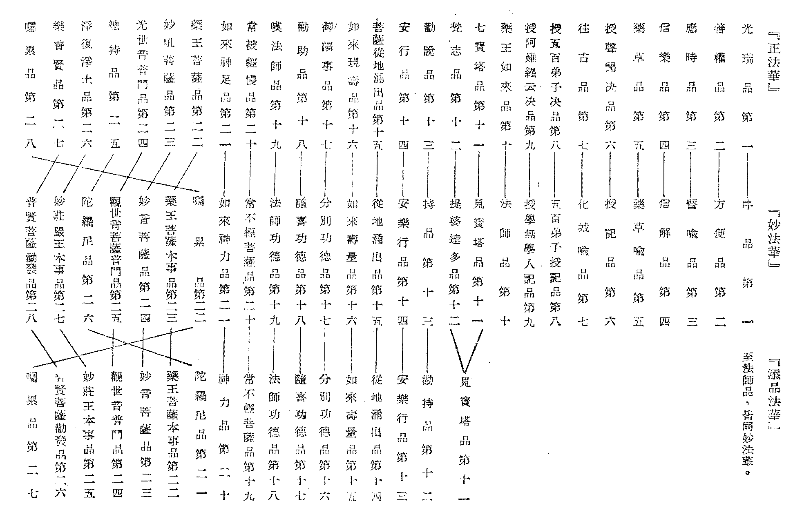



原表正法华无梵志品，仅二十七品，今依清藏本加入，故亦二十八品。又原表并列卷次，而以秦译为八卷，与今本不符，故将其卷次删去。



己　本经讲诵



道宣律师弘传序云：『自汉至唐，六百餘载，总历群籍，四千餘轴，受持盛者，无出此经』。则此经在中国讲说与诵持之弘盛，实打破诸经之纪录。不特自汉至唐六百餘载间弘盛如此，即迄今一千五六百年间，其弘传诵持亦何尝不如此耶？故古今诵持是经之比丘等，其感应道交开示悟入者，亦复无量：如智者大师读药王本事品：『是真精进，是名真法供养如来』，朗然大悟；如宁波天童开山义兴祖师，在太白山读诵此经，感太白星化为天童送供；如慈谿普济寺之法华肉身菩萨，肉身不坏，亦因诵持法华功德所致；如湖州白雀寺总持比丘尼葬后，其坟上出青莲华，考莲华乃自其舌根中生，是非生前口诵法华所致乎？如梁光宅寺法云法师，因梁武求雨，讲法华经，即得感应。诸如此类，诵讲是经而得感应者，不可胜计。又古来大德讲经，於诸经每有抑扬，唯对此法华，无不信重。故诸经之弘盛，及其注疏之多，亦以此经为最。依此所起之功德，赞莫能穷！故现前听经大众，宜於此妙法莲华，起敬重心，生难遭想，顶戴奉持！



------



## （守志记）(见海刊十五卷六



维摩诘所说不可思议解脱经释会纪闻上



——八年九月在北京己未讲经会讲——



> 悬论  

> 一　说经来意  

> 二　解释题目  

> 甲　定名  

> 乙　明义  

> １　能说人  

> ２　所说法  

> （一）　不可思议  

> （二）　解脱  

> （三）　不可思议解脱  

> （四）　不可思议解脱经  

> 释经  

> 甲一　经序分



------



### 乙一　通序



### 乙二　别序



> 甲二　经宗分  

> 乙一　如实说受得佛国净不可思议解脱  

> 丙一　叙请  

> 丙二　说示  

> 丁一　称理直说  

> 戊一　随缘定宗建宗摄缘缘成佛国土成  

> 戊二　从心起行融行归心心净佛国土净  

> 丁二　断疑生益  

> 戊一　为众断疑  

> 戊二　随机获益  

> 乙二　如实修证不可思议解脱得佛国净  

> 丙一　出维摩诘本行而广称叹  

> 丁一　出名  

> 丁二　叹德  

> 戊一　叹根本德  

> 戊二　叹方便德  

> 丙二　因维摩诘示疾而兴教化  

> 丁一　观身发心  

> 丁二　从心起行  

> 戊一　直心正念真如  

> 己一　弟子品  

> 庚一　净名运悲感慈  

> 庚二　弟子述缘辞往  

> 辛一　舍利弗  

> 辛二　大目犍连  

> 辛三　大迦叶  

> 辛四　须菩提  

> 辛五　富楼那弥多罗尼子  

> 辛六　摩诃迦旃延  

> 辛七　阿那律  

> 辛八　优波离  

> 辛九　罗睺罗  

> 辛十　阿难  

> 庚三　总结弟子不任  

> 己二　菩萨品  

> 庚一　述缘辞赴  

> 辛一　弥勒  

> 辛二　光严  

> 辛三　持世  

> 辛四　善德  

> 庚二　总结不任  

> 戊二　深心乐集善法  

> 己一　观佛国依正因果  

> 庚一　文殊师利问疾品  

> 辛一　受命率众问疾  

> 辛二　示相入室问答  

> 壬一　示相  

> 壬二　入室  

> 壬三　问答  

> 癸一　主问宾答  

> 癸二　宾问主答  

> 子一　问答疾因  

> 子二　问答室空  

> 子三　问答疾相  

> 子四　问答如何慰喻有疾菩萨  

> 子五　问答有疾菩萨如何调其心行  

> 辛三　会众闻法发心  

> 庚二　不思议品  

> 辛一　引不思议理  

> 壬一　舍利弗念座  

> 壬二　维摩诘究责  

> 壬三　示理遣情  

> 壬四　闻法获益  

> 辛二　显不思议事  

> 壬一　借座直示  

> 壬二　标名广说  

> 辛三　赞不思议德  

> 壬一　大迦叶反赞  

> 壬二　维摩诘正赞  

> 己二　观佛国主伴因果  

> 庚一　观众生品  

> 辛一　理观  

> 壬一　如幻非有观  

> 壬二　慈悲喜舍观  

> 壬三　依住根本观  

> 辛二　事证  

> 庚二　观佛道品  

> 辛一　求菩提於烦恼  

> 壬一　通达佛道  

> 壬二　明如来种  

> 癸一　正明尘凡是如来种  

> 癸二　反明真圣非如来种  

> 辛二　摄尘缘为佛事  

> 己三　观佛国不二因果  

> 庚一　入不二法门品  

> 辛一　净名总问  

> 辛二　各入不二  

> 壬一　就言入不二法门  

> 壬二　遣言入不二法门  

> 壬三　无言入不二法门  

> 辛三　时众获益  

> 庚二　香积佛品  

> 辛一　舍利弗引起  

> 辛二　维摩诘显现  

> 壬一　现香积佛国  

> 壬二　请香积佛饭  

> 壬三　来众香国众  

> 壬四　来本佛国众  

> 壬五　食香积佛饭  

> 壬六　明彼土说法  

> 壬七　明此土说法  

> 壬八　明此土德行  

> 辛三　法会众获益  

> 戊三　大悲普度众生  

> 己一　现瑞见佛  

> 己二　闻法兴供  

> 庚一　广显佛事  

> 庚二　赞扬大乘  

> 庚三　说菩萨行  

> 庚四　供养佛法  

> 丁三　得佛国净  

> 戊一　重观佛身以证初心  

> 戊二　取净佛国以摄有缘  

> 己一　舍利弗问答开端  

> 己二　维摩诘现取佛国  

> 戊三　结成经宗以叹人法  

> 甲三　经益分  

> 乙一　法供养品  

> 丙一　天帝称扬给护  

> 丙二　世尊比校加德  

> 丙三　自说护法本事  

> 丙四　结成法供养义  

> 乙二　嘱累品  

> 丙一　释尊嘱言  

> 丙二　慈氏承旨  

> 丙三　菩萨弘布  

> 丙四　天王护持  

> 丙五　别结经名  

> 丙六　通结信奉  

> 贯　摄  

> 一、经分别  

> 二、时分别  

> 三、处分别  

> 四、会分别  

> 五、藏分别  

> 六、教分别  

> 七、乘分别



纪



归命三界尊，广开微密藏，如说修行众，惟愿齐加被！



祐我纪斯闻，清净离倒妄，见闻随喜者，悉发菩提心。



尽此形与寿，咸生安乐国。普及情无情，同圆成实性。



吾人无论受持读诵何经，须先解佛经通义。凡称经者，皆为佛所说、所印可之法——如本经系经佛所印可者，故亦名经。佛为法王，心亦为法王：佛明证自心，故成就真净；众生迷昧自心，故流转生死。然则吾人发心学佛，首当发明自心。欲读诵佛经，尤当先决定自心。自心维何？人人本有之寂常灵觉是也；亦曰佛性，亦号真心。此真心本然清净，在圣不增，在凡不缺，其大无外，其小无内，竖穷三际，横遍十方，无时不在，无物不然者也。无如众生无始来为无明习气所染，六尘缘影万念纷驰，便不识此法中王矣。今以胜缘，得与大众聚会一堂，开演此维摩诘所说不可思议解脱经，故亦於未讲之前，愿人人审观自心，先发四种决定之心。云何为四？一、真实心：真者、无伪义，实者、不虚义；无伪、非矫揉造作，不虚、非生灭去来，合之即是直心。经云：『直心是道场』，即是此意。二、向上心：人虽具有直心而不向上，借以为恶，反沽直名，世所恒有。今当本此直心，正念真如，专以修积诸佛阿耨多罗三藐三菩提法。三、慈悲心：世间亦有自了汉，只求自己解脱生死之累、烦恼之苦，不顾他人。於财、於法皆悭吝不舍，视彼贫穷、下贱、无威力之人，漠不相关，翻笑自作自受，似此亦非佛道。今则我辈发心自利，还须利他，时行布施，不住於相。四、方便心：惟此心最难，难在方便，以随方——通时与事——便利於人，即随处未必便利於己也。发此心时，便当灭除人、我二相，见得利人还是利己，我原与人同一法性故。如一世界之所有众生，与我一身之五官、百骸痛痒同具，未忍舍离，须尽力救治。诸君四心具备，自能受持、读诵此维摩诘所说不可思议解脱经，并能受持、读诵佛说一切之经。



悬　论



一　说经来意



释　今讲此经，且将释尊与净名大士等所以说此经之用意，先为一论。案诸家讲经者，在讲经文以前，皆有一番提纲振领之说，用以贯摄全经，评判群说。在天台宗谓之五重玄义，如所谓：名、体、宗、用、教是也。嘉祥亦名玄义，其详未究。在清凉宗先开十门，谓之悬谈，第九总释名题，第十别解文义，上之八门则皆文前总论。然圆觉疏钞、弥陀疏钞等皆取则华严悬谈者，顾前之八门往往有开合、增减之殊，虽意义全同、文或微异焉，要以华严悬谈所开十门为正，今不事详论也。真言宗之分十住心，则传以黜陟诸宗者，餘未全睹，不能猝断。在慈恩宗则依成唯识论述记，分为五门：一、辨时机，二、论宗体，三、藏乘所说，四、说教年主，五、判释本文也。虽建言互殊而大致还相通贯，广为评骘，让之异时。今意以为既未将所讲之经文讲明，先说体、宗、用、教多言，在说者纵言言不离经旨，并非随意牵混涂傅，但听者或不免为之茫无端绪，故兹一概无取。然古德若智者大师所以在文句前广谈玄义者，盖大有故。



一、彼时佛法兴盛，经内文义靡不了了，转因讲者各成宗尚，非但欲明经义，尤欲知讲者对於此经意旨之所在，故当先有以贯摄全经也。二、彼时听者，不唯了於经义，且多有尝专精於其经者，先有对於此经主观上之宗旨，将以校其异同而为决择。非然者，彼将谓讲者不明宗旨，舍之不听，故当先有以评判群说也。三、如来说法，有随自意语者，有随他意语者。古人先出玄义，广作悬谈，将以楷定千古，非必问一时听者之能受与否；但欲将所得於经之义旨，尽量发挥，令听者自表同情耳。后人讲经，既无如上所说缘故，必依照古人之陈说翻诵一过，殆亦灵峰所谓「执死方医变症」者欤！故今所有宗体、教相、功用等义，可随文点出之，或结显经终耳。唯佛菩萨所以说此经之来意，则当先一探察，此在华严悬谈即所谓「教起因缘」也。



纪　明佛说此经来意，引天台宗——又名法华宗——名、体、宗、用、教五重玄义。名、为名言，名立义彰。体、为法体，平等真如。宗、为宗旨，因明果显。用、为功用，释疑生信。教、为教相又曰教化——化仪四，化法四。此宗智者大师，广疏七卷为二十卷。嘉祥宗、亦名三论宗。清凉宗、亦名华严宗。悬谈计四十卷；清凉疏钞为十门悬谈正鹄。本经判释，等天台、清凉二宗之九、十耳。所谓教起因缘，约分五类：一、应说法，二、本行心，三、众生机，四、教根本，五、显果德。



释　大涅槃经谓：生生不可说，生不生不可说，不生生不可说，不生不生亦不可说，以有因缘故可得说。在大智度论谓：依四悉檀因缘故，如来说法。梵语悉檀，古无定翻：或翻宗、成；或翻遍施；或翻为墨、为印、为实；或翻成就究竟；或同嗢陀南义翻为集施，谓集正法义，施有缘众也。今以意会之，即「说法之宗旨」耳。所谓四悉檀者，兹出其例如下：



纪　引大涅槃经生生不可说六句，意谓说不过一偏，不得法性之全体，以有对待不符法体绝待故；能离言说相，便不入思量分别。法施之因缘，谓集合正法，布施有缘，佛出世故。



释　一、普为世界悉檀：随俗常化义，适应一时、一地众同分心理义，使陷溺习俗者咸得惊醒义，使闻见欢喜者发生信心义，为说世界正因缘义。二、各为人生悉檀：随机异说义，引发各人各种不同类善根义，使随其所处之地位各成进修义，使信解修行者增长福德义，为说人生正因缘义。三、药病对治悉檀：破恶义，远离世间义，断除烦恼义，止息分别义。四、显第一义悉檀：入理义，契证法性义，成就菩提义，圆满寂静义。



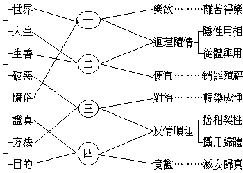



纪　一、普为世界悉檀中，适应一时、一地众同分心理句：如三千大千、娑婆、中国、北京，及现在之北京，各有此众同分心理也。二、各为人生悉檀中，又名众生悉檀，引发各人各种不同类善根句：如教育之分级法。三、药病对治悉檀中，破恶义句：恶有浅深不同，必破无明乃为究竟。远离世间义句：世间恼热难安，必远离、乃清凉自在。四、显第一义悉檀中，入理义二句：显非寻常人情所能测者，即前三种悉檀皆在在入理，所显唯第一义谛，不会、不识，悟到法身即是。总之、诸佛菩萨取己身与一切众生皆同等真如法性，显此同等大悲而为说此四悉檀也。



释　今按释尊与净名等所以说此经者，四重悉檀皆有，据其尤胜之相，则在第三、第四悉檀。兹分述如下：



一、自佛华严以来，虽广说大小乘诸法，要皆明从初发心以至究竟三乘圣果之方法。虽无量寿佛经、悲华经等，亦尝带明阿弥陀佛、释迦牟尼佛等因地修取净土及悲愿垂化秽土之方法，而未有专说如何修取净妙国土之法者。至阿弥陀经等求生西方极乐净土之法，譬如居殷都者，传说周文王治西岐，如何政修俗美、善能养老，使伯夷、叔齐闻风而向往。然未明文王如何致西岐於隆治之道，且未明人人皆可为文王及处处皆可致隆治之道，故未能令闻者不待文王而亦兴起，从恶浊之世以转为清泰之界。是以餘经所说修三乘圣果及往生净土之方法，皆偏重救度人生及人生自度，而鲜救度世界、世界共度之义。於是、佛威神故，宝积献盖，炳现十方诸佛净土，引起乐欲，与五百长者子发心共求修取净土之法。佛为说修净土之行，首明须随所化众生而取佛土，即是圣人无常心，以众人之心为心，明世界实由众人心造也。世界正因缘义，於是乎显。而净名为示现实践修取净土之模范者，即因身疾广为说法，使问疾者觉悟世间无常，身命危险，醒习俗之沉梦，即由「普为世界悉檀」而说此经者也。此其一例，餘可类推。



纪　修取净妙国土之法句：如本经偈有『戒品为涂香』，又后香积佛品指妙香国为净土正因，故兹专就戒言之。十戒首重不杀，先去杀行，后去心中之杀机，极至连此戒杀机之心亦须除去尽净，因此为无始以来众生心念中之细微种子习气——即根本无明。传言：一猎者捕鹞，鹞先飞避舍利弗身影中，尚复惊恐；后飞至释尊身影中，顿现安隐。舍利弗问故，世尊答言：由汝习气种子未断，故鹞视之心尚惊恐。譬如以香熏物，香虽除去，熏习尚存——如经云结习未尽。喻舍利弗杀机虽断，而未能除去戒此杀机之心。此为佛说戒之彻底精义，亦即净佛国土之理。世界实由众人心造句：世界乃无量因缘所成，大都众同分心理业力之所招感。造物主、即是众生心。此为共业之果报，亦即世界之正因缘。



释　二、於此阎浮提，舍利弗与大梵王各见不同，明杂业界中各人有各人不同境界；以业障、报障故，虽居佛净土中不得触受。於是佛现本界净土以明此土本净，一人心净即能一人现前，不事他求。而净名告诸问疾者，当求佛身，广赞佛德，随其宜闻开发道意，此皆由「各为人生悉檀」而说此经者。



三、由药病对治悉檀而说此经者，大略为三：



甲、从鹿苑三转法轮度憍陈如等五比丘以来，除常随众千二百五十人，其餘从佛出家成四沙门果者，殆不可以数计。十大弟子各有专长，五百比丘咸称第一，持佛威音弘化三界，济济僧宝盛极一时。在小乘、即谓现生不出家行比丘法，不能成就阿罗汉果；且文殊师利与弥勒等菩萨之上首，亦是出家之众。於是在家士女，遂於出世三乘之法，咸生绝分之想，非从事种种异道而不知信佛，则亦供养佛僧、修行人天戒善之法，以冀缘福而增福耳。在家菩萨之领袖、若长者子善德，亦仅能设大施会，餘可知矣！卒之出家僧众，究属人中少分，使必出家乃能修证佛法，则佛法岂不限於一部份人而不能普及於世人乎？夫此岂众生心——体、相、用大之佛法本来如是哉，抑岂释尊大悲度世之本怀哉？於是如来运彻底之大悲；净名菩萨承佛大悲，现居长者、居士之位，不离六蔽之相而能具足六度之行，不离白衣、居家、妻子眷属乃至博戏、异道、淫舍、酒肆种种尘劳之相而能成就菩提之道。入一切众为众中尊，示其禅定、智慧、辩才、神通，且能折服诸声闻众、诸菩萨众而超其上。於是人人知佛法可不离世网俗染而得；及既得矣，且较绝俗离尘而修得者功德尤为殊胜。於是虽至屠沽、驺卒、倡优等辈，亦皆能自奋於佛法，不视佛法为分外之事。贵倨之侯王、将相，富有之鉅商、素封，虚骄之文人、学士，隐僻之怪党、邪徒，胥能沐浴如来德化，以之自正正人俱适乎道，更无论矣！虽然、此岂舍利弗等大阿罗汉、弥勒等大菩萨实为净名所诃斥哉！盖同承释尊彻底之悲心，现为抑扬，互赞玄化而已。由是观之，则此经实流出於释尊之大悲，净名、舍利弗、弥勒、文殊师利等仰承佛意共为宣说，以对治尘俗自畫而不敢发心修佛法者，使知佛法平易近人，咸欣慕修习耳。夫然，令群俗得周洽佛法之利，千百年后犹有闻风而兴起者，又宁能不深感诸圣贤众洋洋之盛德欤！然考核其本意：出家者，当勤修戒、定、慧，息灭贪、瞋、痴，现生求证四沙门果，住持如来清净律仪，为世福田，生人净信。而在家者，则当敬事三尊，振兴众善，摄受眷属，饶益众人。但须不昧本菩提心，则出家、在家所行者皆菩萨道，莫非诸上善人俱会一处而修净土行者也。若不勤其分所当行，系心欣厌，著念爱恶，畏尘烦而取闹，慕清静以驰思，妄执山林幽闲以为佛法，则正净名所治之病而非得净名之意者。因之、见有入尘同事、弘法利生之摩诃衍人士，骋其颠倒之情，横兴讥毁之诮，不知菩萨将以建三宝之广居，致群生於乐地。莲华生於污泥，宫室起於空地，非高原、虚空能有如是之事也。甚或外崇佛言，内蕴魔毒，逞辩聪之世智，窃说法之虚誉，剌取佛祖、经录之片言只语，假借为高尚清净之说，以覆藏其污垢瑕秽之行。绝人之善，破人之信，斗诤坚固以为庄严，名利恭敬以为希求，将三宝法用为提倡三恶道之具，牵率好心学佛法者与之俱堕，其为辜负释尊与净名、弥勒、鹙子、妙德诸圣眉毛拖地之大悲深恩者，更为何如哉？此令人即俗而真者。



乙、天台诸家，皆以维摩诘为方等时斥小弹偏、叹大褒圆之中坚。今衡以法华开显之佛意，虽舍利弗与弥勒等皆是大权示现，而厥徒属实多执滞其主导偏小之行迹以为至者。得净名之痛棒热喝，为之打破所崇奉者，绝其依傍，遂得荡然无阂，共会大圆满觉。此与前番同法而异其用，乃令从真出俗者。



丙、种种菩萨之行皆成佛因，而佛之依报、正报同谓之佛果。依报之果谓之佛土，正报之果谓之佛身，身土圆融不可分别，故种种行皆是修佛土行。法性身土与自受用身土，如如不二，平等平等；至他受用身土与应化身土，则大有差别。即就凡圣同居士言，净秽相殊不可以数量计。盖凡圣同居士乃人天同业之所感，种种异类众同分业，遂有种种不同形之世界。未能不动当处而周遍十方者，辄为众同分业之所限量，不能互相通彻；且不知净土有净土种种功德，秽土亦有秽土种种功德，欣净厌秽，不能平怀泯放。於是香积之饭，既令饱满大众气味充盈三界，不离娑婆而入众香；彼土所来菩萨，亦获知此土之功德，入尽无尽解脱法门。彼此净秽镕融无间，乃能随其所应现佛国异，不致拘牵一割求齐之见而自碍碍人也。



纪　复开药病对治悉檀为三：甲中，在小乘即谓现生不出家二句：佛说小乘本为人设，立得效果，证非虚故。且说小乘现获二利：一、实验得效，二、解脱分段以便度生，本为大乘方便。佛法二字，为超越世出世法——又名一乘法，对世法（凡夫法）、出世法（小乘法）说。故本科之甲为对凡夫说法，乙为对小乘说法，丙为对菩萨大乘说法也。



释　四、由显第一义悉檀而说此经者，略出四例：



甲、显第一义性一如无二如，不带功用行位之相。夫始自凡夫终至佛地之一切行位，皆似空中鸟迹：当其鸟空缘会，虽现千差万别之迹，而曷尝实有踪迹从鸟身出或虚空生哉！种种迹象皆因空显，实皆虚空性耳，虽屎溺、蝼蚁亦与弥勒何别哉！故令爽然自失其一生授记之地位也。



乙、显第一义非内外凡圣诸法，而内外凡圣诸法无非第一义性。须菩提虽善解空义，而实未能空内外凡圣之法见；即此一见，便障第一义性不得显现。亦犹牛头山道融禅师，虽能观空，愕然犹有一佛念梗心耳。



丙、显第一义事理性相通彻无碍。全事皆理，全理皆事，全性皆相，全相皆性，不坏高下、小大诸相而现高下、小大平等融合之事。此义、经中开显最多，借灯王之座於室中，擎不动之界於掌上，而其说见於舍利弗宴座。



丁、显第一义空寂离相，不落作为，不涉言说。是故空室独卧，离来去相。文殊问以不二法门，则默然离文字言说心缘之相，离念相应以为真入不二法门而证第一义性。



纪　开第一义悉檀为四例：甲例中，功、用、行、位四字，即功行、业用、相位——如十地，皆由修行造作所成，非第一义。第一义者，一切法皆无施作——即无功行业用相位，皆无自性，以真如为体故。讲义所云，反显此种不如法见——不如实相法之见解，登地菩萨亦所不免。乙例中，非内外凡圣诸法句：正以真如法性本同一体，无二无别。须菩提善解空义句：见一切法空，涅槃亦空。道融禅师事，载道融见四祖时，忽来一虎，四祖少形惊避之态，道融讥其身相未除。四祖知其心念，乃书佛字於座上，道融见之不敢就座，知其尚有佛念未空。丙例中，事理性相二句：反徵动时即断静功，便为事碍，便为相碍，亦是性与理碍。下引借灯王之座於室中二句：正显性与理即事相也。丁例中，默然离文字言说心缘之相句：反徵一有文字即落分别，一有言说即落二三。分别、二三，皆对待之法，必圆融（非分别）绝待（非二三），乃得不可思议解脱，为真实第一义也。



二　解释经题



甲　定名



释　此经、据疏共有五译，二种不知失传抑系未睹，尝见之藏经者唯三种。寻厥文义，大致相同。一名维摩诘经三卷，吴支谦第二译。一名说无垢称经有六卷，唐玄奘译。一名维摩诘所说经，亦名不可思议解脱经，即是今所讲者，乃三藏法师鸠摩罗什奉姚秦诏所翻译者。鸠摩罗什，此云童寿，以其童年而有耆德，故立斯名；复以遍通经、律、论藏，尊称之为三藏法师：盖在中国翻译佛经之第一大师也！前之译者，非不谙梵语，即有昧华言，纵或华梵兼晓，而亦才智疏短，学行麤浅，未能深入经藏、智慧如海，且无大护法如姚兴之合朝崇奉，得以聚天下之英俊於门下而共研习，有若生、肇、融、叡诸哲。故译经之功，独盛乎什师，此经亦以之独传也！然此经题名，双列维摩诘所说与不可思议解脱为二。今谓维摩诘即是能说不可思议解脱之人，不可思议解脱即是维摩诘所说之法，故当定其名曰「维摩诘所说不可思议解脱经」。



纪　此经、据智者大师疏，有五译。兹所讲者，为姚秦鸠摩罗什三藏法师所译。什师七八岁时，便能讲经，常受人礼敬。外如法华经、大智度论、金刚经等，皆出其手。合之真谛三藏，玄奘法师、不空三藏，为东土四大译师。



乙　明义



释　此中经之一字，乃大藏诸经之通题；维摩诘所说不可思议解脱十一字，乃此经之别题。经如常说。



纪　经之一字，即梵语修多罗，翻云契经，含契理、契机二义。契理者，谓合真如妙理。契机者，谓适时机根性也。



１　能说人——维摩诘



释　此维摩诘一言，在古来传述之梵语，赊促不同，译梵为华，义亦不一。一云、毗摩罗诘帝隶，此翻为净名无垢称，或净名无垢叹。一云、毗摩罗诘，此翻净名。一云、毗摩罗诘栗致，此翻净无垢称。今按：无垢即净，称叹即名，可依肇法师翻净名为定。今用三释释此净名：



（一）相违释



净者、真净，在五法是正智、真如，在三身是法性身、受用身，佛土亦然，在二谛是真谛。名者、名相，在五法是分别、法相、名言，在三身是他受用身及应化身，佛土亦然，在二谛是俗谛。净不是名，名不是净，非净净名，非名名净，净之与名不相关属。此云净名，犹云净之与名。



（二）依士释



净者、涤荡洗净之谓，以净净名，谓之净名。所净之名，约为三种：甲、一切法体本自无名，无名而有名者，皆自心现，故心即是名也。成唯识论谓之显境名言，亦曰名言种子，故净乎名者即净其心也。乙、摄大乘论谓三界皆名言假立。依例推之，十种依正五阴法界，皆是名言假立，无边刹土总属名言，故净名即是净佛国土也。丙、世间种种名字言说，皆属爱论、见论所摄。爱、见未空，即从佛经所学种种名字言说，亦皆爱论、见论所摄。净此爱论、见论，转爱、见为慈悲智慧，一字一句皆成妙净陀罗尼门，谓之净名。



（三）持业释



净名者、谓「真净名相」。真净名相，亦名诸法空相，亦名诸法实相，亦名一真法界，亦名常住真心，亦名法性，亦名佛性。此性最尊最贵众法中尊，故名净名长者。祇此净名长者，人人本具，个个不无，常在人人六根门头、六尘堆里、六识巢中说不可思议解脱法门，现不可思议神通变化，能令人人不离尘劳而具足诸波罗密行，不离俗欲而具足诸清净律仪，不断烦恼而证菩提，不舍生死而般涅槃。诸君欲速证不可思议妙心者，不可不急急著眼以识取之也。



纪　讲义用三种释释此净名：一、相违释：相违二字，即牴触义。如讲义谓：净不是名，名不是净，净之与名，各明一义互不相属是。二、依士释：依士二字，即依伴义。如俗云连带，以净为伴，名则为主，依主连伴，依净带名。如净一字，只见为净，必依名字乃显净名是。三、持业释：持业二字，即名是净，净是说此名之德相。



凡释经之法，共有六种释。云何为六？除讲义采用之三释外，更有邻近释，带数释，有财释。讲义相违释中，名者名相句：名指名言，相指法相。有名必依於相，名之实体即是法相故，故名即为相。依士释中，显境名言句：谓心了别以显境，明了分别，为心之通相故。名言种子句：谓所成就之观念。三界皆名言假立句：以凡相皆可名故。十种依正五阴法界句：谓佛亦有五阴法，亦名究竟众生，与一切凡夫众体无差别故。皆属爱论见论所摄句：论苦乐利害之受用名爱论（慈悲门摄），论邪正真伪之见解名见论（智慧门摄）。净此爱论见论句：应念慈悲、智慧，皆随顺法性。皆成妙净陀罗尼门句：妙净、则重重无尽，一即一切，齐彰万法。一切即一，泯同果海耳。



２　所说法——不可思议解脱



（一）不可思议



释　思谓思量，亦即观念；议谓议拟，亦即推论：乃分别之端，学理之根也。一切法相依之明晰，一切名言依之建立，然皆彼此、是非相为对待而起，虚假无实。由名理而达乎实际，即为思量之所不可得到。故虽吾人寻常日用之事，亦莫不由无思而为、不勉而成，一涉思量议论，即睡不成睡、行不成行也。然此不可思议之实，且约六事以为拣别：甲、寻常日用之事、现实之境，皆是不可思议。故孔子曰：『天何言哉！四时行焉，百物生焉，天何言哉』！乙、世间之科学、哲学者，推论名理至於极处，即为思路之所不可得通，言端之所不可得执。故老子曰：『道法自然』，谓之『无名之朴』。又曰：『无名天地之始』。名之曰道，唯是强名，恍惚窈冥，岂曰不尝审思明辩之哉，其如审思明辩之所不能到乎！丙、思量议拟，必经寻伺。凡外、圣贤修习禅定，入二禅天定生喜乐地以上者，即入无寻无伺之地，超过拟议思量。此则第二静虑之不可思议境，非治俗学者之所能企也。丁、三乘圣弗耆年解脱，舍利弗默然，继谓『解脱者无所言说，故吾於是不知所云』。此则出人，皆依无为法性而有差别，三人同以无言说道而般涅槃。故此经散华天女问舍利世三乘之不可思议境，非三界凡夫之所能逮也。戊、大乘不共般若相应真如法身，所谓自觉圣智境界。若此经文殊师利问维摩诘何等是菩萨入不二法门，『时维摩诘默然无言。文殊师利叹曰：「善哉！善哉！乃至无有文字语言，是真入不二法门」』。此则初地以上菩萨根本智所证不可思议境，非二乘人所能与也。己、若此经不思议品之所显现。又若天女告舍利弗：『言说文字皆解脱相，无离文字说於解脱』。此则八地以上菩萨乃至唯佛与佛所能究尽之不可思议境，即事而真，事事无碍。此之六重，前之二重似而未是，中之二重是而未真，复之二重乃为真不可思议耳。今净名所有之不可思议，即后之二重也。



纪　睡不成睡、行不成行二句：譬若吾人於纷乱之餘，收心敛意，执著思量一定入睡，翻不能睡，甚且狂起。又如小儿於怀抱之餘，扶墙摸壁，执著思量一定强行，反行不成，甚至倾跌。后约说不可思议，虽出六类，实别三重。前二、谓是人心量中不可思议境，故曰似而未是。中二、三乘圣人二句：无为法性，谓真如本一。而有差别，谓资位异数，终不入大乘，故曰是而未真。后二、自觉圣智境界，本非阿罗汉、辟支佛所能知。言说文字皆解脱相，眼前事物悉是菩提，是乃佛果，唯佛穷了，故曰真不可思议。



（二）解脱



释　解脱亦云离系，谓离诸缠缚拘牵也。有处谓之三昧，有处谓之善巧，皆就其适当应事、恰到好处之正面以为言者。谓之解脱，则就开解除脱诸智障碍、烦恼障碍，而得色自在、得心自在、得业自在以为言者。解脱在涅槃，与法身、般若共称三德，天台判之谓方便净涅槃。要之、种种方法之达到圆满常寂者，皆名解脱，亦名波罗密行。佛华严经善财所参诸善知识，各知一解脱门，盖就方法以言，故成种种解脱门也。种种方法达到圆满常寂，全用成体，全体成用，随缘施为靡不尽善尽妙：故谓之方便善巧、三昧、解脱者，其义均也。



纪　解脱中，离诸缠缚拘牵句：指烦恼、业、果三缚言。傥能解脱，即离生死轮回也。善巧，谓纯熟方便，不思而中，不勉而获，不受其缚而成妙用。又有谓之胜解者，明见法空故。波罗密行有六，通常言六度是；有十，加愿、力、方便、智四度是；有八万四千，即指无量万行是。



（三）不可思议解脱



释　此经所云解脱，非佛华严各各善知识别别所知之解脱，尤非六凡、二乘妄想执著所谓解脱，盖是穷微尽化，体幽用玄，渺莽无为而无不为，罔知所以然而能然之不可思议解脱，乃种种解脱所从之流出及会归者也。



纪　不可思议解脱中，盖是穷微尽化五句：指此经净名所有之不可思议解脱，为清净宝严，妙高无上，一真法界耳。所谓「无不从此法界流，无不还归此法界」，故曰种种解脱所从之流出及会归也。盖不可思议之境，本不异解脱，解脱之相亦不异不可思议，不可思议即是解脱，解脱法门即是不可思议，名虽为二，原可作平等一如观。惟在此维摩诘经者，修证上说不可思议四字。又不可思议四字，为解脱之根本；解脱二字，又为不可思议之究竟。



（四）维摩诘所说不可思议解脱经



释　此经有诸佛所说者，有诸菩萨说者，有诸声闻说者，独标名为维摩诘所说者，何耶？室中以维摩诘为主所说六品，当然标名为维摩诘所说，可无论矣。出室后四品，或关维摩诘同往之众，或关维摩诘之本身，或因其所说法而说，故亦得标名维摩诘所说。弟子品、菩萨品所述者，亦皆维摩诘之说。祇初佛国品似与维摩诘全无关系，故奘师译为说无垢称经，意同佛说阿弥陀经，乃释迦佛说无垢称、仍以释迦佛为经主。然按肇师维摩经注，净名乃宝积所将五百中一人，此说本之什师，必有所据。则献盖及请求佛净土行，固亦因净名而起者。且标其能说此法门者，即指其能有此法门也。净名乃实践修净佛土行之模范者，即是能有佛说净佛国土之行者也，故得谓之为维摩诘所说。盖释尊为一代大化之总主，而净名亦为此一法会之别主也。然维摩诘所说，应同声菩萨之论，今以尝为佛所印可，故得名为经也。



释经文



释　次释经文，判为三分。一、经序分，从如是我闻至稽首如空无所依是。二、经宗分，从尔时长者说此偈已至见阿閦佛品终是。三、经益分，法供养品及嘱累品是也。此经三分之判，今与天台正同。古来虽多异说，定义决当如是。译出诸经，有但一经题不列品题者，有经题后将经文分为若干段加立一品题者。经题都出经中佛说；品题既非佛说，而阿难结集时首唱我闻如是，则品题亦非结集人之所安立，其为梵土诵讲者之所立无疑。殆犹析金刚般若为三十二分，虽出昭明太子，而古今相承为定式，则亦不复窜易。故此经虽三译不同，品数、品题无大出入。



纪　经文判分，概属之佛灭度后，结经之菩萨、尊宿、古德。若梵网经亦有佛自标之品名，是为罕见。此经共十四品，传为印度古德所分判。天亲造论，似亦谓然。有分前四品皆属序分者，后四品皆属流通分者。今讲义，判佛国品前半品为经序分，法供养、嘱累二品为流通分。



------



### 佛国品第一



释　今经所列，与支谦所译维摩诘经同，而奘师所译说无垢称经，则名序品第一。今按：若列序品，则第一品当析为二，从尔时长者子说此偈已之后，应题为佛国品第二。今既不分，则以佛国纳之於序而名序品，不如以序附之佛国而名为佛国品。虽序系全经序而非佛国品序，不应仅附在佛国品，然更有要义须知者，据今所明以此经者，此佛国品实为经宗分全部之纲格。且推原竟委，则经序、经益，靡不握其枢要乎是。故当略为分别其义。



一　佛



梵语具云佛陀，译为「觉者」。有乎此「觉」之「者」，不止是觉，故有十号乃至无量德号，觉亦无量德号之一不足以尽其德。虽然、无量诸德固靡不原本乎觉、依持乎觉、开显乎觉、长养乎觉、圆满乎觉者，则觉又无量德号之宗也。故虽有诸号而称之为佛者，独多也。况乎自觉、觉他、觉行圆满，法法圆融绝待，随举一德众德全彰者哉！然而名号才建，法相斯存；名相之端，分别以寄。名、相、分别不契智性，故才言觉者，即有不觉者与之分疆别界而并立乎意识。是以佛陀之号，亦因津济名、相、分别之有情众，赴四悉檀而为宣说。将令仰德思齐，生长善本；由之破恶断惑，契归乎名无名、相无相、分别无分别不二之正智真如耳。是以今明觉者，从名相分别而正智真如，有其四焉。



　　　　一、应界内凡夫佛┐　　　　　　　　　　┌随类变化身  

　　　　　　　　　　　　├……应身………应化身┤人间应生身  

　　　　二、应界外圣者佛┘　　　　　　　　　　└净土胜应身  

　　　　三、应地上大士佛………报身………他受用身  

　　　　　　　　　　　　　　　　　　　┌自受用身  

　　　　四、法性自受用佛………法身……┤  

　　　　　　　　　　　　　　　　　　　└法 性 身



纪　佛为正报，觉者之义。谓佛随类现身，故不曰人而曰者。无量诸德下七句：明一切功用，皆由本觉开显，自本而始，自始而终至於圆满，无不依之。但依觉故，便有不觉，故曰才言觉者，即有不觉者。生不觉故，念念分别名相；今欲觉之，亦只能就其分别而显度生之本愿。讲义表列三身，所谓应身，即是吾人所见相好庄严丈六金身是。所谓报身，即他受用身，为妙乐智慧福德所生者，如菩萨所受法乐之实用是。所谓法身，分二：一、自受用身为正智菩提，二、法性身为真如涅槃也。



释　二、佛国　一、释佛国义：佛国者，指依报言。佛无所依，即依众生心住。譬言国家，则摄人民、土地、政治事业。举众生心，亦摄同业有缘之众，及彼同业所感居域，与其共同和合所作事业。同业众生之一居域，各有有缘之佛应化施教，佛为教化之主，依主立名，故名佛国。佛身所依，亦名佛土。佛化所被时间、空间，名佛世界。诸佛化居，种种不同，各现特色，名为佛幢。依伴——本名依土——立名，亦云凡圣同居国土，三乘圣者方便国土，菩萨实报庄严国土，主伴交参，重重无尽。至於自受用法性佛，既无应化，亦无依居；然一切众生自性清净心，是佛究竟所得显者，具有无边常乐我净真实之德，谓之常寂光法性土，身土一如，色心不二。前三土之应化，既皆依此为本，而一切众生心真如佛性内熏，亦即法性土佛之冥化也。



纪　佛国为依报。佛本为众生而现应身，故得有所依止。然佛又为法身——法性自受用身——故本无所依止，但依众生之心住耳。譬如国家，依土地、人民、主权三要素乃能成立。佛国亦尔，所谓土地，即世界；人民，即众生；主权，即佛。又就显著者言，约有三义：一者、同居土，众同分界，大如微尘世界，小如一家皆是；方域既分，各有世界，即各有教化之法。二者、佛刹，若释迦佛刹之娑婆界是，此界亦为有胜妙功德相之一，有非他清净土世界所有者。三者、众生心，经言十方、三世一切诸佛，常在十方、三世一切众生心中说法是。



释　二、明佛国宗：今此之所谓宗，与天台五重玄义所谓宗有异。盖五重玄义之体、宗、用三，律之起信论之三大，似以「体」、「相」为体，分「用」为宗与用者。今所谓宗，乃统体、相、用以言者。如起信论就大乘以明体、相、用，即以大乘为宗。今经就佛国以明，故以佛国为宗。宗者、谓总持纲要之主旨，非但从因趣果为宗；彼狭、此宽，故云有异。明此今复为二。



甲、依经文明：宝积请说得佛国净，如来具答并现净土，此为佛国一品所由安立，可无论矣。方便、弟子、菩萨三品，有义无文。问疾品、净名现空室，文殊问之，答云：『诸佛国土亦复皆空』，正显种种佛国皆常寂光。不思议品、既显须弥灯王佛国，借座入室，立身如座，亦显器界小大自在。观众生品、天女显净名室八种功德，结归『此室一切诸天严饰宫殿、诸佛净土皆以中现』。天女即为净名所化众生，就所化众生及所居丈室以显，亦正显佛国也。入不二法门品无文。香积佛品、显众香国及其教化事业，彼土此土人民饭食，净秽交彻，一多遍融，此亦显佛国也。菩萨行品、为香积佛品之餘势。见阿閦佛品、正结显净名所修净土，可知。且不独经宗分为然，经序分、献宝盖合成一盖，现诸世界及十方诸佛说法相，皆显示佛国之文也。



纪　明佛国宗中，引起信论，体相为体，指如来藏具足功德相，而此藏心仍依空为体也。分用大为宗与用者，指大乘因果。



释　乙、依法义明：佛为宝积所说净佛土行，即是净名一经法本。其下净名所说所现，要唯依此法本，修净土行、证净土果而已。犹华严入法界品之善财，其所参学修习，要唯实践华严所说诸菩萨地而已。方便品、即『随所化众生而取佛土』也。弟子品、菩萨品，即『随所调伏众生而取佛土』也。室中六品，即『随诸众生应以何国入佛智慧而取佛土也。菩萨行品、见阿閦佛品，即『随诸众生应以何国起菩萨根而取佛土』也。此就缘以言者。若就因以言，则方便品是观世间苦闻佛发心也。弟子品、菩萨品，是修直心净土。室中六品，是修深心净土。菩萨行品、见阿閦佛品，是修菩提心净土。此之三心为总，餘十四心为别。明维摩诘即是修取净佛国土、摄化众生之实践者，则佛国为此经之宗，可无疑矣。经序是宗由藉，经益是宗效功，胥系乎宗，不言可知。诸众生自性清净心，为宗之体：真应佛土及其种种功德，为宗之相；修种种心行、得种种佛国、摄受种种众生来生其中，为宗之用。本经玄义，微显乎是。



纪　依法明义中，犹华严入法界品之善财句：佛说善财童子，入十地而参访善知识，皆一一实践，步步证行，所谓自行者也。今於此经之维摩诘则反是，自居师位，教化他人，盖以净佛国土，须由教化众生而成故。彼证法身，此净佛国，实则自行化他，同一佛法，皆为佛事，特存两方观察而已。



释　三、佛国品第一　品谓品类，就经中品类相同之文义，聚割分段得十四品。此品居在最前，故曰第一。



甲一　经序分



------



### 乙一　通序



释　序者、端绪，居在经首，故名为序。其式由佛亲定，不独为此经序，遍为一切经序，故名通序，亦名遗嘱序也。



如是我闻：一时，佛在毗耶离、庵罗树园，与大比丘众八千人俱。菩萨三万二千，众所知识，大智本行皆悉成就，诸佛威神之所建立。为护法城、受持正法，能师子吼，名闻十方，众人不请、友而安之，绍隆三宝、能使不绝，降伏魔怨，制诸外道。悉已清净、永离盖缠，心常安住无碍解脱。念、定、总持、辩才不断，布施、持戒、忍辱、精进、禅定、智慧及方便力、无不具足，逮无所得不起法忍。已能随顺转不退轮，善解法相，知众生根，盖诸大众，得无所畏。功德智慧以修其心，相好严身色像第一，舍诸世间所有饰好。名称高远、逾於须弥，深信坚固、犹若金刚。法宝普照而雨甘露，於众言音微妙第一。深入缘起，断诸邪见有无二边，无复餘习。演法无畏犹师子吼，其所讲说乃如雷震。无有量，已过量。集众法宝，如海导师。了达诸法深妙之义，善知众生往来所趣及心所行。近无等等佛自在慧、十力、无畏、十八不共。关闭一切诸恶趣门，而生五道以现其身。为大医王，善疗众病，应病与药，令得服行。无量功德皆成就，无量佛土皆严净。其见闻者无不蒙益，诸有所作亦不唐捐，如是一切功德皆悉具足。其名曰：等观菩萨，不等观菩萨，等不等观菩萨，定自在王菩萨，法自在王菩萨，法相菩萨，光相菩萨，光严菩萨，大严菩萨，宝积菩萨，辩积菩萨，宝手菩萨，宝印手菩萨，常举手菩萨，常下手菩萨，常惨菩萨，喜根菩萨，喜王菩萨，辩音菩萨，虚空藏菩萨，执宝炬菩萨，宝勇菩萨，宝见菩萨，帝网菩萨，明网菩萨，无缘观菩萨，慧积菩萨，宝胜菩萨，天王菩萨，坏魔菩萨，电德菩萨，自在王菩萨，功德相严菩萨，师子吼菩萨，雷音菩萨，山相击音菩萨，香象菩萨，白香象菩萨，常精进菩萨，不休息菩萨，妙生菩萨，华严菩萨，观世音菩萨，得大势菩萨，梵网菩萨，宝仗菩萨，无胜菩萨，严土菩萨，金髻菩萨，珠髻菩萨，弥勒菩萨，文殊师利法王子菩萨：如是等三万二千人。复有万梵天王尸弃等，从餘四天下来诣佛所而为听法。复有万二千天帝，亦从餘四天下来在会坐。并餘大威力诸天、龙、神、夜叉、乾闼婆、阿修罗、迦楼罗、紧那罗、摩睺罗伽等、悉来会坐。诸比丘、比丘尼、优婆塞、优婆夷，俱来会坐。彼时、佛与无量百千之众，恭敬围遶而为说法。譬如须弥山王显於大海，安处众宝师子之座，蔽於一切诸来大众。



释　今释此文，聊陈梗概，若广解说，百年难尽。



一、科判：



　　　　　　　　　　　　　┌五成就　┌声闻众　┌标举类数  

　　　　　　　┌诠叙事由─┤　　　　│菩萨众─┤称叹功德  

　　　　通序─┤　　　　　└众成就─┤禅天众　│陈列名号  

　　　　　　　└结成法会　　　　　　│欲天众　└结成类数  

　　　　　　　　　　　　　　　　　　│八部众  

　　　　　　　　　　　　　　　　　　└四众众



二、翻译：毗耶离：此云广严，一云好稻，一云好道，一云好德。西域记云：吠舍厘国，旧讹曰毗舍离。庵罗：此云难分别，或云奈。比丘：亦作苾刍。一翻除馑，一云：具含破恶、怖魔、乞士三义。今谓除馑即是乞士之义。菩萨：具云菩提萨埵。一翻自觉觉他为义，或云开士、始士、高士、大士，或翻无上道大心，大道心众生，大道心成就众生，佛道成就众生。今定为觉有情。魔：具云魔罗，此翻缚者。禅：具云禅那，此翻静虑。须弥：或须弥罗，或苏迷卢，此翻妙高。梵：此翻质净。弥勒：此翻慈氏。文殊师利：此翻妙德，或妙吉祥，或翻妙智。尸弃：此翻云火，亦云火首，亦云螺髻，亦云蠡髻。夜叉：或作药叉，此翻轻捷。有地、空、天三行分别。乾闼婆：或健达缚，此云香阴。阿修罗：亦作阿修洛，此云无天德。迦楼罗：此翻为妙翅鸟。紧那罗：此云疑人，头有角神。摩睺罗伽：此云地龙，即蟒蛇神。比丘尼：尼、译为女。优婆塞、优婆夷：亦作邬波斯迦、邬波斯夷，此云清信士、清信女。



三、纶贯：此之一文，皆结经者叙当时法会情形之文也。夫将欲举其所亲闻之说以传信来叶，必指出当时说法之教主，在何场所，与同闻者有若干人，其人皆为何如之人，於其时、处来相集会怀何意念，与其闻持传述之说咸可参证，乃能疑绝信成。阿难遵佛遗嘱，叙之经首，古称六种成就，以成就后世得诸传闻者之信心，即此信、闻、时、主、处、众是也。主伴云集，感应道交，於彼时、处遂成法会。其法会之情形，盖如是其盛也！



纪　凡佛说经通序分中，准智度论，皆俱作六种成就。以六缘缺一则教不兴，兴则必具，故曰成就。云何为六？一、如是二字，阿难尊者结此经时，意谓信我闻於佛说、佛印可者，实属如是，决非不如是也，是为信成就。我闻二字，亦谓我与大众亲闻於佛者，是为闻成就。一时二字，从一法会因由起，至闻说是经已止，不拘时日，皆名一时。佛本不说法，亦无法可说，但以因缘故可得说法。因缘两字，亦隐含时义，是为时成就。佛之一字，惟佛能说法，教化菩萨以下众生，故法化以佛为主，是为主成就。至在何方处所，即为处成就。与大比丘众若干人具，见当时闻法之众，有目共睹，决非一二人所能臆度杜撰者，是为众成就。



------



### 乙二　别序



释　序者、由引、借事现瑞以为由藉，睹瑞测意以为引称，乃缘起此经之特别事故，不关餘经，故云别序。



尔时、毗耶离城有长者子，名曰宝积，与五百长者子，俱持七宝盖，来诣佛所，头面礼足，各以其尽共供养佛。佛之威神，令诸宝盖合成一盖，遍覆三千大千世界，而此世界广长之相悉於中现。又此三千大千世界——诸须弥山、雪山、目真邻陀山、摩诃目真邻陀山、香山、宝山、金山、黑山、铁围山、大铁围山，大海、江河、川流、泉源，及日、月、星、辰，天宫、龙宫、诸尊神宫，悉现於宝盖中。又十方诸佛、诸佛说法，亦现於宝盖中。尔时、一切大众睹佛神力，叹未曾有，合掌礼佛，瞻仰尊颜目不暂舍。长者子宝积，即於佛前以偈颂曰：『目净修广如青莲，心净已度诸禅定，久积净业称无量，导众以寂故稽首。既见大圣以神变，普现十方无量土，其中诸佛演说法，於是一切悉见闻。法王法力超群生，常以法财施一切，能善分别诸法相，於第一义而不动。已於诸法得自在，是故稽首此法王。说法不有亦不无，以因缘故诸法生，无我、无造、无受者，善恶之业亦不亡。始在佛树力降魔，得甘露灭、觉道成，已无心意、无受行，而悉摧伏诸外道。三转法轮於大千，其轮本来常清净，天人得道此为证，三宝於是现世间。以斯妙法济群生，一受不退常寂然。度老、病、死大医王，当礼法海德无边。毁誉不动如须弥，於善不善等以慈，心行平等如虚空，孰闻人宝不敬承！今奉世尊此微盖，於中现我三千界，诸天、龙、神所居宫，乾闼婆等及夜叉，悉见世间诸所有，十力哀现是化变。众睹希有皆叹佛，今我稽首三界尊。大圣法王众所归，净心观佛靡不欣，各见世尊在其前，斯则神力不共法。佛以一音演说法，众生随类各得解，皆谓世尊同其语，斯则神力不共法。佛以一音演说法，众生各各随所解，普得受行获其利，斯则神力不共法。佛以一音演说法，或有恐畏、或欢喜、或生厌离、或断疑，斯则神力不共法。稽首十力大精进，稽首已得无所畏，稽首住於不共法，稽首一切大导师，稽首能断诸结缚，稽首已到於彼岸，稽首能度诸世间，稽首永离生死道。悉知众生来去相，善於诸法得解脱，不著世间如莲华，常善入於空寂行。达诸法相无罣碍，稽首如空无所依。



释　此文分判如下：



　　　　　　　　　　　　　　　┌同行献盖  

　　　　　　┌共献佛盖现佛国瑞┤  

　　　　　　│　　　　　　　　└合盖普现  

　　　　别序┤  

　　　　　　│　　　　　　　　┌述欣叹状  

　　　　　　└睹佛国瑞欣叹佛德┤  

　　　　　　　　　　　　　　　└纪欣叹辞



此文翻译如下。目真邻陀：或作目真邻那，此云石山。摩诃：此云大，或云具大、多、胜三义。



此文释名如下。宝积：一译宝事，一译宝性。梵语云何，未从稽考。今会释之：事谓事实，积谓积聚，性谓性空。今一事实当前，要皆众缘积聚和会之所成就，究其性元当体空寂湛然常遍，而德相、业用之积累增长亦不断灭，宝、是有价值义，可贵重义。此菩萨为极有价值极可贵重之人，故名宝事。此菩萨由无量善根智种所生，故名宝积。此菩萨证诸法实相，总持缘起，无量功德不坏不杂，故名宝性。又、宝积者，佛国之因，自利利他。万有宝贵之谓佛，有情、无情众德积合之谓国，故佛国由宝积起也。宝盖：诸佛以大慈悲为功德，本普覆含育一切众生，摄有缘者而为教化，使得解脱热恼、清凉自在，是为宝盖之义。宝积等长者子，以此心共同回向佛，和合为一，故净佛国土即依之而现。无我：一、假名我，二、妄执我；此云无我，无妄执我。甘露灭：据肇注：梵本作寂灭，甘露寂灭即大涅槃。甘露是喻，喻得寂灭，如渴得甘露也。三千大千世界：一太阳系为一世界，合千世界为一中千世界，合千中千世界为一大千世界。此之三千大千世界，皆释迦佛之应化境。三转法轮：转惑、业、苦三，成般若、解脱、法身三德也。轮有摧碾、旋转、圆动之义，即三转之相也。世尊：佛号之一，为种种世间之尊也。三界：有色有欲界，有色无欲界，无色无欲界也。一音：法性之音，即是圆音，於一切音常如其性。



此文纶贯如下：广博净严之城，即众生自性清净心，是谓本性净佛国土。真净恒熏，缘行互感，是以俱持宝盖，趣向佛地，普覆有情，同登大觉。据肇注：维摩诘亦五百长者子之一。此法本中以宝积为首者，大乘佛法僧宝积藏之心地，即众生正因佛性；故因地法行虽无量，唯宝积为本也。然实践时但举维摩诘，以净诸爱见、净诸世间、净诸心行之功，重在净名也。摄归圆觉，普现威神，一行出一切行，一切行入一行。体融大悲，量周真界，应诸国土作大法施，此净佛国土之因果，不可思议之解脱也。



发起因心，推崇果觉，用示依归，遂兴称颂。首赞佛已得色自在、得心自在、得业自在，故能摄化群生，导归圆寂，此总起也。次赞宝盖普现十方佛化之神变力，举现事证成前偈也。得法自在，谓之法王。群生者制於法，而法随法王转，故能善施法力资益有情，巧说法相借显实义。说有不有，说无不无，说因缘生以明不生，虽说毕竟无有主宰造业受报之者，而善恶业灿然不落空亡，业报历历不昧，此举佛所说法以证成前偈也。降魔成佛，转法轮度众生，此三偈乃赞佛应世之大事者。八风不动，一子等慈，心平如空，人敬为宝。此一偈赞佛处世之德化，虽千载下犹令人想见佛之生平也。於下，就当时献盖睹瑞、众心变化之情状以为称叹。此有二偈直叙事状，次有一偈赞身轮不思议神通，次有三偈赞口轮不思议教诫。於是宝积遂复赞佛智断二德以为宗极。证於知众生相即涅槃、菩提相，无所从来，亦无所去，故不著世间如莲华，常善入於空寂行也。能善巧施设诸法而无所住著，本无拘缚，亦无解脱，故达诸法相无罣碍、圆湛如空无所依也。此赞人法二空、结归一实相者。



纪　年德资位俱高，为长者；有谓唯称佛者，餘则皆为长者子，总之、尊称也。宝盖、有二义：依事言，为七宝而成之幢幡宝盖。依理言，宝为一切功德相，盖即同等大悲相。来诣佛所句：谓从本因地至於佛地，始觉与本觉合一也。三千大千世界句：积此一太阳系之世界一千为一小千，合千小千为一中千、合千中千为一大千。但此系就凡夫心量所能及者而论，其实四禅天普遍大千世界，必到阿罗汉乃能见之。又、十方诸佛诸佛说法句：此种世界，似又不限於普通大千，又非阿罗汉所能见者也。瞻仰尊颜句：凡佛三十二相、八十种好显现者，皆在头目。得色自在乃得心自在，心为身之体，故能现庄严清净之身。此章，当知宝积长者子俱持献盖，为同感自心。譬如摩尼宝珠，映於五色，随方各现，由体起用也。佛以威神力故，令诸宝盖合为一盖，正是相应自心，摄用归体也。庄严宝饰，光明无量，照十方国，体用同时也。偈颂中，心净已度诸禅定句：谓不被覆於禅定而得其究竟，是心自在。能善分别诸法相二句：谓不落垢净、增减、生灭六相而分别诸法，故曰第一义，故曰不动，故曰能善分别。以因缘诸法生二句：即谓无造作主体之我，皆因因缘和合，故有造、受。三种法轮，谓转迷成悟，转凡成圣，转染成净。十力哀现此变化句：十力、指无畏言，哀、指大悲言。大圣法王众所归句：谓佛统一切法蔑不自在，故曰法王，反徵凡、小为法力所缚，不得不求救度，故曰众所归。稽首十力大精进句：指佛智德言。稽首能断诸结缚句：指佛断德言。悉知众生去来句：谓本无所来，亦无所去，即是菩提、涅槃之相。



甲二　经宗分



乙一　如实说受得佛国净不可思议解脱



丙一　叙请



尔时、长者子宝积说此偈已，白佛言：『世尊！是五百长者子，皆已发阿耨多罗三藐三菩提心，愿闻得佛国土清净，唯愿世尊说诸菩萨净土之行』！佛言：『善哉宝积！乃能为诸菩萨问於如来净土之行。谛听！谛听！善思念之，当为汝说』。於是宝积及五百长者子受教而听。



释　宝积献盖，先有修意。睹瑞欣叹，即为发心之相。阿耨多罗三藐三菩提，此云无上正等正觉。其叙请辞言：五百长者子皆已发阿耨多罗三藐三菩提心者，盖深有以。何者？非已发菩提心，则无论所修为何种法门，要唯人天杂业或小乘偏行耳，总不得入佛法。而发心位不一，或信成就，或解成就，或证成就；至少亦必如善财遇文殊师利之发心相，及阿难在大佛顶三卷终之发心相。观楞严耳根圆通，必令阿难悟得真心后乃教修习；善财参善知识学菩萨行，一一皆言已先发菩提心。验之此经，若合符节，故大乘必先悟而后修也。逮其一悟相应，众行遍修。菩萨净佛国土之行，实众行会归之宗致，然非怯弱众生求生净土之行，乃勇猛大士都摄种种众生缘起净土之行。夫无大乘则无小乘，以无佛则无法、无声闻也。然则畴昔若无勇猛大士若法藏比丘者，发愿修净土行，今日安有极乐世界可往生哉！夫彼既丈夫我亦尔，宝积之所能，亦固诸菩萨之所共能。故佛赞曰：善哉宝积！乃能为诸菩萨问於如来净土之行。



纪　此章先说皆已发菩提心，后说愿闻得佛国净，自有渐次。如楞严经，阿难初启请白佛，佛必先令发心，自寻本因心地，然后许说开示。凡大乘诸经，皆先说本因心地而后许说法要，因不发心则法为浪掷耳。



藉此叙请，可释三疑：一、来生净土：菩萨修成，还来度众，与众生念佛往生净土，同是佛事。不过一为还相，一为往相。二、专教化他：虽不自修，实则度己度人本同一义，故自行便是化他。三、示现尘劳：此虽似易假借以便恣妄行，实则回向佛智，过则消灭，即在流转——即尘劳相——而菩提心自不散失，所谓随缘不变者是。



丙二　说示



丁一　称理直说



戊一　随缘定宗建宗摄缘缘成佛国土成



佛言：『宝积！众生之类是菩萨佛土。所以者何？菩萨随所化众生而取佛土，随所调伏众生而取佛土，随诸众生应以何国入佛智慧而取佛土，随诸众生应以何国起菩萨根而取佛土。所以者何？菩萨取於净国，皆为饶益诸众生故。譬如有人，欲於空地造立宫室，随意无碍，若於虚空终不能成。菩萨如是，为成就众生故愿取佛国，愿取佛国者非於空地。



释　夫佛土非秽非净，而唯随所化众生以类——即众同分——业为感，故曰众生之类是菩萨土。随所曾化、所今化、所能化之众生为何如众生，遂即建设如何佛土，此一例也。建设如何佛土乃能随缘化度众生，遂即建设何如佛土，此又一例。随所调伏为如何众生取如何佛土，取如何佛土乃随机调伏众生；为入佛智慧、及起菩萨根，其例亦然。随所化、指人天，随调伏、指二乘，入佛智慧、指发大心，起菩萨根、指修大行。菩萨唯为饶益众生，非以自求，故无成见。大悲般若为因，众生类业为缘，因缘凑合佛国土现，譬犹空地之起宫室。设或无大悲心，舍离众生，得佛净国，无有是处。故曰：若处虚空，终不能成。



纪　菩萨随所化众生而取佛土四句：即是随所化缘而建宗也。菩萨取於净国二句：即是建宗摄所化缘也。譬如有人下八句：即是所化缘成则佛国土成也。



戊二　从心起行融行归心心净佛国土净



『宝积当知！直心是菩萨净土，菩萨成佛时不谄众生来生其国。深心是菩萨净土，菩萨成佛时具足功德众生来生其国。菩提心是菩萨净土，菩萨成佛时大乘众生来生其国。布施是菩萨净土，菩萨成佛时一切能舍众生来生其国。持戒是菩萨净土，菩萨成佛时行十善道满愿众生来生其国。忍辱是菩萨净土，菩萨成佛时三十二相庄严众生来生其国。精进是菩萨净土，菩萨成佛时勤修一切功德众生来生其国。禅定是菩萨净土，菩萨成佛时摄心不乱众生来生其国。智慧是菩萨净土，菩萨成佛时正定众生来生其国。四无量心是菩萨净土，菩萨成佛时成就慈悲喜舍众生来生其国。四摄法是菩萨净土，菩萨成佛时解脱所摄众生来生其国。方便是菩萨净土，菩萨成佛时於一切法方便无碍众生来生其国。三十七道品是菩萨净土，菩萨成佛时念处、正勤、神足、根、力、觉、道众生来生其国。回向心是菩萨净土，菩萨成佛时得一切具足功德国土。说除八难是菩萨净土，菩萨成佛时国土无有三恶、八难。自守戒行、不讥彼阙是菩萨净土，菩萨成佛时国土无有犯禁之名。十善是菩萨净土，菩萨成佛时命不中夭、大富、梵行、所言诚谛、常以软语、眷属不离、善和诤讼、言必饶益、不嫉、不恚、正见众生来生其国。如是宝积！菩萨随其直心则能发行，随其发行则得深心，随其深心则意调伏，随其调伏则如说行，随如说行则能回向，随其回向则有方便，随其方便则成就众生，随成就众生则佛土净，随佛土净则说法净，随说法净则智慧净，随智慧净则其心净，随其心净，则一切功德净。是故宝积！若菩萨欲得净土，当净其心，随其心净则佛土净』。



释　此文从心起十七行，行行彻果，果果该因。种种众生来生其国，皆由佛之因行所感。由佛感成，故成佛国。初之三心是根本心。然按肇注：菩提心名为大乘心，准之他种经论应名为大悲心。但古来菩提心、大乘心，皆是大悲心之义，诚以大悲心是大乘菩提之特性也。其次有六波罗密心，其次为四无量心、四摄法，其次为方便及道品，结之以回向心。回向真如佛果以利一切众生，故得一切具足功德国土。其下除八难、自守不讥、修十善三心，唯是方便成就众生。行十善摄受十善业人天，十善业盛故即得佛土净。佛土净故无有地狱、饿鬼、畜生、修罗等道，不说刚强苦切之言，故说法净。法净则智净，智净则心净，心净则德净，即转众生浊、劫浊、见浊、命浊、烦恼浊为五净也。融行归心，一切唯心。净心为因，净土为果，净众生心得佛土净。因果不昧，如是，如是！



纪　此章所言，真心即回向真如心，深心即集受净法心，大乘心即济度众生心。清藏本、大乘作菩提，应作大悲，方不混入直、深。三十二相，惟忍乃成。佛特揭忍辱波罗密处甚多者，以此。四摄法：一、布施，二、爱语，三、同事（现种种同类之身而作同业），四、利人：皆摄取众生之法也。回向心、谓回向种智，不求果德而招有漏，是为真善回向。如讲义、直心是菩萨净土下，指从三根本心起无量善行也。回向心是菩萨净土下，指摄无量善行复归三心也。随智慧净则心净下，指若能净其心，则所修取之佛国土亦自能净也。



丁二　断疑护益



戊一　为众断疑



尔时、舍利弗承佛威神作是念；若菩萨心净则佛土净者，我世尊本为菩萨时意岂不净，而是佛土不净若此？佛知其念，即告之言：『於意云何？日月岂不净耶？而盲者不见』。对曰：『不也，世尊！是盲者过，非日月咎』。『舍利弗！众生罪故，不见如来国土严净，非如来咎。舍利弗！我此土净而汝不见』。尔时、螺髻梵王语舍利弗：『勿作是念谓此佛土以为不净！所以者何？我见释迦牟尼佛土清净，譬如自在天宫』。舍利弗言：『我见此土丘陵、坑坎、荆棘、沙砾、土石诸山、秽恶充满』。螺髻梵王言：『仁者心有高下，不依佛慧，故见此土为不净耳。舍利弗！菩萨於一切众生悉皆平等，深心清净，依佛智慧，则能见此佛土清净』。於是佛以足指按地，即时三千大千世界，若干百千珍宝严饰，譬如宝庄严佛、无量功德宝庄严土。一切大众叹未曾有，而皆自见坐宝莲华。佛告舍利弗：『汝且观是佛土严净』！舍利弗言：『唯然，世尊！本所不见，本所不闻，今佛国土严净悉现』。佛语舍利弗：『我佛国土常净若此，为欲度斯下劣人故，示是众恶不净土耳。譬如诸天共宝器食，随其福德饭色有异。如是舍利弗！若人心净，便见此土功德庄严』。



释　此文有三：一者、舍利弗闻随其心净则佛土净，证以现见此南阎浮提不净相，遂生佛因地心岂有不净之疑。佛释其疑，有比量云：汝舍利弗不见此土严净非如来咎；以汝等众生自己罪障故；凡众生自己业障不见净土皆非如来咎，譬如众盲者不见光明皆非日月咎。



二者、螺髻见净，舍利弗见秽，则有不定疑。螺髻释以心有高下，不依佛慧，故见不净；若能深心平等，依佛智慧，即见佛土净。仍是见不净是舍利弗咎，非如来咎。言心有高下者，舍利弗未尝不见自在天宫之严净，但由封执情见，心不平等，谓彼系自在天所有，非此阎浮提所有耳。此中、一者虽成立理论、而不得实证；二者二人各见，但能成立不定是秽，未能证实决定是净。此时若不能证实此佛土决定是净，则将令当时在法会之阎浮提人众，益深罥疑网，末由解除矣，佛遂示现净土。



三者、示现净土，证实此佛土净，使在法会大众共见共闻，於是乃知见不净者确由自己之罪，而随分见净者亦由自己之福。此正犹诸天共宝器食，随其福德饭色有异耳。佛土严净，尚非螺髻梵王所能想像，况执为秽恶充满哉！佛现身於——阎浮提人——同业招感、同分妄见之秽恶充满阎浮提，亦为大悲愿力现同尘事，摄化罪业深重、志趣下劣之人焉耳。此与法华穷子喻品，可相引证。夫此佛土本常清净，非假造作而后清净。故一人心净，即一人见佛土严净也。



此经发起疑念皆由舍利弗者，以舍利弗在声闻中智慧第一，表法执也。此云承佛威神作是念者，盖佛说法，但有信受，莫敢怀疑。佛因情见凡夫、法执圣众皆不能不疑此，而又深藏心底不敢起问，乃加持舍利弗生此念以断众疑耳。



纪　此章、承佛威神作是念句：正显疑之所以起。自在天宫有二：一、大自在天，二、他化自在天。依佛智慧二句：指一念返观、顿现净土，即是自性清净本心。宝庄严佛，为当时西士人所共知，庄严第一，故释尊举以喻之。示诸众生不净土句：明业力不同，得果自异。因众生同分之心理、行为，众恶不净，故招感得今时恶浊世界耳。



戊二　随机获益



当佛现此国土严净之时，宝积所将五百长者子皆得无生法忍，八万四千人皆发阿耨多罗三藐三菩提心。佛摄神足，於是世界还复如故。求声闻乘者三万二千诸天及人，如有为法皆悉无常，远离尘垢，得法眼净。八千比丘不受诸法，漏尽意解。



释　此文有二：一者、在严净中，宝积等证无生法忍，及八万四千人发菩提心。得无生法忍，种种位不一。观其前述发心，则此正如善财遇德云登初住耳。此大乘益即在佛净土中得者，以大乘依佛智慧故，佛智慧即法华佛知见也。二者、回复原状之后，有小乘人二种获益：三万二千天人入见道位成须陀洹，八千比丘成阿罗汉。小乘益在复故之后得者，一、因不依佛慧，故还从众生见中得；二、因秽而忽净，净忽又秽，悟世无常，遂得圣果。此二者，亦净众生心分得二种净佛土者。前者似得菩萨实报净土；后者得小乘方便净土因，故所得即净土益也。



纪　此章所言，得无生法忍，发菩提心，得法眼净，漏意尽解各句：其义浅深，亦各自不同。显大机大根获大益，小机小根获小益也。神足者，即六神通之第五种神足通。声闻者，必待闻佛声音说法而后悟解，不能独觉者也。



乙二　如实修证不可思议解脱得佛国净



丙一　出维摩诘本行而广称叹



------



### 方便品第二



释　方者、方法，便者、便宜。方者、方国时代，便者、便利顺势。谓心无常心，见无成见，惟以顺便种种方国、种种时代之气势福利，善能应用种种便当适宜之方法化益群生也。古来释为权巧、善巧等义，总不越此。第二品文题之为方便者，凡有三义：一者、第一峰头无相见处。善财参学以修己求生净土，净名实行而化他取得佛国，皆别峰相见耳。实际理地不立一法，种种施为无非方便；故直至见阿閦佛皆方便也。但善财修己而往生净土，故凡诸所遇皆奉以为师；净名以化他而修取佛国，故凡诸所遇皆将以为资。其历程相同而行趣相反，故一生西方极乐国，一取东方不动国也。虽然、此皆方便门中事耳。二者、经云：以善方便居毗耶离。指维摩诘净法界身，唯以方便应化人世，广作种种和光同尘、随类主导之事，故此标题方便。三者、经云：其以方便现身有疾。指维摩诘功德聚身，唯以方便示现老病，遂说种种应病与药、解黏去缚之法，故此标题方便。由是观之，此品实为净名种种方便所依，故标方便为题也。



丁一　出名



尔时、毗耶离大城中有长者，名维摩诘。



释　尔时、犹云当时，但指发现其事之时，未尝确定年月日期。今意测之：净名示疾之时，距宝积献盖之时，必已二三十年矣。何者？一、因前品睹瑞发心，闻法得忍，五百皆称为长者子；今已称为长者，且历叙其以长者身所作种种佛事，故知其已隔二三十年也。否则、此净名长者必非前品宝积所将五百长者子之一也。二、因列净名示疾之方便，诸弟子及诸菩萨遂倒叙往者遇维摩诘之事，其所经历必非少时，故知相距之年必久。



纪　自此而后，从理即而入名字即（赅事想言）。



丁二　叹德



戊一　叹根本德



已曾供养无量诸佛，深殖善本。得无生忍，辩才无碍，游戏神通，逮诸总持，获无所畏降魔劳怨，入深法门，善於智度，通达方便，大愿成就，明了众生心之所趣，又能分别诸根利钝，久於佛道心已纯淑决定大乘。诸有所作能善思量，住佛威仪，心大如海。诸佛咨嗟，弟子、释、梵、世主所敬。



释　夫净名者，乃吾人本净之真性，即为正因佛性，无量诸佛皆从流出。然而真如内熏，须藉佛法僧宝外熏之缘，以为开发，起深厚心，向佛法僧，随顺修习净善之法，资益真如佛性，故云已曾供养无量诸佛、深殖善本。此之二句，实为根本诸德之本。昧者空念佛名，妄想法性，静坐鬼窟里作活计谓是工夫，贪恋神识上弄光影执为本心，唯是落空亡外道与平地自囚之类。不知宏护三宝，溥利群生，兴法供养及财供养，修敬福田与悲福田，乃能深殖善根，开显德本，福备智圆成无上觉。净名供养诸佛，深殖善本，於是得无生忍，得无碍辩，得神通，得总持，得无畏，得智度，得通达方便，得成就大愿，得他心智，得宿命智，得决定大乘；结归诸有所作能善思量，住佛威仪，心大如海。故为诸佛之所咨嗟，弟子、释、梵、世主之所恭敬。此自利也。



纪　此章、供养诸佛、深殖善本二句：是为智、福兼修，智福二者即诸佛种性。辩才无碍句：谓於一义显无量义，摄无量义为一义。逮诸总持句：谓收藏诸法，不令散失也。



戊二　叹方便德



欲度人故，以善方便居毗耶离。资财无量摄诸贫民；奉戒清净摄诸毁禁；以忍调行摄诸恚怒；以大精进摄诸懈怠；一心禅寂摄诸乱意；以决定慧摄诸无智。虽为白衣，奉持沙门清净律行；虽处居家，不著三界；示有妻子，常修梵行；现有眷属，常乐远离；虽服宝饰而以相好严身；虽复饮食而以禅悦为昧。若至博奕、戏处辄以度人；受诸异道不毁正信；虽明世典常乐佛法；一切见敬，为供养中最；执持正法，摄诸长幼。一切治生谐偶，虽获俗利不以喜悦；游诸四衢饶益众生；入治正法救护一切；入讲论处导以大乘；入诸学堂诱开童蒙。入诸淫舍示欲之过；入诸酒肆能立其志。若在长者、长者中尊，为说胜法；若在居士、居士中尊，断其贪著；若在刹利、刹利中尊，教以忍辱；若在波罗门、波罗门中尊，除其我慢；若在大臣、大臣中尊，教以正法；若在王子、王子中尊，示以忠孝；若在内官、内官中尊，化正宫女；若在庶民、庶民中尊，令兴福力；若在梵天、梵天中尊，诲以胜慧；若在帝释、帝释中尊，示现无常；若在护世、护世中尊，护诸众生。长者维摩诘以如是等无量方便，饶益众生。



释　欲度人故，以善方便居毗耶离，此转上起下者。维摩诘既已成就如此大菩萨功德，为何居毗耶离与尘俗无异耶？答曰：此以善方便度人耳。然则其度人之善方便又为何等耶？答曰：以六度度六蔽，一也。示有六种俗欲而常修戒、定、慧无漏之法，二也。示同四种邪行，度人自守咸轨於正。虽为一切人所恭敬供养奉为最上，而能不生骄慢，执持正法摄诸长幼，三也。虽现身为实业家、交际家、法律家、政治家、演说家、教育家，而能随处开导饶益救护，四也。入纵欲之淫舍而能示其过，入乱性之酒肆而能立其志，则令淫欲、沉湎之徒见之，亦能发心趋道不以为难。不然、彼淫湎者，将执酒色为天性，谓离欲清净者，徒因藏身深山幽林，不见可欲而心不乱焉耳，非真有离欲清净之人也。上来述其示居毗耶离和光同尘之方便，其下随类现尊贵身以为主导，则又无间人天。人道有其八应，天道有其三应，近於观音三十二应，可谓不出毗耶离而形充宇宙者也。故曰以如是等无量方便饶益众生。此就利他以言。从自利言，则如来藏不变随缘，心佛众生三无差别，乃理即菩提萨埵也。



刹利、此云地主，乃印度四姓中贵族。婆罗门、此云梵志，乃印度四姓中教徒。释提桓因、此云能天主，华梵简称合云帝释，即上帝也。护世、有四天王：东方持国，南方增长，西方广目，北方多闻。受上帝命护持人世，故名护世。



纪　此章、博奕戏处句：谓博奕者，惟耽博奕，他非所知，故必入化度，令知尚有佛法。帝释、为忉利天（欲界第二天）帝。护世、谓四天王，受天帝命，护诸行法众生。以如是等无量方便饶益众生句：显维摩诘心中，自与常人「不见可欲使心不乱」之心量不同。虽入净秽之场，原无丝毫净秽之相。以所见众生净秽之相，固是心作；能见众生净秽之心，亦是心造——如楞严云：自心取自心。本非外来起於妄念，能自离念而救度众生——如金刚云：灭度无量无边无数众生已，实无一众生得灭度者——，则自得方便、获大饶益耳。



丙二　因维摩诘示疾而兴教化



丁一　观身发心



其以方便现身有疾，以其疾故，国王、大臣、长者、居士、婆罗门等，及诸王子并餘官属无数千人，皆往问疾。其往者，维摩诘因以身疾广为说法。『诸仁者！是身无常、无强、无力、无坚，速朽之法，不可信也。为苦、为恼，众病所集。诸仁者！如此身，明智者所不怙。是身如聚沫，不可撮摩；是身如泡，不得久立；是身如燄，从渴爱生；是身如芭蕉，中无有坚；是身如幻，从颠倒起；是身如梦，为虚妄见；是身如影，从业缘现；是身如响，属诸因缘；是身如浮云，须臾变灭；是身如电，念念不住。是身无主为如地，是身无我为如火，是身无寿为如风，是身无人为如水。是身不实，四大为家；是身为空，离我我所；是身无知，如草木瓦砾；是身无作，风力所转。是身不净，秽恶充满；是身为虚伪，虽假以澡浴、衣食必归磨灭。是身为灾，百一病恼；是身如丘井，为老所逼；是身无定，为要当死。是身如毒蛇、如怨贼、如空聚，阴、界、诸入所共合成。



诸仁者！此可患厌，当乐佛身。所以者何？佛身者，即法身也。从无量功德、智慧生；从戒、定、慧、解脱、解脱知见生；从慈、悲、喜、舍生；从布施、持戒、忍辱、柔和、勤行精进、禅定、解脱、三昧、多闻、智慧诸波罗密生；从方便生；从六通生；从三明生；从三十七道品生；从止观生；从十力、四无所畏、十八不共法生；从断一切不善法、集一切善法生；从真实生；从不放逸生；从如是无量清净法生如来身。诸仁者！欲得佛身、断一切众生病者，当发阿耨多罗三藐三菩提心』。如是长者维摩诘、为诸问疾者如应说法，令无数千人皆发阿耨多罗三藐三菩提心。



释　本文之科判如下：



　　　　　　　　　　　　　　　　　　　　　┌观自身  

　　　　　　　　　┌大众问疾　┌分别观身─┤  

　　　　观身发心─┤因疾说法─┤　　　　　└观他身  

　　　　　　　　　└闻法发心　└劝导发心



世间众生，因不觉妄动而有病，净名菩萨以大悲方便而示疾。非众生病，如来无施教之功，众生无自行之果。缘菩萨疾，法界有应机之教，菩萨有利他之行。若不觉妄动之病灭，则大悲方便之疾除；若大悲方便之疾起，则不觉妄动之病转。感应道交，内外熏通，故以维摩诘疾，而国王、大臣、长者、居士、婆罗门、及王子、官属等无数千人，云集兴问。净名於是乃令人人以彼有病之身，推之人人自己之身。先观身是无常、苦恼之聚，无足依恃，遂说十喻、以明人人自身无常及苦之理。立比量云；身是无常；不久立故；诸不久立者皆无常，如泡。餘之九喻，例推可知。



问曰：何以知身是众苦之聚也？答曰：以身乍生，即为老与病死所依，呼吸无常，甚为危迫，故知是苦。问曰：何以知身是无常耶？答曰：此身血肉业风所持，如吹水沫聚为一团，不可撮摩，撮摩即散，故知是无常也——初因无明业识为中心力，遂揽父精母血凝为自体——。问曰：不然，身有个形体故。答曰：身根色状业力暂现，犹如沤泡不得久立，故知是无常也。问曰：不然，身长时存在故。答曰：渴爱所注，相似相续。如彼灯燄从油炷生，油乾炷烬，燄续则断；渴消爱歇，亦复如是，故知是无常也。问曰：不然，身有自体相故。答曰：层叠缠裹，恍似有实，然同芭蕉中空无坚，故知是无常也。问曰：不然，身体本常一故。答曰：本无常一，颠倒故见。如观眩人幻无为有，故知是无常也。问曰：不然，身明了现前故。答曰：虽有身相，如在梦中，见自见他，皆是虚妄，故知是无常也。问曰：不然，身体是真实故。答曰：由三世业集四大缘，在心镜中现身如影，故知是无常也。问曰：不然，身本自然有故。答曰：业识为因，名色为缘，身依起灭，如声之响，故知是无常也。问曰：不然，身个形自存故。答曰：业缘牵合，时变时灭，犹如浮云倏然有无，故知是无常也。问曰：不然，身有形现存故。答曰：众缘集起，才起即灭，如闪电光刹那不住，故知是无常也。能见此身现前刹那、刹那变灭不住，则无常观成矣。



下有八喻，观身无我。问曰：身是无常与苦，此义不然。身有生命，有自在力，主宰环境，造作受用，何得比同影、响、云、电、无我无生之物？答曰：不然，身体如地，非能自主。身心如火，岂为吾我？身之业用，动作如风，何来性命？身之生死，流转如水，安有魂灵？四大假合，宁有真实？当体全空，何我何物？如草木瓦砾无知，故如地无主。为风力所转无作，故如风无寿。此身无我，故无常、苦、空也。



以下六句，合观不净及苦。盖苦与不净是事，而无常、无我是理。虽悟无常、无我之理，观身是苦，而习惯自然已成常事，贪玩色身深生爱著，然此实唯互相诳骗而自欺其明耳。何则？涕、泪、屎、尿、痰、唾、汗、垢，凡所流溢无非不净，足知全身秽污充满，外包薄皮，伪现形容。虽复澡浴香洁、鲜衣美食，病与老死辄相凌逼，凡是又谁不曾身历目击者哉！顾犹贪玩爱著，非自欺欺人而何？故此身实为毒蛇、猛兽、怨贼、恶鬼所聚之旷野，处此甚可怖畏，甚可忧患，甚可厌恶。此为观自身竟，即无常、苦、空无我、不净四枯念处也。



一切可乐皆自身起，身既如是，除此身外复有何者以为乐耶？使更无堪乐者，虽悟此身无常、苦、空无我、不净，不唯无可除却，除却亦何所得，则翻不如不知此为愈也。答曰：不然，有佛清净法身甚是可乐。所以者何？以从无量功德智慧生故，从五分无漏法生故，从四无量心生故，从六波罗密生故，从方便、神通生故，从道品、止观生故，从佛果不共力生故，从断智二德生故，从真实严重生故，故当欣乐。此为观佛身竟，即常、乐、我、净四荣念处也。



释尊昔於双林之间现般涅槃，林之八树变现四枯、四荣之相，以表四枯、四荣之间为大涅槃。六凡执世间法为常、乐、我、净，固迷大涅槃，二乘执一切法为无常、苦、空无我、不净，亦迷大涅槃。而大涅槃实亦不离四枯、四荣，四枯四荣全即大涅槃也。大涅槃性如是，本不生菩提心亦复如是。故净名令分别观身相为剀切而显发真心也。



虽然、此身既不足依，纵有佛身可乐，亦与吾今有何交涉？答曰：不然，吾人自心本真如性，亦即佛心本真如性；而此心真如性，本非是人亦非是佛，然具能起诸佛、众生一切因果业报依正染净之事。心迷性违，无明妄动，遂成吾人可患身世。心悟性顺，圆觉真净，遂成如来可乐法身。今且能迷之、违之而成此可患身世，夫宁不能悟之、顺之而成佛可乐之法身也哉！亦在当人悟本心性，自觉佛性本具，发无上正等正觉心，学佛修习无量清净之法焉耳。然佛清净法身，圆明真常，离名绝相，随九法界众生净善根缘，以本因地中大悲行愿，故现诸差别福智身士。是以得佛身现，须净众生善根缘力；欲得众生缘力，须断一切众生烦恼生死之病，非由自求解脱之所能得。必焉发大乘心，普遍种植、发生、长养、成熟一切众生善根德本，乃能得之。故曰：诚欲断一切众生病、得佛身者，当发无上菩提心也。此为劝导发心竟。



夫维摩诘既因身疾，当前指点，深切著明，如应解说。彼问疾之无数千人，遂皆发无上正等正觉心。此为闻法发心竟。



然此经是修取净佛国土法门，故专从利他一方面，示为维摩诘度人发心耳。须知此经即俗而真，即事而理，非所谓从假入空以自度，再从空出假以度他，然后自度度他入中道者。此圆顿门，一时同具，即利他而自利。故从自利言之，则净名自发菩提心，犹善财初遇文殊耳。



　　　　　　　　　　　　┌─透视障碍  

　　　　　　　┌─天眼─┼─明瞩微远　　　　　　　┌─身能飞行如鸟无碍  

　　　　　　　│　　　　├─能见未来　　　　　┌─┼─移远令近不往而到  

　　　　　　　│　　　　└─遍观诸趣　　　　　│　├─此没彼出彼没此出  

　　　　　　　├─天耳─闻 声　无 碍┌─到达─┘　└─一念能至十方世界  

　　　　六通─┼─他心─知他心事无碍│　　　　┌─小大互变  

　　　　　　　├─宿命─知过去事无碍│　　　　├─一多互变  

　　　　　　　├─神境───────┼─转变─┼─彼此互变  

　　　　　　　│　　　　　　　　　　│　　　　└─有无互变  

　　　　　　　│　　　　　　　　　　│　　　　　　　　　┌─应机不测  

　　　　　　　│　　　　　　　　　　└─应化──────┤  

　　　　　　　└─漏尽─自能漏尽遍知一切众生漏尽不尽　　└─化现无方  

　　　　　　　┌─天眼　　　　　┌─菩萨明─般若  

　　　　三明─┼─宿命　　　又─┼─如来明─佛德  

　　　　　　　└─漏尽　　　　　└─无明明─法空  

　　　　　　　　　　　　　　　　　　┌─观身不净  

　　　　　　　　　　┌─四　念　处─┼─观受是苦  

　　　　　　　　　　│　　　　　　　├─观心无常  

　　　　　　　　　　│　　　　　　　└─观法无我  

　　　　　　　　　　│　　　　　　　┌─未生恶令不生  

　　　　　　　　　　├─四　正　勤─┼─已生恶令灭  

　　　　　　　　　　│　　　　　　　├─未生善令生  

　　　　　　　　　　│　　　　　　　└─已生善令长  

　　　　　　　　　　│　　　　　　　┌─欲  

　　　　　　　　　　├─四如　意足─┼─念  

　　　　　　　　　　│　　　　　　　├─进  

　　　　　　　　　　│　　　　　　　└─慧  

　　　　　　　　　　│　　　　　　　　　　┌─信  

　　　　三十七道品─┼─五　　　根─┐　　├─进  

　　　　　　　　　　│　　　　　　　├──┼─念┌─念　　　┌─正见  

　　　　　　　　　　├─五　　　力─┘　　├─定├─择　　　├─正思  

　　　　　　　　　　│　　　　　　　　　　└─慧├─进　　　├─正语  

　　　　　　　　　　├─七　觉　支───────┼─喜　　┌┼─正业  

　　　　　　　　　　│　　　　　　　　　　　　　├─轻安　│├─正命  

　　　　　　　　　　│　　　　　　　　　　　　　├─定　　│├─正进  

　　　　　　　　　　│　　　　　　　　　　　　　└─舍　　│├─正念  

　　　　　　　　　　└─八圣道──────────────┘└─正定  

　　　　　　　　　┌─因果　　　　　　　　　┌─发一切智心坚固…………解脱  

　　　　　　　　　├─业　　　　　　　　　　├─不舍众生大慈……………救苦  

　　　　　　　　　├─定　　　　　　　　　　├─具足大悲……………………观  

　　　　　　　　　├─根　　　　　　　　　　├─信一切佛法精进……………忍  

　　　　佛果十力─┼─欲　　　　　因地十力─┼─思行禅定……………………智  

　　　　　　　　　├─界　　　　　　　　　　├─除二边智慧…………………断  

　　　　　　　　　├─至处　　　　　　　　　├─成熟众生……………………闻  

　　　　　　　　　├─宿命　　　　　　　　　├─观法实相……………………愿  

　　　　　　　　　├─天眼　　　　　　　　　├─入三解脱…………………圆满  

　　　　　　　　　└─漏尽　　　　　　　　　└─无碍智………………………爱  

　　　　　　　　┌─总持……………一切智─┐  

　　　　四无畏─┼─知根………………漏尽─┼─果地  

　　　　　　　　├─决疑……………说障道─┤  

　　　　　　　　└─答报…………说苦尽道─┘  

　　　　　　　　　　┌─三业无失  

　　　　　　　　　　│　　　　　　　┌─无不定心  

　　　　　　　　　　├─无　三　心─┼─无 异 想　┌─欲  

　　　　　　　　　　│　　　　　　　└─无不知舍　├─念  

　　　　十八不共法─┼─六　无　减────────┼─精进  

　　　　　　　　　　│　　　　　　　　　　　　　　├─智慧  

　　　　　　　　　　├─三业随智慧行　　　　　　　├─解脱  

　　　　　　　　　　│　　　　　　　　　　　　　　└─解脱知见  

　　　　　　　　　　└─知三世无碍



纪　此章、净名因疾说法，不出四谛法门。是身无常下、先说分别观自身，厌苦、断集；观四念处，知五阴、诸入所共合成。此可厌恶、当乐佛身下，次观佛身，慕灭、修道。明法身从无量功德智慧生，乃至五分无漏法，四无量心——梵天亦修此而量不同，仅能遍一世界，圣则随分修习——，六波罗密，六通——本心无碍，是谓神通——、三明，三十七道品——小乘亦有生灭道品，对治烦恼而起者，此则为平等法性，菩提烦恼皆同——，十力、四无畏、十八不共法、从如是无量清净善法所生。在众生身中，观苦、不净——即是事观——，无常、无我——即是理观——，如来涅槃四德中、即常、乐、我、净耳。从业缘现句：吾人当知业为过去身中未断之贪、爱、生因，与夫父母、四大之性缘相合，便现此身。设有因无缘、或有缘无因，皆不能生此身也。百一病恼句：人身有四大痛苦，苦即恼义。地、水、火、风各有百一病恼，共为四百四病恼。



丁二　从心起行



戊一　直心正念真如



纪　此章、通摄弟子、菩萨二品。直心正念真如，即回事向理，不立一法，以法皆事故。一起法见、佛见，便违真如本体也。



己一　弟子品



释　夫「闻法发心」之后，继之以「从心起行」者，全心成行，全行成心，三心总摄众行，众行集显三心，虽复三心一行中发，众行一心中修，然亦不废前后层次，秩焉无紊，成厥条贯。初由胜解开发觉心，虽复遍修众行、广历万法，而唯念念求证真如法性。确立不拔，直往无前，把持要津，截断凡圣，慧剑挥空，佛魔齐斩，是所谓实际理地不留一尘者。迨夫离念相应，触证真如，显如实空即是如实不空，净德深淳充周法界。由不可思议之熏起不可思议之变，妙用繁兴，靡从轨则。虽然，未应胜善独居，还得昏蒙兼济；尽而不尽，寓之无竟，大悲方便等虚空界，利乐众生穷未来际。故由直心进乎深心，遂终之以大悲心也。夫不可思议解脱之妙行，即俗而真，即真而俗；即事而理，即理而事；即自而他——自即菩萨，他即众生，自即个人，他即社会——，即他而自；即人而境，即境而人；即色而心，即心而色；即因而果，即果而因。然此经标佛国为宗，归宗有在，故专从化他一面以明之。夫净名者，即是真如实相，亦即直心正念真如。从本以来，唯是一心，名之真如。无真如名，非可修相，非可证相，拟心即错，起念斯乖；小乘之真慧所不能到，大士之俗智亦不能契。故声闻魁首、菩萨班头，均被弹诃也。而先之以弟子品者，从信满发心，经十住行，多修定慧，近於二乘，第知而不滞、过而不留耳。观善财十住、十行间所参多比丘者，可知之矣。故佛国品师资感应，染净隐现，从不可思议心涌不可思议境，观不可思议境发不可思议心，依不可思议心起不可思议教，闻不可思议教得不可思议益。诸佛华严初成正觉，於海印三昧中一念炳现微尘刹土、十世古今，顿从佛地诠显历劫修行诸菩萨法是也。次、方便品兼谈小乘之法，示疾说法，开发胜心，犹佛华严入法界品，祇园会上已有舍利弗等声闻僧众。文殊师利游化，意同净名示疾，善财乃因之发心也。此弟子品，净名弹诃舍利弗等，正犹善财参学德云等耳。华严以策进行人至於佛地为宗，故就他之益自者以明。此经以摄受众生净乎佛国为宗，故就自之益他者以明。宗本无本，遇缘即宗；建宗有殊，行法斯异；行法虽异，程序同也。



------



### 弟子品第三



释　师资礼道，不违世间。师视资如弟，以兄自居；资事师如父，以子自处；相影合称，故名弟子。然如来为三界大师、四生慈父，孰非弟子、而独标名声闻众者何哉？盖释尊忍土之教法，虽复从大施小，回小成大，而化仪则存乎声闻。舍家从佛，为法眷属，住持三宝，宏范三界，从闻生解，事事资承，弟子之仪，事理圆足。不同俗人虽信佛而在家奉事君亲，大士虽契佛而随处游化世间。故弟子之名义，有广有狭：广虽遍及一切，狭则专属声闻。又依大乘经之广义，皆称佛子；此依小乘经以称为弟子，故专指声闻也。然此应名弟子述昔被呵斥因缘辞不堪往维摩诘问疾品，今略之、故但标名弟子品第三也。



庚一　净名运悲感慈



尔时、长者维摩诘，自念：寝疾於床，世尊大慈，宁不垂愍？



释　现疾运悲，回果向因；兴念佛慈，回因向果。寝床、即证真如法性。智悲同现，体用圆彰，如首楞严经所说上同十方诸佛慈力，下同六道众生悲仰者是也。此本属文殊领众入室后，从甚深慈悲之根本心集诸善法者；佛是具足众善法者，故念佛心为深心也。而此弟子、菩萨二品，则从佛应感边，倒显净名已曾历空一切人法证入法性，非根本智、究竟智之文殊师利不足与之对扬。从甚深不可思议心，兴甚深不可思议化，故诸弟子、菩萨咸言不堪。此为净名边之能感，此一感念，直贯至经宗分之终。下为佛边赴感之应：未入室、犹是应非所感，此犹未登地前，虽感佛应、尚同三乘应化，未见真身。入室后、虽感应相交而犹有隔，此犹佛应登地菩萨，虽现他受用身，犹是菩萨所分见之佛身，未接真身。出室至於佛前，观佛身、取佛土，乃如佛华严经普贤近在毗卢遮那佛前，居等觉地，为佛长子。感应之功，方极亲切。



纪　此章、引如首楞严经所说，上同十方诸佛慈力句：正述净名之所以仰慈也。下同六道众生悲仰句：正起净名之所以示疾也。先因仰慈以示疾，次因示疾以运悲，后因运悲而感慈。故曰：感应之功，方极亲切。



庚二　弟子述缘辞往



辛一　舍利弗



佛知其意，即告舍利弗：『汝行诣维摩诘问疾』！舍利弗白佛言：『世尊！我不堪任诣彼问疾。所以者何？忆念我昔曾於林中宴坐树下，时维摩诘来谓我言：「唯，舍利弗！不必是坐为宴坐也。夫宴坐者，不於三界现身意、是为宴坐，不起灭定而现诸威仪、是为宴坐，不舍道去而现凡夫事、是为宴坐，心不住内、亦不在外、是为宴坐，於诸见不动而修行三十七品、是为宴坐，不断烦恼而入涅槃、是为宴坐。若能如是坐者，佛所印可」。时我、世尊！闻说是语，默然而止，不能加报，故我不任诣彼问疾』。



释　舍利弗，於声闻中智慧第一。



夫树下宴坐，乃沙门之常法耳。然以宴坐为宴坐者，则亦以不宴坐为不宴坐。对待既生，分别斯炽，虽至灭尽恒、不恒行心心所法得大歇息，迨夫起心应物，依然事与真违。夫宴坐者，本无不坐，今亦无坐，坐不坐相了不可得，清净本然，周遍法界，岂必如此树下之坐乃为宴坐？夫即事而真，则全真皆事，坐无坐相，乌有此身如枯木、心若死灰之宴坐相哉！坐即不坐，经行、翘立孰非坐哉！不坐即坐，岂必舍定慧之道法，乃现穿衣、吃饭等凡夫之事哉？觅坐不坐相不可得，岂有坐则摄心缘内，起则应外缘哉？身边等见当体空寂，岂必断诸见乃能修行道品哉？烦恼之性即是涅槃，岂别有涅槃外与涅槃相对之烦恼，必断灭之乃得入涅槃哉？如是之坐即大涅槃，具足德用，佛所印可。舍利弗闻净名之说而默然者，以其所说虽说无说，舍利弗执法相不知其所说之谓何，故默然耳。



自行则在善边策进精益，从智德明，故善财遇一善知识即得一法门也。化他则向浊边减少过患，从断德明，故净名遇一善知识即去一法执也。此一法之两面观也，亦当体之中道观也。一智一断，一得一去，如称两头，低昂时等。



纪　舍利弗段中，不於三界现身意句：谓了身意之相本不可得故。不起灭定而现诸威仪句：谓见诸法寂灭相，乃是真定，威仪亦本来寂灭故。



辛二　大目犍连



佛告大目犍连：『汝行诣维摩诘问疾』！目连白佛言：『世尊！我不堪任诣彼问疾。所以者何？忆念我昔入毗耶离大城，於里巷中为诸居士说法。时维摩诘来谓我言：「唯，大目连！为白衣居士说法，不当如仁者所说。夫说法者，当如说法。法无众生，离众生垢故；法无有我，离我垢故；法无寿命，离生死故；法无有人，前后际断故；法常寂然，灭诸相故；法离於相，无所缘故；法无名字，言语断故；法无有说，离觉观故；法无形相，如虚空故；法无戏论，毕竟空故；法无我所，离我所故；法无分别，离诸识故；法无有比。无相待故；法不属因，不在缘故；法同法性，入诸法故；法随於如，无所随故；法住实际，诸边不动故；法无动摇，不依六尘故；法无去来，常不住故。法顺空，随无相，应无作；法离好丑；法无增损；法无生灭；法无所归；法过眼、耳、鼻、舌、身、心；法无高下；法常住不动；法离一切观行。唯！大目连！法相如是，岂可说乎？夫说法者，无说、无示；其听法者，无闻、无得。譬如幻士为幻人说法，当建是意而为说法。当了众生根有利钝，善於知见无所罣碍，以大悲心赞於大乘，念报佛恩不断三宝，然后说法」。维摩诘说是法时，八百居士发阿耨多罗三藐三菩提心。我无此辩，是故不任诣彼问疾』。



释　目犍连，古婆罗门姓；名拘律陀，印度树名。於声闻中神通第一。



此经净名所诃斥诸弟子及诸菩萨，其所行者皆佛之常法也。诸人辅佛化之常，而净名赞之以奇，奇而弥常，乃因是成佛法之大。此中目连为诸居士说法，亦依佛之常式：先说施论，次说戒论，次说生天果报之论，次说乐论，次说果报过患之论，次说离世间论，次说涅槃功德。而未观察听法之众是何根性，贸然为说人天业果之法，转令起执人、我、众生、寿命之相，障其大乘善根，不能发心。故净名乃直从第七涅槃功德而说。所谓如法而说，即如涅槃法性而说是也。法性离言，故无可说，无说而说，同於幻化。不执轨式，不存知见，随根利钝说无罣碍；大悲心故，赞叹大乘，令彼闻佛功德增长善信；广设方便，兴建三宝，以是因缘乃可说法。案：此即是以四悉檀故佛乃说法也。夫大乘者具一切乘，人天之机随得人天之益，二乘之机随得二乘之益，大乘之机即可因之得入大乘，故八百居士闻之即发生大乘心也。夫此岂拘执资格、牵制形仪者，规规然谓尘俗之士唯人天之法是宜者所能逮哉！夫所谓即俗而真者，见乎兹矣！



纪　大目犍连段中，当了众生根有利钝句：谓不为已知见所障碍，随顺而说。以大悲赞於大乘等三句：谓当如法而说——如真如法而说，了平等性，不取诸相，不生差别，是为真善说法。



辛三　迦叶



佛告大迦叶：『汝行诣维摩诘问疾』！迦叶白佛言：『世尊！我不堪任诣彼问疾。所以者何？忆念我昔於贫里而行乞，时维摩诘来谓我言：「唯！大迦叶！有慈悲心而不能普，舍豪富，从贫乞。迦叶！住平等法，应次行乞食；为不食故，应行乞食；为坏和合相故，应取抟食；为不受故，应受彼食。以空聚想，入於聚落；所见色与盲等，所闻声与响等，所嗅香与风等，所食味不分别，受诸触如智证，如诸法如幻相——无自性，无他性，本自不然，今则无灭。迦叶！若能不舍八邪入八解脱，以邪相入正法，以一食施一切——供养诸佛及众贤圣，然后可食。如是食者，非有烦恼、非离烦恼，非入定意、非起定意，非住世间、非住涅槃。其有施者，无大福、无小福，不为益、不为损，是为正入佛道、不依声闻。迦叶！若如是食，为不空食人之施也」。时我，世尊！闻说是语，得未曾有，即於一切菩萨深起敬心。复作是念：斯有家名，辩才智慧乃能如是，其谁不发阿耨多罗三藐三菩提心。我从是来，不复劝人以声闻、辟支佛行，是故不任诣彼问疾』。



释　迦叶亦古婆罗门姓，於声闻中精进第一。



夫阿罗汉已得无生，证身命空，何资抟食？徒以助行佛化，应受供养，为世福田，利益人天而已。夫然，故大迦叶悲心独重，悯诸贫苦之辈，夙无福因，今无福果。如今生不种福因，来世仍无福果，乃多从之乞食使获成福因也。然迦叶之应供自居，贫苦是乞，见法高下，存心取舍，甚矣其违於平等实相也，故来净名之诃。夫以平等如应乞食，乞食即非乞食，六尘即非六尘，邪正多少即非邪正多少，圣凡染净即非圣凡染净，福无大小，人无损益，乃能如乞食之法，证乞食之性。如是乞食，乃不空食人施。若夫稍有高下、取舍，即为毒器，岂成福田？迦叶从是敬重菩萨，不复以小乘法化人，亦承认在家居士之能学佛也。



　　　　　　　　┌─内有色相外观色…┐  

　　　　　　　　├─内无色相外观色…│  

　　　　　　　　├─净背舍身作证……│  

　　　　八解脱─┼─虚空处……………├─此即八背舍，成阿罗汉时转成八解脱也  

　　　　　　　　├─识无边处…………│  

　　　　　　　　├─无所有处…………│  

　　　　　　　　├─非想非非想处……│  

　　　　　　　　└─灭受想……………┘  

　　　　　　　　┌─邪见　　　　　　　　　┌─地狱  

　　　　　　　　├─邪思惟　　　　　　　　├─饿鬼  

　　　　　　　　├─邪语　　　　　　　　　├─畜生  

　　　　八　邪─┼─邪业　　　　　八　难─┼─盲聋瘖哑  

　　　　　　　　├─邪命　　　　　　　　　├─世智辨聪  

　　　　　　　　├─邪精进　　　　　　　　├─佛前佛后  

　　　　　　　　├─邪念　　　　　　　　　├─北俱卢洲  

　　　　　　　　└─邪定　　　　　　　　　└─无想天



纪　迦叶段中，应次行乞食句：谓依佛制，次第行乞。佛制比丘行乞，必须挨户而乞，不越贫趋富，亦不避恶趋善。沿门托钵，钵满即已，一视平等，俾修福田。为不食故句：谓二乘人有云：滋养此身，备入涅槃，即为增相。以涅槃无增减，与性相违，故应不食。本自不然句：谓本来无一切法生。无大福等四句：谓真如法性本空，故无大、小、损、益。



辛四　须菩提



佛告须菩提：『汝行诣维摩诘问疾』！须菩提白佛言：『世尊！我不堪任诣彼问疾。所以者何？忆念我昔入其舍，从乞食。时维摩诘取我钵，盛满饭，谓我言：「唯！须菩提！若能於食等者诸法亦等，诸法等者於食亦等，如是行乞乃可取食。若须菩提不断淫怒痴、亦不与俱，不坏於身而随一相，不灭痴爱起於解脱，以五逆相而得解脱，亦不解不缚，不见四谛非不见谛，非得果非不得果，非凡夫非离凡夫法，非圣人非不圣人，虽成就一切法而离诸法相，乃可取食。若须菩提不见佛、不闻法，彼外道六师——富兰那迦叶、末伽黎拘赊黎子、删暗夜毗罗胝子、阿耆多翅舍钦婆罗、迦罗鸠驮迦旃延、尼犍陀若提子等——是汝之师，因其出家，彼师所堕汝亦随堕，乃可取食。若须菩提入诸邪见、不到彼岸，住於八难不得无难，同於烦恼离清净法。汝得无诤三昧，一切众生亦得是定；其施汝者不名福田，供养汝者堕三恶道；为与众魔共一手、作诸劳侣，汝与众魔及诸尘劳等无有异，於一切众生而有怨心，谤诸佛、毁於法，不入众数，终不得灭度：汝若如是，乃可取食」。时我、世尊！闻此茫然，不识是何言，不知以何答。便置钵欲出其舍，维摩诘言：「唯！须菩提！取钵勿惧。於意云何？如来所作化人，若以是事诘，宁有惧不」？我言：「不也」。维摩诘言：「一切诸法如幻化相，汝今不应有所惧也。所以者何？一切言说不离是相，至於智者不著文字，故无所惧。何以故？文字性离，无有文字是则解脱，解脱相者、则诸法也」。维摩诘说是法时，二百天子得法眼净，故我不任诣彼问疾』。



释　须菩提，此云善现，或云善业，或云空生。於声闻中解空第一。



须菩提虽解空第一，徒以定慧观察如是，而於寻常日用之间，实未能息圣凡、染净、邪正、魔佛种种分别，不起执著。虽知一切众生如幻，一切诸法如化，说时虽悟，用时尚迷，故於文字言语之缚不得解脱。净名能使解空第一之须菩提生大恐惧，亦所谓住不可思议解脱菩萨，有大威力能为逼迫，龙象蹴踏非驴所堪者也！此文所说，不外食与一切法平等义，一切法平等故，虽一切烦恼恶见、外道邪魔法，皆与佛及汝阿罗汉无诤三昧无二无别可也。须菩提向为佛法、阿罗汉法缚其心，分别执著凡外、邪魔之法，故闻之心惊也。在须菩提之意，此种种法其性虽等，然其体相、因果、功用不能平等，殊不知即法性是种种法，种种法即法性，弥满清净，当处圆湛，岂离一切法外别有所谓法性者哉？故曰：解脱相者，即诸法也。



　　　　一相──谓无相也  

　　　　　　　　┌─杀父  

　　　　　　　　├─杀母  

　　　　五逆相─┼─杀阿罗汉  

　　　　　　　　├─破和合僧  

　　　　　　　　└─出佛身血  

　　　　　　　　　┌─富兰那迦叶…………迦叶是姓，名富兰那，执空为极。  

　　　　　　　　　├─末伽黎拘赊黎子……姓拘赊黎，名末伽黎，此云昧道，执自然见。  

　　　　外师六道─┼─删暗夜毗罗胝子……姓毗罗胝，名删阇夜，此云正胜，执苦尽见。  

　　　　　　　　　├─阿耆多翅舍钦婆罗…名阿耆多翅舍，别号为钦婆罗，极苦求脱。  

　　　　　　　　　├─迦罗鸠驮迦旃延……姓迦旃延，名为剪发，矫乱论者。  

　　　　　　　　　└─尼犍陀若提子………尼犍陀、出家也，若提是母名也，执定命见。  

　　　　　　　　┌─地狱  

　　　　三恶道─┼─饿鬼  

　　　　　　　　└─畜生



纪　须菩提段中，入其舍，从乞食句：谓入净名之室，向净名行乞也。空生行乞，专入富家。此与迦叶相反，迦叶专入贫里，意谓：贫人今世由不闻佛法，不见比丘僧，三宝种断，故受贫穷。向其行乞，使修福田，发起善根，令生正信。空生意谓：今世富人，过去生中必具微少善根，受人间福。向其行乞，使补足福田，增长善根，令不退堕。虽各执一义，但二俱远平等法性耳。若能於食等者句：正破贫富差别之相，净名即於一食中开显正智法性也。汝若如是乃可取食句：总结上义，反显虽证涅槃，应受共养。但当知本无自相，诸法皆空，乃解真空。——因时称须菩提善解空，故净名对之说空。



辛五　富楼那弥多罗尼子



佛告富楼那弥多罗尼子：『汝行诣维摩诘问疾』！富楼那白佛言：『世尊！我不堪任诣彼问疾。所以者何？忆念我昔於大林中，在一树下，为诸新学比丘说法。时维摩诘来谓我言：「唯！富楼那！先当入定观此人心，然后说法。无以秽食置於宝器，当知是比丘心之所念，无以琉璃同彼水精，汝不能知众生根源，无得发起以小乘法，彼自无疮勿伤之也。欲行大道，莫示小径，无以大海内於牛迹，无以日光等彼萤火。富楼那！此比丘久发大乘心，中忘此意，如何以小乘法而教导之？我观小乘智慧微浅，犹如盲人，不能分别一切众生根之利钝」。时维摩诘即入三昧，令此比丘自识宿命，曾於五百佛所植众德本，回向阿耨多罗三藐三菩提，即时豁然还得本心。於是诸比丘稽首礼维摩诘足。时维摩诘因为说法，於阿耨多罗三藐三菩提不复退转。我念声闻不观人根不应说法，是故不任诣彼问疾』。



释　富楼那弥多罗尼子，此云满慈，带父母名。声闻众中说法第一。



小乘闻佛声教，得以悟入，遂执佛语为决定是，向人讲说，不复观机，遂将自证小乘之法，为诸新学比丘讲说。不知此新学比丘，久植大众善根，故为净名所弹斥也。



纪　富楼那段中，无以秽食置於宝器，无以琉璃同彼水晶，无以大海内於牛迹，无以日光等彼萤火数句，皆为所喻。意谓：见新学比丘，本具足大乘心，不应对之说小乘法。即时豁然、还得本心二句：诸君亦当自念：我辈自性中有维摩诘，於二六时中常使我辈觉悟，倘能豁然，亦还得净心也。



辛六　摩诃迦旃延



佛告摩诃迦旃延：『汝行诣维摩诘问疾』！迦旃延白佛言：『世尊！我不堪任诣彼问疾。所以者何？忆念昔者佛为诸比丘略说法要，我即於后敷演其义，谓无常义、苦义、空义、无我义、寂灭义。时维摩诘来谓我言：「唯！迦旃延！无以生灭心行说实相法。迦旃延！诸法毕竟不生不灭是无常义，五受阴洞达空无所起是苦义，诸法究竟无所有是空义，於我无我而不二是无我义，法本不然今则无灭是寂灭义」。说是法时，彼诸比丘心得解脱，故我不任诣彼问疾』。



释　迦旃延，亦婆罗门姓，声闻众中论议第一



佛说法要，但举无常、苦、空、无我、寂灭之名，迦旃延为解说其义。不知此四念住、三法印之更有深义，徒将佛言局其小乘之见，岂称佛意！故曰无以生灭心行说实相法。盖法实相，本无生灭，生灭心行见为生灭。譬云舟行岸移、云驶月运，正就所见行移、驶运指出岸月实不移运，故曰诸法毕竟不生不灭是无常义。犹云岸月毕竟不移不运，是舟行岸移、云驶月运义。说五阴逼迫苦，正明五阴本空无受，实无苦乐。说诸法空，非谓有实有法可使成空，乃由研究诸法自性无有。以执我故说为无我，正明所执之我不异无我，非教别执无我。诸法实相本无诸法，非今灭之故名寂灭。诸比丘闻之心得解脱者，成阿罗汉果也。



纪　迦旃延段中，生灭心行，即功用造作义。五受，凡五阴各有受义。我无我，凡夫执著五阴法，和合假相为我义；小乘人证得无凡夫外道之我，为无我义。其实於我无我而不二，是真菩萨通达无我法。



辛七　阿那律



佛告阿那律：『汝行诣维摩诘问疾』！阿那律白佛言：『世尊！我不堪任诣彼问疾。所以者何？忆念我昔於一处经行，时有梵王名曰严净，与万梵俱，放净光明，来诣我所，稽首作礼问我言：「几何阿那律天眼所见」？我即答言：「仁者！吾见此释迦牟尼佛土三千大千世界，如观掌中庵摩勒果」。时维摩诘来谓我言：「唯！阿那律！天眼所见，为作相耶？无作相耶？假使作相，则与外道五通等；若无作相，即是无为，不应有见」。世尊！我时默然。彼诸梵闻其言，得未曾有，即为作礼而问曰：「世孰有真天眼者」？维摩诘言：「有佛世尊得真天眼，常在三昧，悉见诸佛国，不以二相」。於是严净梵王及其眷属五百梵天，皆发阿耨多罗三藐三菩提心。礼维摩诘足已，忽然不现。故我不任诣彼问疾』。



释　阿那律，此云如意，是佛族弟，佛弟子中天眼第一。



大阿罗汉天眼，多能见大千界，量同大自在天，然未若阿那律见如掌果之清晰耳。盖阿罗汉天眼之见，类其大齐，本无异乎天神、天道，特言其量，故言第一。实则见有限量，即有不见；不见即碍，碍非天眼。有相既周外道，无相则无所见，阿那律将以何为天眼第一耶？惟佛即肉眼同时具五眼，见麤果色，见细业色，见色性空，见色性德，见不见、色不色不二，故曰常在三昧悉见诸佛国不以二相见，如是乃真为通非碍之天眼耳。净名诃弹一切，又处处称叹佛德者，在自行即直心正念真如，在化他即念报佛恩、绍隆三宝，所谓不求人、天、声闻、缘觉、权乘菩萨之果，唯求无上正等正觉。用是真往无前，离诸委曲。



纪　阿那律段中，庵摩勒果，如中土槟榔。



辛八　优波离



佛告优波离：『汝行诣维摩诘问疾』！优波离白佛言：『世尊！我不堪任诣彼问疾。所以者何？忆念昔者，有二比丘犯律行，以为耻，不敢问佛，来问我言：「唯！优波离！我等犯律，诚以为耻，不敢问佛，愿解疑悔，得免斯咎」。我即为其如法解说。时维摩诘来谓我言：「唯！优波离！无重增此二比丘罪。当直除灭，勿扰其心。所以者何？彼罪性不在内、不在外、不在中间。如佛所说：心垢故众生垢，心净故众生净。心亦不在内、不在外、不在中间，如其心然，罪垢亦然，诸法亦然，不出於如。如优波离以心相得解脱时宁有垢不」？我言：「不也」。维摩诘言：「一切众生心相无垢，亦复如是。唯！优波离！妄想是垢，无妄想是净；颠倒是垢，无颠倒是净；取我是垢，不取我是净。优波离！一切法生灭不住，如幻、如电；诸法不相待，乃至一念不住；诸法皆妄见，如梦、如燄、如水中月、如镜中像，以妄想生。其知此者是名奉律，其知此者是名善解」。於是二比丘言：「上智哉！是优波离所不能及，持律之上而不能说」。我答言：「自舍如来，未有声闻及菩萨能制其乐说之辩，其智慧明达为若此也」。时二比丘疑悔即除，发阿耨多罗三藐三菩提心。作是愿言：「令一切众生皆得是辩」。故我不任诣彼问疾』。



释　优波离，此云上首，持律第一。



净名弹诃佛诸弟子，多就其所得之第一法以施破斥。盖其所得之第一法，即其执见之所存也。解其所执，非坏其法，故就其法以显其性。优波离持律第一，故犯律比丘就而求决疑除悔之法，优波离必照律为之解说。则令犯者益见罪相，非疑己永不复能修佛法，悔之无已，则疑佛律过严，悔出家耳，此则是重增其罪也。故谓当直除灭，勿扰其心。此之二语，最为除罪灭障无上上义。罪非他物，扰浊心是。不扰其心，心本清净；诸法如故，罪性亦如。唯由妄想颠倒取著我人之相，斯即违犯本清净心，名犯戒垢。何者？一切法皆妄想所生，念念不住，是故念一切法皆名犯戒。唯知是妄想生，一切不取，乃名善解佛律而奉持者。此显金刚心地本清净戒，但能护持，即入佛位。故二比丘闻之，疑悔消而大心生也。



纪　优波离段中，如法解说句：谓即如常制，说犯何戒，在何律（戒有具足、方便二种；有比丘戒，比丘尼戒，菩萨戒之别），当如何忏悔；如不忏悔，得何恶果也。罪性不在内三句：谓罪性本空，当观察性空时，所犯亦当体直灭。例如杀人，世法、出世法中皆认为犯罪、犯罪之极重者。执梃与刃之手，及所执之梃与刃，并被梃与刃所杀毙之人。试问：此犯罪戒，生於三者之何种？如谓生於能执梃刃之手，是手便有罪垢性，则此手无论作何事业皆为罪垢——内。如谓生於所执之梃与刃，是梃、刃又有罪垢性，则此梃、刃无论用作何用亦皆为罪垢——中间。如谓生於所被杀毙之人——所谓刑律犯杀伤罪，特定客体为人；然杀甲与杀乙等，又不确定——，是杀毙之人、便有罪垢性、应无论何种因缘皆为罪垢——外。此三际罪垢之属於相分者，即事分。至属於见分中——即性分——之心境动念，则内决意，中间著手，外亦复如是，无有罪垢性之所在。然则犯者，是之谓妄动；判罪垢者，亦是妄判。不出於如句：谓见一切无有二相，无有变异相，一如无二如。如、即真如也。以心相得解脱句：谓小乘证生空法性，虽为戒、定、慧——三无漏学——修成，实则众生心相本来无垢，皆由倒妄起，能离倒妄，则真解脱矣。倒即颠倒，为依他起；妄即妄想，为遍计执。诸法不相待，分前后、彼此皆妄见。一念不住，微细生灭，正所谓刹那刹耶，念念生灭，而一刹那中，即有九百念生灭也。



辛九　罗睺罗



佛告罗睺罗：『汝行诣维摩诘问疾』！罗睺罗白佛言：『世尊！我不堪任诣彼问疾。所以者何？忆念昔时、毗耶离诸长者子，来诣我所，稽首作礼问我言：「唯！罗睺罗！汝佛之子，舍转轮王位出家为道，其出家者有何等利」？我即如法为说出家功德之利。时维摩诘来谓我言：「唯！罗睺罗！不应说出家功德之利。所以者何？无利、无功德，是为出家。有为法者可说有利、有功德，夫出家者为无为法，无为法中无利、无功德。罗睺罗！夫出家者，无彼、无此、亦无中间，离六十二见，处於涅槃，智者所受，圣所行处，降伏众魔；度五道，净五眼，得五力，立五根；不恼於彼，离众杂恶，摧诸外道，超越假名，出於泥，无系著，无我所，无所受，无扰乱，内怀喜，护彼意，随禅定，离众过。若能如是，是真出家」。於是维摩诘语诸长者子：「汝等於正法中心宜共出家！所以者何？佛世难值」。诸长者子言：「居士！我闻佛言，父母不听，不得出家」。维摩诘言：「然，汝等便发阿耨多罗三藐三菩提心，是即出家，是即具足」。尔时三十二长者子，皆发阿耨多罗三藐三菩提心，故我不任诣彼问疾』。



释　罗睺罗，此云覆障，是佛之子，於声闻中密行第一。



如法为说出家功德之利，即出家功德经之类。夫说出家功德，乃依一二悉檀令生歆慕生善根耳。然有利根上智，则不喜此，或将因之转生讥毁。谓以功德诱人出家，诸出家者皆以贪功德故、贪私利故乃为出家，若宋儒有谓佛之徒皆因自私出家者是。是则在法门既招人之谤，在本人又长己之贪，故净名直赴第三、第四悉檀以说之，而曰无利无功德名出家。此正犹菩提达摩答梁帝，谓「度僧造寺等并无功德」，而曰「自性妙圆，体是空寂，如是功德，不向世求」者也。然赴前二悉檀与赴后二悉檀，适机而赴，不存优劣。盖真出家乃无功德之大功德，无利之大利耳。故净名既说出家无利、无功德，即说出家真实功德之利，劝令出家。父母未许，劝令发无上心即为出家，即为具戒。夫何等平易、何等活泼、何等坦荡、何等自由哉？此真不用一法系人者也。



纪　罗睺罗段中，不应说出家功德之利句：谓出家本无功德，功德本无自性故。离六十二见句：谓六十二见皆为对待之法，依见惑颠倒起。五阴各具四阴——有有、非有、亦有亦无，非有非无；四阴又各具三世——各成十二，合成六十；再加根本有、无二见，总为六十二。得五力，立五根二句：谓能得信、进、念、定、慧效力，其根便不易动摇。随禅定四句：谓凡夫平时为五阴法所障，此所障者即便是家，能离此障即是出家也。



辛十　阿难



佛告阿难：『汝行诣维摩诘问疾』！阿难白佛言：『世尊！我不堪任诣彼问疾。所以者何？忆念昔时、世尊身小有疾，当用牛乳，我即持钵诣大婆罗门家门下立。时维摩诘来谓我言：「唯！阿难！何为晨朝持钵住此」？我言：「居士！世尊身小有疾，当用牛乳，故来至此」。维摩诘言：「止！止！阿难！莫作是语。如来身者，金刚之体，诸恶已断，众善普会，当有何疾，当有何恼？默往，阿难！勿谤如来。莫使异人闻此麤言，无令大威德诸天及他方净土诸来菩萨得闻斯语。阿难！转轮圣王以少福故，尚得无病，岂况如来无量福会、普胜者哉？行矣，阿难！勿使我等受斯耻也。外道、梵志若闻此语，当作是念：何名为师？自疾不能救而能救诸疾人。可密速去，勿使人闻。当知阿难！诸如来身即是法身，非思欲身；佛为世尊过於三界，佛身无漏诸漏已尽，佛身无为不堕诸数，如此之身当有何疾」？时我、世尊！实怀惭愧，得无近佛而谬听耶。即闻空中声曰：「阿难！如居士言。但为佛出五浊恶世，现行斯法，度脱众生。行矣，阿难！取乳勿惭」。世尊！维摩诘智慧辩才为若此也，是故不任诣彼问疾』。



释　阿难，此云庆喜，是佛族弟，於声闻中记闻第一。



夫佛身本无身相之可得，为应有缘生於人间，则亦如人常法，现行人世幻化之相。世人昧之，以为佛身实有其事，故净名即从色身揭出法身、实报身，使人敬仰。既令阿难自疑近佛谬听，去其多闻之恃。又闻空声说明佛应五浊恶世现为如是之故，应机不同，示说非一。此文虽少，遍赴四悉檀缘。显佛身无为不堕诸数者，第一义也。赞佛福德生人善信，各为人也。破阿难之自恃记闻无谬，是对治也。五浊恶世现行斯法，普为世也。



纪　阿难段中，金刚之体句：谓如来身清净法身，功德庄严，究竟一切坚固。转轮圣王：谓天人所修。人间亦有四，常指者，金轮王也。印度古传说，常有之，谓能率其大臣眷属，飞行空中。梵志：为净行义，即婆罗门也。修清净行，虽不出家，奉大梵天王，自谓此天所生者。非思欲身句：反显三界众生贪欲为本，思即无明妄动，随起贪欲故。不堕诸数句：谓佛性本无分别，超诸数量之外，自难以数目分量表示，法身亦尔。五浊恶世句：谓劫浊、见浊、烦恼浊、众生浊、命浊，皆能令众生昏乱不明净，犹以泥沙投於清水也。



庚三　总结弟子不任



如是五百大弟子，各各向佛说其本缘，称述维摩诘所言，皆曰不任诣彼问疾。



释　夫十大弟子各居一特长，表十行之义也。十住、十行皆真如性，而初不坏十住、十行之相。五百弟子通表众行，众行亦皆真如而又皆非真如，故皆不任诣彼问疾。



己二　菩萨品



------



### 菩萨品第四



释　此品继弟子品来者。弟子品历十住、十行，至此品入十回向也。奚以知此品为十回向也？佛华严经入法界品，善财所参十回向位之善知识，皆大菩萨，其为证一。十回向位不出三种回向：一者、回因向果，亦名回向无上菩提。二者、回事向理，亦名回向真如法性。三者、回自向他，亦名回向法界众生。今此弥勒一章，泯其功行名位，即为回因向果。光严一章，融其境界法相，即为回事向理。持世一章，化其佛魔知见，即为回自向他。善德一章，既回善德之财施向法施，即为回向真如法性；分一分施会中最下乞人，即为回向法界众生；分一分供光明国土难胜如来，即为回向无上菩提：乃一念中修三回向者也。其为证二。



佛不即命妙德问疾，引令诸弟子、诸菩萨历述前番遇维摩诘之因缘者，固将显维摩诘现居之德，使群情肸向而成其净佛国土之行。亦反明维摩诘所曾经过之事，具其直心正念真如，趋无上观，修一切行而不取、证一切位而无著。盖心直者言直，在行己则有疑必决，在处人则无过不摧。维摩诘者、所以示修净佛国行者之模范者也。当仁不让，见义勇为，禅宗古德，颇多其人。



纪　此品，承上品入十回向。通标三种回向：一、回向无上菩提，即回因向果，回向佛果义。二、回向真如法性，即回事向理。所言事者，即是世、出世间种种差别不同之法，皆以真如法性为理体义。三、回向法界众生，即回自向他义。因此菩萨，虽入大乘，尚未证得真如佛海，故应入此十回向位耳。



庚一　述缘辞赴



辛一　弥勒



於是、佛告弥勒菩萨：『汝行诣维摩诘问疾』！弥勒白佛言：『世尊！我不堪任诣彼问疾。所以者何？忆念我昔、为兜率天王及其眷属，说不退转地之行。时维摩诘来谓我言：「弥勒！世尊授仁者记，一生当得阿耨多罗三藐三菩提，为用何生得受记乎？过去耶、未来耶、现在耶？若过去生，过去生已灭；若未来生，未来生未至；若现在生，现在生无住。如佛所说：比丘！汝今即时亦生、亦老、亦灭。若以无生得受记者，无生即是正位，於正位中亦无受记，亦无得阿耨多罗三藐三菩提。云何弥勒受一生记乎？为从如生得受记耶？为从如灭得受记耶？若以如生得受记者，如无有生；若以如灭得受记者，如无有灭。一切众生皆如也，一切法亦如也，众圣贤亦如也，至於弥勒亦如也。若弥勒得受记者，一切众生亦应受记。所以者何？夫如者，不二、不异。若弥勒得阿耨多罗三藐三菩提者，一切众生皆亦应得。所以者何？一切众生即菩提相。若弥勒得灭度者，一切众生亦当灭度。所以者何？诸佛知一切众生毕竟寂灭即涅槃相，不复更灭。是故弥勒！无以此法诱诸天子，实无发阿耨多罗三藐三菩提心者，亦无退者。弥勒！当令此诸天子舍於分别菩提之见。所以者何？菩提者，不可以身得，不可以心得。寂灭是菩提，灭诸相故；不观是菩提，离诸缘故；不行是菩提，无忆念故；断是菩提，舍诸见故；离是菩提，离诸妄想故；障是菩提，障诸愿故；不入是菩提，无贪著故；顺是菩提，顺於如故；住是菩提，住法性故；至是菩提，至实际故；不二是菩提，离意法故；等是菩提，等虚空故；无为是菩提，无生、住、灭故；知是菩提，了众生心行故；不会是菩提，诸入不会故；不合是菩提，离烦恼习故；无处是菩提，无形色故；假名是菩提，名字空故；如化是菩提，无取舍故；无乱是菩提，常自静故；善寂是菩提，性清净故；无取是菩提，离攀缘故；无异是菩提，诸法等故；无比是菩提，无可喻故；微妙是菩提，诸法难知故」。世尊！维摩诘说是法时，二百天子得无生法忍，故我不任诣彼问疾』。



释　兜率、此云知足，属欲界第四天。有内外院：外院天人，内院则为一生补处之居。弥勒将为彼天内院之主，故彼天之外院天王、及其眷属，先起钦慕，时从听法。不退转地之行非一：一、信不退，在於初住。二、解不退，在於七住。三、证不退，在於初地。四、念不退，在於八地。弥勒为兜率王所说，未知属於何等。证下文得无生法忍，亦俱通此四位，不如认为俱说此四种不退转地之行也。授记、是佛为他人决定将来之事者。佛之悬记，决定不易。佛尝授弥勒记，人世从此身殁，当生兜率内院为补处尊。时至，降生人世，即成无上正等正觉。此乃功行最大，名位最高，为诸菩萨之所宗尚者也。然而执著必用如是工夫乃到如是境界，功行名位不忘，则迷一切众生本来是佛，将有高推圣地、埋没己灵之弊。弥勒之说不退转行，必将谓须经若干劫、若干生死、若干行位乃至不退转地；虽至不退转地，望於一生补处犹甚遥远。怯弱凡夫，於是闻而望洋兴叹，逡巡却退。夫其所说者未尝非，而其弊可至於高压群情，断灭佛种。故净名为法界众生攘臂直前，大声疾呼，亟从而救正之。何者？从凡夫至佛地——一切行位，皆依众生生死烦恼之法而立。今以真慧遍觅众生生死烦恼之相了不可得，体性如如，即是菩提、涅槃；且无有众生生死烦恼，况有依此而立之菩萨行位哉？诸菩萨行位与众生生死烦恼，一如无二如，同即菩提、涅槃焉耳。故诸众生本性，菩提、涅槃体自圆成，非由造作，不应说诸行位，使於菩提生分别见，反障本菩提心。乃广明佛菩提唯是即心自性菩提，二百天子遂因之悟无生法忍。此所以先破其无生能受，次又破其无记可受，次明一切众生与弥勒，皆如如无异，次明一切众生皆即是菩提、涅槃。不假栽修，无发无退，发明自性菩提具足一切功德，则已灵与佛果齐贵，庶回因向果，而初心人不致退屈也。



纪　弥勒段中，弥勒、亦称一生补处，当来住世成佛者。为兜率天王及其眷属说不退转之行二句：诸君读至此处，或有怀疑，以其时弥勒、净名尚在人间，如何弥勒向天宫说法？净名又於天宫相遇乎？不知其时天王等，每来人道中听法。如天帝释提桓因等，常随释尊闻法。且如各经流通分中，多举天、人、阿修罗等，闻佛所说，皆大欢喜，是其佐证。授记：即预言义。依法性言、生不可得，记更无有。於正位中亦无授记句：谓不受一切法；通云正受，即真如法性——为一切佛法、心法、众生法之本体法性。一切众生亦应受记句：谓平等同一法性故。不二不异者：如俗所谓分不开，合不拢也。即菩提相句：谓即是一切清净智慧功德妙用之相。即涅槃相句：谓即是觅一切生死、烦恼、恶业、了不可得之相。实无发阿耨多罗三藐三菩提心者二句：华严十地品，说一切位，亦云是空中鸟迹，但从依他性而说者；楞伽经亦显此理。寂灭是菩提句：谓法相当体常寂灭，则显了不可得意，非灭体也，故曰灭诸相故。不观是菩提二句：谓妄立境界为所观之缘，自生妄能觉观之心。如楞严「所妄既立，生汝妄能」义。障是菩提二句：谓一切俱舍，自无障碍。不入是菩提二句：谓不起於念，自无爱取。住是菩提二句：谓常住不动，自无生灭。至是菩提二句：谓实际为法之本体，诸法起灭，必从实际生，必从实际灭也。等是菩提二句：等谓约六根、五阴总相言，但种种皆非真如，故曰等虚空故。然以空相显真如，特喻其一分，实则非虚空非不虚空。不会是菩提二句：谓无所融会，自绝对不二。不合是菩提二句：谓破诸和合，自不为业缚。微妙是菩提二句：谓第一义谛不从相解，妙高峰头惟在自证耳。



辛二　光严



佛告光严童子：『汝行诣维摩诘问疾』！光严白佛言：『世尊！我不堪任诣彼问疾。所以者何？忆念我昔出毗耶离大城时，维摩诘方入城，我即为作礼而问言：「居士从何所来」？答我言：「吾从道场来」。我问：「道场者何所是」？答曰：「直心是道场，无虚假故；发行是道场，能办事故；深心是道场，增益功德故；菩提心是道场，无错谬故；布施是道场，不望报故；持戒是道场，得愿具故；忍辱是道场，於诸众生心无碍故；精进是道场，不懈怠故；禅定是道场，心调柔故；智慧是道场，现见诸法故；慈是道场，等众生故；悲是道场，忍疲苦故；喜是道场，悦乐法故；舍是道场，憎爱断故；神通是道场，成就六通故；解脱是道场，能背舍故；方便是道场，教化众生故；四摄是道场，摄众生故；多闻是道场，如闻行故；伏心是道场，正观诸法故；三十七品是道场，舍有法故；四谛是道场，不诳世间故；缘起是道场，无明乃至老死皆无尽故；诸烦恼是道场，知如实故；众生是道场，知无我故；一切法是道场，知诸法空故；降魔是道场，不倾动故；三界是道场，无所趣故；师子吼是道场，无所畏故；力、无畏、不共法是道场，无诸过故；三明是道场，无餘碍故；一念知一切法是道场，成就一切智故。如是、善男子！菩萨若应诸波罗密教化众生，诸有所作，举足下足当知皆从道场中来，住於佛法矣」。说是法时，五百天人皆发阿耨多罗三藐三菩提心，故我不任诣彼问疾』。



释　佛菩萨有两种光明：一曰智慧光明，二曰福德光明。用是庄严清净法性身土，名为光严。童子、非必年幼之称。依俗事言：既不拘受沙门仪式，而亦未尝具有室家，独身之人谓之童子。据真理言：乃指根本无分别智，迥脱根尘，灵光独耀，谓之童子。在光严意：修行菩提，成就菩提，须有场所，定其区域，合乎仪轨。若密宗之建立坛场，供陈物像，故光严或即是传佛密宗之金刚萨埵也。然亦因此系心物境，意著事相，不能回法界身融归自性。净名乃假道场发明其意：夫一切真净法无非道场，则菩萨於一切时、一切处，自行化他，举足下足，又孰非从道场来哉！此真道场，即本真菩提性，故五百天人因之发菩提心也。



纪　光严段中，净明答问道场，先说三根本心是道场，次说六度、四无量心、六通、四摄法及一切染净诸法皆是道场。正破光严所必执之行道之场乃得谓道场，或成道之场始可云道场也。持戒是道场二句：谓依戒修愿，皆能成就。智慧是道场二句：谓不起分别，现量真如故。悲是道场二句：谓如世间父母，对诸子女饮食、教诲，不厌劳倦故。舍是道场二句：谓舍离憎爱——即违顺境界，依之而成违顺业苦，此二者为一切烦恼根源——自断烦恼。解脱是道场二句：谓先修不净观背舍欲界，解脱欲界而入初禅；次又背舍初禅，解脱初禅而入二禅；依次背舍三禅、四禅，依次解脱；如是乃至背舍无所有处，而得解脱。总之、背舍有八，果有解脱耳。伏心是道场二句：谓调伏其心，自入正理观察。三十七品是道场二句：谓能证涅槃，自得道谛。四谛是道场二句：谓真实义谛，自不虚诳。缘起是道场二句：谓十二因缘，全体真如。诸烦恼是道场二句：谓依真起妄，了妄全真。众生是道场二句：谓依众缘生，本来无我。



辛三　持世



佛告持世菩萨：『汝行诣维摩诘问疾』！持世白佛言：『世尊！我不堪任诣彼问疾。所以者何？忆念我昔，住於静室。时魔波旬从万二千天女，状如帝释，鼓乐、弦歌来诣我所。与其眷属稽首我足，合掌恭敬於一面立。我意谓是帝释而语之言：「善来！憍尸迦！虽福应有，不当自恣！当观五欲无常以求善本，於身、命、财而修坚法」。即语我言：「正士！受是万二千天女，可备扫洒」。我言：「憍尸迦！无以此非法之物，要我沙门释子，此非我宜」。所言未讫，时维摩诘来谓我言：「非帝释也，是为魔来娆固汝耳」。即语魔言：「是诸女等可以与我，如我应受」。魔即惊惧，念维摩诘将无恼我。欲隐形去而不能隐，尽其神力亦不得去。即闻空中声曰：「波旬！以女与之，乃可得去」。魔以畏故，俛仰而与。尔时、维摩诘语诸女言：「魔以汝等与我，今汝皆当发阿耨多罗三藐三菩提心」。即随所应而为说法，令发道意。复言：「汝等已发道意，有法乐可以自娱，不应复作五欲乐也」。天女即问：「何为法乐」？答言：「乐常信佛，乐欲听法，乐共养众；乐离五欲，乐观五阴如怨贼，乐观四大如毒蛇，乐观内入如空聚；乐随护道意，乐饶益众生，乐敬养师；乐广行施，乐坚持戒，乐忍辱柔和，乐勤集善根，乐禅定不乱，乐离垢明慧；乐广菩提心，乐降伏众魔，乐断诸烦恼，乐净佛国土，乐成就相好故修诸功德，乐庄严道场；乐闻深法不畏，乐三脱门不乐非时；乐近同学，乐於非同学中心无恚碍，乐将护恶知识，乐亲近善知识；乐心喜清净，乐修无量道品之法，是为菩萨法乐」。於是波旬告诸女言：「我欲与汝俱还天宫」。诸女言：「以我等与此居士，有法乐，我等甚乐，不复乐五欲乐也」。魔言居士：「可舍此女，一切所有施於彼者，是为菩萨」。维摩诘言：「我已舍矣，汝便将去，令一切众生得法愿具足」。於是诸女问维摩诘：「我等云何止於魔宫」？维摩诘言：「诸姊！有法门名无尽灯，汝等当学！无尽灯者，譬如一灯然百千灯，冥者皆明，明终不尽。如是诸姊！夫一菩萨开导百千众生令发阿耨多罗三藐三菩提心，於其道意亦不灭尽，随所说法而自增益一切善法，是名无尽灯也。汝等虽住魔宫，以是无尽灯令无数天子、天女发阿耨多罗三藐三菩提心者，为报佛恩，亦大饶益一切众生」。尔时、天女头面礼维摩诘足，随魔还宫，忽然不现。世尊！维摩诘有如是自在神力、智慧、辩才，故我不任诣彼问疾』。



释　执持佛法，教化世间，谓之持世。观其所言，抑何严正隆重，凛凛不可犯耶？此有常心，未以众人之心为心，故不能舍己以从人，与之无町畦而有教无类，广大其化，是能入佛不能入魔者也。故净名导之以回自向他，回佛向魔。夫维摩诘心是菩萨、身现白衣，不为沙门之法拘缚，故如应得受魔女也。魔以魔女为施，本属虚伪，别有目的。遇维摩诘乃不得真施与之；谓以畏故俛仰而与，极言其勉强也。然法无定，习之有恒，勉强久之，即成安行。强魔以舍其难舍之五欲，魔虽未即受化，固已渐化乎不知不觉也。夫以魔女为可畏者，魔女亦何尝可畏哉！顾视遇之者为何如人耳。盖魔女非魔女也，亦即同具佛性之众生耳。故遇净名随应说法，当发觉心。然以心贪欲乐，情习浓厚，非有法乐以代其乐，未易护持其觉心不堕也。逮其既深法乐，不复乐五欲乐，则正可因魔言舍之令去。既随顺魔意而满足其愿，发愿令一切众生得法愿具足；亦将藉之布佛化於魔界，灯灯传燃，光光无尽，而魔宫遂无异普光明殿，此诚回佛法向迷情之极诣哉！



纪　持世段中，憍尸迦、帝释名。当观五欲无常四句：谓诸法梦幻，应念真常。身、命、世财，均不能坚，不如依之转修法身、慧命、德财之三坚法，故曰而修坚法。正士下至俛仰而与：持世、净名先后与来魔相酬答，正见持世不能降伏波旬，故被其欺诳。净名能摄伏波旬，故使其惊惧。沙门，为出家人通称。释子，指专从释尊出家者；以佛为父，己则为子。世有是沙门而非释子者，亦有沙门而兼释子者，有二俱有者，亦有俱非此二者。汝等已发道意三句：谓能乐此法乐，纵未离五欲亦不退堕。乐常信佛下，开示菩萨法乐：先乐三皈，次乐六度及一切善法也。乐观内入如空聚句：谓六根门头，意为总相，识神缘影，毕竟无常。乐集善根句：即精进义。乐净佛国土二句：指佛依报、正报言。乐於非同学中心无恚碍句：持平等义。乐将护善知识句：持规劝义。我等甚乐二句：显佛正法中自有真乐地，实未可与凡夫、外道同日而语。诸姊下至亦大饶益一切众生：净名以深切之意，反覆叮咛示诸魔女，劝学无尽灯法门也。



辛四　善德



佛告长者子善德：『汝行诣维魔诘问疾』！善德白佛言：『世尊！我不堪任诣彼问疾。所以者何？忆念我昔自於父舍设大施会，供养一切沙门、婆罗门、及诸外道、贫穷、下贱、孤独、乞人，期满七日。时维魔诘来入会中，谓我言：「长者子！夫大施会不当如汝所说，当为法施之会，何用财施会为」？我言：「居士！何谓法施之会」？「法施会者，无前无后，一时供养一切众生，是名法施之会」。曰：「何谓也」？「谓以菩提起於慈心，以救众生起大悲心，以持正法起於喜心，以摄智慧行於舍心；以摄悭贪起檀波罗密，以化犯戒起尸罗波罗密，以无我法起羼提波罗密，以离身心相起毗黎耶波罗密，以菩提相起禅波罗密，以一切智起般若波罗密；教化众生而起於空，不舍有为法而起无相，示现受生而起无作；护持正法起方便力，以度众生起四摄法，以敬事一切起除慢法，於身、命、财起三坚法，於六念中起思念法，於六和敬起质直心；正行善法起於净命，心净欢喜起近贤圣，不憎恶人起调伏心，以出家法起於深心，以如说行起於多闻，以无诤法起空闲处，趣向佛慧起於宴坐，解众生缚起修行地，以具相好及净佛土起福德业；知一切众生心念、如应说法起於智业，知一切法不取不舍入一相门、起於慧业，断一切烦恼、一切障碍、一切不善法起一切善业，以得一切智慧、一切善法、起於一切助佛道法。如是、善男子！是为法施之会。若菩萨住是法施会者，为大施主，亦为一切世间福田」。世尊！维摩诘说是法时，婆罗门众中二百人皆发阿耨多罗三藐三菩提心。我时心得清净，叹未曾有，稽首礼维摩诘足，即解璎珞价值百千以上之。不肯取，我言：「居士！愿必纳受，随意所与」。维摩诘乃受璎珞，分作二分：持一分施此会中一最下乞人，持一分奉彼难胜如来。一切众会皆见光明国土、难胜如来，又见珠璎在彼佛上，变成四柱宝台，四面严饰不相障蔽。时维摩诘现神变已，又作是言：「若施主等心施一最下乞人，犹如如来福田之相，无所分别，等於大悲，不求果报，是则名曰具足法施」。城中一最下乞人，见是神力，闻其所说，即发阿耨多罗三藐三菩提心。故我不任诣彼问疾』。



释　善根具足，德本深殖，是名善德。设大施会，诚一切善德之根本。舍内一切所有、舍外一切所有、舍内外一切所有，舍色一切所有、舍心一切所有、舍色心一切所有，舍一合相、舍二障碍、舍三杂染、舍四烦恼、舍五盖、舍六蔽、舍七垢、舍八识、舍九有、舍十恶，舍至究竟舍无可舍，即得寂灭现前、忽然超越。起大慈悲以为根本，转成四无量心、六波罗密、乃至无量无边真净微妙自性功德。布施一切众生，供养十方诸佛，尽未来际无穷竭，如是大施即是不可思议解脱，故维摩诘即因其设大施会而发之。夫珠璎非珠璎，即是净善福德之聚，一入真净名相，顿然上同难胜如来慈力，下同最下乞人悲仰。无有高下，不起分别，如是乃名具足法施，亦名真法供养。心、佛、众生三无差别之义，於是圆满。



　　　　　　　　┌─布施　　　　　　　　　┌─法身  

　　　　四摄法─┼─爱语　　　　　三坚法─┼─慧命  

　　　　　　　　├─利行　　　　　　　　　└─功德法财  

　　　　　　　　└─同事  

　　　　　　　　┌─念佛　　　　　　　　　　┌─戒和同修  

　　　　　　　　├─念法　　　　　　　　　　├─见和同解  

　　　　六　念─┼─念僧　　　　　六和合敬─┼─身和同住  

　　　　　　　　├─念天　　　　　　　　　　├─利和同均  

　　　　　　　　├─念戒　　　　　　　　　　├─口和同赞  

　　　　　　　　└─念施　　　　　　　　　　└─意和同悦  

　　　　一合相───一个世界、一个人身等  

　　　　　　　　┌─烦恼障……烦恼碍　　　　　　　┌─烦恼………惑  

　　　　二障碍─┤　　　　　　　　　　　　三杂染─┼─业…………业  

　　　　　　　　└─所知障……智碍　　　　　　　　└─生…………苦  

　　　　　　　　┌─贪　　　　　┌─爱  

　　　　四烦恼─┼─瞋　　　又─┼─慢  

　　　　　　　　├─痴　　　　　├─痴  

　　　　　　　　└─等　　　　　└─见  

　　　　　　　　┌─贪欲┐  

　　　　　　　　├─瞋恚│  

　　　　五　盖─┼─掉悔├此五盖为定慧覆障，修禅人当察之。  

　　　　　　　　├─睡眠│  

　　　　　　　　└─疑惑┘  

　　　　　　　　┌─财　　　　　┌─色  

　　　　　　　　├─色　　　　　├─声  

　　　　五　欲─┼─名　　　又─┼─香  

　　　　　　　　├─食　　　　　├─味  

　　　　　　　　└─睡　　　　　└─触  

　　　　　　　　┌─希求┐  

　　　　　　　　├─分别│  

　　　　　　　　├─疑惑│  

　　　　七　垢─┼─傲慢├此七垢为修道人所难免，求善友者察之。  

　　　　　　　　├─高狂│  

　　　　　　　　├─惑习│  

　　　　　　　　└─悭吝┘



纪　善德段中，当为法施之会二句：谓行法施，方得名大施会，使闻法者得永久利益故，非财施功德所能较胜。法施会者句：此前，似应有维摩诘言四字，或维摩诘谓我言六字，乃不混同。非如下文曰何谓也，皆知为善德所问；谓以菩提云云，皆知为净名所答之明瞭也。一时供养一切众生句：谓一切无不是法，且一一法上皆能使人得益——譬如行路，殊途同归。净名先说应以四无量心、六度法、三解脱门、行於布施——不专指施舍言，一切往来酬酢皆是。终以一切善法起於一切助道佛法。檀波罗密，即布施波罗密。尸罗波罗密，即持戒波罗密。羼提波罗密，即忍辱波罗密。毗黎耶波罗密，即精进波罗密。禅波罗密，即禅定波罗密。般若波罗密，即智慧波罗密。各有对治：如以布施慈善治悭贪，持戒规律治罪业，忍辱耐苦治瞋恼，精进勤勉治懈怠，禅定静思治乱意，智慧觉悟治无明。护持正法句：有宏法意。以度众生句：有利生义。起於净命句：谓不以邪法滋身养命。入一相门句：谓一相无相，即不二法门。一切善法句：谓三十七道品，皆助道佛法。至净名受璎珞分作二分，持一分施此会中一最下乞人二句：显大悲心也。持一分奉彼难胜如来二句：显大智心也。乞人而曰最下，如来而曰难胜，弥显净名悲智双运，与众不同。



庚二　总结不任



如是诸菩萨，各各向佛说其本缘，称述维摩诘所言，皆曰不任诣彼问疾。



释　夫维摩诘者、般若也，疾者、大悲心也，病维摩诘者、大悲般若也。般若者、万行之主导，大悲者、万德之渊海，非妙万行万德之大智，其又孰能与於此哉？故一切不任而文殊师利斯任之也。



戊二　深心乐集善法



纪　今於第二章，通释问疾、不思议、观众生、佛道、不二法门、香积佛、六品。依讲义所明，列初二品为观佛国依正因果，列中二品为观佛国主伴因果，列后二品为观佛国不二因果。如问疾品为因，不思议品为果。观众生品为因，佛道品为果。不二法门为因，香积佛品为果。皆显真如性德也。



己一　观佛国依正因果



庚一　文殊师利问疾品



------



### 文殊师利问疾品第五



释　夫净名示疾，本为修净佛国土之行，文殊师利问之，即发明其意也。此品近为不思议品之因，远则发起下之五品乃至下之七品。



辛一　受命率众问疾



尔时、佛告文殊师利：『汝行诣维摩诘问疾』！文殊师利白佛言：『世尊！彼上人者，难为酬对。深达实相，善说法要，辩才无滞，智慧无碍，一切菩萨法式悉知，诸佛秘藏无不得入，降伏众魔，游戏神通，其慧方便皆已得度。虽然、当承佛圣旨，诣彼问疾』。於是众中诸菩萨、大弟子、释、梵、四天王咸作是念：今二大士——文殊师利、维摩诘——共谈，必说妙法。即时八千菩萨、五百声闻、百千天人皆欲随从。於是文殊师利与诸菩萨、大弟子众，及诸天人恭敬围遶，入毗耶离大城。



释　此文自成四段：一、佛遣文殊问疾：夫诸弟子与诸菩萨，皆辞不诣维摩诘问疾，而悲与慈既相感应，将由之广作诸佛事饶益众生，然后摄之同归佛地，其势不能中止，则不得不命及上首大弟子矣。妙德本深迹高，望孚道隆，故一受命，大小圣众诸天人等皆愿从往也。二、文殊谦辞承旨：彼上人者难为酬对，此照应前之二品而总赞之也。上人、犹曰超出人上之人，谓其智德超出一般人上，故诸弟子、菩萨均难与酬对也。何者？以其内证深达实相，外化善说法要，是故辩才无滞，智慧无碍，佛菩萨藏靡不通达，神用无方俱臻究竟，虽今亦非能酬对也。然以承佛慈威加被，当前往问之耳。三、法会大众，咸欲因文殊师利问维摩诘疾得闻妙法，故即时有菩萨、声闻、天、人之众，皆随从之。四、文殊师利率众入城，恭敬围遶，具见威仪之盛。



纪　文殊、此言妙德，谓妙一切功德而为言义。上人、今多称出家人，其实谓智慧功德在一般人上，即是上人，非必专指出家人也。深达实相句：谓证得正法，不依倒妄。善说法要句：谓通达一切法门。一切菩萨法式悉知句：即法门无量誓愿学是。诸佛秘藏句：如开权显实，惟佛与佛知是。无不得入句：谓圆教菩萨，皆初心中便能知诸佛秘藏，与别教不同也。降伏众魔句：谓众魔为束缚人修善，心境皆有，随缘伺便，扰乱净心。亦在能随缘降伏，魔自不生。游戏神通四字：依义似专指六通中神境通言。



辛二　示相入室问答



壬一　示相



尔时、长者维摩诘心念：今文殊师利与大众俱来。即以神力空其室内，除去所有及诸侍者，唯置一床以疾而卧。



释　佛由大慈应以大智，净名乃从大悲受以大慧。神者觉心，力者慧性。空其室内，除去所有及诸侍者，乃从觉心慧性空诸器世间及有情世间，穷至本源，豁然独照一真法界，运大悲心泯合无间，用为缘起净佛国土之本。唯甘受和，唯白受采，亦唯空诸所有，乃能上同佛慈，虚容诸有缘众而起不思议化，此深心集诸善法之源也。



纪　此章空其室内句：即一切诸相了不可得境。唯置一床句：即证得不二法性真如境。以疾而卧句：即显真如上起大悲心境也。



壬二　入室



文殊师利既入其舍，见其室空无诸所有，独寝一床。



释　夫妙吉祥乃两足之佛智，万行之主导也。既入其舍，法由缘会而事成也。见其室空，因缘生法当体空也——就此经、可云净佛国土当体空寂也。无诸所有，妙有非有唯假名也。独寝一床，真空不空契中道也。历历明明，一念中现，此妙观之宗本，法性之实相也。人人有个独寝一床之维摩诘，一切世间法所不能埋没，亦为出世法所不能罗笼，盖天盖地，无形无名，尘劫昧之枉轮生死，一旦遇之即与十方三世诸佛、菩萨同入不可思议解脱。恒沙妙用一时俱发，犹文殊师利众咸会维摩室也。试回光体究看！



纪　此章，既入其舍三句：意显如依地基、土木和合成舍，取能居人功用，实在空间。更如太阳，除取所见之圆影相、光明相、及所感触之热力外，另欲觅太阳实相，了无所得，当体即是诸无所有。金刚云：『凡所有相，皆是虚妄』，不过为意识上结合观念之假名言耳。



壬三　问答



癸一　主问宾答



时维摩诘言：『善来文殊师利！不来相而来，不见相而见』。文殊师利言：『如是，居士！若来已更不来，若去已更不去。所以者何？来者无所从来，去者无所至。所可见者，更不可见。



释　善来文殊师利，此维摩诘欢迎之辞。即事言之：夫舍者、舍於空非舍於舍，舍无自体，体即是空。然则一切众生皆舍於空，诸佛、圣贤亦舍於空，虽文殊师利亦曷尝不舍於空；未尝不舍於空，夫又安有来入其舍者哉！然乃宛然已来在其舍，故曰不来相而来也。夫见室今空无诸所有，是不见一相也；然今乃灼然见室空无有，独寝一床，故曰不见相而见也。即理言之：尽法界是一维摩诘，亦尽法界是一文殊师利，觅来不来、见不见相了不可得，而未尝不体露堂堂，当处即来，觌面相见，故曰不来相而来、不见相而见。妙德将欲致佛来旨，申己问端，故即顺而印之。乃曰：若其既来，早非是来。何则？来相已过去故。夫未来者，直未有乎来耳，非谓来之所从来也。过去者、直已无之耳，非谓其转至何处也。设或来有所从，则应去有所至，如有昨日亦有明日。既其去无所至，则亦来无所从，如无明日亦无昨日。无所从来而来，故不来相而来。夫绝对则无见，而可见必假乎相待，相待则缘会靡常而刹那变坏，一见不可再见，再见早非前见之相。即见不带见相，故不见相而见。大佛顶云：『知见立知，即无明本。知见无见，斯即涅槃』。三世、十方当头坐断，此之谓大智文殊师利欤！了此数句，一部中论无餘蕴矣。



纪　此章净名问言，不来相而来二句：明当体是来而无来相，当体是见而无见相。妙德答言，若来已更不来二句：正显来相不定。如两行人，一由东往西，一由西向东，各有去来相，亦必不同也。



癸二　宾问主答



子一　问答疾因



『且置斯事，居士所疾宁可忍不？疗治有损不至增乎？世尊慇懃，致问无量。居士是疾何所因起？其生久如？当云何灭』？维摩诘言：『从痴有爱则我病生；以一切众生病是故我病，若一切众生得不病者，则我病灭。所以者何？菩萨为众生故入生死，有生死则有病；若众生得离病者，则菩萨无复病，譬如长者唯有一子，其子得病父母亦病，若子病愈父母亦愈。菩萨如是，於诸众生爱之若子，众生病则菩萨病，众生病愈菩萨亦愈。又言是疾何所因起，菩萨疾者以大悲起』。



释　从痴有爱则我病生，此亦通於菩萨实有斯病，非但三界众生。有痴则即有见，有爱则即有慢。何者？有所不见、即有所见，有所爱、即有所不爱，此即末那根本四惑。专从集生正面言之，唯痴与爱实为原力。痴者、动之所由兴也，见者、体之所由判也，爱者、自之所由结也，慢者、他之所由离也。菩萨犹有无明，痴与见俱；从痴有爱，爱与慢俱。因此根本烦恼，遂有变易、分段两种生死。在菩萨虽已无分段生死，尚有变易生死；虽已空分别执，尚有俱生、我法二执未尽，故曰从痴有爱则我病生，以有生死及我即有病故。或者、菩萨本已五住断尽，二死永无，然以大悲愿故，为度众生现身人世，既受人身因有诸病。所谓以一切众生病是故我病，众生不病则我病灭，菩萨疾者以大悲起是也。虽然、推原因何而有众生，因何众生有病，还是从痴有爱则有众生及众生病，故菩萨病依菩萨及众生之痴爱起。其生无从，其灭无至，了痴爱之本空，觅痴爱而无得，则众生病愈故菩萨病灭。此究诘疾之由来及其毕竟者。



纪　此段前七句，为妙德传佛意旨。中四句，为妙德自问疾因。维摩诘言下至以大悲起，皆净名答辞。从痴有爱句：痴为根本无明，爱为根本烦恼。起无明，则不能了知明见；起烦恼，则不免造业受苦。入生死三句：谓生老病死数种相连，有生则必有死也。讲义中，有变易生死、与分段生死二种。变易生死者，为菩萨生死：此种生死，菩萨以所修真空法性上一切佛果智慧功德为因，本愿度生，依未尽之痴、见、爱、慢为缘——得自主的，为进化的——以愿力生者也。分段生死者，为凡夫生死：此种生死，众生以过去生中未断之贪爱、惑业为因，引起父母四大为缘——不自主的、为轮回的——以痴爱生者也。



子二　问答室空



文殊师利言：『居士此室何以空无侍者』？维摩诘言：『诸佛国土，亦复皆空』。又问：『以何为空』？答曰：『以空空』。又问：『空何用空』？答曰：『以无分别空故空』。又问：『空可分别耶』？答曰：『分别亦空』。又问：『空当於何求』？答曰：『当於六十二见中求』。又问：『六十二见当於何求』？答曰：『当於诸佛解脱中求』。又问：『诸佛解脱当於何求』？答曰：『当於一切众生心行中求。又仁者所问何无侍者，一切众魔及诸外道皆吾侍也。所以者何？众魔者乐生死，菩萨於生死而不舍；外道者乐诸见，菩萨於诸见而不动』。



释　夫疾者生於众生之痴、爱与菩萨之悲愿，诸佛国土亦皆从之缘起。然痴与爱体本空寂，菩萨悲愿亦复如是，故疾体与诸佛国土之体无不空也。然以何者名为空乎？以本空故空也。然本空何必空乎？直以不分别空故空耳。吾人种种无明妄动，颠倒贪著种种名相，皆分别乎空而幻现，犹从目翳见空华也。然而空非可分别者，不可分别而妄分别，其所分别亦皆是空，犹之空华即是空也。夫本空则不事求也，第以妄想执著昧其是空，是以求空，然则不即以六十二见求之将何求乎？妄见体空，即是诸佛解脱，故欲索妄见之根元，舍诸佛解脱则又无从也。夫诸佛解脱，即指解脱乎众生种种烦恼心行而言。究众生种种烦恼心行之体性了不可得，即是求诸佛之解脱。盖大悲之疾即净土之行，性空为体而以众魔外道为缘，不舍生死而令解脱，不动诸见而令清净，则众生心净而佛国土净。何者？以佛国土及众生心性常空寂，故能不变随缘，随缘不变。此究诘疾之实体及其本性者。



　　　　　　　　　　　　　　　　　　　　　　　　　　　┌─过去  

　　　　　　　　　　　　　　　　　┌─有色──────┼─现在  

　　　　　　　　　　　　　┌─色─┼─非有色────┐└─未来  

　　　　　　　　　┌─有─┤　　　├─亦有色亦无色─┼──同上  

　　　　六十二见─┤　　　│　　　└─非有色非无色─┘  

　　　　　　　　　└─无　├─受─┐  

　　　　　　　　　　　　　├─想─┼──同上  

　　　　　　　　　　　　　├─行─┤  

　　　　　　　　　　　　　└─识─┘



每蕴历四句、三世成十二，五蕴合成六十，另加有无二根本见，成六十二。



纪　此段、以无分别空句：如病目人所见空华之空，与无病目人所见净明之空，原无有二。但不随著空华分别，当体即是空也。



子三　问答疾相



文殊师利言：『居士所疾为何等相』？维摩诘言：『我病无形不可见』。又问：『此病身合耶，心合耶』？答曰：『非身合，身相离故；亦非心合，心如幻故』。又问：『地大、水大、火大、风大，於此四大何大之病』？答曰：『是病非地大、不离地大，水、火、风大亦复如是。而众生病从四大起，以其有病是故我病』。



释　夫疾无定相，以疾体空故。然本以大悲摄受众生故现身现疾，有依他性，无自依性，则亦即以众生病相为病相耳。此究诘疾之定义及其界说者。世间学者，研究诸法执著是实，不出此三；在佛法则转为无作、空、无相三解脱法门也。



纪　此段首明疾相本无边际、无界限、无自相可得。以凡所谓相，皆是五阴为因，名字文言为缘，和合而成。故今净名以疾而显疾实体之相。现身现疾，从痴有爱句，谓疾之实体。而此实体，即是真如法性，以真如能起无明，即一切法，离一切相。下述之四大各有体相，亦自不同。如地以坚为体，以质碍为相。水以湿为体，以流润为相。风以动为体，以摇击为相。火以热为体，除冥燃烧为相。其名大者，含周遍义。故推而论之，各种有形质坚固之物体，皆属地大。地大中本含四尘——色、香、味、触，水含三类——色、味、触，火含二类——色、触，惟风大中仅含一类，只触而已。是病非地大句：谓因大悲心起故。亦不离地大句：谓众生病则我病故。而众生病从四大起句：因众生身由四大成故。



子四　问答如何慰喻有疾菩萨



尔时、文殊师利问维摩诘言：『菩萨应云何慰喻有疾菩萨』？维摩诘言：『说身无常，不说厌离於身；说身有苦，不说乐於涅槃；说身无我，而说教导众生；说身空寂，不说毕竟寂灭；说悔先罪，而不说入於过去。以己之疾愍於彼疾，当识宿世无数劫苦，当念饶益一切众生，忆所修福，念於净命，勿生忧恼，常起精进，当作医王疗治众病。菩萨应如是慰喻有疾菩萨，令其欢喜』。



释　文义可知。此明处他人疾之道，亦明於此世间度此身心之法，不著此岸，不住彼岸，菩萨当安处中道行是也。



纪　此段说身无常、有苦、无我、空寂，不说厌离於身、乐於涅槃、毕竟寂灭而说教导众生者，正谓不同凡夫贪著生命，不同小乘趣入空寂耳。说先悔罪二句：谓夙业所遗，以病推之。当识宿世无数劫苦句：为当念生死苦。当念一切饶益众生句：为当发菩提心。念於净命二句：谓於正命不妄贪求。当作医王二句：谓如佛慈悲，救度苦厄也。总之、大乘菩萨，以种种方便，利益一切有情为究竟，不以涅槃寂灭为究竟。



子五　问答有疾菩萨如何调其心行



文殊师利言：『居士！有疾菩萨云何调伏其心』？维摩诘言：『有疾菩萨应作是念：今我此病，皆从前世妄想颠导诸烦恼生，无有实法，谁受病者！所以者何？四大合故假名为身，四大无主，身亦无我。又此病起皆由著我，是故於我不应生著。既知病本，即除我想及众生想，当起法想。应作是念：但以众法合成此身，起唯法起，灭唯法灭。又此法者各不相知，起时不言我起，灭时不言我灭。彼有疾菩萨，为灭法想，当作是念：此法想者亦是颠倒，颠倒者即是大患，我应离之。云何为离？离我我所。云何离我我所？谓离二法。云何离二法？谓不念内外诸法，行於平等。云何平等？谓我等、涅槃等。所以者何？我及涅槃此二皆空。以何为空？但以名字故空，如此二法无决定性。得是平等，无有餘病，唯有空病，空病亦空。是有疾菩萨以无所受而受诸受，未具佛法，亦不灭受而取证也。



设身有苦，念恶趣众生起大悲心，我既调伏亦当调伏一切众生，但除其病而不除法，为断病本而教导之。何谓病本？谓有攀缘，从有攀缘则为病本。何所攀缘？谓之三界。云何断攀缘？以无所得，若无所得，则无攀缘。何谓无所得？谓离二见。何谓二见？谓内见、外见，是无所得。文殊师利！是为有疾菩萨调伏其心。为断老、病、死苦，是菩萨菩提。若不如是，己所修治为无慧利。譬如胜怨乃可为勇，如是兼除老、病、死者，菩萨之谓也。



彼有疾菩萨应复作是念：如我此病非真非有，众生病亦非真非有。作是观时，於诸众生若起爱见大悲，即应舍离。所以者何？菩萨断除客尘烦恼而起大悲，爱见悲者则於生死有疲厌心，若能离此无有疲厌，在在所生不为爱见之所覆也。所生无缚，能为众生说法解缚。如佛所说：若自有缚能解彼缚，无有是处。若自无缚能解彼缚，斯有是处。是故菩萨不应起缚。何谓缚？何谓解？贪著禅味是菩萨缚，以方便生是菩萨解。又、无方便慧缚，有方便慧解；无慧方便缚，有慧方便解。何谓无方便慧缚？谓菩萨以爱见心庄严佛土、成就众生，於空、无相、无作法中而自调伏，是谓无方便慧缚。何谓有方便慧解？谓不以爱见心庄严佛土、成就众生，於空、无相、无作法中以自调伏而不疲厌，是名有方便慧解。何谓无慧方便缚？谓菩萨住贪欲、瞋恚、邪见等诸烦恼而殖众德本，是名无慧方便缚。何谓有慧方便解？谓离诸贪欲、瞋恚、邪见等诸烦恼而殖众德本，回向阿耨多罗三藐三菩提，是名有慧方便解。文殊师利！彼有疾菩萨应如是观诸法。又复观身无常、苦、空、非我，是名为慧。虽身有疾，常在生死饶益一切而不厌倦，是名方便。又复观身身不离病、病不离身，是病是身、非新非故，是名为慧。设身有疾而不永灭，是名方便。



文殊师利！有疾菩萨应如是调伏其心，不住其中，亦复不住不调伏心。所以者何？若住不调伏心是愚人法，若住调伏心，是声闻法，是故菩萨不当住於调伏、不调伏心，离此二法是菩萨行。在於生死不为污行，住於涅槃不永灭度，是菩萨行。非凡夫行，非贤圣行，是菩萨行。非垢行，非净行，是菩萨行。虽过魔行而现降伏众魔，是菩萨行。求一切智，无非时求，是菩萨行。虽观诸法不生而不入正位，是菩萨行。虽观十二缘起而入诸邪见，是菩萨行。虽摄一切众生而不爱著，是菩萨行。虽乐远离而不依身心尽，是菩萨行。虽行三界而不坏法性，是菩萨行。虽行於空而殖众德本，是菩萨行。虽行无相而度众生，是菩萨行。虽行无作而现受身，是菩萨行。虽行无起而起一切善行，是菩萨行。虽行六波罗密而遍知众生心心数法，是菩萨行。虽行六通而不尽漏，是菩萨行。虽行四无量心而不贪著生于梵世，是菩萨行。虽行禅定、解脱、三昧而不随禅生，是菩萨行。虽行四念处，不毕竟永离身、受、心、法，是菩萨行。虽行四正勤而不舍身心精进，是菩萨行。虽行四如意足而得自在神通，是菩萨行。虽行五根而分别众生诸根利钝，是菩萨行。虽行五力而乐求佛十力，是菩萨行。虽行七觉分而分别佛之智慧，是菩萨行。虽行八正道而乐行无量佛道，是菩萨行。虽行止观助道之法而不毕竟堕於寂灭，是菩萨行。虽行诸法不生不灭，而以相好庄严其身，是菩萨行。虽现声闻、辟支佛威仪而不舍佛法，是菩萨行。虽随诸法究竟净相而随所应为现其身，是菩萨行。虽观诸佛国土永寂如空，而现种种清净佛土，是菩萨行。虽得佛道、转於法轮、入於涅槃，而不舍於菩萨之道，是菩萨行』。



释　此文当分为四：一者、调伏自心痴爱病，用三空观：一、我空观，从今我此病至灭时不言我灭是也。二、法空观，从为灭法想至无决定性是也。三、空空观，从得是平等至空病亦空是也。二者、调伏众生痴爱病，即上求佛法下度众生也。未具如来智慧福德，不证寂灭，是上求佛法也。以身苦念恶趣众生，起大悲心，勇猛救度众生生、老、病、死之苦，是下度众生也。三者、调伏自他痴爱病：一、离爱见覆，二、解偏著缚，文义可知。四者、从调伏不调伏之中道，起菩萨行而净佛国土，起种种菩萨行而结归现佛身、现佛土、现成佛、转法轮、涅槃而不舍菩萨道。故此品亦为说净佛国依正之因。



此明处自己疾之道，亦明於此身心度此世间之法，依此应当先悟自疾性空。然既未能修习成满一切佛功德，不可即证性空涅槃，此若取证，还同小乘自了，故当观众生苦，发大悲心。然复应知世间众生苦亦性空，勿起爱著、见取；虽复性空，众生在痴、爱中实有种种苦恼，故应等运智慧、方便，善自解脱，而能勇於救人。由是乃能不堕六凡，不堕二乘，遍修诸菩萨行，庄严佛土，成就众生，具修佛果无量功德。自痴爱病愈故治众生痴爱病，众生痴爱病愈故自大悲病愈。净名示疾之意，胥见乎是。



纪　此段、讲义顺文略分为调伏自心痴爱病，众生痴爱病，自他痴爱病，及调伏不调伏之中道、起菩萨行而净佛国土四类，其义自已赅括无遗。我、我所三字：如以自身为我，则凡自身以外对待幻现者，皆为我所矣。更如以自心为我，则自身又为我所矣。得是平等句：谓人法二空为平等空。亦不灭受而取证句：是上求佛智处。念恶趣众生起大悲心句：是下度众生处。谓有攀缘句：谓以心取境也。以无所得句：谓三界无有也。在在所生句：指六道、三途言。不为爱见所覆句：指明了常知言。成就众生句：即方便也。而自调伏句：即智慧也。求一切智句：为摄证入真如。无非时求句：为随顺因缘。诸法不生四字：为无生法性。不依身心尽句：为不乐生死灭尽。起一切善行句：谓由精进力。遍知众生心心数法句：谓由智慧观。而不漏尽句：谓由声闻、辟支位而现身度生。不随禅生句：谓由修初、二、三、四禅，而不受彼天报也。止观助道之法，即总结前三十七道品是也。究竟净相，为最净法身。随所应为现其身句：如观音现三十二应身，无身不现矣。



辛三　会众闻法发心



说是语时，文殊师利所将大众，其中八千天子，皆发阿耨多罗三藐三菩提心。



庚二　不思议品



------



### 不思议品第六



释　此品正显佛国依土资用不可思议之果。虽所明因果皆不可思议，而果上之事用较显；虽主伴不二诸果事皆显，依土资用之化共之众人事尤彰明较著。故於此品，独标为不思议。譬之六种皆是神通，而往往以神境通独当神通之名也。



辛一　引不思议理



壬一　舍利弗念座



尔时、舍利弗见此室中无有床座，作是念：斯诸菩萨大弟子众，当於何坐？



释　夫室空乃佛国之体，室中众人乃佛国之因行，因未成果是谓无有床座。发心小者，欲图一旦之利，速求证果，故舍利弗推己及人，乃曰斯诸菩萨大弟子众当於何坐。此所谓著相以求者，故招来净名之诃也。虽然、不因渔父引，争得入桃源！见维摩诘不思议事，不知实出舍利弗之引发，是忘却渔父也。



纪　大乘菩萨，乃实报庄严法身，惟是乐相而无苦相。若小乘，因虽净而业果犹系，尚难解脱，既此报缘未谢，势不得不求床座也。但舍利弗乍入净名之室，便念无有床座，少得修因，急求证果。净名之责，无怪其然。



壬二　维摩诘究责



长者维摩诘知其意，语舍利弗言：『云何？仁者为法来耶？求床座耶』？舍利弗言：『我为法来，非为床座』。维摩诘言：『唯！舍利弗！夫求法者不贪躯命，何况床座？



释　夫回事而向理，则修行者为证法性，行尚应舍，何况求其果报？



壬三　示理遣情



『夫求法者，非有色、受、想、行、识之求，非有界、入之求，非有欲、色、无色之求。唯！舍利弗！夫求法者，不著佛求、不著法求、不著众求。夫求法者，无见苦求，无断集求，无造尽证、修道之求。所以者何？法无戏论。若言我当见苦、断集、证灭、修道，是则戏论非求法也。唯！舍利弗！法名寂灭，若行生灭，是求生灭非求法也。法名无染，若染於法乃至涅槃，是则染著非求法也。法无行处，若行於法，是则行处非求法也。法无取舍，若取舍法，是则取舍非求法也。法无处所，若著处所，是则著处非求法也。法名无相，若随相识，是则求相非求法也。法不可住，若住於法，是则住法非求法也。法不可见、闻、觉、知，若行见、闻、觉、知，是则见、闻、觉、知，非求法也。法名无为，若行有为，是求有为，非求法也。是故舍利弗！若求法者，於一切法应无所求』。



释　此文分为三段：一、不著世间法求，二、不著出世法求，三、不著一切法求。此义云何？谓若求世间法、出世间法乃至一切诸法，皆分别念令心起灭，不契法性故也。



纪　首言求法，不著五阴、十八界、十二入、三界求（此属世间法），三宝、四谛求（此属出世间法），知因为见，终不离我，故曰戏论。明以我见修一切善法者，终为有漏，不能得其究竟解脱耳。后言不著一切法求也。



壬四　闻法获益



说是语时，五百天子於诸法中得法眼净。



释　於诸法中得法眼净，此断大乘之分别法执也。



纪　得法眼净句：即见道。意谓会中大乘初地菩萨，证断分别法执，正见菩萨法空真如。小乘初果弟子，证断分别我执，正见声闻生空真如耳。



辛二　显不思议事



壬一　借座直示



尔时、长者维摩诘问文殊师利：『仁者游於无量千万亿阿僧祇国，何等佛土有好上妙功德成就师子之座』？文殊师利言：『居士！东方度三十六恒河沙国，有世界名须弥相，其佛号须弥灯王、今现在。彼佛身长八万四千由旬，其师子座高八万四千由旬，严饰第一』。於是长者维摩诘现神通力，即时彼佛遣三万二千师子之座，高广严净，来入维摩诘室。诸菩萨、大弟子、释、梵、四天王等，昔所未见。其室广博，悉皆包容三万二千师子座无所妨碍；於毗耶离城及阎浮提、四天下，亦不追迮，悉见如故。尔时、维摩诘语文殊师利：『就师子座！与诸菩萨上人俱座，当自立身如彼座像』。其得神通菩萨，即自变形为四万二千由旬，坐师子座。诸新发意菩萨及大弟子，皆不能升。尔时、维摩诘语舍利弗：『就师子座』！舍利弗言：『居士！此座高广，吾不能升』。维摩诘言：『唯！舍利弗！为须弥灯王如来作礼，乃可得坐』。於是新发意菩萨及大弟子，即为须弥灯王如来作礼，便得坐师子座。



释　此文有二：一者、借座入室，二者、就座得坐。



文殊是万行之智导，故独就问。此经须弥灯王佛、阿閦佛皆居东方，亦示修取佛国非求生西方也。世界名须弥相，佛名须弥灯王。夫须弥是依土，灯是光照，王是主权。光照者、群人之心理行业，合之即是国义。座乃行行之别依报。回因心之不思议力，向果佛之不思议德，感应道交，心佛缘会，於体空之一念心中，一一正行皆现别别依果。得念佛三昧人，在三昧中即现极乐世界主伴依正。有同入三昧者，亦可同时互见，而在色身居处了无妨碍。在大不小，在小不大，不小不大，大宛在小，不思议事，此其由致。



法身菩萨见一切法唯一心故，心无高下、大小、长短、阔狭、多少、通碍相故，高大之座不变低小，低小之身不变高大，即身就座，恰恰合式。功行未泯，业报犹缚，然以深观法性，藉胜解作意之力故，则能变身与座一般高大，就座而坐。若其未登初住、得无生法忍之菩萨，及小乘圣，犹滞化城，非仗佛方便力化城亦无，故须礼佛乃能就座。



纪　显示事实，由理事无碍见得事事无碍。阿僧祇，此言无数。佛心量中，有十种大数，以阿僧祇为第一。今现在：显非过去、未来。师子座，有二释：一、谓如来说法，威音震慑十方，如狮子吼，百兽惊惧。一、谓座上本来雕饰狮子之形。今取前义。由旬，本为梵语，有大中小三种，即中土驿站之义，乃计路之长数者。须弥灯王之座，惟维摩诘现神通力，乃能借来；如此高广之座，亦惟须弥灯王现神通力，乃能遣来。其室广博三句：内相不增。於毗耶离三句：外相不减，故曰悉见如故也。但前述座高八万四千由旬，与后得神通菩萨变形为四万二千由旬，两两相较，仍应莫能升。经文许是结集时互为倒置，然无实据，未能轻断。净名劝新发意菩萨为须弥灯王如来作礼，乃可得坐下数句：即是以诚恳心求佛加被也。於是新发意菩萨及大弟子即为须弥灯王如来作礼便得坐师子座数句：即是承佛哀愍，摄受证知也。有感斯应，推之净名。此品之能向须弥灯王如来借座，与后香积佛品之能向香积佛如来请饭，虽曰神通无碍，又岂有他巧妙哉！



壬二　标名广说



舍利弗言：『居士！未曾有也！如是小室乃容受此高广之座，於毗耶离城无所妨碍，又於阎浮提聚落、城邑及四天下诸天、龙王、鬼神宫殿亦不迫迮』。维摩诘言：『唯！舍利弗！诸佛菩萨有解脱名不可思议。若菩萨住是解脱者，以须弥之高广内芥子中无所增减，须弥山王本相如故，而四天王、忉利诸天不觉不知己之所入，唯应度者乃见须弥入芥子中，是名不可思议解脱法门。又以四大海水入一毛孔，不娆鱼、鳖、鼋、鼍水性之属，而彼大海本相如故，诸龙、鬼神、阿修罗等不觉不知己之所入，於此众生亦无所娆。又、舍利弗！住不可思议解脱菩萨，断取三千大千世界如陶家轮，著右掌中，掷过恒沙世界之外，其中众生不觉不知己之所往；又复还置本处，都不使人有往来想，而此世界本相如故。又、舍利弗！或有众生乐久住世而可度者，菩萨即演七日以为一劫，令彼众生谓之一劫；或有众生不乐久住而可度者，菩萨即促一劫以为七日，令彼众生谓之七日。又、舍利弗！住不可思议解脱菩萨，以一切佛土严饰之事集在一国，示於众生。又、菩萨於一切佛土众生，置之右掌，飞到十方遍示一切而不动本处。又、舍利弗！十方众生供养诸佛之具，菩萨於一毛孔皆令得见。又、十方国土所有日月星宿，於一毛孔普使见之。又、舍利弗！十方世界所有诸风，菩萨悉能吸著口中而身无损，外诸树木亦不摧折。又、十方世界劫尽烧时，以一切火内於腹中，火事如故而不为害。又、於下方过恒河沙等诸佛世界，取一佛土举著上方，过恒河沙无数世界，如持针锋举一枣叶而无所娆。又、舍利弗：住不可思议解脱菩萨，能以神通现作佛身，或现辟支佛身，或现声闻身，或现帝释身，或现梵王身，或现世主身，或现转轮圣王身。又、十方世界所有众声、上中下音，皆能变之令作佛声，演出无常、苦、空、无我之音；及十方诸佛所说种种之法，皆於其中普令得闻。舍利弗！我今略说菩萨不可思议解脱之力，若广说者，穷劫不尽』。



释　此文有四：一、舍利弗称颂，二、维摩诘标名，三、就事历显，四、以略结广。初二后一可知。第三段中有八无碍：一者、大小无碍，二者、动静无碍，三者、延促无碍，四者、一多无碍，五者、依正无碍，六者、业用无碍，七者、应现无碍，八者、法音无碍。无碍乃平等自在同时义，大可入小，小能容大，小与大等，大与小等，小大平等。然大者不失其大也，小者亦不坏其小也，小大自在。出此一例，餘可推知。



辟支佛：此云独觉者，或云缘觉者。声闻：必须遇佛闻佛法声乃能悟道，故名声闻，即弟子义。亦以处处依佛而住，随从佛行，名声普闻，故名声闻。世主：此有二种：一、即各国国主，二、是山川、岳渎、日月、星云等等神主。转轮圣王：此有四种：一、金轮王，王东南西北四大洲；二、银轮王，王东南西三洲；三、铜轮王，王东南二洲；四、铁轮王，王南瞻部洲。



纪　未曾有也句：本非小乘菩萨所能梦见者，应叹得未曾有。於毗耶离城五句：由近推远。须弥、山名，此翻妙高。此山居四洲之中，高八万四千由旬，出水面四万二千由旬。须弥之顶，通传三十三天居其上。四天王、忉利诸天句：——梵语忉利，此云三十三天。共为四方，每方八天，帝释天居中主之——。显帝释与人间世，有密切关系也。不觉不知己之所入句：天神尚不知不觉，何况於人？经文所云一芥子、一毛孔，以俗眼见之似甚细微，以佛眼见之，为真如法性之全体。如人身内之心，能纳一切世间，不见增大。依此理推之，此说内须弥於芥子内，容海水於毛孔中，本相如故，无所增减，本性如故，亦无所娆，信不诬矣。断、取二字，对无边世界言。各世界——如三千大千——当互有相连关系，防扰乱计，势不得不先断而后取也。菩萨於一毛孔句：指正报之极为分言。又十方国土所有日月星宿句：指依报之极广分言。十方世界二句：显依四大而成者，还由四大而灭。世主，谓三世界各有其主也。如有情世间，人天主之；器世间，天神主之；正觉世间，惟佛主之也。



诸佛菩萨有解脱名不可思议下、讲义又细分为就事历显八种无碍。以须弥之高广至一无所娆，为大小无碍。又舍利弗至本相如故，为动静无碍。或有众生至谓之七日，为延促无碍。住不可思议至而不动本处，为一多无碍。十方众生至普使见之，为依正无碍。十方世界至而无所娆，为业用无碍。能以神通至或现转轮圣王身，为应现无碍。所有众声至普令得闻，为法音无碍。



读此经者，每多疑此段不思议境，为理论上所有，事实上所必无。今举二实例以证明之如下：唐时有人名王玄策，曾至天竺国，其时维摩之室尚在。亦久疑本经所说，如是小室能容九百万，合后香积佛国众言——三万二千高广师子之座，是座能确定其大，而室终未确定其小。以笏量其室之周围，仅东西南北各得十笏，每笏一尺，即成一丈（虽度量之数代有损益不同，然终不能大至如何程度）。於是赞叹维摩诘当时神通不置。世称丛林长老所居为方丈室，亦原於此。又、玄奘法师亦至天竺，曾造维摩之室。赌此小室，颇怀疑经说之非事实，拟题维摩室壁，申述己意。讵濡毫向壁欲书，而壁与身终距离而莫能近，捉摸不得，几於终日，仍不曾写著一字。玄奘搁笔称叹维摩诘应迹所遗，尚不可思议若此，其在当世之时现神通力，更可想见矣！疑团从兹顿解。依上二例观之，可知我辈现在之疑，亦即王玄策及玄奘当时之疑。夫理以事显，非离事而见理，事以理彰，非离理而成事。总之、理无碍，事无碍，事理无碍、事事无碍——四法界，诸佛菩萨决不相赚。诸君如将此段文字，徒作空理看过，则为宝山空返，辜此经义。所谓百花丛里过，一叶不沾身，未免可惜！



辛三　赞不思议德



壬一　大迦叶反赞



是时、大迦叶闻说菩萨不可思议解脱法门，叹未曾有。谓舍利弗：『譬如有人於盲者前现众色像，非彼所见，一切声闻闻是不可思议解脱法门不能解了，为若此也。智者闻是，其谁不发阿耨多罗三藐三菩提心！我等何为永绝其根，於此大乘已如败种！一切声闻闻是不可思议解脱法门，皆应号泣，声震三千大千世界。一切菩萨应大欣庆，顶受此法。若有菩萨信解不可思议解脱法门者，一切魔众无如之何』。大迦叶说此语时，三万二千天子皆发阿耨多罗三藐三菩提心。



释　迦叶迹示独觉根性，在声闻中精进之最，未尝为小乘限。故前者闻维摩诘语，即於大乘菩萨深生钦慕，不复以小乘法化人。此处语舍利弗，自鄙其为声闻乘人一切无能，深为诸大乘人欣庆。故他日遇释尊拈花，独能微笑，为宗门第一祖。但此犹浅窥迦叶者，盖真是住不可思议解脱之菩萨也。何者？以天竺相传来多自求解脱之外道，故佛初以小乘化之，其效大彰。出家得须陀洹、斯陀含、阿那含、阿罗汉果之人，如麻、似栗，世人睹其成效，无不钦仰，遂多从小乘发心者。咸视大乘以为迂阔，或谓大而无当，或以不得现实受用；或者虽发大乘之心，亦必将自他、先后分次第，从小乘道先求自度，然后再来度人。此皆执著世间法为实在，合之、背之，惟得人天、小权之益，不入真大乘法。迦叶於是乃示现极鄙弃小乘，称叹大乘，又绝人先从小乘道自度然后回向大乘上求佛果下度众生之念，故曰我等何为永断其根，於此大乘己如败种。证阿罗汉果者，虽非永不能入大乘，然除诸大弟子从佛转法轮度人者，其餘大都一经证入，即沈空滞寂而不醒。经无量劫，纵能发大乘心而求佛道，回度众生，然诸根暗钝，众缘疏远，修习百千万劫尚不如大心凡夫之修行一日。此正犹幽沈暗室数十年，不见色、不闻声、不知味、不觉触、不习言语文字思想，再登人世，身根朽废，亲友断亡，其不如孩提之童也远矣。夫今凡夫之人，诚无日不纵其根识昧然妄动，种种造作皆杂染不善之业而鲜有净善之业。然持刀杀人者此手，燃香敬佛者亦此手。今以此手持刀杀人，欲致后不复杀，岂必缚使不能动哉！亦从心主宰以制之，使不行恶而能行诸善耳。昔天亲谤大乘，逮其开悟，欲割舌以谢罪；无著止之，令显扬大乘以成就功德，亦此理矣。故大乘法必先令悟烦恼之体即菩提体，生死之体即涅槃体，舍除烦恼生死，主乎心而不伤乎体，是为不断而断。庞居士曰：『但愿空诸所有，切莫实诸所无』。故望学佛者能善用其心，心能转物，则若家、若国、若社会、若世界之一切眷属众生，皆菩提功德之胜缘；家庭、国家、社会、世界乃至宇宙万有，皆涅槃圆常之实相。维摩诘之不可思议解脱，人人有分，应大欣庆！深体会之，毋令大迦叶尊者空为吾曹号泣也。三万二千天子皆发无上正等正觉之心，乃誓不求人天福果、声闻辟支佛果、权乘现神通菩萨果，决定唯求无上真果觉也，彼天子亦大丈夫哉！



纪　我等何为永绝其根四句：见先证小乘果者，以内获涅槃之乐，外断生死之累，故生贪著，发大乘心，实觉甚难。



壬二　维摩诘正赞



尔时、维摩诘语大迦叶：『仁者！十方无量阿僧祇世界中作魔王者，多是住不可思议解脱菩萨，以方便力故，教化众生，现作魔王。又、迦叶！十方无量菩萨，或有人从乞手、足、耳、鼻、头、目、髓、脑、血、肉、皮、骨，聚落、城邑，妻子、奴婢，象、马、车、乘，金、银、琉璃、砗磲、码脑、珊瑚、琥珀、真珠、阿贝，衣服、饮食，如此乞者多是住不可思议解脱菩萨，以方便力而往试之，令其坚固。所以者何？住不可思议解脱菩萨，有威德力，故行逼迫，示诸众生如是难事。凡夫下劣无有力势，不能如是逼迫菩萨，譬如龙象蹴踏，非驴所堪。是名住不可思议解脱菩萨智慧方便之门』。



释　夫苦乐、利衰犹人所能忍，至於胜劣、尊卑、荣辱、劳逸、邪正、顺逆之见泯除无迹，是真难能之事。以菩萨而现为魔逆，使稍有为己之见存，又宁能为之哉！故独举是以叹不可思议解脱方便智慧之德。夫然、舍利弗、迦叶等示为声闻，以受诃、以自贬，发人大乘之心，斯为真住不可思议解脱；其功不在维摩诘下，明矣。



纪　魔王，我贪生死最有力者。十方无量菩萨下，手足耳鼻等，见内应一切舍；聚落城邑等，见内与外皆应一切舍；金银琉璃等，见外应一切舍也。



己二　观佛国主伴因果



庚一　观众生品



------



### 观众生品第七



释　众生者、佛国之伴侣，佛陀者、佛国之主导。然无所往而非佛陀，无所往而非佛国也。如一切法而无二相，乌有指之为佛陀、佛国者哉？亦应众生心量，循共业发现耳。既明佛国依正，欲知其用，故观佛国主伴因果。欲明佛国佛所行道，故先之以观众生也。观是能观之智，众生是所观之境。夫取佛土所以成就众生，成就众生即以净佛国土。然必观察众生是何，乃能成就众生。心、佛、众生三无差别：上来皆观心也，此第七品观众生，下第八品观佛也；不二品以下，则进之无差别也。



如何观察众生，经中具有明文，不须先述。兹为略释众生一名：一者、众生，犹云一切有生之类。依成唯识论述记说：众生亦兼无情植物而言。故此众生一名，若为类名，当以有情一名为正。圆觉经谓：我是众生，则是非我，我是众生非彼我故，亦指此义而言。二者、众谓众多，生谓生起。五阴正名五蕴，有处亦名五众，谓众色法聚乃至众识法聚也。五蕴和合相之谓众，和合相起续之谓生。众者、和合假相，生者、起续假相。和合假相，世人之所谓性；起续假相，世人之所谓命；依兹二假，立众生名。三者、众谓无生四圣法界之众，生谓轮回分段生死六凡法界有情生命之类，此依十法界立名者。此众生一名之界说，大抵如是。



纪　此品众生二字，以六道言，应专指有情，即萨埵之义。或云众多生起为众生，系指十八界言。佛亦为究竟众生。



辛一　理观



壬一　如幻非有观



尔时、文殊师利问维摩诘言：『菩萨云何观於众生』？维摩诘言：『譬如幻师见所幻人，菩萨观众生为若此。如智者见水中月，如镜中见其面像，如热时燄，如呼声响，如空中云，如水聚沫，如水上泡，如芭蕉坚，如电久住，如第五大，如第六阴，如第七情，如十三入，如十九界，菩萨观众生为若此。如无色界色，如焦谷芽，如须陀洹身见，如阿纳含入胎，如阿罗汉三毒，如得忍菩萨贪恚毁禁，如佛烦恼习，如盲者见色，如入灭尽定出入息，如空中鸟迹，如石女儿，如化人烦恼，如梦所见己寐，如灭度者受身，如无烟之火，菩萨观众生为若此』。



释　初譬如幻师观所幻人至如电久住，观众生如幻也。次如第五大至无烟之火，观众生非有也。合之为从假入空观。



　　　　　　　　┌─一地大─┬─质┐  

　　　　　　　　├─二水大─┘　　├─有  

　　　　五　大─┼─三火大─┬─力┘  

　　　　　　　　├─四风大─┘  

　　　　　　　　└─五空大──────非有  

　　　　　　　　┌─一色阴───色┐  

　　　　　　　　├─二受阴─┐　　│  

　　　　六　阴─┼─三想阴─┤　　├─有  

　　　　　　　　├─四行阴─┼─心┘  

　　　　　　　　├─五识阴─┘  

　　　　　　　　└──────────非有  

　　　　　　　　┌眼────┐  

　　　　　　　　├耳────┤  

　　　　　　　　├鼻────┼─身┐  

　　　　七　情─┼舌────┤　　│  

　　　　　　　　├身────┘　　├─有  

　　　　　　　　├意──────心┘  

　　　　　　　　└──────────非有  

　　　　　　　　┌─六根─┬─────有  

　　　　十三入─┼─六尘─┘  

　　　　　　　　└─第十三入─────非有  

　　　　　　　　┌─六根─────┐  

　　　　十九界─┼─六尘─────┼─有  

　　　　　　　　├─六识─────┘  

　　　　　　　　└─第十九界─────非有



纪　此章，为如幻非有观，亦名从假入空观，简名空观。谓有情世间、器世间，皆为和合、相续、假相而成，妄执为实。凡修行人，便当观此假相为空，以遣其执。幻师喻众生自心，幻人喻变造诸相，虽有业用，但知空寂。如呼声响句：为空谷传声。如芭蕉坚句：为和合假相。如电久住句：为刹那相续。上皆幻境，下皆非有境。如第五大句：诸法中只有四大，故五大非有也。如第六阴句：法称五阴，六阴则非有也。以及须陀洹预入圣流，不起身见；阿那含名为不来，不应入胎；阿罗汉解烦恼缚，不应有毒；至佛菩萨，不应有毁禁贪恚烦恼诸习。



壬二　慈悲喜舍观



文殊师利言：『若菩萨作是观者，云何行慈』？维摩诘言：『菩萨作是观已，自念：我当为众生说如斯法，是即真实慈也。行寂灭慈，无所生故；行不热慈，无烦恼故；行等之慈，等三世故；行无诤慈，无所起故；行不二慈，内外不合故；行不坏慈，毕竟尽故；行坚固慈，心无毁故；行清净慈，诸法性净故；行无边慈，如虚空故；行阿罗汉慈，破结贼故；行菩萨慈，安众生故；行如来慈，得如相故；行佛之慈，觉众生故；行自然慈，无因得故；行菩提慈，等一昧故；行无等慈，断诸爱故；行大悲慈，导以大乘故；行无厌慈，观空无我故；行法施慈，无遗惜故；行持戒慈，化毁禁故；行忍辱慈，护彼我故；行精进慈，荷负众生故；行禅定慈，不受味故；行智慧慈，无不知时故；行方便慈，一切示现故；行无隐慈，直心清净故；行深心慈，无杂行故；行无诳慈，不虚假故；行安乐慈，令得佛乐故：菩萨之慈，为若此也』。文殊师利又问：『何谓为悲』？答曰：『菩萨所作功德，皆与一切众生共之』。『何谓为喜』？答曰：『有所饶益，欢喜无悔』。『何谓为舍』？答曰：『所作福祐，无所希望』。



释　既观众生如幻非有，菩萨又何为发慈、悲、喜、舍度众生哉？此文殊师利所由问之也。答云：正因众生如此，而诸众生妄想执著不自觉知，深可悲悯，故说如斯法令得悟，即真实慈。然欲令之得悟，或可顿悟，或必渐悟。以慈悲故，放下威光，说三乘法以为阶梯，说人天法以为阶梯，导之转恶为善，转动为静，转染为净。修学无量法门，随机利化，种种不一，此为从空出假观也。



纪　此为慈悲喜舍观，亦名从空出假观，简名假观。此虽分慈、悲、喜、舍为四，但说慈较广，餘三皆略。读经者，能以广显略，以略摄广，见慈为根本自心；能明乎慈，即明乎悲、喜、舍矣。净明为菩萨作是观已二句：因众生多不明斯究竟法故。行等之慈句：显法平等，无有高下故。无所起故句：一有所起，便落法相名言，不能无诤故。阿罗汉，有三义：一曰无生，能了法性无生也。二曰杀贼，能灭烦恼诸毒也。三曰应供，应受人天供养也。得如相故句：谓一如无二如。无因得故句：谓本心所自有。等一味故句：谓无所差别。无遗惜故句：谓不留餘地。不受味故句：谓不贪乐禅味。无不知时故句：谓各得其宜。皆与一切众生共之句：谓令诸众生皆解脱一切烦恼生死之苦耳。



壬三　依住根本观



文殊师利又问：『生死有畏，菩萨当何所依』？维摩诘言：『菩萨於生死畏中，当依如来功德之力』。文殊师利又问：『菩萨欲依如来功德之力，当如何住』？答曰：『菩萨欲依如来功德力者，当住度脱一切众生』。又问：『欲度众生，当何所除』？答曰：『欲度众生，除其烦恼』。又问：『欲除烦恼，当何所行』？答曰：『当行正念』。又问：『云何行於正念』？答曰：『当行不生不灭』。又问：『何法不生，何法不灭』？答曰：『不善不生，善法不灭』。又问：『善、不善孰为本』？答曰：『身为本』。又问：『身孰为本』？答曰：『欲贪为本』。又问：『欲贪孰为本』？答曰：『虚妄分别为本』。又问：『虚妄分别孰为本』？答曰：『颠倒想为本』。又问：『颠倒想孰为本』？答曰：『无住为本』。又问：『无住孰为本』？答曰：『无住则无本。文殊师利！从无住本立一切法』。



释　此文凡二：一者、善不善法，二者、善不善法之本。不善法、谓凡夫生死，善法、谓如来功德，不善法、善法根本，谓无明妄动与真如觉性。



夫发心本为解脱苦、空、无常、无我之生死，然灭受而取证又不能完具乎佛法，故又当於生死中行菩萨道，宏度群生，圆修佛德。但生於无明，死於无明，虽至地上菩萨见佛性犹有障罗縠，在生位犹有迷隔阴，一念失照，恒沙患起，夫生死乃如是其可畏也。设因生死可畏，心怀怯弱，或求速证涅槃退堕二乘，又如何护持欤？妙德举此以问，净名答以当依如来功德之力，此即菩萨之念佛也。佛华严经明初地至十地菩萨，不离念佛是也。盖菩萨本为修满佛功德故不灭度，然则设生怯弱欲退，即观佛之功德，依之生大歆仰，勇猛精进之心自不期而壮往直前。且知佛威德力无在不存，发菩萨心虽处生死，常为诸佛之所加被护持，故无所畏。又、观诸佛本因地中，皆曾历劫处於生死，修德利众，卒成佛果；引佛自况，夫复何畏！然欲依如来功德力，当如何居心乎？答曰：必常存心度脱一切众生乃可。不常存心度脱一切众生，则忘失菩萨心，忘失菩萨心则不能与佛心吻合，诸佛无从加护，故不获依如来功德力住。然度众生何所除脱？则亦除其烦恼而已。烦恼者何？诸躁动扰乱身心者是也。故除烦恼，常行正念，念不失正，自无躁动扰乱之患。何为正念？念佛、念法、念僧、念天、念戒、念定是也。卓尔精纯，湛然明了，诸恶无从发生，众善得其长养。此之一负、一正，一向、一背，旁敲侧击，密显中道。中道者何？不善不生、善法不灭之正念也。



夫善、不善性空，随所得身以为本，建善不善之界，起善不善之业。然得身乃由於夙生爱取之惑，储为引业无明，发行、生识，於有缘处忽起欲爱，遂成业系受身。欲贪以虚妄分别为本者，前之六识因境界风动而分别六尘，遂起爱、不爱也。颠倒想、即后二识因无明风动者也。又、虚妄分别即六、七二识遍计执性；颠倒想是八识染分依他起性，乃非有现有，非无现无者。无住：一、指根本无明，不觉妄动，刹那不住，故名无住；一、指真如，於一切法常为体性，无依住故名为无住。真如绝对不自知故，不可守故，即是无明妄动。无明妄动无自体故，无可得故，即是真如。真如为一切善法本，无明为一切不善本，於此更无元本，故曰从无住本立一切法。知夫身与无住为善、不善之本，则转不善为善固无难也。此为从空假入中道观也。



纪　依住根本观，亦名空假平等观，简曰中观。惟此可作净佛国土正宗观。生死有畏句：因由种种烦恼结成。当依如来功德之力句：即当观佛，礼佛——观礼佛像、此属身业者——，念佛——属口业者，忆佛——属意业者。正念、即谓直心正念真如，如见一切法，了原无有二相。更知一念无明不灭，便使善法不生；倘能行於正念，便了善法显现不灭。所以经言：不善不生、善法不灭也。善不善皆属行业，故又云身为本。倘离於身，则善、不善皆无相可得。推之三业——身、口、意——亦皆以身为本，无身则自无口与意耳。欲贪为本句：凡人生於无明，实因过去生中未断贪欲，死后皆归在第八识——阿赖耶识——根本无明中，随业依类受生。虚妄分别为本句：由六根、六尘、起六识分别也。颠倒想为本句：谓法本无生，妄计有生。无住为本句：谓真如不守自性妄动——非真如不守自性，因无明妄动，瞥尔一念，自离自性。总之、根、身、器界种子之相，皆由八识显现。但八识所由能显现此根、身、器界种子之相者，又实依无住（即真如不守自性之妄动），与真如（即具有恒沙无量妄染之真如）二者为本耳。依无明为不觉义，依真如为觉义。此经虽显此种种不净之法，是在善修者反之从真如为本，则又皆为种种净法。此段为全经示行之径路，望诸君务当留意，其念之哉！



辛二　事证



时维摩诘室有一天女，见诸天人闻所说法，便现其身，即以天华散诸菩萨、大弟子上。华至诸菩萨，即皆堕落，至大弟子便著不堕。一切弟子神力去华，不能令去。尔时、天问舍利弗：『何故去华』？答曰：『此华不如法，是以去之』。天曰：『勿谓此华为不如法。所以者何？是华无所分别，仁者自生分别想耳。若於佛法出家，有所分别为不如法，若无所分别是则如法。观诸菩萨华不著者，已断一切分别想故。譬如人畏时，非人得其便；如是弟子畏生死故，色、声、香、味、触得其便也。已离畏者，一切五欲无能为也。结习未尽，华著身耳；结习尽者，华不著也』。



舍利弗言：『天止此室，其已久如』？答曰：『我止此室，如耆年解脱』。舍利弗言：『止此久耶』？天曰：『耆年解脱，亦何如久』？舍利弗默然不答。天曰：『如何耆旧、大智而默』？答曰：『解脱者无所言说，故吾於是不知所云』。天曰：『言说文字皆解脱相，所以者何？解脱者，不内、不外、不在两间，文字亦不内、不外、不在两间。是故舍利弗！无离文字说解脱也。所以者何？一切诸法是解脱相』。舍利弗言：『不复以离淫、怒、痴为解脱乎』？天曰：『佛为增上慢人说离淫、怒、痴为解脱耳，若无增上慢者，佛说淫、怒、痴性即是解脱』。舍利弗言：『善哉！善哉！天女！汝何所得、以何为证，辩乃如是』？天曰：『我无得、无证，故辩如是。所以者何？若有得、有证者，则於佛法为增上慢』。



舍利弗问：『天！汝於三乘为何志求』？天曰：『以声闻法化众生故我为声闻，以因缘法化众生故我为辟支佛，以大悲法化众生故我为大乘。舍利弗！如人入瞻卜林，唯嗅瞻卜，不嗅餘香。如是若入此室，但闻佛功德之香，不乐闻声闻、辟支佛功德香也。舍利弗！其有释、梵、四天王、诸天、龙、神、鬼等入此室者，闻斯上人讲说正法，皆乐佛功德之香，发心而出。舍利弗！吾止此室十有二年，初不闻说声闻、辟支佛法，但闻菩萨大慈大悲、不可思议诸佛之法。舍利弗！此室常现八未曾有难得之法。何等为八？此室常以金色光照，昼夜无异，不以日月所照为明，是为一未曾有难得之法。此室入者，不为诸垢之所恼也，是为二未曾有难得之法。此室常有释、梵、四天王、他方菩萨来会不绝，是为三未曾有难得之法。此室常说六波罗密不退转法，是为四未曾有难得之法。此室常作天人第一之乐，弦出无量法化之声，是为五未曾有难得之法。此室有四大藏，众室积满，周穷济乏，求得无尽，是为六未曾有难得之法。此室、释迦牟尼佛、阿弥陀佛、阿閦佛、宝德、宝炎、宝月、宝严、难胜、师子响，一切利成、如是等十方无量诸佛，是上人念时即皆为来，广说诸佛秘要法藏，说已还去，是为七未曾有难得之法。此室、一切诸天严饰宫殿、诸佛净土皆於中现，是为八未曾有难得之法。舍利弗！此室常现八未曾有难得之法，谁有见斯不思议事，而复乐於声闻法乎』！



舍利弗言：『汝何以不转女身』？天曰：『我从十二年来求女人相了不可得，当何所转？譬如幻师化作幻女，若有人问何以不转女身，是人为正问不』？舍利弗言：『不也，幻无定相，当何所转』？天曰：『一切诸法亦复如是，无有定相，云何乃问不转女身』？即时天女以神通力，变舍利弗令如天女，天自化身如舍利弗。而问言：『何以不转女身』？舍利弗以天女像而答言：『我今不知何转而变为女身』？天曰：『舍利弗！若能转此女身，则一切女人亦当能转。如舍利弗非女而现女身，一切女人亦复如是，虽现女身而非女也。是故佛说：一切诸法非男非女』。即时天女还摄神力，舍利弗身还复如故。天问舍利弗：『女身色相，今何所在』？舍利弗言：『女身色相，无在无不在』！天曰：『一切诸法亦复如是，无在无不在。夫无在无不在者，佛所说也』。



舍利弗问天：『汝於此没，当生何所』？天曰：『佛化所生，吾如彼生』。曰：『佛化所生，非没生也』。天曰：『众生犹然，无没生也』。舍利弗问天：『汝久如当得阿耨多罗三藐三菩提』？天曰：『如舍利弗还为凡夫，我乃当成阿耨多罗三藐三菩提』。舍利弗言：『我作凡夫，无有是处』。天曰：『我得阿耨多罗三藐三菩提，亦无是处。所以者何？菩提无住处，是故无有得者』。舍利弗言：『今诸佛得阿耨多罗三藐三菩提，已得、当得如恒河沙，皆谓何乎』？天曰：『皆以世俗文字数故说有三世，非谓菩提有去、来、今』。天曰：『舍利弗！汝得阿罗汉道耶』？曰：『无所得故而得』。天曰：『诸佛、菩萨亦复如是，无所得故而得』。尔时、维摩诘语舍利弗：『是天女已曾供养九十二亿诸佛，已能游戏菩萨神通，所愿具足，得无生忍，住不退转，以本愿故，随意能现，教化众生』。



释　上观众生，明善不善同本，即明心、佛、众生三无差别之理。於此现为事实以证成之。天亦凡夫众生，又为女身，乃能具有如来功德智慧，转变从心，圣凡无界，正显心、佛、众生无差别也。此为一心圆融三观。



夫华者、诸法空华也。菩萨已离分别法执，故无所著；声闻分别取舍於涅槃、生死等诸法，故不唯著空亦复未能空有也。此空处俗、居僧分别法执。



舍利弗问天女止室久近，天女即事而真，推同声闻内证法性，令之自悟。又推同一切凡夫法皆即真性。舍利弗进问其何得何证而能如是，犹是执著行位修证，未领即事而真之旨，故进明乎无得无证。盖有证、有得，於佛法皆属功果边事，非真佛法。未得谓得，正增上慢。此空众生与佛分别法执。



舍利弗问三乘何求，天女答以唯一佛乘故能随现三乘。於是盛称大乘功德，广显维摩诘室八种功德。盖此室即法性佛国，故圆具一切、随现一切也。此空三乘分别法执，以明唯一佛乘。瞻卜、此云黄花。



以心幻师现种种身，虽现女身，实非男女。男女互转，圣凡互转，僧俗互转，此空二性分别法执，以明唯一佛性。明众生无所生而生，众生不异乎如来也。明菩提无所得而得，成佛无加乎自性也。於是维摩诘乃结赞天女之德，显是示现应化。



纪　此章，即世俗词章家、剧曲家、所指为天女散华一场事实、因缘，亦全经之奇观也。如前述三观，皆一心上得，三心一境上现。此又为居凡夫地位者，自身观察自身法。天女，即所观之众生，亦即菩萨，亦即是佛也。前四句为总叙，以下皆别叙也。舍利弗答此华不如法句：即是小乘出家人法，不应著华鬘，故曰不如法。净名答无所分别是则如法句：实大乘菩萨法，平等之法，故曰如法。已断一切分别想故句：谓似以空投空，以水合水，正自无碍。结习未尽句：即谓习气种子，根本无明，未能断尽也。结习已尽句：即观一切法惟自一心，皆是真如也。耆年、耆旧，皆天女尊称舍利弗。解脱，为声闻所证之果相。解脱者无所言说句：小乘执解脱为必离文字言说。一切诸法是解脱相句：大乘见无离文字言说说解脱也。增上慢人，指未得谓得、未证谓证，则於佛法为增上慢。且第一义中，本无能得、能证之我，又安有所得、所证之法耶！心经言：『无罣碍故，无有恐怖』，可解舍利弗必欲去华之疑。又言：『无智亦无得』，可解舍利弗偏执解脱之误。三乘，谓声闻、缘觉、菩萨也。本一佛乘，以方便故列为三乘。大乘，对小乘而言则有大乘，如真大乘，则唯一佛乘耳。



天女说维摩诘之室，常现八未曾有难得之法，实显维摩诘之法身净土，皆依正大乘。金色光照二句：即常寂光土。常有释、梵、四天王二句：指福德智慧诸天人。求女人相了不可得句：谓凡众生相皆是菩提相。虽现女身而非女也句：反见如现男身亦实非男。无在无不在句：谓举能而言，一法不立；举用而言，万法齐彰也。更举梦境以证：如吾人曾於睡寐之际，禅观之中，得见如来金色之身，得历极乐宝严之土。质以告人，多不能信，谓其不能取是境以示人，为无在故。但转念所梦之境，历历分明不昧，自信决非伪造杜撰，徒托空言。惟吾心自能见，自能知，为无不在故。汝於此没句：谓尽此一报身义。众生犹然句：谓众生毕竟寂灭义。菩提无住处二句：谓有得便生能所二相，究竟无得乃得真性菩提。菩提，约分三种：一、实智菩提，二、方便菩提——无得而得，三、真性菩提——得无所得。总之、天女与舍利弗，往来十八番问答，九番开示，皆就舍利弗之所已知、已能者，推之於其所未知、未能。结以净名赞叹诸德，良有由矣。



庚二　观佛道品



------



### 佛道品第八



释　佛道、梵语佛陀菩提。菩提、古翻为道，乃就中国所谓——先王之道，强名曰道——之道以意译之。据实、道路之道，梵语乃末伽也。故唐人译菩提为觉，不译为道。然觉之一字亦不能尽之。要之、佛所成就圆满之一切净善福慧法，总名为佛菩提，即此所谓佛道是也。前一品观众生以上达乎佛，此品明佛道以下达乎众生。前问疾品正明室空，所谓虽观诸佛国土永寂如空，而现种种清净佛土是也。此观众生品、佛道品，正明无诸侍者，所谓一切众魔及诸外道皆吾侍也。是以观众生之佛法，求佛到於众生，而成佛国主伴因果。



辛一　求菩提於烦恼



壬一　通达佛道



尔时、文殊师利问维摩诘言：『菩萨云何通达佛道』？维摩诘言：『若菩萨行於非道，是为通达佛道』。又问：『云何菩萨行於非道』？答曰：『若菩萨行五无间而无恼恚，至於地狱无诸罪垢，至於畜生无有无明、憍、慢等过，至於饿鬼而具足功德；行色、无色界道不以为胜；示行贪欲离诸染著，示行瞋恚於诸众生无有恚碍，示行愚痴而以智慧调伏其心；示行悭贪而内外所有、不惜身命，示行毁禁而安住净戒、乃至小罪犹怀大惧，示行瞋恚而常慈忍，示行懈怠而勤修功德，示行乱意而常念定，示行愚痴而通达世间、出世间慧；示行谄伪而善方便随诸经义，示行憍慢而於众生犹如桥梁，示行诸烦恼而心常清净，示入於魔而顺佛智慧、不随他教；示入声闻而为众生说未闻法，示入辟支佛而成就大悲、教化众生；示入贫穷而有宝手功德无尽，示入形残而具诸相好以自庄严，示入下贱而生佛种姓中具诸功德，示入羸劣丑陋而得那罗延身、一切众生之所乐见，示入老病而永断病根、超越死畏；示有资生而恒观无常、实无所贪，示有妻妾婇女而常远离五欲淤泥；现於讷钝而成就辩才、总持无失，示入邪济而以正济度诸众生，现遍入诸道而断其因缘，现於涅槃而不断生死。文殊师利！菩萨能如是行於非道，是为通达佛道。



释　非道谓非佛道，三世、二十五有、烦恼杂染、业杂染、生杂染以及二乘之道，皆非佛道。虽非佛道而实一切皆是佛道，何者？非道得其通达，即是佛道。譬如奸盗顽嚚，能归正化，何非良民？五逆、三恶是世间之恶法。十善、八定是世间之善法，三毒、六蔽、谄伪、憍慢、烦恼、魔事是世出世间之恶法，声闻、辟支是世出世间之善法，贫穷、形残、下贱、羸劣丑陋、老病是人间苦事，资生、妻妾婇女是人间之乐事：凡是种种示现，各得其反而适乎正。现於讷顿而成就辩才总持无失，是行於愚夫而不堕於愚夫也；示入邪济而以正济度诸众生，是行於外道而不堕於外道也；现遍入诸道——谓六道轮回也——而断其因缘，是行於世间而不堕於世间也，亦即不堕於三界凡夫也；现於涅槃而不断生死，是行於涅槃而不堕於涅槃也，亦即不堕於二乘圣人也。在非道而超出非道，故得即诸非道通达佛道。



　　　　　　　　　┌─四部洲──┐┌─南  

　　　　　　　　　│　　　　　　└┼─东　　┌─地狱  

　　　　　　　　　├─四恶趣─┐　├─西　┌┼─饿鬼　┌─四王天  

　　　　　　　　　│　　　　　│　└─北　│├─畜生　├─忉利天  

　　　　　　　　　│　　　　　└─────┘└─修罗　├─夜摩天  

　　　　　　　　　├─六欲天─────────────┼─兜率天  

　　　　　　　　　│　　　　　　　　　　　　　　　　　├─化乐天  

　　　　二十五有─┼─大梵天　　　┌─初禅　　　　　　└─他化天  

　　　　　　　　　│　　　　　　　├─二禅  

　　　　　　　　　├─四禅天───┼─三禅　┌─空无边处  

　　　　　　　　　│　　　　　　　└─四禅　├─识无边处  

　　　　　　　　　├─四空天────────┼─无所有处  

　　　　　　　　　│　　　　　　　　　　　　└─非非想处  

　　　　　　　　　├─无想天…………………………纯外道天  

　　　　　　　　　│  

　　　　　　　　　└─那含天…………………………五不还天



纪　此章、若菩萨行五无间八句：指三恶道言，皆由因示果也。五无间，系造五逆恶者所受之地狱名，即阿鼻地狱。地狱分寒、热，劫数长短满，则皆可超脱耳。惟无间地狱，一经堕入，历时最长，受苦无间。有如世间罪人，永远监禁。



西域佛典中，载菩萨应身恶道救度众生者，如文殊曾现无间业，地藏曾常住於地狱，释尊曾入畜生道，观音曾入饿鬼道，斑斑可考。行色无色界道二句：指行三界言。示行贪欲六句：指行三毒言。示行悭贪十四句：指示六度而自行六蔽言。世间出世间慧，谓后得智与根本智也。犹如桥梁四字：谓戒谨心与恐惧心也。憍慢为根本烦恼，憍则属於慢相，慢则约有九种。诸烦恼三字，总上来所述各类恶法。魔，约有十类，如楞严想阴定境十重差别中，有怪鬼、魃鬼、魅鬼，年老成魔等是。不随他教句：以上皆叙世间有漏法。示入声闻句：以下皆叙出世无漏法。辟支佛为独觉果，亦不过藉显神通，使人生信仰心。贫穷，为人世苦恼事相。那罗延，为坚固义，又翻为金刚。佛种性，有二种释：一、由天竺人种推之者，刹帝利种为最贵。二、由十法界推之者，佛乘位为最贵。示有资生句：言世之俗事。示入邪济三句：言外道之度众。现遍入诸道四句：又总示轮回六道生死也。



壬二　明如来种



癸一　正明尘凡是如来种



於是维摩诘问文殊师利：『何等为如来种』？文殊师利言：『有身为种，无明、有爱为种，贪、恚、痴为种，四颠倒为种，五盖为种，六入为种，七识处为种，八邪法为种，九恼处为种，十不善道为种。以要言之，六十二见及一切烦恼，皆是佛种』。曰：『何谓也』？答曰：『若见无为入正位者，不能复发阿耨多罗三藐三菩提心。譬如高原陆地不生莲华，卑湿淤泥乃生此华。如是见无为法入正位者，终不复能生於佛法，烦恼泥中乃有众生起佛法耳。又如植种於空，终不得生，粪壤之地乃能滋茂。如是入无为正位者不生佛法，起於我见如须弥山，犹能发於阿耨多罗三藐三菩提心、生佛法矣。是故当知一切烦恼为如来种。譬如不下巨海，不能得无价宝珠，如是不入烦恼大海，则不能得一切智宝』。



释　夫佛种从缘起，最初欣求佛道之心，即如来种。而彼最初发心者，实具足一切烦恼众生，非佛、非菩萨、尤非二乘圣人也。故曰：一有身、二惑、三毒、四倒、五盖、六入、七识处、八邪法、九恼处、十不善道以至一切烦恼，皆为佛种。畏烦恼，离生死，住无为，守空寂，则不能生佛功德也。



　　　　　　　　┌─於身不净计净  

　　　　四颠倒─┼─於受非乐计乐  

　　　　　　　　├─於心无常计常  

　　　　　　　　└─於法无我计我  

　　　　　　　　┌─五超杂居识处  

　　　　　　　　├─离生喜乐识处  

　　　　　　　　├─定生喜乐识处  

　　　　七识处─┼─离喜妙乐识处  

　　　　　　　　├─空无边识处  

　　　　　　　　├─识无边识处  

　　　　　　　　└─无所有识处  

　　　　　　　　┌─我  

　　　　　　　　├─人  

　　　　　　　　├─众生  

　　　　八邪法─┼─寿者  

　　　　　　　　├─断  

　　　　　　　　├─常  

　　　　　　　　├─有  

　　　　　　　　└─无



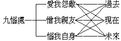



纪　有生为种二句：明业报身，因痴有爱，皆可为修如来之正因。若见无为入正位者二句：明阿罗汉证到无生，则不复发大乘之道意。起我见如须弥山句：由好胜、上慢、贪著来；其实、在好胜者，正可移好胜之心，誓成无上佛道。在上慢者，正可移上慢之心，誓断无边烦恼。在贪著者，更可移此贪著之心，誓学无量法门，誓度无边众生。而此又概明佛道之缘耳。



癸二　反明真圣非如来种



尔时、大迦叶叹言：『善哉！善哉！文殊师利快说此语，诚如所言，尘劳之俦为如来种。我等今者不复堪任发阿耨多罗三藐三菩提心。乃至五无间罪犹能发意生於佛法，而今我等永不能发。譬如根败之士，其於五欲不能复利；如是声闻诸结断者，於佛法中无所复益，永不志愿。是故文殊师利！凡夫於佛法有反复，而声闻无也。所以者何？凡夫闻佛法，能起无上道心，不断三宝。正使声闻终身闻佛法、力、无畏等，永不能发无上道意』。



释　此文大迦叶与文殊师利合唱，其所以奖励尘劳之俦发大心者至矣，愿居尘劳者勿生退屈而辜负迦叶之苦心也。据实、小乘证涅槃者，亦非不能回向大乘。但以生死之畏既离，亲爱之恩先舍，无足生其欣厌，起其慈悲，又有涅槃之安、三昧之乐之可自居，故未易回心耳。



纪　此圣字，专指二乘圣果者言。根败，谓五根毁败，麻木不仁。不能复利句：谓不复能领略利益。凡夫於佛法有反覆句：谓即现在不信或诋毁，然已初种佛法善根於心中，不过现时尚不信或诋毁耳。但於第二次触发时，则必先知有前次佛法，显现当前，自较前次深入议拟思量，或由此起信发心，而至究竟成就佛果。此又概明佛道之因也。



辛二　摄尘缘为佛事



尔时、会中有菩萨名普现色身，问维摩诘言：『居士父母、妻子、亲戚、眷属、吏民、知识悉为是谁？奴婢、僮仆、象马、车乘皆何所在』？於是维摩诘以偈答曰：『智度菩萨母，方便以为父，一切众导师，无不由是生。法喜以为妻，慈悲心为女，善心诚实男，毕竟空寂舍。弟子众尘劳，随意之所转。道品善知识，由是成正觉。诸度法等侣，四摄为妓女，歌咏诵法言，以此为音乐。总持之园苑，无漏法林树，觉意净妙华，解脱智慧果。八解之浴池，定水湛然满，布以七净华，浴此无垢人。象马五通驰，大乘以为车，调御以一心，游於八正路。相具以严容，众好饰其姿，惭愧之上服，深心为华鬘。富有七财宝，教授以滋息，如所说修行，回向为大利。四禅为床座，从於净命生，多闻增智慧，以为自觉音，甘露法之食，解脱味为浆，净心以澡浴，戒品为涂香。摧灭烦恼贼，勇健无能逾，降伏四种魔，胜旛建道场。虽知无起灭，示彼故有生，悉现诸国土，如日无不见。供养於十方无量亿如来，诸佛及己身，无有分别想。虽知诸佛国、及与众生空，而常修净土，教化於群生。诸有众生类，形声及威仪，无畏力菩萨一时能尽现。觉知众魔事，而示随其行。以善方便智，随意皆能现：或示老、病、死，成就诸群生，了知如幻化，通达无有碍。或现劫尽烧，大地皆洞然，众人有常想，照令知无常。无数亿众生，俱来请菩萨，一时到其舍，化令向佛道。经书、禁咒术，工巧诸技艺，尽现行此事，饶益诸群生。世间众道法，悉於中出家，因以解人惑，而不堕邪见。或作日月天、梵王、世界主，或时作地、水、或复作风、火。劫中有疾疫，现作诸药草，若有服之者，除病消众毒。劫中有饥馑，现身作饮食，先救彼饥渴，却以法语人。劫中有刀兵，为之起慈悲，化彼诸众生，令住无诤地。若有大战阵，立之以等力，菩萨现威势，降伏使和安。一切国土中，诸有地狱处，辄往到於彼，勉济其苦恼。一切国土中，畜生相食噉，皆现生於彼，为之作利益。示受於五欲，亦复现行禅，令魔心愦乱，不能得其便。火中生莲华，是可谓希有，在欲而行禅，希有亦如是。或现作淫女，引诸好色者，先以欲钩牵，后令入佛智。或为邑中主，或作商人导，国师及大臣，以祐利众生。诸有贫穷者，现作无尽藏，因以劝导之，令发菩提心。我心憍慢者，为现大力士，消伏诸贡高，令住无上道。其有恐惧众，居前而慰安，先施以无畏，后令发道心。或现离淫欲，为五通仙人，开导诸群生，令住戒、忍、慈。见须供事者，现为作僮仆，既悦可其意，乃发以道心。随彼之所须，得入於佛道；以善方便力，皆能给足之。如是道无量，所行无有涯，智慧无边际，度脱无数众。假令一切佛，於无数亿劫，赞叹其功德，犹尚不能尽。谁闻如是法，不发菩提心？除彼不肖人，痴冥无智者』。



释　普现色身菩萨，即普现三界、七趣、二十五有，种种形类色身者是也。按在他经，如月上女经等，尝载：维摩诘姓雷氏，妻曰金姬，男名善思，女名月上。故维摩诘乃於佛时，在天竺实有生身之处者。玄奘大师西域记，亦载尝瞻礼其卧病之遗室，固非众香国菩萨暂来应化之可比也。但此中普现色身举问其父母、妻子、亲戚、眷属、吏民、知识、奴婢、僮仆及诸所有胥何所在，而维摩诘悉举佛法以答之者，正明佛国主伴交彻，因果圆融，即俗而真，即事而理，头头显露，物物全彰，无障无碍，非自非他，此大乘不可思议解脱之至也。故曰：『谁闻如是法，不发菩提心？除彼不肖人，痴冥无智者』。可谓竭法界之枢机，而罄其鼓舞轩扬之能事者矣。



净名答偈，析为三段：一、明种种皆为佛法，智度菩萨母以至胜旛建道场是也。此又有二：甲、佛法眷属，智度菩萨母以至以此为音乐是也。乙、佛法资具，总持之园苑以至胜旛建道场是也。二、明种种皆由示现，虽知无起灭以至皆能给足之是也。三、赞胜德劝发大心，如是无量以至痴冥无智者是也。



　　　　　　　　┌─戒净  

　　　　　　　　├─心净  

　　　　　　　　├─见净  

　　　　七净华─┼─度疑净  

　　　　　　　　├─分别道净  

　　　　　　　　├─行断知见净  

　　　　　　　　└─涅槃净  

　　　　　　　　┌─信  

　　　　　　　　├─进  

　　　　　　　　├─戒  

　　　　七财宝─┼─惭愧  

　　　　　　　　├─闻  

　　　　　　　　├─舍  

　　　　　　　　└─定慧  

　　　　　　　　┌─欲  

　　　　四　魔─┼─身  

　　　　　　　　├─死  

　　　　　　　　└─天



劫，梵语具云劫波，此翻时分，近人所谓时间是。短至一刹那劫，长至微尘点劫，皆得名之为劫。然通常所称为劫者，就此娑婆器世间长时代言。此又分三：一者、小劫：依南阎浮提人寿计算之，从八万四千岁每过百年减除一岁，减至十岁，再从十岁每过一代倍倍增加，又增至八万四千岁，如此一减、一增，为一小劫。减至十岁前有疫疠、饥馑、刀兵三灾，死人万分之九千九百九十九，谓小三灾。二者、中劫：积二十小劫以为一中劫，此中劫即人之世界生存期限。三者、大劫：合四中劫为一大劫，指此世界经历成、住、坏、空各二十小劫言。人之世界生存之期，即住劫也。住劫二十劫满，则入坏劫，人类与有生命者先空，其次植物、矿物等亦渐坏。其坏之者，凡分三种大灾：一为火灾，坏至初禅天止。经七火灾，有一水灾，坏至二禅天止。经七水灾，有一风灾，坏至三禅天止。



纪　此章、普现色身菩萨之问，实由上问疾品中，空其室中无诸所有等句而来。净名之答偈中，智度菩萨母句：即指摩诃般若波罗密多，证入无生——即五蕴诸法皆空——能生菩萨诸功德法。智度之智，乃不起分别之根本智。方便以为父句：谓一切善行——后得智。本末互赅，法体显现，故曰父母。一切众导师句：即指十方三世诸佛也。因诸佛接引众生，离一切苦，得究竟乐，故曰导师。法喜以为妻句：谓乐法不复乐於五欲，心与法相交融和合，故曰为妻。菩萨得初地为欢喜地，又曰极喜地。慈悲以为女句：谓慈祥悲悯，皆显柔和事相，故曰为女。善心诚实男句：谓信心惭愧，具坚强功能，故曰诚实男。毕竟空寂舍句：谓以空寂之舍，喻法性空。弟子众尘劳句：谓以八万四千人喻尘劳众。随意之所转句：谓本可转尘劳为菩提也。善知识，谓诸助道者。善知识，约有教授、同行、外护三种。总持之园苑二句：陀罗尼，寓翻遮正合义。总持有念总持、定总持二种。觉意、指三十七道品中七觉、七意言。八解，指八背舍言。五通，六通除漏尽通言。一心，指车轴言。惭愧之上服句：见善根依惭愧起故。从於净命生句：见不入邪定、不为禅缚故。虽知无起灭句：谓本因不动故。示彼故有生句：谓随缘显现故。悉见诸国土至降伏使和安，为各说依正，示报有常无常也。觉知众魔事四句：谓於魔处随示而化魔也。世间众道法四句：谓於外道出家而化外道也。劫中有疾疫十六句：谓於劫中随示而解劫也。示受於五欲句：谓因魔持五欲以恼乱人故。先以欲钩牵句：谓因贪欲者，必向其说欲，乃可随顺得入故。大力士，兼智勇而言。皆能给足之句：谓不令其圆满如意、庆快生平也。如是道无量四句：见一切众生之业力，虽不可思议，而菩萨为度一切众生故，其神通方便之力，亦是不可思议。其实诸菩萨之心，与一切众生之心，本同体真如故。兹举近事以明之：现代末法中，凡疾疫、刀兵、饥馑之劫，屡见不鲜，岂诸佛菩萨无此神通方便之力以救度欤？其实多由一切众生共同招感之业力，弥漫无尽，障蔽最深。还求各自投诚、忏悔自心，立弘誓愿，远离恶法，不复更造，则知般若波罗密多，能除一切苦，真实不虚耳。



庚一　入不二法门品



------



### 入不二法门品第九



释　夫数非止乎二，而今曰不二者、何耶？盖二者、对待也，随举一法之名，即有非此一法者与之相对待。如举曰人，则人之外一切皆为非人，人与非人相对成二，此二即摄尽一切法。故不二者，非以其是三、四、五、六、七、八等等也，亦非以其是一也。何则？一与非一相对，三与非三相对，乃至十与非十、百与非百、千与非千、万与非万相对，此皆二也，非不二也。夫然，则不二者，必将极乎智无分别，如无名相，审矣。顾由净名令诸菩萨随意各各说之，然后会归文殊师利之有言显无言，与维摩诘之无言显无言，非徒结示宗极，亦显法法对待，法法皆到达乎不二之地，非仅以默然为高，或借为藏拙。於此经内，舍利弗亦尝默然矣，何以不为文殊师利叹为真入不二法门也耶？世之辩难相诘，亦多理屈辞穷，默然无说，岂皆真入不二法门也耶？盖是穷微尽化，绝量超宗，洞然明白，寂然灵照，心欲缘而虑忘，口欲谈而辞丧，於是乃叹为真入不二法门耳。此宁哑羊之类、矫乱之徒所得假之以为式哉！一切法皆二也，默默无言犹是二也，然可由之而契会不二之心性。门者、可由之义，入者、契会之义，故名为入不二法门。



纪　此品、推穷乎名言之极而超乎名言，追穷乎数量之极而逾乎数量。绝诸对待，不落名言，乃为真入不二法门品也。非如前依与正对待，主与伴对待者。但引入此品中释其义趣：则依中现正，正中现依，主中现伴，伴中现主，交彻圆融，即事而理。诸佛（即主）、菩萨（即伴），法身（即正）、净土（即依），头头显露，物物齐彰，无障无碍，非自非他。前指为大乘不思议解脱之至者，又为此品真入不二法门之至也！



维摩诘所说不可思议解脱经释会纪闻下



辛一　净名总问



尔时、维摩诘谓众菩萨言：『诸仁者！云何菩萨入不二法门？各随所乐说之』。



纪　此章众字、诸字、各字，皆表总问概括之词。随所乐三字，即各各精神独——即不二——到处，亦即各各所入之不二法门也。



辛二　各入不二



壬一　就言入不二法门



会中有菩萨名法自在，说言：『诸仁者！生、灭为二，法本不生，今则无灭；得此无生法忍，是为入不二法门』。德守菩萨曰：『我、我所为二，因有我故便有我所，若无有我则无我所，是为入不二法门』。不眴菩萨曰：『受、不受为二，若法不受则不可得，以不可得故无取无舍、无作无行，是为入不二法门』。德顶菩萨曰：『垢、净为二，见垢实性则无净相，顺於灭相，是为入不二法门』。善宿菩萨曰：『是动、是念为二，不动则无念，无念即无分别，通达此者，是为入不二法门』。普眼菩萨曰：『一相、无相为二，若知一相即是无相，亦不取无相，入於平等，是为入不二法门』。妙臂菩萨曰：『菩萨心、声闻心为二，观心相空如幻化者，无菩萨心、无声闻心，是为入不二法门』。弗沙菩萨曰：『善、不善为二，若不起善、不善，入於无相际而通达者，是为入不二法门』。师子菩萨曰：『罪、福为二，若达罪性则与福无异，以金刚慧决了此相，无缚、无解者，是为入不二法门』。师子意菩萨曰：『有漏、无漏为二，若得诸治等，则不起漏、不漏想，不著於相，亦不住无相，是为入不二法门』。净解菩萨曰：『有为、无为为二，若离一切数则心如虚空，以清净慧无所碍者，是为入不二法门』。那罗延菩萨曰：『世间、出世间为二，世间性空即是出世间，於其中不入、不出、不溢、不散，是为入不二法门』。善意菩萨曰：『生死、涅槃为二，若见生死性则无生死，无缚、无解，不然、不灭。如是解者是为入不二法门』。现见菩萨曰：『尽、不尽为二，法若究竟，尽若不尽皆是无尽相，无尽相即是空，空则无有尽、不尽相。如是入者，是为入不二法门』。普守菩萨曰：『我、无我为二，我尚不可得，非我何可得？见我实性者不复起二，是为入不二法门』。电天菩萨曰：『明、无明为二，无明实性即是明，明亦不可取，离一切数，於其中平等无二者，是为入不二法门』。喜见菩萨曰：『色、色空为二，色即是空，非色灭空，色性自空。如是受、想、行、识，识、空为二，识即是空，非识灭空，识性自空。於其中而通达者，是为入不二法门』。明相菩萨曰：『四种异、空种异为二，四种性即是空种性，如前际、后际空故中际亦空。若能如是知诸种性者，是为入不二法门』。妙意菩萨曰：『眼、色为二，若知眼性於色不贪、不恚、不痴，是名寂灭。如是耳声、鼻香、舌味、身触、意法为二，若知意性於法不贪、不恚、不痴，是名寂灭。安住其中，是为入不二法门』。无尽意菩萨曰：『布施、回向一切智为二，布施性即是回向一切智性。如是持戒、忍辱、精进、禅定、智慧、回向一切智为二，智慧性即是回向一切智性，於其中入一相者，是为入不二法门』。深慧菩萨曰：『是空、是无相、是无作为二，空即无相，无相即无作；若空、无相、无作，则无心、意、识。於一解脱门即是三解脱门者，是为入不二法门』。寂根菩萨曰：『佛、法、众为二，佛即是法，法即是众，是三宝皆无为相，与虚空等。一切法亦尔。能随此行者，是为入不二法门』。心无碍菩萨曰：『身、身灭为二，身即是身灭，所以者何？见身实相者，不起见身及见灭身，身与灭身无二、无分别。於其中不惊、不惧者，是为入不二法门』。上善菩萨曰：『身、口、意善为二，是三业皆无作相。身无作相即口无作相，口无作相即意无作相，是三业无作相即一切法无作相。能如是随无作慧者，是为入不二法门』。福田菩萨曰：『福行、罪行、不动行为二，三行实性即是空，空则无福行、无罪行、无不动行。於此三行而不起者，是为入不二法门』。华严菩萨曰：『从我起二为二，见我实相者不起二法，若不住二法则无有识，无所识者是为入不二法门』。德藏菩萨曰：『有所得相为二，若无所得则无取舍，无取舍者是为入不二法门』。月上菩萨曰：『暗与明为二，无暗、无明则无有二，所以者何？如入灭受想定无暗、无明，一切法相亦复如是。於其中平等入者，是为入不二法门』。宝印手菩萨曰：『乐涅槃、不乐世间为二，若不乐涅槃、不厌世间则无有二。所以者何？若有缚则有解，若本无缚。其谁求解！无缚、无解，则无乐厌，是为入不二法门』。珠顶王菩萨曰：『正道、邪道为二，住正道者，则不分别是邪、是正。离此二者，是为入不二法门』。乐实菩萨曰：『实、不实为二，实见者尚不见实，何况非实？所以者何？非肉眼所见，慧眼乃能见，而此慧眼无见无不见，是为入不二法门』。



释　此文自成三十一章。一、法自在无生门：一切法起於生而不起於不生，故此端为根本法门。悟无生法性名为法自在，乃空分别法执而见法空真如者也。凡愚分别，闻不生即执之为灭，不知灭因生有，先有生故后乃有灭。若推观诸法生处不可得，了见法性本未有生，生且无有，安从有灭？故不生者非谓灭也。灭者与生相待，今曰不生，实以诸对待法皆起於生，不生则诸对待法皆本未尝有，故入不二法也。二、德守无我门：德守者，真如守其性，不随无明妄动起我我所见也。三、不眴不受门：眴、目动也。目者、六根之首，不眴者六根不触受六尘，根不接尘，则识不起而诸法空寂矣。四、德顶实性门：顶者、最高最贵之义，故德顶即一切法实性。从实性以观之，则生死烦恼垢之实性，即菩提、涅槃净之实性。五、善宿不动门：宿者、本有，善者、净观。善宿者、本觉也。无明妄动有心念生，心念生则诸分别起，二者分别之端，此以本觉不动故不二也。六、普眼平等门：普眼者、一相无相平等遍照也。七、妙臂心空门：臂虽有二，而同为法身之妙用。犹大、小乘心相如幻，空无自性。出此数例，餘可类推。



无相际、谓无善、不善相之实际。有漏、谓杂染法，无漏、谓清净法。漏者、过失之义。有为、无为之为，是造变义。有为是无常义，故生、异、灭之三相谓之有为相。诸不遍者必不常住，不常住者必非其实，故无为是遍、常、真实之义。那罗延、是坚固之义，或翻金刚。四种异、空种异，指四大之种异虚空之种。谓四大是有质碍，虚空是无质碍也。了皆即心为性，但有名言都无实性，则不二矣。身灭、谓证涅槃，不受后有。随拈一法皆成二相，即由二相以契不二，是谓入不二门。



纪　法自在菩萨段中，得此无生法忍句：以三世推之，亦毕竟无生，此即是无生法性；能见此无生法性者，得无生法忍；得无生法忍者，便入不二门也。



不眴菩萨段中，眴之一字，为目动貌。眼为六根之首，而受色尘，故有所受。受，又分境界受、自性受。



德顶菩萨段中，见垢实性二句：以实性即是佛性，故无垢净。



善宿菩萨段中，不动则无念二句：谓动念皆由无明，倘无无明长养习气种子，即无名言一切分别。



普眼菩萨段中，一相无二相句：谓一一相即种种相，实本无相，相相无边。若为有相，相皆一合——金刚云：即是一合相，一合相者，即是不可取、不可说——故曰入於平等。



妙臂菩萨段中，观心相空如幻化四句：谓承上一乘而说为二。菩萨、声闻犹一身而有两臂，不过为善巧方便之妙用，更无分际可得。



弗沙菩萨段中，入於无相际而通达者句：谓无善与不善，分别对待之实际相可得也。



师子菩萨段中，以金刚慧三句：喻具有坚利之性——坚则妄想不破之，利则能破诸妄想——，解脱之能——此专属智者；此解脱非谓缚而后解，谓本来无缚也。



师子意菩萨段中，不起漏不漏想二句：一切能招未果之业法，为漏；无上正等觉及涅槃，为无漏。无此有漏、无漏二法念，及此有漏、无漏二法相也。



那罗延菩萨段中，世间性空句：谓亦如诸法体性本空。对於世间，亦本无出、入，故不溢不散。不溢属入世，不散属出世。



善意菩萨段中，若见生死性二句：正谓无实体相，因虚妄颠倒有。其实不入生死，不入涅槃，故无缚无解。



现见菩萨段中，尽若不尽四句：世法，谓皆不缘起，名尽。今佛法，若究竟随缘不变，不变随缘。多谓随缘者为无尽相，岂知不变者亦无尽相也，故曰皆是无尽相。



普守菩萨段中，我尚不可得四句：谓佛因众生执我而说无我法，其实本无自体，当体空寂之性，即是恒沙之性，故曰见我实性，不复起二。



喜见菩萨段中，色即是空七句：见五尘皆是心相，各由见分而显。心相，亦名自心相分。如镜中之影相，并无自体，体即镜之光明，均即是空。



明相菩萨段中，四种性即是空种性四句：如谓地大种性为坚，水大种性为湿，火大种性为业，风大种性为力，本不离四大而有空，亦不能离前后而有中间也。



妙意菩萨段中，眼性於色三句：谓眼性即同於色性，本无三毒——顺境贪，背境恚、中境痴也，当体是空。



无尽意菩萨段中，布施回向一切智二句：谓大布施者，三轮体空。如无能布施之我，亦无所受布施之人，中间布施之物亦无，即为修波罗密多布施法，亦即是回向一切智。故曰：布施性即是回向一切智性。能回向此佛智，则所修为无漏法；不回向，则所修为有漏法。净土念佛，发愿往生外，亦注重回向者，同此义。



深慧菩萨段中，则无心意识句：谓皆不缘起，能缘取一切境界而行於思虑者，为心、意、识，三者之同分义。识又专属分别了知，意又专属审察考虑，心又专属结合含藏，为心、意、识三者之别分义。其实即於一切法上，求其实体，则毕竟是空，皆离於分限而为无相，更无造作可得，故言无相、无作。



寂根菩萨段中，佛即是法二句：见三宝虽有同体、事相、自性之名，两足、离欲、众中三尊之号。事理因缘都归自性，自性真如，本体空寂。三宝皆为无相句：谓无能所皈依义。与虚空等句：谓周遍广大义。



心无碍菩萨段中，见身实相者四句：谓了法性本空。但阿罗汉先灭烦恼，尚遗身缚。后灭果报，始灰身泯智。身为积聚义，四大所积聚故。生灭相续曰积，众法和合曰聚。更如地球，为无数微尘结成，是本无有相，当体空寂之真如相故，即是身灭无可灭故。前寂根为八地菩萨，此心无碍为九地以上菩萨。能离所缘境碍，未断能缘心碍，必至九地以上菩萨，则能所、心境皆无碍矣。



上善菩萨段中，身口意善四字：身、口、意为三业。身业有三：杀、盗、淫。口业有四：恶口、两舌、妄言、绮语——一切戏谑诙谐皆属之。意业亦三：贪、瞋、痴。总为十恶，反之为十善。造作不失名业。是三业无作相二句：见三业体即真如，更无一法可得。



福田菩萨段中，福行二字，指三善道业。罪行二字，指三恶道业。不动行三字，指专修四禅定者。属於色界、无色界。三行实性是空句：见一一功德习染之相，皆为如来藏清净法身总相之全体，重重无尽。得此实性，便为无上行。



华严菩萨段中，见我实相者二句：谓所有对待，皆由我执而起，无我则无分别法。则无有识句：即是无有分别。如梁武帝问对朕者谁，达摩祖师答以不识是。



月上菩萨段中，暗与明三字，各有心与境之区别。属心之暗者，为无明。其明者，为观照。属境之暗者，为不见处。其明者，为见处。平等入，谓入於无明无暗耳。



宝印手菩萨段中，谓欣乐涅槃，则涅槃虽出世净妙法，一变而为世间染污法矣。若有缚则有解四句：谓必先有烦恼生死之苦累，而后方说脱此生死之苦，烦恼之累。如三祖初参二祖时，求为解脱。二祖谓：谁缚汝，三祖悟本来无缚，又将谁解是。



珠顶菩萨段中，住正道者二句：谓如来本为邪道不得已而说正道，使世无邪道，如来亦不说正道。



乐实菩萨段中，非肉眼所见四句：谓吾人肉眼平时之见，多系对境而显。境灭时见亦随灭，均属法尘分别影事。尚有不见之见真如慧眼在，此真见者，非对境故，故无见不见也。例如空观所见空相，尚非平等法性，以有所见故。如摩诃般若波罗密多照见五蕴皆空时，便为无见无不见，无对境故。



壬二　遣言入不二法门



如是诸菩萨各各说已，问文殊师利：『何等是菩萨入不二法门』？文殊师利曰：『如我意者，於一切法无言、无说、无示、无识，离诸问答，是为入不二法门』。



释　一法之可言说者皆二，由二契应不二，即是由言以入无言。由种种言以入无言，则种种言莫非无言、无说、无示、无识。诸问答皆所不能到，莫非不二，斯真不二。正以诸菩萨皆宗极文殊师利，故在文殊师利之意，二入不二为二，本无有二，莫非不二，始入不二法门。



纪　此章，以言遣言也。如我意者五句：是当时文殊无有文字言语，尚遗此文字言语之相。此经文殊为了因佛性——佛性三种：一、正因佛性，二、了因佛性，三、因缘佛性——，在契应不二究竟佛心也。



壬三　无言入不二法门



於是文殊师利问维摩诘：『我等各自说已。仁者当说！何等是菩萨入不二法门』？时维摩诘默然无言。文殊师利叹曰：『善哉！善哉！乃至无有文字语言，是真入不二法门』。



释　诸菩萨入不二法门，悉无二言也。而各言其由以入不二，是从无言而言其言言无言也。所言既穷，维摩诘乃即於其所言之无言，契会靡间。故诸菩萨皆入二门，而维摩诘则为不二。文殊师利叹为真入不二法门，所谓『动容扬古路，不堕悄然机』者也。然知文殊师利之独叹维摩诘，不知维摩诘之所默，即是诸菩萨之所言，与遍叹诸菩萨无异，是犹未悟不二者也。诸菩萨从无言而言，维摩诘从言而无言，则因此经本以维摩诘为正因佛性，法会大众为缘因佛性，文殊师利为了因佛性，故此不二法门始於净名之问，终於净名之默，独以维摩诘示无言之宗极也。



纪　此章，遣无可遣也。默然无言句：不著一字，显当时净名无有文字言语，实离文字言语之相，斯真不二。此经净名为正因佛性，尤为殊胜难能，亦固其所。且举前次诸品，维摩诘所说种种方便、神通、智慧、圆妙之法，皆各显其能，名尽其妙；今一炉而冶之，皆默契於此章无言中，实显佛说无法可说真之旨。通常三乘相共之法，有从有门入者，有从无门入者，更有从亦有亦无门入者，又有从非有非无门入者。但皆契入於无言，乃为真见法性。即进而推之大乘不共法，其宗极究竟处，亦是在契入此无言法性中耳。



辛三　时众获益



说是入不二法门品时，於此众中五千菩萨皆入不二法门，得无生法忍。



释　此中入不二法门，得无生法忍，是登初地。



庚二　香积佛品



------



### 香积佛品第十



释　五尘中、以声为缘生最无自体，其次当以香为最微，触为最麤。故触遍成四大，色成三大，味成二大，香唯地大，而声则但成空大也。言香积者、极言其积聚之精妙。盖质之可积者，莫精微净妙乎香者。过此以往，唯声之空更不可积。所谓建净佛国，当於空地，不於虚空。而香乃地之最微者，故香积佛之众香国，为净佛国之至。过此则为虚空，不足以建佛净国矣。夫香者何？戒香、定香、慧香、解脱香、解脱知见香，乃至八万四千波罗密香，无量无边佛功德香，唯此妙香之聚；谓之佛，亦谓之佛国。



上明佛国三种因果，共有六品。皆前一品明理、次一品成事者。上品既明佛国不二因果之理，故此显成佛国不二因果之事。



纪　此品，显不二因果之事。显见净佛国土，必藉香尘，过此为空，使无从显现。五尘以香为最微相，触为最粗相。四大本无声，相触而有声，故触尘遍含地、水、火、风四大，色尘含地、水、火三大，味尘含地、水二大，香尘唯含有地之一大。香有善香、恶香，此但言善香。如五分无漏功德香等是。故显正报，名香积佛；显依报，名众香国也。



辛一　舍利弗引起



於是舍利弗心念：日时欲至，此诸菩萨、当於何食？时维摩诘知其意而语言：『佛说八解脱，仁者受行，岂杂欲食而闻法乎？若欲食者，且待须臾，当令汝得未曾有食』。



释　处处舍利弗引起者，以示小乘圣智正为入大乘之方便，亦现分别法执遣之以证法空真如性也。前者不思议品念座，座为身之所依，於依正事最为明显。此品念食，以食摄他物为自身，转自身为他物，资益身心，调和众意，於依正、主伴不二之事最为明显也。



纪　此章、日时欲至句：指日午正食时也。佛制：中日分、正午时乃食，因初日分为诸天食时，后日分为诸鬼道食时，佛处於中道故。经云：时节若至，其理自彰。於此可见前不可思议品中，舍利弗念座有座；此品舍利弗念食有食。亦见维摩诘所得神通，非徒显理也。



辛二　维摩诘显现



壬一　现香积佛国



时维摩诘即入三昧，以神通力示诸大众、上方界分过四十二恒河沙佛土，有国名众香，佛号香积，今现在。其国香气，比於十方诸佛世界人天之香，最为第一。彼土无有声闻、辟支佛名，唯有清净大菩萨众，佛为说法。其界一切皆以香作楼阁，经行香地，苑园皆香，其食香气周流十方无量世界。时彼佛与诸菩萨方共坐食。有诸天子皆号香严，悉发阿耨多罗三藐三菩提心，供养彼佛及诸菩萨。此诸大众，莫不目见。



释　上方、指上求佛道之法门。过四十二恒河沙佛土，表从初住至妙觉地也。香气、指清净功德言，谓於诸佛凡圣同居土，清净功德最为第一也。如极乐世界犹有声闻众，香积佛国纯一大乘，故说法尤为清净也。其食香气周流十方无量世界，显自他身土融遍无碍。而咸见彼佛与菩萨方共坐食，受诸天子供养，正显依正、主伴不二之因果也。



纪　此章、示诸大众上方界分句：众香国为佛菩萨最上清净功德结成者，故居上方，非同此娑婆世界，为众生凡夫业力招感而成者，居下方也。



壬二　请香积佛饭



时维摩诘问众菩萨：『诸仁者！谁能致彼佛饭』？以文殊师利威神力故，咸皆默然。维摩诘言：『仁！此大众无乃可耻』！文殊师利曰：『如佛所言，勿轻未学』。於是维摩诘不起於座，居众会前，化作菩萨相好光明，威德殊胜蔽於众会。而告之曰：『汝往上方界分，度四十二恒河沙佛土，有国名众香，佛号香积，与诸菩萨方共坐食。汝往到彼，如我词曰：维摩诘稽首世尊足下，致敬无量，问讯起居，少病、少恼，气力安不？愿得世尊所食之餘，当於娑婆世界施作佛事，令此乐小法者得弘大道，亦使如来名声普闻』。时化菩萨即於会前升於上方，举众皆见其去。到众香界，礼彼佛足。又闻其言：『维摩诘稽首世尊足下，致敬无量，问讯起居，少病、少恼，气力安不？愿得世尊所食之餘，欲於娑婆世界施作佛事，使此乐小法者得弘大道，亦使如来名声普闻』。



释　以文殊师利威神力故咸皆默然者，此会诸菩萨众之同入不二法门者，未尝不能请饭於香积，徒欲抑之、扬之以为后学激劝，故共令当阳独出耳。然文殊师利又承神威神力者，故还述佛言勿轻未学以裁之。尝谓此经乃缘起乎释尊彻底之大悲心，维摩诘、文殊师利、舍利弗、迦叶等皆承佛大悲而共同宣扬者，意见乎是。



维摩诘之化作菩萨，乃从三昧力在空中变现一相好光明与众香国菩萨同等之菩萨，乃可往彼请饭，故曰威德殊胜蔽於众会。空中化现之理，有二种义：一者、一切诸法体皆空寂，空寂之体即是灵知，空寂灵知离名绝相，以愿力故或念力故，起一作意欲现何形，即有一如何之形现。虽吾人以无明妄动而起身根、器界，亦未尝非如幻如化，徒以生於不觉，未能自主。且由先业累积，成之以渐，故昧然罔知耳。二者、如大智度论明：四大极微种子，充满空界，无意力以为结集之中心，故无成形显现。诸佛菩萨心等空界，随兴一念皆能作集起形体之中心，故应念能从空中现身也。乐小法者，如求现身福报，或求来生人天福报，或求速得解脱生死，此皆不宏、不毅，不能任重致远，但求小效，硁硁自喜，将欲化而大之，使共游於莽荡无涯之不可思议解脱中，故令胜劣、净秽相形以会得其通也。



壬三　来众香国众



彼诸大士见化菩萨，叹未曾有。今此上人从何所来？娑婆世界为在何许？云何名为乐小法者？即以问佛，佛告之曰：『下方度如四十二恒河沙佛土，有世界名娑婆，佛号释迦牟尼，今现在於五浊恶世，为乐小法众生敷演道教。彼有菩萨，名维摩诘，住不可思议解脱，为诸菩萨说法，故遣化来，称扬我名并赞此土，令彼菩萨增益功德』。彼菩萨言：『其人何如、乃作是化？德力无畏，神足若斯』！佛言：『甚大！一切十方皆遣化往，施作佛事，饶益众生』。於是香积如来以众香钵盛满香饭，与化菩萨。时彼九百万菩萨俱发声言：『我欲诣娑婆世界供养释迦牟尼佛，并欲见维摩诘等诸菩萨众』。佛言：『可往。摄汝身香，无令彼诸众生起惑著心。又当舍汝本形，勿使彼国求菩萨者而自鄙耻。又汝於彼莫怀轻贱而作碍想，所以者何？十方国土皆如虚空。又诸佛为欲化诸乐小法者，不尽现其清净土耳』。时化菩萨既受钵饭，与彼九百万菩萨俱，承佛威神及维摩诘力，於彼世界忽然不现，须臾之间至维摩诘舍。时维摩诘即化作九百万师子之座，严好如前，诸菩萨皆坐其上。时化菩萨以满钵香饭与维摩诘，饭香普熏毗耶离城三千大千世界。



释　观香积佛所教诫於彼诸菩萨之言，知彼诸菩萨乃上齐佛德之极，正须大悲下度群生，不可养尊处优以自高举。故此品为深心修集善法之终，下品即由彼土菩萨，入大悲弘度众生法门也。饭香普熏三千世界，是忍土即为众香国，秽隐於净，净现於秽，净秽交彻以无际也。



纪　娑婆二字，此解：忍世苦。佛号释迦牟尼句：佛本出刹帝利王族。释迦牟尼、此言能仁寂默之义，上姓、下名可知。若合取其义者，慈悲普覆曰能仁，无为密证曰寂默。摄汝身香二句：见妙香本为种种清净功德之香，但令众生贪著此香，便又变为烦恼香，转使人增诸菩萨众化身来世为无所益之感想。十方国土二句：以实法性言。为欲化诸乐小法者二句：以佛功德言也。



壬四　来本佛国众



时毗耶离婆罗门、居士等，闻是香气，身意快然，叹未曾有。於是长者主月盖，从八万四千人，来入维摩诘舍。见其室中菩萨甚多，诸师子座高广严好，皆大欢喜。礼众菩萨及大弟子，却住一面。诸地神、虚空神、及欲、色界诸天，闻此香气，亦皆来入维摩诘舍。



释　此中先人间众入室，共八万四千者，指八万四千尘劳皆转为功德。次三界神天众入室，指无数众生皆入圆融性海中。盖香气即菩萨所修净佛国土之行。大众闻香气而入室，即因菩萨修种种净行故，种种同类相感之众生来生其国也。前文殊师利、舍利弗等众是同修因行者，此则是果上所摄化也。



纪　诸地神虚空神句：指三行——天行、地中行、空中行夜叉等言。而来入维摩诘舍句：见凡能闻此妙香者，皆来维摩诘舍中，实皆属有缘之众。而其能知此妙香又来自维摩诘室者，更为正因佛性之内熏耳。



壬五　食香积佛饭



时维摩诘语舍利弗等诸大声闻：『仁者可食！如来甘露味饭，大悲所熏，无以限意食之，使不消也。有异声闻念是饭少而此大众人人当食。化菩萨曰：『勿以声闻小德、小智称量如来无量福慧！四海有竭，此饭无尽。使一切人食搏若须弥，乃至一劫，犹不能尽。所以者何？无尽戒、定、智慧、解脱、解脱知见功德具足者所食之餘，终不可尽』。於是钵饭悉饱众会，犹故不儩。其诸菩萨、声闻、天、人食此饭者，身安快乐，譬如一切乐庄严国诸菩萨也。又诸毛孔皆出妙香，亦如众香国土诸树之香。



释　如来大悲，与诸众生同体，甘露法食即从佛之大悲心成，全心是食，全食是心。不生分别，自成资益；稍存限量，即成执滞。故维摩诘劝食之先，举为戒之。何者？食不消则甘露变为毒药故也。未得本不生灭无分别心，不能与佛清净法流相通起菩萨行，亦是此意。食者、是受用义，佛以无尽福慧解脱为受用法，等法界、虚空界利乐众生尽未来际无有穷尽，故曰悉饱众会犹故不儩。儩者、尽也。食此饭者，身安快乐，是成就众生正报严净也。毛孔皆出妙香，如众香国诸树之香，随成就众生则国土净也。



纪　如来甘露饭味二句：见由无量功德而成。无以限意食之句：含事理二义：以理而言、有不可划分、差别而食意。以事而言，有放开肚皮、任量而食意。有异声闻念是饭少句：指正落有限。使一切人食二句：指室中大众。乃至一劫二句：此处一切、须弥、一劫等语，实显无尽义，正见皆同法性耳。无尽戒定智慧解脱解脱知见三句：正显惟大乘菩萨，具此五分法身功德，乃能无尽，若小乘则为有尽。



壬六　明彼土说法



尔时、维摩诘问众香菩萨：『香积如来以何说法』？彼菩萨曰：『我土如来无文字说，但以众香令诸天人得入律行。菩萨各各坐香树下，闻斯妙香，即获一切得藏三昧。得是三昧者，菩萨所有功德皆悉具足』。



释　此文是明随国土净则说法净，随说法净则智慧净，随智慧净则其心净，随其心净则一切功德净是也。此为深心修集一切善法之极，亦为净行之极，故下即明从净土以垂化秽土之法，所谓大悲下度一切众生是也。



纪　得入律行四字：即谓身心调伏合度，证入三昧。若「此方真教体，功德在音闻」，乃言娑婆世界释迦佛教体，在文字言说，属於色、声二尘。而彼众香国中香积佛教体，不必文字言说，且专重於香尘耳。



壬七　明此土说法



彼诸菩萨问维摩诘：『今世尊释迦牟尼以何说法』？维摩诘言：『此土众生刚强难化，故佛为说刚强之语以调伏之。言是地狱，是畜生，是饿鬼，是诸难处，是愚人生处；是身邪行、是身邪行报，是口邪行、是口邪行报，是意邪行、是意邪行报；是杀生、是杀生报，是不与取、是不与取报，是邪淫、是邪淫报，是妄语、是妄语报，是两舌、是两舌报，是恶口、是恶口报，是无义语、是无义语报，是贪嫉、是贪嫉报，是瞋恼、是瞋恼报，是邪见、是邪见报；是悭吝、是悭吝报，是毁戒、是毁戒报，是瞋恚、是瞋恚报，是懈怠、是懈怠报，是乱意、是乱意报，是愚痴、是愚痴报；是结戒、是持戒、是犯戒、是应作、是不应作，是障碍、是不障碍，是得罪、是离罪，是净、是垢，是有漏、是无漏，是邪道、是正道、是有为、是无为，是世间、是涅槃。以难化之人心如猿猴，故以若干种法制御其心，乃可调伏。譬如象马𢘙悷不调，加诸楚毒乃至彻骨，然后调伏。如是刚强难化众生，故以一切苦切之言乃可入律』。彼诸菩萨闻说是已，皆曰：『未曾有也！如世尊释迦牟尼佛，隐其无量自在之力，乃以贫所乐法度脱众生。斯诸菩萨亦能劳谦，以无量大悲生是佛土』。



释　若修净佛国行之至而自住於清净报中，不观没在苦海中之苦恼众生发大悲心，深垂救济，亦焉贵有此修净佛国行之菩萨哉！故如悲华经中所说：阿弥陀、观世音、文殊师利等等，皆释尊於过去劝发菩提心者，彼皆发愿取清净土，独释尊愿常生秽土救苦众生。何者？净土虽亦能令苦恼众生慕之而求往生，但诸众生没在苦中，又安知有净佛国土而求往生也哉！悲愿深重，任其艰鉅，故为诸佛共钦赞为大悲芬陀利华。今此世界险乱困苦极矣，望学佛者皆发大悲愿而绍隆佛志，勿徒求自了也。



纪　言是地狱三句：地狱分二：一、寒地狱，居地边际，如地球南北寒带冰洋。二、热地狱，居地中心，如地球赤道热带及地心之蕴火。畜生分三：一、谓饲养於人而生。二、谓嗅味而生。三、谓横傍而生。饿鬼，鬼类甚多，详如楞严经。凡称鬼者，为虚怯之义，悭贪为罪，洎报鬼伦，亦以嗅味为食，空腹高心，故名饿鬼。凡在生前贪著好胜，贡高我慢，死后受报，便属此类。明三途恶趣，无非三毒招感。又名火途、血途、刀途，互相噉噬残杀为义，故曰三恶道。是身邪行六句：指由六种根起惑造业也。问：六根何止三业？答：眼、耳、鼻三根，但能发识了境，而不自造业，故仅列身、口、意三根居多，有由来者耳。是杀生下二十六句：指十善相反为十恶，六度相反为六蔽。皆属恶业，皆是恶报。且均含有现世生前报及死后隔世报之二种。是结戒下十八句：指净染诸业，净染诸报，亦含有世间、出世间之二种也。以难化之人下十二句：正说释迦世尊之不得已，本娑婆界中众生种种分别之心，立种种分别之戒。贫所乐法四字，指众小乘，只忻求人天福报，及自了生死之义耳。



壬八　明此土德行



维摩诘言：『此土菩萨於诸众生大悲坚固，诚如所言。然其一世饶益众生，多於彼国百千劫行。所以者何？此娑婆世界有十事善法，诸餘净土之所无有。何等为十？以布施摄贫穷，以净戒摄毁禁，以忍辱摄瞋恚，以精进摄懈怠，以禅定摄乱意，以智慧摄愚痴，说除难法度八难者，以大乘法度乐小乘者，以诸善根济无德者，常以四摄成就众生：是为十』。彼菩萨曰：『菩萨成就几法，於此世界行无疮疣，生於净土』？维摩诘言：『菩萨成就八法，於此世界行无疮疣，生於净土。何等为八？饶益众生而不望报；代一切众生受诸苦恼，所作功德尽以施之；等心众生，谦下无碍；於诸菩萨视之如佛；所未闻经闻之不疑；不与声闻而相违背；不嫉彼供，不高己利，而於其中调伏其心；常省己过，不讼彼短，恒以一心求诸功德：是为八法』。



释　诸净土中无有贫穷等六蔽之患，故亦无六度之德。无八难，故亦无除八难法。如众香国无小乘，故亦无度小乘之大乘。无无德者，亦无济无德之善根。净土不须四摄法成就众生，故亦无成就众生之四摄法。夫六度乃至四摄法，皆胜德也，顾为诸餘净土所无，而为秽恶之土所偏有。然则过患实为功德之本，明矣。故有大悲勇猛之士，正须常住浊世。恒修胜行，一日之善能抵净土中修行百千劫，夫孰不应欣此奇遇而精进为之哉！无量寿经等说往生净土，若於此土能读诵大乘、尊重三宝、孝养父母、慈济众生者，以之求生净土，即臻上品。如或一生彼土下品之中，若欲转登上品，则非多劫修行不能，於此亦可见秽土中修行虽难而实胜也。行无疮疣，谓无过失，即是无漏之义。此有八法，乃为真正得生净土之行。在此人间世者，无论但为自度求生净土，或为修取净土摄化众生，皆须依此修学，乃能离过绝非，得佛国净。夫望得福报而不饶益众生者，可无论矣。虽能饶益众生而望果报，即不免乎疮疣。何者？一望报、则果报尽时德业随之亦尽，不能尽於未来无有穷竭，一也。望报而报未能即成，因之或生疲怠之念，不能增进，二也。故此不能行无疮疣生於净土。餘之七法，可类推之。



纪　此段，本为全经集行之大观，详为开示行门。如历述先修观行，观自身不净、空、苦、无常、无我，而起正信。更推观佛身境，广博严净而发大心。次当坚固正信心而发深行，彻见真实法性，知一切恒沙功德妙用非从外来，原同本觉，皆由自体真心上显现，真性中流出，悟得究竟，证得圆满；终当以无量大悲而观无边众生苦行，尽愿救度，不遗餘力。所谓『见佛了生死，如佛度一切』也。大悲坚固力句：谓不退缩义。然其一世下，说菩萨度他法门，十事善法，即合为十波罗密也。前六，经文说布施、持戒、忍辱、精进、禅定、智慧甚明。后四、说除八难法句，属力波罗密。以大乘法句，属愿波罗密。以诸善根句，属智波罗密。常以四摄句，属方便波罗密。布施，能所皆无定限。贫穷、约有三种：一、无财宝，乞丐下贱是。二、无智德，愚狠顽嚚是。三、无威力，为水火力兵所困厄是。忍辱、诸经多单提谆谆诲人以凡遇逆境，逆来顺受。如人詈骂加我，我不生瞋恨；纵来再骂，决不致三。是此忍辱，不独摄治自身瞋恚，亦可摄治他人瞋恚。精进，谓当精进一切善法。如现时人，非不精进，但多为贪欲勤劳，鸡鸣而起，惟日孜孜。由户不由道，好色不好德，似此其由者、好者终不得为精进；其不由、不好者，实落於懈怠耳。菩萨成就八法下，说菩萨自度法门。饶益众生二句：指善於回向。代一切众生受诸苦恼二句：指不自居名位。等心众生二句：指以平等心向一切众生。於诸菩萨二句：指亦以平等心视诸菩萨。所未闻经二句：指不谤大乘法。印度佛灭度后，先流通小乘法典，故群起疑谤，谓大乘非佛所说之法。不与声闻而相违背句：指不废小乘法。不嫉彼供四句：指存养进修也。常省己过四句：指省察克治也。一心、指定心言。功德、指全经解脱不可思议、一切六度万行功德言耳。



辛三　法会众获益



维摩诘、文殊师利於大众中说是法时，百千天人皆发阿耨多罗三藐三菩提心，十千菩萨得无生法忍。



释　从佛道品以来，会众获益，皆得无生法忍。正显行位渐高，皆已曾发菩提心也。



戊三　大悲普度众生



------



### 菩萨行品第十一



释　独此品标名菩萨行，以所说之尽无尽解脱门，专为功德具足之菩萨说大悲无尽行者。此大悲无尽行正是菩萨特殊之德，虽佛果后之所行者亦属乎此。如所谓教化众生终不厌倦、护持正法不惜身命、意而有勇志而不倦等，正所谓菩提萨埵心是也。於佛法中得心开意解者，观众生苦、念如来恩，於是不可不深识之。



纪　此品、谓以前所说恒沙功德，皆为菩萨不共之行，不求小果，不取近效，是为发菩萨心，行菩萨道。



己一　现瑞见佛



是时、佛说法於庵罗树园，其地忽然广博严事，一切众会皆作金色。阿难白佛言：『世尊！以何因缘有此瑞应？是处忽然广博严事，一切众会皆作金色』。佛告阿难：『是维摩诘、文殊师利与诸大众恭敬围遶，发意欲来，故先为此瑞应』。於是维摩诘语文殊师利：『可共见佛，与诸菩萨礼事供养』。文殊师利言：『善哉！行矣，今正是时』。维摩诘即以神力，持诸大众并师子座，置於右掌，往诣佛所。到已著地，稽首佛足，右遶七匝，一心合掌，在一面立。其诸菩萨即皆避座，稽首佛足，亦遶七匝，於一面立。诸大弟子、释、梵、四天王等亦皆避座，稽首佛足，在一面立。於是世尊如法慰问诸菩萨已。各令复坐，即皆受教。众坐已定，佛语舍利弗：『汝见菩萨大士自在神力之所为乎』？『唯然，已见』。『汝意云何』？『世尊！我睹其为不可思议，非意所图，非度所测』。



释　此经自佛国品之后，凡现三相以为事端：一者、是方便品净名示疾，发生方便、弟子、菩萨三品。二者、是问疾品示现室空无诸所有独寝一床，如次发生第五、第六、第七，第八、第九、第十、六品。独寝一床，即为不二因果之象。此品则於佛地忽现广博严事之相，乃表从因至果，会因行之流归果德之海，从果海倒驾大慈悲舟楫以津济苦恼众生也。



维摩诘是正因佛性，登地之上则为法身。文殊师利是佛加被之智。其餘大众，皆为法身土中别别依正、主伴、因行、果德，故持以维摩诘右掌而至佛地。到已各各避座礼佛，在一面立，受佛慰问，众复坐定，一切因行皆转成佛地中之因行也。佛令舍利弗述其所见事，是结成室中不可思议解脱法门也。



纪　此章，其地忽然广博严事三句：谓至此处境界所现，已邻佛果地，与本因心地见又不同。可共见佛下五句：谓一切菩萨所修功德具足圆满时，当泯同果海也。约本经有六时法会：一、佛国品中，实积长者子同行献盖时法会。二、方便品中，毗耶离国王大臣率众问疾时法会。三、弟子品中，佛集诸弟子、善萨遣使问疾时法会。四、文殊师利问疾品中，文师率众来维摩诘室时法会。五、香积佛品中，众香国诸菩萨至维摩诘时法会（此会中，又附加人天二众闻香皆来维摩诘舍法会）。六、便为此时，一切众会菩萨神众往诣佛所法会。共为二处所：一、庵罗树园，一、维摩诘舍而已。维摩诘即以神力下六句：显依正二报，皆可持方便智，达慈悲海，到圆觉地。稽首佛足句：谓通常首居上尊，足居下贱，今诸菩萨众皆自稽其首而礼佛足，表极尊崇於佛也。右遶七匝句：右遶明乎非左道。寻常礼数，多一匝、三匝者，今遶至七匝，亦表极恭敬於佛也。



己二　闻法兴供



庚一　广显佛事



尔时、阿难白佛言：『世尊！今所闻香自昔未有，是为何香』？佛告阿难：『是彼菩萨毛孔之香』。於是舍利弗语阿难言：『我等毛孔亦出是香』。阿难言：『此所从来』？曰：『是长者维摩诘从众香国取佛餘饭，於舍食者，一切毛孔皆香若此』。阿难问维摩诘：『是香气住当久如』？维摩诘言：『至此饭消』。曰：『此饭久如当消』？曰：『此饭势力至於七日，然后乃消。又、阿难！若声闻人未入正位食此饭者，得入正位然后乃消。已入正位食此饭者，得心解脱然后乃消。若未发大乘意食此饭者，至发意乃消。已发意食此饭者，得无生忍然后乃消。已得无生忍食此饭者，至一生补处然后乃消。譬如有药，名曰上味，其有服者，身诸毒灭然后乃消。此饭如是，灭除一切诸烦恼毒，然后乃消』。阿难白佛言：『未曾有也！世尊！如此香饭能作佛事』。佛言：『如是！如是！阿难！或有佛土以佛光明而作佛事，有以诸菩萨而作佛事，有以佛所化人而作佛事，有以菩提树而作佛事，有以佛衣服、卧具而作佛事，有以饭食而作佛事，有以园林、台观而作佛事，有以三十二相、八十随形好而作佛事，有以佛身而作佛事，有以虚空而作佛事，众生应以此缘得入律行。有以梦、幻、影、响、镜中像、水中月、热时燄、如是等喻而作佛事，有以音声、语言、文字而作佛事。或有清净佛土，寂寞无言、无说无示无识无作无为而作佛事。如是阿难！诸佛威仪进止诸所施为，无非佛事。阿难！有此四魔、八万四千诸烦恼门，而诸众生为之疲劳，诸佛即以此法而作佛事，是名入一切诸佛法门。菩萨入此门者，若见一切净好佛土，不以为喜，不贪不高；若见一切不净佛土，不以为忧，不碍不没。但於诸佛生清净心，欢喜恭敬，未曾有也。诸佛如来功德平等，为教化众生故而现佛土不同。阿难！汝见诸佛国土地有若干，而虚空无若干也。如是见诸佛色身有若干耳，其无碍慧无若干也。阿难！诸佛色身、威相、种姓、戒、定、智慧、解脱、解脱知见、力、无所畏、不共之法、大慈、大悲、威仪所行、及其寿命、说法教化、成就众生、净佛国土、具诸佛法，悉皆同等，是故名为三藐三佛陀，名为多陀阿伽度，名为佛陀。阿难！若我广说此三句义，汝以劫寿不能尽受。正使三千大千世界满中众生，皆如阿难多闻第一，得念总持，此诸人等以劫之寿亦不能受。如是，阿难！诸佛阿耨多罗三藐三菩提无有限量，智慧辩才不可思议』。



释　香饭之力，能消一切烦恼而得无生法忍乃至一生补处，正显香饭能作之佛事也。佛遂因之广明种种不同佛国、所作种种不同佛事。要之、根尘动静无不可依之悟入者，以开拓执著文字语言为法义之见；亦明种种佛事，在佛无不能作，但随调御众生便利而现差别，不於其中横生高下优劣之想。何者？佛功德非常人知见所能测量，故生下众香菩萨之悔责心也。



纪　此章言佛事，约有二种：一、度众生，一、转法轮也。转法轮，有谓专属佛说法时言者：第一时、为初转，为钝根下类众生转小乘法轮，即是说提胃、阿含等经时也。第二时、为中转，为中根一类众生转三乘法轮，即是说深密、方广等经时也。第三时、为后转，为利根上类众生转大乘法轮，即是说妙智般若等经时也。初转名隐实教，譬如日升转照黑山。中转名引摄教，譬如日升次照高原。后转名融通教，譬如日升普照一切大地。今所闻香三句：先显以鼻作佛事而发问端，后显五根皆可作佛事也。此饭势力三句：本与念佛至於七日，一心不乱，命终成佛义同。得入正位句：谓须陀洹果见生空法性。得心解脱句：谓阿罗汉果，得无碍自在。发大乘意，为大乘初地菩萨。得无生忍，为经二阿僧祇劫八地菩萨。一生补处，为等觉地菩萨。烦恼毒，天台虽分五住，不外人我、知见二障而已。或有佛土下：推世间诸事皆可作佛事。菩提树三字，指佛成道处。卧具等，亦具含佛之衣钵等义。佛钵，据载为四天王所献，本有四钵，佛合为一。六朝法显法师，尚及见之。相传投物其中，尽量不满，其灵妙为若此也。三十二相，即指佛相。八十随形好，谓随一一相上有若干种好也。佛百劫修相好，皆为乐相。梦、幻、影、响等喻，皆为苦相。音声、语言、文字，即合眼识、耳识、意识三种而为体。离於意识，则音声、语言、文字、皆不能成立。清净佛土四字，即指常寂光土。无识、无作、无为六字，即谓不分别、不造作、不生灭也。是名一切诸佛法门句：总结上来诸佛事实，显十方三世各教体，皆是诸佛如来欲令法音宣流，变化所作。但佛不说法，皆依菩萨而作佛事，佛为体位，本无言说故耳。菩萨入此门者七句：名属释尊教导阿难，实则化度众香国诸菩萨众，正对治其贪著清净之病。汝见诸佛国土地有若干四句：释尊显示依正二报之相，本具圆妙功德平等。三藐三佛陀，此言正遍知义。多陀阿伽度，此言如来义。佛陀，此言觉者义。正遍知、如来、觉者，合为佛自受用身，原无何等差别，故曰其诸佛法，悉皆同等；且佛身实真如法身也。



庚二　赞扬大乘



阿难白佛言：『我从今已往，不敢自谓以为多闻』。佛告阿难：『勿起退意，所以者何？我说汝於声闻中为最多闻，非谓菩萨。且止，阿难！其有智者，不应限度诸菩萨也。一切海渊尚可测量，菩萨禅定、智慧、总持、辩才、一切功德不可量也。阿难！汝等舍置菩萨所行。是维摩诘一时所现神通之力，一切声闻、辟支佛於百千劫尽力变化所不能作』。



释　夫小乘者，如病鸟得一枝之栖以止。大乘漭荡无涯，不可限量，故此非小与大之比，而一有量一无量之比也。结归维摩诘者，即举现事以为证也。



纪　此章、阿难乃释尊堂弟，常随佛闻法者。此外尚有贤阿难、欢喜阿难、欢喜海阿难，即结集大乘经典者。於声闻中四字，指小乘法中。非谓菩萨四字，即非谓大乘法中。一时，如由文殊问疾品至今来佛所，皆得谓之一时也。



庚三　说菩萨行



尔时、众香世界菩萨来者，合掌白佛言：『世尊！我等初见此土生下劣想，今自悔责，舍离是心。所以者何？诸佛方便不可思议，为度众生故，随其所应现佛国异。唯然，世尊！愿赐少法！还於彼土，当念如来』。佛告诸菩萨：『有尽无尽解脱法门，汝等当学。何谓为尽？为有为法。何谓无尽？谓无为法。如菩萨者，不尽有为，不住无为。何谓不尽有为？谓不离大慈、不舍大悲，深发一切智心而不忽忘。教化众生终不厌倦，於四摄法常念顺行；护持正法不惜身命，种诸善根无有疲厌。志常安住方便回向，求法不懈，说法无吝，勤供诸佛故入生死而无所畏。於诸荣辱心无忧喜，不轻未学，敬学如佛。随烦恼者令发正念，於远离乐不以为贵，不著己乐庆於彼乐。在诸禅定如地狱想，於生死中如园观想，见来求者为善师想，舍诸所有具一切智想，见毁戒人起救护想，诸波罗密为父母想，道品之法为眷属想。发行善根无有齐限，以诸净国严饰之事成己佛土。行无限施具足相好，除一切恶净身口意，生死无数劫意而有勇，闻佛无量德志而不倦，以智慧剑破烦恼贼、出阴界入，荷负众生永使解脱，以大精进摧伏魔军，常求无念实相智慧。行少欲、知足而不舍世法，不坏威仪而能随俗起神通慧、引导众生，得念总持所闻不忘，善别诸根断众生疑，以乐说辩演说无碍。净十善道受天人福，修四无量开梵天道。劝请说法、随喜赞善、得佛音声，身口意善得佛威仪。深修善法，所行转胜，以大乘教成菩萨僧，心无放逸，不失众善。行如此法，是名菩萨不尽有为。何谓菩萨不住无为？谓修学空不以空为证，修学无相、无作不以无相、无作为证，修学无起不以无起为证。观於无常而不厌善本，观世间苦而不恶生死，观於无我而诲人不倦，观於寂灭而不永寂灭。观於远离而身心修善，观无所归而归趣善法。观於无生而以生法荷负一切，观於无漏而不断诸漏，观无所行而於行法教化众生，观於空无而不舍大悲，观正法位而不随小乘。观诸法虚妄，无牢、无人、无主、无相，本愿未满而不虚福德、禅定、智慧。修如此法，是名菩萨不住无为。又、具福德故，不住无为，具智慧故，不尽有为；大慈悲故，不住无为，满本愿故，不尽有为；集法药故，不住无为，随授药故，不尽有为；知众生病故，不住无为，灭众生病故，不尽有为。诸正士！菩萨已修此法，不尽有为、不住无为，是名尽无尽解脱法门，汝等当学』！



释　明佛国净秽平等而不住於净，乃能入佛不可思议方便，随应众生现佛国异。唯其如是，故能转净佛国，不为净佛国转，此为修净佛国行之至极，而转净佛国成活用者也。众香菩萨是住於净而未能应乎秽者也，能知秽之尽而未知秽之无尽，是知善之性而不知恶之性其为性同也，故进之以尽无尽解脱门。尽、谓灭尽，诸有为法有起、有尽，故为有尽。无为之法本无有起，亦无有灭，故名无尽。然无为法者、常住之法也，故一入无为即寂然凝住；而有为法者、起尽之法也，故一入有为即奄尔垂尽。此皆缚於法而不能自由於法者也，是凡夫、小乘之法而非大乘菩萨之法也。而菩萨者，以大悲故，与六道众生同受生死之苦以救拔其苦，故不住无为也；以本愿故，度尽众生方入涅槃，法界众生实无有尽，利乐众生亦穷未来际而无尽，故不尽有为也。是为菩萨之无住大涅槃，自在圆觉，不共二乘。



先释不尽有为：以大慈悲、一切智心为本：大慈悲故不堕於见，一切智故不堕於爱；离爱、见故不堕六凡，具悲、智故不堕二乘；诸边不堕，成菩萨行。其要在乎教化众生、护持正法之二事耳。教化众生以行四摄，护持正法以种善根，唯弘法能报众生恩——犹云国家恩、社会恩——唯利生能报佛法恩。夫众生之颠倒流转於众苦之渊者，昧乎正法而不由也。能阐明正法以自正而正群有，则莫不随顺法性得究竟之乐，唯是称应佛心，悦可圣意，故曰『将此身心奉尘刹，是则名为报佛恩』。耗矣，哀哉！佛法之在今日，乃竟无人能知恩报恩也。报佛恩，弘法化，尽其一切所有而赴乎此，如所谓不惜身命者诚非易易。顾往往有人天小道，神鬼邪术，入之者竟能牺牲一切以广事兴建；而学佛者优游乎佛、寝馈乎佛，竟坐视佛法之侵於魔外、败於狮虫而不一发护持之心，谋所以宣正法而救众生之道，不其可耻之甚！夫护持正法者，先当知正法之谓何。吾心本有如来福德智慧之法，奈何纵之流转、沈之空无而不为护持乎？大地之人无不皆具如来福德智慧之法，奈何袖手以观其陷溺乎？贪、瞋、痴、惑，杀、盗、淫业，如水益深，如火益热，不以如来正法醒其迷倒令悟本来之佛性乎？释迦如来所遗塔庙貌像、经律论义，皆是三阿僧祇舍无量身命、头目、髓脑、国城、妻子、财宝所修得，乃大地众生法身慧命、善根福田之无上胜缘，奈何听其沦散，任其毁灭，而不为保护修持乎？依佛律仪出家之众，应远追妙德、慈氏、舍利弗、迦叶之芳躅，住持佛法，弘范三界，奈何缚入愚网，沦为罪薮，被诸魔罗、阿修罗、蔑戾车之所蹂躏，而无以建其隆正乎？世有发菩萨心修菩萨行乎？幸垂览焉！诚能护持正法，则净佛国土，自利利他，胥在乎是矣！



次释、不住无为：证涅槃而不住，恒修习佛功德以利益众生也。



次释、不尽有为不住无为：结归知众生病故、灭众生病故。还显诸佛菩萨入浊恶世，皆同净名示疾，以大悲起，因众生病，众生病愈诸佛、菩萨病乃愈也。然此众生之病，其性空寂，寂然常遍，即是一切法真如性，故又尽而无尽，平等解脱。轨之生解、持之不失之谓法，依之开示、由之悟入之谓门。此尽无尽解脱法门，乃不可思议解脱之究竟，诸佛菩萨於是振乎无竟。



纪　此章，下劣二字、指秽恶充满言。方便不可思议六字，指化度众生言；即菩萨若离於凡夫，亦无不可思议。有为法，谓生灭法。无为法，谓常住法。不过对有为说无为，其实无为本无法无相。例如海水，波浪起灭为水之有为相，即在定时不得谓之无水；但亦不可执著清明镇静之水为水无为相，若必执此者，则是动时便又不得谓之水耳。但本相、变相二种，皆不得过执成病，反使真性不明。如本相为水之镇静无为相，变相为水之波浪有为相，皆不得过执成病，反令水之真实湿性不明。故不尽有为，不住无为。大慈，谓当念一切随顺众生，常得乐利。大悲，谓常观一切苦恼众生，急欲救度。深发一切智心句：即成一切平等了知之佛智。佛智中，能观圆融、差别、因、果四相。又谓佛圆满功德果智，称一切种智，与初地菩萨发心根本智不同。而不忽忘句：谓不忽略忘失菩提心。护持正法句：谓法之供养。不惜身命句：谓破和合相。於远离乐不以为贵下，多说不尽有为、不住无为也。以智剑二句：谓以生空、法空二智，破见、思根本二惑。以乐说辩二句：谓得法、心二种自在。善本，指色身言。以能修说，则为善本；以受报说，则身又为苦本也。寂灭、指佛性。善法、指佛法。无漏、即无为法——戒、定、慧，为无漏三学。诸漏、即一切有漏有为法。不舍大悲句：谓无众生得灭度者，而诸佛菩萨终以度生为本愿。此志不挠。如谓世界无尽，众生无尽，业力无尽，我愿亦无尽，必如是乃为不舍耳。法药，谓对治也。授药，谓应化也。



庚四　供养佛法



尔时、彼诸菩萨闻说是法，皆大欢喜，以众妙华若干种色、若干种香，散遍三千大千世界，供养於佛及此经法，并诸菩萨。已，稽首佛足，叹未曾有，言：『释迦牟尼佛乃能於此善行方便』！言已，忽然不现，还到彼国。



释　忽然不现、尽也，还到彼国、尽无尽也，此即众香菩萨证入尽无尽解脱法门也。



丁三　得佛国净



------



### 见阿閦佛品第十二



释　梵语阿閦、此无动。种种分别於一切法，而未尝有动乎一切法之实性，真实契会乎初未尝动之法性，开显其无边妙净可喜之德相，是谓妙喜世界、无动如来。此品为维摩诘修净佛国行之结果，得佛国净。盖既显维摩诘为无动佛国之一身补处菩萨，则妙喜世界即为维摩诘佛国。手取阿閦佛国。令大众瞻观以发愿往生，是取佛国以摄化有缘也。而曰『若菩萨欲得如是清净佛土当学无动如来所行之道』者，盖维摩诘即是学无动如来所行之道者，是仍归入维摩诘之所行。且标明取净佛国以摄有缘之宗旨，非徒哀惠求往生也。此维摩诘经之为教，以宝积明得净佛国土之妙理，以维摩诘明得净佛国土之妙行，以阿閦佛明得净佛国土之妙果。理藉行而始显，果由行之所致。虽理、行、果三教全具，其所重者尤在乎行，此经乃行经也。故结归於得清净土如无动佛，获神通力如维摩诘。神通力者，正指其能取得妙喜国也。理、行、果三，至此皆已完具，故正宗分终乎此品。



戊一　重观佛身以证初心



尔时、世尊问维摩诘：『汝欲见如来，为以何等观如来乎』？维摩诘言：『如自观身实相，观佛亦然。我观如来前际不来，后际不去，今则不住。不观色，不观色如，不观色性；不观受、想、行、识，不观识如，不观识性。非四大起，同於虚空。六入无积，眼、耳、鼻、舌、身、心已过。不在三界，三垢已离，顺三脱门。具足三明，与无明等。不一相、不异相；不自相、不他相；非无相、非取相；不此岸、不彼岸、不中流而化众生。观於寂灭、亦不永灭。不此、不彼；不以此、不以彼；不可以智知，不可以识识。无晦、无明，无名、无相，无强、无弱，非净、非秽，不在方、不离方，非有为、非无为，无示、无说。不施、不悭，不戒、不犯，不忍、不恚，不进、不怠，不定、不乱，不智、不愚。不诚、不欺，不来、不去，不出、不入，一切言语道断。非福田、非不福田，非应供养、非不应供养。非取、非舍，非有相、非无相。同真际，等法性，不可称，不可量，过诸称量，非大、非小。非见、非闻、非觉、非知。离众结缚，等诸智，同众生。於诸法无分别，一切无失。无浊、无恼，无作、无起、无生、无灭，无畏、无忧、无喜、无厌。无已有、无当有、无今有，不可以一切言说分别显示。世尊！如来身为若此，作如是观。以斯观者，名为正观；若他观者，名为邪观』。



释　观亦念也，此即维摩诘经之念佛法门也。



最初观身发心，尝分别观自身、佛身。此曰『观身实相、观佛亦然』，是初心所观行者，至此究竟证明耳。经谓『初心后心二不别』，正以后心菩萨之所观者，不离初心。犹文殊师利伸手过百城摩善财顶，令见普贤，显因该果海、果彻因源也。此文维摩诘之观佛，正同佛华严经善财寻普贤而不得，故虽广显真净佛法而卒无可显示。下因舍利弗等念其来生之处，佛为说出阿閦佛国，取示有缘，摄令生此。犹善财由礼佛获见普贤，大愿导往极乐国也。一负、一正，其致大同。此三卷维摩诘，正不异说七处、九会佛华严耳。



纪　此章、讲义中，特标为净名之念佛法门。如自观身实相句：指常、乐、我、净，无四念处之相可得。前际不来三句：无三世之相可得。不观色句：无五阴之相可得。不观色如句：无五阴之体可得。不观色性句：无五阴生性可得。非四大起四句：谓心空真地。三垢，指烦恼垢、业垢、生死垢言。三脱，指空、无作、无相言——即三解脱。三明，谓天眼明、宿命明、漏尽明。不此岸三句：谓离於世间、出世间，菩萨住也。不施不悭六句：谓离於六度功德、六蔽烦恼也。福田，约有三种：一、敬德福田——以佛法供养，为最贵最上。二、济苦福田。三、报恩福田。不可以一切言说分别句：见离四句——有无、亦有亦无、非有非无、非非有非非无，遣百非——即是百非之所不能喻者，佛法中名清净句，皆是不可以言说分别也。总之、此科文字，正合金刚经云：『若见诸相非相，即见如来』。又云：『若以色见我，以音声求我，是人行邪道，不能见如来』诸说。此虽为净名对答释尊之问，讵知早深契入於释尊之旨耳。



戊二　取净佛国以摄有缘



己一　舍利弗问答开端



尔时、舍利弗问维摩诘：『汝於何没而来生此』？维摩诘言：『汝所得法有没生乎』？舍利弗言：『无没生也』。『若诸法无没生相，云何问言汝於何没而来生此？於意云何？譬如幻师幻作男女，宁没生耶』？舍利弗言：『无没生也』。『汝岂不闻佛说诸法如幻相乎』？答曰：『如是』。『若一切法如幻相者，云何问言汝於何没而来生此？舍利弗！没者、为虚诳法、坏败之相，生者、为虚诳法相续之相。菩萨虽没、不尽善本，虽生、不长诸恶』。是时、佛告舍利弗：『有国名妙喜，佛号无动，是维摩诘於彼国没而来生此』。舍利弗言：『未曾有也！世尊！是人乃能舍清净土而来乐此多怒害处』。维摩诘语舍利弗：『於意云何？日光出时，与冥合乎』？答曰：『不也，日光出时则无众冥』。维摩诘言：『夫日何故行阎浮提』？答曰：『欲以明照为之除冥』。维摩诘言：『菩萨如是虽生不净佛土，为化众生，不与愚暗而共合也，但灭众生烦恼暗耳』。



释　夫观如来及佛国土永寂如空而无可显，非藉分别自土、他方、彼没、此生、清净、怒害之妄想心，则佛不现身土之相。故曰：种种佛国，皆为随顺众生作饶益事而现。维摩诘虽拂舍利弗之执，阿閦佛国卒因之而见也。



纪　此章、本前佛国品中，为饶益众生而取净佛国土之意而来。明必先灭分别、妄想、执著三心，次成不可思议解脱，后方得完全成熟净佛国土之行。汝於何没而来生此句：是舍利弗由生希有之心，发此问端；实早知净名为住不可思议解脱菩萨化生。若诸法无没生相句：见一切法皆涅槃相。在二乘中人，多半执生死、涅槃为二，谓非脱离生死则不能得涅槃。深信涅槃中，本无五阴、十八界、十二入及和合相续之相故。不明佛法究竟涅槃体性空寂，与众生体性毕竟空寂，无二无别。譬如幻师三句：即指幻心妄想分别众生男女相故。虽生不长诸恶句：谓菩萨证果时，恶染诸法均舍离故。多怒害处：即指瞋怒恼害、五浊恶世也。维摩诘语舍利弗下：正破舍利弗，恐复生净秽之见。日光出时二句：谓并非日光来至冥处，但日光出时自能无冥耳。



己二　维摩诘现取佛国



是时大众渴仰，欲见妙喜世界无动如来，及其菩萨、声闻之众。佛知一切众会所念，告维摩诘言：『善男子！为此众会现妙喜国无动如来、及诸菩萨、声闻之众！众皆欲见』。於是维摩诘心念：吾当不起於座，接妙喜国——铁围、山川、溪谷、江河、大海、泉源、须弥诸山，及日、月、星宿，天、龙、鬼、神、梵天等宫，并诸菩萨、声闻之众，城邑、聚落、男女、大小，乃至无动如来，及菩提树、诸妙莲华、能於十方作佛事者；三道宝阶从阎浮提至忉利天，以此宝阶诸天来下，悉为礼敬无动如来，听受经法，阎浮提人亦登其阶，上升忉利见彼诸天。妙喜世界成就如是无量功德，上至阿迦尼咤天，下至水际，以右手断取如陶家轮，入此世界，犹得华鬘示一切众。作是念已，入於三昧，现神通力，以其右手断取妙喜世界置於此土。彼得神通菩萨及声闻众并於天人，俱发声言：『唯然，世尊！谁取我去？愿见救护』。无动佛言：『非我所为，是维摩诘神力所作』。其餘未得神通者，不觉不知己之所往。妙喜世界虽入此土而不增减，於是世界亦不迫隘，如本无异。尔时、释迦牟尼佛告诸大众：『汝等且观妙喜世界无动如来！其国严饰，菩萨行净，弟子清白』。皆曰：『唯然，已见』。佛言：『若菩萨欲得如是清净佛土，当学无动如来所行之道』。现此妙喜国时，娑婆世界十四那由他人，发阿耨多罗三藐三菩提心，皆愿生於妙喜佛土。释迦牟尼佛即记之曰：『当生彼国』。时妙喜世界，於此国土所应饶益其事讫已，还复本处，举众皆见。



释　此文凡十：一、大众欲见，二、如来敕命，其文义皆可知。三、净名取现。此中事理，见於不思议品。先作观念，次入禅定，从禅定起神通力，将所观念者实现。然正定中唯自见之，神通力所现则与众同观，此其异也。言断取者，世界无尽，如映珠网，互摄互入得以成立。将彼世界与诸世界之关系者划然绝其维纽，取之来此，故曰断取。四、彼土惊异，五、容通自在，六、令众共观，七、劝修净行，八、发心生彼，九、授记当生，十、还复如本。



纪　於是维摩诘心念句：显净名随念所作，皆能成就，与凡夫心念仅能自见者不同。此皆能依神通力，令大众共见。推之诸佛心念中正遍知海，又何莫非由众生心念而生？并诸菩萨声闻之众句：显香积佛品、众香国皆是大菩萨，不同此国但无四恶趣（地狱、饿鬼、畜生、阿修罗）而已。阿迦尼咤天、为色究竟天。以右手断取句：谓方便智断取。凡世界地轮依水轮居，而风轮又外包水轮，势必先断后取。入於三昧句：有三说：一、名正定，谓得诸禅定。二、名正受，谓都无所受。三、名正见，谓不取於相。彼得神通菩萨七句：显均有天眼通，故皆见三千大千世界。不觉不知己之所往句：正如地球之运行同。此太阳系中之地球，有自转、公转，而居於地上之凡夫众生，皆是不知不觉。当学无动如来所行之道句：无动，谓不退转，亦即指维摩诘所行不可思议解脱之道也。妙喜世界，如据什师、玄奘法师、智者大师等所释，谓维摩诘为阿閦佛国一生补处之菩萨，则维摩诘即是彼土承继之主。所云无动如来，当是妙喜世界现在之主，亦可即属净名实报庄严之主也。还复本处四字：显返本还原，仍入常寂光土耳。



戊三　结成经宗以叹人法



佛告舍利弗：『汝见此妙喜世界及无动佛不』？『唯然，已见。世尊！愿使一切众生得清净土如无动佛，获神通力如维摩诘。世尊！我等快得善利，得见是人亲近供养。其诸众生，若今现在、若佛灭后，闻此经者，亦得善利，况复闻已信解、受持、读诵、解脱、如法修行！若有手得是经典者，便为已得法宝之藏。若有读诵、解释其义、如说修行，则为诸佛之所护念。其有供养如是人者，当知则为供养於佛。其有书持此经卷者，当知其室即有如来。若闻是经能随喜者，斯人则为趣一切智。若能信解此经乃至一四句偈、为他说者，当知此人即是受阿耨多罗三藐三菩提记』。



释　得清净土如无动佛，获神通力如维摩诘，是结成经宗也。我等快得善利，得见是人亲近供养，是叹人也。下皆称叹此经法者：一、闻此经得善利益。二、受持此经得法宝藏益。三、读诵、解释、如说修行，得诸佛所护念益，四、供养、读诵、解释、如说修行此经者，得良福田益。五、书持此经者，得佛同居益。六、随喜是经者，得趣向佛慧益。七、信解、为他人说此经者，得受佛菩提记益。有此七益，无间今后。故吾等大众今日能闻听、信解、受持、读诵、解说、修行是经法者，皆应生大庆幸，切勿怀疑甚至毁谤，如过宝山空无所获，反因以丧身失心也。



纪　此章、得清净土如无动佛句，谓须得净佛国土。获神通力如维摩诘句：谓须修净佛国土之行。是人、指维摩诘言。法宝之藏，谓诸佛功德、菩萨功行。解释、即解义。佛法有信、解、行、证四义，必依渐次，谓信乃能解，由解乃能行，由行乃能证。修行二字，即行义。但解与行本相应者，无能行之解，亦无能解之行也。受持，谓一齐照管，不令散失。但受有自性受、及境界受之二。读诵，谓对本不对本，念念现前——对本为读，不对本为诵。随喜，即随顺得入、登欢喜地也。总之、观行成就，初念觉心便强有力，直与佛究竟觉心法流相接，不止乾慧。（悟而不修者，名为乾慧地，详楞严经）。永不退转者：非复不定聚——一切生灭虚妄之法，如幻非实有，皆为不定聚——而成决定聚矣。



尚有应说明者：凡听讲诸大乘经典不生信解者，约有三种。云何为三？一者、毁谤：在毁谤者，必先知有此佛法而后加以毁谤，是早已种得此佛法善根於彼毁谤者之心中。二者、漠不经心：在漠不经心者，虽所闻佛法未能入彼意识中，而已由彼耳识、眼识、深纳之於八识田中，下此佛法种子。三者、怀疑：在怀疑者，实较前二尤为难得，必先种佛法入彼意识，乃有思量拟议、计较考虑之可言，种根已深。如上所说，暂时虽似不能发起信心，已获闻法之益。倘经多次遭遇，终必开解。金刚云：『如来善护念咐嘱诸菩萨』，当亦善护持摄受诸凡夫五逆众生耳。



甲三　经益分



乙一　法供养品



------



### 法供养品第十三



释　法供养者，犹世间之孝道，以能养志为上，色养次之。佛以弘通正法、觉救含灵为大悲愿，故能体行佛之此心，绍隆三宝，护持众生，则为第一孝顺於佛，报酬佛恩。故曰：诸供养中法供养为最也。



纪　此品、称法供养者，谓以法供养於佛也。供养，义同布施。布施，本不专指施舍财物言。故布施中，又分财施，法施，无谓施。今此供养亦然，故有法供养。换言之，即是供养法。惟平等相行，则曰布施；以下奉上，则曰供养，其义又稍有区别耳。



丙一　天帝称扬给护



尔时、释提桓因於大众中白佛言：『世尊！我虽从佛及文殊师利闻百千经，未尝闻此不可思议自在神通，决定实相经典。如我解佛所说义趣，若有众生闻此经法，信解、受持、读诵之者，必得是法不疑，何况如说修行！斯人则为闭众恶趣，开诸善门，常为诸佛之所护念，降伏外学，摧灭魔怨，修治菩提，安处道场，履践如来所行之迹。世尊！若有受持、读诵、如说修行者，我当与诸眷属供养给事，所在聚落、城邑、山林、旷野、有是经处，我亦与诸眷属听受法故共到其所。其未信者当令生信，其已信者当为作护』。佛言：『善哉！善哉！天帝！如汝所说，吾助尔喜。此经广说过受持、读诵、供养是经者，则为供养去、来、今佛。



释　信解、受持、读诵之者，何为即得成就诸功德乎？以必得是经所说不可思议自在神通之决定实相法门故也。是故有能如说修行，即为闭众恶趣、开诸善门等等，而为天帝所给事供养、听受拥护也。此经所说理、行、果三，乃为去、来、今佛成道之本，故供养是经者即为供养去、来、今佛。



纪　此章、梵语释提桓因。乃三十三天主名。决定实相经典句：谓菩提烦恼诸法，皆为决定实相。斯人则为闭众恶趣二句：谓解脱生死烦恼二苦，成熟菩提涅槃之乐。更推诸度他，不仅自度，勿自负於焦芽败种之伦，故曰履践如来所行之迹。



丙二　世尊比校加德



『天帝！正使三千大千世界如来满中，譬如甘蔗、竹、苇、稻、麻、丛林。若有善男子、善女人，或以一劫或减一劫，恭敬尊重，赞叹供养，奉诸所安。至诸佛灭后，以一一全身舍利起七宝塔，纵广一四天下，高至梵天，表刹庄严。以一切华、香、缨珞、幢、旛、妓乐，微妙第一，若一劫若减一劫而供养之。天帝！於意云何？其人植福宁为多不？释提桓因言：『甚多，世尊！彼之福德，若以百千亿劫，说不能尽』。佛告天帝：『当知是善男子、善女人，闻是不可思议解脱经典，信解、受持、读诵、修行，福多於彼。所以者何？诸佛菩提皆从此生，菩提之相不可限量，以是因缘福不可量。



释　三千大千世界则大，如来则胜，譬如甘蔗、竹、苇、稻、麻、丛林则多。於此大而且胜、胜而且多之真福田，奉事孝敬无不周至，慎终追远无不完美，其修福者诚大。然有限量，则无论大至何程度，终非圆满。由是不可思议经法，称法界量，契菩提本，乃能将一一福相会同真如相无有涯际。故受持此经者，其福不可量也。然此非教人不广修供养等福，正以悟入此经者乃可修福耳。



纪　此章、如来满中句：谓充满大千界无非佛也。如来为胜义，满中为大义，譬如甘蔗、竹、苇二句：为多义，合显大、多、胜义也。恭敬尊重二句：显三业清净义也。舍利，此言坚固子，据载：佛灭度后，自起真如三昧之火，化脱金身时所遗——相传此子极细而坚，不能破坏，其影像之大小不一，光明之显现不同，皆本佛力，致无定限。可作起严饰七级之塔，照耀夺目，金光逼人——，多用作七级浮屠。阿罗汉三重，菩萨多五重，惟佛七级。诸佛菩提二句：谓实相本为迷悟所依，而佛果法身功德，亦必生於实相。福不可量句：谓福本非福德性，惟见福德无故，乃见实性，是乃能化有量为无量也。



丙三　自说护法本事



佛告天帝：『过去无量阿僧祇劫，时世有佛，号曰药王如来，应供、正遍知、明行足、善逝、世间解、无上士、调御丈夫、天人师、佛、世尊。世界曰大庄严，劫曰庄严，佛寿二十小劫。其声闻僧三十六亿那由他，菩萨僧有十二亿。天帝！是时有转轮圣王名曰宝盖，七宝具足，王四天下。王有千子，端正勇健，能伏怨敌。尔时、宝盖与其眷属，供养药王如来，施诸所安，至满五劫。过五劫已，告其千子：『汝等亦当如我以深心供养於佛』。於是千子受父王命，供养药王如来，复满五劫，一切施安。其王一子名曰月盖，独坐思惟，宁有供养殊过此者？以佛神力，空中有天曰：『善男子！法之供养胜诸供养』。即问：『何谓法之供养』？天曰：『汝可往问药王如来，当广为汝说法之供养』。即时月盖王子，行诣药王如来，稽首佛足，却住一面。白佛言：『世尊！诸供养中法供养胜，云何名为法之供养』？佛言：『善男子！法供养者，诸佛所说深经——一切世间难信难受，微妙难见，清净无染，非但分别思惟之所能得，菩萨法藏所摄。陀罗尼印印之，至不退转，成就六度，善分别义，顺菩提法，众经之上。入大慈悲，离众魔事及诸邪见，顺因缘法，无我、无人、无众生、无寿命、空、无相、无作、无起。能令众生坐於道场而转法轮，诸天、龙、神、乾闼婆等所共叹誉。能令众生入佛法藏，摄诸贤圣一切智慧，说众菩萨所行之道。依於诸法实相之义，明宣无常、苦、空、无我、寂灭之法，能救一切毁禁众生。诸魔、外道及贪著者，能使怖畏，诸佛贤圣所共称叹。背生死苦，示涅槃乐，十方三世诸佛所说。若闻如是等经，信解、受持、读诵，以方便力为诸众生分别、解说、显示、分明，守护法故，是名法之供养。又於诸法如说修行，随顺十二因缘离诸邪见，得无生忍。决定无我、无有众生，而於因缘果报无违无诤，离诸我所，依於义不依语，依於智不依识，依了义经不依不了义经，依於法不依人。随顺法相，无所入，无所归。无明毕竟灭故，诸行亦毕竟灭；乃至生毕竟灭故，老死亦毕竟灭。作如是观，十二因缘无有尽相，不复起相，是名最上法之供养』』。佛告天帝：『王子月盖从药王佛闻如是法，得柔顺忍，即解宝衣严身之具以供养佛。白佛言：『世尊！如来灭后，我当行法供养，守护正法。愿以威神加哀建立，令我得降伏魔怨，修菩萨行』。佛知其深心所念而记之曰：『汝於末后守护法城』。天帝！时王子月盖见法清净，闻佛授记，以信出家，修习善法。精进不久，得五神通，具菩萨道，得陀罗尼，无断辩才。於佛灭后，以其所得神通、总持、辩才之力，满十小劫，药王如来所转法轮随而分布。月盖比丘以守护法、勤行精进，即於此身化百万亿人於阿耨多罗三藐三菩提立不退转，十四那由他人深发声闻、辟支佛心，无量众生得生天上。天帝！时王宝盖，岂异人乎？今现得佛，号宝焰如来。其王千子，即贤劫中千佛是也。从迦罗鸠孙驮为始得佛，最后如来号曰楼至。月盖比丘，则我身是。



释　药王如来所说法之供养，分为二种：一者、弘宣佛法，二者、如说修行。月盖比丘即能兴此二种法供养者，举是以证。其能传说此经，依经修持，必得经中妙法，成佛菩提，信矣！



纪　此章、为释尊自述过去本身之事，所谓现身说法也。无量阿僧祇，谓阿僧祇为十大数中之一。曰无数，合两无数成一无量。药王如来，谓治众生病根，为大医王义。应供，谓受人天供养义。正遍知，谓了知圆明周遍义。明行足，谓福智共足义。善逝，谓得吉祥义。世间解，谓能知一切世间、十方、三世诸事义。无上士，谓无能超越义。调御丈夫，谓能调伏六道众生，及小乘菩萨心行义。天人师，谓接引天人大导师义。佛，谓觉义。世尊，谓三世间——有情世间、器世间、正觉世间——所共尊仰义。总之、佛法无边，佛号亦无边。仁者见之谓之仁，智者见之谓之智矣。王有千子句：在当时，释尊为千子中之一人也。名曰月盖：自出前名也。至满五劫句：谓供养人寿命亦长。宁有供养殊过此者句：谓自念非世间所有。空中有天曰四句：使有为福德化为无为福德。诸佛所说深经下，自阐前经教也。菩萨法藏所摄二句：显非人天二乘所摄。惟在善自契会，以心悟总持——即陀罗尼——印之。又於诸法如说修行下，自明前经理也。十二因缘，谓无明缘行。行缘识，识缘名色，名色缘六入，六入缘触，触缘受，受缘爱，爱缘取，取缘有，有缘生，生缘老死。即由烦恼——无明、造作诸业——行，此二支为过去所作之因也。起妄念初托母胎为识，从托胎后生诸根形曰名色，於胎中成六根，为六入，出胎后六根对六尘名触，领纳世间好恶等事曰受：此五支，为现在所受之果也。贪染五欲等事名爱，於诸忆念生取著心名取，作有漏之因，招未来之果——有；此三支，为现在所作之因也。受未来五蕴之身曰生，未来之身，既劳而老死；此二支，为来世当受之果也。又名十二缘起，简称十二缘，又名十二有支。随顺十二因缘四句：谓凡贪、瞋、痴皆生於爱，因爱有取而成无明种子，便发业果。倘能正观十二因缘中，属现在因之爱与取二行，内不爱恋，外不取境，自能舍离一切有无、断常二边邪见，而直入於中道观。依於义下十五句：谓当依真智分别，不当依妄想分别。无有尽相二句：见毕竟寂灭，即一真空法界，故不尽不起。佛告天帝下，正自说前护法也。如来灭后三句：显佛在世时，本如说自心修行；佛灭度后，尤当弘法，使大众奉行。守护法城句：自述前受记也。盖谓以真如三昧守护佛道正法之城，且能使人人信解、受持、读诵佛经，即为真能守护佛法，非必谓置法而守藏也。时王子月盖下，自述前出家也。以其所得神通、总持、辩才之力句下，自述前度生也。时王宝盖下，自述前眷属也。贤劫，为现在劫名。此劫中，释迦牟尼为第四佛，迦罗鸠孙驮为第一佛名。一大劫中有二十小劫，皆有成、住、坏、空四相。成、坏、空三劫中，皆无人类。过去劫亦名庄严劫。月盖比丘则我身是二句，自述前身也。佛本具足三明、六通，举揭过去生中本身实事，历历说明，不过弘宣佛说如实修行，便起佛种性、究竟成佛之本旨。藉以开示、接引无边无数众生，证知我辈凡夫亦当自勉，疾起直追，勇猛精进；视三界难安，如同火宅，一息不来，便为隔世，生死事大，如救头然，彼岸非遥，顷刻便到，莲花骨肉，自结宗盟，决不唐捐之意。诸君读至此处，安能不感激涕零，图报佛恩也哉！



丙四　结成法供养义



『如是、天帝！当知此要。以法供养，於诸供养为上、为最、第一无比。是故天帝！当以法之供养於佛』。



释　如文可知。



乙二　嘱累品



------



### 嘱累品第十四



释　释尊以此经法功德，乃为无量亿劫修集，能令南阎浮提一切众生，由是悟入佛之知见，故举以付嘱之慈氏。累其广宣流布於此人间，及如何信解修行之方法。慈氏次释尊当成佛，正犹大富长者以其财产及其事业，嘱累於宗子也。次又嘱累阿难，令之记持结集，故名嘱累。



纪　此品、释迦佛以三阿僧祇所修之不可思议神圣功德之法，专咐嘱於弥勒菩萨，以累其弘通流布也。其所以专嘱累弥勒者，以弥勒次释迦佛遗化之后，当即来此世界成佛故也。



丙一　释尊嘱言



於是佛告弥勒菩萨言：『弥勒！我今以是无量亿阿僧祇劫，所集阿耨多罗三藐三菩提法，付嘱於汝。如是辈经，於佛灭后末世之中，汝等当以神力广宣流布於阎浮提，无令断绝。所以者何？未来世中，当有善男子、善女人及天、龙、鬼、神、乾闼婆、罗刹等，发阿耨多罗三藐三菩提心，乐於大法。若使不闻如是等经，则失善利。如此辈人闻是等经，必多信乐，发希有心，当以顶受，随诸众生所应得利而为广说。弥勒当知！菩萨有二相，何谓为二？一者、好於杂句文饰之事，二者、不畏深义如实能入。若好杂句文饰事者，当知是为新学菩萨。若於如是无染无著甚深经典无有恐畏，能入其中，闻已心净，受持、读诵、如说修行，当知是为久修道行。弥勒！复有二法名新学者，不能决定於甚深法。何等为二？一者、所未闻深经，闻之惊怖生疑，不能随顺，毁谤不信，而作是言：我初不闻，从何所来！二者、若有护持解说如是深经者，不肯亲近供养恭敬，或时於中说其过恶。有此二法，当知是新学菩萨，为自毁伤，不能於深法中调伏其心。弥勒！复有二法，菩萨虽信解深法，犹自毁伤而不能得无生法忍。何等为二？一者、轻慢新学菩萨而不教诲，二者、虽信解深法而取相分别。是为二法』。



释　此阎浮提浊恶世中，犹如淤泥，能生莲华；闻此大乘经法，即成清净佛种。有乐大乘法者，若不闻如是等经法，则不能发佛菩提心而成善利。故广宣流布，随所应得而为广说。依此可见佛说此经之意，正是令浊世中众人起发大菩提心，绍隆佛种，不祇是当时斥小、弹偏也，此中所说菩萨三种二相，有三种新学菩萨相。第五种以所曾学、轻慢新学者不令闻解深义。第六种取相分别而执著成病，知见自高，横生法碍。此皆虽遭遇此大乘法宝，不获善利，反因之而堕大地狱者也。唯第二种若於如是无染无著甚深经典无有恐畏，若入其中闻已心净，护持解说、如说修行，斯成善利。亦以见其夙殖德本、久修善根，故能信受於此。反是者、皆根行浅薄，福慧微劣，犹盲人无所堪受日月光明之益耳。於此释尊亲口嘱言，遇斯经者，应自回心体察以自研磨。学弥勒之远离斯恶，信奉宣扬，斯乃为不辜释尊大悲深恩也。有好心向佛法之人，於此当深觉悟，勿以世间恶浊狭劣之见，迷自误他，切要切要！



纪　此章、广宣流布於阎浮提句：因此阎浮提人，功德与过失均不可限量。他洲人多清净不能发心，故专说阎浮提也。名新学者句：就闻位说；其实一念回光，便同本德，故不可轻慢视之。



丙二　慈氏承旨



弥勒菩萨闻说是已，白佛言：『世尊！未曾有也，如佛所说，我当远离如斯之恶，奉持如来无数阿僧祇劫所集阿耨多罗三藐三菩提法。若未来世，善男子、善女人求大乘者，当令手得如是等经；与其念力，使受持、读诵、为他广说。世尊！若后末世有能受持、读诵、为他说者，当知是弥勒神力之所建立』。佛言：『善哉！善哉！弥勒！如汝所说，佛助尔喜』。



释　如文可知。



纪　此章、当知是弥勒神力之所建立句：慈氏直下承当，谓当来成佛时，能如释迦之慈悲摄受，加被於一切众生也。



丙三　菩萨弘布



於是一切菩萨合掌白佛：『我等亦於如来灭后，十方国土广宣流布阿耨多罗三藐三菩提法，复当开导诸说法者，令得是经』。



丙四　天王护持



尔时、四天王白佛言：『世尊！在在处处、城邑、聚落、山林、旷野，有是经卷，读诵、解说者，我当率诸官属，为听法故往诣其所，拥护其人。面百由旬，令无伺求得其便者』。



纪　此章、诸官属，指天王所部属之八部天神、地祇等。百由旬，约华里，在三千里外。



丙五　别结经名



是时、佛告阿难：『受持是经，广宣流布』！阿难言：『唯！我已受持要者。世尊！当何名斯经』？佛言：『阿难！是经名为维摩诘所说，亦名不可思议解脱法门，如是受持』。



释　此独告阿难者，以阿难为将来结集经典之人故也。而阿难请问经名者，亦正以将来结集时可安名耳，此为别结此一经者。



纪　此章、於讲义外有应说者：如佛言阿难，是经名为维摩诘所说二句：显非是佛所说者，以明各有因缘，释尊不掠维摩诘之美也。亦名不可思议解脱法门二句：显维摩诘既能说是不可思议解脱法门，经我印可，汝等不应以非佛所说而不受持，亦应如法受持也。



丙六　通结信奉



佛说是经已，长者维摩诘、文殊师利、舍利弗、阿难等，及诸天、人、阿修罗一切大众，闻佛所说，皆大欢喜，信受奉行。



释　此为各经终结处之通式，亦等於经前之通序。以见当时有此大众共同闻说欢喜、信受奉行，足堪传信来叶，垂之无穷。



纪　此章、与前通序分中六种成就，文字上只少时与处二者。其实、时犹是时，处犹是处，更推知主犹是主，众犹是众，闻犹是闻。



无离於文言，说有解脱相。愿以此纪闻，回向真如海。



贯　摄



释　上来释维摩诘所说不可思议解脱经竟，兹更条贯全经义例於下：



一　经分别



按佛经有理经、行经、果经之别。通而言之，每经各有理、行、果经三分。即如此经，第一佛国品是理经，从第二方便品以至第十一菩萨行品是行经，见阿閦佛品、法供养品及嘱累品是果经。理经、乃说之为教本者也，行经、乃示之於实践者也，果经、乃证显而成就圆满者也。大小诸乘各得有理、行、果三经。从其偏胜主重之点而特别之，於大乘诸经中，如摩诃般若、解深密、楞伽等经，是理经也。如妙法莲华、佛地、分别佛功德、小阿弥陀等经，是果经也。若佛华严——亦得是果经——大佛顶首楞严等经，是行经也。果经於立愿行为最有力，理经於开信解为最有力，行经则以转理成事、从因致果为最有力。此经盖与佛华严等同类。乃行经也。从其特点而更别之，则此经乃行经中专从化他以修取净佛国土者也。斯义於经文中，已处处显示之。但就佛於此经所标题目观之，便可知矣。此经佛国品，佛因宝积之问说净佛国行，果上所指佛国乃是东方无动如来妙喜世界。乃既不名佛说宝积所问净佛国土行经，亦复不名佛说无动佛妙喜世界功德经，而就实行修取净佛国之维摩诘及其所现不思议事立名，则此经主要之特点，固不得不谓其在行，尤不得不谓其在於化他修取净佛国之行也。将欲禀修净佛国行，须先有理教以成其信解，故有佛国一品。推此理教之所由起，故有序分。既禀理教，当现观乎恶浊众生世间而求净善佛国之果，以确立无上正遍觉知之意志，此方便一品之所由来也。既立无上正遍觉知之志，当先发明本真如性，已荡凡情，应空圣解，一法不得，乃证法性，故有弟子、菩萨二品。既证真如法性，乃见恒沙众生烦恼体本空寂，恒沙佛法功德性自圆成，转成佛国依正、主伴不二之事，遂有室中六品。上求行满，自利功圆，则当下化而广利他，故既同归佛地，尽而不尽，寄之世界无边、众生无尽，乃有菩萨行品。穷未来际行菩萨道，自觉觉他，觉行圆满，本修净佛国因，当证净佛国果，取净佛国饶益众生，故有见阿閦佛国品。至此、理显行成，行成果满，唯是一乘佛国因果不可思议解脱之法，实为诸佛圆满菩提成就众生之本。劝发能信解、受持、读诵、讲说者，则为供养尽十方三世际一切如来；且显此经修取净佛国之法，须补处菩萨乃能担荷，故殿以法供养、嘱累二品。此经十四品皆净佛国行，大章如是。



二　时分别



有世俗时，有胜义时。从世俗时观之：释尊说法四十九年，此经说在何时，殊难定说。要之、当已经说法一二十年后乃说耳。就此经文察之，盖非一时之说。宝积献盖，佛说取净佛国之行，此为一时。维摩诘弹诃诸弟子及诸菩萨，此所历时应有先后，行布非一，又为一时。维摩诘示疾至结成此经，唯在一日之间，又为一时。从胜义时言之：真胜义时，一时即一切时，一切时即一时，穷三世际，三世性如。就佛教义分别言之：则分有时、空时、及中道时，就本经分别之：佛国品及方便品为有时，弟子品及菩萨品为空时，文殊师利问疾品以去皆为中道时。就诸经分别之：小乘诸经属於有时，般若诸经属於空时，此经与佛华严、妙法莲华诸经，皆属中道时也。



三　处分别



佛华严经以七处、九会贯摄乎全经，此经则有二处、六会。何谓二处？一者、庵罗树园，二者、维摩诘舍。此之二处，二各有二。庵罗树园二者：一者、原来世间相之庵罗树园，佛国品、弟子品、菩萨品之说处是也。二者、广博严净相之庵罗树园，菩萨行品、见阿閦佛品、法供养品、嘱累品之说处是也。维摩诘舍二者：一者、示居尘俗相之维摩诘舍，方便品之说处是也。二者、空诸所有相之维摩诘舍，文殊师利问疾品、不思议品、观众生品、佛道品、入不二法门品、香积佛品之说处是也。此依其说法之处以言之，要不出於毗耶离之界也。从其所说之处言之：弟子品、菩萨品、诸弟子菩萨遇维摩诘处，虽不离於人世，固已不专在於庵罗园及维摩诘舍二处。如云：若在梵天梵天中尊，著在帝释帝释中尊，则不限人间而亦及於天上矣。经中屡说三千大千世界，则遍於三千大千世界矣。如说东方须弥相世界，及屡说十方诸佛世界，则遍於尽虚空界矣。更就所现言之：初於宝盖中沙佛土众香世界，手取阿閦佛国，则亦遍於十方诸世界也。故就所说所现之处以言，则有处而无处。以广大无边故，十方佛国永寂如空，於不二境现诸净土，随其心净则佛土净，过十方界唯是一心，则不动毗耶离城而圆遍十方法界，谓之不可思议之处。



四　会分别



主伴会集现通说法，谓之曰会。上云二处六会，会固依处，抑亦依时。时处既明，可得论会。初、佛国品为第一会；二、方便品为第二会；弟子、菩萨二品合为一会；文殊师利问疾品至香积佛品，共五品半合为一会；众香菩萨来维摩诘室并加入人天之众，又为一会；同到庵罗树园后之四品，又为一会。就会之所集处言之，祇在毗耶离。就会众本处言，既有梵、释，则遍大千；既有众香世界菩萨，则遍十方诸佛国土。就会之所集时言之：佛国品时，维摩诘示疾时，两皆一日间事；弟子品、菩萨品，虽经历非一时，中间亦一二十年耳。就会之人法言：则通於过、现、未三世。若夫当念而通十世，当处而遍十方，则维摩诘法会，横遍竖穷，大方之内皆充塞，尽未来际无间歇。虽吾人流转五趣、三界中，未尝不在维摩诘之法会。触处相逢，皆见庵罗树园、维摩诘舍法会，俨然未散。



五　藏分别



佛法向分为经、律、论三藏。然有种种分别，兹出其例，配属本经於下。



　　　　　　　　　　　　┌─经………如本经等大乘经  

　　　　　　　　┌菩萨─┼─律………如梵网戒本等  

　　　　　　　　│　　　└─论………如瑜伽师地论等  

　　　　六　藏─┤  

　　　　　　　　│　　　┌─经………如长阿含等小乘经  

　　　　　　　　└声闻─┼─律………如四分律等  

　　　　　　　　　　　　└─论………如俱舍论等  

　　　　　　　　┌经……………如本经等大小乘显教诸经  

　　　　　　　　│律……………如大小乘诸戒律  

　　　　五　藏─┤论……………如大小乘诸论  

　　　　　　　　│密……………如诸陀罗尼经及诸仪轨  

　　　　　　　　└杂……………如翻译名义、教乘法数、法苑珠林、高僧传等  

　　　　　　　　┌经藏…………如本经等大小乘显密诸经  

　　　　四　藏─┤律藏…………诸大小乘律  

　　　　　　　　│论藏…………诸大小乘论  

　　　　　　　　└杂藏…………同上  

　　　　　　　　┌素怛缆………经………定………本经属此  

　　　　三　藏─┤毗奈耶………律………戒  

　　　　　　　　└阿毗达磨……论………慧  

　　　　　　　　┌菩萨藏………本经属此  

　　　　二　藏─┤  

　　　　　　　　└声闻藏  

　　　　一　藏………佛法藏



此皆依世俗谛有分别耳，从胜义论，唯一佛法藏，无二无二分。谓之如来功德藏而无如来功德相可得，谓之自性清净藏而无自性清净相可得，谓之三德涅槃藏而无三德涅槃相可得，谓之一真法界藏而无一真法界相可得，是之谓维摩诘所说不可思议解脱经。



六　教分别



古来种种分判言教，今大别之为三：一、世间教，即人天教。二、出世教，即三乘教。三、世出世间教，即是佛教，此经唯属佛教。第今不依是以分别乎教。诸经论中常言三藏、十二分教，或略之为九分，或言小乘教唯九分，大乘有十二分。此不尽然，通大小故，然要以十二分为正。今分别本经之十二分教如下：——



　　　　　　　　　┌─修多罗………法本……对净名言佛国品正宗为法本、对后人言法本即全经也  

　　　　　　　除因├─祇夜…………重颂……本经无  

　　　　大乘　缘譬├─和伽罗那……授记……授成佛记、仅净名问慈氏言及授当生净土记、如见阿閦佛品有之  

　　　　九部　喻论├─伽陀…………孤颂……如佛国品及佛道品之偈是也  

　　　　　　　议三├─优陀那………自说……此经佛告舍利弗问维摩诘疾、诸弟子等所述净名之言、皆无问而自说  

　　　　　　　　　├─尼陀那………因缘……此经如诸弟子菩萨有曾受诃因缘不去问疾是也  

　　　　十二分教─┼─阿波陀那……譬喻……此经散见各品、如梦幻泡等喻、若日月岂不净也等  

　　　　　　　　　├─伊帝目多伽…本事……指佛说他人夙生事、此经如说维摩诘由妙喜世界来生此等  

　　　　　　　除方├─阇陀那………本生……指佛说自己夙生事、此经如法供养品佛说月盖王子是  

　　　　小乘　广授├─毗佛略………方广……指文义丰富名理深闳也、本经当全属此  

　　　　九部　记自├─阿浮陀达磨…未有……本经从佛合盖现土、法会众屡叹未曾有、皆属乎此  

　　　　　　　说三└─优波提舍……论议……本经若文殊师利与维摩诘之问答、即为论议



此之十二分教，犹文章体例也。有单就文字名句之异而为区别者，如云有韵文、无韵文、骈文、散文者是。此中法本、重颂、孤起颂三，是也。其餘皆就文义以为之区别者，今不事详论焉。要之、从一佛教而起分别，分别之极还一佛教，统不离乎佛教是也。



七　乘分别



乘者、指能用此道法，运载有情至於所愿至地而言。然则从因致果，皆得言乘。虽行十恶、五逆至於地狱，亦得谓之地狱乘也。然至於三恶趣，非有情之所愿。从其所愿者以言之，分别如下：——



　　　　　　　　┌─人  

　　　　　　　　├─天  

　　　　五　乘─┼─声闻  

　　　　　　　　├─缘觉  

　　　　　　　　└─菩萨………本经正属乎此、亦得旁通前之四种、遍为世出世间诸善因果  

　　　　　　　　┌─声闻  

　　　　　　　　├─缘觉  

　　　　四　乘─┼─菩萨………此开菩萨乘因果为二、地前为菩萨乘、此上为佛乘、本经正属此二  

　　　　　　　　└─佛  

　　　　　　　　┌─声闻乘  

　　　　三　乘─┼─缘觉乘  

　　　　　　　　└─菩萨乘………本经属此可知  

　　　　　　　　┌─大乘……本经属之  

　　　　二　乘─┤  

　　　　　　　　└─小乘  

　　　　一　乘……　佛乘



於一佛乘，开说为三、为五、乃至为无量无数之乘，而是三乘、五乘、乃至无量无数之乘，毕竟唯一佛乘。无不从此法界流出，无不还归於此法界。无不流出於此维摩诘所说不可思议解脱经，亦无不还归於此维摩诘所说不可思议解脱经也。



分别且止。愿施有缘众，共修净佛国！



维摩诘经别记



——十三年七月在泰县光孝寺讲——



一　明经缘起  

二　佛国品记  

三　方便品记  

四　弟子品记  

五　菩萨品记  

六　问疾品记  

七　不二门品记



今日因本寺培和尚之请，得与诸山长老缙绅先生及清信士女等谈论佛法。夫佛法离四句，绝百非，超过寻伺，言语道断，不可思，不可议，微远幽深，不可摩触，如何可得而说！即此一经，亦名不可思议解脱经：理绝名相，体融言思，如何以有言有思诠表不可思议法！但有四悉檀因缘故，可得而说。



一　明经缘起



所谓法不孤起，仗因托缘而起。此名句文声，其所由起之因缘，亦名来意。此经缘起，由种种因缘而成，通诸所说之法界法尔如是缘起，诸佛本愿力缘起，众生根熟缘起。兹略作四种，解释本经缘起：——



甲　为导居士学佛故说此经



天台宗判教，释此经为弹偏斥小，叹大褒圆；使二乘之流，耻小慕大，回小向大为正义。然本经要点，尚不在此。因佛初在鹿苑转四谛法轮，先度五比丘，后出家者，岂唯恒河沙数，皆得悟妙理、证胜果。在小乘，现生不出家行比丘法，不能成阿罗汉果；且文殊、弥勒等为菩萨上首，亦首先出家之众。於是在家居士唯生叹仰，不敢高攀出世三乘之法，咸怀绝分之想；以为出家方可证三乘果。此尊极果，非在家所能期，是以生退屈心，修人天福。仰瞻出家，不啻霄壤之隔。若果如是，岂释尊彻底大悲之旨哉！净名居士，窥破佛意，以大菩萨之本地，现居士之身相，运不思议之神通。说不思议之妙法。使在家善男信女，彻底了解，彻底承当。如佛法圆融，具不思议妙用。不离俗染而得圣智，遂不生退屈之心，起精进之行，时时修习，深入佛慧。是为释尊大悲心切，导居士学佛，为本经缘起一。



乙　为饬声闻回心故说此经



声闻之人，闻佛名句文声教理，依教起行，而契证须陀洹、斯陀含、阿那含、阿罗汉等果。在小乘之辈，唯此为足；在释尊则未到法华，本怀未畅。故首先便假维摩居士呵斥诸大弟子，空其所执，绝其所依，使其向大；知声闻极果尚非究竟，益勤精进，求大菩提。经中若弟子品舍利弗等，广述被呵斥因缘；又室中迦叶等自悲焦芽败种，深慕大乘。是皆由净名居士与文殊菩萨说不思议妙法，遂彻发二乘无上菩提之心。故饬声闻回心，为本经缘起二。



丙　为证唯心净土之实效故说此经



修种种行，皆成佛因。所得之果，不外乎正报依报二种：正报果，即佛身；依报果，即佛土。三藏十二部，皆说从因至果，自凡至圣，无非依得到佛果正报而论。如弥陀经说西方依正庄严，众生依佛果土而往生。本经则不然，说佛土依於众生心。如佛言：宝积！众生之类是菩萨佛土，所以者何？菩萨随所化众生而取佛土，随所调伏众生而取佛土。乃至所以者何？菩萨取於净国，皆为饶益众生故。总说是心净则土净。如云：宝积！直心是菩萨净土，菩萨成佛时，不谄众生来生其国；乃至六波罗密、四无量心、四摄法、三十七道品，皆是菩萨净土云云。乃至云：若菩萨欲得净土，当净其心；随其心净，则佛土净。依此清净法，修清净行，证清净果；复以此清净，清净一切众生。一众生心清净，即一众生国土清净；一切众生心清净，即一切众生国土清净：一清净一切清净矣。平常所说唯心净土、自性弥陀等，今此经正明唯心净土，始终一贯。菩萨共发菩提心，共修净佛土，非舍此取彼，有欣有厌者比。能依此清净之行，必得此清净之果，於是引起舍利弗之疑念。经云：『尔时舍利弗，承佛神力作是念：若菩萨心净则土净，我世尊本为菩萨时，意岂不净而是佛土不净若此？佛知其意，即告之言：『於意云何？日月岂不净耶！而盲者不见』。对曰：『不也，世尊！是盲者过，非日月咎』。『舍利弗！众生罪故，不见如来国土严净，非如来咎；我此土净而汝不见』』。乃至佛以足指按地，即时三千大千世界，若干百千珍宝严饰。乃至佛告舍利弗：汝且观是佛土严净。舍利弗言：唯然，世尊。证明世尊心净土净。我人凡夫妄见，故见娑婆世界为不净；在佛正见，即此娑婆是华藏界。如一寺然，上至和尚，下至清众，皆净修梵行，自净其意，则一寺净。乃至推及国家社会皆然，均在人民心上净秽之分耳。然欲求唯心净土，心净土净之实验，其唯释迦与维摩诘、文殊等大悲方便之示现乎！故证唯心净土之实效，为本经缘起之三。



丁　为在家菩萨模范故说此经



在家菩萨知佛可学，然学之之法，依何为模范？是以维摩居士，现六度身，修六度行，为在家菩萨学佛之模范。故维摩居士，实为居士中王。比年来，海内学佛男女居士，日见繁多，欲求模范，须效维摩因地中行，勤修六度。虽为白衣，奉持沙门清净律行，虽处居家不著三界，示有妻子常修梵行，现有眷属常乐远离；乃至若在护世、护世中尊，护诸众生。然不可遽学果上，呵斥出家弟子也，以上种种方便，皆在家居士修学唯一之模范。为本经缘起四。



依上四端可悉本经所说之来意矣。



二　佛国品记



无上正遍觉，即佛所得之果。经中宝积，是五百长者子中一代表。虽遇佛闻法，发决定成佛之志愿以趋向菩提为目的，但未知如何能得庄严佛国之方法。故佛为说随其心净则佛土净。心净是因，佛土净是果。然欲得净佛土之果，须先净众生心为因；要自心众生心俱净，然后方证佛国土净。若众心不净，则佛国亦无清净之理。盖菩萨发心修行，非为求自利，实乃唯为利他；故欲净己心，当净众生之心。菩萨以众生心为心，傥众生心不净即自心不净，净佛国土之果，安从而得！维摩亦是五百长者子中一人。佛国品，标宝积明本因。问疾品下，标净名现不思议神通说不思议妙法，显本因修生妙行。凡菩萨修净佛国土之因，总以众生为缘。观佛法、心法、众生法，莫不皆空。不离於空，还以空法教化众生；故亦不离於众生。



「直心」，是平面观。直观诸法实相，不见有虚伪谬妄之法；无所在而非实相，无一法而非如如不动之体。「深心」，是立体观。下观一切众生心具恒沙烦恼，出没苦海。上观一切佛心具微妙功德相应真如；以观佛功德之力，发起己心本具功德，涤净烦恼，得大菩提。「菩提心」，即大悲度众生心。菩萨发心，直至成佛，其原始要终，皆不离度众生之大悲心。为求无上菩提甚深智慧故而救度众生；得无上菩提甚深智慧故而教化众生；前因后果，总是大悲菩提心。



心净土净，理实无疑。二乘之人，法执未除，执佛心已净而佛土亦应清净；今娑婆世界不净若斯，抑释迦世尊因地行菩萨道意未净耶？然未净者，必不得成佛；今释迦居然成佛，其意必净可知。但此娑婆世界五浊如此，或心净而土可不净耶？然则心净土净之说，等於子虚。故舍利弗於事实上生疑。故佛设喻：如盲者不见日月，非日月咎，是盲者过；而众生不见佛土严净，非如来咎，是众生过。



印度婆罗门教，执大地为梵天所造；基督、儒、回，执人为天帝配置。皆受制於外，是以心向外驰，劳而忘返，故佛教呼之为外道。佛教谓天地万物情器界等，随心所现。如现在之人，事不遂心，辄谓环境不佳，於是改造环境；不知境出於心，愈改造者愈远其本，事情愈坏。若依佛法，三界唯心，万法唯识。但向内行，不於外求，方是真正改造。



近年来中国天灾人祸，惨不忍闻！推其原因，罔不由人心日趋於恶，作事日趋於非。有此不善之因，所结之果，安望其美满！本经是明证唯心净土之实效，设一国人民之心理一致改恶修善，则一国之内亦必随之而善；天灾人祸，自消灭於无形。乃至推及五大洲，四天下，一大千世界，莫不随众生心净而国土清净。故净心是净国土之实验。既明此理，个个众生各就本心上将国家世界净土实验出来。



福德智慧至极无尽之聚曰佛，能供养佛即是深植己心福德智慧之善本。



三　方便品记



众生之身，是和合假相之一聚，由种种组织而成，非是固定之物。刹那变迁，生灭不停。众生妄见，不见己身如实之相，於是有我有人固定不移之体，不知众法幻成和合之假相。近观自身，远观宇宙，大观全球，细观微尘；无非如眼有病，幻现空花，虚假无实，才生即灭之法。因缘和合，众法相续，则有身。因缘解散，众法离灭，则非身。执身为实有者，可恍然矣。



吾人发心修行，不可一定看自己是众生、很低的，看佛是超过众生、很高的；由是生自卑之想，不起高远之求。其实佛和众生不过是程度的高下者而已，并无本质上的不同，众生皆本来是佛。能断一切众生根本之病，得一种和平安乐之身，就为佛。



凡学佛者要以发心为根本。不然，虽作种种善事，总是世间有漏福德之因；所得之果，定是世间有漏之报。此因将世间看得太实。若能观世间上至天国，下至地狱，全体是空；於空性中，见佛真净妙严之身，超过世间有漏依正因果，乃能发起菩提心，净修菩萨之行。无论作一渧一毫之善举，均超过世间范围，不可思量，始为成佛之资粮。



四　弟子品记



华严经善财童子，参求善知识，以闻他所修善法门为自利。本经则不然，维摩居士，以破诸大弟子之深执为自利。一则求人，一则教人，在他虽异，自利一也。



舍利弗已证阿罗汉果，智慧第一，受维摩之呵斥，云何不能加报一语？此乃如来彻底大悲心！为引导居家士女无畏学佛故，加被维摩现功德智慧之身，运不思议神通辩才，超过舍利弗等诸大弟子之上。诸弟子默受不报，皆含有无上大悲心，普导众生之本意。不独能呵斥之维摩是慈悲，即诸大弟子被呵斥者，莫不从悲心中流出，故有此一番不思议事。



夫说法者，当如诸法实相而说。云何实相？正如法华云：『诸法寂灭相，不可以言宣』！凡有言语者，则落於两边。如言此是，必有彼非；有肯定必有否定为之对待。故凡言语文字所及者，是一种抽象观念，不得诸法实体。实相之法，法法实相，非离法别觅实相；法法绝待，本无有生，亦无有灭。凡夫颠倒，执一切法为有为无，为生为灭，为断为常；然诸法实体，超过有无、生灭、断常诸边。说之为有，法体不随之而有；说之为无，法体不随之而无。说之为生，法体不随之而生；说之为灭，法体不随之而灭。说之为断，法体不随之而断；说之为常，法体不随之而常。法体本空，不随诸相而如诸相。何以故？诸法当体即是真如，诸法当体即是法界，举一色香无非中道。一摄一切，一切入一，圆融无碍，不可思议！说无可说，听无可听，无说无示是名真说，无听无闻是名真听。如指标月，因指以见月，月在指外；依言显如，因言以会如，如非言中。是真法者，不执语言文字，由言说而达无言也。



净名居士，上求佛道以自利，下济含识以利他。对於声闻弟子，殷勤呵斥，对於正遍觉者，推崇敬重。因菩萨所求之果是佛果，故於佛自然崇重。倘不敬奉於佛，则菩萨所修之因谬，而菩提之果亦终莫得。如航大海，失其罗针，故菩萨时时念佛也。



心垢故众生垢，心净故众生净。众生本空，因心而有。心不在内外中间，无有一物可名心；心非见闻觉知所及而心亦非无。然则国土、众生垢净因心而有，曷从施设？观一切法，即平等无分别真如；一切众生心相本来如此，无有垢净。凡所有相，生灭不住，刹那刹那，不断如流水。



佛法化导世间，非要人人离俗出家，拘执於形体；乃是化导各各不无之菩提心耳。如富翁子，室有宝藏而不知，竛竮辛苦，求营於外；若遇善士，指点室内固有家珍，便是富人。众生亦然。埋没己灵，驰骋六道，虽知苦修行，不明苦之所因；倘一遇佛，直指人心本来是佛，发菩提心，在家、出家均无不可。若能出生死烦恼之家，是名真修行者，何喋喋於形服欤？



佛身广大如虚空，平等遍法界。因众智浅惑深，不能见佛法身。以大悲愿力，幻出丈六金身，化导有缘。众生有老病死之苦，故佛亦随众生之机，假现病相。使一切众生，了知五浊恶世不堪久住；佛身清净，尚不免有病，况众生不净之躯乎！於是发精进心，求出离想。乃吾佛之方便，亦吾佛之大悲也。庸俗之流，岂足以语此！



五　菩萨品记



道场者何？即众生心是也。心即是道场，凡从心所发之行，无非六度梵行。乃至举足下足，扬眉轩目，穿衣吃饭，迎宾接客，无一而非佛事，无一而离道场。凡夫众生不知道场在心，反於道场中迷惑颠倒，造业作恶，往来六道，受苦无量，良可悲也！今因净名开发众生本有之道场，无论作何事，皆是修菩萨行，为成佛因。



六　问疾品记



维摩诘为诸大菩萨之代表。直心正念真如，亲证平等实相；见得一切众生心源，具足恒沙烦恼，无量功德。故起方便教化，使一切众生，除心源上之烦恼，显心源上之功德。然其为模范与标准者，须依已除已显之佛。起广大心，证如实相，则能依佛功德为功德也。



文殊师利，此云妙吉祥。妙，乃诸法之实际，绝离名字言说思量分别。言思所及，只在诸法粗相形式上；而无相无形式之诸法实相，一一皆不可思议。此不可思议诸法实相之体，非根本无分别妙智莫能证。以妙智为前导，修一切自利利他之行，无不吉祥。以不思议无分别妙智，证不思议无分别妙境；由不思议无分别妙境，发不思议无分别妙智。以不思议无分别妙智，导不思议无分别妙行；因不思议无分别妙行，成不思议无分别妙德；智德圆满，得不思议无分别妙果，故曰妙吉祥。



佛与众生皆人也。佛是康健矫强之人，众生是病弱羸瘦之人。文殊师利是释迦之代表，故净智无病。维摩是众生之代表，故示相有疾。以佛性论，文殊、维摩平等平等；众生与佛亦复如是。代表佛之文殊，具妙智德；代表众生之维摩，植众善本。众生恒沙烦恼无边功德总在心源，烦恼未净，故维摩现身有病；功德本具，故维摩运大神通。文殊以佛智加被众生，使其烦恼顿空，功德顿发；故维摩初示有疾，及文殊入室，而病不愈而愈。如众生因佛智引发，恒沙烦恼若日照霜雪，自消灭於无形也。



世间众生，何故而有病事发生？察其原因，究是何物？竟何所在？倘原因无物，亦无处所，则其病之体性，本来空幻；能如实观察，即为大智慧者。以故有文殊妙智之光，自然消灭众生之幻病也。



吾人看经，即是看病源发生之根本理由。凡世界一切烦恼苦痛之事，能明白佛经中之意义，尽可自医。如观己病因身而有，然有身即有病，云何有时无病？当知有病者由四大不调和。考其不调和之所以然，则知四大体性本不调和，坚、湿、煖、动，升降各别。再进一步，此法界中何以有四大不调和？由吾人心中有是非、爱憎之发动力。故显四大不调和之现象，即有一种病之事实发生。然吾人之心何以不调？如经中说：因痴爱故，不了诸法本空，於是有我有人，是非爱憎，不调心象起焉。所谓问疾者：问、即研究义。疾、即事实。因有此一回事实，故有此一回研究。主问宾答，宾问主答，重重深入，忽於根本上得其解脱。维摩之疾，体性本空，因文殊之问而显其空空。一解脱故，无法不解脱，所谓了其一而万事毕也。



文殊代表如来，维摩代表众生。众生沈没於烦恼之窟，维摩以大悲之力，和光同尘，现身有疾，悲念於佛。佛身充满於虚空，而恒处此菩提座，随缘赴感，靡不周显於众生前。故维摩悲，佛即慈应，饬文殊往；文殊即代表佛之慈心。以不思议妙智妙德，应维摩代表众生悲仰之诚，大智应大悲；故得悲智不二，感应道交。



维摩室空之相，乃示众生真心之本相，法尔如是。文殊入室，乃证到众生心佛不二本来之实相。经言既入其室见其室空者，由清净法界等流妙智，如实而证诸法本空也。无诸所有者，缘生假有而非有也。独寝一床者，真空不空，妙有非有，会契中道也。然而一切众生，各各有个独寝一床之维摩诘，放光动地，雨花弥天，本来之实相，岂独文殊眼中所见一维摩乎！但以妄见执著，莫之能证！发动维摩、文殊之悲智，维摩之所示，即文殊之所见；心佛众生，本无差别也。



来无来相，见无见相，智悲、悲智，如如平等。文殊不仅所见室空，而维摩亦空，乃至能见之文殊亦空；大地众生，毕竟空无所有。故云：「不来相而来，不见相而见」。凡夫未空人我彼此之分别，则来有来相，去有去相。於本无来去之灵明觉性，莫之能返。维摩大士如实相谈无往来相，无能所见，理智不二，称法界性。文殊承义推演，谓已来则更不来。众生妄执来有来相，则不得更来；文殊证来无来相，亦安有来？有来相，无来相，二俱不可得来。来既如是，去亦复然。若来若去，徒有假名。所以者何？来者无所从来，故无来相可得；去无所至，故无去相可得。见来见去皆从缘起，缘起性空，来去无迹。众生有我相、人相，有依住处，故见来有所从，去有所至。有来去相，因著人相、我相而有，若菩萨著我相、人相、来相、去相即非菩萨。何以故？菩萨观诸法皆空，四相俱寂，所以无来去相也。



凡可见者，如电光石火，已见更不可见。诸法无常，速於电火，刹那变灭，前后不到，更无再现之理。然常人於曾见物而后更见者，究其实则一幌便过；今所重见者，乃枨触前尘之影子，重现此影子而已。何以故？宇宙万物，刹那顿生，刹那顿灭。真见相者，无有所见。正见时无有所见，生灭不停故；已见时无有所见，前刹那灭故；未见时无有所见，后际未至故。空一切相，空一切见，来无来相，宛然而来；见无见者，宛然而见！见相泯然，问答一如，开不二门，迥绝两途。



痴爱众生，迷理迷事。迷理执有我，迷事不知业感缘起。执有我而爱有我，昧业感而爱诸法。菩萨证真如，获根本无分别智而空我，发后得不思议智而空法。空我空法，心行平等，故能发无缘大慈，同体大悲；任运上求下化，利自利他。然佛法慈悲与世法仁爱，有无区别耶？如孔子说：「亲亲而仁民、仁民而爱物」，其仁心可谓广溥。至若耶稣之博爱，墨子之兼爱，何一非与佛法慈悲相等耶？此在一方面之观察；若全体审求，则世法之仁爱，万非佛法慈悲之足拟。何者？世法仁爱，根本有我、有人、有家庭、有社会、有国家、有世界之见；先由我而爱人，爱我家，我社会，我国家，我人类世界。其爱由小而渐渐发展，扩充广大，总跳不出我之范围。进言之、因有我故爱我身，他人乃至世界，故纵我制人乃至制世界。彼此各爱我身，互相纵制，则斗争以之而起。故国与国争，社会与社会斗，家与家争，个人与个人斗，全世界尽成一斗争之场。甚者至於自杀，无非因有我爱而起。众善之宅，反为万恶之薮！溯其渊源，世法之所谓仁爱，以分别有我，不平等之心，故演出不平等之剧。虽言仁爱、行仁爱，无非是颠倒分别，妄想执著。佛法慈悲，乃根本无我、无人、无家庭、无社会、无国家、无世界之见。得无分别之智，任运流出大慈大悲，平等普遍。所以能济我、济人、济家庭、济社会、济国家、济世界。皆以如来灭度而灭度之，实无一众生得灭度者；是为佛法中菩萨慈悲之根本。岂世法仁爱可以望其项背乎！



七　不二门品记



甲　释法门



一、法之门：法非门，依此能通之法，通於所通之门，故曰法门。略述四义：1.如依名字言句显其中意义道理：能诠名字言句，显所诠意义道理；意义道理所诠之法，由名字言句能诠之门而得显，此明所诠而言法门。2.由所显明意义道理，依之而如实修行：行由理起，理为行依。以所依如实之理为法，以能依如实之行为门。此明能所依而言法门。3.依所修如实之行，引发无分别根本妙慧：依行引发正慧，慧由行引，以能引发之行为门，所引发之慧为法。此明能所引发而言法门。4.依般若正慧得亲证真如：以能证之般若为门，所证之真如为法。此明能所证而言法门。



二、法即门：前来重重所谈，依能一边皆门也；依所一边皆法也。如依名字言句显道理意义，由道理意义而发起修行，由行发智，因智证如，皆具能通所通之义。反此例而言，亦可谓由亲证真如而发智，因智而导行，有行必依理，显理须言句文字；故无一非法也，亦无一非门也。言法即门，言门即法。



乙　释不二



欲了不二，先了其二，二若不了，云何说不二？一切法相，皆有对待，有对待者，非不二也。如言假，则有实与之对；乃至有无、垢净、圣凡、因果、依正、主伴、生佛，莫不皆然。总而言之，凡为思想言语文字声色，均非不二，不离於相对待故也。设言是真，转面即有非真与之对。待显其真，即遮其非真，是真则非非真。假使无是非相对立言，是真者奚啻无言？故说者、闻者，均不逾是非之埒也。今所言不二者，绝是非对待。并不因有对待外，而立绝待为不二；若立绝待为不二而谓非对待者，是亦百步五十步耳。如言一则有非一在，若立绝对即非绝对在；而所立之绝对，恰与非绝对相待；虽言绝对，依然是二。然则必如何方为不二？不二者、不过不二而已，非唯一也，非非唯一也。所谓绝是非，离分别，超言逾思。



丙　释不二法门



一、不二法之门：要通不二法之理，须以不二法言句文声为门；欲修不二法之行，宜依不二法之理为门；要引发不二法之智，须依不二法之行为门；欲证不二法之真如，宜依不二法之妙智为门。二、不二即法门。一切法皆门也，无法而非门。一切门皆法，即无门而非法。深一层言：一切法门皆不二也，一切不二皆法门也；一切门皆不二法也；一切法皆不二门也。不二也，法门也，皆逈绝言思，本来不二！语欲言而辞丧，心欲思而虑亡也。



闻声见色，一切诸法之相，各有五种：所谓自相、共相、差别相、因相、果相。何为自相？非比量智知，非分别识识，即诸法实相。何为共相？眼见、耳闻、鼻嗅、舌尝、身触、意分别，比量所知，即诸法之假相。如眼见白色，心起白想，不起非白想；但是心想之白，非眼识现所亲见之白，惟是白之意义。然心想之意义，非见白方生，早储心想间，故眼一见白，心想便发白之意义。故言心想之白，非亲见之白。况意义之白，概括十方三际之所有白色，屏绝一切之非白色；故意义之白，是心上共通之缘影，非白之自体，是曰共相。然当亲所见眼识现量之白，不落言思。凡言说所及、思想所到，均是共相。於言思上，求白之自体，终不可得。诸法实体自相，离言思相，故假智假诠不得诸法之自相。凡夫、二乘不明此理，於见闻觉知共相境上，执为实法。迷真逐假，故有对待是非，亦名为二法。故凡见闻觉知之境，皆是意义思想上诸法之共相。如承前言意义之白色，括诸法之白在内，不外哲学上所谓「概念」。然有肯定白，必有否定非白，由否定非白，而显肯定之白。如因明三支量上，立同喻异喻：同喻即是肯定，异喻即由否定异喻一面，反显肯定之同喻，以成立其前二支。是知共相法，任若何善巧之言思，以由分别心等流而出，总是二相，非不二相。知得共相是二，二相本空非有，由二而入不二，即於共相上得自相；非於共相外另觅自相，所谓二即不二。差别相者：凡夫之人，於意义法上，起大小好丑之想相；如此白非彼白等。良由昧诸法自相，於共相执实。於是是是非非执著生焉。於意义上，何啻执龟毛之重轻，执兔角之长短！何谓因相？妄度诸法之由来，如言龟毛、兔角，因何而生。何谓果相？妄度诸法之实相，如於龟毛兔角，因昔有所因，今有所果也。五种相，言思所及者四，即共相等。言思所不及者一，即是自相。法法实体，绝言绝思，亡知亡照，岂有一相？岂有非一相？一非一俱不可得，故法法皆不二。能了达此，则一法能摄一切法，一切法归一法摄，是为入不二法门。所谓一切法皆不二也，无一法非不二也，即此言思亦不二也。



况夫菩萨修行，其原始要终，皆为众生；以菩提心为因，大悲为根本，方便为究竟。故一悟我空之理，亲证真如不思议根本无分别智，所谓菩提心为因。不离真如不思议如理智，即发不思议后得如量智，悟诸法空之事。是以不著真如之空理，起即空而有之妙行，鉴机照物，度脱众生，观一切众生如一子想，所谓大悲为根本。以大悲故，和光同尘，起妙方便，曲权善巧，诱开凡愚，宏法度生；直至圆满菩提，归无所得，不舍众生。经云：『菩萨随所化众生而取佛土』。又云：『菩萨取於净国，皆为饶益众生故』。无不由同体大悲中流出，起方便妙用，所谓方便为究竟也。木村泰贤曰：「佛家言有，经过空之极点成有，非同凡外之执幻有为实有，未经过空之极点者可比」。此言良足信之。菩萨所行大悲妙方便，从如理智发出如量智，任运上求下化，不落思议。物我同根，自他一体，咸是大总相空空中幻现有有。建水月道场，作空华佛事，无有相，无无相，无分别，无无分别，乃至十法界圣凡、染净、因果、分别戏论、诸相差殊，皆性空海中幻现泡沫耳。能如是实证体会者，方可於「逆流惊湍上立足，石火电光里安身，十方诸佛把臂同行，历代诸祖共鼻出气」矣！



------



## （象贤记）(见海刊五卷八



（附注）原题：听太虚法师在光孝寺讲维摩诘经杂录九则；末二则编入杂藏酬对编，今改题。



维摩经意大纲



——十五年九月在星洲讲——



一　维摩诘之故事甲　维摩诘释名  

乙　维摩诘之历史  

丙　本经所演维摩诘之事实



二　示病及佛法与病之关系甲　老病死三事之区别  

乙　病之广义及一切行为皆是治病  

丙　一切佛法皆为治众生病之药



三　天女散花之故事甲　天女散花之来历  

乙　散花时惹起与舍利弗之辩论  

丙　天女与舍利弗互变之趣事



四　随其心净则佛土净之唯心义甲　净众生心为因国土净为果  

乙　三界唯心说  

丙　本经证明之事实  

丁　种种旁证之事实



五　三界唯心与万法唯识义  

六　不可思议解脱与实际创造净土



------



## (海刊七卷第十



**译者**：大方广佛华严经入不思议解脱境界普贤行愿品讲录



——十九年十一月在成都佛学社讲——



> 解题目  

> 一　解经题  

> 二　解品题  

> 三　解译题  

> 释经  

> 甲一　承前启后分  

> 甲二　正说行愿分  

> 乙一　长行  

> 丙一　正说大愿  

> 丁一　标名列数  

> 丁二　牒名别释  

> 戊一　总牒  

> 戊二　别释  

> 己一　礼敬诸佛  

> 庚一　牒名  

> 庚二　释相  

> 辛一　所礼境  

> 辛二　能礼因  

> 辛三　能礼相  

> 庚三　无尽  

> 辛一　四喻无尽  

> 辛二　三业无间  

> 己二　称赞如来  

> 庚一　牒名  

> 庚二　释相  

> 辛一　所赞境  

> 辛二　能赞相  

> 庚三　无尽  

> 己三　广修供养  

> 庚一　牒名  

> 庚二　释相  

> 辛一　出所供境  

> 辛二　出能供因  

> 辛三　出能供相  

> 庚三　无尽  

> 己四　忏除业障  

> 己五　随喜功德  

> 己六　请转法轮  

> 己七　请佛住世  

> 己八　常随佛学  

> 己九　恒顺众生  

> 己十　普皆回向  

> 丁三　结愿令知  

> 丙二　显经功德  

> 丁一　校量闻功德  

> 丁二　显餘众行德  

> 戊一　别明众行  

> 戊二　广显众德  

> 己一　通明五果  

> 庚一　举一行  

> 庚二　彰五果  

> 己二　别明净土  

> 庚一　显法功能  

> 庚二　别明胜果  

> 庚三　究竟成佛  

> 丙三　结劝受持  

> 乙二　偈颂  

> 丙一　标举  

> 丙二　正说  

> 丁一　正颂大愿  

> 戊一　别颂十门  

> 己一　礼敬  

> 己二　称赞  

> 己三　供养  

> 己四　忏悔  

> 己五　随喜  

> 己六　请转法轮  

> 己七　请佛住世  

> 己八　后三愿  

> 庚一　合颂三门  

> 辛一　总表回向  

> 辛二　别颂三门  

> 壬一　常随佛学  

> 壬二　恒顺众生  

> 壬三　普皆回向  

> 癸一　别发十愿  

> 子一　护法愿  

> 子二　二利愿  

> 子三　成熟有情愿  

> 子四　不离同伴愿  

> 子五　供养愿  

> 子六　利益愿  

> 子七　转法轮愿  

> 子八　净土愿  

> 子九　承事请佛愿  

> 子十　速成正觉愿  

> 癸二　总结十愿  

> 子一　总结前十  

> 子二　结归二圣  

> 丑一　结归普贤  

> 丑二　双结文殊普贤  

> 庚二　颂生净土  

> 戊二　总结无尽  

> 丁二　赞经胜德  

> 戊一　校量闻经德  

> 戊二　显餘众行德  

> 丁三　结劝受持  

> 丁四　总结回向  

> 丙三　结赞  

> 甲三　总结流通分  

> 显要旨  

> 一　诸法实相不可说而说缘起之所成  

> 二　果分功德不可说而说因分之所显  

> 三　佛果因华互成妙严之佛华严义  

> 四　依愿教修愿因而剋愿果



解题目



古来讲经者，多在题前先提出经中要义而广谈，若天台之五重玄义，贤首之十门悬谈等。因当时听者精熟佛典，故可如此。今则多有初听佛经者，若先事玄谈，则必致茫然莫解！故先解题目，次释文义，然后乃开显其要旨。



一　解经题



甲　大方广



此三字、有从一字一字先下定义者，有援引体、相、用等三法以配释之者。此种解释，有不切梵文原意及望文生义之弊。按方广为十二分教中之方广分，瑜伽师地论说：『餘十一分通大小乘，方广专属大乘』。故经题方广之名者，即为表示是大乘经。与大乘妙法莲华经等题名大乘者无异。故方广为大乘之代名词，亦大乘经之通称也。且方广亦译作方等，如无上等正觉，亦译作无上遍正觉，故大乘经亦通称方等经典也。大乘之境行果：以大乘经教所诠理为境，菩萨之行为行，以佛果德为果。作长期之修养，集广大之资粮，究竟涅槃，圆满菩提，量极广博，故名方广。方者量也，方为量之表现，量为方之自性。如二十四不相应行之『方』与『时』。即为方量、时量。方量分长短、宽狭、高下为六方。故谈空间者，虽至极微亦有六方分。如时间，亦可加入为第四度所量之久暂。故若以方为空间之代名，则时间亦不出方之范围。故方广总指空量，俱极广博也。而此经於方广之上更加一大字曰『大方广』者：以方广示能诠所诠，其量宏广；亦犹是后得如量智上所缘之相对广，而非根本如理智上所缘之绝对大。如能二智同时一念而现，则其所缘乃亦大亦方广，曰大方广。此为八地以上之菩萨及佛所证得知心境。而七地以下之菩萨，前一刹那中根本智现前，而后得智则不现前；后一刹那中后得智现行，而根本智又不现前；根本智缘理，后得智缘事，所缘教法唯是后得智境，故名方广而不名大。然八地菩萨，虽已能二智同现，事理双证，犹是在妙观察智上能如此耳。须待佛果方能镜智圆明，法界清净，於念念中证一切法，若性若相无不周遍，曰正遍知，以尽法相之量而名方广；复以同时即为法性之体，而名大方广也。盖此经以菩萨极地之普贤行海，显毗卢如来之圆满果海；正诠圆因所显圆果上之大方广法，故题大方广之名也。



乙　佛华严



然大方广一题，犹可通於餘部，例大方广圆觉经等。佛华严，方是此经之专名。严即庄严，通於能所。佛是佛果，华是因华。古谓以菩萨之因华，严如来之佛果，华为能严，佛为所严，理亦未尽。华应统指五趣异生、三乘圣众、诸地菩萨心境华报业报而言，不但指菩萨之因行。而且因华为佛果之庄严，佛果亦为因华之庄严；佛华互为能严所严，如千光之映射，交遍相彻，离障无碍，曰佛华严。佛出於世，国土山河，人天鬼畜，林树花果，繁炽昌盛；而同时佛亦以器世间主一切有情之所围绕，成觉场之严饰。犹日光明，森罗万象，而显现宇宙之庄严。但日光辉映而无万象，亦不足以彰日之妙，则非互相显现以为庄严不可。是以经中世主妙严品等，是明以器世间、有情世间之华而为佛果之庄严也。由佛之示现，成正觉而转法轮，有十方菩萨集会说法，乃至一切有情闻法获种菩提善因，乃至得果；则是以佛之果海功德，为因华之庄严也。然五趣之业报、三乘之修证、及十方菩萨之福慧，以如是等一切因华皆汇为普贤之行海；以普贤三昧，显离言绝思之毗卢遮那佛圆满果海。亦以毗卢遮那威神之力，彰始从外凡终至等觉一切有情行位之普贤境界。如曼荼罗，佛与菩萨及天人等互相彰显以成庄严。



丙　经



梵语修多罗，亦云素怛缆，此云契经。含有二义：一、契理，谓佛所说，皆契真理，不同凡外倒说矫论；是以可导闻思修者得其究竟。二、契机，以大悲心随顺有情方便而说，恰合机宜，应病与药，皆令得瘥。以契理契机，可常可法，故译之曰经。佛弟子结集佛之所说法，皆名为经。故经又为三藏中经藏所摄诸部之通名也。然此经属大乘摄，故名方广经。又此经是诠圆因所显即大即方广之圆果法者，故又名大方广经。复次，此经是专诠佛果因华互成妙严之法者，故特名佛华严。合称大方广佛华严经也。



二　解品题



此品名入不思议解脱境界普贤行愿品，原出唐贞元年间所译之四十卷佛华严经，即当於初唐所译之入法界品。但唐初所译，独缺最后之此文，故此文乃四十卷中最后一卷，现在别行为一小本。因此、今之品题，非唯此本之题，乃为四十卷之总题。独此一本，亦得名普贤行愿耳。兹分三段讲之：



甲　入



入通所能，所入即不思议解脱境界，能入即普贤行愿。



乙　不思议解脱境界



境界者：依普贤行愿之圣教，由教起解，由解生行，由胜解入加行，由加行得分证，由分证至满证，达到究竟；复由究竟摄化世间，自他交互，因果该彻。如此重重所知境上各有分际，谓之境界。可约说为：信解境，解行境，行证境，证满境，教化境。如是重重境界，每一境界又各有重重境界之不同，可思维之。言解脱境界者：有天、人、鬼、畜五趣所见境界不同，吾人所见之长江，鱼鳖见为虚空窟宅，天见为琉璃等。故即凡夫境界之中，又有各类差别。凡夫境界之上，有三乘圣境界，有佛境界。凡夫境界，由烦恼所发业，与自业所系果而有障碍，故不得谓解脱境界。今於境界上加解脱一名，按佛典说，解脱有二：一、心所中有胜解心所，胜解亦曰解脱；即指此胜解上所现境界，是谓解脱境界。二、烦恼所发业苦能离系时，无障碍，无系缚，名为解脱境界；此唯三乘圣智所证之境。境界之名，可通圣凡，而解脱境界则通於四圣。加之以不思议三字，则非未破法执未离所知障之二乘圣智及地前菩萨之所行境矣。故不思议解脱境界，非初地菩萨不能亲证入也。一涉思想议论，即落对待境界。二乘对凡夫名解脱，犹有相对。不思议，即思想不能用、议论不能立之绝对境，然不思议境亦可有两重：一、根本无分别智亲证真如；二、后得无分别智所了知一切法相。从根本智上所发后得智，以所知障已破除故，非世间分别心所执取之法相。每法皆见其来无始，其往无终，一即一切，一切即一，是为地上菩萨所知所见之不思议解脱境界。到八地以上菩萨，较初地更深，性相理事，同时不二；由八地以上菩萨到金刚道后，乃入於究竟不思议解脱境界。不思议解脱境界，在佛华严经，为十地后心最高位菩萨普贤智慧所显毗卢遮那之佛境界。故佛华严中所明一切菩萨位修行，皆可谓普贤行；其境界亦皆可谓不思议解脱境界。



丙　普贤行愿



普贤二字，义通人法，然正指为一切菩萨上首之普贤菩萨也。梵音三满多曼陀南，亦译遍吉，义同普贤。按此本之末，明普贤为一生补处住灌顶位，一切菩萨上首；即明普贤为十地后心法云地极地之菩萨也。等觉菩萨，有多经论不开此地，故即摄於十地中。第十地菩萨，於十方如来所有一切陀罗尼门，一切三摩地行，悉能承受，故名普贤。一切法雨，此菩萨智如虚空普能容摄，故名普贤。所以一切菩萨修行圆满，皆名普贤；以普贤能承受圆满究竟一切佛法故，亦能以普贤圆满行海而表毗卢遮那果海也。此为普贤本义。然亦可通释一切所知法一切众生：一切法及一切众生。各各当体真如法性，即是常遍纯善清净；故一切法一切众生当体法性，即名普贤。次就有情众生各各心中，皆具出世无漏善法种子，即是本性普贤；故本来一切众生，皆是普贤也。再从闻大乘法，开悟圆理，通达真如清净，发菩提心，遍观诸法性相，起正信心，即为信解位之普贤。解行位上，遍观法性，修集六度菩提资粮，是为普贤。从真见道，智证遍行真如，依根本智，引发一切后得智行，是为普贤。第十地普贤如前说。到佛地后，从无缘同体大慈悲所起三轮不思议之教化，谓之普贤。此依普贤智德，自一切异生至佛，皆谓之普贤。行、读杏音，指所行事；读如原字，即能行行。今作能行行读。佛位即果，菩萨即行。菩萨地亦有果，非究竟果，皆是得果之阶梯，仍是因行。到普贤地因行圆满，故一切菩萨行皆摄入普贤行海中。行愿者，行之愿也。欲修普贤行，须先发普贤愿。佛华严经在此本前，有八十卷，所显果海皆属毗卢遮那，而能显者皆普贤行。一切十住、十行、十向、十地所有因行，皆摄属普贤行；善财参一生补处弥勒菩萨后进参普贤菩萨，亦明会归於普贤圆满行海义。如此普贤行之高上远大，今又皆摄入普贤愿中。总摄一切，普摄一切，令初心菩萨即从发愿而得一切菩萨行，及至佛果一切功德，是谓能入之普贤行愿也。



三　解译题



唐三藏法师般若奉诏译。唐乃大唐贞元年间，通达经律论三藏法之师，是谓三藏法师。般若此云智慧，乃译师之德号。奉时王诏敕而译，示译事郑重也。



释　经



契经均具三分：即序分，正宗分，流通分。此品承上而来，为佛华严经全经正宗分中所未了之一部分，连最后之流通分，本止二分。现就单行本言，亦可分为三分：即一、承前启后分，即此品之序分。二、正释行愿分，即此品之正宗分。三、流通分，即此品之流通分，亦为全经之流通分。



甲一　承前启后分



尔时、普贤菩萨摩诃萨称叹如来胜功德已。



因承前文，故曰尔时。菩萨，具云菩提萨埵，菩提即大觉义，萨埵即有情义。上求大觉，下济有情，谓之菩萨。菩萨位分高下，十信位初发心即名菩萨，经过住、行、向、加、到初地位，方名摩诃萨。普贤为住十地后心之最高位菩萨，故名菩萨摩诃萨。摩诃大义，引伸之有多义，胜义。即一、心境广大，二、解行众多，三、功德殊胜；具此三义，故名摩诃。普贤为有情中上求菩提而又具有大、多、胜三德之菩萨，故名菩萨摩诃萨。



虚空可以测量，如来胜功德虽以最高位普贤菩萨之智慧力，称量不能穷尽。正表以普贤圆满之因行，显扬毗卢遮那如来圆满果海，虽为显扬之极，终不能尽。如来为佛果十号之一，梵语多陀阿伽度，谓从正智证真如中而来为一切众生示现世间也。此如来正指毗卢遮那，通指诸佛。称叹毗卢遮那如来功德，即遍称叹诸佛如来功德。因诸佛平等平等，无有高下。普贤菩萨称叹已毕，而此段中还继续称叹不尽，故经文如下：



告诸菩萨及善财言：『善男子！如来功德，假使十方一切诸佛，经不可说不可说佛刹极微尘数劫相续演说，不可穷尽。



普贤菩萨在如来座前大法会中，遍告诸菩萨及善财童子。厌离一切恶法，常亲近善知识，随学菩萨行，修集功德法财，故名善财童子。表示善财菩萨为初发大心之凡夫，此通外凡内凡。外凡在十信位，内凡在十住、十行、十回向位，亦名地前菩萨。善财自参文殊菩萨后，已开真解，生深信心。为欲使其信心——即菩提心——成就不退，故令历参诸善知识，以至今见普贤更为说之。不退、为生生世世能亲近三宝，增长解行，修习一切福慧资粮，不至再造恶业。虽尚有生死，但常生人天之中，故名不退，亦名成就。广参善知识，随学菩萨行，方能成就信不退。菩萨虽不拘定形相，以能担任大事，具丈夫相，故曰男子。能担任上求大觉下济有情之大事，故曰善男子，菩萨通称也。



如来功德下，表如来功德，不但普贤菩萨称叹不尽，即虚空无边世界无量中之无量诸佛，经过极长时劫，亦说不尽。不可说，为十种大数最后之一数。十种大数，已非世界数量，此更为菩萨思想所不能有，故曰不可说。刹、梵云刹多罗，此云国土，或曰世界。佛刹，即佛世界。析世界为极微尘，极表劫数之多。劫、俗指灾难者非。梵音劫波，此云时分，即时间也。一刹那亦名劫，极长时间亦名劫，佛典上另加区别词以别之。如一刹那、小劫、中劫。此但曰劫，通常指世界经过一度之成住坏空而言——就住劫言，从人寿八万四千岁，每百年减一岁，减至十岁；复倍倍增，增至八万四千岁。如此辗转增减，经过二十度曰一住劫，餘三相等。



甲二　正说行愿分



乙一　长行



从行之广义言，愿亦行也。说明此愿，能总摄一切普贤行，能发生一切菩萨行，故曰普贤行愿。



丙一　正说大愿



丁一　标数列名



『若欲成就此功德门，应修十种广大行愿。何等为十？一者、礼敬诸佛，二者、称赞如来，三者、广修供养，四者、忏悔业障，五者、随喜功德，六者、请转法轮，七者、请佛住世，八者、常随佛学，九者、恒顺众生，十者、普皆回向』。



一者至十者为数，礼敬诸佛等为名。佛华严经，以佛功德为一切众生一切菩萨之庄严，启发大心凡夫之信解心——即成就佛果功德之心，亦即菩提心——；又以一切众生一切菩萨发起成就佛果功德之心。即以庄严佛果功德；所谓因该果海，果彻因源。发心——即发成就佛果之心——从佛果上发起，即因该果海。佛果功德，由摄一切因地心行之普贤菩萨心行而为显现，即果彻因源。



有一类大乘经论，先从众生心境上，说明一切法平等之法相法性；依此平等相性为所观境，修行而得证果。佛华严则先开示佛果之福智境，令一切众生依之起信心解行。故从称叹而起信发心，皆重在成就佛果功德。由信解上发起仰慕心，由仰慕心发起自身成就心，抱定佛果功德为所观境。即此愿成就佛果心，继长增高而不反退；依此发心而修行证果，此其所以别於餘一类经也。前八愿为上求。前八愿力充足之后，扩充大悲心，以所成就功德，布施於一切众生而无所著，故后二愿为下度众生之愿。



丁二　牒名别释



戊一　总牒



善财白言：『大圣！云何礼敬乃至回向』？



出世圣人，与世所称圣人不同。世圣系人道中圣人，出世圣人乃超出人天三界之圣人。简小乘圣人，故曰大圣。



戊二　别释



己一　礼敬诸佛



庚一　牒名



普贤菩萨告善财言：『善男子！言礼敬诸佛者：



庚二　释相



辛一　所礼境（心所对境）



『所有尽法界虚空界十方三世一切佛刹极微尘数诸佛世尊，



法界义广，今略释之。法界，狭义即十八界中意识所对之法界。广释尽一切所有境——包括有无，含义最广——名法；穷尽一切法之量，无所不包，无所不摄，曰法界。尽法界，即尽此无所不包无所不摄之法界也。虚空界、即空间——包括无量国土，十方即空间之方位，有四方、四维、上下之十方面也。



辛二　能礼因



『我以普贤行愿力故，深心信解如对目前。



辛三　能礼相



『悉以清净身语意业，常修礼敬。一一佛所，皆现不可说不可说佛刹极微尘数身，一一身遍礼不可说不可说佛刹极微尘数佛。



业通善恶、无漏有漏，并非全恶。恶业曰业，净业亦曰业，并非均须断灭之。佛法不说断灭相，误解则成外道、或小乘。用何礼敬？即前六识思心所上相应之善心所，所起之净三业。能礼身无量无数，所礼佛亦无量无数，互相交遍，名曰无尽礼。



庚三　无尽



辛一　四喻无尽



『虚空界尽，我礼乃尽；以虚空界不可尽故，我此礼敬无有穷尽。如是乃至众生界尽，众生业尽，众生烦恼尽，我礼乃尽；而众生界乃至烦恼无有尽故，我此礼敬无有穷尽。



虚空，众生，业，烦恼之四种，皆无尽故；喻今礼敬无尽。众生指六道凡夫之异生。佛界、众生界、皆即真如，故不增不减，此法性义。具有出世无漏种者乃得涅槃，无种者则不得涅槃，故不增减，此法相义。二义皆显众生无尽。



辛二　三业无间



『念念相续，无有间断，身语意业无有疲厌』。



念念，指一刹那心，非指念心所。谓此心一刹那一刹那生灭相续也。间者间隔，前刹那及后刹那皆礼敬，中间不夹以他念曰无间。不起为断；前刹那起，后刹那续起，曰无断。



己二　称叹如来



庚一　牒名



『复次、善男子！言称叹如来者：



庚二　释相



辛一　所赞境



『所有尽法界虚空界十方三世一切刹土所有极微一一尘中，皆有一切世间极微尘数佛，一一佛所皆有菩萨海会围绕。



前节但礼敬佛，此兼及大乘菩萨僧。



辛二　能赞相



『我当悉以甚深胜解现前知见，各以出过辩才天女微妙舌根，一一舌根出无尽音声海；一一音声出一切言辞海，称扬赞叹一切如来诸功德海。穷未来际，相续不断，尽於法界，无不周遍。



言辞以声音为本。



庚三　无尽



『如是虚空界尽，众生界尽，众生业尽，众生烦恼尽，我赞乃尽；而虚空界乃至烦恼无有尽故，我此赞叹无有穷尽。念念相续，无有间断，身语意业无有疲厌。



礼敬虽通三业，而遍重身业。赞叹亦通三业，而特重语业。语业即口业，因口为发语之工具故。惟发语不但口，兼喉舌等，故不曰口业而曰语业。身语均不离意故，上二又以意业为主。以无意业，则礼敬不诚，赞叹不切故；犹眼见物而手不取，於自身不生关系故。



己三　广修供养



庚一　牒名



『复次、善男子！言广修供养者：



供养摄於布施，对於三种福田，应行布施。即一、敬田，对於有德可敬而行布施。二、悲田。对於有苦可悯而行布施。三、恩田，对於有恩须报而行布施。此云供养，即敬田也。



庚二　释相



辛一　出所供境



『所有尽法界虚空界十方三世一切佛刹极微尘中，一一各有一切世界极微尘数佛，一一佛所，种种菩萨海会围绕。



辛二　出能供因



『我以普贤行愿力故，起深信解，现前知见。



辛三　出能供相



『悉以上妙诸供养具而为供养，所谓华云、鬘云、天音乐云、天伞盖云、天衣服云，天种种香——涂香、烧香、末香。如是等云，一一量如须弥山王。燃种种灯——酥灯、油灯、诸香油灯，一一灯炷如须弥山，一一灯油如大海水。以如是等诸供养具，常为供养。



华鬘等为六供养。如是等云，谓修供养具如云遍满虚空之观想也。以上资具供养，以下为资具供养与法供养之比较。法供养非以法布施人，故与法施不同。



『善男子！诸供养中，法供养最！所谓如说修行供养，利益众生供养，摄受众生供养，代众生苦供养，勤修善根供养，不舍菩萨业供养，不离菩提心供养。善男子！如前供养无量功德，比法供养一念功德，百分不及一，千分不及一，百千俱胝那由他分、迦罗分、算分、数分、喻分、优波泥沙陀分，亦不及一。



如前供养下，出两种供养之比较。资具供养不过得福，法供养成就波罗密行，故胜也。俱胝、十万，即亿也。那由他、百万，即兆也。迦罗，梵语一毛之百分之一。算分、谓可算，数分、谓可数，喻分、谓可喻，优波尼沙陀，即极微尘数。



『何以故？以诸如来尊重法故；以如说行出生诸佛故。若诸菩萨行法供养，则得成就供养如来，如是修行是真供养故。



供养大乘三宝，应以如说修行等为真供养。因求佛求菩萨庇护固不可废，必发体念佛心，照佛作事，方可谓之真学佛者，真学如来道者，真修菩萨行者。如来之所以为如来。亦由如说修行；故行法供养，为如来所重。世间之孝子，向不仅以色养为足而重养志，况佛法岂可仅以资具为供养乎？



庚三　无尽



『此广大最胜供养，虚空界尽，众生界尽，众生业尽，众生烦恼尽，我供乃尽；而虚空界乃至烦恼不可尽故，我此供养亦无有尽。念念相续，无有间断，身语意业无有疲厌。



己四　忏除业障



『复次、善男子！言忏除业障者：菩萨自念：我於过去无始劫中，由贪瞋痴发身口意，作诸恶业无量无边。若此恶业有体相者，尽虚空界不能容受！



此为所忏境。忏、具云忏摩，译为悔。言忏悔者，梵汉合名。所忏本通三障，单言业者，以正能为障故。因烦恼心（即贪瞋痴），起烦恼行（即有漏不善业）；以非烦恼心所发，不成为恶业故。



『我今悉以清净三业，遍於法界极微尘刹一切诸佛菩萨前诚心忏悔，后不复造；恒住净戒一切功德。



此明能忏相。能忏仍恃三业，从三业造者还从三业灭故。忏法，重在发露认过，誓不再造。



『如是虚空界尽，众生界尽，众生业尽，众生烦恼尽，我忏乃尽；而虚空界乃至众生烦恼不可尽故，我此忏悔无有穷尽。念念相续，无有间断，身语意业无有疲厌。



此明无尽无间，义同前说。



己五　随喜功德



『复次、善男子！言随喜功德者：所有尽法界虚空界十方三世一切佛刹极微尘数诸佛如来，从初发心，为一切智，勤修福聚，不惜身命；经不可说不可说佛刹极微尘数劫，一一劫中，舍不可说不可说佛刹极微尘数头目手足。如是一切难行苦行，圆满种种波罗密门，证入种种菩萨智地，成就诸佛无上菩提，及般涅槃分布舍利；所有善根，我皆随喜。及彼十方一切世界，六趣、四生一切种类所有功德，乃至一尘，我皆随喜。十方三世一切声闻及辟支佛，有学、无学所有功德，我皆随喜。一切菩萨，所修无量难行苦行，志求无上正等菩提，广大功德，我皆随喜。如是虚空界尽，众生界尽，众生业尽，众生烦恼尽；我此随喜，无有穷尽。念念相续，无有间断，身语意业无有疲厌。



此中文义，如前分判。忏悔不修，不能开自新之路，而除过去之一切过恶；随喜不起，不能广向善之心，进未来之一切德业。随喜与嫉妒相对，不起随喜而生嫉妒心，为世间通病，故应发菩萨随喜心。此一切智，非指道种智、一切种智、相对之智，而为佛智总名，谓一切法无不明了也。般涅槃为八相成道之最后相。随喜次第：初、诸佛，次、六趣四生——地狱众生善根不断——，次、二乘，次、大乘。依佛声教修行而得解脱，曰声闻；辟支佛即独觉。三果以前皆有学，四果阿罗汉为无学。



己六　请转法轮



『复次、善男子！言请转法轮者：所有尽法界虚空界十方三世一切佛刹极微尘中，一一各有不可说不可说佛刹极微尘数广大佛刹；一一刹中，念念有不可说不可说佛刹极微尘数一切诸佛，成等正觉，一切菩萨海会围绕。而我悉以身口意业种种方便，殷勤劝请转妙法轮。如是虚空界尽，众生界尽，众生业尽，众生烦恼尽；我常劝请一切诸佛转正法轮，无有穷尽。念念相续，无有间断，身语意业无有疲厌。



法贵流通，以名句文讲演，使人闻之而生了解。依解修行，而能证果。即以证得之法，广为众说，俾未知未悟者，闻而生解起行。如是辗转流通，如轮之转动不停，俾未知者信解，未证者得证，曰转法轮。此与外道在色身上用功，如转气透三关等邪说有别。故请转法轮，正名请诸佛说法也。以种种方便言说讲解，使未了者了，未证者证也。等正觉，又名遍正觉。即三藐三菩提。如何而请？仍以清净三业，即身礼敬，口赞叹，意随喜等请之。



己七　请佛住世



『复次、善男子！言请佛住世者：所有尽法界虚空界十方三世一切佛刹极微尘数诸佛如来，将欲示现般涅槃者；及诸菩萨、声闻、缘觉，有学、无学乃至一切诸善知识，我悉劝请莫入涅槃。经於一切佛刹极微尘数劫，为欲利乐一切众生。如是虚空界尽，众生界尽，众生业尽，众生烦恼尽；我此劝请，无有穷尽。念念相续，无有间断，身语意业无有疲厌。



诸佛将涅槃时，请佛住世也。佛应现世间，非依自现，依众生因缘现，依众生之善根成熟不成熟而现。善知识，通三乘凡圣位，外凡为凡，内凡称贤。须陀洹以上，是圣位。大乘之善知识，通三贤位及十圣位。为利益众生故而请住世。



己八　常随佛学



『复次、善男子！言常随佛学者：如此娑婆世界毗卢遮那如来，从初发心精进不退，以不可说不可说身命而为布施；剥皮为纸，析骨为笔，刺血为墨，书写经典，积如须弥。为重法故，不惜身命，何况王位、城邑、聚落、宫殿、园林一切所有？及餘种种难行苦行，乃至树下成大菩提。示种种神通、起种种变化、现种种佛身、处种种众会——或处一切诸大菩萨众会道场，或处声闻及辟支佛众会道场，或处转轮圣王、小王眷属众会道场，或处刹利及婆罗门、长者、居士众会道场，处於如是种种众会，以圆满音，如大雷震，随其乐欲成熟众生；乃至示现入於涅槃：如是一切、我皆随学。如今世尊毗卢遮那，如是尽法界虚空界十方三世一切佛刹所有尘中一切如来，皆亦如是；於念念中，我皆随学。如是虚空界尽，众生界尽，众生业尽，众生烦恼尽；我此随学无有穷尽。念念相续，无有间断，身语意业无有疲厌。



毗卢遮那或卢舍那，同译遍照。摩诃毗卢遮那，译为大日，日亦遍照义也。旧以卢舍那为报身，毗卢遮那为法身者，非也。在三身中，同为地上菩萨所见他受用身。从初发心精进不退至种种难行苦行，谓身命尚可布施，何况资具房舍？乃至句，总结。三乘均可言菩提：阿罗汉、称声闻菩提，独觉、称辟支佛菩提，正遍觉、方名大菩提。现种种佛身，即本经言佛在菩提道场成正觉后，升忉利、夜摩等天说法，所现各种佛身不同也。刹利即刹帝利，为印度四姓之一，执政权之贵族也。婆罗门，译言净裔，旧说从大梵口所生故名，为印度掌宗教及教化之族。乃至句，总结。佛以一音演说法，众生随类各得解，故名圆满音。毗卢遮那如来如此，十方诸佛亦如是。餘解同前从略。



己九　恒顺众生



『复次、善男子！言恒顺众生者：谓尽法界虚空界十方刹海所有众生种种差别：所谓卵生、胎生、湿生、化生，或有依於地、水、火、风而生住者，或有依空及诸卉木而生住者，种种生类、种种色身、种种形状、种种相貌、种种寿量、种种族类、种种名号、种种心性、种种知见、种种欲乐、种种意行、种种威仪、种种衣服、种种饮食、处於种种村营聚落城邑宫殿；乃至一切天龙八部人非人等，无足、二足、四足、多足，有色、无色，有想、无想、非有想非无想，如是等类，我皆於彼随愿而转。种种承事，种种供养，如敬父母，如奉师长及阿罗汉乃至如来，等无有异。於诸病苦，作为良医；於失道者，示其正路；於暗夜中，为作光明；於贫穷者，令得伏藏。菩萨如是平等饶益一切众生。何以故？菩萨若能随顺众生，则为随顺供养诸佛；若於众生尊重承事，则为尊重承事如来；若令众生生欢喜者，则令一切如来欢喜。何以故？诸佛如来，以大悲心而为体故。因於众生而起大悲，因於大悲生菩提心，因菩提心成等正觉。譬如旷野沙碛之中有大树王，若根得水，枝叶华果悉皆繁茂；生死旷野菩提树王，亦复如是。一切众生而为树根，诸佛菩萨而为华果，以大悲水饶益众生，则能成就诸佛菩萨智慧华果。何以故？若诸菩萨以大悲水饶益众生，则能成就阿耨多罗三藐三菩提故。是故菩提属於众生，若无众生，一切菩萨终不能成无上正觉。善男子！汝於此义，应如是解；以於众生心平等故，则能成就圆满大悲，以大悲心随众生故，则能成就供养如来。菩萨如是随顺众生，虚空界尽，众生界尽，众生业尽，众生烦恼尽；我此随顺无有穷尽。念念相续，无有间断，身语意业无有疲厌。



何等众生，即经所说之种种是。刹海即世界海。世界无量差别，其中众生之差别更无量：一、生类不同，二、住处不同，以及其餘种种不同。无足如蛇类、蚓类，二足如人、禽类，四足兽类，多足虫类。无想、指无想天，非有想非无想、指非想非非想处天。平等饶益一切众生，广显菩萨以大悲心起行。大悲与世间慈善不同：世间慈善，系出有餘而济人之不足，其本身与痛苦隔开，心中且有尊己卑人观念，即无悲心，即不平等。故仅得人天善果。佛菩萨身，为济世度生而示现，不为自己，故曰同体大悲。於被济度者，并无轻视心，等於供养父母、师长乃至如佛，故曰平等饶益。我皆於彼随顺而转以下，皆释随顺众生相。何以故下，分二：初顺佛心，次显增大悲心。二乘只求自身解脱，即非大悲心；菩萨为解脱一切众生苦恼，拔济沈沦苦海之众生而起大悲。有大悲心方能发起菩提心，所谓菩提心为因，大悲心为根本。



次何以故下，分三：初法，次喻，又次法喻合。譬如下为喻，生死旷野下为法喻合。龙树、无著等菩萨，均有修大悲心法。不然，则发二乘自了生死之解脱心，不能成大果也。金刚经云：如是灭度无量无边众生，实无众生得灭度者；亦明此义。不见能度众生之我，不见众生为我所度；以平等心饶益一切众生，皆视为如幻如化而不著，此为大乘不共之大悲般若门。般若共三乘，大悲心不共。餘同前释。



己十　普皆回向



『复次、善男子！言普皆回向者：从初礼拜乃至随顺所有功德，悉皆回向尽法界虚空界一切众生。愿令众生常得安乐，无诸病苦；欲行恶法皆悉不成，所修善业皆速成就。关闭一切诸恶趣门，开示人天涅槃正路。若诸众生，因其积集诸恶业故，所感一切极重苦果，我皆代受；令彼众生，悉得解脱，究竟成就无上菩提。菩萨如是所修回向，虚空界尽，众生界尽，众生业尽，众生烦恼尽；我此回向，无有穷尽。念念相续，无有间断，身语意业无有疲厌。



求大菩提，布施众生，皆为回向意。此总结以上所修大愿功德，均无为己心也。悉皆回转而向众生，故无取著。一切布施於众生，即四无量中之舍；著即有限量，便不广大。又有我即有取，有我所即有侧重，侧重即落巢臼。菩萨观法性本空，法性平等；既不见有我，亦无所取著。回向分三：即回向无上菩提，回向真如法性，回向一切众生。此虽单指回向众生，而其回向众生之愿，无边际，无限量，便是回向法性真如；回向众生，悉得解脱，成大菩提，便是回向无上菩提；故亦通於前二。以此功德之威神力为胜增上缘，能使众生离恶向善。修十善等为人天正路，修出世善业为涅槃正路。代受重苦，非仅为众生安乐，乃使皆有机会趋向学佛。



丁四　结愿令知



『善男子！是为菩萨摩诃萨十种大愿，具足圆满。若诸菩萨於此大愿随顺趣入，则能成熟一切众生；则能随顺阿耨多罗三藐三菩提；则能成满普贤菩萨诸行愿海。是故善男子！汝於此义，应如是知。



十愿俱发曰具足，十愿充足曰圆满。欲成就普贤行，须满足普贤愿；依愿起行，愿始充足。由十信以上，应常修此十大愿。依此十愿故一切菩萨行自起，故能成就三事：即一、成熟一切众生，二、随顺无上正等菩提，三、成满普贤菩萨诸行愿海。



丙二　显经功德



丁一　校量闻经德



『若有善男子、善女人，以满十方无量无边不可说不可说佛刹极微尘数一切世界上妙七宝，及诸人天最胜安乐，布施尔所一切世界所有众生，供养尔所一切世界诸佛菩萨，经尔所佛刹极微尘数劫、相续不断，所得功德；若复有人闻此愿王，一经於耳，所有功德，比前功德，百分不及一，乃至优婆尼沙陀分亦不及一。



文略分三：即供具妙，布施广，时劫长，均不及闻此愿功德。此十大愿，凡能成就无上菩提之一切愿均摄其中，故曰愿王。发此愿时，一切佛功德即总持於心，故曰愿王。



丁二　显餘众行德



戊一　别明众行



『或复有人以深信心，於此大愿受持读诵，乃至书写一四句偈，速能灭除五无间业；所有世间身心等病，种种苦恼，乃至佛刹极微尘数一切恶业，皆得销除。一切魔军、夜叉、罗刹，若鸠槃茶、若毗舍阇、若部多等，饮血啗肉诸恶鬼神，皆悉远离；或时发心，亲近守护。



受、领受。持、忆持。读、面读。诵、背诵。以及听讲，为人解说，以经布施等，故曰乃至。无间，本受恶果时阿鼻地狱名。以五逆业，必堕此狱，故名。身心等苦，均属於报障者。魔罗等，为恶浊世间中之恶众生，能害他众生。具名魔罗，译言杀害者，能障害出世善根故。夜叉又名药叉，有威力鬼。鸠槃茶，丑陋鬼也。毗舍阇，噉精气鬼也。远离即得安宁，社会多数人失了人天善法，其共业精神上先行不安，恶鬼神等因而得势，扰害众生，使人群激乱；以佛经威力令鬼神等安，故人心亦安也。



戊二　广显众德



己一　通明五果



庚一　举一行



『是故若人诵此愿者：



此举一行，以下分五。



庚二　彰五果



辛一　增上果



『行於世间智有障碍，如空中月，出於云翳。诸佛菩萨之所称叹，一切人天皆应礼敬，一切众生悉应供养。



行、指作事。云翳障月。无有云翳，即表修持此愿，不为其他一切所障；能胜出一切世界之上，故曰增上果。



辛二　等流果



『此善男子善得人身，圆满普贤所有功德，不久当如普贤菩萨速得成就微妙色身，具三十二大丈夫相。



此节言依普贤愿得果，其成就同普贤菩萨。修普贤愿，必成就普贤身——往生极乐亦具微妙色身——故为等流果。不久、非指短时间。十愿成就，则信心不退，虽须经过二或三阿僧祇劫；既有时间可计，决定可得佛果，故曰不久。



辛三　异熟果



『若生人天，所在之处，常居胜族。



此三句明异熟果。以愿力故，不生恶趣。在善趣中，不生边地下贱。必生家世清白，具有道德，方有力量可以宏法利生，如释迦牟尼佛之选种姓父母。异熟者，异类而熟。无漏善本不生无记之异熟果，以愿力故，可作一种资助。即以无漏善愿资助此发愿人之旧有漏种，得一种更优胜之业果也。



辛四　士用果



『悉能破坏一切恶趣，悉能远离一切恶友，悉能制伏一切外道。



士指人，从人作事所发之作用曰士用。永不堕恶趣，故曰破坏。正念胜解，不为外道所摇动，而能摧之曰制伏。



辛五　离系果



『悉能解脱一切烦恼，如师子王摧伏群兽，堪受众生一切供养。



烦恼发恶业而成诸苦果；不作恶业，自离苦果。欲不作恶业，须除贪、瞋、痴等烦恼。愿力之威力甚大，能摧伏烦恼，如师子王摧伏群兽。解脱烦恼，同於阿罗汉——译音应供——故堪受众生供养。



己二　别明净土



庚一　显法功能



『又复是人临命终时，最后刹那，一切诸根悉皆散坏，一切亲属悉皆舍离，一切威势悉皆退失。辅相、大臣，宫城内外，象马车乘，珍宝伏藏，如是一切无复相随。唯此愿王不相舍离，於一切时引导其前，一切那中，即得往生极乐世界。



此显往生，不用另修他法，常诵此经、发此愿，即得往生也。得报由於引招总报之业，此业或善或恶，其力甚强。此业种摄植第八识种子，到成熟时，由此业种，引第八识种起现行，受一期之报身曰命。命即此业种现行之势力分限，命之长短，犹箭受弹力出发之远近。力尽箭堕，亦犹业尽命断，故此业力之势限曰命根。力未尽，箭不落，业未尽，命不舍。命终者，报尽也。临、将近也。此刹那中，一生所行或善或恶，都在心上涌现；善现则生欢喜，恶现则生恐怖忧苦。最后一刹那心现起之时，善则牵引趣生善地，恶则趣入恶地，出世净业则生净土。此时、万般将不去，惟有业随行。



发此愿者，依此愿力，最后刹那，必然现前。凡人临终时，第一刹那舍本有。第二刹那落於闷绝无心位，即死有。第三刹那即依善恶业得中阴身，即中有。舍本有，即五蕴报身解散，死有入闷绝位。中阴身并非俗所谓灵魂，乃随后有所应受报而现之过渡身。但此时后报未生起，易可转移；若此时为之作福，可得转善也。即至最后舍本有时，愿能贯澈前中后三刹那而现起，即得往生极乐世界，故曰於一切时引导其前。经文一刹那时，指第三刹那愿力现起时。



中国通行净土经论，专明依阿弥陀佛愿力而得往生极乐净土。其实净土不但极乐，如药师经所说之药师净土，维摩诘经之阿閦佛净土，弥勒上生经之兜率内院净土，均净土也。欲往生各种净土，须各修其往生之各种因行。此经不说往生华藏世界而说往生极乐净土者，依经考之，有二重意义：



第一义：从许多经论观察之，知极乐净土为初地菩萨所见之净土——梵网经千佛台上所现之净土，为二地菩萨所见之净土。佛之究竟净土——即自受用身土——圆满圆满，周遍周遍，毕竟无相可现，无法可说，惟佛与佛乃能知之。其有名相可表现者，皆如来为菩萨所现——即一切可以由身土之相表现者，乃如来从圆满果海中为菩萨所现——之他受用身土。其为人天所现者，为应化土。初地净土，为未入地前菩萨或初发心之一切凡夫、所最容易亲近观想而求往生者，以初地净土与地前内外凡邻近，故导之往生此极乐净土也。极乐为初地净土义，略举二证：一、佛应外凡内凡及其餘一切众生处娑婆世界者。此经中说娑婆世界一劫，为极乐世界一日夜，极乐一劫又为某世界一日夜。如是进行至第九重之某世界一劫，第十重普贤所住之佛世界一日夜。故娑婆世界进一步，即为极乐世界，可明极乐为初地之净土；亦可明普贤净土，为第十地净土也。二、楞伽经记龙树菩萨，得初欢喜地，往生极乐国。凡入初欢喜地以上菩萨，当然有往生之净土。龙树为初地菩萨而往生极乐净土，故知极乐为初地菩萨所证之净土。由此更可见与内外凡世界相邻近，而最容易证入者，为极乐净土，故各经多明之。



第二义：由普贤愿而往生於极乐世界，尚更有一重要义。欲显诸佛所现之果，须观察其何因行修成。显明释迦牟尼之佛果，必从其难忍能忍、难行能行中明其因行，教人照此修学。欲明阿弥陀佛所成果，亦必先明其因行。经明阿弥陀佛最重要之点，乃在因地中广发取净土摄有情之誓愿——即四十八愿，或为二十四愿，或云四十四愿，乃开合不同也——，并未显及其他六度万行；但说如何发大誓愿，成此净土，摄受十方众生。其净土之果，由誓愿成功；故修其净土之因行，特重誓愿也。依愿修行，修到初地，当然往生。亦可依誓愿之力往生，但愿不切，决不往生。只靠自力修行，则非到初地不能往生也。故特重愿。



他种净土，亦必各修其因行，方得往生，然不如弥陀净土专以发愿成。今明发愿所成生净土果，故专在弥陀净土也。又诸因地已高者，为自力所证入之净土。其他内外凡初发心菩萨及博地凡夫等欲往生者，必依仗其愿力。今以专发此菩萨大愿故，乃生此弥陀愿力所成之净土也。愿与回向不同。回向、必先修有善根，以已所修一切功德布施众生。愿、则尚未修诸善根，亦可发愿。且发愿时，善根未必随之渐成也。



庚二　别明胜果



『到已、即见阿弥陀佛，文殊师利菩萨、普贤菩萨、观自在菩萨、弥勒菩萨等。此诸菩萨，色相端严，功德具足，所共围绕。其人自见生莲华中，蒙佛授记。得授记已，经於百千万亿那由他劫，普於十方不可说不可说世界，以智慧力，随众生心而为利益。



正显地前菩萨，仗愿力所生之初地净土，地前、地上菩萨当然遍满其中。文殊、普贤、弥勒，皆第十究竟地之大菩萨，以其遍於十方净土之中，现身无量，故亦现身於此极乐净土中也。其人自见生莲华中，指上品往生相。言九品莲华，皆随因地程度高下而现。得授记已，并非从此即不修菩萨行，尚须经一或二阿僧祇劫之长劫修行故。菩萨不为自己安乐而生净土，乃为亲近佛菩萨得不退转故而生净土；亦为分身十方普利众生而生净土。生净土，则得到一不退转之地位。譬如吾人在不良善之社会，不安宁之国土，不能安心修学；嗣见某国秩序安谧，社会良好，学校完善，乃迁入留学，则容易得一良好之结果。故其学业必能成就，且成就后更可回入原来国土而改善之。菩萨生净土，亦复如是。以五浊恶世，难如愿成就，故发愿往生极乐净土而求便於修习。



庚三　究竟成佛



『不久当坐菩提道场，降伏魔军，成等正觉，转妙法轮。能令佛刹极微尘数世界众生发菩提心，随其根性，教化成熟。乃至尽於未来劫海，广能利益一切众生。



因成佛已有一定期间，故曰不久。教化众生，尽未来劫海，为令佛种不断故。从佛果上现八相成佛事，譬如人常作好梦。又梦以睡眠力作增上缘；佛现此事，以众生善根力作增上缘。善根有成熟与否，而辗转相续无尽，故佛教化众生现八相成道，亦相续无尽。



丙三　结劝受持



『善男子！彼诸众生，若闻若信此大愿王，受持读诵，广为人说，所有功德，除佛世尊餘无知者。是故汝等，闻此愿王莫生疑念，应当谛受；受已能读，读已能诵，诵已能持，乃至书写广为人说！是诸人等，於一念中所有行愿皆得成就；所获福聚，无量无边。能於烦恼大苦海中，拔济众生令其出离，皆得往生阿弥陀佛极乐世界』。



不但大愿功德，即寻常小事，亦惟佛方能澈底了知。往昔佛与舍利弗等经行，鸽见佛影不生恐怕，见舍利弗影即生恐怕。怪而问佛，佛使入定观察此鸽。舍利弗在定中，见此鸽前身亦为鸰，再前身仍为鸽，推而再向前观察乃至若干劫亦仍为鸽，卒不能穷鸽之前因。故唯佛智，恒沙界外一点之雨，皆知其数。除佛而降，皆有限量。故修行人小有成就，不可自满，因所知有限，而未知者尚无尽。到此境界，不过与人所知稍有加耳。故曰惟佛了知。



乙二　偈颂



偈、梵语具云伽陀，译言颂。文句整齐，同于诗句，故曰颂。言偈颂者，华梵双举也。每四句为一偈颂。此又分二类：一、孤起颂，即长行未说者。二、重颂，重伸长行已说之义。此处则通二种。



丙一　标举



尔时、普贤菩萨摩诃萨欲重宣此义，普观十方而说偈言：



欲重宣此义，即重颂。此初重宣有二义：一、使闻者易於记忆不忘，故重宣。



二、使初说未到会而尚未明了者，有再听机会，故重宣。



丙二　正说



丁一　正颂大愿



戊一　别颂十门



己一　礼敬



『所有十方世界中，三世一切人师子，我以清净身语意，一切遍礼尽无餘。普贤行愿威神力，普现一切如来前；一身复现刹尘身，一一遍礼刹尘佛。



人师子，佛别名。狮子为百兽之王，有大威力，降伏一切猛兽。佛亦有勇猛威力，为人中圣，能摧伏一切魔外。前二句所礼，后二句指用何礼。第二偈指所礼相；何以能遍礼无餘，即依普贤威神力故。第六七八等句，表珠网交辉，重重无尽。



己二　称叹



『於一尘中尘数佛，各处菩萨众会中；无尽法界尘亦然，深信诸佛皆充满。各以一切声音海，普出无尽妙言辞，尽於未来一切劫，赞佛甚深功德海。



己三　供养



『以诸最胜妙华鬘，伎乐、涂香及伞盖，如是最胜庄严具，我以供养诸如来。最胜衣服、最胜香，末香、烧香与灯烛，一一皆如妙高聚，我悉供养诸如来。我以广大胜解心，深信一切三世佛；悉以普贤行愿力，普遍供养诸如来。



此三偈兼重观想。丛林晚课诵此，惜鲜能观想者。妙高即弥卢，谓积聚如须弥山也。



己四　忏悔



『我昔所造诸恶业，皆由无始贪瞋痴，从身语意之所生，一切我今皆忏悔。



前二句示所忏。身口七支，推索其根，由於意三。业即五遍行心所中之思心所，通於三性。思能动心心所，发於身语故曰业——身语以意之发动为主。若能如理作意，则成善业。若思心所与烦恼之贪、瞋、痴等相应，则成恶业。故第三句表业以何为依而发生，从身根、语根及意根；因意根总摄五根故。忏不但业，并忏烦恼。因烦恼不起，恶业不发故。



己五　随喜



『十方一切诸众生，二乘有学及无学，一切如来与菩萨，所有功德皆随喜。



己六　请转法轮



『十方所有世间灯，最初成就菩提者，我今一切皆劝请，转於无上妙法轮。



世间灯亦佛德号之一。世间，通器、有情、正觉三种。能破三种世间之无明暗者，唯佛，故曰世间灯。佛说法依众生机感，故必须劝请。



己七　请佛住世



『诸佛若欲示涅槃，我悉至诚而劝请：唯愿久住刹尘劫，利乐一切诸众生！



涅槃、广义，诸佛常在涅槃之中，所谓用而常寂，故曰无住涅槃。就狭义言，众生机缘既尽，示现入灭，归於无相，乃曰涅槃。但有人劝请，仍可相续，犹薪尽有人添柴，火仍不灭。



己八　后三愿



庚一　合颂三门



辛一　总表回向



『所有礼赞供养福，诸佛住世转法轮，随喜忏悔诸善根，回向众生及佛道。



其次序不依长行十愿，故曰总表回向。所修功德，不为人天福利、二乘小果；一切回向法界众生，无上菩提，所谓财不积于己而布施一切也。修功德不回向，祇能得人天有漏福报，或成就二乘小果故。



辛二　别颂三门



壬一　常随佛学



『我随一切如来学，修习普贤圆满行；供养过去诸如来，及与现在十方佛，未来一切天人师，一切意乐皆圆满。我愿普随三世学，速得成就大菩提。



天人师，亦佛十号之一。



壬二　恒顺众生



『所有十方一切刹，广大清净妙庄严，众会围绕诸如来，悉在菩提树王下。十方所有诸众生，愿离忧患常安乐，获得甚深正法利，灭除烦恼尽无餘。



所谓众生无边誓愿度，烦恼无尽誓愿断也。



壬三　普皆回向



癸一　别发十愿



子一　护法愿



『我为菩提修行时，一切趣中成宿命；常得出家修净戒，无垢无破无穿漏。天、龙、夜叉、鸠盘茶，乃至人与非人等，所有一切众生语，悉以诸音而说法。



常劫修行，非一生一世之事。但欲在诸趣中护持不失，一、须得宿命智；二、须出家修戒，方能常生人天胜族，不坠三途八难——按菩萨亦有入三途度生者，故尤须得宿命智——；三、说法流通，舍报受生，皆求住正念之中。地前菩萨虽有隔阴之迷，但以善根力充足故，虽不尽知宿命，必能遇知识闻法开悟，前生功德善根悉皆现前。修净戒有十句，而以无垢、无破、无漏、无穿四句为最要。破、垢、穿、漏，皆以器为喻也。说法流通，则法常住於世，故亦为护法也。西藏呼图克图，即来义。亦为初发心菩萨依愿力再生之意，其愿即护法愿。宗喀巴令达赖、班禅等转世，即修此愿所至。



子二　二利愿



『勤修清净波罗密，恒不忘失菩提心；灭除障垢无有餘，一切妙行皆成就。於诸惑业及魔境，世间道中得解脱，犹如莲花不著水，亦如日月不住空。



无菩提心，不成菩萨行。菩萨住世而不同污，犹如莲花不著水等。



子三　成熟有情愿



『悉除一切恶道苦，等与一切群生乐；如是经於尘刹劫，十方利益恒无尽。我常随顺诸众生，尽於未来一切劫，恒修普贤广大行，圆满无上大菩提。



第一颂除苦，即大悲心。二句与乐，即大慈心。



子四　不离同伴愿



『所有与我同行者，於一切处同集会，身口意业皆同等，一切行愿同修学。所有益我善知识，为我显示普贤行；常愿与我同集会，於我常生欢喜心！



善知识即善友，能互助成其事。又乞取头目手足之恶众生，亦为成就布施、忍辱之善知识。



子五　供养愿



『愿常面见诸如来，及诸佛子众围绕；於彼皆兴广大供，尽未来劫无疲厌。愿持诸佛微妙法，光显一切菩提行，究竟清净普贤道，尽未来劫常修习。



道字、义通有漏、无漏。有漏，如六道、三道等，意即路也。无漏，指见道、修道、无学道等，体即智也。



子六　利益愿



『我於一切诸有中，所修福智恒无尽，定慧方便及解脱，获诸无尽功德藏。一尘中有尘数刹，一一刹有难思佛，一一佛处众会中，我见恒演菩提行。



诸有，即指世间众生。分三有、九有、二十五有、六十二有及宇宙万有等名称。恒演普贤行者，如水恒流不断曰演。



子七　转法轮愿



『普尽十方诸刹海，一一毛端三世海，佛海及与国土海，我遍修行经劫海。一切如来语清净，一言具众音声海；随诸众生意乐音，一一流佛辩才海。三世一切诸如来，於彼无尽语言海，恒转理趣妙法轮；我深智力普能入。



一一毛端，有三世佛国土。辩才海，指四无碍辩等。合于诸法真理之行趣，曰理趣。



子八　净土愿



『我能深入於未来，尽一切劫为一念，三世所有一切劫，为一念际我皆入。我於一念见三世，所有一切人师子，亦常入佛境界中，如幻、解脱及威力。



一念通于三世，曰三世一念。一念心中想到过去无量世界，了了如在目前。一念心中想到未来无量世界，亦了了如在目前。但脱离现在一念，并无过去、未来，故过未无实，依于现在一念。此现在一念，缘过去、未来无数劫，而其前后次第仍然不乱，故曰一念遍入三世。入如幻、解脱、威力三种佛境界，即佛净土也。依颂皆可作观想，一念遍入三世，所谓刹尘互遍，劫念圆融，即法界观也。



子九　承事请佛愿



『於一毛端极微中，出现三世庄严刹，一方尘刹诸毛端，我皆深入而严净。所有未来照世灯，成道转法悟群有，究竟佛事示涅槃，我皆往诣而亲近。



照世灯、即佛。成道等，即指八相成道。



子十　速成正觉愿



『速疾周遍神通力，普门遍入大乘力，智行普修功德力，威神普覆大慈力，遍净庄严胜福力，无著无依智慧力，定慧方便威神力，普能积集菩提力，清净一切善业力，摧灭一切烦恼力，降伏一切诸魔力，圆满普贤诸行力。



佛具十力，此广为十二力。摧灭一切烦恼，指佛断德。



癸二　总结十愿



子一　总结前十



『普能严净诸刹海，解脱一切众生海，善能分别诸法海，能甚深入智慧海，普能清净诸行海，圆满一切诸愿海，亲近供养诸佛海，修行无倦经劫海。三世一切诸如来，最胜菩提诸行愿，我皆供养圆满修，以普贤行悟菩提。



严净，庄严清净也。国土为共业所成，能率大众共同修行善业，曰净佛国土。颂首指依报，第二句指正报。依第一义说法，曰善能分别诸法。



子二　结归二圣



丑一　结归普贤



『一切如来有长子，彼名号曰普贤尊，我今回向诸善根，愿诸智行悉同彼。愿身口意恒清净，诸行刹土亦复然；如是智慧号普贤，愿我与彼皆同等。我为遍净普贤行，文殊师利诸大愿，满彼事业尽无餘，未来际劫恒无倦。我所修行无有量，获得无量诸功德，安住无量诸行中，了达一切神通力。



别言之，曰十大愿王，即此十愿；归结曰普贤愿。如来长子，明普贤为一切因行无不圆满之最高位菩萨。故普贤行为究竟圆满之因行。



丑二　双结文殊普贤



『文殊师利勇猛智，普贤慧行亦复然，我今回向诸善根，随彼一切常修学。三世诸佛所称赞，如是最胜诸大愿，我今回向诸善根，为得普贤殊胜行。



欲发此大愿，仍待智慧去了解。依解方能起信，依信方能发愿，故归功文殊师利之大智慧。所谓依慧生信，由信发愿也。文殊师利、梵语，又曰曼殊室利，译言妙吉祥，亦究竟位智慧最胜之大菩萨。善财童子首参文殊，即表得般若智；此般若即初闻法得文字般若。文殊菩萨以般若启导初发心六千比丘已，又开导善财，使发菩提心，遍参一切善知识。最后参至普贤，其功在开发理解，依普贤成就清净愿也。发大愿之目的，在成菩萨行。此经即明依文殊之胜解而求普贤之胜行，所谓以文殊之解为标准，而达普贤行之目的也。



善财依文殊已发菩提心，但不知如何修行，故参诸善知识。即依文殊胜解之勇猛智，深解常得现前，故修学诸行也。般若分三：曰文字般若，依文字起信解。曰观照般若，依观起行。曰实相般若，依智证真。智能解脱烦恼，降伏魔邪，故曰勇猛。



庚二　颂生净土



『愿我临欲命终时，尽除一切诸障碍，面见彼佛阿弥陀，即得往生安乐刹。我既往生彼国已，现前成就此大愿，一切圆满尽无餘，利乐一切众生界。彼佛众会咸清净，我时於胜莲华生，亲睹如来无量光，现前授我菩提记。蒙彼如来授记已，化身无数百俱胝，智力广大遍十方，普利一切众生界。



彼佛众会下，表生净土之功。以上皆为孤起颂，别颂十门分八段竟。



戊二　总结无尽



『乃至虚空世界尽，众生及业烦恼尽；如是一切无尽时，我愿究竟恒无尽。



以上正颂大愿竟。



丁二　赞经胜德



戊一　校量闻经德



『十方所有无边刹，庄严众宝供如来，最胜安乐施天人，经一切刹微尘劫。若人於此胜愿王，一经於耳能生信，求胜菩提心渴仰，获胜功德过於彼。



戊二　显餘众行德



『即常远离恶知识，永离一切诸恶道，速见如来无量光，具此普贤最胜愿。此人善得胜寿命，此人善来人中生，此人不久当成就、如彼普贤菩萨行。往昔由无智慧力，所造极恶五无间，诵此普贤大愿王，一念速疾皆消灭。族姓、种类及容色，相好、智慧咸圆满。诸魔、外道不能摧，堪为三界所应供。速诣菩提大树王，坐已降伏诸魔众，成等正觉、转法轮，普利一切诸含识。



即常远离恶知识一偈，颂增上果。次一偈、颂等流果。又次一偈、颂士用果。又次半偈、颂异熟果。又次半偈、颂离系果。第六第七总颂胜德。含识，即指有情也。



丁三　结劝受持



『若人於此普贤愿，读诵受持及演说，果报唯佛能证知，决定获胜菩提道。若人诵此普贤愿，我说少分之善根，一念一切悉皆圆，成就众生清净愿。



文同长行，摄入一念，无不圆满。



丁四　总结回向



『我此普贤殊胜行，无边胜福皆回向；普愿沈溺诸众生，速往无量光佛刹』！



前二句能回向，末二句所回向。



丙三　结赞



尔时、普贤菩萨摩诃萨，於如来前说此普贤广大愿王清净偈已，善财童子踊跃无量，一切菩萨皆大欢喜。如来赞言：『善哉！善哉』！



此普贤说偈已竟，如来为之印定也。契理契机，故双称善哉。文至此，为全品之正说行愿竟。



甲三　总结流通分



尔时、世尊与诸圣者菩萨摩诃萨，演说如是不可思议解脱境界法门时，文殊师利菩萨而为上首，诸大菩萨及所成熟六千比丘；弥勒菩萨而为上首，贤劫一切诸大菩萨；无垢普贤菩萨而为上首，一生补处住灌顶位诸大菩萨，及餘十方种种世界普来集会一切刹海极微尘数诸菩萨摩诃萨众；大智舍利弗、摩诃目犍连等而为上首，诸大声闻；并诸人天一切世主，天、龙、夜叉、乾闼婆、阿修罗、迦楼罗、紧那罗、摩睺罗伽，人非人等一切大众，闻佛所说，皆大欢喜，信受奉行。



晋佛陀跋陀罗译此经有六十卷，於入法界品文不全。唐初实叉难陀译此经有八十卷，於善财见普贤赞佛德毕，无流通文。唐之中叶贞元年间，译四十卷。前三十九卷，即入法界品。而此末卷普贤愿文，唐初未有；后代流通本，因加入此品，共成八十一卷，而全经乃有流通分；故此段是全经之流通分，不惟此行愿品之流通分也。佛为法会之主，菩萨等为助伴，故此经又名不思议解脱法门，而结成法会诸部众之信行也。文殊有其眷属菩萨，及在佛华严会所化六千比丘等众。文殊表般若，为佛功德母，故首列之。弥勒为九百九十六位贤劫菩萨之上首，曾经受记，在此土当来补处成佛者。所以文殊、弥勒为释尊大乘弟子之上首，大乘经典亦由之结集也。普贤则为一切十地后心灌顶位菩萨，及十方一切菩萨众之上首。印度之太子，受皇位时，取四海水以灌厥顶；此曰灌顶，以太子喻等觉菩萨也。此经正为菩萨而说，故先列菩萨众。次列声闻众，统摄缘觉。舍利、是鸟名，即鹙鹭，弗者、子也。母名鹙鹭，以母名子，故云鹙子。目犍连、此云釆菽氏。此二为声闻众上首，故特举之。而八部亦各有其统率领导之世主。是诸众等，悉皆信受奉行，即流通佛化於世也。



显要旨



一　诸法实相不可说而说缘起之所成



诸法离言自性，惟是无分别智所证，非思想言说所能到。法华经云：『诸法寂灭相，不可以言宣』；成唯识云：『假智诠不得诸法之自相』；皆明此义。故唯从缘起所成以说之。缘之所成，遍於诸法，而能起之缘约为四：即因缘，所缘缘，等无间缘，增上缘是也。从缘所生之法相曰缘生。心法、四缘生；色法、增上缘及因缘所生。观一法生，遍一切法皆是能起之缘，则缘起义亦不可说。故从能起缘以说明诸法，要在诸缘中择取其胜者为根据点以讲明之。由其择取之根据点不同，遂成多种之缘起见。今以四缘纶贯诸说：



甲、因缘之缘起说：即是阿赖耶识缘起，又可名一切种缘起。以非现行之阿赖耶识能缘起，乃阿赖耶识所持之一切种子为能起别别诸法之别别亲因也。譬一茶杯，从土亲办茶杯体，土对茶杯，可喻亲因，故成因缘义。色法现行，由色法种子生。各各种子。亲办各各现行自体，即为一切种缘起义。



乙、所缘缘之缘起说：即所谓真如缘起是。真如不为他法生，亦不为缘生他法。真如应不可说缘起，但昔人说真如缘起，义亦可通。以真如是无分别智所知境故，亦是应可知境。换言之，即是所缘缘也。於此真如所缘缘上迷而不知，即成所知、烦恼二障及诸染法；从此真如境上如实了知，即成根本、后得二智及诸净法。所以真如为迷悟依：依之而迷，依之而悟。故从所缘缘上可说真如缘起。



丙、等无间缘之缘起说：等无间缘即开导依。同类心心所聚，后一刹那心聚之得生起，由前一刹那心之避开而引导。由前一刹那心为避开引导缘，而生起后一刹那心，是为等无间缘缘起。从见道位前说世间有漏善之极位为世间第一位，以与出世间无漏善邻近，此前一刹那有漏善等无间缘，能引导起后一刹那无漏真见。成唯识论上说：『有漏无间无漏智生』，从真见道入相见道，得无漏心位，得再从无漏之等无间缘起义，由不觉而生觉，亦可由觉而起不觉，所谓如来藏缘起义。心之等无间缘上起有漏心，故论又说：『无漏无间有漏识生』。此有漏无漏无间生



丁、增上缘缘起说：又有三：谓六大缘起，十二有支缘起，法界缘起。第一、六大缘起：一切色法皆依四大，名能造色。但非谓色、声、香、味、触皆从四大所生，以四大亦即触法一分故。然其餘所造色，皆依四大为基础而现起，故四大为餘色法之增上缘，而并非因缘。空大、谓无碍性，分位假法及虚空无为，皆摄归於此。以无碍故，得成诸法变化生灭，亦属於增上缘。识大、统括现行心心所法，一切法皆识心所了或心识之变相，亦是从增上缘以明。故六大缘起，为从增上缘所说之缘起义。第二、十二有支缘起：无明、为十根本烦恼，亦为遍於诸烦恼之烦恼。行、即指从无明等烦恼所发有漏业，思心所是业之自体。餘亦一一皆从心心所自种子而起现行。谓缘起者，并非无明为亲因缘而产生於行，乃是以无明增上缘而资发行耳。无明有资烦恼而发生有漏业之增上力故，曰无明缘起行也。此有漏行能摄植第八识种，感当来世真异熟识，曰行缘识。如是识缘名色，名色缘六入，六入缘触，乃至触缘受、爱、取、有、生、老、死，皆是增上缘义。此十二支缘起溯缘无明，专说有漏法之缘起，亦可谓之无明缘起。第三、法界缘起：法界缘起有『尽一切法之量界无不为能起缘』义，是故亦云无尽缘起。而四缘中以增上缘最广，除去上说三缘所餘一切缘，皆增上缘摄。故若依一切现行法为缘，说为法界缘起，恰与增上缘缘起义相当。然若以现种相性之一切为法界缘起义，则法界缘起——不但增上缘缘起——为总摄四缘而说缘起之缘起义矣。



上述诸缘起说，以法界缘起说为最周圆；而最精细明确者，则为一切种缘起。法界缘起最圆满者，以说一一法皆四缘所起，无异说每一法为一切法而起；一切法又为每一法而起。佛华严法，一即一切，一切即一，即明此缘起义。故佛华严法乃从法界缘起之所成。



二　果分功德不可说而说因分之所显



果海离言，所谓圆满圆满，平等平等，所以果分不可说；而但可从因分上所显之果分功德以说之。故一切经之所说者，不出从菩萨位心境上所见佛功德而说，从二乘位心境上所见佛功德而说，从六凡位心境上所见佛功德而说。菩萨位又有从十信乃至十地。位位心境上所显佛功德。就心所显有高下深浅之异，故诸经所说法，有其大小、偏圆。佛华严中所显佛法，则以九法界一切众生、一切二乘、一切菩萨之心境上修证所显之佛功德，各各皆融归普贤圆因所显佛功德；故每一行皆显毗卢遮那圆满功德。



三　佛果因华互成妙严之佛华严义



如前题中已说。



四　依愿教修愿因而剋愿果



前三为全经之要旨，而此为本卷之要旨。依普贤之愿教，对十方微尘刹佛境界，勤发十愿为因；剋成五果及往生极乐国之果，皆为愿果。昔法藏比丘以四十八愿而成阿弥陀之佛土，今亦依普贤教发十大愿之愿因，剋成愿果而生极乐。既生不退，终得满普贤愿，证毗卢遮那圆果也。



------



## （普照、余苍一、楼维克合记）(见海刊十五卷十二



楞伽阿跋多罗宝经义记上



——十四年夏在宁波天童寺讲——



> 释题  

> 一　释经题  

> 甲　出题名  

> １　别题  

> （一）　出今本  

> （二）　会异译  

> ２　通题  

> ３　合题  

> 乙　彰题义  

> １　譬喻辞  

> ２　赞美辞  

> （一）　无上  

> （二）　宝  

> 二　辨品题  

> 释经  

> 甲一　序分



------



### 乙一　证信序



### 乙二　发起序



　　　　　甲二　正宗分  

　　　　　　乙一　空遍计执以显一切法真如  

　　　　　　　丙一　请佛垂许  

　　　　　　　丙二　正申问答  

　　　　　　　　丁一　大慧问  

　　　　　　　　丁二　如来答  

　　　　　　　　　戊一　偈牒  

　　　　　　　　　　己一　总赞许  

　　　　　　　　　　己二　牒所问  

　　　　　　　　　　己三　责未问  

　　　　　　　　　　己四　复牒问  

　　　　　　　　　　己五　结诫听  

　　　　　　　　　戊二　正答  

　　　　　　乙二　辨境行果以成一切法唯识  

　　　　　　　丙一　彰唯识境  

　　　　　　　　丁一　依识明相  

　　　　　　　　　戊一　诸识生灭门  

　　　　　　　　　　己一　大慧问  

　　　　　　　　　　己二　如来答  

　　　　　　　　　　　庚一　答生灭  

　　　　　　　　　　　庚二　答诸识  

　　　　　　　　　　　庚三　答识之生灭  

　　　　　　　　　　　庚四　辨识之不灭  

　　　　　　　　　　　庚五　破外道  

　　　　　　　　　　　　辛一　出外计  

　　　　　　　　　　　　辛二　显内法  

　　　　　　　　　　　　辛三　离恶见  

　　　　　　　　　　　　辛四　恶见共  

　　　　　　　　　　　庚六　判迷悟  

　　　　　　　　　　　　辛一　总说  

　　　　　　　　　　　　辛二　别判  

　　　　　　　　　　　庚七　明修正观  

　　　　　　　　　戊二　藏识境界门  

　　　　　　　　　　己一　问答识境  

　　　　　　　　　　　庚一　总问答  

　　　　　　　　　　　　辛一　大慧问  

　　　　　　　　　　　　辛二　如来答  

　　　　　　　　　　　　　壬一　长行  

　　　　　　　　　　　　　　癸一　明转识缘起  

　　　　　　　　　　　　　　癸二　显藏识深细  

　　　　　　　　　　　　　　　子一　正显深细  

　　　　　　　　　　　　　　　子二　修证了知  

　　　　　　　　　　　　　壬二　重颂  

　　　　　　　　　　　庚二　别问答  

　　　　　　　　　　　　辛一　问答见相分  

　　　　　　　　　　　　辛二　法喻解  

　　　　　　　　　　　　辛三　假实说  

　　　　　　　　　　己二　开示观行  

　　　　　　　　　　　庚一　根本慧  

　　　　　　　　　　　庚二　上圣智  

　　　　　　　　丁二　破执显性  

　　　　　　　　　戊一　有无妄计门  

　　　　　　　　　　己一　问  

　　　　　　　　　　己二　答  

　　　　　　　　　　　庚一　长行  

　　　　　　　　　　　　辛一　正答  

　　　　　　　　　　　　　壬一　出计  

　　　　　　　　　　　　　壬二　破执  

　　　　　　　　　　　　辛二　转问  

　　　　　　　　　　　　辛三　推破  

　　　　　　　　　　　　辛四　再斥外计  

　　　　　　　　　　　　辛五　重破  

　　　　　　　　　　　　辛六　合破  

　　　　　　　　　　　　辛七　劝告  

　　　　　　　　　　　庚二　重颂  

　　　　　　　　　戊二　净除现流门  

　　　　　　　　　　己一　问  

　　　　　　　　　　己二　答  

　　　　　　　　　　　庚一　二净渐顿  

　　　　　　　　　　　　辛一　事须渐除  

　　　　　　　　　　　　辛二　理则顿悟  

　　　　　　　　　　　庚二　三身说殊  

　　　　　　　　　　　　辛一　报佛  

　　　　　　　　　　　　辛二　法身佛  

　　　　　　　　　　　　辛三　化身佛  

　　　　　　　　　　　　辛四　重明法身佛  

　　　　　　　　　　　庚三　三乘证别  

　　　　　　　　　　　　辛一　总标  

　　　　　　　　　　　　辛二　别明  

　　　　　　　　　　　　　壬一　自觉境  

　　　　　　　　　　　　　壬二　妄执相  

　　　　　　　　　戊三　常不思议门  

　　　　　　　　　　己一　辨外小无常不思议  

　　　　　　　　　　　庚一　问  

　　　　　　　　　　　庚二　答  

　　　　　　　　　　　　辛一　辨外无  

　　　　　　　　　　　　辛二　显内有  

　　　　　　　　　　　　辛三　再辨外  

　　　　　　　　　　　　辛四　再显内  

　　　　　　　　　　　　辛五　辨小无  

　　　　　　　　　　　　辛六　显大有  

　　　　　　　　　　己二　辨初治地五姓差别  

　　　　　　　　　　　庚一　长行  

　　　　　　　　　　　　辛一　总标  

　　　　　　　　　　　　辛二　别说  

　　　　　　　　　　　　　壬一　声闻  

　　　　　　　　　　　　　壬二　各别种姓  

　　　　　　　　　　　　　壬三　缘觉  

　　　　　　　　　　　　　壬四　如来  

　　　　　　　　　　　　　壬五　不定姓  

　　　　　　　　　　　　辛三　结显  

　　　　　　　　　　　庚二　重颂  

　　　　　　　　　　　庚三　别辨  

　　　　　　　　　　　　辛一　徵说  

　　　　　　　　　　　　辛二　问答  

　　　　　　　　　　己三　就五法相辨三自性  

　　　　　　　　　　　庚一　长行  

　　　　　　　　　　　　辛一　直告  

　　　　　　　　　　　　辛二　问答  

　　　　　　　　　　　庚二　重颂  

　　　　　　　　　　　庚三　结成  

　　　　　　　　　　己四　就阴界入辨二无我  

　　　　　　　　　　　庚一　总标  

　　　　　　　　　　　庚二　别显  

　　　　　　　　　　　　辛一　显人无我  

　　　　　　　　　　　　辛二　显法无我  

　　　　　　　　　　　庚三　结劝  

　　　　　　　　　戊四　建立诽谤门  

　　　　　　　　　　己一　问  

　　　　　　　　　　己二　答  

　　　　　　　　　　　庚一　正答  

　　　　　　　　　　　　辛一　颂说  

　　　　　　　　　　　　辛二　直说  

　　　　　　　　　　　　　壬一　总示  

　　　　　　　　　　　　　壬二　别解  

　　　　　　　　　　　　　　癸一　非有相  

　　　　　　　　　　　　　　癸二　非有见  

　　　　　　　　　　　　　　癸三　非有因  

　　　　　　　　　　　　　　癸四　非有性  

　　　　　　　　　　　　　壬三　结成  

　　　　　　　　　　　庚二　劝告  

　　　　　　　　　　　　辛一　长行  

　　　　　　　　　　　　辛二　重颂  

　　　　　　　　　戊五　空无生性门  

　　　　　　　　　　己一　请许  

　　　　　　　　　　己二　答说  

　　　　　　　　　　　庚一　长行  

　　　　　　　　　　　　辛一　总标  

　　　　　　　　　　　　辛二　别说  

　　　　　　　　　　　　　壬一　空  

　　　　　　　　　　　　　壬二　无生  

　　　　　　　　　　　　　壬三　离自性  

　　　　　　　　　　　　　壬四　无二  

　　　　　　　　　　　　辛三　结示  

　　　　　　　　　　　庚二　重颂  

　　　　　　　　　　己三　别示  

　　　　　　　　　戊六　如来藏心门  

　　　　　　　　　　己一　问  

　　　　　　　　　　己二　答  

　　　　　　　　　　　庚一　长行  

　　　　　　　　　　　　辛一　断无我畏故说  

　　　　　　　　　　　　辛二　方便善巧故说  

　　　　　　　　　　　　辛三　令离我见故说  

　　　　　　　　　　　庚二　重颂  

　　　　　　　丙二　辨唯识行  

　　　　　　　　丁一　总明四行  

　　　　　　　　　戊一　问  

　　　　　　　　　戊二　答  

　　　　　　　　　　己一　总标  

　　　　　　　　　　己二　别示  

　　　　　　　　　　　庚一　正说  

　　　　　　　　　　　　辛一　善自心现  

　　　　　　　　　　　　辛二　外性非性  

　　　　　　　　　　　　辛三　辨善离生住灭见  

　　　　　　　　　　　　辛四　得自觉圣  

　　　　　　　　　　　庚二　推问  

　　　　　　　　　　　　辛一　问  

　　　　　　　　　　　　辛二　解答  

　　　　　　　　　　　庚三　合说  

　　　　　　　　　　己三　结成  

　　　　　　　　丁二　别明三位  

　　　　　　　　　戊一　资粮位──诸法因缘门  

　　　　　　　　　　己一　问  

　　　　　　　　　　己二　答  

　　　　　　　　　　　庚一　长行  

　　　　　　　　　　　　辛一　示因缘相  

　　　　　　　　　　　　　壬一　缘  

　　　　　　　　　　　　　壬二　因  

　　　　　　　　　　　　辛二　拣因缘计  

　　　　　　　　　　　庚二　重颂  

　　　　　　　　　戊二　加行位──观言说妄想门  

　　　　　　　　　　己一　请许  

　　　　　　　　　　己二　解说  

　　　　　　　　　　　庚一　长行  

　　　　　　　　　　　　辛一　正答所问  

　　　　　　　　　　　　辛二　问答言生  

　　　　　　　　　　　　辛三　问答言想  

　　　　　　　　　　　　辛四　问答言义  

　　　　　　　　　　　庚二　重颂  

　　　　　　　　　戊三　修习位──观远离四句门  

　　　　　　　　　　己一　请许  

　　　　　　　　　　己二　解说  

　　　　　　　　　　　庚一　长行  

　　　　　　　　　　　　辛一　略标  

　　　　　　　　　　　　辛二　喻说  

　　　　　　　　　　　　　壬一　识境计  

　　　　　　　　　　　　　壬二　佛说计  

　　　　　　　　　　　　　　癸一　显所说法  

　　　　　　　　　　　　　　癸二　喻所起计  

　　　　　　　　　　　　辛三　劝离  

　　　　　　　　　　　庚二　重颂  

　　　　　　　　　　　庚三　结成  

　　　　　　　　丁三　结明四禅  

　　　　　　　　　戊一　长行  

　　　　　　　　　　己一　总标  

　　　　　　　　　　己二　别释  

　　　　　　　　　　　庚一　愚夫所行禅  

　　　　　　　　　　　庚二　观察义禅  

　　　　　　　　　　　庚三　攀缘如禅  

　　　　　　　　　　　庚四　如来禅  

　　　　　　　　　戊二　重颂  

　　　　　　　丙三　成唯识果  

　　　　　　　　丁一　共涅槃果  

　　　　　　　　　戊一　大般涅槃门  

　　　　　　　　　　己一　问  

　　　　　　　　　　己二　答  

　　　　　　　　　　　庚一　正辨涅槃  

　　　　　　　　　　　　辛一　如来涅槃  

　　　　　　　　　　　　辛二　二乘涅槃  

　　　　　　　　　　　庚二　佛力加持  

　　　　　　　　　　　　辛一　长行  

　　　　　　　　　　　　　壬一　正明加持  

　　　　　　　　　　　　　壬二　问答明意  

　　　　　　　　　　　　辛二　重颂  

　　　　　　　　　戊二　分别缘起门  

　　　　　　　　　　己一　问答缘生  

　　　　　　　　　　　庚一　问  

　　　　　　　　　　　庚二　答  

　　　　　　　　　　己二　问答言说  

　　　　　　　　　　　庚一　问  

　　　　　　　　　　　庚二　答  

　　　　　　　　　　　　辛一　长行  

　　　　　　　　　　　　辛二　重颂  

　　　　　　　　　戊三　常声如幻门  

　　　　　　　　　　己一　问答常声  

　　　　　　　　　　　庚一　问  

　　　　　　　　　　　庚二　答  

　　　　　　　　　　己二　问答如幻  

　　　　　　　　　　　庚一　第一问答  

　　　　　　　　　　　庚二　第二问答  

　　　　　　　　　　　庚三　第三问答  

　　　　　　　　　　　庚四　第四问答  

　　　　　　　　　　己三　辨名句文  

　　　　　　　　　　己四　辨止记论  

　　　　　　　　　　　庚一　长行  

　　　　　　　　　　　庚二　重颂  

　　　　　　　　　戊四　四果差别门  

　　　　　　　　　　己一　请许  

　　　　　　　　　　己二　解说  

　　　　　　　　　　　庚一　正答四果  

　　　　　　　　　　　　辛一　长行  

　　　　　　　　　　　　　壬一　别明四果  

　　　　　　　　　　　　　壬二　结明唯心  

　　　　　　　　　　　　辛二　重颂  

　　　　　　　　　　　庚二　别明二觉  

　　　　　　　　　　　庚三　四大造色  

　　　　　　　　　　　庚四　五阴性相  

　　　　　　　　　　　庚五　辨涅槃相  

　　　　　　　　　　　　辛一　长行  

　　　　　　　　　　　　辛二　重颂  

　　　　　　　　　　　庚六　辨妄想相  

　　　　　　　　　　　　辛一　长行  

　　　　　　　　　　　　　壬一　佛许说  

　　　　　　　　　　　　　壬二　总标  

　　　　　　　　　　　　　壬三　别释  

　　　　　　　　　　　　辛二　重颂  

　　　　　　　　丁二　大菩提果  

　　　　　　　　　戊一　自证智  

　　　　　　　　　　己一　圣智一乘门  

　　　　　　　　　　　庚一　请许  

　　　　　　　　　　　庚二　解说  

　　　　　　　　　　　　辛一　长行  

　　　　　　　　　　　　　壬一　正说  

　　　　　　　　　　　　　壬二　问答一乘觉  

　　　　　　　　　　　　辛二　重颂  

　　　　　　　　　　己二　意生身相门  

　　　　　　　　　　　庚一　诫听  

　　　　　　　　　　　庚二　正说  

　　　　　　　　　　　　辛一　长行  

　　　　　　　　　　　　　壬一　总标  

　　　　　　　　　　　　　壬二　别释  

　　　　　　　　　　　　　壬三　结劝  

　　　　　　　　　　　　辛二　重颂  

　　　　　　　　　　己三　五无间业门  

　　　　　　　　　　　庚一　请许  

　　　　　　　　　　　庚二　正说  

　　　　　　　　　　　　辛一　长行  

　　　　　　　　　　　　　壬一　标名  

　　　　　　　　　　　　　壬二　别释  

　　　　　　　　　　　　　　癸一　内五无间  

　　　　　　　　　　　　　　癸二　外五无间  

　　　　　　　　　　　　辛二　重颂  

　　　　　　　　　　己四　诸佛知觉门  

　　　　　　　　　　　庚一　问  

　　　　　　　　　　　庚二　答  

　　　　　　　　　　　　辛一　长行  

　　　　　　　　　　　　辛二　重颂  

　　　　　　　　　戊二　化他智  

　　　　　　　　　　己一　四等密意门  

　　　　　　　　　　　庚一　问  

　　　　　　　　　　　庚二　答  

　　　　　　　　　　　　辛一　长行  

　　　　　　　　　　　　辛二　重颂  

　　　　　　　　　　己二　依二密法门  

　　　　　　　　　　　庚一　问  

　　　　　　　　　　　庚二　答  

　　　　　　　　　　　　辛一　长行  

　　　　　　　　　　　　辛二　重颂  

　　　　　　　　　　己三　法离有无门  

　　　　　　　　　　　庚一　请许  

　　　　　　　　　　　庚二　解说  

　　　　　　　　　　　　辛一　长行  

　　　　　　　　　　　　辛二　重颂  

　　　　　　　　　　己四　宗通说通门  

　　　　　　　　　　　庚一　请许  

　　　　　　　　　　　庚二　解说  

　　　　　　　　　　　　辛一　长行  

　　　　　　　　　　　　辛二　重颂  

　　　　　　　　　　己五　虚妄分别门  

　　　　　　　　　　　庚一　请许  

　　　　　　　　　　　庚二　解说  

　　　　　　　　　　　　辛一　长行  

　　　　　　　　　　　　　壬一　直说  

　　　　　　　　　　　　　壬二　问答  

　　　　　　　　　　　　辛二　重颂  

　　　　　　　　　　己六　善於语义门  

　　　　　　　　　　　庚一　依义不依语句  

　　　　　　　　　　　　辛一　请许  

　　　　　　　　　　　　辛二　解说  

　　　　　　　　　　　　　壬一　长行  

　　　　　　　　　　　　　　癸一　离观  

　　　　　　　　　　　　　　癸二　合观  

　　　　　　　　　　　　　壬二　重颂  

　　　　　　　　　　　庚二　依智不依识句  

　　　　　　　　　　　　辛一　诫听  

　　　　　　　　　　　　辛二　正说  

　　　　　　　　　　　　　壬一　长行  

　　　　　　　　　　　　　壬二　重颂  

　　　　　　　　　　　庚三　九种转变论  

　　　　　　　　　　　　辛一　长行  

　　　　　　　　　　　　辛二　重颂  

　　　　　　　　　　己七　相续解脱门  

　　　　　　　　　　　庚一　辨相续解脱  

　　　　　　　　　　　　辛一　请许  

　　　　　　　　　　　　辛二　解答  

　　　　　　　　　　　　　壬一　长行  

　　　　　　　　　　　　　壬二　重颂  

　　　　　　　　　　　庚二　辨遍计依圆  

　　　　　　　　　　　　辛一　问答  

　　　　　　　　　　　　　壬一　问  

　　　　　　　　　　　　　壬二　答  

　　　　　　　　　　　　辛二　再问答  

　　　　　　　　　　　　　壬一　再问  

　　　　　　　　　　　　　壬二　再答  

　　　　　　　　　　　　　　癸一　明说法意  

　　　　　　　　　　　　　　癸二　不应立宗  

　　　　　　　　　　　　　　　子一　长行  

　　　　　　　　　　　　　　　子二　重颂  

　　　　　　　　　　己八　智不得境门  

　　　　　　　　　　　庚一　正明智境  

　　　　　　　　　　　　辛一　问  

　　　　　　　　　　　　辛二　答  

　　　　　　　　　　　　　壬一　长行  

　　　　　　　　　　　　　壬二　重颂  

　　　　　　　　　　　庚二　寄辨宗说  

　　　　　　　　　　　　辛一　诫听  

　　　　　　　　　　　　辛二　正告  

　　　　　　　　　　　　辛三　重颂  

　　　　　　　　　　己九　勿习世论门  

　　　　　　　　　　　庚一　长行  

　　　　　　　　　　　　辛一　初问答  

　　　　　　　　　　　　　壬一　初问  

　　　　　　　　　　　　　壬二　初答  

　　　　　　　　　　　　　　癸一　显理  

　　　　　　　　　　　　　　癸二　证事  

　　　　　　　　　　　　　　癸三　结劝  

　　　　　　　　　　　　辛二　重问答  

　　　　　　　　　　　　　壬一　重问  

　　　　　　　　　　　　　壬二　重答  

　　　　　　　　　　　　　　癸一　显理  

　　　　　　　　　　　　　　癸二　证事  

　　　　　　　　　　　　　　癸三　结意  

　　　　　　　　　　　　辛三　三问答  

　　　　　　　　　　　　　壬一　问  

　　　　　　　　　　　　　壬二　答  

　　　　　　　　　　　庚二　重颂  

　　　　　　　　　　己十　涅槃差别门  

　　　　　　　　　　　庚一　请许  

　　　　　　　　　　　庚二　解说  

　　　　　　　　　　　　辛一　长行  

　　　　　　　　　　　　　壬一　正说  

　　　　　　　　　　　　　　癸一　外道妄执  

　　　　　　　　　　　　　　癸二　如来正见  

　　　　　　　　　　　　　壬二　结劝  

　　　　　　　　　　　　辛二　重颂  

　　　　　　　　　　己十一　如来觉性门  

　　　　　　　　　　　庚一　问  

　　　　　　　　　　　庚二　答  

　　　　　　　　　　　　辛一　长行  

　　　　　　　　　　　　辛二　重颂  

　　　　　　　　　　己十二　不生不灭门  

　　　　　　　　　　　庚一　设问  

　　　　　　　　　　　庚二　正答  

　　　　　　　　　　　　辛一　异名释  

　　　　　　　　　　　　辛二　离言释  

　　　　　　　　　　　庚三　转难  

　　　　　　　　　　　庚四　解释  

　　　　　　　　　　　　辛一　长行  

　　　　　　　　　　　　辛二　重颂  

　　　　　　　　　　　庚五　偈问  

　　　　　　　　　　　庚六　偈答  

　　　　　　　　　　　庚七　蹑问  

　　　　　　　　　　　庚八　追颂  

　　　　　　　　　　己十三　拣别无常门  

　　　　　　　　　　　庚一　问  

　　　　　　　　　　　庚二　答  

　　　　　　　　　　　　辛一　长行  

　　　　　　　　　　　　　壬一　出计破  

　　　　　　　　　　　　　壬二　显正破  

　　　　　　　　　　　　辛二　重颂  

　　　　　　　　　　己十四　入灭现证门  

　　　　　　　　　　　庚一　问  

　　　　　　　　　　　庚二　答  

　　　　　　　　　　　　辛一　长行  

　　　　　　　　　　　　　壬一　三乘次第  

　　　　　　　　　　　　　壬二　实无次第  

　　　　　　　　　　　　辛二　重颂  

　　　　　　　　　　己十五　常无常义门  

　　　　　　　　　　　庚一　问  

　　　　　　　　　　　庚二　答  

　　　　　　　　　　　　辛一　长行  

　　　　　　　　　　　　　壬一　双非  

　　　　　　　　　　　　　壬二　非常  

　　　　　　　　　　　　　壬三　许常  

　　　　　　　　　　　　　壬四　复双非  

　　　　　　　　　　　　辛二　重颂  

　　　　　　　　　　己十六　蕴处生灭门  

　　　　　　　　　　　庚一　问许  

　　　　　　　　　　　庚二　解说  

　　　　　　　　　　　　辛一　长行  

　　　　　　　　　　　　辛二　重颂  

　　　　　　　　　　己十七　四法差别门  

　　　　　　　　　　　庚一　请许  

　　　　　　　　　　　庚二　解说  

　　　　　　　　　　　　辛一　长行  

　　　　　　　　　　　　　壬一　总说  

　　　　　　　　　　　　　壬二　问答  

　　　　　　　　　　　　　　癸一　正明五法  

　　　　　　　　　　　　　　癸二　通摄三性  

　　　　　　　　　　　　　壬三　抉择  

　　　　　　　　　　　　　壬四　别显  

　　　　　　　　　　　　　壬五　结成  

　　　　　　　　　　　　辛二　重颂  

　　　　　　　　　　己十八　佛如恒沙门  

　　　　　　　　　　　庚一　问  

　　　　　　　　　　　庚二　答  

　　　　　　　　　　　　辛一　长行  

　　　　　　　　　　　　　壬一　不如说受  

　　　　　　　　　　　　　壬二　更有餘义  

　　　　　　　　　　　　　壬三　问答抉择  

　　　　　　　　　　　　辛二　重颂  

　　　　　　　　　　己十九　诸法刹那门  

　　　　　　　　　　　庚一　请许  

　　　　　　　　　　　庚二　解说  

　　　　　　　　　　　　辛一　长行  

　　　　　　　　　　　　　壬一　直说  

　　　　　　　　　　　　　壬二　问答  

　　　　　　　　　　　　辛二　重颂  

　　　　　　　　　　己二十　如来变化门  

　　　　　　　　　　　庚一　请许  

　　　　　　　　　　　庚二　解说  

　　　　　　　　　　　　辛一　长行  

　　　　　　　　　　　　辛二　重颂  

　　　　　　　　　　己二十一　遮断肉食门  

　　　　　　　　　　　庚一　请许  

　　　　　　　　　　　庚二　解说  

　　　　　　　　　　　　辛一　长行  

　　　　　　　　　　　　辛二　重颂



释　题



一　释经题



甲　出题名



１　别题



（一）出今本



今所讲之四卷本，为藏中现存三译之最古者，乃六朝时刘宋元嘉年间，有天竺三藏法师名求那跋陀罗，此云性贤、或功德贤者来华之所译也。但相传此四卷楞伽，乃达磨传慧可以印心者，故宋明来独流通此，今亦用之。所标别题，则曰：楞伽阿跋多罗宝。即分为三：



楞伽



楞伽、若作释迦毗楞伽宝而释，乃赤宝石。向作山名或城名解，译不可往及不可入。山城中之宝，或宝所成之山城，要之、皆依说经之处立名。此名乃为三译之通名，应作不可往之山，或不可入之城名解之。



阿跋多罗



阿跋多罗、或云是下入义，即入楞伽之入字。但向来皆作无上解，今亦从之。



宝



宝字、或云即指楞伽宝言；今以无上及宝，皆释为赞美於法之辞。



（二）会异译



入楞伽



北朝元魏时，有天竺三藏法师菩提流支，此云觉爱，译此经为十卷，别题曰：入楞伽。少阿跋多罗宝五字，而加入字；不可入而能入，於能入之行，有深意存焉。



大乘入楞伽



李唐武则天时，有天竺三藏法师实叉难陀，此云学喜，三译此经为七卷；文义明畅，广略适中。别题曰：大乘入楞伽。较魏译加大乘二字，简别中下乘法，即宋译为上宝之义。



２　通题



通题、即经字是。梵音修多罗，或修妒路，或素怛缆，本是线义，取能贯穿文义，摄化生机之意；为如来所说或所印证故。引申之、有三世十方恒常遵法之义，与此方之经字相符，故译为经。或云契经，加契理契机义。华严、阿含诸部，通得此名，不同入楞伽等别在此经。对彼别题，此为通题。若对三藏，简别律、论，标此是经藏摄，非律、论摄，则通又为别矣。



３　合题



合三译题，即为：大乘入楞伽阿跋多罗宝经；华言：大乘入不可入无上宝经。今本无上法宝，即含大乘义。楞伽、为所入城，举所入即含能入义。故下彰题义，仍照今本说之。



乙　彰题义



１　譬喻辞



此譬喻辞，即指楞伽二字；以说法所依之楞伽城，为喻所说之法也。然城依於山而山在於海，海有风浪，城为夜叉所居，佛从海出而入城现通说法，有如是等重重相关之事，且分十六段明之：



一　众生心海



经云：『藏识海常住』，则城山所依之海，即喻众生根身、器界之集起心也。此心为真妄因依，圆成实之真与遍计执之妄皆依之，亦为圣凡、染净根本依，故首明之。



二　六尘境风



本无有境而现有六尘境者，以从来未悟唯识无境之末那根本无明力故，不了唯心，乃分别六尘以执取为实有，鼓荡心海。经云：『境界风所动』也。



三　七转识浪



无明境风，鼓荡心海，随境界缘，意等诸识相续而起，如海中浪。经云：『种种诸识浪，腾跃而转生』是也。



四　二我执山



七、六、二识，不达唯识无我，於阿赖耶见分及五蕴和合假，执为人之实我；又於根尘等法，执为法之实我。人、法二我之山，乃巍然高耸於心海、境风、识浪之上，愈高愈大，所以下小上大，作不可往相。又、憨山观记传：摩罗耶山但影现於风雨昏黑之夜。亦显二执之山，乃无明邪见之妄现，本空无实。夫二我本空，原无可取，而夜叉王往来其中，亦为不可往而往义。



五　生死缚城



二执山上有生死缚城，此山不倒、则恒住此城不舍。断分别、俱生我执尽时，则离分段生死；断分别、俱生法执尽时，则离变易生死也。



六　乘四颠倒



夜叉王等，於二执山生死城中，无常计常，无乐计乐，无我计我，不净计净。乘此四倒，往来出入於本空寂不可往入之山城中也。



七　烦恼夜叉



彼山城中夜叉王众等，即为烦恼所起三界有漏心心所聚，引发杂染业之报通等，残害佛性众生，轮转生死相续，往来於山城中也。



八　佛法兴世



佛从海中龙王宫出。龙宫、喻阿赖耶中如来藏心，在佛果即为不思议善常之无漏性，在众生即为本有无漏佛性及夙熏无漏善根海。佛悲愿及众生机感故，佛从海出，即佛兴世。佛望山城言，为古佛说佛证境之处；乃至为夜叉王现通说法，即法兴世。



九　了悟本心



依上佛法兴世为增上缘，即从烦恼所起之有漏心聚，开发佛性及诸无漏善根。故夜叉王闻佛所说，观大海山城，悟藏识所现之境，乘华宫殿，迎佛入城，恭敬供养於佛，劝请大慧问法，即见佛闻法而生信解也。佛现神通令见无数山城，佛及夜叉、大慧等众，乍现乍隐，乍隐乍现，即修正观而证法界唯心，此为自证之宗通也。复问『法尚应舍，何况非法』，即悟他之说通也。此夜叉王一段发起序，皆喻闻法悟心也。



十　真如性山



由上节了悟本心，则转我、法二山为二空观智所显真如性无相山。故憨山观记传：摩罗耶山当晴明时，海湛空澄，即无踪影。故山喻二空所显之真如性也。



十一　大涅槃城



山喻无相真如，城喻真如出障离系之大涅槃果，为极圣所究竟处；譬晴明空为光明充满也。



十二　乘法空入



海湛空澄中、无相山城，既无可往、无可入，云何而言入耶？曰：乘法空妙观，如如相应，无往无入谓之入耳。故佛众、夜叉众皆从空入，而诸菩萨从种种佛刹不来相而来也。



十三　无漏定通



乘法空入之众，罗婆那、华言十头瓮耳；夜叉王众、喻无漏禅定神通。如华严十定、十通品明，亦如来觉海中之大定也。



十四　无漏慧辩



大慧及摩帝菩萨众，当喻无漏慧辩，如十力、十智、四无畏、四无碍解等，亦如来觉海中之大智也。



十五　圆满法身



此海湛空明山城无相中之牟尼佛，即喻湛明空海之圆满法身。尽众生心海，已转为如来觉海也。



十六　悲愿方便



佛之随行圣众，则喻佛之大悲愿风；方便法浪，亦如来觉海中之大悲也。故皆成为佛之自证心境。



２　赞美辞



（一）无上



赞美之法，即前譬喻之法。兹摄为境行果三事：一、境无上：众生心海，如来觉海，皆喻一切法唯识相。二无我山，诸法空山，皆喻一切法真如性。此经以一切法唯识相性为境；其所明境，非小有，非大空，而为非有非空、无上无容之真实境，故境无上。二、行无上：始终以法空妙观所引无得不思议智为前导，以具修万行，圆成万德；不共二乘，故行无上。三、果无上：明藏识海真相即如来藏，为法身摄，非但解脱身摄。是以出障圆明，具大悲愿，无量方便，尽於未来利乐无尽；不同二乘解脱，故果无上。



（二）宝



此中宝字，正赞法宝。然法为佛师，而僧随法行；有法即具佛、僧。通明三宝为三：一、法宝：此经总非大慧所问百八句义，由遮门显法性非安立故。从唯识现，历辨有为无为、有漏无漏、内外、圣凡、染净因果、一切诸法，由表门彰法相假施设故。即遮即表，非遮非表，法如如意宝故。二、佛宝：法不自明，明之在人；通离言内自证之法性故，运假智诠悟他之法相故。既通於宗，亦通於说，宗通、说通之极，称佛为宝，能自利、利他圆满故。三、僧宝：僧者、从佛依法而住而行之和合众。随顺於佛宝故；修证於法宝故；能用法如意宝以自利利他故；故名僧宝。



二　辨品题



此译、於品题但一切佛语心品。魏译有十八品，唐译有十品，而品品有别题；唯类同此译之品题者，有集一切佛语品。心、有积集之义，此之心字，亦可作彼集字解，则「一切佛语心」云者，即「诸佛语积集」之义。谓诸佛所说法，皆集於此品中，故名一切佛语心也。又、心者，中心、中坚义。此品文义为一切佛所说法语中之精要，犹一身中之坚实心，一团体中之中坚分子，名一切佛语心。而常途所解，则一切佛语皆显於心，故佛语皆以心为宗。离一切佛语则心无由显，离心则一切佛语无所宗；而此经明诸法唯心，正明斯义，故题一切佛语心品。



释　经



甲一　序分



------



### 乙一　证信序



如是我闻：一时、佛住南海滨楞伽山顶，种种宝华以为庄严，与大比丘僧，及大菩萨众俱，从彼种种异佛刹来。是诸菩萨摩诃萨，无量三昧自在之力，神通游戏；大慧菩萨摩诃萨而为上首。一切诸佛手灌其顶，自心现境界，善解其义。种种众生，种种心色，无量度门，随类普现。於五法、自性、识、二种无我，究竟通达。



证信序亦名通序，诸经所通有故。以结集人、说、时、处等，证成后人之信心故。明此通序，依龙猛大智度论说六种成就，依亲光佛地经论说五重证信，今依亲光。一、如是我闻，指法亲闻证信。二、一时，举说经时证信。三、佛，标说法主证信。四、住南海至庄严，出说法处证信。五、与大比丘至究竟通达，引同闻众证信。



------



### 乙二　发起序



尔时、大慧菩萨与摩帝菩萨，俱游一切诸佛刹土。承佛神力，从座而起，偏袒右肩，右膝著地，合掌恭敬，以偈赞佛：



此下发起序。佛从大海中出，将於此宝山大城中，说此十方三世诸佛自证境界甚深之法；而彼夜叉王以神通力，迎佛问法之后，更劝请大慧菩萨请问摩诃衍法，详见魏唐二译，此译简略。大慧菩萨受请将问於佛，先兴赞叹，即为此译之发起序。发起序、亦名曰别序；如法华以佛入无量义处三昧、放光现瑞、弥勒文殊问答；又如楞严之阿难遭难，佛遣文殊救之，各有缘起之不同。此经既以大慧受夜叉王之请，於是有与其无量数以慧为名之眷属菩萨俱而为上首之事相。然即事显理，大慧者，即是根本无分别慧；由此平等无分别慧而起大用，发后得智，了诸差别，即为无量慧之菩萨，而总名曰摩诃般若。游一切佛刹土者，佛有三身，佛刹土亦有三种：一法性土，即是诸法离言说分别真实平等法性，本无佛与刹土之相可得，即以平等法界而名之曰佛刹土耳。无分别慧遍行法界，谓游诸佛刹土。二、诸佛受用身土，此有二：一、自受用身土，二、他受用身土。前者以四智菩提所成究竟圆满之觉海，惟佛与佛之所证知，虽唯佛证知，亦是诸大菩萨摩诃般若所能随分而知，故名游佛刹土。后者以诸佛大悲本愿力，为九界众生说法示现种种身土，随机感应，为应法身菩萨机而示现受用法乐，亦为回小向大菩萨随分能受用而示现。类如华严所载庄严净妙华藏国土，有微尘数种种相好差别，受用此福德庄严之相，惟有此大智慧菩萨相应，名游诸佛刹土。三、应化身土，分三：一、为胜应身刹土，为未证真如菩萨之加行位、及回小向大之渐悟菩萨而示现。二、劣应身刹土，随人天机示现成佛。三、随类变化身刹土，与应机所化之众生，同一身类。承佛神力者，明无上之佛果，即是一切菩萨所趋求最究竟之妙觉果，亦即众生本具法身德之离障开显，是名诸佛圆满法身。若初发心以上之菩萨不忘失此菩提心者，终必成佛；倘刹那忘失此心，即成魔业。故一切菩萨之清净智行，一切众生之成办诸事，乃至大地山河之所安立，莫不由於承佛之神力也。



右、随顺之意。偏袒右肩者，随顺佛愿，荷担众生之意，如楞严会上观音之上同诸佛慈力；右膝著地，即随顺众生，下同众生悲仰，与众生心体融合为一。合掌、亦名合十指爪、乃表圆满十度——前五表福、后五表智——具足福智。恭敬，乃仰契诸佛之心而启问也。偈者、伽陀，是讽颂义，音调整齐可讽诵故。有划一之字句，如东土之诗是也。



『世间离生灭，犹如虚空华，智不得有无，而兴大悲心』。



此赞佛究竟通达五法之智悲也。世者、时世迁流无常意，世俗虚伪无实意，即表无常无实。凡诸法在无常无实所包括之内者，谓之曰世间，如器世间及有情世间是。罗汉未入灰心灭智无餘涅槃，异熟未除，仍谓之曰有情。菩萨须到金刚道后异熟空而成佛，方不谓之有情。因皆未究竟故，迁变无常故，有进有得故。不特九法界谓之世间，乃至佛受用身土，应化身土，应九法界圣凡之机而现故，亦不离世间义。世间者，即是九法界妄想分别所变现之相，及设立之名也。既由妄想分别而现，是虚假无实矣。世间名相既皆虚假无实，了其本空，则妄想遣而正智成，即为离生灭之实相真如矣。虚空华、譬如眼见空华也。虚空比真如，清净见比正智，华比世间名相，病眼比妄见。但除眼病，不用遣空；所以诸佛所空者，即是空去众生本来之空，并非另有所空之实法可空。所以即生灭当体无生灭可得，即世间当体无世间可得。如来正智，非有非无，不落二边；著有、即增益谤，落空、即损减谤，皆不契於中道。下二句、系赞佛智悲二德无有限量。



『一切法如幻，远离於心识，智不得有无，而兴大悲心』。



此赞佛究竟通达三自性之智悲也。明三自性，皆从缘起性——即依他起性——而显。一切法皆仗因托缘和合而生，而因缘所生法，皆是幻化，虽有相用而无实体可得，只有幻相幻用耳。如阳燄、似有流水相，有引动山中愚痴兽类奔赴求取之妄用；按之、毫无水之实体。此如幻相普遍一切，从佛至於地狱，即菩提、涅槃亦无不是如幻；亦依众多因缘而现起故。不能究竟通达此依他起性，种种虚妄分别，周遍计度，即是遍计执性；即有种种生灭之相。倘能即於此远离一切颠倒虚妄分别之遍计执心识，即为圆成实性。所以若执著依他起，即成遍计执矣。智不得有无者，一切法如幻而遍计非有故，不得谓有；一切法如幻而圆成非空故，不得谓无。



『远离於断常，世间恒如梦，智不得有无，而兴大悲心』。



一切世间种种妄想分别，种种依正果报，皆是众生如梦之心之所显现。此如梦心即第八识，八识恒转，犹如瀑流；以刹那生灭故不得谓常，现起相续故不得谓断。此赞佛通达八识究竟之智悲也。



『知人法无我，烦恼及尔燄，常清净无相，而兴大悲心』。



人、指一切众生，我、即实体。人空、即离烦恼障，法空、即离尔燄——所知——障，而皆永得清净。此赞佛通达二无我究竟之智悲也。



『一切无涅槃，无有涅槃佛，无有佛涅槃，远离觉、所觉，若有、若无有，是二悉俱离』。



此总赞佛，以前乃分赞也。一切法平等性清净无二，无有生死可得。如古德云：汝等要了生死，汝等取生死来，我为汝等了之。乃至亦无有能证涅槃之佛，与佛所取涅槃之法，故无能觉、所觉之二相也。



『牟尼寂静观，是则远离生，是名为不取，今世后世净』。



人若能观察佛之清净法身，本来寂静，远离生死，不生取著，则今世后世常得清净矣。



甲二　正宗分



乙一　空遍计执以显一切法真如



丙一　请佛垂许



尔时、大慧菩萨偈赞佛已，自说姓名：『我名为大慧，通达於大乘；今以百八义，仰諮尊中上』。世间解之士，闻彼所说偈，观察一切众，告诸佛子言：『汝等诸佛子！今皆恣所问，我当为汝说，自觉之境界』。



从尔时大慧菩萨偈赞佛已，至四卷终，皆正宗分。分两大科：初、空遍计执以显一切法真如，二、辨境行果以成一切法唯识。今初大慧总问而佛总答，此菩萨为令众生空遍计执者。以此经中有四法门，所谓五法、三自性、八识、二无我，各门皆摄一切法无不穷尽。如依五法而论，所谓名、相　妄想——分别——则摄尽一切世间有漏法；正智、如如，摄尽一切出世间无漏法。三性、亦复如是。诸法仗因托缘而起，性本空寂，相皆如幻，依如幻相假名诸法。以一切法相皆如幻从因缘而有故，有即非有；以一切法性皆空寂，如幻之有即空，空亦非空。此因缘所生法，执之则为遍计之有漏依他起；若了达如幻本空，即为圆成实之无漏依他起；故三性为一法界大总相法门也。此菩萨依一切众生分别妄想，建立种种名相与种种问难，倘随名执实，即堕遍计执，而百八句一切皆非；以皆非故，应尽空却，以空却故，一切法皆离言绝思而契会於一真法界。所以、於下科将辨境行果以成一切法唯识之初，先为空遍计执以显一切法皆真。若将唯识所现境为实境，行为实行，果为实果，则一切法皆成法执也。



尔时大慧下，於请问前，必经佛先许可，所以自说姓名，请佛垂许，再以百八义问也。佛法明无我，云何说我？盖佛法所无之我，乃是外道妄执之我，凡夫贪著之我，及二乘所执著一切法有自体之法我。此人我、法我，皆烦恼之根本，妄想所依资。如了达唯识所变，众缘所起，在假相上安立假名，於是佛也、菩萨也、缘觉声闻也、乃至天、人、修罗、地狱、鬼、畜也，皆是和合假现之如幻法。大慧早已了达无我之假名相，即以随顺世间唯识所变之假我，假名为我耳。自通德名者，盖久已亲近诸佛，久已通达大乘之法，故在今会而仰问世出世间最尊最上之佛也。世间解、於世间已能究竟解脱、了解之义；佛亦称无上士，合二而名也。菩萨为佛子，一切众生亦为佛子：菩萨能荷佛家业，兴办佛事，必当成佛故；而一切众生皆有佛性，皆可绍隆佛种故。此之佛子，乃指今会大众而名也。恣、即自由之义。我、佛自述，亦假名之我。自觉境界、各各皆有自证之不同，此之境界彼则不得而知。如人类所觉者，畜类即不能知；圣贤所知者，庸愚莫晓；本国人所知者，外人亦多莫解；推之异类，亦复如是，未曾亲自领略，均是隔阂难明。此中有修得者，有报得者，无论修得、报得，皆是唯心所变，唯识所现。故业报所招，修力所成，身心器界各见不同。犹如外道所修得一切心境，住著於所得，起邪分别，诸法真相茫然不见。即学佛者，如不得明哲开示教导，亦不能离所著。乃至於缘觉、声闻，不能知菩萨之自觉境界；菩萨初地之自觉，亦不知二地之境界；二地望三地乃至等觉，亦复如是；前者不能知后者之境界。三乘圣贤之自觉，虽可谓圣智境界，然皆有限量；唯佛能圆通遍达，究竟无碍，圣凡依正种种自觉之境，悉皆普现於大觉果海中。所以法华经说：『唯佛与佛，乃能究尽诸法实相』。所以佛之自觉境界，虽等觉菩萨亦不能了；而佛对於等觉以下圣凡境界，无不究竟了知，故觉他智悲，无有限量。此之觉他作用，即法华所谓『令众生开示悟入佛之知见』是也。



丙二　正申问答



丁一　大慧问



尔时、大慧菩萨摩诃萨，承佛所听，顶礼佛足，合掌恭敬，以偈问曰：『云何净其念？云何念增长？云何见痴惑？云何惑增长？



表大慧以最敬之顶而礼最尊之足，以显恭敬。



此问迷悟根元也。念、为别境五心所之一，凡所经过之境，於重现时能记念之作用是。在此经此段之念字，乃总指三界一切众生之有漏虚妄心心所聚，名之曰念。净念者，问如何能伏灭此妄念心而离染清净，即转识成智之意。念增长者，即问为何不能离此妄念心而反增长之也。念增长、即是迷心境，净其念、即是悟心境。见痴惑者，见、即照见，痴惑、即无明；凡有漏虚妄心发动皆由无明，问如何而能照空彼无明以断除之。惑增长者，问如何非但不能断除根本及枝末无明，而反增长起烦恼也。此四何以先问？因一切圣凡，皆因此迷悟而起故。



『何故刹土化，相及诸外道？云何无受次？何故名无受？何故名佛子？解脱至何所？谁缚、谁解脱？何等禅境界？云何有三乘？唯愿为解说！



此问诸佛教化之相也。因迷而有众生，因悟而有佛；问如何而有受教化者，有不受教化之外道者。无受者、毕竟无所受，无所取著，无一切分别之相也；以离二取相故，毕竟无所受也。次者、次第也，即金刚经所谓一切贤圣地位皆以无为法而有差别之意。受者、影相也。无受次者，即问如何依此无影相法而有次第差别。何故名无受者，问如何亲证真如，非变相所缘，无影相可得，而毕竟无所受也。佛子、指菩萨言，问如何得解脱而为菩萨，为佛之法子。向下问佛子解脱往至何所，谁为生死缚，谁解脱生死，诸修禅者境界为何，为何有菩萨、缘觉、声闻、三乘。



『缘起何所生？云何作所作？云何俱异说？云何为增长？



此问世间诸法缘起也。何作者，问造作善恶业；所作者，问善恶业所作果。俱异者，非能作亦非所作。增长者，问三界诸有之业果，由何而起，由何而流转不息也。



『云何无色定？及与灭正受？云何为想灭？何因从定觉？



问禅定差别也。无色定、无色界之定。灭正受、灭受想定。想灭、即无想定。从定觉、从定而起也。



『云何所作生，进去、及持身？云何现分别？云何生诸地？破三有者谁？何处身云何？往生何所至？云何最胜子？何因得神通，及自在三昧？云何三昧心？最胜为我说！



此问菩萨行果也。所作生者，明修圣因以生圣果之德，由因生果也。进去及持身者，明身去住之意；言菩萨身从一地至一地进修上去，而又安住於当地之上也。现分别者，无分别中重现起分别也。生诸地者，渐入诸地而增进也。破三有者，三界业依三界烦恼而造，问谁菩萨破除三界之惑业而出三界也。何处身者，菩萨破除三有，身在何处也。往生何所至，生至何处净土也。最胜子，佛子也；佛为世出世间之最胜者故。何因得神通两句，问如何得神通及三昧也。三昧心者，问如何为三昧相应之心也。



『云何名为藏？云何意及识？云何生与灭？云何见已还？云何为种性，非种及心量？云何建立相，及与非我义？云何无众生？云何世俗说？



此问唯识无我也。藏、指第八识，意、指第七识，识、指前六。生与灭者，起虚妄见故有生灭。见已还者，还灭虚妄之见也。种性者，有出世间之种性。非种者，无出世间之种性也。心量者，明万法皆不出於心外也。建立相，建立五蕴、十二处、十八界、一切法相也。非我义，明一切法无我也。无众生，即说无我及众生，为何随世俗而说我、说众生也。



『云何为断见，及常见不生？云何佛外道，其相不相违？云何当来世，种种诸异部？



表二见相违也。断见、常见，皆众生心识种种相违差别之见。佛与外道亦相违相，如何又可融摄？佛诸弟子皆依佛法，如何又分诸部？



『云何空何因？云何刹那坏？云何胎藏生？云何世不动？何因如幻、梦，及犍闼婆城，世间热时燄，及与水月、光？



此问世间有为相也。何空何因者，明法空无性也。刹那坏，表生灭极速也。胎藏生，表有情世间之有为相。世不动，世界迁变无常，为何不动？表器世间之有为相也。如幻、如梦，虚假不实；犍闼婆城，影像幻现；如东士之海市蜃楼。热时燄者，阳燄有似流水；水月、水中月影；光、镜光中之影；喻一切法皆虚假如幻不实。众生无清净智慧，不能如实照了，惟佛智能亲切证明也。



『何因说觉支，及与菩提分？云何国土乱？云何作有见？



问漏无漏法也。觉支、指七菩提支；菩提分，指三十七道品全也。前二句明无漏法；后二句明五浊恶世之有漏法也。国土乱，即劫浊；作有见，即见浊。



『云何不生灭，世如虚空华？云何觉世间？云何说离字？离妄想者谁？云何虚空譬？如实有几种？几波罗密心？何因度诸地？谁至无所受？何等二无我？云何尔燄净？诸智有几种？几戒、众生性？



云何不生灭至云何虚空譬，问觉世成佛也。觉世间，觉知世间一切法也。离字，离语言文字相也。离妄想，离妄想分别心。虚空譬，悟世间如虚空也。



如实有几种下，问菩萨境智也。如实有几种，问菩萨证如实之境共有几种。波罗密心者，到彼岸之行。度诸地者，升超十地，究竟圆满至妙觉佛果。无所受者，理智一如，如如相应，无所受也。二无我，人、法空也。尔燄净，所知之境清净，毕竟能无障也。诸智，如理、如量等正智也。几戒、众生性，众生之性几种，对治之即有几种戒，於教化众生之时而不为所动摇。



『谁生诸宝性，摩尼、真珠等？谁生诸语言，众生种种性？明处及伎术，谁之所显示？伽陀有几种，长颂及短句？成为有几种，云何名为论？



此问五明工巧诸法也。诸宝性摩尼真珠等，指工巧明。诸语言及众生性，指各类众生语言文字种性差别之声明。明处及伎术，通於工巧、医药二明。伽陀、长颂、短句，明文字体例，亦指声明。末二句指因明；成、为以「因」「喻」成立「宗」也。



『云何生饮食，及生诸爱欲？云何名为王，转轮及小王？云何守护国？诸天有几种？云何名为地，星宿、及日月？解脱、修行者，是各有几种？弟子有几种？云何阿阇黎？佛复有几种？复有几种生？



云何生饮食至星宿及日月，问世间诸法也。首二句亦如儒书所谓：饮食男女人之大欲。转轮、小王、守护国，指大小王及四天王子守护国土之分别。地及星宿、日月，均表器世间。



解脱修行者下，问出世诸法也。第一第二句，问能解脱者能修行者有几种。第三句第四句，问弟子及师有几种。阿阇黎，轨范师也。佛有几种者，问佛有几种身也。几种生者，问所化之众生也。



『魔及诸异学，彼各有几种？自性及与心，彼复各几种？云何施设量？唯愿最胜说！云何空、风、云？云何念、聪、明？云何为林树？云何为蔓草？云何象、马、鹿？云何而捕取？云何为卑陋？何因而卑陋？云何六节摄？云何一阐提？男、女及不男，斯皆云何生？



魔及诸异学至唯愿最胜说，问我法假说也。初二句问魔及外道共有几种。魔者、杀害，谓能害一切修解脱行者。自性及心者，自性、即外道所执自性等，心、即外道所执神我等。施设量者，明此魔外所执若我若法，皆随情假设也。最胜者，称佛也。



云何空风云下，复合问有情器世间也。天上之空、风、云也，人之心念、耳聪、目明也，林树、蔓草之丛生也，象、马、鹿之如何生也，如何又为人取捕之也，何为有卑陋之相、及因何业而得此相也，如何分为昼夜六时、一年三节也，如何有信不具而善根断绝之一阐提也，男者、女者、及不男不女者皆何因而生也。



『云何修行退？云何修行生？禅师以何法，建立何等人？众生生诸趣，何相、何像类？云何为财富？何因致财富？云何为释种？何因有释种？云何甘蔗种？无上尊愿说。



云何修行退至建立何等人，问修所得法也。初句明修行为何退堕，二句明如何精进，三句明瑜伽师修何禅定之法，四句明何等人。



众生生诸趣下，问报所得法也。诸趣、即天、人及地狱之六道。相者、形，像者、类。财富者，世间之报。致财富者，得报之因。释种、释迦种。释迦种及甘蔗种，皆天竺之贵族。无上尊，称佛也。



『云何长苦仙？彼云何教授？如来云何於一切时刹现，种种名色类，最胜子围绕？云何不食肉？云何制断肉？食肉诸种类，何因故食肉？



问内外律仪也。初句明修仙人长生苦行，二句明何人教授之，是外道律仪。第三四五六句，明佛随类应身，无刹不现，及佛子之众多也。七及十句，问断肉食之因缘也。



『云何日月形，须弥及莲华，师子胜相刹，侧住、覆世界，如因陀罗网；或悉诸珍宝，箜篌、细腰鼓，状种种诸华；或离日月光，如是等无量？



问世界诸相也。日月形者，一四天下有一日一月所绕。须弥山，即世界所安立。世界有侧者，有仰者，有覆者，各各不同。因陀罗网，即帝释珠网，珠光交映，明世界之重重无尽。亦有世界为诸宝所成，或如箜篌，或如鼓，或如种种诸物；或有不见日月者。以上皆不可称量。



『云何为化佛？云何报生佛？云何如如佛？云何智慧佛？云何於欲界不成等正觉？何故色究竟离欲得菩提？善逝般涅槃，谁当持正法？天师住久如？正法几时住？悉檀及与见，各复有几种？毗尼、比丘分，云何、何因缘？彼诸最胜子，缘觉及声闻，何因百变易？云何百无受？云何世俗通？云何出世间？云何为七地？唯愿为演说！僧伽有几种？云何为坏僧？云何医方论？是复何因缘？



此问佛法僧三宝也。初四句，明佛之三身也。五至八句，明佛何不於欲界成等正觉，而必於色究竟天离欲得菩提也。此上明佛宝。九句至十六句，明法宝。善逝、亦佛之号，问佛涅槃后谁住持此法宝。天师、天人师也，亦佛之尊号。住久如者，佛法住世几多时也。几时住者，正法住世若干时也。悉檀、法门也，见、妄见也，有种种妄见施种种法门对治之也。毗尼、戒律也；比丘分者，比丘律也。自第十七句至第廿八句，明僧宝。最胜子、指菩萨。修六度之菩萨，修十二因缘之缘觉，修四谛之声闻，虽变易种种，经历诸位，而皆无所受，明真如法性平等一味。世俗通及出世间，明世间神通及出世间之神通也。七地者，明七地以下皆为三乘所共同，而七地以上，则非七地以下所能及。僧伽、和合众也。坏僧者，即是破坏和合之僧众也。医方论者，譬语，以明三宝；医师譬佛，方譬法，医生譬僧；明僧荷担佛法，如广说医方论也。



『何故大牟尼，唱说如是言：「迦叶拘留孙，拘那含是我」？何故说断、常，及与我、无我？何不一切时，演说真实义；而复为众生，分别说心量。何因男女林，诃梨、阿摩勒？鸡罗及铁围，金刚等诸山，无量宝庄严，仙、闼婆充满』？



何故大牟尼至拘那含是我，再问佛宝也。问佛何故言过去三佛即是我释迦牟尼耶。何故说断常至分别说心量，再问法宝也。问佛何不恒常说真实义，说一切唯心而广随顺众生之心量，说断、常、我、无我、种种诸法耶。何因男女林下，再问世间法也。男女林者，此林所结之果，如男女形。诃梨、天上持来意，阿摩勒、难分别义，诸果皆天竺所生。诸山复有众宝庄严。仙、山上诸神仙，闼婆者、乾闼婆、天、龙诸神也。



上来正申问答中大慧菩萨所问一百另八义已竟，以下乃如来答也。



丁二　如来答



戊一　偈牒



己一　总赞许



无上世间解，闻彼所说偈，大乘诸度门，诸佛心第一。『善哉善哉问！大慧善谛听！我今当次第，如汝所问说。



此佛总赞叹许可於所问也。无上世间解，即佛之十号之二，而略去一士字也。佛闻大慧所说之偈，皆由彼契於诸佛清净心，最上第一，微妙甚深，大乘度门；文义双妙，故两称善哉以赞许。而当随所问以次第为之解释也。



己二　牒所问



『生及与不生，涅槃空、刹那，趣至无自性。佛、诸波罗密，佛子与声闻，缘觉，诸外道，及与无色行：如是种种事。须弥、巨海、山，洲渚、刹土地，星宿及日月。外道、天、修罗，解脱、自在通，力、禅、三摩提，灭及如意足，觉支及道品，诸禅定、无量，诸阴身往来，正受灭尽定，三昧起心说。心、意及与识，无我、法有五，自性、想所想，及与现二见。乘及诸种性，金、银、摩尼等，一阐提、大种，荒乱及一佛，智尔燄、得向，众生、有无有。象马诸禽兽，云何而捕取？譬、因成悉檀，及与作所作。丛林迷惑通，心量不现有，诸地不相至，百变百无受，医方工巧论，伎术诸明处。



自生及与不生至如是种种事两偈，略领所问之大纲。自须弥巨海山，至伎术诸明处八偈，广领大慧所申之各问也。生不生者，世间一切法概括之不出於有为、无为，即生灭、不生灭两种；生则生死相续，流转无常，不生即解脱於生死流转。涅槃空刹那趣至无自性者，一切不生法即涅槃本来空寂之相，一切生灭法即刹那才生即趋於灭；而此生灭无常之有为诸法，皆众缘所显，毕竟空无自性，起则缘起，灭则缘灭，实无一法可得。佛诸波罗密以下，表十法界有漏无漏诸行，唯佛可称到究竟彼岸之行。世间凡夫、外道，通於三界，虽凡外所修无色行之法，仍是迁变生灭非常住之法；盖纵能升至无色界诸天，仍是随业受果，迁灭无常，故有漏行法皆非究竟。种种事者，领前所问四圣、六凡，器及有情世间，种种外道神通，及种种法事也。



须弥巨海山、洲渚刹土地、星宿及日月者，领前所问器世间诸相也。外道天修罗至三昧起心说诸句，领情世间诸法名相，及修所得漏无漏诸法也。诸阴身者，即生前死后之生死流转身也。三昧起心说，即明从正定而起以随心说法也。心意及与识，领八、七识及六识也。无我者，领二无我也。法有五，领五法也。自性者，领三自性也。想所想者，能想之分别虚妄心，及所想之分别境界相也。二见者，有无、断常等二见也。乘及诸种性至众生有无有者，领前问三乘世出世种性，无量庄严珍宝相，断灭信心善根之阐提，坚湿等四大种，五浊恶世之荒乱国土，过去三佛是我一佛，智尔燄障断所得之妄境，趋向菩提之觉地，众生计有计无之种种也。象马诸禽兽、云何而捕取者，领前问谁使之生、谁能捕取之也。譬因成悉檀者，领前问五明之因明也。向来悉檀解作遍施，今译「宗」义，谓佛说法之宗旨也。因明立三支量者，曰宗、因、喻。若以此文配之：譬、即喻也，因、即因也，悉檀、即宗也。宗者、法之宗本，新名词所谓主恉、主义。譬、因，为能成立之理证，悉檀、为所成立之主义，以譬因能成此宗也。佛依四悉檀以说法者，言佛以四种宗旨而说法也。一、世界悉檀者：谓随顺世界众生心理，令普通人普遍得益，闻佛所说皆生欢喜故。二、各各为人悉檀者：谓圣凡根基各别不同，因人示教，因根成就，随各个人之根性不同而分类训育故。三、对治悉檀者：谓受佛教之种种众生，各有烦恼轻重，罪业厚薄之不同，分别为之洗除，所谓对病施药故。四、第一义悉檀者：谓普令众生通达诸法实相，开示悟入佛之知见故。此四悉檀，第一是随顺普利主义；第二是令人增长善根主义；第三是教人破灭诸恶主义；第四是令众生皆成佛道主义。前三皆随顺众生依他意方便而说，后一随如来自觉境界称性而说，普令众生皆得证入第一义谛。若明了佛说法四种宗旨，即能见到佛意；而读佛经，皆可作如是观也。所以立因明比量，先须立宗以为主张之主义；例如立一「声是无常」为主张，若属於声者，一定是无常，牢不可破。若外人不信，诘问理由，则次当讲因，因者、辨所主张之理由是，如曰「所作性故」。若他人仍未明了，必要证据，则当讲譬喻，举一是所作性而败坏无常之可易见者以证之。如此、因明之三支比量成矣。乃斯句之大义也。及与作所作者，能作、业之因，所作、业之果也。以三支比量配之：因、喻者，能作也，因也；宗者、所作也，果也。迷惑通者，迷惑、即昏迷不通意相至者，圣贤地位各证自境，地有高下各不相到也。百变、百无受者，种种变易皆，通、即通达不迷惑意。心量不现有者，心量所现者如幻而有、非实有也。诸地不无受相也，医方工巧论，伎术诸明处者，领所问五明也。



己三　责未问



『诸山、须弥、地，巨海、日月量，下中上众生：身各几微尘？一一刹几尘？弓弓数有几，肘步、拘楼舍，半由延、由延？兔毫、窗尘、虮，羊毛、𪍿麦尘？钵他几𪍿麦？阿罗𪍿麦几？独笼、那佉梨，勒叉、及举利，乃至频婆罗，是各有几数？为几阿㝹，名舍梨沙婆？几舍梨沙婆，名为一赖提？几赖提、摩沙？几摩沙、陀那？复几陀那罗，为迦梨沙那？几迦梨沙那，为成一波罗？此等积聚相；几波罗弥楼？是等所应请，何须问餘事？声闻、辟支佛，佛及最胜子，身各有几数？何故不问此！火燄几阿㝹？风阿㝹复几？根根几阿㝹？毛孔眉毛几？



前来所问百八义种种名相，皆是虚妄分别所变现，悉皆如梦、如幻，不可取以为实。倘随名执相，一一求实，周遍计度，增长名相；在此名相上复分别以为实有，再计度，再增长；如是转转相生，无有穷尽，将永陷於迷惑而不能解脱。是以诸相皆非，诸非皆遣。所以佛於大慧之所问，必为澈底掀翻，荡空一切。故答解之先，赞许、牒领方毕，复诘大慧所问犹有未备。在大慧之意，以为自证摩诃般若境界，通达大乘，应问皆问；而抑知甚深微妙法之闻思不到者，仍不计其数。又、或大慧以为此种甚深极甚深、微妙极微妙法，虽圣贤亦所难知，即复存而不问；而抑知大觉世尊、无上最胜佛智，固无所不知，无所不澈也。



须弥山、大地、巨海、日月、器世间诸广大量相。下众生，指三恶道；中众生，指天、人、修罗；上众生，指三乘圣贤。有情世间诸名，表圣凡之别。身各几微尘，刹土微尘几者，问身与世界各为几微尘之所成也。刹士、梵名刹多罗，此云国土或世界。一弓有四肘，一肘有二尺，一拘楼舍有五百弓，一由延有十拘楼舍。由延、或名由旬。拘楼舍，译云里；天竺之里，约合中土四里。此数句、言每由延、每拘楼舍、每肘、有若干弓也。兔毫窗尘虮，羊毛𪍿麦尘者，皆极微细之尘量也。七极微为一邻虚，七邻虚为一微尘，七微尘为一窗尘，乃至兔毛头，羊毛头，牛毛头尘，虮尘，虱尘，芥尘，皆以七进，而七芥成一大麦尘，𪍿、即大麦也。自钵他几𪍿麦，至是各有几数六句，明须若干𪍿麦尘而始成各各数量名也。钵他、译言升，阿罗、言斗，独笼、言斛，那佉梨、言十斛，勒叉、言万，举利、言一亿，频婆罗、言一兆也。为有几阿㝹，至为成一波罗十句，明此若干种积聚数量如何累进；阿㝹、译言极微，舍梨沙婆、译言芥子，赖提、言草子，摩沙、言荳，陀那、言钵，迦梨沙那、言两，波罗、言斤也。此等积聚相者，言以上各种权量之积聚名相也。几波罗弥楼者，言几多斤之尘能成一须弥山，弥楼、即须弥也。是等所应请，何须问餘事者，明积聚微细，虽为世间平常知识名相所不能思议，然佛之妙觉智，当下现量印知，何须疑惑？所以责其应问不问，而反问虚妄分别种种餘事也。声闻辟支佛至何故不问此，明佛及三乘圣贤众之身，各有胜劣大小身，应化无边身，身各有若干尘，又责其何故不问也。火燄几阿㝹至毛孔眉毛几者，明每一火大，一风大，一六根，乃至於一毛、一孔、一眉、有若干极微尘也。



己四　复牒问



『护财自在王，转轮圣帝王，云何王守护？云何为解脱？广说及句说，如汝之所问：众生种种欲，种种诸饮食。云何男女林，金刚、坚固山？云何如幻、梦，野鹿渴爱譬？云何山、天仙，犍闼婆庄严？解脱至何所？谁缚、谁解脱？云何禅境界？变化及外道？云何无因作？云何有因作？有因无因作？及非有无因？云何现已灭？云何净诸觉？云何诸觉转，及转诸所作？云何断诸想？云何三昧起？破三有者谁？何处为何身？云何无众生，而说有吾我？云何世俗说？唯愿广分别。所问相云何，及所问非我？云何为胎藏，及种种异身？云何断、常见？云何心得定，言说及诸智，戒种性、佛子？云何成及论？云何师弟子？种种诸众生，斯等复云何？云何为饮食，聪明、魔施设？云何树葛藤？最胜子所问。云何种种刹？仙人长苦行？云何为族姓？从何师受学？云何为丑陋？云何人修行？欲界何不觉，阿迦腻咤成？云何俗神通？云何为比丘？云何为化佛？云何为报佛？云何如如佛？平等智慧佛？云何为众僧？佛子如是问。箜篌、腰鼓、华，刹土离光明；心地者有七，所问皆如实。



在前第二段中，偈答领大慧所问，未曾答毕，而先责其所问未周备，此续复牒答以完之。然前后牒答分领，随意重拈，与大慧前问次第显有前后出入者。以原问本皆随名取相，种种缴绕，种种执著，故答之不以次序。然细按之，亦可对照前问之义。已为略解，今不重述。结云：以上各问皆为如实之要义者，以显诸法皆无自性，故一一即离言真如之实际也。内阿迦腻咤句，译色究竟。



己五　结诫听



『此及餘众多，佛子所应问；一一相相应，远离诸见过。悉檀离言说，我今当显示，次第建立句，佛子善谛听。此上百八句，如诸佛所说。



明大慧之所已问及未问者，皆为佛子所应请问。如是种种名相，种种分别，大慧必须请问；扫荡一切名相而证真如实际，则与自心第一义谛实际境界相应。如是空一切名相，了达一切虚妄，证自觉正智，显离言法性，一一与实相相应，自远离边见诸过矣。悉檀自性本离言说，然而方便建立，仍在言上设施；在此生虚妄执，则说一切皆非，显字句皆非字句。然而十方诸佛所说宗义，皆以言显无言，故佛对大慧亦方便开显，诫其听受。百八句、在偈牒及长行上，或多或少；盖照后正答之句则少，照前牒答之句则多，故不能确指之。



通常讲文字名句之义，名诠自性，句诠差别。如声是无常句，声及无常二皆名也，只单独之一物一事，故只诠一法。两名或多名合之成句，则显差别义。所有一切名句，名为能诠，相为所诠，以名句诠表而现名相之差别，所以有一名诠一法，只指一物，在数量上说，只显得一数。一者、对二至九而说也；拈一而其餘九数皆非，必对九而始显一，一亦不离餘九，盖离餘九则一亦不成立。任何一数，亦不离餘九，故一法现前，九法即联带而相对。此即明一法既举，百法即随之而起。复次、有一能诠名，即有一所诠之义，寻名取义，即起执著之见，故此百八句在他译本、亦曰百八义、百八见也。句即名，义即相，见即妄想；句、义、见、即名、相、妄想三法。复次、二名合成一句，显差别义，正反两面相对斯显，如无常从常显，因有常方有无常。根本上莫不是对待义，所以随举一差别义，皆有相待——如大小、多少、有无、断常、生灭。每一义总有四句：譬如言常，常、是一句，不是常、二句，亦是常亦不是常、三句，非是常非不是常、四句。相对之义为无常亦有四句：如言无常、是一句，不是无常、二句，亦无常亦不无常、三句，非无常非不无常、四句。是故一句即有二义，二各有四句，对待即成八句，合名之一一前说百法一一成百八句。此明随举一法，即有百八句、或百八义、及百八见，一切法皆不出此名相分别之所设施安立。凡外执以为实，缠系缚著，无由脱此见网。诸佛及诸大菩萨，在自证智境界，本离言说，而起大悲度生方便，即此分别名相语言以为妙用，随设施而当体即空，即分别而实不分别。倘通达斯恉，破情除执，便是佛之正见，否则终不免堕凡外妄见。所以此百八句，该括五法、三自性、八识、二无我、种种皆尽，诸佛所说亦不外此。而当机之大慧菩萨，亦深明此，故一一问佛为掀翻而澈底荡空之也。



戊二　正答



『不生句生句，常句无常句，相句无相句，住异句非住异句，刹那句非刹那句，自性句离自性句，空句不空句，断句不断句，边句非边句，中句非中句，常句非常句，缘句非缘句，因句非因句，烦恼句非烦恼句，爱句非爱句，方便句非方便句，巧句非巧句，净句非净句，成句非成句，譬句非譬句，弟子句非弟子句，师句非师句，种性句非种性句，三乘句非三乘句，所有句非所有句，愿句非愿句，三轮句非三轮句，相句非相句，有品句非有品句，俱句非俱句，缘自圣智现法乐句非现法乐句，刹土句非刹土句，阿㝹句非阿㝹句，水句非水句，弓句非弓句，实句非实句，数句非数句，数句非数句，明句非明句，虚空句非虚空句，云句非云句，工巧伎术明处句非工巧伎术明处句，风句非风句，地句非地句，心句非心句，施设句非施设句，自性句非自性句，阴句非阴句，众生句非众生句，慧句非慧句，涅槃句非涅槃句，尔燄句非尔燄句，外道句非外道句，荒乱句非荒乱句，幻句非幻句，梦句非梦句，燄句非燄句，像句非像句，轮句非轮句，犍闼婆句非犍闼婆句，天句非天句，饮食句非饮食句，淫欲句非淫欲句，见句非见句，波罗密句非波罗密句，戒句非戒句，日月星宿句非日月星宿句，谛句非谛句，果句非果句，灭起句非灭起句，治句非治句，相句非相句，支句非支句，巧明处句非巧明处句，禅句非禅句，迷句非迷句，现句非现句，护句非护句，族句非族句，仙句非仙句，王句非王句，摄受句非摄受句，宝句非宝句，记句非记句，一阐提句非一阐提句，女男不男句非女男不男句，味句非味句，事句非事句，身句非身句，觉句非觉句，动句非动句，根句非根句，有为句非有为句，无为句非无为句，因果句非因果句，色究竟句非色究竟句，节句非节句，丛树葛藤句非丛树葛藤句，杂句非杂句，说句非说句，毗尼句非毗尼句，比丘句非比丘句，处句非处句，字句非字句。大慧！是百八句，先佛所说，汝及诸菩萨摩诃萨，应当修学』。



此通举大慧所问句义而一一破除之，表得原问皆从对待分别而来，故不离语言，不离名相，澈底掀翻，皆云非也。第一句应作生句非生句；句法系倒装也。破除句义，正是破除妄见，显露真实。如吾人随讲青字，须遍举一切世间黄、赤、白、黑之非青者而反显之，所以一切名义皆有反现而无自性。亦复明得一切名相皆如空中鸟迹，不可指捉，说之曰此，即非是此，假名为此耳。如金刚经所说：某法者、非某法，是名某法；可互印也。此百八句，宋译文缺四句，而魏唐两译皆百六句，亦缺两句。必须三本对照，庶成百八之数。顾统读三译，及以原问牒答，亦复前后略殊，错综变动，故不能如言而取也。首不生句生句，明不生句从生句立，离生即无不生。夫相对而立之句，句皆非相，餘亦如之。各各相既已在前文略讲，此亦不为再叙，唯内有重复数句，应作别解：如第二常句无常句，与第十一常句非常句，前者之常为不变不灭义，后者之常作恒字解，为变而不灭义。又第三之相句无相句，与第廿八句及第七十三之相句非相句，前者之相为法相之相，中者之相为标相之相，后者之相为相状之相。又第六句自性句离自性句，与第四十八句自性句非自性句，前者系众缘和合无自性可得之自性，后者为诸法在施设上名诠自相谓之自性。又第卅七、卅八相连之两数句非数句，前者为数量之义，后者读为入声，为累次续续之义。又成句非成句之成字，他译作相应。所有句非所有句，作无影。三轮、即佛化世之身、语、意三轮。有品非有品，即有句无句。灭起、即还灭生灭义。餘均可解。以上明百八皆非，了达言文即非言文，从世间名相种种假立，种种分别，实则了无一名一相可得，而一一皆是佛智无边大妙用，为觉解迷执，开导凡外，利乐众生，令众生增长善根，破除恶见，通达於诸法平等实相。斯乃佛之自心现量第一义境界，亦为十方三世诸佛所自证利他，故答百八句后，复诫大慧，告以今兹开示，亦先佛所开示，不但大慧应修学，即诸大菩萨亦当修学。此空一切妄、显一切真之无上甚深法门也。



乙二　辨境行果以成一切法唯识



丙一　彰唯识境



丁一　依识明相



戊一　诸识生灭门



己一　大慧问



尔时、大慧菩萨摩诃萨复白佛言：『世尊！诸识有几种生住灭』？



此下即第二大科中之初彰唯识境一一从古德所判四十一门之第一「诸识生灭门」为始。前科明一切法，若境、若行、若果皆是唯识，故於此科辨境以成唯识，辨行以成唯识，辨果以成唯识。初彰唯识境又分二：初、依识明相，二、破执显性。今初：所谓依能变之识，明所变之一切法相，则唯识所现境界，彰显透露。由明一切法唯识相而即显相之真实性。所谓诸法相性，而诸法相性即俗真二谛，是故一切法不出乎真俗二谛，即是不出乎唯识性相。相俗、性真，一假立，一实际，由如实际而假立也。如唯识论云：『由假说我法，有种种相转，彼依识所变，此能变唯三：谓异熟、思量、及了别境识』。亦依能变识明所变之法相也。



前科所明，大慧以百八问之总括世出世间诸法名相，请解於佛，佛总许之，旋总非之，以显一切法离言说相之真如，空却计执，了达如幻，一一皆是识之所变。此大慧乃继续而问诸识，及诸识各有几种生住灭也。众生无始以来，生死流转中能染能净，有迷有悟，皆诸识之缘起。不明诸识之生灭，焉得还灭之功用？即依能变之识，明所变之相，而了知诸识之生、住、灭；此四十一门之第一「诸识生灭门」之所以建立也。生、住、灭者，即世间之有为相也。诸经论有说四种：生、住、异、灭。或说三种：生、住、灭，及生、异、灭。或只说二种者，广略均无不可。盖生者，仗因托缘而得生起者谓之生。住者、依缘起时暂有住持之功用者谓之住。异者、缘生暂住而刹那变异谓之异。灭者、刚从缘起而即刹那分散息灭谓之灭。明得诸识所变现之诸法虚幻差别相，实即刹那生灭相，皆仗因托缘而生起，暂生即灭也。此经所说为三，与他之说四、说二，意义无所增减。



己二　如来答



庚一　答生灭



『佛告大慧：诸识有二种生住灭，非思量所知。诸识有二种生，谓流注生及相生。有二种住，谓流注住及相住。有二种灭，谓流注灭及相灭。



此下佛答所问，且分七段，今初答生灭。流注及相，诸家所解不易明瞭，今以唯识论等流、异熟二义释之：所谓流注生住灭者，即等流生住灭；相生住灭者，即异熟生住灭是也。流注，魏、唐二译均作相续，即连续不断意，相、相状也，有显了生灭之相状可得意。诸识者，即八识心王及心所等。至於净第八曰庵摩罗识，乃佛所自证湛然恒如之真常净识。八识各有种子现行展转相生，种子在第八识内而不现起时，亦自生灭相续，而为前七所无。所谓流注生住灭即等流生住灭者，等、均等也，流、流注也。一切法各由自类种起自类现，均等流注而不断之生灭，如依八识种子起八识之现行，前七识之种子起前七之现行，何法之种子即起何法之现行，乃至一切法无论何类种子皆各起何类之现行，种现、因果相续生灭，所谓等流因果生住灭也。相生住灭即异熟生住灭者，异、不同也，熟、成熟也。随业招感所成熟之果报，有三异义：一、异时而熟，此时造因，后时感果，例如春季下种，秋后收成。二、变异而熟，言所造业集众因缘，成熟之际与初不同。三、异类而熟，所造业因或善或恶，所得之果唯是无记。而此第三之说，最为重要。因中善恶，所招感之果是无记，所以因为异熟因，果亦为异熟果，而谓之异熟因果生灭也。此二种生灭，须得无分别智之菩萨乃至於佛之自觉圣智，乃能了知其究竟，而为未证真如之菩萨及二乘，语言卜度所不能至也。



复次、等流因果生灭一一即流注生灭一一者，遍诸识法一一即五、六、七、八识，即一切法。在阿赖耶中，具含有漏、无漏之一切种子，无漏种藏即如来藏，亦名佛性，亦名如来法身。但眼识种子只起眼识现行，他识亦然；所谓此法种必起此法现，不起他法。当起即灭，灭下又为种子；种子生种子，种子生现行，现行生种子，如此转转生灭，刹那相续，流注不断，通於真妄、染净。此不独八识阿赖耶如此，亦复遍通五、六、七识，各各皆有离染识种。故阿赖耶乃至一切识等有漏之法，各有一分妄染之流注生住灭，乃三界、二十五有有漏杂染心心所等诸法种现生灭。此虚妄流注，虽相续生灭不断，但至成佛时则皆须断除。而此流注中即有一分永久不灭之离染真净之识，与大圆镜等四智相应者，即下文所谓之真相，魏译曰智相识者是。所以在诸识之流注生、流注住、流住灭中，有一分可断灭之妄，亦有一分永不灭之真也。



异熟因果生灭一一即相生灭一一者，随前所造业因感异熟果，非俟能感因尽，所感之果不灭。譬如由修人界五戒业因熟招人报，则第八识即为人之报体，变现人之根身器界，餘识亦成人之餘识，与异类众生有不同；业尽报谢，另感后报。故在生死流转之中，即有此种生灭。如人投胎而生时即曰生，在世一年二年至几十年曰住，至将死时一报命尽曰灭。一期果报，相续不断，倘八识一舍，则是人即死。故八识随业力於一报中不断；六识虽在不死时亦能断，如睡至无梦时、入定时，六识毫不起作用。根身发识，业报各别，如同是一种前六识，有时报作人者、天者，或畜类、鬼类者，皆是业力关系，此相粗显易知。其实、各有自类识种而起现行，业为增上缘耳。一般未闻佛教之世人，不能了知异熟生灭之相，凡夫、外道常据以为天赋神造，或另计有其他之原因，皆愚痴之邪见。故相生灭者，即由前六识所造善恶业因，而第八识与前六识同招感五趣差别之无记果生灭也。此相生灭只第八及前六识有之。七识只与见、爱、痴、慢四烦恼相应，执第八之见分为我，不造业亦非业所招，故无相生灭。此相生灭即生死相，到成佛位必皆断脱，修行人所谓了脱生死者，即是断除此相生灭也。两种生灭细释甚深，此其大略耳。



庚二　答诸识



『大慧！诸识有三种相，谓：转相、业相、真相。大慧！略说有三种识，广说有八相。何等为三？谓真识、现识、及分别事识。大慧！譬如明镜，持诸色像，现识处现，亦复如是。



八识统括而言，有三相，从识上而讲此差别之相也。转相识及业相识，皆有漏虚妄分别之三界心心所聚。真相识者，即与四智相应转识成智之智，由无分别智通达真如所生清净识也。由以前所造之业，引八识受此业报，此业报识为果报之主体，名真异熟；故转相即染前七识，业相即染第八识。第七随第八所生而系缚执以为我，随同八识於诸趣转，前六由异熟生而转，又随境缘而转。转有漏为无漏，凡夫不能，二乘及菩萨渐能之，至佛境界完全清净无漏。诸识在因位中皆有转变，唯第八识因中不转，故转相通前七，业相唯第八识，以此二相统有漏识；真相识为四智相应诸识之清净无漏识。



八相、即八识。其略者，魏、唐译均唯有二，而此译云三。统观下文，应以二种为是；故此中之真识、现识，应并为一而名曰同真相识之现量识。此染分现量识，与四智之无漏清净识同现量。然染识中，唯第八识及前五是现量，第六识只一分属於现量。分别事识者，是非量、比量识也。染分七识皆是非量，染分六识通现、非、比，分别事者，即六、七二识执实我、实法之谓。所以现量通於第八识及前六，通於圣凡染净，比量唯在独头意识，而非量通於与我、法二执相应之六、七二识，唯在凡夫因地染位上耳。在凡夫位上，如一刹那与现量相应，即是真识；所以凡夫众生若一刹那离分别事识，即与此现识相应，反之、即落分别事识，。众生於此思议不到，盖一思议已落到虚妄分别也。所以古人有云：『一切众生现行无明，即是当即照知身心世界一切唯心所现，犹镜中之现影，影固不在镜外。由此可知吾人所见之根身器界唯心所现，唯识所变，亦不在心识外矣。故息除一切虚妄分别，当下即是现量识一一因分别事识皆从现量识转加而起一一由此身心世界悉皆脱落，现量得以安住不动，即为圣凡平等如来藏心，此即顿悟法门是也。此佛所以诫大慧同真相识之现量识中现诸分别事识，亦如明镜之现色像也。持字、作现字解。



庚三　答识之生灭



『大慧！现识及分别事识，此二坏不坏相展转因。大慧！不思议熏及不思议变，是现识因。大慧！取种种尘及无始妄想熏，是分别事识因。大慧！若覆彼真识种种不实诸虚妄灭，则一切根识灭，是名相灭。大慧！相续灭者，相续所因灭则相续灭，所从灭及所缘灭则相续灭。大慧！所以者何？是其所依故。依者，谓无始妄想熏；缘者，谓自心见等识境妄想。



坏不坏者，差别不差别之义，言现识及分别事识不一不异。何以故？以展转相因依故。所谓依现量识而起非量、比量识，以分别念熏习增长，遂使现识成三界虚妄有漏之识。反之、亦可依分别事识而成为清净无漏现识，展转相因，不即不离，亦差别亦无差别也。



自不思议熏至是分别事识因，明识之生起。言种种分别不知不觉熏入第六识，复令前五皆有此熏入於第八阿赖耶，於是八识及前七变起虚妄有漏识。而此熏，平常了知分别所不及，非证真如起无分别智，不能了知此不思议熏及不思议变。由此熏变，染则为三界有漏现量识，净则为如来藏无漏现量识。此种染净种子，自无始来即已不思议熏，常人粗心所不能觉。有一刹那现量相应，即与列代祖师同一鼻孔出气。取种种尘者，即缘取六尘境界也，是独头意识事。无始妄想熏通於第六、第七二识：第七执八识以为我，第六执五阴、六尘以为实有，种种虚妄分别；以妄熏故，即成六、七二识之分别事识。



自若覆彼真识至是名相灭，言诸识相生住灭之灭了，所谓生死了脱也。因三界有漏虚妄诸法悉皆灭了，相生住灭即灭。以此虚妄能覆四智相应净心，故曰覆彼真识。第八异熟识灭，则所依之有漏五根及所发之有漏五识，立随之而灭，即玄奘法师所谓「金刚道后异熟空」一一业报永空矣。故菩萨以无漏业为增上缘，犹住业报。六、七二识在因中转，前五及八则果上转；因前五所依之根，须与第八同转，故曰一切根识皆灭也。自相续灭者以下，明流注生住灭之灭了。此中有二：一、即虚妄流注生灭，二、系自真流注生灭。相续生住灭之所依因及所从缘灭，则相续灭，盖诸识流注中有一分可以断除者。因於无始分别妄想熏习为因，故为种现相续，此因既灭则其相续即断。缘者、以自心中所缘境界，不了达是自心所现，故能为能取、所取识相续之起缘；至澈底晓了唯识所变而不执著，则妄想取之境界缘灭，而相续生灭之染识永断除矣。以上，明流注生灭及相生灭，可以明解脱之大要。



庚四　辨识之不灭



『大慧！譬如泥团微尘，非异非不异，金庄严具亦复知是。大慧！若泥团、微尘异者，非彼所成，而实彼成。是故不异。若不异者，则泥团、微尘应无分别？如是，大慧！转识、藏识真相若异者，藏识非因；若不异者，转识灭藏识亦应灭，而自真相实不灭。是故大慧！非自真相识灭，但业相灭。若自真相识灭者，藏识则灭。大慧！藏识灭者，不异外道断见论议。



先以喻显，以微尘喻现量真识及藏识，泥团喻分别事识及转识。非异非不异者，团外无尘，尘外无团，以无别体故，故非异；若言同者，则泥团灭时微尘亦灭，而微尘仍在，故非不异。此明转识与藏识异者，转识应非从藏识生，藏识应不受转识熏，则藏识不为诸识染净圣凡之因，云何能从有漏转为无漏？若非异者，转识灭则藏识亦应灭，然诸无心位六转识虽灭而藏识实不灭。譬如人睡无梦，六识均已灭而八识仍在，不然、则是人将死去，云何能醒？是故前六识皆从藏识中之种子而生，醒后又复原状。统上所说，可见诸转识灭而藏识不灭，亦可见诸有漏识灭，而离虚妄自证真相识不灭也。此以微尘泥团喻显如是，而金庄严具亦复如是，可意会矣。自是故大慧非自真相识灭下，简外道之非：言有漏识灭时与四智相应之清净识并不灭，唯无明有漏之业报识相灭耳。修仙学定之外道等不达此义，以为人死之后，诸识及诸识种悉皆断灭，而不知有一分清净真识，虽至成佛永不断灭。若此念不简除，即堕於外道断见之戏论矣。



庚五　破外道



『大慧！彼诸外道作如是论：谓摄受境界灭，识流注亦灭；若识流注灭者，无始流注应断。大慧！外道说流注生因，非眼识色明集会而生，更有异因。大慧！彼因者，说言：若胜妙，若士夫，若自在，若微尘。复次、大慧！有七种性自性，所谓：集性自性，性自性，相性自性，大种性自性，因性自性，缘性自性，成性自性。复次、大慧！有七种第一义，所谓：心境界，慧境界，智境界，见境界，超二见境界，超子地境界，如来自到境界。大慧！此是过去未来现在诸如来应供等正觉，性自性第一义心。以性自性第一义心，成就如来世间、出世间、出世间上上法，圣慧眼入自共相建立，如所建立不与外道论恶见共。大慧！云何外道论恶见共？所谓自境界妄想见，不觉识自心所现分齐不通。大慧！愚痴凡夫、性无性、自性第一义作二见论。



此文又分四，初出外计，斥外道之妄计。盖流注生灭一一无始来虚妄习气一一有一分到菩萨地渐能伏灭，到佛果位究竟圆断。而此虚妄离尽之时，其一分无始来相续不断、尽未来际、无有穷尽之四智相应真识相，亦即自证清净心。外道不明，妄计取执自心所缘境界之虚妄流注生灭识灭时，一切流注生灭都灭。而不知若如外计执都灭者，则从无始际种现相生、流注无尽之真相识断灭，则一切心性悉皆断灭无存矣。复次、外道又计在流注识之外，另有常住因。意谓眼识乃至诸识各皆具有之流注生灭识，另有能生之因，并非种现相续。眼识等在阿赖耶中自类种子，托色尘境界及光明等缘和合而生，在此亲因众缘之外，另以为有造作诸法之常住果因，而计种现相生、流注相续之识皆可断灭。如外道中有说胜妙者，亦曰胜性，印度所谓数论：彼等妄计在世界万物未有以前，有此胜性为能造者，此造作者为能生因，是常住不变，在众缘相生一切之外，能生诸识及身心世界者；若万物诸识断灭，则仍为胜性，而一切心法皆断灭。又有计士夫即神我为造作者，印度所谓胜论。又有计大自在天为造一切众生者，众生若灭惟自在天存在。又有计时节者，谓一切万物皆由时节造作，及时而生，时过则流注诸识都灭。又有计四大微尘为造作者，如现世所谓原子电子论者。又有计方位为造作者。种种外道、皆是计於诸识流注生灭之外，另有异胜之因，能生起而常存。应知佛法所明一切善染迷悟能生种子，无始来都藏在阿赖耶中，从无始际展转传来从未断绝，名曰无始流注。学佛法者，不了达此无始流注，以为阿赖耶有始生之时，或阿赖耶未生之前有真如如来藏，计为从无而有，有已还无，亦与外道所计无异。故在诸识种现生灭外，另执一异因是常、能生，实为无明生死之张本也。



次、对上种种外计，继显内法。在有七种性自性句上，魏译加外道二字，唐译、今本则无。古注多以此七种性自性属之於外道，然以下段文义合观，反覆推核，此性自性实佛法所建立。七性自性与七第一义境，在安立世谛上假设曰性自性，在非安立胜义谛上离言自证曰第一义境界。佛说法度生，皆依此二谛：依世谛一一亦曰俗谛一一而假设安立；依胜义谛一一亦曰第一义谛一一示世间语言思量所不能到之自证境界。性自性即自性，与言三自性之义同。自性、即法尔如是、本来如是义。第一、集自性，明一切法法尔如是，皆仗因托缘和集而生也。二、性自性，明一切法缘生无性，而无性所显之平等真如性，常遍如是法尔如是也。三、相自性，一一法各由一亲因集合众缘而起，故法尔各有其差别相也。四、大种自性，谓坚、煖、湿、动，法尔为根尘等色法生起之共同亲增上缘也。五、因自性，明一切众生法尔皆具成佛之因性、或出世之因性也。六、缘自性，上说之因，法尔须待缘显，如亲近善知识，闻法修行，则二转依果可成也。七、成自性，证出世真解脱及成无上菩提，一得永得，乃谓之成，凡果终坏，都不名成。有无漏出世因及具足无漏出世缘，则法尔得成无漏二转依果也。诸佛言说施设所建立法，不出此七种自性也。前三通一切法，第四专指色法，五、六、从凡至圣因缘，七、专指二转依果。外道所计违於佛法，如第一种明集自性，外道不信一切皆因缘和集生，以为别由一不从因生之常因而生，若所计自在等；殊不知能生因亦因缘和合生。如世界为微尘和合成，世界坏为众微，虽賸一微尘仍是因缘和合成，故曰『一微空故众微空，众微空故一微空』也。复次、第一义者，即无分别智所行之境界，非可施设安立，非语言思量所能及。一、心境界，一切法亲能生因种悉皆在心一一即阿赖耶一一，心为一切法和集起之亲胜因。佛之离言智证此时，在非安立谛曰第一义心境界，在安立谛即名集自性也。二、慧境界，即无分别慧根本智所行诸法离言自性真如，对前所安立即性自性也。三、智境界，即后得智了达诸法差别相皆如其量，故对前所安立即相自性也。四、见境界一一见者、二见，亦曰边见一一由佛智慧照了凡夫、外道、二乘之有无、断常、空色等见，所照虽通圣凡，然非佛智不能究竟照了。就能照智名第一义。对前所安立即大种自性也。以凡外不了达四大唯心，故起有无、断常等见。五、超二见境界，了达人法二无我故，通达平等真如得无分别正智，毕竟超脱增损、有无边见。此在台宗，名曰了因佛性，般若超脱二见成出世间正见为成佛因，对前所安立即因自性也。六、超子地境界，超子地即超佛子地。菩萨皆曰佛子，到第十地入灌顶位而绍佛业，曰超子地。具足所修六度万行，入微尘数佛刹，闻一切法，如空含云，无漏胜缘悉皆圆满，对前所安立即缘自性也。七、如来自到境界，无上菩提，果位圆满，自觉离言圣智，到第一义心境界之究竟，对前所安立即性自性也。依七种第一义境界，对照施设七种自性，乃如来之如证而说。依七种自性而悟七种第一义境界，是佛子之如说而证。此七种假说安立之自性，及七种离言自证之第一义，皆斥外而显内也。



以下、说离恶见。说此义之先，统结前答自性第一义心，皆三世诸佛所依之建立种种度门自悟悟他者。依第一义自证圣智境界，了达诸法皆空无自性，然空即非空，不与外道断见共。依方便化他建立种种法，然有亦非有，不与外道常见共。如来者，亲证真如而来，如前诸佛而来。应供者，应受天人三乘之供。等正觉、亦曰正遍知，佛智无不照了。世间出世间者，化他之人天乘、声闻乘、缘觉乘、菩萨乘。出世间上上法，自证之最上乘、佛乘。圣慧眼者，佛知见也。



以下、结说外道恶见共而破斥之。夫一切法一切境界，皆是自心分别所现。妄想执著之外道，不了达唯心无性，处处执著，於心量之外别计实有实无。以不明所说自性即无性故，执有作有见论；以不明无性之性为第一义故，执无作无见论；而此邪见所共之论，皆由不通诸法分齐皆自心分别而起也。



庚六　判迷悟



辛一　总说



『复次、大慧！妄想三有苦灭，无知、爱、业缘灭，自心所现幻境随见；今当说。



此总说一节，文义倒装奥晦，当依唐译曰：『我今当说：若了境如幻自心所现，则灭妄想三有苦及无知爱业缘』，较为明顺。了达唯心，妄想不起，三界生死之苦及无明、爱、业缘之集，即寂灭矣。无知及爱，即十二因缘之无明及爱、取之三支，为发业润生之关头。业指行、有二支。惑、业空，故生死了也。



辛二　别判



『大慧！若有沙门、婆罗门，欲令无种有种，因果现及事时住，缘阴、界、入生住，或言生已灭。大慧！彼若相续、若事、若生、若有、若涅槃、若道、若业、若果、若谛，破坏断灭论。所以者何？以此现前不可得，及见始非分故。大慧！譬如破缾不作缾事，亦如焦种不作芽事。如是大慧！若阴、界、入性已灭、今灭、当灭，自心妄想见；无因故，彼无次第生。大慧！若复说无种、有种、识三缘合生者，龟应生毛，沙应出油，汝宗则坏，违决定义！有种无种说，有如是过；所作事业，悉空无义。大慧！彼诸外道说有三缘合生者，所作方便因果自相，过去未来现在有种无种相，从本已来成事相承觉想地转，自见过习气，作如是说。如是大慧！愚痴凡夫，恶见所噬，邪曲、迷醉、无智，妄称一切智说。



『大慧！若复诸餘沙门、婆罗门，见离自性，浮云、火轮、犍闼婆城，无生，幻、燄、水月、及梦，内外心现，妄想无始虚伪，不离自心。妄想因缘灭尽，离妄想、说所说、观所观，受用、建立、身、之藏识，於识境界，摄受及摄受者不相应。无所有境界，离生住灭，自心起，随入分别。大慧！彼菩萨不久当得生死涅槃平等，大悲巧方便，无开发方便。大慧！彼於一切众生界，皆悉如幻，不勤因缘，远离内外境界，心外无所见，次第随入无相处，次第随入从地至地三昧境界，解三界如幻，分别观察，当得如幻三昧，度自心现无所有，得住般若波罗密，舍离彼生所作方便；金刚喻三摩提，随入如来身，随入如如化，神通自在，慈悲方便，具足庄严，等入一切佛刹，外道入处离心意意识，是菩萨渐次转身得如来身。



先明迷之失。沙门为出家修行人，并不专属佛之弟子。婆罗门译净裔，亦曰净行，亦内外道在家修行人之通称。欲令者，妄计意。无种有种者，种种计无计有；此处种字，不作种子解。先执诸法以为实有，於诸法外计有异因所生，复於因中计有果无果也。如印度外道数论等，皆计因中有果，而小乘有部计三世恒有，在未生前即计有也。次如印度外道胜论等计因中无果，而小乘空部计无明托空而起，皆此所破。因果现及事时住者，言计因中有果之外道等，於因果外显诸事物为能生因，依时而住三世恒有。如提婆菩萨百论所破外道，计因中未起时现已有果，譬饮食至消化变粪，言因中有果，则未食前已有粪。缘阴界入生住者，言三世恒有之五阴、十八界、十二入，依托现缘而生而住，则为现在；然体本有，但现相用，相用当下即灭，灭仍有体。或言生已灭者，或言阴、界、入等生已即灭。此皆印度小乘、外道所计。自彼若相续句下，即施以破斥。相续者，言因果相续。事者、言有作用。有者、言三界诸有。涅槃者、言出世间无漏果。道者、言修出世之因。业者、有漏业。果者、所证之果。谛者、言苦、集、灭、道四谛。以上诸法，以外道计异因中有果故，悉被坏灭。何以故？其异因及异因中果，现前不可得故，亦无本始可寻见故，故云非分。破瓶、焦种二喻，一坏作瓶之果，一缺作芽之因。前者明无果即不成因，后者显无因决不成果，此正喻外道妄计之因果悉断灭也。更有一种外道，计蕴等法体是恒有，相用一起即灭，起之前、灭之后、都是无因。岂知佛法明一切法熏在阿赖耶之种子，随时皆可复起现行；倘无此因，何能相续而生？譬吾人今来天童寺礼佛闻法，后复游斯，陡然忆及前事，丝毫不失。若一起即灭，无受熏持种之藏识者，将来断不能有遇缘再起之力。所以复以法合，若五阴、十八界、十二入、诸法刹那皆灭，则无熏习种现次第相续生起之能，以无因展转生起故。下复破因中无果外道计。印度胜论外道，有六句义：曰实、德、业、大有、同异、和合。此中无种，言一切法此无有彼，彼无有此，彼此有无，即同异义。有种、即大有义。识、即和合因缘之一。以此三缘和合，诸法即生。故破之曰：诸法既依此三缘生，则三缘和合时，龟何不生毛？沙何不生油？又诸法本无都可生，何以合多龟多沙而不仍能生毛、油？则纵有三缘和合可生，亦有三缘和合不能生，违彼等所立决定义，彼宗不待破而坏矣。此说既有如是过患，故彼所作事业，悉无实义。彼说三缘和合所生，似有因与果之自相可明，但说三世诸法从异因中本无而有，则由邪外依积古相承之言教及自己邪分别习气，流布於世。凡夫中於邪染，遂埋没於邪愚恶见，犹妄称一切智者说！如胜论、数论等，有种种失，故总破之。



下言悟之得。此处言诸餘沙门、婆罗门，乃前僧俗外其餘明白正教如理修行之僧俗。见一切法皆无自性实体，缘起如幻，及如浮云与梦等譬，皆明幻境不离自心。以无始来虚妄蒙蔽，执取在外，倘了唯心如幻，断分别因，灭妄想缘，乃至能观心寂，所观境空，如起信论所谓『虽说无有能说可说，虽念无有能念可念』。由是更进而观身及所受用依资之器界，悉依藏识显现之影，唯是藏识，离能所取。自心若空，则所现生住灭亦空，入无分别，证菩萨地。以得常寂灭相，生死即涅槃故，一切平等，不住生死，不住涅槃，此为八地菩萨，故能自在无功用行大悲方便，无开发、即无功用也。从即空无起之因缘，度如幻之众生，了达种种境界，离心无得，行无相道，渐升诸地，了达三界唯心，入如幻三昧，观自心现影像无所有，得方便智，离诸有生起而证无生性。到菩萨究竟地，入金刚定，至无始来妄想烦恼刹那断尽，入解脱道，随证佛果，恒住於一切法平等不二真如，起诸变化，具足神通慈悲一切功德，游众佛刹，离於外道所起心意意识，转所依识即成佛身。以上明悟得竟。统要而观，应悟入菩萨行，须远离外道迷，达一切法唯识如幻，自觉觉他，即转凡夫而为菩萨，由菩萨而成佛。所以迷之即失，悟之即得。



庚七　明修正观



『大慧！是故欲得如来随入身者，当远离阴、界、入心，因缘所作方便，生住灭妄想虚伪，唯心直进。观察无始虚伪过妄想习气因，三有；思惟无所有，佛地无生，到自觉圣趣。自心自在，到无开发行，如随众色摩尼，随入众生微细之心，而以化身随心量度，诸地渐次，相续建立。是故大慧！自悉檀善，应当修学』。



欲转迷之失成悟之得，须修正观，故以此结劝也，随入身者，随顺证入於如来身，或曰入法身，亦曰入法界，八十华严所谓入法界品是也。佛告大慧言：欲得佛身者，应了知五阴、十八界、十二入、从心所起因缘生灭之法，於诸法上远离分别妄想习气。简言之，即於依他起性上远离遍计执也。是故龙树菩萨中论曰：『因缘所生法，我说即是空，亦名为假名，亦名中道义』。以缘生无性故，当体即空；即空之假，一切唯心，故当安住诸法唯心观中，直趋佛果。观察三有之苦皆无始来虚伪过患习气为因之所集起，故知三界唯心。复思惟世出世间最究竟上上之佛法，亦唯自心所现，实无所缘相分可得，所谓理智一如，唯一真如，此无相中亦无生灭，此即到佛果智自证实相境界，故知一切唯心。於是无所依傍，得大自在，无功用行，游诸佛刹；以八地菩萨得色自在故，现身、现土、自他、一多、圆融无碍。如如意宝珠，於空明中现诸色像，无有定形；菩萨亦复如是，随众生差别之心量，现差别身，说差别法，渐升诸地至大果位。此大乘自行之悉檀善法，即一切法唯心观门，简别於凡外及二乘；结劝大慧兼诸大众，当善修学。



戊二　藏识境界门



己一　问答识境



庚一　总问答



辛一　大慧问



尔时、大慧菩萨复白佛言：『世尊！所说心意意识、五法、自性、相，一切诸佛菩萨所行，自心见等所缘境界不和合，显示一切说成真实相，一切佛语心。为楞伽国摩罗耶山海中住处诸大菩萨，说如来所叹海浪藏识境界法身』。



虽曰藏识境界，其实通说诸识缘起。此经所题一切佛语心品，正指此段文义；唐译亦曰诸佛教心，本经所示四种法门，皆荟於此。八识之义，兹再略明。心、集起义，指第八识，集诸种子起现行故。恒审思量曰意，指第七末那识，能为第六意识之根。意识、指依第七为根之第六识；识字统括前六。六识依第七为根得名意；第七恒审第八为我，正名为意。识者、明了种种境界而分别之。第六识虽广能了别，亦有间断。前五必依尘境始能发识，如眼根必有色尘境界相对而始生眼识，餘四根亦复如是，若无尘境当前，识不能生，故多间断。五法、三自性前已明；相、即人无我相、法无我相之相。大慧复请佛说此四法门，了达唯心，离自心邪见及所缘境界，亦不见能离之心及所离之相，乃至能见所见之佛亦不可得，则证一切法离言说自性真如实相。乃至诸佛言教之心，亦皆唯心所现方便。请佛为说如过去佛为此海中山上城内诸大菩萨演说所赞叹之藏识海中转识浪之境界。此为凡夫、二乘所不能知，唯佛与大菩萨方能了达，故为法身境界。法身者，一切法离言平等真如性也。法身无相亦无不相，以无相故即真如性，以无不相故即藏识海浪。



辛二　如来答



壬一　长行



癸一　明转识缘起



尔时、世尊告大慧菩萨言：『四因缘故眼识转，何等为四？谓自心现摄受不觉，无始虚伪过色习气，计著识性自性，欲见种种色相。大慧！是名四种因缘。水流处，藏识转识浪生。大慧！如眼识，一切诸根、微尘、毛孔俱生，随次境界生，亦复如是。譬如明镜现众色像；大慧！犹如猛风吹大海水。外境界风飘荡心海，识浪不断；因所作相异不异。合业生相，深入计著，不能了知色等自性，故五识身转。大慧！即彼五识身俱，因差别分段相知，当知是意识因。彼身转，彼不作是念：我展转相因。自心现，妄想计著转，而彼各各坏相俱转，分别境界，分段差别，谓彼转。



眼识转有四缘因，先举眼言，例诸转识。四缘者：一、因不觉自心所现境界而摄取故，并非由於不觉而现，盖由不觉是自心现而妄取故。二、因依所现粗劣有漏境，眼识有无始来虚妄取著於色尘习气故。三、眼识自性法尔取著了别於色故。四、眼识法尔乐见种种色故。以此四因缘故，有眼识转，餘识亦然。六识各有此等习气在藏识中，藏识海乃成大瀑流；转识亦时取所缘境，熏习生长，如浪不断。解深密经所谓『一切种子成瀑流』；楞严所谓『习气成瀑流』是也。转识缘境，以眼识为例：或诸根、尘、毛孔顿时俱见，或山河等次第而见；藏识起诸转识亦然，或各识次第起，或诸识俱时转。譬之明镜照像，同时顿见；又如猛风吹海，次第方起。藏识海瀑现诸识尘，同时、次第，亦复如是。故心海为境界风吹，飘荡识浪，相续不断。心海为因，七转识为所作之相如浪，心海、识浪不一不异；因之所作相故非异，然浪息海存故非一。业所招异熟报体，即八识，又曰异熟识，起信论名业系苦相，此业生相业力所缚著也。由报得之报身发识，如人身祗发人之识，不能了知色等诸法皆无自性唯心所现，五识乃转起矣。身、聚也，即五识心王心所之聚也。转，转变、转起、转现义。五识身俱者，言五识起有意识同起也。第六意识能了诸差别故，有独头意识起。第六功用最大，一分同前五之现量，即照了色尘至触尘；缘毕、继起一种分别，此为独头意识，亦即前分别事识之一分，此所谓差别分段相知也。所以意识通现、比、非三量，独头现量、在未证真如菩萨之禅定皆是。彼前六识身转者，第六每依前五转，前五常依第六转也。然彼并不念同时与餘识展转为因，但各缘自境俱时而转耳。坏相、言相坏无差别。总之、藏识恒有一末那识俱转，意识则在熟眠位及死位等时不转。有时八、七、六同转，如在定时前五皆不起等。然散心位有时同前五中之一或二或三或四或五俱转，然虽相转而又各了自境，各不相到。华严经问明品，亦明此义。



癸二　显藏识深细



子一　正显深细



『如修行者入禅三昧，微细习气转而不觉知，而作是念：识灭、然后入禅正受。实不识灭而入正受，以习气种子不灭故不灭，以境界转、摄受不具故灭。大慧！如是微细藏识究竟边际，除诸如来及住地菩萨，诸声闻、缘觉、外道、修行所得三昧智慧之力，一切不能测量决了。



此明除大菩萨之外，皆浅智修行者，有四禅、四空有心定，及无想与灭尽定等。第六识视其浅深而伏灭，然第七及阿赖耶仍持种不灭。圣位灭定染末那虽不起，而净末那仍起，所以邪见邪定计身心断灭者，妄也。禅、空等定仍有微细六识，无想灭受想定仍有七八二识也。然不但七八不灭，六及前五习气种子仍旧含藏，出定之后，遇缘又能现行；但因前六未取境界，暂能伏住。摄受不具，即不取境界也。古人云：『莫谓无心便是佛，无心犹隔一重关』，正显其计心断为灭妄见之非也。下明藏识行相微细，非佛及登地菩萨不能了，诸二乘及外道凡夫所得之定慧，皆不能测知也。



子二　修证了知



『餘地相智慧，巧便分别，决断句义，最胜无边善根成熟，离自心现妄想虚伪，宴坐山林，下中上修，能见自心妄想流注。无量刹土诸佛灌顶，得自在力神通三昧，诸善知识佛子眷属；彼心意意识自心所现自性境界虚妄之想。生死有海，业爱无知，如是等因悉已超度。是故大慧！诸修行者，应当亲近最胜知识』！



餘地相智慧，承前除诸如来及住地菩萨句，此指住地菩萨。如实了达诸法大修行者，以智慧善巧方便力，了诸地相，依最胜处修诸善根，离自心之妄想，宴处山林，渐经诸位，由资粮而加行、而修习、而圆满，能见种现流注生灭；遍入诸佛大集会中，蒙佛为之灌顶，菩萨为其眷属，知心识等唯心境界。以了知故，无明爱业诸有悉空，超生死海，故复结劝学者当亲近诸菩萨如实修行大善知识，不可与二乘、外道为伍。盖惟此类之大善知识，方能晓了藏识海浪之境，得其开示可悟入修证也。



壬二　重颂



尔时、世尊欲重宣此义，而说偈言：『譬如巨海浪，斯由猛风起，洪波鼓冥壑，无有断绝时；藏识海常住，境界风所动，种种诸识浪，腾跃而转生。青赤种种色，珂、乳及石蜜，淡味、众华果，日月与光明，非异非不异；海水起波浪，七识亦如是，心俱和合生。譬如海水变，种种波浪转。七识亦如是，心俱和合生。谓彼藏识处，种种诸识转。谓以彼意识，思惟诸相义。不坏相有八，无相亦无相。譬如海波浪，是则无差别；诸识心如是，异亦不可得。心名采集业，意名广采集，诸识识所识，现等境说五』。



首四句喻，次藏识四句以法合。藏识、梵语阿赖耶识，有能藏、所藏、我爱执藏三义。藏纳渊深，故喻如海。能藏者，言能含藏一切色法、心法之习气种子，遇缘起现，现熏成种。所藏者，言此识随前六所造善恶业，能引其在三界受报，为业力之所摄藏故。复次、前七起现行时，为前七之所摄藏故；如海起浪，海摄於浪也。我爱执藏者，言识之见分，为见、痴、爱、慢四烦恼相应之第七识执以为我，为彼我执所摄藏也。三藏义有宽狭，我爱执藏到二乘极果或菩萨八地皆断，故成唯识论曰：『阿罗汉位舍』，即舍此我爱执藏也。但能、所二藏义仍在，随业所藏报体，等觉尚有，必至达佛地时，异熟乃空，业所摄藏义及能藏有漏种义皆舍。但能藏无垢清净种及为净现行前七所摄藏，永无舍时。无漏种自无始来即与有漏种同在能藏，故能所藏通於凡圣；迨至超凡入圣，渐断有漏种，新起无漏种，乃至证入佛位，相续湛然，即如来藏——即净第八——尽未来际无有断绝，所以说为常住。圣凡诸位，皆以无始无明业力，报现根身器界，凡夫尽属流转，菩萨亦由悲愿，更为末那无明风、六尘境界风所动，生前五及第六转识之浪，忽灭又起，跳跃时生。前五识浪为一定境界风所动，所谓各缘各尘；第六不必定境，有时独起影境而缘；第七识浪不断，因所缘之第八不断，但第八随业感诸报，七亦随之而转。以上详诠法合。青赤种种色至日月与光明一偈，言在此识浪上有种种所缘境界，如诸色，珂之声、色，乳、蜜、淡之味，花之香、味，果之香、味、触，先华与后果之法，日月光明之色，皆眼、耳、鼻、舌、身、意各各所缘。然能缘六识之心，与所缘六尘之境，非异非不异；如海水之波浪，以离水无波、离波无水故非异，以海浪宛然有差别相，故非不异。海水起波浪至心俱和合生者，喻七识浪与藏识海同时转。譬如海水变、种种波浪转者，言海浪之两不相离。七识亦如是、心俱和合生二句，重出。谓彼藏识处、种种诸识转二句，谓诸识转处即是藏识处，此合浪起处即是海之义。谓以彼意识，思惟诸相义二句，谓第六取诸识相种种思惟也。不坏相有八，无相亦无相二句，谓建立不坏识相，不坏、即差别意；而所建立之差别相，无一定差别相可得，复於差别相外亦无无差别相可得。因六识思惟差别而安立，离言绝思，俗之差别即真之无差别。譬如海波浪四句，再以喻显。海浪不异，一一波浪亦无差别，此波彼波，一波众波，互依互起，不即不离，所谓一摄一切，一切即一，藏识及诸转识亦尔。非异非不异故，无定异相可得。然设施安立为八者，以心名采集业，至现等境说五故。心、指藏识，是集起义，能受熏故，积集有漏无漏一切种。意、为恒审思量；思量虽诸识俱有，唯第七具恒审。八无慧心，恒而不审；七则恒审八为我故，使前六所造业皆成有漏，在未转第七前恒为染依。所以虽修六度、行万善，如未破末那之我执，仍是有相有漏之行，此所以名为广采集一切有漏业也。识以了别得名；诸识识所识者，言诸识乃第六识之所识，一切法皆为第六所了别，故诸识亦为所识也。现等境说五者，言前五了现前五尘境而别之。此在差别义建立为八不坏相，不别而别，别而不别。



庚二　别问答



辛一　问答见相分



尔时、大慧菩萨以偈问曰：『青赤诸色像，众生发诸识，如浪种种法，云何唯愿说』！尔时、世尊以偈答曰：『青赤诸杂色，波浪悉无有；采集业说心，开悟诸凡夫。彼业悉无有，自心所摄离；所摄无所摄，与彼波浪同。受用、建立、身，是众生现识；於彼现诸业，譬如水波浪』。



初偈，系大慧别问见相分也。谓诸识上所变起之相分，及有能了别之见分，云何如浪而现诸相？请佛说也。次偈，佛答初问也。谓诸色尘相分之法，皆识浪自证分所变及见分所了别，以唯识故，当体即空，故於识之波浪中悉无有。心因采集业故，变缘根身器界，实亦当体即空。说心现诸物者，为方便凡夫开悟耳。三界业系之凡夫识浪中，毕竟亦无能现之业相、及所现之根身器界，皆如梦如幻之无明有漏八识心所自取自离耳。实则本无所取，岂有所离？无能摄心，无所摄法，唯是一心，同彼海浪。如言青赤波浪，浪无青赤；自心妄现能取、所取见相二分，皆无有实。受用、建立，指资财及器界；身、即根身。众生识、即藏识，能现曰业，所现曰相，皆於彼而妄现。末句喻根、尘即第八识，如水之浪，全浪皆水。古人云：『若人识得心，大地无寸土』；则能所有何可立耶？



辛二　法喻解



尔时、大慧菩萨复说偈言：『大海波浪性，鼓跃可分别，藏与业如是，何故不觉知』？尔时、世尊以偈答曰：『凡夫无智慧，藏识如巨海，业相犹波浪，依彼譬类通』。



初偈，再问法喻也。明上能喻可明，而所喻藏识海及三界有漏诸法浪，不能觉知。大慧以喻与法不齐，请直就法上开解也。次、佛解所问。众生为无明所盲，佛方便欲令比悟，为说心如海，转识等如浪之喻。在比量可略通一线，法固难明，而比语更不易符契，不过随情使略解少分耳。



辛三　假实说



尔时、大慧菩萨复说偈言：『日出光等照下中上众生，如来照世间，为愚说真实。已分部诸法，何故不说实』？尔时、世尊以偈答曰：『若说真实者，彼心无真实。譬如海波浪，镜中像及梦，一切俱时现，心境界亦然。境界不具故，次第业转生：识者识所识，意者意谓然，五则以显现，无有定次第。譬如工畫师，及与畫弟子，布彩图众形，我说亦如是。彩色本无文，非笔亦非素，为悦众生故，绮错绘众像。言说别施行，真实离名字；分别应初业，修行示真实。真实自悟处，觉想所觉离，此为佛子说，愚者广分别。种种皆如幻，虽现无真实，如是种种说，随事别施设。所说非所应，於彼为非说；彼彼诸病人，良医随处方，如来为众生，随心应量说。妄想非境界，声闻亦非分，哀愍者所说，自觉之境界。



大慧菩萨复说偈言，难假实说也。佛出如日，普照世间无分远近高下，应说自证圣境遍悟圣凡，为何不为凡愚说真实义也？



次、世尊以偈答其问也。凡夫愚痴之心，岂有佛知见所证圣智所自觉之真实境界，说亦不能令通。且心相本如幻，无有一定境界可得，如海波、镜影、梦事，虽一切俱现，然皆虚妄，喻心境亦如是。又、六尘不俱现，则转识须待境为缘故，亦不俱时而现。六识亦有时不起识诸识之作用，第七识虽恒，然前五须随五尘而起，或俱不俱，亦无定相。故佛方便说法，如畫工之图形：彩色笔素、能畫之具；绮饰错综、所图之相。畫师为悦众意，故巧运众具成假设之相，佛之说法亦然。故圣教乃随机施设，因物变异，世谛流布，共相差别相耳。真实相本离於名字，不在文句之中，特初修业人无自觉圣智，不得不方便开显之。至为如实修行之佛子等，当示以自证离分别能所之智境；愚者则随其所缘之幻相幻事，为之分别开演。以如不广施设变异，於彼无益；譬如良医，对病授药，大悲救苦之佛，自觉境界，随应众生心量而说，因指见月，方能契入，非凡夫妄想及二乘小智所得而知也。



己二　开示观行



庚一　根本慧



『复次、大慧！若菩萨摩诃萨欲知自心现量，摄受及摄受者妄想境界，当离群聚、习俗、睡眠，初中后夜常自觉悟，修行方便；当离恶见经论言说，及诸声闻、缘觉乘相，当通达自心现妄想之相。



观行先须得根本慧，故告大慧：大心菩萨若欲了知能摄取及所摄取之见相皆唯心所现者，当离嚣俗昏散诸过；觉悟修行禅定方便法门於夜间者，正以对治昏散。更离外道言论及二乘之法执，破虚妄，显自心，乃得唯心观之根本慧也。



庚二　上圣智



『复次、大慧！菩萨摩诃萨建立智慧相住已，於上圣智三相，当勤修学。何等为圣智三相当勤修学？所谓无所有相，一切诸佛自愿处相，自觉圣智究竟之相。修行得此已，能舍跛驴心智慧相，得最胜子第八之地，则於彼上三相修生。大慧！无所有相者，谓声闻、缘觉、及外道相，彼修习生。大慧！自愿处相者，谓诸先佛自愿处修生。大慧！自觉圣智究竟相者，一切法相无所计著，得如幻三昧身，诸佛地处进趣行生。大慧！是名圣智三相。若成就此圣智三相者，能到自觉圣智究竟境界。是故大慧！圣智三相，当勤修学』。



此明菩萨修唯心观，已得根本智慧，由之当修学上圣智三相。一、无所有相，谓初地离去虚妄分别人法我执，空无形像之二空智。二、一切诸佛自愿处相，谓八地由诸佛加持圆成大悲本愿。三、自觉圣智究竟之相，谓十地进趣究竟佛地之自觉圣智境界。修此三相，即舍懈怠心及二乘偏空智，入菩萨地；至第八地增长慧，不计著一切法，得如幻三昧，直趋向佛地。如是修行，究竟圆满无上菩提，故结劝大慧当勤修学。以上藏识境界门竟，亦即彰唯识境大科之初依识明相竟，总明一切法唯识所变缘起如幻之相，不可计执，执即成妄。破之、即显一切法真实性，故下科即来破执显性也。



丁二　破执显性



戊一　有无妄计门



己一　问



尔时、大慧菩萨摩诃萨，知大菩萨众心之所念，名圣智事分别自性经，承一切佛威神之力而白佛言：『世尊！唯愿为说圣智事分别自性经，百八句分别所依，如来、应供、等正觉依此分别说菩萨摩诃萨入自相共相妄想自性。以分别说妄想自性故，则能善知周遍观察人法无我，净除妄想；照明诸地，超越一切声闻、缘觉及诸外道诸禅定乐；观察如来不可思议所行境界，毕定舍离五法、自性；诸佛如来法身智慧，善自庄严，起幻境界，升一切佛刹兜率天宫乃至色究竟天宫，逮得如来常住法身』。



大慧闻佛说藏识境之后，即知大众心念圣智所知於一切因缘所生事上、所生妄想自性之法门，经、即法门也。问者听者皆蒙佛力加被，遂请宣此法门。而此法门即一一法起百八见所依，诸佛当为堕自、共二相分别之菩萨，分别解说此妄想自性义，使菩萨善能观察二无我，净诸妄想。以妄净故，能照明诸地，超越二乘外道耽著禅乐。以超二乘故，修习如来不思议智，入如来界，证如来身，了达五法、自性本空。以了达性空故，以佛福、慧而自庄严，入如幻三昧，现身无碍，游一切刹，示现从兜率降阎浮提成应佛，报身於色究竟天成佛，随众生机，利乐无尽，毕竟得佛常住法身。



己二　答



庚一　长行



辛一　正答



壬一　出计



佛告大慧：『有一种外道，作无所有妄想计著：觉知因尽，兔无角想；如兔无角，一切法亦复如是。大慧！复有餘外道，见种、求那、极微、陀罗骠、形处、横法，各各差别，见已计著；无兔角横法，作牛有角想。



佛为出外道计执，告大慧言：有一种外道计无见者，觉一切法随因而尽，因观角无之兔，计兔无角，执於无见；尽一切法皆无所有，如兔角然。复有外道对有计无，见四大种、性德、极微、粗物、形量、分位——横法——各差别相也。求那、此翻性德，陀罗骠、此翻物或实。印度胜论外道有六句义：前三句曰实——陀罗骠、德——求那、业——羯磨。对此有——牛角——而作彼无——兔角——想，对彼无——兔角——而作此有——牛角——想，在兔无角上而生一牛有角想。岂知彼此有无，但假分位，如高低、上下、长短等，皆依显色假现之形。如一方桌，在显色上现其方相，如离显色，方相不存。又如面粉所作馒首，碎之方圆即无，白色仍在。故诸差别分位，唯假无实不应待之计有计无。



壬二　破执



『大慧！彼堕二见，不解心量，自心境界妄想增长，身、受用、建立妄想根量。大慧！一切法性，亦复如是，离有无不应作想。大慧！若复离有无而作兔无角想，是名邪想。彼因待观，故兔无角不应作想，乃至微尘分别事性，悉不可得。大慧！圣境界离，不应作牛有角想』。



此於出计后破其执也。外道堕在有无二见，於不有处计一切无，於此方无计他方有，悉於自心增长妄想分别，由妄想之遍计自性，不了唯心之依他起。夫一切依正报之根、身、器界，悉皆自心分别所现，不应依有计无，依无计有，盖一切皆离有无之相故。以妄想所取之有不可得，待有所取无相亦不可得；兔角亦然，不应於有无俱离作兔无角之邪想。复次、因对牛有而观兔无，亦是颠倒邪想。将牛分析至微尘，复将微尘分之即空，此为凡夫说析空观。若在圣智，则了本空。圣智亲证既无，随情分析亦无，不宜再作有想，复待谁为有而计彼无耶？



辛二　转问



尔时、大慧菩萨摩诃萨白佛言：『世尊！得无妄想者见不生相已，随比思量观察不生，妄想言无耶』？



大慧转问：『计兔为无角者，岂不是妄想上先见到一不生角之无相，而计度为无耶』？



辛三　推破



佛告大慧：『非观察不生妄想言无。所以者何？妄想者，因彼生故。依彼角生妄想，以依角生妄想，是故言依。因故，离异不异，故非观察不生妄想言无角。大慧！若复妄想异角者，则不因角生，若不异者，则因彼故。乃至微尘分析推求悉不可得，不异角故。彼亦非性，二俱无性者，何法何故而言无耶？大慧！若无故无角，观有故言兔无角者，不应作想。大慧！不正因故而说有无，二俱不成。



此因大慧转问而推破也。谓彼非观察妄想上不生起之无相而言无，盖彼以妄想为生因，故彼兔无角之相依妄想而生也。若有角若无角之相，皆依妄想生也。以角依妄想生故，彼角与此能生妄想，非一非异；故彼外道非观察此不生之无相而计无角。何以妄想及所缘角之有无相，非一非异？说异、角不因妄想生，说不异、则妄想亦以彼为所缘缘而生。复次、对牛角有而计兔无，如此之有无不能成为有无，以析牛角至极微，再析至尽，牛角亦无。如是已不获以有角之牛之有，显彼无角之兔之无。而彼此展转相计为有、为无，圣智上当体皆空。既皆空无自性，何因而有相待之无以说有？相对之有以说无耶？既无对待，根本取消，二俱不立。对牛有而说兔无之因非正因，牛本无故。妄想上及角之有无上而执有无之见，皆不成立。



辛四　再斥外计



『大慧！复有餘外道见，计著色空事、形处、横法，不能善知虚空分齐，言色离虚空，起分齐见妄想。



外道又有见色法虚空上境界事相而不知其边际，遂起计执，妄於色外之空计无，空外之色计有，而生相离相对之分位上妄想。



辛五　重破



『大慧！虚空是色，随入色种。大慧！色是虚空，持、所持处所建立性，色、空事分别当知。大慧！四大种生时，自相各别，亦不住虚空，非彼无虚空。



此重破也。色离空外，空离色外，乃妄计耳。吾人试徵事实为例：凡土、木、瓦、石种种器物所在处无非空，而空亦不即诸实物。以虚空即一切法虚通无碍性，此性遍於一切色法之中，一切色法皆有变化，若失此性，即失其变化故。四大色法皆空无碍，色种之所入处，即显空之所在，所谓色法乃虚空所显现，而虚空乃色法所安住，故色即是空空即是色，是能持色之空及为空所持之色互相建立也。同时、色不失色之自性，空亦如是。明此、则不应将色空打成两橛，所以古人问曰：『一切可捉，能捉得虚空否』？答者即捉问者之鼻，以鼻即是空也。复次、四大体相各别而又互遍，以各各皆空故。当体即空，故色非无虚空。



辛六　合破



『如是大慧！观牛有角，故兔无角。大慧！又牛角者，析为微尘，又分别微尘刹那不住，彼何所观故而言无耶？若言观餘物者，彼法亦然』。



对彼外道种种因有计无，观牛角有计兔为无。然将牛角析至极微，无相可得，则所计之有已毕竟空，复何所依而计无计有耶？如观空为无而计色法为有，执色为有而计虚空曰无；岂知色即是空故色非有，空即是色故空非无，何能待之说无说有耶？如此一切二见，悉可破尽。



辛七　劝告



尔时、世尊告大慧菩萨摩诃萨言：『当离兔角、牛角、虚空形色异见妄想。汝等诸菩萨摩诃萨，当思惟自心现妄想，随入为一切刹土最胜子，以自心现方便而教授之』。



总前来计牛有角，计兔无角，计色计空，种种虚妄分别之相，菩萨应常思惟一切皆自心妄想之所现，了无实法。离此相对邪见，修习正观，则能不堕入假立言诠自共相，以之自觉，复以无碍智方便而觉他方国土诸佛子，破执显性，修最胜行。



庚一　重颂



尔时、世尊欲重宣此义而说偈言：『色等及心无，色等长养心，身、受用、安立，识藏现众生。心、意及与识，自性、法有五，无我二种净，广说者所说。长短、有无等，展转互相生，以无故成有，以有故成无。微尘分别事，不起色妄想，心量安立处，恶见所不乐。觉想非境界，声闻亦复然。救世之所说，自觉之境界』。



色等及心无八句，言心所缘六尘境界法相，皆心所无有，唯依心长养而起故；即无始来能起所起分别心熏习故，内法根身，外法器界，皆众生第八藏识所现，如明镜之现影。此八识、三自性、五法、二无我诸法，皆能广说者之诸佛大悲方便之所说也。此下十二句，谓对待之法，以长故生短，以有故生无，皆是堕在百八见圈套内。从有计无，从无计有，循环展转，妄想滋生；佛法根本取消，以一切唯心故。作析空观以离分别，使外道凡夫虚妄离而对待绝，则安住唯心之量中。然此虽为不正见者所不信乐，外道之妄想所不能觉悟，二乘智亦不能了知，乃实为救世大悲者所说破执显正之自觉境界也。



戊二　净除现流门



己一　问



尔时、大慧菩萨为净除自心现流故，复请如来，白佛言：『世尊！云何净除一切众生自心现流，为顿、为渐耶』？



前所说之分别自性、妄想自性，即是遍计所执。无始来由遍计执熏习所起——八识虚妄分别心心所聚——之现行流注生灭，即为能造、能变、能现二种生死之因，此所以大慧菩萨问佛：此众生现行流注虚妄心识，如何尽除障染而清净之也。夫欲除现流之有漏虚妄，无如微细生灭，纵有时略为了知而不能尽净。因不知不觉中，刹那刹那种现生灭熏变，虽初地以上菩萨已能觉现无漏，无间有漏仍起。所以净除之方，有顿渐二门：或顿照即空，或渐除始灭，请佛决示。所谓『但须息妄，不用求真』；诸法相性现成真实，不假营求造作，因无始颠倒想蒙蔽，不能现前。遍计起执心心流注，其理虽悟，未得实际受用，仍随习气流转，所谓明知生是不生，如何又随生死流转？乃由觉力未充。起信论云：『凡夫之人虽复名觉，即是不觉』。故理则顿悟，事须渐除也。



己二　答



庚一　二净渐顿



辛一　事须渐除



佛告大慧：『渐净非顿：如庵罗果渐熟非顿，如来净除一切众生自心现流，亦复如是渐净非顿。譬如陶家造作诸器，渐成非顿，如来净除一切众生自心现流，亦复如是渐净非顿。譬如大地渐生万物，非顿生也，如来净除一切众生自心现流，亦复如是渐净非顿。譬如人学音乐、书、畫、种种伎术，渐成非顿，如来净除一切众生自心现流，亦复如是渐净非顿。



此先答事须渐除也。一、庵摩罗是难分别之果，此果由生渐熟。二、陶工造器手续，有调土、入模、成形、锻鍊、加釉、上彩诸步。三、大地草木，亦有播种、抽芽、发叶、开花、结果之程序，或春种、夏生，或隔年成熟。四、工巧伎术亦非一学能成，必须唯日孜孜，时习不厌，始有造就。此明世间事务皆由渐来，以合佛法净除现妄流注生灭，亦由渐渐治伏，以无始虚妄习亦渐渐集成故。犹之操练世务，必具一番坚忍之心。断除一分习气，即是增长一分法身功德，故但从净除习气上用功，迨於先粗后细，次第除尽。



辛二　理则顿悟



『譬如明镜，顿现一切无相色像，如来净除一切众生自心现流，亦复如是顿现无相、无有所有清净境界。如日月轮，顿照显示一切色像，如来为离自心现习气过患众生，亦复如是顿为显示不思议智最胜境界。譬如藏识，顿分别知自心现及身、安立、受用境界，彼诸依佛亦复如是，顿熟众生所处境界，以修行者安处於彼色究竟天。譬如法佛所作依佛光明照耀，自觉圣趣亦复如是，彼於法相有性、无性恶见妄想，照令除灭。



此次答理则顿悟也。一、明镜顿现一切色像而无分别，喻佛法由加行位入通达位时，顿悟人法我执自心现流，顿证二无我所显之一真法界，顿断无始分别所起二执，顿遍照了一切法真如性而无能所分别之相。二、日月光明普遍无碍，喻佛为登地——已了三界唯心、万法唯识——之菩萨，尚须澈底离自心现无始有漏习气过患，顿为显示圆融果海之不思议无碍智境，以思议皆名相假法，不能於实际相应故。此智非凡小所能阶，如华严等所明。三、藏识於一刹那顿现根、身、器界无有前后，喻报身佛能於一时成熟一切众生，而现他受用身安住色究竟天，遍入诸国土而成佛，随众生所处境而令策修诸行皆各成就。四、由法性身现报身、化身佛，光明照耀遍於法界，喻自觉圣智所证如法性之普周世出世间也。有无双照，真俗平证，有性无性、计有计无，所有一切恶见妄想，依自证智照令皆灭。由前来二净顿渐之法喻，依之真修实行，渐能通达诸法相性，则顿照一切虚妄，如黑暗现光，昏梦忽醒，立时断除。所谓从顿悟之理行渐除之事，行渐除之事证顿悟之理，即渐而顿，即顿而渐。总之、不闻圣教、从闻思修，不能净自心现流耳。



庚二　三身说殊



辛一　报佛



『大慧！法依佛说一切法，入自相、共相自心现习气因，相续妄想自性计著因，种种不实如幻，种种计著不可得。复次、大慧！计著缘起自性，生妄想自性相。大慧！如工幻师，依草木瓦石作种种幻，起一切众生若干形色，起种种妄想，彼诸妄想亦无真实。如是大慧！依缘起自性，起妄想自性，种种妄想心，种种相行事妄想相，计著习气妄想，是为妄想自性相生。大慧！是名依佛说法。



法性能依之报佛，说一切法自相共相，由一切众生自心现流习气及妄想相续执著为因，不知有皆如幻，实不可得，乃於依他缘起生计著之妄想。如幻师以种种幻具、幻术而作幻像，对此幻像起分别想妄执为实；不了依他，而由种种虚妄计著习气起种种妄想相，亦复如是。所以报身佛皆说唯心、唯识，去一切虚妄分别也。



『大慧！法佛者，离心自性相，自觉圣所缘境界，建立施作。



此继明法身佛也。谓法性佛依自觉圣智所缘清净无漏境界，建立施设。离一切心意识所分别自性相，唯是真如，即前所说之自觉圣趣也。



辛三　化身佛



『大慧！化佛者，说施、戒、忍、精进、禅定、及心智慧，离阴、界、入，解脱识相分别，观察建立，超外道见，无色见。



此继明化身佛也。谓化佛说六度法门，或为声闻而说四谛，为缘觉而说十二因缘法门。了达诸法皆诸识变现相，及诸解脱破我法执，是由妙观察智建立，超外道见及无色界诸定。六凡之无色界，为外道耽为最高涅槃，出世三乘皆超过之。



辛四　重明法身佛



『大慧！又法佛者，离攀缘，攀缘离，一切所作根量相灭，非诸凡夫、声闻、缘觉、外道、计著我相所著境界，自觉圣究竟差别相建立。是故大慧！自觉圣究竟差别相，当勤修学；自心现见，应当除灭。



此重明法身佛也。谓法佛即法性，攀缘不及而无所缘，本来如是，非假造作。凡夫六根各有限量，如眼只缘色尘，耳只缘声尘等。法佛离於根量相，一根能作一切根，一切互摄於一根，所谓『眼内闻声始得知』。此非凡夫、二乘及诸外道执著我法者所了知之境界，是依究竟自觉最胜相而建立。而此建立之相，菩萨当勤修学，以净除自心现流矣。



庚三　三乘证别



辛一　总标



『复次、大慧！有二种声闻乘通分别相：谓得自觉圣差别相，及性妄想自性计著相。



声闻乘有二种差别相，一与菩萨相通而一不同。同者、所谓自觉圣智差别相，不同者、所谓妄想自性计著相。后者所谓计著相即法，妄想自性即执，合之即法执；菩萨已离，二乘仍未能离也。



辛二　别明



壬一　自觉境



『云何得自觉圣差别相声闻？谓无常、苦、空、无我境界真谛，离欲寂灭，息阴、界、入自共相，外不坏相如实知，心得寂止。心寂止已，禅定、解脱、三昧、道果，正受解脱。不离习气、不思议变易死，得自觉圣乐住声闻，是名得自觉圣差别相声闻。大慧！得自觉圣差别乐住菩萨摩诃萨，非灭门乐、正受乐，顾悯众生及本愿，不作证。大慧！是名声闻得自觉圣差别相乐。菩萨摩诃萨於彼得自觉圣差别相乐，不应修学。



声闻乘圣智所觉到者，离凡夫四颠倒见，证四谛理，离欲寂灭也。於根身尘界自相共相等外缘不坏相，如实了知，心得寂止，得心解脱及慧解脱，脱离三界烦恼生死苦，然犹未离无明习气及变易生死，以犹不了诸法自共相皆自心现，是名声闻所得自觉圣智差别相。菩萨虽亦同得此智证境，但以悲愍众生故，不取寂灭乐及正受乐。声闻於此证耽乐境，菩萨不应修学也。



壬二　妄执境



『大慧！云何性妄想自性计著相声闻？所谓大种，青、黄、赤、白、坚、湿、煖、动，非作生自相、共相，先胜善说。见已，於彼起自性妄想。菩萨摩诃萨於彼应知应舍，随入法无我相，灭人无我相见，渐次诸地相续建立，是名诸声闻性妄想自性计著相』。



声闻於地、水、火、风四大及显色等坏不坏相，虽知非外道所计之作者生，但尚执有实法，以依先来胜智慧者之教理，说自共相实有自性也。菩萨知此妄执应舍，以知舍故，不但灭声闻所灭人我执，且悟入无我法相，渐入诸地安立，不同声闻有此妄想自性计著相。



戊三　常不思议门



己一　辨外小无常不思议



庚一　问



尔时、大慧菩萨摩诃萨白佛言：『世尊！世尊所说常不思议自觉圣趣境界，及第一义境界。世尊！非诸外道所说常不思议因缘耶』？



此大慧初问佛所说自觉第一义境界是常住者，不思议者，而外道计种种异因缘造作者是常，如今之计有上帝者，谓天地万物未生前即有，既坏后仍常住；是不思议，得无与佛所说者相同耶？盖此种混淆，未得差别智菩萨，亦易起计执落外道见。此非大慧之计，正求佛智简别外道作者不能得常不思议耳。



庚二　答



辛一　辨外无



佛告大慧：『非诸外道因缘得常不思议，所以者何？诸外道常不思议，不因自相成。若常不思议不因自相成者，何因显现常不思议？复次、大慧！不思议若因自相成者，彼则应常。由作者因相故，常不思议不成。



诸外道说作者为常不思议，然其立作者之因与所立作者之自相，皆不成立，故不能依之说常不思议。譬云：上帝是常，是不思议。设有人问：何物上帝？上帝何在？汝何知有上帝且是常是不思议耶？彼不能答，故上帝自相及建立上帝因相皆不成立。必二相成，可应许常，而彼外道所计作者，因、自相先不成，故不得常不思议也。



辛二　显内有



『大慧！我第一义常不思议，第一义因相成，离性非性得自觉相故有相，第一义智因故有因，离性非性故。譬如无作、虚空、涅槃灭尽，故常。如是大慧！不同外道常不思议论。如是大慧！此常不思议，诸如来自觉圣智，所得如是，故常不思议自觉圣智所得，应当修学。



佛所说之第一义常不思议，有自觉圣智所证之第一义境界，故自相成；有远离有无之自觉圣智，故因相成；以实证第一义之无分别智即是了因，所证第一义是自相。譬如三乘共知之虚空、择灭、非择灭无为是常，此佛智第一义常不思议，亦复如是。不同外道诤论，以如来自觉圣智所得故，故菩萨当修学。



辛三　再辨外



『复次、大慧！外道常不思议，无常性、异相因故，非自作因相力故常。复次、大慧！诸外道常不思议，於所作性非性无常，见已思量计常。大慧！我亦以如是因缘，所作者性非性无常；见已，自觉圣境界，说彼常无因。大慧！若复诸外道因相成常不思议，因自相性非性同於兔角，此常不思议，但言说妄想。诸外道辈，有如是过。所以者何？谓但言说妄想，同於兔角，自因相非分。



外道所见常，从无常反面计，以异於常之无常相为因，见所造作有为之法悉是无常，对无常之反面计常，非自智慧力证於常。如来圣智亦见到世间有为是无常，但非对此因说是常，由智证第一义说是常。复次、外道依彼所作、计作者相为常不思议，然无自相同於兔角，无从实证，不可说有，不可说无。譬如说自在天是作者、是常不思议，而彼不能证明自在天自身之存在，则我亦可讲兔角是作者、是常不思议，彼亦不能否认，以与彼所计作者皆无自相及因故。



辛四　再显内



『大慧！我常不思议，因自觉得相故，离所作性非性，故常；非外性非性无常，思量计常。大慧！若复外性非性无常思量计常，不思议常、而彼不知常不思议自因之相，去得自觉圣智境界相远，彼不应说。



佛法以第一义离言说、离能作所作为自相，以能证第一义之不思议智为因，不同外道对生灭无常说有常。以外道初不知常不思议之自因相，去自证圣智境远矣。故常不思议非彼所应说。



辛五　辨小无



『复次、大慧！诸声闻畏生死妄想苦而求涅槃，不知生死涅槃差别一切性妄想非性，未来诸根境界休息，作涅槃想，非自觉圣智趣藏识转。是故凡愚说有三乘，说心量趣无所有。是故大慧！彼不知过去、未来、现在诸如来自心现境界，计著外心现境界，生死轮常转。



声闻不知生死涅槃一切法无性，其差别悉由自心分别之所现，实见有生死可怖畏，不知生死实相本空，在生死即本无生死，乃妄计灰身灭智之未来根尘境界悉灭以为涅槃，不达藏识转为庵摩罗清净识自觉圣趣为大涅槃。故佛法依凡愚说有三乘，以不知生死涅槃一切唯心故。所以凡外在分段生死中流转，二乘在变易生死中流转也。夫外道有四倒，二乘亦有四倒，涅槃经双破之，此中亦双破之。故如来之常不思议，确非凡外及二乘所可得而有。



辛六　显大有



『复次、大慧！一切法不生，是过去、未来、现在诸如来所说。所以者何？谓自心现，性非性离有非有生故。大慧！一切性不生，一切法如兔马等角，是愚痴凡夫不实妄想自性，妄想故。大慧！一切法不生，自觉圣智趣境界者，一切性自性相不生，非彼愚夫妄想二境界自性，身、财、建立趣自性相。大慧！藏识摄所摄相转，愚夫堕生住灭二见，希望一切性生，有非有妄想生，非圣贤也。大慧！於彼应当修学。



一切法不生不灭，皆十方诸佛金口同宣，以一切皆自心现非有非无故。即有而空，故有即非有；即空而有，故无亦非无。一切法皆性离空有，愚夫迷於佛智所明非有非无之一切法不生，遂妄计从无而有从有而无之二分别境。不知圣智自证境界，根、身、器界皆藏识所变现之法，离於能摄取之识见、能摄取之影像之二种分别也。凡愚堕於生住灭二见中，非有即无，皆是妄想，非圣智也。结诫於大乘所有之常不思议应当修学。



己二　辨初治地五性差别



庚一　长行



辛一　总标



『复次、大慧！有五无间种性。云何为五？谓声闻乘无间种性，缘觉乘无间种性，如来乘无间种性，不定种性，各别种性。



上来显常不思议，唯修大乘行、证如来智得成，非凡夫、外道及二乘所有。何故如此？以初发心修行者有五性差别之故也。性者、体性及种姓义，如言佛性之性；种性是种族姓氏意。无间者、契证义，言有契证於五乘法之五姓也。五无间种性者，谓一、依声闻种性证入声闻乘。二、依缘觉种性证入缘觉乘。三、依如来种性证入如来乘。四、依不定种性证入於三乘：谓此类众生在因上种性未定，以上三乘均能悟入，遇何乘缘而证何果；未入菩萨不退位之前，三乘进退无定。五、各别种性，亦曰无种性，谓无出世种性。各别、言异类受生之异生，亦曰凡夫。前三乘之果皆不能悟入，遇佛法只能增长人天之福报，不遇佛法则退入外道；以升天为涅槃，堕落恶趣，故出世三乘无分也。常不思议、唯佛菩萨能证得而小乘、凡夫、外道不得者，正以无始生死相续以来即有此五性差别也。



「附佛性有无辨」



佛性有无，古说各异，根据差别，诤论繁兴。有云：情与无情皆成佛故，皆有佛性。有云：凡有心者皆有佛性，既有佛性，皆当成佛。有云：三无二有。皆依圣言判断，各无过失可訾。须知佛性一名，名同实异，后人据其名同而争有无，不知所诠之实有异，故不能决。一、情与无情皆有佛性者，是以圣智所证之第一义境界，即平等真如法界名为佛性也。此平等真如，在如来果上即法性身，依此名为佛性，当然情与无情皆有，无间於有生命之动物及无生命之植矿物也；故此说决不错。二、说凡有心者皆有佛性者，是对无情已有所拣。盖无情者，即无心识灵觉之谓。大凡有情所有心及心所，皆以能觉知为自相，如水以湿、火以热为自相，不湿、不热即非水火，故不觉必非心。觉即佛性，所以凡有心者即具佛性，皆得成佛，但无心之无情则无佛性。有情众生迷染不觉，然实际非不觉，何以故？特其觉较低耳。如言冷煖，冷无别法，不过热度低耳。故众生虽在迷而觉仍有，既然有觉，即有佛性，只需发挥扩充，渐渐增长至於圆满，即名成佛。三、说三无二有者，如此经之五种性辨：第一、声闻种性，第二、缘觉种性，第五、各别种性之三类无佛性；第三、如来种性，第四、不定种性之二类有佛性。声闻、缘觉虽无佛性，得证涅槃，有出世性；各别众生之外道、凡夫则不具佛性，且无出三界性：故此三无佛性。如来性正具顿入菩提之佛种，不从餘乘而入；不定种性，或先入二乘而转入佛乘，性既不定，趋证何乘先后不同，但终回小向大：故此二有佛性。就初说，则情、无情无差别可言；就次说，则有情无差别之可言，皆有佛性，皆可成佛也。若如此经三无二有之差别者，则依有情藏识中具有无漏智种否而辨。无种性者，即无无漏智种，不具出世之因。如闻佛法、不过善业增长、恶业减少；不遇佛法，三恶道充满，人天减少耳。又对出世无漏智种之具足不具足有三乘别，具生空、法空智则为如来性、不定性之有佛性，但具生空智则为声闻性及缘觉性。声闻以悟四谛而证生空，缘觉以悟十二因缘而证生空，一则闻佛音声而悟，一则观察因缘变化而悟，悟门不同，所证同在生空。不定种性法空智不强，闻二乘法心生退堕，往昔舍利弗尊者先发大乘心，后以行菩萨道为难，退证小果。未证第七不退住菩萨，有退心。此就众生法辨有五乘五性之差别。就佛平等愿言，如法华经说：诸佛皆为一大事因缘出世，所谓悉令众生开示悟入佛之知见；大愿方便平等熏习为增上缘，众生终必成佛，所谓『佛种从缘起』也。故此经言依初治地辨五性差别，亦明依智证真无差别也。』



辛二　别说



壬一　声闻



『云何知声闻乘无间种性？若闻说得阴界入自共相断知时，举身毛孔熙怡欣悦，及乐修相智，不修缘起发悟之相，是名声闻乘无间种性。声闻无间见第八地，起烦恼断，习烦恼不断，不度不思议变易死，度分段死，正师子吼：我生已尽，梵行已立，不受后有，如实知。修习人无我，乃至得般涅槃觉。



云何知众生有声闻种性？若彼於五阴、十八界、十二入、自共相如实能证知，而断诸法颠倒分别，闻佛说时，举身皆得法喜，知乐修习，对缘起法不发悟不起修，是名声闻乘无间种性。悟后且无间修习，乃至得第八地——初果向曰一地，初果曰二地，乃至得四果曰八地——阿罗汉果，能断烦恼但不能断无明习气。虽已度过分段生死，而变易生死未度也。分段、有分限、限量，形段、段落意，三界、六道之生死曰分段。无论四生、十二类，有生必有死，在何一类或何一道，果报寿命皆有一定限量形段，化生亦有一定时限，依报、正报亦有一定大小，升至非非想天，纵有八万大劫长寿，然报尽时仍然轮回，至人、畜之分段，更明瞭矣。度分段生死，亦即所谓三界内生死解脱；变易生死、为出世三乘有，依其所证，本可不受此死，而由大悲愿力资助，先存能受生死业种，受身上求下化，非业力所缚之业系苦相。若成佛时，此业识转为清净识，不受熏、不变矣。所作已办，能於人、天、外道众中，作大吼云：生死已尽，净行已立，不受后有。因上修人无我，果上得解脱知见也。



壬二　各别种性



『大慧！各别无间者，我、人、众生、寿命、长养、士夫，彼诸众生作如是觉，求般涅槃。复有异外道说：悉由作者，见一切性已，言此是般涅槃。作如是觉，法无我见非分，彼无解脱。大慧！此诸声闻乘无间外道种性，不出出觉，为转彼恶见故，应当修学。



各别种性，前总标叙在第五，此乃先说者，盖文内带诫声闻也。谓凡夫中之外道，在邪定聚内，以觉知我、人、众生、寿者、养育者、及士夫作者，为证涅槃。长养、即养育义，外道计身心存在，必由有一个能长养者之我。有说八种、或十六种，各各都是我差别相。作如是观，观到一种我相，即可涅槃；如印度尼犍子计见我得涅槃。复有计一切法因作者有，作者、即造物主，不生不灭，只要见此主宰，超离世外，与之合一，即成涅槃。彼皆执人我法我为涅槃，心外取物，无解脱分。执法我者，通於声闻乘及外道种性，未出生死而妄作出世想。菩萨为转彼各别恶见故，应当修学。



壬三　缘觉



『大慧！缘觉乘无间种性者，若闻说各别缘无间，举身毛竖，悲泣流泪。不相近缘，所有不著，种种自身，种种神通，若离若合种种变化，闻说是时，其心随入。若知彼缘觉乘无间种性已，随顺为说缘觉之乘，是名缘觉乘无间种性相。



缘觉乘无间种性，闻说趋证各别缘法，各别离散，惊喜之极，毛竖泪流。离十二缘，不著愦闹。更闻现种种身，种种神变，其心信受随之而入。斯时佛子若知彼之种性，方便为说中乘令悟。声闻要闻法以分别，缘觉开引不须多闻。觉悟之后，亦现神通而不说法，所以见有神通，最契其机而生悲喜，此缘觉乘无间种相。



壬四　如来



『大慧！彼如来乘无间种性，有四种：谓自性法无间种性，离自性法无间种性，得自觉圣无间种性，外刹殊胜无间种性。大慧！若闻此四事一一说时，及说自心现身、财、建立不思议境界时，心不惊怖者，是名如来乘无间种性相。



亲证入如来乘种性，有四种所证法；唐译本所证法有三种，盖合第一第二而为一也。一、四种所证法者：即证法相三自性法——妄计自性、缘起自性、成自性——而能悟入。二、证法性三无自性——相无自性、生无自性、胜义无自性——而能悟入。合之曰：亲证诸法相性而悟入。三、由证得佛自觉圣智，即一切种智。四、证了等虚空器世界无量无边佛刹广大之相。趋证此四及闻观内外法一切唯心，顿入无畏，是名如来乘无间种性相。



壬五　不定性



『大慧！不定种性者，谓说彼三种时，随说而入，随彼而成。



不定性者，谓若闻三乘法，随说生信喜证入，是名不定种性。



辛三　结显



『大慧！此是初治地者，谓种性建立，为超入无所有地故，作是建立。彼自觉藏者，自烦恼习净，见法无我，得三昧乐住声闻，当得如来最胜之身』。



所以说三乘五种性差别，乃为初发心修治者，令渐证入一切法毕竟无所有之诸法实相地而建立耳。彼声闻、缘觉等众，若自觉藏识，从耽著三昧乐而起，遇佛胜缘，见法无我，仍当发心成佛。



庚二　重颂



尔时、世尊欲重宣此义，而说偈言：『须陀槃那果，往来及不还，逮得阿罗汉，是等心惑乱。三乘与一乘，非乘我所说。愚夫少智慧，诸圣远离寂。第一义法门，远离於二教，住於无所有，何建立三乘？诸禅、无量等、无色三摩提，受想悉寂灭，亦无有心量。



须陀槃那果至是等心惑乱，言二乘自初果至证四果，仍未离所知障，不了诸法唯识，仍皆惑乱。三乘与一乘，非乘我所说者，对声闻等说有三乘，对不定说一乘，对无性说非乘。非乘、即各别也。为一愚夫少智慧，诸圣远离寂者，故说三乘法耳。至第一义法门中，无能教之佛及所教之众生，既无能证之智，焉有所证之相？一乘尚且不立，何况三乘？所谓『平等性中，无生佛之二体，真如界内，绝自他之假名』也。诸禅无量等至亦无有心量者，诸禅、即四禅，无量、四无量心也。定、无色定、无想定、灭尽定等。此等皆唯心现量而别无有也。



庚三　别辨



辛一　徵说



『大慧！彼一阐提，非一阐提，世间解脱谁转？大慧！一阐提，有二种：一者、舍一切善根，及於无始众生发愿；云何舍一切善根？谓谤菩萨藏，及作恶言：此非随顺修多罗、毗尼解脱之说。舍一切善根故，不般涅槃。二者、菩萨本自愿方便故，非不般涅槃一切众生、而般涅槃。大慧！彼般涅槃，是名不般涅槃法相，此亦到一阐提趣』。



此徵说者，谓一阐提众生，何为不信世间有此解脱？此无信之阐提，说有二种：一、乃毁谤三宝不顺法戒舍善根者。二、因悲悯无始众生本愿力故，如地藏菩萨永远在生死流转中度众生，众生度尽方证菩提。於此可知，善根之舍、由於谤菩萨藏而作恶言，更不顺从经律之说，一切出世善根均皆断绝，不得解脱。至於菩萨本愿方便，悯众生故不取涅槃，若一众生未入涅槃者，终不先入也。然众生无尽，而此类菩萨亦永不得涅槃，故入一阐提趣，是名不涅槃法相。



辛二　问答



大慧白佛言：『世尊！此中云何毕竟不般涅槃』？佛告大慧：『菩萨一阐提者，知一切法本来般涅槃已，毕竟不般涅槃，而非舍一切善根一阐提也。大慧！舍一切善根一阐提者，复以如来神力故，或时善根生。所以者何？谓如来不舍一切众生故。以是故，菩萨一阐提不般涅槃。



大慧问此二种一阐提，何种毕竟不般涅槃？佛答以菩萨一阐提达一切法空，本来即涅槃相，别无涅槃可得，故此菩萨毕竟不般涅槃，非舍善根之阐提也。然舍善根之阐提，遇诸佛菩萨慈悲神力之加被，仍可熏发佛种，以佛永不舍众生故。



己三　就五法相辨三自性



庚一　长行



辛一　直告



『复次、大慧！菩萨摩诃萨当善三自性。云何三自性？谓妄想自性，缘起自性，成自性。大慧！妄想自性从相生』。



此直告三自性也。一切世出世间、有漏无漏诸法，别为五法，即经初所谓：名、相、觉想、正智、如如也。然依其性质而归纳之，即三自性。佛不待大慧之问而直告，以菩萨皆当善巧通达於三自性义。自性者、即诸法本自如是之理。分别有三：一、妄想自性，即虚妄想念起计较度量执著於诸法相之谓。二、缘起自性，即仗因托众多缘而起，显法无实体之谓。三、成自性，即毕竟成就不可破坏，即圆满成就真实性之谓。依此三性为标准，判一切法，则真实与虚妄，生灭与不生灭，分明显现。妄想者、虚无也，缘起、依他幻有也，成、真实也。妄想自性从相生，言妄想自性即从五法中之相而生，即从一切缘起之法相生也。世间一切事实皆从缘起，起即无起，执著此相为实有即妄想，离妄想之所显即成自性。



辛二　问答



大慧白佛言：『世尊！云何妄想自性从相生』？佛告大慧：『缘起自性事相相，行显现事相相，计著有二种妄想自性，如来应供等正觉之所建立，谓名相计著相及事相计著相。名相计著相者，谓内外法计著。事相计著相者，谓即彼如是内外自共相计著。是名二种妄想自性相。若依若缘生，是名缘起。云何成自性？谓离名相事相妄想，圣智所得及自觉圣智趣所行境界，是名成自性如来藏心』。



此乃大慧问妄想自性为何从相生？以下即佛答也。谓因缘所生之万事万法——十法界一切依正法——各有自相，又有在生灭迁流行上所显差别之相——无量数类差别——於此起计著。又有二种妄计性生，乃如来之所宣示，非菩萨、二乘及凡夫、外道所能说，即名相计著相及事相计著相是也。名及事二字何解？名者、实之宾，盖必有一所诠实物，然后有此能诠之名。所以此二种相，一在名上起执，一在实上起执。以下解释二种相之四句，依义则文句有颠倒，应读作：『事相计著相者，谓内外法计著；名相计著相者，谓即彼如是内外自共相计著』。盖言计事相，即於内根身法、外器界法上而计著。计名相，即於如是内外法上自共相而计著——离言说为自相，有言说为共相，今非此之自共相。此中如言色、受、想、行、识为自相，则五阴一名为共相。除意根之五根及六尘为自相，则色法亦名为共相。——计著、即妄想自性相也。若依若缘生是名缘起者，言依种子亲因从众缘而起，即解释缘起自性也。云何成自性下，释成自性也。言依缘起法上离名相事相上计著妄想，即正智所得趋证於自觉圣智圆成圣果，名曰成自性如来藏心。圣智、通於三乘，自觉圣智所行、言所照了之境界。此中自觉，专指佛之自觉。如来藏心者，即正智、如如、理智一如之自觉圣智境界，不可思议者也。所以楞严会上文殊菩萨曰：『顶礼如来藏无漏不思议』也。



庚二　重颂



尔时、世尊欲重宣此义，而说偈言：『名、相、觉想，自性二相；正智、如如，是则成相。



名、为能诠之言，相、为所诠之法，皆依他之缘起自性。觉想、属於妄想，因以觉想为分别故。然长行系言妄想从相生，盖相是缘起，如计著其名执为实有，则名及觉想皆摄入妄计矣。正智及如如皆成自性，以经以有漏无漏法判之，正智是有为无漏，如如是无为无漏，皆离於颠倒者也。



庚三　结成



『大慧！是名观察五法、自性相经，自觉圣智趣所行境界，汝等诸菩萨摩诃萨，应当修学！



结成此正依五法而观察三自性之法门，是佛所自觉境界；菩萨应当修学，以圆满无上菩提。



己四　就阴界入辨二无我



庚一　总标



『复次、大慧！菩萨摩诃萨善观二种无我相，云何二种无我相？谓：人无我，及法无我。



随顺二无我观，破我执、法执，解脱烦恼、所知二障。故佛於辨三自性后，复告大慧以菩萨当善观察人无我、法无我二相。一切有情为五阴等和合而成，刹那生灭无有主宰以为实体，而能和合之五阴法亦复众缘所生，故佛说但有诸法，实无有我。以法破人我之执，破人我之二乘，又执法为有我矣。惟菩萨法执亦破，此所以告诸菩萨当观察也。



庚二　别显



辛一　显人无我



『云何人无我？谓离我我所，阴界入聚无知业爱生。眼、色等摄受，计著生识，一切诸根，自心现器身藏，自妄想相施设显示。如河流、如种子、如灯、如风、如云、刹那展转坏，躁动如猿猴，乐不净处如飞蝇，无厌足如风火。无始虚伪习气因，如汲水轮生死趣有轮，种种身色如幻术、神咒、机发像起。善彼相知，是名人无我智。



人为阴、界、入和合聚，了得本来无我，则妄执之我及我所应离。印度数论计受阴为我，其餘外道亦有执他阴为我，则一阴为我，餘四为我所。无明发业，爱润业，业成乃生根身。对尘起识，又摄受取著，又分别诸根所缘器世界，皆藏心中无始来妄想熏习之种所现。复由六识思量计较施设名相。要知皆如流注之河，生灭之种子，乃至如虚假变幻之机发像动，总显刹那转坏，虚伪无实，躁动不静，不净无厌之五阴假体，无我及我所。因此世界众生具有同等业力，故感现在同一世界身心众生之相，如善观察五阴幻质及所缘之幻境悉空，是名得人无我智。



辛二　显法无我



『云何法无我智？谓觉阴界入妄想相自性。如阴界入离我我所，阴界入积聚因业爱绳缚，展转相缘生，无动摇；诸法亦尔，离自共相，不实妄想相，妄想力，是凡夫生，非圣贤也；心意识、五法、自性离故。大慧！菩萨摩诃萨当善分别一切法无我。善法无我菩萨摩诃萨，不久当得初地菩萨无所有观地相，观察开觉欢喜，次第渐进，超九地相，得法云地。於彼建立无量宝庄严大宝莲华王像，大宝宫殿，幻自性境界修习生，於彼而坐，同一像类诸最胜子眷属围绕。从一切佛刹来佛手灌顶，如转轮圣王太子灌顶，超佛子地，到自觉圣智法趣，当得如来自在法身，见法无我故。是名法无我相。



此继显法无我。谓阴、界、入、一一法各别法相，皆妄想所现之相耳；如能离假我及我所见所积聚之——业爱如绳——缚，则行阴之虚妄展转假合，无造作主宰发动之者也。由此知诸法自相及共相，皆虚妄相，由妄想成。是故凡夫分别，圣贤不然。如是渐次观察，渐离诸识、五法、三自性等分别，得无分别真智，即为法无我智，亦曰佛性。如此能善修习法无我观，证入平等智之初地菩萨，知一切法毕竟无得，能所之相悉皆寂灭，正楞严观音所谓「寂灭现前」也。於是开觉欢喜，渐次上升至究竟地，到法云之后心，知将成佛，现大庄严宝莲宫殿，於百万亿佛刹中，现幻性境界所成就之佛子围绕，一切佛皆以五智水来灌其顶，超佛子地证自觉智，圆满法身，是名法无我相。



庚三　结劝



『汝等诸菩萨摩诃萨应当修学』！



结劝大众应当修学，直到成佛。



戊四　建立诽谤门



己一　问



尔时，大慧菩萨摩诃萨复白佛言：『世尊！建立诽谤相，唯愿说之！令我及诸菩萨摩诃萨离建立、诽谤二边恶见，疾得阿耨多罗三藐三菩提。觉已，离常建立，断诽谤见，不谤正法』。



非有计有曰建立执，亦曰增益执；非无计无曰诽谤执，亦曰损减执。二边破则中道显，佛子所应当观察也。得大菩提，离二边见，通中道相，自觉觉他，不谤正



己二　答



庚一　正答



辛一　颂说



尔时、世尊受大慧菩萨请已，而说偈言：『建立及诽谤，无有彼心量，身、受用、建立，及心不能知。愚痴无智慧，建立及诽谤』。



佛受大慧之请而先以偈答。建立计常，诽谤计断，两皆唯心。不了唯心，乃至根、身、器界亦不知其离心外了不可得，愚痴无慧，乃有二边。



辛二　直说



壬一　总示



尔时、世尊於此偈义，复重显示，告大慧言：『有四种非有有建立。云何为四？谓非有相建立，非有见建立，非有因建立，非有性建立；是名四种建立。又诽谤者，谓於彼所立无所得，观察非分而起诽谤。是名建立、诽谤相。



前来偈答文略，佛於是重显偈义。谓彼以四种非有建立为有，无而计有，违於诸法实相。四种者：非有相建立相，非有见建立见，非有因建立因，非有性建立性也。复次、依彼所建立法上，展转分别观察无所得，遂疑正法亦无所得，即於非无上而又计无；对前四种建立执相，立四诽谤。



壬二　别解



癸一　非有相



『复次、大慧！云何非有相建立相？谓阴界入非有自共相而起计著：此如是，此不异，是名非有相建立相。此非有相建立妄想，无始虚伪过种种习气计著生。



此解非有相。谓阴、界、入、本非有自、共相，而彼计著此自相如是，此共相不异此，所以妄在非有相上以建立相。此种妄计，皆由无始来虚妄过患种种习气所生。



癸二　非有见



『大慧！非有见建立相者，若彼如是阴界入，我、人、众生、寿命、长养、士夫见建立，是名非有见建立相。



此继解非有见。谓彼执阴、界、入、假我，计我、人、众生、寿命、长养、士夫、作者、而建立种种妄见。前非有相之相、指所见之法；此见、指能见之我。妄起种种我见，故曰非有见而建立见。



癸三　非有因



『大慧！非有因建立相者，谓初识无因生，后不实如幻，本不生眼、色、明、界、念、前生，生已实已还坏，是名非有因建立相。



此解非有因。谓彼初识从因生现，从现生种，计最初一念生，一念未生之前，则本不生。遂妄计於阿赖耶之外，另有一常住不坏之因，然后有眼、色、明、界等为缘。然生已实在有，有后仍归灭，此乃於非有因处而建立之异因相。



癸四　非有性



『大慧！非有性建立相者，谓虚空、灭、般涅槃、非作、计著性建立。此离性非性，一切法如兔马等角，如垂发现，离有非有，是名非有性建立相。



此解非有性。谓小乘计三种无为为实有，此三无为、虽不似外道所计作者之过患，然不应执为实法。盖此三法离有无故，如兔马等但有名故，如垂发轮现故。兔马等角实在无，故离有性，垂发轮如幻有，故离非有性，所以名彼为非有性建立性之相。



壬三　结成



『建立及诽谤，愚夫妄想，不善观察自心现量，非圣贤也。是故离建立诽谤恶见，应当修学！



建立、诽谤，计有、计无，皆愚夫之妄想，非圣贤之现量。以不了唯心故，故有建立及诽谤两恶见。应远离，应修学。



庚二　劝告



辛一　长行



『复次、大慧！菩萨摩诃萨善知心意意识，五法，自性，二无我相，趣究竟，为安众生故，作种种类像。如妄想自性处依於缘起，譬如众色如意宝珠。普现一切诸佛刹土，一切如来大众集会，悉於其中听受佛法，所谓一切法如幻、如梦、光影、水月，於一切法离生灭、断常，及离声闻、缘觉之法，得百千三昧，乃至百千亿那由他三昧。得三昧已，游诸佛刹，供养诸佛，生诸天宫，宣扬三宝。示现佛身，声闻、菩萨大众围绕，以自心现量度脱众生，分别演说外性无性，悉令远离有无等见』。



此佛於问答后加以劝告。谓菩萨善证八识、五法、三自性、二无我相、种种圣智，然为安乐众生，仍示现种种类像，如依缘起而起妄计，如众色珠之互映。普现诸佛刹与大众同受法乐，观一切法如梦、幻、光影、及水月之不实。於一切法离生灭断常及二乘之小果，得无量数三昧，礼佛供佛，宣扬佛化而现佛身，以唯心法度脱无数圣凡等众，演说外道境界，悉令众生远离种种恶见。



辛二　重颂



尔时、世尊欲重宣此义，而说偈言：『心量世间，佛子观察，种类之身，离所作行，得力、神通，自在成就』。



此言佛子观察世间，随类现身，唯是自心现量，道力成就，神通无碍。然而虽作、无有能作所作，虽行、无有能行所行。



戊五　空无生性门



己一　请许



尔时、大慧菩萨摩诃萨复请佛言：『惟愿世尊为我等说一切法空、无生、无二、离自性相。我等及餘诸菩萨众，觉悟是空、无生、无二、离自性相已，离有无妄想，疾得阿耨多罗三藐三菩提』。尔时、世尊告大慧菩萨摩诃萨言：『谛听！谛听！善思念之！今当为汝广分别说』。大慧白佛言：『善哉！世尊！唯然，受教』。



一切法不离此经所说五法、自性等众妙法明门，故六百卷十六会般若所明，不出此空无生性门。一切大乘，离空无生义即非大乘。所以小乘根据三法印，大乘唯一实相印。即由此空等四法门荡无所得，然后正智现前，通达诸法实相，此乃一切大乘部之通量。此所以大慧菩萨代表此会大众及十方未来世界诸大菩萨而为启请，冀觉悟於佛说一切法空、无生、无二、离自性相，不复有所怀疑，远离分别妄想，顿得无分别摩诃般若，乘大白牛车，遍修万行，无所行而行，圆满无上菩提也。



佛因垂许而诫教。盖开示大乘佛法通量，须善思谛听，方得不失。故大慧答：愿受教诫。



己二　答说



庚一　长行



辛一　总标



佛告大慧：『空、空者即是妄想自性处。大慧！妄想自性计著者，说空、无生、无二、离自性相。



此总标空义也。佛说空者，空其本空，并非背法本相说空，亦非灭有为空，特为一向执有之众生，说破其所执之有本空耳。众生在妄计自性上，执种种相，起种种分别见。然彼所执之实，全即是空。在彼所执著之一切法，确如龟毛、兔角，但有名言，毫无实体。倘不为之说空，将何以离其妄而引生其无分别智与实相相应耶？故说空不足，更说无生、无二、离自性相。无生者，依他如幻，生即无生，非拨无因果。无二者，离能所，绝对待，明中道圆成实。离自性者，通於前三，谓皆无自性相也。



辛二　别说



壬一　空



『大慧！彼略说七种空：谓相空、性自性空、行空、无行空、一切法离言说空、第一义圣智大空、彼彼空。云何相空？谓一切性自共相空，观展转积聚故，分别无性自共相不生，自、他、俱性无性故相不住，是故说一切性相空，是名相空。云何性自性空？谓自己性自性不生，是名一切法性自性空，是故说性自性空。云何行空？谓阴离我我所，因所成，所作业方便生，是名行空。大慧！即此如是行空，展转缘起自性无性，是名无行空。云何一切法离言说空？谓妄想自性无言说，故一切法离言说，是名一切法离言说空。云何一切法第一义圣智大空？谓得自觉圣智，一切见过习气空，是名一切法第一义圣智大空。云何彼彼空？谓於彼无彼空，是名彼彼空。大慧！譬如鹿子母舍，无象、马、牛、羊等，非无比丘众而说彼空；非舍舍性空，亦非比丘比丘性空，非餘处无象马，是名一切法自相彼於彼无彼，是名彼彼空，是名七种空。彼彼空者，是空最麤，汝当远离！



大慧彼略说七种空至彼彼空，总标后出七空名也。空为大乘通量，本无数量，今说为七。云何相空下，分别解空。云何相空至是名相空者，明相空也。相、即一一法上所具之相，众生於相上分别立名字，再於名上而诠义相，故其自共之相，由展转积聚互相对待而有耳，仅第六识所分别了知之意义，此意义与实体全不相关，所以意义皆非法体。如吾人呼火字，口既不煖亦不燃烧，可见不得火之体用。自相之法既无，共相之义更无，犹之龟毛本无所有，毛上之差别更妄之又妄。相不住者，言相不能存在，所以名曰相空。大乘须知相空，不同小乘仅知性空，故首显之。



云何性自性空至是故说性自性空者，明性空也。相是诸法能诠名上所诠义相，而诸法即其自性也。意言：所分别一一法都无有自体性可得，三界依正一切法皆假名言所安立，皆意识上所自变之相分，尚非阿赖耶上从因缘所生之相分。解佛所说法，并不得证实，但为空却意识上虚妄分别耳，是故说性自性空。



云何行空至是名行空者，明行空也。行者、迁流造作意，刹那不停，才生即灭，随灭又生。说阴不说界入者，行指五阴所摄九十四种有为法，不同界入摄无为也，故曰行空。方便者，助缘之意。



大慧即此如是行空至是名无行空者，明无行空也。对行之有为法，说无为法即是无行，即无迁流造作意。因有为法空曰无为法，并非另有一无为法，故曰自性无性。有为行既空，故无行亦空。云何一切法离言说空至是名一切法离言说空者，明一切法离言说空也。言说有二：曰显义言说，通常语言文字之义；曰显境言说，乃心心所了别种种境界。所谓言语能显义，了别能显境。一切法离言说别无可得，故名曰一切法离言说空。



云何一切法第一义圣智大空至是名一切法第一义圣智大空者，第一义离分别，不思议圣智、即是自觉圣智。所有种种有漏法，皆无始妄见过患习气，圣智现前毕竟皆空。从金刚道入解脱道，一刹那间大圆镜智与第八识相应，转为清净庵摩罗，则无始微细习气悉空，是名圣智大空。



云何彼彼空至汝当远离者，此明彼彼空也。彼彼者，彼此相无之意；言彼中无此，此中无彼也。例如牛栏中无马，马中亦无牛，故彼彼空，亦曰彼此空。鹿子母之精舍，无象、马、牛、羊耳，非无比丘，亦非无精舍，故不可说比丘及精舍亦无。复次、亦非餘处无象、马、牛、羊，在一切法自相，彼此皆空。彼於彼无彼者，前彼字指一切法，中彼字指精舍，后彼字指象、马、牛、羊，言一切法於精舍中，无象、马、牛、羊也，故名彼彼空。此彼彼空乃凡外麤俗之空相，故诫远离，以显前六种空菩萨应当修学。可见凡夫所执之空，乃除去而无之曰空，是顽空耳。前一至五空，乃菩萨於因中修，第六空、果上大智现前果所显。



壬二　解无生



『大慧！不自生，非不生，除住三昧，是名无生。



众缘所起无自体，当未生时，尚无此物，自字不能成立。乃至众缘和合，仍唯众缘，不能有自也。不自、则不他，亦不共，然非不生。此中所明，但有缘而无法，所以生即不生，除住灭想定时；即缘生是无生。小乘无生，不过入灭定耳。般若所明无生，不取定中无生，诸缘生法当体即无生也。



壬三　离自性



『离自性即是无生，离自性刹那相续流注及异性，现一切性离自性，是故一切性离自性。



此从缘生无性之生无自性性，明离自性。缘起法上之生，无自性性，盖缘起法刹那生灭，变异无定。随见此法即非此法，绝无定相可取，即相无自性性。取之全唯妄计，相本无故，离相无相之成自性亦不可得，曰胜义无自性。於此三性，皆明三无性矣，故一切性离自性。



壬四　无二



『云何无二？谓一切法，如阴热、如长短、如黑白。大慧！一切法无二，非於涅槃彼生死，非於生死彼涅槃；异相因有性故，是名无二。如涅槃、生死，一切法亦如是。



有为无为、有漏无漏、一切相对法，皆是二。一一法皆有即无有，一既不有，於二何成？以相违相为因，说有此法，是则无相违相也。如言生死涅槃，似相违矣，然生死外无涅槃，涅槃外无生死，一切法皆如是观，是名无二。



辛三　结示



『是故空、无生、无二、离自性相，应当修学』！



结示空无生等相，皆应修学。



庚二　重颂



尔时、世尊欲重宣此义，而说偈言：『我常说空法，远离於断常，生死如幻梦，而彼业不坏。虚空及涅槃，灭二亦如是。愚夫作妄想，诸圣离有无』。



佛法明二空智相，非凡外之计断计常，即生死离生死，是名生即无生，离常见。虽生死如幻、如梦而业报不坏，是无生而生，离断见。对有为说三种无为，有为尚不可得，离有为之无为更不可得，二俱不可得矣。故曰：愚夫妄想，执有执无，诸圣观一切法无二，早离有无之见。



己三　别示



尔时、世尊复告大慧菩萨摩诃萨言：『大慧！空、无生、无二、离自性相，普入诸佛一切修多罗，凡所有经悉说此义。诸修多罗悉随众生希望心故，为分别说显示其义，而非真实在於言说。如鹿渴想，诳惑群鹿，鹿於彼相计著水性，而彼无水。如是一切修多罗所说诸法，为令愚夫发欢喜故，非实圣智在於言说。是故当依於义，莫著言说』。



此别示之语，亦即结上而教诫也。谓空、无生、无二、离自性相诸法，非但此经显示，亦为十方三世诸佛所说大乘契经通量。佛说皆随众生愿欲，以细分别去粗分别，以正分别断邪分别，但假言说以显真义。譬之阳燄，诱彼渴鹿，实无水相、莫执为水。佛法令众生即法遣分别，亦复如是。真实圣智非在言说，所谓以楔出楔，以说通宗，是故当依义不依文。



戊六　如来藏心门



己一　问



尔时、大慧菩萨摩诃萨白佛言：『世尊！世尊修多罗说：如来藏自性清净，转三十二相入於一切众生身中。如大价宝垢衣所缠，如来之藏常住不变，亦复如是，而阴、界、入垢衣所缠，贪欲、恚、痴不实妄想尘劳所污。一切诸佛之所演说，云何世尊同外道说我，言有如来藏耶？世尊！外道亦说有常作者，离於求那，周遍不灭。世尊！彼说有我』。



如来藏心，是破执显性最后之一门。了达唯识现，即一切法非一切相，既无可执之相，亦无能取之执。若执唯识，亦同法执，故以破为显，执之破处即性之显处。性者、诸法真实相之谓，本来恒常普遍如是，因妄想故，致不能显而成妄想相，离妄想即成自性矣。所以前明正智、如如是成自性亦即如来藏自性，清净心，依前种种所破而显，即显此心。故大慧复疑问：凡诸佛修多罗均说空、无生、无二、离自性之义性虽明，而诸修多罗中又说如来藏自性清净，具足三十二相，即在众生五阴聚中；如如意珠藏垢衣内，以喻如来之藏虽为阴、界、入及根本烦恼、随烦恼乃至种种尘劳垢污之所缠覆，清净德相仍然常住不变。虽现业系苦相，而苦即法身，以内有大价宝也。众生不知自有，如乞人竛竮辛苦，向外妄求，正如弃大海而执一沤耳。然外道亦计於受用身资有一作者之实我，体实遍常，不生不灭，彼之实我，岂不与佛说五阴聚中有一不灭之如来藏名异义同耶？大慧菩萨为悲愍后来众生故，恐发生此种学佛法而执我之外道，使起正智而离邪执，庶令如来藏教无过，所以详为请问。



如来藏义，可作数种解释：一、作如来即藏释，此持业释。藏、有含藏统摄义，言如来即统摄一切佛果无量功德。二、作如来之藏释，此依主释。谓如来所证之清净法界，为如来四智菩提藏，藏读去声，库藏之藏。此二、前者唯在如来，后者通於菩萨。三、作如来在覆藏中释。如来、指佛果上一切无漏无为法，藏、指覆於众生有漏心中，此通於九法界。四、作众生自性清净心，即如来本因而隐藏未显释。谓众生位具有佛性，但隐而未显耳。



离於求那者，谓胜论讲六句义，即一、实句，梵语陀罗标，实质、物体之义。二、德句，梵语求那，德性义。三、业句，梵语羯磨，业用义。四、大有句。五、同异句。六、和合句。四、五、六句，统指一切法。前三各别，如言人身各有德性及有作用。我属实句所摄，异於德句，故离於求那也。



己二　答



庚一　长行



辛一　断无我畏故说



佛告大慧：『我说如来藏，不同外道所说之我。大慧！有时说空、无相、无愿、如、实际、法性、法身、涅槃、离自性、不生不灭、本来寂静、自性涅槃，如是等句说如来藏已，如来应供等正觉为断愚夫畏无我句，故说离妄想无所有境界如来藏门。



佛法所明如来藏，与外道所计神我实我，全然不同。夫如来藏，乃佛智自证之第一义心，离言绝思，有时或说空、无相、无愿——三解脱门，或说如、实际、法性等，乃至於自性涅槃等句，其实、皆说如来藏，诠异旨同，机感各别。凡夫愚痴，终日在此清净平等真如性中，而分别不到，攀缘不及，闻无我句为断灭而妄生怖畏，佛以慈悲方便令除怖畏，不得不说此无所有而有之境界，令渐通达如来之所证也。



辛二　方便善巧故说



『大慧！未来现在菩萨摩诃萨，不应作我见计著。譬如陶家，於一泥聚，以人工、水、木、轮绳方便，作种种器。如来亦复如是，於法无我离一切妄想相，以种种智慧善巧方便，或说如来藏，或说无我。以是因缘故，说如来藏不同外道所说之我；是名说如来藏。



所以诫大慧及未来现在诸菩萨，对於如来藏法门，皆不应以我见计著也。如陶工以聚泥及种种器具为方便因缘，成种种器。佛亦如是，依於种种方便悉檀因缘，应种种机，立种种名，或曰如来藏，或曰无我，乃至其他一切名义，无非破其妄执令生正智之方便耳。非同外道所说之我，在心外另有一如来藏矣。



辛三　令离我见故说



『开引计我诸外道故，说如来藏，令离不实我见妄想，入三解脱门境界，希望疾得阿耨多罗三藐三菩提，是故如来应供等正觉作如是说如来之藏。若不如是，则同外道。是故大慧！为离外道见故，当依无我如来之藏』。



盖佛说如来藏，不但非用执我，且正为开引执我执法之外道，令其离於我见妄想。须知佛所说法，皆是离分别所证真如。如欲证此真如如来藏，必离人法我之分别；入空、无相、无愿三解脱门，乃得无上菩提。是故唯佛所说无讹，否则、执我同於外道。欲离外道我见，当知此人无我、法无我所显之如来藏也。



庚二　重颂



尔时、世尊欲重宣此义，而说偈言：『人、相续、阴，缘与微尘，胜、自在、作，心量妄想』。



人、指人我，相续、指寿者相，阴、指五阴，缘、谓有异因缘。微尘、胜、自在、作等，皆指外道所执。种种皆所执之人我、法我，离二执即得二无我智。至此、破执已破究竟，显性已显究竟，於唯识境亦彰究竟。



楞伽阿跋多罗宝经义记下



丙二　辨唯识行



丁一　总明四行



戊一　问



尔时、大慧菩萨摩诃萨，观未来众生，复请世尊：『惟愿为说修行无间，如诸菩萨摩诃萨修行者大方便』！



前来八门，皆彰唯识境，即观一切法相性也。所观境彰，须继起能观行。盖佛法非比世间法，随文解义，便谓已毕研究之事。此如盲人不知显色，眼未开时，须除其病；所以於唯识境要得亲证，必须起行，即是修唯识观。前所彰之境皆唯识，今所辨行亦皆唯识。此唯识观，未历三贤位之菩萨，如不起修不相应也。此所明之四行，诸菩萨位所应修习，大慧菩萨本已能修诸行，了达诸法唯心性相。为未来大心众生顿悟修行，趋无上果，故请佛说大修行所具足之方便法门，免令未证谓证，未得为得，或耽住禅乐，或招感邪魔，或起法爱，或求神通，此大慧菩萨之悲愿也。方、方法、便、利便，以利便方法应用适宜，使理易於明，行易於成，谓之方便。於自利有善巧方便，而利他亦有善巧方便。方便、亦可作一种预备功夫解。总而言之，无论作何事业，无方便不能通达耳。



戊二　答



己一　总标



佛告大慧：『菩萨摩诃萨成就四法，得修行者大方便。云何为四？谓善分别自心现，观外性非性，离生住灭见，得自觉圣智善乐，是名菩萨摩诃萨成就四法得修行者大方便。



方便之法，修四种观，依此而行，能得成就。



己二　别示



庚一　正说



辛一　善自心现



『云何菩萨摩诃萨善分别自心现？谓如是观三界唯心分齐，离我我所，无动摇，离去来，无始虚伪习气所熏，三界种种色行系缚，身、财、建立妄想随入现，是名菩萨摩诃萨善分别自心现。



此初辨善分别自心现也。谓善能观察三界一切法皆唯心所现而有限量，无论内外诸法乃至万缘，皆是心及心所分别所现，於是离我我所，无主宰故，三界生死亦无去来。知根、身、器界皆无始虚妄分别习气现为业报，前六识托为本质随起妄想相，乃至获得圣果，亦皆唯心。具足唯心观，即一切修行法之总持。识得唯心，魔外绝迹，与佛菩萨无以异矣。



辛二　外性非性



『云何菩萨摩诃萨善观外性非性？谓燄、梦等一切性，无始虚伪妄想习因，观一切性自性。菩萨摩诃萨作如是善观外性非性，是名菩萨摩诃萨善观外性非性。



此辨善观外性非性也。谓善能观察一切法皆唯识所缘起，心外无有自体，犹如阳燄、梦、幻，分别执为实我实法，即为凡夫外道，乃无始虚妄习气为因之所现行。二乘能证一分生空，菩萨登地虽证二空，尚有不觉，才起即灭而不相续，当下销融。然非无唯识所变缘之法，但无妄计心外之境，以心外实无法可分别也。前第一、第二，可合名曰唯识无境观，通於大乘因果位修。



辛三　辨善离生住灭见



『云何菩萨摩诃萨善离生住灭见？谓如幻、梦一切性，自、他、俱性不生，随入自心分齐，故见外性非性。见识不生及缘不积聚，见妄想缘生於三界，内外一切法不可得。见离自性，生见悉灭，知如幻等诸法自性，得无生法忍。得无生法忍已，离生住灭见，是名菩萨摩诃萨善分别离生住灭见。



此辨善离生住灭见也。谓善能观察三界一切有漏法无自性，如幻、如梦，生即不生，亦无自、他、共生，但随识心分别而现，心外实无有法可得。前谓诸法皆唯是识，但有众缘而无诸法，乃至观察唯识所变现一切法，即无识上一切法，众缘所起内外法，即无众缘所起内外法，不见有法生，亦不见有法灭。夫知一切法毕竟如幻，无生而生，则决定能印可生即无生，得无生法忍，离於生住灭见矣。



辛四　得自觉圣智



『云何菩萨摩诃萨得自觉圣智善乐？谓得无生法忍，住第八菩萨地，得离心意意识、五法、自性、二无我相，得意生身』。



此辨得自觉圣智善乐也。谓得无生法忍之菩萨第八地，所有一切有漏法皆不现，无功用修第一义无相观，念念趣入佛智。盖前观离有漏，此观得无漏也。前虽云得无生法忍，二乘不过转得第六妙观察智之生空一部份，菩萨得二空智，八地常得现前，升至十地等觉。入佛始具四智，即是离过绝非无漏不思议智，离心意意识等差别，真如平等，离一切相，即一切法。所以八地以上，能得六七二识所起之意生身。



以上四种观，前二平等安住，通观有无漏界，第三观离有漏而入无漏，第四成就无漏。然皆唯心，不过转第三观上之有漏法为第四之无漏法耳。若不依一、二之唯识无境观，则三、四之有漏观无漏观、亦不易悉离虚妄而速得圆满也。



庚二　推问



辛一　问



『世尊！意生身者，何因缘』？



因佛说意生身，乃推问何理而有斯名？



辛二　解答



佛告大慧：『意生身者，譬如意去迅疾无碍，故名意生。譬如意去石壁无碍，於彼异方无量由延，因先所见忆念不忘，自心流注不绝，於身无障碍生。大慧！如是意生身，得一时俱。菩萨摩诃萨意生身，如幻三昧、力、自在、神通，妙相庄严圣种类身一时俱生，犹如意生，无有障碍。随所忆念本愿境界，为成就众生，得自觉圣智善乐。



意生身，正是妙观察智、平等性智所起者。意念无碍，念所忆处，当念即现，忆所经境，无能遮障，无问远近；向所睹者，由忆而现，念念相续，无能为阻。故意生身亦同时能现无量身，神通自在，妙相庄严，随广大本愿入无量世界，所以不住空寂，成就众生。



庚三　合说



『如是菩萨摩诃萨得无生法忍，住第八菩萨地，转舍心意意识、五法、自性、二无我相身，及得意生身，得自觉圣智善乐。



得无生法忍菩萨，证第一义空，得无功用无分别智，不住寂灭，亦非不住寂灭，乃至入如来地，尽得圣智善乐。



己三　结成



『是名菩萨摩诃萨成就四法，得修行者大方便，当如是学』！



结前成就此四大方便法，为大修行人所当修学也。



丁二　别明三位



戊一　资粮位——诸法因缘门



己一　问



尔时、大慧菩萨摩诃萨复请世尊：『惟愿为说一切诸法缘因之相，以觉缘因相故，我及诸菩萨离一切性有无妄见，无妄想见渐次、俱生』。



资粮者，谓修习六度万行之福智，为入地之资粮，乃以修一切法唯识因缘观为纲也。观因缘相，虽与二乘略同，而唯识观不与之共。以觉知因缘相故，离有无妄见，妄见离、即无分别智。在资粮位菩萨，能伏治分别而未能断除，故大慧代请问也。



己二　答



庚一　长行



辛一　示因缘相



壬一　缘



佛告大慧：『一切法二种缘相，谓外及内。外缘者，谓泥团、柱、轮、绳、水、木、人工、诸方便缘，有瓶生。如泥瓶，缕叠、草席、种芽、酪酥等方便缘生，亦复如是，是名外缘前后转生。云何内缘？谓无明、爱、业等法，得缘名；从彼生阴、界、入法，得缘所起名。彼无差别，而愚夫妄想，是名内缘法。



外缘者，无情法，不为阿赖耶执受为自体者是。内缘者，有情法，为阿赖耶执受为自体者是。凡一法成就，皆不离乎方便缘。瓶本非瓶，以泥团及柱、轮、绳、水、木、人工诸缘和合而生，餘物亦然。虽诸物前后展转而似现心外，然实不离自心，以众生一向认为外而名外缘。至内缘十二缘起者，无明、业、爱、取、有、为能起，餘七为所起。实皆唯识，而愚夫妄计有差别。



壬二　因



『大慧！彼因者，有六种：谓当有因、相续因、相因、作因、显示因、待因。当有因者，作因已，内外法生。相续因者，作攀缘已，内外法生阴种子等。相因者，作无间相相续生。作因者，作增上事，如转轮王。显示因者，妄想事生已，相现作所作，如灯照色等。待因者，灭时作相续断，不妄想性生。



此言因者，与前说缘，亦无二事，就观察点不同，别为因耳。当有因者，谓无明所发、爱所润等业种因成就，当来有果。相属因者，所现境界属於能现之心，而攀缘后熏成种子，为相属因。相因者，前心灭后，后心刹那续生，不能同时，无间相续。作因者，作增上缘，言其有势力，喻如转轮王。显示因者，为能显示於境，通於心心所及名字言说，能见见分了於所缘相分；如灯之照现形色等，无显示因不能明了。待因者，待世间万物灭时作无想，所谓观有计无等想。



辛二　拣因缘计



『大慧！彼自妄想相愚夫，不渐次生，不俱生。所以者何？若复俱生者，作所作无分别，不得因相故。若渐次生者，不得相我故，渐次生不生；如不生子，无父名。大慧！渐次生相续方便，不然，但妄想耳。因、攀缘、次第、增上缘等，生所生故。大慧！渐次生不生，妄想自性计著相故。渐次、俱不生，自心现受用故，自相、共相外性非性。大慧！渐次、俱不生，除自心现，不觉妄想故相生。是故因缘作事方便相，当离渐次、俱见』。



此拣因缘计也。谓因缘法非渐生、非俱生。计俱生者，则因果相不能成立，能作之因、所作之果、不能分别。渐生者，果尚未生，因何由而名？如父因有子而为父，无子之先，未得父名也。故无一定生因可得，唯是因缘、所缘缘等四缘，无有能生所生之法，所以渐次生亦不生。俱、渐二皆妄计，无实因缘则亦无自共相，是故唯识诸法，生即无生。此乃大乘所修观行，非小乘及凡夫外道所知矣。



庚二　重颂



尔时、世尊欲重宣此义，而说偈言：『一切都无生，亦无因缘灭，於彼生灭中，而起因缘想。非遮灭复生，相续因缘起，唯为断凡愚，痴惑妄想缘。有无缘起法，是悉无有生，习气所迷转，从是三有现。真实无生缘，亦复无有灭，观一切有为，犹如虚空华。摄受及所摄，舍离惑乱见，非已生、当生，亦复无因缘。一切无所有，斯皆是言说』。



一切法无生灭者，因缘所成坏之生灭，即无生灭。然非拨有取无有，故缘起之因果宛然，随凡愚之痴妄而断其执，说为不生灭耳。三有境界，皆无始分别习气之所现，有无悉不可得，就世谛说，施设何碍？凡夫不明真实义理，惑乱於一切有为生灭之法，犹如翳目而观空华，悉皆当体无有。但须除目翳，不用拨空华，以目病除则空本无华故。故须以离分别正见离诸妄想，则能摄、所摄一切皆是唯识耳。



戊二　加行位——观言说妄相门



己一　请许



尔时、大慧菩萨摩诃萨复白佛言：『世尊！惟愿为说言说妄想相心经！世尊！我及餘菩萨摩诃萨，若善知言说妄想相心经，则能通达言说、所说二种义，疾得阿耨多罗三藐三菩提，以言说、所说二种趣，净一切众生』。佛告大慧：『谛听！谛听！善思念之！当为汝说』。大慧白佛言：『善哉！世尊！唯然受教』。



此修意言唯识观也。前文曾明观一切法唯识即依他起，但有漏依他从遍计执而起。无始来遍计习气，实即言说妄想，必如何可转有漏为无漏？须在缘起自性上，遣除诸言说妄想习气，方可泯一切相，证真实性，此乃为大乘加行位菩萨所修之意言唯识观，亦即遣除言说妄想习气，所以大慧代表众菩萨请佛说此言说妄想相心法门。盖心能积聚诸名言习气，而起诸言语分别相，所以观照根源，以通达能诠之名言及所诠之法相，遣除二执无始妄习，乃证无分别智，起后得智，直趋无上菩提。此已入资粮位菩萨，由加功行持而入於通达位也。



己二　解说



庚一　长行



辛一　正答所问



佛告大慧：『有四种言说妄想相：谓相言说、梦言说、过妄想计著言说、无始妄想言说。相言说者，从自妄想色相计著生。梦言说者，先所经境界，随忆念生，从觉已境界无性生。过妄想计著言说者，先怨所作业，随忆念生。无始妄想言说者，无始虚伪计著过，自种习气生。是名四种言说妄想相』。



言说依於妄想，妄想亦依言说。一有能诠之名，即有所诠之相，名相不离，唯第六识之所了别，他识并皆无此作用。所以在加行位之煖、顶位菩萨，必须修四寻思观：即一、观察一切法名言，但是名言而无实事。二、观察一切法之事实。但是事实，离於名言。三、观察一切法自性，但是自性，离於其餘。四、观察一切法差别，但是差别，亦离其餘。如是专心致志，寻求探讨，思此四法确确分明，由顶位进入忍位，得四如实智。由下忍而中忍、而上忍、而世第一位、而通达位、而修习位；此则略表加行位进修之经过耳。今明一切名句言说之妄想分别相不出四种：一、相言说，谓不了达从自心分别所现之色相，而分别生种种言说。二、梦言说，谓从前所经历之事，至今觉醒，浑如一梦，如遽伯玉五十年而知以前四十九年之非。盖以前四十九年事，皆作梦境观，但觉后仍复忆念此不实无性之境，所以老人每每喜谈故事，其实、过去之事已全无矣。三、过妄想计著言说，谓过去时所有冤雠罪业，忆念懊悔而发种种言说。四、无始妄想言说，谓无始来种种虚妄分别习气种子熏习而生种种言说。此第四是总相，前三种皆不出此无始妄习所生起。



辛二　问答言生



尔时、大慧菩萨摩诃萨复以此义，劝请世尊：『惟愿更说言说妄想所现境界。世尊！何处、何故、云何、何因众生妄想言说生』？佛告大慧：『头、胸、喉、鼻、唇、舌、龂、齿、和合出音声』。



大慧问言说妄想所现之言说，何处、何故、如何而生。佛答谓：由面部、身部、内外关节、及音声上之高低屈曲差别，而发生为一种可记别意义之符号，即诸语言。此明言说之生。



辛三　问答言想



大慧白佛言：『世尊！言说、妄想，为异、为不异』？佛告大慧：『言说、妄想，非异、非不异。所以者何？谓彼因生相故。大慧！若言说妄想异者，妄想不应是因。若不异者，语不显义，而有显示。是故非异非不异』。



又问言说与妄想异不异，盖欲明其关系也。佛答谓：非异非不异。盖言说以妄想为因而生，故非异。但妄想不显义，而言说能显义，故非不异。



辛四　问答言义



大慧复白佛言：『世尊！为言说即是第一义，为所说者是第一义』？佛告大慧：『非言说是第一义，亦非所说是第一义。所以者何？谓第一义圣乐，言说所入是第一义，非言说是第一义。第一义者，圣智自觉所得，非言说妄想觉境界，是故言说、妄想不显示第一义。言说者，生灭动摇展转因缘起，若展转因缘起者，彼不显示第一义。大慧！自、他相无性故，言说相不显示第一义。复次、大慧！随入自心现量，故种种相外性非性，言说、妄想不显示第一义。是故大慧！当离言说诸妄想相』。



又问言说与第一义之关系，能说之语言文字为第一义？抑所说之法相义理为第一义？第一义者，即诸法实相也。佛答谓：两皆非是。惟圣智所自证觉之乐境，假言说遣去妄分别，引无分别智证之者，是第一义。如以指指月，离去能指之指，及所指之处所，真月方得。非言说妄想境界所及；言说假诠，妄想假智，但能得诸法之共相，不得诸法之真实相。退而言之，言说、妄想，非但不能通达圣境，即世间一切法自相，亦不能证。如说火时，言说上、文字上、均不能得火之相性，况言说文字乃是生灭法，动摇无常，众缘展转生起，故不显示第一义也。第一义心中无自相、他相，都无自体，所以妄计心外现种种相，心外毫无所有。外性非性，即外法无有义。是故第一义离於言说妄想相。



庚二　重颂



尔时、世尊欲重宣此义，而说偈言：『诸性无自性，亦复无言说，甚深空空义，愚夫不能了。一切性自性，言说法如影，自觉圣智子，实际我所说』。



诸法无自性，非言说所能安立。甚深毕竟空之义，乃无分别智所显。二乘及凡夫、外道，皆不能了知，所以恒流转於三界生死及变易生死之中，不了达一切法意识上所现法尘影子，一切法皆假名言说。然佛对愚夫只得说此相似法，否则无由引导。若为得自觉圣智之佛子，已证离妄无分别境，方开示离言实际也。



戊三　修习位——观远离四句门



己一　请许



尔时、大慧菩萨摩诃萨复白佛言：『世尊！惟愿为说离一、异、俱、不俱，有、无，非有非无，常、无常，一切外道所不行，自觉圣智所行。离妄想自相、共相，入於第一真实之义。诸地相续渐次，上上增进清净之相，随入如来地相，无开发本愿，譬如众色摩尼境界，无边相行，自心现趣部分之相一切诸法。我及餘菩萨摩诃萨离如是等妄想自性，自共相见，疾得阿耨多罗三藐三菩提，令一切众生一切安乐具足充满』。佛告大慧：『善哉！善哉！汝能问我如是之义，多所安乐、多所饶益，哀愍一切诸天世人』。佛告大慧：『谛听！谛听！善思念之！吾当为汝分别解说』。大慧白佛言：『善哉！世尊！唯然受教』。



修习位者，谓菩萨初地至十地，修习满足诸佛法位。依成唯识论，在此位前尚有通达位，然时极短，即加行位所得之果。盖前一刹那为世第一位，后一刹那即入於修习位，此通达位祇在一刹那间，无所修行，故此不说。修习位后，曰究竟位，从修习至究竟，所证真如法性平等，在能证之智有浅深，斯修习之位有渐次。八地以下、曰下品妙观察智、平等性智修。八地以上、中品智。至得佛果，圆满妙观、平等二智一地一地所分证者，而得大圆镜智、成所作智，为上品智。随智浅深即十真如，所修即十度等。地前初修时，依教理为增上缘而修，随顺真如，未能亲证，名曰缘修。入初地证真如，称性起修，名曰真修。到第八地，一切行上修一切行，盖不拘一行广修众行矣。



此段大慧问义，盖因菩萨未证真如，在在不离四句。四句义，在前百八句中说，今照此段句义亦可。一异对，谓观物相对皆有同异相，如思想言论得有意义之规律，西哲谓有同一律、矛盾律、为根本者是也。俱不俱者，谓能和合或不和合，如心所、心王为相应，而水火、冰炭不能相入也。有无者，言色等有法与虚空等无法。常无常者，永久存在及有生灭之谓。一切思想言说根本规例，总不出此四句，若离此四，则思想言论即无所安立。所以成不思议，为外道二乘智所不能行。菩萨以无分别智为前导，行一切行皆第一义，诸法自相共相不离而离，所谓离於名种等分别之现量清净智也。初地至八地证第一义空，然以本愿力故而不住空，证一切差别相皆自心现，妄想悉除，菩提疾得，普入尘刹，利乐众生。此充足德用之佛境，且非菩萨所能，以菩萨於不知不觉中尚有妄也。故佛赞许诫听，大慧受教。



己二　解说



庚一　长行



辛一　略标



佛告大慧：『不知心量愚痴凡夫，取内外性，依於一异、俱不俱、有无、非有非无、常无常，自性习因，计著妄想。



凡夫无智，计内根身，计外尘境，取心外法，不明唯识如幻之意；动辄依於四句，因无始妄习而执我执法。



辛二　喻说



壬一　识境计



『譬如群鹿，为渴所逼，见春时燄而作水想，迷乱驰趣，不知非水。如是愚夫，无始虚伪妄想所熏习，三毒烧心，乐色境界，见生住灭，取内外性，堕於一异、俱不俱、有无、非有非无、常无常想，妄见摄受。如犍闼婆城，凡愚无智而起城想，无始习气计著相现，彼非有城非无城。如是外道无始虚伪习气计著，依於一异、俱不俱、有无、非有非无、常无常见，不能了知自心现量。譬如有人梦见男女、象马、车步、城邑、园林、山河、浴池、种种庄严，自身入中，觉已忆念。大慧！於意云何？如是士夫，於前所梦忆念不舍，为黠慧不』？大慧白佛言：『不也，世尊』！佛告大慧：『如是凡夫恶见所噬，外道智慧，不知如梦自心现性，依於一异、俱不俱、有无、非有非无、常无常见。譬如畫像，不高不下，而彼凡愚作高下想。如是未来外道恶见习气充满，依於一异、俱不俱、有无、非有非无、常无常见，自坏坏他。餘离有无无生之论，亦说言无，谤因果见，拔善根本，坏清净因。胜求者，当远离去。作如是说：彼堕自他俱见有无妄想已，堕建立、诽谤，以是恶见，当堕地狱！譬如翳目，见有垂发，谓众人言：汝等观此！而是垂发，毕竟非性非无性，见不见故。如是外道妄见希望，依於一异、俱不俱、有无、非有非无、常无常见，诽谤正法，自陷陷他。譬如火轮非轮，愚夫轮想，非有智者。如是外道恶见希望，依於一异、俱不俱、有无、非有非无、常无常想，一切性生。譬如水泡，似摩尼珠，愚小无智作摩尼想，计著追逐，而彼水泡非摩尼非非摩尼，取不取故。如是外道恶见妄想习气所熏，於无所有说有生，缘有者言灭。



譬如群鹿至妄见摄受者，此第一喻所取之色境也。如群鹿渴逼，似阳燄为水，驰趣数求，卒之水不得而渴反加甚。谚谓：「这山望著那山高，到了那山没柴烧」，情景正同。夫三毒烧心之愚夫，日逐逐於六尘境界，分别四句助长其痴，妄见摄受，卒之外无所得，渴毒愈炽。如犍闼婆城至不能了知自心现量者，此二喻境计。犍闼婆、此言香阴城。但影可见，而非有城；愚者妄见，亦非无城。以譬外道无始四句妄见现分别相，不了达能见所现皆自心现量。譬如有人至常无常见者，此三喻境计。言梦中之种种快乐，绝无其事，愚夫以为实境实乐，觉后犹复忆念不舍。正譬凡夫愚惑，为外道邪智之恶见所吞，不达如梦，起四句见。譬如畫像至当堕地狱者，此四喻境计。畫像本平，而心妄作高下之想。譬外道依四句恶见自坏坏他。夫佛说无生法，离於有无，外道以为断灭，於是谤无因果，拔善根，坏净因。佛子求最胜出世法者，当离此见，勿执常断堕地狱也。譬如翳目至自陷陷他者，此五喻境计。空中垂发，无病之人不见，故非有性；翳目者见之，故非无性。夫诸法相性本空，外道妄见希望，致依於四句自陷陷他，有谤法咎。譬如火轮非轮至一切性生者，此六喻境计。火一星耳，以相续旋转遂幻似为轮，以惑愚夫之想。譬外道恶见迷乱不清，依於四句，妄计一切法俱生、渐生等等。譬如水泡至缘有者言灭者，此七喻境计。水泡似珠，非可取，故非摩尼；愚小无智取之，故非非摩尼。譬外道妄想恶见妄习，於无所有处而计有，迨至有不可得，又以为灭至无所有。妄计从无而有，从有而无，迷执缘有缘灭为实有实灭也。



壬二　佛说计



癸一　显所说法



『复次、大慧！有三种量，五分论，各建立已，得圣智自觉，离二自性事，而作有性妄想计著。大慧！心意意识，身心转变，自心现摄、所摄诸妄想断，如来地自觉圣智修行者，不於彼作性非性想。若复修行者，如是境界性非性摄取相生者，彼即取长养及取我人。大慧！若说彼性自性自共相，一切皆是化佛所说，非法佛说。又诸言说，悉由愚夫希望见生，不为别建立趣自性法，得圣智自觉三昧乐住者分别显示。



三种量：现、比、非、三量也。五分论：宗、因、喻、合、结、五分也。建立得自觉圣智者，离於妄想及缘起自性之教理。然凡外愚痴起妄想分别，执此二性，乃至以为有此二性可离，亦是妄想执著。佛子因修转变八识身心，能取所取我法二执俱空，不於彼作有无之想。若修行者一有能所境界，则是仍著人、我、众生、寿者之见。须知一切法自共相，皆化身佛随顺众生愿望假设言教，非法佛为菩萨开示之圣智三昧乐也。



癸二　喻所起计



『譬如水中有树影现，彼非影非非影，非树形非非树形。如是外道见习所熏，妄想计著，依於一异、俱不俱、有无、非有非无、常无常想，而不能知自心现量。譬如明镜，随缘显现一切色像而无妄想，彼非像非非像，而见像非像，妄想愚夫而作像想。如是外道恶见，自心像现妄想计著，依於一异、俱不俱、有无、非有非无、常无常见。譬如风、水和合出声，彼非性非非性。如是外道恶见妄想，依於一异、俱不俱、有无、非有非无、常无常见。譬如大地无草木处，热燄川流，洪浪云涌，彼非性非非性，贪无贪故。如是愚夫无始虚伪习气所熏，妄想计著，依生住灭，一异、俱不俱、有无、非有非无、常无常，缘自住事门，亦复如彼热燄波浪。譬如有人，咒术机发，以非众生数，毗舍阇鬼方便合成，动摇云为，凡愚妄想计著往来，如是外道恶见希望，依於一异、俱不俱、有无、非有非无、常无常见，戏论计著，不实建立。



譬如水中有树影现至而不能知自心现量者，此一喻佛说计。水中所现之影，水与树离，只是水故，则非影非树形，妄见树影，则非非影非非树形。诸法唯心如水，法相如水之影，自心现量，非有非无，外道妄想见习，执著四句，不能知也。譬如明镜至常无常见者，此二喻佛说计，如镜现像，随缘各显，无有分别；缘不现前，唯镜非像，缘现像故，亦非非像。一心如镜，万法如像，外道恶见依於四句，不知是自心像现也。譬如风水至常无常者，此三喻佛说计。风之与水和合而声，水无风缘非有声性，风吹起波非无声性。诸法缘起，皆如声尘，缘生无自体性，外道依於四句，则妄想计著矣。譬如大地至亦复如彼热燄波浪者，此四喻佛说计。大地空荒，阳燄波动，智者不贪，念即非有，贪念著之，即非非有。愚夫无始妄习所熏，於自心修证中，依於四句妄计生灭，亦如迷燄为浪之颠倒也。譬如有人至不实建立者，此五喻佛说计。机关木人，或以咒力机发，或以噉精气鬼召附，并无有情识体，方便巧合动作云为，凡愚妄为实有某人往来。譬众生阴、界、入假合为身。外道依於四句，恶见戏论计著有我，建立不实之相，与此若合符节。



辛三　劝离



『大慧！是故欲得自觉圣智事，当离生住灭、一异、俱不俱、有无、非有非无、常无常等恶见妄想』！



不离四句，不能证佛自觉境界。然不能得圣智，亦不得离此四句也。事、即境界，此正初地位事。



庚二　重颂



尔时、世尊欲重宣此义，而说偈言：『幻、梦、水树影，垂发、热时燄，如是观三有，究竟得解脱。譬如鹿渴想，动转迷乱心，鹿想谓为水，而实无水事。如是识种子，动转见境界，愚夫妄想生，如为翳所翳。於无始生死，计著摄受性，如逆楔出楔，舍离贪摄受。如幻咒、机发，浮云、梦、电光，观是得解脱，永断三相续。於彼无有作，犹如燄、虚空，如是知诸法，则为无所知。言教唯假名，彼亦无有相，於彼起妄想，阴行如垂发。如畫、垂发、幻，梦、犍闼婆城，火轮、热时燄，无而现众生。常无常、一异，俱不俱亦然，无始过相续，愚夫痴妄想。明镜、水、净眼，摩尼妙宝珠，於中现众色，而实无所有。一切性显现，如畫、热时燄。种种众色现，如梦无所有。



幻梦水树影至究竟得解脱，言观三界、六道如幻梦等，或幻有，或本无所有，如实了知，离於妄见，得究竟解脱。譬如渴鹿想至如为翳所翳，以鹿之迷乱觅水止渴，展转往来终不得水，喻众生在六尘、五欲境界种种贪求，识动境生，重重不明，如翳上加翳也。於无始生死至舍离贪摄受，谓於无始生死法种种计著有所摄受，皆是贪痴，观察过患，依教出离，如逆楔出楔也。如幻咒机发至犹如燄虚空，三相续——即惑、业、苦——楞严经说三相续曰：世界、众生、及业果——，言起惑、造业、受苦，受苦果报重又起惑，如此循环相续不断。如觉照五阴、四大是假，犹如木人、梦境，而世间一切尘欲，亦同浮云、电光，善观解脱，则不起惑造业，自得解三相续苦。然而造业者乃至解脱者，於彼皆无有造作者，亦如空中阳燄，愚者迷之耳。如是知诸法至彼亦无有相，谓了知法即非法。佛说法施设，皆是假名，所诠亦是假相，名依音声，相依妄想而建立。於彼起妄想至无而现众生者，言有情众生，皆无中而现，诸阴如垂发、如幻、如梦等，皆喻其假名无实。往昔目犍连尊者曾造一木人像以诳舍利弗尊者，后舍利弗於门上亦畫一缢鬼恐之，目连乃至惧而不敢入室。足见有情众生，唯幻见为有也。常无常一异至愚夫痴妄想者，仍劝离四句也。明镜水净眼至如梦无所有者，言一切法虽妙相庄严而实无所有，乃至心性种种显现，亦皆如梦无所有也。



庚三　结成



『复次、大慧！如来说法，离如是四句，谓一异、俱不俱、有无、非有非无、常无常，离於有无、建立诽谤。分别结集，真谛、缘起、道、灭、解脱，如来说法以是为首。非性、非自在、非无因、非微尘、非时、非自性相续，而为说法。复次、大慧！为净烦恼、尔燄障故，譬如商主，次第建立百八句无所有，善分别诸乘及诸地相。



诸佛说法，离於四句，离於有无、断常，而惟以真俗二谛为轨持。缘起者、即俗谛，由之慕果修因而得解脱，自觉觉他，皆以为首，非外道所计种种性自在等之妄见所可同语也。但为净除众生烦恼障、所知障，说百八都非，一切法无所有，分别诸乘及诸地相也。



丁三　结明四禅



戊一　长行



己一　总标



『复次、大慧！有四种禅。云何为四？谓愚夫所行禅，观察义禅，攀缘如禅，如来禅。



此接前云善分别诸乘及诸地相而结明四种禅定，盖以禅定亦修唯识行所应成就者。



己二　别释



庚一　愚夫所行禅



『云何愚夫所行禅？谓声闻、缘觉外道修行者，观人无我性，自相、共相、骨锁、无常、苦、不净相，计著为首。如是相不异观，前后转进，相不除灭，是名愚夫所行禅』。



此愚夫非指凡夫，乃言小乘兼及於外道也。内依自身，外依世界，中依人等，而观察一切无非是苦、无常、不净、无我，而计著一切法自相、共相。至观成时，仍不异相，所以渐次转进乃至灭定，亦不除灭於相，是名为愚夫所行禅。所行者，所观也，有所观之相，所以亦通於外道。



庚二　观察义禅



『云何观察义禅？谓人无我自相共相，外道自、他、俱无性已，观法无我，彼地相义渐次增进，是名观察义禅。



此观已觉知诸法自共相无我，离於外小执著，能随顺入初地无相义，名观察义禅。乃是菩萨在资粮及加行位之渐进，因依言说理解观一切空无相义，尚未如修习位如实亲证。



庚三　攀缘如禅



『云何攀缘如禅？谓妄想二无我，妄想如实处不生妄想，是名攀缘如禅。



攀缘如者，缘真如之禅观。此观於所遣计我计法之妄执，及能遣之二无我观亦无，所谓如实了知二我本来是空，不起妄想分别，亲证真如，是名攀缘如禅。乃通达位菩萨入於初地以上亲证真如所行。



庚四　如来禅



『云何如来禅？谓入如来地，得自觉圣智相三种乐住，成办众生不思议事，是名如来禅』。



此如来禅，由证真如究竟，得佛自觉圣智，住第一义境界，得三种意生身，发不思议妙用，安乐众生，名如来禅。乃八地以上到於佛地之妙觉果上所行。



戊二　重颂



尔时、世尊欲重宣此义，而说偈言：『凡夫所行禅，观察相义禅，攀缘如实禅，如来清净禅。譬如日月形，钵头摩深险，如虚空、火尽，修行者观察，如是种种相，外道道通禅；亦复堕声闻，及缘觉境界。舍离彼一切，则是无所有，一切刹诸佛，以不思议手，一时摩其顶，随顺入如相』。



初四句颂总标。譬如日月形至及缘觉境界，谓愚夫有相观禅，或如日月，或如红莲在深险中，或如虚空，或如火烧白骨，如是种种禅定，非住於断苦慕灭之声闻及观缘起修之缘觉境界，即堕外道。舍离彼一切句，明观察义禅舍离彼所执自共相法，复如实观察以亲缘真如，然后随顺入如来禅，则诸佛大放光明而来摩顶，成就不可思议事，由是广济众生。昔仰山语香严曰：『汝虽悟如来禅，而未知祖师禅』，以如来禅是果上禅，功勋极则；祖师禅则圣凡平等，不涉功勋，悟时当下即是。祖为佛始，佛为祖终，非佛非祖，复是何物？



丙三　成唯识果



丁一　共涅槃果



戊一　大般涅槃门



己一　问



尔时、大慧菩萨摩诃萨复白佛言：『世尊！般涅槃者，说何等法谓为涅槃』？



前来明所彰之境，依识观相，遣执显性，顿悟唯心，然后从悟起修，修四观行，复别论三位，进而为总持之禅定，所谓止观双运、定慧平等之静虑也。然修行必期剋果，虽从初治地即能获效，如加行为资粮位之果，修习为加行位之果，然乃至入地，尚非圆满究竟之极果。究竟地者，即无上涅槃、菩提二转依果是：一者、共涅槃果，二者、大菩提果。涅槃初义，乃为解脱生死轮回，故二乘亦分证，而外道妄取邪定境为涅槃，不知定歇仍归流转，故无涅槃。但二乘再发菩提心，犹有变易生死，故祇就分段解脱，说佛与二乘共证，若不思议无住涅槃，则不能共。至於大菩提果，宽言之，则菩萨亦得妙观察智、平等性智之果；究之、大乘佛果唯在大圆镜智，虽菩萨亦不能得也。所以在唯识果二十九门之中，明共果仅四门，不共果有二十五门，正大菩萨之所修证，故广明之也。般涅槃之般者，入义。涅槃者，古译灭，后译寂灭，一切烦恼及业与生死苦皆解脱义。加寂字者，有本性空寂义。后玄奘法师仍以为意未完全，译为圆寂，即圆满寂灭义；所谓圆满一切无漏功德，而无不当体泯寂故。明义圆足，故今用之。大慧问涅槃是何等法，非问入涅槃。



己二　答



庚一　正辨涅槃



辛一　如来涅槃



佛告大慧：『一切自性习气，藏意意识见习转变，名为涅槃。诸佛及我，涅槃自性空事境界。复次、大慧！涅槃者，圣智自觉境界，离断常妄想性非性。云何非常？谓自相共相妄想断，故非常。云何非断？谓一切圣去来现在得自觉，故非断。大慧！涅槃不坏不死：若涅槃死者，复应受生相续；若坏者，应堕有为相。是故涅槃离坏、离死，是故修行者之所归依。复次、大慧！涅槃、非舍非得，非断非常，非一义非种种义，是名涅槃。



转一切识自性名言习气之有漏为无漏。名言习气、通有无漏，盖一切法各各差别名言种缘起十法界。见习者，我法见习气，以我执发生有漏善不善无记之有支业习气，感生死果，故必须将此我执习气及有支习气转舍，乃为清净无漏，即大涅槃，实则转舍其本空之妄执境耳。佛自觉智境，非常非断，非有性非无性也。以名言妄想及自共相妄想离，故非常，妄想离而第一义圣智能亲证，故非断；非常故非有性，非断故非无性。涅槃不坏不死者，盖非世间有漏有为法有生死相续、有成住坏空也。无论修何事业，必希望得一永不坏之果。得可坏果，则生仍有死，得如不得！所以外道不明佛法，虽修得禅定果，仍堕第三世苦。此大涅槃是不思议法界，非大修证不能了知，所有种种思量卜度，皆不可得。所以一切皆非，唯证相应。



辛二　二乘涅槃



『复次、大慧！声闻缘觉涅槃者，觉自相共相，不习近境界，不颠倒见，妄想不生，彼等於彼作涅槃觉。复次、大慧！二种自性相，云何为二？谓言说自性相计著，事自性相计著。言说自性相计著者，从无始言说虚伪习气计著生。事自性相计著者，从不觉自心现分齐生。



二乘觉知诸法之自共相，远离六尘而不习近，知苦、空、无常、无我、不净，免於倒见，故於此澈底观察人无我空而证涅槃。二种计著相者，名相计著及事相计著，此即妄想自性。二乘虽证涅槃，犹有此法执与外道共也。



庚二　佛力加持



辛一　长行



壬一　正明加持



『复次、大慧！如来以二种神力建立菩萨摩诃萨，顶礼诸佛，听受问义。云何二种神力建立？谓三昧正受为现一切身面言说神力，及手灌顶神力。大慧！菩萨摩诃萨初菩萨地，住佛神力，所谓入菩萨大乘照明三昧。入是三昧已，十方世界一切诸佛以神通力，为现一切身面言说，如金刚藏菩萨摩诃萨及餘如是相功德成就菩萨摩诃萨。大慧！是名初菩萨地。菩萨摩诃萨得菩萨三昧正受神力，於百千劫积习善根之所成就，次第诸地对治所治相，通达究竟。至法云地，住大莲华微妙宫殿，坐大莲华宝师子座，同类菩萨摩诃萨眷属围绕，众宝璎珞庄严其身，如黄金、薝卜、日月光明。诸最胜子从十方来，就大莲华宫殿座上而灌其顶，譬如自在转轮圣王及天帝释太子灌顶，是名菩萨手灌顶神力。大慧！是名菩萨摩诃萨二种神力。若菩萨摩诃萨住二种神力，面见诸佛如来，若不如是，则不能见。复次、大慧！菩萨摩诃萨凡所分别，三昧神足诸法之行，是等一切悉住如来二种神力。大慧！若菩萨摩诃萨离佛神力能辩说者，一切凡夫亦应能说。所以者何？谓不住神力故。大慧！山石、树木及诸乐器、城郭、宫殿，以如来入城威神力故，皆自然出音乐之声，何况有心者——聋、盲、瘖哑，无量众苦，皆得解脱！如来有如是等无量神力，利安众生』。



佛对於菩萨有两种神力加持，在未加持前，必先入三昧，由加持力，使身庄严及增智慧，在佛前能为其他菩萨说法或请问於佛。此明菩萨所有殊胜功能，乃由如来大涅槃之不思议妙用加持，所以不堕二乘。又、菩萨入八地证寂灭定，佛亦加持令从定起。先入三昧者，定心中平等任持，堪能受佛加被故。二种神力者：一、现一切身面言说神力，手灌顶神力。此即同於密教，如欲得其要者，可於密宗中请益也。前段系明初地菩萨受加持，中段明十地，后段总赞叹。大乘照明三昧、亦曰大乘光明定。金刚藏菩萨，即华严经上明所加被之菩萨，即如见诸世界，初地可见百世界，二地见千，三地见万，皆有限量；蒙佛力加持之后，则能无量数。明佛为法王，於一切法随心自在而为回转。所以末段结赞：一切无情之物自然出声，聋、盲、瘖哑无量诸苦皆得解脱，何况有情众生？何况无病众生？何况菩萨耶？



壬二　问答明意



大慧菩萨复白佛言：『世尊！以何因缘如来应供等正觉，菩萨摩诃萨住三昧正受时，及胜进地灌顶时，加其神力』？佛告大慧：『为离魔业烦恼故，及不堕声闻地禅故，为得如来自觉地故，及增进所得法故，是故如来应供等正觉咸以神力建立诸菩萨摩诃萨。若不以神力建立者，则堕外道恶见妄想，及诸声闻，众魔希望，不得阿耨多罗三藐三菩提。以是故，诸佛如来咸以神力摄受诸菩萨摩诃萨』。



大慧复问初地至十地——即胜进地——菩萨有何必要缘故，蒙佛二种神力加持？佛答有四种因缘，若不加持者，不能速离魔业烦恼故，不免堕二乘偏证故，不能速得自觉圣智故，不能显示大乘功德故。是故诸佛咸以威神力加被诸大菩萨，成就大愿，不退菩提。



辛二　重颂



尔时、世尊欲重宣此义，而说偈言：『神力人中尊，大愿悉清净，三摩提灌顶，初地及十地』。



人中尊，称佛也。二大加持力，皆出自佛之清净大愿。



戊二　分别缘起门



己一　问答缘生



庚一　问



尔时、大慧菩萨摩诃萨复白佛言：『世尊！佛说缘起，即是说因缘，不自说道。世尊！外道亦说因缘，谓胜、自在、时、微尘生，如是诸性生。然世尊所谓因缘生诸性言说，有间悉檀、无间悉檀？世尊！外道亦说有无有生，世尊亦说无有生，生已灭。如世尊所说无明缘行乃至老死，此是世尊无因说，非有因说。世尊建立作如是说，此有故彼有，非建立渐生；观外道说胜，非如来也。所以者何？世尊！外道说因不从缘生，而有所生。世尊说观因有事，观事有因，如是因缘杂乱，如是展转无穷』！



前明涅槃有不共二乘者，以二乘尚於言诠上执有实法故，以缘起之生死断尽为涅槃，以为实有缘起诸生死苦可灭，不了唯心所现，本来空寂，故此继说缘起。大慧暗晓佛意，故藉外道以显，非不知而故难也。问：佛说十二缘起皆由因而果，非自心起，唯心所现，似同外道之计作者。而外道亦云是种种因缘造作，所谓由胜性、或自在天、或时节、或微尘等而生一切法。佛所说之缘起，将毋与外道名异义同耶？外道说由作者从无生有，有仍归无；佛说诸法本无，因缘和合而生，生又还灭，亦同外道。佛说无明缘行乃至老死，谓无明依现境不明，现境又依无明业招，如是展转相因，则无第一真因建立次等，反不如外道计作者，有一能生真因，渐生之所生法，其说为胜。复次、外道说第一因不从缘生，以能生万物者为因，能生万物而不为万物之所生，所谓生生者不生也。此常住不变灭真因，既非他缘生而能生他法，是外道从不生不灭中有能生能灭，而佛乃说观因有果，观果有因，因又为果，果又为因，岂非因缘错乱？种种疑难，请佛解释。



庚二　答



佛告大慧：『我非无因说、及因缘杂乱说。此有故彼有者，摄所摄非性，觉自心现量。大慧！若摄所摄计著，不觉自心现量，外境界性非性，彼有如是过；非我说缘起。我常说言：因缘和合而生诸法，非无因生』。



佛说非无因，亦非错乱。盖觉悟自心现量无能取所取实法，所以曰此有故彼有。外道不觉，计著能取所取，摄受心外境界，对一切法皆起有无见。复次、佛不同外道计执从无而有，从有而无之有无；非取实法，故佛所说无过。唯心现，因缘和合，亦何尝无因？彼外道计心外有法，乃有如是无因过耳。又佛说空，亦非彼彼相待，一切法当体即空，非灭后空也。此佛虽答大慧之难，实亦兼破小乘。



己二　问答言说



庚一　问



大慧复白佛言：『世尊！非言说有性，有一切性耶？世尊！若无性者，言说不生，是故言说有性，有一切性』。



此大慧复问：谓非因言说有一切法，盖因有一切法而始有言说耳。有性者，法有自体性义。必有一切法而始有言说，殆疑佛说但有言说而无法体，不合道理。



庚二　答



辛一　长行



佛告大慧：『无性而作言说，谓兔角、龟毛等世间现言说。大慧！非性非非性，但言说耳。如汝所说「言说有性，有一切性」者，汝论则坏。大慧！非一切刹土有言说，言说者、是作耳。或有佛刹瞻视显法，或有作相，或有扬眉，或有动睛，或笑，或欠，或謦欬，或念刹土，或动摇。大慧！如瞻视及香积世界，普贤如来国土但以瞻视令诸菩萨得无生法忍、及诸胜三昧。是故非言说有性有一切性。大慧！见此世界蚊蚋虫蚁，是等众生无有言说而各办事』。



前来大慧之疑，亦几同於二乘计法定有实体之执，岂知佛以如幻法而假说。彼无体性而起言者，世间亦恒有之，如言兔角、龟毛，实无兔角龟毛，故非性；然名字非无，故非非性。此但有言说而无实体之兔角、龟毛已成为言说，然则大慧所立必有一切法乃有言说之论、破矣。且非一切刹土皆有言说，言说但是世间假法，十方世界不必皆以音声而表意义。有此言不必有此法，有此法不必有此言，各世界种种之显法不同，此方教体在音闻也。又如此世界蚊蚋虫蚁等众生，亦无言说而能办事，愈见不必拘定言说诠法体矣。



辛二　重颂



尔时、世尊欲重宣此义而说偈言：『如虚空、兔角，及与槃大子，无而有言说，如是性妄想。因缘和合法，凡愚起妄想，不能如实知，轮回三有宅』。



虚空也，兔角也，槃大子——石女儿——也，皆无有实体而但有言说者，妄想分别心假设为言耳。亦如法性本空而妄计有诸法，凡夫不能如实了知万法唯识，种种妄想，乃轮回於三有之宅。



戊三　常声如幻门



己一　问答常声



庚一　问



尔时、大慧菩萨摩诃萨复白佛言：『世尊！常声者，何事说』？



前来所说涅槃，非常非断。缘起生即无生，是一切法离於断常。而佛在他经上又说「常乐我净」，「常住真心」，「是法住法位，世间相常住」种种文句，究依何种法而说此常名、常句耶？



庚二　答



佛告大慧：『为惑乱。以彼惑乱，诸圣亦现而非颠倒。大慧！如春时燄、火轮、垂发、犍闼婆城、幻、梦、镜像、世间颠倒，非明智也；然非不现。大慧！彼惑乱者有种种现，非惑乱作无常。所以者何？谓离性非性故。大慧！云何离性非性惑乱？谓一切愚夫种种境界故。如彼恒河，饿鬼见不见故，无惑乱性，於餘现故非无性。如是惑乱，诸圣离颠倒，不颠倒，是故惑乱常，谓相相不坏故。大慧！非惑乱种种相，妄想相坏，是故惑乱常。大慧！云何惑乱真实？若复因缘，诸圣於此惑乱不起颠倒觉，非不颠倒觉。大慧！除诸圣於此惑乱，有少分想，非圣智事相。大慧！凡有者，愚夫妄说；非圣言说。彼惑乱者，倒不倒妄想，起二种种性：谓圣种性，及愚夫种性。圣种性者，三种分别：谓声闻乘、缘觉乘、佛乘。云何愚夫妄想起声闻乘种性？谓自共相计著，起声闻乘种性，是名妄想起声闻乘种性。大慧！即彼惑乱妄想起缘觉乘种性，谓即彼惑乱自共相不亲计著，起缘觉乘种性。云何智者即彼惑乱起佛乘种性？谓觉自心现量，外性非性，不妄想相，起佛乘种性，是名即彼惑乱起佛乘种性。又、种种事性，凡夫惑想起愚夫种性。彼非有事、非无事，是名种性义。大慧！即彼惑乱不妄想，诸圣心意意识过习气自性法，转变性，是名为如。是故说如离心，我说此句显示离想，即说离一切想』。



佛说四念处为对治凡外四颠倒，而二乘执为实法，几同外道；佛又说常、乐、我、净以破二乘之法执，亦依於惑乱妄法而说耳。此诸妄法，圣人亦未尝不见，但知其妄而不为所颠倒。如阳燄乃至镜像等种种妄法，然世人颠倒，无不惑以为真；唯智者知其皆非，然非不见种种惑乱，特非如渴鹿等起种种分别耳。盖在根本智上，一切皆无所有无所见；而在后得智上，无论何法皆悉缘现，十法界一切依正诸法，皆同梦事；然亦非无佛智，不过已破无明之无分别智上不起颠倒，非绝灭之以为离於颠倒。所以观察诸法、如实了知恒常如幻，无有实常，亦无实断。是故凡夫自愚，圣人不迷。由此可明惑乱之法，非作无常，盖离於有无故。虽有而如幻故，离有；虽幻而愚夫惑为有故，非无。如恒河、天眼见为琉璃，人见为水，牛、羊亦见为水，鱼、龙见为云气，饿鬼见之为火。如是恒河，不可谓定有无，此趣见、彼趣不见，故非有性；此趣不见彼趣见，故非无性。所以一切万物，皆恒如幻，非有非无，随有情之心量不同，而有各别缘起幻境。即依他起之唯识现、唯识变法，不可断定为有为无，乃离於颠倒耳。佛之无碍智，凡於他趣中之所妄见，无不了知；而佛所觉之唯识现，众生则不能了知矣。惑乱恒常惑乱，而相相者，差别相也。非惑乱上有差别相，盖妄想上现耳。妄想一坏，此惑乱如幻法，平等一味，恒常普遍如是。故因缘所生法，即空、即假、即中，在惑乱上遣去妄想，即圆成实。诸圣於此妄法固离颠倒，然亦非不如诸颠倒者而了其颠倒。自觉圣智寂无摇动，特随顺众生而假设安立，此乃如量智之妙用，了知诸法如幻，并无少分以为实有。否则、离於圣证智境，故曰妙有非有。昔者文殊菩萨偶起一佛见、法见，被佛呵斥，贬向铁围山去，可见凡有少分妄想，皆非圣觉。



复次、凡执幻为实，皆愚夫妄见。不知但随一向分别习惯及同业报体之关系，非实似实。此种内根、外尘幻法，起倒不倒想，即成圣、愚二种性，即声闻、缘觉、佛乘、三圣性，及凡夫愚性。声闻於阴、界、入之苦、空、无我、自共相起声闻性，然仍带有愚夫妄习，因其不离法执也。缘觉於惑法了知缘起，将一切法离散而不与之和合接近——如古有国王，纳凉园中，宫女为拂扇，女手御数钏，动摇有声，王令除之，乃至仅賸一钏，始不复响，因而发悟，觉一切法须离开而不相近，遂弃国而出家修道，后成独觉——然仍不免於计著也，故只起缘觉独觉性。有大乘智之智者，发心修道乃至成佛，亦不离此惑乱之法，唯了知自心所现非实，即修唯识无境观，由是不起妄想而成佛种性。至於凡夫，则计著种种实事，有种种实性，无论何法无不皆然。不知非有事非无事——如恒河之现相，非有火非有水，亦有火亦有水——随所见而转变，此所以愚夫种性异於圣种性。



复次、即彼惑乱法上去其过患，自心有漏习气、有漏心皆转舍，於彼惑乱上离去种种虚妄分别所起者，即是真如。所以佛即惑乱法上而说涅槃，而说缘起，而说真如，而说一切法。并非除去依他之如幻法，另有一法可说为常等，所以二乘离生死求涅槃为妄见也。故曰：离一切妄想，则真如即现前矣。



己二　问答如幻



庚一　第一问答



大慧白佛言：『世尊！惑乱为有为无』？佛告大慧：『如幻，无计著相；若惑乱有计著相者，计著性不可灭，缘起应如外道说因缘生法』。



惑乱之法为有为无？此大慧问佛也。佛告大慧下，此佛答也。惑乱如幻，非有非无。若於幻法而有计著之有无相，则计著应成为实体而不可灭，缘起而有、岂不同外道自在天作者能生诸法？盖因大慧所问有无是计著相，惑乱缘起非计著也。



庚二　第二问答



大慧白佛言：『世尊！若惑乱如幻者，复当与餘惑作因』？佛告大慧：『非幻惑因，不起过故。大慧！幻不起过，无有妄想。大慧！幻者、从他明处生，非自妄想过习气处生，是故不起过。大慧！此是愚夫心惑计著，非圣贤也。尔时、世尊欲重宣此义，而说偈言：『圣不见惑乱，中间亦无实，中间若真实，惑乱即真实，舍离一切惑，若有相生者，是亦为惑乱，不净犹如翳。复次、大慧！非幻无有相似，见一切法如幻』。



大慧再问幻与餘惑相因，则幻幻相生，不生圣智，惑不能离！佛告大慧：不是幻法为惑之因，幻法本如幻，不起过恶故；幻现时，亦不起分别妄想。譬幻具成幻像，非幻具自生幻，乃幻师及其咒术生。故幻法系依他起，自身不能作主，在三性中，属无覆无记，随无始业力缘起，圣人虽见幻法，不起颠倒，故幻法不起过；惑夫自心为计著耳。故曰：『万法自闲，唯人自闹』！由此观察，则幻法不定为惑因，亦可起圣智而解脱惑也。偈谓如幻妄法，圣人不为惑乱，圣於惑中亦非别有真实，然离妄想，惑乱即真实故。幻乱中间亦即真实，此明幻法澈底是幻，非如外道妄计於生灭外别有一能生之不生灭者——如将幻具计为实有。离一切妄想，另有所取者，皆是能取心妄分别，仍是妄想未除。如目有翳，若有一法可取，皆是妄想也。幻无分别，即真实相，圣智如如。复次、圣智见一切法如幻，非幻无有相似，非以幻为喻、则无思可通，无言可立，所以佛说一切如幻。



庚三　第三问答



大慧白佛言：『世尊！为种种幻相计著，言一切法如幻，为异相计著？若种种幻相计著言一切性如幻者，世尊！有性不如幻者。所以者何？谓色种种相非因。世尊！无有因色种种相现，如幻。世尊！是故无种种幻相计著相似性如幻』。佛告大慧：『非种种幻相计著相似一切法如幻。大慧！然不实一切法，速灭如电，是则如幻。大慧！譬如电光刹那顷现，现已即灭，非愚夫现。如是一切性，自妄想自共相，观察无性，非现色相计著』。尔时、世尊欲重宣此义而说偈言：『非幻无有譬，说法性如幻；不实速如电，是故说如幻』。



大慧白佛言至计著相似性如幻，此大慧三问也。谓一切法有如幻、有不如幻，譬之色尘种种相现，固非皆无因而现者。无种子因，但由计著上所现者，可说为幻；彼不由计著而现之种种色相，不可说幻，故一切法非皆如幻。佛告大慧下，佛答也。盖佛说一切法当体如幻，并非由计著时乃说如幻。诸法在阿赖耶刹那即灭，速如电光，凡情不觉，只见相续假相，故不能知。所以诸法本来面目即是如幻，并非由愚夫计著而始现，将妄想上所执之自共相观察无性，方见诸法如幻。



重偈之意，离幻无有譬喻，无有可说。法性不实，速起速灭，明法自体如幻，方说如幻。遣去愚夫妄想，乃了知诸法皆唯心、唯识，而能现之心、能变之识、亦如幻。



庚四　第四问答



大慧复白佛言：『如世尊所说，一切性无生及如幻，将无世尊前后所说自相违耶？说无生性如幻』。佛告大慧：『非我说无生性如幻前后相违过。所以者何？谓生无生，觉自心现量，有非有，外性非性，无生现。大慧！非我前后说相违过，然坏外道因生，故我说一切性无生。大慧！外道痴聚，欲令有无有生，非自妄想种种计著缘。大慧！我非有无有生，是故我以无生说而说。大慧！说性者，为摄受生死故，坏无见、断见故，为我弟子摄受种种业受生处故，以性声说摄受生死。大慧！说幻性自性相，为离性自性相故。堕愚夫恶见相希望，不知自心现量，坏因所作生，缘自性相计著，说幻、梦自性相一切法，不令愚夫恶见希望计著自及他一切法，如实处见，作不正论。大慧！如实处见一切法者，谓超自心现量』。尔时、世尊欲重宣此义而说偈言：『无生作非性，有性摄生死，观察如幻等，於相不妄想。



大慧复白佛言至说无生性如幻，此大慧第四问。盖佛说一切法无生，今又说一切法如幻，不应相违。恐人在幻及无生上起分别执，故问佛以免之。佛告大慧下，此佛答也。盖佛说了得生即无生，故说无生即如幻、是无生无灭，即有非有。妄计之法绝对是无，故依遍计执说无生，显缘起说如幻，而说无生正显如幻。外道计著另有一从无而有、从有而无之异因为能生，故破之曰无生。又说阴、界、入种种法，显有生死轮回流转因果，破外道断灭见，令诸弟子知有随业受生死也。又说一切法自性相如幻者，为离二乘凡外执诸法有实性也。愚夫挟有一作者之因，能生诸法自性相，令离此执如实处见，了达一切唯心、唯识，超脱自心现业报境，得圣智事，离一切妄分别。



重偈之意：说无生者，为外道以作者为因而生，以辨此生是无。说有性——即阴界入诸法——者，明有生死流转，以破断见。说如幻、梦者，离一切法自共相之妄想，由此如实了知无生如幻，不相违也。



己三　辨名句文



『复次、大慧！当说名、句、形身相。善观名、句、形身菩萨摩诃萨，随入义、句、形身，疾得阿耨多罗三藐三菩提；如是觉已，觉一切众生。大慧！名身者，谓若依事立名，是名名身。句身者，谓句有义身，自性决定究竟，是名句身。形身者，谓显示名句，是名形身。又、形身者，谓长短高下。又句身者，谓径迹，如象、马、人兽等所行径迹，得句身名。大慧！名及形者，谓以名说无色四阴，故说名；自相现，故说形。是名名、句、形身。说名、句、形身相分齐，应当修学』！尔时、世尊欲重宣此义而说偈言：『名身与句身，及形身差别，凡夫愚计著，如象溺深泥。



此段即五明之声明。名句形、即名、句、文。一名、一句、一文、曰名句文，多名、多句、多文、曰名句文身。佛嘱诸菩萨善观能诠之名、句、文身，而后可以自觉觉他，不为所缚。名及名身，依一一法而立。句及句身，依一一法上差别义而立，即於法上所有决定究竟之义。文、即文字，谓是名、句所依而能显示名、句之差别者。名、句、文、皆是音声上之分位假，不为所惑，方得其用。文身亦曰形身，如物表现之形状故。句身又如径迹，喻以句而寻义，犹以象、马等之径迹而寻象马。又名谓受、想、行、识之四阴，以名诠立，无自形体，不同色蕴有自形状；色形即文。然此名、句、文身，皆心不相应行假法，勿著为实，菩萨应当修学以自悟悟他耳。重偈之意：一切法皆唯心，况名、句、文身为声之分位？随文计著，则是不了如幻，自陷陷他，如象溺深泥，难以出离矣。



己四　辨止记论



庚一　长行



『复次、大慧！未来世智者，以离一异、俱不俱见相，我所通义，问无智者。彼即答言：此非正问，谓色等常无常，为异不异？如是涅槃诸行，相所相，求那所求那，造所造，见所见，尘及微尘，修与修者，如是比展转相如是等问，而言佛说无记止论。非彼痴人之所能知，谓闻慧不具故。如来应供等正觉令彼离恐怖句故，说言无记，不为记说。又止外道见论故，而不为说。大慧！外道作如是说：谓命即是身，如是等无记论。大慧！彼诸外道愚痴，於因作无记论，非我所说。大慧！我所说者，离摄所摄，妄想不生，云何止彼？大慧！若摄所摄计著者，不知自心现量，故止彼。大慧！如来应供等正觉，以四种记论为众生说法。大慧！止记论者，我时时说，为根未熟，不为熟者。复次、大慧！一切法离所作因缘不生，无作者故，一切法不生。大慧！何故一切性离自性？以自觉观时，自共性相不可得，故说一切法不生。何故一切法不可持来，不可持去？以自共相，欲持来无所来，欲持去无所去，是故一切法离持来去。大慧！何故一切诸法不灭？谓性自性相无故，一切法不可得，故一切法不灭。大慧！何故一切法无常？谓相起无常性，是故说一切法无常。大慧！何故一切法常？谓相起无生性，无常常，故说一切法常』。



此段明佛对来问者，无不随其所宜而答。然或问者愚痴无智，先存异见，纵与之言，难教领会，故亦有止其所问不为记答之一门以对付彼。然此乃佛之不思议方便，愚者不能模仿。盖愚者遇不能判断之处，辄假佛之止句以为护符，此佛所以不得不辨别也。从唐译意：谓未来世有愚痴无智不通达佛所说义，执四句见，向诸智者无理琐问，此智者自当止之曰：此非正问，而不为答。谓问色等五阴之自相及常无常共相为一为异，离有为所显涅槃无为法及依他起之有为法为一为异，生、住、异、灭之四相与所相之色、声、香、味、触、法等为一为异，如是乃至求那、所求那——谓能依之德相及所依之实体——，造所造——谓能造之四大种及所造之十有对色：眼、耳、鼻、舌、身、色、声、香、味、触——，见所见——谓能见之见分及所见相分——，尘及微尘——谓大地土石及极细微尘——，修与修者——所修之行及能修之人等为一为异？为俱不俱？如是种种对待之相，展转相问，皆由不通达佛智第一义，故佛弟子止而不为记论。然此诸问亦非全不为答，如来遇有智者，无不答之。但邪问者，以愚痴故，或闻慧未具故，深妙之理，非所能知，不能令其悟入，反添妄想分别，生其恐怖，故不为记别也。复次、为止息外道妄立作者见——如自在天、上帝等——之论止不为说，非对於正问而不示答也。外道执命即身，云身死命即断；或云身与命异，身死命可相续不断。均以作者为能造万物因，彼等亦云不可思议，止他人问，作无记论，然全非佛说也。佛说离能取之心及所取之法，不生妄想，何须用止？外道由妄想所计之物，本来无有，离佛法真实义，不了自心现量，全为妄想塞蔽，只有暂时止之，俟根熟时再为之说。譬如答彼小儿，万难喻以大义，俟其长成晓事，乃为解释。佛对根未熟者，亦复如是。此为别时意趣，有时对慧具根熟者，未尝不广说也。所以佛说不可思议，即在思议中明，并不止遏他人不许问也。四种记论，详下重颂。



一切法不生者，离所生及能作者之因故。外道计生生者不生，佛从根本取消其计，故曰不生。一切法离自性者，在自己分别觉观上所现之一切法自共相都不可得，所谓如是心起即有如是相现，皆自心分别耳。一切法无来无去者，能取分别心起，当处所取相现，起无所来，灭无所去。一切法不灭者，一切法皆唯识，如龟毛、兔角无自体相之可得，何由可灭？一切法无常者，分别心起，自他、因果相即随之刹那刹那而起，起相无常，还他无常。一切法常者，了相起即无相起，分别而有，不分别即无，无常即无无常，故无常常。又、无常者，从来无常，永久无常，恒常普遍无常，众生至佛，法法无常，无常常恒无常，故无常常。又、无常相所显之性是常，故无常常。上明佛法无不可说，但皆唯心所现、唯识所变，说即无说，皆不思议。如有不智，或先横一恶见来者，则不可与言而止其问耳。



庚二　重颂



尔时、世尊欲重宣此义，而说偈言：『记论有四种：一向、反诘问，分别、及止论；以制诸外道。有及非有生，僧佉、毗舍师，一切悉无记，彼如是显示。正觉所分别，自性不可得，以离於言说，故说离自性』。



佛有问必答，然答有四种：一、一向答，如此经之酬大慧菩萨，随问随答。二、反诘问，因所问之不正，或有含糊，反诘之使其悟。如昔有问佛曰：我一切法不受。佛反诘曰：此语受否？盖此句义亦在一切法内也。三、分别答，来问理有差别，须分别以答之。如问：有灵魂否？灵魂之义，极其含混，世人所谓灵魂，佛法并无此名，然世俗及耶教皆计有之。破执应答曰：无。随俗、亦可假说受熏持种之阿赖耶，曰有。四、止论答，即长行所明者。四答佛所恒用，而止论多以制外道邪见用之也。僧佉、数论师，计因中有果者。毗舍、胜论师，计因中无果者。种种计从无而有，从有而无，皆不可酬对而记别者。佛了一切唯心皆不可得，不可得故，离於言说，言说皆假诠也。了能诠所诠之智亦假智，皆不证实，故说离自性也。



戊四　四果差别门



己一　请许



尔时、大慧菩萨摩诃萨复白佛言：『世尊！惟愿为说诸须陀洹、须陀洹趣差别通相。若菩萨摩诃萨善解须陀洹趣差别通相，及斯陀含、阿那含、阿罗汉方便相，分别知已，如是如是为众生说法，谓二无我相及二障净，度诸地相，究竟通达，得诸如来不思议究竟境界，如众色摩尼，善能饶益一切众生，以一切法境界无尽身财，摄养一切』。佛告大慧：『谛听！谛听！善思念之！今为汝说』。大慧白佛言：『善哉！世尊！唯然、听受』。



上明缘起之幻、涅槃之常、皆是唯心，故常住法非灭此心别有。维摩经所谓『无离文字说解脱相，文字性离即解脱』相也。由此大慧菩萨继问小乘四果，以明迷执於涅槃者。一、菩萨若知小乘所修之行、所得之果，以之为鉴，可得不堕。二、明了小乘法，则遇小乘根器可以为之说法。所以请佛开示四果所修方便行相及所得果，离人我相，进离法我及断二障，以自利利他也。



己二　解说



庚一　正答四果



辛一　长行



壬一　别明四果



佛告大慧：『有三种须陀洹、须陀洹果差别。云何为三？谓下、中、上。下者，极七有生。中者，三、五有生而般涅槃。上者，即彼生而般涅槃。此三种有三结：下、中、上。云何三结？谓身见、疑、戒取。是三结差别，上上升进，得阿罗汉。大慧！身见有二种：谓俱生及妄想。如缘起妄想自性妄想。譬如依缘起自性，种种妄想自性计著生，以彼非有非无，非有无，无实妄想相故。愚夫妄想，种种妄想自性相计著，如热时燄，鹿渴水想，是须陀洹妄想身见。彼以人无我摄受无性，断除久远无知计著。大慧！俱生者，须陀洹身见，自他身等四阴，无色相故。色生、造及所造故，展转相因相故，大种及色不集故。须陀洹观有无品不现，身见则断，如是身见断，贪则不生，是名身见相。大慧！疑相者，谓得法善见相故，及先二种身见妄想断故，疑法不生。不於餘处起大师见，为净不净，是名疑相须陀洹断。大慧！戒取者云何？须陀洹不取戒，谓善见受生处苦相故，是故不取。大慧！取者，谓愚夫决定受习苦行，为众具乐故求受生。彼则不取，除回向自觉胜，离妄想，无漏法相行方便，受持戒支，是名须陀洹取戒相断。须陀洹断三结，贪、痴不生。若须陀洹作是念：此诸结我不成就者，应有二过：堕身见，及诸结不断』。大慧白佛言：『世尊！世尊说众多贪欲，彼何者贪断』？佛告大慧：『爱乐女人，缠绵贪著，种种方便，身口恶业受现在乐，种未来苦，彼则不生。所以者何？得三昧正受乐故，是故彼断，非趣涅槃贪断。大慧！云何斯陀含相？谓顿照色相妄想生相见相不生，善见禅趣相故，顿来此世，尽苦际、得涅槃，是故名斯陀含。大慧！云何阿那含？谓过去、未来、现在色相性非性生，见过患使，妄想不生故及结断故，名阿那含。大慧！阿罗汉者，谓诸禅、三昧、解脱、力、明，烦恼苦妄想非性故，名阿罗汉』。大慧白佛言：『世尊！世尊说三种阿罗汉，此说何等阿罗汉？世尊！为得寂静一乘道？为菩萨摩诃萨方便示现阿罗汉？为佛化化』？佛告大慧：『得寂静一乘道声闻，非餘。餘者行菩萨行，及佛化化，巧方便本愿故，於大众中示现受生，为庄严佛眷属故。



须陀洹、华有二译：一、从反面译曰逆流，言已能逆生死流也。二、从正面译曰预流，言已预於圣智流也。下根者，人间天上七往回，中根、或五番或三番往回，上根者、即生证涅槃。三根之断三结，亦下、中、上。结者，烦恼结缚之谓。身见者，五阴聚中所起之我我所见。疑者，对三宝、四谛不明了尊信。戒取者，贪三界内之福报而修苦行。初果断惑，本有五钝：贪、瞋、痴、慢、疑，五利：身、边、邪、见、戒、之十使，今举三而摄十也。毕竟断尽，成阿罗汉。所断身见有二：一、俱生而有，二、分别所起。俱生者，与身俱生而同有，通六、七识俱有。分别所起者，仅第六识有，依俱生身见起分别身见，如依缘起起於妄想、非有非无：所计我及我所皆妄想相，如龟毛、兔角之本无，故非有；愚夫种种计著，故非无。亦与渴鹿取阳燄为水，同其妄想。故须陀洹至证果时，人无我智现前，即顿断久所计著之分别身见也。至俱生身见，则须陀洹进观自他身及受、想、行、识四阴，展转相因，刹那相续，虚幻不实，无有自相及积聚相可得，上根则顿断——亦有非顿断——证阿罗汉果，中、下亦渐断之。断疑相者，谓於四谛、三宝决不起疑，於人无我空相亦不起疑。除三宝外，不於餘外道处以为大师，确知其餘皆生死流转之有漏法也。断戒取者，所有凡夫贪求三界福报，修习种种邪妄苦行，观察三界无不是苦，决不取之。须陀洹并非不持戒，但以所行持之戒德，回向自觉圣智境界，故持戒非有为行也。然须陀洹於此不起分别，亦不见断结之须陀洹，亦不见所断之三结，证此果后，贪欲澈底不生，不图现乐而招后苦，以得定乐，世间欲乐无复贪取，然而进取涅槃之心则未息耳。斯陀含、译曰一往来，言一来人间也。因不了知色相唯心所现而起色相分别，故来人间一次；但由善观察禅趣相，故来一次而了。阿那含、译不还，言已不来人间欲界，即在色界天上涅槃。此果已将三世之色相有无见及睡眠患习等分别断尽。阿罗汉、译无生，三界诸惑断尽不生，证诸禅定、三解脱门、五力、三明、悉皆具足，烦恼妄想息灭净尽。



佛别明四果至阿罗汉果，大慧忽问佛说阿罗汉有三种：一、为一向取寂静无为、不发菩萨心者，二、为菩萨退小行方便者，三、为佛所化现、为庄严者，此中何指？佛答：所指乃第一种，非餘二种。盖餘二皆方便示现，行菩萨行，庄严佛土者也。



壬二　结明唯心



『大慧！於妄想处，种种说法，谓得果、得禅。禅者、入禅、悉远离故，示现得自心现量，得果相，说名得果。复次、大慧！欲超禅、无量、无色界者，当离自心现量相。大慧！受想正受，超自心现量者，不然。何以故？有心量故』。



依妄想分别处说种种法，明分别亦非完全有过患，须观察得果得禅皆随自心量分别而现，离法自相而无可得。又、小乘得灭受想定以为无心，不过前六识及七识一分不起耳，八识仍有，所以仍是唯心。



辛二　重颂



尔时、世尊欲重宣此义而说偈言：『诸禅、四无量，无色三摩提、一切受想灭，心量彼无有。须陀槃那果，往来及不还，及与阿罗汉，斯等心惑乱。禅者、禅及缘，断知、见真谛，此则妄想量，若觉得解脱』。



种种禅定也，四无量心也，无色定也，灭想定也，一切皆无实体。四果、二乘，亦复唯心所现，不能离於分别及惑乱也。离於分别，见真实相，了达此皆分别心所缘，不但人我断，法我亦可离矣。



庚二　别明二觉



『复次、大慧！有二种觉：谓观察觉，及妄想相摄受计著建立觉。大慧！观察觉者，谓若觉性自性相，选择离四句不可得，是名观察觉。大慧！彼四句者，谓离一异、俱不俱、有无非有非无、常无常，是名四句。大慧！此四句离，是名一切法。大慧！此四句观察一切法，应当修学。大慧！云何妄想相摄受计著建立觉？谓妄想相摄受计著，坚、湿、煖、动不实妄想相四大种，宗、因相、譬喻计著，不实建立而建立，是名妄想相摄受计著建立觉。是名二种觉相。若菩萨摩诃萨成就此二觉相，人法无我相究竟善知，方便无所有觉，观察行地得初地，入百三昧，得差别三昧，见百佛及百菩萨，知前后际各百劫事，光照百刹土；知上上地相，大愿殊胜神力自在，法云灌顶，当得如来自觉地，善系心十无尽句，成熟众生，种种变化，光明庄严，得自觉圣乐三昧正受。



第一观察觉，即观察智，选择者亦观察义，此为菩萨所修，与前所明观察义禅、攀缘如禅、及远离四句门，同一功行。谓观察一切法离四句相而不可得。平常所谓离一切法，即是离四句见，故此亦可曰远离四句所修观智。第二取著分别相建立智，通於二乘及外道。盖小乘法执智与外道取心外法同。取四大种实有，於其上立一宗，立一因，又立一喻，妄想计著之不足，又以言说而建立，皆心外取法相之过，如小乘一切有部等。菩萨观此二种觉，澈了二乘过患，乃能通达二乘所断之人我及不能断之法我，於是究竟成就人法二无我相智，入於初地，得种种百法门，法利无尽；渐登十地而得佛觉，不舍离华严十无尽大愿，乃至菩萨果后亦不离此，自觉觉他，安住三昧。



庚三　四大造色



『复次、大慧！菩萨摩诃萨当善四大造色。云何菩萨善四大造色？大慧！菩萨摩诃萨作是觉：彼真谛者，四大不生。於彼四大不生，作如是观察。观察已，觉名相妄想分齐，自心现分齐，外性非性，是名心现妄想分齐，谓三界。观彼四大造色性离，四句通净，离我我所，如实相，自相分段住，无生自相成。大慧！彼四大种云何生造色？谓津润妄想大种，生内外水界；堪能妄想大种，生内外火界；飘动妄想大种，生内外风界；断截色妄想大种，生内外地界。色及虚空俱，计著邪谛，五阴集聚，四大造色生。大慧！识者、因乐种种迹境界故，餘趣相续。大慧！地等四大及造色等，有四大缘，非彼四大缘。所以者何？谓性、形相、处所、作、方便无性，大种不生。大慧！性、形相、处所、作、方便和合生，非无形。是故四大造色相，外道妄想非我。



四大造色者，谓能造四大、所造根尘也。佛说原为假设，并非先有四大极微造出根身器界，以皆唯识所变，即前在诸识生灭门所假设之大种自性；离言说第一义，即为二见境界。所以外道及二乘虽计著各有不同，皆执有四大之实法，堕於断常、有无之见，故诫菩萨应了知彼等妄想而作是四大皆空之观。观察妄想所取相如空华，华本无生，四大依於妄想而计，四大亦实不生，毕竟觉知三界一切名相，皆是自心妄想所现分际，所计心外之法，皆诸识自变之相分，焉有能造色之四大？四大不能造色，亦无有能造四大者。四大之自体相，毕竟虚幻，离於四句，乃安住於本无生灭如实相处，成无生相。佛说四大，因破二乘、凡夫执身心为实有，彼等反执四大为实，故此为说皆是妄想。谓有妄想之津润种而生内根身水、外器界水，妄想之堪能——炽盛义——种而生内根身火、外器界火，飘动生风，断截——隔断割截义——生地，亦复如是。又、计离四大色法外有虚空，种种计实有之邪见，不了知自心现，计五阴能集聚，色法四大所造。故佛告大慧以第六识因乐种种言说境界故，造业感招天人等趣，相续受生。二乘、外道计四大能造色等尘根，但四大则无能为缘以造之者。谓有形处四大作方便因，四大初无形体，故四大不从他造生。此小乘外道之妄执，实非佛说，此在成唯识论上广破之。最初佛意原为小乘不了无我，为之说析空观，令由分析观空，假说身器为四大之微尘所集；若昧於设教之意而妄想分别，计著实有，则邻於外道矣。



庚四　五阴性相



『复次、大慧！当说诸阴自性相。云何诸阴自性相？相谓五阴。云何五？谓色、受、想、行、识。彼四阴非色，谓受、想、行、识。大慧！色者，四大及造色各各异相。大慧！非无色有四数，如虚空。譬如虚空过数相，离於数，而妄想言一虚空。大慧！如是阴过数相，离於数，离性非性，离四句。数相者，愚夫言说，非圣贤也。大慧！圣者如幻种种色像，离异不异施设。又如梦影士夫身，离异不异故。大慧！圣智趣同阴妄想现，是名诸阴自性相，汝当除灭。灭已，说寂静法，断一切佛刹诸外道见。大慧！说寂静时，法无我见净，及入不动地。入不动地已，无量三昧自在，及得意生身，得如幻三昧，通达究竟力、明、自在，救摄饶益一切众生，犹如大地载育众生。菩萨摩诃萨普济众生，亦复如是。



色、即能造四大及所造色。四阴非色，说为四者，以虚空喻，虚空离於数也。在妄想分别上可说为一虚空，四阴亦然，在分别上假说为四，非如色法有各各异相也。说数随愚夫所分别，非圣智境。不但四阴如是，观色如幻，亦离异不异之四句施设。譬之梦中人境，非一非异，圣智悟梦境无所有，凡夫不能了知此圣智趣，起色阴等妄想。能观察皆自心分别所见，但离分别，别无色等生灭，则於一切刹中破除外道见，清净二无我智现前。入菩萨不动地，得无量三昧门，究竟通达十力、三明、八大自在，为一切众生所依止，又长养一切众生善根，犹地载万类也。



庚五　辨涅槃相



辛一　长行



『复次、大慧！诸外道有四种涅槃。云何为四？谓性自性非性涅槃，种种相性非性涅槃，自相自性非性觉涅槃，诸阴自共相相续流注断涅槃；是名诸外道四种涅槃，非我所说法。大慧！我所说者，妄想识灭名为涅槃』。大慧白佛言：『世尊不建立八识耶』？佛言：『建立』。大慧白佛言：『若建立者，云何离意识，非七识』？佛告大慧：『彼因及彼攀缘故，七识不生。意识者，境界分段计著生，习气长养藏识，意俱我我所计著，思惟因缘生，不坏身相，藏识因攀缘自心现境界计著心聚生，展转相因。譬如海浪，自心现境界风吹，若生若灭，亦如是。是故意识灭，七识亦灭』。



外道所计四种涅槃：一、谓诸法自性无性，计先本无后灭无为涅槃。二、谓诸法实有种种法体而绝灭之，计无色界涅槃。三、谓觉心心所悉皆断灭，计无想定涅槃。四、谓五阴自共灭，三界灭，此小乘之所计。此经专明大乘法门，小乘计亦例同於外道也。小乘及外道，不了唯心，非如来涅槃。佛说涅槃，乃虚妄分别之识灭，此指第六识虚妄境界分别灭，说断有漏六识曰涅槃也。然遍计所执，通於六、七识，佛立八识，应遍计执之六、七识皆断，所以大慧问何不言亦断第七。佛答大慧意谓：染第六灭，染第七亦自灭。盖第七识只执第八异熟为我，第八之异熟识依第六所造善恶业招感，故第八为第七之所缘，而第六又为第八之因；六不造业，第八无所受报，第七亦失所缘，不得生虚妄我执矣。所以第六之妄想分别断，第七亦断。因第六种种计著熏习长养藏识中之我执种子，第七我执由此相续不断，执有不坏我相，故第七识又以藏识中我执种为因，而藏识现行又为第七之所缘。八识心聚展转相生，重要关系，仍在第六。初地后，六、七同转，藏识内习气渐渐除灭，入於如来智境。下以喻显，海流喻染第八，浪喻染前七识；言诸境皆由自心现，不了知即是无明，喻为境界风吹起种种识浪。无明者，即第六不明一切境界皆自心现，第六如悟境唯心现，所以浪灭海平。故染第六识灭，染识尽灭。然则妄想识灭即涅槃，可明矣！



辛二　重颂



尔时、世尊欲重宣此义，而说偈言：『我不涅槃性，所作及与相，妄想尔燄识，此灭我涅槃。彼因、彼攀缘，意趣等成身，与因者是心，为识之所依。如水大流尽，波浪则不起，如是意识灭，种种识不生。



佛说不以能作及所作法之自体相而说涅槃，执取心外有法，但由分别境界识灭，即无明所知二障灭，名得涅槃。彼第六识为第八识因，第八又为第七所缘，所以诸识依止而展转聚生。若意识分别、习气断，诸识种种虚妄不生，譬之大流水止，波浪不兴。



庚六　辨妄想相



辛一　长行



壬一　佛许说



『复次、大慧！今当说妄想自性分别通相。若妄想自性分别通相善分别，汝及餘菩萨摩诃萨离妄想，到自觉圣，外道通趣善见，觉摄所摄妄想断，缘起种种相、妄想自性行不复妄想。



以前所说种种妄想，尚未专明，故此告以许说种种妄想差别之相。通者，此差别相贯通诸妄想也。妄想能离，自觉可证，由此善观察凡外通之妄想，能取所取之心皆息，则於缘起诸法不再有妄想矣。



壬二　总标



『大慧！云何妄想自性分别通相？谓言说妄想，所说事妄想，相妄想，利妄想，自性妄想，因妄想，见妄想，成妄想，生妄想，不生妄想，相续妄想，缚不缚妄想，是名妄想自性分别通相。



此总标十二种差别妄想，菩萨皆应通达。



壬三　别释



『大慧！云何言说妄想？谓种种妙音歌咏之声、美乐计著，是名言说妄想。大慧！云何所说事妄想？谓有所说事自性，圣智所知，依彼而生言说妄想，是名所说事妄想。大慧！云何相妄想？谓即彼所说事，如鹿渴想，种种计著而计著，谓坚、湿、煖、动相，一切性妄想，是名相妄想。大慧！云何利妄想？谓乐种种金银珍宝，是名利妄想。大慧！云何自性妄想？谓自性持此如是不异恶见妄想，是名自性妄想。大慧！云何因妄想？谓若因、若缘，有无分别因相生，是名因妄想。大慧！云何见妄想？谓有无、一异、俱不俱恶见，外道妄想计著妄想，是名见妄想。大慧！云何成妄想？谓我我所想，成决定论，是名成妄想。大慧！云何生妄想？谓缘有无性生计著，是名生妄想。大慧！云何不生妄想？谓一切性本无生无种，因缘生无因身，是名不生妄想。大慧！云何相续妄想？谓彼俱相续，如金缕，是名相续妄想。大慧！云何缚不缚妄想？谓缚不缚因缘计著，如士夫方便若缚、若解，是名缚不缚妄想。於此妄想自性分别通相，一切愚夫计著有无。大慧！计著缘起而计著者，种种妄想计著自性。如幻示现种种之身，凡夫妄想见种种异幻。大慧！幻与种种非异非不异：若异者，幻非种种因；若不异者，幻与种种无差别，而见差别；是故非异非不异。是故大慧！汝及餘菩萨摩诃萨，如幻缘起、妄想自性，异不异、有无，莫计著』！



先别释十二妄想相，后诫菩萨莫计著。十二相者：第一妄想，谓在音乐歌诵言说上起计著。第二、谓在圣智所知离言说诸法实际上，依佛方便假立言说，在所说之事上计著。第三、谓在诸佛菩萨所证离言实际，不了唯心，起五阴、四大等一切法自共相计著。第四、谓贪利计著。第五、谓此一法自性如此，决定不同於别法，於法之自性计著。第六、谓在因缘上分别有无，因中有果无果，而起因缘有无计著。第七、谓计著四句见，唯自己之见为独一无二。第八、谓计著我我所与心相应而起——成、即相应义。第九、谓诸法由何因缘，或无因而生，於生计著。第十、谓一切法之本有一无种无因无生而自有者，本无生故，计著不生。第十一、计著诸法为我之所有，如针穿线，线为针之所有。相续者、相属义。第十二、计著有能缚所缚及能解所解者。由此十二差别妄想，凡愚不达唯心，计有计无，如依缘起而生妄想，如见种种幻物幻身，妄计分别。然幻无差别，故非异；由种种计而有差别，故非不异。是故菩萨於幻不应计著。



辛二　重颂



尔时、世尊欲重宣此义而说偈言：『心缚於境界，觉想智随转，无所有及胜，平等智慧生。妄想自性有，於缘起则无，妄想或摄受，缘起非妄想。种种支分生，如幻则不成，彼相有种种，妄想则不成。彼相则是过，皆从心缚生，妄想无所知，於缘起妄想。此诸妄想性，即是彼缘起，妄想有种种，於缘起妄想。世谛、第一义，第三无因生，妄想说世谛，断则圣境界。譬如修行事，於一种种现，於彼无种种，妄想相如是。譬如种种翳，妄想众色现，翳无色非色，缘起不觉然。譬如鍊真金，远离诸垢秽，虚空无云翳，妄想净亦然。无有妄想性，及有彼缘起，建立及诽谤，悉由妄想坏。妄想若无性而有缘起性，无性而有性，有性无性生。依因於妄想，而得彼缘起，相、名常相随，而生诸妄想。究竟不成就，则度诸妄想，然后智清净，是名第一义。妄想有十二，缘起有六种，自觉知尔燄，彼无有差别。五法为真实，自性有三种，修行分别此，不越於如如。众相及缘起，彼名起妄想，彼诸妄想相，从彼缘起生。觉慧善观察，无缘、无妄想，成已无有性，云何妄想觉？彼妄想自性，建立二自性，妄想种种现，清净圣境界。妄想如畫色，缘起计妄想，若异妄想者，则依外道论。妄想说所想，因见和合生，离二妄想者，如是则为成』。



心为境界所缚则为妄想，了知无所有相，即是佛之平等智慧。次明种种取执皆妄想有，非缘起有，故缘起非妄想。次以幻喻，种种支体虽有幻相，而实不成，奚为分别？次言起种种妄想相之过，皆由心为妄境所缚，妄想不能了知，故於缘起妄为分别，实则妄想处即缘起，种种妄想皆不於缘起中起。次明二谛之外更无第三，计之即是外道无因生论。世谛之妄想断，即第一义谛圣智境。譬如修观行者，於一境中观水、观火皆可观见，喻妄想种种相心现无实。又如翳目视众幻色，喻妄想於缘起中生诸相。譬如鍊真金四句，喻妄想、缘起二性清净，显圆成自性也。次言但离妄想，非无缘起，计有计无，皆由妄想之坏。进明缘起亦不可得，妄想若无，有漏之缘起法亦随而灭。若无妄想仍执有缘起者，则是无有而有。若明缘起法仍寻名执相，仍是不离妄想；若知妄想所依缘起一切不成，则妄想度尽而为清净第一义智。在世谛说、妄想有十二种，随六尘境界而缘起。若在自觉境上无有差别，故五法、三自性名言安立虽有差别，若修行者观察皆是真如，以皆离妄想故。若依於缘起而妄计种种名相，则妄想皆依於缘起而有，得自觉圣智善为观察，知三自性皆无有自性，云何妄起分别？故知妄离则性即三无性。种种清净境界亦妄想现，妄想无实，犹如畫色。不了缘起而起妄想，则堕於外道论，故有能妄想之妄想及所妄想之外境、和合而生妄想妄境；若离此能所二分别，则离二自性而显圆成矣。



丁二　大菩提果



戊一　自证智



己一　圣智一乘门



庚一　请许



大慧菩萨摩诃萨复白佛言：『世尊！惟愿为说自觉圣智相及一乘，若自觉圣智相及一乘，我及餘菩萨善自觉圣智相及一乘，不由於他，通达佛法』。佛告大慧：『谛听！谛听！善思念之！当为汝说』。大慧白佛言：『唯然、受教』。



前共涅槃果明二乘亦随分证，然不同如来涅槃者，因实见有三界生死而生厌离，趣证生空涅槃。所以佛即从共果上广说缘起及常皆是唯心假立，说无二乘所证之法，亦无能证四果之人，将二乘未究竟之执著，皆荡尽无遗，就此可以回向入於大般涅槃。以下乃专明大乘之大菩提果，大菩提果、即是自觉圣智，亦即法华佛之知见，此如来极果不同二乘及菩萨。虽诸法性相法界常住，本来如是，然未得佛智，终未究尽。所以大果非二乘所能得，菩萨亦有无明未尽。此科复分为二：曰自证智，有四门。曰利他智，有廿一门，明大乘利他方便种种无尽也。今先说不共二乘之菩萨成佛自证果、初圣智一乘门。



大慧菩萨所问自觉圣智行相及一乘行相，正是菩萨有自得智、无师智者方能成就。不由於他者，显声闻、缘觉必须闻佛音声观察四谛、十二缘起，即独觉亦必藉心外他境而悟。



庚二　解说



辛一　长行



壬一　正说



佛告大慧：『前圣所知，转相传授，妄想无性。菩萨摩诃萨独一静处，自觉观察，不由於他离见妄想，上上升进，入如来地，是名自觉圣智相。大慧！云何一乘相？谓得一乘道觉，我说一乘。云何得一乘道觉？谓摄所摄妄想，如实处不生妄想，是名一乘觉。大慧！一乘觉者，非餘外道、声闻、缘觉、梵天王等之所能得，唯除如来，以是故说名一乘』。



此佛正说自觉圣智及一乘觉体相，皆过去诸佛之遗教流传，前授后承，无逾於此。妄想无性，乃修行剋果之正观，亦此经之纲领。盖妄想分别由执著名相，离名绝相，法性本空了不可得，所以菩萨即此不由於他了不可得之处，顿超悟入。此离妄想，即显大乘之定慧法，独静自觉，非外道如石压草之定力所及。自然觉悟，同佛知见，历升诸地而入佛境，是名自觉圣智行相。此明菩萨发心，即通佛慧，然非静如土木而广修无所修而修之万行焉。梵语菩提，古译为道，玄奘法师正译为觉。此处一乘道觉，盖双举之。大乘法为最上上乘，为不共法，又赅括一切法，故曰一乘。盖以其能取所取之妄想不生，即是前云妄想无性，而无分别智与诸法实际如如相应，无有乖碍。此乃大乘妙智，二乘望而莫及，外道、梵天更难攀缘；故如来乘无上甚深，斯为第一。



壬二　问答一乘觉



大慧白佛言：『世尊！何故说三乘而不说一乘』？佛告大慧：『不自般涅槃法，故不说一切声闻、缘觉一乘。以一切声闻、缘觉，如来调伏，授寂静方便而得解脱，非自己力，是故不说一乘。复次、大慧！烦恼障业习气不断，故不说一切声闻、缘觉一乘。不觉法无我，不离分段死，故说三乘。大慧！彼诸一切起烦恼过习气断及觉法无我，彼一切起烦恼过习气断，三昧乐味著非性，无漏界觉；觉已、复入出世间上上无漏界满足众具，当得如来不思议自在法身』。



前来佛答自觉智、一乘觉之义，大慧无不通达。唯既说一乘矣，何故仍有三乘安立？佛答以为实施权之设教也。盖二乘须待佛法戒调伏，寂静离妄，非己力而得解脱也。复次、为智障及业习气不断故，但破人我执未破法执故，但离分段生死不离变易生死故，为二乘而说三乘。倘能离去以上过患，则可从小入大，除去所耽迷之三昧味著，即於所证境界而悟，发菩萨心，趋达佛地。



辛二　重颂



尔时、世尊欲重宣此义而说偈言：『诸天及梵乘，声闻、缘觉乘，诸佛如来乘，我说此诸乘。乃至有心转，诸乘非究竟，若彼心灭尽，无乘及乘者。无有乘建立，我说为一乘；引导众生故，分别说诸乘。解脱有三种，及与法无我，烦恼智慧等，解脱则远离。譬如海浮木，常随波浪转，声闻愚亦然，相风所漂荡。彼起烦恼灭，餘习烦恼愚，味著三昧乐，安住无漏界。无有究竟趣。亦复不退还，得诸三昧身，乃至劫不觉。譬如昏醉人，酒消然后觉，彼觉法亦然，得佛无上身』。



首四句明因有种种相待之法，故说诸乘。乃至有心转至解脱则远离十二句，明乃至有能乘所乘、能起所起、能取所取之心，皆非究竟。若一切妄想不生，则能乘之人、所乘之乘，皆由於分别建立，离此扰绕，故说一乘。所以对一乘之如来乘而说有种种乘者，为引导众生故，为解脱众生故。要以达法无我，远离二障，得无分别平等智，入三解脱门，一切解脱。譬如海浮木至得佛无上身十六句，明二乘如海中浮木，逐波浪而转动无定，喻其愚智不了境界唯心，便为无明境界风飘荡；烦恼虽灭，餘习仍在，所以二乘不过得到灭受想定耳。然二乘非外道可比，以二乘已得不退转，外道仍须退堕；二乘已能断惑，外道但伏惑故。故二乘只可名得三昧身，不能谓为得菩提身、法身。虽经劫坏，安然不动，如醉三昧之酒不能清醒，非醒觉大乘法不能成佛。



己二　意生身相门



庚一　诫听



尔时、世尊告大慧菩萨摩诃萨言：『意生身分别通相，我今当说，谛听！谛听！善思念之』。大慧白佛言；『善哉！世尊！唯然、受教』。



意生身相，明佛菩萨得神应大用与二乘不同。佛不待问而直告诫听者，以前在修行方便门已略明，此再从证成地位而说其差别相也。



庚二　正说



辛一　长行



壬一　总标



佛告大慧：『有三种意生身。云何为三？所谓三昧乐正受意生身，觉法自性性意生身，种类俱生无行作意生身。修行者了知，初地上上增进相，得三种身。



意生身者，以变化身譬同意识，想到何方即到何方，无空间之阻碍；想到万年即到万年，无时间之隔断。譬如吾人念佛，想依正庄严之极乐世界，即现心中；又如读至法华授记弟子当来成佛，一若各各刹土宛在眼前，此从喻立名也。从法立名，则广义之等无间意，八识皆曰意；狭义之意，属於六七二识。到菩萨位转识成智，并非灭此二识。盖二识上分别二执全断，俱生执亦随分断除，与智相应之意心王，转成清净末那意识，现诸化身。佛果上八识全转，湛然相续，即为自受用身；由七识现他受用身；前六识现种种化身；故意生身通於佛及菩萨。三种身相之第一种，初地至七地可得；第二、八至十地可得；第三、唯佛独有。然十地亦分得，明得如实修行一乘法者，渐增上地而得三身。



壬二　别释



『大慧！云何三昧乐正受意生身？谓第三、第四、第五地，三昧乐正受故，种种自心寂静，安住心海，起浪识相不生，知自心现境界性非性，是名三昧乐正受意生身。大慧！云何觉法自性性意生身？谓第八地观察觉了如幻等法，悉无所有，身心转变，得如幻三昧及餘三昧门，无量相、力、自在、明，如妙华庄严迅疾如意；犹如幻、梦、水月、镜像，非造非所造，如造所造，一切色种种支分具足庄严，随入一切佛刹大众，通达自性法故，是名觉法自性性意生身。大慧！云何种类俱生无行作意生身？所谓觉一切佛法，缘自得乐相，是名种类俱生无行作意生身。



三昧乐正受意生身原为初地至七地得，此举中而摄前后也。盖平等正受三昧乐，在三、四地才显，所以发光、燄慧表其光明炽盛。由是自心所现种种之相，绝不分别，心无动摇，不为识浪所转，了一切法无性而能现身无碍。虽然安住三昧，而常上求下化，皆是此意生身功用。觉法自性性意生身者，七地以前修行，尚须用功以自精进，至八地观行成熟故，於无相观中得无功用行，了知第一义空。身心转变者，转我爱执藏之根本依，故得无量三昧及无量相好、神力、自在、光明而迅疾如意。虽非四大造色之身，而现身土分分具足；虽现相好，犹如幻、梦、影、像。通达诸法即心自性，唯心为性。种类俱生无行作意生身者，遍器世间、有情世间、正觉世间而现佛身，乃至异种异类之身，随感而应。无行作者，言不假造作功用之境界。自证称性圆满无漏功德，与十方三世诸佛，平等平等。



壬三　结劝



『大慧！於彼三种身相，观察觉了，应当修学』！



三种身大用如是，应观察而觉了，觉了而修学也。



辛二　重颂



尔时、世尊欲重宣此义而说偈言：『非我乘大乘，非说亦非字，非谛、非解脱，非无有境界。然乘摩诃衍，三摩提自在，种种意生身，自在华庄严』。



如来乘无乘相可得，非音声、非文字所建立，非所证得之谛，非能解脱之智，非一切无所有之无相境；虽一切皆非，而一切皆是菩萨及佛乘。此大乘种种正受，种种自在，种种意生身等，因行具足，果海庄严，一切皆非，即是妄想无性，即是无有分别，即乘一乘大乘。正如心经所谓：无智亦无得，以无所得故，涅槃菩提、无不得成。又前四句、起信论所谓如实空，后四句、则如实不空。真俗圆融，空有双照，大乘法门，依此而设。



己三　五无间业门



庚一　请许



尔时、大慧菩萨摩诃萨白佛言：『世尊！如世尊说：若男子、女人，行五无间业，不入无择地狱。世尊！云何男子、女人行五无间业不入无择地狱』？佛告大慧：『谛听！谛听！善思念之！当为汝说』。大慧白佛言：『善哉！世尊！唯然受教』。



造五无间罪业，必堕无间地狱。阿鼻、梵语，华言无间，此经译为无择，受苦无间义。名业曰无间者，因以果而得名，此六离合之有财释。造无间业众生，不能成佛，现生不能解脱，而佛何言此等男女不堕狱耶？



庚二　正说



辛一　长行



壬一　标名



佛告大慧：『云何五无间业？所谓杀父、母、及害罗汉、破坏众僧、恶心出佛身血。



此先标五无间业之名。



壬二　别释



癸一　内五无间



『大慧！云何众生母？谓爱更受生，贪喜俱；如缘母立。无明为父，生入、处聚落。断二根本，名害父母。彼诸使不现，如鼠毒发，诸法究竟断彼，名害罗汉。云何破僧？谓异相诸阴和合积聚，究竟断彼，名为破僧。大慧！不觉外自共相，自心现量七识身，以三解脱无漏恶想，究竟断彼七种识佛，名为恶心出佛身血。若男子、女人行此无间事者，名五无间，亦名无间等。



此对自己内心所作无间事言。谓贪爱润生，贪喜相俱，滋养众生招生死之业种，喻爱是母，杀母、即杀此贪爱也。又、无明为父者，因无明为发业之惑，故喻为父，杀父者、即杀此无明也。此二烦恼为牵自心受生死身之根本，故须断。诸使不现者，言十使随眠隐而不现，有时为境缘所摇动，仍然发现，如鼠毒然，隐后仍发。故於诸烦恼使，究竟拔断，令不再生，正如害不起惑无生之阿罗汉。五阴众法，和合聚生，喻和合僧；一一无有异相可得，亦无和合，故喻如破僧也。佛为觉义，众生有漏八识皆有妄觉，因不觉知自心现量，取心外之自共相故。以无漏之三解脱观智，断此恶觉。恶觉喻佛，出佛身血，喻除去其烦恼漏法，乃转识成智而非断灭也。无间等，言现身实证平等解脱。



癸二　外五无间



『复次、大慧！有外无间，今当演说。汝及餘菩萨摩诃萨闻是义已，於未来世不堕愚痴。云何五无间？谓先所说无间，若行此者，於三解脱一一不得无间等法。除此已，餘化神力现无间等；谓声闻化神力，菩萨化神力，如来化神力。为餘作无间罪者除疑悔过，为劝发故，神力变化现无间等。无有一向作无间事，不得无间等。除觉自心现量，离身、财妄想，离我我所摄受，或时遇善知识，解脱餘趣相续妄想』。



外五、盖对内五而言。众生愚痴，或不明内五之密意，而亦实造五无间业，误为解脱。造外五无间，定堕无间狱。除佛三乘圣者方便权现，为令众生除疑悔过，神力示同造业者外，未有实造而不获报者也。然而如有觉知唯心所造，离内外法，离能所取，现虽不得解脱，来世亦可遇善知识，妄想不生而得解脱。悟无间狱亦是此心，堕而不堕。如昔阿阇世王，业报成熟，狱境现前，觉得水火寒热罪器诸苦，发大怖畏，生忏悔心，蒙佛开示，悟五蕴空，心意清泰。



辛二　重颂



尔时、世尊欲重宣此义而说偈言：『贪爱名为母，无明则为父，觉境识为佛，诸使为罗汉，阴集名为僧，无间次第断。谓是五无间，不入无择狱』。



表内无间业，次第断诸惑，假名为五无间，故不入狱。虽未重颂外无间业，然而可以反证实作者必堕狱。



己四　诸佛知觉门



庚一　问



尔时、大慧菩萨复白佛言：『世尊！惟愿为说佛之知觉。世尊！何等是佛之知觉』？



佛之知觉，即诸佛体性之自觉圣智。以此正明大菩提果，故请佛说之也。



庚二　答



辛一　长行



佛告大慧：『觉人法无我，了知二障，离二种死，断二烦恼，是名佛之知觉。声闻、缘觉得此法者，亦名为佛，以是因缘故我说一乘』。



佛之知觉，断人我、法我二执，断烦恼、所知二障，了分段、变易二生死，断根本、枝末二烦恼。若二乘能得之者，亦佛矣。此正说一乘之果觉。



辛二　重颂



尔时、世尊欲重宣此义而说偈言：『善知二无我，二障烦恼断，永离二种死，是名佛知觉』。



颂意同於答语，诫诸菩萨善巧了知。以上诸佛知觉门竟，亦即大菩提果之第一自利智四门竟。明佛自证菩提果乃无上之果，一切现证自利，最圆满，最究竟。



戊二　化他智



己一　四等密意门



庚一　问



尔时、大慧菩萨白佛言：『世尊！何故世尊於大众中唱如是言：我是过去一切佛；及种种受生，我尔时作曼陀转轮圣王，六牙大象，及鹦鹉鸟，释提桓因，善眼僊人，如是等百千生经说』？



前明如来实智不可思议，菩萨学佛者以得此佛果而为究竟。然大乘自证必化他，故大果上有种种权巧方便利济众生之妙智。下一门明果上化他大用亦不可思议，是故实智为体，权智为用，佛果功德，无量无尽，如法华方便品赞叹佛之二智云：假使满世间舍利弗犹稻、麻、竹、苇之多，亦不能测度之。法身大士如弥勒，犹须请问。如文殊，亦不过推往事而言。可见二乘对於菩萨，前地对於后地，乃至等觉对於佛境，均有莫明之妙。但菩萨达佛密意，亦能用佛之所用。佛之利他，譬喻、方便广为假说有无量差别，有无穷委曲，所谓『三藏、十二部教义无非荆棘，千七百则公案皆是葛籐』，要须一一透脱得过，乃能应用无碍。今者大慧当机，为后来修行者方便，一一要抉择显了之，使知由证妙果，有斯妙用，而起尽虚空遍法界不思议大行愿。菩萨因中发菩提心，以方便为究竟，见无量无边世界众生缠缚烦恼沈埋生死故，救济之心亦无穷尽。如法华寿量品明种种度众生无有休歇，不问果前果后。所以菩萨应善觉知如来权巧方便秘密之藏，则以佛事门中、随手拈来，皆成妙用，事事皆不思议利乐。



大慧恐后来众生於我是过去一切佛句，随言取义，将疑为十方三世只有一释迦成佛，世界众生将无成佛之分，同於外道不平等因。又、过去世受金轮王、象、鸟、帝释、外道、仙人、种种百千生身，何故皆是佛之所现？故请问於佛。



庚二　答



辛一　长行



佛告大慧：『以四等故，如来应供等正觉於大众中，唱如是言：我尔时作拘留孙，拘那含牟尼，迦叶佛。云何四等？谓字等、语等、法等、身等，是名四等。以四种等故，如来应供等正觉，於大众中唱如是言。云何字等？若字称我为佛，彼字亦称一切诸佛；彼字自性无有差别，是名字等。云何语等？谓我六十四种梵音言语相生，彼诸如来应供等正觉亦如是六十四种梵音言语相生，无增无减，无有差别，迦陵频伽、梵音声性。云何身等？谓我与诸佛法身及色身相好，无有差别，除为调伏彼彼诸趣差别众生故，示现种种差别色身，是名身等。云何法等？谓我及彼佛，得三十七菩提分法，略说佛法无障碍智。是名四等。是故如来应供等正觉，於大众中唱如是言』。



以相等、平等、均等故，故佛即是一切佛，一切佛即我。此中所举过去三佛，即贤劫第一、二、三佛，释迦是第四尊。所谓我者，本无我相，乃是唯识诸法假名。第一、字平等者，称我、是此佛字，种彼过去诸佛亦是此佛字，以佛字等故我即诸佛也。第二、语平等者，圆音一演，均等普遍，佛佛功用，无有差别。六十四种者，梵音有八转声，声各具八德，六十四种，佛佛相同。迦陵频伽、译妙音鸟，喻佛音声超一切声。以语平等故，我即彼。第三、身平等者，诸佛法身平等平等；应身三十二相，八十种好，无二无别；化身示现随机，别而不别。以身平等故，我即彼。第四、法平等者，佛佛同证三十七菩提分、及一切智无碍，应一切机无碍，说一切法无碍，无碍即无分别。以法平等故，我即彼。此二、三、四等、亦显佛语、身、意三轮不思议教化之妙用平等也。单答前意而未答后意者，正显心、佛、众生三无差别，即此亦可通答佛即众生。复次、若言前生是某，转生为某，究竟何事从前生转至於后生？於中须了实无一我於中流转，各皆因缘所生，唯心所变，各各相同，故亦可以四等答之，实无报可受、无身可现也。



辛二　重颂



尔时、世尊欲重宣此义而说偈言：『迦叶、拘留孙，拘那含是我，以此四种等，我为佛子说』。



过去诸佛即我之四平等密意，乃为菩萨演说，可见非二乘凡夫所知也。



己二　依二密法门



庚一　问



大慧复白佛言：『如世尊所说：我从某夜得最正觉，乃至某夜入般涅槃，於其中间乃至不说一字，亦不已说、当说，不说是佛说。世尊！如来应供等正觉何因说言：不说是佛说』？



佛之一切不说，毕竟无所说，当有密意。大慧恐后人怀疑，故须打破此关。



庚二　答



辛一　长行



佛告大慧：『我因二法故，作如是说。云何二法？谓缘自得法及本住法，是名二法。因此二法故，我如是说。云何缘自得法？若彼如来所得，我亦得之，无增无减。缘自得法，究竟境界，离言说妄想，离字二趣。云何本住法？谓古先圣道，如金银等性，法界常住，若如来出世，若不出世，法界常住。如趣彼城道，譬如士夫行旷野中，见向古城平坦正道，即随入城，受如意乐。大慧！於意云何？彼作是道及城中种种乐耶』？答言：『不也』。佛告大慧：『我及过去一切诸佛，法界常住，亦复如是。是故说言：我从某夜得最正觉，乃至某夜入般涅槃，於其中间不说一字，亦不已说、当说』。



二法者，依二种密法，非言诠表面所明者。自得者，即自证圣智。本住者，即未成佛以前本来如是者。自觉境界佛佛相同，离言说相，离分别相，离名字相，所以终日虽说，毕竟未尝说到。是不思议亲证诸法实性，乃本有之法，如金之在矿，性本是金。佛出世不出世，法界法性，常住不变。又如遵循古道而行，行道入城受乐，道与城乐皆是现成，非彼之所造作。众生迷故，在安乐中受颠倒苦，佛随机以止息其惑念而显彼真性，故佛说法并非造作，佛出世不出世，法界众生之真性常住也。乃至飞潜，湿化、大地、山河，恒转法轮而无一字可得。因其如是，还他如是，所以古人有曰：『古镜不磨，照天照地。古镜既磨，照天照地』。然则法岂有增减耶？岂有说耶？



辛二　重颂



尔时、世尊欲重宣此义而说偈言：『我某夜成道，至某夜涅槃，於此二中间，我都无所说。缘自得、法住，故我作是说：彼佛及与我，悉无有差别』。



十方三世佛，皆不说一字。所以者何？缘自得法、本住法、无有差别故。



己三　法离有无门



庚一　请许



尔时、大慧菩萨复请世尊：『惟愿为说一切法有无有相，令我及餘菩萨摩诃萨离有无有相，疾得阿耨多罗三藐三菩提』。佛告大慧：『谛听！谛听！善思念之！当为汝说』。大慧白佛言：『善哉！世尊！唯然、受教』。



前来明佛终日说而实无所说，然而离言说相非不说也，非世间有无相可以限定分别。於是大慧乃思及一切法有无相之当离，所以请佛垂许开示，令诸菩萨乃至后世众生得离边见，通达佛意，学佛行，行佛事。



庚二　解说



辛一　长行



佛告大慧：『此世间依有二种，谓依有及无，堕性非性，欲见不离离相。大慧！云何世间依有？谓有世间因缘生非不有，从有生非无有生。大慧！彼如是说者，是说世间无因。大慧！云何世间依无？谓受贪、恚、痴性已，然后妄想计著贪、恚、痴性非性。大慧！若不取有性者，性相寂静故，谓诸如来、声闻、缘觉，不取贪、恚、痴性为有为无。大慧！此中何等为坏者』？大慧白佛言：『世尊！若彼取贪、恚、痴性，后不复取』。佛告大慧：『善哉！善哉！汝如是解。大慧！非但贪、恚、痴性非性为坏者，於声闻、缘觉及佛亦是坏者。所以者何？谓内外不可得故，烦恼性异不异故。大慧！贪、恚、痴若内若外不可得，贪、恚、痴性无身故，无取故，非佛、声闻、缘觉是坏者。佛、声闻、缘觉自性解脱故，缚与缚因非性故。大慧！若有缚者，应有缚，是缚因故。大慧！如是说坏者，是名无有相。大慧！因是故，我说「宁取人见如须弥山，不起无所有增上慢空见」，大慧！无所有增上慢者，是名为坏。堕自共相见希望，不知自心现量，见外性无常刹那展转坏，阴界入相续流注变灭，离文字相妄想，是名为坏者』。



此世众生专依有无二种以起种种分别，堕有无二见，并未曾梦见於出世之法，妄谓已明出世之相，此是妄取之一。又、依有而起有见者，以为有世间之法，有实在因缘生之，则非非有，而此法乃从实有而生，非从无而生。如是之有见，归根结底，落於无因。又依无而起无见者，以已起贪、瞋、痴心后，又在独头意识上起妄想说空。在计空时，三毒始终未断，惑已经起，业已经造，计为空故亦无忏悔行为，则终须招苦矣！所谓行在有中，妄说为空。口说并不心行，於己造罪而曰无罪，见人作福而曰无福。又有见佛及菩萨、二乘亲证诸法空实性，净断三毒而不取者，亦妄计彼贪、瞋、痴等行为。如不取其有性，则其性相亦自寂静，不受其有。以之妄拟佛及二乘亦不过不取三毒之性，故不起有无见。佛问大慧：行有计无，如实证空，此二见谁为破坏者？大慧答以：彼有三毒之性，复妄计取无者，佛即印可，以彼不但於自所造惑、业计之为无，而且坏於佛法，以其妄执恶取空之断灭无见，将业果法、修行法、乃至解脱法，悉皆拨弃不存，是坏世间法又坏出世间法也。佛及圣众，以了内外性不可得，亲证三毒体性本空，无法为缚，亦无缚者，安住二空解脱之中，并非妄取为空，无可坏故，非是坏者。不为三毒所缚，又非被缚之者，缚因缚果毕竟空寂。圣人亲证如实空性，不同凡夫坏有为无之增上慢空见。拨无因果，是十使中邪见，是恶见中最重恶见，故宁取有不取无见；有障出世，不障人天善故。然对无见比较，有见过轻，非言有见之可取也。自得圣智，是空曰空。未得为得，未证为证，曰增上慢。未证於空，妄取曰空，所以为坏佛法，所以仍堕入自共相希求。不知唯心，见外有阴、界、入诸法差别无常，展转变灭，从变灭处计著为空。虚妄分别此空，以为如来所说离文字相，此皆无见之过也。



辛二　重颂



尔时、世尊欲重宣此义而说偈言：『有无是二边，乃至心境界，净除彼境界，平等心寂灭。无取境界性，灭非无所有，有事悉如如，如贤圣境界。无种而有生，生已而复灭，因缘有非有，不住我教法。非外道、非佛，非我、亦非餘，因缘所集起，云何而得无？谁集因缘有，而复说言无？邪见论生法，妄想计有无。若知无所生，亦复无所灭，观此悉空寂，有无二俱离』。



有无边见，皆妄心之所行，净除外境，境自寂灭，所谓无取境界，非灭而无。平等心现证真如，即圣智自证境界。无种而生，既生复灭，计有计无，皆非佛说。众缘所生之法，非佛及外道等所能造集之而有，云何可由妄想而说为无？故计有计无，皆妄想邪见。以诸法本空故，无所生，无所灭，离於有无。



己四　宗通说通门



庚一　请许



尔时、大慧菩萨复白佛言：『世尊！惟愿为我及诸菩萨说宗通相，若善分别宗通相者，我及诸菩萨通达是相；通达是相已，速成阿耨多罗三藐三菩提，不随觉想及众魔外道』。佛告大慧：『谛听！谛听！善思念之！当为汝说』。大慧白佛言：『唯然、受教』。



宗通者，修行正法之宗趣，圣智内心自证境界。前来所说之坏者，正以其非宗通也。故大慧继前而问，使诸菩萨及后世众生得通达是相，不随虚妄之觉观分别及堕於魔外。



庚二　解说



辛一　长行



佛告大慧：『一切声闻、缘觉、菩萨，有二种通相，谓宗通及说通。大慧！宗通者，谓缘自得胜进相，远离言说文字妄想，趣无漏界自觉地自相，远离一切虚妄觉想，降伏一切外道、众魔，缘自觉趣光明辉发，是名宗通相。云何说通相？谓说九部种种教法，离异不异、有无等相，以巧方便随顺众生如应说法，令得度脱，是名说通相。大慧！汝及餘菩萨，应当修学』！



宗通对说通言，故说二种。大慧问未及者，举宗而摄於说。宗者、修行内自证义。说者、化他义。宗通者，谓证得殊胜真实相，离一切虚妄分别，趣佛无漏自觉境界，降伏外魔，慧光遍照。说通者，谓善能应机说法，以悉檀宗旨，离四句执著广度众生。菩萨於宗趣、言说，皆应修学。九部教法者，如来十二分教，大乘、小乘各九部，此言大乘，十二部中去因缘、譬喻、本事也。



辛二　重颂



尔时、世尊欲重宣此义而说偈言：『宗及说通相，缘自与教法，善见善分别，不随诸觉想。非有真实性，如愚夫妄想，云何起妄想非性为解脱？观察诸有为，生灭等相续，增长於二见，颠倒无所知。一是为真谛，无罪为涅槃，观察世妄想，如幻、梦、芭蕉。虽有贪、恚、痴，而实无有人，从爱生诸阴，有皆如幻、梦』。



宗通、说通，即依佛法内行、外化，善能了知，则不随凡外之妄想分别。凡外愚夫无此真性实智，即思解脱无可解脱，取有为之生灭相续，增长有无二见，凡夫颠倒，无正知见。须知唯一佛法是真，离佛法外无真解脱。无罪、无漏，即是涅槃。世间虚妄分别，皆幻、梦耳。仅有贪、瞋、痴三毒之妄想，无能起妄之人；贪、瞋、痴所生之五阴，亦无人、我、众生等相。离於二见，皆不可得。



己五　虚妄分别门



庚一　请许



尔时、大慧菩萨白佛言：『世尊！惟愿为说不实妄想相，不实妄想云何而生？说何等法名不实妄想？於何等法中不实妄想』？佛告大慧：『善哉！善哉！能问如来如是之义，多所饶益，多所安乐，哀愍世间一切天人。谛听！谛听！善思念之！当为汝说』。大慧白佛言：『善哉！世尊！唯然、受教』。



以前种种说不实妄想——即虚妄分别——之相，但妄想何故生？何名妄想？於何法中妄想？此中三义，大慧今更请问。妄想之名，有宽有狭：狭、即是遍计执，宽、则三界有漏心心所聚皆是虚妄分别。异生五、八识，虽现量变缘根身、器界，皆不证法实相，未能转为四智相应清净心品，皆为虚妄分别识也。更从宽说，凡除佛菩萨根本智亲证真如之外，即后得如量智权巧方便变缘真如万法，亦名虚妄分别，亦是妄想。此问中所指之妄想，确指三界异生有漏心心所聚。大慧悲愿深切，深见众生许多心病，请佛应机施教，讲明妄想何物何来，令认识之。



庚二　解说



辛一　长行



壬一　直说



佛告大慧：『种种义，种种不实妄想计著，妄想生。大慧！摄所摄计著，不知自心现量，及堕有无见，增长外道见妄想习气，计著外种种义。心心数妄想计著，我我所生』。



义、作境界解。凡夫於种种境，不知唯心所现，摄受计著则不实妄想生。此答第一问也。由能取之分别心取於所分别之境，堕於二见，由此增长外道恶习，遍计执所熏心心所妄想不息。此答第二问。随其所能相应起妄计者，执一阴为我，餘四为我所。此答第三问。



壬二　问答



大慧白佛言：『世尊！若种种义，种种不实妄想计著妄想生；摄所摄计著，不知自心现量，及堕有无见，增长外道见，妄想习气，计著外种种义，心心数妄想，我我所计著生。世尊！若如是，外种种义相堕有无相，离性非性，离见相。世尊！第一义亦如是，离量根分譬、因相。世尊！何故一处妄想不实义，种种性计著妄想生，非计著第一义处相妄想生？将无世尊说邪因论耶？说一生、一不生』。佛告大慧：『非妄想一生一不生。所以者何？谓有无妄想不生，故外现性非性，觉自心现量妄想不生。大慧！我说餘愚夫，自心种种妄想相故，事业在前，种种妄想性相计著生。云何愚夫得离我我所计著见？离作所作因缘过，觉自妄想心量，身心转变，究竟明解一切地，如来自觉境界，离五法、自性事见妄想。以是因缘故，我说妄想从种种不实义计著生，知如实义，得解脱自心种种妄想』。



大慧领佛所说而问难：若如是，则外种种境，离有无，离能所，而堕於二见相；则第一义亦如是，离有无、能所、比量根觉、宗因喻相，应亦可堕於虚妄分别之二相！佛何以说种种境起妄想，而不说第一义起妄想耶？然则佛说亦不平等，说一生、说一不生故！此非微细抉择不可。佛答：非说一生妄想、一不生也。圣智觉了自心现量故不生，非言语建立分别故不生；心外之法毕竟无有故不生。自证之心如是，并非心外别有一实体之第一义谛，若凡夫所取之心外实法可不生於妄想，而凡夫自心生种种妄想；亦非另有种种境之实体能使生起，即在自心所现种种事业当前而起。所以说种种虚妄分别者，令彼愚夫以之为鉴，离我我所计著，断能作、所作诸妄计因果，觉众生自心妄想相之非，转入如来知见之境，於五法、自性分别见，彻悟泯离。以是因缘，故如是说。於种种不实之外境，知唯心现，了如实义，一一皆得解脱。明此、则不应计著另有一第一义谛不生妄想也。



辛二　重颂



尔时、世尊欲重宣此义而说偈言：『诸因及与缘，从此生世间，妄想著四句，不知我所通。世间非有生，亦复非无生，不从有无生，亦非非有无。诸因及与缘，云何愚妄想？非有亦非无，亦复非有无，如是观世间，心转得无我。一切性不生，以从缘生故；一切缘所作，所作非自有。事不自生事，有二事过故，无二事过故，非有性可得。观诸有为法，离攀缘所缘，无心之心量，我说为心量。量者自性处，缘性二俱离，性究竟妙净，我说名心量。施设世谛我，彼则无实事，诸阴阴施设，无事亦复然。有四种平等：相、及因性生，第三无我等，第四修修者。妄想习气转，有种种心生，境界於外现，是世俗心量。外现而非有，心见彼种种，建立於身、财，我说为心量。离一切诸见，及离想所想，无得亦无生，我说为心量。非性非非性，性非性悉离，谓彼心解脱，我说为心量。如如与空际，涅槃及法界，种种意生身，我说为心量』。



诸因及与缘至心转得无我，言计著有何法为因为缘，实有因缘从此生许多事，不知佛所说义。世间妄想，著四句见，皆非佛法；所以诸因诸缘，悉是愚夫虚妄分别。如实观之，世间法相非有非无，离四句，绝百非，转舍有漏，证二无我。一切性不生至非有性可得八句，言一切法不生，实非绝灭缘生，缘生缘灭实无一法生灭，以唯众缘而法法非有故。果不自生，若从自生，未生有果，是有两果之过。无自即无他可对，共亦不可得，一切性均不可得。事不自生事三句之事字，均作果字解。观诸有为法至我说名心量八句，言一切有为法，离能所缘，能缘之心量离，所缘之境自消，故说唯心自觉圣智究竟清净。施设世谛我至第四修修者八句，言十法界差别名相，悉皆假名，明此不但知唯心和合假聚是假名——人无我——，即五阴之法亦假设。四平等法印：一、相平等，二、因平等，三、性生——所生法意，亦果字意——平等，四、无我平等，乃修行者所应观察。所谓相者，即自共相，皆分别之所现。因、性生、无我者，凡为因之法，亦为因所生——不同外道异因无因——，为果亦能生果，而一切有为法毕竟无我。此四法毕竟平等无前后次第差别，如台宗所谓：一空假中，一切皆空假中也。妄想习气转至我说为心量二十句，决定一切世间出世间法，佛法、众生法、妄想法、缘起法、有漏法、无漏法、有为法、无为法，一一皆唯心，唯心为诸法决定通量也。颂文可知。



己六　善於语义门



庚一　依义不依语句



辛一　请许



尔时、大慧菩萨白佛言：『世尊！如世尊所说：「菩萨摩诃萨当善语义」。云何为菩萨善语义？云何为语？云何为义』？佛告大慧：『谛听！谛听！善思念之！当为汝说』。大慧白佛言：『善哉！世尊！唯然、受教』。



此大慧对於佛说依义不依语句，诫人善巧观察语义，故有是问，以为抉择。



辛二　解说



壬一　长行



癸一　离观



佛告大慧：『云何为语？谓言字妄想和合，依咽喉、唇、舌、齿、龂、颊辅，因彼、我言说妄想习气计著生，是名为语。大慧！云何为义？谓离一切妄想相、言说相，是名为义。大慧！菩萨摩诃萨於如是义，独一静处，闻思修慧，缘自觉了，向涅槃城，习气身转变已，自觉境界，观地地中间，胜进义相，是名菩萨摩诃萨善义。



语者，谓言字等与意识能取之妄想和合，由肢体上种种发音器具以生出音声及言字，运用妄习而发种种言说。义者，义是言诠所指之真实义；然必在言诠上离去言说相、文字相、心缘相、分别相，乃契第一义真如法性也。菩萨於此所闻，静而寻思，引如实智，得无分别，证真如，趋佛地，转所依，历诸地，增进自觉乃至成佛，是为善观语义菩萨。



癸二　合观



『复次、大慧！善语义菩萨摩诃萨，观语与义非异非不异，观义与语，亦复如是。若语异义者，则不因语辩义，而以语入义，如灯照色。复次、大慧！不生不灭，自性涅槃，三乘、一乘、心自性等，如缘言说义计者，堕建立及诽谤见，异建立，异妄想，如幻种种妄想现。譬如种种幻，凡愚众生作异妄想，非圣贤也』。



离言诠则无由显义，故非定异。然第一义必离言而始显，故非不异。若定执异，不能因闻教起思、而修、而证第一义，故言语如灯，第一义如色，由闻灯、思灯、修灯、而入第一义。若只执著言语，求第一义则难到。复次、前说不生不灭，乃至诸心王自性等，若随言取义，徒执著佛之种种言说，建立分别，计有计无，不能善观语义，如计幻以为实，愚而不智，深可惜也。



壬二　重颂



尔时、世尊欲重宣此义而说偈言：『彼言说妄想，建立於诸法，以彼建立故，死堕泥犁中。阴中无有我，阴非即是我，不如彼妄想，亦复非无我。一切悉有性，如凡愚妄想，若如彼所见，一切应见谛。一切法无性，净秽悉无有，不实如彼见，亦非无所有。



以随言取义故堕建立过，以建立故而堕地狱，正诫不可随言取义。若计五阴有我无我，或我是非，如彼妄想所执，若非无有是一切悉有者，则彼所见不误，应皆证谛。然凡愚实非见谛，而唯妄想耳。所谓一切染净法皆无自性者，非如外道拨无之见，以外道与佛智所证之实际相违故。



庚二　依智不依识句



辛一　诫听



『复次、大慧！智识相今当说。若善分别智识相者，汝及诸菩萨则能通达智识之相，疾得阿耨多罗三藐三菩提』。



大慧前问善语义外，尚有依智不依识句，亦极重要。因语辨义，须依智不依识，故佛不待问而迳告。此言识者，正是三界众生有漏心虚妄分别。此言智者，与智相应清净心品，有自证化他之功用。然识智之通义，互通凡圣，故诫菩萨等当善分别也。



辛二　正说



壬一　长行



『大慧！彼智有三种：谓世间、出世间、出世间上上。云何世间智？谓一切外道、凡夫计著有无。云何出世间智？谓一切声闻、缘觉堕自共相希望计著。云何出世间上上智？谓诸佛菩萨观无所有法，见不生不灭，离有无品，如来地，人法无我，缘自得生。大慧！彼生灭者是识，不生不灭者是智。复次、堕相无相及堕有无种种相因是识，超有无相是智。复次、长养相是识，非长养相是智。复次、有三种智：谓知生灭，知自共相，知不生不灭。复次、无碍相是智，境界种种碍相是识。复次、三事和合生方便相是识，无事方便自性相是智。复次、得相是识，不得相是智。自得圣智境界，不出不入故，如水中月』。



一、世智，乃凡外计著有无之智。二、二乘出世智，然尚计有无我、无为涅槃等之自共相。三、出世上上智，佛菩萨观一切法唯心无所有，见不生灭，离于有无，乃自证毕竟二无我境界而生，非随他人言说而生。又生灭者观有为法，不生不灭者观无为法也，此通贤圣。堕相无相等者，言堕入遍计所执相无相，及堕有无见种种异因。超有无相者，即超脱上所执也。此、指圣智。长养相者，八识心王种现熏习集起之相，非长养、指佛智。未到佛果，菩萨皆有不思议熏不思议变，不能有此非长养智；故清净佛智，非长养相也。复次、有三种智：即能了知初说三种——世智、出世智、出世上上智——乃佛所独有之权实智也。复次、无碍者，离缚解脱也。境界种种碍者，烦恼束缚不得解脱也。三事和合者，根、尘、识、和合而生也。无事者，无此三事自性清净也。得相者，取著相也。不得相者，不取著相也。种种分别乃至后得智，皆曰识，惟佛及菩萨自觉根本无分别智，始可称智，故喻如水中月，不出不入。



壬二　重颂



尔时、世尊欲重宣此义而说偈言：『采集业为识，不采集为智，观察一切法，通达无所有。逮得自在力，是则名为慧；缚境界为心；觉想生为智。无所有及胜，慧则从是生。心、意及与识，远离思惟想，得无思想法，佛子非声闻。寂静胜进忍，如来清净智，生於善胜义，所行悉远离。我有三种智，圣开发真实，於彼想思惟，悉摄受诸性。二乘不相应，智离诸所有。计著於自性，从诸声闻生；超度诸心量，如来智清净。



采集、即长行中长养，采集有漏种现熏习名识，否则成智。观察诸法不取著相，解脱自在，故名为智。境缚为心识，觉想生为智；此智为世间小乘智，无所有则是大乘最胜智。心意识若离於分别，则得无分别智，佛子得如来清净智，善巧增进最胜之义，非声闻可比，而所行境界，毕竟皆离，无有可取。三智、乃唯佛所开示之真实相，於圣凡境悉皆了知摄受，远离诸相智。二乘不相应，以二乘执法有自性，而清净佛智超诸心量也。



庚三　九种转变论



辛一　长行



『复次、大慧！外道有九种转变论外道转变见生，所谓：形处转变，相转变，因转变，成转变，见转变，性转变，缘分明转变，所作分明转变，事转变。大慧！是名九种转变见，一切外道因是起有无，生转变论。云何形处转变？谓形处异见，譬如金、变作诸器物，则有种种形处显现，非金性变；一切性变亦复如是。或有外道作如是妄想，乃至事变妄想，彼非如非异妄想故。如是一切性转变，当知如乳酪、酒果等熟。外道转变妄想，彼亦无有转变，若有若无，自心现，外性非性。大慧！如是凡愚众生，自妄想修习生。大慧！无有法若生若灭，如见幻、梦色生』。



前来说生灭是识，不生灭是智，外道总依转变立论，所以外道依识不依智也。形者、形体处量，相者、相貌，因者、缘起亲因，成者、与因相应之法，见者、能执之见，性者、法之自体，缘者、诸法生起之缘，所作者、因缘之结果，事者、事物。外道由此九转变论，见有计为有，见无计为无。例如执形处转变，如金成种种器物，其实非变非不变，以器物虽转变而金性不变。其他物性，亦复如是。如是而计九种转变。此九变若非如妄想，妄想因转变而起故。亦非异於妄想，离妄想亦无转变可得故。乳酪等物，由生至熟，次第因缘如是，皆自心现，何有转变？外道计外若有若无，外实无法而欲妄计生灭，如执幻梦为实。



辛二　重颂



尔时、世尊欲重宣此义而说偈言：『形处、时转变，四大种诸根，中阴渐次生，妄想非明智。最胜於缘起，非如彼妄想，然世间缘起，如犍闼婆城』。



形时转变，如四大种、五阴和合、中阴身等、渐次而生，外道妄想不智之过。诸佛於世间缘起法，圣智觉知。言如犍闼婆城、如幻而有，不同外道虚妄计执有无。正如金刚经所谓：『一切有为法，如梦、幻、泡、影，如露、亦如电，应作如是观』。



己七　相续解脱门



庚一　辨相续解脱



辛一　请许



尔时、大慧菩萨复白佛言：『世尊！惟愿为说一切法相续义，解脱义。若善分别一切法相续、不相续相，我及诸菩萨善解一切相续巧方便，不堕如所说义计著相续，善於一切诸法相续、不相续相，及离言说文字妄想觉。游行一切诸佛刹土，无量大众，力、自在、通、总持之印，种种变化，光明照曜，觉慧善入十无尽句，无方便行，犹如日月、摩尼、四大，於一切地，离自妄想相见，见一切法如幻、梦等。入佛地身，於一切众生界，随其所应，而为说法而引导之，悉令安住一切诸法如幻、梦等，离有无品及生灭妄想，异言说义，其身转胜』。佛告大慧：『善哉！善哉！谛听！谛听！善思念之！当为汝说』。大慧白佛言：『唯然、受教』。



相续者，梵文一字，古有三译：一、译为节，关节义；二、译深密，幽深坚密义；三、即此相续义。藏中别有一经：一曰解节经，一曰解深密经，一曰相续解脱经。第一种义，为通此难通之妄想关节。二为解脱深密之妄想。三为解脱相续之妄想。楞伽唐译，於此亦作深密。依此研究，以译深密最为精到；喻幽深坚密，相续不断之妄想，无处不缘。如太禾虫，除火以外无不能住。所以名、相、觉想、三法，结缚深密，解析不开。斯妄想相续执著，除法空般若亦无能断之者。大慧前闻佛说外道依语不依义，依识不依智，计著转变，皆最深最坚之虚妄分别，必用何等方便善巧对治之法，始可解脱诸妄相续？若能解脱，则知语义、智识之非异非不异。若异者，将不能由言说通达第一义；若非异者，则又随言取义，妄想坚固。所以菩萨必了知一切法相续、不相续相，离妄想觉，渐达於佛前所开显种种神变庄严无边行愿境界，得胜转依，自利利他。



辛二　解答



壬一　长行



佛告大慧：『无量一切诸法，如所说义，计著相续，所谓：相计著相续，缘计著相续，性非性计著相续，生不生妄想计著相续，灭不灭妄想计著相续，乘非乘妄想计著相续，有为无为妄想计著相续，地地自相妄想计著相续，自妄想无间妄想计著相续，有无品外道依妄想计著相续，三乘一乘无间妄想计著相续。复次、大慧！此及餘凡愚众生自妄想相续，以此相续故，凡愚妄想，如蚕作茧，以妄想丝自缠缠他，有无有相续计著。复次、大慧！彼中亦无相续及不相续相，见一切法寂静，妄想不生故，菩萨摩诃萨见一切法寂静。复次、大慧！觉外性非性，自心现相无所有，随顺观察自心现量，有无一切性无相，见相续寂静故，於一切法无相续不相续相。复次、大慧！彼中无有若缚若解，餘堕不如实觉知，有缚有解。所以者何？谓於一切法有无有，无众生可得故。复次、大慧！愚夫有三相续：谓贪、恚、痴，及爱未来，有喜爱俱；以此相续，故有趣相续。彼相续者，续五趣。大慧！相续断者，无有相续不相续相。复次、大慧！三和合缘作方便计著，识相续无间生；方便计著则有相续，三和合缘识断，见三解脱，一切相续不生』。



凡夫众生，於一切法如言取义；法无量，坚固妄想亦无量，所谓计著种种诸法自共相也。诸缘也，有无有也，何法生何法、不生也，何法灭何法、不灭也，乘此法从因而果乃至於出三界、或所乘非法而不得果也，有造作无造作也，从凡至圣、小乘至大乘、菩萨一地进一地也，自性分别心次第而起也，依有无起边见也，佛法有三乘一乘起次第见也；乃至遍世间出世间一切法上计有名必有义，随义起执，纵闻佛法，亦是堕入妄中。要知佛法治病，并非增病，是故凡愚妄想深密，正如蚕丝自缠，相续不断。盖已说、现说、未说之种种自心相续，非从外来，名义上起妄想，妄想又起名义，连环钩锁，莫能出离！惟有菩萨能以大般若火，燃断妄想丝网，了一切法寂静，无有能分别之妄想，亦无解脱之相，故相续及不相续皆不可见。以所观一切法，皆能观之自心所现，心外之法、心外之相，皆毕竟无所有，随顺观察自心现量。要知妄想亦由无始之习气依现增上缘而起，亦是一缘起无性之法。菩萨於寂静法，不见相续相故无缚，不见不相续相故亦无解。於一切法离有无者，以无人我自体性可得故；众生、作人我解。凡所谓缚解者，必有能缚之事。愚夫有三深密缠缚：一曰贪、恚、痴，现在之惑；二曰爱未来，未来之惑；三曰有喜爱俱，过去之惑。以此三世密缚之惑业故，致三有、五趣生死流转之苦不断。言五趣者，以阿修罗摄各趣中故。此三相续相断，则生死轮回悉断。复次、因根、尘、识三缘和合功用，虚妄分别相续而生，了知此三缘皆是阿赖耶识中所起现行，不见三缘之自体性，则取著识断，即三解脱门：现在境贪恚痴空，过去境有喜爱俱无相，未来境贪爱无愿。了生死者，了此相续之惑，而非佛法亦不能断此相续也。



壬二　重颂



尔时、世尊欲重宣此义而说偈言：『不真实妄想，是说相续相；若知彼真实，相续网则断。於诸性无知，随言说摄受。譬如彼蚕虫，结网而自缠。愚夫妄想缚，相续不观察』。



不实妄想，即相续深密相。真实知其云何生、何法生，不随分别造作，则此深密之生死网必断。倘於诸法寂静性不如实觉知，随言取义，则以妄想丝结深密网以自缠。不观察真实义，即取缚之由也。



庚二　辨遍计依圆



辛一　问答



壬一　初问



大慧复白佛言：『如世尊所说：「以彼彼妄想，妄想彼彼性，非有彼自性，但妄想自性耳」。世尊！若但妄想自性，非性自性相待者，非为世尊如是说烦恼、清净无性过耶？一切法妄想自性非性故』。



大慧闻佛以上种种所说，又疑问曰：如佛说由种种妄想，分别种种法，好似所想一切皆无，唯有种种妄想。然则法法都无自体性相，但是妄想自性，则妄想性离，诸法皆无矣。佛一向所说清净杂染，有漏无漏、有为无为，诸法皆无，将无有坏法之过耶？



壬二　初答



佛告大慧：『如是，如是，如汝所说！大慧！非如愚夫性自性妄想真实，此妄想自性，非有性自性相然。大慧！如圣智有性自性，圣知、圣见、圣慧眼，如是性自性知』。



佛先以大慧所难者为当，然不知此但依愚夫性说，非依圣智而说。愚夫妄想所取之法实无自性，若圣智所证之诸法实相，圣知、圣见通达之诸法自性相，则法尔如是而非无有也。



辛二　再问答



壬一　再问



大慧白佛言：『若使如圣以圣知、圣见、圣慧眼，非天眼、非肉眼、性自性如是知，非如愚夫妄想。世尊！云何愚夫离是妄想，不觉圣性事故？世尊！彼亦非颠倒，非不颠倒。所以者何？谓不觉圣事性自性故，不见离有无相故。世尊！圣亦不如是见，如事妄想，不以自相境界为境界故。世尊！彼亦性自性相妄想自性如是现，不说因无因故，谓堕性相见故，异境界，非如彼等，如是无穷过。世尊！不觉性自性相故。世尊！亦非妄想自性，因性自性相，彼云何妄想非妄想，如实知妄想？世尊！妄想异，自性相异。世尊！不相似因，妄想自性相，彼云何各各不妄想而愚夫不如实知？然为众生离妄想故，说如妄想相不如实有。世尊！何故遮众生有无有见事自性计著，圣智所行境界计著堕有见，说空法非性而说圣智自性事』？



大慧又疑唯圣知见为有，落常见过，再难於佛。若诸圣以圣慧眼知见得诸法实性，非天眼、肉眼之愚夫能得，是愚夫将永为愚夫，纵然闻到佛法亦是妄想，则妄想从何能离？如何转识成智？佛法亦无功用矣！复次、既有圣愚两种相待，圣以愚为颠倒，愚亦可以圣为颠倒；因其愚恒常愚，总觉不到离四句之圣智，故各是其是而各非其非。亦非颠倒非不颠倒，所以者何？既愚恒常愚，则愚非是病——若是病、必可离——故非颠倒。但圣智确非如是故，非不颠倒。由此愚夫亦自有一种之真实境界，各有各境，将永与圣智为对待。复次、圣智不同愚痴凡夫种种而见，在圣人自见圣智之境界，确与愚夫不同，不说有因无因，离於四句之见。若圣以自见为真而愚为妄，彼愚夫亦可说自见为真，以圣为妄，如是辗转相难，不能决定，堕无穷过。以凡夫不觉性自性相，而圣人亦非妄想自性，如是圣愚互诤，不能判别。既互相异，各不相似，各不为因，佛可据说众生是妄，为令离妄，说云妄非实有，以遮众生之有无见。又说圣智所行境界，不说诸法空性，反堕於有见耶？



壬二　再答



癸一　明说法意



佛告大慧：『非我说空法非性，亦不堕有见，说圣智自性事，然为令众生离恐怖句故。众生无始以来计著性自性相，圣智事自性计著相见，说空法。大慧！我不说性自性相。大慧！但我住自得如实空法，离惑乱相见，离自心现性非性见，得三解脱，如实印所印，於性自性得缘自觉观察住，离有无事见相。



佛非不说一切法空，亦非堕於有见；说圣智自性，仍是一种方便。因众生无始来计著性自性见，彼闻寂静之法，误为空亡而生恐怖，故为说圣智自性事令离恐怖。但众生又因闻圣智得自性而计著於有，故对执有复说空法。佛并非说性自性相，但如实证寂静法空，离惑乱相，现得三解脱如实印。佛之正智悉超言说，对空说有，对常说无，实离於有无也。



癸二　不应立宗



子一　长行



『复次、大慧！一切法不生者，菩萨摩诃萨不应立是宗。所以者何？谓宗一切性非性故，及彼因生相故，说一切法不生宗，彼宗则坏。彼宗一切法不生，彼宗坏者，以宗有待而生故。又彼宗不生，入一切法故，不坏相不生故，立一切法不生宗者彼说则坏。大慧！有无不生宗，彼宗入一切性，有无相不可得。大慧！若使彼宗不生，一切性不生而立宗，如是彼宗坏，以有无性相不生故，不应立宗。五分论多过故，展转因异相故，及为作故，不应立宗分谓一切法不生。如是一切法空，如是一切法无自性，不应立宗。大慧！然菩萨摩诃萨说一切法如幻、梦，现不现相故，及见觉过故，当说一切法如幻、梦性，除为愚夫离恐怖句故。大慧！愚夫堕有无见，莫令彼恐怖，远离摩诃衍』！



一切法不生，此句之宗，不能成立。如反问云：此宗生否？如答云：不，则无能生之因，所生之宗亦无，宗不成立。如答云：生，则此宗法既生，何得说一切法不生？故一切法不生之宗，彼论自坏，以此宗入於一切法中故。又、若对於有无法中而曰不生，语亦自坏，以所立不生宗，入有无法中故。如是五分、三分诸论，因、喻成宗，因喻能生，宗为所生，种种是生，不应立不生宗。不但此也，即一切法空、无自性等，亦不应立宗。当善观察教义，不当在名言上妄取。要当以言遣言，以分别除分别。如是毌宁说一切法如幻、梦，或较少过患，彼愚夫各现各相各不相到故，皆惑乱取著故。为愚离怖，可说有圣智自性相，否则、仍当说一切如幻。然不随顺众生，众生将不敢亲近於大乘佛法；而得佛权实二智者，善用有无四句而为权巧方便解说，使不离大乘耳。



子二　重颂



尔时、世尊欲重宣此义而说偈言：『无自性、无说，无事、无相续，彼愚夫妄想，如死尸恶觉。一切法不生，非彼外道宗，至竟无所生，性缘所成就。一切法不生，慧者不作想，彼宗因生故，觉者悉除灭。譬如翳目视，妄见垂发相，计著性亦然，愚夫邪妄想。施设於三有，无有事自性，施设事自性，思惟起妄想。相事设言教，意乱极震掉，佛子能超出，远离诸妄想。非水水想受，斯从渴爱生，愚夫如是惑，圣见则不然。圣人见清净，三脱三昧生，远离於生灭，游行无所有。修行无所有，亦无性非性，性非性平等，从是生圣果。云何性非性？云何为平等？谓彼心不知，内外极漂动，若能坏彼者，心则平等见』。



一切法无自性、离言说、无现行事体、无种子依处、乃至於不生，不应立宗；愚夫妄觉，实可厌恶如死尸也。所谓一切不生，非生之外另有不生。称性缘起所能成就，是缘起即如幻，岂外道可妄执为无生？故慧者不作是想。宗为因所生，宗所成立，因能成立；觉者见彼不生宗之悉可除灭矣。愚夫妄想，喻如病目见空华、垂发相，以见三界皆是假名，无有实体，自性皆假施设，思惟分别诸法自相，设种种之名相言教，愚夫智浅不了，意识为之震乱，菩萨了知而能解脱。二乘、凡夫外道等，欲在名相上得到何法，皆是惑乱。正如渴鹿认阳燄而为水，不能得其实水，圣知见清净则不然。此清净见从三解脱三昧而生——三昧、通有无漏，三脱、惟圣无漏——故能离生灭，常行无相境，修无相行，双照空有，双非空有，实相平等，佛果圆成。若不了内外法唯心，则将为境界风漂动；以平等智照之，境缘无不坏灭。



己八　智不得境门



庚一　正明智境



辛一　问



尔时、大慧菩萨复白佛言：『世尊！如世尊说：「如攀缘事智慧不得，是施设量建立施设，所摄受非性，摄受亦非性，以无摄故智则不生，唯施设名耳」。云何、世尊为不觉性自相共相、异不异故智不得耶？为自相共相种种性自性相隐蔽故智不得耶？为山岩、石壁、地水火风障故智不得耶？为极远、极近故智不得耶？为老小盲冥、诸根不具故智不得耶？世尊！若不觉自共相异不异智不得者，不应说智，应说无智；以有事不得故。若复种种自共相性自性相隐蔽故智不得者，彼亦无智，非是智。世尊！有尔燄故智生非无性，会尔燄故名为智。若山岩、石壁、地水火风、极远、极近、老小盲冥、诸根不具、智不得者，此亦非智，应是无智，以有事不可得故』。



佛说智不得境，意谓愚夫妄执诸法自性所缘诸法境界，智慧皆不可得。智了、但是施设量之假立，不能得诸法自相，故所摄能摄皆假无有。假智不能证实，缘假名相故不得境；实智不缘妄执诸法，故不得境。大慧由之兴种种疑：或不得法之事，或不得法自共相之同异差别，或自共相有无隐蔽，或山、石、四大之隔障，或因远近，或因诸根不具，以上种种困难，虽实有境而智不能得耶？若境实有而智不能得到，应说无智，不应说智。所以名为智者，因能了知境界，虽有境而不能了知，不应名曰智故。智不具足，应正名曰无智，此不得不问矣。



辛二　答



壬一　长行



佛告大慧：『不如是。无智、应是智，非非智。我不如是隐覆说攀缘事智慧不得，是施设量建立，觉自心现量，有无有外性非性，知而事不得，不得故智於尔燄不生，顺三解脱，智亦不得。非妄想者无始性非性虚伪习智，作如是知。是知彼不知，故於外事处所相性无性妄想不断，自心现量建立，说我我所相摄受计著，不觉自心现量，於智尔燄而起妄想。妄想故，外性非性观察不得，依於断见』。



佛所谓智不得境者，非如大慧所说诸不得因。佛说智正是智，并非说隐覆於所缘之境而不知，曰智不得境。然明施设量所建立，乃是假智所缘假名相法，而自证真实智不以此假智之假名相为所攀缘处。以正智中实在了知但是自心现量，心外之法皆不可得，愚夫计有计无都非正智，菩萨毕竟了知唯心，无心外境若事若因可取，无所缘故亦无能缘之智。地前菩萨经信、住、行、向位，修四加行，在下忍境不取，在中忍智不得，在上忍境智双不存，由是境智双忘而入初地。所以愚夫种种虚妄分别，不能如实了知正智所知，於所计心外之法上，有性无性分别不断，不了唯心假立名相，更著内我、外物，於所妄取之法，观察有无不得而生断见。



壬二　重颂



尔时、世尊欲重宣此义而说偈言：『有诸攀缘事，智慧不观察，此无智非智，是妄想者说。於不异相性，智慧不观察，障碍及远近，是名为邪智。老小诸根冥，而智慧不生，而实有尔燄，是亦说邪智。



牒前大慧所问种种智不得境，皆妄想邪智耳。



庚二　寄辨宗说



辛一　诫听



『复次、大慧！愚痴凡夫，无始虚伪恶邪妄想之所回转，回转时、自宗通及说通不善了知，著自心现外性相故，著方便说，於自宗四句清净通相，不善分别』。大慧白佛言：『诚如尊教，惟愿世尊为我分别说通及宗通，我及餘菩萨摩诃萨善於二通，来世凡夫、声闻、缘觉不得其短』。佛告大慧：『善哉！善哉！谛听！谛听！善思念之，当为汝说』。大慧白佛言：『唯然，受教』。



宗说二通前已辨明。此因显圣智境即自宗通，故寄辨诫听也。以凡夫为无始伪习循环流转心中，终日蒙蔽於妄想窠臼，不了知自证宗通——通达自心现量——，及说通——如实通达随宜而说——之法门，取心外相，执方便说，不善修习离四句清净之自证境界。大慧领契佛意，若诸菩萨知此二通之法，来世教化二乘及凡外，乃毫无差失。佛亦赞许大慧得旨。



辛二　正告



佛告大慧：『三世如来有二种法通，谓说通及自宗通。说通者，谓随众生心之所应，为说种种众具契经，是名说通。自宗通者，谓修行者离自心现种种妄想，谓不堕一异、俱不俱品，超度一切心意意识，自觉圣境界，离因成见相，一切外道、声闻、缘觉、堕二边者所不能知；我说是名自宗通法。大慧！是名自宗通及说通相，汝及餘菩萨摩诃萨。应当修学』！



三世诸佛依此二通法门，逗机宣化，随众所宜，说十二分方便契经，令修如实行者，内证诸法皆自心现，取心外法种种妄想不生，离四句见，超三界有漏虚妄分别识，达自觉境，远离能所取相应之见相二分清净，为一向执边见之凡外二乘所不可同日而语。然觉了须自心内证，能离一分妄想，即得一分正智。但如何能渐离妄想，仍须方便言教，故诫劝诸菩萨皆当修学此二通相。



辛三　重颂



尔时、世尊欲重宣此义而说偈言：『我谓二种通，宗通及言说，说者授童蒙，宗为修行者』。



二通法门，说通为教童开蒙之妙用。童、喻初发心人，蒙者、蒙蔽——即妄想。修行者，依佛之教理而修而行也。童蒙者，喻地前菩萨。修行者，喻地上菩萨。



己九　勿习世论门



庚一　长行



辛一　初问答



壬一　初问



尔时、大慧菩萨白佛言：『世尊！如世尊一时说言：「世间诸论种种辩说，慎勿习近；若习近者，摄受贪欲，不摄受法」。世尊何故作如是说』？



佛一向之方便说法，弟子每有疑误，故当检出，辩难抉择。如某时曾诫众等勿习近世论，若习近者，不得法利，且增贪欲。世论者，梵语卢伽耶陀，惑世之邪论也。



壬二　初答



癸一　显理



佛告大慧：『世间言论，种种句味，因缘、譬喻，采集庄严，诱引诳惑愚痴凡夫，不入真实自通，不觉一切法妄想颠倒，堕於二边。凡愚痴惑而自破坏，诸趣相续不得解脱，不能觉知自心现量，不离外性自性妄想计著。是故世间言论种种辩说，不脱生老病死，忧悲苦恼，诳惑迷乱。



世论亦有句味、因喻，粉饰庄严，凡夫愚痴，易为诱惑。以致世俗沈埋於中，对此离妄想所通真实法，证入无由。执心外法，堕於二边，妄想纷纷，自害害他，以致充满三涂，人、天减少。总之、不觉自心现量，不离心外坚计，种种建立，种种辩聪，皆起惑、造业、受苦，自惑惑人、自乱乱人之世论。如近百年中主张进化论者，词富证繁，卓然言之成理，持之有故；其实、损人利己，扰乱和平。所以者何？彼因妄见植物、动物由能向外竞争，自保生存，乃成蕃殖，於是转计人为万物灵长，更应特异发达。此念一横，自私欲炽，遂扩充之以与他人及万物相角逐，以征服欺压不如其残暴之族。於是礼让平和之性，完全为其争名夺利、损人利己之恶辞所诱乱破坏，群认天演淘汰、优胜劣败、生存竞争为金科玉律。为人只图自富自强，不顾其他。乃至为一家、一国、一种族、亦复如是，以为不如此便不能生存，便不优胜，便不富强发达，必使他人完全被我征服。以致贪瞋充塞，战争迭起，亡国灭种，在所不惜。极其竞争破坏凶惨残杀之力，以是一家、一国、一世界、均不得相安，而由各各所造共业之因展转增上，器界亦生种种灾祸。佛说三界犹如火宅，器世间之薪炭，经贪、瞋、痴火之然烧，遂成今世天灾人祸之象。斯皆侈言大道，实背真诠。所谓说进化实不进化，说平等实不平等，说博爱实不博爱，说共产实不共产。剋要言之，皆摄受贪欲、不摄受法之大弊。苦海无边，孰为援救？有之，唯摄受正法、不摄受贪欲之佛法耳。



癸二　证事



『大慧！释提桓因广解众论，自造声论。彼世论者有一弟子，持龙形像，诣释天宫，建立论宗，要坏帝释千辐之轮；随我不如，断一一头以谢所屈。作是要已，即以释法摧伏帝释，释堕负处；即坏其车，还来人间。如是大慧！世间言论，因、譬庄严，乃至畜生亦能以种种句味惑彼诸天及阿修罗、著生灭见，而况於人？是故大慧！世间言论应当远离，以能招致苦生因故；慎勿习近！



此引帝释与世论弟子辩负事，以证世论之当远离，不可亲近，免受其惑。持龙形像者，变作多头龙形也。於以知畜生尚能以种种句味，何况於人，或再胜於人者？弟子尚且如此，何况其师？帝释诸天乃至阿修罗尚为其所惑，而况於人？倘不慎为所诱迷，执著生灭，将起惑、造业、受苦而不已，人亦何苦习近之耶？



癸三　结劝



『大慧！世论者，惟说身觉境界而已。大慧！彼世论者，乃有百千，但於后时后五百年，当破坏结集，恶觉因见盛故，恶弟子受。如是大慧！世论破坏结集，种种句味，因譬庄严，说外道事。著自因缘，无有自通。大慧！彼诸外道无自通论，於餘世论，广说无量百千事门，无有自通，亦不自知愚痴世论』。



世论但明身根所感觉之境界，皆为顾惜一己身体，除身之外，概不关怀！近世哲学家所谓唯物论者是。古来世论，尚有统一，降后分党，各立门庭。依於原造百千偈论，自相破坏，无非妄以私心诡见造作，惑诱学者！文辞奇美，然无如实见解，无有自通。异论纷纭，失其标准，适足愚人乱世，故应远离。



辛二　重问答



壬一　重问



尔时、大慧白佛言：『世尊！若外道世论种种句味、因譬庄严，无有自通，自事计著者，世尊亦说世论，为种种异方诸来会众天、人、阿修罗，广说无量种种句味，亦非自通耶？亦入一切外道智慧言说数耶』？



大慧再启疑难；谓外道不通达真实，专计著於世间之事，种种因喻、句味庄严，总是世论。而佛何以有时亦为天人等众，从他方世界而来集会者，广说种种因喻、句味，并非皆以内心自通之法开示，岂不同於外道世论类耶？



壬二　重答



癸一　显理



佛告大慧：『我不说世论，亦无来去，唯说不来不去。大慧！来者、趣聚会生，去者、散坏，不来不去者、是不生不灭。我所说义，不堕世论妄想数中。所以者何？谓不计著外性非性，自心现处，二边妄想所不能转，相境非性，觉自心现，则自心现妄想不生。妄想不生者，空、无相、无作，入三脱门，名为解脱。



佛说并不堕入世论，以知一切唯心所现，无来无去，无生无灭。来集会之听众，唯心所现，乃至根身器界亦唯心所现也。众缘聚会则来，散坏即去，实无有何来去。所说之法，亦复众缘聚显，缘生无生，如何有灭？是以佛说非如外道堕於虚妄分别之中，亦不同其计著心外之法，若有若无；故能行无所有，不见能所摄受，不同外道执有实法。当情相对，故觉自心现量，妄想不生，而入三解脱门，如何说同外道之世论耶？



癸二　证事



『大慧！我念一时於一处住，有世论婆罗门来诣我所，不请空闲，便问我言：「瞿昙！一切所作耶」？我时答言：「婆罗门！一切所作是初世论」。彼复问言：「一切非所作耶」？我复报言：「一切非所作是第二世论』。彼复问言：「一切常耶？一切无常耶？一切生耶？一切不生耶」？我时报言：「是六世论」。大慧！彼复问我言：「一切一耶？一切异耶？一切俱耶？一切不俱耶？一切因种种受生现耶」？我时报言：「是十一世论」。大慧！彼复问言：『一切无记耶？一切记耶？有我耶？无我耶？有此世耶？无此世耶？有他世耶？无他世耶？有解脱耶？无解脱耶？一切刹那耶？一切不刹那耶？虚空耶？非数灭耶？涅槃耶？瞿昙作耶？非作耶？有中阴耶？无中阴耶？」大慧！我时报言：「婆罗门！如是说者，悉是世论；非我所说，是汝世论。我唯说无始虚伪妄想习气，种种诸恶，三有之因，不能觉知自心现量，而生妄想攀缘外性。如外道法，我诸根义三合知生，我不如是。婆罗门！我不说因，不说无因，惟说妄想摄所摄性施设缘起，非汝及餘堕受我相续者所能觉知」。大慧！涅槃、虚空、灭、非有三种，但数有三耳。复次、大慧！尔时世论婆罗门复问我言：「痴、爱、业因故有三有耶？为无因耶」？我时报言：「此二者亦是世论耳」。彼复问言：「一切性皆入自共相耶」？我复报言：「此亦世论。婆罗门！乃至意流妄计外尘皆是世论」。复次、大慧！尔时世论婆罗门复问我言：「颇有非世论者不？我是一切外道之宗，说种种句味、因缘、譬喻庄严」。我复报言：「婆罗门！有，非汝有者，非为、非宗，非说非不说种种句味，非不因譬庄严」。婆罗门言：「何等为非世论，非非宗、非非说」？我时报言：「婆罗门！有非世论，汝诸外道所不能知，以於外性不实妄想虚伪计著故。谓妄想不生，觉了有无自心现量，妄想不生，不受外尘，妄想永息，是名非世论。此是我法，非汝有也。婆罗门！略说彼识若来若去、若死若生、若乐若苦、若溺若见、若触若著、种种相，若和合相续，若爱若因计著。婆罗门！如是比者，是汝等世论，非是我有」。大慧！世论婆罗门作如是问，我如是答，彼即默然，不辞而退，思自通处作是念言：「沙门释子出於通外，说无生、无相、无因、觉自妄想现相，妄想不生」。



此引与世论婆罗门辩难之事，以证佛说不同世论。婆罗门尝遽然问佛：自有无造作乃至於有无中阴种种戏论，彼先横一恶见而来，佛遂斥以世论，一切皆非。告以：种种无始妄想戏论恶习为生三有之因，不了唯心，妄缘外境，计我及根、尘三和合生法，皆外道法。佛法不说有因无因，唯说妄想及能取所取之缘起，故非执我者所能知。方便为小乘所说之三无为法，亦不可执。婆罗门闻上说后，不复以世论再难，而又妄引佛言以问：无明之痴，贪爱及业，为三有之因耶？又一切法皆入自共相耶？佛因外道妄想戏论邪缠不休，除正斥之，复总晓之：任如何之意识流奔法尘，计著外境，皆是世论。於是此婆罗门又反其论调而问佛：有非世论者否？盖彼为一切外道之所宗。其意谓若无非世论者，则彼之世论即真实。故佛答曰：有。非无所宗、无所说，但非彼宗彼说。婆罗门复问：既有、何以非彼宗？佛告：此非世论，非彼执心外法之妄想所能知。佛法全在不生妄想，了达有无皆唯心现，自不妄取外境。此等清净自觉之妙法，岂彼所能有？彼等心量妄识所到之处，若来若去，乃至和合相续假相，皆是世论，皆取法乎心外者也。婆罗门至此，无由再难，遂默然而退，思自所通达之理处。觉佛所说之法，异於己所能通之理，计为佛法无所成立，无何道理，则世论之恶觉妄想，邪执戏论，迷而不反为何如耶！



癸三　结意



『大慧！此即是汝向所问我：何故说习近世论种种辩说，摄受贪欲，不摄受法』』。



结前所显证之意，而除大慧之所疑。佛并非说世论，且一向辩斥摄受贪欲而不摄受正法之世论也。



辛三　三问答



壬一　问



大慧白佛言：『世尊！摄受贪欲及法，有何句义』？佛告大慧：『善哉！善哉！汝乃能为未来众生思惟諮问如是句义，谛听！谛听！善思念之！当为汝说』。大慧白佛言：『唯然、受教』。



以上、佛明世论婆罗门摄贪不受法，全系计著三界生死有漏果报。盖受苦由业，业由惑，故须在根本上断惑，以智慧除妄想，荡空一切，方入圣法。大慧悬知未来众生必有无量堕此恶见，故三次问摄贪及摄法之句义，以便未来众生得以离惑出苦。



壬二　答



佛告大慧：『所谓贪者，若取、若舍、若触、若味，系著外尘，堕二边见，复生苦阴生老病死忧悲苦恼。如是诸患，皆从爱起，斯由习近世论及世论者，我及诸佛说名为贪，是名摄受贪欲，不摄受法。大慧！云何摄受法？谓善觉知自心现量，见人无我及法无我相，妄想不生。善知上上地，离心意意识，一切诸佛智慧灌顶，具足摄受十无尽句，於一切法无开发自在，是名为法。所谓不堕一切见、一切虚伪、一切妄想、一切性、一切二边。大慧！多有外道痴人堕於二边，若常、若断，非黠慧者。受无因论，则起常见；外因坏，因缘非性，则起断见。大慧！我不见生住灭故说名为法。大慧！是名贪欲及法，汝及餘菩萨摩诃萨，应当修学』！



诸苦皆从贪爱起，贪即十二缘起之爱支，润种种业，受种种苦。法有通别：通、即说一切法，别、则佛之正法方能曰法。此所说是佛法，须根本觉知自心现，有如是心起，则如是法现。见二无我，离妄显真，自然蒙佛加被，具足行愿，不假方便，一切自在，是之谓法，不堕一切外道所堕。外道所以堕诸见者，以无善巧慧力，妄计有造作者，不从因生，立无因论。而复推求不得，或因坏灭而起断见。佛法了唯心故，不见生灭。菩萨於法，当如是修学也。



庚二　重颂



尔时、世尊欲重宣此义而说偈言：『一切世间论，外道虚妄说，妄见作所作，彼则无自宗。惟我一自宗，离於作所作，为诸弟子说，远离诸世论。心量不可见，不观察二心，摄、所摄非性，断、常二俱离。乃至心流转，是则为世论；妄想不转者，是人见自心。来者谓事生，去者事不现，明了知去来，妄想不复生。有常及无常，所作、无所作，此世、他世等，斯皆世论通』。



外道世论妄想分别，横计作者，故不成立。唯佛立宗，离於能作所作，为弟子说，离於世论。以了唯心，不同外道有能取之分别、所取之法尘，是以二心俱离，二见悉泯。世论与非世论之别，即一为妄想所流转，一能见唯自心现耳。自心缘起之事曰来，缘灭自心不现曰去；是以来无所来，从心而生；去无所去，从心而灭。明此、则妄想不复生，去贪欲即去妄想也。然世论所通者，种种计著，不离二见，智者不可不慎！



己十　涅槃差别门



庚一　请许



尔时、大慧菩萨复白佛言：『世尊！所言涅槃者，说何等法名为涅槃，而诸外道各起妄想』？佛告大慧：『谛听！谛听！善思念之！当为汝说如诸外道妄想涅槃，非彼妄想随顺涅槃』。大慧白佛言：『唯然、受教』。



涅槃法，前在大般涅槃门及四果差别门，已辨明矣。然前就自证门中为菩萨而说，此中所明，正就菩萨化他悟他而明。大慧悬知未来世对涅槃有无穷之谬解，恐众生堕魔外邪网而不自觉，故必随顺拣择，续为请问。佛亦以外道妄想计涅槃，皆不随顺涅槃之相，许为开示。末世欲求解脱，不可不明邪正！藏中有提婆菩萨造之破外道涅槃论，即据此中之二十一种外道计而破斥者。



庚二　解说



辛一　长行



壬一　正说



癸一　外道妄执



佛告大慧：『或有外道：阴、界、入灭，境界离欲，见法无常，心心法品不生，不念去、来、现在境界，诸受阴尽，如灯火灭，如种子坏，妄想不生。斯等於此，作涅槃想。大慧！非以见坏名为涅槃。大慧！或以从方至方名为解脱，境界想灭，犹如风止。或复以觉所觉见坏名为解脱。或见常无常作解脱想。或见种种相想招致苦生因，思惟是已，不善觉知自心现量，怖畏於相而见无相，深生爱乐，作涅槃想。或有觉知内外诸法自相共相，去、来、现在，有性不坏，作涅槃想。或谓我、人、众生、寿命、一切法坏，作涅槃想。或以外道恶烧智慧，见自性及士夫，彼二有间，士夫所出，名为自性；如冥初比求那转变，求那是作者，作涅槃想。或谓福非福尽。或谓诸烦恼尽。或谓智慧。或见自在是真实作生死者，作涅槃想。或谓展转相生，生死更无餘因；如是即是计著因，而彼愚痴不能觉知，以不知故作涅槃想。或有外道言：得真谛道作涅槃想。或见功德，功德所起，和合一异、俱不俱、作涅槃想。或见自性所起孔雀文彩，种种杂宝及利刺等性，见已作涅槃想。大慧！或有觉二十五真实。或王守护国，受六德论，作涅槃想。或见时是作者，时节世间，如是觉者作涅槃想。或谓性。或谓非性。或谓知性非性。或见有觉与涅槃差别，作涅槃想。有如是比种种妄想，外道所说，不成所成，智者所弃。大慧！如是一切悉堕二边，作涅槃想。如是等外道涅槃妄想，彼中都无若生若灭。大慧！彼一一外道涅槃，彼等自论；智慧观察，都无所立。如彼妄想，心意来去，漂驰流动，一切无有得涅槃者。



一、有外道见法无常不取，心心所不现前，不生妄想，计如火灭种坏以为涅槃。此虽近似二乘，然二乘依佛三十七道品修习断惑，此则见有法坏，心外见有生灭无常，乃佛所破斥也。二、计从生方至於灭方，以为涅槃。境界想息，犹如风止。三、以不见能觉之心、所觉之境，计为涅槃，如闭目入黑暗一般。四、以不分别常与无常而为涅槃。五、以相起想，想能招苦，计无相为涅槃，即无相外道。六、以一切法之各各自共相，历经三世不作坏想以为涅槃，此如小乘有部亦然。七、以一切法皆坏，唯我人相不坏，计我永存以为涅槃，如尼犍子是。八、以恶慧取数论二十五谛第一之冥性、与二十五之神我。谓天地万物未生前之冥初性，忧喜爱或黄赤黑之三德平均，无物可得由神我要求而三求那不平均，转变作一切物以为涅槃。九、以烦恼及褔非褔业自然会尽，不须智慧而得解脱，以为涅槃，此乃苦行外道。十、以能见到大自在天造作者为涅槃。十一、以祖、父、孙展转相生，父母、子孙世代流传，别无异因以为涅槃。此则世人凡见，为人不过如此。十二、以得见十六谛或二十五谛为涅槃，此谛非佛法中之谛。十三、以见诸德所起和合之一异义为涅槃，此胜论之一派。十四、以见事事物物显色自然如此为涅槃，此自然外道也。十五、以觉真实谛为涅槃。此亦数论之一派。十六、以礼拜六方受六德护国为涅槃。十七、以时为涅槃。十八、以见有物为涅槃。十九、以见无物为涅槃。二十、以见有物无物为涅槃。廿一、以见有涅槃之觉与涅槃有别为涅槃。以上二十一见，皆不成立而妄成立，妄想中妄计为涅槃。彼以私意所见若生若灭，皆是心意漂流，智者所不许可。故上种种无一得涅槃者，以皆不觉知自心现量故。



癸二　如来正见



『大慧！如我所说涅槃者，谓善觉知自心现量，不著外性，离於四句，见如实处，不堕自心现妄想二边，摄所摄不可得，一切度量不见所成。愚於真实不应摄受，弃舍彼已，得自觉圣法，知二无我，离二烦恼，净除二障，永离二死。上上地，如来地，如影幻等诸深三昧，离心意意识，说名涅槃。



佛说涅槃，以善觉知自心现量，不取外境为要，此为一经中之要义，然此处为尤切。误入歧途而求涅槃，非但不得解脱，转增生死之缚。是故若能以此修学，离於四句，住如实见，乃能离一切外道之所堕，进修於诸佛菩萨之所行，得大三昧。所谓离心意意识者，即知一切唯心，不生妄想而说名涅槃也。



壬二　结劝



『大慧！汝等及餘菩萨摩诃萨应当修学，当疾远离一切外道诸涅槃见』。



此诫诸菩萨修学如来涅槃正见，当疾离诸外道涅槃见，不可缓也。



辛二　重颂



尔时、世尊欲重宣此义而说偈言：『外道涅槃见，各各起妄想，斯从心想生，无解脱方便。愚於缚、缚者，远离善方便，外道解脱想，解脱终不生。众智各异趣，外道所见通，彼悉无解脱，愚痴妄想故。一切痴外道，妄见作所作，有、无有品论，彼悉无解脱。凡愚乐妄想，不闻真实慧，言语三苦本，真实灭苦因。譬如镜中像，虽现而非有，於妄想心镜，愚夫见有二。不识心及缘，则起二妄想；了心及境界，妄想则不生。心者即种种，远离相、所相，事现而无现，如彼愚妄想。三有惟妄想，外义悉无有，妄想种种现，凡愚不能了。经经说妄想，终不出於名，若离於言说，亦无有所说』。



二十一种外道，皆妄计有能解脱之法及被生死所缚之人，不知善巧方便，第一须离於妄想；如妄想於解脱，终不能生解脱也。外道立说纷纭，各异其趣，妄见能所有无，悉皆痴妄，悉无解脱。执著言语以招苦，不开觉真实以离苦，所以离言为灭苦之因矣。如镜中像，虽现非有，於自心中缘起见相二分，了知自心现则妄想不生。总而言之，种种皆是唯心，离能所相，所有事境现即无现。此非但三界内生死流转愚夫众生妄想所有之法如此，十方诸佛经中所说种种妄想，名义有同异耳；离於妄想，有何说哉？不能得意妄言而徒随名取义，终不能了解佛说。



己十一　如来觉性门



庚一　问



尔时、大慧菩萨白佛言：『世尊！惟愿为说三藐三佛陀，我及餘菩萨摩诃萨善於如来自性，自觉觉他』。佛告大慧：『恣所欲问，我当为汝随所问说』。大慧白佛言：『世尊！如来应供等正觉，为作耶？为不作耶？为事耶？为因耶？为相耶？为所相耶？为说耶？为所说耶？为觉耶？为所觉耶？如是等辞句，为异为不异』？



前所讲如来知见，即如来体性，然亦是就自证上明，此则在化他悟他上更加抉择讨论。现世及后来诸菩萨善於通达究竟圆满正遍知之自性，可为来问众生如理开导，不致堕於妄想，此佛所以任大慧之所问而为答也。大慧所问种种，拟佛自性辞句，此中略举五对以发其端，请佛辩其为异不为异也。



庚二　答



辛一　长行



佛告大慧：『如来应供等正觉，於如是等辞句，非事非因。所以者何？俱有过故。大慧！若如来是事者，或作、或无常，无常故一切事应是如来，我及诸佛，皆所不欲。若非所作者，无所得故，方便则空，同於兔角、槃大之子，以无所有故。大慧！若无事、无因者，则非有非无，若非有非无，则出於四句。四句者、是世间言说；若出四句者、则不堕四句，不堕四句故智者所取。一切如来句义，亦如是，慧者当知。如我所说一切法无我，当知此义、无我性是无我。一切法有自性，无他性，如牛、马。大慧！譬如非牛、马性，非马、牛性，其实非有非无，彼非无自性。如是大慧！一切诸法非无自相，有自相；但非无我愚夫之所能知，以妄想故。如是一切法空、无生、无自性，当如是知。如是如来与阴非异非不异；若不异阴者，应是无常；若异者，方便则空。若二者，应有异。如牛角，相似故不异，长短差别故有异；一切法亦如是。大慧！如牛右角异左角，左角异右角，如是长短种种色各各异。大慧！如来於阴、界、入非异非不异。如是如来、解脱非异非不异，如是如来，以解脱名说。若如来异解脱者，应色相成；色相成故，应无常。若不异者，修行者得相应无分别，而修行者见分别，是故非异非不异。如是智及尔燄非异非不异。大慧！智及尔燄非异非不异者，非常非无常，非作非所作，非有为非无为，非觉非所觉，非相非所相，非阴非异阴，非说非所说，非一非异，非俱非不俱。非一非异、非俱非不俱故，悉离一切量；离一切量，则无言说；无言说则无生；无生则无灭；无灭则寂灭；寂灭则自性涅槃；自性涅槃则无事无因；无事无因则无攀缘；无攀缘则出过一切虚伪；出过一切虚伪则是如来；如来则是三藐三佛陀。大慧！是名三藐三佛陀佛陀。大慧！三藐三佛陀佛陀者，离一切根量』。



佛以大慧所问辞句，拟议佛之自性，皆有过非。且言事因，事是果实，因是因能，而如来非可在功能、事实上妄揣也。如来圆满无际，非因而因，非果而果，不可执说，故非造作亦非无常。夫世间一切事事物物，皆造作无常，如来若是造作无常，一切事应皆是如来；此为诸佛皆不忍可。然如来亦非非果事，若非果事，则菩萨六度、三祇之精修，岂非空无所获？但一如来杜撰虚名，非因所成之果事故。是故如来非因非果，亦非非因非果，超於世间四句之见，以无相违及戏论故。盖世间四句义，皆由执有一法而起，说有说无，非有非无，皆虚妄意识所分别，非同佛之所说，正遣一切分别。佛恐末世误会，妄计如来堕於四句，故特详辨。又、一切法无我者，法法缘起无碍，於中无有主宰我性，非无一切法也。所以一切法但无我，并非无一切法自性，不过言其无妄计之我及自性外之他性。譬如牛无马性，马无牛性，然非无牛、马之自性。又、一切法非无自相，自相者、离言说分别之一切法自性，离於四句，愚夫妄想所不能知。一切法无我、无自性之义如是。一切法空也，无生也，皆如是观。由此可知如来与五阴等非一非异，阴、界、入为无常生灭差别之法，而如来非是，故非一；若如来非阴、界、入者，则菩萨方便修行不懈，岂非又徒劳无益？是故非异。喻如牛之二角，皆具角之名相故非异；有长短显色之别，故非不异。由是可知如来与解脱非异非不异：如来非色身，非生灭无常，故非异；然三乘修行者同得解脱，而大小有差别，故非不异。由是又可知正智与尔燄——即所知，佛智所知即第一义境界真如——非异非不异：正智、真如平等一相故非异；然真如由正智而显，故非不异。正智、真如皆离言说分别之自证相，离一切比拟思量等，故实非一非异，非俱非不俱，言语道断，心行处灭，则真是如来，真是正遍知觉者。斯又可以台教之三德显：前言一切法空、无我、无自性等，即般若德，荡空一切法执。如来、解脱不一不异，即解脱德，因解脱身同二乘也。正智、真如不一不异，即法身德。此三德不相离而又各不相即。非因生之果，非能作之因，亦非非因非果，离一切意识上根觉比量。



辛二　重颂



尔时、世尊欲重宣此义而说偈言：『悉离诸根量，无事亦无因，已离觉、所觉，亦离相、所相。阴缘等正觉，一异莫能见，若无有见者，云何而分别？非作、非不作，非事亦非因，非阴、非在阴，亦非有餘杂，亦非有诸性，如彼妄想见，当知亦非无，此法法亦尔。以有故有无，以无故有有，若无不应受，若有不应想。或於我、非我，言说量留连，沈溺於二边，自坏坏世间。解脱一切过，正观察我通，是名为正观，不毁大导师』。



明如来非见闻觉知可得是离根，非卜度思量可到是离量。五阴与如来非一非异，非有造作，非无造作，非所造事，非能造因，非彼妄想上所见之自性，亦非无一切法自性，有无对待之法，皆不应立。不了一切法离言之真实性，或说此法是如来，此法非如来，执计妄见，自坏坏人。当解脱此一切过，修正观而明佛意，勿谤佛法。



己十二　不生不灭门



庚一　设问



尔时、大慧菩萨复白佛言：『世尊！如世尊说「修多罗摄受不生不灭」。又世尊说：「不生不灭是如来异名」。云何世尊为无性故说不生不灭？为是如来异名』？佛告大慧：『我说一切法不生不灭，有无品不现』。大慧白佛言：『世尊！若一切法不生者，则摄受法不可得，一切法不生故。若名字中有法者，惟愿为说』。佛告大慧：『善哉！善哉！谛听！谛听！善思念之！吾当为汝分别解说』。大慧白佛言：『唯然、受教』。



一切经中说不生不灭，是无法之义耶？抑是如来异名耶？佛答：所说一切法不生不灭，有、无见不可得。大慧复问：若一切法不生，则一切法亦不可得，是法既不可得，又何得有不生不灭法是如来异名耶？非请佛说明不可矣。佛乃赞其问而答之。



庚二　正答



辛一　异名释



佛告大慧：『我说如来非无性，亦非不生不灭摄一切法，亦不待缘故不生不灭，亦非无义。大慧！我说意生、法身，如来名号。彼不生者，一切外道、声闻、缘觉、七住菩萨非其境界。大慧！彼不生，即如来异名。大慧！譬如因陀罗释迦，不兰陀罗，如是等诸物，一一各有多名，亦非多名而有多性，亦非无自性。如是大慧！我於此娑呵世界，有三阿僧祇百千名号，愚夫悉闻各说我名，而不解我如来异名。大慧！或有众生知我如来者，有知一切智者，有知佛者，有知救世者，有知自觉者，有知导师者，有知广导者，有知一切导者，有知僊人者，有知梵者，有知毗纽者，有知自在者，有知胜者，有知迦毗罗者，有知真实边者，有知月者，有知日者，有知主者，有知无生者，有知无灭者，有知空者，有知如如者，有知谛者，有知实际者，有知法性者，有知涅槃者，有知常者，有知平等者，有知不二者，有知无相者，有知解脱者，有知道者，有知意生者。大慧！如是等三阿僧祇百千名号，不增不减。此及餘世界，皆悉知我，如水中月，不出不入。彼诸愚夫，不能知我，堕二边故。然悉恭敬供养於我，而不善解知辞句义趣，不分别名，不解自通，计著种种言说章句，於不生不灭作无性想，不知如来名号差别，如因陀罗释迦、不兰陀罗。不解自通，会归终极，於一切法，随说计著。



佛说非以无法说为不生不灭，亦非摄取不生不灭而为如来，亦非待缘而有，亦非有其说而无义。平常佛说不生不灭，即如来之别名。依最胜意生身、法身、说为不生不灭，但非外道二乘乃至七地以前菩萨所能知耳。故不生不灭即如来别号，犹之帝释有因陀罗释迦等别名，不兰陀罗等乃至其他万类，亦皆各有多名，虽多而其物则一，亦非无此物自性也。故我释迦佛，在此娑婆世界亦有无数别名，凡愚众生，虽闻、虽见不知即如来之别号，所以有知为如来者，一切智者，佛者，乃至意生者。有三阿僧祇不增减之数，在十方界，无不如是随众生心而见。佛喻如水中月，随感而现，不出不入。愚夫虽知敬供，唯未解义，故终於名号上随言计著，不能自通会归圣智，而於一切法异名差别，皆为所缚矣。



辛二　离言释



『大慧！诸彼痴人作如是言：「义如言说，义说无异。所以者何？谓义无身故；言说之外，更无餘义，惟止言说」。大慧！彼恶烧智，不知言说自性，不知言说生灭，义不生灭。大慧！一切言说堕於文字，义则不堕，离性非性故，无受生，亦无身。大慧！如来不说堕文字法，文字有无不可得故，除不堕文字。大慧！若有说言如来说堕文字法者，此则妄说！法离文字故。是故大慧！我等诸佛及诸菩萨，不说一字，不答一字。所以者何？法离文字故。非不饶益义说。言说者、众生妄想故。大慧！若不说一切法者，教法则坏，教法坏者，则无诸佛、菩萨、缘觉、声闻。若无者，谁说为谁？是故大慧！菩萨摩诃萨莫著言说，随宜方便广说经法。以众生希望、烦恼不一故，我及诸佛为彼种种异解众生而说诸法，令离心意意识故，不为得自觉圣智处。大慧！於一切法无所有，觉自心现量，离二妄想，诸菩萨摩诃萨依於义不依文字。若善男子、善女人依文字者，自坏第一义，亦不能觉他，堕恶见相续而为众说，不善了知一切法、一切地、一切相、亦不知章句。若善一切法、一切地、一切相、通达章句，具足性义，彼则能以正无相乐而自娱乐，平等大乘建立众生。大慧！摄受大乘者，则摄受诸佛、菩萨、缘觉、声闻；摄受诸佛、菩萨、缘觉、声闻者，则摄受一切众生；摄受一切众生者，则摄受正法；摄受正法者，则佛种不断；佛种不断者，则能了知得殊胜入处；知得殊胜入处，菩萨摩诃萨常得化生，建立大乘，十自在力，现众色像，通达众生形类、希望、烦恼、诸相，如实说法。如实者，不异；如实者，不来不去相，一切虚伪息，是名如实。大慧！善男子、善女人不应摄受随说计著，真实者离文字故。大慧！如为愚夫以指指物，愚夫观指，不得实义；如是愚夫随言说指，摄受计著，至竟不舍，终不能得离言说指第一实义。大慧！譬如婴儿应食熟食，不应食生，若食生者则令发狂，不知次第方便熟故。大慧！如是不生不灭，不方便修，则为不善。是故应当善修方便，莫随言说，如视指端。是故大慧！於真实义当方便修。真实义者，微妙寂静，是涅槃因；言说者妄想合，妄想者集生死。大慧！真实义者，从多闻者得。大慧！多闻者，谓善於义，非善言说。善义者，不随一切外道经论，身自不随，亦不令他随，是则名曰大德多闻。是故欲求义者，当亲近多闻，所谓善义。与此相违，计著言说，应当远离』。



佛法使人因言辨义，不当随言取义。乃有愚痴妄计言说即义，二者一致。盖以诠言之义，体不可见，遂计言外无义，唯是言说。此等恶见，不知言说堕於文字，是生灭法；第一义离文字，离有无，非生灭法。佛以离言说，离分别智所证法，为众说此令离文字言语分别，非堕文字有无者能了解。故佛菩萨说法宣化，无时不说，无处不说，而说者、问者、答者，无一字可得。古人喻如空中鸟迹，不可捉摸。倘说者、问答者、见闻者、堕文字，非特不能饶益，且增妄执。然离文字言说，非闭口不说，闭目不看也。若堕於不说句，则是破坏教法，佛及三乘谁为谁说？故佛、菩萨随宜而说，不著能教所教，正可说法教化，以殊胜方便随顺众生烦恼根性之不一，而各令其离三界有漏妄习之八识心心所聚，舍二分别。以遣离虚妄分别故，无分别智即得现前而证真如。故菩萨观一切无所有，觉自心现量，依义不依文字；以依文不依义，自坏亦坏他故。若善了知一切法相，通达句义，正智具足，则不乐著相而得觉法乐，以平等大乘法摄化众生，绍隆佛种，自证悟他，两臻胜妙，宏扬离言说虚妄分别之正法，是真实第一义！奈何愚者只求文字，不观实义！如人指物以示，但观其指而不见物；又如婴儿食生，则成狂乱，盖不知次第方便熟后而食。正如痴人闻不生不灭法，不修方便观行亲证，随言取义，自病病人。故依佛无分别智所证真实义，当方便修，所谓六度万行，止观双运，离分别相，得真实相，微妙寂静，乃自性涅槃为解脱之因，离分别妄想，即离生死故。大德多闻，当善观於语义，勿执著於文字，尤当远离外道经论，化他亦然。如此、可得佛之离言说不生灭第一义境。



庚三　转难



尔时、大慧菩萨复承佛威神而白佛言：『世尊！世尊显示不生不灭，无有奇特。所以者何？一切外道因，亦不生不灭。世尊亦说虚空、非数缘灭及涅槃界不生不灭。世尊！外道说因生诸世间，世尊亦说无明、爱、业、妄想、为缘，生诸世间。彼因此缘，名差别耳！外物因缘亦如是。世尊与外道论，无有差别。微尘、胜妙、自在、众生主等，如是九物不生不灭；世尊亦说一切性不生不灭，有无不可得，外道亦说四大不坏自性，不生不灭，四大常，是四大乃至周流诸趣不舍自性。世尊所说，亦复如是。是故我言无有奇特。惟愿世尊，为说差别，所以奇特胜诸外道。若无差别者，一切外道皆亦是佛，以不生不灭故。而世尊说：一世界中多佛出世者，无有是处。如向所说：一世界中应有多佛，无差别故』。



佛说真实无虚，大慧亦非凡愚，本不应有责难，唯佛悬知后世凡愚众生於此必有疑诘，故以威神加被大慧而使转难。



佛所显示不生不灭，外道亦说不生不灭；外道说诸因，佛说三无为；外道说因生诸世间，佛说世间十二缘起；外道说外物因缘，佛亦如是。外道说时、方、虚空、四大、微尘、神我、大梵天、胜妙、大自在天、众生主、九物，佛说一切法性；外道说四大，佛亦说四大：虽稍有变异，然实无差别，佛说有何殊胜？然则外道皆即是佛，此世界中不同时而有多佛耶？是应请佛开解。



庚四　解释



辛一　长行



佛告大慧：『我说不生不灭，不同外道不生不灭。所以者何？彼诸外道有性自性，得不生不变相，我不如是堕有无品。大慧！我者、离有无品，离生灭，非性非无性。如种种幻梦现故非无性。云何无性？谓色无自性相摄受，现不现故，摄不摄故。以是故，一切性无性非无性，但觉自心现量，妄想不生，安隐快乐，世事永息。愚痴凡夫妄想作事，非诸圣贤不实妄想，如犍闼婆城及幻化人。大慧！如犍闼婆城及幻化人，种种众生商贾出入，愚夫妄想，谓真出入，而实无有出者、入者，但彼妄想故。如是大慧！愚痴凡夫起不生不灭惑，彼亦无有有为、无为。如幻人生，其实无有若生若灭，性无性无所有故；一切法亦如是，离於生灭。愚痴凡夫堕不如实，起生灭妄想，非诸圣贤。不如实者，不尔。如性自性妄想亦不异，若异妄想者，计著一切性自性，不见寂静，不见寂静者终不离妄想。是故大慧！无相见胜，非相见。相见者，受生因，故不胜。大慧！无相者，妄想不生，不起不灭，我说涅槃。大慧！涅槃者，如真实义见，离先妄想心心数法，逮得如来自觉圣智，我说是涅槃』。



佛说不生不灭异於外道，盖外道取实有一法自体，说云不生不灭，佛说一切种种法如幻梦唯心所现，离有无生灭故不生不灭，以如幻故，诸色无自性相，以或现或不现，或摄取或不摄取故，如前所喻之恒河火及阳燄等，故非性非无性。但了唯心，何来妄想？愚痴人以邪教邪见起邪思维，不实妄想，如执幻人入於幻城，虽见生灭，实无生灭，诸法亦然。是故愚痴妄计诸法自性，与妄想不一异，而执法自性，若不如实观其寂静，终不离於虚妄分别。故见一切法如幻无所有，为最胜行，即是无分别之不生不灭，即是涅槃，即是清净无漏真实第一义，即离有漏虚妄心心所聚，即得如来自觉圣智，与外道所计不生不灭大相迳庭矣。



辛二　重颂



尔时、世尊欲重宣此义而说偈言：『灭除彼生论，建立不生义，我说如是法，愚夫不能知。一切法不生，无性无所有，犍闼婆、幻、梦，有性者无因。不生无自性，何因空、当说！以离於和合，觉知性不现。是故空不生，我说无自性，谓一一和合，性现而非有。分析无和合，非如外道见。梦、幻及垂发，野马、犍闼婆，世间种种事，无因而相现。折伏有因论，申畅无生义；申畅无生者，法流永不断。炽然无因论，恐怖诸外道』。



为除外道妄计有生，佛所以说无生。愚夫不能知佛说此不生句意，不可堕於此不生句。故无生、无性、无相，亦如乾城、幻、梦等，虽有幻现假法，而实别无作者之因。佛何以说一切法空、无自性、不生耶？以所见闻一切法皆和合假相，分析至微则成无有；实则不待分析，当体即空，但凡外妄见为有耳。所以即有而空，不取一法，即空而有，不遗一法。梦、幻、空华、阳燄——野马——乾城、虽分明有而无有无之相，既无能生之因，亦不为因而生；诸法亦然，皆同一无能生所生之事。不过、即在缘起如幻、缘生无生中，畅此无生之义，以折伏彼有因之论。为我圣法流传不断，故盛说无因，破有作者因，怖诸外道。



庚五　偈问



尔时大慧以偈问曰：『云何何所因？彼以何故生？於何处和合，而作无因论』？



大慧因佛说乾城、梦、幻等，问何因而幻现？如何而见有和合相？何由而作无因论也。



庚六　偈答



尔时、世尊复以偈答：『观察有为法非无因有因，彼生灭论者，所见从是灭』。



观察有为生灭之法，非有因，非无因，唯心变现为因，折伏外道妄因，立无因论灭其妄见。



庚七　蹑问



尔时、大慧说偈问曰：『云何为无生？为是无性耶？为顾视诸缘有法名无生？名不应无义，惟为分别说』！



无生之名，必有其义，是指一法无有曰无生耶？抑在生灭众缘中考究有一法曰无生耶？大慧双兴二难，以无见中无生，及有见中无生为问。



庚八　追颂



尔时、世尊复以偈答：『非无性无生，亦非顾诸缘，非有性而名，名亦非无义。一切诸外道，声闻及缘觉，七住非境界，是名无生相。远离诸因缘，亦离一切事，唯有微心住，想、所想俱离。其身随转变，我说是无生。无外性无性，亦无心摄受，断除一切见，我说是无生。如是无自性、空等应分别。非空故说空，无生故说空。因缘数和合，则有生有灭，离诸因缘数，无别有生灭。舍离因缘数，更无有异性；若言一异者，是外道妄想。有无性不生，非有亦非无；除其数转变，是悉不可得。但有诸俗数，展转为钩锁，离彼因缘锁，生义不可得。生无性不起，离诸外道过，但说缘钩锁，凡愚不能了。若离缘钩锁别有生性者，是则无因论，破坏钩锁义。如灯显众像，钩锁现若然，是则离钩锁，别更有诸性。无性无有生，如虚空自性，若离於钩锁，慧无所分别。复有餘无生，贤圣所得法，彼生无生者，是则无生忍。若使诸世间，观察钩锁者，一切离钩锁，从是得三昧。痴、爱诸业等，是则内钩锁；钻、燧、泥团、轮、种子等名外。若使有他性而从因缘生，彼非钩锁义，是则不成就。若生无自性，彼为谁钩锁？展转相生故，当知因缘义。坚、湿、煖、动法，凡愚生妄想，离数无异法，是则说无性。如医疗众病，无有若干论，以病差别故，为设种种治。我为彼众生，破坏诸烦恼，知其根优劣，为彼说度门。非烦恼根异，而有种种法，唯说一乘法，是则为大乘』。



佛说无生，非无一切法，亦非观察诸法而别有一法，然名有义，汝问皆非。此无生法，凡夫外道乃至七地菩萨皆不能知。远离能生之因，所生之果，能想之心，所想之相，唯安住於一真微妙之微心中，转我爱执藏之根本依而为清净识，不见心外有法可取，而亦无能取心，故说无生；空、无性等，亦复如是。非有空之实法而说空，达一切法无生故空也。因缘和合而有生灭，离缘起法别无异因，缘散即不和合，言一言异，皆外道妄想故。离於四句，唯就十二支因缘之转变，随俗假设，展转相生，犹如钩锁。离此钩锁，则无缘起，生即不有，何有於灭？所以离外道妄见过而说钩锁，以生无故不生起也。若离钩锁别计有能生法，别计异因，同於无因，是外道见，破钩锁义矣。明缘生即无生，若离缘生而别求无生，皆妄见也。喻灯照物者，诸物由灯而显，是则灯外取物。无生自体犹虚空，不应离钩锁而求。此缘起法，乃圣智所证，为第八地菩萨证无生法忍时所得，所以能作如是观，可离妄而得三昧。痴、爱等十二支，由无明发业，乃至於受生老死苦，是为内缘钩锁。若依钻燧诸因缘而生火，泥团、轮等因缘而生瓦器，种子等因缘而生芽，曰外缘钩锁。设使有法离钩锁因缘而生他物者，此理决不成就。若执著缘生无自性为无一切法，则谁能为展转相生之钩锁？所以当善了知因缘之义。凡愚计执坚、湿、煖、动四大性之法，实则离无始虚妄习气之钩锁，别无诸法。了知第一义空，毕竟唯心，方能证无生之义。如来为众生种种烦恼，说种种法门，其实只有一乘法。然则无差别之差别，如医疗众病，亦有种种方药，可知如来教有权实之必要也。



己十三　拣别无常门



庚一　问



尔时、大慧菩萨摩诃萨复白佛言：『世尊！一切外道皆起无常妄想，世尊亦说一切行无常，是生灭法，此义云何？为邪、为正？为有几种无常』？



前来拣别外道不生不灭之妄计，以似是则不是，种种抉择，显佛法之真能破真能立，严判邪正。大慧因此更欲抉择外道所起分别无常之妄计，以诸行无常为佛说三乘共教三法印之一，若不加以判别，则邪说正教混淆矣！故问佛究竟有几种。



庚二　答



辛一　长行



壬一　出计破



佛告大慧：『一切外道有七种无常，非我法也。何等为七？彼有说言：作已而舍，是名无常。有说：形处坏，是名无常。有说：即色是无常。有说：色转变中间，是名无常。无间自之散坏，如乳、酪等转变，中间不可见，无常毁坏一切性转。有说：性无常。有说：性无性无常。有说：一切法不生无常，入一切法。大慧！性无性无常者，谓四大及所造自相坏，四大自性不可得，不生。彼不生无常者，非常无常，一切法有无不生，分析乃至微尘不可见，是不生义非生，是名不生无常相。若不觉此者，堕一切外道生无常义。大慧！性无常者，是自心妄想，非常无常性。所以者何？谓无常自性不坏。大慧！此是一切性无性无常事。除无常，无有能令一切法性无性者。如杖瓦石破坏诸物，现见各各不异，是性无常事；非作所作有差别，此是无常，此是事。作所作无异者，一切性常，无因性。大慧！一切性无性有因，非凡愚所知，非因不相似事生。若生者，一切性悉皆无常。是不相似事，作、所作无有别异，而悉见有异。若性无常者，堕作因性相；若堕者，一切性不究竟。一切性作因相堕者，自无常应无常，无常无常故，一切性不无常，应是常。若无常入一切性者，应堕三世，彼过去色与坏俱，未来不生，色不生故，现在色与坏相俱。色者，四大积集差别，四大及造色自性不坏，离异不异故。一切外道，一切四大不坏，一切三有，四大及造色，在所知有生灭，离四大造色，一切外道於何所思惟性无常？四大不生，自性相不坏故。离始造无常者，非四大，复有异四大，各各异相自相故，非差别可得，彼无差别。斯等不更造，二方便不作，当知是无常。彼形处坏无常者，谓四大及造色不坏，至竟不坏。大慧！竟者，分析乃至微尘，观察坏四大及造色，形处异见，长短不可得，非四大，四大不坏，形处坏现，堕在数论。色即无常者，谓色即是无常，彼则形处无常，非四大。若四大无常者，非俗数言说。世俗言说非性者，则堕世论。见一切性但有言说，不但自相生。转变无常者，谓色异性现，非四大；如金作庄严具，转变现，非金性坏，见庄严具处所坏。如是餘性转变等，亦如是。如是等种种外道无常见妄想，火烧四大时自相不烧，各各自相相坏者，四大造色应断。



外道所计无常有七：一、计作已即舍、或始起即舍名无常。盖计先本无生，才生起即失其生性。二、计形处坏名无常：四大微尘能造物，不论有情、无情，形状各异，皆要毁坏，故形状无常，而四大不坏。三、计即色是无常，不但形处，即色、香、味等亦无常，较前进步。但能造之有形四大及所造色、香、味、触四尘坏，四大自性则不坏。四、计色转变中间无常，言色本不是无常，但所以转变无常者，因其中有转变力，能坏诸物，如乳之自位无间相续而坏灭，遂变为酪，乃至成酥、成醍醐，皆不久灭坏。在各各分位上，无间次第转变，其中有转变作用而不可见，虽不可见，然使诸物一一毁灭转变，曰无常。五、计性无常，言别有一物之自体，曰无常。六、计性无性无常，言万物有形体无形体，皆是无常。七、计一切法不生无常，言别有一不生不灭之无常法，遍入一切法中，自不生灭而能生灭他法，使他无常。以上先标七种外计大意，以下带出带破。



一、先出第六种而破之。外计能造四大及所造四尘，有自体相，变坏无常。坚等四大种性，自体相不可得，无生无灭，然亦变化无常。此亦依四大计无常，四大唯心，计谁无常？二、第七种计非常非无常，一切有无法中有一不生之法，此法分析极微亦不可见，虽不可见而遍在一切法，是不生义，而能使一切法无常，故曰不生之无常相。若不觉此妄计之不生无常相，则堕诸外道计有一不生无常，能生无常之过。三、第五种性无常者，盖言於万物外别有一物，其体是常，能令万物无常。按其所计，应非常非无常，名是无常，体又是常。计此自性不坏之无常法，能使一切有法变成无有，除此无有别法能令一切法——有性——变无者。喻如以杖坏瓦，被坏者坏，能坏者不坏也。现见诸法各自无常，并无能作无常者，与所作无常事之差别可得，亦不能指出此是无常，彼是此无常所成之果。倘别有自体永久不坏与一切无差别，则一切皆常，不能作一无常之因，以皆常故。如异者，亦不能作因。然一切法从有而无，此岂无因？但凡愚不能知之耳。盖皆唯心所现，从现至不现耳。因与果异，决不能生，汝性无常若是常者，常则异於无常，如何能生无常？若常能生无常，则不相似因能生不相似果，何世间悉见牛不生马，马不生人而有异？又、汝所计之性无常，是否一物？是一物，则堕万物中，诸法坏，此性无常亦应坏，性无常坏，则无能作无常因者，餘法应常，而一切不究竟无常。若此作无常者，无自体，不是一物而遍一切法中，将堕在三世中，因一切法堕三世故。堕三世则过去已坏，未来不生，现在刹那与坏灭俱。又、汝若计四大造色自性不坏，故此无常与之不坏；然三界内所见、闻、觉、知者，皆有生灭，离所造色从何得四大之自性？如是则外道妄计之四大不坏，不能成立，更从何得此性无常不坏耶？四、第一种离始造无常，即始起即灭者。於始造计无常，且从始造观之：四大各各异相，不能互造；自相亦不能造自相，他、自共造，亦更不能。造不可得，何从计始造之无常？五、第二种形处坏无常，彼亦以为能造四大及所造之色分析至微，所造上假现之形处坏，而四大能所造之色体不坏。此则堕於数论派之诸法皆常、但形转变。六、第三种色即无常，谓能造所造有形法无常，非无形之四大自性无常。若四大皆空，则世事无有，堕於世论外道，但有言说而无自相。七、第四种转变无常者，谓色现异相，相变而四大不变，如金具展转相变，但金具屡改而金性不改。餘者转变，亦然。



以上七种外道，种种虚妄分别计无常法。意谓火烧四大，四各差别，自相不烧。彼以为各各自相坏者，则能造、所造皆断，以后不能再有。殊不知劫火洞然，一切皆坏。外道於妄见无常外妄计有常、无论其见有常、见无常，皆是异见妄执。



壬二　显正破



『大慧！我法起非常非无常。所以者何？谓外性不决定故，唯说三有微心，不说种种相有生有灭。四大合会差别，四大及造色故，妄想二种事摄所摄，知二种妄想，离外性无性二种见，觉自心现量。妄想者，思想作行生，非不作行。离心性无性妄想，世间、出世间、出世间上上一切法，非常非无常；不觉自心现量，堕二边恶见相续。一切外道不觉自妄想，此凡夫无有根本，谓世间、出世间、出世间上上，从说妄想生。非凡愚所觉』。



佛说一切法缘起非常非无常。盖佛法了知唯心，心外之法不可得，故非决定有四大和合之能造所造有种种相生灭，故悉离外道之妄计妄见。凡愚妄想造作，非不造作，必离此有无妄想心，修习世间、出世间上上一切法智，乃离外道。而凡夫无根本智，故终不觉知此三种法。



辛二　重颂



尔时、世尊欲重宣此义而说偈言：『远离於始造，及与形处异，性与色无常，外道愚妄想。诸性无有坏，大大自性住，外道无常想，没在种种见。彼诸外道等，无若生若灭，大大性自常，何谓无常想？一切唯心量，二种心流转，摄受及所摄，无有我我所。梵天为树根，枝条普周遍，如是我所说，唯是彼心量』。



外道所计七种无常，种种皆於常上计有无常，没於种种邪见。既然四大是常，即非生灭，何法有无常耶？佛说一切唯心，能取所取二种皆是妄心流转，无我我所。外道但以梵天为根，其餘妄计犹如枝条，离心而求，皆妄想耳。



己十四　入灭现证门



庚一　问



尔时、大慧菩萨复白佛言：『世尊！惟愿为说一切菩萨、声闻、缘觉、灭正受次第相续！若善於灭正受次第相续相者，我及餘菩萨终不妄舍灭正受乐门，不堕一切声闻、缘觉、外道愚痴』。佛告大慧：『谛听！谛听！善思念之！当为汝说』。大慧白佛言：『世尊！惟愿为说』。



入灭受想定虽通於佛、菩萨、二乘而实有不同。盖二乘贪住寂静乐，而菩萨精进求至佛地，尽未来际不舍众生。所以大慧请佛为之判别，以便同诸菩萨不舍安住觉法之乐，亦不堕於二乘贪著三昧之灰心泯智涅槃，及外道执著无想定以为究竟之愚痴。所谓不住彼岸，不住此岸，以无住为自利利他也。



庚二　答



辛一　长行



壬一　三乘次第



佛告大慧：『六地菩萨摩诃萨及声闻、缘觉入灭正受。第七地菩萨摩诃萨念念正受，离一切性自性相正受，非声闻、缘觉。诸声闻、缘觉堕有行觉，摄所摄相灭正受。是故七地非念正受，得一切法无差别相，非分得种种相性，觉一切法善不善性相正受，是故七地无善念正受。大慧！八地菩萨及声闻、缘觉，心意意识妄想相灭，初地乃至七地菩萨摩诃萨，观三界心意意识量，离我我所自妄想修，堕外性种种相，愚夫二种自心摄所摄，向无知不觉无始过恶虚伪习气所熏。大慧！八地菩萨摩诃萨，声闻、缘觉涅槃，菩萨者，三昧觉所持，是故三昧门乐不般涅槃。若不持者，如来地不满足，弃舍一切有为众生事故，佛种则应断。诸佛世尊为示如来不可思议无量功德。声闻、缘觉三昧门得乐所牵故，作涅槃想。大慧！我分部七地善修心意意识相，善修我我所，摄受人法无我，生灭自共相，善四无碍，决定力、三昧门，地次第相续，入道品法。不令菩萨摩诃萨不觉自共相，不善七地，堕外道邪径，故立地次第。



从初地至六地，入灭正受与二乘共，有间断故——有时在定，有时不在定也。至七地，即无间常住定中，了一切法无有别别自性可得，实无有法动心，不同二乘取法，起作意觉入定。至八地，与二乘同舍我爱执藏。然八地之所入三昧，即二乘所执著为涅槃者。以二乘不了唯心故，灰心灭智，耽著为乐。八地菩萨在六识上，法执不起。七地无间尚假功用，八地任运不断。初地至七地，尚须观三界有漏心皆唯心量，离愚夫种种执取过患习气。故八地能不住於三昧乐者，皆由佛所加持，令圆满上求下化之本愿。所以第八地修愿波罗密以趋佛地，不同二乘牵於乐也。故佛分初地至七地之修习次第；善观察心相，离人法二执，入二无我，不著生灭法自共相，入第八地；善四无碍，为第九地；决定力则达第十地；而正时时加持，不令堕入凡外过患，故立地次第也。



壬二　实无次第



『大慧！彼实无有若生若灭，除自心现量，所谓地次第相续及三界种种行，愚夫所不觉。愚夫所不觉者，谓我及诸佛说地次第相续，及说三界种种行。复次、大慧！声闻、缘觉、第八菩萨地、灭三昧门乐醉所醉，不善自心现量自共相，习气所障，堕人法无我，法摄受见，妄想涅槃想，非寂灭智慧觉。大慧！菩萨者，见灭三昧门乐，本愿哀愍大悲成就，知分别十无尽句，不妄想涅槃想。彼已涅槃妄想不生故，离摄所摄妄想，觉了自心现量，一切诸法妄想不生，不堕心意意识，外性自性相计著妄想。非佛法因不生，随智慧生，得如来自觉地。如人梦中方便度水，未度而觉，觉已思惟为正为邪，非正非邪。餘无始见、闻、觉、识因想，种种习气，种种形处，堕有无想，心意意识梦现。大慧！如是菩萨摩诃萨於第八菩萨地，见妄想生。从初地转进至第七地，见一切法如幻等方便，度摄所摄心妄想行已，作佛法方便，未得者令得。大慧！此是菩萨涅槃方便不坏，离心意意识，得无生法忍。大慧！於第一义无次第相续，说无所有妄想寂灭法』。



理智一如，无分别智实证真如，无施设之地相可得，亦无三界过患可观，一切皆自心现量故。愚夫不知诸佛施设方便之意，不了唯心，见有差别。复次、八地菩萨如无佛力加被，则与二乘相同，喻如饮三昧酒，卧无为床而入涅槃。惟其不取相执法故，离尽妄想，成就自利利他悲愿，修无尽行，不堕有漏心所取心外法，以无相妙慧为佛法正因，毕竟成佛。如人梦中度水，未度而觉，觉后思惟为真为假；然而非真非假，梦有醒无。种种过患现，皆各人之业报，实则醒如梦时，醒时不依佛智修，行自觉觉他，则所作犹执梦为实。此第八地菩萨见妄想生犹如幻梦。故从初地以至七地，修如幻之方便法门，离二取见，得如幻之自利。八地以至佛，复以种种方便而利他，虽得涅槃，方便不坏，离过患尽而得无生法忍。於所证第一义，皆是唯心，毕竟无所有，即次第而无次第，得寂灭法。



辛二　重颂



尔时、世尊欲重宣此义，而说偈言：『心量无所有，此住及佛地，去来及现在，三世诸佛说。心量地第七，无所有第八；二地名为住，佛地名最胜。自觉智及净，此则是我地，自在最胜处，清净妙庄严。照耀如盛火，光明悉遍至，炽燄不坏目，周轮化三有。化现在三有，或有先时化，於彼演说乘，皆是如来地。十地则为初，初则为八地，第九则为七，七亦复为八，第二为第三，第四为第五，第三为第六，无所有何次』？



佛法明诸住、诸地，悟自心现量，心外别无所有，三世诸佛皆说。第七地曰心量住，第八地曰无所有住，乃至佛地曰最胜心量无所有住；并非别有一最胜法，祗是心量无所有耳。佛以自觉四智菩提证清净法界，曰自受用身、法身；至於他受用身，遍一切处光明普照；三类化身，如意清凉，以身口意三轮随机施化，方便为说诸乘。所有世间、出世间一切法，皆清净法界所流出，皆是如来地法，无一定相续之诸法次第，毕竟唯心，一切差别悉皆平等，一切行果悉皆圆融。前者所谓平等大乘普为建立，互摄互入，岂可拘定以判顿判渐耶？



己十五　常无常义门



庚一　问



尔时、大慧菩萨复白佛言：『世尊！如来应供等正觉为常为无常』？



大慧前已问如来自体常无常，此中复问如来体上之义相差别耳。



庚二　答



辛一　长行



壬一　双非



佛告大慧：『如来应供等正觉非常非无常，谓二俱有过。若常者，有作主过。常者、一切外道说，作者无所作，是故如来常非常，非作常、有过故。若如来无常者，有作无常过。阴所相相无性，阴坏则应断，而如来不断。大慧！一切所作皆无常，如缾、衣等，一切皆无常过。一切智众具方便，应无义，以所作故。一切所作，皆应是如来，无差别因性故。是故大慧！如来非常非无常。



二俱有过者，若云常，则同外道计有一常住之造作主宰过；若云无常，则有同所作无常过。若五阴相所相法无自性，断灭无有，如来非断灭也。又、一切所造物皆无常，所造作物如瓶、衣等皆可坏者；一切智若无常，则菩萨所修福智不获真常益。又、一切作法皆无常，一切物应皆是如来，将何因能别之？



壬二　非常



『复次、大慧！如来非如虚空常，如虚空常者，自觉圣智众具无义过。大慧！譬如虚空非常非无常，离常无常、一异、俱不俱。常无常过故，不可说，是故如来非常。复次、大慧！若如来无生常者，如兔、马等角；以无生常故，方便无义。以无生常过故，如来非常。



如来常，虚空亦常，如来岂同顽空？即虚空亦离四句，如来岂在四句？又、如来若以无生为常，如兔、马等亦无生，又岂可以之比同如来耶？



壬三　许常



『复次、大慧！更有餘事知如来常。所以者何？谓无间所得智常，故如来常。大慧！若如来出世，若不出世，法毕定住。声闻、缘觉、诸佛如来、无间住，不住虚空，亦非愚夫之所觉知。大慧！如来所得智，是般若所熏；非心意意识，彼诸阴、界、入处所熏。大慧！一切三有，皆是不实妄想所生，如来不从不实虚妄想生。



在如来自觉圣智所亲证清净法性，可以说常。如来出世与否，法性常住，所谓诸法本来面目，离言说思虑等，证时不证时皆本来如是。二乘、凡外均不觉知，唯清净智所熏佛智乃知之耳；非三界有漏心阴、界、入法之所能及。所证理常，能证智常，故常。



壬四　复双非



『大慧！以二法故有常无常，非不二。不二者，寂静，一切法无二生相故，是故如来应供等正觉非常非无常。大慧！乃至言说分别生，则有常无常过。分别觉灭者，则离愚夫常无常见不寂静慧者，永离常、无常，非常无常熏』。



佛法不二，有二即有动作，不二故，不说常无常，以一切法皆寂静故。如来者，即诸法如义，应除二分别觉，以寂静慧离言说、离分别、离愚夫见。



辛二　重颂



尔时、世尊欲重宣此义而说偈言：『众具无义者，生常无常过，若无分别觉，永离常无常。从其所立宗，则有众杂义，等观自心量，言说不可得』。



所有二见、四句过患，皆由众生无实义之言说妄有所立。离分别及虚妄恶习，以平等观一切，皆自心现，不取一法，亦非言说所能安立。



己十六　蕴处生灭门



庚一　问许



尔时、大慧菩萨复白佛言：『世尊！惟愿世尊更为我说阴、界、入生灭，彼无有我，谁生谁灭？愚夫者依於生灭，不觉苦尽，不识涅槃』。佛言：『善哉！谛听！当为汝说』。大慧白佛言：『唯然、受教』。



佛一向说阴、界、入生灭无我，所谓人法双空。我者，恒常、统一、主宰义。既然有情众生无我，则此色身已无有恒常、统一、主宰者，究是谁生谁灭？又谁相续？愚夫著於生死流转，无有了苦之期，复不知了苦解脱之涅槃，既然无我，谁受生死？云何有此愚夫？此系众生重要关头，大慧所以请佛许说，使后来凡夫众生，得有了脱之方。可知了生死者，并非了此色身之生死，此色身或殀、或寿乃至期颐，报尽时到，自然会了，不要修行去了。故求了生死者，须知何谓生死？如何了脱？而此中正为开示。



庚二　解说



辛一　长行



佛告大慧：『如来之藏是善不善因，能遍兴造一切趣生，譬如伎儿，变现诸趣，离我我所，不觉彼故三缘和合方便而生。外道不觉，计著作者，为无始虚伪恶习所熏，名为识藏。生无明住地，与七识俱，如海浪身，常生不断。离无常过，离於我论，自性无垢，毕竟清净。其餘诸识，有生有灭。意、意识等念念有七，因不实妄想，取诸境界、种种形处，计著名相，不觉自心所现色相，不觉苦乐，不至解脱，名相诸缠，贪生生贪、若因、若攀缘，彼诸受根灭，次第不生。餘自心妄想，不知苦乐，入灭受想正受、第四禅、善真谛解脱，修行者作解脱想，不离不转名如来藏识藏，七识流转不灭。所以者何？彼因、攀缘诸识生故，非声闻、缘觉修行境界，不觉无我，自共相摄受生阴、界、入；见如来藏五法、自性、人法无我则灭。地次第相续转进，餘外道见不能倾动，是名住菩萨不动地。得十三昧道门乐，三昧觉所持，观察不思议佛法，自愿不受三昧门乐及实际，向自觉圣趣，不共一切声闻、缘觉及诸外道所修行道，得十贤圣种性道及身智意生，离三昧行。是故大慧！菩萨摩诃萨欲求胜进者，当净如来藏及识藏名。大慧！若无识藏名如来藏者则无生灭。大慧！然诸凡圣悉有生灭。修行者自觉圣趣，现法乐住，不舍方便。大慧！此如来藏、识藏，一切声闻、缘觉心想所见，虽自性清净，客尘所覆故犹见不净，非诸如来。大慧！如来者，现前境界，犹如掌中视阿摩勒果。大慧！我於此义，以神力建立，令胜鬘夫人及利智满足诸菩萨等，宣扬演说如来藏及识藏名，七识俱生；声闻计著，见人法无我。故胜鬘夫人承佛威神，说如来境界，非声闻、缘觉及外道境界。如来藏、识藏，唯佛及餘利智依义菩萨智慧境界，是故汝及餘菩萨摩诃萨，於如来藏、识藏，当勤修学。莫但闻觉，作知足想』！



如来藏前已略明有四种解释，此处正指依第八识心王自体曰如来藏。其性无覆，并无烦恼心所与之相应。但无始来，前七识所造惑业，皆存於此能藏中，即是有漏习气种子，逐业受报。受报者，即是第八之自体，持有漏业，故为善不善报之因，亦为善不善业之果，故兴造五趣四生之根身器界。然八识心王，实离我我所，喻如伎儿搬演，假装假扮，无人无事。凡夫不觉，取内根、外尘故，与识三缘和合。迷理、迷无我理无明，迷事、迷异熟果无明，发业润种，以招生死流转之果。外道不了第八心王，追究作者能造一切趣生，不知心王为无始虚习所熏故而曰藏识——即阿赖耶，虽即如来藏而有分位之差别，与无明住地之七识俱生。第八识与现行无明不相应，惟第七识相应；但藏识与七识相俱，海浪不断，正喻生死流转不断；离此生死流转，即是离我自性清净。第八虽为第七托为本质，为第七所执我自变之影像，所以能藏自性无垢。复次、餘七念念生灭，因为第八含藏，故灭后能复起现行。第六种种不实妄想，取著种种名相，以第七为所依，觉受苦乐，从贪而生，复生於贪，皆以第八所含种习为因，复以第八见相分等为所攀缘。修禅定者，於苦、乐、忧、喜、舍、渐次离受，至第四禅，五受唯留一舍，曰舍念清净地，斯时不知苦乐；至入灭受想定，舍受亦舍；二乘圣得真谛解脱，然仍不离习气，仍名藏识，第七仍有一部分法我执相应而起，取为所缘，盖不觉法无我，仍执取阴、界、入自共相也。若见五阴实无自性，即破二乘法执，入菩萨地，渐转第八，舍藏识名，染污七识亦舍，则见如来藏而通达诸法，外道恶见所不能动。住菩萨不动地，进向自觉圣趣。由是以观，如将如来藏上之阿赖耶了脱，即了生死。故菩萨了生死不同二乘，不住生死，不住涅槃，现身六道，不舍方便。此如来藏、藏识，二乘习气犹覆，外道更不能见，菩萨随分证得，如来究竟明了清净，如观掌中阿摩勒果。所以往昔在胜鬘经中，以神力加被胜鬘夫人及餘利智依义菩萨，使了解之，而为其餘菩萨说此如来藏识种种胜义。此会菩萨，更当精进修学，实证佛境界也。



辛二　重颂



尔时、世尊欲重宣此义而说偈言：『甚深如来藏，而与七识俱，二种摄受生，智者则远离。如镜像现心，无始习所熏，如实观察者，诸事悉无事。如愚见指月，观指不观月，计著名字者，不见我真实。心为工伎儿，意如和伎者，五识为伴侣，妄想观伎众』。



藏识与七识俱，执之则有能取、所取，智者当远离也。此皆无始妄习所熏，如镜现像，像本无有，不须离像而知其无。著名字者，如观指而不能见月。若人识得心，根本器界皆是心，勿离此而觅心耳。下以伎场为喻：藏心为唱，第七为和，前五是伴侣，而六意识为观伎人；而观伎人不当虚妄分别，执幻为实。



己十七　四法差别门



庚一　请许



尔时、大慧菩萨白佛言：『世尊！惟愿为说五法、自性、识、二种无我究竟分别相，我及餘菩萨摩诃萨於一切地次第相续，分别此法入一切佛法。入一切佛法者，乃至如来自觉地』。佛告大慧：『谛听！谛听！善思念之』！大慧白佛言：『唯然、受教』。



大慧於五法等久已通达，前来亦有问明，此中复问究竟分别相，为其餘菩萨了达次第相续之相，渐修诸地而达佛耳。



庚二　解说



辛一　长行



壬一　总说



佛告大慧：『五法、自性、识、二种无我分别趣相者，谓名、相、妄想、正智、如如。若修行者修行，入如来自觉圣趣，离於断常、有无等见，现法乐正受住现在前。大慧！不觉彼五法、自性、识、二无我，自心现外性，凡夫妄想，作诸圣贤』。



善能观察名、相、妄想、正智、如如者，则能入自觉圣趣而离於二见，现证法乐。如不觉知五法、自性、诸识、无我、唯心所现，即非圣智。



壬二　问答



癸一　正明五法



大慧白佛言：『世尊！云何愚夫妄想生，非诸圣贤』？佛告大慧：『愚夫计著俗数名相，随心流散。流散已，种种相像貌，堕我我所见，希望计著妙色。计著已，无知覆障，故生染著。染著已，贪、恚、痴所生业积集。积集已，妄想自缠，如蚕作茧，堕生死海、诸趣旷野，如汲井轮。以愚痴故，不能知如幻、野马、水月，自性离我我所，起於一切不实妄想。离相所相及生住灭，从自心妄想生，非自在、时节、微尘、胜妙生，愚痴凡夫随名相流。大慧！彼相者，眼识所照名为色，耳、鼻、舌、身、意、意识所照，名为声、香、味、触、法，是名为相。大慧！彼妄想者，施设众名，显示诸相，如此不异象、马、车、步、男、女等名，是名妄想。大慧！正智者，彼名相不可得，犹如过客，诸识不生，不断不常，不堕一切外道、声闻、缘觉之地。复次、大慧！菩萨摩诃萨以此正智，不立名相，非不立名相，舍离二见——建立及诽谤，知名相不生，是名如如。大慧！菩萨摩诃萨住如如者，得无所有境界故，得菩萨欢喜地。得菩萨欢喜地已，永离一切外道恶趣，正住出世间趣，法相成熟，分别幻等一切法，自觉法趣相，离诸妄想，见性异相。次第乃至法云地，於其中间，三昧、力、自在、神通开敷。得如来地已，种种变化圆照示现，成熟众生，如水中月，善究竟满足十无尽句，为种种意解众生分别说法。法身离意所作，是名菩萨入如如所得』。



正明五法，重重譬解，正令众生远离妄想执著。不了名相假立，种种计执，妄想自缠，起诸生灭。但了唯心，不见六尘，何来种种名相？不了假说显示，男显男相，女显女相。名中不可得相，相中不可得名，正智观察，名相互为过客，则分别息而妄见离，不堕二乘。然正智离妄想，不立名相，亦非不立，所谓『文字性离，即解脱相』。离一切见，亲证真如，一切相无所有，是为初地菩萨。於是离一切所应证，离一切所能证，次第而至十地，神通功德，究竟圆满，而仍不违本愿，成熟众生，普应普现，不假造作，如如不动，圆成一切佛事。



癸二　通摄三性



尔时、大慧菩萨白佛言：『世尊！云何世尊为三种自性入於五法？为各有自相宗』？佛告大慧：『三种自性及八识、二种无我，悉入五法。大慧！彼名及相，是妄想自性。大慧！若依彼妄想生心心法，名俱时生，如日光俱，种种相各别分别持，是名缘起自性。大慧！正智、如如者，不可坏故，名成自性。



大慧问佛：五法及三自性，各不相摄，抑五法摄三自性耶？佛答：五法可摄三自性、八识、二无我。此先摄三自性：名相二法摄妄想自性。妄想所俱生心心所，待缘而起，如日与光，合缘起自性。正智、如如不可坏，摄成自性。成唯识论安慧菩萨所配，与此相同。



壬三　抉择



『复次、大慧！自心现妄想八种分别，谓识藏、意、意识、及五识身相者，不实相妄想故。我我所二摄受灭，二无我生。是故大慧！此五法者、声闻、缘觉、菩萨、如来、自觉圣智，诸地相续次第，一切佛法悉入其中。



自心妄想现八识之名相，起八识之分别，然皆不实妄想，离我我所。得二无我正智者，正智、如如，无如是名、相、妄想分别也。



壬四　别显



『复次、大慧！五法者，相、名、妄想、如如、正智。大慧！相者，若处所、形相、色像等现，是名为相。若彼有如是相，名为缾等，即此非餘，是说为名。施设众名，显示诸相瓶等心心法，是名妄想。彼名、彼相毕竟不可得，始终无觉，於诸法无展转，离不实妄想，是名如如。真实、决定、究竟、自性不可得，彼是如相；我及诸佛，随顺入处，普为众生如实演说，施设显示於彼。随入正觉，不断不常，妄想不起，随顺自觉圣趣，一切外道、声闻、缘觉、所不得相，是名正智。



此再别显五法；依相立名，复依名相而有心心所之分别妄想，了知名相不可得，妄想亦无实，实证如如，自觉觉他，圆满正智。此言须证真如乃成正智。



壬五　结成



『大慧！是名五法、三种自性、八识、二种无我、一切佛法悉入其中。是故大慧！当自方便学，亦教他人，勿随於他』。



显五法摄一切法尽，自觉觉他，勿随外道而转。



辛二　重颂



尔时、世尊欲重宣此义而说偈言：『五法、三自性，及与八种识，二种无有我，悉摄摩诃衍。名、相、虚妄想，自性二种相；正智及如如，是则为成相』。



前偈言所有大乘法悉摄於此五法等中。后偈五法摄三性，同长行。



己十八　佛如恒沙门



庚一　问



尔时、大慧菩萨复白佛言：『世尊！如世尊所说句：「过去诸佛如恒河沙，未来、现在亦复如是」。云何世尊为如说而受？为更有餘义？惟愿如来，哀愍解说』！



佛曾有言：三世诸佛如恒河沙，此说实耶？抑有别义？



庚二　答



辛一　长行



壬一　不如说受



佛告大慧：『莫如说受！三世诸佛量，非如恒河沙。所以者何？过世间望，非譬所譬。以凡愚计常，外道妄想长养恶见生死无穷。欲令厌离生死趣轮，精勤胜进故，为彼说言：诸佛易见，非如优昙钵华难得见故，息方便求。有时复观诸受化者，作是说言：佛难值遇，如优昙钵华。优昙钵华，无已见、今见、当见，如来者世间悉见。不以建立自通故，说言如来出世如优昙钵华。大慧！自建立自通者，过世间望，彼诸凡愚所不能信。自觉圣智境界，无以为譬，真实如来，过心意意识所见之相，不可为譬。



先诫大慧莫作是言。盖诸佛数量非恒沙可比，以超世间所知数量故。为令凡夫、外道众生离生死轮回，勇猛精进，而说有此易见之数，非如难遇之优昙钵罗——此云金莲华——也。如来既不可比以恒沙之多，亦非如金莲华之难值，此皆如来为令众生发心离妄想故而说，并非建立自通。如来自体，过三界众生心意识所见之相，无以为譬也。



壬二　更有餘义



『大慧！然我说譬佛如恒河沙，无有过咎。大慧！譬如恒沙，一切鱼鳖、输收魔罗、师子、象、马、人兽践踏，沙不念言彼恼乱我而生妄想；自性清净，无诸垢污。如来应供等正觉自觉圣智恒河，大力神通自在等沙，一切外道诸人兽等一切恼乱，如来不念而生妄想，如来寂然无有念想，如来本愿以三昧乐安众生故，无有恼乱，犹如恒沙等无有异。又、断贪恚故：譬如恒沙是地自性，劫尽烧时烧一切地，而彼地大不舍自性，与火大俱生故；其餘愚夫作地烧想，而地不烧，以火因故。如是大慧！如来法身如恒沙不坏。大慧！譬如恒沙无有限量，如来光明亦复如是，无有限量；为成熟众生故，普照一切诸佛大众。大慧！譬如恒沙，别求异沙，永不可得。如是大慧！如来应供等正觉无生死生减，有因缘断故。大慧！譬如恒沙增减不可得知。如是大慧！如来智慧，成熟众生不增不减，非身法故。身法者，有坏，如来法身非是身法。如压恒沙油不可得；如是一切极苦众生逼迫如来，乃至众生未得涅槃，不舍法界自三昧愿乐，以大悲故。大慧！譬如恒沙，随水而流，非无水也。如是大慧！如来所说一切诸法随涅槃流，是故说言如恒河沙。如来不随诸去流转，去是坏义故。大慧！生死本际不可知，不知故，云何说去？大慧！去者断义，而愚夫不知』。



然佛亦可以恒沙譬。如来安乐众生本愿，不以外道诸人兽等之恼乱而生恼，如恒河不嫌鱼、鳖及输收魔罗——此云杀子恶鱼——所恼乱而有妄想。如来法身如恒沙而不坏，虽历三世间而平等不动。如来光明及度众生无量，亦如恒河无有限量。如来自觉圣智河中，皆是无漏功德，毫无有漏因缘，犹之恒沙是恒河之沙，非他河之沙。如来正智等同如如，无有增减，如恒沙之增减不可得知。众生虽以极苦之法压逼如来，而如来决不起烦恼，如沙中不能逼油出，皆以大悲心不舍众生也。如来说一切法，皆顺涅槃而说，随圣智河而流，所谓『无不从此法界流，无不还归此法界』。如来者，恒常不坏，当处即是，坐断三际，更无来去，以是故，说佛可喻恒沙，然非不知生死本际之愚夫可知耳。



壬三　问答抉择



大慧白佛言：『世尊！若众生生死本际不可知者，云何解脱可知』？佛告大慧：『无始虚伪过恶妄想习气因灭，自心现，知外义，妄想身转，解脱不灭。是故无边非都无所有，为彼妄想，作无边等异名。观察内外离於妄想，无异众生智及尔燄，一切诸法悉皆寂静。不识自心现妄想，故妄想生，若识则灭』。



大慧问：众生既不知生死本际，云何而得解脱？佛告以：乃无始虚妄恶习灭也，知外境自心现而阿赖耶身转；然并非如来藏断灭，就於转舍处知解脱。观内外不起妄分别，非离去众生而始无人法可得，即能取智、所取境皆虚幻无实，如是即转如来清净法身而染心自灭矣。



辛二　重颂



尔时、世尊欲重宣此义而说偈言：『观察诸导师，犹如恒河沙，不坏亦不去，亦复不究竟，是则为平等，观察诸如来。犹如恒沙等，悉离一切过，随流而性常，是则佛正觉』。



观察恒沙诸佛，不来、不去、不坏，安乐众生故，亦不究竟灭，是则平等观也。犹如恒沙随恒流而性常，喻佛随类说法，法性不坏。



己十九　诸法刹那门



庚一　请许



尔时、大慧菩萨复白佛言：『世尊！唯愿为说一切诸法刹那坏相。世尊！云何一切法刹那』？佛告大慧：『谛听！谛听！善思念之！当为汝说』。



因佛常说一切众缘起法，随生即灭，不待他缘，故问若一定执刹那变坏，安有常住无为？请佛分别：还是尽一切法刹那坏？还是有法非刹那坏？



庚二　解说



辛一　长行



壬一　直说



佛告大慧：『一切法者，谓善、不善、无记，有为、无为，世间、出世间，有罪、无罪，有漏、无漏，受、不受。大慧！略说心意意识及习气，是五受阴因。是心意意识习气，长养凡愚善不善妄想。大慧！修三昧乐，三昧正受现法乐住，名为贤圣善无漏。大慧！善不善者，谓八识。何等为八？谓如来藏名识藏心、意、意识、及五识身，非外道所说。大慧！五识身者，心、意、意识俱，善不善相，展转变坏，相续流注，不坏身生，亦生亦灭，不觉自心现，次第灭餘识生，形相差别，摄受意识，五识俱相应生，刹那时不住，名为刹那。大慧！刹那者，名识藏如来藏意俱生识习气刹那，无漏习气非刹那，非凡愚所觉。计著刹那论，故不觉一切法刹那非刹那，以断见坏无为法。大慧！七识不流转，不受苦乐，非涅槃因。大慧！如来藏者，受苦乐，与因俱，若生若灭。四住地、无明住地所醉，凡愚不觉，刹那见，妄想熏心。复次、大慧！如金金刚，佛舍利，得奇持性，终不损坏。大慧！若得无间有刹那者，圣应非圣？而圣未曾不圣；如金金刚虽经劫数称量不减。云何凡愚不善於我隐覆之说，於内外一切法作刹那想』！



平常说一切法，概括而言，有名无义，极为儱侗。此中略表诸法：善者、谓与善心所相应等流而起法，恶者、谓烦恼不善心所相应等起，无记者、谓与不定遍行等相应等起。有为、通上三性，无为、唯是善性。无为乃一切有为法之体性，有为乃无为之相用。无为甚深，不可言说，藉有为而显，如是凡一切法有生灭、差别、迁流造作、及有作用义相者，即是有为；常住、平等、不差别，曰无为。又、即一切法离一切相，曰无为；即一切相显一切法，曰有为；无为、即真如也。世间、出世间，即凡圣之别：得证圣智，是出世间法。世、表迁变无常及表虚伪不实，落在此种时世世俗间，即是世间法；倘能出离迁变、虚伪之法，即不落世间。世、出世法之体性，皆是无为；其相用皆有为。不依律仪，曰有罪。依律仪，曰无罪。漏者、烦恼义。有漏者，并非心完全是烦恼，但有烦恼搀入即名有漏，反之即无漏。佛纯无漏，菩萨亦有漏亦无漏，二乘入灭则无漏，未入灭亦同菩萨，凡夫纯有漏。初禅三受，乃至四禅仍有舍受；此受不受，在定上分别之等差；得灭受想定时，则均不受。法门无量，此略叙述。



五受阴，即有漏五阴。世间妄想、通於三性。现证智证诸法实性，名现法乐住，乃圣位之善无漏法。八识皆通善不善等。五识身者，五识起时，定依六、七、八识而起：根本、染净、通於三性，五根不坏，总可相续流注，但有时亦不起，即俱起亦刹那生灭。五识缘境，皆自心现，即自第八识上相分亦缘不到，但由取相次第，与餘摄取形相差别意识俱生，刹那生灭不住，名为刹那。藏识含藏无始妄习，亦多刹那。但菩萨圣智之无漏福慧功德，即非刹那。凡夫不了，由一切有漏法刹那，遂断见坏无为法亦刹那。复次、受生死流转及苦乐报，乃第八识，非前七识。前六曰异熟生，非如第八为生死涅槃依。所以了脱，即是转第八根本依。如来藏与有漏习气俱有生灭，见思惑四住地及无明住地之所醉，非真非不真。若圣智证无为法性，则如金刚、舍利，永不再坏。所以菩萨有进无退，二乘圣智亦不退堕。愚夫不知说刹那者，依有为有漏说，不依无为无漏，奈何一切计刹那耶？



壬二　问答



大慧菩萨复白佛言：『世尊！如世尊说：「六波罗密满足得成正觉」。何等为六』？佛告大慧：『波罗密有三种分别，谓世间、出世间、出世间上上。大慧！世间波罗密者，我我所摄受计著，摄受二边，为种种受生处，乐色、声、香、味、触故，满足檀波罗密。戒、忍、精进、禅定、智慧、亦如是。凡夫神通及生梵天。大慧！出世间波罗密者，声闻、缘觉、堕摄受涅槃故，行六波罗密，乐自己涅槃乐。出世间上上波罗密者，觉自心现妄想量摄受、及自心二故，不生妄想。於诸趣摄受非分，自心色相不计著，为安乐一切众生故，生檀波罗密。起上上方便，即於彼缘妄想不生戒，是尸波罗密。即彼妄想不生忍，知摄所摄，是羼提波罗密。初中后夜精勤方便，随顺修行方便，妄想不生，是毗梨耶波罗密。妄想悉灭，不堕声闻涅槃摄受，是禅波罗密。自心妄想非性，智慧观察，不堕二边，先身转胜而不可坏，得自觉圣趣，是般若波罗密』。



大慧复问：如何修六度满足而非刹那生灭耶？佛答：三种分别：世间者、有为有漏；出世间者、有为无漏，所修福智已非刹那；出世间上上者、有为无为无漏，即一切如来平等法身。大慧所问正是有为无漏，正是因中福智，以为果上庄严，五乘所共、圣人亦具者是。世间六度，贪著种种受生，种种神通，故祗生天而已。出世六度，不取三界福报，向所取之解脱而了生死，住於涅槃之乐，此乃三乘所共，唯大乘不住著。出世间上上六度者，乃大乘不共度，觉能摄所摄者皆是妄想。超出诸趣，亦通二乘；就无所行，安乐众生，修六度，以无缘大慈，同体大悲，不见有修六度及所修之六度，知六度皆唯自心，即得无生法忍、一切法寂灭忍；乃至上不见有佛果可成，下不见有众生可度，亦不堕二乘取空寂。佛性常寂不坏，转得最胜身而不坏，明无漏身非刹那坏也。故六度具足，证自觉趣，金刚不空，究竟坚固。



辛二　重颂



尔时、世尊欲重宣此义而说偈言：『空、无常、刹那，愚夫妄想作，如河、灯、种子，而作刹那想。刹那息烦乱，寂静离所作，一切法不生，我说刹那义。物生则有灭，不为愚者说，无间相续性，妄想之所熏。无明为其因，心则从彼生，乃至色未生，中间有何分？相续次第灭，餘心随彼生，不住於色时，何所缘而生？以从彼生故，不如实因生，云何无所成，而知刹那坏？修行者正受，金刚、佛舍利，光音天宫殿，世间不坏事，住於正法得，如来智具足。比丘得平等，云何见刹那？犍闼婆、幻等，色无有刹那，於不实色等，视之若真实』。



空、无常、刹那三者，皆为愚夫有为有漏而说，喻如河流、灯燄、种子。应了知佛所说义，有为有漏凡夫之法，应寂静离而不取著刹那。三界有漏，有生有灭，愚夫不知，生死流转，无间相续，妄想所熏；智者了知须离。无明住地之七识俱第八，乃名藏识，根身器界从之变现。心刹那灭，色则无从而生，如何可於中间计其次第生、次第灭？前六从所缘境而生，心随生时，无色可住，云何而生？生且不生，灭何从灭？所以明生灭即是无生灭，修行得圣智，如金刚、舍利等究竟不坏。出世间、住於正法平等，比丘亦得平等智，前曾说所证法常，能证智常，如何有刹那坏？明一切皆如幻，色法不实，随生随灭即无生灭，即是通达诸法实相，即真实性，云何有刹那坏？



己二十　如来变化门



庚一　请许



尔时、大慧菩萨复白佛言：『世尊！世尊记阿罗汉得成阿耨多罗三藐三菩提，与诸菩萨等无差别？一切众生法不涅槃，谁至佛道？从初得佛至般涅槃，於其中间不说一字，亦无所答？如来常定故，亦无虑，亦无察？化佛化作佛事？何故说识刹那展转坏相？金刚力士常随侍卫？何不施设本际？现魔魔业，恶业果报，旃遮摩纳，孙陀利女，空钵而出，恶业障现，云何如来得一切种智而不离诸过』？佛告大慧：『谛听！谛听！善思念之！当为汝说』。大慧白佛言：『善哉！世尊！唯然、受教』。



阿罗汉与菩萨无差别，如何又有此名？不涅槃众生是无种性，如何可以成佛？何故不说一字？既然常定，何故又应机说法？佛身何用侍卫？为何不说生死之始？如来为何还有恶业障恶业报——旃遮摩纳，乃婆罗门女，谤佛无礼；孙陀利女、乃外道，杀女谤佛所杀；空钵而出、言入婆利那村，空钵而出事——如何佛说究竟离过圆满？佛既证一切法平等性，了一切法差别，如何有以上诸可疑之端？而且如何尚有魔业障报？此一问，乃大慧最后之问，故毕举所疑而兴难也。



庚二　解说



辛一　长行



佛告大慧：『为无餘涅槃故说，诱进行菩萨行者故。此及餘世界修菩萨行者，乐声闻乘涅槃，为令离声闻乘进向大乘，化佛授声闻记，非是法佛。大慧！因是故记诸声闻与菩萨不异。大慧！不异者，声闻、缘觉、诸佛如来，烦恼障断，解脱一味，非智障断。大慧！智障者，见法无我，殊胜清净。烦恼障者，先习见人无我断，七识灭；法障解脱，识藏习灭，究竟清净。因本住法故，前后非性。无尽本愿故，如来无虑无察而演说法。正智所化故，念不妄故，无虑无察。四住地、无明住地、习气断故，二烦恼断，离二种死，觉人法无我及二障断。大慧！心、意、意识、眼识等七，刹那习气因，善无漏品离，不复轮转。大慧！如来藏者，轮转涅槃苦乐因。空乱意慧愚痴凡夫所不能觉。大慧！金刚力士所随护者，是化佛耳，非真如来。大慧！真如来者，离一切根量，一切凡夫、声闻、缘觉、及外道，根量悉灭，得现法乐住，无间法智忍故，非金刚力士所护。一切化佛，不从业生；化佛者，非佛，不离佛。因陶家轮等众生所作相而说法，非自通处，说自觉境界。复次、大慧！愚夫依七识身灭，起断见；不觉识藏故，起常见。自妄想故，不知本际；自妄想慧灭故，解脱；四住地、无明住地、习气断故，一切过断』。



二乘仅解脱分段生死，仍是有餘涅槃，因欲其证无餘，为引诱修菩萨行者令不退堕，何必多走此二乘路？以前所授记，乃化佛，非法佛也。故说与菩萨不异，是有密意。入灭受想定六识断，七识一部份我执断，染第八识未断，故令诸识皆断。此中无种性一问未答者，因八识心体皆平等，故名佛也。法性一切常住，本来如是，佛说本来如是之法，故不说一字。所谓无虑无察有种种作用功德，具如此中所述。以无漏法将一切有漏法悉离，不复轮转。凡愚不觉，执诸法皆刹那，妄著於空；即空乱意菩萨，亦不了知圣智境界。金刚随护者，化佛耳；得法乐之四智菩提清净法界，非见闻觉知之所到。化佛示种种业报相，有他依性无自依性，因众生恶业所感故，现恶业障，如水中月不离空中月，而亦非真月。又如陶轮因器而造，观机应感而有种种现身说法，非佛自通境界。愚夫但依六、七二识身，不知藏识，故本际不可得。若离於分别，即趋解脱道。如来五住烦恼习气俱断，故云一切过断。



辛二　重颂



尔时、世尊欲重宣此义而说偈言：『三乘亦非乘，如来不磨灭，一切佛所记，说离诸过恶。为诸无间智，及无餘涅槃，诱进诸下劣，是故隐覆说。诸佛所起智，即分别说道，诸乘非为乘，彼则非涅槃。欲、色、有及见，说是四住地。意识之所起，识宅意所住。意及眼识等，断灭说无常；或作涅槃见，而为说常住』。



三乘非自觉圣智有差别，随众生无明厚薄之不同而施设。如来并无业报，以证得无间圣智而得涅槃，为下凡众生说，令其仍旧成佛，随顺而说，并非真实境界。说三乘，并非真实涅槃，唯此自觉更无餘也。三界见惑，欲色界思惑三，故说有四住地。意以八识为宅，随时发生种现。断灭之见，皆系妄计。或不了知涅槃而妄说常住，亦是邪智。



己二十一　遮断肉食门



庚一　请许



尔时、大慧菩萨以偈问曰：『彼诸菩萨等，志求佛道者，酒、肉及与葱，饮食为云何？惟愿无上尊，哀愍为演说！愚夫所贪著，臭秽无名称，虎狼所甘嗜，云何而可食？食者生诸过，不食为福善。惟愿为我说，食不食罪福』。大慧菩萨说偈问已，复白佛言：『惟愿世尊，为我等说食不食肉功德、过恶。我及诸菩萨，於现在、未来，当为种种希望食肉众生分别说法，令彼众生慈心相向；得慈心已，各於住地清净明了，疾得究竟无上菩提。声闻、缘觉、自地止息已，亦得速成无上菩提。恶邪论法诸外道辈，邪见断常，颠倒计著，尚有遮法，不听食肉；况复如来世间救护，正法成就。而食肉耶』？佛告大慧：『善哉！善哉！谛听！谛听！善思念之！当为汝说』。大慧白佛言：『唯然、受教』。



化他智二十一门，前二十门专究定慧，此末后一门系讨论戒律。夫小乘以断爱为首，大乘以慈悲为根本，故能不杀即是具足一切戒品。所谓以慈心不杀故，即不侵损他人，是具足不盗戒；不侮戏他人，即具足不淫戒；不欺诳他人，即具足不妄戒；不娆乱他人，即具足不饮酒戒；乃至具足十根本戒，尽虚空微尘戒，及如来清净戒。如来教化真实义，令众生离染得净。前言修慧断妄证真，修定、摄散入定，而一切定慧皆应摄於戒律中。又前既圆满定、慧，今更当圆满慈悲。



大慧请问，先偈、后以长行，皆由大慈悲本愿吐露，而为末世众生开慈悲福智。故言：凡菩萨乃至求佛道者，皆不应饮酒、食肉、以及五荤之菜。以身染臭秽而无名称，自侪於食肉之畜生一类！况食肉者，罪过无边；不食者，福善亦无量。大慧所以以此意陈请佛前，求佛方便说法，令彼众生皆具足慈心，清净明了。无论凡夫、二乘，以此慈悲心为根本故，而得无上菩提。且邪论外道，犹有肉食之戒，而况我佛教之救护世间成就正法者耶？此佛所赞叹许为宣示也。



庚二　解说



辛一　长行



佛告大慧：『有无量因缘，不应食肉。然我今当为汝略说：谓一切众生从本已来，展转因缘，尝为六亲，以亲想故不应食肉。驴、骡、骆驼，狐、狗、牛、马，人兽等肉，屠者杂卖故，不应食肉。不净气分所生长故，不应食肉。众生闻气，悉生恐怖，如旃陀罗及谭婆等，狗见憎恶，惊怖群吠故，不应食肉。又令修行者慈心不生故，不应食肉。凡愚所嗜，臭秽不净，无善名称故，不应食肉。令诸咒术不成就故，不应食肉。以杀生者，见形起识，深味著故，不应食肉。彼食肉者，诸天所弃故，不应食肉。令口气臭故，不应食肉。多恶梦故，不应食肉。空闲林中，虎狼闻香故，不应食肉。令饮食无节故，不应食肉。令修行者不生厌离故，不应食肉。我尝说言：「凡所饮食，作食子肉想，作服药想」故，不应食肉；听食肉者，无有是处。复次、大慧！过去有王，名师子苏陀娑，食种种肉，遂至食人。臣民不堪，即便谋反，断其俸禄。以食肉者有如是过故，不应食肉。复次、大慧！凡诸杀者，为财利故，杀生屠贩。彼诸愚痴食肉众生，以钱为网而捕诸肉。彼杀生者，若以财物，若以钩网，取彼空行、水、陆众生，种种杀害，屠贩求利。大慧！亦无不教、不求、不想、而有鱼肉，以是义故，不应食肉。大慧！我有时说遮五种肉，或制十种；今於此经，一切种、一切时、开除方便一切悉断。大慧！如来应供等正觉，尚无所食，况食鱼肉？亦不教人。以大悲前行故，视一切众生犹如一子，是故不听令食子肉』。



自有无量因缘至无有是处，言不应食肉之因缘有无量，今且略举十五种耳。文显易解。如来非但制止食肉，且於非食肉亦有节制。以色身饥饿，不得不藉以维持，然菜蔬之类，亦有种种目所不能见之微生物，聚殖其间，故当食时，作食子肉想即可不贪，作服药想即知数量。然则以此而观，则似第一种因缘有无量劫六亲轮回堕落於中者，安可而食肉耶？过去有王下一段，以事证肉食之不足更益之食人，卒至亡国，可以为鉴。凡诸杀者下一段，系别明。谓即有食三净肉、五净肉者，亦不妥。若不食，彼捕猎、屠售，皆不能成就，是其罪仍须以钱求享者负之耳。我有时说下一段，是正戒肉食之不宜。佛从前曾方便说五种净食，或十种不净肉，皆方便权门，非真实义；在此经中，明一切悉断。盖修行皆以大悲心为引导，视一切众生犹如己子也。



辛二　重颂



尔时、世尊欲重宣此义而说偈言：『曾悉为亲属，鄙秽不净杂，不净所生长，闻气悉恐怖。一切肉与葱，及诸韭、蒜等，种种放逸酒，修行常远离。亦常离麻油，及诸穿孔床，以彼诸细虫，於中极恐怖。饮食生放逸，放逸生诸觉，从觉生贪欲，是故不应食。由食生贪欲，贪令心迷醉，迷醉长爱欲，生死不解脱。为利杀众生，以财网诸肉，二俱是恶业，死堕叫呼狱。若无教想求，则无三净肉，彼非无因有，是故不应食。彼诸修行者，由是悉远离，十方佛世尊，一切咸呵责。展转更相食，死堕虎狼类，臭秽可厌恶，所生常愚痴。多生旃陀罗，猎师谭婆种，或生陀夷尼，及诸食肉性——罗刹、猫、狸等，遍於是中生。缚象与大云，央掘利魔罗，及此楞伽经，我悉制断肉。诸佛及菩萨，声闻所呵责，食已无惭愧，生生常痴冥。先说见、闻、疑，已断一切肉，妄想不觉知，故生食肉处。如彼贪欲过，障碍圣解脱，酒、肉、葱、韭、蒜，悉为圣道障。未来世众生，於肉愚痴说，言此净无罪，佛听我等食。食如服药想，亦如食子肉，知足生厌离，修行行乞食。安住慈心者，我说常厌离，虎狼诸恶兽，恒可同游止。若食诸血肉，众生悉恐怖，是故修行者，慈心不食肉。食肉无慈慧，永背正解脱，及违圣表相，是故不应食。得生梵志种，及诸修行处，智慧富贵家，斯由不食肉』。



颂文之意，与长行同，不过有前后详简耳。第三偈中麻油，言西竺有一种麻油，系以虫所压出，故不可食。而此严戒断肉食之理，不但此经切实决显，他如缚象经、大云经、央掘利魔罗经等，皆悉制断食肉，人亦何必而障解脱违圣相而息灭慈心也哉！要知今生之得生於净裔门第，具足智慧，生长富贵家者，皆由往劫前世不食肉之报。所以智者宜思：谁为罪过？谁增福德？斯由一味之贪，可不勉为戒断，而即以入於定慧之门，以求自觉圣智无上菩提也！



（陈慧秉记）(天童寺印行)



大乘入楞伽经释题



一　分释甲　大乘１　列古说  

２　出今释  

３　会异说  

４　正兼释



乙　入１　互为能所入  

２　别约能入行



丙　楞伽１　约能喻释名  

２　约所喻显义（一）　显险城之所喻义  

（二）　显宝城之所喻义



丁　经



二　合释



一　分释



甲　大乘



此中但释大乘名义，抉择诸乘，别详宗地。大者、表此乘大，拣餘小故，具有当体名大及简小名大之二义。乘者、以能运载比车乘故，但取能转运装载之用义。表此是乘中之大者，乘有其大——有财释——，大即是乘——持业释——，故名大乘。然此大乘依何法立？又分四节明之：



１　列古说



一　大乘起信论依众生心法立体用相大义及乘义



论曰：『摩诃衍者，总说有二：一法，二义。所言法者，谓众生心；言众生心，则摄世间出世间诸法』。故此众生心，即出依以立大乘义之法本者，下依此明体等大义及乘义故。然举众生心摄世间出世间法，又不啻总依世间出世间法立大乘义也。大义有三：一、体大义，依众生心示一切法平等不增减之真如性为大乘平等体故。二、相大义，依众生心自体上不可离断灭除之如来藏净法为大乘胜德相故。虽有情心性亦无始本染，以净法起时染可离断灭除故，非是心之自相。又此取心本净性立大乘相，故不取心之染相。三、用大义，依众生心顺修之能生世出世善因果为大乘广多用故。虽众生心逆扰之亦能生世出世恶因果，此但取顺生之善明大乘用故，不取逆生之恶。依此三义，故名为大。即此大法，诸佛本所乘故谓之佛乘，诸菩萨乘此到如来地故曰菩萨乘。体相用大即乘，於一心法上有大义、乘义，名大乘也。



二　依杂集论七种大性相应故名大乘



一、境大性者，以诸佛所说广大教法为所缘故。二、行大性者，自利、利他二利行故。三、智大性者，我空、法空二无分别智故。四、精进大性者，三阿僧祇修行无疲厌故。五、方便大性者，不住生死及涅槃故。六、证得大性者，佛地功德悉圆满故。故、业大性者，应现十方化众生故。庄严论大同，瑜伽、显扬论小异。古译地持（即瑜伽菩萨地）：一、法大，方广乘上故。二、心大，菩提心上故。三、解大，菩萨大解故。四、净心大，行解地净故。五、众具大、福德众具故。六、时大，三阿僧祇劫故。七、得大、菩提上果故。二者相较，开合之异如下：



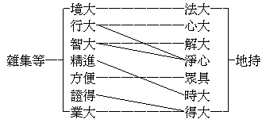



三　大乘庄严经论以八事总摄一切大乘



颂曰：『性、信、心、行、入、成、净、菩提胜，如是八种事，总摄诸大乘』。释曰：『此以八事总摄一切大乘。八事者：一、种性，如种性品说。二、信法，如信品说。三、发心，如发心品说。四、行行，如度摄品说。五、入道，如教授品说。六、成熟众生，谓初七地。七、净佛国土，谓第八不退地。八、菩提胜，谓佛地。菩提有三种，谓声闻菩提、缘觉菩提、佛菩提，佛菩提大故为胜，於此佛地示现大菩提及涅槃故』。



四　摄大乘论以十殊胜摄大乘法



一、所知依殊胜，建立阿赖耶故。二、所知相殊胜，明遍计、依他、圆成三自相故。三、入所知相殊胜，观诸法唯识故。四、彼入因果殊胜，六波罗密多行故。五、彼因果修差别殊胜，地前十地差别故。六、增上戒殊胜，饶益有情故。七、增上心殊胜，大乘光明定等故。八、增上慧殊胜，法空无分别智故。九、彼果断殊胜，无住涅槃故。十、彼果智殊胜，无上菩提故。



五　天台圆教以十法成大乘



一、观不思议境——其车高广，二、真正发菩提心——又於其上张设幰盖，三、善巧安心止观——车内安置丹枕，四、以圆三观破三惑遍——其疾如风，五、善识通塞——车外轸，六、调适无作道品——有大白牛肥壮多力等，七、以藏、通、别等事相法门助开圆理——又多仆从而侍卫之，八、知位次令不生增上慢，九、能安忍策进五品而入十信，十、离法爱策於十信令入十住乃至等妙——乘是宝乘游於四方直至道场。其以藏、通十法亦能成声闻乘等，今此是取其依法华圆教成大白牛车大乘者。



２　出今释



一　境大故



境大有二：一、真如性平等体故，二、诸法唯识宗要义故；即真俗二谛为所缘境故。此真俗二谛，亦可云唯识性相，亦可云一真法界与四法界或理事法界，亦可云诸法实相与众缘生法，亦可云法性与法相，亦可云无为与有为，亦可云离言自性与假说自性，亦可云非安立谛与安立谛，如是等众多异名皆明境大。



二　行大故



行大亦二：万行圆修成胜德故，二空妙慧为导前路故。菩萨行以福慧均等，悲智兼大，自他俱利，权实双运，由大精进遍能策发无量波罗密多行为殊胜相故。又一一行由我空法空之二空无分别慧——或智或观——以导其先路，遂皆成无得不思议行故；所谓应无所住而生布施持戒等心者是。



三　果大故



果大亦二：无住涅槃为证得故，无上菩提为究竟故。此二全同摄论所明彼果断，彼果智之二殊胜。四涅槃中独取无住，不共二乘故。又声闻、独觉犹有所知障故，非正等觉，不名无上菩提。



此三大六法中，一真如性为本，一实相印所印定故。无上菩提为极，一心专志所志求故。此二为诸大乘教之通义，异兹则非大乘教故。然宗要义，诸经有别。此经大分明如来藏藏识，故诸法唯识为宗要，亦可以诸法唯智为宗要，如来藏是智净相故。故大乘教总有三宗：一、法相唯识宗，诸法唯识为宗要故。二、法性唯慧宗，二空妙慧为宗要故。三、法界唯智宗，无上菩提为宗要故。本经遍摄三宗，尤重初后，广如宗地所明。



３　会异说



一、起信心法及大义皆境，其乘义为行果。二、杂集等七法：初为境，二至五为行，六、七为果。地持则二至六为行，初境，后果。三、庄严八法：一、二通境、行，三至七为行，八为果。四、摄论十殊胜：一、二为境，三通境、行，四至八为行。五、天台十法：初一通境、行，能观为行所观为境故；后九皆行。



４　正兼释



一　正取於行



谓诸乘皆取行为乘之当体故，行正是能运载法故。人乘者、谓三皈、五戒之行，运载行人越於三涂，生於人间。天乘者、谓上品十善及四禅、八定行，运载行人越人入天。声闻乘、缘觉乘者，谓四谛观行、十二因缘观行，运载行人越三界到有餘、无餘涅槃。大乘者，谓悲智六度万行，运载菩萨越三界二乘到无上菩提大般涅槃。故法华云：『若有众生从佛世尊闻法信受，勤修精进，求一切智、佛智、自然智、无师智、如来知见、力、无所畏，愍念安乐无量众生，利益天人度脱一切，是名大乘』。



二　兼摄境果



行所依起，故兼摄境；行所趣至，故兼摄果。瑜伽四十六云：无上大乘七行相者：一、离言说事，一切法中所有真如无分别平等性出离慧。二、此慧所依。三、此慧所缘。四、此慧伴类。五、此慧作业。六、此慧资粮。七、此慧得果。当知由此七种行相施设建立无上大乘无不周备。此中慧即法空妙慧。慧伴类、慧作业、慧资粮，即慧所导修之万行等。慧所依、或心或真如，慧所缘、则真如及一切法；此二明「慧行」所依起而及於境。慧得果、即二转依果，明「慧行」所趣至而及於果。故乘之正体，是行而兼摄境果。依此释法华大白牛车喻，则不同天台教之十法成乘说。一、大宝车，是万行圆修之胜德，亦悲智圆融之无得不思议行。其大白牛，是法空无分别妙慧——此出世间无得不思议智及根本无分别智。地前未得，故地前菩萨同索之。由根本无分别智导生不思议万行智故，如大白牛引运宝车。大白牛车所行地，是「慧所缘」义。大白牛车所由造成之材力，是「慧所依」义。游於四方直至道场，是「慧所得果」义。虽不离境果而乘正是行。决然可知，别详宗地及法华讲演录。



乙　入



宋译无「入」而魏唐译有之。依所入处之甚难，显能入行之不易；题此入字，殊有深意，今以二节明之：



１　互为能所入



佛法分为教、理、行、果，此之四法可互为能入与所入。经卷四云：『菩萨摩诃萨善於语义，知语与义不一不异，义之与语亦复如是。若义异语，则不因语而显於义，而因语见义，如灯照色。大慧！譬如有人持灯照物，知此物如是，在如是处。菩萨摩诃萨亦复如是，因语言灯，入离言说自证境界』。此明可由言「教」入於「理果」。又卷三云：『第一义者，是圣乐处，因言而入，非即是言』。此唯「果」证为所入第一义，明言「教」亦有能入功。然就亲入，依信教悟理则教为能入，理为所入。由解理起行，则理为能入，行为所入。从修行证果，则行为能入，果为所入。因证果施教，则果为能入，教为所入。自悟悟他，因果交彻，故得互论能所入也。若统亲疏及超越入，教为能入，有十二句：



　　　　　　　　┌─教  

　　　　　　　　├─理  

　　　　　　　　├─行  

　　　　　　　　├─果  

　　　　　　　　├─教理  

　　　　　　　　├─理行  

　　　　以教入─┤  

　　　　　　　　├─行果  

　　　　　　　　├─果教  

　　　　　　　　├─教理行  

　　　　　　　　├─理行果  

　　　　　　　　├─行果教  

　　　　　　　　└─果教理



理与行及果为能入，亦复如是。於佛法中论入，不逾乎此。



２　别约能入行



此经入楞伽之入义，虽於教、理、行、果亦可通为能入所入，其特殊处，则在专约「能入行」以言「入」。又分二节明之：



一、约能喻是神境通入险城：罗婆那王献华宫殿，佛及圣众乘以入摩罗耶山顶之楞伽城。摩罗山顶既最崇而最严，楞伽城中实难往而难入！盖孤悬於海滨，其为险一；乃夜叉之所据，其为险二。此天险之灵地，非具五神通之神境通者，不能入之。显难入之能入，故云入焉！此就能喻之事象如是以言者。



二、约所喻是法空慧入宝城：楞伽宝城所喻之胜宝城，则实相无相一真如性为体之无住涅槃也。具足无边无漏功德之宝，故云宝城。法华经曰宝所，涅槃经曰宝渚，皆用此宝城喻。宝城现成，非有之难而得入难。常在宝城，非进入难而「相应」难。唯照达诸法毕竟空妙慧，能如如相应於实相无相之真如涅槃城。相应曰「入」，非出入於其中曰入，此入最胜，遂标举为题也。



丙　楞伽



１　约能喻释名



楞伽乃说经处之城名也。古译不可往、不可入。又、释迦毗楞伽，译能胜宝，故楞伽亦译为「胜宝」。今按说此经处之城，就「形势」为不可往不可入之义，在南海滨——即今锡兰岛之有佛迹处——上宽下狭之摩罗耶山上，且为飞行食肉之夜叉等聚居，故为险城。就「体质」为胜宝之义，此城为天然胜妙珍宝之所成。偈云：『此妙楞伽城，种种宝严饰，墙壁非土石，罗网悉珍宝』。至今其地亦为采珍宝处，故为宝城。险、宝双具，曰楞伽焉。



２　约所喻显义



夫楞伽城依摩罗耶山而位於海滨，海有风浪，城为夜叉所居；佛从海出而入於城，现通说法，圣众围绕。有如是等重重相关之事，昔尝合明为十六义，今就险城、宝城别之，各为十义：



（一）显险城之所喻义



能喻险城就形势言，而以有漏杂染界为所喻，分为十节：



一　染藏海——阿赖耶



诸杂染法之含藏海，曰阿赖耶，为五趣、三乘之异熟心海。卷二云：『藏识海常住』，此通圣凡、染净之所依以言者。然举染藏阿赖耶海，则净识之如来藏海寄焉；举净藏之如来藏海，而染藏阿赖耶海亦寓焉。故以城山所依之海，喻根身、器界之集起心也。此心是依他起之本，为真妄性所依。圆成实之真如，於此离妄而显；遍计执之妄法，於此迷执而起，故首明之。



二　幻境风



根身、器界皆藏识变，业幻似境，如有实空。如是心起，如是境现无有少法能取少法。於此不明，即为无明，以无明故起心取境，曰无明风。以取境故，境尘扰心，曰境界风。此无明境界风，鼓荡藏海，经云『境界风所动』也。



三　转识浪



风鼓藏海，意等诸识随境界缘相续而起，如海中浪。经云：『种种诸识浪，腾跃而转生』是也。



四　我执山



七、六二识不达唯识无我，於阿赖耶见分及五蕴和合假，执为人之实我；又於根尘等法，执为法之实我。人法二我之山，乃巍然高耸於心海、境风、识浪之上，愈高愈大。所以下小上大，作不可往相。又憨山观记，传摩罗耶山但影现於风雨昏黑之夜。亦显二执之山，乃无明邪见之妄现，本空无实。夫二我本空，原无可取，而夜叉王往来其中，亦为不可往而往义。



五　三有城



我执山上有欲有、色有、无色有之三有城——三有城即无安如火宅之三界——，此山不灭，则恒住此三有城中，生死流转，无断绝时。断分别、俱生我执尽时，则离分段生死。断分别、俱生法执尽时，则离变易生死也。



六　四倒入



夜叉王等於我执山三有城中，无常计常，无乐计乐，无我计我，不净计净；乘此四倒，往来出入於本空寂不可往入之山城中也。



七　瞋恚王



夜叉众等通喻烦恼杂染之有漏法，而取瞋恚以为王者，根本之瞋与忿、恨、恼等，皆为烦恼中最麤猛故，唯欲界故，唯不善故，菩萨四他胜处之第一故，瞋恚起时暴恶之相残害之业尤炽盛故。为十根本、十小随之首恶，故喻为十首之夜叉王也。



八　烦恼众



其夜叉众，正喻根随诸烦恼法，烦扰恼害为其性故。夜叉罗刹扰害五趣、四生，犹烦恼之杂染乎三界心、行使皆成有漏心也。



九　残害业



夜叉王众合为烦恼杂染，此残害业为业杂染。以易知之夜叉众残害业，以喻三界有情之所行皆为残害业。若法华经火宅品之所明，盖无常有漏之苦界，非残害他身不能谋自身生存，故谋自身生存即为造残害业，等於夜叉，此所以无常且苦也。



十　生死苦



此生死苦，明生杂染，由残害他以自生存，以死得生，虽生必死；为求生之所逼，成必死之相迫，遂无日不在生死逼迫之苦中。夜叉如是，三界有情亦然。



（二）显宝城之所喻义



能喻宝城就体质言，而以无漏清净界为所喻，亦分十节：



一　净心藏——如来藏



诸清净法之含藏海曰如来藏，在生佛平等为真如，在有情为本有新生无漏种现，在佛果为无漏界不思议善常安乐解脱身大牟尼法身。经初言佛在「海」龙王宫中说法，又言佛从「海」出，此海即喻净心藏之如来藏海。



二　佛法兴



佛悲愿故，又有情之机感故，佛从海出，即佛兴世。佛言：我今亦当为罗婆那王开示自所得圣智证法，即法兴世。



三　悟本心



罗婆那王闻佛言音——圣教为增上缘——，遥知如来从龙宫出——龙宫喻佛法性身自受用身土，即如来藏海之正体；从龙宫出，即起他受用及应化身土——，梵、释、护世、天龙围绕，见海波浪，观其众会，藏识大海、境界风动、转识浪起，此即悟圣凡共依之藏海本心，即藏识即如来藏也。



四　真如山



由悟本心，则转我执山为二空所显无相真如性山。故憨山观记传：摩罗耶山，当晴明时，海湛空澄，即无踪影。偈云：『过去无量佛，咸升实山顶，世尊亦应尔，往彼宝严山』！



五　涅槃城



由二空智择灭二障二死皆尽，即依真如说为究竟安乐之大涅槃，具足无边无为无漏胜功德宝，故即喻以除垢山上之胜宝城，譬晴空湛海中唯光明充满也。偈云：『此妙楞伽城，种种宝严饰，墙壁非土石，罗网悉珍宝』。



六　法空入



无相真如之除垢山，圆明妙寂之涅槃城，孰能如如相应契入？曰：唯法空般若。经云：『时罗婆那即以所乘妙华宫殿奉施於佛——修法空慧回因行向佛果——，佛坐其上，王及菩萨前后导从——同乘法空慧也——，无量彩女歌咏赞叹供养於佛——依法空慧具修万行，皆回因行向佛果也——，往诣彼城』，是乘法空慧入涅槃城义。



七　妙定通



如来入楞伽已，楞伽法会中之罗婆那王及夜叉众，即喻无漏禅定神通。故夜叉等兴诸供养，佛为现诸神通变化，广如华严十定、十通品明，即如来觉海中之大定也。



八　大慧辩



大慧及一切摩帝菩萨众，在除垢胜宝法会中，当喻无漏智慧辩才。故大慧兴种种问难，如十力、十智、四无畏、四无碍解等，即如来觉海中之大智也。



九　法界身



此除垢山胜宝城中之牟尼佛，即喻湛明空海之法界身。盖染藏海已转为净藏海，乃大圆无垢之如来藏觉海也。



十　愿方便



如来随行大比丘及梵释等众，则喻佛之大悲愿风——幻境无明之风转成——，方便法浪——识浪转成——，为如来觉海中之大悲愿方便。融三世间以为佛身，故佛入楞伽则楞伽法会皆成佛之自证心境。



丁　经



梵音为修多罗、修妒路、素怛缆，直译喻线，或喻结鬘，取贯穿诸法摄持群机义。然举经以简非律、论，则限佛说或佛印可，有十方三世可常遵为法之义，适当华士经字。复因契真理时机故，译云契经。名通诸经，而在此即一部七卷十品之宏文也。



二　合释



依六合释之式，今为九重合释於左：



一、大乘若指能诠教，则唯声名文句故劣；入楞伽通教理行果故胜。将胜依劣，大乘之入楞伽，是依士释。二、专约能入行以言入，故劣；楞伽通於教理行果，故胜。就劣显胜，入於楞伽，亦依士释。三、互为能所入，则入通教理行果故胜，楞伽城名但所入处则劣。依胜彰劣，入於楞伽，则依主释。四、入楞伽通教理行果故胜，经但能诠之教故劣；依胜彰劣，曰入楞伽之经，亦依主释。五、大乘通於教理行果，故胜；经但声名文句之能诠教，故劣。依胜彰劣，大乘之经，亦依士释。六、直指教体曰经，教体上有能入胜宝义用曰入楞伽；由用彰体，曰入楞伽即经，是持业释。七、经是教体，教体上有简小运载之义用曰大乘；由用彰体，大乘即经，亦持业释。八、或大乘为教体，教体上有契理契机贯穿摄持之用；由体持用，曰大乘经，亦持业释。九、大乘入楞伽是所诠，通境行果故胜；经是能诠，但名句文故劣。依胜彰劣，曰大乘入楞伽之经，乃依主释。



------



## (见海刊七卷二



楞伽大旨



——在上海世界佛教居士林讲——



所言入楞伽经者，斯乃诸佛心量之玄枢，群经理窟之妙键。广喻幽旨明深义，不生不灭，非有非无，绝去来之二途，离断常之双执。以第一义谛，得最上妙珍，体诸法之皆虚，知前境之如幻，混假名之分别，等生死与涅槃。大慧之问初陈，法王之旨斯发；一百八义，应实相而离世间；三十九门，破邪见而宣正法。晓名相之并假，祛忘想之迷衿；依正智以会真如，悟缘起而归妙理。境风既息，识浪方澄，三自性皆空，二无我俱泯，入如来之藏，游解脱之门。——节录唐译大乘入楞伽经序



楞伽经名，凡有四译，今存其三。一、楞伽阿跋多罗宝经四卷，刘宋求那跋多罗译。二、入楞伽经十卷，元魏菩提流支译。三、大乘入楞伽经七卷，唐实叉难陀与复礼等译。译意虽各异，楞伽名则一。梵语楞伽，译不可往或不可入，乃南印度钖兰岛中一山名。山上大而下瞰海，故不可往、不可入。亦云城名，以山顶有夜叉王城故。昔释尊于此说法，因地得名，故经题楞伽。今以因明论式，发明经义：



诸法皆幻。(宗)



以唯心现故，随各类见不见故。(因)



如人见恒河，鬼见猛火。(喻)



所谓因明论者，略似西洋论理学，源唯佛说，文广义散，备在众经。后有陈那菩萨，及其门人商羯罗主，覃思精揅，俱有制作，立破之则，乃确然立。论有三支法，曰宗、因、喻。宗以建旨，故应在先。



本经——楞伽经——立「诸法皆幻」为宗。然幻非不有，以有幻相故。虽有而非实，非实故不可执为有，有幻故不可执为空。非空、非有、非实，是为幻义。诸法、为一极普通名词，凡所有一切均该括之。诸法皆幻，即一切皆幻。易言以明，即有漏无漏、有为无为之法皆幻。以是义故，立诸法皆幻为宗。



既立宗已，须明理由。故嗣说「唯心现故，随各类见不见故」为因。云何唯心现？谓一切有漏无漏、有为无为法，皆不离此主观——心——而现。亦可说言：离心即无能单独存在之物，故虽有而非实。如梦时见山河大地等，觉后即失。唯心之义，亦复如是。复次、随各类见不见者，就通俗知识言：如同为天空，天文家能了别其间种种动静，餘则茫然。又庄子所说以美味供鸟，鸟见且厌，义亦正同。以是可知种类不同、心量不同，而所见亦不同。更依佛法言：三界、五趣众生，业力不同故果报不同，果报不同故六根不同，六根不同故识用不同，识用不同故所见不同，所见不同故诸法皆幻。唯心现故之义，安立无疑。



宗、因明已，且再释喻。「如人见恒河，鬼见猛火」，此喻本经所举。恒河、印度河名，人见如河，鬼见如猛火。以人、鬼心量各不同故。离心量则无河、无火，亦无他物。以故人、鬼所见均不能立。又如一石，若照以显微镜，则其质为稀疏而非坚密；此亦随心量见不见不同故。复次、心亦非固定之实体，乃流行活泼之幻化功能；以是故能缘心、所缘法皆幻。如是成立诸法皆幻义竟。



诸法实相非幻。(宗)



离心意识故。(因)



如圣智证第一义。(喻)



有难者曰：诸法实相非是幻，以离主观体相——心意识——故。所谓主观体相者，即是幻因。幻因既无，云何是幻？如佛、菩萨、罗汉、辟支佛等所证，皆各有其清净境界。离言说文字思量分别一切诸相，乃圣智所亲证。如人饮水，冷煖自知。如是境界，应非是幻，圣智证第一义非幻故，诸法实相亦非幻。



圣智证第一义亦是幻。(宗)



圣证凡不证故。(因)



如人见恒河鬼不见。(喻)



此难不然。所以者何？以圣智所证第一义，须圣智始能证得。如佛、菩萨、罗汉、辟支佛皆有其圣智，而凡夫则不能证也。故仍随圣凡类心量而见不见，以是圣智证第一义亦唯心现。唯心现故亦是幻；如人心量见为恒河、而鬼心量不能见。



诸法实相亦是幻。(宗)



离三界心意识之佛智所知故。(因)



如圣智证第一义。(喻)



云何诸法实相亦是幻？以所谓离心意识者非断灭故。若断灭者，则无诸法实相。是知离心意识者，乃离三界有漏心意识；扩大而言，即离九法界心意识。实相者，谓如实了知离心意识之真实境，亦即如是了知诸法实相。法华经云：『诸法实相，惟佛与佛乃能究尽』。又云：诸佛出世一大事因缘，唯令众生开示悟入佛之知见。所谓入佛知见，即是了知诸法实相。诸法实相皆唯佛心所现，故应是幻。



复次、有我执法，即不能了知诸法实相皆幻。以执我故有烦恼障，执法故有所知障，二障既生，愚痴无知造诸有漏业，遂堕生死海。又罗汉、菩萨等亦有微细法执，如执涅槃、真如为实。故知诸法实相，唯佛智能知，离九法界心意识；此亦随佛与九界各类心量而见不见，故亦唯心现。唯心现故皆幻，圣智证既幻，无为法亦幻。总言之，诸法皆幻，唯心所现，而心亦是幻！故成唯识曰：『若执唯识真实有者，如执外境，亦是法执』。如是通达诸法实相皆幻义，由解而行，精进不懈，即得涅槃、证大菩提。



以上所谈楞伽义，仅其大旨。诸有智者，应更深究。



（王锡光、孙志钧仝记）(见世界佛教居士林林刊第十一期)



大佛顶首楞严经摄论



——民国三、四年在普陀作——



一　判摄本经文义分甲一　经序分  

甲二　经宗分乙一　顿问顿答悬示始终全义  

乙二　委说委示等流智悲二教丙一　悟证如来性觉  

丙二　保绥菩萨心行



乙三　重请重告结归理事唯心



甲三　经益分



二　会较餘部文义分甲　会较四经  

乙　会较四论



三　别明当部要意分甲　本经始终唯令了达如来藏圆理  

乙　本经始终唯令修证如来禅妙宗  

丙　本经始终唯令顿究众生心二本  

丁　本经始终唯令直成首楞严三昧  

戊　本经始终唯令选入耳根圆通门  

己　本经始终唯令得就佛乘方便行  

庚　本经始终唯令持心戒永断婬爱业  

辛　本经始终唯令持顶咒永脱魔邪障  

壬　本经始终唯令确立因果常住信  

癸　本经始终唯令必入解行相应地



四　散释艰文涩义分甲　经名  

乙　经时  

丙　流变三叠  

丁　绾结解结



顶礼如来藏，满分正觉者，  

愿仗加持力，摄显深经义，  

回施诸有情，共入遍知海！



问曰：本经自度震旦，说之者已无虑百师，今造摄论意何所为？且了义教有多经论，曷不择之大藏，开所未开，乃独取义已大明之本经，增枝叶之辞乎？答曰：略有六意造此摄论：尝攷诸师说本经者，多列文逐句以疏解（诸解皆是），或断章取义以发明（若中峰或问、云栖摸象等），今欲用悬判简要之辞，摄全经周圆之义，令但闻略说者总持无遗，一也。诸师多依此经以彰自宗（若贤首宗、天台宗等），或排餘说以局当部（若正脉等），今欲提教网张弛之纲，显法门开合之巧，令遍究大藏者通达无壅，二也。本经有多当部要意，诸师泛露一斑，览者难窥全豹，今咸各别提清，令应从本经部门入道者得专修习，三也。本经有多艰文涩义，诸师悬解多歧，览者终泣亡羊，今略疏通抉择，令凡从本经文相怀疑者悉臻明了，四也。本经於震旦人根有深因缘，未至而天台殷勤拜求，已度则历代广共宏扬，随缘利导，信解易成，说之不厌重烦，五也。本经於震旦佛法，得大通量（吾别有论，尝谓震旦佛法，纯一佛乘，历代宏建，不出八宗：曰少林、曰庐山、曰南山、曰开元、曰天台、曰清凉、曰慈恩、曰嘉祥，约其行相别之，则禅、净、律、密、教是也。然一部中兼该禅、净、律、密教五，而又各各专重，各各圆极，观之诸流通部既未概见，寻之一大藏教盖亦希有；故唯本经最得通量。虽谓震旦所宏宗教，皆信解本经、证入本经者可也），未尝有一宗取为主经，未尝有一宗贬为权教，应量发明平等普入，观之不妨互异，六也。



已明造论因由，次说立论分齐。论有四分：一、判摄本经文义分，二、会较餘部文义分，三、别明当部要意分，四、散释艰文涩义分。



一　判摄本经文义分



云何判摄本经文义？说契经者，皆判三分：曰甲一、经序分，曰甲二、经宗分，曰甲三、经益分。经序、经益，悉照常途。今但取经宗分论之，从初卷阿难见佛顶礼悲泣、至十卷知有涅槃不恋三界是也。若略能诠层次，纯约所诠分齐，则可平分五品：一者、破妄惑开圆悟而顿获真菩提心；二者、违现业趣实证而专修佛三摩提；三者、转异熟成法身而直诣妙庄严海；四者、示七趣妄报扶律令远离业苦；五者、辩五阴妄境扶禅令净除惑业。经宗全义，亦已摄尽。或但为二：一者、理悟顿成（至圆通门章尽是也）；二者、事修渐证。或复作四：一者、证悟（前三卷是）；二者、悟修（四卷初起尽圆通章）；三者、修证（菩提路章）；四者证成。又分为三：一者、法性身真净因（至四卷方悟神珠非从外得是）；二者、受用身智断因（至八卷能除六品微细烦恼是）；三者、变化身慈悲因（尽经宗分）。又分为三：一者、真性菩提；二者、实智菩提；三者、方便菩提（分齐同上）。又分为三：一者、实相般若（至四卷心悟实相得未曾有是）；二者、观照般若（尽圆通章）；三者、文字般若（尽经宗分）。然未明文相生起之序，义门关属之脉，虽依此亦可见本经大意，欲令文义全畅，则应先剖经宗为三。



乙一、顿问顿答，悬示始终全义（从阿难见佛顶礼悲泣、至中间永无诸委曲相是也）。



丙一、曷为问中顿问一经全义？此有舍、取二门。舍门又二：一、恨徒闻无功，不能脱自业障：盖未深悟实相，亲见本心，纵使说空说有、说事说理、说圣说凡、说因说果决定明了，远离错谬；然而用生灭心辩净圆觉，彼净圆觉亦同轮转。故虽缘听佛音，忆持佛言，亦复不得真如法性，但益虚妄想相；譬蛇吞草，唯成毒汁。初卷文曰：『所以多闻未得无漏』。又曰：『如汝今者承听我法，此则因声而有分别』。又曰：『是故汝今虽得多闻，不成圣果』。又曰：『今日乃知虽有多闻，若不修行，与不闻等』。二卷文曰：『汝等尚以缘心听法，此法亦缘，非得法性』。又曰：『汝虽强记，但益多闻，如说药人，真药现前不能分别』。四卷文曰：『虽复忆持十方如来十二部经清净妙理，如恒河沙，祇益戏论，汝虽谈说因缘、自然决定明了，人间称汝多闻第一，以此积劫多闻熏习，不能免离摩登伽难』。又曰：『汝虽历劫忆持如来秘密妙严，不如一日修无漏业』。六卷偈曰：『汝闻微尘佛，一切秘密门，欲漏不先除，畜闻成过误。将闻持佛佛，何不自闻闻！闻非自然生，因声有名字，旋闻与声脱，能脱欲谁名』。七卷文曰：『求多闻故，未证无为』。又曰：『我辈愚钝，好为多闻』。咸是贯彻此之一恨。是故心无退志，或承过，或愿修，佛得施教。或责过，或劝修，诃离教解，趣进修证，无尚兹矣。多闻既然，应知多智、多辨、多识等亦如是。故此章中阿难虽瞻如来胜相发心，亦成颠倒想相。然非使之塞耳抉目，贵令见性趋修而已。在已得随顺触证法性者，闻而无闻，无闻而闻，闻闻圆离，闻闻全彰。而闻即思修，思修增闻者，亦必能渐由随顺而得触证乎法性。至夫起凡情之信，广寡学之心，一历闻根，皆成佛种，听法功德，宁可思议！不得此意，一向无闻，虽勤修暗证，犹堕无闻比丘。与世尊之大哀，若虚度空过，永成无性阐提，沦长夜又奚疑！且十卷结文曰：『阿难闻佛示诲，忆持无失』。与前所诃闻持秘严，亦何别哉？故知贵乎契法性耳。又阿难选旋闻圆通，亦凭其积生多闻之力胜，故旋闻之功用亦胜；从闻思修，契入法性，则净极光通达，寂照含虚空，摩登伽在梦，谁能留汝形哉！闻之一字，诚本经之大关键已。



二、厌小乘无力，不能救人魔难：如来说咒，文殊往捄，而阿难平昔同住诸小圣，曾不觉知（唯佛常知恒沙界外，一滴之雨亦明头数。诸小乘圣虽得六通，要须入定观察乃有所知，且其所知亦属有限），况能施拯？又阿难侍佛修小乘多年，欲漏依然未断，则小乘果亦非易成。与其修难成而无力之乘，曷若回心勤求乎无上菩提哉！此其所以厌小乘也。逮三卷末，阿难一悟真菩提心，便能发愿普度众生。又曰：『自未得度先愿度人』。乃至曰：『汝等必须将如来语传示末法，开悟斯义，无令天魔得其方便，保绥覆护，成无上道』等；皆以反显才入大乘，便得救人之力用也。二卷文曰：『汝等声闻狭劣无识』。三卷文曰：『汝先厌离声闻、缘觉诸小乘法』。四卷文曰：『我等会中登无漏者，虽尽诸漏，尚纡疑悔』。又曰：『令汝会中定性声闻及诸一切回向上乘阿罗汉等，皆获一乘寂灭场地』。又曰：『汝才举心，尘劳先起。由不勤求无上觉道，爱念小乘，得少为足』。又曰：示我会中诸蒙暗者，捐舍小乘』。又曰：『哀悯会中缘觉、声闻』。乃至十卷文曰：『声闻、缘觉，不成增进』。咸是照应此之一厌者也。



取门亦二：一、求大果菩提：此与厌小乘相翻也。三卷偈曰：『愿今得果成宝王，还度如是恒沙众，令我早登无上觉，於十方界坐道场』！即是确立此一求也。二卷文曰：『休得疲怠妙菩提路』。三卷文曰：『由汝发心勤求无上菩提，故今为汝开示第一义谛』。四卷文曰：『菩提涅槃尚在遥远』。又曰：『汝等决定发菩提心』。又曰：『汝等必欲发菩提心』。乃至九卷文曰：『汝等有学缘觉、声闻，今日回心趣大菩提无上妙觉』。皆是提醒此一求也。



二、恳初修方便：此与恨徒闻相翻也。经中阿难屡请如来广示，文相甚著，不繁引。约而言之，初则未悟本菩提心令悟本菩提心，悟则不谬正因。次则未修真圆通门令修真圆通门，修则不滞本悟。次则未识妙庄严路令识妙庄严路，识则不生上慢。次则令知七趣生报，知则不昧因果，而谨洁正戒。次则令觉五阴魔境，觉则不落邪歧而速入圆明。至三卷终，是令阿难得菩提心。从四卷起，是令阿难入遍知海。云入遍知海者，令至成佛，得究竟无疑惑地；所谓初心菩萨，能尽知诸佛秘密藏也。复次菩提心者，涅槃妙心也；遍知海者，正法眼藏也。故阿难曰：『我今已悟成佛法门，是中修行，得无疑惑』。又曰：『顿悟禅那，修进圣位』。此所以本经一名救护亲因度脱阿难、及此会中性比丘尼得菩提心入遍知海也。阿难实犹未涉修证，同夫华严会上善财童子参遍善知识，普入佛法门；而普贤方且导归乎极乐，亦同宗门悟了还如未悟，故本经确是大心凡夫直趋佛果之乘也。对於无上菩提正修行路，刚成个最初方便耳。



丙二、曷为答中顿答一经全义，复有标、酬二门。标、谓标阿难所未知，此又有二：一者、众生无始妄想轮转，生死相续：初卷所破「想相」，二卷所指「妄见」，三卷所斥「识心分别计度」，四卷所除「细惑妄想戏论」，中间重重拣择，乃至十卷「五阴妄想」，终乎「汝应将此妄想根元，心得开通，传示末法诸修行者，令识虚妄，深厌自生」，皆是依据此之一标者已。二者、众生本有常住真心，性净明体，初卷所示「妙净明心」，二卷所显「妙真如性」，三卷阿难所获「本妙常心」，四卷如来所发「妙觉明性」，中间重重发明，乃至十卷圆满菩提归无所得，终乎知有涅槃，皆是开阐此之一标者也。



酬、谓酬阿难所今请，此亦有二：一者、酬其愿求无上菩提：故令见华屋，选妙门，知圣位，信业报，识魔事，以护持此志不退也。二者、酬其欲恳最初方便：故首提出「应当直心」。直心者，正念真如也，专修圆通也，决趋果海也，严持净戒也，永越邪歧也。故维摩诘曰：『直心是道场』。而此章曰：『十方如来同一道故出离生死，皆以直心，心言直故，如是乃至终始地位中间永无诸委曲相』。更重明之：心，该六根及如来藏。言，该三业及陀罗尼。言直故心直，心直故言直。言是心之妙境，心是言之妙智，心是言之妙体，言是心之妙用。若论明悟，阿难心言直故，有计必陈，故得无计不摧，获菩提心，有疑必諮，故得无疑不决，入遍知海。若论修证，观音心言直故，一旋亡所，故得全超法界，合佛妙觉；一门圆照，故得顿发神用，满众生愿。此所谓十方婆伽梵，一乘修行路也。七趣生类，皆是心言曲故，妄造情想诸业，妄招升沉诸苦；五阴魔类，皆以心言曲故，妄取不实之境，妄坠无间之狱。此所谓三界性颠倒，一切委曲相也。全经结归不恋三界，起讫相应，有旨矣哉！



此章取舍标酬四门，门门各二，则成八义，义义莫不一贯本经全旨。要闻略说而得入者，但观乎此，便可总持本经无遗旨矣。



此章八义，皆贯全经之意，惟恳切初修方便一义，交师正脉，颇多发明。然谓奢摩他、三摩、禅那之三名，是约性定（即指首楞严三昧者）三时而立：谓初教悟三如来藏，闻解本具性定，曰奢摩他；中间教入三如来藏，入此性定，则曰三摩：最后教住持修证三如来藏及性定，则曰禅那。故用之判正说经为三分，以谓可明如来鉴机，答在问处，问答相应，独合本经宗趣，科符释义，科释相应。尔则奢摩他等三名，非定（定是首楞严故，是此三所解、所入、所住持修证者故）非心（心是如来藏故，是此三所悟、所入、所住持修证者故），但应译之为解、为入、为住持修证；岂华梵曾有此译义耶？无则应照教中常义：奢摩他译曰止，乃增上定心之因相；三摩（亦曰三昧、三摩地、三摩提）译曰等持，亦译曰定，亦译正定、正受，乃增上定心之自相；禅那译曰静虑，亦译曰思惟修，乃增上定心之果相。局其名义分齐言之，正唯一增上定心耳。毗钵舍那（亦曰毗婆舍那）译观，乃增上慧心之因相；般若译曰智慧，乃增上慧心之自相；菩提译曰圣觉，乃增上慧心之果相。局其名义分齐言之，正唯一增上慧心耳。然真正定慧心，必是相成共转：定是慧因，慧由定发，慧是定果，定依慧住：因果同时，非异时也。必是全体圆具：佛三摩地，平等寂持一切德相（理具三千、事造三千），法尔平等明现一切德相；佛三般若，平等照现一切德相，法尔平等任持一切德相：寂照同时，非异时也。格量其义，微析其相，奢摩它、定增，三摩提、慧增（是故亦曰三摩钵提，三摩钵提者即假想观也），禅那、定慧平等；毗钵舍那、慧增，般若、定增，菩提、定慧平等。定慧约体性，止观约力用；止观约工夫，定慧约成就。会其有极，归其有极，止观、定慧、平等平等，故首楞严三昧为大陀罗尼也。然则以此三名，强指为解、入、住三义，以配悟、修、证之三时，得非科之名与释之义两不相应乎？



又交师於经中『妙奢摩它、微密观照』二句，亦既认为止观，则以此三割截配为三时，岂首楞严三昧初时唯止，次时唯观，后时唯禅那耶？纵云后后必兼前前，譬夫修时必非无悟，证时非失悟修；然教悟时未是教修时，岂非交师确立之自义，且用以斥餘师悟时、修时不辨者乎？则所判为说奢摩它科者，正所谓教悟之时也。悟唯是止，修方是观，何於此科经文已有微密观照之句，自亦确认是观耶？若三名科三时是，则经文非、而自认为观者亦非，违经兼违自语，尚得谓之相应也哉？如来鉴机说法，非必随人语路，方为机教相扣；盖众生不自知心行根性，每有问非所宜。譬有夙生曾习不净观者，顺而修之，即可得道，却来问佛欲修数息法门；佛鉴其宜，不告以数息观，但教之观不净可也。何必答在问处，方为相应？若必答在问处，则佛答中应即标曰：汝问奢摩它者云云。至四卷中又应标曰：汝前问三摩者云云。至七卷中又应标曰：汝前问禅那者云云。至结经名，应曰：是经名为答阿难奢摩它、三摩、禅那问经。何经文都不如是？而阿难本非问出家应如何发心，佛乃先徵其出家发心相；阿难本非问真妄心，佛乃先标众生心真妄二本耶？岂佛不明阿难问语，乃问东答西耶？吾谓阿难本不知问，不知欲成如来、菩萨先须悟得本菩提心！但因遭难蒙救，悔慕心切，欲急得一修行佛乘下手工夫，误在知修不知性，意谓佛可急修而成也。如来正鉴其误，故徵发心及标真妄二本，复教应当直心。若阿难此处自察出家所发心为真为妄、顿悟真心，直心正念真如，则即赞大慈悲发弘誓愿可也。同十方佛一道超出，始永离诸终委曲相，虽本经从此止可也。阿难岂知如来有三卷强奢摩它，三卷强三摩，一卷弱禅那，待其问而说，故次等问此三名乎？如来岂如后代人师，先成腹稿，一有人问，不多不少，一一搬演出乎？



盖佛说法，略有四别：一、无问自说者，二、瑞加他说者，三、现瑞待问说者者，四、随宜开示而说者。前之三种，乃普为三世有大因缘者，顺过去佛常仪，或有所说先定分齐；后之一种，则一问一答，或与或夺，要是应病施药耳。本经法门虽甚殊胜，除心咒及五阴魔境，应有成分（五阴魔境，佛言「是先世佛法门」），六十圣位虽因问起，所说亦是定仪（佛言：「作是观者明为正观，若他观者名为邪观」）；餘则皆随宜开示者。此与菩萨造论，首先列义标门（宗门若洞上古辙等，仪亦同论，摩诃止观亦是论式），原自不同。岂可不观经义，谓经前必立有所说义分齐名，可用科配经文？适遇问起宛有三名，经义宛有三分，遂谓三分之义必是答所问三名哉！



又、本经之首楞严王三昧，同否天台圆顿止观？此之三名同否三止三观？三如来藏同否三谛？亦说本经诸师一大诤也。今谓：本经文理圆足，原不必假餘部为说；然会通之令愈显明，既可以华严之五法界、十玄门，起信之三细、六麤等疏释本经，则本经何独不可融天台之止观哉！贵不偏就餘部而反乖本经耳。其用奢摩它等三名，专配三观或配三止，固属非是。吾谓若就阿难问意，虽求大乘，未明偏圆，其旨未能遽定。若就如来之所说义，本经固唯圆顿。则奢摩它者，一心三止也。三摩者，一心三观也。禅那者，一心平等，止观不二也。如来藏心三义者，一不可思议境三谛也。大佛顶首楞严王三昧者，境智、性修不二，总名曰圆顿止观也。



交师知首楞严为性三昧，不知圆顿止观亦是性止观也，故曰『法性寂然名止，寂而常照名观』。交师知首楞严三昧，有由解而悟、由修而入、由证而住之三时，不知圆顿止观亦有此三时（三时略同六即）也。



交师指天台止观与本经三摩提不同者，约有五意：一、谓天台止观，必以三止、三观、三谛敌体相对，不纵不横方为圆顿；又必止观双运，不许单取。本经则唯约三如来藏显圆融，不从敌对三止三观以论圆妙。且初时唯以止悟，次时唯以观入，后时方以禅那而住持修证。若依天台，本经止观，乃成纵横及与单取，故不可引彼同此也。今谓：交师用三名配三时之义，本不成立；若成立者，先无以解经中「於奢摩它微密观照」并列之文。故本经原未尝一时单止、一时单观，谓一时单止、一时单观者，特交师私意耳。盖由不知谛、观、止三，皆由说时言不顿彰，故以不纵横并别等融之；非亲悟亲证时尚带分空、分假、分中等名言也。即如本经显如来藏，说时先非、次即、后乃双离双即非即，岂亲悟亲证时亦同名言次第施设，及渐起三种分别耶？复不知若就言说以分别，悟时亦可说有三止、三观、三谛。藏心、即谛理也，止观、即悟解也。如来藏许有三，止观亦可有三，所谓正中即有偏也。何则？唯一如来藏心，本空、本不空、本空不空；唯一妙奢摩它，契空、契不空、契空不空；唯一微密观照，照空、照不空、照空不空故也。又复应知：当现量真悟时，必焉洞朗湛寂；约义言之，即是止观双运。何则？洞朗即观，湛寂即止故也。此经中所以曰：於奢摩它微密观照者也。二、谓天台止观，大师亲列三止三观之名，次第详说。本经若是说天台止观者，如来亦应分列三止三观，次第详说。而经文绝无空观、体真止等名，故决不同。此由未知大师说自法门，先标后说，与如来鉴机开示者，说仪不同故也。且信如交师言，则本经原无三如来藏名（三如来藏名，忆宝积经有之），交师亦何得引立三如来藏乎？三、谓天台止观，泛观万法；本经专修耳门圆通。彼泛此专，实大不同。不知天台止观，解成起行，亦复先简佛、众生法；次就本人之阴、处、界更简处、界，次就五阴，更简前之四阴，次就识阴更简前五、后二，唯取意识现前介尔阴心为正观境，专之又专，尚得谓之泛乎？四、谓天台止观，修时必用觉观思惟；本经修圆通时，惟一反闻，单刀直入。不知天台正修观时，亦复行起解忘，即一念是能观所观之不思议境智，不更存所解不思议境之名言（忆十不二门指要钞详解，亦有此说），何有觉观（觉观即是寻伺分别名言令心忽遽者也）？犹之闻即如来藏心，正反闻时，不复更存从法音所解如来藏义。若带名言，则存反闻二字，亦已杂觉观矣。约义言之，虽一反闻必具两重能所：一、能反智（即前开悟藏心之智，乃转意识始起妙观察智，亦名为始觉智），二、所反闻（即是取修圆通专境）。复以上二为能显行；从动静二相了然不生，至忽然超越世出世间，获二殊胜、四不思议为所显德。德、即如来藏性德也。若非能反之智，闻必放逸奔声，何能入流忘所？所谓思修，所谓缘心自在，皆能反智也。所谓闻熏闻修，则能显行也。岂一选耳门，即灰心泯智者哉？五、谓天台止观所建三谛，从识立解，犹夫父母畫像；本经三如来藏，从根指出，则如父母亲身，故不相同。夫以如来色心胜妙，梵音、瑞光，身界融彻，竖拳、击钟，现成指点，诚与后代讲说有异；然在行人，若未正解亲悟，承听佛从见闻觉知指出真性，即取现前昭昭灵灵一段光象执为真性，则亦终成虚妄想相而已！故阿难虽已悟『头自动摇，见无所动，手自开合，见无舒卷』；后复兴『若此见精必我妙性，今此妙性现在我前，见必我真，我今身心复是何物』之问也。逮得从闻正解无相实相，方成维妙维肖之父母畫像；然犹未是亲悟也；必得现量亲悟，乃真见父母亲身耳。天台大师论开圆解，亦有两重：一者、闻解，尚属名言影像。二者、观解，始通法性真流。其观解亦从专观识阴开，开后发真正菩提心，乃任运趣入观行位（阿难所诣当亦齐此）。要之、法本无差，迷悟疏亲在人。闻解未正，虽闻圆经亦落倒想；若执倒想所取为真如，执牛羊畫像为父母畫像耳。及闻圆经，正解圆开，乃识真正父母畫像；现量亲悟，始见父母亲身。三圆融谛既然，三如来藏亦然。后代讲天台者，固影像之正解亦少真得。然智者大师南岳现证、大苏妙悟，自称是观行位人，岂亦未亲悟也？既亲悟则宁得谓三谛但是想像乎？故此五意皆不成其为不同也。



然有一义不同，交师独若未知。不同者何？本经选闻根为修圆通之要境；天台以意识为修止观之要境。此所重者耳根圆通，彼所重者意识圆通是也。为尊本经所重圆通，令闻者於闻时专心一门，即於闻时从闻思修得入流相，缘心自在；则虽以文殊简去意识圆通者，简去天台止观可也。交师末言天台止观，非不合於圆顿教旨，但不合於楞严修门，庶乎侻矣。此皆贯摄经宗之义，且因此章奢摩它等三名而起，故略以寄辨焉。



乙二、委说委示，等流智悲二教（从阿难我今问汝当汝发心、至十卷最后垂范是也）。夫佛声教，皆是法界清净等流，要之不出智悲。智教念念回向诸佛，趣求菩提；悲教念念回向众生，哀救沦坠。说戒、宣咒，阿难虽曰发心度人，仍是进修要法。七趣因邪见毁律发，五魔因无闻暗证招，纯为遮除修行人见病、禅病者。见病、禅病，非修行人所必有者；若无见病、禅病，中间永离诸委曲相，固无须乎此也。而修行人每不免乎见病、禅病，阿难既所深闵，如来尤为大哀！故此唯是垂拯之法。然则结经名前为智教，结经名后为悲教，明矣。此又分二：



丙一、悟证如来性觉（从阿难我今问汝、至结成经名是也）：如来性觉，即是如来藏心。亦复性即涅槃，觉即菩提。显是唯一佛乘，故以如来标之。凡夫初悟曰悟，世尊极证曰证。又复凡夫创始悟证，世尊究竟悟证。又复世尊究竟悟证，凡夫本具性觉；凡夫创始悟证，世尊圆成性觉。又复世尊创始悟证，大圆无垢，从来末曾发故；凡夫究竟悟证，本妙真明，从来未曾失故。故科曰悟证如来性觉也。此又分二：



丁一、即三道成三德（从阿难我今问汝、至示菩提路章尽是也）：即惑（亦即无明妄想，性唯遍计，然亦依他所起）、业（亦即生死流转、烦恼缠缚，性唯依他，然亦遍计所执）、苦（亦即异熟报障，亦即异生，亦即十二类生。具言之，则九法界众生也。性唯由遍计执，不了依他起故，执为我法）三道，成般若（亦即法性真如，此由了达遍计名理本空故，即圆成实性）、解脱（亦即涅槃菩提，此由深观依他幻事无性故，入圆成实性）、法身（亦即佛菩萨界身土，亦即清净法界、四智菩提，盖般若、解脱三乘有共不共，法身唯大乘不共。诸佛菩萨身皆非苦，二乘无学身亦唯苦。所以约共解脱，二乘无学许齐顿悟直往菩萨七地。约法身德，二乘无学回心，尚滞菩萨信位。此由远离遍计执从依他起上所执我法故，证圆成实性）之三德，故曰即三道成三德。云何惑即般若？即、有二义：一、同体义，同是慧故，如河流东决西唯是一水。二、顿同义，悟即是故，如人惑南为北，但须一指。此中一向无修无证，六十圣位、第一渐次、究竟妙觉、亦所不立。所谓『真如界内绝生佛之假名，平等慧中，无自他之形相』者也。非顿非渐、强说曰顿，无迷无悟、强说曰悟。经云：『皆是识心分别计度，本如来藏妙真如性』。所谓『但离分别，即如如佛』。偈云：『真性有为空，缘生故、如幻；无为无起灭，不实、如空华。言妄显诸真，妄真同二妄，犹非真非真，云何见所见？中间无实性，是故若交芦。结解同所因，圣凡无二路。汝观交中性，空有二俱非，迷晦即无明，发明便解脱』。是颂此也。云何业即解脱？唯约同体义以论即，如烧木成灰，非不烧成故，非离木外别有灰故。正约此中立三渐次，亦复乘此直超一切圣位。依前门故，非顿非渐，约自门故，亦渐亦顿。偈云：『解结因次第，六解一亦亡。根选择圆通，入流成正觉』，是颂此也。云何苦即法身？唯约本具义以论即，如矿中金非离矿有，非不锻炼得成精金，非不镕铸得成严具，非精金外别无矿质。依前门故，非顿非渐，亦渐亦顿；约自门本有义，故唯顿悟。所谓『知见立知即无明本，知见无见斯即涅槃，无漏真净』。约自门锻铸义，故唯渐证。正约此中以立五十五位真菩提路，通则全该本因极果。偈云：『陀那微细识，习气成瀑流、真非真恐迷，我常不开演。自心取自心，非幻成幻法。不取无非幻，非幻尚不生，幻法云何立？是名妙莲华，金刚王宝觉』。是颂此也。慈恩多约第三门以施设言教（南山大同慈恩），餘非不具，然但兼说。嘉祥（即三论宗）多约第一门说，虽不离餘，亦但带明。清凉（即华严宗）多约第一门及第三顿门设教（开元密宗大同华严），餘亦但兼及耳。天台普约三门设教（庐山大同天台），颇无偏重，故於教道为最圆也。禅宗亲切为人，祇重尊贵，亦是第一门及第三顿门，唯令现量证悟，不令比量依通，此其异也。兼论功勋，亦第二门，唯乘本悟、并销习气，又其异也。然是教道之异，证道无差，故同一佛乘也。得其旨者，於教道正不妨随宜施设耳。本经通则始终三门同说：假立分齐，则以悟如来藏，是即惑道成般若德；入圆通门，是即业道成解脱德；历菩提路，是即苦道成法身德。今用世间易知之事，立喻、法二图以明之。



　　　　　　　　　　┌坚湿（即诸原质）煖动（即诸原力）空（即是宇宙具遍常义）  

　　　　　　　　┌─┤  

　　　　即於　　│　└地水火风时（时即世界、此五即上五之现相、亦是动植诸物之本相总相。）  

　　　　一人　人┤  

　　　　完全　　│　┌思想名言行  

　　　　具足　　├─┤  

　　　　　　　　│　└善恶功罪事  

　　　　　　　　│　┌见闻觉知心  

　　　　　　　　└─┤  

　　　　　　　　　　└眼耳鼻舌身  

　　　　　　　　　　┌法性真如┐  

　　　　　　　　┌─┤　　　　├迷悟依……─天台理具三千、是约此立、故云性善性恶  

　　　　即於　　│　└染净性德┘  

　　　　一心　心┤　┌闻思修种┐  

　　　　完全　　├─┤　　　　├染净依  

　　　　具足　　│　└漏无漏业┘  

　　　　　　　　│　┌众生心体┐  

　　　　　　　　└─┤　　　　├真妄依  

　　　　　　　　　　└圣凡法界┘



右图可自思惟，不复详解。即依此科，又分为三：



戊一、显如来藏（从阿难我今问汝、至四卷如何自欺尚留观听是也）：本经但两见空如来藏名，不说有三个如来藏，故唯约一如来藏说空、不空、空不空三义。依释摩诃衍论，如来藏具十义，阿黎耶识亦具十义（此与唯识论说根本识同，亦同彼论阿陀那识，不与彼说阿赖耶同。盖阿黎耶一是本识通名，一是我爱执藏别名。彼约别名而说，起信论约通名而说。通名则总以异熟识、一切种识、阿陀那识，名之约阿赖耶识也。或不知名义之通别，於唯识、起信二论兴诤者，执名不寻义也）。阿黎耶真妄和合，如来藏全真在妄而又性自离诸妄染，此其异也。今略释之：如来者，大乘极果圣人也，亦即最究竟正觉众生也。藏即一一唯一真心，非圣非凡，通圣通凡；非果非因，通果通因。所谓泯一切法，立一切法，统一切法者也。此则如来非藏，藏非如来；藏有如来，如来有藏，约相违有财释。如来之藏，任持如来一切功德，是如来妙净功德之藏，故曰如来藏，约依士释。如来即藏，如来即是具足任持诸净功德者故，约持业释。又、如即空义，来即不空义，藏即空不空义；如即本妙圆心，来即圆明心妙，藏即妙明心元；才举如来藏即全彰此三义也。今立一图比较明之。



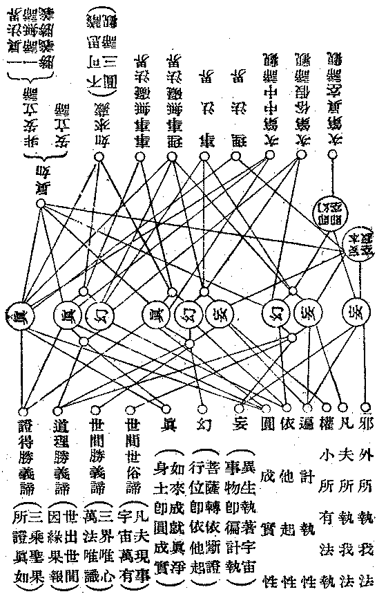



观此图，可见如来藏纯真离妄，具德而又即是众生心体；不同但观果德凡夫绝分，但观真如不具德相。盖真如唯体大，如来藏是自体、相、用大故。故圆乘必依此立因果也。显如来藏之显有三义：一、世尊为当机开显示显，二、阿难等大凡开显悟显，三、满慈等小圣悟显入显。此又分二：



己一、历万法显如来藏而开圆悟（至三卷经尽是也）。此又分二：



庚一、示真实性（至七大文终是也）：真实性者，即本如来藏妙真如性也。此科分四：



辛一、破相想遮显如来藏（至第一卷虽得多闻不成圣果是也）：谓相想者，意取「前尘虚妄相想」，亦即「法尘分别影事」，亦即「色杂妄想想相为身、聚缘内摇昏扰扰相」，亦即「如幽室见浮根四尘」：此皆无始所积二取习气。取为实法，已是谬见，认为自心，尤属倒想。正同执浮尘根目为能见，不知门实不能见也。迷物为己，迷己为物，全是遍计妄执。若不改转此之倒见，纵使观如来藏以求成佛，亦同邀空华而结果；念首楞严以为上定，亦同拾春冰云得宝。何论意识？何论见精？何论九次第定？何论六受用根？直须空有同空，妄真同妄，破一切法尽遍，始达无相实相。故既不许随合随有，而复不许无著无在。所谓若执唯识为实有者，所执唯识亦同法执是也。然观如来首标真妄二原，故知破妄本即显真。阿难若从一一无有是处悟得，直下觅心了不可得！不可得中一切皆得，则如来亦将曰安心竟矣。若从都无自体悟得，即入如实空镜，远离一切心境界相，无可现中等现本性，具足一切功德，则圆自在慧且可尘尘入道矣。故破相想是用遮诠门显如来藏耳。正同中观论尽破遍计执法显第一义空，结之曰『以有空义故，一切法得成』也。且将以无在破处计，则先告以『有三摩提，名大佛顶首楞严王』；以无体破倒执，则先告以『妙净明心性一切心』。谓之用遮诠显，犹是据其偏胜而言，况以此为唯破非显，决定破舍乎哉！此若决定破心舍心，破识舍识，则亦决定破见舍见，破闻舍闻。何则？盲见暗色，还因暗见，梦闻杵音，还因杵闻。此与『承听我法，因声分别，内守幽闲，犹为影事』，亦何异乎？若非决定破见舍见，破闻舍闻，亦不决定破心舍心，破识舍识。何则？若色变时，汝亦识其色相迁变，汝识不迁，此与『手自开合、见无舒卷，声自有无、闻非生灭』，又何异乎？况经明示真心有体，又曰：『若离前尘有分别性，则真汝心』者哉！是知破唯破其倒执缘影（缘影即是无体法尘，遍计所执名言起者，十法界法皆唯缘影）为自心相，故曰：『若汝执吝分别觉观所了知性（可见尚非能了知性）必为心者，此心即应离诸一切色、香、味、触诸尘事业别有全性』。然若执为毕竟破舍，亦是倒执。所谓无在，所谓无体，亦是缘佛法音之影，仍与阿难执无著同。故曰：『我非敕汝执为非心』。盖果是真实能分别体本性者，必不自见有在、无在，自执是心、非心。譬若眼不见眼，身不举身。故文殊曰：『我真文殊，无是文殊，若有是者，则二文殊，然我今日非无文殊，於中实无是非二相』。夫然，知损法财、灭功德，莫不由兹心意识；不知获神珠、入华屋，亦莫不由兹心意识，担板汉耳！惑为决定唯是破者，误由执般若为破相，不知是显具德圆融之第一义空也。要之，此显如来藏一大科，章章皆是显如来藏。若能瞥悟如来藏者，方且见犹离见，见不能及，何有倒想之不销乎！假立法门分齐，则此是凡夫从世间世俗谛上所起我、法执，用遮门显胜义胜义谛耳。此科分三：



壬一、徵定（从阿难我今问汝，至愿舍生死是也）。此有二意：一、徵知所依：所依若真，则或增显令明，或加劝进修耳；所依若妄，则须破显。二、徵定其妄：阿难既执目能观见，必执缘影为心；故下文即喻讨贼也。



壬二、破显（从佛告阿难如汝所说、至与诸大众默然自失是也）。此亦分二：



癸一、破处计以无在显（文中破七处计心者是也）。约文尚有二层：一、佛令阿难须知心目所在。二、如来逐破阿难计心所在。於第二层自有七段：一、计心在身内，此属世人常计。二、计心在身外。三、计心潜眼内。四、计心依窍藏，此属被破转计。上四纯是凡夫妄计。灵峰谓阿难此时，犹未获须陀洹果，此言良是。盖须陀洹已入圣流，断分别身见故。然愚法声闻，虽得悟生空，而以生空是灭身心所证，不知即心自性；分别法执，全同凡夫。故一问心所在，即指其胸，倘亦直心酬佛所问者乎。五、计法尘合处有心。六、计根尘中间是心。七、计俱无所著为心。此三由引所闻圣教谬计。圣教本皆入理悟门，若执名言所生尘影为自心相，非达心性，是故均无是处。经文甚明，观之可知。原佛所以徵问心之所在，逮计在处皆破斥者，欲令自悟凡有在处可指陈者，唯是心所分别尘影，全不是心（正同下文、指皆是物不是见者之意）。一念回光，即得圆照法界之全性耳。又正问定计心在内，忽告阿难及诸大众：『有三摩提名大佛顶首楞严王具足万行一门超出妙庄严路』，盖有二意：一、是先许阿难所请十方如来得成菩提法门，安慰其心。俾知今所说者，正是汝所请者，不生疑怖。二、恐误执佛唯破斥，俾知一路皆是全提此大法门，逼通身悟入耳。又此破缘影非心，亦即斥能见是目；此示能见非目，已显能见是心。故曰：『若眼能见，汝在室中门能见否』？又曰：『汝所知心，为复内出，为从外入？若复内出，还见身中；若从外来，先合见面』。知此、则下文指见是心，就见显性者，已全具乎此矣。



癸二、破倒执以无体显（从尔时阿难在大众中、至与诸大众默然自失是也）：所破倒执，即是文中执吝分别觉观所了知性必为心也。上破七处无是，已明相想非心。而此中更重与辨明生死根本元清净体：乃问「以何为心」，欲令自悟前所推穷寻逐者，乃攀缘心倒执之自性，实非是心，而即进悟识精元明之心体也。无如阿难全不觉知，仍将可推可逐之缘气以为心。佛不得已乃直为说破，此是从前尘虚妄相所生之想像，决非汝心。汝认为心，实迷物为己、认贼为子耳。此段盖结明上文、开出下文者。而阿难犹故不悟所执尘影之非心，不能自荐真心，佛乃重与说明万法皆以心为体性，心果是真，决非无体。复取其倒执为心之尘影，明其离尘毕竟无体，使其顿销倒想，获妙净明心也。故曰：『欲令心入无生法忍』。惜哉！阿难仅得个默然自失耳。是知此章在指阿难倒执为心之心，毕竟唯是尘影，无别自体；反显出离前尘自有之真心也。灵峰问答，於此甚有发明。有问：阿难自说『即能推者我将为心』，如何判其但认所推？答：谓众生颠倒，皆以所作能，若达能推之性，演若悟头不狂走也。故曰阿难虽以能推为心，实是所推影子，非真能推也。真能推者，虽是第六见分，而此见分便不在内外中间，本离过绝非，如眼不见眼，何可举似而曰：『即能推者我将为心』邪？此非深明护法师「四分」之旨者，往往分疏不下。盖见、相分起必同时，可推可缘者皆相分，相分无能缘能推用，从相分之可推可缘，显有见分能缘能推。而能推能缘之见分，体即自证、证自证者，即如来藏心也。所谓『识精元明能生诸缘缘所遗者』，此也。八识自体、谓之识精。八识自体所宗皆如来藏，谓之识精元明。从自证体起见相分，谓之能生诸缘。见分但缘相分，不能反缘自体（转识成智后则能缘之），故自体所宗如来藏，是缘所遗者之菩提涅槃元清净体。攀缘心，即自证所起见、相二分，正同下文所喻眚见灯影。此尚染分依他所起，知是眚影，则了如幻，不起遍计倒执。及乎执为自性（自性即是遍计执性所执实我实法别名），则取五阴以为身心，唯倒执矣，如执眚所现影为实物者。故有无始生死，枉受轮转。依此倒执修行无上菩提，犹如煮沙成馔，终不能得。此之真妄二本，间不容发，天地悬隔，祇差在毫厘耳。此章面门光耀，佛界震动，开现合一，承听本国者，表真心显露，尘影销融，本无差别，亦无去来，体唯一如来藏心也。



壬三、结责（从佛告阿难、至不成圣果）：或谓九次第中灭受想定，已灭恒行心所，唯本识存；正得缘所遗者，如何犹受转论？盖入此定，虽似寂灭现前，亦是功行所致。在初未发妙观察智（即是微密观照之始觉智），离诸尘缘，无能分别真性，故不明证心体；迷晦为空，昧成冥谛，如盲目人，虽入宝藏实不能见宝得宝也。纵住百年，宁免穷苦。至声闻人，因已成四念处生空观智，得无学果，人执种现俱断，故不复招分段生死；而有法执取此晦昧寂灭以为涅槃，故不明见心宝，圆发神用。外道定功亦能至此，以其初无生空观智，人执现行虽已不起，人执种子完全潜伏在本识中。认为冥谛，取为涅槃。所谓『月巢鹤作千年梦，雪屋人迷一色功』者也。菩萨初悟，便能发始觉智，开心宝藏，贵不离诸缘而忽然忘缘，悟入缘所遗者。不用定中独头意识悟入，而用前五根识同时现量明了意识悟入。故能明了湛然，根根尘尘皆如来藏妙真如性，不动周圆，洞十方刹。祇重「从缘荐入，不重就体消停」，此也。虽已悟入，然犹未能亲用，莫敌生死业力，故须修妙禅那，入圆通门；直至透过寂灭现前境界，始确发菩萨真信心，入流成正觉耳。前示二种根本，生死本是用攀缘心倒执所缘为自性者；菩提本是能生诸缘而又为缘所不及者。二者皆依缘显（缘即下文所云见精见缘）。缘是依他起性，执自性者是遍计执，缘不及者是圆成实。不先明悟圆成实性，缘其有为功用所发定境以为真实，正是用攀缘心执为自性者耳。此又可与下文『如是乃至分别都无，非色非空，拘舍离等昧为冥谛，离诸法缘无分别性』参观。盖非不许其「无分别」，正以其无离缘真分别性（离缘真分别性即是妙观察智、真智，亦曰无分别智），故流为空散消沉金石土木也。



辛二、就见精表显如来藏（从阿难闻已重复悲泪、至二卷及至群塞亦复如是是也）：此当略明本经所云见性（通指闻、嗅、尝、觉、知性）、见精（通指闻、嗅、尝、觉、知精）、眼根（通指耳、鼻、舌、身、意根）三种不同。见性是指『见犹离见、见不能及』之自证体、证自证心，即识精圆明如来藏心也。见精是指自证体上之亲见分，未执所缘为自性者，所谓『於妙圆中黏湛发见，见精映色』是也。眼根是指色杂妄想、想相为身、根尘色三已和合者。所谓『结色成根，根元目为清净四大，因名眼体（此是胜义根）；如葡萄朵浮根四尘』（此是浮尘根）是也（流逸奔色一句、是总指见精依眼根所发染用）。故六精是六根所元依之一精明，六根是六精所分成之六和合。依六和合根显然差别，故有功德优劣可论；依一精明体自无间隔，特其发用依托六和合根，故对六和合根以说六耳（意根餘部或指末那、或指等无间识，故是心法。本经则指无始所积前尘影子，故亦目为清净四大。浮根四尘而是色法，然决非指肉团心也）。黏性发精，精发结成六和合根，即是分段有漏五阴。举根必兼识、尘，举识举尘亦然。根、尘、识三，约义可分，约法必不能厘然各离也。在圆通章，正须不离阴境而反闻闻自性，故於见性、见精、眼根、通称曰根；而言『唯汝六根更无他物』。而在此章、唯在显即见之性是如来藏心，见精且是所就非是所显，而眼根等尚非所就而是所破；故曰「是心非眼」，况以根为所显所取乎哉！然则谓之显见，已属误谬，何堪为前是决定舍识，此是决定取根邪？



更就六根、六精以析言之：六根唯是色法，虽是第八之亲相分（法尘影子之意根、其种子亦第八所缘之相分种子），具有摄为自体、持令不散、领以为境、令生觉受四义，介乎知无知间；要属第八所缘性境（第六缘之则为有质独影境），但是发见胜增上缘（较灯能显色稍优胜耳），无能缘用，非是真能见者。六精唯是心法，正是见分、真能见者。自体本来离所缘相，即是识精。亲证识精，即是圆明如来藏心。约一识门言之（一识门有三种：一是唯一意识，二是唯一末那，三是唯一黎耶。此依楞伽约唯一黎耶言，即唯识观摄末归本门）：则是第八之亲见分，唯无覆无记性。然根本识深细难知，须约八识门言（即唯识观隐劣显胜门），则是前五及第六明了之现量。此六现量唯缘性境，得境自相，不带名言。唯一刹那，不落时量，亦无长短、方圆、一多、远近、前后、始终、内外、大小、高低、上下、同异、彼此、轻重、深浅等分位假。未起意识比量，则不迷能见是眼根，所见是情物、无情物，从何以立大小而观大小？尚无有头（头亦名言种类所起），何有头自动摇？尚无有手，何有手自开合？一刹那际逼塞虚空，法法不相到故，故得漭荡无涯，即同如来身心圆明，不动道场，一毛端遍能含受十方国土也。而在六识现量，既无识类差别可言，则八识门亦同一识门耳。头自动摇，见无动摇；境自大小，见无大小。且就唯识观舍滥留纯门言：就舍滥留纯门得论心所，则六精是前六遍行触、受二位（触受颇同近人所云感觉、直觉），未入想位、思位，故不共餘诸心所转。以别境不定善染等心所，皆入想、思位后分故。佛顶文句指受阴为七大中之见大者，意亦同此。又触、受位，向来不与定、慧相应，是故背觉合尘，丧本受沦本觉全成不觉。一与定慧相应，则不觉即成始觉也。



然则本经所云六精，即唯识之八识，明矣。而本经六精、六识之义界，复何分乎？一、祇约心王论：可前五识及第六明了现量为六精，如曰『但如镜中无别分析』是也。第六明了或乱意识，与前五识同缘五尘之比非量，为前五识，如曰『汝识於中次第标指』是也。云何非量？若错指舍利弗为须菩提是也。第六定中、散位、梦中三独头识，则为意识。亦可定中独头亦属意精。二、约心所论：则可前六触、受心为六精，入思、想心后为六识。以前五本依第六为分别依而起，其思、想位必有第六之似现量或比非量同转，故亦有善染等心差别也。本经为立根门圆通，故以六精摄属六根，而祇斥缘名相境比非量意识为六识耳。然在此章，方深显如来藏，见性、见精，犹厘然有第一月第二月之别。真见性中，见精犹同空华，况且缘之眼根也哉！故谓是就见精表显，亦据表门偏胜言之。此章及下二章，正同唯识论就世间胜义谛、立三能变识以显唯识性也。但彼论为破世俗我法执，三能变识亦属所显；次乃显道理胜义谛，次乃显胜义胜义谛，次乃显证得胜义谛。本章则世间胜义谛唯是所就，就之以直显具德圆融胜义胜义谛，故同中复有不同耳。此又分二：



壬一、蹑前重请，得蒙建大法幢（至得清净眼是）：法幢一作标帜，令识归向，一显高胜，令知依投，正是开解成信意耳。此章是就见精表显如来藏之别序，亦可通序七大章终。「获妙微密性净明心」云者，妙微密、即妙奢摩它微密观照，盖即开其道眼，令得悟如来藏寂常性净明心者也。阿难至七大终，方悟此章佛所许耳。



壬二、蹑前逐问，专为辨明见性（从阿难汝先答我见光明拳起是也）：经文自列为十三段，束五六段为一，八九段为一，十段十一段为一，则成十意：



一、借盲有心而灯同眼，直指见性是心非眼：盖盲者眼虽失而心固存，见是心故，故非无见（近有盲哑学校能令盲童亦能识字，正以有心见故），此以盲有见而验知见是心也。灯虽显色，非见谁知？眼犹灯故，故眼非见。此以灯非见，而进证见非眼也（案墨翟亦尝曰：智以目见而目以火见，不当以目见，若以火）。唯因见元是心，故知见实非眼。唯悟见元非眼，乃知见实是心。上是本意，特得下喻乃弥显耳（执眼为见正同执身为我，实则世人亦不决定执身为我，身特较亲之我所有物耳。观之我慢不屈而戕身自尽者可以知矣。以身非我，况眼不见，不既较然明已）。然阿难犹未悟见是心，悟心非局色身之内也，故有下文重重疑惑。或谓此虽指见是心，唯遮眼根而表见精，何遽指是显见性哉？不知经文明曰：『如是见性，是心非眼』，孰云但表见精？盖见精虽正是能见，然托十缘而生，故非妙圆而是黏湛所发。唯本心体，是能生诸缘而不从诸缘生者，故盲无根缘、暗无明缘而心见成也。证以四卷『缘见因明，暗成无见（此说染分见精），不明自发，则诸暗相永不能昏，根尘即销，云何觉明不成圆妙（此说契见性者净分见精）』，则此章是显见性也，明矣。



二、借客不住而尘摇动，现验见性常住无动：言现验者，一、是憍陈亲说本悟，从鹿园现验乎客尘不住摇动，非主非空，远离客尘成阿罗汉。一、是世尊屈指飞光，令阿难现验乎见性常住无动，即主即空，直显见性本如来藏。夫然，动唯客尘，非汝身境，汝奈何颠倒行事，认客尘以为自己，遗失真性，弃常寂而取流转哉？但憍陈是悟生空真如为主空，未悟客尘亦是唯心所现，似有客尘可除，主空可证。如来正意则明生灭、去来本如来藏，性真常中求於去来、迷悟、生死了无所得者也。依下章叙阿难大众开悟，似乎已悟，实则取境为心，犹然倒见。盖是缘佛法音，想成眼前一段昭昭灵灵光景，恍若万物自於此一段光景中生灭；与此一段光景，了无交涉。此种依通境界，最易淆人，不知其仍是缘尘分别影事也。是故闻说心同虚空，若存虚空之量，则此虚空依然与己为对为缘。说本经者，有教人守此光景以为守於真常者，而不悟守冰雹为明珠，终归乌有也。阿难能真悟者，当下心精遍圆，含裹十方，岂犹迷色身为自己，惑心性局色身，问「我今身心复是何物」哉？然幸阿难终不取此为真，故卒开真悟也。



三、借色身变而观河之见无改，显见性一向不生不灭：文曰：『而此见精性未曾皱』。盖见精从缘发，精神昏昧，见亦昏昧，可有童耄之别；而见性则虽盲暗亦无改，故决不随色身而断灭也。匿王恒河之喻，且就匿王老而明了之见，恒河水常充盈之境，借此不变令彼易知有不变耶？盖见性唯能自悟，无由说示人，亦无由指示人，所以就见精显表也。古禅德曰：『在眼曰见，乃至在意曰知，识得名为佛性，不说祇弄精魂』。匿王虽信身后舍生趣生，暂除断见，亦弄精魂而已。然知身后不灭，实进德修业之大本，故匿王与大众踊跃欢喜，得未曾有。譬人一息仅存，百事灰心，忽服金丹，延年千纪，则自然能存远虑也。或问：既一向是不生不灭，何又舍生趣生？答曰：正因不生不灭，是故有舍有趣。盖一舍一趣是生灭，常舍常趣非生灭也。又问：岂阿难亦犹存断见，不然此章与本经当机何干耶？答曰：阿难默念无始遗失本心，今日方悟，似认真心妄心截然二物，可以失此得彼，失彼得此；故愿显出现前身心真妄虚实、生灭与不生灭。今明即妄身中亦向不生不灭，正破其计。故下文问：『若此见闻必不生灭，云何世尊名我等辈遗失真性』？盖未悟如来前责遗失真性，特以其迷而不知假说遗失耳。



四、借首尾换而随臂之手无失，显见性从来不增不减：世间人说垂手为倒，竖臂为正，虽说正说倒哉，臂手何曾得失？虽无得无失哉，正倒岂无分别？随顺世间言说分别，以如来悟色心诸缘及心所使诸所缘法，惟是妙明真心所现。故曰：如来为正遍知。以汝等迷圆妙明心，晦空结色，色杂妄想、想相为身、惑为心性局色身内，故号汝等为性颠倒。汝虽如弃澄清大海，认一浮沤为穷瀛渤，而汝真精妙心宝明妙性，岂真为汝局在色身内哉？知汝等虽迷而不减，则知如来虽悟而不增也。汝真妙心本来圆遍，弃悟认迷，实为倍迷，岂非同於垂手，世人皆说为倒！故如来怜愍，亦说汝为颠倒行事，遗失真性耳。阿难初见动摇身外恍有不动摇性，计为真性实在身外，是故如来名我遗失。次闻生灭身中指出不生灭性，计为真性既在身中，如何如来说我遗失？其迷根在局定色身，执了知心实在身内，故闻佛说皆变成所缘境。下章所谓『此法亦缘，非得法性』是也。此章正为抉破迷根，然阿难尚不能放舍想相，直至七大章终，方从本圆心海回观色相同一沤耳。



五、借尘象可还可择，见精无还无择，而显见性汝真：阿难承佛前言，色身空界，咸是妙明真心中物，乃又想像真心为在身外，充满常住。故曰：『现以缘心，允所瞻仰，徒获此心，未敢认为本元心地』。佛知其仍认取缘尘分别影像，起此倒执，不惟不知心性，亦不知尘影。取尘影为心性故，且复不知心性、尘影之别，谓心性同对境可瞻仰故，故以观指为月破之（盖心决无现像可观，虽近人曰心理学者亦能知之，唯彼虽不落五尘境而尚落於法尘境耳。灵峰於此有答问曰：一切法、色名尽之，眼、耳、鼻、舌、身、色、声、香、味、触、法皆色也，受、想、行、识皆名也。名者但有名字无色相也，是故八心王、五十一心所，其相分皆色也，其见分皆名也。经云：『妄有缘气於中积聚假名为心』。见分唯有名如何可称为气可积聚於中耶？缘气积聚则一件物，一件物则是相分。唯识云：相分理无能缘用故。阿难认为能缘，亦如认目有见，浮尘目必不能见，缘影心必不能听。故破云：尚以缘心听法。正谓缘心是缘气，亦名风大，决无听法功能，尚误为能听法邪？此从我法音为缘，起於法音影子，非得我所指心性也。发明最为透辟）。汝所获心，既承法音而现，则可还之法音。法音若变，汝心亦变，法音若灭，汝心亦灭，故离缘尘毕竟无有。同乎明因日有，故明还日，日不在时，明即灭无。诸可还者，自然非汝。故汝承法音而获之心性，正汝心性之客，实非真汝心性。然汝见精，虽汝自证心上见分，未是自证心体，固全在乎汝边。故法音灭非不闻餘，故明曜灭非不见餘。既不令汝有可归还，则见精之元明，非真汝心而何！顾阿难犹认见性在身外，谓虽见性无物可还，而实在我身外，从何可知是我之真性邪？佛乃令其遍观一切物象，种种差殊，咸物非汝。然同是汝见精所瞩，汝能见精了无差殊之相，可同物象指陈，则此见精本妙真明，如何可云同乎物象，可有见邪？汝之见性，若是现前一可见物，则吾见性应亦现前一可见物。汝既见汝见性，可同物象指陈，亦应见吾见性，可同物象指陈。汝既不能见吾见性，则汝见性亦决不同物象可见，明矣。汝见既非物象，现又明明周遍瞩照，不同龟毛、兔角，则此非物象而又周遍之见性，非汝真性而何？性汝不真，取我求实，所谓『吾语非密，密在汝边』者也。此章两段经文，皆先明尘象有物体可还，殊形可择；次明见精无物体可还，无殊形可择。次乃就见精之无可还、无可择，而显见性确是自心，以破其以见性为前境之倒想者也。



六、借器界局方局量，见精超方超量，而显见性自在：承上章，阿难已认见性必不离我身；然又恍若见性随我身之居处而异其量，则疑见有舒缩，违前圆满常住。故佛以器界有方圆、大小，见精随之应量发现，而非见精自有方所、限量，以显见性自在无碍。盖器界亦消归本如来藏妙真如性，则见性不循器界自发，器界胥随见性而转矣。



七、就见精非是物、非非物，显见性一真绝待：承上番番破除阿难倒想，至此阿难乃将倒想完全呈露，意曰：我承佛言所见真性，乃是现出在我面前之物，若此物必我真性者，我今实有了别真心，岂反非是我耶？且此现我面前之物，但能由我身心分别，彼了不能分别我之身心；抑使彼能分别我之身心，不反同物能见我邪？此正所谓认色身为自己（迷物为己），迷心性局色身（迷己为物），用局身之妄想，缘法音之尘影，取为佛所开示之真性也。此一迷根不拔，漆桶不破，纵见觉缘遍满十方，湛然常住，性非生灭，诚与外道所说真我无差别也。故知下章阿难亦未悟耳。此章佛以汝既说此见性是现前物，必可指陈，就现前物汝且指出何者是见。阿难到此，有手无可用处。乃曰：『指皆是物无是见者』。佛既印可，恐其遁现象之见而转取空亡之见（此若今之谈心理者、专取独头意识所缘之法尘也），故令就现象中发明无非见者，亦同印可。於是大众莫不惶悚，盖见相分起必同时，才知是相，必已有见，才知有见，必已是相。约义可别：一是心法、一是色法，一是能缘、一是所缘。约用难离：以心法故遂现色法，以色法故遂显心法。约体无二：同一自证体上起故。惟诸如来及大菩萨，於其自住三摩地中，证自证体，亲证真如，观见相分（见与见缘）幻现如梦，宇宙万物、断常诸法（并所想相），同虚空华，本无所有。而见相分，全是识精元明妙菩提体，纯一真实，何有彼此是非对待！如真文殊，实无是非二相；但一月真，自无是月、非月。是故因随妄想有是非是，若契真觉无是非是。



八、就见精非自然、非因缘，显见性离相即法：阿难住倒想中执取名相，闻说一真常住，以谓是拨色心法别指一自然体而言者。佛意既别有一自然之体，必可甄择提出。故令就见精中，指出见精以何为自，既指不出，自然义坏。意谓佛本常说因缘，因缘之义必成，故又转计因缘。佛乃复令於见精中，指出见精决定因何缘何而有。但此非谓自然、因缘之语有过，特阿难所取者，是世间人遍计我法执性（世间学者大都如是），尚是小乘所破，况可拟议真菩提心（楞伽、佛亦对外道说因缘、自然皆是世论，盖亦破外道遍计法执也）？是以斥曰：精觉妙明『无非不非，无是非是，离一切相（见缘想相犹虚空华，本无所有）即一切法（此见及缘、元是菩提妙净明体），汝今云何於中措心，以诸世间戏论名相而得分别』？阿难复执佛所常说生眼识之因缘名义，不知佛说因缘，正明世俗谛法无性。世谛法无性故，性唯真性。今正直显第一义性，如何更执世俗谛法诸因缘相？故复就明暗、空塞，明皆非见精，而即进明妙见性中黏发见精之时，见精早已非是见性。见性本净元真，犹离见精之妄，为带妄之见精所不能及；何况见精所缘、倒想所取诸因缘自然及和合相哉？此及离一切相之义。而见精、见缘，皆妙见性中黏发，所以体即本妙见性，则是即一切法义也。阿难缠绕世谛因缘，故戒以无得疲怠妙菩提耳。（或谓前之八章、但是显带妄真，下章方是出离妄真。不知『色心诸缘及心所使诸所法缘，唯心所现』；『於其自住三摩地中，见与见缘并所想相如虚空华，本无所有』；与下章净目喻真觉，眚影喻妄见及妄见所缘，有何别乎？特阿难重重不悟，佛所示真性转执转远，乃将见犹离见，鞭辟向里一句，与说明见精一向是所就非所显耳。何尝要其认取带妄真邪？若谓众生离带妄真无可显者，下章阿难岂已成佛菩萨，乃可为出离妄真邪？须知初心正须直彻真源，丝毫不容黏带，而后乃能观带妄真如梦幻耳！所谓『非不见真如，而能了诸行皆如幻事等，虽有而非真』也。是故本经前之三卷，章章唯是直显如来藏心。谓前八章但是显带妄真之见精者，亦犹阿难於动摇头外见个不动摇光景，取著难舍而已。不知守此，不唯不悟见性，亦复不悟见精，祇缘一法尘所生影子耳）。



九、就见精剖出同分妄见、别业妄见，显见性是本觉明心：以见性是本觉明心，是故生佛无二。以见精循染净业现，是故众生背觉合尘，见唯妄见；诸佛背尘合觉，见唯真见。然则见性犹非见精，明矣。因缘自然和合不知合相，世人特在眚灯所现影上生计度耳。众生若能远离虚妄业缘，斯亦同诸佛背尘合觉矣。此章标『将欲敷演大陀罗尼诸三摩提妙修行路』者，以如来怜愍阿难及大众，从此一请不待重问，即广会法相显如来藏也。因知阿难向来多闻，非与说尽不能悟也。同分妄见，是众生同业所感共见者（或尽十方有漏国土、或一世界、或一洲渚、或一村落皆得论同）。别业妄见，是一人别业所感独见者（或一世界、或一洲渚、或一国土、或一村落皆得论别）。餘并可知。



十、就见精重明非和合生、非不和合，显见性唯离言自证：和合之与因缘，事不相离，义还有异。盖因缘是所由和合不和合者，和合不和合是因缘之所致者。故成相、坏相属因缘，总相、别相属和合不和合（总相亦即共相、别相亦即自相）。前非因缘，已略兼非，今更就餘阵摧之耳。既双非和合不和合，不复更著一语，岂非以言遣言，遣至无遣，言语道断，心行处灭，显见心唯可离言自证邪！



此科虽曰专为辨明见性，亦就偏胜相假定分齐耳。据实，一曰：『云何汝今以动为身，以动为境，从始洎终，念念生灭，遗失真性，颠倒行事，性心失真，认物为己，轮回是中自取流转』！再曰：『色心诸缘及心所使，诸所缘法，唯心所现；汝身汝心，皆是妙明真精妙心中所现物。云何汝等遗失本妙圆妙明心宝明真性！认悟中迷，晦昧为空，空晦暗中结暗为色，色杂妄想，想相为身，聚缘内摇，趣外奔逸，昏扰扰相以为心性！一迷为心，决定惑为色身之内，不知色身外洎山河虚空大地，咸是妙明真心中物』。再曰：『一切众生从无始来，迷己为物，失於本心，为物所转，故於是中观大观小。若能转物，则同如来身心圆明，不动道场，於一毛端遍能含受十方国土』。再曰：『十方如来诸大菩萨，於其自住三摩地中，见与见缘兼所想相，如虚空华，本无所有。此见及缘，元是菩提妙净明体』。再曰：『娑婆世界并洎十方诸有漏土及诸众生，同是觉明无漏妙心。见闻觉知，虚妄病缘，和合妄生，和合妄死，若能远离诸和合缘及不和合，则复灭除诸生死因；圆满菩提不生灭性，清净本心本觉常住』。不唯下卷泯会法相、融研物体以显如来藏者，包该已尽；即四卷约四谛以显如来藏者。亦囊括无遗矣。密意了义，佛不能传，在闻熏之士超然自悟耳。



辛三、会法相泯显如来藏（从阿难汝犹未明一切浮尘诸幻化相、至十八界章尽是也）：文中五阴、六入、十二处、十八界，一一明其但有名字，虚妄无实（实即名之所诠，犹近人所云名之义界也）。既无实，则从谁立生（生即近世所云因果律）？不应空华结成空果，不应空果开放空华；故汝谓必因缘生者，非也。既无实，则从谁立性（性即近人所云物之本质）？不应兔角先是龟毛，不应龟毛今成兔角；故汝谓有自然性者，非也。夫然，故此诸浮尘幻化相，当处缘会妄现生相，假名曰生；当处缘散妄现灭相，假名曰灭。毕竟无实、无生、无性，而其实性乃真本不生灭如来藏妙真如性也。初云：『一切浮尘诸幻化相，当处出生，随处灭尽，幻妄称相，其性真为妙觉明体』：是指阴、入、处、界别别自相。此正破小乘人法执，令悟入法空真如也。以彼执此诸法以为实有，由贪、瞋、痴等惑业因缘而和合之，能成有情众生及无情器界故。由戒、定、慧，灭除贪、瞋、痴等惑业因缘，则不与此诸法和合得解脱故。今明此等诸法，唯识（识即能分别体）变现，刹那生灭，实无少法能到少法。识亦如幻，识之实性即妙真如，摄相归性，真为妙觉明体。故此等诸法，非因缘生，无自然性也。佛告富楼那曰：『汝但不随分别，狂性自歇，歇即菩提』也（或问：四阴、意根、六识、皆是心法，如何亦说是浮尘相？答曰：体虽心法，唯自证知。若从圣教寻名取义，缘其义相以为心识，亦法尘摄，已属所缘之相分故）。次云：『如是乃至五阴、六入，从十二处至十八界，因缘和合虚妄有生，因缘别离虚妄名灭，殊不能知生灭、去来，本如来藏常住妙明不动周圆妙真如性，性真常中，求於去来、悟迷、生死了无所得』！是指阴、入、界、处诸法，和合成者及不和合，其和合即众生生长、器界成住，不和合即众生老死、器界坏空。如是乃至者，如是乃至此等诸法和合及不和合也。就众生中又分悟迷，迷有生死，悟无生死。此等诸法，既唯虚妄，何有乎和合、别离？此等诸法，和合、别离既皆虚妄，何有乎迷有生死，悟无生死？此等诸法，既皆本如来藏常住妙明不动周圆妙真如性，何有乎去来、悟迷、生死可得哉？故去来、迷悟、生死，非因缘生，无自然性也。此则以法空故，生即无生，常住涅槃，恒现生死，一切众生皆菩提相。尽破凡外、权小之执，令众生顿悟二空，入如来藏妙真如性也。



案：此皆由阿难执著因缘、自然之说，分别计度，戏论无已，佛知非尽将其所闻持者，快刀乱丝，一斩齐绝，不能令其计度心息，故取诸法悉与一翻案也。阴、处、界三，摄诸世间法尽。阴者盖覆，亦译曰蕴。蕴者积聚，积聚诸虚伪相，盖覆真性，令不明故。处亦曰入，六根是六尘所入处，六尘是六根所入处，各有处故，对相吸故。界者性分，亦即义界，各有定分，性不同故。阴但有五，一色，四心。处有十二，十一色法，一是心法。界有十八，十一色法，七是心法。此皆约义不同，开合有异，法之自身，无多少也。教中常义如是。本经别意，另立六入。六入正指六根而说（此中意根似专指末那识，若约六入亦摄法遍。五根兼摄五尘、五识，意根兼摄法尘、意识及赖耶识），十二处偏据六尘说，十八界偏据六识说。细观经文可知。



此章文相层次：壬一、承前总示阴、入、处、界本如来藏；壬二、次第别明阴、入、处、界本如来藏，此即为四：癸一、五阴，癸二、六入，癸三、十二处，癸四、十八界。此四章首，又各有一冠语，总徵何故是如来藏妙真如性。下乃别列五阴为五，六入为六，十二处为六，十八界为六，共成二十三章，文义则大同也。



辛四、出法体融显如来藏（从阿难白佛言、终识大章是也）：一切诸法，皆以色、心为体。上章阴、入、处、界，是就因缘和合所起之现相说。现相者何？即有情、无情物是也。但色阴者、是无情物（此中又分气物、矿物、植物。约根本论亦许有识，是识变故；亦许有情，本如来藏心故）；具五阴者，是有情物（从虫蚁至人、佛皆是）。入、处、界三，可以类推。情、无情物，皆已现成和合行相。就其现有和合行相，别之为色、为香、为意、为身；是故色或山色、云色，香或草香、兽香，身或鸟身、人身，意或自意、他意，咸若系属一和合行相物言者（此所谓物，本唯有名，除十八界等法，其实空无所有，故小乘得悟生空也。但世俗则都惑之为物我，故有分段形相、成住坏空、生老病死）。设此和合行相，因缘散离而灭，何眼、耳等之有？正唯地、水、火、风而已。是故此章是就因缘散离所归之本相说。（此谓世论如是，非圣教道理也。据实五识但缘五尘，除色、声、香、味、触，何处更有四大可得）？小乘多言四大，亦或执为实法（即是有自然性，此同近人所执原质、原力）；谓是由业缘力，集现宇宙种种形物（人物等总相，眼、耳等别相）之变化体。此变化体，不从业缘集现，是本然性。故因缘力谢时，还归四大。阿难或闻佛於小乘会中作如是说，故今闻佛俱非因缘自然，疑现前世间诸形物既现是有，若非因缘和合变生，应同四大自然本有。且和合变生者，必依四大以为本质，如佛今说，既违先前自语，复违世间现量（此似现量非真现量，其实乃是非量，属意识所缘之似带质境），似乎成戏论矣。不知佛昔是随世俗言说（印度旧有论师执四大为万物本体，若今质力学者），令小乘人易悟身空——但是业缘和合四大为身——了知现身即空，非教更执四大为自然性，亦非教之灭因缘和合身，取自然性。而小乘见道者，亦决不执四大为自然性，取证此自然性。唯析空观声闻、缘觉，或不知五蕴、四大如幻、如化，本空无性，厌离以求解脱则有之。而声闻未见道者，闻此、或转执四大是自然耳。由是观之，阿难此时真未得须陀洹果也。故佛责曰：『汝求无上菩提，为示第一义谛，如何复将世间戏论妄想因缘而自缠绕』？据实、此四大等皆是识心分别（染依他性，所谓幻妄）、计度（遍计执性，所谓倒妄），但有言说，都无实义（了无可由因缘集起之定实性、及有定实之自体本然性）。何者？假此四大各各体非和合，有定实之自然性者，则必不能互相杂和，变现世间形物。例如顽虚不能与诸瓦砾和合，变现牛马（此亦如执无方分原质者，既无方分、则无声、香、色、味、触等可得，既唯是无，凭何说是原质？纵使强执此无以为原质，既唯是无，无不能有，如何可是变化宇宙现有形物原质？故所执无方分原质，除识心分别计度言说外，都无实义）。夫然，四大自然义成，则不能因缘和合成世间种种变化。若因缘和合成世间种种变化，四大何有自然性哉？故亦本非因缘，非自然性。假此四大相杂和合，则即同於因缘和合诸浮尘变化相。如遇冷增热减因缘，由水成冰，冰始水终，冷生水灭，不得云水是自然性法，冰是因缘生法；若遇寒减热增因缘，冰还成水故。如遇煖增寒减因缘，由冰成水、水始冰终，水生冰灭，不得云水是因缘生法，冰是自然性法；若遇热减冷增因缘，水还成冰故。



此中如水成冰、冰还成水二语，说本经诸师、皆作真如随缘不变、不变随缘会，义皆非是！何则？若谓真如随染缘成九界，如水成冰，则以真如喻水，九界喻冰；真如随净缘成佛界，如冰成水。又以真如喻冰，佛界喻水。水相非不变成冰相，冰相非不变成水相，指何为不变耶？若谓以真如喻湿性，水喻佛界，冰喻九界，虽随染净缘成九界、佛界，如湿性不变者，则如水成冰、便堕佛界有终，九界有始。亦不得云此是即佛界之九界，即佛界之九界、如即水中具有冰性，非若水已凝成冰故。况此二语，意即含如冰成水，水还成冰；则水还成冰，亦堕涅槃有终、生死有始。亦不得云此是即生死之涅槃，即生死之涅槃、如即冰中具有水性，非已由冰泮成水故。未悟此喻本是承上四大与诸世间种种变化对论。非佛界九界对论也。立比量云：若许四大亦和合者，应与世间种种变化始终相成、生灭相续（宗）；同是和合性故（因）；如水成冰、冰还成水，如冰成水、水还成冰（喻）。



然则众生业熟因缘，万物虚妄始生，四大虚妄终灭；众生业谢因缘，万物虚妄终灭，四大虚妄始生。四大之与万象，始统相成，生灭相续。生死死生，生生死死，譬旋火轮，未得休息。宁有端委可寻、本末可定，而曰：四大是变化本质、自然性法，万物是变化现象、因缘生法哉（此亦如执有方分原质者，既有方分，则有色、声、香、味、触等可得，即同宇宙现象形物，如何独说此是原质？此若原质，万象即应皆是原质，对谁非原质而说此为原质邪？原质既与非原质同，故此所执原质、除识心分别计度言说外，都无实义）！且夫四大既同诸浮尘变化相，则亦当处出生，随处灭尽，幻妄称相，其性真为妙觉明体，本非因缘，非自然性，何须於此更致疑乎！然阿难虽依小乘教，祇疑四大，佛则直从大乘了义教说，故曰：『亦令当来修大乘者通达实相』。实相者，离一切相即一切法之如来藏也。而大乘教多标六大，本经加立根大（根大实非指六根，而是指发现六根门头之精明，依本精每称见精、闻精等，应名精大，然名词不雅驯。据实应云觉大，经文首标见觉，例推应知，得云闻觉、嗅觉、尝觉、触觉、知觉。此与近人心理学上名词，亦甚符契。又复凡夫迷此现量，一向住在比、非量中，种种取著，不知全依现量而起，名曰背觉合尘，义亦符契。然或以觉为触觉专名；亦多专举觉与迷对；又复觉者但一精明，似不更论见、闻、尝等；有此淆讹，故今但称根大。虽名根大，实是依根之觉，寄名根大。例如依眼之识名为眼识，识实非眼。可知此大精觉，亦复非根。经文虽云「如一见根」，乃诠见之根元，非诠眼根。若眼根向前则背后，岂云见周法界？又此六精本一精明，一精明即阿赖耶识。阿赖耶识必以末那识为共依，是故此大即摄七八两识。既知根大、是指精觉，可知识大唯指第六明了乱意之比、非量及独头意识矣。大概言之，此中根大、是愚夫位中根本无分别智；识大、是愚夫位中后得正分别智。诸佛背尘合觉，故证根本智而成正分别智；异生背觉合尘，故迷根本智而成妄分别智。又此根大，亦是愚夫无明，一向不与现量相应，於真现量极晦昧故；一与此真现量相应，便得十方虚空顿时消殒。何者？真现量中，无名言种类分位假法故）。加立根大，自是本经别意：一、为重根门圆通，摄一精归六根故。二、为立念佛圆通，摄六根归一觉故。然此七大，前之四大是诸色法共依；空大是诸不相应行分位假法共依（或指空是色法，不知此所云空，非指眼识所缘空一显色，是指可容受往来之空间。空有间故，亦即是方、是处、是界、是域。依此则有外表形相发现，所谓点、线、面、积，方、弦、边、角。据此表现形相，则有名句文等施设，曰天、曰地、曰人、曰物。则有彼此定异，则有彼此相应，则有和合不和合性，则有各各命根不同，则有众同分、异生性、无想报、灭尽定，则有东、西、南、北，则有一、二、三、多。既有表现形相，则有限量可定，则有变动可观，则有生、住、异、灭，则有往古、来今，则有迟速次第，则有流转得失。此正同乎近人所云宇宙，宇者界也、处也，宙者世也、时也，故亦即是世界。此虽亦摄属法尘，然是意识不共五识所施行之心色分位，唯有名理，是名非色，故是行蕴而非色蕴。又非能缘，故亦不是心心所法。若悟置器观空，空有方圆，除器观空，空无方圆。则此空间即成无边不动虚空，具遍常义。遍故，非内外中，无往无来；常故，非过未今，不生不灭）；根大、识大，是诸心心所法共依。此七所以咸名大者（此之六大亦名六界，界者因分，今从大释），相、体（亦即种子）、性三，皆许遍一切时处故。



何为大相？地（综摄金石土木及诸固质）、水（摄诸液质）、火（摄诸光热）、风（摄诸声力）、空间、见精（举一见精代表六精）、眼识（即同时意识依眼识起比非量者，亦举一眼识代表六识）是也。即就人论（举人代表一切物类）：全身除此七种大相，更无别物。依报、正报，未尝一刻得离地、水、火、风，得离空间，得离见闻分别种种名相。今既犹古，古亦犹今，我既如此，物亦如是（若手若足、若衣若食、若亲若友、若家若国、若工若学、若商若术、若善若恶、若苦若乐、若啼若笑、皆不可离），故遍一切时处。何为大体？坚、湿、煖、轻动（或谓动是表色，应但曰轻。然但曰轻、轻亦可是数量。吾谓动亦触所能觉，不取表色，正如空间非取空一显色。然动必轻而轻必动，恰犹轻气常能自动动餘，瑜伽师地论双称轻动，故今取之）、太虚、精觉、明知是也。此与相异：地具五尘，六识共缘。水除香尘，五识共缘。火除香、味，四识共缘。风又除色，三识共缘。今之坚、湿、煖、动，约麤则唯身、意识缘，但是触尘。约细则唯阿黎耶缘，是五尘种而非五尘。离细同唯性境，不带名言。又地相等，可有器界疏、根身亲之别；此坚体等，则不论器界根身亲疏之异。太虚正唯遍常虚空，亦清净意识及本识所缘性境，不带分位假相。精觉及与明知，唯正一精明体，不黏见闻、眼耳等言，与情无情非一非异。此七大体，不唯俱遍，且亦俱融，一一互具，不可抟挈，不可分剖。且从大相显之：即如水具冷、煖，水中具火（冷、煖同是煖之增减相故、隐显相故，凡曰增减、隐显、专局所取形相而言，非谓大体全体可有增减、隐显是也），水且具火，具餘可知。水且遍火处、融火界，遍餘、融餘可知。火燃湿薪，火中具水，火之与水且然，与餘可知。空亦具地，能持载禽鸟飞行故。地亦具空，能容受温热传入故。空之与地，地之与空且然，与餘可知。夫然，劫空窅冥，万象弥罗，劫火充塞，万流洪霈，明矣。奚有富楼那水火相陵灭，空地相倾夺之疑哉？何为大性？大相空寂，非七非一，统唯妙真如性，所谓一法界大总相法门体也。融相归性，大体莹妙，即相即性，常七常一，莫非本如来藏妙真如性，所谓自体相用大也。以常一故，观性元真，唯妙觉明妙觉明心，本非水火。以常七故，各各发明则各各现，若具发明则有俱现。如来藏中，色性真空，性空真色，清净本然，周遍法界；乃至性识明知，觉明真识，妙觉湛然，遍周法界：则是融相归性，德体不空之真空也。遍周法界，随众生心，应所知量，循业发现，乃至含吐十虚，宁有方所！循业发现，则是从体起用，幻相非有之妙有也。循业发现，世间无知，惑为因缘及自然性，则是取相执名，迷幻成妄之倒妄也。



今更设一譬喻明之：尽虚空界一大海水，有持载德，飘泊诸舟櫂故；有润泽德，灌饮诸渴故；有温凉德，沐浴诸人物故；有流通德，潜泄诸邱壑故；有含容德，游泳诸鳞介故；有澄清德，静沉诸扰浊故；有透明德，映现诸景象故。其持载德遍全海水，乃至其明透德亦遍全海。持载德水，尽具全海诸德，乃至透明德水，亦具全海诸德。尽虚空界一大海水，喻一法界，海水喻如来藏，水妙喻真如性，持载等七、喻七大体，飘泊等七、喻七大相。一舟飘泊，则有飘泊一舟相现，遍大海舟飘泊，则有飘泊遍大海舟相现。餘六亦然。舟櫂乃至景象俱临，则有飘泊乃至映现俱现，非不条然各别，然何可分剖七德而离哉？非不朗然毕现，然何可抟挈一德而去哉？然则封取一舟飘泊之界，乃至局执一景映现之处，谓此界处有自然性或因缘生，谓飘泊界必不容有游泳，谓沐浴处必不容有灌饮，宁不惑欤！宁不惑欤！



此章文相，总有二层：壬一、是总疑总遣；壬二、是别融别显。此即有七：癸一、地大，癸二、水大，癸三、火大，癸四、风大，癸五、空大，癸六、根大，癸七、识大。此章所以判为出法体者：一、出相体：大相大体，诸色心法共宗依故。二、出体性：大体大性，唯妙觉明如来藏故。名融显者：一者、各融各显：性妙真空，性空真色，清净本然，遍周法界等是。二者、俱融俱显：若此识心本无所从，当知了别见闻觉知，圆满湛然，性非从所，兼彼虚空、地、水、火、风，均名七大，性真圆融，皆如来藏，本无生灭等是。



庚二、获本妙心（承上章、至三卷偈终是也）：从破想相至出法体，遍历万法，真示唯心。世尊既将阿难及诸大众先所闻执、凡情圣解，根本取消，并将众生心根本性，菩提涅槃妙明真元，全体开显，於是各各身心荡然，虚空粉碎，大地平沉，顿皆消归本如来藏。从如来藏圆照遍观：宇宙间物如持一叶，父母生身如浮一沤，了然自知获本妙心，常住不灭。乃说偈赞佛、颂法、叙益、发誓也。偈中初句赞佛真身：妙湛、性体，总持、德相，不动、神用，尊、即婆伽梵也。归依婆伽梵，故是赞佛陀。佛陀实性，亦是即法。次句颂法总相。本经始终是诠首楞严王三摩提故。世希有、是颂此法门殊胜。法门自体，亦即是佛。次之二句叙益，是由佛法尊胜所致。从前种种分别计度，凡情、圣解皆颠倒想；本有法身，迷且不失，今忽悟得，宁历僧祇？所谓得真菩提心也。次十四句、是发深固菩提誓愿。八句是众生无边誓愿度：一入大乘，即能为人，绍佛志故，报佛恩故，尽未来际利乐有情。二句是烦恼无尽誓愿断，亦法门无量誓愿学：烦恼是病，法门是药，药病双知，自他俱利，故佛令入遍知海也。二句是佛道无上誓愿成：佛令入圆通门、得无生忍，乘是直超（无诸纡回曰直、无诸留滞曰超）五十五位真菩提路，圆满妙觉是也。上皆是愿，末二句是誓也。阿难菩萨大权示现，居凡夫地（此依未得须陀洹说），小乘有学（此依已得须陀洹说），令诸末劫凡夫直入无等法门（此意为正），及诸声闻、独觉增上慢者，回向无上佛果（此意为带）。则其功德，唯佛能知。法华开显，仍是住前菩萨，犹未足以定其量也。然阿难菩萨既为凡夫之标榜，今依本经，正须约凡夫地论，否则转违其意矣。是故阿难从初求大菩提，乃是名字即佛向相；此中悟本妙心，正是名字即佛入相；发弘誓愿，正是名字即佛住相；下章闻修请门，方是名字即佛出相，亦是观行即佛向相。此中尚非五品，况初信耶？其得初果、二果，别是旁意，不必拘之论圆教位。且下圆通章中，方叙其得初果，不入色、声、香、味、触、法，亦正观行即佛向相。然小果论圆通门则有，论菩提心则无也。名字即佛，悟菩提心，已非小阿罗汉可及，况初果能实齐圆初信耶？单论共解脱，许小果无学齐七信或七住或七地耳。然开圆悟有二：一、是解悟：谓从闻教究得比量正解。此虽圆解，尚未知有，洞上名曰外生王子。二、是证悟：谓顿忘情，忽入现量真悟。亦多依前理解，息念专观（此亦通修止观，然是求证悟者，未是求入圣者）而忘情证入者。此则宗通说通，更有力矣。阿难承佛种种开示，微细发明，故深得正比量；被佛重重逼破，分别不通，故顿入真现量，故阿难解悟即证悟也。证悟又二：一是悟便成行，或本悟法门、念念相应，或圆自在慧、尘尘入道，不须重起炉灶修炼，洞上谓之内生王子。二是虽亲悟得，未能念念相应，尘尘入道；则须选择胜方便门，苦下功夫，专修深入，洞上谓之末生王子。大约前者若曹溪等，不可多得。后者则若牧牛图等皆是。今阿难亦属后者，为此方众生选胜方便门，大权深心，诚可依也。



己二、约四谛显如来藏而劝妙修（从四卷初起、至显如来藏章尽是也）：集谛、苦谛，六凡之因果也。亦九法界之因果也。道谛、灭谛，四圣之因果也，亦佛法界之因果也。故四谛者，即十界、百界三千性相也。由如来藏随缘不变，故有理具三千；由如来藏不变随缘，故成事造三千。迷悟顺逆，染净真妄，胥莫越乎兹矣，所谓道理胜义谛也。而开显之如来藏，则与前无二，皆圆空、圆不空、圆空不空者也。特所就之门有异也。故裂为三藏者，非也。然初心悟入亦随门浅深，即如天台所立通教，正为菩萨，本是圆教具德圆融之第一义空门。然同由此门入道者，或仅见生空而退同藏教，或见生空真如而成通教大阿罗汉，或虽见二空真如而真如不融诸法。若单闻教者，则决不退通、退藏也。是故若从前章但见融泯万法唯如来藏，性真常中了无一法可得，则颇同曹溪从无住生心悟入，而曰「本来无一物」者，黄梅谓之亦未见性。逮后重闻说金刚经，乃悟自性本来具足功德。则此章明事造十法界，亦如来藏中性具者，又乌可少哉！故谓祇释餘疑者，亦非也。又前章蕴、处、界、大（相想空大、见精根大），皆十法界共依者。一向离十法界假相，非圣非凡，无修无证。此章竖显佛界性、相、果、报，乃至狱界性、相、果、报，迷悟、染净历然不同；则逆顺修相明而得进劝乎妙修矣。尝观法华五品，前之三品名曰随喜、读诵、讲说，阿难随喜闻听善说法要之富楼那与佛问答，亦正审除细惑，而为观行即佛之向相者。从此章悟入者，了无一法可得，亦不异前。特法法皆通、法法皆备耳。此又分二：



庚一、因满慈蹑疑而广显（至方悟神珠非从外得是也）：此中由富楼那问者，皆是性修交关之旨，阿难方住悟中本未依性起修、从修合性，不能问亦无由问也。别有四意：一者、阿难说偈，已请审除细惑（细惑正是修所断惑，然欲教之择门修断，先当发明何故须修，故此章来）。二者、阿难疑亡方悟，更无问端。三者、闻虚伪法皆如来藏，则应凡无尘劳，本清净故；圣无常乐，同流转故。又应性有障碍，具妄相故；妄有根元，即真性故。此皆正违小乘断苦得乐、灭妄归真之法执者，故富楼那忽兴疑问。四者、佛会弟子，富楼那为说法第一，今聆胜义犹难了解，况能辗转向人宣扬？故兴疑问。此又分二：



辛一、承前问许（至钦承法音默然承听是也）：阿难开悟，习漏未除，明阿难须修也。我等漏尽，尚纡疑悔，时我等未悟也。然大章富楼那四重疑问，阿难亦同疑否，盖难测知。细推性有障碍，妄有根元二疑，阿难应无，已悟如来藏故。而凡无尘劳，圣无常乐之二疑，阿难纵未涉疑，而依觉不觉出障无障之二义，即理成事，全性趣修，则阿难所当知也。佛之许词，则专对二乘无学说，固以所示正遣小圣法执故也。



辛二、次第说示（从佛言富楼那如汝所言起是也）：此中四章，略同起信心生灭门，然文不次。第一二章，略同心生灭门生灭因缘：一、不觉义，迷染因缘；二、觉义，悟净因缘也。三章、略同心生灭因缘，能显示自体相用。四章、正同心生灭门初心菩萨若观妄念无相，即同证得如来智慧。要之，皆是就道理胜义谛显证得胜义谛、胜义胜义谛也。此即分四：



壬一、显如来藏集苦因果（至因此虚妄终而复始是也）：此答『若复世间一切根尘、阴界处等，皆如来藏清净本然，云何忽生山河大地诸有为相，次第迁流终而复始』之问；释凡夫『应无尘劳，本清净故』之疑也。文应判二：一、明变易生死依正因果，至彼无同异，真有为法是。二、明分段生死依正因果，世界、众生、业果三种相续是也。世界依报，众生正报（在变易中则称真有为法），约现世论，业果兼上依正。约二世生灭流转论，依报随正报转，有正方有依故。此即十二因缘。分段必缘变易，依根本乃有枝末故；变易则不必兼分段，枝末断而根本存故（若声闻、缘觉、菩萨等有变易生死，无分段生死）。此同我执必有法执，法执不必有我执也。变易生死，佛从富楼那法我痴指出，直从本觉明心说起。盖一月真，本无二相（性觉妙明、本觉明妙），欲有所见（妄为明觉、即是求证涅槃），则成二相（有所非觉，无所非明，即证涅槃能证所证）。二月妄现，一月真隐（性觉必明，无明则非觉湛明性，涅槃即心自性，别有可证则非涅槃）。二妄对待（无明之觉、妄想之明），昏扰生劳，劳久发尘，浑浊相成（动则有业、业必有苦），即是变易生死苦也。引起尘劳烦恼乃至真有为法，则即为分段生死张本也。而世界、众生二相续，还从觉明空昧、觉明为咎说起，所谓分段依变易起是也。而业果相续，但从想爱同结说起者，用二世轮回义，即现行之爱、取二支是无明故。而世界相续中，至故有水轮含十方界前，是指四大本相；下是指万物现象也。而众生相续中，至由是分开见闻觉知前，是明有情迷一法界，同现六种根尘之故；下是明有情造异业缘，别感四类生趣之故也。而业果相续者，其根本为杀、盗、淫三，断杀、盗、淫则三缘断，故三因不生矣。而此三种颠倒相续，结归皆是觉明明了知性，因了发相，从妄见生；则九法界烦恼生死，虽如来藏清净本然，随如来藏清净本然而循业发现，非无尘劳也，明矣。但诸有情迷染生死，实无有始。所说似有始起相者，盖以佛从凡夫背尘合觉，次第渐断无明永尽，反显众生背觉合尘，亦有此次第耳。不从佛所断证次第反显，不能令众生比量深达觉源故。实则众生现前介尔心起，莫不具此诸次第相。何则？依如来藏故有生灭心转，念念皆从性觉明心起故。但凡夫昏昧，不能微细觉知耳。岂徒凡夫，应知菩萨虽悟一法界大总相，於此亦须依佛言教比明，未能现量微细尽知；菩萨常愿亲近佛住，而悟后贵随喜读诵讲说了义经者，此亦一原因也。



壬二、显如来藏道灭因果（从富楼那言若此妙觉、至菩提涅槃亦复如是是也）：此蹑上章而疑问者，意谓众生本妙觉明同如来心不增不减，既无端起诸生灭相；则如来虽已空诸漏唯存本妙觉明，亦应更起诸生灭相，无常乐而同流转也。要之，与上章皆取理性与事相，分疆划界，而执理性倾事相，局事相夺理性者。未悟理性当体即具事相，事相当体即唯理性；非在事相外别有一孤标独立理性，及在理性外别有多和集缘起事相。然则佛界、众生界、即本妙觉明，岂别有本妙觉明为佛界、众生界能起因哉？本妙觉明即佛界、众生界，岂别有佛界、众生界为本妙觉明所起果哉？故成佛则全法界皆成佛，无往非妙觉明空（空字即出障义），乌从更现生灭流转？而堕苦则全法界皆堕苦，无往非生灭流转，乌从别取妙觉明空？自诸佛观众生，皆唯妙觉明空，何尝生死流转？自众生观诸佛，亦唯生死流转，何尝妙觉明空？若众生能同诸佛妙观，观生死流转，则生死流转立成妙觉明空矣。既成妙觉明空，岂尚有生死流转妄相可得哉！譬如迷人，於一聚落，乃至觉迷迷灭，觉不生迷，喻转惑道成般若德。亦如翳人见空中华，乃至何当更出山河大地，喻转业道成解脱德。又如金矿杂於精金，乃至菩提涅槃亦复如是，喻转苦道成法身德。此之三德，亦得统称或涅槃、或菩提、或法身（法身即出障如来藏）也。夫然，则佛法界，菩提、涅槃，即如来藏真妙觉明，合如来藏真妙觉明而出障圆成，无非常乐也，明矣。



壬三、显如来藏相本圆融（从富楼那又问汝言、至爱念小乘得少为足是也）：此答『又如来说地、水、火、风本性圆融，周遍法界，湛然常住：若地性遍，云何容水？水性周遍，火则不生？复云何明水、火二性俱遍虚空，不相凌灭？地性障碍，空性虚通，云何二俱周遍法界』之问；释『性有障碍，具妄相故』之疑也。而世尊即进明不徒世俗所执四大自共相，如来藏心俱非、俱即、俱离非即、俱即非即，无不圆融，了罔障碍；而十法界缘起因果相，如来藏心亦俱非、俱即、俱离非即，俱即非即，无不圆融，了罔障碍也。譬如虚空，体非群相，宛转虚妄，无可凭据，故如来藏俱非十法界也。而不拒彼诸相发挥，若俱发明则有俱现，故如来藏俱即十法界也。观相元妄，无可指陈，犹邀空华结为空果，云何诘其相凌灭义？观性元真，唯妙觉明，妙觉明心先非水火（谓无义界可剖据而立水火名相也），云何复问不相容者？真妙觉明亦复如是，故如来藏俱离非即、俱即非即十法界也。汝於色空相倾相夺於如来藏，乃至故发尘劳有世间相，九法界虚妄颠倒也。我以妙明不生不灭合如来藏，乃至故发真如妙觉明性，佛法界常乐我净也。如我按指，海印发光，佛观众生皆妙空明觉也。汝才举心，尘劳先起，众生观佛亦起灭轮回也。众生观佛亦成起灭轮回，故曰：『如何世间三有众生，及诸出世声闻、缘觉，以所知心测度如来无上菩提？用世语言入佛知见』！此章从如来藏俱融万法、十界、自相、共相、差别相、因果相，故是双承前之二章，而俱融理具、事造、苦集灭道也。



壬四、显如来藏妄本空寂（从富楼那言我与如来、至方悟神珠非从外得是也）：此蹑上章而疑问者，意谓我与如来妙心无二圆满，何故我及众生积有无始妄想，一切众生久在轮回；我得圣乘犹未究竟，才一举心尘劳先起，而如来亦必圆灭诸妄想乃独得真常也？设使真居妄外，则真与妄各立，而真性孤迥出妄想，众生在妄，云何亦圆满真性耶？今既圆满，知真固无际矣。然若妄从真有，则妄与真相依，而妄想根元即真性，如来虽真，云何得圆灭妄想耶？今既圆灭，必妄别有因矣。要之、与上章皆是计真性同妄想，真性亦有分齐；执妄相同真性，妄相亦有实体者。不知真性惟真，岂有分齐？可据立分齐，则即妄相而非真性矣。妄相惟妄，岂有实体？可得契实体，则即真性而非妄相矣。演若狂走，惟是心狂，可见妄非真外。人皆有心，不皆狂走，可见真非妄元。真非妄元，故究竟灭而圆寂也。妄非真外，故分别歇即正觉也。汝富楼那爱念涅槃，取世间相，种种分别，欲索妄想劬劳断除，修证如来菩提；恰同演若贪观面目，觅镜中头，处处狂走，欲得影像执捉把玩，认作自己真身。然演若多头本无失，忽然狂歇，假名得头，头原在身，非从外得。汝富楼那杀、盗、淫三缘已断故，贪、瞋、痴之三因亦不生矣，则於世界、众生、业果三种虚妄相续，但不随顺分别取心外法，直下获即心自性菩提矣（此即是入流成正觉，乃圆初住发得菩提心也）。成就慧身，岂从他悟也哉！逮得菩提，妄想皆同昨梦，梦中境物，心纵明忆，岂能取出示人？况妄惟是妄，妄且非有，何有妄之生因乎？此章示如来藏佛界、九界真妄相即，故了忘本空寂，顿得真体显露，而相即理具、事造苦集灭道也。前历万法，阿难悟如来藏，乃凡夫得真菩提心，但是名字即佛。此约四谛，满慈悟如来藏，乃小圣得真菩提心，纵未入圆初住，亦在圆七信矣。又此约四谛显，已含摄修圆通门、履菩提路义尽矣。下特更择之详之耳。



庚二、因阿难滞闻而劝修（从即时阿难在大众中、至显如来藏章尽是也）：阿难谓：佛今说菩提不从因缘，即同拘舍梨等自然；纯乎从前戏论习气，旧病新发，所谓似隔日疟、疟种未除者也。故如来即举演若达多事遣之，而即劝修证矣。盖因缘自然义，皆依狂走而立，狂走且非实法，何论因缘、自然？识知狂走则不狂走（即不戏论分别），即悟本头本不曾失，故谓满慈三缘断故，但不随分别即菩提心耳。汝不能免摩登伽难，则是三缘未断，今知三缘断故即菩提心，正须修习断除三缘，如何徒取言说而戏论耶？然佛此中所云无戏论法，是指极果实证。趣使进修实证，不令滞在闻解，故曰『菩提涅槃尚在遥远』。阿难虽悟，似滞闻解，祇欲了知，无意修习，故闻佛告富楼那言，重欲辨定因缘、自然之义。佛意：汝既开悟，且知须断三缘，息灭分别（前章满慈已断习漏，未悟惟心，故诃劬劳修证，此章阿难已悟惟心，未断习漏，故劝精勤修证。对治悉檀、因人而异者也；令息戏论分别，则无二也），方能契入真菩提心，则正宜从本悟门全性起修也。且摩登伽已得离欲，汝奈何自欺尚留观听耶？责以自欺者，因阿难已真悟如来藏，且自知习漏未除而须除；此辨因缘自然不同前者，实是求决了所疑也。显如来藏，结归劝修，可见修必先悟，悟即当修矣乎！



戊二、明圆通门（从四卷阿难及诸大众闻佛示诲、至七卷恒令是人所作如愿是也）：圆通亦称解脱，若佛华严诸善知识解脱门是。亦称三昧，餘部多标此名。本经亦曰：有三摩提名大佛顶首楞严王，及耳门圆照三昧等。择灭心（六根互用）境（超世出世）一切缠缚（即得根身器界无障碍也），则曰解脱（小圣但以解脱分段生死为解脱，未能尽解脱心境诸障碍也）。平等任持一切功德（即二种殊胜、三十二应等），则曰三昧。复次、由三昧故（专心一境平等流入，即是从闻思修入三摩地），乃获解脱（动静二相了然不生，乃至忽然超越世出世间）；由解脱故，乃成三昧（超世出世乃成慈力悲仰一切功德）。二皆是圆通义。若析言之，亦可三昧为圆，解脱为通，故本经独称圆通也。又按妙德大士说偈，有圆通常三义。常、即如来藏性，所谓因地心与果地觉不二者。复次、常即妙湛，圆即总持，通即不动，总明曰首楞严王也。然本经处处多祇称圆通，故略常字。圆通门者：一、是圆通之门，圆通明已出缚障、已发德用之如来藏故（所谓归元性无二者）；门明修入圆通之方便故（所谓方便有多门者）。二、是圆通即门，此如从耳门修，则名耳根圆通法门。圆通即是总要之义，由圆通门得入三昧，证成空（离染碍）不空（具净德）之如来藏故。曰明圆通门者，盖指阿难尚未专修证入，但已得决定明了耳（如曰：『我今已悟成佛法门，是中修行得无疑惑』）。一者、决定明了从耳门修，最为要宜。二者、决定明了从初入流，进至究竟；而说戒宣咒，亦明修圆通所必要之前行法门者也。此分为二：



己一、正教当机双审性修（至六卷无量众生皆发无等等阿耨多罗三藐三菩提心是也）：审不生灭心为因地，是全修在性；审圆通常根为要门，是称性起修。此正阿难所重要者。持戒则已能之，诵咒亦非所必需矣。此又分二：



庚一、阿难悟请（至在会一心伫佛慈旨是也）：此中重叙阿难及诸大众闻佛慈诲，疑惑销除，心悟实相，身意轻安，得未曾有。承前佛诃多闻祇益戏论，复云不如一日修无漏业。或阿难一念回光，得入流初相，在此证初果耳。获华屋是前三卷功，要因门入，即本悟门未能念念相应，故求摄伏攀缘。陀罗尼、是总要法门，佛知见、是如来藏心，即是要得门而入也。圆自在慧尘尘入道，如神通人墙壁无碍，则华屋固四通八达者也。今求本发心路，正是最初方便（前此是令知有如来无餘涅槃，改转倒想而端定趋向耳），下文所宣，不外乎此。



庚二、世尊许说（从尔时世尊起是也）。此又分二：



辛一、普为开示（至开无上乘妙修行路是也）：一、为回向大乘声闻、缘觉（二乘极果，但得解脱三界，名曰涅槃；未能於菩提心自在，如菩萨上同诸佛慈力，下同众生悲仰也）；二、为将来大心末法众生。不徒为阿难，不徒为当时，故曰普为，此盖结经人所叙佛意也。



辛二、正念审择（从宣示阿难及诸大众以去是也）。此又分二：



壬一、总示修圆通，须先明二决定义（至应当先明发觉初心二决定义是）：妙三摩地，即圆通也。



壬二、徵释修圆通，云何为二决定义？此又分二：



癸一、双释（即云何初心二决定义句）。



癸二、别释（从阿难第一义者起是也）。此即分二：



子一、重审因地心，令依全性起修（至皆合涅槃清净妙德是）：此即是示第一决定义者。先标欲捐舍声闻，修菩萨乘入佛知见者。声闻非不修解脱门，其解脱门菩萨亦同修习；然声闻但依生灭灭生灭，未悟如来藏心妙真如性，故不能依不生灭心为本因地。生灭虽减，不成如来宝觉，正由昧此第一决定义也。故曰：『若於因地以生灭心为本修因，而求佛乘不生不灭，无有是处』。佛前令阿难悟如来藏者，其效正在乎此。不烂坏虚空，喻妙真如性。本然清洁水、喻如来藏心，所谓湛圆妙觉明心是也。相织妄成五重浑浊，乃依如来藏自证心，幻起见相二分。见为能取，相为所取，二取互缚，不能舍离。此之五浊，大致同乎五阴。浊水、正喻见闻觉知，是生死本，亦涅槃本。不随攀缘取相执性，即是择去死生根本。水体本清，遍太虚空，即是依不生灭圆湛成性。如澄浊水，贮於静器（静器即喻虚空），静深不动，沙土自沉，清水现前，名为初伏客尘烦恼（此齐二乘所证涅槃，亦正修入圆通门相，特彼不知水体清德，但永静不动耳）：即是以湛旋其虚妄生灭，伏还元觉，得元明觉无生灭性为因地心（此因地心即圆初住，前所悟本清之水体方现前耳）。去泥纯水，名为永断根本无明，明相精纯，一切变现不为烦恼，皆合涅槃清净妙德（此是佛所证涅槃、四智菩提、清净法界也）；即是然后圆成果地修证（即历住、行、向位至究竟妙觉也）。浊空、清空，空性无异，浊水、清水，水相似异；悟水自体本然清洁，则亦无异，故因地发心与果地觉同。



子二、详示圆通境，令选一门深入（从第二义者起、至正教当机双审性修章文尽是也）：此下阿难重重请问，皆蹑此第二决定义而起，正属观阴界处烦恼境以湛伏虚妄生灭，得圆明觉之法门也。此即分八：



丑一、示六结根功德圆缺，令选一深入，一净全净（至彼六知根一时清净是）：结即缠缚，指织所妄成之和合虚伪相，死生生死者。尘吸六识，识取六尘，乃成烦恼。由此烦恼，劫宝觉心，缠缚生死，故喻为贼。根居识尘之间，外入妄尘，内发妄识，故喻为媒。两性婚姻，非媒不合，识尘为咎，非根不成。故贵旋根归元，则妄识无由发，妄尘无由入，烦恼本根可拔，生死缠缚可脱矣。今六根功用，有离合、浅深、圆缺，离深圆则循之易得通达，合浅缺则循之难得通达，不可不为发明之也。然六结根，徒根不结，结必根、尘、识三和合。故欲显此六根功德（功德即是染分功用）圆缺，且依器界三世、四方，相涉叠成千二百数而较量之。依此较量，则六根功德谁离深圆，谁合浅缺，大致可见矣。若能自审宜入何根，择一最圆通根循之深入，逆尽无始织妄业流，则六根同净矣。此意正同天台止观，灸病须得穴喻。必所灸穴深通病根，灸之乃能有效。然彼灸意识，此则已密示根门及耳门矣。



丑二、明六结根体用融隔，令知一随拔，一脱圆脱（从阿难白佛言、至云何觉明不成圆妙是）：阿难此中且置六根圆缺不择，先问一净全净之义。盖此义未明，不能立志专修一门也。汝须陀洹虽断见惑，不复贪取六尘，而结根中积生思惑，尚须数数修习伏断，何况根本无明！故不能知妙圆湛性，非一非六，皆由湛精黏妄发光，揽色成根，流根奔尘。见不超色，听不出声，用中相隔，暂说为六；口来问义，身起承敬，体中相融，暂说为一。一且非一，何况定六？若不流逸奔尘，名谁见闻觉知？随拔一根，脱所黏妄，伏归元真，发本明耀。本明耀非黏妄而发，故餘五黏妄而发者亦不得不脱矣。从妙圆本，寄根明发，则用中亦不一向相背矣。一根清净故六根清净，六根清净故六尘清净。方且根尘，器界无不如汤销冰，化成圆妙觉明，何疑乎一拔不能圆脱哉？



丑三、验闻根不生灭性，密令选耳门圆通（直接上章至四卷尽是也）：此章是蹑第一决定义、因地心要与果地觉相应而问者。实则第一定义已领，但承上章离暗离明无有见体，乃至无灭无生了知安寄，而疑六根断灭，依六根修与第一定义不符耳。不知佛於上章，是明六根对六尘说，离尘则六无自相耳，岂谓根性亦断灭耶？根性断灭，谁发明耀？谁成互用？盖阿难局和合相为六根，唯是父母生身若一沤者，故谓六根非如来藏。不知佛言六根，乃兼六精一体而谈，一精觉体即如来藏心也。一沤不离巨海，一沤之水与巨海何间哉？故重以钟声、杵音，验明闻根有不生灭性。梦中不忆静摇、开闭、通塞而有闻性，正释其离尘毕竟断灭之疑者，所谓是则常真实也。织妄成形，则是想相为身，分别贪著，则是识情为垢：是所当先除之结缚，非所当依归之圆湛，是所当弃，非所当守。弃此虚妄和合生灭，守於性净真明常光，是谓逆流。常光现前，此虚妄和合之根、尘、识心，应念销成无上知觉，是谓一时清净。故此明圆通门一章，但信得彻，信即成行，节节皆入圆通门也。然非阿难展转疑问，安有此重重开显哉！



丑四、证六根即真妄元，密令选根门圆通（从五卷起至偈颂毕是也）：此蹑上章根、尘、识心应销落，而疑现在身心是结而非结元，既未见本非是结而幻成此结之元，乌知此是结而又可解哉？遽欲确知是结，确知可解，亦令苦难众生得免轮回三有。生死心切，自他悲重，千载之下，读之亦凄然矣！於是大哀世尊，普悯一切，为出世因，作将来眼，摩诃难顶，动普佛界。即见微尘如来宝光交灌，俱闻微尘如来异口同音，证明无明生死、菩提涅槃（安乐、解脱、寂静、妙常，即如来涅槃四德也）唯是六根，更无他物。阿难虽闻未明，世尊乃重告曰：圣凡法界一切诸法，不外根、尘、识三，根、尘同源一心，故根外无尘也。凡圣同唯根、尘，故缚外无脱也（此若波时、离波无水）。由尘发知，因根立相，此之相见名曰识界。妄伪犹如空华，实唯净虚，互倚同於交芦，从难自立（即是无自性也）；故根外无识也。是故体唯见、闻、觉、知等六根元而已。知见幻起见相，则知见即无明之生死本；知见融空见相，则知见即真觉之涅槃本。结解同所因，圣凡无二路，岂别有一结元可依之解结哉？盖六根即结即元也。即结故、解结因次第；即元故、六解一亦亡，此六根元即阿陀那微细识故（阿陀那此云持，即根本识，乃真妄依，通染通净）。将说为真，奈含习气瀑流（指诸杂染种子）；将说非真，实是如来藏心。恐诸邪外凡小，迷之为真，执即是我；迷之为妄，执别有真，故常不开演也。若了圣凡法界唯此根本心体，自心取心，非幻成幻，实无少法能取少法。若取非幻，还同幻法，尚无非幻，况立幻法！不取非幻，无幻非真，皆合涅槃清净妙德，故名曰妙莲华金刚王宝觉也。悟此如幻三摩提而修证（非真非妄、非取非舍，舍妄归真、取真离妄，无修无证、圆修圆证，圆修圆证、专修专证，专修专证、顿修顿证，顿修顿证、渐修渐证，不可思议故名为幻），则弹指超阿罗汉矣（时劫行位亦唯识故，亦如幻不可思议故）。此之妙法，尽十方婆伽梵，一路涅槃门也；何为舍六根别求哉？但解六根之结，则六根即非一非六之真觉耳。



丑五、借结巾明六解一亡，即渐解而喻修圆通伦次（从於是阿难及诸大众、至从三摩提得无生忍是也）：此蹑上章，「六解一亦亡，解结因次第」而问，佛即取叠华巾，绾结、舒结喻之。解当结心，喻当从六根旋归本真也。先得人空，即是麤垢先落，亦是超烦恼浊。成法解脱，即是尘沙惑断，亦是超众生浊。俱空不生，得无生忍，则是豁破无明，登圆初住，亦是忽然越世出世间。其餘如文。



丑六、敕众圣说餘门同证，广耳门而密授圆通本根（直接上章至六卷梵呗咏歌自然敷奏是）：此请圆通本根，正第二决定义。令选一深入者，亦承上章『随汝心中选择六根，根结若除尘相自灭，诸妄销亡不真何待』而来。云『所得密言还同本悟』者，前诸决择，实与重显六根即如来藏无别；所求入之要门，依然未得。佛虽指定六根，在六根中尚难自选，故冀佛冥授也。佛敕众圣同说最初发心悟十八界，谁为圆通，从何方便入三摩提，欲令阿难随闻自悟，亦为令文殊选择张本也。大菩萨、是已证真者，大阿罗汉、亦是於菩提心已自在者。然此僎门，本为初修，故阿罗汉虽菩提心未自在者，其修入门，圆人用之无法不圆，亦可随宣修入。虽观世音大士，广显闻熏闻修金刚三昧修入层次证得功用，密授令於耳门起欣，亦结归最初因入流相得三摩地耳。此佛、他佛五体同放宝光，交灌佛、菩萨、阿罗汉；此土他土十方合成一界，纷敷宝华梵呗歌咏：所谓根、尘、识心，应时化成无上觉知者也。一切普获金刚三昧，则耳根圆照三昧，阿难已获矣。下更选择，特令决定更决定耳。至於观世音证入之圣位，盖非一定。何则？大佛顶首楞严金刚王如幻不思议佛母真三昧，乃从名字位至究竟位、彻始彻终尽未来际者。故亦可是金刚后心、解脱道中，一念相应慧、顿拔无明根，具一切种智、任运而有不思议业，於十方无量世界普度众生。亦可是八地菩萨，从第一义空起，顿发无边妙用。亦可是证发心欢喜地菩萨，遍往一切世界供养诸佛，饶益众生。亦可是解行发心菩萨，遍修诸波罗密而得自在。亦可是信成就发心菩萨，分见法界，现八相成佛道；其修入相，亦可即是四加行也。此四加行，观行初心，等觉后心，无不同故。而加行位、多地前立之者，入地加行为尤著耳。此若信、解、行、证，可摄一切圣位。然名字位至分证位，皆可得论信、解、行、证。若名字位，初闻心佛众生三无差别，一色一香无非中道：信解其言是信，了解其理是解，参究观察是行，忘情悟入是证，餘可知矣。今既以阿难为进向观行位人，则对阿难说，确是从观行相似位，令得信成就发心，入佛乘正定聚耳。



丑七、由文殊代当机选耳门为圆通本根（从於是如来告文殊师利法王子、至说偈颂毕是也）：佛观二十五行（六尘、五根、六识、七大、耳根共二十五），实无优劣，圣性无不通，顺逆皆方便故。令阿难悟谁当其根，兼将来世此界众生，入菩提乘求无上道，何方便门得易成就，初心入三昧迟速不同伦故。佛敕文殊菩萨选者，佛即阿难本觉，文殊即阿难始觉也（举阿难代表诸初心菩萨）。二十五行即所观境。始觉真智，妙证觉源，故曰『觉海性澄圆，圆澄觉元妙』。始觉俗智，善择法门，故简去餘行，而曰『此方真教体，清净在音闻，欲取三摩提，实以闻中入，离苦得解脱，良哉观世音』也。闻圆真实，闻通真实，闻常真实，浅深同入，故决非餘门所及也。不独堪教阿难，并救末劫沉沦。三世十方修佛乘者，皆由此门，愿佛力、法力加被，令悟此门无惑耳。文殊大圣主，为阿难及未来众生者，诚决定又决定，叮咛复叮咛已！



丑八、叙阿难洎大众闻法主说圆通利益（终正教当机双审性修是）：此中法主有三：一、释迦如来，二、观音大士，三、文殊菩萨。迨此、阿难初所请者已得圆满，虽未修入，自知成佛更无疑矣。其餘恒沙菩萨获法眼净，性比丘尼成阿罗汉，无量众生发菩提心，皆闻说佛母真三昧利益也。



己二、追为末世重宣戒咒（承上章至明圆通门章尽是也）：曰追为末世者，此是修三昧前之要行，或修三昧中之助行故。阿难自修三昧已无疑滞，此专为救度末劫众生、不退屈菩提心故。戒即是毗捺耶中三决定义之一。咒亦是所曾说，故曰重宣。此即分二：



庚一、并问摄心远魔（至阿难大众唯然奉教是）：戒能摄心，欲摄其心入三摩地，则当持戒。咒能遮恶，欲立道场远诸魔事，则当持咒。



庚二、历说持戒诵咒。此又分二：



辛一、诫持心戒（从佛告阿难汝常闻吾毗捺耶中、至六卷终是也）：三决定义，即戒、定、慧三无漏学。守护根门，令不流逸（眼不流逸奔色，乃至意不流逸奔法），即是摄心为戒。从逆流相入三摩地，即是因戒生定，因定生慧。戒为定、慧之基，实则非定、慧究竟不得真戒也，非四根本戒清净亦不得真定、慧也。四戒不净，决定难超欲界。且不能得欲界人天正趣，况能希冀如来菩提！是故纵有多智禅定，适足炽盛尘劳邪恶。淫心不除，必落魔类；杀心不除，必落鬼类；盗心不除，必落妖类（强制众人志行，劫其爱守，强夺众生身命，食其血肉，乃大盗也）；三心虽除，若大妄语成（即是未得言得增上慢者，乃爱见魔），终必仍堕无间或遭迂曲也。若能断除三心，断性亦无，不起爱见，心如直弦，入三摩地，趋佛菩提，则此人决定永无魔事，成菩萨无上觉也。故知持戒清净，决得禅定，决发智慧，决成佛道。宿习难净，故须诵咒耳。须知修佛乘者，若能究竟持前三戒，则七趣生报自超，受、想阴魔自无矣。若能究竟持第四戒，则色、行、识阴魔，亦必永离而直超矣。先佛世尊决定清净坚固明诲，诸修行人愿共遵之！



辛二、启宣顶咒（从七卷至恒令此人所作如愿是）：启亦起也，若有宿习难除，教诵佛顶神咒，即说咒缘起故。此即分四：



壬一、因宿习难净而劝持顶咒（至摩顶安慰令其开悟是）：修学妙门求菩萨道，妙门即是圆通门也。修入妙门，要先持此四种律仪、皎如冰霜；可见汝修三昧，本出尘劳，戒不持净，则反成求魔鬼道矣。淫、杀、盗、妄，四为根本，餘但从此开出枝叶。枝叶全净，根本乃净；根本若无，枝叶自无。若存枝叶，则知根本未全净也。一切魔事皆心境界，一切境界不出六尘。根本全净，即得定共、道共。心尚不缘六尘，况生魔事！然戒非易持也，无始情习念念现行，不能暂断，况断性无？尘俗不知（假名出家、尘俗是同），才一修道，当能知之，决难自欺，则不可不仗佛顶神咒之力也。此佛顶咒，心佛宣扬，总持如来藏无漏不思议一切功德，故能消诸恶业，如风扬尘，恶习销则戒根净矣。非曰持咒可不持戒，持咒正为令戒清净。故须先从真清净僧，求得真清净戒，住道场中，因诵咒力持戒三七，便得见佛开悟。此一开悟，戒永清净，魔永远离，或得初果，或决自知成佛不谬，即顿同阿难大士自知修证无学道成矣。否则、学戒终身，尚难持净，宁能即得妙门入三摩地，从初至终永离迂曲相哉！



壬二、因持咒行道而建立坛仪（从阿难白佛言、至汝问道场建立如是是也）：净外资内，借境观心，三七端居，同上章说。本受戒师、戒不清净，则不发得无作戒体；同行比丘戒不清净，则缺同行善知识缘。建立仪轨，祇三七日，非常时如是也。安居百日，专修三昧，则颇同圆觉经。但彼别居而此共居，故本经道场，无异今之禅堂也。



壬三、因闻咒功德而求宣顶咒（从阿难顶礼佛足、至咒文修尽是也）：若自若他，若现若未，承佛密音身意解脱，即闻咒功德也。阿难尚未亲闻，大众皆同伫仰，从肉髻中涌百宝光，乃至擎山持杵遍虚空界，即顶咒心，亦即清净如来藏也。咒诠神秘，故无义解。然摩诃悉怛多般怛罗，亦译大白伞盖也。无不周遍，无不清净，无不任持，无不覆护，故曰大白伞盖。



壬四、因重宣顶咒而显功德。此又分二：



癸一、乘此咒心，万行成就（从阿难是佛顶光聚、至说是语已是也）：须知此与观世音大士所成妙德同，彼约人、此约法。故此遍十方如来、一切众生，彼专归观音耳。



癸二、感诸善神共愿护持（从会中无量百千金刚、至明圆通门章尽是也）。



戊三、示菩提路（承接上章、至结成经名前是也）：菩提路者，即五十五位真菩提路也，以阿难本从乾慧地问至等觉位故。示谓悬示，阿难既未入位，佛为大众及末世人，亦曰悬示。所以须悬示者：一、令知位浅深，不从似道而生法爱，入正定聚；二、令悟彻始终，死尽偷虑而办肯心，趋大涅槃。故结以『若此观者名为正观，若他观者名为邪观』也。入正定聚菩萨，已能遍往十方亲近诸佛，何待悬示？即阿难已入遍知海而了然无惑矣，故佛赞以为大众及诸末世也。其实菩萨地位功德，虽大本华严大千微尘数偈，一四天下微尘数品，亦不能说尽。故各经论说之不妨稍异，皆是说少分故。本经原是禅经，故专就三摩地增进相略说耳。此科分二：



己一、总起（从阿难即从座起、至默然受教是）。



己二、详示（从佛言阿难当知起是）。此又分二：



庚一、重明如来藏非即真妄（佛言阿难当知、至及大涅槃二转依号是也）：全非真妄，全即真妄。妄即七趣，亦即九界；真即四圣，亦即佛果。因妄立真，灭妄名真，所谓因净熏业识故，说有如来藏诸功德相也。



庚二、广显如来藏逆顺因果（从阿难汝今欲修真三摩地起）。分二：



辛一、明逆修十二生类因果（至七卷尽是）：因妄显真，灭妄名真，故欲真诣如来涅槃，先明世界、众生颠倒。二颠倒因，皆由迷圆明（迷圆明即无明）无住本建立，同四卷初所说。然此中之众生颠倒，指无明住地变易生死说。正是小乘所迷，故曰『妄性无体（即无住也），非有所依，将欲复真，欲真已非真真如性，非真求复，宛成非相』；及至『因由业感，相灭相生』，其义可见。世界颠倒，指有漏住地分段生死说。依前变易集起，故曰『是有所有，分段妄生，因此界立，非因所因，迁流不住，因此世成』，世界相涉，成十二类，义亦可见。三世、四方，是十二类因，亦十八界因。动声乃至法味，眼见乃至意知，眼识乃至意识，各成各十二区分故。穷厥流变，不出十二，故起十二乱想而成十二生类。宇宙物类，无越乎此。知其皆是生类，皆乱想起，则知皆唯识变现矣。乱想所依，则即迷本圆明而无体性、无依住之虚妄想也。



辛二、明顺修六十佛位因果（从八卷起、至示菩提路章尽是）：六十佛位，始凡夫地终佛涅槃是也。亦从观行即佛、至究竟即佛也。皆名为佛位者，已悟如来藏心，唯依修证佛三摩地而安立故。然三渐次，人天二乘皆得共之，其不同在已悟藏心否耳。前明如来藏非即真妄，及二颠倒因十二类生，乃理即佛、名字即佛、及略兼观行即佛也。亦唯识所谓具本性住种性、及略兼习所成种性者也。此又分二：



壬一、明反妄正修三重渐次（至是则名为第三增进修行渐次是也）：此三渐次，正是观行即位兼行六度正行六度，而进入相似即位以趋分证也。前二是约尸罗度说，后一是约禅那、般若度说，檀施、羼提、精进，可知意含其中。本经始终所重，唯是成第三渐次也；然非定有前后。第二渐次之成就相，即是相似即位六根清净，亦是根净不偶、乾有其慧，即以此心、中中流入，乃至能游十方所去随愿。第三渐次之成就相，即是分证即位、初获无生法忍，亦心精发晖，十用涉入，圆成一心，名发心住也。故此即唯识所谓习所成种性，具二种性能悟入唯识也，细玩经文可知。但三渐次发行之功，确重在未入相似位前耳。第一渐次已言『纵能宣说十二部经』，义亦符合观行位中随喜、读诵、讲说之前三品。修入除其助因，总摄一切遮戒，遮一切间接击发三毒者，五辛举其重者言耳。遮戒全净，性戒斯净，故居第一。真修刳其正性（三界、九地共以四根本烦恼为正性，欲界别以淫为正性），总摄一切性戒。声闻四弃八弃（比丘四弃，尼八弃也），菩萨十重三聚，别重断淫，此是流转五趣生死根故。非得禅定，未有真能断尽淫心者也。若得禁戒清净，渐能入流忘所，故居第二。增进违其现业（现业即是贪、瞋、痴、等分烦恼种习现行，牵有情缠缚生死，不得脱者），总摄一切禅定、智慧、解脱（初信心中中中流入，澄五重浊，超五阴区，乃至顺行而至觉际入交是也。故曰皆以三渐次故善能成就）。从入流相，入三摩地，渐次深入，获无生忍（此无生忍近指初住，远指妙觉），故居第三。复次、乾慧地等五十七位，皆依第三渐次而立，故曰从是（从是犹曰依此，乃指乾慧地，正等觉皆依此立，非谓从此位后乃入乾慧）渐修，随所发行（谓在三摩地中、所发行相），安立圣位。前谓本经行位，专就三摩地增进相说者，意现此矣。唯识谓具大乘二种性者，略於五位渐次悟入，义亦符契。但此就修三摩地说，彼就悟入唯识性说而已。故均是圆渐也。第一渐次为成第二渐次，如净器中除去毒蜜，乃可以诸汤水并杂灰香洗涤其器。第二渐次为成第三渐次，如以汤水香灰洗涤器净，乃可贮甘露也。重在旋灭十二颠倒元所乱相，故曰反妄正修。



壬二、明纯真妙修十二单复（从阿难是善男子、至名为邪观是）：初乾慧地，已得欲爱乾枯，纯是智慧，故曰纯真妙行。一、乾慧地，二、煖，三、顶、四、忍，五、世第一，六、等觉，七、金刚心地，此七单位。一、十信，二、十住，三、十行，四、十向，五、十地，此五复位。合单与复，共有十二。重重、犹云历此一重一重之位，故曰：『如是重重单复十二，方尽妙觉成无上道』。亦可一重是指观行相似中修入三摩地，所历从乾慧地至金刚心中之位（若善财历参善知识入法界究竟，於十信满便彻妙觉海），始获金刚心中初乾慧地。此乾慧地，方具十心入圆初住，得入流成正觉，同观世音获二殊胜。而观行相似中历证诸位，亦犹名字即中之有证悟，乃一生成佛义。一重是指分证即去，若观世音广行佛事，再从金刚心中初乾慧地，渐历信、住诸位至妙觉地是也。此则第一重是入圆通门，超阴浊境，出涅槃天，唯在一生，即得成就，所谓弹指超无学者。过此分段生尽，则不论一生二生矣。第二重是初入僧祇、历事造修，故华严经初住位后，转益行布。大宗地论，有一向无超渐转位，起信论谓决定三阿僧祇，皆是第二种也。大约初心须解证极圆融，方无退转。住上入正定聚，实证不可思议，即一大劫，已非凡人心量可能测知。界内凡天小圣，祇极八万大劫，何论无数大劫（阿僧祇译无数），三无数大劫哉？又重重者，是指於乾慧地起，每一位中，皆历诸位。初是乾慧地中菩萨六十圣位，历至妙觉，方得成就此乾慧地。次乃历信心中六十圣位，乃至妙觉亦历六十圣位，方成妙觉妙觉。重重无尽，无尽重重，故曰：『如是重重单复十二，方尽妙觉』。是则今历禅那圣位，但成就金刚三昧心中初乾慧地耳。曰五十五位真菩提路者，是指乾慧地至法云地也。等觉、妙觉，则是菩提而非路故。今更从天台六即略释之：乾慧地、为观行即入住出相，亦相似即向相，初与如来法流水接、中中流入是也；亦即唯识闻法界最清净等流法也。『圆妙开敷，从真妙圆，重发真妙，妙信常住，一切妄想灭尽无餘，中道纯真名信心住』，乃至『住戒自在，能游十方，所去随愿，名愿心住』，是相似即入住出相，及分证即向相；亦即唯识已得成就习种性也。用前十心为真方便，圆成一心，明发心住，即初入分证位；亦是初悟入唯识也。分证即后，天台不复分别，以不可思议故，非界内教道故，具如经说。



丁二、结一经立五名（从尔时文殊师利法王子、至汝当奉持是）：上来大义已周，非文殊妙智不足奉持，故请经名也。第一、第四、第五三名，皆显密双诠者，故本经亦录在密部。虽列五名，一名即具五名，总持全经无遗义矣。



丙二、保绥菩萨初心（从八卷说是语已即时阿难及诸大众、至十卷究竟修进最后垂范）：此虽是说业报阴魔，意在令修佛三摩地，观行相似菩萨得离见病、禅病，不堕三界、二乘，超不定聚入正定聚，故曰保绥菩萨初心。此即分二：



丁一、明七趣生报，以匡扶第二渐次（至九卷若他说者即魔王说是）：令诸一切持戒众生，闻决定义，谨洁无犯，故曰匡扶第二渐次。此亦分二：



戊一、请说业报令信（至九卷此阿修罗因湿气有、畜生趣摄是）：阿难闻说经名及禅那中修进圣位，断除六品微细烦恼，是证斯陀含果；亦是从入流相任运增进，自此欲罢不能，必直超无学矣。其问：『山河动植本元真如，即佛真体，云何复有六道依正』；此与富楼那问：『清净本然，云何忽生诸有为相』，辞同意异。盖此意在求佛垂决定言，明其非本来有，从妄习生。既造妄业，决招妄报，而妄习中之众同分七趣依报，非无定处。对治妄毁圣戒，潜便私欲（宝莲香尼是贪是淫），专恃强力，姿行暴恶（琉离是杀是嗔）；谬解法空，拨无因果（善星是痴是偷、又宝莲香、善星、各兼妄语）等邪见耳。此等邪见，小乘定无，而假托大乘者往往冒滥。虽发悟本来者，亦多乐为狂放，轻持净戒，致不能刳正性而违现业，以成增进。故佛赞曰『快哉此问，令诸众生不入邪见』。举善星等三人堕无间狱问者，就近事之显著而尤甚者，令皆悚然惧耳！此又分二：



庚一、请许（至汝今谛听当为汝说）：可知。



庚二、详说（从阿难一切众生实本真净起是）。此又分二：



辛一、略以情想明（至众同分中兼有元地是）：实本真净，即见犹离见、见不能及者。妄见、即是同分、别业二种妄见。且据众同分判内外分，外颣众同分、即种种情器世间，即就此员舆上人世间论（断自历史所纪，轮蹄所及，所谓六合内者）。人世间为分内，胜出人世间上者为分外（外分是想慕境，地狱虽分外但由情缠而坠，非存想慕，故外分必是胜出其上者。外教求生天等，正此所谓渴想分外也）。心性如空，本无形段，绝生佛之假名，故曰实本真净。人心情想惟均，俗谓得天地之中和者也。爱著内分（亦可恃己所能、所知、所有者为内分），则谓之情（世典亦名人欲、欲情，凡贪权利快身意而起者，恩仇恋恨皆是，亦若今边沁派等伦理学）：一味凝合，如空起云，集云致雨，积雨成水，水必下流，故坠地狱。渴慕外分（亦可增进己所未能、未知、未有者为外分），则谓之想（世典亦名天理、理想，凡修名誉立道德而起者，仁诚礼智皆是，亦若今康德派等伦理学）：一味开化，如冰融水，蒸水为雾，雾散成气，气必上腾，故升天界。若兼福慧净愿，心开见佛（此同第二渐次成相），则几乎复人心之本空，性水真空，性空真水，遍周法界矣。除此地狱、人、天三类，餘有情趣，亦情多想少，想多情少，互为腾坠耳。然则皆由妄见，积生妄习；妄习既成，妄报定有，三界惟是心造明矣。虽是自心造业招报，众同分中（此且指定娑婆世界为众同分）兼有元地。此若人间监狱，非自然有（若禽兽类不以人之监狱起监狱想，此人之妄见、妄习、妄报不同分也），非无所在（由人群共业造成此监狱，同认此为监狱，此即人之同分妄习、同分妄见），非一切人皆被拘禁。以犯人群业习见中所同认之罪恶，方入监狱（此即彼彼发业、各各私受者也）。虽一切人非同受苦，狱中罪人固同受苦（此譬地狱众生之同分妄见、同分妄报也）。设人间永无犯罪人，则监狱之名不得存，而监狱可为房舍。盗贼处处恐人询察拘禁，虽行空旷亦同监狱。悟此则七趣本空，而业果不失，明矣。生从顺习，生是人所欲也，死从变流。人既生必死也。顺趣相交，善恶俱现，从俱现中随业引生，故纯善即升，纯恶即沉也。



辛二、广以业报明（从阿难此等皆是彼诸众生起是）：略为析之：一、就人间恶业而明招地狱报；二、就地狱餘业而明招饿鬼报；三、就饿鬼业尽须偿夙债而明招畜生报；四、就畜生业尽转生人间而明犹带餘习；五、就世人妄念别修而明十种仙趣；六、就人世淫戒渐净而明六欲天趣；七、就世禅增进而明空色天趣；八、就欲界杂报而明阿修罗趣。虽皆依人为根而说，非谓七趣必如是循序流转。特佛为人类说法，修三摩地者亦是人中凡夫，故就人类发明令易见耳，细玩经文可知。淫欲都尽，即入初禅，已刳欲界之正性故（凡夫禅定虽断淫欲，种子仍在，非断性无，如石压草，特不起现行耳）。二禅以上，由初禅展转增进说，亦以言辞便耳，非谓人不可径臻也。然四禅、四空定是凡夫、大、小乘共修行路。无「二无我真慧」则为凡夫，但「生空慧」则为小乘，具「二空慧」则为菩萨。夺而言之，禅那必具真慧。凡夫天既无智慧，则亦无禅那。其因中但执身修入，非能明悟本心故也。餘经论中，多说六道、五趣，摄仙趣归人趣、或天趣，摄阿修罗归天、人、鬼、畜趣，不别立故。又此章为护持修三摩地人说，修神仙者亦稍有相似貌（案雍乾间，故有此一流修禅者，圆明居士尝辨之矣），故特为辨明之。彼修仙者，要不外固身妄想耳，寒山子谓之守尸鬼是也。补特伽罗、译数取趣，谓数数取生乎七趣而流转也。略同近人所云灵魂，及数论所谓之细身轮转，亦积妄发生妄随七趣沦溺耳。



戊二、结明虚妄劝除（从阿难如是地狱饿鬼人及神仙天洎修罗起是也）：精研七趣，但一虚妄，妙圆心中皆如空华。异生昧之，依杀、盗、淫，有无相倾，善恶相夺，故随七趣轮回不已。若得妙发真三摩地（忽然超越世出世间是也，故曰非定慧圆不得真戒），尚无不杀、盗、淫（断性亦无），何况循杀、盗、淫？故不断三毒，不尽三惑，纵得神通，皆有为功用，非真三摩地也。毗捺耶中清净明诲，汝修行人勉之勗之！否则除妄倍伪，终落魔道，非菩提之咎也。夫然，欲得真净，可不除灭此虚妄习气哉。



丁二、辨五阴魔境，以匡扶第三渐次（从此时如来将罢法座起、至十卷究竟修进最后垂范是）：此中阴境，皆从三摩提中渐次增进发现，盖真智渐进相，即相似进历六十圣位也。而妄想渐销相，即如次退现五十阴境也。依圆湛性湛旋生灭，展转增进，展转深细，未得灭妄纯真，恒有真智妄想而共转故，故阴境非即魔事也。不知为阴境而取著分别，始成魔事而起邪见。取著分别，此则仍由禁戒不清净耳。然由定中阴境而发，故归重匡扶第三渐次也。已修三昧，渐次增进，徒以误取，功隳垂竣，此真深可哀者！且五阴微细魔境，非佛莫能深辨者，故发真慈，无问而自说先佛世尊觉明分析微细魔事也。虽境兼邪正而说为辨邪——色、受、想阴魔邪，行、识阴外道邪，识阴兼辨小乘亦是大乘之邪歧故。故亦科曰：发真慈而自说禅境邪正。明凡、魔、外、小，皆属妄想五阴也。此即分三：



戊一、哀无闻、深诫魔事须识，勿迷主人而隳宝觉（至宛转零落无可哀救是）：虽知真修行法，未识妄想魔境，或复认贼为子，或复得少为足；若无闻比丘者，已成四禅还堕三恶，不亦大可哀乎！然魔邪等所以扰正修行人者，因修行人发真归元，裂虚空界，摧同生基；魔鬼邪神无不惊慴，故佥来恼害也。但彼群邪虽有神力，心中主人觉悟无惑，阴销入明，必不能近。主人若迷，随顺妄想，则魔得便而入，必隳宝觉全身，沦溺魔类。前功虽高，一败涂地，如宰臣家忽逢籍没；永弃佛法，非祇犯一戒而已矣。



戊二、历阴境、总明妄想为本，毋欺自心而入邪歧（承接上章、至十卷圆满菩提归无所得是）：阴者覆障，所谓区宇，但除覆障，非灭法相，勿色阴尽目无睹故。依禅定境说覆障尽，但是功用，非实成就，勿色阴尽身无碍故。所现区宇，是定中境，如明目人处大幽暗，勿作他事亦如是故。因三摩提渐次深入，彼五阴区渐次现前。入流忘所，所入既寂，动静二相了然不生，非色阴之尽相，念尽离念，一切精明，动静不移，忆忘如一者乎！因三摩地渐次增进，彼五重浊渐次超越，忽然超越世出世间，非识阴之尽相，从互用中能入菩萨金刚乾慧，乃至入於如来妙庄严海，圆满菩提归无所得者乎！从受阴尽，已能上历六十圣位，非第一重圣位但从禅那中说者乎！至识阴尽，方入菩萨乾慧，乃一超即圆满菩提，非第二重圣位初阿字中即具四十二字功德者乎（案本经第二重圣位，若竖列乾慧十信者，当云金刚乾慧，圆具五十六位功德，即能分身八相成佛。忆大宗地玄文本论，亦有斯义，识者详之）！识阴未尽，未免退堕二乘魔外，非未入菩萨正定聚者乎？色阴、受阴，观行即中禅慧境也。色阴中，多如来、菩萨净土华台等境，是读诵、讲说圣教之影也。受阴中，多慈悲、猛利、轻安、空寂等心，是兼行正行六度之念也。此虽第三渐次，乃第一渐次之功也。色阴若尽，见诸佛心，如明镜中显现其像。受阴若尽，得意生身，如鸟出笼，随往无碍，乃第二渐次成就相。所谓父母生身，不须天眼见十方界，睹佛闻法，得大神通，游十方界，宿命清净，得无艰险是也。亦是由观行位入相似位，得六根清净也。故观行即位成就者，必得随愿往生佛净土矣。又即乾慧地中欲爱乾枯，现前残质不复续生，执心虚明，纯是智慧，慧性圆明者也。从是色、受阴尽而现想、行、识阴，相似即中禅慧境也。此依初乾慧地相似历证、至妙觉位而成金刚乾慧，正是第三渐次之增进相。又复想阴若尽，即获六根清净。罗汉、缘觉识阴未尽，是为分别法执所碍（即尘沙惑）；贪缠寂灭，湛明空境，暂齐相似位中七信，不得证法身也。然圆教人未证法身，非不有其阴境，决不有其魔事；正信坚固，正悟圆明，正解通达，正戒清净，了知似道不生法爱，了知非处不随境转故也。是以五品菩萨，功德已难思议，持秘密藏，入遍知海，虽名字位中人，谓已入菩萨正定聚可也。即阿难大士亦决不更有魔事，故如来重重殷勤付嘱曰：『汝今未须先取寂灭，纵得无学，留愿入彼末法之中，起大慈悲，救度正心深信众生，令不著魔，得正智见！我今度汝已出生死，汝遵佛语，名报佛恩』。况此五重阴浊，决是一生可得超越，故不应自生退屈也。惟无闻暗证者，又无善知识相挟持，斯不免入魔耳。然此阴境皆依妄想，所谓『坚固虚明融通幽隐，罔象虚无颠倒妄想』是也。重重脱落，重重发见，是所当舍，非所当取。果能直念真如，心无委曲，则虽始终无一阴境可也。故曰：『把断要津，凡圣不通』。



五阴浅深虽有分齐，每一阴中，则不必有十重境，亦不但有十重境。要之、不欺之力人人具足，不欺自心，则一遣齐遣矣。阴境且无，况魔邪哉。餘诸经论所治魔事，约唯本经色、受、想魔。行、识阴魔，则归邪执破除。独摩诃止观中所列大备，二乘魔后更列有菩萨魔（或即色阴中所现佛菩萨），惜天台大师但列名而未说也。此中受、想阴中所行魔事，固是既受魔邪之魔种类，不得仍是正修行人。天魔专欲将人拘留欲界，故专导之行淫。须知天魔非他，即神教所谓造物主。造物主者维何？即欲界众生，牝牡阴阳恋爱淫欲根本也。亦即世典所谓天地𬘡缊，万物化醇，男女构精，万物化生，流行不息之化机也。持净杀、盗、淫戒，天魔无奈何矣。故超越烦恼浊，十类天魔不复能逞其恶。行、识阴中成诸邪论，非是受彼外道天仙教导成者，乃适与彼类相同耳。盖彼外道、天仙初立论者，亦是因修禅那曾亲见故。此皆非他物咎，唯自心魔，得少为足，执迷为解，本未真除疑惑（世俗学者所谓悬议微揣而默於不可知者，亦即是疑惑），妄谓得成菩提。故能持净大妄语戒，亦决不入此邪岐也。观命互通，却留尘劳恐其销尽（案神教徒之妄想永生者由此）；广化七珍，多增宝媛，姿纵其心，此正天主魔也。受、想阴魔，则但摄为其类而已。由其已能深达十方、十二类生受命元由，观由执元，故为欲界万物之生化机纽也（康德执世界、灵魂、天神三种为本原道理，又计灵魂、世界、皆出於神，完全投在天魔罥中。康德且然，餘卑卑者可知）。而世俗所谓哲学者，无论但是名言，展转执著；藉使亲验实证，终不越行、识阴魔所发邪论耳。此中文相，即以五重阴浊禅境魔事，分为五层。每一层中，各有总明、详辨、结诫三段。详辨段中，各成十节，经文自列可知。



戊三、叹法门直至菩提无乏，垂怜末世而劝持咒（从此是过去先佛世尊、至究竟修进最后垂范是也）：此止观中辨析魔事，乃是佛佛相传法门。若能谙识，邪魔销灭，直至无上菩提涅槃，永离枝岐，更无乏少，诚十方如来一门超出妙庄严路也。然恐末世未能深识，故劝修三昧前，一心持诵书佩佛顶陀罗尼咒；则亦决定直至菩提无乏，一切诸魔所不能动，所谓究竟坚固者也。今禅林晨课持诵顶咒者，意存乎此。垂范众生，无微不尽。值此希有法门，其钦恭念之、精进修之哉！



乙三、重请重告、结归理事唯心（承接上章至经宗分尽是）：阿难请佛『发宣大慈，为此大众清明心目，以为末世一切众生作将来眼』，此本经所由缘起也。佛告阿难：精真妙明本觉圆体，妄以发生虚妄世间，如演若多迷头认影。妄元无因，於妄想中立因缘性，了妄元无、且无因缘，何况不知因缘而推自然？此结成显如来藏一章者，所谓理则顿悟、乘悟并销是也。是故如来与汝发明五阴本因同是妄想，乃至唯色与空是色边际，以至湛入合湛是识边际；此五阴元重叠生起，生因识有，灭从色除。此结成明圆通门章第一定义依不生灭超五重浊。及第二定义观音圆通次第超越者，亦结成示菩提路章所历禅那圣位，及匡扶第二、第三渐次所说七趣、五阴者，所谓事非顿除、因次第尽是也。真妙明觉，本圆清净，依妄想故得闻名字，顿悟真理，垂理销妄，渐除妄事，融事纯真；汝应将此妄想根元心得开通，传示将来，结归理事毕竟唯心者也。故曰：阿难忆持无失。然阿难因圆通门章以来，历明修入相，及修入中之渐进圣位、微细魔事，冀佛重为决定理事顿渐、阴界浅深；俾修者明悟，了达虚妄，知有涅槃，悟者勤修，深厌自生，不恋三界也。盖既开圆悟，则应如法修入，何必戏论上位，阔谈界外哉。故此亦科曰：断餘疑、而重辨阴际浅深，定理事顿渐。结劝不恋三界也。斯可以知本经诠旨会归之枢穴已。



二　会校餘部文义分



云何会校餘部文义？略出大乘四经、四论，据本经文义会摄校核之，令依本经通餘部故，令涉大藏遍无碍故。云何四经？一、圆觉经，二、楞伽经，三、解深密经，四、维摩诘经。云何四论？一、中观论，二、起信论，三、成唯识论，四、摩诃止观。观海有术，当观其澜，此之四经、四论，亦佛法大海之澜已（本经兼律宗、密宗，起信论兼净土宗可知）。



甲　会校四经



大方广圆觉了义经，共十二分。文殊菩萨请说如来本起清净因地法门，及说菩萨『於大乘中发清净心远离诸病，能使未来求大乘者不堕邪见』，是总请也。佛说『无上法王有大陀罗尼门名为圆觉，流出一切清净真如、菩提、涅槃及波罗蜜，教授菩萨；一切如来本起因地，皆依圆照清净觉相，永断无明，方成佛道』，是总说也。其餘皆依此之二总，别别开演出者。圆觉大陀罗尼即如来藏，亦如大佛顶首楞严三昧。第一分、第四分，同本经显如来藏章。第三分、第七分、第八分及第十一分，同本经明圆通门章。第二分、第六分，同本经示菩提路章。彼第五分，同本经说七趣生报。第九分、第十分，同本经说五阴魔境。第十二分，结成五名，亦同本经。正为菩萨渐次增进至於佛地，亦令人天、二乘共得利益，尤与本经符契，此大略也。说之不次及有繁简，法乃非异及无增减。彼虽唯是与婆伽梵同入觉地诸摩诃萨请说，一一皆标曰：『为末世众生求大乘者』，故同本经为凡夫直趋无上菩提之法门。彼之二十五清净轮，与本经二十五圆通，行境虽异，其为选择入门方便则同。但本经已选定耳根圆通，彼则尚须三七持戒、念佛、忏悔、标记、求决而已。然本经三七日诵持顶咒，见佛开悟，亦随所悟门入三摩地耳。又彼建立道场期限，经三七日得心轻安，过三七日一向摄念，亦与本经建立道场章同，特未详说仪轨、及专持佛顶神咒耳。



楞伽阿跋多罗宝经：初卷总非大慧一百八句，同本经初以无在显。又从大慧复白佛言：诸识有几种生住灭起，至自悉檀善应当修学，同本经次以无体显。兼上又从大慧复白佛言：世尊所说心意意识五法自性相起，至三卷初颂宗通说通毕，同本经历万法显如来藏，阿难悟入。又从大慧白佛言：惟愿为说不实妄想相起，至四卷颂曰五法三自性及与八种识，乃至正智及如如是则为成相，同本经约四谛显如来藏。又从大慧白佛言，如世尊说过去诸佛如恒河沙起，至观察诸导师犹如恒河沙偈颂毕，同本经明圆通门章第一定义。又从大慧白佛言，惟愿为说一切诸法刹那坏相起，至於内外一切法作刹那想句，同本经明圆通门章第二定义。又从大慧白佛：如世尊说六波罗蜜满足起，至得自觉圣趣是般若波罗蜜句，同本经示菩提路章。又从世尊记阿罗汉得菩提起，至或作涅槃见而说为常住颂，同本经说七趣生报。至四卷尽明不食肉，亦本经第一渐次也。此所谓同，但略取其意耳。彼经凡有三译，餘之二译，文较明畅而不流通。此四卷本，虽简要而绮错难读。故彼经明三种意生身等，亦即本经禅那圣位。二卷广破外道、二乘，三卷终拣外道二十一种涅槃，四卷初拣外道七种常见，亦本经说五阴魔境意也。彼经大旨，重在须宗通而说通。宗通惟自修行，现证圣智，说通随人开导，引入大乘。上悟唯心，下利含识，所谓得菩提心入遍知海者也。



解深密经，共有四分。文相义门，最为井然。一、解深密法门胜义了义之教，同本经显如来藏章，亦兼含本经说七趣生报。二、解深密法门瑜伽了义之教，同本经明圆通门章，亦兼含本经说五阴魔境，亦即三重渐次。如曰：『此奢摩它、毗钵舍那，清净尸罗、清净闻思所成正见以为其因』，亦即禅那进修圣位。如曰：渐次於彼后后地中，如拣金法陶鍊其金，乃至证得无上正等正觉。三、解深密法门诸地波罗密多了义之教，同本经示菩提路章。四、解深密法门如来成所作事了义之教，同本经观世音所发妙用，佛顶神咒所成功德。名相稍异，综核其义，大致同也。本经一名如来密因（胜义）修（瑜伽地波罗密）证（地波罗密成所作事）了义（四皆曰了义教），意见乎解深密经矣。彼经虽唯与无量大声闻众俱、无量菩萨摩诃萨俱，是从超过三界净土中说；其说胜义之教、瑜伽之教、皆有无量有情发菩提心，无量声闻得法眼净（案：即不随分别，歇即菩提，亦是於菩提心令得自在）；又诃定性二乘为增上慢（亦同法华诃退席者为增上慢），甚合本经旨趣。善现所说，即是转般若经，亦即大阿罗汉得自在菩提心者也。



维摩诘所说经：初序品中，宝积与五百长者子发菩提心，愿闻得佛国土清净。舍利弗见此佛土秽，螺髻梵见此佛土净，同本经初阿难之取舍二门也。佛为宝积说净土行，及现此土之清净庄严相，同本经初如来之标酬二门也。次方便品，同本经历万法显如来藏。次弟子品至不可思议品，同本经约四谛显如来藏。次观众生品至入不二法门品，同本经明圆通门章。次香积品及菩萨行品，同本经示菩提路章（如曰：若声闻人未入正位食此饭者，得入正行然后及消，乃至已得无生忍食此饭者，至一生补处乃消等）。次阿閦佛品至法供养品，同本经保绥菩萨初心，究竟修进最后垂范也。又维摩诘所得不思议解脱门，现诸神力智辨；即本经观音圆通及神咒所成德用。唯彼经屡言入正位二乘不能发菩提心，是尚用遮诠密显耳。



乙　会校四论



中论：亦曰般若灯论，正观论，大乘中观论。共有二十七品：从第一观因缘品、至第二十一观成坏品，同本经历万法显如来藏。从第二十二观如来品、至第二十六观十二因缘品，同本经约四谛显如来藏。又从观如来品至观涅槃品，同本经明圆通门示菩提路二章。观十二因缘品，同本经说七趣生报。观邪见品，同本经说五阴魔境。得其意而观之，奭然四解，无往非目无全牛矣。



大乘起信论，共五分：一、因缘分，同本经阿难之取舍。二、立义分，同本经世尊之标酬：见佛发心，即众生心。常住真心，即心真如示大乘体。妄想轮转，即心生灭因缘相、能显大乘体相用。十方如来同一道故，出离生死皆以真心；即一切诸佛本所乘故，一切菩萨皆乘此入佛地也。三、解释分，更成三品：甲、显示实义：其释心真如门，同本经破想相遮显如来藏。次释心生灭门，同本经历万法泯显如来藏。次释生灭因缘及显示自体相用，大同本经约四谛显如来藏。乙、对治邪执，同本经说七趣生报及行、识阴魔境。丙、修行正道，同本经示菩提路章。四、修行信心分，同本经三渐次。其止观，同本经首楞严性三昧。其真如三昧，同本经耳根圆通。所辨魔事，同本经说色、受、想阴魔境。结收止观利益，对治凡夫乐者生死不修善根，二乘怖畏生死不起大悲，则亦总遣五阴魔矣。其明念佛治障，往生极乐，同本经持咒，亦同本经第二渐次也。五、劝修利益分，同本经结归心得开通，传示将来及经益可知。故彼论较本经，除念佛及持咒，真如三昧及耳根圆照三昧外，实无丝毫异相。等是最初方便，令不定聚众生入菩萨正定聚者也。



成唯识论，共三十颂，略作三门会勘：一、前二十五颂，同本经历万法显如来藏。后十六颂，同本经约四谛显如来藏。用彼全论前后相互，方成本经显如来藏章耳。二、初一颂半兼第二十五颂，同本经破相想遮显如来藏。十六颂至二十五颂，同本经说七趣生报。二十五颂至三十颂，同本经明圆通门示菩提路章，兼含超越阴浊，脱离魔邪。三、彼之全论，唯是本经示菩提路章。因彼论文义之前后互相关摄，可反显本经文义章章含融已！然非见彼论之条分缕析，不易明本经一体全具也。



摩诃止观：虽复广明诸法，部意所归，唯在发明修进证成不可思议圆顿止观法门。正同本经，祇在大佛顶首楞严王三昧也。彼有十章，亦作三门会校：甲、就彼全部十章：论大意、释名、体相三章，同本经历万法显如来藏。摄法、偏圆二章，同本经约四谛显如来藏。方便、正观二章，同本经明圆通门章。亦兼修三渐次，舍七趣报，超五阴浊，断诸魔事。果报、起教、旨归三章，同本经示菩提路章。亦即圆发耳门妙用，亦即广显神咒功德，亦即圆满菩提归无所得。乙、专就大意一章论：一、发大心，即是悟如来藏。二、修大行，即是入圆通门。三、感大果，即是履菩提路。四、裂大网，即是示七趣报，断疑邪见，成决定信。五、归大处，即是越五阴区，秉金刚慧入庄严海。丙、专就正观一章论：初观阴、入、界中专观心门：一、观不可思议境，二、发真正菩提心，同本经阿难开圆悟（此即所谓从闻圆解，更观开圆解也）。若上根智得自在慧，更不须下列诸门矣。三、巧安止观，四、破法遍（若文殊择去诸圆通），五、识通塞，同本经阿难得修门。六、修道品，七、对治助开，八、知次位，九、能安忍，十、无法爱，同本经阿难悟禅那修进胜位。增进圣位依三渐次：二渐次摄持戒、诵咒、离七趣妄，三渐次摄诵咒、远魔、离五阴妄。其餘观烦恼、病患、业相、魔事、禅定、诸见、增上慢、二乘、菩萨九门，要皆是此保绥菩萨初心之悲教耳。故曰发则成观，不发无所观也。又彼第六方便一章，当亦通用建立道场持咒（昔法智大师常修之）。故彼部与本部，除一选意识为专观境，一选耳根为专观境外，更无他异。本经未度震旦，梵僧见彼部先记与本经相似，诚得法眼清净者也。



三　别明当部要义分



云何别明当部要意？譬遇一本希有殊胜果树，多人围观：在名学家，则起当何诠表，当何类别，当何说明等想。在农学家，则起当何种植，当何培滋，当何收成等想。在质学家，则起具有若干原行，如何如何化合则作如何如何现象等想。在工学家，则起可为若干原料，如何如何制造则得如何如何器用等想。在教育家，则起应如何著书绘图，导儿童易解等想。在政治家，则起应如何辟土播殖，富国家出产等想。在医学家，则起当验其气味，如何泡炼，去杂毒而提精汁，和谁药品，可治病而益身等想。在美学家，则起当筑以园苑，如何修护免侵损而成繁荣，与谁游赏可忘忧而得乐等想。在生学家，则起此树由宇宙常化中，万物展转拒摄消长、淘汰蕃变而缘起成就，无始无终而非无一期生存之命限，无际无域而非无一形果色之性分等想。在心学家，则起此树由意识潜念中，万物展转异同离合、分别计度而安立施设，无内无外而非无一体并现之心境，无作无得而非无一类相熏之业用等想。虽皆如理，而各殊想；虽各殊想，而皆充分。何者？唯是此果树非餘故；等观此果树非谬故；同能具此果树之全体圆用，非得一则失餘故。若执一想而排餘想，局一是此而餘非此，诤论妄兴而诚义斯晦矣。本经当部各别之要意亦如是。不起性计，不局定见，正无妨随喜随宜而观察悟入。就四悉檀论之，亦各一一具足，顺路还家，奚用枉道从人也哉！即开十意，略明其例。若具说者，此之十门，一一门各有十佛刹微尘数句。故曰：『吾从鹿宛以至鹤林，於其中间不说一字』。



甲　本经始终唯令了达如来藏圆理



圆理者何？本如来藏心，一空一切空，一不空一切不空，一空不空一切空不空，所谓不可思议圆三谛理是也。此义前文论之详矣。经文灿然，不劳烦引。今更出其大意：名相皆唯妄，常遍空寂故；事用皆如幻，常遍缘起故；体性皆自真，常遍成实故。不独万法唯如来藏，而如来藏亦唯一法故。如来藏非色非空、乃至非我非净，即心即空、乃至即我即净，离即离非、是即非即。亦可心识、非如来藏乃至非我（我训自在）非净，即如来藏、乃至即我即净，离即离非、是即非即。如是展转，至於我净，亦复如是（详细说之，可成四百卷般若经）。亦可心在身内，非如来藏乃至非我、非净，即如来藏乃至即我即净，离即离非，是即非即。如是展转，至於心无所著，亦复如是。亦可想相非如来藏、乃至非我非净，即如来藏、乃至即我即净，离即离非、是即非即。如是展转，至於见精、眚影、五阴、六入、十二处、十八界、七大、四谛、三相续、二转依、水火倾夺、真妄因依、二决定义、六结根元、二十五圆通门、五十五菩提路、五重浑浊、五会章句、四清净律仪、三增进渐次、十二虚妄生类、五十微细魔事、二十五有杂染业报、三十二应净妙功德，极於一名一言、一尘一毛，无不各各亦复如是。是故唯是六根，更非他物。亦可唯是六识、六尘、五阴、五浊、七大、七趣，乃至唯是五无间业、三有为相、二颠倒因、五魔邪境，空华幻翳，草叶缕结，更无他物。是故各各皆成第一三昧，各各皆是第一圆通。寄方阿鼻地狱三昧、乃至非想非非想天三昧，无非首楞严王三昧。妙音密圆圆通、乃至净念相继圆通，一一皆可获二殊胜、四不思议，成三十二应，施十四无畏。一一皆可赞曰：『此方真教体，清净在□□，欲取三摩地，实以□中入；离苦得解脱，良哉□□□：是则圆真实，是则通真实，是则常真实，浅深同所入。此是微尘佛，一路涅槃门』。但以此门修圆通超餘者，亦可如是重重单复十二，方尽乾慧。如是皆以妙觉地故，善能成就。亦可当知汝心生虚空内，犹如太清点片云里；乃至亦可令识真实深乐自生，知有三界不恋涅槃。何者？如举心识，心识为法界，一切法趣心识，是趣不过；尚无心识非心识，何有趣过不趣过！如是展转，乃至随举涅槃，涅槃为法界，一切法趣涅槃，是趣不过；尚无涅槃非涅槃，何有趣过不趣过！此之谓旋陀罗尼，百千万亿旋陀罗尼，法音方便陀罗尼。所以圆妙、圆融、圆足、圆顿、圆伏、圆信、圆断、圆行、圆位、圆自在庄严、圆建立众生、圆超二种生死、圆证三德涅槃；究竟如来，即究竟蜣螂也。悟此理者，善得教眼，常超客观而随主观；不被法转而能转法。法法通备，不得一法，是以本经，一名大佛顶悉怛多般怛罗无上宝印十方如来清净海眼也。曷谓无上宝印？大乘唯一实相法印是也。必须通达实相，方入大乘。故曰：『亦令当来修大乘者，通达实相』。又曰：『阿难及诸大众闻佛示诲，疑惑销除，心悟实相』。此实相印不共二乘，故曰：『汝辈声闻狭劣无识，不能通达清净实相』。通达清净实相，是之谓清净海眼也。灵峰佛顶文句，最多发明斯意。然从主观观之，本经虽可唯明此门要意，依客观论本经，则复不应专意於此。譬天台三大部，法虽一味圆足，而当部之宗主不同：故法华之玄部、文部，偏重开通谛理，虽亦带明观心，但就随文事相而说：而摩诃止观之一部，偏重修行止观，虽亦泛明万法，确指专观识阴而入。本经正同摩诃止观，重在修三昧也。通达实相，令悟三昧之如理也。选择耳根，令获三昧之要门也。开示圣位，令知三昧之直道也。守护净戒，持诵神咒，详明妄业，辨析魔事，令离三昧之迂障也。今判摄本经文义分，庶几不戾本经全部之纲骨耳。



乙　本经始终唯令修证如来禅妙宗



云何名如来禅？试略徵之：十方如来得成菩提、妙奢摩它、三摩、禅那，一也。十方如来三摩地中，见缘想相如虚空华，元是菩提妙净明体，二也。於奢摩它微密观照，身心荡然得无罣碍，了然自知获本妙心，三也。皆获一乘寂灭场地，真阿练若正修行处，四也。十方如来修十八界，皆得圆满无上菩提，五也。缘心自在，因入流相，得三摩提成就菩提，六也。反闻闻自性，性成无上道，此是微尘佛，一路涅槃门，七也。奢摩它中用如来毗婆舍那，清净修证，八也。顿悟禅那，修进圣位，九也。乃至十方如来究竟修进，十也。凡是皆诠一味清净如来禅者（案：本经名诠中，禅定、禅那二名，似有区别。若曰：纵有多智禅定现前，必落魔道邪道。又曰：扰乱禅定。此禅定名，皆目九地三乘所共修者。故为魔扰及落邪道，犹谓之禅定也。若曰：不假禅那，无有智慧。又曰：未识禅那，乐修三昧。此禅那名，但目一味如来禅者。故四禅四空及二乘，皆夺其无有禅那）。云何妙宗？妙者不可思议，宗者真唯识量。若悟若修若证，一一心缘路绝，言思道断，唯是自觉圣智境界。无可宣示，无可观待，无有少法能见少法。昔天台师说摩诃止观十章曰：『正观一章，唯圣默然；旨归一章，非说非默』。本经亦唯圣默然及非说非默，故名如来密因修证了义。密因者，密悟也。密悟、密修、密证，皆一味如来清净禅，是谓如来密因修证。了义者，唯心现量无能所中、所了密悟、密修、密证无境界之境界也。亦可如来密因即如来禅，非可修相，非可证相。而无可修无可证中，修而证悟，证而悟修，悟而修证，修而证成。岂曰不立文字，乃毕竟非文字所能到也。岂曰佛祖秘之而不传示，乃毕竟唯当人自悟，非名相所能传示也。故曰：『吾语非密，密在汝边』。洞山曰：『我不重先师道德佛法，只重渠不与我说破』。若说破即是者，不说破又何足重乎？经曰：『性汝不真，取我求实』。谁非丈夫，乃不自奋！盖说破的毕竟非自家的，自家的毕竟无能说破也。即如本经，阿难、大众各各了然自知获本妙心。又曰：妙音密圆，妙香密圆，乃至由我观听十方圆明。凡是亦毕竟唯阿难、大众、诸摩诃萨、大阿罗汉，各各了然自悟自证，无第二人能知，非言词可相喻，非神通可相及。茍不然者，鹿园会中同闻说法，何仅憍陈那悟妙音密圆？而讲说本经者，何不一一获本妙心，自知修证无学道成？故阿难所得者，虽不离闻熏声名文句味。其超然自悟处，决非义解之徒可能通也。是故异类中行诸大觉师，或作沙门、白衣、居士、人王、宰官，乃至淫妇、屠贩，与其同事，称赞佛乘，令其身心入三摩地。终不自言我真菩萨，真阿罗汉，泄佛密因。虽然、世尊无密语，释迦不复藏。若得身心入三摩地，发真归元，十方菩萨及诸无漏大阿罗汉，心密通吻，当处湛然；咳唾掉臂，与诸如来同会神通大光明国，何秘精之有哉！道不远人，人自远道。阿难自责恃佛威神，将谓如来惠我三昧，不知身心本不相代；致虽多闻心不入道，有志者可深长思矣。故欲同阿难於如来密因修证了义真经，奉持无失，直须身心荡然，虚空消殒，勿徒将不了义说回为己解，疑悟后学耳（案：如来禅，诸经论中广有其名。而分如来禅、祖师禅之目，始见仰山对香严言。但斥直悟直指本有，毫不假功勋者，曰祖师禅。此正所谓如来密因，非如来禅外别有一祖师禅也。士夫往往谓禅家，以尊经守戒清净慈忍为如来禅；诃佛骂祖纵横杀活为祖师禅，不知禅宗诸师，拈弄种种脱空葛藤，现作种种异类行径，无一可作实法会者。痴人说梦，都无交涉）。



丙　本经始终唯令顿究众生心二本



言众生心，则摄世间出世间一切法。此心常如真性，即菩提涅槃本。此心生灭妄想，即烦恼生死本。一心二本，不相离舍。离真性，无妄想得转、得起；离妄想，无真性可说、可示。因妄显真，融妄纯真，则成如来菩提、涅槃。故曰：『此心生灭因缘相，能显示如来自体相用』。而如来藏自体相用，皆合涅槃清净妙德。则觅妄想生灭，毕竟了无可得。经曰：『汝等当知一切众生，从无始来生死相续，皆由不知常住真心，性净明体；用诸妄想，此想不真，故有轮转』。又曰：『一者无始生死根本，则汝今者与诸众生用攀缘心为自性者。二者无始涅槃菩提元清净体，汝今识精元明缘所遗者，由诸众生遗自本明，虽终日行而无所觉』。又曰：『虚妄相想，惑汝真性』。又曰：『念念生灭，遗失真性』。又曰：『遗失本妙圆妙明心宝明妙心，认悟中迷』。又曰：『则知汝心本妙明净，汝自迷闷丧本受轮』。又曰：『迷己为物失於本心，为物所转；若能转物，即同如来身心圆明』。又曰：『此见及缘，元是菩提妙净明体』。又曰：『一切浮尘诸幻化相，其性真为妙觉明体』。又曰：『皆是觉明明了知性，因了发相从妄见生』。又曰：『观相元妄、无可指陈，观性元真、唯妙觉明』。又曰：『汝但不随分别，歇即菩提、性净明心』。又曰：『是故汝今知见立知即无明本，知见无见斯即涅槃无漏真净』。又曰：『空生大觉中，如海一沤发，沤灭空本无，况复诸三有』。乃至曰：『本觉圆净，非留生死；皆因妄想之所生起』等。纶贯全经，莫非斯意。若能於此发明了当，直下圆寂，直下现成。迷即生死，悟即涅槃。本无烦恼，元是菩提。不得、则轮回无了期；得、则明心见性，弹指成佛，更不假如何若何矣。



丁　本经始终唯令直成首楞严三昧



心一境性、等寂、等至、等照、等现、等住持、等含融，无边微妙真实常乐我净功德，名曰首楞严王三昧。首楞严、译一切事究竟坚固。以一切事皆真如相故，亦即真如三昧。是法住法位，世间相常住。三千在理，无间圣凡；三千果成，同名常乐，是之谓一切事究竟坚固。此大三昧为三昧海，是一切三昧所朝宗，涵容出生统摄调御一切三昧而得自在。故又名王三昧、海印三昧、健行三昧、健相三昧。一切如来皆从此三昧海流出，故名如幻不思议佛母真三昧。最圆、最通、最胜、最贵，故名大佛顶首楞严三昧。一切菩萨行门，无不依此三昧建立，故名诸菩萨万行首楞严。是故阿难所悟实相，观音所成妙德，咒心所具神功，乃至如来妙庄严海，皆是此三昧也。庐陵师曰：『依究竟坚固之理，立究竟坚固之行，修究竟坚固之行，证究竟坚固之理』。夫然，行依理立，理为成行，行能证理，证理功圆；利他妙行，尽未来际，而其中心，独在一切事究竟坚固之妙行。故曰诸菩萨万行首楞严，非谓此三昧但是事行而非理性也。



戊　本经始终唯令选入耳根圆通门



详诸全经，此意非局一章。显如来藏，是出耳根圆通门之真实性也。示菩提路，是入耳根圆通门之增进相也。守戒摄心，立坛持咒，是开发耳根圆通门之加行也。劝除妄习，诫识邪歧，是辅成耳根圆通门之方便也。而其选耳根为圆通门也，先之以选根门。初破想相，已露端倪。不然，何不发明能推心离前尘真分别性（所谓性识明知是也），乃结归误执妄想不成圣果耶？次就见精，更极其致。不然，何不发明真如性本来非见、闻、觉、知，乃历显常遍精见性惟汝真耶？至夫四科加立六入，七大加立根大，则义益确然矣。逮曰：『分汝湛圆妙觉明心，为视、为听、为觉、为察，则汝现前眼、耳、鼻、舌、及与身、心，六为贼媒，惟汝六根更非他物，则汝六根亦复如是』，而言益显然矣。进之以选耳门，初曰：『当验此等六受用根，谁合、谁离，谁深、谁浅，谁为圆通，谁不圆通』？则已示闻根离、深、通、圆矣。次曰：『其形虽昧，闻性不昏，纵汝形销命光迁谢，此性云何为汝销灭』，则弥显闻根圆湛妙常矣。而选根门，正为选耳门之前河而已。交师楞严正脉，最多发明斯意（楞严诸疏，唯藕益、交光为大家）。然当说为别一要意，否则反障悟门，不得发自在慧而见真平等性故也。今更缀以略言，助明斯门大意：



一、专所要：此明何故不总观一切法，离析诸事，专注一门之要因也。此别为二：甲、恒谛审一意境，易得离念故；四十二章经曰：『制心一处、事必成办』，亦世俗所谓有志者事竟成也。此在寻常修学术、立功业既然，而修奢摩它入珊摩地者，尤贵摄心安住一境，平等流入，不令驰散。久久诸想澄寂销落，则离念触证真如矣。乘此增进，不著不退，必得心华发明，洞十方刹。唯近世谈心理学者，亦曰使吾心仅有一觉境，一往绵延，则浸假必至於无所觉知；而其觉固自若。但彼无禅那、般若，故非沉没昏著，即转念别缘，散乱退失。彼谓其觉固自若者，亦无现证，但有转念起时而比量推知耳。乙、不和合诸见相（见指根识、相指根尘），易证唯心故：若此见识缘了色境，见精顿现物我万象，固如鉴光无别分析。同时意识次第分别，亦同分别镜中华影，宛然唯一心镜，决不得起心外别有实我实物等想。若以镜中华影无质可持，故非树上实花，则以华质可持故而取想树上华实有者，是由见识和合触识、意识而起。谓树上华有香可嗅、有味可尝、有攀折之声可听、有轻重之量可权，故是心外实有物者，则是见识和合餘五根识所取相而起想者也。若见识不与餘五根识和合、而取其相者，则所了色境，毕竟与镜华、水月无殊。祇是见识托本识种变现影像，唯自见所觉故。离自见所觉外，毕竟无可证明物境别有实在处故。如是六根识所了境，各各离析而不和合。闻一切言，皆同回响。嗅一切香，皆同入息。尝一切味，皆同噉空，（暖冷和合身识所得，香臭和合鼻识所得，鱼肉酒饭酱醋荤蔬和合、六根六识所得。去此种种，请思所谓甜酸苦辣当作何状？昔某禅者夜宿冢间，掬水饮之甚甘，晓见水从冢出，且杂泥秽，不觉大呕，由是顿悟万法唯心。然暗中特不和合眼识耳。世人食咸蟹等，其气腥臊与脓血同，若於暗中遇之，恐转大呕耳）。触一切碍，皆同握拳。意识分别一切法相，皆同龟毛、兔角，唯是想思施设名言分理（此即是意言唯识观）。其前五根识所缘五尘境，各各平等，本无分齐（一切物象皆分齐相）。皆由众生无始无明，迷一法界，成六乱因，见相织妄，串习成熟。意识内依末那、藏识，任运领录五识所得、而取其和合相，故有俱生物我内外等觉。依之施设想像名言，计度名相，转益坚执，遂似物我内外有一定封界、而牢不可破。且计香、色、声、味、皆丛生一物体发现，而彼物体别有实在，非但色等五尘。不知离去色、香、味、触，所谓实在物体，正唯意识、依内意我法执所施设之名言，同乎龟毛、兔角而已。故六根尘识，若离析而专一别观之，前五根尘立证圆遍（辟视得白，视与白一，离视无白，其白与尽虚空白无际。辟拊得坚，拊与坚一，离拊无坚，其坚与尽大地坚无界。本无石名，亦无石实，设有石实，惟此坚白之分齐相。此分齐相，惟由意识依本识中诸不相应行法种子、及依眼身识所得白坚尘和合幻现，由之安立石名，还取以当石实。故不和合，立证圆遍）。第六根尘立证常寂（既但名言则同空华，知是空华即无轮转），而悟一切唯心所现，顿契如来藏妙真如性矣。然非择取一门，久久专观成熟，无力违彼无始织妄业流，而令胜解恒常任运现前。然一门业流，全搅十八界和合而成。故违一门业流，即是违十八界业流；而一门清净时，十八界同时清净也。



二、机所宜：此明选观音圆通，堪教阿难及此土众生。盖但有前义，则可随指一门，奚用专择，故继之论根机所宜也。此亦为二：甲、阎浮教体，音闻清净故；泛论餘世界及此界众生各别根性，心色诸法，皆成教体。剋就阎浮人伦得成学术政教，皆依名言建立。所诠法体，虽该一切，能诠教体，则唯声尘、色尘、法尘（禽兽不解人名言者，人之意识所缘法尘，不与彼同分故。又离意识所缘法尘，则字但色之点畫相，而语但声之屈曲相、都无义理，不诠义理、则非言教，而与禽兽共缘声色无异。又近世教育盲童者，铸为凹凸字形能令用手拊触识字，则触尘、身根、身识亦为教体矣。然此乃盲聋哑等人特别习惯所依，非一切人言教共依，故今不取），不相应行诸法（名、句、文等，即是不相应行假法，故言诠亦必兼有之。此法禽兽心中亦有，若知节候、知彼此等；人之意识分别施设，最为深刻微细周遍）。耳根、耳识、眼根、眼识、语具（舌根为语具一要件，然语具不尽於舌根。且舌根之本能在於司味，若哑人不能作语而未尝不辨甘苦，故曰语具不曰舌根）、意根、意识而已。餘根尘识，皆非教体。然不相应行法，唯是依色心所现分位假；体唯色心，无别自体，故非教体。法尘当分，唯是前五尘之落谢影子，非离声色别能诠表，亦非教体。眼根、眼识，所缘文字色形，显然内外相对，向背相殊，兼可藏贮长久保存，令人执著心外实在。且字根必依语源起，以有音韵，始能用之互相告教，故非教体全分，且非清净。舌根、舌识、虽能宣扬诸名句味，必先和合意识种种作意而起；且非自所缘境，故非教体全分，且非清净。意根、意识、虽能默容遍了一切诸法（案天台师独选意识，当亦因此），然所缘亦多分是前尘无体影子诸非量境，故非清净。耳识多分随此非量意识，而转增助意识封执名言，贪著戏论，故亦非清净。独声尘之音境、与耳根之闻精，确是名教全体。法音一历耳根，闻慧永持心藏。而又唯是清净现量性境，声处全闻，闻外无声。而闻尤亲切乎心体。与吾人入道因缘，有如是等独宜事，故选耳根。乙、阿难善根，闻力殊胜故；阿难积劫闻持诸佛法藏，耳根最为通利，善种久习成熟。从循闻而滞著，过失既多；就胜闻而旋归，功能亦大。比若人身左右二手，以右手常多动作故，不独感觉较敏，运用较便，且体力亦大於左手。成诸事务，不论善恶，莫非右手向前为之。造恶事既能殊胜，造善事亦殊胜。觉悟此手造恶多时，但须改之造善而不复造恶耳，岂须解腕而易之哉！悟此则一切烦恼皆得为观境；烦恼弥重，反之功德弥大。况阿难所闻持，本皆佛法，一旦反闻闻自性，性成无上道，则畜闻所成之过误，顿成法光明聚，无量百千大陀罗尼门矣。且其闻习闻根深利，从别门修，必被闻牵，不能折伏闻中攀缘。令之反闻闻性，则闻无所遁，闻习必自伏归元。与阿难多生习种，有如是等独宜事，故选耳根。



三、法所胜：盖但前义，则疑十八界法自体原无胜劣，祇依一界一人机之所宜选耳根尔，何为微尘如来同此一门入耶？故进明闻根不独对机宜而胜，其法体自胜也。此亦为二：甲、根尘识三对简，而显六根胜：如就见精显性，及『知见立知即无明本，知见无见斯即涅槃无漏真净』等，此显六根顺真胜也。如曰：『汝今欲令见、闻、觉、知，远契如来常乐我净，应当先择死生根本，依不生灭圆湛性成，以湛旋妄生灭，伏还元觉得元明觉』。又曰：惟汝六根媒贼自劫家宝，故但从一圆根深入无妄，彼十八界一时清净。又曰：『今汝诸根若圆拔已，内莹发光，浮尘器世间诸幻相如汤消冰，应念化成无上知觉』。又曰：『若欲除结当於结心』，及『随汝心中选择六根，根结若除尘相自灭』等。此显六根逆妄胜也。如曰：『尘尘同源，缚脱无二，识性虚妄，犹如空华』。此简六识劣也。又曰：『汝等见闻元无异性，众尘隔越，无状异生』。此简六尘劣也。要之、尘相障碍，识相虚妄，旋根则妄识不织，尘碍自销耳。又按：唯识述记，问：三和合何故唯根独胜？答曰：一、由主故，有殊胜能名之为主。二、由近故，能近生心及心所也。三、由遍故，不唯生心所、亦能生心故。四、由续故，常常相续一类而有。尘境非主、非近、且不常继，识心非遍，亦不常续，故境、识劣而根独胜。此亦足为扬搉根、尘、识三准绳者也。乙、耳根五根对简，而显耳根胜：眼、鼻、身根，功德不圆满矣。舌宣言理、非无间断；且舌本缘味尘，须合中知，应知舌根为劣。其眼见、局物境明暗、向背、通塞而转，未是全离。鼻出入息，亦须合知。意虽圆满深广，恒依见等积集尘影而转，亦非全离。唯耳周闻十方无遗，动若遐迩，静无边际，既圆且深；而又全离物相，不随物相而局，故通真实。不循物相而转，故常真实。欲证闻精离物相而圆常，试阖目澄听之：假想世间一切尽灭，唯存全闻之音，全音之闻。世间尽灭，则无时限界量可得；超时限界量而音闻绵绵非无，则闻精圆常也，明矣（案：胜论谓音声性唯真空、亦通）。故五根所不齐，身心不能及也。



四、门所贵：盖依上义，则应法体实有优劣，然归元性无二，特初心方便门、迟速不同伦耳。故门之所贵，贵在初心即直同深心，浅深同所入也。夫法无优劣者，以一切法一性如如；亲证一如，尚无见闻觉知、色声香味诸法，况有法之优劣可较量乎？今为初心（未入正定聚为初心）入门方便，既依俗谛说十八界、七大等法，岂得无优劣哉？此亦为二：甲、浅深同入义：盖闻中净圆通常德，凡圣无别。非若眼根，诸佛无向背，异生有向背，故圆通德有殊。非若意根，诸佛无生灭，异生有生灭，故净常德有殊。非若身根，诸佛无边际（若佛顶相无能见者），异生有边际，故圆德有殊。非若器界，诸佛无障碍，异生有障碍，故通德有殊。诸佛闻尽法界，大菩萨闻微尘刹土，阿罗汉闻大千界，大梵天闻小千界，吾人闻数方里，此特闻量之异；是由和合眼识、意识计度而起，非闻体也。闻体超过时限界量，吾人本闻当体离绝。虽大菩萨犹不能穷，唯佛与佛乃能究尽。故末劫沉沦，但从闻中入，即顿同诸佛也。唯佛穷尽，故从凡夫直至等觉，浅深同所入也。选方便门既为初心，则虽圆通而唯深心能入，殊非所贵。若普贤『心闻洞十方、生於大因力』等是也。虽随夙习，仗佛威神，能令初心随宜得入，不通圣性；非常修学，则入圣位趣佛菩提，更须改从别门修习（若从烦恼观等皆是），尤非所贵。若难陀『鼻想本权机，祇令摄心住』等是也。故唯观世音为最也。乙、初修入流相：选门为初心，尤贵在初於闻中入流忘所。若至尽闻不住，则循之增进，更无异门可择矣。云何初於闻中入流忘所？先悟闻性圆常通德，即如来藏妙真如性。身相世相，一切圆融，空海湛澄，十方圆闻。闻外无声，声唯是闻。闻体随为闻相、声相，当处出生，随处灭尽（世俗学者，执声浪传递来耳中方闻，此必先据自身及器或发声之人之处所，乃有彼此往来相可计度。随世间世俗谛说则可耳，世间胜义谛已不然，闻体圆遍湛若虚空，何从有往来等相可得哉）。不相待故，了无彼此界量，所谓『钟中无鼓响，鼓中无钟声』是也。刹那现起，刹那湛旋，不相到故，了无前后时限。所谓『钟鼓不交参，句句无前后』是也。闻闻圆常，声声寂灭，唯一性真妙觉明体（按：此在见性中，亦即『旋岚偃岳而常静，江河竞注而不流，野马飘鼓而不动，日月历天而不周』。然在见中，常人多难忘目前相对相到之物我方所，故此唯深心能证也。非若闻中本离身相世相，无论何人何地阖目澄听，皆能立验声生闻中刹那寂灭，无往来相，无前后相），如是心心无间，平等流入，不稍别缘，则终夕间必能顿证动静二相了然不生，而得三摩地也。由是渐渐增进，则非言语可宣说矣，此谓入流忘所。入流亦即逆流：若旋闻中，於声起在东、在西、在远、在近、人语、鸟鸣、海啸、风号等相想，须觉此是和合意识积聚眼识尘影织妄所起业流，唯意识名言境，非性闻中有如是事。逆之而不随顺分别，不随顺业流，则闻本闻而入真流矣。设犹未能逆彼妄流，则应观察今此闻中本无物我方所等相可得，何因而起如是等想？则知唯是随顺意识计度分别，但有名言都无实物，毕竟唯心！云何自心还取自心？心无可取，无可取故亦无能取；能所双绝，绝绝亦绝。则妄流逆、而旋入真流矣。修此耳根圆通，最宜住大海中。波浪潮音，绵绵恒恒，平等圆满，圆满平等，闻遍空海，空海唯闻，闻闻湛寂，闻闻真常。安住唯闻真现量中，妄想攀缘既不得起，又不堕入阴山鬼窟。虽未开闻悟者修之，必不久得佛三摩地；特渐增中阴境现前，当善觉悟无惑而已。此亦方便之方便欤！



己　本经始终唯令得就佛乘方便行



此盖大藏经论通相：虽广说圣地、佛地、行相功德，唯是令信仰、令了悟、令学习、令随顺故。唯是令不定聚众生，趋入佛乘之方便故。其已入正定聚大士，得三昧故，得陀罗尼故，一微尘中具见三千世界经典故，一身无量身遍入诸佛法会故，已直接法界清净等流故，超过世间言思境界。其造论宏经，唯为开导末劫有情耳，故起信论唯结归修行信心也。善财入法界，亦唯修证信心也。而本经此意尤明显，然祇为佛乘方便，毕竟不为餘乘也。何者？餘乘之极果，亦唯是佛乘之方便故。一曰：『十方如来得成菩提最初方便』。二曰：『吾今为汝建大法幢，亦令众生获妙微密性净明心，得清净眼』。三曰：『亦令当来修大乘者，通达实相』。四曰：『令汝会中定性声闻、回向上乘，阿罗汉等、皆获一乘寂灭场地』。五曰：『悯会中缘觉、声闻菩提心未自在者，及为将来众生、开无上乘妙修行路』。六曰：『悯阿难等及诸众生，为出世因作将来眼』。七曰：『汝菩萨等最初发心，从何方便入三摩地』。八曰：『入菩萨乘求无上道，何方便门得易成就』。九曰：『普为大众及诸末世修三摩地求大乘者』。乃至十曰：『传示将来诸修行者，令识虚妄知有涅槃』。略云如是，大旨可见。



庚　本经始终唯令持心戒永断淫爱业



杂居众生，皆以淫欲而正性命。淫欲故爱，贪爱无厌故盗；违爱故憎，憎慢凌毒故杀。爱慢相倾，缠缚生死轮回之苦，非奢摩它及佛出世，不得解脱。能持佛戒，永断淫欲，淫爱断故，杀盗全离；正性刳故，现业自违，现业违故，必得禅那；得禅那故，必发般若，发般若故，必成菩提：所以三缘断故，即菩提也。然小乘律首重淫戒，为断贪欲了生死故。而大乘律首重杀戒，为发慈悲度众生故。本经亦首列淫戒者，一、以阿难为性比丘尼积生淫习缠绵，致阿难几毁戒体而为本经缘起。此意直贯全经，故处处注重断除淫爱业，而一名救护亲因度脱阿难及此会中性比丘尼也。二、以修三昧为本经主意，非淫欲尽不成禅那，故以堕淫发起。中间说清净律仪，说增进渐次，辨妄报，辨魔事，皆首告特重断除淫爱业。乃至识阴垂尽，多增宝媛，纵恣其心，仍是淫根魔种。剋实论之，唯佛一人号究竟持戒者。故永断淫爱者，亦唯是佛。生一念法爱者，皆淫爱也。因戒生定，因定发慧，盖一往之谈耳。真定、必因真慧而得，真戒、必因定慧而成。真戒即是金刚心地，真戒即是妙庄严海。无边功德，皆真戒相！无上菩提，唯真戒体。故成佛度生，尽未来际，除持净戒断淫爱业外，更无餘事！非戒淫为修首楞严三昧，而戒淫即是证首楞严三昧也。



辛　本经始终唯是持顶咒永脱魔邪障



阿难之堕淫室，因娑毗迦罗魔咒也。故本经广辨析魔邪，而对治者则佛顶神咒也。始於经序分中顶光宝莲化佛宣说，销灭恶咒，提奖阿难；终乎经益分中能持此咒，如教行道，直成菩提，永无魔业。中间除重宣神咒，广显咒德外，称赞咒功者尚不一而足，盖不胜繁引也。然魔邪者：鬼神魔、天主魔、烦恼魔、五阴魔、二死魔，破戒邪、恶见邪、外道邪、上慢邪、权乘邪是也。故永脱魔邪者唯佛，而持咒者永脱魔邪，故持咒者即身是佛。咒能销除一切魔业，化诸尘劳成妙功德。咒能息灭一切邪见，转诸邪倒成正法门。故咒是诸佛母，是诸佛心，是诸佛顶，是诸佛印；故本经得名大佛顶悉怛多般怛罗无上宝印，十方佛母陀罗尼咒灌顶章句也。



壬　本经始终唯令确立因果常住信



经曰：我见如来三十二相胜净妙明紫金光聚，犹如琉璃，是以渴仰从佛剃落。又曰：妙湛总持不动尊，大雄大力大慈悲，令我早登无上觉，於十方界坐道场。又曰：如是三种颠倒相续，皆是觉明明了知性。又曰：精金一纯更不成杂，如来菩提亦复如是。又曰：而如来藏，随为色空周遍法界，唯妙觉明圆照法界，即心即空，即地即水，乃至即常即乐，即我即净。又曰：应当审观因地发心，契果地觉，常乐我净。又曰：明相精纯，一切变现，皆合涅槃清净妙德。又曰：如果位中菩提、涅槃、真如、佛性、庵摩罗识、空如来藏、大圆镜智，清净圆满，体性坚凝。又曰：是明妙莲华金刚王宝觉。又曰：上合诸佛本觉妙心，下合十方一切众生乃至一切众生，实本真净，十二类生觉圆心体，与十方佛无二无别。夫然，十界、百界，依报、正报，若性、若相，若因、若果，皆是法性佛身土中称性缘起。如帝珠网莹映无尽，如金刚王常住不坏，如摩尼宝清净具德。同乎妙法莲华，一色一香皆成佛道；大方广佛华严，一行一位皆是佛地。故本经名大方广妙莲华王也。佛子立此信，则入诸佛位，确乎不可拔，即是成佛已。



癸　本经始终唯令必入解行相应地



初阿难启请得成菩提之方便行也，佛则告曰：汝今欲研无上菩提真发明性，应当直心酬我所问。由是节节开其道眼，令得通达大乘实相。遍计万法，曾无许可；诸缘既息，妙性真常（所谓此是诸佛相传心体，更勿疑也），倒想一销，法身顿获（所谓一念回机，便同本得，不可轻也）；令行须与解相应也。无始虚习，犹如疟种，偶尔暂忘觉照，任运还起戏论，此非摄心巧修止观不能净也。故曰：汝虽历劫忆持诸佛妙严，不如一日修无漏业。由是节节示其行相，令悟修证禅那圣位。倒施闻机摄伏攀缘，从入流相得删磨地。心虑虚凝，微细惑断；令解须与行相应也。行不应解，错乱劬劳修证，别就魔外权小，不成正觉。解不应行，生性业流莫违，还旋天人鬼畜，不得自在。迷晦即无明，发明便解脱；六解一亦亡，解结因次第。理则顿悟，乘悟并销；事非顿除，因次第尽。皆是令必入解行相应地者也。梵语瑜伽，华言相应，故解行相应地，即大乘瑜伽师地也。惟少林师亦曰：『明佛心宗，行解相应，名之曰祖』。故亦即祖位也。尝观之传灯录：道副、不执文字，不离文字，而为道用。师曰：汝得吾皮。此所谓说理而通理，闻解圆宗而未应行者欤？总持、如见阿閦佛国，一见更不再见。师曰：汝得我肉。此所谓通理而明道，证解圆宗而未应行者欤？道育、四大本空，五蕴非有，不得一法。师曰：汝得吾骨。此所谓通理而行道，解行相应者欤？慧可、礼拜依位而立。师曰：汝得吾髓。此所谓明道而行道，行解相应者欤！解乎行乎？行乎解乎？其顿渐如何乎？依正比量，亦渐亦顿：理解相应事行故渐；事行相应理解故顿。一切行位、圆其一切行位，都无自性故顿；一一行位、各摄一一行位，不坏自相故渐。依真现量，非顿非渐：所证无境界故，所修无辙迹故，唯是如来藏一心故，常住刹那际三昧故，过世间道故，出言思路故。尚无解行可得，况有顿渐可立！而解行相应地者何地乎？依正比量，观行即佛位去，皆可得论相应。未相应者，特名字即位耳。依真现量，达大道兮过量，通佛心兮出度。不与凡圣同躔，超然名之曰祖。解行相应地乎，不离蝼蚁脚下，直出毗卢顶上。本经必令入解行相应地，亦祖师殷勤教诫之意也。说理者多，通理者少，明道者多，行道者少。六朝、三唐各大乘宗祖师，无不说通明行者也。今焉则亡，斯可慨已！本经牟尼大师为垂典范，阿难古佛为作标榜，必令通理行道，此所以称世希有法门也。虽然、密因了义，潜符密证，盖有非言辞可论量者矣。



四　散释艰文涩义分



云何散释艰文涩义？谓於本经随所观察，随所思择，一句、一章有关节处，甄理而疏析之；不综核经文及依经文次第也。



甲　经名



本经列举五名，共八十字，结经人最题之为十九字（案：历来皆言译经人所略，此必不然，经中五名本各别列举者，不应梵帙遍题其首。且经中结成多名者，不独本经，若圆觉经亦有五名，故梵本首亦必题有此最略名。然则非略於译经者，而由结经人所最也，明矣）。奉持者犹以繁长不能一句读，略称大佛顶首楞严六字，可谓简而不遗者也。或单题大佛顶或首楞严，乃偏生异解矣。试论定之：



大字同乎一二、方圆，用表众生（情无情物、世出世者）心或色心数量，但是名相，无自体用。辟云大乘、大人、体大、用大，若离人乘体用但云曰大，必不知大何所大矣。曰乘、曰人、曰体、曰用，则不待表以大而自有其所诠法体。亦如妙法莲华妙字，离诸法则妙无所寄，故不应离去佛顶而独取『大』字训法身也。般若译慧，菩提译觉，梵语佛陀、此云觉者。觉者是人，般若、菩提是法。得无上菩提者，名曰最正觉者。慧、觉法宝，觉者佛宝。一体三宝，则绝言思，亦不安立佛陀名义。别相三宝，则有轨范，不得紊乱名诠义界，故不应迳释佛为般若也。顶字遍在多物上转，佛顶离见，非人物等顶皆离见，故不应析去佛字，独取顶为解脱也。三德既然，餘三应知。一一三三，亦如是知。今释顶必是佛之顶，佛顶高广无际（以一切众生皆在佛顶中，故无有能见佛顶边际者），名大佛顶。



然何以本经不应单称为大佛顶耶？应作是说：佛顶即是经文所谓亦说此咒名如来顶（佛与如来同是佛号），此如来顶光咒出生十方诸佛，乃至具足无边功德，遍能救护一切众生；凡持诵者随愿成就，脱诸苦难，获诸利乐，故名曰大佛顶，此则大佛顶但密诠，在众生边但是他力。本经非但密诠，非但令众生仗他力，故不应单称大佛顶。复作是说：咒名摩诃悉怛多般怛罗，而结名中曰大佛顶悉怛多般怛罗无上宝印。此在显诠、即如来藏实相，在密诠、宝印即陀罗尼咒章句。而佛顶是无相佛相，糸取其无相义即白（白色本是无色本色，亦是一切色平等色，如白玻璃用光析之，则现出种种颜色，可喻无相实相具一切相义）。佛顶覆持佛诸根门，糸取其覆持义即伞。佛顶高过佛餘身分，糸取其高过义即盖（读如盖过一切之盖，若曰盖过一切一切盖定，亦无上宝印义）。佛顶大故，佛相、佛根门、佛身分皆大。大即摩诃，令观佛顶悟摩诃悉怛多般怛罗、密诠体相用大义，故曰亦名此咒为如来顶。此则大佛顶但借表密诠义者，故不应单称大佛顶。复作是说：佛一号无上士，无上士之顶则更为无上，糸取其无上无上义，则是尊胜尊贵。摩诃译大、多、胜。大即大义多义，佛顶表胜。则用大佛顶以代摩诃字，或大佛顶悉怛多咒，或大佛顶如来密因修证了义，或大佛顶诸菩萨万行首楞严三昧。此则大佛顶但是显密诠所诠咒定等之表词，离咒定等法体则无所表，故不应单称大佛顶。



然何以不单称首楞严耶？应作是说：大佛顶是经名八十字之起词，亦题名十九字之起词。首楞严是经名八十字之止词，亦题名十九字之止词。是故兼举大佛顶首楞严，犹云大佛顶乃至首楞严，是略摄其广而略即是广，非略去其广而略则非广。勿但举大佛顶或首楞严有如是义，故不应单称首楞严。复作是说：佛即如来，佛顶有无相无见义，即密。佛顶有尊贵无为义，即是佛性（经曰：『斯是如来无见顶相，无为心佛，从顶发辉，坐宝莲华所说神咒』。凡头顶皆尊贵无为，糸取其最贵义。若人之所贵者即人之伦理性，此伦理性亦曰人性，非此则同於禽兽故。则佛所以贵者可知亦唯佛性，佛性无为不堕诸数，则是无相可见，无相可见而能发辉、涌莲、化佛、宣咒，故众生一证得佛性，即成佛具足功德也）。佛性非因非果，亦因因，亦果果。而因因之义尤偏胜。故佛顶即如来密因；一切事究竟坚固即修证了义，亦可能诠之显密诠为了义，大佛顶首楞严之能诠所诠，方是摩诃如来密因修证了义。又大即一切，一切即诸。佛陀是人，菩萨亦人。佛顶则是佛性。分证佛性者曰菩萨，故大佛顶即诸菩萨万行首楞严，故不应单称首楞严也。复作是说：佛告阿难：有三摩提、名大佛顶首楞严王具足万行十方如来一门超出妙庄严路。此是如来正说经时所自标者，足证一经所诠，皆是诠此大佛顶首楞严三昧。具足万行云云，则是三摩提胜德耳。此三摩提，该体、该用、该性、该修、该显、该密、该理、该事、该因、该果、该自、该他、该智、该断、该心、该法，正名大佛顶首楞严，故不应单称首楞严。



复作是说：本经本唯大佛顶首楞严一名。或析言之，则大佛顶，曰、大佛顶悉怛多般怛罗无上宝印，曰、救护亲因度脱阿难及此会中性比丘尼（此是佛顶神咒他力），曰、如来密因，曰、十方佛母陀罗尼咒，曰、灌顶章句。则首楞严，曰、十方如来清净海眼，曰、得菩提心入遍知海，曰、修证了义，曰、大方广妙莲华王，曰、诸菩萨万行首楞严。或简称之，辟称本师释迦牟尼，或简称曰释迦，或简称曰牟尼。是以简称大佛顶首楞严曰如来顶，曰首楞严王耳。故此大佛顶首楞严六字，是全名而非分名，是一名而非二名。所以不应单称曰大佛顶、或首楞严，唯应直称曰大佛顶首楞严也。由此种种道理，故今定名大佛顶首楞严。



乙　经时



依真胜义，法性寂灭，不可言宣，平等平等，本来无有时劫名相。依俗胜义，唯佛与佛，乃能究尽，如幻如幻，劫念圆融不可思议。依世俗谛，随诸有情应量所知，众同分心循业发现，业别无量。是故如来一音演说，从一法界清净等流言教，分之为净土说（若华严华藏世界等，若深密出过三界等，若法华宝塔品后等），为性定说（若密严等，若圆觉等），为天宫说（兼摄龙宫、罗刹宫等），为人间说。除为人间说外，皆不应据人间众同分心理所取之时量而局判也。局人心时量分判者，佛祇住世八十年耳，转法轮祇五十年耳。然忉利天一日，人间百岁，岂可令忉利天人同分妄见中，仅见佛出世不盈一日耶？知忉利天心理中时量不同，故见佛寿量亦与人间不同。由是转展推之，可知灵鹫山常住，菩萨恒充满；成佛尘点劫前，度生尽未来际。可知华藏世界，微尘劫前始成正觉，乃至尽未来际亦是始成正觉。而大寂定大法会中，常共不可说不可说如来、摩诃菩提萨埵，尘说、刹说、炽然说矣。特吾人同分妄见之情量难忘，界划虚空、妄想执著，不能证得如来智慧德相而已。然既落情量中，则须依人间比量、圣教量，亦不得恣妄识卜度而乱道之。佛生数千年前，於何时说何经，非吾人情量中现量可证。时者、过而不留，亦无少法可取以立比量；则依圣教量外，尚奚从哉？本经第二卷中，匿王自言六十二岁，餘经律中、处处言佛与匿王同年生，则佛此时亦六十二岁耳。而八卷中，举琉璃王杀释种事，餘经律中、处处言在佛将近涅槃时。且本经六卷来、扶律谈常，追说追泯，亦与天台所说大涅槃经相同。且涅槃经亦说阿难遭魔，而本经辨析魔事结文曰最后垂范，则本经直至涅槃后夜也，明矣。佛三十岁阿难始生，阿难二十岁始出家，则本经从佛六十岁以上说起，中间历二十年，此其大较可定者也。每章文气，似直承接，盖出结经家意。然其继续相，亦略可寻攷，特无凭证；可随宜观之，而不得作定说耳。夫法华依信解品立五时（或曰有时、空时、非有非空时等者，时义非时候也），此但迦叶等四圣一类人之见；舍利弗、富楼那、阿难、已不必然，况一切人、天、神仙、声闻、缘觉、菩萨哉？知佛说法有种种因缘（案四悉檀，世界悉檀或随时转，为人、对治及第一义，皆不局时），不拘定时之一法，而为浅深、大小、偏圆；则於本经说时，纷纷诤法华前后者，真无谓耳！



丙　流变三叠



方位有十，流数有三。世间祇目东、西、南、北，上、下无位，中无定方。四数必明，与世相涉，三四、四三，宛转十二。流变三叠，一、十、百、千。总括始终，六根之中，各各功德有千二百。



夫三世、四方，故相乘而为十二。十世、十方，则成圆数，不得更有二之零数。且佛分明祇说三世，且简除上、下、四维矣，何得乱引十方、十世释哉。不悟此中佛本随顺世间所最明了言说，导令易解，故曰世间祇目东、西、南、北，四数必明。而六根功德亦非局定有千二百数，但明异生织妄所成六和合根，必局器界而堕数量，而依数量之理，用十二数增叠成千二百。判为三分，则一分为四百，而二分为八百，较论六根功德，或具或缺，取便言说而已。而十二数依三世、四方织成之，此为本数。其百二十及千二百，则但依此本数为进位耳（辟云一尘一叶，十家十里，数所依法，即是尘叶家里。世之与方，亦数所依法也。依十二为进位，则所取但清净数量，无所依法），非要有数量所依之法也。试作一流变三叠一十百千图明之：



　　　　┌─┬─────┬─────┬────────────────┐  

　　　　│　│　　　　　│　　　一一│依四　零数　　　　　二　　　一位│  

　　　　│流│　　　　　│一叠　叠之│方三　─────────────┤  

　　　　│　│　　　　　│　　　流变│世数　　　　　　　　　　　　　　│  

　　　　│　│　　　　　│　　　成十│乘之　成数　　　　　十　　　　　│  

　　　　│　├──┬──┴──┬──┴───────────　　　十位│  

　　　　│变│　　│　　　十十│依十　零数　　　　　　　二十　　　　　│  

　　　　│　│　　│二叠　叠之│二数　────────────────┤  

　　　　│　│　　│　　　流变│进位　　　　　　　　　　　　　　　　　│  

　　　　│　│　　│　　　成百│加之　成数　　　　　　百　　　　　　　│  

　　　　│三├──┴──┬──┴────────────　　　　　百位│  

　　　　│　│　　　百百│依百　零数　　　　　　　　二百　　　　　　　│  

　　　　│　│三叠　叠之│二数　───────────────────┤  

　　　　│　│　　　流变│进位　　　　　　　　　　　　　　　　　　　　│  

　　　　│叠│　　　成千│加之　成数　　　　　　　　千　　　　　　千位│  

　　　　└─┴─────┴──────────────────────┘



丁　绾结解结



六结不同，一巾所造。第一第六，不成杂乱。则汝六根，亦复如是。毕竟同中生毕竟异。



诸结若存，是非蜂起，此结非彼，彼结非此。若结解除，则无彼此，尚不名一，六云何成？佛言：六解一亡，亦复如是。



若欲除结，当於结心。



六结同体，结不同时。则解结时云何同除？绾由次第，解亦次第。佛言：六根解除，亦复如是。



由一巾绾六结，解六结时即有此之四喻：一、取巾上六结数位，第二结位非第六结。喻六根虽由一心成，一心体既妄织成六结根，见不超色，听不出声，眼根非餘五根，乃至意根非餘五根，故毕竟同成毕竟异。此是立法喻之依者，正明在六解一亡也。二、取巾之一数、结之六数对勘，结之数位若存，不独六结各住自之数位，彼此相非；亦复结住於六数位，非彼巾住於一数位（巾一数位非前第一第六数位，彼六结数从次第生，故曰第一乃至第六，此一巾数非次第生，故但六结对巾名一，非彼六结第一之一）。若将巾上六结一切解除，尚无结之六数位对巾名巾一数，况有六结各自住位数，而第一数非第餘数乎？喻对用中相背，六根毕竟六异。故名性中相知，心体毕竟一同。令悟六根织妄生起，知是妄结可解除耳。若六根既解除，则无复各各相异之六数；更对谁而名心体为一乎？此释颂中六解一亦亡者。盖心真如体，如实非一非异，一异自在也。若定一者，应不具足无量功德；亦应不能寄根明发，六根互用。若定异者，六和合根应非是结，不可离碍而成互用；且体相用应不圆融。故灭异而守一，是小乘所取涅槃耳。若复不从三无漏道修证，则无想天诸舜若多、及无色界诸空定天而已。故六未除，而先明一亦不立也。然此中正取六结喻六根，兼糸取第一乃至第六数位上，不能彼此杂乱之义。以喻异生业系受身，眼根在处，非餘五根在处；乃至意根亦然。眼根功用，不能作餘五根功用；乃至意根亦然。而无取乎次第绾生，次第解除，前后重叠义也。然本经自审观烦恼根本，以旋销六根，喻解六结者，已非一词；而六解一亡，又正从唯汝六根言来。确是对解六根妄则亡一心真说者，则六结非喻六根而何哉！若非以六结数不可杂乱，喻六妄根六毕竟异，而结不定须六数者；复何为结不成七，亦不停五乎？故谓巾结非横喻六根、及不拘定六数者，非也。三、取结之左右交绾相，喻尘所发识，根所取尘。而以结心（心训当中）喻根、为识、尘媒，而居识、尘之间。明根、尘、识生死妄结，当从根以解也。此则不取六数，而兼为解结次第立依者。四、取巾上之结，次第绾生，是故解结亦须次第。兼糸取第一乃至第若干之数位上，不能先后杂乱之义。喻六根中随一深入，旋灭妄业，渐证真性之增进次位，不能躐等也。此释颂中解结因次第者。而无取乎六数、与第一结第六结，及巾一结六、彼此是非义也。故谓六根非一解全解，须别别次第而解；及谓六结是竖喻一根中定有六重、所当渐次而解除之妄结。由是强配之为动结、静结等，亦非也。案此章中，佛言六根解除（是总举六根随一深入而渐次一解全解，非谓先解一根而渐次再解一根，一根至六根尽也），亦复如是。此根初解，先得人空，空性圆明，成法解脱；解脱法已，俱空不生。则但三重层次，而无六数。且得人空，根结已解，不应仍名为结；而法解脱正是一亦亡耳。又案十卷，明五妄想成五阴元，重叠生起，因界浅深，生因识有，灭从色除。亦但五重层次而无六数。且识边际湛入合湛，亦复非有六异结相。故知解结次第喻中，定不取六数，及以渐进一重为解一结也。说本经者，於此多不明了。盖由未悟能喻之物虽一，取以为喻之事及所喻法，可不同耳。比若有一愚夫，喻之其蠢如牛；同时有一勇士，喻之其力如牛。能喻之牛虽一，取以为喻之事，一则在蠢，一则在力；所喻之人，一是愚夫，一是勇士。不应以能喻物同一牛故，责愚夫有勇士之力，执勇士同愚夫之蠢。明此，则可无疑乎此章一结巾而异喻矣。然佛绾为巾结，非第一绾成时立第一结标记，乃至第六绾时立第六结标记。纵立标记，去除标记，则失第一第六、彼此先后之异。结成不灭，何以结未总除，而彼此先后不能杂乱乎？若不发明此意，则六解一亡中，六结虽存，第一结可名第餘结。不应第六终非第一。则异生六根虽未解，亦应眼根能听或尝，而不成横中彼此之异矣。在解结中亦可生从色有，灭从识除，而不成竖中前后之异矣。欲明斯义，今再图以明之：



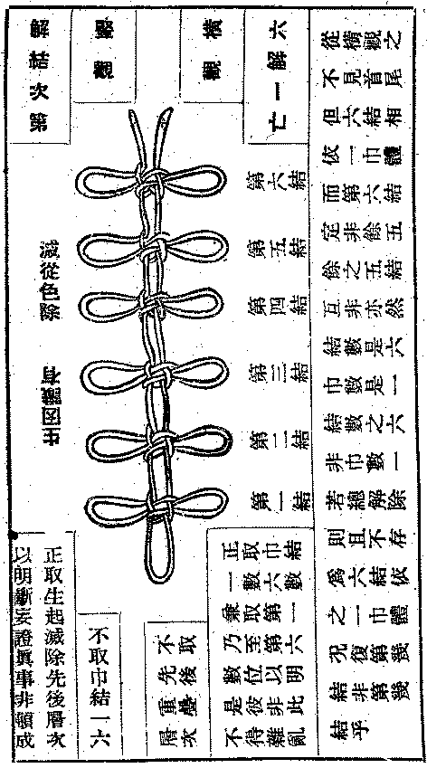



然理则顿悟，乘悟并销者，知本非结，知结可解，知今是结，知结须解。知解方法，知解层次，则结虽现存、而谓之结已解尽，可也。但结相实非因明了此理、而即灭除，故事非顿除也。是以佛告阿难，我已示汝劫波罗巾，何所不明！



偈曰：屑莫置眼，火不烧口，不济而济，悬磬待叩！



(觉社单行本)



楞严大意



——二十四年七月在嘉兴楞严寺讲——



一　佛法与人生意欲  

二　佛法与宇宙变现  

三　楞严之行门与禅密问题  

四　楞严之果位与顿渐问题  

五　楞严之除障  

六　楞严之辨惑



『楞严』是经名，今由楞严寺发起讲经，故讲楞严大意。本人初出家时，读诵楞严经，颇有启发。民三四、在普陀著大佛顶首楞严经摄论。民九、在湖北演讲，编成楞严研究。楞严经对於本人自身修学上，亦有因缘。故今讲大意，殊觉深切有味。



一　佛法与人生意欲



非纵欲　非节欲　非绝欲



伏断劣欲以发达胜欲



由此有楞严之缘起



『法』之字义最宽广，今人称宇宙万「物」、宇宙万「有」，还不及法字之宽广。法界之法，通括一切法为名。近之如各人本身，远之如十方法界；小之如一微尘，大之如全地球。法虽普遍於一切，但法之真实相，一切众生迷而不知，不能认清法之实相，因此心起颠倒执著。能如实觉知者为佛，或称佛陀、浮屠，即觉者。觉、即阿耨多罗三藐三菩提，此云无上遍正觉。觉者、谓於诸法实相如如相应者，因此法是如实觉知之法，故惟佛与佛，乃能究竟。



一切众生，无始迷惑颠倒，今以佛之觉法开示，使众生闻而悟入。在此世界应化现身，为开示众生故，方便说三藏十二部法，谓之佛法。楞严经，亦是佛随顺众生应机说法所开示的一部经典。佛既现身人间说法，人类为众生之一，今即以人类来代表一切众生。



众生的根本动力，即是意欲。意欲是一种倾向和愿望的精神作用。人类或其他一切众生相续不断生长发展的原因，即由意欲所发动。法华经云：「三界所生，贪欲为根」。阿含经云：「三界有情，皆依食住」。住字有相续生存义。食分段食、触食、思食、识食四种。段食、触食，领受六尘，资养身命。段食如每天领受饮食是。触食指所穿衣服、所住房屋、所见所闻等等而言。故衣食住均包括在食字内。思食即前途有希望，向前进取，如希望断绝而能百折不回，勇往直前延续生命之义。识食指第八识，受前七识熏成诸业种子，持身命相续不断义。欲界众生，不离段食；无色界甚深禅定非非想天，寿命相续，不离识食。故三界众生，皆依食住。圆觉经云：「欲界众生，皆以婬欲而正性命」。欲，包括五欲。由色、声、香、味、触，或财、色、名、食、睡起欲。欲界中之有情众生及无情器界，均由阴阳二性所结合而生存。据科学谈物质，电子由阴电绕阳核而成原子。有情众生更为显著，由父母和合而成身命，生命相续。须由二性和合而成或阴或阳之性，再求和合，由矛盾而统合，由统合而矛盾。故欲界特性，即依婬欲。婬欲亦是意欲之一，为人类欲之一种。人类在天性上即有男女、饮食之意欲。欲界众生，赖食与色生命相续，不断地造作和享受。



对於欲界人类意欲的发展或制止，中外圣杰贤豪，主张不同。一、纵欲说：西洋的近代文化，对於意欲，纵任其流行，不加阻止。尽量的发展意欲，满足意欲。所以征服自然，创造出物质文明。二、节欲说：中国儒家及各国贤哲，多有不主纵欲者。要在相当的限度内，施以节制，不令泛滥。三、绝欲说：中国道家及一部分宗教家与印度数论派等，修禅定求解脱，认定人生意欲是根本使人不安宁的东西；对於意欲，主张断绝超脱。根本否认食、色五欲，超出欲界，修色、无色定、到无想定或非非想定。而佛教之声闻、独觉二乘法，超出三界，断绝意欲，证无生，入涅槃，亦属绝欲说。



大乘佛法，对於有染性的劣欲，要降伏断除；纵劣欲则为患不浅，故除恶务尽。无漏的清净胜欲，同是意欲，如节胜欲又妨碍向上发展，故应导引扩充。惟大乘佛法，伏断劣欲，发达胜欲，故法身般若大悲大愿。



修行者，发何种信，是何趣向，所行所趣，在何地位渐次伏断劣欲，发达胜欲。由菩萨行以至成佛，有断德、智德、恩德。断德即伏断劣欲而致；智德、恩德，即发达胜欲所成。由此有楞严之缘起。楞严经的当机人，即阿难陀尊者，为佛弟子，多闻第一。发心出家，持比丘戒，求阿罗汉四沙门果。所处行位，尚未发大乘菩提心大悲愿。经云：『涂中独归，其日无供。即时阿难执持应器，於所游城，次第循乞』。时因阿难未证圣果，乞食资生，因有宿缘，遇摩登伽。经云：『经历淫室，遭大幻术摩登伽女，以娑毗迦罗先梵天咒，摄入淫席，淫躬抚摩将毁戒体』。摩登伽女之母有咒术，迷惑人性。其时阿难遭遇苦难，不能自救。仗佛力说咒，由文殊师利菩萨前往救脱，并引摩登伽出家修行。



众生生死轮回，缘食、色之欲，初修行人易堕其难；要仗大乘佛法不可思议力之所救护，故楞严经之缘起，即在如此。盖明小乘无力，自救不了，非由大乘威德以救之不可。为降伏食、色劣欲之障难，乃依菩提心四弘誓，发展大愿大欲。故阿难既脱苦难，即痛哭流涕，求大乘修行禅定功德法、及闻法开悟。即云：『愿今得果成宝王，还度如是恒沙众！将此深心奉尘刹，是则名为报佛恩。伏请世尊为证明，五浊恶世誓先入，如一众生未成佛，终不於此取泥洹！大雄大力大慈悲，希更审除微细惑；令我早登无上觉，於十方界坐道场』。依欲界生死相续之法，身心均不清洁。一念大乘智慧相应生空法空，一切劣欲降伏，真如法身现前，遂发为大乘胜欲。



以上伏断劣欲以发达胜欲，为全经缘起，乃有以后七卷经文之演述。



二　佛法与宇宙变现



非色集　非神造　非空出



心迷业系与心悟量超



由此显楞严之实相



一、色集：色，与物质的意义彷佛。如曰四大、五根、五尘，在佛典上均名色法。印度、希腊古哲学家，讲万物由风——即空气——所成，或说万物由水所成，由火所成，由土所成，或说四大合成。我国说由五行所成。现在科学家说：心理的精神现象，从生理的有机体发生；生理上的有机体，从无机体的物质原素组成。由化学上分析，万物不过由八九十种原质所成。由原质析成分子，分子析成原子，原子再析成电子。故宇宙万物，是由色法集合而成。二、神造：婆罗门教，认为世界万物由大梵天或大自在天所创造所主宰。耶教等均主神造，一切由神支配。三、空出：万物出於有，有出於无，虚无为道本，虚无为万有出生的根源。如中国的道家。在印度亦有虚无外道，万物之本，归之於空。上列各种学说，离合错综，非常复杂。举其大要，约分前述三类。



如上所述，宇宙变现，似有一定体相不可逾越之界限。其实三界众生生死流转，无始无明迷惑颠倒，起烦恼业，得分段报，而有一切大小、自他等差别。经云：『一切众生，从无始来迷己为物，失於本心，为物所转；故於是中观大观小，若能转物，则同如来身心圆明，不动道场，於一毛端遍能含受十方国土』。因心迷故，佛与众生平等不二之真性迷失，业果相续，起种种颠倒烦恼，造种种业。心迷业系，则成各类众生世界。心悟则所有一切世界众生业果限量，当下超脱；一切众生，同於诸佛法身。现前众生世界，即是诸佛净土。宇宙变现，大致如此。经云：『宝觉真心，各各圆满，如我按指海印发光，汝暂举心尘劳先起』。宝觉真心，具足无量清净功德庄严。迷惑颠倒未尽，不得自在。故经云：『疑惑销除，心悟实相』。



三　楞严之行门与禅密问答



即诸法而通法性



即定刺而成性定



以律仪清净为基楚



以密咒诵持为扶助



楞严经中最主要的，即是楞严之行门。阿难遭摩登伽之难，蒙佛说咒度脱。本经第七卷上，阿难复请佛说咒。佛说咒时，顶上放光，光中现佛。因咒之持诵功德，古今来不少人以楞严经属於密宗。然以楞严经之全部脉络义理观察，明理、修行、证果，仍以归入千餘年来最盛行的禅宗较为确切。且经中以律仪清净为基楚，以密咒诵持为扶助，而正行则在反闻三昧；与纯粹以咒仪为主者不同，实唯禅宗的修行法门为最相近。从经的意义观察，以救摩登伽之难为发起，制服劣欲，发达超三界、二乘之胜欲；从所明理，修所宗行，均合禅宗。而与密宗修大悲方便，活用贪、瞋、痴以行四摄不同，此为对於楞严行门总相的观察。



从五阴、十二处、十八界、七大明皆妙真如性。由於真性之迷惑颠倒而成六凡流转；觉悟了达而成四圣解脱。所有一切世出世间之法，皆依妙真如性之或迷或悟。迷则烦恼生死，悟则涅槃解脱。所以一切诸法，本来是妙真如性。即诸法而通达法性，如一念智慧相应，无明烦恼分别当下净尽。凡夫众生不出五阴、十二处、十八界、七大之法，一一法即是如来法身。如是观察，依一一法，门门入道，头头解脱。



从阿难尊者多闻功能习惯，易起分别。本经第四卷阿难受如来训，阿难自谓犹如旅泊之人，忽蒙天王赐与华屋，不得其门而入。如来为他示两种决定义：於四大、五浊众生世界中欲发菩提心，修菩萨行，令因地心同果地觉，须依不生灭心作因地心。此心圣凡平等不二，乃能与果地觉平等不二。依是发起趣向菩提，坚固不坏。先明诸法实相之理，从以增修禅定，得证定益，对治定病，均於此为本。



从六根以说明六尘、六识之十八界法，阐明六根功德浅深广狭。耳根、舌根、意根、功德圆满，眼根、鼻根、身根，功德缺少，始知选择依那一种法去修。圣凡法界依六根为本。从圆满根修圆通行，与依不圆满根，一日一劫相抵。欲从六根觅最圆通者去修，乃选出耳根。即从四大、五浊中见不生灭性，依不生灭性为因地心，是为第一根本。次明一切生死烦恼根本都在六根，欲得修行入手之处，选出耳根为修行圆通门。十方如来，依一门深入，证无生忍，得大解脱。经云：『汝今欲令见闻觉知远契如来常乐我净，应当先择死生根本，依不生灭圆湛性成』。又云：『汝但不循动、静、合、离，恬、变、通、塞，生、灭、明、暗，如是十二诸有为相，随拔一根，脱黏内伏，伏真归元，发本明耀；耀性发明，诸餘五黏应拔圆脱。不由前尘所起知见，明不循根，寄根明发，由是六根互相为用』。然佛及十方菩萨，依十八界诸法，皆可为悟入法门。



本寺大殿上供楞严圆通诸圣，两旁二十四位，连中间观音，共二十五。自憍陈如从音声悟入得成阿罗汉，以及大势至、弥勒，从根大、识大通达法性入无生忍。就修禅定，文殊师利乃选观音耳根圆通门，为最当机。从耳根通达无生法性，以虽心迷业系之众生，耳根在睡眠不昏。经云：『是人梦中，岂忆静、摇、开、闭、通、塞，其行虽寐，闻性不昏。纵汝形销，命光迁谢，此性云何为汝销灭』？故圆通常义俱胜。



三摩地、此云定，又云三昧，直译等持。平等任持，摄伏攀缘六尘的定心。从反闻以修禅定，散乱易离。定心成就，不入色，声、香、味、触，不缘五尘，不起五识，定心在意识相应，专注不纷。若到真正定心成就，行住坐卧常在禅定。然修禅定入手工夫，在乎静坐。坐得平稳调和，眼光闭断前境，鼻、舌停辨香、味，身、心调和，冷、热、轻、重、饥、饱之触觉亦不起。其时最难离者即耳闻的声。在经论上讲，声为定刺。如刺入肉体，使痛不安；声亦刺定心，令不安稳，不成长久相续。故止静时，打板以声止静，出静亦以磬声或板声。昔四川吹倒一大树，内有一僧人入定，似死非死，但未断煖气。地方官送入京师，召佛教大德，施出定法，在其耳边打磬，遂渐出定。可见定心不获坚住，不易相续，闻声是最大甚深的关键。闻声使从定心起散乱分别，故修禅定在身心调和后，从耳根返闻，为止散乱最胜方便。



经云：『初於闻中，入流亡所，所入既寂，动静二相了然不生；如是渐增，闻所闻尽，尽闻不住，觉所觉空，空觉极圆，空所空灭；生灭既灭，寂灭现前，忽然超越世出世间』。如何修持？即於闻中入流亡所，逆闻流使返入闻中，亡脱所闻，能亦不得。反闻以闻如来藏妙真如性，融化闻根，入人空境界；见、闻、觉、知六根，融化成一体圆明妙觉，证生空真如涅槃法。进到觉所觉空，悟入法空，一切皆空；空所空灭，俱空不生。所有一切生灭对待悉皆超脱，寂灭现前，超越世出世间；法法悉成解脱，尘尘俱证菩提。此谓从耳根反闻入三摩地，故经云：『旋闻与声脱，能脱欲谁名？一根既返源，六根成解脱』。



复次、经云：『欲摄其心入三摩地，云何令其安立道场远诸魔事，於菩提心得无退屈』？而先之以淫、杀、盗、妄四根本戒清净，为修耳根圆通定之基础。经云：『要先持此四种律仪，皎如冰霜，自不能生一切枝叶；心三、口四，生必无因』。



倘受戒不能圆满，持戒不能具足清净，因有宿习不能灭除，故以密咒诵持为扶助。经云：『若有宿习不能灭除，汝教是人一心诵我佛顶光明摩诃萨怛多般怛罗无上神咒』。阿难倘无宿习，不堕摩登伽之难，则持戒修定，不须佛咒救护。



以上、阐明悟妙真如性以修圆通行门。



四　楞严之果位与顿渐问题



从颠倒乱想示十二类生



依首楞严定开五十七位



由增进行渐历诸位



获金刚心顿起诸位



倘不明楞严之果位，起增上慢，非但不得利益，反易堕落。见性成佛，顿悟法门应无渐次，即事明理，无不皆顿。即理明事，则有渐次：有顿中之渐，顿悟中有渐次之修证；有渐中之顿，渐修中有顿发之觉悟。



众生颠倒乱想，从无始来迷妄不觉，故有卵生、胎生、湿生、化生、有色、无色、有想、无想、若非有色、若非无色、若非有想、若非无想，如是十二类生。经云：『如是众生一一类中，亦各各具十二颠倒。犹如捏目，乱华发生，颠倒妙圆真净明心，具足如斯虚妄乱想』。



为欲超脱众生世界，证涅槃，成菩提：开乾慧地、十信、十住、十行、十回向、四加行、十地、等觉、妙觉五十七位。



云何名为三种渐次？经云：『一者、修习除其助因；二者、真修刳其正性；三者、增进违其现业』。第一渐次，断除五种辛菜。今之烟、酒、赌博，亦属助因，应当去除。第二渐次，严持清净戒律。第三渐次，反见见自性，反闻闻自性；守护根门，不令六根放逸到六尘上去。因戒生定，所谓返六根之流，顺一体之觉。持自性六根戒，身三口四自然清净。经云：『妙圆平等，获大安隐，一切如来密圆净妙皆现其中，是人即获无生法忍。从是渐修，随所发行，安立圣位』。



金刚心，在成佛以前之无间道。若一位摄一切位，则每一位上具足五十五位真菩提路。於金刚心中再经五十五位，皆是首楞严定中安立位次，即渐而顿之法门。经云：『从乾慧心至等觉已，是觉始获金刚心中初乾慧地；如是重重单复十二，方尽妙觉，成无上道』。



五　楞严之除障



痴爱与七趣流



慢见与五阴魔



说业报除戒障



辨心境除定障



初学禅定，得定境时，恍如忽到沙漠地方，一片广漠无垠的境界，从未经历，绝非人间寻常境地，在此时易起迷惑。从五阴渐次发现其境，从色阴境界起，至识阴境界止，皆是定心上所起之副作用。惑为圣境，即其魔邪。故除定障，非常切要。不生邪见，自能去除魔障。当观一切法，本如来藏妙真如性，则一切障无从发生，无须对治。若心迷颠倒，即成障的根本。痴、爱，即贪、痴。经云：『如是地狱、饿鬼、畜生、人及神仙、天洎修罗，精研七趣，皆是昏沉诸有为相』。由痴、爱而有地狱、饿鬼、畜生、人、仙、天、修罗、七趣流转。要免七趣流转，应持净戒；戒除贪、痴，返观清净自性。



五阴魔从慢、见起。增上慢得少为足，自以为证圣果，乃招魔事。於定心起断常等之不正见，流入外道。经云：『魔境现前，汝不能识，洗心非正，落於邪见。又复於中得少为足，如第四禅无闻比丘，妄言证圣，堕阿鼻狱』。欲去五阴魔，应消除不正见及增上慢。修定的心，即是主人。主人若迷，邪魔之客即得其便。有空心，即有空境，觉悟无惑，庶无妨碍。经云：『由汝心中五阴主人，主人若迷，客得其便；当处禅那，觉悟无惑，则彼魔事无奈汝何』！



欲超出七趣轮回业报，要去除杀、盗、淫三惑。经云：『欲得菩提，要除三惑；不尽三惑，纵得神通，皆是世间有为功用』。欲成就定、慧，要有正见，不起增上慢。经云：『魔境现前，汝能谙识，心垢洗除，不落邪见』。



六　楞严之辨惑



甲　教理之部



二根本与真心论



七大与唯根论



十二类生与法身论



１　二根本与真心论



经云：『一者、无始生死根本，则汝今者与诸众生用攀缘心为自性者。二者、无始菩提涅槃元清净体，则汝今者识精元明，能生诸缘，缘所遗者』。缘所遗、谓觉知不到。又经云：『从无始来生死相续，皆由不知常住真心，性净明体，用诸妄想；此想不真，故有轮转』。此皆辨妄明真之真心论。全部经文中，有一贯的中心思想，即是常住真心，故本经以常住真心为基本。信解，即明常住真心之理；修行，即除常住真心之障；证果，即证常住真心之德。



２　七大与唯根论



地、水、火、风，称为四大，并空大、识大、为六大。而此经特加根大为七大，以为唯根论之张本。经云：『如一见根，见周法界。听、嗅、尝触、觉触、觉知，妙德莹然，遍周法界，圆满十虚，宁有方所』！又云：『汝欲识知俱生无明，使汝轮转生死结根，唯汝六根，更无他物。汝复欲知无上菩提，令汝速证安乐解脱寂静妙常，亦汝六根，更非他物』。根大与修耳根圆通，有重大关系。此经说根、识，与唯识论所说界限不同。唯识论、识的范围深广，楞严经、根的范围深广。故唯根论与唯识论对立，以根来摄一切法。本人十年前曾作三唯论：唯识、唯根、唯境，唯根论是楞严经特异处，用根不用识，以现量六识，都摄在六根故。



３　十二类生与法身论



经云：『若此妙明真净妙心，本来遍圆，如是乃至大地草木、蠕动含灵、本元真如，即是如来成佛真体；佛体真实，云何复有地狱、饿鬼、畜生、修罗、人、天等道』？十二类生包含金石土木、山河大地等无情之物。如是则有情众生，生死流转，可变为无情，此与他经论教义不同。惟楞严经确是佛说，仅根据点有异而已。众生世界，即是如来成佛真体。譬如全海成风浪，风浪即在全海。法身成有情无情，则有情无情均即法身。故曰：『情与无情，皆成佛道』。



乙　考据之部



首楞严释名及经咒考



摩登伽女经与本经



本经之翻译与流传



１　首楞严释名及经咒考



首楞严此译健行。古今解此经者，则译一切事究竟坚固。一切事即行，究竟坚固即健。此经简称楞严，具云：大佛顶如来密因修证了义诸菩萨万行首楞严。一名中印度那烂陀大道场经，於灌顶部录出别行。谓那烂陀寺藏经的灌顶部中所别录出之一经也。



别有佛说首楞严三昧经一卷，鸠摩罗什译，与此经非同本。乃专说得此三昧之佛菩萨功德神用者。



楞严咒定为僧林早诵。其实、唯后『怛姪哆』以下之十句为咒心，其前则为礼供赞诵之五会仪轨。所谓：一、毗卢真法会，二、释尊应化会，三、观音合同会，四、刚藏折摄会，五、文殊弘传会。解详从灌顶疏别录出之咒章摘注。



与此经咒之名义近同者：大佛顶如来放光悉怛多钵怛啰陀罗尼，不空译。在续藏一辑一套四册。又、佛顶大白伞盖陀罗尼经，沙啰巴译。佛说大白伞盖陀罗尼经，元、真智等译。此二经兼咒轨，在频伽藏咸帙六册。又、白伞盖大佛顶王最胜无比大威德金刚无碍大道场陀罗尼念诵法要。此见频伽藏餘帙一册，及续藏一辑三套一册。乃东密录出诵轨，不明译人。



２　摩登伽女经与本经



摩登伽女经二卷，吴、天竺竺律炎共支谦译。舍头谏太子二十八宿经一卷，西晋竺法护译。此二经为同本异译，详阿难摩登伽宿缘。又佛说摩邓女经一页，后汉、安息三藏安世高译。佛说摩邓女解形中六字经一页，东晋录，失译人。此二经同本异译，但说阿难被困，佛咒救度。



３　本经之翻译与流传



此经翻译，纪称大唐中宗神龙之年，乙巳岁五月二十三日，中天竺三藏沙门般刺密谛於广州制止道场译，盖纪其译成时也。开元录则载大唐沙门怀迪於广州译。今流通本，加题乌苌国沙门弥伽释迦译语，清河房融笔授。此经弘传，相传房相书经入奏，适中宗初嗣，未暇颁行。时神秀大通禅师，在内道场，见所奏本，录行北地。誊一部归荆门度门寺。馆陶沙门慧振，得之科解，为弘传始。又传天宝十年，惟悫法师於房融家，得其笔受之本，始作注疏。又相传密谛先曾来中国，见智者大师止观，谓略同楞严，智者因请译传来华。



其弘传与禅、台、贤、儒四家有深渊源者，继唐、宋、元、明、清弘扬者，代不乏人。禅家：长庆道𪩘禅师，永明智觉禅师，泐潭晓月禅师，石门圆明禅师，温陵宝胜禅师，中峰明本禅师，以及天如、紫柏等。贤家：则资中弘沉法师，长水子璇法师，鲁山普泰法师，交光真鉴法师，慈云续法法师，达天通理法师等。台家：则孤山智圆法师，桐洲怀坦法师，天台幽溪法师，灵峰蕅益法师等。儒家：则王介甫解，张无尽补注，曾凤仪宗通，钱谦益蒙钞等。而五台山空印法师，与蕅益法师，稍稍以法相义说之。晚唐以来，三论亡而唯识不昌，故鲜弘通及此经者；或亦以宗义之较疏远也。由此、近人据三论或唯识义者，遂间生诽拨。



------



## （吴印若记）(见海刊十六卷十一



如来藏心迷悟图



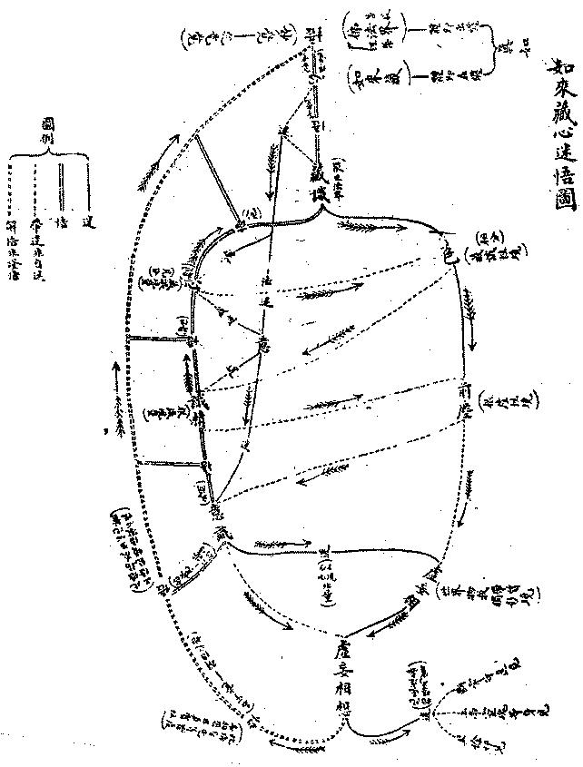



大佛顶首楞严经研究



——九年十月在武昌讲经会提案——



> 前言  

> 一　明本经在佛藏中之相对位置  

> 甲　宗义上之本经相对位置——真言宗者  

> 乙　教乘上之本经相对位置——大乘普为出世乘者  

> 丙　化法上之本经相对位置——先出世而后济世者  

> 丁　行人上之本经相对位置——苾刍者  

> 戊　观境上之本经相对位置——耳根者  

> 己　修门上之本经相对位置——奢摩它者  

> 二　释古近人对於本经四种之疑  

> 甲　释古近人对於本经翻译之疑  

> 乙　释古近人对於本经流传之疑  

> 丙　释古近人对於本经文义之疑  

> 丁　释古近人对於本经说时之疑  

> 研经  

> 甲一　经序分



------



### 乙一　化成序



### 乙二　缘起序



> 甲二　经宗分  

> 乙一　顿问顿答悬示始终全义  

> 乙二　委说委示等流智悲二教  

> 丙一　悟证如来性觉  

> 丁一　即三道成三德  

> 戊一　显如来藏  

> 己一　历万法显如来藏而开圆悟  

> 庚一　示真实性  

> 辛一　破相想遮显如来藏  

> 壬一　徵定  

> 壬二　破显  

> 癸一　破处计以无在显  

> 癸二　破倒执以无体显  

> 壬三　结责  

> 辛二　就见精表显如来藏  

> 壬一　蹑前重请得蒙建大法幢  

> 壬二　蹑前逐问专为辨明见性  

> 癸一　借盲有心而灯同眼直指见性是心非眼  

> 癸二　借客不住而尘摇动现验见性常住无动  

> 癸三　借色身变而观河之见无改显见性一向不生不灭  

> 癸四　借首尾换而垂臂之手无失显见性从来不增不减  

> 癸五　借尘象可还可择见精无还无择显见性汝真  

> 癸六　借器界局方局量见精超方超量显见性自性  

> 癸七　就见精非是物非非物显见性一真绝待  

> 癸八　就见精非因缘非自然显见性离相即法  

> 癸九　就见精剖出同分妄见别业妄见显见性是本觉明心  

> 癸十　就见精重明非和合生非不和合显见性唯离言自证  

> 辛三　会法相泯显如来藏  

> 壬一　承前总示阴入处界本如来藏  

> 壬二　次第别明阴入处界本如来藏  

> 癸一　五阴  

> 子一　色阴本妙  

> 子二　受阴本妙  

> 子三　想阴本妙  

> 子四　行阴本妙  

> 子五　识阴本妙  

> 癸二　六入  

> 子一　眼入同是菩提  

> 子二　耳入同是菩提  

> 子三　鼻入同是菩提  

> 子四　舌入同是菩提  

> 子五　身入同是菩提  

> 子六　意入同是菩提  

> 癸三　十二处  

> 子一　见色俱无处所  

> 子二　听声俱无处所  

> 子三　嗅香俱无处所  

> 子四　尝味俱无处所  

> 子五　身触俱无处所  

> 子六　意法俱无处所  

> 癸四　十八界  

> 子一　眼色识界不可得  

> 子二　耳声识界不可得  

> 子三　鼻香识界不可得  

> 子四　舌味识界不可得  

> 子五　身触识界不可得  

> 子六　意法识界不可得  

> 辛四　出法体融显如来藏  

> 壬一　总疑总遣  

> 壬二　别融别显  

> 癸一　地大  

> 癸二　火大  

> 癸三　水大  

> 癸四　风大  

> 癸五　空大  

> 癸六　见大  

> 癸七　识大  

> 庚二　获本妙心  

> 己二　约四谛显如来藏而劝妙修  

> 庚一　因满慈蹑疑而广显  

> 辛一　承前问许  

> 辛二　次第说示  

> 壬一　显如来藏集苦因果  

> 壬二　显如来藏道灭因果  

> 壬三　显如来藏相本圆融  

> 壬四　显如来藏妄本空寂  

> 庚二　因阿难滞闻而劝修  

> 戊二　明圆通门  

> 己一　正教当机双审性修  

> 庚一　阿难悟请  

> 庚二　世尊许说  

> 辛一　普为开示  

> 辛二　正令审择  

> 壬一　总示修圆通先明二决定义  

> 壬二　徵释修圆通云何为二决定义  

> 癸一　双徵  

> 癸二　别释  

> 子一　重审因地心令依全性起修  

> 子二　详示圆通境令择一门深入  

> 丑一　示六结根功德圆缺令选一深入一净全净  

> 丑二　明六结根体用融隔令知一随拔一脱圆脱  

> 丑三　验闻根不生灭性密令选耳门圆通  

> 丑四　证六根即真妄元密令选根门圆通  

> 丑五　借结巾明六解一亡即渐解而喻修圆通伦次  

> 丑六　敕众圣说餘门同证广耳门而密授圆通本根  

> 寅一　阿难请世尊授圆通本根  

> 寅二　世尊敕众圣说最初悟门  

> 卯一　世尊普敕  

> 卯二　众圣各陈  

> 辰一　众圣略说餘门  

> 巳一　音声圆通  

> 巳二　色因圆通  

> 巳三　香严圆通  

> 巳四　味因圆通  

> 巳五　触因圆通  

> 巳六　法因圆通  

> 巳七　旋见圆通  

> 巳八　反息圆通  

> 巳九　旋知圆通  

> 巳十　纯觉圆通  

> 巳十一　旋法圆通  

> 巳十二　心见圆通  

> 巳十三　心闻圆通  

> 巳十四　息观圆通  

> 巳十五　辩才圆通  

> 巳十六　持戒圆通  

> 巳十七　神力圆通  

> 巳十八　火大圆通  

> 巳十九　地大圆通  

> 巳二十　水大圆通  

> 巳二一　风大圆通  

> 巳二二　空大圆通  

> 巳二三　唯识圆通  

> 巳二四　念佛圆通  

> 辰二　观音广记耳门  

> 巳一　略叙最初修证  

> 巳二　广明成就功德  

> 午一　三十二应  

> 午二　十四无畏  

> 午三　四不思议  

> 巳三　结显圆通名号  

> 卯三　光瑞齐现  

> 丑七　由文殊代当机选耳门为圆通本根  

> 丑八　叙阿难洎大众闻法主说圆通利益  

> 己二　追为末世重宣说咒  

> 庚一　并问摄心远魔  

> 庚二　历说持戒诵咒  

> 辛一　诫持心戒  

> 壬一　提叙三无漏学  

> 壬二　历说四决定戒  

> 癸一　总徵  

> 癸二　别说  

> 子一　戒婬  

> 子二　戒杀  

> 子三　戒欺世偷  

> 子四　戒大妄语  

> 辛二　宣说顶咒  

> 壬一　因宿习难净而劝持顶咒  

> 壬二　因持咒行道而建立坛仪  

> 壬三　因闻咒功德而求宣顶咒  

> 癸一　同请宣说  

> 癸二　宣说神咒  

> 子一　叙大众所见闻  

> 子二　录如来所说咒  

> 壬四　因重宣顶咒而显咒功德  

> 癸一　乘此咒心万行成就  

> 癸二　感诸善神共愿护持  

> 戊三　示菩提路  

> 己一　总起  

> 己二　详示  

> 庚一　重明如来藏非即真妄  

> 庚二　广显如来藏逆顺因果  

> 辛一　明逆修十二生类因果  

> 壬一　明由二颠倒因成十二生类  

> 壬二　明由十二乱想成十二生类  

> 辛二　明顺修六十佛位因果  

> 壬一　明反妄正修三重渐次  

> 癸一　总标除妄须立三渐次  

> 癸二　别释进修当依三渐次  

> 子一　修习除其助因  

> 子二　真修刳其正性  

> 子三　增进违其现业  

> 壬二　明纯真妙修十二单复  

> 癸一　分示  

> 子一　乾慧地  

> 子二　十信  

> 子三　十住  

> 子四　十行  

> 子五　十回向  

> 子六　四加行  

> 子七　十地  

> 子八　等觉金刚心妙觉  

> 癸二　结成  

> 丁二　结一经立五名  

> 丙二　保绥菩萨初心  

> 丁一　明七趣生报以匡扶第二渐次  

> 戊一　请说业报令信  

> 己一　叙益蹑请  

> 己二　嘉许详说  

> 庚一　嘉许  

> 庚二　详说  

> 辛一　略以情想明  

> 辛二　广以业报明  

> 壬一　就人间恶业而明招地狱报  

> 癸一　蹑起  

> 癸二　徵解  

> 子一　十习因  

> 子二　六交报  

> 癸三　结判  

> 壬二　就地狱餘业而明招饿鬼报  

> 壬三　就饿鬼业尽须偿宿债而明招畜生报  

> 壬四　就畜生业尽转生人间而犹带餘习  

> 壬五　就世人妄念别修而明十种仙趣  

> 壬六　就人世淫戒渐净而明六欲天趣  

> 壬七　就世禅增进而明色空天趣  

> 壬八　就欲界杂报而明阿修罗趣  

> 戊二　结明虚妄劝除  

> 丁二　辨五阴魔境以匡扶第三渐次  

> 戊一　哀无闻深诫魔事须识勿迷主人而隳宝觉  

> 己一　佛慈缘起  

> 己二　魔妄根由  

> 戊二　历阴境总明妄想为本毋欺自心而入邪歧  

> 己一　色阴禅境魔事  

> 庚一　总明  

> 庚二　详辨  

> 庚三　结诫  

> 己二　受阴禅境魔事  

> 庚一　总明  

> 庚二　详辨  

> 庚三　结诫  

> 己三　想阴禅境魔事  

> 庚一　总明  

> 庚二　详辨  

> 庚三　结诫  

> 己四　行阴禅境魔事  

> 庚一　总明  

> 庚二　详辨  

> 辛一　二无因论  

> 辛二　四遍常论  

> 辛三　一分常论  

> 辛四　四有边论  

> 辛五　遍计虚论  

> 辛六　死后有相  

> 辛七　死后无相  

> 辛八　死后俱非  

> 辛九　七断灭论  

> 辛十　五涅槃论  

> 庚三　结诫  

> 己五　识阴禅境魔事  

> 庚一　总明  

> 庚二　详辨  

> 庚三　结成  

> 辛一　结诫  

> 辛二　成功  

> 戊三　叹法门直至菩提无乏垂怜末世而劝持咒  

> 乙三　重请重告结归理事唯心  

> 甲三　经益分  

> 餘说



前　言



一　明本经在佛藏中之相对位置



案曰：往常讲经之式，都以悬论一经纲要、广解经题，继之科释文义，编为次第。兹以纲要，经文自明，先事空述，转厌繁仍。本经五题，亦见经文；结集者撮录之略题，亦无於文前先释之必要。故今直从经文为研究之起点。然与同人研究本经，於本经取为何种研究之对象，不可不先事讨究之。佛应时机说法，法法皆为第一。后时说经者依遵之，往往持讲一经，即崇其持讲之经为独尊无侣。夫隆重之以专其信，洵亦法王殊胜方便；无如扬於此者、不免有抑於彼，学者执之，差违随起。大藏经论、多束之高阁者，讲师之抱一摈餘，盖未始非一种原因也。虽一一法皆为法界，亦一一法各住法位，故兹不将本经为佛法或一切法中绝对最高之法；但取为佛藏种种经论中占有一相对位置者以研究之。本斯意可提出与同人研究者，有六端焉。



甲　宗义上之本经相对位置——真言宗者



论曰：本经始终唯是持顶咒……陀罗尼灌顶章句也。



案曰：观之论文，已足见本经於各宗派中当属於真言宗矣。不第是也，真言宗专主事事无碍，以六大、四曼、三密为体相用。本经观世音所说之四不思议。及七卷初佛说建坛仪轨、持咒行法，既完具四曼、三密之义相；且三卷中之说七大，皆曰清净本然周遍法界，与说五蕴等异；四卷中说意根之根元，亦目为清净四大，并有浮根四尘；不尤合真言宗六大为体之义，而特殊乎餘宗经论之唯以心性为体乎！又长水疏列别题曰：一名中印度那烂陀大道场经，於灌顶部录出别行。「中印度那烂陀大道场经」者，犹云「中印度那烂陀寺（那烂陀、乃寺旁池中龙名，译施无厌）所编定之藏经」也。其编定之大藏，以意揣之，於经藏中殆分有显密之二教。於密教中，又分为灌顶部等之五部（五部见真言宗真实三昧耶经：东金刚部、南宝生部、西莲花部、北羯磨部、中灌顶部，毗卢遮那如来主之。观世音属莲花部）。而本经则属於密教灌顶部中之一种经，故曰於灌顶部录出别行。然则本经之必为真言宗经典，岂不尤可见乎！故昔者虞淳熙序憨山师本经悬镜，亦云空中之镜悬而照坛中之镜，盖持心咒之仪轨也。乃至舍咒心而谈真心，是增益多闻，非世尊意，亦非憨师之意矣。亦足相与发明。然真言宗又大别为胎藏界、金刚界。胎藏界重在理，纯诠果德。金刚界重在智，兼诠因行。窃指本经为属於真言宗金刚界、由莲花部观世音因门证入灌顶部毗卢遮那果海者，愿同人研究之者一。



乙　教乘上之本经相对位置——大乘普为出世乘者



案曰：佛之言教，咸能使人信解行证，载以运因至果；故凡教皆乘也。然以机感不同，教施非一，因是运载之用亦多差异。约言其概，略标如左：



　　　　　　┌小──阿含等  

　　　　　　│　　　　　　　　　　┌三乘  

　　　　　　│　　　　　　┌普为─┤  

　　　　教乘┤　　　　　　│　　　│  

　　　　　　│　　┌通共─┤　　　└五乘  

　　　　　　└大─┤　　　└会归──法华等  

　　　　　　　　　└不共──┴─圆觉楞伽等



阿含等经为小乘教，易知。分之亦应有共、不共。共者，通摄人乘、天乘善法及缘觉法。不共，专指声闻乘法。圆觉、楞伽等经，为不共大乘教，易知。华严、法华，颇有异论。虽古来皆以华严为不共大乘，但华严入法界品亦通摄二乘乃至人天善行。而法华既会三归一，三废一存，唯一无三，应是不共或非共非不共。然据其胜者属当之，则华严不共，法华共为便。大乘教中普为乘教，则大乘经大都皆是。盖以人天戒定、声缘谛慧，既皆大乘阶嶝，自应含摄靡遗。彼人、天、声、缘乘机受之，固不妨自成其人、天、声、缘乘法益也。然主行者实大乘教，特旁化及於人、天、声、缘耳。按其旁化所及论之，可更析为出世三乘之普为乘，与世出世五乘之普为乘。本经於解脱门通收大小乘之圣证，戒禅又皆专注重出生死，终结之曰『知有涅槃不恋三界』，当是普为出世三乘之大乘教。独说七趣业果，兼助增人天之善行，故蒙钞有第八人天行位者，乃至尚思救将来之急，谛审之哉一文。今判本经正属於普为出世三乘大乘教，兼通於普为世出世五乘之大乘教，愿同人研究之者二。



丙　化法上之本经相对位置——先出世而后济世者



案曰：尝观夫大乘之化法，可分三类：一、为先出世自度而后度人济世之化法，此类大乘经典较多，智增上菩萨适用之。二、为唯度人济世即成出世自度之化法，此类若维摩诘经等较少，悲增上菩萨适用之。三、为在同时自度度人出世济世之化法，此为大乘经典通义，悲智均等菩萨为宜。本经以阿难堕婬室、承佛救为发起因缘，阿难因之欲从有力能救人之大乘，求一方便门先速自超脱：一、证於说戒不先戒杀而戒婬；二、证於圆通门不单取菩萨而兼收二乘无学。餘若『汝虽历劫忆持如来秘密妙严，不如一日修无漏业，远离世间憎爱二苦』。持咒利根先得须陀洹果，性比丘尼成阿罗汉，阿难自知修证无学道成，皆可证知本经为先出世自度而后度人济世之化法。然阿难既发『愿令得果成宝王，还度如是恒沙众，将此深心奉尘刹，是则名为报佛恩』之宏誓，后有『我虽未度愿度末劫一切众生』之请。则谓本经兼有同时自度度人、出世济世之化可也，愿同人研究之者三。



丁　行人上之本经相对位置——苾刍者



案曰：佛法中修行人，有男女缁素诸部类。所修行法，往往因人之部类而异宜。按之本经，则当以出家男子之苾刍为独宜。第一、以发起及当机者之阿难尊者，是苾刍故，且是好心出家具戒多闻之苾刍故，佛自然多就苾刍所宜行者开示之。第二、无论修耳门之圆通，持顶光之神咒，皆须严净律仪；否则不能现生成就，但可远资胜缘，或且不免堕魔邪故。因此、本经行法虽不限人修证，而除苾刍外，餘一切人势较难，愿同人研究之者四。



戊　观境上之本经相对位置——耳根者



案曰：出世定慧皆成於观。能观之智，初必属於意识相应之慧心所为主。但於初心所观之境，则可种种择取不一。大乘经论择取初心观境之显而易见者：若起信论之取一心二门为所观境；成唯识论之取一切法唯识为所观境；中论之取一切法毕竟空为所观境；摩诃止观之取意识心王为所观境；皆择定所观境体之有异，非能观智体之有异。或者混能所智境之不辨，争执本经破识取根等义，皆失之矣。今谓若论本经之择观境，虽直可谓之「唯六根论」，所谓十八界摄一切法尽。六尘是六根之影，六识是六尘之影，识发乎尘，尘出乎根，故六根摄一切法尽。摄论尝论正脉疏最得此一门之意。



论曰：戊、本经始终唯令选入耳根……此亦方便之方便欤！



案曰：依是、可见本经所择取观境，先择诸法中之六根，次择六根中之耳门，较诸经论择之独审，愿同人研究之者五。



己　修门上之本经相对位置——奢摩它者



论曰：乙、本经始终唯令修证如来禅……回为己解，疑误后学耳！



论曰：癸、本经始终唯令必入解行相应地……盖有非言辞可论量者矣！



案曰：观此可知若论本经修进门路，不唯如来藏心、圆通法门，皆是修禅之门，所悬示之菩提圣位，所分析之阴妄魔境，亦依禅那之增进相为说，故直可谓之禅那波罗密经也。禅那、华言静虑，乃寂静心中微密观察义。蒙钞諮决疑义第四剋示方便一章，所云寂静观照，只一奢摩他可了之。憨山大师通议，谓本经始终皆不外乎破五蕴之妄，显一心之真。咸可参证。本经为修大乘上上禅之方便门也，憨山大师答武昌段幻然给谏书，尤为透露；愿同人研究之者六。



案曰：出此六义，亦有次第。首知此经属於密教，密教为大乘教。进论此经为何种大乘教，於是次知属大乘教之普为乘。然普为乘应机施设，化法不一，乃进论此经为智增上之化法。因之更审定乎行人之宜苾刍，观境之为六根中之耳根，修门之为如来奢摩它禅（观境、修门有异，若此经之选择耳根是择观境，而於此观境上宜专用止、或专用观、或用兼修，则为修门）。而本经於佛法中之位置，乃庶能较得其真；从之研究，亦较有可范也。昔尝著论，颇有不同，录之以供比对研究。



论曰：问曰：本经自度震旦……观之不妨互异，六也。



二　释古近人对於本经四种之疑



案曰：然上来是对於主张者太过之审裁。一方虽则如是，一方则更有怀疑者不及之患；若不同此提出加以审裁，仍无研究本经之正道可由也。稽古近人对於本经疑点之待析者，凡有四焉：



甲　释古近人对於本经翻译之疑



案曰：详古近人对於本经翻译致疑之由：一、因本经系般剌密谛（极量）、弥伽释迦、能降伏僧、怀迪、房融、各私人於广州翻译，不同餘经之由国主设译经场诏译。复有『此经五天宝重，禁不出境。般剌三藏欲流东震，屡窃被获。书以微妙细毡，破膊藏之，潜达广州』。又、『极量破膊藏经，渍血坚纸，房相夫人以水渍之，方得开展。或云：融女以水乳和而浸之』。又、『极量翻传事毕，会本国怒其擅出经本，遣人追摄，泛舶西归。又、传经事毕，朝廷责以私译，密谛遂泛舶携梵夹以归』等说。翻译之缘，益成奇秘。二、因本经译人、译本亦传说异词：一说：密谛赍楞严梵夹至，刺史请就制止道场宣译。一说：大唐神龙元年乙巳岁五月二十三日，中天竺沙门般剌密谛於广州制止道场译。先是三岁将梵本泛海达广州制止寺，遇宰相房融宰南铨，遂请对译，房融笔授，乌苌国沙门弥伽释迦译语。一说：大佛顶首楞严经十卷，大唐沙门於广州译。迪、循州人，住罗浮山南楼寺，久习经论，备谙五梵。因游广府，遂遇梵僧，未详其名，对文共译，勒成十卷。译人译本亦似有异。以是二因，遂有疑及本经之翻译为不可凭者。今谓佛教经、律、论之翻译，本无必奉时王诏制之义。若真谛三藏所译诸经论，亦有不经奉诏而与人共译者，则亦何能以不在帝京奉诏翻译故独疑本经？至於传纪本经翻译之事有种种异词者，徒以极量三藏来华才至广州，不久又并梵本怀归，梵文原本及传译主多为人所未窥。益以唐时广陜修阻，往来动经年月，传言易滋舛误。且彼时未有锓木印书术，抄写最艰，睹者必少；而房融与怀迪自将写定之本，各为收藏流布，人或不察，误为二译。据是观之，传说虽异，皆不足疑。稽之开元时释智升所撰释教目录、译经图记，赞宁所撰宋高僧传，与释氏稽古略、佛祖通载等史，皆载有本经翻译之译人、译时、译处及所译之经名卷数，足可证信。蒙钞之传译年主及枝录，稽考颇详，堪资研究。



乙　释古近人对於本经流传之疑



案曰：朱晦庵尝云：楞严经只有阿难一事及那烧牛粪出一咒，餘底皆是文士添造。又云：楞严是房融所造。又云：楞严大都是禅者巧说。按昔人对於本经之流传疑有二因：一、因房融笔受，文字华妙之故。若所谤文士添造，房融所造等是也。二、因宗门传出禅语称引之故，若所谤禅者巧说等是也。迹之仍由译传之事，纪载不一而来。或说：极量翻经才竟，被本国来取，奉王严制，先不许出；三藏潜来，边境被责，为解此艰，遂即去回。房融入奏，又遇中宗初嗣，未暇宣布，目录阙书。又时禅学者，因内道场得本传写，遂流北地。大通（北宗神秀禅师）在内，亲遇奏经，又写随身，归荆州度门寺。有魏北馆陶沙门慧振，搜访灵迹，常慕此经，於度门寺遂遇此本，初得科判。或说：后因南使入京，经遂流布。因是、授朱晦庵等以可疑之隙，实仍不过未在帝京奉诏而译，致滋误传。然使当时极量不将梵本携归，亦足留为证信，截断群疑。然当时通梵文者多，梵华两土僧众时有往来，岂能欺伪！而惟悫，慧振二师，皆开元间人，已为本经疏赞科判，尤足徵信。朱熹辈妄疑之，殆不足辩，近犹有妄人疑之不已者何耶？而蒙钞传译年主及枝录，论之亦详。



丙　释古近人对於本经文义之疑



案曰：有对於说七大加见大而疑者，谓其全异大小、显密经论之名数也。有对於说缘起义而疑者，谓其有异乎起信、唯识也。有对於说世界、众生、业果三种相续义而疑者，谓大乘教中不见有此也。有对於说世界相续义而疑者，谓其颇近五行生剋之论，而与佛法向来祇说四大者异。餘处零疑碎难，往往而有，此皆封文滞见、执句随情之过。未悟法本无言，机宜有说，但符元理，不碍多方。佛为法王，自在而说，开会无定，遮表非一，夫岂得以吾人所知文字名句拘之！若能随顺经文，通达其义，便成胜解，何须自障！



丁　释古近人对於本经说时之疑



案曰：自古师创「以时先后判教高下」之例，於是将释尊一代之所说，概判属於若干时、若干教，谓之一代时教。於是判本经为方等时者，般若时者，般若后法华前者，法华后涅槃前者，法华时者，涅槃时者，种种不一，皆难尽惬人意。按之经中事迹，益起人究竟佛在何时说此一部经之疑。沈士荣、憨山师、钱牧斋等，皆认此经为密教，通於五时说，最为通论。然未明匿王与释尊同岁，及阿难生及出家之年月，不知此经实起於佛成佛二十年后之所说也。兹录摄论一章於此：



论曰：经时，依真胜义，法性寂灭……诤法华前后者，真无谓耳！



六蔽既开，四疑亦释。大佛顶首楞严经，真文乃灿然现前，可据而研究矣。



研　经



论曰：说契经者，皆判三分……曰经益分。



甲一　经序分



------



### 乙一　化成序



如是我闻：一时、佛在室罗筏城祇桓精舍，与大比丘众千二百五十人俱。皆是无漏大阿罗汉：佛子住持，善超诸有，能於国土成就威仪。从佛转轮，妙堪遗嘱，严净毗尼，弘范三界。应身无量，度脱众生，拔济未来，越诸尘累。其名曰：大智舍利弗、摩诃目犍连、摩诃拘𫄨罗、富楼那弥多罗尼子、须菩提、优波尼沙陀等而为上首。复有无量辟支无学，并其初心同来佛所。属诸比丘休夏自恣。十方菩萨咨决心疑，钦奉慈严，将求密义。即时如来敷座晏安，为诸会中宣示深奥。法筵清众，得未曾有，迦陵仙音，遍十方界。恒沙菩萨来聚道场，文殊师利而为上首。



案曰：此为大智度论所云六种成就。如是，是信成就。我闻，是闻成就。一时，是时成就。佛在，是主成就。室罗筏城祇桓精舍，是处成就。餘文皆众成就。如本经诸疏注详解。今为便利，分设两门：



一、翻译：梵语室罗筏，（或作舍卫、具云室罗筏悉底）：华言丰德，富有财产乐境、文明道德等故。祇陀，具云逝多、制多：华言战胜，憍萨罗国太子名也。比丘，亦云苾刍：华言有乞士、怖魔、破恶义。阿罗汉，华言有应供、杀贼、无生义。舍利弗，具云奢利弗呾罗：华言鹙子。摩诃目犍连，具云摩诃没特伽罗：华言大采菽氏，名拘律陀，译曰善占。摩诃拘𫄨罗，华言大膝，鹙子舅父。富楼那弥多罗尼：华言满愿男慈行女。须菩提，华言空生，善吉、善现。优波尼沙陀，华言尘性空。辟支，具云辟知迦罗：华言缘觉，观十二因缘觉悟故。菩萨，具云菩提萨埵：华言觉有情，觉悟之人士也。迦陵，具云迦陵频迦：华言妙声鸟。文殊师利，正云曼殊室利：华言妙吉祥或妙德。



二、研究：此中须研究者：诸疏科文，多有以「属诸比丘」以下文，判入缘起序者，今以舍利弗等是常随众，常依佛住；缘觉、觉有情众，散居无定，非一时集，故分三节叙之。此经当机属由小乘而大乘者，故於菩萨众前叙诸比丘休夏自恣，独详其时节因缘也。尝论本经是普为出世三乘之大乘，故序众成就中、必应具有三乘之众，而匿王等之人天众则不叙及之也。况按：「文殊师利而为上首」之句，分明是经初叙部众之文，殊不应将菩萨众格之使不列於六种成就之中，故今判归化成序中。



------



### 乙二　缘起序



时波斯匿王，为其父王讳日营斋，请佛宫掖。自迎如来，广设珍羞无上妙味，兼复亲延诸大菩萨。城中复有长者、居士，同时饭僧，伫佛来应。佛敕文殊：分领菩萨及阿罗汉，应诸斋主。唯有阿难先受别请，远游未还，不遑僧次。既无上座及阿阇黎，途中独归，其日无供，即时阿难执持应器，於所游城次第循乞。心中初求最后檀越以为斋主，无问净秽、刹利尊姓及旃陀罗。方行等慈，不择微贱，发意圆成一切众生无量功德，阿难已知如来世尊诃须菩提及大迦叶，为阿罗汉心不均平。钦仰如来，开阐无遮，度诸疑谤。经彼城隍，徐步郭门，严整威仪，肃恭斋法。尔时、阿难因乞食次，经历婬室，遭大幻术摩登伽女，以娑毗迦罗先梵天咒摄入婬席，婬躬抚摩，将毁戒体。如来知彼婬术所加，斋毕旋归，王及大臣、长者、居士，俱来随佛，愿闻法要。於时世尊顶放百宝无畏光明，光中出生千叶宝莲，有佛化身结跏趺坐，宣说神咒。敕文殊师利将咒往护，恶咒消灭，提奖阿难及摩登伽归来佛所。



案曰：由阿难堕婬不乱为缘起，不以他人他事；用顶咒、妙德为捄拔，不以他法、他人，有深所以，兹不广论。憨山大师尝云：此经正义，重在单破生死根本，专指婬习为生死根，大定为破敌具。蒙钞諮决疑义第五当机权实，论庆喜堕婬发起之一文，颇可参详。录摄论一章以见其崖略：



论曰：庚、本经始终唯令持心戒……是证首楞严三昧也。



应翻译之名句，可检诸家疏注，翻译名义、佛学大小辞典。



论曰：经序、经益，悉照常途……先剖经宗为三。



甲二　经宗分



乙一　顿问顿答悬示始终全义



阿难见佛，顶礼悲泣，恨无始来一向多闻，未全道力。殷勤启请：十方如来得成菩提，妙奢摩他、三摩、禅那最初方便。於时复有恒沙菩萨，及诸十方大阿罗汉、辟支佛等，俱愿乐闻。退座默然，承受圣旨。佛告阿难：『汝我同气，情均天伦，当初发心，於我法中见何胜相？顿舍世间深重恩爱』！阿难白佛：『我见如来三十二相胜妙殊绝，形体映彻犹如琉璃。常自思惟：此相非是欲爱所生。何以故？欲气麤浊，腥臊交遘，脓血杂乱，不能发生胜净妙明紫金光聚。是以渴仰，从佛剃落』。佛言：『善哉！阿难！汝等当知：一切众生从无始来生死相续，皆由不知常住真心性净明体，用诸妄想，此想不真故有轮转。汝今欲研无上菩提真发明性，应当直心酬我所问。十方如来同一道故出离生死，皆以直心！心言直故，如是乃至终始地位，中间永无诸委曲相。



论曰：曷为问中顿问一经全义……故略以寄辨焉。



案曰：此中名义尚有须研究者：奢摩他、译云止。止观对立，则可对观曰止。若论观之通义，止何以止？止亦因观。儒书知止而后有定之止，止亦因知，知即观义。故起信论名奢摩他观、与毗钵舍那并称观也。故修止观或修禅观，正称为修观行。然此中之奢摩他、三摩、禅那皆定也，非是观也，特皆由观以成者耳。三摩二字可通於三摩呬多、三摩钵底、三摩提（或三摩地、三昧）之三名，未详此中应属何种。但三名之所诠，皆是定心之相。三摩呬多、译云等引，由观念平等流注趣引定心故。三摩钵底、译云等至，引至定故。三摩提、译等持，住持定故，直译曰定。则此中单举三摩二字，殆是通摄三种名义耳。然三摩地，则定已成，而观之功用不行矣。三摩呬多、三摩钵底，则皆依以观力，所云现见、现观等是，故三摩钵底、在圆觉经以为观。实则观之梵语，是毗钵舍那而非三摩钵底也。禅那、正译静虑，亦有由止而定之后，静而虑、虑而得之义。按之本经，则禅那乃专指定心慧境深证以言。要之、庆喜举此为请，直是请求修禅之方法耳。



乙二　委说委示等流智悲二教



论曰：夫佛声教，皆是法界清净……用遮门显胜义谛耳。



丙一　悟证如来性觉



丁一　即三道成三德



戊一　显如来藏



己一　历万法显如来藏而开圆悟



庚一　示真实性



辛一　破相想遮显如来藏



壬一　徵定



『阿难！我今问汝：当汝发心缘於如来三十二相，将何所见？谁为爱乐』？阿难白佛言：『世尊！如是爱乐，用我心目。由目观见如来胜相，心生爱乐，故我发心，愿舍生死』。



论曰：此有二意：一、徵知所依……故下文即喻讨贼也。



壬二　破显



癸一　破处计以无在显



佛告阿难：『如汝所说真所爱乐因於心目，若不识知心目所在，则不能得降伏尘劳。譬如国王为贼所侵，发兵讨除，是兵要当知贼所在。使汝流转，心目为咎；吾今问汝：唯心与目，今何所在』？阿难白佛言：『世尊！一切世间十种异生，同将识心居在身内；纵观如来青莲华眼，亦在佛面。我今观此浮根四尘，祇在我面；如是识心，实居身内』。佛告阿难：『汝今现坐如来讲堂，观祇陀林今何所在』？『世尊！此大重阁清净讲堂在给孤园，今祇陀林实在堂外』。『阿难！汝今堂中先何所见』？『世尊！我在堂中先见如来，次观大众，如是外望方瞩林园』。『阿难！汝瞩林园因何有见』？『世尊！此大讲堂户牖开豁，故我在堂得远瞻见』。尔时、世尊在大众中，舒金色臂摩阿难顶，告示阿难及诸大众：『有三摩提，名大佛顶首楞严王具足万行、十方如来一门超出妙庄严路，汝今谛听』！阿难顶礼，伏受慈旨。佛告阿难：『如汝所言：身在讲堂，户牖开豁，远瞩林园：亦有众生在此堂中，不见如来见堂外者』？阿难答言：『世尊！在堂不见如来，能见林泉，无有是处』。『阿难！汝亦如是。汝之心灵一切明了，若汝现前所明了心、实在身内，尔时先合了知内身；颇有众生先见身中，后观外物？纵不能见心、肝、脾、胃、爪生、发长、筋转、脉摇、诚合明了，如何不知？必不内知，云何知外？是故应知：汝言觉了能知之心，住在身内，无有是处』。



阿难稽首而白佛言：『我闻如来如是法音，悟知我心实居身外。所以者何？譬如灯光然於室中，是灯必能先照室内，从其室门后及庭际。一切众生不见身中独见身外，亦如灯光居在室外，不能照室。是义必明，将无所惑；同佛了义，得无妄耶』？佛告阿难：『是诸比丘，适来从我室罗筏城循乞抟食，归祇陀林，我已宿斋。汝观比丘一人食时，诸人饱不』？阿难答言：『不也，世尊！何以故？是诸比丘虽阿罗汉，躯命不同，云何一人能令众饱』？佛告阿难：『若汝觉了知见之心，实在身外，身心相外，自不相干。则心所知，身不能觉，觉在身际，心不能知。我今示汝兜罗绵手，汝眼见时，心分别不』？阿难答言：『如是，世尊』！佛告阿难：『若相知者，云何在外？是故应知：汝言觉了能知之心住在身外，无有是处』。



阿难白佛言：『世尊！如佛所言：不见内故，不居身内；身心相知不相离故，不在身外。我今思惟，知在一处』。佛言：『处今何在』？阿难言：『此了知心既不知内而能见外，如我思忖，潜伏根里。犹如有人取琉璃椀，合其两眼，虽有物合而不留碍，彼根随见随即分别。然我觉了能知之心不见内者，为在根故；分明瞩外无障碍者，潜根内故』。佛告阿难：『如汝所言：潜根内者，犹如琉璃。彼人当以琉璃笼眼，当见山河，见琉璃不』？『如是，世尊！是人当以琉璃笼眼，实见琉璃』。佛告阿难：『汝心若同琉璃合者，当见山河，何不见眼？若见眼者，眼即同境，不得成随；若不能见，云何说言此了知心潜在根内如琉璃合？是故应知：汝言觉了能知之心潜伏根里如琉璃合，无有是处』。



阿难白佛言：『世尊！我今又作如是思惟：是众生身腑藏在中，窍穴居外，有藏则暗，有窍则明。今我对佛，开眼见明，名为见外；闭眼见暗，名为见内；是义云何』？佛告阿难：『汝当闭眼见暗之时，此暗境界为与眼对，为不对眼？若与眼对，暗在眼前，云何成内？若成内者，居暗室中无日月灯，此室暗中皆汝焦腑？若不对者，云何成见？若离外见，内对所成，合眼见暗，名为身中；开眼见明，何不见面？若不见面，内对不成。见面若成，此了知心及与眼根，乃在虚空，何成在内？若在虚空，自非汝体，即应如来今见汝面，亦是汝身。汝眼已知，身合非觉。必汝执言身，眼两觉，应有二知，即汝一身应成两佛！是故应知：汝言见暗名见内者，无有是处』。



阿难言：『我尝闻佛开示四众：由心生故种种法生，由法生故种种心生。我今思惟：即思惟体实我心性。随所合处，心则随有；亦非内、外、中间三处』。佛告阿难：『汝今说言：由法生故种种心生，随所合处心随有者，是心无体则无所合；若无有体而能合者，则十九界因七尘合，是义不然。若有体者，如汝以手自挃其体，汝所知心为复内出、为从外入？若复内出还见身中；若从外来先合见面』？阿难言：『见是其眼，心知非眼，为见非义』。佛言：『若眼能见，汝在室中门能见不？则诸已死尚有眼存，应皆见物。若见物者，云何名死？阿难！又汝觉了能知之心，若必有体，为复一体？为有多体？今在汝身，为复遍体？为不遍体？若一体者，则汝以手挃一支时，四支应觉；若咸觉者，挃应无在。若挃有所，则汝一体自不能成。若多体者，则成多人。何体为汝？若遍体者，同前所挃！若不遍者，当汝触头亦触其足，头有所觉，足应无知。今汝不然，是故应知随所合处心则随有，无有是处』。



阿难白佛言：『世尊！我亦闻佛与文殊等诸法王子谈实相时，世尊亦言：心不在内，亦不在外。如我思惟：内无所见，外不相知；内无知故在内不成，身心相知在外非义。今相知故，复内无见，当在中间』。佛言：『汝言中间，中必不迷，非无所在。今汝推中，中何为在？为复在处？为当在身？若在身者，在边非中，在中同内。若在处者，为有所表？为无所表？无表同无，表则无定。何以故？如人以表表为中时，东看则西，南观成北；表体既混，心应杂乱』？阿难言：『我所说中，非此二种。如世尊言：眼、色为缘生於眼识，眼有分别，色尘无知，识生其中则为心在』。佛言：『汝心若在根、尘之中，此之心体为复兼二？为不兼二？若兼二者，物体杂乱。物非体知，成敌两立，云何为中？兼二不成。非知不知，即无体性，中何为相？是故应知：当在中间，无有是处』。



阿难白佛言：『世尊！我昔见佛与大目连、须菩提、富楼那、舍利弗四大弟子共转法轮，常言：觉知分别心性，既不在内，亦不在外，不在中间，俱无所在；一切无著，名之为心。则我无著，名为心不』？佛告阿难：『汝言觉知分别心性俱无在者，世间虚空、水、陆、飞行诸所物象，名为一切。汝不著者，为在为无？无则同於龟毛、兔角，云何不著？有不著者，不可名无。无相则无，非无即相；相有则在，云何无著？是故应知：一切无著名觉知心，无有是处』。



论曰：约文尚有二层……就见显性者，已全具乎此矣！



案曰：从修证於定言，曰奢摩他、三摩、禅那。就定之自身言，则单曰三摩地。故此中曰：有三摩地，名大佛顶首楞严王等也。此三摩地，即为全经所悟通修证之总法。蒙钞諮决疑义第一论法门总别章，亦可参阅。昔尝论之：



论曰：丁、本经始终唯令直成首楞严……但是事行而非理性也。



案曰：大佛顶首楞严六字，先现於此，乃一经全题也。观之开元释教目录，已定名为大佛顶首楞严经。昔者尝审定经名云：



论曰：经名、本经列举五名……故今定名大佛顶首楞严。



癸二　破倒执以无体显



尔时、阿难在大众中，即从座起，偏袒右肩，右膝著地，合掌恭敬而白佛言：『我是如来最小之弟，蒙佛慈爱，虽今出家，犹恃憍怜，所以多闻未得无漏；不能折伏娑毗罗咒，为彼所转，溺於婬舍，当由不知真际所诣。惟愿世尊大慈哀愍，开示我等奢摩他路，令诸阐提隳弥戾车』！作是语已，五体投地。及诸大众，倾渴翘伫，钦闻示诲。尔时、世尊从其面门放种种光，其光晃耀如百千日，普佛世界六种震动。如是十方微尘国土一时开现，佛之威神，令诸世界合成一界。其世界中，所有一切诸大菩萨，皆住本国合掌承听。佛告阿难：『一切众生，从无始来种种颠倒，业种自然如恶叉聚。诸修行人，不能得成无上菩提乃至别成声闻、缘觉，及成外道、诸天魔王及魔眷属，皆由不知二种根本错乱修习；犹如煮沙欲成嘉馔，纵经尘劫终不能得。云何二种？阿难！一者、无始生死根本，则汝今者与诸众生用攀缘心为自性者。二者、无始菩提、涅槃元清净体，则汝今者识精元明，能生诸缘缘所遗者。由诸众生遗此本明，虽终日行而不自觉，枉入诸趣。阿难！汝今欲知奢摩他路，愿出生死，今复问汝』！即时、如来举金色臂，屈五轮指，语阿难言：『汝今见不』？阿难言：『见』。佛言：『汝何所见』？阿难言：『我见如来举臂屈指为光明拳，耀我心目』。佛言：『汝将谁见』？阿难言：『我与大众同将眼见』。佛告阿难：『汝今答我：如来屈指为光明拳，耀汝心目，汝目可见，以何为心当我拳耀』？阿难言：『如来现今徵心所在，而我以心推穷寻逐，即能推者我将为心』。佛言：『咄！阿难！此非汝心』！阿难矍然，避坐、合掌，起立白佛：『此非我心，当名何等』？佛告阿难：『此是前尘虚妄相想，惑汝真性！由汝无始至於今生，认贼为子，失汝元常，故受轮转』。阿难白佛言：『世尊！我佛宠弟，心爱佛故，令我出家；我心何独供养如来，乃至遍历恒沙国土承事诸佛及善知识，发大勇猛行诸一切难行法事，皆用此心；纵令谤法永退善根，亦因此心。若此发明不是心者，我乃无心同诸土木，离此觉知更无所有，云何如来说此非心？我实惊怖，兼此大众无不疑惑，惟垂大悲开示未悟』！



尔时、世尊开示阿难及诸大众，欲令心入无生法忍。於师子座摩阿难顶而告之言：『如来常说诸法所生，唯心所现。一切因果、世界、微尘，因心成体。阿难！若诸世界一切所有，其中乃至草叶缕结，诘其根元咸有体性；纵令虚空亦有名貌；何况清净妙净明心、性一切心而自无体？若汝执恡分别觉观所了知性必为心者，此心即应离诸一切色、香、味、触诸尘事业别有全性。如汝今者承听我法，此则因声而有分别。纵灭一切见、闻、觉、知，内守幽闲，犹为法尘分别影事。我非敕汝执为非心，但汝於心微细揣摩，若离前尘有分别性，即真汝心；若分别性离尘无体，斯则前尘分别影事。尘非常住，若变灭时此心则同龟毛、兔角，则汝法身同於断灭，其谁修证无生法忍』？即时阿难与诸大众，默然自失。



论曰：所破倒执，即是文中执恡……体唯一如来藏心也。



壬三　结责



佛告阿难：『世间一切诸修学人，现前虽成九次第定，不得漏尽成阿罗汉，皆由执此生死妄想，误为真实。是故汝今虽得多闻，不成圣果』。



论曰：或谓九次第中灭受想定……空散消沉、金石土木也。



辛二　就见精表显如来藏



论曰：此当略明本经所云见性……故同中复有不同耳。



壬一　蹑前重请得蒙建大法幢



阿难闻已，重复悲泪，五体投地，长跪合掌而白佛言：『自我从佛发心出家，恃佛威神，常自思惟：无劳我修，将谓如来惠我三昧，不知身心本不相代，失我本心；虽身出家，心不入道，譬如穷子舍父逃逝。今日乃知虽有多闻，若不修行与不闻等，如人说食终不能饱。世尊！我等今者二障所缠，良由不知寂常心性，惟愿如来哀愍穷露，发妙明心，开我道眼』！即时如来从胸卍字涌出宝光，其光晃昱有百千色。十方微尘普佛世界一时周遍，遍灌十方所有宝刹诸如来顶，旋至阿难及诸大众。告阿难言：『吾今为汝建大法幢，亦令十方一切众生获妙微密性净明心，得清净眼。



论曰：法幢一作标帜……方悟此章佛所许耳。



壬二　蹑前逐问专为辨明见性



论曰：经文字列为十三段……则成十意。



癸一　借盲有心而灯同眼直指见性是心非眼



『阿难！汝先答我见光明拳，此拳光明因何所有？云何成拳？汝将谁见』？阿难言：『由佛全体阎浮檀金，赩如宝山，清净所生，故有光明；我实眼观；五轮指端屈握示人，故有拳相』。佛告阿难：『如来今日实言告汝：诸有智者要以譬喻而得开悟。阿难！譬如我拳，若无我手不成我拳，若无汝眼不成汝见；以汝眼根例我拳理，其义均不』？阿难言：『唯然！世尊！既无我眼，不成我见；以我眼根例如来拳，事义相类』。佛告阿难：『汝言相类，是义不然。何以故？如无手人，拳毕竟灭；彼无眼者，非见全无。所以者何？汝试於途询问盲人：汝何所见？彼诸盲人必来答汝：我今眼前唯见黑暗，更无他瞩。以是义观，前尘自暗，见何亏损』？阿难言：『诸盲眼前唯睹黑暗，云何成见』？佛告阿难：『诸盲无眼唯观黑暗，与有眼人处於暗室，二黑有别、为无有别』？『如是，世尊！此暗中人与彼群盲，二黑校量，曾无有异』。『阿难！若无眼人全见前黑，忽得眼光，还於前尘见种种色名眼见者；彼暗中人全见前黑，忽获灯光，亦於前尘见种种色应名灯见。若灯见者，灯能有见，自不名灯。又则灯观，何关汝事？是故当知：灯能显色；如是见者是眼非灯。眼能显色；如是见性是心非眼』。



论曰：盖盲者眼虽失而心固存……是显见性也明矣。



癸二　借客不住而尘摇动现验见性常住无动



阿难虽复得闻是言，与诸大众口已默然，心未开悟。犹冀如来慈音宣示，合掌清心伫佛悲诲。尔时、世尊舒兜罗绵网相光手，开五轮指，诲敕阿难及诸大众：『我初成道，於鹿园中，为阿若多五比丘等及汝四众言：一切众生不成菩提及阿罗汉，皆由客尘烦恼所误。汝等当时因何开悟，今成圣果』？时憍陈那起立白佛：『我今长老，於大众中独得解名，因悟客尘二字成果。世尊！譬如行客投寄旅亭，或宿或食，宿食事毕，俶装前途，不遑安住；若实主人，自无攸往。如是思惟：不住名客，住名主人；以不住者名为客义。又如新霁，清旸升天，光入隙中，发明空中诸有尘相；尘质摇动，虚空寂然。如是思惟：澄寂名空，摇动名尘；以摇动者名为尘义』。佛言：『如是』。即时如来於大众中，屈五轮指，屈已复开、开已又屈，谓阿难言：『汝今何见』？阿难言：『我见如来百宝轮掌，众中开合』。佛告阿难：『汝见我手众中开合，为是我手有开有合？为复汝见有开有合』？阿难言：『世尊宝手众中开合，我见如来手自开合，非我见性有开有合』。佛言：『谁动谁静』？阿难言：『佛手不住，而我见性尚无有静，谁为无住』！佛言：『如是』。如来於是从轮掌中，飞一宝光在阿难右，即时阿难回首右盼；又放一光在阿难左，阿难又则回首左盼。佛告阿难：『汝头今日何因摇动』？阿难言：『我见如来出妙宝光来我左右，故左右观，头自摇动』。『阿难！汝盼佛光左右动头，为汝头动？为复见动』？『世尊！我头自动，而我见性尚无有止，谁为摇动』！佛言：『如是』。於是如来普告大众：『若复众生，以摇动者名之为尘，以不住者名之为客；汝观阿难头自动摇，见无所动。又汝观我手自开合，见无舒卷。云何汝今以动为身？以动为境？从始洎终念念生灭遗失真性，颠倒行事，性心失真，认物为己；轮回是中，自取流转』！



论曰：言现验者，……故卒开真悟也。



案曰：第一卷中尚有须研究者，提出於此：问：佛徵阿难心何所在，及其陈说心之在处，则又一一破曰：无有是处。若云心本无在故皆破之；心既无在，佛不应徵心何所在。若云心原有在，特以阿难未能了知，谬指在处，故与一一破除；则心究为何在？答：佛意祇要人发明於心耳。心若发明，在不在都了无交涉。何者？若明妄心，妄心等於空华，原来全无，何论乎在不在？若明真心，真心充於法界，绝对不二，何论乎在不在？然以世人不明，妄执心之在处，是故佛徵阿难心何所在，逐而破之。



问：阿难举出能推穷寻逐者为心，佛咄非心。而曰：『若汝执吝分别觉观所了知性必为心者，此心即应离诸一切色、香、味、触诸尘事业，别有全性；乃至若离前尘有分别性，即真汝心。若分别性离尘无体，斯则前尘分别影事』。或谓：阿难举能推者为心，佛则谓其执吝所了知性为心，可见佛所以咄其非心者，徒以阿难错举所推影事、谬当能推之心；非斥能推之分别性为非心也。若真能推之分别性，则即是心，故曰若离前尘有分别性，即真汝心。或谓：能推穷寻逐之分别觉观，正是虚妄相想，为佛所咄谓非心者。必为心者，即应离尘别有全性；正令反明离尘无性，定非是心，非以离尘别有之全性为心也。若离前尘有分别性，即真汝心；正令反明此分别性，离尘必无，定非是心，非以离前尘所有之分别性为心也。此能推心，用分别觉观而得有了知，故曰分别觉观所了知性；非指被分别觉观之心之所了知者。为阿难错认为能推之心，佛始咄之为非心也。二说皆能自圆，如何定当，试研究之。



癸三　借色身变而观河之见无改显见性一向不生不灭



尔时、阿难及诸大众，闻佛示诲，身心泰然。念无始来失却本心，妄认缘尘分别影事，今日开悟，如失乳儿忽遇慈母。合掌礼佛，愿闻如来显出身心真妄虚实，现前生灭与不生灭二发明性。时波斯匿王起立白佛：『我昔未承诸佛诲敕，见迦旃延、毗罗胝子，咸言此身死后断灭，名为涅槃。我虽值佛，今犹狐疑。云何发挥，证知此心不生灭地？今此大众诸有漏者，咸皆愿闻』。佛告大王：『汝身现在，今复问汝：汝此肉身为同金刚常住不朽？为复变坏』？『世尊！我今此身终从变灭』。佛言：『大王！汝未曾灭云何知灭』？『世尊！我此无常变坏之身虽未曾灭，我观现前念念迁谢，新新不住；如火成灰，渐渐销殒，殒亡不息，决知此身当从灭尽』。佛言：『如是，大王！汝今生龄已从衰老，颜貌何如童子之时』？『世尊！我昔孩孺，肤腠润泽，年至长成血气充满，而今颓龄迫於衰耄，形色枯悴，精神昏昧，发白面皱，逮将不久，如何见比充盛之时』！佛言：『大王！汝之形容应不顿朽』？王言：『世尊！变化密移，我诚不觉，寒暑迁流，渐至於此。何以故？我年二十虽号年少，颜貌已老初十岁时；三十之年又衰二十；於今六十又过於二，观五十时宛然强壮。世尊！我见密移，虽此殂落其间流易且限十年。若复令我微细思惟：其变宁唯一纪二纪，实为年变；岂唯年变，亦兼月化；何直月化，兼又日迁。沈思谛观：刹那刹那、念念之间不得停住；故知我身终从变灭』。佛告大王：『汝见变化迁改不停，悟知汝灭，亦於灭时，汝知身中有不灭耶』？波斯匿王合掌白佛：『我实不知』！佛言：『我今示汝不生灭性。大王！汝年几时见恒河水』？王言：『我生三岁，慈母携我谒耆婆天，经过此流，尔时即知是恒河水』。佛言：『大王！如汝所说，二十之时衰於十岁，乃至六十，日月岁时念念迁变；则汝三岁见此河时，至年十三其水云何』？王言：『如三岁时宛然无异；乃至於今年六十二，亦无有异』。佛言：『汝今自伤发白面皱，其面必定皱於童年；则汝今时观此恒河，与昔童时观河之见，有童耄不』？王言：『不也，世尊』！佛言：『大王！汝面虽皱，而此见精性未曾皱！皱者为变，不皱非变；变者受灭，彼不变者元无生灭，云何於中受汝生死？而犹引彼末伽黎等，都言此身死后全灭』！王闻是言，信知身后舍生趣生，与诸大众踊跃欢喜，得未曾有。



论曰：文曰：而此见精性未曾皱……迷而不知，假说遗失耳。



案曰：匿王观察身之迁化，从粗入精，从浅入深，分析时间至於刹那刹那、念念之间不得停住。其推验者，可谓微细详审之极。然后始归纳为一结论曰：故知我身终从变灭。其所从事之者，岂非今之治科学者所谓客观之实验、内籀之推论之无上科学法门哉。此之观察，善者则成小乘无常之谛观，虽悟世间无常，而别求真常於世间之外；今显变灭中不变灭，正为阿难以对治其别求乎真常也。不善则成凡外断灭之疑见，将谓身坏心灭，更无流业转生之者；今显变灭中不变灭，兼为匿王洎诸凡夫外学之辈，以对治其死后断灭见也。今之治科学者，大都持断灭见，自以从经验上沉思谛观所得，不容置疑；且夸为晚世科学之发明，指古人为迷信。未知此种断灭邪见，在三四千年前若迦旃延、毗罗胝子、末伽黎辈，早发明得极精透矣。迩闻西洋人欧根等，颇知变坏中即有不变坏，不变坏体不离种种变坏之相而有，庶几此中佛说之义。其实此义原非难见，今试掩卷思之：使非有不变之真了知性，既已随诸变化迁运而逝，今又如何能了知幼少壮老种种之变化？并知三岁时与六十二岁时观河之见之未尝异哉！见分、相分皆依自证分起；若无自证分心，则相逝见灭后，曾经相见，应不能重重皆永得了知。观此，则变灭法中有不变灭性，不跃然可知乎！



癸四　借首尾换而垂臂之手无失显见性从来不增不减



阿难即从座起，礼佛合掌，长跪白佛：『世尊！若此见闻必不生灭，云何世尊名我等辈遗失真性，颠倒行事？愿兴慈悲洗我尘垢』！即时如来垂金色臂，轮手下指，示阿难言：『汝今见我母陀罗手为正为倒』？阿难言：『世间众生以此为倒，而我不知谁正谁倒』。佛告阿难：『若世间人以此为倒，即世间人将何为正』？阿难言：『如来竖臂，兜罗绵手上指於空，则名为正』。佛即竖臂，告阿难言：『若此颠倒首尾相换，诸世间人一倍瞻视，则知汝身与诸如来清净法身，比类发明：如来之身名正遍知，汝等之身号性颠倒。随汝谛观汝身、佛身，称颠倒者，名字何处号为颠倒』？於时阿难与诸大众，瞪瞢瞻佛目睛不瞬，不知身心颠倒所在。佛兴慈悲，哀愍阿难及诸大众，发海潮音遍告同会：『诸善男子！我常说言：色心诸缘及心所使、诸所缘法，唯心所现；汝身、汝心，皆是妙明真精妙心中所现物。云何汝等遗失本妙圆妙明心宝明妙性、认悟中迷？晦昧为空；空晦暗中结暗为色；色杂妄想，想相为身；聚缘内摇，趣外奔逸，昏扰扰相以为心性。一迷为心，决定惑为色身之内，不知色身外洎山河虚空大地，咸是妙明真心中物。譬如澄清百千大海，弃之、唯认一浮沤体目为全潮，穷尽瀛渤。汝等即是迷中倍人！如我垂手等无差别，如来说为可怜愍者』。



论曰：世间人说垂手为倒……回观色相同一沤耳。



癸五　借尘象可还可择见精无还无择显见性汝真



阿难承佛悲救，深悔垂泣，叉手而白佛言：『我虽承佛如是妙音，悟妙明心元所圆满常住心地。而我悟佛现说法音，现以缘心，允所瞻仰；徒获此心，未敢认为本元心地。愿佛哀愍宣示圆音，拔我疑根归无上道』！佛告阿难：『汝等尚以缘心听法，此法亦缘，非得法性。如人以手指月示人，彼人因指当应看月，若复观指以为月体，此人岂唯亡失月轮，亦亡其指。何以故？以所标指为明月故。岂惟亡指，亦复不识明之与暗。何以故？即以指体为月明性，明暗二性无所了故。汝亦如是，若以分别我说法音为汝心者，此心自应离分别音、有分别性。譬如有客寄宿旅亭，暂止便去，终不常住；而掌亭人都无所去，名为亭主。此亦如是，若真汝心，则无所去，云何离声无分别性？斯则岂唯声分别心，分别我容，离诸色相无分别性；如是乃至分别都无，非色非空，拘舍离等昧为冥谛，离诸法缘无分别性：则汝心性各有所还，云何为主』？阿难言：『若我心性各有所还，则如来说妙明元心，云何无还？惟垂哀愍为我宣说』！佛告阿难：『且汝见我见精明元，此见虽非妙精明心，如第二月；非是月影。汝应谛听！今当示汝无所还地。阿难！此大讲堂，洞开东方，日轮升天则有明耀；中夜黑月，云雾晦暝，则复昏暗；户牖之隙则复见通；墙宇之间则复观壅；分别之处则复见缘；顽虚之中遍是空性；郁𡋯之象则纡昏尘；澄霁歛氛又观清净。阿难！汝咸看此诸变化相，吾今各还本所因处。云何本因？阿难！此诸变化，明还日轮；何以故？无日不明，明因属日，是故还日。暗还黑月；通还户牖；壅还墙宇；缘还分别；顽虚还空；郁𡋯还尘；清明还霁。则诸世间一切所有，不出斯类。汝见八种见精明性，当欲谁还！何以故？若还於明，则不明时无复见暗。虽明暗等种种差别，见无差别，诸可还者自然非汝；不汝还者非汝而谁？则知汝心本妙明净，汝自迷闷丧本受轮，於生死中常被漂溺，是故如来名可怜愍』。



阿难言：『我虽识此见性无还，云何得知是我真性』？佛告阿难：『吾今问汝；今汝未得无漏清净，承佛神力见於初禅，得无障碍；而阿那律见阎浮提，如观掌中庵摩罗果；诸菩萨等见百千界；十方如来穷尽微尘清净国土无所不瞩；众生洞视不过分寸。阿难！且吾与汝观四天王所住宫殿，中间遍览水陆空行，虽有昏明种种形象，无非前尘分别留碍。汝应於此分别自他，今吾将汝择於见中，谁是我体？谁为物象？阿难！极汝见源，从日月宫是物非汝，至七金山周遍谛观，虽种种光亦物非汝；渐渐更观云腾、鸟飞、风动、尘起、树木、山川、草芥、人畜，咸物非汝。阿难！是诸近远诸有物性，虽复差殊，同汝见精清净所瞩。则诸物类自有差别，见性无殊。此精妙明，诚汝见性。若见是物，则汝亦可见吾之见。若同见者名为见吾，吾不见时，何不见吾不见之处？若见不见，自然非彼不见之相。若不见吾不见之地，自然非物，云何非汝？又则汝今见物之时，汝既见物，物亦见汝；体性纷杂，则汝与我并诸世间不成安立。阿难！若汝见时，是汝非我；见性周遍，非汝而谁？云何自疑汝之真性，性汝不真，取我求实』！



论曰：阿难承佛前言……以见性为前境之倒想者也。



癸六　借器界局方局量见精超方超量显见性自在



阿难白佛言：『世尊！若此见性必我非餘，我与如来观四天王胜藏宝殿，居日月宫，此见周圆遍娑婆国；退归精舍祇见伽蓝，清心户堂但瞻簷庑。世尊！此见如是，其体本来周遍一界，今在室中唯满一室，为复此见缩大为小？为当墙宇夹令断绝？我今不知斯义所在，愿垂弘慈为我敷演』！佛告阿难：『一切世间大小、内外诸所事业，各属前尘，不应说言见有舒缩。譬如方器中见方空，吾复问汝：此方器中所见方空，为复定方？为不定方？若定方者，别安圆器空应不圆；若不定者，在方器中应无方空。汝言不知斯义所在，义性如是，云何为在？阿难！若复欲令入无方圆，但除器方。空体无方，不应说言更除虚空方相所在。若如汝问：入室之时缩见令小，仰观日时，汝岂挽见齐於日面？若筑墙宇能夹见断，穿为小窦，宁无续迹？是义不然。一切众生从无始来迷己为物，失於本心，为物所转；故於是中观大、观小。若能转物，则同如来身心圆明，不动道场，於一毛端遍能含受十方国土』。



论曰：承上章阿难已认见性……器界胥随见性而转矣。



癸七　就见精非是物非非物显见性一真绝待



阿难白佛言：『世尊！若此见精必我妙性，今此妙性现在我前，见必我真，我今身心复是何物？而今身心分别有实，彼见无别分辨我身。若实我心，令我今见，见性实我而身非我，何殊如来先所难言物能见我？惟垂大慈，开发未悟』！佛告阿难：『今汝所言见在汝前，是义非实。若实汝前，汝实见者，则此见精既有方所，非无指示。且今与汝坐祇陀林，遍观林渠及与殿堂，上至日月，前对恒河，汝今於我师子座前，举手指陈是种种相：阴者是林，明者是日，碍者是壁，通者是空；如是乃至草树纤毫，大小虽殊，但可有形无不指著。若必其见现在汝前，汝应以手确实指陈何者是见？阿难当知：若空是见，既已成见，何者是空？若物是见，既已是见，何者为物？汝可微细披剥万象，析出精明净妙见元，指陈示我，同彼诸物分明无惑』。阿难言：『我今於此重阁讲堂，远洎恒河、上观日月，举手所指、纵目所观，指皆是物，无是见者。世尊！如佛所说，况我有漏初学声闻，乃至菩萨亦不能於万物象前剖出精见，离一切物别有自性』！佛言：『如是，如是』！佛复告阿难：『如汝所言：无有见精、离一切物别有自性，则汝所指是物之中、无是见者。今复告汝：汝与如来坐祇陀林，更观林苑乃至日月种种象殊，必无见精受汝所指；汝又发明此诸物中何者非见』？阿难言：『我实遍见此祇陀林，不知是中何者非见。何以故？若树非见，云何见树？若树即见，复云何树？如是乃至若空非见，云何见空？若空即见，复云何空？我又思惟：是万象中微细发明无非见者』！佛言：『如是，如是』。



於是大众非无学者，闻佛此言，茫然不知是义终始，一时惶悚，失其所守。如来知其魂虑变慴，心生怜愍，安慰阿难及诸大众：『诸善男子！无上法王是真实语！如所如说不诳不妄，非末伽黎四种不死矫乱论议。汝谛思惟，无忝哀慕』。是时、文殊师利法王子愍诸四众，在大众中即从座起，顶礼佛足，合掌恭敬而白佛言：『世尊！此诸大众，不悟如来发明二种精见色空、是非是义。世尊！若此前缘色空等象，若是见者，应有所指；若非见者，应无所瞩。而今不知是义所归，故有惊怖，非是畴昔善根轻鲜。惟愿如来大慈发明：此诸物象与此见精，元是何物，於其中间无是非是』！佛告文殊及诸大众：『十方如来及大菩萨，於其自住三摩地中，见与见缘并所想相，如虚空华本无所有；此见及缘，元是菩提妙净明体，云何於中有是非是？文殊！吾今问汝：如汝文殊，更有文殊是文殊者？为无文殊』？『如是，世尊！我真文殊，无是文殊。何以故？若有是者，则二文殊。然我今日非无文殊，於中实无是非二相』。佛言：『此见妙明与诸空尘，亦复如是。本是妙明无上菩提净圆真心，妄为色空及与闻见，如第二月，谁为是月？又谁非月？文殊！但一月真，中间自无是月、非月。是以汝今观见与尘种种发明，名为妄想，不能於中出是非是。由是真精妙觉明性，故能令汝出指非指』！



论曰：承上番番破除……若契真觉，无是非是。



癸八　就见精非因缘非自然显见性离相即法



阿难白佛言：『世尊！诚如法王所说，觉缘遍十方界湛然常住，性非生灭；与先梵志娑毗迦罗所谈冥谛，及投灰等诸外道种说有真我遍满十方，有何差别？世尊亦曾於楞伽山，为大慧等敷演斯义：彼外道等常说自然，我说因缘非彼境界。我今观此觉性自然，非生非灭，远离一切虚妄颠倒，似非因缘与彼自然；云何开示，不入群邪，获真实心妙觉明性』？佛告阿难：『我今如是开示方便，真实告汝，汝犹未悟，惑为自然。阿难！若必自然，自须甄明有自然体。汝且观此妙明见中，以何为自？此见为复以明为自？以暗为自？以空为自？以塞为自？阿难！若明为自，应不见暗？若复以空为自体者，应不见塞？如是乃至诸暗等相以为自者，则於明时见性断灭，云何见明』？阿难言：『必此妙见性非自然，我今发明是因缘生。心犹未明，咨询如来，是义云何合因缘性』？佛言：『汝言因缘，吾复问汝：汝今因见，见性现前，此见为复因明有见？因暗有见？因空有见？因塞有见？阿难！若因明有，应不见暗，如因暗有，应不见明；如是乃至因空、因塞，同於明、暗。复次、阿难，此见又复缘明有见？缘暗有见？缘空有见？缘塞有见？阿难！若缘空有，应不见塞；若缘塞有，应不见空；如是乃至缘明、缘暗，同於空、塞。当知如是精觉妙明，非因、非缘，亦非自然、非不自然；无非、不非，无是、非是；离一切相，即一切法。汝今云何於中措心，以诸世间戏论名相而得分别！如以手掌撮摩虚空，祇益自劳；虚空云何随汝执捉』？阿难白佛言：『世尊！必妙觉性非因非缘，世尊！云何常与比丘宣说见性具四种缘——所谓因空、因明、因心、因眼；是义云何』？佛言：『阿难！我说世间诸因缘相，非第一义。阿难！吾复问汝：诸世间人说我能见，云何名见？云何不见』？阿难言：『世人因於日、月、灯光见种种相，名之为见。若复无此三种光明，则不能见』。『阿难！若无明时名不见者，应不见暗；若必见暗，此但无明云何无见？阿难！若在暗时，不见明故名为不见；今在明时，不见暗相还名不见；如是二相俱名不见？若复二相自相陵夺，非汝见性於中暂无；如是则知二俱名见，云何不见？是故阿难！汝今当知：见明之时见非是明，见暗之时见非是暗，见空之时见非是空，见塞之时见非是塞，四义成就。汝复应知：见见之时见非是见，见犹离见，见不能及；云何复说因缘自然及和合相？汝等声闻狭劣无识，不能通达清净实相。吾今诲汝，当善思惟，无得疲怠妙菩提路』！



论曰：阿难住倒想中，执取名相……无得疲怠妙菩提路耳。



癸九　就见精剖出同分妄见别业妄见显见性是本觉明心



阿难白佛言：『世尊！如佛世尊为我等辈宣说因缘及与自然，诸和合相与不和合，心犹未开；而今更闻见见非见，重增迷闷。伏愿弘慈施大慧目，开示我等觉心明净』！作是语已，悲泪顶礼，承受圣旨。尔时、世尊怜愍阿难及诸大众，将欲敷演大陀罗尼诸三摩提妙修行路，告阿难言：『汝虽强记，但益多闻，於奢摩他微密观照，心犹未了。汝今谛听！吾当为汝分别开示，亦令将来诸有漏者获菩提果。阿难！一切众生轮回世间，由二颠倒分别见妄，当处发生，当业轮转。云何二见？一者、众生别业妄见，二者、众生同分妄见。云何名为别业妄见？阿难！如世间人目有赤眚，夜见灯光别有圆影五色重叠。於意云何？此夜灯明所现圆光，为是灯色？为当见色？阿难！此若灯色，则非眚人何不同见，而此圆影唯眚之观。若是见色，见已成色，则彼眚人见圆影者名为何等？复次、阿难，若此圆影离灯别有，则合傍观屏帐、几筵有圆影出。离见别有，应非眼瞩，云何眚人目见圆影？是故当知色实在灯，见病为影；影、见俱眚，见眚非病。终不应言是灯是见，於是中有非灯非见；如第二月非体非影。何以故？第二之观，捏所成故。诸有智者，不应说言此捏根元，是形非形，离见非见。此亦如是，目眚所成，今欲名谁是灯、是见？何况分别非灯、非见！云何名为同分妄见？阿难！此阎浮提，除大海水，中间平陆有三千洲。正中大洲，东西括量，大国凡有二千三百；其餘小洲，在诸海中，其间或有三两百国，或一或二，至於三十、四十、五十。阿难！若复此中有一小洲，祇有两国。唯一国人同感恶缘，则彼小洲当土众生，睹诸一切不祥境界：或见二日，或见两月，其中乃至晕适珮玦、彗孛飞流、负耳虹蜺、种种恶相，但此国见。彼国众生，本所不见，亦复不闻。阿难！吾今为汝以此二事进退合明：阿难！如彼众生别业妄见，瞩灯光中所现圆影，虽似前境，终彼见者目眚所成。眚即见劳，非色所造；然见眚者终无见咎。例汝今日，以目观见山河国土及诸众生，皆是无始见病所成。见与见缘似现前境，元我觉明见所缘眚。觉见即眚，本觉明心觉缘非眚；觉所觉眚，觉非眚中，此实见见，云何复名觉、闻、知、见？是故汝今见我及汝并诸世间十类众生，皆即见眚，非见眚者；彼见真精性非眚者，故不名见。阿难！如彼众生同分妄见，例彼妄见别业一人，一病目人同彼一国。彼见圆影，眚妄所生。此众同分所现不祥，同见业中瘴恶所起，俱是无始见妄所生。例阎浮提三千洲中，兼四大海娑婆世界，并洎十方诸有漏国及诸众生，同是觉明无漏妙心，见、闻、觉、知虚妄病缘、和合妄生，和合妄死。若能远离诸和合缘及不和合，则复灭除诸生死因；圆满菩提不生灭性，清净本心本觉常住。



论曰：以见性是本觉明心……餘并可知



癸十　就见精重明非和合生非不和合显见性唯离言自证



『阿难！汝虽先悟本觉妙明性非因缘非自然性，而犹未明如是觉元非和合生及不和合。阿难！吾今复以前尘问汝，汝今犹以一切世间妄想和合诸因缘性，而自疑惑证菩提心和合起者。则汝今者妙净见精，为与明和？为与暗和？为与通和？为与塞和？若明和者，且汝观明：当明现前，何处杂见？见相可辨，杂何形像？若非见者，云何见明？若即见者，云何见见？必见圆满，何处和明？若明圆满不合见和，见必异明，杂则失彼性明名字；杂失明性，和明非义。彼暗与通及诸群塞，亦复如是。复次、阿难！又汝今者妙净见精，为与明合？为与暗合？为与通合？为与塞合？若明合者，至於暗时明相已灭，此见即不与诸暗合，云何见暗？若见暗时不与暗合，与明合者应非见明？既不见明，云何明合了明非暗？彼暗与通及诸群塞，亦复如是』。阿难白佛言：『世尊！如我思惟：此妙觉元与诸缘尘及心念虑，非和合耶』？佛言：『汝今又言觉非和合，吾复问汝：此妙见精非和合者，为非明和？为非暗和？为非通和？为非塞和？若非明和，则见与明必有边畔，汝且谛观：何处是明？何处是见？在见在明，自何为畔？阿难！若明际中必无见者，则不相及；自不知其明相所在，畔云何成？彼暗与通及诸群塞，亦复如是。又妙见精非和合者，为非明合？为非暗合？为非通合？为非塞合？若非明合，则见与明性相乖角，如耳与明了不相触；见且不知明相所在，云何甄明合非合理？彼暗与通及诸群塞，亦复如是。



论曰：和合之与因缘……见性唯可离言自证耶！



案曰：此前十章，按之科判，当知所就虽在见精，所显实唯如来藏心。从阿难之观照以言，皆随顺心真如之奢摩他观也；亦随顺一心真如生灭之止观门也。而在摄论、十章总为一科，未分列也。



论曰：此科虽曰专为辨明见性……在闻熏之士超然自悟耳。



辛三　会法相泯显如来藏



论曰：文中五阴六入……细观经文可知。



壬一　承前总示阴入处界本如来藏



『阿难！汝犹未明一切浮尘诸幻化相，当处出生，随处灭尽；幻妄称相，其性真为妙觉明体。如是乃至五阴、六入，从十二处至十八界，因缘和合虚妄有生，因缘别离虚妄名灭；殊不能知生灭去来，本如来藏常住妙明不动周圆妙真如性，性真常中求於去来、迷悟、生死了无所得。



案曰：此章可参观起信论心生灭门、即入心真如门一章。全妄即真，妄无不空；妄空真显，真无不圆。亦即真如门之如实空、如实不空也。



壬二　次第别明阴入处界本如来藏



论曰：此四章首又各……文义则大同也。



癸一　五阴



『阿难！云何五阴本如来藏妙真如性？



案曰：此总徵何故五阴本如来藏妙真如性也。下别明为五章。



子一　色阴本妙



『阿难！譬如有人，以清净目观晴明空，唯一晴虚，逈无所有。其人无故不动目睛、瞪以发劳，则於虚空别见狂华；复有一切狂乱非相。色阴当知亦复如是。阿难！是诸狂华，非从空来，非从目出。如是阿难！若空来者，既从空来还从空入，若有出入即非虚空。空若非空，自不容其华相起灭，如阿难体不容阿难。若目出者，既从目出还从目入；即此华性从目出故，当合有见。若有见者，去既华空，旋合见眼。若无见者，出既翳空，旋当翳眼。又见华时目应无翳，云何晴空号清明眼？是故当知色阴虚妄，本非因缘、非自然性。



案曰：别见狂华，原是清净见中之晴明空，故色阴虚妄本如来藏妙真如性也。



子二　受阴本妙



『阿难！譬如有人，手足宴安，百骸调适，忽如忘生，性无违顺。其人无故以二手掌於空相摩，於二手中妄生涩、滑、冷、热诸相。受阴当知亦复如是。阿难！是诸幻触，不从空来，不从掌出。如是阿难！若空来者，既能触掌何不触身？不应虚空选择来触。若从掌出，应非待合。又掌出故，合则掌知，离则触入；臂腕骨髓，应亦觉知入时踪迹。必有觉心知出知入，自有一物身中往来，何待合知要名为触？是故当知受阴虚妄，本非因缘、非自然性。



案曰：冷、热、涩、滑，原是宴安调适无违顺性，故受阴虚妄本如来藏妙真如性也。



子三　想阴本妙



『阿难！譬如有人，谈说酢梅口中水出，思蹋悬崖足心酸涩。想阴当知亦复如是。阿难！如是酢说不从梅生，非从口入。如是阿难！若梅生者，梅合自谈何待人说？若从口入，自合口闻，何须待耳？若独耳闻，此水何不耳中而出？想蹋悬崖，与说相类。是故当知想阴虚妄，本非因缘、非自然性。



子四　行阴本妙



『阿难！譬如暴流波浪相续，前际后际不相逾越。行阴当知亦复如是。阿难！如是流性，不因空生，不因水有；亦非水性，非离空水。如是阿难！若因空生，则诸十方无尽虚空成无尽流，世界自然俱受沦溺。若因水有，则此暴流性应非水，有所、有相，今应现在。若即水性，则澄清时应非水体；若离空水，空非有外，水外无流。是故当知行阴虚妄，本非因缘、非自然性。



子五　识阴本妙



『阿难！譬如有人，取频伽缾塞其两孔，满中擎空，千里远行用饷他国。识阴当知亦复如是。阿难！如是虚空，非彼方来，非此方入。如是阿难，若彼方来，则本缾中既贮空去，於本缾地应少虚空。若此方入，开孔倒缾，应见空出。是故当知识阴虚妄，本非因缘、非自然性。



案曰：想、行、识三阴，准色、受可知。要皆虚忽靡准，妄动乱起，反观本来，妙然无事。在此一了百了，则十卷之灵文，皆五阴之实相；悟入即顿入首楞严王三摩地，证二五圆通於本心，圆六十佛慧於当念，何有乎七趣、五魔之妄哉！



案曰：第二卷中须注意研究者，略开其例於下：



一、海潮音：海潮音者何也？即『色心诸缘及心所使诸所缘法，唯心所现；汝身汝心，皆是妙明真精妙心中所现物。云何汝等遗失本妙圆妙明心宝明妙性，认悟中迷？晦昧为空；空晦暗中，结暗为色；色杂妄想，想相为身；聚缘内摇，趣外奔逸，昏扰扰相以为心性。一迷为心，决定惑为色身之内，不知色身，外洎山河虚空大地，咸是妙明真心中物！譬如澄清百千大海，弃之、唯认一浮沤体目为全潮，穷尽瀛渤』是。此为点明本经宗旨之文。总观全经点明宗旨之处，不下一二十处，而最为深切著明者莫过此文。於此若能究彻源底，则不唯目无全经，且亦目无全藏矣。摄论尝发明其大端。



论曰：丙、本经始终唯令顿究众生心……更不假如何若何矣。



二、得法性：声名句文唯假智诠，非真智证；比量、非量上转，真现量中不转；但得一切法共相、差别相、因果相等虚理，不得一切法之自相实性；故曰『此法亦缘，非得法性』。成唯识论述记尝谈名句文义但假智缘之义，最为深妙。故法性唯离言自证斯得之，所谓自觉正智境界是也。



三、因缘自然：佛法妙谈因缘，明一切法因缘所生：因缘故生灭，因缘故空寂，因缘故假妙，因缘故中实，胥不出乎因缘义也。本经及入楞伽经等，直显诸法唯心所现，生性无故，当体空故，乃曰本非因缘、非自然性。或迷其指，乃云佛说因缘无第一因，故自然义过於因缘，以老庄等所谈自然坿之。此中阿难尝云：『诚如法王所说，觉缘遍十方界湛然常住，性非生灭；与先梵志娑毗迦罗所谈冥谛、及投灰等诸外道种说有真我遍满十方，有何差别』？盖用其迷惑也。第四卷云：『若悟本头，识知狂走，因缘自然俱为戏论』。佛说本非因缘，在使悟本头、识知狂走耳；岂令舍因缘更执自然哉？尝观自然之执，实由不能善知因缘而起。故十卷云：『於妄想中立因缘性，迷因缘者称为自然』。其谓因缘无第一因，故自然义高过因缘，实为倒见。



四、别业同分：别业、即正报之人生，同分、即依报之世界。世人纷纷呶呶所云之人生观、世界观（或宇宙观）者，即此二颠倒分别妄见也。此中色实在灯、见病为影，正显第六、第七之二识非量所缘、「中间相分两头生」之真带质境也。此真带质境是何也？在第七识则缘藏识见分，执为内自真我；在第六识则缘五蕴幻聚，执为我人是也。息此妄见，别无所谓人生之可观者。别业妄见所持虚幻身心，较为易明；同分妄见所持虚幻天地，转更难知。其实积妄所招，似业所感，人等共类所见虚空器宇，亦复不异『同病眚者於灯光上共同所见五色圆影』。息此妄见，亦别无所谓世界之可观。故能将此二妄进退合明，则世界观与人生观二种见病，应时销落；遍法界心，性圆真净。尝谓一经大旨，唯是销尽无始妄幻乱想，显成本来圆常真心，亦於此见之矣。



癸二　六入



『复次、阿难！云何六入本如来藏妙真如性？



案曰：此总徵何故六入本如来藏妙真如性也。下别明为六章。



子一　眼入同是菩提



『阿难！即彼目睛瞪发劳者，兼目与劳，同是菩提瞪发劳相。因於明暗二种妄尘，发见居中，吸此尘象，名为见性。此见离彼明暗二尘，毕竟无体。如是阿难！当知是见非明暗来，非於根出，不於空生。何以故？若从明来，暗即随灭，应非见暗。若从暗来，明即随灭，应无见明。若从根生，必无明暗，如是见精本无自性。若於空出，前瞩尘象，归当见根；又空自观，何关汝入？是故当知眼入虚妄，本非因缘、非自然性。



子二　耳入同是菩提



『阿难！譬如有人，以两手指急塞其耳，耳根劳故头中做声；兼耳与劳，同是菩提瞪发劳相。因於动静二种妄尘，发闻居中，吸此尘象，名听闻性。此闻离彼动静二尘，毕竟无体。如是阿难！当知是闻，非动静来，非於根出，不於空生。何以故？若从静来，动即随灭，应非闻动；若从动来，静即随灭，应无觉静。若从根生，必无动静，如是闻体本无自性。若於空出，有闻成性，即非虚空；又空自闻，何关汝入？是故当知耳入虚妄，本非因缘、非自然性。



子三　鼻入同是菩提



『阿难！譬如有人急畜其鼻，畜久成劳，则於鼻中闻有冷触。因触分别通塞、虚实，如是乃至诸香、臭气；兼鼻与劳，同是菩提瞪发劳相。因於通塞二种妄尘，发闻居中，吸此尘象，名嗅闻性。此闻离彼通塞二尘，毕竟无体。当知是闻，非通塞来，非於根出，不於空生。何以故？若从通来，塞则闻灭，云何知塞？如因塞有，通则无闻，云何发明香、臭等触？若从根生，必无通塞，如是闻机本无自性。若从空出，是闻自当回嗅汝鼻；空自有闻，何关汝入？是故当知鼻入虚妄，本非因缘、非自然性。



子四　舌入同是菩提



『阿难！譬如有人以舌舐吻，熟舐令劳，其人若病则有苦味，无病之人微有甜触；由甜与苦显此舌根，不动之时淡性常在。兼舌与劳，同是菩提瞪发劳相。因甜苦、淡二种妄尘，发知居中，吸此尘象，名知味性。此知味性，离彼甜、苦及淡二尘，毕竟无体。如是阿难！当知如是尝苦、淡知，非甜、苦来，非因淡有，又非根出，不於空生。何以故？若甜、苦来，淡则知灭，云何知淡？若从淡出，甜即知亡，复云何知甜、苦二相？若从舌生，必无甜、淡及与苦尘，斯知味根本无自性。若於空出，虚空自味，非汝口知；又空自知，何关汝入？是故当知舌入虚妄，本非因缘、非自然性。



子五　身入同是菩提



『阿难！譬如有人，以一冷手触於热手，若冷势多热者从冷，若热功胜冷者成热。如是以此合觉之触，显於离知；涉势若成，因於劳触。兼身与劳，同是菩提瞪发劳相。因於离、合二种妄尘，发觉居中，吸此尘象，名知觉性。此知觉体，离彼离、合、违、顺二尘，毕竟无体。如是阿难！当知是觉，非离、合来，非违、顺有，不於根出，又非空生。何以故？若合时来，离当已灭，云何觉离？违、顺二相，亦复如是。若从根出，必无离、合、违、顺四相，则汝身知元无自性。必於空出，空自知觉，何关汝入？是故当知身入虚妄，本非因缘、非自然性。



子六　意入同是菩提



『阿难！譬如有人，劳倦则眠，睡熟便寤，览尘斯忆，失忆为忘；是其颠倒生、住、异、灭，吸习中归，不相逾越，称意知根。兼意与劳，同是菩提瞪发劳相。因於生、灭二种妄尘，集知居中，吸撮内尘，见闻逆流，流不及地，名觉知性。此觉知性，离彼寤寐、生灭二尘，毕竟无体。如是阿难，当知如是觉知之根，非寤寐来，非生灭有，不於根出，亦非空生。何以故？若从寤来，寐即随灭，将何为寐？必生时有，灭即同无，令谁受灭？若从灭有，生即灭无，谁知生者？若从根出，寤、寐二相随身开合，离斯二体，此觉知者同於空华，毕竟无性。若从空生，自是空知，何关汝入？是故当知意入虚妄，本非因缘、非自然性。



癸三　十二处



『复次、阿难！云何十二处本如来藏妙真如性？



案曰：此总徵何故十二处本如来藏妙真如性也。下别明为六章。



子一　见色俱无处所



『阿难！汝且观此祇陀树林及诸泉池，於意云何？此等为是色生眼见，眼生色相？阿难！若复眼根生色相者，见空非色，色性应销；销则显发一切都无；色相既无，谁明空质？空亦如是。若复色尘生眼见者，观空非色，见即销亡；亡则都无，谁明空色？是故当知见与色、空俱无处所，即色与见二处虚妄，本非因缘、非自然性。



子二　听声俱无处所



『阿难！汝更听此祇陀园中食办击鼓，众集撞钟，钟鼓音声前后相续。於意云何？此等为是声来耳边，耳往声处？阿难！若复此声来於耳边，如我乞食室罗筏城，在祇陀林则无有我；此声必来阿难耳处，目连、迦叶、应不俱闻？何况其中一千二百五十沙门，一闻钟声同来食处？若复汝耳往彼声边，如我归住祇陀林中，在室罗城则无有我。汝闻鼓声，其耳已往击鼓之处；钟声齐出，应不俱闻？何况其中象、马、牛、羊种种音响？若无来、往，亦复无闻？是故当知听与音声俱无处所，即听与声二处虚妄，本非因缘、非自然性。



子三　嗅香俱无处所



『阿难！汝又嗅此𬬻中栴檀，此香若复然於一铢，室罗筏城四十里内同时闻气。於意云何？此香为复生栴檀木，生於汝鼻，为生於空？阿难！若复此香生於汝鼻，称鼻所生，当从鼻出；鼻非栴檀，云何鼻中有栴檀气？称汝闻香，当於鼻入，鼻中出香，说闻非义。若生於空，空性常恒，香应常在，何藉𬬻中𦶟此枯木？若生於木，则此香质因𦶟成烟，若鼻得闻，合蒙烟气？其烟腾空未及遥远，四十里内云何已闻？是故当知香、鼻与闻俱无处所，即嗅与香二处虚妄，本非因缘、非自然性。



子四　尝味俱无处所



『阿难！汝常二时众中持钵，其间或遇酥酪醍醐，名为上味。於意云何？此味为复生於空中？生於舌中？为生食中？阿难！若复此味生於汝舌，在汝口中祇有一舌，其舌尔时已成酥味，遇黑石蜜应不推移。若不变移，不名知味；若变移者，舌非多体，云何多味一舌之知？若生於食，食非有识，云何自知？又食自知，即同他食，何预於汝名味之知？若生於空，汝噉虚空，当作何味？必其虚空若作咸味，既咸汝舌亦咸汝面，则此界人同於海鱼。既常受咸，了不知淡，若不识淡亦不觉咸；必无所知，云何名味？是故当知味、舌与尝俱无处所，即尝与味二俱虚妄，本非因缘、非自然性。



子五　身触俱无处所



『阿难！汝常晨朝以手摩头，於意云何？此摩所知，谁为能触？能为在手、为复在头？若在於手，头则无知，云何成触？若在於头，手则无用，云何名触？若各各有，则汝阿难应有二身。若头与手，一触所生，则手与头当为一体；若一体者，触则无成。若二体者，触谁为在？在能非所，在所非能；不应虚空与汝成触。是故当知觉、触与身俱无处所，即身与触二俱虚妄，本非因缘、非自然性。



子六　意法俱无处所



『阿难！汝常意中所缘善、恶、无记三性，生成法则；此法为复即心所生？为当离心别有方所？阿难！若即心者，法则非尘，非心所缘，云何成处？若离於心别有方所，则法自性为知非知？知则名心，异汝非尘，同他心量。即汝即心，云何汝心更二於汝？若非知者，此尘既非色、声、香、味、离、合、冷、暖及虚空相，当于何在？今於色、空都无表示，不应人间更有空外。心非所缘，处从谁立？是故当知法则与心俱无处所，则意与法二俱虚妄，本非因缘、非自然性。



癸四　十八界



『复次、阿难！云何十八界本如来藏妙真如性？



案曰：此总徵何故十八界本如来藏妙真如性也。下别明为六章。



子一　眼色识界不可得



『阿难！如汝所明眼、色为缘生於眼识，此识为复因眼所生、以眼为界？因色所生、以色为界？阿难！若因眼生，既无色、空，无可分别，纵有汝识，欲将何用？汝见又非青、黄、赤、白，无所表示，从何立界？若因色生，空无色时汝识应灭，云何识知是虚空性？若色变时，汝亦识其色相迁变；汝识不迁，界从何立？从变则变，界相自无；不变则恒。既从色生，应不识知虚空所在？若兼二种眼、色共生，合则中离、离则两合，体性杂乱，云何成界？是故当知眼、色为缘生眼识界，三处都无，则眼与色及色界三，本非因缘、非自然性。



子二　耳声识界不可得



『阿难！又汝所明耳、声为缘生於耳识，此识为复因耳所生、以耳为界？因声所生、以声为界？阿难！若因耳生，动、静二相既不现前，根不成知，必无所知。知尚无成，识何形貌？若取耳闻，无动、静故，闻无所成。云何耳形杂色、触尘名为识界？则耳识界复从谁立！若生於声，识因声有、则不关闻，无闻则亡声相所在。识从声生，许声因闻而有声相，闻应闻识，不闻非界。闻则同声，识已被闻，谁知闻识？若无知者，终如草木，不应声、闻杂成中界。界无中位，则内、外相复从何成？是故当知耳、声为缘生耳识界，三处都无，则耳与声及声界三，本非因缘、非自然性。



子三　鼻香识界不可得



『阿难！又汝所明鼻、香为缘生於鼻识，此识为复因鼻所生、以鼻为界？因香所生、以香为界？阿难！若因鼻生，则汝心中以何为鼻？为取肉形双爪之相？为取嗅知动摇之性？若取肉形，肉质乃身，身知即触，名身非鼻，名触即尘；鼻尚无名，云何立界？若取嗅知，又汝心中以何为知？以肉为知，则肉之知元触非鼻。以空为知，空则自知，肉应非觉。如是则应虚空是汝，汝身非知，今日阿难应无所在。以香为知，知自属香，何预於汝？若香、臭气必生汝鼻，则彼香、臭二种流气，不生伊兰及旃檀木。二物不来，汝自嗅鼻为香为臭？臭则非香、香应非臭。若香、臭二俱能闻者，则汝一人应有两鼻，对我问道有二阿难，谁为汝体？若鼻是一，香、臭无二，臭既为香，香复成臭，二性不有，界从谁立？若因香生，识因香有，如眼有见不能观眼；因香有故应不知香。知即非生，不知非识，香非知有，香界不成。识不知香，因界则非从香建立。既无中间，不成内、外，彼诸闻性毕竟虚妄！是故当知鼻、香为缘生鼻识界，三处都无，则鼻与香及香界三，本非因缘、非自然性。



子四　舌味识界不可得



『阿难！又汝所明舌、味为缘生於舌识，此识为复因舌所生、以舌为界？因味所生、以味为界？阿难！若因舌生，则诸世间甘蔗、乌梅、黄连、石盐、细辛、姜、桂、都无有味。汝自尝舌为甜、为苦？若舌性苦，谁来尝舌？舌不自尝，孰为知觉？舌性非苦，味自不生，云何立界？若因味生，识自为味，同於舌根，应不自尝，云何识知是味非味？又一切味非一物生，味既多生，识应多体！识体若一，体必味生，咸、淡、甘、辛、和合俱生诸变异相，同为一味，应无分别！分别既无则不名识，云何复名舌味识界？不应虚空生汝心识！舌、味和合，即於是中元无自性，云何界生？是故当知舌、味为缘生舌识界，三处都无，则舌与味及舌界三，本非因缘、非自然性。



子五　身触识界不可得



『阿难！又汝所明身、触为缘生於身识，此识为复因身所生、以身为界？因触所生、以触为界？阿难！若因身生，必无合、离二觉观缘，身何所识？若因触生，必无汝身，谁有非身知合、离者？阿难！物不触知，身知有触，知身即触、知触即身；即触非身，即身非触：身、触二相元无处所。合身即为身自体性，离身即是虚空等相，内、外不成，中云何立？中不复立，内、外性空，则汝识生从谁立界？是故当知身、触为缘生身识界，三处都无，则身与触及身界三，本非因缘、非自然性。



子六　意法识界不可得



『阿难！又汝所明意、法为缘生於意识，此识为复因意所生、以意为界？因法所生、以法为界？阿难！若因意生，於汝意中必有所思发明汝意，若无前法，意无所生，离缘无形，识将何用？又汝识心、与诸思量、兼了别性，为同为异？同意即意，云何所生？异意不同，应无所识！若无所识，云何意生？若有所识，云何识意？唯同与异二性无成，界云何立？若因法生，世间诸法不离五尘。汝观色法及诸声法、香法、味法、及与触法，相状分明以对五根，非意所摄。汝识决定依於法生，今汝谛观法法何状？若离色空、动静、通塞、合离、生灭，越此诸相，终无所得。生则色、空诸法等生，灭则色、空诸法等灭；所因既无，因生有识，作何形相？相状不有，界云何生？是故当知意、法为缘生意识界，三处都无，则意与法及意界三，本非因缘、非自然性』。



案曰：上来会法相泯显如来藏一大文竟。



辛四　出法体融显如来藏



论曰：一切诸法皆以色心为体……宁不惑欤！宁不惑欤！



壬一　总疑总遣



阿难白佛言：『世尊！如来常说和合因缘，一切世间种种变化，皆因四大和合发明。云何如来因缘、自然二俱排摈？我今不知斯义所属，惟垂哀愍，开示众生中道了义无戏论法』！尔时、世尊告阿难言：『汝先厌离声闻、缘觉诸小乘法，发心勤求无上菩提，故我今时为汝开示第一义谛；如何复将世间戏论、妄想因缘而自缠绕？汝虽多闻，如说药人，真药现前不能分别，如来说为真可怜愍！汝今谛听！吾当为汝分别开示；亦令当来修大乘者通达实相』。阿难默然，承佛圣旨。『阿难！如汝所言：四大和合发明世间种种变化。阿难！若彼大性体非和合，则不能与诸大杂和；犹如虚空不和诸色。若和合者同於变化，始终相成，生灭相续，生死死生、生生死死，如旋火轮未有休息。阿难！如水成冰，冰还成水。



壬二　别融别显



癸一　地大



『汝观地性，麤为大地，细为微尘；至邻虚尘，析彼极微色边际相，七分所成；更析邻虚，即实空性。阿难！若此邻虚析成虚空，当知虚空出生色相。汝今问言：由和合故出生世间诸变化相，汝且观此一邻虚尘，用几虚空和合而有？不应邻虚合成邻虚。又邻虚尘析入空者，用几色相合成虚空？若色合时，合色非空，若空合时，合空非色。色犹可析，空云何合？汝元不知如来藏中性色真空、性空真色，清净本然周遍法界，随众生心、应所知量。循业发现，世间无知，惑为因缘及自然性；皆是识心分别计度，但有言说，都无实义！



癸二　火大



『阿难！火性无我，寄於诸缘。汝观城中未食之家，欲炊爨时，手执阳燧日前求火。阿难！名和合者，如我与汝一千二百五十比丘今为一众；众虽为一，诘其根本各各有身，皆有所生氏族名字。如舍利弗、婆罗门种，优楼频螺、迦叶波种，乃至阿难、瞿昙种姓。阿难！若此火性因和合有，彼手执镜於日求火，此火为从镜中而出？为从艾出？为於日来？阿难！若日来者，自能烧汝手中之艾，来处林木皆应受焚？若镜中出，自能於镜出然於艾，镜何不镕？纡汝手执尚无热相，云何融泮？若生於艾，何藉日、镜、光明相接，然后火生？汝又谛观：镜因手执，日从天来，艾本地生；火从何方游历於此？日、镜相远，非和非合；不应火光无从自有。汝犹不知如来藏中性火真空、性空真火，清净本然周遍法界，随众生心、应所知量。阿难！当知世人一处执镜、一处火生，遍法界执、满世间起。起遍世间，宁有方所？循业发现，世间无知，惑为因缘及自然性；皆是识心分别计度，但有言说，都无实义！



癸三　水大



『阿难！水性不定，流息无恒。如室罗城迦毗罗仙、斫迦罗仙、及钵头摩诃萨多等诸大幻师，求太阴精用和幻药。是诸师等，於白月昼，手执方诸，承月中水。此水为复从珠中出？空中自有？为从月来？阿难！若从月来，尚能远方令珠出水，所经林木皆应吐流。流则何待方诸所出？不流明水非从月降。若从珠出，则此珠中常应流水；何待中宵承白月昼？若从空生，空性无边，水当无际；从人洎天，皆同滔溺，云何复有水、陆、空行？汝更谛观：月从天陟，珠因手持，承珠水盘本人敷设，水从何方流注於此？月珠相远，非和非合；不应水精无从自有。汝尚不知如来藏中性水真空、性空真水，清净本然周遍法界，随众生心、应所知量。一处执珠、一处水出，遍法界执、满法界生。生满世间，宁有方所？循业发现，世间无知，惑为因缘及自然性；皆是识心分别计度，但有言说，都无实义！



癸四　风大



『阿难！风性无体，动静不常。汝常整衣入於大众，僧伽梨角动及傍人，则有微风拂彼人面。此风为复出袈裟角？发於虚空？生彼人面？阿难！此风若复出袈裟角，汝乃披风；其衣飞摇，应离汝体！我今说法会中垂衣，汝看我衣风何所在？不应衣中有藏风地。若生虚空，汝衣不动，何因无拂？空性常住，风应常生；若无风时虚空当灭。灭风可见，灭空何状！若有生灭，不名虚空；名为虚空，云何风出？若风自生被拂之面，从彼面生，当应拂汝！自汝整衣，云何倒拂？汝审谛观：整衣在汝，面属彼人，虚空寂然不参流动，风自谁方鼓动来此？风、空性隔，非和非合；不应风性无从自有。汝宛不知如来藏中性风真空、性空真风，清净本然周遍法界，随众生心、应所知量。阿难！如汝一人微动服衣、有微风出，遍法界拂、满国土生，周遍世间，宁有方所？循业发现，世间无知，惑为因缘及自然性；皆是识心分别计度，但有言说，都无实义！



癸五　空大



『阿难！空性无形，因色显发。如室罗城去河遥处，诸刹利种及婆罗门、毗舍、首陀，兼颇罗堕、旃陀罗等，新立安居，凿井求水；出土一尺、於中则有一尺虚空，如是乃至出土一丈、中间还得一丈虚空，虚空浅深，随出多少。此空为当因土所出？因凿所有？无因自生？阿难！若复此空无因自生，未凿土前何不无碍？唯见大地逈无通达。若因土出，则土出时应见空入。若土先出无空入者，云何虚空因土而出？若无出入，则应空、土元无异因；无异则同，则土出时空何不出？若因凿出，则凿出空，应非出土；不因凿出，凿自出土，云何见空？汝更审谛、谛审、谛观：凿从人手随方运转，土因地移，如是虚空因何所出？凿、空虚实不相为用，非和非合；不应虚空无从自出。若此虚空性圆周遍，本不动摇，当知现前地、水、火、风均名五大。性真圆融，皆如来藏，本无生灭。阿难！汝心昏迷，不悟四大元如来藏，当观虚空为出为入？为非出入？汝全不知如来藏中性觉真空、性空真觉，清净本然周遍法界，随众生心、应所知量。阿难！如一井空、空生一井，十方虚空亦复如是，圆满十方，宁有方所？循业发现，世间无知，惑为因缘及自然性；皆是识心分别计度，但有言说，都无实义！



癸六　见大



『阿难！见觉无知，因色空有。如汝今者在祇陀林，朝明、夕昏，设居中宵，白月则光、黑月便暗；则明暗等因见分析。此见为复与明、暗相并太虚空为同一体？为非一体？或同非同？或异非异？阿难！此见若复与明与暗及与虚空元一体者，则明与暗二体相亡，暗时无明，明时无暗。若与暗一，明则见亡；必一於明，暗时当灭，灭则云何见明见暗？若明暗殊，见无生灭，一云何成？若此见精与暗与明非一体者，汝离明暗及与虚空，分析见元作何形相？离明、离暗及离虚空，是见元同龟毛、兔角。明、暗、虚空三事俱异，从何立见？明、暗相背，云何或同？离三元无，云何或异？分空、分见本无边畔，云何非同？见暗、见明性非迁改，云何非异？汝更细审、微细审详、审谛审观：明从太阳，暗随黑月，通属虚空，壅归大地；如是见精因何所出？见觉、空顽，非和非合，不应见精无从自出。若见、闻、知性圆周遍，本不动摇，当知无边不动虚空并其动摇地、水、火，风，均名六大。性真圆融，皆如来藏，本无生灭。阿难！汝性沉沦，不悟汝之见、闻、觉，知本如来藏。汝当观此见、闻、觉、知，为生、为灭？为同、为异？为非生灭？为非同异？汝曾不知如来藏中性见觉明、觉精明见，清净本然周遍法界，随众生心、应所知量。如一见根见周法界，听、嗅、尝、触、觉触觉知，妙德莹然。遍周法界，圆满十虚，宁有方所？循业发现，世间无知，惑为因缘及自然性。皆是识心分别计度，但有言说，都无实义！



癸七　识大



『阿难！识性无源，因於六种根尘妄出。汝今遍观此会圣众，用目循历，其目周视，但如镜中无别分析；汝识於中次第标指，此是文殊、此富楼那、此目犍连、此须菩提、此舍利弗。此识了知，为生於见？为生於相？为生虚空？为无所因突然而出？阿难！若汝识性生於见中，如无明、暗及与色、空，四种必无，元无汝见；见性尚无，从何发识？若汝识性生於相中、不从见生，既不见明、亦不见暗，明暗不瞩，即无色、空；彼相尚无，识从何发？若生於空，非相、非见，非见无辨，自不能知明、暗、色、空；非相灭缘，见、闻、觉、知无处安立。处此二非，空则同无，有非同物；纵发汝识，欲何分别？若无所因突然而出，何不日中别识明月？汝更细详、微细详审：见托汝睛，相推前境，可状成有，不相成无，如是识缘因何所出？识动、见澄，非和非合；闻、听、觉、知亦复如是，不应识缘无从自出。若此识心本无所从，当知了别见、闻、觉、知，圆满湛然，性非从所；兼彼虚空、地、水、火、风，均名七大。性真圆融，皆如来藏，本无生灭。阿难！汝心麤浮，不悟见、闻发明了知，本如来藏。汝应观此六处识心，为同、为异？为空、为有？为非同异？为非空有？汝元不知如来藏中性识明知、觉明真识，妙觉湛然遍周法界，含吐十虚，宁有方所？循业发现，世间无知，惑为因缘及自然性；皆是识心分别计度，但有言说，都无实义』。



论曰：此一大章所以判为……本无生灭等是。



案曰：论於本经六大加立见大为七，尝出二因。今更添助一因为解：此从识大开为「见大」、「识大」之二，盖依众生因地之现量心，对比量心、非量心为二分、立现量心谓之见大，立比量心及非量心谓之识大者也。众生因心现量心，通於前六识及第八识，是此中所谓见大也。非量心、通於第六识及第七识；比量心、专属第六识，皆此中所谓识大也。所以如此将识大分别为二者，本经原从专修奢摩他观、以入无分别真如门心者；使舍比、非而用现量，从生灭门入真如门，故剖立之如此。现量心之第八藏识、即一精明，一精明之现在六和合门头者，即前六识现量。由是以观，则见大即前真妄二本中、所谓『能生诸缘缘所遗者』是也。识大则即『用攀缘心为自性者』是也。义为一经大旨所关，作此解说，亦无过咎。上来示真实性一大科竟。



庚二　获本妙心



尔时、阿难及诸大众，蒙佛如来微妙开示，身心荡然得无罣碍。是诸大众，各各自知心遍十方，见十方空如观手中所持叶物。一切世间诸所有物，皆即菩提妙明元心，心精遍圆含裹十方。反观父母所生之身，犹彼十方虚空之中吹一微尘，若存若亡；如湛巨海流一浮沤，起灭无从。了然自知获本妙心，常住不灭。礼佛合掌，得未曾有，於如来前说偈赞佛：『妙湛总持不动尊，首楞严王世希有！销我亿劫颠倒想，不历僧祇获法身。愿今得果成宝王，还度如是恒沙众；将此深心奉尘刹，是则名为报佛恩。伏请世尊为证明：五浊恶世誓先入，如一众生未成佛，终不於此取泥洹。大雄大力大慈悲！希更审除微细惑；令我早登无上觉，於十方界坐道场。舜若多性可销亡，烁迦罗心无动转』！



论曰：从破想相至出法体……大权深心，诚可依也。



案曰：上来历万法显如来藏而开圆悟一大科竟。若依禅宗先参后学之义，亦可将此一经。判为二分：从初至此，即是参悟宗旨；所谓第一峰头不容商量者也。从四卷起至十卷尽，皆是学修教行；所谓第二峰头略容话会者也。四卷之前半卷全为教理；四卷后半直至结成经名，则论修证之行位也；其餘则为修证之人救免过患而已。昔尝论本经可种种观察，此亦一例。



论曰：云何别明当部要意？……於其中间，不说一字。



己二　约四谛显如来藏而劝妙修



论曰：集谛苦谛，六凡之因果……法法皆通，法法皆备耳。



庚一　因满慈蹑疑而广显



论曰：此中由富楼那问者……向人宣扬，故兴疑问。



辛一　承前问许



尔时、富楼那弥多罗尼子，在大众中即从座起，偏袒右肩，右膝著地，合掌恭敬而白佛言：『大威德世尊！善为众生敷演如来第一义谛。世尊常推说法人中我为第一，今闻如来微妙法音，犹如聋人逾百步外聆於蚊蚋，本所不见，何况得闻？佛虽宣明令我除惑，今犹未详斯义究竟无疑惑地。世尊！如阿难辈，虽则开悟，习漏未除；我等会中登无漏者，虽尽诸漏，今闻如来所说法音，尚纡疑悔。世尊！若复世间一切根、尘、阴、处、界等皆如来藏清净本然，云何忽生山河大地诸有为相，次第迁流，终而复始？又如来说地、水、火、风本性圆融、周遍法界，湛然常住，世尊！若地性遍，云何容水？水性周遍，火则不生。复云何明水、火二性俱遍虚空不相陵灭？世尊！地性障碍，空性虚通，云何二俱周遍法界？而我不知是义攸往，惟愿如来宣流大慈，开我迷云，及诸大众』！作是语已，五体投地，钦渴如来无上慈诲。尔时、世尊告富楼那及诸会中漏尽无学诸阿罗汉：『如来今日普为此会宣胜义中真胜义性，令汝会中定性声闻，及诸一切未得二空回向上乘阿罗汉等，皆获一乘寂灭场地、真阿练若正修行处。汝今谛听！当为汝说』。富楼那等钦佛法音，默然承听。



论曰：阿难开悟，习漏未除……正遣小圣法执故也。



辛二　次第说示



论曰：此中四章略同起信……胜义胜义谛也。



壬一　显如来藏集苦因果



佛言：『富楼那！如汝所言，清净本然，云何忽生山河大地；汝常不闻如来宣说性觉妙明本觉明妙』？富楼那言：『唯然，世尊！我常闻佛宣说斯义』。佛言：『汝称觉明，为复性明称名为觉？为觉不明称为明觉』？富楼那言：『若此不明名为觉者，则无所明』。佛言：『若无所明，则无明觉。有所非觉，无所非明，无明又非觉湛明性。性觉必明，妄为明觉。觉非所明，因明立所，所既妄立，生汝妄能，无同异中炽然成异。异彼所异，因异立同，同异发明，因此复立无同无异。如是扰乱相待生劳，劳久发尘自相浑浊，由是引起尘劳烦恼。起为世界，静成虚空，虚空为同，世界为异。彼无同异真有为法，觉明、空昧相待成摇，故有风轮执持世界。因空生摇，坚明立碍，彼金宝者明觉立坚，故有金轮保持国土。坚觉宝成，摇明风出，风、金相摩故有火光为变化性；宝明生润，火光上烝，故有水轮含十方界。火腾、水降，交发立坚，湿为巨海，乾为洲潬。以是义故，彼大海中火光常起；彼洲潬中江河常注。水势劣火，结为高山；是故山石击则成燄，融则成水。土势劣水，抽为草木；是故林薮遇烧成土，因绞成水，交妄发生，递相为种；以是因缘世界相续。复次、富楼那，明妄非他，觉明为咎！所妄既立，明理不逾。以是因缘，听不出声，见不超色；色、香、味、触六妄成就，由是分开见、觉、闻、知。同业相缠，合离成化，见明色发，明见想成。异见成憎，同想成爱，流爱为种，纳想为胎。交遘发生，吸引同业，故有因缘生羯罗蓝、遏蒱昙等。胎、卵、湿、化，随其所应。卵唯想生，胎因情有，湿以合感，化以离应。情、想、合、离更相变易，所有受业逐其飞沈，以是因缘众生相续。富楼那！想爱同结，爱不能离；则诸世间父母子孙相生不断；是等则以欲贪为本。贪爱同滋，贪不能止，则诸世间卵、化、湿、胎，随力强弱递相吞食；是等则以杀贪为本。以人食羊，羊死为人，人死为羊，如是乃至十生之类，死死生生互来相噉，恶业俱生穷未来际；是等则以盗贪为本。汝负我命，我还汝债，以是因缘，经百千劫常在生死。汝爱我心，我怜汝色，以是因缘，经百千劫常在缠缚。唯杀、盗、婬三为根本，以是因缘业果相续。富楼那！如是三种颠倒相续，皆是觉明明了知性，因了发相，从妄见生。山河大地诸有为相，次第迁流；因此虚妄，终而复始』。



论曰：此答若复世间一切根尘……此亦一原因也。



案曰：此章解说甚多，葛籐不少，文旨参差，义门繁复。今更试为拟议，述成四论：



一　觉明因起论本体论缘起论



一法界心，在真如门绝对平等，体自是觉；不可知而了了常知，谓之「性觉妙明」。在生灭门对始觉立，固有此觉；了了常知而不可知，谓之「本觉明妙」。义门有二，故成二言，其实唯是一心。但「性觉妙明」，应不可说为在缠与不在缠；而本觉明妙，则确指「如来藏」言（如来藏有在缠义）。故有本觉即有无明，离此别无无明不觉之始。何者？「本觉」与「无明」，必同现於「始觉心」中故。「无明」究尽，「始觉心」空，同时亦失「本觉」之名相故。故此性觉妙明，本觉明妙，本唯如来智证，非餘境界。教中常言妙觉寂照，等觉照寂。然寂照如端拱太平，所谓「性觉妙明」；照寂犹属归家边事，故等觉照寂尚有一分最微细初相无明，与此中「本觉明妙」之义同。此则不唯非吾辈下凡之所知，应亦非满慈无学之所知。退按之唯识决择、通达位，有云：『现前立少物，谓是唯识性；以有所得故，非实住唯识』，此亦「本觉明妙」义也。又云：「若时於所缘，智都无所得，尔时住唯识，离二取相故」。此亦「性觉妙明」义也。窃谓以有所得者为涅槃，此正满慈分别法执无明，佛殆即从此处为满慈指出世界众生之起因耳，然此亦非吾人及知。今更证之吾人现前灵然无住之心，体原自明，虽一无所明之法亦自无不明，故为「离前尘真了知性」也。一有所明，则不明者多矣。盖以「明」「所明法」之「明」为「明」，则离「所明之前尘」无体矣。由是观之，则性觉妙明，本觉明妙，虽圣智造极之证，亦吾人日用共循而不知之心；所谓「识精元明能生诸缘缘所遗者」是也。遗此本明而务求有所明，乃从此多事耳。昔某禅者问云：「如我按指海印发光如何」？答曰：「用按指作什麼」？又问：「汝才举心尘劳先起如何」？答曰：「亦是海印发光」。又问：「古镜未磨时如何」？答曰：「照天照地」。又问：「古镜既磨复如何」？答曰：「照天照地」。可谓善悟於本明矣。本经初卷来皆显此本明，顾富楼那未能善悟，徒知始觉（智也）明於本觉（得也），而不知本觉之觉性自明；执为必须有「明」以「明」乎「觉」（觉犹镜体，明犹镜明）。故依富楼那之所计，必致有所明，则转成镜所照影（喻所明法）而非镜体（喻觉）。无所明则便成非明之法，岂非将「觉」转为明「所明法」（若镜明中所现影像），而成为「自体无明之法」（是所明所照之影故）乎？既妄为有所明於「觉」，遂於同时现起能明之心；虽「觉」（镜体）终未尝为所明（犹镜体未变为镜像），而能明（照像之明）心中则细境炽然现（明照现像）矣。故曰『妄为明觉；觉非所明，因明立所；所既妄立，生汝妄能，无同异中，炽然成异（照所现像即为世界）。异彼所异，因异立同（照中无像即为虚空）。同异发明，因此复立无同无异（明照空像织妄所成，即为众生）』。真有为法，犹云真异熟识；乃业报之主体，有情之命根也。故虚空世界众生缘起之本因，亦妄为有所明於「觉」而已。其几可谓微乎微矣！若能悟「觉」元明，则「性觉妙明」、非「如来藏清净本然」乎！



二　空界成物论宇宙论世界论



夫觉明之妄「明」乎「觉」，而「觉」实无可明。於是幻为空昧，与觉明相待为摇动（此指未成器界之初），成执持世界之风轮（此指已成器界之后）。盖空昧即世论所谓虚无自然之大道体，而风轮则混元一气、阴阳未分之太极也。近人所云之「以太」亦似之。空明摇荡，坚碍凝立（此指未成器界之初），以为保持器世界之金轮（此指已成器界之后）。风、力之原也，金、质之原也；非世论所云太空光热未成形时，力之原点、质之原点耶？坚觉宝成者，阴也、质也；摇明风出者，阳也、力也。风、金相摩，故有火光为变化性；阴、阳相荡以成变化，质力聚散以渐著成太阳等星电也。尝论恒星之成，由风（原力）持金（原质）盘旋不息，摩荡而光燄外扬也。金、火持以风力，回旋动荡，蒸润之气遂弥漫於空界，含摄云电诸气是也。而世论所云之天清、地浊，亦将由是分出，故曰「宝明生润火光上烝，故有水轮含十方界」。上所言即能造物之动、坚、热、润、四大体相，乃遍於十方空界者。觉明空昧远作因依，与下所造之器界，盖疏而不亲。下论所造之物，则姑就人类等所居住之器界言之。吾人今居之须弥卢（指地球言），初由风轮所持金火轮中，裂出金火一团，自盘旋於空气轮中；而空气含裹环压之。动热持中，坚润凝外，乃成此海陆之器界。所谓『火腾水降交发立坚，湿为巨海，乾为洲潬。以是义故，彼大海中火光常起，彼洲潬中江河常注』是也。或者於色身中窥见此机，反火腾水降为水腾火降，逆循水轮、火轮而上求乎明觉立坚之金；坚觉宝成，则所谓「金丹大道」者是也。高山由地心蕴火所喷出（此为矿物），由水气势劣不能压火力之故。草木由地皮（土也）上湿气抽出（此为植物），由土碍势劣不能剋水蒸之故。所谓『水势劣火，结为高山是故山；石击则成燄，融则成水。土势劣水，抽为草木；是故林薮遇烧成土，因绞成水』是也。以言吾人类等动物所依以居住生活者，要不外此海、陆、矿、植、四物而已。总结空界成物之理，乃曰「交妄发生」，是物质原因之论也。「递相为种」，是物种变化之论也。夫器世界成住坏空而相续不断者，非若是乎？第世论种种探究及空昧摇明，至矣，蔑以加矣，犹不能上悟夫妄「明」乎「觉」；况本觉明妙、性觉妙明哉！



三　有情生命论人生论灵魂论



夫有情生命之元，岂有他哉，亦觉明不守自性而妄欲有所明（无明缘行，行缘识也），遂发现所明之妄尘；而能明之妄心亦随所明之妄尘，失其圆融矣（识缘名色，名色缘六入也）。『以是因缘，听不出声，见不超色；色、香、味、触六妄成就，由是分开见、觉、闻、知』（六入缘触，触缘受也）；此有情生命之自业因也。然犹有无始共业作生缘者在。『同业相缠，合离成化』；此正明无始生死以来，四生、九有共业缘之感召也。『见明色发，明见想成』；盖由有情舍前有报身时，意识先销散、伏归乎藏识，即成无明晦昧。意根守持藏识、随业牵离身去，身根遂成朽败。而彼时乃完全闷绝之无意识心位，故唯昏暗。然以业缘招感之力，生缘在处，不论远近方所，即生一隙之明，而有「中有身之色想」，发现成就其处；故此二句，正言前有已舍、后有未得间之「中有身」也。由中有身转生后有之状，今且依人类之胎生言之：所谓『异见成憎（男中有见父，女中有见母成憎），同想成爱（男中有见母，女中有见父成爱）；流爱为种（因爱故流入为种也），纳想为胎（有此识想为中心力，父母精血乃凝成胎）』。此从父、母、中有三业合成人身生命。结云『交遘发生（指父母言），吸引同业（指中有言），故有因缘生羯罗蓝、遏蒱昙等』是也。此虽详於胎生，而卵生、湿生、化生等，亦大致可知耳。语其质要之点，四生所异：卵主乎想，胎主乎情，湿主合感，化主离应。而有情心行之『情、想、合、离、更相变易』靡恒；故生死之间，随业受果，亦飞沉无定也。有情生命之相续者，如是如是。



四　世间业果论进化论解脱论



究论世间业果，非唯动物之类，器世界之成住坏空，要皆业所招果，故大别之为四：一者、共共业果，无量虚空世界是也。二者、共别业果，有主国土家园是也。三者、别共业果，恩怨亲敌、债负爱缠，以成个人大群人伦物类、互相关系之业果者是也。四者、别别业果，各各有情自内根身是也。凡是四种，皆所谓世间业果也。今略去餘三种，而专就第三种以言之者，岂无故哉？正以餘三种业果之枢纽、亦端在乎是耳。有此杀、盗、婬之三业，以为四生感召之缘，死生牵引，身命系随，根身、器界二皆不能不相续耳。将此婬、杀、盗三种之业缘，扩充发挥，改革迁变，使世间业果续续常新者，是流俗之所谓「进化论」也。经云：『三缘（杀盗婬也）断故，三因（贪瞋痴也）不生』，则诸世间业果自空，则佛法出世之「解脱论」也。解脱者，即解脱此世界之业果相续，小乘之教，此为宗要。



案曰：然上三种相续，皆从觉明欲有所明，妄见有相而起。经云：『如是三种颠倒相续，皆是觉明明了知性，因了发相，从妄见生。山河大地诸有为相，次第迁流；因此虚妄，终而复始』是也。故上四论，可总题为「觉明缘起世间论」也。



壬二　显如来藏道灭因果



富楼那言：『若此妙觉本妙觉明与如来心不增不减，无状忽生山河大地诸有为相；如来今得妙空明觉，山河大地有为习漏何当复生』？佛告富楼那：『譬如迷人，於一聚落惑南为北，此迷为复因迷而有？因悟所出』？富楼那言：『如是迷人，亦不因迷又不因悟。何以故？迷本无根，云何因迷？悟非生迷，云何因悟』？佛言：『彼之迷人正在迷时，倏有悟人指示令悟；富楼那！於意云何？此人纵迷，於此聚落更生迷不』？『不也。世尊』！『富楼那！十方如来，亦复如是。此迷无本，性毕竟空。昔本无迷，似有迷觉，觉迷迷灭，觉不生迷。亦如翳人见空中华，翳病若除，华於空灭。忽有愚人，於彼空华所灭空地，待华更生；汝观是人为愚为慧』？富楼那言：『空元无华，妄见生灭，见华灭空已是颠倒，敕令更出斯实狂痴；云何更名如是狂人为愚为慧』？佛言：『如汝所解，云何问言诸佛如来妙觉明空，何当更出山河大地？又如金矿杂於精金。其金一纯，更不成杂；如木成灰，不重为木；诸佛如来菩提涅槃，亦复如是』。



论曰：此蹑上章而疑问者……无非常乐也明矣。



壬三　显如来藏相本圆融



『富楼那！又汝问言：地、水、火、风本性圆融周遍法界，疑水、火性不相陵灭？又徵虚空及诸大地俱遍法界，不合相容。富楼那！譬如虚空体非群相，而不拒彼诸相发挥。所以者何？富楼那！彼太虚空，日照则明，云屯则暗，风摇则动，霁澄则清，气凝则浊，土积成霾，水澄成映。於意云何？如是殊方诸有为相，为因彼生？为复空有？若彼所生，富楼那！且日照时既是日明，十方世界同为日色，云何空中更见圆日？若是空明，空应自照，云何中宵云雾之时，不生光耀？当知是明，非日、非空，不异空、日。观相元妄，无可指陈，犹邀空华结为空果，云何诘其相陵灭义？观性元真，唯妙觉明，妙觉明心先非水、火；云何复问不相容者！真妙觉明，亦复如是。汝以空明则有空现，地、水、火、风各各发明，则各各现；若俱发明，则有俱现。云何俱现？富楼那！如一水中现於日影，两人同观水中之日，东西各行，则各有日随二人去；一东一西，先无准的。不应难言：此日是一，云何各行？各日既双，云何现一？宛转虚妄，无可凭据。富楼那！汝以色空相倾相夺於如来藏，而如来藏随为色空，周遍法界，是故於中风动、空澄、日明、云暗。众生迷闷背觉合尘，故发尘劳有世间相。我以妙明不灭不生合如来藏，而如来藏唯妙觉明，圆照法界，是故於中一为无量、无量为一，小中现大、大中现小，不动道场遍十方界，身含十方无尽虚空，於一毛端现宝王刹，坐微尘里转大法轮。灭尘合觉，故发真如妙觉明性。而如来藏本妙圆心，非心、非空，非地、非水、非风、非火；非眼、非耳、鼻、舌、身、意，非色、非声、香、味、触、法；非眼识界、如是乃至非意识界；非明、无明、明、无明尽，如是乃至非老、非死、非老死尽；非苦、非集、非灭、非道；非智、非得；非檀那、非尸罗、非毗梨耶、非羼提、非禅那、非般剌若、非波罗密多；如是乃至非怛闼阿竭，非阿罗诃，三耶三菩；非大涅槃，非常、非乐、非我、非净：以是俱非世出世故。即如来藏元明心妙，即心、即空、即地、即水、即风、即火；即眼、即耳、鼻、舌、身、意、即色、即声、香、味、触、法；即眼识界、如是乃至即意识界；即明、无明、明、无明尽，如是乃至即老、即死、即老死尽；即苦、即集、即灭、即道；即智、即得；即檀那、即尸罗、即毗梨耶、即羼提、即禅那、即般剌若、即波罗密多；如是乃至即怛闼阿竭，即阿罗诃，三耶三菩；即大涅槃，即常、即乐、即我、即净：以是俱即世出世故。即如来藏妙明心元，离即、离非，是即、非即。如何世间三有众生、及出世间声闻、缘觉，以所知心测度如来无上菩提！用世语言入佛知见！譬如琴、瑟、箜篌、琵琶，虽有妙音，若无妙指终不能发。汝与众生亦复如是。宝觉真心各各圆满，如我按指，海印发光；汝暂举心，尘劳先起，由不勤求无上觉道，爱念小乘，得少为足』。



论曰：此答又如来说……理具事造苦集灭道也。



壬四　显如来藏妄本空寂



富楼那言：『我与如来宝觉圆明真妙净心无二圆满；而我昔遭无始妄想久在轮回，今得圣乘犹未究竟；世尊诸妄一切圆灭，独妙真常。敢问如来：一切众生何因有妄，自蔽妙明，受此沦溺』？佛告富楼那：『汝虽除疑，餘惑未尽。吾以世间现前诸事，今复问汝：汝岂不闻室罗城中演若达多，忽於晨朝以镜照面，爱镜中头眉目可见，瞋责己头不见面目，以为魑魅，无状狂走。於意云何？此人何因无故狂走』？富楼那言：『是人心狂，更无他故』。佛言：『妙觉明圆、本圆明妙，既称为妄，云何有因？若有所因，云何名妄？自诸妄想展转相因，从迷积迷以历尘劫；虽佛发明，犹不能返。如是迷因，因迷自有。识迷无因，妄无所依；尚无有生，欲何为灭？得菩提者，如寤时人、说梦中事；心纵精明，欲何因缘取梦中物？况复无因本无所有。如彼城中演若达多，岂有因缘自怖头走？忽然狂歇，头非外得。纵未歇狂，亦何遗失？富楼那！妄性如是，因何为在？汝但不随分别世间、业果、众生、三种相续，三缘断故，三因不生；则汝心中演若达多狂性自歇。歇即菩提，胜净明心本周法界，不从人得；何藉劬劳肯綮修证？譬如有人，於自衣中、系如意珠，不自觉知，穷露他方，乞食驰走；虽实贫穷，珠不曾失，忽有智者指示其珠，所愿从心，致大饶富，方悟神珠非从外得』。



论曰：此蹑上章而疑问者……下特更择之详之耳。



庚二　因阿难滞闻而劝修



即时阿难在大众中，顶礼佛足，起立白佛：『世尊现说杀、盗、婬业三缘断故，三因不生；心中达多狂性自歇，歇即菩提，不从人得。斯则因缘皎然明白，云何如来顿弃因缘？我从因缘心得开悟；世尊！此义何独我等年少有学声闻，今此会中大目犍连，及舍利弗、须菩提等，从老梵志，闻佛因缘，发心开悟得成无漏。今说菩提不从因缘，则王舍城拘舍梨等所说自然，成第一义！惟垂大悲开发迷闷』！佛告阿难：『即如城中演若达多，狂性因缘，若得灭除，则不狂性自然而出。因缘、自然，理穷於是。阿难！演若达多头本自然，本自其然，无然非自，何因缘故怖头狂走？若自然头因缘故狂，何不自然因缘故失？本头不失，狂怖妄出，曾无变易，何藉因缘？本狂自然，本有狂怖，未狂之际狂何所潜？不狂自然，头本无妄，何为狂走？若悟本头，识知狂走，因缘、自然俱为戏论。是故我言：三缘断故即菩提心，菩提心生，生灭心灭。此但生灭，灭生俱尽，无功用道。若有自然，如是则明自然心生，生灭心灭，此亦生灭；无生灭者名为自然。犹如世间诸相杂和成一体者，名和合性；非和合者称本然性。本然非然，和合非合，合、然俱离，离、合俱非，此句方名无戏论法。菩提涅槃尚在遥远，非汝历劫辛勤修证，虽复忆持十方如来十二部经清净妙理如恒河沙，祗益戏论。汝虽谈说因缘、自然决定明了，人间称汝多闻第一，以此积劫多闻熏习，不能免离摩登伽难。何须待我佛顶神咒，摩登伽心婬火顿歇得阿那含；於我法中成精进林，爱河乾枯，令汝解脱。是故阿难！汝虽历劫忆持如来秘密妙严，不如一日修无漏业，远离世间憎、爱二苦。如摩登伽宿为婬女，由神咒力销其爱欲，法中今名性比丘尼。与罗睺母耶输陀罗同悟宿因，知历世因贪爱为苦，一念熏修无漏善故，或得出缠，或蒙授记。如何自欺，尚留观听』！



论曰：阿难谓佛今说菩提……悟即当修矣乎！



论曰：甲、本经始终唯令了达如来藏……不戾本经全部之纲骨耳。



案曰：至此悟理圆满，信解成就；所须进究之者，逆妄归真初下手时，当取何法为专观境，及用何行为专修门耳。故来下文择「闻」为专观境；用「旋」（即奢摩它）为专修门也。从初卷至三卷，理则顿悟也。从四卷至此，乘悟并销也。事非顿除，因次第尽，则从第三渐次中修圆通门、增进圣位，至妙觉果海是也。上来一大章显如来藏竟。



戊二　明圆通门



论曰：圆通亦称解脱……必要之前行法门者也。



己一　正教当机双审性修



论曰：审不生灭心为因地……亦非所必需矣。



庚一　阿难悟请



阿难及诸大众，闻佛示诲，疑惑销除，心悟实相；身意轻安得未曾有！重复悲泪，顶礼佛足，长跪合掌而白佛言：『无上大悲清净宝王善开我心！能以如是种种因缘方便提奖，引诸沈冥出於苦海。世尊！我今虽承如是法音，知如来藏妙觉明心遍十方界，含育如来十方国土、清净宝严妙觉王刹；如来复责多闻无功，不逮修习。我今犹如旅泊之人，忽蒙天王赐与华屋。虽获大宅，要因门入，惟愿如来不舍大悲，示我在会诸蒙暗者捐舍小乘，毕获如来无餘涅槃本发心路！令有学者，从何摄伏畴昔攀缘，得陀罗尼，入佛知见』？作是语已，五体投地。在会一心，伫佛慈旨。



论曰：此中重叙阿难及诸大众……下文所宣，不外乎此。



庚二　世尊许说



辛一　普为开示



尔时、世尊哀愍会中缘觉、声闻於菩提心未自在者，及为当来佛灭度后末法众生发菩提心，开无上乘妙修行路。



论曰：一为回向大乘声闻……结经人所叙佛意也。



辛二　正令审择



壬一　总示修圆通须先明二决定义



宣示阿难及诸大众：『汝等决定发菩提心，於佛如来妙三摩提不生疲倦，应当先明发觉初心二决定义。



论曰：妙三摩地，即圆通也。



案曰：於佛如来妙三摩地发觉初心，盖佛至此、正许阿难经首所请十方如来得成菩提之妙奢摩它、三摩、禅那也。亦即所许之『有三摩提，名大佛顶首楞严王，十方如来一门超出妙庄严路』也。故文殊师利选定观世音耳根圆通时，亦谓『此是微尘佛，一路涅槃门』也。而前此三卷半之文，则正为发明此中第一决定义作本依耳。



壬二　徵释修圆通门云何为二决定义



癸一　双徵



『云何初心二义决定？



癸二　别释



子一　重审因地心令依全性起修



『阿难！第一义者：汝等若欲捐舍声闻，修菩萨乘，入佛知见，应当审观因地发心，与果地觉为同、为异？阿难！若於因地，以生灭心为本修因，而求佛乘不生不灭，无有是处。以是义故，汝当照明诸器世间可作之法，皆从变灭。阿难！汝观世间可作之法，谁为不坏？然终不闻烂坏虚空。何以故？空非可作，由是始终无坏灭故。则汝身中坚相为地，润湿为水，煖触为火，动摇为风。由此四缠，分汝湛圆妙觉明心为视、为听、为觉、为察，从始入终，五叠浑浊。云何为浊？阿难！譬如清水清洁本然；即彼尘土灰沙之伦，本质留碍，二体法尔，性不相循。有世间人，取彼土尘投於净水，土失留碍，水亡清洁，容貌汨然，名之为浊。汝浊五重，亦复如是。阿难！汝见虚空遍十方界，空见不分。有空无体，有见无觉，相织妄成；是第一重名为劫浊。汝身现抟四大为体，见、闻、觉、知壅令留碍，水、火、风、土旋令觉知，相织妄成；是第二重名为见浊。又汝心中忆识诵习，性发知见，容现六尘，离尘无相，离觉无性，相织妄成；是第三重名烦恼浊。又汝朝夕生灭不停，知见每欲留於世间，业运每常迁於国土，相织妄成；是第四重名众生浊。汝等见闻元无异性，众尘隔越，无状异生，性中相知，用中相背，同异失准，相织妄成；是第五重名为命浊。阿难！汝今欲令见、闻、觉、知远契如来常、乐、我、净，应当先择死生根本，依不生灭圆湛性成，以湛旋其虚妄灭生，复还元觉，得元明觉无生灭性，为因地心；然后圆成果地修证。如澄浊水贮於静器，静深不动，沙土自沈，清水现前，名为初伏客尘烦恼。去泥纯水，名为永断根本无明。明相精纯，一切变现不为烦恼，皆合涅槃清净妙德。



论曰：此即是示第一决定义者……与果地觉同。



案曰：此第一义，点睛在一旋字，即是决定修门。而第二义，点睛在一闻字，即是决定观境。



子二　详示圆通境令选一门深入



论曰：此下阿难重重请问……得圆明觉之法门也。



丑一　示六结根功德圆缺令选一深入一净全净



『第二义者：汝等必欲发菩提心，於菩萨乘生大勇猛，决定弃捐诸有为相，应当审详烦恼根本。此无始来发业润生，谁作谁受？阿难！汝修菩提，若不审观烦恼根本，则不能知虚妄根尘何处颠倒？处尚不知，云何降伏取如来位？阿难！汝观世间解结之人，不见所结，云何知解？不闻虚空被汝隳裂。何以故？空无形相无结、解故。则汝现前眼、耳、鼻、舌、及与身、心，六为贼媒，自劫家宝；由此无始众生世界生缠缚故，於器世间不能超越。阿难！云何名为众生世界？世为迁流，界为方位。汝今当知东、西、南、北，东南、西南、东北、西北、上、下、为界。过去、未来、现在、为世。方位有十，流数有三。一切众生织妄相成，身中贸迁，世界相涉。而此界性设虽十方定位可明，世间祗目东、西、南、北；上、下无位，中无定方。四数必明，与世相涉；三四、四三，宛转十二；流变三叠，一、十、百、千。总括始终，六根之中，各各功德有千二百。阿难！汝复於中克定优劣：如眼观见，后暗、前明，前方全明，后方全暗，左、右旁观三分之二，统论所作功德不全；三分言功，一分无德，当知眼唯八百功德。如耳周听十方无遗，动若迩遥，静无边际，当知耳根圆满一千二百功德。如鼻嗅闻通出入息，有出有入而阙中交，验於鼻根三分阙一，当知鼻唯八百功德。如舌宣扬尽诸世间、出世间智，言有方分，理无穷尽，当知舌根圆满一千二百功德。如身觉触识於违顺，合时能觉，离中不知，离一合双，验於身根三分阙一，当知身唯八百功德。如意默容十方三世一切世间出世间法，唯圣与凡、无不包容尽其涯际，当知意根圆满一千二百功德。阿难！汝今欲逆生死欲流，返穷流根至不生灭；当验此等六受用根，谁合、谁离？谁深、谁浅？谁为圆通？谁不圆满？若能於此悟圆通根，逆彼无始织妄业流，得循圆通；与不圆根日劫相倍。我今备显六湛圆明本所功德，数量如是。随汝详择其可入者，吾当发明令汝增进。十方如来於十八界一一修行，皆得圆满无上菩提。於其中间，亦无优劣。但汝下劣，未能於中圆自在慧；故我宣扬，令汝但於一门深入，入一无妄，彼六知根一时清净』。



论曰：结即缠缚，指织所妄成……此已密示根门及耳门矣。



论曰：丙、方位有十，流数有三……作流变三叠一十百千图明之。



丑二　明六结根体用融隔令知一随拔一脱圆脱



阿难白佛言：『世尊！云何逆流深入一门，能令六根一时清净』？佛告阿难：『汝今已得须陀洹果，已灭三界众生世间见所断惑；然犹未知根中积生无始虚习，彼习要因修所断得，何况此中生、住、异、灭分齐头数？今汝且观现前六根，为一、为六？阿难！若言一者，耳何不见？目何不闻？头奚不履？足奚无语？若此六根决定成六，如我今会与汝宣扬微妙法门，汝之六根谁来领受』？阿难言：『我用耳闻』。佛言：『汝耳自闻，何关身、口？口来问义，身起钦承。是故应知：非一终六，非六终一。终不汝根元一、元六，阿难！当知是根非一、非六，由无始来颠倒沦替，故於圆湛一、六义生，汝须陀洹虽得六销，犹未亡一。如太虚空参合群器，由器形异名之异空，除器观空说空为一。彼太虚空，云何为汝成同、不同？何况更名是一、非一？则汝了知六受用根，亦复如是。由明、暗等二种相形，於妙圆中黏湛发见，见精映色，结色成根；根元目为清净四大，因名眼体，如蒲萄朵，浮根四尘流逸奔色。由动、静等二种相击，於妙圆中黏湛发听，听精映声，卷声成根；根元目为清净四大，因名耳体，如新卷叶，浮根四尘流逸奔声。由通、塞等二种相发，於妙圆中黏湛发嗅，嗅精映香，纳香成根；根元目为清净四大，因名鼻体，如双垂爪，浮根四尘流逸奔香。由恬、变等二种相参，於妙圆中黏湛发尝，尝精映味，绞味成根；根元目为清净四大，因名舌体，如初偃月，浮根四尘流逸奔味。由离、合等二种相摩，於妙圆中黏湛发觉，觉精映触，抟触成根；根元目为清净四大，因名身体，如腰鼓颡，浮根四尘流逸奔触。由生、灭等二种相续，於妙圆中黏湛发知，知精映法，揽法成根；根元目为清净四大，因名意思，如幽室见，浮根四尘流逸奔法。阿难！如是六根，由彼觉明有明明觉，失彼精了黏妄发光。是以汝今离暗、离明无有见体，离动、离静元无听质，无通、无塞嗅性不生，非变、非恬尝无所出，不离、不合觉触本无，无灭、无生了知安寄！汝但不循动静、合离、恬变、通塞、生灭、明暗，如是十二诸有为相；随拔一根，脱黏内伏，伏归元真，发本明耀，耀性发明，诸餘五黏应拔圆脱，不由前尘所起知见。明不循根，寄根明发，由是六根互相为用。阿难！汝岂不知今此会中，阿那律陀无目而见；跋难陀龙无耳而听；殑伽神女非鼻闻香；骄梵钵提异舌知味；舜若多神无身觉触，如来光中映令暂现，既为风质，其体元无；诸灭尽定得寂声闻，如此会中摩诃迦叶，久灭意根，圆明了知不因心念。阿难！今汝诸根若圆拔已，内莹发光；如是浮尘及器世间诸变化相，如汤销冰，应念化成无上知觉。阿难！如彼世人聚见於眼，若令急合，暗相现前。六根黯然，头足相类。彼人以手循体外绕，彼虽不见，头足一辨，知觉是同。缘见因明，暗成无见；不明自发，则诸暗相永不能昏。根尘既销，云何觉明不成圆妙』？



论曰：阿难此中且置六根……何疑乎一拔不能圆脱哉！



丑三　验闻根不生灭性密令选耳门圆通



阿难白佛言：『世尊！如佛说言：因地觉心欲求常住，要与果位名目相应。世尊！如果位中，菩提、涅槃、真如、佛性、庵摩罗识、空如来藏、大圆镜智，是七种名称谓虽别，清净圆满体性坚凝，如金刚王常住不坏。若此见、听离於明暗、动静、通塞，毕竟无体；犹如念心离於前尘，本无所有。云何将此毕竟断灭以为修因，欲获如来七常住果？世尊！若离明暗，见毕竟空，如无前尘，念自性灭。进退循环，微细推求，本无我心及我心所，将谁立因求无上觉？如来先说湛精圆常，违越诚言，终成戏论；云何如来真实语者？惟垂大慈开我蒙吝』！佛告阿难：『汝学多闻，未尽诸漏，心中徒知颠倒所因，真倒现前实未能识。恐汝诚心犹未信伏，吾今试将尘俗诸事，当除汝疑』。即时如来敕罗睺罗击钟一声，问阿难言：『汝今闻不』？阿难、大众俱言：『我闻』。钟歇无声，佛又问言：『汝今闻不』？阿难、大众俱言：『不闻』。时罗睺罗又击一声，佛又问言：『汝今闻不』？阿难、大众又言：『俱闻』。佛问阿难：『汝云何闻？云何不闻』？阿难、大众俱白佛言：『钟声若击则我得闻；击久声销，音响双绝，则名无闻』。如来又敕罗睺罗击钟，问阿难言：『尔今声不』？阿难、大众俱言：『有声』。少选声销，佛又问言：『尔今声不』？阿难、大众答言：『无声』。有顷，罗睺罗更来撞钟，佛又问言：『尔今声不』？阿难、大众俱言：『有声』。佛问阿难：『汝云何声？云何无声』？阿难、大众俱白佛言：『钟声若击则名有声；击久声销，音响双绝，则名无声』。佛语阿难及诸大众：『汝今云何自语矫乱』？大众、阿难俱时问佛：『我今云何名为矫乱』？佛言：『我问汝闻，汝则言闻；又问汝声，汝则言声。唯闻与声报答无定，如是云何不名矫乱？阿难！声销无响，汝说无闻；若实无闻，闻性已灭同於枯木，钟声更击，汝云何知？知有、知无，自是声尘或无、或有，岂彼闻性为汝有、无？闻实云无，谁知无者？是故阿难！声於闻中自有生灭；非为汝闻声生、声灭，令汝闻性为有、为无。汝尚颠倒，惑声为闻，何怪昏迷，以常为断？终不应言离诸动静、闭塞、开通，说闻无性。如重睡人眠熟床枕，其家有人於彼睡时捣练、舂米，其人梦中闻舂捣声别作他物，或为击鼓，或为撞钟；即於梦时，自怪其钟为木石响。於时忽寤，遄知杵音。自告家人：我正梦时，惑此舂音将为鼓响。阿难！是人梦中，岂忆静摇、开闭、通塞？其形虽寐，闻性不昏。纵汝形销命光迁谢，此性云何为汝销灭？以诸众生从无始来，循诸色、声逐念流转，曾不开悟性净妙常。不循所常，逐诸生灭，由是生生杂染流转。若弃生灭，守於真常，常光现前，根、尘、识心应时销落。想相为尘，识情为垢，二俱远离；则汝法眼应时清明，云何不成无上知觉』？



论曰：此章是蹑第一决定议……安有此重重开显哉！



丑四　证六根即真妄元密令选根门圆通



阿难白佛言：『世尊！如来虽说第二义门，今观世间解结之人，若不知其所结之元，我信是人终不能解。世尊！我及会中有学声闻，亦复如是。从无始际，与诸无明俱灭俱生，虽得如是多闻善根，名为出家，犹隔日疟。惟愿大慈哀愍沦溺！今日身心云何是结？从何名解？亦令未来苦难众生，得免轮回，不落三有』。作是语已，普及大众五体投地，雨泪翘诚，伫佛如来无上开示。尔时、世尊怜愍阿难及诸会中诸有学者，亦为未来一切众生为出世因，作将来眼。以阎浮檀紫金光手摩阿难顶，即时十方普佛世界六种震动，微尘如来住世界者，各有宝光从其顶出，其光同时於彼世界来祇陀林灌如来顶。是诸大众得未曾有！於是阿难及诸大众，俱闻十方微尘如来异口同音告阿难言：『善哉！阿难！汝欲识知俱生无明，使汝轮转生死结根，唯汝六根更无他物。汝复欲知无上菩提，令汝速证安乐解脱寂静妙常，亦汝六根更非他物』！阿难虽闻如是法音，心犹未明，稽首白佛：『云何令我生死轮回，安乐妙常，同是六根更非他物』？佛告阿难：『根、尘同源，缚、脱无二，识性虚妄，犹如空华。阿难！由尘发知，因根有相，相见无性同於交芦。是故汝今，知见立知即无明本；知见无见斯即涅槃无漏真净。云何是中更容他物』？



尔时、世尊欲重宣此义，而说偈言：『真性有为空，缘生故、如幻；无为无起灭，不实、如空华。言妄显诸真，妄、真同二妄。犹非真、非真，云何见所见？中间无实性，是故若交芦。结解同所因，圣凡无二路。汝观交中性，空有二俱非。迷晦即无明，发明便解脱。解结因次第。六解一亦亡。根选择圆通，入流成正觉。陀那微细识，习气成暴流，真非真恐迷，我常不开演。自心取自心，非幻成幻法。不取无非幻，非幻尚不生；幻法云何立？是名妙莲华，金刚王宝觉、如幻三摩提，弹指超无学。此阿毗达磨，十方薄伽梵，一路涅槃门』。



论曰：此摄上章根尘识心应时销落……则非一非六之真觉耳。



案曰：古禅德云：『在眼曰见，在耳曰闻，在鼻曰嗅，在舌曰尝，在身曰觉，在意曰知；悟者知是佛性，不悟祗弄精魂』。用此以观今经『汝欲识知俱生无明，使汝轮转生死结根，唯汝六根更无他物（精魂）；汝复欲知无上菩提，令汝速证安乐解脱寂静妙常，亦汝六根更非他物（佛性）』。『是故汝今知见立知即无明本（精魂）；知见无见斯即涅槃无漏真净（佛性）』。『陀那微细识，习气成瀑流，真非真恐迷，我常不开演。自心取自心，非幻成幻法（精魂）；不取无非幻，非幻尚不生，幻法云何立（佛性）』！不灿然甚明乎？此皆依如来藏藏识直显如来法身德者。盖但将陀那识之一精明映发在门头者，谓之六根。而此识精之元明，既即缘所遗之清净体，即此明元之精识，又为能生诸缘之攀缘性也。翻覆唯在一手，真妄祗在一心，此为本经一贯之旨。六十佛位皆依此立，故曰：『是名妙莲花、金刚王宝觉、如幻三摩地，弹指超无学。此阿毗达磨，十方婆伽梵，一路涅槃门』也。此独大乘不共之殊胜法门也。『解结因次第，六解一亦亡；根选择圆通，入流成正觉』。则是『汝今欲令见、闻、觉、知，远契如来常、乐、我、净，应当先择死生根本，依不生灭圆湛性成，以湛旋其虚妄灭生，复还元觉得元明觉，无生灭心为因地心』者也。此门则许通於出世三乘者也。『根、尘同源，缚、脱无二，识性虚妄，犹如空华！阿难！由尘发知，因根立相，相见无性同於交芦』。『真性有为空，缘生故、如幻；无为无起灭，不实、如空华。言妄显诸真，妄、真同二妄；犹非真非真，云何见所见？中间无实性是故若交芦。结解同所因，圣凡无二路。汝观交中性，空有二俱非，迷晦即无明，发明便解脱』。此同显如来藏以开圆悟，是大乘般若之宗旨。故昔梵土大乘空宗清辨论师、尝宗此中之第一偈造掌珍论二卷。『真性有为空，缘生故、如幻；无为无起灭，不实、如空华』；以遍荡一切有为无为诸法皆毕竟空也。此偈有二因明比量：真性二字，是宗上寄言区别之名，以示别是宗本真性而说，是故如此。若依俗谛而说，则无为之不生灭法与有为之生灭法，又皆应许有故也。举其比量之式如下：



　　　　　　　　　　┌有为法是空──(宗)。以缘生故──因。如幻──(喻)。  

　　　　若依真性而说┤  

　　　　　　　　　　└无为法不实──(宗)。无起灭故──因。如空华──(喻)。



真性犹云真理，亦云胜义。以示原与随顺世间流俗之说不同，故他人不得举世俗之说以斥之也。第一偈则立真以空「有为无为诸法」为妄；第二偈更进一步以空此「破妄之真」亦妄。然则真与非真犹且不立，何况见、所见之根尘有为法哉？要皆缘生无起灭，不实如空华者耳。何结、何解？何圣、何凡？在䌸但因迷晦，发明便成解脱。所谓理则顿悟，乘悟并销者也。详观此中九颂，端为大佛顶首楞严一经之蕴陀南，如有心乐总持之士，但专诵此三十六句之文，其功德等於诵持全经咒；以此即是大神咒、大明咒、无上咒、无等等咒故



丑五　借结巾明六解一亡即渐解而喻修圆通伦次



於是阿难及诸大众，闻佛如来无上慈诲，祇夜伽陀杂糅精莹，妙理清彻，心目开明，叹未曾有。阿难合掌、顶礼白佛：『我今闻佛无遮大悲、性净妙常真实法句，心犹未达六解一亡舒结伦次；惟垂大慈，再愍斯会及与将来，施以法音洗涤沈垢』！即时如来於师子座，整涅槃僧，敛僧伽黎，揽七宝几，引手於几，取劫波罗天所奉华巾，於大众前绾成一结。示阿难言：『此名何等』？阿难、大众俱白佛言：『此名为结』。於是如来绾叠华巾，又成一结，重问阿难：此名何等』？阿难、大众又白佛言：『此亦名结』。如是伦次绾叠华巾，总成六结。一一结成，皆取手中所成之结持问阿难：『此名何等』？阿难、大众，亦复如是次第詶佛：『此名为结』。佛告阿难：『我初绾巾；汝名为结，此叠华巾先实一条，第二第三云何汝曹复名为结』？阿难白佛言：『世尊！此宝叠华缉绩成巾，虽本一体。如我思惟：如来一绾得一结名，若百绾成终名百结。何况此巾祗有六结，终不至七，亦不停五？云何如来祗许初时，第二、第三不名为结』？佛告阿难：『此宝华巾，汝知此巾元止一条，我六绾时名有六结。汝审观察：巾体是同，因结有异。於意云何？初绾结成名为第一，如是乃至第六结生，吾今欲将第六结名成第一不』？『不也，世尊！六结若存，斯第六名终非第一。纵我历生尽其明辩，如何令是六结乱名』？佛言：『如是，六结不同，循顾本因一巾所造，令其杂乱终不得成。则汝六根亦复如是，毕竟同中生毕竟异』。佛告阿难：『汝必嫌此六结不成，愿乐一成复云何得』？阿难言：『此结若存，是非锋起，於中自生此结非彼，彼结非此。如来今日若总解除，结若不生，则无彼此，尚不名一，六云何成』？佛言：『六解一亡，亦复如是，由汝无始心性狂乱，知见妄发，发妄不息，劳见发尘。如劳目睛，则有狂华。於湛精明无因乱起；一切世间山河大地，生死涅槃，皆即狂劳颠倒华相』。阿难言：『此劳同结，云何解除』？如来以手，将所结巾偏掣其左，问阿难言：『如是解不』？『不也，世尊』！旋复以手偏牵右边，又问阿难：『如是解不』？『不也，世尊』！佛告阿难：『吾今以手左右各牵，竟不能解，汝设方便云何解成』？阿难白佛言：『世尊！当於结心，解即分散』。佛告阿难：『如是，如是！若欲除结，当於结心。阿难！我说佛法从因缘生，非取世间和合麤相。如来发明世出世法，知其本因随所缘出，如是乃至恒沙界外一滴之雨亦知头数，现前种种松直、棘曲、鹄白、乌玄皆了元由。是故阿难！随汝心中选择六根，根结若除，尘相自灭；诸妄销亡，不真何待！阿难！吾今问汝：此劫波罗巾六结现前，同时解萦得同除不』？『不也，世尊！是结本以次第绾生，今日当须次第而解。六结同体，结不同时，则结解时云何同除』？佛言：『六根解除，亦复如是。此根初解，先得人空；空性圆明，成法解脱；解脱法已俱空不生，是名菩萨从三摩地得无生忍』。



论曰：此蹑上章六解一亦亡……越世出世间，其餘如文。



论曰：丁、六结不同，一巾所造……我已示汝劫波罗巾，何所不明！



丑六　敕众圣说餘门同证广耳门而密授圆通本根



论曰：此请圆通本根，正第二决定义……入佛乘正定聚耳。



论曰：己、本经始终唯令得就佛乘……大旨可见。



案曰：由是观之，全经无非十方如来得成菩提妙奢摩他、三摩、禅那最初方便，审矣。此科今按经文，应更分析为二。



寅一　阿难请世尊授圆通本根



阿难及诸大众蒙佛开示，慧觉圆通，得无疑惑。一时合掌、顶礼双足而白佛言：『我等今日，身心皎然，快得无碍。虽复悟知一六亡义，然犹未达圆通本根。世尊！我辈飘零，积劫孤露，何心何虑预佛天伦，如失乳儿忽遇慈母！若复因此际会道成，所得密言还同本悟，则与未闻无有差别？惟垂大悲惠我秘严，成就如来最后开示』！作是语已，五体投地，退藏密机，冀佛冥授。



寅二　世尊敕众圣说最初悟门



卯一　世尊普敕



尔时、世尊普告众中诸大菩萨及诸漏尽大阿罗汉：『汝等菩萨及阿罗汉，生我法中得成无学。吾今问汝：最初发心悟十八界，谁为圆通？从何方便入三摩地』？



卯二　众圣各陈



辰一　众圣略说餘门



巳一　音声圆通



憍陈那五比丘即从座起，顶礼佛足而白佛言：『我在鹿苑及於鸡园，观见如来最初成道，於佛音声悟明四谛。佛问比丘，我初称解；如来印我名阿若多。妙音密圆，我於音声得阿罗汉。佛问圆通，如我所证音声为上』。



案曰：此方真教体，清净在音闻。所餘法门皆藉音声彰显，故以音声居首。皆归闻根受持，故以闻根殿后。始音终闻，所由圆摄此方之真清净教体者也。得多闻阿难之人，修观音旋闻之行，洵宏传释尊遗教者不二门哉。



巳二　色因圆通



优波尼沙陀即从座起，顶礼佛足而白佛言；『我亦观佛最初成道，观不净相，生大厌离，悟诸色性，以从不净、白骨、微尘归於虚空；空色二无，成无学道。如来印我名尼沙陀。尘色既尽，妙色密圆，我从色相得阿罗汉。佛问圆通，如我所证色因为上』。



巳三　香严圆通



香严童子即从座起，顶礼佛足而白佛言：『我闻如来教我谛观诸有为相。我时辞佛，宴晦清斋，见诸比丘烧沉水香，香气寂然来入鼻中。我观此气，非木、非空、非烟、非火，去无所著，来无所从，由是意销，发明无漏，如来印我得香严号，尘气倏灭，妙香密圆，我从香严得阿罗汉。佛问圆通，如我所证香严为上』。



巳四　味因圆通



药王、药上二法王子，并在会中五百梵天即从座起，顶礼佛足而白佛言：『我无始劫为世良医，口中尝此娑婆世界草木、金石，名数凡有十万八千。如是悉知苦、醋、咸、淡、甘、辛等味，并诸和合、俱生、变异。是冷、是热，有毒、无毒，悉能遍知。承事如来，了知味性非空非有，非即身心、非离身心。分别味因，从是开悟，蒙佛如来印我昆季药王、药上二菩萨名，今於会中为法王子。因味觉明，位登菩萨。佛问圆通，如我所证味因为上』。



巳五　触因圆通



跋陀婆罗并其同伴十六开士，即从座起，顶礼佛足而白佛言：『我等先於威音王佛闻法出家，於浴僧时随例入室。忽悟水因，既不洗尘，亦不洗体；中间安然，得无所有。宿习无忘，乃至今时从佛出家，令得无学。彼佛名我跋陀婆罗。妙触宣明，成佛子住。佛问圆通，如我所证触因为上』。



巳六　法因圆通



摩诃迦叶及紫金光比丘尼等即从座起，顶礼佛足而白佛言；『我於往劫，於此界中有佛出世名日月灯，我得亲近闻法修学。佛灭度后供养舍利，然灯续明，以紫光金涂佛形像。自尔已来，世世生生身常圆满紫金光聚，此紫金光比丘尼等即我眷属，同时发心。我观世间六尘变坏，唯以空寂修於灭尽，身心乃能度百千劫犹如弹指。我以空法成阿罗汉，世尊说我头陀为最。妙法开明，销灭诸漏。佛问圆通，如我所证法因为上』。



巳七　旋见圆通



阿那律陀即从座起，顶礼佛足而白佛言：『我初出家常乐睡眠，如来诃我为畜生类。我闻佛诃，啼泣自责，七日不眠，失其双目。世尊示我乐见照明金刚三昧，我不因眼观见十方，精真洞然如观掌果，如来印我成阿罗汉。佛问圆通，如我所证，旋见循元斯为第一』！



巳八　反息圆通



周利槃特迦即从座起，顶礼佛足而白佛言：『我阙诵持，无多闻性，最初值佛闻法出家，忆持如来一句伽陀，於一百日得前遗后，得后遗前。佛愍我愚，教我安居调出入息。我时观息，微细穷尽，生、住、异、灭，诸行刹那，其心豁然得大无碍，乃至漏尽成阿罗汉，住佛座下印成无学。佛问圆通，如我所证，反息循空斯为第一』！



巳九　旋知圆通



憍梵钵提即从座起，顶礼佛足而白佛言：『我有口业，於过去劫轻弄沙门，世世生生有牛呞病。如来示我一味清净心地法门，我得灭心入三摩地，观味之知非体非物，应念得超世间诸漏。内脱身心，外遗世界，远离三有，如鸟出笼；离垢销尘，法眼清净，成阿罗汉，如来亲印登无学道。佛问圆通，如我所证，还味旋知斯为第一』！



巳十　纯觉圆通



毕陵伽婆蹉即从座起，顶礼佛足而白佛言：『我初发心从佛入道，数闻如来说诸世间不可乐事。乞食城中，心思法门，不觉路中毒刺伤足，举身疼痛。我念有知，知此深痛，虽觉觉痛，觉清净心无痛痛觉。我又思惟：如是一身宁有双觉？摄念未久，身心忽空；三七日中诸漏虚尽，成阿罗汉，得亲印记，发明无学。佛问圆通，如我所证，纯觉遗身斯为第一』！



巳十一　旋法圆通



须菩提即从座起，顶礼佛足而白佛言；『我旷劫来心得无碍，自忆受生如恒河沙。初在母胎即知空寂，如是乃至十方成空，亦令众生证得空性。蒙如来发性觉真空，空性圆明得阿罗汉，顿入如来宝明空海。同佛知见，印成无学，解脱性空我为无上。佛问圆通，如我所证：诸相入非，非所非尽，旋法归无，斯为第一』！



巳十二　心见圆通



舍利弗即从座起，顶礼佛足而白佛言：『我旷劫来心见清净，如是受生如恒河沙，世出世间种种变化，一见则通，获无障碍。我於中路逢迦叶波兄弟相逐，宣说因缘，悟心无际，从佛出家。见觉明圆，得大无畏，成阿罗汉，为佛长子。从佛口生，从法化生。佛问圆通，如我所证，心见发光，光极知见，斯为第一』！



巳十三　心闻圆通



普贤菩萨即从座起，顶礼佛足而白佛言：『我已曾与恒沙如来为法王子，十方如来教其弟子菩萨根者修普贤行，从我立名。世尊！我用心闻分别众生所有知见，若於他方恒沙界外，有一众生心中发明普贤行者，我於尔时乘六牙象，分身百千皆至其处。纵彼障深未得见我，我与其人暗中摩顶，拥护安慰，令其成就。佛问圆通，我说本因，心闻发明，分别自在，斯为第一』！



巳十四　息观圆通



孙陀罗难陀即从座起，顶礼佛足而白佛言：『我初出家从佛入道，虽具戒律，於三摩地心常散动，未获无漏。世尊教我及俱𫄨罗观鼻端白。我初谛观经三七日，见鼻中气出入如烟，身心内明，圆洞世界，遍成虚净，犹如琉璃。烟相渐销，鼻息成白，心开漏尽；诸出入息化为光明，照十方界，得阿罗汉，世尊记我，当得菩提。佛问圆通，我以销息，息久发明，明圆灭漏，斯为第一』！



巳十五　辩才圆通



富楼那弥多罗尼子即从座起，顶礼佛足而白佛言：『我旷劫来辩才无碍，宣说苦、空，深达实相，如是乃至恒沙如来秘密法门，我於众中微妙开示，得无所畏。世尊知我有大辩才，以音声轮教我发扬。我於佛前助佛转轮。因师子吼成阿罗汉，世尊印我，说法无上。佛问圆通，我以法音降伏魔怨，销灭诸漏，斯为第一』！



巳十六　持戒圆通



优波离即从座起，顶礼佛足而白佛言：『我亲随佛逾城出家，亲观如来六年勤苦，亲见如来降伏诸魔、制诸外道，解脱世间贪欲诸漏。承佛教戒，如是乃至三千威仪、八万微细性业、遮业，悉皆清净。身心寂灭，成阿罗汉。我是如来众中纲纪，亲印我心，持戒修身众推为上。佛问圆通，我以执身身得自在，次第执心心得通达，然后身心一切通利，斯为第一』！



巳十七　神力圆通



大目犍连即从座起，顶礼佛足而白佛言：『我初於路乞食，逢遇优楼频螺、伽耶、那提三迦叶波，宣说如来因缘深义。我顿发心，得大通达。如来惠我袈裟著身，须发自落。我游十方得无罣碍，神通发明推为无上，成阿罗汉。宁唯世尊，十方如来叹我神力，圆明清净自在无畏。佛问圆通，我以旋湛心光发宣，如澄浊流久成清莹，斯为第一』！



巳十八　火大圆通



乌刍瑟摩於如来前，合掌顶礼佛之双足而白佛言；『我常先忆久远劫前，性多贪欲。有佛出世名曰空王，说多婬人成猛火聚。教我遍观百骸、四肢、诸泠煖气；神光内凝，化多淫心成智慧火。从是诸佛皆呼召我名为火头。我以火光三昧力故，成阿罗汉。心发大愿，诸佛成道我为力士，亲伏魔怨。佛问圆通，我以谛观身心煖触无碍流通，诸漏既销生大宝燄，登无上觉，斯为第一』！



巳十九　地大圆通



持地菩萨即从座起，顶礼佛足而白佛言：『我念往昔普光如来出现於世，我为比丘。常於一切要路津口，田地险隘，有不如法妨损车马，我皆平填。或作桥梁，或负沙土。如是勤苦，经无量佛出现於世。或有众生於阛阓处要人擎物，我先为擎，至其所诣放物即行，不取其直。毗舍浮佛现在世时，世多饥荒，我为负人，无问远近唯取一钱。或有车牛被於泥溺，我有神力为其推轮，拔其苦恼。时国大王延佛设斋，我於尔时平地待佛。毗舍如来摩顶谓我：当平心地，则世界地一切皆平！我即心开，见身微尘，与造世界所有微尘等无差别，微尘自性不相触摩，乃至刀兵亦无所触。我於法性悟无生忍，成阿罗汉，回心今入菩萨位中，闻诸如来宣妙莲华佛知见地，我先证明而为上首。佛问圆通，我以谛观身界二尘等无差别，本如来藏虚妄发尘，尘销智圆成无上道，斯为第一』！



巳二十　水大圆通



月光童子即从座起，顶礼佛足而白佛言：『我忆往昔恒河沙劫，有佛出世名为水天，教诸菩萨修习水观入三摩地。观於身中水性无夺，初从涕唾，如是穷尽津液精血、大小便利，身中旋复水性一同；见水身中，与世界外浮幢王刹诸香水海、等无差别。我於是时初成此观，但见其水，未得无身。当为比丘室中安禅。我有弟子闚窗观室，唯见清水遍在室中，了无所见。童稚无知，取一瓦砾投於水内，激水作声，顾盼而去。我出定后顿觉心痛，如舍利弗遭违害鬼。我自思惟：今我已得阿罗汉道，久离病缘，云何今日忽生心痛？将无退失？尔时、童子捷来我前，说如上事。我则告言：「汝更见水，可即开门入此水中，除去瓦砾」。童子奉教，后入定时，还复见水，瓦砾宛然，开门除出。我后出定，身质如初。逢无量佛，如是至於山海自在通王如来，方得亡身；与十方界诸香水海，性合真空，无二无别。今於如来得童真名，预菩萨会。佛问圆通，我以水性一味流通，得无生忍，圆满菩提，斯为第一』！



巳二一　风大圆通



琉璃光法王子即从座起，顶礼佛足而白佛言：『我忆往昔经恒沙劫，有佛出世名无量声，开示菩萨本觉妙明，观此世界及众生身、皆是妄缘风力所转，我於尔时观界安立，观世动时、观身动止、观心动念、诸动无二，等无差别。我时觉了此群动性，来无所从，去无所至；十方微尘颠倒众生，同一虚妄。如是乃至三千大千一世界内所有众生，如一器中贮百蚊蚋啾啾乱鸣，於分寸中鼓发狂闹。逢佛未几，得无生忍；尔时心开，乃见东方不动佛国，为法王子，事十方佛。身心发光，洞彻无碍。佛问圆通，我以观察风力无依，悟菩提心，入三摩地，合十方佛，传一妙心，斯为第一』！



巳二二　空大圆通



虚空藏菩萨即从座起，顶礼佛足而白佛言：『我与如来定光佛所，得无边身。尔时手执四大宝珠，照明十方微尘佛刹化成虚空。又於自心现大圆镜，内放十种微妙宝光。流灌十方尽虚空际，诸幢王刹来入镜内，涉入我身。身同虚空不相妨碍，身能善入微尘国土，广行佛事，得大随顺。此大神力，由我谛观四大无依，妄想生灭，虚空无二，佛国本同。於同发明，得无生忍。佛问圆通，我以观察虚空无边入三摩地，妙力圆明，斯为第一』！



巳二三　唯识圆通



弥勒菩萨即从座起，顶礼佛足而白佛言：『我忆往昔经微尘劫，有佛出世名日月灯明。我从彼佛而得出家，心重世名，好游族姓。尔时、世尊教我修习唯心识定，入三摩地。历劫已来，以此三昧事恒沙佛，求世名心歇灭无有。至然灯佛出现於世，我乃得成无上妙圆识心三昧；乃至尽空如来国土，净秽有无，皆是我心变化所现。世尊！我了如是唯心识故，识性流出无量如来。今得授记，次补佛处。佛问圆通，我以谛观十方唯识，识心圆明入圆成实，远离依他及遍计执；得无生忍，斯为第一』！



巳二四　念佛圆通



大势至法王子与其同伦五十二菩萨，即从座起，顶礼佛足而白佛言：『我忆往昔恒河沙劫，有佛出世名无量光，十二如来相继一劫，其最后佛名超日月光。彼佛教我念佛三昧：譬如有人，一专为忆，一人专忘，如是二人若逢不逢，或见非见。二人相忆，二忆念深，如是乃至从生至生，同於形影不相乖异。十方如来怜念众生，如母忆子，若子逃逝，虽忆何为！子若忆母如母忆时，母子历生不相违远。若众生心忆佛念佛，现前当来必定见佛，去佛不远。不假方便自得心开。如染香人，身有香气，此则名曰香光庄严。我本因地，以念佛心入无生忍。今於此界，摄念佛人归於净土，佛问圆通，我无选择，都摄六根净念相继，得三摩地，斯为第一』！



案曰：上众圣略说餘门竟。



辰二　观音广说耳门



巳一　略叙最初修证



尔时、观世音菩萨即从座起，顶礼佛足而白佛言：『世尊！忆念我昔无数恒河沙劫，於时有佛出现於世，名观世音。我於彼佛发菩提心，彼佛教我从闻思修入三摩地。初於闻中入流亡所；所入既寂，动静二相了然不生。如是渐增，闻所闻尽；尽闻不住，觉所觉空；空觉极圆，空所空灭。生灭既灭，寂灭现前，忽然超越世出世间，十方圆明，获二殊胜：一者、上合十方诸佛本妙觉心，与佛如来同一慈力。二者、下合十方一切六道众生，与诸众生同一悲仰。



巳二　广明成就功德



午一　三十二应



『世尊！由我供养观音如来，蒙彼如来授我如幻闻熏闻修金刚三昧。与佛如来同慈力故，令我身成三十二应入诸国土。世尊！若诸菩萨入三摩地，进修无漏胜解现圆；我现佛身而为说法，令其解脱。若诸有学，寂静妙明胜妙现圆；我於彼前，现独觉身而为说法，令其解脱。若诸有学断十二缘，缘断胜性胜妙现圆；我於彼前，现缘觉身而为说法，令其解脱。若诸有学得四谛空，修道入灭胜性现圆；我於彼前、现声闻身而为说法，令其解脱。若诸众生欲心明悟，不犯欲尘欲身清净；我於彼前、现梵王身而为说法，令其解脱。若诸众生，欲为天主统领诸天；我於彼前、现帝释身而为说法，令其成就。若诸众生，欲身自在游行十方；我於彼前、现自在天身而为说法，令其成就。若诸众生，欲身自在飞行虚空；我於彼前、现大自在天身而为说法，令其成就。若诸众生，爱统鬼神救护国土；我於彼前、现天大将军身而为说法，令其成就。若诸众生，爱统世界保护众生；我於彼前、现四天王身而为说法，令其成就。若诸众生，爱生天宫驱使鬼神；我於彼前、现四天王国太子身而为说法，令其成就。若诸众生，乐为人王；我於彼前、现人王身而为说法，令其成就。若诸众生，爱主族姓世间推让；我於彼前、现长者身而为说法，令其成就。若诸众生，爱谈名言清净自居；我於彼前、现居士身而为说法，令其成就。若诸众生，爱治国土剖断邦邑；我於彼前、现宰官身而为说法，令其成就。若诸众生、爱诸数术摄卫自居；我於彼前、现婆罗门身而为说法，令其成就。若有男子好学出家、持诸戒律；我於彼前、现比丘身而为说法，令其成就。若有女人好学出家、持诸禁戒；我於彼前、现比丘尼身而为说法，令其成就。若有男子乐持五戒；我於彼前、现优婆塞身而为说法，令其成就。若有女子五戒自居；我於彼前、现优婆夷身而为说法，令其成就。若有女人，内政立身以修家国；我於彼前、现女主身及国夫人、命妇、大家而为说法，令其成就。若有众生，不坏男根；我於彼前、现童男身而为说法，令其成就。若有处女爱乐处身，不求侵暴；我於彼前、现童女身而为说法，令其成就。若有诸天乐出天伦，我现天身而为说法，令其成就。若有诸龙乐出龙伦，我现龙身而为说法，令其成就。若有药叉乐度本伦，我於彼前、现药叉身而为说法，令其成就。若乾闼婆乐脱其伦，我於彼前、现乾闼婆身而为说法，令其成就。若阿修罗乐脱其伦，我於彼前、现阿修罗身而为说法，令其成就，若紧那罗乐脱其伦，我於彼前、现紧那罗身而为说法，令其成就。若摩呼罗伽乐脱其伦，我於彼前、现摩呼罗伽身而为说法，令其成就。若诸众生乐人修人，我现人身而为说法，令其成就。若诸非人，有形无形、有想无想乐度其伦，我於彼前、皆现其身而为说法，令其成就。是名妙净三十二应，入国土身。皆以三昧闻熏闻修无作妙力，自在成就。



午二　十四无畏



『世尊！我复以此闻熏闻修金刚三昧无作妙力，与诸十方三世六道一切众生，同悲仰故；令诸众生，於我身心获十四种无畏功德：一者、由我不自观音以观观者，令彼十方苦恼众生，观其音声即得解脱。二者、知见旋复，令诸众生设入大火火不能烧。三者、观听旋复，令诸众生大水所漂水不能溺。四者、断灭妄想心无杀害，令诸众生入诸鬼国鬼不能害。五者、熏闻成闻，六根销复同於声听，能令众生临当被害刀段段坏，使其兵戈犹如割水，亦如吹光，性无摇动。六者、闻熏精明明遍法界，则诸幽暗性不能全，能令众生药叉、罗刹、鸠槃荼鬼及毗舍遮、富单那等，虽近其傍目不能视。七者、音性圆销，观听返入离诸尘妄，能令众生禁系枷锁所不能著。八者、灭音圆闻遍生慈力，能令众生经过险路贼不能劫。九者、熏闻离尘色所不劫，能令一切多婬众生远离贪欲。十者、纯音无尘，根境圆融无对所对，能令一切忿恨众生离诸瞋恚。十一者、销尘旋明，法界身心犹如琉璃朗彻无碍，能令一切昏钝性障诸阿颠迦，永离痴暗。十二者、融形复闻，不动道场涉入世间不坏世界，能遍十方供养微尘诸佛如来，各各佛边为法王子；能令法界无子众生欲求男者，诞生福德智慧之男。十三者、六根圆通明照无二，含十方界，立大圆镜空如来藏，承顺十方微尘如来秘密法门受领无失；能令法界无子众生欲求女者，诞生端正福德柔顺众人爱敬有相之女。十四者、此三千大千世界百亿日月，现住世间诸法王子有六十二恒河沙数，修法垂范教化众生，随顺众生方便智慧各各不同：由我所得圆通本根发妙耳门，然后身心微妙含容周遍法界，能令众生持我名号，与彼共持六十二恒河沙诸法王子，二人福德正等无异。世尊！我一名号，与彼众多名号无异。由我修习，得真圆通。是名十四施无畏力，福备众生。



午三　四不思议



『世尊！我又获是圆通，修证无上道故，又能善获四不思议无作妙德：一者、由我初获妙妙闻心，心精遗闻，见、闻、觉、知不能分隔，成一圆融清净宝觉。故我能现众多妙容，能说无边秘密神咒。其中或现一首、三首、五首、七首、九首、十一首，如是乃至一百八首，千首、万首、八万四千烁迦罗首。二臂、四臂、六臂、八臂、十臂、十二臂、十四、十六、十八、二十、至二十四，如是乃至一百八臂，千臂、万臂、八万四千母陀罗臂。二目、三目、四目、九目、如是乃至一百八目，千目、万目、八万四千清净宝目。或慈、或威、或定、或慧；救护众生得大自在。二者、由我闻思脱出六尘，如声度垣不能为碍。故我妙能现一一形、诵一一咒，其形、其咒能以无畏施诸众生。是故十方微尘国土，皆名我为施无畏者。三者、由我修习本妙圆通清净本根，所游世界，皆令众生舍身珍宝，求我哀愍。四者、我得佛心，证於究竟。能以珍宝种种供养十方如来，傍及法界六道众生：求妻得妻，求子得子，求三昧得三昧，求长寿得长寿，如是乃至求大涅槃得大涅槃。



案曰：上广明成就功德竟。



巳三　结显圆通名号



『佛问圆通，我从耳目圆照三昧，缘心自在，因入流相得三摩提，成就菩提斯为第一。世尊！彼佛如来叹我善得圆通法门，於大会中授记我为观世音号。由我观听十方圆明，故观音名遍十方界』。



案曰：上众圣各陈竟。



卯三　光瑞齐现



尔时、世尊於师子座，从其五体同放宝光，远灌十方微尘如来及法王子诸菩萨顶。彼诸如来亦於五体同放宝光，从微尘方来灌佛顶，并灌会中诸大菩萨及阿罗汉。林木池沼皆演法音，交光相罗，如宝丝网。是诸大众得未曾有，一切普获金刚三昧。即时天雨百宝莲华，青黄赤白间错纷糅，十方虚空成七宝色。此娑婆界，大地山河俱时不现，唯见十方微尘国土合成一界，梵呗咏歌自然敷奏。



案曰：上敕众圣说餘门同证，广耳门而密授圆通本根竟。



丑七　由文殊代当机选耳门为圆通本根



於是如来告文殊师利法王子：『汝今观此二十五无学诸大菩萨及阿罗汉，各说最初成道方便，皆言修习真实圆通；彼等修行，实无优劣、前后差别。我今欲令阿难开悟，二十五行谁当其根？兼我灭后，此界众生入菩萨乘求无上道，何方便门得易成就』？文殊师利法王子奉佛慈旨，即从座起，顶礼佛足，承佛威神，说偈对佛：『觉海性澄圆，圆澄觉元妙；元明照生所，所立照性亡。迷妄有虚空，依空立世界。想澄成国土，知觉乃众生。空生大觉中，如海一沤发；有漏微尘国，皆依空所生。沤灭空本无，况复诸三有？归元性无二，方便有多门。圣性无不通，顺逆皆方便；初心入三昧，迟速不同伦：色想结成尘，精了不能彻，如何不明彻於是获圆通？音声杂语言，但伊名句味，一非含一切，云何获圆通？香以合中知，离则元无有，不恒其所觉，云何获圆通？味性非本然，要以味时有，其觉不恒一，云何获圆通？触以所触明，无所不明触，合离性非定，云何获圆通？法称为内尘：凭尘必有所，能所非遍涉，云何获圆通？见性虽洞然，明前不明后，四维亏一半，云何获圆通？鼻息出入通，现前无交气，支离匪涉入，云何获圆通？舌非入无端，因味生觉了，味亡了无有，云何获圆通？身与所触同，各非圆觉观，涯量不冥会，云何获圆通？知根杂乱思，湛了终无见，想念不可脱，云何获圆通？识见杂三和，诘本称非相，自体先无定，云何获圆通？心闻洞十方，生於大因力，初心不能入，云何获圆通？鼻想本权机，祗令摄心住，住成心所住，云何获圆通？说法弄音文，开悟先成者，名句非无漏，云何获圆通？持犯但束身，非身无所束，元非遍一切，云何获圆通？神通本宿因，何关法分别，念缘非离物，云何获圆通？若以地性观，坚碍非通达，有为非圣性，云何获圆通？若以水性观，想念非真实，如如非觉观，云何获圆通？若以火性观，厌有非真离，非初心方便，云何获圆通？若以风性观，动寂非无对，对非无上觉，云何获圆通？若以空性观。昏钝先非觉，无觉异菩提，云何获圆通？若以识性观，观识非常住，存心乃虚妄，云何获圆通？诸行是无常，念性元生灭，因果今殊感，云何获圆通？我今白世尊：佛出娑婆界，此方真教体，清净在音闻；欲取三摩提，实以闻中入。离苦得解脱，良哉观世音！於恒沙劫中，入微尘佛国，得大自在力，无畏施众生。妙音、观世音、梵音、海潮音，救世悉安宁，出世获常住。我今启如来，如观音所说。譬如人静居，十方俱击鼓，十处一时闻，此则圆真实。目非观障外，口、鼻亦复然。身以合方知，心念纷无绪；隔垣听音响，遐迩俱可闻；五根所不齐，是则通真实。音声性动静，闻中为有无；无声号无闻，非实闻无性。声无既无灭，声有亦非生；生灭二圆离，是则常真实。纵令在梦想，不为不思无，觉观出思惟，身心不能及。今此娑婆国，声论得宣明，众生迷本闻，循声故流转。阿难纵强记，不免落邪思，岂非随所沦，旋流获无妄？阿难汝谛听：我承佛威力，宣说金刚王、如幻不思议、佛母真三昧。汝闻微尘佛一切秘密门，欲漏不先除，畜闻成过误。将闻持佛佛，何不自闻闻？闻非自然生，因声有名字。旋闻与声脱，能脱欲谁名？一根既返源，六根成解脱。见、闻如幻翳，三界若空华。闻复翳根除，尘销觉圆净；净极光通达，寂照含虚空。却来观世间，犹如梦中事。摩登伽在梦，谁能留汝形？如世巧幻师，幻作诸男女，虽见诸根动，要以一机抽。息机归寂然，诸幻成无性。六根亦如是，元依一精明，分成六和合，一处成休复，六用皆不成。尘垢应念销，成圆明净妙，餘尘尚诸学，明极即如来。大众及阿难！旋汝倒闻机，反闻闻自性，性成无上道，圆通实如是。此是微尘佛，一路涅槃门。过去诸如来，斯门已成就；现在诸菩萨，今各入圆明；未来修学人，当依如是法。我亦从中证，非唯观世音。诚如佛世尊，询我诸方便，以救诸末劫，求出世间人。成就涅槃心，观世音为最。自餘诸方便，皆是佛威神。即事舍尘劳，非是长修学，浅深同说法。顶礼如来藏，无漏不思议，愿加被未来，於此门无惑。方便易成就，堪以教阿难，及末劫沈沦，但以此根修，圆通超餘者，真实心如是』。



论曰：佛观二十五行……叮咛复叮咛已。



丑八　叙阿难洎大众闻法主说圆通利益



於是阿难及诸大众，身心了然，得大开示，观佛菩提及大涅槃：犹如有人，因事远游未得归还，明了其家所归道路。普会大众，天龙八部、有学二乘、及诸一切新发心菩萨，其数凡有十恒河沙，皆得本心，远尘离垢，获法眼净。性比丘尼闻说偈已，成阿罗汉。无量众生，皆发无等等阿耨多罗三藐三菩提心。



论曰：此中法主有三……皆闻说佛母真三昧利益也。



案曰：上来正教当机双审性修竟。



己二　追为末世重宣戒咒



论曰：曰追为末世者……咒亦是所曾说，故曰重宣。



庚一　并问摄心远魔



阿难整衣服，於大众中合掌顶礼。心迹圆明，悲欣交集，欲益未来诸众生故，稽首白佛：『大悲世尊！我今已悟成佛法门，是中修行得无疑惑。常闻如来说如是言：「自未得度先度人者，菩萨发心；自觉已圆能觉他者，如来应世」。我虽未度，愿度末劫一切众生。世尊！此诸众生去佛渐远，邪师说法如恒河沙，欲摄其心入三摩地，云何令其安立道场，远诸魔事？於菩提心得无退屈』？尔时、世尊於大众中，称赞阿难：『善哉！善哉！如汝所问安立道场，救护众生末劫沈溺。汝今谛听，当为汝说』。阿难、大众，唯然奉教。



论曰：戒能摄心，欲摄其心入三摩地，则当持戒。咒能遮恶，欲立道场远诸魔事，则当持咒。



案曰：齐此以前，庆喜尊者已得参学事毕，故就此经当机者以言之。此后经文，皆是阿难为利益当时，及末世未能严净律行、具足闻持之初学禅人而发问。在阿难自己，则观佛菩提及大涅槃，已如明了其家所归道路，更无疑矣。且亦已能严持净戒，远魔邪矣。故佛赞曰：『善哉！汝问安立道场，救护众生末劫沈溺』。后问菩提路章，亦赞『善哉！汝能普为大众及诸末世一切众生』。后问七趣业报章，亦赞曰：『快哉此问！令诸众生不入邪见』。而於五阴魔意，佛每嘱阿难曰：『我今度汝已出生死，汝遵佛语名报佛恩』。终曰：『汝应将此妄想根元心得开通，传示将来末法之中诸修行者』。可知阿难虽曰：『自未得度先度人者菩萨发心』，非同『自觉已圆能觉他者诸佛应世』；其实以大乘信成就而论菩萨发心，发心即为成佛。起信论中说一万劫修行信心方得成就；彼论修行信心，即是此经修证圆通。阿难修证圆通虽未成就，固已能从耳门圆照中缘心自在，因入流相得三摩地矣。故虽谓之自己能觉便须觉他，始名菩萨，亦无不可。何以知阿难已全自觉后但觉他耶？盖从最初请求十方如来得成妙奢摩它、三摩、禅那以来，於一卷终悟得见无摇动、见无舒卷，便是初参心人於悟门乍获一个入处样子。顾湛然盈目前，宛然成目前法，为缘为对，不泯不融。直至三卷终尽，方能脱落无餘，便是参心人大彻大悟底样子。上来便为参悟一周。至四卷前半卷，历闻佛开示富楼那之说，知滞闻之无益，望华屋至请门，便是学佛人於修门乍获一个见处样子。顾真心本妙、而妄法又不可依，欲何所修？修复何自？直至选定耳门圆通，方能决定明了，便是学佛人圆解、圆修底样子。上来便为学修一周。阿难悟、修两周参学俱毕，能解他人之缚，故曰：『我虽未度，愿度末劫一切众生』。盖末劫出家修行之士，不能与阿难比者，凡有数端：一者、阿难已预圣流，末世多为凡质。二者、阿难能净律仪，末世多为麤行。三者、阿难具足多闻，末世多为寡学。四者、阿难亲从佛悟，末世众生去佛渐远。五者、阿难圣贤为友，末世邪师如恒河沙。有兹五因，故末世中虽得出家闻经开悟，发心修学，设非重宣毗捺明诲，务使依遵，并持佛顶神咒，密为加护；深明七趣因果不敢或昧，深识五阴魔妄勿令稍迷；欲得善摄其心入三摩地，安立道场远诸魔事，於菩提心得无退屈，洵难乎其难也！故欲於末世中安立道场（即今丛林），救护诸修行人沈溺，必焉严守禁戒（即今清规），密仗加持（即今课诵）方可！故今欲安立真修行人之道场，不可不谋僧众丛林之整顿也。



庚二　历说持戒诵咒



辛一　诫持心戒



论曰：三决定义即戒定慧……诸修行人愿共遵之。



壬一　提叙三无漏学



佛告阿难：『汝常闻我毗奈耶中，宣说修行三决定义：所谓摄心为戒，因戒生定，因定发慧；是则名为三无漏学。



壬二　历说四决定戒



癸一　总徵



『阿难！云何摄心我名为戒？



癸二　别说



子一　戒淫



『若诸世界六道众生，其心不婬，则不随其生死相续。汝修三昧本出尘劳，婬心不除，尘不可出。纵有多智，禅定现前，如不断婬，必落魔道：上品魔王，中品魔民，下品魔女。彼等诸魔亦有徒众，各各自谓成无上道。我灭度后，末法之中多此魔民，炽盛世间。广行贪婬，为善知识，令诸众生落爱见坑，失菩提路。汝教世人修三摩地，先断心婬，是名如来先佛世尊第一决定清净明诲。是故阿难！若不断婬修禅定者，如蒸砂石欲其成饭，经百千劫祗名热砂。何以故？此非饭本，砂石成故。汝以婬身求佛妙果，纵得妙悟皆是婬根。根本成婬，轮转三涂必不能出。如来涅槃何路修证？必使婬机身心俱断，断性亦无；於佛菩提斯可希冀。如我此说，名为佛说；不如此说，即波旬说。



案曰：诸大乘菩萨戒皆先杀戒，菩萨利他普修万行，唯大慈悲为真根本故也。而本经独同苾刍律、首戒婬者，有多缘故：一者、发起因缘在是故，二者、专重修证禅定故，三者、普为出世三乘故，四者、出家人所修行故。身婬不断，不出地居，心婬不断，不出欲界；而坿之以禅定、多智（此中多智，亦指能读诵了解於佛之经义，及於禅定中所生种种解悟言，而尽非证真之般若），自谓成无上道，师导徒众迷诳世间，故落於有神通福报之魔道中。魔业穷尽，仍堕三恶。其有多智、禅定现前，犹未能断婬欲，然能不落邪见，常深自渐冀能渐净；斯亦不能即超三界，须留欲界人天或为护法之神，可重闻正法以修行而已。故不能断婬，则即身必难解脱生死；有之唯带业往生之一净土法门耳。



子二　戒杀



『阿难！又诸世界六道众生，其心不杀，则不随其生死相续。汝修三昧本出尘劳，杀心不除，尘不可出。纵有多智、禅定现前，如不断杀，必落神道：上品之人为大力鬼，中品则为飞行夜叉、诸鬼帅等，下品当为地行罗刹。彼诸鬼神亦有徒众，各各自谓成无上道。我灭度后末法之中，多此鬼神炽盛世间，自言食肉得菩提路。阿难！我令比丘食五净肉，此肉皆我神力化生，本无命根。汝婆罗门地多蒸湿，加以砂石，草菜不生；我以大悲神力所加，因大慈悲假名为肉，汝得其味。奈何如来灭度之后，食众生肉，名为释子？汝等当知是食肉人，纵得心开似三摩地，皆大罗刹，报终必沉生死苦海，非佛弟子。如是之人，相杀、相吞、相食未已，云何是人得出三界？汝教世人修三摩地，次断杀生；是名如来先佛世尊第二决定清净明诲。是故阿难！若不断杀修禅定者，譬如有人自塞其耳，高声大叫求人不闻，此等名为欲隐弥露。清净比丘及诸菩萨，於岐路行不蹋生草，况以手拔？云何大悲，取诸众生血肉充食？若诸比丘不服东方丝绵绢帛，及是此土靴履裘毳、乳酪醍醐，如是比丘於世真脱，酬还宿债，不游三界。何以故？服其身分皆为彼缘。如人食其地中百谷，足不离地。必使身心，於诸众生若身、身分，身心二涂不服不食，我说是人真解脱者。如我此说，名为佛说；不如此说，即波旬说。



案曰：不能除杀，设非瞋恚心强，必因慈悲心弱。而夜叉、罗刹、阿修罗等诸鬼神，皆有福德世智，因瞋心杀业以招其报也。故关羽、岳飞等，以聪明正直赏善罚恶成神者，即此中所云大力鬼神也。此般有福力之鬼神，其因大别为三：人世贞刚愤烈之所转生，一也。三恶趣及天魔、修罗、或升或降之所转生，二也。本为人中修行之士，且亦能得多智、禅定现前，第因瞋心杀业不能净除；或现人中先为彼诸鬼神之所摄属，奉事鬼神，习鬼神行，若炼精、炼气、炼剑、炼符等；或死时因杀业本应堕入地狱、畜生，以修行福智之力故，转生鬼神道中，三也。今此所说，正指此中第三者言。然上三者又各有二：一者、信奉佛法，常自惭悔以求断除解脱。二者、自率徒众，各谓成无上道，对於佛法毁谤不信。前者仍为出离苦海方便，后者则福尽必堕落三涂剧苦。而今此文中，又似专对虽闻佛法、虽习禅定，而有邪见种子摄属於鬼神者言。现时迷俗妄人，多混鬼神为佛、菩萨，谓佛菩萨亦由天帝或人王册封者。捏造谣言，自云已由天帝封为某佛、某佛，或某神现已晋封为某佛。如谓关羽晋封为盖天古佛，及现有妖首自云已由玉帝封为道通佛等是也。因此迷惑无知男女，虽亦修习禅定，及於定中发生种种鬼神智境，要皆摄属鬼神邪见。舍人身后，先堕鬼神之报，展转迷惑他人，摄为眷属。此中所云彼诸鬼神亦有徒众，各各自谓成无上道，我灭度后末法之中，多此鬼神炽盛世间是也。鬼神业尽，更堕地狱、畜生，从苦入苦，无有穷期。谁有智者发修出世行心，而肯盲从乎此！



子三　戒欺世偷



『阿难！又复世界六道众生，其心不偷，则不随其生死相续。汝修三昧本出尘劳，偷心不除，尘不可出。纵有多智、禅定现前，如不断偷，必落邪道：上品精灵，中品妖魅，下品邪人、诸魅所著。彼等群邪亦有徒众，各各自谓成无上道。我灭度后末法之中，多此妖邪炽盛世间。潜匿奸欺，称善知识，各自谓已得上人法。詃惑无识，恐令失心，所过之处，其家耗散。我教比丘循方乞食，令其舍贪，成菩提道。诸比丘等不自熟食，寄於残生，旅泊三界，示一往还去已无返。云何贼人假我衣服、裨贩如来？造种种业，皆言佛法。却非出家具戒比丘，为小乘道。由是疑误无量众生，堕无间狱。若我灭后，其有比丘发心决定修三摩提，能於如来形像之前，身然一灯，烧一指节，及於身上𦶟一香炷，我说是人无始宿债一时酬毕，长揖世间，永脱诸漏。虽未即明无上觉路，是人於法已决定心。若不为此舍身微因，纵成无为，必还生人酬其宿债。如我马麦，正等无异。汝教世人修三摩地，后断偷盗；是名如来先佛世尊第三决定清净明诲。是故阿难！若不断偷修禅定者，譬如有人水灌漏卮，欲求其满，纵经尘劫终无平复。若诸比丘，衣钵之餘分寸不畜，乞食餘分施饿众生，於大集会合掌礼众，有人捶詈同於称赞。必使身心二俱捐舍，身肉骨血与众生共。不将如来不了义说回为已解，以误初学。佛印是人，得真三昧。如我所说，名为佛说；不如此说，即波旬说。



案曰：此所戒偷与平常所戒之偷盗，较为狭深。乃专指修行人用术欺作庸俗而取财者。今用圆光扶乩、踏罡布斗、设坛传道、通神查天等术。各率邪徒，遍惑愚俗，皆是精灵妖魅（皆畜生、饿鬼等所为）阴主於上，潜匿奸欺称善知识之邪师等阳煽於下，借释尊、孔子作招牌，将却病、延年为广告，烘动愚俗，动计千万，正此中所云邪道也。戢戢之氓，蚩蚩者众，坐陷其网罟陷阱之中而不知，犹日出其毒以自毒毒人，深可悲已！余昔闻长江沿岸有捕螃蟹者，遇星月晦黑之夜，先於江岸向江凿一穴，深广丈餘，於穴内置灯光，光露江上，群蟹寻光咸奔赴堕穴中。人伏其旁，待空穴中蟹满，覆而取之。妖邪用释尊、孔子、却病、延年以惑诱愚人，轻则耗家败财，重则作乱丧命，不犹渔人之捕蟹耶？有智者不可不先知此也！



子四　戒大妄语



『阿难！如是世界六道众生，虽则身心无杀、盗、婬，三行已圆；若大妄语，即三摩提不得清净，成爱见魔，失如来种。所谓未得谓得，未证言证，或求世间尊胜第一。谓前人言：我今已得须陀洹果、斯陀含果、阿那含果、阿罗汉道、辟支佛乘、十地、地前诸位菩萨。求彼礼忏，贪其供养，是一颠迦，销灭佛种。如人以刀断多罗木，佛记是人永殒善根，无复知见，沈三苦海，不成三昧。我灭度后，敕诸菩萨及阿罗汉，应身生彼末法之中作种种形，度诸轮转：或作沙门、白衣居士、人王、宰官、童男、童女，如是乃至婬女、寡妇、奸偷、屠贩，与其同事称赞佛乘，令其身心入三摩地；终不自言我真菩萨、真阿罗汉，泄佛密因，轻言未学。唯除命终，阴有遗付。云何是人惑乱众生，成大妄语？汝教世人修三摩地，后复断除诸大妄语，是名如来先佛世尊第四决定清净明诲。是故阿难！若不断其大妄语者，如刻人粪为旃檀形，欲求香气无有是处。我教比丘直心道场，於四威仪一切行中尚无虚假，云何自称得上人法？譬如穷人妄号帝王，自取诛灭。况复法王，如何妄窃？因地不真，果招纡曲。求佛菩提，如噬脐人欲谁成就？若诸比丘心如直弦，一切真实，入三摩提永无魔事。我印是人，成就菩萨无上知觉。如我所说，名为佛说；不如此说，即波旬说。



案曰：此中妄语，亦专指未得谓得、未证谓证大妄语以言。然前三种多属魔鬼邪外，皆欲界摄。此则单就妄言登圣，而杀、盗、婬三已能断除矣。故虽亦堕魔外，而通於色界、无色界天也。四皆结云不如此说，即波旬说，以婬、杀、偷、妄必摄属魔故。中国之道教，虽有修人中十仙，或间可得生欲色诸天者，而大多皆摄属於前所说之魔道、鬼道、邪道也。有智者用此以勘其经教行法，自能了知，不须详辨。至晚明来种种三教合一之邪师徒，则绝无一个出於魔鬼、邪道者。故真正修学人，如未能从佛法修世出世之善，不如单依孔孟等专修其人天之善，免堕种种杂恶趣中也。上诫持心戒竟。



辛二　启宣顶咒



论曰：启亦起也。若有宿习难除，教诵佛顶神咒，即说咒缘起故。



壬一　因宿习难净而劝持顶咒



『阿难！汝问摄心，我今先说入三摩地修学妙门。求菩萨道，要先持此四种律仪，皎如冰霜，自不能生一切枝叶。心三口四，生必无因。阿难！如是四事若不遗失，心尚不缘色、香、味、触，一切魔事云何发生？若有宿习不能灭除，汝教是人一心诵我佛顶光明摩诃萨怛多般怛罗无上神咒。斯是如来无见顶相无为心佛，从顶发辉，坐宝莲华所说心咒。且汝宿世与摩登伽，历劫因缘恩爱习气，非是一生及与一劫，我一宣扬，爱心永脱成阿罗汉。彼尚婬女无心修行，神力冥资速证无学，云何汝等在会声闻，求最上乘决定成佛。譬如以尘扬於顺风，有何艰险？若有末世欲坐道场，先持比丘清净禁戒，要当选择戒清净者第一沙门以为其师。若其不遇真清净僧，汝戒律仪必不成就。戒成已后，著新净衣，然香闲居。诵此心佛所说神咒一百八遍，然后结界建立道场。求於十方现住国土无上如来，放大悲光来灌其顶。阿难！如是末世清净比丘，若比丘尼、白衣檀越，心灭贪婬，持佛净戒；於道场中发菩萨愿，出入澡浴，六时行道。如是不寐，经三七日，我自现身至其人前，摩顶安慰，令其开悟』。



论曰：修学妙门求菩萨道……永离迂曲相哉。



案曰：摩诃萨怛多般怛罗，有译大白伞盖。法喻双彰，乃是体相宏深皓洁，力能荫覆遮持一切众生，使皆安住本来圆遍、本来清净之法性中者也。谓之佛顶光明摩诃萨怛多般怛罗无上神咒。大佛顶义，重见於此：『斯是如来无见顶相无为心佛、从顶发辉、坐宝莲华所说心咒』，亦大佛顶义也。心佛所说心咒，谓无见顶相中所现宝光莲华化佛及所演之神咒，皆是全彰如来藏无漏不思议心者。即是如来密因修证了义，即是诸菩萨万行首楞严，故曰心佛、心咒。若悟见闻一切皆见闻心，便无在非心佛、心咒。



壬二　因持咒行道而建立坛仪



阿难白佛言：『世尊！我蒙如来无上悲诲，心已开悟，自知修证无学道成；末法修行建立道场，云何结界，合佛世尊清净轨则』？佛告阿难：『若末世人愿立道场，先取雪山大力白牛，食其山中肥腻香草，此牛唯饮雪山清水；其粪微细，可取其粪和合旃檀以泥其地。若非雪山，其牛臭秽不堪涂地。别於平原穿去地皮，五尺已下取其黄土，和上旃檀、沈水、苏合、薰陆、郁金、白胶、青木、零陵、甘松、及鸡舌香，以此十种细罗为粉，合土成泥，以涂场地。方圆丈六，为八角坛。坛心置一金、银、铜、木所造莲华，华中安钵，钵中先盛八月露水，水中随安所有华叶。取八圆镜各安其方，围绕华钵。镜外建立十六莲华，十六香𬬻间华铺设。庄严香𬬻，纯烧沈水，无令见火。取白牛乳置十六器，乳为煎饼，并诸砂糖、油饼、乳糜、苏合、蜜姜、纯酥、纯蜜，於莲华外各各十六，围绕华外，以奉诸佛及大菩萨。每以食时，若在中夜，取蜜半升，用酥三合；坛前别安一小火炉，以兜楼婆香，煎取香水，沐浴其炭，然令猛炽；投是酥蜜於炎炉内，烧令烟尽，享佛、菩萨。令其四外遍悬幡华。於坛室中，四壁敷设十方如来及诸菩萨所有形像。应於当阳，张卢舍那、释迦、弥勒、阿閦、弥陀，诸大变化观音形像、兼金刚藏，安其左右。帝释、梵王、乌刍瑟摩、并蓝地迦、诸军茶利、与毗俱胝、四天王等、频那夜迦，张於门侧，左右安置。又取八镜，覆悬虚空。与坛场中所安之镜，方面相对，使其形影重重相涉。於初七中，至诚顶礼十方如来，诸大菩萨阿罗汉号。恒於六时诵咒围坛，至心行道。一时常行一百八遍。第二七中，一向专心发菩萨愿，心无间断。我毗奈耶，先有愿教。第三七中，於十二时一向持佛般怛罗咒。至第七日，十方如来一时出现，镜交光处承佛摩顶。即於道场修三摩地，能令如是末世修学，身心明净犹如琉璃。阿难！若此比丘本受戒师及同会中十比丘等，其中有一不清净者，如是道场多不成就。从三七后，端坐安居经一百日，有利根者不起於座，得须陀洹。纵其身心圣果未成，决定自知成佛不谬。汝问道场，建立如是』。



论曰：净外资内，借境观心……无异今之禅堂也。



案曰：此中所说结坛行道之仪轨，诸疏颇多解释。今以申问者多，再为略显於此：



一、坛仪：凡末世中人欲修证如来无上菩提而确立其基础（若末世人愿立道场），当先得从本觉心发生之有力始觉妙悟（先取雪山大力白牛），念念回照本心中悲智以为长养（食其山中肥腻香草，此牛唯饮雪山清水）；由此妙悟所成定慧及自性清净戒，以为根本依持（其粪微细，可取其粪和合旃坛以泥其地）。若用无明妄心中所有之觉观，则不能为无上菩提本也（若非雪山，其牛臭秽不堪涂地）。上来即是悟如来藏为本因地心也。於此处悟得，更须向那处修入？从旋闻圆通门逆流亡所，以破五阴、五浊之妄，而成金刚心中初乾慧地（别於平原，穿去地皮五尺已下，取其黄土）。具修十种信心，以莹发初心住（和上旃檀、沈水、苏合、薰陆、郁金、白胶、青木、零陵、甘松及鸡舌香，以此十种细罗为粉，合土成泥，以涂场地）。於十六特胜（方圆丈六）、八胜处定（为八角坛）、禅那心中，用如来奢摩他、毗婆舍那清净修证。经历十住（铁）、十行（铜）、十向（银）、十地（金）因位（坛心置一金银铜铁，所造莲华），圆成佛果（钵）；满智（八月）大悲（露水），悲济菩萨法界以下之九法界众生。因该果海，果彻因源（华中安钵，钵中先盛八月露水，水中随安所有华叶）。上来是修圆通门证菩提位也。又上两段，便是总表大佛顶首楞严性定，由悟而修、由修而证之法门者。次下方表末世行人，都摄八识心王，宗如来藏本不生灭因果而趣修证（取八圆镜各安其方，围绕华钵）。八识心王各各有慧心所之见分相分，及定心所之见分相分相应（镜外建立十六莲华，十六香炉间华铺设），妙定湛寂，无动无出（庄严香炉，纯烧沉水无令见火）。具修八圣道行，各各以妙智为主导。从八识心王之见相二分，起不思议熏，成不思议变；以资发自性清净心果觉、因觉（取白牛乳置十六器，乳为煎饼，并诸砂糖、油饼、乳糜、苏合、蜜姜、纯酥、纯蜜，於莲花外各各十六，围绕华外，以奉诸佛及大菩萨）。此一段是通修常行。而於关节切要之时，则须观察五阴或五浊之妄想根本（蜜半升），及杀、盗、婬或贪、瞋、痴之轮回因缘（酥三合）；专择一门（坛前别安一小火炉）致力加行，以定慧力而豁破之，以超六十佛菩萨位（每以食时，若在中夜，取蜜半升用酥三合，坛前别安一小火炉，以兜楼婆香煎取香水，然令猛炽，投是酥蜜於炎炉内，烧令烟尽、享佛菩萨）。此一段是专修加行。上之二段正行，而更普修一切助行（令其四外遍悬幡华）。上来正助之行皆依自力，并藉诸佛菩萨他力密辅成之（於坛室中，四璧敷设十方如来及诸菩萨所有形像，应於当阳张卢舍那、释迦、弥勒、阿閦、弥陀、诸大变化观音形像，兼金刚藏安其左右，帝释、梵王、乌刍瑟摩、并蓝地迦、诸军茶利、与毗俱胝、四天王等、频那夜迦、张於门侧，左右安置）；使诸佛菩萨之八识心王，与行人之八识心王感应道交，以成不可思议之事（又取八镜覆悬虚空，与坛场中所安之镜方面相对，使其形影重重相涉）。故能悟此坛仪，则显密之大佛顶首楞严经，乃无餘义矣。



二、行轨：坛中所修行法，唯三七日。第一七日，以称名顶礼三乘之圣众为主，所以悔除先业，增长新信；兼以六时经行诵咒，则十二时皆在礼拜经行，无复坐、卧等仪。第二七中，不拘行、住、坐、卧，远离昏散，发众生无边誓愿度等菩萨宏誓愿；专一间断，所以引发善根，坚固宏愿。第三七日，一向持佛般怛罗咒，则为正修三密，克成一行。信、愿、行三修习圆满，故第三七之第七日，自心佛心感应之中，承佛摩顶，得身心明净犹如琉璃也。按此观下三渐次位，正同第二渐次之位。由是安居道场百日，利根者成须陀洹果、或决定知成佛不谬，即进入第三渐次位，而成就佛菩提之基础也。



壬三　因闻咒功德而求宣顶咒



论曰：若自若他，若现若未……故曰大白伞盖。



癸一　同请宣说



阿难顶礼佛足，而白佛言：『自我出家，恃佛憍爱，求多闻故未证无为；遭彼梵天邪术所禁，心虽明了力不自由，赖遇文殊令我解脱。虽蒙如来佛顶神咒，冥获其力，尚未亲闻。惟愿大慈重为宣说，悲救此会诸修行辈，末及当来在轮回者，承佛密音身意解脱』！於时会中一切大众，普皆作礼，伫闻如来秘密章句。



癸二　宣说神咒



子一　叙大众所见闻



尔时、世尊从肉髻中涌百宝光，光中涌出千叶宝莲，有化如来坐宝华中，顶放十道百宝光明，一一光明，皆遍示现十恒河沙金刚密迹，擎山持杵遍虚空界。大众仰观，畏爱兼抱，求佛哀祐，一心听佛无见顶相放光如来宣说神咒。



子二　录如来所说咒



『南无萨怛他苏伽多耶阿罗诃帝三藐三菩陀写(一)　萨怛他佛陀俱胝瑟尼钐(二)　南无萨婆勃陀勃地萨跢鞞弊(三)　毗迦切南无萨多南三藐三菩陀俱知南(四)　娑舍啰婆迦僧伽喃(五)　南无卢鸡阿罗汉跢喃(六)　南无苏卢多波那喃(七)　南无娑羯唎陀伽弥喃(八)　南无卢鸡三藐伽跢喃(九)　三藐伽波啰底波多那喃(十)　南无提婆离瑟𧹞(十一)　南无悉陀耶毗地耶陀啰离瑟𧹞(十二)　舍波奴揭啰诃娑诃娑啰摩他喃(十三)　南无跋啰诃摩泥(十四)　南无因陀啰耶(十五)　南无婆伽婆帝(十六)　𠰷陀啰耶(十七)　乌摩般帝(十八)　娑醯夜耶(十九)　南无婆伽婆帝(二十)　那啰野拏耶(二十一)　槃遮摩诃三慕陀啰(二十二)　南无悉羯唎多耶(二十三)　南无婆伽婆帝(二十四)　摩诃迦罗耶(二十五)　地唎般剌那伽啰(二十六)　毗陀啰波拏迦啰耶(二十七)　阿地目帝(二十八)　尸摩舍那泥婆悉泥(二十九)摩怛唎伽拏(三十)　南无悉羯唎多耶(三十一)　南无婆伽婆帝(三十二)　多他伽跢俱啰耶(三十三)南无般头摩俱啰耶(三十四)　南无跋阇罗俱啰耶(三十五)　南无摩尼俱啰耶(三十六)　南无伽阇俱啰耶(三十七)　南无婆伽婆帝(三十八)　帝唎茶输啰西那(三十九)　波啰诃啰拏啰阇耶(四十)　跢他伽多耶(四十一)　南无婆伽婆帝(四十二)　南无阿弥多婆耶(四十三)　跢他伽多耶(四十四)　阿啰诃帝(四十五)　三藐三菩陀耶(四十六)　南无婆伽婆帝(四十七)　阿刍鞞耶(四十八)　跢他伽多耶(四十九)　阿啰诃帝(五十)　三藐三菩陀耶(五十一)　南无婆伽婆帝(五十二)　鞞沙阇耶俱卢吠柱唎耶(五十三)　般啰婆啰阇耶(五十四)　跢他伽多耶(五十五)　南无婆伽婆帝(五十六)　三补师毖多(五十七)　萨怜捺啰剌阇耶(五十八)　跢他伽多耶(五十九)　阿啰诃帝(六十)　三藐三菩陀耶(六十一)　南无婆伽婆帝(六十二)舍鸡野母那曳(六十三)　跢他伽多耶(六十四)　阿啰诃帝(六十五)　三藐三菩陀耶(六十六)　南无婆伽婆帝(六十七)　剌怛那鸡都啰阇耶(六十八)　跢他伽多耶(六十九)　阿啰诃帝(七十)　三藐三菩陀耶(七十一)　帝瓢南无萨羯唎多(七十二)　翳昙婆伽婆多(七十三)　萨怛他伽都瑟尼钐(七十四)　萨怛多般怛㘕(七十五)　南无阿婆啰视耽(七十六)　般啰帝杨岐啰(七十七)　萨啰婆部多揭啰诃(七十八)　尼羯啰诃揭迦啰诃尼(七十九)　跋啰毖地耶叱陀你(八十)　阿迦啰蜜唎柱(八十一)　般唎怛啰耶儜揭唎(八十二)　萨啰婆槃陀那目叉尼(八十三)　萨啰婆突瑟咤(八十四)　突悉乏般那你伐啰尼(八十五)　赭都啰失帝南(八十六)　羯啰诃娑诃萨啰若阇(八十七)　毗多崩娑那羯唎(八十八)　阿瑟咤冰舍帝南(八十九)　那叉刹怛啰若阇(九十)　波啰萨陀那羯唎(九十一)　阿瑟咤南(九十二)　摩诃揭啰诃若阇(九十三)毗多崩萨那羯唎(九十四)　萨婆舍都𠰷你婆啰若阇(九十五)　呼蓝突悉乏难遮那舍尼(九十六)毖沙舍悉怛啰(九十七)　阿吉尼乌陀迦啰若阇(九十八)　阿般啰视多具啰(九十九)　摩诃般啰战持(一百)　摩诃叠多(一百一)　摩诃帝阇(二)　摩诃税多阇婆啰(三)　摩诃跋啰槃陀啰婆悉你(四)　阿唎耶多啰(五)　毗唎俱知(六)　誓婆毗阇耶(七)　跋阇啰摩礼底(八)　毗舍𠰷多(九)　勃腾罔迦(十)　跋阇啰制喝那阿遮(一百十一)　摩啰制婆般啰质多(十二)　跋阇啰擅持(十三)　毗舍啰遮(十四)　扇多舍鞞提婆补视多(十五)　苏摩𠰷波(十六)　摩诃税多(十七)　阿唎耶多啰(十八)　摩诃婆啰阿般啰(十九)　跋阇啰商羯啰制婆(二十)　跋阇啰俱摩唎(一百二十一)　俱蓝陀唎(二十二)　跋阇啰喝萨多遮(二十三)　毗地耶乾遮那摩唎迦(二十四)　啒苏母婆羯啰跢那(二十五)　鞞𠰷遮那俱唎耶(二十六)　夜啰莬瑟尼钐(二十七)　毗折蓝婆摩尼遮(二十八)　跋阇啰迦那迦波啰婆(二十九)　𠰷阇那跋阇啰顿稚遮(三十)　税多遮迦摩啰(一百三十一)　刹奢尸波啰婆(三十二)　翳帝夷帝(三十三)　母陀啰羯拏(三十四)　娑鞞啰忏(三十五)　掘梵都(三十六)　印兔那麼麼写(三十七)　▲诵咒者至此句称弟子某甲受持▲乌𤙖(三十八)　唎瑟揭拏(三十九)　般剌舍悉多(四十)　萨怛他迦都瑟尼钐(一百四十一)　虎𤙖(四十二)　都𠰷雍(四十三)　瞻婆那(四十四)　虎(四十五)　都𠰷雍(四十六)　悉耽婆那(四十七)　虎𤙖(四十八)　都𠰷雍(四十九)　波罗瑟地耶三般叉拏羯啰(五十)　虎𤙖(一百五十一)　都𠰷雍(五十二)　萨婆药叉喝啰刹娑(五十三)　揭啰诃若阇(五十四)　毗腾崩萨那羯啰(五十五)　虎𤙖(五十六)　都𠰷雍(五十七)　者都啰尸底南(五十八)　揭啰诃娑诃萨啰南(五十九)毗腾崩萨那啰(六十)　虎𤙖(一百六十一)　都𠰷雍(六十二)　啰叉(六十三)　婆伽梵(六十四)　萨怛他伽都瑟尼钐(六十五)　波啰点阇吉唎(六十六)　摩诃娑诃萨啰(六十七)　勃树娑诃萨啰室唎沙(六十八)　俱知娑诃萨泥帝[口*隸](六十九)　阿弊提视婆唎多(七十)　咤咤甖迦(一百七十一)　摩诃跋阇𠰷陀啰(七十二)　帝唎菩婆那(七十三)　曼茶啰(七十四)　乌𤙖(七十五)　莎悉帝薄婆都(七十六)　麼麼(七十七)　印兔那麼麼写(七十八)　▲至此句准前称名若俗人称弟子某甲▲啰阇婆夜(七十九)　主啰跋夜(八十)　阿祇尼婆夜(一百八十一)乌陀迦婆夜(八十二)　毗沙婆夜(八十三)　舍萨多啰婆夜(八十四)　婆啰斫羯啰婆夜(八十五)　突瑟叉婆夜(八十六)　阿舍你婆夜(八十七)　阿迦啰密唎柱婆夜(八十八)　陀啰尼部弥剑波伽波陀婆夜(八十九)　乌啰迦婆多婆夜(九十)　剌阇檀茶婆夜(一百九十一)　那伽婆夜(九十二)　毗条怛婆夜(九十三)苏波啰拏婆夜(九十四)　药叉揭啰诃(九十五)　啰叉私揭啰诃(九十六)　毕唎多揭啰诃(九十七)　毗舍遮揭啰诃(九十八)　部多揭啰诃(九十九)　鸠槃茶揭啰诃(二百)　补丹那揭啰诃(二百一)　迦咤补丹那揭啰诃(二)　悉乾度揭啰诃(三)　阿播悉摩啰揭啰诃(四)　乌檀摩陀揭啰诃(五)　车夜揭啰诃(六)　醯唎婆帝揭啰诃(七)　社多诃唎南(八)　揭婆诃唎南(九)　𠰷地啰诃唎南(十)　忙娑诃唎南(二百十一)　谜陀诃唎南(十二)　摩阇诃唎南(十三)　阇多诃唎女(十四)　视比多诃唎南(十五)　毗多诃唎南(十六)　婆多诃唎南(十七)　阿输遮诃唎女(十八)　质多诃唎女(十九)　帝钐萨鞞钐(二十)　萨婆揭啰诃南(二百二十一)　毗陀耶阇瞋陀夜弥(二十二)　鸡啰夜弥(二十三)　波唎跋啰者迦讫唎担(二十四)　毗陀夜阇瞋陀夜弥(二十五)鸡啰夜弥(二十六)　茶演尼讫唎担(二十七)　毗陀夜阇瞋陀夜弥(二十八)　鸡啰夜弥(二十九)　摩诃般输般怛夜(三十)　𠰷陀啰讫唎担(二百三十一)　毗陀夜阇瞋陀夜弥(三十二)　鸡啰夜弥(三十三)　那啰夜拏讫唎担(三十四)　毗陀夜阇瞋陀夜弥(三十五)　鸡啰夜弥(三十六)　怛埵伽𠰷茶西讫唎担(三十七)毗陀夜阇瞋陀夜弥(三十八)　鸡啰夜弥(三十九)　摩诃迦啰摩怛唎伽拏讫唎担(四十)　毗陀夜阇瞋陀夜弥(二百四十一)　鸡啰夜弥(四十二)　迦波唎迦讫唎担(四十三)　毗陀夜阇瞋陀夜弥(四十四)　鸡啰夜弥(四十五)　阇耶羯啰摩度羯啰(四十六)　萨婆啰他娑达那讫唎担(四十七)　毗陀夜阇瞋陀夜弥(四十八)　鸡啰夜弥(四十九)　赭咄啰婆耆你讫唎担(五十)　毗陀夜阇瞋陀夜弥(二百五十一)　鸡啰夜弥(五十二)　毗唎羊讫唎知(五十三)　难陀鸡沙啰伽拏般帝(五十四)　索醯夜讫唎担(五十五)　毗陀夜阇瞋陀夜弥(五十六)　鸡啰夜弥(五十七)　那揭那舍啰婆拏讫唎担(五十八)　毗陀夜阇瞋陀夜弥(五十九)　鸡啰夜弥(六十)　阿罗汉讫唎担毗陀夜阇瞋陀夜弥(二百六十一)　鸡啰夜弥(六十二)　毗多啰伽讫唎担(六十三)　毗陀夜阇瞋陀夜弥(六十四)　鸡啰夜弥跋阇啰波你(六十五)　具醯夜具醯夜(六十六)　迦地般帝讫唎担(六十七)　毗陀夜阇瞋陀夜弥(六十八)　鸡啰夜弥(六十九)　啰叉罔(七十)　婆伽梵(二百七十一)　印兔那麼麼写(七十二)　▲至此依前称弟子名▲婆伽梵(七十三)　萨怛多般怛啰(七十四)　南无粹都帝(七十五)　阿悉多那啰剌迦(七十六)　波啰婆悉普咤(七十七)　毗迦萨怛多钵帝唎(七十八)　什佛啰什佛啰(七十九)　陀啰陀啰(八十)　频陀啰频陀啰瞋陀瞋陀(二百八十一)　虎𤙖(八十二)　虎𤙖(八十三)　泮咤(八十四)　泮咤泮咤泮咤泮咤(八十五)　娑诃(八十六)　醯醯泮(八十七)　阿牟迦耶泮(八十八)　阿波啰提诃多泮(八十九)　婆啰波啰陀泮(九十)　阿素啰毗陀啰波迦泮(二百九十一)　萨婆提鞞弊泮(九十二)　萨婆那伽弊泮(九十三)　萨婆药叉弊泮(九十四)　萨婆乾闼婆弊泮(九十五)　萨婆补丹那弊泮(九十六)　迦咤补丹那弊泮(九十七)　萨婆突狼枳帝弊泮(九十八)　萨婆突涩比𠾆讫瑟帝弊泮(九十九)　萨婆什婆唎弊泮(三百)萨婆阿播悉摩𠾆弊泮(三百一)　萨婆舍啰婆拏弊泮(二)　萨婆地帝鸡弊泮(三)　萨婆怛摩陀继弊泮(四)　萨婆毗陀耶啰誓遮𠾆弊泮(五)　阇夜羯啰摩度羯啰(六)　萨婆罗他娑陀鸡弊泮(七)　毗地夜遮唎弊泮(八)　者都啰缚耆你弊泮(九)　跋阇啰俱摩唎(十)　毗陀夜啰誓弊泮(三百十一)　摩诃波啰丁羊又耆唎弊泮(十二)　跋阇啰商羯啰夜(十三)　波啰丈耆啰阇耶泮(十四)　摩诃迦啰夜(十五)　摩诃末怛唎迦拏(十六)南无娑羯唎多夜泮(十七)　毖瑟拏婢曳泮(十八)　勃啰诃牟尼曳泮(十九)　阿耆尼曳泮(二十)　摩诃羯唎曳泮(三百二十一)　羯啰檀迟曳泮(二十二)　蔑怛唎曳泮(二十三)　唠怛唎曳泮(二十四)　遮文茶曳泮(二十五)　羯逻啰怛唎曳泮(二十六)　迦般唎曳泮(二十七)　阿地目质多迦尸摩舍那(二十八)　婆私你曳泮(二十九)　演吉质(三十)　萨埵婆写(三百三十一)　麼麼印兔那麼麼写(三十二)　▲至此句依前称弟子某人▲突瑟咤质多(三十三)　阿末怛唎质多(三十四)　乌阇诃啰(三十五)　伽婆诃啰(三十六)　𠰷地啰诃啰诃啰(三十七)　婆娑诃啰(三十八)　摩阇诃啰(三十九)　阇多诃啰(四十)　视毖多诃啰(三百四十一)　跋略夜诃啰(四十二)　乾陀诃啰(四十三)　布史波诃啰(四十四)　颇啰诃啰(四十五)　婆写诃啰(四十六)　般波质多(四十七)　突瑟咤质多(四十八)　唠陀啰质多(四十九)　药叉揭啰诃(五十)　啰刹娑揭啰诃(三百五十一)　闭[口*隸]多揭啰诃(五十二)　毗舍遮揭啰诃(五十三)　部多揭啰诃(五十四)　鸠槃茶揭啰诃(五十五)　悉乾陀揭啰诃(五十六)　乌怛摩陀揭啰诃(五十七)　车夜揭啰诃(五十八)　阿播萨摩啰揭啰诃(五十九)　宅袪革茶耆尼揭啰诃(六十)　唎佛帝揭啰诃(三百六十一)　阇弥迦揭啰诃(六十二)　舍俱尼揭啰诃(六十三)　姥陀啰难地迦揭啰诃(六十四)　阿蓝婆揭啰诃(六十五)　乾度波尼揭啰诃(六十六)　什伐啰堙迦醯迦(六十七)　坠帝药迦(六十八)　怛隶帝药迦(六十九)　者突托迦(七十)　昵提什伐啰毖钐摩什伐啰(三百七十一)　薄底迦(七十二)　鼻底迦(七十三)　室隶瑟密迦(七十四)　娑你般帝迦(七十五)　萨婆什伐啰(七十六)　室𠰷吉帝(七十七)　末陀鞞达𠰷制剑(七十八)　阿绮𠰷钳(七十九)　目佉𠰷钳(八十)　羯唎突𠰷钳(三百八十一)　揭啰诃揭蓝(八十二)　羯拏输蓝(八十三)　惮多输蓝(八十四)　迄唎夜输蓝(八十五)　末麼输蓝(八十六)　跋唎室婆输蓝(八十七)　毖栗瑟咤输蓝(八十八)　乌陀啰输蓝(八十九)　羯知输蓝(九十)　跋悉帝输蓝(三百九十一)　邬𠰷输蓝(九十二)　常伽输蓝(九十三)　喝悉多输蓝(九十四)　跋陀输蓝(九十五)　娑房盎伽般啰丈伽输蓝(九十六)　部多毖跢茶(九十七)　茶耆尼什婆啰(九十八)　陀突𠰷迦建咄𠰷吉知婆路多毗(九十九)　萨般𠰷诃凌伽(四百)　输沙怛啰娑那羯啰(四百一)　毗沙喻迦(二)　阿耆尼乌陀迦(三)　末啰鞞啰建跢啰(四)　阿迦啰密唎咄怛敛部迦(五)　地粟剌咤(六)　毖唎瑟质迦(七)　萨婆那俱啰(八)　肆引伽弊揭啰唎药叉怛啰刍(九)　末啰视吠帝钐娑鞞钐(十)　悉怛多钵怛啰(四百十一)　摩诃跋阇𠰷瑟尼钐(十二)　摩诃般赖丈耆蓝(十三)　夜波突陀舍喻阇那(十四)　辫怛隶拏(十五)　毗陀耶槃昙迦𠰷弥(十六)　帝殊槃昙迦𠰷弥(十七)　般啰毗陀槃昙迦𠰷弥(十八)　跢姪他(十九)　唵(二十)　阿那隶(四百二十一)　毗舍提(二十二)　鞞啰跋阇啰陀唎(二十三)　槃陀槃陀你(二十四)　跋阇啰谤尼泮(二十五)　虎𤙖都𠰷瓮泮(二十六)　莎婆诃(二十七)



案曰：上来因闻咒功德，而求宣顶咒竟。



壬四　因重宣顶咒而显咒功德



癸一　乘此咒心万行成就



『阿难！是佛顶光聚悉怛多般怛罗秘密伽陀微妙章句，出生十方一切诸佛，十方如来因此咒心，得成无上正遍知觉。十方如来执此咒心，降伏诸魔、制诸外道。十方如来乘此咒心，坐宝莲华应微尘国。十方如来含此咒心，於微尘国转大法轮。十方如来持此咒心，能於十方摩顶授记；自果未成，亦於十方蒙佛授记。十方如来依此咒心，能於十方拔济群苦：所谓地狱、饿鬼、畜生，盲聋瘖哑，怨憎会苦、爱别离苦、求不得苦、五阴炽盛，大小诸横同时解脱。贼难、兵难、王难、狱难、风、火、水难，饥渴贫穷，应念销散。十方如来随此咒心，能於十方事善知识，四威仪中供养如意；恒沙如来会中，推为大法王子。十方如来行此咒心，能於十方摄受亲因，令诸小乘闻秘密藏不生惊怖。十方如来诵此咒心，成无上觉，坐菩提树入大涅槃。十方如来传此咒心，於灭度后，付佛法事究竟住持。严净戒律，悉得清净。若我说是佛顶光聚般怛罗咒，从旦至暮，音声相联，字句中间亦不重叠，经恒沙劫终不能尽。亦说此咒，名如来顶。汝等有学未尽轮回，发心至诚取阿罗汉，不持此咒而坐道场，令其身心远诸魔事，无有是处。阿难！若诸世界，随所国土所有众生，随国所生桦皮、贝叶、纸素、白毡，书写此咒贮於香囊，是人心昏未能诵忆，或带身上、或书宅中，当知是人，尽其生年，一切诸毒所不能害。阿难！我今为汝更说此咒，救护世间得大无畏，成就众生出世间智。若我灭后，末世众生，有能自诵，若教他诵，当知如是诵持众生，火不能烧、水不能溺、大毒小毒所不能害，如是乃至龙天、鬼神、精祇、魔魅、所有恶咒皆不能著，心得正受。一切咒诅、厌蛊、毒药、金毒、银毒、草木虫蛇万物毒气，入此人口成甘露味。一切恶星、并诸鬼神，碜心毒人，於如是人不能起恶。频那夜迦诸恶鬼王，并其眷属皆领深恩，常加守护。阿难！当知是咒，常有八万四千那由他恒河沙俱胝金刚藏王菩萨种族，一一皆有诸金刚众而为眷属，昼夜随侍。设有众生，於散乱心非三摩地，心忆口持，是金刚王常随从彼诸善男子，何况决定菩提心者？此诸金刚菩萨藏王，精心阴速发彼神识，是人应时心能记忆八万四千恒河沙劫，周遍了知得无疑惑。从第一劫乃至后身，生生不生药叉、罗刹、及富单那、迦咤富单那、鸠槃茶、毗舍遮等，并诸饿鬼、有形无形、有想无想，如是恶处。是善男子若读若诵、若书若写、若带若藏、诸色供养，劫劫不生贫穷下贱不可乐处。此诸众生，纵其自身不作福业，十方如来所有功德，悉与此人。由是得於恒河沙阿僧祇不可说不可说劫，常与诸佛同生一处。无量功德如恶叉聚，同处熏修永无分散。是故能令破戒之人戒根清净，未得戒者令其得戒，未精进者令得精进，无智慧者令得智慧，不清净者速得清净，不持斋戒自成斋戒。阿难！是善男子持此咒时，设犯禁戒於未受时，持咒之后，众破戒罪无问轻重，一时销灭。纵经饮酒、食噉五辛、种种不净，一切诸佛、菩萨、金刚、天仙、鬼神，不将为过。设著不净破弊衣服，一行一住，悉同清净。纵不作坛、不入道场、亦不行道，诵持此咒，还同入坛行道功德，无有异也。若造五逆无间重罪，及诸比丘、比丘尼、四弃八弃，诵此咒已，如是重业，犹如猛风吹散沙聚，悉皆灭除更无毫发。阿难！若有众生，从无量无数劫来所有一切轻重罪障，从前世来未及忏悔；若能读诵、书写此咒，身上带持，若安住处庄宅园馆，如是积业犹汤销雪，不久皆得悟无生忍。复次、阿难！若有女人未生男女，欲求孕者，若能至心忆念斯咒，或能身上带此悉怛多般怛罗者，便生福德智慧男女。求长命者即得长命；欲求果报速圆满者，速得圆满。身、命、色、力，亦复如是。命终之后，随愿往生十方国土。必定不生边地下贱，何况杂形？阿难！若诸国土州县、聚落，饥荒、疫疠，或复刀兵贼难斗诤，兼餘一切厄难之地，写此神咒，安城四门，并诸支提、或脱阇上，令其国土所有众生奉迎斯咒，礼拜恭敬一心供养，令其人民各各身佩，或各各安所居宅地，一切灾厄悉皆销灭，阿难！在在处处国土众生，随有此咒，天龙欢喜，风雨顺时，五谷丰殷，兆庶安乐。亦复能镇一切恶星，随方变怪，灾障不起，人无横夭。杻械、枷锁不著其身，昼夜安眠常无恶梦。阿难！是娑婆界有八万四千灾变恶星，二十八大恶星而为上首。复有八大恶星以为其主，作种种形出现世时，能生众生种种灾异；有此咒地，悉皆销灭。十二由旬成结界地，诸恶灾祥，永不能入。是故如来宣示此咒，於未来世，保护初学诸修行者入三摩提。身心泰然，得大安隐。更无一切诸魔鬼神，及无始来冤横宿殃，旧业陈债，来相恼害。汝及众中诸有学人，及未来世诸修行者，依我坛场如法持戒，所受戒主逢清净僧，於此咒心不生疑悔。是善男子，於此父母所生之身，不得心通；十方如来便为妄语』。



论曰：须知此与观世音大士所成妙德同。彼约人，此约法；故此遍十方如来一切众生，彼专归观音耳。



癸二　感诸善神共愿护持



说是语已，会中无量百千金刚，一时佛前合掌顶礼，而白佛言：『如佛所说，我当诚心保护如是修菩提者』。尔时梵王并天帝释、四天大王，亦於佛前同时顶礼，而白佛言：『审有如是修学善人，我当尽心至诚保护，令其一生所作如愿』。复有无量药叉大将、诸罗刹王、富单那王、鸠槃茶王、毗舍遮王、频那夜迦诸大鬼王，及诸鬼帅，亦於佛前合掌顶礼：『我亦誓愿护持是人，令菩提心速得圆满』。复有无量日月天子、风师、雨师、云师、雷师、并电伯等，年岁巡官、诸星眷属，亦於会中顶礼佛足，而白佛言：『我亦保护是修行人，安立道场得无所畏』。复有无量山神、海神、一切土地水、陆、空行万物精祇、并风神王、无色界天，於如来前，同时稽首而白佛言：『我亦保护是修行人得成菩提，永无魔事』。尔时八万四千那由他恒河沙俱胝金刚藏王菩萨，在大会中即从座起，顶礼佛足而白佛言：『世尊！如我等辈所修功业，久成菩提不取涅槃，常随此咒，救护末世修三摩提正修行者。世尊！如是修心求正定人，若在道场及餘经行，乃至散心游戏聚落，我等徒众常当随从侍卫此人。纵令魔王大自在天，求其方便终不可得。诸小鬼神，去此善人十由旬外，除彼发心乐修禅者。世尊！如是恶魔、若魔眷属，欲来侵扰是善人者，我以宝杵殒碎其首，犹如微尘。恒令此人，所作如愿』。



案曰：上来明圆通门一大章竟。



戊三　示菩提路



论曰：菩提路者，即五十五位……就三摩地增进相略说耳。



己一　总起



阿难即从座起，顶礼佛足而白佛言：『我辈愚钝，好为多闻，於诸漏心，未求出离；蒙佛慈诲，得正熏修，身心快然，获大饶益。世尊！如是修证佛三摩提，未到涅槃，云何名为乾慧之地？四十四心至何渐次、得修行目？诣何方所，名入地中？云何名为等觉菩萨』？作是语已，五体投地，大众一心，伫佛慈音，瞪瞢瞻仰。尔时、世尊赞阿难言：『善哉！善哉！汝等乃能普为大众，及诸末世一切众生修三摩提求大乘者，从於凡夫，终大涅槃，悬示无上正修行路。汝今谛听！当为汝说』。阿难、大众，合掌、刳心，默然受教。



案曰：阿难此中之所问者，乃从始修佛三摩提而未到涅槃之中间所历途程也。此中所云佛三摩提，与阿难最初所问之十方如来得成菩提（佛）妙奢摩它、三摩、禅那（三摩地）无异。故今此如来所说之正修行路，亦专从修证此佛三摩提渐渐增进之功行位次以言也。按阿难之所问，应分为五：一、问云何名为乾慧之地：如来所说乾有其慧名乾慧地，及云阿难从乾慧心至等觉已，是觉始获金刚心中初乾慧地，是答此第一问者也。二、问四十四心：佛说十信、十住、十行、十回向及四加行以答之。三、问至何渐次得修行目：乃问四十四心之前河者，佛说三种修行渐次答之。四、问诣何方所名入地中：乃问四十四心之后海者，佛说十地答之。五、问云何名为等觉菩萨：乃问修因之极位者，佛说等觉地以答之。佛於阿难所问之外，重说如来藏非即真妄并十二类生逆修因果，及云方尽妙觉成无上道，所以明本有佛性与究竟佛果体性不二，但转其行相德用耳。故阿难之问意犹为历别，而如来之答意则极其圆顿也。



己二　详示



庚一　重明如来藏非即真妄



佛言：『阿难当知！妙性圆明离诸名相，本来无有世界、众生。因妄有生，因生有灭，生灭名妄，灭妄名真；是称如来无上菩提及大涅槃二转依号。



论曰：全非真妄，全即真妄……说有如来藏诸功德相也。



案曰：妙性圆明离诸名相，本来无有世界、众生；兹则绝生、佛之假名，无物、我之幻相，所谓如来藏全非真妄也。此初三卷阿难之所悟也。因妄有生，因生有灭，生灭名妄，灭妄名真；是称如来无上菩提及大涅槃二转依号。此四卷初佛答富楼那之所说，所谓如来藏全即真妄也。或云：因妄有生，因何有妄？以此举问，管教释迦老儿蚊咬銕牛。虽然，此亦医生未出门，又报牙齿痛者耳。而阿难於此，则无复演若达多未歇之狂心矣。



庚二　广显如来藏逆顺因果



案曰：尝论本经发明佛乘因果，而令一切众生确立因果常住之信，即入佛位；正由逆顺因果，皆如来藏随缘之所成耳。



论曰：本经始终唯令确立因果……即是成佛已。



案曰：此科即分为二。



辛一　明逆修十二生类因果



论曰：因妄显真，灭妄名真……无体性无依住之虚妄想也。



案曰：此科又分为二。



壬一　明由二颠倒因成十二生类



『阿难！汝今欲修真三摩地，直诣如来大涅槃者，先当识此众生、世界二颠倒因。颠倒不生，斯则如来真三摩地。阿难！云何名为众生颠倒？阿难！由性明心，性明圆故，因明发性，性妄见生，从毕竟无成究竟有。此有所有，非因所因；住所住相，了无根本。本此无住，建立世界及诸众生。迷本圆明，是生虚妄，妄性无体，非有所依。将欲复真，欲真已非真真如性；非真求复，宛成非相。非生、非住，非心、非法，展转发生，生力发明。熏以成业，同业相感，因有感业，相灭、相生，由是故有众生颠倒。阿难！云何名为世界颠倒？是有所有，分段妄生，因此界立。非因所因，无住所住，迁流不住，因此世成。三世、四方和合相涉，变化众生成十二类。是故世界，因动有声，因声有色，因色有香，因香有触，因触有味，因味知法。六乱妄想成业性故，十二区分由此轮转。是故世间声、香、味、触，穷十二变为一旋复。乘此轮转颠倒相故，是有世间——卵生、胎生、湿生、化生、有色、无色、有想、无想、若非有色、若非无色、若非有想、若非无想。



案曰：将欲破妄，必先显真，真显则妄自销。将欲诣真，必先除妄，妄除则真可证。故曰：汝今欲修真三摩地，乃至斯则如来真三摩地。此中众生颠倒，由性明心性明圆故，以至建立世界及诸众生，即四卷初之觉明因起论。『迷本圆明，是生虚妄，妄性无体，非有所依。将欲复真，欲真已非真真如性；非真求复，宛成非相。非生、非住，非心、非法，展转发生，生力发明』。此则通说诸菩萨地、诸二乘地灭妄求真，所有变易生死之因果也。『非生、非住，非心、非法，展转发生，生力发明。熏以成业，同业相感，因有感业，相灭相生』。此则通说世出世变易、分段生死因果也。总言之，则九法界众生所有颠倒相是也。



此中世界颠倒，即四卷初世界、众生、业果之三种相续论，专指六凡法界分段生死、有漏因果以言。是有所有，指从毕竟无中所成之究竟有。此究竟有之所有者，分段之界宇因此立，西洋之积极论似之。非因所因，谓分段之界宇虽因此立，而其所因以成立界宇者，实非界宇成立之因。认此非因为因，故虽欲此界宇常住，以元无所住故，遂成迁流不住之世，西洋之进化论似之。此为世界相续之义。因三世、四界相涉，变成十二类众生。此中六乱妄想，即为有情众生。其第一因唯在於动，因动有声至於因味知法；还复因法有动，轮转无已，故曰六乱妄想成业性故，十二区分由此轮转。此为众生相续之义。是故世间声、香、味、触，穷十二变为一旋复，乃至若非有想、若非无想，此为业果相续之义。



壬二　明由十二乱想成十二生类



『阿难！由因世界虚妄轮回，动颠倒故，和合气成八万四千飞沈乱想；如是故有卵羯逻蓝，流转国土，鱼、鸟、龟、蛇、其类充塞。由因世界杂染轮回，欲颠倒故，和合滋成八万四千横竖乱想；如是故有胎遏蒲昙，流转国土，人、畜、龙、仙、其类充塞。由因世界执著轮回，趣颠倒故，和合煖成八万四千翻覆乱想；如是故有湿相蔽尸，流转国土，含蠢、蠕动、其类充塞。由因世界变易轮回，假颠倒故，和合触成八万四千新故乱想；如是故有化相羯南，流转国土，转蜕、飞行、其类充塞。由因世界留碍轮回，障颠倒故，和合著成八万四千精耀乱想；如是故有色相羯南，流转国土，休咎、精明、其类充塞。由因世界销散轮回，惑颠倒故，和合暗成八万四千阴隐乱想；如是故有无色羯南，流转国土，空散、销沈、其类充塞。由因世界罔象轮回，影颠倒故，和合忆成八万四千潜结乱想；如是故有想相羯南，流转国土，神鬼、精灵、其类充塞。由因世界愚钝轮回，痴颠倒故，和合顽成八万四千枯槁乱想；如是故有无想羯南，流转国土，精神化为土木金石、其类充塞。由因世界相待轮回，伪颠倒故，和合染成八万四千因依乱想；如是故有非有色相成色羯南，流转国土，诸水母等以虾为目，其类充塞。由因世界相引轮回，性颠倒故，和合咒成八万四千呼召乱想；由是故有非无色相无色羯南，流转国土，咒诅厌生、其类充塞。由因世界合妄轮回，罔颠倒故，和合异成八万四千回互乱想；如是故有非有想相成想羯南，流转国土，彼蒲卢等异质相成，其类充塞。由因世界怨害轮回，杀颠倒故，和合怪成八万四千食父母想；如是故有非无想相无想羯南，流转国土，如土枭等附块为儿，及破镜鸟以毒树果抱为其子，子成、父母皆遭其食，其类充塞。是名众生十二种类。



案曰：此说十二生类之所由充塞於宇宙间者，盖由十二轮回颠倒之惑，起为十二乱想之业，乃受此十二流转之苦也，惑业苦三图表如下：



　　　　┌────────┬──────┬──────┐  

　　　　│惑　　　　　　　│业　　　　　│苦　　　　　│  

　　　　├────────┼──────┼──────┤  

　　　　│虚妄轮回动颠倒故│气成飞沉乱想│故有鱼鸟龟蛇│  

　　　　├────────┼──────┼──────┤  

　　　　│杂染轮回欲颠倒故│滋成横竖乱想│故有人畜龙仙│  

　　　　├────────┼──────┼──────┤  

　　　　│执著轮回趣颠倒故│煖成翻覆乱想│故有含蠢蠕动│  

　　　　├────────┼──────┼──────┤  

　　　　│变易轮回假颠倒故│触成新故乱想│故有转蜕飞行│  

　　　　├────────┼──────┼──────┤  

　　　　│留碍轮回障颠倒故│著成精耀乱想│故有休咎精明│  

　　　　├────────┼──────┼──────┤  

　　　　│销散轮回惑颠倒故│暗成阴隐乱想│故有空散消沉│  

　　　　├────────┼──────┼──────┤  

　　　　│罔象轮回影颠倒故│忆成潜结乱想│故有神鬼精灵│  

　　　　├────────┼──────┼──────┤  

　　　　│愚钝轮回痴颠倒故│顽成枯槁乱想│故有土木金石│  

　　　　├────────┼──────┼──────┤  

　　　　│相待轮回伪颠倒故│染成因依乱想│故有水母虾目│  

　　　　├────────┼──────┼──────┤  

　　　　│相引轮回性颠倒故│咒成呼召乱想│故有咒诅厌生│  

　　　　├────────┼──────┼──────┤  

　　　　│合妄轮回妄颠倒故│异成回互乱想│故有蒲卢异质│  

　　　　├────────┼──────┼──────┤  

　　　　│怨害轮回杀颠倒故│怪成食父母想│故有土枭破镜│  

　　　　└────────┴──────┴──────┘



案曰：轮回、指惑之夙习，颠倒、指惑之现行。有虚妄之种子，故起动之现行，以真实则无所动故。动则飞沉不定，有如游气，游气成此飞沉相之乱想。想业力故，飞沉不定之鱼鸟等形物乃流衍世间矣。盖形相皆由业力所成，既有飞沉之想，便卒有飞沉之物也。出此一例，餘可类推。



辛二　明顺修六十佛位因果



论曰：六十佛位，始凡夫地……略兼习所成种性者也



壬一　明反妄正修三重渐次



癸一　总标除妄须立三渐次



『阿难！如是众生，一一类中亦各各具十二颠倒。犹如捏目，乱华发生。颠倒妙圆真净明心，具足如斯虚妄乱想。汝今修证佛三摩提，於是本因元所乱想，立三渐次方得除灭。如净器中除去毒蜜，以诸汤水并杂灰香洗涤其器，后贮甘露，云何名为三种渐次？一者、修习除其助因。二者、真修刳其正性。三者、增进违其现业。



案曰：本经可将二句包括全旨，二句维何？「销尽无始妄幻乱想，显成本来圆常真心」。想之与心，他处亦无定义。今专指破除者皆为想，而悟证者皆为心，以便言论。今解说时，先别为二。



一、设喻：譬如有一国家，全体国民不知主权在於国民全体，混扰昏散，鄙卑偷惰，无有真正权衡，以张施民意而执持国本。遂致是非不辨，黑白莫分，倒认二三强力攘窃篡夺之辈，奉为国家主权。因此主权不时移转，忽张忽王，国家不时摇动；忽安忽危，而真正国家主权所在之全体国民，乃日在恐慌艰苦中，度其受罪造恶之堕落生活矣。於此若论末标救治方法，自有种种。若论根本救治方法，须有真正理论，唤醒全体国民，彻底自觉。了然悟知国家主权所在之国民全体，与国家主权确在国民全体。其在於国民全体之国家主权，力量之大，无与伦匹。回观二三攘窃篡夺之辈所据权力，迺有巨海浮沤之较。虽复国权时为占取移动，而本来在於国民全体之国家主权，仍常住圆满，无失无减，但须发扬施展出来而已。此理若能成为普遍舆论，则民心正而国是定，而认贼为主之第一颠倒妄见销落矣。亦儒书必先正名之义也。然此名分虽正，舆论虽成，彼贼辈依凭向来积迷所成之集势，仍旧存在；且其集势之所由来，甚为源远流长，根深蒂固。今者虽已穷其原委，知其於国民全体之真正国家主权本无依据，但彼犹然委蛇迁就，一面吸持其势力地位以横行，一面诪张为幻，莠言乱听，淆惑国民心理。不唯事实上国权依然在贼之掌握，久之或又迷戴以为主权，岂唯都无实益，抑且尽弃前功！故不可不急起直追以灭除之也。然此灭贼，当慎择其方法：第一、须依据在於国民全体之本来常住圆满之真正国家主权以进行；第二、须知贼势何由成立存在，从其所由成立存在之枢纽上以旋灭之。若不昧第一义，则贼势虽雄厚，可无恐怖。若知第二义，乃由国民听任其取求驱役敬谨奉事所致；则旋转头来，一一不应其取求驱役，而但向国家主权所在之国民全体自寻生活，与贼绝端脱离关系，不稍假借依赖於贼，则贼势将穷蹙涣离而自亡矣。贼势亡，则本在国民全体之真正国家主权始巩固，而能实施治化，而主受贼制之第二颠倒幻力灭除矣。然而贼众虽散，贼军虽亡，而全体国民各各心理中无始来所有迷信贼权、仰赖贼势之谬习，若不洗除乾净，培滋教养，使於国民全体之主权中获得真正安生乐业之果，智用福德骎骎日进无疆；则散亡隐沦在全体国民中之积贼，及新兴破贼之主力，皆足为利用谬习而乘机又演盗窃之举，或为积聚谬习环拥而终成攘据之变式。若能於贼势倾灭后，奉国民全体真主权，向全国民培以真正全国民教育，用舒时泰，化美群和，咸享真正平等自由之福；则变端自无从出生，祸机永除，而贼与主混之第三颠倒乱源除尽矣。非第一重，则第二重既难无阻无岐，第三重尤不能贯澈始终无变无滞。非第二重，则第一重等於空言无补，第三重尤无从竟厥全功。非第三重，则第一重理想不能真正成为事实，第二重之所为亦等空劳无获。故妄销真显，幻灭常住，乱尽圆成之三位，虽秩然有序而互通无际，虽用各有当而缺一不可。



二、合法：本经初三卷半，专以辨明真妄，销妄显真，了妄即真，全真无妄。首标『汝等当知：一切众生从无始来生死相续，皆由不知常住真心性净明体；用诸妄想，此想不真，故有轮转』。次标『一者、无始生死根本，则汝今者与诸众生用攀缘心为自性者。二者、无始菩提涅槃元清净体，则汝今者识精元明、能生诸缘缘所遗者』。乃至『世尊诸妄一切圆灭，独妙真常，敢问如来一切众生何因有妄』：皆是於「确辨妄想」、「的示真心」，深致其意者。此第一义彻根本故，修乃修复其本常，证乃证成其本圆。从第四卷之下半卷、『汝今欲令见、闻、觉、知远契如来常、乐、我、净，应当先择死生根本，依不生灭圆湛性成，以湛旋其虚妄生灭，复还元觉，得元明觉无生灭性为因地心』。乃至『蒙佛慈诲，得正熏修。身心快然，获大饶益』。皆是於「旋灭幻想」、「归契常心」，深致其意者。此第二义择要妙故，悟乃悟达其妙真，证乃证得其妙圆。今此卷云：『如是众生一一类中，亦各各具十二颠倒。犹如捏目乱华发生，颠倒妙圆真净明心，具足如斯虚妄乱想。汝今修证佛三摩地，於是本因元所乱想，立三渐次方得除灭。如净器中除去毒蜜，以诸汤水并杂灰香洗涤其器，后贮甘露』。乃至『是种种地，皆以金刚观察如幻十种深喻奢摩它中，用诸如来毗婆舍那清净修证渐次深入』。皆是於「净除乱想」、「成满圆心」，深致其意者。此第三义到究竟故，悟亦究竟，修亦究竟，一切事无不究竟坚固。至七趣业妄，五阴禅岐，则不过於第二第三之修证中，防止其退堕沦坠与邪曲纡滞而已。盖琉璃恃强暴善，星主虚无，宝莲香尼贪婬逸，正犹民治主义中妄发生之过激主义、虚无主义、恋爱自由主义等过患，故坠七趣业妄。彼由修禅所成邪魔、外小，亦犹阳行民治、潜便私图之败类。故滞五阴禅岐，其悟证者由下而上，依於一心：先悟一心之真实性，心真实故常住，心真常故圆满；然亦正以圆满常住，故辨心之为真实也。其破除者由麤而精，先破想上之浮妄，次除想中之积幻，次尽想元之隐乱，必乱想空静而后幻妄始永除也。故曰：本经全旨，可将「销尽无始妄幻乱想，显成本来圆常真心」之十六字包括之。了此义者，则知此中顺修六十佛位，即是净除乱想，圆满真心。故曰：洗涤其器，后贮甘露。



癸二　别释进修当依三渐次



子一　修习除其助因



『云何助因？阿难！如是世界十二类生，不能自全，依四食住，所谓段食、触食、思食、识食；是故佛说「一切众生皆依食住」。阿难！一切众生，食甘故生，食毒故死。是诸众生求三摩提，当断世间五种辛菜。是五种辛，熟食发婬，生啖增恚。如是世界食辛之人，纵能宣说十二部经，十方天仙嫌其臭秽，咸皆远离。诸饿鬼等，因彼食次，舐其唇吻。常与鬼住，福德日销，长无利益。是食辛人修三摩地，菩萨、天仙、十方善神不来守护。大力魔王得其方便，现作佛身来为说法，非毁禁戒，赞婬、怒、痴，命终自为魔王眷属。受魔福尽，堕无间狱。阿难！修菩提者永断五辛，是则名为第一增进修行渐次。



案曰：第一修行渐次，即是持斋。持斋专以远离秽食为义，此为濯磨身心、涤荡瑕垢之第一步，亦即超出世俗之第一步。能如是者，即能自拔於旧污俗染中，而不为种种不良之嗜好惯习拘束，以为违远鬼魔、顺近佛圣之机纽也。



更要悟者，此三修行渐次，皆是对已能悟藏心、知修圆通之人说者，故曰纵能宣说十二部经。按之天台圆教六即，已超过名字即佛而入於观行即佛。故不得谓此是对於下愚未悟之人而说，我辈解圆理、悟真心者，便可无事乎此也。正因解圆理、悟真心，故能有事乎此，即登六十佛位之一。修学者思维之！



子二　真修刳其正性



『云何正性？阿难！如是众生入三摩地，要先严持清净戒律：永断淫心，不餐酒肉，以火净食、无啖生气。阿难！是修行人，若不断婬及与杀生出三界者，无有是处。当观婬欲犹如毒蛇，如见怨贼。先持声闻四弃、八弃，执身不动。后行菩萨清净律仪，执心不起。禁戒成就，则於世间永无相生相杀之业。偷劫不行，无相负累，亦於世间不还宿债。是清净人修三摩地，父母肉身不须天眼，自然观见十方世界，睹佛闻法，亲奉圣旨，得大神通，游十方界，宿命清净，得无艰险。是则名为第二增进修行渐次。



案曰：第二修行渐次，即是持戒。持戒专以断除恶业为义。以小乘律持身不动，以大乘律持心不起。身心之恶业俱断，恶业之习气咸尽。真悟真修，自得无障无累。非真悟真修，则但成定散世善。非持身持心，则难脱生死业系。此指真悟真修之士，故能持戒身心清净，即得大神通游十方界，宿命清净得无艰险也。



子三　增进违其现业



『云何现业？阿难！如是清净持禁戒人，心无贪婬，於外六尘不多流逸，因不流逸旋元自归。尘既不缘，根无所偶，反流全一，六用不行，十方国土皎然清净。譬如琉璃，内悬明月，身心快然，妙圆平等，获大安隐。一切如来密圆净妙皆现其中，是人即获无生法忍。从是渐修，随所发行，安立圣位。是则名为第三增进修行渐次。



案曰：第三修行渐次，即是体真。体真专以旋灭妄动为义。此盖纯为出世定慧之行，不与世善共者。能违现业，则不仗他力，即身可成解脱也。举要言之，在修耳门圆照三昧者，即是反闻闻自性。在念佛者，即是都摄六根净念相继是也。闻复性圆，念净心通，即体会真如而真如体现，故曰是人即获无生法忍。此为妄习乾枯、真元豁露之候。依是真元，行成妙德，以开发本有因缘，而庄严圆满果海；则有乾慧乃至等觉诸位。故曰从是渐修，随所发行，安立圣位。



论曰：此三渐次，正是观行即位……故曰反妄正修。



案曰：上明反妄正修三重渐次竟。



壬二　明纯真妙修十二单复



癸一　分示



子一　乾慧地



『阿难！是善男子，欲爱乾枯，根境不偶，现前残质不复续生。执心虚明，纯是智慧。慧性明圆，蓥十方界。乾有其慧，名乾慧地。



案曰：此乾慧地，即第三增进中所云『如是清净持禁戒人，心无贪婬，於外六尘不多流逸，因不流逸旋元自归。尘既不缘，根无所偶，反流全一，六用不行，十方国土皎然清净』是也。



子二　十信



『欲习初乾，未与如来法流水接。即以此心中中流入，圆妙开敷。从真妙圆，重发真妙，妙信常住。一切妄想灭尽无餘，中道纯真，名信心住。真信明了一切圆通，阴、处、界三不能为碍。如是乃至过去、未来无数劫中，舍身、受身一切习气，皆现在前。是善男子皆能忆念，得无遗忘，名念心住。妙圆纯真，真精发化，无始习气通一精明，唯以精明进趣真净，名精进心。心精现前，纯以智慧，名慧心住。执持智明，周遍寂湛，寂妙常凝，名定心住。定光发明，明性深入，唯进无退，名不退心。心进安然，保持不失，十方如来气分交接，名护法心。觉明保持，能以妙力回佛慈光，向佛安住。犹如双镜光明相对，其中妙影重重相入，名回向心。心光密回，获佛常凝无上妙净，安住无为得无遗失，名戒心住。住戒自在，能游十方，所去随愿，名愿心住。



案曰：此十信位，即第三增进中所云『反流全一，六用不行，十方国土皎然清净。譬如琉璃，内悬明月，身心快然，妙圆平等，获大安稳。一切如来密圆净妙，皆现其中』是也。又当知者：此中第三增进与乾慧地及十信位，皆是依修圆通三摩地时所成就之真德而说。其在后文所说五阴魔外，则依三增进中所销落之妄垢而说。真德之一方面成就，妄垢之一方面销落，成就与销落所经过之途程正相等。特彼误取所销落之妄垢为是，故成颠倒所执五阴魔外。此中唯取所成就之真德，故成乾慧、十信诸地。知此、则下文以说五阴魔外为扶助第三增进者，其义方有著落矣。



又、此十信位，亦即观世音从闻、思、修入三摩地之所渐增者也。『初於闻中入流忘所，所入既寂，动静二相了然不生』。即此中之『欲习初乾，未与如来法流水接。即以此心中中流入，圆妙开敷，从真妙圆，重发真妙，妙信常住。一切妄想灭尽无餘，中道纯真，名信心住』是也。如是渐增，闻所闻尽；以至生灭既灭，寂灭现前，即念心住至愿心住是也。故此经之修行圆通，犹大乘起信论之修行信心也。此从禅说，故曰圆通。彼从理说，故曰信心。彼之信成就发心，与此经发心住正齐也。



子三　十住



『阿难！是善男子，以真方便发此十心。心精发晖，十用涉入，圆成一心，名发心住。心中发明，如净琉璃内现精金，以前妙心履以成地，名治地住。心地涉知，俱得明了，游履十方得无留碍，名修行住。行与佛同，受佛气分，如中阴身自求父母，阴信冥通入如来种，名生贵住。既游道胎，亲奉觉胤，如胎已成人相不缺，名方便具足住。容貌如佛，心相亦同，名正心住。身心合成，日益增长，名不退住。十身灵相一时具足，名童真住。形成出胎，亲为佛子，名法王子住。表以成人，如国大王以诸国事分委太子。彼刹利王世子长成，陈列灌顶，名灌顶住。



案曰：十住为生如来家位。本经仍专依三摩地之增进相而说。发心住、治地住、修行住，乃习所成之佛种，亦观世音圆通章中所云『忽然超越世出世间，十方圆明获二殊胜』者也。上合十方诸佛本觉妙心，与佛如来同一慈力，能现八相成佛。於佛功德妙庄严海之中，不假作意，契应安住，故曰「行与佛同，受佛气分，如中阴身自求父母，阴信冥通入如来种，名生贵住」。道胎者，谓如来无上菩提大智大悲功德法界身藏。游佛法界藏身之内，佛功德身自然长养，名方便具足住至童真住是也。前皆依佛功德而住，今能自成佛功德力，驯至佛力充足，堪承佛化，则法王子住、灌顶住是也。此十住以修自成己为重者也。



子四　十行



『阿难！是善男子，成佛子已，具足无量如来妙德。十方随顺，名欢喜行。善能利益一切众生，名饶益行。自觉觉他得无违拒，名无瞋恨行。种类出生穷未来际，三世平等、十方通达，名无尽行。一切合同，种种法门得无差误，名离痴乱行。则於同中显现群异，一一异相各各见同，名善现行。如是乃至十方虚空满足微尘，一一尘中现十方界；现尘、现界不相留碍，名无著行。种种现前，咸是第一波罗密多，名尊重行。如是圆融，能成十方诸佛轨则，名善法行。一一皆是清净无漏，一真无为，性本然故，名真实行。



案曰：此之十行，专以利他成人为重。盖十住之前，皆为从俗入真行，十行则为由真涉俗行也。本经虽依定中慧境而说，意皆圆含十方世界一切众生。较前十信、十住不同，就文可知。



子五　十回向



『阿难！是善男子，满足神通、成佛事已，纯洁精真，远诸留患，当度众生、灭除度相，回无为心向涅槃路，名救护一切众生离众生相回向。坏其可坏，远离诸离，名不坏回向。本觉湛然，觉齐佛觉，名等一切佛回向。精真发明，地如佛地，名至一切处回向。世界如来互相涉入，得无罣碍，名无尽功德藏回向。於同佛地，地中各各生清净因，依因发挥取涅槃道，名随顺平等善根回向。真根既成，十方众生皆我本性，性圆成就不失众生，名随顺等观一切众生回向。即一切法离一切相，唯即与离二无所著，名真如相回向。真得所如，十方无碍，名无缚解脱回向。性德圆成，法界量灭，名法界无量回向。



案曰：上来十住以成佛子，十行以成佛事。逮兹理事圆通，真俗融彻，生佛交摄，自他相入；具德圆明之法界观，至是即心更无境量。则从俗而真、从真而俗、真俗而中之三观，乃唯是一心矣。



子六　四加行



『阿难！是善男子，尽是清净四十一心，次成四种妙圆加行。即以佛觉用为己心，若出未出，犹如钻火欲然其木，名为煖地。又以己心成佛所履，若依非依，如登高山，身入虚空，下有微碍，名为顶地。心佛二同，善得中道，如忍事人非怀非出，名为忍地。数量销灭，迷觉中道二无所目，名世第一地。



案曰：成唯识论悟入唯识之位，亦於三十心之资粮位后，立四加行顺决择分，与本经同。佛华严经等皆不立此之四位。昔尝论此四位，可通於由一地进入一地关要处、所经历之行。然由十向进於初地，实为最关要处，故於此独立四加行位也。煖由佛心中出众生，顶由众生心中出佛，忍则生佛一同，世第一则生佛圆寂。此四加行与观音大士「从闻思修入三摩地」，亦符也。



子七　十地



『阿难！是善男子，於大菩提善得通达，觉通如来尽佛境界，名欢喜地。异性入同，同性亦灭，名离垢地。净极明生，名发光地。明极觉满，名燄慧地。一切同异所不能至，名难胜地。无为真如性净明露，名现前地。尽真如际，名远行地。一真如心，名不动地。发真如用，名善慧地。阿难！是诸菩萨，从此已往修习毕功，功德圆满。亦目此地名修习位，慈阴妙云覆涅槃海，名法云地。



案曰：地者、所依住义，能持载义，从出生义，极坚固义。十地皆依一真如心而说，可知。



子八　等觉金刚心妙觉



『如来逆流，如是菩萨顺行而至；觉际入交，名为等觉。阿难！从乾慧心至等觉已，是觉始获金刚心中初乾慧地。如是重重单复十二，方尽妙觉，成无上道。



案曰：等觉地及金刚后心二位，本从第十地中别加开出。有诸经论多不立此之二名位。本经虽列有之，而於第九善慧地后，乃曰『阿难！是诸菩萨从此已往修习毕功，功德圆满。亦目此地名修习位，慈阴妙云覆涅槃海，名法云地』。即接『如是菩萨顺行而至，觉察入交，名为等觉。阿难！从乾慧心至等觉已，是觉始获金刚心中初乾慧地』。可见其意，亦仍摄属於法云地者也。上来分示已竟。



癸二　结成



『是种种地，皆以金刚观察如幻十种深喻奢摩他中，用诸如来毗婆舍那清净修证，渐次深入。阿难！如是皆以三增进故，善能成就五十五位真菩提路。作是观者，名为正观；若他观者，名为邪观』。



论曰：初乾慧地，已得欲爱乾枯……非界内教道故，具如经说。



案曰：金刚观察如幻十种深喻，即大般若经中所说之十喻观。如幻乃举十喻观中之第一观，举一摄九，故曰如幻十种深喻。十喻者何？一、如幻，二、如燄，三、如水月，四、如虚空，五、如响，六、如乾城，七、如梦，八、如影，九、如镜像，十、如化是也。一一对破，各各当治，具如般若经论所明。总之，观定慧心变现诸法，皆象缘生，都无自性。无生性性，性即真如。如离幻相，唯是一心，一心常寂，万德圆明是也。曰金刚观察者，皆十喻观，皆由最坚最利之妙智慧为主导故。毗婆舍那、或译种种观察，正译曰观。奢摩它中用诸如来毗婆舍那，正是於如来照而常寂之止中、用如来寂而常照之观也。亦即「於奢摩它微密观照」是也。总之，从乾慧地以去，无不止观俱运，定慧双彰。离诸迂回，离诸滞著，离诸邪岐，离诸杂乱，以渐进乎无上妙觉。故曰：『清净修证，渐次深入』。自乾慧地至法云地，皆依第三渐次中随其增进所发行以为安立。故曰：『如是皆以三增进故，善能成就五十五位真菩提路』。从初修至极证，三摩地中之增进相，楷定於此，非邪外所得而妄窜，洵足悬示万世之修行人以为准绳者已。上来、即三道成三德一大科竟。



丁二　结一经立五名



尔时、文殊师利法王子，在大众中即从座起，顶礼佛足而白佛言：『当何名是经？我及众生云何奉持』？佛告文殊师利：『是经名大佛顶、悉怛多般怛罗无上宝印、十方如来清净海眼，亦名救护亲因、度脱阿难及此会中性比丘尼得菩提心入遍知海，亦名如来密因修证了义，亦名大方广妙莲华王十方佛母陀罗尼咒，亦名灌顶章句、诸菩萨万行首楞严，汝当奉持』。



论曰：上来大义已周……总持全经无遗义矣。



案曰：一、大佛顶悉怛多般怛罗无上宝印十方如来清净海眼：此第一名，依密教、显教之全体以立题者。大佛顶悉怛多般怛罗无上宝印，乃本经密教之主题。悉怛多般怛罗，即大佛顶，大佛顶即无上宝印；但可心契，不能言喻。十方如来清净海眼，乃本经显教之主题。十方如来清净海为一句，十方如来清净海之眼为一句。向众生心中开发悉知悉见十方如来清净海之眼，以悉知悉见乎十方如来之清净海。如诸法之实相，悉知悉见，离诸迷谬、颠倒、虚妄、错误、过咎，故曰清净，即所谓「开众生之佛知见」也。



二、救护亲因度脱阿难及此会中性比丘尼得菩提心入遍知海：此第二名，依教起因缘及机教当益而立。救护亲因度脱阿难及此会中性比丘尼，乃是教起因缘，亦是密教之益。得菩提心入遍知海，乃本经正被请主阿难尊者机教相当所获之益，正叙显教之益。得菩提心，即前三卷之悟心也。入遍知海，即四卷后之修证法门行位也。



三、如来密因修证了义：此第三名，依本经之宗趣而立。如来密因，亦含有如来果海秘密庄严心之义。以此如来果海秘密庄严心为因地，正经中所云『以果地觉为因地心』也。从显教言：如来密因即是如来藏心。此如来藏即众生心中之佛性，故是如来之因。但此佛性为众生心无始无明业妄之所覆藏，未曾开显，故为密因。又须於如来奢摩它、微密观照而得悟知，非名相分别所能了，故云如来密因。要之、立如来之果觉为本，宗如来密因之心性，趣如来修证之行位，依之施设如来了义之教。摄有缘之众生，获大乘之佛慧，还归如来妙庄严海，实本经宗趣之所在。



四、大方广妙莲华王十方佛母陀罗尼咒：此第四名，从形容称叹本经之显教、密教而立。当体常遍之谓大，正法轨持之谓方，德用包博之谓广，不可测度之谓妙，染净因果之谓莲，开敷庄严之谓华，自在无碍之谓王，此叹显教者也。其义双含华严、法华二题。十方佛母陀罗尼咒，正叹本经之咒，为生育十方诸佛之母也。



五、灌顶章句、诸菩萨万行首楞严：此第五名，依教部及行门而立。论本经教部之所属，则当属於密教之灌顶部，故曰灌顶章句。论本经行门之所总，则当总以首楞严三摩提，故曰诸菩萨万行首楞严。



此中五名，共八十字，系佛金口所宣。结经者、略题之为十九字。於第一名二十一字，但取「大佛顶」之三字；於第二名二十四字，完全未取；於第三名八字全取；於第四名十五字全不取；於第五名十二字，取「诸菩萨万行首楞严」八字。法性虽则圆融无际，就法相之行布以分别之，取「大佛顶」三字，所以冠示本经之教体为密教。教体既示，次定宗趣，故取「如来密因修证了义」八字。宗趣既定，乃殿之以万行所贯摄之总相，故取「诸菩萨万行首楞严」八字。教体、宗趣、行相、既经全具，则餘名可略而不遗。依此观之，经前略题，大非泛泛然之所安立也。就天台五重玄义以说之：名之与教，通於体、宗、用三，此经之全题皆名也，此经之全文皆教也。若论体、宗、用三，则正可云本经以大佛顶为体，如来密因修证了义为宗，诸菩萨万行首楞严为用，一点都不须另立其他之名字。乃历来依天台说本经诸先德，乃纷纷另立他名以说本经之体、宗、用者，何耶？上来、悟证如来性觉一大科竟。



丙二　保绥菩萨初心



论曰：此虽是说业报阴魔……故曰保绥菩萨初心。



丁一　明七趣生报以匡扶第二渐次



论曰：令诸一切持戒众生，闻决定义，谨洁无犯。故曰匡扶第二渐次。



戊一　请说业报令信



论曰：阿难闻说经名及禅那中……令皆悚然惧耳。



己一　叙益蹑请



说是语已，即时阿难及诸大众，得蒙如来开示密印般怛罗义，兼闻此经了义名目，顿悟禅那修进圣位增上妙理；心虑虚凝，断除三界修心六品微细烦恼。即从座起，顶礼佛足，合掌恭敬而白佛言：『大威德世尊！慈音无遮，善开众生微细沈惑，令我今日身心快然，得大饶益。世尊！若此妙明真净妙心本来遍圆，如是乃至大地草木、蠕动含灵本元真如，即是如来成佛真体，佛体真实，云何复有地狱、饿鬼、畜生、修罗、人、天等道？世尊！此道为复本来自有？为是众生妄习生起？世尊！如宝莲香比丘尼，持菩萨戒，私行淫欲，妄言行淫非杀、非偷，无有业报。发是语已，先於女根生大猛火，后於节节猛火烧然，堕无间狱。琉璃大王、善星比丘：琉璃为诛瞿昙族姓，善星妄说一切法空，生身陷入阿鼻地狱。此诸地狱，为有定处？为复自然彼彼发业、各各私受？惟垂大慈，发开童蒙，令诸一切持戒众生闻决定义，欢喜顶戴，谨洁无犯』！



己二　嘉许详说



庚一　嘉许



佛告阿难：『快哉此问！令诸众生不入邪见。汝今谛听，当为汝说。



庚二　详说



辛一　略以情想明



『阿难！一切众生实本真净，因彼妄见有妄习生，因此分开内分、外分。阿难！内分即是众生分内。因诸爱染发起妄情，情积不休能生爱水。是故众生心忆珍羞，口中水出；心忆前人或怜或恨，目中泪盈；贪求财宝，心发爱涎、举体光润；心著行淫，男女二根自然流液。阿难！诸爱虽别，流结是同。润湿不升，自然从坠，此名内分。阿难！外分即是众生分外。因诸渴仰，发明虚想，想积不休能生胜气。是故众生心持禁戒，举身轻清；心持咒印，顾盻雄毅；心欲生天，梦想飞举；心存佛国，圣境冥现；事善知识，自轻身命。阿难！诸想虽别，轻举是同。飞动不沈，自然超越，此名外分。阿难！一切世间生死相续，生从顺习，死从变流。临命终时，未舍煖触，一生善恶俱时顿现。死逆、生顺，二习相交。纯想即飞，必生天上。若飞心中兼福兼慧及与净愿，自然心开见十方佛，一切净土随愿往生。情少想多，轻举非远，即为飞仙、大力鬼王、飞行夜叉、地行罗刹，游於四天所去无碍。其中若有善愿善心护持我法：或护禁戒、随持戒人，或护神咒、随持咒者，或护禅定、保绥法忍，是等亲住如来座下。情想均等，不飞、不坠，生於人间，想明斯聪，情幽斯钝。情多想少，流入横生；重为毛群，轻为羽族。七情、三想，沈下水轮，生於火际，受气猛火，身为饿鬼，常被焚烧；水能害己，无食无饮经百千劫。九情一想，下洞火轮，身入风、火二交过地，轻生有间、重生无间二种地狱。纯情即沈，入阿鼻狱。若沈心中有谤大乘、毁佛禁戒、诳妄说法、虚贪信施、滥膺恭敬、五逆十重，更生十方阿鼻地狱。循造恶业，虽则自招，众同分中兼有元地。



论曰：实本真净，即见犹离见……纯恶即沈也。



辛二　广以业报明



论曰：略为析之：一、就人间恶业……妄随七趣沦溺耳。



壬一　就人间恶业而明招地狱报



癸一　蹑起



『阿难！此等皆是彼诸众生自业所感，造十习因，受六交报。



癸二　徵解



子一　十习因



『云何十因？阿难！一者、淫习交接，发於相磨，研磨不休，如是故有大猛火光於中发动；如人以手自相摩触，煖相现前。二习相然，故有铁床、铜柱诸事。是故十方一切如来，色目行淫同名欲火，菩萨见欲如避火坑。二者、贪习交计，发於相吸，吸揽不止，如是故有积寒坚冰於中冻冽；如人以口吸缩风气，有冷触生。二习相陵，故有咤咤、波波、罗罗、青、赤、白莲、寒冰等事。是故十方一切如来，色目多求同名贪水。菩萨见贪如避瘴海。三者、慢习交陵，发於相恃，驰流不息，如是故有腾逸奔波，积波为水；如人口舌自相绵味，因而水发。二习相鼓，故有血河、灰河、热沙、毒海、融铜、灌吞诸事。是故十方一切如来，色目我慢名饮痴水，菩萨见慢如避巨溺。四者、瞋习交冲，发於相忤，忤结不息，心热发火，铸气为金，如是故有刀山、铁橛、剑树、剑轮、斧钺、鎗锯；如人衔冤杀气飞动。二习相击，故有宫、割、斩、斫、剉、刺、搥、击诸事。是故十方一切如来，色目瞋恚名利刀剑，菩萨见瞋如避诛戮。五者、诈习交诱，发於相调，引起不住，如是故有绳、木、绞、校；如水浸田，草木生长。二习相延，故有杻、械、枷、锁、鞭、杖、檛、棒诸事。是故十方一切如来，色目奸伪同名谗贼，菩萨见诈如畏豺狼。六者、诳习交欺，发於相罔，诬罔不止，飞心造奸，如是故有尘土、屎尿、秽污不净；如尘随风，各无所见。二习相加，故有没溺、腾掷、飞坠、漂沦诸事。是故十方一切如来，色目欺诳同名劫杀，菩萨见诳如践蛇虺。七者、怨习交嫌，发於衔恨，如是故有飞石、投礰、匣贮、车槛、瓮盛、囊扑；如阴毒人，怀抱畜恶。二习相吞，故有投掷、擒捉、击射、抛撮诸事。是故十方一切如来，色目怨家名违害鬼，菩萨见怨如饮鸩酒。八者、见习交明，如萨迦耶、见、戒禁取、邪悟诸业，发於违拒，出生相反；如是故有王使主吏、证执文籍；如行路人，来往相见。二习相交，故有勘问、权诈、考讯、推鞫、察访、披究、照明，善恶童子手执文簿辞辩诸事。是故十方一切如来，色目恶见同名见坑，菩萨见诸虚妄遍执，如临毒壑。九者、枉习交加，发於诬谤，如是故有合山、合石、碾硙、耕磨；如谗贼人，逼枉良善。二习相排，故有押捺、搥按、蹙漉、衡度诸事。是故十方一切如来，色目怨谤同名谗虎，菩萨见枉如遭霹雳。十者、讼习交諠，发於藏覆，如是故有鉴见、照烛；如於日中不能藏影。二习相陈，故有恶友、业镜、火珠、披露宿业、对验诸事。是故十方一切如来，色目覆藏同名阴贼，菩萨观覆，如戴高山，履於巨海。



子二　六交报



『云何六报？阿难！一切众生六识造业，所招恶报从六根出。云何恶报从六根出？一者、见报招引恶果：此见业交，则临终时，先见猛火满十方界。亡者神识飞坠乘烟，入无间狱。发明二相：一者、明见，则能遍见种种恶物，生无量畏。二者、暗见，寂然不见生无量恐。如是见火：烧听，能为镬汤，洋铜；烧息，能为黑烟、紫燄；烧味，能为焦丸、铁糜；烧触，能为热灰、炉炭；烧心，能生星火迸洒、煽鼓空界。二者、闻报招引恶果：此闻业交，则临终时，先见波涛没溺天地。亡者神识降注乘流，入无间狱。发明二相：一者、开听，听种种闹，精神愗乱。二者、闭听，寂无所闻，幽魄沈没。如是闻波：注闻，则能为责、为诘；注见，则能为雷、为吼、为恶毒气，注息，则能为雨、为雾、洒诸毒虫、周满身体；注味，则能为脓、为血、种种杂秽；注触，则能为畜、为鬼、为粪、为尿；注意，则能为电、为雹、摧碎心魄。三者、嗅报招引恶果：此嗅业交，则临终时，先见毒气充塞远近。亡者神识从地涌出，入无间狱。发明二相：一者、通闻，被诸恶气熏极心扰。二者、塞闻，气掩不通，闷绝於地。如是嗅气：冲息，则能为质、为履；冲见，则能为火、为炬；冲听，则能为没、为溺、为洋、为沸；冲味，则能为馁、为爽；冲触，则能为绽、为烂、为大肉山、有百千眼、无量𠯗食；冲思，则能为灰、为瘴、为飞砂礰、击碎身体。四者、味报招引恶果：此味业交，则临终时，先见铁网猛燄炽烈，周覆世界。亡者神识下透挂网，倒悬其头入无间狱。发明二相：一者、吸气，结成寒冰，冻裂身肉。二者、吐气，飞为猛火，焦烂骨髓。如是尝味：历尝，则能为承、为忍；历见，则能为然金石；历听，则能为利兵刃；历息，则能为大铁笼、弥覆国土；历触，则能为弓、为箭、为弩、为射；历思，则能为飞热铁，从空雨下。五者、触报招引恶果：此触业交，则临终时，先见大山四面来合，无复出路。亡者神识见大铁城，火蛇、火狗、虎、狼、狮子，牛头狱卒、马头罗刹，手执鎗矟，驱入城门，向无间狱。发明二相：一者、合触，合山逼体，骨肉血溃。二者、离触，刀、剑触身，心、肝屠裂。如是合触：历触，则能为道、为观、为厅、为案；历见，则能为烧、为𦶟；历听，则能为撞、为击、为剚、为射；历息，则能为括、为袋、为考、为缚；历尝，则能为耕、为钳、为斩、为截；历思，则能为坠、为飞、为煎、为炙。六者、思报招引恶果：此思业交，则临终时先见恶风吹坏国土。亡者神识被吹上空，旋落乘风堕无间狱。发明二相：一者、不觉，迷极则荒，奔走不息。二者、不迷，觉知则苦，无量煎烧痛深难忍。如是邪思：结思，则能为方、为所；结见，则能为鉴、为证；结听，则能为大合石、为冰、为霜、为土、为雾；结息，则能为大火车、火船、火槛；结尝，则能为大叫唤、为悔、为泣；结触，则能为大、为小、为一日中万生万死、为偃、为仰。



癸三　结判



『阿难！是名地狱十因、六果，皆是众生迷妄所造。若诸众生恶业同造，入阿鼻狱受无量苦，经无量劫。六根各造，及彼所作兼境、兼根，是人则入八无间狱。身、口、意三，作杀、盗、淫，是人则入十八地狱。三业不兼，中间或为一杀、一盗，是人则入三十六地狱。见见一根单犯一业，是人则入一百八地狱。由是众生别作别造，於世界中入同分地。妄想发生，非本来有。



案曰：习因之造，必由意识为首。内率六根，外领六境。根习、境习，谓之二习。习谓积习串熟，长时任运引发生起。根习成熟，如惯於杀牛者，解牛若游刃也。境习成熟，如惯於贪色者，见色即思淫也。由此习熟以成业种为因，报中乃有猛火等果（果即现实，犹云事物）。六交报者，谓由一根发境为主，引堕地狱，则六根咸受其报也。十习、六交，恶业俱时同造，入於大无间狱；更生十方，苦经多劫。六根异时各造，兼於根习、境习，则堕八无间狱。合身、口、意三业，作杀、盗、淫三恶，则堕十八地狱。不合由三业遍造三恶者，则堕三十六狱。於根樈中随由一根、单犯十习因之一恶业者，则堕一百八狱。造因虽各自私，受果还有同类。推厥根元，生由妄想。



壬二　就地狱餘业而明招饿鬼报



『复次、阿难！是诸众生，非破律仪，犯菩萨戒，毁佛涅槃，诸餘杂业，历劫烧然。后还罪毕，受诸鬼形。若於本因贪物为罪，是人罪毕遇物成形，名为怪鬼。贪色为罪，是人罪毕遇风成形，名为魃鬼。贪惑为罪，是人罪毕遇畜成形，名为魅鬼。贪恨为罪，是人罪毕遇虫成形，名蛊毒鬼。贪忆为罪，是人罪毕遇衰成形，名为厉鬼。贪慠为罪，是人罪毕遇气成形，名为饿鬼。贪罔为罪，是人罪毕遇幽为形，名为魇鬼。贪明为罪，是人罪毕遇精为形，名魍魉鬼。贪成为罪，是人罪毕遇明为形，名役使鬼。贪党为罪，是人罪毕遇人为形，名传送鬼。阿难！是人皆以纯情坠落，业火烧乾，上出为鬼。此等皆是自妄想业之所招引。若悟菩提，则妙圆明本无所有。



壬三　就饿鬼业尽须偿夙债而明招畜生报



『复次、阿难！鬼业既尽，则情与想二俱成空。方於世间，与元负人怨对相值。身为畜生，酬其宿债。物怪之鬼，物销报尽生於世间，多为枭类。风魃之鬼，风销报尽生於世间，多为咎徵一切异类。畜魅之鬼，畜死报尽生於世间，多为狐类。虫蛊之鬼，蛊灭报尽生於世间，多为毒类。衰厉之鬼，衰穷报尽生於世间，多为蛔类。受气之鬼，气消报尽生於世间，多为食类。绵幽之鬼，幽销报尽生於世间，多为服类。和精之鬼，和销报尽生於世间，多为应类。明灵之鬼，明灭报尽生於世间，多为休徵一切诸类。依人之鬼，人亡报尽生於世间，多为循类。阿难！是等皆以业火乾枯，酬其宿债，傍为畜生，此等亦皆自虚妄业之所招引。若悟菩提，则此妄缘本无所有。如汝所言宝莲香等及琉璃王、善星比丘，如是恶业本自发明；非从天降，亦非地出，亦非人与；自妄所招，还自来受。菩提心中，皆为浮虚妄想凝结。



壬四　就畜生业尽转生人间而犹带餘习



『复次、阿难！从是畜生酬偿先债，若彼酬者分越所酬，此等众生还复为人，反徵其剩。如彼有力兼有福德，则於人中不舍人身，酬还彼力。若无福者，还为畜生偿彼餘直。阿难当知！若用钱物，或役其力，偿足自停。如於中间杀彼身命，或食其肉，如是乃至经微尘劫相食相诛，犹如转轮互为高下，无有休息。除奢摩他及佛出世，不可停寝。汝今应知：彼枭伦者，酬足复形生人道中，参合顽类。彼咎徵者，酬足复形生人道中，参合愚类。彼狐伦者，酬足复形生人道中，参於很类。彼毒伦者，酬足复形生人道中，参合庸类。彼蛔伦者，酬足复形生人道中，参合微类。彼食伦者，酬足复形生人道中，参合柔类。彼服伦者，酬足复形生人道中，参合劳类。彼应伦者，酬足复形生人道中，参於文类。彼休徵者，酬足复形生人道中，参合明类，彼诸循伦，酬足复形生人道中，参於达类。阿难！是等皆以宿债毕酬，复形人道。皆无始来、业计颠倒，相生相杀。不遇如来，不闻正法，於尘劳中、法尔轮转，此辈名为可怜愍者！



壬五　就世人妄念别修而明十种仙趣



『阿难！复有从人，不依正觉修三摩地，别修妄念，存想固形；游於山林人不及处，有十种仙。阿难！彼诸众生，坚固服饵而不休息，食道圆成，名地行仙。坚固草木而不休息，药道圆成，名飞行仙。坚固金石而不休息，化道圆成，名游行仙。坚固动止而不休息，气精圆成，名空行仙。坚固津液而不休息，润德圆成，名天行仙。坚固精色而不休息，吸粹圆成，名通行仙。坚固咒禁而不休息，术法圆成，名道行仙。坚固思念而不休息，思忆圆成，名照行仙。坚固交遘而不休息，感应圆成，名精行仙。坚固变化而不休息，觉悟圆成，名绝行仙。阿难！是等皆於人中鍊心，不修正觉，别得生理，寿千万岁，休止深山、或大海岛，绝於人境。斯亦轮回妄想流转。不修三昧，报尽还来！散入诸趣。



壬六　就人世淫戒渐净而明六欲天趣



『阿难！诸世间人不求常住，未能舍诸妻妾恩爱，於邪淫中心不流逸，澄蓥生明，命终之后邻於日月，如是一类名四天王天。於己妻房淫爱微薄，於净居时不得全味，命终之后超日月明，居人间顶，如是一类名忉利天。逢欲暂交，去无思忆，於人间世动少静多，命终之后，於虚空中朗然安住；日月光明上照不及，是诸人等自有光明，如是一类名须燄摩天。一切时静，有应触来未能违戾，命终之后上升精微；不接下界诸人天境，乃至劫坏三灾不及，如是一类名兜率陀天。我无欲心应汝行事，於横陈时味如嚼蜡，命终之后生越化地，如是一类名乐变化天。无世间心同世行事，於行事交了然超越，命终之后，遍能出超化无化境，如是一类名他化自在天。阿难！如是六天，形虽出动，心迹尚交。自此已还，名为欲界。



壬七　就世禅增进而明色空天趣



『阿难！世间一切所修心人，不假禅那，无有智慧。但能执身不行淫欲，若行、若坐想念俱无，爱染不生无留欲界；是人应念身为梵侣，如是一类名梵众天。欲习既除，离欲心现，於诸律仪爱乐随顺，是人应时能行梵德，如是一类名梵辅天。身心妙圆，威仪不缺，清净禁戒加以明悟，是人应时能统梵众为大梵王，如是一类名大梵天。阿难！此三胜流，一切苦恼所不能逼。虽非正修真三摩地，清净心中诸漏不动，名为初禅。阿难！其次梵天，统摄梵人圆满梵行，澄心不动寂湛生光，如是一类名少光天。光光相然，照耀无尽，映十方界遍成琉璃，如是一类名无量光天。吸持圆光，成就教体，发化清净，应用无尽，如是一类名光音天。阿难！此三胜流，一切忧悬所不能逼。虽非正修真三摩地，清净心中麤漏已伏，名为二禅。阿难！如是天人，圆光成音，披音露妙，发成精行，通寂灭乐，如是一类名少净天。净空现前，引发无际，身心轻安，成寂灭乐，如是一类名无量净天。世界身心一切圆净，净德成就，胜托现前，归寂灭乐，如是一类名遍净天。阿难！此三胜流，具大随顺，身心安隐得无量乐。虽非正得真三摩地，安隐心中欢喜毕具，名为三禅。阿难！复次、天人不逼身心，苦因已尽；乐非常住，久必坏生，苦乐二心俱时顿舍。麤重相灭，净福性生，如是一类名福生天。舍心圆融，胜解清净，福无遮中得妙随顺，穷未来际，如是一类名福爱天。阿难！从是天中有二岐路：若於先心，无量净光福德圆明修证而住，如是一类名广果天。若於先心，双厌苦乐，精研舍心相续不断，圆穷舍道身心俱灭，心虑灰凝经五百劫；是人既以生灭为因，不能发明不生灭性，初半劫灭，后半劫生，如是一类名无想天。阿难！此四胜流，一切世间诸苦乐境所不能动。虽非无为真不动地，有所得心功用纯熟，名为四禅。阿难！此中复有五不还天。於下界中九品习气，俱时灭尽，苦乐双亡；下无卜居，故於舍心众同分中，安立居处。阿难！苦乐两灭，斗心不交，如是一类名无烦天。机括独行，研交无地，如是一类名无热天。十方世界妙见圆澄，更无尘象一切沈垢，如是一类名善见天。精见现前，陶铸无碍，如是一类名善现天。究竟群几，穷色性性入无边际，如是一类名色究竟天，阿难！此不还天，彼诸四禅四位天王独有钦闻，不能知见。如今世间旷野深山圣道场地，皆阿罗汉所住持故，世间麤人所不能见。阿难！是十八天独行无交，未尽形累。自此已还名为色界。复次、阿难！从是有顶色边际中，其间复有二种岐路：若於舍心发明智慧，慧光圆通便出尘界，成阿罗汉，入菩萨乘。如是一类，名为回心大阿罗汉。若在舍心舍厌成就，觉身为碍，销碍入空，如是一类名为空处。诸碍既销，无碍无灭，其中唯留阿赖耶识，全於末那半分微细，如是一类名为识处。空色既亡，识心都灭，十方寂然逈无攸往，如是一类名无所有处。识性不动，以灭穷研，於无尽中发宣尽性，如存不存，若尽非尽，如是一类名为非想非非想处。此等穷空，不尽空理。从不还天圣道穷者，如是一类名不回心钝阿罗汉。若从无想诸外道天穷空不归，迷漏无闻，便入轮转。阿难！是诸天上各各天人，则是凡夫业果酬答，答尽入轮。彼之天王，即是菩萨游三摩提，渐次增进，回向圣伦所修行路。阿难！是四空天身心灭尽，定性现前，无业果色，从此逮终，名无色界。此皆不了妙觉明心，积妄发生，妄有三界，中间妄随七趣沈溺。补特伽罗，各从其类。



案曰：六七俱为天趣，故但七趣。此第七科所明色、无色界诸天，为表如下：



　　　　一、初禅三天─────────┐  

　　　　二、二禅三天　　　　　　　　　│  

　　　　三、三禅三天　　　　　　　　　│  

　　　　　　　　　　　　　┌─凡夫三天├─色界共十八天  

　　　　四、四禅九天分三─┼─外道一天│  

　　　　　　　　　　　　　└─圣者五天┘  

　　　　五、空处┐  

　　　　六、识处│  

　　　　七、无处├─无色界共四天  

　　　　八、非处┘



壬八　就欲界杂报而明阿修罗趣



『复次、阿难！是三界中，复有四种阿修罗类：若於鬼道，以护法力乘通入空，此阿修罗从卵而生，鬼趣所摄。若於天中降德贬坠，其所卜居邻於日月，此阿修罗从胎而出，人趣所摄。有修罗王执持世界，力洞无畏，能与梵王及天帝释、四天争权，此阿修罗因变化有，天趣所摄。阿难！别有一分下劣修罗，生大海心，沈水穴口，旦游虚空，暮归水宿，此阿修罗因湿气有，畜生趣摄。



案曰：上来、请说业报令信一大科竟。



戊二　结明虚妄劝除



『阿难！如是地狱、饿鬼、畜生、人及神仙、天洎修罗，精研七趣，皆是昏沈诸有为相。妄想受生，妄想随业，於妙圆明无作本心，皆如空华，元无所著。但一虚妄，更无根绪。阿难！此等众生不识本心，受此轮回，经无量劫不得真净。皆由随顺杀、盗、婬故；反此三种，又则出生无杀、盗、婬。有名鬼伦，无名天趣，有无相倾，起轮回性。若得妙发三摩提者，则妙常寂。有、无二无，无二亦灭，尚无不杀、不偷、不婬，云何更随杀、盗、婬事？阿难！不断三业，各各有私，因各各私，众私同分非无定处。自妄发生，生妄无因，无可寻究。汝勗修行，欲得菩提，要除三惑。不尽三惑，纵得神通，皆是世间有为功用，习气不灭，落於魔道。虽欲除妄，倍加虚伪，如来说为可哀怜者。汝妄自造，非菩提咎。作是说者，名为正说；若他说者，即魔王说』。



论曰：精研七趣，但一虚妄……可不除灭此虚妄习气哉！



案曰：上来、明七趣生报以匡扶第二渐次一大科竟。



丁二　辨五阴魔境以匡扶第三渐次



论曰：此中阴境，皆从三摩提中……皆属妄想五阴也。



戊一　哀无闻深诫魔事须识勿迷主人而隳宝觉



论曰：虽知真修行法……非祇犯一戒而已矣。



己一　佛慈缘起



即时如来将罢法座，於师子床揽七宝几，回紫金山，再来凭倚，普告大众及阿难言：『汝等有学缘觉、声闻，今日回心趣大菩提无上妙觉，吾今已说真修行法。汝犹未识修奢摩他、毗婆舍那微细魔事；魔境现前，汝不能识，洗心非正，落於邪见。或汝阴魔，或复天魔，或著鬼神，或遭魑魅；心中不明，认贼为子。又复於中得少为足，如第四禅无闻比丘妄言证圣，天报已毕衰相现前，谤阿罗汉身遭后有，堕阿鼻狱。汝应谛听！吾今为汝子细分别』。阿难起立，并其会中同有学者，欢喜顶礼，伏听慈诲。



案曰：此中佛陀所以兴大悲心，无问自说修止观中之微细魔事者，其缘起之义有六焉：



一、当时会中多有二乘有学回小趣大、修习大乘止观之当机众，故须为说。二、上来选圆通根，示禅那位，但明正面增进之相，未明反面销除之相。如或不能辨别，倒认反面以为正面。譬人乘舟进行，见岸移而不悟舟动，迷舟动而认为岸移。执岸能移，怪舟不动，转欲舍舟乘岸。此非兼与说明幻见岸移之故不可，故须为说。三、从凡夫地趋菩提路，中间遥远，都未经历，枝歧杂出之处既多，彷佛依稀之境尤夥。或致误入曲径以为达道，滞著半途以为到家。非一正一反而较对辨之，殆难明晰，故须为说。四、天魔、鬼神，魑魅、妖精等类，伺修行佛法人、实有乘隙图害之事，不可不先为说破；使修行人能识其情状，得慎防之，故须为说。五、时众共知有四禅天无闻比丘，以迷得禅为证涅槃，遂谤阿罗汉有生死、致坠无间之事。藉兹事缘，故佛大悲无问而说。六、大乘禅中微细魔事，唯是诸佛妙觉圆明之所照了，非餘人之所能分析尽知，而亦非当机修学人之所能问，故佛大悲无问而说。



己二　魔妄根由



佛告阿难及诸大众：『汝等当知有漏世界十二类生，本觉妙明觉圆心体，与十方佛无二无别。由汝妄想迷理为咎，痴爱发生，生发遍迷，故有空性；化迷不息，有世界生。则此十方微尘国土，非无漏者，皆是迷顽妄想安立。当知虚空生汝心内，犹如片云点太清里。况诸世界在虚空耶？汝等一人发真归元，此十方空皆悉销殒；云何空中所有国土而不振裂？汝辈修禅饰三摩地，十方菩萨及诸无漏大阿罗汉心精通㳷，当处湛然。一切魔王及与鬼神、诸凡夫天，见其宫殿无故崩裂，大地振坼；水陆飞腾，无不惊慴。凡夫昏暗，不觉迁讹。彼等咸得五种神通，唯除漏尽，恋此尘劳，如何令汝摧裂其处？是故鬼神及诸天魔、魍魉、妖精，於三昧时佥来恼汝。然彼诸魔虽有大怒，彼尘劳内，汝妙觉中，如风吹光，如刀断水，了不相触。汝如沸汤，彼如坚冰，煖气渐邻，不日销殒。徒恃神力，但为其客；成就破乱，由汝心中五阴主人。主人若迷，客得其便。当处禅那觉悟无惑，则彼魔事无奈汝何。阴销入明，则彼群邪咸受幽气。明能破暗，近自销殒，如何敢留扰乱禅定？若不明悟被阴所迷，则汝阿难必为魔子，成就魔人。如摩登伽，殊为眇劣，彼唯咒汝破佛律仪，八万行中祗毁一戒，心清净故尚未沦溺。此乃隳汝宝觉全身，如宰臣家忽逢籍没，宛转零落，无可哀救。



案曰：此中所以召魔妄之根由，有二端焉：一、有漏虚空世界众生，皆依迷妄安立。迷妄销殒，势必随之销殒。而恋著此迷妄所成之世间者，既经惊知，便来侵扰。二、如始觉心主人有力，心心背尘合觉，常在妙觉光中增进。千魔万怪，尚无入身之隙，岂成扰乱之事！奈其中有销落迷妄所遗阴境之变，心稍昏乱，彼魔怪乃无不呈现。立即觉悟，犹不为害；若复颠倒迷为圣境，魔遂反客为主，直劫活佛全体而去。此二根由，重在后一。前为破除无始积迷应有之势，后为昧失当念觉心感召所致。修行人凭自力却魔，在知后一根由。若前一根由，则唯有仰仗佛菩萨无漏功德力，及神咒无漏功德力，时时求哀悔过，恳乞加持不可。



戊二　历阴境总明妄想为本毋欺自心而入邪歧



论曰：阴者覆障，所谓区宇……经文自列可知。



己一　色阴禅境魔事



庚一　总明



『阿难当知：汝坐道场销落诸念，其念若尽，则诸离念一切精明，动静不移，忆忘如一。当住此处入三摩提，如明目人处大幽暗，精性妙净心未发光；此则名为色阴区宇。若目明朗，十方洞开无复幽黯，名色阴尽，是人则能超越劫浊。观其所由，坚固妄想以为其本。



案曰：此即观世音圆通章所云『初於闻中入流亡所』位之背景。亦即第三渐中所云『於外六尘不多流逸，因不流逸旋元自归。尘既不缘，根无所偶，反流全一，六用不行』位之背景。如见无明，如闻无声，如觉无合，如知无虑；诸念虽得销落，一精犹在迷闷。此为一精明体色阴区宇，亦为一精明体劫浊层壳。一切保鍊色身、延长生命、修神仙者，要皆不外此中坚固妄想以为其本。豁兹区宇，破此层壳，始能少有自由之分。而性命双修者，方以动静不移，忆忘如一，谓之修性；而以坚固妄想、烹鍊色阴，谓之修命。故修三摩地者第一重之所弃；正彼修仙者取著之以为至宝者也。取此阴浊以为至宝，故彼修仙者虽寿千万劫，亦不离坚固妄想之守尸鬼耳。



庚二　详辨



『阿难！当在此中精研妙明，四大不织，少选之间身能出碍。此名精明流溢前境，斯但功用暂得如是，非为圣证。不作圣心，名善境界；若作圣解，即受群邪。阿难！复以此心精研妙明，其身内彻，是人忽然於其身内拾出蛲蛔，身相宛然亦无伤毁。此名精明流溢形体，斯但精行暂得如是，非为圣证。不作圣心，名善境界；若作圣解，即受群邪。又以此心内外精研，其时魂魄、意志、精神，除执受身、餘皆涉入互为宾主；忽於空中闻说法声，或闻十方同敷密义。此名精魄递相离合成就善种，暂得如是，非为圣证。不作圣心，名善境界；若作圣解，即受群邪。又以此心澄露皎彻，内光发明，十方遍作阎浮檀色，一切种类化为如来。於时忽见毗卢遮那踞天光台，千佛围绕，百亿国土及与莲华俱时出现。此名心魂灵悟所染，心光研明照诸世界，暂得如是，非为圣证。不作圣心，名善境界；若作圣解，即受群邪。又以此心精研妙明，观察不停，抑按降伏制止超越，於时忽然十方虚空成七宝色、或百宝色，同时遍满不相留碍，青、黄、赤、白各各纯现。此名抑按功力逾分，暂得如是，非为圣证。不作圣心，名善境界；若作圣解，即受群邪。又以此心研究澄彻，精光不乱，忽於夜半在暗室内，见种种物不殊白昼，而暗室物亦不除灭。此名心细密澄其见，所视洞幽，暂得如是，非为圣证。不作圣心，名善境界；若作圣解，即受群邪。又以此心圆入虚融，四体忽然同於草木，火烧、刀斫曾无所觉。又则火光不能烧𦶟，纵割其肉犹如削木。此名尘并排四大性一向入纯，暂得如是，非为圣证。不作圣心，名善境界；若作圣解，则受群邪。又以此心成就清净，净心功极，忽见大地十方山河皆成佛国，具足七宝光明遍满。又见恒沙诸佛如来，遍满空界，楼殿华丽。下见地狱、上观天宫，得无障碍。此名欣厌凝想日深，想久化成，非为圣证。不作圣心，名善境界；若作圣解，即受群邪。又以此心研究深远，忽於中夜遥见远方市井街巷，亲族眷属，或闻其语。此名迫心逼极飞出，故多隔见，非为圣证。不作圣心，名善境界；若作圣解，即受群邪。又以此心研究精极，见善知识形体变移，少选无端种种迁改。此名邪心含受魑魅，或遭天魔入其心腹，无端说法，通达妙义，非为圣证。不作圣心，魔事销歇；若作圣解，即受群邪。



案曰：第一、出碍，第二、内彻，第三、互涉，此皆精研之力，暂现心身变化之相。第四、金华，第五、宝色，第六、洞幽，此亦精研之力，暂现心境变化之相。第七、又为心身之变；第八、第九、又为心境之变；第十、已含邪魔，不速正悟，将沦深迷。第三、第四、第八，亦由读诵讲说佛经之故。在中国修禅者，除佛法正修外，要不外道家之种种流派。其旁门小术与中下修法，犹彀不上此中色阴禅境。唯其高尚纯正之派，始知取此色阴禅境为本。但皆执为圣证，故无不受於群邪者。此中所云群邪，非他，即道家各种之仙也。



庚三　结诫



『阿难！如是十种禅那现境，皆是色阴用心交互，故现斯事。众生顽迷，不自忖量，逢此因缘，迷不自识，谓言登圣。大妄语成，堕无间狱。汝等当依如来灭后，於末法中宣示斯义；无令天魔得其方便，保持覆护，成无上道。



案曰：皆是色阴用心交互，谓劫浊之色阴区宇，与修三摩地之觉心，交相涉入，互为乘除，故有此十种禅那现境。若迷而取著之，即召魔邪。且因妄语登圣，当致沦坠无间。



己二　受阴禅境魔事



庚一　总明



『阿难！彼善男子修三摩提，奢摩他中色阴尽者，见诸佛心，如明镜中显现其像。若有所得而未能用，犹如魇人，手足宛然，见闻不惑，心触客邪而不能动；此则名为受阴区宇。若魇咎歇，其心离身，返观其面，去住自由，无复留碍，名受阴尽，是人则能超越见浊。观其所由，虚明妄想以为其本。



案曰：见诸佛心如明镜中显现其像，乃打破色阴、超越劫浊之结果。观世音圆通章所云『所入既寂，动静二相了然不生』。乾慧地中所云『执心虚明，纯是智慧，慧性圆明，蓥十方界』，大致相齐。若有所得而未能用，犹如魇人手足宛然，见闻不惑，心触客邪而不能动。此即禅心反面所现第二区宇之受阴，第二层壳之见浊。剥落一层，又长出一层也。其本在於虚明妄想；虚豁通明之相，正由色阴、劫浊开除而现。故妄取彼虚豁通明相之想，亦蹑之而起。此想领取受阴、见浊以为主持，乃与禅心交互发生种种心境。前章色阴、劫浊，正是宇宙对碍，乃同分妄见之本柢。由销落同分妄见所起事事物物诸差别异念，息归於彼黑暗空冥之柢，止动住静，销异入同。此即色阴劫浊坚凝固定之相，此相即是世论所计宇宙本体，若太极昊天等，要皆妄取此坚固相之想。虽未尝修禅者，亦能起此推理之想。此章受阴见浊，正是识神己灵，乃别业妄见之本柢，由透过同分妄见之底而披露。一切诸见，皆以我见为主。此取虚明之相，以为真获其我，非久经修禅者不能。要之，此中阴浊之境，皆以修禅而现，故皆禅境上之覆盖。此一覆盖揭去，仗其功用，己灵已能暂得自由，不为先业所遗报身拘定，故曰：『若魇咎歇，其心离身，返观其面，去住自由，无复留碍』。



庚二　详辨



『阿难！彼善男子，当在此中得大光耀，其心发明内抑过分，忽於其处发无穷悲。如是乃至观见蚊虻犹如赤子，心生怜愍，不觉流泪。此名功用抑摧过越：悟则无咎，非为圣证；觉了不迷，久自销歇。若作圣解，则有悲魔入其心腑，见人则悲，啼泣无限，失於正受，当从沦坠。阿难！又彼定中诸善男子，见色阴销、受阴明白，胜相现前，感激过分，忽於其中生无限勇。其心猛利，志齐诸佛，谓三僧祇一念能越。此名功用陵率过越：悟则无咎，非为圣证；觉了不迷，久自销歇。若作圣解，则有狂魔入其心腑，见人则夸，我慢无比。其心乃至上不见佛，下不见人，失於正受，当从沦坠。



『又彼定中诸善男子，见色阴销、受阴明白，前无新证，归失故居。智力衰微，入中隳地，回无所见。心中忽然生大枯渴，於一切时沈忆不散，将此以为勤精进相。此名修心无慧自失：悟则无咎，非为圣证。若作圣解，则有忆魔入其心腑，旦夕撮心悬在一处，失於正受，当从沦坠。又彼定中诸善男子，见色阴销、受阴明白，慧力过定，失於猛利，以诸胜性怀於心中，自心已疑是卢舍那，得少为足。此名用心亡失恒审，溺於知见：悟则无咎，非为圣证。若作圣解，则有下劣易知足魔入其心腑，见人自言我得无上第一义谛，失於正受，当从沦坠。又彼定中诸善男子，见色阴销、受阴明白，新证未获，故心已亡，历览二际自生艰险，於心忽然生无尽忧。如坐铁床，如饮毒药，心不欲活，常求於人令害其命，早取解脱。此名修行失於方便：悟则无咎，非为圣证。若作圣解，则有一分常忧愁魔入其心腑，手执刀剑自割其肉，欣其舍寿。或常忧愁，走入山林，不耐见人。失於正受，当从沦坠。又彼定中诸善男子，见色阴销、受阴明白，处清净中心安隐后，忽然自有无限喜生，心中欢悦不能自止。此名轻安无慧自禁：悟则无咎，非为圣证。若作圣解，则有一分好喜乐魔入其心腑，见人则笑。於衢路傍自歌自舞，自谓已得无碍解脱。失於正受，当从沦坠。又彼定中诸善男子，见色阴销，受阴明白，自谓已足，忽有无端大我慢起。如是乃至慢与过慢，及慢过慢，或增上慢，或卑劣慢，一时俱发。心中尚轻十方如来，何况下位声闻、缘觉。此名见胜无慧自救：悟则无咎，非为圣证。若作圣解，则有一分大我慢魔入其心腑，不礼塔庙，摧毁经像。谓檀越言：此是金、铜、或是土、木，经是树叶、或是毡华。肉身真常不自恭敬；却崇土木，实为颠倒。其深信者，从其毁碎埋弃地中，疑误众生，入无间狱。失於正受，当从沦坠。又彼定中诸善男子，见色阴销、受阴明白，於精明中圆悟精理，得大随顺，其心忽生无量轻安，己言成圣得大自在。此名因慧获诸轻清：悟则无咎，非为圣证。若作圣解，则有一分好轻清魔入其心腑，自谓满足，更不求进。此等多作无闻比丘，疑误众生，堕阿鼻狱。失於正受，当从沦坠。又彼定中诸善男子，见色阴销、受阴明白，於明悟中得虚明性，其中忽然归向永灭，拨无因果，一向入空。空心现前，乃至心生长断灭解。悟则无咎，非为圣证。若作圣解，则有空魔入其心腑，乃谤持戒名为小乘，菩萨悟空有何持犯！其人常於信心檀越，饮酒、噉肉，广行婬秽。因魔力故，摄其前人不生疑谤。鬼心久入，或食屎尿与酒肉等，一种俱空。破佛律仪，误入人罪。失於正受，当从沦坠。又彼定中诸善男子，见色阴销、受阴明白，味其虚明深入心骨，其心忽有无限爱生，爱极发狂，便为贪欲。此名定境安顺入心，无慧自持，误入诸欲；悟则无咎，非为圣证。若作圣解，则有欲魔入其心腑，一向说欲为菩提道，化诸白衣平等行欲，其行婬者名持法子。神鬼力故，於末世中摄其凡愚，其数至百，如是乃至一百、二百或五六百，多满千万。魔心生厌，离其身体，威德既无，陷於王难；疑误众生，入无间狱。失於正受，当从沦坠。



案曰：悲心乃至欲心之十心，皆禅力阴盖交互所现之心。所以悟则无咎；迷为圣证，乃招悲魔乃至欲魔。则此诸魔，其先皆以修禅迷此十心为圣证而堕入魔者，故同气相感也。此中心魔最为混淆难辨。修禅者，若无善知识随时开导护持，及深解大乘之经教，至此往往被惑。有志修禅者，不可不精察乎此。



庚三　结诫



『阿难！如是十种禅那现境，皆是受阴用心交互，故现斯事。众生顽迷，不自忖量，逢此因缘，迷不自识，谓言登圣；大妄语成，堕无间狱。汝等亦当将如来语，於我灭后传示末法，遍令众生开悟斯义。无令天魔得其方便，保持覆护，成无上道。



己三　想阴禅境魔事



庚一　总明



『阿难！彼善男子修三摩提受阴尽者，虽未漏尽，心离其形，如鸟出笼；已能成就从是凡身、上历菩萨六十圣位，得意生身随往无碍。譬如有人熟寐寱言，是人虽则无别所知，其言已成音韵伦次，令不寐者咸悟其语。此则名为想阴区宇。若动念尽，浮想销除，於觉明心如去尘垢；一伦生死首尾圆照，名想阴尽，是人则能超烦恼浊。观其所由，融通妄想以为其本。



案曰：虽未漏尽，谓未离业系、且未离欲界系也。然以禅定之力，色、受阴尽，定中身心已能离系。故曰心离其形，如鸟出笼。凡身，谓未离欲界业系所受身。菩萨六十圣位，他无可指，殆即三渐次、乾慧、十信、十住、十行、十回向、四加行、十地、等觉、金刚后心之六十位。谓从受阴尽时，虽尚在於三渐次中未能实证上地诸菩萨位，然以观想自由之力，由下地之凡身，已能相似经历诸菩萨位；犹如得意生身菩萨之速疾随往无碍也。上二多由定力所致，此则又由定中戒力、愿力、慧力所致。前第二渐次云：『父母肉身，不须天眼，自然观见十方世界，睹佛闻法，亲奉圣旨，得大神通，游十方界，宿命清净得无艰险』。第十信云：『住戒自在，能游十方所去随愿，名愿心住』。依天台圆教位次言：此已由观行即佛位、进入相似即佛位矣。其言虽成音韵伦次，而是熟寐䆿言，则第三区宇之想阴与第三层壳之烦恼浊。想即寻求伺察；揽取物相，施设名言。烦扰恼乱皆由是起，故为定心之烦恼浊。前二由活动而死定，此又由死定而活定，死活双超，定动俱尽，方是观音圆通章中所云『如是渐增闻所闻尽』。此文所谓『若动念尽，浮想销除，於觉明心如去尘垢，一伦生死首尾圆照，名想阴尽』是也。在定心中观想多力，境随想融，变通无碍，故此想阴之烦恼浊，以融通妄想为其本。



庚二　详辨



『阿难！彼善男子受阴虚妙，不遭邪虑，圆定发明；三摩地中心爱圆明，锐其精思，贪求善巧。尔时、天魔候得其便，飞精附人，口说经法。其人不觉是其魔著，自言谓得无上涅槃。来彼求巧善男子处，敷座说法。其形斯须或作比丘令彼人见，或为帝释，或为妇女，或比丘尼；或寝暗室，身有光明。是人愚迷，惑为菩萨。信其教化，摇荡其心，破佛律仪，潜行贪欲。口中好言灾祥变异：或言如来某处出世，或言劫火、或说刀兵，恐怖於人，令其家资无故耗散。此名怪鬼，年老成魔，恼乱是人。厌足心生，去彼人体；弟子与师俱陷王难。汝当先觉，不入轮回；迷惑不知，堕无间狱。阿难！又善男子受阴虚妙，不遭邪虑，圆定发明；三摩地中心爱游荡，飞其精思，贪求经历。尔时、天魔候得其便，飞精附人，口说经法。其人亦不觉知魔著，亦言自得无上涅槃。来彼求游善男子处，敷座说法。自形无变，其听法者、忽自见身坐宝莲华，全体化成紫金光聚。一众听人，各各如是，得未曾有。是人愚迷，惑为菩萨，婬逸其心，破佛律仪，潜行贪欲。口中好言诸佛应世：某处某人、当是某佛化身来此；某人即是某菩萨等来化人间。其人见故、心生倾渴，邪见密兴，种智销灭。此名魃鬼，年老成魔，恼乱是人。厌足心生，去彼人体；弟子与师俱陷王难。汝当先觉，不入轮回；迷惑不知，堕无间狱。又善男子受阴虚妙，不遭邪虑，圆定发明；三摩地中心爱緜㳷，澄其精思，贪求契合。尔时、天魔候得其便，飞精附人，口说经法。其人实不觉知魔著，亦言自得无上涅槃。来彼求合善男子处，敷座说法。其形及彼听法之人，外无迁变，令其听者，未闻法前心自开悟。念念移易，或得宿命、或有他心、或见地狱、或知人间好恶诸事，或口说偈、或自诵经。各各欢娱，得未曾有。是人愚迷，惑为菩萨。绵爱其心，破佛律仪，潜行贪欲。口中好言佛有大小，某佛先佛，某佛后佛，其中亦有真佛、假佛、男佛、女佛，菩萨亦然。其人见故，洗涤本心，易入邪悟。此名魅鬼，年老成魔，恼乱是人。厌足心生，去彼人体；弟子与师，俱陷王难。汝当先觉，不入轮回；迷惑不知，堕无间狱。又善男子受阴虚妙，不遭邪虑，圆定发明；三摩地中心爱根本，穷览物化性之终始，精爽其心，贪求辨析。尔时、天魔候得其便，飞精附人，口说经法。其人先不觉知魔著，亦言自得无上涅槃。来彼求元善男子处，敷座说法。身有威神摧伏求者，令其坐下、虽未闻法自然心伏。是诸人等，将佛涅槃、菩提、法身，即是现前我肉身上。父父子子递代相生，即是法身常住不绝。都指现在即为佛国，无别净居及金色相。其人信受，亡失先心，身命归依，得未曾有。是等愚迷，惑为菩萨。推究其心，破佛律仪，潜行贪欲，口中好言：眼、耳、鼻、舌皆为净土，男、女二根即是菩提、涅槃真处。彼无知者，信是秽言。此名蛊毒魇胜恶鬼，年老成魔，恼乱是人。厌足心生，去彼人体；弟子与师，俱陷王难。汝当先觉，不入轮回；迷惑不知，堕无间狱。又善男子受阴虚妙，不遭邪虑，圆定发明；三摩地中心爱悬应，周流精研，贪求冥感。尔时、天魔候得其便，飞精附人，口说经法。其人元不觉知魔著，亦言自得无上涅槃。来彼求应善男子处，敷座说法。能令听众，暂见其身如百千岁，心生爱染，不能舍离。身为奴仆，四事供养不觉疲劳。各各令其座下人心，知是先师本善知识。别生法爱，黏如胶漆，得未曾有。是人愚迷，惑为菩萨。亲近其心，破佛律仪，潜行贪欲。口中好言我於前世、於某生中先度某人，当时是我妻妾兄弟，今来相度；与汝相随归某世界，供养某佛。或言别有大光明天，佛於中住，一切如来所休居地。彼无知者，信是虚诳，遗失本心。此名疠鬼，年老成魔，恼乱是人。厌足心生，去彼人体；弟子与师，俱陷王难。汝当先觉，不入轮回；迷惑不知，堕无间狱。又善男子受阴虚妙，不遭邪虑，圆定发明；三摩地中心爱深入，剋己辛勤，乐处阴寂，贪求静谧。尔时、天魔候得其便，飞精附人，口说经法。其人本不觉知魔著，亦言自得无上涅槃。来彼求阴善男子处，敷座说法。令其听人各知本业；或於其处语一人言：汝今未死已作畜生。敕使一人於后蹋尾，顿令其人起不能得。於是一众倾心钦伏。有人起心，已知其肇。佛律仪外，重加精苦。诽谤比丘，骂詈徒众，讦露人事，不避讥嫌。口中好言未然祸福，及至其时，毫发无失。此大力鬼，年老成魔，恼乱是人。厌足心生，去彼人体；弟子与师俱陷王难。汝当先觉，不入轮回，迷惑不知，堕无间狱。又善男子受阴虚妙，不遭邪虑，圆定发明；三摩地中心爱知见，勤苦研寻，贪求宿命。尔时、天魔候得其便，飞精附人，口说经法。其人殊不觉知魔著，亦言自得无上涅槃。来彼求知善男子处，敷座说法。是人无端於说法处，得大宝珠。其魔或时化为畜生，口衔其珠，及杂珍宝、简册、符牍、诸奇异物，先授彼人，后著其体。或诱听人藏於地下，有明月珠照耀其处。是诸听者得未曾有。多食药草，不餐嘉馔，或时日餐一麻一麦，其形肥充，魔力持故。诽谤比丘，骂詈徒众，不避讥嫌。口中好言他方宝藏，十方圣贤潜匿之处。随其后者，往往见有奇异之人。此名山林、土地、城隍、川岳鬼神，年老成魔。或有宣婬破佛戒律，与承事者潜行五欲；或有精进纯食草木，无定行事，恼乱是人。厌足心生，去彼人体；弟子与师，多陷王难。汝当先觉，不入轮回；迷惑不知，堕无间狱。又善男子受阴虚妙，不遭邪虑，圆定发明；三摩地中心爱神通种种变化，研究化元，贪取神力。尔时、天魔候得其便，飞精附人，口说经法。其人诚不觉知魔著，亦言自得无上涅槃。来彼求通善男子处，敷座说法。是人或复手执火光，手撮其光，分於所听四众头上。是诸听人，顶上火光皆长数尺，亦无热性，曾不焚烧。或水上行如履平地，或於空中安坐不动，或入缾内，或处囊中，越牖透垣曾无障碍，唯於刀兵不得自在。自言是佛，身著白衣，受比丘礼，诽谤禅律，骂詈徒众，讦露人事，不避讥嫌。口中常说神通自在，或复令人傍见佛土，鬼力惑人非有真实。赞叹行婬，不毁麤行，将诸猥媟以为传法。此名天地大力山精、海精、风精、河精、土精、一切草木积劫精魅，或复龙魅，或寿终仙再活为魅，或仙期终计年应死、其形不化他怪所附，年老成魔，恼乱是人。厌足心生，去彼人体；弟子与师，多陷王难。汝当先觉，不入轮回；迷惑不知，堕无间狱。又善男子受阴虚妙，不遭邪虑，圆定发明；三摩地中心爱入灭，研究化性，贪求深空。尔时、天魔候得其便，飞精附人，口说经法。其人终不觉知魔著，亦言自得无上涅槃。来彼求空善男子处，敷座说法。於大众内其形忽空，众无所见，还从虚空突然而出，存没自在。或现其身洞如琉璃，或垂手足作旃檀气，或大小便如厚石蜜。诽毁戒律，轻贱出家。口中常说无因无果，一死永灭，无复后身及诸凡圣。虽得空寂，潜行贪欲，受其欲者，亦得空心，拨无因果。此名日月薄蚀精气、金玉芝草、麟凤龟鹤、经千万年不死为灵，出生国土，年老成魔；恼乱是人。厌足心生，去彼人体；弟子与师，多陷王难。汝当先觉，不入轮回；迷惑不知，堕无间狱。又善男子受阴虚妙，不遭邪虑，圆定发明；三摩地中心爱长寿，辛苦研几，贪求永岁，弃分段生，顿希变易细相常住。尔时、天魔候得其便，飞精附人，口说经法。其人竟不觉知魔著，亦言自得无上涅槃。来彼求生善男子处，敷座说法。好言他方往还无滞，或经万里瞬息再来，皆於彼方取得其物。或於一处在一宅中数步之间，令其从东诣至西壁，是人急行累年不到。因此心信，疑佛现前。口中常说十方众生皆是吾子，我生诸佛，我出世界，我是元佛，出世自然不因修得。此名住世自在天魔，使其眷属如遮文茶，及四天王毗舍童子未发心者，利其虚明，食彼精气。或不因师，其修行人亲自观见，称执金刚与汝长命。现美女身，盛行贪欲，未逾年岁，肝脑枯竭。口兼独言，听若妖魅。前人未详，多陷王难，未及遇刑，先已乾死。恼乱彼人，以至殂殒。汝当先觉，不入轮回；迷惑不知，堕无间狱。



案曰：此想阴之禅境魔事，有与前二不相同者数端。兹列举焉：一、前二阴境，皆曰忽然如何如何，故皆由定而发，此中则曰心爱如何如何，故皆由动而发。二、前二魔事，皆由定中冥然无形受入，此则都由鬼魔附人，为说法师而成诱惑。唯第十类亦或行人自见，依并世之人为间接，尤足令不知不觉迷信焉。三、前二魔邪各成同气相感，故不必皆诱行婬欲。此则皆由欲界天魔主使，故皆诱行婬欲。抑以其行已深，非婬欲不能使魔也。四、阿难已证二果，前二已无干矣。然未离欲，故此皆曰汝当先觉，不入轮回。



此中十类欲魔之属，皆是有力鬼神之类。其不统辖於四天王及曾发心护佛法者，要皆魔民、魔女、或阿修罗属也。所云锐思贪求，正想思心为主，起诸烦恼之相。修行人若竢已为魔诱惑，觉悟晚矣。若能无所精思，魔鬼尚无窥觅之分，况得伺便？若能无所贪求，鬼魔环便，亦终无便可乘，斯为上计。过此想阴，则鬼神欲魔无复能扰也。



庚三　结诫



『阿难当知：是十种魔，於末世时在我法中出家修道，或附人体，或自现形，皆言已成正遍知觉。赞叹婬欲，破佛律仪。先恶魔师与魔弟子，婬婬相传。如是邪精，魅其心腑，近则九生，多逾百世，令真修行总为魔眷。命终之后必为魔民，失正遍知，堕无间狱。汝今未须先取寂灭，纵得无学，留愿入彼末法之中，起大慈悲，救度正心深信众生；令不著魔，得正知见。我今度汝已出生死，汝遵佛语，名报佛恩。阿难！如是十种禅那现境，皆是想阴用心交互，故现斯事。众生顽迷，不自忖量，逢此因缘、迷不自识，谓言登圣，大妄语成，堕无间狱。汝等必须将如来语，於我灭后传示末法，遍令众生开悟斯义。无令天魔得其方便，保持覆护，成无上道。



案曰：近则九生，多逾百世，指魔类传播渐广之时代以言。命终之后必为魔民，指魔附受魔惑之人。



己四　行阴禅境魔事



庚一　总明



『阿难！彼善男子修三摩提想阴尽者，是人平常梦想销灭，寤寐恒一。觉明虚静犹如晴空，无复麤重前尘影事，观诸世间大地山河，如镜鉴明，来无所黏，过无踪迹。虚受照应，了罔陈习，唯一精真；生灭根元，从此披露。见诸十方十二众生，毕殚其类。虽未通其各命由绪，见同生基，犹如野马熠熠清扰，为浮根尘究竟枢穴；此则名为行阴区宇。若此清扰熠熠元性，性入元澄，一澄元习，如波澜灭化为澄水，名行阴尽，是人则能超众生浊。观其所由，幽隐妄想以为其本。



案曰：想阴尽者，『是人平常梦想销灭，寤寐恒一，觉明虚静犹如晴空，无复麤重前尘影事。观诸世间大地山河如镜鉴明，来无所黏，过无踪迹。虚受照应了罔陈习，唯一精真』。即观音圆通章所云：『尽闻不住，觉所觉空』。亦第三渐次中所云：『十方国土皎然清净』。亦即信心、念心、精进心之境界。盖第一番活死动静俱空，则色阴破；而第二番死活静动具空，则想阴破。然色阴破既现受阴区宇，今想阴破亦现行阴区宇。故曰：『生灭根元从此披露，见诸十方十二众生，毕殚其类。虽未通其各命由绪，见同生基，犹如野马熠熠清扰，为浮尘根究竟枢穴；此则名为行阴区宇』。此为定心中第四区宇之行阴，及第四层壳之众生浊也。各命由绪，谓一个众生有一个「命根」之由绪也。若通各命由绪，即现识阴、命浊，故此拣曰未通。见同生基，犹如野马熠熠清扰，为浮尘根究竟枢穴。此正行阴之相。然所见为同生之基，乃阿赖耶识之相分。意识所转始觉智慧，反观旋照而及乎此，故曰见同生基。为器界根身之一切色法本质所依，故曰为浮尘根究竟枢穴。犹如野马熠熠清扰，正刹那刹那微细生灭之相也。扼要言之，依本悟心旋照闻性，从初即为反竭阿陀那识，闻精（代表六根所现识精）、声尘（代表六精所缘前尘）不偶不接，同分妄见所现宇宙万物，销落而成空劫一色，谓之色阴区宇。此色阴区宇为器世间（宇宙物我万有现象）之未形色质，正阿赖耶识之相分。受阴区宇，则是意识上内我见所依净色根身（非现形可指之身体），亦是阿赖耶识相分，想阴区宇，则是意识内所根依之末那识，乃意识与阿赖耶识间之一重蒙障。此重蒙障透过，意识乃亲见乎阿赖耶识上为现象器界根身之本质，及餘一切种子之相分。然犹未通各命由绪，则以未见阿赖耶识见分，为末那识执为内自我体故也。此行阴中，意识所转始觉智、虽已能与阿赖耶识之相分直接通达，尚未透过；故未能与藏识见分直接通达。若行阴尽，超众生浊，则能直接通达藏识见分；始不为末那识蒙执为我。但犹为之蔽为涅槃，未能透过而知即心自性，故成识阴区宇。此若透过，即观世音忽超世出世间，初发心成佛矣。是故五阴区宇，皆以末那识之妄想为本。皆在意识转为之始觉智、与所归之阿赖耶识之间。将此五重阴浊蒙障破除，始能真得初卷所指『识精元明能生诸缘诸缘所遗之无始涅槃元清净体』为本因地心；可依之以圆成果地修证。大乘起信论所云决定三阿僧祇劫修证，正此果地之修证也（上来为修圆照三昧，破五重阴浊之总观，寄明於此）。此中幽隐妄想，正指阿赖耶上极深细之相分，亦末那识蒙意识始觉前之一迷惑。妄想，乃迷惑之别名。



庚二　详辨



辛一　二无因论



『阿难当知：是得正知奢摩他中诸善男子，凝明正心，十类天魔不得其便；方得精研，穷生类本，於本类中生元露者，观彼幽清圆扰动元，於圆元中起计度者，是人坠入二无因论：一者、是人见本无因。何以故？是人既得生机全破，乘於眼根八百功德，见八万劫所有众生，业流湾环、死此生彼，祇见众生轮回其处。八万劫外，冥无所观。便作是解：此等世间十方众生，八万劫来无因自有。由此计度，亡正遍知，堕落外道，惑菩提性。二者、是人见末无因。何以故？是人於生既见其根，知人生人，悟鸟生鸟；乌从来黑，鹄从来白，人天本竖，畜生本横，白非洗成，黑非染造；从八万劫无复改移。今尽此形，亦复如是。而我本来不见菩提，云何更有成菩提事！当知今日一切物象，皆本无因。由此计度，亡正遍知，堕落外道，惑菩提性。是则名为第一外道，立无因论。



案曰：此行阴众生浊禅境，与前有不同者，寄言於此：一、此中皆曰是得正知凝明正心，盖前此尚全在妄想蒙蔽之中；此则已破想阴，但餘迷未尽犹能为惑耳。犹能为惑，故复依其悟境而起迷执，因迷执故而成外道。迷执所依之境，性离迷执，自是悟境，故皆已得正知正心。执悟成迷，倍深可悲！二、此中皆云魔不得便，盖魔之势力在婬欲。已越欲界，故魔无力。三、此堕落外道者，皆属於禅中之悟境，迷为究竟，起计度执，乃成外道同类。但由自心邪思惟起，非由受先外道之教所致。然与下识阴之外道亦不同者，此中是成能建立之外道，彼则超成外道所崇事之道本。



今第一、本末二种无因论：本指因中业种，末指果上物类。观八万劫所有众生，亦但观此娑婆大千世界，经八万次成住坏空以内之众生耳。非能遍观其餘世界（此义通於行、识阴之各段，今先寄明於此）。见八万劫内之众生，随业流转於此娑婆界内，故曰业流湾环死此生彼，祇见众生轮回其处。八万劫内见其所随以流转之业故，故见其因。八万劫前冥无所观，无所观故，更不见有业种为因，遂立本无因论。此一无因外道，若非信依先传言教，则必禅智深及乎此者，乃能建立之。由已能了然见八万劫内大千界中所有众生业因，过此乃更见为无因，故其所执无因之论，一定执为高超业因报果之论。若有以业因报果之论绳之者，彼必将曰吾岂不知业因哉？且知之审而又深，特以超过业因之上，实有此无因真理耳。鸿鹄已翔於廖廓，而罗者可无烦薮泽之视矣。此一外道，不唯中华老、孔、庄、荀，与泰西古近各哲学派首皆不能及，虽印度之外道亦少有能及於此也。第二见八万劫物类，祖父子孙相生不断，物类各有类性（众同分假），不改不变，不见此物类性（天命之性）以何因成；遂立末无因论。此一外道，虽亦观大千界八万劫起，然观物类之末，不逮前观业种之本深隐。故中华之庄子及印度泰西之哲派皆能有之。近来达尔文等之天演论，则反此从物类之末，以立有因论者也。



辛二　四遍常论



『阿难！是三摩中诸善男子，凝明正心，魔不得便；穷生类本，观彼幽清常扰动元，於圆常中起计度者，是人坠入四遍常论：一者、是人穷心境性，二处无因；修习能知二万劫中十方众生所有生灭，咸皆循环不曾散失，计以为常。二者、是人穷四大元，四性常住；修习能知四万劫中十方众生所有生灭，咸皆体恒不曾散失，计以为常。三者、是人穷尽六根末那执受，心意识中本元由处，性常恒故；修习能知八万劫中一切众生循环不失，本来常住，穷不失性，计以为常。四者、是人既尽想元，生理更无流止运转，生灭想心今已永灭，理中自然成不生灭；因心所度，计以为常。由此计常，亡正遍知，堕落外道，惑菩提性。是则名为第二外道，立圆常论。



案曰：此中四论，第一、是物心二元论，第二、是质力多元论，第三、是识神一元论，第四、是理想一元论。



辛三　一分常论



『又三摩中诸善男子，坚凝正心，魔不得便；穷生类本，观彼幽清常扰动元，於自他中起计度者，是人坠入四颠倒见，一分无常、一分常论：一者、是人观妙明心遍十方界，湛然以为究竟神我。从是则计我遍十方，凝明不动；一切众生，於我心中自生自死。则我心性名之为常，彼生灭者真无常性。二者、是人不观其心，遍观十方恒沙国土，见劫坏处名为究竟无常种性；劫不坏处，名究竟常。三者、是人别观我心，精细微密犹如微尘，流转十方性无移改。能令此身即生即灭，其不坏性名我性常；一切死生从我流出，名无常性。四者、是人知想阴尽，见行阴流，行阴常流计为常性；色、受、想等今已灭尽，名为无常。由此计度一分无常、一分常故，堕落外道，惑菩提性。是则名为第三外道一分常论。



辛四　四有边论



『又三摩中诸善男子，坚凝正心，魔不得便；穷生类本，观彼幽清常扰动元，於分位中生计度者，是人坠入四有边论：一者、是人心计生元，流用不息，计过未者名为有边；计相续心名为无边。二者、是人观八万劫则见众生，八万劫前寂无闻见。无闻见处名为无边；有众生处名为有边。三者、是人计我遍知，得无边性。彼一切人现我知中，我曾不知彼之知性；名彼不得无边之心，但有边性。四者、是人穷行阴空，以其所见心路筹度，一切众生一身之中，计其咸皆半生半灭。明其世界一切所有，一半有边，一半无边。由是计度有边无边，堕落外道，惑菩提性。是则名为第四外道立有边论。



辛五　遍计虚论



『又三摩中诸善男子，坚凝正心，魔不得便；穷生类本，观彼幽清常扰动元，於知见中生计度者，是人坠入四种颠倒不死矫乱遍计虚论：一者、是人观变化元，见迁流处名之为变；见相续处名之为恒；见所见处名之为生；不见见处名之为灭。相续之因，性不断处名之为增；正相续中，中所离处名之为减；各各生处名之为有；互互亡处名之为无。以理都观，用心别见。有求法人来问其义，答言：我今亦生亦灭，亦有亦无，亦增亦减。於一切时皆乱其语，令彼前人遗失章句。二者、是人谛观其心，互互无处，因无得证。有人来问，唯答一字，但言其无。除无之餘，无所言说。三者、是人谛观其心，各各有处，因有得证。有人来问，唯答一字，但言其是。除是之餘，无所言说。四者、是人有无俱见，其境枝故其心亦乱。有人来问，答言：亦有即是亦无，亦无之中不是亦有。一切矫乱，无容穷诘。由此计度矫乱虚无，堕落外道，惑菩提性。是则名为第五外道四颠倒性不死矫乱遍计虚论。



辛六　死后有相



『又三摩中诸善男子，坚凝正心，魔不得便；穷生类本，观彼幽清常扰动元，於无尽流生计度者，是人坠入死后有相发心颠倒：或自固身，云色是我；或见我圆含遍国土，云我有色；或彼前缘随我回复，云色属我；或复我依行中相续，云我在色。皆计度言死后有相；如是循环有十六相。从此或计毕竟烦恼，毕竟菩提，两性并驱，各不相触。由此计度死后有故，堕落外道，惑菩提性。是则名为第六外道，立五阴中死后有相心颠倒论。



辛七　死后无相



『又三摩中诸善男子，坚凝正心，魔不得便；穷生类本，观彼幽清常扰动元，於先除灭色、受、想中生计度者，是人坠入死后无相发心颠倒：见其色灭形无所因，观其想灭心无所系，知其受灭无复连缀，阴性销散。纵有生理而无受、想，与草木同。此质现前犹不可得，死后云何更有诸相？因之勘校死后相无。如是循环有八无相。从此或计涅槃因果一切皆空，徒有名字，究竟断灭。由此计度死后无故，堕落外道，惑菩提性。是则名为第七外道立五阴中死后无相心颠倒论。



辛八　死后俱非



『又三摩中诸善男子，坚凝正心，魔不得便；穷生类本，观彼幽清常扰动元，於行存中，兼受想灭，双计有无，自体相破；是人坠入死后俱非起颠倒论：色、受、想中见有非有；行迁流内观无不无。如是循环，穷尽阴、界八俱非相；随得一缘，皆言死后有相无相。又计诸行性迁讹故，心发通悟，有无俱非，虚实失措。由此计度死后俱非，后际昏瞢无可道故，堕落外道，惑菩提性。是则名为第八外道立五阴中死后俱非心颠倒论。



辛九　七断灭论



『又三摩中诸善男子，坚凝正心，魔不得便；穷生类本，观彼幽清常扰动元，於后后无生计度者，是人坠入七断灭论：或计身灭，或欲尽灭，或苦尽灭，或极乐灭，或极舍灭。如是循环穷尽七际，现前销灭，灭已无复。由此计度死后断灭，堕落外道，惑菩提性。是则名为第九外道立五阴中死后断灭心颠倒论。



辛十　五涅槃论



『又三摩中诸善男子，坚凝正心，魔不得便；穷生类本，观彼幽清常扰动元，於后后有生计度者，是人坠入五涅槃论：或以欲界为正转依，观见圆明生爱慕故；或以初禅，性无忧故；或以二禅，心无苦故；或以三禅，极悦随故；或以四禅，苦乐二亡不受轮回生灭性故。迷有漏天，作无为解，五处安隐为胜净依。如是循环，五处究竟，由此计度五现涅槃，堕落外道，惑菩提性。是则名为第十外道立五阴中五现涅槃心颠倒论。



案曰：第三、四种常无常论，第四、四种边无边论，皆从物、我、心、法四事比较计度而起。诸纯正哲学论，鲜能出此范围。第五、矫乱虚论，但取对待假相执为真实。第六、死后有相，第七、死后无相，第八、死后有相无相俱非，则从分观已灭之色、受、想阴与未灭之行阴，及合观已灭之色、受、想阴与未灭之行阴而起。第九、七断灭论，第十、五涅槃论，则回观定中所除灭者为断灭；对观定中所现住者为涅槃也。



庚三　结诫



『阿难！如是十种禅那狂解，皆是行阴用心交互，故现斯悟。众生顽迷，不自忖量，逢此现前，以迷为解，自言登圣，大妄语成，堕无间狱。汝等必须将如来语，於我灭后传示末法，遍令众生觉了斯义。无令心魔自起深孽，保持覆护，销息邪见，教其身心，开觉真义，於无上道不遭枝歧。勿令心祈得少为足，作大觉王清净标指。



案曰：狂解即以迷为解之颠倒见解。此唯自心自为自冤敌，故曰无令心魔自起深孽。自心为孽，则无人能救也。



己五　识阴禅境魔事



庚一　总明



『阿难！彼善男子修三摩提，行阴尽者，诸世间性幽清扰动同分生机倏然隳裂，沈细纲纽补特伽罗酬业深脉感应悬绝。於涅槃天将大明悟，如鸡后鸣；瞻顾东方已有精色。六根虚静，无复驰逸，内外湛明，入无所入，深达十方十二种类受命元由。观由执元，诸类不召，於十方界已获其同，精色不沈发现幽秘；此则名为识阴区宇。若於群召巳获同中，销磨六门合开成就，见闻通邻，互用清净；十方世界及与身心如吠琉璃，内外明彻，名识阴尽，是人则能超越命浊。观其所由，罔象虚无颠倒妄想以为其本。



案曰：『诸世间性幽清扰动同分生机倏然隳裂，沈细纲纽补特伽罗酬业深脉（各命由绪）感应悬绝（谓诸类业缘已不相感召）』，此正行阴尽相。观音圆通章云『空觉极圆空所空灭』，恰齐於此。於涅槃天将大明悟，虽近明悟而未明悟。即下所谓生灭既灭而於寂灭精妙未圆。祗此寂灭精妙未圆，便是生灭既灭寂灭现前（观音圆通章文），亦复便是第五区宇之识阴、与第五层壳之命浊也。受命元由，由、即末那我见，元、即末那所执藏识见分。诸类不召，则十二类众生中已断润生之缘也。於十方界已获其同句前，尚是行阴尽相。精色不沉发现幽秘，幽秘正是识阴之相。所谓罔象虚无颠倒妄想（末那单缘藏识见分为内自我体之我见），亦是命浊。浊、即业系势限所成物类性分。命、即藏识见分为末那识执为我故，而随业所现生存之势限。虽复全由末那我见之颠倒想，相最幽玄秘妙，故云罔象虚空。但观此中应有二歧：一者、不徒识阴未尽，即「末那执此识阴为我」之颠倒见亦未销除者，外道邪魔是也。二者、我见已除，但未能透过於识阴，即於此识阴之寂灭现前住为涅槃，声闻、独觉是也。所云如吠琉璃内外明彻名识阴尽，则是於寂灭现前中、忽然超越世出世间而体用齐彰也。



庚二　详辨



『阿难当知：是善男子穷诸行空，於识还元，已灭生灭而於寂灭精妙未圆，能令己身根隔合开，亦与十方诸类通觉，觉知通㳷能入圆元。若於所归立真常因生胜解者，是人则堕因所因执，娑毗迦罗所归冥谛，成其伴侣。迷佛菩提，亡失知见，是名第一立所得心，成所归果；违远圆通，背涅槃城，生外道种。阿难！又善男子穷诸行空，已灭生灭而於寂灭精妙未圆。若於所归览为自体，尽虚空界十二类内所有众生，皆我身中一类流出生胜解者，是人则堕能非能执，摩醯首罗现无边身，成其伴侣。迷佛菩提，亡失知见。是名第二立能为心，成能事果；违远圆通，背涅槃城，生大慢天我遍圆种。又善男子穷诸行空，已灭生灭而於寂灭精妙未圆。若於所归有所归依，自疑身心从彼流出，十方虚空咸其生起。即於都起所宣流地，作真常身无生灭解，在生灭中早计常住。既惑不生，亦迷生灭，安住沉迷生胜解者，是人则堕常非常执，计自在天成其伴侣。迷佛菩提，亡失知见。是名第三立因依心，成妄计果；违远圆通，背涅槃城，生倒圆种。又善男子穷诸行空，已灭生灭而於寂灭精妙未圆。若於所知知遍圆故，因知立解：十方草木皆称有情，与人无异；草木为人，人死还成十方草树，无择遍知生胜解者，是人则堕知无知执，婆咤霰尼执一切觉，成其伴侣。迷佛菩提，亡失知见，是名第四计圆知心，成虚谬果；违远圆通，背涅槃城，生倒知种。又善男子穷诸行空，已灭生灭而於寂灭精妙未圆。若於圆融根互用中，已得随顺，便於圆化一切发生，求火光明，乐水清净，爱风周流，观尘成就，各各崇事。以此群尘发作本因，立常住解，是人则堕生无生执，诸迦叶波并婆罗门，勤心役身事火崇水，求出生死，成其伴侣。迷佛菩提，亡失知见，是名第五计著崇事迷心从物、立妄求因，求妄冀果；违远圆通，背涅槃城，生颠化种。又善男子穷诸行空，已灭生灭而於寂灭精妙未圆。若於圆明计明中虚，非灭群化，以永灭依为所归依生胜解者，是人则堕归无归执，无想天中诸舜若多成其伴侣。迷佛菩提，亡失知见，是名第六圆虚无心，成空亡果；违远圆通，背涅槃城，生断灭种。又善男子穷诸行空，已灭生灭而於寂灭精妙未圆。若於圆常固身常住，同於精圆长不倾逝生胜解者，是人则堕贪非贪执，诸阿斯陀求长命者成其伴侣。迷佛菩提，亡失知见，是名第七执著命元立固妄因，趣长劳果；违远圆通，背涅槃城，生妄延种。又善男子穷诸行空，已灭生灭而於寂灭精妙未圆。观命互通，却留尘劳恐其销尽，便於此际坐莲华宫，广化七珍多增宝媛纵恣其心生胜解者，是人则堕真无真执，咤枳迦罗成其伴侣。迷佛菩提，亡失知见，是名第八发邪思因，立炽尘果；违远圆通，背涅槃城，生天魔种。又善男子穷诸行空，已灭生灭而於寂灭精妙未圆。於命明中分别精麤，疏决真伪，因果相酬、唯求感应，背清净道，所谓见苦、断集、证灭、修道。居灭已休更不前进生胜解者，是人则堕定性声闻，诸无闻僧增上慢者成其伴侣。迷佛菩提，亡失知见，是名第九圆精应心，成趣寂果；违远圆通，背涅槃城，生缠空种。又善男子穷诸行空，已灭生灭而於寂灭精妙未圆。若於圆融清净觉明发研深妙，即立涅槃而不前进生胜解者，是人则堕定性辟支，诸缘独伦不回心者成其伴侣。迷佛菩提，亡失知见，是名第十圆觉㳷心，成湛明果；违远圆通，背涅槃城，生觉圆明不化圆种。



案曰：此中皆曰『於识还元，已灭生灭而於寂灭精妙未圆』，正是已旋六和合根而还一精明性，因未亡一而妙，故犹带六而粘。转得此元而成明觉，方是得元明觉为因地心。但归此元而即安住，於是或成冥谛，或大慢天，或自在天，或一切觉，或四大体，或虚无天，或长命天，或魔王天，或阿罗汉涅槃，或辟支佛涅槃；而不获元明觉为因地心，趋佛无上菩提涅槃。故曰违远圆通，背涅槃城。



庚三　结成



辛一　结诫



『阿难！如是十种禅那，中涂成狂，因依迷惑，於未足中生满足证，皆是识阴用心交互，故生斯位。众生顽迷，不自忖量，逢此现前，各以所爱先习迷心而自休息；将为毕竟所归宁地，自言满足无上菩提。大妄语成，外道邪魔所感业终，堕无间狱。声闻、缘觉，不成增进。汝等存心秉如来道，将此法门，於我灭后传示末世，普令众生觉了斯义。无令见魔自作沈孽，保绥哀救，销息邪缘，令其身心入佛知见，从始成就不遭歧路。



案曰：此亦以未究竟作究竟想之颠狂见，故云见魔。离此见魔，乃能真入佛知见也。从始成就不遭歧路，依始所悟之佛知见，终得证成佛知见也。



辛二　成功



『如是法门，先过去世恒沙劫中微尘如来乘此心开，得无上道。识阴若尽，则汝现前诸根互用。从互用中，能入菩萨金刚乾慧。圆明精心於中发化，如净琉璃内含宝月。如是乃超十信、十住、十行、十回向、四加行心、菩萨所行金刚十地、等觉圆明，入於如来妙庄严海；圆满菩提，归无所得！



案曰：此中识阴尽相，即是观世音菩萨忽然超越世出世成就二种殊胜之位。依本经，亦即第三渐次中所云：『譬如琉璃内悬明月，身心快然，妙圆平等获大安稳，一切如来密圆净妙皆现其中，是人即获无生法忍』。从是渐修，随所发行安立圣位，然此中曰能入菩萨金刚乾慧，如是乃超十信、十住、十行、十回向、四加行、十地、等觉，圆满菩提归无所得者，是以顿悟直往无复迂曲枝歧，谓之超也。尝观本经修证行位，从乾慧地至妙觉地，单复十二，其意立为两重。初重是从悟修因位，但在第三渐中历一切位，此破五阴之层次是。二重是从证修果位，乃从金刚乾慧再历至妙觉是。依第二重，故今五阴俱尽，六根互用，方入菩萨金刚乾慧，此为本经别意。然通常依起信论及天台圆教位次而说，则从悟修因，在起信论即修行信心。满、即信心成就而登初住。在天台圆教即观行相似即位。满、亦初发心住分证即位。故今兹说本经修证之位，亦将第一重单复十二位，束在三渐、乾慧、十信、十四位中；而将第二重之金刚乾慧十信之十一位，总束为初发心住中。故判五阴尽位，观世音大士圆通位，皆为初发心住位也，如来妙庄严海，是佛果圆成无量无边清净性功德之法界藏身，非众生之素法身也。圆满菩提，即佛菩提。归无所得，即佛涅槃。上来、历阴境总明妄想为本毋欺自心而入邪歧竟。



戊三　叹法门直至菩提无乏垂怜末世而劝持咒



『此是过去先佛世尊奢摩他中、毗婆舍那觉明分析微细魔事。魔境现前，汝能谙识，心垢洗除，不落邪见。阴魔销灭，天魔摧碎，大力鬼神褫魄逃逝，魑魅、魍魉、无复出生。直至菩提，无诸乏少。下劣增进，於大涅槃，心不迷闷。若诸末世愚钝众生，未识禅那，不知说法，乐修三昧；汝恐同邪，一心劝令持我佛顶陀罗尼咒。若未能诵，写於禅堂、或带身上，一切诸魔所不能动。汝当恭钦十方如来究竟修进最后垂范』！



论曰：此止观中辨析魔事……精进修之哉。



案曰：天魔属类，不出色、受、想阴。天魔首主，不出行阴、识阴。故阴魔销灭，则天魔即摧碎也。上来、委说委示等流智悲二教竟。



乙三　重请重告结归理事唯心



阿难即从座起，闻佛示诲，顶礼钦奉，忆持无失。於大众中重复白佛：『如佛所言：五阴相中，五种虚妄为本想心。我等平常，未蒙如来微细开示。又此五阴为并销除？为次第尽？如是五重诣何为界？惟愿如来发宣大慈，为此大众清净心目，以为末世一切众生作将来眼』！佛告阿难：『精真妙明本觉圆净，非留死生及诸尘垢；乃至虚空皆因妄想之所生起，斯元本觉妙明真精，妄以发生诸器世间。如演若多迷头认影。妄元无因，於妄想中立因缘性；迷因缘者，称为自然。彼虚空性犹实幻生，因缘、自然，皆是众生妄心计度。阿难！知妄所起，说妄因缘，若妄元无，说妄因缘元无所有，何况不知推自然者！是故如来与汝发明，五阴本因同是妄想。汝体先因父母想生，汝心非想，则不能来想中传命。如我先言：心想醋味，口中涎生；心想登高，足心酸起。悬崖不有，醋物未来，汝体必非虚妄通伦，口水如何因谈醋出？是故当知汝现色身，名为坚固第一妄想。即此所说临高想心，能令汝形真受酸涩。由因受生，能动色体。汝今现前顺益、违损、二现驱驰，名为虚明第二妄想。由汝念虑使汝色身，身非念伦，汝身何因随念所使种种取像？心生形取，与念相应，寤即想心，寐为诸梦。则汝想念摇动妄情，名为融通第三妄想。化理不住，运运密移，甲长发生，气销容皱，日夜相代曾无觉悟。阿难！此若非汝，云何体迁？如必是真，汝何无觉？则汝诸行念念不停，名为幽隐第四妄想。又汝精明湛不摇处名恒常者，於身不出见、闻、觉、知。若实精真，不容习妄，何因汝等曾於昔年睹一奇物，经历年岁忆忘俱无；於后忽然覆睹前异，记忆宛然曾不遗失！则此精了湛不摇中，念念受熏，有何筹算？阿难当知：此湛非真，如急流水，望如恬静，流急不见，非是无流。若非想元，宁受妄习？非汝六根互用开合，此之妄想无时得灭。故汝现在见、闻、觉、知中串习几，则湛了内罔象虚无，第五颠倒微细精想。阿难！是五受阴，五妄想成。汝今欲知因界浅深，唯色与空，是色边际；唯触及离，是受边际；唯记与忘，是想边际；唯灭与生，是行边际；湛入合湛，归识边际。此五阴元重叠生起，生因识有，灭从色除。理则顿悟，乘悟并销；事非顿除，因次第尽。我已示汝劫波巾结，何所不明再此询问？汝应将此妄想根元心得开通，传示将来末法之中诸修行者，令识虚妄深厌自生，知有涅槃不恋三界。



论曰：阿难请佛发宣大慈……本经诠旨会归之枢穴已。



案曰：本经大纲，不外顿悟渐修。顿悟有二：一、大凡直趋佛果之顿果。二、小圣回向佛乘之顿悟。一是正为，二是兼为。渐修亦二：一、即生得圆明觉为因地心之渐修。二、历劫圆成果地修证之渐修。亦复一是正为，二是兼为。今此一科，正结明此顿悟、渐修两重正为之意。精真妙明，本觉圆净，五阴皆是妄想为本，故理悟必并销。妄以发生诸器世间，妄想积成五阴之浊，故事修须渐除。上来、经宗分竟。



甲三　经益分



『阿难！若复有人遍满十方所有虚空盈满七宝，持以奉上微尘诸佛，承事供养，心无虚度。於意云何？是人以此施佛因缘得福多不』？阿难答言：『虚空无尽，珍宝无边，昔有众生施佛七钱，舍身犹获转轮王位，况复现前虚空既穷，佛土充遍皆施珍宝？穷劫思议尚不能及，是福云何更有边际』！佛告阿难：『诸佛如来语无虚妄，若复有人，身具四重、十波罗夷，瞬息即经此方他方阿鼻地狱，乃至穷尽十方无间靡不经历。能以一念将此法门於末劫中开示未学，是人罪障应念销灭。变其所受地狱苦因，成安乐国，得福超越前之施人，百倍、千倍、千万亿倍，如是乃至算数譬喻所不能及。阿难！若有众生能诵此经，能持此咒，如我广说穷劫不尽。依我教言，如教行道，直成菩提，无复魔业』。佛说此经已，比丘、比丘尼、优婆塞、优婆夷，一切世间、天、人、阿修罗，及诸他方菩萨、二乘、圣仙童子，并初发心大力鬼神，皆大欢喜，作礼而去。



案曰：如佛教言，依教行道，直成菩提，无复魔业：即为此经此咒真实利益。悟经直成菩提，持咒直离魔业。直离魔业，则永离一切苦；直成菩提，则顿得究竟乐。此利益为一切利益之本，为具足一切利益之利益，故毕竟无堪比量也。经初列众，但及二乘、菩萨，所以明教乘之要也。经终列众，遍及四众、七趣、八部、九界之类，所以见信受之广也。



餘　说



案曰：上来说天竺翻来之一部大佛顶首楞严经竟。但现前当人，各各有一部大佛顶首楞严经在，试再为翻译之：



兹有一好心出家具戒多闻之比丘（阿难），一时忽遭夙业（先梵天咒摩登伽女），几毁戒体（毁戒即是毁比丘之人格）。然以善根深厚之故，本觉（释迦如来佛顶神咒）冥熏有力，藉发始觉（文殊师利），破摄业障，还得初心。重兴大志，欲修证乎妙觉，永脱离乎障缘。真觉内熏，观业障之由心，妄心浮现，绝尘影则无体。因凭谁修？果依谁证？於是参善知识，究真妙明。叩盲人而悟见是心，闻尘、客而验心即性，流永长江，观变中之不变；沤圆大海，察迷中之倍迷。无还无择，尊己灵之全不干他；超方超量，了真性之未尝逐物。遍是非而绝待，始觉之功勋初著；总离即而平等，戏论之名相可捐。从现见剖妄披真，眚除先净；到本心妄空真显，辞丧虑忘。寂然照察五阴、六入、十二处、十八界之一切法，皆非世间名言义相所可得而诠辨，盖其自体皆本来即是「口谈则辞丧，心缘则虑亡」之本心妙性也。然亦犹有疑焉：此诸法虽非名相可诠辨，奈何种种幻化之相现行不无？其相岂无故而然欤？世论尝有唯物（四大）、唯心（识大）、一元（或物或心）、二元（心物）、多元（六大七大）、无元（空大）之自然说，及因缘说，考之其孰当欤？则知彼之取为大元以依之起说者，皆出於有名无实之迷惑。其实唯是本心妙性之不变随缘、随缘不变耳。不变随缘，故一一皆随情应量、循业现行。随缘不变，故一一皆清净本然、周遍法界。於是即清净本然、周遍法界之本心妙性，见随情应量、循业现行之器界根身。即循业现行、随情应量之根身器界，见清净本然、周遍法界之本心妙性。积疑顿亡，倒想全销。悟斯、乃可依之以建无上菩提之因，而取无上菩提之果矣。嗣尝侧闻有道之士（富楼那），论量一心迷悟因果、性相体用、竟委穷源之义，忽忘本悟之真，重逐戏论之妄。妙觉冥熏，进悟缘修之要；实相在照，求入真性之门。真穷妄委，妄彻真源。入用何法而入？当脱妄旋真而入，此入佛知见之第一定义也。本无一异，末有异一。今由末而溯本，宜专一择；逮得本而脱末，用自圆通。冥依本觉为平等熏，历稽古今圣流，於六根、六尘、六识、七大等诸法，皆可为由入之专门。显仗始觉为择法眼，独选耳根为专入门。入从何门而入？当脱声旋闻而入，此入佛知见之第二定义也。专修有门，本悟斯入；修己之事方明，度他之心先发。遂复陈先佛之律仪，作世人之规范。然业习之冥障，须神咒之密护，因諮承道场轨则，求禀受灌顶章句。荡诸恶以潜消，普众善而冥会，万德含容，亿灵钦奉。初修有托，极证须陈：从三渐次成就增进，用十深喻清净修证，依圣教为准量，括佛位之始终。由是极成始觉（文殊师利），得大总持（结成经名），而一生参学事周矣。悯慧狂业强者，每荒於戒行，详七趣业报之至文；悲暗证著悟者，辄迷於禅境，彰古佛五阴魔妄之遗教。定生灭之后先，综事理之顿渐，功德满圆，普同回向。



案曰：今此提案，原所以提出研究者。初卷末、尝设一问而未决，即此例也。兹录史一如居士答问、满心如居士笔记各一则於左方：



一、一如居士答大佛顶首楞严经研究第一卷末问：问中两说，当以前说为是。盖能推之心，在意识上分为二途：一属似现、比之非量，即缘前尘之虚妄相想，离尘无体者也。一属始觉智，即众生心之正悟，离前尘有分别性者也。故曰：真能推之心则即是心。盖始觉智照澈本觉，孤孤明明，离过绝非，始本原同。目真汝心，有何过咎？后说，谓能推穷寻逐之分别觉观，正是虚妄相想。可见仅在迷之一途立说，而遗此悟之一途也。经文明明言：此心即应离诸一切色、香、味、触诸尘事业别有全性。乃释云：正令反明离尘无性，定非是心，非以离尘别有之全性为心也。经文明明言：若离前尘有分别性即汝真心。乃释云：正令反明此分别性离尘必无，定非是心，非以离前尘所有之分别性为心也。反明固是，奈正诠已非。不但理不一贯，亦且显背经文。说虽自圆，窃不取焉。



判云：问举二说，其主张各有偏甚处。第一说、据若离前尘有分别性即真汝心之文，以离尘自有之真能分别性（无尘智）为即真自心，理无不当。然曰分别觉观所了知性，犹云由分别觉观（觉观即是寻伺计度）而始成了知者耳。故执吝分别觉观所了知性必为心者，犹云执吝此由分别觉观始成了知者必为心，则实非汝之真心也，以离尘无体故。而第一说必谓阿难但认所推影事，故佛咄为非心，未尝斥能推之心为非心；则既违阿难举能推为心佛咄非心之文，亦违分别觉观始成了知，离尘无体，实非汝心之义（史答所云似现比之非量），故其说已偏一途也。第二说曰：此能推心用分别觉观而得有了知，故曰：分别觉观所了知性。非指被分别觉观之心之所了知法，为阿难错认为能推之心，佛始咄为非心。又曰：能推穷寻逐之分别觉观，正是虚妄相想，为佛所咄为非心者，理无不当。然违若离前尘有分别性即真汝心之文，谓是反明决定离尘无性决定非心，定不许有离尘别有全性之心（史答中所云始觉智），故其说亦偏一途也。盖第六识有自性分别、随念分别、计度分别之三种分别，脱其离尘无体之随念分别、计度分别，获离尘本有之自性分别心。去其两偏，全其两是，义始得矣。答文二途之义虽可，然於前一说知其是未拣其偏；后一说拣其偏未知其是，故更为批判焉。



二、心如居士第三卷觉明因起论、与如来藏心迷悟图比较说明笔记：性觉、本觉，当体即妙而明，即明而妙，原是不二不异一真清净如来藏心。迷者不悟，分觉与明，以必有所明，方为明觉。於是迷心（如出藏心）为法，转为藏识，即经所谓『性觉必明，妄为明觉，觉非所明，因明立所』者也。能、所相待，层叠生起。既迷心为藏识，重迷之以起能见心，乃成见分（藏识现量），即经所谓『所既妄立，生汝妄能』者也。既有能见之心，同时即有所见之色，成为相分（藏识性境）。於藏识中忽现种子、根身、器界之相，即经所谓『无同异中炽然成异』者也。色相无处，则为虚空，色相为异，虚空为同。色、空相形，复有非色非空、亦色亦空之相（众生）俱时显现，即经所谓『异彼所异，因异立同，同异发明，因此复立无同无异』者也。色、心交织，同、异纷呈，结成意根，现为识精（如是扰乱相待生劳），奔逸外放。迷藏识相分之色，成为前尘境界（劳久发尘）。揽前尘影，集起意识（自相浑浊）。迷虚为实，起惑造业（由是引起尘劳烦恼）。因昔惑业，成为虚空、世界、众生之虚妄相（起为世界，静成虚空，虚空为同，世界为异，彼无同异真有为法）。依之复起惑业而成虚妄相想，又为后有之因。因复成果，果又造因，因果果因，因因果果，循环往复，成三相续。



问曰：今大佛顶首楞严经研究，不依原来经文所分十卷而另析为五卷，固属依论案二文之多寡厘定，然於经义亦有何关属乎？答曰：问无虚起，义应有关。其大纲巨目之关节，全在此经主人翁之阿难菩萨：第一卷、是菩萨发大乘心之缘起，及参究本心初得个悟门也。第二卷、透过重关而至透过末后牢关，大彻大悟，发明本心本来是佛也。第三卷、则菩萨发明本人从悟起修所由之法门也。第四卷、皆菩萨利人之法，佛虽因问而说，而问者非为己躬下事而问也。第五卷、乃佛无问而自说，虽与旋闻之禅、佛顶之咒相关，可别行为一经。故经末所重请重告，虽可总结全经，亦可谓但因闻五阴禅魔而起之问答焉。



案曰：前摄论尝有会校餘部文义分，兹录於此：



论曰：云何会校餘部文义……诚得法眼清净者也。



十月五夕，编终阁笔。愿了心销，旋闻稍坐。忽然全经义脉，涌现目前，与昔年普陀闭关时摄论所开科判，大相迳庭。乃重剔案上灯、笔之於下。初、元白居士尝请依唯识宗义以释此经，然念此经当宗真言以释；复因讲期仓卒，未应其请。隐尘居士等再三要请编讲义，遂取摄论为本，略糅餘义曰研究之提案，姑曲为一时耳。他日於本经有重释因缘，今得斯悟，当可依唯识宗义而释矣。盖经虽属密部，而义应宗唯识，以金刚界之教义本依法相大乘故。



流通分如旧科。序分从如是我闻至应诸斋主。至正宗分，分判如下：



　　　　　　　　　　　　　　　　　　　　　　　　　　　┌迷悟缘起  

　　　　　　　　　　　　　　　　　　　　┌正为内凡发心┤　　　　┌初悟空妄  

　　　　　　┌正说分┬开示┬开佛知见令悟┤　　　　　　└悟心方便┤进悟幻有  

　　　　　　│　　　│　　│　　　　　　└兼为小圣发心　　　　　└彻悟实性  

　　　　正宗┤　　　│　　│　　　　　　　　　　　　　┌悟修缘起  

　　　　　　│　　　└结持└示佛知见令入┌正明因地修证┤　　　　┌入门正行  

　　　　　　│　　　┌七趣业妄　　　　　│　　　　　　└修入方便┤入门前行  

　　　　　　└兼说分┤　　　　　　　　　└兼明果地修证　　　　　└入门助行  

　　　　　　　　　　└五阴禅魔



正说分、兼说分，分齐易明。摄论「顿问顿答」一章，并在「迷悟缘起」科内。「重请重告」一章，并在「五阴禅魔」科内。结名奉持之后，始说七趣、五阴，别有缘起，在本经但兼说而已。结名之前，正为从迷得悟、从悟修入而说。正说周圆，故结名奉持也。此为一经大分，应如是判。开示、结持，分齐易明。「开示」，即摄论「转三道成三德」之一科。由今观之，但作「开」之与「示」二科为当：开众生心本有之佛知见令自发悟，示因果地证成之佛知见令依修入，此正说中大分如是。不应将修圆通、证菩提，并列为二也。前三卷、为内凡开发心地，是此经开悟科中正中之正。第四卷至方悟神珠不从外得，是此经开悟科中正中之兼，因一经总缘起所关在阿难故。内凡科中「迷悟缘起」，当从唯有阿难先受别请起，至阿难顶礼伏受慈旨止，为一经密显之总缘起故。「悟心方便」科中，「初悟遍计妄空」，即初拂落客尘虚妄相想，悟心性空寂也。进悟依他幻有，即恍然於见性之无是物者、无非物者而如幻如梦，无定相实法之可执取也。所谓魂虑变慴失其所守是也。大悟圆成实性，从二卷非自然非因缘起，至三卷尽可知，兼为小圣发心，大致令舍遍计所执染依他法，即证得圆成实性净依他心而已。明此可知皆唯识宗之义。示佛知见令入，则观世音等之二十五圣，所证圆通，是示伏还元真、得圆明觉为因地心之佛知见。顶光化佛神咒功德，清净修证真菩提路，是示圆成果地修证之佛知见；要皆令已悟本有佛知见者修进证入也。然以因地修证，为此示入科中正中之正，亦因一经总缘起所关故。因地科中「悟修缘起」，当从第四卷中即时阿难在大众中顶礼佛足起立白佛，至应当先明发觉初心二决定义止。阿难已发心出婬爱家而重堕婬爱家，是此经第一发起之缘，前之迷悟缘起是也。阿难已悟心出戏论圈而重堕戏论圈，是此经第二发起之缘，今之悟修缘起是也。堕婬爱是事障，堕戏论是理障。事障非悟不破，理障非修不除；破事障、救之以密言而唯令悟本心，除理障、救之以显呵（此显呵中重复回顾前堕婬室事缘，以理障为事障之本，理障不除则事障虽破，犹得他起也）而兼教持顶咒；故同为本经显密之总缘起也。此令应当先明发觉初心二决定义，犹初卷中许说「大佛顶首楞严王」也。然彼总括开示悟入，此则局是从悟修入得元明觉为因地心而已。至闻文殊选定圆通获益之文，为入门之正行；说毗捺耶四种决定清净明诲，为入门之前行；结坛持咒为入门之助行。入门者，入佛知见华屋门，即得元明觉为因地心也。除理障之正意，祗重於此。重请重说神咒，是示密严果海之佛知见。从於凡夫终大涅槃，悬示无上正修行路，是入密严果海之佛知见，即圆成果地修证也。然三渐次，仍即「入门正、前、助、之三行」。依第二重金刚乾慧，所起十信、十住、十行、十向、四加、十地、等觉之五十位真菩提路，为圆成果地修证。然其意仍重在三渐次中第一重、所历之单复十二，故以果地修证为兼明耳。因地修证，是悟入唯识资粮、加行、通达位，是第一重单复十二。金刚乾慧以后第二重之单复十二，是悟入唯识修习位之所开出，乃密宗金刚界之修位也。一念中所悟得之义，未能尽言。姑出此纲要，以供海众研究耳。



圆觉经略释



——二十一年六月在南京中国佛学会讲——



> 悬论  

> 一　经本推考  

> 甲　翻译  

> 乙　卷帙  

> 丙　注讲  

> 二　经义提示  

> 甲　托本在佛  

> 乙　被机在顿  

> 丙　注重在行  

> 三　题目略释  

> 甲　大方广  

> 乙　圆觉  

> 丙　修多罗了义  

> 释经  

> 甲一　证信分  

> 乙一　略叙闻时主  

> 乙二　广明依处众  

> 甲二　正说分  

> 乙一　示境行  

> 丙一　示平等境——文殊章  

> 丁一　长行  

> 戊一　启请  

> 戊二　许听  

> 戊三　正说  

> 己一　总标  

> 己二　别说  

> 庚一　别说无明  

> 庚二　别说觉相  

> 己三　结答  

> 丁二　偈颂  

> 丙二　示差别行  

> 丁一　示地上入佛地行——普贤章  

> 戊一　长行  

> 己一　启请  

> 己二　许说  

> 己三　正说  

> 庚一　总标  

> 庚二　详示  

> 庚三　结答  

> 戊二　偈颂  

> 丁二　示地前入地上行——普眼章  

> 戊一　长行  

> 己一　启请  

> 己二　许说  

> 己三　正说  

> 庚一　远离无明之事  

> 庚二　随顺圆觉之功  

> 辛一　依理成事  

> 辛二　事得理融  

> 庚三　觉心成就之相  

> 己四　结说  

> 戊二　偈颂  

> 乙二　深抉择  

> 丙一　境抉择  

> 丁一　自悟境——金刚藏章  

> 戊一　长行  

> 己一　启请  

> 己二　许说  

> 己三　正说  

> 庚一　就遍计执以明妄不到真  

> 庚二　就圆成实以明真不成妄  

> 庚三　就依他起以明销妄成真  

> 庚四　开示正见而劝息妄  

> 己四　结斥  

> 戊二　偈颂  

> 丁二　悟他境——弥勒章  

> 戊一　长行  

> 己一　启请  

> 己二　许说  

> 己三　正答  

> 庚一　答轮回根本问  

> 庚二　答轮回有几种性问  

> 庚三　答修佛菩提几等差别问  

> 庚四　答回入尘劳度生方便问  

> 己四　劝修  

> 戊二　偈颂  

> 丙二　行抉择  

> 丁一　行位——清净慧章  

> 戊一　长行  

> 己一　启请  

> 己二　许说  

> 己三　正答  

> 庚一　总显  

> 庚二　别明  

> 辛一　答由生至佛之渐次差别  

> 辛二　明顿根无层次之随顺  

> 戊二　偈颂  

> 丁二　行法  

> 戊一　单法门——威德自在章  

> 己一　长行  

> 庚一　启请  

> 庚二　许说  

> 庚三　正说  

> 辛一　总标  

> 辛二　别说  

> 壬一　奢摩他  

> 壬二　三摩钵提  

> 壬三　禅那  

> 辛三　结说  

> 辛四　显利  

> 己二　偈颂  

> 戊二　复法门——辩音章  

> 己一　长行  

> 庚一　启请  

> 庚二　许说  

> 庚三　正答  

> 辛一　总标  

> 辛二　别说  

> 壬一　明单修  

> 壬二　明复修  

> 癸一　以止为首之复修  

> 癸二　以观为首之复修  

> 癸三　以禅那为首之复修  

> 壬三　明圆修  

> 辛三　结示依轮修习之方  

> 己二　偈颂  

> 丁三　行病患  

> 戊一　自心病——净诸业障章  

> 己一　长行  

> 庚一　启请  

> 庚二　许说  

> 庚三　正答  

> 辛一　正明四相为迷闷所因  

> 壬一　总明四相  

> 壬二　详明四相  

> 辛二　结示四相为修行之病患  

> 己二　偈颂  

> 戊二　邪师病——普觉章  

> 己一　长行  

> 庚一　启请  

> 庚二　许说  

> 庚三　正答  

> 辛一　应求之人  

> 辛二　应依之法  

> 辛三　行何等行  

> 辛四　应除之病  

> 辛五　云何发心  

> 己二　偈颂  

> 丙四　行方便——圆觉章  

> 丁一　长行  

> 戊一　启请  

> 戊二　许说  

> 戊三　正答  

> 己一　道场行相  

> 己二　加行修证  

> 丁二　偈颂  

> 甲三　流通分——贤善首章  

> 乙一　启请  

> 乙二　许说  

> 乙三　正说  

> 丙一　总显  

> 丙二　正答  

> 丁一　答名字何等  

> 丁二　答流布何地  

> 丁三　答云何奉持  

> 丁四　答所得功德  

> 丁五　答云何护持经人  

> 丙三　外护禀命护持  

> 丁一　叙金刚护法  

> 丁二　叙天王护法  

> 丁三　叙鬼王护法  

> 乙四　总结



悬　论



一　经本推考：



经本推考，即对於本经之历史，及向来流传经过，要先有一番考证。於此又分三段：甲、翻译，乙、卷帙，丙、注讲。



甲　翻译



释迦牟尼佛生於印度，说法均用梵语。后人结集之经典，亦系梵文。佛经之有中文本，俱从翻译而来。此经题为：唐罽宾沙门佛陀多罗译。罽宾、北印度国名，具云：羯湿弥罗。沙门、出家人之称。佛陀多罗，此云觉救，乃译者之名。据题则本经系唐朝时代，罽宾国沙门，名佛陀多罗者所译。但据历史考之，则圭峰大疏传说：一、贞观二十一年丁未七月十五日，在潭州宝云道场罗睺嚜健译，疑未奏闻。二、开元圣教录等，载长寿——大周武则天年号——二年，佛陀多罗在东都白马寺译。二说相去五十年。但可疑者，大周刊定经目所无。又、宋高僧传仅言觉救译此经，不详其来去。三、一说开元录但云近出，不详人时，但开元——开元约后长寿四十年——录载之。大历间——约后开元四十年——惟悫已注之，则此经为最早贞观、最迟开元之八九十年间所译。而译者，则於二人中定其为觉救耳。



译史既难确定，而古今重攷据者，对於本经是否由印度传来，亦遂怀疑。——实则佛教经典，不能以通常攷据方法证之。即使中文攷据明确，而梵本终难详尽。如华严出於龙宫之类，已不能以普通目光观之，又乌得以史无明徵而致疑！是故佛经真伪，但视其於大系统之教理，有无矛盾为断而已。



乙　卷帙



此经古今刻版，或为一卷，或为二卷，虽分合不同，无关弘恉。现所讲者，为二卷本。惟依本经例推，佛与十二菩萨问答，前十一章，长行后俱有重颂，似乎十二段亦应有颂，惟此本则十二段无之。而南宋后之版，及周琪之夹颂集解讲义等，另有大同小异之五字颂。其文曰：『是经佛所说，如来守护持，十二部眼目，名曰大方广圆觉陀罗尼，显如来境界，皈依增进者，必至於佛地。如百川纳海，饮者皆充满。假使积七宝，满大千布施，不如闻此经；若化河沙众，皆得阿罗汉，不如闻半偈。汝等末世众，护持尽宣说，一圆一切圆，一觉一切觉』。南宋后版有此颂者，亦有二句出入。宋以前古版，如圭峰等所注，皆无此颂。大概本经至南宋后，流通已广，好事者因见第十二段缺重颂，乃仿例撰加。实则第十二段系流通文，可不须颂。此本经卷帙有不同处，诚恐见者疑现讲本不完，故及之。



丙　注讲



古今人对於本经注释讲解者，中国、日本俱多。高丽虽有流通，而讲释者，史无可考。至讲注之人，则以禅宗、贤首、天台三家为多。至法相、真言诸家，则未涉及。据圭峰评：惟悫、道诠二注，仅略科释文句，无甚发挥。而悟实、坚志师资等，则不失南宗之旨。可知此经，先由禅宗弘之，南宋孝宗御注等，皆禅宗之流。然自圭峰大疏略疏及修证了义等弘布后，遂成贤首家要典，讲注极盛。至南宋末，元粹始集天台各师之注斯经者，成为集注，以天台义对抗贤首。日本承之，尔后则不外台、贤对抗或折衷耳。禅宗不判教不分宗，而以当下实现之宗旨讲释此经；贤首则依五教；天台则以五时八教判此经。此则三家讲注此经之大概。现在不据三家之说，只依经文直接说明为宗旨。



二　经义提示



甲　托本在佛



托本如云根据点、出发点之意。此经以佛果之境界，为经义之根据；虽所谈者周摄於万法，而根据则在於佛果。何以见之？如文殊章云：『无上法王有大陀罗尼名为圆觉』。此圆觉为无上法王所有，故知全经托本，惟在佛果。又如普贤章云：『一切众生种种幻化，皆生如来圆觉妙心』。普眼章云：『欲求如来净圆觉心』。金刚藏章云：『测度如来圆觉境界』。弥勒章云：『愿我今者住佛圆觉』。圆觉章云：『信佛秘密大圆觉心』。贤善首章云：『是经惟显如来境界』等，在在可见。他经立说，或依於心，或依众生，五阴、六尘、乃至或依般若。此经则依於佛地心境，此为第一重应知之义。



乙　被机在顿



佛说法皆对机，此经为何等机耶？乃被顿机。大略顿机有二：一者、对渐为顿，谓渐机修学小乘，然后回向大乘，顿机则直入大乘。二者、顿时成佛为顿，谓利根人，不但不从小向大，乃至菩萨因地亦不须经过，只一闻佛乘，即能超凡入如来地；此种直超佛果，乃大乘中之顿机。本经所被，重在后者。何以见之？如文殊章云：『知是空花，即无轮转』。普贤章云：『知幻即离，不作方便；离幻即觉，亦无渐次』。清净慧章云：『居一切时不起妄念，於诸妄心亦不息灭，住妄想境不加了知，於无了知不辩真实』。贤善首章云：『是经名为顿教大乘，顿机众生从此开悟』。又如经言：『亦摄渐修一切群品，譬如大海，不让小流』。则知本经正被在顿，旁亦摄渐。彼闻经而先获理解，渐事行修者，固无所碍；但不若顿入顿超者之受益，乃为此经正被之机耳。



丙　注重在行



佛学有境、有行、有果。境者，知识之对象；行者，实地之修习；果者，功效之确证。三者虽有偏重，决无偏废；非如世间讲学，只求知解，不求效果。故佛经有注重在境而多分说境者；有注重在行若果，而多分说行说果者；亦有平均说之者。此经则特重於行，虽说境而明境在行，虽说果而明行之果。如文殊请问如来本起因地法行，其所对境，乃起行之因地可见。普贤、普眼二章，全明修行。他如说行位、行法、行过患、行方便等，皆可见注重在行。此从正面而言。又从反面亦可见此经不重知解：如金刚藏章云：『犹如空花，复结空果，展转妄想，无有是处』。净诸业障章云：『无令求悟，唯益多闻，增长我见，但当精勤，降伏烦恼』等。尤有进者，经名圆觉，而十二菩萨中有圆觉菩萨，此菩萨所问，乃为入手方便，从可见此经不特注重在行，尤特别注重入手方便之行。上来略以三条提示，则此经全部之义，已如网在纲，有条不紊。



三　题目略释



此经特别表出者，只圆觉二字，餘名乃简别之辞。兹分释如下：



甲　大方广



方广亦称方等，梵语毗弗那，为十二部中之方广部，惟大乘经典有之，小乘经则无。故凡大乘经皆称方广，盖以简别於小乘，非天台五时教之方等也。於上加一大字者，以表此经托本於佛果，而非普通之大乘。一部分之大乘经题为大方广者，均此意，如华严之类。分析言之：则方者，方所方体之意。如云方所，则表空间之上下、东西、南北，故有长、宽、厚，可量之三度；若称方体，则加时间，以量其久，即成四度；如是长、宽、厚、久，则摄空间、时间之义尽。空间为宇，时间为宙；时间为世，空间为界。故举一方字，则摄宇宙、世界之义尽。宇宙世界之义，遍於一切事物，故举方义，则宇宙万法乃至一切一切，摄无不尽。广者，明方之广阔莫测，以有方故有量，有量故有广与不广，言广则包括长、宽、厚、久，所谓竖穷横遍。良以大乘经典，若文若义，若事若理，一一皆广，故名方广。大者，殊胜义，绝特义。诚以就方言广，犹有量存，时空之相依然，仅乃对小言大，而非绝对之大。至明佛果，则事理不二，性相不二，一多、大小、长短、远近等一切对待之相，圆融无碍，如此殊胜，所以独称大也。古德有以大方广三字广明身、德、谛三法者，兹不具说。



乙　圆觉



圆即圆满，觉即菩提。圆满菩提，是为佛果。良以过患离尽，功德满足，无不圆明觉了，故称圆觉。然此圆觉之性，即一切法之平等真如性，亦即一切众生之平等真如性，故举圆觉一名，则一切法性，一切众生性，摄无不尽，以皆平等真如性故。顾圆觉虽圆摄一切法真如性，而此经正明，则在佛果圆满菩提，依於佛果以为主说之根据，亦即本经之特点。故圆觉二字，为本经特标之号。



丙　修多罗了义



修多罗是梵语，与华文经字之义相当，故译为经。亦云契经：一者、契理，二者、契机。至梵文本义即线，盖即纪录佛语，书於贝叶，以线穿之，使成一贯，以垂后世，故云经也。佛法有三藏，曰：经藏，律藏，论藏。此题修多罗，简非律、论。了义者：意义圆满透澈之谓，对不了义说，略有二义：一者、终了为了，如所说已圆满充足，谓之了义，略说、概论谓之不了义。二者、明了为了，所说明白透澈者为了义，隐约不露旁敲侧击者，为不了义。故经有了义与不了义，此则经中之了义者。上来十字、为本经之别目，复题经者，乃诸部之通称，华梵双具之意耳。



释　经



甲一　证信分



乙一　略叙闻时主



如是我闻：一时，婆伽婆。



证信分，为结经者叙述之词，以闻、时、主、处、众五事以证信，谓之五重证信，乃诸经之通例。亦有释为六种成就者。如是者：概指全经而言，谓如此一部结集流传於世之经，乃可信之法，如下证之。我闻者：我所亲闻，非间接传闻可比，此以闻证信者一。一时者：主伴聚集，时机会合，有机有教，有说有听，即此殊胜法会从始至终，名为一时；而非世间年月可纪，此以时证信者二。婆伽婆，此云世尊，佛地论有六种义，世尊其一义也。世尊为对佛之尊称，世间、出世间最尊上故。於此叙文中，则专称本经说法之主，即释迦牟尼佛；此以能说之主证信者三。



乙二　广明依处众



入於神通大光明藏，三昧正受，一切如来光严住持，是诸众生清净觉地，身心寂灭，平等本际，圆满十方，不二随顺，於不二境现诸净土。



此明说法之处与他不同者，他经多明常人所见之处所，而此经处所，乃所现超出世间形迹之许多净土，且为不二境上之净土，亦同於解深密经。乃佛入定在出世间净土所说，非世间境界之国土处所也。入、即入定之入。神通大光明藏者：神、则莫测，通、则无碍；大光明者，智慧也；藏、乃一切法所依之平等真如法性体。神通大光明为所起之用，藏为所依之体。故若依依士释，释为神通大光明之藏，则明法性身土；若依持业释，释为神通大光明即藏，则明自受用身土。自受用者，具足无量无漏胜妙功德，而非菩萨所能受用之境界也。三昧、即三摩地，此云等持，亦云正持，大定也。正受者，三昧中平等中正之受，不受餘受也。自受用身土，为如来不共之法，即是佛佛平等之不思议境界，自他彼此皆不思议，故一佛遍於一切；一切佛亦各各遍於一切，不一不异，不即不离，故云一切如来光严住持。光严住持者：佛智光明以为庄严，安住任持不动自在也。是诸众生清净觉地者：显此体性，乃一切不二之性，故即众生本有之清净觉地。良以各各众生藏识之中，具足无漏清净种子，即是觉性，亦即本觉，与佛圆觉无二无别，惟至佛果乃能证之而成自受用身土耳。在此、绝生佛之假名，一切自他形相动作差别之相，皆不可得，故云身心寂灭。一切法皆依之以为体性，故称平等本际。真如性体遍於一切，故云圆满十方。不二者，真如法一也。随顺者，逢缘显现也。於此可见一花一木，一色一香，无非法界，禅宗所谓「拈一茎艸，现丈六金身」。依此不二真如法性之境，则宇宙虚空当下即是全体真如，即皆净土，故云於不二境现诸净土。即依一真法界，现起他受用身土也。又初地以上菩萨，受用不同，庄严大小非一，故云诸也。然则世尊说法之处，究何土耶？曰：正是现起他受用净土。前言法性身土、自受用身土者，以明现起之根本而已。此以说法之处证信者四。



与大菩萨摩诃萨十万人俱，其名曰：文殊师利菩萨，普贤菩萨，普眼菩萨，金刚藏菩萨，弥勒菩萨，清净慧菩萨，威德自在菩萨，辩音菩萨，净诸业障菩萨，普觉菩萨，圆觉菩萨，贤善首菩萨等而为上首；与诸眷属皆入三昧，同住如来平等法会。



此叙同闻之众。大菩萨摩诃萨，明何类机。十万人，约举其数。其名曰下，列诸上首之名。自文殊至贤善首十二菩萨，皆为上首。眷属者，徒众之称，十二上首各有徒众围绕。皆入三昧，同住如来平等法会者，以明诸菩萨众，皆是法身大士，皆能分证法性，故能皆入三昧，住此法会。是会小机不预，而况人、天耶？此以同闻之众证信者五。上来证信，历分五重说明，证信分竟。



甲二　正说分



乙一　示境行



丙一　示平等境——文殊章



正说分、自文殊章起至圆觉章，共十一大段。每段先长行，后重颂。於中：一、文殊、普贤、普眼三章，为示境行；二，餘八章为深抉择。深抉择者，示境行中未竟之意也。又境则平等，惟佛果故；行有差别，菩萨阶位有不同故。故示境行中分二：一、示平等境，二示差别行。本章乃示平等境。



此经根本在前三章，而文殊一章又为根本中之根本。何以故？本经名顿教大乘，当机受益，非智莫属。文殊菩萨者，梵语文殊师利，译为妙吉祥，亦云妙德，依华严表根本智。首先启请，为本经发起之人，以示佛智境界故也。境乃佛智之境，惟一平等，故不必分。若能直下承当，所谓当下即是者，则境与行亦不必分。但义虽如此，而众生根机未必皆顿，即能顿与佛智相应而顿入佛地；故於本章之后，仍有普贤、普眼之问，以明如何修行，使诸菩萨直趋佛果而得实现如此之义，故仍有此三章也。



丁一　长行



戊一　启请



於是文殊师利菩萨在大众中，即从座起，顶礼佛足，右绕三匝，长跪叉手而白佛言：



上文同在法会，以示主伴、生佛、自他不二，理智泯一，不动真际之一真法界也。此文则示以大愿力熏起，大悲心发动，故机感相应而有文殊发问。从座起者：从所证之理，起利他之用，即从根本智起后得智，故得从无自他、主伴、生佛，而有自他、主伴、生佛，有说有听，启请开示未悟。顶礼佛足者：以菩萨之顶，接佛之足，即以身体最尊之部，接於最下，在仪为极恭敬，在义则显菩萨最高之智，趋接於佛下度众生最深之悲愿，悲智感发，以启教化。右绕三匝者：右为相顺之方，故人动恒先右，以显随顺法性、随顺真理。三匝，以显菩萨从因至果，必经三大阿僧祇劫，始得圆满。此虽仪式，而含义如此。长跪叉手而白佛言者：正启请时，以表大悲大智契合，而郑重恭敬也。此节叙请仪，下为请辞。



『大悲世尊！愿为此会诸来法众，说於如来本起清净因地法行；及说菩萨於大乘中发清净心，远离诸病！能使未来末世众生求大乘者，不堕邪见』！



此请辞也。世尊、即婆伽婆，乃对佛尊称。悲、为拔苦之义，以众生常在迷梦，若不方便说法，指示真理使之觉悟，则生死苦恼不能出离。是以诸佛兴悲，拔济众苦。如此悲心，尽未来际，故称大悲。佛以悲心救度一切世间，故亦称大悲救世者。法众、谓法身菩萨众，即上文平等法会中十万之众，均能担荷大法，展转流通，利益当来者。如来、为佛号之一，梵云多陀阿伽度。言如来者，以来摄一切动作，无不皆如，即来去坐卧行住等无不契於真如，故如来为究竟成佛之义。本起、如云基本发起点。因地、对果地之称。清净者，佛果乃清净法界果，则因地心当然清净，方能因果一致。法行、即合於法性之行。此为所请之第一点。及说菩萨於大乘中发清净心，远离诸病，为所请之又一点。於大乘中，指不乐小法，直取菩提之菩萨。发清净心，即依佛因地法行而发心。诸病，通指见解上、修行上有不如法处，所生之过患。能使以下，悬念未来，问意不仅在诸来法众，以见菩萨悲心深远。末世、谓末法时代。邪见、事理上迷谬之见。请辞中，一者、请说如来因地法行，为大乘菩萨发心之标准；二者、请说菩萨发此清净心如何远离诸病，不堕邪见。盖已包括以下各章之意。故本章为全经根本，而文殊之请为全经之总问也。



作是语已，五体投地，如是三请，终而复始。



既申启请之辞，复具恳切之仪也。五体者，顶为其一，加两手、两足为五。



戊二　许听



尔时、世尊告文殊师利菩萨言：『善哉！善哉！善男子！汝等乃能为诸菩萨，諮询如来因地法行；及为末世一切众生求大乘者，得正住持，不堕邪见。汝今谛听！当为汝说』。



此佛许说之辞。尔时、即三请既毕之时。文殊之请，契理契机，故重言善哉以深加赞许。善男子、乃佛对菩萨及弟子之称，非男女对待之谓。得正住持者，得於佛之本起因地中正法之行，以安住任持也。谛听者，既许以宣说，复诫其审听也。



时文殊师利菩萨奉教欢喜，及诸大众默然而听。



默然、则一心专注，亦不扰及旁人，乃听法之仪。各章仪式，及赞叹许可之语句，与本章同。



戊三　正说



己一　总标



『善男子！无上法王有大陀罗尼门，名为圆觉，流出一切清净真如，菩提，涅槃，及波罗密，教授菩萨。一切如来本起因地，皆依圆照清净觉相，永断无明，方成佛道。



无上法王，乃佛之别名，於一切法而得自在，无所障碍，故称法王。实则一切众生各有心识，欲善则善，求仁得仁，作圣作贤求之在心。有自觉自主之力，即有选择决定之权，在佛法则谓「心生种种法生，心灭种种法灭」，起心动念，果必从因，凡有心识，莫不具法王之义。顾在众生位，未能充分表现，其力有限，故必向上进展，充类发挥，至於佛果乃能究竟圆满，故佛乃为无上法王。陀罗尼、此云总持，即总摄一切、持之不失之意；如举一物可以概括一切。总持有四种：一者、法陀罗尼，如举一字、一名、一句，即包括世间一切字、一切名、一切句。二者、义陀罗尼，如言真如、唯心、唯识、法界等，即各总摄世间种种差别之义。三者、定陀罗尼，定即三摩地，亦云三昧，乃精神专注之意。譬如集中国民之心理，以趋於同一之目的，则其力量伟大；定亦如是，全部精神集中统一，即能发挥伟大之力量。虽定之浅深各有不同，其为精神之集中则一，故众生能集中其精神而成种种定。四者、咒陀罗尼，咒即咒诅，乃恳切祈祷之言词，亦即以全副精神集中於所发之言，自他关系既起，则领受者加以感应，常人发誓，亦即此意。要亦两心相感，故有反应而起两心连合之作用。门、即可入之法门。今此陀罗尼，於四种中，为义陀罗尼，但亦通餘三。其名则为圆觉，以圆觉之义，於种种中为极广大，故云大陀罗尼门。此为标示总题。又、觉非一义，盖通於觉性、觉相、觉用，亦非对迷以说觉；故举圆觉，即总摄一切法，相委相成，圆遍无餘。而此总摄一切之义，乃本来如是，非至佛果而后造成，但至佛果乃能究竟显现耳。总摄之义既本来如是，则一切离生死垢、出烦恼染之清净法，真如实性法，四智菩提法，涅槃寂静法，波罗密多法，无不圆摄，故云：流出一切。故圆觉陀罗尼，即一切无漏不思议功德之总持法，教授菩萨以此。何以故？因为一切如来本起因地，皆是依此圆明普照之清净觉相为境。菩萨欲达佛果，亦须依此总持一切清净功德之圆觉陀罗尼门之义理为境界相，以起照境之智，此即楞严以果地觉为因地心之意。如此发心，故能因果相应，直取菩提；譬如种瓜得瓜，种豆得豆。菩萨因地，即以佛果圆觉而起愿心，是直以佛果为境，故提示经义中，谓为托本在佛也。多种经典，随顺众生方便开示，使之渐进以达佛果；此经则直说佛境，使众生忘其为众生之心，而自变为佛心，直达佛果，故为顿教大乘。利根之人，不须迂曲，只不自信其心，闻佛所说如此，即信如此，如果一念决定而得相应，当下即是也。但以无明习气未能尽除，必假功用使之永断，方成佛道耳。此段虽总标圆觉陀罗尼门，但如何是觉相？如何是无明？下文分别说之。



己二　别说



庚一　别说无明



『云何无明？善男子！一切众生从无始来，种种颠倒。



首句徵起。众生通於九界，故云一切。无始者，一向本有，非自何时始有。颠倒、即是非、黑白、东西、高下、种种错乱，简言之：即一切众生种种错乱颠倒。而此错乱颠倒，是一向有的，这便是无明。从反面言，无明者、谓无此明；从正面言，无明即是病。譬如昏醉是健全精神上的病，不过昏醉有发生之时，而无明则非起自何时而又相续不断；但常人亦有生来恶癖恶习，而可以医药或学力断之者，又如天花可以种牛痘去之者，要在知其为病，非不可除离也。人在无明用事中，非错即幻，纵有觉知，亦有限量，故仍在不知觉中。谓之颠倒者，固非全无知觉也。下更设喻以明之：



『犹如迷人，四方易处。妄认四大为自身相，六尘缘影为自心相。



先以迷方为喻。夫人不迷则已，迷则不仅一方，故云四方易处，下二句合明，众生妄认虚幻之身心以为真实，即与迷方之人相同。四大者：坚相为地大，如骨肉等；湿相为水大，如血液等；煖相为火大，如体温等；动相为风大，如呼吸等。人之一身，无非此等质与力之所合成，离此四大，别无所谓身者。而凡夫之人，则固执之为自身相，故云妄认。六尘者：对眼之色，对耳之声，对鼻之香，对舌之味，对身之触，对意之法。於此六尘境上经验所得的印象，将他记忆著，即为观念；将这些观念贯通起来，即成概念；加以思量，即有意义；再加分别，即可安立名字；所谓心相，如是而已。近世心理学所研究者，皆不出此范围。然除此等六尘境上缘过之影子外，实在别无心相，妄认此等身心之相，皆依无明而起之颠倒相也。身心之相，常人见其实有，何以为妄？更以下喻明之：



『譬彼病目，见空中华及第二月。



病目、目有眚翳之类。眚翳为病，故见空华、二月，以喻无明为病，故见身心之相。



『善男子！空实无华，病者妄执。由妄执故，非唯惑此虚空自性，亦复迷彼实华生处。由此妄有轮转生死，故名无明。



结示前喻。空实无华，包括月无第二。以病者妄执，而竟见空有华，月有二；以喻真如心中，本无一切相，以无明妄执，而竟有身心之相。由妄执故以下，推论妄执之结果，非唯迷惑了虚空的自性，即是一方面迷惑了本空无相之真如自性；亦复迷惑了以为实有华生之处，即是一方面复妄认有身心之相。既迷真以起妄，复认妄以作真，由此原因，故有轮转生死。轮转生死，既从认妄作真而有，故云妄有。故名无明，此即结成。



『善男子！此无明者，非实有体，如梦中人，梦时非无，及至於醒，了无所得。如众空华灭於虚空，不可说言有定灭处。何以故？无生处故。



上来诸喻，已显依无明而起诸颠倒相。今恐误会此无明者实有其物，生於真如心中，故更进一步以梦喻明其无体性，重以华喻示其无生处。人於醒时，记忆上有此梦相，而了无实体可得。一切颠倒，迷时似有，及至於觉，犹如昨梦。空华非於虚空中有出生之处，及至目愈华灭，亦无灭处。虽说永断无明，不可说言於真如心中有断除无明之处，以无明於真如心中无生处故。法喻至明。



『一切众生於无生中妄见生灭，是故说名轮转生死。



真如心中本无生灭，一切众生迷而不知，妄见生灭，故名轮转生死。



庚二　别说觉相



『善男子！如来因地修圆觉者，知是空华，即无轮转，亦无身心受彼生死。非作故无，本性无故。



以下别说觉相。即接续前意，谓众生不知，妄有轮转生死。一切如来发心时修於圆觉，即有觉照之智，知此身心、世界、生死、苦乐，当下皆空，犹如空华之无生灭，故无轮转生死，亦无受轮转生死之身心。此明觉心初起，即了生死，故为顿教大乘。然所谓了生死等者，非由功力造作始无，以其本来即无，亦如空华全体皆是虚空，非待灭华而后见空，故云非作故无，本性无故。明圆明觉性，本无一切虚妄也。



『彼知觉者，犹如虚空；知虚空者，即空华相；亦不可说无知觉性。有无俱遣，是则名为净觉随顺。



知觉、指前节知是空华之觉。此觉之相，犹如虚空；虚空本无众华，净觉本无妄念，此即离一切相无差别义。知虚空者，指了知觉相如空之心，仍是相名分别，仍是妄念，故云即空华相。知既不可，无知可耶？无知即非知觉自相，故亦不可说无知觉性。然则如何措心？须知说有说无，皆堕一边，是对待的，即非觉性；必须有无俱遣，相对心无从安立，乃为随顺净觉，故云是则名为净觉随顺。净觉，即总说中之圆照清净觉相。



『何以故？虚空性故，常不动故，如来藏中无起灭故，无知见故，如法界性究竟圆满遍十方故。



何以有无俱遣耶？应观净觉相如虚空，虚空义取普遍而无障碍；体常不动，用则如来藏中具足一切功德而无起灭之相。如此圆融虚明，一真绝待，非复思想语言所能到，故无知见。如法界性者，一切法界皆真如性，而此觉性即称法界而为性，故究竟圆满，普遍十方。



己三　结答



『是则名为因地法行。菩萨因此於大乘中，发清净心；末世众生依此修行，不堕邪见』！



此结答文殊之问，文义自明。正说所示，皆以平等真如法性，即圆觉性为所观之境，故本章为示平等境。



丁二　偈颂



尔时、世尊欲重宣此义而说偈言：



此叙世尊说偈以颂长行之义，以下各章均同。颂有多种，今系重颂，与长行义同而文略，不事详说。



『文殊汝当知！一切诸如来，从於本因地，皆以智慧觉。了达於无明，知彼如空华，即能免流转。又如梦中人，醒时不可得。觉者如虚空，平等不动转，觉遍十方界，即得成佛道。众幻灭无处，成道亦无得，本性圆满故。菩萨於此中，能发菩提心；末世诸众生，修此免邪见』！



智慧觉，即圆照清净觉相。成道亦无得者：圆觉是诸众生清净觉地平等本际，成道时乃究竟证之，非由外来，非是始起，故云无得。



丙二　示差别行



丁一　示地上入佛地行——普贤章



此经注重在行，上章已示所观之境，即应从境起行；自此以下十章，皆明修行之事。普贤菩萨，行极广大，首先代表发问，亦有深意。



戊一　长行



己一　启请



於是普贤菩萨在大众中，即从座起，顶礼佛足，右绕三匝，长跪叉手而白佛言：『大悲世尊！愿为此会诸菩萨众，及为末世一切众生修大乘者，闻此圆觉清净境界，云何修行？



首句至而白佛言，叙启请之仪，各章均同。大悲世尊以下，致启请之辞。此节先明启请之大意，与上章不同者：上章乃欲知如来因地，究以何者为境界；此章则系既闻上章说的圆觉清净境界之后，欲知证此境界之方法，故云如何修行。且注重在大乘之行，故特提出修大乘者为请，以下更详申启请之词。



『世尊！若彼众生知如幻者，身心亦幻，云何以幻还修於幻？若诸幻性一切尽灭，则无有心，谁为修行？云何复说修行如幻？若诸众生本不修行，於生死中常居幻化，曾不了知如幻境界，令妄想心云何解脱？愿为末世一切众生，作何方便渐次修习，令诸众生永离诸幻』？



彼、指修大乘者，谓修大乘之人，闻此圆觉清净境界，了知身心如空华，都是幻的。但是修行无非从身、口、意三业而修，身心既幻，则所修之行，自然也都是幻的，即是以幻的身心，还修於幻的行，岂不助长幻法耶？此其一。若谓修至无明所起的幻性一切尽灭，谓之修行；则四大假合之身，固然没有，即六尘缘影之心，亦是没有。既身心不可得，则修行亦不可得，是修无可修，行无可行，即如幻之行亦无从修。修行之说，既不成立，如何更说修行如幻，岂不徒托空言耶？此其二。若是因此便不修行，也觉不对，即如众生本来不修行，常在幻化中轮转生死，也未曾了知这是幻境，此心已堕在妄想之中，即使得闻身心如幻之言，必谓既是如幻，更不用修，如此即不能解脱妄想而证圆觉？此其三。究应如何而能圆满觉照清净？这是普贤菩萨发问的意思。愿为以下，结束问意。因为普贤菩萨所问各节，都是替那些已经了知三界唯心万法唯识的地上菩萨代为设想，不必自己有此心疑，故云「愿为末世一切众生」，此即饶益有情问。各章菩萨所问，均同此意。但欲圆满觉照清净，即普贤菩萨亦尚须修行也。



作是语已，五体投地，如是三请，终而复始。



此重具恳请之仪，各章均同。



己二　许说



尔时、世尊告普贤普萨言：『善哉！善哉！善男子！汝等乃能为诸菩萨及末世众生，修习菩萨如幻三昧，方便渐次，令诸众生得离诸幻，汝今谛听，当为汝说』！时普贤菩萨奉教欢喜，及诸大众，默然而听。



世尊许说，菩萨默听，各章均同。及末世众生下，应仿各章例加「諮询如来」四字，文意方足。如幻三昧者，菩萨已知身心一切是幻之理观，而不废如幻之事修也。



己三　正说



庚一　总标



『善男子！一切众生种种幻化，皆生如来圆觉妙心，犹如空华从空而有，幻华虽灭，空性不坏。



此先总标。一切众生身心诸相，皆是无明虚妄颠倒，故云种种幻化。圆觉妙心，亦即众生本具之真如法性，以如来乃能究竟显发，故称如来圆觉妙心。一切众生迷真起妄，故云种种幻化皆生如来圆觉妙心。此虽云生，实无生处，不过犹如空华，虽说从空而有，但空中无有实花生处。试观幻华虽至灭尽，而空性不坏；以喻众生幻化虽灭，而圆觉妙心则不因之动转。下更分析说明：



庚二　详示



『众生幻心，还依幻灭；诸幻尽灭，觉心不动。依幻说觉，亦名为幻；若说有觉，犹未离幻；说无觉者，亦复如是。是故幻灭，名为不动。善男子！一切菩萨及末世众生，应当远离一切幻化虚妄境界；由坚执持远离心故，心如幻者亦复远离，远离为幻亦复远离，离远离幻亦复远离，得无所离，即除诸幻。譬如钻火，两木相因，火出木尽，灰飞烟灭，以幻修幻，亦复如是。诸幻虽尽，不入断灭。



意谓第一须知无明苟未永断，总名幻心。众生的这种幻心，还须依於幻的身心修行，乃得除灭。至所有幻法除灭已尽，而觉心不动，如花灭而空不坏，此可释「云何以幻还修於幻」之疑。其次、在此幻里，觉亦是幻；因为依幻来说觉，便不是真觉，故亦名为幻。无论说有觉，说无觉，皆是对待之言，故犹未离於幻。所以要到幻已尽灭，乃名为不动的真觉；在此未尽离幻之时，故可说修行如幻也。复次、一切幻化虚妄境界，如四大、六尘等，都是一切菩萨及末世众生应当远离的，不能因其虚妄，反谓不用修行，只是这幻相深细，须要体究。即如了知无明之幻，要想远离，便坚持这远离幻境的心；但是因为存了这坚持远离幻境之心，更进一步了知此心亦复如幻，亦复应当远离。譬如说万法唯识，进一步则知唯识亦幻，在此不特远离幻境，幻境之心也是如幻，应当远离。而远离幻心之心，亦复如幻，亦当远离，故云远离为幻亦复远离。「离远离幻，亦复远离」者：谓如尚有远离远离幻心的心，仍为如幻，亦当远离。如是重重深入，必至离无可离，乃为诸幻尽灭，故云得无所离，即除诸幻。此等境界，乃地上菩萨才能实地领会，以重重离幻至於得无所离，即入佛地矣。譬如下，设喻以明：火出、喻遣虚妄之幻境；木尽、喻除遣境之幻心；灰飞、喻除心之幻亦离；烟灭、喻离幻至於澈底。虽喻止四重，而义归究竟。以幻修幻，如两木之相因，故云亦复如是。诸幻已尽，即是圆满觉性，故云不入断灭。



庚三　结答



『善男子！知幻即离，不作方便；离幻即觉，亦无渐次。一切菩萨及末世众生，依此修行，如是乃能永离诸幻』！



此更结束前意以答结请。因为方便渐次，乃为一般知幻不能澈底、离幻不能究竟之人而设；在大乘中顿机之人，理观既真，事修无怠，是用不著的。是以佛说知幻即离，不用再作方便；离幻即觉，亦无须别立渐次。一切菩萨及末世众生，均指大乘顿教之人，依此修行，乃能离幻成觉。故本章所示，为地上菩萨入佛地之行，此段之言，尤非初心菩萨所能承当也。



戊二　偈颂



尔时、世尊欲重宣此义而说偈言：『普贤汝当知！一切诸众生，无始幻无明，皆从诸如来圆觉心建立。犹如虚空华，依空而有相，空华若复灭，虚空本不动。幻从诸觉生，幻灭觉圆满，觉心不动故。若彼诸菩萨，及末世众生，常应远离幻，诸幻悉皆离。如木中生火，木尽火还灭。觉则无渐次，方便亦如是』。



丁二　示地前入地上行——普眼章



文殊一章，约最上根人顿悟顿超，即无生死流转。普贤一章，示修大乘者知幻离幻，不作方便渐次，均见此经被机在顿之意。而前章如幻三昧，亦是地上菩萨之行，初心难於遽修。普眼菩萨善能观察众生根性，悲悯新学，故有本章之问，即地前菩萨入地上之行也。



戊一　长行



己一　启请



於是普眼菩萨在大众中，即从座起，顶礼佛足，右绕三匝，长跪叉手而白佛言：『大悲世尊！愿为此会诸菩萨众，及为末世一切众生，演说菩萨修行渐次：云何思维？云何住持？众生未悟作何方便普令开悟？



於是至而白佛言，具请仪。大悲世尊以下，致请辞。诸菩萨众，及末世众生不言修大乘者，意在初心，是以固请修行渐次，并详问云何思维、住持，及假说方便。即谓新学菩萨，闻此圆觉境界，应如何思维观察乃得纯熟？如何安住受持而不为一切环境转移？复总问一句：如果於此圆觉境界未能开悟者，应作何种方便使之开悟？即不但上根之人可悟，而中下之人亦可开悟之意。



『世尊！若彼众生无正方便及正思维，闻佛如来说此三昧，心生迷闷，即於圆觉不能悟入。愿兴慈悲，为我等辈及末世众生，假说方便』。作是语已，五体投地，如是三请，终而复始。



世尊至不能悟入，菩萨自陈固请方便渐次之意。彼众生，概指此会新学及末世初心。意谓适来闻佛所说菩萨修行如幻三昧，即是远离一切幻化虚妄境界，不作方便渐次，此在上根之人，固可顿悟；但在初心，若无正方便及正思维，诚恐闻此三昧，其心转生迷闷，以心生迷闷故，即不能悟入圆觉矣。愿兴慈悲下，陈明问意之后，仍坚请於无方便之中权宜为说，故云假说方便。作是语已下，再申恳请之仪，准前可知。



己二　许说



尔时、世尊告普眼菩萨言：『善哉！善哉！善男子！汝等乃能为诸菩萨及末世众生，问於如来修行渐次，思维住持，乃至假说种种方便。汝今谛听，当为汝说。时普眼菩萨奉教欢喜，及诸大众默然而听。



己三　正说



庚一　远离无明之事



『善男子！彼新学菩萨及末世众生，欲求如来净圆觉心，应当正念远离诸幻，先依如来奢摩他行，坚持禁戒，安处徒众，晏坐静室。



自此节至长行之末，正答前问，尤注重修行方便。佛知普眼菩萨之问，意在新学，故直云彼新学菩萨。欲求下、明修行渐次。意谓此等初学，欲求净圆觉心之人，修行之要，在於离幻，以离幻即觉故，是以应当正念。言诸幻者，正指前章所说幻境、幻心等重重之幻。至於渐次，则先依如来奢摩他行等。奢摩他、梵语，此云止：外止恶行，内止散心故。奢摩他为一切如来因地之行，故云如来奢摩他行，即大乘奢摩他也。禁戒、自五戒、八关斋戒乃至比丘戒、菩萨戒等，戒相繁多，难於缕举，各依所受坚持勿犯。徒众、乃从学亲近之人，安处之勿使有扰。静室者，远离喧嚣，异於寻常起居之所，於此晏安而坐，可以进修禅观矣。



『恒作是念：我今此身四大和合，所谓：毛、发、爪、齿、皮、肉、筋、骨、髓、脑，垢色，皆归於地；唾、涕、脓、血、津液、涎沫、痰、泪、精气、大小便利，皆归于水；暖气归火；动转归风。四大各离，今者妄身当在何处？即知此身毕竟无体，和合为相，实同幻化。四缘假合，妄有六根；六根、四大中外合成，妄有缘气，於中积聚，似有缘相，假名为心。善男子！此虚妄心，若无六尘，则不能有。四大分解，无尘可得，於中尘、缘各归散灭，毕竟无有缘心可见。



此节正答云何思维。先观察身，次观察心。恒作是念者，承上文既已晏安而坐，即应恒作如是身心上之观念。我今此身至实同幻化，详明观身。归者，归还、归属、归纳等义，均可通。试将人之一身，凡是固质的物，如毛、发、爪、齿之类，都归於地大，流质归水大，热力归火大，动力归风大，全身分析观察，四大各有所归，究竟此身当在何处？都无实体可指，即知此身毕竟无体，不过四大和合，而有此虚妄之相状。故云：和合为相，实同幻化。



四缘假合以下，详明观心。四缘假合，妄有六根者，以四大为缘而有虚妄之六根也。六根为内，四大为外，交涉之间即成为一种经验的习气，故云：中外合成，妄有缘气。此种经验习气即缘气，积聚於中，即似乎觉得有能缘的状况了。此种能缘的状况，即吾人名之为心的，即第六识也。故云：於中积聚，似有缘相，假名为心。心义既明，又重呼善男子，使注意观察。此虚妄心，指第六识而言；六识与六根、六尘相对而起，若无所缘之尘，即无能缘之心，故云：若无六尘，则不能有。又观察六尘，只是四大假合，如果四大分离，尘即非有，故云，四大分解，无尘可得。既是所缘之尘各归散灭，便到底也不见有能缘的心了。故云：毕竟无有缘心可见。



以上所说，是一种静坐实验的工夫。可见佛法的静坐，不在血肉躯体上的卫生或锻鍊，乃在於实地省察心理上一向的迷谬而改造也。



『善男子！彼诸众生幻身灭故，幻心亦灭；幻心灭故，幻尘亦灭；幻尘灭故，幻灭亦灭；幻灭灭故，非幻不灭。譬如磨镜，垢尽明现。善男子！当知身心皆为幻垢，垢相永灭，十方清净。



此节正答云何住持。思维明思所成慧，住持明修所成慧。自此以下，为菩萨入地后所修之行。彼、指欲求净圆觉心之人，依於上来所说渐次思维等，修习纯熟，即可渐空我法诸相而随顺圆觉矣。彼之众生，能如前说观身无体，实同幻化，而安住任持此如幻境界，则身相之幻可空，故云：幻身灭。缘心依於六根，身灭则无缘心可见，故云：幻身灭故，幻心亦灭。於此即能先空我相。尘托心现，心灭则无尘可得，故云：幻心灭故，幻尘亦灭。对尘说灭，尘灭则灭无所用，故云：幻尘灭故，幻灭亦灭。於此则一法不立，而法相亦空。如是层层灭幻，步步住持，幻灭既灭，即是法法皆真，真故不灭，故云：幻灭灭故，非幻不灭。譬如磨镜，至十方清净，设喻合明。垢尽、喻诸幻尽灭，明现、喻非幻不灭。身心、概指上言身、心、尘、灭四重，四重之幻如镜之垢，故云：当知身心皆为幻垢。四重尽灭，则无在而非清净，故云：垢相永灭，十方清净。



『善男子！譬如清净摩尼宝珠，映於五色，随方各现。诸愚痴者，见彼摩尼实有五色。善男子！圆觉净性，现於身心随类各应，彼愚痴者，说净圆觉，实有如是身心自相，亦复如是。由此不能远於幻化，是故我说身心幻垢，对离幻垢，说名菩萨。垢尽对除，即无对垢及说名者。



上设镜垢之喻，以示无明之幻，犹恐误会净圆觉心实有无明实性。此节重设宝珠之喻以示圆觉本净，幻垢妄生，法喻合明，其义至显。宝珠随方映现五色，圆觉随类应现五阴。随类者，众生於何道受五阴身心，随而应现身心影像也。摩尼无五色之相，圆觉无五阴身心自相，而愚痴者执为实有，即是不能了达於幻而妄执我法，是以常在幻化之中，不能出离，故云由此不能远於幻化。是故下，结示圆觉本净。意谓因彼愚痴众生妄执身心诸相，故说身心是幻垢，幻垢是可对治远离的，若能对治远离於幻垢，即说是人名为菩萨。如果垢尽对除，亦如病去药除，即是对离幻垢之事亦无，而对离垢幻之人亦不可得而名。以圆觉妙心，本无一切故。



庚二　随顺圆觉之功



辛一　依理成事



『善男子！此菩萨及末世众生，证得诸幻灭影像故，尔时便得无方清净，无边虚空觉所显发。



上章详明远离无明之事；此下更示随顺圆觉之功。此菩萨及众生，指上文对离幻垢乃至垢尽对除之人。诸幻灭影像，读如「诸幻影像尽灭」。於证得诸幻影像尽灭之时，即得无方清净。无方者，无限量义。清净者，无幻垢义。向之认为无边晦昧之虚空者，今则觉性显发，转成清净圆明，故云：无边虚空，觉所显发。在此所说，根本上是把无明的心改造到了成为圆明觉悟的心。即根本无分别智亲证真如，泯事相而显理性。此节概言其相，下更广一切法以显清净平等不动。



『觉圆明故，显心清净；心清净故，见尘清净；见清净故，眼根清净；根清净故，眼识清净；识清净故，闻尘清净；闻清净故，耳根清净；根清净故，耳识清净；识清净故，觉尘清净。如是乃至鼻、舌、身、意，亦复如是。



上文诸幻永灭，即是觉性圆明，而得无方清净。而觉性圆明，即显此心本来清净，而非以缘影为相，故云：觉圆明故，显心清净。心既清净，则依心所起之见、闻、觉、知，亦成清净。推而至於见、闻、觉、知所依托之六根，及六根所发之六识，亦皆清净也。



『善男子！根清净故，色尘清净；色清净故，声尘清净；香、味、触、法亦复如是。善男子！六尘清净故，地大清净；地清净故，水大清净；火大、风大亦复如是。善男子！四大清净故，十二处、十八界、二十五有清净。



六根既成清净，则根所对之色、声、香、味、触、法之六尘，亦成清净。又以六尘由於四大而有，六尘既成清净，则四大亦成清净。又以四大既成清净，则根、尘所成之处，及根、尘、识所成之界，推极至於二十五有，亦皆清净。二十五有者，三界众生之依处。举此数端，以尽赅世间诸法也。



『彼清净故，十力、四无所畏、四无碍智，佛十八不共法、三十七助道品清净。如是乃至八万四千陀罗尼门，一切清净。



上文以觉圆明显心清净，以心清净而遍显世间诸法清净。夫世间诸法皆依染缘，今以觉所显发而成清净者，即依真如性净之理，而成一一事无不清净也。彼、指上文世间诸法，世间诸法既依觉所显发之真如理性而成清净；则出世之法，若因若果，清净可知。故本节举十力乃至陀罗尼门，而结以一切清净。诸法名义，详见大疏。



『善男子！一切实相性清净故，一身清净；一身清净故，多身清净；多身清净故，如是乃至十方众生圆觉清净。善男子！一世界清净故，多世界清净；多世界清净故，如是乃至尽於虚空，圆裹三世，一切平等，清净不动。



一切、承上文世出世间诸法而言。夫自根智证真，泯事显理，则一切世出世间之法，皆以真如而为实相。真如性净，故一切实相同於真如，其性清净。以一切实相性清净故，故正报依报同一实相，其性清净，故云：一身、多身，乃至十方众生；一世界、多世界，乃至尽於虚空，圆裹三世一切清净。平等、约虚空言。尽於虚空，同归一性清净，而非对染之净，乃为真净，故云平等。不动、约三世言，圆裹三世，乃为常净，故云不动。



辛二　事得理融



『善男子！虚空如是平等不动，当知觉性平等不动；四大不动故，当知觉性平等不动；如是乃至八万四千陀罗尼门平等不动，当知觉性平等不动。



上来自「证得诸幻灭影像」而依理成事，即依无分别智证得真如理性，以广成一切世出世间正报依报之法，平等清净不动。此节泯事显理，遣相证性，即遍立一切法而显觉性平等不动。



虚空、四大，即以五大赅世间法。如是平等不动者，紧承上文一切平等清净不动言。如是乃至者，超略之辞，即遍立一切世间出世间法，乃至八万四千陀罗尼门之平等不动，以显觉性平等不动，即一一事以显真如理。故随举一事，即继以当知觉性平等不动之言。



『善男子！觉性遍满清净不动圆无际故，当知六根遍满法界；根遍满故，当知六尘遍满法界；尘遍满故，当知四大遍满法界；如是乃至陀罗尼门遍满法界。



既依理以成事，复泯事以显理，今以事随理遍，而示理事无碍。无边虚空，觉所显发，圆裹三世，平等不动，故知觉性遍满法界，根、尘、四大乃至陀罗尼门，皆以真如实性为性，即觉性故，故一一遍满法界。一法虽遍而非别法隐没，故得一一遍满而不相碍，故一一法皆圆无际，是为理事无碍法界。



『善男子！由彼妙觉性遍满故，根性、尘性、无坏无杂；根尘无坏故，如是乃至陀罗尼门无坏无杂。如百千灯，光照一室，其光遍满，无坏无杂。



坏、如水、火、黑、白之陵夺。杂、如粟、麦、沙、石之掺乱。有坏有杂，即非无际之圆满。今以觉性之遍满圆无际故，即无如常情之坏杂，如是根性、尘性亦如觉性之圆满无际故，亦无坏无杂，推而至於陀罗尼门之性，亦复如是。然遍满而不坏杂，为常心所不能通，亦普通言说所不到，乃设喻以明之。百千灯、喻一一法，光、喻法遍，室、喻法界，光光各满一室，亦如法法各遍法界。一一光之互摄互入，一一法之互融互遍，其无坏杂为义亦同。此乃性相不二之不思议境，是为事事无碍法界。



庚三　觉心成就之相



『善男子！觉成就故，当知菩萨不与法缚，不求法脱，不厌生死，不爱涅槃，不敬持戒，不憎毁禁，不重久习，不轻初学。何以故？一切觉故。譬如眼光，晓了前境，其光圆满，得无憎爱。何以故？光体无二，无憎爱故。



觉成就者，总赅上文重重观修成功，悟入圆觉妙心言。约自加行观入根本智时，则泯事显理；起后得智，则证理事无碍法界；性相不二时，则证事事无碍法界。



菩萨成就圆觉妙心，证知觉性清净而平等不动，遍满而无坏无杂，是以了达诸法皆空故，不与缚不求脱。与法缚者，如凡夫为法之所转移，系缚缠绕，不得自由。求法脱者，如二乘之解脱。生死、涅槃，乃对待之假名，菩萨了生死空，即知涅槃亦空，故不厌不爱。持戒、毁禁，乃力用之差别；久习、初学，仅因缘之迟早。菩萨圆证觉性，一切平等，故不敬、不憎，不重、不轻。何以故者，徵释前理。良以八不之义，浅识难窥。夫不求法脱者即与法缚，不与法缚者即求法脱，乃至生死涅槃、持戒毁禁、久习初学、划然成异，何能一切平等耶？然菩萨以觉成就故，觉性无二，故一切皆觉。譬如下，设喻明之。眼光、喻觉性，前境、喻一切法。晓了者，单指眼光照瞩，识心未起分别之时，其时眼光圆满，美恶之色随境而现，不涉思惟，是以得无憎爱，所谓目不择色而视也。光体无二，无憎爱故；以明觉性无二，无一切分别故。



『善男子！此菩萨及末世众生，修习此心得成就者，於此无修亦无成就，圆觉普照，寂灭无二。於中百千万亿阿僧祇不可说恒河沙诸佛世界，犹如空华乱起乱灭，不即不离，无缚无脱，始知众生本来成佛，生死、涅槃犹如昨梦。



此心、即指净圆觉心。此菩萨及末世众生，泛指修习此心之人。修习净圆觉心得成就者，即修观成功，由加行智入根本无分别智。於此者，谓於净圆觉心，亦即根本智证真如心中，於此中不见有可修之行，故云无修。不见有可证之果，故云亦无成就。因根本智非待造作，即圆觉心非待修证成就故，唯一净圆觉心，用则普照，性则寂灭，更无别法，故云圆觉普照，寂灭无二。於中者，於圆觉心中。百千万亿阿僧祇不可说恒河沙等，皆数名，假设多数，意在无边，如谓尽於虚空无边之世界耳。真如心中观如此世界，犹如空华之从缘现起，无有自性，故云乱起乱灭。非即觉心，非离觉心，非向有缚，非今乃脱，故云不即不离，无缚无脱。既非向缚而今脱，即非向生而今佛，故云始知众生本来成佛。由是凡夫之生死，圣者之涅槃，皆如梦境非真，而圆觉心中本无是事。此明缚脱无二，生佛体同。



『善男子！如昨梦故，当知生死及与涅槃，无起无灭，无来无去。其所证者，无得无失，无取无舍；其能证者，无作无止，无任无灭。於此证中，无能无所，毕竟无证，亦无证者：一切法性平等不坏。



如昨梦故，紧承前文未觉之时；谓因烦恼而起生死，及灭生死而证涅槃，生死之相若来，涅槃之相若去，皆是迷情如梦。今以觉成就故，即如昨梦已醒，反观生死及与涅槃起灭来去之相，自不可得，此即谓根本智契证真如。此真如心，即是恒常如此，寂灭无二，更无梦事可得，故云无起无灭，无来无去。所证、谓涅槃之法。能证、谓种种求证涅槃之行。未觉之时，不离得失、取舍之情，与夫作、止、任、灭之力；今於圆觉心中，则知取亦无得，舍亦无失，而作、止、任、灭之功亦无所寄也。作、谓用力造作，止、谓心息诸念，任、谓任其自然，灭、谓灭除幻妄，皆欲求涅槃时修行之事。於此证中，无能无所者，谓即於能证所证之中，悟知无能无所，毕竟无有所证之法，及能证之人。毕竟无证，即无所证之法；亦无证者，即无能证之人。以真如法一，觉性无二故。一切法以真如为性，即觉性为性，故超空间而平等，超时间而不坏，故云：一切法性平等不坏。平等故无不圆满，不坏故非同断灭——此明法性同觉遍满无坏。



己四　结说



『善男子！彼诸菩萨如是修行，如是渐次，如是思惟，如是住持，如是方便，如是开悟，求如是法，亦不迷闷』。



彼诸菩萨，通指此会及末世初心。如是修行，概指正答渐次、思惟、住持等。渐次、指正念远离诸幻，先依如来奢摩他行等。思惟、指恒作是念一节。住持、指彼之众生幻身灭故等。如是方便者，概括正答诸义，皆是假说种种方便。如是开悟者，即依此假说种种方便由浅入深而得开悟也。求如是法亦不迷闷者，答前问中心生迷闷句。



戊二　偈颂



尔时、世尊欲重宣此义，而说偈言：『普眼汝当知！一切诸众生，身心皆如幻。身相属四大，心性归六尘；四大体各离，谁为和合者？如是渐修行，一切悉清净。不动遍法界，无作、止、任、灭，亦无能证者。一切佛世界，犹如虚空华，三世悉平等，毕竟无来去。初发心菩萨，及末世众生，欲求入佛道，应如是修习』。



乙二　深抉择



丙一　境抉择



丁一　自悟境——金刚藏章



深抉择者，首章标出「有大陀罗尼门名为圆觉」，为一切如来本起因地法行，亦即一切菩萨所对之境；次章明修习菩萨如幻三昧；三章明修行渐次乃至方便，为一切菩萨差别之行。境则一门总持，行则三根普被，开示菩萨，大意已尽於是矣。然世尊密意或未畅宣，末世初心或易误解；於是金刚藏菩萨等，本其悲愿，设为问难，层层深入，承示抉择，故继前三章示境行之后，自此以下八章皆所以深为抉择也。於境之抉择有二：一者、上求佛道端在自悟；二者、下度众生端在悟他。本章为在自悟境上设为问答。



金刚、坚利之义，藏、最深之义。金刚藏菩萨智慧坚利，能入如来秘密之藏，故当本章发问之师。



戊一　长行



己一　启请



於是金刚藏菩萨，在大众中，即从座起，顶礼佛足，右绕三匝，长跪叉手而白佛言：『大悲世尊！善为一切诸菩萨众，宣扬如来圆觉清净大陀罗尼，因地法行，渐次方便，与诸众生开发蒙昧；在会法众，承佛慈诲，幻翳朗然，慧目清净。



大悲世尊至渐次方便，总括前三章所开示之境及行。如此开示，能与众生启蒙发昧之益，而在此会之众，亲闻法音，其心开意解，更如病目之幻翳已除而得清净，故云与诸众生云云。



『世尊！若诸众生本来成佛，何故复有一切无明？



问意直承前章「始知众生本来成佛」语，分三义设难，此一义也。意谓：因有一切无明始名众生，无一切无明始名成佛，今谓众生本来成佛，则是众生不应复有无明！义既相违，故以何故伸问。



『若诸无明众生本有，何因缘故如来复说本来成佛？



此二义也。若说众生本有无明，即非本来成佛，何故复说众生本来成佛耶？以上二义，按之逻辑，均不能通。是众生本来成佛之言，根本不能成立。



『十方异生，本成佛道后起无明；一切如来何时复生一切烦恼？



此三义也。再深进一层，假设众生本来成佛，无明非本有而是后起的；则一切已成之佛，皆应再起无明，故问以何时复生一切烦恼。且无明如可再起，则何必成佛。



『惟愿不舍无遮大慈，为诸菩萨开秘密藏，及为末世一切众生，得闻如是修多罗教了义法门，永断疑悔』！作是语已，五体投地，如是三请，终而复始。



既陈问辞，请决疑情，因此疑义甚深难知，故称秘密藏，必得了义开示，方可使现会及末世永断疑悔。何则？上陈三疑，胥因未能信入众生本来成佛之义，即是不能了解真如净觉，众生本具，非待外求，此於自悟境上未能决定，则上求佛道之目标无从建立。信心既不能起，即使勉强修行，不免中途疑惑恼悔也。



己二　许说



尔时、世尊告金刚藏菩萨言：『善哉！善哉！善男子！汝等乃能为诸菩萨及末世众生，问於如来甚深秘密究竟方便；是诸菩萨最上教诲，了义大乘；能使十方修学菩萨及诸末世一切众生，得决定信，永断疑悔。汝今谛听！当为汝说』。时金刚藏菩萨奉教欢喜，及诸大众，默然而听。



所问之义，即是如来所证甚深秘密究竟方便；以之开示菩萨，即为最上教诲，了义大乘；依之修学，即可得决定信，永断疑悔；故赞金刚藏乃能发起斯问。



己三　正说



庚一　就遍计执以明妄不到真



『善男子！一切世界始终生灭，前后有无，聚散起止，念念相续，循环往复，种种取舍，皆是轮回。未出轮回而辩圆觉，彼圆觉性即同流转。若免轮回，无有是处。



自此以下为佛正说，约分四节：其一、就遍计执以明妄不到真。其二。就圆成实以明真不成妄。其三、就依他起以明销妄成真。其四、开示正见而正劝息妄。



一切世界、概指所有一切情器世界；始终生灭，约有情世界；前后有无，情器所共；聚散起止，约器世界。念念者，刹那之义。念念相续，循环往复，即轮回相。意谓一切若情、若器之世界，其始终生灭等，无非念念相续，循环往复之轮回相。在此轮回相中，种种欣取及种种厌舍，无非妄情计度，即无非轮回；故云种种取舍，皆是轮回。未出轮回，谓仍在妄情之中；而辩圆觉，谓辩明圆觉境界，即隐指所陈之疑。彼圆觉性，谓由妄计所辩之圆觉性，意即谓以妄情测度圆觉，终不能到圆觉真境；且所辩明之圆觉性，亦即同於妄情而成流转。犹之带绿色眼镜，所见一切皆绿。若欲以此虚妄名言，免除轮回，决无是理。故云：若免轮回，无有是处。此先法说，下更喻说。



『譬如动目，能摇湛水。又如定眼，由回转火，云驶月运，舟行岸移，亦复如是。



目数动而成眩，则湛水能摇。定、瞪也，眼久瞪而发劳，则火成旋转；月因云驶而觉运；岸以舟行而见移。此皆眼家之错幻，是以见不到真。以喻未出轮回之妄心，辩於圆觉，则本非流转之真如觉性，亦如水摇、火转、月运、岸移，而呈流转之相，故云亦复如是。



『善男子！诸旋未息，彼物先住尚不可得，何况轮转生死垢心，曾未清净，观佛圆觉而不旋复！是故汝等，便生三惑。



诸旋未息，谓目正动，眼正定，云正驶，舟正行而未止息之时。彼物先住而不可得者，彼物、即指所见之物，谓欲使水先停住其摇相，火先停住其转相，月先停住其运相，岸先停住其移相，是必不可能的。此世间常事，虽明知其动摇诸相为妄，亦不能强於先止其妄。下更以法合喻，意谓动目观水成摇，尚可以目不动时而得水本不摇之真相；定眼观火成转，尚可於眼不定时而得火本非转之真相；乃至月本不运，岸本不移，亦然。至於轮转生死之垢心，久远以来，胥在妄法之中，曾未得暂时清净，以此等垢心观於圆觉，无论辩至若何程度，无非遍计所执之虚妄境界，其所计度之圆觉性，未有不同於流转，如彼诸物之旋复者。故置何况一语，深切明之，即谓垢心无时清净，更不如目有时而不动，眼有时而不定也。以此义故，汝等用生灭妄心测度圆觉，而不知圆觉本具，无明本空，故不能见到众生本来成佛之真实义理，是以有此三种疑惑。此先总呵三惑为遍计所执，不能辩到圆觉真境。



庚二　就圆成实以明真不成妄



『善男子！譬如幻翳妄见空华，幻翳若除，不可说言此翳已灭，何时更起一切诸翳。何以故？翳、华二法非相待故。



幻翳、喻无明，空华、喻身心、世界诸烦恼相。幻翳除则空华灭，无明除则身心世界空。幻翳只虚妄之法，无实体性，非相待安立，是以灭已则不更起。无明等法，亦复如是。此先高一层设喻，以示无明等法虚妄无体，断已即无复生之可言。



『亦如空华灭於空时，不可说言虚空何时更起空华。何以故？空本无华，非起灭故。



虚空、喻圆觉，即真如净性，亦即众生本来成佛之佛性。空华、是眚者妄见，非实有起灭之物。虚空之中，亦无空华起灭之处。说空华於虚空中灭，已非净目之观，更不可硬指虚空之中，既有华灭，必有华起，因而询其更起之时。故即释云：空本无花，非起灭故，意即空中本无空华，华亦本非起灭。



两小段概用喻说，可以隐释第三难。如答云：无明本无起灭，故不得谓十方异生本成佛道后起无明。圆觉性中本无一切烦恼，更何论其复生，故更不得问一切如来何时复生一切烦恼。



『生死、涅槃同於起、灭，妙圆觉照离於华、翳。善男子！当知虚空，非是暂有，亦非暂无，况复如来圆觉随顺而为虚空平等本性！



此段法喻互成。夫以未出轮回，说有生死，对了生死，说名涅槃，皆是众生边事。犹之目眚未愈，见有华翳，幻翳若除，见空华灭，皆是眚者之事。生死如空华，涅槃如华灭，故云：生死涅槃，同於起灭。离者、如云不相干之义，无交涉之义。虚空圆澄，本来无华，实与华翳了无交涉。妙圆觉照，本来无妄，实与无明妄法毫不相干，故云妙圆觉照离於华翳。亦即圆成实性从本无妄，非某一时期而可有妄法也。



善男子下，隐释一、二两问。非是暂有，即是虚空常有，亦不妨眚者复有华翳；以显佛性常有，亦不妨众生复有一切无明。此隐释第一难。亦非暂无，即眚者虽有华翳，而虚空亦不因之暂无；以显众生虽有无明，而佛性亦不因之而暂无，故可说本来成佛。此隐释第二难。况复者，非可比况之意。随顺者，不能为碍之意。虚空非因无华翳时而暂有，亦不因有华翳时而暂无，是虚空之性常存，既可随顺华翳之起灭而无碍，则如来圆觉随顺一切法，乃为虚空等一切法之平等本性，尤非虚空所能比况。故圆觉妙性，自非因无无明而暂有，亦不因有无明而暂无，其随顺一切法而无碍，可以例知而悟佛性常存矣。



庚三　就依他起以明销妄成真



『善男子！如销金矿，金非销有，既已成金，不重为矿。经无穷时，金性不坏，不应说言本非成就；如来圆觉，亦复如是。



上来华翳之喻，似已服人之口，犹未服人之心。兹更设金矿之喻以通释三惑；而成立众生本来成佛之理。众生如矿，佛如金，无明如沙泥等杂质。由众生修习永断无明至於成佛，譬如以矿锻炼销除一切杂质而成纯金。言简而义明，故云如销金矿。金非销有，可见金本来是有。虽矿中之金本来是有，仍不妨说矿中仍有一切杂质尚未销除；以显虽云众生本来成佛，亦不妨说复有一切无明。此可以解初问之疑。既已成金，不重为矿，即成金后不再起杂质，显无后起无明。经无穷时，金性不坏，显一切如来不应复生一切烦恼。可解第三问之疑。不应说言本非成就，即矿中本有杂质之时，而金亦本来成就；以显众生虽有无明，亦可说本来成佛。即可解第二问之疑。



在众生位，此圆觉清净心，如金在矿。心上妄有无明为一切染法种，如矿中妄有杂质。然矿中之金，即是本来真金之体，故众生本具之圆觉，即是真如清净体，而为一切净善法种。本来之金，虽非因销而有，然而不销则不显；是以众生本具圆觉，不修则不显。及至既销成金，仍是显发本来成就之纯金；则修至成佛，亦是显发本来成就之圆觉。如是销金之事，即如引发本具佛性之功，是以众生本来成佛，理不倾动。故云：如来圆觉，亦复如是。



庚四　开示正见而正劝息妄



『善男子！一切如来妙圆觉心，本无菩提及与涅槃，亦无成佛及不成佛，无妄轮回及非轮回。



首先提出一个「一切如来妙圆觉心」，即示修大乘者欲求圆觉，即应立定脚跟，以圆觉心为立场而生其正见，不得复以二乘小慧、凡夫世智、展转测度，自堕戏论。此自悟境之根本点，不可忽也！此义既明，则文义迎刃而解。



菩提者，对烦恼之觉照。涅槃者，对生死之解脱。在众生位有烦恼、有生死，故可对待烦恼生死而说菩提涅槃。乃至成佛不成佛、轮回非轮回，皆是就众生立场说。本经以圆觉为境，即应离开众生等一切立场，而以圆觉心为立场，则本文之义可如下释。以一切如来妙圆觉心为立场而说，本来无对待烦恼而说之菩提法，及对待生死而说之涅槃法，其成佛不成佛及轮回非轮回，亦不成问题。



若合前喻，则就虚空说：本来无华，亦无华灭之事。就真金体说：本来无一切杂质，亦不可说销除杂质而后有金体，义可参互发明。



『善男子！但诸声闻所圆境界，身心、语言，皆悉断灭，终不能至彼之亲证所现涅槃。



生空涅槃，是佛权说，使了生死出轮回。声闻所圆境界，但证生空，是以身心、语言，皆悉断灭，无复三界受生之事。然而法执犹存，终不能证净圆觉心。譬诸眚人，已能著力除去空中狂华，使不复起；然而幻翳未去，终不能见虚空本体。故云：终不能至彼之亲证所现涅槃。



『何况能以有思维心，测度如来圆觉境界！



二语承上启下，谓声闻以生空智尚不能测度圆觉，凡夫以有思维心——即世间智慧，更何能测度圆觉！



『如取萤火烧须弥山，终不能著。以轮回心，生轮回见，入於如来大寂灭海，终不能至。



先喻说，后法说。萤火、喻世智，即有思维心，亦即轮回见。萤火似火而非真火，世智似智而非无漏之真智。须弥、此云妙高。须弥山、喻圆觉。大寂灭海、即指圆觉。大者、竖穷横遍义，寂灭者、无声形可求义，海者、不可测度义。



本章所明自悟境界，至本节已明白决定，须以圆觉心为根据。此圆觉境界，尚非已出轮回之声闻小智所能到，故更不可以轮回之众生妄见而妄加测度。正见先立，下更正劝息妄。



『是故我说：一切菩萨及末世众生，先断无始轮回根本。



此下为劝息妄之语。轮回根本即妄心，妄心依无明而起，虚妄心断则真实心显。先者、当务之急也。语云：不用求真，但期息妄；即先断无始轮回根本之谓也。



『善男子！有作思维从有心起，皆是六尘妄想缘气，非实心体，已如空华。用此思维辩於佛境，犹如空华复结空果，展转妄想，无有是处。



有作思维，即用攀缘心而起之一切思维，故云：从有心起。此种思维，皆是由根尘相对所成之经验习气——参看普眼章——，亦皆是妄想，常人名之为心，却非真心。故云：皆是六尘妄想缘气，非实心体；比之如空华而已。此表显由妄心而起妄见之相。用此思维辩於佛境者，即谓用此由妄心而起之妄见，以推测圆觉境界，其所推测者，比之如空华所结之空果，实为妄中之妄；故云：展转妄想，无有是处。此息妄所以为当务之急也。



己四　结斥



『善男子！虚妄浮心，多诸巧见，不能成就圆觉方便。如是分别，非为正问』！



数语结斥三疑非正问。浮心、谓六尘缘影之心。巧见、邪僻不正之见。依於妄心邪见，即非求於圆觉之方便，故云：不能成就圆觉方便。下二语结斥。实则三问为初心应有之疑，此疑未释，即於自己圆觉本具、佛道本成之理，未能信入，而自悟境即未能决定，难免向外驰求之弊；不悟明珠藏於衣底，穷露他方，可怜悯者，比比然矣！金刚藏代设三难，欲借世尊金言，使末世初心、生决定信心，非金刚藏自有此疑。世尊斥非正问，在使学者知所措心，非斥金刚藏也。金非销有，善思念之！



戊二　偈颂



尔时、世尊欲重宣此意而说偈言：『金刚藏当知！如来寂灭性，未曾有始终。若以轮回心，思维即旋复，但至轮回际，不能入佛海。譬如销金矿，金非销故有，虽复本来金，终以销成就。一成真金体，不复重为矿。生死与涅槃，凡夫及诸佛，同为空华相，思维犹幻化，何况诸虚妄？若能了此心，然后求圆觉』。



丁二　悟他境——弥勒章



上章自悟，乃根本智境界，悟得本具觉性本来成佛，故能生起上求佛道之决定信。本章悟他，乃后得智境界，辨明轮回根本何在？轮回几种？菩提几等？设诸教化方便，故能发挥下度众生之大悲心。



弥勒菩萨，梵语弥怛里耶，此云慈氏，乃一生补处菩萨，次补佛位，世尊授记在本世界成佛，化度众生之人。善能了达本世界众生心境，故为本章发问之师。



戊一　长行



己一　启请



於是弥勒菩萨，在大众中，即从座起，顶礼佛足，右绕三匝，长跪叉手，而白佛言：『大悲世尊！广为菩萨开秘密藏，令诸大众深悟轮回，分别邪正；能施末世一切众生无畏道眼，於大涅槃生决定信，无复重随轮转境界起循环见。世尊！若诸菩萨及末世众生，欲游如来大寂灭海，云何当断轮回根本？於诸轮回有几种性？修佛菩提几等差别？回入尘劳，当设几种教化方便度诸众生？惟愿不舍救世大悲，令诸修行一切菩萨及末世众生，慧目肃清，照耀心镜，圆悟如来无上知见』！作是语已，五体投地，如是三请，终而复始。



大悲世尊至起循环见，领前章义，谢生信益。秘密藏者，众生本具圆觉，本来成佛；而此佛性即覆在轮回生死无明炽然之众生心中，此义既非凡情可知，亦非浅识能测，故称秘密。如金在矿，称为宝藏，故云秘密藏。重重法喻，广为开示，故令大众深悟轮回。以有思维心起轮回见，即名邪见；随顺净圆觉心，自悟佛性本具，是为正见。故云：分别邪正。喻之如眼，以能正见故，谓之道眼。於此深渊难测之佛性，未能明了，则必有所疑畏；既明了已，即无复畏，故云无畏道眼。大涅槃惟佛乃证，但以明了佛性本具、佛道本成故，亦能生其决定信心，不再以轮回心起轮回见，故云於大涅槃云云。世尊以下，复陈问辞。上章云「先断无始轮回根本」，本章重在下度，故即紧承前语首问轮回根本何在，以明化度之要。故以欲游如来大寂灭海，云何当断轮回根本二语，为问意之总。大寂灭海，即指圆觉。



下更详问：一者、於诸轮回有几种性？二者、修佛菩提几等差别？三者、回入尘劳当设几种教化方便度诸众生？慧目、即道眼。心镜者，喻心如镜。慧目既清，心镜自明，故能圆悟。惟愿不舍至无上知见，陈希愿之切。



己二　许说



尔时、世尊告弥勒菩萨言：『善哉！善哉！善男子！汝等乃能为诸菩萨及末世众生，请问如来深奥秘密微妙之义，令诸菩萨洁清慧目，及令一切末世众生永断轮回，心悟实相，具无生忍。汝今谛听！当为汝说』。时弥勒菩萨奉教欢喜，及诸大众，默然而听。



无生忍者，忍、即智也。心悟真如实相而证不生不灭，此智名无生忍。餘文易知。



己三　正答



庚一　答轮回根本问



『善男子！一切众生，从无始际，由有种种恩爱贪欲，故有轮回。若诸世间一切种性，卵生、胎生、湿生、化生，皆因淫欲而正性命。当知轮回，爱为根本。由有诸欲，助发爱性，是故能令生死相续。



此节正答轮回根本。自善男子至故有轮回，先明轮回所从有之故。由於恩爱与贪欲，且非一种恩爱贪欲，故云种种。从无始际者，众生从本以来即有无明，展转妄想，而有种种恩爱贪欲。非可云本来无有，自某时期始有；亦如金矿，从本以来杂於沙石，非自某时始杂沙石。



若诸世界至爱为根本，正明轮回根本所在。卵生如禽类、鱼类；胎生如人类、兽类；湿生如蛐蜒之类；化生或从此物变为彼物，如孑孑变为蚊，或从无形而变为有形，如天神之忽然化生。四生皆有阴阳之性，故有淫欲，随其性欲之轻重，而成就其种性与生命。故云皆因淫欲而正性命。当知以下，点出爱为轮回根本。



此中爱欲二字，义则爱广於欲。欲以淫欲为最，其次、则粗细五欲：粗五欲所谓财、色、名、食、睡，细五欲所谓色、声、香、味、触。四生之成就性命，专在淫欲；如人入胎，即欲性使然。性命既以欲因而成就，则於此继续存在之一期间，所受皆为欲境。直可云欲存则生命存，生命存则欲存。爱为十二因缘之一，即十二有支之一支，有情依我我所而生爱著，如鸟住巢，即已落在范围圈套之中，依於限量而成分段生死。推原其本，即从爱缘取，取缘有，乃至三世流转，循环不绝，故云轮回爱为根本。由有诸欲二句，详明爱、欲之别，及所以起轮回性之故。诸欲者，不专指狭义之淫欲，亦兼及粗细五欲。诸欲助发爱性，如水生波，波还荡水；爱为欲所从生，欲复助爱相续，爱性不断，故令生死相续。此依十二因缘流转门之理，法尔如是。故还灭门之了脱生死，仍以断爱为先。



『欲因爱生，命因欲有，众生爱命，还依欲本。爱欲为因，爱命为果。



此节承上文以示爱与欲与命之关系，启下文以正答轮回几种性。欲因爱生者，如男女相爱而后有淫欲之事发生。命因欲有者，因有淫欲之事而后身命得所寄托而有。身为淫欲之本，命乃依身而存。爱护生命之心，仍由爱护身体而来，故云众生爱命，还依欲本。生时托欲而来，生已得命而住，故云爱欲为因，爱命为果。过去如是，现在如是，推之将来，亦复如是。明乎此，乃可进言轮回几种性矣。



庚二　答轮回有几种性问



『由於欲境，起诸违顺。境背爱心而生憎嫉，造种种业，是故复生地狱、饿鬼。



自此以下正答轮回之性有三：其一、恶种性，其二、善种性，其三、不动性。此明恶种性，以造十恶业而生上品地狱，中品饿鬼，下品旁生。首五句显造业之由，欲境背於爱心者为违，顺於爱心者为顺，故云：由於欲境起诸违顺。憎嫉、由背爱心之违境而生，故云境背爱心而生憎嫉。憎嫉既生，十恶斯作，故云造种种业。由是恶种性成，生诸恶趣，故云是故复生地狱、饿鬼。不云旁生者，举其显者、著者以概其餘耳。



『知欲可厌，爱厌业道，舍恶乐善，复现天、人。



此明善种性，一名厌业道，即厌离恶业者所生之道也。既厌恶业，勤修善道，善之上品生天，中品生人，下品修罗，故云舍恶乐善，复现天、人。不言修罗，可以概知。



『又知诸爱可厌恶故，弃爱乐舍，还滋爱本，便现有为增上善果。



此明不动性。前文上品善所生之天，应断至六欲天，因知欲可厌，未能离欲，故仍未超欲界。今明不动业，乃禅定所感，应通指色界及无色界。色界即：一、离生喜乐地，二、定生喜乐地，三、离喜妙乐地，四、舍念清净地。无色界即：一、空无边处天，二、识无边处天，三、无所有处天，四、非想非非想处天。今云弃爱乐舍，当在四禅以上，而三禅以还，亦可概知。色界有身，无色界有心，既有身心，便有爱著，其所爱著者，即所修之禅定是；故云还滋爱本。虽知爱可厌，而未能离爱，即是未能解脱，所现善果，终属有为；但较之欲界善，已渐增上。



『皆轮回故，不成圣道。是故众生欲脱生死，免诸轮回，先断贪欲，及除渴爱。



总结上文所说恶种性，善种性，不动性，皆轮回性，以答几种性之问，故云皆轮回故，不成圣道。是故以下，劝断。断欲即先去其助力，断爱即以除其根本，此乃欲脱生死免轮回之所务也。渴爱者，喻爱心如渴之欲水。



『善男子！菩萨变化示现世间，非爱为本；但以慈悲令彼舍爱，假诸贪欲而入生死。



此释疑也。恐疑者谓：菩萨之有父母妻子，必是真有欲爱，真有生死。故先说明菩萨只是变化示现於世间，了知三界如幻化，我及我所皆空，无可爱著，是故非爱为本。



庚三　答修佛菩提几等差别问



『若诸末世一切众生，能舍诸欲及除憎爱，永断轮回，勤求如来圆觉境界，於清净心便得开悟。



自此至是名五性差别，正答修佛菩提几等差别。舍欲除爱，即是从轮回根本上用功夫，使轮回性不得再起，故云永断轮回。清净心，即不带无明垢幻，已断轮回性之心，一方面断轮回根本，一方面求圆觉境界，即可於此清净心上开悟圆觉，故云：於清净心，便得开悟。复次、便得开悟者，意即修佛菩提，本无所谓差别，只要断轮回求圆觉便得开悟，如此直截了当，乃为本经顿教大乘之旨。苟能顿断顿悟，尽可不问差别，如其不能，乃有下文依二障显五性之说。



『善男子！一切众生，由本贪欲，发挥无明，显出五性差别不等，依二种障而现浅深。



此先总标五性。此五性何由显出？即是一切众生由本贪欲发挥无明，是以显出五性。此五性差别不等，其不等之程度依何判断？即依二种障而现浅深。



此中众生之界说，仍须说明。众生、约具三义：一者、流转生死之凡夫为众生，与异生义同，此与证圣相对，如小乘初果，大乘初地，即非众生。二者、从无始来受众多生死，现仍未尽者，如菩萨、罗汉，尚有变易生死，仍为众生。此义较广，即是除佛以外，餘皆众生。三者、谓众法和合而生，谓之众生。依於此义，则佛亦为众生，如应化身乃众多无漏功德集合而生故。又如圆满报身，乃以智慧福德积集而成故。但此中众生之义，非一非三，乃为第二对佛而言之众生，即指菩萨以还之九法界众生而言。众生之义如是，可知苟有少分无明未尽，仍未能失众生之名。而无明之发挥，由於本有之贪欲，贪欲有所不同，故一切众生，以遇佛法不遇佛法，在修断上乃有五性可言。复依二种障或少或伏之浅深，而现其差别不等。二障、五性，下文自释。



『云何二障？一者、理障，碍正知见。二者、事障，续诸生死。



理障、亦名所知障，如真理乃可知之法，迷而不知，故称为障，此从被障法上立名。正知见、即正觉，梵云阿耨多罗三藐三菩提。所障之法即真理，能障之法即无明，无明即无知。一切事理性相苟有一毫不知，即有一分无明未除，而心之力量功用未得圆满。盖以明不透澈，知不究竟，仍为偏谬，是以障碍正知。事障、亦名烦恼障。众生不了和合假法，执为有我，而成四倒。执我为痴，因痴有贪，违我有瞋，恃我有慢，起诸烦恼，故能为障，此从能障法上立名。正为障体者烦恼，被障即有无为诸无漏功德。盖烦恼心发动而造种种有漏不净之业，善生人天，恶堕三涂，业报循环，故云：续诸生死。



『云何五性？善男子！若此二障未得断灭，名未成佛。



此先由未得断障之异生性说起。异生性即凡夫性，以凡夫性如璞玉未经雕琢，虽有本具圆觉，本来佛性，但以未知断障，未能断障，只可名未成佛，不入五性之数。如前文言，五性差别，依二种障而现浅深，凡夫既未断障，故虽有异生性之名，实非五性中之一性也。



理障者，法执；事障者，我执；破二执乃得离二障。凡夫虽亦有一切世间善法，但仍说不到断障。譬如世间贤圣功夫，能使贪、瞋、慢等微薄，而我执犹在，不离於痴，不出人天乘法，故断障为超人天之事。五性差别，既依二障而现浅深，异生性既无断障之修德，而本具之性德亦因之未显。以无修德，故不能与已修者较其浅深；以具性德，故可名未成佛。复次、五性差别，但说依二障者，可见非说种子之有无，不可误会。可参看成唯识论种子义。下文正明五性。



『若诸众生永舍贪欲，先除事障，未断理障；但能悟入声闻、缘觉，未能显住菩萨境界。



此明五性中之二性：一、声闻性，二、缘觉性；通称为二乘性。二乘致果虽等，而修法不同，故立二性：以一分立为声闻性，一分立为缘觉性。永舍贪欲，即使由爱而起之生死相续永断，故能断除续诸生死之事障。此等众生，虽舍我执，先除事障，而法执犹在，故云未断理障。其所悟入之境界，若依四谛而修断者为声闻性，若依十二因缘而修断者为缘觉性，均未能至菩萨境界，故云未能显住菩萨境界。



『善男子！若诸末世一切众生，欲泛如来大圆觉海，先当发愿，勤断二障。二障已伏，即能悟入菩萨境界。若事理障已永断灭，即入如来微妙圆觉，满足菩提及大涅槃。



此明五性之三，菩萨性。欲泛如来大圆觉海，即欲求圆觉。譬如泛海，发此泛海大心者，即是欲由凡夫地，渡到如来地之人；而菩萨阶位乃为此等众生之过程。其修习、先当发起勤断二障之愿，故云先当发愿，勤断二障。在此勤修断勤功夫之时，其现行与习气必是次第分伏，如三贤位人；至於二障已伏，是为登地菩萨，故云即能悟入菩萨境界。然已伏未断，是仍在由众生至佛之过程中，故名菩萨性。事理障已永断灭者，碍正知见之理障断灭，即为满足菩提；续诸生死之事障断灭，即为满足大涅槃。满足菩提，是为智德；满足涅槃，是为断德。菩萨双伏双断，至於究竟，即为佛果，故云即入如来微妙圆觉。不立如来性者，修习功夫已至究竟，非可更论差别，故菩萨性即如来性。



复次、有我执者必有法执，而理障断者，事障必断。故小乘可以但悟人空，只断事障；大乘菩萨，根器猛利，故可二障同伏同断，或直从伏断理障而断事障。



『善男子！一切众生皆证圆觉，逢善知识，依彼所作因地法行，尔时修习，便有顿渐：若遇如来无上菩提正修行路，根无大小，皆成佛果。



四、不定性。一切众生，通指能知圆觉本具从事修习之人，故云皆证圆觉。此等众生欲求断障，必求善知识以为师友。善知识所作之因地法行为何，即依之修习。譬如遇声闻乘之善知识，则修四谛；遇缘觉人，则修十二因缘；遇菩萨乘人，则修六度。教之顿、渐，乘之大、小，悉依所逢善知识而不定，故云尔时修习，便有顿渐。但此等众生，若遇如来教以无上菩提正修行路，皆可得成佛果，初不因其夙习之大小而有异。故有心求道之人，不可不慎择师友也。不定性与凡夫性不同者，一则不知求道，未解修习；一则已能发心，欲求断障。



『若诸众生，虽求善友，遇邪见者，未得正悟，是则名为外道种性；邪师过谬，非众生咎。



五、阐提性。有心向道不得善友，随所遇邪见之人，依其不正之行，虽有修习，亦成邪见，故云未得正悟。邪悟不能入於正道，故名外道。修佛菩提者，求断二障已难，况复入於邪悟？邪悟既成，其心决定，故名外道种性。



上来声闻性，缘觉性，菩萨性，虽有大小之异，但皆正悟，堪为成佛之因。独外道种性违反成佛正因，名断佛种，必俟果满，始能转变，故以阐提称之。此等误谬修习，胥由邪师各自以为得无上道，自误误人。求道者误入歧途，非其本愿，故云邪师过谬，非众生咎。



『是名众生五性差别。



总结五性。五性差别，但依断障浅深故非指种子。又依断障浅深故，故凡夫不与。单指修佛菩提者，遇何等缘而成差别；大小邪正之分，胥在乎师友之缘。弥勒之问，饶益於末世众生者，固深且远也。



庚四　答回入尘劳度生方便问



『善男子！菩萨唯以大悲方便，入诸世间，开发未悟，乃至示现种种形相，逆顺境界，与其同事，化令成佛，皆依无始清净愿力。



此节正答回入尘劳当设几种教化方便，度诸众生。大悲者，同体悲心。菩萨入尘，以大悲心为主而起种种方便。世间非一，故云入诸世间。入世为开发未悟，开发不仅言教，故云乃至示现等。种种形，如观音现三十二应身入诸国土之类。种种相，或现慈悲，或现威严之类。修诸正行名顺境界，作诸非法名逆境界。与其作同类之事，则亲近易化，最后则在令成佛果。其基本惟在因地所发之愿力，故云皆依无始清净愿力。此答若谓：菩萨入尘度生，惟以大悲心为主，而方便多门虽不一定，其大致则或用言教以开发，或示形相以观感，或与同事以摄化，其目的在令成佛果，其基本在度生大愿。



己四　劝修



『若诸末世一切众生，於大圆觉起增上心，当发菩萨清净大愿！应作是言：「愿我今者，住佛圆觉，求善知识，莫值外道及与二乘。依愿修行，渐断诸障，障尽愿满，便登解脱清净法殿，证大圆觉妙庄严域」』。



增上心者，不以现在所得为足，必求增长上进之谓，即向上而求之心。既起增上心，即当发大愿。愿我今者以下诸言，即大愿也。既发大愿，即依愿起修。二障之中，仍有重重之障，故云诸障。诸障必渐伏渐断，故云渐断。障尽即解脱，愿满即庄严，全文义意可知。



戊二　偈颂



尔时、世尊欲重宣此义而说偈言：『弥勒汝当知！一切诸众生，不得大解脱，皆由贪欲故，堕落於生死！若能断憎爱，及与贪、瞋、痴，不因差别性，皆得成佛道。二障永消灭，求师得正悟，随顺菩萨愿，依止大涅槃。十方诸菩萨，皆以大悲愿，示现入生死。现在修行者，及末世众生，勤断诸爱见，便归大圆觉』。



丙二　行抉择



丁一　行位——清净慧章



前二章於境之抉择，已明上求佛道之自悟境，及下度众生之悟他境。自此以下六章，於行之抉择，则分行位，行法，行病患，行方便，层层辨明。本章为行位抉择，由生至佛，依境修行，必以般若为领导，故以清净慧菩萨发起本章之问。



戊一　长行



己一　启请



於是清净慧菩萨，在大众中，即从座起，顶礼佛足，右绕三匝，长跪叉手而白佛言：『大悲世尊！为我等辈广说如是不思议事，本所不见，本所不闻。我等今者，蒙佛善诱，身心泰然，得大饶益。



具仪之后，领前得益。盖以上各章，及前章之轮回几种，菩提几等，及教化方便，皆不思议事。向本不见不闻，今蒙广说，故云善诱。



『愿为诸来一切法众，重宣法王圆满觉性，一切众生及诸菩萨、如来世尊所证所得，云何差别？令末世众生，闻此圣教，随顺开悟，渐次能入』。



此继谢益而申请辞。法王、即佛之别称，佛从因地依圆觉境，修圆觉行，至於成佛，始圆满此觉性。是则从众生位发心起，致於佛位圆满觉性止，中间必经过菩萨阶位，不知须证何种理？始得何等位？故以云何差别为问而请佛重宣。问意不仅在会中诸来法众，而注重末世众生，亦可闻而开悟，以致能入果位，故云令末世众生云云。



作是语已，五体投地，如是三请，终而复始。



己二　许说



尔时、世尊告清净慧菩萨言：『善哉！善哉！善男子！汝等乃能为末世众生，请问如来渐次差别，汝今谛听！当为汝说』。时清净慧菩萨奉教欢喜，及诸大众，默然而听。



清净慧菩萨问意：重在令末世众生闻教开悟，渐次能入。盖以在会法众，亲闻法音，如说修行，不足为难；至於末世众生，去佛既远，若不详垂圣教，必至失所凭依。佛知此意，故直云：汝等乃能为末世众生。



己三　正答



庚一　总显



『善男子！圆觉自性，非性性有，循诸性起，无取无证，於实相中，实无菩萨及诸众生。何以故？菩萨众生皆是幻化，幻化灭故，无取证者。譬如眼根不自见眼，性自平等，无平等者。众生迷倒，未能除灭一切幻化，於灭未灭妄功用中便显差别。若得如来寂灭随顺，实无寂灭及寂灭者。



自此以下为佛正答。问意在云何差别，此节则先将有无差别提出研究。应分两面观察：其一、从圆觉自性真实相中说，实无差别；其二、从众生迷倒修行功用上说，便显差别：此其大意也。兹释如下：



圆觉自性，即平等真如法性。非性性有者，谓非此自性中有差别性。循诸性起者，诸性、指众生、菩萨诸差别性，谓循诸众生、菩萨之性而起差别。既循性而起，即非实有诸性，是以无取无证；意即谓不可以圆觉为所取所证之法，而以众生、菩萨为能取能证之人也。以在真如实相中——即圆觉自性上——实在无菩萨及众生可言。何以故下，文自徵释。幻化非有自体，幻化当体即真。菩萨、众生皆圆觉循性而起之差别，故菩萨、众生之名，皆如幻化无体，幻化之体即是圆觉，非以幻化之体而别取证於圆觉。故云：菩萨、众生皆是幻化，幻化灭故，无取证者。此从第一义真实相中观察，理智如是，无二无别。更设喻明之：眼根与见性平等无二，眼根不自见眼，以喻圆觉不自取证圆觉。是以於实相中，此圆觉性自平等，实无从生至佛之差别，非强使之平等也。故云性自平等，无平等者。今请另设一喻：譬如以金铸器，则杯也，盘也，诸相历然；但从金体上观，则平等皆金而无诸相，此一义也。



众生迷倒下，示差别所由来。未能发心，未悟圆觉，是名迷倒，即於一切幻化未能除灭。若已发心者，於一切幻化、或已断而除灭，或虽伏而未灭，伏断之功不等，则其行为乃有渐次可言。故云：於灭未灭妄功用中，便显差别。言妄功用者，二障苟未永断，皆得名妄也。至二障永断，是为寂灭。於是随顺觉性，绝诸对待，而能证智与所证理、平等无二，故云若得如来寂灭随顺，实无寂灭及寂灭者。以此由生至佛，渐次修进，可云差别，此二义也。下文即依此义，显示四种差别随顺觉性。



庚二　别明



辛一　答由生至佛之渐次差别



『善男子！一切众生，从无始来，由妄想我及爱我者，曾不自知念念生灭，故起憎爱，耽著五欲。若遇善友，教令开悟净圆觉性，发明起灭，即知此生性自劳虑。若复有人劳虑永断，得法界净，即彼净解为自障碍，故於圆觉而不自在，是名凡夫随顺觉性。



此答由生至佛之渐次差别，即从博地凡夫说起，故云一切众生。众生从无始来，不了身心幻化，莫不执我，不知我无实体，执有我者，皆是妄想，故云妄想我。既执有我，必执我所，故云我及爱我者。西哲有言：世间一切皆可思议，唯我是神秘的，不可思议。其实、思想乃前后不同之心理作用，而无一贯之我体；但众生不知此是念念生灭前后不同的，是以起憎爱、耽五欲。故云：曾不自知念念生灭，故起憎爱，耽著五欲。五欲者，色、声、香、味、触为细五欲；财、色、名、食、睡为粗五欲。若遇下，明闻法开悟之人。众生一向执我，不知妄想念念生灭，若得善友之教，悟知净圆觉性，则此妄想起灭，亦可发明。起灭即生灭，既悟圆觉，复知生灭，则此生乃是忧悲苦痛之劳虑性，即可了知，故云即知此生性自劳虑。言性自者，谓非圆觉性随此生而劳虑，乃即此生之性自劳虑耳。此仅了知，未加修断，尚未足与差别之数也。



若复有人劳虑永断者，谓此等人於开悟圆觉之后，决知圆觉性不摇动，信能必证，此劳虑者性自劳虑，与圆觉性了无交涉，誓期永断，於是即得理解清净，故云：劳虑永断，得法界净。法界者，赅一切法而言，即谓於一切法得清净理解。法界净，亦称法眼净，即了知本无身心一切幻化也。顾虽有清净理解，但於事修未能相应；譬如只是意识之功夫，未能成智。此等人虽是随顺圆觉不相违逆，而不能自在随顺，故云即彼净解为自障碍，故於圆觉而不自在。此明初修，约十信位言，未接圣流，犹在外凡，故云此名凡夫随顺觉性。此其一。



『善男子！一切菩萨见解为碍，虽断解碍，犹住见觉，觉碍为碍而不自在，此名菩萨未入地者随顺觉性。



此菩萨，约三贤位人。前之净解，是比量所得，故事理未能相应。今修禅观以求实验，使从前比量的理解，成为实验到的现量见觉。顾此菩萨，虽於定中可以实验而断此解碍，但於散心时则不能。住者、犹须用功始得成此现量见觉之意，故云：虽断解碍，犹住见觉。即此见觉功用，足以为碍，亦於觉性未能自在随顺，故云觉碍为碍而不自在。此三贤位有定有慧，成就现量智，与前逈不相同，故云：此名菩萨未入地者随顺觉性。此其二。



『善男子！有照有觉，俱名障碍。是故菩萨，常觉不住，照与照者同时寂灭。譬如有人自断其首，首已断故，无能断者；则以碍心自灭诸碍，碍己断灭，无灭碍者。修多罗教，如标月指，若复见月，了知所标毕竟非月；一切如来种种言说开示菩萨，亦复如是。此名菩萨已入地者随顺觉性。



见解为碍，仍是有照；犹住见觉，仍是有觉。以其仍须有照与觉之功用，故俱名障碍。此中菩萨，指登地以上之菩萨。不住者，不须用功之意。此菩萨不假功用而无时不照，故云常觉不住。照、谓所照之碍，照者、谓能照之觉。寂灭者，虽常照觉而无照觉之相，故云照与照者同时寂灭。此寂灭之相究如何耶？以喻明之：譬如人自断其首，在未断之初，首为所断，人为能断；首既断已，则能断、所断俱亡。菩萨灭碍，亦复如是。碍心、即有照有觉之心，故名碍心。先以照觉灭碍，故云以碍心自灭诸碍。在未灭之初，则诸碍为所灭，合喻如首；碍心为能灭，如人；及至碍既灭已，则此有照有觉之碍心亦无，如是能所双忘，即为照与照者同时寂灭之相。



修多罗教以下，显示地上菩萨从根本智亲证真如法性，便可不须依於经教，而能随顺觉性。标、如云目标，以指标示月所在处，意在使人因指见月；若已见月，则指之所标，自然无用。修多罗教，即经教，亦如标月之指。地上菩萨，既从自心之智慧证真如性，即如已能见月之人，则一切如来种种言说，亦同如标月之指而已，故云亦复如是。此明地上与地前位有浅深，故云此名菩萨已入地者随顺觉性。此其三。



『善男子！一切障碍即究竟觉，得念失念无非解脱，成法破法皆名涅槃，智慧愚痴通为般若，菩萨外道所成就法同是菩提，无明真如无异境界，诸戒定慧及淫怒痴俱是梵行，众生国土同一法性，地狱天宫皆为净土，有性无性齐成佛道，一切烦恼毕竟解脱，法界海慧照了诸相犹如虚空，此名如来随顺觉性。



此明佛地一切智智境界，性相事理无复别二，平等照了一切诸法。在此平等智慧之中，一切有为诸相，皆为圆满觉性，自在无碍。上自十信净解自障，三贤觉碍为碍，至入地常觉不住，虽已远离诸碍，但既离碍而常觉，则仍未免以碍为碍，未得圆融。今显佛地即碍即觉，乃为圆融自在，故云一切障碍，即究竟觉；所谓『从来真是妄，到此妄皆真』也。下更以对待诸法一一融归圆觉，以明佛智无碍。如正念相继、谓之得念，妄念若起、谓之失念，失念则系缚，得念则解脱；今以觉性平等绝诸对待，是以得失俱非，故云无非解脱。修法精进谓之成，退失谓之破，相待妄立，即无实义，而圆觉净性，无成与破，故云皆名涅槃。非愚无以名智，非智无以显愚，智愚假立，不离觉性，故云通名般若。菩萨成就者谓之正法，外道成就者谓之邪法，但有虚名，同惟觉性，故云同是菩提。无明名妄，真如名真，然而妄不离真，真外无妄，故云无异境界。菩萨度生示现种种顺逆境界，顺则戒、定、慧，逆则淫、怒、痴，若顺、若逆，无非方便，故云俱是梵行。所度众生，所严国土依正二报同是真如实性，故云同一法性。入尘度生，地狱不以为苦，天堂不以为乐，故云皆为净土。有佛性者，固可因其修德迟早成佛，即无性阐提，其本具性德亦未尝有失，故云齐成佛道。此等圆融自在无碍，为菩萨以还之所不及不知。今明如来随顺，故能融会，同归圆觉。故更总结云：一切烦恼，毕竟解脱。以上明佛地所证之境。



法界海慧者，此明佛地能证之智，如海之深渊莫测。法界、赅括一切法而为界，即一真法界，故称法界海慧。照了诸相犹如虚空者，佛慧照了凡夫、菩萨等诸差别相，犹如虚空不拒一切色相之发挥。如是自在圆融，名如来随顺觉性。此其四。



辛二　明顿根无层次之随顺



『善男子！但诸菩萨及末世众生，居一切时不起妄念，於诸妄心亦不息灭，住妄想境不加了知，於无了知不辩真实。彼诸众生闻是法门，信解、受持不生惊畏，是则名为随顺觉性。



此节别明顿根无层次之随顺。最上根人，根性猛利，即渐次而无渐次以随顺觉性。此中菩萨及众生，即指此等根机之人。居一切时不起妄念者，遇境逢缘，不起我法二执，谓随处了当，不更增生妄念，非依上来凡夫、菩萨等渐次劬劳修断。於诸妄心亦不息灭者，不起妄念，亦并非全无妄心；但有心息妄亦是妄心，故云亦不息灭。住妄想境不加了知者，妄境缘生无性，虽任运而知而不加意计度分别，故云：不加了知。於无了知不辩真实者，无了知即是无计度分别，盖云虽无计度分别之心，而非辨别此是真实、彼是虚妄，故云不辩真实。彼诸众生，单指末世顿根，修佛圆觉之人。是法门、指无渐次之法门，谓独此圆顿根机之众生，为能闻此法门而起信生解，受以自修，持以教人，无所惊畏，非餘所能也。如此即渐次无渐次，故不复有差别，故云是则名为随顺觉性。



『善男子！汝等当知：如是众生，已曾供养百千万亿恒河沙诸佛及大菩萨，植众德本，佛说是人名为成就一切种智』。



此更赞叹圆顿众生，文意易明。种智亦名一切种智，即佛智也。答语首明於实相中实无差别，而归结在顿机随顺之无渐次，又从而赞叹之。可见本经被机在顿，随在点出。



戊二　偈颂



尔时、世尊欲重宣此义而说偈言：『清净慧当知！圆满菩提性，无取亦无证，无菩萨、众生，觉与未觉时；渐次有差别。众生为解碍，菩萨未离觉，入地永寂灭，不住一切相。大觉悉圆满，名为遍随顺。末世诸众生，心不生虚妄，佛说如是人，现世即菩萨。供养恒沙佛，功德已圆满，虽有多方便，皆名随顺智』。



丁二　行法



戊一　单法门——威德自在章



上章已明行位之抉择，今明行法，即修行法门之抉择也。本章示单法门，下章示复法门。



威德自在者，内心具圆妙之德，外能现庄严之威。此菩萨诚中形外，威德成就，故称自在。行与圆觉相应，故问行法。



己一　长行



庚一　启请



於是威德自在菩萨，在大众中，即从座起，顶礼佛足，右绕三匝，长跪叉手而白佛言：『大悲世尊！广为我等分别如是随顺觉性，令诸菩萨觉心光明，承佛圆音，不因修习而得善利。



大悲世尊下，谢前得益。圆音者，佛音说法，於义圆满，闻者随类得解，故称圆音。不因修习而得善利者，自心圆觉，非依观行，未易开悟，今以承佛广为分别，虽未修习观行，亦能决定了知，决定信入，故为善利。又、闻法得悟，名为善利。悟中之乐，名为法喜。



『世尊！譬如大城，外有四门，随方来者，非止一路；一切菩萨庄严佛国及成菩提，非一方便。唯愿世尊广为我等宣说一切方便渐次，并修行人总有几种！令此会菩萨及末世众生求大乘者，速得开悟，游戏如来大寂灭海』。作是语已，五体投地，如是三请，终而复始。



世尊下，致启请之辞。先设喻以引起问意：求入大城必由四门，喻求圆觉必须悲智双修。随方来者非止一路，以喻菩萨修行非一方便。此中佛国，非如世间国家具有土地人民之谓，乃菩萨度生，使众生皆有福德，即为庄严佛国。庄严佛国，悲也；成就菩提，智也。然在初修，根性不等，随根悟入，则方便多门，故云非一。唯愿下、正申问词，即紧承前文非一方便，而请宣说一切方便渐次，及修行人总有几种。令此下、并陈发问之因，在使求大乘者速得悟佛圆觉、证佛圆觉耳。大寂灭海，即指如来净圆觉性。言游戏者，自在随顺，不假勉强意。



庚二　许说



尔时、世尊告威德自在菩萨言：『善哉！善哉！善男子！汝等乃能为诸菩萨及末世众生，问於如来如是方便！汝今谛听！当为汝说』。时威德自在菩萨奉教欢喜，及诸大众，默然而听。



庚三　正说



辛一　总标



『善男子！无上妙觉遍诸十方，出生如来与一切法，同体平等。於诸修行实无有二。方便随顺，其数无量，圆摄所归，循性差别，当有三种。



自此以下为佛正答，此先总标循性差别三种。妙觉、即妙圆觉心。觉无不遍，故云遍满十方。出生如来与一切法者，悟此圆觉，则出生一切净法；迷此圆觉，则出生一切染法；同依此圆觉为体，故云同体平等。於诸修行实无有二者，一切法既以圆觉为体，则修行皆以证此圆觉体为究竟，实无差别可言。顾体虽同而用有别，若随顺众生之根性机宜，则修行方便多至无量，故云方便随顺，其数无量。今就机性之差别归纳言之，当有三种行法。



辛二　别说



壬一　奢摩他



『善男子！若诸菩萨悟净圆觉，以净觉心取静为行，由澄诸念，觉识烦动，静慧发生，身心客尘从此永灭，便能内发寂静轻安。由寂静故，十方世界诸如来心於中显现，如镜中像。此方便者，名奢摩他。



自此以下三段，皆冠以「若诸菩萨悟净圆觉，以净觉心」云者，谓菩萨先悟后修方名真修，所悟之境为净圆觉，能悟之智即净觉心，菩萨既悟圆觉，即以此心而依奢摩他等方便以进修耳。



别说三种行法，其一、奢摩他，此云止，即以止息一切纷乱烦动为功夫。取净觉心上之寂静为观行之本，故云取静为行。而入手则先由澄清一切妄念，妄念既澄，即可觉得识心上烦动之相。何以念澄反觉识动耶？譬如水然，必待静止时始见渣滓。凡夫无澄念之功，故不能觉知识心之烦动。能觉烦动者，必已在静上用功，如是功用能引静慧发生。言静慧者，以火譬之：凡夫之慧，如风中之火，动摇不定，只名散慧。菩萨由澄念而发之慧，如不动之火，朗然明照，故名静慧。静慧既发，则四大假合之幻身，及六尘缘影之妄心，皆如客尘昏扰不住。此种昏扰不住之相，即从静慧发生而永远息灭，故云身心客尘，从此永灭。身心幻妄既灭，故能内发轻安。轻安，对粗重言，凡人如负重劳走，不得休息，四威仪中，无论行住坐卧皆难久持，无定力故也。菩萨内依寂静定力而发轻安，如人已释重负，得休息处，故名寂静轻安。而此寂静心体非他，即是湛然常寂之净圆觉心。到此妄念消歇，慧光焕发，无明灭除，法身显露，自心即是如来，故与十方世界诸如来心相应相契，而佛心现於我心，乃如镜中所现之像。修此取静为行之方便，名奢摩他。



壬二　三摩钵提



『善男子！若诸菩萨悟净圆觉，以净觉心，知觉心性及与根尘皆因幻化，即起诸幻以除幻者，变化诸幻而开幻众。由起幻故，便能内发大悲轻安，一切菩萨从此起行，渐次增进。彼观幻者，非同幻故，非同幻观皆是幻故，幻相永离；是诸菩萨所圆妙行，如土长苗。此方便者，名三摩钵提。



其二、三摩钵提，此云等持，亦是定名。或称三摩提，三昧。此经用作观，盖指定后之观照也。



三种方便，均约已悟圆觉之人而言，故云菩萨悟净圆觉。即以此净觉心，了知六根、六尘、六识皆因幻化而有。此中心性，即指六识。根、尘、识皆因幻化，可参普眼章恒作是念一段。既已觉知根、尘、识皆因幻化，即以如幻之智而为观行。幻者，指幻化所依之无明，起诸如幻之智，即以除灭无明，故云：即起诸幻，以除幻者。复以此如幻之智，发为幻用，作诸佛事以开悟如幻众生——做梦中佛事，度如幻众生——，故曰变化诸幻而开幻众。大悲轻安者，如实了知一切众生及与己身真如平等，同体无二，发大悲悯，故称大悲。广度众生而无度生之相，故名轻安。此大悲轻安，乃从以净觉心起如幻观行而发，故云由起幻故，便能内发大悲轻安。一切菩萨，通指修如幻观行之菩萨，即从此起行而渐次增进。渐次增进之相云何？即如彼观幻之观慧，因已超诸幻化而不同；再进、则知超幻之观慧亦皆是幻，故云彼观幻者，非同幻故；非同幻观皆是幻故。如是知幻即离，渐次深入，直至得无所离，故云幻相永离。至此、幻境既空，幻智亦亡，心境能所俱亡，而净圆觉性随而圆证。菩萨由浅而深，离一分幻即证一分觉，如苗滋长，故云是诸菩萨所圆境界，如土长苗。修此如幻观行之方便，名三摩钵提。



壬三　禅那



『善男子！若诸菩萨悟净圆觉，以净觉心，不取幻化及诸静相，了知身心皆为罣碍，无知觉明不依诸碍，永得超过碍无碍境。受用世界及与身心，相在尘域，如器中锽，声出於外，烦恼涅槃不相留碍，便能内发寂灭轻安；妙觉随顺寂灭境界，自他身心所不能及，众生寿命皆为浮想。此方便者，名为禅那。



其三、禅那，义即静虑；静即止，虑即观。盖止观双修，使定慧均平，非如奢摩他之偏修於定；三摩钵提之偏修於慧也。



修禅那之菩萨，於悟净圆觉之后，以此净觉心，不似修三摩钵提者偏取於幻化之观，亦不似修奢摩他者偏取於静相之止，故云不取幻化及诸静相。其所以不取者，因为了知幻化身心皆为罣碍，故皆不取也。无知觉明，指净觉心上无妄想分别了知之觉明体也。此无知之觉明，乃绝待灵心而不依於诸碍者——诸碍、统指碍与无碍诸对待相：碍者、幻观涉於烦恼；无碍者、净相同於涅槃——烦恼、涅槃二皆不著。是以不取幻化，则能超过碍境，不取静相，则能超过无碍境，故云永得超过碍无碍境。超过碍境，谓离事障；超过无碍境，谓离理障。二障既离，故可内脱身心，外遗世界，虽表观上在尘劳之域，而受用世界及身心，但如器中锽然之韵。此锽然之韵虽在器中，其声已出於器外矣。从此不堕於世法之烦恼，亦不住於出世法之涅槃，观行功夫，即与真如心相应，故能内发寂灭轻安——寂灭者，本不生灭之无生体性，依此体性而得轻安，故名寂灭轻安。妙觉、指净觉心增进至最深时，与寂灭境界已相契合，故云妙觉随顺寂灭境界。此种境界，只能妙觉随顺，而非自身他身、自心他心所能造作、所能识知，故云所不能及。至此、四相皆空，自他、身心所不能及，即无我、人二相；众生、寿命皆为浮想，即无生、寿二相。修此定慧平均观行之方便，名为禅那。



上来三种法门，亦可名为三止，或名三观。奢摩他，即体真止，空观，依真谛理修也。三摩钵提，即方便随缘止，假观，依俗谛理修也。禅那，即息二边分别止，中观，依中谛理修也。若分言之，则三止名奢摩他，三观名三摩钵提，止观不二名禅那。以配三性，则定从遍计，假从依他，中从圆成，大类不出三种。



辛三　结说



『善男子！此三法门，皆是圆觉亲近随顺，十方如来因此成佛，十方菩萨种种方便一切同异，皆依如是三种事业。若得圆证，即成圆觉。



结说三种法门，随顺修习皆可直证圆觉，故云皆是圆觉亲近随顺。果地之佛，因此而成。因地修行之菩萨，所修种种方便，或同或异，亦皆不出此三法门。但此三种法门，圆融无碍，虽云专修於止，而止中即有观，虽云专修於观，而观中即有止；不可执为定三非一，亦不可说是一非三。要因行者性欲不同，所取方便有异，是以循性差别分为三类。若能圆融修证，即成佛道而圆满觉行矣。



辛四　显利



『善男子！假使有人修於圣道，教化成就百千万亿阿罗汉、辟支佛果，不如有人闻此圆觉无碍法门，一刹那顷随顺修习』。



此示圆觉法门，逈非二乘圣道所能比。修二乘圣道者，无论於己修之外，又能教化成就若干人证得圣果，终滞偏真，实远不及闻是三观短时修习者，转为成佛正因，无有迂曲也。此中无碍法门，即指三种方便。



己二　偈颂



尔时、世尊欲重宣此义而说偈言：『威德汝当知！无上大觉心，本际无二相；随顺诸方便，其数即无量。如来总开示，便有三种类：寂静奢摩他，如镜照诸像；如幻三摩提，如苗渐增长；禅那唯寂灭，如彼器中锽。三种妙法门，皆是觉随顺。十方诸如来，及诸大菩萨，因此得成道；三事圆证故，名究竟涅槃。



戊二　复法门——辩音章



前章以圆摄所归已示止、观、禅那三种法门之名，此章紧承种种方便一切异同皆依如是三种事业之意，而明二十五种定轮。虽兼明单、复修习，而正明在三法之变化离合。辩音菩萨，善能分辩法音差别，即承此意、发起本章之问。



己一　长行



庚一　启请



於是辩音菩萨在大众中，即从座起，顶礼佛足，右绕三匝，长跪叉手而白佛言：『大悲世尊！如是法门，甚为希有！世尊！此诸方便，一切菩萨於圆觉门有几修习？愿为大众及末世众生，方便开示，令悟实相』。作是语已，五体投地，如是三请，终而复始。



此诸方便，指前三种法门。有几修习，即欲问明依於三种法门，究应各修一门，抑具修三门，或有前后，或应同时。所谓一切异同，即变化离合之修习方式也。实相者，一切诸法本来如是之真实相。问意专在修习之方式，餘如文可知。



庚二　许说



尔时、世尊告辩音菩萨言：『善哉！善截！善男子！汝等乃能为诸大众及末世众生，问於如来如是修习。汝今谛听！当为汝说』。时辩音菩萨奉教欢喜，及诸大众，默然而听。



庚三　正答



辛一　总标



『善男子！一切如来圆觉清净，本无修习及修习者。一切菩萨及末世众生，依於未觉幻力修习，尔时便有二十五种清净定轮。



此下正答。一切修习方便渐次，皆依幻未永离、障未尽断而后有可说，非净圆觉心根本上须有修习之事。此经随在点明斯意，故首先说明：一切如来圆觉清净，本无修习及修习者。即谓清净圆觉，根本上并无所修之法及能修之人。此义先明，下乃言明一切菩萨及众生之修习，皆依於未觉时之幻功用。如果觉已圆满，即无幻力修习可言。尔时、指未觉时，在未觉时此等幻力修习，可有二十五种方式。言清净定轮者，三种法门通称为定，变化离合，轮替修习，故称定轮。又轮是摧碾义，定是决定义，二十五种皆决定可摧断二障，以趋菩提、涅槃之果，故名清净定轮。



辛二　别说



壬一　明单修



『若诸菩萨唯取极静，由静力故永断烦恼，究竟成就，不起於座便入涅槃。此菩萨者，名单修奢摩他。



自此以下二十五段，别说二十五种清净定轮，即依於前章三种法门而示单复修习之方式。



此明单修於止，修止即是取静为行，故云唯取极静。静极则烦恼无由生，即是以静力而使烦恼永断，故云由静力故永断烦恼。烦恼永断，即得觉体圆明，故云究竟成就。由是直趋佛果，故云不起於座便入涅槃。只是一门深入，便至究竟，此门为然，餘二门亦然。然以众生根性、乐欲有别，所谓未觉幻力，故仍有依三法而变化离合之异同耳。



『若诸菩萨唯观如幻，以佛力故变化世界种种作用，备行菩萨清净妙行，於陀罗尼不失寂念及诸静慧。此菩萨者，名单修三摩钵提。



此明单修於观。修观以起幻为行，故云唯观如幻。此如幻观法，诸佛已修成就，能将世界以自在变化，而起种种作用。如娑婆变为净土，地狱变为天宫，苦乐、净秽皆如幻化。犹彼术者变化人物，菩萨修如幻观，在观之时，用心同佛，亦能依於佛力起此作用，故云以佛力故，变化世界种种作用。但菩萨虽观一切世界咸同幻化，了无实性，而常作如幻佛事，度诸如幻众生，故云备行菩萨清净妙行。陀罗尼者，本经专说圆觉，文殊章所谓有大陀罗尼名为圆觉是也。本章问於圆觉门有几修习，故佛答二十五轮，皆是於圆觉门之修习。今之於陀罗尼，即是於圆觉门，辞异义同耳。寂念、是修禅那工夫，静慧、是修止工夫。菩萨虽观如幻，备行妙行，而於圆觉门不失前后二法之工夫；可见一门深入，仍是三法圆具也。



『若诸菩萨唯灭诸幻，不取作用，独断烦恼，烦恼断尽，便证实相。此菩萨者，名单修禅那。



此明单修止观不二之禅那。修禅那者，以不取为工夫。静相、幻化二俱不取，即无所依；无所依乃依无相真如耳。修是法者，既依无相真如，是以唯在灭除一切无明幻法，故云唯灭诸幻。而一方面亦不取种种变化作用，故云不取作用。如是但以寂灭之性而自断烦恼，故云独断烦恼。及至烦恼断尽，即与圆觉真心契合，故云烦恼断尽，便证实相。



壬二　明复修



癸一　以止为首之复修



『若诸菩萨先取至静，以静慧心照诸幻者，便於是中起菩萨行。此菩萨者，名先修奢摩他，后修三摩钵提。



先取至静即修止，静之至则慧生；由此静慧再起如幻观行，照诸世界及以众生悉皆如幻，故云照诸幻者。从此而起上求下化之菩萨行，此种修习，名先止后观。



『若诸菩萨，以静慧故证至静性，便断烦恼，永出生死。此菩萨者，名先修奢摩他，后修禅那。



静慧、即取静修止所发之慧，以此静慧之力，直证於至静之性，即是由取觉心上之静相发生静慧之力，以证至於圆觉心上之静性也。烦恼是生死之因，烦恼断即生死可出。此菩萨证觉性已，即从此断烦恼以永出生死，以契寂灭无生之性。此种修习，名先止、后禅那。



『若诸菩萨以寂静慧，复现幻力，种种变化度诸众生，后断烦恼而入寂灭。此菩萨者，名先修奢摩他，中修三摩钵提，后修禅那。



静慧是修止工夫，幻力是修观工夫，寂灭是禅那工夫。以寂静慧复现幻力，是从修止之力进而修观，现起如幻观力，故能起变化度生之作用，终则断烦恼而入寂灭。此种修习，名先止、次观，后禅那。



『若诸菩萨以至静力，断烦恼已，后起菩萨清净妙行，度诸众生。此菩萨者，名先修奢摩他，中修禅那，后修三摩钵提。



以止上之至静力，进修禅那而断烦恼。烦恼既断，则入尘垂手，不虑染著，自在无碍，是以后起妙行度诸众生。此种修习，名先止、次禅那、后观。



『若诸菩萨以至静力，心断烦恼，复度众生，建立世界。此菩萨者，名先修奢摩他，齐修三摩钵提、禅那。



至静力是修止所得，心断烦恼是有志於断，亦正在渐断而未尽断之时，即於此时复化度众生，建立世界，行菩萨道。此菩萨乃以修止所成就之至静力，同时进修於观及禅那，故名先修止，齐修观及禅那。



『若诸菩萨以至静力，资发变化，后断烦恼。此菩萨者，名齐修奢摩他、三摩钵提，后修禅那。



此随其修止所得之至静力，随即资以发起修观之变化作用；然后进修禅那以断烦恼，故名齐修止观，后修禅那。



『若诸菩萨以至静力，用资寂灭，后起作用，变化世界。此菩萨者，名齐修奢摩他、禅那，后修三摩钵提。



所得之静力，随即资以断烦恼而取寂灭，乃止与禅那并修，故云以至静力，用资寂灭。后乃进修於观，起菩萨妙行，故云后起作用，变化世界。是以齐修止及禅那，后修观。以上七种复修，皆以修止为首，表列如下：



> 止、观。  

> 止、禅。  

> 止、观、禅。  

> 止、禅、观。  

> 止、(观禅)。  

> (止观)、禅。  

> (止禅)、观。



癸二　以观为首之复修



『若诸菩萨以变化力，种种随顺而取至静。此菩萨者，名先修三摩钵提，后修奢摩他。



变化力是修观之所成就，能起种种妙行；今即随顺种种妙行而进取修止之至静，是以终日度生而无度生之相。此种修习，名先观、后止。



『若诸菩萨以变化力，种种境界而取寂灭。此菩萨者，名先修三摩钵提，后修禅那。



以修观所成就之变化力，而起种种如幻境界，以行化度；进而自断烦恼，以取禅那之寂灭。此为先修观，后修禅那。



『若诸菩萨以变化力而作佛事，安住寂静而断烦恼。此菩萨者，名先修三摩钵提，中修奢摩他，后修禅那。



以变化力而作佛事，修观成就也。安住寂静是修止，断烦恼是修禅那，即从变化力上安住於寂静，进而断除烦恼。此种修习，名先观、次止、后禅那。



『若诸菩萨以变化力无碍作用，断烦恼故，安住至静。此菩萨者，名先修三摩钵提，中修禅那，后修奢摩他。



以修观成就之变化力，起无碍作用之后，进修禅那而断烦恼，再修止而安住至静。此种修习，名先观、次禅那、后止。



『若诸菩萨以变化力方便作用，至静、寂灭二俱随顺。此菩萨者，名先修三摩钵提，齐修奢摩他、禅那。



修观成就，故能以变化力方便作用。又同时随顺修习於止之至静，及禅那之寂灭，故云至静、寂灭二俱随顺。此种修习，名先修观，齐修止及禅那。



『若诸菩萨以变化力种种起用，资於至静，后断烦恼。此菩萨者，名齐修三摩钵提、奢摩他，后修禅那。



以修观成就之变化力，所起种种作用，而资助於修止之至静，是观与止同时兼修，后乃修禅那而断烦恼。故名齐修观、止，后修禅那。



『若诸菩萨以变化力资于寂灭，后住清净无作静虑。此菩萨者，名齐修三摩钵提、禅那，后修奢摩他。



修观而同时兼修於禅那，故以变化力资於寂灭。无作者，不假功用也。观於禅那成就，后乃住於无功用之止，故云后住清净无作静虑。此名齐修观及禅那，后修止。



癸三　以禅那为首之复修



『若诸菩萨以寂灭力而起至静，住於清净。此菩萨者，名先修禅那，后修奢摩他。



寂灭力是修禅那成就，进修於止，故云而起至静，住於清净。此名先修禅那，后修止。



『若诸菩萨以寂灭力而起作用，於一切境寂用随顺。此菩萨者，名先修禅那，后修三摩钵提。



以禅那所成就之寂灭力而起度生之作用，即进修於观也。度生作用，既依寂灭力而起，故一切化度境上，皆有寂灭功用随顺之，故云於一切境寂用随顺。此名先修禅那，后修观。



『若诸菩萨以寂灭力种种自性，安於静虑而起变化。此菩萨者，名先修禅那，中修奢摩他，后修三摩钵提。



禅那成就寂减力已，不滞於寂而观众生种种自性，欲行化度，但先修止安於静虑，而后起诸变化作用，入尘不染，而能随顺种种自性以行化度。此名先修禅、次修止、后修观。



『若诸菩萨以寂灭力无作自性，起於作用，清净境界，归於静虑。此菩萨者，名先修禅那，中修三摩钵提，后修奢摩他。



此中无作自性及清净境界，乃禅那寂灭力所证之体。无作者，不假造作也。依此无作自性进修於观而起种种神通作用，后乃依此清净境界进修於止，故云归於静虑。此种修习，名先禅那、次观、后止。



『若诸菩萨以寂灭力种种清净，而住静虑起於变化。此菩萨者，名先修禅那，齐修奢摩他、三摩钵提。



禅那不著空有，永离碍无碍境，故得种种清净。以此寂灭力之种种清净，融於止、观，故同时住静虑而修止，又起变化而修观也。故名先修禅那，齐修止、观。



『若诸菩萨以寂灭力资於至静，而起变化。此菩萨者，名齐修禅那、奢摩他，后修三摩钵提。



以寂灭力资於至静，即禅那与止齐修；再起变化，即是修观而起种种作用。故名齐修禅那及止、后修观。



『若诸菩萨以寂灭力资於变化，而起至静清明境慧。此菩萨者，名齐修禅那、三摩钵提，后修奢摩他。



以寂灭力资於变化，是禅那与观齐修；再从而起至静，是进修於止。尔时境界便得清净明朗之慧，故云而起至静清明境慧。此名齐修禅那与观、后修止。



壬三　明圆修



『若诸菩萨以圆觉慧圆合一切，於诸性相无离觉性。此菩萨者，名为圆修三种自性，清净随顺。



本章所明二十五种定轮，皆是於圆觉门之修习方式。此中诸菩萨等，皆指悟入圆觉而能随顺之人。有此随顺圆觉之智慧，即圆觉慧也。一切、谓空假等观，真俗等谛。今此菩萨以圆觉慧，而圆融契合於三种法门，即是圆顿之人，随顺法性。一修一切修，故云以圆觉慧圆合一切。性、指三法自性，相、指同异差别诸相。性相不离於净觉之性，故云於诸性相无离觉性。意谓於诸法门，若性若相，皆能随顺圆觉净性也。此圆修门，名为圆修三种自性清净随顺。清净随顺者，二十五轮虽云依於未觉幻力而显差别，要皆於圆觉门之修习故也。



辛三　结示依轮修习之方



『善男子！是名菩萨二十五轮，一切菩萨修行如是。若诸菩萨及末世众生依此轮者，当持梵行，寂静思惟，求哀忏悔。经三七日，於二十五轮各安标记，至心求哀，随手结取，依结开示，便知顿渐。一念疑悔，即不成就』。



此结示依轮修习之方。是名菩萨二十五轮，结前尔时便有二十五种清净定轮之语。一切菩萨修行如是者，谓修习不出斯类。若诸下，示依轮修习者，不可以自意取舍。梵行者，持戒清净。寂静者，止息妄情。思维者，一心正念。如是戒、定、慧已具。求哀者，於三宝前请求哀悯加被。忏悔者，发露先罪，不可覆藏。经三七日，感应斯通。标记者，以纸各书轮名。结者，以手结纸为团。取者，将所结各轮混和，随取其一，以决应修何轮。言随手者，不可有意选择也。疑者，疑所取之轮不适於己而不修。悔者，虽修而有中辍之意。全段文义易知。



己二　偈颂



尔时、世尊欲重宣此义而说偈言：『辩音汝当知！一切诸菩萨，无碍清净慧，皆依禅定生：所谓奢摩他，三摩提，禅那。三法顿渐修，有二十五种。十方诸如来，三世修行者，无不因此法，而得成菩提。唯除顿觉人，并法不随顺。一切诸菩萨，及末世众生，常当持此轮，随顺勤修习；依佛大悲力，不久证涅槃。



此中唯除顿觉人，并法不随顺二语，为长行所无。顿觉人不假修行，直成佛道，故不须依轮修习。法不随顺之人，如外道种性及无性阐提。阐提无佛种性，故不随顺；外道虽有修习而非正法，故亦不随顺，故皆无依轮修习之事。



丁三　行病患



戊一　自心病——净诸业障章



在修行之过程上，无论止、观、禅定，难免不发生各种病患，所谓「道高一尺，魔高一丈」。其故、乃因一切修习，无非要将无始无明降伏破除，而此根深蒂固之无明势力，必起而反动抵抗。无明用事已惯之心中，不知不觉生起邪思、邪见，足以招致鬼神、外道、邪魔、邪师。故在行者，不但须知正面要如何修行，亦须知道反面之病而求对治。如果起於邪见或招邪魔，反自以为得无上道，证圣成佛，是为倒见。故此章及下章，特提出修行上之病患而抉择之。譬如法爱，增上慢，恶知见等病，在未修行时无由而起，即起亦无力；而依法修行者，则因此不成正果，起外道或二乘种性，可惜孰甚？二菩萨预为发问，悲心深矣！此章明自心病，下章明邪师病。



净诸业障者，修行上之病患，是起於业障，如将邪知恶见觉破，则一切业障远离。菩萨已净诸业，故宜为本章问师。



己一　长行



庚一　启请



於是净诸业障菩萨，在大众中，即从座起，顶礼佛足，右绕三匝，长跪叉手而白佛言：『大悲世尊！为我等辈广说如是不思议事，一切如来因地行相，令诸大众得未曾有。睹见调御，历恒沙劫勤苦境界，一切功用，犹如一念，我等菩萨深自庆慰。世尊！若此觉心本性清净，因何染污，使诸众生迷闷不入？唯愿如来广为我等开悟法性，令此大众及末世众生，作将来眼』。作是语已，五体投地，如是三请，终而复始。



因地行相，即指三种法门。调御者，调御士为佛十号之一。因闻开示法门，如睹见诸佛历劫勤苦，一切功用犹如一念，故称不思议事而深自庆慰。世尊下、再致请辞，即承前章一切如来圆觉清净本无修习等语。问意谓：若觉心本净，不应染污而有众生。又诸如来悟入圆觉，众生亦应同悟，不应迷闷不入！唯愿下、请佛开示。言法性者，大疏云：『法性者，诸法之性。若直谈本体，则名觉性；若推穷差别之法，皆无自体同於一性，即名法性』。今推破四相，豁融诸法，令同觉性，故云开悟法性。



庚二　许说



尔时、世尊告净诸业障菩萨言：『善哉！善哉！善男子！汝等乃能为诸大众及末世众生，諮问如来如是方便，汝今谛听！当为汝说』。时净诸业障菩萨，奉教欢喜，及诸大众，默然而听。



庚三　正答



辛一　正明四相为迷闷所因



壬一　总明四相



『善男子！一切众生，从无始来，妄想执有我、人、众生及与寿命。



自此以下为佛正答。问意重在众生云何染污，虽有种种修行方便仍是迷闷不入，其故究竟何在？今佛一语道破，是因众生执有我、人、众生、寿命四相。此等执著，是不可究诘其始起之时。因为众生虽具觉性，但未曾暂时觉悟，故云从无始来。迷无我理，横计为我，故称妄想。兹先略说凡夫粗执之四相：我者、主宰义，五阴身心实无主宰，众生妄计以为有我，名为我相。其次、知此身心非有主宰，转计能受生死者必是真我，如执有灵魂求生天国或修神仙之类，即是此执作用；此种执著，因对我相，名为人相。又次、了知前执我相、人相皆是虚妄，但又转计，所谓盛、衰、苦、乐种种变异而能相续，是必主宰存焉。此虽计有真我，而未尝执定一法如灵魂等，故名众生相。又次、了知前执皆非，以为一报命根不断而住，即以寿命为真我，是名寿者相。实则四相以我执为本，统唯我相，但以所计所执之不同，而立四相之异名。上解四相，但约凡夫识境之迷；至求道者未空四相，是智境之迷，经文自详释之。



『认四颠倒为实我体，由此便生憎、爱二境，於虚妄体重执虚妄；二妄相依，生妄业道；有妄业故，妄见流转；厌流转者，妄见涅槃。



四相均是颠倒之见，今不知颠倒而认为实我，以执有我体之故，是以顺我者爱，违我者憎，故云由此便生憎、爱二境。我体是虚妄，憎爱更虚妄，於虚妄之我体上更加虚妄之憎爱，是於虚妄体重执虚妄。如是固执实我而起憎爱；因有憎爱而更执实有我体，故云二妄相依。妄体、妄境相依，则生种种造作之妄业，而妄招善恶之六道。是以有妄业之凡夫，则妄见六道之流转生死；厌流转之二乘小圣，妄见了生死之涅槃。见有涅槃，仍由我证，我相宛在，故名妄也。盖二乘见有涅槃，即是法爱，亦即迷智之我相。



『由此不能入清净觉，非觉违拒诸能入者。有诸能入，非觉入故。是故动念及与息念，皆归迷闷。



此正答因何使诸众生迷闷不入之言。由於妄见流转或妄见涅槃，故不能入清净觉。然而不入之故，既因执著我相等使然，可见非因觉性违拒，使能入者不入，故云非觉违拒诸能入者。以答问中「使诸众生」之意。下更推论：谓不但不入者非觉使不入，即能入者亦非觉使之入。譬如菩萨随顺觉性，修诸观行而证入者，是彼修德契合觉性耳。故云：有诸能入，非觉入故。是入与不入，无责於觉。大疏云：『如梦身未忘，必不能合於本身，非本身违拒』，喻至明也。妄想未除，用心皆非，不但凡夫之起惑造业，所谓动念归於迷闷；即二乘之沉空滞寂，所谓息念，亦皆归於迷闷。故云：是故动念及与息念，皆归迷闷，以答问中因何迷闷之意。



『何以故？由有无始本起无明，为己主宰，一切众生生无慧目，身心等性皆是无明。譬如有人不自断命。是故当知：有我爱者，我与随顺；非随顺者，便生憎怨。为憎爱心养无明故，相续求道，皆不成就。



何以故？徵起下文。意即动念归於迷闷，义犹易知，息念亦归迷闷，其义难知。以下解释皆归迷闷之义，首先断定乃由无始本起无明，为己主宰，即为根本原因。本起无明，指生相无明，以不可知其起时及其起相，故称无始本起。从本以来皆是无明用事，使一切众生不知不觉妄认为我，故云为己主宰。众生因无慧目，不能照见身心乃是无明幻化，犹如瓦器皆以土成，故云身心等性皆是无明。一向既以无明为己主宰，即无断除无明之可能，无明用事不能自断无明，亦如人不自断其命。是故当知下，结明能为修道之障。谓众生以无明用事而妄起我执，如是有顺乎我而可爱者，我即与之随顺，随顺、如云融洽。非随顺之境，即生憎怨之心。憎与爱既从无明而生，转而滋养无明更不易除，如波从水生，还助水势。以此之故，不但动念、息念皆归迷闷，若使憎爱与无明互相熏习，互相长养，相续不断，纵令勤苦修道，以不离於四相故，终不成就。



壬二　详明四相



『善男子！云何我相？谓诸众生心所证者。善男子！譬如有人，百骸调适，忽忘我身，四肢弦缓，摄养乖方；微加针艾，即知有我，是故证取方现我体。善男子！其心乃至证於如来，毕竟了知清净涅槃，皆是我相。



此下别明四相，乃求道者智境之迷，即内心境上之事，极其隐微，不同上述迷识四相，所以为修行上之病患也。首句、徵释。次句、谓此我相既深且细，一向隐伏不自觉知，必於自心有所取证，其相方显，故云谓诸众生心所证者。大疏解曰：『心、谓第七识，所证者、即第八识见分。一切众生任运执为内我，故此相难可自见』。



譬如下，设事明之。如人无病时，则百骸调适不知有身；或因摄养未善，以致四肢弦缓，亦忘有身。弦缓、软弱麻木之类。针刺艾灸，皆医术。在此忽忘我身之状态中，若微加针刺或艾灸，则为痛痒所激而知有我。以况行者知我执之妄而应断。於禅定之中，暂得忘情，不执幻化身心诸粗我相；若遇激刺，即不觉而有感知应付之心，是即深细隐伏未能断除之我相必待觉证者，故云是故证取，方现我体。西哲柏格森亦有内心经验之言，谓有真我存焉，即斯类也。善男子下，极言我相深细难明，而为求道之障。谓不但寻常可知可见之事，理上有所证取名为我相，即使求道者其心证至诸佛境界，了知清净涅槃，此所证取，皆是我相。证知如来涅槃，即是觉体清净之相，非别有可证。若认涅槃为可证取之法，必执别有能证之心，能所未忘，故即我相。此如印度数论、尼乾子之教，谓最后解脱，名得究竟涅槃，即为独存实体之我，即我相未除也。



『善男子！云何人相？谓众生心悟证者。善男子！悟有我者，不复认我，所悟非我，悟亦如是。悟已超过一切证者，悉为人相。善男子！其心乃至圆悟涅槃俱是我者，心存少悟，备殚证理，皆名人相。



前云心所证者是我相，今则心悟此理，即悟此所证取者为我相所在矣。但此心悟，复成人相，故云谓诸众生心悟证者。悟有我者，不复认我，意即悟所证取者有我相存在，心知其非，即不复认之为我。不复认我，亦即悟知所证取者非我。有我与非我，均同此心悟，故云所悟非我，悟亦如是。一切能证之智，皆是我相，今已心悟不复执著，故云悟已超过一切证者。然此能悟之心不忘，即又成为变相之我，恍如别有他人之相。此种相、即对我相名为人相，亦即此超过一切证者之「悟」，悉为人相。悟者、推论比量之义，由我而推及於人，故名人相。如悟证者非我而不复认我，此非我及不复认我之义相，即含是他人之义相，故以心悟名为人相。如近世唯心论者，以所执惟有自我之义，不能成立；复推论餘人亦各有我，立宇宙唯心论，谓各人皆有自我，皆由我而推论及人，其所执亦如人相之类。要之、人相即从我相转计而生之执耳。其心乃至下，更推论之：不但悟知寻常一切证者是我之虚妄，此悟名为人相，纵使其心悟至涅槃是我而不执著，若尚存有些微能悟之心，而殚尽其修行过程中所证之理，皆名人相。



『善男子！云何众生相？谓诸众生心自证悟所不及者。善男子！譬如有人，作如是言：我是众生，则知彼人说众生者，非我非彼。云何非我？我是众生，则非是我。云何非彼？我是众生，非彼我故。善男子！但诸众生了证了悟，皆为我、人，而我、人相所不及者，存有所了，名众生相。



所证名我相，所悟名人相。了此二相皆非，即已离自证自悟境界而为证悟所不到，故云谓诸众生心自证悟所不及者。但此证悟不及之相，仍为隐微之我相存在，此相名为众生相。大疏云：『众生者，不定执一之谓也』。



善男子下，设喻明之。假设有人说我是众生一语，此人所说之众生，既不是指自己，亦不是指他人，故云非我非彼。若问何以见得不是指自己？因为所说我是众生，既是众生，即非自己之我。若问何以见得不是指他人？因为只说我是众生，只说我是，不说他是，即非他人之我；非彼我故，如云非他人之我故。以显离开我相、人相，而有隐微之心迹，则为众生相。但诸下，结成众生相之名。但诸众生，指诸求道之人，了知所证皆为我相，了知所悟皆为人相，故云了证了悟皆为我人。了证则不执我相，了悟则不执人相，故此了证了悟之心迹，复超於证悟而为我相、人相之所不及。但此心迹未忘，即有隐微之相存在。此相即如上说我是众生一语之中，所谓众生之相，故即以存有所了，名为众生相。存有所了者，证与悟为所了，皆不存在，但存能了之智也。



『善男子！云何寿命相？谓诸众生心照清净觉所了者。一切业智所不自见，犹如命根。



寿命相亦以比喻得名，谓极隐微之我相潜续存在，为求道者所不自觉。犹如命根潜续存在，为人所不自见，故名之为寿命相。心照清净者，指此诸众生自心体上之智照已得清净也。大疏云：『即心之照，故云清净』。又、证悟等尽，彻於真源，更无别能，故直言心照。所了者，指上段了证了悟之心迹，此众生既已心照清净，故能觉知存有所了之非，以存有所了仍是有相，有相则有对待有限量，故云觉所了者。一切业智，指心体上一切能有作用之智，亦即觉心。此觉所了者之觉，乃一切业智之最深者，能将所证、所悟、所了一一觉破，只是不能自觉本身，故云一切业智所不自见。此不能自见之相，即如人之命根，潜续人之寿命，虽有存在而人不能自见自觉。故此觉相，即为极隐微之我根，既不能自见，即不能自除，如命根之潜续，故即名之为寿命相。



『善男子！若心照见一切觉者，皆为尘垢。觉所觉者，不离尘故。如汤销冰，无别有冰知冰销者；存我、觉我，亦复如是。



此段详明有相总属妄境。一切觉者，指前三相层层之觉。心照见，即指后一相能觉前三相之觉。谓此觉之所以能觉前此一一诸觉者，乃是以心智照见，仍是尘垢。因为心未能忘，能所相在，所觉之法固不离尘，能觉之心亦不离尘也。故云：觉所觉者，不离尘故。言尘垢者，心未能净也。下以喻明前义：如以沸汤销冰，冰若已销，应是净水，不应存有些微之冰，以知餘冰之销。以例种种我相若已销除，应是净心，不应尚有照见之心以照见一切觉者。如果存有些微我相以觉知其餘我相之断除，即非净心矣。亦如尚存微冰，即非净水，故云存我觉我，亦复如是。



辛二　结示四相为修行之病患



『善男子！末世众生不了四相，虽经多劫勤苦修道，但名有为，终不能成一切圣果，是故名为正法末世。



结示四相为修行之病患。修道而不了四相，虽时经多劫，行又勤苦，只属世间生灭之因；譬如蛇食百物，无非长养蛇体，所谓销归自己也，故云但名有为。有为者，有所造作也。既属世间之因，即不能成出世间之圣果。言一切圣果者，总赅菩萨、二乘而言。若不了迷智四相，则不能成地上等大乘圣果；若不了迷识四相，则虽小乘圣果亦不能成。正法末世者，谓不了四相而修道，虽在正法之时，亦同末世耳。下更展转徵释。



『何以故？认一切我为涅槃故；有证有悟名成就故。譬如有人，认贼为子，其家财宝，终不成就。



何以故者，先徵不了四相不成圣果之故。一切我者，四相皆名为我。先一句概释，谓其所以不成圣果者，即以其妄认一切我相以为涅槃。次句更详释妄认之相，谓妄认我相为涅槃者，以自己有证名为成就；妄认人相为涅槃者，以自己有悟名为成就；认众生相者，以有了名成就；认寿命相者，以有觉名成就亦然。经略不言，可以例知，故云有证、有悟名成就故。下设喻明之：贼在家中，不能辨识，反认之为子，则财宝被其损败。以况藏识虚妄，而七识妄执为我，不能辨明，反认之以为涅槃；是以所修功德不能成就。此为妄认我相，则我不解脱，故多劫不成圣果。



『何以故？有我爱者，亦爱涅槃，伏我爱根为涅槃相。有憎我者，亦憎生死，不知爱者真生死故，别憎生死名不解脱。



何以故者，再徵认我何以妨道之故。下释云：妄认我者，必有爱憎之心，有我爱之心者，即以此心而爱涅槃，复以暂伏我爱为涅槃相，不知此即法爱。有憎心者，对於生死亦不憎恶，而不知爱涅槃之爱，真是生死之因，不知断爱，而别用憎於生死，即名於法不解脱，即法爱也。此意盖谓涅槃本是解脱之法，爱憎实乃系缚之因，暂伏我爱非真涅槃，因爱涅槃便成法爱。以似为真，已属妄认，且以爱涅槃故而憎生死，不知真生死根即是爱心，不断爱根，别憎何益？如此修习，岂名解脱？



『云何当知法不解脱？善男子！彼末世众生习菩提者，以己微证为自清净，犹未能尽我相根本。



首句即紧承前文而徵法不解脱之相。徵意：如谓涅槃是寂灭法，今爱涅槃乃求解脱，何以反名不解脱？善男子下释，谓以微证为清净，未尽我相，即为法不解脱。言微证者，上来证、悟、了、觉，皆有分证之功，故名微证，但不能自计以为清净耳。如果以己微证为自清净者，即是法执。不知寿命相中之觉，仍是业智，亦即我相之未尽者，故云犹未能尽我相根本。下更举事验知。



『若复有人赞叹彼法，即生欢喜，便欲济度；若复诽谤彼所得者，便生瞋恨：则知我相坚固执持，潜伏藏识，游戏诸根，曾不间断。善男子！彼修道者，不除我相，是故不能入清净觉。



所以说犹未能尽我相根本者，寻常赞谤，容或不动喜怒之情，若遇赞叹所修之法门，是必生欢喜，遇诽谤所得之境界，是必生瞋恨，此为修道之人难自觉察者。即此瞋喜之心，便可验知内心我执尚在，故云：则知我相坚固执持。此深细之我相，乃潜依於第八识中，於诸根对境之时，即暗中作主用事，无时或息。故云：潜伏藏识，游戏诸根，曾不间断。言游戏者，操纵用事，极其自在之意。善男子下，以不除我相，结成妨道。



『善男子！若知我空，无毁我者；有我说法，我未断故。众生、寿命，亦复如是。善男子！末世众生说病为法，是故名为可怜悯者！虽懃精进，增益诸病，是故不能入清净觉。



此更反覆推论。谓岂闻赞谤而生瞋喜者，可以验知有我，即闻赞不喜，闻谤不瞋，亦不可认为我空。如果真知我空，则虽闻谤亦不见有毁我之人，倘仍觉有毁我之人，则可反证尚有被毁之我未能断除，故云若知我空，无毁我者。又若真知我空，则不见有我欲济度之人而我为之说法，若尚有我说法之见，正是我相未断，故云有我说法，我未断故。其餘人相、众生相、寿命相，亦可如是辨明。此等浅深我相，皆是修行上之病，应当断除。但求道者，每每妄认我相为涅槃，即是说病为法，深可怜悯！如此修习，功愈勤则病愈深耳！后一句结成妨道之所以，故云是故不能入清净觉。



『善男子！末世众生不了四相，以如来解及所行处为自修行，终不成就。或有众生，未得谓得，未证谓证，见胜进者，心生嫉妒。由彼众生未断我爱，是故不能入清净觉。



此再推论不了四相，必生二谬：一者、窃佛德以为己功，二者、以少得而起增慢。



以如来解及所行处为自修行者，即指窃佛德以为己功之人。此种人以为经教所载如来解处，不过如是，今我亦如是修；如来行处不过如是，今我亦如是行，附会如来之解行，谓是自己之解行境界。不知四相未空，但以分别识心附会言教，终不能成就清净解行也。



或有下，即指以少得而起增上慢之人。此中未得二字，非谓毫无所得，但约少有所得或似有所得而言。未证亦然。意谓：又有一种人，实在未得清净涅槃，但因证、悟、了、觉、诸境界少有所得，与涅槃相似，即自谓已得涅槃。实在未证圆满菩提，但因已伏我执烦恼，与菩提相似，即自谓已得菩提。其未得、未证，非不自知，但以增上慢心而自谓已得、已证。此种人若见有胜於己而更求前进之人，其心必生嫉妒，即可验知其实未得未证也。



由彼众生未断我爱者，彼指前两种人。彼两种人所以有嫉妒心者，皆因未能断除细相我爱之故，后一句重行结成妨道之由，故云是故不能入清净觉。



『善男子！末世众生希望成道，无令求悟，唯益多闻，增长我见。但当精勤降伏烦恼，起大猛勇，未得令得，未断令断，贪、瞋、爱、慢、谄曲、嫉妒对境不生，彼我恩爱一切寂灭。佛说是人，渐次成就，求善知识，不堕邪见。若於所求别生憎爱，则不能入清净觉海』。



此节复明示劝诫。无令下，三句是诫。但当下至不堕邪见，是劝。后二句，仍结归我见妨道。



诫意谓：末世修行之众生，其目的是希望成道。希望成道，必须悟净圆觉心；但所当知者，不可使其以为求悟唯以增益多闻为能事，故云无令求悟，唯益多闻。因为多闻乃名数文字之学，纵有知解，实非自悟净心，反足以增长我见而为求悟之障。



劝意谓：希望成道之人，但须急於降伏烦恼，即是先了四相皆空，发起猛勇之心。所有真实境中一切功德妙用，前未得者今务令得；所有颠倒境中一切障碍之法，前未断者今务令断。此可以自己徵验者，所得贪、瞋、爱、慢诸根本烦恼，谄曲、嫉妒诸随烦恼，能够对境不生；所谓彼我恩爱，尤为生死根本，一切寂灭。寂灭者、乃本不生灭，非先有而后灭也。果能如是，即是进除四相而渐证法空，亦可知其观行成就，故云佛说是人，渐次成就。更当求善知识，方能不堕邪见。然求善知识，只可取其正知见，不可别生憎爱之心。如对於所求之人，别有贫富、贵贱之分，如是之类，皆因我相之根本未除，足以妨道，故云：若於所求别生憎爱，则不能入清净觉海。此二语更有谆谆告诫之意，而结归妨道。



己二　偈颂



尔时、世尊欲重宣此义而说偈言：『净业汝当知！一切诸众生，皆由执我爱，无始妄流转。未除四种相，不得成菩提。爱憎生於心，谄曲存诸念，是故多迷闷，不能入觉城。若能归悟刹，先去贪、瞋、痴，法爱不存心，渐次可成就。我身本不有，憎爱何由生？此人求善友，终不堕邪见。所求别生心，究竟非成就。



刹、梵语刹多罗，国土世界之义，即境域也。悟刹、如云悟境。既称悟境，即法法属悟，不复有迷。



戊二　邪师病——普觉章



邪执谬见，不但自心固有者难於断除，由师友之熏陶而来者，其力亦大。修行之人，自以亲近善知识为尚，然而不知选择，遇邪师邪友，亦一味盲从，必致反受其误！且世间邪见之人，最好为人知识，以其邪法自害害人，故师友不可不慎也！普觉菩萨，即是普能觉知一切邪见之人，深悲末世，故悬问及此。



己一　长行



庚一　启请



於是普觉菩萨在大众中，即从座起，顶礼佛足，右绕三匝，长跪叉手而白佛言：『大悲世尊！快说禅病，令诸大众得未曾有，心意荡然，获大安隐。世尊！末世众生，去佛渐远，贤圣隐伏，邪法增炽，使诸众生：求何等人？依何等法？行何等行？除去何病？云何发心？令彼群盲不堕邪见』！作是语已，五体投地，如是三请，终而复始。



禅病，即我、人、众生、寿命、四相。前章於四相痛快淋漓说之，故云快说禅病。说者既痛快，故能令闻者得未曾有，心意因之荡然，而获得安隐自在。世尊下，继谢前益之后，重申详请。末世众生四句，承前章求善知识不堕邪见。先陈详请之因，意即末世去佛渐远，邪法增炽，不求师友，便是盲修。然而求善知识，必易堕邪见。以下五问，皆依此意。使诸众生一语，直贯五问。一、众生求善知识，当使求何等之人？二、当依善知识何等之法？三、对於善知识当行何等之行？四、对於所求之人及所受之法，当自己除去何病？五、当如何发心，始免为邪法转移？请佛明示，使末世修行之人，不入邪途，故云令彼群盲不堕邪见。群盲者，末世众生，无有慧目，譬如盲人，易陷歧路。



庚二　许说



尔时、世尊告普觉菩萨言：『善哉！善哉！善男子！汝等乃能諮问如来如是修行，能施末世众生无畏道眼，令彼众生得成圣道。汝今谛听！当为汝说』。时普觉菩萨奉教欢喜，及诸大众，默然而听。



无畏道眼者，修行而得正知正见。譬如行路，有目可恃，前途无畏。



庚三　正答



辛一　应求之人



『善男子！末世众生将发大心，求善知识欲修行者，当求一切正知见人。心不住相，不著声闻、缘觉境界，虽现尘劳，心恒清净。示有诸过，赞叹梵行，不令众生入不律仪。求如是人，即得成就阿耨多罗三藐三菩提。



此答求何等人之问。大心、拣非希望小果。修大乘者，以发大心为正因，以求善知识为正缘，故大心将发，必求善知识指导正修行路。此等众生所当求之善知识，是要一切正知见之人。所谓一切正知见人者，可以顺逆两方面观察而知：就顺境观察，则心不住相，一也；不著声闻、缘觉境界，二也。不住相，即是离於凡夫希冀人天福报之心；不著声闻、缘觉境界，即是离於二乘滞著小乘因果之心。若就逆行观察，此善知识因为利益众生起见，虽自现尘劳之相，而其心则常清净。尘劳者，劳倦於六尘也。凡夫为六尘所劳，故心不清净。今此不同，故云虽现尘劳，心恒清净。又有时虽亦示现有过，但不勉强说理以自饰其过，仍然赞叹梵行以明己之非。此善知识种种示现：或为利益他人起同事摄；或有别缘，暂违律仪，坦白自承，不令观感之人从而效法，而作不规则之事，故云不令众生入不律仪。不律仪，如云不规则。求得如是之人，可为正缘，由此正缘成就正因，故云即得成就阿耨多罗三藐三菩提。



『末世众生见如是人，应当供养，不惜身命。彼善知识四威仪中，常现清净，乃至示现种种过患，心无憍慢，况复抟财、妻子眷属？若善男子於彼善友不起恶念，即能究竟成就正觉，心华发明，照十方刹。



见如是人者，如前拣择。已得如此之人为善知识，即当不惜身命以供养之，故云应当供养，不惜身命。所以不惜身命者，求道之人以慧命为重，身命为轻。夫世间教理，尚有捐躯报国，杀身成仁之义，何况为法求师？是以既得正知见之善知识，竭力供养，令其四事无缺；纵遇丧命因缘，亦不顾惜。彼善知识下，诫勿致疑。谓既拣择如是之人为善知识，若彼於行、住、坐、卧——四威仪中，常现清净之顺行，则虔诚敬事，自不待论；纵使示现过患，如杀、盗、婬等种种之逆行，亦不可对之稍有自起憍傲或轻慢於彼之心。盖已明知此善知识之所示现，皆为化导之方便。其示现顺行，固令众生作为准则；其示现逆行，亦为对彼过患众生，与其同事而行摄化耳。故云乃至示现种种过患，心无憍慢。乃至、如云纵使。况复抟财妻子眷属者，抟、谓抟食，财、谓资财。关於此语，有义：谓见彼过患如杀、盗、淫等非律仪事，尚无憍慢；况彼若仅贪著财、食，或是在家知识爱染於妻子眷属，非为大过，更应不起恶念。有义：事善知识，身命尚且不惜，何况财食等身外之物，二义均可通。



若善男子下，结明获益。彼善友、即前拣择而事之善知识。不起恶念者，一则对於善友顺逆诸行，决定了知其为方便示现；二则可以证明自己心地清净，正念纯熟，故能尔也。即此於彼善友不起恶念，即能随因感果，契合真心，故云即能究竟成就正觉。从此慧光开发，称体无边，故云心华发明，照十方刹。



辛二　应依之法



『善男子！彼善知识所证妙法，应离四病。云何为四？



前节已明人之拣择，此节明法之拣择，以答依何等法之问。答意谓：彼善知识所证之法，应离下列四种之病，方可依之。妙法、指随顺圆觉各种观行。但此中四病，与问中除去何病之病不同。四病乃专指善知识以其所证之法，为人南针应离之病，即科目所标邪师病也。随有一病未离，不堪为师；而修行之人，即不当依其法以为绳墨。云何为四？徵起下文。



『一者、作病：若复有人作如是言：我於本心作种种行，欲求圆觉，彼圆觉性非作得故，说名为病。



自此以下四节，别释四病。四节皆冠以若复有人作如是言者，经文假设人言以明病之行相。意即苟作是言，即知是病。此节明作病之行相，即是欲求圆觉，而妄以起心造作为能事，故其言曰：我於本心起种种行欲求圆觉。所谓起种种行者，盖即误会三摩钵提观中，所言一切菩萨从此起行，及备行菩萨清净妙行等文；以为用心用力、作诸佛事，所谓造塔、修寺、持咒、念经种种施为，即是入道真实功德，不知有意造作，已违觉性。故经破云：彼圆觉心非作得故，说名为病。



『二者、任病：若复有人作如是言：我等今者不断生死，不求涅槃，涅槃生死无起灭念，任彼一切，随诸法性，欲求圆觉。彼圆觉性非任有故，说名为病。



任者、任其自然，此任病与前作病适得其反。大疏云：前则驱驰觅佛，此乃放纵身心。此等人所持理由，谓我等现在不必去断生死，亦不必去求涅槃。涅槃不忻，生死不厌，故无起灭之念。只是真听其真，妄听其妄，饥餐渴饮，各称其心。所谓：任彼一切，随诸法性；即以此任其自然之心求於圆觉。此乃误会菩萨不与法缚，不求法脱，不厌生死，不爱涅槃，及圆觉清净本无修习等义。夫欲求圆觉而有任其自然之心，不知圆觉净性实非任其自然之所能有，故云彼圆觉性非任有故，说名为病。



『三者、止病：若复有人作如是言：我今自心永息诸念，得一切性寂然平等，欲求圆觉。彼圆觉性非止合故，说名为病。



止、谓止息妄念，此则鉴於前者作病之起心，任病之随情，不得觉性，故转计於止。其言曰：一切法所以有差别之性不得平等者，以心有妄念故；我今於自心上息诸妄念，妄念永息，即得一切法性寂然平等，以此欲求圆觉。此盖误会奢摩他中取静为行，及由澄诸念等义，不知妄念愈息愈多，即此息妄之心仍是妄念。且见有妄念可息，即已乖彼无念之觉心，故云彼圆觉性非止合故，说名为病。



『四者、灭病：若复有人作如是言：我今永断一切烦恼，身心毕竟空无所有，何况根尘虚妄境界？一切永寂，欲求圆觉。彼圆觉性非寂相故，说名为病。



灭、谓心境俱灭，故与前者但息心念不同。其言若谓起惑造业，故有受报之身心，我今永断一切烦恼，即无惑无业，而所谓受报之身心，更空无所有；根尘境界托於身心，今身心既空，何况根尘乃托於身心之虚妄境界，焉得不空？今断烦恼，则身心、根尘一切永寂，以此寂灭之心欲求圆觉。此则误会禅那中所言寂灭及断烦恼等义而来；不知觉体灵明，寂照不二。今断烦恼唯住寂灭，失彼明照，岂合觉相？故云彼圆觉性非寂相故，说名为病。



『离四病者，则知清净。作是观者，名为正观；若他观者，名为邪观。



此总结。谓若离於四病，则知此善知识所证妙法，乃为清净可依之法。不惟善知识所证之法应作如是观察，即一切修行人亦当作如是观。故云：作是观者，名为正观；若他观者，名为邪观。



实则四种行门所以为病者，以其断章取义偏执一行，言虽近是，理则全非故也。离四病者，但离偏执，非离其法；若能通达，则四皆清净，非谓四法皆不可行。所依者、当在离病之法耳。



辛三　行何等行



『善男子！末世众生欲修行者，应当尽命供养善友，事善知识。彼善知识欲来亲近，应断憍慢；若复远离，应断瞋恨。现逆顺境，犹如虚空。了知身心毕竟平等，与诸众生同体无异。如是修行，方入圆觉。



此答行何等行之问，即既得所求之人，应如何事之之意。又菩萨行门无边，要以事师为尚，况末世邪法炽盛，尤须知识提携，故亲近善友，即修行之事。末世众生欲修行者下，明应行之事。善友与善知识，名义上原无分别；只善知识中若为同学道侣者，自属於友，应当供养；若为亲近师承，即当执礼以师事之。尽此形命供养承事，无有少懈，故云应当尽命。彼善知识，概指师友。师友欲来欲去，必有因缘。其欲来亲近时，不可谓彼不待请而来，因而慢彼；亦不可谓彼尚欲来近我，因而自憍，故云应断憍慢。若师友欲远离他去，亦不可因其舍我就彼而生瞋恨之心，故云应断瞋恨。俱云应断者，憍慢、瞋恨，皆为障道因缘故。现逆顺境者，清净威仪名顺境，种种过患名逆境；又远离名逆境，亲近名顺境。总之、善知识示现或违己意或顺己意之境界，此心亦不因而改易；譬如虚空之无变异，亦不见彼违顺之相，故云现逆顺境，犹如虚空。所以然者，菩萨修行，应以同体悲智为出发点，盖即了知师友及诸众生与己同体，体同圆觉，无有异视，故事师可以屈节，度生可以忘躯，如此始为随顺觉性，故云如是修行，方入圆觉。



辛四　应除之病



『善男子！末世众生不得成道，由有无始自他憎爱一切种子，故未解脱。若复有人观彼怨家，如己父母，心无有二，即除诸病；放诸法中自他、憎爱，亦复如是。



此答除去何病之问。问意、答意，皆从前章若於所求别生憎爱之义而来。但前但言人，此兼言法；前但现行，此明种子不同耳。答语先明病之所在，意谓：分别自他而起憎爱，即是难契圆明之病。末世之人所以不得成道者，因为从无始以来，即有自他、憎爱一切的习气，即一切种子也。此种种子未能解脱，是以触处现行。譬如对於所求之人，别以爱憎为重轻；对於所闻之法，亦别以爱憎为取舍，皆足妨道。故此自他憎爱一切之种子，即为诸病。



若复下，明除病之方。意谓：要除去自他憎爱诸病，须是以平等之心观人。譬如怨家乃最可憎者，父母乃最可爱者，如果有人将彼怨家当作自己父母看待，其心平等，无有二致；从此怨亲平等之中，即知此人自他憎爱之种子已断，故云即除诸病。观人如此，观法亦然。若以平等之心观法，则生死、涅槃无殊，故云於诸法中自他、憎爱，亦复如是。



辛五　云何发心



『善男子！末世众生欲求圆觉，应当发心作如是言：尽於虚空一切众生，我皆令入究竟圆觉，於圆觉中无取觉者，除彼我人一切诸相。如是发心，不堕邪见。



此答云何发心之问。本章五问，皆以末世去佛渐远，邪法增炽为缘起，而以令彼群盲不堕邪见为归结。而世尊答语，则首标末世众生将发大心，所谓将发者，盖谓末世有志求道，欲发大心，但以恐堕邪见，未敢遽发。至此、则当求之人，当依之法，当行之行，当除之病，俱已明白显示，今当教令发心，故直云：末世众生欲求圆觉，应当发心。发心、即发愿，如世俗所谓立志，盖所以策引修行也。愿切行专，方得成就故。



尽於虚空至一切诸相，即发心之言，亦即应发之心相也。心相有四：一者、广大心，二者、第一心，三者、常心，四者、不颠倒心。与金刚经中开示云何应住义同。尽於虚空一切众生者，即广大心。尽於虚空，则十方普及不以方域为限；尽於一切，则四生俱赅，不以怨亲为差，故云广大。我皆令入究竟圆觉者，即第一心。夫依众生不觉而说始觉，觉已即同本觉；今令入於始本不二，乃为究竟入於圆觉，故云第一。於圆觉中无取觉者，即常心。所谓令众生入觉者，实以依於幻化相上，说未入觉者名众生；然众生入已即名圆觉，非以圆觉为所取之法，而众生为能取之人也。以是之故，虽云令生入觉，而实无有取觉之人，如是乃契真常；若见有众生因我令入圆觉之相，即非真常矣，故云常心。除彼我人一切诸相者，即不颠倒心。我、人、众生、寿命诸相及度生等相，皆名颠倒；今除彼一切诸相，故云不颠倒心。前二心为大悲，后二心为大智；悲智双运，故四心圆发。如此发心以策修行，虽在邪法增炽之末世，亦不惧为邪教邪宗所诱，故云如是发心，不堕邪见。



己二　偈颂



尔时、世尊欲重宣此义而说偈言：『普觉汝当知！末世诸众生，欲求善知识，应当求正见。心远二乘者，法中除四病，谓作、止、任、灭。亲近无憍慢，远离无瞋恨，见种种境界，心当生希有，还如佛出世。不犯非律仪，戒根永清净。度一切众生，究竟入圆觉，无彼我人相，常依正智慧，便得超邪见，正觉般涅槃。



偈中有与长行文不甚同者，乃义颂也。



丙四　行方便——圆觉章



本经言行，前有普贤、普眼之设疑请问，后有威德、辩音之单复异同，义无餘蕴，已可依之直达觉境。然而千里之程，始於跬步，则入手方便，尤应抉择。譬诸建屋，基础先固，大厦斯成。大抵法门深处尚易贯通，而特殊工夫，转在入手。本章开示道场加行，不特身心知所安顿，即初修之如何设备及环境之所关，并皆详明。使末世求道，心无纤疑，盖为本经扼要之法门，亦即圆觉法门之特殊点。故发起本章之问者，正为圆觉菩萨。



丁一　长行



戊一　启请



於是圆觉菩萨，在大众中，即从座起，顶礼佛足，右绕三匝，长跪叉手而白佛言：『大悲世尊！为我等辈广说净觉种种方便，令末世众生有大增益。世尊！我等今者已得开悟，若佛灭后末世众生未得悟者，云何安居修此圆觉清净境界？此圆觉中三种净观，以何为首？唯愿大悲，为诸大众及末世众生，施大饶益』！作是语已，五体投地，如是三请，终而复始。



本章专明入手之方便，故问意重在若佛灭后末世众生未得悟者。所问有二：一、问如何安居修圆觉行？二、问三种净观以何为首？如何安居者，谓应如何建设道场，安置净居，乃为合法。



戊二　许说



尔时、世尊告圆觉菩萨言：『善哉！善哉！善男子！汝等乃能问於如来如是方便，以大饶益施诸众生。汝今谛听！当为汝说』。时圆觉菩萨奉教欢喜，及诸大众，默然而听。



戊三　正答



己一　道场行相



『善男子！一切众生，若佛住世，若佛灭后，若法末时，有诸众生具大乘性，信佛秘密大圆觉心欲修行者，若在伽蓝，安处徒众，有缘事故，随分思察，如我已说。



佛灭后者，概指正法像法之世。法末时、即末法之世。言法末者，如云末法世之末。有诸众生者，谓不论於何时。一切众生之中，有一类之人大乘性者，约习所成性而说；谓宿有闻熏之种，已具大乘信心之根性。信佛秘密大圆觉心者，大圆觉心乃生佛本有，但众生为无明所蔽，虽具圆觉而不自知，惟佛乃能发见、乃能证知、乃能究竟，如佛独得之秘，故称佛秘密。此就众生边说，若就佛边说，则佛果境上圆觉既已显露，即为非秘密。且大圆觉心，虽云生佛同具，若无诸佛发见，则终成秘密，以非至佛地不能证知，故云佛秘密大圆觉心。信者，虽未能自己证知，而能依教信入。欲修行者，即发上求菩提之心而将从事於修圆觉行者。此数语，单为指明此一类未悟之人。意即谓：一切众生之中，不论佛住於世之时，或佛灭后正法、像法乃至末法最远之时，有一类之人，宿有闻熏之种，已具大乘根性，虽未得悟圆觉，而能信佛秘密大圆觉心，发心欲修圆觉行者。若在下、结前已说。梵语僧伽蓝，乃和合僧众同住之园，即今寺院丛林之义。谓此类欲修行者，若在伽蓝中，因为有安处徒众等众人缘上之事，不能专心修习，即可随其自己可能之分量，将三种法门思维体察。如我已说者，如普眼章所说。



『若复无有他事因缘，即建道场，当立期限：若立长期百二十日，中期百日，下期八十日，安置净居。



自此至随往无碍，正示云何安居，修圆觉行。此节示道场期限。他事因缘者，指前安处徒众及诸利他之事；或有兵燹等亦名他事。道场即行道之场所，建道场即结戒坛，乃就空间上立界限。当立期限，乃就时间上立界限。既庄严空间，又规定时间，乃使时空均有限制，得以精神贯注，誓必成就。如释迦牟尼佛，以菩提树下为道场，自发誓愿，不成正觉，不起於座之类。立期久近有二意：上根力胜，可任长期百二十日之限；中根次之，可任中期百日；下根力弱，可任下期八十日，过此恐非所能胜，此一意也。又上根智力敏锐，修下期八十日可证；中根次之，须加二旬，百日乃证；下根智力羸劣，非长期百二十日，难期其证；此又一意也。然就经文若立长期云云，则世尊定此三期，亦有随人乐欲之意。不过示下期八十日不可再少，长期百二十日不必再多耳。安置净居者，於道场内另结小界，安置修净之处所，使内外清净也。



『若佛现在，当正思维。若佛灭后，施设形像，心存目想，生正忆念，还同如来常住之日。悬诸旛华，经三七日，稽首十方诸佛名字，求哀忏悔。遇善境界，得心轻安，过三七日，一向摄念。



此明著手修习之行相：既设道场，复立期限，即可著手修习。佛现在者，即佛住世时，行者既入道场，不能往礼，应当正念思维，心存想处，即为佛在。因为法身遍一切处，不以空间为碍也。若佛灭后者，即无论正法、像法乃至末法之时，佛既去世，即应设备佛之形像，以为心目专注之标的，对此形像心存目想，而生起正忆念。正忆念者，如观佛相好，明记不忘之类。形像虽是雕塑绘畫，应当视同如来现在，须知法身常住，不以时间为碍也，故云还同如来常住之日。悬诸旛华者，即将所设之坛场，悬旛悬华，庄严尽善，以作外缘。经三七日者，初修之人，恐戒基未固，心未得净，不能遽修定慧，故以开始入场三七之日，礼佛忏悔。忏者、除去前愆，悔者、誓不再造。稽首十方诸佛，乃求哀悯加被我此忏悔之心，此如涤器令净，备盛醍醐。三七之中，一心行此，理可感应而得心净。如在三七之中，遇善根发现，即可自见瑞相而心得轻利安和。善境界者，如梦中见佛，或礼时光明等类，故云遇善境界，得心轻安。此入坛最初三七之事；过此以后，即可一直修习三种法门，故云过三七日，一向摄念。



『若经夏首，三月安居，当为清净菩萨止住，心离声闻，不假徒众。至安居日，即於佛前作如是言：我比丘——比丘尼、优婆塞、优婆夷——某甲，踞菩萨乘，修寂灭行，同入清净实相住持，以大圆觉为我伽蓝，身心安居平等性智，涅槃自性无系属故。今我敬请，不依声闻，当依十方如来及大菩萨三月安居，为修菩萨无上妙觉大因缘故，不系徒众。



此明结期遇夏，不能入众安居，不为犯律。夏首三月安居者，佛制出家众应每日巡化，出外乞食；但至夏季溽暑多雨，巡化不便，故在夏季三个月中，集合一定人数结界安居，同修禅定，而在家信众则从事供养。夏首、即初夏，以四月十五日起至七月十五日为三个月，故云夏首三月安居。及三月既满，大众出而聚会，各人有过，自行披露，亦可指出他人之过，重在忏悔，不可包藏。此安居制度，毗尼明定，声闻必须遵守；而菩萨则不拘此律，现因结期修法，故为辩明。意谓所立期限未满，若遇夏首，即是声闻三月安居之期已届，行者既发菩提心而修圆觉，即当为菩萨之安居。止住、即安居也。清净者，菩萨则心性清净，声闻则境界清净，故云当为清净菩萨止住。不必复念声闻律制集众安居，故云心离声闻，不假徒众。但至夏首安居之日，应对佛陈词，以明其意；我比丘下，即所陈之词。某甲者，将欲白佛先自称名也。若已出家，男则应称比丘某甲，女则应称比丘尼某甲，在家者男称优婆塞某甲，女称优婆夷某甲。此是菩提心性清净之安居，不同小乘，故许在家二众得与。今我所依是大乘菩萨之法，故云踞菩萨乘；所修是真如本不生灭之行，故云修寂灭行。真相者，即真如实相，在本经即指圆觉。以契入圆觉为安居，故云同入清净实相住持。假定大圆觉性为我修行证果之处所，故云以大圆觉为我伽蓝。身、指前五识身，心、指第六意识，既住持於清净实相，则五识不妄缘外尘，六识无妄想分别，故云身心安居。五识身安即成所作智，六识安即妙观察智。平等性智者，第七识，内计第八识为我，违平等理，与前六识如浪翻动，今则前六安居，第七亦转为平等性智。七识波浪既不翻动，而第八识亦归真如清净实相，於四智中则为大圆镜智，亦即为我伽蓝之大圆觉性也。涅槃自性，即本来不生不灭之真如自性。系属者，小乘安居，必著意於处所之清净，而涅槃自性则无系属。故者、总上自踞菩萨乘起至此而言。以此之故，今我於佛前敬请，不依声闻之律，我当与十方诸佛及诸菩萨同作三月安居之法。我所以不假徒众者，乃为欲修圆觉妙行之因缘，是以不拘小节，故云为修菩萨无上妙觉大因缘故，不系徒众。



『善男子！此名菩萨示现安居，过三期日，随往无碍。



此结示仍以三期为限。因菩萨示现安居，本不同於小乘依律之安居，故不必以夏首至三月为限，只以三期中自立之期限为准。过此期限，即使未到夏限之七月十五日，不妨随意他往，故云过三期日，随往无碍。



己二　加行修证



『善男子！若彼末世修行众生，求菩萨道入三期者，非彼所闻一切境界，终不可取。



此节先示诫取一切邪证。行者誓志剋期，加功用行，固以求证为事；然若贪取境界，不辨邪正，则易招魔，故所证必须与所闻之境界相应，方名为正。所闻者，亲闻於佛或善知识之教，以及经教所载者是也。夫求道之人，无非因闻生信，因信起修，因修有证，故所证者，即是所闻、所信、所修之果，亦必与所闻相应。若不相应，则无论发见一切善恶之境界，皆为魔事，故云非彼所闻一切境界，终不可取。此於将示修证之前，谆谆诰诫，良有以也！



『善男子！若诸众生修奢摩他，先取至静，不起思念，静极便觉；如是初静，从於一身至一世界，觉亦如是。善男子！若觉遍满一世界者，一世界中有一众生起一念者，皆悉能知；百千世界，亦复如是。非彼所闻一切境界，终不可取。



此明修止。先取至静，乃示修止应如何入手。不起思念，乃示修止应如何用心。静极便觉者，即由澄诸念，静慧发生，乃示此观初成之相。奢摩他以静为体，以觉为用，观初成时，体上之静先从一身静而至一世界静。觉亦如是者，观初成时，用上之觉亦从一身觉而至一世界觉。静与觉虽别为说，但约体用，非关后先，以一身静时当体即觉，即名一身觉也。善男子下，详明发起功用，如文可知。又大疏云：『知众生念者，世界既全成觉，众生全在觉中，故所起念无不了达，如影入镜，镜照无遗』。非彼所闻以下，重言以诫邪取。



『善男子！若诸众生修三摩钵提，先当忆想十方如来，十方世界一切菩萨，依种种门，渐次修行勤苦三昧，广发大愿，自熏成种。非彼所闻一切境界，终不可取。



此明修观。先当下二句，乃示修观应如何入手。前修止是无相之观，故先取至静；今修观是有相之观，故当先忆想一切诸佛及一切菩萨。依种种门，渐次修行勤苦三昧者，乃示修观应如何致力。此节无观成起用之文者，道场剋期自修，故但约大智上求而说，然当广发大愿自熏成种，则大悲下度，自在愿中，限满对缘，即起化用。非彼下，重诫邪取。



『善男子！若诸众生修於禅那，先取数门。心中了知生住灭念分剂头数。如是周遍四威仪中，分别念数无不了知，渐次增进，乃至得知百千世界一滴之雨，犹如目睹所受用物。非彼所闻一切境界，终不可取。



此明修禅那。先取数门，乃示修禅那应如何入手。心中了知生住灭念分剂头数，乃示修禅那应如何用心。如是周遍二句，乃示此观初成之相。渐次增进三句，详明发起功用。非彼下，重诫邪取。数门者，即数息法门，乃调和息之出入而明记其数，详如台宗所说六妙门。生住灭念者，念、指心中之妄念，念初生为生，既生为住，念将灭为异，既灭为灭，心中每有一念，必有生住异灭四相可以观察。经不言异者，或纳异於住以顺三世。分剂者，如长短久暂之分限。四威仪：即行、住、坐、卧。此节大意谓：求道者若修禅那，先取数息法门入手，於静坐时调和气息，从一至十数其息数，因调息而心可净，因数息而念可知。故心中一切粗细妄念，可以了知其生住灭之相，及其始末分剂，多少头数。初修者静坐时之用心如此，及此观初成，则周遍於寻常行、住、坐、卧四威仪中。换言之：即一切动止之中，分别生念住念灭念，及其分剂头数，无不了知。观成之后，渐次增进，则功用所至，虽在百千世界之远，而有一滴之雨之微，亦且得知。非但彷佛得知，且系分明了知，犹如目睹所受用物。



『是名三观首初方便，若诸众生遍修三种，勤行精进，即名如来出现於世。



首句结上三观，以正答以何为首之问，故知前三节重在显示入手方便也。若诸下，明遍修。遍修、即前之圆修三观。剋限期中，若能遍修三观，勤行不舍，精进不懈，即是圆觉之行已备。如此之人，名观行即佛，故云即名如来出现於世。



『若后末世钝根众生，心欲求道，不得成就，由昔业障，当勤忏悔；常起希望，先断憎、爱、嫉妒、谄曲，求胜上心。三种净观，随学一事。此观不得，复习彼观，心不放舍，渐次求证。



上节明遍修三观，此节更明钝根互修三观以足答意。修行不得成就者，多由宿昔业障，故当勤修忏悔。常起希望者，即发上求之愿，决心欲证。憎、爱、嫉妒、谄曲，妨道最甚，故当先断。断惑忏业，乃除障道因缘。胜上心者，胜进增上之心。障道因缘既除，希求心愿复切，即可於三观之中，随其乐欲修习一观，故云随学一事。如所修此种法门不成，再改修彼种法门，故云此观不得，复习彼观。然随学有二义：一者、专修，谓於一期之中，专修一观，期满不成，即於次期改修另一观。二者、试修，谓即於一期之中试取一观修习，经相当时日，自知此观未合，不得成就，即复改修另一观。如是三观互修，不少退堕，则时至机熟，必可成就，故云心不放舍，渐次求证。



丁二　偈颂



尔时、世尊欲重宣此义而说偈言：『圆觉汝当知！一切诸众生，欲求无上道，先当结三期，忏悔无始业。经於三七日，然后正思维。非彼所闻境，毕竟不可取。奢摩他至静，三摩正忆持，禅那明数门，是名三净观。若能勤修习，是名佛出世。钝根未成者，常当勤心忏，无始一切罪；诸障若消灭，佛境便现前。



甲三　流通分——贤善首章



本经自经首五重证信，缘起斯彰；中间广演正宗，法义已备；欲令普滋之法雨，同被遐方，无尽之心灯，常明后世，流通靡滞，利济无穷，则贤善首菩萨，实当斯任。



乙一　启请



於是贤善首菩萨，在大众中，即从座起，顶礼佛足，右绕三匝，长跪叉手而白佛言：『大悲世尊！广为我等及末世众生，开悟如是不思议事。世尊！此大乘教，名字何等？云何奉持？众生修习得何功德？云何使我护持经人？流布此教至於何地』？作是语已，五体投地，如是三请，终而复始。



开悟如是不思议事者，正说分之所开悟：若境、若行、若病患、乃至前章之方便，皆不思议事。世尊下，正陈请辞。此大乘教，即指全经。所陈五问：一、名字，二、奉持，三、功德，四、护持，五、布至何地。皆以总结全经为请，故冠以此大乘教之言。



乙二　许说



尔时、世尊告贤善首菩萨言：『善哉！善哉！善男子！汝等乃能为诸菩萨及末世众生，问於如来如是经教功德名字。汝今谛听！当为汝说』。时贤善首菩萨奉教欢喜，及诸大众，默然而听。



乙三　正说



丙一　总显



『善男子？是经百千万亿恒河沙诸佛所说，三世如来之所守护，十方菩萨之所归依，十二部经清净眼目。



此节系於将答所问之先，提出四大要点，使闻者决定明了，而生其欢喜信受之心。



一者、了义经是称性而谈，不了义经是方便为说。方便为说者，或依方域，或依时代，或依众生根性乐欲种种之不同，故有略说、权说、密意说、随世俗说、乃至种种差别为说，如是等方便为说，故有此佛说而彼佛不必说者。是以不了义经，有说有不说；此是了义经，无佛不说，故云百千万亿恒河沙诸佛所说。



二者、圆觉是一切如来因地法行，如文殊章云：『一切如来本起因地，皆依圆照清净觉相，永断无明，方成佛道』。菩萨求道，如果未闻圆觉，是尚未得成佛正因，所关匪细也。诸佛守护，乃使未曾闻者悉皆得闻。华严经云：『我等诸佛护持此法，令未来世一切菩萨，未曾闻者悉皆得闻』。又法华、弥陀等经，皆称诸佛之所护念，亦斯意也。故云三世如来之所守护。言三世者，已成、今成、当成之佛，皆护持故。



三者、文殊章云：『有大陀罗尼门名为圆觉，流出一切清净真如，菩提、涅槃，及波罗密，教授菩萨』。是圆觉陀罗尼门，为一切清净法宝之总持，故十方菩萨无不归依。



四者、此经义无不尽，理无不融，解此则大小乘十二部经教得以贯通，喻如清净眼目，明见一切，故云十二部经清净眼目。十二部经，即十二分教：谓一、契经，二、应颂，三、授记，四、讽诵，五、因缘，六、自说，七、本事，八、本生，九、方广，十、未曾有，十一、譬喻，十二、论议。盖依教相之分部，而非卷帙之分部也。



丙二　正答



丁一　答名字何等



『是经名大方广圆觉陀罗尼，亦名修多罗了义，亦名秘密王三昧，亦名如来决定境界，亦名如来藏自性差别，汝当奉持！



自此以下正答。此节世尊自定五名，以答名字何等。前二名，於释题文中已释。惟题文已显摄密，故略去陀罗尼三字。陀罗尼，此云总持，释见文殊章有大陀罗尼门。第三秘密王三昧，即三摩地，此云等持、正定、正受、正思惟等。圆觉三昧为一切三昧之总持，故称之为王。又唯佛独证之真实究竟境界，匪特众生不知，亦非等觉所能窥测，故称秘密。第四如来决定境界者，此可与第三名对释，如来极证之境界，等觉以还之众生望之为秘密，故唯如来为决定。第五如来藏自性差别者，如来藏，乃约幻未永离，觉未显发，如来果觉含藏在众生心中之义为名，即圆觉在缠也。虽在幻妄而不为幻妄所变，是为自性；随缘而起诸幻化方便行位及诸功德，是为差别。末句顺答奉持。



丁二　答流布何地



『善男子！是经唯显如来境界，唯佛如来能尽宣说。若诸菩萨及末世众生，依此修行，渐次增进，至於佛地。



此节先答第五流布此教至於何地之问。流布总括十法行言：一、供养，二、写，三、施，四、听，五、受，六、读，七、诵，八、说释，九、思，十、修。答意谓：此经所显唯是如来果上之境界，如此甚深秘密境界，唯佛始能彻底宣说；至若菩萨及末世众生，依於此经而修十法行，展转流布，则以经显佛境故，而依经修此十法行者，其功德渐次增进，必至於佛地。



丁三　答云何奉持



『善男子！是经名为顿教大乘，顿机众生从此开悟，亦摄渐修一切群品。譬如大海不让小流，乃至蚊虻及阿修罗，饮其水者皆得充满。



此节正答奉持。盖以切实修习悟入，乃为奉持也。第一句明是经之本身，约教则为顿教，约乘则为大乘，故云是经名顿教大乘。经之本身如是，是以正被之机在顿，故云顿机众生从此开悟。旁亦摄渐，故云亦摄渐修一切群品。下以喻释：不让小流，喻普摄二乘人天等法；蚊虻、喻乐小法者；修罗、喻发大心者。饮其水者皆得充满，喻无论何等人依教修习，皆得随心应量，取足无穷。



丁四　答所得功德



『善男子！假使有人纯以七宝积满三千大千世界以用布施，不如有人闻此经名及一句义。善男子！假使有人教百恒河沙众生得阿罗汉果，不如有人宣说此经，分别半偈。



此节正答众生修习得何功德。先以财施校量，次以法施校量。夫以积满世界七宝以用布施，则此种财施之功德甚大；然只能资有漏之福，实不如闻此经名及一句义者，所闻虽少，终成无漏之因。又若能教百倍恒河沙数之人皆得阿罗汉果，则此种法施之功德甚大；但只限於小果，亦不如依此了义经分别解说半偈文句，所说虽少，而义则直入佛乘也。



丁五　答云何护持经人



『善男子！若复有人闻此经名，信心不惑，当知是人非於一佛二佛种诸福慧，如是乃至尽恒河沙一切佛所种诸善根，闻此经教。汝善男子！当护末世是修行者，无令恶魔及诸外道恼其身心，令生退屈』。



此正答云何使我护持经人之问。闻此经名，则尚未闻义可知，闻经名即能生信心，已属难得，况生决定不惑之信心，尤为难得！当知此人福慧俱多，不止於一佛二佛所种诸福慧，实宿世之中，於一切佛所种诸善根。又已闻此经教使然，非偶然也。如此难得之人，在所当护。汝善男子下，召令当护。是修行者，统指闻名生信，乃至如实修行之人。云何当护耶？因为恶魔贪尘劳，外道著邪见，二者皆恶正法违害於己，遇有是等修行之人，必思恼其身心，使生退屈，况值末世，魔外尤盛，故当护之，无令为魔外所恼，即所以护之也。



丙三　外护禀命护持



丁一　叙金刚护法



尔时、会中有火首金刚，摧碎金刚，尼蓝婆金刚等八万金刚，并其眷属，即从座起，顶礼佛足，右绕三匝而白佛言：『世尊！若后末世一切众生，有能持此决定大乘，我当守护，如护眼目。乃至道场所修行处，我等金刚自领徒众，晨夕守护令不退转。其家乃至永无灾障，疫病消灭，财宝丰足，常不乏少』。



金刚以所执之金刚杵彰名，义即力士，盖为古佛或大菩萨所现武装护法之相。虽现武装，实依慈悲所起之方便功用。火首者，头有火焰，故以为名。摧碎者，称其功用。尼蓝婆，未详。如是八万金刚及其眷属，承前护持经人之旨，礼佛发愿，於末世护法、护人。如护眼目者，极言守护之严。其家乃至云云，明守护在家修行者。财不乏少，即为丰足。



丁二　叙天王护法



尔时、大梵王、二十八天王并须弥山王、护国天王等，即从座起，顶礼佛足，右绕三匝而白佛言：『世尊！我亦守护是持经者，常令安隐，心不退转』。



大梵王，即娑婆世界之主。二十八王，总指三界诸天。须弥山王，即帝释，忉利天主也。护国天王，即四天王。大疏云：别标三类者，以梵与释，诸佛转法轮时，皆为请主。护世持国，使灾害不生，故於总列之外，而更别明。



丁三　叙鬼王护法



尔时、有大力鬼王名吉槃荼，与十万鬼王，即从座起，顶礼佛足，右绕三匝而白佛言：『世尊！我亦守护是持经人，朝夕侍卫，令不退屈。其人所居一由旬内，若有鬼神侵其境界，我当使其碎如微尘』。



吉槃荼、即鸠槃茶。虽居鬼趣，而与人类接近，食人精血，其形可畏，通变极多。一由旬、合此方四十里。



乙四　总结



佛说此经已，一切菩萨、天龙、鬼神，八部眷属，及诸天梵王等一切大众，闻佛所说，皆大欢喜，信受奉行。



菩萨为当机众，餘为护法众。此经开始乃至正说分终，皆在净土之事，故经首只叙当机之菩萨众。及至此分，乃为流通於世间起见，则八部护法等众，均能参预；以他受用土而通於应化土故。又此分之众，虽所居之土各有不同，但会所实只一处，惟闻者心境各异耳。



佛说此经已，是说者辞已终了。信受奉行，是闻者行当开始。盖因有闻而后信，有信而后受，有信受而后奉行，故说之终，即行之始。本经注重在行，结以信受奉行之言者，亦极写在会法众，即以闻教之后为起行之时也。



吾人生不值佛，自属不幸，但如来所垂言教，因有种种护持之力，得以流通至今，使吾人依教解理，如亲法会，则亦不幸中之幸！且可验知宿世不无所种善根。依教解理，目的何在？即在於如实修行；若不修行，空谈何用！修行之目的何在？即在於致果；能使人人俱成佛果，方遂诸佛本愿。如来出现於世，为此一大事因缘耳！



------



## （胡法智记）(见海刊十四卷二



**译者**：药师琉璃光如来本愿功德经讲记



——二十三年六月在宁波育王寺讲——



> 悬论  

> 一　缘起  

> 甲　近人学佛注重现生应用  

> 乙　中国名东震旦土即为东方世界  

> 丙　依药师琉璃世界建立新中国及人间净土  

> 二　释名题  

> 甲　分释  

> 乙　合释  

> 三　稽译史  

> 四　提纲要  

> 甲　智示药师依正行果  

> 乙　悲济像法转时有情  

> １　拔除一切业障  

> ２　十二神将饶益有情  

> 释经  

> 甲一　叙请分  

> 乙一　叙述证信  

> 丙一　闻时主处  

> 丙二　听众法会  

> 乙二　礼请许乐  

> 丙一　敬礼  

> 丙二　启请  

> 丙三　赞许  

> 丙四　乐闻  

> 甲二　正说分  

> 乙一　示体相  

> 丙一　总标依正体  

> 丙二　别陈行果相  

> 丁一　行愿  

> 戊一　总标大愿  

> 戊二　别陈诸愿  

> 己一　正报庄严  

> 己二　身光破暗  

> 己三　智慧资生  

> 己四　导入大乘  

> 己五　得戒清净  

> 己六　得身健美  

> 己七　安康乐道  

> 己八　转女成男  

> 己九　魔外归正  

> 己十　解脱忧苦  

> 己十一　得妙饮食  

> 己十二　得妙衣服  

> 戊三　结成妙愿  

> 丁二　果德  

> 戊一　说略指广  

> 戊二　举西喻东  

> 戊三　赞伴显主  

> 丙三　劝信愿生彼  

> 乙二　明机益  

> 丙一　药师加被益  

> 丁一　闻名利益  

> 戊一　灭罪益  

> 己一　灭贪吝罪得能施益  

> 己二　灭毁犯罪得持戒益  

> 己三　灭妒碍罪得解脱益  

> 己四　灭恼害罪得安乐益  

> 戊二　往生益  

> 己一　化生宝华益  

> 己二　或生天人益  

> 丁二　诵咒利益  

> 戊一　佛观病苦  

> 戊二　光中说咒  

> 戊三　持咒除病  

> 丙二　有情持奉益  

> 丁一　佛说消灾周  

> 戊一　释尊标示  

> 戊二　曼殊奉扬  

> 戊三　释尊重详轨益  

> 己一　开示仪轨  

> 己二　指陈效益  

> 庚一　获福益  

> 庚二　免难益  

> 辛一　百怪出现难  

> 辛二　一切怖畏难  

> 辛三　他国侵扰难  

> 辛四　犯戒堕落难  

> 辛五　妇女生产难  

> 戊四　阿难问增益  

> 己一　佛问信不  

> 己二　阿难正答  

> 庚一　答应信佛言  

> 庚二　明不信获罪  

> 己三　重详信益  

> 庚一　示不疑利益  

> 庚二　明希有难信  

> 庚二　结略说指广  

> 丁二　救脱延寿周  

> 戊一　救脱示延寿法  

> 戊二　阿难问仪轨  

> 己一　救身病以延身命  

> 己二　救国难以延身命  

> 己三　救诸难以延诸命  

> 戊三　答阿难问延寿  

> 戊四　救脱重劝修度  

> 丁三　药叉誓护周  

> 戊一　列药叉众  

> 戊二　感恩护法  

> 甲三　流通分  

> 乙一　结名奉持  

> 乙二　列众信受



悬　论



一　缘起



甲　近人学佛注重现生应用



人生在世之大事，莫过生之与死，而最难解决之问题，亦唯生死而已矣。是以诸佛兴世，无非将自己所证知的如何解决生死问题之经验与方法，宣扬开示，使一切众生依之实行，而得解决人生最难解决的生死问题。如释迦世尊之降生为娑婆教主，应此界之机，示现成佛说法等事；其所为之目的，即使吾人由之而对生与死之问题获得相当的或究竟的解决办法。故吾人称释迦为本师，通常皆目之为『三界导师，四生慈父』，凡佛弟子，皆奉为根本之师，亦以现今世上所流传之佛法，皆导源於释迦佛也。但中国诸大丛林之大雄宝殿中皆供三佛：中供释迦，其左右兼供药师与弥陀者，正显释迦在此界为主中主，药师、弥陀为主中宾。主中主者，乃如如不动之无为妙体，虽无为而无不为，一切诸法莫不依止此，一切作为咸皆归向此，故能达生死本空而究竟解脱者，即为主中主而更不须他求。然对世界众生之未了生死者，从如如不二之妙体中，开出药师与弥陀之两大法门：将济生之事，付与东方之药师；度死之事，付与西方之弥陀。盖东方位四方之首，居四季之春，生长万物，故资生延寿之事属之。西方位四方之三，居四季之秋，万象萧条，故救死度亡事属之。是知药师、弥陀，乃从此界释尊全体所起之大用，虽有消灾度亡之别，摄用归体，咸不外乎无为而无所不为之释迦佛；而体用别论，亦不妨列有三佛也。中国自唐宋以来，於佛法注重救度亡灵或临终往生，偏向弥陀法门，故以弥陀法门最极弘盛。中国人有不知释迦与药师之名者，而弥陀则人人皆知；可见唐宋后之中国佛教，遍於度亡方面，信而有徵矣。由此之故，社会人民往往有认佛教为度死人之所用，死后方觉需要，而非人生之所须，是甚昧於佛教之全体大用。近年以来，佛教渐普及於中国现社会各界人士中，种种经营建立佛教之团体，且依之修学者，不乏其人。尤其注重於应用到现代社会之新佛教精神，如办佛教孤儿院、义务学校、施医所等社会公益事业，改善家庭社会之生活，使一般人於现生中得佛法之益。过去偏重於荐魂度鬼之佛教，已一变而为资养现实人生之佛教矣。然此资生之佛教，即为释迦付托与药师之法门，而说明在此经中者。此於过去专重度亡之佛教，有补偏救弊之功能，尤合於现代人类生活相资相养之关系，故今有讲此经之需要。但人生依是药师、弥陀二佛，对於生死二事虽得相当办法，然究竟办法，仍在直达如如不动之主中主释迦佛；此即真如法界，人人本具，各各不无之天真佛也。若能契会於如如理，则真如境内本无生佛假名，平等慧中何有自他形相！涅槃生死，等同空花，是则第一义谛中尚觅生死了不可得，何有生死大事之欲待解决耶！良以无始不觉，飘堕於如梦幻泡影之生死海中，旋转无已，此诸佛所以出世，佛教所由建立也。由是而体达生死本空，了不可得，固毋须向外他求。若或生存之欲求未尽，则须仗药师法门而消灾除难，成就福寿，即此人生可得无上利乐。如由父母妻子之相资相生，即成家族；由各个家族相助相养，即成社会；由维持社会秩序，即成国家；乃至诸国互济相资，即成全人类世界。不但此也，即宇宙间之形形色色，动物植物，皆有相生相养相资相成之关系，而构成有情与器世间也。



复次、世界既有成住坏空，则众生栖息其中，亦有生老病死，死生生死，生死流转，故无生而不死或死而不生者。所谓：『死者乃生之始，生者乃死之终』；此正明生死不断。而生时即有父母、妻子、朋友、家族、社会、种种关系，若能依此消灾延寿之法门，作种种资生之事业，则生之问题解决矣；然死后须随善恶业因，升沉於天上、人间、鬼、畜、地狱，若依出世三乘教法修行，即得超越轮回六趣；或依弥陀法门而得生净土，则死之问题解决矣。故人生时则有相资相生之关系，依佛教法，得消灾延寿之益；临命终时，则转生善道，或往生净土，乃至六亲眷属广作佛事，水陆空行超度亡灵；而人世之生死二大事均有办法矣。故於释迦佛法中，济生之事，须藉此经；度死之事，乃属弥陀等经。今欲将唐宋以来偏重度亡之佛教，变为适应今日现实人生之佛教，以逗近人学佛注重现生应用之机宜，乃提倡讲演此经之第一因缘也。



乙　中国名东震旦土即为东方世界



药师佛所住之东方琉璃世界，乃以此娑婆世界为标准而言。谓从此界东去经十万殑伽沙——恒河沙——世界，有一国土，名净琉璃，其佛名药师琉璃光。此以佛眼视之，十万殑伽沙世界外之世界，亦犹吾人视法堂前之舍利殿耳。而在凡夫观来，渺渺茫茫，不可捉摸，非特想像不能及，即言说文字亦莫能到，入於不可思议矣。但依佛法而随顺凡夫心量，不妨将广大之事，缩小而说：假如以释迦佛降生之中印度当为娑婆世界，则从中印度经东印度及诸小国，而至东震旦土——亦译支那，真丹。震旦者，八卦东方曰震，东方日出曰旦，皆符万物生长义——，则东震旦土即可视同东方琉璃世界也。不但此也，即此世界人类之思想、文化、道德观之，吾人所居之东震旦土，亦与东方琉璃世界之药师法门相符。盖吾中国之思想文化，如孔、孟、老、庄等学说，及尧、舜、汤、武、周公等古圣先贤，皆重於人生道德之修养，修身、齐家、治国、平天下等，皆现生之事。若由中印度而西之天方、犹太、埃及、希腊、罗马等古国视之，就其所倡之摩西、基督、回回等教，说世界人类为上帝所创造，人生在世无别事，只求死后回复到上帝之天国，故其对现实人生更不求办法，唯一之目的，在求上帝哀怜早生天国，故皆偏重於死事。由此将范围缩小观之，以中印度为娑婆，由中印度而东震旦土，宛然东方之药师琉璃世界也。且其注重资生事业，尤皆与药师净土极相符合；中印度而西至犹太、罗马等，偏於度死之事，正近似於西方极乐世界之往生法门。由是观之，今东方中华民族之东震旦国，其民族性，及古圣先贤之道德文化，皆与琉璃世界之药师法门相宜，乃提倡讲演此经之第二因缘也。



丙　依药师琉璃世界建立新中国及人间净土



依据前二义以合明之，谓此药师经中，释迦佛说东方有琉璃世界，其世界有药师琉璃光如来，其世界如何严饰，其佛因地时如何发大愿利乐有情而得此报，乃至於中有日光、月光等菩萨住其中。若近摄之为东震旦土，即可视为现今中国人民之理想国。如何实现此理想国？到佛教中所谓：『三界唯心，万法唯识』。依吾人心理中所想像之琉璃世界为模型，如工程师之先有计划图样，依之而施建筑工作，则此东震旦土亦即可成为琉璃世界。故愿吾国人民，应以琉璃世界为理想国，定为趋向之标准，依药师之本愿而发愿，使将来世界如何庄严集修众行，则因圆果满，琉璃世界实现匪遥矣。再推广言之，以今世交通所及之地球人类，概依药师如来如何发愿修行而成琉璃世界之方法行之，则人类之理想世界，亦不无实现之希望也。故今日之学佛者，应将药师如来如何发愿修行之方法牢记於心！孤掌难鸣，众擎易举，集众人之力量，方可转此污浊娑婆为清净琉璃也。以今日重重困陷於水深火热中之中华人民，尤宜急依此法以求安全之出路。即今全世界人类，斗争炽然，人命朝不保夕，亦唯依此药师消灾延生之法，乃能转祸为福。则提倡讲演此经之第三因缘也。



依此药师经而作延生法事，虽尚流行於中国，然能讲解修行者，则如凤毛麟角。就吾数十年足迹之所至处，皆未遇见讲习此经者。今能於此释迦如来舍利道场之阿育王寺宣讲此经，亦诚为现代佛教中极可纪念之盛事也！



二　释名题



甲　分释



１　药师



药师者，即吾人日常所诵之消灾延寿药师佛。药师、乃梵音「鞞杀社窭噜」之义译，亦可称为大医王佛。所谓佛为无上医王，拔除众苦，善疗诸病，故以药师为喻。药乃世间治病之物，例如药店中所陈列之药品。但以佛法言之，不惟人於得病时方吃药，凡世界众生无时不浸在惑业苦之病中，身心充满诸病。若身病，则有世俗药物可治；若心病，则须以法药对治之。在药之意义上说，药是治病之物，若无病则非药，故从无病非药之反面，而显有种种治病之药。然亦不外二种：一、治身病之药物，二、治心病之法药。



物药者，即世间治身病之药。中国自神农尝百草制药以来，为物药之发源。但物药非唯草木等植物，即金土炭石等矿物，飞禽走兽等动物，皆为制药之原料。吾人试检店中所制之药，其要素原料皆不外乎此矿物、植物、动物之三种。但依药病之本义言之，则唯病时为病，药时为药，此属狭义。若广义言之，则寒而需衣，饿而需食，倦而需住，困而需行，乃至旅行惫倦以舟车代步，睡眠来时以床座歇息；此饥、寒、困、倦等无非是病，此衣、食、住、行等无非是药。总之、人生之有需要，无非是病；所需要者，无非是药。故众生充满诸病，宇宙万物莫非药也。此以普贤菩萨与善财童子之一段问答因缘，更可显明药与非药之义意：一日，普贤命善财入山采药，凡能为药之草木，皆可采来。而善财踏遍山岩，徒手而归。询之，则言满山皆药，无从采起。普贤又命入山，将非药者采来。善财依然空手而归。再诘之，则见满山，又皆非药，亦无从采起也。此其从是药之心视之，故满山皆药；从非药之意看之，故满山皆非药。是知药与非药，全在医生之得当与否，得当则砒霜亦可为药，不得当则人参亦能死人。故从广义言药，虽宇宙万物皆可为药之原料；若不经医生配制，矿植等物又皆非药。药须经医生制方配成，方可治病。又药中复有丸、散、膏、丹等已制成之药，此即所谓「祖传秘方」，『配时虽无人识，良心自有天知』，随时可以治病者。综上而知物药不外三种：即有矿、植、动物等为药之原料；以之有按方制配之药；有丸、散、膏、丹等已成之药。



法药亦有三种：一、经律论，二、五乘、三乘、一乘，三、陀罗尼。佛依众生而施设经律，皆为对治众生身心之病。众生堕无明惑，得业报身，充满诸病，佛说诸经、诸律广为医治；乃至菩萨、声闻结集经律，造论申义，真理重重，法门无边，取之不尽，用之不竭，亦犹充满宇宙间之矿植等物，皆为药之原料。虽然、众生有八万四千病，佛说八万四千法门，对机施药，方能治病，故有五乘、三乘、一乘之教法。五乘：即人乘、天乘、声闻乘、缘觉乘、菩萨乘。为人乘，则施五戒，十善之法，对治五逆，十恶之病；为天乘则施四禅、八定等法，对治散心位中诸病。此二为出世三乘之基础，是必经之阶梯，故亦说为五乘共法。推而上之，复说出世三乘共法，使声闻、缘觉，依四谛、十二因缘等教法，灭除三毒烦恼，解脱生死病苦。声闻等所行四谛等法，虽属二乘，而为大乘之所共行，故亦曰三乘共法。又为一类发菩提心修大乘行之机，遂直施一乘不共之教。佛对众生之根性差别，而施五乘、三乘、一乘之法药，亦犹世俗医师，对病人而制方配药也。陀罗尼者，此云总持，总持无量教法；亦云遮持，遮一切恶病持一切善法。此能治一切病，亦犹物药中之丸、散、膏、丹为祖传秘方，不可示人。盖总持咒语，义不可解，且亦无须推寻其义；若能依之修持，身密结印，口密持咒，意密观想，三密相应，便得遂愿所求，解除生死，消灭过患，得大妙用。如此经中之药师咒，若能依之诵持，亦可消灾获福，有起死回生之功效也。综上药与非药，列表於下：——



　　　　　　　　　　┌矿、植、动物  

　　　　　　┌物药─┤制方配药  

　　　　药─┤　　　└丸、散、膏、丹  

　　　　│　│　　　┌经、律、论  

　　　　│　└法药─┤五乘、三乘、一乘  

　　　　│　　　　　└陀罗尼  

　　　　非药────○○○○



师者，正显其能以物药、法药善治众生身心之病，谓之为师。古谓药师，义兼医师。前明矿植动物之物药，与经律论之法药，皆须得师调制，方可为药；若无师，药亦无。唐黄蘗禅师所谓：『大唐国里无禅师』。复言：『不是无禅、乃是无师』，故以师为最要。世俗如神农、扁鹊等以物药治身病，即为物药之师；佛以种种法药善治众生之病，故为法药之师。地上菩萨对地前人言，亦称药师，而对佛言，亦为病人，盖微细无明未尽，犹须佛之法药治故。地前菩萨对二乘、人、天言之，亦称药师，对地上菩萨言，亦为病人。乃至人天对邪外众生言，亦称少分药师，但推而上之，实是病人也。唯邪外众生，但属病人而非药师。又九界凡圣，皆为病人，唯佛界乃为究竟无上之药师也。若从非师边言之，则邪外、人天等皆为非师，二乘、菩萨少分属非师，唯佛不在非师中摄。又佛之法身，遍一切处，随物应生，神变莫测。而自受用身，住佛自果功德。现他受用，应地上机，为地上师。现大化佛，应地前机，为地前师；现小化佛，应二乘、人天之机而为师；现随化佛，应人天及邪外之机而为师；是故唯佛一人，乃为究竟药师。今复以表明之：



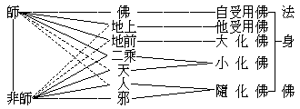



２　琉璃光



琉璃光者，合梵华方言，梵音为「薜琉璃钵拉婆喝啰阇也」。琉璃、具云薜琉璃，或吠琉璃。平常闻见琉璃二字，即想到大殿中悬於佛前之琉璃灯的体质，其实不然。琉璃乃顺梵音薜琉璃相近而译，其义为青色宝，——即宝石中之蔚蓝色者。宝石即同宝玉，其体透明，如天青之色，有晶莹之质，表里洞彻，内外相映；所谓琉璃光者，即此天青宝中所含之净光。其为相也，如万里无云蔚蓝深青之天空，充满杲日光辉，由光明清净故，更显其高远蔚蓝，由高远蔚蓝故，更显其光明清净，可以彷佛似之。此无云无障之清空，即显绝言绝相之如如第一义空；於此如如第一义空中，充满般若之如如无分别智光，由般若无分别智照第一义空之境，同时由如如境而显如如之智，境智如如不二，即是青色宝光之琉璃光也。又四宝所成之须弥山，其覆於吾人所居南阎浮提之上者，即吠琉璃宝，吾人对高日丽天逈无云翳障隔之晴空，即为吠琉璃宝所放之青色宝光。此显离垢真如，或出障圆明之如来藏。盖由天空一切障翳净尽，所显洁无瑕疵之吠琉璃宝光，亦犹以般若无分别智，扫空无明惑染而照耀真如法界如来藏性也。复次、此琉璃光义，与今日中华人民所欲实现之理想目标，亦极相符：盖孙中山先生以青天白日为建立中华民国之国旗，此青天即琉璃宝，白日为琉璃宝充满之净光。佛陀说法，无不契理契机，此琉璃光尤深契第一义空境智如如之理性，与中华民族建立民国之机宜也。



３　如来



如来者，可综上药师与琉璃光二义而显之：如、即琉璃光，来、即药师。如即琉璃光者，不变不异谓之如；无二无分别，遍一切处，尽未来际谓之如。谓如如智契如如理，如如理冥如如智，理智泯合，故曰如如；亦即根本无分别智，证於根本无分别之真如妙性。此真如妙性，地前三贤、二乘未证，地上菩萨分证，唯十方诸佛究竟明证，犹吠琉璃宝光之纯净圆明也。来即药师者，诸佛契证真如妙性，自他平等，不可思议。但以十方众生，迷而不觉，妄想颠倒，未能证得。为欲令除颠倒之妄想，拨无明云雾而见佛日丽天，乃由大悲愿力，从真如性中来示成佛，应病施药，教化众生，此非来即药师乎！如来之梵音为「呾他揭多」；亦即餘经『多陀阿伽陀，阿罗诃，三藐三佛陀』中之「多陀阿伽陀」。总之、约证真如妙性，皆属於如；在现身说法教化众生之来去生灭行住坐卧等仪相，皆以来义摄之。故如来者，来即非来，非来而来。自其来义观之，若行、若住、若坐、若卧等，皆即如而来；自其如义观之，若行、若住、若坐、若卧等，皆即来而如。故不於行住坐卧等中见如来，亦不离行住坐卧等中见如来，金刚经所谓：『如来者，无所从来，亦无所去，诸法如义，名为如来』也。



４　本愿功德



药师果上所成之功德庄严，皆出本因地中行菩萨道时所发之大愿；由此本因地中所发大愿而成果德庄严，故名本愿。但诸佛菩萨因地所发之愿，有通有别：通愿者，即『众生无边誓愿度，烦恼无尽誓愿断，法门无量誓愿学，佛道无上誓愿成』之四弘誓愿；亦可加『福智无边誓愿集』为五愿。然此第五愿已在第四『佛道无上誓愿成』中摄尽，盖所成之佛道，即福智两足尊也，故毋须再立第五之愿。此为十方诸佛菩萨所发之通愿。其於通愿中各有别愿者，即如弥陀之有四十八愿，药师之有十二大愿，乃至其餘诸佛所发之八愿四愿等，皆为别愿。而诸佛菩萨所发通别之愿虽无量无边，不妨弥陀以四十八愿为本，药师以十二大大愿为本，乃至一一佛各有其根本愿，以摄其餘诸愿为枝叶，故本愿又即根本愿也。所谓发愿者，即普通所谓立志，志既立定，则抱有志者事竟成之决心，虽赴汤蹈火亦所不辞，以达到其目的为止。如普通人入学校、进教会等，亦须立志愿书，方能允可。志之所在，为成功建业之本因，故立志愿者，诚人生先决之问题也。诸佛菩萨因地发愿，亦复如是，誓愿既定，虽经艰难困苦而必具不屈不挠之牺牲精神，实现其所志之目的。但其所以与普通立志不同者，以诸佛菩萨因地中发上求佛智、下化迷情之愿，皆从清净心中出发。谓由五遍行中思心所，五别境中欲心所、胜解心所、慧心所，十一善中信心所等以成，非但别境之欲也。又称为誓愿者，誓为誓约，正明志愿既立，复以誓约束，则非志愿完成不可。故平常所谓人之患者，患不立志，若志既立，必定成功。今菩萨既立众生无边誓愿度等志愿，虽经若干波折违碍，亦必有达到目的之一日。如江河百川之水，虽经山丘土石之阻而终汇於海，所谓『溪涧岂能留得住，终归大海作波涛』也。故自诸佛菩萨之通愿观之，其所发誓愿无量无边，而本此誓愿修行所证之果，其施设普济群生之法门，亦无尽无滞也。自其愿上之誓以观之，例如弥陀之愿成佛时，名称普闻，若闻我名皆得往生，若不得成，誓不成佛；则今日弥陀既已成佛，其所誓亦必成矣。又如水陆仪轨上每有『惟愿不违本誓』，此不违本誓，为保持人格信誉之要素，若违背本因誓愿，则即为自欺矣。即如中国古来之圣贤，凡有所为，务必躬行实践，成其志行。故学佛者，亦须先发誓愿，范围自己，督促自己，鞭策自己也。



复次、虽有本愿，必藉功行圆满，方使其本愿之得遂；如发众生无边誓愿度等四弘誓，则须修六度、四摄等诸胜行，功成果圆，方能实现众生无边誓愿度之理想；若无功行，有愿徒然！故平常谓发菩提心，修菩萨行：此菩提心，即上求佛道、下化众生之心；此菩萨行，即四摄六度等万行。四摄者：布施、爱语、利行、同事。六度者，布施、持戒、忍辱、精进、禅定、智慧。必藉此等功行圆满，方得果位庄严妙用，是即所谓功德也。功德、谓功家之德；但有功所显德，与功所生德：所显德者，即无为性德，如如本具，但因妄想执著覆蔽而不能彰显，若修六度等功行圆满，扫荡无明障翳，即显於本然性德也。所生德者，即如修六度万行，由布施故，得种种法财珍宝，乃至由禅定故得种种自在妙用。故由功行有所显德，亦由功行有所生德；而此二德，咸由本因地誓愿所起功行而成就者。故药师琉璃光如来之依正庄严果德，亦由因地本愿策发功行以圆满焉。



５　经



梵语修多罗，或素怛缆，此翻为经；直译其义为线。如布帛须经纬线而织成，散乱之花，线能贯穿；正喻法界诸法，生佛平等，不增不减，而众生迷故散乱忘失，不成体系，诸佛如证而说故，如握网之纲，贯穿而显现也。又、修多罗广则总包一切经典，狭则唯局十二部中修多罗部之直说者。又、佛时藉音言以闻法，初无写本，佛后由众弟子之结集，贯穿佛语，犹线串花而成经本也。经在中国训常，训法。盖古圣先贤之言教，足令万世奉为圭臬，而四海效作模范者，则谓之经；此与佛之修多罗相当，故译为经。又译契经，有契理、契机二义：契理者，佛之说法，皆与真理契合，为实相印与三法印印定，方可称经，否则、说同魔外。契机者，佛所说法为使众生开示悟入佛之知见，若不能悟他，等於废话，故须契机方得其用也。



乙　合释



１　药师琉璃光



药师琉璃光，正是此佛之别号；虽是别号，而此药师琉璃光，亦正为一切佛及菩萨共证共修之悲智。由大悲心故，倒驾慈航，应病施药，而为大药师，度无明颠倒之众生，出生死险恶之苦海，故成其为大悲药师。但独悲不能成事，须藉琉璃光之无分别妙智，方可成满因中不思议之本愿，而发生不思议之德用。由不思议之大悲，起无分别之妙智，由无分别之妙智，成不思议之大悲，则药师琉璃光之义彰矣。此以药师与琉璃光为并列之悲与智，即六合释中之相违释；若药师之琉璃光，即依主释；若药师即琉璃光，亦持业释。



２　药师琉璃光如来



药师琉璃光如来者，药师琉璃光，为此佛别名；如来，为诸佛之通号。其能有被称为如来之资格者，皆已五住究尽，二死永亡，位登妙觉极果，化被九界群机者。而此药师琉璃光，於诸佛自觉觉他之本领，应具尽具，故亦称为如来。但药师琉璃光为别义，如来为通义，摄通就别，依别名通，故今言药师琉璃光之如来，乃依主释也。



３　药师琉璃光如来之本愿功德



药师琉璃光如来之本愿功德者，正显此经乃说药师之本愿功德者；谓本因地中所发之誓愿而成果位之万德庄严，此亦为六合中之依主释。故经中文句，可合可分，分则每一文句各自独立，以表其义；合则如线串珠，可贯穿摄持也。



４　药师琉璃光如来本愿功德之经



药师琉璃光如来本愿功德之经者，此以能诠之言教为经，所诠之义理，为药师琉璃光如来本愿功德。所诠义别，唯局此经；能诠教通，通於经律论三藏中之经藏；依别名通，依主释也。若从广义言之，一切诸佛之教理行果，皆名为经；故此所说药师佛之义理行果，亦即是经。如此、则药师琉璃光如来本愿功德即经，亦持业释，故曰：药师琉璃光如来本愿功德经。



三　稽译史



此稽译史，即考此经译来之历史。佛经皆须考其译史者，明其来源，方可证信。中国之佛经皆出翻译，因佛降生於中天竺，当时以音声说法，原无经典，后经弟子结集，始有梵本文字。又印度文字，亦极复杂，而其古来最通用者，厥唯梵文，故中国经典，多译自梵文。但亦有其他文字，如南方之巴利文等。故中国之经典，有自梵文译来，有自巴利文译来；而大乘经典，多译自梵文。亦有从印度先传丘慈、于阗等国，而间接译来中国者，由梵语而成华言。但此经在中国曾经五译，今此流行本言唐三藏法师玄奘奉诏译，正为五译中之第四译。今略明五译之概史於左：



甲　晋帛尸梨密多罗译



在六朝之初，东晋之时，有西域三藏名帛尸梨密多罗者，此云吉友，——善友之义——初翻此经，名佛说灌顶拔除过罪生死得度经。但无独立本，乃附於佛说灌顶大神咒经中。此经古有十二卷，今在清藏合订六卷，而属於最后一卷。此帛尸梨密多罗三藏，为中国密宗经典初翻之人。普通谓密典至唐善无畏、金刚智、不空等时始有，其实唐前已有；如大灌顶神咒经，大孔雀王经等，皆属密部。又谓唐前为杂密，言其未成系统，但此为唐人言论；其实、东晋吉友等翻大灌顶等经，亦为中国密典之丛书；而此师为中国唐前之极重密宗者，亦见其所从来之西域，其时密部已极流行。故翻译时，将此药师经，亦摄入大灌顶神咒经之最后品。故此大灌顶经，亦犹大宝积经之糅集多经而成，在此师译附於大灌顶经观之，固视为密宗之经典也。



乙　宋慧简译



此在东晋后，南北朝之刘宋孝武帝时代，有慧简法师，在鹿野寺再翻此经，名药师琉璃光经，今藏经中已佚此本。但古大藏目录中，尚载其名。又在达磨笈多第三译之序文上，亦叙述其事，故信有此译也。



丙　隋达磨笈多译



在六朝之末，隋文帝大业十一年时，达磨笈多复翻此经。达磨译法，笈多译行，即法行三藏所译。法行为主译，尚有餘人为助译，故其经上表法行等译。名佛说药师如来本愿经。序因慧简之译，於梵文、华文未善，故作第三译云。



丁　唐玄奘译



今本题唐三藏法师玄奘奉诏译，即此第四译是。玄奘三藏於唐太宗贞观初年间，因感经典义理残舛，发愿入印求法，所谓策杖西游，周历诸国，居印度十七年，遍学大小乘教典，至贞观二十年外，重回中原，从事译经。在中国译经史上，翻译最多，亦最正确。今此药师琉璃光如来本愿功德经，即其所译。玄奘其名，三藏法师乃所称之德号；以其能通彻经律论三藏之法，依此为师，且能将三藏法广为宣扬为人天之师，故名三藏法师。其译经历唐太宗、唐高宗两朝。奉诏译者，即奉太宗或高宗之诏，建立译场。其翻译时，有度语者，笔受者，证义者，润文者多人，而以唐三藏为主，故标以斯名耳。



戊　唐义净译



自唐太宗后，经过唐高宗，至武则天朝，约在玄奘三藏后二三十年间，有义净法师者，踵法显之芳躅，慕玄奘之高风，遍游印度，归而复译此经，名曰药师琉璃光七佛本愿功德经。然玄奘既译此经，义净何须再译？其所以重译者，药师佛虽与奘译相同，而餘六佛，则为奘译所无，故须重译。其译本今在藏中，上下两卷，七佛本事，备述其中。总观其全文，初亦由曼殊室利菩萨，请佛说诸佛名号本愿功德，释迦佛乃告曼殊室利：东方去此，过四殑伽河沙佛土，有世界名曰无胜，佛号善名称吉祥王如来，彼佛国土，清净庄严，乃至初发心时，发八大愿等；此为第一大段之文。复告曼殊室利：东方去此，过五殑伽河沙佛土，有世界名妙宝，佛号宝月智严光音自在王如来，乃至彼佛初发心行菩萨道时，亦发八大愿等；此为第二大段之文。复告曼殊：东方去此，过六殑伽河沙佛土，有世界名圆满香积，佛号金色宝光妙行成就如来，乃至彼佛初发心时，发四大愿，及见众生苦恼，为除业障，即说神咒等；此为第三大段之文。复告曼殊：从此东去，过七殑伽河沙佛土，有世界名无忧，佛号无忧最胜吉祥如来，乃至彼佛世尊，行菩萨道时，发四大愿等；此为第四大段之文。复告曼殊：从此东去，过八殑伽河沙佛土，有世界名法幢，佛号法海雷音如来，乃至彼佛行菩萨道时，发四大愿等；此为第五大段之文。复告曼殊：东方去此，过九殑伽河沙佛土，有世界名善住宝海，佛号法海胜慧游戏神通如来，乃至彼佛行菩萨道时，亦发四大愿等；此为第六大段之文。以上六佛，初二佛各发八愿；后四佛，各发四愿；此总为卷上之文。其卷下之文，即从此娑婆东去，过十殑伽河沙佛土，有世界名净琉璃，佛号药师琉璃光如来，从初发心，即发十二大愿，且有咒语，皆与今本相同；惟药师佛说咒后之经文，较今本稍异。今本咒后之文，明闻药师佛名所获之利益，而彼则皆明闻七佛名号之利益，此其不同一也。又彼於药叉神将，闻七佛名号已，发愿卫护是法。时诸天人之众，有疑惑不信者，佛知彼等心念，即入惊召一切如来甚深妙定，十方世界六种震动，七佛应召来会证盟其事，为今本所无，此其不同二也。复次、七佛既来，即异口同声，说大神咒，其咒名如来定力琉璃光，亦为今本所无，此其不同三也。其后、执金刚菩萨与释梵四天，复说一咒，亦为今本所无，此其不同四也。最后执金刚菩萨复说一咒，又为今本所无，此其不同五也。是故彼经共有五咒：即初、香积佛说除业障咒；二、药师佛说消灾咒；三、七佛说咒；四、执金刚与释梵四天说咒；五、执金刚说咒是也。今大清龙藏中，尚有番字药师七佛本愿功德经，考其文义，与义净所译相同。昔人认作梵文，实为西藏文本，此谙藏文者一见即知也。此西藏番字本，亦译自印度梵文，故与义净之译相同，今存藏中，即在净译之下。今听讲所用民国十一年之宁波版本，其说咒语，与旧本不同者，即自番本中录出。以其误认番本为梵文，故抄录之，然实非梵文也。如以「薄伽筏帝」为「八葛瓦帝」等，与西藏音相近，是其明证。又奘译无咒，其咒乃自净译中添入，而义净译自梵文，故知今所诵之咒，乃唐译梵音。如上所言五译之同异，其药师佛之文旨大同，而与七佛详略差别。又中三译无咒，前后二译有咒，复加西藏之番字本；此为本经译传中国之略史。由是观之，初帛尸梨密多罗所译有咒，且属大灌顶经之一品，则此经属於密部。自第二、第三、第四，三译观之，既无咒语，复无说咒之文，则此经即近於净土经典。迄至义净之译，前后五咒，则此经又属密部无疑矣。由此五译之相异，亦可窥见佛教流行变迁史之一斑。盖帛尸梨密多罗来自西域，想其时西域密教已甚盛矣，而在印度、中国则未极流行。以宋、隋及唐玄奘时，印度中国皆大乘性相，法幢高建，故其译此近净土经也。及义净时，印度密教复盛，故其译时多添咒语，则此复属密部焉。此在佛经翻译史上，佛教因各处地域之异，各时趋势之别，亦随之而变易，然吾人亦正由是而可知佛教变迁之历史与情势矣。由上说来，知今诵讲之流通版本，非全出玄奘所译，其咒乃从义净译本增入；即文句亦间参揉净译，故今本可说奘净二译之合订本。且民十一年之宁波版本，尚误刊「厌」、「魔」等数字，及在观世音菩萨等名上，增添南无二字，较诸旧流通本，不无出入。此乃总稽本经译史之概要也。



四　提网要



未讲经文之义，先提纲要者，如网得纲万目皆彰，如衣提领全襟齐直。闻者能握得此宗要，则全经文义，自可了然。通常解释经题，如天台之五重玄义，贤首之十重玄谈等，今在此经之释名题，考译史，提纲要亦可摄之。盖隋唐前诸德开讲玄要，本无固定的呆板方式，亦不斤斤乎五重或十重。其讲解时，每就各经之所宜，悬谈大义，今提纲要等，亦与其理相合也。此经之总纲，可作两大段观：一、智示药师依正行果，二、悲济像法转时有情。



甲　智示药师依正行果



此经之纲宗，可由曼殊与佛之问答中显示。如金刚经须菩提问佛：『云何应住？云何降伏其心』？由此两大问题，引起佛之解答，已将金刚经纲宗，昭然如揭。本经云：『尔时曼殊室利法王子，承佛威神，从座而起，偏袒一肩，右膝著地，向薄伽梵曲躬合掌，白言：「世尊！惟愿演如是相类，诸佛名号，及本大愿，殊胜功德」。此以曼殊之大智上求佛道，故作此问。由此问故，佛说药师佛之名号国土，及其本因地中行菩萨道时所发十二大愿，与夫果德圆成之依正庄严。此一大段文义，为本经上半部之纲要，亦即「药师琉璃光如来本愿功德」之所由立名也。



乙　悲济像法转时有情



曼殊之问，含有二义，初以大智感佛说药师本愿行果功德。次曰：『令诸闻者，业障消除，为欲利益像法转时诸有情故』。此由曼殊之大悲下济有情，故发斯问，感佛说药师本愿功德，使诸问者得大法益，拔除业障，消灾安乐。此皆由曼殊之大悲心所驱使而发问，故佛赞许言：『曼殊室利！汝以大悲，劝请我说诸佛名号本愿功德，为拔业障所缠有情，利益安乐，像法转时诸有情故』。故此一大段文，为曼殊大悲恩济像法转时之有情，为本经下半部之纲要。但此大段文中，又可分为两段：一、拔除一切业障，二、十二神将饶益有情。



１　拔除一切业障



（一）如来加被



此言闻说药师名号，本愿功德，依之修习，即可拔除一切业障，得大利益安乐，蒙佛加被，消灾延寿，故此经亦名拔除一切业障得度生死经。但此中亦可分二段言之：一、闻名灭罪往生，二、诵咒除病离苦。



闻名灭罪往生者，即诸愚痴无智众生，阙於信根，生造诸不善业，死招三途极恶之报，但由闻此药师名号本愿经故，使得灭罪往生。如云：『尔时、世尊复告曼殊室利童子言：有诸众生，不识善恶，惟怀贪吝，不知布施及施果报，愚痴无智，阙於信根，多聚财宝，勤加守护，见乞者来，其心不喜，设不获已而行施时，如割身肉，深生痛惜！复有无量悭贪有情，积聚资财，於其自身尚不受用，何况能与父母妻子奴婢作使，及来乞者？彼诸有情，从此命终，生饿鬼界，或傍生趣。由昔人间，曾得暂闻药师琉璃光如来名故，今在恶趣，暂得忆念彼如来名，即於念时从彼处没，还生人中』。此等经文，皆明由闻名灭罪，并得转生善道或往生净土者。



诵咒除病离苦者，上言闻名故蒙佛加被，拔除业障，得生善处。今明若能念诵药师真言，即可消除病苦，延年益寿。如言：『曼殊师利！若见男子女人有病苦者，应当一心，为彼病人，常清净澡漱，或食，或药，或无虫水，咒一百遍，与彼服食，所有病苦悉皆消灭。若有所求，志心念诵，皆得如是，无病延年。命终之后，生彼世界，得不退转，乃至菩提』。此言於此真言若自诵，若教人诵，皆得消灾获福者也。



（二）有情奉持



此言若人信受奉行读诵此经，即得获福免难与救命延寿之二种功德。



获福免难者，若能依教修行，受持此经，即於现实人生，获福免难。如云：『复应念彼如来本愿功德，读诵此经，思惟其义，演说开示，随所乐求一切皆遂：求长寿得长寿，求富饶得富饶，求官位得官位，求男女得男女』。此言读诵此经故，即於现生遂愿所求，获大福利。又云：『或有水、火、刀、毒、悬险，恶象、狮子、虎、狼、熊、罴、毒蛇、恶蝎，蜈蚣、蚰蜒、蚊虻等怖，若能至心忆念彼佛，恭敬供养，一切怖畏皆得解脱』。如是等文，皆言持诵此经，即得免除种种患难也。



救命廷寿者，上为佛说消灾周，此乃救脱延寿周。救脱菩萨为利有情故，示现种种延寿之法，使诸有情寿命相续。如救脱菩萨答阿难言『大德！若有病人，欲脱病苦，当为其人，七日七夜受持八分斋戒，应以饮食及餘资具，随方所办，供养苾刍僧，昼夜六时礼拜行道，供养彼世尊药师琉璃光如来，读诵此经四十九遍，燃四十九灯。造彼如来形像七躯，一一像前各置七灯，一一灯量大如车轮，乃至四十九日，光明不绝。造五色彩旛，长四十九搩手，应放杂类众生，至四十九日，可得过度危厄之难，不为诸横恶鬼所持』。此为救身病以延身命者；复有救国难以延身命，及救诸难以延诸命等文，皆救命延寿之法也。



２　十二神将饶益有情



此即药叉誓护周。十二药叉神将，因闻佛说此经功德，即发愿於后末世，拥护此经，利乐有情。所谓：『我等今者，蒙佛威力，得闻世尊药师琉璃光如来名号，不复更有恶趣之怖。我等相率，皆同一心，乃至尽形归佛法僧，誓当荷负一切有情，为作义利饶益安乐』。是故此经，亦名十二神将饶益有情经，不无所以也。以法临像季，道高一尺，魔高一丈，行者因魔障故，唐捐其功；故先以曼殊之智悲感佛说法，复得药叉神将拥护是法，诚难事也。昔之讲者，往往将十二神将之文判入流通，实则应归正宗：盖像法转时，荷负是法甚仗药叉神将，饶益有情；况释尊定此经亦名十二药叉神将饶益有情，理宜归属正宗分也。上来所言两大段文，由曼殊之大智，示药师佛之依正行果；复由曼殊之大悲，济渡像法有情；而此悲济像法转时有情文中，复分拔除一切业障与神将饶益有情二段，则此全经之总纲彰矣。



前来释名题，稽译史，提纲要之三科，可为经前之玄谈，但尤重於提纲要。盖提其纲要，则全经段落章句，昭然分晓矣。且菩萨之法，不外上求无上菩提，下济有情诸苦，故遍一切大乘经旨，亦可於此曼殊之问而显之也。又如菩萨造论，意在自利利他，故经论中言其缘起时，皆曰『为正法住世，利乐有情故』。所谓正法，即诸佛菩萨因中所发之誓愿，籍此修行而得证佛果依正庄严；亦使闻者依此修持而得佛果者是。如此经所明药师因果功德，吾人依此修行，亦可同证。又菩萨不同凡夫自私自利，其一举一动，一言一行，皆以利乐有情为前提，普为众生，方是菩萨发心。故菩萨之行位愈高，其悲愿愈切，末世众生愈苦恼，则菩萨愈显其悲济之能事也。通常所谓『好医门前病人多』，菩萨亦复如是，病苦之众生愈多，愈为其深切悲愿之所关也。复次、像法多魔，不特出世善法不易建立，即世间善法，亦受邪魔外道袭击与觊觎而欲毁灭之。故此经实由诸佛菩萨之悲愿，与夫药叉神将之护持，得以建立世出世间善法於今日，使众生依而修持。自其属净典观之，则为随愿往生修行不退於琉璃净土；自其属密典观之，则可拔除业障消灾延寿於娑婆当人，故此经乃兼具净土、真言、无量法门之功德者矣！



释　经



甲一　叙请分



乙一　叙述证信



丙一　闻时主处



如是我闻：一时、薄伽梵游化诸国，至广严城，住乐音树下。



入文解释，须分段落，方显文义。中国自晋道安法师已来，皆以序、正、流通三科，诠释经文，妙能契合天竺菩萨释经之方式，故千百年来胥依循之。虽三科大旨相同，而名称不妨随宜而异；故今解此经，亦分叙请、正说、流通三分。自如是我闻下，为叙请分；自尔时佛告曼殊室利东方去此下，为正说文；自尔时阿难白佛言世尊当何名此法门下，为流通分。叙请文中，又分通叙与别叙；通叙为证信叙，别叙为缘起叙。今此即证信之叙。此证信叙，古来解释二家不同：一、出龙树大智度论，明六成就：如是、为信成就；我闻、为闻成就；一时、为时成就；薄伽梵、为法主成就；广严城、为住处成就；至下与大苾刍众等，为听众成就。佛经有此六种成就，方可崇信。二、出亲光佛地经论明五种证信，其言如是为指法之词，乃通指此经而言，如言如是之法，为我结集者所亲闻。或如是之法，为当时佛在某处所亲说，而有法会大众之所共听。叙以证信，乃具五重：即一、如是我闻，为亲闻证信；二、一时、为说时证信；三、薄伽梵、为说主证信；四、广严城、为说处证信；五、与大苾刍众等，为听众证信。此二解，虽稍有出入，然其理亦大致相同。今依五重证信讲之。



如是二字，集古德之解，有十七种，或二十一种之多。於中亦可作如此说：如者，维摩所谓：『一切法皆如也』。诸法缘生无性，当体如如，见此如如真理者为是，不见即不是，故曰如是。又佛说法，契理契机，契理即真为如，契机所宜为是。今解、结集者言：如是之经，为我亲闻，非辗转由他而闻，更非由外道天魔等而闻，乃依佛宣扬，为我亲闻。



此言我者，似与佛法常言无我、无人、无众生、无寿者之理相违，其实不然。以佛法言人法无我，乃无凡夫外道迷执之我，非无假名之我。凡夫众生上自天人，下至鬼畜，皆有俱生我执，恒执此五蕴业报之身为自我。而凡夫中之外道者，更於五蕴身上妄起计度分别我执：或计色为我，如言色大我小，我在色中；或色小我大，色在我中。或计受为我，或计想为我，或计行为我，或计识为我。如是等执，过患无量，故佛经说五蕴无我，即破此凡外妄计之我。金刚经云：『无我相，无人相，无众生相，无寿者相，无法相，亦无非法相』；此之谓也。但五蕴法虽无实我，亦不妨以我为五蕴和合假相之代名词，随俗称谓藉以辨别宾主，以便彼此呼应。如育王寺之名，本无固定之物，乃是由数百亩之山地，数百餘之住众，及千百年来之仪轨等，众缘凑合而成之假相而已。故泛常亦称五蕴和合之假相为我，原无实体。今此言我，乃当时结集此经者，对法会大众之自称。但其与凡夫之称我不同，乃为无我之假名我，以内无凡外妄计之执故。金刚经所谓『如来说我者，即非是我，是名为我』；故此无我之我，纯为对机而称。又有深义者，此无我之我，乃诸法无我理所显之真如实性，此中无自他彼此相，无好恶是非相。结集此经之菩萨，深达此诸法空性而假呼我名耳。



闻者，依字义解，如平常言眼见耳闻等，则为耳根所闻。其实、耳根不能闻，闻者属耳识，不过以根为增上缘，声为所缘缘，识种为亲因缘，三缘和合，方能发识以闻。但耳识闻声时，无文义相，须待同时意识生起，方有文义相现，以成了别音义之用。故此闻之成就，操诸意识。是则由耳根发耳识，由耳识闻声音，由意识了别音义也。但既由根、尘、识三和合而闻，何不言耳等闻，而言我闻耶？然曰耳闻，则通诸耳，不能表现结集菩萨之亲闻；菩萨为举亲闻证信，故云我闻也。



一时者，即举佛说法之时以证信。其不指出某年某月某日某时者，因世界地域不同，年月日时随之而异，故不固定说为某时。如今地球上各国所用之历本，纪载时间，各各相异。即以中国言之，有阴历，有阳历，阴历之初一，非阳历之初一，阳历亦然。又如印度以初一至十五为白月，十六至三十为黑月，而以黑月之十六为初一，亦与中国适得其反。又佛说法，时而天上，时而人间，随众生之知解所见各异，故诸经中，皆不说定其时。今此所指之一时，即佛说此经结集菩萨与法众共听之时也。



薄伽梵者，为举说法主以证信。薄伽梵亦作婆伽婆，译音之异，其义为吉祥王、大威猛、极尊贵等；因其含义甚多，故不翻译。中国译经，有五不翻，此为多含不翻。但亦有翻为世尊者，即经中——如来、应供至天人师、佛、世尊——十号中最后一号。亦有自如来至佛为十号，以世尊为总称佛之德号。盖佛於六凡、三乘世间中最极尊胜，所谓天中天、圣中圣是也。故此薄伽梵，即指佛而言。但佛为诸佛十号之通称，三觉圆，万德具，皆号曰佛；然以此土之教主为释迦佛，故只举一佛字时，即显为此土之释迦佛。若他土诸佛言此佛时，则须置释迦之名，方可区别。然佛佛道同，说此佛世尊，即通说十方诸佛世尊，说此佛法时，即通说十方诸佛之法，故佛常言：『住世四十九年，未曾说过一字』。正明此佛所说之法，乃为过现诸佛所同说之法。而吾人推崇本师，言此法为此佛所说，而佛实非以说法者自居；故说此佛所说之法，即过现诸佛所说之法，亦无不可。



游化诸国至广严城，住乐音树下者，此说佛说法之处所以为证信。佛自证菩提先至施鹿林中，为五比丘转四谛法轮，然后游化经摩竭陀国而至此广严城。诸国，於仁王护国经说十六国；或说佛灭度时，国王共争舍利；故知佛说，实有诸国。此指人间而言，若其游化天上及龙宫华藏等，广施法雨，化无量众，则诸国之所包广矣。广严城、即毘离耶城之译义。此城广大，人民丰富，楼阁修饰，极其庄严，故以为名。乐音树、为树名，其林木中，迦陵频伽出和雅音，微风吹动，天然歌乐，故以为名。此广严城，喻如宁波；乐音树则如宁波之阿育王寺。佛游化经此，即憩息树下说法，此为住处证信，亦犹今之开会讲经，必有其住处也。



丙二　听众法会



与大苾刍众八千人俱，菩萨摩诃萨三万六千，及国王、大臣，婆罗门、居士、天龙八部、人非人等，无量大众，恭敬围绕，而为说法。



由前闻时主处，已可证信。但为流传千古，不使稍有怀疑，故此复引法会大众证信。如《弥陀经》等引众证信，并列其名，如长老舍利弗等，而今唯言苾刍等众。苾刍与比丘音同，有言苾刍指香草，从喻立名。其实、同音译比丘。比丘译义甚多，而其本义，厥惟乞士。乞士者，乞食以活身命，乞法以资慧命。乞食以活身命者，依出家法，舍弃家产游化人间，乞食活命，随处宣教，度诸有缘，威仪端严，导俗敬信，令施食者广种福田，故乞食资身，属利他德。乞法资慧命者，乞求佛法，慧命相续，功德成就，乃属自利。具此二德，方号苾刍。苾刍众中，其无学者，为大苾刍；未具戒者，有沙弥众。又依戒律，在家出家，各有男女二众。而此专指苾刍众者。众、为僧伽和合之义。此大苾刍众，已证四沙门中果，为众中上首故。此苾刍众，数有八千。复有菩萨摩诃萨其数三万六千者：菩萨、具云菩提萨埵。菩提、为无上觉，萨埵、为有情。正显菩萨初发心时，即上求正觉，下化有情。约四弘誓愿说：法门无量誓愿学，佛道无上誓愿成，为上求；众生无边誓愿度，烦恼无尽誓愿断，为下化。但约广义言，从初发心至等觉地，皆为菩萨。则此为初心耶？抑等觉耶？故以摩诃简别；摩诃为大，即大菩萨。自十信初心菩萨至初住位，复经十住、十行、十回向，至登初地即称大地菩萨，乃证诸佛菩萨所证之真如实际理地，方称为大；具无量义利故为多；居三乘之首故为胜；具此大、多、胜、三义，方是菩萨中之摩诃萨。今此会中，摩诃萨众，三万六千。苾刍为佛近眷属，常随侍佛；菩萨众乃佛之大眷属，能助诸佛转法轮者。国王为一国之主，犹今共和民国之元首、总统、或主席。大臣为国王之辅弼，左宰右丞，以及文武大官，皆辅助国事者；如今之院长，部长等。婆罗门、此译净裔。释迦佛未应世时，印度有外道言：天地万物未生之前，有大梵天，超然独上，人类万物由之而生。其生时，有自脚底而生，有自两膝而生，有自两肩而生，有自其口而生，此为形成印度四姓阶级之因素也。而此婆罗门种，即由梵天口生；梵为净义，故曰净裔。此婆罗门世掌全国文化事业，教导人民，如中国古之文人大儒，教育民生，而居执军政之刹帝利上；故知印度实为教重於政之国。居士、乃素封之家，可端居乐道，为农工商界之领袖，社会之优秀份子也。如是等众，皆为人间听法之众。复有天龙八部，无量大众。奘师译本，天龙之下加有药叉二字，今本则无，乃将药叉摄八部中。天在人上，有欲界天，色界天，无色界天；三界共有二十八天。龙、通常专指兴云施雨者；在佛教中，具大神变，有大威力，护天护人，皆为龙众。药叉、即夜叉，译为勇健，言其威猛神武，是大力士。又译捷疾，言其陆空飞行，往来迅速。平常水陆道场中，发符使者，即此药叉神将。八部者，即天、龙、药叉、乾闼婆、阿修罗、迦楼罗、紧那罗、摩睺罗伽。此中略去药叉以下。国王、大臣等，皆是人众；天龙、药叉等，为非人众；故曰人非人等。如是苾刍等无量大众，随佛住乐音树下，恭敬尊重，围绕於佛，求佛说法，故启下文曼殊之问佛。既有如是等盛会胜事，故结集者，叙述流通以证信也。



乙二　礼请许乐



丙一　敬礼



尔时、曼殊室利法王子，承佛威神，从座而起，偏袒一肩，右膝著地，向薄伽梵，曲躬合掌。



此下为叙请分中第二科礼请许乐，为此经之别叙，亦名为缘起叙。此中有四：一、敬礼，二、启请，三、赞许，四、乐闻；今为敬礼之文。敬礼者，以表三业清净，恭敬归佛。若无恳切至诚之心，则虽曲躬合掌，徒然无益。故须意业敬之於内；身业形之於外，顶礼膜拜；然后口业，唱赞叹词；故知敬礼，即建立於三业之恭敬上。又三业恭敬，则身意严净，与诸佛无漏功德相应，则无明、贪、慢等皆可折伏；尤足除憍、慢、嫉，生信、惭、愧。故平常学佛者，见佛闻法，先致敬礼，即有此等意义。又由众人三业恭敬，能使法坛严肃庄重；亦由世俗开会设宴，须先洁净场所，方可款待大宾也。



尔时者，即当尔之时，当佛在乐音树下大众围绕说法之时。法会摩诃萨众中有曼殊室利者，从座而起。曼殊室利，即文殊师利，译音稍异；其义译为妙吉祥。妙、即曼殊，吉祥、即室利，显其於诸法中最为吉祥。又称大智曼殊室利，表其智慧最胜。以佛弟子各有一胜，此曼殊即菩萨众中智慧最胜，不唯於释迦佛法中智慧最胜，即於十方诸佛法中咸皆智慧最胜。又佛果功德不可思议，须藉因地菩萨以表显之，故曼殊之大智，即表佛果之智德，如普贤之大行，观音之大悲，亦皆表佛果之一德。尤其是曼殊之大智，特表诸佛功德所由生起之般若无分别根本智，亦曰实相智或如理智，以显圆满难思之智海也。曼殊室利称法王子，亦称童子。法王为佛之德号，佛具如来等十号外，复有无量德号，如一切智者，最胜者，大医王，大悲救世等，而法王亦其一也。法王、自其字义研究之，法之一字，义无边际，遍一切处，无非是法。法华云：『我为法王，於法自在』；即解王为自在之义。但欲解王，须先明法。法在天亲菩萨解『诸法无我』句，说有五位、百法。五位者：一、心王法，二、心所法，三、色法，四、不相应法，五、无为法。百法者，即所谓：『色法十一、心法八，五十一个心所法，二十四个不相应，六个无为成百法』是也。但五位百法中以心法居首者，『一切最胜故』；以一切诸法，莫不由此心法而转变而显现，故诸法中以心法为最胜，而心法即为法王矣。然心法人人皆具，凡有心者皆可为王，则不能显法王所以为法王之殊胜。或以诸法实相之真如为法王，即维摩对弥勒所谓：『一切法皆如也，弥勒亦如也』之如。盖诸法因缘而生，缘生无性，当体即空，即空所显真性为如，故真如法性，常常时，恒恒时，安住不变动而自在，为法王义。设如此言法王，则作法王比前更易，以草木瓦石以至一尘一芥、一色一香，无非真如，则随拈一法皆为法王，益不能表显佛为法王之殊胜！故又须以无漏智德为法王，以表特胜。盖前明心法，乃以有为法为法王；次言真如，乃以无为法为法王；而此无漏智，乃遍有为无为究竟真净之法王。佛无漏智，即无上正觉智，故佛亦号觉王。由此无漏无分别智，断惑证真，方显证真如为诸法之王；否则障蔽不显，何以为王？故须以无漏智伏灭一切烦恼，广修六度万行，渐转八识而成四智；至转第八识为大圆镜智，方为真正法王。而大圆镜智唯佛果方具，故唯佛为无上正觉之法王也。曼殊独称法王之子，以能传佛心印，继承佛位，如太子之继父王位。然如此以称法王子，亦宜於弥勒等，以弥勒继释迦之后成佛故也。因是曼殊之独称法王子，又有殊胜意义；盖曼殊表根本般若无分别智，无漏清净不可思议，与佛果难思之根本智体，如如不二，所有佛果功德，皆由此智而生，故曼殊之独称法王子，即依根本无分别智表其独胜也。由是观之，此经之明佛果依正庄严功德，尤重大悲利他，非法王之佛不足以说此；亦非法王子之曼殊不足以启此。至如弥陀经由舍利弗启请，大弥陀经由阿难启请，观无量寿经由韦提希启请，皆问往生净土法门，因念佛而解脱，以净土为归宿，偏属自利；而此经由大智曼殊之大悲而启发，欲以利乐有情，则专重利他也。承佛威神，从座而起，正显非仗如来大悲愿海之威神力，虽曼殊亦不能起於此座；亦即曼殊之智乃承法王之智而起，故曰：承佛威神而起此座。此座者，正是自证境界之位置，自六凡众生以及三乘圣人，各有其自住境位，而曼殊此时即从其自位之座起而上求佛道，下济众生也。偏袒一肩者，印度惯习，比丘等所穿之礼服，平常两肩遮覆，遇礼佛时，即袒一肩以致恭敬。右膝著地者，右即左逆右顺之意，表与佛意顺契。又、一肩表上承佛德；一膝著地，表下济众苦。又、普通以右臂右膝动作较为方便，表曼殊由智悲所起之方便用，能上同诸佛慈力，下济众生悲仰也。如是仪容，端严恭敬，向薄伽梵，曲躬合掌。曲躬、即低头鞠诚，合掌、表福智两足。又、十指并竖，即表布施等十度，而前五度属福，后五度属慧，故与佛之福慧两足尊相应也。



丙二　启请



白言：『世尊！惟愿演说如是相类诸佛名号，及本大愿殊胜功德！令诸闻者业障销除，为欲利乐像法转时诸有情故』。



曼殊於无量众中，启请世尊演说如是相类之法。演如流水不绝，喻佛法音演演相续。如是相类，即指下文诸佛名号，及本大愿殊胜功德如是相类之法。又、相类之言，亦通指他经如是之法。如下文云：『亦如西方极乐世界殊胜功德，等无差别』。此显佛已说过弥陀经等诸佛名号，及本大愿殊胜功德如是相类之法。今曼殊追忆所及，故言如是相类。诸佛名号，即此经药师佛等名号，及其依正庄严。本大愿，即本因地初发心行菩萨道时，所发通愿、别愿，由是而成佛果功德。故此殊胜功德之言，通因通果：由因地殊胜之愿行功德，方成佛果殊胜之福智功德。此上数句，请佛说法，使自了知佛果功德，可称自利；而亦为利他故，故言：令诸闻者业障消除，为欲利乐像法转时诸有情故。此言障者，通惑、业、报、三障。惑障、有烦恼障与所知障：烦恼障亦曰事障，断之较易，所知障亦曰理障，欲除则难；此二通名惑障。惑、即烦闷恼乱，使心神不宁，故名障。业、为作业，即是行为习惯，如人习染不良嗜好，虽乐善事而欲作不能，故为障。报、即苦报，由惑造业招感报体，报体陋劣，不得自在，故为障。然考苦报由来於业，业由来於惑；由贪等惑而业而苦，使吾人长沦三有，不获出期。所谓：『我昔所造诸恶业，皆由无始贪瞋痴』，真可慨也！虽然，业处惑、苦之间，实为诸障中心，能将业障消除，惑、苦自灭，如截木心，两头自断；故闻佛法，先令业障消除，则像法转时之有情，乃可以利乐矣。像法者，盖佛之教法住世有三时：曰正法，曰像法，曰末法。正法住世，见佛闻法，即能得果；以诸三乘贤圣等众，皆为已熟之机，一遇胜缘即得断惑证真。佛灭度后一千年间，亦有声闻、菩萨住世行化，人民不生邪解，不起邪行，易以修行得果。一千年后，即为像法，或以像为形像，佛既灭世铸像代佛，及塔庙中皆供佛像，故亦称佛教为像教。其实、此义不然，如言设像，佛世优填王亦已雕佛像，即於末法岂无佛像？故像法言，乃指像似之法，已失其真。言至其时，虽则修行者有，证果者难；於佛法既鲜实证，故已失真。迄今末法，非唯证果者无，即真能实行者亦寥如晨星；虽有少数，亦多盲修瞎练，可悯殊甚！故正法住世，百修百证。及至像法，修行者百，取证者不得其一；盖像法多魔，不易取证，即多退堕！如今世修行未证真圣果，来世业增，前功尽弃！而有勇猛有情，努力勤修，今世不证，来世再修，黾勉求证，其志可嘉！然其事极艰难而可悲悯，故菩萨为下济有情之大悲心所驱策，求佛说法，独标利乐像法转时诸有情者，不无深意焉。



丙三　赞许



尔时、世尊赞曼殊室利童子言：『善哉！善哉！曼殊室利！汝以大悲，劝请我说诸佛名号，本愿功德，为拔业障所缠有情，利益安乐像法转时诸有情故。汝今谛听！极善思惟！当为汝说』。



此称曼殊为童子；童者、独也，表般若无分别智，独一无二。又、此无分别智出障圆明，最极清净，一切无漏功德皆由此生。盖真见道位，此智现前，舍前诸漏，具足无漏，故称为童子；即表根本智。善哉善哉，乃双叹之词；以曼殊之问，具足上求下济之义故。诸佛名号本愿功德，此非过未诸佛，即指现在十方诸佛。说诸佛法故，可令闻者业障消除，解脱诸缠。缠、即缠缚，如人犯罪，杻械枷锁被缚其身．不得自在；众生被三障所缠，囹圄其身，亦复如是！若能闻法修行，即可解脱诸缚，出三界樊笼，如鸟翔太空，鱼游渊海，得以逍遥自在也。虽一切时皆有业障众生，今曼殊唯指像法者，正为像法有情极可悲愍。佛体其意，叹为甚难，故允所求。汝今谛听，极善思惟，为诫劝词。谛者、审也，诫听法时，须深审察，一字一句不得含糊，方能得益。既审闻后，又须如理思惟，乃与无漏法义善能契应；此乃由闻慧而起思慧也。又、善谓善巧，能善巧思惟，即可触类旁通，会融其义。须能如是听法，方不辜负说法者心，故先警诫。



丙四　乐闻



曼殊室利言：『唯然，愿说！我等乐闻！』



曼殊既蒙世尊赞许，心怀踊跃，随声作答，故曰唯然。唯然，形容其答应得迅速自然，毫无勉强。故常人答应之快者，亦曰唯唯。乐字之本义为音乐之乐，圈入声，为快乐之乐；今为好乐之乐，宜圈去声。



上为本经缘起之叙，依曼殊之问及佛之赞许，说此经之缘由，可以显矣。如金刚经之法会因由分，善现启请分，皆为说经之缘起也；故此亦可称曼殊启请分。



甲二　正说分



乙一　示体相



丙一　总标依正体



佛告曼殊室利：『东方去此，过十殑伽沙等佛土，有世界名净琉璃，佛号药师琉璃光如来、应、正等觉、明行圆满、善逝、世间解、无上士、调御丈夫、天人师、佛、薄伽梵。



从此文起，为正说分。於中先示体相，后明机益。此经之体相，即以药师佛果依正功德，及其依正功德所由成之本因愿行，为此经特有之体相。通常判经之体，曰实相，曰真如，曰中道第一义，往往儱侗含糊，不能彰显各经之特殊体。如以真如为体，则诸法缘生无性，即空之所显，通於一切；然於其中，不妨地以坚为体，水以湿为体，是则如是诸法，各有别体。故今明此经，即以药师之因果、依正示其体相；由此体所起之功能，即全体大用也。后明机益，即显众机闻此法所获之益利，乃此经之功用也。示体相中分三科，今第一总标依正体。



总标依正体者，有世界名净琉璃，即总标药师依报之体；佛号药师琉璃光等，即总标药师正报之体。佛告曼殊室利，即佛向曼殊室利说。从此娑婆世界东去，经过十殑伽沙等佛土，有一世界，名净琉璃，其土有佛，号药师琉璃光。殑伽沙、即恒河沙；奘师以前，多译恒河沙，奘师以后，多译殑伽沙。恒字音短，殑伽音长，稍有区别，实为一河。恒河在印度，亦犹中国之黄河。有言其发源於天上，实则出之阿耨达池；如中国古探黄河之源於星宿海，而今日考察所得，实与长江同出自青海。恒河多沙，佛说法处多在恒河流域，故为顺便通晓起见，经中遇说数目极多时，即以恒河沙为喻。如七佛药师本，则从四殑伽沙说起；今本但明药师佛土，故直从十殑伽沙说。佛土、即世界，一佛土，即一大千世界。净琉璃、即清净青色宝，言其国土居七佛之后，最极清净，无漏庄严；故前言青色宝时，以万里无云之白日清空为喻也。此药师佛，具足十号：一、如来，义如前。二、应，亦译应供；梵音阿罗诃。依法华论，有十九义，通常或三、或五，言应受人天供养，应已断惑证真，应更不受生死；而应供之义，通声闻、独觉。三、正等觉，亦作正遍知，梵音三藐三菩提。四、明行圆满，亦称明行足。明、为智，行、即万行，明以智慧为先导而修万行，故能成福慧两足尊也。五、善逝，善能顺法性而寂逝，盖佛用而常寂，住於无住涅槃。不同二乘子缚已断，果缚犹在，住於有餘涅槃；佛则五住究尽，二死永亡，为度生故，非生现生非灭示灭，虽现生灭而常寂静，故云善逝。六、世间解，佛具十力等智，事理、相性，明解照了，如脱桶底。七、无上士调御丈夫，亦作无上丈夫调御士。士为人中才智之多能者，如普通社会农、工、商中，以智足多谋、文武双全有力用者，名之为士；故亦以无上之士称佛也。调御丈夫者，丈夫为有大志荷大事者，平常仆妾之於男子，亦称丈夫，正显丈夫勇敢无畏。善能调御一切，如善骑马，调伏猖獗，喻佛善能摧伏魔军，驾驭三界之众生也。八、天人师，佛为三界之导师，四生之慈父，故名。九、佛，梵语佛陀，此云觉者，三觉圆满，故号为佛。无明漏尽为自觉，调化众生为觉他，自觉之果圆，亦即觉他之行满也。十、薄伽梵，即世尊。涅槃等言，自如来至佛为十号，薄伽梵乃十号之总称。而佛地、唯识等，则将无上丈夫调御士合为一号，故自如来至薄伽梵，方成十号。此二说者，各有其根据也。



丙二　别陈行果相



丁一　行愿



戊一　总标大愿



『曼殊室利！彼世尊药师琉璃光如来本行菩萨道时，发十二大愿，令诸有情所求皆得』。



此下为示体相中第二别陈行果相。行为因中所发誓愿，果乃佛位所成之果德。此中复二：一、行愿，二、果德。行愿文中复三：今第一总标大愿也。



彼世尊，即指药师如来；以释迦为此土之佛，故以药师为彼。由药师琉璃光如来本行菩萨道时，发十二大愿之二句，则本愿二字亦显矣。此十二大愿，在药师未成佛之因地中，同为凡夫，行菩萨道时所发。道、为菩提行之总相；但道虽广，可摄为三十七道品，即三十七菩提分法。其修道所获之果为菩提，亦名为道；其修因之差别行为分法，亦名为道品。欲证菩提涅槃之果，须由所趋之道路，如行者欲达其目的，须由路途。此举道之总相。若别明真菩萨道之自体，由初发心三慧所起：由闻教故，生起闻慧；闻而极善思惟，如理作意，即成思慧；然后如实修习，即成修慧。成闻慧时，与信相应；成思慧时，与戒相应；成修慧时，与定相应。由修集资粮至加行位，引发根本智无漏无分别般若之大慧；复由根本智而起后得无分别慧。所谓加行无分别慧，根本无分别慧，后得无分别慧，皆由加行慧而引发；各以慧为自体，与诸善心所及善遍行、善别境等相应而起者，即由善等心所相应。根本亲证诸法真如自性，起后得智，通明法界事理，与此无漏智相应而等起施戒等万行，皆为修习道行。故有道自体，道引发，道相应，道所缘，道等起，综合之皆为道也。十二大愿者，为药师如来因地所发之本愿，盖其所发四弘誓愿为通愿，此为别愿。发愿即是立志，由内心策发，确立而定；以此志愿督促之、鞭策之而行其道，方遂其愿。如地发芽，生根不动，而得成婆娑之大树。但普通人虽亦立志，督策自己，然因意志薄弱，见色闻声，往往情不自禁，不堪外境之诱惑，而为其所转！诸佛发愿，与之逈异，既发愿已，三业依之修习，坚固无有动摇，由此必证菩提，故能令诸有情所求皆得。盖既证菩提，则一切行愿之所求自然满足矣。由本行二句，行道发愿，智断成就；由令诸二句，广被有情，恩德成就矣。



戊二　别陈诸愿



己一　正报庄严



『第一大愿：愿我来世得阿耨多罗三藐三菩提时，自身光明炽然照耀无量无数无边世界，以三十二大丈夫相、八十随形庄严其身；令一切有情如我无异』。



此别陈诸愿，即有十二大愿。概而言之，此中自第一至第五愿，乃依四谛中灭道二谛境而发；自第六至第十二愿，乃依苦集二谛境而发。前五愿中更可分别，第一、第二依所证灭谛果而发；后三依菩萨所修道谛而发。后七愿中，前三后三皆由苦谛而发；然苦因於集，故中间一愿乃依集谛而发。今此第一愿，明药师之正报庄严。



愿我来世得阿耨多罗三藐三菩提时者，即药师在因地行中说：愿我当来成佛之时也。成佛一名，每多滥称，其实须成阿耨多罗三藐三菩提时，方称成佛。梵语阿，此云无；耨多罗，此云上；即是无上最高之义。三藐三菩提，译正等觉，亦遍正觉，或作正等正觉。此菩提觉之上，复加阿耨多罗与三藐三之言，正简此觉与泛常之觉有异。泛常觉冷热是非等曰感觉，曰知觉，自以为觉，实则迷而不觉，乃颠倒妄想之错觉；虽云觉悟今是而昨非等，亦非正觉。以正等觉者，觉悟宇宙万有之真理，平等平等，无有高下，如理如实而觉，方为三藐三之正等觉。故单言觉时，即通凡外。但凡外为错觉非正觉，故以三菩提简之。又单言三菩提时，即通二乘菩提，但二乘不能普遍正觉，虽破我执，觉生空真如，而法执未破，法空真如觉而不显，虽觉生空而非普遍，乃以三藐三菩提简之。又登地菩萨，虽可称为分证三藐三菩提，而不能冠以阿耨多罗，以初地至二地乃至十地至等觉，后后胜於前前，皆有上故；是故惟佛与佛，方为究竟阿耨多罗三藐三菩提者。今药师因中愿其当来成佛时，自身光明照耀一切世界。身、有三身：一、法性身，亦曰法身；二、受用身，亦曰报身；三、变化身，亦曰应身。法性身为诸法之真实性，为诸佛究竟觉之所彻证，故遍一切处，具无量智德光明。然此所谓炽然照耀无量无边世界，乃指受用身而言。受用有自受用与他受用：自受用身，佛果无漏不思议界，唯佛与佛之所能知，即等觉大士亦如隔云望月，蒙胧非真，何况地下圣凡！但此不思议自受用身土，一佛一切佛，非异非不异，无量无漏福智功德，自佛他佛无有分齐，等同一味。然亦不妨各从自受用身而现起他受用身土。他受用身，乃为教化地上菩萨而现，所谓『如来现起他受用，十地菩萨所被机』。如华严之毗卢遮那，梵网之卢舍那，皆为地上菩萨所现之他受用身，光明灼耀，微尘刹海；故此身光炽然照耀无量无数无边世界，即他受用身也。佛光既照无边世界众生，故今吾人皆在药师佛光照耀之中，不亦甚亲切乎！炽然、状况光力盛而且大，尽虚空法界之边际，无所不照，无有限量；故弥陀号无量光，而此药师亦具无量光明。三十二相，八十随形，随其一形相等遍法界而言，亦是他受用身；而依通常教理说，则属变化身。此有大变化身、小变化身、随变化身三种。大变化身，为三贤入四加行位菩萨所现，在定中所见色究竟最高大身，亦为此身；所言佛身千丈，或十六万由旬，皆属此身。小变化身，如今娑婆教主释迦如来，现丈六身，三十二相，八十随形好者属之。其实释迦佛身，通法性身、自他受用、及大变化；而依标准教义，唯局小变化身。今药师愿将来成佛，亦现此身，应化众生。大丈夫相者：如人间之转轮王相，天上之梵王相，佛法中则为大士相，佛相。具此大丈夫相者，即能荷负教化众生之伟业，如转轮圣王，即能负担一四天下众生之事业——详见大般若经及诸大论。三十二相者：一、足下安平如奁底。二、足千辐轮相，乃至三十二顶成肉髻相——详见法数。此等宝相，皆自修得，非偶然成，所谓『三祇修福慧，百劫修相好』，可以知矣。八十随形，即三十二相上所现之种种形好，如眉间白毫相光，其体通明透彻，其色极白洁净，即此体明色白为相上形好。既有宝相，复具形好，故其身极庄严，无与伦匹。药师如来，愿其佛果正报庄严如是，亦愿令其世界一切有情正报如是庄严，故能生琉璃世界者，皆具三十二相，八十形好；亦如往生极乐世界，即无男女相，无六根残缺等相，皆具大丈夫相、大士相焉。



前年戴季陶等朝野名人，迎班禅大师於宝华山建立药师法会，亦本药师之十二大愿，而发十二种愿，其云：『第一遵行世尊本愿：政本优生，教重安养，使一切人民身心美善，相好端严』。今科学有优生学，本此优生学施优生政策，能使人民生活善良，身心健美，此正与药师之第一本愿，遥相呼应。故前讲此经缘起时，亦言依药师佛法门可实际应用於现实人生之改善也。



己二　身光破暗



『第二大愿：愿我来世得菩提时，身如琉璃，内外明彻，净无瑕秽，光明广大，功德巍巍，身善安住，燄网庄严过於日月；幽冥众生，悉蒙开晓，随意所趣，作诸事业』。



前第一愿，诸佛大体相同；今第二愿，则唯药师独具。得菩提时，即成佛时。身如琉璃者，身有三身，三身中现自受用、他受用、大变化、小变化时，皆现佛相，唯随类变化，或现人天，或现鬼畜，无有定相。今身如琉璃之身，且据变化身言。此变化身，如青色宝，内外明彻，净无瑕秽。瑕为玉中疵，玉有污点，即成美中不足；吾人之身亦具琉璃之光，而为肉血烦恼所障，不能内外明彻。例如水晶珠等，亦能内外明彻，而每不免瑕疵。唯此药师琉璃光身，内外明彻，净无瑕疵，其广大遍一切处，功德无量，如山巍巍，善能安住燄网庄严，即所谓『药师如来琉璃光，燄网庄严无等伦』！燄、即光上之线，如曙光东升，光线夺目。一光燄照一一光燄，一一光燄照一光燄，光光相映，结成罗网；而此琉璃光身，即善安住於此由光线所组成之光明灿烂的燄网之中。药师如是，其土众生亦各能身善安住於燄网庄严，此其所以光明过日月也。盖吾人所居之世界，以日、月、星为三光，而尤以日月之光为大；然日月虽能照破幽冥，若黑夜即无日月。如今交通所及，知吾人所居之地球上，亦有半年无日月光照者，有终年无日月光照者，而亦有人物生其处；此诚如佛教所谓黑暗地狱众生也。但净琉璃世界，有药师琉璃光身之光明，则一切黑暗皆破除，幽冥众生悉蒙开晓。如盲者得眼，即能於光明熙和中随意所趣，平等自由，作诸事业者也。



药师法会愿云：『第二遵行世尊本愿，培植德本，发扬慧力，使一切人民本力充实，光辉普耀』。培植德本，发扬慧力，使世界和平，人民安乐，一切作业，悉得成就，亦药师此愿之实际应用者也。



己三　智慧资生



『第三大愿：愿我来世得菩提时，以无量无边智慧方便，令诸有情皆得无尽所受用物，莫令众生有所乏少』。



此第三愿，标以智慧资生者，以药师成佛时，欲以无量无边智慧方便资济众生。此第三愿至第五愿，依道谛而发。道者，广则八万四千波罗密多，略则三十七品，再略之、则为戒定慧。而此三愿，即依此三而发。是第三愿，乃依慧发。无量无边智慧，出智慧之体；无量无边方便，为智慧之用。故方便之自体即智慧，智慧之妙用即方便；若无方便无以显智慧之深广，若无智慧无以起方便之巧妙。故智慧与方便，皆是无量无边。无量者，普通言量，约有二义：一、读平声，如升斗量米，尺寸量布之量，为动词，表现动作；二、读去声，如言度量数量之量，为名词。又如言不可以尺秤量其长短轻重，亦为平声。此无量乃无有限量之量，乃去声之量也。以今通用名词言之，量即空间。空间、在数理学上有三度量：一、量长短，二、量阔狭，三、量厚薄高低。如一墨点，不成为量，须成一线，方有长短之纵量。但祇一线不成为物，物必有阔狭，故有第二度阔狭之横量，所谓先量长短，后量阔狭。既有长短、阔狭，既有南北东西之方向，然亦未成其为完整之物。盖完整之物，既如一纸，必有其反面的厚薄，故第三度即量其高下浅深。如此经过长短、阔狭、厚薄之三度量，乃成为物，既有东西、南北、上下、之六方分。故无论何物，凡成其为物者，须具足此三度量之空间，知其自南至北有几何，自西至东有几何，自高至下有几何，方成一物，否则不成为物。小自茶杯房舍，大至地球、华藏世界，其为有情世间及器世间，皆具此三度量以各占其空间。若超此量，无彼此，无分别，则不能说成一物，亦即无可思想分别而入於无量矣。此乃无量之本义，佛果智慧方便功德，亦复如是无量。无边者，边依量立，若有量，即有四方上下，此量尽处即有边际。有此方物，有彼方物，即有边际分齐；故立有边，即基於量，若无量、则边亦不可得矣。今中国人皆能说佛法无边之一语，佛法无边，诚如所言，惜深知其义者鲜耳。其实、一切世法皆落边际，唯有佛法确实无边。然佛法无边，非离世法之外另有一无边之佛法，若离世法另有一个无边佛法，即此世法与佛法之间已落边际矣！故须无量，方成无边。前言量有三度量，以明四方上下之空间，今更进而言之：依最新学说有四度空间，乃将时间加入空间而成第四矣。楞严经言：『四方上下为界，过现未来为世』；以之说明世界为空间时间之交织，颇相近似。是故一物之成为一物，不特有六方，且有三世；如今讲经之法堂，占有上下四方之空间；经未造、落成、朽坏、三时之时间。有此一法堂，即具六方、三世四度量；扩而言之，凡物皆有此空间与时间而成立也。故平常所谓人生几何，天长地久，皆自空间量上显明时间。六方、三世界量无，则边际乃无矣。但如何言唯佛法无边耶？此盖诸法实相，法尔如是，本无边际；故无量无边，实为诸法之本来面目。自佛法言之，若真若俗皆无量无边。何以故？自第一义之真谛言之，量不可得；以量从分别而起，诸法真实相无此分别量故；既无量，复何有边耶？自众缘所成之俗谛上观之，诸法亦无量边，以诸法从众缘生，缘生无性，一法之生，即依法界诸法为缘，故一切法不出一法，一法即括尽一切法，则无一一之定量可得，何有一法一切法之边际哉？如一小杯，为四大成，土质为地，调泥为水，烧炼为火，鼓扇为风，容受为空，加以人工之思想模样，由此种种因缘，即成此一小杯；则此小杯，即依虚空法界众生辗转增上之缘力而成，即可摄尽宇宙万法。故能通达一物，此物即遍虚空法界，无可限量，亦无边际；此在俗谛而论诸法，诸法亦无量无边矣。但诸法小自微尘草木，大至华藏世界皆无量边，何独唯指佛法无边耶？良以诸法虽无量边，倘无佛智慧，即不得而知，而妄执有量有边，并认定此有量有边之法，方为实法，而以无量无边为非实法，颠倒是非，混乱黑白！自具缚凡夫乃至三乘贤圣，未得诸佛智慧，皆不免此颠倒分别而执有量有边！是故唯有佛法无边，其理亦了然矣。



复次、人之心境上有此分别量故，世界随之有成住坏空，人生随之有生老病死，一切皆由此分别心量境之生灭而生灭，则世界人生皆落生灭之窠臼矣！若了真俗诸法其实本无量边，如是如是，则当下即不生灭，当下即了生死矣。如人计我，我生於何时，我作若干事业，我经几何年月日时而死，此在量上作边际想，故人生之生老病死起矣。又如：计此世界为上帝创造，创造於何时，至何时毁灭，则世界之成住坏空作矣。若知佛法真俗二谛之理，诸法本性无量无边，一法如是，一切法亦如是，一即一切，一摄一切，一入一切，一切即一，一切摄一，一切入一，无定量可立，无极边可得，则人生生老病死即非生老病死，世界成住坏空即非成住坏空，当下本无生灭生死可了，即是菩提大般涅槃。是知法法无边，洵惟佛无量之智慧方显焉！复依此无量无边之智慧，等起无量无边之方便，依方便之权智，达智慧之实智，由智慧之本体，起方便之妙用，随机设法，应物施功；是知一切方便，皆由智慧而成。如十度之方便、愿、力、智，皆依般若而开发。经云：『菩萨於菩提，当於何求？当於五明处求』。五明者：一、因明，二、声明，三、医药明，四、工巧明，五、内明。此除内明为佛学外，其餘四明皆为济世利人之方便用；而此方便之无碍自在，功由智慧。如今科学发明，供给吾人衣食住行上种种享受之物质，皆是方便之用；但因无无量无边之智慧以为妙体，故虽有用而非妙用，有尽际相可得，此有彼无，起贪瞋痴互相争夺，世界祸乱从此起矣！人民痛苦由是生矣！故此世界非无方便，实由无无量无边之智慧不成妙方便耳。由此、今日之人世，若依药师之智慧，则科学资生之方便，妙用无尽，斗争永息，世界和平，人民衣食丰富，所受无缺乏矣。



药师法会愿文云：『第三遵行世尊本愿，广行四摄，勤修六度，使一切人民自他方便，万事咸宜；世尊第三本愿，如实成就』。



己四　导入大乘



『第四大愿：愿我来世得菩提时，若诸有情行邪道者，悉令安住菩提道中；若行声闻独觉乘者，皆以大乘而安立』。



前愿明佛之智慧无量无边，由此无量无边之智慧，复起无量无边之方便妙用。正如法华所云：『诸佛智慧甚深无量，其智慧门难解难入』。此愿使诸凡外、三乘安立大乘，即属於定。盖安立即安定，如大学所谓：『知止而后能定，定而后能静，静而后能安，安而后能虑』；此亦言由定而安也。药师此愿，欲使一切行邪道之有情，舍邪归正，安住菩提正觉之道。正觉、邪道，相对而立，未入究竟之正觉，皆不免落邪，唯断善根之阐提种姓纯是邪，佛纯是正，故正邪亦不能定限。但依普通标准言之，除人伦道德等世间善法，与出世之三菩提法为正道外，其自虚妄分别而执为有道者，皆为邪道。其所执道，与诸法实相，及世间资生事业伦理道德相违，而另有其无上至高之道，奉为最胜，餘若无赌。瑜伽戒本所谓：『若诸有情，安住自见取中，起如是见，立如是论：唯此是实，餘皆虚妄』；此即为邪见师资矣。昔有一人，终日思金，神经失常。一日上市，忽见有金，当众即取，遂被捉住。询其何以当众盗金？彼言：我取金时，唯见有金，不见餘人。此与邪见众生自立邪道，不见正理，恰恰相同。故邪见众生深深安住自邪见道，虽有菩提正道，说之不信，须由诸佛威神之力，方便善巧之用，方能醒其顽迷，使之舍向邪见，安住菩提道中。菩提道者，即阿耨多罗三藐三菩提道。然此菩提，通指三乘菩提，皆为正道。此使邪见外道安住菩提，乃为第一重意义。若行声闻、独觉乘者，皆以大乘而安立之，此为第二重意义。声闻者，闻佛说四谛音声，知苦、断集、慕灭、修道，证得须陀洹等四沙门果。独觉者，出无佛世，孤峰独宿，秋观黄叶落，春闻百花香，觉荣枯无常，由之悟道；亦曰缘觉，缘佛说十二因缘之声音，知众生由顺生门流转生死，由是入还灭门，即得证果。於中声闻根钝，缘觉、独觉根利，故增道损生皆有迟速。乘者，运载之义，如以车代步，达目的地。明声闻、独觉，各依四谛、十二因缘之教乘，度分段之生死海，到生空之涅槃岸。此行声闻、独觉乘者，若已证、若未证，皆使由二乘心而安定於大乘法中，一入永入，毋令退堕。故此愿可为二重：一、对二乘众生，使安立於大乘中；一、对邪外众生，则先破其顽迷，使之舍邪入正，安立於世间伦理道德，即佛教人天、二乘、五戒、十善法中，然后再由人天进入三乘，复由三乘使安立於大乘。此与法华会三乘归一乘之理相符。实则全部法华，明一佛乘，不外此『皆以大乘而安立之』一句也。故佛法於邪外二乘，皆能导入於大乘。又、大乘之法，乃诸佛通达诸法实相之智慧，无量无边，故为众生开示，皆悟入佛之知见也。是则此愿虽寥寥数行，可判摄一切佛法，盖一切佛法归纳之，不外五乘共法，三乘共法，大乘不共法，而此由邪外二乘以至导入大乘，皆可包括之。



药师法会愿云：『第四遵行世尊本愿，服务社会，尽瘁人群，使一切人民，咸归大乘，舍身救世；世尊第四本愿，如实成就』。



己五　得戒清净



『第五大愿：愿我来世得菩提时，若有无量无边有情，於我法中修行梵行，一切皆令得不缺戒、具三聚戒；设有毁犯，闻我名已还得清净，不堕恶趣！』



前二愿明慧与定，此明得戒清净。无量无边有情，显有情数目之多。使此无量无边之有情，皆於我药师佛法中，修行梵行。梵、译为净，超出五欲之清净行，乃为梵行。一切皆令得不缺戒者，即使行者得具足戒。不缺、显不缺漏，大智度论明不缺、不穿、不漏等十事；并设喻云：凡夫持戒至於佛地，如渡海浮囊，中盛空气，无少缺漏，方渡彼岸。囊即喻戒，戒行无缺，方至佛地；若稍缺漏，如浮囊有孔，即便沉没，故戒也者，不可须臾离也。传戒者须如法传授，受戒者须如实修行，方能具足，无所缺漏。三聚戒者：一、摄律仪戒，二、摄善法戒，三、饶益有情戒。摄律仪戒，即持身口七支等戒。摄善法戒，即持善法戒。平常戒律中说有『止作持犯』：止持，即止一切恶行，所谓诸恶莫作；若经佛制止之事，皆不得作，若作即犯，此即摄律仪戒。作持、即作一切善法，所谓众善奉行；凡经佛教授之事，如六度万行，皆须工作，若不工作，即是违犯，此即摄善法戒。饶益有情戒，即诸菩萨广行四摄，饶益众生；若不作饶益众生之事，即是犯戒。此中摄律仪，摄善法，通诸声闻；而菩萨戒则以饶益有情为主，餘二为助伴。聚为类聚，每戒之中，各有类聚，如律仪戒之五篇、七聚等。梵网兼律仪戒，而瑜伽则即以七众律仪戒为律仪，专明摄善、利生。若本已受持三聚戒，设一时迷昧而有毁犯，若闻药师佛名，还得清净，不堕恶趣。恶趣者，即地狱、饿鬼、畜生、三途恶道；或加阿修罗为四恶趣。因犯戒故，须堕三途，但闻药师佛名，由其本誓愿力加被，犯戒有情还复清净。因犯戒如衣被染污，即不清净，由佛力故，如洗净之。但唯有佛果功德加被，若无本因誓愿之力，则加被即非真切，如日光泛照万物；若佛果加被，复有本誓愿力，则如收光镜将日光摄集增强。吾人今皆已受戒，若有误毁者，闻此药师名号后，宜发露忏悔，誓不更犯，亦得解脱，不堕恶趣。后灭罪文，广说其事。此上三愿，皆依慧定戒发，亦使一切有情依之得慧定戒者也。



药师法会愿云：『第五遵行世尊本愿，精严戒律，调伏身心，使一切人民身口意业，咸归清净；世尊第五本愿，如实成就』。



己六　得身健美



『第六大愿：愿我来世得菩提时，若诸有情其身下劣，诸根不具，丑陋、顽愚、盲、聋、瘖、哑、挛躄、背偻、白癞、颠狂、种种病苦；闻我名已，一切皆得端正黠慧，诸根完具，无诸疾苦』。



此第六愿明诸有情六根不具，丑陋癃残者，若闻药师名号，即得身心健美；以此愿乃缘苦谛境而发，故在使诸有情脱离诸苦。相传中国清代玉琳国师，前世为出家人，诸根不具，丑陋顽愚。结缘施主见而嗤笑讥刺，因有感焉。寻闻受持药师此愿，能得六根完具，身心健美，遂受持奉行此法门，而转世即得玉琳身，智慧殊胜，诸根聪利，相貌端严。有清一代，不少名师，而为后人闻名敬信无间言者，厥惟玉师。是皆由药师佛果本誓愿力加被而致者，吾人若能如是发愿，弘法利生，亦可成就如是胜报。



此中若诸有情之言，不指琉璃世界有情，以既生琉璃世界者，必已具诸相好，无诸丑陋，故应指娑婆等十方世界而言。娑婆众生，胜劣不等，高下参差，如处大庭广众之间，高胜者固身心兴奋，而下劣者相形见绌，不免精神苦痛，落於隐忧。身根者，即五色根身；在此五色根身之上，有眼、耳、鼻、舌等四根，或缺一，或缺二，或俱缺，故曰不具，不具故身丑陋。顽愚者，意根衰弱故，心性鲁钝，冥顽不灵。盲、为眼根不具；聋、为耳根不具。有有根而不闻，有连根形亦缺。瘖、为喉舌不充，发音不亮；至於哑，则不能声响，舌根全坏，故瘖哑总为舌根不具。但瘖亦关鼻根，如鼻瘖则发音不明等。挛、拘曲也，两手挛曲不直。躄、两足俱废。背偻、即身驼不直。白癞、即痲疯；疥癞为小疮，而白癞病则坏及诸根，如今广东等地，多有染此病者。此上乃为身病。颠狂、为精神病；狂、即狂乱，神经反常，举动失检，所谓丧心病狂，即此之谓。此等诸根不具，即成残疾，人有残疾，抱恨终身；迵异伤寒发热诸症，一著於身，即无法可免除。若能依药师愿，便可消除。但今医学进步，此类病症亦可减少，如西洋人少有痢头、麻脸，皆由医药种痘功能；故身病亦渐能治愈，殆亦由药师愿力耳。药师佛愿闻其名者，一切皆得端正黠慧，诸根完具，无诸疾苦；今既成佛，当满其愿，故其国中必无残疾之人。端正者，诸根完具，丑陋之反。黠慧者，黠、为灵巧，慧、乃聪明；聪明黠巧，顽愚之反。此依药师佛果本誓之力，其土众生正报庄严，药师琉璃光及其净琉璃国之得名，不可谓非此愿功也。



药师法会愿云：『第六遵行世尊本愿，政重卫生，业励医药，使一切人民，凡有疾苦，悉得救治；世尊第六本愿，如实成就』。



己七　安康乐道



『第七大愿：愿我来世得菩提时，若诸有情众病逼切，无救无归，无医无药，无亲无家，贫穷多苦；我之名号一经其耳，众病悉除，身心安乐，家属资具悉皆丰足，乃至证得无上菩提』。



此愿标安康乐道者，安、为安宁，康、为康健。由贫病故即不安宁康健，此愿即由不安不康而使能安能康以乐道修行也。盖人类生活，若不安康，则受苦逼迫，何能安心乐道？故欲人类乐道修行，须先使人类解除饥寒困病之苦患。今世仁人君子，力谋改革社会，建设实业，使人民生活趋於丰足，亦此之图也。故人人皆能傚药师佛法而行，则人民生活既改良，社会百业进步，道德文化亦蒸蒸日上矣。药师愿其成佛时，若诸有情为众病逼切，皆令解除。众病者，佛经明众生一大不调，百一病起，四大不调，四百四病起；中国古来亦说温、湿、寒、热等病。诸有情类，为诸病苦逼迫痛切，无救无归，无医无药，无亲无家，因是未尽其天年而夭折，备极凄惨！但今亦有无家独身之人，因有金钱，病来则医，犹有可救；若无家亲，复贫而病，则惟待死而已。但此类众病交迫之有情，若闻药师如来名号，即可众病悉除，身心安乐，家属资具，悉皆丰足，安康乐道，乃至证得菩提。后文所谓『求长寿者得长寿，求富饶者得富饶，求男子者得男子』；显由药师悲愿力故，皆获遂愿所求者也。



今日中国急欲解决之民生问题，而欲使人民衣食住行富饶丰乐者，皆不出此药师佛愿；故能人人依此发愿实践，则民生痛苦及生计诸问题，庶几可解决矣！此愿人类解除痛苦，社会和平，国土丰乐，为药师愿特要之点，亦如弥陀愿中之特重闻名往生也。



药师法会愿云：『第七遵行世尊本愿，普设医院，广施药品，使一切人民孤苦贫穷，悉离病厄；世尊第七本愿，如实成就』。



己八　转女成男



『第八大愿：愿我来世得菩提时，若有女人为女百恶之所逼恼，极生厌离，愿舍女身；闻我名已，一切皆得转女成男，具丈夫相，乃至证得无上菩提』。



此愿标为转女成男者，琉璃众生皆大士相，本无男女之性别。男女之名，相对而立，无女则男亦无，说无女人者，乃对餘界而说。如以三界言之，色、无色界男女相无，而欲界则有男女，故欲界万有皆分阴阳二性。今科学分析万有构成之最后因素为电子，虽微细难见而亦有阴阳二性。由阴阳二性构成之物，皆含有矛盾性，相反相成，相生相剋。故五趣杂处之欲界众生，皆有阴阳二性，以阳为男，以阴为女。於同一人类中，遂分男女鸿沟，而在相形见绌之下，不免男胜女劣，於是百感丛生，为诸恶劣之所恼乱，极生厌离，欲舍女身。然女人中具大丈夫性者，方觉女身可厌，生求离想；若无丈夫性者，虽感女身，不觉厌恶，反执为美！依大乘佛教，理本平等，无男女差别、高下可得，但随此类之机，落於男女分别想中，厌而求舍，故佛即为说之，使依药师法门，或生琉璃得丈夫相，或在娑婆现身后身，转女成男；若无厌离女身者，佛亦不须说此也。



此上三愿，皆缘十方众生为众苦之所逼切恼乱而发，故依之而行，皆可离苦得乐。药师法会愿云：『第八遵行世尊本愿，立法施政，尊重女性，使一切女子受平等福，离百恶恼；世尊第八本愿，如实成就』。



己九　魔外归正



『第九大愿：愿我来世得菩提时，令诸有情出魔罥网，解脱一切外道缠缚；若堕种种恶见稠林，皆当引摄置於正见，渐令修习诸菩萨行，速证无上正等菩提！



魔、即魔王，魔子魔孙各有眷属。外、即外道，亦有师徒邪众。魔外众生，难调难伏，如佛世时，虽经佛化，亦难改其魔性。此愿明诸有情为魔外所诱惑而受其影响者，皆使舍邪归正，入於佛法，故云魔外归正。梵音魔罗，此云扰害者，亦云杀者；能害众生功德善根故，能杀众生法身慧命故。网、以捞摝，罥、以盖罩；以喻魔有魔法，如张网罗，能使水陆空界众生落其网中，唯佛法能救之。盖魔以五欲自恣快乐，亦有其魔之知识，思想、学说、方法，引诱众生入其五欲彀中。迷而忘返；欲入色、无色界，欲趋三乘圣行，皆为障碍。如今世上，亦有学同魔学，想同魔想，行同魔行之人，其於佛教终不生信，而惟耽著五欲，深陷魔网，昏迷失性，反讥佛教为消极，为迷信，则殊可悲愍也！解脱一切外道缠缚者，前言邪魔耽著五欲，此言外道，心外取道，坏真实理，修种种无益苦行，备极艰辛，执为最胜，显与众异，亦足惑世！古印度有九十五种外道，或六十二见，或十六种等。今日之世，亦多外道，外道舍正道而别求邪道，由邪师教授教诫，起邪分别，入邪思惟，如飞虫之自落蛛网，如蚕作茧自缠自缚，如蛾赴火自烧自烂，此亦可悯甚矣！堕种种恶见稠林者，恶见、即不正见，或曰邪见，背世出世间之正理而妄计为胜故。见、为明解之义，此其自执道理以为高超，然实非理，即上魔见、外道见也。见有种种，故曰稠林；稠林、谓万树稠密之丛林，一入难出，恶见之广，亦复如是。此等种种恶见众生，由药师本誓愿力故，使其转归正见。正见可有二种：一、世间道德善法之正见；二、出世究竟佛法之正见。然亦可谓以世间善法为正见之基础，以出世佛法为正见之究竟。由此正见故，渐渐修习诸菩萨六度万行之正行，由凡夫经信、住、行、向、地，而入无上正等菩提也。此中言魔，总包烦恼魔、五蕴魔、死魔、天魔等；而耽五欲之欲界魔，即属天魔。此等诸魔，易入难出，唯仗佛法解脱之耳。又魔通於惑、业、苦三，烦恼魔及外道恶见稠林，皆为惑业之法；是故药师缘集谛境，发此大愿，使诸有情解脱邪外之魔难也。



药师法会愿云：『第九遵行世尊本愿，树立正法，降伏邪见，使一切正法并育并行，永离缠缚；世尊第九本愿，如实成就』。



己十　解脱忧苦



『第十大愿：愿我来世得菩提时，若诸有情王法所加，缚录鞭挞，系闭牢狱，或当刑戮，及餘无量灾难凌辱，悲愁煎逼，身心受苦；若闻我名，以我福德威神力故，皆得解脱一切忧苦！』



此愿标解脱忧苦者，以愿令一切有情为王法所加等苦，皆使之解除故。王法者，古代依帝王立国，故言王法。如今民国以民立国，即言国法。王法、国法，皆是法律，法律之所以立者，作公众利益之保障，为社会人民之准绳，侵害公众利益者惩之，被侵害者保障之。人类本来无需法律，然人自相侵扰，故不得不有法律以维持社会之治安、秩序也。中国古代，立有笞、徒、流、绞、斩、五刑：缚录鞭挞即属笞刑；系闭牢狱为徒刑；戮为杀戮，因犯重罪，即处死刑，此属斩刑之类。盖人生在世，不能离社会而独立，既依赖社会而生活，自然不能离去种种约束而须受约束之支配，此人类痛苦所以与生俱来也。庄子云：『有人者累，有於人者忧』。如一家之主，即须担负全男女老幼之责，此所以有人之累；人依赖人，此人即为彼人所有，而须遵其约束，此所以有於人者忧。故人类相处国家社会中，既有公私利害之冲突，自有法律处置，使之得当。如佛教丛林寺院之有共守规约，犯之则罚，此人生本身必受之忧苦也。又受自然界之忧苦亦不能免：如乐日光浴，热暑则苦；如乐风调雨顺，而暴风狂雨齐来则苦；如舟车代步，而出轨覆没则苦；他如洪水猛兽等，皆自然界不能避免之苦。欲除痛苦故，惟有仗多人团结之力量，与自然奋斗，制服自然。从自然界推至人与人相处之间，则强凌弱，众暴寡，盗贼蜂起，匪窃猖狂及国际战争等，皆为人与人间必受之忧苦。是知人有依本身之苦，处自然界之苦，人与人间之苦，故有无量灾难凌辱，悲愁煎迫，身心受苦。灾与祥反，非意料所及之厄事发生皆为灾难；难读去声，为苦难、厄难、困难之难。凌、为凌逼。痛苦加身，即受凌辱，因凌辱故悲愁煎逼，如热锅中油煎火逼，身心受苦。受、有苦、乐、忧、喜、舍、之五受：身受有苦、乐、舍——舍即不苦不乐中庸之境——三受；心受则加忧、喜、为五受。苦等三受，为现前身心上所受之境；忧喜二受，或缘过去苦乐二境，或缘未来苦乐二境而起。此五受中，不但恶趣众生常在忧苦之中，即人道众生，亦常多忧苦，所谓『人生在世，苦多乐少』；『人生若梦，为欢几何』，皆忧苦之反映。推至天趣，则欲界虽乐多苦少，然至五衰相现，忧苦不免；色无色天虽无忧苦，然定坏时，不免生灭迁流之苦；故唯涅槃，方离一切忧苦。诸有情类，无时不在忧苦交迫中，但由药师本誓愿力，及佛果威神力，能使一切忧苦得大解脱。经云：『三界唯心，万法唯识』；众生迷心识故，执重外境，忧苦事多；若觑破诸法由心识所现，不起重执，则虽有忧苦亦若忘失矣。如一心诵持药师佛名号，感其威神力故，心得安定，则虽处无量灾难之境，亦不觉其灾难忧苦矣。故此愿中，可得二重解脱：一、能使诸有情，心得安定，解脱忧苦；二、能使诸有情，业果转善，得幸福报。



药师法会愿云：『第十遵行世尊本愿，改良刑政，实施感化，使一切人民不触法网；即有犯者，在狱获教，出狱获养；世尊第十本愿，如实成就』。



己十一　得妙饮食



『第十一大愿：愿我来世得菩提时，若诸有情饥渴所恼，为求食故造诸恶业；得闻我名，专念受持，我当先以上妙饮食饱足其身，后以法味毕竟安乐而建立之』。



此愿愿令诸饥渴有情，先得上妙饮食，后得甘露法味，故标以得妙饮食。盖衣食住行，为人类生存之要素，而尤以饮食为最，无饮食即不能生存，故佛言：『一切有情，皆依食住』。无食则饥，无饮则渴，饥渴故烦恼——恼为十小随烦恼之一——，烦恼故心愤，心愤发故，欲觅饮食，造诸恶业。故今日之世界，或个人，或民族，种种阶级争斗，皆为解决饭碗问题；即西洋人所谓面包问题。因饭食不给，生活难以维持，环境逼不得已，杀人放火，无所不为矣。故欲社会安定，须先解决民生问题，人民衣食丰足，盗匪窃贼即无由起。由此观之，盗匪窃贼不但情有可原，抑须力谋救济。是以药师发愿，若诸众生闻其名者，先令饮食饱满，解除苦恼，安住有漏善道；进以无漏法味，使之成贤成圣，乃至佛果，亦古人所谓『富而后教』之意也。得世间饮食，唯身体快乐；得出世法味，则精神兴奋，力图上达，虽稍饥渴亦不造业，此皆由法味之功。若唯饮食，则饮食穷时，必复造业受苦，故须由无上法味，方获毕竟安乐。先哲所谓『衣食足而知礼义，仓廪实而识廉耻』；此亦言先使衣食丰足，方能安心修德，再进而以佛法法味为食，禅悦为食，皆得毕竟安乐而建立之。毕竟安乐者，即发大心，修大行，不退转於大般涅槃者也。



此中以禅悦法喜之味为食者。前引佛言『一切有情皆依食住』，食有四食：一、段食，段为形段，欲界众生所有物质饮食，皆有空间的或时间的形段，如色、香、味、触等是为段食。二、触食，眼触色，耳触声，鼻触香，舌触味，身触细滑，意法处，由六根发六识触六尘者，皆为触食。三、意思食，即以意识希望之思为食，如人怀希望心，虽经千挫百折而希望心不死，亦得延其生命。四、识食，识食与前食不同，前属意识及其意根，为第六识与第七识；今此识食，为有情生命所依之本体，属於阿赖耶识。盖此识受诸识熏习成为种子，由种子复起现行，由此识食资持业果生命不绝，是故一切众生皆依食住。不但三界众生依食而住，即出世菩萨亦依禅悦法喜为食，辗转增胜，而长养其法身慧命也。至诸佛位，转识成智，圆满法身慧命，故不依食而住。佛法无边，随拈食之一法，义深无量。



药师法会愿云：『第十一遵行世尊本愿，政重民生，普济民食，使一切人民饮食供给无有乏少；更施教育，培其智德，令生安乐不遭苦难；世尊第十一本愿，如实成就』。



己十二　得妙衣服



『第十二大愿：愿我来世得菩提时，若诸有情贫无衣服，蚊虻寒热，昼夜逼恼；若闻我名，专念受持，如其所好即得种种上妙衣服，亦得一切宝庄严具，华鬘、涂香，鼓乐众伎，随心所玩，皆令满足』。



此愿愿诸有情，得种种上妙衣服，及一切宝庄严具，而以衣服为主，故标得妙衣服。愿诸有情得衣服者，衣服有二种作用：一、可遮避寒、暑、蚊、虻等侵袭，为卫身之工具；二、衣以罩身，覆蔽丑陋，为严饰之具。若约广义言之，则一切房舍器皿舟车等，凡是使身住行娱乐之具，皆摄属之。今贫无衣服者，非特无妙丽庄饰之衣服，即遮身卫体之衣服亦不能给，故为蚊虻、寒热昼夜逼恼。但由佛之愿力加被，闻佛名号，专念受持，则不唯得卫身衣服，亦得一切美丽庄严衣服。又遂其愿之所欲，获得一切庄严宝物。所谓『富润屋，德润身』，故一切房舍器具，皆成宝庄严具。华鬘、即结花成串悬挂者。涂香、即香水等。鼓乐、即音乐。众伎、盖既得上妙衣服，须有严身众具，力配严饰；又因房舍等庄严故，而作种种倡伎歌舞，娱乐人生，随意所欲，游嬉自在。如是、依药师之愿力，使众生得衣食丰富，受用庄严，则现实人生之社会，即可以优美化、艺术化，较之东方之琉璃与西方之极乐，不远矣。



上来自第七愿至十二愿，皆缘苦集二谛境而发，使众生断惑离苦者。故今日吾人若个人，若学校，若宗教，若政治，若欲改造社会而安定社会者，皆可依药师愿行实践也。故戴氏等发起在宝华山，修建药师法会，亦由观察今日中国情状及世界之趋势，欲改造转变其命运，唯依药师之方法，最切实际，故发愿遵行。由上观之，吾人能依药师发愿，或求个人幸福，或求社会幸福，立出标准方法为人生观，依之实行，自力加行，不赖他人，则得二种利益：一则自增福德；一则改善或创造新的中国或世界。如是、方称真实闻名受持，不辜负药师佛矣。



药师法会愿云：『第十二遵世尊本愿，衣住行等一切施为，决依总理遗教，尽力推行，生产分配，咸令得宜，使人民生活所需，无有不足，节之以礼，和之以乐，五福俱全，文明鼎盛；世尊十二本愿，如实成就』。



戊三　结成妙愿



『曼殊室利！是为彼世尊药师琉璃光如来、应、正等觉行菩萨道时，所发十二微妙上愿』。



此为结成上来十二妙愿。妙愿者，显此十二大愿极微妙殊胜故。如来、应、正等觉、为十号中三号。



丁二　果德



戊一　说略指广



『复次、曼殊室利！彼世尊药师琉璃光如来行菩萨道时所发大愿，及彼佛土功德庄严，我若一劫、若一劫餘，说不能尽』。



此为别陈行果中第二明果德，果德即由本地因行所修成之佛果功德。於中分三；今初说略指广，明此文相虽略，详言之，则甚深无量。



复次、承上起下之词。此为释迦佛总告曼殊，彼药师如来因中所发誓愿，不思议力，无量无尽；其佛果所成三十二相，八十种好，十力，十八不共法，四无所畏等威德，及其琉璃国土庄严，亦皆无量无尽；我若一劫、若一劫餘，说不能尽。劫者、梵音劫波，此译时分，即时间、或时代。但唯言时分，或时间、时代，则儱侗不能指出久暂几何，故劫有二义：一、通义，即如言时分、时间等，自一刹那、一忽、一秒，乃至万年亿兆兆年；皆为时分时间或时代之通称；是则一劫之言指一刹那耶？抑万年万万年耶？殊不易别，故有第二别义。别义者，即经中所说小劫、中劫、大劫。若唯用一劫字，即指大劫而言；若作小劫、中劫时，即以小字中字标明故。大劫解释，经论不一，大抵谓世界经一度成住坏空为一大劫。但此世界，非仅吾人所居地球，一地球一日月轮等组成一小世界，乃由千小世界组成一小千世界，千小千世界组成一中千世界，千中千世界组成一大千世界。此千兆地球千兆日月轮所组成之大千世界，与天文学家所谓之星云系，星海系相等。此大千界最初空洞，渐次而成，渐次而住，渐次而坏；如一小孩，未生尚无此人为空，生后渐长至十八岁或二十岁为成，自二十至四五十之壮年为住，自是以后，渐趋衰老而至灭坏，复归於空。故其成非一朝而成，坏亦非一夕而坏也。经论中通说：由二十小劫成一中劫；由四中劫成一大劫。一小劫假设以世界人类之岁月为标准而言，则如一个八万四千岁之人，经百年减一岁，乃至减至十岁，为一减；复由十岁倍增廿岁，廿岁倍增四十岁，如是增至八万四千岁，为一增；如是辗转一增一减为一小劫，此其时间已超吾人思量之境，则出二十小劫积成之中劫，八十小劫积成之大劫，其时间之渺远为何如矣！今言药师之功德，若一劫，若一劫餘，皆说不尽，则其功德之无穷无尽可知矣！



复次、大劫由空而成，其先成者，为大梵天，由大梵天而成梵辅天、梵众天、而欲界诸天、而人间、而三恶趣；其坏时则先坏三途，次坏人间，次坏欲界诸天，次坏梵众、梵辅，最后坏大梵天；故成时则由上而下，坏时则由下而上也。而大梵居成之初，坏之后，故其寿命最长六十小劫。因此、大梵尝以世界之父主自居。但此不过一小世界主耳，非小千中千大千世界主也。然大梵既居为父为主之地位，能生万物，主宰万物，有此思想，有此理论，故在其下之众，亦奉之以为父为主，作为依归。但自佛教观之，彼大梵天虽为一小世界之主，实不为一小世界中众生之父，盖其六十小劫未生之前，亦由众缘和合，随业感报而生；六十小劫既坏之后，亦由业尽报终，众缘离散而灭。大梵因福业之胜，感受大梵天福报，福穷则大梵天之报亦灭，安有所谓纲维万物主宰万物者哉！



戊二　举西喻东



『然彼佛土，一向清净，无有女人，亦无恶趣，及苦音声；琉璃为地，金绳界道，城、阙、宫、阁、轩、窗、罗网，皆七宝成；亦如西方极乐世界，功德庄严，等无差别』。



此以西方极乐世界之功德庄严，喻东方琉璃之功德庄严，等无差别，故标名举东喻西。彼琉璃世界，因药师之愿力所成，一向清净；其教化众，若主若伴无有女人。古今学说，有以世界源清流浊，如中国之道教，明世界本自然虚无清净，后因刁巧讦诈，即流为浊；有以世界源浊流清，如西洋之进化论，谓自蠢浊野蛮进至文明优美，然皆不及琉璃世界，一向纯清洁净，绝诸杂染。又净土者，对秽土说，如娑婆秽土，以众生堪能忍苦得名，远非净土可比。无女人者，非指其土专有男人，盖男女乃相形相对而立，无女相故亦无男相，其土众生，纯属清净化身，无卑劣相，唯丈夫相，如色界天亦无女人；故其既无女形，即超欲界宇宙，以欲界为五趣杂居，一切皆有阴阳性故。阴阳性中含矛盾性，相反相成，由矛盾暂得统一调和而生，亦由矛盾终必分散离别而坏。由此欲界五趣杂居，如人同分中，有阴阳男女性别，阳胜阴劣，差别见生，乃至其餘诸趣亦复如是；故唯净土无男女相，具足丈夫清净庄严相也。恶趣者，有三恶趣，即地狱、饿鬼、畜生，若立阿修罗，即有四恶趣；但阿修罗福大，居天鬼之间，非专恶趣。又阿修罗，乾达婆等，皆为杂趣所摄；彼佛国土，既超欲界，何有恶趣？即苦之音，亦不可得。弥陀经云：『彼佛国土，尚无恶道之名，何况有实』。东西虽别，净土一也。其土清净，琉璃为地，往来之道，金绳为界。城、为聚居处之界垣，如本寺之围墙。阙、乃二重台观间之阙道，亦即城门上之楼屋。宫、为高深广大之厦。阁、为楼阁，乃屋宫上之小楼。轩、乃屋簷，屋簷间横屋亦曰轩；轩之本义，乃车前之簷高起者，故屋簷前高朗之屋，亦称为轩。窗、即窗户，亦通车轩上之窗户。罗网者，以宝丝网罗覆空中，亦通车上之幰盖。七宝者：金、银、琉璃、真珠、玛瑙、珊瑚、琥珀。七宝为世间所珍贵，举以喻其世界庄严，与西方之极乐相类。以此经恰说在阿弥陀或无量寿、或观无量寿经后，故举极乐依报庄严以比观琉璃之依报庄严也。



戊三　赞伴显主



『於其国中，有二菩萨摩诃萨：一名日光遍照，二名月光遍照。是彼无量无数菩萨众之上首，次补佛处，悉能持彼世尊药师琉璃光如来正法宝藏』。



主、即药师，伴、乃辅弼左右之日、月二菩萨。药师功德不可思议，故赞其伴以显其主。梵语刹多罗，此言国，或言土，或言世界。但经中言国土世界，亦异亦同：如经中言摩竭提国、迦毘罗国等，则与今世所言之国家相等。若言药师佛国、极乐国土等，即与世界相类。此言於其国中，即指药师佛国。日光、月光，皆系正报庄严。前第一愿云：『愿我来世得阿耨多罗三藐三菩提时，自身光明，炽然照耀无量无数无边世界』至『令一切有情，如我无异』，是则其土佛及众生，皆已如琉璃，光明炽然，内外明彻；日月之光，如萤火耳，何足比耶？又如空居天以上自身有光，即不须日月。则日月之光，於今日吾人所居黑暗无光之地球照之则可，於琉璃世界则何须此耶？盖琉璃前曾喻之如蔚蓝清空，此蔚蓝清空，固晶莹明洁，然若加之以日月光，则更显其清且明矣。故日月之名，乃依此土而立喻，显此二菩萨为彼众中之上首，位居等觉，次补佛处，如此界之文殊、弥勒，极乐之观音、势至，皆如众星中之日月也。又日光补药师之后，月光补日光之后；亦犹弥陀、观音、势至之相继。正法宝藏者，诸佛之心印，众生之慧命，修行之途辙，非位居等觉之大士，焉能胜此传持不失之任？由信受药师之正法宝藏而得理解，由理解而实行，由实行而取证，方可谓之悉能受持。又正法住世，如佛日丽天，燃智慧炬，摧邪见幢，为无量功德法财所聚集之处，故曰宝藏。由有信解行证之人，方可传持流通，否则散失隐没，佛种不发；故药师之教化，即由是二菩萨之流传得以行世也。是二菩萨之功德如是，则其佛之功德更可显知矣。



丙三　劝信愿生彼



『是故曼殊室利！诸有信心善男子、善女人，应当愿生彼佛世界』。



既明彼佛依正庄严功德，故劝有情发愿求生。比丘、沙弥、优婆塞，皆得名善男子；比丘尼、沙弥尼、式叉摩那、优婆夷，皆得名善女人。此之七众弟子，若具信心，皆得往生琉璃世界。盖佛法如宝藏，非信手莫能入；信为道源功德母，长养一切诸善根。若信自心量同法界，十方佛土唯心所现，维摩诘经所谓：『众生心净故国土净；众生心垢故国土垢』；则是心是佛，是心作佛，发愿修行，求生不离自心之药师琉璃世界，何难之有？又、此经明佛果功德，劝信求生，亦如弥陀等经之劝发愿往生。复次、由修持故，感药师之加被，得现生之受用，则如真言密咒所明利益。故前言此经之通净、通密，信非虚也。上明此经体相文竟。



乙二　明机益



丙一　药师加被益



丁一　闻名利益



戊一　灭罪益



己一　灭贪吝罪得能施益



尔时、世尊复告曼殊室利童子言：『曼殊室利！有诸众生，不识善恶，惟怀贪吝，不知布施及施果报，愚痴无智，阙於信根，多聚财宝，勤加守护。见乞者来，其心不喜，设不获已而行施时，如割身肉，深生痛惜。复有无量悭贪有情，积集资财，於其自身尚不受用，何况能与父母、妻子、奴婢作使，及来乞者？彼诸有情，从此命终生饿鬼界，或傍生趣。由昔人间曾得暂闻药师琉璃光如来名故，今在恶趣，暂得忆念彼如来名，即於念时从彼处没，还生人中；得宿命念，畏恶趣苦，不乐欲乐，好行惠施，赞叹施者，一切所有悉无贪惜，渐次尚能以头目手足血肉身分施来求者，况餘财物？』



此乃正说分中第二明机益，说明当机众生所获之利益，为药师如来因果功德体上所起之妙用；故明机益之文，亦为此经最要之义。



此明灭贪吝得能施益：善之与恶，原本一心，众生之不识善恶，即不识自心。以不识自心，迷心为境，逐物流转，惟怀贪吝，正显迷境逐物也。例如资生财物，不过为维持此五蕴假聚身心一期之生活而已，逾此即为无用。况资生财物经济之来源，非少数人力所构成，乃全社会共业所给予者；於维持个己或家庭之生活外，而起无厌追求聚敛积货，而自傲为豪富者，其为无智愚人可知。第一、不知布施及施果报之社会经济的构成，社会经济原为维持全社会人群生活之幸福，倘被少数人聚敛集中，则多数人必失其生活维持之能力，引起劳资之斗争，毁灭人生之幸福，此为不布施及不布施必然之果报。究其致此原因，由於第二愚痴无智，阙于信根，於人生真义未有认识之故。盖吾人之五蕴假聚之身，及维持此生活之资生财物，无非由众缘所成，决不能离开一切而独生活于天地间。我既如是，他人亦然，缘缘相涉，无少偏倚，何处有我？何处有人？何处有物？故能了知一切诸法自性皆空。而人生之最有价值者，是在此众缘中，参透此人生之真相，方得卓立在人生最高峰之上，而为随流把得定之人也。阙无信根之人，於人生真谛，无尊崇信仰之心，无超绝之智慧以了达人生之真相，起我相、人相、物相，於己所无者起贪求业，多聚财宝，於己所有者起鄙吝业，勤加守护，所谓「拔一毛利天下而不为也」。设处於强有力者之下，非行施不可时，亦唯有忍痛割与而已。然财物原为资持生活而产生，世亦有人貌似乞儿，富堪敌国，刻薄寡恩，涓滴不漏者，不唯失其资生为财之意义，实亦失其人之所以为人之真意义！此愚痴贪吝之人，生既有害于社会，死固当堕於饿鬼、傍生之道矣！



由昔人间下，正明灭罪得益。由药师如来本愿功德之力，虽此人贪吝业重，但能暂闻彼佛名号，播入阿赖耶识田中，以佛之愿力加持故，赖耶识中之佛种子，得起现行，脱恶趣苦，还生人中，得宿命念。此宿命念，即能引发智慧，了达人生之真相——事物缘起之原理——故能一反前生贪吝之业，好行惠施，乃至不惜身命布施。布施之境造诣乎此，必已达五蕴、十八界、十二处、乃至一切诸法无实我无实法，缘生性空之我法二空智，故能舍国城如敝屣，施头目如弃唾，饶益众生，净佛国土，是谓知布施及施果报之得益者。究其发心之动机，及中间维扶之力，皆由药师如来本愿功德威神加被而致也。



己二　灭毁犯罪得持戒益



『复次、曼殊室利！若诸有情，虽於如来受诸学处，而破尸罗；有虽不破尸罗而破轨则；有於尸罗、轨则，虽则不坏，然毁正见；有虽不毁正见而弃多闻，於佛所说契经深义不能解了；有虽多闻而增上慢，由增上慢覆蔽心故，自是非他，嫌谤正法，为魔伴党。如是愚人，自行邪见，复令无量俱胝有情，堕大险坑。此诸有情，应於地狱、傍生、鬼趣流转无穷。若得闻此药师琉璃光如来名号，便舍恶行，修诸善法，不堕恶趣；设有不能舍诸恶行、修行善法、堕恶趣者，以彼如来本愿威力令其现前，暂闻名号，从彼命终还生人趣，得正见精进，善调意乐，便能舍家趣於非家，如来法中，受持学处无有毁犯，正见多闻，解甚深义，离增上慢，不谤正法，不为魔伴，渐次修行诸菩萨行，速得圆满。



此明犯戒有情，由闻药师名故，罪除福得；非仗药师之愿力，其得益不能如是神速。有情、乃众生之异名，人人有命根与爱欲情见而成为人，故曰有情。诸有情通於六凡，今唯指人道而言。如来为比丘制二百餘戒，比丘尼三百餘戒，优婆塞、优婆夷等五戒。七众弟子各有别解脱戒。凡受戒者，宜各依是为专精修学之处，故曰受诸学处。尸罗为梵语，正译清凉、安隐、安静、寂灭、四义，傍翻为戒；今即指戒。若受戒而不持戒，即非完器，不能贮物，法身慧命尽为丧失。今诸有情，虽受七众学处，而不如法受持，则破尸罗矣。复有有情不破尸罗而破轨则者，尸罗持戒，为个人道德之修养，破之犹轻；至於轨则，乃维持公共道德之律条，犯之则重。如国家之有公法，可为惩戒，丛林之有清规，可为制裁。若佛律之有犍度，犯戒法者，须作羯磨以求忏悔。故破轨则，即是破坏公共道德。有虽不坏尸罗、轨则而毁正见，则其罪尤进一层。见、为分别，即是思想，毁坏正见，即思想犯罪，意业犯罪，较之行为犯罪尤过。正见、有世间正见、出世正见。世间正见，即信伦常道德，应行者行，不行即毁。如今欧风东渐，嗜於物欲者，谓将古代道德学说行之於今日人与人之间，即认为作道德之奴隶；若操诸政治，即认为愚民政策，高唱个性自由意志之发展。试问此个性思想即无错谬耶？实则如任各人个性之所欲为，思想行为各趋歧途，国家即紊乱难治矣。出世正见者，佛法在世间，不离世间觉，即於蕴、界俗谛、处等诸法中，窥见诸法实性之真谛理，信有菩提可求，涅槃可证，乃是正见。故不信世间道德，即坏俗谛正见；不信出世真理，则坏真谛正见。破戒毁不正见，尚有惭愧，罪可忏悔；若毁正见，造阐提业，不可救药。复有弃多闻者，拘於一曲知见，得少为足，不求知识开示，不听明师说法，故於契经深义无由解了。契经者，佛所说法，契理、契机，妙义重重，深广如海，若非多闻，何能领悟？又佛教重闻、思、修三慧，为如来之慧命，若不多闻，不能引发思、修，纵有思、修，盲修瞎练而已。如宗门流毒，往往执住一句话头，即弃三藏不闻。试问此一句话头，即摄三藏尽耶？若有未尽，即弃多闻，失闻慧命。又虽多闻而增上慢者，不识文字般若，原为方便法门，但依於文，不依於义，不知从心理上做体验工夫，咬文嚼字，自蔽其明，居高凌下，目空乾坤，甚至呵佛骂祖，嫌恶诽谤於正法，非魔而何！吾人之心地本如琉璃，内外明彻，由此慢病，如乌云覆蔽清空矣。是皆由闻而不起正思，故流於邪魔。此类有情，愚痴迷昧，不了真谛，由邪思维而起邪修行，自行教他，自害害人，不但自堕地狱险坑，亦使无量亿数——俱胝——有情堕於三恶道，辗转无穷，永无出期，苦不可言！



若得闻此药师下，正明灭毁犯罪得持戒益。唯有闻此药师如来之名号，由此如来本愿力故，使此罪大恶极之众生，换面洗心，痛改前非，舍恶修善，不堕恶趣；所谓『放下屠刀，立地成佛』是也。即使堕于恶趣，由如来本愿力，暂闻名号，一历耳根，永为道种，恶趣命终，还生人间。或因佛力，忆念前生堕落因缘，於是正见多闻，正思正修世出世间之道德真理，勇猛精进，善调意乐。善调意乐者，即定慧均平，由定故心如古井之水，秋空之天，豪爽自在；由慧故，世出世法，明察秋毫，意乐自在。但有慧无定，流於掉举，有定无慧，易入昏沉，故须定慧平均，方能善调意乐。由定慧均调故，即能舍家趣於非家。非家、即出了家。出家有四种料简：一、身出家而心非出家，阿难所谓『身虽出家，心未入道』；二、心出家而身非出家，如净名居士等；三、身心俱出家，如大阿罗汉比丘僧，身具僧相，心修梵行；四、身心俱非出家，如普通俗人。今此出家，自理而言，亦可说出烦恼生死之家，入如来法王之家；盖定慧均调必能断诸烦恼生死之因，则烦恼生死果报之家亡矣。受持学处，不毁正见，乃至行菩萨道，速得圆满，是皆因药师愿力，舍恶修善，入三摩地，渐惭取证佛慧也。



己三　灭妒碍罪得解脱益



『复次、曼殊室利！若诸有情悭贪、嫉妒，自赞毁他，当堕三恶趣中，无量千岁受诸剧苦！受剧苦已，从彼命终，来生人间，作牛、马、驼、驴，恒被鞭挞，饿渴逼恼，又常负重随路而行。或得为人，生居下贱，作人奴婢，受他驱役，恒不自在。若昔人中曾闻世尊药师琉璃光如来名号，由此善因，今复忆念，至心归依。以佛神力，众苦解脱，诸根聪利，智慧多闻，恒求胜法，常遇善友，永断魔罥，破无明壳，竭烦恼河，解脱一切生老病死忧悲苦恼』。



悭贪者，鄙吝不施，殉财无厌；嫉妒者，不耐他荣。此皆由无远识，无大智，心量狭窄，故造自赞毁他之业。瑜伽菩萨戒本所谓：『他实有德，不欲赞美，他实有誉，不欲称扬』。由此钩心斗角，造诸恶业，当堕恶趣受大剧苦。恶趣苦尽，来生人间，报感畜类，则备受夏楚之苦；或感人道，作人奴婢，不得自由。此恒被鞭挞，即嫉妒之餘报；饥渴逼恼，即悭贪之餘报。天网恢恢，疏而不漏，善恶昭彰，因果难逃，此之谓耳！



自若昔人中下，正明灭妒罪得解脱益。此类有情，由昔曾闻药师名号，种下善因，今以佛力加故，如春雷春雨之击发，使其识田中之种子起现行而萌芽，归诚三宝，解脱苦因，不受苦果。转昔日之正报残缺，得今日之诸根完具；转昔日之愚痴鲁钝，得今日之聪明智慧。魔罥者，即魔之罥网，今既恒求胜法，常遇善友，多闻智慧，常生正见，心身性命皈依三宝，自然不落魔之罥网矣。无明壳者，谓众生常为无明烦恼所困缚，不知诸法之真谛，堕在黑漆桶中，喻之以壳；今智慧光明现前，无明之壳照破矣。烦恼河者，谓三惑烦恼，能使众生长沦漂溺，喻之为河，今修戒定慧三学，断除三惑，烦恼之河竭矣。无明烦恼之因既穷，则生死之果亦尽，忧悲苦恼不可得矣。人生在世，生老病死谁人能免？略言之，则为生死；生死有分段生死与变易生死，证二乘圣果即出三界分段生死，证大菩提果则变易亦亡。此破无明壳，竭烦恼河，解脱一切生老病死，即超变易而证究竟菩提佛果者也。



己四　灭恼害罪得安乐益



『复次、曼殊室利！若诸有情好喜乖离，更相斗讼，恼乱自他，以身语意造作增长种种恶业，展转常为不饶益事，互相谋害。告召山林树冢等神；杀诸众生，取其血肉祭祀药叉、罗刹婆等；书怨人名，作其形像，以恶咒术而咒诅之；厌魅蛊道，咒起尸鬼，令断彼命，及坏其身。是诸有情，若得闻此药师琉璃光如来名号，彼诸恶事悉不能害，一切展转皆起慈心，利益安乐，无损恼意及嫌恨心，各各欢悦，於自所受生於喜足，不相侵凌互为饶益』。



恼害者，以众生迷昧无知，於诸法中，计我人自他之相，由此起贪、瞋、痴业，顺我者贪，逆我者瞋，而根本由於无明痴。内贪、瞋、痴故，外杀、盗、婬，身口七支互相恼害。好喜乖离者，即两舌——说离间语，向此说彼，向彼说此——，是愚痴也。又乖离与和合相反，如僧伽称和合众，有理和事和：理和、即由共同智慧所见之共同真理思想，真理思想既和，则所发出之事相行为亦和矣。故小自一家庭、一社会，大至全世界之人类，各能和合，则世界即可相安无事；否则此亦一是非，彼亦一是非，斗乱诤讼之事起矣！是皆瞋也。或口诤，或笔战，或吃官司曰讼，讼之不已，拳棒交加曰斗，终至头破血流，两败俱伤，恼害自他。身、语、意为三业：身杀、盗、婬，口妄言、绮语、两舌、恶口，意贪、瞋、痴。如是三业辗转，斗诤恼乱，常作不饶益事，所谓：『一见冤家，分外眼红』。我以权势害彼，彼以智巧害我，互相恼害。又权势智巧皆不及人者，则不得不出此下策：或告召山林树冢等神，向他哭诉，令断彼命。或杀诸众生，取其血肉以献媚祭祀药叉、罗刹等鬼，令断彼命。药叉、是捷疾鬼，罗刹、是噉人鬼，唯噉生人；若死尸臭烂者，咒起食之。或作人形像，书彼生辰八字，以恶咒诅之，令彼断命；如西藏之黑教，多干此等勾当。或以魇魅蛊道等他鬼，加害於人。或以毗陀罗咒咒尸令起，教执刀杖，令断彼命。如是等类，皆以力不及人而暗中害彼冤家，以断其命者。



自若得闻此药师下，正明灭恼害罪，得安乐益。是诸被难有情，由仗药师如来本愿功德，彼诸恶鬼、恶事，皆不能相害，且能转令恶鬼、恶人，起慈能与乐之心，成善人善鬼，不相侵害，互相饶益。彼此眼见色、耳闻声等所受用物，无非在欢悦和气中生活著，协力同心，和衷共济，建立社会道德的互助基础；则由嫌隙怀恨之心而起的斗讼乱子无从发生，人类可趋和平矣。



戊二　往生益



己一　化生宝华益



『复次、曼殊室利！若有四众——苾刍、苾刍尼、邬波索迦、邬波斯迦——及餘净信善男子、善女人等，有能受持八分斋戒，或经一年、或复三月受持学处，以此善根，愿生西方极乐世界无量寿佛所听闻正法而未定者，若闻世尊药师琉璃光如来名号，临命终时，有八大菩萨，其名曰：南无文殊师利菩萨，南无观世音菩萨，南无得大势菩萨，南无无尽意菩萨，南无宝檀华菩萨，南无药王菩萨，南无药上菩萨，南无弥勒菩萨。是八大菩萨乘空而来，示其道路，即於彼界种种杂色众宝华中，自然化生』。



此文显不但由药师佛力消灾延寿，且能於临命终时决定往生。四众者：一、苾刍，见前释。二、苾刍尼，乃出家女众之通称。三、邬波索迦，此云近事男。邬波斯迦，此云近事女。此为在家二众近事三宝者。及餘净信善男子、善女人等，即指沙弥、沙弥尼、式叉摩那、及受三归未受五戒等人。八分斋戒者——分者、支也——一、不杀，二、不盗，三、不淫，四、不妄语，五、不饮酒，六、不著香花鬘，不香涂身，不歌舞伎倡，七、不坐高广大床，八、不非时食。前七为戒，后一为斋，故名斋戒。此八分斋戒。未受五戒者，亦可受持；已受五戒者，亦可於每月初八、十四、十五、二十三、二十九、三十——月小加二十八——之六斋日，持此八分斋戒。或经每年正月、五月、九月，年三长斋月，受持八分斋戒，功德尤胜。以佛说四天王於此三月中正巡至南赡部洲，持斋修福者功倍於常。如是等人，受持学处，种种功德，回向发愿，欲求生西方极乐世界，亲觐弥陀，听受正法，而心未决定者，由药师如来本愿功德力故，临命终时，有八菩萨乘空而来，示其道路，导其往生於净琉璃土种种杂色宝花之莲池中，自然化生。杂色者，如弥陀经所云：『青色青光，黄色黄光，赤色赤光，白色白光』。八大菩萨者，藏中三译，皆无其名；义净法师译本，且作『有八菩萨乘神通来，示其道路』。八菩萨名，乃依灌顶经添入，故今不释。然此有疑者，闻药师佛名，往生药师净土，何须八大菩萨助之往生耶？又何必於欲生西方未决定者乃导之往生耶？则因药师佛法门，以消灾延寿为主，往生净土乃其兼带之益，而欲生西方者，即属净土之机；又未决定，将致功行虚弃，以其与药师佛缘熟，故由此土名称普闻众所崇敬之八菩萨，助生琉璃国耳。



己二　或生天人益



『或有因此生於天上，虽生天上，而本善根亦未穷尽，不复更生诸餘恶趣。天上寿尽，还生人间，或为轮王，统摄四洲，威德自在，安立无量百千有情於十善道；或生刹帝利、婆罗门、居士大家，多饶财宝，仓库盈溢，形相端严，眷属具足，聪明智慧，勇健威猛，如大力士。若是女人，得闻世尊药师琉璃光如来名号，至心受持，於后不复更受女身。



前由药师佛力往生净土，此由药师佛力，亦或生天。天、即三界二十八天，欲界四天王等六天；色界初禅天、二禅天、三禅天、四禅天等十八天；无色界空无边处等四天，合有二十八天。但生天为有漏善因，招有漏乐果，天福尽时，犹须堕落。如昔人生非非想天，犹堕作牛领中虫，诚所谓『纵使修到非非想，不及西方一去来』。永嘉大师云：『住相布施生天福，犹如仰箭射虚空；势力尽，箭还坠，招得来生不如意！争似无为真实门，顿超直入如来地』！但此因闻名功德，虽生天上受上妙乐，而本善根犹未穷尽，故不堕恶趣。还生人间，作转轮王，统摄四洲，威德自在。轮王有四：一、金轮王，二、银轮王，三、铜轮王，四、铁轮王。四洲者：一、东胜神州，二、南赡部洲，三、西牛贺洲，四、北俱卢洲。此四称洲者，以其居须弥山之腰身，为七重咸水海所包绕也。铁轮王掌南方一洲，铜轮王掌南西二洲，银轮王掌南西东三洲，金轮王则掌四洲，故曰统摄四洲。其称为轮王者，以其生时现有宝轮，王时御此宝轮巡礼四洲故也。此金轮王具足七宝、千子，能以威德感化四天下有情，修十善道，故曰：安立无量百千有情於十善道也。十善者，与十恶反，见前。



或生刹帝利、婆罗门等，正明或生人道，亦得利益。刹帝利为印度四姓之一，即王族。婆罗门、居士，俱见前释。生於此等大家，衣食丰富，财宝无量，外则相貌端严，人见钦悦；内则聪明智慧，知书达理。且具威猛尚武之精神，为人类之英雄力士。此一面固由自修善行，一面实因药师功德有以致之也。



若是女人，乃明由药师功德愿力，女转男身。盖女人无丈夫相，为人轻贱，多感苦痛，所谓：『女人眼泪多』，非痛苦之象徵欤！法华经舍利弗云：『女人身有五障：一者、转轮王身，二者、梵王身，三者、帝释身，四者、国王身，五者、佛身』。今由佛力，转女成男，快乐自由，尽未来际，更不复受女身。此女转男身，亦归往生文摄。



丁二　诵咒利益



戊一　佛观病苦



『复次、曼殊室利！彼药师琉璃光如来得菩提时，由本愿力，观诸有情，遇众病苦——瘦𤼣、乾消、黄热等病；或被厌魅、蛊毒所中——或复短命，或时横死；欲令是等病苦消除所求愿满』。



此乃药师加被益中第二诵咒利益。药师如来因观众生病苦而入定，於光中说咒，灭除众苦，复令闻者辗转持诵，得大利益。自复次下至勿令废忘之文，奘译原无，皆自净译添入者。前来广明药师如来因地如何发种种大愿时，如第六愿云：『闻我名已，一切皆得端正黠慧，诸根完具，无诸病苦』。第七愿云：『我之名号，一经其耳，众病悉除』；故得菩提时，由本愿力，为满本愿故，即观有情病苦而说咒。病苦者，有病故老死皆随之，所谓三苦、八苦、无量诸苦，皆随之而来。瘦𤼣者，即虚弱病，如骨瘦如柴，弱不禁风。乾消、即消渴病。黄、为黄疸黄胖病。热、为热病，及诸伤寒、瘟疫等病。此等诸病，或因先天不足，或因四大不调而起。魇魅、为鬼病，因为鬼所中而病者，如睡时觉有物压於身，欲呼不能，皆为魇魅作祟。或因冤业而病，或因冤家咒召魇魅令生病。蛊道者，蛊字三虫一皿，顾名思义，即可知其为何物。中国民间相传养蛊者，捉多虫置一盆中，以符闭之，诵咒使其互相吞食，强存弱亡，最后留存之一虫，即成为蛊，为虫中之妖精，放之，能於无形中害人成病。故魇魅、蛊道等病，皆由他有情使之而病。由此自病、他病，致遭短命，或横死不能善终其天年。短命、即促短其生命而致夭折。横死者，横读去声，即由横难而死，如横截木身，头尾异处。药师观诸病苦，为入定说咒之动机。既说咒已，令众生病除，满众生愿，亦即满药师本愿也。



戊二　光中说咒



『时彼世尊，入三摩地，名曰除灭一切众生苦恼。既入定已，於肉髻中出大光明，光中演说，大陀罗尼曰：「那谟薄伽筏帝，鞞杀社窭噜，薜琉璃钵剌婆喝啰阇也，怛陀揭多耶，阿罗诃帝，三藐三勃陀耶。怛姪阤：唵，鞞杀逝，鞞杀逝，鞞杀社，三没揭帝娑诃」』。尔时、光中说此咒已，大地震动，放大光明，一切众生病苦皆除，受安隐乐。



咒为方便之用，以定为其本体；故欲说咒，必先入定。如说首楞严咒等，皆先入首楞严等大定。三摩地、即三昧，此译为定，由此定中能发种种神通，种种陀罗尼。但译定者，顺中国之字义；若依义直译之，可作等持。等、谓不偏不倚，即将心力集中，四平八稳，保持不动，岂非定耶？故入三摩地，即是入定。唯三摩地乃定之总名，别名甚多：亦曰心一境性，即将心专注一境，使不流散，如是之心即为定。亦曰静虑，即禅那，以心极寂静而能审虑立名。亦曰三摩呬多，译等引，由等持引发深定心。亦曰三摩钵底，译等至，由心等持所至深境。如是诸名，皆为三摩地之别名。但定之功用，各各不同，今所入之定，名除灭一切众生苦恼，为其特别功用。定能引发种种妙用，故亦名功德林，亦名功德宝藏。若心在散位，则心为形役，心随境转，逐物浮沈；若心安定，专于一境，精诚所至，金石为开，则心能转物矣。然欲界凡夫，皆具散心；即上二界定力，亦为境量拘限；三乘贤圣展转胜进；唯佛定力，最极随心自在；此药师所以欲灭除众苦，即有灭除众苦之可能也。肉髻者，即佛顶隆然而起之髻相，为三十二相之一相，为佛福德圆满最尊相也。既入定已，从此肉髻中放大光明，然后宣说陀罗尼咒。此显先由大愿起大悲，入大定，从大福聚中放大智光而说此咒。陀罗尼、此译总持，明于一句之中，总持无量功德。又译遮持，遮除一切病苦，保持一切康宁。其功德广大而不可思议，故言为大。一切咒语本不翻译，即四不翻中之秘密不翻。但今不妨略示其义。



那谟、译皈依，故敬礼；薄伽筏帝、即薄伽梵，世尊之义；鞞杀社窭噜，即药师；薜琉璃钵剌婆喝啰阇也，即琉璃；怛陀揭多耶、即如来；阿啰诃帝、译应；三藐三勃陀耶、译正等觉；故连合之，即皈依世尊药师琉璃光如来应正等觉，或敬礼世尊药师琉璃光如来应正等觉。怛姪阤，乃是即说咒曰之义。自唵至娑诃，方是大陀罗尼咒之正文。药师如来由大悲、大定、大智而说此咒．总持一切佛果功用，其义无穷，华严玄谈所谓『一字法门，海墨书而不尽』。盖此乃药师佛秘密符印，一心诵持，感得药师如来心心相印，即可获大妙用，如秘钥之能开功德宝藏；若无钥匙．虽有功德宝而无法取用之也。唵字、照中国陜西一带古音，应读翁字音，其声较长。唵字总摄四智菩提，清净法界一切佛果无漏功德，扫尽一切染法，圆成一切白法；如唯识颂所谓：『此即无漏界，不思议善常，无漏解脱身，大牟尼名法』。咒、为总持，此唵字实为总持之总持，故一切经咒，皆冠以唵字。鞞杀逝，鞞杀逝，鞞杀社，皆药之义；如言：以衣衣之，或以药药之之药，作动词用。但鞞杀逝，鞞杀逝，即为药之，药之，之义，是医治义；双言药之，含医治自病他病义。鞞杀社，即药，为名词。以药治自病愈，复治众生病愈，故叠言以药之药之也。三没揭帝、即普度义。莎诃、为速疾成就义。综合其意，即祝以药普度一切众生病苦之大愿，速得成就也。



药师如来未说咒前，彼琉璃世界众生，或犹有病苦可得；自说咒后，彼界大地震动，普现祥瑞，一切众生病苦皆除，安隐快乐。故自尔时至安隐乐，皆述其界当说咒时之得益也。



戊三　持咒除病



『曼殊室利！若见男子、女人有病苦者，应当一心，为彼病人，常清净澡漱，或食、或药、或无虫水、咒一百八遍，与彼服食，所有病苦悉皆消灭。若有所求，志心念诵，皆得如是无病延年；命终之后，生彼世界，得不退转，乃至菩提。是故曼殊室利！若有男子、女人，於彼药师琉璃光如来，至心殷重恭敬供养者，常持此咒，勿令废忘』。



一心故，意业清净；澡洗故，身业清净；诵咒故，语业清净。三业专精，为彼病人，於饮食或药水等物，於此一种加持，诵百八遍咒语，令彼病人饮服，一切病苦皆可消除。咒字、中国字的本义，为咒诅、咒愿、祝咒。换言之，即祷告。但此有善有恶，如祷告个人消灾得乐，或世界和平，皆为善的祷告；若咒诅冤家，祈祷害者人，皆为恶的祷告。故今唵鞞杀逝等咒，以药除病，皆善咒也。又咒为陀罗尼之一，如解深密经说有四种陀罗尼：一、法陀罗尼，二、义陀罗尼，三、忍陀罗尼，四咒陀罗尼；今此即咒陀罗尼摄也。又若至心念诵，所求皆遂，不但现生消灾除病，延年益寿，临命终时亦得往生琉璃世界，乃至证得究竟菩提，一切行位等皆无退堕也。自是故曼殊，至勿令废忘，此明持咒既有种种功用，故净信男女，宜各至心常持，勿稍懈怠而忘失。由至心故生信，信故受持，若无信则自闭其门，虽有慧光不能照也。又至心慇重故，意业清净；意清净故，身口亦净；然后才能尽己所有供养於佛，不特物质供养，即将心身性命之精神，亦归敬供养於佛。所谓归命者，此之谓也。如是持咒，自得延年益寿，临终往生；亦使他人延年益寿；临终往生；自利利他，功德大矣！



丙二　有情持奉益



丁一　佛说消灾周



戊一　释尊标示



『复次、曼殊室利！若有净信男子女人，得闻药师琉璃光如来应正等觉所有名号，闻已诵持。晨嚼齿木，澡漱清净，以诸香花、烧香、涂香，作众伎乐，供养形象。於此经典，若自书，若教人书，一心受持，听闻其义。於彼法师，应修供养：一切所有资身之具，悉皆施与，勿令乏少。如是便蒙诸佛护念，所求愿满，乃至菩提』。



此下为正说分中第二机益一大科所开出之第二段有情持奉益之文；正此经宗要之所在。如前曼殊启请言：『惟愿演说如是相类，诸佛名号，及本大愿殊胜功德，令诸闻者业障消除，为欲利乐像法转时诸有情故』。是知此经之发起，全为利乐像法有情。即世尊赞许中亦说：『汝以大悲劝请我说』，乃至『为拔业障所缠有情，利乐安乐像法转时诸有情故』。故有情持奉益，实为此经之重心。如全部法华，以授记声闻成佛为主要，故有三周说法：一、法说周，上根悟入；二、喻说周，中根悟入；三、因缘说周，下根悟入。故今经以有情奉持利益为主要点，亦即分为三周：一、佛说消灾周，二、救脱延寿周，三、药叉誓护周。三周之文，各自独立，各彰其义，各有其宗要点；然亦互相摄入，互相交遍，如帝网珠之重重相映也。佛说消灾周文有四，今初释尊标示。



净信者，转依之基础，正行之要键，为学佛者必具条件；盖由净信故，一切清净心心所，皆得相应而起。信心所，居十一善心所之初，善以此世他世顺益为义；此信心所自性清净，亦能令餘心所清净，如水清珠，能清浊水。故此言信，与常言之信异。常言迷信、或误信人言，其信中皆含错谬成分，不可与此净信同日而语。以此净信，具有三个条件：一、信实，信有诸法真实事理；二、信德，信有三宝真净功德；三、信能，信自己有修行、断惑、证果之本能。如是依真实事理，三宝功德，本具功能而起信心，方称净信；亦可引餘善心相应而起。故华严云：『信为道源功德母，长养一切诸善根』。为三乘圣道之源，一切功德之母，诸戒、定、慧善根莫不由此发生。如是净信男子女人，能於药师如来名号，闻已诵持，即可得益。诵、为背诵，持、即意持不忘。如是诵持名号，由名召德，即能摄取佛果一切功德。晨嚼齿木，即嚼杨枝，清口、澡身，使内三业清净。以诸香花至供养形象，使外坛场庄严。若自书、若教人书者，古印度佛经皆以贝叶书写，中国古亦用纸书写，自五代宋时以来，乃有刻本流通，故亦可以刻经流通代替写经功德。一心受持，包括读、诵、受持、讲习，思维其义，为他人说等等。法华明五品法师功德：一、随喜品，二、读诵品，三、说法品，四、兼行六度品，五、正行六度品，皆可於一心受持摄尽。又诸经论明十法行：一、书写，二、供养，三、施他，四、谛听，五、披读，六、受持，七、开演，八、讽诵，九、思维，十、修习，亦於此一心受持中摄之。受持、即听受记持，盖佛经结集，祇是经大众会诵，未必即有写本，故初学者须师传授，方可从之听受记持；如今西藏佛徒，尚实行授受之制度。虽然、时至今日，经典流通，凡识文者，皆可披读诵持，思维其义；故中国从古以来，即多从文自悟之师也。法师之法，狭义言之，如四无碍辩中之法无碍辩，法对义言，但指能诠教法。广义言之，则能诠之教与所诠之义，法界诸法无非是法。如是思维，通达善解其义，以法自师；复能辗转开示宣说，以法为他人师，故曰法师。吾人於经典得以受持读诵、思维其义者，皆由法师为导引，法师之恩德甚深，故应布施供养，尽意敬重。非特物质尽量供养，即以身命供养亦所不惜，方称真诚求法。观夫释迦因地求半偈而舍全身，可为轨范也。时至今日，邪见炽然，有法不求，反诽谤之，讥毁之而不遗餘力，可慨也夫！故学佛者，净信三宝，方蒙诸佛护念；以佛果功德，皆由因地净信而起；由净信而绍隆佛种，续佛慧命，故为佛所护念；如母忆子，念念不忘，则所求者，皆得遂愿圆满，善根增长，渐证菩提。



戊二　曼殊奉扬



尔时、曼殊室利童子白佛言：『世尊！我当誓於像法转时，以种种方便，令诸净信善男子、善女人等，得闻世尊药师琉璃光如来名号，乃至睡中亦以佛名觉悟其耳。世尊！若於此经受持读诵，或复为他演说开示；若自书、若教人书；恭敬尊重，以种种华香、涂香、末香、烧香、花鬘、璎珞、幡盖、伎乐，而为供养；以五色彩，作囊盛之；扫洒净处，敷设高座，而用安处。尔时、四大天王与其眷属，及餘无量百千天众，皆诣其所，供养守护。世尊！若此经宝流行之处，有能受持，以彼世尊药师琉璃光如来本愿功德，及闻名号，当知是处无复横死；亦复不为诸恶鬼神夺其精气，设已夺者，还得如故，身心安乐』。



曼殊既闻世尊开示药师如来本愿功德，利益有情，故发誓愿奉扬是法，使像法有情，未闻者闻，已闻者增长，种种设法传流此经；故今日能得以讲读此经，皆曼殊誓愿加被之力也。华香、涂香、末香、烧香、花鬘、璎珞、幡盖、伎乐，皆是供养庄严之具。花、香、灯、涂、鼓乐，为五供养，此中皆已具足。五色彩缎，作囊盛经，以表敬重；扫洒清净，庄严处所。如是奉扬此法，即能感得四大天王等来护持道场，供养尊重。四大天王，亦曰护世四王，以四天王天处三界诸天之下，距离人间最近，与人间有密切关系，故能护人护世也。及餘无量百千天众，即指四天王天以上忉利天等诸天。以佛法流通之处，即天人福德得以增长之处，故踊跃欢喜而来护法也。此经宝流行之处，即有人依十法行受持之处。但信受奉持，必能解其义，若不了解，即难正信；而信如手，人若无手，虽有人授与珍财而不能接受，无信、则虽有功德宝亦不能受取。故能真实信受奉持及闻名号，皆得离诸横死。横死者，种种不一：或不卫生而死，或病不医治而死，或肆无忌惮遭刑网而死，或遇人祸天灾不测而死等，皆为横死之原因。又有世人所不常见之横死，即如前魇魅诸恶鬼劫夺精气等而死也。



戊三　释尊重详轨益



己一　开示仪轨



佛告曼殊室利：『如是！如是！如汝所说。曼殊室利！若有净信善男子、善女人等，欲供养彼世尊药师琉璃光如来者，应先造立彼佛形像，敷清净座而安处之。散种种花，烧种种香，以种种幢幡庄严其处。七日七夜，受八分斋戒，食清净食，澡浴香洁，著清净衣，应生无垢浊心，无怒害心，於一切有情起利益安乐——慈、悲、喜、舍平等之心，鼓乐歌赞，右遶佛像。复应念彼如来本愿功德，读诵此经，思惟其义，演说开示』。



此因曼殊誓愿奉扬，故世尊重为详示仪轨，即将应如何去修习奉扬之方法，广为开示。曼殊之言，上契佛理，下适众机，故佛印可之以如是、如是。此言修持方法，须先造药师佛形像，然后以华香庄严道场而供养之。但应如何建立形像耶？此须依据前第一第二愿中，明佛身光，相好庄严而建立之。七日七夜受八分斋戒等，此专指在家信众而言。即修建药师法会，七日七夜，斋戒受持，香花供养，与今之寺院中修建弥陀佛七等相似。食清净食，不但素食，尤重过午不食之禁；若过午食，即为不净之食；五荤及腥血肉之食，更无论矣。澡浴香洁等，即三业清净，一心恭敬，七日七夜，受八斋戒，如法修持。无垢浊心者，法不孤起，仗境方生，坛既清净，心须无垢浊，若心不离垢浊．坛净亦复奚益？秽污堆积曰垢，泥水混沌曰浊，设以心如净镜，因贪等烦恼之秽积，则如镜著尘垢矣。设以心如清水，因贪等烦恼之污滓，则如清水混泥浊矣。故今应生无垢浊心，即将一切烦恼伏息，起清净心。既无垢浊，应无怒害。然怒害心，为烦恼中最利之烦恼——怒心为小随烦恼中之忿，害心即小随烦恼中之害——，此怒害心形之於外，无非损人的行为。本来、佛心众生心，一心一切心，交互相遍。由此怒害心起，即与诸佛慈悲之心隔绝，而障蔽与一切众生相通之本能也。『一念瞋心起，百万障门开』，即此之谓矣。由无垢浊心，起清净心；由无怒害心，起慈悲心；对一切有情识有思想的同类有情，起利益安乐慈悲喜舍平等之心。又、无垢浊心，无怒害心，犹为佛教消极方面破除者。而一般不明佛理之人，即以此目佛教为悲观的或消极的，不知佛教於破坏垢浊、怒害之心后，即随而建设慈、悲、喜、舍平等心所表现的积极行为，不智孰甚！慈、悲、喜、舍，亦曰四无量心，以此四心普遍平等，量同法界，无界限故。慈心、使诸众生同得利益安乐，如母忆子，时时念子安乐，而菩萨则遍诸有情。悲心、拔除众苦，由慈为本，见众生苦而悲痛，欲救济其苦，尽力设法，将苦连根拔除，杜塞苦源。故诸佛菩萨，皆以慈悲为心，由慈悲故，见众生得乐离苦，起普遍的喜心；喜心、正与嫉妒心相反，以怀嫉妒心，见他好事，即不欢喜。须有上慈、悲、喜三心，等观若自若他、若男若女，众缘所生，其性本空，无可取著，自他苦乐平等无别，即起舍平等心。由舍平等故，若慈、若悲、若喜各各平等，即成四无量心矣。故若慈悲等心，从自他观念而出发，执为实有能拔苦者，能与乐者，及所离苦者，所受乐者，则有限量，非平等心；而菩萨从二空无分别智而起与乐拔苦，虽终日与乐拔苦而不见与乐拔苦，故能成其平等普遍之无量心也。



总之、塑畫形像，供养经典，受持读诵，思解其义，开示演说，互相修习，即组成建立药师法会之仪轨也。



己二　指陈效益



庚一　获福益



『随所乐求，一切皆遂：求长寿得长寿，求富饶得富饶，求官位得官位，求男女得男女』。



此获福文略，下免难文稍广。由前建立药师七佛道场，七日七夜，斋戒沐浴，如法修行，即将此功德回向，皆得随愿所求。但发愿须在功行未修之前，而回向则在功行修成之后。将此功德，或回向个人消灾获福，或回向法界众生；此发愿与回向之区别也。但世俗一般人所欲求者，不外福禄寿喜等，故此中即随俗而说。寿、乃人生得以维持生命的最重视者，寿若无，则虽有整千盈万之产业，不能享受，故曰：『五福寿为先』。佛法谓人身难得，若既得人身，如嫩木初长，天真时期若遭夭折，即不寿矣。又至壮年时期，血气方盛，正是青云直上、奋发有为之日，忽遭不测，百业不成，志愿未伸，尤为可愍！至於老年欲寿不能，亦极痛苦。故求长寿，实为人生最大之要求，而尤为富贵者所需要，亦为中国人特别需要。因中国人素重视现生富贵，不若西洋人斤斤乎求生天国，故须先求长寿来保障富贵。尤其中国之道教，求长生久住之道，与万物并茂，与天地同春，皆求长寿之表徵。然真长寿，非人所能，即道教长生久住，亦非究竟；盖究竟长寿，无始无终，不知本末；若落本末，即有始终，故虽寿长至非非想处，亦有尽时，何况道教？即如道教寿与天地同春，而天地亦有成住坏空之变，故其寿是相待的非绝待的，是有尽的非究竟的。道教尚且如是，又何论人寿耶？人之寿命，由阿赖耶识中引、满、二业种子之原动力，引生一期异熟果报之命根，有形段，有限量，呼吸不来，命根即断，故亦是相待的非究竟的；若究竟无限，须空异熟业报，则业命断而任运相续之无分别智的慧命长存。菩萨根本智证真如法身，慧命相续，无漏功德辗转增上，即不为异熟业命有形段之限量。然地地新陈代谢的微细变易未穷，故有变易寿限。唯至佛果大圆镜智相应，转成庵摩罗识，相续湛然，无有穷尽，方为究竟无量寿也。但此为佛之报身寿，佛有三身：自其法性身言之，从本以来，不生不灭，无始无终，众生与佛平等平等；但众生未证，只可名法性，不得名身；菩萨少分证得，佛果究竟满证。此法性身与报身之自受用身，一味普遍。至他受用身与变化身，则机缘无尽，佛身无尽。故总言之，法身自性长寿，报身相续长寿，应身无尽长寿；三身寿命，永久无尽。此云求长寿得长寿，或得天上人间较长寿命，或得究竟佛寿，佛以愿力，皆令随愿以偿。



求富饶得富饶者，富饶、即财物珍宝，仓库盈溢，资生之具无所乏少。常言福报，广义通长寿等，狭义唯局富饶；富饶故有福。中国人最喜求富饶，如一般烧香礼佛者，求发财居多，此亦为人情之常，故佛能令遂其愿。约深义言，佛法明布施，有财施、法施、无畏施，因布施故，果得七圣财，及一切功德法财，故佛为世出世间之大富长者。



求官位得官位者，官之本义为公，居官位掌职权，原为国家人民社会群众服务；故狭义言官位，则局政治文武官僚。广义言之，凡为公众服务，皆可名官。所以怀抱绝大之士，立志治国安民，而欲以贯澈其主张，达其目的，方有居官掌权必要，以实行其治国安民之素志。如此求官位，方不失其求官位之意义。世俗流弊，唯假官位以张威势而谋俸禄，满足私人家族生活，则非设官之本意也。但无论其为公为私，皆亦人情常有，令之随愿得遂。又、以佛法言之，菩萨自利利他，为人类谋幸福，为世界谋安和，方为真正大官。而官位之究竟，莫逾於无上丈夫调御士之天人师之世尊也。



求男女得男女者，既得富饶家业，必仗子孙嗣续。尤其中国人富於种族思想，自高祖至玄孙，数代相聚，引为乐事；而世界人类，亦皆有其愿。然综其求子女原因，不外两种：或因家产充足以待传持，或因有志未遂以待继续；故无子女，实为人生最大憾事！即如吾国出家人之寺院产业，亦待徒子徒孙法子法孙之继续，何况世俗？故佛随人愿，凡求子女，皆令满足。但此子女，佛法亦有深义；维摩经云：『慈悲心为女，智慧诚实男』。法华化城喻品云：『男女皆充满』，即定慧皆充满义。故佛果之大悲、大智、大定，皆为胜义男女。人生之欲求虽多，举其荦荦大者不外以上四种；即此四种扩充其义，俱通达佛法深义焉。



庚二　免难益



辛一　百怪出现难



『若复有人，忽得恶梦，见诸恶相；或怪鸟来集；或於住处百怪出现。此人若以众妙资具，恭敬供养彼世尊药师琉璃光如来者，恶梦、恶相诸不吉祥，皆悉隐没，不能为患』。



忽得恶梦，百怪出现，皆为不祥之兆。其致诡怪原因，或宿业，或四大不调，或鬼神作祟。佛经中言阿难得恶梦，及佛母摩耶夫人佛涅槃时，在忉利天宫得恶梦等，此等皆为预兆。但万法唯心所现，若遇恶梦怪异不觉其恶，视若无事，亦即无事；若既惊恐不安，心有挂碍，则将不免为患。今以已建立药师道场，恭敬供养，由佛力故，不吉祥事皆自隐没，不能为患。



辛二　一切怖畏难



『或有水、火、刀、毒、悬险、恶象、师子、虎、狼、熊、罴、毒蛇、恶蝎、蜈蚣、蚰蜒、蚊、虻等怖；若能至心忆念彼佛，恭敬供养，一切怖畏皆得解脱』。



若水、火，若刀、毒，若恶师子，若虎、狼、熊、罴、若毒蛇、恶蝎、若蜈蚣、蚰蜒，若蚊虻等诸难，皆能伤生害命，致人於死地。又此诸毒难，表贪、瞋、痴诸毒烦恼，能伤害法身慧命。又由内毒故，外毒能害；若至心忆念佛名号，息诸内毒，则外毒亦不能伤，而得解脱。



辛三　他国侵扰难



『若他国侵扰，盗贼反乱，忆念恭敬彼如来者，亦皆解脱』。



此为国难。故今讲经《钟声偈》云：『功勋酬民国深恩』，即含祈祷国家平安之意。此文虽略，内忧外患靡不收摄。侵、即侵犯略夺，破他国之领土完整，尤於文化、政治、经济种种侵略，使之民不聊生，骚扰不宁，内讧纷起，鹬蚌相争，遂令渔人得利。今自中国观之，数十年来，皆是处在内忧外患重重困顿之中，文化受侵略故，人民思想紊乱；政治受侵略故，关税、法权失主；经济受侵略故，人民生活枯竭。因之匪窃蜂起，盗贼猖狂，加以军阀割据，公然反乱。原国家之建立，本为保障人民权利，今则国患如此，民何以堪？而此职责，各有攸归：在昔以帝立国，帝负其责；今者以民立国，宜由国民共负其责。然救国之法虽不一，若能至心忆念彼佛，国民信仰心得安定，亦解脱国难一法也。



辛四　犯戒堕落难



『复次、曼殊室利！若有净信善男子、善女人等，乃至尽形不事餘天，唯当一心，归佛法僧，受持禁戒：若五戒、十戒、菩萨四百戒、苾刍二百五十戒、苾刍尼五百戒。於所受中或有毁犯，怖堕恶趣，若能专念彼佛名号，恭敬供养者，必定不受三恶趣生』。



前三难，通於一切人类，此则指已皈佛法修学者之难。戒律既受，毁之则堕！未受戒而不守戒律，不道德而已；若受戒破戒，则加破坏佛制之罪，罪过极重，甚於洪水猛火之难！此净信善男女之皈依三宝者：皈依佛故，誓不依天魔外道为师；皈依法故，誓不读邪外典籍；皈依僧故，誓不与外道恶人为伍。故受三皈者，即尽形不事餘天，坚固信心，进而以佛所说法门，规正个人行为，故须受戒。戒分止作，止者应止，作者应作。今禁戒者，专指止而不作之戒。如五戒、十戒，为戒之基础，修戒之初步；所有餘戒，靡不基此辗转增上而成立。五戒：即不杀、不盗、不邪淫、不妄语、不饮酒。十戒者：戒除身三、口四、意三之十恶，为在家二众修戒之法。又有沙弥十戒，为出家修持之初步。菩萨四百戒，应别有其本。略而言之，如瑜伽菩萨戒本之四十三戒；梵网经之十重，四十八戒。苾刍二百五十戒，指大数而言，如四分律、僧祇律等皆不足此数，此因戒之开合有异，义无何别。苾刍尼五百戒，亦指大数而言，现行戒本亦祇三百餘戒。如是七众弟子，其於戒法，或因毁犯而起恐怖，若能专念彼佛，恭敬供养，三恶之苦皆不能受。



辛五　妇女生产难



『或有女人，临当产时，受於极苦；若能志心称名礼赞，恭敬供养彼如来者，众苦皆除。所生之子，身分具足，形色端正，见者欢喜，利根聪明，安隐少病，无有非人夺其精气』。



前既求男女者得男女，既有男女，必有生产；生产之难，极其痛苦，而为妇人所不免。若子母俱福，安全无事；若子母俱无福，或冤家投胎，则苦矣！故佛教称人之生日为母难日，故於母亲，宜加孝敬以酬深恩。但临产难极苦之时，自能至心称念佛号；或亲戚家眷代为修建药师法会，塑畫形像，读诵经典等，由佛愿力即可免此苦难，安全而生。或所生子，丑陋残病，甚至夭折，因此亦能转使诸根完具，相貌端正，聪明利根，人见钦敬，无有非人夺其精气。盖非人之鬼魅，常感饥渴之苦，往往夺取婴孩精气以活其命。故能建立药师法会，一切灾难皆可息灭，随愿所求，皆得满足。今日若能将此法门流行於世，则世界众生皆得普遍消灾利益，而使人生与佛法发生普遍的亲密的关系，更足奠定人间佛教的基础也。



戊四　阿难问增益



己一　佛问信不



尔时、世尊告阿难言：『如我称扬彼世尊药师琉璃光如来所有功德，此是诸佛甚深行处，难可解了，汝为信不？』



此为消灾周中第四，世尊与阿难互相问答以增信心。此中分三，今第一佛问阿难信此法不。此中世尊告阿难者，阿难多闻第一，闻持不忘，结集流通，后世堪传。阿难、梵语具云阿难陀，此云庆喜。以阿难出家在佛成道后二十年，故其生时，值佛成道，龙天庆喜，因以为号。阿难出家，常随於佛。其於佛经，有自佛亲闻，有自同学长老辗转而闻；今此经为其亲闻者。佛告阿难，此明彼佛所有功德，皆是诸佛甚深行处，不但所证之法体甚深难了，即所起之方便妙用亦甚深极甚深，难通达极难通达，不易信受。盖阿难信心最足，故问信不，使发挥佛言必可信之义以增信益。此甚深行处，即前明体相中所有依正庄严之体，行果功德之相，佛佛道同，故言此是诸佛甚深行处，难可解了。亦同法华极力称叹『诸佛随宜所说，意趣难解』。处有二解：一、诸佛甚深所行之处，依主释；如是言处，即佛智所行境界。佛智、即一切种智正遍知所行境界，若法界性相，真俗事理，自他因果等，於一刹那遍照无遗，微妙甚深，难可解了；法华所谓『诸法实相，唯佛与佛乃能究尽』。即等觉大士，亦如隔云望月，依稀不真，则地前三贤以至具缚凡夫更无论矣！地前圣凡既不能以智测佛，唯有以信接受，法华谓：『唯除诸菩萨，信力坚固者』。瑜伽戒本云：『若诸菩萨安住菩萨净戒律仪，若闻甚深最甚深处，心不信解；菩萨尔时应强信受，应无谄曲，应如是学：我为非善，盲无慧目，於如来眼随所宣说，於诸如来密意语言而生诽谤。菩萨如是自处无知，仰推如来，於诸佛法无不现知』。此言不因自己智慧狭小不了，即不信仰甚深行处，应观佛之人格德行而强信受，方能渐渐解了。故今佛问阿难信不，亦含有强信性；即在阿难答中，亦具此理。二、诸佛甚深所行即处，持业释；此明诸佛因果功德及其所起利生方便等行，即甚深处；则此经所明之药师因果功德，即是诸佛甚深之所行处。故此处字，即指药师甚深德行；其根本智证真固难解了，即后得智所起方便亦难解了。从比量比知其义曰解，今诸佛自证甚深，非比量能到，故难解；由现量明察其境曰了，今诸佛自证甚深，非现量能到，故难了。但虽有二解，后解为正。前明体相中，不以真如、实相、中道、第一义等为体相，而以依正庄严行果功德为体相者，即诸佛甚深行处也。诸法法性本无深浅，金刚经所谓：『是法平等，无有高下』。法住法位，法尔常然，不增不减，不生不灭；而所以有深浅者，六凡、二乘为无明烦恼覆障，与诸佛平等法界隔绝，各各不知；利根菩萨，从比量知，现量不知；地上菩萨以至等觉，少分证知；是则诸佛行处之甚深可知矣。故问阿难信不，以增强像法有情之信心。



己二　阿难正答



庚一　答应信佛言



阿难白言：『大德世尊！我於如来所说契经不生疑惑，所以者何？一切如来身语意业无不清净。世尊！此日月轮可令堕落，妙高山王可使倾动，诸佛所言无有异也』。



此阿难答言，於诸佛甚深行处虽不解了，而决定信受。大德、佛之尊称，福智圆满，故称大德。契经者，佛所说法，皆契理机；不契理则失法之体，不契机则失法之用。然阿难为何於佛所说即不生疑惑而信受耶？以世尊与十方一切如来无异，而十方如来三业清净，说真实语，不诳语者，故世尊语深可信受。三业之业，动作之义，凡诸动作皆名为业。出家人开口即说业障深重，则将业专指恶业；其实、业通善、恶、无记、三性，善又通漏、无漏；佛果亦有清净三业；华严普贤行愿品云：『身语意业无有疲厌』，亦属清净三业。然业以思心所之动作为自体，由此生餘心心所为相应。又、意业为意识及思等心所相应而起之动作；身语二业为前六识相应心所所起之动作；故三业动作，全由心识，若无心识，则如风吹水动，火能烧薪等，虽有业用而非是业。今言身语意业无不清净，显佛果烦恼等已穷，离诸过失。故佛果三业，亦称三不护，以无过失覆蔽隐藏，真所谓本无不可告人之事，信无疑议者也。又恐语不真切，复以喻明：日月可令堕落，妙高山王可使倾动，而於诸佛所说信无有异。日月轮经行天空，本不可堕；妙高山即须弥卢，为山中之王，上至忉利，下至地狱，其居中心，安然不动。今纵使日月轮可堕落，须弥卢可倾动，而於佛语信无有异，正表其信之真切。此经所明法门，纯为果上不思议境界，唯可以信受，不可以智测。须先信佛，方有法僧，否则、三宝难以建立。此菩萨戒本、弥陀经等，所以明『一切难信之法』，皆以信去接受也。



庚二　明不信获罪



『世尊！有诸众生信根不具，闻说诸佛甚深行处，作是思惟：云何但念药师琉璃光如来一佛名号，便获尔所功德胜利？由此不信，返生诽谤。彼於长夜失大利乐，堕诸恶趣，流转无穷！』



此明信根不具之有情，於佛所说诸佛甚深行处，不以信受，但以智测。则如解深密经所谓：『诸佛智慧如大海水，我等智慧如牛迹水』。以牛迹水智测无边佛海，此所以疑网重重，犹豫不信！由不信故，诽法不合理，谤佛欺骗人，因此堕於长夜黑暗，何时达旦！盖漫漫生死长夜，佛为明灯；今既不信佛灯，是即失大利乐，如『盲人骑瞎马，半夜临深流』；堕三途险坑，流转无穷极！



己三　重详信益



庚一　示不疑利益



佛告阿难：『是诸有情若闻世尊药师琉璃光如来名号，至心受持，不生疑惑，堕恶趣者无有是处』。



因有有情不信堕苦，若佛苦口婆心，重详信之利益。是诸有情，泛指人间一切有情。若闻药师如来名号，至心受持，不生疑惑，必不堕落，若堕恶趣，必无是理也。



庚二　明希有难信



『阿难！此是诸佛甚深所行，难可信解；汝今能受，当知皆是如来威力。阿难！一切声闻、独觉、及未登地诸菩萨等，皆悉不能如实信解，唯除一生所系菩萨。阿难！人身难得；於三宝中，信敬尊重，亦难可得；闻世尊药师琉璃光如来名号，复难於是』。



此是诸佛甚深所行，与前第二解义相同。诸佛甚深所行即处，故不另言处。甚深之行，不易信受，而阿难坚决信受，皆由如来威神之力使之而然；否则、妄想思量，必难置信。声、缘二乘，皆通有学无学。未登地诸菩萨者，自十信初发心位，入初阿僧祇成三贤位菩萨，由此入加行位菩萨。十信为外凡位，三贤为内凡位，是皆未经二阿僧祇入初地位，故於诸佛甚深行处，不能如实信解。盖未登地者，无明未破，法性未显，未得诸佛智慧。须登初地，方能根本证真，后得观相；然亦不能於一念中二智圆具，须前念根本证真，后念后得观相，隔离不融；故须依据佛说，起比量智慧，比知其理而起信解。是故地前菩萨，祇可名为随教义而信解，非自能证理而起信解。故告阿难，汝非自力能信解。一生所系菩萨，可有二义：一、约报身说，自初地至等觉，皆可名为一生所系，以初地破无明，显法身，入如来家，慧命相续，虽报身在净妙土中有辗转变易，而不再受分段生死，故入初地亦可名一生所系。二、约应身说，唯以等觉为一生所系菩萨，位居补处，如释迦佛未降生成佛前之一世，为一生所系，如今兜率弥勒大士即一生所系菩萨。如是二种菩萨，於诸佛甚深行处，方能少分证信。然以后说为正。欲界众生，五趣杂居，人身难得；既得人身，若无善根，敬信三宝亦难；如今世界，几许众生不信三宝！然闻药师如来尤难，此所以明希有难信也。



庚三　结略说指广



『阿难！彼药师琉璃光如来，无量菩萨行，无量善巧方便，无量广大愿；我若一劫，若一劫餘而广说者，劫可速尽，彼佛行愿、善巧方便无有尽也！』



此明药师如来之菩萨行、善巧方便、大愿、皆无量无边。善巧方便一义，亦可分解：善巧、对种种学问、工艺、技术、事业，所谓『法门无量誓愿学』；对於无量法门，皆能练得精致纯熟，故有善巧；即『熟能生巧』也。方便、即在施行的方法上，种种方式，随宜而设，为方便权宜之妙用。但方便通於因果前后，利他设化，固属方便；因中做种种前方便工夫，达到究竟目的，亦是方便。无量菩萨行，唯是因行；无量广大愿，则贯彻无量菩萨行与善巧方便，总摄因果。此皆略明药师佛德。若广言之，则千万劫可速使其尽，而佛功德说莫能穷。此亦正显诸佛甚深行处难可解了，不易信受，所以佛与阿难设此问答，极力辨明以增信也。



丁二　救脱延寿周



戊一　救脱示延寿法



尔时、众中有一菩萨摩诃萨，名曰救脱，即从座起，偏袒一肩，右膝著地，曲躬合掌而白佛言：『大德世尊！像法转时，有诸众生为种种患之所困厄，长病羸瘦，不能饮食，喉唇乾燥，见诸方暗，死相现前，父母、亲属、朋友、知识啼泣围绕；然彼自身卧在本处，见琰魔使，引其神识至於琰魔法王之前。然诸有情，有俱生神，随其所作若罪若福，皆具书之，尽持授与琰魔法王。尔时、彼王推问其人，计算所作，随其罪福而处断之。时彼病人亲属、知识，若能为彼归依世尊药师琉璃光如来，请诸众僧，转读此经，然七层之灯，悬五色续命神旛，或有是处彼识得还，如在梦中明了自见。或经七日，或二十一日，或三十五日，或四十九日，彼识还时，如从梦觉，皆自忆知善不善业所得果报；由自证见业果报故，乃至命难，亦不造作诸恶之业。是故净信善男子善女人等，皆应受持药师琉璃光如来名号，随力所能，恭敬供养』。



有情持奉益文中有三周，今第二救脱延寿周。前消灾周主重消灾，亦明延寿；今延寿周主重延寿，亦明消灾。尔时众中，即佛在乐音树下，与法会大众说消灾周竟，会中有救脱菩萨摩诃萨从座而起。摩诃萨、即大菩萨，初阿僧祇十住位，对前十信言，亦称大菩萨；次阿僧祇对初阿僧祇亦称大菩萨；今指三阿僧祇一生所系菩萨，方能信解此法，助佛宣弘。救脱者，显其能救渡众生，脱离苦厄，因以立名。菩萨有从智慧、苦行、誓愿、大悲、救苦等功德立名，今取大悲救苦。从座而起，至曲躬合掌，皆表特别致敬。以救脱所示之法，非泛泛之论，乃广利众生，为药师法中之特殊胜用。诸众生、指人类而言。众生、与有情同，有情为数取趣，众生乃五蕴众缘假合而成，然众生通于情与无情动植之物，而植物则不能称为有情，此其范围宽狭稍异。像法转时，魔强法弱，种种苦厄，不可言喻！长病羸瘦等，言病时之状态。见诸方暗死相现前；言药石无效，将死不久。父母亲属等，言看病者之苦境。当尔之时，病者自身卧其病处，死相现前，前一刹那昏迷不觉，后一刹那即见琰魔使者，引其神识至琰魔前，执法受刑。盖琰魔为地狱执法之王，今诸众生，死前见诸方黑暗，皆堕落之象徵，故其神识，为琰魔使引入狱中。神识者，经中明有四有：吾人住世之果报色身为本有；此身坏灭时为死有；死已未生，其中间为中有；中有寿尽转世，则为生有。由生有故，后复本有，如是四有，循环无已。但生死二有，时间极短；本有则随生类寿命，各自长短；中有寿命，少而七日，多至四十九日，亦有处说不定。今之神识，即指中有，古译神魂，似与今日所谓之灵魂相近。然佛教破除精神主宰之实我，何今言有神识相续之我体耶？此有四义：一、为对治凡夫断见，说有有情神识相续。以断见有情执此色身坏时，即归灭无，所谓『肉化清风骨化泥』，因此拨无因果造诸恶业，当堕大坑。佛怜此故，说有四有相续，於中有微细五蕴之中有，相续不断，凡夫难知，说为神识，建立因果之相，以破断见。二、因常见有情，於此五蕴中有之连续中起常见想，执为实有主体不变常住之我存在，故进一步说我由五蕴、十二处、十八界等法所成，众缘所生，原无实体。则此神识，乃属五蕴中之识蕴，十二处之意根，十八界中之意根与意识，根、尘、识三和合而成，原无实我主体。故此言神识，逈异普通灵魂之说。三、二乘声闻等闻说无我，断烦恼因，证我空果，而於蕴等法上起实有执，故再进一步，明诸法缘生无性，毕竟空寂，破其法执。四、有人不如实知毕竟空义，於毕竟空中起虚无见，而与断见有情拨无因果相似，故更进说三界唯心，万法唯识之理，明诸法皆由心识变现，如水露、阳燄、梦、幻、泡、影。今即於梦、幻、泡、影中说有神识，随五蕴现，其性本空，而与灵魂之说，不可日年而语。然此虽有四说，立神识名，专对断见。俱生神者，亦作浅深二说：浅说者，如人生各有年月日时不同，而有情随之俱生，此专对凡夫外道断见有情而说。深说者，无此俱生之神，以前说神由蕴等法成，而蕴等法空，乃至进说唯识。则此俱生神即阿赖耶识，此识为异熟业报之总体，名俱生神，所造善恶由其储积。然其受熏持种，行相微细，不得而知；及其果报现前，方能明晓。如黑暗中写字，不见形色，乃至光来，宛然入目，知其为白为黑。而其为罪为福，皆由琰魔罗王执法审判，赏善罚恶，无私不阿。但琰魔之为执法王，虽属自业之报，亦由诸恶有情之共业增上而成。如今之总统为一国之主，亦由全国人民共业助成。故其为王也，说之有福，则一日三时，烊铜灌口，自然现前，不免业苦；说之无福，则由共业增上，为执法王，管理地狱有情。故今死者即至其前，善恶苦乐由其审配。然此与佛之法义，亦不相违；以琰罗亦由蕴等诸法假和合成，有情业力增上，亦与唯识所现相应而不违异。时彼病人等文，意言病人死已诸根未坏，又未转世受生，此时若有亲属知识，为彼皈依药师如来，请僧读诵此经，燃七层灯，悬五色旛，由功德力神识复还，如梦醒来。且如地狱受判之刑罚及家眷修法之情境，亦自了了。悬七层之灯者，即如塔之七层，每层悬七灯，及设供七尊药师佛，或依七佛本，设供七佛，并悬五色彩旛。由斯功德，彼神识或於一七日还，或三七日还，或五七日还，或七七日还，此显时间久暂不定。故人初死。必待数日方葬，以尚有返生之可能。但此皆由阿赖耶识相续执持之潜势力，然阿赖耶识遍一切处，本无所谓还与不还，其所以有还与不还，中有意识起分别耳。意识一刹那不觉，即昏迷死去；一刹那起分别，即成中有；再一刹那如梦觉而生，乃能忆知地狱善恶业报之赏罚。由此作人，即遇自身失命之难，宁舍不惜，而不敢再造恶业堕苦也！常人未知此境，往往不信因果轮回之说，今此人由自心证见，亲历其境，故能如此坚决。即如因饥饿命危，宁使其死，必不非理夺食，苟延残喘而造恶业也！此显由药师之力，不但复命，亦能使之洗心革面，走上自新之路也。此类因缘，在中国古书堆里及佛典中，不胜枚举。如今本寺舍利殿之利宾菩萨，昔为猎人，死堕地狱，由佛力指引。还生出家，拜出舍利，成为慧达大师，自利利人，百代流芳；相传是利宾菩萨应世，亦与此相类耳。是故净信善男子下，普劝随力所能，供养恭敬药师如来，福不唐捐！



戊二　阿难问仪轨



己一　救身病以延身命



尔时、阿难问救脱菩萨曰：『善男子！应云何恭敬供养彼世尊药师琉璃光如来？续命旛灯复云何造』？救脱菩萨言：『大德！若有病人，欲脱病苦，当为其人，七日七夜受持八分斋戒。应以饮食及餘资具，随力所办，供养苾刍僧。昼夜六时，礼拜行道，供养彼世尊药师琉璃光如来。读诵此经四十九遍，然四十九灯；造彼如来形像七躯，一一像前各置七灯，一一灯量大如车轮，乃至四十九日光明不绝。造五色彩旛，长四十九搩手，应放杂类众生至四十九，可得过度危厄之难，不为诸横恶鬼所持』。



阿难既闻救脱延寿之法如是胜妙，故问修法之仪轨以资实行。其问题有二：一、应云何恭敬药师如来？二、续命旛灯应云何造？救脱答中，意显病者欲脱病苦，自以能随力作诸功德为最好。若自病重，力难胜任，可由家眷代作功德，供养药师如来，读经、然灯、造像等，皆示修法仪轨。昼夜六时者，古印度昼三时，夜三时，合为六时，即所谓初夜分，中夜分，后夜分。如中国古时昼夜十二时，今用钟表，则昼夜二十四小时。灯量大如车轮，亦犹今日西藏佛前之大油灯。造五色彩旛长四十九搩手，此正答续命灯旛应云何造之问题。搩手，即以手度物也；言续命旛之长，须由手指量以四十九搩手。应放杂类众生至四十九者，四十九为数目，或放四十九类生命；或四十九日，每日放生一次。如是功德，即可免除一切危险与横难，此所以救他身生命即延自生命也。



己二　救国难以延身命



『复次、阿难！若刹帝利、灌顶王等，灾难起时，所谓：人众疾疫难，他国侵逼难，自界叛逆难，星宿变怪难，日月薄蚀难，非时风雨难，过时不雨难。彼刹帝利灌顶王等，尔时应於一切有情起慈悲心，赦诸系闭。依前所说供养之法，供养彼世尊药师琉璃光如来。由此善根及彼如来本愿力故，令其国界即得安隐，风雨顺时，谷稼成熟，一切有情无病欢乐。於其国中，无有暴恶药叉等神恼有情者，一切恶相皆即隐没；而刹帝利灌顶王等寿命色力，无病自在，皆得增益』。



此救国难。独举刹帝利灌顶王等者，上古以帝立国，帝王为全国人民之主脑，故救国难，独举刹帝利作代表。刹帝利居印度四姓阶级之第二，为帝王贵族，专掌军政，如释迦佛为释迦族种，乃刹帝利族中之一族。灌顶王者，太子受位，以四大海水灌顶，表其将来能统一四海之众——转轮王登位统领四洲——亦犹今日帝国元首之加冕典礼。国难发生，国家命危，故救国难即救国命。古来一国生兴，一国灭亡，其灭亡之日，则一切文化、种族等皆与之俱亡；故国难当前，必极力设法救济，否则国命绝矣。人众疾疫难，即瘟疫流行，传染所至，人死野荒；如古西洋有「黑死症」，死者无数，种族几灭。佛教说刀兵、饥馑、瘟疫、小三灾，此为其一。他国侵逼难，即外祸侵略，政权被夺。自界叛逆难，谓以国疆为界，域中叛乱，此为内忧。上三难皆是人与人间造成之国难。星宿变怪难等，全由天灾造成之国难。星宿经行天空，皆有一定数度，遇变怪时，即失其常态。日月薄蚀难，薄、指尚存微光，蚀、则完全无光。今天文学家，亦常发见平常所无的怪异的星宿，起地球被毁传说。又在日中发见黑子，可予人类不良影响。故虽能推定日月薄蚀之日时，然其对日中之黑子为何物，尚无法研究。非时风雨难，即狂风暴雨为难。过时不雨难，即旱灾，如今中国北五省陜西等处，连年谷物无收；中国古书上亦有三年不雨，五年不雨等灾难。此中数难，皆举其大者而言。遇有此等国难发生，刹帝利等应一面於同类之人起拔苦与乐之心，大赦囚犯；一面依前所说修法仪轨，如法供养如来。由自善根力，由佛功德力，感应道交，一切恶事可化乌有，依然国泰民安；而刹帝利等自身，亦能增福延寿。此中善根，即由慈悲心所成三善根中无瞋所摄。暴恶药叉等神，本由有情共业增上力所引致，今修善灭恶，善根增长，则暴恶乱恼之恶神，亦自敛迹。如沟水中虫生，因污所积，若水清净，则蚊子、苍蝇等侵害有情之物皆不得生矣。



己三　救诸难以延诸命



『阿难！若帝后、妃主、储君、王子、大臣、辅相、中宫、彩女、百官、黎庶，为病所苦，及餘厄难；亦应造立五色神旛，然灯续明，放诸生命，散杂色花，烧众名香，病得除愈，众难解脱』。



前救国难以延国命，则以刹帝利灌顶王等领导人民而救之。此救诸难以延诸命，则上自帝后妃主，下至百官庶黎，各人有难，各人自救。储君、即王太子，储者、藏义，储藏以候补王位故。辅相、包左辅右弼，臣中上首。庶黎、即众庶黎民。或为病所苦，或遭餘难，如家族有家族难，团体有团体难，若能修习药师佛法，皆得解除众难。此放诸生命，亦正指各人随力所能之事也。



戊三　答阿难问延寿



尔时，阿难问救脱菩萨言：『善男子！云何已尽之命而可增益』？救脱菩萨言：『大德！汝岂不闻如来说有九横死耶？是故劝造续命旛灯，修诸福德，以修福故，尽其寿命不经苦患』。阿难问言：『九横云何』？救脱菩萨言：『若诸有情，得病虽轻，然无医药及看病者；设复遇医，授以非药，实不应死而便横死。又信世间邪魔、外道、妖孽之师妄说祸福，便生恐动，心不自正，卜问觅祸，杀种种众生解奏神明，呼诸魍魉，请乞福祐，欲冀延年，终不能得。愚痴迷惑，信邪倒见，遂令横死入於地狱，无有出期，是名初横。二者、横被王法之所诛戮。三者、畋猎嬉戏，耽淫嗜酒，放逸无度，横为非人夺其精气。四者、横为火焚。五者、横为水溺。六者、横为种种恶兽所噉。七者、横堕山崖。八者、横为毒药、厌祷、咒诅、起尸鬼等之所中害。九者、饥渴所困，不得饮食而便横死。是为如来略说横死，有此九种。其餘复有无量诸横，难可具说！



人命生死，业数有定。前言人死复生，岂不违业命之说乎？故阿难问云何已尽之命而可增益？救脱答中，明九横死。横死者，未善终其天年，冤枉而死；其寿原未享尽，故若设法救济，即可复活。如一盏灯油，本可燃烧一夜，而因漏巵或倾覆，半夜而尽；若再添油，即可复燃而达旦。实则人生在世，善终者少，横死者多，故劝造续命旛灯，修诸福德，即可续其寿命。但就佛法言，不但未尽之寿可续，即已尽之寿亦可复续。如修禅定者，得五神通，能将已尽之寿，延至一劫至数劫之久。但今唯就常人横死而言。初横死中，总有二种：一、得病本轻，药之即愈，而无药、无医、无看护者；又虽遇医，授以非药，庸医杀人，实不应死而横死。二、虽得轻病，而误信世间邪魔、外道、妖孽之怪诞，迷惑恐怖，心旌摇摇，欲冀延年，杀诸生命，祭祀神明，乞怜魍魉；殊不知杀他生命，即害自生命，实不应死而横死。此皆因愚痴无智不以药治，妄信邪说，自戕生命；且还因此造业，永堕地狱无有出期！第二横死，侵害他人权利，堕落法网，横被王法诛戮其命。第三横死，畋猎、纵欲、嗜酒，放逸无度，致遭非人夺其精气而横死；如今之赛跑、赛马、游泳、跳舞、狂欢，纵欲无制，往往误死。第四至第七可知。第八横死，或为毒药所毙；或如前说为冤家咒诅起尸鬼等所中而死。今黔湘之间，尚传此法，能以符咒咒起死尸，今还故乡，亦由起尸鬼之作用。第九横为饥渴所困而死，或自饥渴而死，或被禁饥渴而死，或自甘愿饥渴而死。如是九横，皆为常人之事实，而人自不知，乃佛从俗谛方便阐明其事。又依佛法真谛，九横各有深义：如第一横死，因愚痴故，误信邪外，自伤慧命。第二横死，不守戒律，破坏佛制，至害法身。总之、皆因不依戒定慧、六度等法门修学，致遭横死，而在言词善巧，不妨以俗事而显真理也。此言九横，略说而已；若广言之，一一横中各有无量诸横，说不能尽。然於弥留之际，修此药师佛法，皆可不遭横难而延续寿命也。



戊四　救脱重劝修度



『复次、阿难！彼琰魔王主领世间名籍之记，若诸有情，不孝五逆，破辱三宝，坏君臣法，毁於性戒，琰魔法王随罪轻重，考而罚之。是故我今劝诸有情，然灯造旛，放生修福，令度苦厄，不遭众难』。



琰魔罗王，前已言之详矣。其为主领世间名籍之记者，三界众生烦恼未断，生死未了，皆在其势力范围管领之下。昔有比丘修诸禅定，临终生四禅天，而因起谤法之念，须臾即落地狱。故不但人有堕狱之危，即至非非想处寿命八万四千岁，尽时亦堕地狱，不能超越琰魔罗王之范围支配。盖琰魔罗王为可堕地狱有情共业增上而成，故有情之年贯名籍，皆操其手；赏善罚恶，由其指使。五逆者：弑父、弑母、弑阿罗汉、破和合僧、出佛身血。不孝乃五逆之首。三宝，佛、法、僧，为万善之基础，究竟之依归；若事破坏，自失义利，复造重罪。君臣之法，乃国群秩序，坏亦罪重。性戒者，戒有遮戒与性戒：遮戒、唯属佛制遮止不作之戒；性戒乃本性是恶法，人人宜戒，如杀、盗、邪淫等，若已受戒者，若未受戒者，毁之皆罪。如是种种罪业，死必应堕地狱而受琰魔法王之考罚。然此诸业，有不知而犯，有明知故犯，有无意而犯；即今世未犯，而无始劫来未有不犯者。故忏悔文云：『我昔所造诸恶业，皆由无始贪嗔痴』；亦即忏悔往业。故人人皆有业因，必招业果，人人不能脱离琰魔王法，是以重重劝修药师佛法，或於现生增长福寿，或有临终往生净土，超脱三途，是皆救脱菩萨之大悲表现也。



丁三　药叉誓护周



戊一　列药叉众



尔时、众中有十二药叉大将，俱在会坐，所谓：宫毘罗大将，伐折罗大将，迷企罗大将，安底罗大将，頞你罗大将，珊底罗大将，因达罗大将，波夷罗大将，摩虎罗大将，真达罗大将，招杜罗大将，毘羯罗大将：此十二药叉大将，一一各有七千药叉，以为眷属。



有情持奉益中三周，今第三药叉誓护周。药叉神将闻佛法后，感佛恩德，发大誓愿，荷负有情，故有此周。此中有三，今初列十二神将之名。药叉翻音，非同药师翻义，亦作夜叉。常人闻夜叉之名，即同罗刹等起凶恶惊怪之想，实则不然，盖药叉非如罗刹等之专害人者。佛教说八部众，药叉位列第三；四天王八部神将，药叉居首。故无论在佛教，在护世四天王，药叉皆居次要与主要地位，护持佛法，誓愿弘深，故药叉实异常人之观念。复次、药叉即金刚力士，有天行药叉，空行药叉，地行药叉；其义翻为勇健，亦正显其是勇敢强有力者，不被一切摧伏而能摧伏一切，故诸佛菩萨往往现此金刚力士药叉身。又翻疾捷，显三种药叉，威德自在，人间天上，往来迅速，其疾如风。复次、一行禅师在大日成佛经疏中翻为秘密，其请佛说法之秘密主，即药叉主，以其勇健疾捷，一切身语意业神变莫测，故名秘密。又楞伽经在楞伽山为药叉王说，其威力极大，故大日经中称之为秘密主。复次、鸠摩罗什亦译贵人；言其为富贵人，自富贵复能使人富贵而居人之上。古印度民间求神之易感应者，药叉居多，故其祀奉亦极普遍。又密部咒语，皆列上首鬼神名号，而其最名最灵验者，亦推药叉。盖咒语有生善灭恶之功效，其义译作遮持，即遮一切恶，持一切善，故药叉能有求必应。昔清辩菩萨著掌珍论，综龙树中论明一切空义，与护法菩萨一切唯识义互相抗衡。而二说各具坚固之理，互不摧折。乃发愿保其色身，留待慈氏证明，求观音大士，满其所愿，后得观音感应，持咒咒开岩石，有药叉神出现，引入其中，保留色身，以待慈氏，得满所愿。此亦由药叉神将之力，其所持咒，亦属药叉神咒。上来所说各节，皆所以显药叉神将，在佛法中所居地位之重要也。又此经明十二大愿，与十二药叉神将，亦极有密切关系。药师本因地中所发十二大愿，上求佛德，下利有情，果上得满本愿，乃等流为十二药叉神将，故十二大愿，即化成十二药叉神将。故十二神将，乃佛果之化身，如西方弥陀欲令法音宣布，变化众鸟；而今东方药师欲令十二大愿具体表现，化此十二神将，故约迹而论，为十二神将；约本而论，即佛等流身也。宫毗罗、义为蛟龙，即金龙身首。伐折罗、义为金刚，手执金刚杵故。迷企罗、义为金带，腰束金带故。安底罗、义为破空山。頞你罗、义为沉香。珊底罗、义为螺女形，首冠华发如螺故。因达罗、义为能天主，亦云地持。波夷罗、义为鲸鱼，长大如鲸故。摩虎罗、义为蟒龙。真达罗、义为一角，头有一角故。招杜罗、义为严帜，又云杀者。毗羯罗、义为善艺。此十二名字不必作何等解释，若依印度原音呼召，即与神咒有同等功效；故下文定经名云：『亦名说十二神将饶益有情结愿神咒』。故十二名字，亦可当咒持诵；呼其上首名号，部众皆服，此十二神将，各有七千药叉以为眷属；既为首领，必有部众，首领既来，部众必俱。如药师有七佛，而以药师为主，餘六佛为伴，七佛合作，成其曼答啰之团体；举念一佛功德，七佛齐彰焉。



戊二　感恩护法



同时举声白佛言：『世尊！我等今者蒙佛威力，得闻世尊药师琉璃光如来名号，不复更有恶趣之怖。我等相率，皆同一心，乃至尽形归佛法僧，誓当荷负一切有情，为作义利，饶益安乐。随於何等村城国邑，空闲林中，若有流布此经，或复受持药师琉璃光如来名号恭敬供养者，我等眷属卫护是人，皆使解脱一切苦难，诸有愿求悉令满足。或有疾厄求度脱者，亦应读诵此经，以五色缕，结我名字，得如愿已，然后解结』。



既闻佛法，蒙佛威德，获大利乐，故发愿拥护是法，流通是法。无恶趣恐怖，可有二义：一、药叉依六趣言，属杂趣摄；依五趣言，属鬼趣摄。既在恶趣，自然不免恐怖，但今由佛力加被，作利生事，虽在恶趣而不生恐怖。二、蒙佛威力，闻佛法后善根增长，从此不复更堕恶趣，故无恐怖。但此二义，犹属浅释。若作深解，药叉由闻法功德威力，摄迹归本，即成药师佛心的十二大愿，将迹上所现之相摄归果上不思议功德之本，皆是药师如来法身、等流身、利乐众生之妙用。如弥陀之化众鸟，则觅恶趣之相尚了不可得，何恐怖之有？此其所以感恩护法也。我等相率，皆同一心，此之一心，最为难得！谚云：『二人同心，其利断金』。人不在多，若能志同道合，协力一心，即有作为。周武王说：纣有亿万人、亿万心，周虽三千人，皆同一心，故亡纣者必周。今无量药叉皆同一心，皈依三宝，荷负一切有情，其能如此，皆由佛力。义利二字，依中国向来解释，可作二种：一、以利为利，只顾个人利益，不管他人幸福者，属於不义之利。二、以义为利，至其极、所谓：杀身成仁，舍生取义，见有於他人利乐之事，虽牺牲个己之物质财产与精神生命，亦所不惜。今药叉神将，唯作义利，故饶益有情也，依佛教解义利：利他为义，自利为利；与将来安乐为义，与现世安乐为利；出世福为义，世间福为利；真谛第一义为义，俗谛转烦恼成菩提为利。今药叉即作如是义利安乐有情，此义利既通现世与未来，故若此世，若他世，若在村国城邑等此经流布处，此人读诵处，皆起卫护，令诸修法有情离苦得乐。是故此十二神将之誓愿，即成七佛本因之誓愿，为此经所宗重。悉令满足、即消灾，有疾厄求救脱，即延寿。但欲消灾延寿，须修药师佛法；又以五彩丝缕，或梵字，或华字，结成名字，皆得随愿求遂；此即药叉神将所发之愿也。



戊三　释尊赞许



尔时、世尊赞诸药叉大将言：『善哉！善哉！大药叉将！汝等念报世尊药师琉璃光如来恩德者，常应如是利益安乐一切有情』。



此释尊赞许药叉大将，既上求药师佛德，复下度有情众苦，难得希有，故双赞善哉。又、汝等药叉蒙佛威力，无恶趣怖，今宜念佛恩德，发起如是利益安乐一切有情之心，以恩报恩，理之当然也。



甲三　流通分



乙一　结名奉持



尔时、阿难白佛言：『世尊！当何名此法门？我等云何奉持？』佛告阿难：此法门名说药师琉璃光如来本愿功德；亦名说十二神将饶益有情结愿神咒；亦名拔除一切业障；应如是持』！



前正说分中先示体相，总显此经之宗体；后明机益，彰此经之妙用；则此经之全体大用详矣。今此流通分，先结经名，更使见者一目了然。阿难为此经之记录结集者，故发斯问，立经总题，俾后世流通忆持不忘。佛定此经，总有三名：一名、说药师琉璃光如来本愿功德经；此从示体相中总明依正庄严之体，因果功德之相而立名。一名、说十二神将饶益有情结愿神咒经；此从明机益之妙用上立名。十二神将，荷负有情，誓愿弘深，凡有所求，必感应验；而药师自受用身甚深行处，等觉不知。末世众生，功德果海，感应为难，故就药师等流法身之十二神将，堪能饶益有情而立斯名。故今讲此经，特将药叉誓护周摄於正说分中也。一名、拔除一切业障经；此从机益，皆明消灾、延寿、拔苦、与乐之文而立名。既标经名，应如是持奉。



乙二　列众信受



时薄伽梵说是语已，诸菩萨摩诃萨，及大声闻，国王、大臣、婆罗门、居士、天龙、药叉、健达缚、阿素洛、揭路荼、紧捺洛、莫呼洛伽、人非人等一切大众，闻佛所说，皆大欢喜，信受奉行。



此一段文，为记录结集者所叙述。佛说此经已，结集者列出信受之众，有菩萨众、声闻众、人众、八部众。人众、即举国王、大臣等为代表。八部众者：天、龙、药叉、见前释。健达缚，此云寻香，寻觅香气为饮食故，乃天乐神。阿素洛、即阿修罗，此云无天德，有天福而无天德故。揭路荼、此云妙翅鸟，乃大孔雀神也。紧捺洛，此云疑人，似人而头有角，乃天歌舞之神。莫呼洛伽、乃腹行神，即蛇蛙等之变化能神者。菩萨、声闻、国王等，为人；天龙等，为非人。如是人非人等，闻释迦佛说是经已，皆大欢喜，信受奉行。盖闻法后，须生欢喜，方堪信受；若不欢喜，即难信受，而失说法之用。欢喜心油然而生，说法时间虽久，忘其疲倦而正信受。既信受已，则堪实践奉行，方能证果。此显佛法重於行证，而行证须先信受，信受方能行证；故说经之后，皆曰信受奉行，明佛法非徒口空言所能奏效也。经已讲完，谨祝愿云：闻药师法，信受奉行，消灾、免难、增福、延寿！风调、雨顺，国泰、民安，饶益有情，同成正觉！



（竺摩记）(佛学书局流通本)



佛说无量寿经要义(附科目)



──十五年五月初在汉口佛教会讲──



一　净土法门在佛法中之位置甲　一切净土通义１　严净佛土  

２　清净国土



乙　弥陀净土别义  

二　净土经论中无量寿经胜义  

附　佛说无量寿经科目



一　净土法门在佛法中之位置



甲　一切净土通义



土即国土，亦即世界依住之义。所谓净者，即清净无垢义。谓此国土，其受有乐无苦，其行有善无染，乃极庄严净妙无上清净之依处也。又净为洗净污秽之动词。此云净土，谓菩萨因中依众生心修种种清净之行，而使众生世界清净，以严净此不净国土令净。具此二义，故名净土。



１　严净佛土



一切大乘佛法，都是严净国土之行。以诸菩萨最初发大乘心，乘大悲愿，不同小乘专为自了。而菩萨初发心，即为普度一切众生。发此心已，然后修行。完全依众生之心为心而修行，无自身想，即摄诸众生以为自。维摩经云：若菩萨修净佛国行，当何所依？依众生心；所谓众生心净则国土净。譬如现在国家人心不净，遂成此多灾多难之国土，皆由众生烦恼恶业增长之所成故。而诸菩萨为转恶业成净行故，乃发大心，率众同修净行。一国如此，一国安全。世界如此，则全世界和平。是故菩萨修行，不为己利，即以利益一切众生为心而修行也。此行即为净佛国土之行，能净一切众生心故。一菩萨行如是，一一菩萨修行亦复如是。何以故？譬如一灯在室，其光遍照；一一灯在室，光光遍照。故诸大乘菩萨发心修行，皆为净佛国土；而诸大乘佛法皆是净土法门，此严净佛土之义也。



２　清净国土



清净国土，及种种清净世界，与种种清净依处，皆名净土。则此净土之义甚为普遍，较前尤广。今可分二言之：



一　竖显三种净土之义



一者、变化净土。在天台教，即所谓凡圣同居与方便有餘净土是也。此为佛菩萨应六道凡夫与二乘贤圣之机，所示现之清净佛土也。故名曰变化净土。为六道凡夫而现者。如佛应在天则天有净土道场，乃至地狱、鬼、畜无不有佛示现其中，亦即有佛所安居之佛土在故。佛变化身应在人道，则变化土亦在人中。而变化佛非仅应於六道，即应二乘圣者及三贤、四加行菩萨之机者，亦为变化身土；唯转增胜妙，谓之胜应身土耳。故此云变化土，摄凡圣同居净土及方便有餘净土也。二、受用土：此之受用，即受用果报之谓也。所谓造何种因，受何种报。在佛菩萨之果中，为实报庄严净土。此亦分二：一者、自受用，二者、他受用。他受用者：即菩萨所缘无边相好之身，无边庄严之土，若华严经所明华藏世界是也。此乃佛随菩萨所证、非佛自受。然亦唯有登地菩萨能可了知，地前及餘可知也。自受用者：谓佛果上自所受用，故此清净佛土，唯佛与佛乃能证之。然则其体为何如耶？谓以无垢清净庵摩罗识、四智相应为其体性。若欲自心亲证了知，非至成佛时不能也。三、法性土：他处亦名常寂光土，此即诸法平等真如法性。此之法性，入初地时能证少分；至於佛位证乃圆满。盖诸法从本以来之清净自性，非从佛净而净，是故不增不减，不生不灭。此之净土，乃名法性净土。凡愚如此，菩萨、佛亦如此，乃至一草一木一微尘，亦无不如此，无不自性清净。然必佛智乃能圆证，故亦名佛净土。上之诸义，统摄一切佛法，故以法性等三种净土而言之，世出世法无不摄入净土法门。入此法门，则一切法无不包含。修天人法，则得凡圣同居净土。修二乘法，则得方便有餘净土。果修大乘菩萨之行，则得实报庄严净土及常寂光净土。随其修入之门不同，修法华行则成法华净土，修密宗行则入密严净土，修禅宗行入自性清净土。概言之：即无论人天、小乘、大乘，所修者是何净土行，则得何净土果。而此净土一门，故能统摄大小乘世出世法因果，罄无不尽。由上来所说二义以观之：一为最胜佛法之大乘不共法；二为无所不摄之普遍一切法。



二　横论十方净土之义



如大乘经中所说义：西方极乐净土，东方药师琉璃净土，上方众香净土，乃至十方世界种种净土。即极乐亦为十方净土之一，不过总集十方净土之胜，而现为西方净土耳。此则净土通义之所以包含内外，普摄无餘者也。



乙　弥陀净土别义



阿弥陀在因中即法藏比丘，曾多劫观察无量清净土，统摄发愿，修成弥陀净土，为胜方便，广度众生。如是由上通义，归到十方中之西方弥陀净土，则诸通义皆摄入於弥陀净土。故此进辨别义：法藏比丘因中发愿，即愿摄十方诸众生，共生极乐，永出轮回。而诸大菩萨於因中之根本愿虽同，但如何度生，则方便有异。阿弥陀则专示现庄严功德无边之清净土，引诸众生起深仰慕，持名往生，入正定聚，即於菩提得不退转。就汉土一般人而言，每不知此娑婆世界教主为释迦牟尼佛；但阿弥陀佛则无人不知，可见阿弥陀佛与一切众生於过去劫中结缘非浅鲜也。今阿弥陀佛既由因中发愿而成此胜果；而十方诸佛於摄受众生法中，亦以弥陀净土为最胜妙方便，劝导众生，往生不退。又此净土，众生固能深信称念，自然一一得生极乐，乃至成佛。故此方便为根本之方便，一信信入，即决定成佛无疑也。然此弥陀净土法门，置之佛法总聚之中，位置如何，今制一表为嗢柁南，后解说之。──净土宗十住心论



　　　　　　　　　　　　　　　　　　　　　　　　　　　　　　　　　　　　　（世间）  

　　　　　　　　　　　　　　　　　　　　　　　　　　　　　　　　　（出世）人天法┐  

　　　　　　　　　　　　　　　　　　　　　　　　　　　　　（律宗）二乘法┐　　　├佛法  

　　　　　　　　　　　　　　　　　　　　　　　　　（三论）制行教┐　　　├出世法┘  

　　　　　　　　　　　　　　　　　　　　　（唯识）隐密教┐　　　├大乘法┘  

　　　　　　　　　　　　　　　　　（法华）行智教┐　　　├诠理教┘  

　　　　　　　　　　　　　（华严）会实教┐　　　├显了教┘  

　　　　　　　　　（密宗）圆理教┐　　　├果智教┘  

　　　　（禅宗）　别行宗┐　　　├本实教┘  

　　　　难行道─┐　　　├超理宗┘  

　　　　（净土）├通行宗┘  

　　　　易行道─┘



佛法先分世间、出世间法。出世法中分小、大乘。通大小乘有制行之制教：制行教者，即我佛所说之戒律，使诸众生止恶而行善也。再进为大乘诠理教，以佛菩萨智证平等，清净法界，不可思议，所以施方便智，为诸众生演说诸法诠表其义，使其依文思义而求深悟。此诠理教，又分为二：一者显了，二者隐密。如大乘般若等多说空义，隐不空义，曰隐密教。而空不空义皆显了者，谓之显了教。此显了教，在菩萨因行智上而流出者，曰行智教；在佛果智上流出者，曰果智教。果智教中，若法华之会三归一，曰会实教；对此本唯实者，曰本实教。若华严等，诠理最为圆满，以菩萨因海显诸佛果海；凡佛法之可言说者，皆已说之，所以名为圆理教也。餘则超理曰宗，不在言教，所谓行起理绝，此有通行别行之二：如密宗之各有本尊坛场手印，各人各修，各修一行，则得此一行之功用，求财、求寿、求天、求神，枝末方便千差万别；虽皆流出佛之果智，非必为出世成佛之根本方便，唯亦是超理之行耳。至於禅、净通行，不须别别各立行法，所谓阿伽陀耶总治万病，摩尼宝珠总成万德。有此一行，一切皆具，以是直截根源之法门故。得根本时则万德齐彰，万用齐发故；未得根本，不愿为寻枝摘叶之事故。此分难行、易行二道：专修禅宗行者，则必深明本心，开悟实相，定慧圆成，方为了当，故为难行之道。度此难行，则更有一易行道之净土在。故永明大师云：『无禅有净土，万修万人去，但得见弥陀，何愁不开悟』！以此重重上推，至极究竟，乃得净土。可知净土法门，深大圆广，统摄无量，而居佛法中最高之位也。故吾人对此不可不明信奉行。随顺阿弥陀佛，发如是愿，自利利人，超此恶世，直入极乐，得不退转；行菩萨道，广化一切众生，皆使离一切苦，得究竟乐。此则修弥陀净土之大胜利也，吾人岂可忽诸！



二　净土经论中无量寿佛经胜义



甲　因果具



弥陀净土法门，遍诸大乘方等经论。而专说者，向为三经、一论，多谈果事。此经则言法藏比丘於菩萨因中修种种愿行，乃获得今此之净果。又以此所得之妙果，转而摄化十方众生，一切众生依此修因，则亦决得其果。此则自行化他，两重因果，理皆具足，为第一较胜餘经处。



乙　信解具



『信为道元功德母，长养一切诸善根』。解为修行第一义，亦由信心之所生。此经明法藏於因地，由深信胜解而造成弥陀净土。在餘净土经论，多谈生信之难，以劝生信。此经劝信同切，而尤启发法空无我、唯心如幻之殊胜解，令了佛智明达无惑。故其信心胜解，两皆圆具，此又较餘经之殊胜处也。



丙　愿行具



弥陀经虽有多善根福德因缘，乃得往生；然未明应如何修多善根福德。而在此经，既明弥陀因中如何发愿修行，又明依弥陀之净果，求往生者当如何以发愿修行。愿行双具，为此经第三殊胜也。



丁　劝诫具



劝者、所以举善令生欣慕心也。诫者、指斥诸恶会远离也。此经痛言娑婆世界如何苦恼，警惕其心，使发厌离之想；尤复广赞净土如何庄严妙乐，以启发其信愿。激扬叮嘱，悲心独切。此为第四殊胜也。



戊　理事具



理者、真如如幻等理。事为事相，如净土中阿弥陀佛光寿无量，黄金布地，音乐和畅，皆事之胜妙可徵者。餘净土经，显事隐理，此经理事圆明，如信解中所说，故为第五殊胜也。



己　说证具



此说西方净土诸种功德，无量庄严不可思议。虽然十方诸佛，亦称极乐净土如何清净，如何庄严，但未亲见，难决人信。今佛说此经已，令阿难顶礼西方极乐净土之阿弥陀佛，亦现极乐净土庄严之相，使当会大众皆得亲见之。则不唯说之而现证之矣。是为此经第六殊胜义。



（梵灯、善长合记）



（附注）原题『佛说无量寿经纪要』，今改题。



附　佛说无量寿经科目



> 甲一　序分



------



### 乙一　通序



### 乙二　别序



> 甲二　正宗分  

> 乙一　述往因  

> 丙一　述往昔诸佛  

> 丙二　述弥陀因地  

> 丁一　出家赞佛  

> 丁二　愿修净土  

> 丁三　正发大愿  

> 戊一　直说  

> 戊二　颂说  

> 戊三　瑞应  

> 丁四　广修胜行  

> 乙二　示今果  

> 丙一　总问答  

> 丙二　别显示  

> 丁一　示国土胜  

> 丁二　示佛身胜  

> 戊一　光明  

> 戊二　寿命  

> 丁三　示圣众胜  

> 丁四　示宝树胜  

> 丁五　示音乐胜  

> 丁六　示种种胜  

> 戊一　堂舍  

> 戊二　浴池  

> 戊三　衣食  

> 丁七　示正报胜  

> 丁八　示依报胜  

> 乙三　明往生  

> 丙一　总明往生功德  

> 丙二　别明往生功德  

> 丁一　三辈往生  

> 戊一　上辈出家菩萨  

> 戊二　中辈修善菩萨  

> 戊三　下辈信心菩萨  

> 丁二　十方往生  

> 丁三　普劝往生  

> 丁四　广显功德  

> 乙四　申劝诫  

> 丙一　举彼胜以劝  

> 丙二　举此苦为诫  

> 丁一　总申告诫  

> 丁二　问答激扬  

> 丁三　别提告诫  

> 戊一　总举五事  

> 戊二　别列五事  

> 戊三　结诫五事  

> 丙三　举此善为劝  

> 乙五　现彼土  

> 丙一　正现彼土  

> 丙二　别申问答  

> 丁一　问答严净  

> 丁二　问答胎生  

> 丁三　问答此往  

> 戊一　正明此往  

> 戊二　通例十方  

> 甲三　流通分  

> 乙一　赞法劝修  

> 乙二　获益信受



------



## (并见海刊七卷七



佛说阿弥陀经讲要



──二十五年五月在上海丙子息灾法会讲──



悬论一　释名题  

二　提教纲甲　教  

乙　理  

丙　行  

丁　果



三　显经宗甲　弥陀佛土为体  

乙　往生不退为宗  

丙　信愿行为用



释经甲一　叙证分  

甲二　示说分乙一　正示行相丙一　总标依正功德  

丙二　别释依正功德丁一　依报功德戊一　总显名义  

戊二　别彰体相



丁二　正报功德



乙二　合明宗用丙一　寄用明宗丁一　正说行愿寄显往生  

丁二　广叹当信寄彰不退戊一　诸佛赞叹劝信己一　东方  

己二　南方  

己三　西方  

己四　北方  

己五　下方  

己六　上方



戊二　护念不退劝信



丙二　归宗示用



甲三　流通分乙一　赞佛重法  

乙二　结众喜信



悬　论



一　释名题



佛说阿弥陀经，合能说之佛与所说之佛而立名。上面的佛字，是本经的能说者──释迦牟尼佛。故在讲经之前，在会大众须志心诚意的合掌称念『南无本师释迦牟尼佛』三称，用意即在此。然而、佛是通名，十方过去现在一切诸佛都是佛，而且都是平等的，没有等级和质量的差别。只要成就福慧二足，到究竟圆满觉悟的地位，都堪称曰佛。佛以大悲愿力而普度众生，使各个众生离苦得乐，有了利他觉他和自身充分的自觉力；到了佛位，觉悟究竟，福慧亦究竟。一切佛皆具有十种德号，佛、只是十号中的一个。这十种德号，都是从修证诸功德所成就。这本经，为什麼不标明释迦牟尼佛的名字？因为在这时代，在这世界里为大众广说教法的，唯有释迦牟尼佛是独一无二之本师，故不另举其名。而亦可通摄於其餘诸佛，因为释迦佛所成就的福德智慧，与十方诸佛平等无别，所谓佛佛道同。故举释迦，亦即举十方诸佛。牟尼──法身报身功德，即诸佛功德，此经为牟尼佛说亦即是十方佛说，十方佛说亦即牟尼佛说：一即一切，一切即一，无二无别。



佛因何而说此教法？诸法真实相性，本无可说。不可说而说法者：一方面，佛在因地中有大悲愿力，要令众生得乐离苦，出生死海；这是佛以大悲心为本因。一方面呢，因众生机缘成熟。有了这两种而发生说法的作用，从无可说中而方便说。佛运用方便善巧的智慧，宣说无上妙法。机有千差，法有万别，应种种机，说种种法。要看闻法者思想环境如何，确定说法的中心的问题。



此经的中心问题，以往生净土得不退转为主旨，就是阿弥陀经的特点。无量寿佛经里面的无量寿佛，即是此经阿弥陀佛的译义。阿弥陀的本义，即是无量的意思。无量、包含很多的无量义：如无量光明，无量寿命，无量人民、声闻弟子、菩萨；还有无量相好庄严等等。故阿弥陀所以为阿弥陀，一方面以无量义立名；一方面包含有种种庄严功德成就。现在释迦牟尼佛在此经中，宣说阿弥陀佛的依报和正报所成就的功德，依此功德而信愿持名，往生净土，得不退转。此为此经所诠的中心意义。



经是佛所说的经文。梵文『素怛缆』，译为契经，本是『线』义，一线贯摄诸法不失不散故。所谓契经者，有契理、契机二义：上契诸佛之理，下契众生之机。推及十方诸佛所说的教法，无不如此。还有许多虽非佛说而为佛弟子等所说的，既蒙佛之印可，得到佛之同意，亦名佛说的经。



佛在印度舍卫国说此经法，以具足一切微妙音声之言语而说，当时并无文字发表。到后来，弟子们才以印度的梵文结集记录。至於翻译成为中国文字，更不是一次一人的工作了。在藏经中尚有玄奘法师等翻译的，名称上稍有不同，但究其经文的真理实际，并没有什麼不同。



现在讲的经，是姚秦时代鸠摩罗什法师翻译的。罗什的历史，在三藏记里有详细记述。鸠摩罗什，译曰童寿。因其人虽在年事幼稚时代，而其学问道德如同老年人一样。罗什父名鸠摩罗炎，印度中天竺人。出家至龟兹国，即现在新疆库车县地方。婚娶国王之妹，生罗什。年七岁、随母出家，遍游西方诸国。总贯群籍，善於大乘。这时、在东晋时代。北方符坚称秦，即中国历史上所谓前秦。建元十九年，使吕光带兵讨伐龟兹，为的是要得这道学俱优精通三藏的罗什法师。果然、获得罗什，而归到了凉州地方。吕光听说符坚败了，於是自立为王。其后、后秦姚兴兴师伐凉州，罗什法师才入长安。姚兴事以国师之礼，出入皇家的西明阁及逍遥园，率领弟子致力於翻译。共译三百八十餘卷。阿弥陀经、就是在这时代翻译的。在译经史上作考据，极其重要。不然、释迦以梵语说法，佛弟子以梵文结集；若无人翻译，怎麼会变为中国文字的经典？若佛经没有历史的根据，殊难令人起信。故在释名题的范围中，翻译人的历史地位不得不提出说明。



二　提教纲



甲　教



古来的佛教大德，对於佛的教法或开或合，其见解各有不同。在施设教法之能诠的方面，除有经、律、论三藏之外，还另有杂藏。溯此教法之源流，推观流传转变种种差别之分判，可作如下的观察。这教法源泉，是释迦在二千五百多年以前在菩提树下觉悟证得的证法。因有利他觉他本愿之心力，故以所证的法应众生机宜，方便善巧而说。然法性无差别，诸佛所以出现於世现身说法者，无非开示诸众生令入佛之知见；觉佛之觉，证佛之证，以显现诸法实相。故虽所说法有千差万别，从佛的立场上看，无非令众生辗转得无上菩提的妙法。但从众生立场上看，却有大小、顿渐、显密的差别了。再从教法原则方面去探讨，都是以佛智所证诸法相性为本质。如是教法，因为众生根性及时地因缘之不同，故在流传上有转变差别的形态，遂成了佛教中分宗判教的风尚。



在佛灭度后不久，有迦叶、阿难、优波离、富楼那等，结集经、律、论三藏圣典，为宏扬教法之中心人物。在此初期五百年的教法大势上看，一切大乘显密的教法，都隐含其中。此时为三乘共法的时期。第二五百年，有马鸣、龙树、无著、天亲，他们都是主张大乘，对破二乘。故三乘共法，有附属大乘法的形势。到了第三五百年，在教法本质上愈形发达。对於教理研究得已很精细，信佛者和佛弟子趋求实验修行，乃有龙智等以真言密咒的行法昌明於世。整个佛法，完全在真言密咒中生活著，大乘、三乘都附在密法中。到此密法发达时代，大乘尚可同时流传，而三乘共教却完全隐没了。此为佛灭度后在教法的本质上、外表上有这三阶段的分别，这是印度佛教的史乘。



第一时期的三乘共法，流传在锡兰、暹罗、缅甸。现在整个国家政教之设施，仍多以佛教为标准，而国民与佛教徒有同一之步骤。第二时期的大乘性相法，流传到中国，而朝鲜，而日本，而安南，现在也还有蓬勃的气象。第三时期的真言密咒的教法，传入西藏、蒙古、西康、青海，也都能发挥种种的特徵。所以、这三个时期的教法，可考之于以上三处的流布区域。



由流以溯源，西藏、中国、锡兰三处的教法根源，都是佛运用善巧方便应机而说的。判定这是什麼教，那是什麼宗，是没有绝对性的。因为在佛法流行的时代和区域上，虽有大小、显密之不同，而教理都是互相关联的。



乙　理



佛法中最普遍共同之理，就是五乘共法。破邪因果，明正因果，世出世间人天四圣善因果，皆从此建立。於此先要明白人天十善法，以二乘贤圣、菩萨、佛果，均由此法做起。此人天乘法，讲明善恶因果之俗谛理，教人止恶行善；由此以建立真谛理的基础。故明白了五乘共法破邪因果、明正因果的人天善法，然后才可以此为根基而建立出世圣人之三乘共法。三乘共法是什麼？即知三界有漏因界皆是变迁无常，皆是苦，一切法无造作者、亦无受者，毕竟是空的、无我的。有漏法是苦，有为法是无常，一切法空无我。以解脱生死烦恼的涅槃寂静为究竟。这、比较前面的五乘共法是进了一步。



再进一步说，大乘教理明一切法不离一法，一法不离一切法。众生与一切众生亦然，平等同体不二。故以一切众生皆得离苦得乐为原则之大慈大悲心为根本，起正信解，发大誓愿，同证究竟真如。这就是所谓大悲菩提心。不以个人超出世间、脱离生死为满足，这是大乘学佛人对於佛法之根本观点。如能於诸法如理如量普遍觉悟，随顺法性，断除烦恼；修行菩萨六波罗密，四无量心，修到所谓『我等与众生，皆共成佛道』的境界，这才是真正的满足。因此、诸佛之所以能成佛，我等之所以要学佛，不为自求个己解脱，是要度尽一切众生。大乘教理就是如此。



丙　行



在佛法里所谓修行，有种种底型态和种种底方法，可归纳为数种如下：



1.戒律行，或曰律仪行：包括三皈、五戒、八戒、沙弥戒、比丘戒、菩萨戒、和真言密戒。普通人都知道佛教要先皈依佛、皈依法、皈依僧，此三皈依由师传授。既受三皈，进而受五戒──不杀、不盗、不邪婬、不妄语、不饮酒。或短期加受八关斋戒。或进至沙弥等出家戒，再增上为通于在家出家之菩萨戒。真言密戒，是密宗特殊底戒条。比丘戒为具足戒，依此戒行而生定发慧证果，为锡兰等处佛教徒修行之特色。



2.禅定行：由四禅、八定、五停心，以至如来禅、祖师禅，总名禅定行。修五停心观，为声闻乘入道之最初法门。一、不净观：观身不净之相，对治贪欲而心得停止。二、慈悲观：对治瞋恚而心得停止。三、因缘观：观十二因缘三世因果相续之理，对治愚痴而心得停止。四、数息观：应用计数呼吸，对治散乱而心得停止。五、念佛观：念佛功德，对治业障而心得停止。由心得停止，而发色界之四根本禅，或无色界之四空定，则为修习禅定的过程。更有三乘大乘所修之种种三昧。至於如来禅，如楞伽经里说：『云何如来禅？谓入如来地得自觉圣智相三种乐住，成办众生不思议事，是名如来禅』。圭峰在禅源都诠序也说：『若顿悟自心本来清净，元无烦恼，无漏智性本来具足，此心即佛，毕竟无异；依此而修者，是最上乘禅，亦名如来清净禅，亦名一行三昧，亦名真如三昧。此是一切三昧根本，若能念念修习，自然渐得百千三昧。达摩门下展转相传者，是此禅也』。此以如来禅为至极之禅法，即是达摩所传的宗旨。到了唐末，仰山更於如来禅之上立祖师禅的名目，以祖师禅为达摩所传的心印。祖师禅又是什麼？不立文字，心心相印，祖祖相传。以如来禅为教内所传之禅，别以祖师禅为教外别传之禅。传灯录仰山章云：『师问香严：「师弟近日见处如何」？严曰：「某甲卒说不得」。乃说偈曰：「去年贫未是贫，今年贫始是贫，去年贫无卓锥之地，今年贫，锥也无」！仰曰：「如来禅，许师弟会；祖师禅未梦见在」』！祖师禅，是中国佛教徒修行之特色。



3.密咒行：这是真言秘密之法。中日所传的以毗卢遮那成佛经、金刚顶经等为依，立十住心统摄诸法，建立曼荼罗；以修到三密、三业相应，即身成佛为旨。但西藏所传则於此之上，更立无上瑜伽之五大金刚，而统以金刚大持为究竟。故密咒行为西藏佛徒修行之特色。



4.净土行：普通一般人，认为净土，必就是念阿弥陀佛往生西方极乐净土。然这不过是十方净土中之一种净土。凡十方诸佛、诸大圣菩萨都有摄化有缘之净土，故有西方弥陀净土，东方药师净土，乃至兜率内院弥勒净土等。依诸佛菩萨依正庄严而起信发愿修行者，皆名净土行。於弥陀净土行弘盛修习者，遍於中国、朝鲜、日本，而尤为日本佛徒修行之特色。



丁　果



由行到果，依上面的教理行可有四种：──



1.信果：『信为道源功德母，长养一切诸善根』。而且、信为十一善心所之首。我们修学佛法，首先生起的就是决定究竟坚固的信心。由信心故而一心皈命佛法僧三宝为佛弟子，这是成为佛徒的共同基本。通於在家出家七众。



2.戒果：学佛人先具信心皈依三宝，进而依法实行，必须受持五戒、八戒；乃至出家具足比丘僧戒。严净毗尼，净修梵行，实践躬行；而以比丘僧为能具足戒德，故由前面信果有了信佛的徒众；由此持戒果，才有了住持佛法的僧宝。



3.定果：学佛法不是有了信心和戒行就算完成了，还要有禅定。由散心而定心，要修习禅定。由天乘禅定而三乘、大乘种种止观，故成就定果之三贤、七贤行位。此为成就出世圣果的必经阶段。



4.慧果，一名智果：再进一步说，出世圣人不是平凡的，要有特殊的超人的智慧发明才行。所谓由加行无分别慧，进而成就三乘共般若慧、大乘不共般若之圣智；证得初果以上及初地以上的果位，乃至成佛一切智智果。



综合以上所述的教、理、行、果，可以知道一切佛法的纲要。故大觉世尊一代言教，不出教、理、行、果。因教显理，依理起行，由行剋果：四法收之，无所不尽。



三　显经宗



从各种佛经的意义，来观察弥陀经的宗旨。特从天台宗、贤首宗中所谓体宗用三方面，提出其重要的意义为证。



甲、弥陀佛土为体：在古来大德门，多以真如实相为经体，然这等於是通明一切法之体；实在不能表现出此经特殊精神来！此经应以阿弥陀佛所成就正报依报功德庄严为主体。或曰弥陀佛土为体。



乙、往生不退为宗：根据此体而显示一种趋向的目标，那就以往生西方得不退转为宗。因往生西方，永断生死，灭除烦恼，得到不退转位。盖以彼土的环境增上、人事殊胜故也。净土法门的真实不可思议，就在此。



丙、信愿行为用：再从用的方面讲，即信愿行三个字，完全显出净土法门的重要事行。若没有信心，则不与弥陀佛土发生关系，亦不能接受此法之意旨。所以修净土法门，先从「信心」起。有了信心必须要发愿，没有坚决的志愿，则不易成功其往生。同时还要有行。这行，即是恶止善行，持名念佛。有此力行，则可以达到最高目的地，以完成所信愿之事。



盖从印度流传到中国的第二时期大乘佛法中之弥陀净土法门，称为难信之法。若无信心与志愿，任凭如何行持，亦与西方弥陀本愿无关。故总合信愿行，以表明此经之最究竟的功用。



释　经



甲一　叙证分



如是我闻：一时、佛在舍卫国祇树给孤独园，与大比丘僧千二百五十人俱。皆是大阿罗汉，众所知识：长老舍利弗、摩诃目犍连、摩诃迦叶、摩诃迦旃延、摩诃俱𫄨罗、离婆多、周利槃陀伽、难陀、阿难陀、罗睺罗、憍梵波提、宾头卢颇罗堕、迦留陀夷、摩诃劫宾那、薄拘罗、阿㝹楼驮，如是等诸大弟子，并诸菩萨摩诃萨：文殊师利法王子、阿逸多菩萨、乾陀诃提菩萨、常精进菩萨，与如是等诸大菩萨。及释提桓因等，无量诸天大众俱。



一般经典的体裁，在前有证信，有缘起。这弥陀经，只有证信，却无缘起。然这於经典内容的真理，无关紧要。凡经典前的叙证分，特列五种证信。此叙证分，古来菩萨造论，有二种解释法不同；龙树大智度论说有六种成就，亲光论师佛地经论说五种证信。如是，不是一独立名词，是结集经典之佛弟子阿难指如此的一部经言。以如此的佛说阿弥陀经，是我阿难亲自听闻到的。佛说法谈经，非对阿难一人讲说，同时还有文殊、弥勒诸大菩萨，及诸声闻、人、天大众，都亦在座，都有见、闻、觉、知的机会。而欲谋佛所说法永久的流通於世，起信於世，非要记录的人来证明是亲闻不可。故结集此经的佛弟子，在经前加上如是我闻一句。什麼是我闻呢？闻是耳根对声境、发耳识的作用。所以说我闻者，是显亲闻；表示亲切确实闻到，非道听途说。这是第一种的亲闻证信。



一时，这是列举说法的时间。为什麼在佛经里没有一定的时日呢？这因为佛的说法，遍在天上、人间，天上、人间的时间都不一样──天上一昼夜，人间千百年。而且、人世间的历法也不同样：佛在印度说法，印度自有他们的历法。比方我们中国，从前是用阴历，现在是用阳历。今天是阴历四月初八，但阳历已经到了五月十号。在我们东方亚洲，刚刚天黑是夜晚，在西方美洲才将天亮是早晨。地球是行动的，时间的距离得这麼远，差别这麼多，故祗好笼统的说个「一时」了。况且、佛是对机说法，这一时，也即是机教相印之时；此一经说听俱毕之时。这是第二种的说时证信。



佛，虽遍通十方诸佛，但此时此地说法的佛，唯是释迦牟尼佛。所有一切法，以释迦佛为根本师。而此极为难信之法之西方净土法门，确是从教主释迦佛亲口宣说，释迦为此法能说之主。此为第三种说主成就。



舍卫国、祇树给孤独园，是释迦佛说法处。是佛在世时，印度中天竺而近於北天竺之一国。舍卫国的释义是丰德，以此国王及太子、百官、长者、居士等，德风名闻於世。故佛常在此舍卫国说法。祇树给孤独园的来源，在各种经典都有很详细的解说，由祇陀太子和给孤独长者，爱护佛法的心殷情切，施金购地，建筑伟大庄严的说法场。故此园之立名，为纪念二位施主的德风。



有了说法的时间和地点，又有了说法的人，则应有听法的大众，所谓大比丘僧一千二百五十人。这表示佛说法时，非是结集者一人听法，故特列出与同闻法的大众来证明。如我们普通开会记录一样，有月日时间、地点、主席、记录、出席人数。有了五种条件，方可凭信，方可启示后人的信仰。故今日开会议的条例，在二千多年前，佛经上早已实行到很完备了。



比丘者，意谓乞士：上从如来乞法以资慧命，下就俗人乞食以资身命。而且比丘常随佛学，所以比丘还有破恶、怖魔等义。常随佛同住此园中的比丘僧，有一千二百五十人。僧者，僧伽之略称。梵云僧伽，此释曰和合众。智度论云：「僧伽、秦言众。多比丘一处和合，是名僧伽」。故僧伽即和合众。所谓六和合僧，完全以戒律为规范，内外悉皆和合。阿罗汉有多义：一、杀烦恼贼，二、应受人天供养，三、不再受生死等。然以应字为本义。所谓应已不受生死等，法华论说十九应义是也。



众所知识，是人天大众、一切四众、八部等众无不知道。在这为群众所知识的大阿罗汉中的首领，都是年德俱长，为众所尊的佛教耆老。十六位大弟子，各有其特殊的能力与形相，现在略述如下：一、舍利弗，译鹙子，智慧第一。二、目犍连，译采菽氏，神通第一。三、迦叶，译大龟氏，头陀第一。四、迦旃延，译文饰，论义第一。五、俱𫄨罗，译（大）膝。六、离婆多，是二十八宿中的室宿之名，父母因祈此星而生故。或译曰假和合，因为他遇到两个鬼争尸，即悟人身假和合之理，为出家得道的因缘。七、周利槃陀伽，译曰继道。父母旅行，至中路生长子、曰槃特，后又於路上生一子，曰周利槃特。槃特为路之义，周利槃特乃小路之义，兄聪明，弟愚钝。慈恩阿弥陀经疏云：『周利槃陀迦者，不思议经翻为继道……以兄弟相继於路边生，兄名路边，弟名继道』。八、难陀，是善欢喜的意思。又名牧牛难陀，与佛之亲弟孙陀罗难陀有分别。因问佛放牛十一事，知佛具一切智，出家获阿罗汉果。



九、阿难陀，译庆喜，多闻第一。他和迦叶为佛左右侍者，站在上首的是迦叶，站在下首的是阿难。佛在涅槃时，遗嘱他结集经典，先说「如是我闻」等。十、罗睺罗，译覆障。在母胎六年，这是给他夙生填塞老鼠洞六天的果报。但他能知他人不知道的佛意，故称他密行第一。十一、憍梵波提，译曰牛呞。他以夙业，吃饭作牛呞，因此佛令在天上应供，免在人间受人讥笑。十二、宾头卢颇罗堕，永住於世，现白头长眉相貌者是。宾头卢是不动，颇罗堕是捷疾。此人原为拘舍弥城优陀延王之臣。王以其精进，使之出家，证得阿罗汉果。而对於白衣妄弄神通，为佛呵责，不得住於阎浮提此人间界，使他往化西瞿耶尼洲。后来阎浮提信佛之四众弟子，思欲见他，佛许之，而不许其入於涅槃，使永住於南天之摩梨山，度佛灭后的众生。在法住记、杂阿含经，都有讲到。十三、迦留陀夷，译黑曜、黑光。因为身虽黑而有光。婆罗门种，悉达太子在宫时之师。出家为比丘，六群比丘之一。其身极黑，夜行乞食，孕妇於黑电光中，见谓黑鬼，怖而堕胎。乃谓之曰：汝何鬼耶？答曰：我瞿昙弟子，今来乞食，彼女人发声恶骂。如来知之，敕比丘：从今而后不得过中食，不得预乞食。十四、劫宾那，译曰房宿。憍萨罗国人，解知星宿第一。十五、薄拘罗，译曰善容。佛弟子中容貌最好。薄拘罗经云：『我於此正法律中学道以来，八十年未曾有病乃至弹指顷头痛者。未曾忆服药乃至一片诃梨勒（果名）』。十六、阿㝹楼驮，译如意无贫。为佛之从弟；在过去曾以庵摩罗果供养佛，得多生无贫，故名。



如上面列举的十六位大比丘僧，阿罗汉中之最有德望的代表，为大众都知道者。在下面再把在会共同闻法的诸大菩萨，列出几位代表来。



菩萨，是觉有情的意思。一方面在觉悟一切有情众生，发起大悲救世利人之愿力；一方面在承受无上正遍觉如来大法。所谓上求下化，难行能行，就是菩萨。如果吾人能依佛法真理而行，则吾人即可称为菩萨。但从浅而深、从小至大，程度不一：有十信位，三十贤位，十地位，到十地后始称为等觉菩萨。在这法会之中闻法的诸大菩萨首领，有文殊师利，译妙吉祥，在一切法会独称法王子。诸菩萨之中智慧第一，能教化菩萨断一切分别而得无分别智。阿逸多，即是弥勒菩萨。弥勒是姓，阿逸多是名，译无能胜。一生补处，因他候补著释迦牟尼佛的地位。乾陀诃提，译不休息；与常精进二菩萨，显此净土法门中执持名号，一日至七日勇猛精进不休息。故此净土法门殊胜，非智慧不得其门而入，非精进不能完成佛道。若能智慧与精进双具，则西方虽路远，境界在眼前。



在法会中的闻众，还有释提桓因天人等。他是三十三天的天主，而又管理人间事，此为天龙八部之上首，亦即天人闻法大众的代表。



甲二　示说分



乙一　正示体相



丙一　总标依正功德



尔时、佛告长老舍利弗：『从是西方过十万亿佛土，有世界名曰极乐，其土有佛号阿弥陀，今现在说法。



在这示说分中，正是显示阿弥陀依正庄严的功德而广为众说。所谓正示体相，以弥陀佛依正庄严为体相。弥陀是正报，极乐是依报。这正报和依报的功德相，本师释迦牟尼不待放光现瑞，不待请问，无问而自说。告诉长老舍利弗，你们要知道：从我们这个娑婆世界往西方，经过十万亿佛土，──一佛土是一个三千大千世界，经过十万亿个三千大千世界──有一世界叫极乐世界。何谓极乐？无生死、烦恼、痛苦、无一切危险；只有快乐。在这极乐世界中有一位佛，而且现在正在说法。名阿弥陀佛。阿弥陀译无量，含无量光、无量寿等多义无不圆满。



丙二　别释依正功德



丁一　依报功德



戊一　总显名义



『舍利弗！彼土何故名为极乐？其国众生，无有众苦，但受诸乐，故名极乐。



我们娑婆世界之苦很多，而且苦不堪言！欲界有三苦：一、苦苦，由苦事之来而生苦恼。二、坏苦，由乐事之去而生苦恼。三、行苦，行者迁流之义，由一切法之迁流无常而生苦恼。色界有坏苦、行苦。无色界有行苦。总之、我们三界之内，尤其欲界里面都是苦。或说七苦：生、老、病、死苦，求不得苦，怨憎会苦，爱别离苦。还有那地狱、饿鬼、畜生三恶道的苦，凄惨得可怜！



但是西方极乐世界呢，一切苦不但没有，而且一切都是快乐。因为他们的人民都是阿鞞跋致的不退转菩萨。寿命无量，故无行苦；常与诸上善人俱会一处，常见佛闻法，故无坏苦；西方世界为莲花化身，极其清净，故无苦苦。无一切苦，名曰极乐。



戊二　别彰德相



『又、舍利弗！极乐国土：七重栏楯，七重罗网，七种行树，皆是四宝周匝围绕，是故彼国名为极乐。



这是颂扬地上和空中的庄严功德的德相。所谓七重，显有七觉支所成就的功德。金、银、琉璃、玻璃，叫作四宝。极乐世界人民住处，皆是四宝周匝围绕著整个的国土。以表弥陀用慈悲喜舍四摄法，来摄受一切众生。



『又、舍利弗！极乐国土：有七宝池，八功德水充满其中；池底纯以金沙布地。四边阶道，金、银、琉璃、玻璃合成。上有楼阁，亦以金、银、琉璃、玻璃、砗磲、赤珠、玛瑙而严饰之。池中莲华大如车轮，青色青光、黄色黄光、赤色赤光、白色白光，微妙香洁。舍利弗！极乐国土成就如是功德庄严。



七宝：金、银、琉璃、玻璃、砗磲、赤珠、玛瑙。池是莲池，清净大海众的莲池。这是从宝的功德庄严相上而言。八功德水：一者、澄清，二者、清冷，三者、甘美，四者、轻软，五者、润泽，六者、安和，七者、饮时除饥渴等无量过患，八者、饮已定能长养诸根四大增益。这是水的功德相。在西方极乐世界的七宝池中，皆充满八功德水。池的四面阶道，以及亭台楼阁的建筑物，皆是金银等宝物严饰起来的。可谓有美皆备，极其华贵了。



在这七宝池里有各种的莲花，形之大小，色之白黄，这都视众生的净业如何，而定其往生化身的花之形色、及其体质的微妙、其气味的香洁。



『又、舍利弗！彼佛国土，常作天乐；黄金为地；昼夜六时，雨天曼陀罗华。其土众生，常以清旦，各以衣祴盛众妙华，供养他方十万亿佛。即以食时还到本国，饭食经行。舍利弗！极乐国土成就如是功德庄严。



在天空中有很多的天乐，昼夜的奏著。并且天空中还有很多的曼陀罗花散洒下来。曼陀罗花是适意花。西方的人民，他们每天早晨，各以衣襟装著微妙香洁的最适意的曼陀罗花，拿去供养他方国土里面的诸佛。学佛之人，首先要供养恭敬十方佛；即是供养恭敬自性佛，成功自性佛的功德，庄严自性佛的国土。



『复次、舍利弗！彼国常有种种奇妙杂色之鸟：白鹤、孔雀、鹦鹉、舍利、迦陵频伽共命之鸟。是诸众鸟，昼夜六时出和雅音，其音演畅五根、五力、七菩提分、八圣道分，如是等法。其土众生闻是音已，皆悉念佛、念法、念僧。舍利弗！汝勿谓此鸟实是罪报所生。所以者何？彼佛国土无三恶道。舍利弗！其佛国土尚无恶道之名，何况有实？是诸众鸟，皆是阿弥陀佛欲令法音宣流，变化所作。



这是明花鸟宣流法音而庄严国土。这些鸟，是人间最希贵的，很少见的，或完全没有见过。而在西方却多得很，如白鹤、孔雀、鹦鹉等。舍利名鹙鸟，迦陵频伽名妙音鸟。这些鸟音能代佛说法，说三十七道品之五根、五力、七菩提分、八圣道分之法：



甚麼叫五根呢？一、信根：於诸谛理，信忍乐欲。二、进根：信诸法故，倍策精进。三、念根：於正助道，忆念不忘。四、定根：摄心正助，相应不散。五、慧根：以观自照，决择分明。



甚麼叫五力呢？一、信力：信根增长故，能破疑障。二、进力：进根增长故，能破懒怠。三、念力：念根增长故，能破昏忘。四、定力：定根增长故，能破散乱。五、慧力：慧根增长故，能破愚痴。



甚麼叫七菩提分？一、念：心沈时，念用择、进、喜以起之；心浮时，念用轻安、定、舍以摄之，觉令定慧均等。二、择：观诸法时，善能觉了，拣别真伪；不谬取于虚伪法故。三、进：修道法时，善能觉了正不正行；不谬行无益苦行故。四、喜：心得法喜时，善能觉了；不随颠倒之法而生喜故。五、轻安：断除身口粗重故，亦为灭除诸见烦恼故。亦名为猗，柔顺而无强暴故。六、定：发诸三昧时，善能觉了诸禅虚假不生见爱故。七、舍：舍所缘境界时，善能觉了，舍离虚伪，不生追忆故。



甚麼叫八圣道分？一、正见：明见四谛，无有错误故。二、正思惟：以正思惟，发动四谛观故。三、正语：以无漏智，常摄口业，住於善语故。四、正业：以无漏智，除身邪业，住於清净正身业故。五、正精进：勤修正谛，趣涅槃故。六、正定：正住於理，决定不疑故。七、正念：念正助道，心不动失故。八、正命：以无漏智通，除三业中五种邪命，当知止足，住於清净正命故。



因为是鸟鸣花香，都是说法──三十七道品法。故国土之内的众生，没有别的妄念邪念生起，只知道念佛、念法、念僧──念三宝等正念。本师释迦牟尼佛，唯恐世人有所疑惑，鸟为禽兽罪报所成，为什麼西方净土也有鸟呢？我们要知道：西方极乐土没有诸苦报，更没有三恶道。这些鸟，从弥陀大悲心所变现的鸟。因为鸟飞行无碍，取其飞行无碍，而宣流法音于无方啊！



『舍利弗！彼佛国土，微风吹动诸宝行树及宝罗网，出微妙音！譬如百千种乐，同时俱作。闻是音者，自然皆生念佛、念法、念僧之心。舍利弗！其佛国土成就如是功德庄严。



在上面讲过，西方陆地上有七重行树，虚空中有七重罗网。微微的风，吹动了树林发出来的音声，如同百千种类音乐一样，多麼好听可爱！以佛的成就功德和大悲愿力，设备一个最好的环境，令往生者无有厌苦之心念。



丁二　正报功德



『舍利弗！於汝意云何？彼佛何故号阿弥陀？舍利弗！彼佛光明无量，照十方国，无所障碍，是故号为阿弥陀。



西方正报主之阿弥陀，何故叫作阿弥陀？阿弥陀意谓无量光，因为佛光无量。佛所现的功德相上之光明无有障碍，故极乐和娑婆等世界无量众生，一切时、一切处都在弥陀佛的佛光照摄之中；这是弥陀佛的特有功德相。



『又、舍利弗！极乐国土，众生生者，皆是阿鞞跋致；其中多有一生补处。其数甚多，非是算数所能知之，但可以无量无边阿僧祇说。又、舍利弗！彼佛有无量无边声闻弟子，皆阿罗汉，非是算数之所能知。诸菩萨众，亦复如是。舍利弗！彼佛国土成就如是功德庄严。



佛光无量！佛寿无量！还有呢？佛弟子也是无量！



『又、舍利弗！彼佛寿命及其人民，无量无边阿僧祇劫！故名阿弥陀。舍利弗！阿弥陀佛成佛已来，於今十劫。



阿弥陀，还有一种意义，即是无量寿。从寿命上讲，阿弥陀及西方人民的寿命是无量无边无数劫。故名之曰阿弥陀。



前面所说的无量寿，无量光，无量佛弟子，这都是阿弥陀佛无量功德所成就。凡是往生西方的一切众生，都是不退转；而一切众生企求往生西方之目的亦在此不退转。此为往生净土最要义。但一切众生往生西方非即是成佛，不过为他们转移一个较好的环境，俾可修行不退而已。



『舍利弗！众生闻者，应当发愿，愿生彼国。所以者何？得与如是诸上善人，俱会一处。



既然明白了西方的依报和正报有如此的好处，故劝请一切众生，应该赶快的发愿往生，不可错过！



乙二　合明宗用



在示说分里，全文分二：一、正示体相，就是以弥陀依正功德庄严为体相，在上面已经讲完了。以下就是第二种合明宗用──以往生不退为宗用。



丙一　寄用明宗



丁一　正说行愿寄显往生



『舍利弗！不可以少善根福德因缘，得生彼国。舍利弗！若有善男子、善女人，闻说阿弥陀佛，执持名号：若一日、若二日、若三日、若四日、若五日、若六日、若七日，一心不乱；其人临命终时，阿弥陀佛与诸圣众现在其前。是人终时，心不颠倒，即得往生阿弥陀佛极乐国土。舍利弗！我见是利，故说此言：若有众生闻是说者，应当发愿，生彼国土。



这里是说发愿持名，就可以往生西方证不退转。不可以少善根福德因缘这句话，或谓必要有五根、五力、七菩提分、八圣道分等出世的无漏善根福德为增上，才容易往生的。那末、往生西方，诚非易事。要修集很多善根，具足菩萨十信、十住、十行、十回向的福德智慧资粮，如龙树的位登初地，才能够往生。然若能闻此难信之法，又能行此难行之法，皆是已经有了很多善根福德因缘的人。故闻此经者，若能如法一心称念南无阿弥陀佛，就可以往生。此经文与佛说净土之本怀最相吻合。况弥陀佛土，善巧方便，有九品往生，就是临终起信称佛十念的，亦可随愿力带业往生。若能信心念佛，一心不乱，念念无有间断，能经过七日时间，命终决定往生。



我们脚踏实地的去信心念佛，执持名号；名号即心境，我们意识心完全以佛号为境。佛即心，心即佛，无二亦无别，就证得念佛三昧。在修持上有这麼的经验，到了临终，自然平平安安的一点杂念也没有，往生西方，位居不退。只要我们信愿持名，决定证得这种不可思议的境界。这是释迦如来亲自见到这种真实利益，劝南阎浮提的众生，应该赶快的发愿，往生西方，得不退转：是此经之宗用所在。



丁二　广叹当信寄彰不退



关於此经分科，各有其见解之不同，此点颇堪注意。古人多有以此六方诸佛称赞，列在流通分里去了。但我却以为此六方诸佛的赞扬，是为了劝信；应属於正宗分。为什麼？六方佛之所以广为称赞，是劝信释迦所说极为难信之法。若无信的心念，何能发愿往生以得到不退转的地位？同时、亦明释迦说此难信之法，亦为十方诸佛同说。佛佛道同，应该人人深信赞扬。要得众生信，除非佛赞佛。



戊一　诸佛赞叹劝信



『舍利弗！如我今者，赞叹阿弥陀佛不可思议功德之利。



这是总说。西方阿弥陀佛依正功德果报利益，除我释迦赞扬之外，如同我一样的称赞者，还有六方诸佛。



己一　东方



『东方亦有阿閦鞞佛、须弥相佛、大须弥佛、须弥光佛、妙音佛，如是等恒河沙数诸佛；各於其国，出广长舌相，遍覆三千大千世界，说诚实言：汝等众生，当信是称赞不可思议功德，一切诸佛所护念经！



阿閦鞞佛，释曰无动或不动。须弥佛等，是形容佛的相貌有须弥山的高大。妙音佛，显佛说法音声极其微妙。恒河，是印度的大河，如中国的长江、黄河一样。佛说法，总是以恒河里的沙数来譬喻。广长舌相，是从不妄语中来。现在人的舌头短，不但不能遍覆三千大千世界，而且、连自己面孔也遮盖不起来，也许是众生多劫来的妄语太多了。



己二　南方



『舍利弗！南方世界，有日月灯佛、名闻光佛、大燄肩佛、须弥灯佛、无量精进佛，如是等恒河沙数诸佛；各於其国，出广长舌相，遍覆三千大千世界，说诚实言：汝等众生，当信是称赞不可思议功德，一切诸佛所护念经！



己三　西方



『舍利弗！西方世界，有无量寿佛、无量相佛、无量幢佛、大光佛、大明佛、宝相佛、净光佛，如是等恒河沙数诸佛；各於其国，出广长舌相，遍覆三千大千世界，说诚实言：汝等众生，当信是称赞不可思议功德，一切诸佛所护念经！



西方无量寿佛，即是阿弥陀佛。也可以说另外一个阿弥陀佛。又可以说即是阿弥陀佛自己称自己。因为佛的果德，如果自己不表露出来，则众生不了解。非要这样，才可以起人正信。



己四　北方



『舍利弗！北方世界，有燄肩佛、最胜音佛、难沮佛、日生佛、网明佛，如是等恒河沙数诸佛；各於其国，出广长舌相，遍覆三千大千世界，说诚实言：汝等众生，当信是称赞不可思议功德，一切诸佛所护念经！



己五　下方



『舍利弗！下方世界，有师子佛、名闻佛、名光佛、达摩佛、法幢佛、持法佛，如是等恒河沙数诸佛；各於其国，出广长舌相，遍覆三千大千世界，说诚实言：汝等众生，当信是称赞不可思议功德，一切诸佛所护念经！



己六　上方



『舍利弗！上方世界，有梵音佛、宿王佛、香上佛、香光佛、大燄肩佛、杂色宝华严身佛、娑罗树王佛、宝华德佛、见一切义佛、如须弥山佛，如是等恒河沙数诸佛；各於其国，出广长舌相，遍覆三千大千世界，说诚实言：汝等众生，当信是称赞不可思议功德，一切诸佛所护念经！



戊二　护念不退劝信



『舍利弗！於汝意云何？何故名为一切诸佛所护念经？舍利弗！若有善男子、善女人闻是经受持者，及闻诸佛名者，是诸善男子、善女人，皆为一切诸佛之所护念；皆得不退转於阿耨多罗三藐三菩提。是故舍利弗，汝等皆当信受我语，及诸佛所说。



我现在所说的弥陀经，常为一切诸佛之所护持忆念不忘的一部经。如果听闻此经或读诵此经，或念阿弥陀佛的人，亦为诸佛之所护念。所谓善男子，是指能够来听经闻法者，都是有善根的人。既有善根，诸佛常忆念在心头，如同好的子女一样，父亲时时刻刻总是记挂著。我们现在为佛护念、摄受、化导、加被，将来一定得到不退转的地位。如同世俗人有了大势力人的保护，如不十分堕落，必不会弄到无办法的境界。我们学佛的人最低限度总要先保持人的地位，终要一步进一步，千万不要向后退。阿耨多罗三藐三菩提，即无上正遍觉。凡夫、外道无正觉，二乘正觉不遍，菩萨正遍觉而非无上，唯佛无上正遍觉。



丙二　归宗示用



『舍利弗！若有人已发愿，今发愿，当发愿，欲生阿弥陀佛国者，是诸人等，皆得不退转於阿耨多罗三藐三菩提；於彼国土，若已生、若今生、若当生。是故舍利弗！诸善男子、善女人，若有信者，应当发愿生彼国土。



若人发愿往生西方，得不退转，是此经目的之所在。发愿后要修行。然此法行之甚易，而极为难信。如果有了信心，有了誓愿与力行，虽五逆、十恶的众生，也可以往生。如果没有信愿，纵然念佛，也等如唱歌，拜佛也等如游戏一样，得不到什麼功用。老实说，弥陀佛土，要凭诚实信心和恳切誓愿才可以取证得到。无疑的、这不是玩弄世间聪敏的事。



甲三　流通分



乙一　赞佛重法



『舍利弗！如我今者，称赞诸佛不可思议功德；彼诸佛等，亦称赞我不可思议功德，而作是言：「释迦牟尼佛，能为甚难希有之事！能於娑婆国土，五浊恶世──劫浊、见浊、烦恼浊、众生浊、命浊──中，得阿耨多罗三藐三菩提，为诸众生说是一切世间难信之法」。舍利弗！当知我於五浊恶世，行此难事，得阿耨多罗三藐三菩提，为一切世间说此难信之法，是为甚难』！



在药师经里亦称赞有缘众生皆可往生。然称赞依报庄严、正报光明等等，不如此经之切。此释迦赞弥陀等十方诸佛；同时呢，十方诸佛亦称赞释迦在五浊恶世能成就佛果，并说此难信之法，甚为希有，甚为难得！怎麼叫五浊？一、劫浊，时间促短。二、见浊，众生邪知邪见。三、烦恼浊，贪、瞋、痴三种根本烦恼炽盛。四、众生浊，世间杂色众生，异类同居。五、命浊，往往有很多人，出母胎呜呼哀哉！或二十、三十，或者互相争斗残杀、惨害、不能尽其天命。



在这五浊恶世时代，大雄大力大勇猛的释迦，能得无上正等正觉；难怪为十方诸佛所称赞。而且、我们说的话，随众生欢喜而说，尚不为难；释迦说令人难信之法，实非大智慧大勇猛不能做到。故诸佛赞叹以显文佛功德，亦即是显了法之功德。如果我们犹不能欣喜信受，则未免有负世尊之悲怀呵！



乙二　结众喜信



佛说此经已，舍利弗及诸比丘，一切世间天、人、阿修罗等，闻佛所说，欢喜信受！作礼而去。



此为结经者的叙文，而形容法会道场人众之欢喜气象。若心不欢喜，则则没有这样的表示与敬信。自己奉行，广劝化导一切人类及众生奉行。



西方净土法门，既蒙十方诸佛出广长舌赞扬显示，我们应当信仰、发愿、一心不乱的修持。而此净土法门，以念佛──南无阿弥陀佛为总持。但有很多人，发生了不少的疑障，比方法性宗的或禅宗的人，以为一切法空，十方佛土及众生亦一切皆空；何必分别净与秽呢？禅宗以明心见性为宗旨，如果不明心见性，纵到西方国土之外，也还是一个凡夫。此种疑障，古师多已有解释者。近人印光法师的提倡念佛求生净土，亦能振厥遗风。但法相唯识学者和密宗信徒，对於净土法门的非难攻击，则非古师及印师所能解释。近来刘净密居士著『应用唯识理决定往生净土论』，对於不彻底的唯识学者和密宗信徒，加以破斥，予以纠正。阐明净土法门和唯识及密宗的修习上，很有切要的关系。本来、一切佛法都有关系的，故学佛人不应有偏见！



我见有很多人，专究唯识，不修净土；或先修净土，后修密法，于是把净土法门完全毁弃。在这里、我应该奉劝一声：念阿弥陀佛修净土法门的诸上善人，你们应该坚决你们的信愿，别要被环境把你们的思想转移了！



现在世界，天灾人祸的严重，已经到了极点；尤其是我们的中国。故在这丙子息灾法会道场，以求息灾，为众宣说阿弥陀经。因为灾祸从多缘生，非一缘可息；故以无量善因而息无量恶灾。希人人把原有的善根福德重新提起，大家一心净念，这是在消极方面说。在积极方面讲，我们要以大悲心为本，普为众生拔除痛苦。如是念佛，则不仅息灾，还可以增长世间人一切福德。希望法会大众，都能作如是回向！



（灯霞记）(录自佛教日报廿五年十一月至廿六年一月份)



地藏菩萨本愿经开题(附大科)



──二十四年十月在上海雪窦寺分院讲──



一　释名题  

二　叙译史  

（附）　大科



一　释名题



今天开讲地藏菩萨本愿经。此经共有上中下三卷，共十三品，忉利天品第一，乃至嘱累品第十三。要是详细的讲明，需几个月，现在只於七天内将全部中每品的大意，约略解释。今先来把此经的名题说明一下。第六品中普广菩萨请问世尊说：『当何名此经，使我云何流布』？佛说：『此经有三名：一名地藏本愿，二名地藏本行，三名地藏本誓』。这三名总是就菩萨因地所修所发的愿行而立。所谓本行是随愿来的。因愿有誓，自己对自己誓约，必定将这种事情做到，故誓也是从愿来的。把三途受苦有情度尽，由大悲心必要如此去行。本愿、本行、本誓而以本誓所成力用为果。由因克果，果上所作也就包含本愿中的。



地藏、是菩萨的德号，愍念地狱受苦众生，分身十方世界，所谓『我不入地狱，谁入地狱』；以悲愿住地狱度生，名为地藏。次则因大悲愿最胜最广，犹如大地一样：大地为一切所依止，又能荷担一切含藏万物；而此菩萨悲愿心亦复如是，为一切众生之所依止，荷担十方诸佛事业。所以如大地样的，将诸佛功德事业并众生苦恼荷担起来，含藏在悲愿心地之中，名为地藏。又大地能出生一切法，菩萨说法利生出生无量方便法门。此地藏菩萨之名，不但见於此经，其他亦有所说；唯有此经於其本愿、本行及果上之济度众生，说得最为详细。



菩萨、是通名，如观世音、弥勒、普贤、文殊菩萨等。梵语菩提萨埵，此云觉有情。菩提是上求之佛果，萨埵是下化之有情。菩萨已竟立志上求下化，大慈大悲，名为菩萨。不过有初学、久修、果后之不同。如我们能够发一种自利利他心，也就是菩萨。楞严经说：「自未得度先度人者，菩萨发心」。十住、十行、十回向、十地等四十位，称名久修的菩萨。若尽未来际利益有情，是果后之菩萨，如观音、文殊等。所以初学与久修，程度相差很远。比如初入小学校与大学，都称学生。又、中国人凡见偶像都误称菩萨，应知偶像不必是菩萨；菩萨亦不必是偶像。大旨说来，没有发自度度人大心的，不名为菩萨；发了心的初学至於等觉皆称为菩萨。现在地藏，是程度极高之菩萨也。



本愿：有愿望、愿欲，则有所行及所作结果。有志必成，难行能行，难忍能忍，故愿为一切万行之根本，也为修成佛果之源泉。普通诸佛菩萨都有四弘誓愿，所谓『众生无边誓愿度，烦恼无尽誓愿断，法门无量誓愿学，佛道无上誓愿成』。然各有特别注重的地方：阿弥陀佛以净土摄受一切众生，执持名号乃至十念皆得往生；药师佛十二大愿，闻名礼念可以消除灾病，延寿健康；观音大士是「弘誓深如海」，寻声救苦难最切，一心称念，有求必应的；此地藏菩萨誓愿度空罪障极重的阿鼻地狱，这是特别悲愍愿力所成。经中有说明。



地藏菩萨本愿六字是别，经之一字是通。梵语修多罗，此译为契经，即贯穿、摄持的意思。中国一经一纬的经，引伸为贯摄古圣贤的道德大法，作为天下人的轨范；佛经为九法界众生的至道亦然。佛典里面分经、律、论三藏，启解导修之法谓之经；佛为弟子制定的行为轨范谓之律；后来菩萨解释经、律谓之论。从前开元圣教录，已有五千四十八卷经，后译的更有增加，故经多律、论较少。今以别判其通，故名地藏菩萨本愿经。概讲经题如此



二　叙译史



唐于阗国三藏沙门实叉难陀译。这部经的翻译，在中国的唐朝。有位三藏法师实叉难陀，从于阗国来华，奉时主的命译这部经的。梵语实叉难陀，此云学喜，因其欢喜好学故。梵音干阗，华言地乳，因他的先祖，饮地上涌出来的乳而生长故，即在现今新疆地方。



（智定记）(见佛教日报二十四年十月)



（附）大科



一　叙起分甲　结集叙起  

乙　赞叹发起



二　一说分甲　地藏因行果德周１　愿行德用  

２　称扬流通



乙　利益存亡功德周１　利益存亡  

２　称扬流转



丙　念佛布施功德周１　念佛布施  

２　称扬流通



三　利益分甲　赞叹劝导  

乙　供养总结



（附注）原记名地藏菩萨本愿经讲要。今留释名题一节，删去餘文。附以大科，改题今名。



大乘起信论略释



──民国七年十月在汉口编──



> 悬论  

> 一　出论总义  

> 甲　示论体  

> 乙　明论相  

> 丙　显论用  

> 二　判论部位  

> 甲　藏  

> 乙　乘  

> 丙　时  

> 丁　教  

> 三　传论师承  

> 四　释论题目  

> 释论  

> 甲一　叙敬述意  

> 甲二　标宗显益  

> 乙一　总列  

> 乙二　别说  

> 丙一　因缘分  

> 丁一　显造此论总别相安立之缘由  

> 丁二　显造此论能所诠略摄之缘由  

> 丙二　立义分  

> 丙三　解释分  

> 丁一　总列  

> 丁二　分解  

> 戊一　解释大乘心性  

> 己一　显示正义  

> 庚一　示二门一心依  

> 庚二　依一心二门显  

> 辛一　心真如门示大乘体  

> 壬一　离言直示心真如  

> 壬二　寄门辨证真如相  

> 辛二　心生灭门显大乘自体相用  

> 壬一　显疏依真如门转成生灭门  

> 癸一　示具分依他起性  

> 子一　解释心生灭因缘相  

> 丑一　解释心生灭义  

> 寅一　依如来藏有藏识  

> 寅二　依藏识有觉不觉  

> 卯一　总标  

> 卯二　别释  

> 辰一　释觉义  

> 巳一　约对觉离念释  

> 巳二　约随染生净说  

> 巳三　约觉体相用释  

> 辰二　释不觉义  

> 巳一　约互依无性释  

> 巳二　约缘起生相释  

> 巳三　约染法不觉释  

> 卯三　俱融  

> 丑二　解释心生灭因缘  

> 寅一　总标  

> 寅二　别释  

> 卯一　明藏心转识互为生灭亲因缘  

> 卯二　示无明染心互为生灭增上缘  

> 辰一　显无明起染心之深玄  

> 辰二　显染心由无明而差别  

> 巳一　列释染心治断差别  

> 巳二　兼释无明治断差别  

> 巳三　随释相应不相应义  

> 辰三　显染心与无明所障碍  

> 丑三　解释心生灭因缘相  

> 寅一　正明生灭麤细因缘相  

> 寅二　寄辨心相体灭不灭义  

> 子二　显示心染净熏习  

> 丑一　总标染净熏习法相  

> 丑二　随解染净熏习名义  

> 丑三　广释染净熏习法义  

> 寅一　明染净互熏无断  

> 卯一　明熏习起染法不断  

> 卯二　明熏习起净法不断  

> 辰一　净熏习通相  

> 辰二　净熏习别相  

> 巳一　妄心熏习  

> 巳二　真如熏习  

> 午一　标名数  

> 午二　释名义  

> 未一　显体用熏习相  

> 申一　体熏习  

> 申二　用熏习  

> 未二　示体用熏习位  

> 寅二　明净满染法有断  

> 癸二　显成实净依圆性  

> 子一　合显真如自体相  

> 子二　别显真如用  

> 丑一　略用  

> 丑二　广显  

> 壬二　示直从生灭门即入真如门  

> 己二　对治邪执  

> 庚一　标名列数  

> 庚二　随执对治  

> 辛一　对治人我见所起邪执  

> 辛二　对治法我见所起邪执  

> 庚三　究竟离妄  

> 戊二　解释大乘因果  

> 己一　标果建因  

> 己二　从因显果  

> 庚一　标列三种发心  

> 庚二　释成三种发心  

> 辛一　信成就发心  

> 壬一　明发心因缘  

> 壬二　明发心行相  

> 壬三　明发心成就  

> 辛二　解行发心  

> 辛三　证发心  

> 壬一　通明诸地行相  

> 壬二　别明十地功德  

> 丙四　修行信心分  

> 丁一　标人立法  

> 丁二　从理起行  

> 戊一　寄问总徵  

> 戊二　随问分释  

> 己一　发信心起行  

> 己二　修行成信心  

> 庚一　标列五门  

> 庚二　释成五门  

> 辛一　总明前四门  

> 辛二　广明止观门  

> 壬一　略明  

> 壬二　广辨  

> 癸一　修次第止观  

> 子一　修止  

> 丑一　修止人法  

> 丑二　拣除劣行  

> 丑三　发生胜德  

> 丑四　警辨魔惑  

> 丑五　显示利益  

> 子二　修观  

> 癸二　修平等止观  

> 丁三　方便摄护  

> 丙五　修行信心分  

> 甲三　圆满回向



悬　论



一　出论总义



甲　示论体



1.示将性随相之论体：云何出将性随相之论体？谓论有法论、义论、行论、果论、教论之五别。法者：诠一切法自性。论云：『所言法者，谓众生心，是心则摄一切世间出世间法』。故法论之体，即众生心也。众生，谓自地狱界至佛界之十法界。众生心，谓十法界众生非一非异之根本依心也。义者：诠一一法共相。此论有二重依：第一、依众生心示大乘体及示大乘自体相用；则理论之体，即心真如相及心生灭因缘相也。第二、依大乘示体大、相大、用大；则理论之体，即一切法真如也，如来藏也，及能生一切世间出世间善因果也。用因明论以说明之，如云：声是无常或常。声者，法之自性，谓之宗依，谓之有法。在此论、则即众生心也，亦即大乘也。无常或常、是依声之一法所起差别之义，亦是声等一一诸法通共之相，谓之宗体，谓之法义。在此论、则真如相也，生灭因缘相也，亦体相用大也。上二、论之显理，下为论之成事。行者：法之造修进趣。此论题为大乘起信，论曰：『有法能起摩诃衍信根，是故应说』。则知此论行论之体，即大乘信心也。上三、论之立因，下为论之办果。果者：法之到达成就。论曰：『一切诸佛本所乘故；一切菩萨皆乘此法到如来地故』。则知此论果论之体，即如来地。如来地以一真法界、四智菩提为体，即此论之果论体也。上四、皆论所诠，下为论之能诠。能诠即此论之文字言句──教。若就法论，示众生心为体。若就义论，或真如相为体，或生灭因缘相为体。从生灭因缘相为体而更别论自体相用，亦可声、色二尘色法为体，名句文字假法为体，色法、心、心所法为体。若就行论，则即吾人大乘善根因缘力故，开发大乘信心，於大乘信心上所生文义以为教体。若就果论，乃诸佛菩萨大悲本愿力故，於清净平等法界中所流出之文义以为教体。若剋就能诠之文教以言其体，实即色、声二尘之实法，及名句文三位之假法以为体也。



　　　　众生心为体…………法论…法┐  

　　　　真如生灭因缘为体…理论…义┘…理┐  

　　　　大乘信心为体………行论…………事┘…因┐  

　　　　佛地五法为体………………果论…………果┘…………所诠┐  

　　　　性用别论色心假实有为无为有漏无漏为体……教论……能诠┘……论



2.示摄相归性之论体：论云：『心真如者，即是一法界大总相法门体，所谓心性不生不灭，唯是一心，故名真如』。则上法、义、行、果、教，皆唯一真如性以为体耳。



乙　明论相



以大乘不共人、法、因、果为论相，所谓如来藏也。



丙　显论用



以断凡外、小偏之疑见，而起大乘之信行为论用；所谓能生世出世间善因果也。



二　判论部位



甲　藏──属菩萨藏中论藏摄



　　　　一藏………佛藏  

　　　　　　　　┌菩萨藏  

　　　　二藏……┤  

　　　　　　　　└声闻藏  

　　　　　　　　┌经  

　　　　三藏……┤律  

　　　　　　　　└论  

　　　　　　　　┌经  

　　　　　　　　│律  

　　　　四藏……┤  

　　　　　　　　│论  

　　　　　　　　└杂……菩萨  

　　　　　　　　┌经  

　　　　　　　　│律  

　　　　五藏……┤论  

　　　　　　　　│密  

　　　　　　　　└杂  

　　　　　　　　　　┌经─┐  

　　　　　　　　┌─┤律　├─菩萨  

　　　　　　　　│　└论─┘  

　　　　六藏……┤  

　　　　　　　　│　┌经─┐  

　　　　　　　　└─┤律　├─声闻  

　　　　　　　　　　└论─┘



乙　乘──一乘大乘菩萨乘摄



　　　　一乘………佛  

　　　　　　　　┌大乘  

　　　　二乘……┤  

　　　　　　　　└小乘  

　　　　　　　　┌菩萨  

　　　　三乘……┤缘觉  

　　　　　　　　└声闻  

　　　　　　　　┌人  

　　　　　　　　│天  

　　　　五乘……┤菩萨  

　　　　　　　　│缘觉  

　　　　　　　　└声闻



丙　时──顿中亦兼渐中不定中摄



　　　　顿………………………………………中（华严经、马鸣大乘起信论）  

　　　　　　　　　　　　　　　　　　　　┌有  

　　　　不定……………………………………┤空  

　　　　　　　　　　　　　　　　　　　　└中  

　　　　渐……经……│有………………│空………………│中…  

　　　　　　　论……│马鸣大庄严论　│龙树　　　　　│无著



丁　教──顿教中道教摄



三　传论师承



释尊（论之宗依者）……马鸣（论之宗造者）……真谛（论之传译者）



四　释论题目



大者彰表之名，以遍常为义。乘者譬喻之名，以运载为义。所彰表者何法？道无方体，在人则人。人心之真如性体，离一切相即一切法，平等周遍，绝待圆常，不堕数量，本非大小，无可表彰，强名曰大。人心之自体即如来藏妙真如性，周遍圆常，故名曰大。人心之自体相即如来藏，足具无量无边性净功德，故名曰大；大者多也。人心之自体相用即如来藏，能生世出世间诸善因果，故名曰大；大者胜也。故大之一名，所以彰表人心之真如体性、与人心之自体相用者也。所譬喻者何事？此人心之妙体相用，过去、现在诸佛，曾从凡愚地由运载以至大觉地故；现在、未来诸觉有情，皆由运载以至如来地故。故乘之一名，所以譬喻诸佛、菩萨──十方同准三世无改──之一乘教理行果也。是故离而释之：大表众生了妄即真、转迷成悟之共同依正义，及如来究竟显现义。乘喻众生从因趣果、转凡成圣之唯一归极义，及如来圆满正觉义。大非是乘，乘非是大，属相违释。合而释之：或大法之能运载者，即大是乘，持业释也。或大人之所运载者，大所有乘，有财释也。大人之乘，亦可依主释也。起者、表有法先非有而今始有；信者表有法能自净而净餘法。是故离而释之：起者、一切法随缘成事，起住异灭之最初相。信者、五乘人从因趣果，信解行证之最初相。起者、属不相应行分位假法；信者属相应善心所法。起非是信，信非是起，属相违释。合而释之：起所起法，即是信心，即起是信，属持业释。起即信心初有之相，信之起相，属依士释。起即信心所有生起之缘，属有财释。能起他人信心之人，即是马鸣菩萨；能缘之自起信心之人，即是一切未入大乘正定聚菩萨。所起信之法，即是心真如相大乘体，及心生灭因缘相大乘自体相用、因果也。能起信心之法，即此大乘起信论。



论者、诸论之通号，大乘起信者、一论之别目。以别别通，摄通从别，大乘起信之论，属依士释。大乘起信是义，论是文辞，大乘起信之论，即是大乘起信之义，属持业释。



释　论



甲一　叙敬述意



皈命尽十方，最胜业遍知，色无碍自在，救世大悲者；及彼身体相，法性真如海，无量功德藏；如实修行等。为欲令众生，除疑舍邪执；起大乘正信，佛种不断故！



反本圆净之谓皈，色心连持之谓命。信任奉托之谓皈，一生总根之谓命。举生命而皈奉，见造论者能敬之深切也。尽十方而皈命，见造论者所敬之宏远也。此皈命尽十方一句，直通贯至第八句如实修行等，即是十方三世大乘常住三宝尊也。第二、三、四、五句，敬称佛宝。即最胜者得业、遍知、色三大无碍自在者，救三种世间有大悲愿者。者字、彼字，指佛，即以佛果上不共因人小圣外凡而独有之大雄、大力、大慈悲三德，又总举夫佛身体相敬称乎佛也。第五、第六、第七句，称法宝。上从大乘极果妙用以显佛德，今即指大乘果用所依之自体相为法宝，以显佛、法非二。复加及之一字，以简别乎佛宝、法宝非一。非二非一，融归法性真如之海，深广无际，出生无尽，故曰无量功德藏；盖即指心真如体与心生灭因缘相不即不离之大乘体及大乘自体相用而为法宝者也。第七、第八两句，称僧宝。无量功德藏、即诸佛开示之法；以如实信解行证者，即为清净和悦徒众，乃十信、十住、十行、十向、十地及等觉地五十一位之觉有情。以显三宝非一非异，故佛、法、僧次第钩锁而叙称也。此之八句，为造论而叙敬。下之四句，欲造论而述意。凡诸论前必有叙敬述意之仪者，以显法有师承，义有宗本。抑以佛、法、僧宝为世间最吉祥事，最福德事，愿仗加被，令造说者说之无谬，令受听者听之易解，除疑舍执，起信生智，以广流传而使佛种不断绝也。又菩萨之於佛、法、僧，譬如孝恭子弟之於父母兄长，欲作一事，必先恭敬禀明；故马鸣菩萨亦先叙敬述意也。



甲二　标宗显益



乙一　总列



有法能起摩诃衍信根，是故应说。说有五分，云何为五？一者、因缘分，二者、立义分，三者、解释分，四者、修行信心分，五者、劝修利益分。



摩诃有大、多、胜三义。梵语摩诃衍，即华言大乘。此中所言有法，即指本论立义、解释、修行信心之三分法。大小乘皆有信、精进、念、定、慧之五根。依大乘法解大乘义，信心深植，不可摇拔，乃谓之摩诃衍信根；由此信根为增上缘，则能生世出世间之善因果也。



乙二　别说



丙一　因缘分



丁一　显造此论总别相安立之缘由



初说因缘分。问曰：有何因缘而造此论？答曰：是因缘有八种。云何为八？一者、因缘总相，所谓为令众生离一切苦、得究竟乐，非求世间名利恭敬故。二者、为欲解释如来根本之义，令诸众生正解不谬故。三者、为令善根成熟众生，於摩诃衍法堪任不退信故。四者、为令善根微少众生，修习信心故。五者、为示方便，销恶业障，善护其心，远离痴慢出邪网故。六者、为示修习止观，对治凡夫、二乘心过故。七者、为示专念方便，生於佛前，必定不退信故。八者、为示利益，劝修行故。有如是等因缘，所以造论。



此中第一名因缘总相者，是诸佛菩萨说法利生之通意，亦此论全论之所缘起也；对下七者皆因缘别相故。所以为别相者，一、专指造此论之因缘故；二、别为此论一分一分以作因缘故。二者、即是造立义分及解释分之因缘，所以显如来一心性相之根本义，及如来一乘因果之根本义也。三者至七者、作修行信心分之因缘，如次可知。



丁二　显造此论能所诠略摄之缘由



问曰：修多罗中具有此法，何须重说？答曰：修多罗中、虽有此法，以众生根行不等，受解缘别：所谓如来在世，众生利根，能说之人色心业胜，圆音一演，异类等解，则不须论。若如来灭后，或有众生能以自力广闻而取解者；或有众生亦以自力少闻而多解者；或有众生无自智力、因於广论而得解者；亦有众生复以广论文多为烦，心乐总持少文而摄多义能取解者。如是、此论为欲总摄如来广大深法无边义故，应说此论。



文中凡有四重，乃推出须造此论也。一者、佛在世时，人根利，教主胜，总不须论。二者、佛灭度后有自力者，亦不须论。三者、佛灭度后有因广论而得解者，亦不须此略论。然今多有欲从略论而了解多义者，故须造此论以少文而摄广义也。



丙二　立义分



已说因缘分，次说立义分。摩诃衍者，总说有二种。云何为二？一者、法，二者、义。所言法者：谓众生心。是心则摄一切世间出世间法；依於此心，显示摩诃衍义。何以故？是心真如相，即示摩诃衍体故；是心生灭因缘相，能示摩诃衍自体相用故。所言义者：则有三种。云何为三？一者、体大，谓一切法真如平等不增减故。二者、相大，谓如来藏具足无量性功德故。三者、用大，能生一切世间出世间善因果故，一切诸佛本所乘故，一切菩萨皆乘此法到如来地故。



此分先立一论大义以为总纲，犹外籀论法之先建大公例也。随言一事，各有自共差别因果之相，故总举大乘以为言。就虚空界、法界则谓之大，而有法与义二相；就时界、有情界则谓之乘，而有因与果二相。法者，一一法各各自相及各各共相；义者，一一法自相、共相之关系，及由此关系所发现之差别相。相似和合之假相谓之众，相似连续假相谓之生；十法界正报、依报皆是连续之假相而已。此一一所和合连续之假相及一一能和合连续之实法，共同依止起存之心，则谓之众生心。故举心、即摄一切世间法及出世间法也。然众生心即是如来藏心。何者？一一法皆真故，一一法同如故，唯一心故，无二性故。尚无一法，况有众多法之和合！尚无和合，况有一合相之连续！即假相心是实性之谓如，摄假相归心实性之谓来。故言众生心犹言如来心，亦可见心、佛、众生三法差别而无差别也。大乘义所宗依之法，既为此众生心，可知大乘乃总以一切法为依而无外无遗也。即假相心是实性故，故依此心示大乘体；摄假相归心实性故，故依此心示大乘自体相用也。示大乘自体相用即示大乘义。前大乘体是心真如，此大乘自体相用是如来藏心。大乘之自体不异前大乘体之真如，以随相故说为自体，即如来藏之如义也。大乘之自相具含无量性功德，即如来藏之藏义也。大乘之自用能生一切善因果，即如来藏之来义也。此中有三层次：第一层次，以众生心为法自相，以真如相及生灭因缘相为法共相，以心之真如相或生灭因缘相为差别相。第二层次，以大乘为自相，以心真如相或心生灭因缘相为共相，以心真如示大乘体及心生灭因缘示大乘自体相用为差别相。第三层次，以大乘自体相用为自相，以心生灭因缘相为共相，以体相用三大为差别相。必审大乘之差别相，乃知大乘之所以为大乘。故仅示真如则为诸乘之共依，亦为十法界之共依：与尧俱圣，与桀俱狂，与佛俱觉，与生俱迷，与草木俱有生，与瓦石俱无情，谓之法性，不名佛性。故必示如来藏乃为大乘不共之依；盖如来藏专与佛果一切性净功德为体，谓之佛性，一得相应，决定成佛。复能广生人、天、小乘、大乘之善因果。以决定成佛故，复有因相、果相，所谓一切诸佛本所乘故，一切菩萨皆乘此法到如来地故也。更制图表如下：



　　　　　　　　法性离相┐　　　　　　　　　　　　　　　　　　　　　　　　　　　　　　　一一法皆  

　　　　　　　┌　　　　├六凡生灭众生世界…………………………迷染动真如…完全迷真如┬─  

　　　　　　　│即一切法│　　　　　　　　　　　　　　　　　　　　　　　　　　　　　│　真如全体  

　　　　　　　│　　　　├第四禅天与无想天及四空天………………迷执静真如…谬似证真如┤  

　　　　　　　│　　　　│　　　　　　　　　　　　　　　　　　　　　　　　　　　　　│  

　　　　　　　│　　　　├灭受想定二乘涅槃…偏证静真如─┐　　　　　　　　　　　　　│  

　　　　　　　│　　　　│　　　　　　　　　　　　　　　│…悟净静真如┐　　　　　　│  

　　　　　真如…不变随缘┼初地创证空如来藏…圆证静真如─┘　　　　　　│　　　　　　│  

　　　　　　　　　　　　│　　　　　　　　　　　　　　　　　　　　　　│　　　　　　├┬随缘不变…真如  

　　　　　　　　　　　　├初地至八地等觉地等证空不空如来藏…悟妙动真如┤…偏分证真如┤│  

　　　　　　　　　　　　│　　　　　　　　　　　　　　　　　　　　　　│　　　　　　││  

　　　　　　　　　　　　├不动地舍我爱执藏阿赖耶转名如来藏…如来藏真如┘　　　　　　││  

　　　　　　　　　　　　│　　　　　　　　　　　　　　　　　　　　　　　　　　　　　││　一一法即  

　　　　都无一切法妄幻相┴不动地至妙觉地证圆成实如来藏………圆成实真如……圆满证真如┴┴─  

　　　　　　　　　　　　　　　　　　　　　　　　　　　　　　　　　　　　　　　　　　　　　性离法相  

　　　　　　　┌佛性心中众生┌三界凡愚┐  

　　　　　　　│　　　　　　│　　　　│……全具如来藏而全迷┬─诸染净法皆如来藏全体  

　　　　　　　│　　　　　　├二乘圣贤┘　　　　　　　　　　│  

　　　　　　　│　　　　　　│　　　　　　　　　　　　　　　│  

　　　　　　　│　　　　　　├信住行向………信解如来藏起修证┤  

　　　　　　　│　　　　　　│　　　　　　　　　　　　　　　├┐随缘不变………如来藏  

　　　　如来藏……不变随缘…├初欢喜地………始悟达密证如来藏┤│  

　　　　　　　　　　　　　　│　　　　　　　　　　　　　　　││  

　　　　　　　　　　　　　　├八不动地………始住持显证如来藏┤│  

　　　　　　　　　　　　　　│　　　　　　　　　　　　　　　││  

　　　　　都无一切法杂染相…└佛妙觉地………圆显如来藏而圆证┘└─众生心中佛性  

　　　　　　　┌法──众生心……………………………自相  

　　　　大乘┬┤　　┌体……………真如………………共相  

　　　　　　│└义─┴自体相用……如来藏…………差别相  

　　　　　　│┌因…………………………………………因相  

　　　　　　└┤  

　　　　　　　└果…………………………………………果相



要之，世间出世间法之理，不越心性，世间出世间法之事，不越因果而已。



丙三　解释分



丁一　总列



已说立义分，次说解释分。解释分有三种，云何为三？一者、显示正义，二者、对治邪执，三者、分别发趣道相。



丁二　分解



戊一　解释大乘心性



己一　显示正义



庚一　示二门一心依



显示正义者：依一心法有二种门。云何为二？一者、心真如门，二者、心生灭门。是二种门，皆各总摄一切法。此义云何？以是二门不相离故。



唯是一心，遍为诸法。由胜义平等智观之，举一心全体而为真如门，故真如门总摄一切法。由世俗差别智观之，举一心全体而为生灭门，故生灭门总摄一切法。既皆同时举心全体而为真如及为生灭，故是二门不相离也。



庚二　依一心二门显



辛一　心真如门示大乘体



壬一　离言直示心真如



心真如者，即是一法界大总相法门体。所谓心性不生不灭，一切诸法唯依妄念而有差别；若离心念，则无一切境界之相。是故一切法，从本已来离言说相、离名字相、离心缘相，毕竟平等，无有变异，不可破坏，唯是一心，故名真如。以一切言说假名无实，但随妄念不可得故。言真如者，亦无有相，谓言说之极，因言遣言：此真如体无有可遣，以一切法悉皆真故；亦无可立，以一切法皆同如故。当知一切法不可说、不可念，故名为真如。问曰：若如是义者，诸众生等云何随顺而能得入？答曰：若知一切法虽说无有能说可说，虽念亦无能念可念，是名随顺；若离於念，名为得入。



此中有二段文。从心真如者以至故名为真如，是由绝对不可得故名心真如。从问曰至名为得入，是由究竟离妄念故见真如性，此达磨传心宗之本。



壬二　寄门辨证真如相



复次、此真如者，依言说分别，有二种义。云何为二？一者、如实空，以能究竟显实故。二者、如实不空，以有自体具足无漏性功德故。所言空者：从本已来一切染法不相应故；谓离一切法差别之相，以无虚妄心念故。当知真如自性，非有相，非无相，非非有相，非非无相，非有无俱相；非一相，非异相，非非一相，非非异相，非一异俱相。乃至总说：依一切众生，以有妄心念念分别，皆不相应，故说为空；若离妄心，实无可空故。所言不空者：已显法体空无妄故，即是真心常恒不变，净法满足，则名不空；亦无有相可取，以离念境界唯证相应故。



从复次此真如者，至以有自体具足无漏性功德故，总标寄言分别之二门也。所言空者至实无可空故，乃从离一切名相之空门，遣遍计执以显圆成实也。此即龙树三论宗本，亦即天亲唯识宗本。何以亦为唯识宗本？以明所空之有无、一异等妄相，皆从妄心念念分别而现，若离妄心实无可空。即是一切遍计所执相，皆执染分依他起性而妄现之义。所谓能空、所空皆唯是识。於妄境空，境性本空故空妄境，实无可空。於妄心空，心性真有，故空妄心，究竟显实。此唯识论境行果三中之境唯识也。从所言不空者至唯证相应故，乃是由前空门究竟开显之真实性，即如来藏心也。然或但依妄心而取空彼妄境所现之妄空相，虽由空门不证实性。应更为说即一切法之不空门，使从不空门入。此为南山、净土、真言、天台、华严诸宗之本，亦行果唯识也。虽即一切法而依然离一切相，因一切相由妄念生，而不空之真性唯正智之亲证。心离妄念，乃成正智，故正智证於真性，必离诸可取相也。阿僧伽曰：『二我无即二无我有，二无我有即二我无』，斯之谓也。



辛二　心生灭门显大乘自体相用



壬一　显疏依真如门转成生灭门



癸一　示具分依他起性



子一　解释心生灭因缘相



丑一　解释心生灭义



寅一　依如来藏有藏识



心生灭者：依如来藏故有生灭心。所谓不生不灭与生灭和合，非一非异，名为阿黎耶识。



真妄之依，名阿黎耶。即生灭不生灭之根本依，亦即觉与不觉之根本依。此中名阿黎耶识者，正取能藏一切种子之心体，与所持一切无漏无明之业幻相用，不偏依我爱执藏以立名；故与成唯识论所谓阿黎耶之名义，分齐有异。其分齐、乃正如彼论之阿陀那识也。阿黎耶识如空海水，如来藏如空海澄净明静均平虚通之水，真如如海水之空性湿性。阿黎耶与末那为俱有依而现前七识之心境，如海水浑浊昏动起伏搏激之波流相。虽海水之昏动浑浊起伏搏激，非必先依澄净明静均平虚通而起，亦互辗转前后相引；然水之自体相，固自是澄净明静均平虚通者。故但应说波流依水而起，不说水依波流而起。理唯如是，唯事上则水与波流无前后之可言。抑不唯离水无波流，且全海水为波流时，亦复离波流而无水。但水离昏动等则不名为波流而不无水；故水有时可离波流而有，非若波流必依乎水而有，离水必无也。又以离波流相而有水故，有水之澄静等相故，可证水相原自净明，本离昏浊等相。故此中说依如来藏有生灭心。如来藏喻空海水中之明静等相，真如喻空海水随现何相不变不易之空湿性。故阿黎耶具有不生灭性与生灭性，本不觉义与本觉义；如来藏即指不觉生灭所不能离之不生灭觉性，而真如即指生灭觉不觉所圆同之不生灭性。然阿黎耶识依不生灭与生灭和合立名，如云空海水波流也。和合识破，则生灭心相灭，不与生灭和合，则即不名为阿黎耶，而唯应名为如来藏。故亦说依如来藏心而有阿黎耶识，如云依空海水而有空海水波流也。一者指不觉生灭中之不生灭觉性，一者指不生灭觉内之不觉生灭相，故如来藏与藏识虽相即而非一也。证如来藏则非不觉生灭，成阿黎耶则非不生灭觉。然证如来藏时，阿黎耶全成如来藏，别无阿黎耶识；成阿黎耶识，如来藏全转阿黎耶，别无如来藏心：故藏识与如来藏虽相离而非异也。待如来藏而有藏识，待藏识而显如来藏，故相待互依而现起，俱无自性。无性之性，即真如性。



寅二　依藏识有觉不觉



卯一　总标



此识、有二种义，能摄一切法，生一切法。云何为二？一者、觉义，二者、不觉义。



卯二　别释



辰一　释觉义



巳一　约对觉离念释



所言觉义者：谓心体离念。离念相者，等虚空界，无所不遍，法界一相，即是如来平等法身。依此法身，说名本觉。何以故？本觉义者，对始觉义说，以始觉者即同本觉。始觉义者，依本觉故而有不觉，依不觉故说有始觉。又以觉心源故，名究竟觉；不觉心源故，非究竟觉。此义云何？如凡夫人觉知前念起恶故，能止后念令其不起；虽复名觉，即是不觉故。如二乘观智，初发意菩萨等，觉於念异，念无异相；以舍麤分别执著相故，名相似觉。如法身菩萨等，觉於念住，念无住相；以离分别麤念相故，名随分觉。如菩萨地尽，满足方便，一念相应觉心初起，心无初相；以远离微细念故，得见心性，心即常住，名究竟觉。是故修多罗说：若有众生能观无念者，则为向佛智故。又心起者，无有初相可知而言知初相者，即谓无念。是故一切众生不名为觉，以从本来念念相续未曾离念，故说无始无明。若得无念者，则知心相生、住、异、灭；以无念等故，而实无有始觉之异。以四相俱时而有，皆无自立，本来平等，同一觉故。



此中指初地菩萨离念如如根本智现证心真如体，说为本觉。然觉性虽人人同具，无始觉智孰证明之？无所证明，孰知其有？故曰：本觉义者，对始觉说。然始觉证於本觉时，证无证相，不二如如，故始觉者即同本觉。大佛顶经所谓『入流成正觉』也。然本觉待始觉证明其有而说，始觉又从何说有乎？盖依本觉说有不觉，不觉者即不觉於本觉耳；然依不觉故有妄念所取之妄名相，因之得闻本觉之名及观本觉之相，心求证得，遂起始觉之智，故又依不觉说有始觉也。然始觉依不觉而转，未究竟成圆满觉时，犹有不觉与之俱转。是以初发大乘心之凡夫，虽能观心性无念而向於佛智，然仅能以后念而觉前念灭相，一一念当念之念相，不自觉也。久之、则能如二乘圣者，能於当念觉其异相。初证法身，始觉念住；以前此皆缘观之觉，至此始是真觉，然未能圆满也。菩萨地尽，进入佛地，乃成究竟真觉，能觉念念初起之相。然念念本无初起相，言觉念念初起相者，以觉心体本来未尝有念故耳。是以能觉心体本无念者，即为证得如来智慧。盖心体本无念，故一觉心体即离念。一切众生从未离念，念念相续，名为众生。故诸众生不名为觉，唯名本来不觉。然念念上之生、住、异、灭相，皆依妄念上所现之分位假相而立，时分亦从念念相续之分位而假立；如觉心体实无有念，且无妄念，况有依附妄念而现之妄相哉！妄念本无，则无不觉，无不觉故亦无始觉，无始觉故亦无本觉，唯一圆满平等真觉。



巳二　约随染生净说



复次、本觉随染分别，生二种相，与彼本觉不相舍离。云何为二？一者、智净相，二者，不思议业相。智净相者：谓依法力熏习，如实修行、满足方便故，破和合识相，灭相续心相，显现法身智淳净故。此义云何？以一切心识之相皆是无明，无明之相不离觉性，非可坏、非不可坏。如大海水因风波动，水相、风相不相舍离，而水非动性；若风止灭，动相则灭，湿性不坏故。如是众生自性清净心，因无明风动，心与无明俱无形相不相舍离，而心非动性；若无明灭，相续则灭，智性不坏故。不思议业相者：以依智净相能作一切胜妙境界，所谓无量功德之相，常无断绝，随众生根，自然相应种种而现得利益故。



本觉随染分别所生二相，即是由始觉证本觉至究竟觉所成之根本真智与后得智，所谓智净相、不思议业相是也。风相灭、本相不灭者，喻果上转识成智时，尽舍一切根本无明相应之杂染心心法，而一切智相应品之善净心、心法，则湛存而圆显也。



巳三　约觉体相用释



复次、觉体相者：有四种大义，与虚空等，犹如净镜。云何为四？一者、如实空镜：远离一切心境界相，无法可现，非觉照义故。二者、因熏习镜：谓如实不空，一切世间境界悉於中现，不出不入、不失不坏，常住一心，以一切法即真实性故；又一切染法所不能染，智体不动，具足无漏熏众生故。三者、法出离镜：谓不空法，出烦恼碍、智碍，离和合相，淳净明故。四者、缘熏者镜：谓依法出离故，遍照众生之心，令修善根，随念示现故。



此以虚空、净镜，合喻四种大义，以显觉体相用。如实空虚净镜，初地真智始证得真如之不二如如体也。体即真觉，不以别有能觉、所觉乃名为觉。如别有能觉、所觉，即违真觉。如虚空净镜照於色像时，虚空净镜相转为色像相，则不见空镜之自体相也。第二、因熏习虚净镜，即如实不空义。所谓大乘体相之如来藏，能令众生自发大乘心之佛性本因是也。一切染法所不能染，故随缘而不变。一切法即真常实性悉现於中，故天台立性善恶义，谓一念具足百界千如、理事性相也；此八地始能显证耳。三者、法出离虚净镜，佛地始证。即转异熟识成大圆镜智，乃如来藏出障圆明而转为佛法智身也。四者、缘熏习镜，即佛果后妙用。示即大乘别相佛法僧宝，能令众生发大乘心之增上缘是也。



辰二　释不觉义



巳一　约互依无性释



所言不觉义者：谓不如实知真如法一故，不觉心起而有其念；念无自相，不离本觉。犹如迷人，依方故迷，若离於方，则无有迷。众生亦尔，依觉故迷，若离觉性，则无不觉。以有不觉妄想心故，能知名义，为说真觉；若离不觉之心，则无真觉自相可说。



不觉者，即不觉真觉而生妄念。然妄念空无自体而体即真觉，故不觉不离觉，而不觉无自性。然一真觉离诸名相，今有真觉之名可言及真觉之相可观者，又依不觉之妄想心而有。故觉不离不觉而觉亦无自性。



巳二　约缘起生相释



复次、依不觉故生三种相，与彼不觉相应不离。云何为三？一者、无明业相：以依不觉故心动，说名为业；觉则不动，动则有苦，果不离因故。二者、能见相：以依动故能见，不动则无见。三者境界相：以依能见故境界妄现，离见则无境界。以有境界缘故，复生六种相。云何为六？一者、智相：依於境界，心起分别，爱与不爱故。二者、相续相：依於智故生其苦乐，觉心起念，相应不断故。三者、执取相：依於相续，缘念境界，住持苦乐，心起著故。四者、计名字相：依於妄执，分别假名言相故。五者、起业相：依於名字，寻名取著，造种种业故。六者、业系苦相：以依业受果不自在故。



此说藏识、思量识行相相应心法，及思量识、了别境识行相相应心法，由十二缘起支而众生、世界生死成坏相似相续也。依阿陀那识不相应种子及末那识相应现行之恒行不共本不觉无明，漫有妄动，即为第八识体，而具藏一切种异熟之自因果三相。在相应门，即八识之作意；在十二缘起支，则由藏识中无明种缘起业行，所谓无明缘行是也。能见相即第八见分，在相应即触、受心所，在缘起支即行缘识。境界相即第八相分，在相即想、思心所，在缘起支即识缘名色也。名色即五蕴法，在一一自种子即为第八相分，托之以起麤色根身、世界，故下为分别事识之缘也。由境界缘所生六相，内依末那，外起五识，皆摄就意识言。以末那深隐而前五皆依第六分别而起故也。略表於下，详如别说。



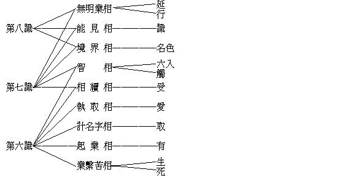



巳三　约染法不觉释



当知无明能生一切染法，以一切染法皆是不觉相故。



观三细、六麤相，皆依不觉心动而起，可知。



卯三　俱融



复次、觉与不觉有二种相。云何为二？一者、同相，二者、异相。言同相者：譬如种种瓦器皆同微尘性相；如是无漏无明种种业幻皆同真如性相。是故修多罗中依於此真如义，故说：一切众生本来常住，入於涅槃。菩提之法，非可修相，非可作相，毕竟无得，亦无色相可见。而有见色相者，唯是随染业幻所作，非是智色不空之性，以智相无可见故。言异相者：如种种幻器，各各不同；如是无漏无明，随染幻差别，性染幻差别故。



此正显生灭相、真如相，皆不离一心而有。而真如又为十法界之通性，全十法界唯一真如，全一真如唯十法界。但有真同俗异二相之殊，实无二体。就众生之真相觉之，故言本来菩提涅槃。然佛法界与众生法界有殊者，众生迷真造无明业，实唯染幻差别；诸佛证真成无漏智，圆满净德，具足妙用，同平等真，普无差别，但随顺众生之业染幻现差别而已。故诸凡夫众生，不可闻本来菩提涅槃之言，便自谓即佛菩萨而不事修证也。



丑二　解释心生灭因缘



寅一　总标



复次、生灭因缘者：所谓众生依心、意、意识转故。



寅二　别释



卯一　明藏心转识互为生灭亲因缘



此义云何？以依阿黎耶识说有无明不觉、而起能见、能现、能取境界，起念相续，故说为意。此意复有五种名：云何为五？一者、名为业识，谓无明力不觉心动故。二者、名为转识，依於动心能见相故。三者、名为现识，所谓能现一切境界，犹如明镜现於色像；现识亦尔，随其五尘对至即现，无有前后，以一切时任运而起，常在前故。四者、名为智识，谓分别染净法故。五者、名为相续识，以念相应不断故。住持过去无量世等善恶之业令不失故；复能成熟现在、未来苦乐等报无差违故；能令现在已经之事忽然而念，未来之事不觉妄虑。是故三界虚伪，唯心所作，离心则无六尘境界。此义云何？以一切法皆从心起妄念而生，一切分别即分别自心，心不见心，无相可得。当知世间一切境界，皆依众生无明妄心而得住持。是故一切法如镜中像，无体可得，唯心虚妄：以心生则种种法生，心灭则种种法灭故。复次、言意识者：即此相续识。依诸凡夫取著转深，计我我所，种种妄执，随事攀缘，分别六尘，名为意识，亦名分离识，又复说名分别事识。此识依见、爱烦恼增长义故。



阿陀那识为无始时来界，本具有一切法种子，具有根本无明种子；亦具有本觉种，亦本具八识及诸心所法、色法种子。无明种子起现行时，即有阿黎耶识与末那识互依俱有而转。根本无明现行无始，故阿黎耶识与末那识亦现行无始。此根本无明在阿黎耶识即为种子，即为无覆无记；在末那识即为相应心所之法我痴，即为染污无记之本，所谓恒行不共无明是也。八、七二识既为互依俱有，就无明现行为增上缘门，则说由末那识我痴、我见而有阿黎耶识；就无明种子因缘门，则说由阿黎耶识有无明不觉起能见、能现、能取境界，心念相续，谓之末那（末那译意）。此以五相释意，即前三细及前二麤相也。一者、业识：即持识中末那识种，由无明种为增上缘，警动而与藏识俱起现行自体。二者、转识：即由自体而起能见。三者现识：既有能见，同时即有一切所见境界。末那缘阿黎耶为实我体，阿黎耶缘种子、根身、器界为执受境；能缘所缘，两皆任运自类相续，故无始起亦无终尽。四者、智识：谓末那识有我见能恒审思量，执阿黎耶见分为内自我体，与颠倒慧相应，故成染心；为一切法染净之依，谓末那染故前六识俱染，末那净故六识亦成净也。五者、相续识：以末那识念念审度执著藏识为内自我体故，乃念念与前六识所造善恶无记业熏习藏识。藏识受熏，持诸习气，俱末那识随业流转。意识依之缘念过去未来，而有色心假实之境，皆心变现，唯虚伪相，依无明妄心故，相似相续存在。若能了妄境空，妄心不起，顺真如性，逆无明习，则无明破而真如显；妄心灭故，一切妄法无不寂灭。然诸凡夫，依相续意起分别识，取著转深，於五蕴法计我我所，种种妄执宇宙物我，随事攀缘，增长爱见，系生死苦，故又当先断见、爱为本也。见谓界内一切见惑，爱则三界、九地思惑是也。



卯二　示无明染心互为生灭增上缘



辰一　显无明起染心之深玄



依无明熏习所起识者，非凡夫能知，亦非二乘智慧所觉。谓依菩萨从初正信，发心观察，若证法身得少分知，乃至菩萨究竟地不能尽知，唯佛穷了。何以故？是心从本已来自性清净而有无明，为无明所染有其染心，虽有染心而常恒不变，是故此义唯佛能知。所谓心性常无念故，名为不变；以不达一法界故，心不相应忽然念起，名为无明。



六凡、二乘智慧，仅能观察依根境为增上缘所起之前六分别事识，不知此根境缘者，亦从无明熏习所起也。无明熏习所起识者，即由无明力故，依如来藏，有末那识、阿黎耶识与前六根尘识之种子转生也。如来藏心体相清净，虽为无明所染有染心起，而恒常不变，其体相性自清净，故深玄难了，唯佛能知也。唯佛证穷究竟离念心性，显然了知心性从本以来离念无念，未尝与念相应。而无明者，本无性故。不如实知唯是一心，违如来藏清净体相，窈冥恍惚，囫囵混沌，晦昧虚悬，昏漫眩荡，忽起妄念，幻现妄境。故虽非离心而别有，又与本清净心相违不顺也。



辰二　显染心由无明而差别



巳一　列释染心治断差别



染心者、有六种。云何为六？一者、执相应染，依二乘解脱及信相应地远离故。二者、不断相应染，依信相应地修学方便，渐渐能舍，得净心地究竟离故。三者、分别智相应染，依具戒地渐离，乃至无相方便地究竟离故。四者、现色不相应染，依色自在地能离故。五者、能见心不相应染，依心自在地能离故。六者、根本业不相应染，依菩萨尽地得入如来地能离故。



执相应染，即第七、六识现行之俱生分别我执烦恼，故二乘圣及智增上信心成就菩萨能远离也。不断相应染，属第六识现行之俱生分别法执，故至初地究竟离也。分别智相应染，属第七识现行之俱生法我执，故七地究竟离相无相分别乃断也。现色不相应染，乃无始来心外取境所熏积之相分习气种子；第八地证如来藏自性清净心，永除取色分齐习气，故得色自在也。能见心不相应染，即无始来能缘外境所熏积之见分习气种子，第九地得心自在故能舍离也。根本业不相应染，即笫八真异熟识，至佛地依如来藏心，乃转舍此异熟识而转得大圆镜智相应之庵摩罗识也。



巳二　兼释无明治断差别



不了一法界义者，从信相应地观察学断，入净心地随分得离，乃至如来地能究竟离故。



大乘初心，即直心正念真如法，初地创证真如，至佛地名圆证真如。故虽初心即学断无明，至佛地乃究竟舍离也。



巳三　随释相应不相应义



言相应义者：谓心念法异，依染净差别而知相、缘相同故。不相应义者：谓即心不觉，常无别异，不同知相、缘相故。



言相应者，指诸心心所法现行同聚，既并列各有自体用，而又同依一根，同缘一境，同属一性──或净或染，或无覆无记，或善、或恶、或无记性。不相应者，即诸染心心所法之习气种子，更无别体，且皆属於第八之所缘境，不与诸心心所同根、同境、同性而转，故曰不相应也。



辰三　显染心与无明所障碍



又染心义者，名为烦恼碍，能障真如根本智故。无明义者，名为智碍，能障世间自然业智故。此义云何？以依染心能见、能现、妄取境界，违平等性故。以一切法常静无有起相，无明不觉妄与法违，故不能得随顺世间一切境界种种知故。



染心能起分段、变易二种生死，障大涅槃，故名为烦恼碍；即前七识现行相应诸烦恼心心法，及阿黎耶识中诸烦恼种是也。无明能起六种染心，障大菩提，故名智碍；即第六、第七识中现行相应之独行恒行不共无明，及阿黎耶识中之无明种子也。



丑三　解释心生灭因缘相



寅一　正明生灭麤细因缘相



复次、分别生灭相者有二种。云何为二？一者、麤，与心相应故。二者、细，与心不相应故。又、麤中之麤，凡夫境界；麤中之细及细中之麤，菩萨境界；细中之细，是佛境界。此二种生灭，依於无明熏习而有，所谓依因、依缘：依因者、不觉义故；依缘者、妄作境界义故。若因灭则缘灭：因灭故不相应心灭，缘灭故相应心灭。



因灭谓无明所熏起之生灭心种因缘灭；缘灭谓八识心心法能为增上缘、所缘缘、等无间缘之现行生灭心灭。麤生灭相、谓异熟因果生灭相；细生灭相、谓等流因果生灭相。麤麤、谓人我见相应心心法聚之现行；麤细、谓人我见不相应心心法聚之种习；细麤、谓法我见相应心心法之现行；细细、谓法我见不相应心心法之种习。推其所本，则皆由无明熏习而起也。



寅二　寄辨心相体灭不灭义



问曰：若心灭者，云何相续？若相续者，云何说究竟灭？答曰：所言灭者，唯心相灭，非心体灭。如风依水而有动相，若水灭则风相断绝，无所依止；以水不灭，风相相续。唯风灭故，动相随灭，非是水灭。无明亦尔，依心体而动，若心体灭则众生断绝，无所依止；以体不灭，心得相续。唯痴灭故，心相随灭，非心智灭。



体指非染非净无名可名之本心体；相指一切杂染差别心相。染相亦不离体，以违於体，令体晦昧，故但名为心相。然彼清净平等之智，亦不离相，以顺於体，令体明显，故但名为心体。心体如水，杂染心相如昏动浑浊之水，名为波流，不名为水；智净心相如澄清平明之水，正名为水，不名为波流也。



子二　显示心染净熏习义



丑一　总标染净熏习法相



复次、有四种法熏习义故，染法、净法起不断绝。云何为四？一者、净法，名为真如。二者、一切染因，名为无明。三者、妄心，名为业识。四者、妄境界，所谓六尘。



丑二　随解染净熏习名义



熏习义者：如世间衣服，实无於香，若人以香而熏习故，则有香气。此亦如是，真如净法实无於染，但以无明而熏习故，则有染相。无明染法实无净业，但以真如而熏习故，则有净用。



根本无覆无记心体，本非善恶，故曰无记；本非染净，故曰无覆。有时说本净者，当知即以本无染净相说为本净也。以有随顺无明诸有漏法为熏习故，则有染相。以有随顺真如诸无漏为熏习故，则有净用。然有漏、无漏之心种，各具无始本有与熏习始起之二类。此中所言实无於染之真如净法及实无净业之无明染法，即无始本有之染净心种也。



丑三　广释染净熏习法义



寅一　明染净互熏无断



卯一　明熏习起染法不断



云何熏习起染法不断？所谓以依真如法故有於无明；以有无明染法因故即熏习真如，以熏习故则有妄心；以有妄心即熏习无明，不了真如法故，不觉念起现妄境界；以有妄境界染法缘故，即熏习妄心，令其念著造种种业，受於一切身心等苦。此妄境界熏习义，则有二种。云何为二？一者、增长念熏习，二者、增长取熏习。妄心熏习义有二种。云何为二？一者、业识根本熏习：能受阿罗汉、辟支佛、一切菩萨生灭苦故。二者、增长分别事识熏习：能受凡夫业系苦故。无明熏习义有二种。云何为二？一者、根本熏习：以能成就业识故。二者、所起见爱熏习：以能成就分别事识义故。



以真如法非明无明，以非明故，有於无明，为诸染法作增上缘，熏习心体，有妄心起。以妄心由无明而起，妄有所见，现妄境界。复以境界为增上缘，妄心爱取，造业受报。此即以一真如、二无明、三妄心、四妄境界之一净三染法，互熏起染法不断绝也。妄境界熏习妄心增长於念者，即名言习气也。增长取者，即二取习气也。妄心熏习无明之业识根本者，即变易生死之真异熟也。又增长分别事识者，即分段生死之异熟生也。此二皆异熟习气也。无明熏习心体之根本者，即不共无明能令第八、第七之二识为俱有依，现起八识四分诸心心法，乃等流习气也。又所起见爱者，即三界内润生无明，乃有支习气也。



卯二　明熏习起净法不断



辰一　净熏习通相



云何熏习起净法不断？所谓以有真如法故能熏习无明，以熏习因缘力故，则令妄心厌生死苦，乐求涅槃；以此妄心有厌求因缘故，即熏习真如，自信己性，知心妄动，无前境界，修远离法；以如实知无前境界故，种种方便，起随顺行，不取不念，乃至久远熏习力故，无明则灭。以无明灭故心无有起，以无起故境界随灭；以因缘俱灭故，心相皆尽，名得涅槃，成自然业。



以真如法非无明故，有於本觉，能违无明。转令妄心起始觉智，求证真如，厌离妄境。证真如故无明则灭，无明灭故无妄念起，妄念息故妄境界空，妄境界空得大涅槃，真心性显，成自然业。



辰二　净熏习别相



巳一　妄心熏习



妄心熏习义有二种，云何为二？一者、分别事识熏习：依诸凡夫、二乘人等，厌生死苦，随力所能以渐趣向无上道故。二者、意熏习：谓诸菩萨发心勇猛，速趣涅槃故。



凡夫、二乘，但知有前六识，故但令先从分别事识，断贪、瞋、痴，修戒、定、慧也。菩萨发心，先知有如来藏、藏识、末那识故；六、七二识能同时转为妙观察智与平等性智，不滞化城而直趣圆寂也。



巳二　真如熏习



午一　标名数



真如熏习义有二种，云何为二？一者、自体相熏习，二者、用熏习。



午二　释名义



未一　显体用熏习相



申一　体熏习



自体相熏习者：从无始世来具无漏法，备有不思议业，作境界之性。依此二义，恒常熏习。以有力故，能令众生厌生死苦，乐求涅槃，自信己身有真如法，发心修行。问曰：若如是义者，一切众生悉有真如，等皆熏习，云何有信无信、无量前后差别？皆应一时自知有真如法，勤修方便，等入涅槃？答曰：真如本一，而有无量无边无明，从本已来自性、差别厚薄不同故。过恒沙等上烦恼依无明起差别，我见、爱染烦恼依无明起差别；如是一切烦恼，依於无明所起前后无量差别，唯如来能知故。又诸佛法有因、有缘，因缘具足乃得成办。如木中火性是火正因，若无人知，不假方便，能自烧木，无有是处。众生亦尔，虽有正因熏习之力，若不遇诸佛、菩萨善知识等以之为缘，能自断烦恼入涅槃者，则无是处。若虽有外缘之力，而内净法未有熏习力者，亦不能究竟厌生死苦，乐求涅槃。若因缘具足者，所谓自有熏习之力，又为诸佛、菩萨等慈悲愿护，故能起厌苦之心，信有涅槃，修习善根。以修善根成熟故，则值诸佛、菩萨示教利喜，乃能进趣向涅槃道。



此云真如，乃以心真如性心根本体，与本有诸无漏功德种性，及佛果上成满一切无为无漏功德，总名之曰真如者也。故即如来藏，亦即如来法身也。此中言真如自体相者，即如来藏，乃人人正因佛性之内熏；能令有自觉心，启发净信，修行佛法也。其问答中，说明同具佛性而有信不信前后差别者，一、由无明烦恼厚薄；二、由虽具佛性正因，尚须缘因、了因，乃能发动开显。文义可知。



　　　　　　　依他起性　──┐  

　　　　　　　　　　　　　　│　┌有漏……杂染依他起性……随顺遍计所执性起者  

　　　　　　┌生灭因缘相……有为┤  

　　　　一心┤　　　　　　　　　├无漏……清净依他起性……随顺圆成实性起者  

　　　　　　└真　如　性……无为┤　　│  

　　　　　　　　　　　　　　│　└──┤　　　　　　　　　　　　　即如来藏亦  

　　　　　　　圆成实性　──┘　　　　└─真如………………圆成实性  

　　　　　　　　　　　　　　　　　　　　　　　　　　　　　　　　　即如来法身



申二　用熏习



用熏习者：即是众生外缘之力。如是外缘，有无量义，略说二种。云何为二？一者、差别缘，二者、平等缘。差别缘者：此人依於诸佛、菩萨等，从初发意始求道时乃至得佛，於中若见、若念，或为眷属父母诸亲，或为给使，或为知友，或为怨家，或起四摄，乃至一切所作无量行缘；以起大悲熏习之力，能令众生增长善根，若见若闻得利益故。此缘有二种，云何为二？一者、近缘，速得度故。二者、远缘，久远得度故。是近、远二缘，分别复有二种。云何为二？一者、增长行缘，二者、受道缘。平等缘者：一切诸佛、菩萨皆愿度脱一切众生，自然熏习恒常不舍，以同体智力故，随应见闻而现作业；所谓众生依於三昧，乃得平等见诸佛故。



真如之用熏习，谓佛及法身大士所成就无边福智，以大悲愿增上力故，能发起众生缘因佛性也。其差别缘，乃佛菩萨以应化身，为三界内凡夫作显熏习者。增长行，谓增长施、戒等行；受道，谓信受行持出世三乘之道也。平等缘乃同体悲智，能为界内凡夫冥熏习缘。依礼拜、禅定力，感应道交，不可思议，常现身光，启人心信。诸佛应法身地上菩萨者，则即他受用身土也。



未二　示体用熏习位



此体用熏习，分别复有二种。云何为二？一者、未相应：谓凡夫、二乘、初发意菩萨等，以意、意识熏习，依信力故而能修行，未得无分别心与体相应故，未得自在业修行与用相应故。二者、已相应：谓法身菩萨得无分别心与诸佛知用相应，唯依法力自然修行，熏习真如、灭无明故。



未相应熏习，即未证真如位、缘修也。已相应，即已证真如位、真修也。



寅二　明净满染法有断



复次、染法从无始已来熏习不断，乃至得佛后则有断。净法熏习则无有断，尽於未来。此义云何？以真如法常熏习故妄心则灭，法身显现起用熏习，故无有断。



妄染本空，唯从来未得契应真净故，住於妄染而不能觉。一得契应真净，净法满足，则自无妄染也。



癸二　显成实净依圆性



子一　合显真如自体相



复次、真如自体相者，一切凡夫、声闻、缘觉、菩萨、诸佛，无有增减，非前际生，非后际灭，毕竟常恒，从本已来性自满足一切功德。所谓自体有大智慧光明义故，遍照法界义故，真实识知义故，自性清净心义故，常乐我净义故，清凉不变自在义故。具足如是过於恒沙不离不断不异不思议佛法，乃至满足无有所少义故，名为如来藏，亦名如来法身。问曰：上说真如，其体平等离一切相，云何复说体有如是种种功德？答曰：虽实有此诸功德义而无差别之相，等同一味，唯一真如。此义云何？以无分别，离分别相，是故无二。复以何义得说差别？以依业识生灭相示。此云何示？以一切法本来唯心，实无於念而有妄心，不觉起念见诸境界，故说无明。心性不起，即是大智慧光明义故。若心起见则有不见之相，心性离见即是遍照法界义故。若心有动非真识知，无有自性，非常非乐非我非净，热恼衰变则不自在，乃至具有过恒沙等妄染之义；对此义故，心性无动，则有过恒沙等诸净功德相义示现。若心有起，更见前法可念者，则有所少；如是净法无量功德，即是一心，更无所念，是故满足，名为法身如来之藏。



从一切凡夫至毕竟常恒，即显大乘体大，所谓以一切法真如平等不增减故。从复次真如自体相者至是故满足名为法身如来之藏，即显大乘自体相大，所谓以如来藏具足无量性功德故是也。大智慧光明义，即大乘不共般若也。遍照法界义，即根本无分别智证真如性也。真实识知义，即后得正分别智，如实了知世出世间一切染净因果差别法相。自性清净心义，即由七地证入八地，不更起业识现行相，舍阿赖耶识名转名如来藏心，常契清净心性也。常乐我净即佛果德。清凉不变自在义，即佛果之涅槃、菩提也。此诸性功德相，乃是无相之相，相相无相，不可思议。一者、与真如等同一味、无二无别故。二者、惟约业识转舍之相而说有差别故。文义可知。在自性清净心位正名如来藏，犹是诸佛在缠法身；至佛果一切性功德无不圆满成实，乃名如来法身；合之则名法身如来之藏。



子二　别显真如用



丑一　略明



复次、真如用者：所谓诸佛如来，本在因地发大慈悲，修诸波罗密摄化众生，立大誓愿尽欲度脱等众生界，亦不限劫数尽於未来；以取一切众生如己身故，而亦不取众生相。此以何义？谓如实知一切众生及与己身真如平等无别异故。以有如是大方便智除灭无明，见本法身，自然而有不思议业种种之用，即与真如等遍一切处。又亦无有用相可得，何以故？谓诸佛如来唯是法身智相之身，第一义谛，无有世谛境界，离於施作。但随众生见闻得益，故说为用。



此明诸佛果中真如妙用，由本因地慈悲、誓愿、六度、四摄，修习诸功德成满故，乃不由作意而有不思议大用。此妙德用与真心体融遍无二，本无名相，然约众生依自善根力故，随所见闻而得种种利益，故说为种种真如业用耳。



丑二　广显



此用有二种。云何为二？一者、依分别事识：凡夫、二乘心所见者，名为应身。以不知转识现故，见从外来，取色分齐，不能尽知故。二者、依於业识：谓诸菩萨从初发意乃至菩萨究竟地心所见者，名为报身。身有无量色，色有无量相，相有无量好，所住依果亦无有量，种种庄严随所示现，即无有边、不可穷尽，离分齐相，随其所应，常能住持不毁不失。如是功德，皆因诸波罗密等无漏行熏及不思议熏之所成就。具足无量乐相故，说为报身。又为凡夫所见者，是其麤色；随於六道各见不同，种种异类，非受乐相故，说为应身。复次，初发意菩萨等所见者，以深信真如法故，少分而见，知彼色相庄严等事，无来无去离於分齐，唯依心现，不离真如。然此菩萨犹自分别，以未入法身位故。若得净心，所见微妙，其用转胜。乃至菩萨地尽，见之究竟。若离业识，则无见相，以诸佛法身无有彼此色相迭相见故。问曰：若诸佛法身离於色相者，云何能现色相？答曰：即此法身是色体故，能现於色。所谓从本已来色心不二，以色性即智故，色体无形，说名智身；以智性即色故，说名法身。遍一切处所现之色，无有分齐。随心能示十方世界，无量菩萨、无量报身、无量庄严各各差别，皆无分齐而不相妨。此非心识分别能知，以真如自在用义故。



此二种真如用，皆所谓随众生见闻得益故说为用者。依凡夫、二乘分别事识所见者，乃应化身，是如来妙观察智、成所作事智之所示现。以凡夫、二乘不了唯心故，心外取佛身故，故有分限。依地上菩萨业识所现者乃他受用身土，以了知一一法即真如故，唯心现故；是以身色相好依正庄严不可限量，无边无尽。又能随诸菩萨地差别不同而秩然不失其序，所谓初地见百佛世界等。此皆无漏福智之所成就，唯真妙乐，故名报身。而六道凡夫随类所见不同者，似有苦相，故名应身。初发意菩萨以深解如来藏真如故，能即从应身以观佛报身、法身。初地以上能见佛法报身，至佛地无不圆满故，乃无可见。其问答中，以佛法身、智身，即色心体，故能现诸身土相好。复以色相身土即是法性智性，故能各各无量差别而不妨乱。此正所谓不思议之佛境，非凡愚心所能测度者也。



壬二　示直从生灭门即入真如门



复次、显示从生灭门即入真如门：所谓推求五阴──色之与心──六尘境界，毕竟无念。以心无形相，十方求之终不可得。如人迷故，谓东为西，方实不转。众生亦尔，无明迷故，谓心为念；心实不动。若能观察知心无念，即得随顺入真如门故。



妄心所取诸生灭法，不出五蕴、六尘境界。知此五蕴、六尘，皆由妄心分别而幻现之幻相。反观妄心本无形相，故即离一切相之心真如，本未尝有想念，以离念故，故能即从生灭门入真如门也。



己二　对治邪执



庚一　标名列数



对治邪执者：一切邪执皆依我见，若离於我，则无邪执。是我见有二种，云何为二？一者、人我见，二者、法我见。



诸有邪执，皆由於所闻名言或所缘境界有所封取贪著而起。封取贪著则成我所有见，有我所有见必先有我见，有能取者乃有所取之名言境界者也。故曰一切邪执皆依我见，若离於我则无邪执。



庚二　随执对治



辛一　对治人我见所起邪执



人我见者：依诸凡夫说有五种。云何为五？一者、闻修多罗说如来法身毕竟寂寞犹如虚空；以不知为破著故，即谓虚空是如来性。云何对治？明虚空相是其妄法，体无不实，以对色故有，是可见相，令心生灭。以一切色法本来是心，实无外色；若无外色者，则无虚空之相。所谓一切境界唯心妄起故有；若心离於妄动，则一切境界灭，唯一真心，无所不遍。此谓如来广大性智究竟之义，非如虚空相故。二者、闻修多罗说世间诸法毕竟体空，乃至涅槃真如之法亦毕竟空，从本已来自空离一切相；以不知为破著故，即谓真如涅槃之性唯是其空。云何对治？明真如法身自体不空，具足无量性功德故。三者、闻修多罗说如来之藏无有增减，体备一切功德之法；以不解故，即谓如来之藏有色心法自相差别。云何对治？以唯依真如义说故，因生灭染义示现说差别故。四者、闻修多罗说一切世间生死染法皆依如来藏而有，一切诸法不离真如；以不解故，谓如来藏自体具有一切生死等法。云何对治？以如来藏从本已来唯有过恒沙等诸净功德，不离不断不异真如义故；以过恒沙等烦恼染法唯是妄有，性自本无，从无始世来未曾与如来藏相应故。若如来藏体有妄法而使证会永息妄者，则无是处故。五者、闻修多罗说依如来藏故有生死，依如来藏故得涅槃；以不解故，谓众生有始，以见始故，复谓如来所得涅槃有其终尽，还作众生。云何对治？以如来藏无前际故，无明之相亦无有始，若说三界外更有众生始起者，即是外道经说。又如来藏无有后际，诸佛所得涅槃与之相应，则无后际故。



此人我见，即由和合连续而似有常一之假相，从似常似一之假相起於总相之见，依之执取如来法身而生种种分别贪著。唯是修学大乘之凡夫所起邪执，所谓凡情佛见是也。离诸妄见，乃得见佛；於佛而起虚妄之见，非颠倒之甚欤！一者、著如来法身为虚空邪执：以虚空但是妄念所取之一妄相对治之；而显性智广大圆满，名为如来法身，非是虚空之妄相也。二者、著真如法身为空无所有邪执：以真如如实不空对治之。三者、著如来藏为有色心自相差别邪执：以体相同──真如一味平等，但依业识而现差别对治之。四者、著如来藏为有世间生死诸法邪执：以如来藏唯有圆同真如诸净功德，一切染法本来不相应对治之。五者、众生生死有始、如来涅槃有终邪执：以如来藏常现在而无过去故众生无始，如来藏常现在而无未来故如来无终对治之。文相如次可知。



辛二　对治法我见所起邪执



法我见者：依二乘钝根故，如来但为说人无我；以说不究竟，见有五阴生灭之法，怖畏生死，妄取涅槃。云何对治？以五阴法自性不生则无有灭，本来涅槃故。



此法我见，乃於一一法之别相执有实性，妄谓实有生灭之法。因之怖畏生灭，妄取不生灭法，执为涅槃。此由执二乘法而起，所谓圣解法见是也。今即以一切五阴生灭法，性本空寂，本无有生灭对治之。



庚三　究竟离妄



复次、究竟离妄执者，当知染法净法皆悉相待，无有自相可说。是故一切法从本已来，非色非心，非智非识，非有非无，毕竟不可说相。而有言说者，当知如来善巧方便，假以言说引导众生。其旨趣者，皆为离念归於真如；以念一切法令心生灭，不入实智故。



此即真如如实空门。明法性离言念，而有言者，唯假施设，以显离言法性。故佛说法，旨在遣一切法令皆离念，得入真如而已。



戊二　解释大乘因果



己一　标果建因



分别发趣道相者：谓一切诸佛所证之道，一切菩萨发心修行趣向义故。



一切诸佛所证之道，即标大乘之果；一切菩萨发心修行趣向，即建大乘之因。举如来果觉以决定因心，修菩萨因行以圆成果德，是名大乘因果。



己二　从因显果



庚一　标列三种发心



略说发心有三种，云何为三？一者、信成就发心，二者、解行发心，三者、证发心。



庚二　释成三种发心



辛一　信成就发心



壬一　明发心因缘



信成就发心者：依何等人，修何等行，得信成就堪能发心？所谓依不定聚众生，有熏习善根力故，信业果报，能起十善，厌生死若，欲求无上菩提，得值诸佛，亲承供养，修行信心经一万劫，信心成就故。诸佛菩萨教令发心，或以大悲故能自发心，或因正法欲灭以护法因缘故能自发心，如是信心成就得发心者，入正定聚毕竟不退，名住如来种中正因相应。若有众生善根微少，久远已来烦恼深厚，虽值於佛、亦得供养，然起人天种子，或起二乘种子，设有求大乘者，根则不定，若进若退。或有供养诸佛未经一万劫，於中遇缘亦有发心：所谓见佛色相而发其心，或因供养众僧而发其心，或因二乘之人教令发心，或学他发心。如是等发心，悉皆不定，遇恶因缘或便退失堕二乘地。



聚者、类也。不定聚者，三界、六凡俱名不定之聚，以流转无定故。於出世三乘已成就不退心故，乃舍不定聚名而名为大乘正定聚，或缘觉乘，声闻乘正定聚。然入缘觉、声闻正聚者，后皆发大乘心而更转入大乘，唯一入大乘正定聚乃无所转，从因趣果，直至成佛。故虽入二乘正定聚，犹然不定，唯入大乘正定聚乃真为正定聚也。此云信成就发心者，大乘内凡修十信行，十信心满得登初住，发大乘心，成不退信是也。佛菩萨教发心，缘因胜故不退；以大悲护法故发心，正因胜故不退。见佛色像、供养众僧、二乘人教效学他人如是等发心者，以大乘善根未成熟，非由自觉正因心发；缘因又不殊胜，故或退堕二乘地也。然大乘不退位有四：一、十信心满入初住得信不退，即今信成就发心者。二、从七住以上得解不退，即今解行发心者。三、至初地得行不退，即今证发心者。四、至八地得念不退，谓念念皆任运增进佛功德也。然一成就大乘信心不退，即登佛位为法王子，故已超过凡夫权乘而能现八相成佛矣。



壬二　明发心行相



复次、信成就发心者，发何等心？略说有三种。云何为三？一者、直心，正念真如法故。二者、深心，乐集一切诸善行故。三者、大悲心，欲拔一切众生苦故。问曰：上说法界一相，佛体无二，何故不唯念真如，复假求学诸善之行？答曰：譬如大摩尼宝，体性明净而有矿秽之垢；若人虽念宝性，不以方便种种磨治，终无得净。如是众生真如之法，体性空净而有无量烦恼垢染；若人虽念真如，不以方便种种熏修，亦无得净。以垢无量，遍一切法，故修一切善行以为对治。若人修行一切善法，自然归顺真如法故。略说方便有四种，云何为四？一者、行根本方便：谓观一切法自性无生，离於妄见，不住生死；观一切法因缘和合，业果不失，起於大悲，修诸福德摄化众生，不住涅槃：以随顺法性无住故。二者、能止方便：谓惭愧悔过，能止一切恶法不令增长，以随顺法性离诸过故。三者、发起善根增长方便：谓勤供养、礼拜三宝，赞叹、随喜、劝请诸佛，以爱敬三宝淳厚心故，信得增长，乃能志求无上之道；又因佛法僧力所护故，能消业障，善根不退：以随顺法性离痴障故。四者、大愿平等方便；所谓发愿尽於未来，化度一切众生使无有餘，皆令究竟无餘涅槃：以随顺法性无断绝故；法性广大，遍一切众生平等无二，不念彼此究竟寂灭故。



初发大乘心之三心，维摩诘、十六观诸经皆同。一者、信念真如，解行真如，回向真如，证契真如，所谓直心正念真如法也。二者、好乐佛果福德智慧，修集佛果福德智慧，回向佛果福德智慧，成就佛果福德智慧，所谓深心乐集一切诸善行也。三者、愿度一切众生，摄化一切众生，回向一切众生，救护一切众生，所谓大悲心欲拔一切众生苦也。以回情向理故，恶无不止、体无不显，消极之究竟也；以回因向果故，善无不行、德无不备，积极之究竟也。此二皆是上彻之道。以回自向他故，寓之无方，用之无尽；此一乃为下彻之道。彻上彻下，唯一信心，是名信成就发心相。问答之中，明所以须深心、大悲心者，其义可知。所云四种方便，皆是随顺法性之行。第一、为修行信心中止观，止故不住生死，观故不住涅槃，止观平等随顺法性无住，所谓应无所住而生其心是也。此一方便，普为下三方便之根本故，故名根本方便。下三方便，如次为直心、深心、大悲心所增长成就之前方便见之行事者，可知。离过绝非以观真如，仰德崇善以敬三宝，大愿等慈以度众生，菩萨之心如是而已！



壬三　明发心成就



菩萨如是发心故，则得少分见於法身。以见法身故，随其愿力，能现八种相利益众生。所谓从兜率天退、入胎、住胎、出胎、出家、成道、转法轮、入於涅槃。然是菩萨未名法身，以其过去无量世来有漏之业未能决断，随其所生与微苦相应；亦非业系，以有大愿自在力故。如修多罗中或说有退堕恶趣者，非其实退，但为初学菩萨未入正位而懈怠者恐怖，令彼勇猛故。又是菩萨一发心后，远离怯弱，毕竟不畏堕二乘地。若闻无量无边阿僧祇劫勤苦难行乃得涅槃，亦不怯弱，以信知一切法从本已来自涅槃故。



此明大乘信心成就，证初发心住之菩萨，即能现八相成佛也。与微苦相应者，若二乘、凡夫见释尊亦有老病等也，然非业系；则由乘愿度人乃来，非乘愿度人固可不受此微苦相也。又入菩萨正定聚者，毕竟不退。故经中或说有退者，非发心因缘未成就本未得入正定聚者，则是方便假说有退，令未入正定聚之大乘初学人勇猛精进不生懈怠而已。



辛二　解行发心



解行发心者，当知转胜。以是菩萨从初正信已来，於第一阿僧祇劫将欲满故。於真如法中深解现前，所修离相。以知法性体无悭贪故，随顺修行檀波罗密。以知法性无染，离五欲过故，随顺修行尸波罗密。以知法性无苦，离瞋恼故，随顺修行羼提波罗密。以知法性无身心相，离懈怠故，随顺修行毗黎耶波罗密。以知法性常定，体无乱故，随顺修行禅波罗密。以知法性体明，离无明故，随顺修行般若波罗密。



此即理解、事行等运，由十住心、十行心进入十回向心辗转胜进也。随顺法性而行六波罗密，乃由理成事、即事显理也。盖信成就发心为信念真如、好乐佛德、愿度众生，此则为解行回向真如、修集回向佛德、摄化回向众生，亦依前之三心为本。故一一波罗密皆有三相，如次有摄律仪戒、摄善法戒、摄众生戒等是也。



辛三　证发心



壬一　通明诸地行相



证发心者，从净心地乃至菩萨究竟地。证何境界？所谓真如。以依转识说为境界，而实证者无有境界，唯真如智名为法身。是菩萨於一念顷能至十方无餘世界，供养诸佛，请转法轮，唯为开导利益众生，不依文字。或示超地速成正觉，以为怯弱众生故。或说我於无量阿僧祇劫当成佛道，以为懈慢众生故。能示如是无数方便，不可思议，而实菩萨种性根等，发心则等，所证亦等；无有超过之法，以一切菩萨皆经三阿僧祇劫故。但随众生世界不同，所见所闻根欲性异，故示所行亦有差别。又是菩萨发心相者，有三种心微细之相。云何为三？一者、真心，无分别故。二者、方便心，自然遍行利益众生故。三者、业识心，微细起灭故。



净心地、即初欢喜地。前者由信解行愿而成就增长三心，此则由证得真如而转现如来法身功德，蕴德成身。上求之道已成，唯须下化以圆满佛果功德智慧耳。根本无分别智亲证於真如，不二如如，本无境界，然以犹有细微业识俱之转现，故依之说所证真如以为境界而已。以真智挟体而缘真如故无境界相，以与业识俱转之后得正分别智变相而缘真如故有境界相。然能证真如之真智与能如量分别染净因果诸法之后得智，一地一地，分分深广明净，而业识又同时一地一地分分微薄舍离，故有从一地至十地之所转得、所转舍可言也。梵语三阿僧祇大劫，华言三无数大时也。从初住位入初地位，历一无数大劫；从初地位入八地位，历一无数大劫；从八地位至十地位，历一无数大劫：故有三阿僧祗大劫。此为大乘从因至果、从初入正定聚至佛果地一定所经历之程序。然菩萨为化未入正定聚凡夫，开示种种言教行相，或极久远，或极速疾，则如空中鸟迹而无可测量也。三种心微细相：一、即如理真智，是所显得。二、即如量俗智，是所生得。二皆是所转得。三、即唯识诸如幻事，一分属所转依，即是第八心体，至果后名为庵摩罗识也。一分属所转舍，即是第八诸杂染种及异熟识与前七识生灭杂染心心法也。



壬二　别明十地功德



又是菩萨功德成满，於色究竟处示一切世间最高大身，谓以一念相应慧，无明顿尽，名一切种智，自然而有不思议业，能现十方利益众生。问曰：虚空无边故世界无边，世界无边故众生无边，众生无边故心行差别亦复无边；如是境界，不可分齐，难知难解。若无明断，无有心想，云何能了名一切种智？答曰：一切境界，本来一心，离於想念。以众生妄见境界故，心有分齐，以妄起想念不称法性故，不能决了。诸佛如来离於见想，无所不遍，心真实故，即是诸法之性；自体显照一切妄法，有大智用，无量方便，随诸众生性所应得解，皆能开示种种法义，是故得名一切种智。又问曰：若诸佛有自然业，能现一切处利益众生者，一切众生若见其身、若睹神变、若闻其说、无不得利，云何世间多不能见？答曰：诸佛如来法身平等，遍一切处，无有作意故而说自然；但依众生心现。众生心者，犹如於镜，镜若有垢色像不现。如是众生心若有垢，法身不现故。



佛地功德无自他身土相。舍尽业识，全无境界，唯佛能知，无可开示。又以十地菩萨全似乎佛，是故寄因明果，就十地圆因以显佛果功德也。所显实是佛果功德，特依十地菩萨境界以显之耳。一念相应慧者，即第八识全是无明，自来未与慧心相应，至成佛时，一得相应，即求断诸无明染种，转成大圆镜智无垢心也。大圆镜智名为一切种智。由四智无垢识故，自然而有不思议业，能现十方利益众生也。问答二章，文义可知。



丙四　修行信心分



丁一　标人立法



已说解释分，次说修行信心分。是中依未入正定聚众生，故说修行信心。



丁二　从理起行



戊一　寄问总徵



何等信心？云何修行？



戊二　随问分释



己一　发信心起行



略说信心有四种，云何为四？一者、信根本，所谓乐念真如法故。二者、信佛有无量功德，常念亲近供养恭敬，发起善根，愿求一切智故。三者、信法有大利益，常念修行诸波罗密故。四者、信僧能正修行自利利他故，常乐亲近诸菩萨众求学如实行故。



初云信根本者，乃闻上来所说心真如如来藏大乘自体相用，谛观审察深解其义，欣乐思念渴仰其法，而发心皈依乎即心自性之同体三宝也。后之三者，如次即为皈依信奉乎大乘之别相三宝可知。何缘信佛？有大功德，能发起善根故。何缘信大乘法？有大利益，能令到彼岸故。何缘信大乘僧？能正修行，以自利利他故。因信佛常念亲近供养恭敬故，起求一切智行；因信法常念修行诸波罗密故，起集众善法行；因信僧常乐亲近诸菩萨众故，起如实修学行。



己二　修行成信心



庚一　标列五门



修行有五门，能成此信。云何为五？一者、施门，二者、戒门，三者、忍门，四者、进门，五者、止观门。



庚二　释成五门



辛一　总明前四门



云何修行施门？若见一切来求索者，所有财物随力施与，以自舍悭贪，令彼欢喜。若见厄难、恐怖、危逼，随己堪任，施与无畏。若有众生来求法者，随己能解，方便为说；不应贪求名利恭敬，唯念自利利他回向菩提故。云何修行戒门？所谓不杀、不盗、不淫、不两舌、不恶口、不妄言、不绮语，远离贪嫉、欺诈、谄曲、瞋恚、邪见。若出家者，为折伏烦恼故。亦应远离愦闹，常处寂静，修习少欲、知足、头陀等行。乃至小罪心生怖畏，惭愧改悔；不得轻於如来所制禁戒，当护讥嫌，不令众生妄起过咎故。云何修行忍门？所谓应忍他人之恼，心不怀报；亦当忍於利、衰、毁、誉、称、讥、苦、乐等法故。云何修行进门？所谓於诸善事心不懈退立志坚强，远离怯弱。当念过去久远以来，虚受一切身心大苦，无有利益；是故应勤修诸功德，自利利他，速离众苦。复次、若人虽修行信心，以从先世来多有重罪恶业障故，为邪魔诸鬼之所恼乱，或为世间事务种种牵缠，或为病苦所恼；有如是等众多障碍。是故应当勇猛精勤，昼夜六时，礼拜诸佛，诚心忏悔，劝请、随喜、回向菩提，常不休废；得免诸障，善根增长故。



依前发三种信心故，此四度门，一一皆有三相。唯序次间有参互耳。



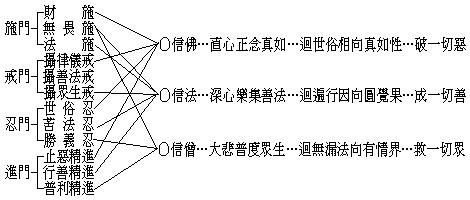



复次、若人虽修行信心下，即是别出止恶精进之相。此能止恶免障之法，即为善行。恶止障免，即此善行之得成就。且诸善根向为恶障所障，未能发生，今以恶止障免，皆得增长，故曰得免诸障善根增长也。惑、业、报障，皆为恶障。略摄恶障为四，以勇猛精勤礼拜诸佛修四善行治灭之。



业报障……修诸忏悔法治灭之



魔邪障……劝请诸佛菩萨住世转法轮治灭之



嫉妒障……随喜诸佛菩萨二乘天人诸胜行治灭之



贪著障……常发三种回向心治灭之



辛二　广明止观门



壬一　略明



云何修行止观门？所言止者：谓止一切境界相，随顺奢摩他观义故。所言观者：谓分别因缘生灭相，随顺毗钵舍那观义故。云何随顺？以此二义渐渐修习，不相舍离，双现前故。



奢摩他、译止，毗钵舍那、译观。观止、止观，平等运持，名为正止、正定、正观、正慧。言随顺奢摩他观者，观心真如止一切境界相，随顺止行之平等运持，正止也。随顺毗钵舍那观者，观心生灭因缘相，分别十法界善恶、染净、苦乐因果诸法而止恶行善，转染成净，拔苦与乐，修因证果，以随顺观行之平等运持正观也。以先止、后观修习为随顺，以止观平等现前为成就，此为修行止观之常法也。



壬二　广辨



癸一　修次第止观



子一　修止



丑一　修止人法



若修止者：住於静处，端坐正意，不依气息，不依形色，不依於空，不依地、水、火、风，乃至不依见、闻、觉、知，一切诸想随念皆除，亦遣除想。以一切法本来无相，念念不生，念念不灭，亦不得随心外念境界。后以心除心：心若驰散，即当摄来住於正念。是正念者，当知唯心无外境界；即复此心亦无自相，念念不可得。若从坐起，去来进止有所施作，於一切时常念方便，随顺观察；久习淳熟，其心得住。以心住故，渐渐猛利，随顺得入真如三昧；深伏烦恼，信心增长，速成不退。



若修止者，指具足二十五前方便能修行止之人。次二句，即含摄二十五前方便也。



二十五前方便图表：



　　　　　　　　　　　　　　　　　　　┌清静住处  

　　　　　　　　　　　　　　　　　　　│衣食不缺  

　　　　住於静处───────┬具五缘┤休舍尘务  

　　　　　　　　　　　　　┌─┘　　　│远离病障　┌色  

　　　　　　　　　　　　　│　　　　　└近善知识　│声  

　　　　　　　　　　　　　├──呵五欲──────┤香  

　　　　　　　　　　　　　│　　　　　┌贪欲　　　│味  

　　　　　　　　　　　　　│　　　　　│瞋恚　　　└触  

　　　　端坐正意─────┼──弃五盖┤睡眠  

　　　　　　　　　　　　　│　　　　　│掉悔　　　┌食  

　　　　　　　　　　　　　│　　　　　└疑惑　　　│睡  

　　　　　　　　　　　　　├──调五事──────┤身  

　　　　　　　　　　　　　│　　　　　┌正志修止　│息  

　　　　　　　　　　　　　│　　　　　│正勤修止　└心  

　　　　　　　　　　　　　└──立五信┤正念修止  

　　　　　　　　　　　　　　　　　　　│正慧修止  

　　　　　　　　　　　　　　　　　　　└正解修止



依借事门修习三昧图表：



　　　　　　　　　　　　　　　　　　　┌数息  

　　　　气　　息○─────○安那般那┤  

　　　　　　　　　　　　　　　　　　　└随息  

　　　　　　　　　　　　　　　　　　　┌顶间  

　　　　　　　　　　　　　　　　　　　│发际  

　　　　　　　　　　　　　　　　　　　│眉间  

　　　　　　　　　　　　　　　　　　　│鼻端  

　　　　　　　　　　　　┌─○系身九缘┤胸间  

　　　　　　　　　　　　│　　　　　　│脐间　　　　　　┌内有色想外观色少  

　　　　　　　　　　　　│　　　　　　│丹田　　　　　　│内有色想外观色多  

　　　　　　　　　　　　│　　　　　　│足心　　　　　　│内无色想外观色少  

　　　　　　　　　　　　│　　　　　　└足指　　　　　　│内无色想外观色多  

　　　　形　　色○───┼─────────○八背舍胜处┤内无色想外观色青  

　　　　　　　　　　　　│　　　　　　┌膨胀　　　　　　│内无色想外观色黄  

　　　　　　　　　　　　│　　　　　　│青瘀　　　　　　│内无色想外观色赤  

　　　　　　　　　　　　│　　　　　　│败坏　　　　　　└内无色想外观色白  

　　　　虚　　空○──┐│　　　　　　│涂污  

　　　　　　　　　　　│├─○观身九想┤脓烂  

　　　　　　　　　　　││　　　　　　│虫噉  

　　　　　　　　　　　││　　　　　　│分散  

　　　　　　　　　　　││　　　　　　│白骨  

　　　　　　　　　　　││　　　　　　└烧空  

　　　　地水火风○─┐│└───┐　　┌青┐  

　　　　　　　　│　││　　　　│　　│黄│  

　　　　　　　　│　││　　　　└─○│赤│  

　　　　见闻觉知○┐│├──────┐└白│  

　　　　　　　　││├○二十五圆通　│┌地├十遍处胜定  

　　　　　　　　│││　　　　　　　││水│  

　　　　　　　　││└──────○││火│  

　　　　　　　　│└───────┐│└风│  

　　　　　　　　└○十八界　　　　│└○空│  

　　　　　　　　　　　　　　　　　└─○识┘



以上即为正修真如三昧之法。不依气息乃至不依见、闻、觉、知。以形、气、色、空乃至四大、五蕴、十八界一切法，皆心真如性，都无自体、自相、自用可得。以一切都无可依故，故总不借安那般那诸事相门以修之也。不依气息乃至不依见、闻、觉、知者，是遍观一切法皆心真如，一相无相，一性无性，觅心了不可得而心安真如也。一切诸想随念皆除者，以无始熏习名言习气故，暂息念，又起想，於想念诸法时，才一觉了即舍其念，不稍令想念相续也。亦遣除想者，所除想除，亦除能除想也。以一切法本来无相，念念不生念念不灭者，豁然确了一切法相本来无有，本无所除，故亦无能除也。唯其了知本来无有，故不同外道厌想、灭想之无想定也。亦不得随心外念境界者，指定心中所发生之种种通玄胜妙神奇境界，了知亦同意想之法，遍是过患，令心动静，亦不起念生贪著也。后以心除心者，舍心清净，不唯离忧、苦受，亦复离喜、乐受，得寂静也。心若驰散乃至念念不可得者，从坐而起不修止时，对色、声、香、味、触、法境，历行、住、坐、卧、云、为缘，心才不与寂静真如相应有驰散时，即当摄念唯心；无心外境，亦无内心，唯心真如。所缘之相与能缘之见两俱不可得，住最极寂静也，此即止观双现前矣。若从坐起乃至其心得住者，於一切处、历一切缘、对一切境之时，常修无境唯心胜方便观，久习淳熟，语默动静融成一片，无住生心，生心无住，恒遍一切时处无不与真如相应也。以心住故乃至速成不退者，则成就止观平等运持之正受、正定、正见、正慧也。真如不住於寂灭故，观世间苦，发大悲心，集众善行；真如不住於生死故，止流转因，集众善行，求圆满觉。故曰渐渐猛利，随顺得入真如三昧，深伏烦恼，信心增长，速成不退。此云深伏烦恼，乃信心成就时圆伏见、思及分别无明之五住烦恼也。此云速成不退，或信不退，或解不退，或证不退，随修止者行位而发。然此中既依不定聚人说修行信心，则正是信成就发心而成信不退耳。



丑二　拣除劣行



唯除疑惑、不信、诽谤、重罪业障、我慢、懈怠，如是等人所不能入。



此即於二十五前方便不具足者也。



丑三　发生胜德



复次、依是三昧故，则知法界一相。谓一切诸佛法身与众生身平等无二，即名一行三昧。当知真如是三昧根本，若人修行，渐渐能生无量三昧。



真如三昧，即心佛众生平等无二之法界一行相，故亦名一相三昧及一行三昧。一切正受皆同会归，一切正见皆从流出。



丑四　警辨魔惑



或有众生无善根力，则为诸魔、外道、鬼神之所惑乱。若於坐中现形恐怖，或现端正男女等相，当念唯心，境界则灭，终不为恼。或现天像、菩萨像，亦作如来像、相好具足：或说陀罗尼，或说布施、持戒、忍辱、精进、禅定、智慧，或说平等空、无相、无愿，无怨无亲，无因无果，毕竟空寂是真涅槃；或令人知宿命过去之事，亦知未来之事，得他心智，辩才无碍；能令众生贪著世间名利之事；又令使人数瞋、数喜，性无常准；或多慈爱、多睡、多病，其心懈怠；或卒起精进后便休废，生於不信，多疑多虑；或舍本胜行，更修杂业，若著世事种种牵缠；亦能使人得诸三昧少分相似，皆是外道所得，非真三昧；或复令人若一日、若二日、若三日乃至七日住於定中，得自然香美饮食，身心适悦，不饥不渴，使人爱著；或亦令人食无分齐，乍多乍少，颜色变异。以是义故，行者常应智慧观察，勿令此心堕於邪网。当勤正念，不取不著，则能远离是诸业障。应知外道所有三昧，皆不离见、爱、我慢之心，贪著世间名利恭敬故。真如三昧者，不住见相，不住得相，乃至出定亦无懈慢，所有烦恼渐渐微薄。若诸凡夫，不习此三昧法得入如来种性，无有是处。以修世间诸禅三昧，多起味著，依於我见，系属三界，与外道共。若离善知识所护，则起外道见故。



魔事众多，此论但略陈耳。广如楞严五十种阴魔境及诸经论止观所明。若一切时不离唯心正观，无见无得，无取无舍，直心正念真如法故，不贪著世间名利恭敬故，不贪著世间才智艺能故，不贪著世间神力威福故，不贪著世间欲乐寿命故──未得欲得曰贪，既得患失曰著──才起贪著，即落魔邪，永离贪著，直入真觉。若复内蕴毒智，外现德仪，附圣教言，成大妄语；则如雕刻人粪成旃檀像，欲求香气，终不能得，其害人固多而自害者尤深也。然诸凡夫得入如来种性，所以必修此三昧者，以修其餘诸事三昧多起贪著，一起味著即系属於我我所见，与外道共，堕魔邪种。唯此真如三昧，诸外道虽能闻名义，以无味可著故，不乐修习。所谓太末虫於一切处俱能行，唯不能行於火聚中。凡夫毒智亦然，一切处俱能缘，唯不能缘於大般若。故能修此三昧，必入如来种性，得不退也。



丑五　显示利益



复次、精勤专心修学此三昧者，现世当得十种利益：云何为十？一者、常为十方诸佛菩萨之所护念；二者、不为诸魔恶鬼所能恐怖；三者、不为九十五种外道鬼神之所惑乱；四者、远离诽谤甚深之法，重罪业障渐渐微薄；五者、灭一切疑惑，诸恶觉观；六者、於如来境界信得增长；七者、远离忧悔，於生死中勇猛不怯；八者、其心柔和，舍於憍慢，不为他人所恼；九者、虽未得定，於一切时一切境界处，则能减损烦恼，不乐世间；十者、若得三昧，不为外缘一切音声之所惊动。



前九利益，是指修学此三昧未成者、即能得之利益。后一利益，系已得三昧者、世间人所见之相也。不为外缘一切音声之所惊动，即是得音声忍，所谓：利、衰、毁、誉、称、讥、苦、乐之八风不能吹动，因已超过世间苦、乐、忧、喜之境故也。



子二　修观



复次、若人唯修於止，则心沈没，或起懈怠不乐众善，远离大悲，是故修观。修习观者，当观一切世间有为之法，无得久停，须臾变坏；一切心行念念生灭，以是故苦；应观过去所念诸法、恍惚如梦，应观现在所念诸法、犹如电光，应观未来所念诸法、犹如於云忽尔而起；应观世间一切有身，悉皆不净，种种秽污，无一可乐，如是当念：一切众生从无始世来，皆因无明所熏习故，令心生灭，已受一切身心大苦，现在即有无量逼迫；未来所苦亦无分齐，难舍难离而不觉知。众生如是，甚为可愍！作此思维，即应勇猛立大誓愿，愿令我心离分别故，遍於十方修行一切诸善功德；尽其未来，以无量方便救拔一切苦恼众生，令得涅槃第一义乐。以起如是愿故，於一切时一切处所有众善，随己堪能不舍修学，心无懈怠。唯除坐时，专念於止；若餘一切，悉当观察应作不应作。



修止心或沈没、懈怠；乃是修至亦遣除想，住著息想定境，不成增进，故致沈没、懈怠。如能进至若从坐起於一切时常念方便随顺观察，则於止中原有正观，即同止观平等双运，不须别修观也。然智慧力微者，往往稍得定中滋味，不知不觉即生贪著。一生贪著，即成与贪、痴烦恼俱之凡夫禅，不能进成圣定、圣慧。是故除坐时专修止之外，当更修观。初言当观一切世间以至无一可乐，如次即是无常、苦、空、不净四观。如是当念一切众生以至众生如是甚为可愍，总谓之观世间苦也。作此思维以至心无懈怠，乃是发大悲心修行一切善功德也。悉当观察应作不应作者，对六尘境，历六事缘，非无明所起贪瞋痴所俱则为应作，反是、即为不应作也。



癸二　修平等止观



若行、若住、若卧、若起，皆应止观俱行。所谓虽念诸法自性不生，而复即念因缘和合，善恶之业，苦乐等报不失不坏；虽念因缘，善恶、业报，而亦即念性不可得。若修止者，对治凡夫住著世间，能舍二乘怯弱之见；若修观者，对治二乘不起大悲狭劣心过，远离凡夫不修善根。以是义故，是止观二门，共相助成，不相舍离。若止观不具，则无能入菩提之道。



此中止观俱行，说有前后，实无前后。盖止观不离於一心，一心全体成止、成观，即是真如、生灭二门不离一心，一心全体成真如门、生灭门也。但初修者则当由观入止，观生灭相皆真如性，回事相以归向理性。凡夫知世间无法可贪取，乃离住著之心。二乘知诸法本来不生灭，能舍怯弱之见。同时即当从无住本观有为法，慕无漏德勤修众善，悯有漏苦普度群生。回因行以归向佛果，回大圆觉心以归向世间无边、众生无尽。则二乘起大悲之心而不堕二乘；凡夫具净善之行而不堕凡夫矣。非如是必不成大乘之信心也。



丁三　方便摄护



复次、众生初学是法，欲求正信，其心怯弱，以住於此娑婆世界，自畏不能常值诸佛，亲承供养，惧谓信心难可成就意欲退者；当知如来有胜方便，摄护信心。谓以专意念佛因缘，随愿得生他方佛土，常见於佛，永离恶道。如修多罗说：若人专念西方极乐世界阿弥陀佛，所修善根、回向愿求生彼世界，即得往生，常见佛故终无有退。若观彼佛真如法身，常勤修习，毕竟得生，住正定故。



此中说往生极乐之方便，约有二种：一者、专念阿弥陀佛名号往生，随其功行浅深，品位高低不定。二者、能观阿弥陀佛真如法身往生，此即兼修真如止观，永明寿所谓有禅有净土者也。此往生者，必登上品。



丙五　劝修利益分



已说修行信心分。次说劝修利益分：如是摩诃衍诸佛秘藏，我已总说。若有众生欲於如来甚深境界得生正信，远离诽谤，入大乘道；当持此论思量修习，究竟得至无上之道。若人闻是法已，不生怯弱，当知此人定绍佛种，必为诸佛之所授记。假使有人能化三千大千世界满中众生、令行十善，不如有人於一食顷、正思此法，过前功德不可为喻。复次、若人受持此论，观察修行，若一日一夜所有功德，无量无边不可得说。假令十方一切诸佛，各於无量无边阿僧祇劫叹其功德，亦不能尽。何以故？谓法性功德无有尽故；此人功德，亦复如是无有边际。其有众生於此论中毁谤不信，所获罪报，经无量劫受大苦恼。是故众生但应信仰，不应诽谤，以深自害，亦害他人，断绝一切三宝之种。以一切如来皆依此法得涅槃故，一切菩萨因之修行得入佛智故。当知过去菩萨，已依此法得成净信；现在菩萨，今依此法得成净信；未来菩萨，当依此法得成净信。是故众生，应勤修学！



甲三　圆满回向



诸佛甚深广大义，我已随顺总持说：回此功德如法性。普利一切众生界！



(见觉社丛书笫二期)



大乘起信论别说



──九年初夏在武昌龙华讲经会说───



一　大乘起信说



二　皈命三宝说



三　马鸣大士造大乘起信论意趣因缘说



四　摩诃衍一者法二者义说



五　依一心有真如门生灭门各总摄一切法二不相离说



六　心真如是一法界大总相法门体说



七　依如来藏故有生灭心说



八　不生不灭与生灭和合非一非异名为阿黎耶识说



九　阿黎耶识有觉义不觉义能摄一切法生一切法说



十　所言觉义者说



一一　所言不觉义者说



一二　觉与不觉有二种相说



一三　众生依心意意识转故说



一四　复次分别生灭相者说



一五　染净熏习之净法真如与染法之无明及妄心妄境界说



一六　熏习义者说



一七　云何熏习起染法不断说



一八　云何熏习起净法不断说



一九　染熏习至佛有断净熏习尽未来无断说



二〇　复次真如自体相者说



二一　复次真如用者说



二二　显示从生灭门即入真如门说



二三　对治邪执说



二四　信成就发心者说



二五　解行发心者说



二六　证发心者说



二七　修行信心分说



二八　总修施戒忍进行说



二九　别修止恶精进说



三〇　修止观行说



三一　专念方便说



三二　劝修利益分说



一　大乘起信说



一　何谓乘



乘者：谓今有法焉，能运行，可容载，依经过及前进之轨涂，就此出及彼达之界地，而譬如车乘也。据兹所譬之法，或将『见思十恶』为运载众生入三恶道之『跛驴坏车』，当知此为引伸之说，未是乘之正义。何者？以其等於冥行险阻而堕坑落堑，不得谓之有前进之轨涂及彼达之界地故，简此不名乘故。依解深密等经论，说乘为五：由人行五戒、十善还得为人，其功仅於不堕恶趣、不失人生而已。然亦得乘名者，以今浊世之人，大都鲜有不造恶业当堕恶趣者；得五戒、十善以为之仍运载入人道中，斯即具足乘之涵义，故得谓之乘也。或复简除人乘亦不名乘，以从人道仍在人道，於乘所诠运载之以从此达彼之义未能显著彰明也。故当从修十善、四无量心、九次第定，而由人入天以起乘义。唯应有人天乘、声闻乘、缘觉乘、菩萨如来乘之四乘耳。然更有他义：由人入天，亦未得谓之乘。以虽前进而仍有退故，以虽此出而仍有堕故，未离牵转系缠之域故，犹凭业力招感之报故。故将此亦简除，唯超脱业系轮回之出世三乘耳。夫出世三乘之於乘义，洵圆满靡缺矣。顾彼声闻之辈，但依托知苦、断集、慕灭、修道之车乘，经过三界、九地向解脱界前进，得出离流转界而达到解脱界而已。此车乘之所以为车乘，而何缘有是运载之以从此达彼之德用者，尚非所知也。故修声闻行而证声闻果者，亦於乘义未能圆满，不得谓之乘。故唯有独觉乘、菩萨如来乘之二乘耳。然彼独觉之辈，虽能自得其法门用之建行致果，亦才窥得其本然之理，成办自利而已。逮得自利，即能乘所乘俱舍，而未尝知何为有乘之真能乘者。故不能主其乘以自由施用，尽未来际乘之自运运众，咸度之离苦得乐，常住而常无住。故独觉乘犹然未能圆满乘义，不得谓之乘；唯一真乘，但是从菩萨而如来之大乘耳。



二　何谓大乘



大义、乘义，论中自有说明。立义分之所立，解释分之所解，要不过此大义与乘义而已。第今更就浅显者言之：一曰、大乘者，对非大乘以言之者也，乃拣别之辞也，所谓最上乘、菩萨乘、胜乘、佛乘是也。即拣别彼世间、出世间之餘乘，非最上、非胜，非大士所乘乘之以成佛者；独此是无上、最胜之大士所乘之成佛者，故特称之大乘也。二曰、大乘者，绝对无餘以言之者也，乃广苞之辞也，所谓普为乘、无量乘、一乘、圆乘、是也。即如众生心摄一切世间出世间法尽之量为大乘量：依心真如大乘体言之，本来无有迷妄杂染之世间法及真觉清净之出世间法一切差别，而此一切差别之法，无不当体都是平等真如。依心生灭因缘大乘自体相用言之，一切迷妄杂染世间法是大乘智德、断德之所由故，一切真觉清净出世间法是大乘智德、恩德之所成故，亦无不都是大乘法者。故大乘者，不但为菩萨，而善能普为种种根性乐欲不同之众生，而随宜以成就人天及三乘之行果者也。故大乘之为乘，亦随之而成无量无数差别之乘。凡所有乘之体、相、力用，举不外乎大乘，无二圆遍，非拟议思量文字言说所可推测度知，莫得而名，强名之曰大乘耳。小车、人力车、马车等，人、天乘也。自由车、自动车等，声闻、独觉乘也。电车、火车等，大乘也：此亦譬喻之餘义也。



三　何谓大乘信



论中尝自说信心有四种义，今更助发明之。信者、精纯正确之心，自性净善，而有力能转净其餘一切心心所法者也。故今此大乘信心之成就：第一、当如实了知心真如之大乘体，此即是一切法之最真实性。悟之与迷，唯视觉此、不觉此以为判故。不如实知此，则无真实理，故不能有大乘信心。第二、当如实了知如来藏之大乘自体相，此即是自心中所本具之一切净觉性德。不如实知此，则无殊胜性，故不能决定大乘信心。第三、当如实了知如来法身具有大智、大悲三轮不思议化无量无边功能力用，恒能普於一切众生界为救、为护。不如实知此，则无究竟义，故不能增长充足大乘信心。一心中如实知真实理，如实知殊胜义，如实知究竟义；则精纯正确而能自净净餘，发生一切功德，长养一切善根，谓之大乘信。



四　如何起大乘信



论中於分别发趣道相文中及修行信心分中，於如何起大乘信之义，亦尝详言之而深言之矣。今谓若在上上根利利智者，初用不著如何若何，佛祖出世皆为多事。即不然，亦才闻便悟，悟便究竟。甚麼施、戒、忍、进、止、观、皆不过是些没用的闲家具。虽然、若不能真得如是，便切须按下头来照顾足下，按部就班於施、於戒、於忍、於进、於止、於观须循序修习；一法也不得缺少，一法也不得躐等。最要者、即在於施。施者、舍也：内一切舍，外一切舍，内外一切舍。若有一些些我我所法、玄妙理解、殊胜心境执著不舍者，便是蛇入竹筒，驴系木橛，差以毫厘，失以千里，万劫不能起大乘信。舍舍无犯故戒净，舍舍无违故忍顺，舍舍无住故进精，舍舍无起故止寂，舍舍无乱故观彻。离、净、顺、精、寂、彻之极，则大乘信心自不起而起矣。又不然，则依大乘究竟义以专念一佛，尤为起大乘信之不可思议胜方便法门。若真得发起大乘信心，信有根义、力义，以根义故於大乘但有增进而更无减退；以力义故能转舍一切染心心所法，能转得一切净心心所法。故唯起信之难，信起则於大乘可坐而进也。



二　皈命三宝说



一　何谓归命



归者，投向、依靠、奉托等义。命者，生命。一切所有，皆由有生命而有意义价值；今既根本上连生命都投向奉托依靠了，尚何有放不下、舍不得的！换言之，此即表示信赖之极，连性命都交托他。纵使因信赖他故而有断坏却生命之困难，亦决不以之退失信心而不信赖他。若能如此，则此信心便更无有能破坏之者。所谓不坏信是也。吾人若没有此生命以上最尊重最宝贵之信赖，便埋没在生命的覆盆之下，执著我我所法，绝不能有出离、开放、超越、解脱之希望。虽然、此极尊重宝贵连生命都投向依靠奉托他的信赖，岂轻易可漫然妄许哉！故欲言皈命三宝，则所皈命之三宝，不可先一精审其究为何指。



或云：皈者敬奉，命者佛圣教命，皈命即是敬奉佛及诸圣所垂教命之意义。此则以吾人恭敬信奉之心为能归，而以命所归之佛圣教命，说亦可通。然自以前解以「命」为能归，以「三宝」为所归，为皈命之正义。



二　何谓三宝



详核世出世一切所有法之最可宝贵尊重者，唯有佛、佛法、佛法僧之三事也。佛何故为第一极可宝贵尊重耶？十法界三世间中此最胜故；所起身、口、意三轮不可思议净妙业用，常遍无碍自在故；所有无垢清净识心灵觉，平等了知如如不二真性，及一切法自共差别因果之相，常遍无碍自在故；所现色身、器界，依中具正、正中具依，一入一切、一切入一，常遍无碍自在故；有深悲愍，等同一体，能常遍救护觉悟度脱一切世间之有情众故。此中最胜者，即大雄也；三无碍自在，即大力也；大悲救世，即大慈悲也。为佛果与因圣、小圣及天人等所不共之果德，亦即佛果上所成真如法身妙用，所谓大乘自体相用之用大是也。佛法何故极可宝贵尊重耶？以即是佛之一切功德法藏身聚之体及相故。体、即一切法真实不虚、常如不动之自性；相、即此自性本来深广无际、含藏无尽、具有无量无数净妙德相，随缘显现，能发生一切有情众之理解。乃心真如大乘体，亦即如来藏大乘自体相也。佛法僧何故极可宝贵尊重耶？以即是依佛法之如实义起如实解，依佛法如实义解起如实修行之大众故。佛与佛法，不即不离，不一不异；佛法与佛法僧，亦不即不离，不一不异。佛，即僧之果、法之用故；法，即佛之体、僧之理故；僧，即法之事、佛之因故；不离不异。果故、用故，体故、理故，事故、因故；不即不一。不即不一，故谓之别相三宝；不离不异，故谓之同体三宝。统而言之，则三宝即「佛教」耳。



三　何故皈命三宝



此有二问：一、何故要皈命，不皈命不可乎？答曰：脆弱哉人生！身如泡沫，命如浮沤，入息不出，现世即谢。危险哉人生！莫知其所来，莫知其所往，盲人骑瞎马，冥夜临深谷。苦恼哉人生！有身则为身累，不能脱离饥渴、冷热、疲劳、淫欲、衰老、病痛等患昼夜煎迫。有世则为世困，不能脱离飓、霾、淫、旱等，崎岖、波涛等，毒虫、恶兽等，盗贼、刀兵、监禁、冤仇等，前后交逼。人生的真际如此，那连身命都归奉的最高信赖要不要有，可不可没有，还叩之各人自心耳！或谓：归依便可，何必定要说出连性命都投托乎！但世间一切所谓我、所谓我所有的，皆是以有生命故有的。若不根本上连生命都归奉，则其归奉者便不穷尽、不彻底。是故不归托则已，要归托则必须成一个连生命都归托的彻底归托。二、何故要皈命佛法僧？皈命其餘的不亦可乎？答曰：这不是个儿戏的事，乃是个极尊重极尊重的事。要须仔细审观：有广大於佛法僧者乎？有殊胜於佛法僧者乎？有圆满於佛法僧者乎？有深妙於佛法僧者乎？若没有能相过、能相等的，则不此皈命、更何所皈命乎！於此如稍有一点徘徊游移，当知便是有所沾滞夹带不能舍，便是不能澈底的连生命都归托之。不以生命归托则已，今既要连生命归托之，则必须要归托一确实可靠永久可靠的。如审观结果唯有佛法僧，最为确实永久可靠，则必要皈命三宝的必然之故，也便可知了。



四　如何皈命三宝



审观佛法僧之如实义，心中得其理会，心得与佛法僧之如实义相应一致，此为皈命三宝之第一步。继之以心心念念对佛法僧渴仰胜慕，要在自己身心上将佛法僧实现，此为皈命三宝之第二步。正正确确觉得佛法僧是最真实的、最亲切的自己及自己的究竟安歇处，这幻命所持的浮世、浮世所根的幻命，但以信托拥护佛法僧始有存在的意义价值。故虽致伤失生命、等弃敝屣，决不致摇动及拥护皈依佛法僧的信托，此为皈命三宝之第三步。由是根深力固，历无数生世直至圆满佛果，没有一刹那顷不投契佛法僧的，则便是甚深甚深、无尽无尽、不可说不可说的皈命三宝。



三　马鸣大士造大乘起信论意趣因缘说



一　造论者有何愿欲故造论乎



按之论偈，马鸣大士之所由造此论者，盖出於马鸣大士之四宏誓愿也。偈云：为欲令众生，即众生无边誓愿度也。除疑舍邪执，即烦恼无尽誓愿断也。起大乘正信，即法门无量誓愿学也。佛种不断故，即佛果无上誓愿成也。



二　何故造此论及此论文义如此先后相次乎



总而言之，诸佛菩萨之应化宣演，无非为令一切有情众，离一切苦恼得究竟安乐而已！不同人或天等异生之类，凡所造作施为，皆杂染有为求世间名利恭敬之念也。马鸣大士所以造此论之故，亦如此耳。然此论宗趣，具在立义、解释、修行信心之三分；其文义前后层次所以如此条贯者，具如论文自明。



三　此论法义既皆具在佛所说经中何故须更造此论乎



以诸有情类根行性欲不同，故能令其信受了解之法缘亦种种不一，此固非经非律而是论也。在佛现身说法时代，圣哲际会，初不须律，况须论乎？嗣虽须律，犹不须论。盖论由有人不信解佛所说法者，乃须有论以为之分别解释耳。在佛时闻法者既皆机智淳利，而说法者之色身心智业用犹为殊胜，佛音圆遍，众解俱超，信受奉行不涉疑执，故都不须乎论也。然马鸣之世，则非复佛时矣；虽亦有能凭自己智力了解佛所说法者，然有需乎论者盖多矣。然所须乎论者，欲以为解说佛经也，则其所须者应在详细开析之广论，复何为要此摄多义於少文之略论乎？要知一切法原来无真无妄、无迷无悟、无染无净。以无悟故妄动，以妄动故发生困难苦恼结果，转至末世浊劫以困苦极重切故，反省迷源改向真际之力亦深猛；非宏富玄胜之法义，不足以餍其心。然以迫切之故，复不能探众经、寻广论以求信解，乃唯有摄多义於少文之略论，为最适当之需要耳。呜乎！此马鸣大士之大悲胜义，正所以嘉惠今此末世浊劫之吾人者也！



四　摩诃衍一者法二者义说



论曰：『摩诃衍者，总说有二种。云何为二？一者、法，二者、义』。唐译则作『摩诃衍略有二种：有法及法』。此同因明论比量三支上之第一宗支，所谓前陈名「有法」，后陈名「法」之式。有法者、但能任持自性，不能轨生物解；必能任持自性及能轨生物解，始得谓之为法。故言之前陈者，皆未得谓之为法。然后陈能轨生他解之法，固已为前陈中之所含有；且其所以能轨生他解者，还依此前陈而有；故此前陈者虽未得谓之法，而却得谓之有法。有法者，谓能有於法也。此论之立义分。原但立「宗」，未出因喻。故唐译蕅益裂网疏所立：众生心即大乘体宗，真如相故因；众生心能示大乘体相用宗，生灭因缘相故因之二量，皆属非是。此宗既但立宗，则唐译有法及法，似较梁译一法二义为当。然细核之，前陈有法与后陈法，二皆「宗体」之所依事，未是所立「宗体」；故前陈为「自相」，后陈为「共相」。自相有於共相，共相别於自相，连合发生之定义即谓之差别相。真能为轨范以发生他人之决定智解者，唯在乎差别相，而自相共相则为此差别相之宗体之所依者耳。然则此中既在出宗体之所依以建立宗体，不单是别出宗体之所依，而所重者尤在乎差别相之定义，故说为一法二义。以法指宗之所依──前陈、后陈，以义指差别相之宗体，意尤较圆。



此立义分中但立宗未出因喻之式，图如下：



心性不生不灭毕竟平等无有变异不可破坏唯是一心故(因)



性不生灭毕竟平等无有变异不可破坏唯一无二者即大乘体(喻体)



如不随人心迷悟转变之方位(喻依)



如来藏藏识心意意识有觉不觉有净不净能转不觉令觉转不净令净故(因)



有觉不觉有净不净能转不觉令觉转不净令净者能示大乘自体相用(喻体)



如人依方故迷悟方不迷(喻依)



虽为此说，今按论文意犹不然。原论主之意，大乘之大乃彰表词，大乘之乘乃比况词。所彰表者、所比况者，究为何法乎？为指出所彰表所比况之法，故指出『众生心真如相及众生心生灭因缘相』之世间出世间一切诸法，所谓「一者法」者此也。虽知大之所彰表者、乘之所比况者即为『众生心真如相及众生心生灭因缘相』之世间出世间一切诸法，然犹未知何义故彰表为大，何义故比况为乘；由是乃依众生心释出三种大义及二种乘义，所谓『二者义』者此也。故此中虽有立三支比量之第一「宗」支之理，在论主则初未尝以立比量之式而出之者。故比较二译，自以梁译一法一义之言为尤善。



五　依一心有真如门生灭门各总摄一切法二不相离说



一　何谓一心



佛为众生说法，就众生以指心，故即谓之众生之心。直从心以言心，故又谓之一心：非二故谓之一，而其实非一非非一。故一心有『一切一心』及『一一一心』之二义：一切一心、是一法界心即心真如体，所谓一真法界藏心是也。一一一心、是遍在如来众、菩萨众、独觉众、声闻众之四众，及遍在胎生、卵生、湿生、化生之四生，乃即十法界众生心是也。明此一心之义，则二门及二门不相离义亦可知矣。



二　真如门生灭门何故依一心有？一心何故有真如门生灭门乎



门者义门，即依法性所显义相，能轨范生心、发解起行、从因致果者是也。一切法义皆不离心而有，举心即举一切法义。真如即一切法义之平等本体；生灭即一切法义之差别现象；是故真如、生灭皆依一心而有，是故一心有此真如、生灭二门。



三　真如生灭二门何故皆各总摄一切法乎



以此二门不相离故。真如即一切法之实性故；生灭即一切法之共相故。一切法者，即是杂染法、清净法，世间法、出世间法等也。



四　真如生灭二门何故不相离乎



二皆依一心分别开示故，不离心故，故不相离。譬如无变异之湿体，与有起灭之波浪相，皆依一水存现，不离水故，故不相离。依唐译曰『展转不相离』者，一切生灭相皆依妄念有，妄念当体即真如性，此真如门中二门展转不相离也。妄境妄心从无明起，无明离真如无自体，真如离妄心无自相，此生灭门中二门展转不相离也。复以不相离故，二门皆各总摄乎一切法：谓生灭门不但摄一切生灭法，且总摄一切真如法；真如门亦不但摄一切真如法，且总摄一切生灭法。以真如即一心之全，如一心摄一切法尽故；生灭亦即一心之全，如一心摄一切法尽故。



六　心真如是一法界大总相法门体说



一　心真如是一法界法门体



举要言之，诸法本来唯是一心，是一法界体义。言真如亦无真如相，无说无念，随顺得入，是一法界法门体义。今举论文以分证之：从『所谓心性不生不灭』起，至『但随妄念不可得故』止，正明一法界体。法界者，是诸法本元义。从『言真如者』起，至『名为得入』止，明一法界之法门体。法门者，是可由之生解起行义。『心性不生不灭』，示圆成实性以直指一法界体也。『一切诸法唯依妄念而有差别，若离心念则无一切境界之相』，就遍计执性所执境，本来毕竟空寂以显一法界体也。从『是故一切法从本以来离言说相』，至『但随妄念不可得故』，就依他起性一切法，离遍计执、即圆成实，以明一法界体也。『言真如者』至『故名为真如』，持性生解之法也。『问曰』以至『名为得入』，从行致果之门也。



二　真如相是大总相法门体



一者、如实空，以能究竟显实故；二者、如实不空，以有自体具足无漏性功德故；即是大总相体。皆绝待无外谓之大，皆统摄无遗谓之总，依言说分别其义谓之相；究竟显实有自体故，谓之大总相体。『所言空者』至『唯证相应故』，此即显大总相法门体之义者。於一依他起性心上，用遮门以空遍计执之妄，用表门以示圆成实之真。又复即遮而表，即表而遮，遮表俱彰，表遮同绝，可见立言之巧！



三　心真如相



举要言之，即是一法界大总相法门体耳！



七　依如来藏故有生灭心说



一　何故不云依真如故有生灭心而云依如来藏故有生灭心耶



名无取实之功，实无守名之德，固矣。然而随义立名，亦复各有攸当；名各有当，义乃可解。故真如，所以名一切法一相无相、一性无性、离相离性之平等本体者。如来藏，所以名一切法隐含在杂染依他起相中之清净自体相者。生灭心，所以名一切法生灭及生灭因缘与生灭相者。一切法中举水言之，水自体具有清明融通等德相，在显现位曰法身；在为波浪等依他起相所隐藏而不遗失位，曰如来藏；依此水之自体相所变起之波浪等相，曰生灭心；水与波浪或冰或汤等等直下不二真实常如之湿体，曰真如。此真如不唯无生灭之起尽，亦复无隐显之转变，故不得言依真如有生灭心。如来藏虽亦无生灭之起尽，而可有隐显之转变，故得言依如来藏故有生灭心。譬如不应曰依湿故有波浪，但应曰依水故有波浪也。然今亦不曰依法身故有生灭心而但曰依如来藏故有生灭心者，尤有深意：盖如来藏本以名隐覆在依他起相中之自体相者，故言如来藏虽但指隐而未显之自体相，而彼能隐覆此如来藏自体相之生灭心依他起相亦即与之同时而著；不同言法身则与能显此法身自体相之一切波罗密功德同时而著也。言如来藏，虽但指不生灭之自体相，而生灭之依他起相亦即与之同时而著，故可见但是同时分别出性净之自体相与业染之依他起相，而指业染之依他起相为依性净之自体相而起耳。知此、则本觉本不觉之义明甚，断不致翘心妄执如来藏为未有无明前之另一时期，而生『后时何故忽起无明』之疑也。观此、又可见此说依如来藏故有生灭心者，其立言之善，无以复加！



二　生灭心何故要依如来藏而有乎



生灭心是依他起相，本无自存之体。所云依他起者，谓依如来藏及无明所起，譬如波浪依水、依风而起。无明亦为助缘，而亲依之转变而起之本因端在如来藏而已；犹波浪所亲依之自体端在乎水。故生灭心必要依如来藏而有。



八　不生不灭与生灭和合非一非异名为阿黎耶识说



一　不生不灭何指耶



不隐不显与隐显和合，非一非异，名为如来藏。不隐不显何指？指真如体。隐显何指？指自体德相，故非一；然自体德相由之隐而不失之所依，体即真如，真如所本来具有不可离灭之法即自体德相，故非异。此不隐不显之真如，及不隐不显与隐显和合非一非异之如来藏，二皆此中所云之不生不灭。



二　生灭何指耶



前七转识心心所、所变、所缘诸法，与第八识所受熏、所持种、所感报、所变现之诸法，皆此中所指之生灭也。



三　如何和合耶



本是一法，据义分之乃成真如、如来藏之不生不灭与八识生灭。此一法者，有时谓之众生心，有时谓之一心，今在此处则谓之阿黎耶识。据彼二义，在此一法在义不相即，而在法又不相离，是故谓之和合。



四　如何非一非异耶



此为生灭，彼为不生不灭，故非一。全水在波浪时，灭去波浪不但无水亦复无湿，非湿则无水，非水则无波，义尤可知，故非异。依他起法皆和合相，和合相义，法尔如是，不即不离、非一非异故。



五　何义名为阿黎耶识耶



阿黎耶此云藏，有能藏、所藏、我爱执藏之三义。成唯识论等多就我爱执藏以名此识，故其义稍狭。此论多就能藏以名此识，能藏通於异生、如来，故其义最宽；与成唯识论等所云根本识、阿陀那识同义。此中真如、如来藏、阿黎耶三位，虽不离不异而皆能尽收一切法，然其内容之深浅与外延之广狭，亦殊不即不一。兹作图以表之如下：



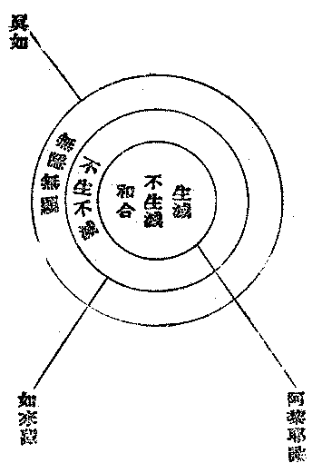



外延以真如为最广，内容以阿黎耶识为最深。就大乘以辨之：则真如、为大乘非大乘之通体，如来藏、为大乘之自体相，阿黎耶识、则为大乘自体相用。从另一式观之，又可为图如下：



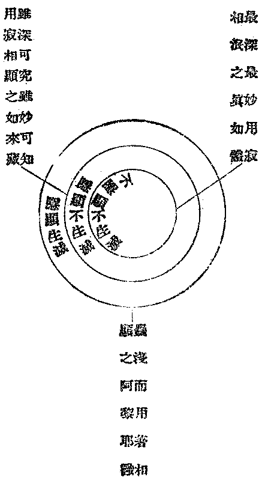



於此三位相为比对，就其各各特胜之一点以观之：则真如者、大乘之体大，如来藏者、大乘之相大，阿黎耶识者、大乘之用大，又大乘之乘也。



六　阿黎耶识有始终乎



阿黎耶识无始无终而可有一分有终。此义如何？以本来唯是此阿黎耶识，就此阿黎耶识内究之，而知有在隐而可显之不生不灭自体相，则谓之如来藏。就此阿黎耶识外发之而为三细、六麤以及前七心心所法所变所缘诸法，则谓之心生灭。不问为心生灭、为阿黎耶识、为如来藏之一切法，一一直下无隐无显、无生无灭之真实常如体性，则谓之真如。此阿黎耶识之所以无始无终也。以悟真如故究竟得显如来藏自体实相，而阿黎耶识一分和合染相永灭不有。此阿黎耶识之所以可有一分有终也。然此中真如、如来藏、阿黎耶识之分别，皆就原来位──凡夫位──以言之耳。若就究竟位──佛位──以言之，则常寂光真如、圆明自在如来藏、无垢清净藏识、皆以名『如来法身』而无二无二分者也。如来法界藏身之量，正同凡夫阿黎耶识之量，具足自体相用。不过藏识是生灭牵转晦昧杂染之相，而法身是常寂自在圆明清净之相而已。



九　阿黎耶识有觉义不觉义能摄一切法生一切法说



阿黎耶识即众生心，故虽说生灭门，而仍具真如、生灭之二门。展转递降言之，一根、一尘、一声、一色、无不即众生心全个，亦无不具真如、生灭二门。盖动起即生灭，而静止即真如。一切法一法，一法一切法，无乎不当无乎不然者也。而阿黎耶识者，即一切法之根本依也。其具有真如、生灭之二门，自不待辨。今剋就此识自身於真如及生灭之特著者以言之，即觉与不觉是也。觉义、不觉义，论自分释。於此今有疑者二：



一　有觉不觉义能摄能生一切法



为此识有觉不觉二义故，能摄一切法生一切法耶？为此识所有之觉与不觉，各各能摄一切法生一切法耶？此有二说：一、谓论中但言此识有二种义能摄一切法生一切法，不言二种义各能摄一切法生一切法。故直以此识有二种义故，故曰能摄一切法生一切法耳。二、谓剋就义相言之，此识有觉义故，能摄一切生一切出世间常乐真净之法；此识有不觉义故，能摄一切生一切世间无常苦空无实不净之法；是以此识能摄一切法生一切法。若就展转言之，依始觉故说有本觉，依本觉故而有不觉，依不觉故而起始觉，依始觉故而同本觉；此则不觉待觉，觉待不觉，二义相有，亦复相无。以相无故，各能展转摄一切法无欠无餘；以相有故，各能展转生一切法无欠无餘。后文显示染净互相熏习起一切染净法，义尤可证。故此二说，后说为优。



二　能摄能生之别



何故双言能摄一切法生一切法，不单言能摄、亦不单言能生？若能摄与能生义各有殊，则其所殊者又安在耶？答曰：不生不灭自体相法，离生灭相，离因果相，故在真如如来藏虽复为一切法所不能外，而但应言能摄而不得言能生。於一切法不能外於真如如来藏者，一一无不离生灭相、离因果相故。独在依他所起一切功能业用之法，乃得有果生因灭、因灭果生之事，可言其能生所生之相。此识为一切法种子识，能生一切法，乃是其唯一无二之功能，故於此处特表出之。真如但体，如来藏但自体相，故但能摄。阿黎耶识是自体相用，以有用故，故亦能生。今引大涅槃经以分别一切法生不生义如下：



　　　　　　　　　┌真如…………………………不生不生。  

　　　　　　　　　│如来藏………………………生不生。(虽为他法依之以生，而在自为不生。)  

　　　　一切法一心┤藏识…………………………不生生、生生、生不生。  

　　　　　　　　　│意意识………………………生生、生不生。  

　　　　　　　　　└前五识………………………生生。



一〇　所言觉义者说



此论所说藏识觉义一章，字句精圆，关节深隐。析取论文，略通贯之。



一　第一义觉



直示觉之当体，体即如来平等法身。换言之，即是真如如来藏耳。觉之当体即是真如，而此真如遍为觉不觉等一切法之当体，故曰平等法身，亦曰本来平等同一觉故。在此第一义觉，绝不带本觉、本不觉、始觉、究竟觉等对待假相，彼等对待假相，皆依此立。



二　相对相待有本觉不觉始觉



此等对待假相，一一皆依第一义觉安立，一一当体即是第一义觉。而其对待安立次第，列为五层：



> 甲　依第一义觉立本觉………………………………………依此法身说名本觉  

> 乙　本觉对始觉说(非第一义觉可对之说本觉故)…………何以故本觉义者对始觉说  

> 丙　以始觉同本觉(始觉起修对治不觉究竟异故)…………以始觉者即同本觉  

> 丁　依本觉有不觉(始觉之所觉者即此)……………………始觉义者依本觉故而有不觉  

> 戊　依不觉有始觉(始觉之所起者以此)……………………依不觉故说有始觉



三　依始觉觉心源不觉心源立究竟觉非究竟觉



甲、三乘内凡觉念灭相位：如凡夫人（能觉人），觉知前念起恶故（所觉法），能止后念令其不起（觉之效）：虽复名觉，即是不觉故（觉有限）。乙、小乘圣大乘贤觉念异相位：如二乘观智初发意菩萨等（能觉人），觉於念异（所觉法），念无异相；以舍麤分别执著故（觉之效），名相似觉（觉有限）。丙、大乘圣觉念住相位：如法身菩萨等（能觉人），觉於念住（所觉法），念无住相；以离分别麤念相故（觉之效），名随分觉（觉有限）。丁、大乘佛果觉念生相位：如菩萨地尽（能觉人），满足方便，一念相应，觉心初起（所觉法），心无初相：以远离微细念故，得见心性，心即常住（觉之效），名究竟觉（觉无限）。是故修多罗说：若有众生观无念者，则为向佛智故（引经证成）。此中示修行佛法人，从麤至细由浅入深之渐进次序，简明之极。复以能观无念即为向佛智故，则渐次即无渐次，而觉觉当体直显第一义真觉。



四　本觉不觉始觉究竟觉本来平等同一觉



生住异灭四相，皆因不觉有妄念故，依妄念所假立之妄相。觉之究竟无不觉故。唯觉无念；念且自无，依念所立初起及终灭等假相，尚何能有？譬如石女儿且自无，安有石女儿之生年及死月哉！圆觉离念；念且自无，念上初起相自更不可得。无初起故无念，无念故无不觉，故但有本觉，不得有不觉。不觉故有妄念，念妄故有假相。假相名为众生，众生居在妄念。众生居在妄念之内，犹吾人今居在宇宙之内。既居其内，岂能得其初始？故本来是无始无明不觉，亦不得有本觉。然妄念实本无，得如实知，则知依妄念所立之生住异灭四相，以等是无念故，等是无相。等故无各各之『异有时』，及一一之『自立处』。无念故无初起，无初起故无起念之不觉及觉初起之究竟觉。无念故无前念灭，无前念灭故无觉前念灭之始觉，无始觉故无对始觉说之本觉。然复以无念故，本来平等同一真觉。



五　始觉断不觉究竟本觉随之成二种德相



一、智净相：始觉断不觉究竟时，所显之自性清净心，即如来藏自体相之出障圆明也。二、不思议业相：始觉断不觉究竟时所生之妙用，即转八识成四智之大乘用也。合之、即是大乘自体相用，亦曰如来法身自体用相。



六　觉体觉自体相用



一者、与虚空等如实空镜，喻第一义觉真如体。二者、与虚空等如实不空因熏习镜，喻觉自体相如来藏。三者、与虚空等不空法出离镜，喻觉自体相出障圆明佛果法身。四者、与虚空等缘熏习镜，喻觉自体相用出障圆明自在佛果法身大用。第一、通於因果凡圣、异生如来、有情无情、有形无形、一切法皆平等一性，无异生性、无佛性之佛性。第二、确指有情众生，在於因位正因觉性。第三、第四、确指果位之法身菩萨分觉及如来大圆满觉。第三、亦是因位菩萨了因觉性。第四、亦为异生菩萨缘因觉性。第三、第四、亦同前说觉之智净相及觉之不思议业相。



上来六层所言觉义，洵无上甚深微妙圆满之法门哉！其要唯在直下纯觉遗念。



一一　所言不觉义者说



一　第一义不觉



论云：『所言不觉义者，谓不如实知真如法一故，不觉心起而有其念』。非曰不知，特是知不如实。非不知故本觉，不如实知故本不觉。非不知是知，不如实知亦是知，故本觉、本不觉皆第一义觉。然依何证其不如实知耶？即依如实知真如法一故。如实知真如法一而离念，不如实知真如法一不觉心起而有其念；二皆依真如法。此一切法等依之真如法，平等常一，不随觉不觉相为二。是故离念而觉，契真如法一故。有念起为不觉。念即虚妄想相之差别心境故，念皆由不觉而起故；觉时即无念无起故，无念无起即契会真如法一故。



二　念无法体自相不离本觉故不觉待本觉而立



此中有比量云：众生念不离觉体宗，以无自体相故因，既无自体相则不能离本觉自立（同喻体），如迷方人依方故迷用（喻依）。此中迷方人之一喻，分有三喻：所起迷喻藏识众生念，所迷方喻真如如来藏，能迷人喻如来藏藏识。



三　真觉无名义自相可说说真觉不离不觉故真觉待不觉而立



譬如东西方位，原是人心上之定理，不迷方者本无言说。忽有迷方者迷东为西，生种种之疑念，知者遂起言说而为指出之曰此为东、此为西。如有人为迷涂人指点云彼非正东，彼是正东，彼非正东而唯此为正东，某处某处即在正东；此其言、设非依迷涂人之所迷，无端又安得而有其说哉！然此一经指点，若迷涂人确得明白，则以如实知故，於此更当不自再起东西易位之迷。故真觉亦待经过不觉而确立。



四　依无明缘生三种细相依境界生六种麤相皆不觉相



所言不觉，亦曰无明，二者异名同义。此中直缘无明起者，即唯心动业生之相，所谓业相是也。非谓先有一期唯为不觉，后有心动之业相生。直以心动即业、业即是生，而一切之觉亦皆从心动而生。心何所缘而动则不可觉，乃即以此不可觉为心动之缘。依心动之缘而生者，又皆迷暗不觉。觉即空无，皆为不觉之相，故曰依不觉故生三种相。此不觉即阿黎耶识能生一切染法之缘。生缘有四：辨之心动，心体本具能动之种，曰亲因缘。以不觉故冥然妄动，曰增上缘。动无间断，曰等无间缘。此中尚无所缘之缘，至於依能见故境界妄现，则有所缘缘耳。然动即是阿黎耶识。能见及所见之境界，即是识变之见分、相分。见分即是末那所执内我；相分即是根身、器界、种子，为前七识所分别之我我所法之依。又根本无明即末那之法我痴，及彼无明所起诸法，通前七识缘所缘法，皆悉无自真体；不能离藏识而有，与藏识和合非一非异。约非异义边，唯一藏识，更无他有，故将三细、六麤之九相皆说在藏识。或以根本无明唯属藏识，非是末那之痴。不知藏识本以如来藏及七转识和合立名，若尽灭七转识则即成如来藏，单在如来藏位何得尚有根本无明？如来藏若尚有根本无明，则根本无明便无可断除，亦无成佛之义。何者？以如来藏本以明真如体自有之毕竟常恒不可断灭不可破坏之自真相故。故根本无明必约与未那和合非一非异之藏识位，乃能说之。末那者何？即动是也。动依心起，是为和合。其起初不可知，是为根本无明。但有妄心妄境依无明而生起，而彼无明则无起而有断，是故谓之根本无明。无明何以无起？以即起故。无明何以有断？起则有业，业则有苦，苦则有觉，觉彻源底则便永不起故。依心动故能见，是依无明妄动起妄心，即依自证分起见分也。依能见故境界妄现，是依心动及能见起妄境，即依自证分、见分起相分也。藏识之证自证分即如来藏心，自证分、见分即与末那互依俱有之藏识自位，所缘相分即通为末那及前七转识之和合位。故下曰以有境界缘故，复生六种麤相。然虽为前六识生缘而唯是藏识之境界，并非前六境界，故是细相。是以藏识无始来有一识俱转，所谓末那。时与二识俱转，所谓意及意识。有时亦与三识及至七识俱转，谓於眼识等前五识或一识或二识乃至或五识俱转故。未尝有一时不与末那和合俱转者，故以和合非一非异名为藏识。而至末那完全转为平等性智（不动地位，即如来藏心不与末那动和合为心动之藏识）之位，舍阿黎耶识名而正名为如来藏也。依境界缘所生六种麤相可知。今再为表以补前番略释於三细六麤与八识及十二有支关系所未尽之义：



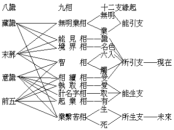



由是观之，此中烦恼杂染、业杂染、生杂染之一切杂染法，皆无明所生，以展转皆缘不觉起故；皆无明所摄，以起动皆是不觉相故。而无明不觉无自体真相，直下即如来藏真如，则不觉义能摄一切法、生一切法者明矣。



一二　觉与不觉有二种相说



藏识之觉即如来藏，不觉即和合识。是故名为藏、识，而以觉不觉义总显『藏识』。藏识即众生心，即一法界，即一切法一心。是故觉与不觉之相，或圆明无漏或无明有漏，或自在清净或业系杂染，当知皆是染幻差别之性及对治染幻差别所随起之作用相。然彼当体之自真实相，则直下即真如如来藏性，无有觉与不觉相之可别异。换言之，即在於体自真相，无如来与异生之可区别。故曰：『一切众生，本来常住入於涅槃，菩提之法非可作相，毕竟无得』。此说微尘瓦器之喻，他经亦喻为微尘与泥团。今更为合喻之：微尘微形可喻真如；泥团泥形可喻藏识；瓦器随器形别，器用亦异，可喻众生及随众生所现应化身佛。瓦器化还极精微微尘泥，则无一切器形之别，而实具有能为一切器用之性。然微尘不即能生一切器用，在泥团始能生器用。以大地皆微尘性故，皆化成极精微之泥，随所需用能生种种上妙形器，随用皆不掩其精微之体，不同杂质泥团所成瓦器，自有种种驳异性质。故佛为随染幻差别，众生为性随幻差别。然此种种业幻差别，剋观本体之自真相，毕竟平等，唯是一心，实无差别可得。故心生灭即不生不灭，心生灭门於一切法摄无不尽。举要言之，心生灭者，即觉之如来藏、不觉之和合识，藏与识和合之藏识。



一三　众生依心意意识转故说



一　佛法中心之定义



甲、肉团心：此为随俗而说，实是身根所摄，为识所变所缘色法，绝非心法。此应首先拣除在心之名义之外者。乙、缘虑心：缘谓对观，虑谓向思。此义遍通眼识等六识与末那识及藏识八个心王并各心数，皆能对自识所观之境而向之起思故。普通所言心者，即是此义。丙、集起心：集谓积集，起谓生起。能积集种种所经过之缘虑而不遗失者，能重新生起所经过之缘虑及生起未曾有之缘虑而不断绝者。此心直就其能体言，即唯第八藏识。而第七末那识执持第八藏识为我爱执藏者，亦与有功。合而言之，此心乃专指我爱执藏者。斯在众人虽亦无不有之，皆日用而不知，故与下所言真实心同为能生诸缘缘所遗者。或者虽欲有所了知，而所知皆不能适符其实，故反成为缘虑中之种种颠倒虚妄之相。自我、个性、灵魂、上帝、天命、真宰，随相妄名，随名妄执。丁、真实心：斯即此论所言如来藏真如心。实、谓如来藏自体实相，真、谓心真如性。此亦虽为吾人日用而不知之所遗，唯佛菩萨如实证知。在吾人心行中概未能明了证知，或唯随所缘虑构畫种种虚妄想相，安立种种虚妄名义，随名取相，妄想执著；或复得闻如实证知者之示说，渐起了解，决断一切暗疑邪执，内向契会，体验一切动静语默，久之久之乃亦能得如实证知。然唯第八藏识专有集起之义，深含真实之性，独得心名。



二　佛法中意之定义



梵语末那，此译曰意。分析其义：甲、能缘虑心前灭后生、自类引续不断者谓之意，此义通於八个心王。乙、恒审思量者谓之意，此义专在第七心王。思量虽为八个心王之所同有，但在第六审而不恒，第八恒而不审，前五不恒不审；唯此第七恒而且审，由是独得意名。丙、染污意：此指异生地位中与我痴、我见、我爱、我慢四根本烦恼相应意，为一切烦恼杂染、业杂染、生杂染之所依止者。即异生性（非涅槃性、佛性），亦即生灭因缘。所谓了脱生死者，即了脱乎此而已。故此义通缘虑、集起，不通真实。丁、清净意：此指大乘圣位中与平等性智相应意；此俱通缘虑、集起、真实心，亦通佛位四智相应八识心心数。



三　佛法中识之定义



甲、了别曰识：明了分别之义，通於八个心王及诸心数。乙、了别事境曰识：事境、指六尘之境界，前六识皆依止境界缘而生起，其了别用较为粗显，此义专在前之六识。丙、计执名相曰识：此义专在第六意识。俗语所谓有意识、无意识者、亦指此，佛经中所谓破除妄识者亦指此。丁、白净识：此义即指圣位、佛位四智相应之八识心心数。



四　合论心意识名义之通别偏圆



依此心、意、识三名之定义观之：别、则心指第八藏识，意指第七末那，识指前六或第六识；通、则心意识三皆可通於八识。偏、则指第六或前六为妄识，指第七为染意，指第八为真净心；圆、则皆通真妄、染净。或有於此三名通别、圆偏、未能了解，妄执一名，矫排餘说，当知皆由未善名义之故。此唐宋之古德，乃至挽近若杨仁山居士等，间亦往往不免。



五　意识



此中所云意识，内依染污意而外缘六尘境界，率前五识同行或自独行以为了别；故此亦将前之五识摄在意识，但转名之曰分离识及曰分别事识，而不将眼识等一一别说。



六　众生即依心意意识转



『众生依心、意、意识转』，即与论初所标之众生心名义分隅相等。众生即心、意、意识所转变起之一切我我所生灭法。换言之，即人生宇宙。心、意、意识，即众生所依之体及自体相用。依上所说之心、意、意识三名观之，言众生心则摄世间出世间一切法尽，其义不昭然若揭乎。



七　众生依心意意识转之剖解



甲、众生，即是成唯识论中由假所说种种我，若人格等、士君子等、圣贤佛等、畜生天神鬼等；及由假所说种种法，若本体等、若物质等、若时间、空间等、若精神界、自然界等，即此论为生灭所生灭之法也。乙、转，即成唯识论『有种种相转』之转字，及『彼依识所变』之变字。合此转谓转变、转起之义，正指生灭；以生灭即是转变、转起，起即为生，变即为灭故也。丙、依心、意、意识，即成唯识论『彼依识所变』之依识二字。彼论继言『此能变唯三，谓异熟、思量及了别境识』。异熟、即此论所云心，思量、即此论所云意，了别境识、即此论所云意识。生灭所生灭之众生与众生之生灭，皆依心、意、意识而有。此即说明生灭所由之故，即此所云生灭因缘是也。



八　心生灭与生灭因缘



问：生灭究为何物所有？则心生灭一章解答之曰：是心生灭，非有他物生灭，故曰心生灭也。问：生灭究因何故而有？则此章解答之曰：依心意意识转故生灭，非有他故生灭，故曰生灭因缘也。无有一生灭离生灭之物者，亦无有一生灭离生灭之故者。故心生灭与生灭因缘，皆尽生灭之边际。换言之，即皆摄八识心心数法所变所缘是也。然在以心生灭答『生灭者究为何物』之问，则其势自侧重於举出藏识以为答。犹之问波浪何物所有者，必答曰水（如来藏），或动之水（藏识）。而在以众生依心意意识转答『生灭何故生灭』之问，其势自侧重於举出末那以为答。犹之问波浪何故而有？必答曰动，或水之动。今之说此，要明此之二章，所依以说明之法非有别，所欲以说明之义各有殊。非有别故，皆是心、意、意识，譬如波浪之水无非动者，波浪之动无非水者，水之动、动之水亦无非波浪者。各有殊故，心生灭以统归藏识为主，生灭因缘以统归末那为主，一主在水，一主在动故也。或者不明其非有别：定执心生灭章但说藏识，此章但说末那。或执三细相及业识、转识、现识定属藏识，不属末那。或执别有根本无明定属藏识，不属末那。此由不明在生灭之藏识无非末那。末那即无明，无末那即无生灭，犹之在波浪之水无非动，动即风，无动即无波浪，故不善能通达其义。或者不明其各有殊：既不知前章所说之主要者在藏识，复不知此章所说之主要者在末那，故或有执此章亦专说藏识者。古今略为分解。



九　本识转识互为生灭亲因缘



在此文中，本识即藏识，转识即意、意识。其说『依阿黎耶识说有无明不觉而起能见、能现、能取境界，起念相续故说为意』，从藏识中一切心心所法，所缘所变种子起现行也。此意复有五种名，乃至心灭则种种法灭故：前七现行心心所法，熏习藏识生种子也。复次、言意识者，依相续意，在凡夫位取著转深，计我我所种种妄执，随事攀缘，分别六尘，名为意识，亦名分离识，又复说名分别事识。此识依见爱烦恼增长义故。依此复生有支习气，以成三界凡夫业系生死。前意及前六识但为熏成名言我法习气种子，起诸名言我法现行；至此意识率前五识熏成有支习气种子，能作增上缘招异熟生死之果。别见大乘起信论略释所分解。



十　无明染心互为生灭增上缘



显无明起染心唯佛能知，此即前觉义中『觉心初起』之时、即成佛义，故此云唯佛穷了也。具如论释。明六种染心治断差别；明不了一法界无始无明之治断差别；释相应义不相应义；显染心名烦恼碍、无明名智碍之义，具如论释。



一四　复次分别生灭相者说



一　生灭相与心生灭及生灭因缘之分别



甲、心生灭者，指出能有乎生灭之体实者也。以生灭不自立，依他立故。所依之他何指？指如来藏藏识。譬如吾人所做之梦不能自有，依乎吾人睡眠昏动之心而有。乙、生灭因缘何指？指生灭之何由而起。以生灭不自起，依他起故。所依之他何指？指藏识、意、意识。譬如吾人所做之梦不能自起，由乎吾人心之睡眠昏动而起。丙、生灭相者，正指一切依他所起生灭法之幻相。譬如梦之梦心梦境、及梦心梦境所由起之睡眠昏动等、麤细层次相也。



二　生灭麤细因缘相



『一者麤，与心相应故；二者细，与心不相应故』。以至『因灭故不相应心灭，缘灭故相应心灭』。其义如下：



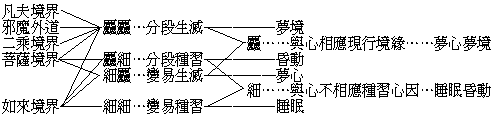



此中境界之义，是所了知之境之义。所了知之境，即是所解脱超出之境。如来究竟解脱超出乎睡眠之梦本，故能究竟了知睡眠为梦之本。离睡眠后，非无吾心自真体相。而离吾心，则无睡眠法之自体，睡眠且无，依睡眠所起之昏梦心境，本空可知。而凡夫者但知著梦境为实有，要梦境之常有、种种爱取。二乘者但知梦境之可灭，要梦境之速灭、种种解脱。更有不得其方法者，要有要灭，於中妄作功用而成种种邪魔外道；若中国属於道教之各派，及印度弥曼差、数论、胜论、瑜伽等是也。菩萨乃知此梦境者，皆由梦心昏动而现，故知一切梦境唯心；亦能分知梦心昏动由於睡眠而起。但因未得全醒故，犹不得完全切实了知离却睡眠之吾心真实耳。



三　心相体灭不灭义



此中心相，指心之睡眠及睡眠和心所起之梦心、梦境。此中心体，指遍在睡眠、离睡眠之真吾心。此中心智，指吾人离睡眠之醒觉心。故曰唯心相灭，非心体灭，非心智灭。



一五　染净熏习之净法真如与染法之无明及妄心妄境界说



此中真如，指遍在睡眠、离睡眠之真吾心（喻真如体）。其自性实相（喻如来藏）与睡眠（喻无明）所起梦心、梦境（喻妄心妄境界）不适当者，遍在睡眠及离睡眠，故能为睡眠及梦心之所熏习，而自性实相是明觉真确。与睡眠昏动迷乱恍惚心境不适当，故能内熏睡眠使之醒觉，灭除一切梦心梦境；而成醒觉之正知心与常寂境，现为种种净妙佛土之用。



一六　熏习义者说



非睡眠非非睡眠之吾人，本来无梦无醒，依此说为本真如体。非非睡眠故，亦依此说为根本无明。非睡眠故、亦依此说为本觉真如如来藏。以非睡眠之吾心，即非非睡眠之吾，故得为睡眠所昏动而起种种梦心、梦境。依此说为『真如净法实无於染，但以无明而熏习故则有染相』。以睡眠所起梦心梦境即非睡眠之吾心，故梦心得由之反熏睡眠，熏使醒觉。由睡梦而醒觉，则实现非睡眠之吾心而离绝非非睡眠之睡眠。此时不唯真觉心境明明实现，即睡梦心境亦了了内知。对彼了了内知而非现实之梦心境，乃能确知此为真实心境；亦复对此真觉心境，乃能确知彼为乱梦心境，不复染著。若非经过睡梦则亦无正确之醒觉。睡梦虽非醒觉，而正确之醒觉、实由非睡眠之吾心熏习吾非非睡眠之睡眠，将睡梦除灭而获得。故曰：『无明染法实无净业，但以真如而熏习故，则有净用』。



假如有人未尝睡梦、醒觉，心中了无睡梦、醒觉之事及此二事所区别之观念（本真如体）。以无确定之醒觉故（真如根本无明），堕於睡眠昏梦之境（心意意识所变所缘），於中种种执著，造诸善恶，受诸苦乐。复以睡梦无自体相，其自体相是醒觉故（本体真如如来藏），间亦於梦境中疑其不实。复因恍惚如闻有醒觉者大声疾呼令醒，渐渐了知本来真觉，此为梦幻而非实有。由之一面不忘记此梦境为梦幻非实有，一面力求破睡而醒（始觉真如如来藏）；由是久经如醒如睡、如觉如梦之程，直至究竟豁破睡梦，真醒正觉，乃能确知彼为睡梦、本空无实（究竟觉真如如来藏）。与未尝睡梦醒觉心中了无睡梦醒觉之事，及此二事所区别之观念者不同。其不同者：此始确实将醒觉之自体相显豁出，不同彼时无确显之自相，一也。此有确知彼为睡梦此为醒觉之正观念（净用），不同彼时了无睡梦醒觉之观念事，二也。是故在梦中之吾人，当了知有本真如体而又不可执为就是，住著於此；但当悟此而依之以力求灭尽诸梦，豁破长睡之究竟位真正醒觉，乃能圆满法身相用。若执本真如体为是，或任之而流转，或止之而静住，无有方便，不求正觉；则梦中既不由自主，忽然梦境一变，此执本真如体之念，便又昧却。即使梦中方便觉成，不复昧却，得寂静住，不再现生死之梦境（二乘境界）；然实犹在长睡之中。梦心依於睡眠，亦尚微细流注。故悟之所依『发』者虽在乎无佛无众生之本真如体，而求之所欲得者必在究竟正觉，故但曰发阿耨多罗三藐三菩提心（正觉），不曰发涅槃心（寂静）。盖若唯求寂静，不唯与小乘共，且或不能完全三十七觉分之方便，破除俱生我执。或但有定，则成精灵、鬼怪、妖魔、神仙等果，最高亦不过成无想天定。若有戒定始成色界、无色界之禅定。必能完全具足修习圆满三十七觉分之方便，始能得成灭受想定，得小乘果。如此分明如眠黑白之事，人亦何苦不发正遍觉心，而甘堕入种种邪外之黑狱中，或从小乘法虽得正方便而犹滞化城耶！其但执真如体而任之流转者（欲界凡夫及诸精灵、鬼怪、妖魔、神仙乃至种种外道），更无论矣。故在大乘经论，除却但用遮诠之三论宗，无有不建立如来藏藏识（佛性）之正觉因，而求无上正遍觉之果者。三论虽但用遮诠以显本真如体，而复处处提醒知而不证、不住正位、不堕正位等等，盖皆明此。金刚经中应无所住而生布施等心，意犹显然。古昔曹溪闻黄梅说至此恍然大悟，乃曰：何期自性本来清净、本来光明、出生无量智慧功德（指如来藏）。而舍前此但是本来无一物（指真如体）之执也。宗门云：向此处悟得（向真如体无佛无众生悟），须向那处行履（有众生有佛，由众生确发求正觉心，从不觉觉渐向相似觉，而深入深入又深入），意亦在此。愚者好放言无佛无众生以为高、以为无执著，不知此正执著，其执著与执我、执物、执龟毛、执兔角相等。若不破此执著，则终与蛆虫屎溺相等，而不成其为高也。



一七　云何熏习起染法不断说



从『所谓以依真如法故』至『受於一切身心等苦』，此为总说染熏习义。今为譬喻明之：以依人故（以依真如法故）有於睡眠（有於无明）；以有睡眠乱梦因故即昏蒙人心；以昏蒙故则有梦心（以有无明染法因故即熏习真如；以熏习故则有妄心）；以有梦心即昏扰睡眠不了人真相故，昏迷妄动现梦境界（以有妄心即熏习无明，不了真如法故，不觉念起现妄境界）；以有梦境界乱梦缘故，即扰动梦心，令於梦中造诸善恶受诸苦乐（以有妄境界染法缘故，即熏习妄心令其念著造种种业，受於一切身心等苦）。



别明妄境界熏习义：一者、增长念熏习，一者、增长取熏习。别明妄心熏习义：一者、业识根本熏习，一者、增长分别事识熏习。别明无明熏习义：一者、根本熏习，二者、所起见爱熏习。解见大乘起信论略释。



一八　云何熏习起净法不断说



从『所谓以有真如法故』至『名得涅槃成自然业』，是总明净熏习义。今亦譬喻明之：以人心自体是明觉故，醒熏睡眠（以有真如法能熏习无明）；以心内醒力故，则令梦心厌变乱苦、乐求脱离（以熏习因缘力故，则令妄心厌生死苦乐求涅槃）；以梦心有厌求故，即随顺醒觉，悟梦境空，放舍不执（以此妄心有厌求因缘故即熏习真如，自信己性，知心妄动，无前境界，修远离法）；梦心忽息，梦境顿空，由此确觉梦境空故随顺醒觉；醒觉力增，终至豁破睡眠，梦即不起；以不起故，梦境随灭；梦因梦缘俱灭故，梦相皆尽，乃得清醒，成真觉事（以如实知无前境界故，乃至名得涅槃成自然业）。吾人睡梦之中往往有此状况：遇到恶梦、乱梦，即厌之求脱离，亦有因之顿醒觉者。亦或由之梦中自知是梦，但因睡力尚不能离梦而顿醒，已不取著梦境求醒觉耳。有时梦心一息，梦境全空，梦相虽尚相续而起，而梦心则已成完全醒觉，如是则不久必破睡而醒。故吾人睡中若遇到苦梦、清梦，或自知是梦时，必将不久醒觉。而吾辈人类及诸有情众生类，皆是在长睡之梦中。由梦境生梦心，梦中作梦，生生死死、死死生生，皆不过是一梦又一梦之变换而已。最近西洋哲学家罗素尔，尝作『梦与实在』一文，云近人多指摘信神教为迷信，不知种种政治事业、社会事业乃至种种科学、种种哲学、皆无不在於似梦非梦之迷梦中，而根本上皆无不以迷信为其立足点者。故欲希望以社会科学、自然科学及哲学以破除迷信者，亦终是无望耳。然而吾敢呼召举一世之人而告慰之曰：汝毋失望！汝毋失望！有专能破除汝举一世人之迷梦及更有自此而上之种种迷梦、之大乘佛法在，汝曷研究、汝曷极深研究！汝勿贪求苟安速效，汝勿迷恋内身环境，汝当极汝心之所能疑者而疑之，所能思者而思之，所能看破者而看破之，所能考验者而考验之；以求一个彻底的明白，以求一个彻底的醒觉！呜呼迷梦！呜呼迷梦中人！汝其醒！汝其觉！



别明妄心熏习。别明真如熏习相：一者、自体相熏习，二者、用熏习。别明真如熏习位。解如大乘起信论略释。



一九　染熏习至佛有断净熏习尽未来无断说



一　染法熏习有断



染法从无始来熏习不断，乃至得佛后则有断。何以故？以得佛法后真如法常熏习无间断故；佛真觉心即真如自体相，圆满清净，平等无二，更不容有他法羼杂。无明染法不得而起，故永断也。



二　净法熏习无断



净法熏习则无有断，尽於未来。以法身显现，从『自体性功德相起清净妙用熏习，一一妙用皆顺应毕竟常恒不可破坏之自体相故』。佛果有三种真常：一、法性常：真如自体相（即真如如来藏），佛之法性身土也。二、大觉常：一心圆显真如自体无量无边性净功德恒相应故。三、妙用常：从法性觉心中平等流出，应於法身菩萨之受用身，与应於二乘六凡之变化身、尽未来际无有穷尽。即体相而用相，即用相而体相，一相实相，实相不相。等流恒续无间歇故，自在自主不倒乱故，依此妙用常、说净法熏习不断。



二〇　复次真如自体相者说



此有问曰：上说真如其体平等离一切相，云何复说体有如是种种功德？答：有二义：甲、虽实有此诸功德义，而无差别之相，等同一味，唯一真如。此义云何？以无分别、离分别相，是故无二。此即以出障圆明所显真如如来藏体自相以为答也。乙、『复以何义得说差别？以依业识生灭相示』乃至『名为法身如来之藏』，此即以能断除无明染法，显出真如如来藏体自相之始觉净用以为答也。



二一　复次真如用者说



从『复次真如用者』至『但随众生见闻得益故说为用』，是总明佛果法身之真如大用。别示所说真如大用，有二：甲、依凡夫二乘分别事识者，即变化身。乙、依菩萨业识者，即他受用身。具如论释所明。



二二　显示从生灭门即入真如门说



推求色心、根尘、识法毕竟无有真相，以皆由识心转变而现故。反之、以究心之真相亦复无有少相可取，可取之相皆是心变而非是心；乃至以为不空或空不空，不空与空不空亦是心之变相，是心所变而非是心。如是毕竟无有取故，心无可起，心无起故，即能随顺真如。若如实知心无起故，即能随顺入真如门。



二三　对治邪执说



一　邪执



前来即一心真如门示大乘体，由一心生灭门显示大乘自体相用，法义全彰，疑网俱裂。然以二种俱生我执习气深故，还复缘之起种种之虚妄分别。故此中所云之邪执，非常俗之邪执，乃是从闻听佛法所分别起之邪执。然则佛法乃实可缘之以起邪执耶？当知此又不然。何者？以恒执实有、常、一之我见，与生俱有，故虽闻佛法，还缘之以起种种虚妄执著；所谓独影境但从见之一头生起者是也。譬如近有一种外道，秘以教人专守鼻梁尖之关窍静坐，以风火二大被凝聚故，以散乱意识被压伏故，成一种人工造成似睡非睡之特别睡眠。一面以睡眠法似安宁故，可乐著故；一面因於睡中作诸奇梦、痴梦，久之深执痴梦为实，遂成邪魔，沦入神鬼。如此等类外道邪术，本与佛法全不相干，乃亦附会之为达摩西来所单传──千圣不传之向上一窍的教外别传。其实达摩净裸裸、赤洒洒，尚不以一些些醍醐酪酥纳向他人口中，况用此种毒秽以置向他人咽喉内哉！故外道虽如是附会，究竟与达摩了没有交涉。但彼外道一面指毒秽为妙膳，毁谤正法；一面又以盲引盲，导世愚盲堕坑落堑，真不知将堕若干劫数之无间地狱耳！言此、不禁特为悲切！



二　一切邪执皆依我见



我见之我，具有体相、实在、主宰、常一之义。即於一一成形的事、一一抽象的理，皆执有一实在或主宰之意义。是故若无所执内我为根，不唯於所闻名言所缘境界必无所封取贪著，且了不见有实在的自他彼此区别，又安从设立种种想念哉！是故若离於我，则无邪执。



三　人我见



具如论释。



四　法我见



二乘但见生灭法相，不见不生不灭法性。见生灭法起生死苦，怖畏生死，修道品慧、择灭生灭；生灭灭处执为涅槃。既执生灭，复执涅槃，故成法执。若知五阴诸法性本不生，且无有生，何有生灭？且无生灭，何有灭生灭之涅槃！则生灭与涅槃二执俱解，得无所住，成同体悲。



五　究竟离妄执



按此即同真如门中如实空义。若未过此如实空门，一切佛法皆妄念相。若得通过此如实空门已，始能转一切生灭法皆成如实不空实智。所以、若用凡夫知见测度如来无上菩提，无有是处。但应永离妄念，始能随顺通入。



二四　信成就发心者说



一　辨发心人及其发心因缘。



甲、信心成就正发心者：此中信心成就之人，即『不定聚众生』是也。聚者，种姓、族类。或有经论将一切众生分别为五类：一、异生种姓，二、声闻种姓，三、缘觉种姓，四、菩萨种姓，五、不定种姓：此皆依其已具之性习种姓分别者。在此论中，则除已得正住如来种中之菩萨类，其餘皆所谓『不定聚众生』而已。何则？以展转熏习远久之后，皆许得入如来种中故。但现前则向沦坠邪恶、徘徊人天及二乘等中，尚未定耳。然此中得发决定之大乘心者，亦非通泛之不定聚众生；乃是大乘内凡之信成就众生，须具左列诸款，始得名为信心成就：



一、有熏习善根力：非徒性具如来种姓，且久远来闻熏思习如来法界清净等流法义，深植出世大乘善根。习种姓成，有胜力用，能於人天竖正因缘法幢，不复沦坠邪外魔梵。二、信业果报：业果是指等流因果，业报是指异熟因果。世界所由成住坏空，众生所由生老病死，众生之有苦乐、胜劣，世界之有麤妙、净秽，胥具显乎共不共之业果、业报。於此善能不惑而知，确得信入，便是人中大圣。三、能起十善：止身三、口四、意三之恶业；反之、恒常发起救护生命乃至不昧因果之十善行。离身三过故渐得与礼仪相应，离口四过故渐得与戒、定相应，离意三过故渐得与戒、定、慧相应。由此生生世世常在人、天自修化他，不复堕四恶趣。四、厌生死苦：信业果报，能起十善，尚为佛教人、天乘之正法。厌生死苦，则成出世三乘正法之因，即随顺修习四谛法门也。五、欲求无上菩提：此又进为大乘不共之因，即四宏愿。六、得值诸佛亲近供养：此又进为佛果不共之德，亦即普贤十大愿王。七、修行信心经一万劫：上来六行皆为修习信心。其法通於修行信心分所说之五门──布施、持戒、忍辱、精进、止观──贯通此之六行；此之六行亦复贯通彼之五门。止观一门特重大乘不共之因，以止护持，不滞仅前三行之凡夫地；以观护持，不滞仅前四行之二乘地。由是久久修习经一万大劫波，大乘信心乃能确得成就，永不退转。梵语劫波，此云时分。时分假立，本无定限，然随世界不同，亦不杂乱。今此盖依娑婆世界经一度之成住坏空为一大时代也。如是修行信心经过一万个大时代，故曰修行信心经一万劫。於此、按之人中圣哲，若孔、颜等，庶已渐能信业果报，起修十善。若所谓信心成就者，甚不易得，若梁、陈、隋、唐，宗门、天台诸祖，其或庶几。若达磨至曹溪一脉相承，殆亦可谓之诸佛菩萨（指达磨等）教令发心耳。盖此真旷世难匹之无上上利根智人也。



乙、信成就者发心胜缘：一、诸佛菩萨教令发心：例如佛华严会，善财童子遇文殊师利等菩萨及释迦牟尼佛发心者是。又例如慧可之得遇达磨，永嘉之得遇曹溪等是。二、或以大悲故能自发心：若释迦牟尼佛为救护一切众生老病死苦故求无上觉等是。三、或因正法欲灭以护法因缘故能发心：马鸣、龙树、提婆、无著、天亲、陈那之辈，大都因是。



丙、结成真正信成就发心决定不退：『如是信心成就得发心者』，至『名住如来种中正因相应』是。此中所言正因，即真如如来藏佛性。与此相应，故能入大乘正定聚，毕竟不退，名住如来种中。此即马鸣造论之本意，所云『起大乘正信得佛种不断』者是。正因即如来藏妙真如性，万劫所修之行，至此皆成缘因佛性；此中彻透了悟如来藏性之慧命，曰了因佛性。三性圆发，谓之发心。



丁、信心未成就偶发心者：『若有众生善根微少』至『或有供养诸佛未经一万劫』是。此与前信心成就正发心者，对辨可知。



戊、信未成就者发心劣缘：『於中遇缘亦有发心』至『或学他发心』是。一者、智劣，见假相不见实性故。二者、福劣，供众僧未供大师故。三者、教劣，二乘所转三乘共教、非大乘之不共教故。四者、志劣，但随他人无自愿故。



二　辨所发心及所修善行



直心，即了悟心真如法性之智。一得了悟，平等正直，无复行曲。於世界名利恭敬、有漏因果、及二乘之涅槃，不复稍存希冀，故得离过绝非。深心，即於如来藏心发见无量无数性净功德，欣乐希求。故随顺之修集一切善行，仰德崇善。大悲心，即彻见恒沙苦患总在心源，无边众生一心无二。故欲拔除一切众生苦本，大愿等慈。大摩尼宝体性明净而矿秽之垢，即喻如来藏心。宝性即喻佛性，矿秽之垢即喻烦恼、业、生之法。一面悟得宝性，恒念不忘；一面须修戒善定慧、十波罗蜜、一切对治之行，总为四方便行，其义可知。



三　辨法性所成就之德相



佛华严云：一切众生皆具如来智慧德相，初发心时便成正觉。此论依之，故云见法身故，随其愿力能现八相成佛，利益众生。然而此但初发心住菩萨，乃三阿僧祇劫修行之始。虽复智胜、愿宏，有自在力，犹用夙世生死之业，以为人天受身之因，故此尚居相似觉位。又、发心住菩萨，无复退堕，但方便示现故。又、发心菩萨远离怯弱，得法空观恒相应故。



二五　解行发心者说



前者之信成就发心，是说由十信心进入初发心住。此之解行发心，是说由初发心住、展转胜进至十回向也；故曰当知转胜。从发心住为入第一阿僧祇劫之始，今曰於第一阿僧祇劫将欲满故者，在十行、十回向上也。於真如法中深解现前者，此正十住进入十行之相，以十住亦曰十解故。所修离相，即六波罗蜜是所修，悭等六蔽是所离也。随顺法性修行六波罗蜜，此正所谓应无所住而生布施之心乃至般若之心是也；亦是深解如来藏本具无量性净功德，而随之修集一切善行也。是故直心、深心、及大悲心，虽复三心同发，修习成熟则有次第。十信、十住、多修习直心，十行、十回向、多修习深心，十地多修习大悲心，即此论三种发心相。故此解行发心，专言修六度行；证发心则多言利他功德。或者昧之，以专言离过绝非者为高，不知彼正以未入正定聚过非重故，故专直显真如以遣除诸患耳。



二六　证发心者说



一　净心地



初地名净心者，妙观察智、平等性智现前，我法分别至此永断；从初信心来所求证自性最清净心，乍得相应，故名净心。地者，依义、持义。犹如大地为诸山河丛林、动植飞潜所依，而能为之住持不失。菩萨创证得自性清净心，亦复如是，能为本有及所修习与后后地无尽功德法所依持，故名曰净心地。



二　菩萨究竟地



或说即第十之法云地，通常则皆说等觉地。而在此论似亦依法云地说之。



三　证何所证



正证真如，都无能证、所证心境可得，唯是根本妙观察智、平等性智如如不二，名为法身，更无他故。后时业识重转起时，乃得依之说为境界。



四　菩萨利他之功德



甲、一念能至十方世界供养诸佛，请转法轮，利益众生。乙、或示超地速成正觉，以为怯弱众生。丙、或说久劫方成正觉，以为懈慢众生。丁、能示如是无数方便，不可思议。



五　三无数大劫



『而实菩萨种性根等』以至『故示所行亦有差别』，则以决定说决定，菩萨从初发心住皆经三无数大劫而得成佛：初住至初地为第一无数大劫，初地至八地为第二无数大劫，八地至菩萨地尽为第三无数大劫。而断定各经论中说菩萨经历时劫行位种种不同，皆为利他不可思议权巧方便。大宗地玄文本论，所说无超次第渐转位，亦与此同。菩萨何故必经三无数大时分？何故有处经论各说顿渐、迟速，不相一致？广为决择，让之他处。



六　菩萨发心相



一、真心无分别，即前直心正念真如之果；乃真如根本无分别智是。二、方便心自然遍行利益众，即前深心乐集一切善行之果；乃真如后得正分别智是。三、业识心微细起灭，即前大悲心欲拔一切众生苦之果；盖至此如实知一切众生唯是自心中之众生，而此微细起灭之业识心，即缘之以起同体大悲心也。



七　色究竟处成佛



此菩萨功德成满寄色究竟处示现成佛，乃依十地菩萨寄报以明佛地功德。以佛地则唯佛法性自受用身，无可明故。一念相应慧者，谓真如根本有无明暗故，阿黎耶识向来未与慧心相应。一得相应，则如千年暗室，一灯顿破，故曰以一念相应慧无明顿尽。心真实即诸法之性，自体显照一切妄法，名一切智；随所应解示种种义，名为种智，合之则名一切种智。



二七　修行信心分说



此大乘起信论，题目未标，法义已圆。及至叙敬述意，倒箧倾囊，宣露更无遗剩。况复因缘既显，文彩全彰！立义一分、早成杖头明月；解释三章、直同海底泥牛！神气完足，一真心几活跃乎字里行间；波澜壮阔，三藏教可总持乎单言只句，又何须畫蛇添足，拗节生枝，而有此修行信心分哉！虽然、因缘分中早言之矣，『为令善根微少众生、修习信心故；为示方便销恶业障、善护其心远离痴慢出邪网故；为示修习止观，对治凡夫二乘心过故；为示专念方便生於佛前，必定不退信心故』。由是之故，乃取信成就发心中，所谓『依不定聚众生，有熏习善根力故，信业果报，能起十善，厌生死苦，欲求无上菩提，得值诸佛亲承供养，修行信心经一万劫』一段文字，重取推演之，以成此修行信心一分。虽然、今此末劫浊世中人、心高气傲，无不没在痴、慢、邪网。而又大都善根微少，恶业障深，非侧著凡夫、即偏堕二乘。身若泡沤，命悬呼吸！心底纵得一隙孤明，而尘事纷扰，业缘系牵，未能有自由自在之分者乎！夫然，马鸣所广言者虽在乎彼，而吾人所专要者则尤在乎是也。此一分中所为人根，又有四等。就人根说，自然前前高於后后。就法门言，则又后后深於前前。何者？后必兼前，而前不必兼后；后不兼前，则非大乘不共之无上法门故。是故修行信心，所修之行虽可通共，而行所依起之信心及修所成就之信心，则唯大乘不共之法。然则专念方便之一法门，上覆乎最高最高善根成熟众生而不能过，下承乎最下最下怯弱欲退众生而无所遗；亦正由依真如如来功德藏──即心自性同体三宝，及大乘别相三宝之信心为根本也。要之、莫若以明。不明，则虽一句阿弥陀佛，亦殊未易持诵；况欲盲修瞎炼，摸索於止观之渊哉！若得大乘通身明彻，即心自性之大乘体、大乘自体相用头头圆显念念全彰，则随提起一句阿弥陀佛，又安得非竖常横遍之如来法界藏身乎！斯可知用心所当勤者之何在矣！



二八　总修施戒忍进行说



修五门行，成四信心，修在一心中修，成在一行中成，以行即心、心即行故。而以能五门同时等修者为上，而修行中又以修习施、戒、忍、进为难。以此一一皆须相应之以身、口、意之三业，及内外中之一切处故也。是故若能总修施、戒、忍、进之行，当知即是止观已得平等成熟之者，故止观早在其中矣。



论云：『云何修行施门』乃至『自利利他速离众苦』，此即专为上根上机之『善根微少众生修习信心』者。以其明理深切，解解圆满，於心真如、心生灭义，自然头头上现，物物上显，远离魔邪痴慢之恶业障及凡夫二乘人心过。止观平等，恒自现前，更不须得摈绝他缘专为修习；於一功时及一切处，事理圆融，解行相应，故能六度齐修，三心等运。考之天台圆教六即佛位，此为观行即佛胜进中之讲说兼行六度、正行六度之位，乃观行即佛中之最高位，若天台智者大师之所居，斯正在乎此也。或者不知，以为修此施、戒、忍、进者不及下之修习止观者，殊不知下之修习止观者，比较此能等修六度者尚差两阶也。彼盖犹有凡夫、二乘心过之待对治，乃在由名字即佛、进入观行即佛之间耳。



由是如实之义，应当信解。故修行人不可浮慕止观为高，或复浮慕宗门参究话头为高，以此为高，则适成其低也。然则当如何修行之？曰：当依照此中所说布施、持戒、忍辱、精进，一一身、口、意三业体会力行之。最深切重要者，是唯施行。於戒、於忍、於进，当令展转修习纯熟，自然道力坚精，在生死中大愿自在。如或未能，可加修下列之止恶精进门行。如再未能，可加修下列之止观门行。如再未能，可加修下列之专念方便。如再未能，则可参究话头。盖参究话头者，实是真理莫明，胜解难成；邪疑莫断，正信难起，故必须反向心头上求个悄然。求得个悄然时，上者能等天台名字即佛之位，其次则尚徘徊内外凡夫、二乘之间。故真有伶俐人解翻身修行者，但勤修施、戒、忍、进行可也。



二九　别修止恶精进说



论曰：『复次、若人虽修行信心』以至『得免诸障善根增长故』一章，即专对其次之善根微少众生，为示方便销恶业障、善护其心远离痴慢出邪网故，而令修此加行之法门也。此则等於天台观行即佛前：一、读诵，二、礼拜，三、讲说之法师位，乃是恒修普贤十大愿王，以消灭一切业障、成就一切功德者。按照天台所修法华三昧等十科之行道仪法，则亦三心等运、六度齐修，而一切善行摄无不尽也。十大愿王者：一、礼敬诸佛，二、称赞如来，三、广修供养，四、忏悔业障，五、随喜功德，六、请转法轮，七、请佛住世，八、常随佛学，九、恒顺众生，十、普皆回向。一一愿皆等法界、等虚空界、等众生界，尽於未来际、无有穷尽。盖即转变凡夫众生重罪恶业病苦障碍、邪魔鬼神恼乱、世间事务牵缠之烦恼恶业苦报法。修习之令得大乘菩萨四种信心，豁除惑、业、苦三障，以开显成就也。此即谓之修精进行以成信心。得免诸障，即是直心正念真如。善根增长，即是深心乐集善法。所修劝请、随喜、回向之行，即是大悲心普度一切众。是谓三心等运，速得入信成就发心，舍不定聚为正定聚，於大乘信得不退转。



此中重罪恶业及世间事务种种牵缠或为病苦所恼等，皆业报障。当勇猛精进，昼夜六时礼拜、赞叹、供养诸佛菩萨、诚心忏悔之。常不休废，久自解脱。邪魔诸鬼之所恼乱，乃魔邪障及嫉妒障。以向来与诸魔外邪鬼为徒侣，今欲决定趣入大乘正信，起诸魔鬼外邪愤惧，故来恼乱。以向来往往嫉妒破坏他人之胜事，今欲决定坚立大乘无上胜心，故为魔邪、凡小俱所嫉妒而为种种障碍。当勇猛精进，昼夜六时礼拜、赞叹、供养诸佛菩萨诸圣贤众及诸天人等类，劝请十方诸佛常住在世，灭魔邪障；随喜一切圣贤功德，灭嫉妒障。若从根本总而言之，皆因我我所见未空，念念处处皆不能免无明所起之贪著心；未能彻修施行，有所得著，故成种种诸障。此贪著障，亦须礼拜、赞叹、供养十方大乘常住三宝，昼夜六时常不休废，发大誓愿，尽以回向无上菩提。回向无上菩提者，即回向真如、回向佛果、回向一切众生是也。能如是回向者，则便无所贪著，无贪著故不受福报，不受报故不为业系，不业系故便得自在。若小有所获沾沾自喜者，即为堕入痴慢邪网，切须随时觉破。



三〇　修止观行说



论中对於修止观行，说之颇详。先析为二：一者略明，二者广辨。於广辨中又析为二：一修次第止观，二修平等止观。於修次第止观又析为二：一者修止，二者修观。於修止中又析为五：具如略释中之所说，今不重说。



此中别说加修止观，是对於又次一等之善根微少众生，理无真见，解无胜力，虽复闻熏闻思大乘法义，有时亦得了了无疑；而复有时以分别贪著习气深重故，昧心真如理、起凡夫心过，昧心生灭理、起小乘心过。以之不唯不能修习施等六波罗蜜，皆得事理圆明、行解契应；而且虽欲勤修普贤愿王，以行礼拜、忏悔、劝请、随喜、回向、发愿之法，尤是事理反违，解行乖僢。理、则即偏於空寂而堕小乘过，事、则即偏於形迹而堕凡夫过，不能成就大乘信根。是则非将一心真如、生灭之法，端意精思，审观谛察，得个深切著明体会心融之理解不为功。是故有此广明修止观之一门。



此中虽云止观，其实二俱是观，二俱不离一心。直以观一心真如法为止，观一心生灭法为观而己。故曰『所言止者，谓止一切境界相，随顺奢摩他观义故。所言观者，谓分别因缘生灭相，随顺毗钵舍那观义故。云何随顺？以此二义渐渐修习，不相舍离，双现前故』。



修止所以对治凡夫住著世间、及舍二乘怯弱之见。盖一切境界皆真如，则离世间相而无可住著；一切境界皆心真如，则众生皆本来涅槃，无所怯弱。然以修止对治凡夫心过，使之转凡成圣，功用极为殊胜。稍不得当，过患亦重，浅、既堕於魔邪凡外，深、复堕於二乘。故於修止人法之须拣除疑惑不信、诽谤重罪业障、我慢懈怠如是等人，及夫发生胜德之须警辨诸魔外道、鬼神等辈惑乱之相，皆详乎其言之。而复举修学时及成就时之利益，以为之劝也。修观虽是兼为对治二乘不起大悲狭劣心过，及远离凡夫懈怠不修善根等过，而皆在使之能集修施、戒、忍、进、之行，以去除其沉没、空寂、身心懈怠、不乐众善、远离大悲之过，尤重在对治二乘也。此云二乘，指原来修大乘信者，先於止中渐耽寂静之乐，谓之二乘心过。是故於此当观世间众生，没在无常、不净、不自在等无量苦中；发大勇猛，立大誓愿，确植深固大菩提心，积一切善，救一切苦，不稍懈怠，永无厌足。此观专以确定大乘信心，转小成大，功速而过亦轻，故不深言；亦以前者心生灭门言之綦详故也。



此中修止，但以观一切法皆心真如，直下即无一切差别生灭等相之当体即真止，内亦稍兼用常觉遗念止。至以系心缘中止及守心一境止，则此皆拣除不取。以此等皆易令凡夫心著，起种种患，摇惑魔鬼邪外之定，堕入其中，不能自出。或复通为二乘方便，不是专入大乘之不共法门故。故下专念阿弥陀佛方便，虽可是系心缘中止之一，而此论则但取其有『为佛摄受往生必定不退大乘正信』，不重其能系心所缘之中以成三昧。然按之天台之止观，果能大开圆解，深入诸佛秘密之藏，毕竟无有凡外、邪小能迷乱贪著者。则於当体即真止或常觉遗念止不能相应时，亦可借用系缘守境等止以为阶进，而与此论之意微别。此中修观即四念处，所谓观心无常、观法无我、观身不净、观受是苦是也。此四念住於佛法中特为重要，无论大乘、小乘，离此则便非出世之佛法。其详切深明者，当观天台所著之四念处。



三一　专念方便说



大乘者，大士之所乘。大士者，大勇猛之士夫也。世界众生虽复无边，誓救度解脱之。众生烦恼虽复无尽，誓对治断除之。救度众生、治断烦恼之法门虽无量，誓求学修习之。无上正遍等觉虽在遥远，誓到达成就圆满之。有如是勇猛之誓愿，意志坚固逾於金刚，心量深广等於虚空，不存疑畏无有怯弱，是故名为大士。前之善根成熟众生，一闻千悟，信任不退，於此自无困难问题。降至善根微少众生与夫有重罪恶业，痴慢邪网障及为邪魔魂神所恼众生，在其自心以有深宏意愿，不为摇夺，於此犹然不成困难问题。独至虽欲志求无上菩提，而复时有凡外、权小心过，须待双运等修止观以为对治，则於止於观既皆属不易成善：且偏修止，既难免沉没懈怠不乐众善，堕落於凡夫味禅、外道邪定之极重过患。即得免此，亦有远离大悲之二乘过，障令不得成就大乘信心。若偏修观，复有心识散乱流动，多生寻伺，易起疑慢，不随顺心真如，堕於凡夫住著世间及二乘怖畏世间之过患，障令不得成就大乘信心。是以前文於施於戒皆各列为一门，独於止观二法并为一门，以见此止之与观必应在一心中同时俱修也。故曰：『止观不具，则无能入菩提之道』。然於一心等修止观二门，虽复但是随顺一心真如、生灭二法，本无何种艰难。然必修习成熟，一切时处渐渐堪能随顺真如，深伏烦恼，勤修众善，开发大悲，始可信心增长，速成不退。古人若赵州从谂禅师所云『四十年无杂用心』，方能殆庶。於此保无失堕凡外、前功尽弃、退趣二乘，反成迂滞者乎？况夫业系苦身，命悬呼吸，死到生来，安排不得，报缘现前盲动随堕，隔阴一迷，何时再觉？处此境况，起此思念，则於初学大乘正信欲求成就信心不退，设非意逾金刚，心如虚空，自不禁其危疑恐怖畏惧怯弱之来之莫能消弭也。在此若无殊胜方便以为摄护，则或颓然委靡，听天任命以沦溺於凡夫苦海，徒自悲悼。或复甘於饮鸩止渴，趣就邪途曲径，求短时之宴安，受长劫之惨痛。藉能善得方便，亦成暂息化城，沉空滞寂，泯智灰身，醉无明酒，眠无为床；无上心宝枉自废弃，不见不知，不得其用，此其可悲可悯为何如乎！於是马鸣乃依如来所说专意念佛方便，以摄护此一类根机，使得生於佛前，保其必成不退之信。



专意念佛因缘，种种不一，具如他说。若於此论，则唯为求成就大乘信心，欲得方便摄护，速登信成就发心不退地而已。为欲成就大乘信而求生净土；但不为欲免堕苦趣，或为自脱生死苦而求生净土；故此论所说之专意念佛方便，乃是总摄前前诸分所有解行而成，并非取此即可遗弃前前之解行也。愚者才行施、戒，即废定、慧；才修止、观，即废慈善；才习念佛，即废解行；才究宗教，即废净业：此皆但成凡外偏小，不能成就大乘信心者也！



此论所说专意念佛因缘，初非但指专念西方极乐世界阿弥陀佛。或复专念兜率内院净土弥勒世尊，求得生在兜率内院净土弥勒佛前，得成大乘不退信心；或复如维摩经所明、往生东方不动世界阿閦佛前；或复如药师经所明，往生东方琉璃世界药师佛前。何者？以此皆是随愿得生他方佛土，常见於佛，永离恶道，得成就大乘信心故。然以阿弥陀佛於因地时摄受十方众生特胜愿力，及此世界众生增上缘力深重之故，释尊既处处经中多说专念阿弥陀佛求生西方极乐世界之因缘，而马鸣大士遂亦举此以为之证也。



论云：『若人专念西方极乐世界阿弥陀佛，所修善根，回向愿求生彼世界即得往生，常见佛故，终无有退』。所云常见佛故终无有退，即指不退求大乘志。然但云以常见佛故终无有退，未云住大乘正定聚，盖此虽生极乐，亦尚未登大乘信心成就初发心住，但以常得见佛胜缘力故，可保求大乘信之志不退终得成就大乘之信心耳。然於此不但曰专念西方极乐世界阿弥陀佛即得往生，而又加言所修善根回向愿求生彼世界。云所修善根者，即闻熏闻思诸大乘经论，增明理解，长养信乐；及於施、戒、忍、进、止、观一切善法，无不奉行者也。特彼单欲就自力修习此诸行成大乘信，此则一心依恃阿弥陀佛以修之耳。或复闻说专念阿弥陀佛，便废大乘经论及诸善行全不修学；或复但悬阿弥陀佛一招牌，以为躲藏其愚痴懈怠之地，关闭一切善门，固其悭、贪、诳、覆、嫉、妒、恨、恚之私，诸恶潜作，众善禁行：则不唯不得窃附於此论所云专意念佛方便，虽与求带业往生者亦全违反，必不成就。何者？彼因无力除生死业专求佛耳，既专求佛则不复造生死之业；而在此则以念佛自文其过非，并以闭拒诸善，唯在加造生死恶业，故亦不成带业往生。



若能依此论不遗弃前前解行，加专意念佛之方便，得往生极乐时，必定得居上品下生。若沙门之蕅益、梦东，居士之彭二林，杨深柳等是也。设复加以如论所云：『若观彼佛真如法身，常勤修习，毕竟得生住正定故』：则属上品上生，而即登大乘信成就初发心住位矣。唯永明大师斯是耳。云何名观彼佛真如法身常勤修习？亦依此论四信等行、六度齐修而已，此初发心菩萨修行之正宗门也。



三二　劝修利益分说



问曰：说修行信心分既等蛇腹添足，更说劝修利益不尤类龟背栽毛欤？答曰：可为善根微少如次四类根机众生，悉皆令其於此一生做到永不退失大乘信之地位，故有修行信心一分。然此正是此论当机之众；而更有为此论结缘之众之一类根机在。此类根机众生，今尚未能厌生死苦、欲求无上菩提、得值诸佛亲承供养、修行信心经一万劫信心，成就发菩萨心，然已属有闻大乘法熏习善根，可以信业果报、能起十善，以为将来求大乘信之远因者。故复推衍『依不定聚生有熏习善根力故，信业果报能起十善』之三句，以成此劝修利益之一分。



论云：『如是摩诃衍诸佛秘藏我已总说』，乃至『必为诸佛之所授记』，是因其『有熏习善根力故』，乃举此所说者以为之劝令起欣也。



论云：『假使有人能化三千大千世界满中众生令行十善』，乃至『是故众生应勤修学』，是因其『信业果报能起十善』，故推而广之以导其进修也。



或曰：然则若未能有熏习善根力者，若未能信业果报、起十善行者，则於此论其必不能得生正信远离诽谤，而於此论但得其害，不得一点之利益乎？答曰：此亦不然。盖於此论若见一字，若闻一句，或喜或恶，或明或昧，或信或谤，或记或忘，或复因之堕大地狱展转沉沦诸恶趣中、诸鬼魔中、诸邪外中、诸人天福报中、诸小乘纡曲中，当知久之久之，皆能以为欲求成大乘信之闻熏种子也。故若言其结将来之远缘，则於读诵讲说此论之时，虽禽兽鱼虫等闻之亦无不可获其益者，况在人乎！



或曰：然则於此大乘佛法，若非先有熏习善根之力，信业果报、能起十善，则但可结闻熏远缘而於现世终不能获其利益乎？果如是，则毫无善根、广造恶业、毁谤正法、疑惑经论、我慢贡高、不受劝化、深入邪网、沉没痴海之人，於其现生终非大乘佛法所能救乎？果如是，则大乘佛法於人中且不能摄尽诸类，况一切世界一切众生乎？答曰：是故杀母、杀佛之央掘魔罗，顿超入佛乘；是故涅槃会上广额屠儿，放下屠刀即成千佛一数；是故释迦於灵山会上拈花示众；是故迦叶於大众中破颜微笑；是故达磨面壁；是故神光立雪；是故或闻『将罪来、谁缚汝』皆得解脱；是故持镜小儿、卖柴麤汉皆得称佛道祖；是故庞家小女儿道：『易、易、易，百草头上西来意』；不须一点熏习，不假一毫持修。要知各各皆自有一不失不坏亘古亘今之本来天真佛在：悟便直见，疑则别参！



(武昌正信印务馆印本)



往生净土论讲要



──二十五年八月在庐山大林寺讲──



释题一　经论题  

二　造译题



解文甲一　偈文乙一　敬法主略明前三门  

乙二　依经相广明观察门丙一　明依经教  

丙二　列观功德丁一　世界功德  

丁二　佛功德  

丁三　菩萨功德



乙三　述偈意总结回向门



甲二　论文乙一　总徵  

乙二　广释丙一　通示五门  

丙二　别详观察丁一　列释三观戊一　国土功德己一　喻彰胜力  

己二　列门分释庚一　列门  

庚二　分释



己三　结显妙义



戊二　观佛功德己一　列门  

己二　分释



戊三　菩萨功德己一　总标  

己二　徵释



丁二　结归一法



丙三　善巧回向  

丙四　结明五门



释　题



一　经论题



往生净土论，一名无量寿经优波提舍愿生偈。论有宗经论、释经论之别：宗经论，宗主经意自别立论；释经论，依据经文解释造论。本论依往生净土论之名说，可为宗经论；依无量寿经优波提舍之名说，亦可为释经论。故题中虽是论题，亦兼经题。经名无量寿者，可总指净土三经──佛说无量寿经，佛说观无量寿佛经，佛说阿弥陀经。阿弥陀是梵语，此云无量寿；阿弥陀经，即小无量寿经。通常说无量寿经，单指佛说无量寿经。本论依无量寿经之义立论，本论遂名无量寿经论。



无量寿，即称佛之名。阿弥陀本有无量寿、无量光诸义，然主要者为无量寿义，故诸经多以阿弥陀翻为无量寿。『量』义有四：一、空间量。就是有长、广、厚之量，名空间量。算学上之几何学，就讲此长、广、厚之量。二、时量。长、广、厚，即是方量，此就时间上讲，由一刹那、一小时乃至岁月等时，谓之时量。三、重量。若两、铢、斤等。四、数量。由一至二乃至阿僧祇数。何谓无量？凡为言说之能说，思想之能想，皆不离上列诸量。若超过诸量，亦必离言说相，离心缘相，成所谓『言语道断，心行寂灭』不可思议之情境，是为无量。以百千岁乃至以劫数计算其寿，以有可计故，不名无量。要非言语思想所能推度，名寿无量。如寿无量，光无量等亦复如是。



经者，通常谓佛典有三藏，三藏即经、律、论。凡佛所说或弟子说而为佛所印可者，名之为经。即上契诸佛之理，下契众生之机之『契经』是。诸大菩萨依经之宗要而发挥之创作，或依经文注释之述作，名之为论。佛在世时，对弟子日常生活规定之规律，名之为律。



无量寿经即是经题。优波提舍译意为论议，即通常所谓议论。问答、抉择、分析、讨论而发挥其要义者，谓之论。故无量寿经优波提舍，即释无量寿经论。然依经义先为作偈，梵语伽陀，略音曰偈，等於中国古来之诗。偈中立义，在发愿往生，曰愿生偈。本论宗旨所在，即为愿生，可名曰无量寿经愿生偈论。於论题中取主要义，题为『往生净土论』，亦有简题为『往生论』者。



未释论以前，先将净土之义说明：土即国土，与国家之国义有别。此中国土，是指世界而言。世界、依佛典说：『虚空无边，世界无数』。这与中国古来思想，以为国土之范围就是上天下地，舍此上天下地更没有什麼国土世界，颇不易相通；但是与现代天文学正可相通。依据天文学者之研究所得，知火星世界中有人民。空中等於太阳之各恒星，皆是世界，亦可有人生，故世界无有限量。於此无量数之世界中，当然有苦乐、净秽、好恶之种种差别，其清净安乐美好庄严之世界，即是净土。由此说来，西方净土，在现代天文学上很容易承认。此娑婆世界，是苦的世界，不是庄严安乐美好的世界。处此众苦胁迫之世界中，欲求摆脱苦恼，往生乐土，非修净业不可！若修净土业因，能得净土乐果。释迦世尊於净秽、好恶、苦乐悬殊之世界中，特选说此清净、胜妙、安乐之世界。弥陀经所谓『从是西方过十万亿佛土，有世界名曰极乐』。平常人於此娑婆世界尚有所不见不知，闻於十万亿佛土外更有世界，必以为无稽荒渺之谈。然以诸佛之智慧眼观之，确见有此世界，如吾人现前见有台桌相等。故释迦世尊劝导众生，观此世界灾难困苦之逼迫，发求生极乐世界之心念，勤修净业，往生净土。以上明往生最浅显义，依科学上之天文学，亦可见到。



依佛法中胜义谛说：究竟清净之佛土，是离一切相，离一切分别言说之一真法界。此一真法界，遍一切处，人人本具而不显现者，为烦恼业报之所障故，虽遍一切而不相应，终处於如梦如幻之生死中，流转不息。若能破此烦恼业报幻梦，一念觉悟，一念即与净土相应。是则『往无所往，生无所生』之往生义也。若据世俗谛说往生：『往则决定往，生则决定生』。以修净业之因，至临命终时，决定离此娑婆世界，往生西方净土之极乐世界。合胜义世俗谛说往生，又可说：『往则无所往，生则决定生』。以往生者，究以何为真能往生之报体，若谓躯壳之中另外有一灵魂等为往生报体，则灵魂之说早为佛学所破。佛学上说往生报体，即阿赖耶识，此阿赖耶识遍一切处无有方所。生此国土之中，即由能生之业力成熟，而此国土之报体成就。如是得生净土之净业成熟，即生净土之报体成就，故曰『往则无所往，生则决定生』。复次、就所成之报身未舍命时，为此世界之报身，若舍命而往生极乐，即成为极乐世界之报身，则『往有所往』。然无实在之能生所生，究从何而生娑婆，从何而生极乐？若从自生，未生则自体尚无，何能自生？若是他生，望自说他，自既不生，他何能生？若无因生，则等於无生。中论所谓『诸法不自生，亦不从他生，不共，不无因；是故说无生』。故可说『往有所往』，而『生无所生』。以上四句皆不可偏执，果能离执，即可随机方便施设言说。



二　造译题



婆薮槃豆菩萨造，元魏天竺三藏菩提流支译。婆薮槃豆是造论菩萨之别名，菩萨是通名。婆薮、即天义、世义，世主天生之义。槃豆、即亲义。故古译有世亲、天亲之别。世亲有弟兄三人，世亲之兄即无著菩萨，世亲之弟即师子觉尊者，皆是出家菩萨。世亲菩萨造论最多，号称千部论师。始学小乘造五百小乘论，后转学大乘更造五百部大乘论。菩即菩提，萨即有情；菩提乃成佛所得之阿耨多罗三藐三菩提，此云『无上正遍知』，此菩提即从证无上正遍知果得名。诸有情若发得成菩提之心愿，即是菩萨。中国人一向不明白菩萨之意义，错认菩萨为偶像之代名词，凡属泥塑木雕等之偶像，皆称菩萨。不知吾人能了知佛果上之种种功德，发起欲得阿耨多罗三藐三菩提之心愿者，才是菩萨。菩萨之功行有远近，智慧有浅深。十信位，谓之初发心菩萨；十住、十行、十向、四加行位，谓之三贤菩萨；十地是圣位菩萨。世亲即四加行位之菩萨。在历史上，一千六七百年前，印度有名世亲菩萨者，造立此论，故曰婆薮槃豆菩萨造。



佛生於印度，说法是依印度梵语而说，其后弟子结集，亦用梵文等印度文字。现由印度之梵文译成中国之华文，故须明翻译之历史。元魏即南北朝时北朝之魏，曰元魏以简别於曹魏也。天竺、乾竺，皆是印度。元魏时、印度有通达三藏之法师名菩提流支者，翻译此论，故曰元魏天竺三藏菩提流支译。梵语菩提，此云觉，流支此云爱或希。觉爱、觉希，即以菩提──觉──为其所爱乐希望也。



解　文



甲一　偈文



偈文即规定五字一句者；偈后之散文，曰论文。本论无论偈文、论文，皆以修五门往生净土行为纲领，故此论亦可谓五门往生净土行论。



乙一　敬法主略明前三门



世尊、我一心归命，尽十方无碍光如来，愿生安乐国！



世尊我一心归命，即我一心归命世尊，是敬说法之主。经是弟子亲闻佛说，於结集时首加如是我闻。论是依经而造，经由佛说，於造论时首当致敬於佛。一切教法，皆释迦世尊所说，故世亲於未造论前，首致敬於释迦。如吾人於未诵经、未讲经前，须念『南无本师释迦牟尼佛』，南无即皈命义。我、是代名词，常人言我、执有实在之我；菩萨言我、但是以便称呼之假名。成唯识论所谓『由假说我法』，即言佛及菩萨等言我，皆由假而说也。一心者，收摄散心，而专一其心以归命於世尊。以此身命归敬世尊曰归命，表致敬之至。世尊者，世出世间之最尊最贵者，是诸佛之通号。然此中世尊专指释迦，以释迦是说法主故。而佛佛道同，敬释迦亦即是遍敬十方一切诸佛。



归命有恭敬礼拜义。我一心皈命尽十方无碍光如来，为礼拜门。尽十方无碍光如来，即阿弥陀佛，是赞叹阿弥陀佛之光量无边，为赞叹门。如来者，如、即真如实性，证真如实性成无上正觉，而来度脱一切众生；从真如实性而来，是无来而来，名为如来。愿生安乐国者，发愿希求往生於安乐国土，为作愿门。礼拜属身业，赞叹属口业，愿生属意业，修清净三业也。



乙二　依经相广说观察门



丙一　明依经教



我依修多罗，真实功德相，说愿偈总持，与佛教相应。



明所说之功德相，非由自所见，亦非自所臆谈，乃依佛经中所说而说。修多罗、有译素怛缆，此云契经，即契理、契机之经常大法。就广义说，修多罗是对律、论而言。就狭义说，即指十二分教中之长行散说分。此中指广义说。



经中所说义广，亦说有诸佛功德。今世亲菩萨唯依佛经中说阿弥陀佛之功德相而说偈。真实功德相者，以佛是『真语者、实语者、不异语者、不诳语者』，佛既於经中作如此说，则阿弥陀佛之功德当是真实而非虚假。复次、净土庄严等之功德相，是无漏果所成，离一切颠倒染污等相；此无漏之功德，离一切相、即一切相，故名为真实相。将经中散说之功德相，总摄于此偈颂之中；而此偈文与佛所说之教法相一致，不相违背，故曰说愿偈总持，与佛教相应。



丙二　列观功德



丁一　世界功德



观彼世界相，胜过三界道！



观察门，就是观察阿弥陀佛极乐国土依正庄严功德之相。此中观世界功德，即首观西方极乐世界之依报庄严功德之相。此观世界功德之偈颂，自观彼世界相至阿弥陀佛国，配下论文，总有十七种功德。此为第一、清净功德成就。谓彼西方极乐世界，是胜过三界道之清净相。



究竟如虚空，广大无边际！



二、量功德成就。谓西方极乐世界所成之量，犹如虚空之广大而无有边际。



正道大慈悲，出世善根生！



三、性功德成就。谓西方极乐世界之因性，是由出世清净无漏功德之所成就，非有漏不善染污业力之所成也。



净光明满足，如镜日月轮！



四、形相功德成就。谓西方极乐世界之形相，非暗昧不光亮之形相，是清净光明犹如镜及日月轮等之相。



备诸珍宝性，具足妙庄严！



五、种种事功德成就。谓具备金、银、琉璃、玻璃、砗磲、赤珠、玛瑙之七宝，乃至百千无量珍宝，成就清净微妙之功德庄严。



无垢光焰炽，明净曜世间！



六、妙色功德成就。炽、光盛也，谓西方极乐世界之无垢色相光明，能普照一切世间也。



宝性功德草，柔软左右旋，触者生胜乐，过迦旃邻陀！



七、触功德成就。迦旃邻陀，印度极微细柔软之草名，触此草时，能生乐受，若与西方极乐世界宝性功德柔软之草相接触时，其所生乐，尤胜过与迦旃邻陀触所生乐。



宝华千万种，弥覆池流泉，微风动华叶，交错光乱转。宫殿诸楼阁，观十方无碍，杂树异光色，宝栏遍围绕。无量宝交络，罗网遍虚空，种种铃发响，喧吐妙法音！



八、庄严功德成就。首一颂，明水中庄严功德成就；中一颂，明陆地上之庄严功德成就；末一颂，明空中庄严功德成就。



雨华衣庄严，无量香普熏！



九、雨功德庄严成就。谓空中雨无量华衣以为庄严，有无量香气，普熏一切法界。



佛慧明净日，除世痴暗冥！



十、光明功德成就。谓佛之智慧光明清净如日，不仅能破世间之黑暗，且能破一切众生内心上之无明痴暗。



梵声语深远，微妙闻十方！



十一、声功德成就。谓佛之声语微妙，普闻十方，求其边际而不可得。



正觉阿弥陀，法王善住持！



十二、主功德成就。正觉阿弥陀即阿弥陀正觉，就是阿弥陀佛。谓阿弥陀佛为极乐世界之教主，是法中之王也。



如来净华众，正觉华化生！



十三、眷属功德成就。有主必有伴，谓与阿弥陀佛相伴之大菩萨及九品往生之众生，皆由阿弥陀佛之正觉华变化而生也。



爱乐佛法味，禅、三昧为食！



十四、受用功德成就。平常所谓法喜充满，即此中爱乐佛法味；禅悦为食，即此中禅、三昧为食。爱乐佛法，得其趣味，而以法味滋养其慧命。梵语禅那简称曰禅，此云静虑。三昧，此云等持，平等安持其心，令离惛忱掉举，通常所谓定也。



永离身心恼，受乐常无间！



十五、无诸难功德成就。谓身心之所受，无有一切苦难。即弥陀经所云：『但受诸乐，无有众苦，故名极乐』也。



大乘善根界，等无讥嫌名；女人及根缺、二乘种不生。



十六、大义门功德成就。此中说女人等不生，意说已生到西方极乐世界之众生，无有女人等相。不明此义者，误解女人等不得往生西方。如此则女人等念佛，岂不徒劳无益？须知凡生到西方极乐世界者，皆具有三十二相之大菩萨相，无有女人、根缺及不具福报之三乘人相；非谓此土或他方之女人根缺及二乘人不得往生极乐也。已生极乐者，虽有凡夫、二乘等别，然皆必进入大乘，毕竟成佛。故西方极乐世界，是由大乘无漏善根之所成就。以是大乘善根界故，不仅无有女人、根缺、二乘之体性，而女人等之名称皆无，只有阿鞞跋致菩萨等之名称。



不但阿弥陀佛有净土，十方诸佛菩萨皆有净土。但是诸佛究以何故安立净土？释迦世尊究应何机而说净土法门？此为修净土者急需解答之问题，兹为述之：



世人有因恶报现前，怖畏惊悸而求生净土者；有因饥寒困苦生活之所逼迫而求生净土者；有因老病等苦之所逼恼而求生净土者；皆以避苦趋乐之心理，为往生净土之动机。细考诸佛安立净土，释迦世尊说净土法门，虽附有令众生厌苦欣乐之意，然非佛建立宣说净土之本意，佛之本意在为真正发大乘菩萨心者安立宣说也。凡夫众生避苦趣乐之心，志在快乐，不求永断生死。如厌离三恶道苦而欲保持人生不失，厌离人生之苦欲求生天，厌欲界苦求生色界，厌色界苦求生无色界；只须以佛法中之人天乘法──五戒、十善、八定收摄之。持五戒可保人生不失，修十善、八定得生天道，何须诸佛安立净土？释迦说此净土法门？至於观三界如牢狱，视生死如冤家之二乘人，求出三界，永断生死；祇须了知三界是苦，众生不净、无常、无我等义，依四念处起四正勤、八正道等之三十七菩提分法，精进勤修，於一生中虽不即得阿罗汉果，决定能得须陀洹果。由得须陀洹果，即永不退转而再受生死烦恼等苦，亦不须依净土法门以求往生净土。如锡兰、缅甸等小乘佛法，即专求得阿罗汉果，了脱生死。故彼锡兰、缅甸等处，无此净土法门也。



由此推之，诸佛之所以安立净土，释迦之所以宣说净土，非为凡夫、二乘，实为有大乘根性之众生。听闻佛法，不求来世福报安乐，不图自了三界生死苦恼，而为发普度一切众生之大乘心者，乃安立宣说也。



发大乘心者了知诸法缘生道理，知一切法是众缘所生。以法是众缘所生，一法即一切法；众生是众缘所生，一众生即一切众生。离一切众生别无有我，非令一切众生皆共成佛，即无佛可成！因此发普度一切众生共成佛道之大愿，决无离一切众生而自去了脱生死之理。以众生即自己，自己即众生，无有众生与我之别。所谓『无我相，无人相，无众生相，无寿者相』，无有离众生外可度脱之自己也。



菩萨既以一切众生同体不二而发普度一切众生之悲愿，然欲成满此愿，非证得阿耨多罗三藐三菩提果不可。否则、虽有此愿，事实上终无可成之一日。由发欲度尽虚空遍法界众生之大悲心，欲度此无数众生，须断无尽烦恼，修学无量法门。成就无量福德智慧庄严之圆满佛果，须经三大阿僧祇劫；入无量世界，度无量众生，非一生所能做到。起信论说：『信心成就，入正定聚，须经十千大劫』。十千大劫，即一万大劫。大乘信心成就，其难如是，况佛果乎！



成佛既非一生所能，而已发大乘心者须修六度，修六度时，时有种种退堕破坏大乘心之违缘，有失坏大乘心之危险；而人命短促，旦夕无常到来，或上升乐趣，或下沉苦趣，又有迷失大乘心──菩提心──之危险。因有如是种种恶缘，菩萨虽已发大乘心而欲保持不退者，实非易事！诸佛有护念菩萨之责，金刚经云：『如来善护念诸菩萨』。对此已发大乘心而未能不退之菩萨，究以何法慈悲护念，而使其已发之大乘心不致有失坏退堕之危险？因此诸佛以欲护念如此已发大乘心未能不退之菩萨故，遂安立清净庄严之国土。菩萨於何土有缘，即发愿往生何土──随所发愿，起决定信，专一其心。则临命终时，随其所愿而往生净土，闻法不退；而还来普度一切众生。若无诸佛安立净土为已发大乘心菩萨之所依归，一旦退失，则前所修之布施、持戒、忍辱、精进、禅定、智慧之种种功德，唐丧无益。故菩萨必以净土为归宿，方不致退失大乘心──菩提心──而唐捐其前功也。此为阿弥陀佛及十方诸佛成立净土之正义，亦即释迦说此净土法门之真义所在。修学净土法门者，须於此义深切了解注意之！



众生所愿乐，一切能满足。故我愿往生，阿弥陀佛国！



首二句，即第十七、一切所求功德成就。谓西方极乐世界，应有尽有，凡众生之愿乐，一切皆令其满足。后二句结发愿往生也。



丁二　佛功德



无量大宝王，微妙净花台！



前观佛土功德总有十七种功德，为依报庄严；此中观佛功德，与下观菩萨功德，观极乐国土之正报庄严功德。依下论文，观佛功德总有八种，此为第一、座庄严。谓以无量大宝华王所成之微妙清净花台为座。



相好光一寻，色像超群生！



二、身庄严。阿弥陀佛此云无量光；此中言一寻者、乃随此土众生观察释迦佛之光量言也。



如来微妙声，梵响闻十方！



三、口庄严。谓如来口中所发之语声微妙而普闻十方。



同地、水、火、风、虚空无分别！



四、心庄严。谓佛心平等，犹如五大无有分别。



天人不动众，清净智海生！



五、众庄严。谓一切天人不动众，皆从阿弥陀佛之清净智海而生。



如须弥山王，胜妙无过者！



六、上首庄严。谓与阿弥陀佛相伴之上首，皆如须弥山王之胜妙而无有能过之者。



天人丈夫众，恭敬绕瞻仰。



七、主庄严。此从伴中显主，谓阿弥陀佛为天人等之所恭敬、围绕、瞻仰、赞叹之法主也。



观佛本愿力，遇无空过者；能令速满足功德大宝海。



八、不虚作住持庄严。谓凡见佛光明，闻佛名字，皆能速得成就阿耨多罗三藐三菩提。无有空遇光明，空闻佛名而不能成佛者。



丁三　菩萨功德



安乐国清净，常转无垢轮，化佛菩萨日，如须弥住持。无垢庄严光，一念及一时，普照诸佛会，利益诸群生。雨天乐、花、衣、妙香等供养，赞佛诸功德，无有分别心。何等世界无佛法功德宝，我皆愿往生，示佛法如佛！



依下论文，说菩萨有四种正修行成就之功德。首一颂、言菩萨之化身普遍十方，而报身如须弥山常住不动，即於一佛土，身不动摇而普化十方之义。第二颂、言菩萨之应化身，能於一切时中以一念心放大光明，普照十方，利乐有情。第三颂、言菩萨以种种天雨音乐、花、香、衣服供养赞叹一切世界一切诸佛无餘。如普贤菩萨之广修供养；弥陀经之『各以衣祴，盛众妙花，供养他方十万亿佛，即以食时还到本国』。第四颂、言不仅至有佛世界以上求佛道，且至无佛功德之世界以下化众生，如观音菩萨之三十二应身。明代蕅益大师，修菩萨行。人询以师有何愿？师答有二愿：一、愿以所修功德回向往生净土，二、愿生净土已，成就不退，而入地狱普度一切众生。此言修净土者，若以凡夫避苦趣乐之心，二乘自了之心以求往生净土，则不与净土相应。虽亦带凡夫等往生，然非佛说净土之本意。



乙三　述偈意总结回向门



我作论说偈，愿见弥陀佛；普为诸众生，往生安乐国！



首二句、明作论说偈宗旨所在，为愿往生净土而作偈，故曰愿生偈。后二句、明回向门：言菩萨是以大悲心而修净土，不但求自往生净土，且欲与一切众生同往彼清净安乐世界。故以所修念佛功德回向一切众生，使同得往生净土也。



无量寿修多罗章句，我以偈总说竟。



此总结说偈已竟。无量寿修多罗，指净土之无量寿三经。谓无量寿经中长行散说之义，今我世亲以偈总摄说之已竟。



甲二　论文



乙一　总徵



论曰：此愿偈明何义？观安乐世界，见阿弥陀佛，愿生彼国土故。



此总以问答体，徵问发起说偈宗旨所在。论即议论，依理讨论研究之谓。



乙二　广释



丙一　通示五门



云何观？云何生信心？若善男子、善女人，修五念门成就者，毕竟得生安乐国土，见彼阿弥陀佛。何等五念门？一者、礼拜门，二者、赞叹门，三者、作愿门，四者、观察门，五者、回向门。



此总标列五门。云何观？即观察门中之三种观察。云何信？即依观察净土真实功德而生信心。五念门，即往生净土之五种行门。平常讲念佛，以称名为念佛，此误解念字之义，须知对诸佛功德、相好等明记不昧，总谓之念；非专以口念为念佛也。



云何礼拜？身业礼拜阿弥陀如来应正遍知，为生彼国意故。



以下别释五门。初、礼拜门。佛有十种通号，如来、应供、正遍知、皆十号之一。如来义如前解。应供者，以佛断尽一切烦恼，圆满一切功德，应受天人供养。正遍知者，简别凡夫、外道、二乘、菩萨之不知、邪知、偏知、不圆满知，曰正遍知。阿弥陀如来，阿弥陀应供，阿弥陀正遍知，皆指阿弥陀佛。以身业礼拜阿弥陀佛，此身即能往生彼弥陀佛国。



云何赞叹？称彼如来名，如彼如来光明智相，如彼名义，欲如实修行相应故。



二赞叹门。以语业称扬赞叹弥陀如来。佛之光明，由清净无漏智所发，曰光明智相。名是能诠，义是所诠，如来之名诠表如来一切功德，称如来之名即称如来一切功德。欲与如来名所诠之真实功德相应，非如实修行不可。故曰：如彼名义，欲如实修行相应故。赞叹得入众会见佛闻法。



云何作愿？心常作愿：一心专念毕竟往生安乐国土，欲如实修行奢摩他故。



三、作愿门。作者发起义，发起往生之愿也。奢摩他，此云止。净土行者，既发往生之愿，欲令心中唯有『毕竟往生安乐国土』之念，无有他念，须修奢摩他行；令心专注安乐国土境上，不流於五欲境界。



云何观察？智慧观察，正念观彼，欲如实修行毗婆舍那故。彼观察有三种：何等三种？一者、观察彼佛国土功德庄严，二者、观察阿弥陀佛功德庄严，三者、观察彼诸菩萨功德庄严。



四、观察门。欲以智慧观察彼三种真实功德，须如实修行毗婆舍那。毗婆舍那此云观。以毗婆舍那观三种真实功德，则行者亦得如实功德而决定往生。



云何回向？不舍一切苦恼众生，心常作愿：回向为首，成就大悲心故。



五、回向门。净土行者，知我与众生同体不二，能不舍一苦恼众生，而以己所修之念佛功德回施一切众生，与众生同生极乐，成就广大慈悲之心。



丙二　别详观察



丁一　列释三观



戊一　国土功德



己一　喻彰胜力



云何观察彼佛国土功德庄严者？成就不可思议力故，如彼摩尼如意宝性，相似相对法故。



前面通示五门修行之法，此以观察一门别加详细解说，而首以譬喻显佛土殊胜不可思议之功德力。



观察彼佛国土庄严，下别分十七种观察法，此於十七种观察法前，先明观察佛土之总观察相。谓观察彼阿弥陀佛安乐国土所成之可共见闻等之种种功德相，应当如何而观察之？当以成就不可思议功德力观察之。



阿弥陀佛安乐国土，与此世界之国土不同。此世界之国土，是由众生共业之所成就，弥陀安乐国土，是阿弥陀佛本愿功德力之所成。佛说无量寿经谓阿弥陀佛於因地中为法藏比丘，曾发四十八愿。阿弥陀佛愿力所成之国土，能令见者、闻者之众生皆得往生，故不可与此世界国土等一观察，必以不可思议功德力观察之。



凡事之可思议者，皆由言语思想之所安立，如言此为何事？此事即有一定之范围，界限。此即非彼，彼即非此，此物非彼物，彼物亦非此物。以凡有言说思想，即有是非、彼此之分别相。若离言说思想，即无是非、彼此之相，无有是非、彼此之相，即为不可思议之事。有凡夫不可思议事，而二乘可思议之；二乘不可思议事，菩萨可思议之；菩萨不可思议事，佛可思议之；佛智所行者即一切无障碍之一真法界，为分别思量所不能及。经谓『三界皆以名言假立』，故此一真法界非三界假名之可思议也。



不可思议，则一切法皆不可得，法无可得，何有言说？然为众生故，不得不假言说以明不可思议之净土，令众生信乐往生，故以方便譬喻显示之。摩尼如意宝性者，摩尼是梵语、此云『如意』，华梵双举，故曰摩尼如意。如意宝珠，是大鹏金翅鸟心所成。此珠往往为龙所取，是物质中之最不可思议者，得此宝珠，举凡众生身之所需，如衣、食、住等，皆可随意从宝流出，故曰如意宝。此如意宝不可与其他宝物相比，他宝有其决定性之范围，如金宝只可为金，不可为琉璃等宝。如意宝则不然，众生意欲何宝，则何宝显现，无有决定性之范围。以物体如意宝之不思议性，比阿弥陀佛安乐国土不可思议之功德性，故曰如彼摩尼如意宝性。然如意宝之不思议性，与阿弥陀佛安乐国土之不思议性，不过少分相似，非绝对完全相同。何以故？以如意宝只能满足众生身之所需，而阿弥陀佛之净土，不但能令无量众生往生彼国生活自然，思衣得衣、思食得食，且能满足众生之菩提大愿，令一切众生毕竟得成佛。故曰相似相对法故。



此总观察国土功德为不可思议之力。下十七种分别观察中，亦皆含有此不可思议之力也。



己二　列门分释



庚一　列门



观察彼佛国土功德庄严者，有十七种事应知。何者十七？一者、清净功德成就，二者、量功德成就，三者、性功德成就，四者、形相功德成就，五者、种种事功德成就，六者、妙色功德成就，七者、触功德成就，八者、庄严功德成就，九者、雨功德成就，十者、光明功德成就，十一者、声功德成就，十二者、主功德成就，十三者、眷属功德成就，十四者、受用功德成就，十五者、无诸难功德成就，十六者、大义门功德成就，十七者、一切所求功德成就。



庚二　分释



清净功德成就者，偈言：『观彼世界相，胜过三界道』故。



观彼者，即观彼弥陀极乐之相。三界道者，道有有漏道、无漏道之分，有漏道是由烦恼所成。众生所起之业及业所成之报带有烦恼性者，名为有漏。如有烦恼漏落生死而为三界之所系缚，名三界道。阿弥陀佛极乐世界之功德相，是出世无漏清净善根之所成就，故曰胜过三界道。阿弥陀佛即以此功德庄严之极乐净土为度众生之妙法，如驶船渡人，以船为度人之妙法。



量功德成就者，偈言：『究竟如虚空，广大无边际』故。



极乐世界虽是阿弥陀佛之变化土，化土即是报土，报土亦即法性净土。法性遍於一切，离一切相，无有限量，不过随众生功德高低之不同，而有大小差别之相於众生心中显现。其实随十方世界之众生同时往生，亦不觉其逼迮。故彼世界之量，是无量之量，犹如虚空之广大而无边际。不同此世界中人口稍一增加，即有土地逼迮，生活困苦之状态。



性功德成就者，偈言：『正道大慈悲，出世善根生』故。



前言相功德成就，是就体相而言。此中性功德成就，性即是界，界即种子，种子即是因性。即明前之果相，从此『正道大慈悲，出世善根』种性为因之所成就。四谛及三十七道品，皆为正道──正道之体即八正道，此出世正道是三乘共相。大慈悲心，是出世大乘之不共相法。以此三乘共法及大乘不共法之出世善根，为彼世界之种子性，显彼世界若因、若果皆是清净无漏功德。



形相功德成就者，偈言：『净光明满足，如镜日月轮』故。



色法有显色与形色之二种：青、黄、赤、白等谓之显色，长、短、方、圆等谓之形色。此中光明形相，是指形色而言。彼极乐世界之光明，遍一切处；众生楼阁宝树之中，莫不具此清净无漏犹如镜及日月之光明。



种种事功德成就者，偈言：『备诸珍宝性，具足妙庄严』故。



平常说有八珍、七宝，今言西方极乐世界所有珍宝，或千或万，无有数量，不可列举，故曰『种种』。彼土以有无数珍宝性故，能具足清净微妙庄严。



妙色功德成就者，偈言：『无垢光燄炽，明净曜世间』故。



妙色功德是指显色而言。在显色法上讲，是极明曰无垢；若就功德性上讲，是无无明烦恼等垢曰无垢。炽者、盛也。以无垢盛大明净之光明，照耀一切世间，普摄一切众生。



触功德成就者，偈言：『宝性功德草，柔软左右旋，触者生胜乐，过迦旃邻陀』故。



触者、接触义。衣服等物，皆可为触，此中唯举草言。此宝性功德之草，非坚硬而柔软，能令触者生胜妙愉快之乐受。此土众生遇有乐受，则於乐境生贪，增长烦恼。极乐净土所有乐受，能令众生烦脑断尽，功德增长。迦旃邻陀、印度极微细柔软之草，触之亦能生乐，然比净土之宝性功德草，则有霄壤之别。故言宝性功德草，胜过迦旃邻陀。



庄严功德成就者，有三种应知。何等为三？一者、水，二者、地，三者、虚空。庄严水者，偈言：『宝华千万种，弥覆池流泉，微风动华叶，交错光乱转』故。庄严地者，偈言：『宫殿诸楼阁，观十方无碍，杂树异光色，宝栏遍围绕』故。庄严虚空者，偈言：『无量宝交络，罗网遍虚空，种种铃发响，宣吐妙法音』故。



此言极乐国中水、陆、空三种，皆极妙庄严，无能过者。文义皆易了，略不详述。



雨功德成就者，偈言：『雨华衣庄严，无量香普熏』故。



从空而下谓之雨，空中有如是花、衣等者，皆由安乐国土功德力之所成就故。



光明功德成就者，偈言：『佛慧明净日，除世痴暗冥』故。



前之形相妙色功德，虽讲光明，然皆说色法上之光明；此中说佛智慧之光是非色法之光明。色法光明能破器世间之昏暗，不能破有情众生内心上之痴暗。众生之痴心暗冥，唯佛智慧之光才能破之，故智慧之光，乃是真实光明。心之痴暗尤甚於器世间之昏暗，世所谓『宁盲於目，不盲於心』。以目四盲多仅一世之痛苦，心盲造业流转生死，痛苦无穷。



妙声功德成就者，偈言：『梵声语深远，微妙闻十方』故。



梵即梵天，音声之中，梵声极为清净。极乐世界所有佛声、菩萨声、声闻声，乃至风声、雨声，一一皆如梵声清净，深远微妙而普闻於十方。



主功德成就者，偈言：『正觉阿弥陀，法王善住持』故。



此显土中有主。如言中国，不但言土且有人民及主权统治权。极乐国土亦复如是，不但有种种庄严之国土，且有阿弥陀佛为其主。正觉是华语，梵音为佛。正觉阿弥陀，顺中国文法即是阿弥陀佛。法王亦佛德号之一，於一切法得自在者、曰法王。等觉菩萨於法尚不自在，唯佛於法能得自在。阿弥陀佛是法中之王，於法自在，故能善为极乐世界之住持者。



眷属功德成就者，偈言：『如来净华众，正觉华化生』故。



世人言眷属，指家族而言；阿弥陀佛之眷属，是以极乐世界之一切众生，乃至十方世界之一切众生而为眷属。此土有胎、卵、湿、化之四生，若生极乐净土，皆是莲华化生，故称极乐世界之凡夫、二乘、菩萨一切众生为净华众。而此诸净花众，皆由阿弥陀佛正觉之功德化生，故曰正觉华化生。正觉华者，七觉支又名七觉华。由七觉支能成正觉，犹如有华得成果实。



受用功德成就者，偈言：『爱乐佛法味，禅、三昧为食』故。



此土众生，触食为食，以稻谷麦等滋养生命。极乐众生，是以佛法味及禅、三昧为滋养生命之物。



无诸难功德成就者，偈言：『永离身心恼，受乐常无间』故。



极乐世界衣食自然，远离身恼；无有爱别离等忧愁苦恼，远离心恼。此土受苦无间，彼土受乐无穷。



大义门功德成就者，偈言：『大乘善根界，等无讥嫌名；女人及根缺、二乘种不生』故。净土果报离二种讥嫌过应知：一者、体，二者、名。体有三种：一者、二乘人，二者、女人，三者、诸根不具人；无此三过者，名离体讥嫌。名亦三种：非但无三体，乃至不闻二乘、女人、诸根不具三种名故，名离名讥嫌。等者，平等一相故。



此中文义已详前解。然论文有须特别注意者有二：一、净土果报离二种讥嫌过应知之句，即明偈中所言极乐世界无有二乘、女人、根缺之三种讥嫌，是就净土行者已得生净土之果报上讲；非谓因中二乘、女人、根缺不能修净土也。二、等者、平等一相故者，此即解已得净土果报所以无二乘、女人、根缺诸相之义。谓生极乐者，於九品往生中虽有下品往生为凡夫，中品往生为二乘等之别，一生极乐则其身相平等，同为大乘菩萨之相，故无二乘、女人等相。



现畫西方净土相，有畫男、女、二乘等相者，此不过对照此土之相，令众生见彼土有吾人之相而发愿往生，亦弘法之方便。其实生净土已，则离现在之我相，均得菩萨之三十二相。



一切所求功德满足成就者，偈言：『众生所愿乐，一切能满足』故。



生彼极乐世界之众生，由阿弥陀佛之本愿力故，所有一切愿乐，皆能满足成就。不仅生活上之愿求能令满足，即『众生无边誓愿度，烦恼无尽誓愿断，法门无量誓愿学，佛道无上誓愿成』之四弘誓愿，皆能圆满成就。



己三　结显妙义



略说彼阿弥陀佛国土庄严十七种功德，示现如来自身利益大功德力成就，利益他功德成就故。彼无量寿佛土庄严，第一义谛妙境界。十六句及一句，次第说应知。



谓前所说十七种功德是略说者，显赞莫能穷，说莫能尽，略中包广之义。总前所说十七功德，具自利利他二种功德，净土能令一切众生往生彼国，听闻佛法，乃至不退，证无上觉，乃真正利他功德，故曰：示现如来自身利益大功德力成就，利益他功德成就。极乐世界是阿弥陀佛之化土，然化土即报土，报土即法性土；法性即真如、实相、一真法界，是第一义谛妙境界相，故曰：彼无量寿佛土庄严，第一义谛妙境界。佛之三身、依正二报，本不可分，三身即一身，三土即一土，而后人妄执分别，以为化佛非报佛，报化土非法性土，不知化佛必依法、报佛而起，法、报佛必为化佛之所依。十六句及一句者，以前十六种是别，后一种是总。



戊二　观佛功德



己一　列门



云何观佛功德庄严成就？观佛功德庄严成就者，有八种应知。何等八种？一者、座庄严，二者、身庄严，三者、口庄严，四者、心庄严，五者、众庄严，六者、上首庄严，七者、主庄严，八者、不虚作住持庄严。



前观佛土之中，虽亦观佛及菩萨，然祇是从土中总相观察，此乃以别相观佛功德。此先标列别观佛之功德，总有八种。



己二　分释



何者座庄严？偈言：『无量大宝王，微妙净华台』故。



前观国土之中，观土亦观佛，此观佛之中，观佛亦观土。弥陀佛座，本以安乐世界为座，如卢舍那佛以千华台为座；千华台即千世界。然就佛所座之最近处言之，即以无量大宝华王所成之微妙清净之莲华台为座。大宝王、即大宝华中之王。



何者身庄严？偈言：『相好光一寻，色像超群生』故。



赞佛偈云『阿弥陀佛身金色，相好光明无等伦，白毫宛转五须弥，绀目澄清四大海』，即佛身之庄严。阿弥陀佛之光明无量，偈中言光一寻者，就此土众生观释迦世尊身光一寻以为观阿弥陀佛光明之标准，而言阿弥陀佛之相好光一寻。



何者口庄严？偈言：『如来微妙声，梵响闻十方』故。



言语之发生，由唇、齿、舌、及风轮等和合而生，非单独之口能发言。今唯就发语之显相上讲，以语庄严为口庄严。佛之语言声音微妙，如梵天声响，能普闻十方。



何者心庄严？偈言：『同地、水、火、风、虚空无分别』故；无分别者，无分别心故。



佛心即佛之心意，佛之意等於地、水、火、风、空之五大，无有分别。地无分别，好恶之人行於地上不起分别。火无分别，可烧之物火皆烧之，腐烂之草、檀香之木一概烧之而无分别。乃至虚空容纳一切无有分别。佛之心意，亦复如是。因佛以平等之心，普度一切众生，不分贫富贵贱，有无善根；一切皆令得生净土，乃至证得阿耨多罗三藐三菩提果。



何者众庄严？偈言：『天人不动众，清净智海生』故。



平常讲三业，福业生人天，非福业生三恶道，不动业生色究竟天。极乐国土中之天人等众，其根本皆由阿弥陀佛智慧海中之功德力，令得往生。如慈善家之办孤儿院，孤儿虽自有力能来院中，然根本由慈善家之慈悲心；先有孤儿院之设立，孤儿始有可入之院。众生往生，亦复如是。若无阿弥陀佛智慧本愿力，成立西方净土，众生虽欲往生，亦不可得。



何者上首庄严？偈言：『如须弥山王，胜妙无过者』故。



此中上首庄严，即指大乘不退转之大菩萨，犹如须弥为山之王，无能过者。大菩萨亦复如是，众中之王，无能胜者。



何者主庄严？偈言：『天人丈夫众，恭敬绕瞻仰』故。



前从主中显众，众中显上首，此复从上首中显主。即以主显伴，以伴显主，主伴互显之义。以从伴中显主，故说是天人丈夫众恭敬围绕瞻仰之主。主能为天人等众恭敬围绕瞻仰者，则其主之功德不言可知。



何者不虚作住持庄严？偈言：『观佛本愿力，遇无空过者，能令速满足功德大宝海』故；即见彼佛未证净心菩萨，毕竟得平等法身，与净心菩萨无异；净心菩萨与上地诸菩萨，毕竟同得寂灭平等故。



极乐国中由阿弥陀佛之本愿力故，诸往生者，皆养成大乘菩萨不退转力而后能示现十方，普度众生；否则度生之任，不使荷负。如办孤儿院者，须教养孤儿，具有德、智、体之三育，然后使其服务社会，不仅为一善良之人民，且使为国家有用人才。阿弥陀佛建立净土，亦复如是。凡生极乐遇阿弥陀佛者，随修因之浅深，成佛有迟早之别，然毕竟皆得成佛。以极乐土中有良好之环境，能令众生菩提日增，烦恼渐断，无有退失，必至成佛，故言遇无空过。净心菩萨，有讲八地以上之菩萨为净心菩萨；通常讲净心菩萨是指初地菩萨，以初地菩萨有清净无漏智相应故。未证净心菩萨，即未证初地之凡夫或二乘等。虽非初地菩萨，然可与登地菩萨将来毕竟同证平等法身无异。虽是初地菩萨，然可与上地菩萨毕竟同证寂灭平等。寂灭相、即诸法实相，是唯佛与佛乃能究竟之清净平等法性。念佛之人，有误解生净土即是成佛者，於此须知：生极乐世界，非即是成佛或大菩萨，亦有未证净心之凡夫二乘，及已证净心之初地菩萨。生净土者，虽是凡夫或二乘，亦有必至成佛而不退转之利益。



略说八句，示现如来自利利他功德庄严次第成就应知。



以上略说如来功德竟。



戊三　菩萨功德



己一　总标



云何观菩萨功德庄严成就？观菩萨功德庄严成就者，观彼菩萨，有四种正修行功德成就应知。



前已观佛土及佛功德，复云何观彼世界中之菩萨功德？谓总观菩萨有四种正修之功德成就。佛是果位，菩萨是因位。菩萨於因中须修自他二利之正行，故菩萨有四种正修行。外道亦有修行，然是不正之行。



己二　徵释



何等为四？一者、於一佛土身不动摇、而遍十方种种应化，如实修行常作佛事。偈言：『安乐国清净，常转无垢轮，化佛菩萨日，如须弥住持』故，开诸众生淤泥华故。



极乐国中之菩萨，能成就於一佛土之中，身无往来而应化十方，普度一切众生之殊胜功德。菩萨若离此世界往彼十方应化，则不殊胜；若住此世界而不遍至十方应化，亦不殊胜。今极乐国中之菩萨，能不离於极乐而往十方普度应化，是为殊胜。如实修行常作佛事者，如佛菩萨真实所成就之功德，而如实修行，常往十方世界作教化众生之事业。菩萨常转离一切烦恼垢之法轮，虽或现佛身及菩萨身，而报身安住不动。故偈曰：常转无垢轮，化佛菩萨日，如须弥住持也。开诸众生淤泥华者，淤泥中之莲花，无日光之照，花不能开。众生亦然，虽有善根种子，如无菩萨应化开导亦不成就。



二者、彼应化身一切时不前不后、一心一念放大光明，悉能遍至十方世界教化众生，种种方便修行所作，灭除一切众生苦故。偈言：『无垢庄严光，一念及一时，普照诸佛会，利益诸群生』故。



菩萨之应化身，非离此处而应化彼处，是於起一心动一念之间，都能放大光明，遍照十方，教化众生。不但菩萨之教化方法有种种方便，而所教之修行方法亦以种种方便，随机教授。与念佛法门相应者，教以念佛；与禅定法门相应者，教修禅法；令众生如法修行，灭除无明烦恼，永拔生死苦本。不若世间慈善家之祇能暂止众生之苦，不能永灭众生苦因。



三者、彼於一切世界无餘、照诸佛会大众无餘，广大无量供养恭敬赞叹诸佛如来。偈言：『雨天乐、华、衣、妙香等，供养、赞佛诸功德，无有分别心』故。



极乐菩萨化生十方世界，无一世界不去化生，曰无餘。化生如此，放光亦然。此言极乐菩萨不仅往至十方普度众生，亦往十方供养诸佛，所谓『上求佛道，下化众生』也。菩萨何故能往十方供养恭敬赞叹诸佛？以菩萨无功用道，不起分别，能任运往游也。



四者、彼於十方一切世界无三宝处住持庄严佛法僧宝功德大海，遍示令解如实修行。偈言：『何等世界无佛法功德宝，我皆愿往生，示佛法如佛』故。



前言菩萨至有佛世界，此言菩萨至无佛世界。如此娑婆世界有释迦世尊，现世尊虽已涅槃，然有佛像之存在、经典之流布，众生依佛教法，犹可修行乃至证果，仍为有佛世界。有根本无有佛法之世界；众生永无闻法之日，生死无有了脱之期，其苦等於地狱！而菩萨以大悲心而生极乐，故以慧眼了知此无佛法之世界而发愿往生，弘宣佛法，建立三宝。使不见不闻之众生，了知真实法性，然后如解修行，得证道果。其所开示建立之法，犹如佛之建立佛法。故曰：示佛法如佛。若菩萨有菩萨之功德而不普度众生，虽有功德亦等於无，故菩萨一有功德即当教化众生。地藏菩萨之『我不入地狱，谁入地狱』，即此义也。



丁二　结归一法



又向说佛国土功德庄严成就，佛功德庄严成就，菩萨功德成就。此三种成就愿心庄严，略说入一法句故。一法句者，谓清净句。清净句者，谓真实智慧无为法身故。此清净有二种应知，何等二种？一者、器世间清净，二者、众生世间清净。器世间清净者，向说十七种佛国功德庄严成就，是名器世间清净；众生世间清净者，如向说八种佛功德庄严成就，四种菩萨功德庄严成就，是名众生世间清净。如是一法句，摄二种应知。



观察门中分别观察三种功德已竟，今以前所观察三种功德，总结归成一句法摄。向说者，指前所说三种功德庄严。此三种成就愿心庄严者，以三种功德成就之因，即阿弥陀佛之大愿心力。无量寿经中说阿弥陀佛於因中──因中名法藏比丘──发四十八愿、后依誓愿之心、修誓愿之行，而成所誓愿之果──极乐世界。如摩尼宝珠，由大鹏金翅鸟心所成，此极乐世界即由阿弥陀佛之愿心而成。阿弥陀佛以愿心成此极乐世界作种种佛事，令众生断无尽之烦恼，证无上之菩提。



诸佛普度一切众生之大悲心愿虽同，而度生之方法有异。如此土释迦世尊，以语言音声说法度生，所谓『此方真教体，清净在音闻』。众香国以香而为说法，乃至有以花及睡梦等而为说法度生。极乐世界之阿弥陀佛，即以所成之安乐世界，而作度生之唯一方便法门。



欲生净土者，祇须发愿即得往生，以极乐净土是阿弥陀佛愿力所成；而阿弥陀佛誓愿之中，已有欲令一切众生往生彼国之愿。是彼国土已含有摄受十方世界众生发愿往生之力，如磁含有吸铁之力。故愿生净土者，决定得生。平常得生净土，须至初地菩萨方能成就自他受用净土，其所成之净土乃由修行至其地位自然而成，非一发愿即可往生。吾人欲生极乐净土，不必须修满净土之因，可但由发愿往生而得。此虽於寻常所讲：『非有所修之因，不成所证之果』之因果律，有所相违，然佛法中有五不思议事，此不假修因──非不要念佛，是说不须如修初地菩萨之行，得初地所成自他受用土──得生净土，即五不思议中之愿力不思议。



前分别观察中有二十九种功德，今总摄入一法句中，所谓一法句者，即清净法。此清净法，即清净法界，即佛无漏智所证之法性。佛以法性为身，法性亦佛之无为法身。真实智慧，即四智菩提，四智是无漏无虚妄无颠倒智，此智为能证；与此智相应，为此智之所证者即清净法界。此清净法界，即佛之无为法身：以无分别智证无分别理，理智如如，离能所相。众生之范围有广有狭：最广之义，一切有情无情生灭诸法，皆谓之众生；以是众缘和合而生故。其次、除无情法，凡属有情，佛及菩萨乃至微细昆虫，皆是众生。其次、以众生与佛相对，佛非众生，菩萨及一切有情，是众生摄。其次、以众生与圣人相对，十法界中四圣非众生，六凡是众生摄。此中所云众生世间之众生，即摄佛与菩萨之众生义。



华严宗言世间有三：一器世间，二众生世间，三正觉世间。本论言二世间，即将华严之正觉世间，摄归於众生世间也。有世间差别之相，皆为世间功德；若『言语道断，心行寂灭』之无差别相，是为无漏之出世间相。此中虽言世间，然皆以无漏功德所成，亦即出世间之世间也。



丙三　善巧回向



如是菩萨奢摩他、毗婆舍那广略修行，成就柔软心，如实知广略诸法，如是成就巧方便回向。



本论总有五门，别明观察即观察门。现讲如何善巧回向，即回向门。



五门之中，作愿门，正修奢摩他行；观察门，正修毗钵舍那行。礼拜、赞叹二门，即止观之前方便行，故总菩萨所修四门──礼拜、赞叹、作愿、观察──而曰：菩萨奢摩他、毗婆舍那广略修行。於五门中，作愿一门最为紧要，未作功德──礼拜、赞叹──之前，须先立愿；正作功德之时，亦须有愿。以有愿故则功有所归，心有所专；功有所归，则功不散失，如钱有绳，钱不散失。心有所专──发愿往生西方，则心专注於西方净土──则摄散归定，定即奢摩他也，依奢摩他行，修毗婆舍那──由作愿门而起观察门──观察佛之依正庄严，则止中有观，观中有止，止观双运。三种观察，是为广行。三摄於一，以一清净法界为总，是谓略行。



成就柔软心者，心有烦脑则不柔软，犹如野马；若修止观，即能降伏一切烦恼，烦恼伏已则柔软心成。若不修得心柔软忍，则贪著五欲等境，不能知止而定，不能详细观察。故止观二门，须使柔软心成。



何者菩萨巧方便回向？菩萨巧方便回向者：谓说礼拜等五种修行所集一切功德善根，不求自身住持之乐，欲拔一切众生苦故；作愿摄取一切众生共同生彼安乐佛国，是名菩萨巧方便回向成就。



上讲回向所依之心，此处正讲回向之义。已有功德成就，方能回向，故须由前礼拜等行集一切功德善根。功即功行，德即果德，凡功行之有所得而成就者曰功德。功德亦即是善根，功德成就，善根亦成。通常即以信、进、念、定、慧之五善根，及当知、已知、具知之三无漏根为善根三总相。其实、一切功德，皆可谓之善根。如念佛念至无有杂念，即成就一种念佛之功力，由此念佛功力为根，成就念佛之善根。如乐善好施之人，久久行施，至成习惯，成就布施功德，布施善根成就。反之、造恶亦有恶根成就，如贪、瞋、痴三毒谓三毒根，所谓恶根性、劣根性是也。不善巧回向者，以有我执之心，所作功德皆为我而作，是有漏著相之功德，非出世无漏功德。此有漏功德，仅成人天有漏之因，得生人天之果。若善巧回向，须不求自身住持之乐。住持即生存、存在、保持不失之义。能不自求保持安乐，即能令一切众生离苦得乐。如吾人念佛往生净土，非唯求自得处安乐，是为救拔一切众生之苦而生净土。世之慈善家等，施衣、施食虽能拔苦，非能拔根本之苦。唯佛法中，令众生断烦恼，证菩提，方能拔除众生之苦本。净土法门，令人往生，虽未使众生即时断除烦恼，然生西方者即能离苦，亦渐能尽除烦恼，成无上觉。



菩萨如是善知回向成就，远离三种菩提门相违法。何等三种？一者、依智慧门，不求自乐、远离我心贪著自身故；二者、依慈悲门，拔一切众生苦，远离无安众生心故；三者、依方便门，怜愍一切众生心，远离供养恭敬自身心故。是名远离三种菩提门相违法故。



此中菩提，即大乘菩提心。若不如是回向，即违三种大乘菩提之心，若违大乘菩提之心，即违阿弥陀佛安立净土之本旨。修学佛法，要以无我心为出发点。若有我执，即成凡夫。故二乘人，从消极方面破除我执，证阿罗汉；大乘菩萨，以大悲心无我圆成佛果。



梵语萨迦耶见、此云身见，於身见而有我执。有此我执，即有贪爱、痴、慢。唯识论说我执有二：一、由第七末那缘第八赖耶见分为我，为俱生我执；是我执心之根本。二、由第六意识攀缘五蕴所起我执，通俱生及分别我执。要破我执须有般若之智。由般若智，破人我执，断烦恼障，证生空理；破法我执，断所知障，证法空理。生空者，了知吾人是由五蕴和合而有，无实个体，等於一个团体，须由众多份子和合而成；若离众多份子，则团体不成。吾人亦然，祇有众缘和合假相之我，无有实体之我，故吾人之生是空非实。由了生空，更进一步，可知此和合成人之五蕴，亦是众缘和合而成，则五蕴亦空，成法空观。了知人、法二空，不起贪著，不求自乐，故曰：依智慧门不求自乐，远离我心贪著自身。



世间之慈悲，与佛法之慈悲不同。世间之慈悲，是以有我心而行慈；佛法中之慈悲，是以无我行慈，所以是大慈悲。又佛法中慈悲有三：一、生缘慈，二、法缘慈，三、无缘慈。缘众生之苦而起慈悲，是生缘慈；不见自他而起慈悲，是法缘慈；以无功用而起慈悲，是无缘平等慈。众生於无苦中而妄起苦，是极苦恼。如此苦恼众生，如处大火宅中，菩萨能以大慈悲心，令离根本苦，得究竟乐：故曰：依慈悲门拔一切众生苦，远离无安众生心。世人立功、立言、立德，皆不离我执之心，故功成则图一己之享受。菩萨不然，菩萨愿生安乐世界，为怜愍一切众生，不是以极乐世界来供养自己。故菩萨依智慧为本而起方便，作回向利他之行；怜愍一切众生，远离供养恭敬自身心。



有此三种相违法，则大菩提心不成；离此三种相违法，成大菩提心而大乘义门成就。



菩萨远离如是三种菩提门相违法，得三种随顺菩提门法满足故。何等三种？一者、无染清净心，不以为自身求诸乐故；二者、安清净心，以拔一切众生苦故；三者、乐清净心，以令一切众生得大菩提故，以摄取众生生彼国土故。是名三种随顺菩提门法满足应知。



凡不为自利而起，即能无染；世之立功业作大事者，有为自受乐之心，即有染心。菩萨不为自身，故无染心。不为自身成无染清净，是唯自身清净。若能拔一切众生苦，令一切众生皆得清净，是为成就安清净心。不但令一切众生离苦，且令一切众生证得无上菩提之觉法乐，是为乐清净心。若以三清净心与三德相对，无染清净是断德，安清净是恩德，乐清净即是智德。三清净法与菩提心相应随顺，故曰：随顺菩提法门满足。



向说智慧、慈悲、方便三种门摄取般若；般若摄取方便应知。



以前三门摄取般若，般若摄取方便者：般若有三：一、文字般若，二、观照般若，三、实相般若。方便即一切自利利他。般若是梵语，此云智慧；方便是华言，梵语沤和。修一切方便行，皆令证入实相故，方便摄取般若；依般若修一切行，了知一切法空无住著故，般若摄取方便。般若即摄方便，方便即摄般若。方便若离般若，即起我执；般若若离方便，即著空见。维摩偈云：『智慧方便解，无慧方便缚，方便智慧解，无方便慧缚』。以般若而行方便，则真空不空；行方便而有般若，即妙有非有。在密宗学法上所显金刚、佛母，亦即显般若、方便不离义。如鸟飞空，鸟喻方便，空喻般若。鸟无空不行，空无鸟等飞行，亦不显空有无碍用。喻方便无般若不行，般若无方便无用。



向说远离我心不贪著自身，远离无安众生心，远离供养恭敬自身心；此三种法远离障菩提心应知。



三种皆障菩提心者：三乘菩提，皆须破我，若不离我心，则菩提不成。故我心不但障二乘菩提，尤障大乘菩提心。若只离我而不安众生，与大乘心亦不相合。若假安乐众生之名而行安己之实，尤不与大乘菩提心相应。故须离三障，方为大菩提心。



向说无染清净心，安清净心，乐清净心；此三种心略一处，成就妙乐胜真心；应知。



妙乐胜真心者，依涅槃经说，即大般涅槃。此大般涅槃，成就法身、般若、解脱三德。三德不即不离，不偏不倚，即是妙乐胜真心。如此三心成就妙乐胜真心，即是成就大涅槃心，即是无上菩提心，亦即是实相无相之佛果涅槃妙心。禅宗诸祖心心相传，即传此心。正显禅中有净，净中有禅，即禅而净、即净而禅也。



如是菩萨智慧心，方便心，无障心，胜真心，能生清净佛国土应知。



此总前以智慧、慈悲、方便等三摄归智慧、方便二心；所远离之心摄归无障心，无染清净等三心摄归胜真心。菩萨由如是等心能生净国土者，以由菩萨依如是心，证得清净法界，成法性土；依法性土，成就自他受用报土，由报土而成变化净土，故曰能生清净国土也。



丙四　结明五门



是名菩萨摩诃萨随顺五种法门所作随意自在成就。如向所说，身业、口业、意业、智业、方便智业，随顺法门故。复有五种门渐次成就五种功德应知。



由上观成涅槃三德，成大菩萨，故曰：菩萨摩诃萨。自在、即自由义。前五门中礼拜身业，赞叹即口业，作愿即是意业。观察即智业；观察中虽必有相应心心所，而正能观察唯属於智慧故。回向即方便智业，以无相无著，始能回向，若无有智何能无著！普通所称业深障重，以为业是唯属不善；然在事业与行业上讲，业有善、有不善，有有漏、有无漏，非全属不善。如修净土法门为修净业，即属善业。文中复有二字，非谓除此五门之外另有五门，即谓依此五门、复有成就五种功德义也。



何者五门？一者、近门，二者、大会众门，三者、宅门，四者、屋门，五者、园林游戏地门。此五种门，初四种门，成就入功德；第五门成就出功德门。



由前五门，复渐成就此五种功德者：礼拜即是身业，由此礼拜一次，即与极乐相近一步，故由礼拜成就近门，即与极乐相近之门。将内心中之至诚恭敬之心表示於语言之中，谓之赞叹。以称名赞德必有音声，由此音声能令闻者获利，而成大法会众。又吾人诵弥陀经，即有天人等众同来闻法，同来护持，成大法会，故由赞叹能成大会众门。作愿修奢摩他，能令心念完全对向极乐世界，如是专念，定能往生极乐宅中，故由作愿成就宅门。观察即由定生慧，由慧观察极乐世界依正功德，如人入屋，屋中诸物显现眼前，明了观察，故由观察成就屋门。回入娑婆等苦界，即回向义。如已入屋，复入园林作诸游戏，故回向门名成就园林游戏地门。前四成就为入极乐世界功德；后一为出极乐世界功德。



入第一门者，以礼拜阿弥陀佛为生彼国故，得生安乐世界，是名入第一门。



以身礼拜莲池会上佛及菩萨之因，即得往生彼国之果。於礼拜时，观察依正功德，愿以此身命归投极乐，思此礼拜之身著地时即已往生极乐。所谓一心归命极乐世界，即此义也。往生之义，若就意识而言，定中亦得往生。如庐山远公，定中三次得见极乐净土，不须舍此报身，始得往生。若就赖耶报体而言，赖耶普遍十方，而众生为业所障不能成就极乐报身；若修净业，即得舍离烦恼业报之身，往受极乐清净报身。往生既由报身，故由身业礼拜之行，得生极乐之果。



入第二门者，以赞叹阿弥陀佛，随顺名义称如来名，依如来光明想修行故得入大会众数，是名入第二门。



赞叹之中，最简便者为称如来名。如来名号，摄有种种功德，称如来名即称如来真实功德。若诵阿弥陀经、无量寿经等，亦有称扬之义，然不如称名简便。阿弥陀佛此云无量光，称扬阿弥陀佛即称扬佛之光明无量。从佛光明能显依正主伴法会大众自他差别之无量法众，故由称扬佛光无量，得入极乐世界大会众数。有生极乐不得入大会众，乃由疑心念佛，虽生极乐、然有五百大劫不能入大会众听闻佛法。依如来光明想修行者，依如来光明修行观想，能令极乐世界功德庄严，於自心显现，起信乐心。



入第三门者，以一心专念作愿生彼，修奢摩他寂静三昧行故，得入莲华藏世界，是名入第三门。



平时之心散乱浮泛，不能专一，见闻嗅觉知於色等五尘境上，流转不息。若专归向极乐世界，将一切散乱心洗涤净尽，即是一心。专念者，无论定心、散心，皆是刹那生灭，不过在定心中，虽有生灭以缘一境相续而自不觉其生灭。散乱心刹那生灭，有时间断，如一刹那眼识缘色境生，二刹那耳识缘声境生，使眼识间断。若能一心，则刹那无间，名为专念。一心专念、是奢摩他行，由奢摩他止息散乱杂心，即得寂静。所谓『知止而后定，定而后能静』也。三昧、此云定，前之礼拜、赞叹是散心修，此之作愿是定心修，故曰三昧行。由三昧行得入莲花藏世界者，莲花藏世界即阿弥陀佛安乐世界。极乐世界是三昧境界，依极乐世界依正庄严功德，一心专念无间，成三昧行，则极乐之三昧境现前，故能入极乐世界之华藏世界。能入莲华藏世界，即入阿弥陀佛之实报庄严土──他受用土。常人修净土，祇有礼拜、赞叹二门，若能修此作愿门，即得入莲华藏世界。若依九品往生而论，此即九品中之上品上生，如龙树等初地菩萨之往生净土。



入第四门者，以专念观察彼妙庄严修毗婆舍那故，得到彼处受用种种法味乐，是名入第四门。



观是依止而起，前礼拜、赞叹是止之资粮，若至加行精进，即正是止。於止前多修礼拜、赞叹，远离魔难，则修止易成。观须於止后方成，故曰以专念观察。彼处、即佛之功德庄严处。法味乐、即无上菩提觉法乐。



修净土者，但依礼拜门修，虽得生变化净土不闻佛法；依礼拜赞叹二门修，生变化净土能入大会众中见佛闻法；依礼拜、赞叹、作愿三门修，得入实报庄严他受用土；依礼拜、赞叹、作愿、观察四门修，能於受用净土了知观察，得真实受用。如人入室，不能微细了知观察，於室中物不得真实受用；若能详细观察了知即得随意自在受用。菩萨往生净土，亦复如是。



前之作愿，证入初地；此之观察，即由初地渐次增进乃至证得圆满菩提，受用种种法味之乐。



出第五门，以大慈悲观察一切苦恼众生，亦应化身回入生死园烦恼林中，游戏神通至教化地；以本愿力回向故，是名出第五门。



大乘菩提之心，须有普遍度脱一切众生之心，否则无有求佛菩提之需要。如凡夫求乐之心，修人天乘法──五戒、十善──即得受用人天之乐；二乘自了之心，修二乘法──四谛、十二因缘──亦得自了，皆不须发大乘菩提之心。往生净土法门，是『大乘种姓界』──前偈颂中已详言之，须发大乘菩提之心。既发大乘菩提之心，本为入一切苦恼世界普度众生，故菩萨修前四门后，必修第五回向。此回入度生之回向，须至上品上生之地上菩萨，方能做到。因为地上菩萨才有回入苦恼世界，普度众生之能力。若非上品上生之地上菩萨，住极乐中，听闻佛法，祇可以自所修功德，先作发愿之回向。



慈悲心即为公为众之心，为无限量无边际之公众心，即大慈悲心。本此大慈悲心而发愿往生，既往生已，必修慈悲之行。如医师学医为人治病，若无病者可治，医师之功不显。菩萨亦然，若不度众生，所成之妙用不显。虽有妙用，亦等於无。故菩萨之报身，虽常住莲华藏世界不动，必以应化身入生死园烦恼林中，令众生速断烦恼，出生死苦，同生极乐，共证菩提。游戏神通至教化地者，八相成道，及示现凡夫二乘菩萨等，皆菩萨之游戏神通。生死烦恼之园林，即菩萨之教化地。



菩萨入四种门，自利行成就应知；菩萨出第五门，利益他回向行成就应知。



此结前四，成自利行；后一成利他行。然菩萨自利即是利他，以利他故成就自利，非为自利而成自利。



菩萨如是修五门行，自利利他，速得成就阿耨多罗三藐三菩提故。



阿耨多罗三藐三菩提，此云无上正等正觉。修前五门，则自觉、觉他、觉行圆满而证圆满菩提。云速得者，就第一近门而论，较流转生死者，已为迅速。若至四门、五门，不但速得，且是即得。故修净行者，於此五门当勤修习，速成佛果！



------



## （雨昙记）(见海刊十七卷九



法界论



──五年在普陀山作──



一　释名



唯识论云：『法者轨持』，轨范物解，任持性相。按大宗地玄文本论，又有三义：一、金区义，法界法印常恒不变，如彼区故。此兼轨持，即法自性。胜鬘经云：有佛无佛性相常住，与兹同义。二、引导义，摄将行者令趣治路，如彼导故。此同轨范物解之义，是指一切法教而言。三、能持义，善持自相而不失坏，如彼持故。此同任持性相之义，是指一切法理而言。要之、梵语之达尔摩，乃是物德事理都名，但举曰法，摄一切尽。界者、因种也，族类也，分理也，本际也。依因种故，说染净界；依族类故，说圣凡界；依分理故，说四法界；依本际故，说真法界。就显相说，或全依四，或一二三；就具相说，相交彻故可全依四，譬如地界，其中亦具水、火、风界及虚空界。合而论之，法者自相，比若个人；界者共相，比若人类。法界一致，犹个人是人类之个人，人类是个人之类也。各住自相，对一一相有类不类，是差别相；自类别相即是果相，对此果相有彼因相，此依俗谛分别如是。是法之界，依主释也。法即是界，持业释也。有界之法，有财释也，有法之界，亦有财释。法界一言，通此三释。



二　出义



出法界义略分为十二对：一、安立谛非安立谛，二、自性性无自性性，三、缘起非缘起，四、业报非业报，五、漏无漏，六、色无色，七、动业不动业，八、纯报不纯报，九、善趣不善趣，十、变易无变易，十一、具德不具德，十二、究竟非究竟。



云何安立谛法界？谓是现智可证，比智可说，得以言诠建立事理，开示众生令得悟入者也。此又分二：所谓自性性法界，无自性性法界。



云何自性性法界？分理决定，不可逾越者也。此又分二：所谓缘起法界，非缘起法界。



云何缘起法界？佛陀界乃至地狱界，若依若正，若色若心，若体若用，若性若相，若因若果，若业若报，一切皆是，即法华十法界百如是也。此又分二：所谓业报法界，非业报法界。



云何业报法界？由净行不净行，福行非福行，功极缘熟所感果报，生而自然非由化起者也。此又分二：所谓有漏法界，无漏法界。



云何有漏法界？漏谓漏落，溺烦恼流，落生死海者也。此又分二：所谓有色法界，无色法界。



云何有色法界？色欲二有，身根器界皆揽色等五尘而成，不能超过色碍者也。此又分二：所谓动业法界，不动业法界。



云何动业法界？欲界有情心行扰浊，未能证得禅定功德，从胎卵湿化淫欲生，依地水火风饮食住者也。此又分二：所谓纯报法界，不纯报法界。



云何纯报法界？或纯善业感得福报，或纯恶业感非福报者也。此又分二：所谓善趣法界，不善趣法界。



云何善趣？因修戒善得好依正，礼义相化，仁爱相乐，即吾人及地居云居之欲天也。



云何不善趣法界？积恶逆种招苦恼生，摧折生心，昏愚羸劣，即地狱、饿鬼、畜生也。



云何不纯报法界？因中善不善业相杂，果上乐非乐受兼具，若有财饿鬼及阿修罗等鬼神是也。



云何不动业法界？四禅天之以禅定光明、支林功德自乐者也。



云何无色法界？超过色碍之四空天，取空定为涅槃者也。上有漏法界竟。



云何无漏法界？断除烦恼，解脱生死，不复流转三有者也。此又分二：所谓变易法界，无变易法界。



云何变易法界？或是所证身土未极清净，不能遍常相续湛然，有断有修或增或减；或是乘机赴感随类化身，居净秽土成坏无定者也。此又分二：所谓具德法界，不具德法界。



云何具德法界？有诸德能、堪成利乐者也。此又分二：所谓究竟法界，非究竟法界。



云何究竟法界？谓诸如来称众生机，或为菩萨现他受用身土，或为凡小现变化身，种种所作随宜究竟者也。



云何非究竟法界？谓诸菩萨自利利他，虽亦分具如来德相，方之果地未为圆满者也。



云何不具德法界？谓声闻独觉二乘圣者，但证五分法身而居方便净土，滞守偏真涅槃，不具大悲无畏。上变易法界竟。



云何无变易法界？谓诸如来尽离杂染，自性身土及自受用身土，一味真实常乐我净众善所依，无为功德，具无边种妙色心等，常遍圆满，永无增减。上业报法界竟。



云何非业报法界？乃依业报法界，所起增上事行而能转变业报者也。如来虽无变易，其成事智亦随有情机缘生熟所化有异；菩萨断证，时有胜进；二乘圣者亦能回心，现通下化，修智上求。诸异生类皆可修习出世法门而得解脱，或复善趣而行恶业，或复恶趣而发善行，升沉流转遍於三有。诸人畜等，亦能不舍现异熟果修得空天、色天禅定，得五神通。即在自类，随其学行贤与不肖，苦乐智愚现摄受事亦可改转，此在有漏法界人之力用为最大也。如人勤巧则臻富贵，博施济众则皆爱戴，姿雎暴嫚则婴刑戮，淫湎饥寒则得病夭，此皆非夙业所报成者也。然而菩萨未能全作佛事，罗汉终不更行淫欲，畜生不能全效人事，牛不能飞，鱼不能巢，人亦莫解莺啼燕语，各有自性分定，故非无自性性。上缘起法界竟。



云何非缘起法界？非因非果，无名无为，不可思量，不可言说，即一切法离一切相，皆依此起起皆非此，是诸佛法性身，亦是众生心根本性，为令众生虽念离念而得随顺，故立言诠种种决择，对彼缘起有为法界，否则众人无由悟入，其实即是非安立谛一真法界。今既有义可说，有智可证，有为无为其性各异，有说有证，随物浅深，取言逐思恐生执滞，是故别於非安立谛。上自性性法界竟。



云何无自性性法界？则以诸法空无自性，一一相待，一一无待，即一切法，妙一切法。平等不碍差别，是故常究竟常非究竟，常具德常不具德，乃至常自性性常无自性性，常安立谛常非安立谛。差别不障平等，是故有说有证与无说无证平等而安立谛非安立谛圆融；清净功德与杂染惑业平等，是故漏无漏圆融，纯恶业与不动业圆融，是故无间狱与三禅天平等。如是转辗乃至圆融平等与不圆融平等亦圆融，而自性性与无自性性亦无不平等。一具一，一具一切，一切具一，一切具一切；一入一，一入一切，一切入一，一切入一切；常具、常入，无具、无入；无一、无一切，无一一、无一切一切，常一一、常一切一切，常一常一切；一一各位，一一交彻，重重相摄无遗，重重相涉无尽：演说莫穷，恐繁且止。天台之圆中三谛观最契应此；专明果德，则贤首之一真无障碍法界智；佛地经之四智清净法界，义亦符顺。上安立谛法界竟。



云何非安立谛？○○○○○。



------



## (见海刊一卷十



众生法



──十三年八月在上海佛教居士林讲──



一切法不外佛法、心法、众生法，故可以佛法、心法、众生法概括一切。惟佛法太高妙，心法亦太深细，今且说最显著之众生法。既曰众生法，吾人亦众生之一，是以说众生法、当前即是，不用悬想推测。吾人即一众生，故且就人言人，就人法以解此众生法。实则、众生法是普遍的，人类乃众生之一类。说法者人，听法者亦人，故今说众生法时，特就人以阐明之。众生二字、无人不知之，今且解释众生名辞。



众生者何？生者、生物，或称自发活动力之物；非植物，非矿物。宇宙之间，生物甚繁：人也，畜也，蜎飞蠕动也，胎卵湿化也，不胜缕指。皆为有生灭之物，而又甚多甚多，是以谓之众生；此一义也。惟依佛典说，则不止此义，盖於无始以来生死观察之，所谓从无始以来，经历生生死死，不知凡几，是以曾经众多生死者，谓之众生。无论前生为天、人、畜生，凡在三界、六道、九有、以轮回者，皆是。故於时间上言之，亦即曾经众多生死者谓之众生；此第二义也。第三义者：众生者，不但一类，不但以前，即如一人或一畜，其当体本身，即一众生。何以故？众者、众多之法，生者、由众多之法和合而生；如吾人身体由四大众多之法和合而生，不但指肉体，且指心灵作用能知觉，能思想，所谓色、受、想、行、识五蕴之法和合而成。是故谓之众生，不但指人，且指宇宙间所有一切生性之灵；凡为四大、五蕴之法和合而生者，皆谓之众生也。依广义言之，草木亦属生物，依众多法和合而言，亦可谓之众生；惟佛典言有情众生，仅指有自发活动力者而言。普度者，即度此有情众生也。



今就此名义以推究之：且就本人而言，人人有本人，本人即众生。言众生法究为何物？为何性质？其迁变云何？其体相作用云何？明晰之，解说之，即言明众生法也。慎勿闻众生法，即以为非佛法，非心法；须知心、佛、众生三无差别。能明众生法，即可成佛；欲明众生法，无劳他求，但从自身研究即可。诚能明众生法，则一切法无非佛法矣；诚能将众生实相明白，即可知佛之实相，亦即可知心之实相。



众生之所迷，如人之迷於方向然：譬如有人行於旷野，方向不辨，前途茫茫，莫知所届！他人有识方向者，即知何处。其实、明方向人即明迷人之所迷者，迷方向人亦即迷明人之所明者；迷与明一转移间耳。是以能将众生法明到极处，即是成佛。



人究为何耶？此最为切要者。人既众生之一，如能明白人生观，即可明白众生法。姑就人而言：人人当体即是一众生，所谓我是某人，即有我相。平日所称为我者，究竟何所指？不得不研究之。禅宗教人参念佛是谁？修净土者念佛，念佛是谁？饥渴等事又都是谁？自吾人之眼、耳、鼻、舌等一一观之，眼自为眼，耳自为耳，无一可言是我；除此之外，又无何物可指为我！又如心、肝、血、脉等各有作用，皆不可指以为我。化学家谓人身由十餘原质而生，则亦无物可指为我。依佛法言，人身由四大合成，筋骨等是地大，坚固相也；血液等是水大，流质也；气息是风大；内热是火大。分析之，或地、或水、或火、或风，如此孰为我者！故知只有四大，并无此身，将指何为我？如一切是我，则山河大地应皆是我！既皆非我，即无是我；我既无有，究竟念佛是谁？一切动作是谁？於此、或有谓：此血肉体固属非我，惟能感觉苦乐者、始为我。但仔细观之，例如苦、乐、忧、喜之感觉领受者，若指为我，试问苦是我乎？乐是我乎？由此以观，苦、乐受中亦无我之可得也。若谓能思想者为我，则此分别之思想，并不常久，有时或有想，有时或无想，有时想此，有时想彼，果以何为我者？或谓能造业受报者为我，但造善造恶，将以造善为我乎？将以造恶为我乎？说一是我不可，说多是我亦不可。或谓为无分别心，则安能知其或为我，或非我？其意盖谓能分别之心是我也；但分别明了之知识岂常有者！如吾人睡眠之时，尚有分别乎？此时既无分别，安得谓之为我？况分别心者，今日以此为是，明日或以此为非，又安能以此为我乎？是故以上皆无我也。然则念佛是谁，竟不可得；饥渴是谁，竟不可得；亦惟有念佛则念佛，饥渴则饥渴耳。



众生法就人而言，实无我可得，不过四大假合、五蕴幻现耳。四大、五蕴积聚以幻现此假象，因业力和合连续而成此数十年之人身，所谓我、人、众生、寿者相，不过虚幻假有，本无有实之一期幻像耳。从五蕴中之行蕴，将五蕴聚集相续和合而成寿命之相，诚如经云：『一切有为法，如梦幻泡影』。盖众缘所生，生无自相，不过假立此名以为我耳。此四大、五蕴之集合，刹那刹那展转拒摄，生灭不定，如江中之流水，掬后之水已非前水，无有定体定相可得；是故四大、五蕴之中，皆无我可得。由此须知一切众生，如梦如幻，现在如此，以前以后亦复如此；无始无始，未来未来，亦莫不如此也！



当相如幻，如幻本空，本空无实，一切众生当体实相，即如幻如化者，并非将一切众生灭却，始谓之空。盖因如幻如化谓之空，空即如幻如化，能达此、即是空观；即空而如幻如化，即是假观；空不离假，假不离空，即空即假，非空非假，即是中观。众生如是，一切法亦复如是，佛亦如是。是以能通达众生法，即通达一切法。是以禅宗教人参究明白本来面目，即明白清净本来真实之体相；能大体明白、即为祖师，能澈底明白、即为佛。故能悟众生法，即为佛矣。



前云：众生者，无始以来曾经众多生死而来之谓。由此生一问题，即生从何来？死向何去？从此处研究，正有道理。如仅为父母所生而来，死与草木同腐，则人生之价值又安在？或云唯是自心；但自心果属何物？楞严经佛问阿难：心在何处？继言：非在内，非在外，非在中间。於此、须知经云十二因缘，所谓：无明缘行，行缘识，识缘名色，名色缘六入，六入缘触，触缘受，受缘爱，爱缘取，取缘有，有缘生，生缘老死忧悲苦恼。此十二因缘，为众生过去、现在、未来、生死束缚之轮。又此六道之身，从无明、爱、取而来；楞伽经云：『无明以为父，贪爱以为母』。无明、爱、取者，即吾人於事理无明而生颠倒也；无明若灭，即得大涅槃。而大乘即得大智大悲，普度众生，虽自了生死，而常在生死海中度生不已。



又、前云：众生者，谓多生物之类。於此又生一问题，生物之类孰为其性？则一切众生皆无定性，惟佛一成不变而有定性；盖佛永断分段、变易二种生死，而有一定之性。故一切众生毕竟皆须成佛；譬如百川争流，不流至海不息也。一切众生固皆以佛性为性，实则一切众生皆佛。能见一切众生，一切万法，有情无情皆无自性，唯以佛性为性，始可得其究竟；故人人须发成佛之心。



现今念阿弥陀佛者甚多，须知能念者即是佛，阿弥陀即我等具足之佛性已显现而成者。我等即以此为标准而念念不忘，阿弥陀佛即念念摄受，他日生极乐国，即亲证本性圆满光明之阿弥陀佛。



------



## （孙志钧记）(见海刊五卷九



略释对於佛教──毕竟空──之疑义



世有欲维持世道人心，而施行佛教三世因果、六道苦趣之说，冀人心之悔罪修福止恶行善者。逮研究而得其结论，则一切皆空；不惟家国身世之种种事物胥无存在之价值，且并其三世流转、六趣轮回之命根我体而亦空之；更进取空间、时间、因相、果相，以至若行、若心之一切质力、理性之本原而尽空之，以成所谓毕竟空义。然则谁造其因？谁受其果？谁畏其苦？谁求其乐？抑又孰为三世？孰为六趣？孰为流转？孰为轮回？孰为因果苦乐、罪福善恶？孰为造受、畏求、悔修、止行乎？遂疑施行佛教之终局，将使人人皆肆无忌惮，敢於犯罪，敢於撄苦，脱然无复能制！世道人心，益失其维持之术！因此、对於佛教回遹迷惑而不能深发信心者。今释其义，略分四门：



一　四乘门



佛圆觉心，圆合群类，应机说法，因人施教，导以正路，运以大化，使各得达其所欲达之地。今取而离合参互之，别为四乘：一、人天乘，对於世间未有超俗善根而未能入超俗法门之普通众生，依生灭相续之无常法，示取舍不息之有情我，明善恶轻重之业因，陈苦乐升沉之果报。由上中下三品恶业，得幽囚、饿鬼、畜生三途之苦报；造上中下三品善因，获神、人、天、三道乐果；使知果必由因，业须招报。然业缘有离合，故果熟有迟速，有现世报，有后后百千万世报，有隔世报，有前世因，有现世因，有前前百千万世因；虽有迟速，因果无爽，虽有离合，业报不失。由避苦趋乐而慕果修因，由惧报慎业而拒恶崇善，俾希望乎乐果，渐损减乎恶业，今恐怖乎恶报，渐增益乎善因。依此人天乘法，可使下不退失人道，上能进至欲界诸天，挈孔、墨、耶、回、之宏纲，去其邪谬，持其真当，保傅天人，无逾是矣！二、天仙乘，对於世间未有出世善根而未能入出世法门之超俗众生，厌动欣静，厌外欣内，厌粗欣妙，厌欲欣净，厌合欣离，厌碍欣通，使依禅定而得脱欲界烦动忧苦之业果，遐登色界、无色界天；挈婆罗门教、道教、最高诸派之宏纲，去其邪谬，持其真当，斯其选矣；而非多欲多求之众生所能逮知也。三、圣真乘，对於世间有出世善根而速求自度之众生，使悟生空，断除取蕴，摆脱取舍不息之有情我，抛弃生灭相续之无常法，成出世之小圣，证择灭之偏真。此唯佛教有之，非其餘之宗教哲学所能有，亦非有爱之众生所能知也。四、圆妙乘，对於世出世间具如来种性之众生，令悟物我俱空，而圆显一真心无边灵德，佛生绝待而妙兴十法界如幻神用。此则并包兼容前三乘而驾出其上，非前三乘众生所能知也。



疑者欲依佛教三世因果、六趣苦乐之法，明民以德，导俗以善，亦上植其仰信之心於出世之三乘，归依三尊而蒸化以人天乘法，持五戒、行十善焉耳。过此以往，虽天仙乘亦双弃欲界人天之善恶苦乐业果，况出世之乘乎？然进入乎此者，所谓法尚应舍，何况非法？且舍欲界善法，况更行欲界恶法哉？犹之为保眼珠，且不肯稍以宝贵之金屑渗入，况令麤劣之瓦砾损害乎？盖欲界所谓善恶苦乐者，进至乎天仙乘，已属恶固是恶，善亦是恶，苦固是苦，乐亦是苦。然在人天乘中，固不妨其善恶苦乐之决定不易也。犹之各种科学上所定之原理，一入哲学，则失其原理之统一而降为非原理，更有其较高之原理以为原理；然在各科学中，固不妨其自为决定不易之原理也。世之学者，既不以哲学能失科学之原理而废哲学，亦不以科学未得哲学之原理而废科学，复何疑乎信仰佛教而实施佛教人天乘法哉？亦必须仰信乎佛教，乃能上不失真，下有益乎生民耳。



二　三性门



云何三性？一者、遍计执性，二者、依他起性，三者、圆成实性。世间众生妄想执著，甚深甚重，未能直令卒解顿证如来智慧德相。是故初依依他起性，即一切因缘所生法，而有假名假相如幻如梦之功用者，顺此依他起而令畏下堕之苦，求上升之乐，转恶成善，故有人天乘法。逆此依他起性，而令舍苦本之有，证乐性之空，转染成净，故有圣真乘法。现世来世自界他界惟有利益，乐者为善，反是为恶；善恶杂糅为染，纯善无恶为净；此圣真乘姑以无恶为净，犹未能圆满纯善也。次依遍计执性，乃说一切我法本来毕竟空寂。盖遍计执性，依依他起性而执种种我法，为实、为常、为无、为断，皆是识心虚妄分别，但有邪信，俱违正觉；故与通盘打破，彻底掀翻，令不得一法以依据住著，乃圆显无依无住之真性体也。此多分为解除天仙乘、圣真乘之执缚而说者，故於人天乘之随顺依他起性而施设者，不相妨也。次依圆成实性，融前二性，兼说三性；谓遍计执性之本空，即依他起性之如幻。非本空必定是常，唯本空故是以轮回流转、解脱进化之业因果报、善恶染净、皆如幻梦；非如幻必定是实，唯如幻故是以生住异灭离相无相之幽显、人天、凡圣、生佛从本空寂。如幻故，一性无性而无不成就；本空故，一相无相而无不圆常。此本空如幻法所依之无所依体，即真实之性，此真实性本来真实，故本空如幻，亦本来空如幻，而无不圆常成就真实也。无不圆常或成就真实，故本空如幻之三世因果、六趣苦乐、亦无不圆常成就真实者，岂因本空如幻而致人心荡然无所制哉？正以本空如幻，可勇猛精进自由，除恶兴善、转染成净耳。



三　二谛门



二谛者何？一者、世俗假谛，二者、真胜义谛。从世俗假相而观之，从地狱法界以至佛法界，具足种种苦乐、善恶、罪福、染净之差别相；从色、声、香、味、触、法以至无为真如法，具足种种性、相、体、力、因、缘、作用之差别相。佛圣教量所诠定者，凡诸世俗假相，无不如实如是；故为示世俗假相最诚谛之理。从真胜义性而观之，一切法界平等平等，一切诸法平等平等，一切差别平等平等；一相无相，一性无性，一一不可思议，一一常寂灭相；亦不可说之为平等，乃真平等，亦不可说之为真胜义性，乃为真胜义性；言语道断，心行处灭，唯圆觉圣智之亲证，亦复证无证相。然法界诸法皆依之而有种种差别之义，故名真胜义性。



此之二谛，恒不可离，说之为二，实非二物；非可相离而不使离，实不可离故不相离。离真胜义谛不能有世俗假谛，犹之离空间不能有物象也；故龙树曰：『以有空义故，一切法得成』。离世俗假谛无由显真胜义谛，犹之离物象不能显空间也；故护法曰：『即唯识性说为真如』；离唯识别无真如性。然则说三世因果、六趣苦乐，与说一切法本来毕竟空寂，匪独不相妨碍，抑亦相调和相成就者也。老子亦曰：『三十辐以为车，当其无，有车用；有之以为利，无之以为用』。夫然，世有欲用佛教人天乘法以明民导俗者，则正须深契乎一切法本来毕竟空寂之真胜义谛，乃能用法而不为法用耳。



四　一实门



法界诸法，一一实相，随拈一法皆为法界；离一切相，即一切法，圆融绝待，无欠无餘。今有一小芥子於此，说之为地、水、火、风四大所合成，自类芥种所生，色尘、触尘、及空间形式、时间形式、因果形式所范型，故亦能为芥种而生芥子，亦能化还地、水、火、风四大，故能占若干之空间与若干之时间，亦能得有人类及一切物取於芥子之种种功用，此皆决定无虚谬者，故是实相。然此芥子若离前列诸法，别无芥子自体相用，而四大及色尘等皆周遍宇宙万有，无从分割一畛域以专为芥子一名之所诠义。且推此芥子之因於四大、芥种，如展转上推乎四大、芥种，则无第一真因可得；如是以无第一因可得故，无边际可立义界故，无实在之自体性故，说之为本来毕竟空寂，亦决定无虚谬，故亦实相。一切法皆识心分别而现，其体皆妙真如觉性，故此芥子亦是识心分别而现，其体唯妙真如觉性，亦决定无虚谬，故亦实相。一实相即此一芥子，一芥子即是一实相，若明唯此一实相者，则一一法皆一实相，皆因缘生，决定因果不昧，业报无爽，本来空寂，唯有假名，其体真为妙真如性觉也。实相如是，宁以本来空寂遂拨无因果业报哉？唯学者深自研究之，自能深达罪福相即诸法实相，幸毋以世智聪明自障也。



夫本来毕竟空寂者，三界上下法，唯是一心作；心未尝作，是以本来空寂，法生还灭，是以毕竟空寂。无执何作？有作必执！悟本来空寂必无作，有作即迷本来空寂，悟毕竟空寂必无执，有执即迷毕竟空寂。故迷本来毕竟空寂，乃执心而作业，今既纵心为恶，恶业现有，恶报当有，从恶增苦，从苦增恶，业果相续，既无息心之日，宁有报尽之期？既失本来，宁有毕竟？夫何能空寂哉！夫何能空寂哉！乌乎！诸义甚深甚深！知之不真，转成邪见！楞伽经谓之恶取空，大佛顶经谓之谬解法空，永嘉谓之『豁达空，拨因果，莽莽荡荡招殃祸』。佛法种种呵斥虚无断灭之见，而说人天乘轮回六趣之因果，流转三世之业报，奈何恶取空邪见，谬解甚深空义，谓学佛法将令人心纵恣为恶而无所忌惮哉？不速忏悔，则谤法之罪报必不免矣。哀哉！众生深可怜悯，出有入空，逃水投火！



(见觉社丛书第一期)



一相定无得观总持曼殊般若义



古德示『万法归一，一归何处』之训。然此不曰：万法归一，一归无处，正以申其一相之妙定，启其无得之正观也。万法尽归於无，固矣；但滞无成有，一昧於无事甲里讨生活，则将堕枯木禅豁达空等种种流弊。故巧设方便，而曰一归何处，俾行人於色心双舍、我法俱空之际，仍令活泼泼地圆观妙行，得永嘉惺寂之旨，饮曼殊般若之真实甘露，而可垂范於天下后世焉。或有大乘行人，精研教典，对此蕴处界、根尘诸法，原谓捞摝水底，月竟无有！何以故？缘起诸法，悉无自性故。如是十方三世圣凡法界一切所具之相，莫不洞晓空寂，了悟本来，乃遽谓真理已契，所作已办，而观行不务，理亦虚明，久之久之，卒成顽定。故永嘉大士於穷究般若真智之后，且以照而常寂之一相定易明，寂而常照之无得观难晓，力策行人，须惺过於寂，勿使寂夺乎惺，其下手处宜然。迨后功夫纯熟，寂照双圆，则惺而常寂，寂而常惺，亦尽脱二者之范围，宁容少许法尘，有所维系於其间哉？盖必也观一相之定，了无所得，斯无所粘缚。喻如行路，定为著脚点，将由之而趋向目的之地；观为放步处，乃由之而目的地渐到。若滞而不行，宁非定为之咎，致前途无有顺适之望！故须定观双运於一心也。曼殊为过去七佛之师，佛之智慧，悉皆具足，故般若会上，与文佛唱和其间，独以一相定无得观澈底开示，教令众生明生空兼明法空，生法双空，既归一相者，可即此而定矣；勒转头来，佛更言若菩萨摩诃萨不见法界种种差别及一相者，疾证无上正等菩提。连此一相，了无所滞，如是即一相定，即无得观。非一相定外别有无得观，无得观外别有一相定；非凡夫知见外别有佛知见，佛知见外别有凡夫见；得经言疾速获证知旨焉。



抑又有一说，修净业人，念佛至一心境界，是属一相定，至一心不乱时际，不念而念，念而无念，念无得念，无得无念，一句阿弥陀佛任运推出，谁为能念？又谁为所念？谁为阿弥陀佛？又谁为非阿弥陀佛？人我众生圣凡诸相，毫不费力，尽消融於一串牟尼珠上，粉碎糜融，打成一片，更何论声之聚散，与佛之多寡？能念所念，念念空寂，亦念念妙圆。即观而定，阿弥陀佛慈容可掬端坐庄严於莲台之间，开目合目，便皆见之。即定而观，阿弥陀佛性同空寂，微念不可著，片辞无容执，而三十二相、八十种好，依然存在於我清净妙观之中，不舍我之哀愿，而广为摄受。不特此也，弥陀愿力无穷，度人亦无量，将使十法界一切有情，尽转入於大誓海际，广为之度脱。曼殊大士，特观音、势至之类耳，发愿往生，首提其纲，后学宗仰，多遵其式。然则斯经也，殆佛亲宣之念佛法门欤！抑曼殊亲证之念境佛界欤！参以大乘起信论别说，注重於念佛方便，普为利导，获归安养，益信乎此曼殊般若波罗密经，诚足为修净业者之导师，而示后世以禅净融通之良范焉。



（程圣功记）(见世界佛教居士林刊第一期)



（附注）自『三论般若讲要』中别出。



倒果觉之下化起因行之上求



──二十二年八月在庐山大林莲社讲──



一　证境与说法  

二　境法与行法  

三　法界缘起  

四　信行思修



大林莲社今日开欢迎戴季陶先生演讲会，我本是来参加欢迎的；乃各位乘此时机，要我说法。在佛法上之所谓法，本是不用说，不可说的，因为宇宙万有以及众生本来面目现现成成的，都叫作法；就是各人的本身，也就是法。所以扬手舒目，法法现成，还有甚麼可说的呢？



一　证境与说法



佛所证得的，也不过将自己的智慧，观察明了此宇宙万有本来面目的清净真相，原是如此如此，而於此宇宙万有的本来面目，毕竟不增一毫，不减一毫。



但是此法界真相，非到佛之圣智境界，不能正遍觉知；所谓唯佛与佛，乃能尽知。众生为无明妄想烦恼覆蔽，不自证得；虽不证得，而法界本来面目，还是清净无所损减，故曰：『有佛无佛，性相常住』。不过、未经佛证得开示之先，此法界真实性相，不能显其功德妙用。如科学家发明地心吸力，而此地心吸力，并不是发明家所创造、所增益，而是固有现成的理性；不过未经发明家之发明，就不能运用到科学上显其效用。佛之证得法界真实性相，亦复如是；必须仗佛证知，乃得其用。所以佛学，可以说是慧学，因为是要凭各个心中开发光明、智慧，以体验观察法界真实性相故。



佛将自己所觉悟证到的，以自觉觉他，以先觉觉后觉，乃因之而有教法。但此教法，只是方便施设。如过渡者，虽藉舟航，既到彼岸，还应舍舟。故经云：『知我说法，如筏喻者，法尚应舍。何况非法』？如此说来，说法亦如地心吸力者用语言文字示人以地心功用；又如舟航之渡人到达彼岸，对于未知未到者，仍为过程中必不可少者也。



二　境法与行法



佛所说的法，约分为二：一、是境法，二、是行法。



所谓境：即佛智所证清净本然之圣境。凡夫为无明烦恼所蔽，不见宇宙万有真相，正如醉酒者、寐梦者，迷执昏乱。故佛宣说境法，使众生亦能依稀彷佛，知有佛境可证。譬如未到庐山者，示之以照相绘图，使未到者亦得知其大概。



所谓行：即佛所说六度万行，戒、定、慧等修行方法，可为知有圣境之凡夫，作舟航之济度。谁是方便设施，亦系示人以必由之途径也。譬如示人以到庐山之途径，何处乘船，何处搭车，何处坐轿，令未来此者，亦可依之而行，以直达庐山。佛之教人，亦复如是；将自己亲证圣境之方法，广为详说，使闻者如法行持，得证圣境。



佛以方便善巧，宣说境与行的真相和妙用，是谓教法──即三藏十二部经典是也。现在能说之法，即是依佛之教法而说之。若谈说法，刚才戴先生所说的已甚完美；如说：今日能在此清凉道场说一席话，都是受惠於诸佛、圣贤、父母、天地、国家、社会、乃至一切众生的种种因缘而来；这就是佛法中的一摄一切之意。又如说：我们要推此清凉，使人人均得享受；即是要人人起大悲心，发广大行愿，使未得安乐者同得安乐；以身心供养法界众生，普利一切，普度一切；这就是佛法中一入一切之意。这一摄一切、一入一切的意义，即华严法界缘起之理。



三　法界缘起



所谓缘：即众多关系互相融摄之谓。凡宇宙间一草、一木、一花、一叶，小而至於一毛头许，大而至於地球、日轮，皆是由众多的缘凑成的；既成此一草、一木、一花、一叶、乃至一毛头许体相，他的效用，都是影响到全法界而能互摄互融的。知此、即可见到遍法界的一切事物，皆是诸缘所生而无自性，是即一摄一切、一入一切的法界缘起之真实义谛。



人类在此法界缘起中，亦是依仗众多之缘而成，特身心较为完密而已。宣说佛法，就是要各人依此法界缘起之理，推而至於家庭建立，社会建立，国家建立，乃至日光所照，霜露所坠，空气所通，皆互有关系恩德。唯见其互有恩德关系，自能相生而不相害，并行而不相悖，岂有损人利己以逆其性的呢？如此合理生活，自然唯以公众利益为前提，这岂不是人人行菩萨行，个个具菩萨道吗？譬如以清净眼观晴明空，圆满大觉，显然吐露；此华严法界缘起之理，亦即为宇宙人生观之最完美者。由此可知佛法并没有神秘、奇怪，确是极为平实。



四　信闻思修



佛法大旨虽是如此，而实际行持，却甚困难。那末、最初实行的基础，就要在一个信字；如果信心充足，便得相应。若要坚固此信的功德，大约须经三种步骤：



一、闻所成慧，慧、即是了解的意思。因闻经典及读诵研究，久之推究观察，通彻明了，使信心成为解信，则较为有力。



二、思所成慧，此思字、非平常所说之思想，乃心之意志活动力，亦即一切行为之动机。因於闻法了解中，既得解信，从此可以实行。故此思慧，与王阳明所说知行合一之知字相同；乃是依佛制、戒律、心体力行。如儒家所谓『非礼勿视，非礼勿听，非礼勿言，非礼勿动』，以及『克己复礼』，乃至『止恶修善』等说，皆与持戒之理吻合。由此发慧，亦名戒相应慧。



三、修所成慧，修、即修改、修正、修鍊之意，其重要在于修禅定──将心力集中统一。因思所成之慧，尚未将万善心力集中统一，不能发生广大功用。譬如一大国家，土地虽广，人民虽众，生产虽富，但因国力不能集中统一，反不敌一小国之集中统一者为强有力也。又如电力：必要有蓄电池、电线、电泡等，以集中其电力，乃能发光；否则、散漫无用。故今所说修所成慧，重在于定，亦即定相应慧。依此定慧均等，作普遍之观察，乃可引生如实普照之慧日，而成无上大觉。



虽说三种步骤，其主要点皆一贯於慧，而又须定、戒、相资，乃得成就。因为无定之散慧力劣，而无戒亦不成正定；又无闻所成之信解，亦不能持戒及明其所以。故必从闻而思，从思而修，渐次而入，乃可成办。或有迳从修定以为得学佛之捷径者，往往入於魔邪！因为从无始以来一切妄想习气，尚未从闻思上，逐渐将牠扫除修正，而骤修定以集中心力，强使止息，譬如一间屋中，内藏种种危险污秽之物，而不将牠打扫乾净，徒将门封闭以为得计，一旦内面的东西扰乱起来，那是可以将屋及人都被害的。故发心学佛，必先多从善知识闻法，读诵经典以为基础；然后信解持戒，将一切习气烦恼逐渐改善除脱，自能坦坦荡荡心地安宁。再由戒生定，由定发慧，才可任运流入萨婆若海。



佛法建在果证上



──二十三年四月在南京中国佛学会讲──



这次到南京来，为世界佛学苑事，要与班禅大师面商，因为时间短促的缘故，本没有预备讲什麼。昨天晚上与黄忏华居士谈论佛法上的问题，觉得一般研究佛学的，近来於佛法上生出很多的疑难，今天特把『佛法建在果证上』提出来一说，贡献给研究佛学的诸君，藉资参考。



整个的佛法，即所谓教法、理法、行法、果法。



一、教法：有言教与身教二种。言教，即是佛陀说法的言语，现存的经教，即是依据佛的言语结集而成的文字。身教，即是根据佛陀现身的行为与诸弟子制定的律仪，及表现佛的威仪相好，功德庄严的塔像之类。儒家『礼仪三百，威仪三千』，与佛律『三千威仪，八万细行』，这都是身教。



二、理法：是教法之中所诠表的意义，有确定的范围而显了表现的概念，是包括在经与律两者而又详之以论者。以确定范围所表显的意义，即为理法。



三、行法：根据圣教所诠表的真理，於事实上去实践实行，即是行法。



四、果法：如果依据真理而去实践躬行，必定收到实际的效果，即是果法。



此理行果三者，皆基本於教，依教明理，由理起行，因行得果，这是最显然的程序；所以果依行，行依理，理依教；在此程序上，佛法应该建立在教法上才对。今谓佛法建立在果证上，因为在果法上才能证明教理行的真实。虽在程序上似有颠倒，然试问果依行，行依理，理依教，而教又从什麼生起呢？



虽则理以教而显，果以行而收，而佛法之所以留存在世间的经律仪像，皆依证得了佛果之后，以自觉之心而去觉他，这才是教法产生的原始，所以教法乃是从果法而来的。



但是、果的意义甚广泛，而此非就普通事物的因果而言，乃专指圣果以言者。圣果有须陀洹果、斯陀含果、阿那含果、阿罗汉果──四沙门果；有辟支佛；有佛果。出家修学佛道，所谓『勤修众善，息灭诸恶』；修沙门行，至於了脱三界生死，断尽一切烦恼，而堪受人天供养者，即阿罗汉果、辟支佛果、佛果。佛果在圣果中为最殊胜，最无上，圆证涅槃菩提。圣果、是圣者所得；所谓圣者，即是发无漏智而证真理的人，这是三乘见道以上的通称，至极的圣果，乃是佛果。



依据上面的分类，佛果是最高无上的，究竟至极的，其所证与三乘圣果不同；所以果法又有大小及浅深之差别，小乘的自证圣果非究竟，故不能以教法去普济；如云：自救不暇，还有什麼餘力济世救人呢？



一般以历史眼光考证佛法的人，研究教理，往往生出很多的疑难。然而佛陀遗流的教法，非是平常人的言语文字心理思想所能推测的。因为佛法所建立，是以佛果与圣果为根据的。倘若没有佛果与圣果，则佛法无从建立，更无所谓佛法。倘若没有佛果与圣果的自证智力，而以普通的思想来观察判断，当然有很多疑难之处，这因为普通的思想太幼稚的缘故！



一　教法建在果证上



无论大乘或小乘的经典里，在每一法会之中，有很多闻法的天、人、阿修罗、乾闼婆等，以及十方诸佛菩萨同来集会，总数有百千万亿，或恒河沙之多，如果以普通的人事来比照，未免太神话了吧！以为经典里面所记载的人物，大概是想像的！因为有很多经典里所描写的主角或配角，太不近乎人情世事。



固然、一切大小乘经典里所描写的事物，在世间普通人情上、有很多难解决的问题；但佛法不是神话的，想像的，是有超世间的果证作根据的。即如小乘经虽比较近乎人情，但如果完全根据人情来探究，还有很多讲不过去，何况大乘教理呢？



如密宗的经咒与仪轨，是释迦牟尼佛灭度七百年之后，在印度南天竺国铁塔里有一位金刚萨埵传授给龙树菩萨，由龙树传与龙智，乃发扬光大，而印度、而中国、而日本。又如此次班禅应各界之请，将於四月二十八日，在杭州重建的时轮金刚法会，这时轮金刚法、相传是从香拔拉国传授出来的，香拔拉国虽就在人间，人间却遍处找不著，故与印度南天竺国铁塔里面的金刚萨埵，一样的不知其何在！如果以历史来考证，则又安有历史可证实？又如华严经，传说是龙树菩萨在龙宫背诵出来的。法相宗的瑜伽师地论，是弥勒菩萨应无著菩萨之祈请，从兜率陀天降下到人间的瑜遮那讲堂为无著等人讲说的。有因缘成熟者，能睹弥勒菩萨的光明，或闻法音，如果没有因缘的众生，则光无从去睹，法亦无从去闻了！又如大乘律的梵网经里面的记载，由千华台上卢舍那佛传之千释迦，再传之千百亿释迦，这些更非是普通人的心理可能证明了。如果以普通的思想，或以人间的历史来推测，密宗经咒与华严经、瑜伽师地论等，便都不可靠，近乎神话，寻不到它的基础。但佛法是有不可思议的佛果法、圣果法、作基础的，故须证得了佛果之后，乃能判别他的真实与虚伪，或三乘圣人乃稍有这种能力与才干，因为六神通中的漏尽通，无学圣果方得；如证得了六神通，这种疑方可没有。



因为圣人有神足通，有什麼疑难去问他，自己不能解答，可入禅现通，上天去请问弥勒或什麼菩萨。我们看见很多经典里面，记载阿罗汉往天上或龙宫去的故事，如果我们有了神足通，就可以证实。所以未证圣果的人，对於教法有很多疑难之处，事所当然，理所必至，亦情有可原了！



二　理法建在果证上



经云：『无始时来界，一切法等依，由此有诸趣，及涅槃证得』。此谓无始时来一切法所依的东西，即是第八阿赖耶识。倘没有阿赖耶识，则没有所谓诸趣的六道，亦没有所谓涅槃。换言之，其所以有生死流转的诸趣及解脱诸趣的涅槃者，因为有第八阿赖耶识的缘故。但於此有先决的问题，即是证实诸趣流转生死的有无，这是世间道理；所谓涅槃，这是出世道理。所以、要流转的世间道理，及涅槃的出世道理成立之后，乃可再讨论第八阿赖耶识有无的问题。



然而诸趣流转之说，决非一般人所推测或想像得到的，在我们的上面有天，下面有畜生、地狱、饿鬼，虽然人与畜生，我们可以见得到的，但地狱、饿鬼在什麼地方呢？或者也有人在夜深人静的时候遇见鬼。又如：科学家发现人灵交通，以及乩坛上先哲临坛降乩等事，在事实上、发见的亦只有人、畜生、鬼。餘者所谓地狱、天，只在经典上传说著，不易在人事上显然的表示出来。因之、诸趣流转六道轮回的学说，不能成立了。既然、诸趣流转不能建立，更无所谓涅槃证得。只此诸趣流转的理，且非鬼神教，以及普通人的知见可推测出来，又何况出世的涅槃及为一切法所依的阿赖耶识呢？因为我们的人类，不易解说证明一切，所以在佛法理论上的学说，未证得圣果位不易明瞭，更不易讲解得出来。所以我们在没有证得天眼通、宿命通以前，当然自身他身多身所行之事，皆不能够知道，而生死流转的诸趣，无始以来所造的业果，不断地薰习在阿赖耶识之中，因之不断地在生死苦海里面流转著，这在未有证得佛果的我们，自不容易了知个中真理。



三　行法建在果证上



勤修戒、定、慧，三十七道品，六波罗密，这都是佛法修行的行法，这都是普通人行不来的行法。即以六波罗密之第一布施而论，布施有三种：一、财施，二、法施，三、无畏施。财施又分三种：一、内财施，二、外财施，三、内外财施。所谓内财施，即以身命布施，如金刚经云：『以恒河沙等身命布施』；以身喂虎等布施，这都是普通人行不来的布施。所谓内外财施，如妻子儿女都可牺牲，都可布施与人，这也是我们普通人不易行的。



可是、大乘菩萨都能行得到，他们证得生空、法空，了知没有实常的身命，没有自性的生死。因此、以身命去作济世救人之用。因为济世救人，所以将所有的身命财产以及妻子儿女应有尽有的布施给他人，难行能行，这才是大乘菩萨入世的精神！这唯有证得圣果的人，才有这伟大的精神表现！



所以佛法底教、理、行三者，皆是建立在究竟圆满的果证上，如果没有究竟圆满的佛果为基础，则教、理、行三法不易施设。修学佛法，其重要的途径，在信解、修证。然而时丁末法的今日，什麼都带有怀疑色彩！如果对於佛法的教也起怀疑了，则於佛法的理，便无确实的安立，还讲什麼行与证呢？但是、有些虚伪假造或相似的教法，亦可藉考证以辨其真假。然若能以信心接受教理而去实践躬行，自然有证果之一日。但是世间若没有证果之人，则普遍地劝人修行五戒、十善之法，普遍地劝人立志学佛，虽不失人间乐报，终不免有多少陷於混沌错误的怀疑。如果有人能证得圣果，具六神通，则自然能挽回既倒之狂澜。住持佛教宏扬佛法的沙门，於此应深注意！



------



## （灯霞记）(见海刊十五卷六



迷悟由心



──十一年四月在黄陂自新堂讲──



世间众生所以受种种生死流转之依正苦报，皆由灵明真常之本心性不觉而有迷惑，后因惑而造业受苦，轮回不息。然此迷惑既本非由外而来，乃自心所变现，则其体性必属虚妄不实；其本来之妙明觉心，仍不失坏不变异。此迷惑既系虚幻，自可用对治法以磨除之，及至垢净对除，则吾人一心灵明不昧之本体，既得显现而出，生无量智慧光明矣。兹绘一图如左：



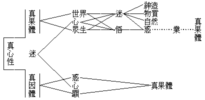



右表显迷悟皆由一心，在迷者则谓世界众生或为神造，或由物质和合变化，或为自然而有，其实皆非。至宇宙人生观能够澈底觉悟之人，方知世界众生之显现，乃由真心性之迷惑造业而起，故研求种种法门以蕲达到断惑止业之目的，则世界众生之幻象可以永不起，而种种之痛苦解脱矣。



学佛之次第，有信、解、行、证四级。若但有信、解，而无行、证，则吾人亦不能稍得受用。如吾人虽闻知世界众生皆由心现，而现前已受根身、器界之果，仍不能直下解脱。所以者何？以有过去世之烦恼业力为之系缚，故须设法对治之磨除之。然佛法无量，以五戒、十善为人天之种子，人道之初基。



众生因迷惑而造身三、意三、口四等十恶业，由其作恶之上中下品而堕入地狱、饿鬼、畜生等三恶道，欲脱此苦，须修不杀等十善业以治之。善业而感善报，既如前说。然善力究有时而穷，终未究竟，终属有漏无常，故更进一步须知三界、六道犹如火宅。恶报固当避免，福报亦应舍离；须勤修出世大法，而求究竟解脱。



出世法之初步，谓止恶行善、修习禅定、智慧等法，灭苦断集渐次证入於阿罗汉、辟支佛果。然此中小二乘，祇能自了自觉，断惑止业而已，其一心根本之迷──即无明──尚未打破也。故又进一步言，若能了知吾人常住真心本来具有无量恒沙智慧功德，在迷不染，在悟不净；即妙有而真空，即真空而妙有，勤修六度万行，不住二边，直显中道；若是修行者，谓之菩萨。其间等级甚多，渐次增进，及至圆满，遂顿破无明，德用显现而成佛果。



人天乘似积极而消极，中小二乘以择灭为手段，但求自了，故亦属消极。惟菩萨乘为真积极。菩萨发心，当发四弘誓愿；依愿起行，行到愿满，即成佛果。菩萨行仍以止恶行善做起，自从此做，兼劝他故；能明理遣相，可为菩提助缘，非复有漏种子矣。



------



## （王净元记）(见海刊三卷十一



（附注）出前川听法纪闻之三，原无题。



教观诠要



──宣统二年在广州作──



一　绪言  

二　八教甲　化仪四教  

乙　化法四教１　藏教  

２　通教  

３　别教  

４　圆教



三　结论



一　绪言



教为佛圣下被之言，观为贤凡上达之行；观非教则行无所明而常殆，教非观则言失其实而常罔，犹夫学而思，思而学，相藉而不容相离也。抑教固启心之灵钥，而观实入理之正轨。故佛祖说法必就众生之执著，随众生之根器，反覆诘破，辗转开示，使先悟本心自性乃授以观法，俾一门深入，谛证无虚。然则教观之义，可以稍知矣。



夫药所以治病，衣所以适身，身有修短之别，衣安得而无修短！病有万千之异，药安得而不万千！浸假以药而药北俱卢洲无病之人民，以衣而衣无色界天无身之众生，其有不视为狂者乎！浸假以一药而欲医众病，以一衣而欲适众体，不分甘苦寒热，不辨小大高低，其有不目为愚者乎！佛之说法亦若是则已矣！茍无众生之机感，佛本无法可说，而众生之机感不一，佛之说法又乌得而一哉！是所以四十九年，三百餘会，年年有异，会会不同。设有人焉，不解其因病施药随机说法之意，试繙一大藏经论尽阅之，鲜有不疑佛说之自相矛盾者。古代诸大师研究佛法而有所心得者，有鉴於是，乃判其种类，别其旨趣，浅之深之，三之五之。且为佛辨白之曰：佛之说法，盖有权巧方便耳。此佛不可不有古德为之判白，而古德亦不得不藉之以发表一己之心德，布施有情而报佛恩也。



但古代判教诸大师，其受禀不同，其识见不同，其悟理不同，其所际之时代、所化之人根、种种不同，故其判之也，亦各有所出入而莫或尽同者。然求其精当而纯全者，宜无如五时、八教。盖天台大师所判定者，故缁流多呼之为天台教云。今请言八教：



二　八教



八教维何？化仪四教、化法四教是也。



甲　化仪四教



顿教、渐教、秘密教、不定教，是谓化仪四教。顿教者：如日欻然而出，世界顿时无不光明也。华严顿悟佛慧，遍入法界；禅宗直指人心，见性成佛；此顿教之属也。渐教者：如种植物然，由芽而干，由干而枝叶、而花、而果，渐次长成也。佛於鹿苑转三乘法轮，说浅小之法，引诱钝根众生，坚其信、瀹其智、淘汰其餘习、破除其执著，渐渐皆引归於圆乘者是也。秘密、不定：其实际上於佛边全同，但众边互知、互不知微有不同耳。佛以一音演说法，众生随类各得解。机之大者获大益，机之小者获小益。其获大益者，自知获益之大，复知他众生获益之小。而获小益者，亦自知获益之小，复知他众生获益之大。彼此互知，名不定教。若彼此得益不同而各不相知，则便名秘密教矣。又灌顶部中一切陀罗尼咒，亦名秘密教。要之、此四教皆判教者叙明师资主伴间用意获益所以不同之理由，示后世师家应机说法之仪轨，俾研究者易得其要领耳。有虚位，无实法，故谓之化仪。逮下化法四教，方是佛所说示众生所思修而为教观体相之所托焉。



乙　化法四教



化法四教者：藏教、通教、别教、圆教是也。此之四教，又当中分为二：藏、通为三乘教，而别、圆为一乘教也。三乘者：声闻乘、缘觉乘、菩萨乘是也。前二为小乘，后一为大乘。一乘则佛乘是也。



１　藏教



藏教虽具有三乘之人法，然主重於声闻、缘觉二乘，故以三界之惑业果报因缘所生法皆为实有。而苦、空、无常、无我、不净，行者观之生厌离心，修三十七道品以趋入偏空寂灭为究竟依归。大涅槃经有一四句偈曰：『诸行无常，是生灭法。生灭灭已，寂灭为乐』。最足代表此教之谛理。赅而言之，藏教四谛始终皆未能出乎生灭之范围者也。盖此教明欲界、色界、无色界所有之身、受、心、法，皆为生灭聚，以众生所共之生灭固生灭矣，此苦集二谛之生灭也。而修此教者，以灭前此众生所共之生灭，而入寂静之涅槃，生灭灭而涅槃生，亦生灭矣。此道灭二谛之生灭也。苦、集为世间因果，道、灭为出世间因果，世间出世间虽有不同，其为生灭则一而已矣。唯其以生灭为境，故遂认依正二报、苦乐二果，皆本无今有，今有还无，三世有无，截然不同。过去非现在、未来，未来非现在、过去，现在非过去、未来。过去、未来之无，不可为现在之有。现在之有，不可即过去、未来之无。故其为观也，必假分析至尽而后始能悟入空理。如随碎一物，转更碎之，碎碎相续，碎至极微而更碎之，则归如空而漠无痕迹可睹矣，是谓析空观。如八背舍、九不净想、十一切处、十二因缘等观门，皆此观为之钤辖，为之枢纽，而复能为此观藉手之方便者也。



然此教亦有大乘菩萨缘四谛境，发四宏誓，勇哲无匹，精进无前，但慈悲心虽既切且大，而智慧尚微，禅定尚弱，故虽行六度万行，皆未能不著是相。及夫佛道成熟，度脱因地所缘之众生已，便断灭身心而入无餘涅槃。复与前小乘人一以因中所修之慧观同故，故归宿之止境，亦不得不同也。第此教所以名藏教者，盖有多义。今用其易解而近理者言之，则实理暂为权法所隐藏而未能显畅是也。



２　通教



通教，三乘所通行者也。前藏教虽亦为三乘共教，但声闻修四谛法，缘觉修十二因缘法，菩萨修六波罗密法，各各厘然迥别。今通教则反是，同以无言说道体化入空。虽有三乘之异，特因其能观与夙根有不同耳。其托无生生空为所观与所止境，固未始深异也。故兽形不同，而一般渡生死之河；门径虽歧，而平等到清凉之地。此据通教自体以论通也。而禀此教之教观者，下根则前可以退入藏教，上根上上根，则后可以进入别、圆二教，前后皆可通入，故名通教。此则综四教而论通矣。抑通教虽亦以空为归，但其所观之空，万事万物当体全空，乃是无生空，非藏教生灭之空。无生空即是真空，真空即是妙有，真空妙有不二圆融，即是唯心识观。故修此教者，多进入后之圆教、别教，唯一类最钝最顽下愚而不可移者，始倒退入前之藏教，而以声闻、缘觉半面清净寂灭之境域自畫，故初不观光於华严，终致退席於法华也。



中论偈曰：『诸法不自生，亦不从他生，不共、不无因，是故知无生』。颇足代表此教之真理。夫一切事物法相皆起源於生，今於四处推求生理皆不可得，生理尚无，何处尚有一切法耶？此即通教所修之无生体空观也。修此观者，观蕴、界、根、尘皆如幻、如化、如梦、如影、如水中月、如镜中花，当体非有，彻底全空，不待分析至无而后始能证入空性也。修此无生空观者，钝根则仅见空理，利根则兼见不空。盖利根之人证此空理时，复反覆观一切法，虽体性全空，而不妨有山河国土，蕴、界、处，种种苦乐、因果、善恶事业。且当此依正二报皆虚空性，当虚空性便是依正二报，重重差别不异平等，一味平等无碍差别。智论破世出世间一切法遍而复不坏世间相；禅宗烧尽大千世界而不损一草，皆与此同意。古师定通教为大乘入理之初门，良有以也。然大丈夫者，一悟穷其际，一见澈其源，不唯可以为大乘初义，即大乘之究竟境义，要亦莫能外乎是也。



禅宗入手工夫，简直了捷，亦无非导人自悟此当体无生空寂之心性耳。若根器稍劣者，便死於此。但随消旧业，不造新殃，冷湫湫地作个自了汉而已。而根器猛利者，复於此无生空寂之心性中，明见具有无量功德、无量智慧，与虚空等、与法界等、与诸佛等。即运无缘之大慈，起同体之大悲，不般涅槃，不求净土，於三界六道之中出入无间，与拔无尽。如所谓若不上天堂即便入地狱者，则以进入别圆贤圣之位，而与佛菩萨不思议境界相邻矣。明心见性之前矛，断惑生智之先锋，便利了当，此为其最。无上佛道誓愿成者，可以知所急务焉。



３　别教



别教行人，从初发心即仰信中道，誓成正觉。但未能即中道理具一切法，故须先修空观，断见思惑，证入十住；从空起假，入十行位，断尘沙惑；然后融会空假观照中谛，经十回向熏伏无明；趣入十地，渐证法身；至等妙觉，成就佛道。三观次第而修，三谛次第而照，三惑次第而断，三智次第而得，位位各异，分分不同，进不如圆教之圆融，故谓之别。盖贬辞也。



然别教以修不思议假观，破界内外尘沙惑为主，故其观四谛境，各各有无量相。苦不但生老病死，集不但贪瞋痴等，灭不但远离空寂，道不但三十七品。众生无边，有一小众生未度者，即是自性之烦惑。法门无尽，有一毛头法未明者，即是佛道之障碍。故其根性之猛利，器宇之宏伟，悲智之兼大，力行之精进，善能分别一切法相，应众生机演无量义，雅非藏、通二教之三乘众生所堪比拟。则名之为别，又褒德之称耳。



抑此教初地与圆教初住齐位，同破一品无明，同证一分法身，同能分身百界八相成佛。唯圆教始乎圆融，终乎究竟；别教始既未能圆融，终亦祇破十二品无明，与圆教二行齐位，未克究竟法身耳。其同观中道，同一大乘，无声闻、缘觉之徒，不滞化城，遥归宝渚，固未尝有异焉。



抑究而言之，藏、通二教祇被二乘。其大乘菩萨，实则皆别、圆之因人耳。故三祇行因，百劫修相，成藏教劣应身佛，及通教胜应身佛者，非别教地上菩萨，即圆教住上菩萨，而藏通二教毕竟无成佛义矣。别教所以永殊藏、通者，其在此乎。



４　圆教



圆教之为教，法圆、人圆、事圆、物圆、性圆、理圆、修圆、证圆。住、行、向、地，位位法身。色、声、香、味，尘尘中道。三惑一念中断，三智一念中得。三观唯一心，故无不即空即假即中也。三谛唯一境，故无不即真即俗即中也，恶道与善道平等，魔界与佛界平等，烦恼与般若平等，解脱与生死平等，法性与无明平等，贪染与廉洁平等，慈忍与瞋恚平等，定慧与昏乱平等，四荣与四枯平等，有情与无情平等，微尘与虚空平等，刹那与永劫平等，平等与不平等平等，不平等与不平等平等；无相无不相，无缘无不缘，无作无不作，无得无不得：要之、莫非绝待也，莫非平等也，莫非相融相即也，莫非相摄相入也。故圆之为义，含有圆绝、圆融、圆顿、圆成之多意。



夫圆教本末一如，始终一贯，固矣。然不妨论有六即，即即皆佛。故六而常即，即不异六；即而常六，六还同即。非如是，不足以成圆融与不圆融无不圆融之大圆融也。圆教之理佛，即吾人现前介尔一念，佛然、众生然，心然、法界然，即空即假即中之圆明妙心也。名字佛知此，观行佛照此，相似佛顺此，分证佛入此，究竟佛尽此。一知一切知，无照、无顺、无入、无尽、无不知。乃至一尽一切尽，无入无顺无照无知无不尽。於是乎万善乃皆於无所成中炽然成就，万恶亦皆於无可灭中荡然灭绝。极三身，圆四智，究竟菩提，归无所得。



此教行人，从名字佛悟即究竟，故其一举手、一投足之境界，已非别教初地前之人所能测度，况通教藏教之人乎！况三界六道之博地凡夫乎！又据此教以望别教之妙觉，尚非究竟，况藏、通二教之佛乎！况声闻、辟支乎！横综四教，竖穷十界，唯圆教妙觉果位为永断无明，究竟德性，更无可上之佛道，餘皆未能全出无明之区宇者也。斯所以善学佛者，总不得少为足，生下劣心，而必以圆教之无上正等正觉为归墟为止境也。灵利佛子，可不勗哉！



三　结论



猗欤伟哉！厥维我佛之说法也乎！虽纷纠繁赜，井然有条而不紊；虽奇驳宏诞，卓然精纯而不杂；虽恢廓空疏，轧然盛水而不漏。等一毫於十虚，极广大而不为淫；藏须弥於芥子，尽精微而不为隘。辉乎其炳炳焉，丽乎其郁郁焉，湛乎其渊渊焉，謷乎其巍巍焉，旷乎其堂堂焉，洵不可得而思议者也！虽然、佛法有宗，宗唯三谛。三谛者，真谛、俗谛、中谛也。中谛统一切法，俗谛立一切法，真谛泯一切法。此三谛理，物物然，尘尘然，法法然，心心然。故吾人介尔一念，莫不具之。能如是悟、如是观、如是行、如是证，即名开示悟入佛之知见，而合乎圆教之圆中法性。所谓唯此一事实，其他皆非真也。



但众生无明力强，障道业重，迷倒云久，靡由觉悟。或习於善，或习於恶，或滞於空，或执於有，或执自然，或鹜因缘，或胶常见，或误断灭。著空华而结空果，不知华生於眼眚；对梦境而驰梦想，不知境现於魂游。有情惑之滋甚，大觉悯之弥切，於是运无缘慈，垂同体悲，入方便智，现神通身。或依俗俗谛故，示五戒、十善之因，谈十恶五逆之果，尽乎九有、四生之域，不出六道、七趣之途。或依俗真谛故，说苦、空、无常、无我之法，俾知苦、断集、慕灭、修道，先除见思之麤垢，脱离分段之幻躯，而暂止乎空寂之化城。或依真真谛故，说无生无灭无住无为之法，令体之者，中根从空出假，上根因假会中，下根株守乎寂。或依渐真渐俗渐中谛故，说一切众生皆有佛性，但无始烦恼不能顿除，使仰中道次第证入，分破无明、分证法身。此皆佛陀应众生机，广施权巧，万不获已之苦衷也。



夫真如界内不立纤尘，佛事门中非离一法。众生无边故世界无边，缘起无尽故佛法无尽，夫岂言语所能殚述，文笔所能罄宣哉！故佛尝以指甲取少许土，顾诸弟子曰：佛法无量，不可称言，所说者犹指甲上之土耳，其未说者譬如大地。以故善学佛者，依心不依古，依义不依语，随时变通，巧逗人意，从天然界、进化界、种种学问、种种艺术发明真理，裨益有情，是谓行菩萨道，布施佛法。终不以佛所未说而自畫，佛所已说而自泥，埋没己灵，人云亦云。抑佛之说法，圆满周足，实无乎不具。世谓『人间好语佛说尽』者，殆非谀辞也。以吾人不善求之，故横生畛域，殊未知佛界、众生界，一如无二如耳。故古德之分判教观，翊赞佛化，不独未始於佛说有所增益，且祇得大海中之一波而已。著者兹之所述，盖又一波中之一波耳。然而触波波湿，触水水湿，一波之性不异瀛渤，言虽数千，其义既非此世界众生卒然所能穷矣。神而明之，存乎其人，不以一波自囿，从之而深究焉，则法海汪洋固未尝外乎是也。



乌虖魂魂迷都，芸芸万涂！以升以沉，载驰载驱！智愚强弱，佛性同枯！法雨滂沱，盍其来苏！



(见佛教月报初二期)



天台四教义与中国佛学



──三十一年下学期在汉藏教理院讲──



中国最流行而又最普遍的佛法，有台、贤、禅、净四派。这四派是中国一向所特重的，所以过去在武昌佛学院等处，都曾讲过天台四教仪和贤首五教仪。中国自宋明以来，凡讲教义者，都是讲的天台和贤首；多年隐诲的唯识、中观、俱舍等宗，至最近几十年才兴盛起来。然而近来一般人对天台、贤首似乎又疏远了！故现在又来亲讲天台四教仪，将来还要讲贤首五教仪，因为这是中国佛教的特色，应当把它好好的研究发扬光大。至於禅、净二宗，如本院现在讲的楞严经，可以明禅宗。弥陀、弥勒上生经，可以明净土宗。



关於天台的教义，除了四教仪外，还有四教义，天台八教大意和教观纲宗等书。四教仪有它的长处，如有些名相在教观纲宗里面没有，而这里却说得很详细；四教义里有些文很广泛，而这里却很简要。



天台四教仪的『仪』字，是仪式的意思。因为天台有四教四仪，合即所谓八教。贤首宗也摹仿天台而造五教仪，可见仪又不可作四仪解，所以是仪轨义，就是阐明天台判摄教理的一定仪轨。



天台、是山名，在现在的浙江。中国古时的习惯，凡是对尊重的人，都不直接称他的名、字，叫做避讳。佛教史上如曹溪六祖、洞山禅师等，都是由山得名的；天台大师亦尔。他的原名智𫖮，隋炀帝见他的智慧高深，故又称他为智者。他是湖北人，初曾宏化於湖北玉泉寺和南京的瓦官寺，然住得最久而宏扬最盛的地方，则为天台山。天台山可以说是他的根本道场，所以平常称他为天台大师。天台宗，就是指智者大师在天台山所创立的教义。



这里还要讲明的，就是智者大师若直接传承於印度的龙树，则为天台第四祖；但以中国北齐慧文大师算起，则为第三代。但天台宗为什麼不以初祖而立宗名呢？这与中国佛教史有极大的关系。



中国佛教特重於禅观。初期传入之佛教，经典虽有法华、般若等的翻译，但初译过来的阿毗昙心及毗婆沙论等，里面都有专门讲禅定的。故中国佛教之初期，有所谓毗昙宗，有专门的禅师、禅经等。至道安法师时、仍然如是，不过、这时已有弥勒上生经的翻译了，所以道安修兜率净土。至慧远法师之净土法门，亦为当时至高的禅观。他临命终时，曾在定中三见净土，这可见他的念佛不同后人，是修证三昧的。继庐山以后的昙鸾，本宏涅槃，觉得寿命太短，所以先学仙，十六观经译至，遂弃仙而修无量寿净土，始启后来的他力净土。总之、远公时的净土观门，实是其时一般的至高无上禅法。



稍迟、罗什法师译出的三论及大智度论、成实论等，阐明诸法皆空，或即空即假即中之理，他的门下宏此诸论甚盛。中国重禅观的人，亦依此义而修，乃有北齐慧文禅师奉龙树论明一心三观而得一心三智，所以天台的初祖，原是修禅观的。后来华严经、十地论等译讲昌明时，乃有杜顺禅师依华严经修法界观，故华严宗初祖，亦专重修禅。由上看来，可见台、贤、净诸宗，都是由修禅起的。在罗什之后有名的道生法师，为当时的义学界所不容，因为他说阐提有佛性，独创善不受报、顿悟成佛说。后来、达摩菩提就乘此风气，打开了直至佛地不立位次之禅宗，成为后代所谓祖师禅。



天台的初祖慧文，和华严的初祖杜顺，因为都是修禅定的，教义尚未充演，故不以他们为宗主。至第二代才渐有轮廓，到第三代所依的经论才丰富，而教仪也就完成了。这时，天台宗、华严宗才正式宣告成立。若以禅观为宗，当然应以慧文、杜顺为宗主，但后来著重於讲教仪，故须以智者、贤首为宗了。不过、他们的根底，还是由禅定而来，如天台的一心三观，华严的法界观是。禅宗和净土则略有不同，天台、贤首因为讲教仪，故至第三代才能成立。禅宗是不立文字不讲教仪的，要讲也不过略谈经中的精要而已，如六祖讲金刚经一样，只能提纲挈领地讲一个大意罢了！他既专重於禅定止观，所以在初祖实行修禅的人便可立为宗主。还有禅宗既重实践修持，中国佛教历史开始后，重禅的精神都收归此宗；所以唐、宋以来，它能特别兴盛，成为中国佛教的正统。



净土也是特重於修行，最初观想念佛，念佛功德等。后来以禅宗影响，专重一心不乱的持名念佛，这是很易行的。后来宏扬天台、贤首的，和参禅的永明寿禅师等，都拿他作为助行。一直到了明末的时候，修华严法界观和天台一心三观的人已少，禅宗亦衰，人都趋向於净土，尤以莲池大师为最著。先由他建立净土之轨范，继之以蕅益等的努力宣扬，於是净土才独为发达。以上便是说明一为重教，一为重行，所以净土、禅宗皆以初祖立宗，和天台、贤首的以三祖立宗不同。



这样、中国佛教特重禅观为正统，要恢复振兴，必须重修禅观。可是越到后来越简单了，仅看一句话头，这样门庭愈狭小、愈孤陋寡闻，便成一种空腹高心，一无所知的人，不但不达禅宗，而且也完全荒废了教律，以致成为现在这样的衰颓现象！实际上，连实行的净土，也愈简易愈陋劣而成空壳了！要振兴中国的佛教，当拿餘方的来补充。中国佛法正统，自然要重禅观，不过不单是看话头的禅，要发达教义上的禅观，如天台的一心三观和贤首的法界观等；还要研究戒律和念诵，须多习经教，这样才能把中国佛法因此而复兴。



中国为禅观正统的佛法，其他的地方呢？依锡兰、缅甸、暹罗等一带的佛教看，他们特重的是律仪，修定的人很少。至於教义、於巴利语经论等也有研究，惟最重律仪，可见他们的正统是律仪。西藏和日本则偏重於念诵，因重念诵故，亦重闻持经论。扼要而说，有密咒念诵和净土念诵。这念诵亦可名为咒诵，有祈祷的意义，特重在他力加持上；和中国重在一心不乱的持名念佛不同。像日本净土真宗，必须诵持研究许多典籍，但不重念佛，惟重信愿，他以为只要信心，就能获得弥陀的加持。因为我的心安在净土，即等於此身已在净土，由此他的念佛只是感恩的意思。西藏的念诵，也时时将他所学过的经典拿来背诵，如前在本院的悦熙格西，常念诵他所学过的俱舍颂之类。总之、他们是特重於读诵闻持和祝咒他力加持。这样、可见西藏、日本的佛教正统，在咒诵。



这是将中国、锡兰、和西藏、日本等处比较而说，其实戒、定、慧三学都可以互相增上。如戒可为定之增上，定可为慧之增上，慧亦可为戒、定之增上。慧无戒、定，则名为狂慧；戒没有定、慧，不能成定共、道共；定无戒、慧，易成邪定、痴定。所以中国佛教须特重於禅观，要复兴亦必须具有加持、闻慧及律仪，对禅观才能稳固。所以、我们当学西藏人时常念诵其学过的经论。若能常常持诵，便可仗此经咒的力量而得三宝威德的加持。关於锡兰等的律仪，不但研究而已，尤须实习，因为这些对中国佛教都很有补助。但中国的禅观若能复兴起来，对西藏、锡兰等地的佛教，当然更有相助的功德。这是因释天台的宗名至第三代才立的原故，而推论到一切。



------



## （了参、光宗合记）(见海刊二十四卷一



略说贤首义



贤首大师以三时、十仪、六宗、五教、三观立一家言。而第一时、第六宗、第五教、第三观之极旨，则集中於六相、十玄。然三时大同嘉祥三种法轮；於第二时更分三时，亦大同天台渐初、渐中、渐后。其十仪亦仿天台化仪四教分析开立。而六宗第一随相法执宗所分小乘六宗，袭自慈恩。第二唯识法相宗至第六法界圆融宗，固出创见，然此亦随所判『分始』、『空始』及终、顿、圆四教而来。故其根柢唯在於五教，而五教实为贤首义之纲骨也。虽贤首弟子慧苑尝驳其五教，谓小、始、终、圆系袭取天台之藏、通、别、圆，而别加顿教为不妥当，──天台家讥五教不明断证位次，续法作五教仪，仿天台立之，后人尤多非议──但此五教义乃承自杜顺大师五门止观而立者，唯彼五门专在修证，非谈判教。智俨大师孔目章等始据之以高判华严，至贤首遂继以完成其判教之义。三观全出於顺师之法界观章，十玄门亦俨师记於顺师者，属在周遍含容观中。六相圆融则唱於俨师而和于贤首者也。但贤首於俨师所记十玄，改诸藏纯杂具德门为广狭自在无碍门，又改唯心回转善成门为主伴圆明具德门，於事事无碍观亦殊有增胜之处。要之、贤首於佛果实智之境，宗依华严发挥者，实有足多。於明佛果利他权智之秘妙，则又当推天台宗依法华者为擅长耳。



然贤首、云华、帝心皆习宋译六十华严者，唐译之足本八十华严。至清凉大师始为疏钞。故完成此宗者，复应在清凉而不在贤首，此予所以尝称之为清凉宗也。贤首传自云华，云华传自帝心，而帝心号称孤起，别无渊源。然细按云华实学华严於至相寺智正法师者，智正乃慧光律师法系下之第五代，即开建终南之至相寺者。慧光既为四分律宗之远祖，复传少林寺佛陀禅师之禅，其集力处尤在合勒那摩提与菩提流支各译之十地论为一本，由研究宏扬十地论盛讲华严。其弟子极多，有为地论宗者，有为律宗者，至智正传云华，则更为开华严宗者。由此推之，帝心亦必出於慧光之系下，而为与地论宗极有渊源者，故虽谓华严宗由地论宗转成可也。由地论宗之渊源而观真谛之摄论与慈恩之唯识，则知贤首之华严，实与之俱出於世亲之唯识宗者。特於境、行、果三，唯识多谈因分识境，摄论於境、行、果略均等，十地论则多谈行、果，而帝心、云华、贤首等宗华严则激而益上，弥盛谈果分心境而已。在唐前有慧光系之地论与真谛系之摄论，双峰并峙。至唐则摄论被并於慈恩之唯识，而地论被并於清凉之华严，复成对抗之势，其实则同一世亲法流，不过唯识多谈因分，而华严多谈果分而已。多谈果分亦未尝不即果而明因，多谈因分亦未尝不即因而明果，得其意者固潜通无际，可於唯识之底得华严，亦可於华严之底得唯识，所谓因赅果海、果彻因源也。



此於古来地论与摄论及唯识所争本识之义，如慧光地论以本识为庵摩罗净识──犹云真心──，真谛摄论以本识为真妄和合──犹云净染和合──识，慈恩唯识以本识为阿赖耶染识。观此对於本识建立不同，即可知地论依华严而所明在极证之果，故宗本於庵摩罗净识。摄论依阿毗达磨而所明在地上之行，故宗本于真妄和合识。唯识依深密而所明在现因之境，故宗本於阿赖耶染识。而宗依华严之贤首家，则益从大乘极证之果境以尽量发挥之而已。若知总为一大乘之境行果，虽所明有偏胜，以果必从境行而致故，以行必依境而趋果故，以境必起行而证果故，互含交摄实无欠餘，则同会於平等之际，而各成其殊胜之用矣。



予向者尝略分疏大乘八宗，表释於整理僧伽制度论内，可参考焉！



近有人见觉书、海潮音上评支那内学院文件，评梁漱溟唯识述义，及三重法界观、对辨一乘大乘、对辨唯识圆觉宗、曹溪禅之新击节等，或疑有所偏重於天台、唯识或唯识、三论，而对於贤首独若深非之者。然予所崇重於华严者，虽不若墨守贤首家言者之甚，而於平等大乘之上，别标华严之殊胜处，实不让持贤首家言者也。此予总持大乘之根本宗旨，曾一表现於整理僧伽制度论外，又曾示之以大乘宗地图，他处则随转门中密意趣之抑扬耳。



世人虽尸贤首之名而祝之，或未知贤首可崇重之殊胜处何在也，今试一略谈之。中国於华严殆有三派：一、地论之华严，二、贤首之华严，三、枣柏之华严。地论行果，贤首纯果，同属世亲、流支系。枣柏融行果於不可得，则属龙树、罗什系。销纳此三派二系以归之，则为清凉之华严。然华严特胜之处，予谓贤首乃独得之。盖佛华严者，乃佛初成佛时妙觉光中所顿辉重重无尽之远近因华行、自他妙严境也。由佛智以观之，则一切皆为佛境，故众生皆如来功德智慧之相，而国土皆莲华藏海庄严之刹。此现证界，非身非言，而遍一切，即身即言。随诸菩萨所修之行，所达之境，呈身兴言。证之有浅深高下之差别，说之有先后广略之差别，皆为海印三昧之影。故诸菩萨信解行证皆依佛果安立，一切诸位皆为佛位。以果彻因源之故，而因源──阿赖耶识──幻依於果海庵摩罗识中，靡不融为果德。故因即能赅通果海，而一切异生、亦皆以如来妙觉海为心源──净心缘起真界缘起──也。依佛智以观之，无非佛境，是故一尘、一毛、一刹、一身，莫非六相圆融、十玄无碍之佛法界。此则贤首所独胜於华严者也。



然佛华严有言，『心佛及众生，是三无差别』。以佛心──或曰真心、或曰净识、或曰真界──融摄众生法而大明佛心者，固推贤首为胜。以其众生心──或曰赖耶、或曰异熟、或曰陀那──融摄佛法而大明众生心者，又推唯识为胜。由是例推及之，则禅宗者，明无佛无众生，众生与佛皆心者也。密宗者也，明无心无众生，众生与心皆佛者也。天台宗者，明即佛即众生，众生与佛即心者也。净土宗者，明唯佛唯众生，心祗佛与众生者也。三论宗者，明非心非佛非众生，而照达一心者也。律宗者，明即心即佛即众生，而净治众生者也。盖心与佛及众生为一事之三方面，方面虽三而实事一，故无差别。假为形式如下：



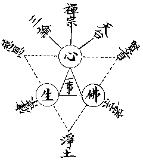



观此可知其融通之平等，亦可知其差别之殊胜矣。明此平等殊胜之义，有无量门。兹以心佛众生门略言之，详在大乘宗地图解。



------



## (见海刊五卷三



论贤首与慧苑之判教



佛法中古来判教者多矣！从一音不判以至判教为十，无虑二三十家。晚唐来行世者，仅天台四教、贤首五教之二家，共餘皆湮没无闻。慧苑为贤首之弟子，不善贤首之教判，别判为四教，时在初盛唐；后清凉救贤首之说，而慧苑之四教亦不彰。由今观之，贤首五教专显华严，诚有殊胜处；慧苑四教统观内外，亦有恰当处；故略为比较研究。



贤首五教，或说出於杜顺之五教止观，或说此为伪书，而实本於云华之华严孔目。要之、由证而说，由观而教，则以观本杜顺，教本云华为近是。云华在搜玄记立三教，一渐、二顿、三圆。复於孔目开渐教为三：一小、二初、三熟；合之为小、初、熟、顿、圆，即为贤首小、始、终、顿、圆五教之所本。五教与三时、四仪，大体皆仿天台，十宗则依奘、基，八宗中开第八为三耳。且天台之四教各有四门，即据理之宗、而各有一离言谛，又即贤首之顿。故贤首规模采集而立此，本无何种奇特，而要在能藉此教判以扶持所传法界圆融之十玄、六相胜观耳──十玄传自杜顺，六相传自云华──。此十玄、六相胜观，正贤首宗精蕴所在。而后之学者遗此精蕴，但在教判上与他家角胜，殊失贤首立言之旨也！



依十玄、六相以直观众生界事事物物，即为法界圆融之如来智境，此诚华严之妙义，亦贤首家之精华；与天台之三观、六即，同可取重者。吾人重贤首家者在乎此，不在其判教，以其判教虽善推尊於华严之特胜处，而於统观诸教未为允当。故若云华之说始中始云：『如百法明门论六种无为属一切法摄，人空法空方入空摄，得知真如不及二空，二空为上』。此由全未解百法明门论意，致为此悠谬之说！何者？此论乃解世尊『一切法无我』言者，顺此次第、先以百法解一切法，次以二无我解无我，故真如等法前说，而二空后说；非谓真如劣於二空，二空胜於真如也。若合言之，则择灭无为、真如无为、正二无我空观所引正智之所证。谓之二空真如，犹是安立谛真如，而非非安立谛真如，岂以二空为上於真如哉！举此一端，可知贤家之判教，重在推高其华严胜观，而於诸教姑为拟似之谈，未遑详究其旨也。故转不若苑公所判为善。



苑公刊定记云：『古德五教中立顿，既引思益云：「得诸法正性者等」，及楞伽云「无所有何次」等；又云「呵教劝离，毁相泯心」，乃至云「如净名嘿」等者，当知此并亡诠显理，何复将此立为能诠？若此是教，更诠何理？若言以教离言故与理不别者，终圆二教故岂不离言──按实彼贤家所指始教，亦岂不离言？若许离言，总应名顿，何有五教？若谓虽说离言不碍言说者，终圆二教亦应名顿，以皆离言不碍言故！又此望诞、统二师所立之顿，便有两重，以彼渐、顿机中皆有劝修离言者故。盖知此所立顿，但是餘教所诠法性，非能诠教也。今依所诠法性以显能诠差别，谓有全显全隐，分显分隐，以立四教。故宝性论第四云：「有四种众生不识如来，如生盲人。一者、凡夫，二者、声闻，三者、辟支佛，四者、初心菩萨。」今之所存，依此而立。一、迷真异执教：当彼凡夫，谓外道等迷於真理，广起异计。二、真一分半教：当彼二乘，谓但证生空所显真如。三、真一分满教：当彼初心，谓但证二空所显不变真如。四、真具分满教：当彼识如来藏者，全显随缘不变真如』。



后清凉疏钞难其以外道孔老等为迷真异执教云：『今判圣教，那参邪说！若对教主，应如此方先立三教，於儒教中方辨九流七经，於道教中方辨道德之别，於释教中方说大小权实，则无混滥。不然、即如西域先分内外，外中方分六师或十宗，内教则分大小等。今既不分，即有邪正混杂之过』。按清凉此难，亦未探苑之立意。苑既据宝性论而立，则彼论平列凡夫、声闻、辟支佛、初心菩萨之四，将亦有邪正混杂之过耶？以苑本平判世出世之诸教，非单判佛之圣教故。又凡立言教欲对一切人说者，固应兼判世间诸教，使回邪入正；若识论举我法而前破外道，随破小乘等。又苑明指彼为迷真异执，何尝有混邪正？至清凉难苑之真一分半满二教，则在苑诚有立言未莹之处，然立意固未可厚非。可依其意变式如下：



　　　　　　　　　　　　　　生空──┬分真─┐　迷真异执……外──╮  

　　　　　　　┌─二空───────┘　　　└─────┐　　　　教  

　　　　具真─┴────────────────────┴─内──╯



即不用半满而改称真一分生空教，真一分二空教可也。



又清凉於苑公所难顿之理，为解之云：『顿诠此理，故名顿教。今顿说理，岂非能诠？达摩以心传心，正是斯教。若无一言，心要何传？故不同天台四教之绝言』。今谓达摩以心传心，仍以天台绝言为是。何者？依教诠理，依理以谈宗要，诸教皆可有顿传之一言；若外教以允执厥中之一言以传心要等，则诸教皆可云顿而无别顿教。况达摩之以心传心，可直无言，但心心相印证。而须言时，则诸言教皆可寄为无言之言，广言而不一言，若六祖等语录可证，何尝必顿一言以成所云顿教也哉！故清凉斯解，曾无救於苑公之难也。



虽然、苑公据真如不变随缘义，以辨真一分、真具分，仍未足以通诸圣教。而五法、三性之圣教，有单判『真如』圆成实摄者，是单以无为曰真也。有兼判『正智真如』圆成实摄者，是兼以无为及清净有为之如来无漏界统曰真也。无为曰真，是曰分真，但不变故。为无为无漏法曰真，是曰具真，有为随缘、无为不变具二义故。空不空具显非具显，为无为皆真非皆真，於大乘教应别三宗。



　　　　一、法性空慧宗───显空未具显不空┐  

　　　　　　　　　　　　　　　　　　　　　├无为真，有为非真。  

　　　　二、法相唯识宗─┐　　　　　　　　│  

　　　　　　　　　　　　├─空 不 空 具 显┤  

　　　　三、法界圆觉宗─┴────────└为无为皆真。



然此皆大乘教，皆是依一实相而趋大菩提者。特其高标所宗以策胜观之点，有此三别，非教之别。由是佛之能诠教法唯判为二，并列外教。为表如左：



　　　　　　┌外教─┬──────鬼畜法  

　　　　　　│　　　└────┬─人天法───────┐  

　　　　言教┤　　┌（声闻藏）┤　　　　　　　　　　　│  

　　　　　　│　　│小　乘　教┼─六宗　且如奘基所传　│  

　　　　　　└内教┤（菩萨藏）┘　　　　　　　　　　　│  

　　　　　　　　　└大　乘　教┬────三宗　如上分判│  

　　　　　　　　　　　　　　　└───────────┘



佛内教宗，判为依教诠理之教凡二，统理起行之宗凡九，亦可以得厥大较矣！苑公所判四教虽未尽当，比之贤首五教则为通允。至明十玄、六相妙观，则贤首传者为胜，苑公德相业用二重十玄，反嫌繁滞，清凉大师所批驳者良是。故吾人未尝不服膺贤宗之法界圆融妙观也！



------



## (见海刊七卷十二



听讲五教仪拾零



──三十二年在汉藏教理院讲──



一　佛法的判教略史  

二　理论究极的性空与事实亲证的中道  

三　天台和贤首合评甲　台贤的优点  

乙　台贤的缺点



一　佛法的判教略史



关於判教，在印度初期，分有许多部派，每派都以自己一派为正统的真正佛法，以别派非是正统佛法或非佛法。这在印度部派时期如是，到了大乘兴盛时期，则大乘人以大乘佛法为究竟了义，以小乘为非究竟非了义的方便法；这并不是不承认小乘是佛法，不过判他为方便法吧了。后来大乘也渐渐地分有部派，起初已有小乘、大乘之分，加以大乘中又分，遂有唯识宗和空宗的三时教之判了。如解深密经，就是印度判教的一个根据。印度有明显的唯识宗与空宗的两种三时教，实在清辨后戒贤、智光的时候；其时、已在中国的天台宗之后。所以古人说判教唯是中国所有，并无印度的根据，这是不对的。如瑜伽论引证解深密经的三时说，也算是已有判教了。不过在小乘时，因每派都有全部三藏经典，故只认自派为正统他派非佛法的部派分判。大乘初起，虽不以小乘为满足，但不能抹煞它，只能容纳之而为了不了义的分别。其次至大乘又生派别，如唯识宗亦不能抹煞空宗，不过经容摄而不以它为圆满吧了。这在印度的判教，大略如是。



中国的佛法，传来时在印度已大小并行，故大小乘之分已不成问题。且来华传弘佛法者，大抵学大乘而兼弘大小乘者，无定执小乘而排斥大乘的。所以也就无一定大小之诤论。或大小并重；或以小乘是大乘之方便；或云佛法一味，因根机不同故有见大见小之异。如佛教传来中国时，像鸠摩罗什和菩提流支等，皆立一音教──佛以一音演说法，众生随类各得解──，只随机领受有了义不了义，并无教之可判。到了六朝的齐梁时代，判教之风始盛，各派皆以自己专讲之经论为最高，如涅槃宗以涅槃常住为究竟，地论宗以地论为最高，梁之光宅法云又判法华经为实教等。如是或分顿教、渐教，或分权教、实教，或分半字教、满字教，乃至分判为三教、四教、五教者。然当时之判教，犹甚简单，亦无定式。



至陈、隋之间，天台之判教始较为完备详细。天台教虽起於慧文、慧思，唯判教实完成於智者。智者曾将前人的顿、渐、显、隐说综合起来，判为化仪四教；将半、满、权、实、偏、圆等说，判为化法四教。又以说时的不同而为五时，此时的不同说，本来也是以前就有，天台不过加以集合整理而已。所以中国判教之风，实开创於齐、梁之间，而完成於陈、隋。天台虽集当时佛法之大成，综合以前的判教而加以组织。但那时虽有真谛的摄论、俱舍，然不甚完备；至於后起的佛法，如唐玄奘的唯识与禅、密等宗，都非天台四教所能尽。贤首宗在时间上既然较迟，又全部承受天台之说，再融纳新传之唯识宗及空宗的三时教判和禅宗，并加以整理组织，在所判的教仪中，都给他有个位置，故中国的判教，到了贤首宗实在算是最完成了。华严宗虽创始於杜顺、智俨，而判教之完成，则在於三祖贤首国师。



唯贤首时密宗尚未兴起，到了二三十年后才盛，故在贤首所判之教仪上，尚未给一显明适当之位置。不过、密宗在当时仅为一种行法，和善导流的净土，惠能流的禅宗之行法一样，故一行亦仅以天台之教仪解说密经，并无密宗的特立教仪。后来日本空海才著有显密二教论，十住心论，判贤首为第九住心，将密教放在贤首之上，判为第十住心，别立密宗之位置，可谓较贤首后来居上之判教。不过这仅在日本流行，在中国并无何影响。



贤首宗因慧苑的判师，曾隐没一时，至清凉才把他复兴起来。这时、密宗业已盛行，天台亦由荆溪复兴，禅宗更风行国内，尤其清凉是深禅宗而精天台教者，故对此二种皆能更予以组织容纳。所以我从前曾名华严宗为清凉宗。因为在中国的判教史上，实以清凉重兴之华严宗为最充实完备，后来则只有守成保持而已。如永明寿的宗镜录，不过是容摄诸宗义入禅宗而并非判教。现在所要讲的五教仪开蒙，即是依照清凉较圆备的判教说而造的一部书。



二　理论究极的性空与事实亲证的中道



性空论者用一个空字来批判一切法，以为凡是空的都是对的，说不空那就不对了。这在抽象的理论上，当然是有他的强处。然而、要是拿抽象的理论来抹煞具体的事实，或者就把理论当为事实，那就不免错误了。性空论者在理论上谈到究极的地方，便是性空。然在理论上尽可说一切皆空，而事实上却不一定就是空。比如说石头的坚和白，坚是看不见的，白是看得到的。在理论上白是一概念，坚也是一概念，在概念上是可分离的；但事实上的白石是坚白不离的，若离白或坚便不是白石了。所以理论上尽管你说白不是坚也好，说坚不是白也好，事实上只有一块白石。



圭峰曾诘性空论者：你说一切皆空，能够了知空的是个什麼？这意思说：在抽象的理论上，尽管你说空，但在具体的事实亲证上，不见得全是空，那证空的无分别智是不能抹煞的。尽可说知性亦空，但终不是冥然罔觉，而是知空空知的如如相应。这就是亲证事实的不空或空不空的不二中道了。



三　天台和贤首合评



甲　台贤的优点



一　天台的优点



天台的优点为六即、十乘。说即而常六，故理虽平等而染净的分位不滥；说六而常即，故虽有行位次第而理实始终一贯。十乘、即十乘观法，天台四教中无论那一教皆有此十法以成乘的修法。这十乘观法亦即是说明诸教义并不光是一种学理，都可依之实际修行，所以这十乘说是非常活泼的。



二　贤首的优点



贤首的优点为十仪、十时、十玄、十观。十时详於天台的通五时；十仪的综合分析，亦详於天台的顿渐等四仪；第三观中的十观、十玄，更是此宗的精妙处。就拿十观看，虽说圆融无碍，但仍是一层一层条然不紊的。这种层层融澈的教义，诚非诸宗所能及也。



三　台贤的共同优点



（一）两宗都有三观，但对照起来又有不同。如天台三观中的第一空观，又有析空、体空之别，析空不通大乘而体空则通；贤首的第一观则仅一而不分。又天台有次第三观、一心三观，贤首的理事无碍观，是次第三观又兼一心三观中的一部分义。周遍含融观则是一心三观中最圆融的一部分义。所以约应用上说，则天台有析空、体空、次第、一心，而比较来得灵活；如初心修不上一心观，则可依前三观慢慢地修上去。若依分析上说，则贤首每观都开为十门，却较为精详了。



（二）两宗都以圆教为最圆满，然亦有别，天台以法华为纯圆，判华严为兼别之圆。意谓华严是与二乘对立不能融三乘都归於圆，所以它是不澈底的兼别明圆，法华能会三归一，无小大之对立，才算是纯圆。贤首则判法华为同圆，华严为别圆。意谓华严是佛之根本法，餘法都是从此生起的，法华是经渐偏之后而会归於圆，归圆才同华严，故唯华严为特别的圆教。若以根本法轮和摄末归本法轮来看，可以作这样的说法：若从佛果的自证法界说，则以华严为最圆；若自如来对法界一切众生的化他大用上说，则以法华为最圆畅。



乙　台贤的缺点



一、将整个佛法这样分成四教、五教，往往要发生滞碍而不能切当。但天台的五时配四教，比贤首的五时配五教活一点，它判阿含但小，方等对小明大而通四教，至般若明大乘空理才不通藏教。贤首则把解深密经等指定它是始教，就不能前通小教，后通终、顿、圆教了，这在教仪上是很难通的。故天台把方等时的经，许它虽是大乘而可通四教。



二、两宗的每教各有断证分齐，便成为四种或五种的因行果证不同。尤为大碍者，是说四教或五教的佛果各各不同，而都说释迦牟尼不过是一化佛。这样一来，令人怀疑成佛也不究竟了！我们信佛，就是信有无上正遍知的佛，假使佛也不定是究竟，那麼何必成佛！佛之所说法亦不必是究竟真理了！虽然台、贤都说明佛果有究竟与不究竟，这种化佛亦是圆教佛果或住、行等菩萨所现起。但仍要发生疑问：我们所信仰的佛法，是现在人间的释迦佛所说，这释迦化佛虽然可能是圆教佛果所现起，但亦可能是住、行、向等不究竟的菩萨所现！总之、这种判教说，是会令人对佛果生不究竟想的。



由这种佛果不同的意趣而发展，如日本真宗说：弥陀净土是报身佛教，其餘是释迦的化身佛教。又密宗说：大日如来所说的才是真法身教。这样、甚至外道们也滥说：我的法门是然灯古佛大乘教，故不同释迦的小乘教。本来一切佛法都是由释迦牟尼佛所说，这样一来，释迦佛所说的就收摄不尽了！而且如贤首的小教佛，不过才齐圆初信位耳，其程度之浅低，怎能不令人看轻了佛！如说只一大乘究竟果是佛，那就不会发生这些弊病了。



三、天台所断的五住烦恼，尚可与一般大乘经论配合。贤首加立三十二分习气，则无教典根据。如果有人立四十二重习气，岂不是又要超过贤首的圆教佛十位吗？天台的见惑、思惑，可即是分别的、俱生的烦恼障；尘沙惑、是分别起的一分所知障；无明惑、是俱有的一分所知障。至於四十二品，系借托般若与华严四十二字母，犹可勉强为解说。又说别十地等於圆十住，亦可勉强说为：别教是把地前的说得较详，地上则略，圆教却把地上的说得广详，而地前则略。至於贤首所立二障以外的习气，在教据上理论上实在找不到解说！小乘阿罗汉有习气未尽说，以未说烦恼障之外另有所知障的无明，故说这些无明或所知障名为小乘未尽的习气。但大乘既把小乘不染污无知说为所知障的无明，则不得更在所知障外加立习气──因为习气就是所知障。假使为了要加立三十二个行位，又加立了三十二分习气，这实在是不足取的。



四、二宗对诸宗的看法：在天台的藏通二教，可以摄三乘利钝之机。贤首之小教应唯摄小，始教应唯大之始。但小教中也有菩萨和佛，始教中也有证小果的，则名义淆乱。至於龙树的中论，在天台判他是通於通、别、圆教的，因为他一分共空义虽不通於中道不空，但一分不共空义，亦能通於不空之别、圆二教。贤首则唯判为始教，这假使依提婆的破他而『破如所破』、或清辨的『胜义皆空』来判为始教还可；若依月称入中论等说，在破他的理论上虽说空，而实依华严十地立论，且说唯佛果有真自性，这在天台已应判为通教兼但中别教，何况中论之更兼圆中？乃贤首概不许中、百论通终、顿教，甚是不妥。又贤首对唯识法相宗的判法更为死板！贤首始教中说的佛身，在唯识家看来也不过是三类化身中的『大化身』而已。可是唯识教法中不还立有报身与法身的吗？若天台则可判唯识是依别教对破藏、通的方等法，故深密本身是独一的大乘别教。



要之、佛教只可判小乘、大乘。把大乘更判为五教四教，是两宗共过，但天台比贤首要少一点过失。若解为依一大乘教法，未登地菩萨可看成通教、始教，七地前菩萨可看成别教、终教，八地菩萨可看成顿教，八地以上菩萨可看成圆教，其实祗一大乘教法，庶可免过。



曹溪禅之新击节



──十一年冬作──



达摩别传一宗，至曹溪而大行中国；宋时貤及朝鲜、日本，迄今流衍未衰，可为盛矣！然自达摩以逮曹溪，虽别传之心宗实超教外，而悟他之法要不离经量。曹溪曰：『吾传佛心印，安敢违於佛经』？又曰：『涅槃经吾为讲说，无一字一义不合经文。……为汝终无二说』。又曰：『执空之人谤经，直言不用文字。既云不用文字，人亦不合言语，只此言语便是文字之相』。又云：『直道不立文字，即此不立两字亦是文字。见人所说，便即谤他言著文字。汝等须知自迷犹可，又谤佛经！不要谤经，罪障无数』。故达摩、慧可授受楞伽，黄梅、曹溪宏演金刚也。夫楞伽乃大乘妙有法轮之天枢，而金刚亦大乘真空法轮之斗杓，洪源遥流，酌之不改初味，雪山宝林，湛焉有如新泻。每读信心之铭，证道之歌，观般若、瑜伽诸经论，辄觉涣然融释，妙洽无痕。惟后时宗徒既混入知解，而教徒亦强挺荆榛──四教先乱般若，五教尤乱瑜伽──江西、石头以下诸师，为救其弊，数变其法：或由旁敲侧击使亲悟，或由电骤雷轰令顿契。然皆要期自证，不为语通，绝言思之妙心，终不用父母所生为口说。故曰：『若能不触当今讳，也胜前朝断舌才』！虽易临机之用，不失教外之传，而要以曹溪法实为综前开后之大规范。今者般若、瑜伽重畅，试为一拈唱焉。



一　曹溪之自悟



夫诸法缘生，生空无性，此大乘般若之轮也。诸法唯心，心幻无性，此大乘瑜伽之轮也。破我法之执，彰真俗之谛，发理量之智，证性相之境，说或小异，揆无不同。曹溪闻金刚般若心即开悟，即悟此也。后呈其悟，故书偈云：『菩提本无树』，以诸法唯心故；『明镜亦非台』，以心幻无性故；『本来无一物，何处惹尘埃』，以诸法缘生，生空无性故。然此二轮犹收教内，教外之传，尚须一徵。其夜、五祖以袈裟遮围为说金刚经，至『应无所住而生其心』，乃言下大悟一切万法不离自性。遂言：『何期自性本自清净！何期自性本不生灭！何期自性本自具足！何期自性本无动摇！何期自性能生万法』！五祖知悟本性──即下本心──，谓曹溪曰：『不识本心──即上本性──，学法无益。识自本心──无性本心──，见自本性──心本无性──，即名丈夫天人师佛。此大悟界，唯回绝言思之妙心──触讳，罪过──，名相之所不能安立。故教下虽强名一真法界，或曰本如来藏妙真如性，旋曰非安立谛，废诠不诠。此云言下大悟，实非言语能到，故为教外别传之宗。此『宗』何指？姑借一言假为诠表，则曰：无性空心，心圆众妙。心幻无性故应无所住；无性真心故而生其心。心──此无性空心，即曹溪所云自性──圆众妙，本自清净，本不生灭，本自具足，本无动摇，能生万法也。由是总其悟旨，可归二言：诸法唯心心幻无性──亦可诸法缘生生空无性──，无性空心──亦可无性幻心──心圆众妙。后世三关之意，亦不外是。诸法缘生而生本空，一也。诸法皆心而心如幻，二也。无性妙心心即诸法，三也。夫至无性妙心心即诸法，则随手举来莫非涅槃──本空无性──妙心也，明矣！然此实非比智假诠可及，故云教──比智假诠──外别传。



二　曹溪之悟他



曹溪说法悟他，皆从自悟境界流出。然以大悟之界，须人自达，故其所言不离教内空、有二轮。说空破有，说有破空，遣除邪执发生正智而已。意在教外，言不离教，此曹溪禅所由高也。由此其说法之纲要，祗是万法心生，生空无性──『非风幡动，仁者心动』，法心生也。『佛性无常、诸法是常』，空无性也──，俗真真俗，出没即离。其言外之旨，在使人执亡意消，跃然自得。故曹溪曾唤其门人法海等曰：『汝等不同餘人，吾灭度后各师一方，吾今教汝说法不失本宗──案：坛经载：『然须传授从上以来默传分付，不得匿其正法。若不同见同行在别法中，不得传付，损彼前人，究竟无益，恐愚人不解谤此法』云云。此所云同见同行，即已悟可为一方师者；分付、即付嘱其悟他说法之典，要令不失本宗。后世一般邪魔外道，秘为六祖不传之据，谬甚──。先举三科法门，动用三十六对，出没即离两边，说一切法不离自性。忽有人问汝法，出语尽双，皆取对法，来去相因，究竟二法尽除，更无去处』──案：此曹溪传其入室弟子说法之要，亦犹洞上有参同契及宝镜三昧等。其密传不令众知者，皆为护持不同见同行在别法中者，恐彼谤法获罪，执语障悟，别无他义。



此上来所举，祖自有释。今案：动用对法，出语尽双，即离两边，来去相因，乃运空有二轮以摧有空二见者也。究竟二法──空有、真俗等相对法──尽除，尽除者、是教下假诠。说一切法──五阴、十二入、十八界等三十六法──不离自性，不离者是教外妙心──指一切法离言自性。在般若、瑜伽诸经论，指其要归，无不如此。故曹溪乃真通教意、真能说法者也！又曰：『若有人问汝义，问有将无对，问无将有对，问凡以圣对，问圣以凡对，二道相因，生中道义』。其为志彻说涅槃经常无常义。又为神会说见不见、痛不痛义。对卧轮有伎俩曰：『惠能没伎俩』。对住心观静长坐不卧曰：『是病非禅，拘身何益』。对空知无见曰：『不见一法存无见，大似浮云遮日面；不知一法守空知，还如太虚生闪电』。对念佛生西曰：『西方只在目前──误十万亿佛土为十万八千里，此因不观经文，未解经义之故──。此其与人解缚去粘、抽钉拔楔之妙，如所谓马前相扑倒便休！活泼泼地，赤洒洒地，坦荡荡地，露堂堂地，诚有不可言喻形容之者！其曰：『吾有一物，无头无尾，无名无字，无背无面，问诸人还识否』？才被神会唤作本源佛性，即呵之为知解宗徒。以说一切法虽不离这个，而这个终不能言陈出之。神会名作本源佛性，以为假智假诠可得，遂滞於名相知解中，而失教外之传。此与贤首等之知解教徒，以诸美辞种种形容绘畫绝言思之一真法界，自谓超越先哲，能言龙树、世亲诸祖所不能言，同一僭妄！殊不知诸祖岂不能言哉！特以实非言思之所及耳。虽构种种形容绘畫之说，徒益名想之影，反障证悟之门，故曹溪力呵之。有曹溪力呵之，故虽有神会等知解宗徒，而宗风仍畅。慈恩等於知解教徒未力呵斥，故四教、五教兴，嘉祥、慈恩之教轮辍。清凉引而化之，陷泥已深。圭峰则由知解宗徒兼为知解教徒，宗下承曹溪风能斥去之，故宗弥盛。而清凉於圭峰又不能呵却之，故教益晦。厥后、永明顺而正之，落草愈甚。宗徒教徒殊皆没入知解，不期离言妙悟，封著名相。二三真禅，唯用峻险或截击为法门，务以飏落知解为事，以延教外之传。故堕於知解者，不唯失宗，亦失於教。若曹溪之说法悟他，不唯得宗，亦得於教。昔一居士请云门曰：『三藏十二部教意即不问，如何是祖师西来意』？问曰：『祖师意且置，汝道如何是教意』？士罔措，门大加呵斥而去。故宏宗演教者，当学曹溪悟他，以知佛祖说法之妙。



三　曹溪之自性



曹溪於其叙悟及教说法等中，若诸偈言及长行等，三科法门三十六对，亦是常途语句。最关要者，唯在『自性』一名。於其自叙及教他中，若不识『自性』一名所指，必难瞭然。其自叙中叙悟自性本清净等，其教他中令说一切法不离自性等，皆必知其自性所名，乃有著落。好在曹溪曾自释云：『自性能含万法，名含藏识──此指第八本识──；若起思量，即是转识──此指第七末那。多以转识为心，如云：心为地，性为王；性在心存，性去心坏。性指一报之主之异熟识，心指前七──生六识，出六门，见六尘。如是十八界皆从自性──指含藏识──起用──从藏识所藏之十八界种子起十八界现行，曰起用，即以前六三不起现行为息用。粗似易经『寂然不动为体，感而遂通为用』；亦似中庸『未发为中，发而中节为和』。核於成唯识论等义，此种见解，犹有疏谬，以异熟识非真寂故──。自性若邪，起十八邪──有漏异熟识缘有漏种起有漏现行；自性若正，起十八正──无漏无垢识缘无漏种起无漏现行；若恶用即众生用，善用即佛用──『由此有诸趣及涅槃证得』──。用由何等，由自性有──『无始时来界，一切法等依』──。依此观之，曹溪确指第八识名自性，明矣！其颂四智，亦曰：『大圆镜智性清净，平等性智心无病』。此亦以第八名性，第七名心者。谓自性──第八──若清净，即大圆镜智。自心──第七──若无病，即平等性智也。然第八识名义纠纷，颇分难解。通名或曰一切种识，或曰阿陀那识，或曰本识，或曰正心。在有漏位，或曰阿赖耶识，或曰界趣生体，或曰异熟识；在无漏位，或曰庵摩罗识，或曰大圆镜智，或曰真佛身。就有漏中指无漏界曰如来藏，亦曰佛性。以假智诠指绝言思界曰一真法界，亦曰真如──真如一名，诸经论中多指遮空二执空理。然起信云：『唯是一心，名为真如』。又说真如之自体相及真如用。楞严亦说：『本如来藏妙真如性』。曹溪亦说真如自性是真佛及说真如用。此等所言真如，每与指一真法界或如来藏同，非但二空空理──。而曹溪言自性，亦复通此多义。言自性本自清净等，是指如来藏或一真法界也。言自性邪正起十八邪正，是指异熟识或阿赖耶识或庵摩罗识或一切种识也。其名义之玄纽若此之甚，无怪因起信论真如一名，生后人历久之诤欤！禅宗悟本体禅、主人翁禅，所悟虽亦离言法界，在异生位仍即阿赖耶、异熟识。前六刹那不生，末那我爱执藏暂现。此若执实，虽悟唯心，不悟无性，或入外道。了幻无性，取无性空，不透末后，或归二乘。进悟无性心源含融万法，乃大彻了。故深密云：『阿陀那识甚深细，一切种子如瀑流，我於凡愚不开演，恐彼分别执为我』──执为我即执为性，我义即性义，未悟无性故入外道──。然在凡位欲求顿悟，除悟此亦别无真体，故大佛顶曰恐迷真非真；迷此非真欲别求真，终亦无真可得。呜呼！此可知曹溪自性一言所关之大矣！



然自性应专指诸法离言自性。若曹溪说为含藏识，不如易以通名，名以一心，或名自心为当。故吾有取於永明之举『一心为宗，照万法如镜』。



唐圭峰以瑜伽为法相宗，般若为破相宗，自居为法性宗，曰一乘显性教。以有情有本觉真心名如来藏，又名佛性。此亦以如来藏名法性者，不如名以真心为当。然其不脱知解，不悟诸法离言自性，作禅源诠，尝曰：『心是其名，知是其体，知之一字，众妙之门』。以为举知字即能得心体，宗门或斥之曰：『知之一字，众祸之门』！明永觉贤以真心具空寂与灵知之二义，补曰『空寂之知』，谓圭峰取知遗空寂，不了真心。今按：空寂即无性义，空寂灵知即无性心。即心不悟无性，故成妄执；妄心若悟无性，即契真如。故空寂知始是真心，彼执知为心体，且不悟心无性，更何解乎无性心哉！故后世宗师於曹溪所云自性，亦讳言之。但云『这个』，这一『著子』以指示之，诚以『说似一名即不中』也！



------



## (见海刊四卷十二



赞扬六祖功德以祝南华之复兴



──二十四年十二月在曹溪南华寺讲──



我这次一到广州，即来曹溪，有两点意思：一、是来瞻礼六祖肉身，二、是来庆祝六祖道场的重兴。因禅宗丛林，由曹溪一脉，遍於天下；如日本、高丽之禅寺，皆祖宗於曹溪。唯自六祖以后，这曹溪南华寺即兴盛时少，衰替时多。明朝亦曾经憨山大师重兴；今则复有虚云和尚来谋振兴，诚是千载难得之盛会！故我来瞻礼六祖肉身，同时也就是庆祝六祖道场的复兴。这样、可见我这次来，实是向和尚及各位首领职事恭祝来的，本无什麼可说的法。但因在座还有如许新受戒的初发心者，及诸方来集的在家信众，同在此六祖真身的道场相聚，实不无殊胜的因缘，故想赞叹一点关於六祖的功德，以资提倡。



在梁武帝时代，西土有智药三藏航海南来。以前印度到中国的学者，大多取道西北而来，唯从海南而来，自三国时代的康僧会而后，恐就要算智药三藏了。智药三藏在广东留有许多灵迹，先是在广州光孝寺植菩提树一株，预言百七十年后有肉身菩萨於此剃发受戒。后到曹溪饮水有异香，乃寻至此处建宝林寺，并志预言曰：『一百七十年有肉身菩萨，於此开演上乘，度无量众，传佛心印』。这所谓肉身菩萨，便是六祖大师，在佛教历史上是早已证实了的。我们就在六祖一生的行事功德上，也可以确信六祖是大菩萨的应世。有许多人，往往以为六祖是斫草挑柴的目不识丁者出身，於是就认为佛教应该要完全弃离文字，因六祖不须文字而通达佛理；殊不知六祖是随时机所宜示现如此，决非目不识丁者，而是成就无量言语文字三昧陀罗尼，非世间博学多闻、世智辩聪者所能望其项背的！这是从什麼地方证明呢！如坛经中所说：『闻无尽藏泥诵涅槃经，即知妙义』；又听法达诵法华经至开示悟入佛之知见，即达奥旨；若非久植德本，智慧如海，何以臻此呢？又其听人诵金刚经，即豁然开悟，亦是一种应机示现的方法；因当时金刚经正普遍弘盛於世，所以他就来参礼五祖，托闻金刚经而开悟了。因此、不但传佛心印，而亦是传持法藏；但这不单六祖如此，迦叶以来都是这样的。又大小乘经论最精深微妙者，莫过於唯识各部经论，如楞伽、深密、华严诸经是；而楞伽四卷，传佛心印，乃从初祖达摩历代相传者。在坛经中说：有智通比丘尝『看楞伽经约千餘遍，而不会三身、四智，礼师求解其义』；六祖当时便为他解答说：『三身者，清净法身，汝之性也；圆满报身，汝之智也；千百亿化身，汝之行也』。这样寥寥数句，便把一切经论中所明三身之义，包括无遗。因其即在当人上说明三身，故说：『若离本性别说三身，即名有身无智』。盖从本人而明三身，始显佛法平等，学佛是人人本分上事，若不从自性明三身，则三身似乎完全属於他人佛果上有的，岂非自己是无分的吗？故考诸古德对经论三身所下之解义，未有若此昭然揭示者。



智通既明三身，复问四智之义云何？祖曰：『既会三身，便明四智，若离三身别谈四智，此名有智无身』。此显身智不二之理，与成唯识论、佛地经论等所明三身、四智之理，极为吻合。因法身即是四智所证清净法界的理体，四智即是法身理体上所成之德用，成唯识论云：『四智品中真实功德，镜智所起常遍色身摄自受用；平等智品所现佛身，摄他受用；成事智品所现随类种种身相，摄变化身』。此中已说明四智和三身的交互关系，至於妙观察智之妙用，即是观机说法。故知三身不离四智，四智不离三身，此义甚深！佛常自说：『我於凡愚不开演』，而被六祖数言道破了。可知六祖是大圣菩萨应现的，若真是目不识丁的人，怎麼对於唯识高深的学理，能有如此程度的见地呢？并且他还在那首简略的偈颂中，显明和概括了转识成智的深义。偈云：『大圆镜智性清净；平等性智心无病；妙观察智见非功；成所作智同圆镜。五八、六七果因转，但转名言无实性。若能转处不留情，繁兴永处那伽定』。



大圆镜智性清净者，因第八阿赖耶识到佛果位转成大圆镜智之时，即舍去了一切有漏劣无漏的生死之法，与清净的平等法界相应，无漏有为无为彻底圆明。但清净法界虽然自性本然，生佛平等，而众生迷故於中妄有生死，颠倒流转；诸佛悟故，便如如相应，转成大圆镜智，究竟清净法身了。



平等性智心无病者，我们众生所以有种种生老病死的病，其症结即在维摩经所谓：『无明、有爱』。这无明、有爱，实是身心众病的根源。广言之，即是第七识恒时相应的我痴、我爱、我见、我慢的四种根本烦恼。因为第七末那识在染污因地，迷昧不智，恒执第八识见分为自内我，这便是愚不可及的我痴；由愚痴不了第八识的真相，妄起我见；依之更起贪著，故有我爱；由我爱故，高举凌人，故有我慢。由此四种烦恼，随逐於心，无量烦恼皆因此起，就有心病了。若将第七识上之心病去掉，心病自然痊愈，平等性智也自然现行了。故以心无病三字显明平等性智，极为扼要。



妙观察智见非功者，通常往往以为妙观察智，是一种由分别见解所起的智，实则妙观察智乃是纯粹的无分别智；若有分别的能观所观的见相，便落於颠倒分别的不妙观想，反成为妙观察智的障碍物了。无分别智，即是般若妙慧，由文字般若而观照般若，由观照般若而实相般若，即是到了无分别智的境界。但其最初由文字教理而起观照，此教理亦即无分别的教理，此观照亦须无分别的观照，然此二位，总在能所对待之上，其目标在求证无分别智，故起加行无分别智，即观照般若亦成无分别智了。由此再进，证得实相般若的根本无分别智，则与无分别性体、如如相应，理智不二，能所双亡，方是根本的无分别智；由此根本无分别智，则所起后得智、加行智，都是无分别智，这便是妙观察智。故妙观察智若在分别见中，即非妙观察智，所以谓『见非功』也。须由无分别智，空荡一切分别之见，如虚空粉碎，大地平沉，了无所得，妙观察智方才显现，故以见非功显妙观察智，其扼要亦为诸论释中所不能道者。



成所作智同圆镜者，因前五识在因位中，与第八识同现量性境，若在见闻觉知上不落於独头意识，都和第八识一样缘现量性境。但平常未与大圆镜智相应，即无妙用，须待第八识转成大圆镜智，无垢识现五根清净，则前五识亦随之而转成清净的成所作事智，故云『同圆镜』也。



五八、六七果因转，但转名言无实性，就是说：前五识与第八识转识成智是在果位，第六与第七识转识成智是在因位；这在唯识诸经论中，有详细的说明，而六祖以此一句即能概括其义。但所谓转，即转舍依他起性上所有遍计分别的名言习气。此名言习气，即五法中的：名、相、分别。由此名言习气，故从八识现起种种生灭流转的染法。而所说的转识成智，即转此依他起性上名言习气种种虚妄分别染法，便成为纯粹无漏的净智，非别有实物可转也。实性、即指平等法身，从本以来不增不减，不垢不净，无动无摇，无转无不转，故虽明五八、六七果因转，唯转生灭之法而成此实性本无转变也。祗要在转处不留情，当下即同佛果──繁兴永处那伽定，行住坐卧，语默动静，无不在定慧中生活了。那伽是梵语，此译为龙，喻佛为人中之龙，常处定中，所谓『那伽常在定，无有不定时』；行亦禅定，坐也禅定，觅四威仪相了不可得，住於无住大般涅槃，寂而常用，用而常寂，常常应机现身说法而常常无相可得，常常无相可得而常常应机说法，穷未来际，无有穷尽。而六祖明转八识成四智，即要归到各人本身上来，要各人自己於转处不留凡情，即是实现无分别无住相的四智菩提涅槃。平常日用行事，都是安住於四智菩提中，这是何等亲切而有味！故六祖不但不目不识丁，而是具大智慧，具足文字语言三昧者，实非凡人所能测度。佛法简直是各人本分上事，若於本分明了，则三藏十二部经，亦不过各人本分上的注解罢了。佛之说法度生，亦从其自己本分上示现说法度生，那末六祖之应化示现，亦何尝不是自己本分上事呢！故繁兴永处那伽定，亦可说是『那伽定永繁兴用』。我们现在在六祖的道场中一切人物，莫非为六祖的繁兴大用所建立，莫非是六祖的等流法身功德所示现；则如憨山大师，固是六祖的功德所示现，如今虚云老和尚，应广东四众请，来兴此道场，亦和六祖现身无异了！这样去观察体验六祖的功德，则六祖功德遍满此处，我们在六祖道场中的一切，都与六祖亲切相应而当体无异六祖了。



现在各位新发心者在此受戒，须知六祖所说：『心地无非自性戒』的义理。受戒时虽有三师七证，以及种种方法仪式，要之、一切戒法，皆从释迦牟尼佛身等流而出，法身生佛不二，本来自性清净，自性清净即是戒体，故受戒是不从他得，要以各人自性无垢心为清净戒体，方名得戒。则各人所得自性戒，即同六祖自性戒；而在此受戒者，亦应知戒和尚、引礼师等所有人物，都是六祖功德所等流示现。如此成就一切功德，则这个三宝道场就成为真正的人天福田了。十二，十八，参礼六祖后讲。



------



## （竹摩记）(见海刊十七卷三



往生安乐土法门略说



一　信甲　信自心  

乙　信佛土  

丙　信法门



二　愿甲　念念厌离娑婆秽土而欣往安乐净土  

乙　愿早往生净土得断无尽烦恼而成无上佛陀  

丙　愿早往生净土得学无量法门而度无边众生



三　行甲　通行  

乙　正行  

丙　助行



一　信



念阿弥陀佛往生安乐世界一法门，约之不出信、愿、行之三要。



信者，疑断解成，志专心决之谓。约有：信自心、信佛土、信法门之三信。



甲　信自心



一、信吾人本心，无始无起，无终无灭，持续而恒，随缘而转。从生趋死，虽死非断；从死趋生，虽生非常；招果有因，因熟成果，非一生之偶然，是故当求永安真乐。由业受身，身还造业，非一死所能了，是故当怀深忧远虑。生死苦长，升沉变亟，茫茫六趣，知飘茵坠溷之何居！冥冥三涂，有幽囚宰烹之可惧！人身难得今已得，佛法难闻今已闻，快驹过隙，光阴容易虚度！盲龟值木，佛号好勤持念！故曰：『此心不向今身了，更向何身了此心』。



二、信吾心本源真性，即是佛性。是故吾人本具佛性，本来具足如来智慧佛德之藏，圆常安乐，自在清净。若遇善友开导，皈依佛法僧宝，信从佛正法门，恳勤修习，必能证得。故曰：『劝君买棹江头去，定卜月明载满船』。



三、信吾人无始以来，亦曾生天，亦曾作人。十方三世一切诸佛、诸大菩萨、诸圣贤众，分身尘刹，觉悟群生，吾人夙生必曾值遇承事供养，植种善根，所以今生得闻佛法，复能发起信愿之心。虽由迷昧不自觉知，须信常为诸佛菩萨之所护念，是故应发勇猛精进之心，立坚决深固之志。十方诸佛、诸大菩萨，大慈大悲，大雄大力，无感不应，无机不摄，吾人果能敬信修习，佛菩萨必救度接引。观之历代往生净土僧俗男女人等，皆以夙生善根力故，现生敬信修习力故，诸佛菩萨救度接引力故，已皆往生安乐净土，成大菩萨；我亦如是，有愿必成。故曰：『彼既丈夫我亦尔，不应自卑生退屈』。



乙　信佛土



一、信阿弥陀佛於过去久远世中，亦与吾人同为凡夫，舍国王之尊贵，从佛出家，发最深固大菩提心，立四十八深宏誓愿，积功立行，生生不退。依其本因地中、行愿力故，及其所教化成熟诸众生善根力故，遂成极安乐圆妙严饰之净土，与诸共愿行者同生其中而成无上正等真觉，寿命无量，光明无量，故名极乐世界阿弥陀佛。



二、信由此释迦牟尼世尊娑婆世界之西，过十万亿佛土，确确实实有一安乐世界，为阿弥陀佛所化之净土，观世音、大势至二大菩萨，洎清净大海中无量无数菩萨圣贤僧众，常共围绕，听佛说法，依佛法行，从佛法因证佛法果，永离苦难，得大解脱，神通妙用，不可思议，化身十方，修佛功德，摄诸有缘，同归乐土。净莲化身，不由胎爱，随往生者信心深浅，愿力大小，行功圆偏，而有上三品、中三品、下三品──九品──之别：下三品者，带业往生之凡夫也；中三品者，断惑证真之圣众也；上三品者，宏智大悲之菩萨也。下下品下，复有铁莲疑城之级，广摄罪恶深重或信愿薄弱之众，使生净土之后，忏恶修善，断疑生信，亦得花开见佛。然虽有此九品三级之殊，一经乘愿往生，皆得永脱生死轮回之苦，终成大觉圆寂之佛。一经花开见佛，皆得衣食如意，成无量寿，身心自由，游无量刹。风林水鸟，常演法音，大士众圣，共为善友。至安至乐，至美至善，至明至净，至真至常，故名无量光寿佛极安乐净土。



丙　信法门



一、信此念阿弥陀佛往生安乐世界法门，迺二千九百年前降生於中天竺国，为──百亿日月、百亿天地──三千大千娑婆世界之教主释迦牟尼佛口之所亲说；弥勒菩萨、舍利弗阿罗汉、韦提希皇后等之所亲闻；阿难陀阿罗汉亲承佛旨之所结集流传；即今无量寿经、佛说阿弥陀经、观无量寿佛经是也。其餘劝念阿弥陀佛往生安乐刹之经论，散见大藏，不可胜纪。佛说无量寿经之时，舍利佛等大阿罗汉，弥勒等大菩萨，及诸天诸神人非人等无量数众，皆发愿往生。佛说观无量寿佛经之时，韦提希皇后依之修持，当即往生安乐土。佛说阿弥陀经之时，东西南北上下六方无数佛土，阿佛等无数诸佛，同时赞叹我本师释迦牟尼佛，能於此五浊恶世之娑婆界中，说此最方便殊胜之法门。历代祖师圣贤善信称扬修习得往生成效者，更难悉数，故应信此法门最真最尊。



二、信此念阿弥陀佛往生安乐世界法门，下至极恶众生皆可修证，上至等觉大士亦应修证。盖下下品及铁莲花生者，即造五逆、十恶应堕地狱、饿鬼、傍生、中者，闻此法门起信、发愿、修行得往生也。其中品生者，即能持五戒、行十善、或更稍修禅定，当生人道、神道、欲界天道中者，闻此法门起信、发愿、修行得往生也。观之往生净土圣贤录中，自大圣大贤以至淫女、屠户、鸟兽鱼虫皆有往生者，可以知矣。其上中品生者，即欢喜地至远行地之菩萨也。其上上品生者，即不动地至等觉地之菩萨也。观之佛华严经中普贤菩萨亦发愿往生，可以知矣。故应信此法门最广最盛。



三、信此念阿弥陀佛往生安乐世界法门，其理性虽不可穷尽，其功德虽不可思议，阿弥陀佛本因地中，曾发诸方世界有称念其名者即为护持摄受接引往生之宏愿。故阿弥陀经佛说：执持名号，一心不乱，即自知得生净土。故一经往生净土，便可直至成佛，永无纡曲，永无退转。但须心心称念南无阿弥陀佛六字而执持不忘，即得具足无穷尽之理性及不可思议之功德。且更有最易行之道，但须每晨称念南无阿弥陀佛尽十呼吸，亦决定往生得不退地，永脱轮回，直至成佛。故名此法门为横超三界法门，一超直到如来佛地，非若从其餘法门修证者，初从戒善以超三恶，次从禅定以超欲界，次从般若以超色无色界，尚未能入菩萨正定聚位，中间多复迂滞回堕之虞！岂若此门但从皈依娑婆界佛法僧宝而皈依极乐界佛法僧宝，即得顿超三界乎？故应信此法门最易最妙。



二　愿



信心立矣，若不发愿，如有病人於此，虽得灵丹妙药，已知服之必能却病延年，身轻力健，设若不愿身轻力健却病延年，或复妄谓我今无病多寿，身体康强，无需乎此，置之不服，则不能得健康安乐延生之效。此亦如是，若不愿离娑婆、愿生极乐，则还与此法门为无关系。故信立当济之以愿，约之愿亦有三：



甲　念念厌离娑婆秽土而欣往安乐净土



释迦牟尼佛乘大悲救苦之愿，为此娑婆秽土中之教主，圣口叮咛，劝吾人厌弃离脱此娑婆秽土而欣慕往生彼安乐净土。吾人唯能顺佛之教，依教奉行，乃得谓之皈依佛法，不辜负佛恩耳。一者、厌此阎浮提洲──吾人所居之地球即在此洲内──内、外、共三依俱苦，故愿离脱；欣彼极乐净土内、外、共三依俱乐，故愿往生。云何内、外、共三依俱苦也？谓内则依自身而有饥渴、冷热、疲劳、淫欲、生老病死等苦；外则依天然界而有风雨、雷电、雪雹、瘴雾、烟尘、沙砾、荆棘、岖崎、波涛、鼋、龙、虎、蟒、蚊蚋等苦；共则依人为界而有牵制、讥骂、争夺、伤害、淫乱、狂暴、奸险、欺骗、强占、暗窃、势驱、威迫、刀、箭、鎗、砲、毒药、牢狱、乃至恩爱别离、怨憎会遇、祸起萧墙、变生袵席、求活不能、求死不得等苦。故此难堪忍受──娑婆译义──之界，实为众苦之海；此界中之人类，又为苦海之蜗！一经往生安乐之界，此之众苦永皆脱离。化身如意，故内依唯乐而无苦；受境称心，故外依唯乐而无苦；善友俱会，故共依唯乐而无苦。二者、厌此娑婆世界，地狱、饿鬼、畜生、恶神充塞，虽得生天，第一重天亦不能过九百万岁之寿，亦尚不免衰耗争斗之苦。纵使生至非想非非想天，亦不能过八万大劫之寿。犹复执心拘定，不能自由，报期一尽，还从业坠。镬汤、炉炭、禽腹、兽胎、或神、或鬼、忽天、忽人，轮转靡定，出没无常，至危至险，极可恐惧！不唯人无足恋，亦复天无足希──其有欲以念佛而生天者，当知亦是魔念，应速除灭。其有劝念佛之人，求转世得人中富贵之报，或生天之乐报者，当知彼是魔鬼，应自坚持正愿，勿为所欺──，故愿离脱三有，欣彼安乐世界。彼安乐界，从本以来未有三恶道名，一经往生，即为善人、贤人、真圣、大圣，唯进无退，唯得无失，究竟成佛，常乐我净，至安至宁，永离怖畏。不唯上品可嘉，亦复下品可羡，故愿往生。三者、厌此娑婆秽土，茫冥隔碍：九地诸天，亦各为自类心境所拘碍，不能互相通达；降至五趣杂居地之欲界中，又复区为三界，不相闻见，不互往来。一曰、天界，往来见闻但及天与仙神；二曰、人界，往来见闻但及人与傍生；三曰、鬼界，往来见闻但及鬼与地狱。又复鲜知夙命，不了他心，无不晦昧昏迷，故愿离脱；欣彼极乐净土显豁开通，圣眼互见，圣耳相闻，他心鉴照，夙命清净，身境无障，法性圆融，无不光明洞朗，故愿往生。



乙　愿早往生净土得断无尽烦恼而成无上佛陀



在此娑婆世界，虽发成佛之心，恶缘充满，善缘稀罕，修行甚难，多有退失，少得成佛。往生极乐世界，即具成佛之因，善缘具足，恶缘绝无，修行甚易，决不退失，皆得成佛。为成佛故，愿生净土，乃菩萨之大智心也。若无此愿，虽得往生，未能即从上品生。



丙　愿早往生净土得学无量法门而度无边众生



在此娑婆世界，欲一生中成就佛菩萨行，具足诸佛菩萨功德智慧，通达无量方便法门，善能随顺一切众生种种根机性欲而为化度，甚难甚难！然一往生安乐净土，花开见佛，证无生忍，即得深达实相，遍通法性，分身十方世界，普度无边众生。为度生故，愿生净土，乃菩萨之大悲心也。若无此愿，虽得往生，未能即从上上品生。



三　行



信真愿切，若不实行修习，如病人虽欲服灵丹妙药而得却病延年、身轻力健之效，然不如法调服，则还与此灵丹妙药为无关系，不能得其成效；此亦如是。故信立、愿具，当济之以行，约之行亦有三：



甲　通行



一者、孝养父母，敬事师长，救护生灵。二者、具皈佛、皈佛法、皈佛法僧之相，持戒修善。三者、存自觉、觉他人、觉行圆满之心，信因知果。此三种行，盖为信佛教者通常之行，而观无量寿佛经亦取为往生安乐之要行也。



乙　正行



正行者，即念阿弥陀佛也。通言念佛，未专指念阿弥陀佛，今则为求往生安乐土故，专指念阿弥陀佛也。即念阿弥陀佛，复有：觉性念、观相念、持名念之三种。兹就古今贤哲所亲验遵行之至简至妙者言，无过持名念佛。持名念佛，复有三种：一、每日定课念：复有二种：一、於每晨起身，盥漱之后，於佛像或佛经之前，面西正立，唱皈依佛一拜，唱皈依法一拜，唱皈依僧一拜，唱南谟本师释迦牟尼佛一拜，唱南谟弥勒菩萨一拜，唱南谟普贤菩萨一拜，三唱南谟西方极乐世界大慈大悲阿弥陀佛三拜；然后或长跪、或端坐、或仍正立；或出声朗念、或澄心默念阿弥陀佛四字，随气长短，尽十口气。念毕、再唱南谟西方极乐世界大慈大悲阿弥陀佛一拜，唱南谟观世音菩萨一拜，唱南谟大势至菩萨一拜。又诵发愿偈曰：『愿生西方净土中，九品莲华为父母，花开见佛悟无生，不退菩萨为伴侣』。然后随作他事，所费不过十分钟耳。依此日日行之有恒，命终决定往生安养。如行役於外，不能供像礼拜者，当向西合掌立礼，惟念阿弥陀佛而诵偈回向，亦不可缺也。二、於每日随定几时几次，用数珠记声数念之，每日定课念几百声、几千声、或几万声不等，须以渐能增加不可减少为要。每时起讫礼拜唱诵如上，依此日日行之有恒，命终决定往生安养。



二、恒时随缘念：於一切时，於一切处，随一切缘，作一切事，行住坐卧，语默动止，见闻觉知，色声味触，心有所思，意有所观，即摄六根以念南谟阿弥陀佛。若杀生而不能救，当念南无阿弥陀佛，度其识神而往安乐。若遇病人而不能护，当念南无阿弥陀佛，释其悲痛而生安乐，并须为其广说阿弥陀佛国土乐事，及佛愿力，劝其专念求生。若遇休闲，当念南无阿弥陀佛，愿令宁静而勿游思乱想。若遇劳苦，当念南无阿弥陀佛，愿令精进而得成就安息。推而广之，通而贯之，无非南无阿弥陀佛之一净念相继而已。然此行颇不易行之，最好兼修每日定课之念，除每日定课之念外，乃修此恒时随缘念，则千稳百当矣。



三、剋期取证念：休息世缘，舍离人事，或独自己，或共善友，或於佛寺，或於静室，或定一日乃至七日，一七日乃至七七日，数月乃至一年，数年乃至终身，礼敬佛法，忏除业障，兼诵往生净土经典及诸大乘经律，心心发愿往生极乐，昼夜六时长坐经行，专念阿弥陀佛，剋期念成一心不乱，亲证念佛三昧，现前即得了了常见西方极安乐净土阿弥陀佛及诸大菩萨，常会一处，则未舍娑婆之报，已证极乐之果矣。故已修前之二行者，能於每年结一念佛七会，行之尤好。



丙　助行



随喜随力修布施中财施，所谓刻印经书，造塑墖像，立寺修斋，饭僧放生，建桥筑路，赈饥济贫，恤孤养老，救灾护病，灯明船渡，茶水汤药等等。随喜随力修布施中法施，所谓自孝父母，教人孝父母，自护国家，教人护国家，自受三皈，教人受三皈，自持五戒，教人持五戒，自念阿弥陀佛，教人念阿弥陀佛，自诵大乘经典，教人诵大乘经典，乃至开大法会，建大法幢等等。要之、凡有善利，无不兴崇，而一一皆发愿回向往生极乐，不求人天福报，则万善同归，同归净土矣。



释太虚曰：夫修此法门者，如赴他处取一物然，信者、如目，要须见得明了，确有其物，确是可取之物，确是吾所能取之物，然后得取之也。行者、如足，虽舒目遥见而足不前进则不能取，足虽前进不欲伸手取之，仍不能得，必目、手、足三者同时俱运，而后乃取得之。故不唯有信，亦不可无行愿，有愿、不可无信行，有行、不可无信愿；抑亦有信愿不可无行，有愿行不可无信，有信行不可无愿也。佛乘妙宝，曰信、愿、行。能确然有得乎此，念阿弥陀佛往生安乐净土之法门，更无剩义。神而明之，存乎其人。



(上海佛学书局流通本)



讲学与修行



──在上海世界佛教居士林讲──



讲学以明心为切要，修行以念佛为稳当。



起信论云：『言众生心，则摄世出世间一切法尽』。以一切法皆由心缘起，依持乎心也。盖心有特性，一者、能活动了知，二者、能保存经验──受熏持种──，非此则不名心。由活动了知，则能变缘现前有为无为、有漏无漏一切诸法；由保持经验，则能回忆已经之事而推想未来之理。四圣、六凡皆造乎心，十方、三世皆具乎心，故明心即遍明一切诸法也。明心即遍明一切诸法，是以佛虽遍谈诸法，广为无量无数，略摄为三藏十二部，皆不出乎此心。唯说乎此心，而心遂为讲明一切佛法学理中最切最要者。若能明达此心，则见一切色皆见此心，闻一切声皆闻此心。三藏十二部，千七百公案，更无餘事；故云：法界唯心。明心即明诸法，故心无体而即以诸法之体为体；诸法之体，清净本然，周遍常住，故心之体亦清净本然，周遍常住，谓之真如法性。故心无相而即以诸法之相为相，诸法之相，含融广大，摄入交罗，故心之相亦含融广大，摄入交罗，谓之如来德藏。故心无用而即以诸法之用为用，诸法之用，种现相生，缘起无尽，故心之用亦种现相生，缘起无尽，谓之圣凡因果。心之体相用即一切诸法之体相用，故心之体相用，无乎不在，无乎不具，无乎不贯澈，无乎不筦络，所以体大、用大、相亦大，而在人即人，不事他求，谓之佛心可，谓之众生心可，谓之人心亦无不可。离现前之心而别求一切法者，谓之外道；离现前一切法而别求一心者，亦谓之外道。一切法皆以真如为体性，故心之体性即真如，而圣凡染净善恶因果皆寂灭常如焉。一切法皆以生灭为相用，故心之相用即生灭，而圣凡染净善恶因果皆缘生无性焉。是之谓一心真如生灭，亦谓之真如生灭一心，所云：讲学以明心为切要者，大义如是。



佛之现身说法，皆为今世间一切有心者开示悟入佛之知见，故皆是由解起行，由行趣证者。解非行终为空解，证非行无由实证，故谓佛法於信解行证尤重乎行，亦无不可。但行门无量，略摄为八万四千对治烦恼法门，与密教中种种真言持诵仪轨，华严五十三善知识各由一门以成解脱，楞严二十五无学者各由一门以证圆通，以及帝心之法界观，达磨西来之直指人心见性成佛，并大小乘所通用之不净观、慈悲观、缘起观、数息观、念佛观等等，莫非修行之妙门，今何以独言修行以念佛为稳当耶？



於此先要知佛法之宗旨，次要知佛为何义。应知诸佛出世，别无所为，只为一切众生昧其本来是佛，一向迷而不觉，於自心所变种种身根境界上，起惑造业，随业流转，生死轮回不了，枉受种种劳虑辛苦，乃依大悲宏愿，设诸方便，务令一切众生无不从自心中开发无上遍正觉知，同佛一样受用平等妙乐，此为佛法之宗旨。其次、应知佛不同天神、地祇、人鬼一般，只是吾人及一切众生中之已经成就无上遍正觉者。吾人从佛法中修行，乃是发心学佛成佛，并不是发心学天神、地祇、人鬼。所以吾人之标准祗在学佛，吾人之目地祗在成佛，一刹那心中忘失学佛及成佛，即为忘失所依持之标准及所欲达之目的。念者、即是不忘失之谓，心心持念於佛而不忘失，则自然一切举止言动皆趋向於佛，而一一皆为趋向无上菩提之妙修行路。暂有一刹那不记念乎佛而有所忘失，即为忽然不觉，无明心动，动则有苦，便自迷了方向，东西莫辨，举步动足皆不知如何是好。换言之：一刹那不记念佛，即是忘失了所发之菩提心，则无论修何胜行，皆只成人、天、魔、梵有漏因果，及声闻、缘觉权乘因果矣。唯念佛为能总持一切趋向佛果菩提之胜行，而使一切所行无不趋向菩提，绝无渗漏，绝无歧退，故修行以念佛为最稳当也。



此为根本之念佛。释尊更有巧妙方便，以怜愍一切杂想纷飞众苦交逼之有情，虽知念念不忘佛之义，而未能真得念念不忘乎佛，亲切相应；无常一到，未免随业流转，乃教以专念阿弥陀佛求生极乐净土之法门，即仗弥陀大愿，临终一生极乐，得与诸佛菩萨常会一处，胜缘增上，使之心心念念不忘失佛，直趋无上正觉，此尤稳当中之稳当也。



知此根本及方便之念佛，乃知始从凡夫发心以历三贤十圣乃至成佛，无不须念佛，无不由念佛。盖念佛不念佛，即佛魔之分界，净染之两途也。不唯一切有情由学佛以求成佛，皆不离念佛，乃至十方过现诸佛之普度众生，亦是不离念佛。以常念一切众生本来是佛，所以现种种身，说种种法，以化导众生成佛故。设使不念一切众生本来是佛，则众生本不能成佛，又何为徒劳无功而现身说法哉！故自利利他，彻始彻终皆只是一念佛妙行耳。



佛法不是说了便算，听了便算，要在诸君从闻思修笃学力行，以自达到。故今日所谈，暂止於此。



（纯一记）(见林刊第八期)



（附注）庐山学作『悟理与修行』，今依林刊原题。



论净土之要义



──十四年十一月在日本龙谷大学讲──



日本佛教，要以净土真宗为最发达，而贵校为净土真宗之中坚。在中国现代佛教最发达者，亦惟净土宗，是净土宗为东亚佛教之重心无疑。然而净土宗之贵，在信之笃、愿之切与行之恒，故谈净土宗，必先谈净土宗之信。



一　信



有二：甲、信根本：根本的信，即在确信有菩提觉道，以能切信菩提，然后方能起希冀心，进取心，而向菩提之道上走。所谓信得切，方能行得疾。信菩提之心既起，同时又要信有已得无上菩提者，由信有已得无上菩提者，方能信有佛及佛所说的法。盖佛即已得无上菩提者耳。乙、信圣教：根本的信既成立，则又要信由佛大圆觉海中流出之一代圣教，故圣教为已得无上菩提而后流出者。同时、又要信一代圣教中唯此净土法门为进取无上菩提之唯一捷径。盖此所谓净土，为简别此娑婆秽土而言。然信之初步，即在有无净土；观无量寿佛经中，佛为韦提希遍示净土。我们要晓得：虚空无尽，世界无边，西方净土，实非假托。能信西方净土而往生之，则於菩提觉道有进无退。欲求无上菩提，当先求生西方净土。



二　愿



有二：甲、根本愿：根本愿力，即阿弥陀之四十八愿；换言之，即於未证佛果之前，发四弘愿，普度众生，而证所愿之无上菩提也。乙、方便愿：厌娑婆苦，欣极乐乐，念念厌欣炽然而求生西方也。



三　行



有二：甲、正行：在专持弥陀弘名，朝夕如斯，以期纯一无杂。乙、助行：如持戒、修定，诵大乘经，及诸人伦道德慈善事业、均属此。此二行能精进不退，则得证果。



四　证



有二：甲、现证三昧：念佛能一心不乱，心入正定，於定心中即能现证西方极乐之境。乙、临终往生：现生三昧，仅是现生法乐，而往生净土法门，以临终往生为主旨。仗弥陀愿力之接引，花开见佛，闻法悟道为亲证。



前来所讲净土法门，的在於证，而二证中最要者，在求得现证三昧；以得现证三昧，即得往生西方净土。如庐山之远公，在定中三见弥陀净土。故念佛在得现证三昧；能得三昧，决得往生。鄙人七年前、曾作往生要义，详论净土法门，回国后、当寄赠贵校，并盼诸君指教。以期净土法门，发扬而光大之，五浊娑婆，不难化为极乐净土。



------



## （满智记）(见海刊六卷十二



（附注）原题『龙谷大学之讲演辞』，今改题。



中国信愿行净土与日本教行信证真宗



──十四年冬在世界佛教居士林讲──



中国佛教，自宋代后，谈修行者，不外禅、净。明清以来，莲池诸师极力倡导，净独广扬。而东邻日本，净土一门亦冠餘宗；信崇既多，派别遂繁，略而言之，有四大宗：一、净土宗，传教大师传自中国。二、时宗、以平时念佛应与临终时恳切相等，临终时平稳应与平时相等为旨。三、融通念佛宗，以一人即多人，多人即一人；一行即多行，多行即一行为旨。四、真宗。其后三宗，名虽各异，实皆脱胎於净土宗，惟教义微别。又四宗中，真宗最盛，分寺数在二万以上，传教师数十万以上，信崇者数千万以上，合全国其他教徒，尚难相埒。余此次适由日本参与东亚佛教大会归国，因标此题，一谈大意。



中国净土，有三要义：曰信、愿、行。略释如次：



甲、信：一、依释尊经及菩萨论，信娑婆西过十万亿佛土，确有世界名曰极乐。又依日本天文家言，此亦应理。彼云：空中世间广大，故得说言虚空无边，世界无量，西方净土，应是实有。二、信三界无安，犹如火宅，六道轮回，永不休息！人命无常，非旦则夕，若生净土，即得诸乐而无众苦。三、信净土法门，方便稳当，胜餘法门。四、信法藏比丘，因地发愿，使此净土名闻十方，庄严灿烂超诸世界，称弥陀名即得往生。五、信佛性本具，平等平等，一切众生均得成佛。



乙、愿：既坚信已，应更发愿。愿、希望义，有通有别：通愿者，四宏誓是：所谓『众生无边誓愿度，烦恼无尽誓愿断，法门无量誓愿学，佛道无上誓愿成』。此之四愿，大乘行者，俱应修习。别愿者，离娑婆苦，得净土乐，念念如是，不或间断。



丙、行：既发愿已，应更修行。求生净土，须持宏名，以此法门最为实在；如得三昧，即於定境见弥陀佛。本宗初祖慧远大师，曾在定中三见弥陀，然未离色相，非究竟了；故念佛人要在临终能得往生。



日本真宗，创始亲鸾，依弥陀愿，称纯他力。弥陀、无量、观无量三经，及往生论，亲鸾上人并皆为注，而特重观无量经十念即得往生义。本宗不持诸戒，但以一念念佛为行；既行是已，方能起信，信已便证，所谓一念即得往生是。



二宗根本，同生净土，中国所重，信愿行三；日本真宗，惟重在信，全赖他力。比较而言，真宗易行，虽平常念佛，但报恩为旨。若依经论，中国净土，当最中正。



（王锡光记）(见居士林林刊第十三期)



念佛往生的原理



──二十年八月在华北居士林讲──



佛法明因缘所生法，有两种力：一、可思议力，二、不可思议力。如依何等因得何等果，造何等业感何等报，有何等境起何等心，有何等心明何等境，由何等现熏何等种，由何等种起何等现，这是因果通常法则，可以心识分别思量的。由这种因果通常道理，所以造上品五逆、十恶业的，当堕地狱；造中品五逆、十恶业的，当堕饿鬼；造下品五逆、十恶业的，当堕畜生。行下品五戒、十善的，感阿修罗报；行中品五戒、十善的，生人道中；行上品五戒、十善的，生六欲天；行上品五戒、十善而兼四禅、八定的，可生色、无色界天。观四谛理，修四念处、四正勤、四如意足、五根、五力、七觉支、八圣道、可了生死而证声闻果。观十二缘起，从缘起流转门入还灭门，由无明灭则行灭乃至老死灭，而得解脱证缘觉果。行六度或十度而成佛果。以上所说的造三品十恶业因，感生三恶趣果，由造三品五戒、十善因，感生三善趣果，由修出世三乘学因，感得三乘圣者的果，这种由何等业因成何等报果，都是据可思议力而说的。要成就何等果，就要造何等因；并要具足必须的缘。因、就是因缘，缘、就是增上缘、所缘缘、等无间缘。在这诸缘中，又可分析胜缘、劣缘、顺缘、逆缘等等。总之、这都是可思议因缘力所成的果。现在举一个明显譬喻来说明，如人的衣食住的享用，要由勤苦劳力才能得著，每人要物质享用丰裕，就要多勤苦劳力，这本可算明确实在的理。但这种常途可思议的因果道理，却要按部就班的循序以成，不能救急；而在世间却又每每要有救急的时候，如某处遇大水灾，或其他意外灾难，惰游的固得不到生活所需，就是平日很勤劳的也被水一充而尽，失其生活了。所以这就超於平常勤劳而获的道理之外，不但不应责罚他，反须要超於灾难以外的力来救济他。这种救济力，不在被灾难的人，是在救济的人中。可见可思议因缘力所生果，虽很实在明确，但不能包括一切因缘生法。所以进一步要说明不可思议因缘生果的理。依佛法法相中，说有五种不可思议力：──



一、定力──三昧力──不可思议：若有人造了定业，依可思议力当然不可转，但依三昧加持力，就得解脱。不过、定业有浅深不同，七地以前的菩萨，及声闻、辟支佛、人、天、的定力，都很有限，虽已有了不可思议的定力，可转变境相而未必都有实用；到了八地以上的菩萨，得了定自在力，由定力可转变一切，如可使水转成火，地转成空，一切害人的工具可转成益人的工具，地狱苦境，依定力加持可成清凉，业报逼迫可成安乐，这所变的境，不但只有相，并且还有实用。



二、通力不可思议：通、是定慧所起的用，在八地以前，定力与通力有区别，由定力所变的相，没有实用，由通力所变的可有实用。到了八地以上，定通力就一致了，都可起实用。通力的不可思议，可举世间极明显的例来说明，如催眠术的精神治疗，他对於病者也不用药，只是由两心寂感发点灵通力，使病者的身心受他支配，於是病者可愈。这种不用药而治病的，就是不可思议的通力发端；平常以药治病者，就是可思议的因缘力。



三、借识力不可思议：在阿赖耶识中，本含藏无漏种及三界、九地有漏种，若欲界有漏种遇因缘生起现行，而得欲界异熟识，於是根身、器界都是欲界系，都是欲界异熟识所变现的，所见所闻都是欲界的，不能超欲界之上。但若由定或通的不思议力的胜增上缘，可借使阿赖耶识中的色界、无色界种或无漏种生起现行，身虽在欲界，就可以借用色无色界识以变现色无色界境；或借超过色无色界识以变现出世境。且在上界也可借下界识了下界境，如色界二禅以上常在定中，前五识不起现行，但要了知欲界时，身虽在二禅，可借欲界识了欲界境。这种借识的理，可直通到佛，佛可借异生的识，使异生知佛心中的事。如佛有日在一山中，曾使猕猴知佛心中事。由不可思议的借识力，就不受可思议之识拘缚了。



四、善法力不可思议：诸佛、菩萨、一切三乘圣者所成的无漏功德法，等流的经典，或佛遗留的威仪、戒律、袈裟、舍利等，这些都名善法。这一切法就是佛果所成就无漏功德法身的均等流类，就是佛的等流身。所以乃至披一一缕的袈裟，就可消灾增福；若诵经典，或供养，或佩带身上，就可免种种灾难，成种种功德。乃至如法华经上说：若读诵法华经，就可得六根清净：眼可见三千大千世界色，耳可闻三千大千世界声，乃至三千大千世界就在他身上。由不可思议的善法加持力，就可发生这种不可思议的功用。这怎麼是可思议因缘力所生果能比的呢？善法力所以这样殊胜的，就是在真实恳切的信心，完全仗他力，全盘的信任他，依他力就可得救。如千斤的石头，投在水中就会沉下去，但放在船上就可渡河，甚至於过海了。



五、愿力──誓愿力──不可思议：就是由心力集中所发生的极诚挚得意志力。如念佛的人之发愿往生，当时发愿，使心力集中在往生的誓愿，积久纯熟，成就为习所成的誓愿力，由此誓愿力所成功用，可以发现异乎寻常可思议因缘力所生的果。如古时有二国王相争，一王打败，於是他集中心力，立誓发愿要作琰摩王，要制罚他的敌人。由他这种强的誓愿力，果然如他的愿，就成琰摩王了，可见愿力的不可思议。



总上所说五种不可思议力，前三力是三乘圣者或成就禅定的人所有的，我们要想成就，也还要有相当加行，到了相当的程度，才能生起作用，这在一般人，似乎尚谈不到。但善法力和愿力，是人人可得到的，不必要问用功的程度的。如现在闻释迦牟尼佛所遗留的经典中说：西方有极乐世界，是阿弥陀佛的誓愿力所成的，他这世界是为摄受十方发愿往生的众生而设的，果真信佛的所说，信有弥陀愿力所成的西方极乐世界，这就是善法力。既知他这世界是为摄受十方发愿往生的众生而设的，所以只要信了佛的善法，誓愿依阿弥陀佛的愿力以往生，就能得往生。既这样容易，为什麼其他的经中说：要修到地前四加行的菩萨，成就定慧，入初地时才能往生净土呢？那是就可思议因缘力所生的果而说的；若就不可思议力来说，就不然了，虽没有成就善根的，只要信善法力，同自心中恳切的愿力，就成了善根，就可与阿弥陀佛愿力相感通，阿弥陀佛的愿力所成的，就成为自己的愿力所成的，极乐世界就有了分。现在举个很普通的例来说明，如有一个富翁，他立有一个遗嘱，说他所有的财产，帮助全世界六根残缺的废人。这时若有人是已残废了的，那麼这人就有享用富翁遗嘱财产的分了。发愿往生极乐的人，就有了极乐的分，亦复如是。



以上所说的善法力和愿力，与普通说的念佛法门三要素：信、愿、行、也不相违。依善法力就是信心，发愿往生就是愿力，信愿真正确定坚固，那麼无论行的浅深，都能往生；不过行的深，品位高就是了。这念佛往生，是由不可思议因缘生果力建立的法门，所以是最殊胜的。一般念佛的人，要明白这种念佛的根本道理，然后再发心念佛，才不致受任何异说动摇。



（胡继欧记）(见弥陀净土法门集)



法华龙女成佛讨论之讨论



悲华曰：印光法师与弘愿居士书，余未之见，不知其措词奚似也！观之弘愿之复书，似未足妨印光之说，且反可为印光师所言之明证耳。盖其所言成佛之义，应有三种区别：一、可以成佛者，二、现成是佛者，三、本体同佛者。於可以成佛者中又有二种：一、顿即不久可以成佛者，二、将来终久可以成佛者。若从可以成佛者言，则一切众生皆当成佛，且无间於蠢动蠕灵，况论女身非女身乎？若从本体同佛者言，则山河木石且皆佛之法性身土，更何论女身非女身乎？此大乘佛教大都如是，何为密教独有之义？若从现成是佛者言，虽四圆居士所引密教女身成佛──按其原意成字作是字用──之言，而密教经中於现为女身者，亦明明称之曰菩萨，曰天女使，而未尝称之曰佛；故不足以证明女身是佛之义，但反足以证明女身决定非佛。若执女身是佛，实为尽违背其所引之种种经耳！至皆从佛心而生，为佛身中之等流法身，诸尊皆同大毗卢遮那佛身，受用佛从心流出无量菩萨，皆同一性，谓金刚性。金刚界大曼荼罗三十七尊，并是法佛现证菩提内眷属毗卢遮那互体等说，是一切有情无情本体平等皆同佛法身义，或是佛受用身所起随类变化身耳；不得据之以为女身现成是佛也。或本同佛，其本来性虽同佛，而女身则女身而非佛也。或佛随化，其能化体虽是佛，而女身亦女身而非佛也。名相如是，不应混乱。故金刚顶经等，皆但云菩萨、或天使，绝不名之为佛也。夫佛法之妙，不坏名相而达法性，不碍差别行布而显平等圆融；法华之妙，正以会凡小魔外一切诸法，无不皆妙以为妙，非拣麤别妙以为妙也。然则小乘女身五障之说，亦正是法华之妙法，岂须坏是而别谈一妙法哉？至法华龙女成佛，是举众生不久顿即可以成佛之例耳；然法华经固明明言转为三十二相八十种好之身，而於无垢世界成佛，未尝言成佛时、成佛已、仍是女身也。故尤不能成立女身现成是佛之义。日本论诸法华宗师盲附会之，弘愿居士盲引据之，仁航居士盲赞助之，皆窾言无当也！尝论佛法之行，随方有异，在中华与其先有之儒道相应，故禅宗独宏，而晚唐来各宗皆带禅宗之质采也。扩充至晚明，则狂禅起，士夫皆乱谈之矣。在日本与其先有之神道相应，故密宗独宏，而宋明来各宗皆带密宗之质采也。──参观曼荼罗通解第一编第二节──扩充至今，则狂密起，士夫亦乱谈之矣。而仁航所述法华六十五不思议功德力，大都日本日莲宗之说；抑若举此足以訾傲人者，何其傎欤？章太炎居士云：以居士说佛法，得人则视苾刍为盛，不得则无绳格，亦易入於奇。是故遵道而行，昔之富郑公张安道是也；杂引他宗迤入左道，今时禅贩言佛者是也。吾窃愿仁航居士之慎之也。



------



## (见海刊二卷四



（附注）原题弘愿仁航两居士与印光法师讨论之讨论，今改题。



论即身成佛



──十四年秋在庐山大林寺讲──



一　绪言  

二　破谬  

三　显正  

四　结论



一　绪言



异生性人，自呱呱堕地，我执俱来，由幼而壮，壮而老，老而死，未尝暂离我执。远则田园舍宅，近则衣服饮食，莫不引为我所用；大则世界国土，小则家庭社会，莫不据为我所有。究其立脚之点，实不外乎四大色身、或五蕴身、或六大身也。由有此四大色身为自我──身见──则一切所需求，惟限於此数尺形躯和数十寒暑之内者，谓是实际受用，舍此非其所愿。由此诸佛菩萨大权度生，就其执情，或夺而破之，或予而导之，要皆巧施之方便法，无高下，亦无定实；是以密宗有即身──数尺形躯──成佛，禅宗有立地──数十寒暑──成佛等语。异生不了此假名言句，即於五蕴身上起种种谬见，执为成佛，或见凡小魔外在此五蕴身上现神异相，固执其即身成佛之语，以为彼五蕴身已成佛，则大失诸佛菩萨说法之方便意矣。兹特引为一论。



二　破谬



甲　破执定肉身之变相为即身成佛之谬



凡起种种方便，修诸善业而进趣菩提者，惟此五蕴身；起种种谬执，作一切非法而堕诸魔外者，亦惟此五蕴身，以一切施作，皆不离乎身故。如人能由一方法修成一种禅定起神通，即可现出种种异相，若佛相、菩萨相、天魔、鬼神相等等。而传密教至日本之空海师，相传尝现毗卢佛相，於是彼宗徒牢执此为密宗即身成佛之谬据。殊不知若定执其肉身能现佛相为即身成佛，则诸精灵妖怪亦能现此种种之神异。昔日优婆毱多尊者，以狗尸等幻为花鬘，魔王喜而挂之，丑恶难堪，力去不得，诸天亦不能去，乃复请尊者去之，尊者教皈依佛法乃为除去。魔王归依已，尊者问：汝曾见佛，能为我现佛相否？答曰：能。但尊者见时勿礼。魔时顿现相好庄严佛相，及具威仪诸圣贤相，尊者不觉即从礼拜，其相即隐；事出付法因缘传。可见天魔等亦能现佛相、菩萨相，若以其身现佛即是成佛，则：此魔应是佛，能现佛相故；如汝所执之宏法大师。复次、凡是五通之天仙、神鬼等，亦能现神异相，亦应是成佛；则汝所谓成佛，亦等於成天魔鬼神耳。然其身所以有此现相之能者，以由定发通故；盖一切凡外禅定，皆能现种种神变也。又、若以其身能现佛相谓之即身成佛，则木石能雕成佛相，泥土能塑成佛相，纸墨能畫成佛相，则泥土、木石、纸墨、皆应是成佛；然此实不过仿造庄严之佛相，起吾人之诚敬而已。敬佛相犹敬佛名，非可执定名相为是成佛也。此等谬执，混同魔外，学佛者不可不破。



乙　破咒印加持各身分为即身成佛之谬



密教有加持五脏六腑等身分之种种咒印，谓可使现前肉身变为金刚佛体。当修此咒印时，口诵真言，手结密印，心观字种，加持一一身分。然由此令想见此身是法界诸法聚，而法界诸法亦不外我身，固未尝非一观行方便，若即执定此身已非凡体，已成为佛──即身成佛──，则为谬执。究之、此等行法，中国从来之外道教，亦多有之：如今之同善社等，静中观其身为后天八卦，先天八卦，乃至万物皆备於我等。稍有定力，亦能仿佛明见。延命健身，彼等计此为道，冀可成仙；密教若於此执定，与彼何异？故宜破除此种执情也。但此惟破其执，非破其法──咒印──也。



丙　破人佛之身同六大为即身成佛之谬



东密夸即身成佛为独具之胜义，诘其理由：则以众生身与佛身同为六大，人身为六大，佛身亦即六大，故即身成佛。据此以为理由，无异言人身是六大，牛身亦是六大，即身成牛；或人身是六大，屎身亦是六大，即身成屎也。盖法界、法性，生佛平等，依平等性，虽可言即身成佛，实则非自非他，非佛非生，荡荡无名也。且依本性而言，一切众生本来涅槃──本即不生──本来成佛，乃为大乘各家之通义，何独窃据为密教之特胜乎？若以一闻密教人身佛身同六大之言为即身成佛者，则彼身未闻密教之前，亦何尝不与佛身同六大乎？岂但与佛身同六大哉！亦未尝不与鬼、畜、矿、植同六大也！然则汝之成佛，亦与成鬼、畜、矿、植同，何足为胜乎？诸愚痴辈，横欲据以求胜，不知六大粗相，凡外同了，佛岂以具六大而谓之佛哉？若执定六大与佛同，谓之成佛，已不知佛为何义；佛且不知，佛云何成？是宜舍其谬执而就正贤哲者也。



三　显正



甲　身之定义与佛之定义



梵语伽耶，为积聚义，多法积聚谓之身，若世俗所云团体。身、有依持之义，如人身为六大、五蕴法所依止，能持之令不离散；然不仅现於人类及有情类，即一切法聚皆有身义，若名身、句身等。又、法性──即诸法实相──亦曰法身，为诸法所依根本，能持诸法故。唐译华严之入法界品，宋译华严为入法身品，可为明证。世俗惟称肉身为身，义有宽狭。佛为觉者义，具云：无上正遍之觉者，指清净五蕴或六大之和合假者。觉之性即法性，故佛三身：第一法性身，第二受用身，第三变化身──色等流身。法性身为诸法离言自性，生佛平等。受用身有自受用身、他受用身之别，他受用与变化身为度生所现。惟自受用身可正称之曰佛──无上菩提，与众生不共故。是为身与佛之定义。



乙　即诸法实相身本来圆满成就曰即身成佛──理即佛



因明立宗，依前陈后陈极成方可依以立为宗体。佛与身义既明，可进讨即身成佛义。诸法实相，虽为佛菩萨二空智所显，然在异生位无二空智时，亦无不恒遍存在，常为一切法根本，遍一切法，生佛平等，在佛为法性身，在异生称素法身，本来圆满成就，无欠无餘，故曰即身成佛。此专就理性上言，依天台六即为理即佛。若会通大乘各宗，法性空慧可曰五蕴空寂法性身：以五蕴诸法本来空寂，所谓不生不灭，不垢不净，不增不减也。法相唯识宗可曰唯识如幻法相身：以唯识诸法本来如幻，唯识所明，亦不过破空有之执，显其原来如是之幻有而已。东密依六大明体，遍一切法，圆融无碍，而为一切诸法依止，如是一一诸法，亦皆为六大性相，本来成就，可曰六大无碍法界身。至贤首之一真法界身，天台三千性相身等，与诸法实相身、仅名词不同而已。於此理性，不问迷悟，土石瓦砾亦皆平等。此义、昔王宏愿居士与印光法师辨难，余尝发之刊第一年海潮音。



丙　彻悟此诸法实相身曰即身成佛──名字即佛



於前诸法实相身，三千性相身，五蕴空寂身，如幻法相身，六大无碍身等，各各教理名义，或从师学，或读经论，或从善知识参究，一一如理了解，悟同本来圆满成就之如实性，当下与佛无二无别。所谓『消我亿劫颠倒想，不历僧祇获法身』，是谓名字即佛。前仅本具此理，尚未自知，此已如理了解，故与前理即佛有别。然此与通达位亦不同，通达位已由行断证，此不过由理解悟而已，天台谓之大开圆解。维摩云：『观身实相，观佛亦然』；是谓即从诸法实相身而成如理了知佛。蕅益禅师尝自谓居名字位，故云：『名字位中真佛眼，不知今后付何人』；亦可知今人能及此尚希也。此与禅宗或同或不同：或不同者，禅宗得此位之圆解，或已由行证工夫而当在观行位之上也。有此圆解而起圆修，自与无此圆解之支支节节等修行永别，所谓：『圆人用法，无法不圆』，『拈一茎草作丈六金身』。至此位，即可据佛位，行佛事，故曰即身成佛。成佛信心决定成就，从此起、修六度万行，谓之直往菩萨，以无二乘之迂曲为直往，非不历诸菩萨行位。虽二乘断烦恼证真者，亦不及大解凡夫，所谓：『神通妙用不及尔，说法还须老僧来』也。



丁　即悟修诸法实相身观行相应曰即身成佛──观行即佛



依前所成如实了解，再进以修习，口能读诵讲说，身能礼拜恭敬，意能分别观察，以至兼行六度，正行六度。在天台、依法华判为五品法师位。此所修行，与所悟理相应，是谓观行即佛。若密教之：口诵真言，手结印相，意观本尊、种子字或形相，陈设香花种种庄严供具，求与本尊三密交加相持，由此行人三密与本尊三密相应，一刹那相应一刹那是佛，一日相应一日是佛，是谓即身成佛──今日传法阿阇黎，最少须在此位；否则、为非法传授──。然此不惟密教有之，若天台止观，贤首法界观，念佛、参禅等各宗，亦莫不有之，惟下手不同耳。由圆悟诸法实相而修到相应时，都可於相应之一刹那，或一日、一月、一年中，曰即身成佛，是谓即悟修诸法实相身，成观行相应佛。此观诸法实相，观色身亦然故；观身实相，观佛亦然故。此观行相应曰即身成佛，故称为观行即佛也。此为观行初相应位。



戊　即悟修诸法实相身而获其效果曰即身成佛──相似即佛



由前如理了解所起观行功夫，获得定慧神通等效果，可曰即身成相似於佛具福智神通佛。此位法华曰六根清净位：眼能见三千大千世界之色，耳能闻三千大千世界之声，身能变现种种神异，若宝志禅师等现诸神变。南岳慧思禅师，尝谓证居此位。日本空海阿阇黎修大日如来本尊，尝现毗卢佛相，亦当此位。前观行位得之於心，此能现相使人得见，对所成效果曰佛。亦可说：前理即佛为正因，名字即佛为了因，观行即佛为缘因，三因满足，至此位得相似於佛之相似佛果。相似云者：依教法起观行之所成就，未入通达位，亲证真如。故此中神变，与外魔凡小不同，全由圆悟所起圆观行力而致。近人执为密教独有胜义，足见其为谬执。



四　结论



由前破谬，衡之正理（密宗各种事相行轨以教理诠释持为密教秘本），应得如下结论：



本具诸法实相身──与六大无碍身同──曰即身成佛。



依诸法实相身而大彻悟，曰即身成佛。



悟诸法实相身而观行相应，曰即身可佛。



观诸法实相身而现获成效，曰即身成佛。



------



## （会觉记）(见海刊六卷八



中国现时密宗复兴之趋势



──十四年秋在庐山大林寺讲──



一　绪言



近数年来，中国──指本部而言──大乘八宗，渐次流行而耀光彩，密宗亦应时崛然兴起。先则京也、粤也、鄂也、蜀也，密风密雨，栉沐已久，今则江浙亦莫不披靡其风化焉。自表面，不得谓非佛法前途之大好瑞兆矣、盖密宗之绝迹中华於今千餘年矣、而今得复兴，正如久失之宝，今且发现而复得之也，宜乎举国缁林及诸精进学佛居士，群起而趋之若骛矣。然按之心理，虽不无夹杂好奇心，或其餘卑劣之成分，殆亦时势使然欤！兹且剖解一分述之：



二　密宗之概史



溯密宗之入支那也，其最盛时，莫唐代若焉！当开元三大士来华，一时君相，礼敬如佛，尊崇之诚，弘扬之力，可谓已极！故此宗也，於是遂如日月经天，江河行地，无往而不承其光明润泽矣。乃行世未久，忽遭武宗之摧残，庄严灿烂之金殿，无大无小皆变坵墟！金口宣扬之无上法宝，无显无密悉化灰烬、而密宗经疏法物，尤销失殆尽，此所以凐没迄今也。故其后吾国斯宗，纵有似是而非之遗迹，亦祗存法事、如燄口水陆等之应教派耳；其去本相差已远。降迄元、明之际，亦有所谓密教者，则非复开元之旧，蒙藏红教传来之另一种耳；其异唐密，更不知相差几千万里矣！盖当时所行者，实师承於西藏喇嘛，而斯时西藏之红教，以发思巴帝师之力，随元军远跨西欧，所至传布，於是传之也滥而习之也杂，以讹传讹，愈趋愈非！戒律废弛，腐败已极！故迄洪武之秉国钧也，目击其弊，毅然禁传。即在西藏，明初亦由宗喀巴准教理戒律改为黄教，乃有相承至今之藏蒙密教，否则、亦断灭久矣！惟开元法统，中土虽成绝学，而出嗣东瀛，千载绵绵，固赓续未断也。



三　密宗复兴之动机



凡事之兴，必有因缘。中国密宗自唐迄今，绝响殆千餘年，其复兴也，奈何不前不后而潮涌於斯时耶？兹且一言其动机：日本为密宗中心之佛教，其宗义亦异开元之旧，杂於国俗私见，而我国清季留日人士，往往传其说。李证刚既译日文之西藏佛教史，侈谈密教，桂伯华且留学焉。民国四年，欧战方酣，泰西各邦无暇东顾之时，日人乘机暴发其素蓄谋我之野心，以二十一条胁迫我政府，其第五条即要求日人在华有传教自由权；藉传教之名而行其帝国主义之实，其含有政治色彩，路人皆知也。故当时华人无分缁俗，莫不痛斥其非。诚以日本佛法，实取诸中土，云何复来传？是不异子哺母乳，理何可通？而日人则藉口谓：日本佛法虽传承支那，而今日本之密教，极为发达，中土则早成绝学。职是之故，我华缁俗虽明知其为政治利用文化侵略之计策，然以中土密教诚绝，固亦末如之何也！以故、尔时缁素受此重大刺激，对於密教问题，渐渐注意：有陈某著中国之阿弥陀佛，历言日本密宗之宗义；予於是年著整理僧伽制度论，亦主派人留日、留藏习密，以重兴我国之密宗。至民国七年，王弘愿将日文之密宗纲要议华传布，余时在沪主纂觉社丛书，得之广为流播，极力提倡，冀中国密教早日恢复。未久、而密教之声，竟遍中国矣！



四　复兴人物之离散



全国缁素既知密教有复兴之必要，日加注意，於是日僧若演华、若觉随之传密者，先后来华，而誓志东渡留学者亦日夥。先则粤之纯密、蜀之大勇，继则有持松，后则有显荫、又应诸师，接踵东渡，人才济济，绝学有重光之望矣！但此数人中，於教理素有研究者，祗大勇、持松、显荫诸师耳；故碻能荷负吾国密教复兴之责者，亦唯其三人耳。第就目前关於密教各方面观察，匪特吾人十餘年来所抱希望未易达到，且默察将来，渐有无限荆棘隐伏其中也！目下如显师之西逝，既为中兴密宗人才之一大损失；加以勇师之入藏，十年归国，杳杳难期！持师感弘法之困难，将重赴日本自修。准此以观，几无一而非密宗复兴之大打击，此有心人所以惄然兴忧者乎？然潜伏於将来之荆棘，其患尤甚於此也！



五　日本蒙藏两方之侵入与本国迷著之提倡及盲从之附和



将来之荆棘维何？不观夫目前种种状态乎！全国人对於密教之要求既切，於是惟闻其所传者为密法，瞢然从学，妄冀即身成佛者有之，为好奇心所驱使而衒禳灾祈福之应验者有之，盲从附和者有之，藉求名利恭敬者有之。至其传法之人与制是否合法，固不暇注意、不能拣择也。内有不衷理之要求，则外有违法之供给矣！宿岁雷斧辈，传密之荒唐，匪特於佛律祖规大相迳庭，且与彼日本传密之通制，亦大相违背！而吾国对於佛法颟顸儱侗专务名利之辈，且转相仿效，居然以居士於极短时间受两部大法，荒谬亦云甚矣！雷斧虽暂来即归，以获得支那最先布教权夸示其国，其流毒则潜滋粤、湘诸省，将别开许多外道门户矣！复次、如藏蒙喇嘛之来华传密也，形服同俗，酒肉公开，於我国素视为僧宝之行仪，弃若弁髦！提倡者迷著既深，先丧其辨别真伪是非之心。若雷斧之行迹，固不异莲如也，以莲如为净土真宗则毁之，今以雷斧为密宗则尊之，乃同出於提倡东密者一人之笔！非著魔病狂，何至颠倒如此！又、世间俗人肉食则劝令茹素，而妄称为活佛之喇嘛辈，则日非杀生不饱，且谓由杀生可令解脱。呜呼！此非印度杀生祠神之外道耶？若然者，则彼喇嘛应先互相杀害以成解脱，或迷著盲从者应先请喇嘛杀而食之，何尚腼颜食息人间也？噫！长此以往，密法之真制未窥，妙果未获，而佛制祖规之尊严扫地，遗害人心，深堪危惧！茍充斯颓风之浩浩荡荡犇流不已，将不知伊於胡底？恐不至以遵佛制为迂腐不止也！可胜叹哉！



六　中国禅讲律净之教风陷於混乱危险



上来略言密宗复兴之情形，兹进言我国之教风，以一窥所受之影响。夫山陬海澨，结茅便可安身行道，不立文字，顿悟自能契佛心印，脱经律之羁绊，尚朴素之实话，此我国之禅宗也。一句弥陀，念念诵持，乃至一心不乱，临终往生净域，此我国之净土宗也。广则无量，略则二百五十，稍广则三千威仪、八万细行，行住坐卧俱纳诸轨法之中，因戒生定，因定得慧，终得无上之果，此我国之律宗也。至若大启道场，敷设狮座，一音宣扬，因根各得妙解，所解无非甘露琼浆，此我国之台、贤等讲宗也。数百年来，渐趋混合：律建基，讲求解，禅、净趣行，殆有一道同风之概！虽非至美之制，而变之要当存其纯而去其疵，不应突藩破篱而毁坏之也！今者非法之密风侵入，与夫国人迷著之提倡及盲从之附和，於是学者瞽惑乎新奇，黠者剽窃以裨贩，涣汗纷拏，漫无轨道，至使我国禅、讲、律、净调和一致之教风，顿陷於极混乱之状态，渐有弁髦戒行，土苴净业之危险！向称佛刹精华、祖规森严之江浙，今亦染斯颓风，方兴未艾！其他若湖南、粤东，更不待言矣！



七　当学日密藏密纳於律仪教理建中密



噫！我国密宗方在幼稚时代，其情形如此！而各宗受其影响所生之混乱及将来之危险，又如此！此吾人不能不思有以挽救之也。救之之策维何？仍不外本予整理僧伽制度论所说，使大乘八宗平均发达，调和建设，而关於密藏者：一、当学日密、藏密、纳於律仪教理以建中密；二、密宗寺当为一道区一寺之限制。今初、夫传密之须明教理，尤重行持，尽人皆知也。盖显密之异，在能诠言对所诠义之或显或密耳；义显之言曰显教，义密之言曰密教；显教乃依佛之声教以彰学理者，密教乃依佛之果德以轨观行者；显密之理，固相应一贯，无少差异也。如胎藏界之教理，以般若为依止，金刚界之教理，以唯识为依止，尤显尽可见。如是由教理而进於行果，方为适当之程序。学密者茍不先明教理，儱儱侗侗，盲修瞎练，未见其可！至言行持，更无待言！茍不纳诸正当轨律之中，而有相当行持之功，或自修之传法资格未具，行仪未备，僭称阿阇黎，妄传两部法，是密法未能获益、未能中兴、而己先已为佛教中罪人！如是而不蹈元代密教之故辙者，盖亦难矣！今日本与蒙藏之密宗，殆已同昔年之红教，末流之弊，在所不免！故中国应学宗喀巴以教理戒律为之轨范，建为中华之密宗；不应一概承受也。要之、欲密宗复兴而无害有利者，当由有力比丘分子，以出家戒律为基础，以性相教理为轨范，而后饱参日密及藏密，同化而成一种中密，实为当今唯一之急务，唯一之企图。



八　密宗寺当为一道区一寺之限制



再言密宗当为一道区一寺之限制：我国民性，素尚俭朴，痛恶奢侈；历观我国禅、律净诸宗之所以独盛，亦不无原因矣。盖禅、律诸宗，皆以澹泊简单为尚，深契吾国国民性也。今者密宗之供设，非丰富恢宏则失敬，道场之设备，非妙丽庄严则不尊；茍准目下之情形，滥事传授，将恐有失尊严之义！故密宗寺不患不多，而患其不庄严完备也。将来融教律建为中密之后，欲庄严完备而杜滥传之弊，则密宗寺建设当有限制。限制当若何？当以每道区建一寺为最多限度，容减而不容再增。但每设一寺，道场务极闳丽，传法必取严密，而后国民不兴韩、欧之谤，国家可获禳祈之益，密宗乃有与中华各宗协调兴盛之希望，而大法前途之光明庶无限量也！



金山教授之说与感想



──十四年十一月在日本高野山大学讲──



一、佛教之根本何在？曰：佛智境界，即指大觉之地位，是即为自内证之离言实性。为表现此自内证之离言自性，应千差万别之机类，说大小乘之法门，然穷极则在开示众生未具之离言自性。



二、於斯、起各教祖及高僧之判释，乃当然之理。如世尊初说自内证时，阿难、迦叶听之，一如世尊教敕，影入於心，而自内证移焉。其渐次现於文字，随根机之差别，而成种种体系，随变移发达而判教，盖起於教理发达所不免之结果也。



三、大乘发达上、马鸣、龙树二论师所提倡之自内证，即进为同型之无著、世亲；而教相判释上，多少得见异点。佛在世时所说，唯修多罗，后加论注。向判教判释方面发达，事非偶然，夫亦兴所当兴之理欤！



四、即於中国之例观之，天台虽以慧思禅师之止观，体得自内证分，而现於利他方面，智者大师则立五时、八教以成体系。又於华严法界观之体系，至第二祖、第三祖之贤首大师，成立三时、五教之分别。更於禅宗，至第六祖时止，见几多之变迁。然不论从何观察，无忘自内证者。



五、再以如今之例，观真言藏，在龙智、金刚智、善无畏、三祖时，一系统且入西藏。其后、至不空三藏，为建设时代；传之惠果、空海以后，乃达基础上判教之机会。



六、弘法大师承第七祖惠果和尚为止之体系建设，因其出在建设材料已整之秋，由一方言之，遭遇於密教兴隆之时代，即其时机，固非宣扬之不可，宣扬之手段，则判教判释尚矣。大师因而依十住心论，著体系及判释，实於宣扬时机有绝对必要。



七、大师所说之共通点，系缘法华、华严、净土、一切法界而表现。又所体验者，似为各大乘之共通点；唯显乃通空修行，密则入自事相，由其得不经空而行，是为特长。又吾人特表敬意於大师之判教者，在不经空而由三密之加持力，迳达所行。此於判教上，大师之精神，置穷极於何处！为吾人不研究事相者之大问题，故非一朝一夕所可断定。



八、原来大乘，乃具有特殊点，以平等一致点，建立於穷极者。佛教、则以菩提心为出发点，自利之外，利他为行，而成无上正觉，斯其共通者也。然立於今世界舞台，与其立宗派而说佛之自内证，岂非佛之自内证包容经典一切，将佛菩萨祖师所修行之一切法门，体得於心，而各怀乘出机会於超越宗派之世界耶！



九、因体得根本佛教之法门，欲东亚佛教、目的向海外开拓思想上之大菩提心，故深幸今晚之会，得中日同志互相提携，实所感谢！



(见朝日新闻记者记，汤清良译)



------



## (见海刊第六卷第十二



论时事新报所谓经咒救国



──二十一年作──



经咒救国？



世界新闻社云：中央委员戴传贤、李济琛，及在野名流朱庆澜、孙洪伊诸氏，为国家多难，灾患洊臻，发启在北平雍和宫修建密教金光明道场，以祈息灾弭乱，转移劫运，现正在筹款进行中。兹录其募捐启如左：



雍和宫者，中国唯一之密宗道场也。夫佛教有显密之二部：显为诸乘经律论，密为诸部陀罗尼。中国信佛教者逾三万万人，皆属於显宗之一部；其密宗之一部，奉行祗及蒙於藏，中土人士罕有学密之机，间或怀疑，兴起异论。谬别之为喇嘛教，视犹一种神密端异，何数典而忘其祖也！考唐开元初年，印度密宗大师，善无畏首入中国，金刚智暨其弟子不空相继偕来，皇帝礼为国师，一时设馆译经，开坛传法，为密宗极盛时代。日本弘法大师，留学於不空大弟子惠果之门，受两部灌顶及百餘部之密轨而归，立教开宗，名师辈出，发扬光大，绵延千餘载，以至於今。一有内忧外患，日本皇室建设道场，修仁王护国诸法，以祈息灾弭乱，历代相承，奉为大典，其国运昌隆，有由来矣。返观我国，则惠果以后无传人，一经唐武宗之毁佛而密教摧，再经明太祖之禁开坛而密教绝。满清奉黄教为国教，入主中国，藉宗教之力统一蒙藏，而雍和宫实为皇室道场。终清之世，年拨内帑鉅万，供养喇嘛，庄严法事。康熙帝奉佛尤笃，在位之日，有三十九载，连书大有年，为前史所未有！惜真言教理，仅由喇嘛传布，与各地丛林隔绝，显密二途，遂若鸿沟之分界。清亡，而雍和宫道场乃得普及於平民，密宗有复兴之势，此希有难遭之机会也！夫众生定业，不易消除，惟修密者，无不可转之业，无不可灭之罪。大随求陀罗尼经云：『由随求威德，定业不要报』。又曰：『一切罪障定受业报，悉皆消灭』。民国三年，雍和宫白普仁尊者，於定中观察本国有三十年大乱，以为非修密法，无以消弭，於是集资先后建立金光明道场，大悲道场，虽众生业重，内争不息，而地方未至糜烂，人民尚得安居，则定业之报已从轻灭。白尊者示寂后，变乱日益加剧，水灾洊至，日寇侵凌。同人等怵於国难当前，生灵涂炭，拟竟白尊者之遗志，发起金光明道场，以祈转移劫运，造福国家。且佛教为统一蒙藏之关键，而雍和宫则为其目标。最近班禅报告，谓外蒙布列特布部前归俄领，今以种族宗教之故，亟思内附，请政府设法处置。夫蒙藏之不能同化於欧人者，信仰使然也。是故国民政府宜继承胜朝策略，於本国唯一密法道场，不惟保护之且庄严之，以坚蒙藏归附之心。往岁日僧吉井芳纯於所刊曼陀罗小册中，称欲调查蒙藏密教，与东密互相发明，以期正统密教之复兴於中国。日人之见，即使无凭藉宗教力以达其混一之志，然我自弃其责，强邻将越俎而代庖之矣！是雍和宫道场，不特为消一时之灾，并足以树百年之大计。应请政府拨款提倡；各界人士救国救民具有同心，敬祈踊跃捐助，俾法会得以观成，民国前途，实利赖之。谨启。



按此为转录时事新报所载之一字不渝者，以『经咒救国』为题而下加疑问符号，此诚不能不疑，而尤不能不开释者也。



中华尧、舜、禹、汤、文、武、以来之历朝主国者，皆隆重於敬天祀神之礼仪庙貌；而汉以来则兼崇道教天神及佛教之密坛神咒：元、明、清三朝於佛之密咒尤极崇重；而海东西各国遇国家大事，或耶、或回、或梵等等，亦无不向其所崇奉之超人神界，以申祈祷而致感通：夫此其果尽出於愚迷之情也哉！其果仅为诬惑编氓之权术也哉！盖为吾人见闻所不及之界，诚尚有种种优於人或劣於人之有情类在。器世间有共依关系，而与人类潜意识下之精神，交遍涉入，能握其相通之枢纽，……例祭供符咒之术……可生灵感之奇迹。但其灵神感通力，纯杂高下不一，能觉悟超出而摄成系统为用者，则为佛之密咒，其他则不免偏霸之弊！故捐启中谓日本因此国运昌隆，以及康熙奉之尤笃，连享大有之年，洵实事而非诞言。然世界以无量因缘成，而国家社会之隆污兴替，亦非少因少缘之所致，如执此而谓其餘一切武备文事农工商医皆可废，诚足等於孝经御寇而偾国！若能并营兼顾，以此为人与非人通致祥和欣慰民感之一术，其功用最少当可不下於制一机舰，设一剧场也。然佛之正法，则端在明一切事物皆众缘成而唯识现，当自心改造善行，修致良果，互为增上以庄严国世；如偏重於密咒，斯又非佛密之本真矣。



将佛教分为显密，乃出於密咒盛行后之传说，非整个佛教真有此分部也。盖犹汉地禅宗盛行后，大别为宗下、教下之二耳。『夫佛教有显密之二部，显为诸经律论，密为诸部陀罗尼。中国信佛教共逾三万万人，皆属於显宗之一部，其密宗之一部，奉行祗及於蒙藏，中土人士罕有学密之机，间或怀疑兴起异论，谬别之为喇嘛教，视犹一种神密异端，何数典而忘祖也』。作此说者，为稍知东密──日人称东大寺密曰东密，以别台密；今华人概称日本之密宗曰东密，已属错误──藏密者之言，而未深知藏地、汉地佛教之全景，及由印度而世界之佛教真史也。



西藏为密宗盛行之地，此诚为无疑之事实；然汉人概指蒙藏佛教为喇嘛教，以其寺制僧仪之异，非以其为密宗之故也。西藏之喇嘛，有红、黄、白三部：白部专重戒行教观，黄部兼重戒律教理而宗归密咒，红部乃专重咒术。此外有非佛教之黑衣部，间与红黄部咒术相角，故谓西藏之喇嘛皆属密宗亦误。而汉地在唐武宗后，密宗之传统中断，元、明、清仅行藏密於朝廷间，不普及於国民，亦为事实。然明代别僧寺为禅、讲、律、净、教、之五种，其中教寺即密宗僧寺。特密宗唐季以后，流为市井歌呗，不为人重耳。但宋、元、明、清来，为禅、讲、律、净、各宗引为助行，固愈趣愈盛而未衰也。放燄口、施食及水陆仪轨等，为各宗皆习行，人所共知；他若禅林之早晚课诵及各祈祷，律宗之沙弥五十三咒，净土之往生咒，天台之大悲忏，华严之显密圆通等，何莫非密咒之兼行欤！故言汉土佛教有显而无密，亦有误也。盖汉与蒙藏佛教之别，乃因寺制、僧仪、民性、土风、语言、文化、种种关系而有异，非第以显密而异也。



大毗卢遮那成佛经、金刚顶经、苏悉地经等，亦经也。夫律非第止持之戒条，而兼摄一切范型三业之作法，故密宗诸部仪轨，亦作持之律耳。至於龙树、空海、发思巴、宗喀巴、诸论师之为论，更不待语，则除诸乘经律论外，何处更有密宗？陀罗尼此译总持，约分四类：法陀罗尼，能诠教法之一文一名一句，总持一切文名句也。义陀罗尼，所诠义理之一自性一差别，总持一切自性差别也。忍陀罗尼──忍、即胜解，或定慧──，胜慧相应三摩地中各各三摩地，总持一切三摩地也。咒陀罗尼，乃为密宗诸密咒。大抵以报通、定通、圣通、为依，祷辞、誓辞、愿辞、为体，而渴求、诚感、通应、为用。咒为陀罗尼一种，而诸经律论亦即为法义陀罗尼；是则除诸陀罗尼，亦更无经律论；故显为诸乘经律论，密为诸部陀罗尼，言亦欠当！而自西藏、日本密宗盛行后，将诸密咒仪轨，甚或以及其经论，在三藏外别编成一藏，犹中国之禅宗语录另成一文体，於是有显部、密部甚至显教、密教之分，亦犹中国在禅宗独盛下，曾别为宗乘、教乘。若能不为宗见之所囿，经归经，论归论，仪轨归律，其无可属者归杂藏，将大藏重编订之，乃能会佛教之通耳！



佛教於印度，在释尊寂后未逮二千年而灭，其於印度大抵经五百年而一变：初五百年为小彰大隐、大附小行之时代，其所传者，今可於锡兰及锡兰系之缅甸、暹罗等见之。次五百年──佛寂六七百年起──为大兴小伏、小附大行之时代，其所传者，今可於中华及中华系之朝鲜、日本等见之。次五百年──佛寂千一二百年起──为密盛显衰、显附密行之时代，其所传者，今可於西藏及西藏系之蒙古、尼泊尔等见之；唐开元后以至宋初之由印度来华传译者，亦可见之。密咒盛行后，印度佛教即入被混并於婆罗门以至被灭於回教之时代，是为印度三期佛教与亚洲三系佛教之关系。历此三期三系，而密咒在佛教中演成四个阶段：初期盖纯以释尊应化之人间及在人间建立之出世三乘圣法为主，故密咒之地位极低，仅视为召役非人之小术耳。今缅、暹僧亦间行咒蛇、咒鳄鱼诸术，即可证也。第二期则以菩萨应化人天诸趣，而在人天诸趣中建立之大乘佛法为主──例法华、华严、大集、宝积诸部──，故密咒之地位渐高，已居於护法神、护法菩萨之地位矣；大孔雀经等皆可见之。第三期则密咒已发展到夺居佛教之主位，故成龙智、善无畏、莲华生、金刚智、一行、不空、惠果、空海等，以法身佛为本位之密宗。盖密宗到此乃成宗或成部也。然在印度、西藏密部独行后，更有第四期发展阶段，盖诸密咒原以应化非人的天龙八部之佛教为主，而八部中尤以药叉──夜叉众即执金刚众，见一行大日经疏──部为主，依此密咒部之特要部而发展，佛亦成为夜叉部之佛，最高之佛皆为执金刚部之夜叉身矣。此第四级密部及先修上师法，为今藏密之特点。宋天息灾等虽有译来中国者，以其时中国已为禅宗盛行之地，不获传行；而日本所传唐代之密，则由印度其时犹未发展到此第四阶段，故亦无此也。印度之修长寿、修五通者，大抵皆修药叉法。而中国道教之丹鼎符箓诸术，亦夜叉法之流耳。知密咒乃八部众或夜叉众为本位之佛教，则知其仅可为人间佛教之助行也。



密宗发展之极，可收服摄编各地原有之神，咸归密部；印度以无力尽收编婆罗门及通俗诸神而衰灭，西藏以能征服颇母教诸神尽摄编之，故独发展。中国未能收服诸道教神及编摄诸通俗神，故密宗不昌；东密亦未能尽收编其国神，故其神道足抗行仍盛。然将旧神通俗神收编极成统一，则易流於俗情而昧失真谛！故同时非将建在人间之三乘圣法与建在人天之大乘佛菩萨法，高竖起来不可！西藏若非改革成黄密，则红密殆将俗化无存矣。故西藏以密宗为较完，而犹以建设在五乘共教、三乘共教、大乘不共教上之黄密为最善。盖密宗诸咒大抵为大悲下摄有情之方便，设非以大智上求菩提为真本，失智悲而纵贪瞋，种种利生方便，将被盗为害世工具，诸佛子可不慎哉！可不慎哉！



密宗为大悲下随之发展，而禅宗为大智上凌之发展，其发展亦有四个阶段：其第一阶段，在印度仅隐附於一代一代传持法藏之师耳，若存若亡，达摩菩提来华后，始崭然露头角。然从达摩至弘忍、神秀，犹托楞伽、金刚为大乘禅耳，是为第二阶段。南宗慧能则犹密宗之龙智，由之始建禅宗独立之国基，而神会、道一、希迁、百丈、继之，即心即佛，正居佛位，犹莲华生、善无畏、金刚智、一行、不空、惠果、空海、之建密宗也，是为第三阶段。再进而为五家宗派，以棒喝机锋参勘为事，乃离经律论别成一格，超佛越祖，各逞奇特，是第四阶段。宋明理学效之，至明末狂禅满街，识者扶之以教观律净，已颓然末流矣！惜宋初未有能为五乘共教、三乘共教、大乘不共教、以至禅宗之系统建立者，致歉然有逊黄密。至今后、则律、禅、净、密、皆将融摄为行法，而为教理行果之世界佛教开建乎！



------



## (见海刊十三卷九



梵网经与千钵经抉隐



梵网经是佛教中一部奇特的经或一部奇特的大乘律，虽中国千数百年来已久为七众共受的菩萨戒本，公认为鸠摩罗什所译，持诵讲解，毫无疑义。但时至今日，仍不免有以此经非出鸠摩罗什译，而入之疑伪类的。然据冠此经首的僧肇序：



故弘始三年，淳风东扇，於是诏天竺法师鸠摩罗什在长安草堂寺及义学沙门三千餘僧，手执梵文，口翻解释五十餘部；唯梵网经一百二十卷六十一品，其中菩萨心地品第一，专明菩萨行地，是时道融、道影三百人等，即受菩萨戒，人各诵此品以为心首。



并有因此经文句不雅驯，什门弟欲加整理，什以此经乃佛在四禅天说，须存直说而拒修饰的传述；则罗什不惟翻译此经，而且当时已为道融等受行，流通於世。然所谓一百二十卷六十一品中，所餘一百十八卷五十八品的梵网经，既终未见传译。且陈、隋以前各讲经判教师，似乎亦概未提及此经，则并此序亦难信出於僧肇之手。光、宣间阅大藏经，至大乘瑜伽金刚性海曼殊室利千臂千钵大教王经──后简称千钵经──之第七卷半到第九卷，所说十发趣等四十心位，文字加详而义旨全同梵网心地品上卷。尝偶想及千钵经，则所谓一百二十卷的梵网经，或千钵经亦为梵网六十二品中之若干品，而梵网经乃由盛唐后，传密宗的人摘译出的密宗戒经，故曰光明金刚宝戒。然一攷之天台智者、贤首法藏、已皆有疏，则又不合。意者其陈、隋间译大宗地玄文本论之真谛三藏辈，於其时密宗已萌芽的经典中摘译而出，亦未可知。其文既有千钵经可证，必有梵文根据，而疑伪之间可祛。



但经文的幽眇飘忽，往往不可句读析理，而奥衍重沓，亦多回异餘经。例既说：



各各从此莲华藏世界而没，没已入体性虚空华三昧，还本源世界阎浮提菩提树下，从体性虚空华光三昧出，出已方坐金刚千光王座，及妙光堂说十世界法门海。复从座起至帝释宫说十住；复从座起至燄天中说十行；复从座起至第四天中说十回向；复从座起至化乐天说十禅定；复从座起至他化天说十地；复至一禅中说十金刚；复至二禅中说十忍；复至三禅中说十愿；复至四禅中摩醯首罗天王宫说我本源莲华藏世界卢舍那佛所说心地法门品。其餘千百亿释迦亦复如是，无二无别，如贤劫品中说。



乃接著又说：



尔时释迦牟尼佛从初现莲华藏世界东方来入天宫中说魔受化经已，下生南阎浮提迦毗罗国，母名摩耶，父字白净，吾名悉达；七岁出家，三十成道，号吾为释迦牟尼佛，於寂灭道场坐金刚华光王座，乃至摩醯首罗天王宫，其中次第十住处所说，时佛观诸大梵天王网罗幢，因为说无量世界犹如网孔，一一世界，各各不同，别异无量，佛教门亦复如是。



所言似复沓而又参错歧出：其中所云妙光堂，应即华严的普光明殿会；其说十住、十行、十回向之忉利、夜摩、兜率会，亦同华严；而十地会说处不同，另如化乐说十禅定，初禅说十金刚，二禅说十忍，三禅说十愿等，然大致皆可为说华严之叙述。而最奇者，则为叙『从初现莲华藏世界东方来入天宫中说魔受化经已，下生南阎浮提』一文。盖上卷之言释迦从摩醯首罗天王宫擎接此世界大众还至莲华台藏世界，及下卷前段叙各从莲华藏世界没，还本源世界阎浮提菩提树下，盖皆为释迦在菩提树下成正觉时事，乃此则为从莲华藏世界而初下生净饭王宫事，中间且夹有『东方来入摩醯首罗天王宫说魔受化经』一事，则此说魔受化经，乃为未降生、未出家、未成佛前之所说，与华严、梵网为成佛时所说不同。或谓说魔受化经即说大日、金刚顶等诸密部经，若可证信，以同在摩醯首罗宫说，一也。所现身为未出家成佛相，二也。魔虽受化即佛而能化所化未舍魔相，三也。虽然，使魔受化而成佛，固为诸密部经经旨，若固执其未舍之魔相而不受化，且反欲已出家成佛之佛更未受化成魔，似太滑稽！



梵网经与千钵经既同部类，则其为密宗经典可知。由此其下卷之十重四十八轻，应亦为密宗戒本。乃自唐朝转传日本之密宗，别有所谓三昧耶佛戒，而不认『佛子受此戒，即入诸佛位，位同大觉已，真是诸佛子』之梵网戒为佛戒。在西藏亦受持弥勒瑜伽戒本，不识不信梵网；而梵网反行於中国非密宗的诸宗，亦为一反常的事。有问：瑜伽戒本与梵网戒本异同？或答：瑜伽乃慈氏禀释尊曲为地前或劫前初发意菩萨施设，富伸缩性而抉择详悉，乃大心凡夫受持实践行履的；梵网乃大化千释迦小化千百亿释迦，禀承二地所见，坐千世界莲华他受用身毗卢遮那佛所传授，富果决性而意旨坚强；初发心菩萨可受为果德加被加持的增上缘力。依此答，尤足见梵网乃三密加持的密戒，二地见千世界，且又为公认的持戒波罗密地，故坐千华台的卢舍那──即毗卢遮那，例如梵网上卷既同千钵第七卷，而梵网译卢舍那，千钵即译毗卢遮那。虽千钵亦有以毗卢为身法，舍那为报身之文，据真确的教理以言，毗卢遮那或卢舍佛，乃同指释迦的他受用身──为二地菩萨所见他受用身佛，确切不惑。梵网既为果德加持的佛戒，吾辈初发心菩萨，但应信受而仰承佛德加被护持，不可凭自凡智揣测！



密宗的经，所说大都甚奇诞，益后出的益怪特！如去年在北平、班禅所传的时轮金刚法，虽亦说源出释尊，然与释尊当时在印度之说法无关，乃由另一神秘的香拔拉国中相承而来，故亦非日密传说之南天铁塔系所能范围。且西藏谓各经咒各有从释尊以来传承之上师，则南天铁塔或亦不过大日经之龙智、善无畏系一流的传统，甚或竟同禅宗灵山拈花、多子塔传法之取重当世信仰的一种传说，并无何正确的经典根据。而千钵经为金刚智受於南天竺狮子国本师宝觉阿阇黎的经，於开元御道场内与慧超译后，即将此经梵本及五天竺阿阇黎书，并总分付与梵僧目叉难陀婆伽，令送还狮子国宝觉阿阇黎，后於大历九年，於大兴善寺，由慧超重与不空諮启决择后，再录写出，故署不空所译──见此经慧超序──，其为出於狮子国所传之又一系密宗经典可知。



慧超序文中，依此经而说：



尔时如来说示经教，法本五门，演有九品。云何法本立为五门？一者、无生门，二者、无动门，三者、平等门，四者、净土门，五者、解脱门。云何经教说有九品？一者、一切如来金刚秘密圣教品，二者、诸佛出现证修金刚菩提殊胜品，三者、十方大菩萨出助证寤圣力品，四者、一切贤圣入法见道显教修持品，五者、秘密归止观照法性抉择心地品，六者、一切菩萨修学如来三摩地圣性潜通加被品，七者、不思议法界圣道如来真如法藏自在圣智品，八者、三贤菩萨入法位次第修行回向菩提品，九者、十圣菩萨入地等妙二位修学进入圣道成佛菩萨解脱品。



於五门九品的配合，又说：



就此五门之中，从第一门云何次第得入无生门？一者、入阿字观本寂无生义，毗卢遮那说根本清净无生门，就此门中演有三品：一者、先说一切如来金刚秘密根本圣教品，二者、复演诸佛出现证修金刚菩提殊胜品。



然其序文次说经颂，即戛然而止。然依经文而观五门、九品，初无生门序说演有三品，依经文则为二品，第三十方大菩萨出助证寤圣力品，应属次无动门摄。此初门二品，初品可摄大日经等，次品可摄金刚顶经等。二、无动门之第三、第四品，第三品可摄所餘一切密部经典，第四品则可摄阿含、般若、方等、法华、涅槃诸经。例如於第五卷有文云：



是时释迦牟尼如来即於当世之时，说三时之教，是故第一时中说有教声闻律仪，初有小乘度五俱轮，及一切众生四圣成就四果人等。第二时中如来说空教，破执有相有情众生遍计所执，度声闻弟子四部众等，及一切地前三贤之人修行菩提者，令归空无相不执不著中乘行故，是故名为皈依空教。第三时中，如来演说不空不有秘密法教，破执有执空大乘小乘之中迷惑法教，破执有者勿令著有，破菩萨执无勿令著空。所以者何？菩萨修证，今归大乘瑜伽大教，三密三十支金刚三摩地真如法藏性海法界圣贤者，无为无相，不有不无，名为不空秘密解脱菩萨故。是故如来显说大士曼殊室利菩萨瑜伽大教法性三密圣智三摩地圣性观者，广度有情一切菩萨摩诃萨，声闻、缘觉四部等众及诸天、龙、鬼神、夜叉众、善男子、善女人等，悉令回向大乘，修入瑜伽大教三菩提三摩地圣性观，令得速达本源真如自性本空涅槃无上正等菩提故。



此说三时教，大同深密经说；亦有以第三时为普为一切乘教意。三、平等门之第五第六品，第五品以不可说不著一切，恰同教外别传禅宗的不立文字。第六品正说身语意三密各三十支秘密观门，应即为此经特点之所在。四、净土门之第七、第八品，第七品略说入四十二位修证三贤、十圣地、等觉、妙觉、佛地，接归莲华藏界由毗卢遮那略说十发趣、十长养、十金刚、十圣地、等觉、妙觉名义；第八品重详十发趣、十长养、十金刚之三贤三十心，通摄说十方净土诸经。五、解脱门即第九品，详说十圣地，略谈等觉、妙觉而以皈依三宝、破外道终。此经后三品可摄华严，而翻邪皈正，清净禁戒，尤契梵网，以同是现千华台毗卢遮那佛身说故。据全经文义，颇有可判摄如来一切经教意，慧超序文亦隐示之。



此经开场即叙『释迦牟尼共毗卢遮那共在莲华藏界，有大圣曼殊室利菩萨现金刚身，身上千臂千手千钵，钵中显现出千释迦，千释迦复现出千百亿化释迦』。此中千释迦千百亿释迦，乃大小化身佛。曼殊表因中根本智，示由因中根本智引生果上成所作事智，现大小应化身佛。又说毗卢遮那、阿閦、宝生、观自在王、不空成就五佛，皆由曼殊为师导修行成佛，亦显佛果清净法界──即法界体性智──四智菩提之五法，皆依因中根本智而获成显。要之、此经乃曼殊室利为中心的曼荼罗法，结归翻邪归正的三皈，成就正信，清净禁戒，亦为其特色。



今可再将千钵经第七卷上半起，与梵网经心地品上下卷，略作比对的观察：



梵网上：是时释迦身放慧光所照从此天王宫乃至莲华台世界──玄通华地主菩萨……所问心地法品。



千钵七：尔时、释迦牟尼如来在天王宫於百宝摩尼殿上，如来坐百宝莲华宝座上，结跏趺坐，入诸佛性体思虚空三昧，从三昧起，放千百亿金刚实际实性三昧虚空光光照千百亿世界，……复莲华台藏世界海，……大智通菩萨……一切诸佛秘密三十支观门三摩地金刚菩提向果。



梵网上：诸佛当知坚信忍中十发趣心向果：一舍心，二戒心，……从是十发趣入坚法忍中十长养心向果，……法身智身满足。



千钵七：尔时、标显初从十信修行次位。云何修入十发趣心？一者舍心，……从坚信忍中修入十发趣心，入坚法忍中行十长养心，……无为无相，大满清净常住法身故。



梵网上：尔时、莲华台藏世界卢舍那佛，赫赫大光明座上，千华上佛，千百亿佛，一切世界佛，是座中有一菩萨、名华光王大智明菩萨，……一切智门。



千钵七：毗卢遮那如来於此金刚性海三昧三摩地法藏，化现千百亿释迦，千百亿诸大菩萨摩诃萨。尔时、於此菩萨众会之中，有一菩萨名曰大智通菩萨，……如何学习证此法门？成就菩提故。



梵网上：尔时、卢舍那佛言：千佛谛听！汝先言：云何义者，发趣中若佛子一切舍，……不受六道果必不退佛种性中生，生入佛家，不离正信。



千钵七：尔时、毗卢遮那如来告千佛言：千佛当知！一切菩萨大智通菩萨等，……再当重显标举修证，先入十信观门，从初起首次第修入：一者、舍心，若菩萨於一切舍心，……永不受生死轮回六道诸果，毕竟不退无上菩提，佛种圣性；於菩提法中，生生世世生住佛家，入佛性地，得同如来菩提正信正见圣智三摩地故。



梵网上：卢舍那佛言：千佛谛听！汝先问长养十心者：若佛子长养慈心，……一切相灭，得金刚三昧法门，入一切行，入虚空平等地。



千钵八：是时毗卢遮那如来……告知一切诸佛一切菩萨：……汝先问长养十心者，……一者、慈心，菩萨依如来慈，……一切有为诸相尽皆消灭，证入金刚三密菩提三昧门，一切行门，一切法门，一切陀罗门，菩萨一时成就，亦证得一切如来平等虚空圣性，华严海藏金刚秘密三摩地故。



梵网上：卢舍那佛言：千佛谛听！汝先问地者有何义？若佛子菩提萨埵入平等慧体性地。……非下地凡夫心识所知，唯佛佛无量身口心意可尽其源。如光音天品中说，十无畏与佛道同。



千钵九：是时毗卢遮那在一切诸佛，……谛听！谛听！……云何修入十圣地？一者、体性平等地。……非一下地诸菩萨摩诃萨所不能知解，及一切诸天心识亦不能知！唯佛世尊殊胜圣性身口意所知，一切法可尽根源，不可说不可说法门中，如来说诸佛金刚三昧，无量三昧，光音天华品中说，十无尽无畏圣性与佛道同。



梵网下：尔时、千华上佛千百亿释迦，……各各从此莲华藏世界而没，没已入体性虚空华光三昧，还本源世界阎浮提菩提树下。



千钵十：尔时、释迦牟尼如来，从摩醯首罗天王宫下至南阎浮提。



梵网之说戒乃曰：『孝顺父母师僧三宝，孝顺至道之法，孝名为戒，亦名制止』。而千钵广劝皈崇三宝，力破外道六师，使世人翻邪归正，乃曰：『是时四部弟子，善男子、善女人等，至诚发心，归依如来，修持十善，受於诸秘密正教，清净禁戒，不生诸趣，不入外道邪见之家，生生世世得值诸佛，闻说正法』。则梵网详说戒而千钵详说皈，虽互有详略而大旨从同。



------



## (见海刊十五卷四



斗诤坚固中略论时轮金刚法会



──二十三年四月作于宁波延庆寺──



中华民国朝野名德缁素硕彦，于二十三年四月日，公请班禅护国广慧大师莅杭州灵隐寺修建『时轮金刚法会』。时轮金刚，乃西藏黄衣派密宗无上瑜伽五大金刚之一；而班禅大师则黄衣派之宗主也。法会诸公将出会刊以宣扬妙义，徵及刍荛，时值太虚讲法华于四明延庆寺，爰就密宗与法华略言其要：



佛一切教法，莫不建立在佛果智证境上，所谓自觉圣智境界，所谓法界清净等流，皆是斯义。法华云：『本从无数佛，具足行诸道。甚深微妙法，难见难可了！於无量亿劫，行此诸道已，道场得成果，我已悉知见。如是大果报，种种性相义，我及十方佛，乃能知是事。是法不可示，言辞相寂灭，诸餘众生类，无有能得解，除诸菩萨众，信力坚固者！』更明示佛果自证之法，除信力坚固之菩萨无能得解，而地涌出之上行等，乃至为弥勒之所不识，极明从佛果所起之行虽等觉亦不能测，其显示唯是可以信力接受之佛果法者为何如耶？藉是以观密宗之经咒仪轨，皆为佛地自受用法乐之事，皆为如来果分不可说之说，亦安足奇怪耶？且融以法华之意，直可谓凡为佛所施设之法，无一非『佛果分』之妙法；特以众生自迷自蔽，致成佛所独得之秘密及成众生皆不可思议之秘密耳。



世人有习声闻乘三藏而斥菩萨藏非佛法者，亦有於菩萨藏中执法相唯识、执华严、乃至执法华、而斥密宗非佛法者，核其所据理由，则大抵近於世俗所云历史考证方法，就释尊应现人间之一期事迹为绳检耳！如必局此为言，则无菩萨乘，且无声闻乘所从出之佛陀，又安有声闻乘法耶？设以密宗之时轮经等传自所谓香拔拉国，或南天铁塔，以其无史实可稽而斥之，则深密、瑜伽於释尊寂后九百年间，弥勒由兜率降中印土而说出，亦非可例以平常之人事者；华严之出自龙宫，法华之分坐多宝塔中，更无人世事实可徵；故执之以难密宗者，自教先无以成立。若悟皆出於常情莫测之佛果不思议法，则声闻乘固洪源有自，而香国、龙宫亦通达无碍。如不承认不可思议之佛果，及假智诠所不能到之诸法离言自性，而必以人事为准，比量为断，则虽流转五趣之世间因果，亦无以证成安立！何况三乘出世行果？何况唯佛与佛乃能究竟之诸法实相耶？



然亦有於一佛果妙法，死判显、密，谓唯上师口传咒印坛仪为秘奥之密法，而其餘若法华经等皆为浅露之显法，则亦为偏执之见。且如法华法师功德品所明，受持、读诵、解说、书写法华经者，父母所生肉眼见大千世界，肉耳、肉鼻、闻三千世界声、香，肉舌变美味而能为天龙等音说法，肉身中影现三界诸趣依正形像，其为即身加持成佛，显得成佛，不已充分表现耶？时轮金刚法，亦自为诸佛大巧方便之一妙法，时节因缘，当机者胜；普愿见闻随喜信受奉行，则善心齐法，灾劫潜消，一沾法音，俱成佛种矣！



------



## (见海刊十五卷五



龙猛受南天铁塔金刚萨埵灌顶为密宗开祖之推论



密法由龙猛菩萨从南天竺铁塔传出，与华严之由彼自龙宫诵出，同为佛史上相传之一不思议事。但龙宫虽莫可稽考，而所谓南天铁塔，则依日本栂尾祥云教授之理趣经研究，已可推测而知。



摩诃僧祇律第三十三云：『有舍利者名塔，无舍利者名支提』。初塔与支提──制底──虽有区别，后分舍利为身骨与法身之二；而以『诸法从缘起，如来说是因；彼法因缘尽，是大沙门说』一偈，以当『法身舍利』之称。於是书有此一偈在中之制底，亦名为法身塔，而塔与制底遂无区别。久之、尼泊尔等处将法身塔之一偈，缩改为：『诸法从缘起，如来即是因』二句。由是进一步而变成为本初佛制底，亦称法界曼荼罗，或法界宫；而所谓本初佛者，即指法界，或诸法缘起空性之法性，亦称法身。在华严以普贤象徵之，而在以龙猛为开祖之真言秘密金刚法，则以金刚萨埵为本初佛。金刚萨埵即普贤，而本初佛亦犹起信论所云之本觉。金刚顶瑜伽大教王经说释迦将成佛时，得普贤之咒印乃成佛者，亦为以释迦表始觉，普贤表本觉，始本合一乃成佛也。而龙猛之开南天竺法身塔，受金刚萨埵之灌顶，亦即始觉乍证本觉，登初欢喜地象徵。



按西藏所传时轮金刚法，在一千一二百年前初传於中印度那烂陀寺，此为金刚法之最高层。相传有岂鲁者，初传於那烂陀时，当张一文於门云：



不知本初佛者，不知时轮教；不知时轮教者，不知正说标帜；不知正说标帜者，不知持金刚──应即藏音多杰兑，译金刚持──之智身；不知持金刚之智身者，不知真言法。彼一切不知真言法者，实为远离世尊持金刚道之迷者，是故於此最上之本初佛，真实诸师不可不教之，而欲得解脱之真实弟子，不可不听之。



观此、可知此为本初佛宣传之始，而时轮所传香拔拉国境，或以为中央亚细亚，或以为北印度之乌仗那国；然据近人所考，则为东印度边之一国。但释尊说此法之处，则在南印度之制底中。如时轮根本仪轨云：



『於灵鹫大峰为诸菩萨说无上大乘之般若波罗密道；次於春月中日在，大制底法界曼荼罗会中，说妙最胜第一之仪轨』。



此仪轨之根本释，则谓此大制底，即南印度驮那羯砾迦国、阿马拉瓦欺塔。兹所谓阿马拉瓦欺塔，即法身塔，亦即所谓法界曼荼罗。普贤金刚萨埵之本初佛，犹云本觉法身佛，象徵此法身佛所住处曰法身塔，或法界曼荼罗，故谓时轮法说於此塔中，亦依龙猛登初欢喜地而证本觉法身於此塔中所流出；其受金刚萨埵灌顶者，即证本觉法身之谓。由此西藏无上瑜伽之五大金刚法，同出龙猛铁塔所传，亦可推知矣。



本觉法身表以金刚者，取其不生灭常恒坚固之义。但本觉本不觉，其实乃为理即佛之一切有情，故云金刚萨埵，亦犹云法身有情。法身既亦为一切凡夫有情法之流转真如、邪行真如，则贪、瞋、痴、慢任何一法，皆即是金刚法身，而婆罗门等教之行法与民间流俗所信仰诸神之崇拜仪式，极至於女性崇拜之男女婬欲事，亦皆可赋此新内容之意义，以示法身金刚与般若佛母如如相应，俾即於世间法而通达佛法。平常依维摩诘方便为父、智慧为母之解释，则普贤行与文殊智之和合也。惟在本初佛之金刚法，则当以本觉金刚与始觉佛母之合一为义，本始合一曰佛，故以金刚佛母相合一为佛，此诚为行於非道而通达佛道之极致。然末流专标揭此一仪以为无上，则犹禅宗末流之专以机锋棒喝为最胜，殆忘其本旨欤！



法身塔即法界曼荼罗，虽谓因龙猛大士依法身塔之象徵，悟证法身，遂为创真言秘密金刚法之开祖，亦无不可。闻释迦佛教思修所生般若为始觉，受本初佛金刚萨埵灌顶为始觉契证本觉，此为真言法之根本义。至诸咒印形仪，则固多随时随处收编世间所流行者而不足深究也。



------



## (见海刊十六卷二

