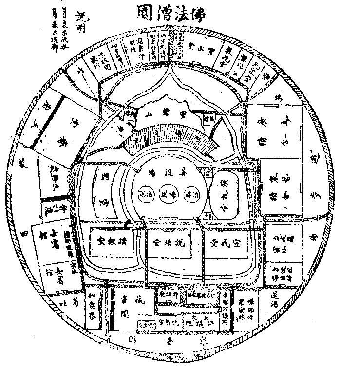
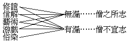
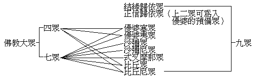
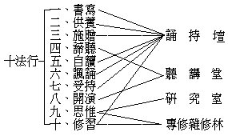

# 太虚大师全书．第九编　制议



> **藏经**：太虚大师全书（太虚大师全书）　**册次** 第 17 册（TX17）　**编号** TX0009　**卷次** 67 卷　**篇幅** 270,937 字

> **卷／品**：0 卷 · 9 品



---



## 目录



  - [僧依品第一](#僧依品第一)

  - [宗依品第二](#宗依品第二)

  - [整理制度品第三](#整理制度品第三)

  - [筹备进行品第四](#筹备进行品第四)

  - [僧依品第一](#僧依品第一-1)

  - [宗依品第二](#宗依品第二-1)

  - [整理制度品第三](#整理制度品第三-1)

  - [筹备进行品第四](#筹备进行品第四-1)

  - [僧教育之目的与程序](#僧教育之目的与程序)



---



整理僧伽制度论



——四年冬在普陀山作——



------



### 僧依品第一



> 一　建立僧数  

> 二　抉择问答  

> 甲　数目决定  

> 乙　信众多寡  

> 丙　内外部别



------



### 宗依品第二



> 一　宗名  

> 甲　八宗正名  

> 乙　两重差别  

> 丙　七门次第  

> 二　宗史  

> 三　宗学  

> 四　问答



------



### 整理制度品第三



> 第一节　教所  

> 一　教所统计数  

> 二　教所建置式  

> 第二节　教团  

> 一　佛教团体大纲图表  

> 甲　佛教团体名类表  

> 乙　佛教团体事义表  

> 二　中国本部住持僧谈  

> 甲　僧伽支配数  

> （一）族类之支配表  

> （二）处所之支配表  

> （三）问答阿兰若类  

> 乙　僧伽组织法  

> 第一项　徒众  

> 第一目　僧外摄化徒众  

> １　仁婴类  

> （一）说明  

> （二）书证格式  

> ２　慈儿类  

> ３　求入僧伽类  

> （一）说明  

> （二）书证格式  

> （三）沙弥品籍释难  

> 第二目　僧内安住徒众  

> １　出类别  

> （一）求沙弥戒类  

> （二）求沙弥尼等戒类  

> （三）求苾刍戒类  

> （四）求苾刍尼戒类  

> 子　正说求尼戒类  

> 丑　问答戒受差别  

> （五）苾刍尼类  

> （六）苾刍正学类  

> （七）苾刍参学类  

> （八）苾刍具学类  

> （九）犯戒补过类  

> （十）反出僧伽类  

> 子　自愿退出者  

> 丑　犯过弃出者  

> 寅　退出僧伽与佛教之关系  

> 卯　退出僧伽后再求入僧伽者  

> ２　譬行位  

> 第二项　职员  

> １　职员产生方法  

> （一）选举任者  

> （二）委请任者  

> ２　处所分配人数  

> （一）每宣教院者  

> （二）每莲社者  

> （三）每行教院者  

> （四）每梵刹者  

> （五）每支提者  

> （六）每仁婴苑者  

> （七）每施医苑者  

> （八）每慈儿苑者  

> （九）每宗寺者  

> （十）每南山宗寺所增出者  

> （十一）每宗本寺所增出者  

> （十二）每持教院者  

> （十三）佛法僧苑者  

> 子　统教诸部  

> 丑　广文精舍  

> 寅　众艺精舍  

> 卯　其他林室  

> 丙　释建立所以  

> 第三节　教籍  

> 一　总籍  

> 二　别籍  

> 甲　戒籍  

> 乙　学籍  

> 丙　座籍  

> 丁　职籍  

> 第四节　教产  

> 一　公有分配法  

> 二　私有之限制  

> 第五节　教规  

> 一　叙纲领  

> 二　示方隅  

> 甲　衣制  

> 乙　斋制  

> 丙　日诵制  

> 丁　布萨制  

> 戊　历制  

> 己　名制



------



### 筹备进行品第四



> 一　次第三期筹备  

> 二　答释政教分离



------



### 僧依品第一



> 皈命十方常住三宝  

> 现现僧伽证明摄受



一　建立僧数



如是我闻：今中国本部之佛教僧伽，有八十万人俱。故兹立论，取为依止。由是当定两所依界：一者、祇限中国本部十八省为地区：所以然者，僧伽制度，亦依方俗土风而异。十八省地，虽亦辽阔，千年一化，大较相同。而满、蒙、藏，虽同国家，虽同佛教；言语文字、风俗宗派，莫不绝殊。且彼所殊，非吾所知，便立言故，势应舍置。又彼僧伽制度，尚无整顿必要，藉欲整顿，必与政治同整顿之，彼以佛教为政治故，故当别论。二者、假定中国本部四百兆为民数：吾国人口无确调查，通语则皆称四万万。考之近史，道光二十八年，称有四万二千六百七十三万。然是概括满、蒙、藏而言者。但满、蒙、藏等处，面积虽倍大於本部，而人口则不过本部十分之一二。故辜校吾国本部之民数，假定为四百兆，相差当不甚悬远也。安此较推，则中国本部有八十万僧伽，每千人中得有二人。假定此八十万僧伽，人人平均於二十岁舍俗——此云舍俗、即是出家。就世间谛言之，出家略有二义：一曰、家者家眷，解除夫妇，脱辞亲戚，绝此系属，谓之出家。二曰、家者库舍，乞食活命，旷野安身，无所居蓄，谓之出家。唯杜多行者足当之，而於僧伽之义犹隐。依毗㮈耶处而住之僧伽，非必行杜多行，其第二义盖不相应。故僧伽可包括杜多、苾刍、沙门、释子诸义；而杜多等，则不必尽能具僧伽之义。今用僧俗为对待名：旧云出家，从负词可代以舍俗；从正词可代以入僧。正负兼举，则曰舍俗入僧。律云舍戒，亦云灭摈，然七种戒非必全舍。世称反俗，可即正词；而其负词当云退僧。正负兼举，则曰退僧反俗。在名称上似较妥帖，此亦正名之一端已——。寿六十岁，则在僧之期当有四十年。从是㭊八十万僧伽为四十分，则每年舍俗入僧者为二万人。合之四百兆之民数，则每年舍俗入僧者，二万人中得有一人。恒保持此八十万僧伽之定数，毋令增减，力求淳善，则既可以住持佛法，化导国民，而又免於过滥过削，得其适中之道。



二　抉择问答



甲　数目决定



问曰：僧数多寡，无关僧制良窳；整顿僧制，第求其良，奚用拘拘於民数、僧数乎？答曰：此亦揆乎时势，察乎国情，审乎利弊，不得不然者也。



一、离国妨：现在时势，凡百事务，均须随国家为轻重。盱衡大地，环观各国，近所谓之国家主义，殆非一二百年间能打消。中国乃各国中之一，自不得不随此世风，务强富而求立；盖非此不足立国也。欲求富强而振国权，则必兴实业、扩军备。而僧伽尚慈忍清净，拟令与此宗旨不畔，必绝对脱离於兵吏、货殖等等营务。故在僧者溢此常额，将有妨富强立国之时势。使在僧而仍服工、商、军、警之务，则又失清净慈忍之宗旨，此僧数所以不可加多也。然今世之国家主义，有与周、秦、战国异者，韩非六反、五蠹之诉，盖未是通论也！政之所行，教之所修，道固相反；政以治国，教以濬俗，事还相成。若娖娖以霸政为齐，黜慈敬真净之教而弗顾：然而无慈惠廉爱，则民为虎狼；无文学礼仪，则士为牛马；军虽强，财虽足，其民不人，其国成兽，亦奚足为贵乎！观嬴秦之不旋踵亡，可以悟矣！故今建国於员舆者，虽尚富尚武哉，而尤重教化文明也。论者谓：舍耶教则无西方文化可言，舍佛教则无东方文化可言。此在中国本部，诚不必然。第佛教行中国本部者，近二千载矣，而中国之儒彦，有谓晋宋以来，即为佛学时代。（见国学振起社讲义）。有谓隋唐以来。所维纲世道人心者，皆以佛教义为本柢。（持此论者，盖多大家）。要之、佛教於中国之本部，千百年中所濡涵者，已於社会风习、民群心德，有甚深之关系；必非餘教能及，可断言也。其教义之淳正高妙，更无论已！况中国人口甚繁庶，就论军制，虽千万常备兵，二千万后备兵，亦不须壮丁过半数当兵，何靳乎僧中四十万壮丁乎。故依中国本部现有僧伽人数，虽不须增，决不可减，迺足导扬国光，蔚蒸民化，此僧数所以不可更寡也



二、避俗讥：昔佛世尊，制僧律仪，强半缘俗讥弹而起。中国本部，旧有九流百家，而汉武时，又先尊一儒教。佛教晚兴者百餘年，故俗儒每有非理讥弹者。唐韩愈作原道曰：『古之为民者四、今之为民者六；古之教者处其一、今之教者处其三；农之家一而食粟之家六，工之家一而用器之家六，贾之家一而资焉之家六，奈之何民不穷且盗也』？释太虚曰：愈之说谬甚矣！使民用无以相易也，则农家、工家、贾家既唯一，虽食粟、用器、资焉之家有四，亦乌乎可？使其功足以相抵而其利足以相准，则虽农家、工家、贾家各唯一，而食粟、用器、资焉之家有十百，可也。四既可矣，六亦何害？此墨、孟所以距斥并耕之说也。且其分儒、释、老之教为三则可，而以其教之三，乃与农、工、贾并列为六民，则纰缪之极矣！盖释、老与儒教虽三，律之四民，则均为士民耳。儒者曰学术士，释老通称道士，其为士也，又何别乎？设以士民所宗所修有不同者，即与农、工、贾对列为若干民类，则古尝有九流。（去农家）以九流对列农、工、贾，不亦成十二民类乎？而兵家、医家等犹在乎九流外，即农、工、贾亦有多种业类不同；依此分裂四民，虽列为百民千民亦有餘，庸仅六民也哉？其言奈之何民不穷且盗，揆之事实，尤不相符。唐代贞观、天宝之间，释教、道教，均甚蔚庶；然而刑措风清，民丰物阜，亦在其时，奚穷盗之有哉？甚矣！愈之虚构为诬词也。然韩愈之说虽虚谬，而庸俗之肆讥，固不必悉合乎正谊。此种陋谈，今岂绝哉？抑势不能一一与之明辨，故智者当善避俗讥。务使皆瞭然於中国本部之僧，每千人中仅有二人。而此千人中之二人，其为益国民者至大；而其享受之衣食住，则又至廉至俭至约。——建塔庙等，即起国民庄敬之用，非关僧住——：虽僧中有百十人之所奉，犹不逮文绣膏粱子弟一人之所费。然后晓焉於穷与盗之故：虽至愚者，亦决不举每千人中之二僧人，与每千人中各居四分之一之农、工、贾对列为五民六民也。此又所以令僧伽有常数，不使多不使寡者也。



中国本部，唐宋来之儒生，信佛固多，而嫉之甚、欲倾灭佛教者，亦往往有。黄宗羲之作明夷待访录，亦列改寺院为学校之说，此皆心习褊狭所致。然佛教之含容博大，茍非相迫相害之甚，其宗佛者决不兴诤。盖佛教之正旨，在乎上契道真，下益民生。对观他教，则虽上失乎真，茍能下不妨害民生，虽有力亦决不过为排斥。故佛教处处经论中，对於五天竺诸异道，独排斥裸形、投河、坠岩、卧灰、及持牛狗戒等，为无惭、为愚痴而已。今若景教，论道真固琐不足称，然亦有律仪、尚慈济，设彼不来迫害佛教，宗佛者必与相提携而不为妨娆也。况儒宗专重乎人伦之事，於超出世间之道真，隐而不谈，本无偏执。其所行者，务求有益民生，即是佛教人天乘法，与佛教戒，水乳相融，何有间隙觝排之端？方今之世，国之士民，其寖能恢其心量而兼容并听，以择善相引乎！尝论儒宗，审其名实，当舍儒名而尊孔圣。盖儒名之涵义，或则过宽，或则过狭。语其过宽，则儒为学术士之称，九能百艺，众学群教，凡百学者，皆得称儒。虽僧中之学者，亦可谓儒，则无宗义可守。语其过狭，则周官保氏以六艺教民者之谓儒，揆之时制，仅师范生充教员者得称儒耳。而一以孔圣为师法，则有宗义可守，而又该罗三科。曷谓三科？教育、文史、政治是也。孔子门弟三千，为教育家易知。取为教育师之学者，则有论语、孝经、及裁取乎孟子、荀子、礼记诸篇。大学、中庸，即礼记也。孔子作春秋而删订五经，即历史之文也。文源国史，史集国文，文之所宗，不离於史。即小说等亦史枝流，诗书之为史无论已，故史为文学天枢也。孔子自况周公，作鲁司寇犹非本志，孟、荀师孔，皆拟天子三公，以宰相总揆国政者自期。在民主国则即总统及国务卿，在君主国则即宰相及国务员。而汉唐来大儒，亦莫不以宰相执国政为行道，斯即政治家之魁也。以此三科，师法孔圣，建立为孔圣会，则全国中坚之人物，必尽属乎孔圣之徒。僧伽本以宗教自居方外，但宣扬其教义，坊进民德，辅益国治；与学孔者相成而不相妨，奚用奋心为嫉忌乎！更推论之，使中国不即灭亡而能岿然於大地，将来国体无论为君主为民主，其政体必采立宪可无疑。立宪则必教育普及，试拟四万万人平均之寿六十四岁，其受教育平均之学龄为八年，则四百兆八分之一，即有五千万是学生。以四十学生需一教师论，已有二百五十万人。但使国民道德教育，必采孔圣学为宗旨，教师必出於师范校，师范生必深明孔学，为教员必入孔圣会，则孔圣会已有此纯粹士君子教二百五十万人矣。然赵普半部论语治天下，在今世诚为欺人语：其农学、工学、商学、军学、法学、医学等专科大学校，固应出乎孔学之外，此犹周官保氏，以六艺教，而九流学则在王官，出乎六艺外也。故孔学为国民道德之普通基本，而非国民才术之特殊技能也。此则各专科大学之教师，势必出之各专门家；然其总教师犹必出之高等师范校生，为孔圣会员深明圣学者。盖才术技能之知识，仍须范於孔学之道德也。而专科大学校之别教师，其可不究孔学不入孔圣会者，全国至多数万人耳。此执教育权为昌明孔学之第一步。其次则在执文史权：若国史馆、国学苑，及专务著书译文、营办印书馆、新闻馆、杂志社等文业，掌朝野之清议。其次则政体既立宪，无论总统制、责任内阁制，其选举势必有政党，其执政首领之负责任者，势必出於政党。孔学既以执国政为行道，则应以孔学而组织政党。法吏、军人不预政党，农、工、商、医虽在政党，势必以孔学之教育家、文史家，政治家、为中坚人物及魁渠首领，亦可无疑。然则必执政治权在孔圣之门也。其农、工、商、医、军、法等事业，诚与孔圣宗旨稍远，真学孔者必不事也。然但须有五百万人真学孔者，行此三事，以师法孔，全国重心势力、已尽在孔门，而无能动摇之矣。五百万人较之四万万人，虽仅八十分之一哉，而有此五百万真孔学徒，既较八十万僧伽六倍有餘矣。设若违己所长，不此之务，嫥嫥以宗教之义争佛教，吾未见为得也。抑此五百万人，亦论其纯粹为孔学者耳。若就国民普通道德教育论之，固四万万人皆出於孔学者也。虽此八十万之僧伽，亦以孔学为基本者，特其增上戒定慧学，则必高出孔学上耳。抑孔学昌明，则佛教必兴，徵之前史，非无成例。其理譬泥多佛大，水涨船高也。故奉佛教者必希望孔学之昌，然修孔学者亦当相资於佛教也。布佛教之戒善，足以化人民辅刑政，其理固灿如者。抑就大儒居士论之，功业既立，名誉既修，退养林泉，游神禅悦，足以悬解忧虑，洒落尘累，娱老怡情，安心乐性，其为益亦非浅鲜也。古君子若王摩诘、柳子厚、白居易、文彦博、苏子瞻、黄鲁直、裴休、宋濂辈，其归心佛法者深矣。辄韩退之作送文畅师序，亦能有慕吾佛之道；特退之性躁而情僻，故终生局脊於忧愁悲伤，而无由自宁放於佛法耳。餘若王安石、欧阳修，晚年亦皆归佛。至程、朱、陆、王诸先生，其所修多出入佛法，益不容掩讳已。此外以禅定般若为见危授命之资者，亦不乏人。故孔学与佛教、宜相嘉尚，不宜相排毁也。此则吾窃有望当世之大居士、大君子者也。因便涉笔，不觉语繁。



三、符产额：按中国本部，今既有八十万僧，则现有之僧产，必能活之者也。减其僧数，则难承守，增其僧数，则需追求；需追求则长己烦扰，难承守则授人觊觎，两皆有害无利，有损无益，此又不宜多不宜寡者也。



乙　信众多寡



问曰：据佛学丛报第一期，濮一乘君所作中华民国之佛教观，谓：汉族男子，则除笃守程朱者，素无宗教知识者，道士及天主、耶稣教徒外，其餘全数信仰佛教；女子亦同，而较男子信仰尤多。谓中国之佛教信徒，多或全国民数十分之八九焉，少亦全国民数十分之六七焉。今八十万僧伽，则但四万万人五百分之一。多寡之数，何大相迳庭乎？答曰：佛门闳博，部类非一。濮君所指信徒有殊，非信教之数有若是之悬绝焉。吾尝略分佛教徒为信仰部、住持部：濮君兼此二部言者，此论则专就住持部而言。盖世尊虽说五乘法，而建设化仪则在声闻乘——大智度论、亦有斯言；今西藏、蒙古间，颇似依菩萨乘化仪而建教者，然猥杂失伦，非清净律仪。汉土所流传尊崇者，其学理虽全属大乘系统，而律仪则从声闻乘。内秘菩萨行，外现声闻相，汉土佛教化仪之特色乎！良由缘觉乘摄在声闻乘——缘觉亦称独觉，独处闲静，不入部众、不拘形仪、不闻经法、无师自悟，故号独觉。此入无佛法世许有，有佛法世则必摄入声闻部众。虽处声闻部众，观十二因缘而悟道，故号缘觉。人乘、天乘，暂以化俗，随世常仪，无别开建——若老、庄等可是天乘，孔教、耶教、是人、天乘。人、天乘即五戒、十善，天乘则是十善、四禅、四定。各加三皈，即是佛教所摄人乘、天乘。欲令佛教所摄人天乘众，亦有系统，略可标记，故立信仰部类。别见余所著佛教正信会说明书。菩萨乘则浩荡无涯：在圣而圣，在凡而凡，在天而天，在人而人，在僧而僧，在俗而俗，在君而君，在民而民，在神而神，在畜而畜；种种色类。同修大乘，普度众生，皆菩萨众。前之四乘，全非全是；遍於人神缁素之中，而无人神缁素可别。菩萨之舍俗入僧者，他方佛土纯一大乘，则依菩萨律仪而住。地上菩萨，持十虚空藏微尘戒；又曰：三贤十圣皆有犯，唯佛一人具足戒。则何善不该乎！又何仪不修乎！若此土既以声闻为化仪，则舍俗之菩萨，亦必依声闻律仪住。曹溪乃肉身大士也，将欲说法度人，则舍俗受三坛净戒。清凉乃华严菩萨也，既经领徒范众，则对僧发十重大誓，皆斯意已。在俗菩萨。既摄在人、天乘，则形仪随俗而不能住持像教。入僧菩萨则摄在声闻。声闻乘众，以波罗提木叉为师。依毘㮈耶处住。（涅槃、遗教二经，言之最为谆切）。律仪清净，人天钦敬，独能住持佛法，故得住持僧名。古德尝依义立三种三宝：一曰、同体，此乃即心自性功德。二曰、别相，此指果圣、因贤教证。三曰、住持，佛、即金铜土木塔像，法、即三藏九部经典，僧、即舍俗而受持苾刍、苾刍尼戒律部众。住持僧宝端肃严整，则住持佛宝有威灵，住持僧宝禅讲精进，则住持法宝得宏通。如是则信仰佛教者兴盛，反是则信仰佛教者衰灭。故住持三宝，全系乎住持僧宝而已。此持苾刍、苾刍尼律仪众，一方面对同体、别相三宝，及住持之佛宝、法宝，以为信徒。一方面则对信仰部而为被信仰之僧宝，故与信仰部大殊也。——何以得为僧宝？谓具僧相、僧德。舍俗依僧，缁衣圆顶，具受沙弥、苾刍、菩萨三坛大戒；守波罗提木叉，依毗㮈耶处住，三聚无犯，六和无诤；此僧相也。修证定慧，学通经论，行解相应，宏扬佛法，人天钦悦，堪受供养，此僧德也。欲令住持僧宝清净，势不能不择善根具足者而度；其数故难多得，且亦无需乎多。果有八十万真净僧，每人平均系五百人信仰，已足化导四万万人全数皆信仰矣。若论信仰徒乎，笃守程朱者亦多能信佛，道士亦多信佛，耶稣天主教徒亦多信佛；濮君所谓十有八九，可为定数。



丙　内外部别



问曰：昔欧洲景教徒，尝分内侣外侣，内侣深喻浃知，得闻天道；外侣信内侣喻且知，受道而笃守之。彼之分内外侣，不与今分佛教徒为住持部、信仰部，适相类乎？然穆勒约翰尝讥曰：景教内外侣之鸿沟，仅名存耳。盖近世人民，德慧术智皆进化，已无从区别矣。然则住持部、信仰部之分，亦可省已？答曰：此有多义，请略陈之：



一者、彼欧洲虽有旧教、新教、公教、修教等，此第景教宗派之别，犹佛教有禅宗、律宗，孔门有汉儒、宋儒耳。其创教之主，固同一耶稣也，所皈依之神，固同一天帝也，而奉诵之经，亦同一约书也。民无异信，教无异道。且彼欧自中古以还，传承於希腊、罗马之文化，亦莫不掌之於景教。政治出乎是，学术藏乎是，不唯全洲除景教绝对无宗教，抑亦全洲除景教绝对无文化。盖一道同风之极矣，纵有德慧术智之士，自然须出景教，无论贵贱、贫富、男女、长幼之民，自然必信景教。岂景教能出德慧术智之士哉，势不得不出乎是也。岂景教能信一切人民哉，势不得不信乎是也。士民对景教既有此不得不然之势，此势即足住持其教仪而坚固其信仰，初无需乎内侣；故彼不必分内外侣也。譬若今中国人信景教者，亦信彼欧国强势耳，对其教义固未尝厝心也。由此观之，则蒙、藏、缅甸、暹罗等处佛教徒，方可无住持部、信仰部之分耳。然有餘义，故犹未可。若中国本部乎，佛教未至千年前，既有文化矣——印度亦然，佛教未兴千年前，已有婆罗门教、掌五天文化矣——；较佛教东来早百餘年，既有儒教道教矣——儒教成於汉武帝，道教成於张道陵——；其本有之文化，既钤辖於儒教中矣；非有坚苦卓绝优秀闳敏之少数人，服佛服、行佛行、心佛心、言佛言，又奚能宏教信人，忘身卫道乎？此不必讳者也。昔周武帝忌缁衣作天子之谶——后隋文帝代兴，卒出於尼寺沙弥也，忌之曾何益哉——，虽初信佛，常阅佛经，欲灭教仪。出诏废儒、释、道三教，曰：虚空真佛，无假经像——诏下有慧远法师当廷抗辩曰：『耳目生灵，赖经闻佛，依像知真，若不藉经教咸能自知者，三皇以前，未有文字，人应自知五常等法，当时何为但识其母，不识其父，同於禽兽？汉明以前，佛教僧徒经像未至，此土含生，何故不知虚空真佛』？帝皆不能答也——；儒史政术，存佐王治。僧徒道士，皆返俗仪，有德能者，共辅朝政。建通道馆以选拔僧道中硕学时彦以处之，只许寻讨讲习其义理，不得建塔、造像、传戒。於是尽改作一切僧寺为衙署。彼时一二年中，佛教几全同消灭也；然儒学则略无损动。以彼时除儒术，则治国化民之政学，无所凭也。今中国本部之佛教，积化久远，流风广被，较彼时固逈不相侔。然纯粹之学佛法者，高蹈方外，不干国政，始未昔异；欲存教仪，其乌可无住持僧乎！



二者、耶教内侣、外侣之分，在内侣得学习异说，以建立自宗而解破客难；外侣则但许读教义纯一之经，斯即彼内外侣之鸿沟也。今书报之用如水火，学术既无国界，人民又皆识字，则何能禁其不读异说乎？宜穆勒讥彼内外侣仅名存也。佛教徒分住持部、信仰部，本不同彼，且适相反：住持部在初学时期，颇宜禁读俗书，使其专心一虑，研几经律，修习禅定。若信仰部则泛及一切异宗、异教等学者，凡有信心，普遍该摄。既皆得治异学，亦莫不可遍读三藏。设修十善。则於语业，诫之勿妄语、勿绮语而已。故景教内外侣之鸿沟破；与佛教徒住持、信仰之殊部无涉也。



三者、景教系人天教，教徒之行，本非离俗，自不必与俗有殊部。而佛教徒则不独为住持化仪，当守远离俗染之别解脱戒律；即修禅定，亦必诃五欲、弃五盖，外息诸缘、内心无喘，泯绝意志，方能相应。非舍俗为僧者，不足证法身、延慧命，非信僧居俗者，不能资道业、利民生，僧俗乌得不别居乎？



四者、景教系一神教，其有裨於世之功行，虽近佛教人乘戒善，亦殊未备。此外则除专皈依一天帝求生天外，了无别义。稍涉微奥，辄曰是全能上帝之所知。夫然，则虽极愚亦所易解，即解此者，亦有何德足令人信仰乎？故彼决无内侣存立地也。而佛教何如哉？三藏浩浩，义类无边，极高明，尽精微，深固幽远，无能测量！然莫不显露透彻著为说；集世间所有诸宗教哲学，曾不足为比对。非专志凝念研究之，不能庶几通悟，固矣！且佛性皆本具，而法身非心外，但须定慧功深，必得菩提亲证，一生即可成佛，肉身便是应真。为善知识，皆能觉悟有情；凡供养者，罔不福利无量、此咸非舍俗在僧不成办者也。



后之二义，章氏丛书之建立宗教论，言之颇详。今请引之。其文曰：



或举赫尔图门之说，以为宗教不可专任僧徒，当普及白衣而后可。若是则有宗教者，亦等於无宗教。自我观之，居士、沙门，二者不可废一。宗教虽超举物外，而必期於利益众生！若夫宰官、吏人之属，为民兴利，使无失职，此沙门所不能为者。乃至医匠、陶冶，杂技、百肆，利用厚生，皆非沙门所能从事。纵令勤学五明，岂若专门之善？於此则不能无赖於居士。又况宗教盛衰，亦成因缘国事。彼印度以无政治故而为回族所侵，其宗教亦不自保，则护法之必赖居士明矣。虽然，居士者果足以为典型师表耶？既有室家，亦甘肉食，未有卓厉清遐之行，足以示人；至高不过陈仲、管宁，至仁不过大禹、墨翟，猥鄙污辱之事，犹不尽无，其於行节固未备也。以彼其人，而说无生之达摩，持二空之法印；言不顾行，谁其信之？夫以洛闽儒言，至为浅薄，而营生厚养之士，昌言理学，犹且为人鄙笑，况复高於此者！宗教之用：上契无生，下教十善。其所以驯化生民者，特其绪餘，所谓尘垢糠粃陶铸尧舜而已。然非有至高者在，则餘绪亦无由流出。今之世非周、秦、汉、魏之世也。彼时纯朴未分，则虽以孔、老常言，亦足化民成俗。今则不然，六道轮回地狱变相之说（安此犹天教之共义，未是佛教之不共义），犹不足以取济。非说无生，则不能去畏死心；非破我所，则不能去拜金心；非谈平等，则不能去奴隶心；非示众生皆佛，则不能去退屈心；非举三轮清净，则不能去德色心。而此数者，非随俗雅化之居士所能实践，则䀨䀨者亦无所益。此沙门、居士所以不得不分职业也。借观科学诸家，凡理想最高者，多不应用，而应用者率在其次之人，何独於宗教而不然耶？尝试论之：世间道德，率自宗教引生。彼宗教之卑者，其初虽有僧侣祭司，久则延及平民，而僧侣祭司亦自废绝。（若左传所载祀神事，皆有专业司祝祭者，今则祀天祀城隍等，官民自为）。则道德普及之世，即宗教销镕之世也。於此有学者出，存其德音，去其神话，而以高尚之理想，经纬之以成学说。若中国之孔、老，希腊之梭格拉底、伯拉图辈，皆以哲学而为宗教之代起者。梭氏、伯氏之学，缘生基督；孔子、老子之学，迁为汉儒，则哲学复成宗教。至於今，斯二教者亦骎骎普及於国民矣。一自培庚、笛加尔辈，一自程、朱、陆、王诸儒，又复变易旧章，自成哲学。程、朱、陆、王，固以禅宗为其根本；而挽近独逸诸师，亦於内典有所摭拾；则世界继兴之宗教，必释教无疑也。他时释迦正教，普及平民，非今世所能臆测。然其无上希有之义，必非常人所喻；离欲超世之行，必非恒俗能践；则沙门与居士，犹不得不各自分途。赫氏所言，但及人天小教；此固可以家说户知者，然非所论於大乘。后之作者，无纳沧海於牛蹄可也。



释太虚曰：观章居士斯论，可知佛教徒於住持部、信仰部不得不分。亦可知住持部僧伽，不宜甚多甚寡。务求内充高行，外足导俗，以适其中道矣。故吾今拟议整顿中国本部之僧伽制度，还取现有八十万僧伽数，为根本依止也。



------



### 宗依品第二



有僧伽矣，僧何所宗？概言之、则宗佛法而已矣。然而汰矣！世有流变，方有殊尚，岂徒教仪，亦该学理。今上不徵五天，下不徵各地，亦还取中国本部二千年来所流通阐扬者为依止耳。然南阎浮提洲之大乘佛法，莫备於震旦矣，而小乘则附焉而已。顾震旦之佛法，又隋、唐为全盛，六朝以往，发端而微；五代以降，残废而偏。欲复震旦佛法大全而扩充之，则又当取隋、唐诸宗师学为依止也。今大别为八宗而分条覶述之，在此，则可附益而不可移植；在餘，则可含摄而不可别树。故务使八十万僧伽，皆不出於八宗之外，常不毗於八宗之一。始从八最初方便学，门门入道，终成一圆融无碍行，头头是佛。如八楞宝，唯一金刚，则震旦佛教之特色，亦震旦僧学之异彩已。



一　宗名



甲　八宗正名



一、清凉宗，古称华严宗、贤首宗。然此宗当以华严疏钞为根本部，而此部实成於清凉大师，故不称贤首宗；犹天台传自北齐、南岳、以三大部成於天台，不称北齐、南岳宗也。又以法由人宏，当尊祖庭。且解华严者有旁家，而此宗所属经论又不仅华严，故不称华严宗，而以清凉为定名焉。



二、天台宗，或称法华宗。此宗固以法华为根本经，然所属之经论甚多，解法华者亦有旁家。且兼尊崇祖庭，故不称法华宗，而以天台为定名焉。



三、嘉祥宗，古称三论宗、或法性宗、或破相宗、或空宗。揆之名实，皆未允当，盖祇少分相似义耳。何则？此宗根本部中，决不可去大智度论，则已成四论宗。且实该罗般若诸经，宁可独以论名？且灵峰大师尝言曰：唯识以遍破我法二执为宗趣，故借立法为遣情之门，般若以会一切法无非妙理为宗趣，故借破执为立理之门。然则唯识宜名破相，般若宜名立法，而相传反称唯识为相宗，般若为空宗者，谬也。故今云皆未允当也。然此宗逮嘉祥大师而学盛义完，用之名宗，且以尊祖。若推尊罗什法师为开祖，则什师终身译讲於逍遥园，即今秦中白塔寺也，则宜名白塔宗。



四、慈恩宗，或称唯识宗、法相宗。定於今名，理由大致同上。



五、庐山宗，古称净土宗、或莲宗。净土或莲二义，一则过宽：出世皆净土，十方多净土；华藏娑婆，无不在一大莲花中。一则过狭：阿弥陀佛极乐世界，所清净者非祇依土，所殊胜者非祇莲台。今以此宗古今公认之初祖为定名，祖庭斯尊，行义亦备，卓然无以易也。



六、开元宗，古称真言宗、或密宗。法义虽当，未能尊祖。然善无畏居内道场，金刚智与不空居慈恩寺。内道场为名不雅驯，慈恩寺则滥慈恩宗。且此三祖宜并尊之，而世称开元三大士，则皆共知，故定今名。



七、少室宗，古称禅宗。义亦少滥。今以初祖祖庭名之，庶几循名思实，皆知法祖之行，而尊祖之道乎！若依清凉、天台之例，则可定名为曹溪宗。



八、南山宗，或称律宗，法义亦当。然六朝初唐间，以律学成宗者，本非一家；而盛唐来，则莫不宗南山。宋灵芝照律师固亦宗南山者，虽稍有别，犹天台之有山外派，少室之有五派，固不出天台、少室也。故以南山为定名焉。



乙　两重差别



此八宗中，须知有两重别。一者、祖有华、梵之二别：开元、少室二宗，其祖梵师；餘皆华师，二宗所以必梵祖者，以此二宗师承最严故也。真言仪轨，须受灌顶，故不得不严於师承。此宗今虽当转承之日本，彼亦尊开元三大士为祖。向上宗乘，教外别传，以心印心，不立文字，故亦不得不严师承。夫少室宗以光显其道於世者论之，虽亦可名为曹溪宗；而卒不得名为曹溪宗者，以非达磨真传嫡嗣，曹溪固不能所凭而起。若凭经论，则成教家，曹溪门人谓永嘉曰：公虽自悟，若不得师，威音王前则可，威音王后则天然外道也。故此宗源流，必由梵祖上溯於释尊，犹之非无佛世、不容有独觉也。况曹溪时已有南宗北宗之诤，其后则更有五派七支之纷扰；不返之乎鼻祖，将何以杜其弄门庭建设之光影，而坦然显直指别传之真风乎？若开元宗兴盛一时，震旦除开元三大士，更无鼻祖，不待论已。餘六宗则皆可取经律论以为凭证，故不必亲承。而得遥接孤起也。



二者、名有山、寺、年之三别，今表示如下：



　　　　　　　　　　　┌清凉……┐  

　　　　　　┌以山名者┤天台……├…四宗  

　　　　八宗│　　　　│庐山……│  

　　　　　　│　　　　└南山……┘  

　　　　　　│　　　　┌嘉祥……┐  

　　　　　　│以寺名者┤慈恩……├…三宗  

　　　　　　│　　　　└少室……┘  

　　　　　　└以年名者…开元…………一宗



今此八宗立名，皆以尊祖庭为唯一宗旨，以山、以寺名者皆宜。独开元是唐玄宗之年号，揆之尊祖庭之宗旨，殊未谛当，而又苦无他名可代。然今各地往往有开元寺，西京虑亦有之，则以西京开元寺为开元宗之祖庭可耳。



丙　七门次第



问曰：详八宗次第之排列，固绝不依创始年代先后立者，而为此次第之排列，其无义乎？抑有义乎？答曰：亦有义亦无义。云何无义？既分八宗而陈其名於书，无论列谁前列谁后，其次序皆必不可避。由必不可避而成序，则虽有次第与未尝有次第同，夫何意义可言？然亦尝於必不可避之次第中，求其为稍有意义之排列，其义门分有七对焉。今请先表示而后附释之：



　　　　　　　　　　　　　　　　　　　　　　　　　┌始…清凉宗  

　　　　　　　　　　　　　　　　　　　　　　┌智…└终…天台宗  

　　　　　　　　　　　　　　　　　　　┌性…└慧…嘉祥宗  

　　　　　　　　　　　　　　　　┌法…└相…慈恩宗  

　　　　　　　　　　　　　┌显…└信…庐山宗  

　　　　　　　　　　┌教…└密…开元宗  

　　　　　　　┌道…└证…少室宗  

　　　　八宗…┤  

　　　　　　　└基…南山宗



由竖观之：可见顺序之、则前南山而后清凉，逆序之、则前清凉而后南山。由横观之：可见顺序之、则清凉而后南山，逆序之、则前南山而后清凉。盖逆顺皆次第，横竖无不通也。初分道基一对：戒、为佛道之基，就三学论，亦为定慧之基。且今所论八宗，皆以僧为能宗之人，而僧俗所由别之基，亦在戒律。不受出家众戒，是俗非僧。今论专言僧伽制度，非僧则非今论所及；南山宗则专以出家众戒为本者也。况七众戒及菩萨戒，其学概归此宗。一切修佛道者，其基础不出七众戒及菩萨戒；若五戒不守一，且不得具人格，遑能修佛道乎！故以基义独配南山。所基之道，则即餘之七宗。由道、次分教证一对：华严疏钞依亲光菩萨十地论释十地品，列十对门，明可说不可说分齐；教证即第四对，谓阿含——（译音净教）——可说，证智不可说。四卷楞伽明宗通、说通，宗通离言，说通施教，此即后世宗门、教家之分所本。然十卷、七卷楞伽，皆译宗通为自证圣智，故宗通即证智别名，皆有离言不可说义；以不可说为说，所谓无门为法门也。少室宗以世尊拈花，初祖传法之时，寥寥数语以为根本宗旨。一曰教外别传，一曰不立文字——须知一念才兴，早落显境名言，即属阿含、即属文字——，盖全超阿含，直显证智也。畔此根本宗旨，虽曰无宗门可。寂音作智证传，亦明斯意。或者以其名禅宗，而属之六度中禅那度，非是。故以证义独配少林，餘六宗则皆言教摄。由言教门、次分显密一对：独配开元宗为密教易知，餘五宗则皆显教摄。由显教门、次分法信一对：大小乘论皆说有二种行：一、随法行，二、随信行。随法行者，谓由了解法义而起行也。随信行者，谓由谛信师教而起行也。此二行人，非关利钝、以各有利钝故。随法行者，以利根故，善能分别一切法义；以钝根故，心多疑惑，必须究穷一切法义，乃能断疑生信起行。随信行者，以利根故，一闻即信，把得便行；以钝根故，无由自知一切法义，但能仰信师教，依之精恳修行。念佛法门，普摄诸根，尤以持名念佛为最要妙。但坚信心，发愿专念，七日一心不乱，临终决生极乐，既见弥陀，何愁不悟。能宗通说通者固佳，即不悟解者亦无害，然非信之极坚，则虽往生亦堕疑城。夫信为道元功德母，固诸宗之所同，而此宗为尤要，故以信行独配庐山。餘四宗则必大开圆解，而后能相应起圆观行，故属随法行摄。由法行教、次分性相一对：性相通则互易——如曰实相，曰异生性，则相为性，而性为相——，局则性教融摄圆通，浑然无所间隔；相教分别深细，秩然不容假借。慈恩宗以楷定明了故为无诤，不同餘宗以变动不居为无诤。虽遣情之门哉，而遣情之门贵在此！故以相教独配慈恩，餘三宗则皆性教摄。由性教门、次分智慧一对：智慧通则一义；局则智约十波罗蜜善分别后得智，慧约六波罗蜜无分别根本慧。大智度论曰：别则般若为因，至佛心则变名一切种智。通而为论，俱通因果。般若多就即善分别之无分别慧说，故以慧门独配嘉祥。华严显毗卢遮那智——即一切种种种光明遍照义——，法华入佛知见，皆重在即无分别之善分别智，故智门摄。由智度门、次分始终一对：华严根本法轮为始，犹娑竭罗龙王於大海中，一念遍兴四天下云雨；法华会归佛乘为终，犹四天下江河沟渎，皆朝宗乎大海。二经固一佛化仪之始终也，而清凉、天台实宗之，故以配也。况天台又兼摄涅槃者哉？然此七对义门分别，亦据八宗少分偏显之相以为言耳。剋体论之，全基是道，全道即基；乃至全始贯终，全终彻始，无不一具一切，一切摄一者也。然有一言不得不正告者：此之八宗，皆实非权，皆圆非偏，皆妙非麤；皆究竟菩提故，皆同一佛乘故。清凉配法华为终教而非圆教，天台配华严为兼别而非纯圆，此乃独标自宗殊胜，非此无以死学者偷心耳，亦犹大哉乾元，至哉坤元之谈。然师家须善於应用，无一物是药，无一物不是药者，此可深长思焉！



二　宗史



一、南山宗，震旦律学，始昙摩迦三藏之传戒。继是翻译而疏述者，唐代之前，垂数十家，而惠光、法砺、智首三师之疏为最著。唐终南山道南宣律师，始唱心宗戒体，作五大部发明其义。集成之功，远迈西土，遂为此宗祖焉。同时有怀素律师及宗法砺律师学者，崇峙一时。稍后有义净三藏，复译出根本说一切有部律甚多。然或湮没大藏，或沦散殊邦，后代鲜宏通者。独南山所宏四分律，迄今不替。盖由南山历传至宋，得允堪律师会正记，及灵芝律师资持记，用法华、涅槃开显之圆意，光大斯宗，故得绵延不衰。今虽法门猥杂，大义泯棼，其故辙犹未尽隳也。



二、少室宗：昔世尊在灵山会上，拈花示众，独大迦叶破颜微笑。乃曰：吾有正法眼藏，付嘱於汝。十二传为马鸣，十四传为龙猛。二十八传则为菩提达磨，始将传法衣钵，东来震旦，面壁少室，是为震旦初祖。五传至曹溪，其道始显於世。盖梵土诸祖仅密付单传而已。马鸣、龙猛，广造大乘经论，未尝专扬灵山拈花之旨，故此宗梵土不光显。至曹溪、悟者始如过江名士矣。由曹溪出青原南岳二支，青原下出曹洞一派，由南岳下复出沩仰、临济、云门、法眼四派，是为五家宗派。后由临济，复出杨岐、黄龙二派。今云门、法眼、沩仰，久成坠绪；曹洞亦不绝如线。憧憧遍震旦者，录临济源流曰几十几世而已。然犹幸有此临济源流也，不然，宋明迄今，不知裂成几百几千派矣！故晚明诸师，殷殷辨源流纲宗已。虽然、末矣！与初祖东来之旨益荒矣。今既不足复分五派，则宜溯源少室，曰传少室正宗几十几世为当。



三、开元宗：唐朝开元四年，善无畏三藏、始将梵䇲至长安，译出密部经论。一行大师尽得其传。同时、金刚智三藏率弟子不空三藏，亦来东土。案密部由龙猛菩萨开南天竺铁塔，礼金刚萨埵，受灌顶仪轨，其法遂行於世。龙猛即以之传龙智，而金刚智则亲承於龙智者也。善无畏亦传自龙智，而与金刚智、不空、同称开元三大士。当时君相礼敬如佛，此宗遂如日月经天，江河行地。顾未几即湮没。故志磐法师作佛祖统记，已谓唐未乱离，经疏销毁。今其法盛行於日本。而吾国所谓瑜伽者，但存法事，盖宋时已成市井歌呗矣。元、明、清朝，其法行於宫掖，然亦承於蒙藏喇嘛，非复开元之旧。唯日本犹存其全法，受而归之，则此宗可复也。



四、庐山宗：东晋庐山慧远大师，与居士刘遗民等百餘人，宗依经论，修专念弥陀、求生极乐之法门，首创莲社。远公既负天下重望——远公不徒邃精佛法、为梵僧叹为震旦大菩萨，且尤善庄、善易、善诗、善礼，各有儒生传其专学——，其证验又昭然人目，尊为此宗初祖，千古翕然。历代宏扬，曾不稍替。唐初善导大师，以专持阿弥陀佛名号倡，迄今妇孺莫不知称阿弥陀佛。禅、教、律师及诸居士，尤多提撕，盖无不崇奉也。故此宗无法派流传，然莫不尊庐山至云栖为八祖云。



五、慈恩宗：玄奘三藏西访五天，学於戒贤大师。囊括梵土大小乘法，东还译讲。悉举弥勒、无著、天亲之学，以传弟子窥基，是为慈恩法师，作疏百本，大畅其义。因成唯识一论，作述记及枢要二部，以汇其流。慈恩弟子惠沼，又依述记著了义灯。惠沼弟子智周，亦依之作演秘。三师亲承，其教义灿若日月矣。然更武宗之难，五代之乱，至宋已式微矣。元时又尽失其疏记，六百年来，讲筵仅略识其梗概。今幸由日本次第取还其典籍，可期恢复。虽然，明、清来称教下三家，固未尝全绝其学也。



六、嘉祥宗：鸠摩罗什大士，为龙猛菩萨四传之弟子，提婆菩萨之曾孙也。传法东来，专宏龙猛、提婆之般若宗，是为此宗远祖。门下生、肇、融、叡、影、观、恒、济八哲，咸受大义。济传道朗，朗传道诠，诠传法朗，朗传吉藏，即是嘉祥大师。大师盛弘之於隋朝，制作繁多，难以具举。盖此宗至嘉祥门学始严，卓然不可逾也。入唐讲学愈盛，惠远、智拔、惠喻、法敏诸德，相继辈出。破显妙宗，光被四海。惜乎五季之后，教典荡然，宋、元来至无人能举其名！今幸得日本为反哺，学者乃皆知此宗为震旦佛法硕果，而研钻者日多。



七、天台宗：北齐惠文大师读中论偈，悟三观理，以授慧思大师。师居南岳，大弘禅法。智𫖮大师往谒，喜曰：『昔日灵山同听法华，夙缘所追，今复来矣』！乃授三观禅法。后诵法华至药王品，证入法华三昧，彻见灵山一会，俨然未散。思印之曰：『非尔莫证，非吾莫识，此法华三昧之前方便也』。自是智解泉涌，学徒影从。栖天台山，终身弘法。始立五时、八教，网罗全藏，宗极法华，道观双流，戒定兼阐，其义指莫高也！故为此宗高祖。弟子章安笔记其说，成为一宗典籍，比之阿难结集。再传法华、天宫、左溪三师，其道稍隐。溪传荆谿湛然大师，起而振之，号为烈祖。五代丧乱，教典亦失。宋代渐由高丽、日本求归。荆溪八传弟子四明知礼大师，又重兴之。与四明同时有孤山法师，立义稍异，遂裂为山外派，不久消息。独四明之山内一派，广智、南屏，相继流衍；明代亦多哲人。今南北讲筵盛弘者，胥在此宗。然第歠其流而不探其源，禅观固不相应，教义亦多汗漫！



八、清凉宗：晋佛陀跋陀罗三藏，始译出华严六十卷。虽经敷讲，未极玄致。杜顺和尚、谥号帝心尊者，始括奥旨作法界观，是为此宗远祖。顺授智俨大师，明六相义，作搜玄记。俨授贤首国师，造探玄记及六十华严疏，发挥尽致。盖此宗之三祖也。惜其说为弟子惠苑所乱，嗣又纷失莫传。时有实叉难陀，又译华严成八十卷，号曰新经。清凉澄观国师，遥承前三祖之遗意，笼罩诸宗，汇归真界，撰成新经大疏，足为千古极唱，故宗祖宜在乎此也。且历代流通者，皆八十卷之华严经。纵贤首之旧疏复出，不足以易之矣。惜后代少能承其法流之全者！观传圭峰宗密大师，著述亦富。会昌之厄，遗风扫地，至宋长水子濬大师，始稍稍搜辑以起其坠绪，然亦不复能光大矣。明代别峰、麓亭诸公，亦讲其学。今虽流传，精者良少。然杨仁山居士从日本、高勾丽，收回此宗佚书颇多，教典则宏备矣，兴起之、则尝有需乎豪杰士！



三　宗学



一、清凉宗：当以华严悬谭、华严疏钞为根本部，合经共二百六十卷；其次则法界观、五教止观、十玄章、六相章、一乘法界分齐章、起信论义记、圆觉广疏，略疏等；而以唐朝前讲地论诸家著述、及华严合论附之。



二、天台宗：当以法华玄意、法华文句、摩诃止观为根本部；其次则大乘止观、禅波罗蜜门、（禅波罗蜜一书，备论世出世间诸禅，小止观、六妙门，亦摄在此，学者不必另习。但传授诸居士，则当别行。）维摩经玄义及略疏、金光明经玄义及疏、章安涅槃经疏、荆溪释签、辅行，以至四明诸部著作，灵峰之教观纲宗等；而以大智度论、中论等附之。



三、嘉祥宗：当以大智度论、及嘉祥之中、百、十二门三论疏为根本部，大智度论即释大品般若者；其次则诸部般若、及广百论释、掌珍论、肇论等，而以讲成实论诸家著述、附之。



四、慈恩宗：当以解深密经、佛地经、成唯识论述记、及枢要、了义镫、演秘为根本部；其次则五大论、十支论、及摄大乘论、因明入正理论等；而以讲俱舍论诸家著述、附之。



五、庐山宗：当以无量寿经、观无量寿佛经、弥陀经、及往生论、妙宗钞、弥陀疏钞为根本部；其次则采集鼓音王经、宝积经、华严经、法华经等称赞西方文品；而择古今属於此宗诸家要著、附之。



六、开元宗：当以大毗卢遮那成佛神变加持经疏、及大日经、金刚顶经、苏悉地经为根本部；其次则诸仪轨；而一切秘密陀罗尼部、皆附之。



七、少室宗：此宗不立文字，而显密教一切文字，历祖语录及世间之文书，皆其文字，超诸名相，唯悟为则！



八、南山宗：当以道宣律师四分律戒疏、业疏、灵芝律师资持记、灵峰律师梵网疏为根本部；其次则古三要疏、及会正记等，而大小乘、人天乘诸部律学、皆附之。



今此论於宗学，仅陈梗概。除少室宗，各专宗当编成学程次第，要以从总入别、从浅入深、从局入通则。而少室宗当集成少室宗大全一书，略如五灯会元而扩充之，总收诸祖语录兼其行事叙之；一宗之历史及著述，无使或遗，以建纲宗而成典范，此出禅堂后之事也。餘之七宗，当各编自宗历史一，自宗集要一，自宗法数一，自宗翻译名义一，自宗三藏目录一，又自宗辞典一，以备学者参考。即根本部中所引用为注疏之经论俗典，亦当备之讲堂，俾学者语语皆知其出处。与自宗无关系者，一切屏绝，令学者专志也。



四　问答



问曰：既取法隋唐诸宗为依止，则相传有十三宗矣，何为仅列八宗？



答曰：十三宗者，此八宗外别加涅槃、地论、摄论、成实、俱舍五宗是也。然地论乃天亲释华严十地品者，今清凉所著华严疏已全会取其文，更何须别立地论宗？且初唐来华严盛行，久无专讲地论者矣。天台判教，法华涅槃同时，一家立说，引取最多；自有天台宗来，即无专涅槃者。且今所存涅槃经疏，亦唯章安一家，固不得於天台宗外别立涅槃宗矣。摄论乃慈恩宗本论之一，自有慈恩宗来，亦无专讲摄论为宗者矣。成实、俱舍，则小乘论，震旦僧俗，羞谈小乘。则此二论，固势不容专立宗者，其消歇於唐代宜矣。然俱舍论、实与慈恩宗相表里，而成实论，亦与嘉祥宗相通贯；故成实附於嘉祥宗，俱舍附於慈恩宗也。然则虽八宗而已具十三宗矣。



问曰：分河饮水，佛祖所戒，真源一本，何须张为八宗，启乖诤乎？



答曰：初学贵在一门深造，乃能精义入神，久修自知殊涂同归，宁虑局道相斫？所谓方便有多门，归源无二路者也。数百年来，学者病在汗漫，唯汗漫乃适成纷拏。佛法深广，人智浅狭，取舍莫定，茫昧无归。以故学不精察，心不明了；不精滞迹，不明封情，滞迹封情，暗生疑诤，此正好为颟顸儱侗之调和所致也。今者欲袪斯病，则端在分宗专究耳。



问曰：古者尝分禅、讲、教三，或又禅、教、律三，以各修戒、定、慧三学之一；或又列之为禅、教、律、净、密，则亦五种法门而已，何取乎又裂教为三，成八宗乎？



答曰：戒、定、慧乃一贯之道，八宗有一能偏废戒、定、慧学乎？无不以净佛国土为本修行，万善同归；无不以密严果海为因地心，三业相应；八宗孰非净与密乎？唯八宗莫不具三增上学，二遍行门，此所以各各澈法源底，各各究竟菩提也。若以三学、五门区别，则真分河而饮水矣。



问曰：尝见有论十三宗者，南山仅属小乘，嘉祥、慈恩亦是权教，今乃并崇而无所高下乎？



答曰：此盖秘相之谈，未是通方之说。『有名同而实异者：如佛言道，谓三种菩提；老言道，谓虚无自然；儒言道，谓五常五伦，未可同语也。有名异实同者：如台宗谓之一心三观，贤宗谓之一真法界，相宗谓之胜义唯识，禅宗谓之向上一著，未始少异也。譬一帝都，曰北京，曰燕都，曰顺天。有盛谈北京、鄙燕都为陋劣，或谭帝都、鄙顺天为陋劣，吾知其必被嗤也。彼性相分河、南北竖党者，何以异此』？乃晚明灵峰大师之言也。吾今请广之曰：南山宗曰圆宗戒体，嘉祥宗曰八不中道，开元宗曰本不生菩提心，庐山宗曰是心是佛、是心作佛，则亦一而已矣。小乎？大乎？权乎？实乎？偏乎？圆乎？幸勿为承虚接响之言哉！



------



### 整理制度品第三



第一节　教所



一　教所统计数



先定教所之统计数，按今中国旧部——指十八省——政制，分为四级：一、县，二、道，三、省，四、国。试假定四乡为一县，十六县为一道，四道为一省，而中国本部有十八省，则已有定数也。今即依之支配教所：



一者、县区列表如下：



　　　　┌───┬──┬──┬────────────────────────┐  

　　　　│名　称│地点│数目│　说　　　　　　　　　　　　　　　　　　　明　　│  

　　　　├───┼──┼──┼────────────────────────┤  

　　　　│行教院│城中│一　│云行教院，示别持教院也。譬在上海则曰上海行教院，│  

　　　　│　　　│　　│　　│此为佛教团体一县机关。　　　　　　　　　　　　　│  

　　　　├───┼──┼──┼────────────────────────┤  

　　　　│法　苑│城厢│一　│法苑专修经忏法事，每县置一在人民聚居处。或因旧寺│  

　　　　│　　　│　　│　　│之便，每县置二。再多则法仪难周，更有多种不便。　│  

　　　　├───┼──┼──┼────────────────────────┤  

　　　　│尼　寺│城厢│一　│尼寺专住苾刍尼众，尼众不宜分散居住，及宜在城厢住│  

　　　　│　　　│　　│　　│，毘奈耶杂事处亦尝言之，盖以免暴客之扰也。　　　│  

　　　　├───┼──┼──┼────────────────────────┤  

　　　　│莲　社│城厢│一　│莲社乃通摄一县善士信女，共修念佛三昧之所，故亦宜│  

　　　　│　　　│　　│　　│设在人民聚集之一处。　　　　　　　　　　　　　　│  

　　　　├───┼──┼──┼────────────────────────┤  

　　　　│宣教院│四乡│四　│此乃宣讲於乡镇者，宜在每县四乡大市镇上。各置一所│  

　　　　│　　　│　　│　　│，统属於行教院。　　　　　　　　　　　　　　　　│  

　　　　├───┴──┴──┴────────────────────────┤  

　　　　│　　计每县共八所。若上稽於道区，则每二县有一宗寺。　　　　　　　　　│  

　　　　└──────────────────────────────────┘



二者、道区列表如下：



　　　　┌──────┬──┬──┬─────────────────────┐  

　　　　│名　　　　称│地点│数目│　说　　　　　　　　　　　　　　　　明　　│  

　　　　├──────┼──┼──┼─────────────────────┤  

　　　　│清凉宗某某寺│　　│　　│此之宗寺，即八宗之专修学处，僧中人才，胥出│  

　　　　├──────┤宜在│各　│於此。昔之书院，今之大学校等，亦宜在山林空│  

　　　　│天台宗某某寺│　　│　　│旷地，学世俗学且然，况佛学之专修处乎？然此│  

　　　　├──────┤山林│　　│当仍寺名，不得名为学校。盖所修学不离丛林规│  

　　　　│嘉祥宗某某寺│　　│　　│制，本与世俗学校逈别，一名学校，不免为政治│  

　　　　├──────┤胜地│　　│教育所范，甚非政教两便之道。故佛教总会章程│  

　　　　│慈恩宗某某寺│　　│　　│上，改称各宗大学校者，当刊正也。又旧有禅寺│  

　　　　├──────┤远离│一　│、讲寺、律寺等分别，今亦当去除之。少室宗亦│  

　　　　│庐山宗某某寺│　　│　　│未尝不上堂讲说，天台等宗亦未尝不晏坐禅观，│  

　　　　├──────┤城市│　　│各宗既无不守戒律，而南山宗亦未尝不讲律、坐│  

　　　　│开元宗某某寺│　　│　　│禅也。故此所定称者，各宗祖庭，则但曰某某宗│  

　　　　├──────┤嚣愦│　　│寺，假曰天台宗寺。各宗餘处之寺，则或加以旧│  

　　　　│少室宗某某寺│　　│所　│称，或加以山名，假曰少室宗天童寺。此之区别│  

　　　　├──────┤　　│　　│，犹日本各宗有本寺、支寺也。　　　　　　　│  

　　　　│南山宗某某寺│　　│　　│　　　　　　　　　　　　　　　　　　　　　│  

　　　　├──────┼──┼──┼─────────────────────┤  

　　　　│　　　　　　│　　│　　│菩萨学五明处，有医药明。佛号医王，大士亦有│  

　　　　│佛教医病院　│城厢│一　│药王、药上，救治病苦，众善所尚，故每道区各│  

　　　　│　　　　　　│　　│　　│设一所。　　　　　　　　　　　　　　　　　│  

　　　　├──────┼──┼──┼─────────────────────┤  

　　　　│　　　　　　│　　│　　│始生曰婴儿，亦曰赤子，赤子之心曰仁。菩萨有│  

　　　　│佛教仁婴院　│城厢│一　│婴儿行，示同婴儿，以为主道。婴孩不幸为父母│  

　　　　│　　　　　　│　　│　　│弃，收而养之，仁莫大也，故每道区各设一所。│  

　　　　├──────┴──┴──┴─────────────────────┤  

　　　　│　计每道区共有十所。　　　　　　　　　　　　　┐　　　　　　　　　　│  

　　　　│　统计县区则有行教院、法苑、尼寺、莲社各一六　├合计一三八所。　　　│  

　　　　│　所，宣教院共六四所。　　　　　　　　　　　　┘　　　　　　　　　　│  

　　　　└──────────────────────────────────┘



三者省区列表如下：



　　　　┌──────┬──┬──┬─────────────────────┐  

　　　　│名　　　　称│地点│数目│　说　　　　　　　　　　　　　　　　明　　│  

　　　　├──────┼──┼──┼─────────────────────┤  

　　　　│　　　　　　│　　│　　│此为一省佛教团体机关，譬在浙江则曰浙江持教│  

　　　　│持　教　院　│省城│一　│院，名教院者，依教秉持於僧，宣道於俗者也。│  

　　　　│　　　　　　│　　│　　│行教院、宣教院，视此。　　　　　　　　　　│  

　　　　├──────┼──┼──┼─────────────────────┤  

　　　　│　　　　　　│　　│　　│贫儿孤儿，衣食无靠，教育何处能受，当慈悯故│  

　　　　│佛教慈儿院　│省城│一　│，收养教之，扶植成人。仁婴及七岁者，亦收於│  

　　　　│　　　　　　│　　│　　│此。欲令博大，每省仅设一所。　　　　　　　│  

　　　　├──────┴──┴──┴─────────────────────┤  

　　　　│　计每省区二所。　　　　　　　　　　　　　　　　　　　　　　　　　　│  

　　　　│　统计道县有行教院六四所，法苑六四所，尼寺六四所，莲社六四所，宣教院│  

　　　　│　二五六所，宗寺三二所，医病院四所，仁婴院四所。　　合计五五四所。　│  

　　　　└──────────────────────────────────┘



四者、国旧部区列表如下：



　　　　┌────┬──┬──┬───────────────────────┐  

　　　　│名　　称│地点│数目│　说　　　　　　　　　　　　　　　　明　　　　│  

　　　　├────┼──┼──┼───────────────────────┤  

　　　　│　　　　│　　│　　│此为中国本部佛法僧全体机关，包罗宏富，该摄僧俗│  

　　　　│　　　　│　　│　　│。以园名者，昔佛住处曾曰祇园，而僧伽蓝亦译众园│  

　　　　│佛法僧园│国都│一　│。园宜茂植名花佳卉，则又取譬相成。曰佛法僧园者│  

　　　　│　　　　│　　│　　│，中国旧部住持三宝全体之大根柢，皆栽於是故也。│  

　　　　│　　　　│　　│　　│只宜有一，其理易明，与政相倚，故在国都；若随教│  

　　　　│　　　　│　　│　　│势，亦可在武汉、或金陵、或上海耳。　　　　　　│  

　　　　├────┴──┴──┴───────────────────────┤  

　　　　│　计国区一所。　　　　　　　　　　　　　　　　　　　　　　　　　　　│  

　　　　│　统计省道县有持教院一八所，宗寺五七六所，行教院一　合计九九七三所。│  

　　　　│　一五二所，法苑一一五二所，尼寺一一五二所，莲社一　佛法僧园，另附设│  

　　　　│　一五二所，宣教院四六零八所，慈儿院一八所，施医院　银行、工厂各一所│  

　　　　│　七二所，仁婴院七二所。　　　　　　　　　　　　　　。　　　　　　　│  

　　　　└──────────────────────────────────┘



二　教所建置式



次言教所之建置式：夫藉相表真，所以图造塔像，为人天之良福田也。唯因典制仪，故有观瞻化工，悟佛祖之深法门者。然则其建设顾可以苟乎？试粗述崖略焉：



一者、佛法僧园：既以园名，亦成园式。须得一万方丈地基，界园、环以短垣，夹道、荫以行树，竹木花果、亭台舟车、净沼清流、珍禽灵兽，佳蔬之畦，柔草之场，点缀略备，似祇园焉。试拟一图，略见大意。



佛法僧园







详此图中，各有理致。略择其要者说明之：园心则建佛塔，地基可二十五方丈。初层、竖高丈八，二层丈六，三层丈五，四层丈四，五层丈三，六层丈二，七层丈一，七层共高九十九尺。自下而上，每层横减三尺，设梯可以盘旋而上。第七层合尖处，餘三方尺。塔外彩雕天龙八部、执金刚神、护法神、护塔神、护戒神、护伽蓝神等。塔内初层供三大佛，如今丛林大殿。二层则供过去七佛，三层供三世三千佛，四层供尽大藏经所称诸佛，五层供华严经所称诸佛，六层供密部中所称诸佛，七层供毘卢遮那佛。法塔地基长阔可各二丈五尺，每层横减，准上佛塔。塔外彩雕十法界众生之图像。塔内初层供华文大藏经，二层供高丽、日本、欧美、各国同异文藏经，三层供蒙古、西藏、缅甸、暹罗等异文佛经；四层供古今僧尼士女善巧书畫者、虔诚手书装置精美之佛经，及所绘佛菩萨之精美图像等；五层供梵文贝叶之佛经。僧塔，广长层级与法塔同。塔外彩雕人王、长者、居士、梵志，师儒、道士、优婆塞、优婆夷，及各外教师徒，乃至童男童女等。塔内初层供八宗梵华诸祖师——若少室宗始迦叶、至曹溪，天台宗始龙猛、至智者等——；二层供经律有名三世十方诸圣果僧；三层供佛十大弟子；四层尽供经中所称一切菩萨，五层供与此方缘深众所共知诸大菩萨——若文殊、普贤、观音、势至、地藏、弥勒等——。建此三塔立三宝焉。餘处、除宣戒堂及力波罗密林，不复设像。所以然者，人所居处、未免秽浊而不严净，故律中亦制僧坊内勿设佛像，盖不始於百丈立清规，丛林不建佛殿也。塔之四围曰菩提场，为大众日诵礼塔绕佛处。其前阿耨达池，由四口分流大地，通入香水海。又前为灵鹫山，山上可建立亭台、布植果树等。说法堂、如丛林法堂。宣戒堂、当建如戒坛，台上设释迦和尚、文殊、弥勒阿阇黎像，唯传显密教菩萨戒。讲经堂、可起层楼略如今之舞台式，令可一几一椅、容坐二千餘人。其演说堂，当全同舞台式，不独为演说用，亦可演诸戏剧，有椅无几、令可容坐三千餘人。广文、众艺，当建如二大学校式。力波罗蜜林、当设密部及忏摩诸仪轨。方便波罗蜜林、如莲社。禅那波罗蜜林、如禅堂。但均不设像。般若波罗蜜林、是设研究佛学社处。藏书阁、当广收藏一切图书；昔祇园中有大书院，藏大千界不同文书。上海有某国天主堂，藏欧文、华文书亦极繁富，所有佛书亦皆收藏。故异文、异教、异学，异道诸图书，凡可资研究者，皆当收藏，以备博览参观。士女宾馆、总号檀那波罗蜜林。其佛教正信总会、及拥护佛教社，当即设士宾馆。会计处、庶务处、拟同今丛林之库房。折而至於园门之左，专为文字般若宣发机关，全国经板皆藏於此。皆由此印，皆由此刻，正其误谬，免滋讹譌。餘可意会，不烦覶缕。



二者、持教院：就省中交通适宜处旧寺，改建之。不必甚大，不立佛殿，中间建一讲堂，约能容坐五百人者。讲台前、供铜玉之释迦佛像一尊。其餘置持教长室一，论议厅一——内附设研究佛学社、及拥护佛教社——，教务厅一，及诸僧房便可。



三者、慈儿院：当建如能容千餘人之学校式。应置若干教室，若干膳堂，事务厅一——内附设佛教正信总分会，及佛教救世慈济团——。中间造一佛殿——但须於人住处远离三丈——，内供释迦佛像，左右供迦叶、阿难立侍像，文殊、普贤骑像，须能容千餘人礼拜。其餘院长室、教员室、事务员室、儿童卧室、及厨房浴房等。



四者、南山宗寺：其本寺当设开祖之道场。所与支寺异者，祖堂当曰祖庭。中建本宗梵华诸祖一五层塔，四围环以礼祖绕塔道场，曰南山宗祖庭。及建一本宗祖师室，以备本宗餘宗各地徒侣，前来参礼瞻敬。下七宗寺本寺，准此。其餘与支寺同。支寺每道一所，当在山林，就旧丛林建之。前殿——准今丛林之天王殿——当曰大欢喜地。表入初地，亦表慈式应迹欢喜之像。亦表诸天神等闻法欢喜，增长心力，拥护佛法。亦表大地一切有情，来三宝地，身心踊跃。朝门供弥勒菩萨应化像。此今丛林旧制，弥勒菩萨示欢喜相，摄受众生，结当来缘，是方便引导之义。且亦合璎珞经，等觉菩萨百万阿僧祇劫行凡夫事，成熟众生之义。华严、菩萨位愈高者，应迹弥下，亦同斯义，故今仍之。后面向内供韦陀像，两旁供四天王及护法伽蓝神像，或广塑梵王、帝释、诸天八部等护法神像。除南山宗寺、开元宗寺、法苑之外，不应广设诸天大像。欲设神像，皆设此殿，佛律曾制不得供事诸天鬼神，当道前者。欲从像设断其是否僧寺，故不应立神殿。其各宗寺及法苑、尼寺之前殿，悉皆准此。下不重叙。中间但曰佛殿，准今丛林大雄宝殿，当能容千人礼拜旋绕者。内供释迦佛像，两旁塑千二百五十常随众比丘像，皆持佛律仪、宏范三界者。南山宗宏律，故当具设之。佛殿之后，造比丘戒坛一，四壁绘诸护戒神像。又菩萨戒坛一，坛上供释迦和尚、文殊、弥勒——此法身菩萨像，非门前应化像——阿阇黎像。忏摩堂、亦如法设像。餘处概不设像。又讲堂一，布萨堂一，安居堂一，准今丛林禅堂，为学众禅观晏息处。安居堂对面小讲堂五，按五年学级分建之。受比丘戒教授堂一，受比丘尼戒教授堂一，受沙弥戒教授堂一，受式叉摩那尼戒、沙弥尼戒教授堂一。其餘准今丛林。然有当减当增当改其名之处：若念佛堂、此可减除。若藏经阁与如意寮，钟楼、鼓楼，此必应有，无者须增。若延寿堂当改曰具寿寮——延寿是俗所希，僧无其称。昔佛喷嚏，大爱道言愿佛长寿，佛教诫曰：当念无常，勿祝长寿。故不宜名延寿。具寿即长老之异名，经律多有，但震旦通称寺主曰长老，而向来无称具寿者。用代延寿堂名，最为适宜。客堂当改曰教规堂。方丈当改曰那伽室——案方丈室一名，本指维摩室者。昔唐朝使王玄策至天竺，玄策横竖量维摩示疾室，四方各得一丈。传告中国，百丈清规因之，后世沿用，渐昧其义。原百丈所以取立此名者：以维摩室空诸所有，唯置一床，一也。住此室中，唯闻佛乘，不闻餘乘，二也。小仅方丈，大容广座，不可思议，三也。与诸菩萨离言默然，入不二门，四也。然建立上不宜用者：僧应法佛，不法居士，一也。儒礼称师，亦曰函丈，谓其食前可容方丈，故方丈名宜称居士，二也。梵语那伽，此云龙象。龙为物中之灵，寂静自在，譬佛圣中之圣，寂静自在，行住坐卧，常在大定。故曹溪亦曰：繁兴永远那伽定。则有空空法界，常住涅槃之义，名那伽室，其宜一也。龙象蹴踏，非驴所堪，则有不闻餘乘，不可思议之义，名那伽室，其宜二也。故今易方丈曰那伽。又若塔院，此必应有。无者须增。院中当设五塔，中三层塔，诸大德苾刍僧入之。左二层塔，诸苾刍僧入之。又左一层塔，诸沙弥僧入之。右二层塔，苾刍尼僧入之，又右一层塔，诸式叉摩那尼、沙弥尼入之。其入塔时，登记簿册。塔上亦不设像。凡在僧者，非坐脱一年后肉身不散坏者，最久浮厝过一年后，皆应如法阇维。按其戒德，送骨入塔。若获舍利，分赠供养。不得棺椁盛尸，营造坟墓。其肉身不坏者，迎名山道场供养之。祖堂绘供本宗历代诸祖道影，不另设像造祖师殿。此上八款，餘七宗寺皆同。法苑，无具寿寮、塔院、祖堂，那伽室改曰瑜伽室，餘五全同。尼寺，有念佛堂，无塔院、祖堂、钟鼓楼，那伽室改曰净行室。餘四亦同，下不重叙。



五者、少室宗寺：大如今之丛林。本、支寺之异同，前殿及增减改名者，准上。法堂必有，无者须增。百丈清规，不立佛殿但建法堂。故少室宗佛殿可无，法堂必有。但朝暮课诵不可少，则佛殿亦必须有之。佛殿当去其餘诸像，中三佛像，两旁十八罗汉，皆可仍旧。三佛背后，向内当供古七佛像，除大欢喜地佛殿外，概不设像。



六者、开元宗寺：佛殿当曰法界心殿，前供大日如来，佛后供观音、文殊、金刚持菩萨像。一概不设餘像。另建诸仪轨堂，如法设诸仪轨道场，作诸咒法，行灌顶法、及授受菩提心戒、三昧耶戒等。祖堂当绘龙猛菩萨为梵初祖，餘如丛林。而法堂改曰讲堂，禅堂改曰观堂。观堂对面建小讲堂五、下五宗寺皆同，不复重叙，此外一切准上。



七者、庐山宗寺：佛殿当供四方三圣之像，依观经塑造之。两旁供弥陀经六方佛像，后面供释迦佛、普贤、弥勒菩萨，及舍利弗、韦提希像，不供餘像。殿前造莲池一，中造九品莲台及莲中化生菩萨罗汉凡夫像——唯不得有女像——依无量寿经九品人造之，以助观想而增信愿。法堂改曰讲堂，禅堂改曰观堂。此宗梵祖应供马鸣、龙猛、天亲。餘如丛林，一切准上。



八者、慈恩宗寺：佛殿前供释迦佛像，两旁供深密经诸菩萨像。后有雕造宫殿，额曰兜率内院，中供弥勒佛像——系法身菩萨像——可助修兜率观，不供餘像。此宗梵祖当始无著菩萨。餘如丛林，一切准上。



九者、嘉祥宗寺，佛殿前供释迦文佛，后供文殊，两旁供须菩提等诸尊者。此宗梵祖亦始龙树。餘如丛林，一切准上。



十者、天台宗寺：佛殿前供释迦文佛，左右供文殊、弥勒像，两旁供舍利弗等当机众。后面供西方三圣像。此宗梵祖亦始龙树。餘如丛林，一切准上。



十一者、清凉宗寺：佛殿当曰普光明殿，前供毘卢遮那大人相像，左右供普贤、文殊法身像。后面当曰逝多林，供释迦牟尼佛像，两壁塑善财五十三参仪。此宗梵祖亦始龙猛。餘如丛林，一切准上。



十二者、医病院：仿医院造，中置一室曰方丈室，横竖均阔一丈。设一床座，供维摩诘居士示疾像。院长日为病人说法。



十三者、仁婴院：造如幼稚园式，中亦置一佛室，行三皈礼。



十四者、行教院：就县中交通适宜处旧寺建之。置讲堂一，如持教院。教务厅一，附设研究佛学社，拥护佛教社，佛教通俗宣讲团。阅经楼一，供一切人博览。其餘行教长室，及诸寮房。



十五者、法苑：大如丛林，佛殿供三佛像，两旁十八罗汉，佛后供马鸣、宝志诸大士。另建诸仪轨堂，如法设瑜伽水陆、忏摩诸仪轨。又建一诸佛菩萨殿，各处旧有之佛菩萨像等，凡不供者，皆供於此。诸士女等，亦可请供家中。若不供时，还令归供此殿。有僧寮无禅堂，有法堂无讲堂。大欢喜地进内左厢，设佛教经像图书流通所，内附设佛教正信分会，佛教救世慈济团。餘者见上宗寺。



十六者、尼寺：亦如丛林。佛殿前供释迦佛像，左角供阿难像，右角供摩诃波阇波提像，不供餘像。念佛堂、供西方三圣。除前殿外，餘处概不供像。有僧寮、布萨堂，无佛堂、讲堂、法堂。餘者、见上宗寺。



十七者、莲社：但有佛殿，都无讲堂、法堂、禅堂、祖堂、那伽室、教规堂及前殿等。有藏经阁、法师寮、社务堂。佛殿设像同庐山宗，亦有莲池九品台等，餘处概不供像。



十八者、宣教院：但一佛殿、一宣讲堂——附佛教正信分会入会所——及寮房等便可。佛殿但供释迦佛像，迦叶、阿难左右侍像，后面供西方三圣像，一概不供餘像。



问曰：此中除佛法僧园、完全须创建外，餘者皆可就旧寺庵建之。但各地人民之稠稀有异，或者过多，或者过寡，每县若干、每道若干、每省若干，如何能分配平均乎？答曰：此不过取其概略以便统计耳。若持教院、行教院、及尼寺、慈儿院、医病院、仁婴院，此当有一定之数者。若莲社、宣教院，可因便宜於乡镇增设之。但至少每县须有所定之数耳。法苑及八宗寺，或亦可因旧寺大小之便，分一为二、为三，但不宜更过於三数，亦不可更减於所定之数，而以符合所定之数为最宜耳。下教团僧数之支配，宗寺不动产之支配，可思准之。



第二节　教团



一　佛教团体大纲图表



布教弥纶空虚，一切处、一切时、一切类、一切法，本无涯涘，宁限量心所可测度？正以随宜设教，不碍方俗，故就世间现所知量约言之，复就中国本部现所处势约言之。试为佛教团体大纲图表如下：



甲　佛教团体名类表



　　　　┌─┬─┬─────┬─┬────┬────┬────┐  

　　　　│佛│建│　　总团体│　│中国本部│持教院　│行教院　│  

　　　　│　│　│　　　　　│佛│　银行　│　仁婴院│　宣教院│  

　　　　│　│　│佛　　　　│法│　工厂　│　医病院│　　　　│  

　　　　│　│　│　　　　　│僧│　　　　│　慈儿院│　　　　│  

　　　　│　│　│教　　　　│团├────┼────┼────┤  

　　　　│　│　│　　　　　│　│各国各地│持教院　│行教院　│  

　　　　│　│立│住　───┼─┴────┴────┴────┤  

　　　　│教│　│　　别团体│　　本寺─┐　　　　　　　　　　│  

　　　　│　│　│持　　　　│八宗　　　├┬授学处　　　　　　│  

　　　　│　│　│　　　　　│　　支寺─┘│　　　　　　　　　│  

　　　　│　│　│僧　　　　│尼　　寺─┬┘　　　　　　　　　│  

　　　　│　│　│　　　　　│法　　苑─┼─修行处　　　　　　│  

　　　　│　│团│　　　　　│莲　　社─┘　　　　　　　　　　│  

　　　　│团│　├─┬───┼────┬────┬──────┤  

　　　　│　│　│佛│总团体│总　　会│总分会　│分　会　　　│  

　　　　│　│　│教├───┼────┴────┴──────┤  

　　　　│　│　│正│别团体│佛教通俗宣讲团　　　　　　　　　│  

　　　　│　│　│信│　　　│佛教救世慈济团　　　　　　　　　│  

　　　　│　│体│会│　　　│研究佛学社　　　　　　　　　　　│  

　　　　│体│　│　│　　　│拥护佛教社　　　　　　　　　　　│  

　　　　│　├─┴─┴───┴────────────────┤  

　　　　│　│非建立团体　　　　　　　　　　　　　　　　　　　│  

　　　　└─┴────────────────────────┘



表中布教团体、建立、非建立团体、总团体、别团体、中国本部、各国各地、授学处、修行处之八名，但约义名，非有实物。



乙　佛教团体事义表



　　　　┌─┬───────┬──────┬──────────┬─────┬─────┐  

　　　　│　│　佛教住持僧　│　中国本部　│　此正今论所详言者　│各地各国　│今所不详　│  

　　　　│　├─┬─┬───┴──────┴─────┬────┴─────┴─────┤  

　　　　│　│　│　│　　入　　会　　条　　件　　　　│　　出　　会　　条　　件　　　　│  

　　　　│佛│　│总├────────────────┼────────────────┤  

　　　　│　│　│　│　　　　世界人类无论何种民族国籍│　　　　凡会员遇有下列各条件除弃│  

　　　　│　│　│　│　　党籍职业性别皆得入会但须限於│　　出会　　　　　　　　　　　　│  

　　　　│　│佛│会│　　左列条件　　　　　　　　　　│一、死亡丧失会籍然非出会　　　　│  

　　　　│　│　│　│一、非未满十五龄　　　　　　　　│二、自请除籍出会　　　　　　　　│  

　　　　│　│　│　│二、非本国刑事犯　　　　　　　　│三、犯本国刑事上重大罪者　　　　│  

　　　　│　│　│分│三、皈依一苾刍或苾刍尼为师或皈依│四、失心病狂三年以上者　　　　　│  

　　　　│　│　│　│　　一师以上者　　　　　　　　　│五、改信他教毁破三宝由师友劝诫三│  

　　　　│　│　│　│四、从皈依师受持一戒或至十戒者　│　　次以上不悛者　　　　　　　　│  

　　　　│　│　│会│五、得本会会员一人介绍　　　　　│六、犯戒不改乃至不能持守一戒得会│  

　　　　│教│　│　│六、本人自具入会志愿书　　　　　│　　友五人检举三次以上者　　　　│  

　　　　│　│　│会│七、本人自认任本会别团体及莲社一│七、偷盗僧物及本会财物值一圆以上│  

　　　　│　│　│　│　　款事业以上者　　　　　　　　│　　者　　　　　　　　　　　　　│  

　　　　│　│教│员│八、得本会总分会长或分会长认可　│八、邪淫杀伤苾刍苾刍尼及会友一次│  

　　　　│　│　│　│　　　　　　　　　　　　　　　　│　　或一次以上者　　　　　　　　│  

　　　　│　│　├─┴─┬──────────────┴────────────────┤  

　　　　│　│　│拥社　│一、对待政府而为拥护　　　　　　　　　　　　　　　　　　　　　│  

　　　　│　│　│护条　│二、对待社会而为拥护　　　　　　　　　　　　　　　　　　　　　│  

　　　　│　│　│佛目　│三、对待法律而为拥护　　　　　　　　　　　　　　　　　　　　　│  

　　　　│建│　│教　　│四、对待言论而为拥护　　　　　　　　　　　　　　　　　　　　　│  

　　　　│　│　├─┬─┴──────────────┬────────────────┤  

　　　　│　│　│　│历别研究条目　　　　　　　　　　│融通研究条目　　　　　　　　　　│  

　　　　│　│　│佛├────────────────┼────────────────┤  

　　　　│　│　│　│一、研究一乘二乘三乘五乘之佛学　│佛学与人伦道德之研究　　　　　　│  

　　　　│　│　│学│二、研究二藏三藏四藏五藏之佛学　│佛学与世界将来之研究　　　　　　│  

　　　　│　│正│　│三、研究中国本部八宗之佛学　　　│佛学与国家政治之研究　　　　　　│  

　　　　│　│　│研│四、研究各国各地诸乘诸藏诸宗之佛│佛学与国民礼俗之研究　　　　　　│  

　　　　│　│　│　│　　学　　　　　　　　　　　　　│佛学与中国古今各学派学术之研究　│  

　　　　│　│　│究│五、研究各国各地佛书之文字　　　│佛学与外国古今各学派学术之研究　│  

　　　　│立│　│　│六、研究各国各地佛教之历史　　　│佛学与近世各种科学之研究　　　　│  

　　　　│　│　│社│　　　　　　　　　　　　　　　　│佛学与古今各种宗教之研究　　　　│  

　　　　│　│　├─┴┬───────┬───────┴┬────────┬──────┤  

　　　　│　│　│救　│救　　　　　灾│济　　　　　　贫│扶　　　　　　困│利　　　　便│  

　　　　│　│　│世纲├───────┼────────┼────────┼──────┤  

　　　　│　│　│慈　│　援拯焚溺　　│　传习工艺　　　│　安养老耄　　　│　施舍灯明　│  

　　　　│　│信│济目│　赈济饥荒　　│　开垦荒地　　　│　保恤贞节　　　│　修造桥路　│  

　　　　│　│　│团　│　消防水火　　│　　　　　　　　│　矜全残废　　　│　义置舟渡　│  

　　　　│　│　│　　│　救治兵伤　　│　　　　　　　　│　　　　　　　　│　　　　　　│  

　　　　│　│　├─┬┴───────┴───────┬┴───────┬┴──────┤  

　　　　│　│　│　│　　　宗　　　　　　旨　　　　　│　　　　　　　　│　　　　　　　│  

　　　　│团│　│通├───────┬────────┤　方　　　　法　│　场　　　所　│  

　　　　│　│　│　│劝　导　行　善│劝　化　止　恶　│　　　　　　　　│　　　　　　　│  

　　　　│　│　│俗├───────┼────────┼────────┼───────┤  

　　　　│　│　│　│　爱　国　　　│弭　兵　止　杀　│　印　送　文　告│　城　厢　　　│  

　　　　│　│　│宣│　守　法　　　│息　斗　和　战　│　编　演　戏　剧│　乡　镇　　　│  

　　　　│　│　│　│　勤　业　　　│劝　戒　偷　盗　│　集　众　讲　说│　道　路　　　│  

　　　　│　│　│讲│　互　助　　　│劝　戒　邪　淫　│　随　机　诱　导│　舟　车　　　│  

　　　　│　│　│　│　调　身　　　│劝　戒　奢　华　│　　　　　　　　│　军　营　　　│  

　　　　│　│会│团│　惜　物　　　│劝　戒　烟　赌　│　　　　　　　　│　监　狱　　　│  

　　　　│　│　│　│　和　平　　　│改　良　婚　礼　│　　　　　　　　│　工　厂　　　│  

　　　　│体│　│纲│　诚　信　　　│改　良　丧　制　│　　　　　　　　│　病　院　　　│  

　　　　│　│　│　│　放　生　　　│改　良　家　族　│　　　　　　　　│　　　　　　　│  

　　　　│　│　│目│　念　佛　　　│改　良　交　际　│　　　　　　　　│　　　　　　　│  

　　　　├─┼─┴─┴───────┴────────┴────────┴───────┤  

　　　　│　│一者　一切有生无生有情无情有色无色法法性一切众生本源心地　　　　　　　　　│  

　　　　│非│二者　十方十世十法界佛十方十世十法界佛法十方十世十法界佛子　　　　　　　　│  

　　　　│建│三者　一切无记中曾偶见闻偶称诵偶梦想佛法僧三宝名相之五趣众生　　　　　　　│  

　　　　│立│四者　一切曾见闻三宝而兴谤乃至念念厌恶声声诟詈事事毁坏之五趣众生　　　　　│  

　　　　│团│五者　一切曾见闻三宝而随喜乃至一念恭敬一称南无一小低头之五趣众生　　　　　│  

　　　　│体│六者　一切曾闻佛法乃至了解一句义之五趣众生　　　　　　　　　　　　　　　　│  

　　　　│　│七者　一切曾受菩萨戒菩提心戒三昧耶戒之五趣众生　　　　　　　　　　　　　　│  

　　　　│　│八者　一切现受菩萨戒菩提心戒三昧耶戒之人类　　　　　　　　　　　　　　　　│  

　　　　└─┴─────────────────────────────────────┘



二　中国本部住持僧谈



甲　僧伽支配数



（一）族类支配数表



　　　　┌────────────────────────────────────────┐  

　　　　│求入僧伽类（每年每县以二〇人计）约有二三〇四〇人　　　　　　　　　　　　　　　　│  

　　　　├─┬─┬──────────────────────┬─────────────┤  

　　　　│　│男│　　　　　　　　　　　　　　　　　　　　　　│求沙弥戒类　一七五〇〇　　│  

　　　　│已│僧│求戒类（一）（以男僧二十分之一计）三五〇〇〇├─────────────┤  

　　　　│　│类│　　　　　　　　　　　　　　　　　　　　　　│求苾刍戒类　一七五〇〇　　│  

　　　　│　│︵├─┬────────────────────┴─────────────┤  

　　　　│　│以│得│预戒类（二）（每道约有一三〇人）计　九三〇〇　　　　　　　　　　　　│  

　　　　│住│僧│戒├─┬──────────────────────┬─────────┤  

　　　　│　│八│类│具│　　　　　　　　　　　　　　　　　　　　　　│正学类八七五〇〇　│  

　　　　│　│分│︵│戒│受学类（三）（以男僧四分一计）共一七五〇〇〇├─────────┤  

　　　　│　│之│以│类│　　　　　　　　　　　　　　　　　　　　　　│参学类八七五〇〇　│  

　　　　│僧│七│男│︵├─┬─┬─┬─┬──┬───────────┴─────────┤  

　　　　│　│计│僧│约│具│备│毗│修│修计│（一）定以两年为求戒期　　　　　　　　　　│  

　　　　│　│︶│除│得│学│戒│奈│行│道二│（二）未过十八岁之受持沙弥戒者　　　　　　│  

　　　　│　│共│求│戒│类│类│耶│类│类九│（三）具戒之后定以十年为受学期　　　　　　│  

　　　　│伽│七│戒│类│︵│︵│类│共│︵九│（四）指犯四弃在各宗寺修苦行忏悔之具学苾刍│  

　　　　│　│十│类│除│过│约│共│计│七八│（五）或寓莲社或居静室或住茅庵或入深山或混│  

　　　　│　│万│︶│预│十│具│计│三│︶〇│　　　市廛或游外国　　　　　　　　　　　　│  

　　　　│　│人│计│戒│夏│学│三│四│　〇│（六）指生年满六十岁戒寿过二十夏之苾刍言　│  

　　　　│类│　│共│类│之│除│九│二├──┤（七）指在法苑莲社宗寺佛法僧园之修道众　　│  

　　　　│　│　│六│︶│苾　补│九│七│行计│（八）指在佛法僧园持教院行教院宣教院慈儿院│  

　　　　│　│　│六│计│刍│戒│七│〇│教四│　　　医病院之修行众而言　　　　　　　　　│  

　　　　│　│　│五│共│︶│类│〇│〇│类二│　　　　　　　　　　　　　　　　　　　　　│  

　　　　│常│　│〇│六│计│︶│〇│　│︵九│　　　　　　　　　　　　　　　　　　　　　│  

　　　　│　│　│〇│五│四│计│　│　│八〇│　　　　　　　　　　　　　　　　　　　　　│  

　　　　│　│　│〇│五│八│四│　│　│︶〇│　　　　　　　　　　　　　　　　　　　　　│  

　　　　│　│　│　│七│〇│七│　├─┴──┴─────────────────────┤  

　　　　│时│　│　│〇│七│五│　│具寿类（六）（每宗寺约百人计）共五七〇〇〇　　　　　│  

　　　　│　│　│　│〇│〇│七│　├──────────────────────────┤  

　　　　│　│　│　│　│〇│〇│　│　　　　　　　　┌─修行类─┐　　　　　　　　　　　│  

　　　　│　│　│　│　│　│〇│　│阿兰若类（五）─┤　　　　　├─共约七六〇〇〇　　　│  

　　　　│定│　│　│　│　│　│　│　　　　　　　　└─具寿类─┘　　　　　　　　　　　│  

　　　　│　│　│　│　│　│　├─┴──────────────────────────┤  

　　　　│　│　│　│　│　│　│补戒类（四）（约男僧百四十分之一计）共五〇〇〇　　　　　│  

　　　　│　├─┴─┼─┴─┴─┴───┬────────────────────────┤  

　　　　│有│　尼　│　　　　　　　　　│求沙弥尼式叉末那戒类　二五〇〇　　　　　　　　　│  

　　　　│　│　僧　│求戒类　计五〇〇〇├────────────────────────┤  

　　　　│　│　类　│　　　　　　　　　│求苾刍尼戒类　二五〇〇　　　　　　　　　　　　　│  

　　　　│　│　共　├───┬─────┴────┬───────────────────┤  

　　　　│八│　十　│　得　│　　　　　　　　　　│沙弥尼戒类（九）一〇〇〇人零　　　　　│  

　　　　│　│　万　│　戒　│学戒类　二六〇〇〇零├───────────────────┤  

　　　　│　│　人　│　类　│　　　　　　　　　　│式叉末那类（十）二五〇〇〇　　　　　　│  

　　　　│　│　　　│　共　├───┬──────┴─────┬─────────────┤  

　　　　│十│　　　│　九　│具六　│修行类（十一）五七〇〇〇│（九）以每道十四人计　　　│  

　　　　│　│　　　│　五　│戒九　├────────────┤（十）以尼僧四分之一计　　│  

　　　　│　│　　　│　〇　│类〇　│具寿类　一一五〇〇不到　│（十一）以具戒类六分之五计│  

　　　　│　│　　　│　〇　│　〇　├────────────┤（十二）以尼僧二百分之一计│  

　　　　│万│　　　│　〇　│　〇　│补戒类（十二）五〇〇　　│　　　　　　　　　　　　　│  

　　　　│　│　　　│　　　│　不　│　　　　　　　　　　　　│　　　　　　　　　　　　　│  

　　　　│　│　　　│　　　│　到　│　　　　　　　　　　　　│　　　　　　　　　　　　　│  

　　　　│人├───┴───┴───┴────────────┴─────────────┤  

　　　　│　│反出僧伽类（以求入僧伽十分之一以上计）约三〇〇〇人　　　　　　　　　　　　　│  

　　　　└─┴──────────────────────────────────────┘



（二）处所支配数表



　　　　┌─────┬─────────┬──────┬───────────┐  

　　　　│　所　名　│所　众　类　数　　│每所人数　　│全国总数　　　　　　　│  

　　　　├─────┼─────────┼──────┼───────────┤  

　　　　│　　　　　│沙弥尼一人不到　　│　　　　　　│　　　　　　　　　　　│  

　　　　│　　　　　│式叉摩那尼二一人零│　　　　　　│　　　　　　　　　　　│  

　　　　│尼　　　寺│具戒尼五〇人　　　│八三人零　　│九万五六一六人　　　　│  

　　　　│　　　　　│具寿尼一〇人　　　│　　　　　　│　　　　　　　　　　　│  

　　　　│　　　　　│补戒尼两寺一人不到│　　　　　　│　　　　　　　　　　　│  

　　　　├─────┼─────────┼──────┼───────────┤  

　　　　│莲　　　社│纯一修道类　　　　│一〇人　　　│一、一五二〇人　　　　│  

　　　　├─────┼─────────┼──────┼───────────┤  

　　　　│法　　　苑│同上　　　　　　　│二二〇人零　│二五、三四四〇人　　　│  

　　　　├─────┼─────────┼──────┼───────────┤  

　　　　│　　　附宣│　　　　　　　　　│　　　　　　│　　　　　　　　　　　│  

　　　　│行教院　　│纯一行教类　　　　│三八人　　　│四、一四七二人　　　　│  

　　　　│　　　教院│　　　　　　　　　│　　　　　　│　　　　　　　　　　　│  

　　　　├─────┼─────────┼──────┼───────────┤  

　　　　│　　　　　│受戒类五五六人零　│　　　　　　│　　　　　　　　　　　│  

　　　　│　　　　　│正学类一五二人不到│　　　　　　│　　　　　　　　　　　│  

　　　　│　　　　　│参学类一四九人　　│　　　　　　│　　　　　　　　　　　│  

　　　　│南山宗寺　│修道类六〇人　　　│一〇六〇人零│七、六三二〇人零　　　│  

　　　　│　　　　　│具寿类一〇〇人　　│　　　　　　│　　　　　　　　　　　│  

　　　　│　　　　　│预戒类一八人　　　│　　　　　　│　　　　　　　　　　　│  

　　　　│　　　　　│补戒类二四人零　　│　　　　　　│　　　　　　　　　　　│  

　　　　├─────┼─────────┼──────┼───────────┤  

　　　　│　　　　　│正学类一五二人不到│　　　　　　│　　　　　　　　　　　│  

　　　　│　　　　　│参学类一四九人　　│　　　　　　│　　　　　　　　　　　│  

　　　　│餘七宗寺　│修道类六〇人　　　│四八〇人　　│二四、一九二〇人零　　│  

　　　　│　　　　　│具寿类一〇〇人　　│　　　　　　│　　　　　　　　　　　│  

　　　　│　　　　　│预戒类十六人　　　│　　　　　　│　　　　　　　　　　　│  

　　　　│　　　　　│补戒类三人　　　　│　　　　　　│　　　　　　　　　　　│  

　　　　├─────┼─────────┼──────┼───────────┤  

　　　　│仁婴院　　│纯一具戒尼　　　　│五人　　　　│三六〇人　　　　　　　│  

　　　　├─────┼─────────┼──────┼───────────┤  

　　　　│医病院　　│参学类五人　　　　│一〇人　　　│七二〇人　　　　　　　│  

　　　　│　　　　　│行教类五人　　　　│　　　　　　│　　　　　　　　　　　│  

　　　　├─────┼─────────┼──────┼───────────┤  

　　　　│慈儿院　　│纯一行教类　　　　│二〇人　　　│三六〇人　　　　　　　│  

　　　　├─────┼─────────┼──────┼───────────┤  

　　　　│持教院　　│同上　　　　　　　│一八人　　　│三二四人　　　　　　　│  

　　　　├─────┼─────────┼──────┼───────────┤  

　　　　│　　　　　│参学类约一二〇〇人│　　　　　　│　　　　　　　　　　　│  

　　　　│　　　　　│修道类约四〇〇人　│　　　　　　│　　　　　　　　　　　│  

　　　　│佛法僧园　│行教类约四二〇人　│二二〇〇人零│上总共七二、三二五二人│  

　　　　│　　　　　│具寿类约九〇人　　│　　　　　　│　　　　　　　　　　　│  

　　　　│　　　　　│具戒尼约九〇人　　│　　　　　　│　　　　　　　　　　　│  

　　　　├─────┼─────────┴──────┼───────────┤  

　　　　│无方所　　│阿兰若类　　　　　　　　　　　　│约七万六千人零　　　　│  

　　　　├─────┴────────────────┼───────────┤  

　　　　│合计　　　　　　　　　　　　　　　　　　　　│八十万人　　　　　　　│  

　　　　└──────────────────────┴───────────┘



（三）问答阿兰若类



问曰：其具学僧，但有毘㮈耶类，已足极成教团；何事须阿兰若类耶？



答曰：一者、佛制十夏之内，苾刍须常依止阿阇黎住，依止阿阇黎行。十夏之后，无复斯限。今亦为显具学苾刍，游行自在，摄化无方，修己利人，遇缘即宗，隐居应世，所入皆宜。戒与道共，迹难形拘，随心所欲，自不喻矩。奘师独迈天竺，民到今称，非藉众力。可师混迹布廛，我自调心，何干汝事！少林壁观，卒能膏沐万方。太白岩悬，亦成名胜千古。桃李之下，蹊径成焉，蓬艾之间，舜禹出焉。故多冥冥，弥见昭昭，岂碍汶汶，毋甚察察！事固有立意求之而不得，缘每从无心遇之而现前。或者放形浪迹，洒然衲子风流，一旦据座当阳，俨尔人天师范；不入保社，大有作家，徵之往史，盖多前例。宁可悉置之二百五十条内，尽收之千二百五十众中，如马衔轭，如车在轨哉？亦令如珠走盘，横斜圆直，皆不出乎盘中，乃见佛门之广大耳。二者、圆觉经称，远离声闻，安居兰若。修禅法宜：诃弃欲盖，屏绝尘阓。佛住世时，其常随众亦祇千二百五。餘者部居虽多，吊影孤栖，尤繁有徒。圣赞杜多，史传独行，树下冢间、晏坐不卧，水边崖畔、涵养潜修。繄古高风，而今犹烈！若终南、天台、九华、五台、峨眉、鸡足等山中，茅庵蔽身，破衲蒙头，一坐旬日，一食经月，盖亦不乏人也。但像法中，既难一唱善来、即同百岁苾刍；亦无遍知宿根、悉令随机解脱。必须学具解圆，明於道迹，庶免盲修暗证，堕之深坑而已。三者、昔法显师结伴同游梵土，一人路亡，二人中止，一人乐在彼住、留不复还。今有游缅甸、印度者，亦往往留彼焉。又若佛图澄、康僧会，皆由自至震旦，创兴佛教。方今交通便利，尤非昔比。将来随自发心、乐游化者必多。既曾学通经律，必能随喜宣扬。近、即是教团传布世界之影响，远、则为佛法普及全球之权舆。此在各人量能度力而发心耳，岂须拘於一定之规则哉？四者、证道之圣、或化天龙之众，高德之士、或多皈依之徒；受彼供养，不入伽蓝。五者、今震旦土，静室——即小庵是——为多，丛林乃少。僧制虽更，此岂便无？旧有之产，固当藉入宗寺，若有年高德备苾刍，或二三人、或三四人共一静室，能得该静室所在地人民信仰供养，必能清净自活，行道化俗，此亦不须有规约者。且即可为莲社、及宣教院广设地也。六者、三依一钵随身，游方乞食，到处为家；既符化仪，岂无行者？此亦可不入伽蓝也。七者、或有父母年老，无人奉养，生事死葬，责无旁贷；则虽以苾刍身经理家务，而终父母天年，可也。有此七事，故应有非依毘奈耶处住之阿兰若类。



问曰：阿兰若类，与反出僧伽类何别？



答曰：其反出僧伽类，或见不同解、谤三藏教，或戒不同遵、犯四弃罪，故口不能无诤，而意不能无违，身不复得同住，利不复得同均。六和胥已灭去，五众皆所摈除。或以别缘自求反俗，既得教长承认，亦复世间共知。僧相已改，俗形已具，盖全出僧籍之外矣。此则不然，曾具八宗学、僧德已成故；未犯四弃戒、僧相不毁故；若来毘奈耶处，仍得身和同住、利和同均故。若居苾刍众中，依然口和无诤、意和无违故。然犯四根本戒，则必由行教长宣布弃出僧籍，毁其衣钵，令反俗仪。或听彼自认入宗寺，修苦行忏悔补戒耳。



问曰：此既不住毘奈耶中，何由共知其犯四根本戒否耶？



答曰：一者、彼时佛教昌明，民智亦高，必多如实信仰佛教。而淫、杀、盗、妄戒，则皆藉缘而犯；若果犯者，难逃众讥。所不可知，但深山绝壑中者耳。此无犯缘，必不犯重。二者、阿兰若类，乃其学者已经两年求戒，十年受学，品高道隆，必知有贵。纵有别缘欲反俗者，亦可明白要求行教长承认所据理由，宣布出除僧籍。事非艰难，行亦冠冕。苟非至愚，决不覆藏，待众检举，自取羞辱。



乙　僧伽组织法



第一项　徒众



第一目　僧外摄化徒众



１　仁婴类



（一）说明



仁婴类：每院常时平均约收有从一岁至六岁之男女婴孩共四十人，照幼稚园章程、抚养而教育之。满六岁，应已能写识一二千字。年及七岁，犹无人领养者，则入於慈儿院中。由慈儿院中出来十一岁至十八岁之女童，每院约常收有二十五人。晓暮在佛室中行三皈礼，星期日则弦歌祈祷，与在慈儿院同。在院教以各种女工，并教读讲经书，及兼抚育婴孩。及十五岁、则听令认院长或抚教师为皈依师，为受优蒲夷戒或一至五，入佛教正信会。其已及十五岁或已满十八岁、犹无人领娶者，若彼自有志愿求入僧伽，资格符合，则或为代觅或听自择一得度和尚，领往尼寺。若不愿舍俗者，则为择嫁。凡领养婴孩或领养女童——领娶女童，更须得女童自承许——，概不徵收财物。若自愿捐施院中经费者，听任多寡，由院长出收据给之。须填具领书存院。



（二）书证格式



一、领书式



　　　　┌─┬─────────────────────────────────┐  

　　　　│　│　　养　　　　　国籍　　　　　　　年岁　　　　　　　　　　　男　　│  

　　　　│领│　领　人　　　　　　　　　　　　　　　　　　　　　　　　　　　　　│  

　　　　│　│　　娶　　　　　职业　　　　　　　住址　　　　　　　　　　　女　　│  

　　　　│　│兹因本心自愿谨依　　　　　　　　　　养　　　　　　　　　　　　　　│  

　　　　│　│佛教仁婴院领孩童规约由介绍及保证人领　得　　　　　　　　　　　　　│  

　　　　│　│　　　　　　　　　　　　　　　　　　娶　　　　　　　　　　　　　　│  

　　　　│　│　　　　　　　　　　　男　　　儿　　　　　　　　　　　　　　　　　│  

　　　　│　│　　　　　　　　　　　　孩　　女　　　　　　　　　　　　　　　　　│  

　　　　│　│　　　佛教仁婴院　　　女　名为　若背所定规约听凭责罚　　　　　　　│  

　　　　│　│　　　　　　　　　　　女童　　媳　　　　　　　　　　　　　　　　　│  

　　　　│　│　　　　　　　　　　　　　　　妻　　　　　　　　　　　　　　　　　│  

　　　　│　│释迦文佛应世　　　　年　　　月　　　日　　　　　　　　　　　　　　│  

　　　　│　│　　　　　国　　　　年　　　月　　　日　　　　　　　　　　　　　　│  

　　　　│书│　　　　　　　　　　　　　　　　　　　　　　养　　　　　　　　　　│  

　　　　│　│　　介绍及保证人佛教正信会员　　　　　　押领　人　　　　押　　　　│  

　　　　│　│　　　　　　　　　　　　　　　　　　　　　　娶　　　　　　　　　　│  

　　　　└─┴─────────────────────────────────┘



右领书系用两连式，一存院中，一按年呈缴持教院。领者既具领书，院长亦即给与领证。



二、领证式



　　　　┌──┬────────────────────────────────┐  

　　　　│　　│□□佛教仁婴院为发给领孩童人证事兹据　　　　　　　　　　　　　　│  

　　　　│　字│介绍人　　　　　介绍到　　　保证委系能遵守本院所定至本院领孩童　│  

　　　　│领　│　　　　　　　　　　养　　男　　　　　　　　　　　养　　　　　　│  

　　　　│　第│规约者并具领书前来领　　　女孩　　名合给领证证已领　须至证者　　│  

　　　　│　　│　　　　　　　　　　娶　　女童　　　　　　　　　　娶　　　　　　│  

　　　　│　　│　　　　　　　　　　　　　　　　　儿　　　　　　　　　　　　　　│  

　　　　│　　│　　　　　　　　　　　　　　　养　女　　　　　　　　　　　　　　│  

　　　　│　　│　　　　　　　　　　　右发给领　为　人佛教正信会员　　　　　收执│  

　　　　│　　│　　　　　　　　　　　　　　　娶　媳　　　　　　　　　　　　　　│  

　　　　│　　│　　　　　　　　　　　　　　　　　妻　　　　　　　　　　　　　　│  

　　　　│证　│释迦文佛应世　　　　年　　　月　　　日　　　　　　　　　　　　　│  

　　　　│　号│　　　　　国　　　　年　　　月　　　日　　　　　　　　　　　　　│  

　　　　│　　│　　　　　□□佛教仁婴院长苾刍尼　　　　　　　　押　　　　　　　│  

　　　　├──┼────────────────────────────────┤  

　　　　│　　│　　　养　　　　　　　　　　　　　　　　　　　　　　　　　　　　│  

　　　　│佛　│　　领　人必具之资格　　　　　　　　　　　　　　　　　　　　　　│  

　　　　│　领│　　　娶　　　　　　　　　　　　　　　　　　　　　　　　　　　　│  

　　　　│　　│　　　　　　　　　　　　　塞　　　　　　　　　　　　　　　　　　│  

　　　　│教　│曾入佛教正信会尽形寿持优蒲　戒　　　　　　　　　　　　　　　　　│  

　　　　│　孩│　　　　　　　　　　　　　夷　　　　　　　　　　　　　　　　　　│  

　　　　│　　│　　领养人对於所领孩童必负之责任　　　　　　　　　　　　　　　　│  

　　　　│仁童│逮所领孩童年及十五岁必劝令入佛教正信会　　　　　　　　　　　　　│  

　　　　│　　│　　　养　　　　　　　　　　　　　　　　　　　　　　　　　　　　│  

　　　　│　规│　　领　人对於所领孩童之限制　　　　　　　　　　　　　　　　　　│  

　　　　│婴　│　　　娶　　　　　　　　　　　　　　　　　　　　　　　　　　　　│  

　　　　│　　│不得以所领孩童充仆妾　　　　　　　　　　　　　　　　　　　　　　│  

　　　　│　约│不得以所领女童充娼妓　　　　　　　　　　　　　　　　　　　　　　│  

　　　　│院　│不得冻饿挞伤所领孩童　　　　　　　　　　　　　　　　　　　　　　│  

　　　　└──┴────────────────────────────────┘



此项领证，系用双合折式，上等纸张彩色套印，布面精裱，观世音菩萨像嵌入。



２　慈儿类



慈儿类：未及七岁者与已满十一岁者不收。其承收之条件、及管理法，别以规约定之。有欲领养为儿女者，其规约略同仁婴类。此类共分两级：从七岁至十岁为初等小学级，以初等小学之法程，分各学期教之。注重文字、算数，以诱开其知识。男女兼收，每院约六百人。从十一岁至十四岁为二等小学级，亦分各学期教育之。注重道德、实利，以造成其人格。祇收男童，每院约四百人。其教科书或即用国家审定者，或由佛法僧园另编，或由院中教员自编。临时审其可否，尚难定准。凡来院时，由院长或教员先教诵三皈文、行三皈礼。每日晓暮由院长及教员率入佛殿，行三皈礼。并制称扬三宝之歌，每逢星期、放假，教令履弦歌咏、及行祈祷。按祈祷词，各礼三拜。其词如下：



> 愿寿考求健康，南无十方常住三宝！愿聪明求智慧，南无十方常住三宝！愿消灾求免难，南无十方常住三宝！愿离恶求行善，南无十方常住三宝！愿建功求立德，南无十方常住三宝！愿孝亲求益友，南无十方常住三宝！愿民乐求国安，南无十方常住三宝！愿人仁求物阜，南无十方常住三宝！愿解脱求菩提，南无十方常住三宝！愿捄世求成佛，南无十方常住三宝！



十四岁满毕业、及十五岁由院长或教员为受优蒲塞戒，入佛教正信会。若自愿求入僧伽者，资格符合，由所择得度和尚，领入行教院。其餘则为绍介、习为各种农工商业。若有资质聪颖、志趣高尚，更愿入各种中等高等学校者，当令具志愿书，亦可绍介令得入学，并供给以学费六年，令成国家适用人才。



３　求入僧伽类



（一）说明



求入僧伽类，所限资格如下：



一者、非未及十五岁、已过四十岁者；二者、非五种不男、五种不女者；三者、非六根不圆满者；四者、非得传染病及残疾者；五者、非本国刑事犯；六者、非父母夫主未听许之子女妻妾臣仆；七者、非恶心毁佛塔像，及曾邪淫杀伤苾刍、苾刍尼者；八者、是两等小学毕业以上者；九者、是仁婴之童女；十者、是慈儿院之童男。



所经程序如下：



一者、男得一苾刍、女得一苾刍尼承认为得度和尚。二者、若未入佛教正信会，或未受优婆塞夷具足五戒者、即由得度和尚为说三皈及受五戒。三者、男、由得度和尚领入住行教院，女、由得度和尚领入自住尼寺，教以佛史、佛法要略——此当杂取佛及古德言行，编成一书，专为教授求入僧伽者用，若遗教、四十二章亦可——增其信心。学习沙门礼仪要略，轻其俗染。四者、约经一月，察其不退初心，弥坚道念——此或畏难生退心者，虽加劝导，勿稍强勉；始由得度和尚为请一剃度阿阇黎（律中曰出家阿阇黎，男宜即行教院请之，女宜即所住尼寺请，然非限定），来行教院（女亦领同至行教院），由和尚阿阇黎及行教长训示教诫，告以沙门种种难忍须忍、难行须行之事。一一答曰能者，赞叹、庆慰、礼拜，和尚为受八关斋戒及十善戒、教即严持，亦为说十重四十八轻菩萨戒、增长善根；乃脱白衣，易坏色服，授姓释迦，名曰某某，令具求入僧伽志愿书。然后由和尚阿阇黎同往法苑，请五苾刍为行忏摩——即诵八十八佛及普贤忏悔文——及供佛毕，使跪佛前发深重誓，誓曰：今我某某，仰白三宝，誓奉身命敬皈三尊，纵遭命难不谤不悔，若背斯誓，求堕无间！惟愿慈悲证明摄受！誓毕，乃为如法剃度。具如经律。五者、当岁犹及入受沙弥戒堂，即行送往。若不及者，男则住行教院，听讲经典、读诵礼拜；女则依和尚住尼寺，读诵礼拜，亦日往行教院听讲。以待次年入受沙弥戒堂。六者、入受沙弥戒堂一二三四月后，已受得沙弥戒品者，由戒堂分别通告本剃度处行教院，注入僧籍，发给僧证。尔时始由求入僧伽类，度进安住僧伽类，入僧事毕。



（二）书证格式



一、求入僧伽志愿书（此书用三连式，一存行教院，一缴持教院，一缴佛法僧园）



　　　　┌─┬─────────────────────────────────┐  

　　　　│　│　　　　　　　　　　　　国籍　　　　　　年岁　　　　　父　　　　　│  

　　　　│善│求入僧伽人俗姓　　名　　　　　　　　　　　　　　　　　　　　　　　│  

　　　　│　│　　　　　　　　　　　　家址　　　　　　学业　　　　　母　　　　　│  

　　　　│　│兹因自信本心信　　　　　　　　　　　　　　　　　　　　　　　　　　│  

　　　　│男│佛法僧求入僧伽为释迦子敬礼　　　　　　　　　　　　　　　　　　　　│  

　　　　│　│　　大沙门为得度和尚　　　　　　　　　　　　　　　　　　　　　　　│  

　　　　│子│　　大沙门为剃度阿阇黎已荷　　　　　　　　　　　　　　　　　　　　│  

　　　　│　│慈允为舍俗法授姓释迦名曰　　　仰　　　　　　　　　　　　　　　　　│  

　　　　│求│行教长慈悲证明所有志愿具陈如下　　　　　　　　　　　　　　　　　　│  

　　　　│　│　　普通志愿　　　　　　　　　　　　　　　　　　　　　　　　　　　│  

　　　　│入│　求入僧伽永舍俗法为释迦子学沙门道　　　　　　　　　　　　　　　　│  

　　　　│　│　求沙弥戒预入僧数　　　　　　　　　　　　　　　　　　　　　　　　│  

　　　　│僧│　求苾刍戒圆满僧相　　　　　　　　　　　　　　　　　　　　　　　　│  

　　　　│　│　求菩萨法具足僧德　　　　　　　　　　　　　　　　　　　　　　　　│  

　　　　│伽│　修菩萨行究竟成佛　　　　　　　　　　　　　　　　　　　　　　　　│  

　　　　│　│　　　特别志愿　　　　　　　　　　　　　　　　　　　　　　　　　　│  

　　　　│志│释迦文佛应世　　　　年　　　月　　　日　　　　　　　　　　　　　　│  

　　　　│　│　　　　　国　　　　年　　　月　　　日　　　　　　　　　　　　　　│  

　　　　│愿│　　　　　　　　　　　　　　　　　　　　　　　　　　　俗姓名　　　│  

　　　　│　│　　　和尚苾刍　　　押阿阇黎苾刍　　　押求入僧伽人　　　　　　　押│  

　　　　│书│　　　　　　　　　　　　　　　　　　　　　　　　　　　僧姓名释　　│  

　　　　└─┴─────────────────────────────────┘  

□□行教院收存求入僧伽善男子志愿　　书　　字　　第　　号



二、女子求入僧伽志愿书



　　　　┌─┬─────────────────────────────────┐  

　　　　│　│　　　　　　　　　　　　国籍　　　　　　年岁　　　　　父　　　　　│  

　　　　│善│求入僧伽人俗姓　　名　　　　　　　　　　　　　　　　　　　　　　　│  

　　　　│　│　　　　　　　　　　　　家址　　　　　　学业　　　　　母　　　　　│  

　　　　│　│兹因自信本心信　　　　　　　　　　　　　　　　　　　　　　　　　　│  

　　　　│女│佛法僧求入僧伽为释迦子敬礼　　　　　　　　　　　　　　　　　　　　│  

　　　　│　│　　大沙门为得度和尚　　　　　　　　　　　　　　　　　　　　　　　│  

　　　　│人│　　大沙门为剃度阿阇黎已荷　　　　　　　　　　　　　　　　　　　　│  

　　　　│　│慈允为舍俗法授姓释迦名曰　　仰　　　　　　　　　　　　　　　　　　│  

　　　　│求│行教长慈悲证明所有志愿具陈如下　　　　　　　　　　　　　　　　　　│  

　　　　│　│　　普通志愿　　　　　　　　　　　　　　　　　　　　　　　　　　　│  

　　　　│入│　求入僧伽永舍俗法为释迦子学沙门道　　　　　　　　　　　　　　　　│  

　　　　│　│　求沙弥尼戒预入僧数　　　　　　　　　　　　　　　　　　　　　　　│  

　　　　│　│　求室叉摩那尼戒苾刍学尼戒　　　　　　　　　　　　　　　　　　　　│  

　　　　│僧│　求苾刍尼戒圆满僧相　　　　　　　　　　　　　　　　　　　　　　　│  

　　　　│　│　受八敬法常令三宝兴盛　　　　　　　　　　　　　　　　　　　　　　│  

　　　　│伽│　修菩萨行究竟成佛　　　　　　　　　　　　　　　　　　　　　　　　│  

　　　　│　│　　　特别志愿　　　　　　　　　　　　　　　　　　　　　　　　　　│  

　　　　│志│释迦文佛应世　　　　年　　　月　　　日　　　　　　　　　　　　　　│  

　　　　│　│　　　　　国　　　　年　　　月　　　日　　　　　　　　　　　　　　│  

　　　　│愿│　　　　　　　　　　　　　　　　　　　　　　　　　　　俗姓名　　　│  

　　　　│　│　　　和尚苾刍尼　　押阿阇黎苾刍尼　　押求入僧伽人　　　　　　　押│  

　　　　│书│　　　　　　　　　　　　　　　　　　　　　　　　　　　僧姓名释　　│  

　　　　└─┴─────────────────────────────────┘  

□□行教院收存求入僧伽善女人志愿　　书　　字　　第　　号



三、已入僧伽证式



　　　　┌─┬─────────────────────────────────┐  

　　　　│佛│　　　行教院为发给求入僧伽人已入僧伽证事前据　　　　　　　　　　　│  

　　　　│教│苾刍　　　度得善男子　　　前来本院求入僧伽审得资格符合委系发心学佛│  

　　　　│住│即由　　　　　　　　　　　　　　　　　　　　　　　　　　　　　　　│  

　　　　│持│苾刍　　为得度和尚授姓释迦名曰　　曾自填求入僧伽志愿书存院并由　　│  

　　　　│僧│苾刍　　为剃度阿阇黎同赴　　法苑如法剃度今已从　　南山宗寺求得沙弥│  

　　　　│证│戒品通告前来理合注入僧籍发给僧证证已入僧须至证者　　　　　　　　　│  

　　　　│　│　　　　　　　　　　　　　　　右证给佛教住持僧释　　　　　　　收执│  

　　　　│字│　　　　　　　　　　　　　　　　　　　　　　　　　　　　　　　　　│  

　　　　│第│释迦文佛应世　　　　年　　　月　　　日　　　　　　　　　　　　　　│  

　　　　│　│　　　　　国　　　　年　　　月　　　日　　　　　　　　　　　　　　│  

　　　　│号│　　　　　□□行教院行教长　　　　　押登记员　　　　　　　　　押　│  

　　　　├─┼─────────────────────────────────┤  

　　　　│佛│　　甲、当为者：　　　　　　　　　　　　　　　　　　　　　　　　　│  

　　　　│　│当依求入僧伽时所发志愿，次第修学。　　　　　　　　　　　　　　　　│  

　　　　│教│当依四念处住！　　　　　　　　　　　　　　　　　　　　　　　　　　│  

　　　　│　│当奉波罗提木叉为师！　　　　　　　　　　　　　　　　　　　　　　　│  

　　　　│住│当孝顺父母师僧！　　　　　　　　　　　　　　　　　　　　　　　　　│  

　　　　│持│当慈悲方便一切有情！　　　　　　　　　　　　　　　　　　　　　　　│  

　　　　│僧│　　乙、不当为者：　　　　　　　　　　　　　　　　　　　　　　　　│  

　　　　│　│不当故犯、误犯受持各种戒律，覆藏、不即忏悔。　　　　　　　　　　　│  

　　　　│规│不当故犯本国所制定重大刑法，犯者除出僧籍。　　　　　　　　　　　　│  

　　　　│　│不当故犯苾刍律中四波罗夷戒，犯者除出僧籍。　　　　　　　　　　　　│  

　　　　│约│不当於佛法僧故生毁谤，毁谤者除出僧籍。　　　　　　　　　　　　　　│  

　　　　└─┴─────────────────────────────────┘



此项证书用双合折式、上等纸张彩色套印、布面精裱、金色释迦佛像嵌入。



四、苾刍尼僧证式



　　　　┌─┬──────────────────────────────────┐  

　　　　│佛│　　　行教院为发给求入僧伽人已入僧伽证事前据　　　　　　　　　　　　│  

　　　　│教│苾刍尼　　度得善女人　　　前来本院求入僧伽审得资格符合委系发心学佛即│  

　　　　│住│由苾刍尼　为得度和尚授姓释迦名曰　　曾自填求入僧伽志愿书存院并由　　│  

　　　　│持│苾刍尼　为剃度阿阇黎同赴　　法苑如法剃度今已从　　南山宗寺求得沙　　│  

　　　　│僧│弥戒品通告前来理合注入僧籍发给僧证证已入僧须至证者　　　　　　　　　│  

　　　　│尼│　　　　　　　　　　　　　　　　　　　　　　　　　　　　　　　　　　│  

　　　　│证│　　　　　　　　　　　　　　　　　　　　　　　　　　　　　　　　　　│  

　　　　│字│　　　　　　　　　　　　　　　右证给佛教住持尼僧释　　　　　　　收执│  

　　　　│第│释迦文佛应世　　　　年　　　月　　　日　　　　　　　　　　　　　　　│  

　　　　│　│　　　　　国　　　　年　　　月　　　日　　　　　　　　　　　　　　　│  

　　　　│号│　　　　　□□行教院行教长　　　　　押登记员　　　　　　　　　　押　│  

　　　　├─┼──────────────────────────────────┤  

　　　　│佛│　　甲、当为者：　　　　　　　　　　　　　　　　　　　　　　　　　　│  

　　　　│　│当依求入僧伽时所发志愿，次第修学。　　　　　　　　　　　　　　　　　│  

　　　　│教│当依四念处住！　　　　　　　　　　　　　　　　　　　　　　　　　　　│  

　　　　│　│当奉波罗提木叉为师！　　　　　　　　　　　　　　　　　　　　　　　　│  

　　　　│住│当孝顺父母师僧！　　　　　　　　　　　　　　　　　　　　　　　　　　│  

　　　　│持│当慈悲方便一切有情！　　　　　　　　　　　　　　　　　　　　　　　　│  

　　　　│僧│　　乙、不当为者：　　　　　　　　　　　　　　　　　　　　　　　　　│  

　　　　│尼│不当故犯、误犯受持各种戒律，覆藏、不即忏悔。　　　　　　　　　　　　│  

　　　　│规│不当故犯本国所制定重大刑法，犯者除出僧籍。　　　　　　　　　　　　　│  

　　　　│　│不当故犯苾刍尼律中八波罗夷戒，犯者除出僧籍。　　　　　　　　　　　　│  

　　　　│约│不当於佛法僧故生毁谤，毁谤者除出僧籍。　　　　　　　　　　　　　　　│  

　　　　└─┴──────────────────────────────────┘



（三）沙弥品籍释难



问曰：律有驱乌、名字、应法三品沙弥，能驱食上乌者便得列入沙弥，今必及十五岁方得度为沙弥，殊与律所许者不合？



答曰：此所以必有仁婴院、慈儿院也。佛所以开有驱乌沙弥者，因有信仰三宝长者之子，忽然父母双亡，家业散灭，年方在孩，无人抚养。昔时多诸苾刍就彼家食，故彼孩子多识苾刍，后见苾刍食时，走依取食，佛慈悲故，怜彼无亲，遂许苾刍抚养能自饮食、能驱食上乌之孩子，收为沙弥，名曰驱乌沙弥。佛本意、祇许近二十岁者，度为沙弥。满二十岁，方可具受苾刍戒也。今体佛慈，收为仁婴、慈儿，即是驱乌沙弥，固不须更有驱乌沙弥矣。且改驱乌沙弥为仁婴、慈儿者，亦有多意：今沿习鬻养驱乌沙弥者，未成人而薙之，资以卖经忏、接显者，穷其自由之路，又不教焉。既成流弊，亦遭俗讥。佛教会警告佛子文，斥之曰老鸨派。为革流弊而免俗讥，一也。孩童无恤，实命不犹，收而养之，相其成人，因其志而立之，盛德事也。既佛所悯，亦世所尚，转弊为利，转讥为称，二也。舍俗入僧，任重道远，唯孔子曰：吾十有五而志於学。逮十五岁知识既开，乃能立志，万里之行定於初步，发心之始，不可不慎，三也。故必及十五岁，方许得度受沙弥戒，而未及十五岁则收为仁婴、慈儿也。原沙弥戒本，为受苾刍戒基础，已过十八岁舍俗者，出受沙弥戒教授堂、即得入受苾刍戒教授堂，此类可即应法沙弥，能一一契应法仪故。其十五岁预受沙弥戒者，必待满二十岁，方可入受苾刍戒教授堂。其出受沙弥戒教授堂后，尚须为沙弥者四年，此类可即名字沙弥。虽能了解名字，未得即受苾刍戒故。然则亦已具三品沙弥矣。



问曰：既自填求入僧伽志愿书，已为如法剃度，何不即注僧籍、发给僧证，乃必待已受沙弥戒品也？



答曰：未得沙弥戒品，未入五种律仪僧伽之类，不得同僧利养；但称之曰善男子、善女人，故必受得沙弥戒品，乃注入僧籍、发给僧证也。



第二目　僧内安住徒众



１　出类别



（一）求沙弥戒类



求沙弥戒类，各道南山宗寺，每年一二三月，招受沙弥戒者，至三月满即行截止。其入受沙弥戒教授堂法，要须得度和尚亲自送往，依法挂号，方得入堂。先教诵沙弥律仪文，每日半时。亦为解说，亦令诵熟南山宗所用晓暮课诵，及斋供经咒。并习沙弥行住坐卧、礼拜、迎送、讯问、应对、洒扫、缀濯各种礼仪。晨昏随众上殿课诵。在堂修礼佛等忏摩。至四月满，乃为如法授受沙弥戒品。告行教院，为领僧证，仍住堂中，一一令依沙弥律仪学持，半月半月在堂作沙弥戒布萨，犯即如法忏悔，并按其在俗时所犯四根本罪轻重，或拜佛、念佛，或诵经、持咒，种种忏摩；并教遗教经、四十二章经。餘七宗寺课诵斋供所用经咒，令皆诵熟。同时、次第习学各宗寺及法苑、佛法僧园，每日课诵斋供各种呗颂歌唱，亦复习用钟、鼓、鱼、磬等诸法器，咸使纯熟，勿稍差忒。至腊八日，为重受梵网四十八轻戒，亦为受菩提心戒及三昧耶戒，增长善根，此日授菩萨戒，应与受沙弥尼戒、室叉摩那尼戒者，受苾刍、苾刍尼戒者，及一切优婆塞、优蒲夷、善男子、善女人等，凡发心来求菩萨戒、能解法师言者，一切许与同在菩萨戒坛，授之（下皆准此不复重叙）。至此受持沙弥戒毕，已满十九岁者，在堂，待次年升入受苾刍戒教授堂。未满十九岁者，或彼得度和尚所嘱，或彼自愿，或由传戒和尚之意，或出堂中教授阿阇黎意，分派介绍往各宗寺，就各宗寺礼一依止阿阇黎住。



（二）求沙弥尼等戒类



求沙弥尼、室叉摩那尼戒类：於四月满受沙弥戒一切同上。四月之后，持沙弥戒及行忏摩，亦皆同上。唯不须学各宗寺及法苑、佛法僧园，课诵斋供经咒歌呗；令诵熟尼寺所用课诵斋供文，药师经、金刚经、十六观经、无量寿经、四十二章经、遗教经，及习熟尼寺所用歌呗法器。至十二月，已满二十岁者，为加受室叉摩那戒。未满者，待二十岁於十二月初，方再来受之。此年不得即为受式叉摩那戒。至腊八日受菩萨戒，同上。至此，受沙弥尼戒毕，或受沙弥尼、室叉摩那尼戒毕，应即由彼得度和尚，领往同住自所住之尼寺，或亦可由得度和尚於别尼寺，为择一依止阿阇黎前往依住。每日至行教院听经。



（三）求苾刍戒类



求苾刍戒类：已受持沙弥戒年及二十岁者，得升入受苾刍戒教授堂。至初月满，应即截止。令诵熟四分苾刍戒律文，即依之每日二时、为讲解会诸部律，略明异同，令识制戒因缘，开遮、持犯、及布萨、羯磨法大意。随讲随令学持，半月半月在堂布萨，犯即令悔，作诸忏摩。亦复教习瑜伽水陆诸施食仪，及诸忏摩仪轨所用应法乐器，梵呗歌唱。至十月无量寿诞日，乃导之次第入苾刍戒坛——最多五人一班——依律羯磨、证成，令得苾刍无作戒体。过此则已受持苾刍品，半月半月，应随大众至布萨堂布萨。在堂仍复学习诸梵呗及唱华严字母等。亦复教习禅坐，及苾刍三千威仪、八万细行中所当有事。至腊八日，重入菩萨戒坛，为受诸菩萨戒。其燃身灯、指灯、顶香、臂香、供佛与否，但加劝导，勿为规定，此非戒律所制，须随自发心故。至此受苾刍戒已毕，应即发给戒证——即戒牒，然式样语句，有须更改，兹不具之——注入戒籍。戒籍分为五种，依得五种戒者，按年分别注之。各作三本，一缴本省之持教院，一缴佛法僧园，一存本寺。既具戒已，为讲八宗纲要——此当取八宗之名义、宗旨、源流、学程，另编一书，专为此时教授之用——，勿稍偏赞，令自发心。次年元初，即为平均分派绍介入八宗寺，学菩萨法。



（四）求苾刍尼戒类



子　正说求尼戒类



求苾刍尼戒类：已受式叉摩那尼戒及十年者，得入受苾刍尼戒教授堂。先令诵熟苾刍尼戒律文，亦为依文讲解，令知开遮、持犯、及布萨、羯磨法，随讲随令学持，半月半月在堂布萨，犯即令悔，作诸忏摩。亦为讲解四十二章经、遗教经、无量寿经、阿弥陀、十六观经。不必深广，但须简明。直至腊八日方讲毕。於十月初，在堂起念佛七二七日，后亦於弥陀诞夜，分五人一班，入苾刍戒坛，依法羯磨、证成，令得无作戒体。至腊八日授菩萨戒。尔时、受苾刍尼戒毕，发给戒证，即应出堂。随喜依诸尼寺而住。



丑　问答戒受差别



问曰：此中受菩萨戒何以皆同坛受，都无拣别，而在堂亦不教授学习耶？



答曰：一、菩萨戒是法身金刚心地之善根，非佛教世相建立之律仪。佛教世间之建立众，良唯在俗二众、在僧五众。故优婆塞夷戒，虽不必在戒堂学习，戒坛传授，然必从苾刍、苾刍尼受之。而菩萨戒则随曾受菩萨戒、能解脱菩萨戒者，无论何人为僧为俗，佛经像前，俱得受之。二、菩萨戒如大地畫，遍具诸相，入一切畫。如伽陀药、遍医诸病，更增气力。如醍醐味，遍入诸食，益加美味。是故发菩提心，悲智增上，随持何戒皆菩萨戒。虽持优婆塞夷一戒，若加受菩萨戒即为受持菩萨一戒。优婆塞夷如是，菩萨沙弥，菩萨式叉摩那；乃至受苾刍戒，若加受菩萨戒，即为菩萨苾刍。故菩萨戒为诸戒本，受七众戒皆菩萨戒。非菩萨戒不融圣凡，非七众戒莫辨僧俗；非菩萨戒、不见佛门广大，非苾刍戒，莫显僧宝清高。按灵峰律师毘尼事义集要缘起曰：



大雄御极，法僧二宝，咸由正觉扬辉。善逝藏机，佛法二尊，同藉僧伽建立。傥惟十重众轻，即与在家奚别？自非五篇——即在僧五众戒——七聚，安知离俗高标？是知梵网戒经，五道齐收，但除地狱，则以通而成其大；毗尼法藏，止许人伦，犹遮诸难，正以局而成其尊！必使仰慕大乘，不甘小节，自可反俗舍僧，作火中优钵；如或情悲末法，有志住持，岂得恣情荡检，为师子身虫！



释太虚曰：斯可谓深知律意矣！由是观之，受菩萨戒约义当有三种：一者、冥资受菩萨戒：若水陆仪轨中，为鬼、畜、神、天等受菩萨戒，大悲冥益，资发善根。二者、名字受菩萨戒：凡发信心，佛经像前向法师求受菩萨戒，能解法师语言，识菩萨戒中名字者，皆得受之。在俗二众、在僧五众，及诸发心受菩萨戒善男子善女人等，皆属此摄。三者、实义受菩萨戒：一切众生，无论僧俗，凡开圆解、悟证法身，了知甚深菩萨戒义，或佛经前依法自求受之；或从曾受菩萨戒、善知菩萨戒、净持菩萨戒诸菩萨法师——不拘僧俗——依法求授受之。然舍俗之菩萨，必曾依僧伽律仪住，而向善解净持菩萨戒之菩萨苾刍受之。凡参学毕，欲摄俗利生者，皆应受实义菩萨戒。然菩萨戒非建立相，自心自持，智悲为首；随宜变化，大用现前，不存轨则。自心自忏，观罪性空，则是理忏。修普贤行，则是事忏。既唯自心自持，故制度上不限定须受之。既唯自心自忏，故制度上不限定须行之。盖制度依群众而设，乃世间之建立相耳。婆沙论曰：「夫能维持佛法有七众在」。又曰：「世间三乘道果相续不断，尽以波罗提木叉为根本」。故为群众之绳检者，在俗、仍是优婆塞夷一戒，乃至十戒；在僧、仍是沙弥戒、乃至苾刍戒。受沙弥戒乃至受苾刍戒，僧宝之所以为僧宝也。欲建立僧伽而住持佛法，故须入堂而教习也。受名字菩萨戒，则令增长善根而已；受实义菩萨戒，则应自发大心而已，故不须在堂教习也。具菩萨德，守苾刍戒，斯即菩萨苾刍；所谓情悲末法，有志住持者也。



问曰：在受戒教授堂，但讲诵律文，学持戒行斯可矣；何须依斋课之经咒、及施食、忏摩诸仪轨，学梵唱而习法乐耶？



答曰：昔太史公以儒林题齐鲁诸生，取其润色，孔氏遗业，尚习礼乐弦歌之音，乡饮大射，事不违蓺而已。今僧伽之斋课、律仪、梵呗、法乐，亦吾佛教之礼乐也。礼也者，御群之纲纪，乐也者，调众之节文。昔世尊允须达之请，许乞士讽咏於伽陀；而迦叶开结集之会，登梵世吹击於贝鼓。僧俗观听，斯在人天耳目所寄，资发庄敬之意，弥生震越之情；此正僧俗宏范三界，住持三宝清净幢相，不与世共者也。斋课击唱，皆各伽蓝日修之事；拜起问对，乃四威仪时中之行。受沙弥戒习之，犹小学之曲礼、乡校之弦歌也。施食、忏摩，自修己利人，为世福田，必协仪轨，章奏和肃，是谓音声佛事。人境庄严，方能感应圣心，此宁未尝学习可漫举哉！受苾刍戒习之，犹辟雍之上仪、宗庙之大乐也。然则自沙弥而苾刍，庶尚习礼乐，事不违蓺矣。今时受戒期速，多则二月，少或一旬，已受苾刍戒毕。无论律文未谙，戒相不明，亦复起居无状，礼诵多乖。而学之者转在禅林。然在禅林学之，既妨废禅定之专修，亦觕麤脱略而两损。顾曾住江浙大禅林二三载者，其行仪、讽诵，犹有可观也。颇多一出戒堂，即漫从於市井歌呗；否亦守其一廛一亩，孤陋寡闻。以致诵不符节，拜不成仪，语言无味，面目可憎，无怪世鄙为极下劣之类；曰鸱吓，曰挑卖，曰裨贩，曰混沌。悲夫！从无上清净律仪中，孰知出斯末流？知法者，其慎厥始哉！



问曰：沙弥尼、式叉摩那尼，戒阶有差，何年满二十者同一教授堂，即受式叉摩那尼戒耶？



答曰：梵语之式叉摩那尼，华言译学戒女，谓学持苾刍尼戒也。是故式叉摩那尼戒，专为学持苾刍尼戒。而受学持苾刍尼戒，固应即就尼寺学之。受沙弥尼戒后，所以较沙弥多此一阶者：曰、以女人智解稍劣，意志难坚，须经多年磨炼。二、以苾刍尼戒，条件繁密，行相深细，先令成为无文习惯，然后乃能依文受持。



问曰：受式叉摩那尼戒后，何须经以十年方始得受苾刍尼戒？且苾刍尼戒教授堂，尤注重讲解弥陀诸经耶？



答曰：苾刍学於八宗寺中，过十年受学期，方称具学。而既受苾刍尼戒者，更不求学，故须为十年式叉摩那尼，在尼寺学苾刍尼戒，亦日至行教院听讲经典，斯即尼之受学期也。逮入受苾刍尼戒堂，苾刍尼戒持已串常，令知律文，稍为讲明，俾得无作戒体而已。讲遗教经及四十二章经，使明佛法简要。讲弥陀等三经，示以专修所宗，俾式之而起行。故於堂中，又修念佛七也。盖苾刍尼，具戒即是具学，非若苾刍更入八宗寺受学故。然有广志，亦可遍究三藏，具修诸禅，此在为苾刍尼者自行耳。



问曰：给发戒证，何以必待圆具苾刍、苾刍尼戒后耶？



答曰：以入佛教住持僧者，至是始安住正位，得具足戒故。戒证者，学戒毕业凭证也。犹之学校毕业文凭，亦於毕业时发给耳。



（五）苾刍尼类



苾刍尼类：於此约分为二：在十夏内曰下座类，过十夏外曰上座类。此苾刍尼类，自分上下座。若对苾刍依八敬法，虽百夏苾刍尼、犹礼一夏苾刍，况多夏苾刍乎？但苾刍尼不应礼沙弥耳。下座苾刍尼类，所有普通规制如下：一、自由来居住各尼寺。二、得被委任各尼寺，及仁婴院职务。三、得收在俗皈依弟子，及度善女人舍俗入僧。四、当守尼寺规约，半月半月依苾刍尼戒律，集众布萨。至行教院请一苾刍，证明羯磨忏悔。於布萨时，不得举上座过。五、当由寺中职事分派代人诵经念佛。六、当照管所剃度所依止之沙弥尼、式叉摩那尼。七、非有正当要事，五人同往，不得离尼寺宿。委任仁婴院职务者，则不得离仁婴院宿。八、不得住具寿寮，不得举为尼寺和尚、及仁婴院院长。



上座苾刍尼类：苾刍尼戒满十夏已，应由所住尼寺，领给苾刍尼上座证。所有普通规制如下：所不载者，准下座苾刍尼类。一、得参学而居住佛法僧园。二、得举任尼寺和尚，及由持教院委任为仁婴院院长。三、生年满六十者，得入尼寺具寿寮住。不须随众斋课、布萨，亦不任诸事务。四、於布萨时，得举一切尼过。仁婴院长亦应率院中任职务之苾刍尼，前往当地尼寺和合布萨。



（六）苾刍正学类



苾刍正学类：正住学地故；亦曰专学类。专学一宗故。受得苾刍戒已，随自志愿，由得度和尚或得戒和尚或诸阿阇黎等绍介，入八宗寺禅观堂，学习菩萨法。欲入堂时，应由绍介人具绍介书一，学者自具志愿书一，限於五年卒业。举其要件如下：一、当随堂中学级，次第学习。二、当依所住宗寺中、共守之规约而行。三、除充本堂悦众等外，不得任堂外各种职务。四、在五年中不得离宗寺住及往来各宗寺。五、不得受人皈依度人入僧，及为沙弥作依止师。沙弥准此。六、无各种选举、被选举权。



（七）苾刍参学类



苾刍参学类：参者参错遍学於各宗寺及应世利人等法故；然不舍本宗，故参而不杂。参者参预，亦於各宗寺，及佛法僧任职务故；然不离求学，故参而不居。谓苾刍住八宗寺禅观堂，专学一宗已满五年——若虽满五年学实未成者，可令仍居堂中补学一年——由本所学宗寺，发给卒业宗证——此项宗证，略如今禅宗付法法卷，然当悉造於八宗本寺各别制一定式——即可离本宗寺，凭所得之戒证、宗证、前礼祖庭，遍行参学举其要件如下：一、可随心喜愿，云行水游於各宗寺，及佛法僧园。二、可随心喜愿，由各宗寺及佛法僧园委任中下级各职务。三、可随心喜愿，要本所学宗寺和尚或阿阇黎绍介，往考入施医院、众艺精舍、广文精舍。具志愿书学习五年，或学四年乃至一年。但不得更减於一年。五年给与卒业学证。餘者给四年或三年或二年或一年附学证。四、可随心喜愿，重入餘宗寺禅观堂。具志愿书，按级五年学习，或学四年乃至一年。五年则更给与宗证，四年乃至一年给附学证。五、可随心喜愿，於各宗寺要求住藏经阁、研究全藏教典。六、可随宜随喜，为各宗寺沙弥作依止师。七、当依随所住处共守之规约而行。八、不得离宗寺、或施医院、或佛法僧园而住。九、无受人皈依度人入僧，及各种选举、被选举权。十、不得任上级首领各职事。



（八）苾刍具学类



苾刍具学类：谓受得苾刍戒满十夏已经过正学参学十年学期，具诸所学，更不限制须学，随自所愿，广学诸菩萨行，亦无定限，故曰具学。十夏满时，其所住处应尚未离各宗寺，及佛法僧园及施医院。当由此三处主持人，按其履历，如数通告当地之行教院，由行教院填给与苾刍中座证，此项证书，应悉造於佛法僧园，制一定式。得此证后，凡不离苾刍范围者，皆可随意为之。然尚有当依戒夏分别者，所有限制列举如下，所不举者，应知可为。一、非过十五夏者，不得举为行教长、莲社长、及任请为施医院长、慈儿院长。二、非过二十夏者，不得举为持教长、及法苑和尚、八宗寺和尚，及举为佛法僧园之副统教、三统教法师及任请为广文、众艺精舍总长，并受请为尼众证明布萨。三、已满二十夏者、当以苾刍中座证，向随所便处行教院，换领苾刍上座证。四、非戒夏满二十、生年过六十者，不得要住各宗寺具寿寮。五、非过二十五夏者，不得举为统教大师，及举为佛法僧园耆宿评议。六、非过三十夏者，不得举为八宗本寺祖师。



（九）犯戒补过类



犯戒补过类：谓有具学苾刍或苾刍尼，偶因失照有犯苾刍四波罗夷罪、或苾刍尼八波罗夷罪，生殷重心，自举所犯，对众发露，求不出僧伽，愿退居学地，住八宗寺中——尼住尼寺——修苦行忏悔。若犯苾刍四波罗夷之一罪者，补戒五年。犯二罪者，补戒十年。犯三罪者，则十五年。四罪具犯，则应终身补戒。若兼犯故起恶心毁谤三宝者，逐加五年。若具犯四戒，兼毁谤三宝，定遣反俗，不得仍住僧伽悔过。此可反俗，自修大乘理乘忏悔。犯苾刍尼八波罗夷四罪内者，准上苾刍，四罪之外，不得仍住僧伽忏悔。按其所犯补戒年限，应令请五苾刍以为保证，具保证书於行教院。并令本人自具一志愿书於行教院，由行教院收存旧得各项证书。然后尼则派往尼寺，苾刍宜多派往南山宗寺，亦少派往餘七宗寺。必须任司火、司水、司浴、司厕等苦行职务。随苾刍或苾刍尼众布萨，一切不得说他人过。女则一夏苾刍尼，皆得说其过，男则一夏苾刍亦皆得说其过。被所说过，皆应如法忏悔。又复不得离行教院所派往之住处而住。在於补戒期内所限制者，略与苾刍正学类同。依是而行补戒，期满则由寺主、为向本具补戒志愿书处之行教院，领忏罪清净证。此项证书亦应造於佛法僧园，制一定式。领此证已，并给还前收存各项证书，即得恢复本有资格。若在补戒期内，再犯各波罗夷罪者，应由寺中和尚，定遣反俗。并通告彼本具补戒志愿书处之行教院，宣布弃出僧籍。



（十）反出僧伽类



反出僧伽类：此类以僧寿四十腊计，常约有十万人。何须有此？以舍俗入僧，退僧反俗，皆任个人绝对自由志愿。若已入僧不许反俗，则与个人自由相戾，故须有此。二、以僧伽中，绝对应遵僧伽重大规制，若毁犯者不遣反俗，则令僧伽不能清净，故须有此。是故佛住世时，及今缅甸、暹罗、蒙、藏等处，莫不皆准舍僧反俗，反俗亦非定是不善，固有所谓高慕大乘，不甘小节，为火中优钵者在也。因缘非一，试举其类：



子　自愿退出者



一、为受五种僧戒，志劣畏难而求退者。二、为学八宗佛法，志劣畏难而求退者。三、为各种犯波罗夷罪之烦恼因缘所迫害，不能自胜而求退者。四、为欲护佛法，欲救国家，欲利民生，欲成胜业，然须现帝王、官吏、居士、外道身，及须行杀——若佛本行中杀一商人救五百商人之类——结婚——若佛本行中愍耶输陀罗之类——等事方可成办，故不能守波罗夷戒、及持僧律仪相，决志先退出僧伽者。



凡入受沙弥戒教授堂后——沙弥尼准此——而自愿退出僧伽者，应随心具求退出僧伽志愿书至行教院（然和尚、阿阇黎、及同学、同住等，随应劝导令勿反俗、若彼志决，则不勉强）经行教长认可，注入退僧籍中，收还在僧各种证书，及僧衣、僧钵等。即得舍僧仪相反俗。若私自改变僧相反俗者，冀僧不知，重可入僧，察知应由行教长宣布其事，亦遣弃出僧，以示耻辱。爱名誉者，当不为此。



丑　犯过弃出者



一、在沙弥、沙弥尼、室叉摩那时，犯四根本重戒，或由自发露或由人察举审实，遣弃出僧伽者。二、苾刍尼众犯苾刍尼波罗夷罪，或由自发露或由人察举审实，遣弃出僧伽者。此若由自发露，愿修苦行忏悔以补过者，可不弃出僧伽。三、苾刍众犯苾刍戒波罗夷罪，或由自发露或由人察举审实，遣弃出僧伽者。此若过十夏苾刍自发露者，愿修苦行忏悔，可不弃出僧伽。四、若患传染残废神经等病，医治一年以上不能愈者，亦弃出僧。不能自活，则由佛教正信会收养矜全残废所。后若愈者，随其自愿，重得入僧。五、非犯僧弃重戒，然犯所居本国刑法判定一年徒罪以上者，亦弃出僧。若国法还其自由时，重得入僧。若所犯国法，亦即犯僧弃戒——即波罗夷——者，视犯波罗夷罪者同。六、虽在僧中不信佛法，多时多处或以言语、或以文字毁谤三宝，或以恶心破坏经像，由和尚、阿阇黎、同学、同住等人教诫劝导，至三次仍不悛，应五人白大众集大众审实摈弃者。此亦若苾刍尼或过十夏苾刍，三次以内自发露改过者，愿修苦行忏悔，灭其罪愆，亦可不弃出僧。



凡入受沙弥戒教授堂后，摈弃出僧伽者，应由犯过人所住毘奈耶处主持，通告就近之行教院，由行教长或派一代表，或自至其处，证其摈弃出僧。注入退僧籍中，收还在僧各种证书，及僧衣、僧钵等，令反俗服。若在阿兰若处住者，察实应即令来行教院中，由行教长集五人以上摈弃之。



寅　退出僧伽与佛教之关系



凡退出僧伽者，非断绝佛教关系也。唯至死破坏佛法、毁谤三宝者，始断绝佛教之关系。然犹收在非建立佛教团中也。今就退出僧伽后，显然与佛教有关系者言之：一、自愿退出僧伽而入佛教正信会者，此可即认在僧时，或和尚阿阇黎一人为皈依师，自认受持优婆塞夷一戒或至十戒，即得入会。二、摈弃退出僧伽而入佛教正信会者，此有二别：其非全犯四根本戒，及毁谤三宝者，同上。若因全犯四根本戒，及毁谤三宝弃出僧伽者，若更回心入佛教正信会，应重於僧中礼一皈依师忏悔，求受优婆塞夷若干数戒，方得入会。三、退出僧伽之后，虽不入佛教正信会，而入佛教正信会所属之救世慈济团，研究佛学社、拥护佛教社者。四、退出僧伽后，虽不入佛教正信会，及彼所属之团社，而更求受各种菩萨戒、深信佛法，自修佛道者。



卯　退出僧伽后再求入僧伽者



凡退出僧伽者，有可再入僧伽、有不可再入僧伽者，此应分别述之。然反俗再入僧伽者，至少须过一年。



一、各种在僧未犯重戒，由自愿退出僧伽者——前所举自愿退出者，即属此类——若求再入僧伽，应仍如法礼得度和尚，剃度阿阇黎——此和尚、阿阇黎，不必是旧时者，一切苾刍尼，及过十夏之苾刍，虽或旧时所剃度所传戒，所付法之弟子，有度人入僧资格者，但相允许，无不可者——，即日便可经行教院、法苑、如法剃度。其资格，则仍如前求入僧伽类之限制。下皆同之。二、各种旧因破戒——即犯四重四波罗夷，或苾刍尼八波罗夷——破见——即不信及毁谤三宝——由自发露摈弃出僧伽者。再来求入僧伽，应先礼一得度和尚绍介，以白衣身自备资食，持八斋戒，应修诸忏摩。旧犯一戒、一月，乃至四戒、四月；若兼破见，随加二月。忏悔期毕，方与如法剃度。三、非苾刍尼、非过十夏苾刍，旧因破戒、破见，为众察实摈弃出僧伽者，再来求入僧伽，亦应如上，至法苑修斋忏。旧犯一戒、二月，乃至四戒、八月，若兼破见，随加四月。忏悔期毕，方得如法剃度。四、已过十夏苾刍，非全犯四波罗夷罪而兼破见；或苾刍尼非犯八波罗夷四罪以上，而兼破见；然因破戒破见为众察实摈弃出僧伽者。若求再入僧伽，亦应如上，至法苑修斋忏。旧犯一戒、四月，乃至四戒、一十六月；若旧犯苾刍戒三戒以内，苾刍尼戒四戒以内，兼破见者，随加一年。忏悔期毕，方与如法剃度。五、凡反俗再入僧伽者，一概不得恢复旧有资格，但昔在僧时，曾受毕沙弥戒，或沙弥尼戒者，可不须重受之。而苾刍戒、或式叉摩那尼戒、苾刍尼戒，则必须依次重受之。无论旧是十夏以上苾刍，仍以此时受戒完毕，入正学类。从一夏起，计其戒夏。此反俗再入类，与苦行补过类之所异也。六、过十夏之苾刍，旧因全犯四波罗夷而兼破见，及苾刍尼旧因犯波罗夷四罪以上而兼破见，为众察实摈出僧者。无论如何求悔，现身不得再入僧伽。七、因破戒因破见为众摈出僧伽，反俗已二次者，现身不得再入僧伽。八、自愿退出僧伽，罹残疾、罹国刑、弃出僧伽，反俗已三次者，现身不得再入僧伽。



２　譬行位



释太虚曰：以此十类摄佛教住持僧直接系属——间接系属若佛教正信会徒众等——之徒众已尽矣。就前八类之胜进相——后之二类皆退转者——试以大乘行位譬之：



其仁婴类，可谓理具佛性众生。不识不知，生长於三宝恩德中。最初入慈儿院，创闻三宝名字，即行敬礼，皈依三尊。并教发愿求等。所愿求者，即顿举世出世间法，因该果海，果彻因源，可用喻十信位。然虽依教皈依信求，心实未解其义，在慈儿院初四年中侧重书数，诱开知解，亦能渐通三宝名义，可用喻十住位。以十住开解，亦曰十解故。次四年中侧重实利之学，道德之行，造成人格令得自立，可用喻十行位。以要在依解起行故。在慈儿院修业期满——女童不依序为譬喻，下沙弥尼室叉摩那尼苾刍尼亦同之，可附属比知耳——，或成家立业，或舍俗入僧，双不必定，双皆可能处此中间亦无准期；可即舍俗，亦可成家，久之还来求入僧伽。然必入佛教正信会——故初皈依三宝，亦即是信不退——，不离信佛教受佛戒，此可用喻十回向位。回生死向涅槃，回涅槃向生死，回烦恼向菩提，回菩提向烦恼；双不居故，双等观故。而十回向，但调令前之信解行平等无碍，亦近初阿僧祇满，时通前后无定行次故。然终不离一切佛法，处三界中自庄严故。



次求入僧伽类，可喻初欢喜地。此有多种相似，分别述之：一者、地前有四加行——此四加行，其实初住以来至妙觉前，皆容有之，金刚喻定亦似世第一地，以初地前加行相显，故诸经论多偏明之，若首楞严，成唯识等——，从初求入僧伽至未得僧证、未入僧籍前，亦有四节，皆须无间勇猛精进。初从一具学苾刍，审察资格符合，承认为得度和尚，率之入行教院，是第一节，可喻煖位。次於行教院中学佛法要，习沙门仪，乃至由和尚、阿阇黎来行教院，为具愿说菩萨戒，是第二节，可喻顶位。从是赴法苑，如法剃度毕，是第三节，可喻忍位。从是入受沙弥戒教授堂，至未受得沙弥戒前，邻近得僧证，入僧籍，是第四节，可喻世第一位。不徒节位数符，而且行相多似。二者、华严经曰：初地缘一切佛法愿求故，满足菩提分法。彼具愿书，普通志愿，亦即原本自心，乃至究竟成佛，其愿求亦莫不满足。三者、初地多修施波罗蜜，彼亦尽舍在俗所有，乃至誓舍身命，皈依三宝，亦即大舍成就。四者、初地成证不退，彼亦佛前发殷重誓，虽遭命难，心不退转。五者、初地生如来家，彼从舍俗即入僧家，乃至得沙弥戒、如实生在僧伽家中。六者、初地亲证真如，彼既领得僧证，即得同僧利养，水乳和融，非一非异，真如义也。了了见僧内容众德，非昔外表观测之比，亲证义也。



次求戒类，从初受沙弥戒、至出受苾刍戒教授堂时，可用喻离垢地。此尤显明，不烦解说。



次正学类，可喻三地、四地。发光地是定学增上，燄慧地是慧学增上。诸禅三昧及诸道品，又皆专一次第修习。此亦相似：各专一宗故，渐进诸级故，皆常习禅观故，皆常闻教法故。



次参学类，可喻五地、六地、七地。此之三地，皆修相违法令平等：谓难胜地修四明世法、内明出世法而令平等；现前地修缘起有为法、还灭无为法而令平等；远行地修逆顺法、染净法、有相法无相法而令平等。此亦相似，或习众艺，或习广文，或习印书，或习医学。不同前专学出世法，今亦广学世法，平等不偏废故。或於各宗寺，或佛法僧园，不避劳苦，任诸职务，非前专。住禅堂、学习禅定教观。今亦亲勤四体，佐调百事，止守本分，作兴众利，平等不偏废故（每见俗中僧中学者，一经为学，竟废事为；夫初学固不可不专，学将垂成，乃当导之作诸琐务。若皆存一不屑之念，则教育普及，人人皆学者，世间琐务将令谁为？吾於是不得不深叹百丈清规之制，丛林百八职务，皆令参学老炼者经之也）。或重入学餘宗，或遍往来诸宗寺及佛法僧园，参访善知识，广学菩萨法，非前专精一宗。今亦了知本曾学宗，餘未学宗称实平等，皆如来乘，亦同亦异，非同非异，俱不可说。若有因缘，无不可说，得中道观，不偏执故。又或穷究大藏，具明诸法，德充三学，意莹万法，则亦七地，念念具足一切佛法之义。瑜伽论曰：一切佛法，七地皆得，八地成就。则七地可偏喻学期满相。次从受学期满入具学类，可喻八地：一者、前之七地寄位欲天，虽离人染，未超人界。至不动地，寄位梵天，始越欲界，报具梵德。此亦相似从入僧来，虽离世俗，未能具德为世师范；至此学满进具学类，始超学地，实称僧宝。二者、从七地至八地，第二阿僧祇劫满入第三阿僧祇。此亦相似下座苾刍期满，进为中座苾刍。三者、前七地皆有功用行，功用既极，至八地成无功用行，等现诸德。此亦相似学习期满，谓之具学，於僧伽中所有教道不假学习，能行能修。四者、八地深入第一义空，若非佛加多般涅槃。此亦相似：向来未能离於毘奈耶处，今得别居寂场，味寂静乐——此亦可即舍三藏义——。非似僧伽须具大悲，住持佛法，福利人天，必多孤峰独善其身。五者、不动地得十大自在。此亦相似：前所遮者，今皆无遮。丛林孤峰，随意出处，修道行教，遇缘即宗。略举五似，故妄譬之。



次於二十夏内具学苾刍，可喻九地、十地。九地菩萨为大法师，此亦相似多为持教、行教、宣教、及各宗寺教授法师。十地菩萨现大神通，此亦相似多於法苑修诸忏摩、施食仪，以不可思议神通，乘无量庄严、无量功德，普度众生。过二十夏具学苾刍可喻等觉、妙觉。法苑及各宗寺和尚、佛法僧园统教大师，皆为导师，调御大众，现法王身，行法王事。虽不人人皆在斯位，多处其下，承事摄化，约德则等，故譬等觉。又从八地至妙觉地，约相别边，则如上述。未至妙觉，有少餘障，离已，方是净菩提故。约相通边，皆菩萨究竟地，皆等觉地，皆妙觉地，一切佛法，八地成就，九地具足，十地圆满。成、具、圆三，义非逈别。佛法圆满，即是妙觉。居此中间，即是等觉。故皆随现佛菩萨身，此亦相似具学苾刍，皆已学满一切佛法。三十夏前有少餘障，但限戒夏，或缺机感德相不现，然皆可代和尚大师为说法，为传戒，为首为导。故具学类，约德可泛通也。



此举菩萨因果行位之功德相，优波尼煞昙分中不及一之貌似者，用譬住持凡夫僧伽，聊助欢喜。须知菩提、涅槃，非近非远，如幻梦，如实际，如空中鸟迹，如佛界地狱；皆大方便，咸最究竟，不生上慢，便是善学！又何非华藏宝刹中之华严妙行哉！



第二项　职员



１　职员产生方法



（一）选举任者



凡由众公选举任者，谓之选举任职员。非犯须弃出僧伽罪临其上者，虽可褒贬惩劝，环其旁者虽可责问讥评，然不得於任期内，褫夺变动其职位。若犯须弃出僧伽罪，由教规堂或统理其上者，检举、审实，集众摈之。无论何人，且不得住僧中，况得任僧中职员乎？用此保护选任职员，亦所以令选举人慎重也。然非万不获已之故，本人亦不得於任期内有辞退其职；及至任期满时，又不可不自辞其职。而各种选举之时间，当分别详定於规制，勿令冲突，务取简便。若评议、论议等职员，分数期选任方满定额者，初二次选举时，可变通办理之。



（二）委请任者



若支提、梵刹，各宗寺所有尊者一类——此仿现在丛林之班首而设者，有首座、西堂、后堂、堂主、书记之五等，班首之名不雅，故改尊者。此须由法主於有名德之具学苾刍中推请之，亦不必用西堂、后堂等名，但以首座尊者，以至五座尊者别为五等。每一等中人数无定，各宗寺中约每寺须有四十人。若座主及纲领职事，皆须由法主委曾请五等之尊者任之，其不兼任座主及纲领职事者，则若今丛林住闲寮房之班首而已。介於是职员非职员之间，不兼任他职者，则无一定所司之事。且一请，非犯须弃出僧伽罪，但有升进而无降退。餘者、则皆有一定所司之事及任期者也。但若是委任曾请尊者之职员，在任期内，非犯须弃出僧伽罪，亦不得褫夺变动其职位。其餘职员，当可由有委请权者，择宜而与夺变动之。既发其凡，乃分处编述之。



２　处所分配人数



（一）每宣教院者



宣教院主一人，由行教院主委任之。主持宣务院务，任期一年，连续委任无限。宣讲法师四人，由宣教院主请任，承办宣教院务，任期、连任，同上。



宣教院常务大略：所不举者，详定规制。一、每星期日在院中宣讲一次。二、每一星期轮往该院所在地，各方面村落，宣讲两次。三、每朔望日及诸圣节，率该地信教之士女，在院行礼拜、祈祷、歌颂、忏摩、施食、放生等法事。四、若因特别事缘，当会同佛教通俗宣讲团，前往各种方所宣讲。五、当依支提日诵，每日晓暮共同作之。六、对於来受皈依优蒲塞夷——凡士女欲皈依受优蒲塞夷戒者，具德苾刍於经像前，皆得为如法说皈戒。收皈依弟子者，概皆准此，下不重叙。当介绍令入佛教正信会。七、若遇该地人民须修法事，不及至支提时，前来商请，若仅单日亦得为之，然不可废院中常务。



（二）每莲社者



莲社长一人为主持，由所在地佛教正信分会员，公选定一过十五夏之苾刍，通告行教院主，给莲社长证书敦任之。任期三年，连举连任无限。念佛法师七人，由莲社长请任。任期一年，连任无限。每月结三念佛七期，专修念佛三昧。无论何人，皆得进社念佛——入社法则，当详定莲社规制中——念佛法师，当率领如法念佛，并常讲开示。莲社司事二人，由莲社长委任，承莲社长办理社中事务。任期、连任，同上。



（三）每行教院者



行教院主一人，主持一县教务。督率行教院职员，各行其常务。其选任法，於过十五夏苾刍中，由该省持教院之持教院主推举二人，论议法师共推举二人，交至该县，以支提代表三十票，宗寺十票，梵刹五票，佛教正信分会五票，共五十票，於四人中公选一人，由得过半数为当选。选定呈报持教院主，给行教院院主证书敦任之。任期三年，限可连举连任一次。



宣讲法师十人，由行教院主请任。任期一年，连任无限。每日在院内讲堂中，轮讲经典——此处所讲经典当择取宏明集、法苑珠林、经律异相中者，及梁皇忏、水忏、水陆仪轨、施食科仪等一切合理之忏文——。无论何人，皆得入内听讲。并至阅经楼阅藏经。沙弥尼、室叉摩那尼，尤须日日来听。亦复每星期日在教务厅，开佛学辩论会，偕同研究佛学社员，恣诸异教问难。亦复在阅经楼，专教求入僧伽之善男子——其求入僧伽者，当住於阅经楼——。亦复偕同佛教通俗宣讲团员，遍至各种方所宣讲。会计、书记、登记——各项登记册，应按月以一分呈报佛法僧园，宣布、餘处同之——招待、庶务各一人，由行教院主委任，任期、连任，同上。禀承於行教院主，各司其事。



（四）每梵刹者



法主一人——此仿今丛林之方丈和尚而设。然和尚乃弟子对师之称，其名不当。按阿含经称为佛说法主，古亦以僧中之知法说法者为法主。昔僧叡谓僧导曰：若当为万人法主。宋孝武敕道猷为新安寺镇寺法主；今日本各寺院住持亦称法主，故今改名法主——以为主持。其选任法，由当时退任之法主，於曾住该梵刹五年、已过十夏之苾刍尼，择举四人，交令现住该梵刹一年以上之苾刍尼，於四人中公选一人，以得过半数为当选。选定呈报行教院主，给梵刹法主证书。由当时、退任法主，率该梵刹苾刍尼众，具请书，迎新法主敦任之。任期三年，限可连举连任二次。



尊者若干人，由法主量名德，依序次，或升进或新请之。领众斋课，寺中为人请修法事——梵刹但受人请诵经念佛，不为人礼忏及放燄口等。亦临时受法主委请，为主坛等。都监、监院、知众、纠察、维那之纲领职员各一人，由法主於该梵刹尊者中请任。任期半年，连请连任无限。如今丛林，各司其事。



其餘若副寺、知客、书记、衣钵、悦众等若干人，未请尊者者亦可委任之。侍者、照客，及服事具寿寮苾刍尼之护老行者，偏宜沙弥尼或室叉摩那尼为之。悉如今丛林委请职事法，变通办理，定为规制，各司其事。



（五）每支提者



法主一人以为主持。其选任法及任期、连任等，除易苾刍尼为苾刍，餘者、概同梵刹法主。尊者若干人，领众斋课。凡支提中纯住具德苾刍，专修一切瑜伽忏摩法事。此中尊者，则临时由法主委请，主修各种法事。若为水陆主法、金刚上师等类。纲领职员若干人，其餘职员若干人，皆应仿今丛林择宜委请。然支提可多用俗人为执劳者。若斋堂、厨房中，除典座、行堂外，餘可概用俗人。



（六）每仁婴苑者



仁婴苑主一人，主持仁婴苑务。由持教院主，於过十夏苾刍尼中委任之。任期十年，连请连任无限。司事四人，乳育婴孩，教导女童，禀承苑主办理苑务。由仁婴苑主，於苾刍尼中择宜委任。任期一年，连请连任无限。



（七）每施医苑者



施医苑主一人，主持施医院务，并为病者随机说法。由持教院主，於过十五夏苾刍中择曾卒业医学者请任之。任期十年，连任无限。医师四人，分任医务，由施医院主，於具学苾刍中择曾卒业医学者，委任之。任期一年，连任无限。



医学生兼看护五人，此系参学苾刍，由各宗寺介绍，来施医苑学习医学者。五年卒业，由施医苑主，给与医学证。修业一年至四年者，亦给与修业证。至具学苾刍时，得为各寺如意寮主。若在俗时曾卒业医学者，至具学苾刍时，亦得请医师，并为各寺如意寮主。



（八）每慈儿苑者



慈儿苑主一人，主持慈儿苑务，由持教院主，於过十五夏苾刍中，择在俗时曾卒业师范校者，请任之。任期八年，连任无限。教员十六人，分任教授儿童学课，及管理儿童等。由慈儿院主，於具德苾刍中，择在俗曾卒业自中校以上学校者，请任之。任期一年，连任无限。司事三人，禀承苑主，办理苑内事务。由慈儿苑主，於具德苾刍中委任。任期一年，连任无限。



（九）每宗寺者



法主一人为主持，并每朔望升讲堂，讲自宗本经。若天台宜讲法华，南山宜讲梵网戒，慈恩宜讲解深密、佛地。当随各宗，分别规定，以挈一宗法义之纲。所规定经，须每月讲二座，约五年百二十四座讲完。其少室宗，法主不讲经典，则随时应节，常集众上堂说法可也。凡在寺者皆应集听，非若堂中专为正学类讲。亦常入正学类堂中——若禅观堂、安居堂是——监督教授，示诲学徒。正学类苾刍卒业时，即为彼得法和尚（昔亚髡评仁山革除传法曰：门庭自门庭，传法自传法，不得混为一谈。又曰：后世以佛法作人情，盖患无法之可传，而非传法之可革。此言诚然！依今制度，则人情之流弊固已彻底肃清，而学者实从之受业解惑，出生定慧法身，以为得法和尚，谁曰不宜）。发给宗证，注入该宗寺学者籍，分报自宗本寺，及该省持教院。其选任法，由该寺当时退任法主，自宗本寺宗主，该省持教院论议法师，各於过二十夏苾刍中，择曾得该寺所宗宗证，及曾住该寺五年者，推举一人。交由现住该寺具德苾刍於三人中公选一人，以得过半数当选。选定报告该省持教院，及自宗本寺，由自宗本寺宗主及该省持教院主，各发给一宗寺证书（凡发证书皆入登记，该寺按月呈报佛法僧园）。当时退任法主，乃率众具请书，迎新法主敦任。任期五年，限连举连任一次。



尊者若干人，率众斋课。亦受法主临时委请，代行说法、宣戒、讲经等事。



座主——按古呼僧中讲者为座主，今所云之座主，餘七宗寺固以讲学为事，及少室宗寺之堂中班首，亦以轮讲开示为事，故定名曰座主——十人，按五年级每级正副各一（少室宗寺不分学级，然亦应依年编成前后之位次，如今禅堂，常年坐禅。除五、六、七月外，每月起二禅七，除正学类常住禅堂，虽不住堂餘诸若僧若俗人等发心求参悟者，於七期中亦准如法入堂坐禅。餘七宗寺，其正学类住安居堂或禅观堂，按五年级分五讲堂，每日后夜在禅观堂修习禅观，明相出时上殿过堂，日间上午则在讲堂覆讲，下午则在讲堂听座主讲。此当依各宗经论疏注，编为五年学课分授之。初夜在讲堂，每日轮流或自修，或问答，或作论，或讲习自宗历史掌故，或研究自宗与他宗与异教与异学各种难题。务令五年学毕，问及关涉自宗法义，莫不应答如流，皆能根据自宗或文或言，自圆其说，为人释疑解惑。每年腊八日前，亦复停讲，起二观七，依仪专修自宗止观。观七期内，诸色人等发心来寺修禅观者，亦准如法入堂修习。教观停均，故是定慧双行），与正学类邻住，每日讲授法义。（其少室宗，此十教授亦应若维那，邻住於禅堂，常时开示学徒，令诸学徒便以请益，方定能慧双行。然少室宗学徒於禅堂中，概不准阅经论语录，五年学毕，出堂参学，方可遍阅全藏。此其宗法如是，不可背之），由法主於自宗具德苾刍中之曾请尊者者，请任之。任期一年，连请连任无限。



纲领职员若干人，其餘职员若干人，仿今丛林，随事委任。此中每寺有沙弥十六人或十八人，可委任为照客、侍者，及具寿寮之护老行者，如意寮之看病行者。其知客、衣钵、具寿苾刍、如意寮主，当即为此沙弥等之依止师。又此宗寺，远离俗尘，凡百事务僧中可自为者，勿用俗人。百八职事，应如百丈清规安置。然其名称，若司爨、司饭之以头称者，当一一改之，令稍近雅驯，免俗讥笑。关於公众诸麤重事，当依出普为之。既不妨道，亦可习劳。必不得已，若买卖市廛，服事俗客等，乃用俗人。又此宗寺，其徒众中有具寿苾刍类（梵刹中之具寿苾刍尼仿此），凡有自请於教规堂愿入具寿寮者，知众审其符合具寿苾刍资格，应即送入，彼不自请，则不使入。凡入具寿寮者，黄馘耆耇，系众瞻仰，尊敬优待，颐养静修，一切众务，皆不须作。若上殿、过堂及出普、布萨等。然亦不复干预众事，及更出为职员，亦不复有各种选举、被选举权，以诸务皆息故。然得被选为各宗本寺之宗主，及佛法僧园之耆宿评议，以唯取老成故。若虽年高而愿在行化者，则可不入於具寿寮，此则权在自审度也。



（十）每南山宗寺所增出者



南山宗寺法主，即为求戒者之得戒和尚。设法主愿请餘人为之者，固无不可。戒坛上之为羯磨、尊证阿阇黎者，则由法主临时择宜，请该寺之尊者或具寿者任之。苾刍戒堂，教授阿阇黎十人——此中教授阿阇黎，兼今时受戒教授师及引礼师，十人中之首领，当教授师可也——；沙弥戒堂，教授阿阇黎十人；苾刍尼戒堂，教授阿阇黎五人；沙弥尼、室叉摩那尼戒堂，教授阿阇黎五人；由法主於该寺尊者中请任之，任期一年。



（十一）每宗本寺所增出者



宗主——僧史略云：今朝取秉律员位最高者，号曰宗主，部断曲直，令人息诤，今取用之名义适符，於一宗大义有诤者，亦应归判断也——一人，以继祖位，端居尊隆，受人礼敬，主持一宗重大法务。其被选举资格：一、须自宗第一，齿德俱高尊宿。二、须三十夏以上苾刍，凡曾为统教大师、或宗寺法主、或副统教法师、或持教院主、或耆宿评议者，皆可被选举之。依此资格，由自宗各寺之法主，共集本寺，各投一票——计每省但有四票，共七十二票——公选举之，以得过半数为当选。选定通告统教大师，领宗主证，由自宗各寺法主，呈请迎任之。任期终身，圆寂则入祖塔，即为某某代之祖师。



祖师室，祖侍若干人，随宜委任。



（十二）每持教院者



持教院主一人，主持一省教务，督率持教院职员，各行其常务。其选任法，於过二十夏苾刍中，择生年未过六十五岁，而曾为论议及各首要职员者，由统教大师推举一人，耆宿评议共举一人，大众评议共举一人，该省论议共举一人。交由该省支提宗寺各投一票，佛教正信总分会二十四票，共百二十票，於四人中公选一人，以得过半数为当选。选定，呈报统教大师，给持教院主证敦任。任期三年，限可连举连任一次。



论议法师八人，建议决议一省教务。亦受持教院主临时委任该省各地办理特别教务。亦复在持教院讲堂，每日轮讲经典。此处所讲经典，应泛取大小乘各种简要经论，部类甚多，当详定规制中。亦复定期於研究佛学社，提出种种关於佛学疑难问题，互相讨论、研诘，及答异教异学之问。任法，於具德苾刍中，由各该省四道区中每道各宗寺、各梵刹、各佛教正信分会各一票，各支提各二票，共五十六票，以多数当选。每二年各选出一人，至持教院由持教院主给论议法师证而受任。合计四道区、四年所举出者，则有八人。任期四年，连举连任无限。



调查四人，常年周游全省，分途调查各种任务，每月报告於持教院。由持教院主委任之，任期一年，连任无限。书记一人，会计一人，庶务一人，各司其事。委任，任期、连任同上。



（十三）佛法僧园者



子　统教诸部



统教大师——仁王经云：唯佛一人称大师。瑜伽论云：出现世间，能摧灭邪秽外道，化导无量有情，令苦寂灭，故号大师。又经律论中，处处以大师称佛。是知大师其号最尊，凡夫苾刍皆不敢称，称之始於唐懿宗之赐号。今作僧中通常称呼，其滥甚矣。故今定制，唯统教一人得称为大师，盖全教教徒所依归宗仰，犹佛住世，绍居佛位故也——一人，主持全教教务，统率佛法僧园职员徒众，行其常务。其被选举资格：一、须中国国籍人民，二、过二十五夏苾刍，三、曾阅大藏一遍，四、生年未过六十五藏，五、卒业广文精舍或众艺精舍，或曾得两宗宗证，或曾修业八宗寺、两精舍四处以上，六、曾为二十夏苾刍方可被任之职员。其选任法，依上资格，由当时退任之统教大师，推举一人，大众评议共举一人，耆宿评议共举一人，交各省持教院论议，每省公投一票，更加震旦以外之持教院——震旦以外之持教院，暂拟关外、蒙古、西藏、南洋四所。佛教总会已有成绩故也。而南洋则又概括南洋群岛及缅甸、暹罗、安南等国而言，以彼诸处皆已有震旦僧人所立之寺院故也。至震旦以外持教院之建立，法当随该地所宜为之，亦复以持教院系行教院、宣教院等。其院主或由当地徒众选任，或由统教大师於世界布教团中委任，应临时酌定。推其极诣，凡人迹所到处，皆应由世界布教团，量区建之，系於佛法僧园之持教院、行教院等。此则数十年数百年后事，今所未遑计也——各投一票，佛教正信总会八票，共三十票，於三人中决选一人，以得三分之二数为当选。选定，由耆宿评议，呈统教大师证，请任。任期五年，限可连举连任一次。若有特别要故离佛法僧园时，得委僧录代理。若任期内圆寂，亦由僧录代理。然限於二个月内，必另选出之。



副统教法师四人，辅佐统教大师，办理全教教务。而依选任年级，受统教大师委任为僧录都僧主，大僧正僧主。其被选举资格，须过二十夏苾刍之未过六十岁者。其选任法，分作四年选之，每年选举一人。选出后，由统教大师给副统法师证，请任。其餘与选任统教大师同。任期四年，不限，连举连任。



　　　　┌──────┬──────┬──────┬───────┬───┐  

　　　　│耆宿评议法师│与大众评议，│过二十夏苾刍│由每一持教院论│六年，│  

　　　　│，暂定二十二│或分别或共同│，不限生年。│议法师，各各共│连举连│  

　　　　│人，内中互选│建议，决议全│退任之统教大│举一人来园，向│任，一│  

　　　　│议长一人，及│教法务。　　│师等，皆宜举│统教大师领耆宿│次为限│  

　　　　│由议长指派各│　　　　　　│任之。　　　│评议法师证，由│。　　│  

　　　　│议职等。　　│　　　　　　│　　　　　　│耆宿评议法师欢│　　　│  

　　　　│　　　　　　│　　　　　　│　　　　　　│迎入耆宿评议寮│　　　│  

　　　　│　　　　　　│　　　　　　│　　　　　　│。编号登任，每│　　　│  

　　　　│　　　　　　│　　　　　　│　　　　　　│三年一次，按省│　　　│  

　　　　│　　　　　　│　　　　　　│　　　　　　│地分派，改选其│　　　│  

　　　　│　　　　　　│　　　　　　│　　　　　　│半。　　　　　│　　　│  

　　　　├──────┴──────┴──────┴───────┴───┤  

　　　　│　　一、其建议决议事，若议德号、议礼式等，专归耆宿评议。若议财计│  

　　　　│、议工程等，专归大众评议。若议改规制等，则应共同评议，当在规制中│  

　　　　│详定之。　　　　　　　　　　　　　　　　　　　　　　　　　　　　│  

　　　　│　　二、其职务内，亦复受统教大师临时委任於宣戒堂宣戒──佛法僧园│  

　　　　│宣戒堂中，半月半月集众说梵网戒，亦复随时为人授菩萨戒，亦复每年从│  

　　　　│教历十一月初一起至腊八日，开菩萨戒大会一次。由统教大师自任委任或│  

　　　　│耆宿评议法师，或特请当代大德苾刍主持菩萨戒会，专讲各种菩萨乘戒，│  

　　　　│发心学菩萨戒一切人等，皆可入会受实义菩萨戒。其入会章程另规定之。│  

　　　　│於说法堂说法──佛法僧园说法堂中，或应时节，或受施主斋主所请，一│  

　　　　│依少室宗之仪式，上堂说法。於讲经堂讲经──佛法僧园讲经堂中，每日│  

　　　　│讲经，此中所讲经典，当取大集、宝积、涅槃等经，起信、大宗地、瑜伽│  

　　　　│师地、大智度等论。於演说堂主席──佛法僧园演说堂中，每星期日开演│  

　　　　│说会一次，准诸异教异学皆来辩说。亦复依诸圣诞节日，国俗庆喜节日，│  

　　　　│合佛教通俗宣讲团，开演各种关於佛教之戏剧、音乐、奇技、美术等大会│  

　　　　│，诱起大众信仰。其入会法，临时定之。及代理统教大师位，赴斋课等。│  

　　　　│亦复於般若波罗蜜林，与大众评议及研究佛学社员，种种辩难、问答、讨│  

　　　　│论、决择，以研究佛学。　　　　　　　　　　　　　　　　　　　　　│  

　　　　├──────┬──────┬──────┬───────┬───┤  

　　　　│大众评议法师│视上耆宿评议│具学苾刍。　│由每持教院之论│三年，│  

　　　　│，暂定六十六│，但不得主持│　　　　　　│议法师，每年各│连举，│  

　　　　│人。互选议长│菩萨戒会耳。│　　　　　　│各公选一人来园│连任无│  

　　　　│等，同上。　│　　　　　　│　　　　　　│，领证进寮，编│限。　│  

　　　　│　　　　　　│　　　　　　│　　　　　　│号登任，视上。│　　　│  

　　　　└──────┴──────┴──────┴───────┴───┘



枢要处僧录——录者领录，领录一切僧事，谓之僧录，其名始於唐文宗命端甫法师。今以拟同各会社之总务科长——一人，主持枢要处事务。由大师委第四年副统教兼任，任期一年。稽考四人，一切僧徒功过，而掌褒贬黜陟。文书六人，掌管办理关於佛教一切公牍。交涉四人，专办对教外一切交涉事。咸由大师，商同僧录，於具学苾刍中委任。任期与僧录同。



教计处，庶务处，都僧主——僧主之名，始於南齐武帝命法献始，犹云主四方僧物也。今加都字，拟同丛林之都监耳——一人，由大师委第三年副统教兼任。僧主一人，与都僧主共同主持教计处、庶务处事务，由大师委第一年副统教兼任。调查十人，出游各地，专调查关於佛教之财产生计，按月报告。副寺若干，会计若干，登记若干，庶务若干，约三十人，各司其事。皆由大师商同都僧主。僧主於具学苾刍委任。庶务，或可於参学苾刍中委任。任期同枢要处。



教规堂大僧正——僧正之名，始於姚秦僧䂮法师。僧史略云：盖以苾刍无法，若马无辔，渐染俗风，将乖雅则，择有德望者，以教规绳之，自正正人，令归乎正，故云僧正。今以拟同丛林知众，梁普通六年敕法云为大僧正，今加大字以拟知众之领袖也——一人，主持教规堂事务。由大师委第二年副统教兼任。僧正四人，纠纪四人，纠纪同乎丛林纠察，调查十人，专调查各地僧徒关於教规上行为，皆由大师商同大僧正，於具学苾刍中委任，任期同上。



丑　广文精舍



广文精舍长一人，主持广文精舍法务。由大师於过二十夏苾刍中，择德望学术俱优者，请任。任期五年，连任无限。华文科教授八人，梵文科教授六人，欧文科教授六人，繙译科长一人，纂述科长一人。由大师商同广文精舍长，择学术相称者，请任。繙译科员三十人，纂述科员三十人，由广文精舍长商同繙译科长、纂述科长，择学术相称者，请任。前三科教授，亦可兼任之。任期一年，连任无限。学者约四百人，由各宗寺绍介参学苾刍来舍，分科考取。



广文精舍学科编制表



　　　　┌──────┬──────┬──────┬──────┬──────┐  

　　　　│华　文　科　│梵　文　科　│欧　文　科　│翻　译　科　│纂　述　科　│  

　　　　├──────┼──────┼──────┼──────┼──────┤  

　　　　│小学　　　　│古梵文　　　│英文　　　　│翻华为梵　　│佛教史志　　│  

　　　　│文学　　　　│波黎文　　　│德文　　　　│译梵为华　　│佛教年鉴　　│  

　　　　│子学　　　　│蒙藏缅甸暹罗│法文　　　　│翻华为欧　　│佛教月志　　│  

　　　　│日本朝鲜二国│等文属之　　│希腊文　　　│译欧为华　　│佛教日报　　│  

　　　　│国文属之　　│　　　　　　│爱世语　　　│　　　　　　│佛教各种需要│  

　　　　│　　　　　　│　　　　　　│其餘诸国文属│　　　　　　│图书　　　　│  

　　　　│　　　　　　│　　　　　　│之　　　　　│　　　　　　│　　　　　　│  

　　　　└──────┴──────┴──────┴──────┴──────┘



汉文、梵文、欧文三科，是学者所学之学也。翻译、纂述二科，是弘教明道所行之事也。所以同隶於广文精舍者，以其事相通，而其人可相助以为理也。不独教授可兼任翻译、纂述，即学者亦可於课外参佐之故。



华文科：华文分类，盖依章氏国故论衡：小学，乃讲求中国文字语言、音韵形训者。文学，章氏分为经解故论诗赍送五种，其细当依章氏文学论略，中韵文无所分别。然彼文学论略中之学说，则又此所谓子学也。要之，明其音训则为小学，考其章法则为文学，究其义理则为子学，皆假立之名，以为别而已。子学详其流别，略见章氏之诸子系统说。然颇难得定论，观其国故论衡，似分儒、道、名、理四类。窃谓中国学术，其堪供吾侪研索者，不出周秦诸子，则可断言者也。日本、朝鲜，语音虽殊，其文字皆和合华文为之，固可附属华文以求通耳。



梵文科：印度梵文，在今已殆，犹中国篆籀诸古文，亦犹欧西之希腊文，非湛深古学者，不复知矣。然佛教之法藏，及彼土诸古学，则皆以梵文者为正。彼土今通习者为波黎文，五印全土既甚寥阔，其建国又未尝统一，故复随方异俗，，形音不同。然彼土佛教虽零落，犹有我国未译经论颇夥。中国大乘经典，则概多彼土已无者。欲以佛法相印证、相灌输，此二种文皆当学之。昔杨仁山居士办祇洹精舍，尝有斯志矣。蒙、藏、缅甸、暹罗等处，其文化皆起於佛教之输入后。故彼文语虽各不同，大概不出印度文之所流变也，故附属之。



欧文科：欧洲诸国，文语虽各殊别，总由希腊、罗马，辗转流变，其实大同小异。假如通法国一种文，於彼欧其餘诸国文，学之即易通晓。美洲虽有墨西哥之古文，於学术交通殆无足轻重，而美利坚合众国之文语，则又大都同英吉利者也。非澳二洲，殆无文化。故华文、梵文外，则但欧文。於欧文中习英、德、法之三国文，若俄、奥、意等文，可类推而知矣。希腊文为欧土之古文学，爱世语为欧土之新文字，於学说之交通，实多利行。



翻译科：天磬居士尝论翻译佛经之难，又谓今后於佛书有繙译，亦翻华为欧耳（见佛教月报第二期）。余谓难则固然，顾亦难於久废之后，创兴之始而已。积以岁月，浸习成风，则若隋唐诸师，多能兼通华梵，奚用愁执笔、度语、润文之难其人乎？翻华为欧固所尤要，而译事亦不仅翻华为欧。挈流反源，则当以印度所无诸华文经，及震旦古德诸撰述，翻为梵文，而传遗之。且玄奘师尝译老氏道德经传梵土，推此例，则中国之诸子学，吾徒亦当任译传之责也。印度虽墟，犹能自宝其国古学，而鄙夷欧西之学术。而世称述彼土所谓之六大派哲学，餘之五派虽非佛学，译之亦可供吾考核，犹真谛三藏之译金七十论也，则有当译梵为华者。欧人於佛学诚幼稚，然有近中国汉、魏所传者，转从译之，亦是开陈布新，起人观感。又复译彼古代诸派哲学，尤足取之较论佛法，而益有其精采，譬诸真金藉砂石磨莹而增明净也，则有当译欧为华者。今之世，荷传译佛法之责，以遍觉大地人心者，非我中国佛教徒而谁哉！吾人其勉旃！



纂述科：近世用书报如水火，欲张吾教，固非有此一编纂撰述之文字宣发机关不可。而各宗之宗学、宗史、备讲授者、犹当各别纂辑。由各人之心得，著书出版，亦在例外。然经评议稽考，及此纂述科审定，或编入於法藏，亦由佛法僧园任为印刊流通。此中纂述所规定者：一、为佛教史志者，藏往信来，关系重大，网罗宏富。顾印度历史甚茫昧，佛教垂三千载，尚无完备详明之史，特有散见者耳。余颇拟摹略史记、汉书、及佛祖统纪，著为史例：一、统教纪——仿本纪作用编年体，往者唯释迦佛传、及付法藏传二十四祖可以相承。编年以系一教大事，今后佛法僧园成立，当依统教大师作统教纪，中间之二千年则唯当空出耳。二、传宗纪——仿史记世家意，以各宗历代传承之正祖，以纪一宗创绝隆替大故，往者可若佛祖统纪之传天台宗诸祖者，今后则当就八宗之宗主以立传耳。三、教士志——仿天文志、地理志、及佛祖统纪三世出兴志、三界名体志作。鉅至华藏，微至一寺，若南朝佛寺志之类，亦可收入。四、教产志——仿食货志、沟洫志作。五、教规志——仿礼乐志、刑法志作，亦仿佛祖统纪之法门光显志。六、教典志——仿艺文志，佛祖统纪有山家教典志，然彼祇载天台一家，此当尽列法藏目录，余尚有佛书流别论，条其种类。七、会要志——仿佛祖统纪之历代会要志作。八、感通志——若神洲三宝感通纪之类，简择大要作之。此二纪六志中，有须作图表者，随类附之。九、大德僧伽传——即高僧传之异名，高字不足以尽僧德，故改今名。若律中白众称大德僧伽，名义最当。僧虽遍该出家五众，自以苾刍为正，故苾刍传可独名大德僧伽传，而历朝高僧传，皆可取而实之。十、苾刍尼传——藏中有苾刍尼传。十一、室叉摩那传。十二、沙弥传。十三、沙弥尼传。十四、正信士传——同居士传。十五、正信女传——其增出者可以类推。十六、艺术传——僧徒於佛教行都无可传，然能发明艺术益世人者，则入此传。十七、神异传——藏中有神僧传，吾意无论僧俗男女、羽毛鳞甲之族，因修佛法著灵验者，皆可收入此传。然已入七众传者，此不应重入。十八、护法传——凡不足入七众之传，而於护法有称者，则入此传。共计二纪六志十传，自初至今之三十稘（假定以百年曰一稘），可总成为一史。兹后则每一稘，续修一史，其因仍者，则载其存湮兴衰；沿革隆杀之迹可也。二、为佛教年鉴：年出一编，以编年体以纪一年大事，亦载关系重要论，及诸统计表等。三、为佛教月志：作杂志体，以为研究佛学之书，流布佛学社研究佛学之论者。四、佛教日报：作小册式，按日出之，载关於佛教时事，为佛教辩护，及浅显佛理之论著，供宣讲团宣讲资料，亦赠亦售。月志、日报，能常销百万册者，则法云渐可弥纶全球。其餘则随法门所需、时势所须，纂述可也。



寅　众艺精舍



众艺精舍长一人每科教授四人，共二十人。学者约四百人，同上广文精舍。



众艺精舍科目表



　　　　┌──┬──┬──┬──┬──┐  

　　　　│美科│业科│著科│微科│玄科│  

　　　　├──┼──┼──┼──┼──┤  

　　　　│艺学│群学│生学│质学│数学│  

　　　　│文学│工学│物学│心学│名学│  

　　　　└──┴──┴──┴──┴──┘



大乘经论，说菩萨当善学五明。孰为五明？内明——或去内明用咒术明或符印明，然当以内明为正说——，声明、因明、医药明、工巧明是也。内明，即内教之闻思修增上慧学也。餘之四明，则皆世间法也。五明冠以内明，故虽该习世间文艺，悉当引佛法疏证条贯之。华严经曰：



菩萨为利益众生故，世间技艺，靡不该习。所谓文字、算数、图书、印玺，地水火风种种诸论，咸善通达。又善方药，疗治诸病：颠狂、乾消、鬼魅、蛊毒，悉能断除。文笔赞咏，歌舞伎乐，戏笑谈说，悉善其事。国城、村邑、宫室、园苑、泉流、陂池、草树、花药，凡所布列，咸得其宜。金、银、摩尼、真珠、琉璃、螺贝、璧玉、珊瑚等藏，悉知其处，出以示人。日、月、星、宿，鸟鸣、地震，夜梦吉凶，身相休咎，咸善观察，一无错谬。



华严疏逐段分解，谓即声明、因明、医药明、工巧明也。今试析取引证该习文字，故有广文精舍各科。该习算数种种诸论，咸善通达，故有众艺精舍玄科。该习地水火风诸论，故有微科。日月星宿咸善观察，故有著科。国城村邑乃至草树花药，凡所布列咸得其宜，金银摩尼乃至珊瑚等藏，悉知其处出以示人，故有业科。文笔赞咏乃至戏笑谈说，悉善其事，国城材邑乃至凡所布列，咸得其宜，故有美科。众艺精舍五科，若以实德业三分部：玄、微，德也。著科，实也。业科、美科，业也。该习图书印玺，故佛法僧园有印刊、校雠、流通三所。又善医药疗治诸病，故有各地之佛教施医苑。此世间法之四明也。各宗寺、各支提、各梵刹、及佛法僧园之说法堂、讲经堂、宣戒堂、力神通林、愿方便林、禅那林、般若林所修学者，内则明也。菩萨一人，所有功德不可思议，今以僧伽众威德力集起之，亦不可思议，直谓之僧伽菩萨亦可也。是名众生共业不思议力。



或谓：广文五科，实利赖以宏通流布教法，故足尚也。若夫众艺五科，既无益乎传教明道，此诸科学又极博深，析其科目殆将数百，世之学者究其一，即可以终身，区区数年，岂能研几入微，有所发明，开济世间；亦徒以杂学乱其心而已！释太虚曰：学术，盖亦由淡泊宁静而精妙者也。以不求闻达之僧人，而能实心专力从事学术，自较汩没性灵於尘网者为易精进；况至此求学者，皆曾培佛学之根本於八宗寺者乎？且此中学科虽繁密，学者亦随旧日所习，才性所近，专其一而深造之耳。学期虽祇五年，一学门径，必已具通，欲臻邃奥，大地间旷，尽可自究。几见东西大学问家，乃终身为学生者乎！傥能发明一学，工妙一术，布施世间，膏沐群生，宁非利益有情之大愿哉？即於佛化，亦多裨益：「先以欲钩牵，复令入佛智」，则虽清歌妙舞，亦佛法之方便；况名学即因明，能闲邪而显正；生学通缘起，可殊涂而同归乎？孰云胥无益而徒乱心哉！



玄科：玄、谓悬拟虚设之理。准之百法明门，即是不相应行假法。虽附见乎心物而无自体，然能利用语言文学，楷定学理，其术莫尚於名数矣。名学即是因明，欧语谓之逻辑，亦译论理学、或辩学。震旦古之名家，亦略近似。此学欧洲久成一大科学。然五明中亦专列曰因明，足见佛世已卓然於天竺。高僧传罗什法师精於算学，善能测量。若今世，则此学尤为最普通深奥一大科学。



微科：名之曰微，不过对下之著而言。盖著科乃天地动植，属世间和合相；而微科乃识心根尘，属体用显现谛。准之百法明门，则是心法、色法。亦犹楞严七大：地、水、火、风、空大，即质学也，见大、识大，即心学也。心学固以佛法为极精深。近世有心理学处，亦一专门科学，可供参考。今云质学，该欧学之质、力二学——彼之质学亦称化学——。佛法以地、水、火、风四大种同称为四微，则亦得以声、光、动、电，别出为力学耳。



著科：著，谓显著，即宇宙间自然生化之一切有象物。物学所该滋众，若天文学、地质学、植物学、动物学等。生学，即讲求万物之生活、构造、变易、进化等者。不独应通其学，且可以佛法正其谬。



业科：业、谓人生造作行为事业，指人伦可应用者言。工学若矿学、农学、商学、器械学、航路学等。群学即社会学，该括教育、宗教、政治、经济等学。



美科：佛法多说相好庄严，光明净妙，即此所谓美字之义。文美学若诗歌、小说、剧本等。艺美学若音乐、舞击、图畫、雕刻等。要之，不切人生实用，而能感兴人惊奇壮快之情者，皆是。



卯　其他林室



力神通功德波罗蜜林长一人，都维那一人。愿方便波罗蜜林长一人，禅那波罗蜜林长一人——般若波罗蜜林为设研究佛学社处，当与佛教正信会合举一林长主持之——，流通所长一人，印刊所长一人，校雠所长一人。皆由大师於具学苾刍中择才德相称者，委任之。



力神通林，大同支提，专修瑜伽、忏摩法事，常年为国家为人民祈求福利，而不别受一姓之请。若众人欲修功德者，亦可附入之耳——案各寺刹早课，亦兼为国家人民祈祷者，而此处则昼夜六时，作诸佛事，专为祈祷。若遇天灾、人祸，无论此界彼彊，临时特别，依法禳之。随灾祸所及之区域，通告或一省或数省或全国或大地各寺院刹庙，同时特别祈祷。若祈雨、祈晴等，经中皆有特别仪式——。当有徒众百餘，纯一具学苾刍。愿方便林，则同莲社，当有徒众百餘，可兼参学苾刍。禅那林同少林宗寺禅堂，当有徒众二百，可兼参学苾刍。赴菩提场课诵，斋堂应供，其法乐则由力神通林都维那主持之。三林内若悦众、香灯等，皆应由林长随宜委任之。其徒众，则概由教规堂，随其来愿而安入之。



流通所员约二十人，印刊所员约八十人，校雠所员约六十人。由各所长商同大僧正、僧正，於具学或参学苾刍中择其才德相称者，委任之。



招待堂分客招待五人，僧招待五人，由大僧正於具学苾刍中，择宜委任。藏书阁知藏长一人，由大僧正择宜委任。知藏约数十人，随其来愿，欲於藏书阁阅书者，由教规堂送入，辄分任管理整饬阁中之图书。



统教室记室（拟同衣钵）四人，由大师商同大僧正，择具学苾刍委任之。侍者约二十人——虽属於统教室，须兼照料评议厅、枢要处、及评议院与般若林。由教规堂商同记室，择参学苾刍委任之。



其餘若如意寮主一人，尊宿堂、云水堂、尼众堂各管堂一人，司事若干人，斋堂、天厨、各职员若干人，知菩提场兼照管说法堂、讲经堂、宣戒堂、演说堂若干人，钟楼、鼓楼各处僧职，悉由教规堂随宜委任之。各在俗佣工，则悉由都僧主，僧主委用之。庶务处僧职管理之。



世界布教团三百人，此派往各地宣布及建立佛教，不住於佛法僧园者。随宜分若干组，每组一布教长，及若干布教员，悉由大师於广文精舍之梵文、欧文科卒业苾刍中，委任之。



丙　释建立所以



问曰：建立教团，何以不建立佛教会？且既划为佛教住持僧，佛教正信会，何以於佛教住持僧不称佛教住持会耶？



答曰：吾尝病往时之建立佛教会者，於政教分离之势有未便。何则？既合五乘、七众佛弟子而立佛教会，则在俗正信众亦摄入矣。在俗正信之众，固期於普遍摄受而无遗漏者。若皆入佛教会而与政离，不几有教而无政乎？若别有与教离而从政者，则佛教非不能於人类普遍摄受而无遗漏乎？此已进退皆不可也。盖政教分离之利益，不徒其团体之名义并峙不相箝制，得以畅其进行；尤在专修其教法者，割绝世务，远离尘网。苟非以政权妨害其教法，绝不以国政萦其怀；而间接直接秉国政权者，亦公认其依教法自在施设於所领国土。苟非以教法妨害及国政，亦不以政权涉其事。於是乃能德修道隆，敷泽国民，交获其益。此唯佛教之僧弟子为可，而佛教之在俗弟子、则绝对不能也。



昔远法师答桓玄、沙门不拜王者书，谓佛教徒有二科：其一处俗弘教，事君之礼，尊亲之敬，忠孝之行，理不容异，则为国政计之佛教之俗弟子，不容与政离者，一也。教势盛衰，亦多因缘国事，正仗宰官士夫，奠安国家，真实皈信，拥护教法，则为佛教计之，佛教之俗弟子不应与政离者，二也。远法师曰：「以寻沙门之道，理则不然。盖是方外之宾，绝迹於世，达患累缘於有身，不存身以息患；知生生由於禀化，不顺化以求宗。求宗不由於顺化，故不重运通之资；息患不由於存身，故不贵厚生之益。此理之与世乖，道之与俗反者也」。是故凡在出家，皆隐居以求其志，变俗以达其道。变俗、则服竟不得与世典同礼，隐居、则宜高尚其迹。夫然、故能拯溺俗於沉流，拔幽根於重劫，泽流天下，大庇生民。此则佛教之僧弟子，不得不与政离者也。吾徵立佛教会，则不得不兼摄佛教五乘七众弟子；非然则摄教徒不尽。又徵在俗佛子、绝不能与政离，在僧佛子、又绝不能不与政离。故不单立佛教会，而并立佛教正信会、佛教住持僧。非然、则将令佛教一部分在僧佛子亦不能与政离；致不病致则病教，不病教则病政也。



至佛教住持僧所以不名佛教住持会者：窃按僧义，即是社会——社会亦或称为团体——义故，亦即是从佛法舍离世俗之人，所立特殊社会之名义故。梵语僧伽，简称曰僧，华言翻译为和合众。尝闻世之界说社会名义者曰：社会者，有法之群也，会聚多人而有所部勒——亦曰组织——祈向者，曰社会。今此众之一字，即是多人之义。今此和合二字，即含会聚、部勒、祈向之义。以有七种和合义故。何谓七种和合？一、戒和同遵，二、见和同解，三、身和同住，四、利和同均，五、口和无诤，六、意和同悦，七、理和同证。第三是会聚义，第一是部勒义，第二、第七，是祈向义。此所以僧伽即社会义也。尚有第四、五、六，纯属舍俗从佛之众所共有之清净善法，为世之社会义所无，此所以又为特殊社会之名也。



且僧史略尝明之：一人不应称僧——案梵土及震旦，古代皆无向人自称僧者。或称沙门，则是出家人通名也。或称释子，则犹云释迦弟子也。梵土则必兼称沙门释子，以单称沙门则彼土离俗外道，亦同称沙门而相混故。单称释子，则彼土在俗姓释迦者，亦称释子而相混故。若在震旦，则单称沙门或释子，既无混滥，斯亦给矣。简称曰释，则同自举其姓，以从佛舍俗者，同以释为姓故。此外或自名其所修戒行，自称沙弥乃至苾刍，亦或称曰贫道、衲子，此皆相应之称呼也。震旦唐代来，俗人乃於从佛法舍俗者，男称为僧，女称为尼，不知梵语之尼即是华言之女，言僧则即兼举佛教之离俗之五众弟子矣。沙弥尼、室叉摩那尼、苾刍尼，亦在僧数中，岂应以僧与尼并称？苾刍不学，流妄之甚，乃多向人自称曰僧。或遇俗人问以何姓，亦举僧对。甚至清代有刻於名刺曰，臣僧某某，僧某某者。今须知称僧，犹之称教团，以僧中一人冒称为教团，指僧中一人概称为教团，稍有学识者，固不应如是之不辞也。然而名义冒滥，相沿已久，习俗难近，殆亦正不胜正，窃为之长喟耳。凡四人以上名僧——此宣教院所以至少亦有五人，减是则非毘奈耶处，而是阿兰若矣。受苾刍戒，五人同坛则不得戒，亦以成和合众，不得别别发戒体故。今流俗一人亦称僧者，殆从众称之耳。亦如万二千五百人为军，於一军人亦称军也。此宜名佛教住持僧，而不必名佛教住持会者，一也。且僧之名沿於故有，而佛教会之名由於新立。故有则舍俗入僧者，已属僧伽中人，新立则必更经入会，方成佛教会员。将尽强迫已入僧者更入会耶？则凡入会应出自由志愿，断无可以强迫入会之理，此佛教总会之所以失败也。若不尽强迫入会者，则又不能成为统一教团，且经种种仪法，舍俗入僧，取得僧籍，即是已入佛教团中，更须入佛教会则同头上安头。今以佛教住持僧名，依佛戒律而部勒之，若由舍俗入僧或复出僧反俗，悉凭各人自由志愿，则不同於强迫入会。若既入僧，则必应遵僧中共守之法，则同会员有遵守会规之义务。不遵僧中共守之法，则共弃之，亦同各党社会得宣布除会员名籍，无不名正义顺。此宜名佛教住持僧，而不可名佛教住持会者，二也。然往昔之僧伽，但有家门的形式制度，而区域的——印度安居结界布萨，有属区域的形式制度者，而在震旦则从来绝无也——，国土的、世界的、则由一二哲人之精诚感结之，而乏於形式上制度。今以近世会社形式上部勒制度变通之，於区域——若持教院、行教院等——国土而暨乎世界——若佛法僧园是也——，无不纲维之以形式上之制度。且杀其家门的部勒，而移其重心为国土的、世界的——若八宗寺则有本寺，而各宗寺、各梵刹、各支提亦悉直接间接而纲维於佛法僧园，而息息相通者是也——，形式既变，精神亦随而附丽之。大雄不兴，应真不降，则欲以凡夫而宏扬佛法，舍扩其形式上制度以补精神上团结力，必无由矣。此有心昌明佛教於世界之士，不可不共舍其旧习，忍一时之小苦，发六和之胜心者也！



第三节　教籍



统论佛教教籍，应大别为佛教正信会、佛教住持僧二籍。今专就佛教住持僧分类述之。



一　总籍



总籍：谓总计出入僧中者，而划僧与非僧界线者也。此又分三：一、入僧籍，二、出僧籍，三、往僧籍。初受沙弥戒品，发给僧证，应即按照注入於入僧籍。凡已入僧籍者，或自求退出，或为众摈出，应即按照注入於出僧籍。凡已入僧籍，不出僧籍而至死亡者，应即按照注入於往僧籍。入僧者谓之僧，出僧者谓之非僧，非僧则与始未入僧者同。往僧则从现在僧数中，而度入过去僧数中者。以此三籍而经界之，则僧与非僧无所滥，而当时僧中之人数，可瞭然矣。此之三籍，皆由行教院登记之。每年一次报持教院，由持教院汇各县籍，集成省册报呈佛法僧园，造成总表，编入年鉴，宣布咸知。



二　别籍



甲　戒籍



戒籍又分受戒籍，补戒籍。从受戒籍则分为沙弥籍、沙弥尼籍、室叉摩那尼籍、苾刍籍、苾刍尼籍五种。由南山宗寺授戒堂掌之，按此五类受戒毕业，分别登记入籍。每年一次报持教院，由持教院汇成省册，缴呈佛法僧园，宣布同上。其补戒籍由行教院掌之，按照补戒人之事，由登记每年转辗缴呈佛法僧园，宣布同上。此戒籍者，是僧中尊卑之礼制，唯其尊卑不同，故百岁苾刍尼必礼一岁苾刍足也。



乙　学籍



学籍又分内学籍、外学籍。於内学籍则从八宗分为八籍，即由八宗各寺分别掌之。正学毕业，分别按照登记入籍。每年报由持教院，转辗呈佛法僧园，宣布同上。於外学籍则分文学、艺学、医学三籍。其医学籍，凡在施医院修业毕业者入之。由施医院报由持教院，转辗呈佛法僧园。广文精舍修业毕业者，入文学籍。众艺精舍修业毕业者，入艺学籍。编入年鉴，宣布同上。此学籍者，是之僧中宗法之系统，亦令共知僧中别别人才，有所稽考而用不违才也。



丙　座籍



座籍分苾刍籍、苾刍尼籍。佛言苾刍，从无夏至十夏为下座，从十一夏至二十夏为中座，二十一夏起为上座。今即依之，於苾刍籍分为下中上座三籍。所谓夏者，即是戒夏。此所云戒，指受具足戒。言沙弥戒、室叉摩那戒，不以计夏，以受戒未成故。初受具足戒，即谓之初夏，如是若经百年，即为得百戒夏。按计僧寿凡有三种：一者、生年，则同世俗，从父母初生岁计起。二者、僧腊，从初得僧证岁计起。三者、即是戒夏。此三种中戒夏为重，所以必二十夏苾刍，方可称之为具寿也。今虽分三座籍，然下座籍不必登记，同於苾刍籍故。至十一夏入中座籍，过二十夏入上座籍。於苾刍尼籍虽分二座籍，然下座籍不必登记，同苾刍尼籍故，至十一夏入上座籍。三籍悉由行教院执掌之，每年转呈佛法僧园，宣布同上。此座籍者，是僧中长幼之序次。毘婆娑云：苾刍受大戒，名生在佛家，是故应礼先受戒者。十诵律云：先受大戒乃至先须臾时，是人应先坐、先受食。梵网经云：凡佛子应如法，次第先受戒者在前，不依老少贵贱，莫如兵奴、外道之法。经律论明文皆如是，则佛法中长幼之序，固当一依受具足戒先后断之。凡同门剃度兄弟叔姪等辈行，此皆沿习世俗之称，皆应一切断之，亦不依为尊卑长幼之序。然欲从受具足戒须臾时之先后为别，出入诸僧伽蓝众中，何能一一稽考，故唯应依上中下座别之。佛言先受戒十年者，应敬如阿阇黎。先受戒二十年者，应敬如和尚。则下座当礼让乎中上座，中座当礼让乎上座，不可越也。若夫同座之辈，知则让之，不知则亦毋庸分别，庶礼存而事不繁耳。至职员有职员之位，则不在此论。又此座籍者，亦可便於稽查各项选举、被选举之资格者也。



丁　职籍



职籍则但登记选任之职，分为三籍：一、掌教籍：统教大师、副统教法师，及本寺宗主，持教院主，行教院主五项职员，当选任时，其选任者及退任者，登记入之。二、法主籍：梵刹、支提及八宗寺法主，当选任时，其选任者及退任者，登记入之。三、议员籍：持教院论议师，佛法僧园耆宿评议师，大众评议师，当选任时，其选任者并退任者，登记入之。造成总表，宣布年鉴，同上。此职籍者，是僧中盛衰关键也，应使人人咸知，及俾后人得稽考焉。



　　　　　　　　　　　　　　　　┌在僧籍　　　　　┌沙弥籍  

　　　　　　　　　　　　　┌总籍┤往僧籍　　　　　│沙弥尼籍  

　　　　　　　　　　　　　│　　└出僧籍　　　　　│苾刍籍  

　　　　　　　　　　　　　│　　　　　┌受戒籍──┤式叉末那尼籍  

　　　　　　　　　　　　　│　　┌戒籍┤　　　　　└苾刍尼籍  

　　　　　　┌佛教住持僧籍┤　　│　　└补戒籍  

　　　　　　│　　　　　　│　　│　　　　　　　　┌南山宗籍  

　　　　　　│　　　　　　│　　│　　　　　　　　│少室宗籍  

　　　　　　│　　　　　　│　　│　　　　　　　　│开元宗籍  

　　　　教籍┤　　　　　　└别籍┤　　┌内学籍──┤庐山宗籍  

　　　　　　│　　　　　　　　　│学籍┤　　　　　│慈恩宗籍  

　　　　　　│　　　　　　　　　│　　└外学籍─┐│嘉祥宗籍  

　　　　　　└佛教正信会籍（略）│　　┌上座籍　││天台宗籍  

　　　　　　　　　　　　　　　　│座籍┤中座籍　│└清凉宗籍  

　　　　　　　　　　　　　　　　│　　└下座籍　│┌文学籍  

　　　　　　　　　　　　　　　　│　　┌掌教籍　└┤艺学籍  

　　　　　　　　　　　　　　　　└职籍┤法主籍　　└医学籍  

　　　　　　　　　　　　　　　　　　　└议员籍



第四节　教产



佛法所传，祇传衣钵，承佛家业功德法财。衣食住义，通十法界，今且专就近事言之。即以僧中摄受财物，能资生者，谓之教计。生计具足，乃身安道隆耳。然教团组织既经变更，教产摄受亦随之而异。田地山场诸不动产，当悉属之十方僧物。以僧伽为权利主体，此若公团法团所有。其餘动产，当分为僧伽公有，及个人私有二项，此大较也。试依经济公例，量出为入，析别言之。



一　公有分配法



依前教所分配，每二县区有一宗寺，依前教团分配，每一宗寺兼僧俗人约有五百，南山宗寺约有千一百人。平均每人每年费用为六十元——宗寺徒众，但取衣食器用及诸零费，每人约五十元已足。南山宗寺未得沙弥戒者，其衣食费更由该求戒者得度和尚津贴，省於此者，即以补之职员。职员各给薪金不等，统一寺而计之，其平均数当不致浮於每人六十元之限——；於五百人则须三万。千一百人则须六万六千。统计每道八寺，须有二十七万六千。今以计算便宜，更加一万二千为贮备费，此贮备费即作修造，与备荒歉，及充特别事项之用，不敷则临时与佛教正信会同募化之。则每道须二十八万八千。平均之十六县，则每县须一万八千。即计现在属於佛教所有之不动产，每县平均当可有禾田三千亩，每亩净除国税等费，所入租价计以四元，则可得一万二千元。更以所管山场种植竹木果疏，约得五六千元。则按今属於佛教所有之田地山场，尽并归於宗寺，当可敷各宗寺之经费也。田地山场诸不动产，所以并归各宗寺者，以各宗寺专为僧徒修学之处。若师若资，皆以造就佛教专门人才为事。务断一切世俗攀缘，令皆具足安心乐道，犹之国家造就人才，须有一定教育费也。



田地山场既悉并归宗寺，除宗寺外别无不动产矣。莲社经费，当由佛教正信会筹集之。其餘若宣教院、若行教院、仁婴苑、若施医苑、若慈儿苑、若持教苑，其经费当悉取之於支提、梵刹。



支提专为人民福田，代修植福资冥各种法事，随顺时势，改良化仪，力求完美，扩充净信。彼时每县祇一支提代修法事，无别岐路。一支提中每年法事费，总收入约可有五万元。由行教院捐其十分之一，每县则有五千。餘四万五千元则为支提公费，及支提中各人私入。梵刹亦以代人诵经念佛之收入为经费，每梵刹亦由行教院每年捐四百元。如是合计，每一行教院每年所捐入者为五千四百元。



就行教院每年所入五千四百元分配之，每一行教院统四宣教院，每一宣教院六百元，则共须二千四百元。行教院自用二千五百元。餘五百元则转缴持教院。每一持教院统六十四行教院，合计每行教院所缴则有三万二千。以八千元为四仁婴苑当年费，不足则合佛教正信会募化之。以六千元为四施医苑常年费，不足则薄收药费、膳宿费，及随时募化补充之。以一万三千元为慈儿苑之常年费，更以从慈儿所出费补之——若从慈儿苑毕业出之人，其后从事社会职业，既经成立，或令每年量捐慈儿苑费若干，或按职薪所入捐二十分之一，或在苑制出手工等货物售之以充公费，当定於慈儿苑章程——。不足则合佛教正信会募化之。持教院自用五千元，统合即三万二千元也。然佛法僧园之经费，复奚出乎？此当取之僧中各人私有之贮蓄金。假定僧伽八十万人，人人平均若得三十元私有贮蓄金，可不提用，则得二千四百万元。以四百万为佛法僧园建筑费，不足则募化之。以一千六百万元立一银行，假定年得利润八十万元，以二十万为银行职员费、公费，以十万为银行公积及特别费，尚有五十万元，则归佛法僧园。以四百万办一工厂，此之工厂亦兼慈善性质，购诸有成验之新式机器，作诸人民日用所需容易制造之物。给可容三千人工作，令诸失业人民，易得入厂作工。每年收入货利，除厂中职工薪金及公费、公积外，其餘作为十股。二股留为厂中公积，六股公与诸职工等，俾诸工人皆得同沾利益；餘之二股则归佛法僧园，约以每年有十万元。则佛法僧园统计每年所入有六十万元矣。



银行工厂任职员法：此银行工厂之职员，皆不由僧伽中人直接为之。一以全属俗务，二以须是专门人才故也。当即以佛法僧园中统教大师、副统教法师、耆宿评议长、大众评议长共七人，组织为董事会。银行及工厂正副总办各一人，由董事会於佛教正信会中人，择其学问才具道德相宜者，举任之。任期一年，连任无限。每年定期由董事会改选任之。所有银行工厂事宜，概由所举任总办负完全责任。董事会对於总办，有监督稽查之权。其餘职员则由总办委任，悉照银行工厂办法。其详细章程当制定於佛法僧园规制中。



佛法僧园每年所收入之六十万元，当以十万元划充佛教正信会之慈济团作慈善费。十万元划充世界布教团作布教费。十万元作流通经典书报之津贴费。十万元贮备之，以作各院各宗寺各苑各支提各梵刹周济费。此在各院各宗寺等，亦当随时以有餘补不足，互相周济，以本是公财故。其餘二十万元则为园中食用费、薪费、及各项公费、修造费。更以园中信施所入补之。若遇大修造等，则合佛教正信会募化之。



二　私有之限制



一、个人私入之限制：凡僧中人得为个人所私入者：一者、任僧中各项职员之薪金，二者、僧中所散给之斋𫎪，三者、由代人作礼忏诵经等法事所入者，四者、由正当继续法得之俗中亲属，僧中师友者，五者、由皈依剃度等各种弟子及诸信仰人等所布施，专以供养本人者，六者、仗自己道术学艺利益人，而受人专谢者。要之，凡不以僧伽大众名义所入者，皆归各个本人私有。然既入僧清净自活，不复作诸世间营务，与俗争利，食邪命食，则私入者当不出前之六项矣。抑入僧者，食住汤药剃沐等项，已全可受用之。僧中一身所需，亦已无几，但交通费及衣履、经书、道具等费耳。在正学类不出游行，其衣履等亦僧中给，则完全取之僧中耳。



二、个人私有之限制：既舍俗家，若仍营一家业，孜孜以计得失，与俗何异？然受之为十方僧物，既属公有，无系私计，故律中亦许白众说清净，受置田园牛马等物。其任为主管僧物职员者，律中谓之知僧物人。代众任劳，责有攸归，则有不得苟且推诿。盖是外护善知识，依止阿阇黎之类，与营私有财产者异。凡舍俗入僧者，虽不必皆行杜多法，而杜多行固佛所赞。依杜多行，止蓄三衣一钵。梵网戒加行住坐卧饮食化导日用必须诸物，亦祇二十四事而已；要以随身携之能游行者为限。其次则以随方随俗所须於百一物，许随宜蓄，若寒地蓄毛衣，热地蓄棕扇等。旅泊三界，但支身命，苾刍之道如是，不令多蓄财物生顾恋也。不执金银之戒，震旦所不能守，今世犹甚，当亦随开。要之、经书、道具、衣物等项，非甚违律，可随喜置，诸钱财等不应贪求，随宜所得不应浪费，可贮蓄於佛教银行，以备老病急要之需，或作慈善公益之用。除为住持十方僧物，不置田园屋庐产业，不以己身作千年想，不作世俗传子孙想。以僧伽为个人直接团体，以个人为僧伽单纯分子，庶不愧出世俗家矣。



三、私有财物传承之限制：按之旧习，十方丛林或法门丛林之寺院，常住财产之与个人财物，本有公私之别。有所谓子孙相传之寺庵，无个人与常住之别，概遗之假得之子孙。然十方法门之寺院，虽有公私之别，至其私有财物亦唯遗传徒子法孙。师之与资，视若固然，习俗深远，牢不可破。依今制度，诸僧伽蓝所有财产，固已悉同十方丛林性质，不容私相授受。即诸阿兰若所有者，亦应作为十方僧物，若舍离时应归伽蓝，若茅蓬之系丛林者；或归檀越，若住家庵专受供者；凭彼处置，不得随意遗传徒属。其徒属更不得当然视为应承受者而为争执。因此皆足长贪争、兴诤讼之故，至於个人私有财物，固可传之徒属，以师资本有财法相摄之义故。南山钞云：『佛法增益广大、实由师资相摄，财法两济。日益业深，行久德固，皆赖乎此。比者真教陵迟，惠风掩扇，俗怀侮慢，道出非法。并由师无率诱之心，资阙奉行之志，二彼相舍，妄流鄙境，欲令道光，焉可得乎』？又曰：『师以财法定慧摄资，资以供养谏诤相师』。所谓法济者：即为师者授弟子以戒定慧学，而弟子当敬事其师，亦得劝谏师过也。所谓财济者：即师当成就弟子衣钵道具，而弟子亦当随力所堪，供养於师也。此为师资间正当之关系。故得度和尚对於所剃度弟子，若彼无财能自办者，当为备置僧中服具衣钵，及出膳费数月不等。自初入行教院，至进南山宗寺受沙弥戒得僧证毕。以未入僧数，一切不得同僧利养故——今受戒者须出戒费，亦即因此。衣钵既由南山宗寺制定一例式样，其得度和尚但为弟子出资购之耳。统计度一弟子至少须数十元，或剃度阿阇黎共成就之，不可过为草率。故度人入僧者须具学苾刍乃可也。——既得僧证，则可同僧利养，剃度和尚可不问矣。从得僧证至正学期毕业，资生命资慧命各种费用，皆出宗寺常住僧物。而主持宗寺常住者，则得戒和尚、得法和尚也。故三和尚，皆有资色身、生法身之恩，所以弟子当孝敬如在俗父母。然为和尚者，亦不可令废学败行以从己意也。诸阿阇黎则当敬如在俗师长，师资关系盖在乎此。则弟子固可承受其和尚个人私有之财物者，然可承受非必得承受也。寻之律文，苾刍亡故，其私有物或与弟子，或与看病之人，或与生平知识善友，或舍作常住众僧物，或随意施作各种利益众生之事业。震旦习惯，或有留作身后资冥之法事者。推而广之，或变之充丧葬之用，或作建修塔庙流通经典之用，其事非一。此当用近世民法上遗嘱之制，唯凭有所有权之人，随意身立遗嘱，或遗传於何人，或变充作何用，他人皆不得干涉变更之。猝然病亡不及立遗嘱者，随其所居伽蓝白众，说清净处分之，则可免一切纷诤矣。



第五节　教规



一　提纲要



佛教规制，弥众生界，即就人间建立佛教言之，首设建立佛教大纲，拟同国宪，规定佛教之外界关系，及佛教之内界建设。次於佛教之内界建设分二部：一、佛教正信会规制，二、佛教住持僧规制。次於佛教住持僧规制又分二部：一、总部者：即是行教机关之制，於中分为三种：曰佛法僧园规制，银行工厂章程属之。曰佛教持教院规制，慈儿苑、施医苑、仁婴苑之章程属之。曰佛教行教院规制，宣教院之章程属之。二、别部者：即是修学团体之制，於中分十一种。南山宗寺规制以至清凉宗寺规制，及支提规制，梵刹规制，莲社规制是也。总之与别互相关摄，别之与别则各独立。凡佛教住持僧有规制部勒者，皆僧伽蓝，亦皆毘奈耶处。其餘则为阿兰若处。阿兰若处独居，则行无所用规制者也。其佛教正信会规制，亦有分类，兹不述之。附制一表如下：



　　　　┌─────────────────────────┐  

　　　　│　　佛教建设大纲　　　　　　　　　　　　　　　　　│  

　　　　├─────────────────────────┤  

　　　　│甲、佛教之外界关系　　　　　　　　　　　　　　　　│  

　　　　├─┬───────────────────────┤  

　　　　│乙│子、佛教正信会规范　　　　　　　　　　　　　　│  

　　　　│、├─┬──┬──────┬─────┬─────┤  

　　　　│佛│丑│总部│佛法僧苑规制│持教院规制│行教院规制│  

　　　　│　│、├──┼──────┴─────┴─────┤  

　　　　│教│佛│　　│　　┌南山宗寺规制　　　　　　　　　│  

　　　　│　│教│别　│　　│少室宗寺规制　　　　　　　　　│  

　　　　│之│住│　　│　　│开元宗寺规制　　　　　　　　　│  

　　　　│　│持│　　│八宗┤庐山宗寺规制　　　　　　　　　│  

　　　　│内│僧│部　│　　│慈恩宗寺规制　　　　　　　　　│  

　　　　│　│规│　　│　　│嘉祥宗寺规制　　　　　　　　　│  

　　　　│界│制│　　│　　│天台宗寺规制　　　　　　　　　│  

　　　　│　│　│者　│　　└清凉宗寺规制　　　　　　　　　│  

　　　　│建│　│　　│　　┌支提规制　　　　　　　　　　　│  

　　　　│　│　│　　│三处┤梵刹规制　　　　　　　　　　　│  

　　　　│设│　│　　│　　└莲社规制　　　　　　　　　　　│  

　　　　└─┴─┴──┴──────────────────┘



今论本以整顿僧伽制度标名，前所论列，固皆言佛教住持僧之规制者。然是说明其原理及关系，或条列其新，意匠所及者，散见大概，以备研究择采而已，非即是著为规制条文也。欲著之为条文，无论非一人所能作，即能之。亦除佛大师无第二人能令众皆遵行也。此非预备之功力足，时机已至，因缘成熟，以公意集多数智者，不获成办。又若各宗规制，当由各宗之善知识，考其宗法传习而分别商订之。此中有成文可为依据者，则南山宗之有律藏，及少林宗之有百丈清规是也。佛教建设大纲，则民国元年佛教会第一次布告所载之佛教会大纲，要求政府承认条件；及第二次布告所载之说明书，亦有多分可取。今更以偶忆与浅虑所及者，略述数款：



二　示方隅



甲　衣制



左传曰：衣，身之章也。僧祇律云：衣者，圣贤沙门之标帜。今按法衣总有四种：（一），缦条衣，梵语钵咤。式与五七衣同，但无田相。沙弥众必具此衣，正信士亦服之，尼众室叉摩那但服五条衣，然与苾刍服五条衣者异，苾刍亦可服九条衣也。但沙弥必取坏色及全如式者，故与正信士女所服有别。（二）、五条衣，梵语安陀会。（三）、七条衣，梵语郁多罗僧。（四）、九条衣，梵语僧伽黎。此衣亦名大衣，而以九条为正。有作十一条至二十五条者，佛因当时苾刍或无布帛，但检取粪扫物集成之而开也。今时不知斯意，以条数多为贵，唯取二十五条者为大衣，此妄见耳。故今以九条为定制。此三种衣，皆有田相故，谓之福田衣。昔世尊见稻田畦畔分明，因定衣式。凡苾刍众，必须人人各具此三种衣，於受得苾刍、苾刍尼戒时备之。其物体当遮用丝毛织成之类，其色务近灰坏，以符袈裟之义。梵语袈裟，此云坏色，僧众之衣以坏色为共名，不能更作别种鲜明之色彩者，谓之坏色。若灰墨青黑缁紫之类是。沙门或名缁流，或名黑衣，语因於此。律许三种坏色，即是铜青、缁尘、木兰（案木兰、即树皮色也）。或五条铜青色，七条作缁尘色，九条作木兰色，益令衣三识别显彰。沙弥之缦衣，及苾刍三衣，应依一定式样，由南山宗寺监制之。



佛制苾刍三衣，著时有别，作杂务则著五条衣，随众受食作佛事，则著七条衣，莅大众说法等，则著大衣。梵土天热，但须单衣，三衣之外无别衣服，故作杂务亦著法衣。今此天寒，既有袍衫，故於法衣唯是斋课等时著之。则此苾刍三衣，可用以别等级，下座常著五条，中座常著七条，上座常著九条，则苾刍之受戒先后，便可一望而知。若修特别法事，则下座、中座皆得服七九条者，故苾刍咸不可不具三衣。上之四种法衣，作为定制，为僧众不可不有，不可殊异者。苾刍不用缦衣，则可舍与诸求沙弥戒者。



今於缦衣、大衣，更开别制。今按日本佛教法衣商店，有种种色彩花纹䌷绢之衣式。又有数寸阔之单条法衣，此亦从龙王披袈裟一缕之意推出，后当仿制。凡无田相之衣，或属全衣，或属巾褂，乃至但悬一方之可为佛教标帜者，无论作何色彩，是何物质，皆可认为缦衣之类；为在俗正信士女之法服。或亦依彼受持一戒，乃至受持七戒，依戒多寡，分别衣量大小，衣色深浅而制定之。然僧众则不适用之，而九条田相衣，亦可用丝质——用丝类、毛类之织物制衣，律中遮之，经中则多开之——彩色花纹之物，制成多种衣式，为升高座说法、讲经、宣戒、赴斋等时，及为社会修行法事，与主修法事时之服。前遮彩色䌷质为衣，是守声闻苾刍常仪；此专行利益众生事，现菩萨苾刍相，故不妨庄严华饰也。然於衣上绣佛，则殊亵慢，不可取之。而传法时之付祖衣，亦当革除。



又按天竺五部僧众，衣分五色。舍利弗问经中，亦随德相表衣五色。后定衣制，或於八宗法主及与宗主，或随大师以下一切首领职员，分别制定特殊九条衣式，以为公服表章。然此等九条衣应为常住僧物——昔佛住世有舍华贵衣者，诸苾刍遵佛制，不俟佛知之令受为僧物，此其例也——，任其事，当其位，然后服之，苾刍不必人人自有。自有亦必任其事，当其位，然后服之。而苾刍尼则应唯服坏色之衣。然按震旦先朝沙门，又由帝王赐紫衣者，若仿此例，可由佛法僧园分别制成特别贵重之九条衣，用以赠奉高德苾刍，或苾刍尼，而为荣章。行杜多法又有著纳衣者——此沙门又名衲子之由来也。纳衣即粪扫衣，乃拾缀世人废弃之布帛，聚成者也。袍衫等物，可似现状，但通常亦应不背坏色之僧相。唯诸首领职员，当亦可用特别质色。若今为丛林方丈者袍皆黄色，而衣皆赤色者是也。其餘类具冠履等项，兹不详论。



乙　斋制



设斋可如今之丛林所行。但今禅寺，为饭僧者上堂说法：一、以激扬宗风，二、即佛世苾刍为施食者祝福之意。吾意此当专归少室宗寺行之，餘七宗寺应有区别。若天台宗寺，则集讲堂诵普门品，清凉宗寺诵普贤行愿品，嘉祥宗寺则诵心经或金刚经，慈恩宗寺诵佛地经，南山宗寺诵梵网经，开元宗寺则持六字明王陀罗尼，庐山宗寺及梵刹则诵弥陀经；唯支提及佛法僧园，则可随设斋者之愿，八种法门皆得行之。以此二处，本是集八宗人冶为一炉者故。至於食器，餘处皆可依国俗习惯者用之。唯南山宗寺，则应依律文用钵。凡求戒者受食亦皆用钵——简称曰钵，梵语具足云钵多罗，华言翻应量器。谓随人上中下食量，制为三种钵也。其钵亦应由南山宗寺依一定式监制之——；以存佛仪。要之、南山宗寺凡一切事，可照律文行者，当悉照律文行。三千律仪、八万细行，使之恍见祇园遗风。若乞食事，每年於城市村落间或亦可行一次。若今南方，有结队巡回托钵者，可仿行也；盖此亦是布教之一事故。唯踞地而食等，不应固执。



丙　日诵制



每日设为常课、早暮礼诵：一、存法门行仪，引起正信。二、集善根资粮，助发道念。三、为国民祝厘，答谢檀施。四、令鬼神欢喜，护持伽蓝。震旦大小寺庵，自来皆依禅门日诵行之，此最善之制也。但八宗寺，不可以此助修而妨正行，当略简省，且使符契宗义。吾意少林宗寺，早课可但诵楞严咒，接下称释迦牟尼佛至赞韦天。晚诵可但诵阿弥陀经，接称阿弥陀佛。餘宗可以类推。称何佛号、唱何种回向文，皆应详细分别规定。要使礼诵不草率，而半点钟可毕事为善。唯朔望，则八宗寺或皆作全堂功课。又八宗寺贵在专修，除设斋及随课普佛，其餘法事概不应酬。而佛法僧园或早暮二次，但称佛绕塔及拜愿便可。唯支提、梵刹、莲社，及宣教院，或常作全堂功课。以此四处，皆在城市，专注重化俗故。



丁　布萨制



布萨即裒洒阤，华言共住清净。毘奈耶云：谓除破戒垢，令众清净故。常令半月半月，忆所犯事，对无犯僧，说悔前愆。一则遮现在之更为，二来惩未来之慢法。南山宗寺及梵刹，应全照律文而行，以持苾刍、苾刍尼二种之戒法。餘七宗寺及支提，与佛法僧园，或改百丈清规告香之制。每年开布萨会二日，一日集共住僧众，各忆所犯事，向众发露。一日共修大乘忏法，悔罪令净。支提当更用结界法，各各支提，各以一县区为界域。凡非住宗寺、梵刹、佛法僧园者，在此县区之内诸苾刍众，值开布萨会日，无论毘㮈耶类，阿兰若类，应皆集支提，相和合说罪忏悔。其阿兰若类，有与宗寺邻居者，或亦可就宗寺布萨，但须函告支提，令众共知。若虑一年所犯事不能全忆者，当依戒律检察三业，每夕自省其过，记之册簿。务求说悔清净，僧德斯隆。



戊　历制



检毘㮈耶杂事，尝载有一外道，谤佛於瓶沙王，谓乔答摩徒众，别制时历，不依王制。西域记亦载印度历，一年分为六时，佛但分为三时，即热时、雨时、寒时是。则佛历与国历分行，有前时可徵也。华梵两土，前此月日参差——若印度以震旦十六日为初一，十五日为三十、及以十一月为正月等是——，虽不可考；然震旦前者用月历——今时或者名曰阴历——，佛教所行亚洲各国，亦莫不用月历。故习惯上，佛菩萨瑞诞日，皆以月历为准。不宁惟是，僧伽布萨，亦取半月半月，而佛说法尤多取譬乎月。若月光三昧表佛性，及黑半月以喻烦恼法无断而渐断，白半月以喻菩提法本圆而渐圆等。且保存旧风俗，亦宗教所有事故，当即取震旦前此所行月历，定为佛历。以释迦如来降世为纪元，以百年为一稘，与国历并列之，文曰「佛历若干稘若干年某某某国某某某年」。历书中二十四气，及鸠始鸣、虫始蛰等，当可不载。而详载诸佛菩萨祖师瑞诞日，及修斋善日等。当由佛法僧园编印，分送各僧伽蓝，及各在俗信佛教者。此亦起人信佛为善一方便也。又八宗寺𰩛远尘俗，可全依佛历行。若月假、每月但十四、三十放二日，不必四日，尤不必依星期放假。年假、暑假，则不须有。又八宗寺概用五年为期，以月轮六十二度亏圆为五年，丝毫不爽者也。仍依冬夏期之结制、解制便可。餘处既共世俗，则应随顺。唯时节瑞庆之纯粹因缘於佛事者，仍当依照佛历，若浴佛节、腊八节等是也。



己　名制



得法南山宗者，可称律师。得法少林宗者，可称禅师。得法开元宗者，称瑜伽师。得法餘五宗者，概称法师。用为别称，斯亦给矣。若随德行或褒或谥，可分五种等级：最上大师，次瑜伽师，又次法师，又次禅师，又次律师。冠以德号，则曰某某大师，乃至某某律师。但瑜伽师以下，可就生时得法宗别，褒德称之。若大师则必於具大智德，实曾化导无量众者圆寂后，乃得追尊之。若佛法僧园之大师，乃是职号，若德未称，身后仍不得谥为大师也。又於佛教正信会员，亦应随德为五等：最上大士，其次上士，又次开士，又次胜士，又次净士。或褒或谥而尊异之。通常称谓，对俗应自称沙门或释子，餘若贫道及衲子等，亦可。僧中对师、对资、对同座等称谓，亦应一一厘定。要之、三界皆以名言假立，施设化仪，名不可不正也。



------



### 筹备进行品第四



一　次第三期筹备



今论整理僧伽制度乃根本之整理，非一蹴可几者。第一先决问题，则在僧徒及正信佛教者，皆一致向此整理之鹄的进行。而后得用种种之前方便，为之筹备。今当定十五年为筹备时，五年一期分为三期。而按三期分别言之：



初期，略更寺庙管理条例，暂先遵守依彼所许设之教务会议，建立为僧机关，各可提前整理及筹备者，即由教务会议，联合全国寺庵主僧，议决筹办。对於僧伽方面，可提前及须提前筹办者：一、整顿一道场幽寂、财产丰足之丛林，以为少林宗寺模范。遴国中禅行最高之禅师，自缚已解而有愿力解人缚者为法主，及尊者而主持之。结集三十岁内苾刍，五年为期，尽息诸缘专修禅那，唯贵证悟。二、选国中三十岁内戒德清净苾刍五十人，集资遣往日本受密宗法——闻日本密宗诸部颇律仪清净——五年为期，务求得不可思议神通乘实验，为设开元宗寺筹备。三、整顿一道场广袤、财产丰足之丛林，由国中诸有名三藏法师为法主，及尊者而主持之。考选三十岁内文理通顺苾刍，依餘六宗经律教典，分为六种课程讲习。各各专门研究，各各解行并进，五年为期，务通餘六宗义，及将来建设之宗制，以为餘六宗寺基础。四、就一相宜丛林，设一通学精舍，大略同中学校程度，研习近世各种普通科学及异国文字，与佛法大意。考取青年僧徒入之，五年卒业，以造僧中涉俗宣教人才。五、责成各寺庵之师长，遵国家强迫教育令，凡十五岁内之驱乌沙弥，皆受初高小学教育。



对於国群方面：一、联合皈信佛教人士，创设一佛学研究社，於佛学作学理上之研究。及多出佛学书报等，以解说一般人对於佛教上之疑谤，而缘起高尚正真之信仰。二、吸集皈信佛教士女，设立一佛教通俗宣讲团，向各场所，随宜宣布佛教人乘正法，助进民德，辅隆国治。及办捄世慈济等业。



二期，则已稍有根据，当由全国有学僧徒，联合佛学研究社，佛教通俗宣讲团，拟定佛教建设暂行大纲，要求政府承认。并取销今寺庙管理条例。其大纲，於僧伽须以要政府承认政教分离为原则。政府与佛教住持僧交涉，则以佛教正信会为过度关键。此事妥定，僧伽内部之制度，乃可著手整理矣。对於僧伽方面：一、改组教务会议成行教院，为佛教住持僧机关。一县以上之僧会议，则由行教院临时集合之。二、停止遣往日本留学，并初期之模范基础，就国中原有相当之山寺，由初期所造就人才，成立八宗之宗寺各五所。拟定八宗暂行规制而纲维之。三、创设一佛教基金团，用三十年期偿还之债票，由行教院及佛教正信会，向僧徒及正信佛教者募集之。限制提充，别用专贮蓄生利息，以为建筑佛法僧园经费，及开办佛教银行、工厂之资本。务期十年中，能积二千四百万圆数。四、初期通学精舍，继续开办，驱乌沙弥亦照前受教育。另设立一专科精舍，分医学、欧文、梵文为三专科。考三十岁内苾刍国文通利及有普遍学识者学之，五年卒业。五、议定支提暂行规制，每县渐次各成立一支提，专为社会代修经忏法事。务令十年内，能如数成立。六、延长求戒期，自沙弥至苾刍为三月，限制必须南山宗寺乃得开戒，每年各开春冬二期。七、莲社尼寺及宣教院，皆拟暂行规制，亦随宜渐次成立之。务令十年内，能如数成立。



对於国群方面，则成立佛教正信会，以总持佛学研究社，及佛教通俗宣讲团。使皈信佛教之士女，皆成为有统系之佛教徒。并组成佛教捄世慈济团，推广慈善事业。及立佛教拥护社等，凡佛教正信会应有之事，逐渐於十年内令臻圆满。



三期，则依二期筹备之事，更增进之：一、就省区成立持教院，为僧伽省机关。一省以上之僧会议，则由持教院临时集合之。二、由持教院即成立慈儿苑，凡未及受戒年龄之驱乌沙弥，皆收入之。由行教院即实行前所定剃度之限制法。三、八宗寺兼前之每宗五寺，今每宗各扩充为二十寺，并成立八宗之本寺。四、延长求戒期，自沙弥至苾刍为一年。未满二十不得苾刍戒，亦即实行。五、用前医学专科人才，省设施医苑一，依前所述施医苑之办法，亦兼造就医术人才。六、仁婴苑亦应於此期内，渐次成立之。七、由持教院调查一切属於僧伽田地山场等产，酌量分派入八宗寺。八、用前期所造就专科人才，组织成世界布教团，开始翻译、流通关於佛教书报。及向各洲布教，并考查各地佛教之情状。



经上三期，筹备渐已圆满。即可完全实行：一、当即联合各持教院，选任佛法僧园统教大师、及副统教法师，与大众耆宿两类之评议法师，以先组成统教机关。二、即提出前所贮基金，依法开办银行、工厂，并即建筑佛法僧园。三、当即由统教机关，渐次议定前所订暂行大纲及各规制，成为完全佛教规制。联合僧俗之佛教徒，要求政府完全承认佛教住持僧。与政府经此交涉解决之后，除犯民法刑法及财产纳税外，凡有交涉二者之间，须永远以佛教正信会为间接关键，以住持僧为佛教之正干，实行政教分离。四、当即扩八宗寺，令每省每宗各四寺，完全成立。五、佛法僧园完全成立，即取销通学专科两精舍，归入广文、众艺精舍。至此，则已完全依新制度实行矣。故筹备即实行，筹备至圆满，即实行之完成也。



二　问答政教分离



问曰：何须政教分离？



答曰：欧西束政於教之下，固曾病政，亚东箝教於政之下，亦复病教。欲除其病，故须分离，此从消极方面言者。病既互除，益乃交得。盖政之所施在国家，而教之所施在世界，世界者国家之通和，国家者世界之部份。世界大类皆进乎道德而和平，国家民族即受其福利而安乐。欲得其益，故须分离，此从积极方面言者。其间相辅助之义务，相承认之条件，由载明於佛教建设大纲而另详之。



问曰：政教分离，条件既须得政府之承认，僧产归并宗寺，复应得僧众之愿意；设政府不承认、而僧众不愿意，则所计整理者不终等畫饼乎？



答曰：此须明白解说，恳挚提倡，深细研究，周遍鼓吹；务使人人了达此举有大利益，得皈命佛教者，以一致之决心进行之耳。所以必须筹备圆满，时机成熟，乃得张而施之，而未可卤莽从事焉！



（武昌单行本）



（附注）觉书初题为「整顿僧伽制度论」，海刊始改为整理。



志行自述



——十三年春作——



比年来藉国中学佛士夫之力，余於佛教所期兴革之事，直接间接，举办不一。然余志行之所在，将奉之以尽此一报身而为长劫修菩萨道之资粮者，恐尚有未喻。兹值海潮音第五年发刊之始，特为拈出，供海众之论究焉。昔仲尼志在春秋，行在孝经；余则：「志在整兴佛教僧（住持僧）会（正信会），行在瑜伽菩萨戒本」，斯志斯行，余盖决定於民四之冬，而迄今持之弗渝者也。试分述於下：



云志在整兴佛教僧会者，除散见各条议之外，关住持僧之项，大备於整理僧伽制度论。而此论於佛教正信会之项，亦略曾兼举及之，兹表录概要於下，其详则寻之原论可也。



甲　教所表



一　县区列表



二　道区列表



三　省区列表



四　国旧部区列表



乙　教团表



丙　教所与教团关系表



丁　中国本部住持僧表



一　族类支配表



二　处所支配表



云行在瑜伽菩萨戒本者，佛法摄於教理行果，其要唯在於行；以信教解理，功在能策令起行，如信解而不行，则教理胥等於无用。果、则行满之所成就，不行、或行而未满，果不能成，果之既成，则任运更无所为。故有力且必要者，唯在行也。行无数量，摄之为十度，又摄之为三学；严核之、则唯在乎戒学而已矣。何者为戒？恶止善作曰戒。夫恶无不止，则杂染无不离矣；善无不作，则清净无不成矣。杂染无不离，清净无不成，非如来之无上菩提耶？而戒独能达之，故曰唯在乎戒也。彼定与慧，则戒之辅成者耳，非真是与戒鼎立而三者。故定者、令有凝固之力而止而作者也；慧者、令有决断之力而止而作者也；非戒之止之作，则虽有定慧之力，犹不得其用焉。



知法在行，知行在戒，而戒又必以菩萨戒为归。以菩萨之戒三聚：一、摄律仪，重在止恶，多与声闻共；二、摄善法，在集自善，少与声闻共；三、饶益有情，专以舍己利他为事，乃与声闻不共。菩萨之入俗，佛陀之应世，皆以能舍己利他耳；故饶益有情之戒聚，实为菩萨戒殊胜殊胜之点。梵网、璎珞诸本，戒相之详略有殊，其高者或非初心堪任，而复偏於摄律仪、摄善法之共戒。旧译之弥勒戒本，亦犹有讹略；唯奘译瑜伽师地论百卷中所录出之菩萨戒本，乃真为菩萨繁兴二利、广修万行之大标准——此瑜伽菩萨戒本、近亦有单行者。余集慈氏三要合刊：一、瑜伽真实品以明境，二、瑜伽菩萨戒本以轨行，三、弥勒上生经以期果——，而一一事分别应作不应作，又初心菩萨之切於日行者也。窃冀吾侪初行菩萨，皆熟读深思其义，躬践而力行焉！故曰行在瑜伽菩萨戒本。



今略举此戒本中殊胜精神所在之数条为证，亦可以知其概矣。



一者、梵网等十重戒，第一不杀生至第六不说四众过，皆摄律仪之共戒，而菩萨戒本、则唯取其不共之后四为四重戒，名四他胜处法：一、贪名利而自赞毁他戒，二、悭财法而不行舍施戒，三、结忿怨而损恼他人戒，四、著邪见而谤真乐似戒，则唯大乘不共之戒。云他胜处、即波罗夷，以菩萨安住菩萨之净戒律仪为自胜处，犯此四法，则舍菩萨所安住之自胜处，而堕於非菩萨之他——天、人、魔、梵、声闻——胜处，为非菩萨之他法所制胜，故即丧失菩萨之身命也。



二者、即前四他胜处，亦於上品缠犯、乃失菩萨净戒。即失菩萨净戒，於现法中亦堪更受，此亦全不同声闻律仪者。



三者、其恶作所摄中，若第一不礼拜供养，第二不尊敬耆德，乃至於诸有情所应作事不为助伴等，皆积极令作善而非止恶。



四者、若第三、第四、不受信施；第五不为说法；第六舍暴恶有情不为教化；第七应与声闻共学将护他之禁戒；第八不应与声闻共学少事少业少希望住戒，而当如法多事多业多希望求行；第九乃至十六，於杀盗淫身三及妄语等口四之性罪少分现行，兼及废黜暴恶之增上位——帝王宰官——等，则汤武吊伐，周孔刑政，乃至今之政治阶级等革命，其至当合情理处，亦无不包括在中矣。二十之不自雪谤及去招谤之故，二十一之应打骂者不打骂，以至不安慰他人之愁恼等，皆纯乎饶益有情之行，而以不如是行为犯戒者也。



必能践行此菩萨戒，乃足以整兴佛教之僧会。必整兴佛教之僧会，此菩萨戒之精神乃实现。吾之志行如是，如有同志同行者，则何乐如之！



（见海刊五卷一期）



僧格之养成



——十四年十一月在日本东亚佛教大会演讲大纲



一　僧与俗之分类



　　　　　　　　　　　　　　　┌─出家五众──僧  

　　　　　　┌─人─┬─佛弟子┤  

　　　　有情┤　　　│　　　　└─在家二众─┬俗  

　　　　　　└非人　│　　　　　　　　　　　│  

　　　　　　　　　　└非佛弟子───────┘  

　　　　　　┌─僧─┬─佛弟子──出家在家之七众  

　　　　人─┤　　　│  

　　　　　　└非僧─┴─非佛弟子──异道之出家在家徒众及无宗教者



二　僧之六和义



　　　　　　┌身和同住┐  

　　　　　　│口和同说│  

　　　　　　│意和同志│  

　　　　事─┤见和同解├理和同证  

　　　　　　│戒和同遵│  

　　　　　　└利和同均┘



三　僧与俗区别之要点



一、律仪之区别。二、部类之区别。三、职业之区别。四、人格之区别。



四　僧之必备条件



一、离俗之必要。二、志职业之一致。三、护世讥嫌。四、严守仪制。







五　佛教须有僧之故



一、专职以保持教法。二、专修以提高教格。三、身教以率化信徒。



六　僧格之养成



一、未出家前，先具中学毕业以上之程度，及大体了解佛教，由三皈、五戒具足正信而发心出家。



二、出家后，於律宗中受持沙弥律仪一年，及受持苾刍律仪一年，令尽离俗染乃给予受戒证书。



三、入佛教中一宗之专门大学修学五年，及於各国各宗游学五年。



四、入山结茅或闭关三年至十年，戒定加行以期亲证。



五、行解相应，己有内心证验；乃入世为人宏法为家务，利生为事业，以尽菩萨僧职。



（满智记）（见海刊第六卷第十二期）



僧制今论



——十六年作——



民国四年，予按照当时国势，曾作整理僧伽制度论，一再出版，流通海内，颇为时彦推许。而一般论者，以为时机成熟，今有施行可能。然夷考现在社会情状，则又有当改更者，试论列之：



一、前者作僧依品，定僧数为八十万人，此准乾隆时僧产所养之僧众以言耳。一损失於长发之劫，再毁夺於新政之变，及入民国以来受政治军事与其他种种摧残；加以嘉、道而后，僧伽不振，日益式微；兹所存者，至多不过二十万人（蒙藏喇嘛在外）。除去尼僧二万，二十二行省每省平均仅八千餘人，且其产不足以养之，泰半藉应赴经忏以糊口。然新疆、甘肃、广西殆无汉族僧；奉天、吉林、黑龙江、贵州、山东，每省不盈千；云南、广东亦只千餘；河南、陜西、湖北、江西、安徽、福建、直隶、山西，不及八千；唯浙江、江苏、湖南、四川，每省有二三万人耳。今以之分为五大区：（一）直隶、山西、河南、陜西、山东、东三省、甘肃、新疆区，（二）川、滇、黔、桂区，（三）湘、鄂、赣区，（四）浙、闽、粤区，（五）苏、皖区，每区可三万六千人而已。



二、前论分僧众、信众而专僧众，且僧众专在学行众。但今佛化重心渐移信众，而时代趋势又侧重生计，僧众亦不能不为生利分子以谋自立於社会，则不能不将佛化众析为七众如左：



　　　　　　　　　┌长老众………学行服务三十年以上者  

　　　　　　　　　│学行众………求学比丘及宏法菩萨  

　　　　　　┌僧众┤服务众………出家从事农工商者  

　　　　　　│　　└尼　众………剃度修行之女众  

　　　　佛化┤　　┌皈戒众………皈戒修行之男子  

　　　　　　└信众┤研究众………研究佛学之人士  

　　　　　　　　　└女　众………在家修学之妇女



佛之律仪本分七众，然是依男女性别及所受持律仪以区分者。今此七众则依男女性及所行而别。研究众及女众一分，可摄未入七众律仪而研究学理上之士女。其入七众律仪者虽仍持七众律仪；然依此七众，一者、可广摄学理之研究者，二者、可别开僧众中之从事资生事业者。此依今此佛化众情状及适应现社会，不得不然也。大僧十八万中，约计长老三万人，学行众五万人，服务众十万人；而以学行众为佛化众之中坚，所当以全力培植及供给者也。学行众中，约计一万为预学众，六千为正学众，七千餘人为参学众，二万六千餘众为行化众。正学、参学众为求学比丘；行化众为宏法菩萨。



三、依上原则，于国都设佛法僧园，一省或合数省设持教院，一县或合数县设行教院及设支提、梵刹，可如原论所云。但宣教院祇一行化僧而佐以服务僧信众，行教院、持教院、支提、梵刹之僧，亦减四分之三；其组织亦变更为委员制而已。小学、中学等普通教育，及仁婴苑、慈儿苑、施医苑等慈善事业，当联合僧众、信众以办之，僧众视力以举行耳。僧众之所要者：一曰、预科大学——授戒律寺——传授律仪及授以普通之佛学，以容纳有中学毕业程度——（十九至二十岁）——而初出家之一万学行众。五区每区一所或二三所，每所八九百人至二千五百人，二年毕业。高材者授以比丘戒选入专宗大学；平庸者授以沙弥菩萨戒，入服务众。二曰专宗大学——（即各宗寺）——除中央区为佛法僧园外，其餘四区，每区二所或四所至八所，每所三四百人、六七百人以至千三百人。及佛法僧园二千六百人，共容纳正学四年、参学六年之万三千餘求学比丘。正学毕业当学士位，参学毕业当博士位；连预科十二年之二万三千餘众，为立身於学生地位者。三、参学毕业受比丘菩萨戒，进为行化众之宏法菩萨，或办佛法僧园以至宣教院、支提之法务，或办预科、专宗及佛法僧园之教育，或办中小教育及慈善等。此有二万六千餘众，为立身於教育、行政者。四、沙弥菩萨之服务众，半作半修服学农工商业，经二十年——（若农寺、工寺、商寺等）——，受比丘菩萨戒，得服务支提及为农、工、商之寺主——（四十以上）——以裕资生事业。此十万人，为立身於农、工、商者。五、专修出世之长老众，此为学行或服务三十年之后，端受供养以养老退隐、息机自修者。既曾对於社会劳心劳力经三十年，则受社会供养，应无所愧。



四、现有各寺院庵堂及其产业，除充佛法僧园、持教院、行教院、宣教院、支提、梵刹、仁婴苑、慈儿苑、施医苑、预科大学、专宗大学、阿兰若——（即养老堂）——之外；其餘悉就地宜，作农修场、工修场、商修场，半作半修，为服务众之服务场。支提附设工场、商场，梵刹亦设工场。工、商皆以佛化用品及不违佛化者为限。



此僧制之改设，要之令僧众於士、农、工、商各有一立身之地位，勿为世人诟病，且又能以佛法修己化人而己。当世贤者，愿进教之！



（见海刊八卷第四、五期合刊）



建僧大纲



——十九年春在闽南佛学院讲——



一　以现代中国为范围



僧、是本来有的；僧之制度，也是本来有的。故现在所建议的，须加两种限制：一、讲现代者，指现在的时代而言。僧制、为僧伽所依据的法则，大至弘宣教化，小至个人行为，悉皆以此僧制为准绳。然而、僧制亦须基於所在之时代而有所变动；这如发源印度之古代僧制，在时代上、也经过了不少次的变更。现代的人，当然要以现代所依的时势，国家法制，随著时代的变化而变化，实不必泥用古代的僧制的。原来制度这样东西，是有时代性的。二、讲中国者，以现代二字还过於普遍，这里加上中国，则只限於中国而言。而且在狭义上，但指中国本部，连蒙、藏亦未包在内。因为国土之有不同，时代之有不同，住持佛教的僧伽在现在中国状况之下，应有一种适宜的建设。这里所要讲的题目的范围：一表示现代；二指明中国。



二　僧之定义



未讲僧制之前，应先对僧之一字，定一确义。僧伽、定义为和合众；凡有和合众的意义及性质，皆称曰和合众。故僧之一字，在印度并不限用之於佛教出家徒众。迨佛教至中国，始将僧字为出家佛教徒之专门名称：如称出家佛徒名僧，称佛教在家教徒及其他教徒与非教徒则不名僧。僧既为佛教中出家和合徒众之专称，则僧即须对於佛法能真诚信仰，切实了解，并实行佛法，住持佛法，宣传佛法，使世间上之佛教日臻发达，以达到佛教利人济世之目的。



三　僧格之产生及养成



僧之僧格，即如人之人格一样。假如僧不具僧格，即不能谓之为僧。前面所讲的和合众，是由分子构成的团体；而僧中的分子，必须具有僧格。然此僧格何由产生呢？



甲、以三宝之信产生僧格　僧之僧格如何而产生？第一、要讲信心，此种信心是意志的；如发菩提心，即是立「求取无上菩提」的意志。僧格的产生，先要对於三宝有充足的信心，才能产生出僧格来。凡宗教之能建立於世间，必由其信徒有一种具足充满的信心，才能将其教的精神、集现宣布於世间。如欲僧中分子一一皆有完美僧格，必须具足对於三宝的信心。信三宝有浅深泛精之三种不同：



一、信法。但信真理，而对佛法亦以其为一种真理而发生信心，此乃普通世间学者的态度。他们视佛教不过为一种有真理的学说，因此而研究佛法，除欲知道真理而外，不必能发生对於佛教确定的信心，研究佛学中真理，等於追寻其他哲学、科学的真理而已。这种学者态度，但信法，而不能为佛教的徒众；然而对世间一般未信佛法者，正应表明这种但由信真理而信佛法的态度，以广摄受。



二、信法佛。由信法而进一步信佛者，信得佛所说的教法，非平常世间的道理，乃完具且超越一切世间道理的唯一道理。并信佛法道理，非假设悬想而出，乃从实证智慧所证得之真理；如从实证则必定有实证的智慧，有此最高真理的实证智慧者，就名为佛；就是无上正遍知的觉者。换言之，没有真确明了无上遍正觉者的佛，则虽信佛法的真理，而亦未能信为究竟无二之真理，一心皈依佛法，为佛教弟子。若由信法而能归於信佛，则信佛法乃由无上觉者证得开示出来的；如欲证得，非亦成无上觉者不可。既人人皆可修习成就佛的智慧，则我们决当以佛为师，为佛的弟子，以行佛之所行。



三、信法佛僧。依大乘教讲，於佛法生信心者，即曰菩萨，亦称佛子，即佛的弟子；这种佛子，乃包括出家在家四众而言。如再进一步，以自信佛法而欲使世人皆信佛法，需要建立人世间具体的佛教机关，设施佛之教化於世间，将佛法真理表扬证明，使佛智慧中流出的正法，宏传不绝，能常在世间众生中摄受众生，乃需有僧之团体。譬如在佛未出世以前，佛法既无所闻见，亦无所谓僧的团体。僧既由佛法传宏世间的需要所产生，而这种僧的团体建立於世间，就要有信仰了解修行於佛法、及负住持宣传发达佛法的责任。盖僧为一种有主义、有组织、有纪律之团体，故僧有僧制。佛法之依托僧制，如人的精神托於身体；因信有僧制的僧，为建立佛教於世间所必要。所以信法信佛者，更进而信僧，加入僧众中遵守僧的律仪，积极的住持宣传佛法，然后才能产生僧之僧格。如单单信法、信佛、尚未信僧者，或仅为在家佛子，皆未能加入僧数。故僧格的产生，须有信法、信佛法、信佛法僧的具足信心。



乙、以六度之学养成僧格　僧格产生、由具足上述三种信心，而僧格尚须以六度之学养成者：



一、僧格成就，首须舍俗，须将一切世间俗乐舍离，即谓之施；复能将一切俗染之习洗净，即谓之戒。由学此施、戒，才可以发生僧格。



二、佛法中讲能修行出家法者，即可为「出尘上士」。行出家法要不为世间一切恶法所摇动，这样须学忍辱；否则、还有为世间恶法摇动之可能。这犹是一种消极的办法，真实的、要具足僧德，必学精进；须精进的修习戒、定、慧等。这样学忍辱、精进，才能够增长僧格。



三、僧格发生增长，继之以定、慧。由修定而得禅悦之乐，由修慧——闻思熏习——而得法喜之乐。於是信心坚固，僧格养成。



四　前议改建僧制之评判



现代中国的状况，在几千年来未有之大变化中；故建设於从前中国社会制度下的僧制，现在也不能不有所变更了。如何变更？我及他人曾有种种的建议。



一、「整理僧伽制度论」：僧伽制度论，作於民国四年，当作此论之时，犹有适合国情之处。但现在已颇见有不宜者：一、僧伽制度论中之僧额，系根据清乾隆时之调查，说僧众有八十万；可是以后经过嘉庆、道光的衰落，洪杨的烧毁，清季兴学的侵夺，及民国后屡次的摧残，所遗留者、尚不知有乾隆时僧数五分之一否？二、僧伽制度论中所说，以由分组八宗，合起来可成一中国僧伽系统制度；但是现在考察起来，凡中国的各宗，在寺院方面已皆失去他的根据了，实在并非同日本宗派之各有其系统组织可比。三、现在国民革命后，又不同於辛亥之时，趋重民生问题，已不能容有如许僧伽受国民的供养。有此三点，现在虽想根据原有计划整理，也为现在时势不相容了。



二、「僧制今论」：僧制今论，作於民国十六年，当时革命空气充溢，且合社会革命意味，论中有意就原有寺僧为根据，以多数无僧格之僧伽，充作劳僧，作农、作工，以少数优秀分子，研习经论。当时所以有这种主张，以为由大多数僧伽从事生产，而供给少数僧伽以专心深造，则寺僧生活独立，可不须依赖民众，这是救济多数迁就时趋的办法。严格的讲，这种作农作工者，实不能谓之为僧；因既作农作工，就不能养成如上所讲的僧格，而行僧的职务，实不能称之为僧。



三、「佛寺管理条例」：去年内政部订立了一个「寺庙管理条例」，里面有很多不利於佛教寺僧的地方，於是运动取消，不得不有另一条例以代之，乃拟作「佛寺管理条例」。原意以佛教会管理佛寺僧众而整顿改进之。初闻立法院本已采容，但因其欲调查耶、回、道教及蒙藏等佛教的情形，其后因内政部催立法院速订办法，遂有去年年底的「监督寺庙条例」十三条的公布。其要旨乃寺庙仍由僧道管理，惟须受当地行政机关所监督；因此、「佛寺管理条例」又不能行。



四、支那内学院及大勇等，则主张返归佛世的律仪。这与以上三种僧制，均思根据原有的佛寺制度而改之者，其中虽都有具体的办法，在理论上尚称完美，但在事实上、环境上、皆难以通行。



五　今议创设之现代僧制



前所拟僧制既不能施行，政府方面亦似有让佛教寺僧自生自灭的意思，而集於旧制下的寺僧，仍无觉悟，故今议刱设现代僧制，索性不依据原有的僧寺，其所遗留不适现代者，姑听任其自然变化。



上面所讲以三信六度产生养成的僧格，至此须作一种「普及国民信解」的运动，设施一种浅鲜简易的宣传，使国民中的优秀份子，得由信法信佛乃至信僧，学行六度，以产生且养成最具足的僧格，组织成僧。但今全中国的僧伽能具有僧格的百无其一，今议刱设僧制，第一即须精取慎选少数有高尚僧格的，制成以下之僧制。



甲、学僧制。学僧制、亦名比丘僧制，约一万人，分四个学级，修学十二年，为具足学僧之资格。表列如下：



> 刱建　处所修学年限机关　人数应得学位  

> 律　仪　院沙弥半年每省　一所上　士　位  

> 比丘半年约四　千人  

> 普通教理院四年每三省一所学　士　位  

> 约五　千人  

> 高等教理院三年全国　一所博　士　位  

> 八　百　人  

> 观行参学处三年二　百　人大　士　位



乙、职僧制。职僧制、亦名菩萨僧制，就是修菩萨行之僧。全国约二万五千人之数，以五种机关摄之。



一、布教所五千所；教职员每所一人至七人，约九千人。



二、病院、慈幼院、养老院、残废院、赈济会等，教职员约七千人。



三、律仪院、教理院、及文化事业等，教职员五千人。



四、教务机关，办事员三千人。



五、专修杂修林，办事员一千人。



丙、德僧制。德僧制、亦名长老僧制。这种制度，宜行於山林茅蓬，可以合许多茅蓬为一处，成一专修林或杂修林。全国可设：



一、专修林三十所；若全林僧众专修一净土行或真言行之类。



二、杂修林三十所；若林内各僧各修各择的一行之类。



兹更将以上三种僧制、学级、层次，列一表以明之：



　　　　　　（下中级职僧三十年）  

　　　　　　┌上士………………………………………………┐  

　　　　　　│　　　（下中上级职僧二十六年）　　　　　│  

　　　　　　│上士………学士…………………………………│  

　　　　学僧┤　　　（中上级职僧二十三年）　　　　　　├德僧  

　　　　　　│上士………学士………博士……………………│  

　　　　　　│　　　（上级职僧二十年）　　　　　　　　│  

　　　　　　└上士………学士………博士………大士………┘



上表乃以三级僧制而立，由学僧而至德僧，须经四学级或三职级方至德僧位。但有博士、大士学级，可以不经下中级职僧而至德僧位者。兹以职僧上中下之级，复各分三级成为九品，如下表：



　　　　┌─────┬───┬───┬───┬───┬───┬───┬───┬───┬───┐  

　　　　│＼　级　品│　　　│　　　│　　　│　　　│　　　│　　　│　　　│　　　│　　　│  

　　　　│机┌───┤上　上│上　中│上　下│中　上│中　中│中　下│下　上│下　中│下　下│  

　　　　│关│职　务│　　　│　　　│　　　│　　　│　　　│　　　│　　　│　　　│　　　│  

　　　　├─┴───┼───┼───┼───┼───┼───┼───┼───┼───┼───┤  

　　　　│布教所　　│　　　│　　　│甲等布│乙等布│丙等布│甲等布│乙等布│丙等布│事务员│  

　　　　│　　　　　│　　　│　　　│教师　│教师　│教师　│教士　│教士　│教士　│　　　│  

　　　　├─────┼───┼───┼───┼───┼───┼───┼───┼───┼───┤  

　　　　│慈善机关　│　　　│甲等院│乙等院│丙等院│甲等科│乙等科│甲等科│乙等科│事务员│  

　　　　│　　　　　│　　　│长　　│长　　│长　　│长　　│长　　│员　　│员　　│　　　│  

　　　　├─────┼───┼───┼───┼───┼───┼───┼───┼───┼───┤  

　　　　│律仪院等　│高等院│普通院│律仪院│职员教│职员教│职员讲│职员助│职员助│事务员│  

　　　　│　　　　　│长　　│长主任│长教授│授　　│师　　│师　　│教　　│教　　│　　　│  

　　　　├─────┼───┼───┼───┼───┼───┼───┼───┼───┼───┤  

　　　　│教务机关　│会　长│会　长│会　长│科　长│科　长│科　员│科　员│事务员│事务员│  

　　　　├─────┼───┼───┼───┼───┼───┼───┼───┼───┼───┤  

　　　　│专修杂修林│林　长│　　　│　　　│　　　│　　　│科　长│科　员│事务员│事务员│  

　　　　└─────┴───┴───┴───┴───┴───┴───┴───┴───┴───┘



此表中、上下级职僧，限於得学士位二十年以上者；上中级职僧，限於得博士位十五年以上者；上上级职僧，限於得大士位十年以上者。其中任林长之资格，须得大士位满二十年以上者，方可充任。



要使佛教能建立於世间社会，使佛法真理能普及於一般国民，首先就要有布教所。这里所说的布教所，本来中国到处所有的大小佛寺，皆是布教所之性质，无如如今已失去了布教性质，变为一种家族式的私人庵堂。现代僧制，即需要多设此种布教所。上面讲职僧制中的第一项，特讲布教所五千所者，盖为此意。以中国幅员之大，人数之多，五千所布教所实不为多，如比较眼前江浙寺院最多之一省的小庵，尚有不及哩！兹更拟布教所五千所及需用教职员九千人之分配，略表於后：



> 布教所等次全国　总数每所所需教职员人数  

> 布教师布教士事务员  

> 甲等一　百　所一　人四　人二　人  

> 乙等四　百　所一　人二　人二　人  

> 丙等六　百　所一　人一　人一　人  

> 丁等三千九百所一　人



要实行建设此现代的中国僧制，当从律仪院师范养成所，及教理院教授养成所办起；三年后即可开办律仪院，十年后方可开办高等教理院。约计三十年可建设完成也。



（大醒记）（见海刊十一卷七期）



建立中国现代佛教住持僧大纲



——十九年冬作——



建僧二万人分三大类支配如下：



一、学僧　沙弥僧至比丘僧，总数约五千人，年龄十八以上，三十以下。甲、律仪院二年，每省一所；每所五十人至八十人，全国约二千人；年龄十八岁至二十岁。初出家者入之，为沙弥僧；此院毕业以上者，为比丘僧，称上士。乙、普通教理院四年，三省一所；每所一百人至三百人，全国约二千三百人，年龄二十一岁至二十四岁，经律仪院毕业升入，毕业称学士。丙、高等教理院全国一所，约六百人，年龄二十五岁至二十七岁，从普通教理院毕业升入，毕业称博士。丁、观行参学处（附德僧林内）三年，约一百人，年龄二十八岁至三十岁。期满，称大士，毕业为菩萨僧。



二、职僧　菩萨僧、总数约一万二千人，年龄二十以上或三十以上，出家二年或十年以上。甲、布教堂甲等十所，大都市设之；乙等三十所，省会设之；丙等百所，繁盛县市设之；丁等千所，普通县市设之；戊等二千所，乡镇设之，兼办民众教育或国民小学。全国约四千五百人，将阶级表列如下：



　　　　┌───────┬───────┬───────┬───────┬─────┐  

　　　　│甲　等　七　人│乙　等　五　人│丙　等　三　人│丁　　　　　等│戊　　　等│  

　　　　├───────┼───────┼───────┼───────┼─────┤  

　　　　│甲等布教师一人│乙等布教师一人│丙等布教师一人│甲等布教士一人│布教士一人│  

　　　　├───────┼───────┼───────┼───────┼─────┤  

　　　　│乙等布教师二人│乙等布教士一人│乙等布教士一人│丙等布教士一人│　　　　　│  

　　　　├───────┼───────┼───────┼───────┼─────┤  

　　　　│甲等布教士二人│丙等布教士一人│事务员一人　　│　　　　　　　│　　　　　│  

　　　　├───────┼───────┼───────┼───────┼─────┤  

　　　　│事务员二人　　│事务员二人　　│　　　　　　　│　　　　　　　│　　　　　│  

　　　　└───────┴───────┴───────┴───────┴─────┘



乙、律仪院教职员约六百人。丙、普通教理院教职员约三百人。丁、高等教理院教职员约百人。戊、德僧教职员约五百人。己、县省国三级教务机关，职员约三千五百人。庚、佛教文化事业职员，若图书馆、博物馆、编译所、出版所，约千人。辛、佛教慈善事业职员，若慈幼院、赈灾局、施医院、济贫等局，约千五百餘人。



三、德僧　长老僧、总数约三千人，年龄五十以上，出家三十年以上。甲、专修林十所，共持律或参禅等，每所百人至二百人。乙、杂修林十所，各持咒或念佛等，每所百人至二百人。



四级学僧与九级职僧相关表，职僧九级，例：一、国会长，二、省会长，三、县会长、四、甲科长，五、乙科长、六、甲科员，七、乙科员，八、甲事务员，九、乙事务员。



　　　　上士─┬─职僧可渐升至第四级职僧  

　　　　　　　└─学士─┬─即充第八级职僧可渐升至第三级职僧  

　　　　　　　　　　　　└─博士─┬─即充第七级职僧可渐升至第二级职僧  

　　　　　　　　　　　　　　　　　└─大士──即充第六级职僧可渐升至第一级职僧



学僧、职僧、德僧相关表：



> 上士……职僧、三十年以上………………………………………………德僧  

> 上士……学士……职僧、二十六年以上…………………………………德僧  

> 上士……学士……博士……职僧、二十三年以上………………………德僧  

> 上士……学士……博士……大士……职僧、二十年以上………………德僧



其渐次之进行程序如下：



第一期　一、以三宝之信，六度之行，向国民作种种宣传，吸收出家新分子及转移一般民众，对於佛教与寺僧之观念。二、设一「律仪院师范研究部」，约国中年龄三十以上，出家十年以上，有志整僧兴教，而对於律学有素养及传律有经验者，二十人至二百人，按其研究成绩，一年或数年后，次第担任设立律仪院，以训练新出家之沙弥。三、设一「教理院师范研究部」，约国中年龄二十五以上，出家七年以上，有志整僧兴教，而对於教理有素养及讲学有经验之法师，二十人至二百人，按其研究成绩，三年或数年后，次第担任设立普通教理院，以至高等教理院。四、设一「佛教职僧考试委员会」，制定各级职僧及各种职僧事业之类别，按年考试青年壮年有志有学之出家三年以上僧众，而分别任以各种职僧之职业，渐次举办布教、教务、文化、慈善等事业。



第二期　一、先渐次将各省律仪院完全设立。二、稍后亦渐次将各区普通教理院完全设立。三、布教等事业渐次举办。四、设立高等教理院。



第三期　一、布教等事业渐次完全举办。二、德僧之专修林、杂修林、次第举办以至完全成立。三、完成学僧、职僧、德僧之系统组织，而为住持中国佛教之教团，以将佛之教化普及全国民心，而造成国民思想信仰之重心。



（见学僧之路）



建设现代中国佛教谈



——二十四年十二月在广州作——



一　绪言



本刊的编者计划著要出「中国佛教建设号」，发来了徵稿书，并且再三再四的催著要我作文，我在流水行云中那里有暇时写。何况提到现代中国佛教的建设，二十餘年来已不知空说了几多的闲话，到今闲话还是闲话，并不能稍成事实！纵令现在有闲心思以写得再详尽点，也不过添些文字言语罢了，所以更加提不起兴来！不得已，祇将现在所讲的几篇讲词，及以前说过而可收拾到这个题目中来的论议，裁凑拢来，聊塞其责。



历史上遗留下来的残渣般的佛教，原有塔像僧寺，亦仍是依了人民俗习、及社会病态发酵似的变化生灭，而随著内外时势、乱草般的佛教新兴会团学社，更显出左支右绌东倾西撑的鼓荡姿态。总而言之，尚没有可以整理的著手处，所以也走不上建设的轨道，这从佛教徒的本身来观察如此。然此乃有关整个之中国社会及政治者，以无社会的定型及政治的常轨，故虚弱的散漫混杂的佛教徒众，亦不能有契理契机之建树；何况中国的社会政治又受并世列强的牵掣而使然，若佛教徒不能有坚强的严肃的集团出现，直从转移世运振新国化之大处施功，殆无建设之途径可循。然中国的佛教实已到了溃灭或兴建的关头，设使不能适应中国现代之需要，而为契理契机的重新建设，则必趋衰亡之路！如印度以及阿富汗、爪哇等，昔固曾为佛教盛行地，今祇有残迹可供凭吊耳！噫！我四众佛徒，能不忧惧以兴乎？！



二　佛教与中国文化



甲　中国文化概观



如建设现代的中国文化，一面固然必须吸收现代西洋文化的精华，而另一面也必要找出中国固有文化的特徵。因固有文化在中国已有了几千年的历史，我们不能完全撇开牠不管；若撇开固有文化而侈谈现代文化建设，这建设就要成了不可能的事。但是一谈到固有文化，一般人往往即拘缚於宋明理学的儒家思想。实则宋明理学的思想，是不足以代表固有文化思想的；我以为应该在各时代找出中国固有文化的代表，归纳之，可有六个特点：



⒈周秦子学　我想，中国文化的黄金时代，即是周秦的诸子，在中国学术史上大放万丈光芒的异彩，思想最丰富，亦最发达。所谓诸子，即孔子、孟子等，都包括在内。诸子之学术最有价值，当然是要占中国文化的第一把交椅。



⒉汉唐文学　文学在广义上说，历史文字一类都可归之於文学。中国的文学，当以汉唐时代的文学为最优美。因为自周秦文化思想发达的结果，便产生出汉唐两代优美的文学。故要讲中国的文学，其特点宜在汉唐二个时期。



⒊魏晋玄学　讲到玄学的特色，便要推魏晋时代。在这时代，老、庄、易经的学术思想最发达，造成了那时代的思潮；故其在中国文化中，亦占有颇重要的地位。



⒋隋唐佛学　佛学在中国，自汉至今，已有一千八九百年的历史，而其最发达的中国佛学黄金时代，便是隋唐的佛学，在中国文化史上曾放过特别的光彩；故中国文化的第四特点，应要数到隋唐的佛学。



⒌汉清经学　考察经学的发生，始於汉代，由汉武帝尊尚儒家而罢斥百家的思想，便成立了经学。经学到了清朝，因研究者继起，颇有发挥，此时代实可说是集经学之大成。故汉清的经学，也是中国文化中的一种特点。



⒍宋明理学　宋明理学，亦是中国文化学术中一种有特殊意义的学术，看起来，是儒佛或儒佛道思想的结晶品，但亦有把中国向来的文化削小萎弱了的地方；自宋明理学昌盛后，中国的文化就渐渐地失却生气了。其实、这祇是儒家思想的一部份，参加佛道的片段思想，以为集成此一文化的因缘。故知宋明理学，不过是中国文化中的一部份，是不足以代表中国整个文化的全体的。



根据以上周秦子学，汉唐文学，魏晋玄学，隋唐佛学，汉清经学，宋明理学的六个特点，把牠研究得融会贯通起来，方能观察到整个的中国固有文化。故所谓中国文化的概观，便是举此六个特点，概观中国固有文化之全体；若要发扬固有文化，应该注重这六个特点。否则，所谓固有文化，就未免遗漏不完全了。那麼，佛教既是六个特点中的一个特点，当然可算是中国固有文化的一种。



乙　隋唐佛学概观



⒈隋代集前期之成　佛教在东汉明帝时代，已传中国，至唐代已经四五六百年，唐后直至明清又有千餘年的历史。那末、为什麼丢弃别的时代不谈，专谈隋唐时代的佛学呢？这因为佛学自被中国吸收过来，至隋唐时代，始完全溶化了变为中国的佛学的时候；故讲中国佛学，必推隋唐，隋唐时代是佛学大成的时期。佛学在中国有许多的宗派，都在此时发生和长成的：如成实宗、三论宗、涅槃宗、地论宗、摄论宗、俱舍宗、都在隋时成立；尤其是地论宗的隋慧远法师，著了一部大乘义章，把隋代以前的佛学思想，融会贯通起来，成了佛学思想的结晶，是集隋前几百年来佛学思想之大成。还有、天台宗的智者大师，学术著述亦很丰富：关於理论有法华玄义，关於修持有摩诃止观；而且还以五时八教，判释佛说的一代教法，把佛教作有系统的整理与分配。他若三论宗吉藏大师，也是这时期集佛学思想大成的一位大德。



⒉唐代全本期之盛　佛学自经过六朝后流传至唐，实是全然大盛的时期。唐初有玄奘法师，精通法相唯识，留学印度十七年。他自印度归国后，即从事繙绎出许多梵文的经典。稍后、又有金刚智、善无畏、不空等三藏，来中国译传密宗的经典。因此、在中国除隋代成立的宗派以外，又成立唯识、华严、密、各宗。还有禅宗，向来只有一二人授受相传，此时因六祖的宗徒兴起，亦风靡一时，普遍弘盛，成为簇新的一种宗派。而律宗、净土宗之完全成立，亦待於唐之道宣、善导，学说与实行两方面，乃都得其充分的发展。故佛学到了唐朝，大小乘十三宗的盛弘，如千岩竞秀，万壑争妍，实是全佛学界之洋洋大观！由此、欲知中国佛学，非研究隋唐佛学，不足以见中国佛学的全体，亦犹研究中国文化，必注重那六个特点一样。



⒊隋唐以前之未完满　隋唐以前虽有佛学，俱未完满，不但隋以前未完备，即唐以前亦未完备，须至隋代的佛学方算完成；故欲窥佛学之全貌，非研究隋唐佛学不可。



⒋隋唐以后之已缺偏　隋代佛教虽很兴盛，但是到了唐末武宗时代，因武宗惑於道教，大施毁佛灭僧的摧残，虽然为时甚短——武宗死后佛教依然复兴——而已受了很大的影响和打击。以前全盛的佛教自受打击以后，有些宗派便不能复兴；同时、因五代之乱，这些不能复兴的宗派，更因此隐没不彰不传於世了。但这里还有留为后来的宗派复兴的一线曙光的，便是禅宗在当时已很兴盛；因禅宗不立文字，不拘形式，直指人心，见性成佛，不受当时的破坏与摧残，依然得其所哉的自由流行。故后来俱舍、三论、密宗等，宗派虽不复流行，至宋初天台、贤首、净土等，又有复兴的趋势，都是依附禅宗的力量。



由上所说，知道唐后的佛学，因各宗的隐没和失传，已偏破残缺；故欲严格切实地讲中国佛学，便非讲隋唐佛学不为功。因其不但集前期之成，而实至本期乃发扬圆满；自此以后，佛教便没有以前发展的时机。即如为宋明理学源泉的禅宗，不但於佛学无何进展，反而把隋唐佛学那种健全活泼的精神消失了。由此、在前面文化的六个特点中，特提出完满不缺的隋唐佛学。



丙　隋唐佛学与中国文化之关系



⒈思想　就思想方面说：中国人受佛学思想的影响，实在很多，以「空」和「因果」二种思想为特甚。此因隋唐以前的佛学，大概偏於讲空，由此空的思想流入为上流社会知识阶级的思想，故有许多知识份子，就认定佛教是清净寂灭的。在有益方面说，中国人向来把现实的人世看得太实在，太重要，遇到穷困迫切之时，便无法解决心境上的烦忧，而由佛法这空的思想，便使心境在穷困迫切中转趋於安定，思想得到超脱的解放；故佛学之空的思想，给中国人的利益实在很深。至於佛学的因果，是说明万法从因至果，皆有一定的秩序；其间善因招感善果，恶因招感恶果；或过去的因招现在的果，现在的因招未来的果；或现在的因招现在的果，都是善恶分明，毫厘不爽的。此种思想，不但影响於上流社会的知识阶级，尤其影响於普遍的一般社会的心意中。故知隋唐以来，中国人受佛学影响最深的，除了空、还有因果。



⒉文艺　隋唐以前，译经中的名词，尚多借用中国固有的名词；及至隋唐，在佛典中所有新名词的翻译，便很丰富，普遍而通俗，几乎成了一般人作文赋诗的新材料。故隋唐时代的文章、诗歌，颇有佛学的成分在里面。同时、关於音乐、绘畫、建筑物、造像、雕刻等美术，亦非常之多，如现在大同云岗等石佛，雕刻得非常精巧，都是中国古代艺术的模型。故知佛教在中国，对文艺上亦有很大的贡献。



⒊政治　佛学影响於政治，亦有相当的功绩。如由上文所说的空的思想，使上流社会一班有才华有意气的人物，都能安分自乐，不逸於轨道。同时、还能坦白真率，朴实诚挚，没有虚伪的骄气，在平和中过其不治而安的生活。宋大儒有一次看见几位禅师的相貌，便很感慨的说：「若没有佛教的禅宗，这类人恐怕都是和国家治乱有关的魁首」。真所谓「佛门出俊杰，人海失蛟龙」了。然能造成这些人，使他们的心境很真率，很坦白，很安定，自然是由於空的思想的力量所致了。在政治上还有一种有关系的思想，就是因果。历朝的政治在施行方法上，往往采取因果的粗相，借为「神道设教」，使人民有所顾忌，不敢妄为，以补助政治法律之不足。



⒋风化　佛学自隋唐发达以来，不但上流社会受其影响，即中下社会所受的影响，亦非常普遍而深刻；如前说的空和因果等思想，都已成了民间普遍的风俗。有许多人因环境的关系，不能生活於社会，这时便感觉到尚有佛教为他作安身立命之处；或有对於人生问题不能解决，苦闷至万不获已时，便来归投於佛教；佛教虽然作了这些人的逋逃薮，但也因此救活了他们的生命，不然、他们祇有如现代青年的自杀而已！中国人的本性，最看重现实，亦向深孝思，故往往藉佛教来求长寿、求福报、或慎终追远等等，而佛教至今还盛行的延生度亡法事，这也成了民间普遍的风俗。



丁　隋唐佛学在中国文化之位置



至於佛教在中国文化中的地位，在中国文化的六个特点中，已说明隋唐佛学至少要占中国文化中六个特点中之一个。但此说犹未尽至，我觉得谈中国的文化，唯有周秦诸子能与隋唐佛学相比，其他的四个特点，皆不能与隋唐佛学相颉颃的。六朝隋唐以来，中国的固有文化，是由儒佛思想和合而成的文化，而其渊源则在周秦时代的诸子学和隋唐的佛学。其他如玄学、经学、理学、不过从诸子学中、或子学佛学中，各发挥其一部份，以另成为中国一种文化而已。至於汉唐的文学，由秦代统一以前的列国文字，乃表现出汉代文学；至唐代、则因汉晋六朝来受了佛学的影响，更加光彩焕发，故成为二代最优美的文学；而其渊源亦由周秦子学，以及隋唐佛学糅合而成的。



由此、可知中国文化的精华，便在周秦诸子与隋唐佛学；则隋唐佛学在中国文化中的地位，自然是一望可知。那末、今后讲中国固有文化的人，就不能不注意隋唐的佛学。



三　佛教与现代中国



甲　国际形势



⒈民治衰落与统制政治盛行　民主政治曾一度盛行於欧、美、亚各国，尤其是欧战以前的数十年，可以说是民主政治的盛行时期。民治政制也可以说是议会政治，由人民选举出议员所组成的议会，产生各种的政治机关出来。但是到了欧战以后，民主政治的势力便渐渐趋於衰落。因为当时经过大革命的苏俄兴起，——以社会主义征服资本主义，打倒有产阶级，实行无产阶级专政，把全国所有的一切加以统制，求其政治上的统一，故其政治即为统制政治——给民治的各国一大打击，统制政治的伸张，民治因此便渐形衰落了。继苏俄而起的统制政治，即是意大利的法西斯蒂政治；其与苏俄不同者，苏俄是革命的，从破坏以求建设；而意大利是非革命的，维持及联合各阶级以求其国家社会的兴盛，把国内政治、宗教、经济、文化各方面，都统制起来；而实现其主义。此后，影响所及，更有革命成功的土耳其等，而德国亦由民选议员政治，一变而为统制的国社党政治，结果皆著显效。近年英、法、美诸国，因在经济恐慌的不景气现状之下，名义上虽还不曾改变其民治，而实质上亦皆已倾向於统制政治了。故现在的国际，实是由民治衰落，而到统制政治盛行的时候。



⒉两极端政制之对抗　在统制政治盛行的普遍情形之下，而有两种各趋於极端的政治对抗著，其一、是苏俄先经无产阶级的革命，把政权取得，而实现其共产主义；其二、是由意大利的法西斯蒂主义，而到德国的国社党主义，他们的态度，是极端反对无产阶级革命的共产党，而以国家民族为号召，谋各阶级的改善，以求发达兴盛。由此两种各趋於极端的政制尖锐化，便免不了对峙的抗斗；在西方站在最前线的是德国，在东方最显明的是日本，皆与苏俄对抗。由此可知在各种政象纷乱的趋势中，同时、又有两极端政制的对抗著。



⒊弱小民族与帝国主义之对抗　帝国主义是以侵略弱小民族为目的，如现在东菲有意大利对阿比西尼亚之远征，是帝国主义侵略弱小民族最露骨的表现。帝国主义，亦可名之为霸道主义，乃是以其武力，或其他种种方式侵略弱小民族的。但「低软无如溪涧水，流到不平地上也高鸣」，弱小民族，被压迫至万不得已时，亦会不顾一切的牺牲，起而力争，如现在的阿比西尼亚是最著明的。又如印度甘地之求自治，亦是帝国主义侵略压迫的反响，给帝国主义下一个警告。我们中国的孙中山先生，因中国在列强的帝国主义势力包围之中，已沦於次殖民地或半殖民地的状态，故提倡三民主义，唤起民族精神，「联络以平等待我之民族，共同奋斗」，也是弱小民族，反抗列强帝国得一种表示。



⒋列强大战争之迫切　现在世界上，各强国与强国之间，或因政制悬殊；或因利害冲突；或欲报复宿仇；或欲争求独霸；不论那种原因，其形势已趋於极尖锐化的时候，随时即可发生种种互相矛盾的斗争。故现在的世界，战云密布，酝酿中的第二次世界大战，时有暴发的可能。有人在预言著：「现在是世界大战的前夕」，这是把战争迫切最形容得无以复加了。实在的，我们试一观现在的国际形势，列强与列强间之大战争，真是迫切到有一触即发的可能了！



乙　时代趋向



⒈科学及机器之被恶用　时代的趋向，是指由现在到於将来的趋向而言。现代文明的代表，即是科学。科学发明，人类能引用机械的力量，去抗制自然界的一切，以很少的气力，可获很大的效果，故从前人力所做不到的事情，现在都可以做得到了。如飞机、汽车、电灯等之发明与制造，人类的生活皆赖以利用之。但科学机器的供人使用，其便利於人类，本无善恶，而人类的善使用之即善，不善使用之即不善。譬如一枝自来水笔，在善使用者手里，他能写出一手漂亮的道德文章，匡时济世，若落在不善使用的人手里，便会粗制滥造许多谎诞不经诲盗诲淫的文字，以肇一切恶事的祸端。又如一枝手枪，善用者赖以卫身保民，不善用者，便拿去劫掠人物，广造种种的恶业。由此观之，现代的科学机器，於人类全体尚无何等实益可言，祇是少数人藉之满足个己的欲望，发展个己的野心，取破坏多数人的精神上与物质上的利益而已！　人类的本身未改善以前，纵有更精妙的科学机器发明，终是弊多益少的被恶化恶用了。



⒉近代文明之末路　近代文明的本质，一言以蔽之，可以说是求个人自由的发展。从个人自由发展的原动力上，去制用自然，发明了科学，便有近代文明的诞生。但由各人自由思想发展的结果，便造成个人与个人间阶级悬绝的对峙，乃至国民与国民种种权势不均衡的强弱对峙。而所谓强国，皆是从侵略牺牲其他的国族，以增加自己国族的利益而来。因此、近代文明发达的结果，造成阶级与阶级斗争，国族与国族斗争，人类间发生种种互相矛盾的斗争；同时、也正是显示出近代的文明，已走到了局道相斫的末路！



⒊人生道德之需要　由上面二重现在的情形，以察其到将来的趋向上，则人生道德之需要，诚是急不容缓的事。因自然界的一切，人类科学发明，已有力量去抗制利用，而人与人和国与国之间的种种恶斗，则尚无对付救治之方法。然所以有种种之争斗的恶浊的现象，就因人类没有完整的道德，和科学机器并驾齐驱的迈进。假若人生有了良好的道德，与科学一齐进步；然后人类去利用科学机器，那是多麼美善的事！故人生道德之需要，在现在至将来，必成为时代趋向最重要的一种。



⒋世界和平的渴望　自从近代文明发生，以至於使人类走到近代文明之末路的情况之下，一般先觉之士，皆感到人类长此以往，将由战争自趋於灭亡！为欲消灭战争，为欲使人类将来趋向於幸福光明之道，故现在已在大声疾呼著「世界和平」。或以消灭战争而求和平；或由改善人类思想行为而求和平，势必鞠躬尽瘁，使将来的世界，达到永久的和平而后已。故世界和平的渴望，亦成为时代趋向的要素。



丙　我国现况



⒈中国文化之萎削　前来已约略讲明国际形势与时代趋向，现在且就我国之现状而言：我国本是地大物博，文化发达、最有悠久历史的民族。但自汉唐以降，经过五代入宋一代之后，便把中国那种壮健阔大的民族文化，渐形萎缩削弱，那便是宋代后的理学，把中国固有的健全雄阔的文化，变成了衰弱，丧失了中华民族生长的精神！故此后的中国文化，便再也不能恢复到汉唐时代的兴盛。有人以为宋代的理学，是合中国、印度文化的结晶，在中国文化领域中，占有很重要的地位。但我以为中国自经宋代理学的一种拘蔽，中国的文化便没有再兴盛发展的力量！由此就使中国文化一蹶不振的萎削了！



⒉近代文明之落后　中国文化既为宋学所萎削，本身不能发展，致虽与近代文明接触，已有近百年的历史，亦无力吸收近代文化的精华，而建立起簇新的中国文化。故中国文化的各方面，在近代文明之中，在在落伍，此实为我国文化的现状。



⒊政教崩溃与灾难严重　因为固有文化的萎削、与现代文明的落伍二重原因，中国在近六七十年来，本身既不足以自强；同时、对於外来的文化的侵入，又患了排除不能、消化不得的病症，不能溶化与排泄。因此、文化失了重心，思想界起了紊乱的变化，向来赖以维持人民社会与国家的大经大法的政教，皆趋於崩溃的状态。国力既日形衰弱，人祸天灾便纷至沓来，国难愈弄愈严重了！



⒋三民主义革命之未完成　在国难严重的初期，先知先觉的人，认为中国不速谋改革振兴，不能生存於将来，故有孙中山先生挺身而出，提倡「三民主义」，唱国民革命，以求复兴中国。三民主义的理想，是要把中国固有的文化，发扬出来；同时、也需要吸收外来文化的精华，把中国造成最进步的国家。但因中国多年来各方面情形太复杂衰弱了，一时难以改造过来。故自唱革命以来，欲从破坏而到於建设，至今犹踟蹰於军政训政时期，未获完成宪政，而所得的实效，犹未能实现三民主义理想的百千分之一二。故三民主义的理想，直到现在，依然未能实现。



丁　佛教救国



⒈从发扬佛学以昌明中国文化　在前面已说过中国文化，至宋代以后即失了那种健全雄大的精神，元气大伤！影响所及，致有积弱的国难，虽有「三民主义」应运而出，力求复兴中国而不获。其倾新者既拨除固有精华，而复旧者仍陷宋代后之拘执。唯佛学在中国以隋唐为最兴盛之时期，中国文化、政治、社会，各方面皆受其很深的影响；而自宋明理学出现后，佛教便无隋唐时代欣欣向荣的那种生气了。现在研究佛学的人，莫不推重隋唐时代的佛学，故近今复兴起来的佛学，也为隋唐之佛学；若能因重光隋唐时代那种优美的佛教文化的关系，把中国宋以前那种民族文化的精神恢复发扬起来，则久在衰颓中之中华民族，亦重可自信自新自强自立。故从发扬佛学以昌明中国固有文化的壮阔精神，则中国民族乃真正从根本救起了。何况在时代的新趋势上，佛教文化，更有把近代文明走到末路后，开辟出新生机来的可能呢！



⒉适应时代趋向以改造人类思想　佛教何以能适应时代趋向，以改造人类的思想呢？所谓改造人类思想，即在人类道德的需要。近代欧美文明发达，人类纵我制物的思想风靡一时，发展自己，征服其他，实是长成欧美近代文明的原动力。唯明佛法可以转移此种损他利己的思想；因佛法的原理，阐明一切的事事物物，皆赖众多交互的因缘，共同成立，共同维持；若损害其他赖以互相资助而成立的条件，以求发展自己孤零的个体以单独生存，那一定是缘木求鱼、煮沙成饭的事。故我们生存一个社会中，应谋社会以至整个国族的利益。以利他——社会以及国族——为前提，把发纵自我制灭其他的思想，改为贡献自我服务其他的思想。知唯利他可成兼利，大家协力同心，什麼困难的问题，严重的国难，都可以不成问题，甚至没有患难了。



⒊改正人类行为以转善国际形势　既依中国的固有道德文化，把人类不道德的思想改成道德底思想，本此思想，去做一切社会事业，则其所表於行为上的动作，不消说是美善的了。人类的行为，由此得其改正，合於佛教「慈悲为本，方便为门」的意义；本著大慈大悲的心，去修一切利他的方便行。此种行为，若具体的表现於个人、於家庭、於社会、於民族、於国际，则此世界就可造成一个光明清洁的道场。故能改正人类的行为，便必然的可转善国际的形势。



⒋造成大同世界以安立中华民国　应用佛学的原理，和中国固有的道德文化，改善人类的思想，转善国际的形势；由讲信修睦而得到共存共荣，则与国中古书中所谓「大同世界」的那种理想，便可实现於将来了。若由此造成了大同世界，同时也正是安立了中华民国，这与孙中山先生「建立民国以进大同」的程序，虽颠倒一下——若依佛教原理来造成人类道德思想行为，的确可先从改善国际形势，促成世界和平，以之使中国得以安然建立——，可说为「以进大同，以建民国」了。此为佛学与三民主义互相为用之处，而佛教与中国之意义，也可就此说明了。



四　佛教之教法



甲　从源流上明



这是从佛教最初的发源，到后来千派万流的流传上，提出一个纲要来观察全部的佛教。佛教的发源是由降生於印度的释迦牟尼世尊，所以在这里，我们第一个观念，就是要认清全部的佛法，都出於释尊一代中所应化施设的教法；虽然由后世的学者将它发挥光大，而推其根寻其源，则皆基础於释尊一代中所开示，不同普通一般研究历史者的观念，或以为后世学者所新创。我们真正信佛法的人，须首先在这点上认清楚，才晓得后世所流传的佛法，皆是以释尊一代所示的教法为根源。有了这根源，后世学者依著时代潮流的特殊机缘，就能把他这部份那部份的传播到四方而发挥光大，而其根源总不外释尊现身说法的施教。这样、知道佛法的流传，都是从佛陀亲证的法界性相中流露出来的佛法，才能握得佛的「心印」。



说到流传，首先就想到佛灭度后阿难和迦叶尊者等结集法藏的关系。但不完全由於他们，先时、同时、或后时，更有其他的弟子们，共同结集，或各成记录；不过在佛灭后，首先盛传的，以阿难、迦叶的为主要而已。在佛成佛后五六年间，即有律条的制定，至十二年间，已有完成的戒本，为当时各处的僧团所共遵行，而在广律上，亦有说佛世时代，已有比丘或长者王夫人等，读诵佛说的经典，所以佛法是在佛世时，已有记录流传下来。故佛典不特佛灭后流传，即佛世时亦已流传。这样、我们对於后世佛法，各派流传的思想，应当了知皆出於佛在世或佛灭后，各成集录的流传；因为除了阿难、迦叶的结集外，尚有其他许多的弟子们，结集记录，流传於后世，而各别的逐渐发扬光大，所以溯其根源，全在佛陀一代的设施。



佛教各部份，所以别别在后世发扬光大而发达，原因一半是由当时主持佛教的人物，一半是由顺著时代的潮流，适应处所的机会，所以将其某一部份，成为特殊的发展；而在适得其反的时地，这一部份佛法，必趋於衰落的现象，而由当时其他主持佛教的中坚人物的努力，所以又能使佛法之另一部份发扬光大。认清这一原则，便可想知世界上，从古至今的佛教情形了。释尊降生於印度，故佛法首先传於印度，现在把印度佛教的历史，分成三个时期说：



第一、小乘兴盛时期：传持佛教的正统而主持佛教的中坚人物，就是阿难、迦叶、优波离他们，因此流传的佛教，亦以他们结集的法藏为中心。大概在佛灭度第一百年到第六百年间，为印度佛教史上的第一个时期，所以这时期中所传的教法，是以声闻乘为中心的三乘共法。然所传的三乘共法，虽以声闻乘为中心，而大乘的佛法，亦不能说全然乌有，不过、是因这期中声闻教法，特别光大发展，大乘佛法伏於其中，隐没而不彰罢了！因为当时都以声闻人的眼光，去观察大乘佛法，所以大乘佛法，自然隐蔽而难以显彰。是为印度佛教史上，第一个弘盛三乘共法的时期。



第二、大乘兴盛时期：在佛灭度后第六百年到千一百年间，为第二时期的佛教。在第一时期，渐次因诸部的意见分歧，经了许多的决裂，致使整个正统传持佛教的威权，渐形失坠！并以当时的佛法，已渐渐地传播扩大到印度之外了，而众人的思想亦渐进於复杂了。恰有马鸣菩萨等应运而生，作佛本行赞等，竭力提倡大乘佛法。龙树继承而兴起，乃至提婆、无著、世亲等，接踵而出，阐扬大乘教义，遂使素来隐没不彰的大乘佛法，就如雨后的春枝，发扬茂盛而开出灿烂的花朵了。但在这时期中，声闻乘的教法，并非就断绝了流传，不过、因大乘性相的教义，特别发展弘盛，发挥光大，小乘教义，附属於其中流传，正和第一期佛法成了个反比例。但在龙树时代，还是对破小乘而显扬大乘；至於无著时代，便由大乘提携小乘了。这为印度佛教史上第二个大乘弘盛的时期。



第三、密咒兴盛时期：这从千二百年以起的时代，当时大乘佛教的教理，已成了很精深而严密；同时在通俗教化上，已能普遍於民间，而一般崇信的人们，由崇信而要求实行。佛法既然普遍民众，又重於实践修持的要求，於是就有龙智菩萨，出来弘扬真言陀罗尼的密法，遂致密法流行发达极隆盛於一时了。但在这时期中，亦并非大小乘教法就断绝了流传，不过、以陀罗尼真言密法特别发达弘盛，其餘大乘教法，都依附其中流行，而小乘教法，已几於湮没。这时，佛法虽普遍流行，而不重於教理，但偏於密咒的传持，滥同民俗的风习，遂令婆罗门教乘之崛兴而荣盛，佛法反渐衰落；乃致后来的印度佛教，竟趋於颓败而几乎绝响为止！是为印度佛教史上第三期佛法的状况。



上面所说三个时期，为印度佛教流传的全部情形。佛教所以能在某一时代弘盛传播，上面曾说，靠著佛教中特殊的中坚份子，遇著时代的特殊机缘，所以得到特殊的发展。可是、现在印度的佛法，已处於绝响的境地，没有纯正的佛教可言了。虽然、佛教在印度三个时期中特殊发展的部份，曾经分别流布於各处，成为现存於世界上的佛教。现在世界上流行的佛教，可分为三大系统：第一系、是以锡兰为中心，由锡兰而流传於缅甸、暹罗，及以前的马来半岛等处。第二系、是以中国为中心，由中国而流传於高丽、日本、安南等处。第三系、是以西藏为中心，西藏亦属中国范围，现在所谓「五族共和」，西藏是其一焉。然其语言文字、风尚、习惯等等，皆逈异於中国内地，故另成为一系。由西藏而流传於蒙古与西北、东北及尼泊尔等处。



但这现存世界上所流传的三大系佛教，与印度三时期的佛教，是有密切的关系。锡兰系所传的佛教，是印度第一时期流传的佛教，以其在阿育王的时候，已开始传入，且其保持僧众团体的律仪等等，俨如佛世或离佛不远时代的僧众律仪一样。而在教义方面，则亦以「三乘共法」的阿含经等为范围。故由锡兰为根据地，而传於缅甸、暹罗等处的法教，我们可以确定他是印度第一期流行的佛教。再来观察中国所流行的佛法：旧传谓於佛灭后一千年间中国所流传的佛教，即是佛灭六百年后，印度第二期流行的佛教。因为、第二期所盛弘的，是大乘教法，虽然三乘共教亦附带传来，而确以大乘佛教为主。在唐开元后，印度第三期的真言密法亦有传来，但未极具备；故中国终以印度第二期佛教为主要。所以、现在世界上所流传的纯正大乘佛教，还是在於中国。现在西藏所流行的佛教，是印度第三期所传的佛教，所以、要观察印度第三期佛教的真相，可考之现在西藏佛教的流传，如观察第一期佛教须研究锡兰，和第二期佛教须研究中国一样。西藏佛教是以陀罗尼密法为主要的，於大乘性相教义，虽亦重研究，而终以真言密法为所趋。故印度第三期特别发挥的佛教，正是在西藏，即如由中国传日本的真言密法，亦不及其完全。



但此三系，互相比较起来，西藏比较于中国，亦有所缺；关於印度第一期、以「三乘共法」为中心的经、律、论，中国不在少数，而西藏则无阿含经等，律藏亦不多，而中国则较完备；所以印度第一期佛教，中国比较西藏多。虽然、在中国亦有缺陷，如中国在戒律的仪式上，除了传戒时昙花一现外，便不可多见；而锡兰则依然照律制在实行；所以印度第一期佛教，在中国亦觉不全。现在因为全世界海陆交通的便利，所以佛教也就渐渐地普遍到欧、美各国：锡兰派、则由英国先流到欧洲而美洲；中国派、则由日本先流到美洲而欧州；西藏派、因近於印度，则由英属印度流传到欧洲而美洲。於是就使整个的佛法，如远山的云烟，重重绵延流布於全球了；然其根源则仍在於印度的三时期。这样去观察世界上整个的佛教：先归纳为锡兰、中国、西藏三大系的佛教，再溯到印度三时期的佛教；更追溯到佛世时代的佛教；那就可以得到全部教史整个的纲要。研究的学者，对於全部教史能作如是观察，就可得著一个系统的思想和观念；如网在纲，有条不紊了。



乙　从教理上明



我们想了解全部佛教的教义，而得其整个的思想和概念，那须要从佛陀一代教法的流传中，寻找出一纲领来作分析的观察。但自古来分判教法，有半满、顿渐等等的不同。而就全部教法的能诠典籍——经论等上，向来是分判经、律、论三藏来收摄的；但亦有非三藏所能归纳者，故在三藏外，又加一杂藏来归纳的；而且又有於杂藏后，又加一禁咒藏的。但我们若於全部教法深切地加以研究，觉得除三藏外，确有加一杂藏的需要，因为在三藏所不能包容的一切，都可摄入於杂藏中。至於禁咒藏，则是由於印度第三期真言密法特别发达时而分编的，但此无分编的必需。比如中国的禅宗，在唐后极为弘盛发达，而禅宗虽所谓教外别传，不立文字，但各祖的语录极多，且体裁特殊；若禁咒另编一藏，则禅宗亦应另编一语录藏。语录藏之另编既无，故禁咒藏之另编亦无何等需要。这样来观察全部教典，应以编成经、律、论、杂四藏为确当。现在佛法的分编，如频伽藏等，都另有秘密部的编辑；但以依四藏的格式编辑为较适宜而妥当，故今后仍应编为四藏。虽然、这不过依於典籍上的分判，倘依内容教义上来分析，则虽编四藏，亦仍於义理不知其统绪。在教义上，依我个人的研究观察，古来种种的分判，终是不大平允、妥当、周到。我以为全部佛法在教义上，应作三种分配：一、五乘共法，二、三乘共法，三、大乘不共法。这在我的佛学概论上，早有举要的说明，现在再来提说：



一、五乘共法：由上观察，知道一切教法，都为佛陀所说，而佛陀是一个修大行得大果亲证宇宙诸法的真相者，故所有五乘、三乘、大乘，一切的言教，皆从其自证法界中流露出来，皆是有不可思议的深意存在，决非一般的常人所能度量拘限的。如佛所说五乘中的人天乘法，依一般人的思想观之，总以为定是世间教法，其实、何尝如此！如佛在鹿苑以前所说的提谓经，虽被判人天乘法，而其中亦有说及发阿耨菩提心者；故虽人天乘法，而亦通於出世三乘，或无上大乘法；且依以辗转增上，皆通达大乘。所以佛所说的人天乘法，是不能固定其是世间教法的，只可称他为「五乘共法」。因为这些教法，皆是明众缘所生法，显正因果而破邪因果，可通於圣凡法界的。这样、对於佛陀流传下来的全部教法，第一部分都可编入於「五乘共法」中，而研究者，亦可依著顺序的步骤，以研究五乘共法为入手，再脚踏实地一步一步的进入，便可得著全部教法的纲要。



二、三乘共法：此为出世三乘——声闻、缘觉、菩萨——共法，即在超越三界的苦集，而得出世的灭道上，说名「三乘共法」。所谓共法者，因谓三乘虽有区别，而断三界烦恼生死以证无生阿罗汉果，则皆同；即如佛十号中有所谓「多陀阿伽陀，阿罗诃」的阿罗诃，亦即阿罗汉也。故凡了脱三界生死诸苦，而达到出世无生果位者，皆可名为三乘共法，故亦不能说唯是小乘，何况声闻、缘觉皆可进入於大乘呢！故对於全部教法，第二部分应判为三乘共法。



三、大乘不共法：此为佛菩萨大乘不共教法，凡一切乘的教法，都可统归於其中，现分两种来说：一、大乘性相，此为大乘不共法之境。关於大乘性相的教义，如般若等，是多明大乘诸法法性的，如楞伽、深密等，是多明大乘诸法法相的。但是这所明的大乘诸法性相，颇不同五乘共法或三乘共法所明的教法；因为大乘所明的性相，即为佛陀所自证的境界，决非声闻等所能了解测度，所谓「唯佛与佛乃能究尽」，故独名大乘不共法。二、大乘行果，此明大乘不共法的行果。关於大乘所修证的行果，如华严经所明重重菩萨行位，多是明大乘所修的行门；又如涅槃、真言、净土等，所明都是明大乘果的体用，此亦决非声闻等所能望其项背，故名大乘不共法。所以全部教法的第三部分，皆可编为大乘不共法。



这样、观察全部佛教教法，把可别为经、律、论的归纳於三藏中，不可区别的，都归纳於杂藏中。每藏又依教义，为平允、适宜、妥当而周到的分配，就是有若干部分编归於第一五乘共法中；有若干部分编归於第二三乘共法中；有若干部分编归於第三大乘不共法中。如是以此三法去贯摄四藏，亦以四藏来分配三法，那实在是很周妥的；同时亦极适合於阅藏的程序。



丙　从行果上明



⒈修行　教海浩翰，行门无涯，故知佛教修行的法门无量。虽然、现在约四类行门来说，可以总摄一切行门：一、律仪行：律仪为学佛之行业规范，最为重要。若能专依律仪为行门而修习，亦可达到究竟果位：如能先持别解脱戒，而后定共戒，道共戒，乃至菩萨的三聚净戒，次第而修，即可达到究竟佛果。所以、律仪一方面为一切行门应共修共学的基础，而一方面亦依此为专门而达到究竟。如佛十大弟子中、有优波离尊者，持律第一，亦是依律仪而达到究竟的好例。二、禅观行：是为修禅定止观行，但其范围亦同律仪一样的广阔。在佛法中修定，除了外道鬼神的邪定，其从凡夫禅而三乘未入圣位禅，已入圣位禅，乃至菩萨佛的禅，皆名修习禅定；不过、因修行者的程度不等，致有浅深的差别。又平常从入手方便，则分五停心，如因缘观、数息观等；渐进阶层，如九次第定等等。又如大乘所明首楞严等种种的三昧，皆是此禅观行，故禅观行，在佛法中极为普遍。因圣智非散心所能发，故欲证圣果，须由定力，所以修行者在修慧中，必有定力与之相应。如证小乘圣果，最低限度，亦要得到欲界定，否则、便无证圣资格。故佛教中种种的行，皆可摄归於禅观行。但第一律仪，是在道德的实践上言，而禅观是从现证的实验上说。如大乘佛教谈性相空有的理境，便要如何地去实验而得证到，故禅观为佛法中修行的第二部分。



律仪与禅观二种，是佛法中修行最平正的通途；但有特别的殊胜方便行，便是真言和净土。三、真言行：是即修种种陀罗尼行门；所谓三密相应：身密结印，口密诵咒，意密观字；并有曼茶罗——坛——等的施设，而修习仪轨亦极严敬而不可违犯。此依种种法配合而成行，如以种种药配合於一丸而去治病一样。同时、所以修习密行，须仗阿阇黎之传受灌顶，亦正似药丸须由医生为对病施用一样。故真言密行，为佛法中修行的第三部分。四、净土行：泛常一般的人们，都以为念弥陀生西方，便是修净土行，其实、依全部佛法来说则不然，念弥陀生西方不过为净土法门中的一种而已。净土、是通於诸佛及圣位菩萨的净土，如佛言：『十方净土，随念往生』；亦通於菩萨净土摄受众生。所以净土范围，是很广阔而普遍，如东方有琉璃净土，上方有香积净土，及弥勒之内院兜率净土等等，皆是净土。可是、净土唯大乘教法中有，声闻中无。所谓净土摄受，是由佛菩萨果上的功德妙用，依大悲愿力而方便摄受下位行人，使其至临命终时，往生而不退转。所以我们修行净土，好比欲去净土中留学一样。但欲留学，须先预备资格，方可进入；故修习净土亦然，须积福德资粮。且修净土，现身亦可证得，如修得三昧时，便可现身得入净土中，非决定要临命终时始有净土可生。十方净土，种种非一，在西藏之三大寺中，大概发愿往生兜率净土，亦有发愿往生十方净土者，如法华经所谓：『临命终时，千佛授手』。故知净土法门，是包摄无量数的净土行，不仅乎念弥陀生西方也。



修真言行，能现世发生许多的功用；而修净土行，则必能使其心有一定的归宿，得到简易的安心。所以修真言能发用，修净土能安心。上来所说的四行，律仪与禅观，是由自力而向上增进；真言与净土，是由他力为加持；是其大别。至於其餘的观行，如一心三观，法界观等等，皆可收摄於禅观中。故佛法中所有行门，皆此四行摄尽，是四行为一切行门的大纲。



⒉证果　既说修行，应谈证果。但证果的类阶亦无量，现在亦以信、戒、定、慧，四级来包括——：一、信果。对于佛教发起最初的信心，即为第一果。因无论其为七众中何众弟子，必须具有信心，方称为佛弟子。虽这信果是从研究教理而得，而要使信果圆满，亦非到究竟佛果位莫可。所以、信果是由研教究理而得之果，同时、亦是修律仪等行所得之果。故凡学佛者，具足信心为必要的条件，所谓：「信为道源功德母」；佛法如大海，唯信方能入。学佛者具有真正的信心，方为真正的佛子。二、戒果。此从律仪上所得之果，亦通禅观等所得之果。如修禅观成定共戒，修真言成密戒，修净土成净戒，由修行证果而成道共戒。戒极重要，七众弟子各有应持之戒，尤其是出家比丘最为完具，其所以与俗人不同者，全在乎戒；其所以能住持佛教者，亦在乎斯。所以僧众特殊的性质，皆建筑在律仪之上，倘能持戒，即得戒果，得了戒果，才可为僧众而住持佛教，弘扬佛法，为世福田。故出家僧众对於戒律，应当特别注意。须知教理通达而无信，则不为佛子；即有信而戒不完具，亦不成住持僧宝。三、定果。此特别是在禅观所得之果，但亦通於律仪、真言等所共得的定果，如由戒生定而得定等。可是、得具足戒，能成僧众；而得定果，便成贤众。僧众和贤众不同，贤众是因伏烦恼而得定，如最低得初禅定，亦能伏了欲界烦恼，乃至得上界定，便可得入於定位中，更不消说了。故佛法中所明得定，和凡夫或外道不同，凡夫外道或入邪定得邪通邪见，而佛教中得定，最低限度亦要伏欲界烦恼。故修定得定，为佛教中最重要的事，如资粮、加行等位中，皆是与定相应。佛法中有内凡位和外凡位，凡修定得定，皆入於内凡的贤位，与定相应。所以得定为贤众，僧俗皆同。四、慧果。此中所谓慧果，乃上来信、戒、定果的果上之果，所以非普通一般人所说的慧，而是圣位上所得的慧果。最低限度，亦要入见道，得三乘果，证入圣众。但大乘圣果是在初地菩萨，而小乘圣果则在须陀洹果。故佛法中研究修讲而得果：由信则果，得入七众弟子之列；由戒果，则得入住持佛教的僧众，若无戒果，即无僧众；由定果，则有已伏烦恼的贤众；由慧果，则有断智德成的圣众。可是、佛法究竟的目的，是在得慧果，诚为难能之事！但若为佛教徒连最低的信果都没有做到，便失去了为僧众的资格，不应滥厕僧伦，应自动退僧返俗；否则，须自励自勉，勇猛精进才可。故为佛子最低限度，须具有信果，然后依此修习而得戒、定、慧果。所以欲今后的佛教建立起来，须以这信、戒、定、慧果为目标。然四种都能做到，固不易易，而必须信果与戒果做到，方可为世人信仰佛教的证明；即定果或慧果，虽难能完全做到，而亦要有少数人做到、得到方好！因为在四果上都有人做到、得到，才能建立今后的佛教；否则、佛教便无从建立，那是何等悲痛的事！所以、既为佛教徒，应生惭愧，发足大心，勇猛精进毫无畏惧地向前去振作精神！我们试观现在中国一般的佛教徒，非特慧、定、戒果没有做到，即具足信果的亦如晨星硕果。故现在的佛教，在世界上，在社会上，须要重新建立才对！倘现在再不从事建立，则佛教将来在世界上，恐怕就难以生存！虽然，若能得到圣果而有真正的建立，则佛教在将来的世界上不患无「放大光明」的一日，同时、亦能降伏一切的魔障！



五　佛教之教制



甲　佛教之三宝观



⒈佛观　一、依释迦牟尼佛建立「佛」之根本观。二、信释迦牟尼佛确得无上遍正觉，最高无上。三、毗卢遮那或大日或卢舍那或金刚持等皆为释迦牟尼大功德聚之别名，不得视为牟尼以外之他佛。四、他世界之阿弥陀佛、药师佛或往劫之然灯佛等，皆由信释迦牟尼佛之说而知之者，皆与释尊平等。五、佛为积三无数劫大行所圆之极果，不得与流俗所称为活佛等混同视之。六、佛为出世三乘圣众中之大圣，人天犹为凡世，不得与凡世圣哲混同视之。七、佛为法界诸法——宇宙万有——之遍正觉者，亦为教化一切有情令遍正觉者，不得与一神教的创造主宰，及多神教的祸福於人等迷执之神混同。



⒉法观　一、一切经律，皆源本佛所宣说之声教，由佛徒历次结集而成者。二、佛徒结集佛说，初亦口诵相传耳，用文字写成书本，则先后不一时。以佛徒时代不同，故小乘与大乘之经律，亦写成先后有殊。三、信超人天之圣人，必有非常之胜事，故经律所言不思议事，皆应确信为实事，不得以凡识疑议之。四、诸论及撰述语录，皆贤圣佛徒修证有得，宗依佛说而阐扬诠释者，故今亦可凭佛说及亲证而研究决择之。五、大乘诸宗之各标其胜，在集中其理解於一念而起观行，建宗趣行或殊，真本觉果无二。六、菩萨藏法与声闻藏法，境行果皆别，然声闻境行果亦为菩萨所含摄。七、佛之教法发源於佛及圣众之无漏智泉，故不得视同其餘出於有漏凡识之教学，但於餘教学皆可或破或摄以助显无上义。



⒊僧观　一、胜义僧宝虽在三乘圣众或贤圣众，但此土之住持僧宝，必在出家五众，尤在苾刍众。二、他方净土虽或纯一菩萨僧，无有在家出家之别，但此浊土则须出家菩萨乃入僧宝。三、住世持教之佛教徒团，应依七众律仪而建立。在家二众佛徒虽非全僧，亦非全俗，此为已进三宝之门者，异於隔离三宝之凡俗，故曰近事，为介於僧与俗之间，可称为「居俗近僧众」。受三皈以上及日本之真宗僧、西藏之红教喇嘛等，皆摄属於此。由此中修转轮王十善行者，摄化民众，建设新社会，利乐人世。四、尊敬三乘贤圣僧，弥勒菩萨等虽现天相，亦同大乘圣僧尊敬。五、敬崇出家住持僧众，但最低限度，须明佛法大义，信心充足，能持苾刍戒前二篇者，乃认为出家住持僧众。六、不知佛法亦无信心且不持戒者，应驱出於僧众之外，不认其为出家僧众。七、由具僧相、僧德、僧学之僧众，建设佛教清净幢相之新僧宝，师表人天。



乙　僧教育与僧制



余在民初已著眼於僧制之整顿，而在民四曾有顿理僧伽制度论之作，民六、民十四至日本考察各佛教大学，及民十七、十八至欧美各国考察各宗教学院或各大学神学科之后，尤深知「僧教育」在国家教育制度中之位置，制有国民教育基础上之僧教育表，并另为失教僧尼附设补习之校。但关於今后出家与受戒，应先有二义之认清：一曰、戒级不必与学级一致也。近代中国传戒所谓三坛戒法，先沙弥戒，次比丘戒，最后菩萨戒；似乎有三个级程，其实、沙弥戒与比丘戒诚有先后级程关系，而菩萨戒则七众均得受之。在家优婆塞夷且得受之，岂有必须受比丘戒后若干年始得受之义哉？况出家受戒本以比丘戒为完成，故受比丘戒曰受具足戒；然不受比丘戒则不能同比丘事而实行比丘之律仪。故受沙弥戒后，一到可受比丘戒年龄，若志为比丘者，又不应待五年后乃受比丘戒。至菩萨戒，则或前或后均得受之。二曰、出家年龄应与高中毕业相衔接也。遵依今之学制，儿童满足六岁后於第七岁开始入於初小，如是经小学六年中学六年适为满足十八岁而入十九岁之始。余意十九岁之始，即可剃度出家，入律仪院时，即受学沙弥律仪，一学期满，即正受沙弥戒；进第二期时、即受学比丘律仪，四学期满、即二十岁满足时，乃正受比丘戒。此既符年满二十方得受比丘戒之佛制，复顺高中毕业之年龄程度，而高中毕业生已有择学择业之自由，亦不违成人有自由意志，乃可信仰宗教之义也。



由此余之僧制大纲乃订有如下之学僧制：



一、年满十八曾毕业高中自愿出家者，得剃度之。



二、剃度后即入於学僧级，其学级分别如左：



一、律仪苑二年：入院时受学沙弥律仪，第一学期中研究及实行持沙弥戒，并修习忏摩、念诵、歌赞等僧伽礼乐初步之训练。至第一学期满——，此时如不愿出家可以还俗——即正受沙弥戒，进入第二学期时受学比丘律仪。从第二学期起至第四学期止之三学期内，研究及实行持比丘戒以练习僧伽应具之礼乐，并修习关於经律论史之佛教概论，为一普通僧人必须有之知识能力，及进入普通教理苑应预备之学课，例读经律论之文法及梵文字母、藏文初阶等。至第四学期满，——此时如不愿出家仍可还俗——即正受比丘戒，亦即为律仪苑之毕业。此律仪苑之二年，乃出家为僧者必历之学程。菩萨戒或前受后受均可。二、大学苑四年：此与大学程度相等，注重研究华文经、律、论、杂，并习藏文以参考沟通。他若论理学、心理学、社会学、史地学、与选学佛畫、造像等艺术一种，及选学梵文、巴利文、锡兰文、缅甸文、暹罗文、泥泊尔文、高丽文、日本文、安南文、以及英、法、德、意等各国文一种。研梵文等可溯佛教之古源，而学英文等可开佛教之新流，俱不可疏忽。此由律仪苑毕业者升级而入，但律仪苑毕业后可为一通常比丘，不升入此级，亦无不可。三、研究苑三年：此与研究院程度相等，注重关於佛教教理为一部门之深刻研究，由一部门以贯摄全藏而自成一系统，此由普通教理苑毕业者升级而入。但普通教理苑毕业后可为助布教师，不升入此级亦无不可。四、参学林三年：此如注重修持之丛林，为佛法中实际修证阶程，乃各国学制中所无者。当以亲近各修证有得之长老律师、禅师、净土师、真言师，以期真修实证为鹄的。此由专精教理苑毕业者升级而入，但专精教理苑毕业后可为正布教师，不升入此级亦无不可。此级为学僧最终学程，此级学毕，即应弘法利人矣。比丘菩萨戒，最宜此时受之。



三、自律仪苑毕业，或普通苑毕业，或研究苑毕业，或参学林毕业，皆得晋入职僧级。职僧内分九级，大抵仅律仪苑毕业者，但得为下三级之职僧，任职三十年或四十年，始得升入德僧；如是乃至毕业参学林者，可为中上四级之职僧，任职二十年或三十年，即得升入德僧，列表如下：



　　　　┌─────┬───┬───┬───┬───┬───┬───┬───┬───┬───┐  

　　　　│＼　级　品│　　　│　　　│　　　│　　　│　　　│　　　│　　　│　　　│　　　│  

　　　　│机┌───┤上　上│上　中│上　下│中　上│中　中│中　下│下　上│下　中│下　下│  

　　　　│关│职　务│　　　│　　　│　　　│　　　│　　　│　　　│　　　│　　　│　　　│  

　　　　├─┴───┼───┼───┼───┼───┼───┼───┼───┼───┼───┤  

　　　　│布教所　　│　　　│　　　│甲等布│乙等布│丙等布│甲等布│乙等布│丙等布│事务员│  

　　　　│　　　　　│　　　│　　　│教师　│教师　│教师　│教士　│教士　│教士　│　　　│  

　　　　├─────┼───┼───┼───┼───┼───┼───┼───┼───┼───┤  

　　　　│慈善机关　│　　　│甲等院│乙等院│丙等院│甲等科│乙等科│甲等科│乙等科│事务员│  

　　　　│　　　　　│　　　│长　　│长　　│长　　│长　　│长　　│员　　│员　　│　　　│  

　　　　├─────┼───┼───┼───┼───┼───┼───┼───┼───┼───┤  

　　　　│律仪院等　│高等院│普通院│律仪院│职员教│职员教│职员讲│职员助│职员助│事务员│  

　　　　│　　　　　│长　　│长主任│长教授│授　　│师　　│师　　│教　　│教　　│　　　│  

　　　　├─────┼───┼───┼───┼───┼───┼───┼───┼───┼───┤  

　　　　│教务机关　│会　长│会　长│会　长│科　长│科　长│科　员│科　员│事务员│事务员│  

　　　　├─────┼───┼───┼───┼───┼───┼───┼───┼───┼───┤  

　　　　│专修杂修林│林　长│　　　│　　　│　　　│　　　│科　长│科　员│事务员│事务员│  

　　　　└─────┴───┴───┴───┴───┴───┴───┴───┴───┴───┘



四、经过职僧时期乃入德僧级，德僧等於退闲、养老，然为参学林之指导师及为四众之所归仰。兹更将以上三种僧制、学级层次，列一表以明之：



　　　　　　　（下中级职僧三十年）  

　　　　　　┌上士………………………………………………┐  

　　　　　　│　八　（下中上级职僧二十六年）　　　　　│  

　　　　　　│上士………学士…………………………………│  

　　　　学僧┤　　　　　　（中上级职僧三十三年）　　　├德僧  

　　　　　　│上士………学士………博士……………………│  

　　　　　　│　　　　　　　　（上级职僧二十年）　　　│  

　　　　　　└上士………学士………博士………大士………┘



僧制之整顿，若能走入如上所述之轨道，则全国仅有四万僧人，即可敷弘化矣。内、学僧一万，德僧五千，职僧二万五千。职僧中布教师一万五千，律仪苑教理苑等教职员五千，办其餘慈悲文化等事者约五千。然未走入轨道时，一方面当正本清源以限制非年满十八有高中毕业程度及正信出家者，不得剃度；并即设律仪苑，非入律仪苑修学二年者，不得给予比丘戒牒。另一方面当将全国现有僧众调查登记后，淘汰出僧外，为设农场、工厂、商店、医院以收容者，一部分为设养老、残废所以收容者，一部分为设普通小学、中学、以收容教养者。一部分其可存留在僧内者：一、戒学俱优、年德两高之正轨德僧；二、戒学俱优事理通达之正轨职僧；三、年学相当资格符合之正轨学僧。除此之外，应尚有一种戒优学劣不能入於正轨之学僧、职僧内者，当设各种僧众补习学苑，其课程应富於伸缩性，可试其程度之高下，分为补习一学期、二学期以至八学期之八等课程。其补习毕业出来者，皆得转入正轨之职僧位中。如此、则僧无废人，而可大有裨益於国家社会之化矣。



依此整顿僧制相随而至者，除办律仪苑、教理苑、参学林之正轨僧教育外，同时、并须举办各等补习僧学，此外更须举办普通之小学、中学，及养老院、残废所、与农场、工厂、商店、医院、以收容淘汰出僧外者。假如依此实施，应从民国二十八年，而先在四年中从事於基本之预备。例如：一、律仪师范修养所，二、教理苑师范修养所，三、僧众之登记，四、僧产之登记等。政府如真肯费一番力量以为之整顿者，一、当聘僧中专家以主其事；二、当规定循序渐进之步骤，不操切及不松懈，持之以恒，则十年二十年之后，庶可睹其效也。



丙　在家佛徒之组织



关于在家二众佛教徒之组织，昔尝列为佛教正信会会表，兹录如下——：



　　　　┌─┬─┬─────────┬──────────────────┐  

　　　　│佛│入│　　入会条件：　　│一、非未满十五龄者。　　　　　　　　│  

　　　　│　│　│世界人类无论何种民│二、非本国刑事犯。　　　　　　　　　│  

　　　　│　│　│族，何种国籍，何教│三、皈依一苾刍一苾刍尼为师，或皈依一│  

　　　　│　│　│教徒，何等职业，何│　　师以上者。　　　　　　　　　　　│  

　　　　│　│　│党会员，为男为女，│四、从皈依师受持一戒或至十戒者。　　│  

　　　　│　│　│皆得入会。但须限於│五、得本会会员一人介绍。　　　　　　│  

　　　　│　│　│下列条件：　　　　│六、得本人自具入会志愿书。　　　　　│  

　　　　│　│会│　　　　　　　　　│七、得本人自认任本会别团体及莲社一款│  

　　　　│　│　│　　　　　　　　　│　　事业以上者。　　　　　　　　　　│  

　　　　│　├─┼─────────┼──────────────────┤  

　　　　│　│出│　　出会条件：　　│一、死亡丧失会籍，然非出会。　　　　│  

　　　　│　│　│凡会员遇有下列条件│二、自请除籍出会。　　　　　　　　　│  

　　　　│　│　│者，除弃出会：　　│三、犯本国刑事上重大罪者。　　　　　│  

　　　　│　│会│　　　　　　　　　│四、失心病狂三年以上者。　　　　　　│  

　　　　│　│　│　　　　　　　　　│五、改志专信他教，毁谤三宝，破坏佛教│  

　　　　│　│　│　　　　　　　　　│　　，由师友劝诫三次以上不悛。　　　│  

　　　　│　│条│　　　　　　　　　│六、犯所持戒，忏悔不改，乃至不能持守│  

　　　　│　│　│　　　　　　　　　│　　一戒，得会友五人检举三次以上。　│  

　　　　│　│　│　　　　　　　　　│七、偷盗僧物及本会财物值一元以上者。│  

　　　　│　│件│　　　　　　　　　│八、邪淫、杀伤苾刍苾刍尼会友一次或一│  

　　　　│　│　│　　　　　　　　　│　　次以上者。　　　　　　　　　　　│  

　　　　│教├─┴─────────┼──────────────────┤  

　　　　│　│佛教护持社纲目：　　　│一、对政府而拥护佛教。　　　　　　　│  

　　　　│　│　　　　　　　　　　　│二、对社会而拥护佛教。　　　　　　　│  

　　　　│　│　　　　　　　　　　　│三、对法律而拥护佛教。　　　　　　　│  

　　　　│　│　　　　　　　　　　　│四、对言论而拥护佛教。　　　　　　　│  

　　　　│　├─┬─────────┼──────────────────┤  

　　　　│　│佛│历别研究条目：　　│一、研究一乘、二乘、三乘之佛学。　　│  

　　　　│　│化│　　　　　　　　　│二、研究二藏、三藏、四藏、五藏之佛学│  

　　　　│　│教│　　　　　　　　　│三、研究中国本部八宗之佛学。　　　　│  

　　　　│　│育│　　　　　　　　　│四、研究各国各地诸乘诸藏之佛学。　　│  

　　　　│　│社│　　　　　　　　　│五、研究各国各地佛学之文字。　　　　│  

　　　　│　│纲│　　　　　　　　　│六、研究各国各地佛学之历史。　　　　│  

　　　　│　│目│　　　　　　　　　│　　　　　　　　　　　　　　　　　　│  

　　　　│　├─┼─────────┼──────────────────┤  

　　　　│　│︵│融通研究条目：　　│佛学与人伦道德之研究。　　　　　　　│  

　　　　│　│一│　　　　　　　　　│佛学与世界将来之研究。　　　　　　　│  

　　　　│　│︶│　　　　　　　　　│佛学与国家政治之研究。　　　　　　　│  

　　　　│正│佛│　　　　　　　　　│佛学与国民礼俗之研究。　　　　　　　│  

　　　　│　│学│　　　　　　　　　│佛学与中国古今各学派学术之研究。　　│  

　　　　│　│研│　　　　　　　　　│佛学与外国古今各学派学术之研究。　　│  

　　　　│　│究│　　　　　　　　　│佛学与近世各种科学之研究。　　　　　│  

　　　　│　│院│　　　　　　　　　│佛学与古今各种宗教之研究。　　　　　│  

　　　　│　├─┴─────────┴──────────────────┤  

　　　　│　│（二）佛教正信会所设立小学、中学、大学之各学校。　　　　　　│  

　　　　│　├──────────────────────────────┤  

　　　　│　│佛教救世慈济团体纲目：│救灾│救拯焚溺　　消防水火　　　　　│  

　　　　│　│　　　　　　　　　　　│　　│赈济饥荒　　救治兵伤　　　　　│  

　　　　│　│　　　　　　　　　　　├──┼───────────────┤  

　　　　│　│　　　　　　　　　　　│济贫│传习工艺　　　　　　　　　　　│  

　　　　│　│　　　　　　　　　　　│　　│开垦荒地　　　　　　　　　　　│  

　　　　│　│　　　　　　　　　　　├──┼───────────────┤  

　　　　│　│　　　　　　　　　　　│　　│安养老耄　　　　　　　　　　　│  

　　　　│　│　　　　　　　　　　　│扶困│保恤贞节　　　　　　　　　　　│  

　　　　│信│　　　　　　　　　　　│　　│矜全残废　　　　　　　　　　　│  

　　　　│　│　　　　　　　　　　　├──┼───────────────┤  

　　　　│　│　　　　　　　　　　　│　　│施设灯明　　　　　　　　　　　│  

　　　　│　│　　　　　　　　　　　│利便│修造桥路　　　　　　　　　　　│  

　　　　│　│　　　　　　　　　　　│　　│义治舟渡　　　　　　　　　　　│  

　　　　│　├─┬─┬───────┼──┼─────┬─────────┤  

　　　　│　│佛│方│印送文告　　　│宗　│劝导行善　│爱国　　　　　　　│  

　　　　│　│　│　│编演戏剧　　　│　　│　　　　　│守法　　　　　　　│  

　　　　│　│教│　│　　　　　　　│　　│　　　　　│勤业　　　　　　　│  

　　　　│　│　│　│集众讲演　　　│　　│　　　　　│互助　　　　　　　│  

　　　　│　│通│法│随机诱导　　　│　　│　　　　　│调身　　　　　　　│  

　　　　│　│　├─┼───────┤　　│　　　　　│惜物　　　　　　　│  

　　　　│　│俗│场│城厢　　　　　│　　│　　　　　│和平　　　　　　　│  

　　　　│　│　│　│　　　　　　　│　　│　　　　　│诚信　　　　　　　│  

　　　　│　│宣│　│乡镇　　　　　│　　│　　　　　│放生　　　　　　　│  

　　　　│　│　│　│　　　　　　　│　　│　　　　　│念佛　　　　　　　│  

　　　　│　│传│　│道路　　　　　│　　├─────┼─────────┤  

　　　　│　│　│　│　　　　　　　│　　│劝化止恶　│弭兵止杀　　　　　│  

　　　　│　│团│　│舟车　　　　　│　　│　　　　　│息斗和战　　　　　│  

　　　　│　│　│　│　　　　　　　│　　│　　　　　│劝诫偷盗　　　　　│  

　　　　│　│纲│　│军营　　　　　│　　│　　　　　│劝诫邪淫　　　　　│  

　　　　│　│　│　│　　　　　　　│　　│　　　　　│劝诫烟赌　　　　　│  

　　　　│　│目│　│监狱　　　　　│　　│　　　　　│改良婚制　　　　　│  

　　　　│　│　│　│工厂　　　　　│旨　│　　　　　│改良家族　　　　　│  

　　　　│会│　│所│病院　　　　　│　　│　　　　　│改良交际　　　　　│  

　　　　└─┴─┴─┴───────┴──┴─────┴─────────┘



依上列第二表观之，今各处佛教团体纷纷设立，名目繁多，或一地有数个佛教团体，各不相顾或反相挤；或数省无一个佛教团体，全无所知，或无所为；故速当和合为一个佛教正信会，同以真正信佛法僧为根本故。诚能各各捐弃其情见各执，合全国之佛教团体而成为一个同以真正信佛法僧为根本之佛教正信会，向全国各地方为普遍之设施，则前表所列种种事业之成就，殆非难事。此吾欲掬其诚恳之意，以请愿於全国曾受三皈以上之在家佛子前者也。



但今於此更有须论及者，前列在家佛徒之组织，乃合在家二众为一团体者，以优婆塞、夷律仪无别，而既称在家，日常原各居在家者，到团体中乃因会务或法会等之临时聚集，故无须为分部别居之组织。但今多有女居士组成聚居於中之场所者，男居士亦间有之，若然、则有别居分组之必要。女居士之聚居处、不应住男居士，男居士之聚居处、不应住女居士，即请比丘或比丘尼临时来说法授皈依等，亦应以僧居僧寺，尼居尼寺，於作法务时临时莅止为宜；而尼寺中僧尤不应居住，以免种种弊患。近时尼寺或女居士场所，每因请比丘主持法事，讲授经典而同居其中者，甚为不当；而女居士会中住一二男居士，男居士会中住一二女居士，皆有不宜也。



复次、表中改良家族一端，有须特殊留意者，即在家男女佛徒，各须努力以造成佛教化家庭，使其家中自父母、子女以至男女职工等，皆成佛教徒，非万不获已不令非佛教徒在其家内；由此再推及宗亲戚眷，扩大教化，所最应注重之在家佛化。一、勿流於枯寂而感苦闷，应富艺术陶涵之乐趣。二、应不妨废家务职业而饶益正当生活。三、导於合理简要之修养，使增为群服务兴味。由此、今有专设在家女佛徒或男佛教徒之教育者，除以佛法养成其解行兼具佛徒人格外，尤应教以管理家务及职业技能，俾有以处身家庭社会间也。顷蒙、藏及锡兰、缅甸、日本之在家佛教徒，皆已家族化，故有安稳不拔之基址，而印度之佛教，昔由仅仗寺僧为保持，故遭恶王异教而破灭；反观其国之婆罗门教及耆那教等，皆以家族化而仍存续繁炽，此可知在家佛徒应将家族佛教化之重要也。乃中国之佛教向藉僧寺为躯干，在家佛徒亦只以仿学出家众所行为事，此为佛教不能普及令家族皆佛化之大障碍。今后之在家佛徒，当知其所行，应在以十善行改造新家庭新社会也。



丁　佛教制度概述



佛教之有制度，由有佛徒和合传续而生起，和合相处则有共遵之律仪，传续相承则有流通之经像，於是佛塔法藏修寺建立为三宝，而成立佛教住持於世之机体。然原始盖祗比丘众，故所详亦祗有比丘律仪，比丘广律实即僧团之组织规制；继之有比丘尼众，亦但为比丘众附庸，故除特制者外、亦多遵用比丘律；至沙弥、室叉摩那、则更为未学成之过程耳。展转演变，有仍以律仪完整之僧团、住持佛教，若今之锡兰、缅甸、暹罗者；有仍僧寺名而变成优蒲塞集团，若今之日本者；有不即大小乘律不离大小乘律而建为佛寺僧林，若今之中国、西藏者；而在中国近年新兴之男女居士林等，则更多有在家佛徒集团之成立，由此对於今日中国之佛教：一、在塔寺等建设，主张暂缓新筑而努力修复有关名胜形胜之原有遗迹，务使清净庄严以起人崇敬，其荒秽难兴者，则折除扫净，以免招致憎厌。二、寺院除专修净土供西方三圣，及专修密咒设坛场仪轨，或普陀等名山专奉观音等菩萨外，宜但供释迦佛，以壹其尊信，而清除向来迹近多神的陋习。三、僧尼寺庵宜择要保持严饰，以供学僧、职僧、德僧之所需外，其餘寺庵财产以办补习僧学及办收淘出僧外各还俗佛徒之小学、中学与农场、工厂、商店、医院等，同时、并即组成为在家佛徒之佛教团。四、僧尼应大减其量而极力提高其质；如前僧教育与僧制中说。尤其尼众，以能减至极少为宜。五、今后各地应可多有优蒲塞道场及优蒲夷道场之组立，但除在家二众总集合之正信会相类团体外，其作聚居修学之处者，亦应以僧寺与尼庵分部别居方妥。然於此四众之分部组织上，各地能有一由长老比丘统率领导之四众总团体，若今佛教会之类，亦为一必需之设立。六、此后当令在家佛徒愈加通俗化——如不必茹蔬等——并职业化与家族化，使能以佛教道德建立新家庭、新社会，而令佛化普及人间。七、基於上述之需要，应多多注意弘扬五乘共教之善因果法，培植人天善业；等而上之，由真有出离世间欲者，学修三乘共法；真有出世欲及大悲愿者，学修大乘法；而特别提倡五乘共法。消化历史上拘局各时代、各方域所起大小显密台贤禅净等宗派门户之别，以昌明现代全球交通中可遍行无阻之释迦佛法，统一於释迦之人格及其教化。



六　结论



前述关於教制的一章，差不多连建设的方案也粗具了。而十六卷第十号上的今后中国佛教的新建设，主张采取日本、缅甸、锡兰、西藏之所长，以改良中国旧有丛林的流弊，其意诚美矣，然无以改造中国佛教之本身，则终末由兼采移植而去腐换新。夫日本所由得成其教义之研究与宣传及社会事业的开展，乃因其向有各宗派之系统组织，与寺僧家俗化之富于入世精神。但回顾中国则各宗派有名无实，毫无系统，且今后趋势亦更无严别宗派组织之可能；基以原有林寺庵院复主戒律之严格，益不能有家俗化之入世精神，则乌从而得采日本之所长哉！锡兰、缅甸、暹罗等则因只有公共之塔寺而无私有之财产，僧中人人的衣食皆出每日乞求，复有全国统一之僧团组织，沿习成风，适于民俗气候之所宜，故能有其整肃之律仪僧伽住世；中国只有一家一家有私产之僧家族，又乌从而移进彼方的美风！西藏僧之能有坚苦笃行之修持，由其有千百年来即身成就之密宗信向，有转世自在备极尊崇之胡都图，有喇嘛作君、作师，及体强习劳、信佛崇僧的民俗；中国无其历史风尚，更兼不欲专崇其密宗，复何能采其所长欤！然中国佛教亦自有其所长：一、以中国原有儒道各家深远之文化，故佛法来中国不得不由宽容含忍调和教化以出之，因此乃最富於容和性；今日的中国，尤为一切异教异学争鸣之地，非出以更大之容忍融和，莫由施展其教化。二、以中国民族向抱平天下之国际思想，而三民主义之鹄的亦在天下为公，综合各方域各时代的佛学超脱其拘蔽，俾发扬为世界性之佛学，惟中国佛教最有其可能性；而中国民族以至中国佛教最大之弱点，则在家族性太深，中国佛教僧寺亦变为一个一个家产，此为中国僧寺没法整兴之症结处。若能医好此病症，中国之佛教乃可重振。於此、要使一部分成为僧团公产，一部分索性成为还俗之在家佛徒私产，好似混沌开而阴阳判一般，重浊者下凝为地，而轻清者上升为天。然使僧团组织能健全而管用僧团公产，改良剃度以成为公度，或亦消除剃派、法派的子孙传统一术。



依此由还俗的及原来的在家佛徒成为有系统而阔大之组织，於日本佛教之长处乃能取得；严格养成少数之学僧、职僧、德僧，建为祗有公产无私产而组织统一的僧团，锡兰、缅、暹的僧制美风，亦可彷佛实现；因是、得国民普遍之崇仰及僧德提高之极成，而西藏勤苦修持习尚，亦堪培就。且专就僧内言之：学僧亦名比丘僧，规律严肃，可有锡、暹之律仪；职僧亦名菩萨僧，事业弘布，可有日本之教化；德僧亦名长老僧，主持参学林。修证精进，可有西藏及中国禅林之造诣。更发挥其富容和及公天下之特殊性，庶其可成中国的现代佛教建设！然设非化家产的僧寺成公产的僧团，则终无建设的基础；若能先禁私人剃度，实行僧团公度，并皆先入律仪苑修学二年，实为清源正本之道。但非政府主管机关以政治力量执行，亦难睹其成效。吾於是乃更回思二十二年教育部复内政部之咨文，冀能斟酌修改而实施！二十四年十二月三十日在广州。



（见海刊十七卷四期）



菩萨学处讲要



——三十六年二月在宁波延庆寺讲——



一　菩萨学处释名  

二　皈依三宝甲　结缘皈依  

乙　正信皈依



三　三乘共戒甲　在家众的五戒十善  

乙　出家众的沙弥十戒  

丙　出家众的比丘具足戒  

丁　在家出家的八关斋戒



四　发心正行甲　发菩提心  

乙　学修六度  

丙　励行四摄



五　结劝遵行



一　菩萨学处释名



佛教经律，说二学处：一曰比丘学处，是指比丘应学习的律仪言，规定若者应作，若者不应作，使所有如法出家的比丘大众，都轨纳在这个范围内。一曰菩萨学处，这是把范围更扩大开来，除包括比丘学处外，且统贯世出世间一切阶位渐进为菩萨的学习，是指依菩萨应作应不作的规律，成为学习菩萨心行的基础；其弘深广大，较前者倍增殊胜。现在所要讲的，是菩萨学处。



「菩萨」的名称，人人都知道；但其真正的意义，多数殊不了了。通常人率以偶像代替菩萨，如见泥塑、木刻或浮雕、金铸、绘畫、纸扎的形像，都叫菩萨，甚者指洋囡囡为洋菩萨，这是含有错误的，而后者更成为习俗的最大的错误。要知偶像中固有菩萨的像，但也有比菩萨更高阶位的佛像，也有较低的古圣先贤的像，甚至有牛鬼邪神的像，不能儱侗地都称之为菩萨。同时，菩萨与菩萨像，决不能混在一起；我们活著的人，倘具有菩萨的心肠和菩萨的善行，这个人便是菩萨。「菩萨」，原是印度语音的略译，具音为「菩提萨埵」。菩提义为「觉」，萨埵义为有情或众生，合之为「觉有情」。



「菩萨」的原义，是指能发菩提心的有情，有大智慧上求菩提，有大悲心下济众苦，这便是菩萨。所以我们能从菩提心为出发点，以此上求，以此下化。不唯祗有理想，且贵能实践履行，是名真实菩萨。故菩萨是觉悟的有情；人能自觉，复以之觉他，使自他俱向无上大觉之境进行修习，即是觉的有情。这显然不是无情的偶像是菩萨，而具有菩提心的我们才是菩萨。



学习菩萨之道，并非高推圣境，远在净土。就是从我们凡夫为起点，一步一步进向圣境，创造净土，从浅到深，转劣为胜。最初是大心凡夫地的菩萨，及其优入圣域，终入金刚后心，则成为最高等觉地的菩萨。我现在所唱导的菩萨学处，是重在启发初发菩提心愿的菩萨；旨在要人尽能成为大心凡夫的菩萨，不是顿超二乘的大菩萨。



向来对佛法有信心的人，便自称学佛，求其真能发菩提心愿做个大心凡夫的菩萨，却是凤毛麟角。有一种人学佛，将佛推崇过於高远，自甘卑屈。既不能认识佛法全般的真相；固执著佛所方便指示的一点一滴的法门，如人间善行，天上福报，著重个人福业方面极粗浅的说法，於是情生耽著，但求个己人天福报为足。这虽也可称为学佛，但去学佛的真精神远甚，直是方便中的方便，佛曾贬之为无性阐提。复有一种人学佛，觉得个己的生与死是极苦痛，於是偏执著佛所指示的中道法——空有两面——的空一方面。以专求了脱个己的生死，精神上得寂灭无为为究极。这条路径虽可通至大乘，倘故步自封，不肯进探中道法的幻有、妙有的一面，醉卧於空三昧中，自然未能贯彻佛学全般的精神，自堕於方便小乘，佛曾贬之为无性败种。我今唱导菩萨学处，决不叫人迷著人天的福报，也不叫人愚耽小乘的寂灭；是指示人人可走之路，个个可修之道，是整个的全般的佛法的总纲。这便是菩萨之学，自下至上，自凡至圣，从我们开始举足直到佛果的大道。这自始至终彻上彻下的，都不出我们发菩提心、修菩萨行的现在一念愿心的菩萨。这好像一个国民，从做幼稚园学生起一直到研究院出来的博士止，都是学生；菩萨学亦然，有初发心的菩萨，有金刚后心的菩萨。初心是凡夫，后心邻於佛，但都是菩萨，始终未离学地。后心邻於佛果高位的菩萨，是不易学，但也不离於初心易学，积渐成就。故菩萨学处，是从易学处说起，曰皈依三宝；恐人走歧路，於皈依三宝时兼劝其发四弘誓愿。皈依三宝，是教以不入邪途；发四弘愿，是使其不趣人天福果，不耽著二乘寂灭。这是直趋菩提大道，一定成佛。



佛果是怎样成就？曰：是依於学菩萨之行以成。菩萨学处，是唱导从开始即学习菩萨，最终以通达於究竟之佛果。故今所唱导之菩萨学，不是超越二乘圣位的菩萨学，是开始凡夫地的菩萨学，由之渐次深入，上预极果，而皈依三宝，是菩萨学最基本的初步阶段。



这菩萨学处的「处」字，也可指法门说，如佛经中说「四念处」、「他胜处」等：但也可指行道之场所说。凡是菩萨所游履处，所栖止处，随时随处修菩萨法门，都是菩萨学处。维摩经中说：无处不是菩萨道场，今说菩萨学处，亦复如是。



二　皈依三宝



甲　结缘皈依



现在先说菩萨学处的初步皈依三宝，是结缘皈依。当从信仰佛法者的心中，发生一种热烈地要求的时候，向著佛法僧住持三宝面前，以舍身心生命的精神，口自宣誓皈依的词句：



我弟子（自称姓名及法名），尽形寿皈依佛法僧！



当口中吐出这样词句，精神上应起一种莫大的兴奋和安慰。当那五体投地一唱一礼的时候，古人形容为「如大山崩」，如弱丧归来投身於父母的慈怀中去，真是情不自禁，心中燃起火热的悲欣交集的情绪。



尽形寿皈依，是说我某人尽此形相色身，尽此毕生寿命，从今日起皈依三宝；如失巢之禽皈投故林，如孩童之依恋慈母，决不中途变更逃逝。这个生命色身未灭未断期中，誓永远皈依三宝，永远为三宝弟子。三宝，即佛宝、法宝、僧宝；宝是可贵可尊义。有性体三宝，有圣贤三宝，有住持三宝（参阅「人生佛教」第五章）。



第一是皈依佛：佛陀是「觉者」义，以能圆满成就阿耨多罗三藐三菩提——无上正遍觉，故称之为觉者。从印度原音简称之，曰佛。如我们的教主释迦牟尼，他能成就无上正遍觉，所以称之曰释迦牟尼佛。我们皈依佛，便是皈依释迦牟尼佛，同时也即皈依了由释迦牟尼所说示的十方三世一切佛。因为佛的智慧福德都到达了最圆满点，在佛与佛之间是毕竟平等。我们虽唯皈依根本的本师释迦牟尼佛，也理所必然的皈依了一切诸佛。皈依，是发出自心生命的全力，把精神意志力集中统一起来，无动摇地向著福智圆满完人——之佛陀，全体没入；这里毫没覆藏个己的丑恶或骄矜个己的私智小德，这里祗有恭敬，惭愧，欣慰，肃穆。



第二是皈依法：三皈依中皈依法是最重要的。一切诸佛依法为师。佛所觉悟的便是法，佛所修持的也是法；到了成佛之后，为弟子开示自己所修所证的一切法门更无二法，便是祗此至高无上圆满境地的法门。皈依，即是应一心一意趋向这法门，以为自己修行之尺度和标准，全身没入这法门中。



第三是皈依僧：僧是印度原音「僧伽」的简称，僧伽义译为「和合众」。依和合众而住曰僧，有四人和合众者曰僧，故僧即指和合的团体的通名。依佛法出家四人和合共住者，曰住持僧；上之有依法修证得三乘果位者，曰圣贤僧；更上之有直依大乘法门而修而证者，曰菩萨僧。说到皈依僧，自然统括了上列三种僧。但在初心学佛皈依的，是重在依佛法严格出家之和合——团体——住持僧。缘佛宝、法宝之能流布世间，佛之相能现起，佛之法能弘扬，悉由住持僧之能住持。皈依住持僧，则因之得闻佛所说之法，依法修行可以成佛。



菩萨学处中初步结缘皈依，不是选择其宿具净智，深入妙理；而是令种善根，泛行结缘，普收众机，以成佛门之广大群众。来受皈依的人，祗要能知道佛是最崇高可礼敬的圣人；法是最圆满堪实践的道理；僧是最清净得依止的师父：如是深生仰慕，虔诚皈依，尽此形寿更不皈依其他宗教，永为佛门弟子，这便是菩萨学处初位初心的菩萨。



这初位初心菩萨应作应为的行业，即是「好善乐施，消灾集福」。因信仰三宝是最善处，乐善爱好於善，故皈依三宝。好善者必能依佛所说信受奉行；佛所说善，以恭敬供养布施一切众生为第一福田。如修建道场，塑添圣像等，以福智圆满应崇信故，是为敬田；孝顺父母，礼念师长等，以於己有德应酬报故，是为恩田；病贫无依，老弱残废等，以深陷苦境应怜愍故，是为悲田。初心菩萨，於此三者，随己力之所及，以欢喜心而行布施。如是好善，如是乐施，善心所趋，纵遇灾难，亦得化为吉祥。缘灾患生起，是恶心恶行同业别业的反应；今以善心善行赴一切境，其所召感自成福乐。常人所要求的是无病无难，富贵安乐，不向好善乐施去求，是非法求。非法所求到的，终落於悲惨的结果。初心菩萨，应如是行，亦即成为世间的善人。



乙　正信皈依



正信皈依，大部分是经过结缘皈依的。在广泛结缘皈依后，中经相当时日，已更能於佛法深一层的认识和了解的人；或虽未受结缘皈依，但宿根深厚，且曾受过相当教育，学识丰富，而能信乐大乘佛法，不必经过结缘皈依，直接受正信皈依。当受皈依的时候。向皈依本师宣白如是誓愿：



我弟子（自称姓名及法名），尽未来皈依佛法僧！



当口中唱如是句，身体行接足礼时，不唯唤起个己精神上热烈的信仰，且能体会个己精神的生命和身心的行动，一齐溶入於广大无垠自他平等的三宝法界中。如滴水投入海水，水性互遍於全海之水，如小空投入大空，空性无别乎大空之空。精神扩充到与三宝融合无间，这是无我、无人、无众生、无寿者的无相境界。不唯达到与诸佛菩萨同一体性，且与群生种姓同一悲仰。这在空间上讲，是超绝中边却是横遍十方。在时间上讲，是超绝始终却是竖彻三际。今就站在现在一刹那的理智正信上，誓愿自期从过去的无始到未来的无终，献身於三宝的法界。这是根据正智的信仰，这是永远不坏的信心；如食金刚恒无消化，正示出这颗根本的正信。起信论中说四种信心，餘三信心指信三宝，第一信根本，正是指上说的正信，论谓此信是「乐念真如法」。一个正信的佛教徒，能树立这个信心，较之於结缘皈依的初步的菩萨，更进步多多了。



如能立此信心，心中即发生一种智慧抉择的能力，现在称之为「破迷立信，崇正黜邪」！这是正信的效验。以能於佛法立坚固的信仰，对於世间的一切不契合於真理的学说，无论任何宗教、哲学、外道的邪论，不唯不能动摇其信心，且以坚固不坏的智信，粉碎了迷惑真理的邪说邪思。对於契合於宇宙人生圆满的真理，如佛菩萨所说的经论，极力崇重，诸哲匠所阐的微言妙理，更为发扬广大。故正信皈依的菩萨，於自己已有认识真理能力外，更有力能为佛法的金汤，捍御外侮，自立立人。或出之以善巧辩才，或运之以生动妙笔，扬橥佛教真理，更令自他信心增长，速成不退。这不能期之於一般结缘皈依的菩萨，而特是知识丰富正信皈依菩萨应具的资格。



菩萨学处两重三皈，是建设佛教坚固基层的基础。佛教的中心虽著重在伽蓝清净僧伽，但整个的基础应建筑在多数大众的信仰心上。没有大众信仰的佛教，纵使伽蓝梵刹建筑得富丽，僧伽的生活如何富裕或清高，这是违反佛陀的真义的，是死寂的佛教而非是活的佛教。故今后佛教新的发展和建设，是应把佛教的精神普遍地打入大众的心中，唤起大众热情的信仰和认识，这就是设立两重三皈的所以然。假二十年来已有佛教的基础上，领导菩萨学处的菩萨僧，应加倍努力的宣化，以崇高的德行和深博的智慧，取得大众的信仰，建立两重三皈的基础。更期进一层的建设，领导三皈的菩萨展开两条路线：一从在家的徒众到在家菩萨位，一从出家的徒众到出家菩萨位。这里所指的出家，一部分或是已出家的，一部分或是由正信皈依而新出家的。



记者谨案：今日佛教的现状，很明显地摆在眼前，便是出家的僧伽生活在寺院里，所赖以维持生活的资源，一部分是靠寺院田亩山场的收入，一部分是靠香火经忏的收入，更有一部分全靠募捐抄化。靠香火经忏募化收入过活的僧伽，自然唯忙於生活，对於个己的修学完全荒废，结果变成祗知靠佛的招牌吃饭，於佛教自身应有的认识全没有；靠田地收入的最大丛林，应有餘暇修习佛教的各宗的法门，但经过有清一代的愚僧政策，各宗都衰微，鲜有杰出的哲匠出为唱导，古规模虽具，活力全无，僧质日渐低下，流为愚氓。於是社会大众对於佛教之观念：僧伽是消费不生产的，僧伽是专替死人念经是最迷信的。而僧伽亦甘於忍受这种侮辱不肯自拨，苟活偷生。直到今日，整个佛教界的现状还没有多大变动。大师唱导菩萨处，正是针对这个病症开的药方，指出出家菩萨和在家菩萨应走的路线。换句话：就是出家比丘自己本身和在家居士自己本身，应学应作的是些什麼？



三　三乘共戒



甲　在家众的五戒十善



结缘三皈是佛教广泛的信徒；到正信三皈，已於佛法有所认识，种下根本的信心。现在先说在家出家菩萨，於己於教於人类应有基本道德修养的教条，也就是说明菩萨学的精神。兹先说在家菩萨的五戒与十善。据实说来，三皈是建立信愿心，五戒是在家出家菩萨共同实行的初步。是佛教中最基本的戒条，也是人类应共同修学的道德。菩萨璎珞经说：『一切众生，初入三宝海，以信为本；住在佛家，以戒为本』。



我们的身语心行，有善的也有恶的，现在依佛法的修学，灭去恶的，使善的方面更充实增加有力，使之完美。五戒便是最基本的道德标准的行为。



所谓五戒：一、不杀生而仁爱，二、不偷盗而义利，三、不邪淫而礼节，四、不妄语而诚信，五、不饮酒而调善身心。试观上举五条，那条不是伦理原则？或者有说前四确是伦理道德不可缺的基本条件，唯第五条似觉过於刻苦。这里佛陀是有辨明性质上的不同、轻重的性质，但是俱属必要的戒条。前四条通名性戒，后一条独称遮戒。性是实在的意思，凡犯杀人、盗物、奸淫、欺妄，无论世法佛法，其行为的本质都实实在在是恶，应受制裁。遮是防患未然的意思，饮酒的行为虽不侵害他人，但因饮酒易引起淫杀等恶行，所以酗酒滋事，是世人所熟知的。更以饮酒易成嗜好，使生理心理失却健康，也应戒除，故有些国家用法律明文来禁止的。是以五戒不独为佛教徒应严格地守持不犯，即就常人来说，能守持五戒，才完成一个道德的人，人格才得完备；否则，於人於己便有所缺憾，不是完全的人。



上所列举的五戒，於不杀生之下加仁爱，乃至不饮酒下加调善身心，这是举佛教的五戒与中国儒家的五常并称：每条的上半截是止所不当为，下半截是作所应当作。上截是五戒，下截是五常，以下略说五戒。



不杀生，於人於物是仁爱的行为，是人类共生共存必要的条件。杀人是重戒，杀大的动物生命是中戒，杀微细的生命是轻戒。犯不杀生戒而去杀人，不唯佛律所不许，且为一般法律所不容。人与人之间，贵能和平团结，人人都有生存的权利，不得互相杀害，否则人类自身便不能存在。



不偷盗，是人类正命的生活，是正当的行为。人类生活所必需的衣食住行，大都是大众分工劳动的生产品，不是随便取之於自然界；其每一种生产品，都是积集若干人的智力和劳力。他人的私有物，必循其正当途径得来，受国家法律的保障。今若非法以取，或以强力劫取，或偷窃，或欺骗取得，使他人正当财产受到损失，倘人与人之间都演成这种行为，人与人便不能共同生存。不劳而获尽是不义之财，为正人所鄙耻；不义行为，是造成人类的乱源。佛律有「一针一草，不得不与而取」，亦即防止其更大的不义行为。



不邪淫，是人类繁殖，子孙衍续的敦伦正分。所谓「君子之道，造端乎夫妇」。男女间成立夫妇的关系，对於下一代子女负起父母的责任，须求之於正当配偶。故佛律许在家菩萨夫妻配偶，认为是正当的行为，曰正淫：不经过正当的配偶，苟且配合，曰邪淫。如人人邪淫，必引起乱群乱伦不幸的后果，且於后一代子女逃避其应负抚养的责任。而人之初生，生命极为脆弱，非如牛马那样硬朗。这些都有赖於男女间正当的配合，方使人类自身行不越规、和平相处，永久繁殖下去。端正风化，增进民本，是藉伦常礼节来防闲；在佛法靠戒来正邪。



不妄语，是与人相处言而可信，言顾行行顾言，言行一致的精神。倘言而无信，即求两人以上的团结也不可能，小之一个家庭夫妻不能相见以诚以义，大之国际间演成尔虞我诈的现象。所以儒哲说：『人而无信，不知其可也』！佛是赞叹「言行忠信，表里相应」（无量寿经）的人为贤者。谓妄语之人「丑恶之声周闻天下」，「身坏命终当堕地狱」（智度论）。



不饮酒，饮酒易使人陷於昏醉迷乱中，不饮酒常保持身心清宁，发生智慧。饮酒易招过失，往往亡身破家，故佛律悬为遮戒。平常饮食是资养所必需，酒、烟、吗啡等全非必需品，徒消耗了人的生产力。一旦变为习惯，懒堕无耻的行为也将间接直接缘之发生。故为养成智者的品格，酒和其他的麻醉品都在戒除中。



记者谨案：上说五戒，与世法伦理道德完全相同。不过世法伦理祗作一种古训教诫；佛教的传授五戒，是加上一种自誓的精神来守持无犯。精神上好像披上一重保护的铠甲，遇到恶环境来诱惑时，精神上便能发一种力量来抵抗。在这里可显然地示出国家法律的制裁，祗能於犯事之后；佛教的戒律能预防於未犯之前。



又守持五戒，亦为出家菩萨基本道德的行为，且较在家菩萨更严格。缘在家五戒遇不得已之缘可开，出家则除酒为药物治病外，俱无开例。如杀人，在家菩萨身任国家军政，依法处断犯人，或为救多人处治少数恶人，以大悲心而行杀生，律则许可。若出家菩萨，为护僧制便不开许。如淫戒，在家许合法夫妻的正淫，出家菩萨既舍离家俗，则一切不许。



次说十善。十善在五戒中开出，即略为五戒，详成十善。兹制一对照表於下：



　　　　　　┌不杀生──不杀生┐  

　　　　　　│不偷盗──不偷盗├─身行─┐  

　　　　　　│不邪淫──不邪淫┘　　　　│  

　　　　　　│　　　┌─不妄言┐　　　　│  

　　　　五戒┤不妄言┼─不绮语├─语行─┼十善  

　　　　　　│　　　├─不两舌│　　　　│  

　　　　　　│　　　└─不恶口┘　　　　│  

　　　　　　│　　　┌─不悭贪┐　　　　│  

　　　　　　└不饮酒┼─不瞋恚├─意行─┘  

　　　　　　　　　　└─不愚痴┘



此中语行四善，即五戒中不妄语中开出。绮语，是多虚少实，花言巧语，曼衍绮丽其辞，动人听闻；靡靡之音，淫荡之歌，是其尤者。两舌，即挑拨离间，斗搆两头，使人骨肉离散，亲爱成仇。小之害人一家，大之舌士之谋策，挑起世界大战。恶口，即是出语骂人，以极难堪秽亵之语，以污辱人，悉不符於事实，故也是妄语中摄。意善行中三法，即五戒中遮戒之不饮酒。五戒饮酒是重在缘，十善是正面的指出：悭贪，是悭惜己物应舍不舍，贪人所有求取无厌；瞋恚，𢘙悷憎恨，於物无慈；愚痴，应合称愚痴邪见，是於事於理无抉择智。愚故痴爱，亦因痴成愚，这是根本普遍微细的烦恼，其现起粗相便是邪见。邪见，是指於事於理起不正的知见，故学菩萨的人，首须去其邪见而端其正见。痴爱贪恚，在凡夫众生谁都遍有，总名三毒，去此便是圣人。学菩萨的人应平时修习舍施，慈悲，智慧来剋服他。倘若放纵饮酒，遮戒之防堤既决，则三毒之恶浪泛滥更甚，身语二行益不能自制於善。不饮酒是遮恶缘，无贪、无瞋、无痴是显其恶止善行。



守持五戒，人伦的道德无缺，取得人的资格。学菩萨应从做得是一个人起！否则，人格尚亏，菩萨的地位便无处安置。能行十善，便可进入从人而天。缘无贪无瞋无痴，其心境平静清宁，已入於天人的境界。唯学菩萨者是在成佛，不求个己之享受为足，於人於天的境界中，更淬励其智慧德行，净化其他的大众。菩萨是永与大众为友，不舍大众，於大众中学习菩萨道。



在家菩萨，应认清这条路线，才是善学。否则，便与佛法宗旨背道而驰：同时做人的资格也不能保全。



乙　出家众的沙弥十戒



现在说出家菩萨的沙弥与比丘。就佛教的组织来说，五戒与十善应称在家菩萨优婆塞（近事佛法的男人）优婆夷（近事佛法的女子）众；加此出家菩萨沙弥与比丘，成为佛教四众或六众或七众；照我上面说，也可扩大成为九众。前说的两重皈依众，是佛教的外围或外护。内部即是上举四种，而专职住持佛教的中心人物则为比丘众。其组织略如下表：







沙弥学业成就，则进为比丘。是依比丘为师而出家，比丘应负教养父师的责任，正摄受年未满二十岁的青年。因为负有将来住持佛教的责任，对於佛教律仪的修养，经论的学习，须经长时期专门的煆炼，养成崇高的僧格。否则，便担不了这个重大的责任。人天师范，决非哑羊鼠鹊之徒可以假冒！



沙弥时期，纯在修学的时期，其学程等於普通国民教育的初中和高中。这时期的学课，除修学中等国民普通教育，国民教育必须的科程外，应更加上佛学基本的知识教育，更重要的是使生活在沙弥的律仪中，这律仪的生活，也就等於一般中学的军事训练。



沙弥，义译为「息慈」、「求寂」或「勤策」等：释之为「息恶行慈」，「求涅槃的静寂」，「为比丘所勤加策励」。沙弥有三种：七岁到十三岁曰驱乌沙弥，谓祗能驱乌鹊於食上。十四岁到十九岁曰正法沙弥，这正合沙弥之位，於五年中受师调练，堪进入比丘位。二十岁到七十岁曰名字沙弥，以年龄已在比丘位，但初出家而未受比丘具戒，称沙弥名。正法沙弥，适在受中学教育年龄，其得度师应勤加策励。为师者如觉自己无力教导，应送其入沙弥学院，使其受世法佛法的教育。长大时不为佛教罪人，国家蠹民，且有力能住持佛教，福利人群。至於名字沙弥，其得度师应审查其履历，是否正信佛法，是否有诸遮难？须如法度令出家。



在家二众，能受持五戒为合格；今出家沙弥须能受持十戒为合格。云何十戒？一、不杀生，二、不偷盗，三、不淫，四、不妄语，五、不饮酒，六、不著华鬘好香涂身，七、不歌舞倡伎亦不往观听，八、不坐高广大床，九、不非时食，十、不捉持金银宝物。



此中前五戒同於在家二众，唯在家的第三不邪淫戒，许如法的夫妻配合：已是出家的沙弥，一涉男女的媾合，即属邪淫，故须根本断除淫行。



第六是戒除化装虚饰。因在家男女夫妻相配，为增进相爱相悦的情调求其美感，故有这种化装，出家则应无。



第七是戒除逸乐的生活。以歌舞场中，戏剧台上，其所表演动作以男女声色方面的事为多，是染著缘，故出家者应远离。



第八是戒除生活奢侈流於荒堕的缘。以广高大床，在贫家则男女大小共睡处，在富家则雕饰富丽设备安适为淫乐处。出家孤身，一坐具即足；大床丽饰，易耽睡眠，滋邪欲念，故须避离。



第九是戒除饮食的无厌足。一是节约，二是定日中一食。这在南印度的佛教，今仍然严守。沙弥饮食，随同比丘行乞食制度。过早於俗家人不方便，晚行乞食亦然；且每日三次乞食，便无暇修学佛法。又晚食，佛谓是饿鬼求食的时候，鬼闻碗钵声，更增长其饥燄苦痛。悲愍异类，故过午不食。



第十是戒除财利的贪著。金银货币，易长贪心，易与人争利，故佛特为禁止捉持，自更不许储蓄。而澹泊生活之所需，悉由净信居士供养布施。除上五戒为四众基本戒条外，今沙弥为出家众加后五戒，前四为舍离俗家之生活，第十条为舍离俗家生活所依的财产，以建立彻底的无家无产的乞士制度。



记者谨案：沙弥十戒，亦为比丘所共守之出家基本戒条。佛教自入中国，丛林制度成立后，废印度原来之乞食行，不非时食亦多莫能守；自置田地庄园与稗贩经忏，不捉持金银戒亦早已废弛。然正因为置私有产业，流弊所至，寺院授受不为俗化之子孙沿袭，即为商化之卖买行为，更因之引起教内自身之争端，以及引起俗人之觊觎与反感。历朝毁佛灭僧之教难，教产过於澎涨为最大之原因：即今日佛教内所引起之是非，亦百分之九十九为寺产问题。出家住持佛教，原为继承佛陀教法的慧命，今则变形变质唯继承寺产营生，流窳日甚，即求之於如何维持濒於崩溃之寺产经济，亦将束手无策。其显著的结果：即僧为产累流於愚俗，产为僧累成为荒废；论人论财，俱不能为佛教所用，且都成佛教之悬疣。根本原因，於戒不能守其不捉持金银以示无产之净相，於寺产经济之所有权，不肯公献於整个教会，而成为宗族式的少数人视为私有而把持。这样下去，僧众因寺产与生活之累而益愚，愚到全无力量以维持濒於崩溃寺产经济生活时，必将完全脱离僧的生活。因多数的僧众实为混生活而来出家，非为信仰佛教弘扬佛法而来出家，生活之源既断。母猪既死，小猪亦不求食於死母。到那时佛教制度踏上灭亡之途，但佛学并不因之灭亡，将流为少数学者做哲学的研究而已。



大师现在唱导菩萨学处，并不是想挽救旧佛教的制度，是要重新振起佛教垂死的精神，树立将来佛教一个新的基础。把佛教的经济建筑在在家菩萨大众的信仰乐施的心上，出家菩萨唯专个己的修学与展开向大众的化导。生活所需，取之於无求酬报的信众的无相净施，取之於供养三宝即是功德的乐善好施上面，不必自置产业，以求适合於不捉持金银戒的精神，免去因私有财产发生种种危害佛教本身之大弊。



记者笔述到这里，接到上海亦幻来急电，惊知大师於本日下午一时圆寂於玉佛寺。呜呼！人天眼灭，慧日沉辉，须弥摧折，大地崩陷，悲哉悲哉！不图亲听慈音之笔录，顿成涅槃结集之遗文：是篇实大师金河嘱累，仰吾同门及后来学者，读到此处，当静默致哀，力行遗教！三十六年丁亥二月二十五日（阳历三月十七日）晚泣记。



丙　出家众的比丘具足戒



现在是讲到出家的菩萨比丘。比丘是印度语，义译「乞士」。意谓无家无产，但行乞食以资养色身，依经依律，恒行乞法以资慧命；此外更无他求。故比丘的生活，在享受方面力求澹泊简单，唯蓄三衣一钵，更无长物；如鸟之双翼，随处游行即可与之俱去。於修业方面，严持戒律，勤行教化，住持佛法，不惜牺牲身命。



唯比丘戒条特多，重要的即沙弥的前四戒，轻细的涉及行住坐卧语默作止，凡易流於放逸的烦琐枝末的行为，也都列入，都计二百五十条。至此，比丘对个己的道德行为，对教团的应负责任，微细的威仪作止完全具体的列入，以养成住持佛法使命的僧格；故比丘戒称为「具足戒」。沙弥戒是具体而微，比丘戒则完备具足；实则完具沙弥戒即是完备出家的戒。比丘戒以类例分，通称五篇七聚，兹不详说。



记者谨案：比丘戒偏重於机械行为，原为小乘声闻比丘的戒条；到了大乘菩萨戒，便注重於佛教的精神，著重在动机而放宽其形式的尺度。在中国的住持佛教比丘，於受比丘戒外更受菩萨戒，形式和精神兼顾并重，故称为「菩萨比丘」。可是现在的出家众，戒律的精神已丧失殆尽，戒条成为具文，故要佛教的重兴，负有菩萨学处的领导者，对於菩萨比丘的戒律精神，应如何加以发扬，是个极重要基本工作。



丁　在家出家的八关斋戒



除了上面举出的出家与在家的戒律外，还有一种叫做八关斋戒，这是佛为在家居士使受出家生活短期的训练，或即进为练习出家生活的戒条。十善戒经中说：『八戒斋者，是过去现在诸佛如来，为在家人制出家法』。缘在家居士，俗务纷杂，劳神累形，偶使短期中过出家生活，不唯使其於佛法有更深的认识；即其疲劳的精神，经此短期修养，亦必顿感清新，如舞乎春风，如沐乎沂水！



这亦名「八支斋」，即沙弥十戒中之前九戒。前八为戒，后一为斋，故斋是指过午不食，总称为八戒斋。关字，是说在家居士於受持此戒斋之日，关闭恶趣，开人天贤圣之道。然亦有谓此八条戒，虽同沙弥前九戒，条数亦唯八而非九，即合第六与第七而成「第六不涂饰香鬘歌舞观听」，其第八为第七，第九为第八。复有以前之第八为第六，以第六第七合为第七者。此八戒斋，於每月中逢六逢十严持此戒，故亦称六斋日或十斋日。



这八关戒斋，是五戒与十戒之间。在戒律的精神上说，是从在家到出家的桥梁。五戒中关於淫戒唯禁邪淫，此则一日一夜间严持清净梵行，与出家的不淫戒同。



记者谨案：上举在佛教中的出家与在家的两条路，很显明地划分的是依据佛制的戒律为分水岭，自然也有从信仰皈依受持五戒的从家出家，但佛陀的意思并不是要凡信仰佛教或受持五戒的人都出家，也就是说应是大多数的信众终身不出家，少数五戒的弟子仅持五戒为止终身为优婆众，唯极少数的从信众或优婆众中出家而为比丘。今人常爱用自己错误的思想，来攻击佛教，谓：「世人都信仰佛教，便是消灭了人类」；意若信仰佛教便是出家，不娶妻生子传种，这显然不是误解佛教的制度，便是故意歪曲事实的理论。



四　发心正行



甲　发菩提心



复次，如上四众或九众，在依法修学上说，是有大乘和小乘的区别。在当时佛的说法和现在所流传的经律论三藏都划分著小乘三藏，和大乘三藏，故传持这两系学说和修持的人，也就有小乘学者和大乘学者。若现在南印度的锡兰、暹罗一带，还是纯粹保持了小乘佛教依律住持的精神。若我们中国佛教，虽也流传小乘佛教，但是偏重於大乘的学习和修持。小乘修持的目的是在证声闻菩提，大乘的目的是在佛果菩提；声闻的人但求自了证入涅槃，大乘的人自了了他，共证真常。小乘如坐单人车，大乘如火车轮船大众可共坐。小乘缺乏悲愿，大乘悲愿特深。换言之，大乘与小乘的不同，是在肯发菩提心与不肯发菩提心耳。



佛教徒众，依法修持，不肯发菩提心，唯求自了，即自封於小乘境内；肯发菩提心，便进入於大乘之域。今菩萨学处正是唱导大乘之学，以发菩提心为根本的精神。故在正信皈依时，便要发菩提心，便成为在家菩萨。受持五戒、十善便为菩萨优婆众。沙弥、比丘自都属於菩萨；不肯发菩提心，不论四众七众如何修持，仅行止於小乘路上。故大乘菩萨学处，以发菩提心为最切要。现在要讲发菩提心：菩萨四弘誓愿，菩萨四他胜处法。发菩提心，即是精神向上的要求，以凡夫心成功佛果的心。在心理上说，是一种欲，是一种希望；持续这种欲，希望期其目的的完成，是需要强力的精神加以推动与保护。四弘誓愿，即是推动这菩提心；四他胜处法，即是保护这菩提心。



发菩提心，即四弘愿中的第四句「佛道无上誓愿成」。道即菩提，佛道即佛果菩提，更无可比的最高最上佛果菩提。今於信仰的凡夫心中发大誓愿，誓必成就，这便是发菩提心，这是强有力精神向上的欲，向上的希望。但推动这种向上欲心希望心期其必达，还须其他的三愿来互相推动以辅助之。成佛，是以说法度众生为目标，不度众生，根本不能成佛，故首发「众生无边誓愿度」的第一悲愿。成佛，是不唯断个己的烦恼，度众生也便是令无边众生断尽烦恼，个己的烦恼易断，如声闻涅槃便是断了个己烦恼为已足，而寂止於涅槃境中。但为教化众生从众生分上反映於个己心上的烦恼无量无边，真实菩萨以众生心为心，唯有断尽众生烦恼个己烦恼方毕竟寂然，於是发「烦恼无尽誓愿断」的第二悲愿。要成佛，要度众生，要断烦恼，决不是盲目的冲动，是个己须有智慧，有智慧才能说法教化众生，有智慧才能令自若他断除烦恼。智慧是怎样生长？是在学习的精神。故佛说「三世诸佛皆在学地中来」，不肯学习，便永远愚痴，如何有成佛之分？有度生断惑的能力？学习分两部分，一是个己精神上的修养，一是向事物大众磨练个己的能力，实际是整体精神的两面。这向内向外学习的法门是很多很多，众生的病是无量无边，佛说治病的法药也有无量无边；要成佛度生须遍学一切法门，故有第三句「法门无量誓愿学」的悲愿。



古人也有解释为菩萨依四谛发四弘誓愿，见众生苦的苦谛，发「众生无边誓愿度」；见烦恼浩浩的集谛，发「烦恼无尽誓愿断」；见应修法门的道谛，发「法门无量誓愿学」；见涅槃真理的灭谛，发「佛道无上誓愿成」。



凡是发菩提心的菩萨，必发四弘誓愿，所以叫做通愿。此外更有别愿，如阿弥陀佛因中的四十八愿，药师如来的十二大愿，释迦牟尼的誓於五浊恶世成佛的大愿等，这是叫做别愿。无论通愿别愿，都是加强推动这菩提心，期其必得成就佛果菩提的一贯精神。



复次、菩萨发菩提心、发四弘誓愿已，须以不犯四他胜处法来保护菩提心。这四他胜处法，是菩萨戒中最重要的根本戒。虽然如上所举五戒亦为菩萨基本戒条，是大小乘学者应共受持，所以称曰共解脱戒；这四他胜处法，是为菩萨特种戒条，故名别解脱戒。这四条戒说在瑜伽师地论戒品中。



所谓「他胜处法」，是指菩萨行者，於自己所应修持善法无力，反为他恶法所胜兴起恶行。以恶法胜过善法，坏菩萨行，损菩提心，故曰他胜处法。在别的菩萨戒经称波罗夷。旧译曰断，即断善根。玄奘三藏译曰他胜，亦即善根为他恶法所断之意。



菩萨行者，失利人心，不肯於人有利而损自己的利益，唯贪图个己利益不惜去害人，赞叹自己，毁谤他人，甘做家庭、社会、国家人类的罪人。这是自赞毁他第一他胜处法。



菩萨行者，失大悲心，於己现有资财，见有贫苦无告的人来求，性悭财故，不起哀怜而行惠施；或於己具有善法知识，见有求法的人来请教，性悭法故不肯教导。这是见苦不救第二他胜处法。



菩萨行者，失大慈心，瞋恚现前，损恼他人，人来悔谢不肯接受，怨恨不舍。这是瞋不受悔第三他胜处法。



菩萨行者，失智慧心，谤大乘法，以邪知见，建立似法诱惑他人。这是似法愚人的第四他胜处法。



菩萨犯了四他胜法之一种，便是失菩提心，失去菩萨的资格。故为保全菩萨的资格，保护菩提心，若於上四他胜处法住戒律仪，随时守持不犯，於是则能「增长摄受菩萨广大资粮」。



乙　学修六度



上来所讲的：由两重皈依建立正信；次讲在家出家三乘共戒；次讲发大乘菩提心立弘誓愿不犯他胜法，以推动长养保护菩提心；是渐次转深转胜。但在戒律的行为仍处在止恶不作，尚处於消极保守状态；四弘誓愿虽似乎展开广大的愿心，然不去实际履践，也仅是一种愿心而已。故今更进一步以明实践其愿心而见之於行事，以达成真实菩萨之任务。这便是六度：布施、持戒、忍辱、精进、禅定、智慧。在瑜伽师地论中，论及观察菩萨种性时，即观察其人能否实践菩萨道以断定其菩萨善根之有无；菩萨道，即实践六度行是。如有类人生来赋有悲心，今闻大乘佛法扩充之引发之以行六度，即成菩萨。亦有悲心薄弱，今闻大乘佛法，学习菩萨道修六度行，亦成菩萨。更有类人悲心本无，今闻大乘佛法，慕菩萨行愿，开始虽觉勉强，但久久亦能安其所行，也成菩萨。生有悲心者为上根，以宿己习学，今更加功用行；悲心薄弱者为中根，以奋志坚毅，勤策自励以赴；无有悲心者为下根，以胜缘现前起惭愧心，强以成之；其为菩萨行则一。故弘愿如海，须有实行大山以填之，六度行山，填实愿海，佛果菩提方能圆满。否则，愿便成虚，是假的菩萨，非真菩萨。菩萨之道，是在实行六度。



一曰布施度：布施是有多方面的。有高度的布施，如施头目脑髓身命的，曰内施；施田园家国财产的，曰外施；内外兼施的，曰一切施。更有说：惠舍生活资财不使人缺乏的，曰财施；以世间学问乐育人群，乃至以佛教善法化导大众的，曰法施；世上发生一种威胁人的生命或自由时，以种种方法使其消灭，保障一切令离怖畏的，曰无畏施。故布施方面极为广泛，且有常人能力所不及所不易行的。要在已发菩提心的菩萨实践行布施时，随己力能行到如何为如何，初毋须期心高远。磨练久久，自然即难成易。古今来多少贤哲舍身成仁，立法保民，亦经由长时煆炼中得来，非一朝一夕所能致。故布施不是仅指拿点金钱救济人的，叫布施。其原则，凡能牺牲自己利益人群的，都是布施。



二曰持戒度：大乘菩萨戒，不专是消极的禁止行恶，而是积极的努力行善。故「尸罗」的意义，是含有止息恶法实行善法的。举例如说三聚净戒：曰摄律仪戒，偏说禁制恶行，是严制消极方面的行为；曰摄善法戒，广说励修善行，是扩充积极方面的行为；曰饶益有情戒，凡是利益人群无不兴崇，更展开从事实际的工作，非口惠而重在实践。总之，菩萨戒之原则在戒除恶行保持善行，以一颗向上的精神力，使群众亦趋净化，增长不退。其策励恶止善行的精神，可见之於三十七道品中四正勤行。



记者谨案：四正勤亦曰四正断。即修习大小乘菩提道三十七法中的四正勤行。一、於已生之恶勤加精进断之又断，故亦名断断。二、於未生恶勤加精进力持禁戒，故亦名律仪断。三、於未生之善勤加精进随时扶植，故亦名随护断。四、於已生之善勤加精进更使增长，故亦名修断。智度论谓『破邪法，正道中行，故名正勤』。又以能断懈怠，故名四正断。又称四法曰四正胜，以正持策於身语意中，此最胜故。大师特提出以修习此种法门之精神，即为菩萨六度行中之持戒度，实觉语洽意精，恰当无比。



三曰忍辱度：菩萨修行，其於四弘誓愿之基点，故抱定宗旨实行善事。但在这众生界中，尤其是像我们这个五浊恶世的时期中，你要做一个善人行一种善事，便有许多违逆的环境来阻碍来破坏；唯菩萨以尽其在我之精神，以忍辱心修忍辱行以赴之。如菩萨於人中立志高洁实修净化人间的德行，照理应受人赞誉，但邪见之徒必力加歪曲事实，毁谤侮辱。正见菩萨，碰到这种境缘时，悲悯其无知以容忍态度出之，决不於小事小行上计较，以牙还牙。真佛法中人，是以负担一切众生离苦得乐之誓愿，不唯容忍侮辱，且以德报怨不舍离彼等而使受化。故忍辱决非是卑怯无力的含垢忍怨，是以一种极大的力量来忍受一切。真能行忍，是出於智力的行为，大度的容忍，是根据缘生性空的智力，等运同体的悲力。



四曰精进度：精进向被人视为勤劳的意思。但勤劳固是美德，倘用之不当，适成济恶的饰词。如勤劳专为自我打算或甚至专务害人，则勤劳变成恶行。菩萨的勤劳是在一个精字。精即精纯无杂，轻之於举手投足之劳，重之於负担天下国家重任，不容许有个私心打算，都在精纯无杂中排除懒惰放逸的恶法，勤劳实践其五波罗蜜之行。故精进度，统指於其他五度行门上的不休息的精神。倘於一度松懈，即是荒废了菩萨所应行之行。菩萨行之难行，能克服许多难关的，便是这个精进。没有这种精进精神的人，纵使一时发心修大乘行，稍遇逆境的打击便灰心下来。我们平常说一个人对於他的事业成功，是经过百折不挠奋斗到底的精神的成果，这可宝贵的精神，扩大开来，即精进度。



五曰禅定度：禅是印度语「禅那」的简呼，义为「静虑」，与「三摩地」的「定」义相通，故合称「禅定」，在佛学的术语上叫做「梵华兼称」。静定的工夫，是健康精神的大补品。平常人精神不健全，处置事情容易颠倒，这是没有静定工夫之故。禅定的原义，是在学习菩萨道的人，应须将自己散漫纷乱被环境所扰乱所摇动，不能控制的心境，用禅定的方法使其专注一境；所谓「制心一处，无事不办」者即是。故禅定用简明的语义来表现，曰「心一境性」。制心一处，是将心力统一集中，不被私欲的境风所动摇，久久纯熟，便能蒸发精神上一种潜蓄的光明力量，好像烈火触物莫不焦烂，这便是最理智的智慧。故智慧是禅定的后果，有禅定工夫的人，他的注意力永远是保持集中的力量，随遇一境即凝集於一境，而得解脱。如火之不动摇，永远能保持其焦物的实力。世人对於禅定的误解，是枯其形灰其心如木石似的境涯，这祗是禅定的消极制止散漫乱心的一面，不是禅定的全面。禅定的全面，是於一切境界中保持其活力而能成办一切事业。故禅定决不是仅指消极方面，且正是指能承办一切事业活力之渊源。中国禅宗指那止於消极方面的禅，是「死水不藏龙」，也正这个意思。佛是力扬那种「繁兴永处那伽定」的禅定，即是於定繁兴大用，故禅定有办事禅。



六曰智慧度：浅言之，世间一切学问知识也是智慧。佛法中的智慧，虽似觉说得过於高深，但是基於能明真理认识事实，则与世间学问知识是一样的。佛所说的智慧，是指认识真理，且指能把握住这认识真理之中贯通万法，应用在万法上所施设的事业行为没有丝毫错谬的，曰智慧。发生智慧的方法，是在求知闻法，闻而后能明辨慎思，思而后能笃行修持。通称为闻思修三慧。此中思慧，即上面说过禅定致力的唯一工夫。故禅定不是求其无所思，是在制思契合於真理的境界。这在智慧方面曰根本智；到了笃行修持应物施设时，曰差别智。根本智慧，是认识众生与万法缘起性空的真理；换言之，即是明了宇宙万有普遍共同不变的原则的事实真相。后得智慧，是从认识真理后发生的智慧，如於众生知其有种种根性种种病根，应用如何的法药适合他们的宿好，使其接受拔其病根；於宇宙人生事物界中的一切境缘现前，如何恰能给与适当的安排，於法法中都能发挥其差别的作用而不违反其共通的原理。故前者亦名如理智，而后者亦名如量智。



菩萨修六度行，初则勉求其契理之行，后则渐达其无行不适乎真理之境。适乎真理之行，是为智慧行；换言之，行菩萨之道在求真理，真理之能否现前，是在乎智慧是否获得。故六度的重心在於智慧，智慧之道即菩提道。度是渡义。修六度行，便可渡过凡夫生死的烦恼大海，到达真理圣人的彼岸。菩萨除根本戒外，以习行六度为渡海浮囊之大戒，否则即犯戒，如破浮囊永沉於凡夫生死海中。



佛法中说菩萨六度行，亦即是扩充世间古今圣贤的所有善行。如孟子之人饥犹己饥，人溺犹己溺；宋钘之愿天下之安宁以活民命；墨子之务求兴天下之利除天下之害等；皆本於大众之离苦得乐，宁牺牲个己之利益，是所谓圣之仁者，与布施度相通。如伯夷叔齐之不念旧恶怨是用希；宋钘之不累於俗不饰於物；孔子之四勿；陈仲子之耻食其兄不义之禄；是所谓圣之清者，与持戒度相通。如宋钘之见侮不辱不羞囹圄；柳下惠之直道事人三黜不去；是所谓圣之和者，与忍辱度相通。如夏禹之腓无胈胫无毛，沐甚雨栉疾风，置万国；墨子之摩顶放踵利天下而为之，日夜不休，以自苦为极；与精进度相通，如庄子说形如槁木心如死灰，外天地遗万物；颜回之心斋坐忘；慎到之不师知虑不知前后，巍然而已矣；与禅定度相通。如老子之其动若水，其静若镜，其应若响：孔子之从心所欲不逾距；皆有通於一而万事毕，无入而不自得的境界，与智慧度相通。故能集中国圣贤之德行，即可成一六度行之菩萨。骤视之虽觉难行，如以孔子之「吾欲仁斯仁至矣」的精神以赴之，恒心以实践之，自可到达其圆满境地。



丙　励行四摄



菩萨修六度行，其目的是在断除烦恼获得智慧，不舍离大众，利益大众。但也是向大众以磨练自己的身手，所谓化功归己，还是自利偏重。菩萨别有法门纯以利他为目的，这便是如下说的四摄法：布施、爱语、利行、同事。此四摄法，是菩萨现身纯以化导大众摄归佛法为主要目的，四种法门纯是摄化的手段。



一曰布施摄：遇欢喜财产的人，就将财产布施；欢喜求知的人，就将法布施；否则交浅言深，谁肯亲信？今以惠施，使受者起亲爱心，易受菩萨教化，终令成佛。



二曰爱语摄：随众生的根性，以慈爱慰喻之言令生欢喜；否则好意变成恶意。以欢喜故，易接受菩萨之教化，终令成佛。



三曰利行摄：损己利人，浅而易见，菩萨以身语意行皆有利於人，自生感召之力；否则，交友尚不能，况菩萨行！



四曰同事摄：菩萨教化众生，深入大众各阶层中与大众接近，全无阶级之分，随与大众而为同事。如观音菩萨之三十二应，现种种形，易令受化。



五　结劝修学



上来所说从结缘皈依到正信皈依，从正信皈依分在家与出家修习菩萨的两条路向。但是初自发菩提心，终达修四摄行，其形而上之精神是一贯，其形而下之处境稍有不同耳。然非固定不变者，十年二十年以上之在家菩萨，如欲变服形，自可得入於出家菩萨众中；出家菩萨比丘，遇利行同事尤切之缘时，亦可舍比丘戒入於在家菩萨众中。大乘菩萨之学，重在精神与实践之行，原不限制於固定形式之中。



修菩萨道者，随其智力行力的浅深，接受六度四摄法门，则为完成菩萨之人格。於是各就其各阶层所处之本位，如服务於文化、教育、慈善、政治、军人、学者、商业、工人、农民中，都可依佛法之精神，为群众之表率。本菩提心，修菩萨行，将佛教的精义真理，广泛地投入大众的识田中，建立实用的人生佛教，以造成和平快乐的净土乐园。



如出家菩萨，从沙弥二年学历，更经比丘十年学历，便成功为菩萨僧位。即可住持佛法为一方丛林之主或辅助住持的职务，或担任各级学院的讲师教授，且於弘扬佛教文化事业外，亦可以主持或参加其他文化、教育、慈善各团体。故出家菩萨僧，应恢复释迦牟尼佛在世的精神，完全对於人类负有教导的责任，完全以文化人出现的姿态，以指导未来的新国家新世界的建立。



在家菩萨，尤应本其菩萨之行愿：如军政等关於保障人民大众利益之责任，这非出家菩萨所应直接执行；尚操之於恶人手中，其有害於大众者固无论矣。故有大悲心的在家菩萨，应本其智力能力挺身而出，为国家大众服务。



又在家菩萨，从正信皈依进受五戒，虽处俗务繁杂中，每日亦应定其简短的佛法修持；向有高僧大德处不时亲近请问法要，於佛法中求其更深的认识。同时即以摄引未信仰佛法的亲戚朋友及同事大众，劝导启信，净化大众，护持佛教。如是经十年二十年以上，其资历阶位亦等於出家的菩萨僧位。故在家菩萨，一方自己亲沾佛法的法味，护持住持佛法的菩萨僧；一方以六度、四摄法，向大众活动吸收新的佛教信徒。



整个佛教拥有这样的在家出家的教徒，为谋佛教更大的发展，为谋人群更大的福利，则佛教自身的组织应更臻严密、建全；这是需要产生合法的佛教会。在家出家两众当然都须加入为会员，由县的支会到全国佛教会，更策应国际佛教徒的需要成立世界性的佛教总会。



上面讲的菩萨学处大纲，是我数年来的理想。因为现在的佛教，实在太腐败太不像样，不但在家的教徒多数不了解佛教的真理，即多数的出家教徒尤未能明白自身应负的责任与事业。如不谋一种新的制度唤起多数教徒新的觉悟，佛教的自身会走上灭亡之路；不待无宗教的政党或异教来摧残。这里延庆寺，虽然也是个古老丛林，但现在老丛林的旧规和旧习惯，可说完全没有。如能将我理想中的菩萨学处，从这个净地上创始建立，也未尝不可能。这是我现在讲菩萨学处的动机。



（无言记）（见海刊二十八卷九期）



上佛教总会全国支会部联合会意见书



——民国二年三月作——



原我佛设教，教会组织之法，本极完善。凡从佛出家之比丘、比丘尼众，莫不摆脱君亲家国之累，以个人为教会单纯份子，以教会为个人直接团体。无论贫富贵贱，一入佛法大海，胥得萧然解脱，混然平等。故能泯竞争，息贪瞋，唯弘教度人是责任；而渐进乎道，以成其至德。如是之人，其心地光明，不为知见执著所锢蔽；其身体自由，不为名分尘累所拘牵；虽未成就菩提，亦几近之矣！及传入中国，沿承纲伦劣制，宗法恶习，於净虚空妄加彩畫，致破坏平等大同之佛教教会，坐受纲伦宗法之宰割，以产生出非驴非马之佛教家族制，此寺彼庵，各自封执，传徒及孙，俨同世俗。日肆其贪瞋以奔竞於烦恼尘劳之场，薾然既疲；反置弘教度人之责任於无暇顾问。解脱还自缚，学佛竟成魔，盖尝深有慨於是也！今幸也因家族分裂，不能自保，团一盘散沙之僧界，有佛教总会之组织，随中华民国以同时涌现。然心理难返，积习犹沿，因地不正，果招纡曲，又不能不为佛教总会惧也。兹值开成立周年联合会，莽莽神州，济济佛子，萃聚於一堂，应不无高论卓议，焕发佛教之精神，以改善积弊之法；勇猛进行於未来际，系人心於不坠，扬佛日之真光也！太虚适因疾苦，不克赴会，深引为怅。独坐沉思者久之，私谓今日之佛教，非有远大之计划，根本之改革，不足以振先启后，以变全地球人类之思想，而起真正之信仰。又虑速则不达，急则生变，因多方调融，取便随顺，俾东辕西辙，就路齐归，彼是此非，同焉均得。本是愚见，摅为刍议，幸我最敬仰最企望诸大德，共垂察焉！



一、昌明佛学条：兴复各宗专科大学，列表甚美。然此系佛教之根本，事业之首要，应实力建设，庶不虚泛。窃谓宜即以现有各丛林寺庵，分别调查，择宜开设。但改变其规则法度，俾讲习修持，各由一门深入；因利而导，不难坐收事半功倍之益也。



二、依融通真俗二谛之宗旨：窃谓於十宗之外，宜增设忏摩、异方便二宗以广摄机而资弘护。盖佛住世日，为供养礼拜者咒愿祈福，俾得消灭罪业；比即僧徒为人诵经礼忏、供佛施食之滥觞也。此道传至今日，不堪已甚。法门腐败，大半因是。然芸芸僧侣，大都习是为专业，为僧界生计所赖之一大宗。未能廓清，不如设立专宗，攻习其事。於每省县城乡，区定专修经忏处若干寺庵，既广善缘，亦资生源。且可与其餘各宗，不致混淆有妨专修。异方便宗，大致略同日本真宗。以五戒、十善为基，念佛往生为归，使善信男女皈依者，皆为有统系之教徒。则外护既众，财施有出，而实业慈善公益等事业，自易举行也。



三、普及教育条：分设之各种学校，诸乘研究社，讲习所，其功课等及程度等，应由总会编制一定专章。使各地开设者，照章办理，按期填表报告，派员调查，庶可以昭划一而收效果。



四、善哉！山寺田园本属四方僧物，佛教公团应得保守，及佛教财产应为佛教公有之说乎！但於是不图一根本之解决，胶胶扰扰，终难的当。窃谓公私之间，理无两是。若财产属於各寺庵住持人私有也，私则不可公，授受变卖，亦属其私有权，总会应不能干涉之。不宁惟是，既属私有，则各寺庵产捐之多寡缴否，亦应凭各住持之热心，而总会亦不得按产调查，使一律应缴。今既可干涉其授受变卖，乃迫使其一律缴捐，则其产属於佛教公有明矣。公则不可私，应绝对取销其私有权。不独干涉其变卖授受，并使其接产缴捐已矣。仅云与他项公产私产性质不同，犹明於对外而昧於对内，终致公私混淆，而对外亦不能澈底划清也。今根本解决之法将奈何？则宜采行集产制度是也。著手之道，当先将属於佛教范围内之不动产，详细调查。与地方他项公产私产，分别划清，毋稍含混。凡庵寺若干，山园若干，田地若干，概集合为佛教公有，由佛教总会设教产经理处经理之。整顿积弊，开辟利源，总核每岁收入额数：酌派於各学校，各研究社、传习所，各宗专科大学，各支分部，各演教团；振兴各种慈善事业。现闻云南已行之有效，此亟宜仿行者也。



又须知集产与共产有异：集产但各取所值，共产则各取所需。当此社会未能平等，金钱未能废除之时代，各取所需，万难通行。而各取所值，则如集资成一大公司，公司内之股东、经理人、办事人，皆各取其相当之利是也。今集佛教产为资本，所异者，因佛教产本属四方僧物，凡僧徒人人皆股东而已。然不仅不动产概集为公有已矣，即向属於常住之动产，亦应一一调查归为公有。唯个人之私蓄，则仍得独立；但以生为断，死后则仍集归公有，不得他有所遗。言至此，则必有一法以相辅而行，始无障碍，则个人不得传法收徒是也。凡欲出家为僧尼者，得会员二人介绍，二人保证，经总会认可给与出家券，即得礼佛为师，为佛教徒。随其根性程度，受各宗佛学。学有所成，给与某某宗大学卒业券，即为得法。个人既不得传法收徒，则亲爱绝而私心断，财产自易归公而贪竞亦於以泯矣。



处今日以言整顿佛教，无重大於此二端者。一时纵难遽行，然提倡鼓吹，不可不汲汲也。



五、据现势以观之，佛教之统一机关，固非佛教总会莫属也。但其他之佛教团体，固方层出不穷矣。如某所知者，如佛教会、佛学会、佛教宏誓会、维持佛教同盟会、佛教维持会、佛教青年学会等。而某所未知者，更不知其有几也。不与之整理联合，各自扩充其势力，未免自相竞争，以滋纷扰。今当通告各会认定佛教总会为佛教统一机关。佛教总会亦认可各会为佛教特别团体，以自由信仰而结集，共谋佛教之福利。但其章程，须一一经佛教总会核正备案，以符自由结社之国宪。则庶几统一而不妨自由，自由仍不妨乎统一，一致百虑，殊途同归。使佛教团由混含的而化为亲和的，由形式的而进为精神的，固不独佛教之幸，抑亦世界众生之幸也。



六、原百丈之立清规，仅适用於禅宗而已。今欲改各寺为各宗专科大学，即禅宗亦须修改，况其餘各宗乎。今整顿教规，当徵集各宗上士，分别详订，期於适用为止。至於服制，则除袈裟直裰之礼服外；他项似不妨随俗，而随方现身以说教，则又当别论也。



七、戒律既为会员普通应守之律仪，则自沙弥戒以上，授受之间，尤不可不慎重其事。一、宜於各省县设立专处，以便调查。二、宜於一一戒相详细开解，务使皆得明了，使受者於良心上一一承认，勿稍含糊勉强。三、宜於沙弥、比丘、菩萨三坛戒，按受者之程度分期次第而受，则庶几不致徒具仪式。而三皈、八关、五戒、十善等，则比丘以上，於佛前随机讲授可也。



以上七条，仅随素所蕴悉及偶然忆及者为言。以笔代口，挂一漏万，殊不能免。聊参末议；然有诸公在，某亦何必多呶呶为哉！



（见佛教月报第一期）



佛教之僧自治



一　佛教之僧  

二　佛教之僧自治甲　摈除侵挠之他力１　对於国家之政府官厅者  

２　对於地方绅民者



乙　振作涣颓之自身



一　佛教之僧



梵语僧伽，括其总义，应译为「清净和合众」。「大乘僧」，遍法界之众生皆是，非今所论。今专论「释迦世尊人间化仪中之僧」。但包括依出家律仪而清净和合之五众而言，其在家之正信士女不列居焉。所云出家五众者。即苾刍、苾刍尼、室叉摩那尼、沙弥、沙弥尼之五众是也。此之五众虽同为出家之佛子，然以二种原由，成此区别。



　　　　甲　由业果而成之区别。  

　　　　　　（子）苾刍……沙弥。  

　　　　　　（丑）苾刍尼……室叉摩那尼………沙弥尼。  

　　　　乙　学级而成之区别  

　　　　　　（子）苾刍…………………………………………………高┐  

　　　　　　（丑）苾刍尼…………………………………高…┐　　　│  

　　　　　　（寅）室叉摩那尼……………………………中…│级　　├级  

　　　　　　（卯）沙弥…………………………………………│……初┘  

　　　　　　（辰）沙弥尼…………………………………初…┘  

今所谓佛教之僧，正指此五类各依其清净律仪而成之和合众，不及其他。



二　佛教之僧自治



此中之所谓「自」，即「佛教之僧」是也。治者，调治处理。其所施行之事，所关系之件，使条然不乱，益进美善之谓也。自治、则「佛教之僧」治理，不依赖於他力，亦不受制於他力也。夫「佛教之僧」，乃是一专以「住持传布佛教」为职业之团体。按之新近最盛行之「职业团体各为治理」之义务，（亦曰行会社会主义），及吾国旧来各种「同业团体」，及「同行公议规则」等例，主张行「僧自治」，应无不可。但佛教向来之「学处律仪」「禅林清规」，皆早已实行自治。唯迩近积弊之下，颇为他力挠乱。而挠乱之来，多半由於「僧」之本身腐败所招感。故今欲实行「僧自治」，既须摈绝挠乱之他力，尤应去除本身腐败之点，力自整顿而振兴之。分述於下。



甲　摈除侵挠之他力



１　对於国家之政府官厅者



主张与一般国民，同尽国家之义务，同享国家之权利，同受国法之制裁，同得国法之保护；若明朝之「度牒」，及近年之「管理寺庙条例」等，在普通法外加施之箝制，绝对摈除。不受政府官厅之侵犯挠乱。至国家政府官厅所施法律政令之与一般国民同者，此非因「佛教之僧」特别而起。故主张「僧自治」者，但依同为国民一份子之义，随顺一般之国民便可。用不著另有长短。



２　对於地方绅民者



近来佛教之僧所住持之佛教寺庵，往往有地方之土痞地棍等类，自称「绅士」「护法」「檀越」「施主」等名色。或总称曰「十方」。由之干预各寺庵之事，操进退黜陟各寺庵住持之权，予取予求，鱼肉欺凌，无所不用其极。稍不遂所欲，便得横加「不守清规」四字，动云驱逐。甚或闭毁寺宇，提夺僧产。狮虫之僧，藉贿庇而纵令败坏。龙象之士，由清高而竟至流徙。黑暗千万，无甚于此。殊不知「十方常住僧物」之称，乃专指「十方僧众」而言。与「地方人等」，毫不相涉。顾土痞地棍等，巧假「绅士」「护法」「擅越」「施主」名色，自称「十方」，实属咄咄怪事！而谬种流传，若僧徒，若官厅，皆习焉昧而不加察，认为固然。不可不大声疾呼，使知错误之弊，而革除之。今与「中国全国之佛教僧」约：凡有称为「十方」而自来干预寺庵之事者，无论旧惯新起，皆须一概除绝。当与全国之僧众，愿拼命而玉碎，勿畏凶而瓦全。



乙　振作涣颓之自身



⒈组织各县之佛教僧自治会　此由每一县内之僧众，以自动的集合全县各寺院庵堂之僧众，构成各县之「佛教僧自治会」。以整顿全县各寺庵之僧规，清理全县各寺庵之教产，振兴佛教事业，利益地方人民。



⒉组织各省之「佛教僧自治联合会」　此由各县佛教僧自治会联合构成，为一省区之僧自治会者。以办二县以上所联合举行之僧自治事。



⒊组织全国之「佛教僧自治联合会」　此由各省佛教僧自治会联合构成，为一国界之僧自治会者。以办二省以上所联合举行之僧自治事。



⒋组织世界各国之「佛教僧自治联合会」　此由各国佛教僧自治联合构成，为全地球之佛教僧自治会者。以办二国以上所联合举行之僧自治事。



此四项，须依次成立，不得先后颠倒。故唯以各县之「僧自治会」为根本。各县之僧自治会，则以各当县全体之各个僧众所直接组成。故单纯之根本，尤在僧中之各个人。由各个人能自治故，在一县区内集合之，始为一县之「佛教僧自治会」，而为「僧自治会」之根本。



佛教之五众僧，其未死绝乎？必有应声起者。保僧伽蓝，转正法轮，净佛国土，淑人世间，皆轫于此！圆满于此。



佛教僧乎！其努力进行！其努力进行。



（见海刊二卷二期）



宁波佛教会之成立



今日为鄞、慈、镇、奉、象、佛教分部之常例大会，亦为改组为宁波佛教会之成立大会，吾当故是舍而新是谋，与轮扁言其甘苦，就大匠正其绳墨焉！



一、佛教於今日不可不有团体　优胜劣败，强存弱亡，虽非慈祥闿弟、平等通溥之德音，固亦五浊恶世中一难逃之大例！生为五浊恶世中之吾人，辄亦不能不受此同业魔力之范型，从之竞争而听其淘汰。夫慕真体道之智者，诚可超然独逝，弃此搅扰抢攘之漏舟，不值一顾；然茫茫有情，宝性在抱，昧而不知，载胥及溺，大哀之救，庸胡能已！则将欲入苦海而登之觉岸，就不能不藉优强之势先自固存而获战胜。观牟尼之现身，择释迦之华族，即可略窥其一二。顾自有情物之有脊类、无脊类分途竞进，无脊类才止乎蜂蚁，有脊类造极乎吾人，吾人既非蜂蚁所能竞，乃翘然首出庶物，其恃为优劣强弱之标准者，盖多在智巧器机，即其骎骎日以演进者亦然，非若庶物之专在躯干官能也。然智巧以交感、游聚、效习、传播而启增，器机以通工、易事、分业、合作而成盛，故其功用胥基乎能群。夫能群者仁，巧机者智，血气之勇非所尚，则必仁且智而后有勇，勇德、智德皆出乎能群，则能群者优胜强存，不能群者劣败弱亡，可以决矣！时至今日，争胜无已，竞存益烈，人生与团体之关系亦弥复切，事事需乎群策群力而得立。群之最大者，则有国际团体及宗教、学术、工艺、商业等之世界大协组；而最严密健全者，则为国家团体。今我国处此大趋势中，大有不进求生路即退就死地之概。且各社会既莫不合群以争图进步，而又有各教团相竞逐，以祈占优越强盛之地位，则我含藏众宜普度群生之佛教，宁可不设立团体以振兴发挥贯彻实行之乎？就积极方面言之既如此，更就消极方面言之：若非团结我全体佛教徒为一心，以求自保存之策，即欲居林下为一无事道人，亦将为不可能之事矣！实迫处此，可不惧哉！



二、佛教於今日不可不有形式完备之团体　人类能群，得之生性，应之乎亲串之关系，浸假而有族群；应之乎安利之关系，浸假而有国群；应之乎信崇之关系，浸假而有教群；由来者久，非始今日。最初、皆先有精神而后有形式，形式生乎分别，有分别则有对待，有对待则有内外，有内外则有拒摄，而竞争烈矣！竞争烈、则一存一亡、一倾一立纷相乘，茍非求形式之完备，使足以维持其精神，则内不足摄诸相从者以进行，外不足拒诸相违者以保守，而倾亡且旋见矣。故今之所谓团体，必有范围、有部勒、有机关、有职守，非徒感动聚集之谓也。释尊转法轮初十二年，三宝既具，教团已成，然未制戒律，此纯为精神之群；已而有各部戒律，有各宗制度，有各寺规约，形式渐具。而我国前此盖犹无与国政相依，随国家地方之区域，设立机关，部勒全体之佛教徒以成为佛教之统一团体者；有之、实始於僧教育会、佛教总会。夫今日我教中既鲜大师足以维系教徒精神上之信崇，有如古之佛祖；而与我教相对待者，如非宗教之各界，非佛教之各教，多有精神充足、形式完备之团体，森然以环伺进逼乎我，我尚能独无形式完备之团体有以固结乎内而焕发乎外哉！但今有各寺院之聚居，不使有各政区之协组，此管理寺庙条例所以妨害佛教之生存发达，而我各寺院断不可以此为依赖，遂视各政区之佛教团体为可无也。



三、当改组佛教总会　佛教总会之章程，既为政府取消，佛教总会本支分部之在各政区，已不能完备团体之形式。故必须变更其组织，重立名义，经各政区官厅之承认，乃能发生对内对外之效力。



四、鄞、慈、镇、奉、象分部改组宁波佛教会之必要　此必要之理由，已具乎上来之所述。抑尤有进者：前佛教总会先凭虚设立全国之机关，从之以发生各地之支分部，范围过大，力量不足以副之。今须一变其本末之位置，先依各地方政区构成形式完备之佛教团体，就其切实能行者以建设诸佛教公共事业，随后徐图合建全国之机关，根本既固，力量乃充，一也。畴昔佛教总会，盖多凭藉浙江等省僧教育会而改组之者，故成立颇易；特各地方未能皆先有僧教育会可依之改组，故往往仅成立空机关，而一经取销章程，即不能存在。反观今浙江等省至今能保存其机关及所办公共事业者，可见当先成立各地方团体之必要矣。然僧教育会之设，宁波实为之首创，今应正僧教育会之名义，以组成宁波佛教会，而提倡各地方政区皆设立佛教会，二也。



五、改组宁波佛教会之机会　五邑之佛教机关及所办公共事业，既得热心诸长老之毅力维持，迄今略无丧失；所丧失者，特教徒内之齐心协力不如前耳！今幸逢当地之官长士绅指导赞助，我教徒若犹不齐心协力以图进行，则不独放弃乎教徒之天职，抑亦辜负乎官绅之盛意！逮团体既经涣散之后，他时众患交迫，自卫无术，欲更谋设立之团体，恐无今日之易矣！机会靡常，时不可失，我教徒幸有以急起直追也！



六、佛教会之责任　欲明佛教会之责任，应先知佛教二字之含义。盖今言佛教，乃浑括佛教全体之名：有佛教之寺产，有佛教之徒众，有佛教之制度，有佛教之学理，有佛教之事业，有佛教之目的，有佛教对於世界、众生、国家、人民、及各社会、各宗教之关系。寺产当如何维护？徒众当如何摄持？制度当如何整顿？学理当如何昌明？事业当如何进行？目地当如何达到？各方面之关系当如何调剂以求适宜？胥佛教会之责任也。此虽非一蹴可就，要当先有以维护摄持乎教产、教徒，而对於各方面之关系使得其当，则团体自易坚固，而吾教可有整顿昌明发达之希望矣！



（见庐山学）



（附注）原题「宁波佛教会之演说」，今改题。



修改管理寺庙条例意见书



——十年秋冬作——



查第一条所列各款，为本条例全体之大纲，故其分类法，应按各寺庙之性质，详加区别，以为管理之标准。盖性质不同，则管理方法必不能一致，若概以一例观之，反使习惯上各种寺庙性质混淆，大失管理之本意。如原第一条第七款所列各项神庙，虽为僧道住守，然其性质多不应为宗教之所有，乃亦与前六款平列而不略加区别，使宗教与非宗教无所遵依。而第一至第六各款所称选贤、传贤、传法、剃度等项，纯系住持继传事件，与寺庙之根本性质并无关系，即於管理上无分类之必要。且其所列亦多旧日所行制度，与今日实情不符。如此分类，似有未合。查吾国寺庙之性质，在习惯上约有三种：一、宗教寺庙，即佛、道、耶、回等所有之寺庙为一类。二、奉神寺庙，即含有崇德报功性质，专以奉神为目的之寺庙。其所崇奉有为天神者，如风、雷、云、雨、日、月、星宿等类；有为地祇者，如谷神、土神、五岳、四渎、河神、海神、城隍、土地等类；有为人鬼者，如傩神、福主、文昌、关帝，以及历代特著之人为人民所信仰者等类。既不为宗教所有，而除奉神以外又不能办理他种公益事项，故以此等寺庙为一类。三、公益寺庙，即如地方旅居人民或工商各业所共建之会馆，及一姓或数姓、一村或数村所共建之村社，虽有寺庙之名，实则为地方或团体之公益而设者为一类。此次修改，自应将住持继传事项，留待专章规定。在第一条专就寺庙之性质为之区别，然后因其区别以定管理之标准，庶与习惯不相违背，而宗教与非宗教之争端乃无由起。又查近十年来国内人民之自立教堂者，随地皆有，自不得附於外人传教之列，而受国际条约之拘束。此项教堂，既系财团法人之一种，且有宗教之关系，其性质实与宗教寺庙毫无区别。且考前代掌故：由明成德年间，法兰西传教中国京师，最初建设之天主堂，原来即名礼拜寺；至清光绪三十年，与日斯巴尼亚所订之天津条约，其第六款对於教堂亦有庙堂之称，尤足为一种寺庙之确证。即近来各省人民自设教堂，无不遵照财团法人之例，在官厅呈请立案。故为行政统一计，为本条例效力计，似宜於第一条分类外，增加一项明白规定。兹拟具条文如左：



第一章　总纲



第一条　本条例所称寺庙以左列各款为限：



一、宗教寺庙，



二、奉神寺庙，



三、公益寺庙。



国内人民建设之教堂，准以宗教寺庙论。



原第一条第一项系规定积极范围，第二项系规定消极范围。现拟第一条既将积极范围分别两项，则消极方面自不宜再行羼入。兹拟就原案第一条第二项略加修改，列为第二条以定消极范围。惟消极范围不仅私家独立建设之一种，凡曾列祀典之官有寺庙，按照现行官制，当然属於祀典行政范围之内。若不划出本条例之外，似嫌侵越。至不愿以寺庙论一语，意义亦嫌含混。盖适用与否，为合法不合法之问题，并非愿与不愿之问题也。且此项寺庙之不适用本条例者，亦仅自大体言之，若其经典法物及住持寺庙之教徒，以有宗教关系之故，仍应受本条例之支配。似宜於原文略加修改后，再加但书——规定将住持寺庙之教徒，及有关宗教之财产，认为例外，以示限制。又原第二条第一项本系赘词，推其规定之意，似系特标财产僧道等名词，以为第二项解释之张本。现拟第二条但书内，既将财产教徒两种名词揭出，则原第二条第二项解释之文，自可采用。而原第二条第一项即可删除。惟原第二条第一项仅揭僧道二字，既不足尽教徒范围，而第二项解释之文，亦有罣漏不妥之处。似宜於财产内将动产及经典列入，并将僧道二字改为教徒二字，而为赅括之解释，庶能涵盖一切而无偏颇之弊。兹拟具条文如左：



第二条　私家独立建设及曾列祀典之官有寺庙，未经表示属於前条各款之一者，不适用本条例。但其教徒及财产之有关宗教者，仍遵照本条例办理。



本条例所称寺庙财产，指寺庙所有动产不动产及经典法物而言。所称教徒，指奉行宗教仪律及继续居住寺庙或执行宗教职务者而言。



寺庙之性质，虽於第一条各款划分明晰，而其性质之认定应以何者为根据，自当详加规定以期明确。查寺庙性质，各国学者论说不一：或以之为公共营造物，或以之为法人，或并二者皆不承认。然以法理论，实与财团法人性质为近。盖寺庙之建设，概出於捐助行为，且有特定与继续之目的，实与民法上财团法人无所区别。故其性质应以建设之目地及捐助人之意思为定。惟普通财团，因情事变更致目的不能达，或违反公益时得变更之。在奉神及公益两种寺庙，自可适用。兹拟具条文如左：



第三条　寺庙之性质，依建设目的及捐助人意思为定，非至不能达其目的或违反公益时，不得变更。



民律草案第一百六十二条所定财团法人解散之要件，计有四款，其第一第三两款所列事项，本非寺庙所应有之事。第四款所谓目的事业，在公益寺庙原无一定之标准，在宗教与奉神两种寺庙亦无终止之时期。故均无成就不成就之可言。至管理寺庙之人，对於财产尤应认真经理。即或有至破产时，亦应由管理人负责，在寺庙本身决不能任其咎。则第二款所称破产一事，亦无寺庙所应有。是普通财团所有解散之要件，在寺庙均无一适用之处。其与普通财团特异之点，亦即在此。若不特予规定，不足以明寺庙之本质。兹特拟具条文如左：



第四条　寺庙不得废止或解散之。



凡应特别保管之寺庙，就各地方情形而论，约有三种：一、著名丛林，二、有关名胜或形胜者，三、有关古迹者。惟名胜二字本包含形胜意义在内，自可不必重列。此等寺庙比较普通寺庙关系为重，原案仅云特别保护而不言及管理，似尚欠妥。规定此项特别保管之方法，其权固操之内务部，惟参酌地方情形，仍以委托於地方官较为便利。不过内务部为最高监督机关，恐地方官所定或与本条例有所出入，不得不加以查核准驳耳。至京师附近各寺庙，在旧日习惯原归中央官厅管理，其特别保管方法，自应仍由内务部规定为宜。兹特将第三条文义略加修改如左：



第五条　凡著名丛林及有关名胜或古迹之寺庙，依据本条例另定规则，由地方官特别保管。



前项特别保管规则，在京师附近各寺庙，由内务部定之。各省，由该管地方官参酌地方情形规定，呈由内务部核准。



原案第四条，表扬寺庙，仅限於宗教一种，似嫌遗漏。盖奉神寺庙，在地方或有捍灾御患感化群众之事迹；公益寺庙对於公益事项或有特别可纪者，自应一律予以表扬。至关於表扬之程序，自应另定详细规则，以免草率。兹将原文略加修改如左：



第六条　凡寺庙有昌明宗教福利人民之事迹，或其清规素严为人民所宗仰者，得由内务部呈请大总统分别颁给左列各物表扬之：



一、经典。



二、法物。



三、匾额。



关於表扬之规则另定之。



原第五条系为昌明宗教普及教育而设，自应仍照旧贯。惟教授经典，仅以宗教寺庙为限，兹拟移作第七条。并将教授经典一事，专属宗教寺庙范围之内，列为但书以示区别。其文如左：



第七条　各寺庙得自立学校。但宗教寺庙所立者，於经典外须授以普通学科。寺庙设立学校，须按其程级，呈请地方官署或内务、教育两部立案。其从前已设之学校，亦同。



民法上之财团，未经官厅核准不得设立。非惟防范人民滥设财团，亦以有关公益私益事项。在官厅有确定之根据，而后可以实施其保护也。寺庙之目的既无虑其不当，即无所用其防范。而其有关慈善公益，在行政上即有保护之必要。使不向官厅立案注册，则其根据必不确定，而保护亦难实施。原案有寺庙注册之规定，用意既善，於法尤宜。惟既散见於第一章第六条及第二章第八九两条，又於财产及僧道两章之后，另定专章为之规定。且其专章第二十二条并有另定规则之语。非特错综不齐，亦觉先后重复，似於法规体裁欠善。既云另定规则，於总纲内将注册之大概规定一条，即已足用。其应行注册之事项及其一切程序，在本条例自可不必详定，以免侵及施行法之范围。而原案第四章全章，及第二章第八条全条，与第九条第三项均可删去。兹就原第六条略加修改移为第八条，其文如左：



第八条　寺庙须向地方官署呈请注册，其应行注册事项及关於注册之程序，由内务部另以规则定之。



原案於总则外，仅分寺庙之财产与寺庙之僧道两章，似於寺庙之内部规定甚密，实则甚疏。盖财团法人之设立，在民法上应将内部之组织呈报官厅。诚以管理之良善与否，全视其组织而定，不得不视为重要也。寺庙内部之组织虽甚单简，要必有担负责任之人为之管理，则与普通财团无异。此项管理人在宗教寺庙则有一定之职务，在非宗教之寺庙亦有一定之习惯。凡教徒之管束，财产之经理，均萃於一人之身。权义既视僧道为重大，贤否尤关寺庙之隆替，若不明定专章，恐不足以明其责任而昭郑重。原案仅分属於第一条第九条之中，且规定太略。关於管理人应有事项，尚有未尽。兹拟将管理人专定一章。其次序在财产与教徒之前，以明寺庙之责任，似於原案较为精善。其条文如左：



第二章　寺庙之管理人



第九条　凡寺庙须设定管理人，负对内对外之责任。



第十条　寺庙管理人之继传，依其习惯。但以有中华民国国籍者为限。



第十一条　宗教寺庙之管理人，以执行寺庙最高职务之教徒充之。寺庙最高职务之继传，依其教规或习惯，分为左列各种：



一、官署委派或聘请。



二、选贤或传贤。



三、传法。



四、簪剃。



第十二条　公益及奉神寺庙之管理人，依其习惯由在事人民选充之。



第十三条　凡特别保管寺庙及其习惯，应由官署委派之。管理人须向内务部请领执照。



第十四条　凡寺庙久经荒废向无人住守或管理者，由地方官查明其性质及习惯，另选管理人管理之。但不明其性质及习惯时，由地方官召集附近寺庙及绅董会议决定之。



民法上财团法人既经成立，其自身即为财产所有权之主体。非至目的消灭或财团解散后，其自身之所有权即无从变更。寺院既无解散或废止之时，则其所有权亦永无变更之日。乃各地方官吏绅民，往往沿袭旧习，视寺庙为一种公共营造物，任意将其财产予夺之。此盖由於原案财产章内未将寺庙自身之所有权明予确定，在谬於旧习者，即不能辨明其性质而无所遵依。非惟失保护寺庙之意，亦与法理大相违背。自宜於本章之首，将寺庙财产所有权特加规定，以明界限。至原第七条，本共和国家之通例，应仍其旧。兹拟具条文如左：



第三章　寺庙之财产



第十五条　寺庙财产之所有权，属於寺庙之自身。



第十六条　寺庙财产，应按现行税则一体纳税。



原第九条规定寺庙财产由住持管理，自系一定办法。惟住持二字，仅及佛道两教，范围太隘。不若仍用管理人三字，较为涵盖。又吾国习惯往往有捐助寺庙财产而永久保留其监察权者，是为附条件捐助行为之一种，在法理上既为适当，则在习惯上自应予以保存。兹就原九条第一项条文，略加增修如左：



第十七条　寺庙财产由管理人负管理之责任。其习惯有由施主或地方监察者，并依其习惯。



原第十条法文固甚周密，惟但书内所称禀经地方官核准一节，未将有禀请权之人明白规定，实属易兹流弊。且其事项仅以公益一方面为限，似於宗教方面拘束太紧，亦非提倡宗教之意。又寺庙教徒得自由处分自己私财所建置之财产，见於大理院判决例者，不一而足。而本部旧案亦有主张此说者，似宜并予明定，以清界线。兹就原第十条略加增修，其文如左：至原第十一条，系为预防侵占庙产而设，应仍其旧。



第十八条　寺庙财产不得抵押或处分之。但左列各款不在此限：



一、因充学校暨教务或公益事项必要之需用，经管理人呈请地方官核准者。



二、确系教徒自己私财所建置，曾经表示不属於寺庙者。



前项第一款所称事项，如系重大时，该管地方官须呈报内务部查核。



第十九条　寺庙财产不得藉端侵占。



寺庙既以信教奉神或公益为目的，且其财产又属於自身之所有，则居住或管理寺庙者，自应以遵守寺庙之目的为其天职。而对於寺庙之财产，亦仅有善良保管之权，不能视为己有。故管理人或教徒若假寺庙名义，或不遵寺庙之目的，而以一己之意妄自行动，致与普通法律或本条例相牴触，则其人对於寺庙已犯有违背职务之罪。寺庙不惟不应代受其过，且其目的及名誉反因之而大受损害。是管理人或教徒无论有何种不法行为，均与寺庙之本身无涉。即在官署亦不能因之而没收寺庙之财产，或将其财产提充罪款。盖寺庙之性质永无与法律相牴触之时，故其自身亦终无犯罪之日。斯没收与罚金两者，均无由取得也。从前各地方官，往往因教徒犯法而罪及寺庙者，按之法理，殊属不合。民国元年十二月，本部曾就浙江来文详加解释咨复在案，原案竟未采及，似欠精密。兹特采取此意，拟具条文如左：



第二十条　寺庙财产不得没收或提充罚款。



原第十二条系为保存古物而设，自可仍旧。惟所列各款，未将经典列入，似属遗漏。且民国五年本部已制定保存古物暂行办法通咨各省在案，原第二项另定规则一层亦属重复。兹将原文条改如左：



第二十一条　寺庙所属物品，有合於左列各款之一者，依照现行保存古物法令办理。



一、经典。



二、建筑、雕刻、绘畫，及其他属於美术者。



三、历代名人遗迹。



四、为历史上之纪念者。



五、与名胜古迹有关者。



前项物品之保存，由管理人负其责任。



旧日各寺庙之内部，均听其自为组织，自相凌乱，官厅概不过问。一遇徒众有事故发生，在管理人既有委卸放任之地步，而不肖者乃得藉以藏奸而避罪。此不独於行政上之管理不便，即其内部之秩序亦莫由维持。原案对於此点，并未明定负责之人，似觉疏漏。不知管理人对於寺庙既有管理一切事务之权，则其对於徒众自应负督率监察之责。故应於教徒章内首先规定，俾有严密之统率。兹特拟具条文如左，至原第十四条系为尊重宗教习惯而设，应仍其旧。



第四章　寺庙之教徒



第二十二条　寺庙教徒受管理人之指挥监督。



第二十三条　关於教徒之一切规律，从其宗教之习惯，但以不背公共安宁秩序及良善风俗者为限。为整顿或改良前项事宜，得由丛林或著名之宗教寺庙举行教务会议。但须由发起人开具事项场所及规约，呈请地方官许可：其议决事件，并须呈报内务部查核。



原第十七条规定，僧道戒牒既由内务部颁给，又须颁给一种籍证以资考查。不知戒牒系证明教徒之经历，本属宗教内部事项，在官厅本不应加以干涉。至於籍证乃证明教徒之身分，且可杜绝国外游民之假冒，为宗教行政上不可少之手续，当然由部颁发，以示郑重。兹就原文略加修改如左：



第二十四条　寺庙教徒须向内务部请领籍证。其未领受籍证者，不得向各寺庙挂单，并赴应经忏或云游朝山，各寺庙亦不得容留。



关於发给籍证之规则另定之。



原第十六条系为奖励宗教而设，与表扬寺庙之意相同。惟非宗教寺庙之管理人，对於寺庙管理良善确有成绩者，似宜一律奖励，以资提倡。兹将原文增修如左：



第二十五条　凡寺庙教徒有道行高洁精通教义，或管理人管理良善确有成绩者，准照第五条办理，并得酌给褒章。



教徒之行为，往往因其习惯之特有，不能以普通人情相例者；如丛林清规所载：僧众死亡后，其遗物必经估唱，其遗财必作三分等语。则其所有私财，必不能随本人之意思相续继传，已可概见。盖教徒私财，每易与庙产相牵混，其经理既不受干涉，界限亦无从划分，奸黠者即不免有巧为偷挪、损公肥私之弊。在受其遗产者，反得任意挥霍而生种种邪僻之事。是於寺产、教徒，两均有害。清规所以必加禁止者，不独在教义上有戒绝痴贪之意，即对於庙产亦大有暗与维护之功。若执普通法理为言，谓继传私财为私人应有权利，殊属谬误。又奉教与否，本属个人之自由，无论何人不得加以强迫。而旧日人民，往往有因家贫将未成年之子女送为僧道者，在其父母既不履行教养义务，致令子女有失身体之自由；不特忍割恩情，亦且大违约法。夫不知好恶，俱不听度，律藏定有明文。信志决定，方与度济，剃收宜遵正范。彼稚幼子女既无识别力，则信志何由发生？且无抵抗力，则好恶乌从表示？若乃立心为己，概予容受，既乖人道，亦犯教规。民国元年曾经本部通令各省一律严禁在案。盖所以防止恶习，维持人道，极可采用。至教徒知识未开，在旧日习惯，往往假借宗教，贻害社会，尤应特予禁止。以维风化。以上各项，原案均未计及，殊嫌疏阔，自宜酌量情形，分别规定。其有不能一体适用者，并应加以但书为之区别，以期缜密。兹特拟具条文如左：



第二十六条　寺庙教徒不得有左列各情事：



一、传继私人财产。但非宗教寺庙及向有此项习惯者，不在此限。



二、收受未成年之人为徒，但其人确无来历，或其习惯系生而入教者，不在此限。



三、以不正当行为，提倡社会迷信，暨诱人捐助或入教。



原第十五条系为监护教徒宣讲而设，自可仍旧。但无论自行讲演或为他人延请讲演，若讲演者非寺庙之管理人时，即应取得管理人之同意。兹就原文略加增修如左：



第二十七条　寺庙管理人或其教徒，经管理人之同意，得开会讲演或由他人延请讲演。



前项讲演宗旨，以不越左列各范围为限：



一、阐扬教义。



二、化导社会。



三、启发爱国思想。



宗教寺庙之教徒，关於各教习惯上应有事项，虽不能加以禁止，但必以不背公共安宁秩序及善良风俗为限。且无论其事项为宣讲或教内应有之习惯，按照治安警察法，均应事先呈报於地方官署，俾得随时查核。兹拟具数条以补原案之未备，其文如左：



第二十八条　寺庙之管理人，得依其习惯举行庙会，暨招集教徒建设道场，举行各项经忏或祈祷；其在丛林，并得开坛传戒。但不得违背公共安宁秩序及善良风俗。



第二十九条　举行前两条所称事项，须先期将宗旨、时期、场所，及在事人姓名、履历，呈报该管地方官。其传戒终了后，并须将戒牒式样及传戒录，呈送内务部立案。



地方官受前项之呈报，如因特别情势认为有窒碍时，得施以必要之限制。



本条例既为管理寺庙而设，则其处罚所及，自应以附丽於寺庙之管理人及其教徒而止。其寺庙以外之人对於寺庙有侵害时，系民刑事件之范围，当然属於司法官署之管辖。在本条例内即不应再定罚则，致有侵越。又本条例对於寺庙之规定，有关於他项法令者，即应适用各本法令之罚则。故本条例罚则适用之范围，仅以管理人及其教徒之行为在他项法令未经明文规定者为限。原案均未显予划分，似觉含混。至处罚之种类，原案规定约有三种。而旧日所谓勒令还俗一种，系习惯上对於教徒最重之处罚，弃置不用，亦属遗漏。且其各种处罚，既未特加揭明，而罚则与所违犯之情节，亦未量予支配，眉目似欠清晰。又原第二十五条，对於抵押或处分庙产之因而得利者，所定罚金，若遇无从执行时，并无他项救济方法，似属等於虚设。此次修改，自宜依照上述各节，将罚则一章重加编订，以期详明。兹特拟具修改如左：



第五章　罚则



第三十条　寺庙管理人及其教徒有违背本条例者，除关於他项法令有明文规定者，应依其罚则办理外，得视其情节施以左列各项处罚：



一、申诫。



二、罚金。



三、斥退。



四、追缴籍证（即勒令还俗）。



第三十一条　凡处罚，依照左列各款之规定：



一、有左列情事之一者，予以申诫。



1.不受管理人之指挥监督。



2.不守教规。



3.违反职务。



二、有左列情事之一者，处以一元以上五十元以下之罚金。



1.容留无籍证之教徒。



2.收藏形迹诡异之人，隐匿不报。



3.收受有来历未成年之人为徒。



4.违背本条例规定之行政程序。



三、有左列情事之一者，应予斥退。



1.不守清规。



2.违背管理义务。



3.擅行抵押或处分寺庙财产。



4.受申诫或罚金至三次以上。



四、有左列情事之一者，追缴其籍证。



1.涉及刑事范围。



2.不守清规屡戒不悛。



3.以不正当行为，提倡社会迷信暨诱人捐助或入教。



4.受斥退之处罚至三次以上。



第三十二条　凡处罚由地方官行之。其斥退管理人及追缴教徒籍证，并须呈报内务部。但教徒之申诫，得由管理人自行办理。



第三十三条　寺庙管理人因处罚而斥退时，依第十一、十二两条之规定另选之。



第三十四条　教徒违背仪律，由宗教内部制裁之。但其有关本条例者，并依本条例办理。



第三十五条　违背本条例有涉及民刑事件者，除依本条例处罚外，并送交司法官署依法处断。



第三十六条　违背本条例之规定，致寺庙因而受损害者，除依本条例处罚外，并负赔偿之责任。



第三十七条　不论何人，违背第三、第四、及第十八至第二十各条之规定，由该管理地方官署收回其所有财产，或追取原价，发还该寺庙。并依第三十五条规定，送交司法官署依法处断。



原案附则一章，计共三条，其第二十九条系将全体所称地方官加以解释。不知既称地方官，当然指县知事而言，此项解释实系赘文。且京师地面，向以警厅及提署为地方官署；而各地方之所设县治者，每以设治局执行知事职权；又关於寺庙事项，有时可由警察厅官署执行之。是原案以知事解释地方官，似嫌笨滞，固不如不加解释之为愈也。再从前各省对於寺庙，往往自行规定一种单行章程，既不呈报中央查核，且间有与本条例相冲突之处。此处修改之后，其冲突亦自不免，自应一律废止之，以免两歧。至如宗教组织团体，拟定章程来部立案者，亦不仅以佛道两教为限。且宗教结社，另系一事，亦不必在本条例内规定。原第三十条所载曾经立案之佛道各教会章程一语，似无可取。兹拟具附则一章，其条文如左：



第六章　附则



第三十八条　自本条例施行之日起，中华民国四年十月二十九日教令颁布之管理寺庙条例，及以前各地方自订关於寺庙之单行章程，一律废止之。



第三十九条　本条例自公布之日施行。



（见海刊第一卷第十一期）



中华佛教联合会当如何组织耶



——十四年三月在北京作——



中华佛教联合会垂成立矣，各省应之者虽已多处，而各县则犹难普及。此会之联合，虽在联县会合成一省会，联省会合成全国会；而遍於县省国之横的联合，则尤重在出家佛教僧与在家佛教徒之由分组而合组。



如何分组耶？即每县每省及全国皆组成纯粹出家僧众之佛教会，及纯粹在家教徒之佛教协会（或即名前期所云之佛教正信会，但此时先名协会者亦可）。由佛教会——出家僧众的——专联合僧众，依照办理僧伽制度论作整理僧伽之事业。逮整理之事业完成，则废佛教会之名称而但名佛教住持僧。由佛教协会专向普通社会宣传人天戒善之佛法，以起全国人民皈依三宝之正信，后即转名佛教正信会，为佛教中与住持僧相对之一团体。佛教住持僧在提高佛教中实行实证之少数人人格，以住持佛教；佛教正信会则在普及佛教於一般人民起其信仰而摄化之。但有住持僧之出家行法，则不足以普及一般人民，而不能摄受大多数国民皆为佛教信徒。佛教在民众失其基础，必难存立安固，故须有正信会以广摄之。但有正信会之通俗行法，则不能有专修实证之人，以表现佛教清净高尚之德相。住持佛教超世俗之佛法僧宝，起人天之尊敬，故须有住持僧。此二者须分途进行不缺其一，乃足以崇其体而广其用也。



然虽分途进行而实同为佛教，故仍相依互助而不可一日失其联合。如民众中信徒多则对於僧寺自不摧毁，而僧寺中之修证精进，则民众之信心深厚道德进步。故同时又须合组，即联合此佛教会、佛教协会而成为一县的省的国的之佛教联合会是也。佛教中出家的与在家的之二众，混合而不分途组织，既多互侵互乱之弊；分组而不联合，又成相隔相碍之患。故今此中华佛教联合会，必注重於此之分组而合组也。



（见海刊第六卷第四期）



条陈整理宗教文



——十七年六月作——



呈为陈请整理宗教事：窃宗教为人类或民族最高信仰之所存，由之以轨持各种之思想，发生各种之力量，乃能收民富国强、政修俗美之效。然宗教之最高信仰，又必适应时代之思潮与国民之生活，方可推行无阻，兴利除弊。今我中华民国用以建国治国者，则总理三民主义也；而为三民主义之思想基础者，则中国民族五千餘年历史之文化，与现代之社会科学自然科学也。故今后中国之宗教，亦必与三民主义相适应而后可。然则在中国历来所流传之各宗教，皆非随顺三民主义之革命精神，而有以整理而重新建设之不可！为此不揣愚昧，根据宗教平等、信仰自由之党纲，拟具整理宗教之办法数条，呈请钧长鉴核，采择实行，不胜待命之至！此呈国民政府内政部长薛。六月二十三日。



附陈条陈一件：



一、请内政部设立宗教局，内分佛教科、基督教科、回教科等（或仍由警政司设宗教科办之）。制颁宗教行政条例，省民政厅及县政府各设宗教科，办理宗教行政事宜。而废除袁政府时之寺庙管理条例，以示宗教平等。在训政时期，由宗教局——或内政部警政司宗教科——设宗教整理委员会，以整理关於国内之各宗教。至整理完竣时，撤销之。



二、关於各宗教寺院庵堂等财产，在宗教行政条例上，应规定其所有权及管理权。就佛教言之，佛教寺院财产之所有权，在中国各级佛教会；其管理权则属之由各级佛教会所选任之各寺院住持或委员会；革除以剃派、法派等变态家族之传继习惯。应先由宗教整理委员会，举行各宗教产业登记，然后各归各宗教教会所有而管理之。



三、宗教行政条例上，应规定各宗教教会之组织法。就佛教言之，应有中国佛教会中央部、省部、县部之三级组织，以为中国佛教徒众之统一法定团体。中国佛教会，大致分为「僧众部」、「信众部」。出家僧尼为中国佛教会僧众部当然会员，由宗教整理委员会举行严密之考试登记，汰除莠劣；其自愿还俗者听。而在家信佛民众之个人，则任其自由加入为中国佛教会信众部会员。但在家信佛人士，已组成佛教团体者——例居士林——，则其分子必须完全加入中国佛教会；并由中国佛教会指导或整理其团体之组织，以收统一之效。



四、由钧部或宗教局，即制定一全国各宗教代表会议之组织法；开一全国各宗教代表会议，由各宗教代表分组议定，关於宗教之一切事宜，呈请内政部颁行之。



（见海刊九卷五期）



（附注）原题「呈内政部整理宗教文」，今依居士林林刊改。



佛教僧寺财产权之确定



——十七年夏作——



佛教之僧寺财产性质，向未确定。以之、或视为地方或国家所公有，地方之民众官吏、与中央之民众官吏，任意侵凌毁改；或争为僧众内某个人、某一系、某一宗派所私有，以之互相争讼，累年不能解决。而袁政府时代之寺庙管理条例，虽规定寺庙财产由各寺庙住持管理，然不得有变卖抵押及处分之权。且各寺庙住持，又归县公署管理，其所有权，似仍视为地方或国家所公有，种种纠纷皆由此起。今按三民主义所本之民有、民治、民享原理，对於僧寺财产应有三种权力之规定：一、所有权，二、管理权，三、享用权。以此三权，而确定僧寺财产，其性质今解释如下：



一、僧寺财产之所有权：按南山行事钞，分僧物为四种：一、常住僧物，二、十方僧物，三、现前僧物，四、十方现前僧物。又云：四人以上，乃得谓之僧。僧者，僧伽之简称，此云「和合众」，盖即专以修学宣传办理佛教为职业之「佛教教团」。别名和合众，有六种和合义：一曰、利和同均，即为「寺院财产」由僧众全体均平公有之义。僧物之物字，亦指一切寺院财产等物而言。「常住僧物」，乃分别规定为一区域、或一宗派、或全体的僧团永久——常住即永久义——所有，无论何人或任何团体机关，不得变卖抵押处分之者。「十方僧物」，乃规定为僧团全体所有，如得全体僧众之决议，则可变更处分之者。至於现前僧物、及十方现前僧物，皆指衣食汤药等直接受用之物件言；如有施者临时在某寺施药品若干，则此药品为某寺现前僧众之均有物，曰现前僧物。如有施者在某寺施食品普供各方所来之僧众，则应预先若干日公告十方僧众，各来领受，曰十方现前僧物。「现前」二字，与「常住」二字，适相反对。常住僧物，是不动产等之永久性者，现前僧物，是用品等临时性者。常住而不言十方者，可限於一区域、或一宗派。十方而不言常住者，可由僧团全体之决议而变更之。然十方僧物、多有属於常住者，常住僧物、亦多有属於十方者，故今应更加一种、曰十方常住僧物。寺院财产之山场田地、及建筑等物不动产，概应规定为「十方常住僧物」部分；例某宗派之祖庭等，乃特殊规定为某宗派之「常住僧物」；少部分有关某区域之教育慈善等地方公益者，乃特殊规定为某区域之「常住僧物」；又少部分与佛教住持僧众生计等无重大关系之十方僧物，乃规定为可由全体僧众决议、而变更之十方僧物。常住僧物与十方僧物，皆不过「十方常住僧物」之支分。现前僧物与现前十方僧物，可由有管理权者，临时支配。故今於所有权所最重要而须决定之者，即为「十方常住僧物」。十方二字，有不论何处之意义；换言之，即世界之意义。然在今国界森严之际，当确定为一国中不论何处之义；则「十方常住僧物」、即全国中现未相续僧众团体之所有物也。故寺院财产之有所有权者，必限於有中华民国国籍之僧众，僧众团体者，即专以修学宣扬办理佛教为职业之佛教分子、所组成之住持佛教教团也。由此、全国佛教住持僧，必须有一统一之组织、乃能握得确定为「十方常住僧物」之所有权。近有在家佛弟子，言寺院财产应为四众公有者，此殊未当。夫在家二众，各有其家产家族，未入戒和同遵等六和为义之和合众中，则不能有十方和合众僧产之所有权，彰彰明甚。或谓在家众之专办佛教事业者，应可公有其所有权，此亦不然。何以故？寺院财产，本为舍家族家产之出家众而设之公产，故其所有权、必专属之出家众；既犹在在家，犹摄有家族家产、则不能公有其所有权及管理权、享用权。佛制未受沙弥戒者，不得同僧利养；故若云：己无家族无产，而办佛教事业之独身俗人，应可公有寺院财产，此亦不然。如果己愿专以修学宣传办理於佛教为职业，何不完全依出家律法而出家，加入六和和合众？若犹保持其俗法、而不加入六和和合众，即不能有十方常住僧物之所有权，以犹非「十方常住僧」故。十方常住僧物，若能确定其所有权属於十方常住僧，而全国十方常住僧又能有统一完密之组织，以保持巩固其所有权，则「十方常住僧物」之一切寺院财产，自然无一切侵夺争执之纠纷矣。



二、僧寺财产之管理权：十方常住僧物，为全国十方常住僧所有。假定组织一「中国佛学会」、为全国佛徒之统一团体，内应分「寺僧部」、「民众部」之二部。全国寺院财产，应确定其所有权属於全国寺僧，而代表全国寺僧之组织，则为中国佛学会寺僧部，分组为中国佛学会寺僧部中央与省及县之三级，而各寺院财产及一切寺僧事务，则由中国佛学会寺僧部，区别其寺产寺务之大小，由中央及省与县之三级寺僧部，分别选任或委任僧员以管理之。其管理僧员，或为住持，或为委员会，或为院长，或为宣讲师等，由中国佛学会寺僧部、分别其事产之繁简而决定之。寺财产最高之管理权，即在中国佛学会寺僧部；其分赋者，则在中国佛学会寺僧部选任或委任之寺院住持等；而此有管理权之僧员，亦必限於有中华民国国籍之僧众。



三、僧寺财产之享用权：僧寺财产之所有权，既在全国之寺院僧众，则全国中凡能依法取得寺僧之资格者，皆得均同享用，可无疑义。即全世界各国佛教僧众，凡能依中国所规定之寺院僧伽制度、而依法来共住时，亦得均同享用，乃能完成广义的「十方常住僧物」之意义。而其享用上之支配法，仍由中国佛学会寺僧部规定之，大约如左：



一、学行众　甲、下座修学众：学戒二年——学戒二年后即比丘——学经论五年，参学戒定慧五年，共十二年；其年龄约十八岁到三十岁，以修习三增上学为职业。乙、中上座行化众——即菩萨比丘——：或为各级中国佛学会及僧众部之委员与干事，或为各寺院住持，或为各学院院长、教员，或为办理僧众农工事业之管理员，或为办理佛教宣传与教育及慈善等社会事业之职员，其年龄约在三十岁到五十岁。



二、服劳众　诚心出家，为寺院僧众，而不能广学三增上学者，在初二年为沙弥，二年之后为菩萨沙弥。沙弥对於比丘，有服劳之义务，当编入僧农场、僧工场，及任其他劳动事务，半工作半修学。二十年后，得为准比丘；三十年后，得为准菩萨比丘。



三、长老众　学行或服劳三十年以上者，分别设各宗专宗修养院，由学行及服劳众合同供养。以为长老者，各专一宗以专心修养，并为参学行化服劳，及社会一般信佛学人士所宗仰参学。



四、尼僧众　别归定若干尼众工修院，五十岁前，半工半修，五十岁后，专心修养。各国僧徒来中国者，皆可各归右四类依律共住，而得享用修学。



（见海刊九卷六期）



发起全国佛教代表会议的提议



——十七年六月作——



第一章　宗旨



一　依何等世界众生，现何等身，说何等法；因有净土、秽土、增劫、减劫、小乘、大乘种种不同之佛教。在政治制度，社会生活皆已变更之现今中国民族，其佛教亦当然须革除从以前政俗所遗来之弊制与迷信，建立适应现今国情之新制与新信。然数千年先德所留之精神的物质的遗产，亦不可不加意护持，依以整理而发挥光大，俾佛教能随世运国运俱进。



二　佛教或中国佛教，当然有不可磨灭的真理，与对於人生或国民广大且殊胜之利益。然在今中国民族中，已被掩於弊制与迷信，致国民中多有误会而欲杜绝或消灭之者。



三　民国以来佛教之情状，一方面由少数人之努力向社会开展，而增不少真了解佛教之正信民众；及产生一部分主张革新的僧众。然一方面则仍有多数保持旧俗的僧众与民众，颇占势力，致扞格冲突而益现凌乱散漫之状态。



四　中国佛教今已处於危险灭亡之绝境，若非全国真解正信於佛教者，若缁、若素、若新、若旧，共同联合团结起来为护持整理振兴之运动，发扬佛教真善美的精神，切实修自他兼利之行，以博中国民族及世界人类之同情，殆无存在的餘地！



本此四条宗旨，故有全国佛教代表会议的发起。



第二章　组织



一　提议附议者皆列为发起人。由发起人推定筹备委员七人至九人，负责设立筹备处以筹备之。



二　筹备处设於首都，由发起人议定筹备处简章，交筹备委员向首都公安局备案施行



三　筹备处经费，先由发起人捐集之，或由江浙佛教会先垫用之。



四　筹备处常务委员三人，一兼秘书，一兼会计、书记，一兼庶务、招待。



五　由筹备处电告国民政府统辖下之各省区僧众信众团体，推定代表及提出议案，在一月内齐集首都开会。但省区或学院代表到会时，须预缴五十元以上之临时经费。



六　各省区代表至少一人，至多七人（例广西无僧众，或可仅推信佛居士一人。苏省江南江北应有僧代表各一人，居士代表一人；上海市与南京市僧及居士代表各一人，共须七人。他若浙江应有浙西区、浙东区、普陀区僧代表各一人，居士一人，共为四人。湘省例同浙江。四川大省应僧四，居士二。安徽、山西各加九华僧代表，五台僧代表一人，省各僧二，居士一。餘省皆可僧与居士各一人）。其僧代表须确能代表该区寺僧者，其居士代表，亦须确能代表该省信众者。



七　佛教中之各学院各推代表一人，由教师学生中公选出之。其资格不限教师或学生（例支那内学院一人，天台宗学院一人，武昌佛学院一人，成都佛学院、法界学院、闽南佛学院各一人等）。



八　省区学院代表到过半数时，先开一预备会议，结束筹备处。推定大会职员，并敦请佛学专家——若竟无居士——，宗义专家——若净土宗印光法师，天台宗谛闲法师等——，僧制专家，法律专家——信佛之法学博士——，政治专家，教育专家等共十人至二十人为指导员。



九　各省代表交来提案到齐，由大会秘书排定议事日程；各省佛团、个人皆得托代表提案。



十　主席一人，副主席二人，各组审查员各若干人，由第一日正式会议选定之。



十一　各议员或非议员，如有临时动议，须得议员十人以上之附议，方可提出。



第三章　目的



一　成立一全国统一永久的法定佛教团体，其会名及大纲由大会议定。推举起草员起草章程，再经大会通过，呈请国民政府及内政部批准施行。



二　在全国统一团体未成立前，於首都先成立一全国筹备处，各省分设省筹备处。限半年完全成立。



三　议决各种整理僧寺之方案。



四　议决各信众团体组织之方案。



五　议决僧众与信众之区别与关系。



六　议决僧众教育及佛教对於社会设立之教育。



七　议决佛教对於社会应如何宣传。



八　议决佛教对於社会应办之慈济事业。



九　议决僧众应如何举办农工事业以发展生计。



十　各议决案，皆纳入全国统一佛教团体章程，即由全国统一佛教团体为执行机关。



十一　假定全国佛教统一团体，曰「中国信佛民众会」（中国佛教会）。首都设中央部，省设省部，县设县部，以为决议执行一切佛教事业之法团。



（见海刊九卷五期）



恭告全国僧界文



——十七年七月在南京作——



近来我全国僧界，亦可谓多故矣！不惟常有毁寺提产逐僧之外患，而僧内亦屡呈水火冰炭之冲突。至全国信佛之士女，固无不一致拥护三宝者，然以僧内有派别之歧，致居士亦因之莫知所从适，而间呈互异其趣之势。长此纷乱，诚为自取於灭亡之道。故太虚前有发起「全国佛教代表会议」之提议。贡献全国缁素，拟从齐集各地各派之代表，容纳各种之提案，成为全会之决议；然后成立一全国统一之佛教法定团体，以为执行且实施各决议案之机关。旋偶因蒋总司令之邀至京，与张静江先生、蔡孑民先生等谈及：谓佛教不如改称佛学，以佛之信徒固须修学，而未信之研学者亦可含摄，故名佛学较为宽广也。遂将此意会商之旅京之发起诸君，决采「中国佛学会」名称。拟定大纲，设筹备处，仍先开全国佛教代表会议，再成立全国缁素统一佛团；并以大纲及筹备简章，谒薛内长面请核示，亦荷报可，此为进行约略之经过。太虚，虽抱振兴佛法僧之悃忱，誓以身命为三宝舍，然薄德鲜学，何敢多事！惟以尘隙之明，窃觉非成立一全国缁素统一之佛团，无以安佛徒而兴佛事，乃将此一片忠诚献之十方三宝。兹以须践赴欧之宿约，放洋在即；而推举筹备委员及指导委员以成立筹备处也，通启各省缁素佛团与各学院举派代表及请各专家之开全会也，根据全会所提议之各决议案以构成全国缁素之统一佛团也，皆仰待於我全国缁素中先进耆硕、同辈英贤、新起髦俊之群策群力，共同勤勇！然后为不负国府诸公、与蒋总司令、张主席、蔡院长、薛部长等期望改善振兴之盛意；及全国信佛士女，护持三宝之热心！太虚亦惟有再剖心倾肺以恭告之我全国僧界耳。



一、僧寺财产，历来所以屡有摇动者，以唯规定「管理权」属之住持——若管理寺庙条例等——及於习惯上云水僧众习得享用於丛林之权利，而未将「所有权」明白规定何属也——寺庙管理条例，乃隐然以所有权属之国家者——。以其「所有权」之无所规定也，由是地方民众或任意指为「地方公有」，国家官吏亦间或误为「国家公有」，由是乃时发生逐僧没收寺产之议论或实行。而「僧产所有权」之所以无归属者，以僧众无全国统一之团体，故无代表全国「十方常住僧众」之可为「十方常住僧产」之有其「所有权」者。由是各个僧众既但为享用；而各寺住持虽误以管理权为所有权，认为私有；而一遇地方或国家指为公有时，以无代表全国僧众团体之保障，遂惟各住持各谋保其所认为私有者。卒之以住持本但有管理权故，以复各住持各顾其寺故，乃无充分保全之理由与能力，而往往听人宰割。若能有一全国佛会之「僧众统一团体」，则可代表全国「十方常住僧众」为「十方常住僧产」之所有权者，在於法律上得明白规定其「财团法人」资格，保障「全国僧寺财产」，以其「所有权」在於「代表十方僧众」之「全国僧团」故：除「全国僧团」外，「任何团体或个人」，不得侵占！复以其所有权在於代表全国「十方常住僧众」之「全国僧团」故，虽现前十方僧众之公决，亦不能变卖或处分之！由是「僧寺财产」，乃有安全之保障。然若非组成全国佛会之「僧众部」，则唯有各寺之住持与各个之僧众，而无掌全国僧产所有权之「财团法人」；因此，故今非组成全国佛会之「僧众部」不为功。此条若不能确立，则僧寺财产之所有权，显然将属之国家机关，而任意处分。



二、僧寺财产之所有权，虽决属於「全国佛会僧众部」；然其管理权，则仍属於各僧寺住持或其他名义——例如院长或僧委员会等，为一宗之专修或众僧之挂单等。唯剃徒、传法，应与住持等传继无涉。而住持等当由选贤与能以任之，并对於住持确立其保障权耳。



三、僧寺财产之所有权及管理权，虽必属於中华民国国籍之僧众；至其享用权，则不唯全国僧众皆得依律同住，即外国僧众，若能依照中国僧寺律仪者，亦得於中国僧寺中同住同享用之。例如得於规定之「旅行僧众招待处」——即云水堂——令招待之类是。



四、僧寺财产为「全国僧团」所有，选任住持等管理之，国内外僧众，皆得依规律来享用。不惟非以「僧寺财产」专归佛会充办教育慈善等社会事业之用，且当增盛僧众之财产，改善僧众之享用。年满十八岁以上，为出家之沙弥僧、比丘僧者，务使青年僧得享用之以修学佛法；壮年僧，得享用之宣传佛法及办诸佛事；老年僧，得享用之以为禅净各宗之修养；有特殊天才者，得供给之以为深造之修持与研究；依法游行参访者，得为相当供养；并为编印经典，及装修僧宇等，隆建三宝之用。



五、然对於教育慈善等社会事业，固为僧众体佛慈以利生之本职；故在壮年之僧众，亦应广出其财力、才力，联合诸信佛士女及研究佛学者，博济社会，化导社会，增国民之道德，跻人世於安宁。



六、全国佛会之组织：应内分「僧众部」与「民众部」——民众部包括信佛士女及研究佛学者。此二部有其分界而又有其联合：盖於信行佛法及研究佛学，则融合为一佛会；而依僧寺财产为生活，以学习修持宣传办理於佛法为职业者，则专属之不摄受家产家眷之僧众部。



七、唯不摄受家产家眷而依僧律仪住者，乃谓之出家僧众。得成利和同均，戒和同遵等六和合僧。亦唯以「僧寺财产」属之「全国僧团」所有，各个僧众乃成真正不摄受家产家眷之出家六和僧。否则摄受其「我寺」「我庵」之变态家产，乃摄受其传继变态家产之剃徒法徒等变态家眷，则不成真正出家！亦不成六和合僧众。盖剃徒法徒，但为从佛口生，从法化生之法徒属，传承佛法；并非传承寺庵寺产者！凡此皆佛律及历代以来众丛林之祖制，本来如是者。亦为「僧寺产」真精神之所在。否则，即无「僧寺产」存在之意义及价值！故今此所言，非是变新，乃为恢复遵依於佛律祖制。



八、今欲统合全国缁素以组织佛会，以非僧众则无专以佛法职业而住佛法者；非加入信佛士女及研究佛学者，则不能将佛法普及於国民，使国民同受佛法之化益，及使佛法僧得以安固。往者主权在君，可藉君相护持；今者主权在全国人民，非佛法普及国民使皆有相当之信崇或谅解不可！故佛会中必须有民众。



九、此上所陈各义，乃为太虚个人提议开全国佛教代表会议以组成全国缁素统一佛团之意见。若能协力筹备，使全会得开，则部众或缁或素，思想或陈或新，年龄或老或少，地位或高或低，皆可得选为代表，或被请为专家，及托出席者代为提案。凡有高见，皆有尽量发表之机会，不须互相排斥，互相讥骂，以逞猜疑嫉忌之私。法弱僧危，要当共图振兴！会名大纲，皆可重加讨论。佛法无我！天下为公！谨贡刍荛，惟祈采择！



（见现代僧伽一卷十一期）



佛寺管理条例之建议



——十八年夏作——



说明：就佛教来说，我以为只要有严密组织的佛教会，根本上政府用不著来订管理条例的。政府但须将佛教会会章，严加核定便够了。但现今在国民革命尚未成功的时期内，凡百都在训政之下，国中的宗教，当然也随著革命的趋势，有一番整理的需要。如天主教、基督教等，有许多都是跟著帝国主义者所订的不平等条约来中国的，在今修改不平等条约后，当然须有使为适合现时国情的变更。故由政府订些条例来整理，似乎是应当的。佛教在中国，算是较普遍较陈旧的，故且将佛寺来做个例。政府中人，向来混称寺庙。在去年、各地发生了捣毁庙像的风潮，遂颁发了神祠存废的标准，遂分之为先哲类、宗教类、古神类、淫祠类之四项。先哲、宗教皆认为应存的，虽於佛教误解为多神教，然与「道」「回」「耶」同认为中国现有的宗教，则佛寺、道观等固明明是宗教的，是应与回教之清真寺、耶教之礼拜堂等同视的，不待烦言了。今之寺庙管理条例，一方将佛、道的寺观等，混於古神淫祠之祠庙之内；一方又将回寺、耶堂等居於条例之外，殊堪怪诧！故今正名曰：「佛寺管理条例」；或「佛寺等管理条例」（以等例道观、回寺、耶堂等）。



中华民国领土既包括蒙、藏的特区在内，外蒙西藏的佛寺，当然也包括在条例之内。又佛教的建筑物，在中国大抵称为寺院、庵、堂、室、阁、禅林、精舍、茅蓬之类，绝无以庙称者。间有无聊的僧人被人雇看祠庙，然仍不属於宗教类之佛教的，故应不在此条例之内；听任政府社会之存废，佛教徒当然不问。至中国领土内属於佛教之寺院，及其居住的僧徒，与管有的财产、法物等，则当然为条例所包括。亦为佛教徒所组的教会应保持管理，断不容非佛教徒借用任何名义所得侵占。亦犹回寺、耶堂，不容非回教徒非耶教徒之侵占。



由此应改正「寺庙登记条例」为「祠庙登记条例」，专登记先哲类、古神类、淫祠类之非宗教的祠庙。至於宗教之寺观院堂等，则另由各教所组的教会分别登记，并呈报政府存案。而政府直接之登记，则但与齐民一例为户口财产之登记而已。盖先哲类、古神类、淫祠类之祠庙，实为国家民众之公物。故当然由政府直接登记，或存或废以支配用途。至於佛寺等，则为各教教会之所有物，在法律上乃为「财团法人」之所有财物；何可与为国家民众公物之祠庙混无区别？按今此「寺庙登记条例」及「寺庙管理条例」，实由将宗教各有之寺堂与国民公有之祠庙，并为一类，致弄成许多之误谬。



以上所举各点，皆今议订条例的先决问题。此诸问题，既得正当之解决，乃可进为条文之拟议。



第一条　佛寺财产之所有权，属於僧伽全体，由佛教会代表之。佛教会由全体佛教徒组织，分县、省、国之三级。其会章呈请县、省、国政府核准施行。前项佛寺，包括佛教之院、堂、林、舍等而言。普通市佛教会等於县，蒙、藏各特区与上海各特市佛教会，等於省。有特殊情形者，得酌量变通其组织。



说明：此条代替原条例之第七条、第九条。寺庙登记条例，及寺庙管理条例最大之误点，即在混佛寺、道观同为公有祠庙，故管理条例第七条云：寺庙财产之所有权，属於寺庙。各僧道主持除修持之生活费外，不得把持，或浪费寺庙财产。其云属於寺庙，犹云佛寺，道观亦同属於国家或地方公有之祠庙；僧道主持，不过等於照应香火之庙祝，故云不得把持或浪费。而第九、第十条之由县政府与地方公团保管；第十九条之由县市政府申诫或撤退并令赔偿等处分；亦根据视同公有之祠庙而来。且第四条等，隐含有逐渐消灭僧道之用意。四川佛教会等通电误读为「寺庙财产属于寺庙各僧主持」，并认其条例为保护佛教而说，遂空废许多无用辩论。殊不知原条例犹为薛长内政时之遗物，其用意祗在佛教、道教消灭；然此实非党国多数领袖公意，故兹特为揭穿。并首先规定佛寺财产之所有权，属於佛教会。



全国佛教徒应知佛寺等财产所有权，既不属於寺院等住持个人，或其变态家族；唯有属於全体佛教徒组织之佛教会，可获名正言顺之保障。且按之佛典：「僧伽」本是「佛教徒团体」之别名。寺产称「招提」，本译「十方僧物」。且教产属教会所有，尤为各国各教之通例。若寺院住持犹欲把持为个人或变态家族所有，则唯有被视同「公有之寺庙财产」，渐归灭亡而已。



蒙、藏等佛教会亦必入全国佛教会之组织中者：一、以同为中华民国统一领土内之佛教寺僧，决应一律平等。二、以非连蒙、藏为扩大之团结，中国佛教徒不足图存。三、汉族佛教僧之能为国家尽力，以和合同化蒙、藏民族等，亦正在此。故「蒙藏佛教整理委员会」，当由政府及蒙藏委员会与中国佛教会并蒙藏佛教会四者中选人员组织之。



第二条　佛寺财产、古物及僧人，皆预由县佛教会甄别登记，并汇报上级佛教会及县政府。古物登记，并汇报古物保存会。



前项僧人系指男女属於「沙门苾刍僧」「沙门菩萨僧」「优蒲菩萨僧」之聚居佛寺者而言。



说明：此条代替原条例第一条、第三条、第十一条之三条。僧人是以佛教为专业之人，僧是此类人所合成有组织有律仪之集团。此种僧团，以律仪别为三类：一、男女独身各成集团，专持苾刍之律仪禅观，以求现身证四沙门果者，曰「沙门苾刍僧」。由菩萨僧等供养，完全不闻世务，此中得包举古之出家五众。二、男女独身各成集团，持沙门仪及菩萨律，以博闻广学宏济人世者，曰「沙门菩萨僧」。按菩萨戒本於出家菩萨，亦唯於不婚不淫有所严别而已。住持佛教，今当以此为中坚。三、虽同世间夫妇儿女，但亦居佛寺持菩萨律，以博闻广学宏济人世者，曰「优蒲菩萨僧」。以婚配俗形，故同「优蒲塞夷」。日本之僧，皆属此类。我国宁波等处「优蒲塞夷」，住持寺庵者亦多。新近之同住居士林者，及僧尼婚配退为「优蒲塞夷」仍住於寺者，亦皆属之。后当废除居士之名，改称「优蒲菩萨僧」也。但僧尼返俗所住之寺院，须得各该管佛教会之认可。其详细办法另订之。此三皆以佛教为专业者，故必须登记。其餘各业民众，与普通学者修仰研究者，入佛教会与否，悉听自便。



又前二皆称沙门僧，与后一优蒲僧相对。后二皆称菩萨僧，与前一苾刍相对。为表如左：



　　　　　　　　　　　　　　　　　　　　┌沙门苾刍僧────苾刍僧  

　　　　　　　　　　　　　　┌沙门僧──┤  

　　　　　　　　　　┌僧──┤　　　　　└沙门菩萨僧┐  

　　　　　　　佛教─┤　　　└优蒲僧───优蒲菩萨僧┘………菩萨僧  

　　　　　　　　　　└非僧─────各业民众与普通学者之信仰研究者



第三条　佛寺财产之管理权，属於佛教会选任之各寺管理人。其选任法规定於佛教会会章。但选任时，须呈报该管政府。



佛教会之选任佛寺管理人，得参酌各别情形办理。



说明：寺产所有权属佛教会，故管理权属於佛教会选任之管理人。此项管理人或称住持等。但名称非一，例院长、林长等亦属之，故今概称管理人。且随寺院之大小，应有属於教内一特殊团体选者，有应属於县佛教会选者，有应属於省佛教会选者，有应属於全国佛教会选者，亦不一致，故参酌各别情形办理。



第四条　佛寺应办之事业，得由佛教会或管理人提议兴办，除研究修习宣传佛学外，并得举办左列各项之社会公益：



一、各级学校，民众补习学校，各季学校，夜学校。



二、图书馆，阅报所，讲演所。



三、公共体育场。



四、救济院，残废所，孤儿院，养老所，育婴所，拯灾所，动物保护所。



五、贫民医院。



六、贫民工厂。



七、适合地方需要之合作社。



第五条　佛寺财务管理人，每年需将收支款项及办理事业，报告於所属之佛教会，并受佛教会稽查监督。



说明：右第三、第四、第五之三条，代替原条例第六、第七、第九、第十、第十二、第十四各条。佛学之研究，即各级佛学院等，大抵县设初级佛学院，省设中级佛学院，国设高级佛学院。高级佛学院亦得於蒙藏或佛寺繁盛之区设分院。佛学修习，即各宗专修林舍等。佛学宣传，即各种布教所，及杂志、日报、电影、美术等。其餘之社会公益易知。第五条则为根据第三、第四条后应有之办法而已。



第六条　佛寺管理人及其住僧，有违反党治者，得由该管政府命令其所属佛教会改选管理人，或并改组住僧。各级佛教会有上项情节者，亦得由政府主管机关命令解散，使开佛教徒大会改选重组。



说明：有犯清规否，乃僧人内部之事，当另由佛教会制裁。妨碍良善风俗，此亦可由普通刑法制裁，用不著别立条文。唯在此励行党治之际，对於显然违抗党治者，可援用此条之规定。



第七条　寺僧有违教律，由该寺管理人治摈。寺务管理人或会员有违教律及会章者，由佛教会治摈。



说明：此虽佛教徒内部之事，著於条例，以督促佛教徒能整理其内部之规律。如此则妨害善良风俗之事，亦自然无有矣。



右第六、第七条，代替原条例第四、第五、第十三、第十四、第十九之五条。



第八条　男女之度为沙门僧者，须由佛教会设立专管机关，举行严密试验后，给予度牒，始得於沙门僧中同住。男女之退出沙门僧者，由佛教会追还度牒。其度牒之给予与追还，皆须呈报政府。



说明：优蒲僧不改世俗形务，故无须此。男女之度为沙门僧，类於男女之结婚，乃特殊之终身志业，故须严重其事。并以度牒呈政府存案。男女之退出沙门僧或退为优蒲僧者，类於男女之离婚，亦须由佛教会追还度牒，或另给优蒲僧证。



此条代替原条例第十五、十六条。



第九条　佛寺僧人及管理人，或佛教会会员、职员等，关於民刑诉讼事受普通国民同等之保护及制裁，由司法官署依法处断。



说明：此条代替原条例第二条、第十七条、第二十条。国民之财产纠葛与侵占，或有其他犯罪行为等，无不规定於民法刑法之中。既与国民受平等之保护及制裁，故当然与普通人民受同等保护，及依刑法侵占罪处断侵占寺产者。



第十条　佛寺财产，应照现行税则一体投税。



说明：此条为第八条之原文，但改寺庙为佛寺而已。



第十一条　佛寺财产、古物，非经全国佛教会公决，呈内政部批准者，不得抵押或处分。



说明：此条代替第十八条。事关全国佛教，亦有关於国家之文物，故须如此。



第十二条　佛寺之管理人及佛教会职员等，非中华民国国民不得选任之。



说明：此条代替第十二条。宗教信徒虽无国界，但管理其国中之教产，及执掌其国教会权者，应属之本国籍人。於此条对於天主教、基督教教堂等，应皆适用。



第十三条　本条例，道观、回寺、耶堂等皆适用之。



（见海刊十卷九期）



评监督寺庙条例



——十八年十二月作——



前内政部所订二十一条之寺庙管理条例。今已由立法院改订为十三条之监督寺庙条例矣。寺庙管理条例，与监督寺庙条例之不同点，显明的、祗是管理条例乃用官署及地方团体之力量来逐加破灭，而监督条例，则一听寺庙僧道之自生自灭而已。所希望之一律平等的宗教法，固然是无，整理僧寺使佛教生长发荣，亦丝毫没有。宗教法之不能产生，大概因蒙、藏等佛教，及甘、新等回教，关系民族，天主、基督等教，关系欧美人传教，均不易施检束之故。而对於仅关汉族佛教与道教之寺院僧道，既废除用逐灭之旧条例，亦不能订成整理之使佛教生长之条例，仅成一听任寺僧自生自灭之条例，则其产生颇关於国民心理。试为分析於下：



道观道众，在今日之中国内，殆已等於佛寺僧众之附庸；故仅从国民对於佛寺僧众之心理一分析之，便可。对於佛寺僧众之国民心理，可先分两干：一、未受教育之无知识的国民心理：此类国民心理，混混沌沌，分不出信何宗教，但将佛道寺观以及汉族俗习上所祀神庙，统视为「仙佛神鬼」而崇奉之，使其心理上得著一种可以邀福免祸的安慰而即满足。但狃於宋明来之习惯心理，故对於耶、回等教，则歧视之，犹不易得其信仰同情。二、曾受教育之有知识的国民心理；此类之国民心理，甚为复杂，可析辨之如左：



　　　　仅读儒书者──多数  

　　　　三教平视者──次多数  

　　　　较尊佛教者──少数┐  

　　　　　　　　　　　　　├──极少数──信解佛教整理僧寺者。  

　　　　略知佛教者──少数┘  

　　　　专崇耶教者──次多数  

　　　　　　　　　　　　　┌受中等教育者全数  

　　　　反对宗教者──多数┤  

　　　　　　　　　　　　　└受高等教育者一分



仅读儒书者，先有韩欧文章，宋明理学横梗在胸中，称释，道为二氏，视寺观及僧道为化外之野人窝；但令寺观、僧道不妨害政治及社会，尽可听其自生自灭，此为产生监督寺庙条例之基本因子。三教平视者，其心理颇与大多数无知识的国民心理相接近，觉得听寺观僧道自生自灭，自较积极来破灭僧道者为暂能保持旧状，亦即无何不可。较尊佛教者，与略知佛教者，对於寺僧现状，虽不满意，但自无改良寺僧以发荣佛教之成见，且观专崇耶教者、及反对宗教者之欲来破灭僧寺，亦觉得暂时能听寺僧自生自灭为稳妥。极少数信解佛教而欲由整理僧寺以发扬佛教者，则屈服於多数而意不得伸，尤怵於反对佛教而欲来破灭寺僧者之势大，觉得能办到听任寺僧自生自灭，已为不容易之事。专崇耶教者，虽意存排斥佛教，消灭僧寺，但一方见尊重佛教、保持僧寺者，亦有相当势力，一方又恐由反对佛教、而助长反对宗教者之势燄根本反对宗教，而连耶教等亦概加以排斥。由此、亦遂同意於监督寺僧而听其自生自灭。视宗教为迷信，由一概反对而欲消灭僧道排斥佛教者，本占知识界多数。以曾受中小教育者，对於佛教之真价无法认明，对於佛教在旧时表现之寺僧状况觉得皆是迷信；而受高等教育之留学欧美者，唯知崇拜欧美，对於国中文化且概存排斥，何况对於佛教！然屈於前述各派合成之多数趋势，既不能积极消灭僧道，而视此条例既未扶助僧道，且已能加以监督之限制，遂亦姑听其自生自灭。



立法院的委员数十人，即足为全中国知识界的缩团，由上述有知识的国民心理之推演，遂产生出听寺僧自生自灭的监督条例。在如此的国民心理下，政府对於佛教只能产生出如此结果，佛教徒若不能自动的努力以整理僧寺而发扬佛教，则国民中无知识的与旧知识的日少一日，新知识的日增而渐加倾向为破宗教迷信的反对佛教者；僧寺终究须趋於自灭，而亦甚非国民之福！代表佛教的全国寺僧，若能一致团结成系统之组织，为适当之整理，昌明佛教之救世学理，振兴佛教之济人事业，则在此不妨害寺僧自求生路的监督条例之下，亦尽有发荣滋长的机会，且可造成为国民的信仰中心，建立人类与国民的新道德标准，造福全国全世界，此实为听我汉族寺僧自灭自生之一关键。故特举其自寻生路的荦荦大者，为全汉寺僧告：



一、速为各县各省以至全国之佛教会的严密组织。



二、由各县佛教会，速为严密之寺产调查与僧徒调查，制成统计，以为整理之所本。



三、条例之监督，注重於由官署对於住持之革除与逐出及究办。住持之职务，在於宣扬教义，修持戒律，及其他正当设施与兴办公益或慈善事业等。如此之住持，非明教理持戒行及有能办公益教育及慈善等之才德不能。故任为各寺院庵堂之住持，非由佛教会公订分别等级之考取选任方法，精选适宜之住持人才不可。否则、寺僧将随住持之革除与逐出究办而消灭。



四、尤须注重者，则为速办各县各省以至全国之佛学苑，编成系统之教育程度，造成寺院住持之僧，方能实行宣扬教义等。



（见海刊十一卷第一期）



告全国佛教徒代表



——二十年四月在中国佛教代表大会提出——



庙产兴学已打销，再言整顿僧寺兴办教务等等，徒惹人厌。故太虚才在常会提出「本会最低限度应办各事案」中之就常州天宁寺办教理院案，已引起无谓之反对。今特声明将原提「本会最低限度应办各事案」中之各条，全部撤回。至教务之应否兴办？僧寺之应否整顿？惟在全国代表之公议。



本会第二届以来，经费益枯窘，人才益凋散。常务委员开会，每不合会章。如委托非本会委员为代理人，及一人同时代理二人之违反办事细则第八条。他若开会不推定主席、纪录，不具开会仪等。又名为佛教会总办事处，而办事员中甚至无一僧人或正信居士。如此何能构成为全国佛教最高机关，而期其能得全国佛教徒之信托，振兴佛教事业耶？今谓如中国佛教会要续办者：一、必须精选才德僧伽、正信居士以构成常务委员会，及总办事处。每半月须将议办之事，通知全体执监委员与各省佛会，以凭纠察。二、最少须筹有确定之常费三万元。除常委及办事员能有安定之办事经费外；并办一万不可少之会报，及急需之「全国各级佛教会办事僧员训练班」。以期各省各县佛教会，陆续可得有能贯澈本会宗旨之办事僧员。否则空挂一招牌，而每年徒耗讨乞来之数千元经费，反为佛教增加许多不合理不体面之情节；倒不如速速将「中国佛教会」自动解散取销之为愈！



会章拟改事项，条例如左：



第一条　原文：中国佛教会由中华民国全国佛教徒组织之。



拟改：中国佛教会以中华民国全国佛教徒为会员组织之。



并加附项云：前项佛教徒列举如左：



一、出家僧尼曾行剃度以上者，为本会当然会员，概应登记。



二、在家士女曾受三皈以上者，得自由入会为会员。其未入各县市佛教会为会员者，不得以本会会员论。



三、未受三皈者，得为本会护法会员、檀越会员；此但荣誉而无选举及被举权。



第五条　原文：执行委员三十六人；候补执行委员十八人。



拟改：执行委员二十八人；候补执行委员十四人。



第六条　原文：常务委员九人。



拟改：常务委员七人。



第七条　原文：监察委员十二人。



拟改：监察委员九人。



第八条　原文：执行委员监察委员任期一年。



拟改：执行委员监察委员任期二年。



说明：各级佛教会皆一年改选，殊不合宜。除国佛会今改二年外，应省佛会一年，县佛会半年改选。



第十一条　原文：如会章。



拟改：



一、宣传佛教。



二、整理教规。



三、教育僧徒。



四、提倡社会文化。



五、推广民众教育。



六、举办慈善公益。



七、振兴农工事业。



八、其他关於佛教应革应兴事项。



第十二条　原文：全国佛教代表大会，每一年举行一次。



拟改：全国佛教徒代表大会，每二年举行一次。



第十三条　原文：凡会议非有三分之一人数出席，不得开议。



太虚任中国佛教会常委二年，对於会务提议议决之案，关於改善僧制、整顿寺产、设办僧学、振兴教务等等，不下二三十件。但因各寺僧之漠视及经费人才之缺乏，无一件能见之实行者。除每日对於政府为保护之请求，对於外界为消极之抵抗外，更无一事可为。如此佛教会，有不如无！不能振作，应即取销！愿先决，然后改选。



（见世界居士林林刊第二十九期）



由第二次庙产兴学运动说到第三届全国佛教徒代表大会



——二十年四月作——



邰爽秋的第二次庙产兴学运动，作了第三届全国佛教徒代表大会的缘起。然以政府诸公之稳慎，及佛教同人之抵抗，未及第三届全国佛教徒代表大会的开会，庙产兴学运动已烟消云灭了；所以第三届全国佛教徒代表大会的会场上，也更无人提及如何抵抗庙产兴学运动的议论了。邰爽秋的毫无政治法律与社会实况之常识，既异乎寻常；而空言鼓煽不堪一击的情状，尤属出乎意外！然而佛教僧寺之在中国，除去真正信解佛教之极少数人外，旧学、新学之读书人阶级，则视为异端，斥为迷信；未读书之农工商妇孺阶级，於佛菩萨则一概混同鬼神。於寺院僧众，则受戏剧、小说等影响，不尊异为神怪，则鄙为奸盗！此种甚深且普遍的国民误会心理，佛教徒若未能从理论上、事实上、把牠揭开，昌明佛教的真意义，显出佛教的真精神，使大多数国民皆瞭解佛教於国群民众之利益，则对於佛教寺产或兴学、或造路等运动，仍有随时发生的可能，故今犹有追述一论的需要。



一、庙产兴学与学产兴庙　庙产甚广，佛教寺产以外，尚有道教庙产以及孔庙、社庙等等庙产，今我们且只就「佛教寺产」以言。兴学之义亦广，兴进善的学、与兴佛学等等，皆是兴学。若以佛教寺产以兴近今学校之学，则断断乎其不可！虽以一般的庙产兴近今学校之学，亦断乎不可！什麼缘故呢？因为现今的学校，大抵皆为国民品德才能的销毁所，及军阀、流氓、匪共的制造所，与其庙产兴学，倒不如学产兴庙。兴庙虽消极的不能为善，而兴学却积极的很能为恶。



二、佛教僧自动的寺产兴学　佛教的寺院，本应对内为僧众修学场所，对外为民众教化机关，则其产业亦应为修学教化而用可知。僧众修学的系统及其程序，尝为律仪院、普通教理院、高等教理院、与参学处的专修林、杂修林——林即丛林——之拟议。至於民众教化的设施，大约应分布教事业、文化事业、慈善事业、与教育事业之四项。兹专就教育事业言之：一、为从初级小学至大学之学校系统教育，但有两种进善点：甲、小学重农、工，中学重工、商，大学重中国现今所需各种社会领袖人才；勿令学而无用，反害国民。乙、加佛学、每周初小一点，高小二点，初中三点，高中四点，大学六点。佛教信徒必修，非信徒自由选修，以养成其向真善的心力。二、为民众学校、夜学校、半日学校、阅报所、通俗教育馆等社会教育，当适应人民实况，教令渐进於善。此种善性的学，佛教僧应自动的集寺产十分之一出来设办——因为应以十分之四充僧众修学，十分之三充佛教布教，十分之二充慈善与文化，所以只有什一可办学——，大约办大学一所，中学十所，小学百所，没有不可以的。



再来说到第三届全国佛教徒代表大会，则此次颇呈两种特殊精彩：其一、即於各省市佛教会代表之外，顿加了佛学社、正信会、居士林等团体代表，佛学院等学院代表，及蒙、藏、南洋代表，范围扩张了，气象也活泼了。其二、则提案所提议的，关於求保寺产的极少，而趋重於振作会务、整顿教规、设办僧学的几点。这不能不认为全国缁素佛教徒思想上、精神上进步的表现。然而就开会的结果以言，虽议决本会应於首都会所办事，而首都会所被军队占用，一时尚无可容佛教会於中办事的希望。议决办一「会务僧员养成所」，亦以所址无著，而犹未积极进行。议决本年筹三万元经费，亦仅筹得其半数，而於办养成所等亦尚无充分之经济。於此最迫切的数事，犹不能做到，遑论其他！此为大会代表及本会执监诸委所当继续努力而未可稍松懈者也！



复次、本会的基础，在於各省、市佛教会，各省佛教会的基础又在於各县、市佛教会，而各县市的佛教会、又必须将各该区之内寺院僧众财产登记了，及徵集各该区内三皈以上之信佛士女皆入会为会员了，而后选举、被选举始有根据，而组织始能健全。县佛会不健全，不能有健全的省佛会；省佛会不健全，不能有健全的国佛会。今尚有许多省的佛教会未能组织成立，而县佛教会之未组织成立者尤多。即已有县、市佛教会者，亦鲜有曾将该县、市区内寺僧登记与信众入会的手续办妥，如此又何有组织健全的希望！前二届与本届的代表，以无确定的资格标准，本届曾有速订全国佛教徒代表大会选举法之决议，然使各县、市佛教会不能将寺僧登记、信众入会的手续办妥，成为由县而省的佛教会健全组织，纵订了选举法，亦无从实施。这更是各省、县佛教徒未组织佛教会者当从速组织，已组织者当从速登记寺僧与徵求信众入会为会员，使能成为系统的健全的组织，而后佛教会始有会而能议、议而能决、决而能行、行而能成之希望。若各县、市的佛教徒或佛教会不努力工作，而徒责望之省佛会或国佛会；各省、市的佛教徒或佛教会不努力工作而徒责望之国佛会，则佛教会终无振兴之可能！此则全国佛教徒任何一人所当共同努力者也！



（见海刊十二卷四期）



告全国僧寺住持



——二十年九月在北平作——



一、应废止中国佛教会及各省市各县市佛教会，改组为某县市僧寺联合会。由「各县市僧寺联合会」，再联合为「某省僧寺联合会」。由「各省僧寺联合会」，再联合为设於首都之「全国僧寺联合会」。



理由：甲、今国、省、县佛教会之组织，与「民众团体组织法」中之「文化团体组织法」抵触。按宗教团体规定，须用文化团体组织法组织之，方可认为合法团体；而最大之抵触，即为佛教会由国而省而县之组织，故应改为由县而省而国之联合组织。其次、则民众团体今已规定为理事、监事之设立，不应再用执行委员、监察委员之名称。尤其重要者，则民众团体之组织，必先经所在地党部之许可及指导，方可向主管机关备案成立，如未经党部许可者，则党部得通告主管机关认为非法团体解散之。故现今南京市党部，对於中国佛教会已发给通知，限於十月底以前，必须依法改组，否则、当认为非法团体。由此、故实有即时改组之需要。



乙、按监督寺庙条例规定：「所称寺庙，指僧道所住持寺庙而言」。僧所住持寺院，乃为在监督寺庙条例范围以内者。根据监督寺庙条例而组织，应即为由「僧所住持寺院」，联合组成之「僧寺联合会」。而佛教会则於监督寺庙条例毫无根据，故前者内政部对於佛教会章，有：「会费应由会员负担，不得责令僧寺负担」之批驳。然佛教会经费，事实上、皆由僧寺负担，故名为佛教会甚不相宜。若名称其实的改为僧寺联合会，则当然以僧寺为单位，由僧寺为会员以分担会费。故条例第八条所称教会，亦惟此僧寺联合会足以当之也。



丙、僧者、修习佛法住持教化之团体，寺者、修习佛法施行教化之机关。佛法住世，寄於七众律仪；七众律仪，以出家五众为主，在家二众为从；出家五众、尤以比丘众为首，故常住佛教教化机关之主持佛教教化团体，必应在比丘为首之出家僧众。至在家二众，则应一方为亲近三宝之修学者，一方为护以政治、资以经济之奉事三宝者。而现今之佛教会，僧俗混合组成，其在家众既无资格之规定，亦无入会之手续，杂滥而无界限，易滋流弊，故亦必须速为改组。



丁、中国佛教实际上向来只有僧寺，既无有系统之教徒，亦无有组织之教团。故空设一某县市至全国之佛教会，仅为设立者少数人之佛教会，而与实际上之全体僧寺无关系。必须切实以僧寺为单位组成僧寺联合会，而后乃能振兴僧学，整理僧制，应用僧产，施行佛化诸事业。否则、由少数与僧寺无关者所设之佛教会，空言设施，不惟无所裨益，且必致治丝益棼之患，故尤速应改组。



二、某县市僧寺联合会、与某省僧寺联合会、及全国僧寺联合会，分别由会公请某县市或某省或全国具德有力之正信三宝、诚心护持之长者居士若干人——县市七人至十一人，省十三人至二十一人，国二十五人至三十七人——，分别组成某县市佛教护法社，某省佛教护法社，全国佛教护法社，以护持僧寺联合会之进行。对於住持佛教之僧寺，所有应兴应革事宜，有向僧寺联合会提出建议劝请之权，而不得直接议决及执行。对於教外毁损僧寺破坏佛教之言行，有向政府、法院、党团、报馆等等积极抗争，以尽护持之义务。



理由：甲、在前君主时代，佛法付嘱国王、大臣护持。在今民主时代，具德有力之长者居士，应继之以行护持。若前者上海程雪楼等之「佛教维持会」，现今汉口之「佛教正信会护法社」，乃其模范。然若直接去议决及执行关於僧寺之事，则不惟侵害僧寺之住持佛教，而且贻教外非毁，於僧寺及居士俱害无益。前年立法院对於寺庙监督条例上，必将佛教会等字样删去者，即因有若干立法委员，以「佛教会系劣绅、土豪鱼肉僧寺之工具」为词，力主打销者。今佛教会事实上亦真有此流弊者，故好心护法之长者居士等，亦应避此嫌疑，退出佛教会，自居护法之地位。勿为鱼肉僧寺之劣绅土豪，假以名义、资以机会也！



乙、七众律仪住世，乃为佛法之住世。故好心正信三宝之长者居士等，为尊重佛律仪故应尊重僧，不应与僧同立在住持佛教之地位，甚而以执行委员名义，宰制寺僧，统率寺僧，如此冠履倒置、坏乱佛制，倒不如根本消灭寺僧，主张只要在家佛教，反免污辱佛教之面目。近来自有不少波旬之流类，或借佛教团体为政治运动工具，俨然以五欲自恣之白衣统理四众。或有由居士头衔获得佛教会委员头衔后，占持一县或一省支配僧寺等佛教行政权，甚而训斥僧众，类似僧官者。亦有钻研故书，谙练咒术，趁住持佛教寺僧衰乱之际，稍有所得，即不顾破坏佛制，占住持佛教之地位，自立门庭，令七众皆奉为大师、依止师、及阿阇黎，欲以佛法正统自任；此亦犹明儒狂禅李卓吾辈遗习，既不能舍俗形好如佛律仪入僧，又不胜其执持佛教教化之野心，遂较宋儒窃取佛法绪餘以儒自居者，更进一步而为此破坏佛制之举。於此全国寺僧应深切觉悟住持佛教教化之责任，努力自立，誓不为彼波旬徒属；唤醒出家众，坚壁清野，决不依之学习；而正信佛教、尊重佛制之长者居士等，当持兴隆僧宝、拥护僧宝之正义，勿令波旬辈得其所便！故应明白以护法自居，另组佛教护法社也。



三、佛教会改组僧寺联合会之方法，可先由某市或某县各僧寺切实联合，根据「寺庙监督条例」及「文化团体组织法」，发起组织，依法呈报当地之最高党部；领许可证后，再呈请主管官署备案成立，然后各县各市皆可援照组织之。



附「僧寺联合会」组织原则



甲、本会由联合某市佛教僧尼所住持之寺院而成立，故定名某市僧寺联合会。



乙、本会以振兴全市僧寺，实行住持佛教，使僧寺得为适合社会需要之佛教机关为宗旨。



丙、本会以每一僧寺为一单位组织之。十僧以上之寺院，每加十僧得增推代表一人；未满五僧之寺院，得联二寺共推代表一人；未满三僧之寺院，得联三寺共推代表一人；只住一僧之寺院，得联五寺共推代表一人。



丁、本会应办之事业：



一、僧教育。



二、整理僧制。



三、宣扬教义。



四、改良佛事。



五、保存法物。



六、文化。



七、慈善。



八、实业。



九、民众教育。



十、学校教育。



戊、僧寺住持之传继及经济之支配，仍其旧贯；但须分别任办前条各项事业之一种，联合为全市有系统之建设。



己、本会公请正信三宝之长者居士为护法，设立「佛教护法社」，护持进行。二十年九月一日在北平。



（见海刊十二卷九期）



中国佛教会两大问题



——二十四年作——



顷中国佛教会以徵求会员嘱为撰文，乃抽暇一谈中国佛教会之两大问题：



一、会员问题　按中国佛教会及各分会之组织，乃为一可由「管理佛教寺庵之僧尼及产业」的团体。会章中虽规定寺庵住持皆须入会为会员，而未规定凡同住寺庵之比丘、比丘尼——姑以沙弥等为出家之未成年者，且不列入——皆为当然会员，此是一大缺点。因此、一、僧尼既不皆为会员，则佛教会不能包括僧尼之全体，即不能约束及整顿全体之僧尼。二、全国非寺庵住持之僧尼，应可另组成对立之佛教团体，形成佛教内教团之分裂。三、佛教会组成之分子，或致在家教徒反多过出家教徒，而佛教会在全国寺僧中即无健全之基础。由此在徵求会员之际，应即规定凡住寺庵之僧尼，皆为当然会员。其方法、即责成各寺庵住持，凡住下某寺庵之僧尼——除不住寺庵之莽流僧、应即淘汰，及暂来挂单之行脚僧可不计外，其住下者最少皆以半年为一期——，由住持僧分半年一期，按住下僧尼人数，函报入会及缴纳会费，每名一元。其会费，由住持僧酌量情形所宜，或於住下僧尼收入中扣取，或由该寺庵常住支付。除住持僧自纳特别会员会费，及负徵缴住下僧尼普通会员会费之责外，不另徵收各寺庵捐款，应亦为各寺庵住持之所乐从。如此、则佛教会乃为真能管理全国寺庵僧尼之法团。而以全国三十万僧尼计算，每年即有六十万元会费之收入，以三成提至中国佛教会、则有十二万元，当可以十万元办僧教育及其他慈善公益，於是乃有整善僧寺、发扬佛化之可期望也。



复次、会章中对於不得为会员之限制，亦有未妥。仅云破坏清规，而现存清规早不为僧尼普遍依遵，亦即无从依之而为检束，何况更不能以此裁制在家会员！故应改：四、未成年者，五、染有不良嗜好者，六、违反受三皈之誓约者——即破见者，七、违犯所受各种戒律中之重戒者——即破戒者。如此、对於教徒乃有明确之规约。又於得为会员之资格，於优蒲塞、夷外别列皈依三宝者，亦为界限不清；盖优蒲塞、夷，此云近事男女，谓已能亲近承事三宝之男女也。既受三皈，即为已能亲近承事三宝者，故已即入优蒲塞、夷众。而且是否佛教徒之界限，亦即於曾受三皈依否而判别，受三皈者，即谓之三皈优蒲塞或三皈优蒲夷。故应改：三、三皈以上优蒲塞，四、三皈以上优蒲夷，五、向为檀越护法而得四众推崇者。即前四众有作会员之当然资格，而后一种则须经过前四众之公认也。但在家教徒，不必皆入会为会员，加入会员否皆随自意，而入会又似应以特别会员、永久会员为限。徵求会员之需要，特存乎此。



二、会务问题　佛教会之会务问题，可分三类：一类、为祗关寺僧内部之事，例如僧制之整顿，寺产之转移，住持之更替等。此类事应划为唯由出家会员及理监议决执行；在家之会员及理监，至多只能向之建议及从旁勷导，不得直接处理。一类、为祗关在家教徒内部之事，例如家庭之教化，社会之事业，政治之运动等。此类事应划为唯由在家会员及理监议决执行；出家之会员及理监，至多只能向之建议及从旁勷导，不得直接处理。庶无干涉僧事之嫌，亦离参预俗务之讥。又一类、为关於佛教全体之事，例如外教外界对於佛教任何部分之侵损，则应合四众教徒全力抗争防救；正教正行对於世人任何方面之发扬，亦应合四众全力推进成就。必如此、而后在家出家会员，能各安分宜而互相辅益，不致互相违越而各生过咎。此虽不必详著会章，而在办事细则中、决应有严密明确之规定者也。



前所提出两问题及其解决，实为佛教会有无利弊之所关，不得以会章曾经党政机关之核准，用为知过不改之挡箭牌。因此类教内之委细情节，原非教外人之所知；但为教徒之会员，则殊不可茫昧於前，更顽滞於后，当即奋起力行！



（见海刊十六卷十一期）



对於中央民训部修订中国佛教会章程草案之商榷



——二十五年六月作——



统观此章程草案之特点，在於凡僧尼皆必为会员，非僧尼皆不能为会员及住佛教寺庵。例如：凡律师皆必入律师公会，非律师皆不能为律师公会会员及设律师事务所。如此则佛教会等於以佛教为职业之僧尼职业团体，而佛教寺庵等於执行佛教职业之场所；以兹一贯之宗旨成为严密组织之职业团体，认为与「佛教僧尼寺庵」之保护及振兴是非常有利益者。然若於佛教为信仰之对象，则在家二众亦自为佛教徒众，应亦得参加佛教会，而此宜正名「佛教僧寺会」，与其餘居士组织之佛教正信会等，合组为「佛教会」。唯如此，对原案须全部变更，故今随顺原案，就以佛教会名僧寺会，居士等则另组佛教正信会或佛教居士公会，以协助佛教会，似亦可行。故今但就原案之文句商榷之，以求简明。太虚　二五．六．一八．在长江舟次



第一条　「由中华民国全国佛教僧尼」，拟改：「由有中华民国国籍全国佛教僧尼」。一者、首提出国籍以示郑重，二者、免其再规定国籍之条文。



第二条　「利济生民、福益社会」二句，拟改为：「福利人生」一句，较语简意赅。



第三条　拟改：「本会为全国之总会；於各省、市组设属於本会之分会；於僧尼满五百人之各县、市组设属於省分会之支会；其未满僧尼五百人县，应由省分会劝导与毘连若干县合组一支会，但以同隶一省者为限」。三级称：本、分、支会，较为简便；删区支会及名山分会。



第四条　拟改：「本会设於首都，分、支会各设於省、市、县政府所在地，以当地寺庵为会所」。此中属行政院之市称市分会，属省政府之市称市支会，简称分会、支会，较浑括。



以后各条之关於本、分、支会名称者，皆照此修改之，不再逐条列举。



第七条　全条应移在附则之第六十八条。



第八条　第八项「高初级男女佛学院」，拟改：「各级佛学苑」。第九项拟删「慈幼院」，因即贫儿、孤儿教养故。



第九条　拟改：「非经直属分会理监会通过及本会核准之律寺，不得传戒」；又「传戒期间，至短不得少於半年」。又「规模弘伟整肃之律宗丛林」，拟改：「规模弘伟整律之律寺」，以求名称之简单划一。



第十四条　删「中华民国国籍」六字，又加入二字，拟改：「应一律为本会会员」。



第十五条　「於入会时及换取入会证时」，拟改「於领会证时」。



第十六条　「会员入会时，应各填具申请入会登记书」，拟改：「僧尼取得会员资格时，应具申请登记书」。又「领取入会证」，拟改：「领取会证」。前项「入会登记」，删去入会二字。



第十七条　「各寺庵住持僧尼入会时，除申请入会登记书外」，拟改：「各寺庵住持僧尼申请登记时」。



第十八、十九、二十一条　「入会证」皆改「会证」。又二十一条「拒绝入会」，改「登记为会员」。



第二十二条　「於剃度后」，改「於剃度前」。



第二十五条　一、「已满二年者」，改「已满五年者」。依律制：「有五年内应依止师住」，含尚无独立能力以主办佛教事之意。二、「及收徒、传法、充任住持」，改「但收徒、传法、充任住持，应以具戒已满十年或五年者为限」。



第二十八条　「申请入会」，改「登记为会员」。



第二十九条　四种改三种。一、全国代表大会，二、省代表大会，三、市县代表大会。市县之市，通指属於行政院及省政府之市。



第三十二条　拟改：「满五百者得选举代表三人，五百以上每满三百得加推一人」，又「至多不得过九人」。



第三十三条　省代表大会，改每二年举行一次，其理由以召开省会较国会为易。



第三十四条　「超过十五人」，拟改「十一人」。



第三十七条　改「均须有代表总额三分之二以上之报到，及报到代表三分之二以上之出席，其出席人数超过当然代表三分之二以上者，方得开议」。又「以出席人数过半数之通过为有效」。



第三十八条　请派员指导下，加「监督」二字。



第三十九条　拟改「各级代表大会开会时，应推定主席五人至十一人，合组主席团主持会议」。



第四十二条　本会常务理事十七人，拟改十一人；分会常务理事九人，拟改七人；支会常务理事五人，拟改三人。删区支会。



第四十六条　拟改：「本会理事会每半年开常会一次，分会理事会每四个月开会一次，支会理事会每二个月开会一次」。



第四十七条　支会常驻监事，拟改一人。



第五十二条　「协助会务之进行」下，加「并得向各级代表大会理事会，作关於佛教各种应兴应革事宜之建议」。



第五十七条　「由全国代表大会选举之」下，加「任期三年」。「由省代表大会选之」下，改任期二年。其理由见前。



第六十条　拟改：「得酌支津贴六元至二十元」。又「毋庸驻会之理监事出席各级理监事会议之旅费等，应由本会分支会作详实陈报具领之」。



第六十三　条　拟改：「满三千元者捐百分之二，满六千元者捐百分之三，满一万元者捐百分之四，一万元以上每增一万元递增百分之一，以递增至百分之十五为最高额」。



第六十八条　第七条移此。



第六十九条　本章程由全国代表大会通过，呈中央民训部核准及内政部备案，通详各省市县党政机关公布实行之。



第七十条　本章程之修改增删，应由全国代表大会出席代表十分之二以上之提议，四分之三以上之通过，呈请中央主管机关批准公布，方生效力。



（见海潮音第十七卷第六号）



对於佛教会之观念



——二十五年八月在南京作——



八月二十四晨，中训部张处长特约至毘卢寺谈话，徵询个人对於佛教会之观念。所言有未周足者，乃更约述如下：



一、如以维持寺产为唯一宗旨，应取销七年来之佛教会，免滋流弊。另行组织如昔年程雪楼居士领衔之佛教维持会，联合全国知名缁素百数十人为会员——会员限制要极严——以搆成之。最多，於华北及西南分设二三分会足矣。



二、如党政机关注意「整理住持佛教本身之寺僧」，若今中训部修订会章草案之宗旨，则应一、由党政机关公布切实有效之保持寺产办法，先安定全国僧众心志。二、和合僧中德学优长者，先从训练僧中办理教务人才为入手，乃能渐进以整兴僧寺。三、僧寺整理完善，乃能举住持佛法之实以生世人崇仰，同时、亦可宣扬教化、兴办慈济以利益人世。



（见海刊十七卷九期）



中国佛教会整理委员会之诞生



——三十四年底在渝寓作——



慨自全面抗日战兴，京沪未几沦陷，中国佛教会即告停顿。东南北各省县区域，多渐次阻隔不通。佛教寺僧信徒，固与一般人民同处敌伪蹂躏之下，沉痛莫伸！而西南北大后方佛教僧徒，亦因失去全国性佛教机构之领导，虽各自分途为僧救护队，佛教伤兵慰劳队，及看护、宣传、募捐、捐献，并响应知识青年从军，参加游击战，救护流亡难胞等服务国族民众之运动，未能成为普遍的系统的组织，得中枢与各省区政府社会充分之注意与援助。反以寺僧驯善可欺，受尽土豪、劣绅、贪官、恶吏，假借兵役、徵献种种非法横暴的摧剥、凌虐。枉有中枢叠次煌煌保护之政令，困苦之下情莫由上达，恩泽之上德莫由下逮，积郁成政府与人民间惨凄之戾气。而各省县有佛教会者，各为局部之营救；本身之组织既多未健全，又无在中枢全国性教会为之呼号、宣传，遂较一般平民更遭加倍之哀痛！今幸民族之抗战胜利，国家之建设开始，社会、内政两部呈准行政院有「中国佛教会整理委员会」之组织。期於半年或一年内集开全国佛教徒代表大会，加强健全中国佛教会及各省市县分支会之机构，适应一跃已为国际上四强之一的新中国的需要，使佛教亦成为新中国之新佛教。其荦荦大端，略述於左：



一、台湾沦陷五十年，东北沦陷了十五年，此两区域，经日本长期占领，佛教亦已有了不少的变化。今台湾收复为省，东北亦随收复分建九省。此十省中之佛教，或蒙受了日化之不纯净的质素，或已发生了演进的新形态。如何洗除其杂化及保存发展其新机，使成新中国建设中之一有益的新因素，当然须依中国佛教会会章，组织十省中的每一省分会，以展布适应时地之纯真佛化。



二、自广东至北平沿海各省市县。与华中等处，亦多有曾沦陷五六年或二三年不等者。或原有省市县佛教会的久经停顿，或经敌伪另行有所措置设施，而寺僧教徒叠遭敌伪、匪类之摧剥，更多残毁零落，且与后方各省久失联络，各成风气。如何恢复或增设各省县佛教会之组织，整理成全国相协调之系统，共同进趣复兴之大路？自然也亟须有「中国佛教会」或其「整理委员会」为之规划指挥。



三、大后方各省区，虽大抵有省市县佛教会之设立，然在内而占夺徵取，外而轰炸侵扰下，或维旧状而益颓废，或新组织而未完善。向中枢既呼吁无门，全仗当地有力者各为护持；不唯省与省失其联络，而县与县亦或勉可支持、与听任摧灭，易时易地，荣悴逈殊。今者，抗战已完全胜利，敌伪、匪类亦将次第肃清，统一重睹，建国开始，而为中国社会政治一环之中国佛教，自应迅速恢复中国佛教会，统摄各省县市分支会，调整其凌乱，健全其组织，俾与全国上下相协进於新中国之建设。



四、国内各民族一律平等之政纲下，许西藏以高度自治，而川、滇、康、青、宁、甘、新、察、绥各省汉蒙或汉藏，或汉藏蒙，或汉蒙藏回，杂居其中之藏族蒙族皆奉佛教，而各夷族亦多崇佛。欲期各边疆民胞集力内向，融洽无间，同建大中华民国，亦唯有尊重其信仰，听从其习惯，而渐进於和洽；於此中能因其固有发挥其用者，尤为舍佛教更无他属。过去中国佛教会虽曾邀班禅、章嘉一二蒙藏领袖参加，尚未能普遍深入。近年政府与社会已多注意边民问题之研究，佛教徒所办之汉藏教理院等使藏人衷心瞭解，近且成立汉经藏译场，复现初唐汉藏佛教之盛况。故中国佛教会，亟应整理其组织，加强其力量，由大中华完整之佛教，化成大中华完整之民族，进於共同建设大中华民国之新时代。



五、佛教为东亚各民族文化之一联络线，中国为佛教之第二祖国，国内纯信佛教之藏蒙族佛教，半自中原传往。而朝鲜、日本、南洋之佛教，则全属华文统系；缅甸、暹罗、锡兰，以佛教为其唯一文化，与中国佛教之历史及侨商关系，尤甚深切。印度在宋唐前尝因佛教传受，往来甚为亲密。其后印度之佛教虽大衰落，而佛教之流风餘韵，乃遍在占印度二万万五千万人口之印度教中。且印度回教亦同情佛教之不分人类阶级，而孟加拉犹有纯佛教徒一二百万，占该省各教人口之第二位，日本之佛教徒，在今台湾归吾、朝鲜独立之后，仍有三千餘万。如此广大之佛教教区，今中国处四强之一之地位，中国佛教徒实应出而为联合领导。然非全国佛教徒先有健全之组织，不能胜任！则中国佛教会亟须恢复，而停顿凌乱之餘，尤必先经一整理阶段，藉之调整充实加强也。



六、前次世界大战后，未能注意永久和平，故才二三十年，又来更烈的一次。此次在战时在战后，已莫不高呼世界永久和平，响澈云霄矣！若非成立世界永久和平，则人类的受战争之牺牲，全无意义。而酝酿第三次原子弹战争，势将弥益残酷，陷人类文明於极悲痛之境地。人类不消灭战争，战争将消灭人类！故全世界善良优秀人士，无不在绞脑𨱇肝，从事世界安全机构之组织，以及政治的、经济的、文化的、教育的、资源的、工业的、交通的、宗教的各方面计划和实施。然而使人心瞭解「害他必致自他兼害」，唯「利他乃能自他兼利」之森严因果律；剿绝「为利己而害他」之恶意，生长「能损己而益他」之善意，实最为根本！试想：原子弹如果早数月握在德国纳粹日本军阀之手，世界将成何景况？故必须人心恶消而善长，科学之发明乃能有益。平情遍察诸哲学宗教之澈明宇宙人生因果法则，能使恶念止而善念生者，殆莫佛教若。前次战后，欧美已不少研究佛学者，此次自然更多探求、理解、信仰、实行之团体或个人。在印度佛教没落下，为佛教第二祖国的中国佛教徒，自应适此全人类需要，联合世界热心探究佛法之分子，共同发扬世界永久和平要素之佛教。则中国佛教会之亟须有组织健全之机构，以为策动之基本，复何待言！



本上六点，则中国佛教会整理委员会之在此时出现，其意义之重大可知矣！全国佛教同人，当各弃嫌怨，共敦谊好，为精诚之团结，成水乳之和合；迅赴弘敷佛法於全国全世界之千载一时机会！并希全国朝野贤达，与世界崇真乐善之士，咸赞导焉！



（见海刊二十六卷第十二期）



佛教宏誓会简章



——二年春在延庆观宗寺作——



名义　佛教宏誓会，为佛教中之特别团体。



宗旨　本会以四宏誓愿为宗旨：一、众生无边誓愿度；二、烦恼无尽誓愿断；三、法门无量誓愿学；四、佛道无上誓愿成。



事业　分利人、兼利、自利三种。



甲、利人：本会以众生无边誓愿度故，当组织宣教团、慈善团、编译团、方便设化，利益有情。



乙、兼利：一、本会以无上佛道誓愿成故，当修习止观，改组教团，俾自他平等皆成解脱。二、本会以法门无量誓愿学故，当组织研究社、讲习所，研习世出世间一切学问，互相策励，与诸有情共臻上乘。



丙、自利：本会以烦恼无尽誓愿断故，当勤修戒定慧，息灭贪瞋痴，念念趋向阿耨多罗三藐三菩提。



入会　分个人入会、寺院入会两种。



甲、个人入会：不论僧俗，不拘国籍，凡信仰佛教，热心佛学，能设立普通、特别誓愿，遵守本会章程者，得会员一人介绍，皆得填写愿书入会，领取本会会证。



乙、寺院入会，凡分二种性质：一、由住持者自愿将所住持寺院，加入本会，每年酌量纳费者，本会当负保护之责。二、凡寺院完全加入本会者，由本会派人住持，即为本会所公有，皆由本会调处，不得复以私人资格占为己有。



会员



甲、会员之权利：会员有受本会保护之权利，会员有受本会教育之权利，会员有选举本会职员之权利，会员有被选举为本会职员之权利，会员有被公推为本会寺院住持之权利。



乙、会员之义务：会员有维持本会经济之义务，会员有信从本会宗旨之义务，会员有遵守本会规约之义务，会员有扩张本会势力之义务，会员有进行本会事业之义务。



丙、会员之规约：会员当互相警策，会员当互相亲爱，会员当遵佛教诫，会员当同心协力，会员当广行慈善。



经费　会员入会费一元，常年费一元。寺院捐，量情酌定。遇有重大费用，多数认为必要时，得临时募集特别费，多寡量力。



职员　会长一人，辅会长二人，评议员四人，总务员一人，由全体会员公举，三年一任，连举得连任。会计一人，招待二人，庶务一人，调查一人，由会长酌任，公共承认。



出会　凡个人、寺院入会后，欲出会者，当具理由书至会，经职员部承认，始准出会。若会员、职员不守本会规约，阻碍本会进行者，凡会员联名五人以上，皆得提出弹劾书弹劾之。经职员部调查确实，得宣布罪状，除其名籍。



地址　本会以宁波观宗讲寺为本部，各地由会员发起分设支部。



会期　大会每三年一次，选举职员，会期临时通告。常会每季一次，会期临时颁发传单通告。其餘讨论、演说等会，随时随处、会员过二十名上者，皆可开会。



附则　本会章程有未完善处，当开大会时，提议修改。



（见佛教月报一期）



当速组佛教正信会为在家众之统一团体



予作整理僧伽制度论，尝并举佛教住持僧与佛教正信会。诚以出家在家二众，同居佛教重要之地位，非在家众无以隆进德之阶渐，宏摄化之方便也。但时居末法，情伪纷杂，非有划定之规制，则邪岐错出。得才虽较出家为易，或怪诞离奇，若明末之吕卓吾辈；或流为种种邪外，若倡龙华教、大乘门之罗某等，其弊将有不可胜言者！若能轨之於正，则护持三宝，利济群生，人道之隆，可期实现。但前者对於佛教正信会，言之未详，今特标举以论之，幸当世曾受三皈以上之在家佛子审择焉。（受三皈即是表现正信佛法之决证，未受三皈则信未表决也）。



（一）佛教团体名类表



（二）佛教正信会表



依上列第二表观之，今各处佛教团体纷纷设立，名目繁多。或一地有数个佛教团体，各不相顾或反相挤。或数省无一个佛教团体，全无所知或无所为。故速当和合为一个佛教正信会，以同以真正信佛法僧为根本故。至别团体之四项：甲、佛化教育社所属之佛学研究院，今设在南京之支那内学院，颇有规模；而武汉佛教会设佛化小学、弘化女学等，亦为设立小学、中学、大学之见端（按此类学校，仍依国家教育方针所设立之普通学校，不过由佛教正信会以办之耳），特尚无鉅大之成效可言耳。乙、佛教护持社，前者上海程雪楼等之佛教维持会，亦略有举动，特尚未有固定组织耳。丙、通俗宣讲团，则佛化新青年会与汉口佛教会，如皋佛教利济会，上海居士林等，亦颇能略为少分。丁、救世慈济团，则北京佛教筹赈会及前之日灾救济会等，亦不无暂著之效。诚能各各捐弃其情见名执，合全国之佛教团体而成为一个同以真正信佛法僧为根本之佛教正信会，向全国各地方为普遍之设施，则前表所列种种事业之成就，殆非难事。此吾欲掬其极诚恳之意，以请愿於全国曾受三皈以上之在家佛子前者也。



前於整理僧伽制度，尝分三期以筹进行。初期略更寺庙管理条例，暂先遵守依彼所许设之教务会议，建言为僧机关。各可提前整理及筹备者，即由教务会议联合全国寺庵主僧议决筹办。



对於僧伽方面，可提前及须提前筹备者：一、整顿一道场幽寂财产丰足之丛林，以为少林宗寺模范，遴国中禅行最高之禅师，自缚已解。而有愿力解人缚者为法主及尊者而主持之。结集三十岁内苾刍，五年为期，尽息诸缘，专修禅那，唯贵证悟。二、选国中三十岁内戒德清净苾刍五十人，集资遣往日本受密宗法。（闻日本密宗诸部、较律仪清净），五年为期，务求得不可思议神通乘实验，为设开元宗寺筹备。三、整顿一道场广袤财产丰足之丛林，由国中诸有名三藏法师为法主及尊者而主持之。考选三十岁内文理通顺苾刍，依餘六宗经律教典分为六种课程，讲习各各专门，各各解行并进，五年为期，务通餘六宗义；及将来建设之宗制，以为餘六宗寺基础。四、就一相宜丛林。设一通学精舍，大略同中学校程度，研习近世各种普通科学，及异国文字与佛法大意，考取青年僧徒入之，五年卒业，以造僧中涉俗宣教人才。五、责成各寺庵之师长，遵国家强迫教育令，凡十五岁内之驱乌沙弥，皆受初高小学教育。



对於国群方面：一、联合皈信佛教人士，创设一佛学研究院，於佛学作学理上之研究；及多出佛学书报等，以解说一般人对於佛教上之疑谤，而缘起高尚正真之信仰。二、吸集皈信佛教士女，设立一佛教通俗宣讲团，向各场所随宜宣布佛教大乘正法，坊进民德，辅隆国治，及办救世慈济等业。



此中一、寺庙管理条例，已以民国十年改正。二、由教务会议联合全国，今中华佛教联合会所进行者，亦可期其实现。三、禅宗丛林则尚无所成，而旧日之著名禅宗丛林，今亦日堕落於应酬往来之恶习中，兹可叹焉！予将拟从沩山以进行之。四、日本学密一事，今亦已能办到，但建密宗根本丛林，恐犹须待学之於西藏后耳。五、设立禅、密二宗外，餘六宗重兴预备之基础学院，与六、通学精舍，则今武昌等处之佛学院，亦颇具其眉目。但未能合而为一，成为一大规模之学院耳。至七、令驱乌皆受初高等小学，则当由今中华佛教联合会内组一全国僧界联合部以督行之也。八、佛学研究院，九、通俗宣讲救世慈济等，见前佛教正信会事业内。故今日国中佛教之形势，布种渐遍，苗莠杂生，急须进以耕耘，亦即予所言初期筹备应有之事也。而在家之众，将宏护三宝利济群生耶？抑将恣其浪漫。流为邪谬耶？则以能否速组佛教正信会为在家众之统一团体卜之。



（汉口单行本）



我新近理想中之佛学院完全组织



——十二年初秋拟——



一　佛学院小学部——八个小学



一　得分设他省。



二　六年十二期，每期三百二十名，共三千八百四十名。



三　年满六岁——未满六岁及过七岁者不收——之驱乌及愿舍出家或无父母者，得供给衣食住。其餘走读。



四　学课全同普通小学，但修身用佛学，管理主训练。



五　毕业时为授三皈，得信士位。优者转升中学，劣者补习二年，介绍学农工商，但须守三皈，及每年以收入百分之五报酬本院。



二　佛学院中学部——三个中学



一　得分设他省。



二　六年十二期，每期一百八十名，共二千一百六十名。



三　由本院小学升入，完全供给衣食住。



四　学课全同普通中学，但修身用佛学，管理主训练。而后三年渐加多佛学。



五　毕业时为授五戒，得净士位。愿出家者升入学戒部。愿成家者得转升他种大学，或学习农工商等业，但须守三皈、五戒，及每年以收入十分之三报酬本院。



三　佛学院学戒部



一　就近丛林改设。



二　二年四期，每期一百二十名，共四百八十名。



三　由本院中学升入，完全供给衣食住。



四　学课：进学时学沙弥戒，专注重学律、持戒、威仪、唱诵，及预备梵文、英文等。



五　毕业时受比丘戒，菩萨戒，得学士位。可升入大学，或委充小学教员及其他职务及往各寺院住。



四　佛学院大学部



甲　通常大学



一　在本院。



二　四年八期，每期八十名，共六百四十名。



三　由学戒部升入，完全供给衣食住。



四　学课：通常佛学及中外文字与生理心理等各科学。



五　毕业时得修士位。可升入专宗大学，或委充中学教员与其他职务。并往各寺院住。



乙　专宗大学



一　在本院。



二　二年四期，每期六十名，分般若（三论、少室、天台）瑜伽（唯识、南山、华严）真言（显教真言、净土）三宗，共二百四十名。



三　由通常大学升入，完全供给衣食住。



四　学课：专宗教理之研穷，与行果之修证。



五　毕业时得开士位，可升入研究部，或任通常大学教员及各职务与国内外布教师。



五　佛学院研究部



一　在本院。



二　四年，约共六十名。



三　由专宗大学升入——（若其餘大学毕业生可旁听）——完全供给衣食居。



四　学课：加学未学之专宗，及努力行解之相应。



五　毕业时得大士位，可为佛教中一切教职。



上来五部，共学生七千九百四十名。然除缺数连教职工役等约一万人。本院现为研究部，计已用去开办费三年约五万元。今后可分期进行：第一期，维持本院研究部之现状，须先得基金六万元，分地开设八个小学，须得开办费四万及基金三十万元。故第一期为四十万元。第二期，（六年后加）三个中学，约开办费常费二百万元。第三期，（十二年后加）一个学戒林，开办费及常费基金约四十万元。第四期，（十四年后加）添建大学房舍及常费基金，约须一百二十万元。总计四百万元。而可先筹四十万，开一佛学院银行办起。



（见海刊第四卷第九期）



议佛教办学法



——十四年讲——



一　绪论  

二　佛教摄化世间之学校办法  

三　佛教僧伽过渡之大学办法  

四　佛教整理后之丛林办法  

五　结论



一　绪论



夷考吾华佛教办学，肇自有清光绪三十年间日人水野梅晓於长沙所办之僧校，盖念餘年於兹矣。稍后、扬州天宁寺铭廉和尚立普通僧学校。迨光绪三十三年，僧众惕於民间办学夺取寺产，在北京由觉先和尚等创设僧教育会，广立小学，僧俗兼收以为抵制。此种学校，多有遗留至今者，如定海、如皋等处之僧立学校是。亦有中间改为孤儿院者，如宁波是。光绪三十四年，杨仁山居士於金陵建祇园精舍，则旨在互译华梵，及译华文经论为英文，然旋归消灭。后江苏僧教育会复办初级僧师范学校，亦只昙花一现，未能持久。而此先后成立诸校，除仁山居士所设者外，其动机多在保存寺产，仿照通俗所办之学校而办，用图抵制，绝少以昌明佛教造就僧宝为旨者。故其教学科目，亦多属普通学校之性质，间或讲授佛学，亦仅以点缀，未尝重视；且多数办理不久，旋即废止，故殊少成绩可言。民国三年，月霞法师於海上哈同花园建华严大学，颇拟藉扬贤首宗风；既迁武林，亦未满三年限期，即由种种困难停办。如常惺、持松、了尘法师辈，皆该校生徒也。民国八年间，金陵欧阳竟无居士等有支那内学院之酝酿，初仅十数人相聚研究，迄今遂扩充成立法相大学。民国十一年，武昌佛学院兴，风声所播，继起者踵接，如四川、厦门及北京等处，今皆有佛学院成立。餘如觉海、清凉学院等，或未成立，或初成立，亦皆以阐扬我佛大法、蔚育僧伽人才为办学宗旨矣。然佛教办学，今应有两种性质：一者、由佛教缁素徒众为摄化世间所办之学校；二者、为造就住持佛教之僧宝人才所办之学校。今得分别论之。



二　佛教摄化世间之学校办法



佛教摄化世间之学校者，如前述晚清所办僧立诸校，及如近年武汉所办养原佛化诸中小学，皆属此种。宗旨在培植俗人子弟，使受普通教育，具国民应有知识，而以佛教教义涵煦其德育，完成其人格。同时、使其对於佛教濡染浸润，积渐认识有相当之了解，无迷盲之误会，俾成为正信佛教之信徒，而不在使受住持佛法僧众应受之教育，以为住持佛法之用。此种学校，盖为辅助国家之教育，而对於贫寒子弟含有慈善作用者。故其办法，应悉遵国家规定学制，如最新中小学之三三制，及大学之四年制：即初高级小学六年；初高级中学六年；大学四年。此种学校，佛教缁素徒众，凡有力者，皆当举办。而既为摄化世间性质，其举办之主要团体，要当推在家居士为宜，僧众则可量力以办之。



三　佛教僧伽过渡之大学办法



佛教僧伽过渡之大学，乃为整顿僧伽制度之预备学校。整顿僧伽制度理由、办法，具见整顿僧伽制度论，兹略不述。惟欲达整顿僧伽制度实现之目的，则不可不先造就能整顿之人才。此佛教僧伽过渡之大学，于整顿僧伽制度之后虽不须有，而今日则不可无也。爰得讨论其办法，而述予之主张如下：



甲、不办小中学专办大学　此过渡之大学，宗旨既专为造就僧才，备将来整理僧伽之用，故当专办大学，使学生受最高教育，以必要之各种佛学灌输之，俾学成后，有实行整理僧伽、整理丛林之能力。若中小学，则殊难以此旨相绳，故不必办。至於预备升入此校学生之考取，尽可於一般通俗中学及摄化世间中学之毕业生内，招其有志出家为僧，住持佛教、宏扬佛法者，及就僧中考其程度相当者入之，亦无特办小中学之必要。武昌之佛学院，初办亦本此旨，惟以课程缩短，学生程度不齐一，致未完成。



乙、但办佛教大学不分别宗派　僧伽制度整理后之专宗各寺，虽分宗派，而办此过渡大学，则不可分宗派。所以然者，一则以专宏一家宗风为事业，一则以普遍整兴各宗为鹄的也。且分宗则偏注一家，不能对各宗普遍了达，平均发展；不分宗则大小乘既得全体研究，於佛学有全整之认识，再以性之所近，深造一宗，既属事半功倍，且不失严分宗派，则将来建各宗寺，更有互相协调之利。分宗办学，则限於经济人才，规模狭小，不分宗则范围广阔，庶能成一宏大之学。今僧界中办学而有远大眼光者，尤当不河汉吾言！



丙、佛教大学之课程　大学年限定为五年，预科二年，本科三年。预科二年之课目：小乘经论及佛教通论，南山律宗及应习僧事，佛教历史及宗派源流，佛教因明及印度哲学，中国文字及外国文字。预科课程，以小乘经论及律宗为中心。盖小乘为大乘阶梯，不由小而进大，每多躐等浮夸！而取律宗者，则期以纯粹严格之僧伽戒律，使来学之沙弥苾刍等，谨遵严持，务尽去除其一切有生以来之俗习染行，具足僧相僧行，为能住持佛教之僧宝。前佛学院僧俗兼收，此点则与佛学院绝异者也。更以佛教通论等使其晓然於佛教之纲领宗要，及其脉络条理，相互关系；更以因明及印度哲学，使其具足研究佛教经论之充分预备，知识；至於中外文字，亦使其练习渐臻运用自如。



本科三年之科目，法性宗经论一年，法相宗经论一年，法界宗台贤半年，法界宗禅密净半年。此中性相二宗，虽大体各定一年，合定二年研究，而实施尽有互相伸缩餘地。如法性十月研究，则不妨以其餘二月进研法相，不为拘泥。至於法界宗所以列於最后一年者，则以性相如通，较易了解故。且此中义理，多可於观行中习之，如念佛习净、静坐习禅、持咒习密是。



总之、为造就纯粹僧伽人才故，必首著重律行，先授以小乘律法，使具足僧相僧行，而后以大乘授之，使更具宏法利生之僧德。不分宗者，则使学者於诸宗融会贯通调和，而后专习一宗，并摄其餘也。



四　佛教僧伽整理后之丛林办法



甲、普通中学——或摄化世间中学——毕业程度十八岁。乙、律宗丛林受戒学律二年。丙、大宗八宗之一宗丛林专学五年。丁、各宗丛林参学五年共三十岁。此中丛林办法，具详整顿僧伽制度论。兹可略言者：此之专宗各寺，非摄化，非应俗，非独修，盖纯乎其纯之僧伽教育机关也。其异於过渡大学者，则格外注重关於一宗宗风之行持戒律，於讲求经论关於其一宗者，亦务求详明，期广徵博引，不遗细微而达精到。而入校学生，既限定中学毕业，则已具足普通知识，再以二年受戒学律，则具僧相。五年专习大乘八宗一宗，五年於各丛林次第遍参餘宗，各宗既已通达，年亦正当而立，宏法利人，庶乎有济！惟目下各宗丛林未备，殊不足为参学之所。故必先办一佛教大学，造就人才，整兴各宗，始克副吾人之望也！



五　结论



以要言之，欲长以僧伽住持佛教、不归於天演淘汰，则必须急起加以整顿振兴；欲加整顿振兴，则必急办一如此之过渡佛教大学以造就僧才。然今日僧伽昧於时势者多，团结力薄，遂使此举发生两层困难：一者、经济，二者、人才。然经济尚不无筹措之方，而人才实两种中之尤难者也！所以然者，此种人才既须长於学问，又必抱同一菩萨之愿力悲心，世间名利恭敬既不可贪求，且必专心一志，不避艰难，众人誉之不加劝，众人毁之不加阻，有忧道不忧贫，谋道不谋食之精神，始不致始与终弃，貌合神离，而能底於成也！然而才难之叹，吾不能无兴也！



（大胜记）（见海刊六卷九期）



------



### 僧教育之目的与程序



——二十年七月在北平柏林教理院讲——



本院自去年改组为世界佛学苑教理院以来，由台源、常惺诸法师担任其事，观一年间经过之成绩，颇堪告慰。唯太虚因应务各方，未能在院尽教导之责，对於台、常、各法师抱歉之至！现在在座虽有居士与小学校之学生；然仅能专就僧教育讨论之。僧教育三字，非今特刱之名辞，在清末既有僧教育会，顾名思义，即可知是学僧所受之僧教育也。然则其目的安在？所出之人才是否为国家社会所需要？此问题极应讨论之。



自清季以来，佛教即入多事之秋。三十年来常有僧寺能不能存在之问题发生，一波未平，一波又起，僧寺时感无限之恐慌。然考察现代思潮，有一部分人根本反对宗教，以为佛教是宗教之一，故应与其他宗教同其不能存在。亦有人以为佛教非宗教，谓其所讲明宇宙人生之原理，永为人类所必需研究之学术，故仍可存在。至於不反对宗教者，则於佛教之应当存在，更不成问题；然寺僧可否存在，其问题至今未决。如十七年之庙产兴学运动，为消灭寺僧之最显著者。最近该会已宣告成立，并得党部政府之许可，其标语为『人其人而不火其书。利其产而不毁其宇』。於佛教之经书典籍及古迹名胜虽犹主张保存，而对於僧人僧产，则固将人之、利之，而不复许其存在矣。



其运动果真实现，则将来仅有专供社会人士研究之佛学，而寺院虽存，已非僧众修学之场所、佛教宏化之机关矣。如此则佛寺僧众不能存在，而我人又何需更提倡僧教育耶？此则今在办僧教育及受僧教育者，皆应当深切注意研究者也。



余以为佛教及僧寺之存亡，与政治深有关系。现今国内潜流有赤党思潮，本由马克斯唯物史观之共产主义脱化而出，假如为彼党夺去全国政权，对於宗教必尽力排斥，而佛教既向蒙宗教之名义，势难免不同归於尽。但察多数国民之心理，彼党之主义在中国决难实现，故可置诸不论。至於现在已经统一全国掌握政权之国民党，则固明许信教自由，与宗教同等之佛教自然亦能为之容许存在，而且可以有发扬光大之机会，故佛寺僧众亦有振作之希望。然於此有应当明白之要点，即在国民党之立场上，现今之僧寺亦决不许照旧延长下去，必需用一番整顿改革工夫而后可；於此、乃有办僧教育之需要。但僧教育并非漫然无的之讲学，应以造成真能住持佛教之僧才为目的；此是学僧之出路，亦是僧教育之宗旨。



前次国民会议之办选举，立法院曾讨论寺僧应否有选举权之问题，以为如以寺僧为宗教师，则应无选举与被选举权；否则、如以寺僧为普通居民，则应同有选举与被选举权。然国民会议不过一时之集会，旋作罢论。但事虽过去，至宪政时期，僧人与寺产究应如何处置，终有讨论之必要。余以为今后假使仍有佛寺僧产之存在，则应规定寺僧为宗教师，僧寺为佛教教化之机关，在国民中取得相当之地位，不被国民再视为废物，佛寺僧产始有巩固之希望，国民亦可藉以明了佛教之真象。佛教师——或名布教师——在佛教教化机关执行其职务，亦应有其经费所从出之寺产。宗教师纵无何特别优崇之地位，然应与律师、医师、会计师、工程师等受同等之待遇。如此则国人对於佛教寺僧亦有所信任，而在法律规定后，无论何人亦皆不得为非法之侵犯矣。



然欲取得其地位，则不能不养成其资格，如律师须有相当之训练，以及律师凭证等。寺僧既为佛教师，亦应有佛教师之资格；如无此资格，则不能为寺僧，故必须有僧教育以救其弊。在西藏、日本、锡兰之养成僧格，皆有长时之训练。在日本曹洞宗等规定为僧须具中学毕业之资格，再加苦习八年，而后乃可任教师；在西藏、锡兰有终身为沙弥，而不得获为比丘——布教师——者，此各国训练僧才严格之大概也。唯我国汉僧，久成散漫无纪，凌乱无序之现象，若仍任其死气沉沉下去，不能振作，纵无外界之摧残，其自身已毫无意义，而反为佛教发展之障碍物，终必受社会天然之淘汰也。国人对於佛教本不甚明了，往往以其所习见习闻之俗僧，以为即可代表佛教之全体，因而以为佛教已是国民中不应有、不须有之污物废物；其间虽有少数之高行大德，亦不为世人所知。如此、则不唯失却寺僧本有之地位——如佛教师之资格，且佛教亦因寺僧堕落而招世人之抹煞。由此推知住持佛教之僧才，非加以严格之规定与训练不可。今就此后应建立之三种僧伽分述如次：



一、学僧——求学宗教师也。此为沙弥——求寂、与比丘——乞法。



二、职僧——现任宗教师也。为与教众、民众服务之菩萨僧。



三、德僧——退老宗教师也。为与国民及佛教服务已久而退职之长老僧，为教众、民众之崇仰者。



僧众有如上之资格，乃可以住持佛教，取得相当之地位，引起社会之信仰。但於此中学僧应如何训练？余曾思研再三，以为今后出家之沙弥决不能如昔日之乱收目不识丁之人，必须具有高中毕业之程度，先於国民常识、世界常识，以及佛教之学理，俱有相当之根据，乃可度为沙弥。入律仪院使受僧教育；入院受沙弥戒——三皈、五戒出家时已受——半年实习，造成沙弥之共同的律仪生活；同时并习普通教务，如讽诵修持等。第二期进受比丘戒，一年半实习，以期合於比丘之律仪；同时学成出家僧众应具佛学之常识，使能符合僧伽之资格。於此二年，如天才不高而不欲深造者，即可出为职僧中之事务员。如愿深造者，则可入普通教理院——等於大学，可得学士之学位，经四年出院即可为助教师。如更进之，可入高等教理院——等於中央研究院，可得博士之学位，研究专门之教理，束小范围而作精密之探讨，三年出院可任布教师。设能根据佛教入道之次第，由教理而行果，更求上进，则可入参学处，亲近依止前次所述之长老僧。习禅则进禅观林，习净则进净业林，习密则进真言林——，此亦得经三年。经此长期共十二年之训练，方能达到学僧最高之成就。然此长期之训练，亦不必惊异，正如美国耶教教师亦有先於大学毕业，再入宗教学院八年而后始得宗教博士者相同也。



然在前虽说由参学处与高等教理院学出之学僧为布教师，普通教理院学僧仅可出为助教师，律仪院学僧仅可出为事务员；然而后者若努力工作继续修学，亦可渐升其级。布教师经过二十年之服务，即可入为长老僧，作应受教众、民众恭敬供养之德僧。以上学僧、职僧、德僧人数之分配，假定全僧额为二万人，则：



一、学僧五千人，包括以上所说之四种修学僧。



二、职僧一万二千人，可以五种分配之：



甲、布教约五千人，每所职员一人至七人，约三千餘所。



乙、佛教慈善事业职员约一千五百人。



丙、佛教文化事业职员约一千人。



丁、佛教教务机关如佛教会等办事职员约三千人。



戊、律仪院、教理院、参学处教职员约一千五百人。



三、德僧约二千人。



此上之分配，详见余所订之建立中国现代住持僧大纲。如是则佛寺皆为修学之场所，教化之机关，寺僧亦俱为有职业之国民，非是旧日被人视为无业之游民矣。由学僧、职僧、德僧组成佛教之教团，而寺院亦无不为授学、修养、宏化之处所，则佛法可以阐明，僧寺地位可以巩固，而社会民众亦均能得到佛教相当之利益。否则、寺僧决定不能存在；纵能存在，亦徒为佛教之障碍，社会之赘疣。故今为保存发扬整个的佛教计，必须造成真能住持佛法之僧才，为风雨飘摇中的佛教僧寺开一新出路。此为办僧教育之目的，亦为汝等学僧来此求学应抱之宗旨！七、三、於北平教理院。



（化城记）（见海刊十二卷八期）



佛教应办之教育与僧教育



——二十年七月在北平作——



一



我们对於利用一部分——十分之五——寺屋僧产来办教育，不但不反对，而且是向来极力提倡的。不过、不是一般学阀所谓兴学的教育，乃是与佛教宗旨相关的教育，和作育「主持佛教僧才」的教育而已。所以、在今年第三届全国佛教徒代表大会的会议中，我曾提出了一个佛教办学系统案，当时在会议席上倒也讨论得有个样子，将许多其他的办学提案皆归并入我的提案中。讨论结果，决议「交执委会推定教育专家详细审查办理」。但可怜仅以「保持寺产」为目的的狮虫僧俗，看到这次佛教会已有些整理僧制、振兴僧学的趋向了，遂起来不择手段的肆为破坏，致令佛教会不唯不能进而规划整僧制、兴僧学等等诸事，即最低限度中最低之会务基本工作，亦为之毁灭无餘。但中国佛教会既无复希望，则整理僧制、昌明僧教的责任，益觉严重，而振兴僧学乃成为唯一的关键；故现今实有进而详细一论的需要。



二



今先将当时所提出的「佛教办学系统案」写在下面，以为讨论的张本：



一、初级小学，一县或联数县办一所。



二、高级小学，联数县或数十县办一所。



三、初级中学，联数十县或一省办一所。



四、高级中学，一省或联数省办一所。



以上四级，皆依教育部所定学校教育程序办理，但另加每星期：初小二点，高小三点，初中四点，高中六点之佛学，以供信徒子弟之选修。其餘、若民众学校，通俗教育馆，阅报所等社会教育，则可附於学校或布教所中，亦使有相当之设施。



五、律仪院二年，此唯出家众学之。於二年内，分为学沙弥律仪半年，学苾刍律仪一年半。



六、普通教理院——等於大学——四年，出家众专学，在家众附学。



七、高等教理院——等於研究院——三年，出家众专学，在家众附学。



八、参学处——附专修林、杂修林内——三年，系律宗、禅宗、止观、真言、净土等之专修习处。



三



依佛的戒律、虽许可能自驱食上乌的孩童为沙弥，但这不过等於以慈善性质所收养的孤儿而已；真正的沙弥，固必须是能自立意志的成年。所以、现今政府禁止未成年的儿童出家入僧以受宗教教育之训练，我认为与佛法并不违反的。所以、我主张佛教尽可收慈善性质之孤儿院、贫儿院、教养孤贫无依之儿童，而不应收之为沙弥。故出家为沙弥者，必须已过高中毕业之年龄，即年满十八岁者方可。由此、遂不须举办特为僧众而设立之小学、中学。所以小学、中学之设立，祗是以佛教徒团体担任经费，遵照教育部学校系统，设立私立之小学或中学以辅助国家之学校教育施行而已。但此由佛教徒团体所私立之小学、中学，当然有便於佛教信徒子弟之入学者，所以应加入每周二点至六点之佛学常识功课，以便佛教信徒子弟之选修。对於非佛教信徒之子弟，既不必修；而且此所授之佛学，又仅为佛学之常识，使对於佛教有相当之了解及选择之能力，非即教之信仰，则与教育部不得在学校中宣传宗教之原则，亦不冲突。至社会民众教育，则可利用学校或布教所举办之，以辅助国家之社会教育施行，更属相宜之事。



四



律仪院以上、为高等专门或大学之学校程度。我以为佛教徒团体、在现今尚无举办国家学校系统内大学校之能力，而且对於非国家学校系统内之「僧教育」的设施，又非常迫切，所以、当集中教产十分之四的财力，以办从律仪院起之四级僧教育。一、律仪院，乃专属出家僧众授受学习沙弥律仪与苾刍律仪，为实际僧众生活之训练者。於此习得僧众之常识及练成僧众之特操，若能进一步入普通教理院固佳，否则、亦即可为僧格已成立，加入职僧中而为参加僧中职务之一员。二、普通教理院，由律仪院毕业升入，乃普泛的授学全部佛经律论中之一般教理，使养成为佛教学之博学者，故毕业者得学士学位。三、高等教理院，由普通院毕业升入，乃精密的研究各种佛经律论中之专门教理，使养成为佛教某种学之专家者，故毕业者得博士学位。上之二种，在家学者亦得参加附学。四、参学处，此本为老年退职僧潜德隐修之禅宗丛林、律宗丛林、密宗丛林、净宗丛林、及某宗止观林等之专修林或杂修林；但高等教理院之毕业僧，若犹不欲出为职僧而更自求深造者，则可参加入此种长老僧之专修林、杂修林中为一参学者，依止某宗专家善知识从事禅密等实际修证。於此再经三年，则必须出而为佛教服务之职僧矣。若修证有获，可得大士学位，犹密宗之获悉地。是从律仪院至参学处凡有十二年，经历此学程中者皆属学僧，但亦可由律仪院或普通院、高等院、即出而为职僧者，故为僧者不必皆历尽此学程也。要之、有十分之五历至普通毕业，十分之一历至高等毕业，五十分之一历至参学处，斯亦已足为住持佛教之僧宝矣



五



然此理想之僧教育制，不惟现今全国的普通僧众皆未经历，即现今办僧教育的师僧与受僧教育的学僧，亦皆未能依此僧教育程序而设办而修习，则将由何道以措施，令此理想成为事实耶？於此乃拟有二种之进行方法。先论僧众教育：



一、就现今全国各地已办「教育僧徒院」之当局者，联合起来，开一全国僧教育联合会议，厘定各僧院之学制学程。如合於律仪院程度者，则准用律仪院办之；如合於普通院程度者，则准用普通院办之。



二、其未及律仪院程度者，则停办或改为「预备僧教育院」或「补习僧教育院」，以为年幼未及格青年僧及年长已失学壮年僧之救济。



三、在三四年内渐为高等院及参学处之筹备。



与此有须相辅而行者，则为职僧考选。职僧考选可分为二类，大寺住持及院长等，由公举不经考试：



一、甲种考选：



一、佛教慈善、文化、布教等事业之办理员。



二、律仪院等教员及高级职员。



三、高级佛教行政办事员。



二、乙种考选：



一、不满二十僧之寺院庵堂住持。



二、大寺院之纲领职事。



三、中下级佛教行政办事员，与慈善、文化、布教等助理员，及律仪院等中下级职员。



此二种考选之应考人资格，以律仪院、普通院及补习院之毕业者为基本；如有其相等之学力者亦可应考，但须先经预考之审定。若能渐渐将如上各种之职僧，皆由学成考取而得充，则诸僧皆奋於学，而任职僧可期皆有相当程度矣。



六



於此僧教育制之实施有莫大关系者，即为僧在国民中属何种身分之规定，此则当由立法院於民法中规定：僧为宗教师，并规定须经过考试院之宗教师考试。唯学习宗教师——入律仪院以上之学僧，现任宗教师——出律仪院以上之职僧，退职宗教师长老僧，得认有僧之资格；其餘、一切皆淘汰出僧之外；而后之入僧者，乃必经过此僧之教育程序，而后僧之社会地位乃提高，而僧所住持代表之佛教亦因之而昌显。然被淘汰出僧外之徒众，则可令退为沙弥众或优蒲众，乃划出一部分之寺院财产，以营办农场、林场、工场、商场等，使从事资生事业，半工半修以终天年，亦於教於国两俱有益者也。



（见海刊十二卷八期）



论教育部为办僧学事复内政部咨文



——二十二年春作——



读申报所载教育部为「中国佛教会佛教学苑组织大纲」复内政部咨文，窃叹为民国以来政府对於佛教第一有意义有价值之公文。抑岂徒民国哉！直可谓自逊清雍正之后、乾隆而降所未曾有之公文也！盖从清季沿及民国，政府之对於佛教，全不明了，不为积极之摧毁，即为消极之听任；再不然、即为笼统之保存，或为茍且之敷衍；从未有如此次认清『中国人民信仰，以佛教为最多。各地寺院僧尼，一方关系於地方之治安，一方关系於社会之文化，倘再不加以整顿，则民族与佛教，两俱沦於衰运』；而从僧伽出家受戒设学之制度予以整理者！



余在民初已著眼於僧制之整顿；而在民四曾有整理僧伽制度论之作；民六、民十四、至日本考察各佛教大学，及民十七、十八至欧美各国考察各宗教学院或各大学神学科之后，尤深知僧教育在「国家教育制度」中之位置，制有国民教育基础上之僧教育表，另为失教僧尼设补习之校。与咨文所谓『只有设立相当於专门教育之学校，……不得兴办初中两级学校。盖此两级教育之本旨，在於养成健全之国民，无论何种宗教何种职业之人，皆须一律入学，不得因宗教不同而有歧异』；又、『若云地方贫民众多，无告孤儿投入空门者，不得不加以保育以符慈悲之旨，则扶养并不限於薙度，教育并不限於学佛，该收养者何须以人体为私有』？又、『有不识之无，不通教义，然於戒律尚能遵守者，有戒学俱劣者，此种情形，等於中国一班社会之失教，为此等失教僧尼学问之补习计，只应就地设立各级补习学校，不得借用初中小学各级学校之制度，以妨碍国家教育制度之统一』等语；与余所制之表和意义，完全符合一致。民十八、十九、二十年，余在中国佛教会时，历曾提议，并於民二十中国佛教会全国代表大会中决议将各种关於佛教办学之议案，归并入余之提案中，以为制定方案之标准。旋因会内兴争，余辞退中国佛教会主席而不复闻问；民二十之决议案，乃亦沉于海底。知识分子，大都冷眼旁观，仅存二三人搘柱其间。至民二十一、遂发生此既不知僧教育、又不知国家教育制度、陷於重重错误之「佛教学苑组织大纲」，贸然呈请政府，岂非全国佛教徒之耻欤！？然余对於教育部所论列者，犹有未尽同意之处，今请述於左以备采择。



（见海刊十四卷四期）



（附注）此下勘同「建设现代中国佛教谈」之（五之乙）「僧教育与僧制」，故不再重出。



中国的僧教育应怎样



——二十七年春在汉藏教理院讲——



一



今天讲此题目，一、因前次考试院长戴季陶氏来山主荐班禅大师，曾恳切地对我谈过，他深信住持佛教必要有真正的出家僧众，因为佛法是要实行实证到的，不光是学理的研究。他很希望我能在一个名山胜刹，从实践训练上，养成将来复兴中国佛教的根本僧材。昨天、立法院委员卫挺生氏来山访晤，和我谈到与戴氏相反的话，他说：「一般佛教僧尼，可不可以使他通俗化，改变现在僧尼不婚姻营生旧制，而使佛教普及人民，任何人都可信仰佛教而改进其道德」！我於这两种谈话，一方面觉得必要有极少数能实行实证的住持佛教僧宝，一方面也觉到应使佛教普及一般人民，成为大多数不出家的在家信徒，也就可以增进其道德。



二、八年前，我作过一篇「从一般的教育说到僧教育」一文，近曾转载佛化新闻。其时、教育部长改任了陈立夫氏，我就将此文寄他，因知他对於教育必有改良的计划。后来得他的回信，对于我的意思很表同情。并云：他已立了一个较详细的纲领，将提出中央会议后而公布；他日有缘，当持商榷。并且、在报上也见到陈氏讲中国教育应文武一致，农工兼重，智德并育及行导师制等。在此、我觉到中国一般的教育已将有改良的方法出来，但我们所需要的僧教育，则尚没有实现进法。因为那一篇所讲的僧教育计划，是不为陈氏所注意的。



二



但是、现在中国的僧教育，决定要有那一篇文上所讲的改进办法才好！倘使没有此种办法，那末、纵令办僧教育，决定没有多大的利益。那篇文所说僧教育的办法，大概分为两方面：



一、消极的方面，把一部分寺院僧伽淘汰出僧宝以外去。我觉到有一部分的出家僧尼，朽废怠惰，不惟决不能作住持佛教的僧宝，而且使佛教为世诟病！所以应把这一部分僧众，划出些寺庙与他，作为等於在家的佛教信徒，施以普通谋生活常识及信徒常识的教育。把他淘汰出住持僧宝以外去，使可开山锄地，或作工、经商等，获受国民通常待遇，而不在住持佛教的僧宝数内。



二、积极的方面，是要由很严格的、很纯正的、很认真的，而且是很长远的一种僧教育，以养成少数住持佛教的僧宝。据我看来，此种人是不能多、也不必多的，全中国只要有三四万人，能够真正地养成僧宝资格，住持佛教，弘扬佛法，也就很可以了。而养成此种僧宝的教育，应有几个阶段：以高中毕业之年龄——十九岁——学问相当的正信出家者，施以先受沙弥戒及实践行持沙弥律仪，而教练以出家僧众应具之知识行事。如此经过一年，使他身心上成了一种生活习惯。到二十岁进受比丘戒，学持比丘律仪，比丘应有的知识及共同生活习惯，实践做到，同时亦授以佛教常识，是为第一阶段。第二阶段，是教理的研究，可为七年：一、四年作普通教理的研究，其程度等於大学。二、三年作专精教理的研究，其程度等於研究院。第三阶段是深入修证，可为三年，此深入的修证临时择定一门，或密宗、或禅宗、或持律、或念佛等。而所取形式，或住洞、或闭关等。如此三个阶段，经十二年学习出来，才可以作为住持佛教之僧宝。或者仅历第一阶段，或仅研究教理四年的，七年的，只要能够遵守僧众的律仪，也就可为僧众中之辅佐份子，但不能作主导份子。於养成僧宝最要紧的，是起初二年，必须经过受戒持戒的行为训练，这是僧教育的特要关键。



三



这僧教育计划不能实际施行，於事实上有两个缘故：一、这种僧教育的实施，是要於一般寺院的僧众和产业有一番整理才可。曾拟建健全的佛教会或僧寺整理委员会，对全国的寺院、僧尼、财产，加以调查统计后，施僧尼特殊的改选。一方面养成积极的僧宝，从受沙弥戒、比丘戒实行起来；一方面划出一部分寺院财产，施以淘汰出僧外的生产教育方能实现。如果对于僧寺及寺产不能整理，此种僧教育便也无从设施。



二、照戴氏所说，在一山林先行主办，然后待各处逐渐来仿效，亦是一法。但一因不易得到有相当经济基础可办此僧教育的名山胜刹，二因也未能准备得有施此僧教育的主干师资。而余以身力衰朽，已不能实际上去做准备工夫或领导模范的人。所以、对于建立「养成住持中国佛教僧宝」的僧教育前途，觉得很为悲观！



四



现在、以本院所施的教育来观察，似乎是在第二个阶段上，普通教理四年，专修教理三年。然而、既没有第一阶段修学两年的基础，来学的人又没有都到高中毕业程度；虽在第二阶段、而更须补习国文及偏重於研究藏文。此种人才，不能够作为养成主持中国佛教的僧教育。故本院对于沟通汉藏佛教和文化，确有特殊的意义，而对于住持中国佛教，不过作一种补充的旁助的，而不能作为一种主要的僧教育。这一点，是本院大众先要认清的，庶免由过分的希望而滥施误用。



复次、关于本人，也要大家明白认清：养成「住持中国佛教僧宝」的僧教育，不过是我一种的计划，机缘上、事实上，我不能够去做施设此种僧教育的主持人或领导人。而且、我是个没有受过僧教育的人，一切的一切、都是教的人及学的人不能仿效的；仿效我的人，决定要畫虎不成反类犬，这是我的警告！我今讲此僧教育，是作一种计划的提议，希望听讲的人能深切体察到其中的意思！他日遇有悲愿福慧具足的人，而又机缘凑巧的时候，或能实施出来。



（心月记）（见海刊十九卷四期）



现代需要的僧教育



——二十七年六月在成都十方堂讲——



本来、僧教育是包括出家五众，可是就现在一般僧教育来看，大部份都是比丘众，间或有少数的沙弥。而所办的佛学院之类，应是整个的僧教育，但近人每认为等於从前教下之所谓学教，这是错误的。从前的学教，就是专门听经。听过十来年，也可以照样讲经，或为讲经法师。那不是完全的僧教育！我的意思，现代需要的僧教育，整个系统的次第，应该包括习律、学教、修证三个阶段。



第一、习律：这一种学人，是在相当年龄的中学毕业程度，由受戒而学习律仪，并学僧众应有的常识，如佛教历史、概论、宗派源流，及关於僧团的起居饮食，盥洗沐浴，威仪细行等日常生活，都要有一定的规律习惯。因所受的戒律，通於「止作持犯」，而平常所诵的戒本只注重止持，故应研习广律，使在僧众团体共同生活中，陶融成一个基本的僧人。这样的初步教育，必须二年。譬如军队里练新兵，国民教育训练民众，我们也可以叫他做练僧。这就是第一阶段的习律，若继续下去，就进了第二学教的阶段。



第二、学教：应该分两种步骤，先是普通的研究，次是专深的研究。普通的研究，应该准备四年的课程，其程度等於大学，是对於普通的一般教理，不必分宗分派，作一种融会贯通的讲习。如是经过四年才毕业，毕了业等於学士。对於此四年之中所学习的，既有相当的领解，乃可进而选择作一宗派或一部分专深的研究了。专深的研究应该准备三年，这种程度，等於大学毕业后之研究院，是用思惟功夫，作一种精深的探讨，多注重於自习，而不注重於听讲的。但是每星期也应规定指导时间，来指示学人从必由的方向上进展。如是三年毕业，等於博士。这样七年后，第二个阶段便告结束，而进至第三个修证的阶段了。



第三、修证：应再划定三年，把前七年的闻思功夫，反博为约的用在修习上去，或是修止观、参禅、或习密宗、净土宗等，总期在一定的时间，能够得到相当的受用。如是三年后，综合前面所说的，共经过十二年的功夫，才算是整个有系统的僧教育。这样、才可养成真正住持佛法的僧宝，也就是现在所需要的僧教育。若有能照这样的办法做去，那是最好的！不过、用现在的事实来观察，既没有这样的道场和经费，可以办这种事业；更少有能发这样长远心的主干人才，耐得这十二年的辛苦。故我所说的，还是未能即时实现的理想而已。



但适应现在实际上所须要的僧教育，还有一类，是应该分成两部份的。一部份、就是时间稍长的补习学校，选择比较年青的僧众，授以三年至六年的普通课程，略等於中学，使他关於教理，能够有一种基本的认识。据我看、现在国内所设的佛学院等，都是这一种；不过、程度难得整齐，所以收效就难言了。再一部分，是较多僧众需要的短期补习教育，时间或半年或一年毕业，找出家已经五六年、而且年龄稍大的，使他学学佛教的常识，国民的常识，僧务的常识——就是僧众应作的事——。里面的课程，完全以这三种为标准。佛教常识，如佛教历史、宗教概论、及普通应用的金刚经、弥陀经等；国民常识，如党义、公民、尺牍、公文程式，与本国及世界之地理、历史等；僧务常识，如僧众管理寺院之事等。这种教育，程度好的半年就可以毕业，不好的一年就可以毕业。将来这种人，一部分可以撑持丛林，一部分可以管理小庙。有佛教常识和国民常识，就可以去通俗宣传佛教，及应付社会环境；有僧务常识，就可以自己办事。依我看，恐怕这就是现在所最需要的罢！



上面这两部份的补习教育，现在贵院已办了一种，若四川省佛教会能够分出餘力，更来办半年或一年毕业的那一种，是尤其适宜的。假如能办到三四年，就可以毕业七八班，一班毕业几十个人，也有好几百人受过僧教育了。



（仁宽记）（见海刊十九卷六期）



焦山学教与金山研禅



——三十五年八月作——



这次到镇江，在焦山宿了四夜，金山宿了二夜，以两山长幼情感的融洽，谈了两事颇惬心。



一、佛教教育应分两条路　余提倡佛教办教育，本分开为两条途径：一、由佛教团体主办或佛教同志集办的普通教育，则应完全依照教育部部定规程，办理小学中学以至大学，如重庆所办之大雄中学、普益小学等，以供民间一般学龄内男女学生照章入学；而寺庵收养的儿童——即未及出家受戒为僧年龄的小沙弥——、亦当然可受优待照章入学。然此中之寺庵收养学童，亦与民间学童同受一般部定课程的教育，将来毕业及龄后，剃度受戒为僧与否，亦悉听自由志愿。要之全在扶养并教育其成人，并非以其为出家僧或必令其为出家僧而施教育也。二、高中以上及龄——二十岁以上、三十岁以内，最低十八岁以上——之专门造就僧中之能管理寺僧职事丛林、僧学教师、教会干才，以及佛教办各种学校、医院、农场、林场、工厂、报馆等事务人员而设，要之以专为造成僧才为目的，来学者要先受僧戒，完具僧相，并养成完美僧格，以僧中事业为唯一出路，犹教会大学的神学院，以牧师、神甫为唯一出路，志不他骛，此全立愿在献身为教之信仰上而修学者，乃大学程度之专门学院也。既名佛学院，则当然以佛教学理研究、佛教修养实践，并佛教史、宗教学，哲学为主课。然来佛学院求学的僧，多数不能已完具高中毕业程度，不得已乃附加若干为研学及办事的必要学课补习，若国文、史地、公民、及应用的算术、文牍等，使能适应社会办理僧事。乃顷年办学求学的人，渐有不明此分开的两条学路，并在佛学院一个名称之内去教去学，於是弄得两不合宜。焦山佛学院亦涉纷歧，致微现学不安於僧，僧不容於学症象。山中长老、少壮当事与余偶谈及此，乃告以办学两条路应分开，焦山既系佛学，应将英、数等停授，每周二十八点钟课，大约为佛学——经律论——十五点——第一年可十点，加至第四年可十八点，折合约十五点；国文七点——一年级八点，至四年级五点；公民、史地、文牍、珠算等常识技能六点——一年七点，至四年五点；另修持、训练三点——即早晚念诵坐静等；另自习三点或四点，俾可从容为了解佛教实践佛教的修学。全山老少翕然，闻大致可依行矣。



二、止观禅定学应修习且研究　止观禅定，为佛学一大部门——戒定慧三学的定学——。佛学没有了他，便没有超世的慧果；中国的禅宗，尤成了禅中的一种畸形发展，由禅中流出的特殊典籍——语录、拈偈等——数千餘卷，不下於密宗咒轨之在印度与西藏的发达。而金山由宋迄今仍为禅寺的巨擘，清季来坐禅的风尚继持著，不过也渐趋应酬经忏的应赴了。我因二宿金山的缘故，寺中退老与现代的兄弟，渐能忘怀相洽，直率的曾以断绝经忏、专提禅参，及就寺中老参二三十人，由退居现住六七人指导，以其现成的四五种大藏经并所收各种的线装书籍，陈列藏经阁，辟为一「禅学研究室」，每日研究一点钟，至多两点钟，既可为禅堂中开示初参时丰富禅话，尤可引起国内外人的向慕禅风。现任欣然愿商量实行，并当时请为开列研究的内容门类。在临别时，匆匆写了指月录及续，五灯会元及续，少林至曹溪六祖禅录，金山历祖禅录等等，约十五六门类，若一人分研一种或二三为合研一种，则半年可毕。若於各门类继续，则二三年至十数年亦研寻无穷，虽未足以完备余之世界佛学苑禅观林之计划，亦足以聊备一格焉已。



（见觉群第六期）



杭州西湖净慈寺永明精舍大纲及章程



——十年订——



名义　本精舍建设於杭州西湖净慈寺。寺即延寿大师时之永明院也，故定名永明精舍



宗旨　本精舍准寿大师「举一心为宗，照万法如镜」之义，以精研性相台贤之学，融修禅净律密之行，陶育僧材宏扬佛法为宗旨！



行业　分设传习部、研究部、图书部、编译部之四部。各部之章程另定之。



职司　舍长一人，由建设人充之。



各部之教职员若干人，由舍长请任之。



经费　由建设人筹集之。



附则　本精舍除宗旨外，概不与闻他事。



建设人，净慈寺住持太虚



附传习部章程



宗旨　本部以讲传佛教教人之学，实习自觉觉他之行为宗旨。



办法



一、讲传：分十学期，教授之课程表列下：



　　　　┌──────┬───────┬───────┬───────┐  

　　　　│期　　　　别│上午　每日二时│下午　每日一时│下午　每日一时│  

　　　　├──────┼───────┼───────┼───────┤  

　　　　│第　一　学期│大乘八宗门径学│佛教史　餘学　│华文　或　　　│  

　　　　│　　　　　　│　　　　　　　│因明学　　　　│英文　日文　　│  

　　　　│第二　三学期│三论宗　嘉祥学│同　　　　　　│同　　　　　　│  

　　　　│第四　五学期│唯识宗　慈恩学│同　　　　　　│同　　　　　　│  

　　　　│第六　七学期│法华宗　天台学│同　　　　　　│华文　藏文　或│  

　　　　│　　　　　　│　　　　　　　│　　　　　　　│藏文　英文　　│  

　　　　│第八　九学期│华严宗　贤首学│同　　　　　　│同　　　　　　│  

　　　　│第　十　学期│大乘八宗会归学│同　　　　　　│同　　　　　　│  

　　　　└──────┴───────┴───────┴───────┘



二、实习：



甲、自觉实习：



（子）每晓闻四板皆起身，盥漱毕，搭衣礼佛。就单上禅坐，默持楞严咒心。



（丑）每早暮课诵，在举赞佛偈时，加入绕佛发愿，三皈毕先回。



（寅）每晚进角虎堂，随众坐禅念佛。



（卯）随众过堂粥饭，按时寝息。



（辰）学人每夜临睡前，各自记一日之功过，逢朔望日，发露庆悔。



（已）每夏历朔日，上午诵梵网戒，望日上午诵四分律，一人轮值高坐朗诵，舍中人皆依戒夏先后，次第坐听。



乙、觉他实习



（子）宣播团：由本舍教职员及学人组织之。分为四队，每队五人，遇有相当之时期场地，即分队前往宣讲佛教，并散布佛书。



（丑）讲演会：遇诸佛菩萨祖师有缘之日，即於本舍开会讲演，以坚纪念而增信向。



学人



一、正学人、



甲、学额十二人。



乙、学期五年。



丙、入学之资格：一、比丘或沙弥。二、年龄在十六岁至二十六岁内者。三、律仪严净品性端和者。四、文理通顺教理粗知者。五、发菩提心学菩萨行者。六、能亲具志愿入学书者。七、得相当之人为保证者。八、能燃香誓遵舍规，於学期内决不退学者。



丁、在学之经费：膳费、宿费、学费，及经书、纸、墨、笔、砚、香、灯、剃沐费，概由本舍担承；惟此外别无津贴。衣、具、医药及零用等费，皆须自备。



戊、退学之条件：一、确系病废者。二、因大过黜退及自行潜逃，或求退者，皆须由保证人担承赔还本舍每年之费用。



己、学满之利益：现世为人师，将来作佛祖。



二、附学人：



甲、暂限十二人。



乙、至少一月，至多五年。



丙、曾受三皈、五戒之居士。



丁、每月缴膳费六元。



戊、按照讲传实习诸功课，须随众皆到。



己、须遵守本舍规则。



教职　主任教授一人，管理教授一人，助教授一人，由舍长请任之。



附则　於佛纪二九四九年元月开办，欲入学者须在辛酉年十一月来本舍，先行察验。



其详细之学课及舍规，另定之。



附研究部章程



宗旨　本部以研求佛理，究讨教义为宗旨。



办法　按月分期，开研究会如左：



教职研究：由本舍各部教职员，於夏历每月初八日廿三日，午后十二时至三时，开会研究所教授之学理，及振兴佛教之方法。



学人研究：由本舍传习部之学人，於夏历每月三十日午后十二时至三时，开会研究所学习之教义，及宣讲佛教之材料。



普通研究：於夏历每月十四日午后一时至四时，普会内外缁素人等，开会演说以相研究。



组织　研究长一人，由舍长兼充之。研究员，由本舍诸教职及学人充之。并得於舍外推举精深佛学者为之。纪录二人，干事二人，由本舍研究员轮值之。



附则　本章程须修改时，开研究员会决定之。



（见海刊二卷六期）



上海佛法僧园法苑之新建设



——十六年元旦发表——



一　缘起  

二　说明甲　关於本苑宗旨者  

乙　关於本苑法事之改良者  

丙　关於本苑之改良社会风俗者  

丁　关於本苑之推请护法干事者  

戊　关於本苑内部之分设者



三　简章



一　缘起



太虚法师曰：「吾行在瑜伽菩萨乘戒，志在整理僧伽制度」。伟哉法师之言乎！夫当今之世，社会之道德几亡，人群之人格将失，不有大悲，乌从拯拔？推以求之，非阐扬佛法不为功。盖自物质文明之势盛，人众欲望於是乎奢；自由竞争之论起，人众社会於是乎乱；几将此大好之人寰，演为物竞天择惨酷之剧场，亦可哀矣！欲挽斯劫，佛法斯尚！盖佛法之真义，在能培养道德之生活，造成幸福之乐土，殊非偶像宗教，机械法则及麻木不仁者流足比喻之！其处处本慈悲之宗旨，运摄化之方便，使物质精神两适其中，不缺不逾，乃能泯纷扰、息尘氛，致大地群生於安宁和乐之域也。虽然、时当末法，浊世同沦，而正法眼藏久蔽不彰，魔众纷起，破坏圣道，失其本有之精神，迷如实之真义。推其所以致此者，则在僧伽僧格之堕落，欲建僧格，必须整理，故太虚法师有整理僧伽制度论之著作。该论共分四品：曰、僧依品，曰、宗依品，曰、整理制度品，曰、筹备进行品。所谓僧依品者，依算式之计量，中国全部得僧伽可八十万人。如整理僧伽制度论云：『恒保此八十万僧伽之定数，毋令增减，力求淳善，则既可以住持佛法，化导国民，而又免於过滥过瘠，得其适中之道』，是为僧依品之要点。宗依品者，如制度论云：「有僧伽矣，僧何所宗？概言之，则宗佛法而已。今大别为八：——南山、少室、开元、庐山、慈恩、嘉祥，天台、清凉——，在此则可附益而不可移植，在餘则可含摄而不可别树，故务使八十万僧伽皆不出於八宗之外，常不毗於八宗之一始从八最初方便学门门入道，终成一圆融无碍行头头是佛」，是为宗依品之要点。整理制度品者，此品共分五节：一、教所，二、教团，三、教产，四、教籍，五、教规。此种钩心斗角之组织，详备该尽，诚大规模之轨范师矣。筹备进行品者，以此为根本之整理，非一蹴可几，故以次筹备而进行之。由上说观察之，凡欲住持佛法，化行来际，必须依僧；僧之建立以及存在，必有所宗；而宗之运行，必赖教团；教团整理，故须筹备；层层相递，则高尚之僧格建，而妙义之佛法昌矣。佛法既昌，世人国民之幸福，亦可致矣！本苑体佛法之精真，赴当今之时势，觉社会对於佛法之要求，有过於饥渴之需饮食，诚不可以自己。故依太虚法师整理僧伽制度论，筹设佛法僧园，复先成立佛法僧园系统下之法苑，使二千年来之佛教开一新纪元，亦即为世人国民谋一福德之新生命。凡有感於斯世及伤佛法僧之堕落者，当能予本苑以同情！



二　说明



甲　关於本苑宗旨者



世风丕变，道德沦亡，狼虎相伺，水火其室，欲其化险为夷，端赖佛法。然潮流既下，佛法亦衰；佛法既衰，则救世殆将无望，故中外旅沪信仰佛教人士，敦请太虚法师出而主持，依僧伽制度论，以谋佛教与社会之福利，发挥光大，摄化无方，期家国世界共入善途。惟初步则以改善僧众生活，提高僧众在社会中之位置，培养人才以阐扬佛法之真义。渐次进展，则佛法播於世界，真义深入人心，三恶不起，十善同归，扰扰尘寰尽化庄严佛土，懵懵人海共成正等菩提，杀伐不兴，战争永弭，故本苑建设，良有以也。



乙　关於本苑法事之改良者



释尊说法，圆音普被，异结等解，故随闻证入者以无量计。佛灭度后，阿难、迦叶秉佛大悲，类集经藏，用诠法音，广度未来。继至末法时衰，众生耽於欲乐，不闻圣言，忽焉老死！子孙之孝，朋友之义，夫妇之爱，兄弟之情，悒悒於心，不能自己，此追荐之所由来也！夫追荐者，乃藉佛之悲愿，僧之精诚，宣演法音，感资亡者，使离苦而得乐。且佛法难闻，中国难生，如欲使人人得闻佛法，必非容易；即闻佛法，尚未解脱，或丧亡於流离、水火、盗贼、刀兵，仁者之心，戚然哀之，此济冥之所由来也。其或为自身及父母亲戚妻子朋友以祈增添福寿，供佛及僧，诵经修忏，此延生之所由来也。他若为一家一县一省一国一世界，或求弭乱，或求消灾，或求除害，或求兴利，则祈祷之所由兴也。总上所谓追荐、济冥、延生、祈祷等，要皆为求幸福及得解脱。惟此必求之纯正之佛法与清净持戒之沙门乃能有效。若以作法事，视为应酬热闹，此实一大误点。本苑本佛法之真精神，纠正迷谬，益加改良，期无负求者之心。兹将改良之点，列之於次：



一、整齐严肃清净庄严　整齐严肃，是为僧像；清净庄严，是为法像。僧以持法，故必须整齐严肃；法以彰僧，故必须清净庄严。若不如是，既不足以昭慎重诚恳，遑云利益，故本苑先注重於此也。



二、禅净律密精进修持　佛法行门，尽摄禅净律密，僧众自应精进修持，以期成就功德。若不具此，礼供、念诵，必鲜利益。若能精修禅净律密，自行化他，必得胜果。惟今末法，多不实行，故本苑僧众必持戒精修也。



三、通达经论随场讲演　经以诠理，贵能了解。而末法之世，僧侣信徒皆视法事为应酬热闹，故於经忏之理，鲜求通达。或有所询，辄不能对，若此殊非宏宣佛法之善道。故本苑必选通达经论者，随所修道场，加以说明也。



四、禁绝鸦片酒肉烟赌　佛之制戒，本慈悲心，化除业障，故不杀等即为入道之因。惟於鸦片烟等，律所未具。但佛制戒，随犯而治，实事求是，不假虚饰，故鸦片等佛未制禁。然此烟等性同於酒，赌近於盗，赌盗须除，烟等亦应戒。况此等习气，足为入道之障，高尚严肃之僧众，岂可习染流俗之嗜好！矧兴修法事，身等三业尤须清净，因亲近佛与正法故。本苑僧众於此皆须禁绝，亦劝来苑者戒之也。



五、废除楮烛精设香灯　夫楮表金帛赠施，烛为光明供养。但时势所趋，觉前所以为供养者，今则不诚；前所以为庄严者，今则不美。故拟废楮钱蜡烛，代以名香、电灯，而楮钱或代以冥钞也。



六、非纯粹佛经忏不修　纯正之药，方能医病，纯粹之法，方能有益。如血湖忏、三官经等，或为杜撰，或非真义，俗僧不择，亦从人请，实不啻伪药治病，有害无益。本苑当调查各处流行之不合佛法经忏，渐次宣布革除，而本苑则非真正佛法之经忏不修也。



上之六端，为本苑对於法事改良之要点，汲汲进行以求贯澈，用阐扬佛法真正之精神，俾修法事者获实在之利益也！



丙　关於本苑之改良社会风俗者



社会者、人类生活上相需相联之群众行动也。群众行动，既成风习俗尚，往往足以拘束各人之行为使不能逾越。故社会风俗之良否，大有关系於吾人之生活也。但社会风俗之不良，仍由各人所造成，故吾人亦皆可为改良社会风俗之运动。察当今之世，群邪纷起，奸诈朋生。所以成此浇风薄俗者，以无道德之根本，不知人生之价值耳。本苑知佛法为人生道德之根本，足为改良社会进求幸福之利器，凡有识者悉所公认。故本此精神，改善佛教之僧众生活，复阐扬佛法真义以谋社会风俗之改良。兹将有关社会风俗者，略举数事，以为改良风俗造福社会之初步。列之于次：



一、佛式之婴儿汤饼仪



二、佛式之儿童入学仪



三、佛式之男女结婚仪



四、佛式之庆祝生辰仪



五、佛式之追荐丧亡仪



六、佛式之庆祝冥寿仪



上列数事，暹罗、日本、锡兰皆颇见盛行，唯我国祗行於丧事，实为缺点。故今后本园之在家信徒，当励行喜庆之佛化。然所谓佛式婴儿汤饼仪者，以世人于婴儿之满月或周岁，辄集亲友，盛馔高会以为庆贺，残杀生物，反促婴儿福寿；如能就佛刹，依佛法为庆祝，蔬食放生，增其福寿，礼佛诵经，资其善根，胜因既植，福果可期矣。所谓佛式儿童入学仪者，儿童入学，即产生精神上高尚人格之初期。若此时不有强烈之熏习，最良善之印象，殊不能立其基础。而佛为最高善之模范，且可依佛之威神愿力，引生智慧，故应举行佛式之祝仪。所谓佛式男女结婚仪者，欲界众生，男女配合，种姓相续，父兄子弟依以成立，故儒书谓人伦造端夫妇。若使无道德以为其根本，则男女之情失其正，人生之患由之起。故在家之佛教信徒，当就佛刹依佛法仪式以结婚也。所谓佛式庆祝生辰者，韶华易逝，时不我留，我生之辰，即为母难之日，于中庆祝，亦应修福。盖庆祝之日不常有，庆祝之事不常得，人若于此不常之时，尚欲杀他生命（指畜类），饱我口腹，作不善业，损害有情，则此庆祝不仁甚矣！且因果二者犹形影之相随，一时之胜，未可久恃，故必广修福田，作诸佛事，藉消过去与现生之罪业，祈当时之康宁及未来之福果；且以回向众人，共受斯乐，则功德无量矣。所谓佛式追荐丧亡仪者，死生事大，毫不由人，一呼吸间，奄然千古。生既未能力行佛法，博闻解脱，则冥然长逝，其苦可知！不有大觉大力，曷从振拔沉沦，除其苦恼；故当作种种佛事以为追荐也。所谓佛式庆祝冥寿仪者，冥寿之作，一为志哀，一为纪念。但于此志哀纪念二事，非徒杀鸡置酒而已。必欲亡者得有真实之福德，藉以解脱罪障，超生极乐，亦舍佛法不为功。夫佛陀悲愿之心，如洪钟待扣，凡有求之，无不相应。而此又不同偶像迷信之崇拜，而实有无漏功德胜缘增上之至理。茍稍知佛之本义者，自不河汉斯言。故藉佛为改良社会风俗之推进机，则世界人类邪氛歇灭，幸福圆成，决非徒作空言，自欺惑世，有志者盍兴乎来！



丁　关於本苑之推请护法干事者



释尊垂灭，嘱咐宰官、长者等资助僧伽，用全法化。良以沙门学道，精勤修持，无暇循顾身息，况复奔逐尘氛！故非宰官、长者、居士之援护，颇难专志宏法。惟自正法时衰，末世式微，僧众寡精进行道之心，居士乏竭诚援护之任。百丈大师，因斯兴而自工自食，上者效之，下者反藉以营求，拥以自饱。及至于今，堕落更甚，十方僧物，视等私产，公益不兴，僧才日少。而本苑成立，应此时机，关系之重，大千无比！故特推请有力护法之干事，资以进行，广助发展，则释迦真正之精神，不难传播于世界，人类无上之幸福，亦将渐现于当前，自利利他，惟此最宜，是本苑推请护法干事之要旨也。



戊　关於本苑内部之分设者



本苑内容计分三项六部，表列於次：



　　　　　　　　┌研究部  

　　　　一、教务┤宣讲部  

　　　　　　　　└图书部  

　　　　　　　　┌修持部  

　　　　二、法务┤  

　　　　　　　　└法事部  

　　　　三、事务──蔬食部



研究部之设立：用以研究大乘佛法之真义，以及世间一切宗教学术之精理，助证佛法，发挥胜用。良以法海汪洋，浩瀚无际，若无刻苦之研究，专门之寻讨，决不能得殊胜之应用而自在也。



宣讲部之设立：旨在使佛化普及，令人人皆知佛法真义之所在，促社会教育之进步，以提高人群道德之人格也。



图书部之设立：收集图书，总持文化，俾研究者得资为学理之考证，阅览者有开发知识之机会，网维一切，莫此为尚。



修持部之设立：以佛法重在修持，若说食数宝之流，空劳口舌，无补实事。本苑概欲以身作则，实证如来胜果，兼以福利社会，故必实行修持也。



法事部之设立：此部纯为应社会之要求，以作自利利他之佛事，并用以改良社会之风俗，及纠正流俗法事之劣点，阐扬纯真佛法，作为宏扬胜缘，此尤不可忽略者也。



蔬食部之设立：以养成人群生活上慈善之道德，为自卫卫他之卫生，戒除残杀，提倡俭朴，则佛化之精神，乃贯澈於日用饮食而靡遗矣。



总上所说，已略明本苑之大旨，惟本苑既负此重大之责任，於各项自必著著努力进行，以期不违本愿，尚希各界仁者，予以适当之扶助也！



三　简章



（一）定名　本苑由旅沪中外信仰佛教人士，恭请太虚法师依照僧伽制度论主持建设，定名曰佛法僧园临时法苑。



（二）宗旨　本苑以阐扬佛法真义，改善僧众生活，福国利民，救人救世为宗旨。



（三）地址　本苑苑址设在上海静安寺路一百五十二号。



（四）传继　本苑将来之传继，由太虚法师自择贤徒继任，再传以后，当取何制再定之。



（五）内容　本苑内容，分为六部：（1）研究部，（2）宣讲部，（3）图书部，（4）修持部，（5）法事部，（6）蔬食部。以上各部细则另订之。



（六）推举　本苑推请护法干事若干人，由信士信女任之。



（七）聘任　本苑职员，由主持聘任，依事务繁简增减之。



（八）职员　本苑职员，暂分事务员、教务员、法务员、书计员四人，任期半年，连聘连任无限。



（九）僧众　本苑僧众，由法务员管理及率同修持法事，其同住规约另定之。



（十）苑役　本苑苑役由事务员用免之，由书计员帮同管理。



（十一）附则　本简章有未当处，由主持修正之。



（见海刊八卷一期）



世界佛学院建设计划



——十七年十月改正——



一　宗旨　昌明佛学，陶铸文化，增进人生之福慧，造成世界之安乐。



二　组织　由创议人与附议人同为发起，其赞助进行者，推为赞成人。不分别国籍民族男女宗教阶级。俟院址决定后，开一发起人会，推举建设委员三十七人以至五十三人，组织一建设委员会，分四股负责进行：



一、秘书股：主任一人，股员若干人。



二、经济股：主任一人，股员若干人。



三、筹募股：主任一人，股员若干人。



四、工程股：主任一人，股员若干人。



落成时，须组院董会，并推定院长为主持，聘请职教员办理院务。



三　经费　预算建设费华币百万元，经常费基金华币百万元。由创议人担任於中国及各地华侨中筹募五十万元；所餘一百五十万元，由各国发起人分担筹募，以巴黎东方汇理银行（Barque Iudo Chinaise）为收款及保存处。收足建设费十分之一时，即开始兴建。



四　院址　建立地尚未预决，当在全球气候交通等最合宜之大都会，择定院址。



五　报酬　除佛学修养与研究之利益外，分为二项：



一、捐助人之报酬：独捐院基及独捐十万元以上者，永久院董。独捐一万元以上者，终身院董。独捐五百元以上者，得被选院董。独捐廿元以上者，对於院董有选举权。捐一元以上者，分别赠与游券修学券。



二、经募人之报酬：经募五十万元以上者，永久院董。经募十万元以上者，终身院董。经募一万元以上者，得被选院董。经募五百元以上者，对於院董有选举权。经募十元以上者，分别赠与游券修学券。



六　进行　院址未定，建设委员会未组前，於各国大都会设通讯处，以便联络进行。兹在南京毗卢寺中国佛学会内，与新加坡小坡中华佛教会内，及巴黎（Wusee Guimet 6 Place Fend）内，先设通讯处。印布文件，徵求各国之佛学者，共同参加发起。创议人释太虚。



（见海刊九卷第十一期）



菩萨学处



一、定名菩萨学处。



二、以树立「现代中国佛教新制度」，适应民族需要，促进人类和乐为目的。



三、本处由太虚菩萨刱立并主持之。



四、本处先设於××县××山，将来得移设其他适宜地点。



五、本处由菩萨选定出家在家菩萨，及正信以上者若干人组主干团，协赞并遵从执行一切菩萨事宜，其细则另定之。



六、本处首应设立出家菩萨养成所，先招有高中毕业程度，年龄在十八岁上下之已剃度，愿剃度沙弥三十人开办。其规则另定之。



七、本处应即设立干训班，以半年为一期，其规则另定之。



八、本处关於应举办之文化、教育、慈善、生产各事业，就当地所宜及能力所及者，积极进行。



九、各地方有愿遵从本处之办法者，得由本处派员主持或指导，设立分处。



十、本处附设招待所，便各方来参观者，得短期食宿以资观感。



十一、本处函聘国内外佛教缁素名德护持，成立护持会以资维护。



十二、本简章呈请社会、内政部备案。



（止安存稿）



各宗经教修学法



一　楞严经之修学法  

二　天台教观之修学法  

三　华严宗之修学法  

四　般若宗之修学法  

五　唯识宗之修学法



一　大佛顶首楞严经之修学法



甲　经文十卷，先须每日有一时焚香敬对，端坐澄心照览之：



如镜光之显像，字句义相，亲切分明，了了现前；而於其中不起分别。此不但阅此经为然，阅餘经都以能如此方好！依此法阅经，利根上智，便能通达实相，得法眼净。



乙　另时先研究此经普通之注解，其次大约如下：一、楞严经纂注，二、楞严经长水疏，三、楞严经义海，四、楞严经合辙，五、楞严经会解，六、楞严经通义，七、楞严经蒙钞，八、楞严经宗通。



丙　楞严经指掌疏；楞严经正脉疏。



丁　楞严经圆通疏；楞严经文句。



戊　大佛顶首楞严经摄论。



己　参阅大乘起信论，圆觉经，中论，成唯识论，大毘卢遮那成佛经，摩诃止观。



庚　如理而解；如解而行。



二　天台教观之修学法



甲　法华经正文七卷，如读楞严经法，澄心照览。



乙　细研「教观纲宗释义」，务使字句义相，一一皆烂熟明彻。并参阅天台四教仪，辅宏记，俱舍论，成实论，中论，成唯识论。



丙　究览法华经科注，法华经会义。



丁　研究法华经玄义、文句；并参阅维摩经玄义、文句，及大智度论，章安涅槃经疏等。约览十二门指要钞。



戊　研究大乘止观，摩诃止观，辅行记；并参阅小止观，禅波罗密次第法门，随自意三昧，安乐行法等。



己　如教起观；如理修行。



三　华严宗之修学法



甲　澄心照览华严经全文；或净行品，普贤行愿品，或离世间品，或圆觉经。



乙　研究华严著述集要；参阅相宗八要，唯识开蒙，天台四教仪，大乘起信论注疏等。



丙　研究华严玄谈，及疏钞；参阅圆觉经疏钞，及俱舍论，中论，成唯识论，宝性论，佛性论，华严合论，及宗镜录等。



丁　依六相、十玄、一真心、四法界之理，如理而解；解明行圆。



四　般若宗之修学法



甲　依次第，徐徐绵绵，澄心照览般若部之七百餘卷正文。



乙　研究大智度论；参阅十住毘婆娑论，成实论等。



丙　研究嘉祥之百论疏；中论疏，十二门论疏；并参阅般若灯论，释广百论，掌珍论，肇论等。



丁　如教明理；如理正观。



五　唯识宗之修学法



甲　澄襟对照唐译之解深密经；或佛地经，或入楞伽经。



乙　研究各种预备之典籍：一、八啭声义，二、六离合释，三、因明入正理论，四、百法明门论，五、所缘缘论并释，六、二十唯识论，七、大乘成业论，八、俱舍论。



丙　成唯识论述记，枢要，了义灯，演秘；参阅成唯识论随疏，八识规矩颂补注详解，成唯识论观心法要，及华严玄谈，疏钞，宗镜录，及窥基於法华、深密、金刚等各种疏记。



丁　广探瑜伽师地论，摄大乘论，辨中边论，大庄严等论，及密严、胜鬘、楞伽、璎珞、华严等经。



戊　依唯识理，修唯识观；并求上生睹史内院，亲近弥勒慈尊。



（见大乘起信论别说附录）



慈宗修习仪



一　要仪  

二　略仪  

三　本仪  

四　胜仪  

五　大仪



慈宗以慈氏净土因果贯摄群机，普收闻名称一名之念，上齐等觉入妙觉之行，故言修习仪轨，未可一例，今别开五门以说之。



一　要仪



每日一次，十分钟或数十分钟可毕；日日行之不辍，命终决定得生内院。



南谟本师释迦牟尼佛，一拜；一切皆依释尊遗教为根本故。



南谟十方常住佛法僧，一拜；依释尊教皈命一切佛法僧故。



南谟本尊弥勒如来，一拜；普摄一切归慈氏尊为宗主故。



合掌跪或立诵偈：



弥勒菩萨法王子，从初发心不食肉，以是因缘名慈氏。为欲成熟诸众生，处於第四兜率天，四十九重如意殿，昼夜恒说不退行，无数方便度人天。



南谟兜率内院一生补处当下生弥勒如来。



南谟弥勒如来，（坐念或经行念，四十九声、百零八声、或千声）。



南谟弥勒如来，当来下生，愿与含识速奉慈严。一拜。



南谟弥勒如来，大悲加持，愿资现身修增福智。一拜。



南谟弥勒如来，所居内众，愿舍命时得生其中。一拜。



按：此三回自他现未俱足，乃依奘师临终所唱改成。



二　略仪



此以诵观弥勒菩萨上生兜率天经，随文立观为宗；而持名或持咒，得入三摩地为趣。



一、三拜同要仪。



二、坐或跪诵观弥勒菩萨上生兜率天经一遍，或加诵弥勒法身咒印三遍。



三、同要仪唱偈，持弥勒如来名五百声至千声数千声，或改为结印持弥勒菩萨法身咒百零八遍至百千遍。（咒见经藏）。



四、回向三拜，同要仪。或唱弥勒佛四礼愿文、四拜。



三　本仪



此通境行果三，义境理观，戒行理事观，天果事观。初习诵文入观，习至纯熟，则理事常相应矣。



甲、晨课　宜在天未明以前。



一、三拜同要仪。



二、趺坐默诵真实义品，静观其义。



三、闭目澄心观照诸法离言自性，成习修四寻思观数十分钟。



四、回向三拜，同要仪。



乙、午课　午前午后均可。昔窥基法师所行者，盖在乎此。



一、三拜同要仪。



二、坐唱：瑜伽论主，内院慈尊，契经散说集能仁，菩萨戒敷陈！觉路金绳，共遵出迷津！南无瑜伽戒菩萨摩诃萨。三称。



三、趺坐诵菩萨戒本。



四、诵毕反省所行有违犯者，依羯摩文如法悔除。



五、回向三拜，同要仪。



丙、夜课　宜初夜分。



一、三拜同要仪。



二、诵经同略仪。



三、持名或持咒同略仪。



四、唱诵赞弥勒佛，四礼愿文，四拜；或回向三拜，同要仪。



丁　胜仪



一、成满十信，阶进初住。



二、历三贤位，修四加行。



其道在广集福智之资粮，相应解行之殊胜。宜熟察玄奘大师，世亲菩萨一生之所行，遵依以为楷式，而未遑言说陈也。



戊　大仪



一、入真见道，得妙转依。



二、满菩萨心，趣如来觉。



其道在深证二空，圆修十度，求菩提于五明，充涅槃之四德。近依无著大士，遥瞻慈氏本尊，则高山仰止，景行行之，虽不能至，而心向往之矣。



（见真实义品讲录附录）



禅观林大纲



——二十二年春订——



一　本林属世界佛学苑之一部，以专习禅观为主，就雪窦禅堂改设之。



二　每日除早暮功课外，禅观三时，讲授二时。



三　请班首四人，首座提唱宗门禅，西堂讲授净密禅，后堂讲授大乘性相禅，台贤禅，堂主讲授餘乘禅。



四　晚禅一时，全寺僧皆须入林随习。



五　每年分为二季，三月九月二十三日出堂，四月十月初六进堂。



六　本林於癸酉冬季开始。



七　四月十六起，先设禅观研究组，研究俱舍定品，深密分别瑜伽品，摄大乘增上心学品，法苑义林唯识章。



（见海刊十四卷第五期）



佛教教育系统各级课程表



甲　普通教理院一　概论  

二　共教  

三　大乘慧观  

四　大乘境相  

五　大乘行果  

六　大乘方便



乙　高等教理一　法性般若学  

二　法相唯识学  

三　法相华严学  

四　法性天台学  

五　教乘次第系  

六　教宗历史系



丙　专修杂修林  

丁　附录一　僧教育系统表  

二　南海佛学苑课程表  

三　慈恩宗寺课程表  

四　佛学女众院课程表



甲　普通教理



　　　　┌─┬────────────────────────────────┐  

　　　　│第│一、佛教研究法　（附）因明大纲　声明略　　　　　　　　　　　　　│  

　　　　│一│二、印度中华及各国佛教史　（附）佛教地理志　　　　　　　　　　　│  

　　　　│年│三、佛教各宗派源流　佛学概论　（附）各家佛学概论大纲　　　　　　│  

　　　　│概│四、解深密经　（附）理趣般若经　佛说决定义经　　　　　　　　　　│  

　　　　│论│　　　　　　　　　　　　　　　　　　　　　　　　　　　　　　　　│  

　　　　└─┴────────────────────────────────┘  

　　　　┌─┬────────────────────────────────┐  

　　　　│第│一、杂阿含经缘起诵　（附）奘译本事经　隋译起世因本经　　　　　　│  

　　　　│二│二、十诵戒本羯磨　（附）菩萨戒本羯磨　善见律毘婆沙　　　　　　　│  

　　　　│年│三、俱舍论　（附）毘昙杂心论　成实论　品类足论千问品　异部宗轮论│  

　　　　│共│四、禅密要法经　（附）宋译妙法圣念处经　　　　　　　　　　　　　│  

　　　　│教│　　　　　　　　　　　　　　　　　　　　　　　　　　　　　　　　│  

　　　　└─┴────────────────────────────────┘  

　　　　┌─┬─┬─┬────────────────────────────┐  

　　　　│　│上│大│　　　　　　　　　　　　　　　　　　　　　　　　　　　　│  

　　　　│第│半│乘│一、大般若经第五分　（附）第二分　　　　　　　　　　　　│  

　　　　│　│年│慧│二、大智度论初品　（附）中论　六祖坛经　　　　　　　　　│  

　　　　│　│　│观│　　　　　　　　　　　　　　　　　　　　　　　　　　　　│  

　　　　│三├─┼─┼────────────────────────────┤  

　　　　│　│下│大│　　　　　　　　　　　　　　　　　　　　　　　　　　　　│  

　　　　│　│半│乘│一、楞伽经　（附）胜鬘经　密严经　　　　　　　　　　　　│  

　　　　│年│年│境│二、集论　摄大乘论　（附）辨中边论　瑜伽菩萨地　　　　　│  

　　　　│　│　│相│　　　　　　　　　　　　　　　　　　　　　　　　　　　　│  

　　　　└─┴─┴─┴────────────────────────────┘  

　　　　┌─┬─┬─┬────────────────────────────┐  

　　　　│　│上│大│一、华严经十地品　（附）十住毘婆沙论　十地经论　佛地经论│  

　　　　│第│半│乘│二、妙法莲华经　　　　　　　　　　　　　　　　　　　　　│  

　　　　│　│年│行│三、大涅槃经迦叶品　　　　　　　　　　　　　　　　　　　│  

　　　　│　│　│果│　　　　　　　　　　　　　　　　　　　　　　　　　　　　│  

　　　　│四├─┼─┼────────────────────────────┤  

　　　　│　│下│大│一、宝积经无量寿会　（附）净土三经及论　　　　　　　　　│  

　　　　│　│半│乘│二、弥勒上生经　（附）下生经　药师经　十方净土经　　　　│  

　　　　│年│年│方│三、大日经住心品　金刚顶经　苏悉地经　（附）十住心论　显│  

　　　　│　│　│便│　　密二教论　　　　　　　　　　　　　　　　　　　　　　│  

　　　　└─┴─┴─┴────────────────────────────┘



乙　高等教理



　　　　　　┌法性般若学　　│　　　　┌教乘次第系  

　　　　四学┤法相唯识学　　│　　二系┤  

　　　　　　│法相华严学　　│　　　　└教宗历史系  

　　　　　　└法性天台学　　│



（一）法性般若学专修三年课程



　　　　┌───┬─────┬──┬───┬──┬───┬──┬───┬──┐  

　　　　│半月半│诵　持　坛│每日│听讲堂│每日│研究室│每日│博览部│每日│  

　　　　│月诵戒│　　　　　│三时│　　　│二时│　　　│三时│　　　│二时│  

　　　　├───┼─────┴──┼───┴──┼───┴──┼───┴──┤  

　　　　│诵　经│般若经全（一年）│︵︵掌珍论　│掌珍论及疏　│大乘四论玄义│  

　　　　├───┴────────┤握听十二门论│十二门论及疏│　大乘义章　│  

　　　　│正行─趺坐恭诵─每日二时│其︶掌珍论疏│十二门论宗致│二谛章　五十│  

　　　　│　　┌一　礼拜┐　　　　│宗︵三论玄义│义记　　　　│问答　三论游│  

　　　　│　　│二　称赞│　　　　│要参十二门论│肇论及诸疏　│意　法华论疏│  

　　　　│加行┤三　供养├每日半时│︶阅疏听讲录│法性宗明纲论│　法华经游意│  

　　　　│　　│四　发愿│　　　　│　︶（半年）│（半年）　　│　三论略章　│  

　　　　│　　│五　忏悔┘　　　　│　　　　　　│　　　　　　│大乘玄论　维│  

　　　　│　　└六　书写─每日半时│　　　　　　│　　　　　　│摩经注　起信│  

　　　　│　　　　　　　　　　　　│　　　　　　│　　　　　　│论慧远疏　　│  

　　　　│　　　　　　　　　　　　│　　　　　　│　　　　　　│华严、维摩、│  

　　　　│　　　　　　　　　　　　│　　　　　　│　　　　　　│胜鬘、金光明│  

　　　　│　　　　　　　　　　　　│　　　　　　│　　　　　　│、无量寿、弥│  

　　　　│　　　　　　　　　　　　│　　　　　　│　　　　　　│勒、大般若、│  

　　　　│　　　　　　　　　　　　│　　　　　　│　　　　　　│金刚、仁王、│  

　　　　│　　　　　　　　　　　　│　　　　　　│　　　　　　│法华、涅槃诸│  

　　　　│　　　　　　　　　　　　│　　　　　　│　　　　　　│经，关於吉藏│  

　　　　│　　　　　　　　　　　　│　　　　　　│　　　　　　│、慧远之玄疏│  

　　　　│　　　　　　　　　　　　│　　　　　　│　　　　　　│。　　　　　│  

　　　　│　　　　　　　　　　　　│　　　　　　│　　　　　　│（半年）　　│  

　　　　├──┬─────────┼──────┼──────┼──────┤  

　　　　│诵法│大宝积经　　　　　│︵︵　　　　│中论青目释　│天台宗、禅宗│  

　　　　│加行│大集经　　　　　　│究听中论青目│大乘中观论释│、华严宗、律│  

　　　　│如前│胜鬘　楞伽　密严　│其︶释　　　│中论嘉祥疏　│宗、净土宗、│  

　　　　│　　│净土　金光明　维摩│精︵般若灯论│十八空论　　│东密、藏密宗│  

　　　　│　　│诘等诸方等经　　　│微参释　　　│大乘破有论　│各主要著述。│  

　　　　│　　│（一年）　　　　　│︶阅大乘中观│（一年）　　│无著、天亲关│  

　　　　│　　│　　　　　　　　　│　︶论释　　│　　　　　　│於金刚及般若│  

　　　　│　　│　　　　　　　　　│　　中论嘉祥│　　　　　　│诸论。　　　│  

　　　　│　　│　　　　　　　　　│　　疏　　　│　　　　　　│文殊师利问菩│  

　　　　│　　│　　　　　　　　　│　　（一年）│　　　　　　│提经　圣佛母│  

　　　　│　　│　　　　　　　　　│　　　　　　│　　　　　　│般若波罗密多│  

　　　　│　　│　　　　　　　　　│　　　　　　│　　　　　　│九颂精义论　│  

　　　　│　　│　　　　　　　　　│　　　　　　│　　　　　　│佛母般若波罗│  

　　　　│　　│　　　　　　　　　│　　　　　　│　　　　　　│密多圆集要义│  

　　　　│　　│　　　　　　　　　│　　　　　　│　　　　　　│论　破取著不│  

　　　　│　　│　　　　　　　　　│　　　　　　│　　　　　　│坏假名论　　│  

　　　　│　　│　　　　　　　　　│　　　　　　│　　　　　　│（一年）　　│  

　　　　├──┼─────────┼──────┼──────┼──────┤  

　　　　│同　│法华经　　　　　　│︵︵　　　　│大智度论　　│阿毘达磨集论│  

　　　　│　　│华严经　　　　　　│极听大智度论│菩提资粮论　│瑜伽师地论及│  

　　　　│前　│涅槃经　　　　　　│其︶　　　　│十住毘婆沙论│记　　　　　│  

　　　　│　　│大日经等　　　　　│广︵十住毘婆│壹输卢迦论　│辨中边论　摄│  

　　　　│　　│（半年）　　　　　│大参沙论　　│菩提行经　　│论无著世亲释│  

　　　　│　　│　　　　　　　　　│︶阅菩提资粮│六十颂如理论│成唯识论及记│  

　　　　│　　│　　　　　　　　　│　︶论释　　│大乘二十论　│佛性论　　　│  

　　　　│　　│　　　　　　　　　│　　（一年）│（一年）　　│佛地经论　　│  

　　　　│　　│　　　　　　　　　│　　　　　　│　　　　　　│十地经论及义│  

　　　　│　　│　　　　　　　　　│　　　　　　│　　　　　　│记　　　　　│  

　　　　│　　│　　　　　　　　　│　　　　　　│　　　　　　│（一年）　　│  

　　　　├──┼─────────┼──────┼──────┼──────┤  

　　　　│同　│四阿含律藏　　　　│︵︵　　　　│百论及疏　广│因明论及疏　│  

　　　　│　　│（半年）　　　　　│巧听百论婆薮│百论　百字论│佛教历史　　│  

　　　　│前　│　　　　　　　　　│其︶释　　　│大丈夫论　破│印度外道　　│  

　　　　│　　│　　　　　　　　　│应︵广百论及│外道小乘四宗│中国哲学　　│  

　　　　│　　│　　　　　　　　　│用参释　　　│论　楞伽破小│西洋哲学　　│  

　　　　│　　│　　　　　　　　　│︶阅百论疏　│乘外道涅槃论│科学大纲　　│  

　　　　│　　│　　　　　　　　　│　︶（半年）│方便心论　回│各教大纲　　│  

　　　　│　　│　　　　　　　　　│　　　　　　│诤论　成实论│世界史纲　　│  

　　　　│　　│　　　　　　　　　│　　　　　　│俱舍论　宗轮│法性宗文学　│  

　　　　│　　│　　　　　　　　　│　　　　　　│论及记　龙树│（半年）　　│  

　　　　│　　│　　　　　　　　　│　　　　　　│菩萨传　提婆│　　　　　　│  

　　　　│　　│　　　　　　　　　│　　　　　　│菩萨传　　　│　　　　　　│  

　　　　│　　│　　　　　　　　　│　　　　　　│（半年）　　│　　　　　　│  

　　　　└──┴─────────┴──────┴──────┴──────┘



（二）法相唯识学专修三年课程



　　　　┌────┬─────┬──┬────┬──┬────┬──┬────┐  

　　　　│半月半　│　　　　　│　　│　　　　│　　│　　　　│　　│　　　　│  

　　　　│月诵戒　│诵　持　坛│每日│听讲堂　│每日│研究室　│每日│博览部　│  

　　　　├────┤　　　　　│二时│　　　　│三时│　　　　│二时│　　　　│  

　　　　│每日三时│　　　　　│　　│　　　　│　　│　　　　│　　│　　　　│  

　　　　├────┼─────┼──┴────┼──┴────┼──┴────┤  

　　　　│每日诵二│（半年）　│（半年）　　　│（半年）　　　│（半年）　　　│  

　　　　│时每经诵│深密经五译│因明入正理论　│同上各部　　　│大乘法苑义林章│  

　　　　│二遍书写│楞伽经三译│集论　　　　　│因明正理门论　│及补阙、抉择记│  

　　　　│半小时礼│胜鬘经　　│百法论　　　　│如实论反质难品│、栖玩记。　　│  

　　　　│拜称赞供│密严经　　│因明大疏　　　│因明义断、纂要│判比量论　三支│  

　　　　│养发愿忏│华严经八十│︵杂集论　　　│、续疏文轨疏、│比量义抄　八啭│  

　　　　│悔共半小│一卷　　　│参五蕴论　　　│前记、后记、略│声义　六离合释│  

　　　　│时　　　│佛地经　　│阅广五蕴论　　│抄、杂集论述记│　声明略　近人│  

　　　　│　　　　│弥勒上生经│︶百法论基注　│百法论疏与显幽│关於因明、集论│  

　　　　│　　　　│弥勒下生经│　　　　　　　│抄　　　　　　│、五蕴、百法之│  

　　　　│　　　　│四译　　　│　　　　　　　│　　　　　　　│著述。　　　　│  

　　　　│　　　　│弥勒所问经│　　　　　　　│　　　　　　　│　　　　　　　│  

　　　　│　　　　│二译　　　│　　　　　　　│　　　　　　　│　　　　　　　│  

　　　　├──┬─┴─────┼───────┼───────┼───────┤  

　　　　│同前│（一年）　　　│（一年）　　　│（一年）　　　│（一年）　　　│  

　　　　│每经│大宝积经　　　│显扬圣教论　　│三无性论　　　│弥勒菩萨所问经│  

　　　　│诵一│大集经　　　　│︵　　　　　　│显识论　　　　│论　　　　　　│  

　　　　│遍　│净土诸经　　　│参瑜伽师地论及│转识论　　　　│大宝积经论　　│  

　　　　│　　│其他诸方等经　│阅释　　　　　│瑜伽略纂及伦记│六门教授习定论│  

　　　　│　　│　　　　　　　│︶　　　　　　│与劫章颂　　　│发菩提心经论　│  

　　　　│　　│　　　　　　　│　　　　　　　│十地经论　　　│菩萨地持经　　│  

　　　　│　　│　　　　　　　│　　　　　　　│佛地经论　　　│决定藏论　　　│  

　　　　│　　│　　　　　　　│　　　　　　　│　　　　　　　│王法正理论　　│  

　　　　│　　│　　　　　　　│　　　　　　　│　　　　　　　│宝髻经论　　　│  

　　　　│　　│　　　　　　　│　　　　　　　│　　　　　　　│转法轮经论　　│  

　　　　│　　│　　　　　　　│　　　　　　　│　　　　　　　│三具足经论　　│  

　　　　│　　│　　　　　　　│　　　　　　　│　　　　　　　│胜思惟梵天所问│  

　　　　│　　│　　　　　　　│　　　　　　　│　　　　　　　│经论　　　　　│  

　　　　│　　│　　　　　　　│　　　　　　　│　　　　　　　│遗教经论　　　│  

　　　　│　　│　　　　　　　│　　　　　　　│　　　　　　　│取因假设论　　│  

　　　　│　　│　　　　　　　│　　　　　　　│　　　　　　　│观总相论颂　　│  

　　　　│　　│　　　　　　　│　　　　　　　│　　　　　　　│掌中论　　　　│  

　　　　│　　│　　　　　　　│　　　　　　　│　　　　　　　│解卷论　　　　│  

　　　　├──┼───────┼───────┼───────┼───────┤  

　　　　│同　│（一年）　　　│（半年）　　　│（半年）　　　│（半年）　　　│  

　　　　│　　│般若诸经　　　│辨中边论　　　│同上各部　　　│弥勒、无著、天│  

　　　　│前　│法华诸经　　　│摄大乘论本　　│大乘经庄严论　│亲关於金刚及般│  

　　　　│　　│涅槃诸经　　　│︵摄论本梁译魏│佛性论　　　　│若诸论。　　　│  

　　　　│　　│密部诸经　　　│参译　　　　　│中边分别论疏　│天亲法华、涅槃│  

　　　　│　　│　　　　　　　│　摄论世亲无性│能显中边慧日论│、净土等诸论。│  

　　　　│　　│　　　　　　　│　释　　　　　│究竟一乘宝性论│天台、华严、禅│  

　　　　│　　│　　　　　　　│　摄论梁译世亲│劝发菩提心集　│宗、律宗、东密│  

　　　　│　　│　　　　　　　│阅释　　　　　│大乘入道次第章│、藏密、净土诸│  

　　　　│　　│　　　　　　　│︶辨中边论述记│近人关於中边论│宗各主要著述。│  

　　　　│　　│　　　　　　　│　中边分别论　│摄论之著述　　│窥基关於法华、│  

　　　　│　　│　　　　　　　│　　　　　　　│　　　　　　　│金刚、心经等各│  

　　　　│　　│　　　　　　　│　　　　　　　│　　　　　　　│赞述。　　　　│  

　　　　├──┼───────┼───────┼───────┼───────┤  

　　　　│同　│（半年）　　　│（一年）　　　│（一年）　　　│（半年）　　　│  

　　　　│　　│四阿含经　　　│成唯识论　　　│同上各部　　　│中论释　　　　│  

　　　　│前　│律　　藏　　　│︵成唯识论述记│了义灯及记　　│大乘中观论释　│  

　　　　│　　│　　　　　　　│参成唯识料简及│唯识演秘及释　│大智度论　　　│  

　　　　│　　│　　　　　　　│　别抄　　　　│唯识义蕴及义演│俱舍论及光记宝│  

　　　　│　　│　　　　　　　│　唯识掌中枢要│成唯识注及学记│疏等　　　　　│  

　　　　│　　│　　　　　　　│　二十唯识论及│疏抄　　　　　│宗轮论及记　　│  

　　　　│　　│　　　　　　　│　记成唯识宝生│魏译大乘唯识论│宝上名数论　　│  

　　　　│　　│　　　　　　　│阅论观所缘缘论│大乘成业论　　│集大乘相论　　│  

　　　　│　　│　　　　　　　│︶及释　　　　│业成就论　　　├───────┤  

　　　　│　　│　　　　　　　│　　　　　　　│无相思尘论　　│（半年）　　　│  

　　　　│　　│　　　　　　　│　　　　　　　│近人关於三、十│大唐西域记　　│  

　　　　│　　│　　　　　　　│　　　　　　　│二十唯识论、及│大慈恩三藏传　│  

　　　　│　　│　　　　　　　│　　　　　　　│所缘缘论、八识│三藏师资传丛书│  

　　　　│　　│　　　　　　　│　　　　　　　│规矩颂各注　　│佛教历史　　　│  

　　　　│　　│　　　　　　　│　　　　　　　│　　　　　　　│印度外道　　　│  

　　　　│　　│　　　　　　　│　　　　　　　│　　　　　　　│中国哲学　　　│  

　　　　│　　│　　　　　　　│　　　　　　　│　　　　　　　│西洋哲学　　　│  

　　　　│　　│　　　　　　　│　　　　　　　│　　　　　　　│科学大纲　　　│  

　　　　│　　│　　　　　　　│　　　　　　　│　　　　　　　│各教大纲　　　│  

　　　　│　　│　　　　　　　│　　　　　　　│　　　　　　　│世界史纲　　　│  

　　　　│　　│　　　　　　　│　　　　　　　│　　　　　　　│慈恩师资文学　│  

　　　　└──┴───────┴───────┴───────┴───────┘



（三）法相华严学专修三年课程



　　　　┌───┬──┬─────┬──┬───┬──┬───┬──┬───┐  

　　　　│半月半│每日│诵　持　坛│每日│听讲堂│每日│研究室│每日│博览部│  

　　　　│月诵戒│三时│　　　　　│二时│　　　│三时│　　　│二时│　　　│  

　　　　├───┼──┴─────┼──┴───┼──┴───┼──┴───┤  

　　　　│每日诵│（一年）　　　　│（一年）　　│（一年）　　│（一年）　　│  

　　　　│二时每│四阿含经　　　　│因明入正理论│同上各部　　│近人关於因明│  

　　　　│经一遍│小大乘律　　　　│大乘百法论　│十二门论疏　│著述　　　　│  

　　　　│书写半│般若诸经　　　　│十二门论　　│成唯识论述记│三论玄义　　│  

　　　　│小时　│深密五译　　　　│二十唯识论　│摄大乘论梁魏│中论及疏　　│  

　　　　│礼拜称│楞伽三译　　　　│三十唯识论　│译本及释　　│百论及疏　　│  

　　　　│赞供养│胜鬘　　　　　　│摄大乘论　　│隋唐宋人关於│唯识料简　　│  

　　　　│发愿忏│密严　　　　　　│起信论　　　│起信论之著述│唯识别抄　　│  

　　　　│悔共半│佛地　　　　　　│︵因明基疏　│　　　　　　│唯识枢要　　│  

　　　　│小时　│　　　　　　　　│参百法基注　│　　　　　　│八识规矩颂注│  

　　　　│　　　│　　　　　　　　│　十二门论宗│　　　　　　│摄大乘论近人│  

　　　　│　　　│　　　　　　　　│　致义记　　│　　　　　　│著述　　　　│  

　　　　│　　　│　　　　　　　　│　二十唯识论│　　　　　　│俱舍论　　　│  

　　　　│　　　│　　　　　　　　│　释大乘论世│　　　　　　│元明清以至近│  

　　　　│　　　│　　　　　　　　│　亲无性释　│　　　　　　│人关於起信论│  

　　　　│　　　│　　　　　　　　│阅起信论义记│　　　　　　│之著述　　　│  

　　　　│　　　│　　　　　　　　│︶别记　　　│　　　　　　│　　　　　　│  

　　　　├───┼────────┼──────┼──────┼──────┤  

　　　　│　同　│（一年）　　　　│（半年）　　│（半年）　　│（半年）　　│  

　　　　│　　　│大宝积　　大集　│十地经论　　│同上各部　　│辨中边论　　│  

　　　　│　前　│净土诸经　　　　│︵十住毘婆沙│瑜伽师地论及│佛性论　　　│  

　　　　│　　　│方等诸经　　　　│参论　　　　│纂要　　　　│宝性论　　　│  

　　　　│　　　│法华诸经　　　　│阅瑜伽菩萨地│大乘法界无差│大智度论　　│  

　　　　│　　　│涅槃诸经　　　　│︶佛地经论　│别论　　　　│瑜伽伦记　　│  

　　　　│　　　│密部诸经　　　　│　　　　　　│　　　　　　│法界无差别论│  

　　　　│　　　│　　　　　　　　│　　　　　　│　　　　　　│疏钞　　　　│  

　　　　├───┼────────┼──────┼──────┼──────┤  

　　　　│　　　│　　　　　　　　│（半年）　　│（半年）　　│（半年）　　│  

　　　　│　　　│　　　　　　　　│一乘教义章　│同上各部　　│宋元明清以至│  

　　　　│　　　│　　　　　　　　│圆觉经　　　│宋人关於教义│近人关於此宗│  

　　　　│　　　│　　　　　　　　│︵华严玄谈疏│章之著述　　│一切之著述，│  

　　　　│　　　│　　　　　　　　│参钞　　　　│除华严经疏外│例五教仪等。│  

　　　　│　　　│　　　　　　　　│阅圆觉经疏钞│，若杜顺十玄│宋人关於圆觉│  

　　　　│　　　│　　　　　　　　│︶　　　　　│门，智俨孔目│之著述。　　│  

　　　　│　　　│　　　　　　　　│　　　　　　│章等，华严五│华严、圆觉等│  

　　　　│　　　│　　　　　　　　│　　　　　　│祖各著述。　│各修证仪，　│  

　　　　│　　　│　　　　　　　　│　　　　　　│心经略疏及记│盂兰盆疏仪。│  

　　　　│　　　│　　　　　　　　│　　　　　　│与金刚论疏纂│　　　　　　│  

　　　　│　　　│　　　　　　　　│　　　　　　│要。　　　　│　　　　　　│  

　　　　├───┼────────┼──────┼──────┼──────┤  

　　　　│同前　│（一年）　　　　│（一年）　　│（一年）　　│（半年）　　│  

　　　　│每经　│六十华严　　　　│华严经　　　│同上　　　　│异部宗轮论　│  

　　　　│各诵　│八十华严　　　　│︵　　　　　│华严搜玄记　│八宗纲要。　│  

　　　　│四遍　│四十华严　　　　│参清凉疏钞　│华严探玄记　│天台宗、禅宗│  

　　　　│　　　│兜沙至圆觉各经　│阅　　　　　│魏灵辨、隋吉│、律宗、净土│  

　　　　│　　　│　　　　　　　　│︶　　　　　│藏、唐李通玄│宗、东密、藏│  

　　　　│　　　│　　　　　　　　│　　　　　　│等，以至宋元│密各主要著述│  

　　　　│　　　│　　　　　　　　│　　　　　　│明清人关於华│。唐宋来天台│  

　　　　│　　　│　　　　　　　　│　　　　　　│严经文之著述│宗对於华严宗│  

　　　　│　　　│　　　　　　　　│　　　　　　│。　　　　　│相辨诸著述。│  

　　　　│　　　│　　　　　　　　│　　　　　　│　　　　　　├──────┤  

　　　　│　　　│　　　　　　　　│　　　　　　│　　　　　　│（半年）　　│  

　　　　│　　　│　　　　　　　　│　　　　　　│　　　　　　│华严宗各传记│  

　　　　│　　　│　　　　　　　　│　　　　　　│　　　　　　│佛教历史　　│  

　　　　│　　　│　　　　　　　　│　　　　　　│　　　　　　│印度外道　　│  

　　　　│　　　│　　　　　　　　│　　　　　　│　　　　　　│中国哲学　　│  

　　　　│　　　│　　　　　　　　│　　　　　　│　　　　　　│西洋哲学　　│  

　　　　│　　　│　　　　　　　　│　　　　　　│　　　　　　│科学大纲　　│  

　　　　│　　　│　　　　　　　　│　　　　　　│　　　　　　│各教大纲　　│  

　　　　│　　　│　　　　　　　　│　　　　　　│　　　　　　│世界史纲　　│  

　　　　│　　　│　　　　　　　　│　　　　　　│　　　　　　│华严宗文学　│  

　　　　└───┴────────┴──────┴──────┴──────┘



（四）法性天台学专修三年课程



　　　　┌────┬─────┬──┬────┬──┬────┬──┬────┐  

　　　　│半月半　│　　　　　│　　│　　　　│　　│　　　　│　　│　　　　│  

　　　　│月诵戒　│诵　持　坛│每日│听讲堂　│每日│研究室　│每日│博览部　│  

　　　　├────┤　　　　　│二时│　　　　│三时│　　　　│二时│　　　　│  

　　　　│每日三时│　　　　　│　　│　　　　│　　│　　　　│　　│　　　　│  

　　　　├────┼─────┼──┴────┼──┴────┼──┴────┤  

　　　　│每日诵二│（半年）　│（半年）　　　│（半年）　　　│（半年）　　　│  

　　　　│时每经诵│华严部诸经│中论青目释　　│同上各部　　　│十二门论疏及宗│  

　　　　│一遍书写│　　　　　│三十唯识论　　│三论玄义　　　│致记　　　　　│  

　　　　│半小时礼│　　　　　│︵中论吉疏　　│唯识料简　　　│百论及疏　　　│  

　　　　│拜称赞供│　　　　　│参唯识心要　　│二十唯识论　　│俱舍论　　　　│  

　　　　│养发愿忏│　　　　　│阅相宗八要直解│　　　　　　　│　　　　　　　│  

　　　　│悔共半小│　　　　　│︶　　　　　　│　　　　　　　│　　　　　　　│  

　　　　│时　　　│　　　　　│　　　　　　　│　　　　　　　│　　　　　　　│  

　　　　├──┬─┴─────┼───────┼───────┼───────┤  

　　　　│同　│（半年）　　　│（一年）　　　│（半年）　　　│（一年）　　　│  

　　　　│　　│大小乘律　　　│大智度论　　　│同上二部　　　│摄论世亲释　　│  

　　　　│前　│四阿含经　　　│︵　　　　　　│十住毘婆沙论　│佛性论　　　　│  

　　　　│　　│　　　　　　　│参成实论　　　│十地经论　　　│瑜伽论及伦记　│  

　　　　│　　│　　　　　　　│阅　　　　　　│起信论裂网疏　│　　　　　　　│  

　　　　│　　│　　　　　　　│︶　　　　　　│仁王智者疏　　│　　　　　　　│  

　　　　│　　│　　　　　　　│　　　　　　　│金刚智者蕅益疏│　　　　　　　│  

　　　　├──┼───────┼───────┼───────┼───────┤  

　　　　│同　│（一年）　　　│（半年）　　　│（一年）　　　│（半年）　　　│  

　　　　│　　│大宝积经　　　│四教义　　　　│同上各部　　　│关於金刚錍五百│  

　　　　│前　│大集经　　　　│︵天台八教大意│十不二门各书　│问释疑等天台宗│  

　　　　│　　│方等诸经　　　│参天台四教仪及│法界次第初门　│与他宗辨论书　│  

　　　　│　　│密部诸经　　　│　集注　　　　│四念处　　　　│关於宋山家山外│  

　　　　│　　│　　　　　　　│　四教仪辅宏记│三观义　　　　│辨论书　　　　│  

　　　　│　　│　　　　　　　│　教观纲宗释义│六即义　　　　│关於南岳天台修│  

　　　　│　　│　　　　　　　│　记　　　　　│性善恶论　　　│止观禅行观心发│  

　　　　│　　│　　　　　　　│　天台宗大意　│大乘止观法门　│愿诸书及注　　│  

　　　　│　　│　　　　　　　│　始终心要及注│摩诃止观　　　│智者至蕅益戒义│  

　　　　│　　│　　　　　　　│阅三千有门颂及│　　　　　　　│诸书　法华等天│  

　　　　│　　│　　　　　　　│︶解　　　　　│　　　　　　　│台宗忏仪　　　│  

　　　　│　　│　　　　　　　│　　　　　　　│　　　　　　　│其他宋明清人有│  

　　　　│　　│　　　　　　　│　　　　　　　│　　　　　　　│关天台宗义之著│  

　　　　│　　│　　　　　　　│　　　　　　　│　　　　　　　│述　　　　　　│  

　　　　├──┼───────┼───────┼───────┼───────┤  

　　　　│同　│（半年）　　　│（一年）　　　│（一年）　　　│（半年）　　　│  

　　　　│　　│般若诸经（除第│法华经　　　　│同上各部　　　│华严、东密、藏│  

　　　　│前　│一分）　　　　│大涅槃经　　　│唐宋元明清天台│密、禅宗、律宗│  

　　　　│　　│　　　　　　　│︵法华玄义文句│宗人关於涅槃法│、净土宗各主要│  

　　　　│　　│　　　　　　　│参涅槃音义及疏│华疏注　　　　│著述。　　　　│  

　　　　│　　│　　　　　　　│　涅槃释义文句│智者以来天台宗│华严、慈恩、禅│  

　　　　│　　│　　　　　　　│　记　　　　　│人关於金光明、│宗对天台宗辨论│  

　　　　│　　│　　　　　　　│阅观音玄义及记│维摩、观无量寿│各书。　　　　│  

　　　　│　　│　　　　　　　│︶法华安乐行义│、弥陀、圆觉、│宗轮论及记　　│  

　　　　│　　│　　　　　　　│　　　　　　　│楞严、楞伽等诸│　　　　　　　│  

　　　　│　　│　　　　　　　│　　　　　　　│经注解。　　　│　　　　　　　│  

　　　　│　　│　　　　　　　│　　　　　　　│　　　　　　　│　　　　　　　│  

　　　　├──┼───────┼───────┼───────┼───────┤  

　　　　│同前│（半年）　　　│　　　　　　　│　　　　　　　│（半年）　　　│  

　　　　│每经│法华部五十八卷│　　　　　　　│　　　　　　　│天台各传记　　│  

　　　　│二遍│涅槃部一二一卷│　　　　　　　│　　　　　　　│佛祖统记　　　│  

　　　　│　　│　　　　　　　│　　　　　　　│　　　　　　　│天台各规制　　│  

　　　　│　　│　　　　　　　│　　　　　　　│　　　　　　　│天台宗文学　　│  

　　　　│　　│　　　　　　　│　　　　　　　│　　　　　　　│佛教历史　　　│  

　　　　│　　│　　　　　　　│　　　　　　　│　　　　　　　│印度哲学　　　│  

　　　　│　　│　　　　　　　│　　　　　　　│　　　　　　　│中国哲学　　　│  

　　　　│　　│　　　　　　　│　　　　　　　│　　　　　　　│西洋哲学　　　│  

　　　　│　　│　　　　　　　│　　　　　　　│　　　　　　　│科学大纲　　　│  

　　　　│　　│　　　　　　　│　　　　　　　│　　　　　　　│各教大纲　　　│  

　　　　│　　│　　　　　　　│　　　　　　　│　　　　　　　│世界史纲　　　│  

　　　　└──┴───────┴───────┴───────┴───────┘



丙　专修杂修林



　　　　　　┌戒善行………近住戒至佛戒  

　　　　四行┤禅观行………调息禅至禅宗  

　　　　　　│真言行………诸尊无量真言  

　　　　　　└净土行………十方无量净土



四学二系四行依十法行之组织，如下：







二系四行之课章表，容后程订。



丁　附录



（一）国民教育基础上之僧教育系统表



从全国有六千小学生，办到全国有二百参学僧，即达到僧教育之目的矣。历程共计二十四年



　　　　┌─┬────┐二  

　　　　│　│修律︵参│〇  

　　　　│僧│习禅三学│〇  

　　　　│　│一净年处│  

　　　　│　│年密︶　│一  

　　　　│　├────┴┐六  

　　　　│　│教各分　高│〇  

　　　　│　│理种别︵等│〇  

　　　　│　│观专研三教│  

　　　　│　│行门习年理│  

　　　　│　│　　　︶院│三  

　　　　│教├─────┴┐一  

　　　　│　│四三二初　普│二  

　　　　│　│年年年年︵通│〇  

　　　　│　│大大三五四教│〇  

　　　　│　│乘乘乘乘年理│  

　　　　│　│行相共共︶院│  

　　　　│　│果性教教　　│六  

　　　　│　├──────┴┐一  

　　　　│　│　　　比沙　律│八  

　　　　│　│　　　丘弥︵　│〇  

　　　　│育│　　　律律三仪│〇  

　　　　│　│　　　年年年　│  

　　　　│　│　　　半半︶院│九  

　　　　├─┼───────┴┐三  

　　　　│　│　　　　学每　高│〇  

　　　　│国│　　　　　周︵级│〇  

　　　　│　│　　　　　加十三│〇  

　　　　│　│师　职中　四八年│  

　　　　│　│　　　　　点岁　│一  

　　　　│　│范　业　　佛︶　│五  

　　　　│　│　　　　────┴┐三  

　　　　│　│　学　学　　学每初│六  

　　　　│　│　　　　　　　周级│〇  

　　　　│　│　　　　　　　加三│〇  

　　　　│民│　校　校　　　三年│  

　　　　│　│　　　　　　　点　│一  

　　　　│　│　　　　　　　佛　│八  

　　　　│　├─────────┴┐四  

　　　　│　│　　　　　　　学每高│八  

　　　　│　│　　　　　　　　周级│〇  

　　　　│教│　小　　　　　　加三│〇  

　　　　│　│　　　　　　　　二年│  

　　　　│　│　　　　　　　　点　│二  

　　　　│　│　　　　　　　　佛　│四  

　　　　│　│　学　　──────┴┐六  

　　　　│　│　　　　　　佛佛每︵初│〇  

　　　　│　│　　　　　　学学周七级│〇  

　　　　│　│　　　　　　教用加龄三│〇  

　　　　│育│　校　　　　科善一入年│  

　　　　│　│　　　　　　书因点学　│  

　　　　│　│　　　　　　　本钟︶　│  

　　　　└─┴───────────┘



（二）南海佛学苑课程表



——二十一年春制订——



　　　　┌─┬────────────────────────────────┐  

　　　　│第│（经）佛本生经　大乘本生心地观经　　　　　　　　　　　　　　　　│  

　　　　│一│　　　　　　　　　　　　　　　　　　　　　　　　　　　　　　　　│  

　　　　│年│（律）优婆塞戒经　净心诫观法　沙弥律仪　　　　　　　　　　　　　│  

　　　　│五│　　　　　　　　　　　　　　　　　　　　　　　　　　　　　　　　│  

　　　　│乘│（论）马鸣庄严经论　本生鬘论　佛学概论　五蕴论　百法论　六离合释│  

　　　　│共│　　　　　　　　　　　　　　　　　　　　　　　　　　　　　　　　│  

　　　　│教│（史文）宗派源流　选读国文　　　　　　　　　　　　　　　　　　　│  

　　　　├─┼────────────────────────────────┤  

　　　　│第│（经）杂阿含经缘起诵　四十二章经　遗教经　　　　　　　　　　　　│  

　　　　│二│　　　　　　　　　　　　　　　　　　　　　　　　　　　　　　　　│  

　　　　│年│（律）四分律　　　　　　　　　　　　　　　　　　　　　　　　　　│  

　　　　│三│　　　　　　　　　　　　　　　　　　　　　　　　　　　　　　　　│  

　　　　│乘│（论）俱舍论颂注　异部宗轮论　因明入正理论　摄大乘论　　　　　　│  

　　　　│共│　　　　　　　　　　　　　　　　　　　　　　　　　　　　　　　　│  

　　　　│教│（史文）印度佛教史　选读国文　　　　　　　　　　　　　　　　　　│  

　　　　├─┼────────────────────────────────┤  

　　　　│第│（经）楞伽经　如来藏经　解深密经　大般若经第五分　　　　　　　　│  

　　　　│三│　　　　　　　　　　　　　　　　　　　　　　　　　　　　　　　　│  

　　　　│年│（律）瑜伽菩萨戒本　及研究律论　　　　　　　　　　　　　　　　　│  

　　　　│大│　　　　　　　　　　　　　　　　　　　　　　　　　　　　　　　　│  

　　　　│乘│（论）集论　二十唯识论　观所缘缘论　辩中边论　十二门论　中论　三│  

　　　　│相│　　　十唯识论　　　　　　　　　　　　　　　　　　　　　　　　　│  

　　　　│性│（史文）中国佛教史　选学国民常识　　　　　　　　　　　　　　　　│  

　　　　├─┼────────────────────────────────┤  

　　　　│第│（经）华严离世间品　法华经　涅槃迦叶品　无量寿会　弥勒上下生经　│  

　　　　│四│　　　大日住心品　　　　　　　　　　　　　　　　　　　　　　　　│  

　　　　│年│（律）梵网经　整理僧制论　研究律藏　　　　　　　　　　　　　　　│  

　　　　│大│　　　　　　　　　　　　　　　　　　　　　　　　　　　　　　　　│  

　　　　│乘│（论）大乘庄严论　涅槃论　十地论　法华论　净土论　　　　　　　　│  

　　　　│行│　　　　　　　　　　　　　　　　　　　　　　　　　　　　　　　　│  

　　　　│果│（史文）各地佛教史　选学世界常识　　　　　　　　　　　　　　　　│  

　　　　└─┴────────────────────────────────┘



（三）慈恩宗寺课程表



——二十年秋制订——



（甲）普通科



　　　　┌─┬───────────────────┬────────────┐  

　　　　│　│　　　听　讲　（在闻慧堂）　　　　　　│　研究（在思慧堂）　　　│  

　　　　│第│（经）佛本生经　地藏经　　　　　　　　│提谓经　孛经　贤愚因缘经│  

　　　　│一│　　　　　　　　　　　　　　　　　　　│　玉耶女经　百喻经　王所│  

　　　　│年│　　　　　　　　　　　　　　　　　　　│问经等　　　　　　　　　│  

　　　　│五│（律）十诵律　沙弥律仪　　　　　　　　│优婆塞戒经　璎珞本业经等│  

　　　　│乘│　　　　　　　　　　　　　　　　　　　│　　　　　　　　　　　　│  

　　　　│共│（论）马鸣庄严经论　五蕴论　百法论　六│五蕴、百法诸疏及声明略等│  

　　　　│教│　　　离合释　　　　　　　　　　　　　│　　　　　　　　　　　　│  

　　　　│　│（史文）印度佛教史　选读隋唐文　　　　│关於佛传及印度之佛教史传│  

　　　　│　│　　　　　　　　　　　　　　　　　　　│等　　　　　　　　　　　│  

　　　　└─┴───────────────────┴────────────┘  

　　　　┌─┬───────────────────┬────────────┐  

　　　　│第│（经）杂阿含经缘起诵　四十二章经　遗教│阿含经　正法念处经等　　│  

　　　　│二│　　　经　　　　　　　　　　　　　　　│　　　　　　　　　　　　│  

　　　　│年│（律）四分律　　　　　　　　　　　　　│毘奈耶杂事等　　　　　　│  

　　　　│三│　　　　　　　　　　　　　　　　　　　│　　　　　　　　　　　　│  

　　　　│乘│（论）俱舍论颂　异部宗轮论　因明入正理│俱舍论　成实论　因明诸疏│  

　　　　│共│　　　论　　　　　　　　　　　　　　　│等　　　　　　　　　　　│  

　　　　│教│（史文）支那佛教史　选读六朝文　　　　│关於支那之佛教史传等　　│  

　　　　└─┴───────────────────┴────────────┘  

　　　　┌─┬───────────────────┬────────────┐  

　　　　│第│（经）楞伽经　如来藏经　胜鬘经　大般若│大集　宝积　般若等经　　│  

　　　　│三│　　　经第五分　　　　　　　　　　　　│　　　　　　　　　　　　│  

　　　　│年│（律）五分律　　　　　　　　　　　　　│明了论等　　　　　　　　│  

　　　　│大│　　　　　　　　　　　　　　　　　　　│　　　　　　　　　　　　│  

　　　　│乘│（论）集论　二十唯识论　观所缘缘论　八│杂集论疏　中论　大智度论│  

　　　　│相│　　　识规矩颂　十二门论　　　　　　　│金刚经论等　　　　　　　│  

　　　　│性│（史文）西藏、日本等各地佛教史　选读魏│关於世界佛教地理及各地佛│  

　　　　│　│　　　　晋文　　　　　　　　　　　　　│教史传等　　　　　　　　│  

　　　　└─┴───────────────────┴────────────┘  

　　　　┌─┬───────────────────┬────────────┐  

　　　　│第│（经）华严离世间品　法华经　弥勒上下生│华严　涅槃　净密诸经　　│  

　　　　│四│　　　涅槃迦叶品　无量寿　大日住心品　│　　　　　　　　　　　　│  

　　　　│年│（律）僧祇律　　　　　　　　　　　　　│菩萨藏经　梵网经等　　　│  

　　　　│大│　　　　　　　　　　　　　　　　　　　│　　　　　　　　　　　　│  

　　　　│乘│（论）大乘经庄严论　涅槃论　法华论　净│十住毘婆沙论　佛性论　菩│  

　　　　│行│　　　土论　　　　　　　　　　　　　　│提论等　　　　　　　　　│  

　　　　│果│（史文）慈恩传　西域记　本宗略史　　　│关於本宗一切史传　　　　│  

　　　　└─┴───────────────────┴────────────┘



（乙）专修科



　　　　┌─┬─────────────┬───────────────┐  

　　　　│　│　　　听　讲　（在闻慧堂）│　　　　研　究（在思慧堂）　　│  

　　　　│第│解深密经　厚严经　　　　　│法苑义林章等　　　　　　　　　│  

　　　　│一│　　　　　　　　　　　　　│　　　　　　　　　　　　　　　│  

　　　　│年│十地经论　佛地经论　　　　│　　　　　　　　　　　　　　　│  

　　　　│究│　　　　　　　　　　　　　│　　　　　　　　　　　　　　　│  

　　　　│其│辨中边论　显扬圣教论　　　│　　　　修　习（在修慧堂）　　│  

　　　　│本│　　　　　　　　　　　　　│　　　　　　　　　　　　　　　│  

　　　　│依│摄大乘论　世亲无性释　　　│百法无我观（从第一年到第三年）│  

　　　　└─┴─────────────┴───────────────┘  

　　　　┌─┬─────────────┬───────────────┐  

　　　　│第│　　　听　讲　　　　　　　│　　　　研　究　　　　　　　　│  

　　　　│二│　　　　　　　　　　　　　│　　　　　　　　　　　　　　　│  

　　　　│年│瑜伽师地论　　　　　　　　│基纂伦记等　　　　　　　　　　│  

　　　　│穷│　　　　　　　　　　　　　│　　　　　　　　　　　　　　　│  

　　　　│其│　　　　　　　　　　　　　│　　　　修　习　　　　　　　　│  

　　　　│深│　　　　　　　　　　　　　│　　　　　　　　　　　　　　　│  

　　　　│广│　　　　　　　　　　　　　│四寻思引四如实智观　　　　　　│  

　　　　├─┼─────────────┼───────────────┤  

　　　　│第│　　　听　讲　　　　　　　│　　　　研　究　　　　　　　　│  

　　　　│三│　　　　　　　　　　　　　│　　　　　　　　　　　　　　　│  

　　　　│年│成唯识论述记　　　　　　　│料简　枢要　别抄　了义灯　演秘│  

　　　　│握│　　　　　　　　　　　　　│义演　义蕴　唯识义章　观心觉梦│  

　　　　│其│　　　　　　　　　　　　　│钞等　　　　　　　　　　　　　│  

　　　　│宗│　　　　　　　　　　　　　│　　　　修　习　　　　　　　　│  

　　　　│要│　　　　　　　　　　　　　│五重唯识观　　　　　　　　　　│  

　　　　└─┴─────────────┴───────────────┘



（四）佛学女众院课程表



——佛教各女学校通用——



（甲）预科二年



　　　　┌─┬─────────────────────────────┐  

　　　　│第│（经）贤愚因缘经百喻经　　　　　　　　　　　　　　　　　　│  

　　　　│一│（律）在家律要　　　　　　　　　　　　　　　　　　　　　　│  

　　　　│年│（论）善因编佛教中学课本一二编上下　　　　　　　　　　　　│  

　　　　│　│（文史）选读佛教国文及善女人传　　　　　　　　　　　　　　│  

　　　　└─┴─────────────────────────────┘  

　　　　┌─┬─────────────────────────────┐  

　　　　│第│（经）佛本生经　　　　　　　　　　　　　　　　　　　　　　│  

　　　　│二│（律）在家律要　　　　　　　　　　　　　　　　　　　　　　│  

　　　　│年│（论）马鸣庄严经论　　　　　　　　　　　　　　　　　　　　│  

　　　　│　│（文史）选读佛教国文及比丘尼传　　　　　　　　　　　　　　│  

　　　　└─┴─────────────────────────────┘



（乙）普通科四年



　　　　┌─┬─────────────────────────────┐  

　　　　│第│（经）大乘本生心地观经　　　　　　　　　　　　　　　　　　│  

　　　　│一│（律）沙弥律仪　净心诫观法　　　　　　　　　　　　　　　　│  

　　　　│年│（论）佛学概论　五蕴论　百法论　因明略　　　　　　　　　　│  

　　　　│　│（文史）选读佛教国文及宗派源流　　　　　　　　　　　　　　│  

　　　　└─┴─────────────────────────────┘  

　　　　┌─┬─────────────────────────────┐  

　　　　│第│（经）四十二章经　遗教经　杂阿含缘起诵　　　　　　　　　　│  

　　　　│二│（律）四分律　　　　　　　　　　　　　　　　　　　　　　　│  

　　　　│年│（论）俱舍颂　异部宗轮论　因明入正理　摄大乘论　　　　　　│  

　　　　│　│（文史）印度佛教史　选读佛教国文　　　　　　　　　　　　　│  

　　　　└─┴─────────────────────────────┘  

　　　　┌─┬─────────────────────────────┐  

　　　　│第│（经）楞伽经　如来藏经　解深密经　大般若第五分　　　　　　│  

　　　　│三│（律）瑜伽戒本及研究各律论　　　　　　　　　　　　　　　　│  

　　　　│年│（论）集论　辨中边论　二十唯识　三十唯识论　十二门论　中论│  

　　　　│　│（史）中国佛教史及选学国民常识　　　　　　　　　　　　　　│  

　　　　└─┴─────────────────────────────┘  

　　　　┌─┬─────────────────────────────┐  

　　　　│第│（经）华严离世间品　法华经　涅槃迦叶品　无量寿会　弥勒上生│  

　　　　│　│　　　大日住心　　　　　　　　　　　　　　　　　　　　　　│  

　　　　│四│（律）梵网　整理僧制论　及研究律藏　　　　　　　　　　　　│  

　　　　│　│（论）大乘庄严论　十地论　法华论　涅槃论　净土论　　　　　│  

　　　　│年│（史）各地佛教史及选学世界常识　　　　　　　　　　　　　　│  

　　　　└─┴─────────────────────────────┘



（法舫编次）（见海刊第十三卷十期）



（附录）原题「佛法修学课程表」，今改题。



救僧运动



——十六年夏在闽南佛学院讲——



今所讲题目，名救僧运动。僧何以须救？因为现在不但僧伽在恐怖的地位，就是佛教亦在恐怖的地位。有的说：「现在佛法是可以存立在世界上的，惟僧众能够保存在世界上与否，尚成问题」。但是我们应当用什麼法子去救呢？这是一个费讨论的问题。今时从唯物论产生出来的科学思想，根本与佛教异趣。讲政治学者，又多以唯物史观的共产主义为口头禅，主张打倒宗教，他看佛教为宗教之一，所以佛也在打倒之列。然此犹非最通行之思想，现代最普遍之思想，则有人本主义，与实验主义。这二种立足在人身眼耳鼻舌、所能见能闻能嗅能味之上；佛法以心为本，而所说的三世因果，五趣流转，几成为他们射矢之的，攻击不遗餘力。就此可知道佛教的危机了，现在姑将发生的问题，分陈如下：



一　人世何故须佛法



近代思想：一、以人为本，不同古代之或以天神为本，或以圣人之道为本。不论什麼事，须问与人有何关系，故曰人本。二、实验为尚，不论什麼事，都要经吾人实验过。古人遗下来的言论思想，若无实验，即作为废弃的东西。



今先依人本来说：人世何故须佛法？在人世上做人何须佛法？因为人生无常，不过几十年光阴就死了。死了以后，所留者惟子孙家族，但子孙家族皆有消灭的时候，就是世界终久也有毁坏的日子。人们知道结果无味，不问什麼事都不愿去作了，或竟演成自杀的惨剧。而佛法可得真常永存不灭，使人生有可常存之希望，增长为人作事之生气，所以人世须要佛法。



再就实验来说：若无实验，则如耶稣教的耶和华也说能够得到真常，所以信耶教的人安心在世界上办事，因为有真常的希望，亦不须要佛法。或者道教修神仙，婆罗门教修梵天，回教修阿拉，皆说有真常。若依佛法上讲，究竟能够达到真常的，唯有佛法。神仙终要死的，上帝亦要亡的。其所谓真常，不过妄论迷信而已！然佛法若不能实验，亦同迷信，所以佛法要使人真信，必须实验，至少亦须到阿罗汉果或初地菩萨。若能至此，不但自救，兼能救世。不然，纵有用处，但为麻醉人心的迷信宗教，如同吃酒的人，借酒安慰自心而已！俄人托尔斯泰，本不信仰宗教，后因精神烦闷不过，虽不知道耶教是否真理，不过用之以医精神的恐慌罢了。所以今日俄国人说：耶教是麻醉人心的鸦片。佛教如不能实验，则成变相的耶教，也不过成为鸦片等麻醉品而已。



又我们人生在世，好如在暗黑里过日子，不见天日。所知道的，皆是错觉，非真正无上遍觉。对於人生宇宙的真相，人人皆要真知正觉，故人世必须佛法。然不能实验，则终为空想的哲学而已。故佛法能否得真常正觉，为人之所须，今必实验而后可。支那内学院欧阳竟无居士说：佛法非哲学非宗教，为人世之所须。然若不能实验，则佛法不免为迷信的宗教与空想的哲学，不为人世所必须。吾辈佛法信徒，於此当知所勉！



二　佛僧何故须出家



现在有人说：「学佛法不必出家，僧众可以消灭」。或者说：「寺庙僧众可废除；信佛的人，可立一公共的礼拜堂，或作哲学在学堂中说，现今之解说佛法的虽是白衣，就是佛子，故虽信佛法，不须有出家僧众」。但释迦牟尼由出家成佛；成罗汉果等於佛法中得实验者，亦皆出家为僧者。此因为佛土不同，浊秽国土有家狱故必须出家，清净国土本无有家亦何须出！然出家方能现身得无学果，得果方可受人天供养，三明六通，为世人作佛法的证明。一般信佛者，乃可依之为宣传之实据。而一切未信者，亦可凭之发起信心。故世必须佛，尤必须有出家实验的真僧。



依上所讲，人世必须佛法，但要实验证到涅槃菩提乃可；佛僧必须出家，亦必成阿罗汉名真出家。佛法本依无漏清净法而建立，在此五浊恶世，必依托清净团体的出家僧众，乃能持住宏传大乘。初地菩萨以上，方为出异生家，入如来家，有此证圣之真出家僧，佛法乃有实验，可令未证果的人慕果行因，令世人知归信有在。故今进言积极之救僧，首重在真修实证以成道果也。



三　积极之救僧



甲、真修实证以成果　言真修者，第一要明佛法真理，不是盲修瞎炼。又须先立定坚固志愿，不是旋进旋退，一暴十寒之所能。故当以三十七道品为圭臬，道品中四念处尤为明真理之要。念者、明记不忘，观念真理，引发定慧。由此起四正勤，将已断未断的烦恼断除，已生未生的善根增长，即是持戒。次四如意足，即是修定。次有五根、五力，即是具修戒、定、慧。至七觉支而证法性，历八正道而圆成果德。如此、方是真修。此道品乃三乘通法，诸圣同游。明大乘四念处，即无常不净而明真常本净，便是大乘中道，由之即可证大乘无漏圣果。如此真修实证以成圣果，为今日救僧之最高第一义。以证圣果则具六神通，佛在世时，人天趋问，都来归信，亦具六神通之故。六神通者何！一、身境变化，来去无碍，二、天耳通闻声无碍，三、他心通知他心事无碍，四、宿命通知过去世事无碍，五、天眼通观色无碍，六、漏尽通自能尽漏复能遍知一切众生漏尽等。而佛化世俗，说因果显胜义理，说诸法唯心，皆必得内证二空，表现六通者，乃可明证。夫现在科学时代，不同古时门户之见。如佛法真有实验凭据，则世人皆可归趋。然明末时莲池大师，已言其时中国无有一人能证小乘初果者，何况今日，证果更难！但佛说一切唯心，今日心理趋重实验，得千万人发心去实验，其中一定有人能亲证圣果者。唐朝的时候，得禅宗提高学佛法者的精神，将生命都不顾惜，故能一时风振。就今西洋的科学家，亦多忘身舍命去实验，乃有成绩。若出家僧能於佛法得到实验，必可重兴正法，挽救灭亡的僧众。有人说：末法到了，人的根基浅薄，不能实证圣果，但可求带业往生了事，致放逸懒惰，弄到佛法一代不如一代。俗语云：「慈悲多祸害，方便出下流」，此就是僧众衰落的原因。对於混衣食之徒不再说了，对於为法慇懃的人，要挽救僧众灭亡的人，一定要努力进行，求现身克成圣果。俗语说：「出家一年，佛在眼前；出家三年，佛到西天」。因为出家久了，不向上努力精进，变成了老疲参，便没用了，青年有为的佛徒，当鼓起勇气，先从研究以明达佛法真理，如理真修以亲证圣果，乃为救僧之第一义。



乙、舍身利众以重行　大凡但为自己修禅、念佛、拜经等，不足宏法利人。宏法利人，须修行六度，六度中尤以布施为首。布施有财施、法施、无畏施：财施者，将所有的身命财产，实行施於众生，无所顾惜；法施者，将有益于人的知识，表现于语言或文字上，作为布施，以与世界人民谋利益幸福；无畏施，则救人灾难，离人怖畏。总之，舍己利人，忘身为法而已。菩萨所作所求皆为众生，非图个人利益。观世界人心作恶，责任在佛徒不能以佛法教化之。因为不能将佛法去教化他们，他们乃不能改恶生善，因此对於佛法亦不能信仰。能真实舍身利人，多办一切慈善事业，宣传事业，则自足引起社会人心之归仰。有此菩萨大悲之因，方结无上菩提之果。僧众之福德既隆，则自然兴盛，故此为救僧之第二义。



丙、勤学明理以传教　现今的佛徒，不问出家在家，可分三等：下等的为衣食生活，依赖佛门，自欺欺人，信心亦无；次等的信心颇坚，亦稍能修行，然不过迷信盲行而已；上等的对於教理上大体明白，有信有解，稍能修行，亦为人讲说而已，而此上等者，亦不过能勤学明理以传教而已。在家佛徒能如此已可，出家僧但如此，无超凡入圣之实验，以为传教之依据——胜行实证，僧即失其所以为僧。故今先要明白教理，具足真能舍身利众的精神。今办学院，以勤修众学，求明教理，特为传教之基础；再进一步，当以舍身利众，证到圣果为目的。



四　消极之救僧



甲、自营生计以离讥　佛在世时，印度风俗以乞食为高，舍去生计。佛教传中国以来，佛徒或倚产业经忏等而生活。此后恐其不能，因经忏生活，渐为人讪笑；而今人尤注重生利，坐食安享，众所不容。昔时民心注重道德，今时民心注重财产，社会问题之最后解决，在於经济。佛教若无经济上安身立命的地位，只有分利，无有生利，难免社会淘汰。现今中国有二十万僧众，能分十九万去作农工商业，自食其力，并供养一万人，勤学真修，传教于人，庶僧可无求於世，免受世人之讥嫌矣。



乙、严择出家以清源　古来出家，本须由礼部考试，得许为僧，不异中考入学。近杭州禁止出家，亦有人上书主张考试。故今以后，凡出家者，严为选择，是否合出家资格，具足坚固志愿，充足信心，方可允许出家。始由剃度，至於受戒，须延长年限，历加淘汰，以除去偷闲好食之徒，混投佛门，此为清僧众之源，第一良策！



丙、宽许还俗以除伪　出家不守僧戒，不如还俗。以前中国以为出了家，任你怎样犯戒，不肯还俗，以为还俗是可耻的事。不知佛在世时，亦许还俗，但不能遵守僧戒，退作居士，亦为佛门信徒，亦能作社会上良善人民。因为受过佛教的教育，熏习佛性种子，不难为善人也。今为提高僧众的人格，免去社会毁谤，故救僧运动，殿以宽许还俗、除伪以洁其流。此之救僧运动，今在开始，其责任唯在汝等青年僧徒，汝等其勉之！



（谈玄记）（见海刊八卷十期）



告徒众书



——十六年冬作——



余在民国纪元前四年至民国三年，受康之大同书，谭之仁学，孙之三民主义，严之天演论，章之五无论，及民报、新民丛报等之影向，本其得於禅与般若及天台之佛学，尝有一期作浪漫之佛教革新行动。己而鉴于政潮之逆流，且自审於佛陀之法化，未完成其体系，迺习禅普陀者三载。静虑之餘，律藏与小乘经论也，大乘之曼殊、龙树学也，弥勒、天亲学也，华严、净土、真言之学也，一一为有系统之研讨；旁及经史子之国学，而西学之译籍亦时浏览焉。民四之冬，著整理僧伽制度论；民五之夏，著首楞严摄论，其冬又著佛乘导言。於佛之制度及其教义，始为大体之规定。兼著古学之周易及荀、墨诸论，今学之破神执、订天演、辨严译、教育新见、哲学正观各篇。至民国六年出关，国际之欧战犹酣，国中之分裂初兆。信条多绪，思路靡端，俛仰千古，盱衡六洲，遂怀救以佛法之志。旋以台湾讲学之便，考察日本，益证吾见之不谬。民七与圆白、大慈等，刱设觉社，即为余作有计划之佛法救世运动的开始。此运动应用近代社会之组织，欲将出家在家之佛徒组织起来，分荷以佛法救世之任。出家佛徒曰佛教住持僧；旨在先经出世之修证，乃进为应世之教化，用标三宝清净幢相。在家佛徒曰佛教正信会：以敬佛法僧、信业果报、行十善法为旨，用之移风易俗，构成佛化之伦理、政治、经济的新社会。阅乎觉社丛书及继承觉社之第一年海潮音，此二种之主张，固甚显然也。前者见於余之住持净慈寺，欲先树僧之模范，并育建设之僧才焉；然以腐僧勾结土豪为阻挠而罢。旋因鄂中信徒慧心等援助，建佛学院，则著眼於养成住持僧及正信会之建设人才也。初期生卒业之后，余欲改组佛学院为律僧院，援助者不从，遂奄然续办至国民革命军抵鄂而停顿。后者见於设立於汉口及长沙之佛教正信会。长沙之正信会，以余在湘时甚少，先期腐化；汉会颇有生气。然以僧众加入，改称佛教会，亦渐腐化。嗣虽扩组湖北、湖南及中华之佛教联合会，失本意愈远。时已创设庐山大林寺，为国际佛团之组织及宣传。民十三年冬季，余尝短时退隐，静观日、藏密宗新入中国之纷乱，及国民党容共后在中国之新形势，发生二种新觉悟：一曰、中华佛化之特质在乎禅宗：欲构成住持佛法之新僧宝，当於律与教义之基础上，重振禅门宗风为根本。二曰、中国人心之转移系乎欧化：欲构成正信佛法之新社会，当将佛法传播为国际文化，先从变易西洋学者之思想为入手，因著人生观的科学及大乘与人间两般文化，以见其意。余从十四年春，广宣佛教於北京、於日本、於甬、於苏、於南洋、於福建、於杭、於沪，迄今犹从事於此二者之选择及预备焉。而贯持此十年来佛法救世运动之宗旨者，则为由觉社丛书嬗生之海潮音月刊。



顾今则发生俗之僧夺与僧之俗变二大危机矣！西汉以来，中国之社会，处儒教专化之下，佛法虽来中国，以避其排斥，僧乃游方之外，住持佛教之净仪。而社会之承受其化者，一为功成身退之隐逸；一为施政者借充神道设教之用，以鬼神祸福辅治愚民；故非僻於离世之禅寂，即为腐於流俗之迷信，初未尝宣传佛法之真义於民众，俾社会之伦理、政治、经济裁成於佛之教化焉。唐、宋来为僧化根本精神之禅宗，宋、明儒亦闻其风而自张门户也。夫禅宗本高建於律与教义之基础上者；元、明以降，律仪隳弛，教义淹晦，宗门亦漓为大话欺人之口头禅。持律、谈教之净土家，乃从而代之；故明、清来沙门居士之高者，大抵归崇净土。然晚清后儒化之中国民族，一被劫於西洋之武力侵略，再被劫於西洋之宗教侵略，三被劫於西洋之民治侵略，四被劫於西洋之科学侵略，门户洞开，藩篱尽撤。值此思想解放之时会，清末杨仁山居士汲汲流通精典，游扶桑者既习闻佛故，康、谭、章、严、梁氏等之政论者，亦时好谈佛，於是佛之教义浸为士夫学子所留意。佛学研究会之居士团，亦萌芽於斯际，且尝有佛学丛报以鼓吹之。至民七、余出为有计划有组织有纪律之倡导，佛之风化，遂流行社会。军、政、商学之士，习之者渐趋兴盛，唯识、三论、真言之宗趣，亦探求日广。第回观住持佛法之僧宝则何如欤？自禅而净，已成江河就下之趋势，且今亦仅存印光法师之硕果。其他则乘机以掠名利恭敬，传律、宏宗、演教云者，亦滔滔为应赴经忏之类耳。於是住持佛教之僧位，渐为居士侵夺矣。然华严、天台二家及余兴学之结果，流布为华严学院、法界学院、清凉学院，与天台学院、明因讲舍、山家讲舍，及四川佛学院、闽南佛学院、弘慈佛学院等，亦不无承学之新僧也。但既无高等之道场以摄彼修学深造，复无改善僧制以适应施设之地，内不容於腐化僻化之旧僧，外被牵迫於民众之轻蔑於僧；於是除少数之高蹈遐举者，多有反僧而从俗、变化其生活者也。有此俗之僧夺与僧之俗变之二端，余十年来有计划有组织有纪律之佛法救世运动，乃为之根本摧破。故今于十年来贯持此运动之海潮音，亦不复怜恤其生命之断绝也。



夫此运动之失败，旧佛徒不足责，独责出家在家之新佛徒昧於分宜耳。在家新佛徒昧其分宜：不及者、则腐化僻化於旧僧，於是遂欲以斋公斋婆放生念佛了之，或由有钱及欲发财以过安闲隐逸生活了之，江浙之在家佛徒比比然也；太过者、则以僧之无能而不足崇也，欲夺住持佛教之僧位而代之，为法相、真言之学者又比比然也。殊不知其分内所宜为者，当上摧隐逸之僻化，下破迷俗之腐化：敬佛法僧、信业果报、以安心定志，行十善法、作四摄事、以立身处群。近之则足以建设佛化之伦理、政治、经济的新社会，致国民於安乐，造国际之和平；远之则为修十信心之菩萨，无上菩提奠基於是，勤勇精进，大堪有为！乌用扰扰於鬼神生死之梦想哉？出家新佛徒昧其分宜：不及者亦腐化僻化於旧僧，遂欲以当寺职、充院主了之，或欲以逸居无事念佛等死了之；太过者、则唯知以办学、宣传、服务、作工为事，而欲取僧之寺院产业皆化为基督教青年会式而后快，无法以达之也，则纷纷退僧而返俗，以自寻其新式之生活。殊不知其分内所宜为者，固当以持戒、忍辱、苦行为本：深入僻僧中以自为出世之修证——若余之闭关普陀——，而开发彼为法为众之悲愿；深入腐僧中以潜行应世之教化——若仁山法师之潜居观宗——，而引起彼辈求学持戒之惭悔。如是乃能转旧成新，建设清净幢相之新僧伽，住持佛法，师表人天！乌用逐逐於利衰称讥之境风哉？



虽然，此运动之失败，亦暂时之过程耳，非终一屈而不可伸也。出家在家新佛徒，从事佛教住持僧与佛教正信会之分内所宜以笃行者，犹大有其人在，特未能以鲜明之标帜，集中干部人材以为之领导，故其力量未能表现而已。就出家之新佛徒言：余近在闽南演说之救僧运动：一、真修实证以成圣果，二、献身利群以勤胜行，三、博学深究以昌教理；第一第三则常惺、大勇、大愚诸同道，今亦不无力行者，就在家之新佛徒言：胡君子笏最为有志，蒋君特生似亦近之，他若唐大圆、周少如、罗庸、杨卓、臧贯禅诸君，亦同其意。能有一领袖以团结之，皆十善菩萨为中心的新社会之骨干也。佛陀救世之大业，新佛徒方建筑更坚之基址以为艰难缔造；而余则徘徊瞻顾於积极救僧运动之第二第三项，或转身从事於十善菩萨行，犹待观机再为选定焉。然正信佛徒欲建设十善为精神之新社会，必一方破除腐化僻化之陈俗；一方则尊佛奉法敬僧，深明业果之原理而谛信之。有父母、子女、兄弟、姐妹、夫妇、亲戚之家族，有首从、师资、朋友之社会，有农、工、商、学、军、政之职业，务须切近人情，平易可行，乃能普及民众而表现十善精神於伦理、政治、经济之全部社会生活。余於觉社丛书所发表之佛教人乘正法论，颇具其纲目焉。故凡所主张不可侵入超俗之僧伽行谊；而周君少如之五戒心法等，已嫌过高矣。余此非敢为一般佛徒告也，仅告从余起信於佛法僧者之徒众耳。从余直接间接起信佛法僧之男女缁白徒众，当不下万餘人也。此万餘人诚有十分之一百分之一千分之一能认清此二途径——（佛教人乘正法论及整理僧伽制度论）——，分工互助而奋勇精进，则此人世必将有普被佛光之一日乎！



余既宣告海潮音停刊，徒众中即有欲组「海潮音学社」以持续之者，但无论改为半年刊为季刊或仍为月刊，对於佛法僧皆当有一贯之宗旨：——



一、佛观：



甲　佛之根本观念必在释迦牟尼佛。



乙　信释迦牟尼佛确得无上正遍觉，最高无上。



丙　毗卢遮那或大日或卢舍或金刚持皆为释迦牟尼大功德聚之别名，不得视为牟尼以外之他佛。



丁　他世界之阿弥陀佛、药师佛，或往劫之然灯佛等，皆由信释迦牟尼佛之说而知之者，皆与释尊平等。



戊　佛为积三无数劫大行所圆之极果，不得与流俗所称为活佛等混同视之。



己　佛为出世三乘圣众中之大圣，人天犹为凡夫，不得与孔、老等凡世圣人混同视之。



庚　佛为法界诸法——宇宙万有——之正遍觉者，亦为教化一切有情令皆作佛者，不得与一神教的创造主宰及多神教的祸福於人等迷信之神混同。



二、法观：



甲　一切经律，皆源本佛所宣说之声教，由佛徒历次结集而成者。



乙　佛徒结集佛说，初亦口诵相传耳。用文字写成书本，则先后不一时；以佛徒时代不同，故小乘与大乘之经律，亦写成先后有殊。



丙　信超人天之圣人，必有非常之胜事，故经律所言不思议事，皆应确信为实事，不得以凡识疑议之。



丁　诸论及撰述语录，皆贤圣佛徒修证有得，宗依佛说而阐扬诠释者，故今亦可凭佛说及亲证而研究决择之。



戊　大乘诸宗之各标其胜，在集中其理解於一念而起观行，建宗趣行或殊，真本觉果无二。



己　菩萨藏法与声闻藏法，境行果皆别，然声闻境行果亦为菩萨所含摄。



庚　佛之教法发源於佛及圣众之无漏智泉，故不得视同其餘出於有漏凡识之教学，但於餘教学皆可或破或摄以助显无上义。



三、僧观：



甲　胜义僧宝虽在三乘圣众或贤圣众，但此土之住持僧宝，必在出家五众，尤在苾刍众。



乙　他方净土虽或纯一菩萨僧，无有在家出家之别，但此浊土则须出家菩萨乃入僧宝。



丙　住世持教之佛徒团，应依七众律仪而建立。在家二众佛徒，虽非全僧，亦非全俗，此为已进三宝之门者，异於隔离三宝之凡俗，故曰近事，为介於僧与俗之间，可称为「居俗近僧众」。受三皈以上及日本之真宗徒等，皆摄属於此。由此中修转轮王十善行者，摄化民众，建设新社会，利乐人世。



丁　尊敬三乘贤圣僧，弥勒菩萨等虽现天相，亦同大乘圣僧尊敬。



戊　敬崇出家住持僧众——但最低限度，须明佛法大义、信心充足、能持苾刍四根本戒者，乃认为出家住持僧众。



己　不知佛法亦无信心且不持戒者，应驱出於僧众之外，不认其为出家僧众。



庚　由具僧相僧德之僧众建设佛教清净幢相之新僧宝，师表人天。



此为觉社丛书第一刊以来一贯之宗旨。若能成立一海潮音学社以持续此对于佛法僧之宗旨者，则为持续海潮音生命。否则虽仍月刊一编，亦非复海潮音之持续。



徒众中亦有分办海潮音流类之杂志者，若四川、泰州、陜西等之佛化刊物；亦有办佛学院流类之学院者，若闽南、四川等佛学院，及乳狮学院，觉贤学校、佛化学校等。亦有办正信会流类之在家佛徒团者，若北京佛学研究会、泰洲念佛会等。更有持续或创设之佛徒集团者，若北京之世界佛教联合会事务所，中华佛教联合会筹备处，及各地曾办之佛教联合会与佛徒协会等。凡是等等，今虽未能鲜明此一佛法救世运动之标帜，而为此一运动之主军；但从此若能认清住持僧与正信众分宜所在之宗旨，分工互助以坚持不退，进行不懈，亦未尝非将来得告成功之因素也，愿皆勉旃！



（见海刊八卷十二期）



对於中国佛教革命僧的训词



——十七年四月作——



在中国现在的环境中，向来代表佛教的中国佛教僧寺，自然也有革除以前在帝制环境中所养成流传下来的染习；而建设「原本释迦佛遗教，且适合现时中国环境的新生命」之必要！此予二十年来迄今以至将来犹继续不已之运动也。然自余在武昌创办佛学院以来，各处仿办的佛学院，以至现今的闽南佛学院，直接间接从余学习的学生，固然有一部分能趋入现代佛教之正轨者；然有一部分则退流腐习中；亦有一部分则唯知努力「俗化」，而发生许多幼稚病。退流腐习中者，今且不理他。其努力「俗化」的犯幼稚病者，恰犹国民革命中羼杂了「共产党的理论和方法」一般危险。此则非速速加以清除不可！



中国佛教革命的宗旨：



一、要革除的方面：甲、为从前中国君相利用为神道设教以愚民的迷信；乙、为习染从前中国家族制度所养成的剃派法派，将僧产变为各家师徒私相授受的遗传制度。



二、要革改的方面；甲、为改变从前中国在儒家专化下，真佛教僧但为遁世高隐的态度；而改正为一面精进修习三增上学，一面广行化导民众及利济民众。乙、为改变从前中国僧众在君相及愚民的要求与供养中，专顾脱死问题及服务鬼神的态度；而改正为服务人群，及兼顾资生问题的态度。



三、要建设的方面；甲、中国从前儒化的地位，今三民主义者若能提取中国民族五千年文化及现世界科学文化的精华建立三民主义的文化，则将取而代之；故佛教亦当依此，而连接以大乘十信位的菩萨行，而建设由人而菩萨而佛的人生佛教。乙、以大乘的人生佛教精神，整理原来的僧寺，而建设适应现时中国环境的佛教僧伽制。丙、宣传大乘的人生佛教以吸收新的信佛民众，及开化旧的信佛民众，团结组织起来，而建设适应现时中国环境的佛教信众制。丁、昌明大乘的人生佛教於中国的全民众，使农工商学军政教艺各群众皆融洽於佛教的十善风化，养成中华国族为十善文化的国俗；扩充至全人世成为十善文化的人世。



故中国的佛教革命，是为建设而革命的，非为破坏而革命的。在革除革改中，虽难免有相当之破坏，然中山先生说的好：革命中的建设易而破坏难。以为建设而不得已行破坏，极须慎重思择。一、要认清破坏的目标；二、要选用破坏的手段；三、要善知破坏的步骤。若一错误则莫能挽救，而噬脐无及矣。



由中国革命，推及世界革命的国民革命，有三民主义；由国民佛化，推及人世佛化的佛教革命，亦有三佛主义。今说於此：



甲、佛僧主义　中国的佛教，由僧寺代表了二千年。则中国佛教的僧寺，内有二千年历史为背景，外有现代全国全世界的环境为背景。以此中国的佛教革命，决不能抛弃了有二千年历史为背景的僧寺。若抛弃了僧寺以言广泛的学术化的社会化的佛教革命，则如抛弃了民族主义，而言世界革命一样的危险。有些犯幼稚病的革命僧，欲篡夺了僧寺以俗化成普通的民众；则如中国的共产党，欲篡夺了求中国民族自由平等的国民革命，为第三国际阶级革命一般的愚蠢而错误。然中国今日的佛教僧寺，更有三千年前印度的佛教史背景，与二三千年来流行各国各民族间佛教史的背景，及现代全国全世界社会情形的背景；必须弃短取长，适应时机，乃可以求其生存发达，故亦不能保守二千年来历史沿嬗而不变。



以此、余十年前曾有整理僧制论之发表，去年又有僧制今论之发表——此二论，日本曾翻译，谓足资日本佛教组织之参考——。以此革命僧所应取的方法：一、联合同志成立为有主义有组织有纪律的革命僧团。二、全力拥护二千年遗留下来的僧寺财产。三、革除以剃派、法派占夺十方僧寺财产，作为子孙私产的传承制。四、怜愍一般藉愚民迷信以服务鬼神为生活的无识僧众，灌输以佛教及国民的常识；渐渐改良为共营资生事业及服务人群的生活。五、铲除一般藉剃派、法派传承制以霸占僧产而自私自利的大小寺院住持，及大寺中助纣为虐的首领职事。六、尊敬及拥护能改剃派、法派传承制为选贤制，及办学校教育青年僧，与作利济社会事业的菩萨僧——例南山寺、开元寺的转道，及南普陀的转逢与会泉——。七、收回少数住持所霸占为私产的僧产，取来支配为教育青年僧及改良一般愚僧的生活，与作利济社会慈善事业等之费用。八、尊敬表扬一般澹泊清高而勤持戒律或精修禅定及深研慧学的有德僧；并劝发其护宣正法、觉世济人的菩萨行。九、警告不能或不愿遵行僧律的僧众自动还俗——僧的制服，虽可以时地而不同，然必异齐民；不愿穿僧服，当可还俗——。十、驱逐绝对不能遵行僧律，且强在僧中肆行反动的恶僧，迫令还俗。此之十条虽简单，而整理僧制论与僧制今论之纲领，具於此矣。最根本者，为革命僧团之能有健全组织。



乙、佛化主义　十年前余草整理僧制论，同时即草有佛教正信会组织大纲——稿失去——。而现今各种的佛学会、居士林、佛化新青年会等，皆此中的支流，二十年来，与杨仁山老居士等所大声疾呼以扩大佛教的范围者。即佛教的会众中，「僧众」虽占重要的位置，然佛教的广大会众，实不限於僧众。而尤须以可能普收全国民全世人为会众的「信众」作依托。旧来以充君相的愚民工具，而赖国王、大臣保护的传习，在此时之国民与人世的环境中，实在已不能适存了。故必须由真正了解佛教，及热心拥护宣传佛教的菩萨居士，成立敬佛法僧、信业果报、正身语意、淑家国世而有组织有纪律的信众团体：



一、辅助学校教育、社会教育，以扫除帝制时代传统下来的愚民鬼神迷信；提高及改正一般人民的思想，使於佛教有大体的真认识，而成为正智的信仰。二、辅助革命僧，以铲除霸僧产为私产及破坏僧律的恶僧；并改良一般愚僧的生活。三、尊敬及拥护有德的菩萨僧，以为僧众模范及人天师表。四、整理及阐发佛教的学理到一般学术界中，使成为文化教育界的公共学术——对於这一点，很敬欧阳竟无居士——。五、辅助革命僧以教育青年僧，及教化社会民众——这一点，武汉居士颇可敬——。六、以佛教简单正确明了且近人情理的庸言庸行，向军、政、绅、商、农、工、教学各界为广大之宣传，使普遍的能积极之信从，或消极的不反对。七、联合僧众广作教养，及救济社会的教育慈善事业——这一点最敬王一亭居士——。八、各就其所居农、工、商、绅、军、政、教、学的地位，以佛教的正因果理及十善行，辅导各阶级各社会民众，渐渐皆成佛教的善行化。九、努力提倡为地方的国家的世界的人群服务，并积极的参加各种政治的社会的进步事业，及救国救世的运动——然近来亦有些欲占夺佛教中僧寺地位，或专破坏僧寺制等的幼稚病，及有些仍流於滋长愚民鬼神迷信的顽腐病；如此等不成为以佛法化导世俗，而反成为以世俗化灭佛法的反动行为，亦非痛加清除不可。



丙、佛国主义　佛书中所言的国土，原是指世界而言。菩萨所行的皆名净佛国土之行。换言之，即是改善社会国家，以至世界的行为。亦可统谓之使社会善化净化——美化——的行为。此有自他共同思想行为生活的交互关系之社会，无不具有精神与物质的两方面。然创建或改造的净佛国土行，既为社会的共业行，故当由僧众、信众各随分宜以联合行动。即由僧众、信众合组成「中国信佛民众会」，并「国际信佛民众会」，为全国、全世界之广大行动。根据佛教精进的、活的生命观，及净慧的、仁的人生观，在精神方面：为改善各种社会制度，若经济、政治、教育等；及各种社会文化，若文字、语言、礼俗、风尚、思想、学说、艺术、教化等的运动。使婚丧庆吊等一切人群行为，皆佛教的十善行化，俾人人皆感觉处於佛的教化所流行的国或世界。在物质方面：则增进水陆空界的交通利便，开辟及发达各种地利、水利与林场、矿场、农场及工厂、商务等生产事业，以造成家给人足、时丰物阜的安乐国土；乃至羽毛鳞甲蠢动含灵皆各获生存之乐，树竹花草咸各全其生趣，而物与人为效祥献瑞之感通。驯至人生与自然，成为一大和谐，略如余净化主义中说。



此三主义，本为一个「佛教救世主义」。而在进行的努力上，则为一个「佛教革命主义」。固不能分析为三个主义，而任意采行一个；故必须完全照顾而施行。然在第一期，当尤努力於建设「人生佛教的理论」——详余所著之现实主义——，及进行中国「佛僧主义」的宣传与实施；同时亦宣传且推行中国佛化主义，与宣传佛国主义。第二期当完成中国佛僧主义，并随时促进及实施佛化主义，并努力宣传且推行中国的佛国主义。第三期当完成中国之三佛主义，而推行於全世界。



然长江之水，发於滥觞。在中国今日，若不先注重「中国佛僧主义」之宣传与实施，将有二千年历史为背景之中国僧寺，原本「人生佛教」真义，整理成适合时代环境之佛教僧寺；抛弃「佛僧主义」而空言佛教之社会化，则佛教之躯干亡而精神亦无所附丽。僧灭教亡，恰同在国民革命的过程中，抛弃了民族主义或三民主义，甘作第三国际的共产党工具。以致民族灭而民国亡的一般危险，一般愚蠢！此为吾「中国佛教革命僧」，在今日所尤应深深留意者也。慎旃！勉旃！中华民国十七年四月二十一日释太虚。



（见海刊九卷四期）



箴新僧



——十四年四月作——



予朝五台过京赴甬，沿途若南京、常州、无锡等，稍事游行，与各地缁素佛子相谈，纷纷议及新僧。有赞成者，有反对者，有忧虑者。赞成者浅薄，反对者顽陋，而忧虑者之意颇可感，引为箴：



一、予之整理僧伽制度论，最重者即为丛林制度，故对丛林制度应持尊重态度，循之以求完善，不可蔑视！



二、汝等初学解行未成，於佛法知一不知其二，对於僧中长老修持有素经验宏富者，纵见其有未知现时情形，施设不宜处，应持孝子孝顺师僧之态度，婉言谏诤，感以真诚。不可浮夸自大，嚣嚣然欲取而教诲之！



上之二义，皆深注意为要！



（见海刊第六卷第四期）



去除稚僧的几种错误



一、佛教社会化，这一个名词，不是使僧众化成通俗的意思。佛教徒的内容，有僧众，有信众：要将信众作有系统的组织起来，成为佛教信行教团，各就其为农、为工、为商、为学、为政、为军、为教育、为慈善之地位，作诸济世利人，及诸政治社会运动事业。要将佛教的僧众亦组织成系统团体，内勤修学，外宣教化，以摄受信众，及觉悟世人。如此，乃谓之佛教社会化。



二、僧家的服装问题：袈裟的大礼服，决当遵循佛制。至常服虽无保守之必要，但僧服应与通俗不同，比如军服亦然。至其形式，当再慎重审议，不可轻改。



三、佛学不应科学化：科学方法，虽可为佛学的零碎材料之整理，而佛学的实证，必由佛学的真修达到之。可以佛学统率科学，使更加进步，而佛学决不能支配於科学之下。



（见现代僧伽一卷第四期）



今佛教中之男女僧俗显密问题



在诸净佛国土，既无男女，亦无俗家，故皆为清净和合众，而无男女僧俗之可言。今此秽土，既有男女家产，故成佛须舍俗出家，乃成就其清净之胜德。佛是出家之男人故，学佛及传持佛法之徒众，亦以出家之男众——即比丘众、沙弥附之——为主。佛是出家人故，出家之女众——比丘尼，又沙弥尼，室叉摩那附之——次之。佛是男人故，在家之男众又次之；而在家之女众居最后。此佛教徒众之建立於世，所以有出家五众、在家二众之七众律仪也。於此秽土之中，有此七众律仪住世，即为佛教住世；破坏或紊乱此七众律仪，即为破坏佛於秽土中所建立之清净幢相，破坏佛教，出佛身血。故大乘之戒定慧行，普周於七众；而建立於世者，不得坏乱於七众律仪也。



比来在家男众极为发达，而其智才能力又往往出过於出家男众之平均上，且在家女众，尤多信行精恳过出家二众及男众；於是渐出其今后主持佛教而宏传者，当在在家众而不在出家众之主张。且女众既尤能精进，安在其不可皆齐比丘或越比丘耶？然虽欲独据大乘律以废除七众律仪之次序高下，因向来建世轨众之规制如此，未能昌言以毁去之。适有僧制先坏之日本传密教僧来，但为获得支那最先布教权之名利恭敬，将比丘众主教传法之名位授之在家男女；援曼荼罗之形相，曰俗形居中台也，曰定妃为女形也，以神其说。由是男女僧俗，僧俗男女，搅成一团者曰密教；男女僧俗，僧俗男女，律仪七众者曰显教。而男女僧俗应依七众律仪以序次高下否之问题，又转成显教密教问题，益趋重重纠纷而不可开解之势。



殊不知密教乃佛所说之魔受化经——即大毘卢遮那成佛经、及金刚顶经等，见梵网经——耳，为化魔故入魔中——僧俗男女混为一团——以佛经——显教——轨其心，佛律——七众律仪——范其身；故能化魔入佛，即魔成佛。盖密之所依即为天魔鬼神——若执金刚、欢喜天及罗刹、夜叉、牛鬼蛇神——而佛转化天魔鬼神以成为佛之不思议用者，则正在乎显教之理观与范众之律行耳！今习密而斥除性相之教理，破毁僧俗之律仪，则非以佛化魔，而反成以魔障佛；其乖违佛说魔受化经之密旨为何如耶？



故以男女僧俗混然一团谓之密，斥去显理显律者，非显密问题，乃佛魔问题也。密依显理显律则转成佛；密离显理显律则还为魔。今固魔强法弱之世，然吾益不能不以佛法绳之，以契於佛说魔受化经之密旨也。



（见海刊第六卷第四期）



七众律仪不得逾越



——十六年夏初在福州青年般若社讲——



来闽不数日，於涌泉、怡山风光多已领略，历承诸山长老及佛化徒众热烈欢迎，甚为感谢！尤以在兹白塔寺，已经三数次和洽欢舞之大会，风味精彩，各各不同。如第一次功德林男众之欢迎，及次日女众之演讲会，融融一堂，风规宏壮，尽有大家之气象。次如青年觉社及圆觉学社之联席欢迎会，则别有少年活泼之精神，及蒸蒸向上之倾向。至於今日，则更有一种特殊之意趣，令人感佩。布置之幽雅而精致，威严之雄壮而整肃，足徵在座者於法事艺术上多有研究，而於清净庄严之形相上，亦颇经一番修习工夫矣。三次会集各有声色，此固为人类性格之各各不同，亦指导修习者各以其所得而放光明也。吾於此有所感焉：佛教之设，原为此世间一切在迷众生，如众生尽已得度，复用此佛教何为？但三界、六凡众生之根基不等；应机化导，方便设教，於是乎亦有十地、三乘，顿渐、权实等宗别；而建设教团，於世间之纲纪，复有七众律仪之区分。列表如左：



　　　　　　　　　　　　　　　　　　　　　　　　　　　　　┌一戒者  

　　　　　　　　　┌优婆塞众┬─────在家二众─三皈─而┤二戒者  

　　　　　　┌男性┤沙弥众─│──┐　　　　　　　　　　　│三戒者  

　　　　七众┤　　└比丘众─│──┤　　　　　　　　　　　│四戒者  

　　　　　　│　　┌优婆夷众┘　　│　　　　　　　　　　　│五戒者  

　　　　　　└女性┤沙弥尼众───┤　　　　　　　　　　　│八关斋戒者  

　　　　　　　　　│式叉摩那众──┼───出家五众　　　　└十善戒者  

　　　　　　　　　└比丘尼众───┘



佛法住世，唯此律仪。七众佛徒，如能各循其规，各守范围，融洽类集，不相逾越，犹团体中之有规则，始为正法住世也。违此律仪，即犯佛规，则破坏正法。如女众中有虽发心受持沙弥尼、式叉摩那或比丘尼戒，而於事实上尚不能剃度出家者，迳受持沙弥尼、式叉摩那或比丘尼戒，即为破坏律仪，罪重灭法。以好心而招恶果，不亦悲乎！有居士焉，三皈而五戒者也，披僧伽黎作比丘事，犹彼学生未得博士位而衣博士服，是亦违律乱仪，自坠罪恶者也。按佛制居士，唯得披缦衣——梵音钵咤衣，而无条纹者——，沙弥方能披五衣、七衣，至比丘始得披九条、二十五条衣也。律仪上有此衣制，乃得藉以整齐划一，其精神同行共修，而发生宏法利生之大力。否则、既不得同修同证，复将何以自度而度他哉！座中皆七众中人，俱有自修利世之责，说此律仪，愿切实励行！勿以善心学佛，而作违律乱仪之毁灭正法也！



（澹人记）（见海刊八卷八期）



答或问



——二十四年一月作——



或问：近来学西藏红黄喇嘛法者，以所习咒法，其间或应肉食乃可成就，虽食蔬亦须作肉想观，故不如迳行食肉之为便。因有蔬食多年，亦学喇嘛而开者，致与吾国佛教徒向所持行，大相迳庭，纷起非难，遂成为疑诤未决之一问题。愿师有以解之？



答曰：非此援引教典所能解决，以释尊住世时乃至涅槃前，佛僧受供犹未断肉者亦间有故（纯陀最后之供，有云石耳，亦有云豚肉者）。亦非依据教制所能解决，盖朝鲜、日本、安南、受中华所传者，在古虽沿禁肉食，今亦大抵开放。至锡兰、缅甸、暹罗等一系，西藏、蒙古、尼泊尔等一系，则普通惯习，从未曾禁肉食，并非以菜蔬不生之故；第蒙、藏犹有专修莲华部法而持禁者耳。虽未能据典制以明必须断肉，然准之通理、时机、国尚，则有可言者：佛慈悲心周遍平等，应普群生，非限人类！虽杂食身，根本是病，未成佛身，凡所受食皆同治病之药；且吸气饮水，所伤微命已多。然终以从吾人力之可及，断除肉食，为较近佛心慈悲平等之理。况古近东西圣哲所示之道理德行，亦无不以护惜情命、充养仁爱为归者，此据通理，应先断肉食为较当也。且今为科学理智进步之时代，既观人类为动物之一，非复神所特造之灵，平等博爱所及，亦周物命，近契佛心。兼证以卫生之义，衡以节用之实，曩者、余游欧美，历诸大都市已皆有蔬食馆，尤以德国大学生之蔬食者为多。凡智识之士，纵犹未能断肉食，亦视断肉食为人类进步之一事，此则时机所趋，亦有其宜也。环顾大地诸国，断肉蔬食，乃为中华之特尚。持蔬者虽不尽佛教徒，而考其起因，实由梁武帝据楞伽、涅槃等经所竭力提倡而成。沿越千载，风被数国——例昔日本等——，故佛教僧徒不蔬食，即为信佛者所不容许。虽有道济辈神僧时一破格，亦视为奇异而非正常。故蔬食实为中国佛教徒特有良制美风之契通理、适时机者，大应保持扩充。虽藏、蒙等处喇嘛来汉地者，犹将渐劝导以蔬食，何可反率已蔬食者循喇嘛肉食之习，迁乔木而入幽谷哉！据兹三义，故除别依其区域之习及专修其特殊之法外，当以能茹蔬为正轨，勿应以食肉为众倡也。



或问：如师说，则凡中国佛教徒必应蔬食矣。然正以中国佛徒俗尚如此，故国人每误会凡学佛必须蔬食，多有以未能蔬食而对佛法亦不敢问津者。今学西藏佛教而开肉食之禁戒，使知未能蔬食亦可为佛徒，不亦引人入胜之一方便欤？



答曰：此说虽可行，然出家为中国寺僧者，为保持良制美风应绝对蔬食。但中国之寺僧，向来只能以寺僧所自行者化导世人。不善因应在家所宜而广开方便，以此不唯误以凡学佛必须蔬食，而且误以凡信佛就是作和尚，对佛教遂往往裹足；然此仗僧中师资善用在家佛法开化国人耳。五戒之前，先以三皈，即持五戒，犹开许三净五净，更渐渐之以六斋十斋；本具重重方便，非必藉学西藏教徒导之也。余向来讲明佛理，教人起信，导受三皈，而戒善之法，必待人发心求受，从不强劝；其有初发心辄求为僧或持蔬者，必示以学佛在家亦可，且尤方便。中国持蔬者非尽佛徒，而在家佛徒亦不定持蔬。杨仁山为近代在家大士，亦未持蔬。但要当时解教理，确定信心，渐持戒善以近佛行耳。昔佛说法，以施论、戒论、生天之论为首，若能善为应用，尚何方便不具哉？



或问：闻师於去春亦从班禅国师受大威德金刚大灌顶法，传承金刚大阿阇黎位，许於一切密法得修习及传授之自在，此其事实是否如此？而师之受法意旨何在？



答曰：余向主普承印度三期、亚洲三系之佛法，融会贯通而弘传於全世界，原与执守一门一户，孤芳自赏者不同。且数年来与班禅大师晤谈多次，彼此相知渐深。春间得超一师为译语，谈论益畅，赞余为汉地弘扬佛法第一人，惜言文隔碍，不能互相研究。因答余亦极欲研究西藏佛教特胜之密咒，当谓咒非灌顶传授不可。余於佛祖古制，非万不获已不肯违肯，因谓如能授之总灌顶，俾可自在研习诸咒部者，当从大师受之；亟蒙喜允，为专授金刚大阿阇黎大灌顶法。此余为得研习一切咒法之自在，从受灌顶之意义及经过也。



或问：国人对喇嘛之转生者，辄称活佛，或呼佛爷，而佛之一名固可作如是称呼欤？又如禅宗见性成佛，或称古佛，或称肉佛，而密宗亦以「即身成佛」标胜，究以何义为佛耶？



答曰：佛之一名，依教理指其确切之实体，常唯「自受用身」，乃四智菩提之总体也。盖法性身为一切生佛之平等性，而他受用身及三类化身，则不过应机之所现；故未圆四智菩提，不得名佛。然引伸其义以异门说之，平等法性在异生，即为「本来自性天真佛」，乃曰古佛或理即佛。故人心才有确见此性之智慧，不改肉身成智慧佛，或名字即佛、观行即佛。而密宗成佛，亦有理性、加持、显得三位，初通理即名字即，次通观行即，后通相似即分证即。至藏密由气功观想之所云成佛，亦才得人天中阴自在。如真发深固菩提心，可为信满菩萨，能现八相成佛身。至於国俗之称呼活佛、佛爷，如称近人金山妙善师为金山活佛之类。稍有知及前生或神异事者，世俗即以此名奉之。又称佛亦犹中国称圣，用为一种尊称，对於福位最尊者，即用称之。例中国向称皇帝为「圣上」，清代则俗称佛爷，且称太后曰老佛爷。今蒙、藏人对章嘉等习用此称者，亦犹此耳。更广之以生佛平等之法性佛义，禽虫木石，莫不是佛，况对於有福慧功行之人，泛称曰佛，复何足奇？但严格言之，必唯自受用身，或现八相者乃可耳。



或问：在家人学传一咒印，习讲一经论，，亦有称法师或大师者，其亦可乎？



答曰：名亦何定？佛教持律者古称律师，乃今代人诉讼辩护者，亦称律师。道教畫符作法者，古称法官，乃今为人民司法律之审判者，亦称法官。大师一名，在西汉时刘向已有是称。他若国师等，亦非佛教专名。今於每一学一时为最胜者，辄称大师，例文学大师史学大师等。法师一名，似专在佛僧，虽世人对法字每作「法术术法」观，故近人对於有神异医术之詹某，亦多称为詹法师者。例此则於佛教中能讲授一理法传授一行法者，欲以法师称，亦何不可？况在经中，传帝释请一「野干」说法，亦称法师，坐於高座，何况是人乎？然依佛教制度严格言之，则犹有专为住持佛教而设之僧团存，则佛教中之大阿阇黎与法师大师等，当专称出家僧中之副此学行者为宜！



或问：佛教七众男女不平等，而比丘尼尤甚。若云应机适古时习尚，则耶教原以女子析男子肋骨造成，尤不平等，但今之基督教则已甚平等。近中国在思想上法律上亦既男女平等，而佛教制度何不应现代机宜，改使平等耶？否则今后女人将不肯为比丘尼矣。



答曰：佛教中在家男女之优蒲塞夷，绝无何不平等处。而且大乘之胜鬘夫人经、月上女经等，皆极扬女子为有大智慧神通之菩萨；华严善财所参善知识，亦多女子，其不轻视女子可知。然在出家僧团中之沙弥尼、式叉摩那尼、比丘尼，以视沙弥、比丘，诚不啻天渊之隔。若云何以致此？则释迦佛原意，住持佛教僧团中，诚不欲有女子出家来加入，以成其纯净律仪之住持僧宝。无如与佛有大恩之姨母强求出家，力拒不绝，乃严限制以八敬法且加密戒条，本在令知难而退；或使能出家为尼者，绝无仅有。故今西藏等多处无佛教尼。而耶苏旧教亦无女神甫，新教亦鲜有女牧师。中国之病正坐不实行尼律，故多腐败为僧累，诚能严格不平等而使女子无复出家为尼者，未尝非佛陀本旨，为佛僧之幸也。然适应现今曾受平等教育之女子，正可如胜鬘、月上辈之弘修佛法，则当专组「菩萨优蒲夷」部众，或「菩萨尼众」以为化导女界之宗师。至比丘尼制则断断乎须严格，一因佛制不可改，二因若能没有女人作比丘尼，尤合佛心也。如至净土平等之极，则虽比丘僧团亦不存。二十四年一月二十九日在武昌世馆。



（见海刊十六卷二期）



论传戒



——二十三年春作——



余自稍知经律以来，辄因於受戒持戒未能自信，故祗与人授三皈、五戒，至多亦授璎珞十善戒，瑜伽菩萨戒而已。于沙弥十戒，且未敢与人授之，况于具足诸微细戒之苾刍戒耶？兹某长老来书嘱雪山开坛传戒，使效诸方所为，余期期以为未可。忆灵峰蕅益禅师在重治毗尼事义要集中有答问一则云：



从上诸祖，各有三类：一者、严净毘尼，宏范三界，如远公、智者、左谿、永嘉、荆谿、大梅、永明、觉范、高峰、中峰、楚石等是也。觉范、非时不食，中峰、冬夏一衲，具载传记，芳轨昭然。古今如此知识，亦甚众多，所应景仰倣效。



二者、丁兹末世，劳不获已，遵佛遗命，舍微细戒，故住静则刀耕火种，领众则垦土开田；然於非时食等诸戒，仍自遵行，故清规晚用药石，不云粥饭，祗许非时浆、七日药、终身药耳。德山托钵，亦因视日早晚，当知不非时食明矣。然而此等知识，则便不敢为人授戒。所以唐宋以来，禅有禅寺，讲有讲寺，律有律寺。初出家时，多先学律，律学有得，则以律名家，律学无得，则舍之而习讲参禅，但舍微细戒，不舍重戒及性戒也。复有不能学律，径投禅教而参学者，此即名为乘急戒缓，然亦必获根本五戒，断无毁犯重戒之理。而决不敢自称比丘，亦决不敢轻视律学，但自愧亦未能兼修以为惭德。故至出世接人之时，或重登戒品，性遮皆净，如六祖等；或单提向上，独接一机，如寿昌等。有人问寿昌云：『佛制比丘，不得掘地损伤草木，今日何自耕自种，自耘自获』？答云：『我辈祗是悟得佛心，堪传祖意，指示当机，令识心性耳。若以正法格之，仅可剃发居士，何敢当比丘之名也』！又问：『设令今时有能如法行持比丘事者，师将何以视之』？答云：『设使果有此人，当敬如佛，待以师礼；我辈非不为也，实未能也』。又紫柏大师生平一粥一饭，别无杂物，胁不著席四十餘年，犹以未能持微细戒，故终不敢为人授沙弥戒及比丘戒；必不得已，则授五戒法耳。嗟乎！从上诸祖，敬视律学如此，岂敢轻之！若轻律者，定属邪见，非真实宗匠也。



三者、大用现前，观机利益，破他疑执，不拘恒规。如文殊菩萨执剑逼佛，三处度夏；重胜比丘与女同坐，令证无生；乃至寒山、拾得之呵律主，归宗、南泉之斩蛇猫，并是一时不得不用之权谋。譬如良医用砒霜以治病，大将设奇谋以除贼，偶一为之，不可以为典要！又凡诃佛骂祖，痛捧毒喝，皆是不得已而用之；所谓兵者，不祥之器，非布帛菽粟比也。若用得其当，则迹似违律，实真持律，以得律之意旨故。例如末利夫人饮酒救杀，佛赞其为真持斋戒。菩萨戒本亦云：『菩萨见机得杀盗等，於菩萨无所违犯，生多功德』也。若用失其宜，将所门庭施设，譬如优孟之学叔敖，宗既非宗，律又非律，谤大般若，疑误后学，三涂剧报，何由得免？！



遂检录其文以谢之。今各处禅林本非律寺，侈然以传戒闻，果将不免於三涂剧报；辄号称专门律寺之宝华等，皆莫逃无戒传戒之过。噫！僧宝非传戒、受戒、持戒、、莫能建立，今戒种断而僧命亡矣！续命之方，其惟集有志住持三宝之曾受苾刍戒者二三十人，清净和合，阅十年持净苾刍戒律，然后再开坛为人授苾刍戒，由此展转持净戒者为授戒师，则中国庶几其有清净僧宝复生耳！



（见海刊十五卷二期）



告青年苾刍之还俗者



近年以事变纷乘，居各种地位者，每每因不安而有变动，政、学、军、商中人之出家入僧者固甚多，而僧中青年以返俗而入政、学、军、商界者亦殊不少。但其糊乱入僧、糊乱返俗者，或根本上对於佛教无信心而返俗者，非今所申告。而亦有於佛法有相当了解与信服者，然以个人情欲，或环境变迁，或别有怀抱等关系以返俗者，则虽返俗而离去僧中苾刍等地位，然仍不失为信佛之菩萨优蒲塞等地位，故虽舍僧返俗，而仍应摄在佛教之四众弟子中，此则正今所欲申告者也。



显教、悦安、愿航、会中等，皆青年苾刍之不无信解者。虽因故返俗，但返俗之后，亦必须仍居在家佛徒之地位，加入各处之在家佛徒团体，或四众佛徒之佛教会等，最少亦应能似普通之在家佛徒，热心佛法之弘护及修学，方可於内心无愧。乃今大抵皆避去佛徒名义，且连旧日师友，亦不面不通音问，抑若於佛法全无信解者，殊堪怪诧！恐如此之人尚非少数，窃愿不忘前志，互联声气，以在家之菩萨自期也？



（见海刊十一卷四期）



尊重僧界还俗人



近年以来，各处开坛传戒，其由各界出家受戒而入僧界者，年多一年。但看各传戒之寺，住三百二百或四五百众，便可见矣。但入僧者虽多，而僧众并不见增，则因由僧界还俗者日多也。且还俗而散入军界、政界、学界、商界者，亦时有闻人。惜拘旧来习惯，以由僧还俗为羞耻，深自隐秘其为僧历史，不相闻问，不相联络，致虽其为僧数年或十数年，一旦返俗，仍於佛教无所裨益。近来还俗人多，亟应阐明佛教，一破旧习，俾佛教与社会人士，转加尊重而改易羞心理为耀观念，组设「僧界还俗佛徒会」，弘护佛教，服务公益，则自他俱利矣。



按佛教戒法，凡正信佛教而出家为僧者，一旦深觉自身不适宜僧众生活，虔守僧戒，或忽因特殊的环境与内情必须还俗者，准许陈白僧众，依佛律舍僧戒而还俗退为在家菩萨，或五戒优婆塞，三皈优婆塞，以为在家佛徒。若后机缘转变，亦仍可受戒为僧，如此为僧还俗可经三次，第三次还俗后，才不许再受戒为僧。既令不能守僧戒者容易还俗，则僧众份子可较纯净，而曾受僧众教化与训练者，还入社会，於护教化利群众较为有力。例如暹罗、缅甸之上层社会人士，均须入僧再还乃能受人尊敬。我国古来，若朱元璋之还俗做皇帝，刘秉忠之还俗做宰相，姚广孝之还俗做少师，亦无不大有裨益於佛教於国群。故於由僧还俗之在家佛徒，本佛律之意旨，应时势之需要，急宜提倡尊重以一变旧风气也！



但於此有必知之条件者：其一、还俗时须当众缴出戒牒衣钵，改换衣装，宣布还用俗家名姓。其二、如再来出家为僧，必再经剃度受戒之完全手续。其三、还俗时应退为在家菩萨或五戒优婆塞，最少亦须仍为三皈优蒲塞，否则、即成非佛教徒，为一普通之人矣。尤不可改从异教，为异教徒。盖为普通之人，但不唯舍戒而且舍信佛；若为异教徒，则不唯舍信而且破见断善为一阐提矣。於此窃愿诸已还俗者，从速觉悟，而为互相尊重之组织。以后诸还俗者，均能遵依条件，善自安立！



不能守僧戒还俗勿污僧



佛律是许可舍戒返俗的。返俗不必因不能守戒，也可因愿作有些救国护教等事情而需要还俗；但不能守僧四根本戒——淫、盗、杀、妄戒，尤其淫戒——决须还俗。还俗是清白的行为，缅、暹的官绅都以「是僧还俗」为尊荣，唯是犯僧根本戒甚至淫戒——僧尼犯淫戒则是犯邪淫戒——仍覆藏遮掩，甚而尚敢公然住持寺院，主导讲堂，恬然不知羞耻，真是犬豕不如毫无惭愧的阿鼻种子。我们僧中有知道这种僧，污僧辱僧败僧破僧的恶僧逆僧，务要鸣鼓而攻的攻而去之，不令留在僧内害僧。由此，我们为尊重僧戒故，尊重还俗的瞿飞白——悦安还俗——，林子青——慧云还俗——，陈沧海——蕴光还俗——等，舍僧还俗正式结婚而有正当职业。其餘虽每因陷於不正结合而偷偷还俗者也为尚知羞耻，胜出虽犯淫戒等而仍污住僧中的僧尼百千万倍。



所以如遇有不复能守持僧戒的僧尼，应毅然决然立刻舍戒还俗。至於已犯僧根本戒，甚至仍住寺领僧者，更应猛发惭愧羞耻，向佛僧认罪还俗，以求改过做人，尤为切要！必须不能守四根本戒的都舍戒还俗，僧众乃能清净；僧众清净，佛法僧乃能受人们尊重恭敬。舍戒还俗不是舍弃佛法的信仰，应仍受三皈五戒，最少仍应为三皈信徒，拥护赞叹佛法僧，亲近供养佛法僧，为一般在家佛教徒表率，如此乃能使佛教兴盛。



（见觉群五期）



精诚团结与佛教之调整



——二十九年七月作——



一



抗战之最后胜利虽已临近，然攘寇肃奸，犹待全国人民之加紧共同努力。至於建成真正三民主义国家，以期能渐进大同之世，则前途固甚修远，尤须我四万万五千万国民，全体一致的继续不断地以向前迈进，始克到达。凡是皆有需我全体国民，不分宗教男女阶级，实现精诚团结之力量，方能贯澈。万不容再循向来在宗教间有所隔膜歧视之故辙，以减低国内之集力与国际之同情。则一般国民对於佛教之观念及佛教徒对於国家社会事业之态度，均应有所调整，固亦为不能弃置或迟缓之一端也。



二



佛教从西汉之末传入中国，已阅二千年有奇，以六朝隋唐为全盛时代。经宋元明清以入民国，通都大邑，僻壤穷乡，仍莫不有佛教寺僧之弥布。不惟通俗习惯之风尚，都离不开佛教，而六朝唐宋来之文学、美术、音韵、医药、建筑等，亦无不有佛教之重要因素。其为宋元明清学术思想支流之宋明理学，尤富佛教成分。所以如著中古近古之学术思想文化史，必非抛弃佛教不顾者能有完满之成就。且六朝隋唐间佛教徒发挥其大乘救世精神，表现为服务国家社会之实际行事者，亦殊彰彰明甚。则一般国民宜於佛教皆有正确之认识，而不失相当之尊重矣。



然自汉至宋之道教——缪凤林君所作「中国民族之文化」一文中，谓「道教可说吾国汉代以后，产生的唯一宗教了」。然研究道教史者，皆知其经典仪制与组织，无一非袭取佛教，祗能说是傍依佛教而成立之杂教。对於佛教不断的诬谤摧灭，中国佛教史上有名的三武一宗之难——三武谓魏武、周武、唐武，一宗谓徽宗——，都系道教之所构成。南宋以后道教的排斥佛教虽息，而唐宋来以儒家为标榜之文人韩愈欧阳修辈，理学先生程朱辈，又树立起排斥佛教为夷狄为异端之旗帜。加以历朝君相，一方只重视佛教为心性修养之术，一方利用佛教为神道设教之具，张报应祸福之说，混同道教及习俗上之天神地祇人鬼物魅等迷信，骇慑愚民。由此迫使佛教之高者，隐伏山林，专事心性修养，惟有极少数功成身退之卓识士夫，得以接近；而多数之士子，守「非圣贤书不读」之戒，狃夷狄异端成见，既不曾略窥佛教教义之内容，遂摭韩、欧、程、朱辈餘唾，詈为蠹国病民，灭伦逃世。或依末俗流弊之状，播为小说歌曲等文字，毁则奸伪淫盗，誉则神怪灵异；演作戏剧，则虽贩夫、走卒、村妇、顽童，亦靡不谬种流传矣。由是国人之对於佛教，信之者则隐居静修或神应灵感，诟之者则异端灭伦或奸邪盗骗，不出於此两途矣。



清季民初以来，耶稣教之传布，西洋化之输入，更将佛教徒之隐居静修斥为消极，神应灵感呵为迷信，一概抹煞为妨碍强国富民之害群分利份子。凡少壮人士都以佛教寺僧为无用废物，乃提倡化无用为有用，开办学校或举行地方警卫等新政，莫不纷纷以占寺毁像提产逐僧为当然之事。入民国后，以寺宇驻扎军警，更属无处不然。由是国内外观瞻所系之大都市，亦鲜有一整肃庄严之佛寺存在。虽有佛教僧尼及信佛男女极力呼救，曾不足一动少壮军政学绅之顾盼，以轻视鄙视佛教僧众信徒之观念，久已养成习惯心理，根深蒂固而不易摇动也。



近二十年以少数缁素佛徒之宣扬教义，兴办僧学，遂令一部分智识阶级之散居党军学各界者，渐知佛教真理，生起信心。复以边疆问题之研究，深识尊重佛教有关蒙、藏、康、青之内向。又知日本以我国摧毁佛教为口实，在我邻近之缅、印、锡、暹等佛教友邦，作对我同情之破坏。故近年来对於蒙藏佛教领袖之章嘉、达赖、班禅等颇表尊崇，对於国内佛教僧寺亦屡布保护法令。去年并聘余组织佛教访问团，访问缅、印、锡、暹、越诸佛教盛行邦国，增进国际间对我之好感。然习成之观念既深，遽难骤改，中枢及各地之首长，虽示提倡赞助，而中下之豪强狃於故智，占寺毁佛提产逐僧之事，仍随处随时发现。见於报章杂志等轻蔑佛教文字，亦仍每每流露於不知不觉间。例如朱炳海君於西康开发问题，指：「人文的障碍为佛教流行，新教育发展的障碍为喇嘛，对於青年子弟的吸收力太大，而针对之策则为铲除喇嘛之势力」。曾不思就喇嘛佛教为推进教育之基础，必欲锄而去之为快，一若喇嘛与佛教均为不可与同中国之物，抑何与中枢以尊崇佛教为巩固边疆政策相刺谬之甚耶？又如本人率佛教访问团向缅、印、锡人宣扬佛教，兼阐明我国抗建之真相，颇能袪除各国佛徒对我之误会，增进国际之同情好感。逮至新嘉坡还作同样之宣传，而华人所办之星洲日报，竟指宣传佛教为违反抗战国策；辟除流俗「混佛同神」，为诋呵先贤。反之谈及抗建，则又以「政治和尚」为讥者，旧观念锢蔽之深可知。他若以「佛动心」标题之春药广告大登特登，以主张「毁灭佛教之文素臣」编成戏剧，摄为电影，大演特演。试思此种讥谤，设如加於回教者，其将演出若何之事变。凡是皆足刺伤佛教徒之情意，俾国际佛徒对我发生反感，边疆佛徒心怀疑忌，内地佛徒寒胆丧气而不敢为公服劳者也。



由此欲达到边疆佛徒的真诚向内，内地佛徒的献身为公，一致精诚团结以成抗建之大业，并引起国际佛徒同情之助以为共进大同之基点，必须调整国人向来歧视佛教轻蔑佛教之观念，使有以澈底改变。并於较大城市，至少能保全庄肃严净之一二完整僧寺，表现崇高伟大之佛教精神，以供当地佛教信徒之崇仰，及边疆与国际佛徒互相往来之瞻敬。然此决非中枢或省县一纸政令所能收效，必须将小中学一般国文读本中诋非佛教文字，易为概略说明佛教之文字，使唐、宋、明、清季来谬说，不复流毒於青年学子。又须一般报志记者与文艺作家，共为导令佛教徒精诚团结之需要，不写剌伤佛教徒心意之文字，而一般书店亦不再印售讥毁佛教之旧书；并将民间演唱之电影、戏剧、歌曲，检改其丑诋佛徒之部分，庶一般雅俗人士均能调善向来对於佛教歧视轻视之观念。而复发施护持并整理佛教寺僧之政令，始可推行无阻，每一都市城邑必有一完洁之佛寺，亦自易实现矣。



三



然调整国民对於佛教之观念，同时调整佛徒对於国群之态度，乃能实际收效，坚固安稳；否则佛徒本身之不臧，必难免引来他人之攻击。而态度之改善，首先应知潜隐静修，乃唐宋后中国佛徒被迫自全之一途，并非六朝、隋、唐、时或藏、蒙、缅、锡、暹、日等地之佛徒皆是如此；在彼或为极少一部分佛徒深造修证之一阶段而已。因果报应固为佛教之基本大法，然法义精确，将以导人心之向上，趣进善之修途，而绝非眩求灵异专勤死后之谓，此乃专制时代君相以神道愚民所导成者也。凡此皆非佛教建立三宝利济群生之本旨，故今后应以增进民德发达人生为正务，根据真确之教理，适应时代所需要。



由此应知住持佛教之僧寺，乃为敬崇佛仪，保存流传讲研阐扬佛陀之法义，安处研学修习宣布施行佛法之僧团，以深入遍入广大之群众，化导救济，拔当前之苦，与恒久之乐，用适宜此时此处之种种方便，实现佛陀之大慈大悲於人世者也。而此时此处实现慈悲之适宜方便，莫逾攘寇拒侵，建国保族为最急，故应与全国民精诚团结而共赴抗建之业；非然者则失去存立僧寺之意义，必将溃颓而使佛教亦因以灭亡。此我佛教之寺庵僧尼所皆须朝夕乾惕以策励身心者也！



故寺庵宜如缅、暹唯供教主释迦牟尼佛，或如锡兰兼供弥勒菩萨为最善，最低限度亦必须除去不见佛典无关教史之像设，不使成为流俗鬼神陈列所，以肃惑乱，以正信仰。而经典亦不专以唱诵为事，尤须讲习研究，多闻正解，如理实行。而唱诵尤必以列法藏见佛史者为限，俗传讹误应尽扫除。至僧团本为住持佛法而设，非鳏寡孤独盲聋哑残贫病灾难之救济所，或凶恶顽强之感化所。此等救济或感化所，虽均为佛教之所应设，然应正名为救济所、感化所而施行施济；不应容许混入僧团，使僧团分子素质降低，驯致整个僧团堕落，而佛教亦因以沦陷。故今后必应停止剃度女尼二十年，并严限非高中毕业男子，正解正信佛法者不得剃为僧，以清其源。尤须确立剃度专学实修之程限，训练成真能住持佛法之僧宝；对於原有僧尼严密淘汰，不妨以大部分寺庵改为佛教之救济所与感化所而收容之，以洁其流。汉地八十万僧尼，虽使减为仅存四万，犹逾於现今之滥杂低能也。



教风正而寺僧整，则佛教骨干主脑立；而独待筋脉之布达，血气之流畅，肤肉之充实，毛甲之丰满，耳目口鼻之毕备，脏腑手足之尽具，乃成完美的全体，而可施展其大用。故在家男女信徒多多益善。军警政法农工商学，从随喜结缘以至受三皈、持五戒、守八斋、行十善，希圣证而习九定，发大心而修六度，达二空而自觉，弘四摄而觉他：文化生产教育慈善，莫非应作之本务，经济政治国际外交，莫非应行之达道；乃至促社会进步，造世界和平，发达人生之德能，由完人而超人而超超人，开展宇宙之功用，由秽界而净界而妙严界；自外达内，由浅到深，譬由须发以逮心肝，疏亲重重，合当其体，各彰其用，是为参天地化育，露法界全身。而当下之重心点，亦即为抗建之努力，更以造成佛化的家庭，严密佛徒的组织为基本。



上述佛徒态度之调整，即发大乘菩萨心，学大乘菩萨行，而调整成大乘菩萨，以之而救国救民救人救世是也。固能如此，则国民之观念必能成善，而国际之感情亦自然转好。由实现全国民一致之精诚团结，以驱顽寇，以建民国，以进大同之世，以达天下为公，而佛教徒亦得成为重要因素之一矣。愿我国民注意之！愿我佛徒黾勉之！



（见二十九年大公报七七特刊）



上海市庙产注册事件



——十六年冬作——



庙产注册，本起於民国四年谛闲法师等在北京讲经时发生之寺庙管理条例。历经有人反对，亦历经有地方官呈请内务部颁布施行细则，冀实施行。民国十年在徐世昌总统时代，曾修正为二十四条；虽较平允，而注册一事既未取销，亦未实行。今上海市政府忽然订定注册之详细条例，颁布施行。不知出於有人之主动，或出於上海市政府当局因感寺庙诉讼纠纷而自动？其为善意之保护整理，抑为恶意之摧残搾取，吾尚未得而知也！



吾向不视政府为万能，故於整理僧伽制度论，对於寺庙财产，主张以「僧伽基尔特」，自为整理而施用於正当之事业。十年来瘖口[病-丙+堯]音，不能稍动聋瞆僧伽之视听，吾亦唯有任之而已。若拘管於政府之手，则为吾始终反对者也。不知今上海各寺庵僧众，对之感想如何？



（见海刊八卷十一、二期合刊）



对於邰爽秋庙产兴学运动的修正



——十七年春作——



邰君庙产兴学动有四个小题：一、打倒僧阀，二、解放僧众，三、划拨庙产，四、振兴教育。今修正如下：革除弊制，改善僧行，整理寺产，振兴佛教。



一、革除币制：邰君所云的僧阀，中国其实尚没有这样的东西存在。但原来为以六和义之和合众的僧，到了中国，以迁就儒家的家族主义，不能改变中国的社会组织，反将和合众渐渐化成变态的家族，发生了所谓剃度派、传法派的系统。将寺庙财产，如人家族遗产一般的由师父传给徒子、徒孙，而完全忘记了一草一木皆系「十方僧物」。在今打破宗法社会而进为国民社会的趋势中，亟应将剃派、法派霸占「十方僧物」作为私产以遗传的弊制，澈底革除；恢复僧众为六和的和合众，及一切僧产为六和和合的「十方僧物」。



二、改善僧行：在从前帝制时代，中国的佛教僧众，处帝王专制及儒家专化的二重压迫之下，一般僧寺，一方面被君相利用为神道设教，使民作鬼神祸福般迷信的愚民工具；一方面为避免与儒化冲突的缘故，少数高僧，但持游方之外的山林隐沦态度。致虽发挥了佛教的大乘学理，曾不能实现其觉民济人的大乘行为。在今革命的民众政治社会中，亟应劝导少数高僧，及教化多数愚僧，改变专服务鬼神，及自了生死的态度；而实践大乘的修行，服务人生而宏法利世，以共趋正觉。



三、整理寺产：僧寺是表现佛教仪制，及僧众修学佛教与办佛教事业的机关；僧产是僧众住持佛教及修学佛教、与办佛教事业的给养。其来源是信佛的民众以上项目的的捐赠，及僧众务农作工与施行社会教育等劳力的集成。虽非个人或一家族的私产，亦非地方或国家的公产，乃是一种「财团法人」所有的财产。这种「财团法人」，即是「十方六和和合众的僧」。故我们叫做「十方僧物」或「僧产」。应以县为单位，将寺及产集合起来，再支配为县僧的给养及佛教的宣传，与农工教育及慈善等事业的设施举办。



四、振兴佛教：弊制革除了，僧行改善了，寺产整理了，便可恢复了六和和合众的僧团组织，实现宣扬佛教以觉民济世的大乘修行。将所有的僧寺与僧产，不违背原来设置的目的，作为表现佛教、住持佛教、修学佛教、办理佛教事业等正当用途。於是佛教振兴了，僧众的生活也安定了，国民及世人亦真可得到佛教教化的利益了。



对於邰君的提议修正了，今再来谈谈所以要修正邰君提议的理由：邰君所言的那样僧阀，在汉族是还没有的——在西藏的达赖等，乃配加以这种头衔——僧众是过嫌浪漫自由愚蠢堕落，而应当使之纪律化、组织化，智识化的，并不是要解放的。尤其是邰君对於寺产的误会，寺产是信佛民众以供给僧众奉行佛教的目的捐赠；及僧众以劳力所集成，为生活费及修学办事费的。并不是由邰君所谓专「拿来研究玄奥的佛学」的。且邰君对於数量的测算，亦不准确。丹徒一县，一千万的寺产，是大约有的；江苏一省，一万万的寺产，亦大约有的。但别省的情形，便大大不然了。浙江一省，恐怕便算不上二千万寺产。统计全国就算有值四万万元的寺产，然己将房屋也估价在内了。纯有收益的项下，至多不过二万万。以百万僧众计，在收益项下平均每人每年不到二十元的收入，既要充生活费，还要充修理房屋及修学办事的费用，这也可怜到极处了。故十分之九的僧众，都是靠乞丐与劳工支持著极苦的生活的。邰君对这可怜的民众，还要想法子来剥夺，未免较共产党还要凶狠了，更不是由各业民众合起来革命的全民革命的国民党办法了。这是要请邰君一摸其心头的良心的。



（见海刊九卷四期）



对於苏州北寺之解决方法



——十七年拟——



兹因北寺昭三、久化和尚及苏地士绅等就商之解决北寺纠纷办法，提出议案如左：



一、寺产皆为信佛民众及僧众劳力集成，为给养僧众、办理佛教事业而设的六和和合众之「十方僧物」。换言之，即不是地方或国家的公产；亦不是一家一派、或各个僧人的私产。乃是财团法人的僧之僧产。因循晚清来弊制的管理寺庙条例，承认剃派、法派的传继，本不合理；今已呈请内政部修改，应设僧委员会管理之。值北寺今有纠纷发生，可先从北寺试行改制解决之。



二、从以前北寺有关系及今后来北寺负责办事之僧众中，由北寺僧众推举北寺执行委员十三人，组织北寺执行委员会，以管理北寺寺产，及应施设各种佛教弘法利世之事业。就执行委员中，推举常务委员五人，就常务委员中推举主席一人，任期一年至四年。每年改举四分之一，连举连任无限。推定后，呈请县长注册，正式就任。拟今后执行之事务如左：



甲、资生院：由委员兼任。主任一人，助理寺产及生利事业，以资僧众生活，及办下列各事经费。关於北寺一钱之支出与收入，完全公开。就北寺收入支配之，足以办北寺业事，今后不得认为任何一人，或少数人私有物。亦不由任何一人或少数人出钱，以作行贿或投资之举动——自愿捐者不在此例——。前欠账项清理，的确为北寺正当用途而必须由北寺偿还；此於寺产偿还之可能范围内，分年逐渐偿还。



乙、修行院：由委员兼任。主任一人，助理一人。严整同住僧众规律，及督率僧众修习关於佛教正当之行事。



丙、寰球佛教图书馆筹备处：主任一人，由主席兼任。秘书一人，由委员兼任。重办搜集寰球各国各种佛学图书，以成立大图书馆为目的。



丁、中国信佛民众会筹备通讯处：主任一人，由委员兼任。专办唤起及联络全国信佛民众——包括僧众、信众——，以成立全国佛教民众会，而整理振兴佛教为目的。



戊、平民小学：主任一人，由委员兼任。教职员由执行委员会酌量聘任。先从初小办起，以逐渐扩充，办成一完备之初高小学为目的。不收学费，以利地方贫寒子弟。



己、佛教讲演堂：主任一人，由委员兼任。每晚及每星期日，宣讲人生佛教的真义：从三民主义化科学化的社会生活上，建设人群的安宁秩序，与和平道德为目的。



三、推地方绅商六人及诸山长老五人，共十一人，为北寺监察委员，组织北寺监察委员会。对於北寺执行委员会，随时维护其正当行为，纠正其不正当行为。



四、对於敏曦法师以至昭三和尚等，一系前住持僧，於重兴北寺劳绩为相当表扬。及仍举此一系曾任住持僧者为执行委员之一，以彰公道。



五、对於此次惹起北寺风潮之王薇伯君租屋，及商团占屋的两方，商请两方互相退让，商团另迁他处，王君薇伯亦解除租约。即於其屋改办平民小学，及佛教宣讲堂。并由北寺执行委员会，与商团互相道歉，以和平了结。



（见海刊九卷五期）



论寺庙不能拨用或借用问题



——三十五年在上海作——



上海市参议会通过「拨用寺庙」，致上海市僧众请愿覆议撤销事，太虚近养病中，且上海事件可由佛教分会请求市参议会、市政府贤明诸公了之，故未预问。读二十一日贵——申——报「寺庙僧众何必误会」社论，论末涉及太虚，谬蒙以贤达相许，愧感之餘，不得不扶病略陈鄙见，请赐刊布。



一、原论以「民国以来借用佛殿办学，到处皆然」。此沿清季疵政，演成弊习。民国二十年以至最近中央，叠申禁令，尚难戢止「恶风」，何可再事倡导？二、监督寺庙条例为立法院民十八所立，关於内地佛道二教寺庙，法例明定「寺庙财产属於寺庙——私财团法人——，由住持管理——法定代理人——，非经所属教会——若佛教寺庙所属佛教会——议决，呈请内政部批准，不得变动」。则寺庙财产属於「私财团法人或私社团法人」之私产明甚。公、但公於其财团、社团以内。其佛教等寺庙，与天主教堂、基督教堂、回教清真寺一般。三、监督寺庙条例，对佛等寺庙须办慈善公益，乃劝导佛寺僧众等自动兴办者。太虚由中国佛教会屡经劝告各省市县教会及寺僧，自动兴办者已属不少。内政部前依之订立寺庙兴办慈善公益实施办法。教育部於县乡办小学亦涉及劝用祠堂寺庙一条，某省或某县据之有订单行法或非法占佛寺夺僧产者。最近中国佛教会整理委员会，以其流弊陈商及呈请社会部、内政部转呈行政院，业已批令撤销寺庙兴办慈善公益办法，及教育部关於县乡小学劝用佛寺一条，并某省某县关於「侵害寺庙权利」等单行办法。批经二月，想各省市县政府应已得悉院批也。四、地方自治机构缺办公房屋时，拨用地方公共建筑或利用公地兴筑，或租借民房，其途甚多。佛教等宗教寺庙自属同於天主教堂等一般，是「私财团法人或私社团法人」之私产，拨用佛教寺庙，非拨用人民私产而何？五、虽解释为「拨用指孔庙、岳庙等先贤庙或城隍庙等地方神庙，或监督寺庙条例所谓无主废庙而言，此自当别论，而对於宗教之若佛寺等，则可向借用」。并指佛寺等或集众人之资兴建，当属地方公产，亦属不然。至商请租借，则应与租借一般人民私产相同，何须特将寺庙提出为借用对象，以为可以强迫借用之餘地？



今欲息全市僧众惊愤惶怖，惟有仗参议会、市政府贤明当局，迅作如下之处置：一、市参议会复议此「拨用或借用寺庙」一条，修正为「拨用邑庙或无主废庙等」；而商请租借，则由欲租借人自去商请房主同意。二、市府速令强占寺庙者迁出，以免全市各僧寺之栗栗疑惧。贵报执舆论界牛耳，亿人瞻仰，愿有以善导全市寺僧安定，俾得以发扬大慈大悲佛旨，服务社会，辅助民治，惟贵报教正之！



（见正信十二卷七期）



信教自由与国教



信教自由，所以息宗教之争也。宗教之争乌乎起？曰：起於不能发挥真理以凭人民之自由信仰也。俾人民不能自由信仰，非必禁止人民之信教也，特尊一教为国教，则已足生人民对於他教歧视之心。故今日提议尊孔教为国教，不啻根本推翻信教自由，引起宗教上之争论也。



异哉！陈焕章等，谓尊孔教为国教，不妨害信教自由之约法乎！



（见佛教月报第四期）



普陀山为德侨收容所之反对



——七年春在普陀作——



丁巳年底，曾传阁议以浙属普陀山为德侨收容所，慈善家、议论家殆无不为之叹息！密迩普陀之浙江人士，以宝石山莫干山等胜地，次第为外人占有。普陀古刹庄严，禅僧蔚萃，春夏之交，善信之众，香花灯烛，沐浴虔诚，为中国十全无缺之领土，为浙省一尘不染之佛地，其名胜过於宝石、莫干者远甚；而政府忽有此大煞风景之举，尤深扼腕！某为普陀僧之一，虽不敢为生命财产计，根据民国来所颁法令与政府争；然念普陀在我中国，久为全国人士所传诵为佛教四大名山之一，著於志乘，时逾千载。观音大士之灵迹累累，历代祖师之德风泱泱，实国民植信之道场，亦僧众修禅之净域。一旦欲化为敌虏之拘幽所，异类之腥膻地，能不为我政府与各省军政诸官长洎全国诸长者居士胜流名人垂涕泣而一申其哀吁乎！



一、我国丁此泯棼沦胥之世，国性无恒，民心靡定，顾犹能持之而不敝者，赖有数千年来之风教礼俗有以潜化而阴系之，使大多数之齐民，能自牖其天良，而各纳於轨物故也。然上溯隋、唐以还，儒佛道并称三教；而佛教彻上彻下，化成民习而不能渝者尤广，锲入民心而不能舍者尤深！固以佛教穷幽体玄之学，广大精微，足以餍上智之所慕：而因果报应之说，详明浅显，又能为下愚之所信也。故今欲一徵我国民宗教信仰之所存，舍佛教盖莫他属。则佛教於国家裨益良多，希望其推国运而俱进於隆盛者尤殷。普陀为佛教第一名山，亦为国民崇信佛教之第一胜地，今政府欲收容敌侨於是，某虽未知敌侨之多寡及政府之配置如何，即使将敌侨杂居寺庵，不令僧众迁动，或分划若干寺庵以收容之，或於空旷之地别建房屋以住之，已足扰僧众不遑安处，阻无量数信佛士女虔敬朝山之心，俾无自诱发国民之善机矣。况移置德侨於普陀，虽生活供给及管理方法尚未决定，然洋人习以牛羊为食，必将日事屠杀。而德侨既属拘囚之虏，置此四面可纵敌逃越之地，必且縻鉅费广设海陆军而资防慑，势非令僧众完全让出不能乎！夫普陀数千之僧民纵不足为政府诸公矜悯，其如中华民国第一宗教之第一清净名胜场所，乃由是而完全覆没何？此对自国著想而不可者。



二、普陀山四面滨海，渔船殊夥，各国之汽船虽不停泊，经过者亦多。政府不能广置兵舰以常守卫，则敌侨设或阴谋逸走，固为易易。且象山、舟山为浙省之海上门户，形势天胜，关系於国家之领海权者良重。一为德人所群居狎处，异日必生占据之心，时移势变，或竟演为事实，亦在意中。则其为祸之烈，必更有甚於香岛、青岛之与广东山东者。此固吾全浙人士所皆腑痛疾首，而政府亦何忍出此下策，以国家之胜地资敌人乎？此对敌国而不可者。



由是言之，政府欲收容敌侨於普陀山，较之移置於山峡深藏固阻之地，防守既易，经费亦省，其利害不显然甚明乎！窃愿政府诸公为国三思，亦愿全国之长者居士胜流名士咸进忠告於政府焉！



（见觉社丛书第三期）



上参众两院请愿书



——二年作——



为请愿事：窃建立国家必有其道，方足以统人民而守土；然概其所归，不外政治与宗教而已。政治齐其末，宗教植其本；宗教种其因，政治收其果；政治以张其形式，宗教以实其精神。宗教之与政治，不可畸轻而畸重，偏崇而偏黜，此固熟於东西古今之势，察於民情风俗之微者所共认也。民国成立之始，即有以政教分立、政教并进，请於南京临时政府者。斯诚鉴於前此我国钳教政下，欧西驾教政上，遂成学术晦湮之弊，而召国家崩析之祸，故有此政教分立而并进之请也。盖政教不分立，即不能不有所抑扬，而一抑一扬则一进一不进，卒同归於滞濡之途，其弊其祸乃有不胜言者。忧世之士，於此未获缄默其口，岂得已哉！伏查民国约法所载，人民无种族、宗教、阶级之区别，一例平等。据此、则亦云公允矣！夫太虚固佛教徒也，就佛教以按之，一年餘来之事实，殊有大惑不解者！夫既云无区别而平等矣，则吾佛教徒应同在此无区别而平等之内；佛教徒既同尽纳税之义务，同尽守法之义务，理合同享保护之权利，同享参政之权利。顾吾佛教徒之居宅、之财产，独不蒙完全之保护，多有为各地方之私法团、公法团，假种种名目侵入占夺，甚有以其为佛教徒，不据法律而逮捕而拘禁而刑鞫者，此大惑不解者一也。佛教徒非皆残疾者，神经病者，未成年者，犯罪者，何为而於地方中央之选举权、被选举权而均限制之？此大惑不解者二也。兹者、正式国会成立，正式之宪法亦将於以订定，故吁请贵院：根据信仰自由一条，实行承认政教分权。凡佛教范围内之财产、居宅，得完全由佛教统一机关之佛教总会公有而保护之，以兴办教育、慈善、布教等事业；除佛教统一机关之外，无论何项机关，或团体、或私人，均不能侵占而干涉之。而佛教徒除兴办佛教范围内之事外，亦不得侵入政界应有之权利，及混杂政界应办之事业。以此订为宪法专条，则胶胶扰扰之气，庶几可免！否则，亦宜根据一律平等之条，切实保护，并规定佛教徒同有参政之权，义务权利，乃两得其平。伏乞贵院立准施行！太虚不胜迫切待命之至！



（见佛教月报第三期）



呈五次中央执监会国民政府请愿文



——十七年夏呈——



为请愿事：窃维先总理之三民主义，为中国文化及近代思想之精华所萃，其精深博大，能容纳且发挥各时代各民族之特长，尤为救国救世界不刊之典。故现今中国之佛教，亦应以三民主义为准绳，革除帝制时代之弊习，发扬大乘佛法之正义，以明三民主义自由平等亲爱互助之精神，而谋佛教之新建设。一方面改善僧众之生活，及增进其智识；一方面昌明佛学，以开濬民智，辅成民德；并举办学校、医院、工厂等社会事业，以尽佛教徒之本分。



然非有全国佛教徒严密统一之组织，不足以完全实现。而近今各地方党部及地方政府，每有误会组织佛教团体为提倡迷信者。至对於佛教徒集会结社，请求立案备案，辄加否认。此应请愿全国佛教团体之组织者一。又欲追随三民主义，以建设新中国之佛教新事业，非应用晚清以来一再摧残剥削所仅存之寺产，无以安定僧众之生活，而为国家社会服劳。但近今各地方政府，各地方党部，乃至地方公团，每有主张处分寺院财产者；以致全国僧众，骚然不可终日！此应请愿保护全国寺产者二。又据江浙佛教联合会送交国民政府秘书处来函，内载大学院内务部所审核该会整理僧伽之方案，谓应规定僧众职业。使僧人於修持之外，从事工作，衣食有所自给，深符佛说资生事业不违实相之意义。但僧众十之六七，本以务农作工为生活，若能许由佛教团体自加整理，不难渐臻完善。其一部分专修佛学者，例同学校学生，或学问之专门研究者，自应有相当供给；所餘以办理寺务及宣讲佛典为职司者，亦犹教堂牧师、团体干事，同为服务社会，应受报酬。此应认可佛教僧众之职业者三。



夫佛教僧徒同立在三民主义之全民革命联合战线上，一般奋勇精进，以求中国民族之自由平等。乃动为各地方党部政府以至民众团体，任意蹂躏，岂得谓平？某某等迫此集合首都，恭诣钧会，吁恳鉴核，批示祗遵！不胜屏营待命之至！



（见海刊九卷第七期）



呈行政院维护佛教寺僧



——三十一年呈——



为沥陈各省县官民违反法令驱夺僧寺情状，请严令维护事：查十八年十二月国民政府公布寺庙监督条例，第八条：「寺庙之不动产，非经教会之决议，并呈请该管官署许可，不得处分或变更」；二十年六月公布中华民国训政时期约法，第六条：「中华民国国民，无男女种族宗教阶级之区别，在法律上一律平等」；又第十一条「人民有信仰宗教之自由」；同年八月一日国民政府训令第四〇〇号：「以后无论军警以及机关团体个人等，如有侵夺占用佛寺僧产者，概依法律办理」；同年十二月三日司法院院字第七〇三号：「学校无处分寺产之权，若因寺产而致与其他学校或寺僧及地方团体发生争执，系属普通诉讼事件，应属法院管辖」；二十二年行政院第三七一二号训令：「查保护寺庙法有明文，且政府通令有案。乃迭据报告，各寺庙仍常有军警占据，或地方机关团体或个人任意侵夺情事，似此玩忽法令，殊属不合，应由内政军政两部，分别通行各省市政府及各军队各军事机关遵照」；二十五年八月一日内政部训令：「查全国各级佛教会，系属宗教团体，依照监督寺庙条例及中国佛教会章程规定，凡监督保管寺庙财产及执行教规有相当之职权及责任」；三十年五月十七日内政部拟具意见呈奉行政院勇一字第八一一四号指令：「关於保护佛教寺庙及佛教学术团体，可由该部咨行各省市政府注意」。右所援陈者，皆国民政府暨各院部会所颁布煌煌法令，应由各省市县政府暨各机关团体个人等所应切实遵行者也。乃强占寺宇、驱辱僧尼之事既时有发生，而顷年或藉徵警粮，或藉办乡保中心学校等，拘逐僧人，占提寺产，黔、湘暨川东多县纷恳援救者已百数十起。此固出於各省、市县区乡保之官吏军民玩忽法令，应分别惩戒；但察其所由玩违之故，殆亦由寺僧不能振作佛徒久被轻蔑而致。



兹拟办法五条：一、请令社会、内政两部督导中国佛教会暨各省市县佛教会，依照现行佛教会章程，限半年内务皆组织完善。二、请令内政部责成中国佛教会暨各省市县佛教会，限一年内分别将各省市县寺庵僧尼财产额数，明确登记呈报。三、请令内政部责成中国佛教会暨各省市县佛教会，按照所登记寺僧产额，以寺产十分之二办僧学，十分之二办慈善等；限二年内，以所办成绩呈报稽考。四、如各省市县佛教僧寺能如期组织登记，及办理僧学公益者——例如国民小学等——，三十年度占夺者概还原状；三十一年起再有侵扰者依法惩处。五、如各省市县佛教会及僧寺不能组织登记及办理僧学公益者，得由各市县政府呈内政部督导中国佛教会议处之。



右五项，为目前维护佛教整理僧寺极简单而切要之办法。在此抗战建国之时，国内八十餘万僧尼及其财产，如整理得法，有裨於国家当不在少；况康、藏内附，印、缅联合，尤赖国内佛教之兴盛而益崇其信仰也。为此呈请钧院鉴核批示，并咨军事委员会会同令行各部会各省市政府暨各部队等，切实遵照。不胜迫切待命之至！此呈行政院院长蒋。中国佛教会理事太虚，二八，一一。



（见佛教新闻三一年七月）



致蒋主席书



——三十三年元月——



介公主席兼院长睿鉴：去春太虚呈行政院令主管官署督导各级佛教会健全组织，以现存僧寺财产——佛教教产——十分之二兴办慈善公益，引生一般国民对於佛教寺僧之好感；以十分之二兴办僧教育及各种振兴佛教之生产事业等，俾中国佛徒追随中国民族同时复兴。由僧自办慈善公益，则即可依办理慈善公益而获取生活；办僧教育及僧生产等，则更可提高改进寺僧之地位。其为改善僧寺振兴佛教之意义，瞭然可知。当蒙行政院发交教育、内政、社会三部审议，而有所修改，并由行政院秘书长以三部改内容函答；当对内政部之议改内容，表示异议。再呈声明，未获函答。而本年内政部忽颁行八月三十日修订之「寺庙兴办慈善公益事业实施办法」：既由县市政府主组委员会征收兴办，又於各僧寺每年收益在五万元以上者，即须征百分之五十。以今之物价论，则五万元才为敷五人最低生活费耳。复全由县市政府主组委员会征收，不惟非寺僧自行兴办，且殆无过问参预之权。此其与太虚前呈行政院之文意，适成北辙南辕之舛驰：一系健全僧寺振兴佛教，一系掠夺寺产毁灭佛教，诚有霄壤天渊之别者也。乃传闻内政部主管司科，竟谓由参考太虚呈行政院文意而为此，抑何剌谬之甚耶？因是、不得不迳陈公而有所恳求者：一、由主管官署督导各级佛教会健全组织，尤须由社会、内政二部督导中国佛教会在首都组织健全。二、由主管官署督导各级佛教会，整率所属僧寺，节衣缩食，竭力兴办「僧教育、僧生产等佛教教务」，及「难童教养、抗属工厂、医院、学校、壮僧救护队等慈善公益」。俾佛教寺僧能配合抗建之需要，成为复兴中华民族中健全发展之一部门。此二请求之於中国佛教，亦犹三民主义之於中国民族，乃合自力更生以争取平等自主之地位者也。若本年内政部所修订办法，则由县市政府乡镇保甲为刀俎而寺僧为鱼肉，可立致全国佛教於摧残者也。而「整兴僧寺发扬佛教以利益国家民族及世界人类为太虚第一生命」，数十年来，太虚对於中国文化世界学术之贡献非浅；而抗战来在国民一分子之佛教徒立场上，提倡僧侣救护队，访问缅印，发展边疆教育、及医院、学校等，对於抗建之努力，亦不为少；乃未蒙中枢之佛教主管司科及一分省县中乡保当局之谅察，时有摧夺僧寺、危亡佛教以斩绝太虚第一生命之举动。则太虚无负於国人，而国人实有负於太虚也！太虚自审获知於公之友谊既非泛泛，而敬佩对於国族之功劳伟大，随时随处在国内外宣扬盛德者，亦与日俱深！然佛教实为中国国民道德及世界平和文化之要素，今全国佛教达於危亡关头，亦即太虚生命临於濒绝之际，对国家民族、世界人类、个人友谊，均不能不向我中华民国唯一领袖为此剀切之申述。前二项请求，如荷矜察，而令由主管官署贯澈施行，则太虚自当在佛教徒立场上，倍加努力以赞襄复兴中国民族之盛业。不然，则决不能坐视寺僧摧剥，佛教危亡，而再腼颜茍活於斯世也。涕泣陈词，不遑择言，惟大仁大智者察裁焉！不胜屏营待命之至！肃颂尊绥。太虚稽首上言。三十三年元月二日。



（见佛化新闻三三年三月）

