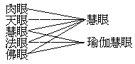
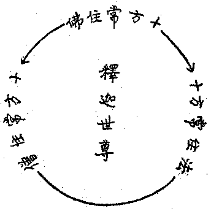
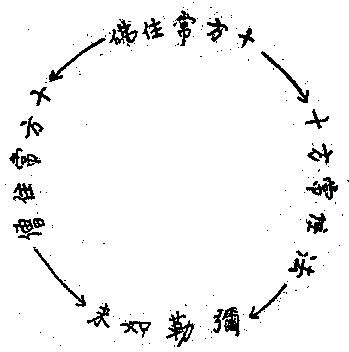

# 太虚大师全书．第十编　学行



> **藏经**：太虚大师全书（太虚大师全书）　**册次** 第 18 册（TX18）　**编号** TX0010　**卷次** 54 卷　**篇幅** 117,632 字

> **卷／品**：0 卷 · 1 品



---



## 目录



  - [居士学佛之程序](#居士学佛之程序)



---



建设适应时代之中国佛教



──十九年十月在四川省佛教会讲──



现代潮流所趋，政治与教化皆各发生意外变动，据鄙见所及，似有研讨之必要。但佛法之流行於世间，以众生世界为依止，故往往因时、因地、因人而不同。今中国之政教，既有时代之变迁，而佛教亦应随之而一变其往时之习惯，始能适应社会而生存发达。兹分二节言之：



一、教化环境之变迁　中国自唐宋以来之教化情形，大概可分为读书之士人阶级、与不读书之农工商阶级，而佛老二教，则由寺观僧道代表之。僧道称为方外，殆视同化外之人，士人读孔孟之书以佐君泽民为唯一之目标，而处於司掌政治与教化之地位；唯少数功成身退，或思想极高之士夫，始对於佛法留心及之。由此佛教亦唯圆顿教理与禅宗为投机，而负责宏法之僧伽，遂亦唯以提倡且参究此超佛越祖之向上一著为研究。然不读书之农工商与妇稚，则信仰三教混合之通俗神教，而信仰佛教亦与信仰神教毫无异致。此方面佛教之表现於世者，为延生、度亡、消灾、植福之种种经忏香火法门。在当时之士夫，亦认此种法门足以范围民心，为政治上之一种辅助，故其保护亦极周至。而唐宋以来之佛法，为适合以上二种之教化环境，乃以禅宗及应赴为流行之佛化。然在最近二三十年以内之情形，则大不然，海禁既开，交通遍达，社会人心因受外来之政治、宗教、科学、哲学、及其他一切思想风俗之影响，对於以前之教化已失其信仰之作用！此不特对於佛教如此，而以古圣先贤为模范之儒教，尤极其衰落！盖今以全国民众应具之相当知识技能为教育，农、工、商业、军事，皆各分别施与专门之教育，以期全国人民与世界各民族并驾齐驱，与前来所讲之二种教化迥然不同。前之二种，一则太高，言必圣贤，为一般普通国民所难奉行；一则太低，为现代一般稍具国民常识者所难信受。故以前二种教化不能施之现代，今欲适合现代潮流以应人群思想之所要求者，应提倡包括五乘之大乘渐教──即人乘、天乘、声闻乘、缘觉乘、菩萨乘也。从大乘渐教上去讲明性相之境，从此境上生起大乘信心，此心即无我大悲之菩提心，据此心而修学一切法门，则皆为菩萨行矣。在出家方面以戒律为先，作为身心上之训练，至戒行有其基础，然后精研教理，修习禅关，以养成住持佛法之僧宝资格，将此大乘渐教普及民众，首应使社会上一般人士从此取得一个做人方针，以十善行转相化导，以增进人类之道德而造成安乐之世界。诚能如此无间进修与尽量宣传，在大乘位上即为十信等菩萨之位。果能依此建立僧宝，提高民德，则佛法日见昌明，社会日益安静矣。此因教化之环境改变，故宏教方针亦应取其所宜而适合者。



二、政治环境之变迁　在前中国掌管或参政治者，约分三类：一、为帝王，二、为官吏，三、为绅士。其餘占国民百分九十五之农工商妇女等，皆不能与闻公事，且认国家社会与个人毫无关系，但求一身一家之安全而已。对此种人民之教化，则为三教混同之教化。存在其中之佛教，亦只以住在寺院具有外表僧相之出家人为其代表。故在寺院之出家人，亦唯以住持或职事等专办一寺一院事务，其清众等皆各顾一身而不与闻寺院公务，但求个人之安闲舒适为目的。此适与以前国家政治下之平民只顾身家之观念，如出一辙，从不知发心为一县一省乃至一国之教化有所企图，致为最近主张民治制度、社会生活之一般人士所攻讦。殊不知此种只顾身家之情况，并非一般僧众有意如此，乃由以前政治环境之所造成。但现在之政治环境已变，僧众对此当大大觉悟，应即改变其旧来之处世方法以图生存发达。以现在国民对於国事皆应有参与政治之行动，实施此种权利，首应有各种团体之组织，其组织方法，或因地方区别而组织者，或以职业差殊而组织者。国民对於国家政治既有如上之变迁，我寺院僧众亦应急起直追，组成教团以施教化，方足以代表佛教，住持佛法。以前之在家徒众毫无表见者，至今亦应为佛教团体之组织。出家者为佛教住持僧，在家者为佛教正信会，将此两部联合起来，由县而省，由省而全国，即可构成一整个的佛教团体。团体坚固，虽足御侮自存，尚不足以言振兴发达，故更须为内部的切实整理。出家众之幼年者，别为学僧，设律仪院、教理院以教养之；中年而有宏法布教之本能者，别为职僧，设布教所等，以大乘佛化之精神宏布於民国，并办理社会慈善等事业；其年高德长者，别为德僧，俾可安闲自修以为后学佛徒之模范；使寺院皆成为住僧之修学场所与当地之教化机关。更有在家之正信会辅扬法化，则佛法便可深入人心，激发一般有国民常识者之大乘正信，佛教始能安固昌盛。非然者，社会人士必继续不断的摧残破坏，且民众皆各组有团体，以之侵凌压迫专顾一身一家之寺院僧徒。佛教前途危险，何堪设想！佛法是应普及而非专利的，是应实行而非空谈的，愿诸同志勉之！



（克全记）（见西来讲演集）



（附注）西来讲演集原题「在四川省佛教会」：演说集作「佛教会为今时之必要和责任」，今改题。



改善人心的大乘渐教



──十九年十月在嘉定佛学社讲──



一、昔今教化之异宜　佛法之教有大小，行有顿渐，为逗众生之机宜而说；契机方能流行，契理方不乖旨，所以应机随宜而说，方足以显佛法之圆妙。佛法之诸法实相，虽周遍常住，而契机之说，确有时代性的：如日本、中国等之佛教情形各有不同，为当处之机缘不同，其施设之教法亦非一致。在中国以前之社会，凡可管公众之事者唯少数人，如帝王、官吏、绅士等，其多数人则但应顾一家一生之生活，餘事皆不宜过问。在此情形之下，故大乘佛法但能及於少数人，而其他独顾身家之多数人不能承受大乘，故当时之所行者多属小乘。现在之时代确与前不同，处此时代潮流之中，无论农、学、工、商等，皆有参与政治之机会；在各个人既皆作社会行动，则佛教亦应有适合潮流之设施，方足以延其餘绪。大乘佛法是有社会性的，以之养成兼善天下之道德行为，实为现今社会所必需之佛法。复次、在以前中国之知识界，皆读孔、孟之书，而无知识的愚夫愚妇等，则崇信神道；佛教於此，亦分两种施设：在知识界方面，施与简捷超妙的禅宗；其不读书之多数人，则施与神道设教之教化。然非佛教之本质如此，实因当时之潮流不同，为应民群之心理，故其施设如此。而现今之情形，适得其反，人人皆有担当国事之思想，至国家所提倡之教育，乃国民教育，使一般民众皆得有国民常识，若於此时再施与禅宗顿超法及神道迷信，绝不相宜。故应施与适合国民心理之大乘渐教，使有国民常识之人，易於信解。



二、大乘渐教纲要　发菩提心，即起三宝之正信；修菩萨事，即修六度之大行。大乘中之渐教，包括全部佛教，是有次序有条理的，在使人能显易了解渐能达到圆满之最高行位。其第一步、应做到如何成为世界上最良善之人为入手。然欲明了大乘佛法，须先明佛教原理，其原理为先从大乘三宝发起正信，是为发菩提心。若能发起此心，以之修养人格，根本已固，便可据此修行以作种种之事，是为菩萨之六度行。



三、起三宝之正信　三宝须先认清：佛即无上正遍知者，佛以法为师，法是诸法之真相而非佛之所创为，一切众生、诸法、本来如此，一切事物无不如此，为佛所亲证得。诸法原理，如科学真理，虽由科学者所证明，能为社会上之实用，而其理亦本来如是；故诸法真相，不限於佛说。佛说法如指上土，其未说者如大地土。要人从实际上去探索，自心上去证明，将所证得之实际普及於人，使人人皆能达到。因佛有此本能，故应信佛；此种信心，为合理之信心而非盲从。然而佛之真身无相，应身不能常住於世，俗众复不能传持佛之法律，须有从佛出家、依佛所说住持佛法之僧宝，将佛法实效为人作证，使人因之起信修证，解脱一切苦恼缠缚；更能流布佛法於无尽，故应信僧。信心既立，依此心而作利国利人之事，则名行菩萨道也。



四、修六度大行与中国之圣贤　大乘之行为六度万行，如华严等经所说，不知者以为虚渺，今以六度之行、引中国古学而证明之。一、布施度：伊尹曰：何事非君？其自任以天下之重也云云。此文在六度中为布施之行。布施者，牺牲个人之利益以谋群众之利益。施有三种：曰财施、法施、无畏施。以财物济人者曰财施，以道德惠人者为法施，以军政卫人者曰无畏施。欲行施度，当以此文为标准。餘如吕望、管仲等，皆有此行。二、持戒度：如伯夷目不视恶色，如坐涂炭等；餘如叔齐、管宁，皆有此行。三、忍辱度：凡作大事者须忍辱负重，能忍者即能和平。如柳下惠不羞污君，尔焉能浼我哉！餘如王叔度等皆有忍辱之本能，宜可师之。四、精进度：凡为不道德事所熏染，须精勇求改以期转移；凡有利益群众之事，须精勤进步百折不回，始终如一。如庄子论墨子中曰：昔者禹之湮洪水置万国，禹大圣也，而形劳天下如此。又孟子中：禹、稷当平世，三过其门而不入。又孟子曰：禹思天下有溺者，由己溺之也；稷思天下有饥者，由己饥之也。若禹、稷及墨翟等之为人，见能利於民众之事，其精进勇猛之精神如此！励精图治，实为难能可贵！凡服务社会而能捍劳忍苦者，此为大乘忍度之行。五、禅定度：古来圣贤多事修养，而修养方法复各不同；如庄子论卜梁倚，三日而后能外天下，而后能入不生不死；又如颜回之心斋；仲尼曰：若一志，而况散焉者乎？此一段文，乃孔子为颜子而说，其精要处即为禅定之修养。孔、颜依之修养，故有救人世之功能；孔、颜之所以得成为圣贤者，其本在乎此。六、般若度：般若即智慧，智慧有权实二种：实智、即证诸法真相之智，此与禅定相应，权智、为权巧方便之智，有无所不可、无所不能义。如孟子之赞孔子，孔子去齐接淅而行一段，细味此文，见得於行事上无定准皆为权智之表现。上来所举六种要义，略证明佛法中六度之行，为初发心者取之以为表率而庄严人格，於人乘而通大乘，庶乎其可也！



五、中国圣贤六度行、仅十信菩萨位之行　菩萨之行，必齐修六度，而且一一相通。中国之古圣先贤，虽各得一行，然亦互相摄。据此、可知六度非虚渺无凭，实於人生有切实功效。人能不违此教，即由人乘而可度於大乘。或谓：既中国古圣先贤皆有此行，殊不必再用佛法！其实不然，若无三宝正信，仅以古圣贤之六度法去行，但能达人天善果；必须先发菩提心，乃可成为大乘教中最初步之十信菩萨行。故仍须提倡大乘佛法，由起三宝正信以明大乘教理，依大乘六度实行济世利人之菩萨正行，虽未能达十信之位，而此菩提心可保永无退堕。据此，故应提倡大乘中之渐教，实为现今社会所需要。从另一方面讲，以今潮流推荡，政治溷浊之时，民众常抱不安！更有一种现象，已与旧日大异者，即一般人已不读孔、孟之书，亦渐少从事於神道设教之信仰矣！由此古今中外各种思想杂乱而起，时时冲突。今欲将各种思想调和起来，以与科学相倚而成立一新信仰，必须用大乘渐教方可。但其中深理，颇非一时所能讲了，今惟略说其梗概。



六、大乘渐教具足五乘、包括中国圣贤所行而超出其上　大乘渐教包括五乘之教义，使从人天渐能跻登佛果。不特有调和新旧思想之可能，且能融贯东西文化。其他宗教、多与科学相冲突，而佛学不特不冲突，反能藉为证明。若从历史上讲来，前来二千餘年之佛学，在在皆能贯通中国文化，故佛教在今日之社会，应尽调和之责任，所以有提倡大乘佛法之需要。但在代表佛教的现有佛徒，尚无此种力量！所属望者，在青年僧徒，从此努力探讨，并将僧制改善，俾能普及大乘佛法之利益於全世界。



（克全记）（见西来讲演集）



（附注）西来讲演集原题「在嘉定佛学社演说」，演说集作「改善人心之佛学」，今改题。



从巴利语系佛教说到今菩萨行



──二十九年六月在汉藏教理院讲──



一　从史的观点否定南传北传的名称



甲　阿育王的传播佛教是向西方发展的



乙　北传的有小乘而南传的也有大乘



二　巴利语系佛教确立之推测



甲　巴利语三藏编集者及其文体的递邅



乙　巴利语是印度大众化通俗化的语言



丙　梵语巴利语为印锡等地各种语文的主源



丁　南方佛教由复杂转变为单纯的推测



戊　印越等地也有巴利文佛教



三　锡缅暹佛教的近况



甲　缅暹民众以作僧为荣的风气



乙　缅暹人民对僧教已渐疏远的近因



丙　六十年前的锡兰佛教也是和现在中国佛教一样的衰败



丁　锡兰的佛教从黑暗中走向光明之路



四　行上判别的小乘大乘



甲　中国是大乘教理小乘行的佛教



乙　锡兰是小乘教理大乘行的佛教



丙　行的大小乘比教的大小乘为重要



五　复兴中国佛教应实践今菩萨行



甲　我们要实践大乘教来干今菩萨行



乙　佛教不能与广大的民众疏远



丙　修今菩萨行复兴中国佛教



我刚从南方的缅、印、锡等佛教国访问归来，故现在我就从这次访问所得的观感上说起：



一　从史的观点否定南传北传的名称



佛教近年，在西洋人的研究和日本人的承流接响中，有所谓南传佛教和北传佛教的分别。前者是小乘教的传承，后者是大乘教的传承。这种名称和说法，并非古来所有，而是近代的佛教史家所创造。现在我觉得有加以纠正的必要，姑从印度地理、历史、风尚种种的观点上，来指出其错误：



甲　阿育王的传播佛教是向四方发展的



考释迦佛教是生於中印度。到了阿育王时代，才普遍地传播於整个的五印度。同时并向印度以南的锡兰及南洋群岛，东邻的缅、滇，北方的新疆，西方的波斯，西北的阿富汗。并辗转由亚西以及欧东，也曾有佛教传入。东北的中国，则如秦始皇时曾有室利防等来华传法之说。四方平均的发展，传播到全亚的海陆。但后来因各方环境的种种关系，波斯、阿富汗、新疆、爪哇乃至印度本土等处之佛教趋於消灭。而阿育王后的印度和传布中国、西藏等地的佛教，发生种种沿革改变，另成别种的风尚宗派，使阿育王原传的佛教发生变化。唯有锡、缅等地能够保持阿育王时代传去的佛教而生存发展，所以到现在还保守著上座部佛教的原状。故从历史上看来，阿育王时代的佛教，是向东西南北同样的发展传播，并非局限於南传锡兰，这是无所容疑的。故南传小乘、北传大乘的名称错误，是不用说的了。



乙　北传的有小乘而南传的也有大乘



复次、北印度的迦湿弥罗国──现在的克什米尔，是小乘萨婆多部──一切有部──底大本营，它是小乘最发达的地方。从历史的记载和地理上的位置看来，北传佛教──北印度或印度以北所流传之佛教──也有小乘，是可断言。



空宗的龙树菩萨虽然是中印度人，而他的继承者──提婆菩萨，却是南印度的，所以空宗比较盛行南印度。大乘密宗的咒典，据说就是龙树菩萨在南印度的铁塔中开发出来。禅宗在中国，也有「南天竺一乘宗」之称；而达磨初祖是从南印度出发，航海到广州，经金陵而转去嵩山少林寺面壁。中国翻译密典最多的不空三藏，曾有一个时期住锡兰数年，研究大乘显密的教义。密宗在南洋群岛曾有过相当的势力。唐以后因回教的侵入，佛教因之灭亡，遂成为回教的教区。爪哇、婆罗洲等处，现在尚多佛教的古迹，该项古迹大约是中国晚唐前后，南印度密宗盛行传播至此的遗物。故从这种种关系上说来，南方──南印度及南洋佛教──不独单是传的小乘教，且曾传有大乘空宗、禅宗、密宗。尤其中国如法显、义净等久住锡兰，来自南印度南洋的高僧，更是多不胜计。所以中国的佛教，从南方来的决不减於北方所传。



我们既从史的观察，把南北二传的佛教打量了一遍，知道所谓南传佛教是小乘，北传佛教是大乘，这种的称谓是不确当的。不过在阿育王时代所传的佛教到锡、缅后，能继续保存著原状，其餘各地方或改变了，或灭亡了；或因在时间上非为阿育王时代所传去，故另成小、大、显、密复杂的佛教。所以，这於流传的时间上或有关系，绝对不是地理上之有南传北传。



二　巴利语系佛教确立之推测



锡兰位於印度的南方，缅甸、暹罗位於印度的东南方，这南方的佛教是为巴利语三藏的佛教。这在他们自己称是上座部的佛教，也就是迦叶、阿难传下的正统派的佛教。



甲　巴利语三藏编集者及其文体的递邅



巴利语的原来文体久已失传；现在流传的巴利语三藏，是将巴利语用锡兰字母拼成的，所以应该称为「巴利语三藏」。这种巴利语三藏的编定者，是和我国法显法师同时的觉音尊者。他是印度人，法显法师在锡兰留学，尊者同时也在该处弘法。他编定巴利语三藏，造有清净道论，对巴利语三藏都加以详细的解释，以成立其组织之体系。后人奉此论为研究巴利语佛教必读的要典。



巴利语三藏经律论的内容和分量，重要的除多了一部清净道论外，其他的部份大致与我国所有的四阿含经，四分律，六足论等相同。巴利语三藏，以前用锡兰文写成，后来也用缅甸或暹罗文写的。现在已有英文写成的，不过还是以锡兰文的为本。



乙　巴利语是印度大众化通俗化的语言



巴利语是印度大众化通俗化的语言。梵文如我国的文言文，巴利文等於我国的语体文。而佛陀当时运用巴利语向群众说教，不外是用印度最通用的语言，使高深的佛理，个个都可以听得懂；迦叶、阿难的结集以至阿育王时大德们的传教都用巴利语，也不外此。所以我们现在利用语体文作宣传的工具，不失为契机的一种方便。近六十年，印度已有人注意到全国语文统一的问题，波罗奈有一个全国语言统一学会，他们很想把兴都语成为国语。据说：兴都语与巴利语颇为相近，而巴利语与梵语亦相去不远。为了适应时代的需求，我们知道巴利语在印、锡、缅等地是何等重要。



丙　梵语巴利语为印锡等地各种语文的主源



印度的语言文字虽然很多，但大都是梵语、巴利语的支流，所以可代表印度语。就是锡、缅、暹及西藏、尼泊尔、中国边境摆夷的语言文字，也都是从梵语、巴利语演变而成的。故可称梵语巴利语为由远东流布近东多种语言文字的主源。故在近东如缅、暹、藏等地的文化，可名之为印度语系的文化；而在锡、缅、暹等地的佛教，也可称之谓巴利语系的佛教。



丁　南方佛教由复杂转变为单纯的推测



在锡兰的佛教徒，他们只承认阿育王传去，而由觉音尊者所编集单纯底巴利语三藏佛教。而事实上现在锡、缅、暹除了巴利语三藏佛教外，也是没有其他佛教的传留。但我们根据历史的观察，锡兰和南洋的佛教，确是曾经一度有大乘显、密、空、禅诸宗的传行，并不是如现在这麼单纯的小乘三藏。至於锡兰及南洋为什麼会从小、大、显、密分流的佛教，南印度及南洋变为消灭，锡兰变为现在的纯小乘呢？这个问题，尚难在历史上得到确据的说明，我们只能从推测得之：在锡兰的佛教，大概曾经一个时期，由於有力的国王，因笃信觉音尊者编定的巴利语三藏，故决定巴利语三藏为佛教的正统。他种小乘派及大乘显、密、空、有等宗派，概加以抑制或排斥，所以便成为现在极单纯的巴利语系的小乘三藏。锡兰经此有力者弘扬而确定后，缅甸也受影响，随而确定。暹罗因建国较迟，故佛教之传亦随锡、缅而入，也同是传承觉音尊者的巴利语系佛教。



戊　印越等地也有巴利文佛教



现在巴利语系的佛教，极明显的传播地点是锡、缅、暹三地；可是亦旁兼传布於印度、越南等地。很多人以为印度现在已经没有佛教，纵然有的也不外是由锡、缅佛教士的反哺。我这次亲自到印度，受过加尔各答的孟加拉省佛教会的开会欢迎，才发现这是一种错误：原来孟加拉省与缅甸毗连的山岳地带，佛教很盛行──（该省一般的宗教信仰，回教占第一位、佛教第二、印度教第三、基督教第四）──。近已依巴利语把经律二藏译成孟加拉语，论藏尚未译成。其所传的佛教，完全和缅甸相同。孟加拉之能够把佛教保全，大概因与缅境毗邻，或因僻居山区，古时印度教、回教的势力不能深入以摧灭佛教的关系。



其他如云南边界的摆夷，也传巴利语的佛教。越南在法国统治下的五国联邦，南中北三圻为中文系的佛教；而高棉、老挝二国的佛教，也是属於巴利语系的。由是我们可以知道巴利语系佛教的教区了。现在可定称巴利语系佛教，梵语系佛教，梵巴合流华文系佛教。并把这三系佛教的教区布列如下：



　　　　　　　　　　　　　　　┌─缅甸───孟加拉  

　　　　巴利语系佛教──锡兰─┤　　　　┌─高棉  

　　　　　　　　　　　　　　　└─暹罗─┤  

　　　　　　　　　　　　　　　　　　　　└─老挝



　　　　　　　　　　　　　　┌─尼泊尔  

　　　　梵语系佛教──西藏─┼─康青甘宁及晋冀辽吉  

　　　　　　　　　　　　　　└─蒙古



　　　　梵　　　　　　　　　　　　┌─朝鲜  

　　　　　合流华文系佛教──中国─┼─日本  

　　　　巴　　　　　　　　　　　　└─安南



三　锡缅暹佛教的近况



甲　缅暹民众以作僧为荣的风气



现在锡、缅、暹佛教的状况如何？我想都是大家愿意知道的！缅甸和暹罗，不特以佛教为国教，同时以佛教为全国唯一的文化。历代帝王皆笃信佛教，都以兴建寺院，供养僧宝为荣，所以养成了为僧是荣的风气。一般人民，都很愿意送他们的子弟去出家，纵然不出家，也要送入寺院受佛教的教育。所以日常生活习惯的轨则，个人的道德行为，都以佛教为依归。一切的一切都离不了佛教，正如中国人从前稍能读书的子弟拜过孔夫子一般。而能够出家的，有如攷中了秀才，入了学一样。他们之所以乐意送子弟去做「和尚」，也许就是基於「扬名声，显父母」的观念吧！听说缅、暹有不为僧无人嫁的风俗，出家为僧在缅、暹的狂热，由此可以想见了。不过他们出家的时间，并不限定是终身的，出家后数月或数年，都可以如法舍戒还俗。



锡兰虽然同是以佛教为国教，为民族文化，对於出家也很重视，但不像缅、暹那麼普遍，而没有提倡舍戒还俗的风尚。因为他们认为出家是极高尚的，如果一旦还了俗就得被人轻视了。这是锡兰的人民不滥於出家和不轻易於还俗的关系。故一般知识的水准，比缅、暹较为提高。



乙　缅暹人民对僧教已渐疏远的近因



近来缅、暹的佛教，有著很大的变化，和伏著很大的危机。缅甸是英国的殖民地，暹罗也和我国一样受了欧美文明的影响。他们贵族派遣弟子去西洋留学，以适应现代的需求，而取得高尚的地位。所以脱离了僧寺的关系，另设学校的教育，这类学校所养成的青年，每对佛教信念发生了摇动。由於这种原因，少年多数已渐渐和佛教疏远，不像从前那麼尊重的热烈。从这点看来，缅、暹佛教，如无相当适应时代性环境性的革兴办法，和有大人物出来支持，则前途实在极为危险！



丙　六十年前的锡兰佛教也是和现在中国佛教一样的衰败



锡兰和暹、缅的佛教，从来就有其不同点，现在更有很多差别的地方。大家都知道，近百年来，殖民地之多，海岸线据点之广，要首推英国了。但是海上的霸王，英国以前有荷兰，荷兰以前有西班牙，西班牙前则有葡萄牙。现在葡人辖下的澳门，就是中国明代的外人居留地，所以葡萄牙在海外的势力是最早发展的。在我国明末的时候，锡兰曾受葡萄牙的侵占，佛教大受其破坏，僧众逃散各方，至今尚遗有葡人毁佛的痕迹。葡人退出锡兰后，僧众为传持戒统到缅、暹求法受戒，以传回被毁的佛教归国。现在锡兰僧遂分成了缅甸派和暹罗派──这是戒派，不是法派。



英人统治锡兰后，佛教亦受到极大的打击。天主教既随葡人来锡於前，复有基督教跟著英人侵入於后，锡兰佛教受这外教底重重压迫之下，遂失去领导文化教育的高尚地位。当时那种衰败的情况，实不亚於清末民初中国佛教的现状。



丁　锡兰的佛教从黑暗中走上光明之路



黑暗的反面就是光明！我们能够从黑暗中挣扎出来，就可走上了光明之路。近五六十年来的锡兰，因为产生了几位道高德重的大德，和有力的护法居士，黑暗衰颓的佛教，已走上光明复兴之路了。他们抓著了锡兰佛教衰败的症点，竭力提倡适应现代化的佛教，兴办僧众教育，灌输僧众一般的常识，以作国际宣传和学校教师的方便。这种朝气蓬勃的现象，我对于锡兰的佛教前途，觉有无穷的希望！



在锡兰，已有几所巴利文系的佛教学院。最大的是达磨波罗与一高僧所创办的；另一所是现今锡兰首相与一高僧办的。另有一佛教通神学会──初为一美国佛徒所办──，极力倡办教育，在它主持下的学校，每校自幼稚园到高等专门，从百人至数千人，已有三四百所。校名都富有佛教的含义，如名法王学校，阿难陀学校等。校中除所授普通学科外，并灌输佛教一般的常识，训练日常的佛教信仰仪则，以期提高人民对佛教的信仰。佛教青年会则注力於改进乡村建设；摩诃菩提会提倡慈善事业及工业──如医院纺织厂等──及广设国际宣传机关。巴利文系的佛教教育，已遍布於锡兰。在哥伦布我曾见过两所各有七八百名学生的学校，并且还有几个中国的学僧。以锡兰的人口和面积说来，可以说是希有难得了！



因为锡兰佛教的细胞，布满了社会各个阶层，大有上自首长，下至庶民，无不「信受奉行」之概。现在的内阁总理，即为佛教青年会的会长；卫生部长，即为佛教通神学会的会长。所以对於社会事业，都居於领导的联合地位。摩诃菩提会，於对外则注重国际宣传，於国内则提高人民文化的水准，兴办社会慈善事业，改良农村经济生产。这一切的一切，都适应著现代社会需求。故官民对僧人恭敬，对佛教普遍信仰。



从锡兰僧众的净高化，佛教的大众化、利他化的趋势去观察，我觉得锡兰的佛教前途比缅、暹较为稳妥。这因为已能够与现代社会需要打成一片的关系。缅、暹如果还是「滞在旧制度」保守不前，不肯学习锡兰佛教改进的方法，那末、不久将来，大有走上衰灭之路的可能性。



四　行上判别的小乘大乘



甲　中国是大乘教理小乘行的佛教



把锡、缅、暹等地佛教的近状大略地说过了。在这儿，使我起了一点感想：我们平常说中国、西藏和日本流行的是大乘佛教，锡、缅、暹等地流行的是小乘佛教，这单是在教理上的判别。而在大小乘的实践实行上，却使我得到相反的认识。日本和西藏的佛教，都有他适应当地环境需要的发展，我们暂且不去谈它，且就中国佛教来谈吧。



中国佛教所说的是大乘理论，但却不能把它实践起来，不能把大乘的精神表现在行为上。我国的佛徒──包括出家在家的四众──都是偏向于自修自了，大乘的经论，虽有很多人在提倡和弘扬，但所提倡所弘扬的也不外是自修自了的法门。这种说大乘教，行小乘行的现象，在中国是普遍地存在。如出家众的参禅念佛者，固然为的自修自了，即在家的信众也是偏重自修自了的倾向。他们都以为学了佛就不要做人（？），什麼事都心存消极不愿意干，更有很多人以为学佛作「了此残生」的尾闾。他们都说把国家社会家庭一切的俗务都舍下，才可以入佛修行。这种不正确的思想，已经深印在每个国民的心坎中。这种错觉是复兴佛教的障碍物，是歪曲了大乘佛教的真义。所以我们可以说：中国所说的虽是大乘教，但所修的却是小乘行。



乙　锡兰是小乘教理大乘行的佛教



锡兰、缅甸、暹罗同是传的小乘教理。而他们都能化民成俗，使人民学三皈五戒、人天善法，举国信行，佛教成为人民的宗教。但可惜缅甸和暹罗的佛教，还是依赖於帝王提倡维护的遗制；或历来崇佛的风尚习惯有以致之。如果日久没有了外护的力量，其自身失去了支撑的凭藉，或将趋於衰败之途。所以缅、暹佛教还有他的缺点存在，我们亦暂置不谈，现在姑就锡兰的佛教来说。



锡兰的佛教四众弟子──七众中他们没有沙弥尼、式叉摩那尼、比丘尼，故仅比丘、沙弥、优婆塞、优婆夷四众──，对内则深研教理，笃行戒律；不特缅、暹等地的教徒欲求深造者要到锡兰留学，就是世界各国研究巴利语系佛教的学者，亦无不莅临这佛国研讨。对外则广作社会慈善、文化、教育宣传等事业，以利益国家社会乃至世界人群，表现佛教慈悲博爱的精神。所以他们所说虽是小乘教，但所修的却是大乘行。



缅甸和暹罗的小乘佛教，单是供奉释迦世尊的塑像。在锡兰除了供有释尊外，并都供有菩提萨埵筏─弥勒菩萨圣像，这也可为他们接近大乘行底暗示和表现。他们并有多处僧俗教徒领袖，曾表示愿学习中国大乘理论。



丙　行的大小乘比教的大小乘为重要



从行的方面说，大乘行不外乎六度、四摄。六度的第一度，四摄的第一摄，同是布施。六度是自他兼利，四摄则专为利他。兼利利他就是大乘菩萨行。锡兰佛教所盛行所表现的，无非是兼利利他的佛教──如僧众律仪严净，闻思精进，通神学会等团体底济世工作，正是合符大众行的条件。所以我认为说锡兰的佛教是小乘极为不当，锡兰应该是小乘教大乘行底佛教；和中国大乘教小乘行底佛教适得其反。同时、我还以为大小乘的分野，不应单在教理上著眼，从实际的行为表现上来分别，尤为重要。



五　复兴中国佛教应实践今菩萨行



甲　我们要实践大乘教来干今菩萨行



从锡、缅等地的佛教，回顾到中国的佛教，我认为中国佛教衰败的原因固然很多，而最大的病源则为空谈大乘，不重实行，行为与教理完全脱离关系。所以革兴中国佛教，要洗除教徒好尚空谈的习惯，使理论浸入实验的民众化。以现社会实在的情形和需要来说，今后我国的佛教徒，要从大乘佛教的理论上，向国家民族、世界人类实际地去体验修学。这大乘理论的实践行动，即所谓「菩萨行」。而这菩萨行要能够适应今时今地今人的实际需要，故也可名为「今菩萨行」。以简别向来只唱高调，名不符实的「菩萨行」。



今菩萨行的实行者，要养成高尚的道德和品格，精博优良的佛学和科学知识，参加社会各部门的工作──如出家众可参加文化界、教育、慈善界等工作，在家众则政治界、军事界、实业界、金融界、劳动界……都去参加──，使国家社会民众都得佛教徒之益。佛教的细胞散布於社会每个阶层，全不和国家社会民众疏远分隔。



乙　佛教不能与广大的民众疏远



佛教之与民众，如树木之与土地。树木藉著土地支持滋养，才可以生长繁荣，佛教赖著民众的信仰，才可以存在兴盛。如果佛教失了广大群众的信仰，就如树木失了土地的凭藉一样不能生长。所以我们多作救世利人的事业，使佛教在社会每个角落里都起了作用，方不致与民众疏远。令他们因此对佛教生起信仰心和拥护心。例如以一地的僧寺为教化的中心，改善人民的生活风俗习惯，提高民众一般的教育，增加农村的生产，协助工业的发达，兴办救济贫病的医院、教养院等慈善事业。一地如是，各地佛教亦复如是，则佛教复兴庶乎在望！



丙　修今菩萨行复兴中国佛教



在中国佛教界，早就流行了在家菩萨、出家菩萨的称呼。如称新戒为新戒菩萨，受戒较久的为老菩萨。可是这些都是只尚空谈有名无实的菩萨，不足为我们修习今菩萨行的圭臬。我们应要以集体分工来学观世音菩萨，为修今菩萨行的模范。谁都知道观世音菩萨是普门大士，又是施无畏者。他为著适应一切众生的需求，於一体中而现三十二应，所谓应以将军、宰官身得度者，即现将军、宰官身而为说法。……应以比丘、优婆塞得度者，即现比丘、优婆塞而为说法。乃至应以童男、童女身得度者，即现童男、童女身而为说法。他这种利生的善巧方法，是我们修今菩萨行所必要模仿的。我们以修今菩萨行的集团为主体，每个或每组实践今菩萨行的份子为应化身，去适应今时今地今人的一切需要。明显地说：我们每个单位分身的今菩萨行者，集体联合起来，本著大乘菩萨的菩提心为主因，大慈悲为根本，实践方便为门的万行，发挥救世无畏的精神；以集团的一体而现分工的三十二应今菩萨行。



总之、我们想复兴中国的佛教，树立现代的中国佛教，就得实现整兴僧寺、服务人群的今菩萨行！



（唯贤、演培、达居合记）（见海刊二十一卷七号）



佛之修学法



──十六年一月在上海尚贤堂讲──



一　佛学之根本精神



甲　独立与发展──自觉的



（一）绝对独立之特德



（二）无限发展之自由



乙　和合与增上──觉他的



（一）缘起性空之和合



（二）相应互资之增上



二　佛学之特殊性质



三　修学之适当态度



向来佛教内，有所谓学佛与佛学之二语。学佛者，谓依佛所说之教法，实践修行，以期证悟佛之知见，而佛学者，即讲明佛自所证之万法真理。实则、凡学佛者必先了解佛学之真理，然后学佛始能贯澈实行，欲贯澈实行，必先究明佛之学理。佛之学理，非如哲学，空谈理想，难成事实；亦非宗教，假定一尊，使人崇拜以求解脱。乃依法界万有之真相实理，方便解说，毫无谬误；使迷昧众生依之修学，以解脱世间学说──哲学、科学、神学等──所不能解除之痛苦，使达到人生真实平等自由之幸福。故佛学所以可宝贵者，在乎使人得以实证；而佛学所应注重者，则又在於依教修行。若认作哲学研究以供求知之欲望，则失佛所以说法之本怀矣！盖诸佛出世说法度生，意在使一切众生咸皆成佛，故所有言说，皆讲明成佛之方法，使信佛者依之学习以修成佛道。今此标题云「佛之修学法」者，意指佛当时修学之法；而又表示今人学佛，於佛所说五乘法中，应以何法为学佛可以修习者。但欲讲佛法，必先信有佛。佛者、乃觉行圆满者之义，即指已得无上正遍觉之人；曾有释迦牟尼，在此世中修行成佛，说法度人，号称佛教。其能诠教，即现在流行之三藏、十二部，其所诠法，即宇宙万有诸法缘生之真实理。吾人若能实行修证此真理至於圆满者，亦即名为无上正遍觉之佛；惟在未成佛以前，欲求成佛，不可不先研究佛之教法。佛之教法，共分五乘，惟吾人以有限之生命，若游意于五乘之教法，深惧难任！今观诸仁者信佛之来意，咸欲得一修学成佛之善法，故不辞为一述五乘共通修学之大乘佛法。大致当分三节：



一　学佛之根本精神



根本二字所含之意义，乃泛指能为诸法产生之依据者。例如树木，若无根本，则树叶决不能生存；而精神又为支配身体活动之机关，凡百事业之成立，皆精神指导身体活动之结果。今吾人学佛，乃有生以来之唯一大事，若不知於佛法中择取一法以为修学之根本精神，决难望成。兹就管见所及，略述二种：



甲　独立与发展──自觉的



世间宗教，由探索万有之本体不得，或於万有之外，或随於万有之中，别执一物，以为万有从生之大本因，超出万有之上，具全知全能之用；而又不许人对於万有之大本因稍加怀疑，故养成人类依赖之性，促成帝王专制之政。不怀疑，则人类只知保守原有之状态；性依赖，则缺乏独立发展之精神；此所以束缚人群之思想，而阻碍其进步也！惟佛教建设人类於绝对平等自由之上，其所言皆提高人类之个性，使发展本有独立之特德，与奴於他人而抑制个性之宗教，实不可以同年语矣。为广利乐，畅演此义，复分为二：



（一）绝对独立之特德



此绝对独立之特德，在佛不增，在凡不减。凡夫迷此而流转生死，菩萨悟此而圆成佛道。故佛名大觉，即觉悟此独立特别之德性。此又不专限於动物，凡有形范围之内所有万事万物，皆有独立特别之德性；乃至无情之草木瓦石，亦复圆满具足，盖若无独立特别之德性，即不能完成其为物。凡物之生也，皆各有此性以为能生之因，无则决不能生。是故此性，於人於物极贵极尊，而人觉悟此性，则可以统摄一切而为诸法之王。释尊生时，因悟此性，故发言曰：『天上天下，唯「我」独尊』！云门则曰：『老僧当时若见，一棒打杀与狗子吃』！此皆各为发挥其独立特别之德性。后世学者不达此义。闻说学佛亦仗他力，遂唯点烛烧香以求成佛，与死守教下以冀悟入者。前者衍成祈祷之宗教，后者变为哲学之空谈，此皆由未觉独立特有之德性，而执著文字或盲拜偶像，反为此所限制，不能成佛。昔蕅益大师将出家，其舅问之曰：若出家，必不屑为讲经之法师，而欲为禅宗之善知识。师答曰：法师是乌龟，禅宗是亡八。推而上之，则佛亦可说是乌龟，菩萨亦可称为亡八。若能从此而悟入，则拈一茎草作丈六金身，丈六金身作一茎草，剖一微尘出大千经典，皆不足为奇；若不明悟此理，则所学皆为枝叶，纵经尘劫亦不能成佛。故学佛之根本，必须觉悟此本有特立独存之德性，方有学佛之资格。



上述各义，颇近禅宗。世有不达此理者，谓佛法之衰落原於禅宗之兴盛，故抑禅宗而倡唯识。不知禅宗实为佛法之精蕴所寄，而又能圆摄各宗而无碍。今第二段，试就唯识宗而一探此义。



（二）无限发展之自由



唯识宗言宇宙万有皆为因缘所生。而彼所指之因缘，又非於世界之外别有其物。因者、以世界万有各各之特别种子为因，缘者又以世界万有各各相互增长为缘。盖因之与缘亦所生法，故一切法皆因缘所生，因缘又即为一切法。此能生诸法之因，与关系诸法能生之缘，皆具有特立独存之德性，在唯识家之术语，名之曰藏识。其特德有二：一曰、摄统性，二曰、持续性。能摄纳统一诸法之种子者，名曰摄统性。因缘中之因，即能生诸法之功能未发现者，亦名种子；万法之种子，皆含纳於此识中，故名藏识。能使刹那生灭之诸法，在此生彼灭彼灭此生之中，得永持以连续而不断者，曰藏识之持续性。今此所云独立特有之德性者，即此识中所含藏能生佛果──果指佛身佛土而言──之不共善性。一切众生各有藏识，而藏识又各有此摄持性，故无论沉灭三途，而独立特有之德性皆不能遗失，不能破坏。往昔诸佛，因觉悟自他皆有此独存之德性，故自述其所证悟之方法，以教化一切众生，使开发本有不共之特德，出离世间之苦恼，达到永久安宁之目的，所以有吾人今日所从事之佛学出现于世。故吾人学佛之根本，必须悟此独特之德性，方能向外发展，乃不受环境之所支配而能改造环境，独身冲决一切障碍而享受自在。法华经云：『我为法王，於法自在』。是即我佛当时打破环境而改造环境之明证。禅宗亦云：『魔来魔斩，佛来佛斩』。此所谓「没量英雄，盖天盖地」！古德有言：『转得大地山河归自己，转得自己为大地山河』。其自由发展之精神为何如哉！



世间诸人、每因环境所障碍而失败，学佛之人，又多为佛法所障碍，致未能成佛。推原其故，则由於缺乏此大雄无畏之根本精神，故祇成委靡猥鄙之不智的弱者。



乙　和合与增上──觉他的



将述此义，复开二分：



（一）缘起性空之和合



宇宙万有诸法，世或言上帝造成，或言大梵天生，或言地、水、火、风生，或言阴、阳、太极生，或言化学元质生，或说由虚空生。依佛所说，世界诸法，凡是有的，无论一事一物，皆众缘集起，空无自性，唯是众缘和合相互资助而得生起。比如眼识，本能见物，若生盲人虽有眼识亦不能见。识喻如因，根喻如缘，有因无缘固不能生，有缘无因亦不能生，故一切法起唯缘起，灭唯缘灭，无有一法而能独起独灭者。何以故？本无离绝餘法之此一法故，一切法各有其因，则无外道一因不平等因之过；因复待缘，则无离绝餘法之外而有能生此法自性之执，无外道固定之自性。所以能众缘和合而生起，所以能各变各缘而相似一。此不独佛说为然，即庄周所谓「万物与我并生，天地与我为一」，亦冥契缘起性空之真义。



（二）相应互资之增上



佛教立四缘：一曰、因缘，二曰、增上缘，三曰、所缘缘，四曰、等无间缘。第一种因缘，即能生诸法之亲生因，下三种皆缘，即与诸法相应而相互资助之缘。一切诸法之现行也，除直接能生之亲因，复有互相关系互相资助之疏缘。色法有与色法之相应互资，心法有与心法之相应互资，乃至色法与心法之相应互资，情界与器界之相应互资，自身与他身之相应互资，自心与他心之相应互资，自地与他地之相应互资，佛界与生界之相应互资，推而至於世出世间法无一不有相应互资之义。但须两法以上，方能相应助资，何以故？对待而生故。譬如今人讲国际互助主义，必须彼此皆有特立独存之国家，方有互助可言。即念佛往生，亦因凡夫与佛皆具有独立特存之德性，故能互相关系，互相资助；否则，佛亦不能度生，生亦不能见佛。诸佛菩萨由悟缘起性空之和合，故能等视有情，发无缘之大慈，由悟相应资助之增上而发同体之大悲，以灭度一切众生而圆成无上菩提。是故学佛之根本，必须有此和合增上觉他之精神也。近来学佛者失此根本之精神，故祇成凉薄偷惰之不仁的小人。



二　佛学之特殊性质



三　修学之适当态度



（唐大定记）（见海刊八卷十二期）



研究佛学之目的及方法



──十八年冬月在世界佛学院研究部讲──



研究佛学以何为目的？又以何种方法能达到此目的？目的，就是自利利他，在自利利他中所得到的三德。



　　　　　　　　　　　　　　　　　　　　　　　┌─真实愚  

　　　　自利─┐　┌─断德…………所断之本在─┤  

　　　　　　　├─┼─智德　　　　　　　　　　└─异熟愚  

　　　　利他─┘　└─恩德



断德、即是平常所谓了生脱死，单属自利。以平常人皆畏死，死了不能断灭又要生，死死生生，总断不了死苦。以死了不能断灭又要生，生了又要受种种生苦。以生而有死，又不得不死，因为苟延此死，遂造贪、瞋、痴、杀、盗、淫，起种种的烦恼，致成更加增盛的生死苦，於是六时中所感觉的无一不是苦了。此苦皆基於死苦，由死而逼迫身心，流转不已。以有此死苦，我们想作一种永久的功德，就不能即身成功；一死之后，生前所作的点点功德，全盘抛弃。世人要想得到自利上的要求，因为有死苦的逼迫，都不能够。要解除种种逼迫的苦，实为人之大目的。如世人所求所作，无一不是由苦而动：如腹觉饥苦，就要去作食，身感寒苦，就要去谋衣，为避风雨虎狼等苦，就要去构舍造屋，感觉自己欲望不满足的苦，就要起革命。大家若无死苦的逼迫，慢慢的总可想一种好的方法来解除他；可是、不久又要死了！在世人之种种的救济方法，所谓头痛医头，足痛医足，日日调护免死，可是终久要死！



上来是谓世人不得解除此死苦的方法。依佛法上言，现在要解脱此苦，得永久的安乐，就要由了生而得脱死。如何了生？进一步观，此死苦果何而来耶？倘若是上帝造的，或自然生的，那就无法去解脱他了！依佛法讲，也不是上帝造，也不是自然生，乃由因缘和合而生；以是观十二缘起支，就可为解脱此死苦的方法了。以无明、业、爱、取、有、而有生死，此「有」直接取「生」的力量有限，故不久即死。有者，能有后来生了又死之苦果者，如地中谷种经爱取水土的滋养，已发出芽头，而尚未出生地面。不久、就生长出来了。识、名色、六入、触、受种，由业摄植滋助，成感生死种。此业由无明所发，即吾人现前第六识心上之二种无明：一、真实愚，二、异熟愚。真实愚、谓对于诸法的真实相不能明了，即是不了生空法空。不明众生缘生性空而起人我执，不明诸法亦由众缘生故空无自性而起法执。有此愚故，对于诸法真实之理不明、曰愚。平常所谓了生脱死，就是要了知「生」之真实相。所谓缘生性空，是说从众缘所生之人生宇宙，本来空无自性，若尔、更何死之可得？我们既见到无死，亦即不想种种之下劣方法来苟延生命了。异熟愚、谓不明业报之身心世界，是由前之无明业等而成的异熟，而妄於此中执我执法，曰异熟愚。有此二种无明，即发有漏业，招生死等苦。以由此二种无明断故，不发有限业、招有限生，若有限之生无、则限尽之死亦无，而生死之不断，即是於有限生上起有限心，造有限业之所致。能将此二种无明变为二明，即是了生；以了生故，则死自脱。真能了知众缘所生，若人若法之性空实相，即可解脱死苦，名曰断德。此德在小乘阿罗汉等，但脱分段死，曰择灭涅槃，单属自利。若究竟得脱分段、变易二死者，唯佛果，所谓无住涅槃；即是将无明、有漏等苦，灭除乾乾净净，得到永远真正圆满的安乐，曰涅槃。



智德可通二利，与断、恩德有密切之关系。智为能断之智，能够了知生相，解脱死苦，得永久的安乐，皆由智德。而在自利上，亦通本后二智，以在能断执障上说，皆名自利智，然能断所知障之智，即能利他。能断所知障者，谓对于世出世应当了知的诸法相性而能了知。法华经云：佛之知见，而开示有情皆令悟入，即是利他智。若于众生无大悲心，则唯自利，而不能得成此利他智。然大乘菩萨、在初发心时，即非为自己而求安乐，是为大乘之不共智。



恩德之立场、在大悲大愿，以己能成利他智故，能尽未来际利乐众生，永远为众生作一切恩德。谓自己能解脱一切苦，复能尽知诸法实相、开示众生，令解脱一切苦，所谓恩被群品。若未得佛智，即非恩德。虽菩萨度生，犹以利他成自利。



研究佛学所要达到的目的，就是自利利他的三德。要成就此三德，就要发大悲大愿之大乘菩提心，所谓因果相应。若根本上无大悲心，无论如何亦不能达到此目的。纵得小乘涅槃，不过断、智二德的少分。从佛所说的一切学说，曰佛学。断障证果，是很长的一条路，不是一天能走得到的。现在研究佛学所要达到的最近目的是什麼？此目的有三种：一、正见如眼，二、正信如手，三、正戒如足。人有手足，就可以活动作事，取物行路；若无眼，取物行路必遭危险，以致伤身失命。由正见而生正信、正戒，信无正见、则成见取；戒无正见、则成戒取；见不正，即成身见、边见、邪见。我们现在身心所现行的皆是迷执，不可依他来求正见，必须依佛菩萨得正见以后所说的圣教──三藏教典，由研究此圣教来成就我们的正见。正见成就后，正信、正戒自然成就。正见即是眼，眼有五种：一、肉眼，二、天眼，三、慧眼，四、法眼，五、佛眼，瑜伽摄为二眼：







世间平常人作事，依肉眼去见。天眼是定中所成功的，对于除异熟愚亦可有益，然对于究竟解脱生死苦上，则无助。肉眼助平常作一切事，虽有益，然不但求不到究竟安乐，往往反而造烦恼业，增生死苦。天眼在天以下之异熟报上，虽稍能明白，而在天之本报上，仍不能够明白。那末、此二眼当然不能依他来除生死苦了。证得二空无相真如，曰慧眼。能见诸法之无量差别，曰法眼。对于宇宙万有，一时普及，一切即一，一即一切，差别无量，无量差别，同时而见，曰佛眼。此三眼，以无漏清净慧为体。我们现在所有者，唯肉眼，若依此眼去作事，反增染业；天眼又未得到，即或得到亦不能达到了脱生死苦的目的。慧眼、在小乘初果，大乘初地始得。佛眼、八地菩萨方得。法眼分二种：一、至教法眼，二、自证法眼。至教法眼，由闻思慧研究三藏圣教，成就自己之理解，所谓虚心受教，即闻成就。由闻而思，再加以定等修习，即成就正见。有此正见，即可自利利他。十信、十住、十行、十向、四加行诸位，皆依此至教法眼；不尔、就如盲人骑瞎马，其害无穷矣！自证法眼，亦初地方得。我们现在急要成就者，即法眼中至教法眼之一分，是曰「正法眼藏」；此「正法眼」、具一切佛学之正法无漏功德，曰「藏」。我们要达到此至教法眼的正见，依正见为自利利他之基本。依佛法论，正见未得，虽然自利利他，其实是自害害他。



研究佛学的方法，依涅槃经略出四种为标准：一、依法不依人，二、依义不依语，三、依了义不依不了义，四、依智不依识。



　　　　　　　　　　　　　　　　　　　┌─语  

　　　　　　　┌────至教────法┤　　┌─了义　┐  

　　　　佛法─┤　　　　　　　　　　　└─义┤　　　　├识  

　　　　　　　│　　　　　　　　　　　　　　└─不了义┘  

　　　　　　　└───────自证──────────────智



依法不依人者：法、谓一切法之本来真实相。当依持正法，苟于正法不合，就是佛说的亦在所不从；因为、魔王亦可现佛身而说法。现在研究佛法，亦当要依翻译来的经论为标准；因为经是佛言，西域各大师造论，皆根据佛说之经而造的。中国诸师，往往多臆说，故不可依为正量。依义不依语者：能诠所诠皆是法。又、能诠是语，所诠是义；实有其事曰义，但有言说曰语。同是一语，不应当固执其语就决定是对的，当进观其所诠的义，以义实语，勿执语取义。依了义不依不了义者：究竟显了，谓之了义。同是一义，更须观其究竟不究竟，显了不显了。佛陀说法，如对人治病，应症与药，不必凡是佛说的、皆可执为究竟了义，亦有不了义的，是故盲从者非是。依智不依识者：谓四加行以前所修，皆是依诸佛至人共同所证所说之教义，所谓似文、似义、似言，乃至观空、仍是识变；要依能证真如二空智者所说之法为依，勿随情识之说。又当求入真见道，依自真智，勿依於思识分别。



佛法传到中国几千年，大德代出，分鏕扬化，各树门庭；然所造论，不似印度诸师根据坚确，条例精严，每本自意取喻一时。故我们不要在宗派上著手，而直接从印度所译来之经律与论去著手研究，先明依法不依人；所依之法、是诸佛圣人共证共说之法，欲依此法、必须从佛及菩萨等所说经律论为根本，如是研究圆满，方有正见，而后以抉择中国古德各宗派之所说；对于古德之宗派明白了解，复对於外学加以研究，即成为济度一切众生之无量方便法门矣。



（绍奘记）（见海刊十卷十二期）



佛学之宗旨和目的



──十九年春在闽南佛学院讲──



现在在院求学的学僧，是从各方云集而来的，其年龄程度以及思想性情等等，当然也决不会一致的。可是、有一点是很统一的，就是同住在闽南佛学院，读书、求学。你们须注意！这个佛学院，并不是一般所谓学校。闽南佛学院的宗旨，是要将佛学院精神实现为人间社会建设的──由理想达之事实──。这点精神和宗旨，你们须十分确切认清，然后方不负教者学者的初愿。平常说僧伽是和合众，其精神也就在此。佛学院中的学僧，要成为有生命有精神的和合众；不然、则是徒具形式，早已失去所以为闽南佛学院底效用。这样一来，将使教员是教员，学僧是学僧，且其思想行动已成散沙之势，不能结合成一个有生命的和合众了。所以、在这里求学的学僧，并不是随随便便听讲学课所能完事的，是有重大使命的。



本来、在佛教底进程上讲来，出家比丘已从三归、五戒而超越过了沙弥的地位，在佛教应已具有相当的信心和志愿；这种志愿和信心，比个己的生命还看得重要。虽然出家可以返俗，但这不过是一种例外罢了。如真心出了家，实在是要想把这种信心和志愿，达之於无穷尽的空间和时间的；不然、出家不过是一回儿戏！



还有、你们要认清的：在闽南佛学院，是要拿出精神来学佛学的。院内虽有各门学课，也要从事修学，那是拿来作为研究和宣传佛学的工具，根本是要以佛学的信念为目标的。佛学院既以佛学为唯一的宗旨，只要你们能深切认清，不遗不忘，则对于其餘的学课知识，不妨尽量容纳。如修学文学的，不但要以文学来领略佛经，还要以优美的文学来表显佛理，使不知佛学的人，知道有佛教；修学哲学、科学等，也是这样。但是、平常有一种很深的病症，是学各学科时即被各学科所转，而忽略且忘却根本的佛学。例如有文学兴趣的学僧，即被文学、尤其是文艺一类的书所转，对於佛学便不能注意研精。这样，非特失了佛学院中所有的一致的精神和目标，并且因不能领略到学佛的真趣，寖假离了佛教而不信佛教，比未来佛学院更坏，结果岂不相反！我看到这种不好的现象，所以我今天要特别提出来。这不是教你们不去修学各种学问，是教你们在修学各种学问的时候，不要忘记以佛学为根本的精神。这种精神，是你们所以到佛学院来集合一起的总因，应该是从你们自己心灵中涌现出来的共同要求，而不是从外面渗入的。要使在佛学院修学的你们，越加明记不忘地保持这种佛学院的根本共同精神，所以再为你们说佛学的宗旨和目的。



佛学底宗旨和目的，简单地概括起来，不过是自利利他而已。其实、世间所有种种的工作云为，也不过为的彼此间利益而已；惟所差在究竟与不究竟之别。在佛学的见地来说，惟有佛学乃能达到究竟自利利他！佛学所要达到的究竟自利利他，有智、断、恩的三种德能。能够把这三种德能造诣到了圆满的程度，则已算达到了佛教中自利利他的究竟目的。但是这种最高至极的自利利他究竟目的，不容易达到，必须先立其基础。这种基础的条件，最要的是正见和正信、正戒、正念、正定、正业、──利生为事业，宏法是家务──。正见，是依研究正教而引生的，即是佛经中所谓正知正见。这种正知正见，并非凭个人的粗浮知识来做标准的，是要恳切、精细的心思来受学一切经论。所以说：无论学佛或研究佛学，都很不容易。你们不要忽略这种初学佛学的基础！如果不将这初步自利利他的基础建立牢固，则究竟自利利他的目标，终末由达到！所以、你们要想真实达到究竟自利利他的目标，非从这基础工夫做起不可！现在、把我以上对你们所说佛学上自利利他的目标和关系，表示於下：



　　　　　　　　　　　　　　　┌自利────正见  

　　　　　　　　　　┌基础的─┤　├────正信正戒正念正定  

　　　　　　　　　　│　　　　└利他────正业  

　　　　佛学的目标─┤  

　　　　　　　　　　│　　　　┌自利────断  

　　　　　　　　　　└究竟的─┤　├────智  

　　　　　　　　　　　　　　　└利他────恩



（岫卢记）（见海刊十一卷三期）



（附注）原题「对於闽南佛学院学僧训话」，今改题。



学佛者应知行之要事



──在武昌佛学院讲──



高者隐山静修，卑者赖佛求活，惟以安受坐享为应分，此我国僧尼数百年来之弊习，而致佛化不扬为世诟病之大原因也！予有慨乎是，宣化萌俗；近岁人心丕变，皈向渐多。然细按察之，新起之在家佛教徒众，仍不脱僧尼之弊习，且有倾向日甚之势！此由未知学佛之正行──八正道，故不为凡夫之溺尘，即为外道之逃世也。今所应确知以实行者，凡学佛之人，无论在家出家，皆不得以安受坐享为应分，务必随位随力，日作其资生利人事业，不得荒废偷惰，以报诸佛众人之恩德，庶其涤除积垢而振发新光耳。



此其为事若何？则应知职业、志业之分是也。学者、志业也，从吾志之所好，以趋践佛之淑吾身，善吾心，增进吾之德性，达到吾之乐地者也。故应以三皈之信，五戒、十善、六度、四摄之行为柢，而毫忽不得藉此形仪名称以为谋一家一身之生活计者。而职业、则於或家、或国、或社会、或世界，随其势位之所宜，才力之所能，任一工，操一劳，用与人众交易其利，以资一身一家之生活者也。此因吾身藉家亲国民之互助，方得生养存活，故吾应有以酬其益报其惠焉。否则、吾身於世即有所损，既增他人之累，亦加自己之负，堕落不免，胜进奚冀！故学佛之道，即是完成人格之道：第一、须尽职业以报他人──父母、师友、以及社会──资吾生命之恩。第二、乃勤志业，以净自心进吾佛性之德。必如是、佛乃人人可学，必如是、人乃真真学佛。何则？世间资生事业，皆与佛法不违背故；学佛应自利利他故；累人负己，是无业流氓故；寄生偷活，是邪命故；巧取坐收，是盗行故。



由是观之，出家者有出家者之家务事业，即所谓「宏法为家务，利生是事业」也。在家人有在家人之家务事业，即「仕农工商，各操一赡身养家利国益群之业」也。否则、即为世之负债人，更何能成就佛法中超世之志业哉？



（佛学院学人记）（见海刊五卷三期）



（附注）庐山学题作「对学人训词」，今仍原题。



对於学人之训辞



──十三年秋在武昌佛学院讲──



本院续办第二班，开学今一月矣。本院之宗旨，虽与诸生言之累累，第限於时间，未罄欲言，今再与诸生作一度之叮咛。



本院之建设，与从前之办僧校逈异。彼为抵御侵占计而模仿学校制，余痛学校之恶习、与不能注重学识普及之丛林，始有佛学院之产生。佛学院创办之唯一宗旨：一、仿照丛林制度，组织普及僧俗修习佛法之学院；二、仿照学校课程，使容易造成适应现代宏法之人才。然而僧俗群居，赖以保持秩序，训练精神，唯在规则；故本院管理，统取严格。又学佛者，首在戒奢侈，故本院衣食住三，均取清苦淡泊之风。此为佛学院取法丛林，期改良现今学校放肆之风尚，而亦恢复固有之简单生活也。如是遵循进行，始有行解相应之希望，宏法利生之能力；否则、为社会之蝥贼，佛门之狮虫而已！



近阅华国杂志──一年十二期──载有餘杭章太炎先生发表之「救学弊论」，与余办学之持义，多相吻合，愿介绍其义於诸生。静察中国现代之学校，得二现相：一、好奇诡：即于一偏附之事义而申之至再至三，耸学者之听闻，致一时之荣利，侧径灰涂，竞异斗胜，不从平易切实为根本之务；此中国年来之学说，所以为形式的发达，非实际之进化也。二、尚奢华：夫人生之需，为衣食住，而奢华者，则衣必美丽，食必珍馔，居必广厦，甚至狗马饮梁肉，土木被文绣，求学者之要求如是，办学者之设备亦如是。此种习惯，寖渐成性，旋归家庭或服务社会，遂嚣然惟物欲驰务，而敦厚淳朴之风失，侈靡轻浮之俗成，此明达者之慨叹莫置者也！



章君痛现代学风之窳败，思有以救之，其救之之方法，首曰：『士先志，不足以启其志者，勿教焉可也』！诚哉斯言！不但为今日迷梦学者放一炸弹，亦已为吾佛教徒撞一警钟。盖六书会意，士心为志；凡作一事，必先启其志，若教者不足以启学者之志，则於学者不能有所施教，勿教可也。学佛者之志，即菩提心；换言之，即求得普度法界众生之无上正遍知。学佛者而忽乎是，则等于歧途迷方，盲者摸象，纵研八万法藏，亦是迷影逐块。故学人必先启发大悲心以求无上智慧，作救济之大事业，乃可以言学佛。昔善财参诸善知识，皆曰吾已发菩提心学菩萨行者，正以此也。他如独善其身以求小乘解脱，已非佛之本怀；下及徒慕虚荣以求名利恭敬者，尤非学佛之志，亦悖余创本院之宗旨也。盖此种种悖理恶习，非仅愚者如是，即不达佛法者，亦往往存此观念，可深惜也！诸生在未学将学之际，当立定志愿以植其本，乃能致远；本之不立而外是务，匪特无以策一己之学，亦将为人群之蠹，量非来学之初心也！余於诸生，观其志之蓄而未起，与起而未当者，本圣言量以救之，大悲心以发之。志坚则根固，直至菩提，无委曲相。夫学佛志愿，在小学不能讲，在未学佛者无须讲，诸生为学佛之大学生，宜有以立其基，而实行其所闻。故章君又曰：『尊其所闻则高明，行其所知则光大，不足以致高明广大者，勿学焉可也』！寥寥数语，足为学佛者之针砭。故学佛时，必知大法无边，有「仰之弥高，钻之弥坚」之概，乃能日进高明。同时、当知佛学为人必需，非如怪诞小说之聊以怡情悦目，而不见诸行事、体诸身心也。故佛有戒、定、慧三学，行此三学，始能放无漏之慧光。若单学琐末，徒事巧逸，不足任重致远，勿学可也！故学佛必尊其所闻，起行必循其所学。当代学子，群好奇特，徒慕虚荣，而欲达於高明光大者，未之有也。但高明光大之学，虽从尊闻行知而来，尤以立志为先，故荡失其志者，淫佚奢华，情逸成性，顺逆牵心，逐波流动，欲致高明广大者可得乎？故必淡泊以明其志，乃能宁静以致乎远。谚云：生於忧患，死於安乐，玩於物，丧其志；诸生勉乎哉！诸佛菩萨无不从苦行进修，近来有德诸师一一皆以勤谨朴实律身，「不是一番寒澈骨，怎得梅花遍地香」；此也。余既痛佛教徒之无学，又伤学校之恶习太多，思有以易之而创本院。惟望诸生於行持学解中，真伪看清，苦乐认明，然后策励精进，以期达无上菩提之志；众生幸甚！余亦与有荣焉！



（满智记）（见海刊五卷十期）



僧教育要建筑在僧律仪之上



──十九年春在闽南佛学院讲──



僧、平常人当作出家人的姓，其实不然。梵语僧伽，此云众，并有和合之义。故所云之众，系有团结、有组织、有纪律、有威仪、有目的之社会。而僧之特殊和合义，又有理有事：理则唯一，即理和同证也；事则有六，所谓身和同住，口和无诤，意和无违，见和同解，利和同均，戒和同遵是也。理证为其目的，事行为其方法。要有此理事和合的精神，可谓之僧；失此、则不得谓之僧，仅可谓之杂乱的群众而已！故僧本身之构造，全在於律仪，而律仪之内心，则惠舍、坚忍、勤勇、定慧、敬德、救苦、慈怨、报恩诸德行是也。



对于一切众生，广办一切饶益之事，如渴之施茶，饥之施食，病之施药，寒之施衣；有怖畏者施以无畏；无智慧者施以法慧；甚至如舍身饲虎，皆谓之惠舍也。



忍苦耐劳，百折不回，难学务学，难行务行。纵有他人侵恼迫害，其心不瞋，其容不愠；如乔达摩之受谤，终不以谤而损其精进，常不轻之受辱，终不以辱而损其知见，乃谓之坚忍也。



勤者不怠，勇者不怯，果决有为，一往无前。瑜伽论云：『勤修一切明处，令其善巧』。又如大般若经叙萨陀波仑之参昙无竭，不惧寒热，不随睡眠，唯法是求，唯法是行，乃谓之勤勇也。



定以度散乱，慧以遣愚痴，无慧之定乃为枯定，无定之慧乃为狂慧。故吾人欲圆成大觉，弘济群生，必须止观双运也。



品行优美者，清净无染者，损己益人者，自利利他者，广学多才者，断惑证真者，成就三昧者，具足总持者，皆谓之有德。吾人欲从凡入圣，非谦下其心，以敬崇有德者不可。若时时见人之德不见人之失，见己之失不见己之德，自能进德修业，日趋向上。对于三宝，尤要非常之渴仰，非常之爱慕，既降其慢，益深其信。如善财之南询，常啼之东行，玄奘之西游，无著之北谒，皆谓之敬德之所使也。



三界流转，无一不在苦难之中也。所谓生老病死苦，饥馑刀兵苦，怨憎会苦，求不得苦，无量诸苦，参差不一。凡先觉者，学佛行者，有力量者，务须以悲愍心方便拯拔，以救世脱苦也。



怨者虽对我时怀仇恨，然我若以怨报怨，则祸患相续，生生死死将无已时。故论云：『於己有怨诸有情所常起慈心，随力随能，无谄无诳作彼种种利益安乐，令彼怨者意乐加行所有过失及怨嫌心，自然除断』。如此、乃谓之以慈化怨。



生我身之父母，育我智之师长，资我事之朋友，乃至一切人等，或以仁言诱诲我者，或以资财资助我者，或长养我色身者，或增长我慧命者，乃至亲疏顺逆之成就我功德者，皆谓之有恩者，对之不可不时思酬报。如论云：『於己有恩诸有情所，善知恩故，若等若增现前酬报，随能随力，如法令其意望满足；虽无力能，彼若求请，即於彼彼所作事业，示现殷重精勤营务，终不顿止彼所希求。云何令彼知我无力，非无欲乐』！若能推此报恩之意，则见吾人于佛教及社会皆曾受深重之恩，凡与之有益之事，悉应以报恩为前题，则自不辞艰劳，勇於服务。



如是种种善行，为律仪内涵之精神要素，故菩萨戒以摄善法为本质，契之于一心，施之于四体，谓之依律仪戒；发之于世间，行之于社会，谓之饶益有情戒。今之为学僧者，起心动念，行止营谋，不可不本于此也！律、谓纪律，仪、谓威仪，个人则前后一贯，群众则彼此和合，行动整齐，形态严肃，此为律仪之自相；依此乃能使吾人改造身心，变化气质，以构成僧伽之体格。古人五夏以前，专精戒律，五夏以后，方乃听教习禅，深有所以。今西藏、锡兰等处之僧伽，亦犹如此。故僧教育所修一切自利利他之佛学，皆须建筑於律仪的基础上也。



尔等学僧，必先入僧数，乃可受僧教育；则对于构成僧之体格之律仪，岂可须臾於不注意乎？欲全国僧伽之精神感通、意志团结而不相涣散，离律仪又安可得之？要知僧伽所有特殊之团结，特殊之和合，特殊之训练，特殊之作用，悉本于律仪。僧失律仪，僧即非僧，即不能受僧教育，亦不能以如来之功德法财自利利他。故云：僧教育是建筑在僧律仪之上也。尔等学僧！如有志欲使中国现今死气沉沉之僧伽，从佛法中复活起来，将佛法济世利人之活力，深入一般民众的心坎，使民众共沾佛法之利益，以之造成人间的安乐净土；则尔等学僧非先自僧教育基础的僧律仪力行不可！勉之勉之！



（慧童记）（见海刊十一卷三期）



学僧修学纲宗



──二十年三月在闽南佛学院讲──



去秋到北平、四川，差不多离开十来个月，回院见又有许多学僧是从各处地方来的，这也是很可喜的事！我在此处不能多讲，数日后又要到别处去了，竟没有闲暇与诸僧谈话；所以我今天特将在此处修学的一个纲宗，提出来讲讲。



一、立志的标准　大家来此处修学，当然是抱了志愿而来的。前次、我曾教你们将各人已往的经历和趋向的目标，作一个简单的写明。看到各人所写的，固然都是很有志愿而非无目的地漫然集合于此处的。然要在此共同修学，尤要有共同的志愿。固不妨个人有各人的天性，有各人的环境，有各人的出发点，有各人的趋向地，但总须有贯通的共同志愿，所以我首先要讲立志的标准。此标准，大家应立志修练，学习成功，即可为住持现代佛教的现代僧伽。如从学佛法的广远意义讲起来，当然在发菩萨心，行菩萨道。但从南普陀寺所以办闽南佛学院的僧伽教育来说，即是看到近来中国的佛教僧众，对于住持佛法，已不能胜任其职。佛教在中国现今之制度与其在历史上之关系，住持佛法的责任，的确是在僧伽。但是现在僧伽不振，需有适应时机之施设，将其复兴起来；故近来中国佛教寺院中往往设立佛学院；而我们创办闽南佛学院，亦为应此造成住持现代佛教的现代僧伽的需要。大家若皆抱定此种志愿而来求学，由同志、同行、同趣、同向、而自然易成共同和合之精神，与教职员亦成共同的志愿，於是乃能融合闽南佛学院多人而为一体，互相督促而有进无退。至各人于此标准中也许得有差异，因为虽同是要做成住持现代佛教的现代僧伽人材，但这种人材也是多方面的，要有各种学识和经验的，固亦不妨就其性之所好者偏重之；但总须贯通在此标准志愿范围中，而后能觉得所领受者与其志愿很为相宜，与诸教职员亦能精神一致，共同站在住持现代佛教之现代僧伽上。



二、为学的宗旨　诸学僧既然要来做成一个住持现代佛教的僧伽，那麼、各人自己的身心，就要浸渍在佛法的正见和正行中，而使自己的身心完全与佛法相应，这就是对于个人人格上的为学宗旨。而利他方面，还要拿一个热烈的心肠，来将那佛法昌明建立流传到世界中去。换言之，不仅解行佛法独善其身，还要将佛法扩充到全社会里去，发展到全人类中去。既然如此，在此修学时期，必须要预备办这种事业的工具，即是要有世间的各种常识：科学、哲学的常识，各民族历史、地理等文化的常识，此外还有宣传佛教的文字语言。倘使没有普通的科学、哲学思想，而历史的关系和地理的根据，亦复不知，世界的常识完全没有，则就不能阐扬佛法到世界中去；倘使没有很好的文字和语言做工具，则心中的佛法便没有方法使之传播出来。话虽这样说，但各人须要把所以学这些学问的宗旨，抱得牢牢的，不可失掉！要知道、学这些学问，为了要把佛法流通到世界去，把他的真理阐明出来，以作济世利人的事业。故根本宗旨，在於佛学。如失掉了这根本宗旨，纵然有很好的文字语言，但你所发表出来的，不是佛法，而是你个人的意见或是另外的思想。这於所以要有世界常识的本旨，完全相悖逆了！倘知道为宣扬佛法而学这些的，那麼、就学日本文来说，便不是想将来做日本文教员，或是普泛的想将来阅读和翻译日文书。假使如此，则是与通俗为谋生活而读日文无所差别，而与佛学院学日文的宗旨，不合了！所以、各人须把佛学院──为显扬佛法而学习这种学问──的宗旨抱定，各人皆站在佛学的立场上，把佛学认真的修习，把精神集中在研究和修学佛法上。这样去兼习世间的学问，才不会离掉佛学的宗旨。



三、院众的和合　上之两种条件，还是属於内心生活的，要将这种内心表现出来，而作到事实上的院众之和合；即是佛学院之大众，要作成和合的、表里一致的和合众。这也可分做两点：一、师生的和合，就分位上说，是有学僧和教职之别；而在事实上，要作成一个很和合的僧伽团体，不惟精神上如是，即是外表之礼节仪式上，亦要表示出很有秩序的一致和合样儿来。如学僧对教职有相当的仪礼和恭敬，教职对学僧亦有深切的爱护和照顾。推其原因，学僧是因为知道教职是为学僧而来服务的，故知恩报恩，知德报德，而有亲切和悦的礼仪恭敬之表示；教职因为知道学僧从各方而来，其立志为学都是相同的，故教职对於学僧有深切的爱护和体贴，凡为学僧合宜的需要和要求，样样竭力应付，而以众人的公共利益为前提。如此、则师生志同道合之精神，见诸于日常实用起居，亦成为很有秩序很有规则很整齐严密的一个团体了；亦即师生成了和合一致而立于共同遵守之律仪上。真能达此目的，则院中教职员学僧不难为僧伽团体中之精神和合的模范了。二、教职员与教职员和学僧与学僧的和合：院里教授功课的教员，办理院务的职员，皆要合作进行，不致稍有阻滞。其志愿，其目的，其宗旨，其方针，皆要共同在一个方向上，而要表现出有组织的气势来。同时、教职员与教职员，学僧与学僧，学僧与教职员，皆能各安其分，各尽其责，循共同之轨则，终日到晚的日常生活，天天如是，这正是养成住持现代佛教的现代僧伽的实现；也就是闽南佛学院能够造成住持佛教的现代僧伽的实际成功。



四、环境的适应　环境的范围很大，而此处所讲之环境，乃以闽南佛学院所日常接触者为限。此中亦可分为两种：第一、对於南普陀寺的适应，第二、对於南普陀寺所在的厦门地方之适应。此二种、皆是本院院众日常所接触到的环境。就第一点说，南普陀寺与闽南佛学院实在是有最密切而直接的关系。本院不但设在南普陀以内，而其设立的基本即在南普陀寺，这个学院也可以说就是建筑在南普陀寺之上的。本院院众对於南普陀寺的环境，应当好好的去为适宜的应付，不得有所抵触，致生障碍！就日常生活方面说，每日三次过堂，一次上殿，这是全寺僧众所共同实行的，所以要与佛学院以外的僧众有共同一致的行动。现在南普陀寺既未曾另改规制，而本院院众须要切实履行南普陀寺的制度；这样、院众寺众都成和合一致而精神统一了。凡人都有适应环境的必要，自然科学与社会科学说得好，适者就生存。意思说：凡是一个人或一种族，能与所接触的环境相适宜，那就可以生存。现在本院院众的共同精神，要有此种观念，即是要能善於适应南普陀寺所行的规制。简单的说，遵守上殿过堂等规则；谨饬出入往来的行动，乃至对于南普陀寺的办事职员要有相当礼节，不可有轻犯的情形，这是适应南普陀寺环境的一种。其次、学僧对于南普陀寺的寺众，要具报恩心、慈悲心。要知道我们在院内修学，可以得到于身心有益的智慧功德；而其餘的寺众，因为要适应社会环境去办理事务，不能够进来修学。但是他们办的寺务，即是于你们修学有很大的恩惠。不要觉到他们不能修学，智识不如你们，对之起骄傲心！要懂得你们之所以能够修学，乃是由他们的劳苦而才能如此的。故对之要生起谦恭的心，要生起慈悲心，与寺职寺众感情融洽，将所求得之佛法利益，能有资助他们的地方。本院众须注意于此，不可像其他寺内的佛学院，往往发生寺院冲突的情形！本院创办有年，初时未免有这种幼稚毛病，近来好像一个儿童渐渐大起来了，应不会再有那无知识的举动暴发出来。因为长大成人，都能知道人生以感情为重要，所以要将潜移默化的精神表现出来。大家都应以众人的利益为前提，不生起知识上的骄傲，而有慈悲的表现。倘使不这样，那就同蛇吃了水草而变成有毒的东西一般，不但于人莫有利益，反而有损。院众能注意于此，不但佛学院的基本可巩固，并且更有扩充的希望。



再就第二点说，本院设在南普陀内，南普陀寺所在的地方即是厦门。每日山门一开，便与厦门的社会群众相接触。但日常是由南普陀寺的办事僧众去应付他，而院众对於应付厦门社会的事情是很少的。但有时候也有这种事情，必须要闽南佛学院院众和南普陀寺寺众共同一致去做的，大家就要共同去切实的做，以应付这种环境；例如每年做水陆、逢香会的时期等。其次、对於厦门本地的言语，得暇时也可以留心学习；如能懂得一点厦门话，设逢厦门偶有特别的时机，也就可以随时做一点宣扬佛化的事绩，而去适应社会群众之需要了。这样，闽南佛学院为南普陀寺内之一个修学的机关，又可为南普陀寺外之一个弘化的机关了。如此、厦门人乃不难得到闽南佛学院的好印象，也可以使厦门的民众，对南普陀寺增加信仰，并对于佛教生起正见。再其次、从个人方面来说，假使本院一个学僧走到厦门街上，或到厦门所在的各寺庵里去，也要有使人可钦可敬的地方，不要使人看到你们，说你们不学还好些，一学到反而比平常更不好；总要像受过僧教育的样子。所以、那种善良的、温和的、可敬可尊的仪表，必须要具足的。假使把这种条件做到，则在寺内就成功和合的律仪团体，在寺外就成功能适应环境的优秀分子。环境是极宽广的，不仅厦门，而闽南、而福建本省，乃至影响到别省以至全国的事，也是有的。但现在姑就切近的厦门而言，能有可钦的感情，不骄傲而谨让有礼的外表，则就容易使人景仰而感化，也就可以说慈悲化的主义实现！闽南佛学院对于此点，现在是能渐渐的转移社会，使人感化的时机了！我希望本院院众更要向前进一步，要能够使闽南僧众都生起这种观念，以为我们出家人不可不去佛学院参学，不可失去这种良好的机会不去琢磨。这样、才算得办这闽南佛学院有了一点实际的成绩和效果。



这四点，每人每天早晚可拿来审察！倘是在如此做著，则佛学院的精神就会增长，好像春天的树木发荣而生长似的。觉到这天所为的有点不大相符，就要痛自忏悔！倘使看到同学中有点不对，也就要去劝勉他，那末大家对於佛法上就日日增长。佛经云：因戒生定，倘使对於这四点而能好好底实行，那就是守戒，也就能使心神不散、贯注安定了。



此外还有四点，可以做大家日常内心反省的工夫：



一、信心充实否？我们在这里学佛法，我们每日就要在内心中问我们自己，是否对於佛法的信心有所增加。如对於佛法的信心有所损失，觉到佛法淡薄寡味，那就不对了！倘使一天一天的觉到佛法有趣味，对於我们有实际的利益，那就有了进步和效果了。学佛，是以信心为本的。学的一般知识，并非完全是好的，譬如世界上有那种邪识恶见，做出那种荼毒生灵、残害人民的事实，也是由学得来的结果。故为学非漫求智识，而要有佛法上信心的充实。换言之，如果信佛，就不失去学佛的资格；不信佛，就是智识丰富，也是於实际毫无裨益。



二、见解正确否？自己的见解，也应天天去省察，看他是否一天一天的明确而正当。倘能一天的正确一天，那末、虽学世界上各种学术，但遇到各种的思想义论当前时，菩萨须在内心中省察，是否我的心为他所引动和诱惑？能否用佛法来判断他和摄化他，将他的不好底渣滓排去而将他的好底精华吸进？於是对於佛法正当明确的见解，就能日日焕发。倘不能如此，觉得佛法沉闷而枯寂，时为通俗学说思想所牵引，则你的根本被他摇动，也更无见解正确之可言了！



三、护教热烈否？凡为正真的僧伽，对於爱护佛法的心，应当比爱护个人的生命还要紧些。要立愿将个人的身命，为建立正法、昌明佛教而牺牲，以此为精神上最大的安慰！因为、虽牺牲个人之身体，却创造成美善的大乘法身慧命，而又能使正法得久住於世以饶益有情。诸学僧亦应以此常常自省！如对於佛法有热烈而诚恳的爱护，这就是对於修学上有了进步。不然，虽同是求知，所得者或反与佛法远离了；只图个人目前的生活，或暂时身心的安逸，毫无佛法的精神，而与所立之志亦不相合。大家能爱护佛法，不惜身命，才合作住持现代佛教的现代僧伽！



四、济世恳挚否？不是以道德自修、随顺环境就能了事的，还要有大悲救世心，恳挚地去做济世利人的工作，才算是大乘菩萨的精神。倘使不能宏扬佛法、利世济人，自觉但为个人而忙，而於为众人谋利益之心一点也没有，那就应当生惭愧心，知道自己於求学是退步了。如觉到济世救人之心一天天的高涨，而实际上也能拿佛法来适应社会需要，使众人得沾佛法之益，这就是求学有进步了。这就是小乘大乘的分别关头，这是应当好好注意的！



这四点，各人要常常置诸心头，仔细考察。若能这样去做，久之就有很大的功效。不然，虽学也无利益，且可以因学反生出毛病来。前四点是院众共行的标准，后四点是各人内省的依据，合集起来可以作在本院修学的纲宗。我不久将要他往，希望院众能使我於今年回院的时候，见到已将这种精神在事实上表现出来！



二十年三月十六日（默如记）



（附注）演说集原题「闽南佛学院学僧修学纲宗」；学僧之路作「现代学僧修学的纲宗」，今改略。



澹宁明敏



──二十一年八月在汉藏教理院开学训词──



今天为世界佛学苑之汉藏教理院开学日期，太虚觉得非常荣幸！承当地长官，附近绅士冒雨来此，而筹备各院董也到山不少。本院虽粗具规模，未臻完善；但诸位竟能到这偏僻的山寺，造成这庄严灿烂的开学典礼，太虚谨先向诸位表示诚恳的感谢！



本院过去筹备期间，所经过的艰难困苦，方才何院护北衡已报告得很详细了。沟通汉藏文化使汉藏民族的感情日臻亲善，方才军部和峡防局代表也说得很明晰了。弘法须靠佛教僧徒本身的努力和精神的振作，并希望本院多多发展本山富源，冯县长更言之綦切。以上各位所说的，希各学僧特别注意！



印度佛教的传流，今有三个系统，而两个属於中国──即中国本部与西藏──；其他一个就是锡兰。这三个系统可以表示三个时代不同的佛教：第一、小乘极盛的时代，传于锡兰；第二、大乘盛行的时代，传於中国；第三、密宗兴盛的时代，传於西藏。虽然佛教发源於印度，而现在印度本土的佛教，可说是没有了。中国虽占两个系统的地位，但汉、藏隔绝，不能融贯，这是我们中国佛教徒所当引以为耻的一件事！太虚三年前讲学欧美，提倡发扬世界性的佛学，创造更进一步的世界新文化，而应付这新世界的人心。旋与欧各邦学者，有发起世界佛学苑之举。



世界佛学苑章程里，曾有藏蒙佛学系的预定。前年到四川，恰逢刘军长有派僧入康藏之举；又适武昌佛学院留藏学僧法尊等来函说：可请昌都格西到中国来。於是向重庆诸院董提议，就在川东先成立一沟通汉藏佛学的汉藏教理院。其间一切筹备经过，我毫无尽力之处，迟至开学的前两天方抵重庆，说来殊为抱愧！但我既为本院的创议人，今已来此，自不能不负担相当的责任。就今天到会诸君的演说看来，希望於各学僧者很大；希望诸僧必须认清宗旨，身体力行，或能得到几分之几，实现几分之几！我为事缘所牵，不能长与诸僧相互伴同修习，特地拈「澹宁明敏」四字，作为本院永久院训，也即是诸僧此后修学的标准。今且拈来与诸僧咀嚼一番。



澹　澹、谓淡泊，即淡於欲。淡於欲，在佛法就是尸波罗密。即所谓持戒。若不甘淡泊，则贪欲心滋长，放僻邪侈，无所不为，於是种种瞋恨斗争因之而起。要除此种种不良恶行，即要甘淡泊，守清苦，所以第一即谈到淡字。淡於欲的欲，包含财、色、名、食、睡五欲。必也能清能谨，始能圆成澹练。清、如古人伯夷，耻恶声恶色之入耳目，所以孟子谓为圣中之清。必如此，乃可没有奢侈浮华。谨、即所谓不以善小而不为，不以恶微而不断。从前曾参三省，颜回四勿，皆用的这谨慎工夫。所以必清必谨，乃能淡於所欲。



宁　宁、即宁静，即宁於心。我们的心，本有明觉之功用，与转变之大力，但非做宁字的工夫，不获实现。这宁字、在佛法里面，就是禅波罗密，即所谓修定。圆觉经说：『无碍清净慧，皆由禅定生』；可见定心能发种种的明觉。吾人因种种──财、色、名、食──物欲环境包围，以致利令智昏，心为形役，不能转物而为物转，这都是因为没有宁静工夫之所致；即所谓无定力。一个没有定力的人，不是散乱，便是昏沉。昏沉、是堕在无记糊涂中去了。好比我们老大的中国朝野上下，只是一团杂乱无章，没有秩序的行动，不是失之於散漫，便是成了睡眠昏沉的状态；虽有广大之领土与众多之人民，无能为力。所以佛法教人，须修习禅定，所谓由戒生定，由定发慧，而定须修奢摩他──止──以成就之。止、即止一切散乱昏沉，即是完成安定宁静的要素；而礼佛、诵经、持咒等诚敬的功夫中，亦能达到宁定。所以惟止惟诚，乃能宁于心。



明　明、即明於理，即般若波罗密，所谓得慧。本院宗旨，为研究佛的教理；佛的教、即说明宇宙万有缘生性空的真理。吾人不能深观遍照究竟正确的明了，所以对於陈列眼前的一切形形色色，各作不同之视察，即有不同之答案，有所见、有所不见，彼是此非，相互水火，不能得到真确究竟的明了。此佛所以有教，佛教即使我们究竟明此真理的不二法门。但这种明了，必由上面所说的淡於欲、宁於心、好好做去，始能得来。心经说的照见五蕴皆空，即彻底的明於理。必清必谨，方能澹於欲；惟止惟诚，始能宁於心；欲澹、心宁，始能实地明照於理。佛法明理，彷佛如科学证验下来之结果。但须将昏沉之心，易为澹宁之心以达之，此即佛法的般若工夫──增上慧学──。所以、深观深照，乃能明於理。



敏　敏、即敏於事，犹云工作敏捷，做事敏活。在佛法勤学五明等种种方便无量功用。前三字，可说是理体，此第四字才是事用。谈到敏字，正所谓从体起用，从根本智而成后得智的大方便用，方便为究竟。但须从勤与劳的两方面双管齐下的做去，方能收到敏於事的好果。



何谓勤？勤、即勤快，亦即奋迅勇猛。如人看一本书，或歪或睡，走马看花，随便入目，结果只收得一种彷佛看过的效果，这都是因为他们的不勤奋。勤奋的人看书，则不然，看一本书必有一本书的长进，好者随即摘录，难索解者即翻字典、辞源。如今诸僧在讲堂听讲，须带纸笔墨砚应用的文具，一字一字须倾耳肃听，心寓手应，随即录记。所以、勤在六度里，是精进波罗密；在三十七道品里，是四正勤。勤快之反面即懒惰，懒惰的人也非不想求好，但不能勤快而欲求好，未免遇事只想图侥幸，享现成，而堕落到偷盗的罪恶中去。偷盗不一定要做强盗，凡图便宜，使欺诈，取巧揩油，这都是偷盗。这样、要想事业成就，真所谓未之有也。我们要想以佛法去救人救世，尤其非勤不可。但懒惰惯了，自己虽要勤，亦莫法去勤了。所以我们要把惯懒换作习勤，要日日去习勤。何谓劳？劳即劳苦，孟轲所谓：「劳其筋骨，饿其体肤」是也。能劳就能身心强健起来，体力增加起来，随做一事，都能心动身应、如量及时以起。诸生不要误会！以为劳心於写字读书就叫做劳。须知凡一切日用所需衣食住行，都要自身劳动去做。现在的时代，崇尚勤劳，在中国的社会，更宜以勤劳矫正痼疾，在出家人、尤其是读书的出家人，更宜勤而且劳。方才冯县长告诉我们的培植农林，开辟园地，都非勤劳不可！不要以为劳动不是学，须知这就是锻炼身心的真学！这才是你们真正的受用。中国人往往误解学字，以为光是读书罢了！不错、读书固然是学问的一种，但修桥筑墙，砌路跑腿，何一非切身之学？



复次、敏於事是事情上的实际行动，由行而知，乃为真知，亦为真学。由真学一往直前去做，必能得佛法的所谓悉地──成就──。菩萨行、从难行能行上行，佛功德、从无量劳苦中得。不劳而获，直无意思！



　　　　　　　　　　　　　　　　　　　　　　　　　┌财  

　　　　　　　　　　　　　　　　　　　　　　　　　├色  

　　　　　　┌澹──戒度────戒学………淡於欲─┼名  

　　　　　　│　　　　　　　　　　　　　　　　　　├食  

　　　　　　│　　　　　　　　　　　　　　　　　　└睡  

　　　　　　│　　　　　　　　　　　　　　　　　　┌奢摩他（止）  

　　　　　　├宁──定度────定学………宁於心─┤  

　　　　　　│　　　　　　　　　　　　　　　　　　└诚敬  

　　　　　　│　　　　　　　　　　　　　　　　　　　　　┌根本智  

　　　　院训┼明──慧度────慧学………明於理┬体理─┤  

　　　　　　│　　　　　　　　　　　　　　　　　│　　　└后得智  

　　　　　　│　　　　　　　　　　　　　　　　　├理事无碍  

　　　　　　│　　　　　　　　　　　　　　　　　│　　　┌已生恶令断  

　　　　　　│　　　　　　　　　　　　　　　　　│　　　├未生恶令不生  

　　　　　　└敏──精（施忍）度─方便学…敏於事┴用事─┼未生善令生  

　　　　　　　　　　　　　　　　　　　　　　　　　　　　└已生善令增长



末了、希望各教职员、各学生，深切体会此四字之义，从内心中发动实行之，庶几汉藏佛教有融洽一炉之时候，汉藏民情有和洽一堂的机会；悬目的以努力前赴，全在各学僧身上。



（岫庐记）（见海刊十三卷十期）



（附注）原题「在世界佛学苑汉藏教理院开学训词」，今改题。



现代僧教育的危亡与佛教的前途



──二十一年十月在闽南佛学院训词──



我年来关於佛教的教育，感觉到只有灭亡的气象，没落的气象，这使我多麼底忧惧和失望哟！我个人到没有什麼，但我对於你们的将来，又使我不能不为佛教前途寄予期望，来为你们寻找出路。但是、在教育的行程上，怎样地使他向著光明？如中国的教育，应该本著中国一般的社会所需要的而施设，能够在事实上去体察，才有进展的希望；这决不是悬空的。因之、所谓佛教的教育，为要住持佛教，要化导现代社会，所以也要适合现存的寺院、和现状的社会如何而去施设。假若是这样，则佛教的前途进展，是没有什麼妨碍的，否则、恐有关系到佛教本身的危险！一般社会人民的心目中，认为一般的佛教徒众、或者一般寺院，可以代表佛教，但是、现代的一部分所谓出家的徒众和一般寺院，都不能依佛的教理脚踏实地底去信解行证；所以、虽尚存有佛教的形式，但因不合佛教法律之处很多，故不能代表佛教。像这种不适合佛教的教义与意旨的一部分佛徒和寺院，是决不能够住持现代佛教、而化导现代社会的。并且、被社会一般的人民所攻击的。虽然被攻击的是这一部分，究竟影响到整个的佛教。我们应该要赶快醒悟！我们年来受到教内教外的种种打击，是够我们警觉的了！



在环境恶劣中的中国，因为自身底不幸，又遭遇外来的逼迫，差不多所希望的、所理想的，都完全变成幻灭了！喊了多年的普及一般国民的教育，施设在那里？照现在国内已施设的教育机关而论，是不是适合中国社会所需要的？是不是在意义上涵有普及的意义？这很值得我们注意的。以中国年来所施设的教育，我敢大胆说一句，不但没有普及，更不是目前的中国所需要的。因为、现代中国的教育：为适合士大夫而施设的；为模仿外国而施设的。前一种是阶级式的教育，当然谈不到普及。后一种呢？在现在的中国，不能适用。像这些教育，不但无利益於国家，而且还可以伤害国家的命脉。在佛教的教育立场，观察佛教的教育又什麼样？十几年来，在中国佛教里所见到过的，什麼普通僧学院，佛教大学，华严大学，或佛学研究社，法师养成所等，这大都是一般讲经法师出来办的，与中国的士大夫教育通犯一病。所以、我对於佛教的教育，感觉只有灭亡的气象！



在这错误的时代，什麼事都是依著时代的错误而错误；凡百事物，以错传错，都是如此。中国教育模仿外国，而佛教教育就模仿中国。如「法师养成所」，恰与中国士大夫式的教育一样。这在僧教育的立场来批评，他们所办的佛教教育，不是为整个佛教情形所需要的来办的，不是为信解行证全部佛教来办的，不是普及佛教教育的，这都是古时代阶级式的教育遗痕。我所希望的僧教育，不是去模仿学作讲经法师而已，必须要学习整个的僧伽生活，要勤苦、劳动、淡薄，要能做担水、扛柴、扫洒、应对，以及处世理事、修禅弘法的工作。从前各种僧学出来的学僧，不但不能勤苦劳动去工作，甚至习染奢华而不甘淡泊，这可说是模仿社会学校所得的结果，而误於「法师养成所」的，以为别种事不可干；除去讲经、当教员、或作文、办刊物以外，把平常的家常事务都忘记了。假若全中国的僧徒都来受教育，那末寺院中家常的工作都没有人去做了。结果、不但不能住持佛教，甚至消灭了佛教，堕落了佛教！像这种教育，还不如没有好！



现在在这儿修学的学僧，希望大家要把这一点认识清楚！我以为至少要具备下列二个条件，才配称做现代的学僧：一、要守清苦淡薄的原有的佛教生活：出家人，尤其是修学的学僧，不要以奢华的生活为美，而且要比较一般人格外能清苦淡薄，过简单朴素的生活，以此为我们出家人的美德。二、要能勤苦劳动：受过教育而有知识的僧徒，要格外的勤苦劳动才好！走路、不要以车代步，各个人的衣食与种种的器具，能自己动手去作。



假若你们把上面所说的都能够实际上行去，这才略有学僧的人格。同时、把这应用到修证和宣扬佛法的工作上，方可适合於现代社会而不相违背。在做学僧的时代，特别要能勤苦；在读书方面，如笔记、校对的工作，格外要精进勇猛地去干。在这里，我要再三地提出来，希望你们注意：现代学僧所要学的，不是学个讲经的仪式，必须要学能实行佛法，建立佛教，昌明佛学，而养成能够勤苦劳动的体格，和清苦淡薄的生活。因为、佛教必须要建立在有组织的广大的寺院上，为修学的道场和宣扬的机关，一方面与社会民众有直接的关系，另一面与国家政治亦有间接的关系。这是要你们观察社会的变化来谋佛教之如何施设的，假若你们能够观察得到，又能够实行得到，才可以住持现代佛教。僧教育里的中心点，就在这里。在这里的学僧，有的两年前在这里已经听过我的讲话，还有新来的学僧，没有听见过的。我今天略略把僧教育的纲领与意旨，对你们求学的学僧说说，也可说是对一班的僧徒而说。但所希望的，只在你们自己去实行！佛教才有光明的一天！切勿专门在口头上空喊，在实际上适得其反！



这是我欲增进中国僧教育发展的关键，而同时感觉到过去僧教育的大有缺陷之处，特别把我的意见贡献於你们，使你们前途的希望和幸福，就从此开始。你们不要把自身看得太轻微了！须知今日的学僧，便是将来佛教的中坚，僧界的柱石。假使没有认清楚僧教育的意旨，没有养成勤苦劳动澹泊的习惯，焉能担得起异日住持佛教的重责！又焉能与各界争长比短！这是你们应憬然猛省的事。



二十一年十月二十九日（灯霞记）（见海刊第十四卷第一期）



俭勤诚公



一　雪窦寺训



──二十四年春在雪窦寺讲──



今夜召集诸位职事茶话，特拈四字勉各位身体力行。学校有校训，寺亦有寺训，今以四字作为寺训：



第一、俭字，即节俭。去除奢靡的浪费，作为恰当的用度，即是节俭；出家人必须能节俭，乃能安其淡泊之生活。雪窦山简称雪山，雪山是世尊修苦行之处，若能在此住一年半载的，必是能节省用度，俭朴知足之人。沩山大师警策文云：『少求俭用，免逼迫於心田；知足除贪，播馨香於异地』。省俭乃能除贪；希望由诸位实行节俭，影响到本寺大众，再远应诸方，实行俭德。能如此，则可挽救现时奢侈之风，而济民困国穷之难矣！



第二、勤字，对懒惰、懈怠而言。无论作何事，行何业，都要勤劳力作，不稍懒惰。世人的勤劳不休，大抵是被贪心所驱使，一但贪念稍轻，便觉世事一无所求，流於怠惰。今特别提出勤字，以救中国人苟安之病。此勤字在六度中、即精进度，在善十一心所中、即勤心所，三十七品中、即四正勤。故必勤勇精进以对治懒惰，无论求学、做事、礼佛、诵经、应人、接物，都得精勤不懒，才能称之为勤。出家人主要是上求佛道，下化有情，广行菩萨济世之道，尤须实行六波罗蜜内之精进波罗蜜。今不讲精研五明，亲证六通，即世间普通的事业、学术，亦岂不勤行能做到耶？儒者日夜强学以待问之精神，在替佛扬化之吾人，须时刻匪懈於导世利物之行；当职事尤应以尽职为原则。



第三、诚字、即诚实。为人作事，要虚心以处事，诚实以待人，不带一点诈巧欺伪之心，易得他人同情；既有人表示同情，乃显精诚团结的力量，凡有作为，就易成功。谚曰：「二人同一心，黄土变成金」。近人说精诚团结，即是纯粹无杂的至诚团结力。古书说：『纣有亿万人，亿万心；周有三千人，唯一心』。有百里之土而能王天下者，协力同心之效也。此无他，全在一诚字上用功。现在、中国各地寺院住持，无法把佛教振兴起来，其原因亦在缺少一诚字；若能开诚相见，和合团结，亦未尝无办法把佛教兴起来。即於经忏佛事而论，本是从自己诚实恳切之心，念经拜忏；有人请荐灵祈福，乃将一片诚心以回向施主。如今念经拜忏者，只知一天可得一二角钱了事！各地寺院遂成善价而贾之工场，把原来诚心修行之美德丧失。故此时之佛教，须是实行诚字，乃可复兴，而中国民族之复兴亦在乎诚。



第四、公字。表现大乘佛法之真精神，即是无我大公之特别功用。前三字大小乘共行，此公字乃不共之大乘行也。大乘行之为人作事，处处要以为公众作前提，一无偏曲；若落偏曲，弊窦丛生。丛林中职事，於此公字尤应注意！领众行道，有成人之美，代众之劳，一切无碍，则德业增进。雪窦为诸方之所瞻望，如能将事务办理得如法次第，他寺亦效法办理，未有自不能作、而教他人去行之事。故今后要少说空话而注重实行，由僧众能有为常住、为佛教的公心，而影响及全国人民，能为社会、为国家，乃至天下为公；皆须由实行而昭示於人也。今举此四字，浅略说明身体力行之法，希望各位努力实行，以期见诸成效！



（性定记）（见海刊十六卷四期）



二、大雄中学校训



此「俭勤诚公」四字，可分作三重的解释。



第一重、经济政治的解释：比方一个人自己有工作的能力，依之而得到生活的享受，但必须工作才可生活。若要想有点进步，不致於碌碌终身长此困顿下去，那末、必须要从经济政治开始。经济的发展要有资本；政治是两人以上所不能没有的社会关系。而资本的来源则又从俭省储蓄而得。若不能节俭蓄积，纵有多的收入，来多少用多少，就会浪费无餘，而永久没有可供生产用的资本。故资本是生产的因素，而节储是资本的来源。其次要勤：既有了资本，就要勤劳来利用，以求发展。假若认为已往有了一点储蓄即坐食享用，懒惰偷安，则以俭而懒，懒到连原有生活都不能维持，前途就不堪设想了！所以，必须继之以勤，利用资本来扩大生产，发展事业。一切经济政治的建设，皆从俭勤得来，故俭必须继之以勤。不但消极的节流，还要积极的开源，才能有大的成就与收获。第三说到诚字：如果不诚实，就不能得到二人以上的帮助。大的事业不是一个人能做成的，在二人以上必须有言语文字互通诚款；若无真诚，虽家人父子间也不能互助合作，不能精诚团结。没有互助的关系，社会立刻解体，任何事业不能成功，经济自然失败。故诚字是建立社会关系的根本。第四要公：公有公平公正之义。既有诚必有二人以上的关系，有了二人以上的众人，就要公平公正。政者正也，在政治上为众人办事叫作办公；办公事的人称公务人员。要有公平才可安居乐业，否者必致於互相侵害，互相倾轧。这样的政治必办不好，而经济也必致亏损。用经济政治的立场来解释此四字，每个字都与经济政治有关。若分开说，用俭勤来建设经济，用诚公来建设政治，意义尤为明显。



第二重、文化道德的解释：上面就社会生活讲，属於物质的建设。现在就社会精神的建设讲，比较超象。精神方面，譬如礼乐，孔子说：「礼与其奢也宁俭」？乐要「乐而不淫，哀而不伤」！都节制过甚，要有俭约限度的意思。老子说：「吾有三宝：一曰俭，二曰慈，三曰不敢为天下先」。第一就是以俭德为宝。中国儒、道家的人文主义，其精神都首先注重於俭。其次要勤，凡事要达到精微美妙，必须用勤来推动达成。若有俭无勤，在文化亦必孤陋，不能发扬光大。如文学、哲学、艺术、各种科学及文物制度，都要精勤，才能达到深妙的进步。古人如孔子，好学不倦，发愤亡食，不知老之将至。大禹惜寸阴，陶侃惜分阴；都是勤的精神。第三要诚：诚字在文化道德上的意义，更丰富。如云：「不诚无物」！各种物都是和合体，若无诚则不能和合；既不和合则物不成。文化道德更是和合体，人类社会是要用诚去和合的。社会和合，才有文化道德发展进步，生生不息。所谓「至诚不息，不息则久」。如点灯要有油炷和合方能发光。中庸云：「自明诚人之道，自诚明者天之道」；「至诚可以参天地之化育」。有了诚，上天下地一切万物，都可以相资相长。乃至云：「至诚之道，可以前知」；「精诚所至，金石为开」。此诚字在文化道德的关系上之重要可知。第四说到公字：平常说要大公无私，人类文化道德，要赖公正以达最高境界。公正无私则与天地同春，日月同明！此必须从心理上养成无私的公德。假若心里有私欲存在，对人对事就有所偏，有所偏不免与人抵触，则私忿随起。私能损害公平的精神，也就能破坏人类道德文化。社会上没有公平公正，就是没有文化道德。故要保持文化道德，亹亹不已，要先能够养成公平公正。



第三重、佛法修证的解释：先从俭字说，在佛法中最明显的就是戒。戒者、有所不为而后能有所为，即止其所不当为而行其所当为。将不须有的不应有的动作行为戒除，以节省其精神疲劳而作应作之事，这是戒，也就是俭。同时、还要以布施、忍辱来帮助。施者舍也，要将不须有之事舍除，如贪欲等。要能舍除，就能避免精神的虚耗浪费。在精神上能蓄积俭省，一旦用之於事功上，效力必大。其次、忍也能助成俭德，所谓「小不忍则乱大谋」。一切无谓之斗争，皆可从忍而息，以免精神时间无谓的浪费。由贪心起者舍之，由瞋心起者忍之。在佛法上说：以戒为主，以施、忍为助，乃成俭德。其次、勤字，在六度中就是精进，在三十七道品有四正勤。勤要建筑在俭德之上，才是正勤。正勤是纯善的，方可名精进。如已生恶令断，未生恶令不生，这是消极的止恶。再进一步要积极的行善，就是已生善令增长，未生善令速生。不但保持现有的美善，还要令功德法财增长。勤以精进为主，也要以施、忍为助。勤於利人者，要舍己之所有、济人之所求。又要随时反省自己，舍除无谓的嗜好，以集中精力，作积极的善事。忍者，要忍辱负重，安忍坚强，才能担当大事。所谓「持其志，毋暴其气」，才能负荷重担。经论上，对断除烦恼名弃舍重担；而利益众生昌明佛法，亦名负荷重担。这都需要坚忍不拔的精神。菩萨要担荷一切众生的担子，见众生有困苦艰难，须代为忍受，代为解决，不能舍而逃避。故须忍辱负重。乃至忍饥寒，忍恶名毁骂，行利益众生的事，往往引起愚痴的反感。如父母为小儿治病，服药或施针灸，小儿哭骂跳打，父母必须忍受不与计较，而仍为治疗，故忍能助成勤之功德。第三、诚者，即言行一致之谓。诚字的会意，即言成也。就是言行合一的成就。由言行一致，进於心行一致，心境一致。到了心境一致，就是禅定，所谓心一境性。心专於一境，心境如如相应，即是瑜伽。故定学又名瑜伽，又名增上心学。心境的安宁清明，是定之相。儒亦云：「诚则明」，故诚之至，达於定慧。前面曾说：「至诚之道，可以前知」，是定慧、神通，皆可由诚而得。能志诚恳切，心境专一，则志趣坚定，心无分歧。专於一事即能专於一境，心境融洽，理事无碍，定慧双彰，此诚之深义也。第四、公者，无私之谓也。要反问何以会有私？由有人我相对，先於为我故也。要成大公德，必去尽其私；要去尽其私，必破我执。依佛法，遍观一切和合缘成，本无有我，澈底遍观一切法毕竟空，无人我自他之相可得，则为我之私心可除。宇宙万有缘起性空，完成大公，证得法界无碍。佛法教人修证，须观身空法空无我相，乃至观我与众生同体平等而发大菩提心，这是大公之极则。



以上所说，要在日常身心上，处世接人上，省察警觉去实行，方能获益。不仅在书本上、语言上有此文句而已！



（尘空记）（见海刊二十五卷第三期）



文武群己事器一致之教育



──三十年秋在汉院开学训话──



一　文武一致



二　群己一致



三　器事一致



四　结劝



一　文武一致



我国古来的教育，本是文武一致的；礼、乐、书、数、射、御六艺，原为文武一致之学。书与数是文。射在古代是射箭，现在放鎗、开炮、掷炸弹、抛手溜弹……皆是。御是古的御车，今即驾飞机、开汽车、火车……等。这二种是属於武的。礼、乐则通於文武：所有人事中的一切宾礼、军礼等一切行动，皆属於礼；乐则是弦歌舞蹈动静调和的。平常所谓智、德、体三育，都不能分开各立。到了后代，一般人日常生活差不多与礼乐都脱离了；而学文的则学文或兼学数，故读书人与商人算是文的；练武艺与作工、务农算是武的，由此文武分途。学武的多是一字不识的文盲，完全与书及数脱离了关系。稍为识几个字、懂一点算盘的去做商人，也就算是文人了；专门读书的，以做官做乡绅为目的，大都为四体不勤的衰弱者。所以中华民族也就成为愚弱。



佛教自元、明以来，也习成为此种风气。明蕅益大师梵室偶谈，亦曾讲到当时佛教僧徒分成两部分：一种是参禅的，如搬柴、运水、烧火、锄地各种劳作，都能去做；一种是学教的，就只能抱几本经书去读诵、研究、或为人敷讲。这二种人，在形势上就对立排斥，研教的斥参禅者为目不识丁，盲修瞎炼；参禅者斥研教徒尚空谈，有解无行。这种现象，到清代也还是如此，所以出家人也成立文武──（禅教）──分途、互相脱离的样子，各不相关，互为非难。在这种情形之下，住禅堂的，连普通信扎都写不来；研教者，先抱几本经书，自恃高尚，少许行李都请人搬运。世间有句俗谚：「穷读书，富学武」。比如牧童牛背攻书，读通之后，也可以去应考试，中秀才乃至中状元。而学武的，必须买马购鞍，装弓佩箭，方能应试。而佛门僧徒刚刚与之相反，所谓「穷参禅，富学教」。参禅者，只须自担衣钵一小包，四处可以去参学。而学教者，就得购经论，买笔墨，衣物积多，行动非雇人不可。



清季改兴学校，各地学校随起，也设有体操、音乐等科；但在中国教育上没有多大的功用。因为清末民初的学校，都是两种因素合成的：一种、以进学校为作官或作官的门径，这是老读书的传统。另外一种、就是洋教和资本主义者所办富有洋气的学校，以备学成可以当教堂牧师，或作洋行买办。所以我国废科举兴学校数十年，还是得不到西洋学校实在功用，且将西洋完全学到，亦与我国实际情形不符。比如美国，已是资本主义最发达的国家，中国如何可以仿学他？所以仿学他人的，往往成为少数贵族的虚伪装饰品，不能发生振兴国民之实效。譬如体育、运动，只想造成几个打打球、翻翻杠的运动专家，去和别人比赛夺锦标，这是与一般学生的切身行动毫不发生关系。民十五年，东南大学就有反对这种风气的。以运动的目的，并非在造成少数装饰品，而要普遍的个个人都实行，乃能有效。所以后来小学堂就改成童军体操，中学的成年学生就有军事操。每个学生都必需参加，如缺席不到，须照缺课同样的扣分，故成为人人都须共同学习的普遍行动；且贯持以整齐和协的规律，并非戏掉嚣张的。此种情形，现今受佛教教育的学生，必须注意。



通常所谓文武一致，佛教亦可谓禅教一致。禅中有办事禅，能耐劳忍苦办理各种艰难的事业。从前我在武昌创佛学院的时候，原有这种趋势，因为旧风习的惰性，於运动劳作仍未能与文学和教理融合一致地操练实行。这里也仍是一样，病的固然不多，但多数学生是没有精神，萎靡不振。从本学期起，每晨早殿下来，必须运动半点钟，习达摩十二手拳术等。中国拳术，如少林固源於佛教，而武当拳亦由少林转变而出。如回教徒，他们有武力能保卫自己和自教，近人每谓回教徒无不擅长国术。现在既知道国术原出少林僧的，我们要把他收回来，成为佛教僧的特长。由一教职员领导施行，至运动时先排队点名，如缺席者照缺课同样的扣分。将基本动作操练过后，或加学新者。并须整肃沉静，使此运动与修习禅定相近。如禅堂坐半枝香、跑半枝香，就是这个意思。修密宗禅法，也有金刚拳等。若系雨天，下早殿后，可於殿中跑香，亦须整队点名，全体行动。



又平常所谓卫生，都是消极的卫生，像少爷、小姐般的吹不得风，淋不得雨。而现在我们中国人及佛教徒，则都需要积极的卫生：要炼成不畏寒热，暑天能抗烈日，冬天能洗冷水，粗劣的食品都消化，艰苦的环境都能战胜，将身体炼成金刚般的坚实。身体健全，作事也就容易了。原有的劳作一小时，天晴则往外作，天雨可在院内多上一点钟课，晴时便可做两点钟劳作。必须认真的做，不是装幌子。比方能够跑山路，负薪谷，平治道路，整理森林，能将这些工作做好，将来自己主持事务时，也能自办。便与禅堂中能劳作者相连接，切於未来事业上的实用。此於一般教职员，也都以共同参加领导为原则。尚在壮年，没有到我这样已是老朽的，都要参加练习，振作精神，锻炼成文武一致，也就是禅教一致，工读一致，这是第一点。



二　群己一致



佛教之中，从前许多讲究修行的，都偏重於个人，或管一家，把自己门面作的庄严辉皇。各人打扫门前雪，休管他人瓦上霜。公众之物，则任意乱取或损坏，纵有爱好之心，都不外是为自己。如从前的禅堂，管众的执事，照顾禅堂之众人如护自己，而禅堂僧众也同样的爱护常住，敬重执事，这算是顶好的团体生活。所以宋朝大儒见到禅林生活，就说三代礼乐尽在僧家。但是从前禅堂的团体生活之训练，个人必须放下一切，所谓「身心交於常住，性命付於龙天」。说什麼就是什麼，如说皂角是地下生的，不得答是树上结的；这就是表现不能听私人的行动。我在清季末年，常看到由金山、高旻出来的禅和子，威仪整齐，动止安详，言动都很适当，入民国便大差了。虽然还是偏重个人独善，缺乏顾及大众相互为用的精神；但是在中国，也是很希有了！



现在中国最需要养成爱护公众的公德心和团体的组织能力，道德习惯。因为向来是一盘散沙，几个人合拢来便七冲八突，不能发生群策群力的功用；而佛教之不能复兴，病也在此。因为没有群策群力的团体作用，才受外人无理的欺侮；倘是有这种力量的话，对外交涉则容易应付，决不致常受外人的侵害。而学问的修养，道德的培植，都可仗群众扶持，易得成功。希腊哲人论人为社会动物，但中国人向来失掉这种功用；有些人私德虽尽善尽美，一入群众团体，就乱七八糟。所以我们必须将个人道德与学问渗入团体中去修习，爱护团体如爱护自己，使他同我的床舖一样的清洁；觉到不完善处，即刻就去想合理的办法，帮助作好。换句话说，就大家要有爱护众人及团体的道德，不是单为私己的美德。这种心理的养成，固然居上位的尽法执行，而尤以在下位的人人有此精神。其不能养成公共道德习惯的原因，都由缺少团体组织和群众生活的训练。



去年、曾指导设立本院同学会，闻近已消沉，务要切实整理，健全组织，使在院同学有过相规，有善相劝，发挥私德，增进公德；对於离院同学，常常作种种连络，使本院精神发扬光大。孙中山先生的民权初步，就在训练民众能够开会，没有受过民权初步的训练怎麼能够作成民治的基础！但这在佛教里面是本有的，僧就是和合众，就是有秩序有条理的团体。举行羯磨就是开会议，羯磨中的默然故清净，就是表示全体默认通过；失了羯磨作用就没有僧，所以须常开会议。中国人民向来没有民权初步的训练，但我们只要把僧羯磨制实行便可。民治的国民，必要多开会议。故不但是中国，就是世界各国的政府人民，常常都在会议席上；没有会议的习惯，决不能成功很好的民治。会议的根本精神，就要有公德心。能常有为世界人类、为中国、为佛教、为本院、为公共团体服务的精神。有了这种本质，表现之於会议，议而必决，决而必行。中国人向来都有会而不议，议而不决，决而不行的。本院学生，必须将这些毛病痛改，从组同学会切实训练起来，做到群己一致。



三　器事一致



有人关於文字技巧上能够练习，於佛教教理不能深究。相反地、於教理深究的，文字又不通顺，往往辞不达意。本院特重藏文和国文，学生之中，或此长彼短，或彼短此长，只要及格，都还可以。若两种都不好，就不及格。文字是研究教理、宣扬教理的重要工具。对於佛教学理，要能够深入贯通，更於世间学问要能够消化融会，乃能明体达用。在发扬上固须有健全的身体，美善的道德，而汉藏文字的工具尤应善巧。所以工欲善其事，必先利其器，这是要做到器事一致。



四　结劝



你们能有这种修学的机会，比前人的缘法好得多。像我仅听过两三个经期，进过几个月禅堂；没有参加过研究修学的团体，只个人闭过数年关；於佛学国文之外，学过二三种外国文，都没有学成，所以都是偏缺不全的。在座的张纯一先生，七十多岁了，身体这样康强，因为他每日不间断体操，这是文武一致的好榜样。大家必须作到文武一致，群己一致，器事一致！文武一致的重体育，群己一致的重德育，器事一致的重智育；能够作到这三点，才算三育具备。最后还关照你们一句话：须照我所讲的三点去学，不能照我本人去学！因为我本是偏缺不全的；而且你们学我不容易成，纵学成了也不能令中国佛教复兴，必须照我讲的三点都学到，乃能复兴中国佛教。



（心月记）（见海刊二十二卷十二期）



去私戒懒为公服劳



──三十一年六月在汉藏教理院讲──



「在国民痼疾通病下，当先去私戒懒，才能赶上人程；从佛教机关团体中，实习为公服劳，方可养成僧格」。此二语，乃言现阶段之一般国民，在其日常生活中，多勤於自私，懒於为公。此非国民之良好现象，而是国民之痼疾通病，亟应疗治之者也。其治之方法如何？曰：「去私戒懒，为公服劳」而已。



国民之通病，既是：勤自私，懒为公。故须从去私下戒懒，从为公下服劳。此通病除去，则可成为一个完全之人。如昨日纪念的朱子桥将军，即是一个去私为公的完人。



僧本是和合众，不是散漫无条理无组织者，此即是机关团体；故须从此中实习为公服劳，才能养成僧格。此是最浅的去私戒懒，为公服劳。假使这最浅的去私为公都不能做到，则不能作人，更不能作出家人了。出家人之为公服劳，须在教团中实行之。不过「去私戒懒为公服劳」八字，若在佛法的意义上说，还不仅止於此。



第一、众生所求，在离苦得乐。离苦得乐最简便完善的方法，就是去私戒懒，为公服劳。平常有句俗话说：「人不为私，谁肯早起」？所以为公则无人肯动，必须鞭策之而行。然人生有不可避免的公众事，若在驱策下才肯去做，则自生忧恼；设法躲避，结果又受人加以鞭策，其苦更甚矣！大概为公的人都能安然忍耐，自不觉其苦。为私的人，除一己之外，餘皆敌人，个个碍其私行，常时设法躲避作伪等，因起忧愁，故便成苦。若能养成为公习惯，勤於为公则心中光明坦白，愈多做而愈感快乐。古人云：「为善最乐」，即是这个意思。到了佛菩萨的地位，则是真实去私，专为众生；在形式上虽有时受苦，然以众生之安乐为乐，其内心中也就领受无限的快乐了。去私而变为公，勤於为公而去为公之懒，自然能得很大的快乐。所谓「君子坦荡荡，小人常戚戚」者是也。菩萨的心境，三千大千世界无一芥子许非舍身命之处，故能得最大安慰。此即能究竟离苦得乐之最简便完善的方法。



第二、平常人说离恶成善，转恶为善，或为善得乐，作恶得苦。在因上说转恶成善，则明显地可以知道：能为公去私，则种种恶法，如十不善及二十六随烦恼等诸恶皆去。贪、瞋、痴皆由自私而生，懒惰、放逸皆大随烦恼。故能去私戒懒，餘诸烦恼支流自然断除了。为公服劳，则慈悲、不害、无贪心等各种善行，皆自然地能够成就。能勤劳，则精进、不放逸、行舍等皆能具足。此或从去私上成功，或从为公上成功。转恶为善，从浅近的行为上说：凡为私的种种行为皆是恶，凡去私为公的种种行为皆是善。其餘之善恶定义很难确定，此八字则为极明显之定义。故欲转恶为善，「去私为公」即是最切要之办法。



第三、破愚成智，最切要者亦在此。如一念为私，则成各种自私自利，只见小我。由我生执，使我永久独一，便成私蔽。为私则不顾他人，愚痴心深智慧则被其障蔽。人之心性，原是灵觉光明的，现在之所以不灵觉光明，即是为私所蔽故。心性的灵觉失去，则成为愚痴颠倒。为私蔽时则不知为公，勤於为私则痴上加痴。为己所欲，更增愚痴，如是转展增上，愚痴益厚。能反转过来，勤於为公，则自然能生光明。所谓「私成蔽，公生明」者，即是这个道理。为公则私蔽不起，心性本具的灵觉光明，即能自然发现灵明的智慧来。有的人，虽不读书，不多从别人闻学，而以坦白为公的心理去做公务，心地自然光辉，智慧清明。有些人读书虽少，而能实践力行为公的，在灵觉光明中，却成就了很好的智慧。佛法中的小乘，不及菩萨，以虽已去私，尚不能积极为公。依四弘誓愿来讲，菩萨因为要度无量众生，故须断一切烦恼，学无量法门。因学无量法门，断一切烦恼，自然地就生起大智慧，成无上佛果。若不肯度众生，也就不肯多学，故亦不能发大智慧。勤求多学，如牛吃草，变成白乳。若只为自私而求多学，则唯增其私，如毒蛇吃草，变成毒汁。是故要想生大智慧，当依此「去私戒懒，为公服劳」八个字去行。果能实行，不但可以成个好人，而且可以成菩萨，成佛。



佛法中说有出离心，无我心，大悲心，三者缺一不可。有出离心，无无我心，则不能出离三界；缺大悲心，则不能成佛。欲圆具此三种心，也不离此八字。戒懒服劳，即是出离向上的精进心；向上而不是为公，则不能出离，修来修去，都还是不离我执故。能弃私为公，则能成就无我心，断我执，生起无我定慧。澈底的弃私为公服劳，亦即是大悲心，断法我执，成就二空般若的智慧。在去私上再加戒懒服劳，圆满大觉的智慧，精进的为公，自然同大菩萨、诸佛一样了。



平常说菩萨度生，为自己未满者上求；到了佛果位，则是无为而为，己无所求，而尽未来际化度众生。其私已完全去尽，为公服劳已完全成熟，即去私为公至於究竟了。故此八字，切近则做人，远者出离三界，由菩萨而成佛。从浅至深，从粗至细，澈上澈下，一切皆由此八字中生起来！



在此处修学的人，须依循此义去实行，所学方能得益！



六月十八日（正果记）（见三一．七．三〇佛化新闻）



各人要在自己的岗位上努力



──卅二年十月在汉藏教理院讲──



今天是民国三十二年的国庆日，庆祝中华民国的诞生。这种庆祝会的举行，是普通规定每年必须举行的。但今年的国庆纪念日，除了这一点的庆祝而外，还有特别值得庆祝的两点：



第一、是中华民国之所以诞生，及诞生以前和诞生以后的几十年间，中间经过种种的痛苦，是因为有了国际不平等条约的束缚。直到今年元旦，百年来之不平等条约的束缚才解除。但这种解除只是名义的，而实际上我们抗战的胜利，还待恢复沦陷区并完成建国之大业。然而这种胜利已确立了，且已日近一日。所以重九与陶居士作诗，有「预庆黄龙茶当酒」句。宋时岳武穆说的痛饮黄龙，也就是指的东三省；这失去已有十二年之久的东三省，将随著抗战胜利的到来而归复。这是今天特别值得庆祝的一点。



第二、是蒋主席就任国府主席。中国近十几年来，无论军事、政治等，能有一个中心的力量，对外抗战，乃至使战事稳定，取得国际的同情等等，都是蒋主席努力奋斗的结果──所以国民革命军自北伐到现在，中华民国已有光明的前途。现在就任国府主席，不但是他个人实至名归的荣誉值得庆祝，也是全中国的独立自由乃至全人类的永久和平上值得庆祝的事。



不过在这种种值得庆祝的意义上，中华民国的光明前途虽已确立，但依蒋主席所著的中国之命运里说：中华民国的束缚虽已解除，抗战胜利虽亦有希望，但要迅速达到完全胜利及建设成一个真正自由平等的现代国家，使中华民族在世界成立独立自由的民族；其成功的原因已不在外，而是在全国人民自强奋发与团结努力之上。他说：责任尤其重大而更应加倍努力的，是中国国民党与三民主义青年团全体党员与团员。能在这已有基础上更加努力，不但中华民国可以复兴，且可以促成世界大同。相反的，如果党员和团员乃至於全国人民不将现实认识清楚，把理想确定起来，仍如以往散漫，懈怠，无组织，无团结，中国不但不能复兴，并且会造成永远不能翻身的灭亡。所以中国之命运的决定，是在每个国民的身上。这是我们今天庆祝时，人人所要警惕的。



中国之命运决定於全体国民的自身，而我们佛教又何尝不是如此？平常一般人说：国人轻视佛教僧徒，侵提寺产。但中华民国对宗教的信仰是自由的，无论是现在的法律或将来的宪法，都有明文规定。并没有对佛教有什麼特别的摧残和压迫，一切宗教都可以自由发展。然一般寺僧为什麼会遭人轻视和提产呢？这只怪自己无学无德，能力不够，散漫而无团结，混乱而无组织，於佛教无发扬，对国民无贡献，不足以兴起社会人士的崇敬，以致有此种种的现象发生。譬如一县或一乡，如有一个人或一个团体能够领导僧众及信徒，或能作一些对社会人民有利的公益事业，那一地的佛教不但不受摧残，而且可以兴盛起来。就拿本院来讲吧，在北碚附近的区域以内，一些僧寺的产业，十年前差不多提光了，而自本院成立以来，不但没有提，且得到拥护赞仰，甚至有些小庙产业要送归本院。所以佛教徒之被人轻视，寺产之被人提去，只是自己本身的堕落、散漫、腐败造成的；政府并无任何障碍佛教发展的法令。故今后佛教兴亡盛衰，其命运也只决定於全体僧众及信佛的在家弟子。全体佛徒在这种重大责任之下，如果不能有全国一致的组织，努力上进，前途是很可虑的。所以全体佛教徒要奋发振作，共同努力才是！



说到这里，又想起一般老年的僧众和信徒，虽不能适应时代而作振兴佛教的工作，但他们已渐渐地要到过去的时候了，一切旧习惯难於改变，我们无须责备他们，也不必希望他们。由此佛教的责任又全在壮年和青年的身上。然在这广泛的壮年和青年的范围之内，也有大部分是未受教育不知不识的，因此这责任尤其在二三十年来受过僧教育陶冶的，具有现代知识的壮年青年的僧众和在家徒众。然事实上，就二十餘年来各处受过僧教育的壮年和青年观察起来，前途虽稍有希望，但还是不能有力量的有何表现出来。就我个人亲身的经验来说，我办了二十几年僧教育，虽然也有一部分学生各有一些特长，从各方面去努力推动佛教的新兴事业；但详细观察起来，能够完全负起复兴责任的全才，和有组织有力量的集团，还很难见到。



而正在修学的青年，更是其中的重要分子。可是事实上，现在一般在学的青年，每多不如过去的学生，无论在思想上、以及精神、行为、志学种种的表现，都有降低的倾向，这是最深堪忧的！所以现今在本院就学的各生，要深深的反省，振作精神，加强充实自己的志愿兴趣和毅力！在求学期间，要守住自己的岗位，要安分的在自己的范围之内，努力精进。在这里，我提出两个标准：



一、在求学时期，做学生的要时时警策自己，适应环境，利用环境，充实自己。怎样警策自己而适应环境？譬如本院的环境，是一个高等的佛教专门学院，而且是一个有规律的佛教团体生活，周围有优美的山林，比你们未到这里来所处的环境要高一等。你们既来自各各不同的环境中，到了这个环境之内，就应将旧染革除，恶习汰净，时时警策，提高自己，以适应此时此地的环境，使身心发生悦乐。凡是院中所规定一切，都应遵循以进修。



这里既有如此胜美的环境，那末，就应好好的利用它来充实自己。如所讲授的学程，规定修养的功课，乃至阅报室、图书馆设备的书籍等等，都应取之用来充实自己。我主办的教育，就一般说来，是最为开放的，如本院在规定上本是佛教的专门教育，然有种种的机会得名人或专家时来演讲，又叠曾介绍你们参加夏令营等。其目的在使你们见闻宽广，四通八达，应变无碍。但要紧的仍是自己在本院修学本位为中心。可是有些幼稚无知的，见闻到些后，回来就觉得本院原有的一切都不满意了；要来什麼添设风琴哪，篮球哪……这好像一班留洋学生，回到中国，便觉得自己的国家一切都不好。譬如在法国留学的，就想将中国改成法国那样的国家，甚至恨自己不能变成红毛绿眼的外国人。这种现象，就是中国近年来乱无底止的大原因之一。你们参加过夏令营或其他社会行动，只应取其能适宜於现在专受之本位教育以为资益。



此间既为高等的佛教专门学院，对於普通一班中小学的设备当然无须要了。如果说要锻练身体，课外可自动练习，且本院已有规定的早操。如再不够，在山上便可爬山，并不一定要泅水；如北极人可毳雪滑冰，并不一定要学南洋人洗海水澡。他若努力劳作，亦是很好的运动。日本高野山大学的学僧，每天规定朝拜弘法大师塔一次，往来二十餘里。这一方面运动身体，另一方面又能与信仰的精神生活符合。你们如果仿行，课外在佛殿礼佛，坐禅一二小时，或每天去朝拜太虚台一趟，岂不是更好的运动麼！



讲到音乐，佛教的团体生活，原来是与礼乐配合的，所以宋儒称赞说：「三代礼乐，尽在僧寺中矣」。但你们不能享受，才要反慕粗俗的。又如佛曲、梵呗，以及晨钟、暮鼓、磬韵、鱼声等，都是很高妙的歌唱和音乐。如本年杨仲瑚、李思齐两君在此过夏，不但耽悦这里的山林幽美，而且还留恋这里早晚的钟鼓和歌呗，感动的不忍返去。所以如有音乐之好的，能够利用这种佛乐的环境，加深练习，自然也可以充实自己。否则，世间的东西多得很，那里可以在专科内配得齐！一科内配齐了，反要成为杂货摊！一个人东学西习，那便是马浪荡，还能有什麼专门深造！住在这里，就当适应这里的环境，进而利用此环境以充实自己，要使身心得些禅悦法喜，才算於佛法宝山中不曾空回。



二、在学各生，将来便须出去做事，现在也顺便提出一个标准：那就是要透视现实，确定理想，根据理想去改造现实。这现实两字宽泛得很，如依佛法讲：全法界一切众生是现实，使皆成佛是理想；或全人类是现实，使均得自由幸福为理想；中国佛教是现实，使之复兴为理想；乃至教书办事务等，无不包涵於现实之内，所以这个现实是可大可小的。总之无论大事小事，要想把它办好，必定要把它透视清楚，进而确定理想（包括方法和目标）；再根据理想促其实现。如本院，在民国十九年时，刘甫澄督办要派汉僧入藏留学，我当即建议不如设学院召收康藏与内地之青年学习，依当时事实即确定了此理想，故有十多年来本院之实现。现在正在做事的壮年与就学的青年，第一要对中国佛教的现实认识清楚；第二是认识清楚以后，确定其理想，进而促其理想之实现。你们不久即将毕业，或者去办佛教会，或办僧教育，或办慈善公益，或接管寺院等，一定要遵循这个标准，方可有成功的希望。



目前要振兴佛教，苦的就是缺乏人材；因此、佛教的前途发展，虽教外无何障碍，但於教内仍无办法。现在佛教是自由的，因为是自由，所以是自生自灭的。正在受佛教教育的僧青年，不但要知求学标准，还要知做事标准，以便将来事事能干。如此则佛教方可以兴，否则即衰。故佛教之命运，可作如此之判断。今在本院求学的学生，能够亲近办僧教育二三十年的老僧，还来训诫你们，教导你们，千里万里外，八年十年后的人，不知如何的歆慕你们；如果你们还不好好修学，真是愚蠢极了！所以你们必应生起希有难遭之想，努力精进，佛教的光明前途才有希望！复兴的理想才可以实现！或在五年十年后，中国佛教也在中华民国国庆日，可以特加一重值得庆祝的意义。



（光宗记）（见海刊二十四卷第十二期）



汉藏教理院训条



训教务处：本院学风，须实现於整齐严肃之各规则中，务须督同教员、学监随时训导学众切实遵照而行。其最能遵行者，按月记功，加入成绩。其误犯者，记过训改。故犯屡犯者，罚革不贷，以重公宜。



训事务处：本院之买办、巡山、佃工，亦须每日训教以初小佛学课，起其佛学信心，恭敬和顺。在外尤不可与佃客及地方人妄生恶感，或荒弃职务。其餘各厨茶杂役，除随时训导克尽其职务之外，并教以信佛及礼貌为要。



训教务主任：满智应领导教职员及学生等，对於余之佛学言行，作一番深刻的、系统的研究，因默察尚缺明澈。



训事务主任：超一应领导全院员生：戒浮嚣，戒急躁，须沉静安详，须忍耐温和。



训全体教职员及学生：本院员生全体：一、不得攻讦各人过去之私恶，二、不得分结各个小组之私党，三、须有相勉相助之公德，四、须成全院平等和合之公团。



训员生全体：本院员生全体：戒奢华，戒骄逸，须俭朴，须谦恭。



训学众：注意有规则之运动，注意能生产之劳作。



（见汉藏教理院开学纪念特刊）



对大师学生会筹备员之训勉



──三十一年一月在汉藏教理院讲──



为我的学生从四方面学：



一、修行：这中间包括闻、思、修慧，由听讲、研究、静坐、思惟，以至於根据六度四摄之原则，表现於行为上者都属之。



二、讲学：如法会讲经，或学院授课，乃至著书立说，翻译流通等皆是。



三、用人：一件较大的事，不是那一个人可以成功的，必需和合各种才能不同的人。所以要有团体的组织，并要有领导的人，善能用人，最重要的能自知知人。



四、办事：佛教的事，亦有多方面的，如学院、僧寺等，往往与政府社会发生种种关系。若遇疑难的事，要有判断力；困难的事，要有忍耐力。观察於法於众有益的事，务须任劳任怨去处理应付，不可畏缩。如於法於众无益者，勿为虚荣私利，和人争持不舍。



以上四事，各人宜时时对自己反省，对他人观察，於上四事中，长於那种，或短於那种，互采其长以补其短。切不可以己之长而骄人，亦尊重他人长处而勿生嫉忌，对他人短处要原谅而不轻视，自己短处要自励而不放松，可以改正补充。以此种精神为和合同事之准则，则机缘一到，将来许多佛教的大事，当可必成。



在我的意境上，向来是以全国乃至世界人群佛教为对象，摄受的人非常广泛，觉得无论什麼人，都有他的用处的。比方说：魔、总算最不好的，然在佛的法会中，他有时亦发心护法；八部护法众中，连饿鬼、畜生的大力分子都在内。所以在我的看法上，只要用之得当，没有一个人没有用的。如有些学生还了俗，甚或跑到异教中去，只要对我或对佛教的信仰没有完全破坏，也可借他将佛教输送到异教里去，达到佛教细胞深入社会各阶层之最高目标。所以，只要能有集中的信仰精神摄持力，不管亲疏近远，在有秩序的系统组织下，以整个世界人类和佛教为对象，方能人尽其才，才尽其用。好将我此意从组织学生会而贯达得到我的各个学生。



（福善记）（油印单张）



勗诸生



　　　　要习头陀的勤劳苦行───┐  

　　　　　　　　　　　　　　　　├─体──定  

　　　　炼成金刚的勇健强力───┘



　　　　要从严谨的自律言动───┐  

　　　　　　　　　　　　　　　　├─德──戒  

　　　　实现和合的僧团生活───┘



　　　　要明贯通内外的理趣───┐  

　　　　　　　　　　　　　　　　├─智──慧  

　　　　能敏适应时机的事功───┘



颜习斋讥读书人为「林间咳嗽病狝猴」；朽莫自振，书为诸生勗。



太虚卅、五、十四



律仪之研究



──在武昌佛学院讲──



一、以研究瑜伽菩萨地第十戒品──二卷半──为基本。



二、以研究南山五大部，上溯三要疏，以穷四分律宗。──略疏已失。



三、由研四分广律，而进究餘三律、五论，及唐宋所译各律。



四、参究大乘显密，及宋明古德关於律仪之经书，而以梵网为归。



五、参攷儒家礼乐、丛林清规，及蒙、藏、日本之宗制，以成佛教律仪之新建设。



如是研究，次第明晰，确能融小彻大，会古适今，探内采外，研末究本，而开建合於时世人心之律仪。见之行履，乃为实学，非徒施於空言而已！



（见海刊五卷九期）



（附注）节自「律仪之原理」之第四节；餘文编入佛教救世主义。



修持与研究



──三十四年五月在汉藏教理院讲──



我数月未回院，今天略备茶果招集大众谈谈。我半月前在渝，成都有来人谈到，他们对本院有两种批评：一、是说我们院中只有听讲而没有实地修行。二、是所讲的佛学，院内不一致，互相冲突。这两点，我们要辩驳也很容易。如讲说、听闻、研思、诵读等，皆是修菩萨十法行。至於讲学的不一致，正显门庭之广大，能容纳各派各宗。像唐时印度的那烂陀寺一样，各宗各派都有。但与别人辩论是一回事，而对自己检点、反省，则不充足者应充足之，进步的须更求进步，方对自己有益。所以在此二点上，本院以听讲为必然的功课；至於诵读及早晚殿课等一般认为修行的，因以听讲为主，所以很是简单。那麼，大家的事务也不怎样繁重，很可随宜参加。但也不必如学生一样，完全参加自首到尾固好，而在殿课时或头或中间或尾，也可以自由行之。此自发的有意识之一拜，胜过奉行故事之千拜。同时，也可得互相增上的利益。我们正可因别人的话而自己警策一下。



其次、谈到研讲的不一致，这当然是因为佛法乃应众生的根器多种，便也有多种的法门。菩萨要修习道行智，必须多学，所以不必要死板的划一；但能够有一种调协及沟通的研究便好。从这一点意义下，可以除开学生工役外，本院其他的人都共同组织一个研究会，共同研究，以资培养成高等的弘法人才。因这比学生更重要，即是学生的能成为弘法人才，还是靠真真实实的自去继续研究工作，才培养出来的。须各自振作，把自己认为是弘化佛教於中国及世界的人才。各种高深学问都需要研究！如院中现在有著好的指导人，又有丰富的经书，岂可错过机会？然也不可漫无系统，所以我特分为四组：



第一、是西藏佛学组：此依宗喀巴大师的学说为主──一切佛法及经论皆为教授──其他各宗派经论为伴而研究之。此组推法尊法师为指导，开一法师助之。第二、是印度佛学组：可依阿含经为主，其餘之小乘部派及大乘空识显密为伴。此组推印顺法师为指导，妙钦法师助之。第三、是中国佛学组：可依禅、台、贤、净为主，其他各宗派经论为伴。此组推苇舫法师为指导，正果法师助之。第四是现代佛学组：可依我的全部著作为主，民国之各家著作书刊为伴。此组推尘空法师为指导，心月法师助之。



此四组，凡为研究会会员，都要各承认一组乃至四组。每星期由一组开一次研究会。时间不必多，而每组在一月中可以轮值一次。此不过跟大家提出一个研究的线索。此各组虽有其中心的不同，但都是遍於一切佛法的，所以同时也是互相摄入的。我因病不能多讲，餘请法尊法师代主持，须能成事实！



（向上记）（见海刊二十六卷第六、七期合刊）



僧才训练班训词



──三十四年夏作──



「后世号称做事的人，往往不学无术，卑污苟且；而号做学问的人，又往往死於章句之下，做古人奴隶；其最大病根，就是把学问、事业分做两截」。此言道得其半。犹有号称做修证工夫者，又往往拘身静独，於读书涉群亦拨为多餘。总之、将学识、事功、道德打成三橛，此中国赵宋以来，儒门与佛门均少全才之由也。



吾前者为本院发起研究会，曾言人人皆当自视为复兴全中国、全世界佛教之分子，所作无论鉅细，皆为弘扬佛法於全中国、全世界之事业，故皆须有广博高深学问修养。如此则自然越做事越要孜孜求学，越求学越能孜孜做事，而道行德智之实修证，亦自然日著其体验之工夫於其间矣。不曰僧学而曰僧才训练班者，亦惩向来办学死在章句之失，期教者学者咸在训育德行、练习办事中求学也。



僧才训练定期一年，自去秋以至今夏，已届毕业。而余适在长期病废中，曾不能与教者学者共其精苦，乃至亦未能一考所训练之僧才究得若何成效，所辜负於自他者，诚悲愤无已！今欲为一言以赠诸生，亦何有他说，惟有重述修道、做事、为学，要打成一片而已。诸生抚躬自问，果人人达到此训练成材之目的否？勉之！勉之！



（见海刊第廿六卷第十期）



中国现时学僧应取之态度



──十八年十二月在闽南佛学院讲──



「学僧」、是指现时已受佛教教育的一班僧伽而言的；其范围限於中国，故名中国学僧。



今中国的教育与实际生活不合宜，已经识者道破。原因是以前中国所有的教育制度，太偏於阶级观念：教育的出发点，就是：「为士做官」，除此之外，农工商等的生产工作，差不多都是存了一种鄙视的心理。所谓「书中自有黄金屋，书中自有千鍾禄」。视读书为高尚，於是凡受过教育的人，俱成为「四体不勤、百事不为」的寄生者。这种现象，在以前的中国社会制度之下，还可以勉强适应；但在生存竞争最利害的现在，无论如何，是不能不一反其道的了！



中国近数十年来的教育，表面上观察起来，似乎已呈有很新的气象；然而比较各国，则依旧未能脱离以前的文人习气。学校中出来的，尤其是一些大学校里头出来的，资格文凭一到手，其惟一出路，不是到处谋教员，就是做政客以助长军阀的势焰；彷佛一经受教育的人，只能做教员、做官、做绅士似的。在未曾受教育的时候，本来还可以为低等生产能力的人；一经受过教育，不但不能为低等生产能力的人，反而一变为社会之累──为社会高等游民。这种现象，考之中国教育之实况，在前此实在有这种不良的趋势；但在最近的将来，也许会渐渐地一天一天地消灭下去。



本来、教育原不过是人生生活中比较有意义的一种活动的事业，是人人必需的一种工作，怎麼能给那种阶级所垄断？质言之，教育既然是人生生活中的一种工作，当然无论何人，皆可读书求知、受教育；同时、当然无论你是受过大学教育，或怎样高贵的人，统统都应当从事劳力劳心的实际生活。所以在现代教育状况比较完美的美国，不但学生都要从事实际劳动，就是一些大学教授，也得在现实生活中操作；这是我此番亲自从美国考察到的。他们虽然到处有汽车，并不是专为物质上的享乐；其目的是为时间上的经济。又前几年曾到中国来讲学的罗素，居然离英伦数百里的一个山村中，办了一个理想的学校，亲自领带著六七岁至十六七岁的学生，在山村那里劳动工作。在我去参观的时候，他的夫人刚刚在田野中回来，还带了一身泥泞，这也是我亲眼见到的。



欧美还有一种活泼的精神，足以使我们十分惭愧的，是读书求知同生活劳动化，并没有时间性。他们自从二十岁离了父母独立生活之后，一直到临死为止，天天总是在并行不悖地读书求知；同时也天天总是置身在生活劳动化中，过那活泼有兴趣的现实生活；所谓「学到老，做到老，生活到老」，同时、还趣味到老。因此、每每有五六十岁的老年男女，还活泼的在大学里做学生。像这种精神，在现代的中国，不但在佛教僧伽中找不到，即在中国教育界中也是遍觅不著的！你们受佛教教育的学僧，要想真正为一个现代的新佛徒，须注意到现代的精神。



十数年来的中国佛教教育，也曾以少数人的力量致力於此；然而能力同效果，依旧免不了像中国以前所有的文人习气。佛教教育中所造出来的一部分学僧，以为不是去当教员、或者办报纸，再不然就没有事做，只好向社会里去浮沉；关於社会实际的佛教劳动生活，一点都不想去做。因为这样，结果非常空虚，非常危险。



现在佛教僧伽中一部分学僧，对於佛教前途，要想有一线光明希望的话，则我老实告诉你们：非将向来所有一切不良的文弱的、姑息的旧习，统统打破不可！不但打破而已，同时对於现实生活，应明白他即是「缘生无生」的真相；还要真真实实地带了虔诚的性质去身体力行，而使这些现实生活，完全成为「生活艺术化」。这样、不但不为社会所鄙视，即在自己个人的日常生活，也能更进一层底得到一种深的意味。



从实际上说：国家社会所有的富强力，完全在於人民各个分子的能力增加；教育的可贵，亦只是谋国家社会的富强力，即国民能力的增加而已。根据这种道理，则出家的学僧，既然不能离了国家社会而独立生活，对於国家社会的富强力，当然要以个己的分子来尽其当尽的能力，然后才能不有负於国家社会。如此、如社会仍有人来轻视你们，那是他们的轻薄。



这里要谈到你们学僧底态度了。学僧求学应取的态度，首先应当决定的：一、根据佛学的真理；二、适应现代的社会。以此两种目标来建新中国的佛教僧伽制度，使这种新佛教僧伽制度，筑在人间世的基础上面。平常说：『佛法在世间，不离世间觉』，要运用在世间，作那应作之事；这才能使佛教在世界人类中，自然地有一种教化的力量。此种教化的力量，能够运动成功，更进一步，即能成很普遍的佛教教化，而使世界民众皆有受佛教教化的机会。



复次、求学的学僧，要达到上述的目的，是：第一、对於佛教的本身要有深切认识和信仰；第二、对於现代世界潮流的状况，也要把它的地位同价值，有极深刻的明了和体验。养成了这种「独立不倚」的智力，便能深立在佛法的地位上来观察社会，适应社会，行人所不能行，做人所不能做的──大无畏的──大事业。这种事业的种类，可分有下列几条：一、教育事业；二、宣传事业；三、教务事业；四、慈善事业；五、其他社会公益等等。学僧依著这几个条件，随力随分在一个地方佛寺或一个县分教团，碰到有这种机缘的时候，应当去做一个首义者；即使遇不到这种机缘，也应当去创造出这种事业。惟这种能力，必须要在学僧时代养成。可是、这里又要注意，是：这种知识能力的养成，并不完全在死板书本里头，是要在现实生活上练习经验的。小心罢！你们将来是新佛教的新主人哟！



复次、佛教教育中的学僧，要能完整地做到这步田地，还不能说已尽学僧的责任；学僧须对於佛法有真正的修养，还要从大乘的四摄、六度等做去。



佛法中，戒、定、慧三学，为大小乘之所共行；六度、四摄，则为菩萨之所特行。然六度之於戒、定、慧，不过增加布施、忍辱二者而已；至於精进，乃通於诸度的。就布施方面有三：一、财施，肯牺牲自己金钱而为群众谋利益者；二、法施，以自己优美的知识贡献於大众者；三、无畏施，见人在困难怖畏之中，而能以方便善巧使其解脱者。总之、大乘布施之特点，非是一人阖户自守所能有的；必须将佛法普遍到社会上去，乃能有布施之事。忍辱者，甘愿替受一切众生之苦为己苦，同时、知其非佛正法不能使其离苦得乐，须常以方便教化之，这非忍辱者不能。六度之所以难能可贵：是在布施与忍辱二道。例如菩萨发心，纯以利益众生为职志，倘若你智慧力量未曾圆满之先，所在皆遇到不如意的事，在道心未充足的人，一遇到这种打击，即灰心不能坚持到底。又如本来好心为人，而人反恩将雠报来反对你，这时非忍辱不可。所谓：『菩萨度生，难行能行，难忍能忍』，这并不是空谈！



至於四摄法：即是布施、爱语、利行、同事，也就是实行布施同忍辱的法则。其意义，可以不必细释；总之、四摄法是菩萨在利他之时，将其个己最圆满的智慧，有意降低地来俯物徇情，诱导众生。平常说佛法中之四摄、六度：一方面对於自己有充分的修养，所谓自利；一方面对於社会群众的公益去亲切的实行，所谓利他；这两种、是应该悬为学僧的目标的。



佛法中所谓修行，本来不是单指念佛、修禅为修行；菩萨万行，是要建设於众生的一切事业──社会实际生活──之上的。在佛教真正的意义，即是「净佛国土」。假使修禅、念佛而毁灭人事，便成为外道的断见，小乘的沉空，早为佛陀所呵。向来僧伽不知在社会上作利群之事为修行，而仅以参话头、念佛、看经为修行，实则大谬不然！请以大乘所行三学之异乎小乘者以证明之：菩萨所持之戒，於摄律仪戒、摄善法戒外，更增一饶益有情戒；即一举手一投足之动机，悉以利群为前提；若不然者，则犯戒。禅定、则耽受禅味为凡外；住著寂静为小乘；而大乘禅定，则在增加日常各种办佛法事的能力，使之坚忍与有镇定的功夫。智慧、在小乘佛学中所讲的，仅能自悟片面的真谛之理；菩萨的智慧，不但知道全部真谛之理，还要知道整个真俗不二之理。所以说：『菩萨求智慧，当於五明处求』。试思佛法的积极精神，原来是这样的自利利他的；现在的僧伽，究竟怎样？大足为求学的学僧深长思了！



在劳动生活的意义上有两句话最为有知识人所欢喜道的，是：『劳动神圣，生活简单』。若能看得劳动以为最高尚最神圣的，那末、自然以不劳动的闲暇阶级为最卑陋最可耻了。若谈到生活简单，在佛教僧伽生活，原是比任何人都简单的；就是在现在，也还很简单的。但向来未免因生活简单而流於懒惰，若再加之以劳动神圣化，则佛教僧伽中的学僧，不但能做僧伽的模范，还可以为社会改良的一个首倡者。



在此、千万别要误会！勿以为劳动就是跳荡、轻浮！其实、是有安静忍耐的意味的。学僧要以深沉的毅力，一方面读书求知，一方面令『生活劳动化、群众化』，使其一举一动，皆含有利益社会人群的意义；则自然不为社会人群所诟病，学僧於此，应当再三注意！



上面所提出来的几点，不过是一个轮廓，其餘各方面所藏蓄的意义，还是要你们自己去思量研究，认识体验！



十八年十二月（默如、岫庐记）（见现代僧伽二卷九期）



现代学僧毕业后的出路



──二十年七月在北平弥勒院佛教学校讲──



记得去年此时，曾来贵校与各位见过一次，光阴迅速，转瞬经年。在这一年之内，想各位的学问、行持，均有进步！这都是办学的人苦心孤诣，教育有方，与各位艰苦耐劳精进无怠之所致。现将举行毕业，这是我不胜庆祝的！按学问一道，本无止境，有何毕业之可言？不过、在办学的一个结束，修学的一个段落上，假立这个名词而已。



但是、毕业后确有应当注意、应当考虑之点，即是前途的趋向与自己所学的运用；这两点若不预先注意考虑到了，每以为毕业后无处可去，歧路徬徨。这是近来各处佛学校的学僧所感的痛苦。实在是未经研究未经考虑之过。我觉得、现在受过僧教育的学僧，前途趋向的路径很多，不一定拘拘於毕业后必得当讲经的法师，或任佛学的教员，除此二途，以为别无可走之路。如此、则立觉非常仄狭，且必至不能圆满。何以故？以所学的假使不够宣传教义而勉强从事，在说法者每感於工具之不足，在听法者常患希望之未满，卒至两相扞格，各失本愿。这都是偏执於一条路径，不知圆融运用；但知向高远处去躐等而求，不知向平坦处随分而施之咎。



夫佛法之本旨，在於利己利人。果能本乎自己的菩提心，随力随分，作利人的事业，则无处不是方便，无处不是弘法，不专在当法师而务名利恭敬也。今就本分所在，贡献各种办法，以备各位毕业后之趋向。



如系回到乡村的小庙，即可就乡村之情形，凡与乡村有益之事，即帮同举办，一方面对村人联络感情，随机与其讲演，如此无形中即将佛法灌输於民众了。假如原在大寺院出家的，毕业后回去，或作当家，或充执事，须一面温习所学，一面相机弘化，但不可操之太急。倘若一定按照新法来作，不顾事实，不顾习惯，必至惹动一般未受僧教育者的公愤，或至不能相容。如是、不但所学的不能运用，且转致构怨遭谤，此是应当注意的。只是抱定自己菩提本愿，不忘却所学，不被旧习所转，善巧方便以期渐渐达到目的。或不愿回自己本庙蜗居，欲向各地去参访，可到各处旧式丛林去看看。须知旧式的丛林，有多年的家风，亦有很多可参学的。他如或朝山拜佛，或行脚挂单。但是受过僧教育的，须与未学过的不同；盖未学过之人，朝山者但知顶礼泥菩萨，挂单者但知讨单混饭吃，别无其他意义；如尔等、若到各处去朝山挂单，可随时随地考查习俗，观摩道风，遇机遇缘即可随分宣布教化。



又、或作佛团所办的社会实业，地方公益，或办佛教会等等机关，均赖有出家人为之办理主持。盖佛法之建立，以世界众生为依止，故作资生事业，乃是佛教的本分。如现各处所办孤儿院、工艺厂等等，亦须有出家人身体力行，引导向佛化的道德方面作去。如程度优良的，於讲经布教能担当者，自可随缘去作。或有志深造者，须观察其他佛学校所教之课程，均优於我现在所学的，亦可请求插入，是为向上一步。或以教理有所心得，发愿行持，则须依自己根性择一相当者，致力专修；如以念佛法门为相应，则可觅一适宜处所而力行之。推而至於其他诸法门，亦无不如是；或诵经、持咒、礼忏、修观等法，皆是。



以上所讲，皆是自利利他的菩萨行，自觉觉他的菩萨道，随便选择而行，总以不负所学为是。如此、则头头是道，路路皆通，决不致再起无路可去之感矣。今当贵校举行毕业之前，乃聊致数言，以作各位前途之借镜。



（台源记）（见海刊十二卷九期）



（附注）原题「在北平弥勒院佛教学校之讲词」，今依学僧之路改题。



勉青年学僧



──二十七年一月作──



僧、是住持佛教及寺产的集团，此集团的本身有待於依法及律适时契机之整饬，已为现今不可讳言之事。然壮而老者垂垂待尽，能承先启后，是在僧中青年分子，尤在曾受相当教育而有相当学识之青年学僧；故如何改善僧团以运用寺产而发展佛教，唯青年学僧是望！



今值此中国民族及国际人类大奋斗时代，正青年学僧内本教义，外应时宜以振兴发扬之机会，而默察静观所及，虽有不少尝尽力於救护、看护工作，颇为国内以至国外所称叹，然亦多一味消极逃避，或反因此退失佛徒立场者，则不能不举下列各端以冀反省、相勉！



一、信解佛法及於佛法有修学者，应较一般人有定力而无怖畏，能镇静而不慌乱。顷闻有从甲地急逃乙地，不久由乙地欲逃回甲地者，如此张惶躲避，岂非平日於佛法无实信修之表露耶？应如何愧奋以期养成堪忍之能力！



二、暇时遇事为文，颇能运用佛理以发挥者，兹乃以心意不宁，徒自悲叹，竟至不能以身历目击之状况感想，描写告人。能如正平所作「佛教教育与国防」及「从抗战路线达到东亚和平」等，抑何寥寥无几耶？应知采佛法之药，救众生之疫，正为缜密研究之佛子应有功用。菩提所缘，缘苦众生，由大悲菩提心以流露，为感发同情引生功德之真文，岂可自馁？



三、真正於佛法信修有心得者，虽在作救护看护等慈济工作，亦必内充虔敬三宝、不懈禅诵等精诚，使人不觉崇信，决不轻弃僧相以改投他界，忘舍佛僧根本。乃闻颇有青年学僧，或迳入军队，或另进学校，反掩饰其为僧徒而恐师友或他人知之者。但随一时兴奋情绪，或求谋生出路，则全失佛徒立场矣！



四、能端居危地以照常研究修持者，固堪嘉尚，而处在后方较安地带，毫不关念战区失地之惨痛情况，仍懈怠荒嬉而无身心紧张之勤勇精进者，则为麻木不仁之辈也！



民元为一大变动时期，民十五、六，又为一大变动时期，均有当时的青年学僧应付著。余则今以衰朽，在兹又一大变动时期到来，应变的青年学僧何在？



（见海刊十九卷二期）



知识青年僧的出路



──三十五年一月作──



近来就学於各佛学院及各级学校的知识青年僧渐渐多起来，而内撞寺僧昏腐顽固的壁，外撞国人轻蔑欺虐的壁，深深感觉得退无可退，进无可进，进退维谷了。



但中国的国家社会深深地陷在贪官恶吏土豪劣绅（另一群狂匪痞徒土匪光棍）的操纵中，当政的民权民生主义的设施，势将成为贪恶土劣的假民权民生政治。且无论在野的何党何派起而当政，亦必仍为贪恶土劣的政治。这是什麼缘故呢？因为朝野各政党虽都有相当好的主义与政策和少数正洁的领袖人材；但是从乡村以至都市，充满著土劣贪恶，任何实际的政治，非通过了贪恶土劣不能施行，及至通过了贪恶土劣，任何好的主义政策，在实施中都成了操纵於土劣贪恶的假政治。



所以若要中国能够好起来，无论如何要由无党无派各党各派的公正的知识份子产业份子联合教导资助著大多数贫苦劳动工农，共同意识著警觉著土劣贪恶的毒害，自身困死饿死也不肯变为土劣贪恶，并专以贪恶土劣为革命的对象，坚毅强劲地巧妙婉委地渐渐根治尽绝附於国民背上的土劣贪恶痈疽。然后当政的民权民生主义的政治才能实际施行，才能走上建设现代国家社会的大路。



由此，知识青年僧，不用对腐恶的寺僧和国人歆羡或惊怖，须知这都是在贪恶土劣操纵下使然。只要认清了土劣贪恶的革命对象，加入公正的知识份子产业份子（正当工商企业家）和贫苦劳农联合阵线，勇猛前进；则以无室家之私的青年知识僧，无疑在公正知识份子中可为最公正最强毅的知识份子，待土劣贪恶一经肃清，现代佛教也随现代国家社会而涌现。



（见海刊二十七卷第二期）



存在、僧、僧羯磨



──三十五年八月在焦山中国佛教会会务训练班讲──



主席、各机关代表、各来宾、各教职员、各学员！今天在焦山与各学员见面，很是欢喜！但我近来因病了几年，现在还不能大声多讲话；但在这难得聚会的机缘，又不愿错过，所以扼要的讲几句：



第一点，凡一切存在的事事物物，可以说都是因缘和合而成；所以凡是存在的，都是集团，都是会。比如大的，每一太阳系、地球、国家、民族、宗教，小的一蚁、一微尘、乃至分析到一粒一粒的原子、电子，无不是因缘和合而成的团体。在化学、物理学上，曾讲到原子由若干电子集合而成，亦如一太阳系然。而一切集团又都是生灭相续而存在的，因为都是因缘和合生灭相续的，所以没有固定的自性，故名之为空。这种空无自性的事物，是互相普遍，互为关系著的。每一存在，都是尽虚空、遍法界，无边际可得，亦无中心可得，所谓无边无中。反之、亦即每一法都可为中心，都就是边际。同时、每一刹那的存在，都承前无始，引后无终，而每一刹那又就是过去的结束，未来的开始，故一切存在，无始无终、无中无边、即始即终、即中即边。由此一切存在，都是集团的存在，每一集团，都能展转尽一切法的关系。此并不是佛菩萨神通变现，亦非任何大力者所创作，而是诸存在法性本来如是。所谓事事无碍法界，就是事物的本相；只要观察体会，便得明了。故云：「随拈一物，皆即法界；一色一香，无非中道」。存在的既然都是和合相续的团体，则每一团体里面的分子可以离开出去，而外面分子又可以参加进来，离合错综而成，新陈代谢而住。这次、我们办的「中国佛教会会务训练班」，要点就在办会，大家能观察到一切事物从极大的到极小的、都是集团，都是会，离了会、一切皆无。凡一件事物，若将内外各方面的因缘关系都断绝了，就不能存在，连一刹那间极微小的亦不能存在。即能证见「我空、法空」，体会华严所说一多、短长的事事无碍了。



第二点，僧的本义即是众。在中国、三人以上为众，而佛教中要四人以上方可叫做僧；以五人为一最低单位的僧。方可合法办理僧事。现在民主国家民权的施行，中山先生所著民权初步，甚与僧义相合。僧要五人方能成立作诸僧事，民权初步亦要五人方能开会议、办一切民事。僧众又名和合众，有六种和合义：如身和同住，口和无诤，意和同悦，是团体精神生活的一致；利和同均，是物质生活的平均；还要戒和同遵，见和同解。行为、思想、信仰、共同和合，就是团体生命的延续，不能和合、则团体就要夭折。僧是出家众，具足应称「出家入僧」。消极方面，脱离解除了家属及私有财产；积极方面，就是投入了和合大众的僧团，皈依三宝。我此身心，别无所属，专属於僧；只有僧团，没有个人。出了家，若仍自私自利，不为僧团，即仍未入僧数；纵然脱离家族产业的一切，亦不过是独身的个人。入了僧的人，要以简单朴素的生活来实践佛陀的法律，方能成为利和同均、乃至见和同解的清净僧团。倘出家而不明了僧的真义，不实践和合的行为，那就失掉了僧的精神。若更以一庵、一寺为家、执持营私，则出一家又入一家，离僧的真义更远了！要以僧团共同的生命为第一生命，至於个人、庵寺，都要属於大僧团生命中。要充实而且发扬大僧团生命，不因有自身、自寺、而使生障碍，影响僧团。如能有利於大僧团，即牺牲自身、自寺、亦应为之。现时佛教衰落，尤其中国佛教更衰落，要振兴佛教，必须充实且发挥僧团的力量。中国因宗族思想浓厚，影响到佛教亦成为一庵一寺变相家庭、徒子法孙的制度，此种现象，明末清初以后逐渐加盛，最为近代佛教衰落之要因！现在佛教会基本单位是以县为单位，一县之中出家者都各有小庵或参学住持的丛林，如各守其私，就影响县佛会的健全；要能超过为一寺一庵的心量而力为一县的佛教会，县佛会遵照省佛会的指示办理，省佛会又受全国佛教会的指挥为基础。所以同时还要将力量贡献到省佛会乃至全国佛教会，如总会有所提倡，各省会、县会、就要努力遵办。



在民国初年，我曾作过整理僧伽制度论，对在家信徒的名「佛教正信会」，出家的则名「佛教住持会」，以僧就是会了。现在就普通习惯称佛教会，并容信徒参加，但仍以僧众为主，而信众则为协助。故今后要以全国佛教会为已出家入僧的人第一生命。其餘、皆为充实及发扬此大生命──（僧）──而起的事。



第三点，会务训练班，关于来受训的人，是以办理分支会会务为目的。所授的有公民常识，法律常识，会务技能的文牍、会计等各种实用课程，大家应接受各教师的教诲去实行推进，并将推进时所得的经验随为补充。我今再从佛法根本上来说明会务：已入了「僧」，即不分公生活与私生活，出家以后所有关於个人的生活，都归合在公众行动之中。如比丘戒、菩萨戒的戒本，只是规定的纲领条文，其详、则在数十卷的广律中，各种僧事、无所不具。大如说法、诵戒，小至吃饭、睡觉、沐浴、更衣、出入往还、及大小便利等，无不有轨范可依。最普通贯澈於各事的精神，即「僧羯磨」──即五人以上之会议。羯磨译「作业」，作业即办事，僧团办事名僧羯磨；在今日切实言之，就是办理会务，故本班亦可名「僧羯磨训练班」。僧羯磨的举行，最少五人──例常务会，多可二十人──例理事会，再多、则无限量──例会员大会。本来、僧团是有组织有纪律的。但现今佛教衰落，反不如天主教的组织完密！天主的神父，也是出家的，但他们系统严明，一区有一区的主教，一国有一国的大主教，而全世界则有罗马教宗；近来学者考据，他们原始是仿佛教制而组织的。故我们要适应现代环境，亦须恢复原有僧制，以一县为一小区，一省为一中区，全国为一大区；将来再联合全世界成一总会，将佛教的大慈大悲遍及世界人类，普利一切众生，都要从发挥「僧羯磨」的精神作起。



（尘空记）（见海刊二十七卷第九期）



人工与佛学之新僧化



文佛为解放家狱，俾世人获专心致力於超自然界圆寂圆觉之道，顺应天竺遗化，成就一种苾刍僧制，所谓外乞食以资色身，内乞法以资慧身者，是也。传至中国，唐代百丈禅师易之以禅而农，农而禅，内外无乞於人之新僧化。百丈既舍离律寺，创设丛林，自行其一日不作、一日不食之劳动生活；复率其仰德影从之徒众，服开荒力农之务。其说法亦毫无死法系缀人心，唯以身作证，使人人自开发无师之智。常曰：老僧在镢头边为大众说法，大众亦当共同於镢头边自寻生活。逮今丛林犹有出普之遗制，然浸微矣！或拥田财，坐享现成；或贩佛法，用糊身口；又不能明理行道，资慧命，扬佛化，遂致进退交病，为世诟之所丛集！非拨返之百丈，僧其不复能为世之宝乎！此予乍得之新感觉，谓须倡人工与佛学相倚之新僧化，故将政治与宗法相倚之整理僧伽制度论，突然中止其宣布。



第今不曰农禅、而曰人工与佛学者，以农者人工之一，禅者佛学之一，就百丈之农禅而广之，而实托百丈之农禅为本质。务人工以安色身，则贵简朴；修佛学以严法身，则贵真至，故其精神即不求乞之沙门行杜多行也。兹列其梗概於下：



人工



需要者，衣食住医之所出：一、开凿山井。二、陶匠土石。三、采冶铜铁。四、种植竹木、棉麻、五谷、诸蔬、众药。五、造作道路、桥梁、屋宇、器皿、工具、农具、文具。六、制布作衣。七、造食制药。



废除者：一、金钱。二、珍宝。三、丝革。四、烟酒。五、鱼肉。六、舟车。七、偶像。八、其餘种种无用之器物。



佛学



消极者：一、不杀、不盗、不媱、不妄语、不两舌、不恶口、不绮语、不贪、不嗔、不痴。二、绝诸华饰歌舞嬉戏。三、去嗜好。四、断晚食。



积极者：一、调鍊身息。二、讲求经义。三、修习禅定。四、参究心性。五、施行慈济。六、宣扬佛法。



人工与佛学之新僧化



每日公定时间十二时，睡六小时，作六小时。三小时是人工，两小时是习禅，一小时是说法。其餘十二小时是自由时间，随喜施为。每处从五六十人以上至五六百人为度。有法堂，有斋堂及大众厨房，有禅室及长连卧床，有浴室，有病僧院，有老僧院，有工场，有农场，有衣食药物库，有器具什物库，有经像图书馆，有编译刊印馆。其餘若像设之宫殿，间别之寮舍等，一概无之；故不得容留妇女过宿。



凡男子能依照人工与佛学之规定作务修行者，由大众和合许令同住。同住中有不能依照人工与佛学之规定作务修行者，由大众和合摈令他去。此在山林之寺院，措施匪艰；有能如说行者，庶几种种僧中之积污，皆一洗空净。辅之以竿木随身、遇缘即宗之化，或名利场里、尘劳队中说法，或三岔路口、十字街头等人，或弄船江上，或飞锡云端，不亦荡荡乎无能名哉！



（见海刊一卷三期）



峨山僧自治𫇴议



──十九年十月在峨眉县佛教会讲──



一　峨山甲僧自治会



二　僧自治之入手



三　合山僧徒应有时代之觉悟



四　地方官应当扶助与护持



五　结论



六　峨山甲僧自治会大纲



佛法乃是佛所得的诸法实相，惟佛与佛乃能究尽。而且圆满菩提归无所得，既无所得，即不可说，此不可说，亦即诸法之本来面目，为人人本有、个个不无，而非向外驰求的。处今日之世界中，欲建立佛教，令佛教有繁荣发达之可能，殊非易易；因社会人士已多数误会佛教为迷信，僧伽为废物，常予以重大之打击，佛教前途，甚觉悲观！今欲佛教常住於世，须靠一般深明佛理之僧伽，能真实依佛法起大乘行，且能博施济众，将佛法作适应时机之宣传，令社会人士对佛法有相当之认识，方足以保其餘绪、发扬而光大之！今观我僧众，虽对於宏法尚无何等施设，犹存勤苦淳朴之风！加以峨山之雄尊深秀，诚可为住持佛法之最胜道场，因此兴起了许多感想。兹乘机会提出几点，与诸君讨论之。



一　峨山甲僧自治会



此次在省，曾闻刘军长等颇希望峨山僧众能自为振作，一方深修佛法，一方发扬佛化到社会中去。因佛法不是专为自利，而是特重利他的。故我深望峨山僧众对於佛法有真认识，能和合本山、外来的僧众，与峨山相需相关者，就峨眉县之峨山甲区域内，有一峨山甲僧自治会之组织。其目可分为十：



甲、僧团之保安　据今所见到之僧团，即可为僧自治中之一事，保护峨山甲地方治安，即为峨山僧所应作事。但更能精深训练，使来剃度沙弥，均须服务半年，则即为能以无畏施於本甲民众者，亦就是修菩萨施度之行，尤符国家建设根本在地方自治之义。至於团员任期之长短，名额之多寡，当因人取材、体时察势而定。



乙、寺僧之整治　全山寺院僧众之规制，亦应由僧自治会为之整顿，务令依佛教之法制，适於今日之国情。至於各寺院之绘塑佛菩萨像等，亦应根据佛典，其不合时代信仰之神像，酌予取销，以杜外人之攻讦。



丙、僧徒教育　昨在毘卢殿见僧学之设立，见山中长老亦曾注意及兹。但施僧教育与普通教育不同，应专注重养成持律弘教之僧宝。就峨山僧众，可分三种：一、十八岁以下沙弥不得认为僧伽。在此童年时代，当教以小学、中学常识、及初步佛教常识，使养成将来可发心为僧的资格；并特教以峨山之历史、地理，及山中之农林实业等之实习，以为改造生活之基本。二、十八岁以上已受沙弥戒成为僧人者，可施与佛教律仪及佛教教理之教育，以造成住持佛法之僧宝资格。三、二十岁以上以至年老之人已受比丘戒者，亦须施与简略之教育，使对於佛法有相当之了解，然后依此自修化人，方不致误。以上三种教育，施设时不应过於严格，因峨山为朝拜之所，当抽出时间以资应付。幼年、青年者，每年可施五六个月之教育；年老人因担任事务过多，每年只能施与两个月之教育，而注重教以应香客游人之询问，如佛菩萨之事迹及各寺院之历史古迹等。



丁、实业之兴办　添香、化缘、认为佛教中之方便，亦无不可，但不能即以此为资生之所需。就峨山之农产森林等，在在皆可改良发达。即如衣物之制造，房屋之建筑，形像之绘塑等各种工业，亦应出自僧手。至於商业，可采合作社之办法，将本山产物统归合作社代为发行，而各寺院应当需用之物，亦均由合作社向各处采办，以原价分售与各寺院；此皆菩萨工巧明之事，亦所谓资生事业皆不违背实相，而生活之困难即可解除矣。



戊、交通之建施　山路崎岖，行人殊感困难，致香客游人不如普陀、九华之盛。若本山僧人能自动修筑康途，而轿竿背架加以改良增设，则香客游人日必增多矣。



己、灾病之慈济　峨山气候层层不同，外来游人香客，容易生病，对於医药养病院等，皆应设备，使朝山之人不为病魔所困，且可藉此招纳避暑养病之人以相资益，此亦菩萨医方明之一种。再加以救灾救贫之慈济，以发挥佛法大悲方便之功用。



庚、教化之传布　对於朝山之人，应向之宣传佛化。在当路各寺院中设布教所，至山下之分院与民众相接近之处，更应设布教所、小学、民众学校、通俗图书馆等，显扬佛法，使近山民众受佛化之薰陶。更於本山适中之点，常常讲演，庶几社会人心有补益，则佛法可期宏扬，寺院不虞坍毁也。



辛、古物之搜陈　山中古物，应分别清楚，於适中之点，陈列保护；如雕刻、碑碣、与名人所书之经、及名家之字畫等，皆应搜集陈列，以资研究探讨。其须各存原处者，亦应与搜集者一一映成照片，以广宣扬，使来峨山者乐而不倦。



壬、胜迹之培修　本山形胜、名胜之圣像，如古塔、奇洞、幽谷、──宝掌、灵岩、猪肝、龙门──应有确切之调查，认真之培修，以资保存而彰美胜。亦仍用照片宣传赞扬，令峨山名胜影响於全世界人士之脑海，使不期然而来，日形踊跃，亦因势利导之一种善巧方法也。



癸、科学之建设　待将来物力充足，当进一步而为科学之建设；如峨山顶上饮料最缺，虽有白龙池井，其水亦不甚敷饮，而各寺之光线亦不充足。故他日应有蓄水池、发电机、及运输机、汽车路等之装设，以资营养而便工作。



以上十种办法，并非信口开河，动人视听。曾忆於民国十四年游日本之高野山，其山远不及峨眉之高大，而各种设备可称完全，山中即森林木材之生产，每年达百餘万元，僧人之生活与国内外之布教等咸资於此，闻每年政府之税捐，亦有二十餘万之鉅，能仿此进行，前途何可限量！



二　僧自治之入手



约分数项：甲、上来各种施设，皆应由僧自治会著手去办。但默察峨山各寺院派别分歧，颇不相能。应由诸寺长老拟定办法，呈准地方官长，委任正副主席各一人，委员十餘人，组织一筹备自治委员会，筹备进行一切。乙、办事机关，当选一适中地点，以资策应；如普陀前寺之类。而毗庐殿、砖殿、新殿、居山半腰，气候适中，地势亦殊平敞，应合而为一，仍用原来之普贤寺名──即万年寺──，以为全山自治总机关，办理峨山事业，整兴峨山之大观。丙、其进行步骤，首应调查峨山全山之屋量，及僧人之多寡，财产之总额，以为设施之根据。丁、由筹备处丈量之地，及调查森林并土质物产之所宜，聘请技师，为之指导垦植。戊、设一办理山僧自治训练班，半年或一年毕业，以训练成自治僧员。己、筹备期以一年或二年为限，限满即成自治会。



三　合山僧徒应有时代之觉悟



我对於峨山各寺僧，有所劝告：在以前中国旧制，能管公事者，惟有帝王官吏以及绅士，而人民仅顾一身一家而已，对於身家以外之事，概不关心；故僧人亦尽可各顾一身一家。今则适与相反，已成为人民建设之民国。因之、各种人民皆有团体之组织，以参加社会之政治公众行事，我佛徒如仍旧制，恐难生存。故应从此打破家族的宗法社会，成为职团的国民社会，方合时代之趋势，而期佛法之宏扬。



四　地方官应当扶助与护持



地方官长，当然有清除匪类，改善风俗，发达商业，庄严地方之责任。而在本县之民众，藉峨山香客游人而生活者，为数亦多。故官绅等对於峨山僧自治事，应加以指导督促。峨山事若能办好，县中亦享莫大利益。如僧能安居，教育亦良，必消许多隐患，若从积极上来讲，倘僧人能尽宣传之能事，则国民之道德程度日益增高，全山将更整治优美；远方闻风而来者，必踵相接，而商业日见发达矣。



五　结论



前来所讲，就全山僧众中、选出十数人为自治委员办理全山事业，但全体僧众应共相团结，使精神动作同趋一致，方足以应付环境，发展本身。我向来主张佛法不是空谈，应从实际上去做，方可表现佛法之真精神。如上所说种种办法，皆佛徒应当做的，且上合於佛法，下契於时宜。今天遇此胜缘，故将我几日游山之所得，贡献诸君，望诸君起而图之！



（克全记）（见西来讲演集）



（附）峨山甲僧自治会大纲



一、以峨眉县所属峨山甲区域为范围，特设峨山甲僧自治会，以为特种地方自治之试办。



二、该会由该区内寺僧选自治委员十三人至十七人组织之；但第一期由主管官署委任正副主席各一人，委员十一人试办之。



三、该会以峨眉县县长为监督；并敦聘国中高僧为导师；省内佛学者为顾问；以资策进。



四、该会自治事业概举如下：



⒈僧寺规制所──僧：未成年沙弥，少年比丘，老年比丘。寺：大寺为修学或办公处、朝拜处，中寺为招待处、或专修禅净处，小庵为布教处、或自修处。



⒉僧徒教育所──律仪院预科，授国民小学常识及佛教初步常识，未满十六岁行童入之，每年六个月。律仪院授国民中学常识及为养成僧格之训练，十六岁以上沙弥入之，每年四个月。律仪教理补习所，二十岁以上比丘入之，每年两个月。



⒊寺僧实业所──分农林、药工、合作社各项，壮年比丘之不能办教务布教化者可作之。



⒋山寺交通所──道路轿竿夫役等。



⒌僧团保安所──僧团已办，但须规定来山为僧者，在受比丘戒之前，必须充团员半年。



⒍教化宣扬所──办农村小学，平民夜校，通俗图书馆，布教所，阅报所。



⒎灾病慈济所──医院、疗养院、施诊施药所、乞丐感化所、灾难救济所。



⒏古物搜陈所──搜集、保存、陈列、映印、流通。



⒐胜迹培修所──调查、攷证、培修。



⒑科学建设所──蓄水池、发电机、汽车路等。



五、合并万年寺三殿，恢复为普贤寺，以充峨山甲僧自治会会所，及僧寺规制所、僧徒教育所等。



六、大寺如金顶各殿，可合并为朝拜处。大佛殿为教化宣扬所总机关。报国寺为律寺。伏虎寺为禅寺。洪椿辉为佛寺等。



七、从调查寺数、僧数、屋量、产额、土质、气候等入手。



八、其他。



（见海刊十一卷十一、二期合刊）



僧尼应参加国民大会代表选举



──二十五年五月在常州作──



国民大会代表选举法公布后，闻有妇女团体起而争有妇女代表者。余因索取选举法而细阅之，见其积极规定者，即第三条：「中华民国人民年满二十岁，经公民宣誓者，有选举国民大会代表之权」；而年满二十五岁即得为候选人。其消极限制者，即第四条：「（一）背叛国民政府经判决确定或尚在通缉中者；（二）曾服公务而有贪污行为，经判决确定或尚在通缉中者；（三）褫夺公权者；（四）禁治产者；（五）有精神病者；（六）吸用鸦片或其代用品者」；除此之外，更无性别或宗教区别等之其他限制。由此、故年满二十之妇女，当然已在女公民之列，而妇女之为律师，医师或女工等，更可参加职业团体之代表选举，是故更不应另有妇女代表之选举也。若於此更有妇女团体代表之选举，则其反面岂不亦应另有男子代表选举乎？然由此乃确见僧尼等亦为区域选举内之人民，但年满二十及经公民宣誓，即得有选举权；若年满二十五岁者，即得为候选人，而更无其他之限制，是诚全国僧尼所应深切注意热烈参加者也。二十五年五月三十一日，常州。



（见海刊十七卷八期）



僧伽与政治



问政而不干治──觉群社



──三十五年七月作──



去年海潮音月刊曾刊出过宗教徒应有国大代表一文，本年一二月间醒心曾寄余论应组「佛教政党」一篇。继而在家出家少壮佛徒聒余倡导组织者不下十餘人；间询长老缁素，则缄默持重，大多不以为可，余亦迟迟未决。顷又有长春般若寺道源来书，所言尤为激切。同时得缅甸通讯，则云缅僧在日军侵缅前，多数参加政治运动；日军侵入时，且多参加军事行动。但联合国胜利后，缅政府则以僧律禁僧预政；而战前缅僧约为二十万人，今则才七八万人矣，长老僧亦多还俗者，不无昔盛今衰之感。参政则易随政治兴败，其势然也。而锡兰近亦以哥仑坡智严学寺少壮师生为主干，僧伽参政运动已成具体而微的政党，然老年僧长施主以其违比丘律，咸极反对。锡兰如要保持比丘律，自应超然政治之上；且其地十分之八九的多数皆为佛教信徒，佛教徒自能占政治权优势，拥护佛教。僧不参政，其在国家与社会的地位反见尊崇。但中国则僧受比丘律后即受菩萨律，向以菩萨律为归；而藏僧──喇嘛──亦然，其一部分喇嘛且为执行政治官吏，仅不婚娶异俗官耳。然超政、遇政府与社会摧教，易遭破灭；从政、亦易随政府而倒，二者利弊各关。况今中国无论在政府在社会，尚无在家佛徒集团，足以拥护佛教，则僧伽处此殊堪考虑。今以多人对此问题的研讨，余遂不得不加以深思熟虑，而於孙中山先生所说的政权治权，得一解决，曰「问政而不干治」。



孙先生谓政是众人之事，治是管理，政治是众人之事之管理。又政权是人民有权议定政法，治权是政府有能治理国民。僧伽不得不是众人之事中的众人，所以於众人中的本人或同人的事，不得不问。要想问问众人之事，讲讲其所感之祸害痛苦，所求之福利安乐，不得不参加社会的地方的国家的合法集议，众人之事的会所。所以对於有关之民众社团及乡区自治会议，县参议会、省参议会、国民代表大会，均应参加一分子，为本人同人全民众人议论除苦得乐之办法。但所参预的以此各种议事场所为止，亦即人民政权机关为止；而执行五种治权的中央和地方机关，概不干求参预。换言之，只参加选举被选为议员，决不干求作官、运动作官将，──文官武将等──。这有数种要义：



一、此只动口动笔为众人祛恶成善除苦得乐，以合於佛教慈悲化人本旨。并不须直接用刑用兵去杀人杀敌犯佛戒。



二、此只临时出席会议，平日各行其素，不妨碍自修及弘教。出席会议时，个人亦仍可保持僧伽服仪。



三、一般民众多藉当选议员，为进入从政服官的过渡，僧伽当选议员或国大代表有此分限，则免中央及地方官嫉忌疑惧。



四、有此则对於佛徒痛苦事件可以呼救，佛教有害事件可以防止，兴教利众事件可以倡行，佛法真理正义可以宣达。



五、如此做议员而不做官，不藉议员为做官，则真可为民代表兴利除弊，易得多数选民。



六、如此则佛法只用理论，说服人化导人，以摄取民众信仰！而不用任何威胁武力以强制人的教旨，亦得以贯彻。



基此六重要义，我们中国现阶段的中国僧伽，对於今所提出的议政而不干治，愿皆透彻了解，切实践行。觉群社先办周报，后将扩充而办日报，皆期以此义而为佛教为民众而服务。名以觉群者，僧的本义即为「和谐合聚的群众」；中山先生解释「民」字，亦为「有组织之群众团体」。故「人」必处在「群体」中乃有人的功用，故须从自群觉起，遍觉及他群乃尽自觉觉他之义，亦即觉群社之为觉群社的社旨。



（见觉群周报一卷一期）



佛教不要组政党



──三十六年二月作──



抗战胜利后，出家的佛教徒与在家的佛教徒，建议组织政党或请领导组党者，亦尝嚣嚣然矣。然我不主张佛教组党，於本报及答申报记者问等，言之屡矣。他若大醒等代答不组党亦非一次。今二十八卷第二期海潮音又有梵波君说：『大师虽然主张僧伽不应放弃国民的责任，且应从佛法中圆融广大慈悲平等的教义，以发挥其福国利民的效用。但他本身是立於超然地位的，特未向任何人作何活动的表示。他虽偶尔发表政治的理论，引起国人重视，这是他智慧的鉴照，与悲愿的流露，所谓智悲双运。他以超人的智慧从静观中见到适时应机的真理与实际的方便，认为是有益国家民族社会人群的，不忍自秘，发而为新的政治理论，这正是大乘法利益众生的活动运用。所谓佛法不离世间法，运用得当，一切法皆是佛法，绝非舍弃佛法，希图升官发财之政客可比也』。又『我们对於各方关心此一问题者之答覆，是佛教徒应当组党……太虚大师可能有此提示，也有许多人向他建议，但他本人却无任何活动和领袖的企图』；也说明了一部分。然此文内「但他本身是立于超然地位的，从未向任何人作任何活动的表示」；又「但他本人却无任何活动和领袖的企图」，极力表扬我的清高，与我舍身为佛教为大众的态度，却不尽相同。我意若弘护佛法、利济人群，必须僧伽组织政党，必须我出领导者，我必不惜出为领袖而作任何活动。然这仍是大乘佛法利益众生的活动运用，绝非舍弃佛法。然我不主张僧伽组党，并不出而领导组党，可知不是为组党恐失僧伽清高，及为表示个人清高不出领导组党，而别有其不要组党的原因在。



我尝提倡僧伽议政不干治，亦曾指导僧伽参加乡区代表县省参议国大代表之竞选。但我主张僧人以国民立场的公民资格竞选，并由僧众会员为主要份子之国省县三级佛教会的人民合法团体──宗教团体是文化团体、或自由职业团体──而发动，故用不著另组政党。



若组佛教政党，以出家僧徒领导主持欤？以在家信徒领导主持欤？前者则无论僧徒政治的学习经验，均不够条件，即令学习经验条件均够，但组党仅参预人民政权做议员欤？亦参预政府治权做官吏欤？做执军掌政司法的官吏，则非复宗教师的僧侣；做僧侣则同时不得是官吏，犹之做自由职业的律师则不得同时是司法的检察官或法官也。僧做代表人民议政的议员，固无不可，犹之商民农民工民自由职业民之为议员，仍得是商店经理或新闻记者。但政党无不以占多数组政府或分得掌政府治权的官位为目的。只参预人民议政，则无组织政党之需要。后者则在家信徒原有一部分的做议员做官吏的，组党或亦可更增加其人数。但佛教党以在家信徒为领导主持，则佛教徒向以出家僧徒为首众之制度，便为倒置而破坏。故在家信徒尽可参加各党各派或另组别种名义之政党，不应以佛教名义而组党。



复次、佛教信徒是国民党、青年党、民主社会党、民主同盟都有的，甚至共产党也不是没有，而无党无派的人则更多。要是组了佛教党，他们各有某党派或无党派的原来立场，既不能请他们改入佛教党，而佛教党已另成一党，便与他们各别疏隔了。我的学佛朋友及信徒，也是各党派无党派的人都有，加以哲学文艺及兴办文化教育慈善等之事业的关系，连各宗教或无宗教的人也多交谊。我领导了佛教党，则原有的各方面关联，也反减缩，所以佛教不要组党也。



但为对于伤害佛教者的辩护维持，及发扬佛教精神以兴办服务群众利济人群的各种文化教育慈善公益，需要各党派无党派的同情佛教者有一个联谊；尤其遇到教难的时候，共同起来防救。但我想担任联谊的，最好是觉群社。



（见觉群周报第三十期）



佛教寺僧的经济建设



──三十五年九月作──



抗战八年，后方工商业因经济政策的束缚，由困顿而迫近崩溃边缘；胜利以后，收复区的工商业，由于经济政策未能作尽善尽美之调整而濒于破产。这是稍微注意国内工商界情形的人，没有不知道的。上海工商界，几度到南京请愿，无不是为了挽救这经济的危机，弥补这经济政策的失算。



但我们要知道，一个国家的经济政策，并不是完全著重于财政的收支，还要能通盘打算培养人民财力，「藏富于民」的国民经济。我们检讨经济政策失败的症结，而从事紧急救济，殊不失时效。我们深知道今日中国的经济政策，是犯了偏重财政收支，而忽略了从事生产的国民经济。故目前中国经济危机之救济，在如何迅速动员国内所有的生产力量，从事增产工作。有产斯有财，生产丰富，政府财政基础稳固，人民生计才有著落，民生主义也才可以实现。



在全面的国民经济政策建设之下，佛教寺僧的经济建设，是刻不容缓的当务之急。我们知道，今后的中国社会，是每个人民自力更生的社会，就是说劳动与享受均匀。要想不耕而食，不织而衣，坐享其成，恐为今后社会所不许，且自己亦不过意。固不须人人实行耕织，而遗弃政教文化等工作；但亦不能人人站在生产圈之外。顶好能直接参加生产工作，或间接促进生产，以期国民经济的通力合作。



近国内寺僧，在佛教会领导之下，已稍能展开办僧教育及办医院学校等社会公益慈善事业，殊属可喜。然寺僧不能联合开发其经济的源流，则所兴办事业，将无力荷负久远。为此特列举开发经济源流如下：



一、山乡寺僧，应就原有山场田地，在县区联合为林场、农场、或农林场之开办。



二、城市寺僧，可就寺地所宜，集办罐头笋菜，及僧衣鞋帽，或图书馆、印刷等工厂商店。



三、应民众需求而服务的经忏，应由佛教会订立法规，整理运用，以增经济收入，同时改善风俗。



全国寺僧，如能依此各随分宜做去，不仅佛教经济现象景气起来，且于中国整个国民经济亦不无好影响。



（见觉群周报第七期）



由经济理论说到僧寺经济建设



──三十五年十一月作──



经济理论大概可分为三种：一、自由的放任经济；二、集体的计划经济；三、民主的计划经济。



自由主义的放任经济，是英美等自有经济学以来正宗经济学所主张的。但已显见其弱点：１、恐慌频仍。２、失业众多，３、资源浪费、４、分配失当。为救免放任经济的弊害，乃有集体主义的计划经济。



集体主义的计划经济，虽救免了放任经济的弊害，但发生了如下的疵累：１、当局为使计划推行有效，集中一切政治经济权力，致成独裁，剥夺了人民政治自由、经济独立，及损失自由竞争经济进步原动力，２、执行计划，不得不对于社会择业途径、生产技术严密规定，因此妨害人民个性的发展及技术的进步。３、执行计划当局，一因规定不容自发与更新，优秀份子不愿效命；二因当局训练驯务份子为干部；三因当局要全体人民拥戴，采取包办选举。总此三因，易养成庸碌分子的腐败官僚政治，由是遂发生比较无弊的民主主义的计划经济。



民主主义的计划经济，是美英等国观苏、德、意独裁的计划经济施行，对照下显见向来所行放任经济之弱点，不得不酌采计划经济之优点。同时又在民主政治下避免独裁政治，乃渐发生民主主义的计划经济：１、与集体主义同样的设立「中央计划机构」，设计及执行经济事宜，以期达到以最有效的利用国民经济资源，求经济的稳定发展；同时又不妨碍民主的政治。２、在人民消费有选择的自由，有货币流通，有市场存在，及扶持私有企业的发展下，编订计划及运用技术。３、审核全国各私有企业的生产品种类与类量，配合计划，不让仅受物价的指导。４、审核一切私有企业的生产计划及其程序，及所须生产数量，获悉各阶层人民消费量。５、根据以上各项，修订各业发展计划，并编制造各区域各社团局部的信用计划等，以辅助总生产计划。



此种的民主计划经济，无疑的将为今后最适宜采行的经济制度。以之而观察到中国一部的僧寺经济，无疑的也将以能适合此「民主的计划经济」与否，决定其能否建设现阶段的僧寺经济。



中国民主计划经济下的僧寺经济建议：１、要由佛教会调查登记全国僧寺的不动产，与其他事业的收益品数；２、编订生产及分配消费之总计划；３、各省分会各县支会各大寺得制出局部计划，提供中国佛教会审核参考，并指导修正；４、招集僧寺游资，办一「佛教银行」，为全国僧寺经济之金融枢机；５、各支会或各大寺、各省分会集办林场，农场，及发扬教化的印刷工厂，与书局等工商业。



（见觉群周报第二十期）



正信会会员格言



「执持正法摄诸长幼」：谓深信佛教之正法以摄化若长若幼之群众也。此为总句，本会会员皆应本此以行。而总务部、修持部部员，尤须身体力行之！



「一切治生谐偶虽获俗利不以喜悦」：谓经营实业，治理生产，而能轻财乐施也；本会会员皆所应行。



「游诸四衢饶益众生」：谓作社会教育家、公益家、慈善家也；本会慈济团、宣化团团员所应行。



「入治正法救护一切」：谓政治家、法律家、军事家等，当存救世护民之心也；本会护法社社员所应行。



「入讲论处导以大众」：谓入诸学术研究院、研究馆、讲演会、讨论会等，皆以大乘佛学融贯之也；本会研究社社员应行。



「入诸学堂诱开童蒙」：谓开办小中大学，教育青年，启发佛慧也；本会宣化团团员所应行。



（见正信一卷一期）



示慧纶皈士法言



──十一年四月作──



一、皈命以正其信　皈命者，谓举其现报之形寿资具等，尽投入於佛法僧海，不复执我我所，从此唯佛法僧为所依之主，唯佛法僧为所归之处，决不因形寿资具之变迁，退转於佛法僧之信。换言之，则身可灭，世界可坏，佛法僧之信终不摇夺。盖佛法僧如海，现报之身世如沤，沤有存亡，海无得失。能如是皈命佛法僧者，於佛教方成正信；具佛法僧，始为佛教，故总谓之信佛教，别谓之信佛法僧也。然佛法僧有因中之理性，有果上之事相：因中之理性者，各人寂然遍知灵然常觉之自心即佛，遍知常觉中所现万事万物即法，一心万法调和融合即僧；非遍知常觉则无心体，非万事万物则无心相，非调和融合则无心用；故本心即佛法僧，非佛法僧不明本心也。果上之事相者，自觉、觉他、觉行圆满者，曰佛，若释迦牟尼佛、阿弥陀佛等是也；依佛言教、明理、起行、证果，曰法，若诸经论戒律仪轨规制是也；仰果修因、宏法度人之众裔，曰僧，若诸菩萨、缘觉、声闻、比丘、比丘尼、沙弥、沙弥尼是也。非佛无以有教，非法无以为教，非僧无以传教，故佛教即佛法僧，非佛法僧不成佛教也。察果徵因，由因致果，依本心乃成佛教，归佛教乃明本心。不执理以废事，不著相以昧性，性相融彻，事理成就，是为皈命本心，深信佛教。



二、存敬以销其情　心佛在情，如金在矿。圆觉经云：『譬如销金矿，金非销故有，虽复本来金，终以销成就』。销情之质唯六：曰贪、曰瞋、曰痴、曰慢、曰疑、曰不正见；其根、则为我痴、我见、我爱、我慢。故销情者，换言之、即销除我执而已。然执情之积甚深，其来罔觉，欲销除之者，当於所皈命之无尽佛法僧海中，专奉持一佛一法一僧，拳拳服膺，念念在心；如每日称诵释迦牟尼佛名，大方广佛华严经名，弥勒菩萨名等，俨同面对，常存恭敬，令身语意三业不敢稍有懈放，则久之久之，情执渐销，而心觉明净也。



三、发心以宏其愿　心体本来广大平等，不可不开发之；心用本来圆融自在，不可不发挥之。圆觉经云：『末世众生欲求圆觉，应当发心作如是言：尽於虚空一切众生，我皆令入究竟圆觉，於圆觉中无取证者，除彼我人一切诸相，如是发心，不堕邪见』。故菩提萨埵通发之心，即五大誓愿是也；所谓众生无边誓愿度，烦恼无尽誓愿断，法门无量誓愿学，佛果无上誓愿成，福智无穷誓愿集。此之深誓宏愿，横尽虚空，竖穷永劫，无限无碍。必发如是无限碍心，乃能生生世世，形形类类，长时修行，不住不著。依此宏愿为本，如发此生誓达之愿，或命终时往生之愿，方无杂染。



四、明理以轨其行　瑜伽师地论菩萨地真实品明二真实、四真实已，『又安立此真实义相，当知即是无二所显。所言二者，谓「有」、「非有」。此中「有」者，谓所安立假说自性，即是世间长时所执，亦是世间一切戏论分别根本：或谓为色、受、想、行、识，或谓眼、耳、鼻、舌、身、意，或复谓为地、水、火、风，或谓色、声、香、味、触、法，或谓为善、不善、无记，或谓生、灭，或谓缘生，或谓过去、未来、现在，或谓有为，或谓无为，或谓此世，或谓他世，或谓日月，或复谓为所见、所闻、所觉、所知、所求、所得、意随寻伺，最后乃至或谓涅槃，如是等类，是谓世间共了诸法假说自性，是名为「有」。言「非有」者，谓即诸色假说自性乃至涅槃假说自性，无事无相，假说所依一切都无，假立言说依彼转者皆无所有，是名「非有」。先所说「有」，今说「非有」，「有」及「非有」，二俱远离；法相所摄真实性事──诸法实相──是名无二；由无二故，说名中道；远离二边，亦名无上。佛世尊智，於此真实已善清净──唯佛与佛乃能究尽──；诸菩萨智，於此真实，学道所显』。──右明远离有及非有二边，契证中道无上真实之理。



『又即此慧是诸菩萨能得无上正等菩提广大方便。何以故？以诸菩萨处於生死，彼彼生中修空胜解，善能成熟一切佛法及诸有情，又能如实了知生死，不於生死、以无常等行深心厌离。若诸菩萨不能如实了知生死，则不能於贪、瞋、痴等一切烦恼深心弃舍，不能弃舍诸烦恼故，便杂染心受诸生死；由杂染心受生死故，不能成熟一切佛法及诸有情。若诸菩萨於生死以无常等行深心厌离，是则速疾入般涅槃，彼若速疾入般涅槃，尚不能成熟一切佛法及诸有情，况能证无上正等菩提？又诸菩萨由习如是空胜解故，即於涅槃不深怖畏，亦於涅槃不多愿乐。若诸菩萨深怖涅槃，即便於彼涅槃资粮不能圆满；由於涅槃深怖畏故，不见涅槃胜利功德，由不见故，便於涅槃远离一切清净胜解。若诸菩萨於其涅槃深住愿乐，是则速疾入般涅槃，彼若速疾入般涅槃，则便不能成熟佛法及诸有情。当知此中若不如实了知生死，即杂染心流转生死，若於生死深心厌离，即便速疾入般涅槃；若於涅槃深心怖畏，即於能证涅槃资粮不能圆满；若於涅槃多住愿乐，即便速疾入般涅槃；是诸菩萨於证无上正等菩提，无大方便。若能如实了知生死，即无染心流转生死；若於生死不以无常等行深心厌离，即不速疾入般涅槃；若於涅槃不深怖畏，即能圆满涅槃资粮；虽於涅槃见有微妙胜利功德，而不深愿速证涅槃，是诸菩萨於证无上正等菩提，有大方便。是大方便，依止最胜空性胜解，是故菩萨修习学道所摄最胜空性胜解，名为能证如来妙智广大方便』。──右明修胜空解，不受生死，不入涅槃，是成佛大方便。



『又诸菩萨由能深入法无我智，於一切法离言自性如实知已，达无少法及少品类可起分别，唯取其事，唯取真如。不作是念：此是唯事，是唯真如，但行於义。如是菩萨行胜义故，於一切法平等平等。以真如慧如实观察，於一切处具平等见，具平等心，得最胜舍。依止此舍，於诸明处──即种种学术处──一切善巧。勤修习时虽复遭遇一切劬劳、一切苦难而不退转，速疾能令身无劳倦、心无劳倦，於诸善巧速能成办。得大念力，不因善巧而自贡高，亦於他所无有秘吝，於诸善巧心无怯弱，有所堪能，所行无碍，具足坚固甲铠加行。是诸菩萨於生死中，如如流转遭大苦难，如是如是於其无上正等菩提堪能增长；如如获得尊贵殊胜，如是如是於诸有情憍慢渐减；如如证得智慧殊胜，如是如是倍於他所难诘、诤讼、諠杂、语论、本惑、随惑、犯禁现行、能数观众，深心弃舍；如如功德展转增长，如是如是转覆自善不求他知，亦不希求利养恭敬。如是等类，菩萨所有众多胜利，是菩提分，随顺菩提，皆依彼智。是故一切已得菩提、当得、今得，皆依彼智，除此更无若胜若劣』。──右明入法无我，善能成熟有情及佛功德。



『又诸菩萨乘御如是无戏论理，获得如是众多胜利，为自成熟诸佛法故，为成熟他三乘法故，修行正行。彼於如是修正行时，於自身财远离贪爱，於诸众生学离贪爱，能舍身财，唯为利益诸众生故──修布施行──。又能防护、极善防护，由身语等修学律仪，性不乐恶，性极贤善──修持戒行──。又能忍他一切侵恼，於行恶者能学堪忍，性薄瞋忿，不侵恼他──修忍辱行──。又能勤修一切明处，令其善巧，为断众生一切疑难，为惠众生诸饶益事，为自摄受一切智因──修精进行──。又能於内安住其心，令心善定，於心安住常勤修学，为净修治四种梵住，为能游戏五种神通，为能成立利众生事，为欲除遣精勤修学一切善巧所生劳倦──修禅定行──。又性黠慧，成极真智，为极真智常勤修学，为自当来般涅槃故修习大乘──修般若行──。又诸菩萨即於如是修正行时，於具功德诸有情所，常乐现前供养恭敬──於有德修敬行──。於具过失诸有情所，常乐现前发起最胜悲心、愍心，随能随力，令彼除断所有过失──於有过修悲行──。於己有怨诸有情所，常起慈心，随能随力，无谄无诳，作彼种种利益安乐，令彼怨者意乐、加行、所有过失及怨嫌心，自然除断──於有怨修慈行──。於己有恩诸有情所，善知恩故，若等若增现前酬报，随能随力，如法令其意望满足。虽无力能，彼若求请，即於彼彼所作事业，示现殷重精勤营务，终不顿止彼所悕求，云何令彼知我无力，非无欲乐──於有恩修孝行──。如是等类，当知名为菩萨乘御无戏论理，依极真智修正加行』。──右明依所明理正修六度等行。



此中之理，皆人所应知者；此中之事，皆人所能行者；能明此理以轨其行，即是人中之菩萨矣。皈不极则信不纯，信不纯则敬不隆，敬不隆则情不融，情不融则心不普，心不普则愿不圆，愿不圆则理不契，理不契则行不净。信纯敬隆，愿圆行净，驾兹佛乘，游十方刹，自运运他，同登正觉。勉厥始终，努力毋懈！佛二九四九年降诞日太虚。



（见海刊三卷六期）



------



### 居士学佛之程序



──十五年元旦在浙西弥勒阁作──



比年以思想学说之混乱、及军争政变之频仍，民生益以凋敝，人心陷於烦闷；觉世间之无怙，谋解脱之不遑，种种似宗教非宗教之旁门邪道，遂渐繁兴，而夙具善根者因之发心学佛亦非少数。风气一开，从习弥众。然或盲从他人以附和，自无中心之所主；或好奇趋时以标榜，惟任妄情之所驰；或徒托佛以逃世；或更藉佛以沽誉；斯由学无程序，凭虚迈往，故虽值至平极正之佛法，致仍流入歧途，难获良效！窃谓佛法之近益人世者，即在五戒、十善，斯本与儒者人伦之常德相准，而亦与诸教诸学之明哲贤圣所期者不违。第佛之戒善流出於最上清净之大圆觉海，故即由戒善可上阶出世解脱，遥达无上菩提，使近为人中之贤哲，远引佛果之圣德也。语云：「白刃易蹈，中庸难能」。今之学佛者，每不能笃於信解戒善而好骛浮夸，殆亦由乎是。夫居士学佛与出家僧众异：出家僧众乃少数人之住持佛教，专务内修外宏者也；而居士学佛，则期以普及乎全人类，风俗因以淳良，社会由之清宁者也；由遵行人伦道德，养成人格而渐修十善菩萨行者也。故兹不辞庸拙，请一言居士学佛之程序焉。



一、有普通学识之人，或因人劝导，或因事感怀，将发生修学佛法、信从佛教之心时，须先渐次请取佛学门径诸书籍，若商务印书馆之佛学易解、佛学大纲、印光文钞，武昌佛经流通处之释迦一代记、佛学导言、觉社丛书选本、佛教问答、大乘教义，上海佛教居士林之释迦牟尼佛略传、唯识方便谈、唯识易简、唯识三十论纪闻、世界教育示准、宏道居士论佛书稿第一第二集、佛法万能中之科学化、佛教初学课本注解、百喻经浅释、佛学寓言、了凡四训、戒杀放生集、戒淫拔苦集、初机净业指南、往生安乐土法门略说、龙舒净土文、莲池大师竹窗初笔、二笔、三笔，上海医学书局之佛学撮要、入佛答问类编，拙著之佛教各宗派源流、道学论衡、唯识新论、佛乘宗要论、人生观的科学、大乘与人间文化、庐山讲演集，缪凤林之唯识今释，景昌极之佛法浅释、佛法与进化论，武昌佛学院之印度、中华各地佛史，及上海居士林各期林刊，与各期海潮音月刊等；涉略研读，数月可以卒业。由是、认识佛教大概之真相，三世因果，五趣升沉，生死之轮回，涅槃之解脱。既经完全肯定，则信心自然生起。如是信心，乃由胜解乐欲而发，是真信而非迷信，庶免盲从偏蔽之弊。



二、既由瞭知佛法大概之真相，生起信崇之念，则当进一步以求坚定此信心，从一大德沙门乞受皈依佛法僧宝之三皈。此受三皈，即为将内心信崇佛法僧之真意，公布於世出世间圣凡大众之公布仪式。经此公布之后，世出世间圣凡大众，即公认为信佛徒众中之一分子；而己身已为从佛法中所化生之一佛教徒的新人格，亦因之确定。经此公布皈佛法僧之一阶级，最关要者在舍邪归正。云何归正？既从此唯以佛为师，以佛法为学，以修佛法之僧为友。换言之，即从三宝中新生得一新身命，如赤子之完全皈投於三宝慈怀中也；故云皈命三宝。云何舍邪？外之则永舍世间种种非清净、非解脱、非正觉之邪教、邪说、邪师、邪友、及所起邪行；故受皈后，应持纯正之佛教徒态度，处处高标佛教特胜之点，而不与异道及流俗苟同，信心乃能纯洁。内之则渐舍世俗之悭贪等心，能去奢节欲，而以所餘修植福田。福田有三：一曰恩田，对於若父母等有恩者、不吝财力以为报酬；二曰敬田，对於崇佛宏法供僧以尊奉有德之事，不吝财力以为布施；三曰悲田，对於世人乃至畜生等，遇其种种艰难困苦之事，不吝财力以为济度。故受皈后，应即成为一弃善好施之人。



三、由受皈行施之善信纯熟，审己之所能行持者，进从大德沙门乞受持五戒。五戒者，人道之纲纪，心德之根本也。然受五戒，不必一时皆受；盖在家居士处於习俗之中，复关职业之别，或受持一戒，若不杀生，若不偷盗，若不邪淫，若不妄语，若不饮酒、吸鸦片等，均可。一戒既能完全受持，进受二戒：若不杀生，不偷盗；若不偷盗，不邪淫；若不邪淫，不妄语；若不妄语，不烟、酒；若不烟、酒，不杀生等；均可。能持二戒清净，进受三戒；能持三戒清净，进受四戒；能持四戒清净，乃进而完全受持五戒。此之受持戒条，贵在实行，非可以务名之心出之，妄云吾能受持几戒或全持五戒，而实际上或故犯覆藏，或误犯而不忏，已受而不持，譬之知法犯法，罪加一等。又，不受而行杀等，不过恶行；受而毁戒，又加一毁佛戒法之罪，及欺罔佛圣、诳取名闻之罪也。故受戒之前，大须审慎！受戒之后，时切检点！每日当立一所受戒条之持犯格而审查之，一日能持净无犯，则可纪功；如稍有所犯，则当发露勤求忏悔。久之、纯洁无疵，则心喜身泰，即有君子坦荡荡之乐，虽处人世，无异天堂。如已受此戒而自审不能坚持者，则须重向一大德沙门、当众公布退除，免招破坏佛戒之大愆也。此受五戒，重在止恶行善之四字。所戒除之杀等，止为止恶；在於行善，即为儒家仁、义、礼、智、信之五德。唯佛法尤重止恶，盖能止恶而行善，则为无恶之纯善，虽行善而不能谨於止恶、则不成无漏清净之善，其程度仅等於但受三皈者之随喜行善而已。故止恶二字，为五戒较三皈进一步之特徵，居士之学佛者不可不知也！诚能集合受持五戒之人而成一家、一乡、一邑、一国之群众，则眷属未有不和乐，邻里未有不仁美，风俗未有不淳善，社会未有不安宁。由身修而家齐、而国治、而天下平，庶可徵之行实耳。窃愿居士之学佛及居士之提倡佛教者，能以此交相勉励激劝而深深注意焉。



四、能受五戒，恒持清净，则为人中贤圣。更进一步，当短期学习佛所行之纲略，受持八关斋戒。关者、限期关约之意，亦关闭一切恶行之义。故受持八斋戒法，最短者、期以一日一夜，稍长、则二日二夜，或七日七夜乃至百日百夜，在行者随意期约。在乞受时、向大德沙门，将愿受斋戒若干期日夜当众陈告。由大德依法授与之后，则在期约之内，居於佛寺或净室中，等同短期出家，全屏世间一切习染嗜好。恭对三宝，凝摄六根，昼夜精进无间，如佛尽形寿不杀、不盗、不淫──完全断淫，非但不邪淫也──、不妄语、不饮酒、不香花严饰──服坏色缦衣──、不坐高广大床、不持金银财宝及过往歌舞观听、并持不过午时之斋──此之持斋，谓不过午食，非但蔬食而已──。而行者亦於所约定之期限内，如是行持，自一日夜以至百日夜，关闭诸恶，止息游戏，脱离俗染，节减食睡，近之则成为新濯新浴之一高尚严洁的新人格，远之则上通於如来清净法界海流。在常为职业所缠而可短期静修者，犹为特胜之方便也。此短期精进之所行，其功力每有胜过於持五戒数年者，故此亦为居士持戒之加行──居士、应曰近事士、近事女，今从中国习惯之称呼，姑仍名居士。实则居士乃隐居不仕之士，或素封端居之士，非必学佛者之称也──。虽未受五戒，或未受三皈者，亦可行之；然以已能受持五戒者，用为短期加行行之为更有功效也。



五、能长守五戒或短持八关斋戒矣，若更求增进，则当净意地之烦恼毒，而进持心戒，此即崇行十善：身不杀、盗、淫，口不妄言、恶口、两舌、绮语，意不贪、瞋、痴是也。止身恶同於五戒；止口恶则别开出两舌、恶口、绮语三条，益加严密；净除意恶，则为十善行不共五戒之特胜点。然十善行，乃众圣之大本，万德之宏纲，枝条无量，繁细难尽，二地菩萨才能持净，至成佛时乃能圆满，凡僧不易精严，何况居士？故当就其中之尤重者，标举为相，俾可遵从。故当向菩萨沙门、乞受梵网之十重戒而严持之可也。推而广之，则由摄律仪而摄善法也，而饶益有情也；菩萨万行胥在乎是；惟智者之超然自达而已！



六、第一、第二、在养成信解，第三、第四、第五、在习行戒善。夫学佛之道，以起信为母，而持戒为基；信具、戒就，则本立而道生，乃可进修定、慧。定、慧若非有真信、净戒贯持其中，则定未有不为杂魔之邪定，慧未有不为缚染之狂慧也。外道旁门之流，唯以邪定陷人；世智辩聪之辈，每将狂慧惑世；是皆无上来信根、慧根之故也。修习禅定，即修止观，圣教中向以不净、慈悲、缘起、数息、念佛、五种止观为方便。此中不净、慈悲、缘起三观，分别对治贪、瞋、痴三惑，修之匪易；数息兼治昏乱，为修定之要门；念佛总伏杂染，乃离障之捷径。今以华土之传习，可更加礼佛、称名、诵经、参话、持咒之四种。前所云念佛，实为凝心以观念佛之功德、相好为法门，此於念佛中别开出礼佛、称名二门：礼佛、即严供经像，常课或定期勤行礼拜，礼拜时观念佛等功德相好，三业恭敬，久之、定心现前，亦为修念佛三昧。称名念佛、即口称佛菩萨等名号，而心维其胜德，出於无量寿佛经及佛说阿弥陀经之建立，所谓执持阿弥陀佛等名号，若一日乃至七日，而获一心不乱之三昧者是也。约不净、慈悲、缘起、三观之精意，而为诵经、参话头二门：以诵经既能照悉心中烦恼分别，渐伏贪、瞋、痴等；而参话头尤能使贪、瞋不行，直捣愚痴也。诵经、即常诵般若心经、法华经等之一经，如因诵法华经而得定，即为法华三昧等。参话头、即抱持父母未生前本来面目等一句话头，穷参力究等。持咒、在通常之照音称诵，殆与诵念经佛无异；其受真言密教之传授，依一定之仪轨，设特立之坛场，身手结印，心观字种，同时、口诵真言，三业玄密相应，行者因心与本尊之果德，同融於六大无碍之交加相持中，则更能总摄前来诸观而速疾成就也。上之各种止观，或按日为定时数数之常课，或约期为闭关专修之加行，则在乎行者之自择其宜耳。行至情死智生，皆能定、慧俱获，以先有信解与戒善为基本故也。此时、更当广研圣教经论，多问深思，熏开胜慧，庶善识位次，离魔邪上慢、似道法爱诸过，上上升进於解脱之圣道中，不致滞误。若阿含、宝积、般若、深密、楞伽、华严等经，与俱舍、成实、中观、成唯识、瑜伽师地等论，皆胜义之结晶，前圣之鸿式也。古今诸德之疏注，及拙著之起信论略释、别说、唯识释，唯摩讲义，楞严研究，楞伽义记，法华讲义等，皆可参考资证，助发玄悟。由是信解融贯，定慧交修，菩提之心於是开发！



七、上来解行无懈，可期果证。若於生死流转中未能不布，而又现身中未登三乘圣地，则今有一舍，势须於五趣中更受后有，难免隔蕴之迷，蹉跎耽误！甚或恶缘所逼，展转沉沦，则不可不求他力之净缘增上，上圣之大愿摄持，俾尽此身之报，即往净土而生；此则依弥勒以求生兜率内院，依弥陀以求生西方极乐之法门尚也！就今盛行之求生极乐以言，既具前来所修，信行已具，但加发一依恃阿弥陀佛之愿力，专心一意，以临命终时仗佛接引往生彼土而已。加习弥陀等经，确信必有弥陀等土之可往生，及专持弥陀佛名，则信愿行尤为一贯耳。



八、若虽未能现登三乘圣地，而能坚发深固大菩提心，悲悯五趣有情，誓於生死流转中广为济拔，渐由十信进趣三贤等菩萨行位，於长劫中修菩萨一切难行之行，凭胜解力及大愿力不生恐怖，不畏艰难，则可依释迦本师行菩萨道之本生所行为师法，恒磨励以修六度，勤策发而习四摄，譬如火中优钵罗花，尤属难能可贵！若怡山发愿文所云近之矣。



丙寅元旦释太虚草於浙西弥勒阁中（见海刊七卷二期）



（附）居士学佛商榷



或曰：近见居家士女学佛程序中，有『夫居家士女与出家僧众异，出家僧众乃少数之住持佛教专务内修外弘者，而居家士女学佛，则期以普及乎全人类，风俗因以淳良，社会由之清宁者也』。然则普及佛教，讵非出家之责？内修外弘，岂无在家之分？舍种姓而论阶级，似非佛行平等之意，而易起在家者之反感；缁素对垒，僧势益孤，本欲护之，恐反以害之！合之尚感力之不足，分之则更无能为役，况感情一动，不免互相摧毁乎？越轨之举，自应纠正；防微杜渐，似可不必且亦不能也。



答曰：凡制度之立，皆所以轨常人，而非以拘非常人也。昔维摩诘经序尝云：『释尊御世，从之者贤圣济济，皆出家众，而在家信徒，则唯供养修福耳。此非佛法普及之道，於是与维摩诘及三乘圣众，同以大悲心愿，演此妙法，俾在家而未能出家者，亦知可以自奋於菩萨之行』。此其补偏救弊，亦何常之有。民八支那内学院章初发布，太炎居士序云：居士学佛，得人为盛，而易流於邪骛──大意如此──，察之比年来之现象，窃叹为知言。曩者与竟无居士论作师，与夫佛教正信会、佛教人乘正法论、及此居士学佛程序，乃皆本七众律仪佛制，示在家众学佛规程。然云世之礼法，为群众设，佛之律仪亦然。故瑜伽云：『由律仪所摄持，令众和合』。如有一二鉅人长德，远若维摩诘、傅大士现通说法，四众倾服，近如杨仁山居士刻经弘法，竹禅和尚尝献金供养，纳头礼拜，如此高贤胜事，世偶一见，其熟能非之！则常制中亦已为非常者辟有回翔餘地矣。若必凭我见法执而立异，则虽佛律仪视之蔑如，又何有於居士学佛程序？



中国民族性习，豪迈不羁而短谨循程辙。其入佛法亦然，禅宗之曾盛於中国者以此，律密性相之消沉者亦以此；而顷之骛趋密宗者，亦喜其顿超而检束荡然耳。然非养成守分笃实之风，民族将不救，而佛教亦焉托以兴乎！故中国人之学佛，不愁其无一二超迈之豪杰，而虑鲜能谨於常制也。至『普及佛教，讵非出家之责？内修外弘，岂无在家之分？舍种姓而论阶级，似非佛法平等』？则不免有所误会！盖谓出家非普及之制，非谓出家众不负普及佛法於人世之责任，此正外弘之职务，岂曰无之？然但使人人皆信佛，非使人人皆出家，则普及中之大多数，必仍为在家众可知也。在家众於佛法之修学弘布，取其不改业务而平易近人，故较能普及人类；设舍其业务而专为佛法之内修外弘，复何异乎出家众、而不遵佛制出家乎？故於此有一先决问题：即今后之佛教，要不要有出家僧之存在是也。若认为不需要，则不妨迳废除之；若认为需要，则出家与在家之各安分宜，正所以各勤其职而合作成事也。在家者依律仪之程序皆可出家，出家者亦可依法舍律还俗，何有阶级不平等之事？



如以各安分宜为对垒，交遍涉入为圆通，则法界混融，何缁何素？自亦无僧无爱，无成无毁，安所用其感情之摧毁？然若知佛律，以大悲心，为护庸众方便施设，则悲护庸众故，应不昌言破坏常制欤？



（见海刊十五卷二期）



在家众之学佛方法



──十九年冬在宜昌佛学社讲──



佛法之要素是般若智慧，而此智慧，在禅定中心方能现起。今诸君应各静心默念摩诃般若波罗密多，佛法乃可听受。



学佛之人，在佛教中向有在家出家二众。其未出家曾经受过三皈五戒之优婆塞、优婆夷为在家众，而沙弥、比丘等为出家众。然出家众乃将世间俗务完全辟开，以专修佛法及办理佛教事业者，故其人祇有少数而难普及；於是欲将佛法普及於世界，在家众亦有其责任，故为诸君一讲在家众之学佛方法。中国之佛教，向来未普及於社会，故唯以僧尼为佛教之代表，而不知在家众兼负有大半之责任。至近来则已有少数之在家众，能实负其责任，设立林会社团等，故佛教已渐能流行到社会中去，不可谓非佛教前途之一大转机。此因一般智识人士相次引入於佛法中作深切之研究，故佛法得日见其发达矣。学佛者首须了知如何是佛，如何是佛教之大概，心中方能生起皈依信崇之正信。故其第一步，须对佛与佛教有种认识。在中国旧俗将敬神与信佛混一为谈，其实佛与神逈不相同！在寻常所敬之神鬼或祖先，若天地山川渎岳草木等神，其崇奉之者皆中国向来之习惯，或对於历史上有功德之人而为之纪念者；或谓神有操纵祸福之神权，敬之则可趋吉避凶，否则不利，故不得不敬者。在此种通俗之敬神信佛观念上，有以神为佛者，有以佛为神者，故信佛之人往往不知何者是佛。所以在家众之学佛，须先将何者是佛认识清楚，而去除其媚神佞神之迷信。



一　佛



佛之意义，在各经论中有极详尽之说明。今再为略明：佛是梵音，佛陀之略，在中国为觉者之意。觉谓觉悟，反显平常之人虽有点知识，而大部分不知不觉，如处黑暗。如我虽处身世界，而世界之事不知甚多，乃至本身之事亦多不知。比如本身生从何来，死从何去，即号称有智慧之人亦不明了。故大致皆可说为不觉者。因不觉悟故如盲子，便生出许多错误的行动及苦的结果。於是种种颠倒烦恼遂相因不绝。然不觉者非永不能觉，而且已有能觉之者之佛。所谓佛者在人中曾经有过，即二千餘年已前之印度的释迦牟尼佛。是佛有完全普遍而彻底的大觉悟，近自一身远至万物之真相无不觉悟了知，是为宇宙人生究竟完全之觉悟者。然并非是造出万物掌管世界之神，而祇是得到宇宙万有之究竟觉悟者。佛当时所现的是人身，得到大觉悟后亦与人无异，由此可证明人人皆有得到觉悟之可能。我们各人现虽暂时不觉，然非究竟不能觉。故佛证明一切人及众生皆有成佛之可能性，应去求觉悟而打破种种之疑惑颠倒以至於达到究竟之觉悟。现在各人既皆认识自己有成佛的可能性，然假使无已成佛者为其模范师导，恺切告示，则其可能性不易发挥而仍没在不觉之中。今欲从不觉中依觉悟之可能性以转变成觉悟，则当以佛为我之模范标准。从如此求觉悟上发心信佛，乃非感情上之迷信而是觉悟上之正信。故一切佛法都要以摩诃般若为母。般若之意义即大智慧，依大慧得到大觉，将无始无明完全除去乃能实现究竟安乐。因烦恼痛苦之源即无明，若欲解脱须从根源上将不觉破除，成立正觉！正觉确立即佛。应如此认识佛而信佛。



二　佛之教法



信佛不能依佛之教法去行，则仍不能将佛性发挥出来。佛之教法约有二：



甲、即为一切众生说明宇宙人生之真理者。此之真理，本为如来大觉悟中之所证明，其未觉悟人当然不能证明，故须用名字言说讲明出来。此讲明其理之言教等，即为佛教。如明各个人之生从何来，死从何去等，有十二因缘之理。明世界众生大概，都不免於苦，而其苦由贪等烦恼、杀等恶业所集成，非天与神所造；若欲解脱，须修对治烦恼之道等四谛之理。由人以至於万物皆是因缘所生，各各无自体性，故究其体性完全是空。然亦不无由因缘和合而有之幻有。遂显非空非有、即空即有、空有不二之中道实相，是为诸法实相之理。此等真理，世人於事实上犹不能证明，须依教义以成为理解，常去观想修习，乃能改变旧心理为新心理。



乙、即为一切众生开示实践修证上之方法者。此云法，即四谛中之道谛。约之、就是六种过度之方法。此方法是得到如来觉悟之最扼要之方法。



第一种、谓各人各抱为我之见而生贪吝心，遂以自私自利为中心向各方面去贪求不舍，致成损害他人以至互相残杀之种种恶行。故佛以布施之法度除其贪欲悭吝。若能将自己之身命财力完全牺牲出来利济群众，是为由不觉心而转成觉悟之第一步。得到此种觉悟后，则坦坦荡荡，心无愧怍，得大安乐矣。此为布施度悭贪之方法。



第二、谓佛常为众人所说之好事恶事，有或应去作、或不应去作之分别。应去作者当积极作去，不应作者止息不作，如此名持戒律。谓将身心行动，合於轨范，合於理法。如於视听言动之时，戒其非礼等。此为持戒度犯律之方法。



第三、谓寻常之人虽具慈心，若遇猛利非理之事加於身，则原来之慈悲心即不能安住；遂起瞋恚乃至发生损害，故须有忍辱心以保持慈悲心。此为忍辱度瞋恚之方法。



第四、精进者，谓有进无退之意，凡一举一动，皆以世界众生之利益为前提。其上三度之行，在世人往往「靡不有初，鲜克有终」！故有懈怠放逸，不能继续，致失圆满。故应将前之三度推之进步，在止恶行善之时使身不惰，百折不回，悍劳忍苦，精勤去作。将很深很深之不觉心，根本翻起，以成究竟之觉悟。是为精进度懈怠之方法。



第五、有情之心，皆为六尘所纷散混乱，故清晰明彻之智慧不得现前。如何方能使心有自主之力，不被境夺，则须修禅定。禅定者即修静坐，然又不同他教之静坐。佛法之静坐是将心力集中，而使处於和平统一之地位。在初练习时，专心一境，如将心寄托於气息上，气息出入而心亦随之出入，是为入手方便之一种。餘如中国人皆知道念阿弥陀佛，将心力集中於一句阿弥陀佛上亦能得定。总之、修禅定者，是将散乱心收缩凝结起来。是为禅定度散乱之方法。



第六、是般若度愚痴。愚痴者，即不觉之谓。而人及众生充满了愚痴，虽有小小知识亦在大黑暗之包围中。人事上须明了之处亦多不明了，遑论万有全景。若欲达到全景明了须修佛智慧，欲修佛智慧须以前之五度为基础。至散动心已变成静定之心，心之精神力也就宏大，即能根据佛说之万有真理去作实际考察，如从十二缘起之理去观察人生之根源等。久之久之，观察之能力增加，不必依佛说之理而自能了知。再进一步，亲证宇宙人生之真相就是得真觉悟，即能离去无明黑暗。如是展转增上，到於究竟就是成佛。



三　学之次第



前来说信佛须先认清佛与佛教，而佛教包括佛证的真理与实行的方法。认识佛教到极处，不但可学佛，而且信得自己就是佛。将此真真的信心表现出来，即为皈依传授佛法之僧而从修学，以决定为真正信佛之弟子，是谓第一步「起正信」。既由大体之认识而起正信，须更进求深切之了解，依教理去研究，到圆满明彻是为第二步「开圆解」。盖欲修证佛之觉悟，须以理解为先导为进取修行之方策；更须求善知识之证明指导，方免乖谬。由圆解以修妙行，则信解皆清净，而结果亦必清净也。第三步「依圆解以修六度妙行」。在家众可随各人地位职业等之不同，各适其宜以行。如其力量仅及一家，则为全家公益而无自私之心，亦即为布施行；若能推之亲戚邻里乡党，以至一县一省一国及全世界，亦复如是。此种修行，且不须离开人世，即在人世中就各人方便上去修行。布施如此，持戒亦然。



如在家有男女夫妇之关系，故有配合之正理，若违正理之邪行，在所应止。至持不杀不盗等戒，盖为人生道德之原则，能行多少即修功多少。在家戒中，持一戒二戒均可。然其标准，有不同处，如负有社会国家之责任者，须以维持社会国家为标准，任劳任怨，以谋国家社会之全体利益。否则即为犯戒。以须随各人之职业地位而行，故今特讲在家众之学佛方法。



然就今中国一般国民所最需要者而讲，即为公民道德。是要各人皆自知为国民之一份子，时时要顾及全国人民之利益安乐。如养成如此之国民道德，果能学习佛教之菩萨修行，则不难成就。菩萨为法界众生之利益而行。我们若观一举一动皆与全国人民之休戚相关，事事皆求与全国人民有益，则自然而然便成就国民之公民道德。此尤为今日一般在家众学佛之要义。



（克全记）（见海刊十二卷二期）



人人自治与世界和平



夫和顺者乐，平稳者安；安乐者，人生惟一之幸福，亦人心无上之要求也。然自有人类之文史以来，就其可考者而计之，横亘西东，竖极古近，所谓和平安乐幸福者，徒见之诗歌想像，虽无一日不在人心要求中，卒之若即若离，愈趋愈远，未尝有真享和平安乐幸福之一时。其似是有之之日，又即为不久发现滔天大祸之所在，致惟留一治一乱，福兮祸倚，祸兮福伏之迹，何哉？世界和平安乐之幸福，终非人类之所能有耶？抑求之之方法有未善耶？持此以询之人，人佥曰：是必由求之之方法有未善焉耳！然则请及今而讨论其方法。



古者尝有谓人类之常，在於君臣、父子、夫妇、兄弟、朋友五伦，其根本、则又在乎孝悌；求圣君忠臣於是，求贤夫良妇於是，求嘉朋益友亦於是。由子孝弟悌而父慈兄爱，而君仁臣良，而夫妇睦於内，而朋友信於外，则国之治与天下之平，人类之和平安乐幸福，举无餘事，此以家为本而求之者。逮乎一转而入於战国，世若挽近，咸改求和平安乐之福於国，有所谓国家主义、帝国主义、宪政主义、军国主义、法治主义等等。至於今日，又为图穷而匕首见之时矣！於是又改求之於社会，如所谓平民主义、民治主义、社会主义、共产主义等等，为一世人所惊心骇目之新思潮是也。总束其目的之所在，要不外求世界和平、人类安乐之幸福而已。然求於家为根本之五伦，与求於国为根本之三权，均濒於败矣！兹改求之社会，果有济欤？同为生人，同有愿世界和平人类安乐之心，既不忍睹治乱因循、祸福倚伏以终古，又观从古及今纷纷然以求之者，其方法皆有所未当，恐终不免陷入治乱因循、祸福倚伏之漩涡！遂不得不有所贡献，以冀有志世界和平人类安乐者察焉！



窃谓国也，家也，社会也，虽有广狭深浅之不同，其为人与人联合聚集交互相对关系之外缘、则无异，故其根本厥唯是人。人人之受施，虽必有一部分形成於国家社会；然同时须知人人之言行，亦必有一部分影积於国家社会。其所谓能形成人人之外缘，岂他物哉？即人人言行互相联聚之影积耳。故国家社会皆为影，而唯人人为形；欲正其影，须端其形，乃至欲化除家国之影、而唯留社会之影，亦必从人人之形上化除之。形在、则影存，但欲从影扑却之，徒劳形而乱影耳！然欲知形之端未端，可鉴之於影之正不正，见影之不正而悟形之未端。端其形焉，影即由之而正，此即外缘熏发内因、而成端正之效者也。今见家也，国也，社会也，种种不良，欲改造焉以求遂和平安乐之愿，犹之不端其形而求影之正，终不能获！故人人唯当改造自己斯可。此义无以名之，名之曰：人人自治主义。此义云何？即佛教之三聚正法也。兹分述之於下：



一、摄律仪法　常人之发之於意，表之於言，现之於行者，要皆不知不觉中随情习而妄动，躁乱放荡，无自主之力。若能有自觉心，觉悟自体本来真净，离过绝非，为尊重此本来之人格故，於垢污之行──如杀、盗、邪淫等，於垢污之言──如妄言、绮语、两舌、恶口等，於垢污之行──如贪、瞋、痴等，能内伏其情识之因，外不夺於习俗之缘，制之不起，令得离尽。然后意之发，言之表，行之现，皆合自体本来真净之律；起居、眠食、语默、行藏，无不具温良恭谦谨严隆正之仪。此为调治身心自体，磨砻光明，使更无几微瑕疵，乃世界和平人道安乐之基也。不於是而定其基也，无论用何方法，皆不能藉收良果！且往往利未见而弊已成，因杂毒之行，决不能成纯善无过失之事也。



二、摄善德法　身心之自体，既入真律而成净仪，远离过恶，永绝罪非，於是乃可为众善之根，万德之原。若本人、若社会、若身心、若世界、若国、若家、若教、若政，凡足以启发善利、增长功德之事，靡不兴崇；精勤力行，以修治一切胜善功德，令得圆满。约之为三种心：一、正信心，求真理之信，不为变幻事状之所迷乱；求善友之信，不为矫伪流俗之所倾荡；求公众之信，不为偏私意气之所摇夺，於是而大其智勇。二、慈悲心，乐人之乐而施其乐，苦人之苦而拔其苦，於是而博其仁爱。三、喜舍心，喜助众人之得善利，不生嫉妒；舍除自己所有德色，不起骄淫，於是而保其福和。大福、大慧、大仁、大勇，充乎六合，塞乎两间，天见其光，地见其明，而粹然为人中全人！此为向上之至，而实人人行履之所能到。



三、摄众生法　上来由自利利他而进之以纯粹利他，惟以济群利众为事；但观如何能饶益群众，即由如何之道以饶益群众，不存己见，不拘定法。约之为三种行：一、治救护行，若救放生命，弥息战争，化除残暴，安宁良善，乃至导人人各得解脱人群一切困压束缚，而成世界和平人类安乐之幸福。蔑不是也。二、治利乐行，若对於群众：育幼、养老、恤穷、济急等等，靡不悉力以赴者是也。三、治德义行，若改良风俗，整齐文化，启发智慧，发达学术等等，凡能使人群进於和平安乐者，悉当观察以顺应时机是也。之三法、皆人人可由躬起行，不须凭藉，故谓之人人自治之道。世人果能身体力行乎此，展转熏陶，全球洽化，则世界人类未有不和平安乐者也。惟冀爱和平者择行焉！



（见觉社丛书五期）



论佛法普及当设平易近人情之方便



予读《海潮音》十一二期王实居士函所云：『如烦恼障，实以为有生来之要求所不易禁者。若必抑之，则愈见其炽，愈增烦恼。以其事实论之，恐生死之大事，不能易其生来之要求心耳；虽有能者，奈多数人何？此当现在固不能不改张者也。然则此烦恼者何？即饮食男女之大欲。必善处置，方能易去；不若名利等无追讨之来，较为易去，实有生理上关系，固不能虚为禁制，而使之时生反应以立异也。然不坚持而有愧心，则又将影响於进修，此实所主兼足正当爱情、正当生活，而可持永久、可以普及之方便，而用之以去烦恼障也』。此其所论虽未臻圆满，要亦确有所见之言，且颇合优婆塞戒经之旨也。



人生欲饮食男女之大欲，有生理上之关系，不能虚为禁制，使时生反应以立异；卓然至理名言！昔彭二林居士跋袁枚之新齐谐云：『袁枚徒以「甘食悦色」之故，恶佛之禁戒，所之戾己，射影吠声，诬天谤圣，甘为一阐提而弗恤，岂不哀哉』夫袁枚犹其劣焉者也。近人若梁漱溟者，服膺佛法，食素不娶且十年，比年假遵时救群之说自文饰，反佛从儒，实亦不胜其婚宦情欲之冲动所生反应以立其异耳。夫梁漱溟犹其未精者也。又若李政纲者，非清季来士夫中学佛之矫矫者哉！比年乃倡说佛之实谛与儒同，而其权迹则废事逃禅，悖伦苟安，不若儒迹之与人情同好恶，遂亦反佛归儒。知其隐者，仍不外为婚宦之情欲所冲逼，乃出而立其异耳！噫！吾见今之士女其进德猛者，每辄受持佛之戒行，未几时则复为此饮食男女之情欲所胜而退堕矣！悲夫！



虽然，此犹其居家处俗而未入僧数者耳；其不由本愿出家为僧者且不论，以论其确由本人自志出家者。吾所知今僧之出家因缘，多有本人在弱冠时慕僧之清净、父母强令婚娶，临娶逃之出家者；亦有勉强婚娶，不久仍逃出家者；其茹素行苦之精笃，远离女色之严谨，真可令人肃然敬之者！不图八年、十年，竟有邪婬食肉，居僧伽蓝、遍犯僧戒而恬不知愧者。前数年，有陈某偶检岐昌和尚慨叹之言，谓：寺僧之住持者，十有八九犯邪婬，载在新佛教月刊。圆瑛法师尝著论力斥其非。然岐昌和尚所慨叹为犯邪婬之寺僧，予固知其初往往因逃尘欲而出家者也。於此可知情欲之不易除，而烦恼之有关生理者，或愈抑愈炽也。然此犹出家而未切实参学者也。尝闻昔有某禅者，住某著名禅堂已二三十年，久请班首，年已五十餘矣。一旦偶游上海，婬欲心猝动而不能遏，竟犯婬戒！厥后婬心弥炽，乃无婬而不犯，饮酒食肉，终以婬死，此其可畏为何如欤！呜呼！经传所载，佛本行中及其餘修士之染尘欲而退道者，洵非虚语。而士夫心知佛法之正，故生违异或乍入而旋出，与僧中多犯戒行者，何莫非不善处置有关生理情欲之烦恼障，而时时生其反应之表徵哉！故处今日而欲图佛化之普及，则王君所主张兼足正当爱情、正当生活之方便，殊有不可不采行之势也。



然此亦不须於佛之教法外别求方便者。其属於在家士夫者，但当於佛法先求信解而勿遽慕行证，若晚清杨仁山居士，乃纯然白衣居士，遑言五戒，且并一戒、二戒未受，起居服御，饮食婚宦，悉遵常俗，此则人人可行者；而其信解於佛法者，固坚卓不可摇夺矣。进此则为三皈优蒲，再进此则为一戒、二戒、三戒、四戒、乃至五戒优蒲，此当精熟於优婆塞戒经之开遮持犯，固仍以平易近人情为准。不唯夫妇居室不在於禁例，且给值於妓亦未为犯，其所戒之非人、非时、非处、非道之邪婬，则皆以维持正当爱情，而深符兼足正当爱情之条件者也。至於兼足正当生活，则此经於常俗之饮食起居、宦商耕读，均随顺不违。禁其所禁者，则专在杀生、盗财、乱伦、欺世及沽酒等恶律仪，不过为维持其正当生活而已。再进之、则当以玄奘法师所翻译之菩萨戒本为登峰造极：其属在家菩萨，则正当爱情及正当生活犹不在遮禁，而废事逃禅、悖伦苟安，乃适为有犯於戒。故在家士夫当深识此！其未能入佛法之门者，勿因恐夺其情欲，裹足不前，或故生反对；其已入门者，亦勿须摹仿僧事，惟以敲[木*魚]打磬、宣佛诵经、弃家废业、离群逃禅为学佛。但由信而渐求其解，由解而愈坚其信，信隆而三皈、而五戒、而不离常俗婚娶、仕宦、农商工作之事业，以行布施、爱语、利行、同事等菩萨行可耳。但官为好官，农为好农，商为好商，工为好工，便是行菩萨道。至远离尘俗，隐遯山林，严持律仪，精修苦行，乃佛别为苾刍杜多所设之行轨，不必强以自为拘苦也。



（见海刊四卷三期）



（附）覆定如居士函



定如居士鉴：读来函，欣悉居士与傅团长等在巫组设佛会，以扬正法，至为钦佩！所论素华之书太过火，昧昧之说太方便二语，确甚，足以持正悬衡矣。今当即以来书载之海潮音，俾阅者均获中道观焉。惟昧昧所言之方便，皆原本於佛法之在家二众律意及优婆塞戒经立论者，行之世，亦即儒家之道德，将顺人情以为调节，非放纵情欲也。至宽令出家者还俗，其反面即是严出家者必持戒，僧律本意如是。欲使僧内清净，必知不还俗而犯戒为耻还俗非耻始可。而今日僧中猥滥者，正坐耻还俗而不耻在僧中犯戒耳。故会而通之，与居士意无不符处。专复：即讯道祺！太虚谨复。



（见海刊四卷第六期）



佛法应如何普及今世



──十五年十一月在上海尚贤堂讲──



今欲谋佛法之普及，当先知佛法所以不能普及之原因，兹依次说明之：



一　中国佛法不能普及之原因



佛法流传中国，其时历千餘年之久，然而不能收普教齐民之效者，其原因厥有二端：一者，禅讲诸师之专尚深远，非普通人士所能欣企，故其所趋入者，仅智慧超人之少数高逸。二者、君相利用为愚民工具，遂流为鬼神祸福之迷信，故中智之士，皆以不屑研究视之，且反施其摧残之手段。故佛法在中国，因向来有太高与太低之偏弊，故无普及之效。



二　普及今后之方法



既知佛法不能普及之原因，而欲谋今后佛法之普及，则须除太高与太低之偏弊，而阐明适应中智之佛法，去愚民之迷信。而开发其智信，使成为人群道德之规范。故今后进行佛法之方针，即在讲明佛法之大概，使知佛为世界人生真相之觉悟者，非祸福於人之神鬼，佛法为正心淑群之轨则，非欺世惑众之邪说，以起其正信焉。盖人之所以敢於恶者，由惑於唯物机械之谬说；间有畏罪而行善者，则由习闻万有神造之遁词。今欲为人类谋澈底之解脱，则非使彼有正确之人生观不为功。故宜讲明佛教业果轮回之人生观，以为人类行事之真善标准。今试比较三家之说于下：



　　　　　　　　　　　┌─万有神造之人生观─┐┌─唯心论……真  

　　　　　　　　　　　│　　　　　　　　　　││  

　　　　人生观之比较─┼─自然机械之人生观─┼┼─唯物论……迷  

　　　　　　　　　　　│　　　　　　　　　　││  

　　　　　　　　　　　└─业果轮回之人生观─┘└─唯神论……谬



由佛法而观察人生，则其生也由於前世心行之善业，引生现有之身，至於父母不过为彼生身之助缘而已。提高心行之善业，而进化为高出人类之天仙或佛、菩萨者，乃在乎自心。因行不善，由人类而退堕为地狱、饿鬼、畜生者，亦不外乎自心。奉行十善，则可由人而进受天国之乐；专持五戒，亦可获保人生之报；广修六度万行，则可证佛、菩萨之果。故讲明业果轮回之真理，乃可以树人群道德之根据，实践五戒十善，以为人群道德之正行。由此正信正行以完成人格，则可进为生天、生净土之基本。此外若能牺牲私利，以作种种有益人群之事业，则感情融洽，而社会之反动力消，必能收普及之效果。今之讲题，意为依何种的佛法，方能普及今世人类而无遗，而前陈各项，实为佛法能普及于今世之要旨。其推行之方法，宜不出下列之四种：



一、组织完备之教会。



二、设立教育之学校。



三、广办慈济之事业。



四、多作群益之宣传。



本人对於佛法普及之计畫，略具如此。质之高明，以为如何？



（大定记）（见海刊七卷十二期）



信心



──十六年初夏在福州讲──



华严经云：「信为道源功德母，长养一切诸善根」。则知世出世间一切善根功德之本，唯此信心。得之而作圣成佛，失之便流转生死，永溺苦海。惟起大乘之信心，庶几佛种不断，此马鸣菩萨所以有大乘起信论之作也。唯识等论，明十一善心所，亦以信心为首。诸修行人，虽具修百善，若无此信心，则其为善乃杂染而不清洁，不足以期无上之道。昔禅宗三祖僧灿大师信心铭，以明达磨之西来大意。后永明禅师亦谓「但入信心，便登祖位」。皆足以证此信心为超凡入圣之根本，学佛者之第一层基础也！又如弥陀经谓「为一切世间说此难信之法」。则知净土法门，亦行之非艰，信之唯艰，修此行者之所以愿不切而行不笃者，皆以无真正之信心耳。众生外感业系，内迷妄执，熏染已深。往往虽发心学佛，视其形诚乾乾惕惕，若已深有信心者，而试使按心自问，则其信心者，依然迷惑颠倒妄想烦恼之心耳。认贼为子，以妄作真，佛法之正信心，渺不可得。论喻信心如水清珠，能澄浊水，故欲证此信心之下落，当观察自心一切迷惑颠倒妄想烦恼等不定之心，皆已寂灭；则此信心，乃根固蒂密，不可动摇，入正定聚菩萨位矣。否则、盲从迷信，犹在颠倒不定之途，未足云已具信心也。欲得此正信心，当去净无始劫来惑习熏染之邪知邪见，而求得佛菩萨之正知正见。兹将邪知邪见之由来，表列於左，为著手去灭之预备。



　　　　　　　　　　　　　　┌邪思──不正思惟妄断为是  

　　　　　　　　　　　┌内生┤  

　　　　　　　　　　　│　　└梦想──梦境中或禅静中之发现景象，执以为实  

　　　　邪知邪见之由来┤  

　　　　　　　　　　　│　　┌邪教──遗传来之神教等  

　　　　　　　　　　　└外来┤  

　　　　　　　　　　　　　　└恶俗──圆光、扶乩等



一面竭力破除神权迷信之邪说，私心自用之恶习，一面依佛经论及善知识之开示，勤求正知正见，以得此根深蒂固确乎不拔之信心。孔子云：『吾十有五而志於学，三十而立』信心犹立志也，志立而学成矣。信心立则一切善根具，无上菩提之基立矣。求正知正见之道，当具如下之三种修习：一、经论为正教量，当精澈研究，学习思维，以为思想之标准。二、善知识为先知先觉者，当时刻亲近，乞其开示。三、息心静虑，以参研所疑，以期断疑生信，入佛知见。然大概言之，必如何乃为真正信心？兹依大乘起信论分为四义：



一、信根本：谓真如性为一切法之根本，即所谓诸法实相，亦谓之本来面目。如实了知其义，确信无疑，谓之信根本。



二、信佛：图畫偶像，固为佛之形相。然金刚经云：『若以色见我，以音声求我，是人行邪道，不能见如来』。则不可执形相以求佛。佛者觉者，阿耨多罗三藐三菩提也，觉诸法实相之谓佛。故曰：『如来者，即诸法如义』。如是而信，乃谓之信佛。



三、信法：发菩提心，修菩萨行，了解三界众生之依正，无非有漏之苦，由烦恼业之所集起；欲普令众生皆得解脱，当修习六度万行，即知即行谓之信法。



四、信僧：有广狭二义：四人以上曰僧。出家五众同起居、同饮食，以清净戒行而和合之众，曰住持僧。三乘之圣贤众，同修一事，同遵一理，彼此和合，大众清净，曰胜义僧。如金刚经中之四向、四果等，华严经中之十住、十行、十向、十地等，皆圣贤僧之类也。能了解其所以为僧者，证得其如何起因，如何修习，如何得果，以此起信，是为狭义的信僧。僧者，和合众义。凡为众缘和合之所成者，皆谓之僧。四大和合而成此身，四大失调则病，四大分离则死，故和合众之性，乃一切事物之所同具，大至世界，小而微尘，无不以和合众为原则，能遵此和合众之原则，实施於家庭则家齐，推而至於社会、国家、世界，则天下太平矣。以此起信，是为广义的信僧。



学佛者，能依此至教量求得正知正见，断疑生信，起正信心；则举足动步，头头是道，道道皆波罗密行，行行入无碍法界矣！故当求正信心之成就，不可玩忽！



（寂光记）（见海刊八卷八期）



学佛的下手方便



──十九年五月在华北居士林讲──



太虚不来北平，已有四年。去岁从欧美归国，觉得国内的政局犹未安稳，社会的纷扰还未平定，佛教组织也未健全，不无遗憾。然而从全世界潮流所趋，人心所向，世界非无大同之可能，佛法也负有促成的责任。今日就北平佛教会及华北居士林联合欢迎会上，於感谢诸位盛意之餘，谨将学佛的下手方便，略略述说一回。佛陀应世法门，虽无量种，举其纲领，不出两点：



一、起三宝之信　三宝就是佛法僧。信的次第，可由法而起。狭义的法，就是名句文之能诠及其所诠之理。就广义的法而言，就是正确的普遍的透彻的智慧所明了的「宇宙万有真相」。然此真相，是本来如是的，非任何人所能创作的。如现在的科学家所发明的原理及定律，并不是发明家的造作，只是他有智慧将它显示了出来。所以当未曾发明的时候，并非没有这原理及定律，但没有人知道罢了。所以佛说的「诸法性相」，也是由有智慧者显示出来的。今藉以显了诸法性相的，狭义的就是经论教典。这类虽属於名句文义，但也就是显示事事物物的真实性相的。所以法的本源，在於宇宙万有的真相。信法不可参加任何意见，当以实事求是的态度，法是如何，就说明它是如何，信它是如何。这种态度信法，才能得到诸法的真相。但是以什麼标准来研究呢？佛说有四种可依不可依的条件：第一是「依法不依人」：只要这人所讲的理是通达的，那末他虽是小儿，或其他非人所说的，都应当信服的。再进一步说，能诠的名句文，也不过表现所诠义理的工具，那麼工具当然有胜劣不同，不能执文而废义；所以要求一切事物的真相，第二当「依义不依语」。但所显之义，也有究竟与不究竟、显了与不显了的差别；所以进而言之，第三当「依了义不当依不了义」。但知道究竟了义，还是属於识心分别，未能亲证诸法实相；所以要亲证到诸法的实相，更当依转识所成的智，然后方可亲证诸法实相，故再进一步，第四当「依智不依识」。如此剥蕉抽茧，重重深进，才能证明「诸法实相」，才名真信法的人。



佛家信法态度，是无我无私无党无偏的，所以用学者的态度及科学的精神，研究事物的真相，也可以名为信法者。然学者信法，所用的最后的工具，不出於五官──佛典名为五根：眼、耳、鼻、舌、身──的感觉和经验，意识凭此分析观察所得的判断，早不是事物的真相；而且五官的感觉各各隔离，为眼所见的决不是鼻嗅的，鼻所嗅的也不是耳闻的，只是各得其部分的感觉。例如一朵花，眼所见的是鲜红的颜色，鼻所嗅的是浓馥的香气，乃至身所触的是柔滑的质体，如是各别得花的部分；但花的全体，却不能同时感觉得到。由此可见只依据五根所观察的事物真相，也不是原来宇宙的真相。所以要证得宇宙之真相，当以圆满的智慧证知。但圆满的智慧者，究属有无？若属於无，那末我们永久不能得宇宙之真相；如有圆满智慧者，我们就当信仰他。所以愿求得宇宙究竟真相，就当以佛为师。所以第二步就当由信法而信佛。这由信法而信佛，就不是一般普通学者所能作到的了。因为这是起「超人要求」的。既皈依佛后，就成佛的弟子，故不复是研究佛学的普通学者，而是唯以佛为师的佛弟子了。



然信佛者目为佛的弟子，犹没有在家出家之分。既已信法、信佛，而更进一步，觉得须有住持佛法的教团，使佛法永久住世，以作宏法利生的事业；未闻的使闻，未信的使信，未解的使解，凡一切未觉的使觉悟，所以第三就要加入教团而信僧。梵语僧伽，此云和合众。能依持出家律制而修己教人者，名出家众，亦名佛教住持僧。其未能加入出家众而亲近出家众者，则有在家之佛弟子，於是佛法能流布世间。既信法、信佛又能信僧以住持佛法，然后佛教才能具体成立。以僧为教团之中坚分子，然后可荷担佛法，传播於世界人类。



二、修六度之行　六度之行，可就两方面言之：



甲、自利六度行：第一步要「布施一切」，就是要将本人所有的家眷、财产、一切物件，都能施舍。然专事施舍而身心无所操持，必至横决，所以第二当「坚持戒律」。此施、戒二度，为出俗因。然没有强毅忍耐力继之，仍易为环境转移，所以第三当行「忍辱」。忍辱犹有退滞，而未能勤修众善，所以第四当行「精进」。此忍、进二度，为防退因。此上四度，犹多属散心修持，不能将心力集中於闻思境，观察深入，所以第五当行「禅定」。若味著定境，於相似法起增上慢，不能照破，则毁前功，尤障深慧，所以第六更当修行「般若」。此定、慧二度，为不坏因。不退不坏，於佛法之自利行，方得成就。



乙、利他六度行：首当以「财法布施」，乃与他人接近。进之更能持身清正，一切所行，皆以众人饶益为前提。行此施、戒二度，是为利他之摄化因。以非施戒当先，即不能有利他之机会。然摄受教化中，必难免根劣之辈，反恩为怨，妄加毁辱，故须容忍而安处之。并须奋励「精进」，勤加化导，乃能使已摄化者，不致退滞而获增益行。此忍、进二度，是为利他之荷负因。摄化、荷负，苟非身离劳悴，而内心常得禅定法喜之滋养，则疲倦困惫袭之，不能持久。故须常修「禅定」，以养成办事之堪能力：常修「般若」，以充实明理之胜解力。行此定、慧二度，是为利他之成办因。



能充足三宝之信心，能践行六度之行谊，则使人心进善，政治清明，社会安乐，世界和平，皆不为难事矣！



（胡继欧记）（见海刊十一卷第五期）



（附注）原题「在华北居士林讲演词」，今改题。



清信士女之学佛以完成正信为要素



──二十四年十二月在广州佛教居士林讲──



以我观察整个佛教所得的结果，佛教自从印度传至中国，从中国复传至日本等处，在佛教史上虽分宗别派，有各种宗派的区别，但这是因佛法流传到各时代各处所随机缘之所宜而发生的，决不是佛法本身原来有什麼差别。所以、各宗派的称呼，在佛法的本身上，是毫无意义。因为、各宗派是后世的佛法的支流，是一种方便，溯本还源，皆归于佛的大圆觉海。生今之世，科学发达，知识进步，交通便利，人类对于无论什麼学术，都可从交换意见中截破隔膜，融会贯通；而佛法中人若对于佛法还存各宗派的观念，那是殊失现代佛教的真义了。



现在中国各处，差不多都有居士学佛的团体组织，有的叫做居士林，亦有别的名称。但观这些团体所作的事业，有一部份是偏重佛理的研究，有一部份是偏重念诵、修持，有一部份则偏重宣传佛法，做社会慈善的事业。虽各有所偏重，实亦各各相通。如偏重学理的，亦兼修持或宣传；偏重修持的，亦兼研理或宣传；而偏重宣传的，亦并非撇弃了研理和修持。



居士、这个名词，在中国已很普遍流行，凡是学佛的男女，都指为居士。依佛典的原义：居士、并非专指学佛者，乃是社会上一般对素有学行者的通称。如经中每说：『国王、大臣、长者、居士』，此国王、大臣，是政治界的人物；长者和居士、都属於一般社会的。长者、如社会的士绅，为众人所推重者；居士、即士、农、工、商中能安居乐业之士。故知长者、居士，都是社会一般的称呼，而居士尤非专指学佛者。在家学佛者的专名，在佛典中是优蒲塞和优蒲夷，译作近事男和近事女，即亲近承事三宝者；亦译清信士和清信女，即在佛法中已成就清净正确的信心的男子和女人。但往往有误会的，以为优蒲塞和优蒲夷，是要受过五戒者方可称呼；实则不然，祇要皈依三宝，成就清净正确之信心，皆可名之为优蒲塞和优蒲夷的。然依中国的习惯，向来是以居士代替了在家学佛者的称呼，故有居士林等等的成立。则知所谓居士，已非佛典中所说居士的原义，已是在家学佛者的专门名词了。这样说、学佛的居士，就是受三皈以上具足清净正信的士女，也就是优蒲塞和优蒲夷；而优蒲塞和优蒲夷学佛最重要的条件，必先具足信心，从这信心为出发点，才可建立一切佛化的事业。所谓佛法如大海，非信莫能入；『信为道源功德母，长养一切诸善根』。学佛、从凡位至圣位，必须经过信、解、行、证的四个阶段，而程序上则以信为最先，可见信与学佛的重要了。但如何能建立起清净正确的信心呢？这就要对佛法僧三宝有真正深刻的认识，使自己寻常在起心动念之间，乃至说一言，行一事，都依佛法为轨道，以三宝为准的，这样继续无间的做去，便可成就清净正确的信心。



说到对于三宝有正确深切的认识而成就净信，这认识已到于「解」方面的工作了；故信虽居解之前，同时亦彻於理解之后，即对佛理有相当的或深刻的研究，从三宝中得到正确的认识，使此心和三宝融合毫无障隔，始可树立正信。若做不到这一层，至少也要概括的认识，除了佛、是我的真正皈依处，其他一切天神地祗，一切宗教和一切学说，比较研究的结果，皆不足以为我的真正皈依处；对佛有了这样认识，净信自然产生了。现在我们中国人，往往信了佛教，同时也信别的宗教的神鬼，或别的学说的主张，这样信佛，便没有清净纯正的信心；原因就是对佛没有深刻清晰的认识，所以信心不能专一。对於佛既如此，於法於僧，亦复如是。要知其他一切宗教学说之法，都是有漏杂染的不究竟法，唯佛法是无漏清净的究竟法；而僧乃是依佛法修学传承佛法的圣贤，亦非普通的宗教徒及一切学派的信徒所能相比的。对三宝有这样认识，此信方算清净纯正。故信解行证的程序，虽先由信而解，亦须由解而信；由解而信，方是净信。



虽由胜解而生净信，但能真正成就净信，亦非易易；须从信解上再起相当的修行，在自己平常的日用行事中去体验。体验到所得的法益，如寒天饮水，冷暖自知，深信佛是不诳语者，佛法是毫无错谬的，则此净信岂非更进一层了。如修五戒或修十善，或修六度、四摄诸法门，五年或十年之后，若得烦恼渐除，智慧开朗，解决环境的迷闷，发见人生的真相，信知依佛法行，果然无谬，则推而上之，对於三乘所证之圣果，及佛果之依正庄严的功德，都可以信受无谬，而且知道自己修行也的确能至那种境界的。那末、这个净信，便更加根深蒂固的充实起来。故虽由解而信，使信纯正清净，而更须由解而行，信心方能更加充实，不落於空虚。



因此、学佛者须先具有净信，然后由解成立净信，由行充实净信；这充实净信的结果，便是做到实证了。所谓证，就是从原来信心中所信的得了实际的证明；从这实际上得到的证明，就是完成了净信。故经论中讲到信，有三种：即信实，信德，信能。信实者：信有缘生因果的实事，更信诸法实相的真理。信德者：信有三宝一切的真净功德，知此功德，即从实事实理中所成就。信能者：即信因能成果，信一切众生皆有证此实事实理之可能；如佛能了生脱死，众生亦能了生脱死，佛能具诸功德，众生亦能具诸功德。由此、此一信心，不但由信清净，亦由解成立，由行充实，而由证方知。故虽学佛者皆应具有清净正确的信心，而真正做到清净正确的信心，就非常不容易；必须完全做到信解行证，方算是圆满成就清净正确的信心！



日本有净土真宗，其讲信、解、行、证，与中国所讲的不相同，他的次序是解、行、证、信。明信心真正成就之后，一切的一切，都可与佛相齐；由解、行、证、成的信心，方算是真正完全了信心。如此之信，含甚深义，与我前来所说之意义，亦多相符；因真正的净信，确须证到了佛果才算圆满。



信、虽然如此高深难能，但我们现在既能皈依三宝，便可以产生了清净信心；作了清信士与清信女，而成立居士林等佛教团体，来研究佛理，修持佛法，弘扬佛化。现在贵林的清信士与清信女，当然对於三宝已有相当的了解和修持，所以我把这个信说得如此高深，无非要使各位知道信之难能可贵，而更加勇猛精进地在信中求信，以期完成净信，臻到信的极高峰！



（竹摩记）（见海刊十七卷三期）



妇女学佛之规范



──十五年九月为闽南佛化新青年会新嘉坡妇女宣传部讲──



释迦牟尼佛在世时，每次法会中之听众，各种俱有；每部佛经开讲前，必先叙到会之大众。如诸大菩萨及声闻、缘觉、天龙八部，比丘、比丘尼、优婆塞、优婆夷等。不过比丘为佛当日常随之众，故许多经典都对比丘众而说。但一种法会之开始，各有其因缘以为之主，如维摩诘系以居士为主，人王护国经系以国王为主，密宗大毗庐遮那经系以金刚神为主，日光童子经系以少年为主，月上女经为童子讲，玉耶女经则为妇女讲，胜鬘夫人经则为国王后妃讲，十六观经则为韦提希夫人讲；可见佛法广大，无所不包，固无分乎男女也。今日有此特别之会，彷佛若佛当时之妇女法会者然，应从妇女之机，而讲妇女学佛之佛法。



妇女学佛，以在家为善；即佛在世时，对於妇女之学佛，亦本此旨。因为出家修行，男子且不易，何况女子？故昔日佛说法廿餘年，尚无尼众；后佛之姨母名波阇波提者，再三恳求出家，佛始为之剃度授戒。继而耶输陀罗亦在三恳求为比丘尼，佛恐彼等修持不谨，特制许多戒律以规范之，是为印度妇女出家为尼之始。其后、汉明帝时，摩腾、竺法兰传佛法到中国，有废后名阴夫人者，曾首先出家为尼，而妇女随之出家者颇众。故在座之比丘尼众，应知为尼修行，甚为不易，当深惕励！实以在家修持为佳。今日会中以在家学佛之妇女为多，当更进言其道。



佛在印度时，有居士名维摩诘者最著名，彼有一女，神通智慧较维摩诘更大，几乎不能与之相对。佛说此女是一位大菩萨，乃现童女身来度一切童子者。又有一天女常在维摩诘室中，居士病，佛命舍利弗、阿难等去问病，俱不能与天女比胜。可见妇女中能发大心，都一样的可以超胜一切也。



佛在世时，有一人家取一新妇，此妇乃绅士家之女，种族尊贵，相貌美丽。因此到丈夫家来，很看不起丈夫，而对於翁姑常加以非礼。可巧此人家均信佛，见新妇如此，亦不之较。某日请佛在家说法，新妇闻法后，顿改昔行，受佛皈戒，孝亲、敬夫，奉法甚谨。由此观之，平常人家，如妇女能明佛法，便能成为良善家庭之良好妇女矣。



现在有许多在家学佛之妇女，平时对於佛、僧常去供养礼拜，此为修福之基础，所行甚善。另有一般妇女，以为我无钱，不能去学佛，因无力去供养佛及僧也。实则不然，请举一故事为证：佛在世时，有一苦妇人，见许多富家妇女去供养佛，自己觉得很惭愧，后尽其所有之钱去买油点灯。在半夜时，供养佛前而发誓曰：『愿将来我得智慧与佛无异！再以所得之智慧，普照世界之一切黑暗』！誓毕归寝。次晨、邻人见灯光灿耀，诧而问佛。佛曰：『此灯为某苦妇人所点，因其发心至诚，故光明特大，纵有声闻罗汉之神通，亦不能息。此妇人以至诚发心故，来世当成灯光如来。』由此故事观之，只要发心供佛，至诚所感，无论富厚贫苦，均能学佛成佛。



现在信佛人多念佛，以求往生西方极乐世界。此往生法门何自始乎？盖佛在世时，某国王有一太子，忤逆不孝，幽囚其父，而自作皇帝。其母异常悲痛，发誓云：此世界不好，道德衰微，故有此忤逆不孝之子生於我家，演出逆伦之事；愿求一很好之世界，以便临终往生彼处。遂请释迦牟尼佛到宫说法。佛知其心愿，以神通力为显出十方美妙之世界。伊见之，愿生西方之阿弥陀佛国，乃为说往生之法。后彼忤逆之太子，亦改前行，实其母发愿之所致。自往生法门传出后，以念佛生於极乐净土者为数无量，而推原其始，则一妇女之愿力所造成。可见妇女学佛之要点，须有恳切之愿力，乃可成办。



上来所讲，均为妇女学佛之规范。应仿古人之行为，而为佛教之正信教徒。信佛教后，不能再信其他之邪魔外道。须切实遵行佛说之三皈、五戒，发长远之菩提心，以冀得到佛之功德智慧。愿今日在座之大众勉力行之！



（宁达蕴释广伶同记）（见海刊七卷十期）



优婆夷教育与佛化家庭



──二十四年十一月在香港东莲觉苑讲──



在释迦如来兴世的时代，印度有一须达长者，建设了一个祗树给孤独园请佛说法；这段因缘，中国学佛者差不多都知道的。还有一个优婆夷的领袖毘舍佉母，曾经在舍卫国施设鹿子母讲堂，请佛说法，作弘扬佛化的道场，是佛教史上最负盛名的优婆夷。然现在学佛的人，皆知有祗树给孤独园，对于鹿子母讲堂，则少有所知。今日感到张苑长在华南创开东莲觉苑，建筑富丽堂皇的房舍，如一新的世界，俨如毘舍佉母当时筑设讲堂，为佛弘法的道场一样光景！



中国在近二三十年来，起了很大的变化。在这变化中，中国几千年传下来的固有文化，碰到今日世界的欧美文明，就起了交换变化的作用；中国固有的风俗、习惯、道德等等，皆受摇动。同时流传中国已有一千八百年历史的佛教，也因此在递嬗推移之中。在这递嬗演变──也可说是飘摇不稳的时候，有人出而提倡适应时机所宜之佛教教育，是很难得的。今张苑长居然开办觉苑，教育僧俗女子，自然是很堪赞叹的了！



差不多在二十七年前，杨仁山居士曾在南京设一祗洹精舍。一方面专事印刻经典──今金陵刻经处是──，把从前遗失在日本、高丽等隋唐高僧之著述，皆取回重流行於中国；一方面与印度达磨波罗居士接洽，先通英文，后习梵文，想把中国的佛教译还印度，昌明到全世界。以前办佛教教育的，曾有杨居士设立的祗洹精舍；而我当时也就是参加学习的一员。



祗洹精舍后因经济不裕，不久即停顿，而继续办下去的，祗有金陵刻经处，为中国流行经本中最好的版本。但是祗洹精舍虽办了不久即停顿，其影响后来的佛教事业实大。民元发起中华佛教会的欧阳渐、梅撷云、李证刚等居士，僧中如仁山、智光等法师，都是精舍中的人。故二三十年来能引导许多居士信佛，其原动力实有赖於杨居士。太虚自出精舍，即至广东弘法。民初与仁山法师等办佛教协进会及中华佛教总会，皆为适合中国现代时势的需要，而建立四众弘化适机的机关。这就是当时杨居士创立祗洹精舍与后来佛教的关系。现在张居士所办之东莲觉苑，其规模较祗洹精舍为宏大，即学额与经济的数量，都超过祗洹精舍。加之对佛法具有深切的信心，善与佛法中各方面的缁素联络，则其发达影响于将来中国的佛教，必较杨居士所办祗洹精舍的成效为尤大。



至於本人，二十多年来虽有一种怀抱著的志愿，觉得应如何去适应现代思潮与环境的需要，把佛法普及全中国与全世界，以佛法救济世界人类，使全人类咸沐佛法的利益。在此大前提上，又觉得须先将主持、弘扬、代表佛教的在家出家四众教育好，整顿好，成为真能主持佛教，弘扬佛教，代表佛教者，然后佛教才得以普遍深入的传播於全人类之间。倘无良好住持佛教的人材，则虽有适合时代潮流足以救济人类的佛教，亦必因不得弘传而听之溃烂！因此，我时感到佛教内部的制度，有改善的需要。应如何去教养僧众，应如何去结合信众，而成立有「和谐合聚」精神的团体，实行弘扬佛法的工作。本此宗旨，过去也曾发表了许多言论，而事实上做到的实在很少很少。所以张苑长和陈居士称扬及此，闻之只有惭愧！



近年来在出家人寺院里，或其他另外新兴的新场所，也曾有佛学院或僧学院的组织，称之为办僧教育的机关。但因都在佛教过渡期中作临时应付办法，故至今尚未能走上有程序有系统的僧教育轨道，过去只能算是在僧教育上做了一些零零碎碎的工作。在中国既无整个系统的僧教育机关，故过去未能有显明卓著的成绩。即在学僧方面，亦尚谈不到「学以致用」；尤其是女子学佛的机关，甚少甚少。十来年前，在武昌曾办女众佛学院，继之尚有北平及武汉二三处，但因规模不宏，人数无几，故无多大成绩可言。总共起来，学过者亦不下百人，因无良好出路，一出院即感到没有什麼事情可做；那末，还能希望他有成绩斐然给我们看吗？



由此种过去的回想，觉到今后办佛教教育，实有改善的地方。而现在我虽初到东莲觉苑，不大知悉详情，然确是一个很好的佛教教育道场。除了数十人住在苑中专修佛法外，尚学英文、国文及普通学识。而且还另设义学，以佛教的知识灌输纯真的孩童。这种教育法是很好的，因为既有体，复有用。如所办高级教育注重佛法修学，便是体；同时还学普通文字及办小学，使将来的佛教流入社会，就是用。体用兼重，是现在办佛教教育最需要的。故能如此做下去，对於弘扬佛法建立佛教於将来的世界，是有很大的帮助。



根据上说的意思，我对於东莲觉苑所办的教育，还要贡献几点意见：



一、依中国旧有的习惯，一说到佛教，即认为出家二众住寺院才是佛教，学佛者是必须住寺院出家的。实则大谬不然！寺院和出家人虽是代表佛教者，但信佛学佛者实不拘於住寺院的僧尼。学佛者是需要普遍深入社会，方能表现出佛教的普及精神。今贵苑中尚有出家尼众，顶好能完全教导在家众来修学佛法；而其所学所做，亦不必限於作佛教的功课。凡女子所应学的知识与所应作的事业，皆宜学习，使之将来学成后，能作真正的优婆夷。



二、此地应专作优婆夷众之道场，故其所施设的教育，亦宜著重於优婆夷教育。但如何是优婆夷教育呢？即如今小学所受之教育为国民教育，将来亦可升受佛教教育，使之对佛法作普通教理研究与功课修养。教理研究与功课修养同时并进，便可训练成在佛法中有解有行的佛弟子──优婆夷。但祇如此做，则所办的教育亦是有体无用，因无学习现时社会做事的知识与能力，一出寺苑之门，即如迷路的羔羊，找不到适宜住宿生活的地方。故应认清此地为优婆夷道场，优婆夷教育应注重的，有以下数点：



甲、优婆夷教育，首先要注重能处理家事的家庭教育，造成此种优婆夷人材，将来便可使他们家庭佛教化。



乙、此地学生华文、英文并习，将来学有餘力时，亦可出洋传教，如外国牧师之来中国传教、兴学校、设医院等然。在现在的中国存此希望，自知这希望未免太奢。但若能学习中医，去外国一面施医，一面传教，是比较容易做得到的，祇要有人肯发心做的话。



丙、中国近来亦有人要发起办佛教医院，如前年汉口曾有人发起创办。而未成事实者，因要院中办事人皆为信佛者，不容易找到。盖觅少数佛徒的医师尚容易，唯有看护士一类，要完全信佛的就很难物色，所有物色来的都是信崇他教的。所以这种人材，亦有造就的需要。



丁、优婆夷教育，还要注重幼稚园和小学教师的人材造就。现在社会上有许多人，都把子女送往幼稚园或小学或在家庭中另请教师教养。而这些教师，大都是异教徒，若佛教中有这类人材，去当家庭教师或幼稚园小学教师，则佛教将来必有普遍深入社会之可能。



因此、优婆夷除了专心学佛的人格修养外，还须施以家事教育，中医教育，看护教育，幼稚园小学之师范教育等。则所造之材，必各有所需，各适其适，个人既成为社会有用之人，而佛教亦可由此流入社会民众间，裨益当非浅鲜。



三、所谓佛化家庭，在家学佛的二众须特别注意。尤其是造成佛化家庭的因素，是在学佛的妇女。佛化家庭，在佛教中向未注重；故佛教在世界上虽曾盛行一时於各国，而有不久灭迹销声者。我曾考察印度的历史，今印度有婆罗门教徒二万多人，回教徒也有七千万人，即后来传入的基督教，亦有一千多万人；其餘如尼犍子教徒──即今所谓之耆那教，亦有两百万多人。而佛教在今日的印度，除近尼泊尔的雪山部落中有少部份人信仰佛教，其餘者都是非佛教徒；其餘散零的在家佛教徒，只是从锡兰的佛团流传过去的，非是印度原有的。印度本为佛教的发源地，自佛世经阿育王至戒日王时代，佛教在印度曾因崇奉信仰而放灿烂的光彩，使婆罗门教的气燄一落千丈。到了今日婆罗门教复兴，回教、耶教盛行，甚至耆那教亦有信徒二三百万众，佛教反而衰落而至於灭迹，这是什麼缘故呢？由历史的考察，知道由过去主持佛教者唯为寺院僧众，而维护兴盛佛教的关键，完全操诸高僧及国王大臣之手。若有王臣拥护的佛教高僧，便可使佛教弘盛，风靡一时；否则、若某一时代无杰出僧材，不能引生王臣信仰，或遇根本不信佛教的国王，佛教自然被压迫摧残了。



在中国元末的时候，蒙古部属崇奉回教的莫卧尔，曾征服印度而建立莫卧尔帝国，想把印度的宗教消灭了。但这时、除佛教已在印度被灭迹，其他婆罗门教与耆那教等并没有被回教摧灭。原因是婆罗门教和耆那教，是建筑在家庭宗教的基础上，过去已把家庭宗族宗教化，祖父子孙历代相承；在一般社会中已根深蒂固，故不容易为异教所征灭，得以长久流行。及观佛教所以在印度灭迹，就因没有同婆罗门和耆那教一样地把基础建筑在家庭上。不与全民发生分离不开的关系，故有今日的结果。



从这种历史的教训上，知道佛教过去在流传上的失败，故今后在家学佛的信众，应把家庭整个佛教化。凡是我家庭中之子孙婢仆，皆须灌输以佛教知识，使之信崇，子子孙孙递相传承，与佛教发生亲密的关系。把佛教在家族上打下一个深固的基础，则佛教将来就可永远流传下去。要使佛教消灭，除非人类都消灭了，如婆罗门教与耆那教在印度的潜势力一样。故我在第一点中，即提说要家庭佛教化，而其责任则在优婆夷。要把佛化的家庭，造成比不信佛者的家庭更来得清洁、整齐、美丽、朴实，同时也就能感化了不信佛的人。



因东莲觉苑是以优婆夷教育为本位的，故有以上三点意见的贡献。



东莲觉苑虽附设有义务小学，但主要者是专修佛学；我现在反专在优婆夷的普通教育上发言，似觉轻重倒置。实则我所以注意优婆夷的普通教育，是有意思的。因觉得佛学界对在家学佛女子所施教育，若无如此之办法，则学成而出院者，除去入庵作尼必更无用处，故不厌烦琐剀切言之。



（竹摩记）（见海潮音十七卷二期）



佛学会应注重於学



──二十四年十二月在广州佛学会讲──



各位都是佛学会的会员，对於佛学当然已有相当的修学。佛学虽差别无量，而其宗旨是一贯整个的，所谓『归源无二路，方便有多门』。所以我现在要讲的佛学，也许就是各位已听过的。



佛学会之学，就是依佛法修学的学。因为学，然后才能产生出信心，故信心实为学的第一结果。因为学，所以什麼是佛，什麼是法，什麼是佛子，如何修行及其所成的种种功德，都可以明晰清楚的知道。但如何能明晰清楚的知道呢？这、就要随时听人演说佛法，或者自己研读佛经，然后才能明白什麼是佛，什麼是法，什麼是佛子。知道佛是世出世间最尊无上的大圣人；法是佛所证所说的，依之修行便可离苦得乐，返妄归真；佛子是秉承佛法而行的行者，也是现实人间的导师。对於三宝有这样的认识而后产生的信心，方是坚固而有力量的正信；这信仰所以成功，还是由於学佛的结果。所以学佛不但在行和证方面不容易学到，即学到如此真正的信心，亦是非常不容易。佛学会之成立，也就是适应此种需要。



学佛学到有真正的信心不容易者，就因为这信心是由了解佛法而发生的。因为正解的不容易，所以正信亦难能了。然而正解正信是学佛的首要，譬如开门的钥匙，没有钥匙就走不进佛法的大门。若没有正解正信，根本就谈不上学佛，所以正解正信是最重要的。有了正解正信，使可依之修习佛法的行门。



佛法的行门甚多。广言之，有三十七道品，乃至在家二众之五戒、十戒，出家二众之二百几十戒或三百几十戒，都是修行的行门。若收摄之，这许多的行门，都不出戒、定、慧三学。浅显的说，就是我们平常念佛，亦是修习戒、定、慧行：念佛的人，当然是「诸恶莫作，众善奉行」的善人，这就是戒；念兹在兹，收散乱心，专注一境，就是定；由於定把心力集中，思维观察到诸法的真理，认识诸法的真相，就是所发的智慧。由是可知平常说的行门有五戒、十善、六度、四摄，皆不出戒、定、慧三学。



因此，佛学会应注重於学。由学而正解，才生起信心，此信心即非糊糊涂涂的迷信，而是明明白白的正信。由此正信所起的行，当然也是正确的行；由正行行到相当的时候，就可以证到真理了。所以学佛始於信，终乎证，都离不开一个学字。平常所谓「生到老，学到老」，学佛亦是如此。从最初皈依佛法，信仰佛法学起，一直学到证悟成佛为止，都要在这「学」字上用工夫。



末了，希望各位修学佛法，由学入手！先学到正信正解，由正信解而求得正行和正果。



十二、二十五。（大厂记）（见海刊十七卷三期）



佛学会与实现佛化



──二十四年十一月在中国佛学会闽南分会讲──



在缘成本会的意义上，大家对于本人的过誉之处，顶好可以免掉！因大家同是在佛法上携手进行，则十方一切佛及菩萨所有无尽的功德与光荣，人人都是有分，人人都是现现成成的具足，各人本身皆即诸法实相故。维摩经云：『观佛实相，观身亦然』。依此本性，诸佛一切殊胜功德，我们现前皆可直下承当，与佛平等一如，无二无别，於佛於法外更无一切众生之相可得。据於此理，则各人现在所歌唱赞叹的三宝，即可从各人本性上实现之。虽说如此，但若求其事实上能与三宝相应，则殊非易事了！故须依遵佛法历代所流传下来之教理与法则，探讨研究而修习之，由理解佛法而修学佛法，故有「佛学」名称的建立。通常谓佛学为内学，亦即显示人人本性当体即是佛，若学佛修习，即可将本性由体验到而实现出来，故谓之内学。虽然，在佛学根本真理上，本无若内若外、若自若他的差别，不过依我们常人的思想行为上有种种分别，有种种限制，便不能与诸法平等一如的实相相应了。故应将平常一切嗜好不良的习惯，及与平等实相不相应的思想行为，改造转变过来，使之与平等实相的真理相应，才算是真正的学佛！佛为一大事因缘出现於世，说了种种言教，亦即要人依之研究学习而实行实证，俾各人的思想行为走上正规而已。故欲佛教能真正建立在人世，必须於佛学集合同志研习而发扬之，实为现在事实所需要；中国佛学会闽南分会的组成，亦即是适应此种需要。



现在中国各处因各种的需要，已有各种佛教团体的组织，其名义亦殊不一致。中国佛学会，民十八在南京组成的；承此系统而起的团体，便是现在上海及闽南等的分会。但所以要组织佛学会，自然有其重大的意义！这就是要集合研究佛学的同志，把佛教的真理加以穷究探讨，同时观察时代潮流、人类根性之所适宜而发扬光大之，使佛学真理与时代的新潮流相应猛进，成为新人生所必需的学问；固不仅与一般佛教团体相似，只顾保守，或维持就算尽了职责。由是可知在中国佛教会以外另有中国佛学会来研究探讨真理，适应潮流，树立佛学，实是实现人间佛教，建立人间净土基础的运动。因为现在要建立佛教，不是浮泛不切实际的举动所能胜任，奏效，是要向人群中从事实际工作，然后才能实现人间净土的！负有此等重大责任与使命，故不是向来旧有的残餘无精神的佛教团体所可做到，须有健全的新组织，集合健全的知识份子，认真地共同来探求得佛法的真理，然后随时代潮流而宣扬发展，使佛教成为人类所适宜所需要的佛教，故有佛学会的产生。由此、可知佛学会之责任重而且大了！



「建设人间佛教」，「改造人间净土」，宣传已是好久了。但若没有集团去从事深切地研究真理，则所谓人间佛教或净土，终不能实现，而祇是成了一种空喊的口号。说到这里，本人觉得非常惭愧和悲哀，因为把事实拿来和理论一比较，百千万分不曾达到一分，的确已成了空喊的口号。我们不必从远的大的宇宙方面说，就拿现前这个人类世界来讲，社会与社会之间，国家与国家之间，民族与民族之间，以及人类所有种种阶级不平等之间，充塞著种种仇恨争斗和残杀！人生的现象是如此恶浊，可见佛教的真精神，并未能灌输到人类的脑中，成为人类一切事业主动的精神；不然、现在的人世何以不清净而恶浊，人类不但不快乐而且充满著忧悲苦恼呢？在这社会恶浊、人类痛苦的状况之下，佛教的真理与真精神，能否解除人类的苦痛？能否改造恶浊的社会使之变成清净和平快乐的世界？若确知佛法有此功德，足以救济人类的痛苦，能研讨出真理从事建设人间净土，而事实上偏又做不到，这是何等使人惭痛的事！不仅此也，即现在赖以代表佛教三宝的寺院塔庙和僧众，也好像只是残留下来的躯壳；即明知历代传流的教典中含藏著一切功德，而不能应用於实际上来解除人类的苦痛，并且连自己的躯壳也还是支离破碎得不堪！故向来所宣传的「建设人间佛教」，「实现人间净土」，就是要在百千万分中做到一二分，亦须赖佛学同志去把握得佛教的真理，而观察人民与人民间，乃至民族与民族间的种种病态，投以适宜的法药而救济之，方能发生效力。故讲到佛学会，同志们就应该格外负起责任！同时、要对人类的痛苦而发大悲心，对自己的做不到而起惭愧心，由惭愧心而起勇猛心，如此把握真理，牺牲布教，则创造人间净土，佛化人类，庶有实现的一天！



上面说过，佛教真理能解除人类的痛苦，能与诸法实相的真理相应，的确能把人类的痛苦连根拔去的。因佛体知到诸法实相的真理，说明若色若心的诸法，皆从众多因缘集合而生成，无固定之自性，而人类间所以有仇恨争执的病，其徵结即在於「自我」。若了知内根身，外器界，都是众缘所生，其中没有单独孤另的个体存在，离众缘自我不能成立，则对於功利争竞的观念，都可以淡泊而至於完全消灭，决不会牺牲别人的利益来实现自己的欲望。这完全要靠通达诸法实相的真理，改变吾人不善良不公平的思想，成为善良的公平的思想，则从行为上表现出来的就是慈悲互助的，相济相成的，其结果就可使社会安宁，世界和平。但我们的思想与行为，向来都是与实相相违背的，使之与实现真理相应，一时是很难做到；故须於平常行住坐卧起心动念之间，用深切修养的工夫，从一切事事物物上，皆能观察到缘生无自性的道理，则人与人之间互相残杀自可消除，而成为互相扶助，相济相成。要注意的，所谓修养改造人性思想，并不是离开人群不做事业而闭门修养；若离了社会人群而修养，则一入於社会人群中仍谈不上相应，这种修养根本是不兑现的！故须即於日用行事上，把自己的身口意三业修养成正洁无疵，学大乘菩萨积极救世的精神深入社会人群中，发大悲救苦之心以牺牲自我利益群众为前提，能如此做去，则社会自然宁静，人群皆可安和，这个世界便成为十善的大道场，何患人间净土不实现呢！



末了、还希望各位会员，能把握得诸法实相的真理，学习修养而应用于行事上，尽可以厦门的十字街头做我们修学佛法实现佛化的道场！



十一月二十三日。（竹摩记）（见海刊十七卷一期）



正信会员每日必修之常课



正信会员应以受三皈以上者，方具有会员资格。曾受三皈者，每晨一次或每晨昏二次，必应恭敬供养修三皈。念诵法如下：



甲　慈宗者



一、皈命仪



第一、皈命教主释迦：



⒈意观，释迦世尊为根本。



⒉口称，弟子某姓某法名，依某某亲教师故，皈命本教主释迦世尊。



⒊身，端立合掌，徐徐五体投地一拜。



第二、皈命常住三宝：



⒈意观：



⒉口称：弟子某姓某法名，依某某亲教师故，皈命十方常住佛法僧。



⒊身，同前一拜。



第三、皈命宗主弥勒：



⒈意观：



⒉口称：弟子某姓某法名，依某某亲教师故，皈命本宗主弥勒如来。



⒊身，同前一拜。



二、赞持仪：合掌跪诵，或立诵：



弥勒菩萨法王子，从初发心不食肉，以是因缘名慈氏。为欲成熟诸众生，处於



第四兜率天、四十九重如意殿，昼夜恒说不退行，无数方便度人天！



南谟兜率内院一生补处当来下生弥勒如来！



南谟弥勒如来（四十九声或百零八声或千声，坐念或经行念）。



三、回向仪



南谟弥勒如来，大悲摄持，愿资现身，修增福智。一拜。



南谟弥勒如来，应正等觉，愿与含识，速奉慈颜。一拜。



南谟弥勒如来，所居内众，愿舍命时，得生其中。一拜。



乙　莲宗者



「弥勒如来」改为「阿弥陀佛」。赞持仪可照普通行仪改之；回向仪亦改为阿弥陀佛可也。



（见正信二卷十一期）



敬告亚洲佛教徒



──十四年夏作──



一　绪言



今因日本之佛教同袍，开设东亚佛教大会，萃亚洲各地之佛教领袖於一堂，敦厚东亚佛教徒之交谊，以协同研究及宣传佛教教义，发达佛教主义之社会事业与教化事业，增高人类文化，促进世界之和平，洵盛举也！予尝发起世界佛教联合会，以宏扬正法救济今世为主，幸值胜会，敬为我亚洲佛教同胞言其概略，幸垂察焉！



二　唯佛教能救今世



今世何世？一大战争之世也。国家与国家战争，而今后大患，在败亡诸国之复仇；民族与民族战争，而今后大患，在弱小诸族之联抗；阶级与阶级战争，而今后大患，在劳苦诸级之反动；此三端已令执持世界现状之霸权国──帝国主义──、优胜族、资产级，不能一日安矣！况乎商界与工学军政界也，工界与商学军政界也，学界与工商军政界也，军界与工商学政界也，政界与工商军学界也，工与工、商与商、学与学、军与军、政与政也，放眼观之，殆无一时一处不在搏激相战、倾轧相争之中者。杀机弥漫，戾气充塞，农哄於田舍，工闹於作场，商攘扰于市集，士鼓噪於学校，官僚政客争权利以相捣乱，一事不能治，一政不能施，而国纪隳裂矣！军阀将领，争夺地盘以相雄长，一地不能安，一业不能成，而民生涂炭矣！地方与地方斗，则中央危矣！团体与团体斗，则地方险矣！家与家斗，则邻里乡党荆棘矣！人与人斗，则父子夫妇成蛇蝎矣！盗贼遍于郊野，虎狼生於衽席，逐逐然此一妄身妄心不知如何而可！发狂所至，殆非人人趋於自杀不能止，此固今世无欧、无美、无亚而不然之现象也！祸患如此，天灾更从而迫之：地震矣，洪水矣，大旱矣，暴风矣，谁实使之？谁实为之？而令人世穷促至於斯极耶！表面言之，则阶级间之资本主义，与国际间之霸权主义──帝国主义──，实为搅乱乾坤之二条毒龙。然此已为害乎其政之事，而生乎其心者，则由观察生物动物为出发点之进化论，以肥身、蕃族之私欲所起竞争，为进化唯一之母，而以由私欲竞争所占到之富与强，为进化唯一之果，由是人人大发挥其私欲，大施展其竞争，各向所欲达到或富、或强、或富强之目的地猛进。交争利以求富之结果，则少数人之资本阶级成，而多数劳苦者之怨愁郁矣。相角力以求强之结果，则少数之霸权国家立，而多数弱亡者之烦冤深矣。世人眩惑於由物欲竞争所获「物产丰富」、「军械凶强」之结果，颂为现世之文明进化，而不知实已沦堕人类於禽兽！复以知觉过敏故，不能安於自己造成之禽兽生活，将遄化为枯骨彊石矣！嗟乎！吾人游於沦为禽兽将致枯彊之人世，如置身墟墓间，悲从中来，不自知其涕泗横流之何从也！故余尝论今世文明与古文明之异点，古文明或为人伦之仁义，或为天神之敬修，或为佛法之随宜设化，发达人生，令成正觉；而今世文明，则为效法动物以竞求满足「富」与「强」之兽欲，应字之曰兽欲之文明而已，兽欲相率食人将尽，嗟吾佛教同袍，安得不悲怆以营救耶！



今世固可悲而须救矣，然曰惟佛法能救之，斯又何说耶？且打倒资本主义，不已有社会主义耶？摧破帝国主义，不已有无政府主义耶？推翻竞争进化主义，不已有互助和平主义耶？曰：唯唯，否否，是皆相进於乱，以水救水，以火救火，名之曰益多而已。以同出於贪、瞋、痴之毒，而鼓动於杀、盗、淫之机也。代表人道仁义之儒术，则为兽欲吞噬之餘，已奄奄无复生气。虽吾人为一世而蕲於治者，祇在乎此，然非取法其上，不能得兹中也。代表天道敬修之神教──天、基、回、道、梵神等──，在今世人类猛烈之知识上，彼唯藉盲情冥志所成立之信仰基础，固已破坏不能复存。彼天神之自身，在科学之推证与哲学之批评上，先已失其根据，复何能藉以挽回如狂潮怒澜之兽欲而正之以人德耶？故上穷天魔、神梵，下极方技、杂艺，皆无离过清净之可依归处；唯无上正遍觉者之正法，及解行此正法之众，为情感上、意志上、知识上、种种方面，皆无漏完美之可依归处耳。由之人人信业果报，正身语意，五常之性复，而十善之行昌矣；故唯佛教能救今世也。



三　其责任在亚洲佛教徒



唯佛教能救今世，而佛教乃创立於亚洲，流传於亚洲，至今日犹唯亚洲人能知之行之者也。人能宏法，非法宏人，然唯能知能行者能宏传之，故欲恢昌佛教於亚洲而宏传於欧美，使造成兽欲世界之欧美人，亦从佛化中而回复其人性，其责非亚洲佛教徒任之，其孰任之哉！此望吾亚洲各地佛教徒，皆自觉其责无旁贷，任无他属，咸挺身以佛菩萨之导济斯民，为住世之唯一大事因缘也！



四　亚洲佛教徒当如何通力合作耶



亚洲各地，中华之汉、蒙、藏之佛教徒，日本之鲜、台佛教徒，大致皆大乘佛教。暹罗之佛教徒，印度、缅甸、安南、南洋群岛等佛教徒，大致皆小乘佛教。虽各地之风尚相异，宗派不同，而要从释迦牟尼佛之法中流出。探本溯源，从佛口生，从法化生，亲逾骨肉，不可为某国某宗之习俗假名以离间之。当同体释迦菩萨牟尼佛陀之大悲，本六和众之义，通力合作，求无上智光以照破斯世之冥暗也。兹分数条述之：



甲、华日佛教之互解　华──包括蒙古、西藏、佛教徒有四短四长：利济社会事业及教化社会事业，极不发达，仅无识之侣与群众所生荐亡、求福等斋会经忏关系，短一。诸僧寺虽标别禅、讲，相承有宗派源流之异，但其内容或毫无实际──若禅寺并不参禅等──，或混合鲜专精之修学──若虽参禅学兼传戒作经忏等──，短二。习称方外，对於世事视若风马牛之不相及，为治国者所轻忽，短三。缺乏科学知识，於代表现代之西洋思想，鲜能了解，呆板陈腐，说法不能应当世之机，短四。其上者能隐遯山林，刊落荣利，岩洞茅蓬，关房禅堂，甘苦食淡，持戒修定，长一。禅、净、律、讲、台、贤、性、相，咸无专主，不严别门户以相排斥，长二。不为国性所拘，今佛教有泱泱独立於世之大风，合於佛教超世出俗之本质，长三。各宗之学理，虽隋、唐来已经华学之变化，而未因近世思想文化之变迁，尚能窥见佛教之纯粹真相，长四。日──包括台湾、朝鲜、佛教徒有团体之组织，能办利济及教化社会事业，长一。各宗有各宗本山支寺布教所及专门学校，有教育专宗人才及宣传专宗教义之机关，虽博大精深者不多觏，而於本宗宗义大致明白，长二。皆能爱国为国出力，在国家同袍为重要国民，长三。对于代表现代之西洋文化思想，已能充分容受，且能用之研究佛学以适应现代思想，长四。个人持戒、诵经、习禅等自修，渐为轻视，而坐峒、结茅、闭关──按此等行以西藏为最──等苦行，尤绝无行者，骛外而不重内，短一。偏重各个宗派之系别，而乏佛教全体之统一，甚至十餘宗派有裂为十餘教之势也。虽有佛教联合会之说，仅为各宗派之联络，不能组成一体，为一宗派之利益，时可脱离，短二。为国之心过重，有将佛教作为国家一大机器中之一小机件之势，失佛教超国族而普遍於世界之精神，短三。全国学界以科学思想为重心故，佛教徒亦以科学为本，评判佛教之教理，而失没佛法超现代科学之殊胜义，不能转科学而反为科学转；所讲佛学，往往如水冲败乳，殆无乳味，短四。此华佛徒之四短，即日佛徒之四长，华佛徒之四长，又日佛徒之四短。今者华、日佛徒往来渐密，情感已通，望於此四短、四长间能互相了解，取其所长，补其所短，则华、日佛教徒乃真能化除隔阂，携手宏传佛教於人世也。



乙、印、缅、暹、佛教徒之互学　印度、缅甸、暹罗、南洋、餘处之佛教及佛教徒情况，吾既不深知，难致论议。但其处皆系小乘教，而应今之需，决非可限於小乘，故望印、缅、暹诸地佛教同袍，能来华──汉藏──日、留学。而缅、暹、锡兰等，仍以佛教文化经国，其化民成俗之人乘善法，必别有开明宏道之处，而华、日佛教徒亦须前往留学，以知其真相；从往来留学而互知之后，遂真能协同以有所作为也。



丙、组为无国界之教团　佛为王子，其出家与出国之精神一贯。古来欲界之根，在家有家，如系狱囚，故真正从佛修行荷传佛法者，必须出家。今欲根扩充，重累尤在於国，故出家兼须出国。必有超出家国之精神，始足以平视世界，等视众生，荷担佛法，化齐人天。借观基督等人天小教，一为何国之利用，且受世诟病而落其教格，况无上无际之佛教耶！然若非组一超出国界而全无国界之教团，则此超国界之精神无所归寄，易为国俗拘蔽，以之自隘其量，不能表显独立无依之胜相。此吾所以有世界佛教联合会之发起，而望全亚佛教同袍皆能注意乎此也！



五　如何进行以尽其责任



甲、教徒内人才之培育　拟设一世界佛化大学，以培育宏传佛教之各方面人才。兹制一表，以明大意：



　　　　　　　　　　　　　　　　　　　　　　　　　　　　　　┌原理（名数理化生心）  

　　　　　　　　　　　　　　　（西洋各国文语）┌科　学　院─┤  

　　　　　　　　　　　　　　┌西　　洋　　系─┼哲　学　院　└应用（法政农工商医）  

　　　　　　　　　　　　　　│　　　　　　　　└文　艺　院  

　　　　　　　　　　┌应俗部┤  

　　　　　　　　　　│　　　│　　　　　　　　┌教　学　院（梵耶回道神等）  

　　　　　　　　　　│　　　└东　　洋　　系─┼政　学　院（孔老诸子等）  

　　　　　　　　　　│　　　　（东洋各国文语）└文　艺　院  

　　　　　　　　　　│  

　　　　世界佛化大学┤　　　　　　　　　　　　　（设印度及欧洲）  

　　　　　　　　　　│　　　　　　　　　　　　┌声　闻　院（小乘诸部经论）  

　　　　　　　　　　│　　　　　　　　　　　　│  

　　　　　　　　　　│　　　　　　　　　　　　│（设日本及中华）  

　　　　　　　　　　│　　　┌教　　理　　系─┼般　若　院（法性中观诸经论）  

　　　　　　　　　　│　　　│　　　　　　　　│  

　　　　　　　　　　│　　　│　　　　　　　　│（设中华及欧美）  

　　　　　　　　　　│　　　│　　　　　　　　└瑜　伽　院（法相唯识诸经论）  

　　　　　　　　　　└究真部┤  

　　　　　　　　　　　　　　│　　　　　　　　┌（设锡兰及中华）  

　　　　　　　　　　　　　　│　　　　　　　　│律　仪　院（大小乘论律）  

　　　　　　　　　　　　　　│　　　　　　　　│  

　　　　　　　　　　　　　　│　　　　　　　　│（设中华及美洲）  

　　　　　　　　　　　　　　└行　　果　　系─┼禅　观　院（禅净台贤等）  

　　　　　　　　　　　　　　　　　　　　　　　│  

　　　　　　　　　　　　　　　　　　　　　　　│（设西藏及日本）  

　　　　　　　　　　　　　　　　　　　　　　　└真　言　院



乙、人世上化利之施行　1.佛教化俗事业：一、方法：广设学校，编译书籍，编演戏剧，集众讲演。二、场所：城厢、乡镇、道路、舟车、军营、监狱、工厂、病院。三、劝善：爱群、守法、勤业、互助、调身、惜物、和平、诚信、放生、念佛。四、止恶：弭兵、息斗、戒盗、戒淫、戒奢、戒烟、戒赌、正家、正俗、正礼。2.佛教利世事业：一、救灾：援拯焚溺，赈济饥荒，消防水火，救治兵伤等。二、济贫：传习工艺，开垦荒地。三、扶困：安养老耄，保全贞节，矜全残废等。四、利便：施设灯明，修造桥路，义置舟渡等。



（见海刊六卷六期）



告全球的佛学同志



──十七年十月在伦敦无线电台播讲──



据个人对於佛学的研究及经验，深觉佛学不是某时代、某方土、某民族之一种文化思想所沿革而成，乃是全宇宙事事物物的真实相，被大圆觉悟之释迦牟尼洞然证明了而说出来之全宇宙事事物物的真理，因著各时代、各方土、各民族的机会不同，随根受益，变成小乘、大乘，梵文、华文以及某宗，某派等区别。其实、佛法仍一味平等，并不为任何时代、任何方土、任何民族之所拘碍，亦不为任何解行、任何文语、任何宗派之所分裂。一切含识皆有佛性，凡研解信行佛法之一小部分者，皆为从佛口生，从法化生之佛子，皆佛法中之同胞兄弟。今日在座诸君，如有研究或信养佛学者，深愿不为大乘、小乘、南方派、北方派等名字分裂了！亦不可为梵语、波利语、华文、西藏文等名字割开了！凡有关於佛法的任何文语宗派，皆须静气平心的研究；凡有关於佛法的任何个人群众，皆须宽度大量的融合。在此时交通便利的地球上，我们佛法中兄弟们，皆当首先为人类做成天下一家、四海兄弟的模范。太虚此次到欧洲来，就在访求全球的佛学同志，共作佛学的世界运动。佛学的世界运动，拟先从设立一世界佛学院起手，徵求世界各国的佛学者，共同来发起建设，集合世界各文各派的佛学及佛学者，作分门的与融贯的研究，再传布为世界人类共同信解之佛学，这便是世界佛学院的主义。太虚曾草有世界佛学院的计划书，此次过法国，曾提出於两次的讲演会中，颇得法国诸东方学者、及佛教信徒之同情。已开过世界佛学院之法国发起人会议，议决先设立世界佛学院通讯处於东方博物院，由该院院长阿甘先生等担任其事。并言如各国佛学者愿将世界佛学院设於巴黎者，即可捐出地基。太虚在南京之中国佛学会及新加坡之中华佛教会，亦已设中国佛学院之中国通讯处、及南洋通讯处。此次来英国，知英国为欧洲研究佛学之先进，故深愿今日在座之佛学团体及佛学者，对於作佛学之世界运动的世界佛学院，共同来参加作发起人，开一世界佛学院英国发起人会议，在伦敦设立世界佛学院英国通讯处，与各国的通讯处联络进行，令世界佛学院之建设，早日成功。如有表同情者，请与巴黎通讯处接洽，或来敝寓作详细讨论，这便是太虚对於今此盛会愿贡献的一点微意，并谢贵会招待之厚谊。



（见海刊九卷十一期）



（附注）原题「在伦敦无线电中告全球的佛学同志」，今略题。文末附「世界佛学院建设计划」，已见他处，故略。



佛教和平国际的提议



──二十六年一月在上海市佛学会作──



佛教的和平本质，在诸法──一众生、一世界、一事一物以至一原素的各一单位──众缘生、诸法无自性，诸法无自性、诸法众缘生的理论──般若──。此理论的具体表现，即是一摄一切、一切摄一的法界。在人群、即为：个人是具有协力的和合关系之群体的分子，社会是具有协力的和合关系之分子的群体。由此每一众生的发心行事，应为法界众生的除苦──大悲、成乐──大慈、而动作──方便；每一个人的发心行事，应为世界人群的除害成利而动作。以兹和平原则，应用到世界人类，则为国际和平；应用到国家民族，则为国内和平。



现今世界人类反和平的斗争，则为阶级对立与民族对立的两大斗争。然在中国、则既未形成两大阶级的对立，亦未完成民族国家的统一，遂由国内残餘封建势力的军阀，藉国际之民族斗争与阶级斗争的背景，以为破坏国家民族统一的割据分裂，故犹有消弭内乱以建设国家民族统一的需要。盖自苏俄放弃世界革命而建设一国社会主义以来，已将阶级斗争屈服於民族斗争之下，形成民族斗争的极端尖锐化时代。此时的中国，设非建成统一的民族国家，则中国民族必为旁的民族所独吞或分割，无以自存！故为救亡图存而完成统一的民族国家计，对於欲保持封建餘势的内争，既非用武力戡平不可；而外来的强邻侵逼，尤非武力抵抗不为功！如程清舫在儒术政治与中国武化一书中所谓：



我们目前是急切需要中国的武化，需要勇於战，以战收复失地；同时，亦需要辩的外交，为战争后盾。根据这现代的中国武化的新原则，强化一切的组织和活动，政治要绝对的统一，经济亦须同样的加以统制；他如教育以及一般的民众生活，亦复联带的必然的要施以严格的军事化、纪律化，强化得像水泥钢骨一般的结得牢，竖得起，耐得久，靠得住。为迫於外力压迫的需要，我们应努力照这样做，我们应切实做到这样！



中国民族为迫於需要而求建现代的统一国家，安内攘外的武化既为必须的工作，故佛教的和平原则几无施用之地；而佛教徒最近所提倡的护国和平会，亦殆无成立的可能。唯是中国现今的内乱既以国际两大斗争为背景，则为消弭内乱的拔本塞源计，端在融解国际两大对立而建设和平国际；何况在两大斗争一消一长间，阶级斗争现虽暂屈於民族斗争之下，迨民族斗争松懈后，阶级斗争必又抬头；到阶级斗争疲敝后，民族斗争又必兴起。设非阐明世界人类和平的本然社会真相，组织和平国际以造成和平的人类世界，俾两大对立从根本上不复存在，则终於起伏於两大斗争。故建成现代的统一国家，亦不过造成一民族斗争的战斗员，虽有暂图自存的意义，而无利益世界人类的价值。由此、发挥佛教和平原理以成立佛教和平国际，为利益国民及世界人类，而作国际的和平建设，实为现代佛教对於人群应尽之义务。因此、佛教徒护国和平会，应改「佛教和平国际之组织」。



原来社会──即人群──有本然的与构成的二大区别：本然社会、即人类生於是死於是之协力的和合关系群体，原始的、亦终极的、即为世界，具体而微之初起的、则为家族，扩大而演进则为国家。由家族扩进为国家群体之过程上，则有强族、贵族或武士的封建，始为推进家族以成国家群体之动力，终为建成民族的统一国家之障碍。故欲建成近代的民族国家，必须铲除封建的残存。由国家进达为世界群体的过程上，则有类似封建的民族国家，亦始为推进国家以成世界群体之动力，终为建成世界的和平社会之障碍。然强族的封建有演进为联邦的统一民族国家之一格，故民族国家亦可演进为联邦的世界群体；而佛教的和平国际之运动，亦即以联邦世界为目标。



盖人类初时，生死於家族群体中，鸡鸣犬吠相闻，至老死不相往来，家族即等於世界；至进为封建时代，藉天然之大山巨海为障隔，自给自足，人民之生死於国家群体中，国家即等於世界。在家与国间之强族的封建区域，则等於今之所谓国家；再进为民族国家时代，则封建区域夷为中央政府统一下之地方政府，而同时以民族的国与国间冲突或调协之结果，经济的、政治的、文化的交相涉入，形成国际间不可离绝的密切关系；遂不得不以联邦的世界为趋向，实现人类终极的世界群体。在联邦世界中，则今日的民族国家，亦降为世界联邦政府统一下之地方政府，无复民族对立的斗争。现今全地球交通便利，列强的经济、政治、文化、皆已形成世界关系；民族斗争的结果，无论胜负谁属，均为自杀！故亟应有国际和平之建设。至中国、则犹有平内抗外、以从半殖民地起为自主的、统一的、民族国家的需要！



其以乡邑或学术、职业、地位、政见、宗教等等各种关系所集结之团体，则为人类或出或入於其中之构成社会，虽亦有群体与分子之协力的和合关系，而可随宜以出入离合，故异本然之社会。至分裂为阶级对立之组织，尤为出於本然社会陷入病态之时，失去了全社会协力的和合关系，乃成分立的抗争。此种抗争虽或可成为进化，而亦可成为退化，且在当时总是成为社会文化力的分崩与消失，故终以能销融弭解为上策。由此、对於隐伏在各民族国家间之国际的阶级对抗斗争，尤有阐明佛教和平本质建设和平国际之需要。



然此佛教和平国际，应从怎样的途径而为组织？以什麼为切要的工作？吾意当徵集现居东方第一大都市之上海的各国佛教徒重要分子，开发起人会，先成立「佛教和平国际筹备处」，发扬佛教和平真理，广徵集世界各国佛教徒之抱此弘愿者，参加发起，俟亚、欧、美、各国佛教徒均有重要分子为发起人后，乃定期召开成立大会，成立佛教和平国际本部，而於有同志佛教徒三十人以上之各国，分设支部。每年择於有支部各国轮流开代表大会一次，以议决施行各种建设和平国际之工作。至工作之内容，自应以阐发佛教和平胜义，应用之以为非暴寡、非凌弱、非争霸、非侵掠的反战斗理论，以萎折各强横民族心理上疯狂的戾气凶燄，服清凉散而平息嗔火。同时、亦实践布施等六度、四摄的菩萨方便行，对於防御或抵制各种掠夺攻战的设施，予以提倡资助，更广为救灾济苦种种慈行。如王一亭菩萨等新近在上海创立之佛教黄卍字会，必须联合四众各国佛教徒成为佛教的国际组织，乃能发挥与红十字会并驾齐驱或驾而上之的广大功用。要言之，则本佛法缘生性空真实义，发宣为人类和平福音，学习修持种种方便行，以实现大悲大慈普济普利而已。



於此尤所盼望者：则於佛教教义上，今不惟汉、藏已能交换研究翻译，而日本、暹罗、锡兰、缅甸，以及欧美等佛徒，亦已能与中国佛徒为个人的或团体的互相往来研习，特犹须速组联合研究宣传之机关耳。然尤要者，乃在宣扬佛教和平之真理，携手共作各种和平国际之实地行动，从事业上以表现佛教之和平意趣。中、日两国佛教尤有同文之密切连系，日本昔尝学习中国之佛教，中国今亦多译日文之佛学，而在此中、日、国交冲突紧张之情势上，中日佛教徒若能从佛教和平精神之感应，回转日本对於中国侵略的趋向，俾中国民族有以复兴自存，进为平等和合的真正亲善，同心协力以融解国际的两大对立斗争，为世界人类的和平幸福而努力，方能发挥佛教对於现代人类的实际功用。日本佛徒曾误责余露骨宣扬抗日，讥为失去佛教精神，故於此甚望日本佛徒能不失佛教精神，以平等和合来协作国际的佛教和平之运动。世人又每以政僧讥余，然据孙中山先生之解释，政即众人之事，政治即管理众人之事，广义的管理众人之事，当无有过於菩萨僧者，亦唯「菩萨僧」乃为真正的更无私事而专管理众人之事，故不同声闻僧少事少业少希望住，而剀切的表示须多事多业多希望住。余固未足为菩萨僧，然志愿所在则未尝一日忘学菩萨僧也；特患未能符政僧的名实，又何患世人之称为政僧？愿世之学菩萨学菩萨僧的佛徒，皆蹶然兴起，以共修此建设和平国际的菩萨大行！



（见海刊十八卷三期）



是日、四十七岁满，作此回向慈母，上生内院。二六、一、二八，在上海市佛学会。



佛教徒应参预中国和世界的新文化建设



──三十二年在汉藏教理院讲──



「佛法在世间，不离世间觉」，即是说佛的教法虽是佛智证明的真理，而存在世间则是观察众生之机宜事实而施设的，所以佛经是「契理契机」的法。不仅合乎个别的千差万别之机，另外还有时代机境；要针对当时一般的思潮而随顺摄受或破斥，这才有佛法。



站在这种意义上，看种种佛教的经论，不但要明了现有的经论上怎样说，还要进一步瞭解其所以说此经论之对於当时的时机怎样？比方你去研究龙树学，不但明白其已有之论义，还要知道当时印度佛教教内教外之时代思想怎样？龙树又是怎样起而破斥或摄受以应那时之思潮而说明大乘，使整个佛法复兴起来？后来到无著时代或玄奘至印度的时代，又是如何？再来观察中国唐朝以前的时代，当时佛教教内教外的思想如何？佛教怎样会与中国原有的思想发生密切关系，如何会使当时思想界受其影响，如何会发达兴盛到那样程度？



由是应知我们处於现在的时代，要使佛学昌明在现代的中国和全世界，就得先要观察往古各种主要的时机，是如何适应之而从佛法的原则上去推行发展。再观察到现在中国的思想界如何？最有力的思潮是什麼？世界各国的思潮又是如何？将来的中国和世界所需要的是什麼？应如何摄受或折服去宣扬佛法？如何能够使佛法作为中国或世界思想主要有力的指导和因素？或者以佛教来纠正他们思想上的错误，或增进发扬其合宜的地方。此实为现在有志弘法者所应当考虑思想到的！此虽非求学诸人的学力就能做到，但在修学的方向上，不得不如此。



现在的中国是抗战时期，世界是战争时代。佛教徒根据其原有的基础，用不出什麼力量，不能有何贡献。但在另一种趋势上，我们目前有两点事情可做而仍未能做的。现在的中国，不但要抗战而且要建国。如在抗战期中废除不平等条约而使处於平等地位，在这种建设新中国的趋向上，便发生了一种新思潮。谈到什麼是建设新文化之主要思想？同时世界人士，也在考虑到建设战后的和平新世界之主要文化是什麼？大概思潮是要比现实早些。如现在便想到抗战以后如何建设新中国？战后如何建设更进步的永久和平世界？那麼，佛教在抗战战争中虽无能为力，但在建设新中国文化和建设世界永久和平文化的两种中说，佛教如能应用到人间以教化众生，应注意如何使佛教成为此二种文化之主要思想。最少要能参加进去作为构成的因素，切勿听其落伍於时代之后，为一种古物，当使其成为活动有力的领导角色或要素！



谈到现在中国建设中的新文化，固为三民主义，但三民主义仅是一种原则，原则是要集合多种要素而构成的。现在构成这文化的，一种是中国故有的儒家思想，另外的即是近代西洋的科学哲学和基督教等之学术文明。由此近来所谓新儒家的思想渐为抬头兴盛，过去以佛教学成为宋明学的新儒家思想，现在以西洋近代学术成为建国的新儒家思想了。在这种新儒家中，或兼容道家的思想，大概仍排斥佛教。纵使不排斥佛教，也都置之不提。所以我们要注意，现在的佛法，在建设新中国文化思潮中是否已被排在外？或佛学是否於新中国文化的建设上曾经发生了关系？其实佛学於此不但不能作领导思想，而且连参加的资格都没有，完全被排挤於建设新文化之外。不但於抗战中无多办法和贡献，而在建设新中国文化中，还是不曾赶上活动和参加的机会。现时固在苦难中过生活，即将来亦恐仍被踏在国民脚底下而作无用之物！



现在的中国佛教徒亟需注意此点，不仅学些古来的大乘小乘和空有显密禅净等宗的辩论即足，要将佛法争得为中国的主要思潮，如何去领导转移而使其与佛教相宜；最少亦要能作为新中国文化的因素之一，不要使其这样被抹杀了！



现在世界上最优秀的学者，多已考虑或讨论到怎样建立战后的世界永久和平。在其餘的政论家、哲学家和天主基督等教，曾向这方面研究或提议的甚多，但在各处的佛教徒似尚无有力之表示。本来关於建设世界永久和平，正是我们根据佛教所应作而最能作的事业，不过这并不是只站在佛法说的，还要明白了解於现在世界的思想和潮流，再应用完满佛法的道理去综合批判而说明。如说造成此次世界战争之原因是什麼？如何能真正奠定永久和平之基石？去人类战争病根而使非为暂时息战的和平办法应如何？如果现在之经济政治教育等制度和思想，若不去除其病源，将来则必再起战争。有了这种观察之后，再来观察佛教，看有什麼解救的方法，是否佛法能负担此种责任？假使佛法真能为战后世界和平作有用的指导思想，则能弘扬於全世界，使全人类获得真实利益，而佛教亦为切於实际功用，不是慈悲救人救世的空谈了。



从这些问题去研究，是现在修学佛法有志弘扬者所必要注意的。即是说一方面要贯通佛法真能救世的道理，将佛法的根本学理思想使他格外地充实；另一方面要使佛教的教化力如何能实现於人类世界。



总结上面说的不外乎两种：一种我们是中国人，当如何在新中国的文化思潮中而昌明佛教思想。第二种即如何使佛法能作战后重建世界和平的主要思想或其因素。这便是现代有志弘扬佛法者所应努力的两大目标。



（了参记）（见海刊二十四卷九期）



告全世界佛教徒



──三十四年九月──



世界由战争恢复到和平了。在全世界人类的欢欣庆祝中，我全世界的佛教同人，回思十五年来，或被帝国主义军阀法西斯纳粹的魔鬼们裹胁著而掀起疯狂的侵略战争，或为民族自卫民主自由而共同联合著作艰苦的抵抗战争，双方杀伤的身命，摧毁的物资，莫可算计。我们在佛陀的因果正法前、平等慈悲前，前者当如何的惭愧忏悔，后者当如何的痛定思痛；务使这一次战争为人类文明的最后战争，这一次和平为世界安全的永久和平啊！



佛法就是「佛」所觉悟说明的全宇宙一切事事物物因果「法」则。但佛对於因果法则，不惟解释，而尤在能从自身的实验；指导一切众生，革掉扰害的恶因而消灭困苦的恶果，遵循因果法则而改变因果。所以佛教应是世界上杜绝战争永保和平的最有效办法，佛教徒也应是人类中消灭战争创造和平的最努力份子。



现在全世界最流行的文化，可以说统是科学的工业的，但仍以各民族的历史文化为骨架。欧美澳各民族文化可以基督教（广义的）为一研究线索。亚西北和非洲各民族文化可以回教为一研究线索。而佛教曾刱行於印度阿富汗波斯等，迄今犹为锡兰、缅甸、暹罗、安南、中国（包括台湾西藏蒙古）朝鲜、日本的民族文化；其关涉不仅宗教信仰，而是风俗政治文学美术思想行为的全生活。且西藏蒙古日本锡兰缅甸等文字，亦由佛教产生。故亚东南各民族文化又应以佛教为一研究线索。贯通三线索研究的各民族历史文化，而融合现代的科学工业，乃能酿造全世界人类的永久和平。



由此亚东南各民族尤当以佛教加强其联合，以联合的力量来共同努力发扬佛教，以期世界永久和平作非常有力的伟大贡献。缅甸日本印度锡兰等我都是访问过的，都有著成千成万的佛教兄弟。尤其日本的名山古刹，佛校僧林，我都受过优渥的招待，不惟见到现代日本佛教徒服务社会的发扬学术的种种进步的新兴事业，并见到传自中国的许多古德淳风，弥漫充沛在日本民间。所以中日佛教徒尤应密切联合，一方面肃清魔鬼们遗留的毒素，一方面发扬最澈底自由平等博爱民主精神的大乘佛教文化，努力於人类真正和平的推进！



诚如八月十四日蒋主席的广播所说：「全世界永久和平是建筑在人类平等自由和博爱互助的合作基础之上，我门要向著民主与合作的大道上迈进」。这民主与合作的大道是各民族一切优秀文化的结晶，也是大乘佛教的真髓。



我曾在庐山召开过一次「世界佛教联合会筹备会议」，因战争的魔障而久久停顿。现在魔障扫除了，再来开始的加紧筹备。希望不久的将来，能够在中华民国首都的南京，邀开一全世界佛教徒联合会议，让我们消灭战争刱造和平的最努力份子，应用杜绝战争永保和平的最有效办法，参加全世界厌恶战争爱好和平的人们，使这一次战争成为最后的战争，这一次和平成为永久的和平。全世界佛教同仁，奋起！奋起！



（见海刊二十六卷第十期）

