# 太虚大师全书．第十一编　宗依论（中、下）



> **藏经**：太虚大师全书（太虚大师全书）　**册次** 第 18 册（TX18）　**编号** TX0011　**卷次** 1 卷　**篇幅** 68,821 字

> **卷／品**：0 卷 · 0 品



---



真现实论宗依论上



──十六年冬在杭州灵隐寺编──



> 叙论  

> 第一章　能知现实之方法  

> 第一节　现比真似  

> 一　何谓现比真似  

> 二　自相与共相  

> 三　能知之现量心  

> 四　现量之所知境  

> 五　能知之比量心  

> 六　比量之所知境  

> 七　名之构成  

> 八　辞之构成  

> 九　论之构成  

> 十　现比与真似  

> 十一　现量之真似  

> 十二　比量之真似  

> 十三　似现比之概观  

> 第二节　算学略说  

> 一　算学概说  

> 二　数量概说  

> 三　上座部之数量  

> 四　俱舍论之数量  

> 五　华严经之数量  

> 六　空量之计算  

> 七　时量概说  

> 八　小时量之计算  

> 九　中时量之计算  

> 十　大时量之计算  

> 十一　相对之时量  

> 十二　相对之空量  

> 十三　相对绝对之算学  

> 第三节　声明略说  

> 一　声明概说  

> 二　梵文与声明  

> 三　何谓名句文身  

> 四　文及文身  

> 五　名及名身  

> 六　字界字缘  

> 七　苏漫多声  

> 八　底彦多声  

> 九　名句间之六合释  

> 十　声明之用与体  

> 第四节　立破真似  

> 一　立破真似概说  

> 二　佛陀学之因明  

> 三　佛陀因明学之实用  

> 四　为他比量之三支  

> 五　宗支之构成  

> 六　因支之构成  

> 七　喻支之构成  

> 八　为他比量之第一分类  

> 九　为他比量之第二分类  

> 十　为他比量之构成  

> 十一　似为他比量之过谬  

> 十二　似能立与似能破  

> 十三　真能立与真能破  

> 十四　立破真似刊定  

> 第五节　闻量与能知方法之评判  

> 一　闻量概说  

> 二　四依四不依之标准  

> 三　历史之考证  

> 四　法印之楷定  

> 五　佛陀学之内容  

> 六　所闻言义之拣判  

> 七　所闻言义之摄判  

> 八　能知方法之评判  

> 九　求学之目的  

> 十　求学之方法  

> 第二章　所知现实之成事  

> 第一节　所知有情  

> 一　何谓有情  

> 二　有情略分类  

> 三　有情中分类  

> 四　有情广分类  

> 五　有情类之生起  

> 六　有情类之流转与进化  

> 七　有情身之产生  

> 八　人身之胎生观  

> 九　有情身及人身之生存位  

> 十　有情及人之身量形状  

> 十一　人身之生理形态  

> 十二　有情身之化学素  

> 十三　有情眠觉等位心理  

> 十四　有情身之老病死及尸处置  

> 十五　有情身之生活资具  

> 十六　有情与有情之相处  

> 十七　有情之语言文字  

> 十八　有情类之教育  

> 第二节　所知器界  

> 一　所知器界概论  

> 二　此一人间之器界  

> 三　人地与天象之关系  

> 四　此日系中之他处人生器界  

> 五　日系中神生天生之器界  

> 六　太阳系外之天生器界  

> 七　一小世界之成住史  

> 八　日系诸星之空间测量  

> 九　地球等上之异生器界  

> 十　此大千界与无量器界  

> 十一　器界与有情之关系  

> 十二　人生与器界之依资  

> 第三节　所知情器  

> 一　所知情器概论  

> 二　动植矿之关系与区别  

> 三　人间情器与非人间情器  

> 四　有情与器界之关系  

> 五　人间之有情器界  

> 六　人生世界之我与非我  

> 七　现代之人生世界观  

> 八　太阳系之小三界  

> 九　转轮王界变迁史  

> 十　大千界之大三界  

> 十一　大千界之九地  

> 十二　大千情器之所餘分类  

> 十三　索诃界外之十方情器  

> 第四节　超情佛刹  

> 一　超情佛刹概论  

> 二　佛刹之分类  

> 三　此大千界之应生佛史  

> 四　地球之应化圣地  

> 五　此小世界之胜应圣刹  

> 六　大千界之胜应圣刹  

> 七　索诃界外著名佛刹  

> 八　索诃界外无数佛刹  

> 九　情器及佛刹之十法界  

> 第五节　所知成事评判  

> 一　所知成事评判绪言  

> 二　有情托胎识问题  

> 三　有情中有身问题  

> 四　有情之心理问题  

> 五　器界之苏迷卢等问题  

> 六　情器之生命由来问题  

> 七　超情佛刹之餘义  

> 第三章　所知现实之蕴素  

> 第一节　大蕴处界  

> 一　四大与六大  

> 二　大乘四大种之胜义  

> 三　情器之五蕴  

> 四　十二处之分别  

> 五　六根与二十二根  

> 六　十八界之分别  

> 第二节　五位百法  

> 一　五位百法概论  

> 二　识自性位  

> 三　识相应位概论  

> 四　五遍行心所  

> 五　五别境与四不定心所  

> 六　十一善心所  

> 七　二十六烦恼心所  

> 八　二所变位  

> 九　三分位位  

> 十　四实性位  

> 十一　百法之分系表  

> 第三节　诸法相摄  

> 一　诸法开合概论  

> 二　六大与诸法比观  

> 三　五蕴与诸法比观  

> 四　十二处与诸法比观  

> 五　十八界与诸法比观  

> 六　百法与大蕴处界比观  

> 七　百法与俱舍七十五法  

> 八　百法与锡兰八十三法  

> 九　心所有法之论定  

> 十　心不相应行之论定  

> 第四节　诸法施设  

> 一　诸法施设概论  

> 二　有情事之五蕴施设  

> 三　受用处之十二处施设  

> 四　依生存事之四食施设  

> 五　依差别事之诸界施设  

> 六　依生起事之缘起施设  

> 七　依染净事之四谛施设  

> 八　依六事所施设之蕴素  

> 九　六事施设与六百六十法  

> 第五节　所知蕴素差别  

> 一　所知蕴素总评  

> 二　五蕴与心理学  

> 三　心识与根身之关系  

> 四　心法体数之决择  

> 五　命根之研究  

> 六　性之研究  

> 七　新百法之决择  

> 第四章　所知事素之关系  

> 第一节　因缘生果  

> 一　因缘生果概论  

> 二　因缘生果与业力  

> 三　因与缘之定义  

> 四　因之分析  

> 五　缘之分析  

> 六　果之分析  

> 七　因与缘及果之关系  

> 第二节　因缘情器  

> 一　因缘情器概论  

> 二　情器之十二缘起  

> 三　巴利文之业感缘起说  

> 四　俱舍论之业感缘起说  

> 五　三世缘起之惑业苦环  

> 六　通大乘之无明缘起说  

> 七　法相大乘之二世缘起说  

> 八　二世缘起之因缘果辨  

> 九　二世缘起之业力说  

> 第三节　因缘佛刹  

> 一　因缘佛刹概论  

> 二　四谛与修三增上学  

> 三　七贤与四向四果  

> 四　境行果与三祇五位  

> 五　三慧与三智  

> 六　三因佛性与缘真二修  

> 七　起信论之真如缘起说  

> 八　维摩诘等之刱造净土行  

> 九　托於有漏之无漏因果  

> 十　佛刹之因与缘分析  

> 第四节　因缘法界  

> 一　因缘法界概论  

> 二　因缘所生心法  

> 三　因缘所生心所有法  

> 四　因缘所生色法  

> 五　现生种之种义  

> 六　现生种之熏习义  

> 七　现生种之因缘  

> 八　种生现之因缘  

> 九　种生种之因缘  

> 十　现生现之因缘  

> 十一　现行法作诸缘义  

> 第五节　所知关系评判  

> 一　所知关系概论  

> 二　事素关系与因果  

> 三　因缘果名义之决择  

> 四　佛刹缘起之讨论  

> 五　因缘法界之讨论  

> 六　缘起决择之概论  

> 七　缘起决择之新释  

> 八　别释意识缘起  

> 九　别释心识缘起  

> 十　缘起决择之结论  

> 第五章　能知所知之决择  

> 第一节　能知方法之决择  

> 一　能知决择概论  

> 二　四道理之建立  

> 三　四道理之略解  

> 四　证成道理之广释  

> 五　四悉檀之名义  

> 六　四悉檀之作用  

> 七　四悉檀与行位  

> 八　至教量之差别相  

> 九　历史考证之决择  

> 第二节　所知成事之决择  

> 一　有情众生之决择  

> 二　情器世间之决择  

> 三　情器世间之苦相  

> 四　情器世间之业相  

> 五　情器世间之烦恼相  

> 六　人间之上中下士  

> 七　人间政治领袖之德失  

> 八　超情佛刹之决择  

> 第三节　所知蕴素之决择  

> 一　蕴事之决择  

> 二　色蕴之别决择  

> 三　极微色之决择  

> 四　色业之决择  

> 五　名所摄四蕴之决择  

> 六　界事之决择  

> 七　处事之决择  

> 八　诸法分位之决择  

> 九　诸法善染无记之决择  

> 第四节　一切所知之决择  

> 一　因与缘生果之决择  

> 二　亲因之决择  

> 三　种子之决择  

> 四　胜缘根之决择  

> 五　诸缘之决择  

> 六　缘起支之决择  

> 七　三世业果之决择  

> 八　色物之生缘  

> 九　色物之住缘  

> 十　色物之刹那灭  

> 十一　三有为相之决择  

> 十二　处非处之决择  

> 第五节　能知所知之关系  

> 一　能知所知关系概论  

> 二　瑜伽四真实义  

> 三　四真实义之今释  

> 四　世俗胜义之差别智境  

> 五　三相三无性之智境  

> 六　能知心上之所知诸法



叙论



一　现实即宇宙　有事实而无边中之谓宇，有变现而无始终之谓宙。用名数心想割畫於宇，故说为点线面体，说为上下纵横，说为空间（方分）；而宇非点线面体，非上下纵横，非空间也。用名数心想割畫於宙，故说为忽秒分刻，说为古今往来，说为时间；而宙非忽秒分刻，非古今往来，非时间也。将宇宙一部云世界，世界非宇宙之全称。即人生全部云宇宙，人生非宇宙之对称。宇宙者何？现实而已。现实者何？宇宙而已。有变斯有现，无现则无变，无变非现，无现非变，续变续现，续续自住摄十世，曰永宙；一念众念自住永宙，非永宙莫观乎变现。有事斯有实，无实则无事，无事非实，无实非事，各事各实，各各互遍入十界，曰大宇；一相众相互遍大宇，非大宇莫观乎事实。观各事於续变，是谓宇宙；观永宙於大宇，是谓现实。然不名宇宙而言现实者，宇宙曾被说为方体时刻，或被说为世界而与人生对称，易致误解，故今舍而不用。且犹有餘义，唯现实一名能诠，故曰现实。



二　现实即法界　法谓轨持，轨范他解，任持自性。增损其范轨则迷谬；变失其任持则灭亡。界谓总分，总包至无，分析穷有。总包至无，故包无及有而有无尽包；分析穷有，故析有竟无而无有皆析。总包言之，诸法可以一名举也。分析言之，诸名亦难一法宣也。非法轨莫究其别异，非界总莫得其通同；非法持莫显其恒成，非界分莫悉其变坏。故法界者，一切法之总和，非别指任何一法──若真如等──之特称，亦非任何一法──若心等──可与对称。又法界者，一一法之分函，任何一法皆遍入於诸法；任何诸法皆摄住於一法。此总、别、同、异、成、坏六相，为法界一名之根本义。别有增释，见於餘处。非法界六相莫观乎现实，非现实莫观乎六相法界，法界即现实，现实即法界，然名现实而不云法界者，法界一名，义诠隐幽；现实一名，义诠显了。且犹有餘义，唯现实一名能诠，故曰现实。



三　现实即现实　现变实事曰现实，无始恒转故；现事实性曰现实，无性缘成故；现性实觉曰现实，无相真如故；现觉实变曰现实，无元心枢故。现实即现实，现实唯现实，更无他名能诂之也，故曰现实。



四　现实主义乃佛陀无主义之主义　何谓现实主义即是无主义耶？现实真是如此，契知现实真是如此；现实真是如此──法尔如是，亦曰本来面目，亦曰真如──，宣说现实真是如此。知亦现实真是如此，不知亦现实真是如此；说亦现实真是如此，不说亦现实真是如此。知不知等，说不说等，知即无所知，说即无所说，不同其餘任何主义别有所执、别有所立，故现实主义即是无主义。何谓现实主义即无主义之主义耶？现量实相虽无可知，由现量如实相而知──根本智境──；实相现量虽无可说，彷实相如现量而说──后得智境──。虽自无可说而随机有说；虽随机有说而契理应真──如实或如如──，故虽无主义而即为无主义之主义。然又何谓现实主义乃佛陀无主义之主义耶？除佛陀外，莫不为「非现实而有主义之主义」故。宗教执唯神故，哲学与科学执唯我或唯物故。实验主义──或实际主义、实用主义，又现实主义、实证主义──似为现实主义，然未脱唯我或唯物之执。孔家哲学似为现实主义，然未穷现实之量而犹有拘局。故唯佛陀为无主义主义之现实主义者。而现实主义，虽镜涵万流，含容一切，要非佛陀不足以正其名义也。以简别世俗现实主义，故名曰真现实论。



现实之为现实，真现实之为真现实，既正其名，既明其义，乃分宗依论、宗体论、宗用论之三编，以究其详。



第一章　能知现实之方法



真现实论，为现量实相之说明。依能知现实之方法、与所知现实之事理、及能知所知之关系以为材料，於是有宗依论。



今言现实，必先知於现实；云知现实，必有能知於现实之方法，故首论现比量及其真似比量。所用工具，一为形数度量，二为言语文字，故依次说数量、声明。对於现实已能自知，且已完备所用工具，则能发表悟他，悟他在破其似而立乎真，故次又论立破真似。今由立破真似，可有悟他之功，则古近遗传之教义，应亦有悟他之功用可资依据。然当评审批判，别其真妄偏圆，故有遗教评判。今以如此方法，谓能令自及他知於现实，与古近人能知方法，应为比较研核，故有方法评判。集此六事，乃完成能知现实之方法。然此能知方法，同时亦为所知现实；凡所知有非能知者，能知无不是所知故。



第一节　现比真似



一　何谓现比真似



现谓现量，比谓比量，真谓真现量、真比量，似谓似现量、似比量。量是规矩绳墨准确刊定之义。诸正确之知识，概名曰量。昔有佛陀学者陈那，作集量论，分析「量」之种类，於古传之诸量，或废或合，仅存现比二量。於现比中之纯真或貌似，又分真似，此即今兹之所言也。能知之量，唯现比之二者，以所知之境，亦唯事理之二故。事曰自相，能知者曰现量；理曰共相，能知者曰比量。现量亦云现知，谓於现在事显现证知故。比量亦云比知，谓於比类理推比决知故。显现证知者，恰当於事之自相，曰真现量。推比决知者，恰当於理之共相，曰真比量。貌似显现证知而不恰当於事之自相者，曰似现量。貌似推比决知而不恰当於理之共相者──共相犹云概念，亦犹科学所云公式──，曰似比量。今欲求能知现实之方法，即在如何辨别真似，离似而即真耳。於现实中除自相之事及共相之理，更无可知之境，故能知之量，亦不容至於三也。



二　自相与共相



一一现变实事──一声至一地球──，其各自体及其别义，各唯此事，不通餘事。譬如现闻一声──声亦依共相理所立假名，通餘一一声故。现所闻声，实离能诠之名及所诠理，然今假借以但指现闻之一声，便立言耳──，不关餘一一声，是谓事之自体──自体犹云本身──。现闻此一声事，变现即灭──变现即灭，犹云无常，亦依共相理所立假名。在现闻声，实亦离此名理，今亦假借为说，便立言耳──，不关其餘一一事之变现即灭，是谓事之别义。一一事之自体及其别义，统名自相之事。自相唯是一一事离言之现实，若事体事义之贯通於餘一一事者，如缕贯华，即为一一诸事之共相理。如说曰「声」，声之一名，所诠事体，通於人声、鸟声、树声、风声、以及他星球声，曰「共事体」；又曰「变现即灭」，此言所诠事义，亦通於一一声及餘色香等上，曰「共事义」。一一事之共体及其共义，统名共相之理。於此有显然可知者，共相之理必依自相之事而立，一也；自相事唯是於现在事显现证知之离言现实，二也；能诠理之名及名所诠之理，皆由推比决知之共相而立者，三也；假名但能诠共相之假理，不能诠自相之实事，四也；依假名理所成假智，亦但能知共相名理而不能知自相实事，五也。统此五义，则孰为事量所知之自相，与孰为理量所知之共相，皆可知矣。然尚有难言者，则世人混於假说之自相、共相而不能分辨也。於假说中，此一声为自相，则餘一一声为共相。然以诸变碍事──色法──为共相时，声亦可云自相。更以诸实事体──色法及心、心所──为共相时，变碍事亦可云自相。更以诸事及义──义指分位及和合相续之假法──为共相时，实事体亦可云自相。更以诸变事及不变为共相时，诸事义亦可云自相。更以诸有及无为共相时，则诸有亦可云自相。自相、共相，重重差别无定。类与不类，相与为类。别与不别，相与为别。类之无尽，别之无尽。然此假说中之类别，皆共相中之差别相；所云自相，非真自相，知真自相离名理等，唯是现量所证知之实相，故曰现实即是现量实相。仿现量实相而起推比所知之假相，而有共相、差别相等名理，即事实而观其变现，则为因相。即变现而观其事实，则为果相。故曰现实即是现变实事。假依於实，实不可说，说皆唯假，假不离实。是谓现实之自相、共相、差别相、因相、果相，而不同於「执假为实」之倒见也。



三　能知之现量心



若「能知心」於「现知境」无有遮隐迷乱，如光显色，各别显现，分明证知一一事之自相，则为能知之现量心。剋实而言，唯有离二执障时之净智相应心品，方是真现量心。然在因明家之量论，须共通俗，不同佛陀学之内明，故说四类：一者，依色根之前五识现量心──官觉──，依眼、耳等根觉色声等自相故。二者，依意根之第六识现量──心，谓与前五识同时起之第六识，亦明了觉知一一色声等之自相故。三者，此诸识心及相应心所等，於现知时一一各自证知之自证现量心，凡起一心及一心所，各自知故。一一心及心所各自知其自相。四者，依意根识定心相应心品之现量心，定心於定境中，不论观事体与事义，皆离共相之名理等各别显现，故皆证知境之自相。此四皆为俗间及佛陀学内明共通之现量心。俗间即以凡境一一事义自相为所知故，佛等即以圣境一一事义自相为所知故。而第四定心相应之现量，尤为沟通俗间与内明之枢要，离我法执及烦恼所知障之净智亦依之起故。今之现实主义，即为内明，故应更说内明现量。一者，一切种识之现量心，於摄持之一切种子及变现之根身、器界，一一了知其自相故。二者，离二执障之净智相应心品现量心，此通妙观察智等之四智相应心品，了一一事体、事义自相故。前者不共凡愚──愚指小乘──，后虽不通凡俗，然与小乘圣者或通不通。或通者，离我执烦恼障之净智；不通者，离法执所知障之净智，唯大乘圣者能有故。故内明之现量，较前四现量大有胜劣之差别。然前四现量，平等为比量所依，人间以至佛陀，无胜无劣。以比量之为用，或明俗事，或明胜义，皆不定故。今为了知现实而说明现实故，将以现量作比量之所依，以为立正破邪之据，则必依人间共同承认之现量，乃可为是非裁判之标准。故所宗虽在内明之现量，而同时亦兼重因明之现量也。



四　现量之所知境



有现实事义显现境，乃生现量之心，故现境为现量之因。由现量知所知事义，乃呈显现之境，故现量为现境之因。此即陈那於观所缘缘论所谓「同时是缘，亦是所缘」者也。故理门论说：「显现境，亦名现量，是现量之所因及所知故」。诸现量所知境，即是一一事体，事义自相。然须远离四事以为其相：一者，不现见事，如日光映夺时不现见之星月，时彼星月为忆念相，非显现境。二者，惑乱觉事，如在舟中，於舟行时，见岸移动，而岸移动，为幻觉相──梦境同之──，非现实境。三者，错谬觉事，如暗夜中见绳疑怖是蛇，彼蛇为错觉相，非显实境。四者，名相所分别事，即诸共相名理种类差别，及於实事增益餘相餘义之所施设，蔽失一一事义自相，非显现实事境。远离此之四事，乃为现量之所知境。故现量之所知，惟是诸现量心各各现证知之一一事义现实自相。



五　能知之比量心



除现量而外，所餘之正确知识，概曰比量，恰同近人所云「理智」。人间以至佛陀共通之比量心，唯在依意根起之第六识。各人之第六识，皆有与前五识同时了一一事义自相之现量境故，得依显现证知之事义自相、或已曾推比决知之事义共相，据以为因以推比未知之事义，决知其共相事义之通理何属，乃得建立名言，诠此共相之理，贯通於彼诸多事义。故推比决知──比量──之方法，在以第六识中寻观伺察之二种心作用──，粗观概略，细察幽微──，以推度比核彼诸多事义中之相关系者而决定其共相理──公例──之何在。此由推比得决之能知心，是谓比量。凡遇一未曾决知事当前，先观得其共餘事之一重要关系点，为此事遍然之关系──因三相中，第一遍是宗之因法之相──，从而察得彼一关系点若有时定有某义──同品定有相──，某义若无之事上，决无此一关系点──异品遍无性──，於是、以此事既有彼一关系点，即可决知此事必为有某义之诸事同类。例如观得「声」由脐喉舌等鼓动所作成之一重要关系点，而若有「作成」之关系，定有变坏之无常义，若无变坏之无常义，必无有「作成」之关系，由是既知「声」有「作成」关系，即可决知「声」亦必为无常变坏之同类事。此唯不同西洋逻辑印度因明之三段法，而同中国墨辩之二段法──见所著之墨子平议──，其式如左：



「声」是「作成」…………逻辑之小前提…………因明之因。



凡作成之事必变坏无常……逻辑之大前提……因明之同喻体。



不须先立因明之宗，或后加逻辑之结也。故在为成立自心之比量正知，莫简捷於墨辩。然为举以晓喻他人──他比量──，则又须以因明之三支法为最灵便完备，此待於立破真似节中再言之。西洋论理学中之归纳法，即此成立自心之推比决知法。乍观一事，得其一关系点，更寻观於有彼一关系点之未曾决知事，合之「已曾决知事」中之有彼一关系点者，察其以各各有此一关系点，故必为同有某义之事，乃由所观此事及推观之各事，以各各有彼一关系点故，必为有某义事之同类事──例此声及各声与瓶盆等，同为无常变坏之物──，得成明决之知识也。要之，能知之比量心，乃第六识和同现量、忆念、寻观、伺察等心作用於一一事义推比诸多事义后得成之明决知识也；所谓随忆念、随计度之分别是。



六　比量之所知境



比量之所知境，即为共相差别相等之理。诠表此理，则为名等，所谓分别所分别之相与名是。若比量中「相」，区别前现量中「相」，则可名现量中之相曰「事」，而别名比量中之相曰「理」。理为名之所诠表者，名为理之能诠表者。依理立名辞等，依名辞等显理。无理则无名等，无名等亦无理。无名等理则无分别，无分别亦无名等理。名辞等与理及分别三者和合，乃成比量，若缺其一，即不成就。故比量智，亦曰理智。云理智者，以比量之境名比量者也。比量「境理」──理即是境，则独影境及带质境──对现量之「事自相境」──性境──，则皆为共相理──共相即理，理即共相──，共相理境。共有大小，大共对小共有不共，小共对大共有不共，小共对小共有不共，大共对大共有不共。最大共则都无不共──一元论之一元──，最小共则但有不共。共中不共曰别，不共中共曰类，类至无不类则无别无不类，别至无不别则无类不别，类别、别类，则为比量境中依共相理所增起之差别相理。依一类或一别之差别相理境，观其藉以生成之众关系，则为比量境中依差别相理所增起之因相理。即观彼众关系所成之差别相，则为比量境中依差别相理所增起之果相理。共差别相，观诸事实遍无不尽，是谓大宇。因相、果相，观诸变现遍无不尽，是谓永宙。要之，非自相事不得有共相理，故比量境必依现量境起。非共相理不得有差别之相理，故差别相理依共相理起。非差别相理不得有因果之相理，故因果相理必依差别相理起。反之，则无共相、差别相、因相、果相理，亦无自相事可以名理等分别说之。故自相事远离名理分别，而分别言说之，即为名理而非自相之事。以之凡可分别言说之名等所诠理，皆为比量所知境理；然比量所知境理，皆诠在名等，故今当就名等更详论之。



七　名之构成



如吾人噭然而曰「犬」，用兹「犬」之一名，名一现观之物，则亦以吾现观之此一物，与吾曾知之犬相类，或其形色相类，或其质触相类，或其吠声相类，或其活动相类，或其表示於声动之心态相类，吾乃将此所现观之一物，纳入吾忆念中所曾知之「犬共相」中──一共相理，即一概念──，名之曰犬。若察其但有形色之相类，则名犬畫犬影而不得名犬也。若察其但有形色质触之相类，则名人造物犬而不得名犬也。虽察其亦有声音活动而无表示之心态，则名人造机器犬而仍不得名犬也。此为「犬共相」内非真犬之分别。使其为真犬也，或疑曰「羊」，然又当忆念吾曾知之羊共相，辨其形色非羊，质触非羊，声音非羊，动态非羊，心态非羊，乃得决其疑曰「此必是犬而定非羊」。对於疑曰羊者如此，对於疑曰牛者、马者、人者、树者、石者、云者，如是乃至历穷一切名物，皆可如此。此为「犬共相」外非犬类之分别。尽此内容及外延之类别，对於此一物属於犬共相乃得疑断信成，名之曰犬。故加一物以「名」，其名必经比量乃获构成。其式如下：



此一物类吾人曾知之犬………因…………小前提



既类吾人曾知之犬应是犬……同喻体……大前提



夫以一名指称一物，习若甚易，乃必经许多之推比，始获决知而下「此是犬」之结论──宗──，名之曰犬，竟如是艰难也！然此犹以「忆知中有约定俗成之共相名」为所依者。若使吾人新遇一物，於习俗中既无成名可以名之，吾曾知之名物中亦绝无其相类者，虽可刱制一名名之，然欲使此刱制之名尽能诠表此所名物共相内共相外之类别理，必察尽此物共相内之别以类其内，又辨尽此物共相外之类以别其外，极成为是此非餘之概念，确能以此名诠此概念──概念即物──，此名乃为成立。既为他日重遇此物同类之物可加之以此名，亦为晓喻他人可用此名以说明於此物。凡此或以曾知之类名名现观之物，或观新遇之物而刱新名，以理立名，以名诠理，名物──即名理──之构成皆经比量，决然可知之矣。名有遍名者，前所谓最大共，则都无不共也。名有独名者，前所谓最小共，则但有不共也。名有类名者，为有不共之大共名──若言生物，对无生物为不共，对生物为共──。名有别名者，为有不共之小共名──若言人生，对旁生等为不共，对人等为共──。类上有类，则类名可退为别名；别下有别，则别名可进为类名。虽进退之无定，其为类名别名无异。剋实言之，唯有类名别名，无遍名与独名。中国之「物」，似为遍名，其广义无不可名为「物」故。然物仍与非物相对，非物即「无」，物之一名不遍於「无」，即非遍名，使为遍名，则吾人在分别记忆中即不能有「物名」之概念。佛学之「法」，似为遍名，有曰有法，无曰无法，虽无亦可名为法故。然法仍与非法相对，使为非法，吾人分别忆念中即不能有「法名」之概念；然今姑以法为遍名。在一「一神教」於所奉之「神」，似为独名，然合其餘神教所奉之神，则亦为类下之别名，或别上之类名。在一世界之「日」，似为独名，然日为恒星而类於日之恒星，太空中不知有若干千万，故日亦为类中别名。一人「姓名」，似为独名，而古今亦多同此姓名者，故亦可为类中别名。然今姑以若「孔丘」，若「释迦牟尼」等为独名。遍名但便总持，不彰比量之理；独名但便称呼，亦无比量之理。故比量之理智，著於类别之名。



八　辞之构成



辞者，主位、宾位──前陈后陈──「两事义名」（多事义名合成者，亦作两事义名看），缀以一中介名──若是或非等名──，观主位名物所关系名物，判定是否与宾位名物有无关系也。例云：「声是无常」。声是事共相名，此居主位；无常则是义共相名，此居宾位。缀以中介「是」之一名，构成一辞，乃判定主位声事，必有宾位无常义之关系。由是「声事」可入有无常义事之事类。若举无常物名，声事即含无常物名之内。此明由别成类之比量理。例云：白马非马。马者、马之全类，白马者，乃马类中之一别，二者均为事共相名。主位之白马名，与宾位之马名，所诠之共相理──概念──实有不同。缀以中介「非」之一名，构成一辞，於是白马别为一类，应名白马，不应但名曰马；若但曰马，不得即是白马。此明由类成别之比量理。举此二例，辞所诠理之比量境，大抵皆可知矣。然一辞中之主宾位，居之者不限定是何名物。前举二例，一为声事名居主位，而无常义名居宾位，事主义宾。一为白马事名居主位，而马事名居宾位，主宾皆事。然义名居主而事名居宾，亦可例云：「是非由人」。是非是义名，而人是事名，义主事宾。亦可主宾皆是义名，例云：「无常者必无我」。无常是义名，无我亦义名，主宾皆义。现量中事自相、义自相皆曰事，比量中共相事、共相义皆曰理。此中论比量境，须知所言事义，皆共相事义之理耳。然名与辞有不同者，名但能诠共差别相，辞亦兼能诠因果相。例云：「以境有故心有」──或心有故境有──。「以境有」诠「心有」之因相，「故心有」诠「境有」之果相，此因果相必成一辞，乃能诠表。若在於名，曰心，曰境，则境名与心名，均不能诠表因果相理也。



九　论之构成



缀名成辞，连辞成论。凡诠表类别相或因果相，本祗一辞便可。然或自疑未决，或因他疑待解，则须推比更求解决。例云：「声是无常」，或疑何以知必无常，或反诘曰何以知声非常，则须推观有此关系则必无常之已知共知关系点，若「作成」等，在声有否；声若有所作成性等，则声决是无常而非是常。然今已知现知共知语声是喉舌等鼓动之所作成，作成者必无常，则可曰声是喉等所作成，故声无常。设因所含之意，犹未充分表示，自疑他疑尚须解释，则当举现事以为之证决，曰：瓶盆等诸由造作成者，现见是无常，故声既由喉等所作成，亦必无常。且「真空」等诸是常者，共知皆非由任何所作成；声既由喉等所作成，故非是常。如此推比之后，则辞尽而疑绝，可决知声是无常，必非是常矣。如此推论之论，其所诠理，实为比量所知境之究竟，亦为推比决知之所以为决定知识者也。然在推比以自求其决知，或不须如许之形式，或但如此已足完成，故或如墨辩之二段；或如法称正理方隅及耆那教徒等，谓但能显宗、因二分之不相离，即得决定，而喻分为可废除也。若在令他晓悟，或摧敌论，则须依立场及对方之关系上，更增规律以尽利用。而此等在今自求决知中，则为无用，故法称等后期因明学者，对於陈那、商羯罗等所定因明规律，或有减废。待於立破真似节中再详。积论以成篇章，乃至聚成一书，则为论聚。所成推比决知之所知理，无加於论，谓之论聚，仍得论称。故今以论为比量所知境之极，所知共差别相及因果相，至论已决成故。



十　现比与真似



诸正确之知识，不能逾越现量比量。现量知自相事，比量知共差别因果相理。所知事理已尽所知境故，越此更无可知境故，现量比量括尽诸正确之知识。若然，则人间何故有许多不能以现量比量审检之知识，不可归入现量比量中耶？答曰：此为幼稚现比量之谬似知识，故不能与长成现比量之真正知识齐一，发生牴牾。然幼稚现比量知识，亦现比量知识，非逾越现比量之知识也，特未能上齐「长成现比量知识」之程度耳。谓之似现比量知识，非现比量外另一种之知识也。学者间或以似现比量知识称「直觉」，直觉者，不待推论而直接知觉之谓。然真现量固不待推论而直觉；习之极熟之真比量，亦不待推论而直觉──若佛陀之不有寻伺──。直觉不限於幼稚现比量知识，而长成现比量知识尤富有其直觉；特人间一般之直觉，多为幼稚现比量之知识而已。知人间一般之直觉，多为幼稚现比量之知识，则可知其不能以「长成现比量知识」检定之故。知幼稚现比量之为谬似知识，则知其为似现比量，知其为程度幼稚之似现比量，则知无现比量外之知识，而现比量特为长成之正确知识耳。在有「长成现比量正知」者，亦唯施祛似谬、显真正之教育，以提高幼稚程度使之长成尔。然教育儿童者，须察儿童心理，顺儿童心理为本位，引之渐令长成。今对人间一般幼稚知识，亦应察知其幼稚知识之状态，顺之导令长成。依真化俗──俗即人间或有情间一般直觉知识──，依俗达真，真俗互依而不分离，即今现实主义之佛陀学。然幼稚与长成，无一定之分界，幼稚生为幼稚，小学生为长成；小学生为幼稚，中学生为长成；中学生为幼稚，大学生为长成；大学生为幼稚，大学研究生为长成；研究生为幼稚，大学博士教授等为长成。人间假定以博士教授为长成，若以功成道就之先觉者乃为长成，则大学博士教授等犹为幼稚，今在知识亦然。以一般学者比量理智为长成，则一般常俗直觉为幼稚；以未离执障者少分现量智──定心现量──为长成，则一般学者为幼稚；以离一分执障真现量净智为长成，则未离执障者皆为幼稚；以全离执障者之净智为长成──佛陀──，则未全离执障者亦皆为幼稚，幼稚之与长成，程度相差如此悬远。且愈幼稚者愈多，而愈长成者愈少。故真似之辨，每不能即决。然今且依一般学者知识，以导一般常俗知识而渐近耳。犹之学校教育，且依小学为基础也。



十一　现量之真似



前言现量，即言学者以上所共通承认之真现量也。常俗幼稚直觉之似现量，犹广流行。若迷信人间之大地与天相对，日球绕地运行，其执信之坚决，固曰吾人莫不现见如此也。然在真现量中之自相事，实无彼所执信之理，彼理乃由误推妄比、积习传说所集成之谬理──概念──。晓之以学者推比决知之正理，可曰汝所执者，实非显现证知之事，乃依舟运岸移般之幻觉，加以推比、积以习传而成之谬知也。而地实为绕日以行之一星球。又迷著人间之各个人物，执各为整个之一个实体，其执信之坚决，固曰吾人莫不现见如此也。然在真现量中之自相事，实无彼所执信之理，彼理亦由误推妄比、积习传说所集成之谬理。晓之以学者推比决知之正理，乃曰汝所执者，实非显现实知之事，乃依见绳为蛇般之错觉，加以推比、积以习传而成之谬知也。而各个实为多事和合、捷变相续之集团。略举二例，可知在理智学者之长成知识，观常俗直观之所谓「现见」，为如何幼稚谬似矣！然理智学者似现量之谬知犹在也。假定声及光等之传达，须有所依托，而日传达地球所经过之间，亦必有其所依，乃推论彼所依者为以太；在假想上假立以太以为说明上之便利，本无不可。乃旋忘其为推论设想之假理，而执为显现证知之实事，谓现实事变皆由以太波动而变现，则倒执比量假理为现量实事，不能谓非幼稚之谬似现量矣！又可分析证知之原质，略得八十种上下，而不能谓此种原质更不可分析也。则假定更有占空间最小点之分子、原子、电子，分子是原子之集团，原子是电子之集团，电子亦仍为一集团，立为假说以便利於分析观察，亦无不可。乃旋忘其为推论设想之假理，而执为显现证知之实事──实证所得──，谓现实事变皆由电子等集合之所变现，则倒执比量假理为现量实事，不能谓非幼稚之谬似现量矣！略举二例，可知在佛陀学者之长成正知，观学者直觉之所谓实证，为如何幼稚谬似矣！在今之现实正知者，则依现量而知之自相事──现量实相──，而以比量施设名物、名物之单素。亦遵现量所知之自相事，而以比量施设分析共相名物与分析单素之关系──成事与事素之关系──。亦循现量所知之自相事，而以比量施设说明不增益亦不为减损。增益者，如前述。其减损者，各心心所为各自显现证知之最明确现量事，而近今若行为派等心理学者，减损遮拨为无，尤违现量所知之自相事。而正知现实者，则有言其有，无言其无，假言其假，实言其实而不增损也。是为现实主义者应用现量之能知现实方法。



十二　比量之真似



前言比量，亦言学者以上所共通承认之真比量也。常俗幼稚直觉之似比量，亦广流行。若迷信人间以上有一刱造人间而主宰之者，字之曰上帝。谓人间乃彼在七千年前所造成者，统治迄今而无有已。就而诘其因何知有此刱造主宰者之神，则以原始之人祖，必有所从生。而器皿等必有造作主宰之者，今此人间亦然，故必有神生造主治。而学者晓以比量之正理，则曰人间从质、力、矿、植、动等所演生之自然物，绝无刱造及主宰者之神，汝所执者，乃依错觉而妄计误传之谬说。常俗又迷著各人之肉身，如一房屋内，有为之主者，身死则犹屋主出屋而他去，胎儿生则犹屋主造屋而居住，号曰灵魂──神我──。就而诘其因何知此身内有主我之灵魂，则以能记忆数十年经验不忘及梦时他去醒时复归与活知求乐排苦死尸不知等，故知身内决有为主之我，号曰灵魂。而学者晓以比量之正理，则曰人身由父母等遗传及质力生机等组合，与环境教育等适应，乃成记忆知觉活动等心作用；汝所执者，乃依幻觉而妄计误传之谬说。略举二例，可知在理智学者之长成知识，观常俗比量之所谓决知，为如何幼稚谬似矣！然理智学者之似比量谬知，犹在也。推观原子等皆不离质力而有感觉，演为矿、植、动物以至人生，故亦有不相分离之物理、生理、心理作用──见赫凯尔一元哲学──，以为理智上之方便，虽属需要，乃倒执质力感觉三位一体之一元实物──彼曰实质，或唯物的一元──，以为推论之所必有，昧其为推想之假名──假名概念，或假名物──，则不能谓非幼稚之谬似比量矣！推观人生等，在可能范围内有自由活动之意志力，以为吾人持身处世修行进化中能自选择及趋向之策源地，以为知行上之方便，虽属需要，乃倒执先天良心无上命令之道德律，为吾人行为最高至善标准──见康德之实际理性批判──，以为推论之所必有，昧其为推想之假名，则不能谓非幼稚之谬似比量矣！可知在佛陀学者之长成正知，观学者比量之所谓推断，为如何幼稚谬似矣！在今之现实正知者，则不逾越比量所知之共相理──现变实事，现事实性，现觉实变──，而依现量施设名物、名物之单素。亦不逾越比量所知之共相理，而依现量施设分析共相名物与分析单素之关系。亦不逾越比量所知之共相理，而依现量施设说明不增益亦不为减损。增益者，如前述。其减损者，各有情者之利他害他业，感或福或祸之报复，固为依现变实事之推论上可决知之因果相，而近今若唯物派等虚无学者──马克司等属之──，减损遮拨为无，尤违比量所知之共相理。而正知现实者，则有言其有，无言其无，假言其假，实言其实而不增损也。是为现实主义者应用比量之能知现实方法。



十三　似现比之概观



非真莫辨乎似，而似亦可显真。常俗之似现量、似比量，多由错觉及随忆念分别之所习成；学者之似现量、似比量，多由幻觉及随计度分别之所习成。常俗既非无幻觉及少分之随计度分别，学者亦非无错觉及少分之随忆念分别。幻觉不知其幻，即为错觉之错。若爱恩斯坦相对论，则庶几能明幻觉之为幻觉，而渐除於幻觉境上错执为实之妄计。知其为幻而观其幻，如吾人之观电影然，亦何害乎。诗歌、音乐、图畫、戏剧等文艺，皆觉其为幻而乐其幻者；愚者执为实事，则迷谬矣。故常俗曰人、曰佛陀、曰瓶、曰地球，而正知者亦随顺之曰人、曰佛陀、曰瓶、曰地球，称名虽同，而愚者各执为实物──事──，正知者了其为假名──理──，犹愚者执电影为实，智者则知其为幻影，固倜然不同也。为此今正知现实者，虽同此现实而与一般学者之所知不同；亦犹同此现实，而学者所知与常俗不同。然现实正知者，固希望常俗间之妄执谬习，能渐为学者间一分正理之所改转。同时尤希望学者间一分谬执，能渐为现实正知者之所改转。於是由似现比谬知，渐成真比量之正知。依真比量之正知，而内观人间，外察万有，尽一切现实界，久之直觉皆如电影之幻，或增或损之种种迷谬执，无力再得生起。由是渐能引发离执障之真现量智，显现证知一切事义自相之离言境──真如──，现知现实──现量实相──，自悟悟他。夫人间知识之犹在幼稚谬似之程度内，稍能虚心不躁之学者，当无不自知且公认之。则未可执今世初步科学方法，而自限知识之进步。且当精进於更进步之现实主义方法──高等科学方法──，求真正之知识，岂非今之学者所应努力者乎！



第二节　算学略说



一　算学概说



在现量中，事体义之自相，虽亦不无自量，但时空数量之各种计算方法，既用不著，亦用不进；故现量自相，为超一切量之超量事。然吾人之思想──分别──、言说──名相──，既皆为比量共相理，而用推比来决知时，首要之工具即数量，否则将无推比可能，何从以求决知！换言之，即无运思想施言说之可能。故比量共相理之思想言说，皆从数量起。野蛮及旁生──动物──等，纵无言语文字，知相而不知名，然亦必有简单数量思想，盖犹在言语文字之前也。由希腊古哲学，有以数量为发生万有之本者。较之老子以有名为万物之母，仅明人文思想之所由起，更为深广。近世以批评哲学著名之康德，以十二范畴为先天思想。而历来科学皆以算学为基础，非无故也。然皆比量理而未触现量事也。老庄等强名现量事为道为一──或无名之朴及自然──，而曰：「一生二、二生三、三生万物」。二者、天地之二，三者、天地人之三才。以人仰天俛地而生万亿名物。老、孔共通之易，则一──太极──生二──阴阳──。二生四──太阴、太阳、少阴、少阳──，四生八──八卦──，八生万象。殷周相承之洪范，则以一、三、五、七、九之奇数而推演。要皆以一为生起之所依。然真现量中之自相事义，非多非一，一亦不存；而真比量中之共相事义，亦一亦多，多亦并著。故在比量理中，谓一生二以至多。其实亦应谓由多或二以生一。近人考诸野蛮民族，有仅知以手指计数而知五者，五以上则谓之曰多。有仅知以尔我计数而知二者，二以上则谓之曰多。然绝无有不知多与二，而但知一者。由此可知一、多之思想，同时而并著，不得谓由一生二、生多也。而康德与历来之科学者，仅知以数理为知识基础，不知以超数量现量事为知识之本源，故虽有比量理智，亦多迷谬也。然此为常俗及学者间似现比量之通病，不得责之一二人也。比量理中，能知十数，十十以进，乃为数理发达后之计算。观之中国印度以及西洋，皆相一致，然算学非徒计算数量也。除数量之计算，更有空量与时量之计算，特数量之计算，最为普遍明确──若二加二必为四等──。数量中不必有空量──方、或空间形体之几何学──、时量──时间、或古今过现未之时代表──，空量、时量上，则必有数量。故有时统称算学为数量，近人亦多合称算学为数学也。



二　数量概说



中国计数之十进位，一、十、百、千、万、亿、兆、京、垓、秭、壤、沟、涧、正、载之十六位，实际上，亿以上皆以万数表之，若十万、百万、千万等。而亿兆等名，已不常用之；京、垓等名，更等於虚设矣。不但中国如此，即在今之人间，亦如此也。故西洋之计数，虽或不止此十六位，然实际应用上，亦五六位耳。佛陀学之各经论中，则常用洛叉、俱胝、那庾多、阿僧企耶等。其数量计算位，实超过人间常用之数位。大小乘诸论，及佛所行赞，与法华经、华严经等，虽计算法及数目之次序多少似不一致，但合观之，则十进之加法、与倍进之乘法而已。今以代表初期小乘学之上座部说──出今锡兰岛巴利文三藏之上座部对法论所传──，代表后期小乘学之俱舍论说──一切有部之对法藏──，代表大乘学之华严经说，列为三说，次第明之。



三　上座部之数量



锡兰岛之佛学，是阿输迦王出家子姪摩哂陀所传去，属於上座部之一派。或上座部、大众部未分裂时，称上座之原始佛徒派，故自称其三藏之巴利文，是佛说法所用之语，承佛亲传而来之正统派。今缅甸、暹罗之所传，亦属此派。西洋人所知之佛学，亦皆以此为本。其传承之历史，今尚不能清楚。大抵千五百年前，曾有一佛鸣尊者，训释三藏，等於萨婆多部在北方之训释三藏──大毗婆沙论等──，遂为此派从古迄今楷模。中国所传译，多从北方及印度而来。经律虽无大异，而此派对法藏论之不同处，则於近代西洋人之著述乃稍知之。此派对於数量之说，据其共传信者，从十进百之十进位，共十六位。然较中国之数量位，已加二位；以中国之十六位，从一数起算故。此或为印度古来相传之计数方法，非必为佛陀学之所独有。今表列其次序如左：



> 十个十等於一百十个百等於一千  

> 十个千等於一万十个万等於一洛叉（亿也）  

> 十个洛叉等於一大洛叉（用俱舍译语兆也）　十个大洛叉等於一俱胝（京也）  

> 十个俱胝等於一额部昙（垓也）十个额部昙等於一钵昙摩  

> 十个钵昙摩等於一大阿庾多（用俱舍译语）十个大阿庾多　等於一那庾多（同上）  

> 十个那庾多等於一大钵昙摩十个大钵昙摩　等於一钵罗庾多（用俱舍译语）  

> 十个钵罗庾多　等於一三慕达罗（正也）十个三慕达罗　等於一末陀（载也）  

> 十个末陀等於一大矜羯罗（用俱舍译语）十个大矜羯罗　等於一频跋罗（用俱舍译语）



此十六位，加一数位及十数位，则十八位。至十八位，则为十个万万万万。而中国十六位之载，则为千个万万万也。大抵一个万万为国民数，今日过一个万万民数之国家，不过二三国耳，大都仅数百万或数千万而已。故诸国通用之数字，至於兆字而止。一个万万万，为生物类数，佛陀学以有情众生为所观境，故常用那庾多等数。而中国之生生哲学，不能逾此，故至於千个万万万而止，不能至於万万万万。万万万万，为人间肉眼所看见之形物──宇宙──数，故古近东西之常俗知识，至於万万万万而止。而此原始佛徒传於锡兰等之印度思想，遂为其代表而亦至於此。然文化发达后之学者间，则犹不能以此为止，故又有俱舍论之说。



四　俱舍论之数量



俱舍论之数量，亦十进法，今采列之於左：



> 十个一等於一十十个十等於一百  

> 十个百等於一千十个千等於一万  

> 十个万等於一洛叉十个洛叉等於一大洛叉  

> 十个大洛叉等於一俱胝十个俱胝等於一末陀  

> 十个末陀等於一阿庾多十个阿庾多等於一大阿庾多  

> 十个大阿庾多等於一那庾多十个那庾多等於一大那庾多  

> 十个大那庾多等於一钵罗庾多十个钵罗庾多　等於一大钵罗庾多  

> 十个大钵罗庾多　等於一矜羯罗十个矜羯罗等於一大矜羯罗  

> 十个大矜羯罗等於一频跋罗（锡兰说齐此）　十个频跋罗等於一大频跋罗  

> 十个大频跋罗等於一阿刍婆十个阿刍婆等於一大阿刍婆  

> 十个大阿刍婆等於一毗婆诃十个毗婆诃等於一大毗婆诃  

> 十个大毗婆诃等於一嗢蹭伽十个嗢蹭伽等於一大嗢蹭伽  

> 十个大嗢蹭伽等於一婆喝那十个婆喝那等於一大婆喝那  

> 十个大婆喝那等於一地致婆十个地致婆等於一大地致婆  

> 十个大地致婆等於一醯都十个醯都等於一大醯都  

> 十个大醯都等於一羯腊婆十个羯腊婆等於一大羯腊婆  

> 十个大羯腊婆等於一印达罗十个印达罗等於一大印达罗  

> 十个大印达罗等於一三摩钵耽十个三摩钵耽　等於一大三摩钵耽  

> 十个大三摩钵耽　等於一揭底十个揭底等於一大揭底  

> 十个大揭底等於一拈筏罗阇十个拈筏罗阇　等於一大拈筏罗阇  

> 十个大拈筏罗阇　等於一姥达罗十个姥达罗等於一大姥达罗  

> 十个大姥达罗等於一跋蓝十个跋蓝等於一大跋蓝  

> 十个大跋蓝等於一珊若十个珊若等於一大珊若  

> 十个大珊若等於一毗步多十个毗步多等於一大毗步多  

> 十个大毗步多等於一跋罗搀十个跋罗搀等於一大跋罗搀  

> 十个大跋罗搀等於一阿僧企耶



其最高五十一位阿僧企耶数位，即千个万万万万万万万万万万万万万之数也。佛陀学通用之阿僧企耶数位，大抵指此数而言者。若华严经之阿僧祇，则非此十进位之阿僧企耶也。此之数量，虽骇常俗，然在学者计算一太阳系之原子数，或计算一太阳系生长变坏之秒数，及或计算天空中之恒星、彗星、游星、卫星等星球数，应可不以为多而以为便。故以俱舍之数量说而为代表。然在真现比量之现实主义中，犹有不足之感，乃进探华严经之说。



五　华严经之数量



大方广佛华严经之数量说，在阿僧祇品，兹采於左：



一、俱胝(一百洛叉，数与前等，即千万也)



二、阿庾多



三、那由他(即那庾多)(锡兰说止此)



四、频波罗(即频跋罗)



五、矜羯罗(俱舍论者止此，过此以上之数，难计算之)



六、阿伽摩



七、最胜



八、摩部罗



九、阿部罗



十、多部罗



十一、界分



十二、普摩



十三、弥摩



十四、阿部钤



十五、弥伽婆



十六、毗攞伽



十七、毗伽婆



十八、僧羯罗摩



十九、毗萨罗



二十、毗赡婆



二十一、毗盛伽



二十二、毗素陀



二十三、毗婆诃



二十四、毗薄底



二十五、毗佉担



二十六、称量(一大千界可称量之原子数)



二十七、一持(一大千界不可称量之力点数)



二十八、异路



二十九、颠倒(一大千界之名相分别心数)



三十、三末耶



三十一、毗睹罗



三十二、奚婆罗



三十三、伺察



三十四、周广



三十五、高出



三十六、最妙(以上十信菩萨数学)



三十七、泥婆罗



三十八、诃理婆



三十九、一动



四十、诃理蒲



四十一、诃理三



四十二、奚鲁伽



四十五、达攞步陀



四十六、诃鲁那



四十七、摩鲁陀



四十八、忏慕陀



四十九、瑿攞陀



五十、摩鲁摩(以上三贤菩萨数学)



五十一、调伏



五十二、离憍慢



五十三、不动



五十四、极量(以上加行菩萨数学)



五十五、阿麼怛罗



五十六、勃麼怛罗



五十七、伽麼怛罗



五十八、那麼怛罗



五十九、奚麼怛罗



六十、鞞麼怛罗



六十一、钵罗麼怛罗



六十二、尸婆麼怛罗(以上初地菩萨数学)



六十三、翳罗



六十四、薜罗



六十五、谛罗



六十七、偈罗



六十八、窣步罗(以上二地菩萨数学)



六十九、泥罗



七十、计罗



七十一、细罗



七十二、睥罗



七十三、谜罗(以上三地菩萨数学)



七十四、娑攞茶



七十五、谜鲁陀



七十六、契鲁陀(以上四地菩萨数学)



七十七、摩睹罗



七十八、娑母罗



七十九、阿野婆(以上五地菩萨数学)



八十、迦麼罗



八十一、摩迦婆



八十二、阿怛罗(以上六地菩萨数学)



八十三、醯鲁耶



八十四、薜鲁婆



八十五、羯罗波



八十六、诃婆婆(以上七地菩萨数学)



八十七、毗婆罗



八十八、那婆罗



八十九、摩攞罗



九十、娑婆罗



九十一、迷攞普



九十二、者麼罗



九十三、驮摩罗(以上八地菩萨数学)



九十四、钵攞麼陀



九十五、毗伽摩



九十六、乌波跋多



九十七、演说



九十八、无尽



九十九、出生



一〇〇、无我(以上九地菩萨数学)



一〇一、阿畔多



一〇二、青莲华



一〇三、钵头摩



一〇四、僧祇



一〇五、趣



一〇六、至(以上十地菩萨数学)



一〇七、阿僧祇(无数也，乃超过菩萨之数学也)



一〇八、阿僧祇转



一〇九、无量



一一〇、无量转



一一一、无边



一一二、无边转



一一三、无等



一一四、无等转



一一五、不可数



一一六、不可数转(算学之真量)



一一七、不可称



一一八、不可称转(质素之真量)



一一九、不可思



一二〇、不可思转



一二一、不可量



一二二、不可量转



一二三、不可说



一二四、不可说转



一二五、不可说不可说



一二六、不可说不可说转(以上真比量之极量)



此华严之数量，从阿僧企耶起，为佛陀之数学，共二十位，其数之多，穷於计算。俱胝以前，为常俗数，用十进之加法。此中但取为依，不复为之追溯。俱胝以后，即为学者之数，可依之以渐达佛陀之数，乃用倍倍相乘而进之法。四五位后，已难计算，何况至於百二十六位耶？后之二十数位，诸菩萨地亦难自力比知，唯藉佛说而知。故华严唯此品佛陀自说，餘皆菩萨说也。菩萨从佛习此数学，乃能算知无量由旬广大沙聚，悉知其内颗粒多少。亦能算知东方所有一切世界种种差别，次第安住；南西北方四维上下，亦复如是。亦能算知十方所有一切世界广狭大小及以名字，其中所有一切劫名，一切佛名，一切法名，一切众生名，一切业名，一切菩萨名，一切谛名，皆悉了知。此自在主童子告善财童子之一切工巧大神通智光明法门也。然始於一数，至不可说不可说转数，皆比量理，非现量事。而现量事既为一不能触，亦为不可说不可说转所不能到也。故曰「若能不触当今讳，也胜前朝断舌才」。



六　空量之计算



空量计算，即空间点线面积之计算，则几何学是也。此种计算，佛陀学中，仅至常俗与学者之计算而止，且较之近人所谓几何学，或尚不逮，则因佛陀於此随俗而说。大乘学中，但泛言若干佛刹微尘数，而不详言微尘之量，如何积聚以成佛刹。故言之者，唯在於小乘学。以大乘直观有情器界等，皆为幻象不用分析观空，而小乘则须用分析以观空也。故今亦唯取俱舍论为代表以言之。点线面积之点，假定为不可以长广厚度量之圆微，线可以量长而未能量广，面可以量长广而未能量厚薄，至积乃为具体形物，须量以长短广狭厚薄之三度。凡度量一形物，必须有此三度；更加时量，则须四五六度乃能得之。若仅有长短广狭之二度，则如三直线相合而成一三角形式，此种三角形式，但为思想言说图畫上之假设，而非事实上具体之形物。今取俱舍论说，表演如下：



最单点曰极微：假定极微为最单点，但是圆量，无长广厚可量，即风界种；风即轻动之力，等於以太。



七极微为一微量：即火界种；火即光热之力，等於电子，已有长广厚之可量。



七微量为一金微：即地界种，等於原子。金即坚韧之质。



七金微为一水微：即水界种，等於分子。水即湿粘之质，由此质成生物质故。



七水微为一兔毛尘：即生物之原形质也。亦曰生元。



七兔毛尘为一羊毛尘：无组织之细菌。



七羊毛尘为一牛毛尘：有组织之细菌。



七牛毛尘为一隙游尘：隙光中肉眼可见之微尘。



七隙游尘为一虮：肉眼可见细虫之幼虫。



七虮为一虱：肉眼可见之细虫。



七虱为一𪍿麦：等於十分为一寸之一分。若计重量，此亦等於一分。一虱等於一毫，一虮等於一厘。一丝等於一隙游尘，一隙游尘等於一牛毛尘，而一指节以下，等於一钱、一两、一斤，可知。



七𪍿麦为一指节：等於十寸为一尺之一寸。而约计为英寸四分之三。



从极微到𪍿麦，皆七七数相乘而进。有人计算𪍿麦为一、九七五、二二六、七四三个之极微。然此不应计其个数，以七极微为一微量之言，乃指一微有一中心及六方分以言，六方分即长广厚也。南北为长，东西为广，上下为厚。成唯识论所谓若有方分，则可分析而非单体；不可分析，则无方分而超空量──谓非复占空间之存在物，而但为假想之境也──。可见其分析为七之分析方法。然亦有计算一苏迷卢为若干极微与若干斤两者，要为分析观空之方便耳。由一指节更推进之，用以量长，即为长短之量；用以量广，即为广狭之量；用以量厚或深，即为厚薄高低深浅之量。或谓仅以量长度者，非也。其说如下：



三指节为一指。



二十四指为一肘。



四肘为一弓：约六英尺，或一海尺。



五百弓为俱卢舍：约三千英尺，或五百海尺，即一里也。或谓一逾缮那为里者，非也。



八俱卢舍为一逾缮那：逾缮那或译由旬，即一驿站也。由旬，为佛陀学常用之计量语。逾缮那有小、中、大之三种，此说小逾缮那。一小逾缮那，当中国之二十里或十六里。一中逾缮那，当中国之四十里或三十二里。一大逾缮那，当中国之八十里或六十四里。计苏迷卢等之大物，则用大逾缮那算之。计人间之行路，或小或中或大无定，故计算每不一。



逾缮那以上，则大抵用若干逾缮那计之，不另为专名矣。然量物更须有四度以上乃能量得之者，故当进说时量。



七　时量概说



时量久暂，其粗显者，寄於日之出没，月之圆缺；其细密者，寄於人之心念生灭。故从来之学者，大抵以空量为物之特质，以时量为心之特性。分空量、时量为没交涉之二理，乃分物、心亦为没交涉之二事。近爱恩斯坦之相对论数理出，乃知无有离时量之空量，亦无离空量之时量，时空一致，乃有心物。此空量中之时量，不同彼空量中之时量；彼时量中之空量，不同此时量中之空量。换言之，则此心识中之形物，不同彼心识中之形物；彼形物中之心识，不同此形物中之心识。渐成时、空、心、物皆为幻觉之幻象观。且能推知超比量理之现量事，不得不谓科学者中之首出矣！英国人汤姆生尝论之曰：爱恩斯坦学说之特点，在置吾人於未有空间、时间、物质诸念以前，以至於最原始之真体──按：即真现量事──，即吾人本之以构成如是之空间、时间、物质诸念者也。今请揣其本而言之，其说自易明矣。试设一羌无经验之灵性──即离随忆念、随计度等分别之现量──，忽焉置之於斯世之场野，其最初所觉察者，即此场野，及其中凡物之全体──幻觉之直觉──。吾人且将设此灵性为人类之灵性，少顷始能辨物──或错觉，或比量正知──，随即辨认此场野之一部与其他部，且将觉其本身与此场野为二物也──心境始分──。又设此灵性具有躯体，以为其致思之之中心，於是始有彼此之分辨也──物我始分──。使此灵性适见一花，花中有蜂，花之与蜂，初为一浑然之个体，现於彼处耳。有间，其蜂飞出，而集此灵性之手，则向之个体一部，昔在彼而今在此矣。又使彼蜂螫刺其手，则其事之发生，必在彼蜂与彼花浑然为一体之后。此也，彼也，先也，后也，空间，时间之观念，於是起矣。且此手中之蜂，原在空间者也。使其悟此，则物体占空间与时间之观念，由是生焉。盖空间有不同处，时间有不同点，其理一也。如是推之，物质之概念亦成矣。以「物质概念」为空间、时间与某事合成之概念，未合成时则无物质，足破以物质之原子为本生成万物之谬。以空间概念、时间概念起於心境物我分辨后之某事──若蜂螫手之事──，足破康德等以空间、时间等为先天观念之谬。然爱恩斯坦於现量事，犹是推设之比知，尚未能触证不分心境不辨物我之现量实相，则於现实，犹有一间之隔者也。虽然，以言比量中之时空名物，则尽之矣。可以说现变实事现事实性矣。华严法界之六相、十玄观，亦在是矣。亦知识方法之杰哉！时量之计算法，中国说有一瞬一霎之小单位，依肉眼及所见电光之最速度而言。然几瞬几霎以为一须臾，则无计算之法。故仅泛说而已。有计算者，则为三十须臾为一时辰，十二时辰为一昼夜，约三十昼夜为一月，三月为一时季，四季以为一年，三十年为一世，如此而止。今世所通行者，六十忽为一秒，六十秒为一分，十五分为一刻，四刻为一小时，二十四小时为一日，约三十日以为一月，约三百六十五日分十二月为一年，百年为一世纪。此为人事上之时量。生物学者，更有较久之生物纪，动经若干万年。地质学者，更有较久之地层纪，则动经若干千万年。天体学者，更有较久之天体纪，则动经若干万万年。故在时量之计算，限昔中国之计算──基督教等亦然──，於佛陀学之大时量，以其程度相差太远，大都为之不能想像。而近代科学者之时量计算，则渐能几及之也。兹亦用俱舍论之说以略明之。



八　小时量之计算



佛陀学中，大抵以「刹那」为计算时量之最暂小单位。有说一念──即心之一动也──顷有九十刹那，计一分钟为四千五百个刹那。大毗婆沙论则说：一昼夜有六十四万万六千六百零六万六千六百八十个刹那也。然有诸经论，则说：除佛陀不能知刹那之真量。盖以能知之心念量，粗细有殊，则所知之时量亦万别千差也。今以俱舍论说，表列如下：



刹那：比忽较暂。



百二十刹那为一怛刹那：比秒较久。



六十怛刹那为一腊缚：比分较久。



三十腊缚为一牟呼栗多：合今通用时计表之四十八分，即当一刻。



五呼呼栗多为一迦攞：迦攞译实时，即当时，合中国古时辰二时，今通用时计之四时。



六迦攞为一昼夜。



依此计算，则一昼夜乃为三千二百八十二万个之刹那，较婆沙之计算，粗显多也。故此可通常俗及学者间之用。更细微之一动，殆非人间心量之所能觉察思辨矣。故小时量，暂应以此所说刹那为准。



九　中时量之计算



佛陀学中，常说昼夜六时，即指六迦攞言。昼三时曰上日，中日，下日；夜三时曰初夜，中夜，后夜。合昼三时、夜三时，为昼夜六时。此大抵为印度佛陀学者之所通用。然亦有分为昼四时，夜四时，合昼夜为八时者。亦有以昼夜六时为昼六时、夜六时，而一昼夜同中国之十二时者。十二迦攞为一昼夜，则牟呼栗多以至刹那，皆加一倍矣。然此等但泛言而非定说，故仍当以俱舍为标准耳。由之进推，则为月季年等。



三十昼夜为一月：每月分为两个半月。曰黑半月，乃是中国之十六日至三十日，用月光之初亏，以至全晦为纪。曰白半月，乃是中国之初一日至十五日，用月光之渐盈，以至圆朗为纪。此律藏中常用之黑月、白月，或半月半月是也。由此观之，印度与中国虽同用月历，然有不相同者，则中国之初一，是印度之十六，中国之十五，是印度之三十也。如此黑月、白月两半分合成者，谓之一月。



四月为一季：玄奘所称印度通行之分季法，即每年分为寒季，雨季，热季是。此分法与餘处不同，大抵出於环境关系，为印度适於实际生活之分法。或分二行，则依肉眼所观日在天空运行方向而分。谓第一行中，日逐渐北行；第二行中，日逐渐南行也。此大抵出於印度通俗之传说。或分春、夏、秋、冬四季，则全与中国同，亦为佛陀学理论上之所注重，实为一较妥当较普遍之分法。或分五季，最不齐整。谓四个月为冬季，四个月为春季，一个月为雨季，一昼夜为末季，又三个月为夏季。此似有西洋日历，用一年日数分月之方法者。故以一日另为一季，其一月或不限三十日也。而毗奈耶律，则称此分法为当。或分六季，每季两个月整，乃从三时各分为二而说。故其名称，亦为渐热时，盛热时，雨时，茂时，渐寒时，盛寒时之六时也。或二季以至六季为一年，然以十二月为一年则同。



十二月为一年：十二度月光之盈亏，以为一年。亦必有闰月法，否则数年之后，季候即不齐等，势难通用。然其闰月之法，犹不可知。而每年之十二月，则各有专名：一制怛罗月，二呿舍怯月，三逝瑟咤月，四额沙茶月，五室罗伐拏月，六婆达罗钵陀月，七额温缚叟阇月，八迦刺底迦月，九末伽始罗月，十报沙月，十一磨伽月，十二颇勒𪧘拏月。合如是十二月，则为一年。



一百年为一世：此观於说释迦时人寿为百岁，及说初百年中，以至三百年中、四百年中等，可知矣。



五百年为一变：此观於说佛法住世初五百年如何，以至后五百年如何，可知之矣。



一千年为一化：此观於说正法住世千年，像法住世千年，可知。



一万二千年为一周：此观於佛法住世正、像、末共一万二千年，可知之。



然历来佛陀学者，详於心念生灭相续史，及物界成坏相续史，故说小刹那及大劫簸之时量。而对於人文相续史，则视之较漠然。故年以上之世变等，言之不甚详确，致今日以详知其历史为难也。在公平观之现实主义中，於此一点，不能不推中国及西洋为较胜。



十　大时量之计算



大时量即佛陀学常用之「劫」字，具云劫簸，意译大时。而此劫簸，又大抵分为小、中、大劫之三种。小劫以此地球人类寿量增减计算，中劫以此地球人类始有终计算──住劫──，大劫以一恒星系之一度成住坏空计算。各大劫各有其名号，今贤劫。其大致相同之劫量如下：



一、人寿一减一增为一小劫：大地初成，属於成劫，尚非住劫。居者为天神等，化生自然，非属人类，不入此增减之计算。迨入住劫，乃人生类。初生者，寿量八万四千岁，身材长大约十餘丈。后百年生者，即减寿一岁，身亦渐为短小。如此百年百年，递减一岁一岁。至人寿六万岁以前，则曰圣世。天人交通，人皆圣善。从此百年百年，递减一岁一岁，至於人寿四万岁时，则曰贤世。福利渐减，犹为贤善之世。从此百年百年，递减一岁一岁，至於人寿二万岁时，则曰盛世。犹有贤世善利之半。从此百年百年，递减一岁一岁，以至人寿百岁，极於十岁，则为衰世。诸善益衰，诸恶增长。此为一减。减至十岁，身材仅尺餘长，类一猿猴。地旷人稀，更无恶事可为。恶机既消，善心来复，由此仍以百年递增一岁，递增至八万四千岁，由衰世而圣世，是为一增。如此一减一增所历年数，曰一小劫。说此地球人寿，已经八度减增，今在第九度之减中。释迦出世，已为衰世之人，寿仅有百岁时。今当更减去二三十年矣，亦有於增寿作倍增计者，则十餘万年即可增足矣。



二、二十小劫为一中劫：人寿一减一增所历年数之小劫，二十度为一住劫，即为中劫之量。住劫之前，大地无人，住劫之后，大地无人。言住者，存在也。此地球人类存在之时量，故曰住劫。然勿谓等於住劫劫量之中劫，必须有人寿减增为计算之也。人寿减增二十度之时量，但为计算等於中劫劫量之方法耳。然藉此方法计算，则知住劫之劫量，亦知等於住劫劫量之成劫等劫量。



三、四中劫为一大劫：等於住劫劫量者，前有成劫，而后有坏劫、空劫。成劫为此世界之生长期，住劫为此世界之壮盛期，坏劫为此世界之老死期，空劫为此世界之灭无期。由空劫而再转入於成劫，如是成住坏空相续而无已时。一度成住坏空，为一大劫。然一世界或同系统之千世界、百万世界、亿万世界成住坏空，非全宇宙中诸世界皆同时成住坏空也。或成、或坏、或住、或空，故太空中常有无数之世界成而住，亦常有无数之世界坏而空也。然此大劫依一个火坏劫而说，乃太阳分崩之一度坏灭。每一大劫，有四中劫，八十小劫。每一中劫，二十小劫。兹为一图，以助小、中、大三劫之记忆。



　　　　　　　　　　　　　　　┌──┐　　　　　　：：：：：  

　　　　　　　　　┌─────┤　　├─────┤  

　　　　　　　　　│　　　　　└──┘　　　　　　：：：：：  

　　　　┌───┐│　　　　　┌──┐　　　　　　：：：：：  

　　　　│　　　├┴─────┤　　├─────┤  

　　　　│　　　│　　　　　　└──┘　　　　　　：：：：：  

　　　　│　　　│　　　　　　┌──┐　　　　　　：：：：：  

　　　　│　　　├┬─────┤　　├─────┤  

　　　　└───┘│　　　　　└──┘　　　　　　：：：：：  

　　　　（大劫）　│　　　　　┌──┐　　　　　　：：：：：  

　　　　　　　　　└─────┤　　├─────┤  

　　　　　　　　　　　　　　　└──┘　　　　　　：：：：：  

　　　　　　　　　　　　　　　（中劫）　　　　　　（小劫）



四、七火坏劫──即大劫──后有一水劫：地为所坏，水、火、风为能坏，火坏经七度后，其第八度乃为水坏。火坏坏尽初禅而止，不及二禅；水坏乃能坏尽二禅。



五、七水坏劫后有一风坏劫：经七度之水坏，其第八度乃为风坏，水坏坏尽二禅而止，不及三禅；风坏坏尽三禅，但四禅天为不坏耳。每一风劫，有七水劫，有五十六火劫。每一水劫，有七火劫。其式如下：



　　　　　　　　┌───────────┐︵  

　　　　　　　　│　　　　　　　　　　　│风  

　　　　　　　　│　　　　　　　　　　　│劫  

　　　　　　　　│　　　　　　　　　　　│︶  

　　　　　　　　│　　　　　　　　　　　│  

　　　　　　　　├──┬──┬──┬──┤  

　　　　　┌──┤　　│　　│　　│　　├──┐  

　　　　　│　　│　　│　　│　　│　　│　　│  

　　　　　│　　│　　│　　│　　│　　│　　│　︵  

　　　　┌┴┐┌┴┐┌┴┐┌┴┐┌┴┐┌┴┐┌┴┐水  

　　　　│　││　││　││　││　││　││　│劫  

　　　　└─┘└─┘└─┘└─┘└─┘└─┘└─┘︶  

　　　　　：　　：　　：　　：　　：　　：　　：　︵  

　　　　　：　　：　　：　　：　　：　　：　　：　火  

　　　　　：　　：　　：　　：　　：　　：　　：　劫  

　　　　　：　　：　　：　　：　　：　　：　　：　︶



然佛陀学中常用之劫字，皆指每一度火坏之大劫而言。水劫、风劫，既不常用，而中、小劫亦必加称小劫、中劫，无单称曰劫者。故劫字乃专用为大劫之称呼，而亦以大劫为大时量之最大单位。以若干劫为计算也。



十一　相对之时量



然时量中小时量之最小刹那位，既暂以此一人间心念生灭量而假定，在心念生灭量更微密或更粗疏者，不定如此。而中时量，暂以日球对地球一度隐现之一日以为计算单位，亦属假定。他星球上，人与太阳关系有殊；此地球上，亦有半年有太阳，半年无太阳者，或几常年有太阳者。故四王天以人间五十年为一昼夜，忉利天以人间百年为一昼夜，则人间之一日，在彼不及一秒；况彼心念生灭更为微密，人间一秒，彼又不啻一时。蚍蜉不知昼夜，而大桩以八千岁为春秋。相对观之，如此延促相差，可知今此时量，皆为人间幻觉中之幻相，而彼等当别有不同之时量也。然彼等犹规定在大时量中者。更若华严经说，此娑婆世界释迦牟尼佛刹一劫──即一大劫──，於极乐世界阿弥陀佛刹为一日夜──代表初地菩萨时量──；极乐世界一劫，於袈裟幢世界金刚坚佛刹为一日夜──代表二地菩萨时量──；袈裟幢世界一劫，於不退转音声轮世界善胜光明莲花开敷佛刹为一日夜──代表三地菩萨时量──；不退转音声轮世界一劫，於离垢世界法幢佛刹为一日夜──代表四地菩萨时量──；离垢世界一劫，於善灯世界狮子佛刹为一日夜──代表五地菩萨时量──；善灯世界一劫，於妙光明世界光明幢佛刹为一日夜──代表六地菩萨时量──；妙光明世界一劫，於难超过世界法光明莲花开敷佛刹为一日夜──代表七地菩萨时量──；难超过世界一劫，於庄严慧世界一切神通光明佛刹为一日夜──代表八地菩萨时量──；庄严慧世界一劫，於镜光明世界月智佛刹为一日夜──代表九地菩萨时量──；从镜光明世界、如是乃至无数佛刹之最后一世界一劫，於胜莲花世界贤胜佛刹为一日夜，普贤菩萨及诸同行菩萨充满其中──代表十地菩萨时量──。自大观之，此一大劫在彼殆不及一刹那；自小观之，此一刹那，在彼殆不啻一大劫。相对观之，如此延促相差。可知今此时量，皆为此世界有情类幻觉中之幻相，而彼等当各有不同之时量也。



十二　相对之空量



前曾假定极微为不可以长广厚量之微圆点，极微以上之微量等，则为可以长广厚量而有六方分者；又假定以十万万恒星系──恒星系即太阳系，亿万恒星系，即大千界──为最大量，然亦暂以人间之比量所知境，为此言耳。相对观之，人身中之细胞有情，则以人身为彼地球，而地球为彼不能想像之宇宙。然色究竟天之有情，身高十八万逾缮那，大於地球者若干倍，则人於彼又细胞之不若；况彼观察力强，细胞可大於人，而细胞中又有无数之细胞依以生活，不啻人之依地球住！如此小大相差，长短广狭厚薄以及南北东西上下之量，固相对无定也。则奈端等以地球中心吸力所立之地文算学，以日球中心吸力所立之天文算学，虽可暂适人间实用，究为人间幻觉中之幻象。然此等犹规定於大空量中者。进如华严经说：『诸佛子！此不可说佛刹微尘数香水海中，有不可说佛刹微尘数──佛刹微尘数，即一大千界之微尘数──，世界种安住；一一世界种，复有不可说佛刹微尘数世界──一世界假定为亿万之恒星系──。诸佛子！彼诸世界种，於世界海中各各依住，各各形状，各各体性，各各方所，各各趣入，各各庄严，各各分齐，各各行列，各各无差别，各各力加持。诸佛子！此世界种，或有依大莲花海住，或有依无边色宝华海住，或有依一切真珠藏璎珞海住，或有依香水海住，或有依一切华海住，或有依摩尼宝网海住，或有依漩流光海住──漩流光海，似近人所说之「以太」──，或有依菩萨宝庄严冠海住，或有依种种众生身海住，或有依一切佛音声摩尼王海住。如是等、若广说者，有世界海微尘数。诸佛子！彼一切世界种，或有作须弥山形，或作江河形，或作漩流形，或作回转形──此太阳系似之──，或作轮辋形，或作坛𫮃形，或作树林形，或作楼阁形，或作山幢形，或作普方形，或作胎藏形，或作莲花形，或作佉勒迦形，或作众生身形，或作云形，或作诸佛相好形，或作圆满光明形，或作种种珠网形，或作一切门闼形，或作诸庄严具形。如是等、若广说者，有世界海微尘数。诸佛子！彼一切世界种，或有以十方摩尼为体，或有以众色焰为体──此太阳系似之──，或有以诸光明为体，或有以宝香焰为体，或有以一切宝庄严多罗华为体，或有以菩萨影像为体，或有以诸佛光明为体，或有以佛色相为体，或有以一宝光为体，或有以众宝光为体，或有以一切众生福德海音声为体，或有以一切众生诸业海音声为体，或有以一切佛境界清净音声为体，或有以一切菩萨大愿海音声为体，或有以一切佛方便音声为体，或有以一切刹庄严具成坏音声为体，或有以无边佛音声为体，或有以一切佛变化音声为体。如是等、若广说者，有世界海微尘数』。则自大而观之，一太阳系不啻一极微矣，然曰一微尘中有无数刹（一刹即亿万太阳系），无数刹中有无数佛，一一佛身各毛孔中有无数刹，刹中佛身，佛身毛孔，毛孔中刹，重重无尽。则自小而观之，一极微之大於太阳系，又不知若干倍矣。相对之空间量，相差如此之远，则知今此空量，皆为此世界有情类幻觉中之幻相，而彼等当各有不同之空量也。



十三　相对绝对之算学



前於数量，说常俗与学者及现实主义者三种，已明其相对之差矣。然此要皆各有情类比量共相中之差别事义，未足以通现量中自相事，及现比量中之普遍义也。为此当进明相对绝对之算学，以通胜义──即诸法无我及真如等胜义──及现量事。兹引华严教观以略明之。彼於所观法，分教义与理事等十对；能观法分三门十玄。今取所观法中之第二理事对，以能观法第三门中之十玄说明之。彼所用之理、事二名，与今现实主义不同，故先应解释之。彼以现比量中之普通义──即无我真如等──为理，而以现比量中之自、共、差别、因、果相事为事。理指一分胜义，事包一切事及差别义等。明彼理事二名之界，乃可言之。



一、理如事法门；谓全理为事，理亦如事而无尽故。



二、事如真理门；谓事不异理，事亦随理而圆遍故。



三、事含理事门；不唯理含事理，亦且事含理事故。



四、通局无碍门；不唯全遍十方，而亦不动本位故。



五、广狭无碍门；不唯广容刹海，而亦不坏一微故。



六、遍容无碍门；以一望多，则一法遍一切时，还复容彼一切，盖由普遍即是广容故。



七、摄入无碍门；以多望一，则一切摄一法时，还复入彼一法，盖由摄他即是入他故。



八、交涉无碍门；一多俱为能入摄故。一摄一入一，一摄一切入一切，一切摄一入一，一切摄一切入一切，一能摄入与多摄入交涉无碍。



九、相在无碍门；多一俱为所摄故。摄一入一，摄一切入一切，摄一入一切，摄一切入一，多所摄入在於一所摄入，互相无碍。



十、普融无碍门；一多遍容，能所摄入，普皆圆融无尽。一能摄入，融於多所摄入，普无障碍。



依此十观比量事义，及现量事之别别不同者，一一等於现比量中之普遍胜义故──现量胜义，即离言真如；比量胜义，及依言真如──。别别事义，一一各含一切事义。大──长、广、厚、高、深、重──含小──短、狭、薄、低、浅、轻──中，於大不迫而小不坏，故即空量而超空量。久──大劫──含暂──刹那──中，於久不促而暂不延，故即时量而超时量。多含一中，於多不失而一不杂，故即数量而超数量。何以如此？现量证知故，比量决知故，缘起无性故，法性融通故，事如幻梦故，变化无限故；总之，则现实如此故。



第三节　声明略说



一　声明概说



声明即语言文字学，文字根於语言，语言本乎声韵，故以明语言文字之学曰声明。语言文字为有情类情意想念互相交通之具，犹身器交通之道路及舟车也。未成语言之前，固尝先有声势、容势──手势面容等──等以互表情想。一群之同类者，习熟声音曲屈之趣，世代相传而语言起。未成文字之前，固尝先有结绳、图象等以相持意念，一群之同类者，习熟形声契合之趣──单文及字母，即为形之符号或声之符号──，世代相传而文字起。演而益进，语文蔚兴。亦犹椎轮大辂，踵为汽车。语言如点，功在暂亲表示；文字如线，功在递久传持。语言如身运足行路，文字如身乘舟致远。非语言文字，则自心众心无以相涉历而通恕。恕者推众心如自心，比自心如众心，即为推比之所由起。欲由推比而求决知，语言文字之为必要工具，亦不亚於数学，故曰有名为物之母也。然语言文字，不限於人类，佛本行经说六十四种书──书即语文之学──：梵天所传书，佉卢瑟咤书，富沙迦罗书，阿迦罗书，瞢伽罗书（上五皆印度古语文学），邪寐尼书（希腊拉丁系语文学），盎瞿梨书，邪那尼伽书，娑伽罗书，波罗尼书，波流沙书，父与书，毗多荼书，陀毗荼国书（达罗毗荼系语文学），脂罗低书（楔形文字），度其差那婆多书，优波伽书，僧佉书，阿婆勿陀书，阿㝹卢摩书，毗寐奢罗书，阿陀罗多书（乌拉阿尔系语文学），珂沙书（失勒或勒特系文语），脂那国书（中国文语），摩那书，末荼叉罗书，毗多悉底书，富数波书，提婆书（天语），那伽书（龙语），夜叉书（鬼神语），乾闼婆书（鬼神语），阿修罗书（神语），迦楼罗书（妙翅鸟语），紧那罗书（疑人语），摩睺罗伽书（神蛇语），弥伽遮迦书（诸兽语），迦迦娄多书（诸鸟语），浮摩地婆书（地居天语），安多梨叉提婆书（空居天语），郁多罗拘卢书（他星球人语），逋娄婆毘提诃书（他星球人语），西瞿耶尼书（他星球人语），乌差婆书，腻差波书，娑伽罗书，跋阇罗书，梨伽波罗低黎伽书，毗弃多书，阿㝹浮多书，奢婆多罗跋多书，伽那那跋多书，优差波跋多书，尼差婆跋多书，波陀梨佉书，毗拘多罗波陀那地书，邪婆陀书，多罗书，末荼婆哂尼书，梨沙耶婆多波惨比多书（仙语），陀罗尼卑叉梨书（地质史），伽伽那卑丽叉尼书（天体史），萨蒲沙地尼山陀书（生物史），沙罗僧伽阿尼书（诸书总览），萨婆娄多书（一切种音）。其在提婆书以下之三十六种，大抵非此地球人类之语言文字也。在此地球人类各种文字，据传略分三式：一、右行式，梵文及西洋文属之；二、左行式，印度之佉卢书，或他州族有之；三、下行式，中国文字属之。是中所传此人间之语文，虽莫详其分系，对观今世通行之语文学，亦可髣佛见之。兹录韦尔斯所著人类语言表以为参考。其所列者，皆属各民族之单纯语系。混合语言，未列属焉。



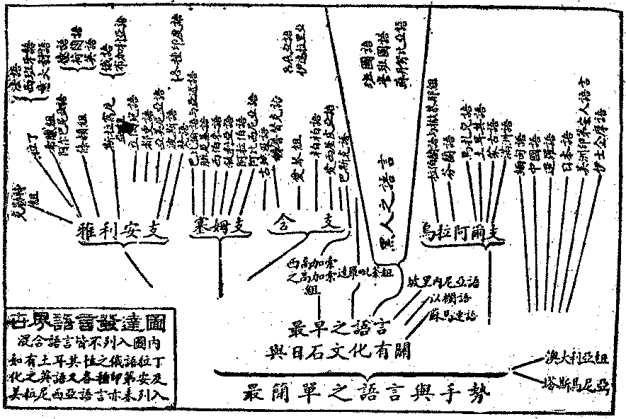



此中各族之语言文字学，今不专论，而语言文字之统一，实为今而后人类之需要。察地球之大势，华文系、梵文系、及英文系三，为最广流行语系。取此为经，参以各族文语为纬，织成一地球之语锦，为今世语言文字学者之鸿业。英文由希腊拉丁文孳乳而生；华文之起颇早，始於象形，继以指事、谐声、会意、版图扩大，多族同化，集各方语文，互相转注而杀其有餘，藉递代语文，因应假借而补其不足，所谓六书，即六种依语言而制文字之方法所制成之文字也。凡各文字，皆有声韵、形体、意义之三方面。说文解字、尔雅韵府等，为研究之专门书，近世戴、段、钱、王、俞、章之考证学，集其大成，兹难具述，惟略言佛陀学根柢之梵文耳。



二　梵文与声明



印度古代文字，通名「梵书」──巴利文等通俗梵文，亦梵文之支流──，俗传是劫初梵王造，谓有百万颂释。今可考之声明古籍，当推六吠陀分中论字源──梵云尼禄多──等书，作者为耶斯迦。其书中虽传有古作家迦多婆之名──即旧传之迦单设罗仙，略古声明为万二千颂者──，今亦无考。后、梵语於吠陀语外，别成一种「雅语」。二千四百年前大语学者波尼儞出，整理雅语，遂为声明别辟一新时期。如定字母为四十七，别为字母各声，虚实诸词，啭声各异，十罗三世，秩序井然。凡此大端，皆为后来语学者之所本，今略举其著作如次。



第一、苏呾啰，凡八篇三十二章，三千九百七十六则，为声明论之根本典。唐人传为八千颂之根本经者是也。其籍现存。



第二、伽那婆他，语汇之类。



第三、驮都婆他，为三荒章之一，有八百颂。大声字义之义，旧译八界论者是也。



第四、温那地，旧传三荒章之一，有一千颂，论字缘。



后之三种，为前一种补充遗义之作。波氏以后作者，大多从事注释，其略如次：二千二百年前，迦多耶也那作本经之释文，略为千二百四十五则。二千一百年前，钵填阇梨作大婆沙，约为千一百十三则；此书现存，义净传为朱弥有二十四千颂者是也。自后作者中绝，凡数百年。一千六百年前，旃陀罗作二二四章记论，别成一派。一千四百年前，阇耶佚底与缚摩那共作迦尸迦颂，义净传为苏呾啰中最妙有十八千颂者是也。稍后、伐致诃黎作伐致诃黎论，二十五千颂，释大婆沙薄迦论七百颂，叙圣教量及比量荜拏颂三千颂。时护法论师作荜拏颂释十四千颂，又作杂宝声明论二万五千颂，为梵文雅语最究竟之作。自后印度别行俗语法，则精严稍逊前矣，亦印度文化衰落之徵也。此为梵文学之略史。佛陀学将古代学术，总分五科，谓之五明──梵语播遮吠陀──，犹云五种之科学也。学者习之，自记论始──记论，梵云毗阿羯刺拏，即旧传毗伽罗论──。记论乃分别声韵，训释文例者，近於今所谓文典等，为研习他种学术之基础。佛学中始明此学曰声明。次因明，则论理学也。次医明，则医药学也。次工巧明，则算学及人间实际应用诸学皆是──若农、工、政、法等，观华严经善财所闻自在主说可知──。西域记谓印度开蒙诱进，先遵循十二章；七岁之后，渐授五明大论，一曰声明云云。则声明者，犹近代考证学者所云之小学是也。佛陀学传华后，翻译至於唐代，精严遂臻其极。章句之间，往往存梵文之形式。不习声明，即时苦其诘屈难读。兼以辨别主宾，应知啭声之例；审定名义，必从离合之方；毫厘之差，不厌研核。惜声明之学，唐贤传译未详备，后之学者无所依据。今则转藉欧译，稍便寻究，然犹不易言也。



三　何谓名句文身



诠表单事、单义之单名曰名，若中国字典、辞典所列之各字、各辞；二个名字以上，聚写一处，则曰名身──梵云那摩迦耶──，或多名身。缀二名以上，诠表彼事义与此事义关系者之一辞曰句，例云「人死」或「人皆有死」等；二个名辞以上，聚写一处，则曰句身──梵云钵陀迦耶──，或多句身。不诠事义而但为附丽声音曲屈之符号者曰文，亦曰字母，例ａｂｃｄ等；佛陀学中或赋与玄密之意义，非其本也。二个字母以上，聚写一处，则曰文身，或多文身──梵云便缮那迦耶。便缮那，原义为盐等，故旧译味──。中国文字，有名而无字母，此与西洋文及梵文异者。而梵文之有字母，则与西洋文同也。身者、聚也，意显聚集多名说多名物，聚集多句说多句意，聚集多文表多声韵，故谓之身。然文身仍为文而非名、句，名身亦仍为名而非文、句，句身亦仍为句而非名、文，其界不相混也。推名、句之所依，乃及文身，故置后说。若循学习之序，应曰文、名、句身。先学字母，乃及字母拼成之名，名缀成之句故。亦有以「文」为成篇之文章者，非其本义。瑜伽说声明处有六种施设建立相：一曰法，谓名身、句身、文身，及不鄙陋、轻易、雄朗、相应、义善之五德相应声，以声为体，文、名、句是声上音韵屈曲之用，体用兼彰，则为名、句、文、声四法。二曰义，谓十种义：根、大种、业、寻求、非法、法、兴盛、衰损、受用、守护。又六种义：自性、因、果、作用、差别、转。三曰补特伽罗──数取趣，有情或人也──，谓建立男、女、非男非女声相差别，或复初、中、上士声相差别。四曰时，谓三时声相差别：过去过去殊胜，未来未来殊胜，现在现在殊胜。五曰数，谓三数声相：一数、二数、多数。六曰处所根栽，处所谓相续、名号、总略、彼益、宣说，五皆诸声明本籍中品名，故谓为处所。根栽谓界颂等，及论字之为餘义所根者。是六相者，概括一切能诠所诠差尽，声明所明，要不外是。然第二义相，属一切所诠，遍餘明处；声明正属能诠，故当就第一法相、第二补特伽罗相等五相以论之。此言名句文身，正是第一法相，亦是声明之总相也。下之所论，不出於此。



四　文及文身



辨文身音韵及拼法者，及悉昙章。西域记谓童蒙所习，在五明论之外；寄归传则视为声明五论之一。真言宗传中国之后，以须意观梵字，口诵梵音之故，辨字音之悉昙，成为专学。古今著述，颇有能详尽者。悉昙、译云成就，乃写字母时用为篇首之标章，表学之有所成就之吉祥意者。后人因写字母先韵后声，韵母前即标悉昙，遂误悉昙为字母，寖假而用为字母之总称。故诸学者，常举悉昙字母──梵云悉昙摩呾理迦──为言，而於论字母连缀声音转变之书，亦名为悉昙章也。旧传字母之数，多寡不一，瑜伽则定字身为四十九。伦记引奘师云：『传有三说：一说𧙃、阿、壹、伊、邬、乌、纥、吕、纥、闾、吕、𦟐、污、隩，为十四韵别，加暗恶为助句辞，超声有八，毗声有二十五，加标首之悉昙，为四十九。一说悉昙但是总标，不入字数，别加滥时鮔意，餘同。一说韵有十六，暗恶亦入韵数，餘同』。涅槃经文字品，说三十五字为声母，十四字为韵母，故共四十九字。然按华译涅槃有五十字，中一「罗」字，系叠声之滥入，故唯四十九字为定。字母分为韵──梵云摩多──、声──梵云毗衍阇南──之二。其间部别烦复，波尼儞之所分别者，其目如次：



　　　　　　　　　　┌单韵𧙃等  

　　　　　　　　┌韵┤复韵㖶等  

　　　　　　　　│　└半韵也等  

　　　　一切字母┤　┌喉声迦等────┐  

　　　　　　　　│　│颚声者等　　　　│  

　　　　　　　　└声┤舌声咤等　　　　├舍沙婆呵  

　　　　　　　　　　│齿声𫖰等　　　　│  

　　　　　　　　　　└唇声跛等────┘



或别声为七类：一迦等五，二者等五，三咤等五，四𫖰等五，五跛等五，六也等四，七舍等四，依此分类，表列古今所译字音如左：



　　　　┌────┬────┬─────┬──────┐  

　　　　│声韵分类│奘师传者│涅槃经者　│近人译者　　│  

　　　　├─┬──┼────┼─────┼──────┤  

　　　　│　│　　│𧙃　　　│短阿　　　│阿　　　　　│  

　　　　│　│单　│　　　　│　　　　　│　　阿　　　│  

　　　　│韵│　　│阿　　　│长阿　　　│阿　　　　　│  

　　　　│　│　　│　　　　│　　　　　│　　　　　　│  

　　　　│　│　　│壹　　　│短伊　　　│伊　　　　　│  

　　　　│　│韵　│　　　　│　　　　　│　　伊　　　│  

　　　　│　│　　│伊　　　│长伊　　　│伊　　　　　│  

　　　　│　│　　│　　　　│　　　　　│　　　　　　│  

　　　　│　│　　│邬　　　│短忧　　　│乌　　　　　│  

　　　　│　│六　│　　　　│　　　　　│　　乌　　　│  

　　　　│　│　　│乌　　　│长忧　　　│乌　　　　　│  

　　　　│　├──┼────┼─────┼──────┤  

　　　　│　│　　│㖶　　　│㖶　　　　│厄　　　　　│  

　　　　│　│复　│　　　　│　　　　　│　　厄　　　│  

　　　　│　│　　│蔼　　　│黳　　　　│厄　　　　　│  

　　　　│　│韵　│　　　　│　　　　　│　　　　　　│  

　　　　│　│　　│污　　　│乌　　　　│鄂　　　　　│  

　　　　│　│四　│　　　　│　　　　　│　　鄂　　　│  

　　　　│　│　　│隩　　　│炮　　　　│鄂　　　　　│  

　　　　│　├──┼────┼─────┼──────┤  

　　　　│　│　　│纥　　　│鲁　　　　│唎　　　　　│  

　　　　│　│别　│　　吕　│　　　　　│　　伊　　　│  

　　　　│　│　　│纥　　　│流　　　　│唎　　　　　│  

　　　　│　│韵　│　　　　│　　　　　│　　　　　　│  

　　　　│　│　　│吕　　　│卢　　　　│利　　　　　│  

　　　　│　│四　│　　闾　│　　　　　│　　伊　　　│  

　　　　│　│　　│𦟐　　　│楼　　　　│利　　　　　│  

　　　　│　├──┼────┼─────┼──────┤  

　　　　│声│随韵│暗　　　│庵　　　　│昂　　　　　│  

　　　　│　│止声│恶　　　│疴　　　　│阿斯　　　　│  

　　　　├─┼──┼────┼─────┼──────┤  

　　　　│　│喉　│迦　　　│迦　　　　│嘎　　　　　│  

　　　　│毗│　　│佉　　　│呿　　　　│喀　　　　　│  

　　　　│　│声　│伽　　　│伽　　　　│噶　　　　　│  

　　　　│　│　　│　　　　│　　　　　│　　哈　　　│  

　　　　│　│五　│键　　　│伽（重音）│噶　　　　　│  

　　　　│　│　　│（缺）　│俄　　　　│迎阿（二合）│  

　　　　│　├──┼────┼─────┼──────┤  

　　　　│　│鄂　│者　　　│遮　　　　│匝　　　　　│  

　　　　│　│　　│绰　　　│车　　　　│擦　　　　　│  

　　　　│　│声　│阇　　　│阇　　　　│杂　　　　　│  

　　　　│　│　　│　　　　│　　　　　│　　哈　　　│  

　　　　│　│五　│（缺）　│阇（重音）│杂　　　　　│  

　　　　│　│　　│（缺）　│若　　　　│尼鸦（二合）│  

　　　　│　├──┼────┼─────┼──────┤  

　　　　│　│舌　│咤　　　│咤　　　　│查　　　　　│  

　　　　│　│　　│搋　　　│佗　　　　│叉　　　　　│  

　　　　│　│声　│茶　　　│茶　　　　│楂　　　　　│  

　　　　│　│　　│择　　　│茶（重音）│楂　　　　　│  

　　　　│　│五　│拏　　　│拏　　　　│那（哈）　　│  

　　　　│　├──┼────┼─────┼──────┤  

　　　　│　│齿　│多页　　│多　　　　│答　　　　　│  

　　　　│　│　　│他　　　│他　　　　│塔　　　　　│  

　　　　│　│声　│柁　　　│陀　　　　│达　　　　　│  

　　　　│　│　　│　　　　│　　　　　│　　哈　　　│  

　　　　│　│五　│达　　　│陀（重音）│达　　　　　│  

　　　　│　│　　│娜　　　│那　　　　│纳　　　　　│  

　　　　│　├──┼────┼─────┼──────┤  

　　　　│　│唇　│跛　　　│波　　　　│巴　　　　　│  

　　　　│　│　　│颇　　　│颇　　　　│葩　　　　　│  

　　　　│　│声　│婆　　　│婆　　　　│拔　　　　　│  

　　　　│　│　　│　　　　│　　　　　│　　哈　　　│  

　　　　│声│五　│薄　　　│婆（重音）│拔　　　　　│  

　　　　│　│　　│磨　　　│摩　　　　│嘛　　　　　│  

　　　　├─┼──┼────┼─────┼──────┤  

　　　　│　│　　│也　　　│耶　　　　│鸦　　　　　│  

　　　　│超│前　│洛　　　│啰　　　　│喇　　　　　│  

　　　　│　│四　│砢　　　│罗　　　　│拉　　　　　│  

　　　　│　│亦　│缚　　　│和　　　　│斡　　　　　│  

　　　　│　│曰　│舍　　　│赊　　　　│沙　　　　　│  

　　　　│　│半　│沙　　　│沙　　　　│卡　　　　　│  

　　　　│声│韵　│娑　　　│娑　　　　│萨　　　　　│  

　　　　│　│　　│呵　　　│呵　　　　│哈　　　　　│  

　　　　└─┴──┴────┴─────┴──────┘



若字形屈曲之写法，古今变迁不一，近人多用提婆那伽利书，与今所传，不无殊异。此外缀音生字之法则等，详在悉昙字记。



五　名及名身



瑜伽及显扬等，均以声明六相为名身六依处。盖声明虽包括名、句、文身，而名实为主要。谓之名明，亦无不可。廓充之，若中国且合因明称曰名学，可知「名」之关系大也。然在华文，於此乃无专著，比迹寻之，略有可述。一者、名之构造，所谓字界字缘。二者、静词啭变，所谓苏漫多声。三者、动词转变，所谓底彦多声。



六　字界字缘



梵文名身，多有语根，及最简单之「名」，而为「餘名」所从演绎，谓之字界，字之因也。於语根之首尾，附加单名，谓之字缘。字缘附字因后，字因原义，或变或否，乃成语干，谓之字体。成唯识论有云：『毗助末底，是疑义故；末底、般若，义无异故』。此说主张「疑」是「慧」之一种。末底、般若，均译为慧，以「毗字缘」，加助「末底字界」，成「毗末底」，则为「疑」义。主张字界原义不变，则疑仍为慧之一种。若主张字界原义已随字缘而转变，则疑非慧。辨此纠纷，在明字界、字缘，毗是字缘，末底是字界也。取譬明之，字界、字缘，皆若华文单字，例人与言；字界字缘合成字体，则若华文二字合成一辞，亦同会意之字，例「人言」之为「信」。人言固为言之一种，可仍是言，然合为信，则别指信德而非指言矣。此为二名构成一名之式。



七　苏漫多声



於字体上，更於其末声韵变化，以表此名与他名之中介等关系，及「名」在「句」中之位次者，有八啭声：一、体声，梵云你利提势，表能作者；或一事一物之当体，居句中之主位，例云「农人」。二、业声，梵云邬波提舍泥，表所作即动作所止，居句中之宾位，例云务农。前二汛说之词。三、具声，梵云羯咥唎迦啰泥，此表动作之所由藉，居句中之附加主位，例云由耕种力。此明自因。四、为声，梵云三钵啰陀你鸡，此表动作之何所为，居句中之第二宾位，例云为资生故。此明目的。五、从声，梵云裒波陀泥，此表动作之所从来，例云从师学来。此明他缘。六、属声，梵云沙弭婆者你，表动作者系属所在，例云务农中国。此明统属。七、依声，梵云珊你陀那啰梯，此表动作之所依对，例云依农具等；或於田中。此明助缘。八、呼声，梵云阿曼怛罗泥，此表所呼召者；独举其名，与餘无涉，故在句中为独立格，例呼某人。今更问答明之。例如观一农作，问曰作者谁？答曰农人。工作何事？答曰务农。用何务农？答曰由耕种力。为何务农？答曰为资生活。何能务农？答曰从师学来。务农何属？答曰务农中国。将何务农？答曰依农具等，及於田地。尔何姓名？答曰某某。集成一文，即「农人务农，由耕种力，为资生活，依犁、田等，从师传习，务农中国，名为某某」也。於此文中，各名关系及其位次，在梵文皆以各名之尾声变化示其区别。察其尾声区别，知示何种关系，居何位次，谓之啭声──参阅瑜伽论及杂集论等──。唐译经论，应用其八啭声者甚多，兹不繁引。



梵语中具啭声变化之名，皆有数目，其别凡三：一数为一言，梵云翳迦啭遮拏；二数为二言，梵云陀毗啭遮拏；三数上为多言，梵云波呼啭遮拏。此三亦以字尾啭声为别。但历来译文，殊少明白标出者。但亦有时以数目差别，不能不辨者。例成唯识论解「二各二」云：『上一二字，显两种二：第一种悔眠二，第二种寻伺二』。盖特嚩炎是一言之二，特嚩曳是二言之二，特嚩是多言之二。「二各二」句，上一「二」字，是一言二，则但二法。是多言二，则可多法。今此上一「二」字，是二言「二」，表有四法，故统两种二法。前八啭声，各以此一言、二言、多言之三啭乘之，则成二十四种啭声。声尾示单数、多数之区别，英文亦有，但华文则无耳。



名、代、形容等啭声名，又有男声──梵云蓬棱伽──，女声──梵云尸咤唎棱伽──，中声──梵云纥梨波棱伽，译不分男女声，或作非男非女声──之别。欧文亦有此种区别，中国近亦仿之。如以他字呼男，她字呼女，牠字汛呼者是。此等虽以物之性质为别，然梵语於尾声变化，不厌其繁。男女声韵，长短差异，故其字体亦变为他种声而供应用。大抵男声尾为短韵，女声之尾则为长韵。每四句颂，短韵长韵，相间而用，犹中国之律诗别平仄然，以声韵为区别。故诸啭声，皆可有此三别。唯识枢要释成唯识谓：梵音毗若底（识），摩呾刺多（唯），悉提（成），於女声内呼之。若用男声，则为毗若那（识），摩呾刺（唯），悉达（成），即其例也。以兹三啭乘前二十四啭，则有七十二啭。此前三共七十二种啭声，皆明名、代、形容诸静词尾声变化者，总曰苏漫多声，多以苏声居后而成其啭声故。且此在泛常文语中亦多用之，故基师云：『见於泛文』。



八　底彦多声



梵文除介词、助动词、连词等名，无声韵变化之应用外，其餘静词、动词等名字体──原名、或字界字缘合成名──，虽不变动，然每视所应表白而变其尾声。前已明诸静词之啭声矣，今更进明动词啭声。梵语动词中时之区别甚繁复，波尼儞尝举语尾罗声之种种，表时变化，曰十罗声。名义如次：



　　　　　　　　　　┌泛说…………罗咤………泛说现作  

　　　　（一）现在时┤愿望…………棱…………说现愿作  

　　　　　　　　　　└命令…………路咤………命他现作  

　　　　　　　　　　┌正过去………蓝…………泛说已作  

　　　　（二）过去时┤已过去………梨咤………说久已作  

　　　　　　　　　　│　　　　　┌泛说………鲁頞…………泛说非现时作  

　　　　　　　　　　└不定过去…┤  

　　　　　　　　　　　　　　　　└希求………悉啰棱………表已愿作  

　　　　　　　　　　　　　　　　┌泛说………鲁咤…………泛说当作  

　　　　　　　　　　┌单纯未来…┤  

　　　　（三）未来时┤　　　　　└假设过去…罗林…………假说已作实是当来  

　　　　　　　　　　└复述未来…………………罗唎咤………藉餘语以显其当作



此种分别，亦近希腊语系诸国文语。华译於过去用「已」、「讫」等，未来用「当」等，命令用「应」等，愿望用「愿欲」等。虽甚瞭然，摄略未尽。此表时别异之动词，亦用声尾啭音为表，即二九韵，或十八啭声也。先分为自而言、为他而言二种，每种有泛说、说自、说他之三种，则成六啭；每种又有一言、二言、三言之别，乃成十八啭声。其式如次：



　　　　　　　┌泛说………一言………二言………多言  

　　　　为自言┤说自………一言………二言………多言  

　　　　　　　└说他………一言………二言………多言  

　　　　　　　┌泛说………一言………二言………多言  

　　　　为他言┤说自………一言………二言………多言  

　　　　　　　└说他………一言………二言………多言



此十八啭，多以底声居后而成其啭声者，故曰底彦多声。泛常文语，不甚严别，惟学者间取为准绳。故基师曰「则以庄严文句」，非谓泛文无动词变化也。底彦多声中为他言九韵，梵云般罗飒迷，即动词所表动作及於他身他物者。其为自言九韵，梵云阿答末泥，即动词所表之动作仍返於自身而止者。为他之言，泛用较多，为自之言，多用令文巧妙。文语俗雅、朴华，虽不离绝，然亦往往因之而判。又瑜伽论初、中、上士，初士梵云乌他摩补鲁杀，此即泛说；中士梵云摩驮摩补鲁杀，即此说他；上士梵云钵罗檀补鲁杀，即此说自。初以泛说，中以说他，后乃说自。不同欧西以自名第一人，以他名第二人，以泛名第三人。先泛后自，为顺序之知识；先私后公，乃颠倒之思想，此亦梵欧之一殊也。初言未辨他、自，类如小儿；次言辨他忘自，则类庸人；后言察餘明自，乃类达者，故基师以之为喻也。



九　名句间之六合释



构名成句，有时还用构成之句用之若名。此名句缀合之成语，泛文之应用者殊广，远为欧罗巴系等文语所不及。而各有其构成之法则，因此含义周详，可省无数繁文复韵。然译为华文者，未能著其条例；有之、则其一部分之六合释──梵云杀三摩娑──耳（参考法苑义林章等）。此六合释，亦曰六离合释，盖欲寻一合成语句之义，当先离析以为二名或三四名，然后察其以何方式合成，定其训释之义。兹先列其六种方式，乃援例证成之。



一、依士释，又曰依主。句中前分为后分依，对之有领属关系者。



二、持业释，又曰同依。句中前分泛用诸名以叙述后分者。



三、带数释，亦曰双物。句中前分专用数名以叙述后分者。



四、不变释，亦曰邻近。句中前分为助动词等，餘句亦用如助动词者。



前四皆为句中以前分限定后分之义者。



五、有财释，亦云多榖。全句如一形容词者。此多由前类合成句转成，亦为第二次合成句。



六、相违释，亦云对偶。句中两名，立於平等并立之位，前分后分无关属者。



（一）依士释多属第六转声，然亦不拘限之。例成唯识论述记云：『由抉择所得灭，名为择灭，由第三啭上依士释』。梵云钵啰底僧佉耶，此云决择；梵云尼路驮，此云灭。由决择而得灭，合成「择灭」之语。末用第三啭声，故以依士释之。（二）持业释，句中前后分名，虽各诠其一义，然同目於一事，故亦谓之同依。前分或为名词，或为形容词、助动词，例成唯识论云：『七持业释，如藏识名，识即意故。六依主释，如眼识等，识异意故』。意者，梵云末那，思量为义；识者，梵云毗若那諵，分别为义。曰意曰识，同目第七之用，故曰七持业识。若第六、虽同名意识，依第七意而名意识，故曰六依主释。（三）带数释，等於持业，但前分为数词而已。例云六识，七识。（四）不变释，不变者，谓其句语无尾声啭变，全语用如助动词也。例云「念住」，实住定慧。若云於定慧住，属依主释；然不云定慧住曰念住者，念易知故，近定慧故。具足应云近於「念」之「定慧」中住；犹云近於「长安」之「终南」住。欲人易知，但曰「近长安住」，或「近念住」。「念」显定慧所近之处，用显住於定慧，故为助动词而尾声不啭，同不变释，或引伸之曰邻近释。（五）有财释，多用他语转以形容别一名者，例云「觉者」。觉是菩提，者指佛陀，用「有菩提」形容「佛陀」，故曰觉者。或但以「觉」释「佛」，则并所形容之一名省去，所谓以他为自，全受他称者也。故前分末之男女、一多等啭声，必与所形容者全相一致。义林章云：『论以唯识为所成，名成唯识论，亦有财释』。用「成唯识」三字，为「论」字之形容，指之曰「成唯识论」；或「能有成立唯识理之用」者，故有财释。分析其式如下：



　　　　︵　　　　　︵　　　　　　︵　　　　　　︵︵　　　　　　︵  

　　　　名　　　　　名　　　　　　形　　　　　　一名　　　　　　一  

　　　　　　毗若底　　　摩呾刺多　容　悉　　地　言　　奢萨呾罗　言  

　　　　　　　　　　　　　　　　　　　　　　　　体　　　　　　　体  

　　　　词　　　　　词　　　　　　词　　　　　　声词　　　　　　声  

　　　　︶─────︶──────︶──────︶︶──────︶  

　　　　　　识　　　　　唯（或量）　　　　　成　　　　　论  

　　　　　　└──┬──┘　　　　　　　　　│　　　　　│  

　　　　　　　　　持　　　　　　　　　　　　│　　　　　│  

　　　　　　　　　业　　　　　　　　　　　　│　　　　　│  

　　　　　　　　　└──────┬─────┘　　　　　│  

　　　　　　　　　　　　　　　　依　　　　　　　　　　　│  

　　　　　　　　　　　　　　　　主　　　　　　　　　　　│  

　　　　　　　　　　　　　　　　└─────┬─────┘  

　　　　　　　　　　　　　　　　　　　　　　有  

　　　　　　　　　　　　　　　　　　　　　　财



以识即量，故持业识──或识之唯，亦依主释──。唯识之成，故依主释。以能「成唯识」为「论」形容词，故有财释。若云「成立唯识之论」，亦依主释。盖一语句，析之可为多释，有财释於「成唯识论」之句内，特为多释中之一释，故曰亦有财释。（六）相违释，并列二名以至多名，不相关属成一语者。例云立破真似。谓能立与能破，及真能立、真能破，与似能立、似能破也。虽或不用「与」「及」等连介词嵌入解释之时，则同有「与」「及」等连介词者。以六合释本，通用於「名」「与」「句」间者也。「立破真似」亦谓之句，犹「能立与能破」之成为一句也。句及句身等构成例，近刊有阿弥陀经、楞伽经等梵文原典，当以梵文文典考其成例，兹不详述。



十　声明之用与体



声明包举语言文字，文字以语为根，语言之用在名、句、味──味即字母，亦即文身，乃声音之符号──。名、句、味乃声上屈曲音韵，声为事体，名、句、味乃声之「分位差别」，声实、名句文假，故诸文语以声为体。或曰：语言虽用耳闻，文字乃由眼见。点畫等为色之曲屈形状，色为事体，点畫等乃色之分位差别，色实、点畫等假，故未有文字前，所闻语言以声为体，既有文字，则闻语言音乐，或见文字图畫，皆能解其所诠表义，故以声、色为体。或曰：就「能诠表於义」之事以明其体，则云声、色为体，亦但循此人间之常俗耳。聋哑者之解义，则唯以「色」为体，盲者多以声触为体，在旁生等，多以声、香、味、触为体。他有情界，或光色等，或香味等，或梦法等，皆得为体。故以「色、声、香、味、触、法」为体。或曰：文言有二：一者、显义文言，色、声、法等为体；二者、显境文言，诸识心等为体。且色声等即为识心之所显境，境含现量、比量一切所知事义，将所显为能显，故唯以「识」为体。或曰：穷究其本，诸识分别及所分别，皆以无分别之「现量实相」为依，故皆应以现实──真如──为体。或曰：体用重重，可别论之：真如为体，识等为用；诸识为体，色等为用；色、声等事为体，名等假位为用。不至真如，显体不尽；不至假名，明用不周。以用显体，依体明用，体用重重，乃能周尽，圆满融彻，如前相对绝对之算学观，乃为现实主义之声明也。语言文字如此，借观餘法亦无不然。要之，皆为现变实事，皆为现事实性，皆为现性实觉，皆为现觉实变。能知现实所用工具，还即现实而已。



第四节　立破真似



一　立破真似概说



立破真似，都指比量而言。有「为自求知」之比量，如前现比真似节中所说。有「为他令知」之比量，则当於此节中说之。详此法者，曰因明学，广有专书，兹但略陈纲要。立谓能立，以宗因喻为能立具，立自所知令他知故。破谓能破，以宗因喻为能破具，破他邪知令正知故。此能立破，皆以因喻成於宗义。若宗、若因、若喻，有诸过谬，则为似能立、似能破；善离过谬，则为真能立、真能破。此中要意，在於离诸谬似，真能立自所知、令他亦知，真能破他邪知、令成正知。盖依第一节中真现比量，及比量中所用算数文语工具，於某事义之自共相，在自心中既成正知，观他心中尚有未知，为晓喻他，乃有所立。或观他心，於某事义所知错谬，为改正他，乃有所破。若立若破，总为悟他。而悟他之工具虽非一事──若测算及图表等事──，主重之端，乃在言语文字。言语文字，发端在名，缀名成句，积句成论，至论、乃成悟他究竟之用。然则建论悟他，将以显真祛似，应有原於现知自然，而归於比知必然之论法，以为共同遵循轨式，是非邪正，乃可判别。譬之弈棋，必依格子定数及其著法，乃有输赢之结果可言也。明此立论法式，在西洋曰逻辑，在印度曰因明，而中国之名学，则交纽於现比真似与立破真似间，两者皆未完成。盖因明学虽以量论为据，而其所主，则在立论之法，故属於论理学。至量论，则为哲学中之知识论，其大部分属於五明中之内明。然陈那之量论，注重为因明之依据，故於内明之知识论犹未穷极，穷极内明之知识论，乃在於法相唯识学。前於现比真似节中已略言之，而此节则言佛陀学中之因明学也。



二　佛陀学之因明



佛陀学尝总括诸学艺曰五明：内明，声明，因明，工巧明，医药明是也。内明为体，声明等四为用。明者、学艺之谓。初节为内明之一分，乃因明之依据，次即声明一分，第三节为工巧明之一分，亦为因明所依。佛陀学中之因明学，完成在释迦后千年之陈那等。考此学成立之因缘，其内因在佛说之内明知识论，即四答、十四不记、堕负等论法。阿含、楞伽、深密暨小乘诸阿毗达磨，已兆其端。龙树师弟诸论，广破外小，渐具轨式，曾专集为方便心论。次及无著、世亲，复摈恶空，散见瑜珈、显扬诸论。复有如实论之编纂。而在外缘，则有渊源於太古足目论师，而成立於释迦后之正理论，为今印度哲学中之正理一派，说四宗、五分、九因、二十二堕负处等。声论、数论等派，依其法皆有理论之发展，与佛陀学者相辩论。集此内因外缘，加以陈那在内明之深悟，遂刱为佛陀学之因明学。复得其弟子天主之阐扬，护法、清辩、德慧、戒贤诸论师，乃皆依为立论之标准。承此论法，分传为支那及印度、西藏之两流派。在支那，则为慈恩师资之推阐。在印度，则为法称、天喜、宝称、无忧、宝作、静法上等之详审。此佛陀因明学之大抵可言者，今则更有日本及西洋诸学者，取资演绎归纳之逻辑学，比较攻错，以相发明。在有智者，当重详其短长所在，以成为世界之论法。



三　佛陀因明学之实用



佛陀学中，既以「为自求知」之方法，属於「现比真似」之量论──通内明、因明，或通五明之正不正知──，而以「立破真似」之因明学，专重在「为他令知」之方法。故其实用，不同逻辑之用。其格式不以自求知识，而在设言论以立真破似晓悟他人。故逻辑之归纳、演绎，大抵为依现量成比量、依比量成比量之量论──即知识论──；而於因明学为他令知之实用方法，多未完密。於此一端，近之学者皆未认清，故於逻辑与因明之比较研究，不能知其要领。因明学既专在建论以立真破似而令他正知，后法称诸贤，於自悟量论则得，於悟他因明犹失也。故陈那以前之古因明学，若瑜伽、显扬、集论等，就立论之实际立场，先加注重。盖立论之实际立场，宾主对扬，盛兴论议，将以判决是非，辨定胜负，宜有共循之轨：一者首应区别论之性质，曰论体性，大别有四：一、随俗习之论，二、故诡诤之论，三、显正理之论，四、为教导之论。若审知立场之论众，其所欲立之论在前一种，则当随俗和光，置而不言；在第二种，则为诡辩，故兴诤谤，可谢绝曰：既唯诡诤，恕不参加。在第三种，则为立论对辩之真目的，乃应如法论辨。在第四种，乃为先知知后知、先觉觉后觉之事，著书立说，端在乎此。故在佛陀学之立论，唯取后之二种，所谓由大悲智显扬正理与教导学徒而晓悟他也。二者、则应审察立论处所。凡立论处，除「立论者」，应更有「对辩者」与「证义者」及「旁听众」。证义者之裁决，旁听众之赞否，皆有重大关系。故凡论辩真理，应在能决是非者前，及在乐解法义众前。其证义者，应更谙知下二轮轨，所批判者乃得其当。三者、论者应有「善成所立论」之功德：一、善知自他宗，二、音圆满，三、无畏，四、辩才，五、敦肃，六、应真；善自他宗否为尤要。故天主於宗因二支诸过，多有依自他宗义之相对上施设者。法称不知因明乃专重对他立论者，遂议废弃。四者、论堕负相。论议结果，在立论者或对辩者，自知所论辩者有屈於理，重真理故，发言谢过，舍自所论，曰舍负相。此为光明磊落之易可知负相。设或情不甘服，声请暂时思滞，容更考虑，亦为舍言负相，则须证义者为裁决其堕负也。如弈棋者，托言再弈，不认为输，即为输也。其或理言俱屈，矫设其他取巧言语以图混乱於证听者；或伪为静默等形容以掩饰其穷相，曰屈负相；则如弈者托事置而不弈。甚或发诸不善言辞以强争轧，所谓：杂乱语，粗犷语，含糊语，繁简失当语，非义相应语，前后不次语，屡自立毁语，不规则语，不相续语等，曰过负相；如弈棋者之乱其子、翻其枰等，皆须由证义者为裁决其负也。舍、於论德为上，屈、犹不失中德，过斯下也。按瑜伽等说论处七：一、论体性，言论等六；二、论处所，王家等六；三、论所依，所成二、能成八；四、论庄严，善自他宗等五；五、论堕负，舍言、言屈、言过；六、论出离，观察得失等言；七、论多所作法。第三论所依，通「现比真似及宗因喻支」之所说；餘之六处，合为今之四轨。非此四种共循论轨，则虽可以因三相自比求知，或闭门著书教导学徒，然未足登论坛以论辩也。



四　为他比量之三支



佛陀因明学之实用，在於为显正理，及为教导之立论以悟他。此「为他令知」者，即宗因喻之三支比量也。其所立之主义，梵云皤啰提若，此译为宗。在教导时之听受众，若能解信而无疑诤，则虽不更出因喻亦可矣。唯在论场辨扬正理，且其所辨扬之正理，又必非常识皆了之「声是所闻」等义──此种立等不立，曰相符极成过，亦等阙宗支过──，则必有其疑而对辩之者。例曰「声是无常」，立此宗时，其疑而对辩者，可诘之曰：汝说声是无常，以何理由知声是无常耶？若无理由，何以知声不是常耶？我今亦可不须理由，说声是常。我言既立，汝言则坏。由是立声是无常者，继此须说何故声是无常之「因」，始能令信。乃曰「所作性故」，或「众缘所生故」，或「勤勇无间所发故」。凡所举为「因」者，必择一为对辩者及听众所已知或易知之宗上「有法」所有法，乃能使对辩者悟，或不能不许。然虽已出其因，而对辩者疑犹未决，则辩亦未能已。如曰：我亦固知声是所作性也，然何以知声是所作性故，声不是常而是无常？此若未决，则虽说所作性为因，声是无常之宗仍未成立。故立论者，至此又必加引同喻──即同一律──，乃曰「如瓶等现见是所作而是无常」。然疑辩者犹可诤论，诘以瓶等所作性者虽是无常，汝未尽知诸所作者皆是无常，安知声虽所作，而声不是常耶？立论者至此，又必更加引异喻──即矛盾律──曰：「如虚空等是常者，现见非所作」。今说声是所作性故无常，现有瓶等可证；汝说声虽所作是常，无可为证。今说若常，则非所作，现有空等可证；汝说声是常而所作，无可为证。我言有证，汝言无证；汝既无证，我可证为：凡所作者，皆是无常，声既所作，定是无常。故应舍汝无证之虚言，信我诚证之正理。至此、则对辩者，於未能寻出是「常」而又是「所作」之证据时，则不能不舍诤皈服，或声请再思矣──属舍负相──。故「喻」梵云「乌陀诃罗諵」，直译云「见边」。曰见边者，谓同异喻正反相成，极世间智见共喻之边际，至此更不容异知见之存留也。由此应可令他疑断信立，舍邪成正。纵使邪疑尚存，然於邪辩、不能不为之屈，故於正论可云已尽其能事也。然立论之活泼应用，不必皆有因喻，或但举宗而置因喻，或但宗因而不举喻，均无不可，要在令他信解所立之理而止。因明学以阙支为过，若阙宗支，虚言无所立义，则诚过也。若但举宗义或宗因，他人已能信解，不待喻或因喻，则虽阙而非过。此其立论法之伸缩自由，可因对他所宜，为灵便之应用，实为因明学之特色。不同逻辑，以现量成比量之归纳法，以比量成比量之演绎法，但能用为比求自知，用之为他令知，实际则颇为呆滞也。然在立论遗世以悟无限之他，则固应以三支圆满为善。三支有阙，必将遗人以起疑辩，故於阙支，皆可言过。因明学者，历久研求，至约至精，乃成定式。在三支中，宗为立所信义，因为出义所由，喻为譬晓因义，因喻合为成立宗义之具。然对「显自知中欲令他知之理」，则在立量、设量、救量，宗、因、喻言皆为能立；在破量亦宗因喻言皆为能破，似能立破，则又皆为所破。盖真能破，即破似能力、似能破之论，以显其为真能破也。



五　宗支之构成



宗者，所信所崇所立之主义也。古分四类：一遍所许，二先禀承，三傍准义，四不顾论。陈那以后，惟取后一：或发微言，不顾前三；或破他宗，故违旧立，随自意乐，皆第四类。虽立宗非为与世间兴诤及就自教诡辩，必不悖於世智共许，所禀自教，比知，现证，而后所宗乃得成立。然既遍许，不须重立；先禀遗教，犹应抉择；傍比所准，非今正意；故惟依现所知正理，随自信崇，不顾一切，或立或破，令他晓悟未知之义，建设「宗」言。使世共许及先禀教与旁所准之义而为正理，必能不违今此宗义。若其彼此相违，非彼前三有违正理，必此宗义有违正理。乐正理故，不留情故，舍彼舍此，都无容心。故非於「不顾他论」宗外，别有前三类宗也。宗有二分：一分是体，句中主语，正名「有法」，能有餘法以为义故──若以句中所叙述者，及所出因，皆为其所有法──；一分是义，句中叙述，正名「能别」，差别有法成别义故。二名互相影显，有法亦名「所别」，能别亦得名「法」。此宗二分，为总宗之所依，谓之宗依，亦名别宗。合此二分，成为一句，谓之宗体，亦名总宗。依别宗之二名，成总宗之一句。在别宗之二名，必为遍所许之名理，故非立敌诤论所在──非遍所许，则须寄言简别，否则成过──；而总宗之一句，必为立知餘未知之句理──否则立等不立，堕相符极成过──，乃生起敌论之诤辩。故「宗所依」之二别名，必须极成；正为「宗体」之一总句，必应有异共知，否则不生敌论，即不应有因喻。无能成因喻以相对，则亦无所成之宗可名也。以叙述辞差别主辞，例云「声是无常」，以「无常义」轨范「声」故，使「声」离别於「常义」外。故无常义为能别，而声为所别。虽属二名合成一句，於一句中「声」亦轨范於「无常义」，使「无常义」不出「声」外。可云互为能别所别，以相差别。然在名句之序列上，本以叙述语解主语，不以主语解叙述语；立意亦在立「声」属「无常义」，不在立「无常义」属「声」，故以叙述为能差别，主语为所差别。依此能所差别序列上之不相离差别义，是为所构成之宗体，亦即立敌论诤之所在。表解如下：



　　　　　　　　　　　（所别）  

　　　　声…………………有法…………┐（宗所依）　（可据为立宗材料之所以）  

　　　　　　　　　　　　（法）　　　├别　　依………必已极成非诤所在  

　　　　无常………………能别…………┘  

　　　　（或声无常）　　　　　　　　　（宗正体）　（须更用因喻成立之所以）  

　　　　声是无常……………………………总　　体………必未极成为诤所在



六　因支之构成



对「宗」曰「因」，因此能成立於彼宗义故。三支之中，因是总枢。非因、则前之宗不成，非因、则后之喻不生；故三支学，独曰因明。因有生因、了因之别：如种生芽，种为生因；如光显色，光为了因。今以因言证了宗义，以宗义之证成为果，则唯了因。若以成他理智为果，总括三支曰因，因果重重，故亦得论言生智耳。今取对宗曰因，乃唯了因。因之成宗，其相有三：一、遍是宗法相：遍谓於宗之「有法」上遍有其法，例遍一切声有所作性故。宗之有法，虽为宗上二分之一，二分别宗，亦得名宗。且宗上有法为主语，正是能有於他法者，故「此因」亦为「彼有法」之所有法。设此因法非遍是彼有法之所有法，则所出因与彼无关，而不足为因也。宗上所立有法之法，以自知而他有未知，故为敌论所诤。今别出一彼有法上共知之法，以此共知成未共知，故为能立彼宗之因。「因」无此相，则堕「不成」诸过。二、同品定有相：品指宗上所立之「能别义」──例无常──，於宗之「有法」──例声──外，其餘事──例瓶等──上「同有此之能别义」处，谓之同品。此因法之所在，必须有彼「同品决定俱有」之相。就因法言，应改称「定有同品相」，即若有因法处，定有彼能别义；例若有所作性处，定有彼无常义也。由此於因不了，更须证以后之同喻。盖宗之有法上之有因法，本为共所知者；然有法上有此因法，何以决知有法上即必有「宗上所立之能别义」，犹有未知，若皆已知，则不须乎喻也。然此实为最要，逻辑之大前提，亦依此相而立。「因」无此相，则堕「相违」「不定」诸过。三、异品遍无相：品亦指宗上所立能别义；无「彼宗上所立能别义」处，谓之异品。彼异品中，必须遍无此之因法，若异品中亦可有此因法，则成「不定」之过。然对辩者若於此相未知，就前例言，将曰：声虽有所作性，安知声心无常不是常耶？是故引生后之异喻。要之，所举「因」言，必须备此三相。无第一相，则此因非有法上决定有之法，不成与宗有关之因。无第二相，不能决成在总宗所立义之「是」。无第三相，不能尽遮与总宗相违义之「非」。成是遮非，俱在「因」言，而喻不过重揭因中所含隐之义耳。



七　喻支之构成



喻云见边，以共同晓喻法，极显因之后二相也。宗因喻三：宗出其义，因正能立，喻则助显於因，故喻亦为「因分」。陈那后废「合」「结」二支，但存宗因喻三支者，以正反相成之喻支既举，已知因所在处定有「宗义同品」，复知因所在处遍无「宗义异品」，则疑难之问题已决，而知识之分别已周，故合、结可省矣。喻有同法喻、异法喻之二：显因於同品定有相者，曰同法喻；显因於异品遍无相者，曰异法喻。法指因言，因法定有於同义品，谓之同法；於异义品遍无因法，谓之异法。凡举喻支，先合显因义相，谓之喻体；次举因义所依，谓之喻依。复次，在同法喻之喻体中，乃合因定有於同品，应先合能立因，后合所立义，以见「说因宗所随」。例前声是无常所作性故之比量，同喻体应言：「若是所作，见彼无常」。又异法喻之喻体中，乃离因於异品遍无，应先离所立义，后离能立因，以见「宗无因不有」。例云：「若非无常──或若是常──，见非所作。」极显因之定有同品及异品遍无相，同合、异离，次第应尔；否则有倒合、倒离过。复次，此同法喻之喻依，例「犹如瓶等」，乃指现见因义所依之法为证；此异法喻之喻依，例「犹如空等」，亦指现见因义所依之法为证；即事证、物证等证据。证据既已指出，则「因有宗有」、「宗无因无」之喻体，确然不可摇动，故因於宗遂能成立。然喻体所依之事物，唯取其有因法必有宗法、无宗法必无因法之相同点以为证，非取其事物──例瓶等──中一切所有点以概同，故於喻依，但应分别是否有所作而无常，或是否常而非所作，不应分别宗因上所未说之声不可见持、瓶可见持等义。譬於「佛面犹如净满月」言，但取光净圆满相似为比，不应责月有眉目等，责佛面有朔望晦等亦齐同也。若全责齐，殆无全同全异之物堪引为比。凡立喻依，应知此意！然此中之喻体，略似逻辑之大前提；细按之，则彼粗此精，不可等视。一、由因明一比量中有同异喻，在逻辑则分成正负之二，各自独立。在正无负以为之限，既未尽知全宇宙中诸有所作性者，安知所作性者不或常耶？在负无正以为之限，既未尽知全宇宙中诸是常者，安知是常者不或有所作性耶？故於因可有不定过。二、由在逻辑言「凡所作性，皆是无常」，虽可除不定过，然既曰「凡」、曰「皆」，则「宗上有法及法」，亦已概括於「凡」「皆」之内，非以已知成立未知，但依已知戏论已知，故於宗可有「相符极成」过。在因明言若是所作，见彼无常，言「若」、言「见」，故无斯过。三、由逻辑之演绎法既多缺点，虽有归纳法为弥补，二者各立，未能连贯为一，故於演绎法有不经实证之弊，於归纳法亦有不便推论之短。在因明法，若是某某见彼某某如某某等之喻，则已连贯演绎、归纳为一；有「如某某等」为实证，复有「若是某某见彼某某」以为推论，二俱完足。既可推其已知以成未知，亦容广验未知以发新知。此三胜点，皆在因明之喻，故今附论及之。



八　为他比量之第一分类



为他令知之比量式，先从或立或破之用辞上，可分三类：一曰共比，是正立量；二曰他比，是正破量；三曰自比，是立量中之救量，或破量中之设量，介於立破之间。此三分类，由所用为「有法」、「能别」、「因」及「喻依」之四单辞，极成或不极成，有所简而区别。极成、谓共许者，不极成、谓不共许者。此四单辞，本应共许，乃可用为构成不共许之总宗；复以共许因喻成立不共许总宗。为共许故以共比为正立量。然在破量所用某辞，若唯他许而非自许，可用「汝执」为简别之。在救量或设量所用某辞，若非他许而唯自许，可用自许为简别之。故於他比及自比中，亦可用不极成之单辞也。然在正立量中，若唯取一分超俗间之共许辞，可用「胜义」而简别之。若唯取一分共许者为共许辞，可用「极成」而简别之。然亦为立量中防难之救量也。由此故成多式。兹举数例为证：



真故极成色，不离眼识(宗)



自许初三摄、眼所不摄故(因)



若是自许初三摄眼所不摄者见其不离眼识(同喻体)犹如眼识(同喻依)



此为立量而兼救量之例。此中「色」是有法，「眼识」是法，「色不离眼识」是「总宗」。色上「真故」，明依胜义不依世俗。既有此简，可防俗间之难，以此所言，非俗间所执离眼识而存在之色故。「极成」，明依大小乘所共许之一分色，不依小乘不许之他方佛色等。既有此简，可防小乘之难，以此所言，非小乘所不许之他方佛色等故。因上「自许」，明依大乘自许初三，初三即眼界、色界、眼识界，於色界中，简非依「小乘所许佛有漏色」等。然大乘自许色界中，除他方佛色等，仍有为小乘共许之一分「餘色」，属初三摄眼所不摄为宗上有法之所有。既有此简，可防小乘之难，遂於喻上亦以「自许」简之。然因上亦可兼用「自许」与「极成」为简，如有例云：



诸大乘经皆是佛说(宗)



自许极成非佛语所不摄故(因)



若是自许极成非佛语不摄者，见是佛说(同喻体)如增壹等(同喻依)



此中因上「自许」、「极成」之简别言，亦为救小乘之妨难而设，故此皆为兼救量之立量。若纯正之立量，如「声是无常(宗)，所作性故(因)，若是所作、见彼无常，犹如瓶等(喻)」，所用单辞皆是极成，不须寄言为简别也。凡在破量，必须以他之矛，攻他之盾，故皆以「汝执」言为简，明非「自许」。然因喻或用共许者亦可，共许即含有一分他许故。唯究以取「但他许者」为要。而用辞上则「汝执」言，但寄宗上，即可连贯因喻，例云：



「汝所执」我应不随身受苦乐等(宗)



常遍故(因)



若是常遍应不随身受苦乐等(同喻体)犹如虚空(同喻依)



「汝执」一言，虽寄宗上，可贯因喻。因上亦可言「汝许常遍故」，喻依上亦可言「如汝所许之虚空等」。然亦有於因或喻上，复加「汝执」、「汝许」、「汝计」等言以简别者，例云：



汝明论声应非常住(宗)许能诠故(因)



汝计我与身合无和合义(宗)无方分故(因)如汝所许色等诸德(同喻依)



「许能诠故」，即於因上复加「汝许」为简之例。「如汝所许色等诸德」，即於喻上复加「汝许」为简之例。此皆纯正破量。然或有加「我意」言简──我意犹云自许──，「设量」以先定其执而后破之者，则为兼设量之破量。例云：



汝明论声应非常住(宗)



我意汝应许是能诠声故(因)



如彼含义，许是能诠，而未明言是能诠者，则可用「我意汝应许是能诠声故」以规定其执，逼其承认为「所许因」，助成破量。又破数论量云：



我意汝计眼等为非积聚他用，然汝所计为他用之眼等应为积聚他用(宗)



汝许积聚性故(因)



如汝所计为眼等用之卧具等(同喻依)



又破胜论量云：



我意汝计有性作大有缘性，说非实非德非业，然汝所计非实非德非业之有性应作非有缘性(宗)



汝计有一实故，有德业故(因)



如汝所计之同异性(同喻依)



凡此兼设量之破量，皆因所须破除或用以为破者，不在其「言陈」而在其「意许」，故须用「我意」汝言之含义如何，揭出其「意许」而先定其执，然后破之；以从其「言陈」上，殆无瑕可疵也。由此立宗，可开四式:



　　　　　　┌立法体…………………………………………………有法自相  

　　　　立宗┤　　　┌言陈…………………………………………法自相  

　　　　　　└立法义┤　　┌立法上差别义………………………法差别  

　　　　　　　　　　└意许┤  

　　　　　　　　　　　　　└立有法上差别义……………………有法差别



虽此种应用极不多，亦必备此一式乃全其用。综上所论，为他比量第一分类，分列如左：



　　　　（即能立）┌正立量…………辞皆极成，无须寄简。  

　　　　立　　　量┤  

　　　　　　　　　└准正量…………於宗等上用「胜义」或「极成」简之。  

　　　　　　　　　　├─（兼救量之立量）  

　　　　　　　　　┌救自量…………於宗等上用「自许」简以助立量。  

　　　　助　　　量┤  

　　　　　　　　　└设他量…………於宗等上用「我意」简以助破量。  

　　　　（即能破）　　　　　　　　（兼设量之破量）  

　　　　破　　　量……………………於宗等上用「汝执」、「汝许」、「汝计」等简之。



九　为他比量之第二分类



就用辞上，遮表立遣，别所诠法体之有无，是为第二分类。大抵有体用於立量，无体用於破量。就宗有体、无体，可成四式：



　　　　一、声是无常………………有法之声有体，能别无常表立┐  

　　　　　　　　　　　　　　　　　　　　　　　　　　　　　├有体宗  

　　　　二、眼等识非异熟心………眼等识有体，非异熟心遮立─┘  

　　　　　　（此但破量）  

　　　　三、汝我有用应无常………外执之我无体，能别无常表立┐  

　　　　　　　　　　　　　　　　　　　　　　　　　　　　　├无体宗  

　　　　四、真性有为是空…………真性有为无体，能别之空表遣┘



因顺成宗，表立遮遣，所诠法体，亦判有无。然於因法，广百论释，分为三类：一、有体因，如所作等；二、无体因，非所作等；三、俱有体无体因，如所知性等。由此乃成六式：



一、有体因成有体宗………………………如「所作性」成「声无常」



二、有体因成无体宗（此但破量）………如「有一实故」成「汝有应非有」



三、无体因成有体宗………………………如声论以「非所生故」成「声是常」



四、无体因成无体宗（亦但破量）………如「非有实等诸法摄故」成「汝执和合定非实有」



五、俱二因成有体宗………………………如「所知性故」成「声不离识」



六、俱二因成无体宗………………………如「所量性故」成「兔角不离识」



同喻、异喻之对於宗，合立、离遣，所诠法体有无亦须顺成。故有体宗，同喻亦须有体，异喻可通有体无体有法无法；又无体宗，同喻亦须无体，异喻可通有体无体有法无法。其例如下：



声是无常，所作性故，同喻如瓶，异喻如空。



同喻之瓶有体，顺成於有体宗；异喻之空，实空论者有体，无空论者无体，然皆遣无常义，故有体无体皆得成离遣。



第一义中，彼内入等皆有自体；由起自他差别言说因故；譬如因长有短、长为短因。



此量般若灯论破云：第一义中短长无故，同喻不成。此出以无体同喻成有体宗过。



数论立「我是思」，不出同喻。



广百论释破云：「以其思相，唯在於我，不共餘相」，缺同喻法。此出同喻无法，成缺喻过。



汝执和合句义定非实有；如毕竟无。



同喻之毕竟无、无体，顺成於无体宗。此在破他之量应尔。



真性有为空，缘生故，如幻。无异喻法。



掌珍论自解云：「为遮异品立异喻法，异品无故，遮义已成，是故不说」。故无异喻法，不成缺支过。综上所论，为他比量第二分类。分列如左：



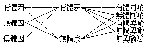



十　为他比量之构成



由上所言，可知为他比量之构成式。凡在论坛对扬及立论传世等，皆必具足三支，及离三支诸过。缺支，又有缺支言、缺支体之过。言谓能诠之言，体谓所诠之法。支言、支体两俱无缺，为他比量乃得构成。所构成者，於宗支又须具五条件如左枋，违则不成：



一、不悖世智；(但可用「胜义」以寄简)。



二、不悖立宗所依教义；(但破他量，可用汝执等简)。



三、宗中之有法及能别为言相顺。



四、有法及能别辞，皆属极成；(但可用胜义、极成、自许等简之)。



五、不顾遍许等宗。



於因支亦须具下四条件，违则不成：



一、立敌俱许遍是宗法。



二、因法自体俱许成就；(但可用自许、极成、汝执等简之)。



三、因体有无与宗相顺；(於破他量或不相顺)。



四、同品定有，异品遍无。



於喻支中，亦须具三条件，违则不成：



一、同喻法宜有能立因、所立义，异喻法宜离能立因、所立义。



二、同法喻显因义言，宜先合能立而后所立；异法喻显因义言，宜先离所立而后离能立。



三、同喻法体有无宜顺宗体；异喻有无不拘。



三支言体无缺，於宗因喻具此十二条件，或能预作方便，言简离过，则「为他比量」乃完全构成，可真能立及真能破。



十一　似为他比量之过谬



除去缺支言过──缺支体过，即在宗等过中──，宗支违上五条件故，乃有九种过谬：



一、违世智现知，曰现量相违过；(例)声非所闻。



二、违世智比知，曰比量相违过；(例)瓶等是常。



三、违世智共许，曰世间相违过；(例)怀兔非月。



四、违立量言所依宗义，曰自教相违过；(例)胜论师立声是常。



五、宗中之有法与能别为言不顺，曰自语相违过；(例)我母是石女。



六、宗中能别辞不极成，曰能别不极成过；(例)佛徒对数论立声坏灭。



七、宗中有法辞不极成，曰有法不极成过；(例)数论对佛徒立我是思。



八、能别辞、有法辞俱不极成，曰俱不极成过；(例)胜论对佛徒立我为和合因缘。



九、总宗随世遍许或随他意，曰相符极成过；(例)声是所闻。



此中八、九，亦缺宗过。因支违上四条件故，有十四过，又分三类：一、不成过有四：



一、立敌两俱不许因是宗法，曰两俱不成过；(例)佛徒对声论立声无常宗，眼所见故为因。



二、立敌随一不许因是宗法，曰随一不成过；(例)佛徒对声显论立声无常宗，所作性故为因。



三、因法自体疑似未定，曰犹预不成过；(例)立远处有火宗，有烟雾等故因。



四、因有、宗无体不相顺，曰所依不成过；(例)胜论对无空论立虚空是有宗，德所依故为因。



四不成过，皆从因法非遍是宗上有法之法而成过。犯因三相第一相者，皆同缺因支过。二、不定过有六：



五、同异二品俱有此因，曰共不定过；(例)声论对佛徒立声是常宗，所量性故为因。



六、除有法外，於同异品俱无此因，曰不共不定过；(例)声论对佛徒立声常宗，所闻性故为因。



七、同品分有，异品全有，曰同品一分转异品遍转过；(例)声生论对胜论立声非勤勇无间所发宗，无常性故为因。



八、与前相反，曰同品遍转异品一分转过；(例)胜论对声生论立声是勤勇无间所发宗，无常性故为因。



九、同品异品俱一分转，曰俱品一分转过；(例)声论对胜论立声常宗，无质碍故为因。



十、因相虽具，然相违因亦具三相，使成犹预，曰相违决定过；(例)胜论对声生立声是无常宗，所作性故为因，如瓶等为同喻。声生违其量，声是常宗，所闻性故为因，如声性喻。



六不定过，皆从因法非同品定有、异品遍无而成过，犯因三相第二第三相者。然第六相违决定过，则以能引生相违宗之因，而亦成过。若佛徒对声生论立，则不成过，佛徒不许有所闻性之声性故。三、相违过有四：



十一、反成相违宗，曰法自相相违过；(例)声论立声常宗，所作性故。此因成相违宗，可违之云：声是无常，所作性故。



十二、成法自相虽似无过，然能成「法差别」之相违宗，曰法差别相违过；(例)数论对佛徒立眼等必为他用宗，积聚性故为因，如卧具等。数论在成「必为非积聚性他用」，然佛徒可违其量云：眼等必为积聚他用，积聚性故，如卧具等。



十三、违害有法，遣彼自体，曰有法自相相违过；(例)胜论师对弟子立有性非实德业宗，有实德业故为因。此因违遣有法自体，佛徒曾设量云：汝之有性应非有性，有汝实德业故，如汝之同异性。



十四、因成於法虽似无过，然亦能成有法差别之相违宗，遂坏所立，曰有法差别相违过；例前量之有法上有差别义，立者意在作「有」缘性，可违之云：汝言有性应作「非有」缘性，有实德业故，如汝之同异性。



四相违过，总为同品不转、异品遍转分转之过，亦犯因三相之第二第三相者。喻支违上三条件故，有十过谬。先出同喻五过：



一、喻上无能立法，曰能立不成过；(例)声论对胜论立声常宗，无质碍故因，犹如极微喻。



二、喻中无所立法，曰所立不成过；(例)前量改喻如觉。



三、喻中能所立法俱无，曰俱不成过；(例)前量改喻如瓶，曰有体俱不成；又对无空论者改喻如空，曰无体俱不成。



四、喻中虽有能所立法，而缺合言，曰无合过；(例)声是无常，所作性故，喻云如瓶见所作性及无常性。



五、喻上虽有合言而违次第，曰倒合过；(例)前量喻云：诸无常者皆是所作，如瓶。



正喻例云：「若所作性，见是无常，如瓶」。此皆不尔，结成五过。次出异喻五过：



六、喻上有所立法，曰所立不遣过；(例)声常，无质碍故，异喻如极微。



七、喻上有能立法，曰能立不遣过；(例)前量异喻如业。



八、喻於能所立法俱有，曰俱不遣过；(例)前量对有部异喻云如虚空。



九、虽遣能所立法，无有离言，曰不离过；(例)前量异喻云：如瓶见无常性有质碍性。



十、虽有离言而不次第，曰倒离过；(例)前量异喻：诸质碍者皆是无常，如瓶。



正喻例云：「若是无常，见非所作，如空」。此皆不尔，结成五过。综上宗因喻过，有三十三。并缺支过，在窥师之因明大疏，广分「全分自他」，绮互复沓，演成多过，兹不详述。



十二　似能立与似能破



於佛陀因明学能立能破之式，既经明晰，乃可观察於似能立似能破量，以离似过，及为所破。能立之立量为悟他以正，能破之破量为破他之谬，皆为对他令知正谬而设。若所立非正，所破非谬，或对他而不善他宗及不当他机，其立量遂为似能立。自立不成，反被他破；其破量亦为似能破，破他不成，反被他破。或缺支言成过，缺一支之过有三种，於宗因喻随缺一故。绮互缺二支过亦有三种，於宗因喻绮互随缺二故。在缺支言，不成「缺三有一」之过，以三俱缺，同默然无说故；既默然无说，则无从出其过故。故俱缺宗因喻三之一过，但指「缺支体」言，支体之缺，即在宗等过中。且宗因喻三支体俱缺者，其例难举。故缺支过，唯存六种。於六种中随犯缺一支过，即为似能立破，反被他破。又能立量，违前宗因喻上十二条件，不善寄简，犯前所言宗支九过，因支不成四过，因支不定六过，因支相违四过，喻支十过，堕似能立。其能破量，立量妄出他量缺支及宗过等六类之过，他实无过；及自犯於缺一支及宗过等六类之过，堕似能破。天主入论之后，似能立、似能破诸过，以皆摄入缺支等六过类，故唯以六过类显其为似。然足目正理论说二十四种堕负处，方便心论略为二十，如实论又加为二十二种。陈那於因明正理门论中，据最极成，提其大纲，约为十四相似过类，皆显出相似过实不成过，致反堕於似能破者。具如论说，须再寻研。然核对之，仍未若缺支等六过类之完密。故质言之，无论立自破他之量，若犯缺支及宗过等六类过者，即为似能立及似能破也。



十三　真能立与真能破



若能立自知正理悟他之立量，於宗因喻支言无缺，完备宗等十二条件；於所对他善知他宗及机所宜，巧能寄言简除诸过，於宗因等三十三过无一违犯，乃得成真能立。若奘师真唯识量云：



(真故极成)色不离眼识(宗)  

(自许)初三摄眼所不摄故(因)  

若自许初三摄眼所不摄者见其不离眼识(同喻体)如眼识(同喻依)  

若离眼识见其非自许初三摄眼所不摄者(异喻体)如眼根(异喻依)



若能破他量谬执、悟他之破量，自於支言无缺，亦於宗等三十三过无一违犯，而善能出他所立量缺支、或宗过等，乃得成真能破。此真能破凡有六类：一、出缺支过能破有六种；二、出宗支过能破有九种；三、出因不成过能破有四种；四、出因不定过能破有六种；五、出因相违过能破有四种；六、出喻支过能破有十种。六类总有二十九种能破。然能破法，但破他义，因明不以破他为立，非破他义己义便成，故破他量异於立量。但能破他，即真能破，由此能破乃有多式：



一、出量破，此有二式：甲、破量违他，用他许法汝执言简，可成能破；(例)汝执上帝应无，许非物故，如龟毛等。有法虽非自许共许之事，得成破他，此亦名「违宗破」，能违彼立上帝是有宗故。乙、破量显因不定相违过者，自虽不定相违，亦成能破；(例)前因不定过中之相违决定，后出破他为胜，以破他量，但破他义，不在树立自义。虽以不定相违未能成立自义，然以不定相违已能达到破他目的，故在破他已成能立。此亦名「同彼破」，使彼同堕於不定故。



二、出过破，此有六类二十九种。全、分、自、他绮互，更成多式。不必出量，但於他量审其所有缺支及宗等过，若能指出其一，他量即破；(例)数论立我是思，指出其缺同喻法过，即破其量，成真能破。



三、袭击破，蹈隙抵懈，突袭截击，或指事而无言，或片言而破的，或反覆纵夺，使「他所立义」进退失据。虽则自无所立，能令他义堕於所破，即成能破。



四、关并破，设双关语，使他任受一关，即坏所立；(例)长爪梵志向释迦立一切法不受宗，释迦诘云：「此语受否」？若受此语，则自坏其一切法不受宗，已受此一语故；不受此语，则便自无所立宗语，更何论辩！於是梵志默然而服。此一名「胜彼破」，使彼受有违宗之缺，不受有舍宗之失故。



由此因明之法，能立为艰，能破为易。若不居能立之地位，而专为能破之诘难，虽不易於失败，亦易流於诡辩。故凡他义被破之后，他人例得反诘之曰：非破他义，己义便成；我义不然，汝义云何？於是能破之地位，不得不转居能立，立其自义，任他攻破。故曰：他量自破，自量他破，共量共破，必无可破乃得成真能立。必真能立，然后所破皆真能破。



十四　立破真似刊定



因明学立破真似之法式，辨晰既了，则於古今传布之说，或在於立自义，或在於破他义，皆可审其为真为似，刊定孰是孰非，言其方隅，次第有七：



一、审其所言於三支完具否：若为异式，演绎观之。由此若见缺支言过，则似非真。支言无缺，再观餘过。



二、审其孰为立敌所诤宗义何在：若所诤相符，则失其应诤，由此发见立宗相符等过，则似非真。宗义应立，再观餘过。



三、审其三支法体有无是否相顺：由此若发见缺支体等过，则似非真。支体相顺，再观餘过。



四、审其三支，或有言简，是否得与立破相符，由此若见所破不极成，因不成，缺同喻等过，则似非真。无此诸过，再观餘过。



五、再审宗支有无餘过：由此若见现量相违，所依不成等过，则似非真。无此诸过，再观餘过。



六、次审因支有无餘过：由此若见不定相违等过，则似非真。无此诸过，再观餘过。



七、后审喻支有无餘过，由此若见倒合不离等过，则似非真。诸过都无，乃真能立能破。



依上七番审察，过无遁形。有过则似，无过则真，由是得以总判三支，孰真孰似，究竟楷定。然三支上寄言简别，所关殊大，真能立破之量，往往因缺简或简言失当致堕似比量者。胜军立诸大乘经皆佛说宗，两俱极成非佛语所不摄故因，致为小乘一切有部出因不定之过。得玄奘法师改两俱极成为自许极成，其过乃除。清辨宗中观立真性有为空、缘生故、如幻一量，为瑜伽宗出其多过。然若於真性上更加自许言简，则离诸过。故诸简言，殊有深用，否则专精之义，殆无从立。



第五节　闻量与能知方法之评判



一　闻量概说



瑜伽八十一云：『一文、二义。文是所依，义是能依，如是二种，总名一切所知境界』。除依现实事理求知，更应依古今所传文义以求知，故有闻量。量即比量、现量之量，指符事理之正知言。闻思古今学说言教所诠事理，得成正知，谓之闻量。如各宗教各有其至教量。陈那量论中虽废至教量，以就「正知」之种类言，至教量之正知，亦不出现量、比量之二种，故将至教量分别摄入现量、比量中，不鼎足立至教量为三耳，非弃除至教量而不顾也。然今曰闻量，复与至教量广狭有殊。至教量唯是各宗派指其自所尊崇之教典言，如佛教之指大藏经，基督教之指新旧约，回教之指可兰经等，又科学家指科学者公认已经证实之公例等。今曰闻量，则遍指凡遗传所闻学说言教，时无间於古今，人无间於此彼。据吾今可依现量比量所知现实事理而建立名言，有能令他人得起正知者，即可推比决知闻於古近他人所布名言，亦必有能令吾及餘人得起正知者。复据吾今所言，间有乖违现实事理而不符现比正知者，即可推比决知闻於古近他人所布名言，亦有乖违现实而不符现比正知者。故应据现量及为自为他比量，测以算学，考以声明，观察详审，研核判定，遣其偏妄，存其圆实，所存诠圆实事理之言说，乃可依以勤求自悟，亦可用之令他得悟。故既明前四节之能知方法后，次当评判闻量。



二　四依四不依之标准



大牟尼尝以四依四不依之言留赠后人，以为审择闻量标准，超越世间诸立说。编书者偏执自言为至教量，致生后人依人依语不依法义而诤门户之见。其纯依现实真相之公平态度，真足令人钦服无已！四依四不依者：一、依法不依人：法指能诠名言，或复兼指所诠事理，或复兼指能知智识，所知境相。「法」言通故，表於左枋：



　　　　　　　　　　┌能诠名言……………即语┐  

　　　　　┌所知境相┤　　　　　　　　　　　├了不了义  

　　　　法┤　　　　└所诠事理……………即义┘  

　　　　　└能知智识……………即现比量及量非量之分别识



依法为总，依义、了义、及智为别。依法不依人者：谓当以法定人，不当以人定法。纵使其人行果净善，然其所「言」无义、不了、不合正智，亦不当取。或使其人行果秽恶，然其所「言」有义、明了、验合正知，亦当听取。高至佛言，低至童话，不问何人所说，皆当持此标准以为衡量，乃能正知现实真相。云以法定人者，披择片言之善，虽童话中亦时有堪选者。然使所言多分堪取，则可定其人为智人；遍观所言，除随别机方便而说，全分堪取，则可定其人为一切智人。一切智人所言，遂为至人之至教量。吾人崇佛陀为至人，崇佛陀言为至教量，乃由於此。异於闻为谁之言故即信不信，此其即信固为盲信，其不信亦为盲不信。以人定法，依人而不依法，正此所拣。然有情之智幼稚者，恒不免斯咎也。由此世人多盲信盲不信，坚执难喻。故求正知，应先去此盲执。又牟融理惑论谓：善言善行人之圣；不善言不善行者人之贼，善行不善言人之宝，善言不善行人之师。善言善行，人法俱至，固为最崇；善行不善言虽可宝──若二乘圣人不能说法者，亦为人天福田──，然其所言或无堪取；善言不善行虽未为至人，然其所言亦堪师法。依於后例，故罗什法师诫学徒云：吾如敝囊，然中有金，但应取金，莫观囊敝。又龙猛师亦说喻云：如黑夜行，遇敝恶人，执灯同行，可依敝人取光前进，勿须违避。能知此依法不依人之例，遍观所闻言义，可以无善法而不取，得大自在；亦可无谁人之能障，得大解脱。极如古锥呵佛骂祖，亦不过欲学徒依法不依人耳。二、依义不依语：「法」中分能诠之语，与所诠之义，凡语言多分随俗间之流行语而敷施者，虽刱新语以诠新义，既成流布，即多应用，核其所诠，时有歧异，故不应取单言片语，随先所闻於何处者，封固坚执，谓於某名必为某义，封名取义。应观「某名」在「某经论」中，前后诸多文句所关属之义，其义应当若何，依义定名。例若「真如」一名，於法相唯识经论内，依名、相、分别、正智、真如之五法，但诠「所知现实真相」之义；於起信等论中，以未详五法分别故，乃总指诸杂染法曰生灭，指诸清净法曰真如，包括正智、真如，统名「真如」。真如一名，诠「诸清净法」义。诸不了斯例者，遂生纷诤。故应依义而不依语。三、依了义教不依不了义教：合上能诠所诠，辨其了与不了。了义语谓显义究竟明了之语，不了义语，义虽究竟无过，语有不明了过。语不明了，义随含混，易令他人生迷谬解。义语俱不了者，更无论也。例起信论真如一名，诠诸清净法义，语欠明了，遂多谬解。成唯识等於真如名，但诠无分别智所知法性，语义显了，究竟决定。又如清辩等说真性一切皆空，虽是遮词，但皆空语混同表词，易生空执，不如护法等说真性非空不空。非空不空，显然唯是遮词，双遮空不空执，语义显了，究竟决定。是故自悟悟他，为求正知而防谬解，应依了义言而不依不了义言。四、依智不依识：现量或真现比量曰智，比量或似现比量曰识。复次，超俗真智曰智──即真现比量──，世间常识曰识──即现比量带有迷谬之似现比量──。然此智之与识，重重隔别，兹表如左：



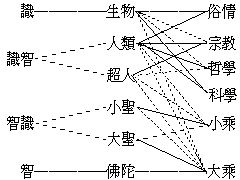



俗情科学，正为生物、人类。宗教正为人类、超人──天人──，旁及生物。哲学正为人类，旁及生物、超人。小乘正为小圣，旁及人类、超人、大圣。大乘正为大圣佛陀，旁及小圣、超人、人类、生物。以生物情识，为世间常识，人类理智，即为超俗真智，科学等皆有之，且唯科学为其特色。故吾人转识成智之进化，以科学为基础。然以宗教哲学上一分之超人灵智为超俗真智，则人类理智亦降为世间常识。而进以小圣偏智为超俗真智，则超人灵智亦降为世间常识。再进以大圣分智为超俗真智，则小圣偏智亦降为世间常识。进至以佛陀圆智为超俗真智，则大圣分智亦降为世间常识。生物纯识；佛陀纯智；大圣、小圣，智中带识；超人、人类，识中带智，此其大较之可言者。依智不依识者，即吾人须进求「显现证知」与「推比决知」，以验所闻言教之符现实事理否，乃为决定评判。未可凭其俗情常识以妄衡量。故终之以依智不依识也。虽然，据吾人遍观所闻语义──法──而测定人法，如谚云：「世间好语佛说尽」。则佛陀为至人，佛陀所言为至教量，亦其大较可言者也。



三　历史之考证



吾人整理所闻言义，就依法不依人言，本不须为历史之考证。然为以法定人起见，既不能不考寻某法是否为某人之所说，某人之所说是否为某法，则不能不为历史之考证。故当依记载之闻量，验以现存发见古器制之现量，参以人种民族语言文字，及时代国土社会环境种种关系之比量，然后观察其分位上应否能有此人，此人应否能有此言，此言之思想上来源何在，此言在当世及其后曾发生何种影响与功罪。更加古记载之详稽博证，某种语言文字上，此言之所诠应为何义，某种风俗习尚上，此人之所言乃为何事。於是茫昧而不明了之传说，乃略有眉目，可为论其世，察其言，而知其为人之基本。虽然，有因於自然界之环境关系者，如以气候、地带、物产而演成一区之民俗，各营其特共之生活；有因於人群制之环境关系者，如以种族、阶级、信仰而演成一区之民习，各循其特共之轨辙；有因於时势之转机关系者，如以贫富、强弱、安患而改换勤惰忧乐之民情；有因於天才之非常关系者，如以圣哲英豪而变化仁暴、智愚、勇怯之民性。中人以下之言行，大抵以前三因而发生为历史退滞之迹象；中人以上之言行，大抵以后一因而发生为历史进展之迹象。故观历史之进展，必以后一关系为主因，而前三因则仅为其助缘。夫同一孔仲尼时代之中国，为孔仲尼者仅孔仲尼之一人；同一释迦牟尼时代之印度，为释迦牟尼者仅为释迦牟尼之一人；同一亚里斯陀德时代，为亚里斯陀德者仅亚里斯陀德之一人。有孔子而有儒家之文化，有释迦牟尼而有佛教之文化，有亚里斯陀德而有西洋哲学科学之文化。可知非常天才之关系，为文化进展之主因也。唯前三因，亦未尝非辅成其人言行之助缘耳。如处於温暖之地带，居於有凭藉之阶级，适变於当时之机势，皆有关系。然若略去其非常天才之主因，必不能为充分之说明也。古人之好为历史人物夸张者，固多迷谬，而近人之治史学者，但索某人某文化之因於前三者之助缘，昧其主因，亦成偏缺。由是今人之愚者，每不能逾於古之中人，而古之圣哲，亦不妨度越於今之智者也，以其为非常天才故。然解释此非常天才之何以有，或原本宗族之遗传，或推由教育之修习，或归为环境之关系，而此亦为其助缘耳。然直抉其主因，既无上神真宰之特降，亦非无端突然而忽至，盖由「无始恒转之一切种识」，积久修因之所致，於此遂至历史学之问题深处。若能以其果之闳伟，察其因之深广，亦非甚难知者。后当广论，今姑止此。由此小乘大乘之俱源於释迦所说，可无疑也。结集之历次增减，宜传──译释阐发等──之递时盛衰，复有前说四因之迭相更替而推演，或为退滞，或成进展，为历史之考证者，勿执一曲以概其大全，详细观察，审求其故，庶能得其真相。为佛陀学之历史考证应如此，为餘学之历史考证亦应如此！



四　法印之楷定



言法印者，所求得某文化「能诠所诠之纲宗」也。握厥纲宗以观某文化之言义，如絜绳而网目齐张，如振领而衣纹皆直；删落其无关者，统括其有关者，内容则条分而缕析，外延则此明而彼辨，是非真似，举无遁形。佛所说义，虽复无量，古师尝概括为三乘共通之三法印，大乘别有一不共之法印，则「诸法唯识」也──或法界诸法唯心说──。三法印者：一、诸行无常印：有情、无情，一切因果生灭相续，依此而说；今广其义曰：无始恒转论，或无常真常观。二、诸法无我印：有为、无为，一切缘显幻事空理，依此而说；今广其义曰：无性缘成论，或无我真我无性真性观。三、涅槃寂静印：有得、无得，一切究竟显了真相，依此而说；今广其义曰：无相真如论，或无相实相观。大乘不共之诸法唯识印，则种现熏起之宏纽，染净转依之总根也。今广其义曰：无元心枢论，或现识熏持法种观。持此四法印，以观佛陀之言义，则纶贯无遗矣。符此四法印之楷定，则是佛法，违此四法印之楷定，则非佛法，判然可分，无容假借。他若诸受皆苦、或有漏皆苦观，身皆不净、或有漏不净观，则由一分无常无我观所派生，用之对治贪痴等烦恼者，非普遍之真理。名、相、分别、正智、真如五法，则名、相、分别，非佛法之所专有；遍计所执等之三性，则遍计所执非佛法，为佛法之所破；依他起、圆成实，虽即佛法俗真二谛，俗谛亦通世间之说，故皆非佛法之法印。唯佛法有此刊定是佛法非佛法之法印，故异生情爱之魔说──俗情科学等──，与外道神我之梵说──宗教哲学等──，皆不能乱而莫不能化也。其餘一一文化之所言义，若能寻得其「纲宗」之所在，规定其内容，楷别其外延，则皆可审知其底蕴。选择取舍，分别收破，摄而化之，莫能逾也；析而拣之，莫能滥也。於是乃能评判一切所闻言义。



五　佛陀学之内容



瑜伽摄释分中，以经体之文义，经释之法要──十二分教等──、等起、义相、释难、次第之五重，合为师说、众听三事；加略广赞佛及显学胜利，以开示佛陀学内容。摄异门分，则以白品之佛及弟子所说所行法，黑品之生死烦恼等，显其内容。摄事分中，则摄之为三事：一、素呾缆事──经藏，二、毗奈耶事──律藏，三、摩呾理迦事──论藏。经藏又分为行、处、缘起、食、谛、界、菩提分法之七。列之如左：



　　　　　　　　　　┌─行事  

　　　　素呾缆事──┤  

　　　　　　　　　　├─处事  

　　　　　　　　　　│  

　　　　　　　　　　├─缘起事  

　　　　　　　　　　│  

　　　　毗奈耶事──┼─食事  

　　　　　　　　　　│  

　　　　　　　　　　├─谛事  

　　　　　　　　　　│  

　　　　　　　　　　├─界事  

　　　　摩呾理迦事─┤  

　　　　　　　　　　└─菩提分法事



三总、七别，共为十事。然依杂阿笈摩及摄事分，可总摄为三相、四分、十诵、九所知事。



　　　　　　　　　　　　　　　　　　　　　　　　　　　　　（十诵）  

　　　　（三相）　　　（四分）　　　　　　（九所知事）　┌佛所说诵  

　　　　能说相…………佛及弟子所说分………说者事…………┤  

　　　　　　　　　　　　　　　　　　　　　　　　　　　　└弟子所说诵  

　　　　　　　　　　　　　　　　　　　　　┌有情事……………五取蕴诵  

　　　　　　　　　　　　　　　　　　　　　│受用事……………六处诵  

　　　　　　　　　　　　　　　　　　　　　│生起事……………缘起诵  

　　　　　　　　　　　┌五取蕴等相应分……┤安住事……………食诵  

　　　　　所说相………┤　　　　　　　　　│染净事……………谛诵  

　　　　　　　　　　　│　　　　　　　　　└差别事……………界诵  

　　　　　　　　　　　└菩提分法分……………所说事……………念住等诵  

　　　　　为说相…………结集分…………………会众事……………八众诵



如是三相、四分、九所知事、十诵，总明佛陀学之内容，亦为总摄三宝。说者中之佛为佛宝，说者中之弟子及会众中之八众为僧宝，所说相中之七事、七诵为法宝。有情、受用、生起、安住之四为杂染事。染净、差别之二为杂染清净共通事。菩提分法为清净事。佛所说法，不出於此三事。八众则瑜伽说为苾刍众，苾刍尼众，邬波索迦众，邬波索夷众，刹帝利众（各国之国民众），婆罗门众（各教之教徒众），四天王众天众，忉利天等天众（以忉利天等其以上诸天）。前二为僧，后六非僧。前四为已受佛戒之弟子，后四为未受佛戒之听众。前六为人，后二为天。前七总摄人非人等──四天王众，亦摄神生、旁生、餘生等，拥护佛之八部众，亦摄在此也──，后一纯为天众。佛及弟子为之说法而教化者，都摄在此八众中故。如此佛法僧三宝，总为佛学之内容。



六　所闻言义之拣判



往者、智光论师──据西域记：智光乃戒贤之弟子──等，宗般若，为一切法有时，境空心有时，一切法空时之三时判。戒贤论师等，宗深密，为有时，空时，非空有时之三时及八宗判──小乘六宗大乘二宗。天台宗法华，为五时、四教判。贤首宗华严，为五教、十宗判。或判大小，或判半满，或唱一音无所分判。要皆就佛说评判者。嘉祥三论玄义，为外内小大之分判。慧苑以四教、判「佛法外之说」为「迷真异执」。空海以十住心，判「世间共法」为「异生羝羊」、「愚童持斋」、「婴儿无畏」三心。则皆就佛说世说而遍评判者。今此闻量评判，不限佛说，亦当就佛说世说而均判。但今所闻一切言义，量异昔时，故评判之标准亦应不同。今先列表，再分解之。



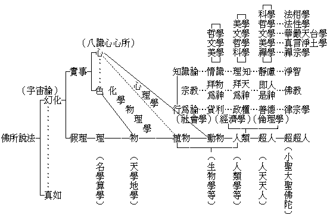



传说为情识法，乃未经理知等训练之直觉等，凭其官感情欲意识，有所知觉想像之言说也。其杂有科学等成分者，亦旁通於理智法。科学哲学，皆以理知法为主干。然科学旁通於致富图强等情识法，而哲学每推到宗教之最高点，故亦旁通於静虑法。孔、老及胜论、数论等，则宗教而哲学、哲学而宗教者。耶、回、梵等宗教，虽浅深不一，而要皆以近於静虑之灵感等为主者，故属於静虑法；然亦旁通理知以为说明。其低等者，且每流於情识。凡此皆为「世说」。昔尝谓之「人间两般文化」，甲种为宗教及人生哲学，乙种为科学及自然哲学，撮为二表如下：



　　　　　　　　　　　　┌理知上在离言契性  

　　　　　　　　　　┌甲┤行为上在克己崇仁  

　　　　　　　　　　│　└信向上在融迹同本  

　　　　人间两般文化┤  

　　　　　　　　　　│　┌理知上在藉相求知  

　　　　　　　　　　└乙┤行为上在纵我制物  

　　　　　　　　　　　　└信向上在取形弃神  

　　　　　　　　　　　　┌甲……实事……善体……存性  

　　　　　　　　　　┌利┤  

　　　　　　　　　　│　└乙……虚理……利用……厚生  

　　　　人间两般文化┤  

　　　　　　　　　　│　┌甲……妖怪……苟惰……沉迷  

　　　　　　　　　　└弊┤  

　　　　　　　　　　　　└乙……封蔽……愤争……失望



由其弊而拣之，判非佛法，无得而滥之者。佛陀之学，为净智法。小乘为出离烦恼障之净智法，餘大乘教皆为出离烦恼障所知障之净智法。然其自度度他之闻思修方便，亦依据及施设理知静虑之法。



佛法与世说别，尝说四条：一、来源有圣心凡识之别；二、施设有应机随执之别；三、法体有有漏无漏之别；四、法用有著言离言之别。或说无漏有漏，现证推度，究竟不究竟之三别。兹但言其大概，不遑详也。



七　所闻言义之摄判



欲於佛法之统摄中，以判别世界各学说，昔者尝制一表如下：



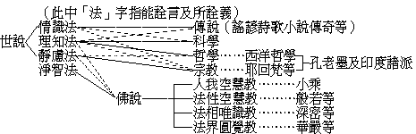



宇宙即「法界」也。幻化与真如，为法界之二面；幻化即真，真如即幻化也。然真如不可说，心言绝故。可说者，即为幻化之一面。可说之幻化中，分为「实事」与假理之二干。假理乃贯通於实事上所附现之虚分位，大乘百法中谓之心不相应行分位假法，故即知识论、声明、算学、因明等方法。实事指「有实力用」者，亦分二干：「心」即八识心法及诸心所有法；色即五尘、五根及法处所摄色。细别之虽亦通假实，而大类则皆为实法。色、理集现，为研究之对象，则为天体、地质等物；说明之，即天体、天文、地质、地理学等。由「物」而研「物素」之「色」，色由心变，亦通心力，则为物理之力学，与物化之质学等。「物」之直接及「心力关系」而有生命现象者，为植物。「物」之由心、色、理集现者，为「动物」。「动物」与「心」之间，乃有「心理学」研究之对象。动物中较为优胜者，则为人类。合植物、动物、人类，为生物学研究之对象，包有植物学、动物学、及生理学、形态学等。专在人类，一方有人类学、人种学、历史学等；一方则有社会学、宗教学、知识论等。在此一方，又可由人而达於「超人」、「超超人」。人类原为动物，亦可进於超人，故人类居於动物与超人之间。在「社会学」、「宗教」、「知识论」之三者，各有三种阶级。中人以下，近於动物之人，其社会，则以「货利」──或食色──为中心，乃为经济学研究之对象；其宗教，则为「拜物为神」之多神宗教；其知识，则为随感官情欲意识而知觉想像之直觉情识，亦能产生美学、文学、及相似之哲学，若今之共产主义是。中人正为人类之人，其社会，则以「政权」为中心，乃为法政学研究之对象；其宗教，则为「拜天为神」之一神宗教──耶回等教──；其知识，则为以算学、论理学等训练意识察验物象之理知，直接产生者为科学，间接亦能产生改进之哲学、文学、美学、宗教等。一神教之拜天为神，本出於「相似哲学」之理知对象──非官感觉知之情识对象──。然科学理知进步之结果，亦能推破於一神教，以渐知唯是「内心静虑之经验」──如詹姆士等之所说──，无别超宇宙外之一神故。犹「相似哲学」之进步，亦能推破「拜物为神」之多神而进拜於天神也。中人以上，近於超人之人，其社会，则以「善德」为中心，乃为伦理学研究之对象──若孔子所谓道之以德齐之以礼者──；其宗教，则为「即人是神」之汛神宗教，若儒家道家所说「圣人」、「神人」及人皆可以为尧舜等，即为崇拜之对象。且所谓贤希圣，圣希天，而「圣人」亦即是「天神」。人皆可为，人皆可由困学勉强而致，自信自成，不须别为崇拜一天神也。其知识，则为经「理知训练」、「善德践修」后，「心意和平统一」之静虑；直接产生者，为禅学──禅那即静虑，静虑即「心意和平统一中之精思妙虑」──，亦即儒书「知止而后有定，定而后能静，静而后能安，安而后能虑，虑而后能得」之总名──。孔、孟、荀、庄等，皆说有静虑之学。印度瑜伽、耆那各派，尤注重之。间接亦能产生及改进美学、文学、哲学、科学等。经「理知」、「善德」、「静虑」之训练，以加无漏净教熏发无漏净种而起现行，成超超人。其社会，则为清净和合众，即律宗学所研究之对象。其教即为佛教。其知识，则为离烦恼障或离二障之净智。直接产生者，为大乘之禅宗学，为无漏之禅学。展转增上为真言净土学，乃无漏之美学。为华严天台学，乃无漏之文学。为法性空慧学，乃无漏之哲学。为法相唯识学，乃无漏之科学。由此可见佛陀所说之法，可以含摄人间一切言义，而於佛法中各予以相当位置，有条而不紊也。



宗教哲学之於知也，其依根觉印象及所传闻，不异俗情，但稍能应用比量以判择传闻，及改进根觉等──静虑学──，然亦为较进步之似现比量耳。近世依科学之哲学，渐有正比量智，科学极重依根觉亲验印象之现量，亦注重应用考证以判择传闻之说，尤极注重应用逻辑以构成於正比量之理知──如关系公式之知识──。且能凭所发明之公式等，创造望远镜、显微镜、析光镜、透碍镜、扩音器、及天文化学各仪器等，廓增根觉亲验之境，都入算学测量文语传述之内，重重改正，重重进步。故论世间求知方法，科学比较优良。然於根觉本身──六根八识──尚无改进之道。复不知宗教哲学中之静虑学，虽有迷谬犹待除择，然「静虑学」实为改进「根觉本身」之术。若能依正理智，亲验其事而去其迷谬者，即能改进根觉本身，引生净智，扩充且明证现量之实境，达到能正知现实之目的。於此乃为佛学之事，亦为进步之广义科学也。近人称佛陀学为科学之哲学宗教，其言谅已，而要非虚心求学不为功。



八　能知方法之评判



上言现实之能知方法凡五种：一、为自求知之现比量，此於近世为哲学之知识论，与科学之逻辑学之一分。二、测量工具之算学。三、传述工具之声明，此於近世为语言文字学。四、为他令知之因明学，此於近世亦为逻辑学之一分。五、为以评判态度择取於所闻言义，则凡师友讲谈，图书阅览，皆可为求知方法之一事。言厥途程，则在彼根觉亲切印象经验之现量，应用测量传述之算术与语文，并据因明学之法式，评判闻见於师友图书之学说，构成符事理之正比量智，重重改正幼稚之现量为进步现量。於是迷谬之情渐伏驯至於断，发生真现量智，乃能洞见现实真相；施设正比量智，乃能说明现实真相。俗情之於知也，但依根觉印象及所传闻，为胡乱构思想像之似现比量。



九　求学之目的



吾人求学，除开全由旁人强迫使学之外，总多少有所以要求学之意思，此意思之所在，即求学之目的。或谓人身须赖衣食住等生活，而此人身所需之衣食等，须藉知能以造作取得之。且现时造作取得人身生活所需之知能，乃从全球人类遗传演进之所成就，今欲获此知能，非从事求学不为功。故求学之目的，不外欲得人身所需以生活耳。以此为求学之目的，今固不得非之，盖人生最切要之事，无过於谋生活。扩而极之，谓人生所需之衣食等，不患寡而患不均，社会主义遂以谋全人类得均取生活之所需，亦不外达此目的也。然使求学之目的仅如此，则现今享有遗产不须谋生之子弟，或实行社会主义后，人类岂遂无求学之目的而不复从事求学乎？如曰不然，必更有其他之目的。或谓人有荣誉之好，故富家子弟虽不求衣食，孜孜以求学文艺、美术等，以博官第；尚时髦者，其目的要在於华贵风雅等荣誉耳。极至於所谓扬名显亲之名教，及经营於历史上留一不朽之名者，亦不外此。前为利，此为名，原人事上之所恒有，今固不得非之。然亦有甘冻饿听戮辱而不倦求学者，又何所为乎？或谓人性好胜，且好特异，彼不求名利而求学者，欲持己意支配当世之人，并得天下后世之惊慕耳。此亦抗心高志、怪杰奇才者之所为，今固不得非之。然亦有捐弃名利和乐人情者，复何为求学乎？或谓人性乐群，尤乐人群之治，如孔子辈，笃志为学，莫非因时以求人群之治理耳。此更人伦善德之圣，近若克鲁泡特金辈，张皇互助进化之义，亦不外此，今尤不得非之。但兹之四者，可总括谓求学之目的，在於得此人生之安乐耳。然所得之安乐，不在於此求学时，须在求学后施行事业之成就；若未成就或竟不能成就，其求学岂不遂成无意义无价值乎？或谓人心本是恒久不息，向内外上下以求知能者，故求学莫非以得知能为目的。学即求知能，求知能即学。求学即手段亦即目的，不必更要达到何项之目的，便已达到目的，故求学之自身，即有意义价值。且达到其餘种种之目的，要皆由求学所得种种知能以达到之耳。故求学在於得知能，更无疑义。近世真正之科学者，唯在於此。夫求学固以得知能为唯一之目的，然原之无根而徵之无验，所谓知者，其固知乎？所谓能者，其固能乎？要未可必。故云为得知能，亦未足以明求学之目的究何在也。上来於各家所言求学之目的，讨究略尽。然则求学之目的究何在？曰：求学之目的无他，为得如如相应於「现实」之知能而已。现实即大涅槃──真如──，现实之知能则大菩提也。故求学之目的，即佛学之目的。若明求学之目的而求学，则终将唯佛学之是求也。然在「现实」本离名相，今既方便立「现实」名，且更方便定「现实知能」义，则如何为现实之知能，可明矣。



> (第一义)(知能)



一、知得现实圆常之真义者……………根本无分别之如理智力。



二、能得境相确适之实事者……………后得正分别之如量智力。



三、等得性相理事圆常确适之现实者……………无上正遍觉知。



既勘明求学之目的在得「符现实之正觉」，今更进问求学之方法当何从。



十　求学之方法



言求学之方法，换言之，即求「正知」之方法。於此当先认清两事：一、求正知之困难，二、求正知之历程。所言求正知之困难，以知觉之不易真耳。知觉之不易真，以其起原之蒙昧也。知识之起，不出三源：一曰现量，二曰比量，三曰闻量。根本起源，唯此现量。现量乃是心依内根，映带前境，但有人生即由心惑，譬之梦事由睡眠起，内迷有根身之我人，外惑为质相之物境，虽不尽无，已非如实。况复曾未相应，旋兴念度，颠倒执取，益滋迷谬，习非成是，宛成妄知。虽有比量可从纠正（科学），但比量仍依一一现量，展转推校集联而得成，纵能近真，亦不切实。况复本既不齐，末何能整？谬非在所必多。至於闻量，传由他人，他人之现量相及比量名，其不免於过非，彼亦犹此。故一以正知真觉为求学之目的，求学即不免有如上之困难。解除此困难者，则应知求学之历程。所言求学之历程者，以非求得真实现量，则不了达现实。然在未得真实之现量时，所起无非错谬。且於其中丝毫不能用力，将如何求之乎？曰：所赖者，一在人心有本能真实现量之潜力──无漏种──，二在已经得真现量之人曾有所垂教於吾人。已成真现量者为谁？曰为佛陀。吾人若依佛陀所垂示之至教，圆达其理，楷定其量，用以裁断若闻他言若起自觉之种种知识等，扫空一切不正教理及谬误之理想，由至教量转成自心有力之真比量，再凭此胜解之真比量力，摧伏依附现量所生一切谬非情识，久之豁破幽迷，便得真现量智。由此依真现量智及正比量智，续销虚妄，深证真实，至於究竟圆满，无不洞然正觉之中，方为学满，即成就如如相应於「现实之知能」也。故求得正知之历程：一、拣择於一切学者之学说，以求得至极圆满之教诠定量；二、依所得至教量，破除一切若他传若自起之迷谬执，自成殊胜之正比量；三、依所成正比量，决定印持平常见闻动静之身心日用事，开发真觉；四、依真觉正思，以销落餘妄，究竟显现；五、依真现量之智境，施正比量之教义，令未觉者藉之以觉。合前求学之目的，与求正知之历程，为现实主义能知之方法。



真现实论宗依论中



第二章　所知现实之成事



所知现实之成事者，谓所知变现事实之已生成者。事实亦即事物。事物之已变现成者，类而别之，近人大抵分之为无机物——或无生物、与有机物——或生物。研究无机物者：为天学，即天体学、天文学、气象学等；为地学，即地质学、地理学、矿物学等。研究有机物者：为生物学，即生理学、形态学、心理学等；为人生学——人类为生物之第四级；一、单体细胞级亦曰生元，二、植物级，三、动物级，四、人类级——，即人类学、人种学、社会学等。而纶贯之以化学、物理学。化学言质，物理言力。无机物与有机物，皆质力变现成故。此为执唯物之科学。今依现实主义之佛陀学，则当分为「有情」与「器界」研究之。然其研究之内容则同其丰富，而范围之广大过之。故应尽量采纳上述之各科学而施设之於适当之位置。



然此有须先特别提明者，现实主义之佛陀学，旨在现性实觉、现量实相不可诠说，但随世间——习俗之各种有情世界间——、机会——一地方一时代之机感的人众，或异类异界中的机感有情众——而说。世间各种有情机会之能知所知量，浅深广狭有多差别。其能知上之所知境，有似梦境，奇幻非实。但由业习力相似相续故，一种有情机会之习俗心境养成故，习深俗成。在此机会中者，众有情觉其如此，一有情亦觉如此。但由先传如此故，众信如此故，觉其如此，其实非必如此。故虽谓之世间真实，若衡之以学者世间知所知境——科学者、哲学者、禅学者等——，及出世间现量实相，则非真实。现实主义者之随机而说，在由不违世间之习俗心境中，俾达到现量实相之现实心境。能达到现量实相之现实心境，则习俗之心境自空，如睡梦醒，梦境自灭，故其为说，有二要旨：不妨碍达到现量实相之习俗心境，则随顺或修改而略说之；不令瞋恨而生不关要之抗争——若伽利略地动说为耶稣教禁止等——，且令欢喜而来信受最关要之主旨，所谓世间悉檀是也。有妨碍达到现量实相之习俗心境——若唯神、唯我、唯物诸迷谬执等——，及有益达到现量实相之世间心境——习俗世间、学者世间——，则对治或称道而详论之，所谓对治悉檀、生善悉檀是也。本此二旨，释迦佛陀现於印度，其密迩人间之有情器界——若瞻部洲、苏迷卢等——，较为当时印度人众所公认如此者，自不能不用随顺或修改而略说之态度，此不能不与「自有所执」之科学者，异其态度也。故佛陀所说密迩人间之有情器界，不能如嫥嫥於此之科学较为详确，殊不足为怪也。然现实主义者之在今世，则因地球人类交通进步，知所知境扩张，旧时一方一族之习俗心境渐开放，而以组织研究之精进故，印刷宣传之便利故，科学者世间之科学，渐为地球人类有势力之世间心境，则本於随机而说之主旨，当随顺科学或修改而略说之。所以必加一修改条件者，则因科学者世间之科学心境，虽较旧时习俗心境为胜，然亦未达现量实相之境，不无违碍之处，故随顺中仍加以修改也。



第一节　所知有情



一　何谓有情



有情、具云有情众生，即动物也。西文动物一名，亦是「有心灵之物」义。此云有情，亦即有心灵义，特别是指「有一切种识」义。即各有一「永续统摄自觉进化之性命系」，转趣於诸生类，故名补特伽罗——数取趣——。此体系於矿、植非各有其一者，且为间接依各有此一体系之有情以相续生死成坏者。此为有情众生与矿植器界之法尔分类，亦为现实主义依现实之当然分类。彼科学者等以析观所得之非现实的唯物「质力」为所依止者——最后原质与原力，大抵皆为假说或臆说，纯正科学者皆承认之，故彼非以现实为依——，自应与唯依现实为分类者殊，不足怪也。



二　有情略分类



有情以心身离减逼迫条件，而自由活动为乐；以心身紧增逼迫条件，而不能自由活动为苦。其前业引生——自然——之心身，依此苦乐差降，以人为根据点明其类别，旧云六趣，或曰六道，今曰六生：一者、人生：诠释人生，唯有三义，即见於旧新毗婆沙论者：一、止息意，谓於六趣之中，能止息烦恼恶乱之意，莫过於人故；二、忍，谓於世违顺，情能安忍故；三、末奴沙，谓於种种工巧业处而得善巧，能用意思惟观察所作事故。立世阿毘昙论所云摩菟沙——人——之八义，不异末奴沙。而契经所云人有胜於诸天之三事，亦不外此。盖末奴沙故，勇猛胜；忍故，忆念胜；止息意故，定慧胜也。据兹推察人事，偏於种种工巧业处而得善巧，能用意思惟观察所作事故，演为西洋人分析之哲学，我对物之文化，勇之生活。偏於世违顺情能安忍故，演为中华人变易之哲学，我对人之文化，仁之生活。偏於六趣中止息烦恼恶乱之意故，演为印度人还灭之哲学，我对我之文化，智之生活。然此三各偏，皆於人性未全故。偏於末奴沙，其进境限於阿素洛；偏於安忍，其进境限於北拘卢人及欲界天；偏於止息意，其进境善者可至於生空涅槃，不善者则仅至於色无色界而妄执为涅槃。必依真现实论之佛陀学——大乘——，乃能由人而菩提萨埵，而佛陀，圆满人性。据人升推上级，二者神生：旧云阿素洛趣，或阿修罗道，今以为有情众生之一类。但心身灵通，游行变化，故名曰神生。阿素洛为神生一种，而不限於阿素洛也。乃人生、傍生、饿生之精灵者，及天生之降德者，诸杂类之总称，故旧亦曰杂趣。人之精灵者，曰神仙，曰紧那罗。傍生之精灵者，曰龙，曰迦楼罗，曰摩呼罗伽。饿生之精灵者，曰药叉，曰罗刹，曰健达缚，曰毘舍阇，曰鸠槃茶，曰薜荔多，曰富单那。天之降德者，曰阿素洛。凡是皆能通行於人生、傍生、饿生、天生之四趣神变而灵奇者。据神升推上级，三者、天生：天以自然享用内外光明身资胜妙为义。盖他星球较人更进化之一种有情众生，故曰天生。有欲界天生六：曰四王天，曰忉利天——三十三天——，曰时分天，曰知足天，曰化乐天，曰他化天。有色界天十八：曰梵众天，曰梵辅天，曰大梵天；曰少光天，曰无量光天，曰极光净天，曰少净天，曰无量净天，曰遍净天；曰无云天，曰福生天，曰广果天，曰无想天；曰无烦天，曰无热天，曰善现天，曰善见天，曰色究竟天。无色界天有四：曰空无边处天，曰识无边处天，曰无所有处天，曰非想非非想处天。据人降推下级，四者傍生——或曰畜生，义狭不用，或曰横生，义与傍同——；不能完全直立其身，旁身横身，以行动故。除人类外，在地球诸动物是。曰陆行类，若兽类等；曰水行类，若鱼类等；曰空行类，若鸟类等，此有单栖、两栖、三栖之可区别。或无足类，若蛇鱼等；曰二足类，若鸟类等；曰四足类，若兽类等；曰多足类，若蜈蚣等。观一滴水与一人身，有无数虫，与近代生物科学於所研究之动物，大抵相等。然近人之分类，繁细难尽，约而举之，曰无器官类，若无器官组织之细虫等；曰有器官类，则诸有器官组织者皆是。从有器官类，可略分有脊骨类，无脊骨类；无脊骨类若诸无骨虫等。有脊骨类，可略分为哺乳类，不哺乳类。此大抵从动物学中之形态学以分类者。欲穷详尽，可自寻研。据此降推下级，曰饿生类，旧云饿鬼。鬼之一名，世多误解，佛陀学乃饥虚之义，可包饿名义中。别含幽暗之义，亦为有情众生之类，可云幽生。今曰饿生，非人死之所成，乃转生之异类。说有九种：最下无财级者，曰炬口类，曰针咽类，曰臭口类；处中少财级者，曰针毛类，曰臭毛类，曰大瘿类；最上多财级者，曰得弃类，曰得失类，曰势力类。势力类则上通於神生矣。瑜伽师地论分由内障碍饮食，由外障碍饮食，饮食无有障碍之三类，大致相同。依正法念处经，又说有三十六种鬼：一、镬汤鬼，二、针口自死鬼，三、食吐鬼，四、食粪鬼，五、食火鬼，六、食气鬼，七、食法鬼，八、食水鬼，九、希望鬼，十、食睡鬼，十一、食鬘鬼，十二、食血鬼，十三、食肉鬼，十四、食香鬼，十五、疾行鬼，十六、伺便鬼，十七、黑暗鬼，十八、大力鬼，十九、炽然鬼，二十、伺婴儿便鬼，二十一、欲色鬼，二十二、海渚鬼，二十三、琰摩王执杖鬼，二十四、食小儿鬼，二十五、食人精气鬼，二十六、罗刹鬼，二十七、火烧食鬼，二十八、不净巷陌鬼，二十九、食风鬼，三十、食炭鬼，三十一、食毒鬼，三十二、旷野鬼，三十三、冢间食灰土鬼，三十四、树下住鬼，三十五、交道鬼，三十六、魔罗身鬼。各有业因，成其果报。本此饥虚幽暗之有情众生义，则除特指之饿生外，凡恒饥虚及祇能生活於幽暗中之有情众生，与在光明中生活之人类不能遇者，亦可属之饿生。则饿生类，亦得通於近世生物学之研究中矣。据此降推下级，曰苦生类。旧曰地狱，不合梵文原义，梵文原音曰那落迦——泥犁——，义为常受苦具逼迫之有情众生类，故今曰苦生类。随受苦之区别，曰八寒类，受寒逼迫：一、额部陀，寒极身生疱故；二、尼刺部陀，严寒逼迫身疱裂故；三、頞折咤，冻僵发此痛苦声故；四、臛臛婆，寒痛之极，发此声故；五、虎虎婆，冷风袭喉，发此音故；六、嗢钵罗，身分冻裂如青莲故；七、钵特摩，身分冻裂如红莲故；八、芬陀利，身尽骨折如白莲故。曰八热类，受热逼迫：一、等更活，热死一齐更活受烈热苦故；二、黑绳，全身火镣铐苦逼故；三、众合，众火山火具合逼故；四、号叫，沸油煎迫失声故；五、大号叫，众火煎迫大声泣故，六、烧炙，受热镬煎炙故；七、大烧炙，在火湖中受烧煮故；八、阿鼻旨，受苦无间断，亦无少乐相间故。八寒八热，有多同类，共受其苦。别有孤生各处，身心无少自由而诸苦环迫者，其数繁多，曰孤独类。此大抵用俱舍论说，大智度、瑜伽师地论，大同小异。知苦生类为常受苦具逼迫之有情众生，除特指诸苦生类外，亦可通生物学所研知诸身心无少自由活动乐趣之动物类，亦可属之苦生类矣。此六生类，每类有多等级。就人类言，最野蛮人至最文明人，此地球人与他星球人——北拘卢人等——，高低不一。人类如此，餘类更可知矣。或分五趣，不别立神生类。然神生类，别成一类为当。大佛顶经分为七趣，加一仙趣。然神仙类，属之神生类中为当。故今定为六种有情生类。



三　有情中分类



於有情类，稍广分之，曰二十五有情。人类分四：曰赡部人，即此地球上人。今人种学等之分类，大抵从后石器时代之真人类，分为克鲁麦囊种，与格里马第种。格里马第种，大抵为各黑种人，及澳洲红种人——诸野蛮人。克鲁麦囊种，则演分为中国等蒙古黄种人，与印度、欧洲等雅利安白种人，及埃及、波斯、印度等暗白种人——诸文明人，其详可别研人种学。古传亦於近古人类——此云近古，亦指数千数万年以来——分为四主：一、象主人，躁烈笃学，特闲异术，服则横巾左袒，首则中髻四垂，族类邑居，室宇重阁；此指印度、南洋、西藏人也。二、宝主人，无礼义，重财贿，短制左衽，断发长髭，有城郭之居，务货殖之利，此指波斯、埃及、希腊及今南欧与迁美洲人也。三、马主人，天资犷暴，情忍杀戮，毳帐穹庐，鸟居逐牧；此指北欧、北亚、蒙古、俄罗斯等人也。四、人主人，风俗机慧，仁义昭明，冠带右衽，车服有序，安土重迁，务资有类；此指中国、朝鲜、日本人也。见大唐西域记。楼炭经则说此地球人类种种差别，合有六千四百多种，然未尝详别也。曰毗提诃人，此为他星球人，或即水星之人。面如半月，人事略同此地球人。但其寿量较长，约二百五十岁。曰瞿陀尼人，此亦他星球人，或即金星人。面如满月，人事亦同此地球人。但其寿量加长，约五百岁。曰拘卢人，此亦他星球人，或即火星中人。面形方正，人事皆享天然之福，其器用纯然由植物供应，不假造作，和平快乐，绝无灾害，故与餘星球人大异。邻近天生，寿有千岁。然唯此赡部人寿量长短无定，长时极长，短时极短。享受苦乐无定，苦者甚苦，乐者甚乐。造作善恶无定，善至正觉，恶至无间——阿鼻旨——。神生，傍生，饿生，苦生，仍为四类。天生类分十七，欲界六天分为六类；梵众、梵辅合为一类；大梵自为一类；少光、无量光、极光净合为一类；少净、无量净、遍净合为一类；无云、福生、广果合为一类；无想自为一类；无烦、无热、善现、善见、色究竟合为一类；无色界四天为四类；总称为二十五有情众生类也。



四　有情广分类



瑜伽师地论，广分有情众生为六十二类。总分为五，即是五趣：一、那落迦，二、傍生，三、鬼，四、天，五、人。别分五十七种，即是：六、刹帝利，七、婆罗门，八、吠舍，九、戍陀罗，十、女，十一、男，十二、非男非女；十三、劣，十四、中，十五、妙；十六、在家，十七、出家；十八、苦行，十九、非苦行；二十、律仪，二十一、不律仪，二十二、非律仪非不律仪，二十三、离欲，二十四、未离欲；二十五、邪性聚定，二十六、正性聚定，二十七、不定聚定；二十八、苾刍，二十九、苾刍尼，三十、正学，三十一、勤策男，三十二、勤策女，三十三、近事男，三十四、近事女；三十五、习断者，三十六、习诵者，三十七、净施人；三十八、宿长，三十九、中年，四十、少年；四十一、轨范师，四十二、亲教师，四十三、共住近住弟子；四十四、宾客，四十五、营僧事者，四十六、贪利养者，四十七、厌舍者，四十八、多闻者，四十九、大福智者，五十、法随法行者；五十一、持经者，五十二、持律者，五十三、持论者，五十四、异生，五十五、见谛，五十六、有学，五十七、无学；五十八、声闻，五十九、独觉，六十、菩萨，六十一、如来；六十二、转轮王。兹五十七种别分类，大抵皆就人生及超人生以分类者，以人间为中心，尤注重於佛陀学中心者。现实人间之现实主义极浓厚。依此可见全宇宙之人生佛陀，亦可见人生之全宇宙佛陀也。



五　有情类之生起



前言每一有情，各有一「永续统摄自觉进化之体系」——一切种识——，此体系非判决为何种之有情类者。然无始於此中起有「自我执」相依故，流转於上述别异之六种生类，总名异生——凡夫——，不成进化。其流传也，亦由此中起有意识等之活动造作——羯磨——。其动作或随顺於真相，或重违於真相故，熏受於永续统摄中成潜势力。遇有暂离系碍之一刹那，此潜势力之充盛者，值相当之缘会，突然而起，遂规定此永续之体系为一类身命，随其势限长短，有一期之相续，谓之命根。随前各各动作潜力之规定不同故，其相似者成为同类——众同分——，不相似者成为异类，於是有诸有情众生类之差别。以随不伤生而济生，不盗财而施财，不邪淫而正礼，不妄言而诚信，不昏醉而清明等动作潜力充盛故，值相当之缘会，乃得人之身命。更加不骂詈而柔和，不饰伪而质直，不挑唆而调解，不贪悭而惠济，不瞋恨而慈怜之动作潜力充盛故，值相当之缘会，乃得拘卢人及六欲天之身命。更加四禅、四空之禅定修习潜力充盛故，值相当之缘会，乃得色界诸天、无色界诸天之身命。反之，则由不正礼而邪淫等动作潜力充盛故，值相当之缘会，得傍生之生命。不施财而盗财等动作潜力之充盛故，值相当之缘会，得饿生之身命。不济生而伤生等动作潜力充盛故，值相当之缘会，得苦生之身命。每生类中，优劣有差，随其前作潜力善恶轻重，感受遂异。但能大致之相似，不能一律而全同。故有情种类之生起，非由「神」等所造，亦非必由他世界所传来——亦可由他世界传来——，尤非由化学质素原子极微等所构成，乃依各各永续统摄体系自我执中所起意识动作，熏受在永续统摄体系中成潜势力，至充盛时，遇暂离於系碍——前命根力已尽而死之一刹那——，值相当之机会——若父母等——，乃突然规定此「永续系」生起为各类类似之身命耳。



六　有情类之流转与进化



凡有情类强烈之意识行动，或顺真相而善，或违真相而恶，其所作善恶业熏受「永续系」中，至潜势力充盛，皆可待时待缘，突起规取一期身命。若意识等昧弱动作，则但随相宜之身命，附和辅成而已。譬英雄遇国失其主之际，突起取代，而庸众则随和之也。故吾人身命之权，实吾人自操；作何种意识强烈之行动，待时待缘，即可得或何种有情类之身命。然「自我执」未空——所知障、烦恼障——，终为前作新作潜力势限规定，不遇时而值缘，则难自由。故随前作新作之潜力势限，以流转诸别异生类中，恒为系碍——业障报障——。譬未能革除专权之帝制成共和国，非遇其失势时，及值人和地利缘会，不能为国元首。遇时值缘，既为元首，又成一朝专权帝制，或良或否，而以势限系碍，自他皆不自由。於是盛衰相随，治乱相续，但成流转，不成进化。一国如是，一有情亦如是。各国之一朝帝统，以相似不相似，各成其类别。各有情之一期身命，亦以相似不相似而各成其类别。为友为敌，为亲为仇，地位迭易，流转靡定。一朝帝统亡、非国亡，一期身命灭、亦非有情灭。国或流转於各类帝统中，或革除专权帝制，进化为共和大同。有情亦或流转於各类身命中，或破除内自我执而进化为圣者、佛陀。瑜伽师地论云：『复次，此一切种子识，若般涅槃法者，一切种子皆悉具足；不般涅槃法者，便阙三种菩提种子。随所生处自体之中，餘体种子皆悉随逐。又种子体，无始时来相续不绝，性虽无始有之，然由净不净业差别熏发，望数数取异熟果故，说彼为新。若果已生，说此种子为已受果。由此道理，生死流转相续不绝，乃至未般涅槃』。此可以观有情之流转，亦可以观有情类之进化矣。



七　有情身之产生



诸有情类之身各异，身之产生法亦不同。诸有情在各生类流转中，前身命尽，重趣一生类，再产生一身命时，其产生法约为四种：一、卵生，例如蛇鸟等；二、胎生，例如人兽等；三、湿生，例如蚊虱等；四、化生，例如天神等。卵生、依父精虫及母卵虫生成，脱离母之卵体，更待他缘，身乃产生。胎生、依父精虫及母卵虫，生长胚胎，即依母缘而身产生。湿生、依已死父母所遗精卵及温湿之气——原生质——，身即产生；依父母身分为身生缘故，故其生长皆须以渐。化生、或全不依他有情身为身生缘，若色界天及苦生类，无父母等；或稍依他有情身之气分而不全赖为身生缘，若欲界天生等；唯以执为自我之永续系，随前潜力，迳摄弥满空中之化学质素以为身，故能无而欻有，生而顿成。故随生缘难易，分此四生等差。此四生中，化生为上。然佛陀与菩提萨埵，若生人类度人类时，则随人胎生法胎生。故说处胎四异：一、正知入不正知住、出，谓轮王；二、正知入、住不正知出，谓独觉；三、俱能正知，谓菩萨；四、俱不正知，谓异生。六生类中，傍生、神生，此四皆有。人固胎生，间亦有卵生、湿生、化生者。天与苦生，则皆化生。饿生或胎或化。此为有情身产生法之大较。准今生物学动物个体产生之研究，卵生、胎生、湿生，皆可徵验，唯化生则犹难言耳。然有有情虽随潜力取得一期生命而绝无有身者，则无色界诸提婆是。於是更有九种生说。四种如前，五、有色生，总包前四；六、无色生，即空无边处天；七、有想生，即识无边处天；八、无想生，即无所有处天；九、非想非无想生，即非非想处天。大佛顶经，更加说为十二种生，殆合有情、器界而言之矣。



八　人身之胎生观



瑜伽师地论论人身之胎生曰：於胎中经三十八个七日——谓七日一变也——，此之胎藏一切支分，皆悉具足。从此以后，复经四日，方乃出生。如薄伽梵於入胎经广说。此说极满足者，或经九月，或复过此。若唯经八月，此名圆满，非极圆满。若经七月、六月，不名圆满，或复缺减。又此胎藏六处位中，由母所食生麤津味而得资长；於羯罗蓝等微细位中，由微细津味资长，应知。复次，此之胎藏，八位差别。何等为八？羯罗蓝位，谓已结凝，箭内仍稀——此可如无核原生物；遏部昙位，谓凝如酪，未至肉位——此可如有核原生物；闭尸位，谓已成肉，仍极柔软——此可如水生动物；键南位，谓已坚厚，稍堪摩触——此可如中水生动物；钵罗佉位，谓此肉抟增长，支分相现——此可如后水生动物；发毛爪位，谓从此后，发毛爪现——此可如水陆栖动物；根位，谓眼耳等根生起位——此可如猩猩、人猿等；形位，谓从此后，彼所依处——五官、四肢、百体全身——分明显现，至此乃成真人类身。又於胎藏中，或由先业力，或由其母不避不平等力，所生随顺风故，令此胎藏或发、或色、或皮及餘支分变异而生。发变异生者，谓由先世所作能感此恶不善业，及由其母多习灰盐等味，若饮若食，令此胎藏发毛稀尠。色变异生者，谓由先业因如前说，及由其母习近煖热现在缘故，令彼胎藏黑暗色生；又母习近极寒室等，令彼胎藏极白色生；又由其母多噉热食，令彼胎藏极赤色生。皮变异生者，谓由宿业因如前说，及由其母多习淫欲现在缘故，令彼胎藏或癣疥癞等恶皮而生。支分变异生者，谓由先业因如前说，及由其母多习驰走跳踯威仪，及不避不平等现在缘故，令彼胎藏诸根支分缺减而生。又彼胎藏若当为女，於母左胁倚脊向腹而住；若当为男，於母右胁倚腹向脊而住。又此胎藏极成满时，其母不堪持此重胎，内风便发，生大苦恼。又此胎藏业报所生生分风起，令头向下，足便向上，胎衣缠裹而趣产门。其正出时，胎衣遂裂分之两腋。出产门时，名正生位——若双胎、三胎者，前出产门为弟，后出产门为兄，以后出者先成胎故。世人以出产门年月日时算命，此但能推身世之关系事，未能推定个人本身之事。若能以受胎之年月日时推之，更能推定本身事矣——。又云：人由三处现前，母得成胎：一、其母调适而复值时；二、父母和合，俱起爱染；三、健达缚——托胎识或中有身——正现在前。复无三种障碍：谓产处——子宫——过患所作，种子——精卵——过患所作，宿业过患所作。云何产处过患所作？为若产处为风热癊之所逼迫，或於其中有麻麦果，或复其门如车螺形，有形、有曲、有秽、有浊，如是等类，产处过患应知。云何种子过患？谓父出不净非母，或母非父，或俱不出，或父精朽烂，或母、或俱，如是等类，种子过患应知。云何宿业过患？谓父或母不作不增长感子之业，或复俱无；或彼有情不作不增长感父母业；或彼父母作及增长感餘子业；或彼有情作及增长感餘父母业；或感大宗叶业，或感非大宗叶业，如是等类宿业过患应知。若无如是三种过患，三处现前，母得成胎——以此、故前谓须值相当缘会也。观此，则近代生物学中胎生发生学，及人种遗传学等，皆可略知之矣。



九　有情身及人身之生存位



有情身及人身之产生，上已言之矣。今当进言有情身，及人身之生存位。此生存位即寿量及寿量中存在之分位说。此地球人类现处百岁以内之寿限中，餘时寿限长短无定。毗提诃人，约二百五十岁以为寿限。瞿尼陀人，约五百岁以为寿限。拘卢人，定千岁以为寿限。依此地球人类生存限中，说为八位：一、处胎位，谓羯罗蓝等位；二、出生位，谓从产生乃至耄熟；三、婴孩位，谓从产生至未能游行嬉戏位；四、童子位，谓已能游行嬉戏位；五、少年位，谓能受用欲尘，乃至三十；六、中年位，谓从三十乃至五十；七、老年位，谓从五十乃至七十；八、耄熟位，谓七十以上位。又谓出产门时，名正生位。生后渐次触生分触，所谓眼触乃至意触——生后触受外境之孩童位。次复随堕施设事中，所谓随世事言说——学生位。次复耽著家室，谓长大种类故，诸根成就故——成年人位。次造诸业，谓起世间工巧业处——中年位。此复受用境界，所谓色等，若可爱、不可爱，受此苦乐。谓由先业因，或由现在缘，随缘所牵，或往五趣，或向涅槃——从生长至老死。神类寿量不等，阿素洛等有极长者，虽有短者，然大抵较人为长也。天之寿量，远较人长。然各天之短长，相距殊甚。谓四天王以人间五十年为一昼夜，以如此三十昼夜为一月，十二月为一年，此天平均有如此之五百年寿——人间九百万年。忉利天以人间百年为一昼夜，以如此三十昼夜为一月，十二月为一年，此天平均有如此之一千年寿——人间三千六百万年。时分天加倍忉利天寿，等人间七千二百万年。此天以上，皆不以日光计昼夜，但以莲花开合为一昼夜。知足天加倍时分天寿，等人间一万四千四百万年。化乐天加倍知足天寿，等人间二万八千八百万年。他化天加倍化乐天寿，等人间五万七千六百万年——耶稣教等以人世刱造已来仅数千年，故视得生有三千六百万年之忉利天，已云信上帝得永生矣——梵众天以二十中劫——地球人寿一增一减为一中劫，二十中劫即一成坏劫量——为寿量，梵辅天以四十中劫为寿量，大梵天以六十中劫为寿量——从世界初成至坏尽，故此天及奉此天者，信世界万物由此天为父为主——，少光天寿量两大劫——八十中劫为一大劫——，无量光天寿四大劫，极光净天寿八大劫，少净天寿十六大劫，无量净天寿三十二大劫，遍净天寿量六十四大劫，无云天寿量一百二十五大劫，福生天寿二百五十大劫，广果天寿五百大劫，无想天亦五百大劫，无烦天寿一千大劫，无热天寿二千大劫，善现天寿四千大劫，善见天寿八千大劫，色究竟天寿一万六千大劫，空无边处天寿二万大劫，识无边处天寿四万大劫，无所有处天寿六万大劫，非非想处天寿八万大劫。一大劫即一太阳系之成坏一次也。在非非想处天寿量中，一太阳之成坏一次，已不啻吾人见蚍蜉之朝生暮死，而吾人寿命之短促，更难以言喻也。由人下推旁生寿量，有极短者，如蚍蜉等；有极长者，如大鱼等。那伽——龙象——、迦楼罗——妙翅鸟——等人神生者，寿量尤长。饿生寿量亦有长短，然大抵较人寿长也。所谓一日等於人间一月，如此三十日成一月，如此十二月成一年，能活如此五百年等。苦生寿量极长，如云四王天满足寿量，是等活大那落迦一日一夜，即以此三十日夜为一月，十二月为一岁，彼大那落迦有如此五百年寿。如是以四王天寿量成等活大那落迦寿量，以忉利天寿量成黑绳大那落迦寿量，乃至以他化天寿量成烧炙大那落迦寿量，大烧炙大那落迦有情寿半中劫，无间大那落迦寿一中劫，可知之矣。然除俱卢人，其寿量皆可中夭。故苦生等之寿量，亦有甚暂者。以寿等长短为较量，故长阿含经云：此地球——阎浮提——人，有三事胜拘卢人：一者、勇猛强记，能造业行；二者、勇猛强记，勤修净行；三者、勇猛强记，佛出其处。拘卢人亦以三事胜地球人：一者、无所系属——无政治苦——；二者、无有我所——无经济苦——；三者、寿定千岁。此地球人以三事胜饿生如上，饿生亦以三事胜此地球人：一者、长寿；二者、身大；三者、他作自受。此地球人胜他球人、及胜神生与天生等，皆上三事。而彼等胜此者，则大抵为身大、寿长、多乐等也。故吾地球人类寿长、身强非胜，当以勇猛强记，能造业行，勤修净行，感佛陀来为教化为胜耳。



十　有情及人之身量形状



地球人类，今之身量，大抵六尺长短——经记四肘，尺半为一肘也——，餘时不定。面椭圆形，肤色不一。毗提诃人，身量丈二。尼瞿耶人，身量长二丈四。拘卢人，身量长四丈八。诸神生类，身量形状不一。如说毗摩质多阿素洛母，身长十六万逾缮那，千头少一，头有千眼；口千少一，别有四牙，牙上出火，犹如霹雳；有二十四脚，藏九百九十九手。所生毗摩质多，身长同母，九头，头有千眼，口常出水，九百九十九手，脚唯有八。而妙翅乌展翅，乃广三十二万逾缮那量。紧那罗如人而头生二角。摩呼罗伽，以腹行地。药叉龙等，形状多异，身量亦殊。欲、色诸天，形似人类；唯色究竟天王，三头六臂，头有三眼；而身量则大小非一。四王天身长一俱卢舍四分之一量——约一英里——，忉利天身倍之，时分天身长一俱卢舍四分之三量，知足天身长一俱卢舍量，化乐天身长一俱卢舍又四分之一，他化天身长一俱卢舍又二分之一，色界第一天身长半逾缮那，第二天身长一逾缮那，第三天身长一逾缮那又二分之一，第四天身长二逾缮那，第四天以上各天，除无云天稍减之外，身长各递增一倍，到色究竟天，身长一万六千逾缮那量。无色界天无身，更无身长可言。旁生类身，大小不一，如人所见。亦如生物学中形态学言。六根或全或缺，或缺舌、鼻、眼、耳，或缺舌、鼻但身意根。饿生类亦大小形状不一，或颈生瘿，或咽如针，或腹如山，或口吐火。中有、健达缚，亦有一定形身体，但质极细，其形状与当受生类身相相似；如当受人身者，量如人间五六岁小儿。将受生於色界及诸菩萨中有，皆穿衣裳；将受身欲界者，大多露体。苦生身量，形状亦极复杂，无间大那落迦有情，一身多身各遍全处，几同佛身不思议界。然天生、神生、饿生等有情身，大抵能小大变化无碍也。若说一针锋头，无量天众共相集住；而一人色身，为无量虫聚。若普贤观经等，乃至观一虫中，更有无量诸虫，重重无尽。则身量大小，形状奇正，皆暂以人身相对而为分别焉耳。



十一　人身之生理形态



生物学以生理、形态为二分科，虽研究诸生物，而大抵以人身研究较详。神经器官，循环器官，呼吸器官，消化器官，视、听、嗅、味、运动器官，生殖器官，以及循环全身各器官之红血、白血细胞，各有机能形态，盖言之周尽矣。今佛陀学且为二观：一、秽聚观，谓身内外发、毛、爪、齿、眵、泪、涎、唾、尿、屎、垢、汗、皮、肤、血、肉、筋、脉、骨、髓、肪、膏、脑、膜、肝、胆、肠、胃、脾、肾、心、肺、生脏、熟脏、赤痰、白痰、如此三十六物，合聚以为人身。二、虫寓观，治禅病秘要经及正法念处经等云：正修行者，如实见身，从头至足，循身观察。彼以闻慧——比量所知——，或由天眼——现量所知——，观髑髅内自有虫行，名曰脑行，游行骨内，生於脑中。复有诸虫住髑髅中，若行若住，还食髑髅。复有发虫，住於骨外，常食发根。复有耳虫，住于耳中，食耳中肉。复有鼻虫，住於鼻中，食鼻中肉。复有脂虫，生住脂中，常食人脂。复有续虫，生於节间，有名身虫，住在人身。复有诸虫，名曰食涎，住舌根中。复有诸多牙根虫，住於牙根。复有诸虫，名呕吐虫，以食违虫，则生呕吐。咽喉有虫，名曰食涎，涎唾脑涎和杂食以活命，增长令人咳嗽；多食腻、甜、熏、酢、冷食，虫长令人生咽喉病。又消唾虫，痛吐冷沫，入胸成病。又吐虫住胃中，至人咽喉，令人呕吐；若安时，则顺入胃中。有醉味虫，行於舌端乃至命脉，微细无足，食美则虫昏醉增长；若食不美，则虫萎弱。有放逸虫，住於顶上，若至脑门，令人疾病或生疮；或住咽喉，如蚁子。有六味虫，随人嗜所贪味，虫得热病，人亦热病。有抒气虫，短小有面有足，撩乱脑喉，生诸痛恼。有憎味虫，令人嗜於一味，憎恶餘味。有嗜睡虫，其形微细，状如牗尘，住一切脉，流行趣味——按此即血细胞——，住骨髓内，或住肉内，或髑髅内，或在颊内，或齿骨中，或胭骨中，或在耳中，或在眼中，或在鼻中，或须发根。风吹流转，疲极住心，心如莲花，昼夜开合，虫住其中，多取境界，诸根疲极，虫睡、人睡。又有肿虫，住筋无病，其身微细，行於周身，饮血肿起，㿇㿇而疼。有十种虫，至於肝、肺，人身则病：一、食毛虫，二、孔穴虫，三、禅都摩罗虫，四名、赤虫，五、食汁虫，六、毛灯虫，七、嗔血虫，八、食肉虫，九、㿇㿇虫，十名、酢虫。诸虫其形微细，无目无足，行血令人痛痒。有食毛虫，能噉毛发，令人癞病。孔穴虫，行血中，令身麤涩顽痺。禅都罗摩虫，行血中，令人口鼻臭恶。赤虫，行血中，令人生喉疮。食汁虫，行血中，令人青黑黄瘦。毛灯虫，行血中，令生癣疥。瞋血虫，行血中，令身骚痒脓烂。食血虫，令人头眩生口疔。㿇㿇虫，行血中，身疲不思饮食。酢虫，亦然。又十种虫行於阴中。谓疮虫，令生阴疮以为食；刺虫，令人下痢乾渴；闭筋虫，行麤细筋，令疼痛消瘦；动脉虫，行切脉中，其身微细，行无障碍，住生殖器，令人淋病或精坏等；食皮虫，令人生诸皮肤病；动脂虫，住脂中，不消饮食，及生瘿瘤等病；和集虫，集皮肉血觉，与发爪齿不觉身，使人昏瞢焦渴；臭虫，住屎溺中，行各身分，令皆臭秽；湿虫，行背肉中，食消化时，分别排泄。又十种虫，行於根中：一、㿇㿇虫，若行眼中，令人生诸眼病病；二、惙惙虫，行皮骨中，令人蒸热；三、苗华虫，利嘴短足，身如火藏，令人热烂；四、火焰虫，行於周身，生热脓等，从口耳出。五者、黑虫，行周身中，令面皱生痣，目眚身臭等；六、大食虫，住阴黄中，能助消化；七、暖行虫，令人冷食呕吐；八者、热虫，恶寒；令人便白喉塞；九、食火虫，爱寒恶热；十、大火虫，起瞋动时，能令肠痛及手足疼。又於骨中有十种虫：一、蚔骨虫，二、啮骨虫，三、割节虫，四、口臭虫，五名、烂虫，六、赤口虫，七名、颇头摩虫，八、食髓虫，九、风刀虫，十、刀口虫。如此十虫，行於骨中，违情损身，不可殚述。又见十虫，行於溺中：一名、生虫，二、针口虫，三名、节虫，四、无足虫，五、散汁虫，六、三焦虫，七、破肠虫，八、闭塞虫，九、善色虫，十、秽创虫。如是虫等，若皆安顺，则身调和；违则有诸病损。人身若此，餘有情身亦可类推。故华严十回向菩萨，观身为众虫之世界，为令诸虫资益平顺，受於饮食。秽聚故，离贪著；虫寓故，生慈愍。但传说天身无便利唾痍及脑脓等，身有光明，色分六种，光轮大小，展转增胜，则又当别论矣。



十二　有情身之化学素



依今化学上之化析，大概为九十种原质。诸动物身，大都取植物所制造之原生质以成，不外炭素、酸素、水素、窒素、硫磺、及燐、「波他臭姆」、「加尔臭姆」、「马格内臭姆」、铁等十数种原素。然亦多比量推析知者。今真现实论依现量实相之自相言——知识上所知之材素——：有情有色根身，不外坚劲大种，流湿大种，煖热大种，轻动大种；以及眼根界素，耳根界素，鼻根界素，舌根界素，身根界素，色尘界素，声尘界素，香尘界素，味尘界素，触尘界素，共十四材素以成身。前四材素，为普遍之身素，无一处中不全具者，曰能造色；后十材素，为各别之身素，曰所造色。所造色皆依能造色而现起故，故瑜伽第三云：诸色聚——即物体——中，略有十四种事，谓地、水、火、风、色、声、香、味、触，及眼等五根。除唯意所行色，一切色聚有色诸根——动物身——所摄者，有一切；所餘色聚——器界等物体——，除有色诸根，唯有餘九事。又羯罗蓝渐增长时，名——心及心所——之与色，平等增长，俱渐广大。如是增长，乃至依止圆满应知。此中由地界故，依止造色渐渐增长；由水界故，摄持不散；由火界故，成熟坚鞕；由风界故，分别肢节各安其所。复次屡观众色，观而复舍，故名为眼；数数於此声至能闻，故名为耳；数由此故能嗅诸香，故名为鼻；由此知味，数发言语，故名为舌；诸根所随，周遍积聚，故名为身。愚夫长夜，莹饰藏护执为已有，计为我及我所；依此假立种种名想，谓之有情、人、与命者、生者、意生、及儒童等，故名为意。数可示现，在其方所质量可增，故名为色；数宣数谢，随增异论，故名为声；离质潜形，屡随气转，故名为香；可以舌尝，嗜招疾苦，故名为味；数可为身之所证验，故名为触；遍能任持，唯意境故，故名为法。此中遍说六根、六尘；意根、法尘，非有色根身摄。然有情身，曰五蕴和合身，亦曰十二处——六根、六尘——和合身，本非但为色聚，今且依色聚言。则除意根、法尘，为十四种色法之所成也。缺眼、耳、鼻、舌等根者，随类减除。动物身内之四大种，在一切种识，曰不共相种，近似植物而不同无生物；无生物但动物身外之四大种，曰共相种；植物「以近内大种」摄「外四大种」，能摄之造原生质故。有情身以一切种识摄食——执受——「近内大种」而成，食植物所造原生质以生长故。此动物身与植物身、无生物身之大别也。然色界天身与佛菩萨身，为清净四大种，则又当别论矣。



十三　有情眠觉等位心理



近代之心理学，初仅研究成人意识——第六意识一分——，继及童孩及动物等。基於化学、物理学、生理学而为察验推论，故不知现实之心理。昔尝论及曰：世俗心理学，就生物及常人心理作用观察，但为叙列述明之记录而已。过此以往，则为溢出常人经验范围，非心理学所应有事。佛陀心理学则不然，集类推论而外，又必抉择善恶，指示修证，而后此学有所应用，不致空谈学理。兹分三类研究心理：一、情的心理学：随生系爱曰情，谓随所生异熟体之生命，系缚爱著，以末那——我痴、我见、我慢、我爱——四惑为中坚。经以情想轻重，分有情之升沉，故饿、旁、人、天及一分菩萨，皆未离情，但有轻重分别而已。瑜伽四真实中，此为世间真实，即是世间常识。此类心理，既须究明末那四惑，同时必显末那内执之阿赖耶，与外依之六识，由之以及相应心所，相分色法，与分位假法等，彻底究竟；即此已非世俗心理学者所能望其项背，况后二类心理学耶？二、想的心理学：慕胜求真曰想，或不满意於现前之生活，别慕高远，如希生天、生净土等；或不信任於幻象之境界，如修出世之定慧等。此种心理，以第六识之作用为最强，人、天、菩萨皆有之而优降不同。四真实中为道理真实，由观行起。专为研求真理之哲学、科学亦属之，乃情的转为智的之枢纽也。三、智的心理学：如实现知曰智，谓现证诸法实相之无分别智，即净分之八识，与五遍行、五别境、十一善心所为体。三乘圣人同具，而唯佛为极成。四真实中为净智真实，由智证得。如是三类心理，亦可摄为二类：情的心理学与想的一分为杂染心理学，四惑所杂染故；智的心理学与想的一分为清净心理学，四智所清净故。如是三类、二类，皆前劣而后胜，修证者当舍前趋后。如经论明，兹不详述。今明有情现实心理，依前意根、法尘，总为根尘十二依处。在醒觉时心理现象，最为人所易了知者，即依意根所发能了知别别诸法之意识现象。故以前诸心理学，大抵皆研究此意识现象者。进之即为依眼根所发能了知别别诸色之眼识，依耳根所发能了知别别诸声之耳识，依鼻根所发能了知别别诸臭之鼻识，依舌根所发能了知别别诸味之舌识，依身根所发能了知别别诸触之身识，此为最近诸心理学注重观察实验而渐能及之者。意根、及一切种识，大抵为研究之所难及，然在记忆及睡眠中，可略知其事实之有。睡眠中有梦时，意识、耳识、鼻识、舌识、身识，犹错乱现起之。至无梦时，此意识等已不现起，然仍为一活有情身而非植物、死尸。且至醒时，重能回复以前人格及记忆以前经验等。则以有意根及一切种识，仍不断潜行也。此之事实，不能否认，而唯有此，乃能说明。至有情身须有睡眠，则关乎色聚中诸细虫及诸机能等消息循环之理然也。故睡眠为有情五欲之一，色界天身、佛菩萨身，以禅定故，可无睡眠。



十四　有情身之老病死及尸处置



衰老有自然衰老及疾病衰老之二种。自然衰老，乃业识势力垂尽，及色聚身新陈代谢之生理关系；欲界之有情身，大抵有之。如说欲界天身，先有小五衰现：一、严饰中出不如意声，二、身光微昧现身影，三、入香池浴身著水，四、心著专境不流动，五、身力虚劣，眼数数瞬。欲天如此，餘可知矣。疾病衰老，或有不有无定。疾病亦有衰老病及违和病之二种。衰老病至衰老时亦大抵有之；违和病则有无不定。谓人身中，由四大种偏增不调和故，风增气病，火增热病，水增寒病，土增力病。又由诸虫不安故病，已如前说。治此病故，有诸医药及卫生学。违和病多能催衰老；衰老时至，易生疾病。老、病与生、死，合说为众生四苦。死亦有自然死与不自然死之二种。如瑜伽第一云：云何死？谓由寿量极故而便致死。此复三种：谓寿尽故，福尽故，不避不平等故。当知亦是时非时死——时即自然，非时即不自然——，或由善心，或不善心，或无记心。云何不避不平等故死？如世尊说九因九缘，未尽寿量而死。何等为九？谓食无度量，食所不宜，不消复食，生者不吐，熟而持之，不近医药，不知於己若损若益，非时非量行不净行，被解肢节——即被杀害，据传说欲界第二天以下亦有之——，此九名非时死——又药师经说九横死——。云何善心死？犹如有一将命终时，自忆先时所习善法，或复由他令彼忆念，因此因缘，尔时信等善法现行於心，乃至麤想现行；若细想现行时，善心即舍，住无记心，所以者何？彼於尔时，於曾习善亦不能忆，他亦不能令彼忆念。云何不善心死？犹如有一命将欲终，自忆先时串习恶法，或复由他令彼忆念，彼於尔时，贪瞋等俱诸不善法现行於心；乃至麤细等想现行，如前善说。又善心死时，安乐而死，无极苦受逼迫於身；恶心死时，苦恼而死，极重苦受逼迫於身。又善心死者，见不乱色相；恶心死者，见乱色相。云何无记心死？谓行善不善者，或不行者，将命终时，自不能忆，无他令忆，尔时非善心非不善心死。既非安乐死，亦非苦恼死。又行善不善补特伽罗将命终时，或自然忆先所习善及与不善，或他令忆，彼於尔时，於多曾习力最强者，其心偏记，餘悉皆忘；若俱平等曾串习者，彼於尔时，随初自忆，或他令忆，唯此不舍，不起餘心。彼於尔时，由二种因增上力故而便命终：谓乐著戏论因增上力，及净不净业因增上力。受尽先业所引果已，若行不善业者，当於尔时受先所作诸不善业所得非爱果之前相，犹如梦中见无量种变怪色相，当知如是补特伽罗从明趣暗。若先受尽不善业果而修善者，与上相违，当知如是补特伽罗从暗趣明。此中差别者，将命终时，犹如梦中见无量种非变怪色可意相生。若作上品不善业者，彼由见斯变怪相故，流汗毛竖，手足纷乱，遂失便秽，扪摸虚空，飜睛咀沫，便於尔时有如是等变怪相生。若造中品不善业者，彼於尔时，变怪之相或有或无，设有不具。又解肢节，除第三天以上及那落迦，所餘生处一切皆有。此复二种：一重，二轻。重谓作恶业者，轻谓作善业者。北拘卢人，一切皆轻。又色界没时，皆具足诸根；欲界没时，随所有根或具不具。又清净解脱死者，名调善死；不清净不解脱死者，名不调善死。又将终时，作恶业者，识於所依——身——从上分舍，即从上分冷触随起。如此渐舍，乃至心处。造善业者，识於所依从下分舍，即从下分冷触随起。如是渐舍，乃至心处。当知后识——后识指第八识——，唯心——心脏——处舍。从此、冷触遍满所依。别有经云：顶圣，面部天，胸人，腹旁生，饿生膝后冷，苦生脚底出。然顶、脚后冷，亦与心处同时冷，故以瑜伽心最后冷为定。自然死不自然死之为相，略可知矣。又传欲界天大五衰相现，即时必死：一、衣饰先净今秽衰，二、华冠先盛今萎衰，三、两腋忽然流汗衰，四、身体欻生臭气衰，五、不乐安住本座衰。此五衰现，心身极苦。天死如是，餘有情身死苦，更可知矣。死后尸身，据说天皆化生，死后化灭，故无遗尸及其处置之法。拘卢星人，死后尸身，即时由鸟名为高逝者，衔拘卢星外。其他诸化生类，当与天同。非化生类，人不掩埋，大抵互相吞噉而任坏灭。餘星球人，同地球人。地球人之死尸处置，有天葬，水葬，地葬，火葬之四别。天葬置露天，供诸鸟兽食；水葬包以牛皮，投流水中；地葬裹装衣衾棺椁，瘗坟土中；火葬於三日或七日后火化之，检收骨灰以藏於塔。慰生者之情，以地葬为宜，中国行之；达死生之变，以火葬为宜，佛徒用之；而天葬、水葬，无取焉！



十五　有情身之生活资具



有情身之生活资具，即衣食住行等所需。得之身乐，失之身苦。故论说：又乐有二种：一、非圣财所生乐，二、圣财所生乐。非圣财所生乐者，谓四种资具为缘得生：适悦资具者，谓车乘，衣服，诸庄严具，歌笑舞乐，涂香，华鬘，种种上妙珍玩乐具，光明照耀，男女侍卫，种种库藏；滋长资具者，谓无寻思，轮石椎打，筑，蹋，按摩等事；清净资具者，谓吉祥草，频罗果，螺贝，满瓮等事；住持资具者，谓宅及食。又论说十种身资具：一、食，二、饮，三、乘，四、衣，五、庄严具，六、歌笑舞乐，七、香鬘涂末，八、什物之具，九、照明，十、男女受行。故生活资具以食饮为首，若无食饮，则不生存。食有四种：一、段食，二、触食，三、意思食，四、识食。欲界有情资生者，以有形段之段食为主，即须用有情身器官为排泄者。兼资身心，则通四食。色界诸天已无段食，但三禅以下诸天，用触食以资身命；四禅以上诸天，用意思食以资身命。无色界诸有情，以无身故，但有业识命限，故唯由识食以资之。故曰：三界有情，皆依食住。然段食亦大有粗细优劣：细者，若健达缚寻香气以为食，身亦同轻气故。虽平常衣、食、住并论，其实衣、住或无亦可；以住较衣，住尤为急。诸旁生等，大抵如此。即如南洋诸土人等，似亦可无衣者，其著衣乃同於装饰。故前於衣乘，入庄严具类。而儒书亦曰：衣以章身也。住之舍宅，优劣非一。即就今此人类，土窟茅舍以至金楼碧宇，相去何啻天壤！苦生、饿生、旁生，大都较人为劣。神生、天生，则较人胜。故那伽、迦楼罗、阿素洛等，大都以宫殿之殊妙胜人。忉利天王有殊胜殿，又有众车苑，麤恶苑，杂林苑，喜林苑四苑。此天以上，宫殿转益殊胜。四禅天上，宫殿随身而有，随身而没，更为自在。无色界天，无身亦无住处。昔在净化主义，尝说人身资生之具为六：一、自然物，利用自然以资生活；二、地产物，农林矿物，但废渔牧；三、人工器，食住衣等，但废军器；四、交通器，水陆空交通及邮电；五、寿康具，体育场、医院、药剂等；六、娱乐具，花园、游艺场、音乐等。人类求以资生活者，不外食、住、衣、行、康、乐、而已。使人生有以遂其求，则人生之有情安矣。神及欲色界天，皆有衣饰，随身化有，轻妙光鲜。其他游乐之具，亦转加殊胜矣。



十六　有情与有情之相处



瑜伽第二，说诸有情类之相处，死生流转，尝云：『又诸有情，随於如是有情类中自体生时，彼有情类於此有情作四种缘：谓种子所引故，食所资养故，随逐守护故，随学造作身语业故。初谓父母精血所引；次彼生已，知其所欲，方求饮食而用资养；次常随逐，专志守护，不令起作非时行及不平等行；次令习学世俗言说等事，由长大种类故，诸根成就故。此复於餘，此复於餘，如是展转诸有情类，无始时来受苦受乐，未曾获得出苦乐法。乃至诸佛未证菩提，若从他闻音及内正思惟，由如是故方得漏尽。如是句义，甚为难悟，谓我无有若分、若谁、若事，我亦都非若分、若谁、若事』。未能真悟如是句义，常在死生流转，故云五蕴炽盛之苦。又就地球人类，说七种摄受事：一、自父母事，二、妻子事，三、奴仆事，四、兄弟朋友官僚眷属事，五、田宅邸肆事，六、福业事——慈善事业、兄及方便作业事——工作业发明之利用厚生——，七、库藏事——银行等金融事业——。试分析之，人类相处，首在男女婚配，所谓「造端夫妇是也」，於是有夫妇、父母、子女之家庭。次在资生及公安关系之事业团体，於是有民族、国家、农、工、商、政、教等阶级群众分别，所谓奴仆事，兄弟——民族之本——、朋友——团体之本——、官僚——国家之本——、眷属——指相属之群众——事，田宅邸肆——农工商教——事是也。於是人事粗备，而贵贱贫富之阶级亦即成立。贵而富者，有其餘力以扶助贫贱，及增进其全群之福利，於是有慈善及发明进化之事。保存其剩餘财产，遗传文化而流通利用之，以为全群谋福利，於是有金融机关及文化机关等库藏事。由此人事乃日蒸蒸向上。然人心之我执不除，贤愚不能平等，作业受果有别，则贫富贵贱阶级不能去，仰覆相乘，治乱相续，友敌相倾，和战相倚，常为怨憎会遇、恩爱别离、欲求不遂之苦相逼。人类相处之事，仍未易乐观也！地球人类与他有情类之相处：对旁生类，或畜役之，或杀食之；对於饿、苦、人、天、或迷著而过执，或谬解而拨无，盖离平允恰当之道犹远。毘提诃人，尼俱耶人，与地球人大略相似；拘卢人则倜然有异。相传谓拘卢人发绀青色，长齐八指，一形、一色，人皆一类；亲疏平等，无适无莫；身根美妙，衣服完整，饮食自然，不假耕作，火珠熟饭，人来共食，饮食丰美，不虞缺劣，资益色身，无老无病；男女相爱，有天然树为出床敷卧具，随意欣悦，欢娱受乐；若系近亲，树则萎枯，男女知情，即便相舍；女身受胎，八日即产，所产男女，置四衢道，经过之人各滋育之；七日以后，即得长成，各随同伴相对游戏；寿定千岁，死皆上生，十善业故乃得如是；身坏命终，无人恋泣，有忧承伽摩鸟，啣置餘方洲渚之上；大小便时，地即开裂，事毕之后，地合如故；业行清净，乐洁乐喜，故臭秽物不稍存留。由此可知其以配合自由，儿女公育，故无家庭；衣食自然，故无职团；行十善业，无战争事，故无军政；以个人为自由分子，以世界为全群乐场，故无领土；生则相娱，死则相舍，故亦无宗教之迷信。神及天等，相处有差，忉利以下亦有战争；此城彼彊，不无领域；首从优劣，亦不平等；富贵贫贱，非无阶级，亦有家庭组织。如言：忉利天，能天主升善法堂，左右二边各坐十六天王。有二太子：一名旃檀，二毗修罗，是忉利天二大将军。有三十二天左右坐，四大天王依四门坐。又言：能天主有四亿九万四千九百正妃，二十四亿六万四千三百彩女，能天主化身与诸妃共住，真身与阿素洛女舍脂住。又说有七种市：一谷米市，二、衣服市，三、众香市，四、饮食市，五、华鬘市，六、工巧市，七、淫女市。以商业为戏乐，其实随意而取，但於受用随福各有优劣。入四苑游戏，间有强凌弱、众暴寡事。其为婚姻，则言无夫天女，见天童子，悉来围绕，竞言我无夫主，我今年少、邀入其室，天子随入，供养奉给以相戏乐。其为淫欲，据言那伽、迦楼罗、四天王天、三十三天，皆男女二根相接触，不流精液，但出风气，即便畅适。时分天，男女相抱，欲情即畅。知足天，男女相执手成欲。化乐天，相笑语成欲。他化天，相视即成欲。其为生育，则言女不怀胎，亦不生产；儿女之生，或於膝上，或於眠处，先见华兆，过数日已，欻然化生，即为其天父母所生。儿女初生，即如数岁小儿；得饮食已，即便长成，赴天女处以相娱乐。至色界天，无男女故，即无淫欲生育之事；禅定为乐，亦无游戏饮食之事。二禅天上，并无语言；无色界天，更可知矣。苦生、化生，但受诸苦，无淫欲等。饿生、旁生，有淫欲等；或有家庭职团——若蜂蚁等——，或无家庭职团。此为各类有情自类相处之状。互相相处，人与旁生，或相残害，或相资助；人与饿生、神生，亦间有所交涉。饿生、苦生，同为琰摩王管。忉利天以下诸生类，同为能天主之所管；四大天王，为其管领下界之四总督，各有九十九子，得为天王之代理人，分统八部神众，翼护下界。时分天以上，则与下殊少关系。然他化天与梵众天之间，有魔罗天——魔罗此云扰害——王名波旬，统其眷属，时为扰害。大梵天王，统辖诸天神等化以善法。故人世诸一神宗教，其崇奉者，大抵属忉利天之能天主，或大梵天王耳。佛为人天之师，人、天、魔、梵，乃皆归仰。



十七　有情之语言文字



语言为有情心意交通之工具，以声为体。但声刹那生灭，只能闻及一时一处，传远持久，犹有待於文字；更加书、畫、报纸、邮电，为用乃宏。人之言语文字学，及书、畫、报纸、邮电学等，学有专门，兹不详述。大抵语言为先，文字随起。据传一小世界语言文字，皆发源大梵天，梵天及六欲天、阿素洛等，皆同大梵语文；此下各得若干，成为支流。此地球人，以印度之梵文为最。或有民族文语繁衍；或有民族仅有语言，加以简单符记——若结绳等，今广西土番犹沿用——，则与旁生不远。鸟等旁生，声音巧妙，语言发达，应不下人。亦有旁生无舌根等，无声音故亦无语言。饿生、苦生，大抵皆能发声，成语或不成语；而饿生亦多能有文字者，若琰摩王及眷属等。语言文字，与知识思想相依托，名相分别不相离故。知识思想，有时亦曰名言。故语言文字，曰显义名言；知识思想，亦曰显境名言。三界皆以名言假立，亦谓皆以名相分别之所显现，亦谓皆唯识现。故近人说语言为口头显了语，思想为胸中潜隐语，非无少义可资发明。亦说语言文字；以识为体。如此、则有情类各有知识思想，亦各有语言文字矣。虽复繁简悬隔，得一切语言文字总持者，则能感通教化之也。佛能遍化诸有情类，其义如是。



十八　有情类之教育



教化之能发育有情之身者小，而教化之能发育有情之心者殊大。心增胜故，身器随之增胜。有情类之能扩充自觉心而进化者，其枢机实操乎教育。教育虽亦为有情类相处之一事业，然先此仅言及男女、经济、政治之关系者，以家庭、职团、国群犹不过维持生存之道，而教育实为有情类进化之所依赖，须於最后专言之也。前言此地球人，以勇猛记忆能造诸业，勇猛记忆能修净行，勇猛记忆佛出其处之三事，胜他星球人及诸神天者，贯以勇猛记忆，皆言其教育力之殊胜耳。何以言之？诸有情类，虽皆有心识可互相感通仿效，然亦必因有诸困难时相环绕，而又有自由活动自觉努力之餘地，得凭藉以解除之者，乃能发生勇猛记忆。由勇猛记忆，乃能有殊胜教育之业。由此以观，诸苦生类，长时受诸剧苦，殆无何自由活动自觉努力之餘地，故不能有勇猛记忆教育之事。诸饿生类，饥苦驱迫，逐食而趋，亦鲜能自由努力而为教育之事者。诸旁生类，心识昏昧，虽稍能模仿而以声容相示导，以言由自觉努力而教育，固非其所能也。拘卢人及二禅以上诸天，纯受前业所酬之胜果而无丝毫之困难，故不复能发生勇猛记忆而为教育。大梵天以下诸天神，及餘二星球人，固亦皆有言语文字，展转相为教化，然亦以殊少费力解决之困难，耽於逸乐，不能有勇猛记忆之教育。此地球人，时有困难须待解决，而又有自由活动自觉努力之餘地，故能发生勇猛记忆而为教育之事。此地球人，具摩菟沙八义：一者、聪明，二、业果胜，三、意微细，四、能正觉，五者、智慧增上，六者、能别虚实，七者、圣智正器，八、聪明业所生。故天人师之全宇宙大教育者释迦牟尼等出兴於此。古贤谓能整心虑而趋菩提者，唯此地球人类为能，亦因其能办殊胜之教育，感佛陀等大教育者来为教化而已。故通论有情类，不能受增上教育之障碍，则有八难：一、苦生难，二、饿生难，三、旁生难，四、拘卢难，五、长寿耽乐天难，六、聋盲哑癫人难，七、迷执强辩人难，八、边地无化人难。前五难指地球人类以外诸有情类，后三难则指地球人类言。聋、盲、哑、癫，乃地球人类之身根不完备者，故难受施教育。其次、则迷执於偏见局量，而犹自作聪明好强辩者，此亦狂愚之类，故难受施教育。又其次、则生在边塞无文化之野蛮中者，暂时亦难受施教育。除此三者，则地球人类，固大都能勇猛记忆而受施教育者也。地球人类，以有此受施教育之本能，人与人相处，乃发展为殊胜之教育。失此教育，则失其地球人类之特殊资格；近无以全人格，远无以证菩提，故关系之重要，非他事之可比伦也。地球人类之教育，初甚茫昧也。同类身心，其官能之接於物者，大抵相似，意而识之，亦不相远，故本有容易相感通模仿之性——众同分性——。其於男女之须交合，母子之须哺养，生活之须扶助，老病之须依赖，又随时有表示己意於他人之必要。一方表示，一方须接受了解其表示，由表示及接受了解其表示之双方练习，勇猛记忆乃起。初以面容、手势及简单声音相表示，继之乃有言语。然记忆之犹极艰难，乃为结绳及简单符畫等以助记忆，寖假遂演生为文字。图畫、刻铸、印刷，次第兴起。讲学立说，图书大备，於是教育遂为地球人类之特能矣。有人文史以来之教育，性质大别为三类：一曰、天神教育：谓道之大原出於天；天者，间有一二亶聪明、作元后而开物成务者，莫知其所以然，归之神秘不可思议之天，为最高之起源，於是演生天神教育，作之师者，托天神而施教；作之君者，托天神而行政。其目的，则尽可知之人道，而归不可知之天道是也。凡古近东西之宗教帝王教育，大抵然也。其弊也愚痴！二曰生物教育——或动物教育——：谓人生之教育，由生物动物之适应性，遗传性，模仿性等积习演成。其目的，则竞争生存，奋求富强是也。此种教育性质，虽自有人文史以来即已萌芽，而至近代，始盛行为民族国家之教育也。其弊也贪狠！三曰、人群教育——或人伦教育——。稍知教育乃为人之特能，人之所异於禽兽者在此。下闲群动，节而不扰；上舍天神，存而不论。以缮吾人之性，而善吾人之生。其目的，则治理人群，安分乐生是也。此种教育性质，虽亦有人文史以来即已萌芽，而从古只有少数之真儒大哲行之。其弊也憍狭！虽然，今而后，地球人类能了解人群教育而施行否，尚为地球人类向上向下之关头也。综合此三者而导之向上，则更有宇宙大教育者佛陀之教育——佛化教育。佛陀教育，以人群教育为起点，此於其应化为地球人类可知之也。故当先撤废天神教育，而董摄生物教育，以之完成人群教育。由是演进而以人群教育态度，施之地球动物，各安其分而乐其生，相进於善；更演进而以人群教育态度，施之天神等，乃能共趋无上菩提之道。故唯佛陀教育，能奄有前三者之长而无其弊，且提奖而进化之也。佛陀为宇宙之大教育者，曰天人师，如是如是！



第二节　所知器界



一　所知器界概论



器界与根身、一切种，同为一切种识不可知相；彼深细故，此广远故。然诸识及根身、种子，皆属有情世间；而本质器界尘，与五色根识托以变缘之现象五尘，及法处所摄色一分，则为器界。世间器之染净，随有情而染净，故曰有情心净，则国土净。据实言之，有情各住一器世间，依各自之一切种识各变为本质尘，依各自之六根识及本质尘各现为六尘境界。各自见闻觉知，依持受用於各自之器世间内，譬如梦心之游梦境，不出自心梦境之外。然觉梦境有一不同之事，则梦境唯是自心之所现，而觉境则有他有情心为增上——梦境间亦有之，然不若觉境之必有——；众同分——同类之性——业果相似故，异熟根身、器识亦相似故。异时异处，且相资变；同处同时，更相资用。於是诸有情类误认同类有情更相资变资用之器界，为离有情心而独立存在之物。欲测知其物之生起变化及现存者究竟何若，遂有天体、天文、地质、地理诸学。然实刹那生灭，随有情识恒时转变，真现量实相中，超名言种类分别故，无可测量宣说。随「俗情世间」、「学者世间」等，虽有可说，然由各时各处各有情类所知不同，其相无定，随识迁变，如幻如化。唯在一期一域之内，依一有情类相似识中相似之器界，可为假设之言。故首应知古近天文等学，皆为假设之言，乃可择其於事理较符合者以为说。虽详言切近人间之所知器界，亦不执为唯此非餘，执诸器界决定如此。以有情类心识力殊异故，所变、所依、所知、所资用之器界亦成多样多式：或随有情身而有无——若四禅天，或先后有情而有无——三禅天以至人间等，或极寒中而有有情生活——若八寒之苦器，或极炎中而有有情生活——若八热之苦器，或身器多随心力而变化——若天生、神生之器界，或身器多随物理而规定——若人生、旁生之器界。能相对以观其会通，勿偏执而据以齐一，庶可试言真现实论者所知之器界，无自教相违、世间相违之过也。



二　此一人间之器界



此人间之器界，近人谓之地球，佛陀学中曰赡部洲。亦称地轮，举其形似，比之庵摩罗果，与今地球仪器相仿。虽亦诸旁生等所共依变资用，然可属人以言，言者、闻者皆是人故；今此但为人生言故。传赡部洲形狭长，有尖角；然此但据赡部大洲山河陆地以言，若统言赡部洲，包括两中洲与五百小洲及大洋海，乃等於地球也。中洲，一曰、遮末罗洲，应即澳大利亚；一曰、筏罗遮末罗洲，应即南亚美利加洲。日本、英伦、婆罗洲等，属於五百小洲。北美、北亚，在白林海峡，本可相连接，古代人种迁徙，亦有言由此交通者。故北美及欧、亚、非四洲，总合为赡部大洲。则地球者，一大洲、两中洲、五百小洲、及大洋海之总称也。中国分国内为九州，更言国外有大九州，亦略知其仿髴。至今尚有多处人踪不到，为药叉等之所居者。故传大、中、小洲，各为某种人之居处；或传遮末罗洲，是药叉居处也。今所知之地球，陆居三分之一，海居三分之二，海之大於陆者加倍。亚之中、印，欧之希腊，非之埃及，北美之墨西哥，皆尝有古文明民族；而南美与澳，则无有。故人文唯出於大洲。大洲上之人文地理，乃分人主、象主、宝主、马主之四主焉。地文地理，近於大洲分为四洲：亚细亚洲最大，俄领西比利亚位其北部，南部则中国、印度、波斯、亚刺伯在焉。北亚美利加洲次之，美利坚联邦及墨西哥与英领坎拿大等在焉。欧罗巴洲与阿非利加洲，面积之量略等。非洲有英领埃及与法领摩洛哥等。欧洲则意大利、法兰西、德意志、俄罗斯等在焉。小洲则有英国、日本、台湾与美领之菲律宾等。中洲南亚美利加有智利等国，澳大利亚大抵为英领之属地。至言天文地理，大洲位於地球之北，地球之南多为洋海。故大洲之北部，近北冰洋，苦寒少雨，不宜人之生活。南部正当赤道，颇为炎热，然多雨而物产丰饶，为印度等民族居之。美利坚、中国、法兰西等，皆处南北间之温带。而小洲之日本、英吉利等，亦在温带。凉燠以时，人事斯利。然中部亦多高山大岭奥阻深藏者；有江河大湖之流域，乃为人所聚居。二中洲皆位地球之南面，为温带之稍近寒者。凡此皆可见天人之关系。



三　人地与天象之关系



人地与天象最大之关系，莫过日月。日之供给於地者，为光热，月之影响於地者，为潮汐；而昼、夜、冬、夏、晦、朔、弦、望，亦以之分也。地之绕日而转，有自转、环转之二别。由东西自转分昼夜，转向於日之面为昼，转背於日之面为夜。例中国方面向日为昼时，即为美国方面背日为夜。南北极有终年皆不分昼夜者，故不宜人等生物也。兹作一地球对日自转图明之：



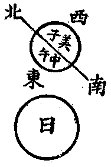



例南北线为一直杆，横贯地球，悬在空中；自身从西至东，向日以一定速度而渐转，中国正向日当午时，美国则为半夜子时，非洲为日出时，太平洋则为日没时。餘可例推。南北极永远无正向日时，亦鲜全背日时，故为非昼非夜。今犹为探险者所未能探得详悉，仅知其为南北冰洋而已。南北极之标准若移动时，地球东西面变为南北极，地球南北极变为东西面，则南北洋之冰镕化为水，当淹没今之陆地为洋海，而南北洋又当出现适宜人等生物居处之洲陆等。然地球曾有此等沧桑之大变迁否，亦无确知。兹制地轮绕日环转之四时成岁图如右。



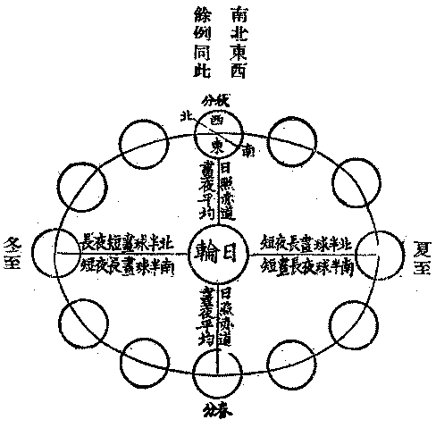



环转一周，约为三百六十五日，分四时、十二月。春分、秋分，昼夜长度均等十二小时；夏至则北半球昼长夜短，冬至则北半球昼短夜长，南半球则反之。大洲、小洲文化民族皆处於北半球，故皆言冬则昼短而夜长，夏则昼长而夜短也。其实以地而异，不能概齐。月轮绕地环转，约三十日或二十九日为一周。月球由地分出，离地非远，故其相抵相吸中之吸力，影响地面上之流质——海水——，发生潮汐；复由日、地与月相对向之差度，而有朔望弦晦之异。兹亦以黑白成月图表之：



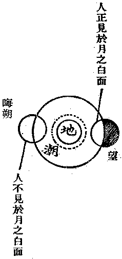



> 晦朔望日与月正对而吸力厚  

> 故吸地上洋海而发生大潮汐







> 上下弦日与月斜对而吸力薄  

> 故吸地上洋海而发生小潮汐



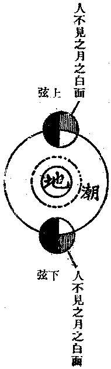



据实、月轮向日之面常白，背日之面常黑。唯在地球上人观之，则於日、月、地三成一直对线时，见月全黑、全白；日与月若成一斜对线时，见月半黑、半白。每夜有其移动差度，乃见自望至晦，自晦至望，渐黑与渐白之月相。而日月薄蚀之相，亦由日、月、地相对而现。月影昼遮日轮，地上之人不见於日，遂成日薄之象；地影夜遮日轮，地上之人不见於月，遂成月蚀之象。此其时度，皆可预算知者。至空中诸星，则大抵为他处之器界。除日、月外，天王星与此地球最有关系，而金星等有时亦可交通。至古人以日月星象言人事祸福之关系，不过依人事、天象而寓其劝诫之意。餘若风、云、雨、露、霜、雪、雷、电，与地之崩动等，皆与人生、旁生有直接之关系。而植物等以之蕃殖衰落，田野变成沙漠，沙漠变成田野，使人不得不变更其生活方法，则为间接关系。此除日月与地之距离方向年龄等有关系外，大抵皆由地轮表里之坚劲质，与流湿质，并煖热力，与轻动力，积成潜势，及时生变。深究厥源，亦由多有情类之一切种识变其常度也。



四　此日系中之他处人生器界



近人所言一日轮之系统，在佛陀学即一苏迷卢系，一苏迷卢唯有一日轮故。然一苏迷卢系，据佛陀学有四人生器界，近人亦已有能窥见火星等有人故。今此地球，为四人生器界中之第三器界。以东西南北而表其次第，此曰南赡部洲，当居在第三故；第一曰东毗提诃洲，当今行星中之水星，距日轮为最近故；第二曰西瞿陀尼洲，当今行星中之金星，距日轮亦较地为近；第四北俱卢洲，当今行星中之火星，距日轮较地星尤为远故。水、金、地之三星，大小略等；火星较大。北俱卢洲，传为四洲中最宽广之妙胜大洲故，以俱卢洲为人生完美之器界，足为吾人想慕之境。兹节录起世因本经，略明其概：



北俱卢洲，有无量山，遍生香树，香充其洲。地生香草，青翠柔软。树生种种杂色花果，诸鸟栖鸣，音声雅妙。山有诸河，澄清徐流，宝舸容与，岸浅易涉。有诸树林，花枝映覆。其地平正，纯是金银，无荆棘坑坎礓砾粪秽等。不寒不热，时节调和。地常润泽，植物蕃茂，人生日用，都由植物自然成就。有「安住」树林，高六拘卢舍，密叶重布，能遮雨滴，为彼人等居住。香树高低不一，弥布香气。有波娑树，在枝叶花果中出诸宝衣。有诸宝树，出璎珞、花鬘等种种严饰。有诸器树，出种种人生日用之器具。有诸果树，出色香味俱美之果，供人取食。有诸乐树，出生乐器乐音，供人娱乐。其他又生秔米，自然鲜白，不藉耕舂。有「敦持」果，随意生火，熟诸饮食，不假新炭。其洲有四无热恼池，贯注周匝，其水清冷、轻软、甘美、香洁。岸傍栏楯、铃网、宝树环绕。池有华藕，色香微妙，破汁食之，甘如乳蜜。池之四面，有四大河，水鸟、树林、花果，香音围遶河道，罗列周遍。恒於夜半池起密云，雨洒地润，旋复晴霁。风送清凉，触人安乐。复有善现、普贤、善华、喜乐、善体众多池苑河道，入中游泳，随意去留。衣饰之具，随心取舍。



此言北俱卢洲器界之美，即言火星之人间也。他日能有更进步之科学，固不难证实於火星；亦不妨以人生增上福业，改造此地球成之也。



五　日系中神生天生之器界



太阳系中八大行星，除上水、金、地、火四星，木星环日於火星外，应为东方天王之天众及华手天器界。火星、木星间，有多小行星，应为星宿天之器界。土星环日於木星外，应为西方天王之天众及持鬘天器界。天王星为管理南赡部洲南方天王众之器界，名义更为显然。海王星则为北方天王众及常放逸天之器界。至於彗星，不由太阳统摄，然时隐时现於太阳系中，应为阿素洛或妙翅鸟之器界。而太阳则为忉利天之器界也。过此以往，为空居天，非日之光热摄力所能及。故太阳系之范围，即苏迷卢之范围也。兹制图以解之。



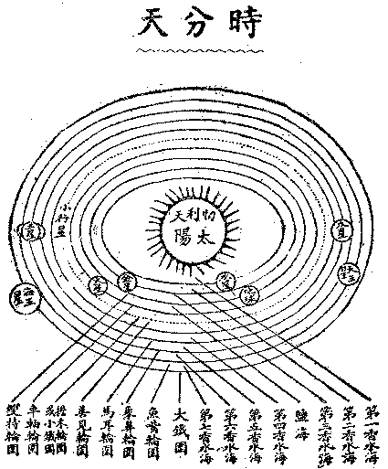



八大行星，轮围轨线，喻之曰山，实为轮围之轨道也。太阳与八星轮轨间之空皆喻云海，实为「以太」及空气也。地球蒙气与地上之海水，迭相凝变，故统说为盐海。苏迷卢指太阳全系统言。日及诸星，地球上人皆从仰望而见，在仰望中，似从下而至上，轮轨层积，喻之曰山。八星轮轨之空间诸卫星、小行星等，亦为四王所统空行、天行诸神生等器界。器界皆为有情所依资者，应无无有情之器界。不应以地球上人生、旁生及植物等之适宜生存否，断餘处生物之或无或有；地球上生物之适宜生存条件，但能适用於地球故，或但能适用於吾人现见之生物故，然亦可有将成未成、将坏未坏而尚无有情者，时在变化之中，不应执为定无定有；此地球亦初无动物，后垂坏时，仍将无动物故。大铁围为太阳系之最大范围，亦苏迷卢之最大范围也。



六　太阳系外之天生器界



太阳系即苏迷卢系。据传苏迷卢顶——即太阳——曰忉利天，其上——或其外——倍高倍广，有时分天器界如云珍宝所成；其上倍高倍广，有知足天器界；其上倍高倍广，有化乐天器界；其上倍高倍广，有他化自在天器界，是为欲界之顶。其上倍倍高广，有梵众、梵辅、大梵天器界，是为色界之初禅天。色界与欲界之间，别有魔罗天器界，是为天魔众之居处。此诸天之器界，大致皆百宝成，有如云气，庄严胜妙。上上倍增，至大梵天遂为「一世界」之范围。如此千个，曰小千界。其上更远，有统千个「一世界」广量之少光天器界；又其上有无量光天器界，极光净天器界，是为色界之二禅天。其所统谓之小千界。如此千个，曰中千界。又其上有统千个「小千界」广量之少净天、无量净天、遍净天三重器界，是为色界之三禅天。其所统谓之中千界。如此千个，曰大千界。其上又有统千个「中千界」广量之无云天、福生天、广果天、无烦天、无热天、善现天、善见天、色究竟天八重器天，是为色界之四禅天。其所统谓之大千界。「一世界」以八十小劫为「成住坏空」旋复，坏由火灾。统小千界之中世界——即二禅天——，以八大劫——以光净天寿八大劫计——为一「成住坏空」旋复，坏由水灾。统中千界之大世界——即三禅天——，以六十四大劫——以遍净天寿六十四大劫计算——为一「成住坏空」旋复，坏由风灾。至四禅天之八重器界，则弥覆千个中世界上，随彼天身存没，不为三灾所坏。而无色界四天，以无身故，亦无器界，周遍大千界中，无别居处——唯我学者所宗，不出於此——。至通常所言之世界「成住坏空」，但依「小千界」中「一世界」言之以例其餘耳。此一大千界，名索诃世界，为色究竟天大自在天之领土，亦为一佛教化之域。统计应有百亿太阳，即百亿苏迷卢系也。在华藏世界，仅为一世界种中之一世界，二十重中，居於第十三重。近人所说恒星图中之恒星系，庶其近之。



　　　　　　　大千世界（此大千世界曰索诃世界）  

　　　　　　────────────────────────────色究竟天  

　　　　　　　──────────────────────────善见天  

　　　　　　　　────────────────────────善现天  

　　　　　　　　　──────────────────────无热天  

　　　　　　　　　　────────────────────无烦天  

　　　　　　　　　　　────无想天  

　　　　　　　　　────────────────────广果天  

　　　　　　　　　　──────────────────福生天  

　　　　　　　　　　　────────────────无云天  

　　　　　　　　　　　　　　　如此千个之上  

　　（大千界中一大世界）───────────────极光净天（或光音天）  

　　　　　　　　　　　　　─────────────无量净天  

　　　　　　　　　　　　　　───────────少净天  

　　　　　　　　　　　　　　　如此千个之上  

　　　（中千界中一中世界）───────────光净天  

　　　　　　　　　　　　　　─────────无量光天  

　　　　　　　　　　　　　　　────────少光天  

　　　　　　　　　　　　　　　如此千个之上  

　　　　（小千界中一小世界）────────梵天  

　　　　　　　　　　　　　　　──────魔天  

　　　　　　　　　　　　　　　　─────他化自在天  

　　　　　　　　　　　　　　　　　────化乐天  

　　　　　　　　　　　　　　　　　　───知足天  

　　　　　　　　　　　　　　　　　　　──时分天  

　　　　　　　　　　　　　　　　（苏迷卢系）  

　　　　　　　　　　　　　　　　　一太阳系



七　一小世界之成住史



苏迷卢系至大梵天，为小千界中之一小世界。此小世界，由以前小世界「坏」而「空」后，由有情之共业力故，大梵天之福业力故——以此故，诸天神教执世界人物由彼天造——，渐由集起成新世界。初依无形无动——形言物质，动言物力，即无物之质力之谓——之有限量空轮以为轨持。空轮指有范围之空间言。近人犹於数学天算学上，争空间之有限无限，其实一世界之空间有限，诸世界之虚空则无限也。由当生此界之大梵及诸有情业种之力，规定此「世界」之形量寿量，依心识种及光热等色种起现行故，最先化生大梵天身及成大梵天之器界——故大梵天亦为此一世界命根；儒言穷理尽性以至於命，至於命、即至於大梵天也。唯神学者所宗，不出於此——。大梵天界，於成劫初最先生成，於坏劫末最后死坏，故寿命有六十小劫，统成、住、坏三中劫故。由此历数小劫，渐成梵辅、梵众天界，完成清净光洁之初禅天梵世，而尚无阴阳扰动之患也。次依空轮，有风轮——轻动大种——起，为诸有之轨持。由当生欲界有情业种心种及光热等色种起现行故，先化生有阴阳性之魔天身器，实为阴阳扰动之原。扰动中有阴阳之性，即风轮之轨持——穷理尽性不出一阴一阳之道，唯生学者所宗，不出於此。至於命之阴阳不测之神，则为梵天。魔天以下，则皆为阴阳之所测。故梵天为外道解脱之宗，魔天为凡夫情欲之主也——。依风轮所轨持，历数小劫，渐生成众宝如云之他化自在天、化乐天、知足天、时分天诸天身器，完成欲界空居之器界。由是依空轮、风轮更有水轮——润湿大种——、金轮——坚劲大种——起以为轨持——唯物学者所宗，不出於此。由当生地居界——即太阳系，苏迷卢系。地即太阳及太阳系中诸星体，由水轮、金轮轨持所成者，非单指地球也——，诸有情业种心种及光热等色种起现行，先集成化生日球之忉利天身器等。据传日之形体四方，外现光轮则圆。每方有八天众天主，中央别有一能天主天众，故谓三十三天。由是又历於数小劫，乃次第完成，太阳系中之八大行星及卫星、小行星等天生、神生、人生、旁生、饿生、苦生之器界。从梵天以至太阳系诸星球之完成，共历二十小劫，在地球等乃有人类生起。在初化生於地球上之有情类，犹是天生而未是人生也——耶、回等低级一神教所奉唯一天神，不过忉利天之能天主或天王星之南方天王而已。故神教之起源，以太阳或星宿为宗主也——。此太阳系之物理界，风、水、金轮以为轨持，光热之火大种与诸所造色种，内蕴外发於轨持间。力之著者，不外轻动之风大种与光热之火大种；质之显者，不外润湿之水大种与坚劲之地大种。风动之轮轨，分为阴阳性——先天阴阳——，吸抵拒摄，由之相激相成。水、金之轮轨，合为阴阳性——后天阴阳——，吸抵拒摄，由之相成相激。光热之火大种——电子——，弥纶击发於中。水轮即为无重量之「以太」，即诸香水海也；金轮则为有重量之「质点」——即诸原子原质——；风火则为激动变化之力。近人物理学之研究者，不外乎此矣。地球本从太阳分出，别有蕴火以为中心。风日由水而彻金火，火金由水而彻风日，拒摄调和而成海陆，宅生植动诸物，吸抵停匀而成运行，变呈天地诸象。今入住劫以来，已历其半——第九小劫——，地球之年龄，犹在人之中年也。



八　日系诸星之空间测量



据俱舍论等之传说：地球直径，为六千五百逾缮那。水星、金星，或较为大。北俱卢洲为八千逾缮那。八水轮海——或说为以太海及空气海——，中间宽度，盐海约为三十二万餘逾缮那，七香水海则从八万、四万、二万以至二千五百逾缮那宽。大铁围之周围，约为三百六十餘万逾缮那。然说苏迷卢之直长，仅为十六万逾缮那。三百六十餘万逾缮那之直径，应不至此。又说地球与苏迷卢顶——即太阳——之高下距离，为八万逾缮那，亦不符说远距离之量也。说苏迷卢顶之直径，为八万逾缮那，似说日球较地球大十倍有餘。此诸测量，虽无定准，然在今天算学之假设上，尚无定量，亦不妨姑存其说也。



九　地球等上之异生器界



地球为人生、旁生之器界，然亦有地行药叉及阿素洛等诸神生类，於中别成依住之处与人不相闻见。又诸饿生及苦生类，或与人间同处，业果异故，不相闻见。或云：地面五百逾缮那下有饿生界，由琰摩王管领而宅其中。又云：入地一千逾缮那之地心，有苦生之器界，常受诸苦。又有餘经说：八热苦生界在於地下，此合地心是火之说。八寒苦生界在地之极边，此合南北二极冰洋之说。故地心与南北极，皆有有情生活其中也。受苦业果，成苦根身器界，非吾人眼耳能闻见，亦非吾人生活所能衡断；然若得天眼智，亦能了了明证之也。在此地球既然，在水星、金星亦如之。火星据说唯十善业成，故除人以外，但有珍禽等旁生耳。四王天统诸神生类，故木星、土星、天王星、海王星虽为天界，兼为神界。忉利天、据顺正理论云：苏迷卢顶，於四角各有高峰，有金刚手药叉神等，於中止住守护。诸天中央大城，亦有青衣药叉防守；且龙象及妙翅鸟等旁生而神生者，与紧那罗、健达缚等亦时执役其中。故此天界，亦兼神界。要之，神生之器界，乃兼通於人间天上者也。



十　此大千界与无量器界



一小世界之空轮有限量，一小千界、一中千界、一大千界、一世界种、一世界海之空轮亦有其限量，然无数空轮互持交彻之无轮虚空，则无边际。无边之虚空中，如此索诃之大千世界者，或大於此，或小於此，或优於此，或劣於此，或先於此，或久於此，或暂於此，各成统系，各为安立。此索诃界东方之世界无量数，南西北方四维上下亦复如是。或成，或住，或坏，或空，在无尽时无边空中缩小观之，殆如海上浮沤，此生彼灭，暂存忽殁。反之，则在一刹那、一微尘放大观之，亦如大千华藏层积重叠，增长繁殖，展转相摄各为其主，展转相入互为其伴，异处异时，多样多式，如宝珠网，影体相涉，主伴重重，不可穷诘，如佛华严华藏世界品等广明。欧人迈格文，谓佛说世界，各方皆同一形式者，非也。



十一　器界与有情之关系



器界言有情身所依住之处，与所资用之器也。据三十唯识颂云：「不可知执受、处、了」。论解之云：所言处者，谓异熟识——一切种识——由共相种成熟力故，变似色等器世间相——即不执受外四大种之能造色，及不执受外器界尘之所造色是也——；虽诸有情所变各别，而「相」相似，处所无异——据在同一空轮内言——，如众灯明，各遍似一。问曰：谁有情类之异熟识变起为此相耶？答曰：或云一切，所以者何？如契经说：「一切有情业增上力共所起故」。或云：若如此说，诸佛菩萨应实变为此杂秽土！诸异生等应实变为他方此界诸净妙土！又阿那含等诸圣者，厌离有色生无色界，将来必不再下生於欲色二界，变为此大千界，复何所用？是故唯以现居此界及当生此界诸有情之异熟识，变为此界。契经但依少分有情而说一切之言，诸业同者皆共变故。或云：若如此说，则於器界之将坏时，既无现居及当生者，又以谁之异熟识、变为此将坏之器界耶？又诸异生厌离有色而生无色界者，后虽犹当下生，然於现近数万大劫中，既无色身，亦无须器界，预变为今欲色二界之大千界，亦复何用？又欲界与色界诸有情类，虽有色身，各须依资器界，然与绝然不同地位之器界，麤细优劣，远相悬隔，不能有互相依住资持之功用；此一地位之有情识，变为彼一一地位之有情器界，亦有何资益耶？然所变之器界，本为有情之「色根身」依持受用，故若於此有情身可有依持受用之器界，此有情识便应变为彼之器界。但为业果造受之阶地所离隔，不因居处之此界他方而阻碍——颇同代表各种职业阶级之国际团，但有阶级之分，而无国界之别——。是故虽生他方器界——他界之空轮内——，然与此处有情居於业果阶地相等之有情类，其异熟识，亦得变为此处阶地相等之有情身所资器界，彼亦可生於此为依资故。彼一一界有情识变为此界阶地相等之器界既然，此界有情识变为彼一一界阶地相等之器界亦然。故此器界，於将坏及初成之时，虽无有情而亦现有此之器界；彼一一界阶地相等之有情识，皆共变为此故。彼於此界既然，此於彼一一界亦然。可为图解如下：



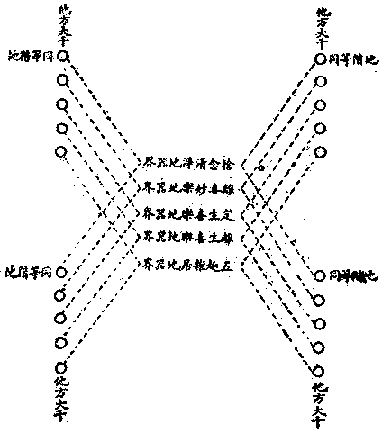



然於此说犹有须补充者，则异其阶地之有情，其异熟识虽不一切皆变不同阶地之有情身所依器界，然亦有以特殊关系而变之者，若上界离生喜乐地之大梵天，兼领欲界；舍念清净地之大自在天，兼领五有色身器地——即上表列之五阶地——；又有上地将下生於某阶地者，此诸上地有情识，应变为有关系用之下地器界也。下地有情，亦有努力修戒定慧等行，将上生於某上级地、或某他方之净土者，此诸下地有情识，应变为有关系用之上地器界也。故虽仅就业识所变之器界言——诸佛菩萨愿定通力所变者，下另说——，应有四句分别：



一、现居及将生此方此阶地之有情识共变；此最居主要之地位，故若无现居及将生之有情时，器坏渐灭。



二、不来居此方之他方同等阶地诸有情识共变。



三、此方居上地能兼领於此阶地之有情识共变。



四、此方、他方、土地、下地当生於此方此阶地之有情识共变。



有此四句，乃穷尽有情识共变器界，以为色身依住资用之理由也。此方、他方有情，或以同等阶地而转生於他方此方同等阶地；此方、他方有情，或以不同阶地而转生於他方此方不同阶地。要之，可有转生色身依资用者，其有情识皆应互共变为可依资之器界。然此犹依一方一阶地内诸有情器共受用者而言。然别受用，犹应注重各类各个有情业识各变之殊异也。各类变者，若共居於此方五趣杂居地者，例对於人生所见之江河，人生则为水之受用；诸饿生等则见猛火或粪秽等而受用煎迫；诸天生等又见为金、宝、琉璃、庄严而受用诸乐；在诸水族，又视同空气而依为窟宅。缩小言之，同在地球之人，苦乐相差霄壤；同在中国，同在上海，亦复业果差别。各个人各变不同者，如忉利天，於同食具成美恶迥殊之食味；人亦随其特殊身心，於同一境感觉色、香、味、触不同，竟不知孰为正色、正声、正味耶？故诸器界，虽由无数有情同业增上，变成相似之境，其实但有相似而无同一。各有情心身，各依资於各变之器界；各有情各为一宇宙。时无本剽，空无边中，乃为尽理之谈，符於现实。然诸有情同业、异业互为顺违增上缘力，或总或别，相坏相成，以变为相似不相似之身器等，亦为现实之事。由前故说一切种识缘起，由后故说法界无尽缘起。



十二　人生於器界之依资



前於器界，既说明其原理，今再就资人生所依持受用者，切实言之。人生直接所依持者，固在於地球之陆地，然日月之供给光热，海蒙空气之供给风雨等，亦有关於依持，否则，色身陆地亦不能依持也。至於受用日、月、光、气、风、雨等，固多有直接间接关系；而尤以陆地及陆海所出产之矿植，供给於人生为衣、食、住、行、康、乐之器用者为要。大抵衣食取於陆海所产植物；住、行、康、乐之具，兼取陆海出产矿植以成。人生之生活，大都依赖於植物，故亦谓人为寄生植物者。人之受用於矿植等，较旁生等为特殊者，由手足分工而两足能支持其全身直立。旁生亦曰横生，人生亦曰竖生，亦由两足能支持直立其身否而别。两足能持身而直立，乃能运其两手，别为造作及受用於矿植之间。其造作受用於矿植之又一特殊力，则在能用於火，此亦旁生等所不能为者。由能用火，於是能采用钢、铁、煤、炭、石油等，制成种种五金之器。驯至能利用蒸汽力、水力、电力，产生近代工艺制造诸增强五色根识感觉力之器——望远镜等——，於见知上扩辟向来不见知之境界；制造诸汽车、汽船、飞机等之交通器，凿开向来不交通之阻隔。至於改造植物、动物之种类根身等，遂令死格式之自然界，亦呈以人力为主变因之日新月异活泼形势。人生之手乎，器界之火乎，二者实为人生工作於器界种种异能之机括，亦为人生受用於器界种种特长之基本；而依此亦愈见器界由有情识变之真相也。盖由人生有何等之意欲情识，即可运用手、火变生何等之器界以依持受用。故交通於水星、金星、火星之他器界，亦决非绝对不可能之事。人乎！人乎！勉哉！勉哉！善用其手与火，以工作於器界，固不难改刱变造之，以适於人生之依持受用，而不必以地球人满为患等，效彼𣏌人忧天之坠也。然旁生、人生等色身，则同为须以器界为依持而受用於器世间者；虽可由互相感通情愿而资助为用，然若强取其色身而寝皮食肉，用之如器界之矿植，则为非理。盖旁生等特为吾人较愚蠢之幼弟，吾人当悯爱之，止其互为伤残而导之以共存共荣，为友为侣，至多亦责其为仆役为拘囚耳。甚至人相杀食，以他人色身为工具、为器物，而用之同於器界，则其犯分悖理之罪，更为难恕。故人生当依持地界而受用於矿植之器；人生、旁生，则应相为教导，面共工作生活，庶其人生可衣、食、住、行、康、乐於天地。



第三节　所知情器



一　所知情器概论



前者虽别论所知有情与所知器界，其实有情与器之世间相，密切关连，不能绝然分划而说。虽於前二节中，亦曾说有情而及於器界，说器界而及於有情，犹有多分有情器界和合而现之事留待研述。且佛陀学中，虽分有情与无情之别，而草木诸生物，虽可合矿物统称曰无情，然矿物无生而植为生物，其间亦不能不有皎然之区别。且近人进之亦有言植为有情同人者；退之亦有言人生亦无情同矿物者——若美国行为派取销心理学者；或则宣言万物皆为生物，有情无情不别——若德国赫克尔。此之三者，甲可扩充为心本论或唯心论；乙可扩充为物本论或唯物论；丙可扩充为生本论或唯生论。据其意，万物祇有程度之高下，无性质之别异，则有情与器亦无可分别。然按验之现实，矿物、植物、动物三者，固各有显著之区别。动物能以音容表其苦乐之情，异於矿植，而特谓之有情；因谓植、矿曰无情物。植物能於死限前表其生态与表其死限后之死态，又与有情同能传殖自类生种，异於矿物，与有情同谓之生物。矿物唯有与植、动共通之结散变化性，谓之无生死物。此固平允明显，而无何隐秘难见者。依此分别，万物应有四差别性：一、结散变化性，二、死限生殖性，三、永续统摄性，四、自觉进化性。仅有第一性者，则为矿质等无生物；有第一性、加有第二性者，则为植等生物；有第一第二性、加有第三性者，则为人生以下之旁生等有情；有第一第二第三性、加有第四性者，则为人生以上之人生等有情。虽至天生及大乘圣犹有不能一概论者，然就人界情器观之，则秩然不可逾越也。有情之永续统摄性，与自觉进化性，皆以其各有之一切种识，及此识互依之意、意识等而言；以有此故，同为有情识者。人生之意识等较为发达，由意识而现人生之创造生活，故别说有一自觉进化性。旁生之意识等，较为昧劣，由异熟识受异熟之生活，故暂说无有自觉进化性；其实亦微有自觉进化之性也。由此有情与无情器之别，皎然应有。有情通於能变所变，无情唯是所变，如上言器由识变等。在无情物，植、矿之异，应更详究。



二　动植矿之关系与区别



凡动植矿物，皆指其色聚以言。矿之色聚，指金、水等，别称物质；植之色聚，指花、木等，别称生物；动之色聚，指人、兽等，别称「有色根身」。而其关系，统在能变现此诸色聚本质之一切种识——即异熟识——。器由异熟识共相种成熟力变，已如前说；有情有色根身，为颂中「执受」之一分——另一分即是一切种——。论亦释云：『有根身者，谓异熟识不共相种成熟力故，变似色根——即眼、耳、鼻、舌、身中之神经系——、及根依处——即眼、耳、鼻、舌、身之血肉体——，即内——执受——大种及所造色』。又云：亦有以共相种成熟力故，於他身根、依处亦变似彼；否应无能受用他身。由此，人等虽死，所餘尸骸犹见相续。此说有情有色根身，有其二分：一分「五根细色神经」，唯以一切种识之不共相种变成造所造色，由我爱执藏识执为自体；一分皮脏骨血等根所依处，虽以一切种识之不共相种变成造所造色，由我爱执藏识执为自体，然亦由一切种识中自他有情共相种助，变成造所造色。故父母能生育子女，友侣之身亦能相为受用。且其死后，虽不执为自体，在他有情犹见尸骸续存——与他界同地有情共变器界故，於将坏时器界犹存理同——。由此有四分别：一、共共相种变，即前器界同处同地同受用者；二、共不共相种变，即前器界各类各个别受用者；三、不共共相种变，即此所言色根依处；四、不共不共相种变，即此所言五根神经。由此例之，在一切种识中，「相种」可分三类：一、共共相种曰共相种，矿物器界皆由此变；二、不共不共相种曰不共相种；三、别加一类共不共、不共共相种，植物应由此变。其有死限生殖同根依处，故不共共；然无我爱执藏识执以为自体，故共不共；合此二义，乃於一切种识中为植物辟一特殊位置。要之，色聚中有情无情之区别，由於我爱执藏识执受为自体与否——我爱执藏识，间接有末那关系。执受为自体，为有情色身；不执受为自体，为无情——矿、植、尸骸等。矿物、植物及根依处、净色五根，其区别在一切种识中之「相种」不同：矿物，共相种变；植物及根依处，由共不共不共共相种变；五根净色神经，由不共相种变。其遍通之关系，在於一切种识；其区别与连带之关系，在能变之自种不同类、及藏识之有无执受。共不共不共共相种，亦持以各有情一切种识，随共相种变成之处，此「种」亦变生植物耳。此矿、植、动三者之区别与关系，虽为人间之现实观，亦此一空轮内五趣杂居地之现实观也。不及或过，遂成物本论等。



三　人间情器与非人间情器



依人间情器之现实，於动、植、矿三者之区别与关系，应若前述。然在不及人生者之旁生以下，以「自觉进化性」极昧劣故，人类中婴孩儿童亦近旁生故，多由异熟识受异熟之生活故，其所行动类机械故，於此习成其观想力，遂谓人生及餘动植亦同矿物，悉为自然界因果力所支配之物故，立唯物论；而以矿物为本，初演化为植、动，进演为高等之动物，在演进为人生。然此祇见「结散变化」之矿、植、动共性，於生物「死限生殖」之特性，不无轻视；於动物及人「统摄永续」与「自觉进化」之特性，则更忽略不察。故於矿物为本之唯物论，於不及人生之生物立场，虽或可言，亦偏而不全矣。若在超过人生之天生等，所食、所用，皆可由身化生，不殊生物。至於四禅天，则所依器界亦随身而存没，殆犹人生之根依处，似可说依生物为本之唯生论；皆生物故，劣之则为动、植、矿物，胜之则为人天等故。然此可生三过：一、神生万物论：执诸万有皆神所生，成多神、一神等神教迷执。二、循环不息论：以生殖观祖父子孙，形气相续，在周期内循环变化，成循环论，所谓一阴一阳之道；恐形气循环之有时断灭，成不息论，所谓易不可见而乾坤毁。此为中国孔、老思想。三、轮回解脱论：以死限观前后今世身命相续，在异生类轮回变化成轮回论；厌身命轮回而欲得超出，成解脱论。此为印度数论、耆那、小乘思想——数论、耆那，以存我故非真解脱；小乘以无我故得真解脱——。此三种论，亦皆有偏。至於登地菩萨，於后得智证阿赖耶，观身器等皆心变现；后由得定自在，能随心转变身器等，固可以心为本说唯心论。然心但为所依能熏，由佛智观，应为识中一切种之别别现行，现行互互增上，说一切种现之缘起。故唯心论，亦有未圆。且人间但知「独散意识」之功用，以之而说唯心，或成自我唯心论，而但存自我；或成宇宙唯心论，而推本一神，归之泛神，故亦有过。故依人间现实，於动、植、矿应分别说，乃是多元而非一元。极佛智境，以一切种起一切现，由一切现互互增上，亦为多元而非一元；种由现熏所生，复说无元。然则唯物、唯生、唯心论，皆不可成耶？而以别义，亦可成立。举其总义，则「不离相摄」故，皆可随宜以说「唯」言。谓「所知境」——客观界——皆可名「物」，莫非所知境故，可名唯物，正名唯境论；从众缘所生——有为法、所显——无为法故，诸法莫非众缘所生显故，可名唯生——正名唯根论；一切所知不离於能知故，一切种依识熏持故，诸有为法皆所变故，诸无为法亦所现故，可名唯心——正名唯识论。然此所云物、生、心之三名，已非复前此矿物之物、植动之生、动人之心之义矣。故论人间情器，仍应用前矿、动、植三类之分别。



四　有情与器界之关系



有情与器界密切之关系，首为饮食。植物吸食於矿、光、气而造成原生质。有情除饮水、光、气等，更食植物所造之原生质，故有情之饮食，於植物为直接材料，而矿物亦为直接间接之材料。然此亦论欲界或太阳系或人间有情之饮食而已。佛言一切有情生命皆依饮食而得存在——一切有情皆依食住——，统三界有情言，分食为四：一者、段食：谓以有分量体段之食料，吸入有情身命流中，经过变化，消坏原状，能为资益之事，谓之段食。所食质料，唯是系属欲界之香气、滋味、及坚、湿、煖等触尘；色之与声，但为目睹、耳闻，不由变坏资益身命，故不属段食摄。此唯欲界有情之食，若离此食，欲界有情即不能生存故。二者、触食：此为「能触」之触心所接触於境为相，三界有漏触心所才接触於境，即能摄受可喜乐等境令根识怡适；资养根识势力，故名为食。此触心所虽与八识相应，然属眼、耳、鼻、舌、身、意之六识触心所，触色、声、香、味、触、法六尘麤显境，摄受喜乐及顺益之舍受，资养根识之义胜故，由此说六触身为食；所谓「人逢喜事精神爽」者是也。此食通於三界有情，然无想天无前六识，应无此食。三、意思食：此以心有希望为相，以思心所为体。谓三界有漏思心所与欲心所俱转，於可爱境生希望故，能为资益身命之事；有希望则心身活动相续前进，无希望则心死而身亦死，故谓之食。然思心所虽遍八识莫不相应，唯第六意识能於未来境起胜希望，故祇说意识相应思为食，曰意思食；故无想天亦无此食。四者、识食：以能执持有情有色根身生命，令一期中相续存在为相。谓三界有情之有漏识，由前三食势力增长，能为执持身命相续生存之事，故名为食。识言、虽通诸识，以前六识有时不相续故，而第七识有时亦转其类性故，唯第八识是一类无覆无记性，随所生界恒时相续，独能执持有情身命於一期中令不坏断。故此识食，专指阿陀那识为体。若无此食，住二无心定及无想天之有情身命，应即时死坏故。要之，「食」以资持有情身命令不断坏为义，段、触、思三，直接有关器界；识依前三增长势力，间接亦有关於器界。



五　人间之有情器界



依上述区别与关系，关系中有区别，区别中有关系，情器重重，差别如表：



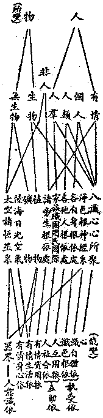



由人与物观之，生物为沟通人与物之桥。自「根神经」至於植物，为生物者凡六；人占其四，故人亦属於物而物亦属於人。旁生又为沟通人与非人之桥，人生与旁生同为有情故。有情又为沟通「能变」「所变」之桥，有情通摄心与物故。旁生与人、正为有情；植、矿、日、星，正为器界；有情身心依故。自净色根及根依处，为执受依，是个人自身故。他人之根依处及家国等、为人群互助依，人类社会所由成故。诸旁生根依处、为有情资用依，人与旁生互亦相资用故。植、矿、陆、海、光、气，为人与诸旁生生活资具之所从出，故为有情之生活依。太空诸恒星系与人生活所资无何关系，然自净色根以至太空诸星系，皆为人类意识之所知境，故为人意识依。观此、可知人生世界为何状矣。



六　人生世界之我与非我



常俗以自身谓之我，自身以外谓之非我。其实我与非我，但为人心之二概念，无固定之实体。犹如主观、客观二名，无一定之界域。主观曰我，主观有时而缩小或扩大；客观非我，客观有时亦扩大而缩小。其於现实虽同前此人生世界，而我与非我可有诸差别，今亦表之如下：



　　　　　　　　　　　　　　　　　　现知一刹那心───────我（主观）  

　　　　　　　　　　　　　　　　　　　　　　　　┌（数论等我）  

　　　　非我────────────八识心心所聚┴我  

　　　　　＼　　　　　　　　　　　　　　　　　　　＼  

　　　　　非我───────────自净色根依处──我（常俗所谓之我）  

　　　　　　＼　　　　　　　　　　　　　　　　　　　＼  

　　　　　　非我──────────家　　　　族───我  

　　　　　　　＼　　　　　　　　　　　　　　　　　　　＼  

　　　　　　　非我─────────职　　　　团────我  

　　　　　　　　＼　　　　　　　　　　　　　　　　　　　＼  

　　　　　　　　非我────────国　　　　民─────我  

　　　　　　　　　＼　　　　　　　　　　　　　　　　　　　＼  

　　　　　　　　　非我───────人　　　　类──────我  

　　　　　　　　　　＼　　　　　　　　　　　　　　　　　　　＼  

　　　　　　　　　　非我──────有　情　类────────我  

　　　　　　　　　　　＼　　　　　　　　　　　　　　　　　　　＼  

　　　　　　　　　　　非我─────生　物　类─────────我  

　　　　　　　　　　　　＼　　　　　　　　　　　　　　　　　　　＼  

　　　　　　　　　　　　非我────地　球　系──────────我  

　　　　　　　　　　　　　＼　　　　　　　　　　　　　　　　　　　＼  

　　　　　　　　　　　　　非我───日　球　系───────────我  

　　　　　　　　　　　　　　　　　　　　　　　　│  

　　　　（客观）非我────────太阳诸恒星系┘



就人生世界为范围，对观我与非我：但为我者，唯是现知一刹那心，於现刹那唯能知故，此为我之最缩小者。但为非我，亦唯太空诸恒星系，但为能知之所知境，於人生活无资用故，此为非我最缩小者。餘十皆可通於我与非我。诸识心心所聚，在现刹那能知心上亦为所观境故；自此至於太空，同为非我，此为非我最扩大者。现知一刹那心、亦属八识心心所聚，故唯各人自识心聚为我；如数论等、主张眼、耳等根为神我用，同卧具等为色身用。人亦常言身是躯壳，为灵魂我主人所居舍宅，魂来宅造，乃有身生；魂去舍空，身归死坏。故自身至太空，同为非我。至常俗之自身以内为我，自身以外为非我，则更俗情之常矣。有凡所为皆依家族而起，家族以内为我，外为我非，此亦俗情常有。有凡所为皆依职团而起，职团以内为我，外为非我，若工团主义者之国际工团等。有凡所为皆依国民而起，国民以内为我，外为非我，若主张「非我族类其心必异」之国家民族主义者。有凡所为皆依人类而起，人类以内为我，外为非我，诸人道主义者近之。有凡所为皆依地球上有情类而起，有情类内为我，外为非我。有凡所为皆依生物类或地球系或日球系而起者，生物类或地球系或日球系以内者为我，外为非我；此为我之最扩大者。今此人类虽似未能有此心境，然由人类以进超人，要非不能有之。若儒书所云尽人之性、尽物之性，以进於高明、博厚、悠久、广大，与天地参其化育者，虽谓统日球系而为一大我，亦无不可也。明我与非我、但为概念上之一区别，唯是假名而无实体，则我非我之执情空，庶可进窥法界缘起无碍之现实矣。



七　现代之人生世界观



依现代人类学者世间之心境，取其心境中之所有，以构成人生世界观：物质精神化，发源於自然，自下而上升，高至於国际历史、迷信、魔术，为物质精神之混合；上达而归极於佛陀。精神物质化，发源於佛陀，自上而下，降至低於魔术、迷信、历史、国际，为精神物质之混合，下达而归极於自然。世界而人生欤？人生而世界欤？以全世界之众缘而集成人生，分析人生之众缘而为全世界，此在有现代学者常识之人士，苟能平心静气以审察之，则此人生世界观，固皆现实而无何诡奇也！



八　太阳系之小三界



佛陀学中所说三界，乃一大千界之三界，过於高广，不能由人生界一跃即至於彼。故今准依经论所传，别於一苏迷卢系内，说小三界。此小三界，依统治者立名：一云、能天主界——即天神界——，三十三天之能天主，正统太阳系中天生、神生，兼统人生、旁生及饿生、苦生故。二云、琰摩王界——即地祇界——，正统饿生、苦生，兼统人生及旁生故。三云、转轮王界——即人畜界——，正统地星、水星、金星、火星人类，兼统象、马等旁生故。故能统治者之胜劣，故其次第如此。若依正被统治者言，由劣而胜：一、饿生、苦生界，居於水星、金星、地星之心或面，琰摩王建都於地星之腹而为统治。二、人生、旁生界，居於水星、金星、地星、火星之陆或海，转轮王建都於地星，御飞轮巡行於水星、金星、火星等处而为统治。三、天生、神生界，居於日球、海王星、天王星、土星、木星、卫星、小行星等，能天主建都於日球，以四天王等处而为统治。



统饿生、苦生之琰摩王界，兹据众传绎其意云：饿生住处，一正，二边。正、居此地球下五百逾缮那处，有城周匝数千逾缮那量，琰摩王统饿生居住其中；边、居不定，山谷、空中、海边皆有。有威福者，有妙宫殿——若人间诸神庙——，无威福者，或依粪秽、草木、冢墓、屏厕而住。据言大威德者，火星亦有，然此是神生类，乃空行、天行药叉等，非饿生类。或说地球西有五百岛城，半居有威福者，半居无威福者。传有转轮王儞弥者，尝飞行游观之。梵名曰闭戾多——薜荔多——最初琰摩王名粃多，粃多界中所有曰闭戾多，形或似人，或亦似诸旁生，类皆饥虚畏怯，性极贪求饮食，故名饿生。苦生住处有三：一热，二寒，三边。热苦器在地球中心，有八大狱，最苦者为第八阿鼻旨狱。此八、每一有十六小狱为眷属，合有一百三十六所。寒苦器在地之边际——即南北极——，或亦通水、金二星边际，大者亦有八所。边苦器无定处，或在山间，或在水间，或在旷野，此应通於水、金、地星三处。其受诸苦，或有主治，或无主治。大抵热边诸狱，轻者由琰摩王之所治罚，重者与诸寒狱业招其处，受自然苦。梵名曰那落迦，意译苦器，唯受诸苦，故名苦生。兼管人、旁生者，萧梁元嘉十年皇族文宣王家，设有亡母灵床，一日居一身长色赤而似人者，举家骇传，人竞往观；沙门僧含与之问答甚多，久之形隐，唯闻语声。据云：此间有一女子，应在收捕，奉戒精勤，致稽时日。此床虚设，故权寄居。既为时众目观耳闻，应为事实。收捕於人，可知兼管人间事也。



统天生、神生之能天主界：四天王以千手天、持鬘天、常放逸天、星宿天为眷属，统诸药叉、龙等，朝能天主於忉利天善法堂中，各依方位面向能天主坐。能天主所都善见城，纵广一万逾缮那量，天主与眷属居，诸宝严饰。城外更有欢喜、麤恶、杂车、杂乱诸游戏之园林池苑，诸天神等受乐其中。诸妙翅鸟、龙等神生，传有宝宫殿园池等。鸟常食龙，然但能食由胎、卵、湿生者，而化生龙威德胜鸟。宝宫殿中奉佛经像，自在快乐，皆等天生。兼统人生等者，毗昙论云：是四天王，於善法堂，以人间等善恶奏闻能天主等。四天王等，每月分界巡行人世间等，次第观察人等持戒、布施、修福德等，若多若少。善行者多，能天主等天众欢乐；恶行若多，能天主等天众忧恼。琰摩王等，亦受能天主之管辖。诸薜荔多有威德者，则服劳於四天王等。故能天主直接间接统治全太阳系诸有情器。世之神教，乃奉为人生世界之唯一真神、真父、真主，按之亦其福德较优人中转轮圣王耳。



九　转轮王界变迁史



据传：统人生旁生之转轮王界，由来已久。唯此地球变迁最繁，水、金二星亦有变迁，火星最为安定有常。而转轮王虽统治四星、或三、二、一星不等，要皆宅生於此地球。此地球上，於减劫中人寿八万岁时，各转轮王御金轮宝飞行空中，统治地星、水星、金星、火星——人及旁生；四星皆可交通往来，持十善法，自行教他。六万岁时，各转轮王御银轮宝，统治地、水、金星，交通往来。四万岁时，各转轮王御铜轮宝，统治地、水二星，交通往来。二万岁时，各转轮王御铁轮宝，统治地星，交通全球。皆以十善，自行教他。人寿减至不及千岁，无复具大福德转轮王出。虽有餘善流布人间，恶增苦滋，交通阻绝，分为各国，各治其族，犹如粟散，时有离合。传转轮王皆备七宝：一曰、轮宝，乃天然物。二曰、象宝，三曰、马宝，此二属於旁生。四、将军宝，则为军事部长；五、主藏宝，则为财政部长；六、典御宝，则为交通部长；七、善女宝，则为母仪后范；此四属於人生。有此七宝，故能统摄人间之矿、植、动为资用也。现代人造飞机，亦铁轮宝之流亚欤！然人类之善行不见增长，凡所作为，多由忿杀贪争而为出发，战斗伤残压迫之苦，呼号奔走，无可宁息。证知近代工艺等虽大有增进，譬之落日回光，观若绚烂，而益近於黯暗。故今犹在第九减劫之末，大多数人之恶趋势，殆非少数善人之可挽回。然有心人亦不以此灰其志愿，留此善种传持不断，自能上生天界，往生净土。既可为此人间减尽转增之远胜缘，亦可为现时略略减恶增善之近胜缘也。故应益加奋励，以诸善行，自修教他，化导人生。盖此人间寿量，由减极而增之增劫已经八度，由增极而减之减劫今为九度之末；除初一度及最后度唯是由极长寿而减之外，中间须经十八度之减增。增减每经一度为一小劫，加初及后之二减劫，合为二十小劫，为此地球人生等类相续生存时量。今在第九减劫之末，譬之一人年未及半，正当盛壮之岁，虽暂病於衰弱，必能徐复康健，前途幸福犹无限量。扩此胸襟，云何不勉！他日海陆宽廓，河山平正，人寿物丰，金轮宝现，水、金、火星与地交通，慈氏龙华三会度人无量，吾今胡可不勤修胜行哉！火星交通之后，吾人亦得分享其乐。如云：俱卢洲人，入善体等河中沐浴游戏，脱衣置岸，著时随取，无有自他分别；乘诸宝船，优游快乐；诸树出生衣服、璎珞、甘果、琼浆，随意衣食；出诸乐器，歌舞弹唱，唯情所欲。全人间为一大公园，诸有情者闻之，当起歆慕！



十　大千界之大三界



统大千界即索诃世界以言之，佛陀学中最普通者，分说三界。前二界有形器，无色界无形器。无形器者即如虚空，遍於前二界中，故索诃界统称三界。而此三界，亦为异生、外道种种有情器界最繁复者。他方诸有情器界之心境，或胜於此，则减少此中之恶趣；或劣於此，则减少此中之善趣；无有更增加於此索诃界之情境者，有之则唯超情之佛刹耳。故此三界，可代表一切有情器界之种种心境。三界向称欲界、色界、及无色界，今为精密其分别之意义，兼用色、欲二字以为界别：一、有色有欲界，包括天趣及人趣等六趣异生；二、有色无欲界，包括四禅诸天；三、无欲无色界，包括无业果色诸天。色者、指诸物质以言，有色即有物质之身器者，无色即无物质之身器者。欲者、指尘欲言，於自身外所有之物，谓之曰尘，於尘有所贪欲——贪等相应之欲，不与贪等相应之善欲等，非此所云——，谓之尘欲；此尘欲，简言之即为食色之欲——「欲界有情」乃以食色为性命，故云食色天性。要之、为风轮所轨持之魔罗天以下，即有阴阳之性，有阴阳之性即有食色之天性，有食色之天性即有贪著受用於自身外之五尘欲——色、声、香、味、触五尘。故有欲者，即是有此五尘贪欲，专就人事显著者言，亦曰有於财、色、名、食、睡之五欲。既有物质之身器，复有五尘之贪欲，故曰有色有欲界也。初禅以上，虽有身器，然由业果化生，无有男女阴阳性别，而以禅悦滋养身心，亦不贪求身外色、香、味、触之物为食；男女饮食之欲完全解脱，无此五尘贪欲，故谓之有色无欲界。无色界天，不但无五尘欲，亦无业果所生物质身器——色有二种：一、业果色，由异熟生；二、定果色，由禅定生，此有后者而无前者——，故谓之无欲无色界。凡佛陀学，初步、在离神、旁、饿、苦四生之杂恶业，成人天之善业，重在律学；次步、在离尘欲之业，成清净之梵行，兼重律、禅二学；三步、在择灭杂染之惑业，成净善之圣行，修律、禅、慧三学，由此乃能度越三界，圆成出世间之圣果。三界为诸异生外道各别贪著之所，既为佛陀学者所对治之病患，亦为佛陀学者修历中之过程，故应先了察之。否则、将举步荆棘而无从措手；甚或随情贪著，误认异生外道之境而为圣证，终陷三界深坑，末由超出。此为佛陀学之重要关头，习者当审择焉！



十一　大千界之九地



前於所知有情节中，分六种生类之情器，详於欲界而略於色无色二界，以此二界诸天合为天生类故。三界之分，上下等略。今分九地，则详色无色界而略欲界，以欲界六趣并为一杂居地故。兹先列表再解释之。



　　　　　　　　　舍　　　　　离　　　定　　　离　　　　　　　五  

　　　　空无边处地……………………………………………………………  

　　　　　　　　　念　　　　　喜　　　生　　　生　　　　　　　趣  

　　　　识无边处地……………………………………………………………  

　　　　　　　　　清　　　　　妙　　　喜　　　喜　　　　　　　杂  

　　　　无所有处地……………………………………………………………  

　　　　　　　　　净　　　　　乐　　　乐　　　乐　　　　　　　居  

　　　　非非想处地……………………………………………………………  

　　　　　　　　　地　　　　　地　　　地　　　地　　　　　　　地  

　　　　　　　　　︵　　　　　︵　　　︵　　　︵　　　　┌──┴───┐  

　　　　　　　　　四　　　　　三　　　二　　　初　　　　│　　　　　　苏  

　　　　　　　　　禅　　　　　禅　　　禅　　　禅　　　　空　　　　　　迷  

　　　　　　　　　系　　　　　系　　　系　　　系　　　　居　　　　　　卢  

　　　　　　　　　︶　　　　　︶　　　︶　　　︶　　　　系　　　　　　系  

　　　　┌────┴──┐　┌┴┐　┌┴┐　┌┴┐　　┌┴─┐　┌──┴──┐  

　　　　色善善无无︵广福无　无遍少　光无少　大梵梵　︵他化知时　忉四诸四诸诸诸  

　　　　究现见热烦无果生云　量净净　净量光　梵辅众　魔化乐足分　利王神州旁饿苦  

　　　　竟天天天天想天天天　净天天　天光天　天天天　罗自天天天　天天生人生生生  

　　　　天　　　│天　　　　天　　　　天　　　　　　天在　　　　　┌─┴─┐  

　　　　└─┬─┘︶　　　　　　　　　　　　　　　　︶天　　　　（阿素洛彗星）  

　　　　五圣居天



无色四地，以虚线表其遍於诸有色界中。上之八地，皆以禅定浅深而为分别。故加三乘圣者之灭尽定，谓「九次第定地」。此於佛陀学中有特须注意者：一、为违反初步佛陀学之彗星中阿素洛，二、为违反次步佛陀学之寄居他化自在天之魔罗天众，三、为违反三步佛陀学之大梵天与寄居广果天之无想天及无色四天。然有分别：一、违反不大而无抵抗行动者，二、违反较大而兼有归顺行动者，三、违反极大而无抵抗行动者，四、违反极大而兼有抵抗行动者。前之一类，即四无色界天，深耽空定而障圣慧，甚或迷为涅槃圣证，故有违反；然违反不大而绝无抵抗，故诸圣者修习禅定，亦游寄之。次之一类，则为彗星之阿素洛与初禅之大梵天王，阿素洛好争杀，率诸恶神、恶人、恶饿生等与日系诸天战，违反佛之戒律；大梵天王自认及为他说是世界主及众生父——能天主虽亦被低等神教奉为世界之主、众生之父，然此为奉之者之过，非其自身之过；以其自认及为他说，唯视为以十善行果，为太阳系中诸有情类服务之一公仆耳，故与大梵天王不同——，违反佛陀众缘所生法之慧学，生起以一不平等因为万有本之一神教迷执，故有违反。然其违反亦不甚大，以阿素洛等虽有时违反太阳系中之公善律，有时亦能履行不违，非一切时违反。大梵自心亦不坚认为世界主及众生父，但有时以憍心自胜，诳诸愚者令归顺已；如遇佛陀学之智者，亦时悔过称谢。且阿素洛遇佛兴世，既为拥护於佛之八部众，大梵王亦与能天主同为请佛说法之归信者，故三乘圣者皆摄化或寄生之。第三一类，乃无想天。此天存物质而灭心——其实物质不离心有，彼但伏灭前六识现行耳——，灭前六识，认此为究竟涅槃而修定，复由此定所得业果，执为究竟涅槃；此为绝灭虚无外道，迷执极深，极违佛之三乘圣慧。然以身若枯木而无反抗行动，故诸圣者唯叮咛弃而远之耳。第四一类，则魔罗天是也。此虽不定违反欲界有情之公善律，然定违反佛及梵等禅学。专以男女、饮食等五尘诱他人贪欲，系有情於欲界，令不超出於此贪欲。随生瞋等，亦多违反欲界公善，使沦坠旁生等，故於佛陀学之违反极大。且凭其力，时为扰害修超出三界之行者——但超欲界，彼意将来仍可退堕於欲界中，故犹不深扰害，唯以修佛陀学超三界者，遂为彼之大忌，观比丘一曰怖魔可知也——。且於修圣行者证胜果时，以或诱或迫诸抵抗行动肆其妨阻。故诸圣者，每须示威降伏，乃能不为摇夺；故此独为佛陀学之怨对，斥之曰「魔罗」——即怨害义——。吾人发愿超出大千而游历大千者，不可不知此诸多国俗民情矣。



十二　大千情器之所餘分类



有情及器界之分别，前二节中言之已备。尚餘五种，兹且略陈：



甲、以识住识不住分别者：识者、认识，亦曰取著。住者、生已相续存在。有情生於此身器时，能起其认著识相续存在，则曰识住。此有七处，曰七识住：一、身异想亦异识住处：此包括欲界之人生、神生、天生及不在劫初之初禅三天，身则形状胜劣以类而异，识想亦各认信有异。二、身异想一识住处：此包括劫初之初禅三天——大梵、梵辅、梵众，身胜劣异，然在劫初同想认是大梵所生。三、身一想异识住处：此指二禅三天，各居自天不相往来，自天色身形量均一，然认识之思想不无差异。四、身一想一识住处：此指三禅三天，事一如前，更加认识之思想亦齐一。五、空无边处识住处：舍有量色，取著无边空。六、识无边处识住处：舍所现空，取能现识。七、无所有处识住处：舍能现识，取无所有。餘若欲界旁生等三恶趣，识昧劣故不成识住；第四禅天及非非想处天，禅定深故，不起识住。此依认识论分别者。



乙、以有情乐居有情不乐居分别者：乐者、爱乐，居者、居住，生此身器爱居住者，则曰有情乐居。有九有情乐居，前七同前七识住处，皆是有情所乐居故；第八非想非非想处，第九无想天处，各有一类有情，迷为究竟涅槃安稳处故，旁生等三恶趣非所乐居，以多苦故；四禅九天亦非乐居，既舍乐受，又无迷为涅槃处故。此依情爱论分别者。



丙、以色想有无分别者：欲色二界有色，餘是无色。无想定天无想，非非想处天非有想无想，餘为有想。



丁、以寻伺有无分别者：寻者、发话之麤思慧，伺者、发语之细思慧。在语言时必有寻伺；不发语言，在定心时，定浅或有细发语伺，定深并无细发语伺。瑜伽论云：『此中欲界及色界初静虑，除静虑中若定若生，名有寻有伺地；即初静虑中间若定若生，名无寻有伺地；从第二静虑至餘有色界及无色界，名无寻无伺地』。此依常在禅定或不常在禅定以分别者。



戊、以诸有色之处，撮略分判，如瑜伽论，计五十四处。



　　　　　　　　　　┌八寒八处┐  

　　　　那落迦十六处┤　　　　├孤独等狱寄人间等不别立处  

　　　　　　　　　　└八热八处┘  

　　　　闭戾多一处……即琰摩王处  

　　　　　　　　┌四大洲四处  

　　　　人十二处┤  

　　　　　　　　└八小洲八处  

　　　　阿素洛一处餘神生等及诸旁生人天同处不别立处  

　　　　欲界天六处……即欲界六天为六处魔天寄他化天不别立处  

　　　　色界天十八处……无想天寄广果天不别立处



虽此五种之分别法，佛陀学中不甚通用，然亦不无特长之点，故今及之。



十三　索诃界外之十方情器



方无定位，且索诃界内万亿小世界，有万亿空、风、水、金轮及其所持情器；百万中世界，亦有百万空、风、水、金轮及其所持情器；千大世界，亦有千空、风、水、金轮及其所持情器。合成一大千界，有一空、风、水、金轮以持其所持。此空轮等持所持者，无一刹那不在旋转！昔观为东，今或为南西北四维上下；乃至今观为下，后或为东南西北四维上；何有定向可言！然就人类常识，姑以日、地关系，假定方向：见日现处曰东，见日没处曰西，面东背西，左曰南方，右曰北方；东南之间曰东南方，西南之间曰西南方，西北之间曰西北方，东北之间曰东北方，顶之所向曰上方，足之所向曰下方。由是推至索诃大千大空轮外，曰索诃东有某某等世界，乃至曰索诃下有某某等世界。其为器界，或众宝成，或杂秽成，或光云成；或但有杂恶趣有情，或但有人、天趣有情，或有阴阳性之男女，或由花或气质化生，或兼有之略如此土，或为此土所难比知。佛陀所说大乘素怛缆中，其所列者难可详举；且多涉及超情佛刹，在情器中姑置存而不论，以论之亦无关所知之现实故。然各有情一切种识，随其异熟——业报——成熟力故，变共相种作器世界，遍索诃界同等阶地；各各器界，乃至索诃以外十方各各同等阶地器界，皆识心现，不离心外。此依「现行」限在同等阶地。若依种子，则下至苦生界，上至佛无漏界，一切种子识中皆备。瑜伽师地论云：『复次、此一切种子识，若般涅槃法者，一切种子皆悉具足，不般涅槃法者，便阙三种菩提种子。随所生处自体之中，餘体种子皆悉随逐。是故欲界自体中，亦有色界无色界种子；如是色界自体中，亦有欲界无色界种子；无色界自体中，亦有欲界色界一切种子』。种子者，识中潜在能力也。识中具备一切潜在能力，谓之一切种识。一一有情，各各有一一切种识，即各各具备能现起种种界地情器之潜在能力。依此一切种识以言，故一有情完具十方一切界地情器，横尽十方，竖穷十界，皆不离於此识。若一有情如此，其餘一一有情莫不如此。潜具既然，现行亦然。能变之识既然，所变之相亦然。一摄一切，一入一切，一切入一，一切摄一，乃适符所知情器之现实。



第四节　超情佛刹



一　超情佛刹概论



有情之情字，有三义：一者、爱情，随所生体——异熟识及根身器界——系爱曰情；此则阿罗汉、辟支佛、初地以上菩萨——取初地同阿罗汉义——及佛陀之四圣，皆曰超情，皆已超舍「我爱执藏」之能执所执故。二者、有「异熟识」谓之有情，阿罗汉至十地等觉犹未舍於异熟识故，皆曰有情；则超情者唯有佛陀。三者、诸有「识」者皆名有情，佛陀亦有四智相应之庵摩罗——无垢——等八识故，亦名有情，毕竟无超情者。瑜伽说六十二有情，佛陀亦在有情数故。故此所言超情，但依前二义言。超我爱执情曰超情，故此超情佛刹亦兼摄诸圣刹；超异熟识情曰超情，故此超情佛刹正指佛陀真应身刹。梵名刹多罗，译土或世界，与前有情器界之器，字义相当。不过彼为译名，此存梵音，以区示染净之别耳。佛刹有真有应：真皆净刹，唯圣智相应，净识变缘故；应通净秽，随有情类净染识所变，身器应现故。如释迦牟尼索诃佛刹为秽刹，阿閦不动佛刹与阿弥陀安乐佛刹为净刹等。此随有情识边以言，随佛智则净秽无定。例净名经，舍利弗疑释迦佛陀为菩萨时意岂不净，而此佛刹乃不净耶？佛告之言：「盲者不见日月，岂日月不明耶」？时大梵王语舍利弗：「我见此地球如自在天宫，勿谓不净」。舍利弗言：「我今见此丘陵坑坎荆棘沙砾土石诸山，秽恶充满」。梵言：「仁者心有高下，不依佛平等清净心，故虽如自在天严净，见此地球不净；若依佛智，乃见此地亦净」。时佛足指按地，此索诃界三千大千世界豁然通朗，百千万亿珍宝严饰，譬如宝庄严佛无量功德宝庄严刹。又法华於此刹，联合餘刹，三次变为一大清净刹等。至佛华严之华藏世界品，言此索诃界虽为普照十方炽然宝光明世界种中之一佛刹，然有十三佛刹微尘数世界所围绕，且与十方无数佛刹互相联络，周遍无限虚空法界。释迦牟尼虽为此地球史实上之人，然亦同时即为此索诃界百万亿太阳系中一行星上之历史人生，且亦同时现身於百万亿忉利天及大梵天等处而说法。别名摩诃毗卢遮那——此译遍一切处种种光明，或译遍照，或译大日，即释迦牟尼名遍照，即索诃世界名华藏，则即此有情器界为超情之佛刹矣。净秽镕融，超绝情谓！



二　佛刹之分类



佛刹虽别真应，未能显其幽致，通核诸大乘，可分三干：法身、报身、化身。一、法性身刹或常寂光净土。此又为三：一者、平等法性身刹：法者、一切现实事理义相，性者、常遍如是真相。瑜伽论云：云何法性？是诸缘起无始时来理成就性，是名法性。云何法住？如成就性以无颠倒文句安立，是名法住。由此法住以彼法性为因，是故说彼名为法界。故於平等法性身刹，又名平等法界身刹。此平等法性遍一切情器，皆名平等法性身刹。有情无情，是佛非佛，一切平等，无少差别；不生不灭，不一不异，不垢不净，不增不减。依此故言：有情无情本来成佛。二者、分显法性身刹：此有偏分、等分。小乘得生空智，所显生空法性——小乘涅槃——，谓之偏分所显法性；大乘初地以上菩萨得二空智，地地增进，分显平等真如法性，谓之等分所显法性。三者、圆显法性身刹：佛正遍知，圆照一切，全显平等法性。於上平等、分显、圆显法性虽无身刹之别，而得假说为法性身刹者，以一切法事相，依法真胜义性，即此诸法相性，假说为法性身刹故。二、受用身刹或实报庄严土：前法性身刹皆本来成就，由显不显或显差别，说有三种。此受用身刹，则由因生起；因圆果满，受用於果，谓之受用身刹。兹别为二：一者、唯自受用身刹：此唯佛陀之自受用，虽诸佛陀之自受用身刹皆周法界，非一非异；然此佛陀之自受用身刹，唯此佛陀变缘而自受用。彼彼佛陀亦复如是，各不杂乱。刹周法界，虽亦无有身刹之可区别，然庵摩罗识摄持为自体则得身名，身所依住则得刹名，故曰唯自受用身刹。二者、自他受用身刹：此有十重差别，即法云地不可说不可说世界受用身刹，以至极喜地百大千世界受用身刹是也。此於十地菩萨，皆为地地自受用之胜果。然在佛陀，则为出其少分功德，随他分量令他共为受用之身刹也，故曰自他受用身刹。三、应化身刹或凡圣同居土变化身刹。此为佛陀及大菩萨——地上菩萨亦能应化佛身相故——全隐自果受用功德，唯随下地有情机感，应机化生身或刹等。此分三类：一者、胜应化身刹：应诸回趣大乘之小乘圣、及大乘内凡位菩萨与诸天等，高大妙严，胜於人故。二者、应化生身刹：此如生赡部洲史实上之释迦牟尼。三者、随类化身刹：阿素洛见为阿素洛同类，龙见为龙同类，旁生见为旁生同类，饿生见为饿生同类；身刹受用类各相似。又一类中，随其罪福深厚差别，感观不同。此三总为应化身刹。真应重重，表之如上：



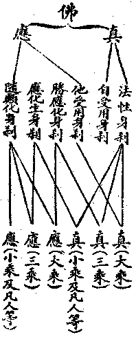



依佛而辨：法性身刹及唯佛自受用身刹为真身刹，毕竟无自无他、无说无闻；凡成法会及闻说法，皆应身刹。若依地上大乘菩萨而辨：他受用亦为真身刹；餘应身刹。若依地前三乘贤圣及诸天等而辨：胜应化亦为真身刹；餘应身刹。若依不发大乘心之小乘及凡人等而辨：应化生亦为真身刹；唯随类化为应身刹。向来诸佛学者，不明此义，定执华严、大日等经所说毗卢遮那以为法身。中国佛徒，又以梵网戒经所说卢舍那佛，谓是报身。按此、则知华严、大日等之毗卢遮那，通於他受用及胜应化之身刹，乃大乘圣者与三乘贤圣及诸天等之所见者。依普贤——即金刚萨埵——等，则为十地之他受用。卢舍那即毗卢遮那，不过译音稍为差异，谬执彼为法身，此为报身，尤极愚妄！按此戒经，据千华台之卢舍那，即为以千佛刹为境之离垢地菩萨所见之他受用身刹，此为大乘之戒地故。千华上之千释迦为胜应化佛身刹，一华为一大千界故。每华有百万亿释迦，即为劣应化佛身刹，各以一赡部洲为所依故。知卢舍那为他受用，应知毗卢遮那亦为他受用佛，但诸天之所见，则当为胜应化身耳。若言报、化不离法身，则虽随类化亦法身；无非法身，何得别指毗卢遮那以为法身？若言平等法性身刹，则虽牛溲马勃亦为法身，何足据以为胜？妄谈真言等经为法身说，是实不知法身一名之为何义者也。知此分判，千载疑云应可披豁？



三　此大千界之应生佛史



据诸传以会释其义：此大千界——今曰索诃，然过、未、应别有名也——以五十五之火灾劫，七水灾劫，一风灾劫，合为一风灾劫——即一大千界一度之成住坏空——。过去一风灾劫曰庄严劫，现在一风灾劫则曰贤劫；未来一风灾劫曰星宿劫。每一风灾劫有千佛应生其中。庄严劫中千佛，华光佛为首，而毗婆尸佛、尸弃佛、毗舍浮佛为末。毗婆尸佛距今已九十一火灾劫，尸弃佛与毗舍浮佛距今已有三十一火灾劫。毗婆尸佛至尸弃佛之间，有六十火灾劫无佛应世；而毗婆尸佛前之十餘火灾劫，则有九百九十四佛应世。此贤劫中千佛，拘留孙佛为首，第二名拘那含牟尼佛，第三名迦叶佛，第四即释迦牟尼佛，第五即未来弥勒佛，皆出兴於此一火灾劫中；最后名楼至佛。由毗舍浮佛至拘留孙佛，於庄严劫贤劫过渡之间，亦有三十火灾劫中无佛应世。此一火灾劫中，於住劫之二十小劫前八小劫，於某小劫此地球中人寿五万岁时，应生拘留孙佛；於某小劫此地球中人寿四万岁时，应生拘那含牟尼佛；於某小劫人寿二万岁时，有迦叶佛应生；今第九小劫，人寿百岁时乃应生释迦牟尼佛。毗婆尸佛至释迦佛，佛传上最有名之七佛也。后第十小劫人寿八万岁，乃应生弥勒佛。於弥勒后十小劫中，尚有何佛应生，则无确传。总之，於此贤劫风灾劫中，犹有九百九十五佛应生。后一风灾劫曰星宿劫者，千佛以日光佛为首，末曰须弥相佛。虽一风灾劫中各有千佛，於每一风灾劫之四十九火灾劫中，若干劫中或无佛出，或某劫中有多佛出，亦无定准。前诸佛陀学者，未能确知若庄严劫等是名一风灾劫量者，故於诸佛兴世相距劫量，是火灾劫之一大劫，或住劫中之一小劫，不能会通决诸疑滞。知大千界应依一风灾劫而说，则所谓过去庄严劫千佛，现为贤劫千佛，未来星宿劫千佛者，为此一大千界之三千应生佛史，斯可知矣。



四　地球之应化圣地



今言圣地，以超我爱执藏之情，通诸三乘圣者之地而说。据传释迦牟尼趺坐成佛之菩提场，为大千之中心。故此大千界中过现未诸佛，皆於此成佛，则印度之菩提场，应为此一住劫中诸佛共同圣地。法华经言：我此灵鹫，圣众充满，劫火烧然，亦常安稳。则灵鹫山应为释迦圣地。华严经言：东方有仙人山，有金刚胜菩萨与三百众住中说法；南方有胜峰山，有法慧菩萨与五百菩萨住中说法；西方金刚燄山，有精进无畏行菩萨与三百众住中说法；北方有香积山，有香象菩萨与三千菩萨住中说法；东北方有清凉山，曼殊室利菩萨与万菩萨俱住中说法——中国传即五台山也——；海中有金刚山，法起菩萨与千二百菩萨住中说法；东南方有支提山，天冠菩萨与千众俱住中说法——传即天台山——；西北方光明山，有贤胜菩萨与三千众俱住中说法；西北方香风山，有香光菩萨与五千众俱住中说法。大海中庄严窟，有诸菩萨住中；毗舍离南善住根处，俱珍那城有法座处，清净彼岸城目真邻陀窟，摩兰陀国有无碍龙王建立处，甘菩遮国出生慈处，震旦国有那罗延窟——传即劳山——，疏勒国牛头山，迦叶弥罗国次第处，增长欢喜城尊处窟，庵浮梨摩国亿藏光明处，乾陀罗国苫婆罗窟，各各有诸菩萨住中说法。又相传南海边有普陀洛伽山，是观自在菩萨之应居处——中国传即舟山群岛中普陀岛——。又传鸡足山为大迦叶尊者入定俟弥勒佛处——中国传即云南之鸡足山——。又传天台方广为五百阿罗汉住处。中国俗传，又以安徽之九华山为地藏菩萨处，四川之峨眉山为普贤菩萨处，与清凉山及普陀山为四圣地。他若玄奘西域记等所传诸国，佛之圣地难以枚举。西藏佛徒传有「香拔喇」者，人至其处，现身成圣，或即喜马拉耶山顶无热恼池。於一微尘现宝王刹，此皆地球上之超情佛刹，与圣感通则睹圣境，否则人情但知人境，虽历其处而不睹也。



五　此小世界之胜应圣刹



弥勒上生经说：弥勒先於波罗奈国、劫波利村、波婆利大婆罗门家中生，却后十二年二月十五日，还本生处人间命终——按弥勒与曼殊室利，同为释迦牟尼时之历史人物，诸大乘经多由结集——。时知足天七宝台内——按即内院——师子座上忽然化生，身长十六逾缮那量，具足三十二相、八十种好，宝冠严首、眉间放光，无量化佛、化菩萨众以为侍者——故为胜应身相——。常说不退转地法轮之行，令诸生其处者皆不退转无上菩提。过地球岁数五十六亿年，乃来应生於赡部洲成佛。又言：知足天之内院圣刹，乃由其天五百万亿修施度之天众，为供养一生补处菩萨故，以天福力变化而成。牢度跋提造善法堂，种种庄严妙饰，胜过欲界诸天之所居处。天女围绕，华香散布。摄人生等上生内院。此地球中释迦佛法之信崇者，持戒习禅，持大乘法，虽未得成圣果，若能称弥勒名，念其形像，命终即得上品上生。其次、诸佛徒众，闻弥勒名恭敬礼拜，欢喜赞叹，恒无间歇，命终亦得中品上生。其次、大地人众，虽或无知造诸罪业，后闻弥勒佛名礼拜忏悔，供养称念，命终亦得下品上生。故释迦云：弥勒於将来世，当为此人间有情作大归依处；若归依弥勒者，即於无上菩提得不退转，昔尝序此经云：



夫知有无上菩提，又知有已得垂得此无上菩提者，复知自他有情皆有能得此无上菩提之因性，且尝自期於必得之者！顾人命在呼吸间，一旦无常，即成隔世也。若於生死犹未自在，非藉佛菩萨摄持之力，则於所志之事，诸趣流转，昧忘可虞，故须急「欣净刹」、「亲上圣」之务。否则上无以圆大觉，下无以济含识，近无以净一心，远无以事诸佛，不亦唐功寡效乎！然十方佛刹虽有缘者皆得生，而凡在蒙蔽，罔知择趋。惟慈氏——即弥勒——为一生补处菩萨，法尔须成熟当界有情，故於释尊遗教中曾持十善、受三皈、称一名者，如次皆於弥勒佛三会闻法。而在吾人既闻释尊遗教，即为已与慈氏尊有缘，可求上生内院，以亲近之矣。况慈氏应居知足内院，与吾人同界——欲界——，同刹——索诃世界——，而三品之生因，行之匪艰，宁不较往生他佛刹为易乎！一经上生，皆即闻法，不退大菩提，与往生他刹犹滞相凡小者，殊胜敻然矣！故斯经实为吾人一生成就不退佛果之秘要，曾发无上菩提心者，不可不奉持以蕲向焉！



此小世界之胜应佛刹，实为由人间入佛刹之一捷径。然非弥勒菩萨之所摄持，则虽知足天众亦同处而不得相见。传玄奘大师等皆生其处，吾人当知所歆往也！



六　大千界之胜应圣刹



华严经等，说初地至十地菩萨为成熟诸人天等故，应生为人间转轮王，及忉利天、时分天、知足天、化乐天、他化天，与大梵天、光净天、无量净天、色究竟天天王。虽复示同人天，而其出世间之胜福庄严身刹，亦唯能修大乘行者乃相得知。又第四禅无烦天、无热天、善见天、善现天、色究竟天，唯证阿那含等圣果——阿罗汉回心、大乘报身亦居其处——之圣众等所居，名五净居。虽同在四禅之广果天等，圣凡界异，亦但钦闻而不得相亲近。又瑜伽说：复有超过五净宫地，有大自在住处，十地菩萨由极熏修第十地故，得生其中。此对天众为胜应化身刹，菩萨自住亦通受用身刹。如说：菩萨入十地时，净居天顶忽然出生大宝莲华，量等百万大千世界，超过一切世间妙庄严，出世善根之所生起，众宝为藏，宝网弥覆，无数莲花以为眷属；菩萨身相称此华座，为十方来九地以下菩萨说法。放诸光云遍十方界，出供养具供养诸佛，诸佛亦放智光灌此菩萨之顶。十方诸同十地菩萨，互放光照，增长定慧。其后十地行圆满时，亦即於此成等正觉。然未成佛之前，身刹虽广，犹有限量；至成佛时超诸限量，乃成等法界、虚空界之自受用身刹。故经论说真身佛乃於净居天界示现成佛，未成佛前其异熟识所变身器，未有不属三界摄者。除佛、若说於三界外别有有情界者，是仁王般若等遮为外道说故——依异熟识属三界摄；若依妙观察智、平等性智相应心品，超过三界——。故十地菩萨之圣刹，亦为四禅净居天摄，外现色究竟天天王胜应化身，内即为十地菩萨故。内圣外王：王随俗故，王一大千；圣应真故，住百万亿阿僧祇刹。



七　索诃界外著名佛刹



依佛说阿弥陀经云：从是西方过十万亿佛刹，有世界曰极乐，有佛号阿弥陀，今现在彼说法。其刹无有众苦，但受诸乐，故名极乐。七宝栏楯、罗网、行树围绕，七宝池八功德水中，青黄赤白光色莲花，大如车轮。黄金为地。常作天乐，雨众天华，微妙香洁。游十方刹，供养诸佛。由佛化生种种奇妙杂色之鸟，与风动、水流、树林、罗网等演说菩提分法。阿弥陀者，即无量光及无量寿，常以光明照十方刹；成佛以来已经十劫，将来寿命犹无量故。复次、人天大众及佛弟子，诸阿罗汉与菩萨等，亦无量故。其刹无三恶趣，无恶趣名。诸上善人俱会一处，皆是不退转地，多有一生补处菩萨。故此处有情，闻者应发愿往生彼刹。然非少善根福德因缘可往生彼刹。若能称念彼佛名号一日以至七日，一心不乱，命终即得往生。又依观无量寿经及佛说无量寿经，往生分为九品，皆是莲花化生。然花开见佛、闻法、得果有迟早：最下品生，须经十劫，花中悔罪，乃得花开见佛；最上品生，於弹指顷即得见佛闻法。



此阿弥陀净刹，於华严、法华、楞伽等摩诃衍乘，广为赞扬，诸国佛徒亦广奉行，龙猛诸师於诸论中亦皆称述。然专说者，则在三经一论。经已前引，论即世亲造往生净土论。由此净刹，信求往生者多起诸分别：或言必至初地菩萨乃可往生，或言五逆十恶十念成就、皆可往生；或言此为受用身刹，或言此为应化身刹；或云佛大悲愿、方便摄受十方有情不可思议身刹。今取往生论意，略为决择：凡言净刹，有纯净者，即真佛刹，唯在佛果，为佛法性身刹及自受用身刹。次净增者，八地以上；次半净者，初地以上；为佛菩萨自他受用身刹。次少净者，大乘贤位及二乘圣，为胜应化身刹；次微净者，为应化生身刹。此阿弥陀净刹通摄五种，而往生者所生在后三种。上三品生，见佛闻法即登初地，为初地以上半净刹；中三品生，为三乘贤圣少净刹，亦有诸声闻弟子故；下三品生，为人天外凡微净刹，亦有人天等故。且依鼓音王经：其城纵广十千由旬，於中充满刹帝利种。阿弥陀佛父名月上转轮圣王，其母名曰殊胜妙颜，子名月明，奉事弟子名无垢称，智慧弟子名曰贤光，神足精勤弟子名曰大化，魔王名曰无胜；所言不异应生佛故。由上品生，故言初地乃可往生，此应为受用身佛刹，如十六观中所说报身相。中下品生，故十念成皆得往生，为应化身佛刹，如鼓音王经说。佛随多级有情所宜而现，故应说为佛大悲愿方便摄受十方有情不可思议身刹。下至五无间逆有情，上至十地之觉有情，皆以佛果大悲愿力，现为随分所宜净土而摄受之。依佛果现，故皆纯净；依有情现，故随分净，由此经论说有多异。然以华严经意，则以阿弥陀刹为随初地菩萨所现受用身刹，故较量诸佛刹时劫，说索诃界一劫为极乐界一日，极乐一劫又仅等於金刚佛刹一日——二地净刹——，可比知其为初地净刹矣。故愿往生真极乐刹，亦须精进，广集地前多福德善根为因缘，不能以懈怠心即希冀也！



又药师琉璃光如来本愿功德经云：东方去此过十殑伽沙等佛刹，有药师琉璃光佛净琉璃刹。昔行菩萨行时，发十二愿修佛净刹，摄化有情；今现成就佛之净刹，功德庄严，说不能尽，如极乐刹无有差异。无有女人，无三恶趣及苦音声。有日光遍照、月光遍照二菩萨，为无量无数菩萨众之上首。此方有情，皆可发愿往生彼刹。虽悭贪不施、暴恶不善、嫉妒毁他、妄言害众之有情，闻彼佛刹名号能信奉者，亦能转恶为善，舍於罪报而得人天福报，往生於彼。又虽持戒修善愿生极乐，未决定前，临欲命终，若闻彼佛名号亦得往生其刹；或生人天增长福善，决不更受三恶趣身及女人身。又其佛依本行愿力，若斋洁身心供养奉持者，能使各人现身得遂种种所求，尤能延寿、免脱灾横。诸国民族有众灾难，人生亦有九种横死，三业恭敬於彼佛者，皆得救脱，增加种种现身幸福，於当来世生於彼刹或生人天，受诸快乐。此药师净刹与阿弥陀刹严净无异，其特殊处，在令信崇者於现身生长福善，脱离罪恶苦难，故又可谓为能增上现生安乐之净刹也。



八　索诃界外无数佛刹



前已举索诃界外阿弥陀刹及药师琉璃光刹，此为佛教最名称普闻之二刹。他若显密诸经所说，东方阿閦佛刹，南方宝胜佛刹，北方成就佛刹，上方香积佛刹等无数刹；与法华等所说过去未来无数佛刹，今概不论，而依华严示其大略。华藏世界品说：最中央有无边妙华光香水海，其「世界种」名普照十方炽然宝光明；分二十重，第十三重最中央即毗卢遮那索诃世界，有十三佛刹微尘数世界围绕；其下为超释梵佛光明照耀刹，有十二佛刹微尘数世界围绕；又其下为无量功德法佛之恒出现帝青宝光明刹，又其下为一切法海最胜王佛金刚幢刹，又其下为清净月光明相无能摧伏佛出妙音声刹，又其下为广大名称智海藏佛出生威力地刹，又其下为欢喜海功德名称自在光佛众华焰庄严刹，又其下为普光自在幢佛之净妙光明刹，又其下为香光喜力海佛普放妙华光刹，又其下为金刚光明无量精进力善出现佛种种光明华庄严刹，又其下为净光智胜幢佛一切宝庄严普照光刹，又其下为师子光胜照佛种种香莲华妙庄严刹，其最下为净眼离垢灯佛最胜光遍照刹；如次有十一佛刹、至一佛刹微尘数世界围绕。索诃世界上为遍法界胜音佛寂静离尘光刹，又其上为不可摧伏力普照幢佛之众妙光明灯刹，又其上为清净日功德眼佛之清净光遍照刹，又其上为无碍智光明遍照十方佛之宝庄严藏刹，又其上为无量方便最胜幢佛之离尘刹，又其上为普照法界虚空光佛清净光普照刹，其最上为福德相光明佛妙宝焰刹；如次以十四佛刹、至二十佛刹微尘世界围绕。此虽仅二十刹，然每刹十方面有微尘数世界围绕，则其刹数已无可量。



加以无边妙华光香海水之东，又有离垢焰藏香水海遍照刹旋世界种，亦有二十重主刹，与一佛刹至二十佛刹微尘数世界之围绕。其南又有无尽光明轮香水海之佛幢庄严世界种，其右旋有金刚宝焰光香水海、佛光庄严藏世界种，其右旋有帝青宝庄严香水海之光照十方世界种，其右旋有莲华因陀罗网香水海之普现十方影世界种，其右旋有金刚轮庄严底香水海之妙宝间错因陀罗网世界种，其右旋有积集宝香藏香水海之一切威德庄严世界种，其右旋有宝庄严香水海、普无垢世界种，其右旋有金刚宝聚香水海之法界行世界种，其右旋有天城宝堞香水海、灯焰光明世界种。离垢焰藏香水海外方面，又有变化微妙身香水海善布差别方世界种等若干香水海与世界种；无尽光明轮香水海外方面，又有具足妙光香水海之遍无垢世界种等；金刚宝焰光香水海外方面，又有一切庄严具莹饰幢香水海、清净行庄严世界种等；帝青宝庄严香水海外方面，又有阿修罗宫殿香水海、香水光所持世界种等；金刚轮庄严底香水海外方面，又有化现莲花处香水海与国土平正世界种等；莲华因陀罗网香水海外方面，又有银莲花妙庄严香水海、普遍行世界种等；积集宝香藏香水海外方面，又有一切宝光明遍照香水海、无垢称庄严世界种等；宝庄严香水海外方面，又有持须弥光明藏香水海、出生广大云世界种等；金刚宝聚香水海外方面，又有崇饰宝埤堄香水海、秀出宝幢世界种等；天宝堞城香水海外方面，又有焰轮赫弈光香水海、不可说种种庄严世界种等。此各各香水海中世界种，所有主刹及围绕刹，略与无边妙华光香水海中世界种相等。故如「毗卢遮那佛索诃刹」者之佛刹，其数之多殆难计算。其中情器之形状、体性、方位、时量等种种差别，亦难称量。非初地以上之大乘智，不能通达也。



九　情器及佛刹之十法界



超情佛刹中之应化身刹，依有情器界而现应化故，通六类之情器故；由此乃合超情之四圣身刹、及六凡情器，曰十法界。十法界者，十类身心器界之总称也。从缘所生身心器界及彼由起之缘，统谓之法；十类界别，别谓之界。从缘所生身心器界，兹表於下：



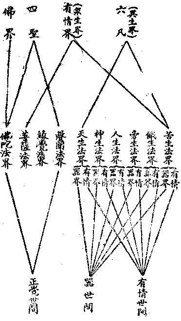



普通为六凡、四圣之分别；天台家有时为众生界、佛界之分别；贤首家有时为有情世间、器世间、正觉世间之三种分别。又诸经论祇说世间为有情世间及器世间之二种，则有时或专从异生界说，有时亦通有情界说，以依异熟识皆三界摄故；有时亦通佛陀界说，佛亦六十二有情类摄故。身心器界由起之缘，即五蕴唯识诸法等。故天台家依此分别，说缘所生身心、曰众生一千——众生指有情言——，说缘所生器界、曰国土——国土即器界——一千，说彼由起之缘法、曰五蕴一千。谓十法界一起九伏，一主九伴，故每一界摄餘九界。十十成百，百中一一各备法华所说「如是相、性、体、力、作、因、缘、果、报、本末究竟等」十如是，故各为一千也。三千在种——彼云在性——皆名理具，三千现行——彼云从缘——皆名事造，故又说为理具、事造两重三千，总摄之则唯十法界而已。故十法界为有情器界、超情佛刹之总摄，亦为真现实论者所知成事之总摄。



第五节　所知成事评判



一　所知成事评判绪言



前之四节，对于所知现实成事，已略说竟。然所陈者，不惟语超常俗，亦时有违学者世间之所思议，故於此所知之现实成事，颇多伏疑，犹待推决。盖依比量而谈，虽若可通，而按之实验之现量，间难徵信；则比量言，亦成虚设。若云佛陀之至教量，皆从真现量所出之真比量教为所依准，然按所言，与向来流传之佛说，时亦不无牴牾之处。由此违学者所知故，违常俗学者之现量或比量故，亦违真现实论者所依佛陀之至教量故；则前四节中陈说之所知现实成事，其大部分虽可凭信，犹有其餘生问题处，须更恣为研择，详求解决。於此若非加以评判，则前泛引之说，不等於天启之神话，亦应类独断之玄谈，此非真现实论者之所应为也。是故於所知之现实成事，随有疑难之处，再通释之。



二　有情托胎识问题



前说人之得生有托胎识，於是生理学者生问题曰：依佛陀学，人身之生虽赖父母精卵成胎，尤仗有投托於胎之业识，乃能生长；然近世生物学者实验之所知，则人身者、实由父精中之精虫，有一或二之强力者先占入母之卵珠中，由此一精虫为主体？藉卵珠为营养而得成胎者也。此佛陀学与科学实验所知者之相违处，其将何理以通，夫托胎识不明，则有情以身生始有，身灭即无，则无前身，亦无后身，三世流转之业果义，何自安立？於此问题，若无一正当之解决，不惟不足以通生物学者之难，而佛陀学将根本摇动矣。故必明托胎识，乃明业识与父精、母卵同为构成胎之三要素。故业识不从父精、母卵有，不从胎有。业识虽刹那生灭，而无始相续恒有，新新不停，如急水流，有之无始，故亦无终。而此识暂托胎生人类身，应有前身，亦有后身。世间一切有情色身，得生所从，约为胎、卵、湿、化四种形式，已如上述；而各有识托中，以为主力。此四生中，人以胎生为主，生理学亦多就人身研究，故今当就人类托胎识以明之。先取生物学家胎生学中可怀疑点，试从诘之：男精中有精虫，女精中有卵珠，此诚易为试验之事，按佛陀学尤有左证。如治禅病秘要经云：



子藏者，在生藏下，熟藏之上，九十九重膜如死猪胞。四百四脉从於子藏，犹如树柢散布诸根，如盛屎囊。一千九百节如芭蕉叶，八万户虫围绕周匝。四百四脉及以子藏，犹如马肠，直至产门，如臂钏形团圆大小，上圆下尖，状如贝齿。九十九重，一一重间有四百四虫，一一虫有十二头、十二口。人饮水时，水精入脉，布散诸虫，入毗卢虫顶，直至产门；半月半月出不净水，诸虫各吐，犹如败脓；入九十虫口中，从十二虫六窍中出，如败绛汁。复有诸虫细於秋毫，游戏其中。诸男子等宿恶业故，四百四脉，从眼根散四肢，流注诸膓，至生藏下、熟藏之上。肺、脾、肾脉，於其两边，各有六十四虫，各十二头，亦十二口，宛绻相著，状如指环；盛青色脓，如野猪精，臭恶巨甚。至藏阴处，分为三支，二支在上如芭蕉叶，有一千二百脉，一一脉中生於风虫，细若秋毫，似毗兰陀鸟觜。诸虫中有生筋色虫，此虫形体如筋，连持子藏，能动诸脉，吸精出入；男虫青白，女虫黄赤，七万八千共相缠裹，状如累环，似瞿师鸟眼。九十八脉上冲於心，乃至顶髻——脑——。诸男子等眼触於色，风动心根，四百四脉为风所使，动转不停——脑筋——。八万户虫一时张口，眼出诸脓，流注诸脉，乃至虫顶；诸虫崩动，狂无所知，触前女根。男精青白，是诸虫泪；女精黄赤，是诸虫脓。



又如正法念处经云：



十种虫，有行於髓中——脑筋虫——，有行精中——生殖虫——。何等为十？一名毛虫，二名黑虫，三名无力虫，四名大痛虫，五名烦闷虫，六名火虫，七名滑虫，八名下流虫，九名起身根虫，十名忆念欢喜虫。



按所谓筋色虫，在男青白者即精虫，在女黄赤者即卵珠。复云：有行於精中者，第九曰起身根虫。起身根虫者，或言男根由此虫故起，或言所生胎中色根由此生起。此起身根虫指精虫言，事尤明确。故胎生学所言人胎由男精虫及女卵珠以成，及精虫卵珠之有诸情态，可为佛陀学之明证，而初无所违也。然吾於胎生学中「由一精虫占一卵珠以成胎」之说，彼固从何徵验以得其实，则极怀疑者也！夫适当男女和合以成胎之际，男女二人之自身既无从察验，此男女二人外之他人亦无从察验。若於后时取其既成胎者为验，则但得既成之胎状，至当时如何构成此胎之情状，终不明了。若但依男精用显微镜所显之虫相，即推定但由一虫占入卵珠以成胎，斯则惟是臆决之谈，非徵验之实也。由诸虫凝聚成男精，何以知不由诸虫凝聚之精和合女卵以成胎身，乃必由精虫聚中之一虫独占卵珠以成胎乎？又何以知置空气或温水中之男精所现虫之情状，非入空气及温水后转变而起之游离状？既非在男身中时之本状，亦非和合女卵转变成胎时之状乎？故科学徵验之所知，乃只知精中之有虫而已，过此限度以外，则虚谬之推想，不得冒充为实验科学也。但胎生学者所以计由一精虫独成胎者，殆由见精中有虫，又见精中诸虫互相聚散杀活之情状，复计多虫生命不应合为一人胎生命，遂推想由精虫聚中一强有力之虫，将餘虫排杀后，独占胚珠以化成人胎耶？信然者，则人之身命，实由父精中之一虫继续长养而成，人者不过一精虫之扩充，绝非一新生之生命；固不容有托胎识，亦非父母精血和合所成，乃适为怪谈矣！意彼谬想，必由计一身命由一身命进展而来，故计人由精中一虫变化。此由执著「个体」为实——萨迦耶见——，不知细至一虫，粗至一人，皆和合之聚耳。夫人身乃一虫聚也，男精、女精亦虫聚也，何因不许人胎亦为一虫聚，而定由一虫以成哉？



瑜伽师地论云：



又於餘鬼、傍生、人等，及欲、色界天众同分中将受生处，见己同类可意有情，由此与彼起其欣欲，即往生处，便被拘碍。死生道理，如前应知。



彼即於中有处，自见与己同类有情为嬉戏等，於所生处起希趣欲，彼於尔时，见其父母共行邪行所出精血而起贪爱，若当欲为女、彼即於父起贪，若当欲为男、彼即於母起贪亦尔；乃往逼趣，若女於母欲其远去，若男於父心亦复尔。生此欲已，或唯见父，或唯见母，如是渐近彼之处所。如是如是，渐渐不见父母餘分，唯见男女根门，即於此处便被拘碍。死生道理，如是应知。若薄福者当生下贱家，彼於死时及入胎时，便闻种种纷乱之声，及妄见入於丛林竹苇芦荻等中；若多福者当生尊贵家，彼於尔时闻有寂静美妙可意音声，及自妄见升宫殿等可意相现。尔时父母贪爱俱极，最后决定各出一滴浓厚精血，二滴和合，住母胎中，合为一段，犹如熟乳凝结之时；当於此处，一切种子异熟所摄执受所依阿赖耶识和合依托。云何和合依托？谓此所出浓厚精血，合成一段，与颠倒缘中有俱灭，与灭同时即由一切种子识功能力故，有餘微细根及大种和合而生，及餘有根同分精血和合搏生。於此时中，说识已住结生相续，即此名为羯罗蓝位。此羯罗蓝中有诸根大种，唯与身根及根所依处大种俱生；即由此身根俱生诸根大种力故，眼等诸根次第当生。又由此身根俱生根所依处大种力故，诸根依处次第当生。由彼诸根及所依处具足生故，名得圆满依止成就。又此羯罗蓝色，与心心所——业识——安危共同，故名依托。由心心所依托力故色不烂坏，色损益故彼亦损益——胎生科学依此点言——，是故说彼安危共同。又此羯罗蓝识最初托处，即名肉心。如是识於此处最初托，即从此处最后舍。



既知胎成由识、有托胎识；复知此识无始恒转若流，未有断绝；则今生之前非无前生，今生之后非无后生。而所为或善不善之业，皆熏持於此识中，将牵之以受种种身，死生流转，则其有三世业果相续也明矣！



三　有情中有身问题



前者言健达缚或中有身，乃生此一问题。康有为尝问曰：佛陀五趣生死、三世业果之说，大有裨於人群道德，但其所依以施设有情流转相续者，乃在乎中有身；若中有身之事实不明，则五趣流转三世相续之义，无从安立。今按佛陀说法，应机浅深，对人天机说续有情，以除异生断执——今此唯物科学皆为断执——；对三乘机说人无我，以离外道常执；对大乘机说唯有识，以空餘乘法执。通人无我，达唯有识，则不须立此中有身，自明诸趣流转之业果相。而康氏宗在人群道德，则人天机也，应说续有情以除异生之断执，故当一解中有身义。中有身、古译中阴身。有谓诸有，阴谓五蕴。有即五蕴，非五蕴外之有；蕴即诸有、非诸有外之蕴；表蕴是有曰有，表有是蕴曰蕴，故蕴与有同实而异其义。伽耶、译身，是「一聚」义。有诸蕴法集为一聚，是为有身，亦曰蕴身。云中有身、中蕴身者，谓於一期死生分为四有：一、生有，当初受生位。二、本有，当已生未死之位。三、死有，当正死之位。四、中有，当乍死未生之位，谓「业识」於现报身已舍、后报身未得之中间所有之一蕴聚，名曰中有身也。然本有身死而中有身生，中有身实一新生起之五蕴聚，非从本有身或死有身所离出之一分，故不同俗说所指潜躯壳内之灵魂神我。盖俗计之魂神，是一实常个体，活时栖躯壳内为躯壳主，死时离躯壳而独存，再取他种躯壳栖住，此中有身乃是死初别成一幽隐微细五蕴聚，即指此幽微五蕴聚曰中有身而已。故中有身备具形状、根识、寿量，实为别一过渡之业报身。经论言之参差，难具徵引，兹录瑜伽论资依据：



又诸众生将命终时，乃至未到惛昧想位，长时所习我爱现行，由此力故谓我当无，便爱自身，由此建立中有身报。若预流果及一来果，尔时我爱亦复现行，然此预流及一来果，於此我爱由智慧力数数推求，制而不著；犹壮丈夫与羸劣者共相角力能制伏之，当知此中道理亦尔。若不还果——无我爱者——，尔时我爱不复现行——，中有不生。



云何——中有身——生？由我爱无间已生故，无始乐著戏论因已熏习故——我法执——，净不净业因已熏习故。彼所依体——一切种识——，由此二因增上力故，从自种子，即於是处中有异熟无间得生。死生同时，如秤两头，低昂时等。而此中有必具诸根。造恶业者，所得中有如黑羺光，或阴暗夜；作善业者，所得中有如白衣光，或晴明夜。又此中有是极清净天眼所行——所见——，彼於尔时，先我爱心不复现行，识已住故。然於境界起戏论爱，随所当生，即彼形类中有而生。又中有眼犹如天眼，无有障碍，唯至生处，所趣无碍，如得神通亦唯至生处。又由此眼见己同类中有有情，及见自身当所生处。又造恶业者，眼视下净伏面而行，往天趣者上，往人趣者傍。又此中有若未得生缘，极七日住；有得生缘即不决定。若极七日未得生缘，死而复生，极七日住；如是展转，未得生缘乃至七七日住。自此以后，决得生缘。又此中有七日死已或即於此类生，若由餘业可转；中有种子转者，便於餘类中生。又此中有有种种名：或名中有，在死生二有中间生故；或名健达缚，寻香行故，香所资故；或名意行，以意为依往生处故，此说身往，非心缘往；或名趣生，对生有起故。当知中有除无色界，遍於一切生处。又造恶业者，谓屠羊鸡猪等随其一类，由住不律仪众同分，故作感那落迦恶不善业，及增长已；彼於尔时，犹如梦中，自於彼业所得生处，还见如是种类有情及屠羊等事，由先所习，熹乐驰趣，即於生处境色所碍，中有遂灭，生有续起。彼将没时，如先死时见纷乱色，如是乃至生灭道理，如前应知。又彼生时，唯是化生，六处——官体——具足。复起是心而往趣之，谓我与彼嬉戏受乐，习诸技艺；彼於尔时颠倒谓造种种事业及触冷热。若离妄见，如是相貌尚无趣欲，何况往彼！若不往彼，便不应生。…………又於旁生、人等众同分中将受生时，於当生处见已同类可意有情，由此於彼起其欣欲，即往生处，便被拘碍。死生道理，如前应知。



於是有疑问焉，诸业报身不出五趣——即六生类——，此中有身既为一业报身，於五趣中属何趣乎？若已属於五趣之一，如何乃非后有而是中有？若非属於五趣，如何乃有「趣所不摄」之业报身？今解之曰：中有身虽亦业报身，但以此身专为前身已舍、后身未得、中间稍有停泊而受，故或言至久唯七日，或言可七七日，或言虽不限长短七日必一死生。古师喻为调任候用之官，前任乍卸，后任未定，於其中间暂为旅驿舟车之客。即兹旅驿舟车之客，喻中有身。在官固有专职，在客亦有定分，故亦业报。然以为迁转经过上暂寓而受，故为五趣不摄之中有身。然悟无我唯识，何以不须安立中有身耶？曰：明十二有支缘起之流转，故悟无我。未悟唯识者，以过去二支惑、业，现在七支苦、惑，未来三支业、苦，明诸趣死生相续。达唯识者，明现在十支、未来二支之生死流转。皆已明非常非断之业果流者，三世业果义成，故不须更立中有身；而同时亦明中有身唯五蕴及唯识，了中有身之实相也。



四　有情之心理问题



西洋传统心理学，浅狭未尽心理内容之深广。其始为基督教所谓灵魂之学；继在文艺复兴时代，演化为研究唯心论所谓「内心精神」之学；继为研究意识之学。故其所云心理学者，始终立在与肉体或外物或客观相对之一方面，为研究所谓灵魂或内心或意识之学也。而所谓传统心理学，亦至演为意识心理学乃成立。此意识心理学，若探究其源于上古之希腊哲学者，所谓意识，仅侧重「知识」之研究；继由卢梭等特注重感情；又由康德等特注重意志；乃并列知识、感情、意志为构成意识之三成分。知、情、意三分法之心理学，遂为百年来传统之定例。然所研究之意识，大抵指成人醒时、显然之心理现象言；继研究到成人睡时及儿童、动物等本能反射作用，有非显然之意识所能包括者，遂有「潜意识」、「阈下意识」之说明以济其穷。



然传统心理学，其研究之对象为成人意识，其研究之方法以内省为主。继因内省之经验各人不同，不能成为科学之公列，渐多注重观察方法，不足则加以人工之试验。以成人意识之不易观察也，而务以群众或儿童或动物心理为察验之对象，於是渐变其研究之方法，以观察试验为主而取销内省；专主观察试验，以求合於研究物理之科学方法，成立等於物理之一般公例，乃有「行为派心理学」兴起。行为派心理学，刱於美国之瓦特生。此派以基於物理「反射作用」及「交替反应」，说明一切心理现象，皆目之曰行为。以唯是行为故，主张取销意识。有藉思想以证有意识者，则目思想为「隐微言语」而取销思想；有藉动机以证有意识者，则目动机为迟延反应而取销动机。然思想、意识等，本为非物理的「心理名义」，故研究意识等学可名心理学；今行为派既一切解说为基於物理所起行为而取销一切心理名义矣，顾犹袭用心理学之一名，殊为不合；然非有「行为学」即可取销「心理学」也。就有情、无情之色法以研究说明者。为物理学、生理学等；就有情之心法以研究说明者，为心理学；就有情无情之心色法各行动事为以研究说明者，为行为学；就人之行为以究明其规范者，为伦理学。然对行为学既可别有物理学、生理学、伦理学，何独不可对行为学而别有心理学？若以心理不能离行为而存在，故但以行为学包括心理学而不能别有心理学者，然行为即动作，凡有皆动，绝无可离行为动作而存在者，则亦应以物理等不能离行为故别无物理等学。反之，行为派既许对行为学别有生理学等，岂不应许别有心理学耶？行为派难之曰：行为不离物理、生理，而物彼理、生理，非无特有之德，故应别有物理、生理诸学。而心理则正是行为，别无特有之德；换言之、心理学与行为学名异实同，故今既正其名曰行为学，不应别有心理学也。答曰：心理非无特有之德，证据正复不远。行为派云：『我们也可以说物质界可有时间或空间超越性，不过物质没有自觉罢了』。行为派既赫然承认有此自觉，又承认是物质所无，则此自觉非心理之特德，是何？无自觉的行为是物理的行为，有自觉的行为是心理的行为，虽皆不离行为，对行为学即不妨别有物理学，亦何妨别有心理学！盖凡自觉即是心理，心理虽复非一，若无自觉即非心理。有情众生所有之「情」，换言之，即是有自觉而已。既自觉矣，即被知矣——如自证分之知见分——，何尝不在「可知范围」中耶？若唯以但可为客观之色法为可知，而不知可兼为主客观之心理亦可知，且拨之为无有；则如光中昭显诸象，谓唯有诸象而无光，不睹光光自昭互显，非狂愚耶！虽然、行为学有裨益於心理学之研究，亦犹物理学、生理学之能有裨益於心理学之研究也。



除行为派之外，近有另标为联念派、完形派、生机派者。生机派以杜里舒为代表，假定有一「隐德来希」——生机——，为区别生物与非生物之要素，以之说明一切心理。此隐德来希者，乃灵魂论之理论化，虽近於藏识之变起根身及由种子发生诸识，然未有精审之观察，颇涉含混。而完形派以惠墨塞苛勒老夫卡为代表，颇能说明心理由众缘互成之一点；但从知觉据为起点，祇可以说明第六意识之心理现象，未能究及前五识及后二识之心理。联念论从心理分析至感觉为原点，然后联合以解说知觉、记忆等种种心理作用，为相承培根、洛克以来之机械论心理学，祇及由前五识关系以说到第六识；即於前五识色根性境刺激反应与诸心心所皆众缘互成义，亦有缺漏。此诸各派与行为派皆不无一长，而各有偏执，取其众长，去其偏执，更进而为佛陀心理学之研究，庶其有渐明心理真相之可能！



五　器界之苏迷卢等问题



苏迷卢虽说为太阳系之总称，然按之向来流传之佛说，有诸多不符。一曰、形量不符：向来说苏迷卢立体高十六万逾缮那量，底面纵横直径八万逾缮那量；腰身瘦小，虽无定说，至小当有直径二万逾缮那量，此如何可云是太阳系耶？二曰、日月不符：向来说日轮五十一逾缮那量，月轮小一逾缮那量，绕苏迷卢，於四洲互见为昼夜。别有日天子、月天子率眷各居日月轮内。日月之蚀，由阿素洛执持，如何可云日球是忉利天，且会通月球绕地、地球绕日之说耶？三曰、诸星不符：向来说星形量，最小只三拘卢舍量，最大不过十八拘卢舍量，水、火、木、金、土与罗睺、计都——慧星——皆在其内。且说二十七或二十八宿管诸地方，十二宫本命星管人生命，与中国之俗传相似。此如何可会通近代天文学上所说行星等耶？答曰：此诸所疑，诚如来难。形量稍可通释：地球绕日，每日移动，然每一日各有日之反面，为地球上之所不见，海平线上隐说所见之面，海平线下隐说不见反面，底面则各为所见之日轮正面，亦图甲乙示之：



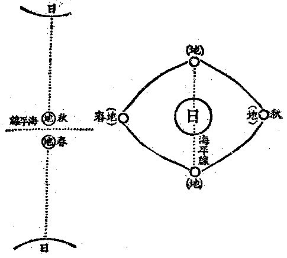



甲图是地球绕日成岁图；乙图则剖春秋所见日轮之各一面，即成苏迷卢形所言之量。随俗假设，不能为准，前已言之。且印度俗言八万或八万四千，意云「极多数量」，犹言日球形量极大，地球距离日轮之量极远，量数极多，寄言八万而已。前此曾言佛陀之说，或不违世间之俗情，应机而谈，则随昔时印度常俗或学者间之说；先既申明，今当随现时之学者世间而说，则於日月星宿诸不符者，虽应刊落不取，亦无违於佛陀学之原则。



六　情器之生命由来问题



前言有情及植物之生命，不从神造而有，不从物质化合而成，亦不定从他世界所传来；而各从一切种识及其中之潜在自种生。诸各有一切种识之生命——有情——，不以生而遽有，故未生以前有前世；不以死而断灭，故既死以后有后世；既生未死之间则为今世，故成三世。前世之前有前世，后世之后有后世，前前无始，后后无终，故前后今成无世量。生命流行三世无量世而不断灭故，造於昔、今，责於今后；业报相寻，早迟莫逃。於是人与人或人与有情相偶之道德，乃有利他则两利、害他则两害之自然律；人与人或人与有情相学之教育，乃有悟他则两悟、迷他则两迷之自然律；由道德与教育之有此自然律，於是道德相感，教育相引，可由人而进化超人，由超人而进化至超超人。违此道德教育之自然律，则由人沦坠三恶趣，或流转於异生类中，不能进化至超超人。进化也，教育也，道德也，皆基於无始生命之不断。



然现代之生物学者，观诸有生命者，或分裂生，或产卵、孕胎生，或单性生，或两性生，其类虽殊，要皆子体从母体生。至寻地球上生命之起源，有言陨星坠空，从他世界载生命种子以传来；有言由半流质之炭素化合物，偶经酵素作用而成，故蛋白质等有机物，今皆可由无机物以造成；有言地球之质点中本有生命，得适当之机缘，遂出现而生生不已。起源如此，则可知各个生命之终於死而断灭，将来地球破坏，或气候变更至不宜生物，则全地生命之亡灭亦可推知；乌有不断之生命哉？答曰：若云生命皆从他生，地球上生命由他世界以传来，然他世界生命仍从他生，并非最初生命，故对於生命之起源，说如未说。若云最初生命从无机物化合而出，如无机物造成蛋白质等，然所造之蛋白质等仍无生命。生人有生命也，死尸无生命也，所造蛋白质等死尸，不能证成生命由无机物化合而出。俗传腐草化萤，湿地生虫，今照以显微镜，知亦由萤与虫之微卵生，不从腐草等之无机物生。盖生命之必有精神，无精神之物质必无生命，此有机物与无机物之所以分也。如以刀及手同插入於水，而手生寒凉之感觉，刀则无感觉焉；一刀以至聚无量刀，以多种之形式而变易其聚合，亦不能令生感觉焉。故生命中感观等精神，乃各从其「自种」生，犹物质之各从其「自种」生，决不从物质之聚合变化生也。若云地球等质点中本有生命，得缘而遂出现，此诚稍可通矣；然生命之潜在，为生命之种子非即生命，值缘出现乃为生命。一切种识及精神物质诸种子，周遍无始，潜转不断；值缘乃出。现为地球以至为诸生物，各从其自种生，不得谓从地球生也。盖量之分合与体质之变化有异，合十升水为一斗水，分一斗水为十升水，此量之分合无关於体之变化，体固无异，量亦仍等。一分水、以化学药品化为「氢」二分、「氧」一分，此体之变化亦关於量之变化，量既不等，体亦大异。凡非分合而是变化，必非但由现事分合所成，乃别由其自种为主，加入诸现事中或摄或拒，乃成为水、为氢、为氧。故水与氢、氧，虽互为现起之缘，而其现起实各有其自种。由此可知地球体为生命出现之缘，而生命之现起亦各有其自种。有情以一切种识为自种，各精神物质以一切种识中之各种子为自种，得缘则兴，失缘则潜。故有情之生命，无始流转，兴潜不断。彼生物学者之臆说，皆违事实。於是今说乃为现实真相，生命之不断明，则前所言道德、教育之自然律皆可为决定之真理，而人生亦有互助与进化之可期矣。



七　超情佛刹之餘义



问曰：若应化身刹亦超情佛刹中摄，应别无有有情器界，已皆摄在三类应化佛刹中故？答曰：据现行言，上上能摄下下，下下不摄上上。若非超情佛刹有此应化身刹，则有情无上达之缘，佛圣亦无下被之化。上下隔绝，何由教导有情令亦成佛？故依异生——凡夫——，既言有情器界，复依圣者而言应化身刹，此於一事立二名义，以此一事关系能化圣者、所化异生之二方故，亦由二方关系和合成故。天台家名曰凡圣同居刹，谓六凡、四圣之所同也。然应可作三句分别：一、纯秽刹：谓有一类有情器界，经一度乃至多度之成住坏空都无佛陀应化其中，但名有情器界，不名应化佛刹。然佛圣虽不现成佛之相，亦应有同事潜化其中者，故亦名凡圣同居刹。其后由坏空而又成住时，若既转变，不在此例。二、秽增刹，或微净刹：虽有佛圣应化其中，然有佛时少而无佛时多，如此索诃界是。在有佛化期中亦名应化佛刹，在无佛化期中应但可名有情器界。圣者常所同居，故当名凡圣同居刹。然上二类，皆由三界所系诸有情类之所变成，正名有情器界。於第二类，亦旁属超情佛刹耳。三、秽减刹，或少净刹：此由佛於菩萨位中本愿行力，摄化有情所共变成，若阿弥陀刹、药师琉璃光刹等，常时有佛应化其中，当名应化佛刹，且通他受用佛刹也。然其中所化有情，亦有未登圣位者，故亦名凡圣同居刹。则凡圣同居刹名义，较应化佛刹之名义为宽广也。兹表如下：



　　　　　　　　　┌纯秽刹┐  

　　　　　　　　　│　　　├但名有情器界  

　　　　凡圣同居刹┤秽增刹┤  

　　　　　　　　　│　　　├亦名应化佛刹  

　　　　　　　　　└秽减刹┘



问曰：凡圣同居刹既包括应化佛身刹，诸经论中唯说法性、受用、应化三种超情佛刹，此胜应化佛之净刹又邻接於他受用佛身刹；照天台家又於凡圣同居刹与实报庄严刹——受用佛刹——之间加设一方便有餘刹，以为佛陀应化阿罗汉、辟支佛所居之刹，又将位置於何处耶？答曰：此亦为天台家所特殊之一点，似无至教明文可据。约义而会通之，则有二义：阿罗汉、辟支佛之回心修大乘行者，仍居大乘地前之资粮位，故彼云方便有餘刹，当即指胜应化佛刹之一分而言。阿罗汉、辟支佛之不发大乘心而灭身者，则彼云方便有餘刹，当即指法性身刹中一分「生空法性」而言。佛菩萨亦同证此生空法性，故得寄言佛亦应化其中。故虽约义加设此方便有餘刹，仍不出法性、受用、应化三种佛刹也。



第三章　所知现实蕴素



所知现实成事，前已以所知之有情器界及超情佛刹之四节说明之。此现实成事中所含蕴之材素，今次当说。然今真现实论者所说之现实蕴素，与科学等理化学上所分析之原素，貌虽相似，其实大不同也。故应先知二义：一者、本体论上，彼先认执前身器等为实在体之变成物，别有物之本原实体为因。体有质、力合变成物。分析以求其原始之实质，则曰化学；分析以考其原始之实力，曰物理学；近由发见质、力不分离故，统以分析考求物体之质、力者，曰物理学或物力学。以其分析诸物所获之质力为本因，然后综合结构以成为现实身器等。今谓不然，现实之身器等虽为幻事，若云实在则皆即为实在，别无此外之原始实在体及其质力以为本元，以无始故亦无元也。反之、则无变非始，亦无事非元。换言之，则现变实事即实在，亦现变实事即本元也。然一现变实事当前，其相续相摄中，各别含蕴种种关系。即以其所各含蕴之种种关系，说为所含蕴之材素。就彼所含蕴之材素，说为因缘等，而说此为果；其实因缘等即果，果亦即因缘等也。就果而观之无别因缘等，就因缘等而观之无别果；果非在於因缘等外，因缘等非在於果外。故——彼之实体，或说是物、或说实在、或说是我，故等唯神、唯我——科学等为唯物主义等，而今为真现实论也。二者、彼依算学——数学、空量、时量、重量等——、逻辑学、化、药、机械等而为分析，此依能知所知上之正所知相而为分析；可名彼为「物体——我法执所执之实我实法——之元子论」，此为「知识——能知所知——之蕴素论」。故彼为唯物主义等，而此为真现实论也。先明此二不同之义，乃可进论由真现实论者之方法所知之现实蕴素。



第一节　大蕴处界



一　四大与六大



四大为俗情与学者之世间说，佛陀学因顺之，小乘学改进而说之，大乘学更加改进而说之。或仍说为四大，或增说为六大，或改名为四界、六界，所言地界、水界、火界、风界、空界、识界是也。谓观察内身外器之现象，有安住之大地焉，在身即为筋骨；有流行之大水焉，在身即为精血；有炎烈之大火焉，在身即为体温；有飘飏之大风焉，在身即为呼吸。进而深察其体，地大为坚劲质，水大为流湿质，火大为煖热力，风大为轻动力。此亦如近人於质区别为固质、（坚劲质）凝质、液质、气质（流湿质），於力区别为热力、动力也。由此质、力更察其用，乃知坚劲之地有持载用，流湿之水有滋润用，煖热之火有烧熟照明用，轻动之风有吹发分布用。质为被变化者，力为能变化者。由烧而毁，由熟而成，由照明而显现；由吹而灭，由发而生，由分布而序列。负质而抱力，传力而换质，质力相乘为变化，而呈万有之奇观。究其原始，则为分析到不可分析之四大极微元子；此为古近唯物论之所本，小乘亦借用四大之分析以观身空，及四大极微之分析以观器界空焉。然印度胜论师乃说地、水、火、风、空、时、方、意、我之九实——陀罗骠——，以观地、水、火、风之身器等，有虚通容受之空焉，有过去来今之时焉，有上下纵横之方焉，而又有「精神机关」之意，与在「意」中主宰之「我」焉。然此为佛陀学之所不取，而大小乘学中，则增空大、识大而为六大。以观有情众生，不惟有坚、湿、煖、动之质力，更有知识等之精神现象，为见闻嗅尝觉所不能取，与彼质力之可见闻嗅尝觉者逈然不同。精神现象虽不一类，然莫不与知识俱起，为知识所连贯，乃增说为识大。又观「物色」与「识心」间更有非色非心之虚空焉，复增说为空大。在序列上，以虚空由地、水、火、风不存在处而显，故居识大之前。色之无处曰空，故空非色，亦无识之能虑知用，故空亦非心也。然此空大应包三义：一、眼识所见空，此云空一显色，见形色无处之空无物故。二、容受形体空，此云空界，於空隙等之间，诸形体物皆可占住或通过故，此正为近人所云之空间。即此空间，施以长广厚之三度，所谓三度空间，即为方位；施以四度，所谓四度空间，即为时分。故空间一名，包胜论之空及时、方也。三、真理所显空、此云虚空无为，空一显色与空界亦从缘变化，故非无为而是有为；此则唯以在种种变化诸色心等中之虚通无碍性，谓之空大，常恒普遍，故是无为。盖诸变化，虽一极微，若无此空，则应不能变化；然无不变故无不空，而此空遂为普遍常恒矣。此六大为大小乘之通说。以地、水、火、风遍於诸色法，识遍於诸心识，空遍於色、心法，故皆名大。复依界因各别，名为六界。由界以言，前四不遍於识，非虑知故，识亦不遍前四，非质碍故；空则遍於色心，性皆空故。故空最大，识次於空，风、火、水、地又次於识。然地界中具水、火、风，乃至风界中亦具地、水、火，但由隐显而各成其异相，非可离绝；识於前四亦然。色皆变持於识，识亦依仗於色——所缘缘——，识隐色显名前四大，色隐识显名为识大。空之常遍，更无待论，然亦以非虑知、质碍，别名空大。参而不杂，遍而常别，故名为大，亦名为界。后期佛教之秘密宗，乃专以此说诸法之缘起。大佛顶经特重定心现量，拣别於比非量之意意识，於识大中别开见大，则以现量心名见大，别以比非量心为识大耳。



二　大乘四大种之胜义



四大为能造色，其餘五根、五尘及法处色一分为所造色。以唯触处所摄坚、湿、煖、动之四，亦大亦种；空识名大，大而非种；餘种名种，种而非大。此四为能造色，与诸根、尘造色作五造因：一者、生因，亦曰起因：谓诸造色虽自种生，若离四大必不能起。瑜伽论问：诸法皆从自种而起，宁说大种能生诸色？答言：由诸大种及造色种，皆悉依附内相续心——一切种识——，诸大种若未生诸大，诸造色种终不能生，要大种生诸大，造色种乃随生造色，大种生诸大为造色种生造色之前导故，乃说大种为造色之生因。二者、依因：谓诸造色依据大种所生大处，方可得生，即大种生诸大占领空间，诸造色种所生造色，乃依而住。瑜伽论云：由造色生色不离大种处而转，故名依因。三者、立因，或随转因：由诸大变异时，依此之造色亦随变异故。例橘变异，其香味等亦随变异，以香味等随橘而立，故名立因；亦随转变，名随转因。四者、持因，亦曰住因：住者存在之义，杂集论云：『由大种相似相续生，持彼造色令不绝故』。然瑜伽论则谓造：色随於大种等量不坏。又云：由大种任持业，持彼造色本量令不损减。又云：由大种势力任持故，使诸造色有所拘碍。则此住因与前立因相对，立因谓若诸大相似相续变则造色随变；住因谓若诸大相似相续不变，则造色亦随不变。换言之，即诸大存在，造色亦存在，故名住因。五、长养因：谓由大种资养造色令增长故，名长养因。



种者因义，四大对於造色有此五种因义，故名四大为种，曰四大种。此虽语由小乘，义乃大异。盖小乘说诸所造色，由四大极微所集生，故四大为造色之实因种，曰四大种。大乘说「一切种」离「一切种识」无别体，但为潜在识中别别功能势力，而所造根、尘色与能造四大色，各别由识中之自类种生；但由四大现行，能为诸造色现行之胜增上缘。以由四大作造色前导增上缘，说为生因；作占处增上缘，说为依因；作变异增上缘，说为立因；作不变增上缘，说为持因；作资长增上缘，说为养因。由此假说四大现行，为能造於造色之种。然增上缘必是现行而非种子，以诸种子潜遍识中无殊用故，要由现起对餘有违顺用乃成增上缘故。随顺小乘名四大种，义淆种子，遂生学者诸多误解。今按现行四大与现行造色之关系，近如五净色根与五识之关系，为胜增上缘，不作因缘。故仍小乘名四大种，不如改名为「四大根」。例之二十二根，加四大根为二十六，似较名四大种为宜。由此应知大乘所言之四大种，有时简称大种，皆四大之现行，非四大之种子。对诸造色为胜增上故，假名种子，故异小乘以四大极微为造色实因缘种。然诸造色在处，必与能造四大俱在。近人或执四大在於器界，不在根身，可知非是。谓由异熟业之成熟力故，一切种识中之四大种子自起四大现行，造色种子随之自起造色现行。此刹那生灭诸现行色法相续——四大自类互遍亦遍於诸造色——，被执藏识执受为自体者，名为根身；不被执受为自体者，名器界尘。故能造之四大，遍於所造之根尘也。科学说物质之特性，第一即为占空间性。佛陀学言色法为「质碍性」，质碍性即占空间性。四大为造色五因之第二依因，正为占空间性，以诸造色必依四大，故皆占住空间而有质碍。虽净色根，亦占空间而有质碍，必依四大俱有，是色法故，故不应言四大唯在於器界也。既明「四大种」为依四大现行之假说，是故在十二处属触处摄，在十八界属触界摄，为身识及身俱意识之所变缘。究四大触所托本质，则为异熟识所变缘不可知之身器。或言四大种为异熟识变缘者，殆不知依四大现行假名为四大种，而误认为一切种识中之种子类欤？



然四大既为触尘之一分，何以对餘色法独为能造，不如「四显色」等——四显色为实色，四大触为实触，故以相例——唯立一色尘种，亦收四大於触尘种，而别立四大之种耶？据实、四显色等亦各有种，亦可别立，非青色种等生黄色等现行故。然彼四显色等不为别立，独此四大别立种现，且说其现行为能造色者：一、由世间及小乘於此起分别执最深故，随顺其语而改其义。二、由占空间为质碍之色法根本性，专在於现行之四大，能为所餘色法作五因故，故名此为能造。然至纯正诸法唯识义中，则如百法论等，四大摄於触中，与四显色摄於色中等无有异，不别立四大矣。复次、小乘以「四大极微」为能集生诸色法之本体因，极微为实，其餘色法为假。颇同诸唯物派，以极微或原子为能搆成身器等之本体，常住真实，所搆成之身器等为现象，变非实常，但小乘为多元论而非唯物耳。今大乘中恰与相反，瑜伽论等，俱说异熟识等顿变顿缘根身、器界及五尘境，随量大小而顿周遍；此顿变之能所造色为实，而极微色则但为瑜伽师等假想慧之所观境——属於法处所摄色中极微色——，唯假非实，此为大乘之殊胜义。由此、诸色如幻即空，不藉分析观其空也。此大乘胜义之四大，乃为真现实论者所明之四大。



三　情器之五蕴



色、受、想、行、识曰五蕴。蕴者，一团、一聚、一群之义。俱舍论引阿笈摩云：『随所有色，若过去、未来、现在，若内、若外，若粗、若细，若鄙、若美，若远、若近等，此一切色摄聚一处，说名色蕴』。色蕴如此，受、想、行、识四蕴亦然。此之五蕴，乃略於物质现象而详於精神现象之分析也。与前六大之详於色象——四大——而略於心象，适成一反比例。盖六大为寓真於俗之谈，五蕴为导俗入真之说也。俱舍论云：『欲界妙欲色相显了，色界喜等受想显了，无色界前三取空等想相显了，后一行相显了，识住四蕴为第五蕴』。然六大之空大，可通於「无为法」。五蕴则唯是「有为法」，亦曰有为诸行。行者、行为，是动作转变义。动作转变故有生成灭坏，虽暂时存在而无时不变。生相、灭相、住异相，曰三有为相。事之有生有灭有住异者，曰有为法。诸有为法，亦曰诸行，故行蕴乃有为诸行之名，亦五蕴之通号。色等四蕴，既施别称，所餘诸行，遂统曰行蕴耳。住灭皆为变异，贯於住及生灭，故有为及行，亦可以变义训之。变者曰有为，不变曰无为；变者曰行，不变曰非行也。



色之狭义，唯是十八界中之色尘界，为眼识——视觉——所见光色等。色之广义，摄为此中色蕴之色，包括五根、五尘及法尘之一分，等於通俗所云物质，而以「变碍」为义。变是有为法之通义，以色蕴是有为法故。碍者质碍，是色蕴之特义。色蕴是物质而非心，异餘四蕴之是心非物质。随俗常识，先观有情身及非情器诸有变碍之物质，摄为一聚，名曰色蕴。观俱舍所引阿笈摩，可知五蕴非仅为人格之分析，而色蕴固由遍观若内身、若外器一切之物象立名者也。依此身、器平等之色蕴上，呈一显著之分裂相，则曰精神现象，乃身之所有而器之所无者也。有精神现象者曰有情身，无精神现象者曰非情器。情、器既分，更从有形之心象以观察：迩色蕴而有密切关系者，则为苦乐或非苦乐、忧喜或非忧喜之感受，为六官感对象六尘，刺激——触——於六官感机关所反应之领受，故俱舍论训为「领随触」也。依内身之感受名自性受，依外器之感受名境界受。依六识身别为眼识相应受、乃至意识相应受之六受身。前五识唯苦、乐、非苦乐受，第六识兼忧、喜、非忧喜受。如是等一切有情之感受，摄为一聚，名曰受蕴。於感受中取领来之印象分际，名想；依此、得诠表为是此非彼之相，近於通俗所云「观念」心象。依六识身别为眼识相应想、乃至意识相应想之六想身，摄一切有情之想为一聚，名曰想蕴。依受、想起有为诸行，谓随受、想之思、欲、贪、信、寻等相应行，随想之名、数、时、方等不相应行，除色、受、想、识之四事，统名曰行。变是行之通义，造作是行别义。役心身等造作之行动力，别名曰「思」，由思主动之心身等作为，谓之行业。业以思为自体，贪等伴之为「不善业」，信等伴之则为「善业」，欲等伴之为「无记业」。此诸行以思为胜，故举思代表诸行。依六识身别为眼识相应思、乃至意识相应思之六思身，摄一切有情之思等行为一聚，名曰行蕴。识者、了知分别，等於认识论所谓之认识或知识。与受、想及思等相应行俱时起，最前亦为最后。六尘刺激六根所生反应心象，无不贯以识之过程，故可随意位於受蕴之前或行蕴后。故龙猛、佛鸣等，亦时於色蕴后接说识蕴。然导俗入真，当从浅至深，在观察上识最难知，故经论多以识蕴居最后。感觉、直觉、知觉、理智，皆为识之过程。不过前五识由感觉直觉和合受、想、思等，第六识由感觉、直觉、知觉、理智和合受、想、思等，为六识身之区别耳。识是由根——官感机关，与尘——官感对象相接触后所生之总心象。根、尘、识三对举，识包括於心象全部，受、想、思等不过与俱时现起之副作用。受、想、思等有现起之先后，而先后皆以识为主，故识名「心」，受、想、等名「心所有法」。然亦必有受、想、思等与识俱起，故说受、想、思为心行。行有因义，心识亦因之俱起故。此五蕴之分类，颇近心理学之研究。色蕴之五尘及法尘一分为官感之对象，五根为官感之机关，识蕴之一分为心官机关——意根——，及六对象刺激六机关所生反应之六识，故此识蕴略同为心理现象全部之「意识」；受为感情，想为理知，行为意志，其分配亦略相当也。色蕴分析，佛学不如科学精确；心等四蕴分析，科学又不如佛学之精确。然在心理学，则从心理之所依——六根、所对——六尘、心理之本身——识、以及其相属——受、想、行，以为此五蕴之观察；由世第一现观现前，验一身之如此，知众身之共然，遍照有情身器皆不外於此五蕴聚。是以了知现实之蕴素为五蕴，既无实我，亦无实物。



四　十二处之分别



分有情身器之蕴素为十二处，若除意处，几乎全同机械的人生世界观。即其意处，亦不过前刹那垂灭——等无间缘——之六识；而六识则不过十二处相触所生之刹那灭虚伪相——近於行为派谓心理但是物体刺激有机体所生之反应状态——。此为极端破除有情内我——神我或灵魂等——之存在者，可成立唯根论或唯有机体论，所谓『唯是六根，更无他物』是也。亦可成唯境论或唯机械性——缘生法——论，所谓『心本无生因境有，境若灭时心亦亡』是也。故与大乘唯识教违反最甚，二十唯识颂特论之。处、是识等生长之处所。俱舍论云：心心所法生长门，是处义。生长者，指此十二为识等之出生长养处；门者，指此十二为识等内外交通处。以此释十二处，似乎仍以识为主题以言；其实说宇宙之存在唯此十二，其宗旨在明心识为对尘依根暂现之虚伪相，不能自立存在。此为十二处教之特殊义，与五蕴、十八界皆不同也。所言十二处，兹表列於此：



　　　　　一　色尘处……………………视官对象┐  

　　　　　二　声尘处……………………听官对象│  

　　　　　三　香尘处……………………嗅官对象│  

　　　　　四　味尘处……………………尝官对象├六官感对象（六尘）  

　　　　　五　触尘处……………………触官对象│  

　　　　　六　法尘处……………………心官对象┘  

　　　　　七　眼根处……………………视官关机┐  

　　　　　八　耳根处……………………听官关机│  

　　　　　九　鼻根处……………………嗅官关机│  

　　　　　十　舌根处……………………尝官关机├六官感机关（六根）  

　　　　十一　身根处……………………触官关机│  

　　　　十二　意根处……………………心官关机┘



此中除法尘处一分及意根处，餘十处及法尘一分皆为色法。在知识论上之分析色法，此为较详，与五蕴之略色详心者异。然亦与四大从物之性质为分析者不同，盖四大从物质分析，为凡外之旧方法也。此诸色法，别为三类：一、有见有对——或有碍——色，唯色尘处，眼所见故。二、无见有对色，通声、香、味、触，及眼、耳、鼻舌、身——内神经系非眼所见——之九处，皆相对为碍故。三、无见无对色，唯法尘处之一分色：实色有碍有实用故，假色无碍但想像故；然以能知之意根无碍故，名无对碍。法尘处所餘非色之一分，可摄诸心所及名、数、时等。意根，则俱舍云：由即六识身无间灭为意。故可摄前刹那垂灭之六识身。十二处说，於是又有一特殊义，则唯为所对六种现行对象及能对此之六种官能现行，乃为一种唯现行论或唯现象论；故其说诸法缘生义，亦唯依现行互相关系之增上缘说。六大论得说四大及识之种子，或说四大极微以为元素；五蕴论亦得别言其种子；十八界尤须说十八界种；唯十二处则全为现象之分析，绝无究其「因种」之义者也。



五　六根与二十二根



根是胜增上依之义。初立者应是五色根，以五色根若某根坏某识不生，某根若存某识可生；以五根各别为五识胜增上依，易可验知，故应先立。旋察第六识之现起。亦必有前刹那诸识为开导依，乃仿前五色根说为意根。换言之，意根即「联集种种经验之意识流」；由是意识能独有统觉、记忆、推理之作用。凡对餘能作胜增上依者，皆得曰根，而不限於色法。由此说根，根乃无量，约举其要为二十二。俱舍先以界品明因；次以根品明缘，广论二十二根。然彼以十二处及五蕴附於界品，今则以二十二根附於十二处，则由大乘现实主义之看十二处，与小乘一切有部不同也。故今二十二根，亦依成唯识论。论云：



然增上用随事虽多，而胜显者唯二十二，应知即是二十二根。前五色根，以本识等所变眼等净色为性。男、女二根，身根所摄，故即以彼少分为性。命根但依本识亲种分位假立，非别有性。意根总以八识为性。五受根如应各自受为性。信等五根，即以信等及善念等而为自性。未知当知根体，位有三种：一、根本位，谓在见道，除后刹那，无所未知所当知故；二、加行位，谓暖、顶、忍、世第一法，近能引发根本位故；三、资粮位，谓从为得谛现观故，发起决定胜善法故，乃至未得顺抉择分所有善根，名资粮位，乃远资生根本位故。於此三位，信等五根、意、喜、乐、舍为此根性。加行等位，於胜法中求证愁戚，亦有忧根。非正善根，故多不说。前三无色有此根者，有胜见道，傍修得故。或二乘位回趣大者，为证法空，地前亦起九地所摄生空无漏，彼皆菩萨此根摄故。菩萨见道亦有此根，但说地前，以时促故。始从见道最后刹那乃至金刚喻定，所有信等无漏九根，皆是已知根性。未离欲者，於上解脱求证愁戚，亦有忧根；非正善根，故多不说。诸无学位无漏九根，一切皆是具知根性。有顶虽有游观无漏而不明利，非后三根。二十二根自性如是，诸餘门义，如——瑜伽——论应知。



兹所说之二十二根，列表明之：



　　　　　　　　　　　┌一　眼根┐  

　　　　　　　　　　　│二　耳根│  

　　　　五识所依根──┤三　鼻根├识种等所变净色为体  

　　　　　　　　　　　│四　舌根│  

　　　　　　　　　　　└五　身根┘  

　　　　　　　　　　　┌六　男根┐  

　　　　欲界生殖根──┤　　　　├身根一分为体  

　　　　　　　　　　　└七　女根┘  

　　　　三界生存根………八　命根……亲生异熟识之业种为体  

　　　　意识所依根………九　意根……前刹那八识聚为体  

　　　　　　　　　　┌　十　苦根┐  

　　　　　　　　　　│十一　乐根│  

　　　　欲贪等所依根┤十二　忧根├以受心所为体  

　　　　　　　　　　│十三　喜根│  

　　　　　　　　　　└十四　舍根┘  

　　　　　　　　　　┌十五　信根………以信心为体┐  

　　　　　　　　　　│十六　精进根……以勤心为体┴善心所  

　　　　诸善行所依根┤十七　念根………以善念为体┐  

　　　　　　　　　　│十八　定根………以善定为体├别境心所  

　　　　　　　　　　└十九　慧根………以善慧为体┘  

　　　　　　　　　　┌二十　未知当知根┐  

　　　　无漏善所依根┤二一　已　知　根├意乐喜舍信等九根为体  

　　　　　　　　　　└二二　具　知　根┘



他若无贪、无瞋、无痴称三善根，能持诸善行不令退堕故，可附摄三无漏根内。贪、瞋、痴或称三毒根，是诸不善法所依故，可附摄意根及五受根内，遂不别立。此二十二根，圣凡有情或具或不具。由前十四根为增上缘，以生起诸杂染法；由后八根为增上缘，能令有情由杂染而得成诸清净法。十二缘起支，亦依此而说。然十二处通言情器蕴素，二十二根专言有情蕴素，为此二之区别。



六　十八界之分别



俱舍论云：法种或族义是「界」义。如一山中有多铜铁金银等族，说名为界；如是一身或一相续——一有情之别名——有十八类诸法种族，名十八界。故说十八界之界字，即有由其族类求其种别之义。十八界由现而明种，异於十二处之仅谈现行。十八界之名，表如次：



　　　　六尘界┐  

　　　　　　　├同前十二处  

　　　　六根界┘  

　　　　　　　┌眼识界…………………或色识界  

　　　　　　　│耳识界…………………或声识界  

　　　　六识界┤鼻识界…………………或香识界  

　　　　　　　│舌识界…………………或味识界  

　　　　　　　│身识界…………………或触识界  

　　　　　　　└意识界…………………或法识界



三六相对，六尘是六识之所对，六根是六识之所依。十二处明根、尘有时而识或无，十八界明六识有时必与六根、六尘俱有。六三相配成六个三和合：初即眼、色、识三和合，乃至终即意、法、识三和合。每个三中之识有时，必有所依所对之根及尘，由所依根名眼识等，亦可依尘名色识等。然识与根及尘各为一族，各有其种，并非眼或色等之所生起。眼或色等，特为其必须之所依、所对。根、尘较识粗显，故借为名。仿七八识持业立名，亦可名六识曰见识、闻识、嗅识、尝识、觉识、知识，今仍旧贯，曰眼识等。



明此十八界之种族，依大小乘通义：五尘与五根之十界，为纯粹之色法。其所含种子之类别，约为十四——其实青黄等可别立种子，不如四大重要，故不别立。小乘实极微论，则说极微与极微集，近於原子质点之说。大乘破之，今不究论——：色等五尘，每界至少含八类之色种，即四大种及色、香、味、触种。四大以随何种增胜，现为何大。依持四大，色等亦依何种增胜现为色或香等。声之种子或有或无，虽不常现，推理亦应说有，则有九类色种。至於五根，更有增加，至少含九类之色种。谓四大种及色、香、味、触种，别加一身根种，成为身根。若加声种，则有十类。至於眼、耳、鼻、舌四根，每根至少含十类之色种，依身根九，别加一眼根种乃成眼根；耳、鼻、舌根，亦复如是。若加声种，应各各含十一类之色种——此中色种，皆指物质种子而言——。但随任何一界之种子类增胜，即现行为何界。四大、五尘为器身之通依，眼等四根依之各立。五根又有真根及根依处，表观形体乃根依处，介於器与根身之间，亦但含四大、五尘之九种。真根——净色根——如科学所言之神经，唯是清净四大等纯净色，如净醍醐，天眼之所见故，乃别加眼等之色种所成。净色身根，又为眼、耳等根之联络及所依；心脏或脑髓等，应知皆净色身根摄。眼等五识各别依净色根，了别色等五尘。眼、耳根离尘而发识，取不等量境；鼻、舌根反是；意识则依意根了别法尘，或兼依五识而了别六尘。故前五识名「别了自境识」，或唯见色、或唯闻声等故；意识名「总了诸境识」，了法尘亦了香等故。然若无五根发五识为意识之所依，别意识亦不能了知声等，故五根间接亦为意识之依也。识之了知分别，大类分三：一曰、自性分别，即是感觉、直觉，此为六识均具；二曰、随念分别，念即记忆；三曰、计度分别，度即推论。后二、唯意识之所有。意根、小乘说前刹那六识，大乘说前刹那八识，或别指第七识。法尘界则内容繁复，非此所能详究。



第二节　五位百法



一　五位百法概论



百法散见於瑜伽、显扬、集论及五蕴论等，名数亦非整百。五蕴论不摄无为法，则唯九十四法；显扬说真如为善、恶、无记三种，别加四大，则为百零六法；而采集百法为五位之组织者，则为剖解「一切法无我」句之大乘百法明门论。此论成一切法无我，同时亦即成一切法唯识。五位之分，虽似俱舍之说，其实为世亲转立成唯识论之基础。以诸法补特伽罗无我束小乘诸部，以法无我通摄大乘诸部，以法唯识条贯大乘法相，造端宏大，莫逾於此。识自性位说八识法；识相应位说五十一心所有法；前二位所变位，说十一类色法；前三位分位位，说二十四心不相应行法；前四位实性位，说六种无为法。实性由前四位之所显示，曰四所显示故。分位依前三位差别，曰三所差别故。所变是前二位现起之影，曰二所现影故。相应是识之随从者，曰与此相应故。识自性是能变现法，曰一切最胜故。故才举识言而百法齐彰，系统秩然，有条不紊，如提网之纲、振衣之领也。先列简表於此：



　　　　　　　　　　　┌前六识──┐  

　　　　　　┌识自性位┤末那识　　├共八法───────┐  

　　　　　　│　　　　└阿赖耶识─┘　　　　　　　　　　│  

　　　　　　│　　　　┌五遍行心所──┐　　　　　　　　│  

　　　　　　│　　　　│五别境心所　　│　　　　　　　　│  

　　　　　　│识相应位┤十一善心所　　├共五十一法　　　│  

　　　　　　│　　　　│二十六烦恼心所│　　　　　　　　│  

　　　　　　│　　　　└四不定心所──┘　　　　　　　　│  

　　　　五位┤　　　　┌五根───┐　　　　　　　　　　│  

　　　　　　│二所变位┤五尘　　　├共十一法　　　　　　│  

　　　　　　│　　　　└法处所摄色┘　　　　　　　　　　│  

　　　　　　│　　　　┌识分位一────┐　　　　　　　│  

　　　　　　│　　　　│心所分位一　　　│　　　　　　　│  

　　　　　　│三分位位┤识心所分位三　　├共二十四法　　│  

　　　　　　│　　　　│色分位三　　　　│　　　　　　　│  

　　　　　　│　　　　└识心所色分位十六┘　　　　　　　│  

　　　　　　│　　　　┌差别无为五┐　　　　　　　　　　│  

　　　　　　└四实性位┤　　　　　├共六法───────┘  

　　　　　　　　　　　└平等无为一┘



二　识自性位



此虽未说大乘唯识胜义，成立诸法唯识，然八识既为现实之蕴素，前各节中已涉论及。今应出其名义，从显到幽，次第而说。第一眼识以至第六意识，已如前述，唯第七识与第八识兹当建说。并先略辨心意识名：心字义最宽泛，或指肉团心脏，乃身依处及身根之一分。然世间古人说心脏为精神作用之物质基础，与近人说脑髓无异；而极端十二处教之小乘上座部或大乘密宗——大佛顶经亦含此义——，亦隐然说肉心以为「意根」，然违反大小乘共通正义，此应拣除。或持一元唯心论者，义说真如曰坚实心；此虽以真如是心心所等真实性故得名曰心，就能显名所显，虽不相离亦不相即心等之性非即是心，且易近於一元论故，今亦拣除。除此尚餘二义：一、虑知义曰心：此为一切精神作用通名，等於近人与物质对立之精神一名，亦即同於心灵一名。佛学中曰心王——即八识——、心使——即五十一心所——，或如龙猛摄一切法为色、心之二法。心之一名，皆通名一切有能知用之事者，此为心之通义。二、集起义曰心：小乘有部及大乘法相中，皆说心、集起义，意、思量义，识、了别义。又皆说心、意、识三，但名义差别，事体同一。唯指识之自身曰心，故此中亦直以八识曰心，诸识相应则名心所有法。心之所有，非即心也。此为心之专义，在八识教，於专义中更为区别，令心、意、识义於八识之中，随胜各占一相当之位置。则第八识名心，集诸法种而起现行，此最胜故。以第七识名意，恒审思量此最胜故。以前六识或第六识名识，了别别境此最胜故。此为心之特义。由此乃可以心、义之特义，以论后之二识。第六识特名识，则前五识可特名了。了者、觉义，二十唯识颂说：心、意、识、了，名之差别，并举了为四故。又前五识但各了自境故，第六识乃了知别别诸境，且为前五之分别依，具随念等三种分别，别义最胜、故应名识。此识为动身发语之冢宰，约为三类：一曰、明意识，与前五识同一刹那明证五尘境故；二曰、乱意识，前五根病及酒醉被术等迫令意识昏迷错乱，於现前非现前境上虚谬分别；三曰、独意识，脱离前五识尘，独了别法尘故。此又分三：曰散位识，非定非梦之意识是；曰定位识，住定境时之意识是；曰梦位识，眠心相应之意识是。第七末那亦译为意，虽与第六同名意识，然义不同。第六正名依意根识，比如依眼根识名为眼识，识非眼根；依意根识名为意识，识非意根。依他立名，属依主释。意以思量为义，思虑审量於事理之作用，是谓思量。虽复诸识通有，然第七识「恒时审决思量」我无我性，作用特胜；异於前五识之不恒不审，第六识之审而不恒，第八识之恒而不审，故依自识胜用名为意识，属持业释。又此末那为第六识所依之真意根，必此有故彼有，同时有故，近为依故。云八识无间灭为意根者，随顺未立八识而说前灭六识为意根之餘教，假说为意根耳。就吾人心理作用切言之，即名「最幽密之恒无间断自我觉」为末那，亦即为恒求自我永存之意志，非此则无我非我别，亦无恒求自我生存意志。然佛陀等恒审无我，而随所化缘生，亦此意识；或名此识为染污意，非通义也。第八识集起义胜故名心，然有多名：一、阿赖耶，此译为藏，能摄藏一切种子故，为诸业果所隐藏故，是末那所执藏为自我故。二、毗播迦，此译异熟，由昔时异性——善不善性——之业成熟，为此时异性——无记性——之果体故。三、阿陀那，此译为「持」，持诸种不失故，持一期身器不坏故，持有情身为自体舍身取身流转相续故。四、所知依，诸所知事皆以此为依故。五、一切种，本有新熏一切种子潜在识中无别体故。六、庵摩罗，此译无垢，乃佛陀清净第八之专名，或称此为第九识者非是。就吾人心思作用切言之，即为末那自我觉所觉之「自我」，然此识亦是刹那生灭相续而从缘变易者；认为常住唯一实在之主宰我，诚为大谬。识自性位之八识，略如此。



三　识相应位概论



相应义有通别：通义、则诸法之相契皆名相应，若瑜伽师四相应位，大涅槃经七十二相应位，持咒者说三密相应，语诚者说心口相应。别义、专就心与心所有法而言，有四义故名为相应。瑜伽论云：一、刹那之同一：心与相应诸心所，必起於同一刹那，一聚心心所法起必同时，决无前后，以此一刹那之心所，决不能与前一刹那之心相应故。二、所依之同一：心心所法近依有二：一、俱有依，即根；二、开导依，即等无间。一聚心心所法之起，必同依一根及一等无间，非然即不相应。三、所知之相等：作心心所之所知缘，虽为心与各心所各变之「相分」，然心若以青为所缘，各心所亦必以青为所缘；虽总别异而必相似等，然非同一，故曰相等。四、事体之相等：心及心所各各之自身名事体，等谓其数相等。一识祇有一受及一思等在同刹那同聚俱起，决无二识共一受或思等，二受或二思等俱一识等；数等而非体一，故曰相等；俱舍论等说五同一，第一、第二无甚区别。第四事体同一，此改事体相等；第五行相同一，此改所知相等，以小乘行相即大乘之所知故。第三所缘同一，以小乘之所缘是心外之极微、极微集或餘实物故，此弃不取。故心与心所以四义说名相应。餘法非能知故，无有所知不能有所知之相等，故非心心所之相应。与心相应诸心所法，有五十一，当再分五类以说之。分类有四标准：一、遍八识否？二、遍善、不善、无记三性否？三、遍九地否？四、遍一切时否？依此分别，四俱遍者唯五，曰五遍行心所；遍二有五，曰五别境心所，以不遍八识及一切时故；遍九地有十一，曰十一善心所；四俱不遍有二十六烦恼心所；於三性遍而餘三不定者有四，曰四不定。今以四不定归入五别境说之。



四　五遍行心所



此五遍行心所，无论何识起时必定俱起。行有因义，是识起时「俱有因」故。虽是次第生起，实於一刹那中俱有，无时间上之可分划。作意与触，尤难定其次第前后，故虽或以作意居触之前，亦多以触居作意之前者。今依百法论列其次第之名义如左：



一、作意：警觉应起心种为性；引心令趣自境为业。



二、触：令心心所触境为性；受想思等所依为业。



三、受：领纳顺违俱非境相为性；起合离非二欲为业。



四、想：於境取分齐相为性；施设种种名言为业。



五、思：取境令心造作为性；於善不善役心造作为业。



此中性者体也，业者用也。明其以何为体，以何为用，以立其名。有言根、尘、识三和合为触；作意者、发趣也，三和合中引心及餘心所令趣自境，此则触应居作意前。今以作意为警起心种者，乃为一种不可知之本能冲动，即基础之意志，触为令心及餘心所接触於境，故居作意之后。然为受、想、思等所依，故决应在受等之前。换言之、触者，即感觉感情之感。昔人言易以感为体，亦犹云以触为体也。非触则根、尘、识各住而不和合，无有变易亦无知识，谓之寂然不动；触则识发於根而接於尘，领受为境，情想、思欲等知觉行为起，谓之感而遂通天下之故。故触为万化之奥枢。受於顺境为乐、喜受，违境为苦、忧受，俱非境为舍受；受为基础感情，爱、憎、怒、哀等则其枝流也。由受所起欲合顺境、欲离违境等欲，则为意志。想为感觉知觉之觉，换言之、即基础知识；胜解、念、定、慧等皆依此起，故有施设名数之用。思是行动，能令心及餘心所等造作，乃基础之行为，是身语意业之自体。要之、识为一聚精神作用元首——若眼识聚、或意识聚——，此五遍行如五部长：触为心心所作能变化之基本——此是能变识等所变——，作意为意志之基本，受为感情基本，想为理知基本，思为行为基本，此非近代心理学所能详也。



五　五别境与四不定心所



四不定心所，诸论皆列於最后，今以与五别境关系相近，且不同善心所等是以善性染性分别者，故於此联合讨论之。别境者、谓於特别之境界乃能得起此五心所。兹先列其名义：



一、欲：於所乐合乐离乐不离合之境希望为性；勤依为业。



二、胜解：於决定境印持为性；不可引转为业。



三、念：於曾习境令心明记不忘为性；定依为业。



四、定：於所观境令心专注不散为性；智依为业。



五、慧：於所观境拣择为性，断疑为业。



欲为意志於境上之表现，必於有所希望之境，欲心乃生。餘四皆属於知识者：胜解与疑相反，故犹豫境胜解不生。念即记忆，非曾习境无从得生记忆；然於曾习之境，数数忆持明记令不忘失，则能令心及餘心所专注，故有为定所依之用。梵云三摩地，直译等持，简译曰「定」。真正之定心为欲界所无，今以「暂令心等专注不散」即名为定，故遍九地。定能静心安虑，故能有为「决择智慧」所依之用。慧能拣别善恶染净，抉择是非虚实，故断除犹豫之疑也。四不定者：



一、睡眠：令身不自在昧略为性；障观为业。



二、恶作：恶所作业追悔为性；障止为业。



三、寻求：令心匆遽於意言境麤转为性；安不安住身心分位所依为业。



四、伺察：令心匆遽於意言境细转为性；为业同上。



睡眠似乎是肉身之生理作用，然此所云睡眠乃眠梦心。眠故身不自在，梦故昧略为性。昧、简定中之独意识，以梦心不同定心之明证境故；略、简醒时意识，以梦心独意识不同醒时俱五识故。云障观为业者：观者、梵云毗钵舍那，定慧皆观，清醒定明乃能观照；眠梦非醒非定，故障於观，障观即障定慧。恶作谓憎恶曾作或不曾作之事业，即是追念往事而生懊悔。然悔虽为反恶向善之机，留滞心内，则能令心及餘心所不能停止。止、梵云奢摩它，定慧皆止，知止而有定安静虑等故；障止亦障定慧。睡眠心所可改称梦心所，恶作心所可改称悔心所，名义较为明显。寻求是於事理之麤略观察；伺察是於事理之精细观察。意言境乃限於意识带名言之境上，乃能有此麤细观察之用。此观察用，是由思、慧合作所成；思徐、故令身心分位安住；慧急、令身心分位不安住。梦、悔、寻、伺四心，可云皆唯意识相应，亦可云皆是别境之心所。虽不遍於九地，然亦可遍三性，故今合为一类，意云不须别开此四为不定也。



六　十一善心所



善与烦恼心所，以善、不善、无记三性而区别者。善惟善性，烦恼染性通不善及有覆无记。今先出十一善心所：



一、信：於实德能深忍乐欲心净为性；对治不信，乐善为业。



二、精进：於修善断恶事勇悍为性；对治懈怠，满善为业。



三、惭：依自法力崇重贤善为性；对治无惭，止息恶行为业。



四、愧：依世间力轻拒暴恶为性；对治无愧，止息恶行为业。



五、无贪：於有有因无著为性；对治贪著，作善为业。



六、无嗔：於苦苦因无恚为性；对治瞋恚，作善为业。



七、无痴：於诸事理明解为性；对治愚痴，作善为业。



八、轻安：远离麤重调畅身心堪任为性；对治惛沉，转依为业。



九、不放逸：精进三根於所断修防修为性；对治放逸，成满一切世出世善事为业。



十、行舍：精进三根令心平等正直无功用住为性；对治掉举，静住为业。



十一、不害：於诸有情不为损恼无瞋为性；能对治害，悲愍为业。



俗间所云之信可通三性，故有迷信、邪信。此已将迷信等入不正见、见戒取等，故此信唯净智善信之信。深忍是深胜解之智，乐欲为乐善之情志，信心自性清净，能令心及餘心所等清净，故能抵抗制伏——对治——於善等之不信而乐善等。於实、谓於诸法真实事理，即信於真；於德、谓於三宝净善功德，即信美善；於能、谓於自可得成能力，即自信力。勤通三性，精进则唯善性，悍故精纯，勇故胜进，精纯之胜进曰精进。无贪、乃无染意志之正志，即是喜舍，能作布施等善行者。无瞋、乃无染感情之正情，即是慈悲，能作忍辱等善行者。无痴、乃无染知识之正知，能作智慧等善行者。轻安、行舍，能成禅定等之善行。不放逸、则能持律仪而摄善法；不害、则能饶益有情。此二能成持戒之善行。善心所虽甚多，皆此十一以为本干。



七　二十六烦恼心所



诸论分根本烦恼六、及随烦恼二十，今合论之，以皆烦恼心故。烦恼义为扰害，精神界之扰乱贼害分子。由直接扰害精神界，间接至於一切无不被其扰害，扰害行为成非福等，扰害身器成罪苦等，遂赋烦恼之名。先根本六：



一、贪：於有有因染著为性；能障无贪，生苦为业。



二、嗔：於苦苦因憎恚为性；能障无瞋，不安稳性恶行所依为业。



三、无明：於诸事理迷暗为性；能障无痴，一切杂染所依为业。



四、慢：恃己於他高举为性；能障不慢，生苦为业。



五、疑：於诸谛理犹豫为性；能障信等善事为业。



六、不正见：於诸谛理颠倒推度染慧为性；能障善见，招果为业。此有五种：曰身见，依身执我我所；曰边见，依身执死后断或常等；曰邪见，依身边见执无善恶罪福业报；曰见取，迷信一种见解，取为最胜；曰戒取，迷信一种禁戒，取为最胜。



贪、是凡人意志。於有、谓於三界所有身器；於有因、谓於能造成三界身器之行为等。前言末那有最深密求生意志，亦属此贪。贪亦名爱。贪爱染著作不善、有覆业能生苦果。嗔、是凡人感情，荀况谓人性恶，争斗侵夺，主张治以礼让，即此感情。凡人感情用事，必致发生不安稳之恶行，以犯罪为除苦，反增罪苦。无明、是凡人之知识，亦曰愚痴，迷暗事理，发生种种不纯良之心行。西洋心理学讨论之知识、感情、意志，其实即此贪嗔痴耳。慢、为贪嗔内副，好胜故贪、故嗔，亦凡人之情志。疑、不正见，为痴外副，痴故犹豫，痴故迷信，亦凡人之知也。此六、据云：嗔唯不善，但欲界有；餘通不善、有覆无记，通餘界有。次二十随烦恼：



一、忿：依对现前不饶益境愤发为性；能障不忿，执仗为业。



二、恨：由忿为先怀恶不舍结冤为性；能障不恨，热恼为业。



三、恼：忿恨为先，追触暴热狠戾为性；能障不恼，蛆螫为业。



四、覆：於自作罪恐失利誉，隐藏为性；能障不覆，悔恼为业。



五、诳：为获利誉矫现有德诡诈为性；能障不诳，邪命为业。



六、谄：为欺罔他矫设异仪佞曲为性；能障不谄，及教诲为业。



七、憍：於自盛事深生染著，醉傲为性；能障不憍，染依为业。



八、害：於诸有情心无悲愍，损恼为性；能障不害，逼恼为业。



九、嫉：殉自名利不耐他荣，妒忌为性；能障不嫉，忧戚为业。



十、悭：耽著财法不能惠舍，秘吝为性；能障不悭，鄙畜为业。



此十别称小随烦恼，於自类中唯各别起，不一时俱现故，或唯是不善故。忿、恨、恼、害、嫉是嗔之分位，憍、悭是贪分位或贪、慢所合成，覆、诳、谄是贪、痴合成。



十一、无惭：不顾自法，轻拒贤善为性；能障於惭，生长恶行为业。



十二、无愧：不顾世间，崇重暴恶为性；能障於愧，生长恶行为业。



此二别称中随烦恼，性虽不善，自类能俱起故；别有其体，非他法之分位。



十三、不信：於实德能不忍乐欲，心秽为性；能障净心，堕依为业。



十四、懈怠：於善恶品修断事中懒惰为性；能障精进，增染为业。



十五、放逸：於染净品不能防修，纵荡为性；障不放逸，增恶损善为业。



十六、惛沉：令心於境无力为性；能障轻安及观为业。



十七、掉举、令心於境嚣动为性；能障行舍及止为业。



十八、失念：於诸所缘不能明记为性；能障正念，散乱所依为业。



十九、不正知：於所观境谬解为性；能障正知，毁犯为业。



二十、散乱：令心流荡为性；能障正定，恶慧所依为业。



此八别云大随烦恼，通於不善、有覆无记，且为任何烦恼心中之所俱有，故量为大。放逸为懈怠、贪、嗔、痴合成，失念、痴、念合成，不正知、痴与慧合成。餘别有体。随者、或随贪等分位之上假立，即小随十及放逸、失念、不正知；或随贪等从属生起，即中随二、及不信、懈怠、惛沉、掉举、散乱也。



八　二所变位



心及心所二为能变，色为所变，故色法曰二所变位。此略为十一种：



一、眼………………梵云斫𫇴。



二、耳………………梵云莎噜多罗戌缕多。



三、鼻………………梵云伽罗尼羯罗拏。



四、舌………………梵云玚若时纥缚。



五、身………………梵云迦耶。



以上名五色根。身根十法所成，眼身等十一法所成。各根自种现行为主，餘共增上，已如前述。就各根之「自种现」言，此五应可为单一元行矣。



六、颜色：眼所见者，别立四类二十五种：



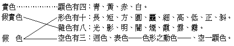



七、音声：杂集论说为十一种：



　　　　执受大种声（有情声）──────────┐  

　　　　不执受大种声（非有情声）　　　　　　　　├此三从发声者分别  

　　　　执不执受大种声（情无情声）───────┘  

　　　　可意声─────────────────┐此三是前三种声在闻者识上  

　　　　不可意声　　　　　　　　　　　　　　　　├之分位差别，假声，或依中  

　　　　可不可意声───────────────┘国分宫、商、角、徵、羽五声。  

　　　　世所共成声───────────────┐此三是执受大种声上之分位  

　　　　成所引声　　　　　　　　　　　　　　　　├差别，假声，或分喉、舌、  

　　　　遍计所执声───────────────┘唇、齿、颚声。



八、香臭：杂集论分六种：



　　　　好香……香───────────────┐  

　　　　恶香……臭　　　　　　　　　　　　　　　├此三从能嗅者分别  

　　　　平等香─────────────────┘  

　　　　俱生香─────────────────┐  

　　　　和合香　　　　　　　　　　　　　　　　　├此三从发香聚分别  

　　　　变异香─────────────────┘



九、滋味：杂集论分为十二种：



　　　　苦、酢、甘、辛、咸、淡──────────此六实味。  

　　　　可意味─────────────────┐  

　　　　不可意味　　　　　　　　　　　　　　　　├此三从能尝者分别  

　　　　可不可意味───────────────┘  

　　　　俱生味─────────────────┐  

　　　　和合味　　　　　　　　　　　　　　　　　├此三从发味聚分别  

　　　　变异味─────────────────┘



十、所触：合说二十六种：



坚、湿、热、动　此四即四大种………实触。



滑、涩（水）、轻、重（风）、软、硬（地）、冷、煖（火）………此八是四触之差别。



饥、饱、渴、黏、力、劣、闷、痒、疲、勇、病、老、死、息………此十四，是四大等和合身根之触分。



此五色尘，乃为每一聚而非一单行。然声与香但有分位差别，应说由声或香各一种子所起现行。四大触种别立，则四显色与六实味，亦可别立。又触处若不摄四大，则应十一色处不能摄诸色法。触处为各种各现诸触聚，色处、味处亦不妨为各种各现之诸色与诸味聚也。



十一、法处所摄色：此分五种：



　　　　　　　┌──一极略色────分析至极微细之极微或原子等。  

　　　　┌─假┼──二极回色────推想至极杳远之天空或天体等。  

　　　　│　　└──三受所引色───无表色。依思心所种子上假立。  

　　　　│　实──┌四定所引色───定果色。以定心自在力变现之色。  

　　　　└────┴五遍计所执色──妄执造物主色相或妄执各实我法。



定所引色或实或假，大定通力变现有实用者，由定增上引藏识中色种起色现行，则是实色；餘无实用，但现为境，则为假色。极略、极迥，亦假想色。无表色、实为心所种，假说是色。遍计所执，亦假想色，或和合相续假上之假色。此皆第六意识所了之色。第六所了曰法，故名法处所摄色也。



九　三分位位



三分位者，心及心所与色法三之分位也。亦名心不相应行法，除受及想餘心所，及此分位法，在五蕴中皆行蕴摄，故名行法。然行有二；一者、心相应行，即前作意等心所是；二、心不相应行，即此分位法是。此分位法，略如西洋哲学所立原型、观念，为第六意识推理分别——计度分别——之绳格。略有二十四种，或前三中之单分位，或二合之分位，或三合之分位，皆无实体。单分位者：



一、命根：此依亲生第八识业种势限上假立，是第八识分位。



二、异生性：此依分别所起我法执之种上假立，是二障心所种分位。



世间之言性命，命即命根，性即异生性或众同分。故此二分位为世人之所深执。命根、亦有言三合分位者。



三、名身，四、句身，五、文字身。



此三是能诠之声或色等分位。或字母云字身，名句所依成篇章之经书则曰文身，或不分别统曰文身。亦有兼所诠义，言是三合之分位者。次二合之分位：



六、无想定，七、灭尽定，八、无想事。



无想定者，得无有前六心心所之定。无想事者，由此定得无想天报，此皆依前六心心所不起现行之分位上假立。灭尽定者，得无有前七心心所之定，此亦依前七心心所不起现行之分位上假立。次三合之分位：



九、众同分：多人同为人类，多石同为石类，此之类性曰众同分。



十、得：色心心所生起未坏灭时，成就不失名得，等於「存在」。



十一、生：先无今有曰生。



十二、住：生已暂存曰住。



十三、变：住别前后曰变（变或曰异、曰衰、曰老）。



十四、灭：今有后无曰灭（或死、不遍、或无常、乃此四公名）。



十五、流转：因果不断相续，前后改转。



十六、定异：善恶因果等互相差别。



十七、相应：因果事业和合而起。



十八、势速：新陈代谢，迅捷流行。



十九、次第：占处时空所成秩序。



二十、时：时间，一刹那量至大劫量。



二十一、方：空间，点线面积，四极六合十方随制。



二十二、数：数量，一数以至不可说不可说转数。



二十三、和合性：诸法之不相乖反性。



二十四：不和合性：诸法之乖反性。



此二十四皆非实事而是名理。后十六法，可皆为贯通於色、心、心所虚位。然方或云「色处分齐人法所依」，亦可但色分位。近人亦说占空间者唯是物质。然向来皆说为三合之分位也。



十　四实性位



前四位之实性，曰四实性。实性谓常遍如此之真相。前四皆不遍无常之有为诸行，但相对之存在，非绝待之存在。此常遍故，曰无为法，共有六种：



一、虚空：证我法空，豁虚离碍，喻曰虚空。



二、择灭：以无漏慧择除障染，择力所得灭曰择灭；即有餘依、无餘依、无住处涅槃也。



三、非择灭：有为法缘阙不生故不灭之不生灭真相。



四、不动灭：四禅以上诸天不为三灾、八患所动之真相。



五、想受灭：无所有处天以上，及灭尽定所显之真相。



此五是随喻——虚空——随事——随择力、随阙缘、随不动、随想受灭——差别而假立。真实无为，唯后一种：



六、真如：即本性净涅槃。一真法界本来寂常清净，诸法真相常遍如是，故名真如。非遍计妄及依他倒，故名真如。



真如一名，小乘有名无义，或并不知此名，然在大乘乃为唯一法印。龙猛书中译为实相，曰小乘三法印，大乘唯一实相印是。今真现实论中谓之现量实相。



十一　百法之分系表



此之百法，前以识最胜故而为次第，列为五位而说。若不宗主唯识，专就法系分列，则其次序乃适与之相反。应如下表：



　　　　　　　　　　　　　　　　　　　　┌识法………………八法  

　　　　　　　　　　　　　　　　　┌心法┤  

　　　　　　　　　　　　　　┌实法┤　　└心所有法…………五十一法  

　　　　　（存在法）┌有为法┤　　└色法………………十一法  

　　　　　┌有　　法┤　　　└假法…………二十四法  

　　　　法┤　　　　└无为法…………六法  

　　　　　└无　　法  

　　　　　（不存在法）



先无为法，以此六法无生灭行为故；餘九十四法皆有为之行法也。二十四心不相应行，皆色等之分位虚理，故曰假法；餘七十法曰实法。虽其中亦含有假法，大类是实，故曰实法。实法内有十一种是色法，有质碍用而无虑知用故；餘五十九种皆心法，皆有虑知用故。心法内五十一种是心所有法，随从八聚集起心法而现行故，属彼八聚集起心法所有——集起心虽第八识特胜，而义通八识，然各心所不得此名——；所餘八法则名心法，正是集起心故。对彼心所有法，此名心王，彼名心使。然此百法皆存在法。有为诸行和合相续，现实有情器界，故此为现实之蕴素。



第三节　诸法相摄



一　诸法开合概论



前二节说六大、十二处、十八界、百法诸分列表，内中有已分析到为最单纯材素者，若六大中之地、水、火、风四触分，五蕴中之受、想二心所分，十二处中之五色根，十八界中之六识界，百法中之心所及命根等。此诸材素，虽遍涉有情器界与超情佛刹，有诸界——欲、色、无色、无漏四界、诸地——世间九地、出世十一地、诸住——世间七识住、出世十三住、及各各有情聚之区别；然坚、触等法之各为自类种子现行，虽非一个而为一类，例无数坚触种起为无数坚触现行，种现虽皆无数，其为坚触则同；乃至虽无数之命根，其为命根则同，则彰彰明甚也。至於六大中之识大，五蕴中色蕴等，十二处中之触处等，十八中之法界等，百法中之法处所摄色等，皆为多类法之一聚，非一类之种子现行，由此故有开合之异。或合多法以为一聚，例五蕴中合十色处为一色蕴；或开一界而为多法，例百法中开一法界为诸心所、诸心不相应行与无为法。且其开合相摄，六大、五蕴及十二处与十八界，直接皆不能摄尽，於百法间接相摄，又当详细观察，善为分别，故於此节论之。



二　六大与诸法比观



六大为最近乎唯物者。原始之分四大，乃从先执有「整个物」而为简单之分别者，故观色法为皆四大为本，不啻观色、香等皆依一顽质地大或四大合成者为体也。色聚分齐之所无处，说为空大；最后以了知色、空之知识说为识大，不啻唯物论之说心识等为物质之作用而已。然在知识之所知境上析观之，其直接含摄者：



　　　　地───┐  

　　　　水　　　├──所触一分  

　　　　火　　　│  

　　　　风───┘  

　　　　空……………方………………心不相应行之一  

　　　　识……………意识或前六识……………识一分



兹六大不能摄尽现实蕴素。然间接相摄开列之，则以诸色法皆依持四大种故，四大种为能造而餘为所造故，色诸分位不离於色，亦摄名句文等。四度之空摄时，三度之空摄数，除心心所分位，餘分位理皆空所摄。识之意识或前六识，必俱末那及阿赖耶；既有心王必有心使所属，亦摄诸心所法及心所分位。既摄诸能显示，则所显示之无为法亦不相离。故於六大亦能摄尽诸法。为表於左：



　　　　　　　　（能造色）　　┌─五根　　　　　　　　　（色分位）  

　　　　四大……实触……所造色┼─四尘───────┬名句文及餘法处色  

　　　　　　　　　　　　　　　├─餘触　　　　　　　│  

　　　　　　　　　　　　　　　└─法处所摄色一分──┘  

　　　　空大………方……时……数……餘众同分等分位法  

　　　　　　　　　　　　　　　　　　　　　　　　　　　‧‥‥心分位命根  

　　　　识大……意识……五识……意根藏识……诸心所‥‥‧‥‥心所分位异生性  

　　　　　（如上诸位所显示之实法、即无为法）　　　　　‧‥‥心心所分位无想心定等



三　五蕴与诸法比观



五蕴之一蕴字，已含有一聚而非一类之意义。然受与想亦为单类。五蕴为佛法从知识之所知境上简单分别，已抽去整个物及整个我之妄执者，故为纯正佛法而较六大胜进多矣。五蕴与六大之相摄如左：



　　　　　　色──一分………全分──地水火风  

　　　　┌────少分………多分──虚空  

　　　　│　受─┐  

　　　　│　想─┤  

　　　　└─行─┤  

　　　　　　识─┴一分………全分──识



五蕴与十二处之相摄如下：



　　　　色────十色处及法处一分  

　　　　受──┐  

　　　　想──┼─法处一分  

　　　　行──┘　（前灭识）（现行八识或六识）  

　　　　识────意一分………意全分



五蕴与十八界之相摄如下：



　　　　色────五根五尘及法界一分  

　　　　受──┐  

　　　　想──┼─法界一分  

　　　　行──┘  

　　　　识────六识界………意界



五蕴与百法相摄者：



　　　　色────十一色法  

　　　　受───┐  

　　　　想───┼五十一心所法  

　　　　行───┴二十四心不相应行  

　　　　识────八识



依此五蕴直接相摄，皆不摄无为法。由此不摄十二处法处之一分，十八界法界之一分，百法中之无为法六；但摄有为法之全分。然所示显之无为法，不离能显示之诸法，故亦间接摄无为法。



四　十二处与诸法比观



十二处乃从能知所知之知识基缘，为无有情我之机械观者。直接不摄六识、八识，虽意根即为前灭之六识、八识，然仍不摄现刹那识。盖此意根，但注重说明得起意识之根基，若以肉心或脑为得起意识之根基，如小乘中之上座部，则可全唯色法。即其说六识等前刹那灭为意根者，俱舍论云：『六中无间谢，说识名意根。释曰：六识中随一无间灭，此识说名意处。譬如一人先为子后为父，又如先为果后为种，识亦如是。先为六识，后成意处』。盖以识刹那灭，然意识有记忆推理之用，此依何而得成？乃观前刹那识有遗为后刹那识之倾向关系——等无间缘——；刹那刹那识之前灭后生，相续能为引导，为得起意识作用之根基，谓之意根。此之意根，既非大乘之末那识，但是前刹那六识经验流而已。要言之、则意识以前刹那六识为根基也。但由根基尘缘刺激反应，击发六识，刹那即灭，识非相续存在，故为机械之人生观，亦为彻底之无我观。然颇不易说有情之相续流转及还灭流转也。其直接相摄者如左：



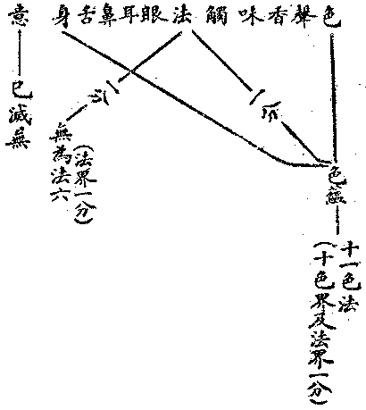



缺六大之识大，缺五蕴之识受想及行蕴一分，缺十八界六识，缺百法之八识及心相应诸心所法；然间接亦能全摄也。谓由意处即前刹那识故，摄六识或八识；摄八识故，亦摄相应诸心所法；故识大与识受蕴等，皆无不摄。



五　十八界与诸法比观



十八界之法界所摄虽多，然既未说诸心所法，则应不摄心所，诸心不相应行虽必相摄，如俱舍论才说十四，亦应不摄全分，且意界同意处仅说六识，亦应不摄第七八识，由此其直接相摄者：



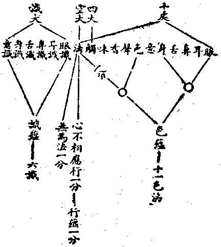



十八界较六大及十二处宽，较五蕴缺受，想及行一分，增无为法，较百法则为未全也，然间接摄。或说意界是末那识及阿赖耶，既有八识必有相应诸心所法；故亦摄五蕴及百法全部。



六　百法与大蕴处界比观



百法之特殊处，一、在说第七第八识，二、在说诸心所，三、在说法处所摄色，四、在说诸心不相应行法，五、在说真如为真无为法。大、蕴、处、界，除去其间接之相摄；五蕴较广，九十四法；次十八界，四十七法——除第七八识及心所法，准法界摄无为法、不相应行全——；次十二处，四十一法——除六识——；次六大，则仅及三法。为表如左：



　　　　　　　　　　　　　　　　　　　　　　　　　　　（前刹那六识）  

　　　　　　┌───眼识、耳识、鼻识　─┬　─┐　意处───────意界  

　　　　识蕴┼───舌识、身识───　─┤　─┼　─────────六识界  

　　　　　　└───意识──────　─┘　─┘─────────────识大  

　　　　　　　　　　末那识、藏识  

　　　　受蕴────受  

　　　　想蕴────想  

　　　　　　┌───作意、触思  

　　　　　　│　　　欲、胜解、念、定、慧  

　　　　　　│　　　梦、悔、寻、伺  

　　　　　　│　　　信、精进、惭愧、无贪  

　　　　　　│　　　无瞋、无痴、轻安  

　　　　　　│　　　不放逸、行舍、不害  

　　　　　　│　　　贪、瞋、痴、慢、疑、不正见  

　　　　　　│　　　忿、恨、恼、嫉、害  

　　　　　　│　　　覆、诳、谄、憍、悭  

　　　　　　│　　　无惭、无愧  

　　　　行蕴┤　　　懈怠、放逸、惛沉  

　　　　　　│　　　掉举、不信、失念  

　　　　　　│　　　散乱、不正知  

　　　　　　│　　　得、命根、众同分─────┐  

　　　　　　│　　　异生性、无想定、无想报　　│  

　　　　　　│　　　名身、句身、文身　　　　　├法处──法界  

　　　　　　│　　　生、住、变、灭　　　　　　│  

　　　　　　│　　　流转、定异、相应　　　　　│  

　　　　　　│　　　势速、次第、时　　　　　　│（虚空无为亦间接显）  

　　　　　　│　　　方────────────┼────空大  

　　　　　　└───数、和合、不和合　　　　　│  

　　　　　　　　　　虚空、择灭、非择灭　　　　│  

　　　　　　　　　　不动灭、想受灭、真如───┘  

　　　　　　┌───眼、耳、鼻、舌、身────┐  

　　　　色蕴┤　　　色、声、香、味　　　　　　├十色处─十色界  

　　　　　　│　　　触────────────┴───────四大  

　　　　　　│　　　　　　　　　　　　　　　　　（一分）  

　　　　　　└───法处色───────法处一分────法界一分



七　百法与俱舍七十五法



有近於五位百法之分类，而不如百法完全者，则有小乘二部：一、萨婆多部之所说，兹采俱舍论者：



　　　　无为（３）────────────────虚空、择灭、非择灭  

　　　　　　　　　　　　　　　　　　　　　　┌──眼、耳、鼻、舌、身  

　　　　色（１１）─────────────┤　　色、声、香、味、触  

　　　　　　　　　　　　　　　　　　　　　　└──无表色  

　　　　　　　　　　　　　　　　　　　　　　┌──眼识、耳识、鼻识  

　　　　心（１）──────────────┤  

　　　　　　　　　　　　　　　　　　　　　　└──舌识、身识、意识  

　　　　　　　　　　　　　　　　　　　　　　┌──受、想、思、触、欲、慧  

　　　　　　　　　　┌───遍大地（１０）─┤  

　　　　　　　　　　│　　　　　　　　　　　└──念、作意、胜解、定  

　　　　　　　　　　│　　　　　　　　　　　┌──信、不放逸、轻安、舍  

　　　　　　　　　　│　　　大善地（１０）─┤　　惭、愧、无贪、无瞋、  

　　　　　　　　　　│　　　　　　　　　　　└──不害、勤  

　　　　　　　　　　│　　　　　　　　　　　┌──无明、放逸、懈怠  

　　　　心所（４６）┤　　　大烦恼地（６）─┤  

　　　　　　　　　　│　　　　　　　　　　　└──不信、惛沉、掉举  

　　　　　　　　　　│　　　大不善地（２）────无惭、无愧  

　　　　　　　　　　│　　　　　　　　　　　┌──忿、覆、悭、嫉、恼  

　　　　　　　　　　│　　　小烦恼地（１１）┤  

　　　　　　　　　　│　　　　　　　　　　　└──害、恨、谄、诳、憍  

　　　　　　　　　　│　　　　　　　　　　　┌──恶作、睡眠、寻、伺  

　　　　　　　　　　└───不定地（８）──┤  

　　　　　　　　　　　　　　　　　　　　　　└──贪、瞋、慢、疑  

　　　　　　　　　　　　　　　　　　　　　　┌──得、非得、同分  

　　　　　　　　　　　　　　　　　　　　　　│　　无想果、无想定、灭尽定  

　　　　心不相应行（１４）─────────┤　　命根、生、住、异、灭  

　　　　　　　　　　　　　　　　　　　　　　└──名身、句身、文身



无为缺不动灭想受灭真如之三种；心法缺第七第八识，且合六识为一心法；心所善中缺一无痴，烦恼中缺不正见、不正知、失念、散乱之四；心不相应行缺异生性、流转、定异、相应、势速、次第、时、方、数、和合、不和合之十一，而加非得，实缺二十；六识合一，故缺二十五数，存七十五。且无表色仅法处所摄之受所引色，缺餘四种：然极微色彼摄在十色处中也。其特别之处：一、在将六识合为一心法，似心理学说一意识分为视觉及听觉等；亦如后人一猿应六窗喻。然有违其十八界为十八种族之言。然彼无末那为第六识根，六识生灭须展转相引为意根，则以六识界及意界为一心法，亦推论之所应至也。二、在善中废除无痴心所，则颇有理。三、在以贪、嗔、慢、疑，列为不定心所。四、在以放逸等五，列为大烦恼地。五、在不分别遍行与别境及无次序。后之三种，则为较百法之短处。



八　百法与锡兰八十三法



锡兰巴利文所传小乘上座部阿毗达磨，分四位、说九十三法，不开心不相应行位。以诸心不相应行法，分摄在色法或心所法中。兹表如下：



　　　　无为（１）──────────────涅槃  

　　　　　　　　　　　　　　　　　　　　　┌─眼、耳、鼻、舌、身  

　　　　　　　　　　　　　　　　　　　　　│　色、声、香、味、触  

　　　　色（２４）────────────┤　女根、男根、食、命根  

　　　　　　　　　　　　　　　　　　　　　│　空、威仪、言语、轻安  

　　　　　　　　　　　　　　　　　　　　　│　能伸缩、能适应、  

　　　　　　　　　　　　　　　　　　　　　└─能集生、住、异、灭  

　　　　　　　　　　　　　　　　　　　　　┌─眼识、耳识、鼻识  

　　　　心（６）─────────────┤  

　　　　　　　　　　　　　　　　　　　　　└─舌识、身识、意识  

　　　　　　　　　　　　　　　　　　　　　┌─触、受、想、思  

　　　　　　　　　　　　┌──遍行（７）─┤  

　　　　　　　　　　　　│　　　　　　　　└─定、作意、命根  

　　　　　　　　　　　　│　　　　　　　　┌─寻、伺、胜解、  

　　　　　　　　　　　　│　　别境（６）─┤  

　　　　　　　　　　　　│　　　　　　　　└─勤、悦、欲  

　　　　　　　　　　　　│　　　　　　　　┌─般若、悲、喜  

　　　　　　　　　　　　│　　　　　　　　│　正言、正行、正命  

　　　　心所（５２）──┤　　　　　　　　│　信、念、惭、愧  

　　　　　　　　　　　　│　　善（２１）─┤　无贪、无瞋、平静  

　　　　　　　　　　　　│　　　　　　　　│　心轻安、身轻安　（注：缺四）  

　　　　　　　　　　　　│　　　　　　　　│　心轻、身轻  

　　　　　　　　　　　　│　　　　　　　　│　心柔软、身柔软  

　　　　　　　　　　　　│　　　　　　　　└─心诚敬、身诚敬  

　　　　　　　　　　　　│　　　　　　　　┌─痴、无惭、无愧  

　　　　　　　　　　　　│　　　　　　　　│　掉举、贪、不正见  

　　　　　　　　　　　　└──不善（１４）┤　慢、瞋、嫉、悭  

　　　　　　　　　　　　　　　　　　　　　└─恶作、惛沉、睡眠、疑



此部分法之大缺点，即在未开心不相应位，将命根列入心所中，生灭等列入色法中。然则心所应能持续身命，心等应无生灭，此其显然不合於事理者。他若以正言及身堪任等列之为善心所，盖由注重戒定之故。然以勤及寻伺列入别境心所，善中列悲心所，亦不无特长处。由此於诸心所，当别论定。



九　心所有法之论定



心所有法，唯锡兰所传上座部及萨婆多部与大乘法相，始详论之。其先或主不立心所，或主唯列受想行三心所，或主列受、想及贪、嗔、痴三心所。即此三部所言，亦互参差，无严格之标准，故有重新为审择之必要。



瑜伽等最善者，在立五种遍行心所，秩然不可紊乱增减，今整齐其名字，列之如左：



　　　　　　一作意─┐  

　　　　　　二感触　├──其义皆如百法中述  

　　　　┌─三感受　│  

　　　　│　四感想　│┌─新奇者惊喜乐者慰忧苦者怖  

　　　　│　五思虑─┘│  

　　　　└──────┘



至於别境不定心所，寻伺既为思、慧分位，例止、观为定、慧分位，可以不立。梦为在色身睡眠分位之心心所聚，亦可不立。睡眠、勤勉，应入心不相应行内。悔改应入别境之中，更加忍耐、忠信，安立为八：



欲望…………於希求境生欲望心



忆念…………於曾习境生忆念心



志定…………於深观境生志定心



慧择…………於精察境生慧择心



悟解…………於审决境生悟解心



忠信…………於认可境生忠信心



悔改…………於恶作境生悔改心



忍耐…………於难行境生忍耐心



欲至悟解，同百法之五别境。由慧审择乃能於决定境印持无疑，故置慧后。忠信心通三性，若身见、边见等迷信邪信，即不善、无记信。除悔改不通於佛地，餘皆可通三性诸地，思之可见。



百法中之信心，即善性之忠信——或曰信仰——，善性之忠信心即乐善好德心，故於实德能深忍乐欲而心净为性。然例善欲、善慧等，不须别开也。精进、行舍及不放逸，是善心等起之勤勉、正直、严肃分位，轻安是定心等所起身心分位，皆入心不相应行内。无痴是善慧、善悟解，不害是无嗔——今云慈恕——之分位，故不别立。审之、应唯三种：



惭愧…………合为一心即无慢心，由此起善身语，即精进、恭敬等。



慈恕…………即无嗔心，或曰慈悲，由此起善身语行，即持戒、忍辱。



惠舍…………即无贪心，或曰喜舍，由此起身语行即布施。



善定即禅那度，善慧及般若度，善悟解、善欲等即方便、力、智度。故正善心唯此无慢、无嗔、无贪三种，而慈恕为主要。



次不善有覆心，应有其六：



贪吝…………同百法之贪心，为惠舍心之敌对，通有覆、不善。



嗔暴…………同百法之嗔心，为慈恕心之敌对，而唯是不善。



矜慢…………同百法之慢心，为惭愧心之敌对，通有覆、不善。



痴迷…………同百法之无明，为善慧、悟解心之敌对，通有覆、不善。



疑惑…………同百法之疑心，为善悟解、善欲、善信、善忍之敌对，通有覆、不善。



忽忘…………如百法之散乱、失念，为善念、善定之敌对，亦通有覆不善。



其餘恶见即不善无记信，忿等是嗔分位，悭等是贪分位，覆等贪痴分位，皆不须立。不正知即不善无记慧悟。懈怠、放逸、惛沉、掉举，身心分位入心不相应行。失念、散乱，是忽忘心，不须别立。故总为四类二十二心所。



十　心不相应行之论定



心不相应行，唯萨婆多部与大乘法相中说之。今亦重为开合增减，列之於左：



一、命根…………同…………心分位。



二、异生…………即异生性，…………心所分位。



三、深定…………无想定、无想报、灭尽定、及不动灭无为、想受灭无为，合为一位，故无为亦仅存四种。然此可再分别。…………心心所分位。



四、文语…………名句文身合为一种，例数量故。…………色法分位。



五、生起…………即生，…………以下皆心、心所、色分位。



六、存住…………即住，亦即是得。初得是生，得已相续是住，故不立得。



七、变坏…………即老，或异，或即无常。



八、灭亡…………即死，或灭，或失，失即不生存故。



九、恒转…………即流转，或相续。



十、同类…………即众同分，或平等，或相似。…………人即男性、女性、人类、天类等，法即有为、无为等。



十一、各别…………即定异，或差别。…………人生人，牛生牛，善种起善现，恶种起恶现。



十二、次第…………同。



十三、飞动…………即势速，在有情为敏捷，在心为掉举等。



十四、停滞…………新增，在有情为顽拙，在心为惛沉等。



十五、时分…………即时间。



十六、方分…………即三度空间。



十七、度量…………新增，即分、寸、升、斗、斤、两所衡者。



十八、数量…………即数。



十九、和合…………同。



二十、乖离…………即不和合。



二十一、睡眠…………醉及催眠闷绝属之，梦是睡中之心所分位，此从心所中移置。此下移置或新增，皆人事之分位。



二十二、醒寤…………新增。



二十三、勤勇…………心所及触尘中移此。



二十四、懈怯…………心所及触尘中移此。



二十五、轻安…………心所中移此。



二十六、压迫…………新增。



二十七、放肆…………心所中移此，即放逸



二十八、严肃…………心所中移此，即不放逸。



二十九、盟誓…………新增，法处色中受所引色移此。



三　十、游戏…………新增。以下皆新增。



三十一、显现…………人即显达，法即现行。



三十二、隐没…………人即隐遯，法即种子。



三十四、晒笑



三十五、叹喟



三十六、烦劳



三十七、畅逸



三十八、宽弛



三十九、紧张



四　十、优胜



四十一、劣败



四十二、富盛



四十三、贫衰



四十四、称誉



四十五、讥谤



四十六、争夺



四十七、谦让



四十八、刚烈



四十九、温柔



五　十、正直



五十一、邪曲



五十二、平稳



五十三、危险



五十四、整治



五十五、杂乱…………以上皆通人事之身语意行者。



略陈五十五心不相应行，内中命根、异生、同类、各异、生、存、变、灭、时、方、度、数、文语、盟誓、勤勇、懈怯、恒转、次第、和合、乖离之二十法，最为根本；餘则枝条而已。合八识、二十二心所、十一色法、四无为法，仍为百法。然心所有法及心不相应行法与无为法，其出入开合者多矣，可名之新百法。



第四节　诸法施设



一　诸法施设概论



现实蕴素即成事之蕴素。成事、即有情器界与超情佛刹。前者虽说明蕴含之材素，为蕴、处、界等之诸法，然依何等之现实成事而施设，今次当说。谓由有情事故说五取蕴，取著贪等相应不善信等之所著故，唯依杂染有情事而施设，施设之以破取著於我我所等。然亦可依清净超情事而施设五不取蕴，离贪等不善信之取著故。次依有情受用身器事施设十二处；然清净根尘，亦可为超情受用身刹事而施设。依杂染有情资存事，施设四食；然亦依清净超情常变事，施设不食而食。次依有情器界、超情佛刹种种差别事，说无量界：或施设一界，谓法界；或施设二界，谓有为界、无为界；或施设三界，谓佛界、有情界、心等诸法界——心佛众生——；或施设四界，谓欲界、色界、无色界、无漏界；或施设五界，谓心法界、心所有法界、色法界、心不相应行法界、无为法界；或施设六界，谓地界、水界、火界、风界、空界、识界；或施设十八界，谓六根、六尘、及六识界；或施设百界，谓百法；乃至或施设无量界，说无量法。依杂染有情器界生起事，说十二分缘起及从缘所生法；然亦依清净超情佛刹成就事，说十二分还灭及还灭所成法。此说於所知事素之关系。依有情器界与超情佛刹之染净果因事，施设四种圣谛。由是、有五蕴、十二处、四食之施设，以说明有情之生存事，可云人生哲学上之材素。复有诸界诸法施设，以明现实之差别事，可云自然哲学上之材素。又十二缘起施设，为现实事素之因果律，四圣谛施设，为现实染净之转依因果。今说所知现实蕴素，虽只重在蕴、处、界三，然为明施设之差别，随六所依之事当略述之。



二　有情事之五蕴施设



有情事中五取蕴之施设，谓贪等相应之染信中萨迦耶见——我我所见——为上首，取著於我及我所有，故为有情爱之有情。初取内色蕴——身——等为我，外色蕴——自身以外——法为我所有；次取内受蕴——感情——等为我，外内色蕴为我所有；次取内想蕴——思想——等为我，外内色蕴及内受蕴为我所有；次取内行蕴——意志——等为我，外内色蕴及受、想蕴为我所有；后取内识蕴之能了知性为我，外内色蕴及受、想、行蕴皆为我所有。我我所见，谓之身见。色等即我，故随色等断灭而成断见；色等非我，故离色等常住而成常见。断常二边，谓之边见。断故无罪业、福业等果报，常故无罪业、福业之果报，谓之邪见。於此择取一见以为最胜——若耶稣教执必依靠耶稣之血乃能洗罪——，谓之见取、戒取。故依我我所见中之我见为主，成贪、痴等之杂染事。而我见由五蕴而起，由浅及深，施设如其次第。俱舍颂云：『随粗染器等，界别次第立』。释曰：色有对故，诸蕴中粗；无色中粗，唯受行相，故世说我痛等；言想相粗，男女等相易了知故；志行较细，善恶等行难了知故；识最为细，总取境相难分别故。由此随粗立蕴次第。或从无始生死以来，男女於色更相爱乐；此由耽著乐受味故；耽受复因倒想生故；此倒想生由诸行故；如此诸行依识而生；此及前三皆染污识，由此随染立蕴次第。或色如器；受类饮食；想同助味；行似厨人；识喻食者，故随器等立蕴次第。或欲界中所有妙欲，色相显了；色界静虑有胜喜等，受相显了；三无色中取空等相，想最显了；第一有中——非非想天——思最为胜，行相显了；此即识住，识住其中，显示世间田种，故随界别立蕴次第。然佛法之施设五蕴，在破其我我所有之取著，为唯五蕴而无有我。以无我故，亦无我之所有。无我我所故非断常，唯是五蕴生灭聚散前后相续。非断常故不起邪见，生灭聚散前后相续，故有业报。不起邪见故，不取於一见、一戒为胜。正信业报，故应勤求善慧，广修净行；由此乃成无取清净五蕴。次离取清净五蕴者：清净色蕴，谓超情者之身刹等；清净受蕴，谓但受诸乐无有众苦等；清净想蕴，谓水鸟树林演说无常等；清净行蕴，谓常念佛及念法、念僧等；清净识蕴，谓净行等所引生之净识。故依有情或超有情施设五蕴。



三　受用处之十二处施设



十二处依受相事立，即依受蕴为主而设。凡受用之成立，有能受用，有能受用所依工具，有所受用。能受用事，深隐难了，故藉所依工具及所受用而映显之。受用所依工具，则六根是；其所受用，则六尘是；能受用事，则为六识。兹表於左：



　　　　　　（能受用）　　（能受用所依）　　（所受用）  

　　　　眼识………………眼根………………………色尘  

　　　　耳识………………耳根………………………声尘  

　　　　鼻识………………鼻根………………………香尘  

　　　　舌识………………舌根………………………味尘  

　　　　身识………………身根………………………触尘  

　　　　意识………………意根………………………法尘  

　　　　　　　　　　　　└─────┬─────┘  

　　　　　　　　　　　　　　　　　十二处



十二处虽说六根、六尘，亦藉六根、六尘而显於识。或於十二处教执以为实，虽能了知从十二处有六识转，都无见者乃至知者，悟入补特伽罗无我；然犹剩留法执，未穷幽致。故二十唯识论颂曰：



> 识从自种生，似境相而转，为成内外处，佛说彼为十。  

> 依此教能入，数取趣无我；所执法无我，复依餘教入。



今依大乘说能受用应有八识。识清净故受用清净；然识染净，亦依根为区别。第七识为第六识根，与第八识为俱有依，前五识又依第六识为分别依；故第七识未清净时，前六识皆不能清净；第八识未清净时，第七识亦不能全清净。眼等前五色根，为第八识之所变所知相，第八识未清净时，此五色根亦不能清净，依五色根所起前五识，遂亦不能全清净。又六根尘识自种子皆存於第八识，第八识未清净则种子未全净，种子未全净则现行亦未能全净也。依十二处明受用事，虽通染净，诸有我爱有情意根未净，唯染受用；三乘圣者第六、七识分清净故，分净受用；至成佛时第八识清净故，一切清净成净受用。净者，真美善之总名。染者，亦不真不美不善之总名。舍不真不美不善之受用，为得真美善之受用，实人生唯一之大事！而十二处之善巧施设，正未易言也。



四　依生存事之四食施设



食之为义，有摄取他法以资养自身之义。净蕴、处、界，上通佛果，而食则须除佛。佛言：一切有情，皆依食而存住。此有情言，不摄於佛；故食虽通染净，然究竟清净则出离食义。以佛身心境圆满故，更无摄取他法以资养自身之义故，常住坚固喻以金刚，所谓如来之身非杂食身，其义乃见乎此。食虽为受用之一事，然为除佛而外一切有情身命赖以存住之事，故别施设为四，已如前述。兹再出其体用：



段食…………香、味、触尘为体；消化资养色身为用。



触食…………六尘为体；触受资摄身心为用。



意思食………法尘为体；悦资身心勤勇为用。



识食…………三食增长八识为体；资持身心相续为用。



欲界具足四食，段食最要；色界初禅以上，离於段食，触食最要；四禅以上思食为要；灭尽定及无想定报，离段、触、思三食，唯存识食。三乘圣者受清净食，随生三界或入禅定，取食有异，然亦不离识食。未成佛前，第八识於三界系未离故，阿罗汉入灭尽定时，身命犹存，即为异熟识之摄持力故；大菩萨等之第八识，於清净法未圆满故，犹受熏变增长清净，亦识食义。唯佛圆满，不受熏变增长，恒遍相续，湛然自存，不藉他法以为资益，乃超食义。至於现应化身，但为利他，示同有情受食，则所谓有他依性，而无自依性者也。然三乘无学——菩萨初地以上——於段食皆无所需，皆可以禅悦、法喜为食事，对人间争食问题，可云已根本解决。其受段食，皆示同欲界，以利他而已。维摩诘言：「於法等者，於食亦等」。等谓平等，观身及食性即真如，所谓观身实相，观食亦然。平等真如无自他别，亦无食无不食，无食而食，食而无食，为大乘贤圣清净食。依佛律仪正命而食——不害他有情之身命以为食等——，为二乘贤圣清净食。食之善巧，亦殊非易。



五　依差别事之诸界施设



施设一界，谓之法界。可言思法皆施设法，而施设法以离言之法性为因，谓之法界。体即真如，相即现行，用即诸法种子，故言法界，通无不摄。施设二界，曰有、无为，法性真如曰无为界，诸法种、现曰有为界。种必有用，现或但为所知境相，故种唯实，现通假实。施设三界，曰佛界、有情界、及心等诸法界。佛界即是超情佛刹，唯指究竟之佛陀界：有情界即有情器界，亦摄三乘诸贤圣界，皆现实之成事。心等诸法，即心心所法、色法、无为法等，为现实之蕴素。非现实蕴素之外有现实成事，故佛、有情不离心等；非现实成事之外有现实蕴素，故心等不离佛、有情；有情皆有佛性，故非於有情外有佛、心等；佛为无上有情，故非於佛外有有情、心等。华严有颂，曾显斯义：



> 於佛众生然，於心等亦然，心佛及众生，是三无差别。



众生今曰有情，餘义可知。施设四界，欲、色、无色三界为有漏界，已如前述。漏谓烦恼心所，有情烦恼心所相应及由之引生者，则曰有漏，反是谓之无漏。三乘圣者通於有漏、无漏，其有漏者前三界摄——二乘无学之异熟识亦三界摄——，其无漏者无漏界摄，纯无漏界则唯诸佛。施设五界，如百法论、俱舍论之五位，即依王使、心色、实假、相性四对分为五故。心王、心使二界是心，色法是色；心王、心使、色法三界是实，心不相应行法是假；前之四界是相，无为是性。施设六界，随俗而说，地、水、火、风是色，空非色心，识界是心。施设十八界者，依六境对六根，依六根分六识，六聚根、境、识三和合说十八界。施设百法，如百法论。施设七十五法，八十四法，八万四千法以至无有量法，随宜建立，如诸经论。蕴、处、食三，依有情及受用、存住事立，界依法界诸法差别事立，前为人生观之科学哲学，此为宇宙观之科学哲学，故於界之善巧，尤为不易。



六　依生起事之缘起施设



此当待下章以广论，今略言其蕴素：浅言之、则现实成事为从缘所生事，现实蕴素是为缘能起法。深按之、则一一现实蕴素，虽是为缘能起之法，同时亦是从缘所生之事。众多现实成事，虽是从缘所生之事，同时亦是为缘能起之法。凡为能生之缘者，莫非是所生之法；凡为所生之法者，皆可为能生之缘。以能生所生之诸行因果性平等故；若无为法非所生法，亦非能生之缘，仅为他能生所生法依起之缘而已——例证真如起无漏智从无漏智种生，真如但为所知境及增上缘——。从所生别别诸法说一切种子因起；从所生爱非爱果差别说十二缘起。一切种为一切种识中潜在之各别能力。十二缘起法体，依大乘法相列於下：



无明…………痴迷心所现行为体



行……………痴等相应之思心所现行为体



识……………行等摄植之第八识种子为体



名色…………五蕴中除第八识及六根触受心所所餘识等诸法种子为体



六入…………六根种子为体



触……………触心所种子为体



受……………受心所种子为体



爱……………痴及染欲等相应之贪心所现行为体



取……………痴及染信等相应之贪心所现行为体



有……………爱取等滋润之思心所现行为体



生……………识名色六入触受之现行为体



死……………同上



依爱非爱果之生起事而施设十二缘起，经此分析，可见其依何法而建立矣。所以择此诸法而施设缘起者，使知杂染事以何要缘而生起，应以除去何要缘而解脱；能除去杂染事生起之要缘者，即为清净事生起之要缘。杂染事生起之要缘为痴心所，灭除之者为善慧、善悟解——明解——，亦即为生起诸清净事之要缘。般若为圣行之母者，亦以此耳。



七　依染净事之四谛施设



圣谛为圣智所证之真实，或说一谛，即是现实，所谓「一实谛」是。或说二谛，所谓胜义谛，世俗谛；亦谓之第一义谛，世谛；或真谛，俗谛。或说三谛，即遍计所执性，依他起性，圆成实性；或谓真谛，俗谛，中谛。或说四谛，即苦圣谛，苦集圣谛，苦灭圣谛，苦灭之道圣谛；简称为苦、集、灭、道之四谛。最普通者则为四谛，即今所谓依染净事施设之四圣谛。依染事说苦谛及苦集谛，圣智证知是苦之真实相，是谓苦谛；百一十苦、八苦、三苦，总为一纯大之苦蕴；包括三界有情身器皆为苦聚。其普遍苦相曰行苦，於不觉中潜移密运，使有情身生死死生流转相续，器界成坏坏成起灭相续，不能离其逼迫，得於自由。次为坏苦，暂起喜乐，即被无常势力逼迫毁坏，於毁坏时更增忧苦。次为苦苦，毫无乐受，唯受诸苦，如苦生等，身心器界恒相逼迫，实为苦中之苦。有情器界体皆是苦，不至超情佛刹，无离苦之常乐；故此苦谛摄现实成事之一分。圣智证知苦集之真实相，曰苦集谛。苦之三界有情身器从何集起？直接曰业，即痴等所引、贪等所润有漏思心所现行种子，间接即贪、痴等，更间接则根、尘、识等；故苦集谛，摄现实蕴素之一分。圣智证知苦灭之真实相，曰苦灭谛；苦择灭故，清净常乐，即超情之佛刹；故苦灭谛为现实成事之一分。圣智证知苦灭所由之真实相，曰苦灭之道谛，直接者八正道，间接者二十九助道，兹列於左：



　　　　　　　　┌正见……………净慧净悟解净信  

　　　　　　　　├正思愿…………净思净欲  

　　　　　　　　├正语……………耳舌意识相应之净思等  

　　　　八正道─┼正行……………身意识相应身之净思等  

　　　　　　　　├正命……………善心所相应之心身存续法  

　　　　　　　　├正精进…………净善心所相应之心身勤勇  

　　　　　　　　├正念……………净意心所  

　　　　　　　　└正定……………净定心所



二十九助道，分六组：



　　　　　　　　┌观身不净──┐  

　　　　四念住─┼观受是苦　　├─善念定慧心所  

　　　　　　　　├观心无常　　│  

　　　　　　　　└观法无我──┘  

　　　　　　　　┌已生恶令断─┐  

　　　　四正勤─┼未生恶不生　├─善心所相应心身勤勇  

　　　　　　　　├未生善令生　│  

　　　　　　　　└已生善增长─┘  

　　　　　　　　┌欲………………善欲心所  

　　　　四如意足┼精进……………善心所相应身心勤勇  

　　　　　　　　├念………………善念  

　　　　　　　　└慧………………善慧  

　　　　　　　　┌信……………………善信  

　　　　　　　　├进──────┐  

　　　　五　根─┼念　　　　　　├─善性如前  

　　　　　　　　├定　　　　　　│  

　　　　　　　　└慧──────┘  

　　　　五　力……………同上  

　　　　　　　　┌择灭……………善慧  

　　　　　　　　├精进……………善勤勇  

　　　　　　　　├喜………………善受  

　　　　七觉分─┼轻安……………善定相应心身分位  

　　　　　　　　├定………………善定  

　　　　　　　　├舍………………惠舍  

　　　　　　　　└念………………善念



此为三乘共通所由之道；大乘唯一正道曰无上遍正觉，梵云阿耨多罗三藐三菩提是。以慈恕、惠舍、净欲、净念、净定、净悟、净八识等相应之净慧为体；助道为六到彼岸；十到彼岸行，梵云波罗密多者是。四谛之义，如是其深远也！



八　依六事所施之蕴素



此论现实蕴素，而依六事所施设法，非限於现实蕴素也。蕴、处、界三，则为前三节之总摄，而缘起、食、谛三，则虽可分出其蕴素，然其自身非蕴素也。今叙述於现实蕴素章者，以现实蕴素为现实成事所蕴含之材素。现实成事，非但有情器界，亦兼超情佛刹。前三节虽通明一切现实所蕴含之材素，而未分判有情器界与超情佛刹所蕴材素之差别。今於六事施设，界善巧之三界，既为佛及有情与心等诸法之分别，四界亦为有漏三界与无漏界分别。由成事之区别即得论蕴素之区别。四食与有漏三界有区别，复有贤圣清净食与佛陀不依食住之应化食。十二分缘起明有漏三界，以何法为能起之缘？藉何法能知及能伏断於此十二缘？则可知无漏界以何法为能起之缘，而情器与佛刹蕴素之差别，亦略可知矣。四圣谛之苦谛及苦灭谛，即现实成事中有情器界与超情佛刹；苦集谛说明有情器界之蕴素，苦灭之道谛说明超情佛刹之蕴素；则尤显然可知情器与佛刹蕴素之差别。或有言蕴、界、处等但为有漏情器之蕴素；无漏佛刹非五蕴摄。十八界中但意界、法界、意识界摄；十二处中但法处、意处摄。今依大乘法相了义语之分别，无漏佛刹虽非五取蕴摄，然亦为五不取蕴摄，於界、处中但摄法界、法处一分，然亦清净十八界与十二处摄。六大虽染净有别，而亦摄清净六大；情器与佛刹於百法虽互有其增减，然亦通五位摄。兹略表示於此：



　　　　┌────────────┬──坚劲质………地  

　　　　│　有情身器……有漏───┘┌─流湿质………水  

　　　　│　　　　　　　　　　　　　│　煖热力………火  

　　　　│　　　　　　　　　　┌──┘　轻动力………风  

　　　　│　超情佛刹……无漏─┤　　　　无碍性………空  

　　　　└──────────┴────了知性………识  

　　　　　　　　　　　　　　　┌─六根处─┐  

　　　　　　　　　┌有漏───┤　　　　　├─无漏────┐  

　　　　有情身器─┤　　　　　└─五尘处─┘　　　　　　　├超情佛刹  

　　　　　　　　　└除择灭无为──法　处───无漏法一分─┘  

　　　　　　　　　　　　　　　┌─六根界─┐  

　　　　　　　　　┌有漏───┤　六识界　├─无漏────┐  

　　　　有情身器─┤　　　　　└─五尘界─┘　　　　　　　├超情佛刹  

　　　　　　　　　└除择灭无为──法　界───无漏法一分─┘  

　　　　　　　　　　　　┌色蕴──────────┐  

　　　　　　　　　　　　│受蕴……除忧苦　　　　　│  

　　　　有情身器─有漏─┤想蕴……除倒想　　　　　├无漏─超情佛刹  

　　　　　　　　　　　　│行蕴……除烦恼及烦恼分位│  

　　　　　　　　　　　　└识蕴──────────┘  

　　　　　　　　　　　┌─八识────────────┐  

　　　　　　　　　　　│　五遍行　　　　　　　　　　　│  

　　　　　　　　　　　│　八别境─除悔　　　　　　　　│  

　　　　有漏身器─有漏┤　三善心　　　　　　　　　　　├无漏─超情佛刹  

　　　　　　　　　　　除　六烦恼（全除）　　　　　　　│  

　　　　　　　　　　　择　十一色（除遍计所执色）　　　│  

　　　　　　　　　　　灭　五十五分位（除烦恼相应分位）│  

　　　　　　　　　　　└─四无为───────────┘



於此可略观情器与佛刹蕴素之区别矣，亦可知成情器与成佛刹之要素何在矣。质言之、则杂染烦恼即成杂染情器，有六烦恼故名有漏；择灭烦恼则成清净佛刹，无六烦恼故名无漏，亦云择灭。依染净事以分别其蕴素，即可知转染成净之要素何在，而据为转染成净之标准。则施设诸法，非仅为知识之游戏耳。



九　六事施设与六百六十法



瑜伽第三，施设六百六十法之差别，显由六识身五法差别转：谓自性故，所依故，所缘故，助伴故，业故。又复应知蕴善巧摄，处善巧摄，界善巧摄，缘起善巧摄，处非处善巧摄，根善巧摄。此六善巧与今六事施设，蕴处界与缘起全同；道灭为是处，苦集为非处，即处非处善巧；二十二根皆增上之胜缘，扼要即是四食，故四食之施设即通根善巧义。今录六百六十法於此：



复次、眼有一种：谓能见色。或立二种：谓长养眼，异熟生眼。或立三种：谓肉眼，天眼，慧眼——法眼、佛眼摄慧眼内——。或立四种：谓有瞚根，无瞚根，恒相续眼，不恒相续眼；恒相续者谓色界眼。或立五种：谓五趣所摄眼。或立六种：谓自相续眼，他相续眼，端严眼，丑陋眼，有垢眼，无垢眼。或立七种：谓有识眼，无识眼，强眼，弱眼，善识所依眼，不善识所依眼，无记识所依眼。或立八种：谓依处眼，变化眼，善业异熟生眼，不善业异熟生眼，食所长养眼，睡眠长养眼，梵行长养眼，定所长养眼。或立九种：谓已得眼，未得眼，曾得眼，未曾得眼，得已失眼，应断眼，不应断眼，已断眼，非已断眼。或立十种者，无。或立十一种：谓过去眼，未来眼，现在眼，内眼，外眼，麤眼，细眼，劣眼，妙眼，远眼，近眼。如眼如是，耳等亦尔。是中差别者，谓增三、增四。三种耳者：谓肉所缠耳，天耳，审谛耳。四种耳者，谓恒相续耳，不恒相续耳，高听耳，非高听耳。三种鼻、舌者：谓光净，不光净，及被损。四种鼻、舌者：谓恒相续，不恒相续，有识，无识。三种身者：谓滓秽处，非滓秽处，及一切遍诸根所随逐故。四种身者：谓恒相续，不恒相续，有自然光，无自然光。或立一种意：谓由识法义故。或立二种：谓堕施设意，不堕施设意。初谓了别名言者意，后谓婴儿意；又初世间意，后谓出世间意。或立三种：谓心，意，识。或立四种：谓善，不善，有覆无记，无覆无记。或立五种：谓五位差别：一、因位，二、果位，三、乐位，四、苦位，五、不苦不乐位。或立六种：谓六识身。或立七种：谓七识住。或立八种：谓增语触相应，有漏触相应，依耽嗜，依出离，有爱味，无爱味，世间，出世间。或立九种：谓依九有情居。或立十种者，无。或立十一种，如前说。或立十二种，即十二心：谓欲界善心，不善心，有覆无记心，无覆无记心；色界有三心，除不善，无色亦尔；出世间心有二种，谓学及无学。



或立一种色：谓由眼所行义故。或立二种：谓内色，外色。或立三种：谓显色，形色，表色。或立四种：谓有依光明色，无依光明色，正不正光明色，积集位色。或立五种：谓由五趣差别故。或立六种：谓建立所摄色，覆藏所摄色，境界所摄色，有情数色，非有情数色，有见有对色。或立七种：谓摄受事差别故。或立八种：谓依人世杂说：一、地分杂色，二、山杂色，三、园林池沼等杂色，四、宫室杂色，五、业处杂色，六、彩畫杂色，七，锻业杂色，八、资具杂色。或立九种：谓若过去，若未来，若现在，若麤，若细，若劣，若妙，若远，若近。或立十种：谓十种资具。或立一种声：谓由耳所行义故。或立二种：谓了义声，不了义声。或立三种：谓因受大种声，因不受大种声，因俱大种声。或立四种：谓善，不善，有覆无记，无覆无记。或立五种：谓五趣差别故。或立六种：一、受持读诵声，二、请问声，三、说法声，四、论议决择声，五、展转言教若犯若出声，六、喧杂声。或立七种：谓男声，女声，下声，中声，上声，鸟兽等声，风林等声。或立八种：谓四圣言声，四非圣言声。四非圣言声者：一、不见言见见言不见非圣言，二、不闻言闻闻言不闻非圣言，三、不觉言觉觉言不觉非圣言。四、不知言知知言不知非圣言。四圣言者：一、见言见不见言不见圣言，二、闻言闻不闻言不闻圣言，三、觉言觉不觉言不觉圣言，四、知言知不知言不知圣言。又有八种：谓四善语业道，四不善语业道。或立九种：谓过去、现在、未来、乃至若远，若近。或立十种：谓音乐所摄声。此复云何？一、舞俱行声，二、歌俱行声，三、弦管俱行声，四、金石俱行声，五、男女俱行声，六、螺俱行声，七、腰等鼓俱行声，八、冈等鼓俱行声，九、都昙等鼓俱行声，十、俳叫俱行声。或立一种香：谓由鼻所行义故。或立二种：谓内及外。或立三种：谓可意，不可意，及处中香。或立四种，谓四大香：一、沉香，二、窣堵鲁迦香，三、龙脑香，四、麝香。或立五种：谓根香，茎香，叶香，花香，果香。或立六种：谓食香，饮香，衣香，庄严具香，乘香，宫室香。或立七种：谓皮香，叶香，素泫谜罗香，旃檀香，三辛香，薰香，末香。或立八种：谓俱生香，非俱生香，恒续香，非恒续香，杂香，纯香，猛香，非猛香。或立九种：谓过去，未来，现在等，如前说。或立十种：谓女香，男香，一指香，二指香，唾香，洟香，脂髓浓血香，肉香，杂糅香，淤泥香。或立一种味：谓由舌所行义故。或谓二种：谓内及外。或立三种：谓可意等，如前说。或立四种：谓大麦味，粳稻味，小麦味，餘下谷味。或立五种：谓酒饮味，非酒饮味，蔬菜味，林果味，所食味。或立六种；谓甘苦等。或立七种：谓酥味，油味，蜜味，甘蔗变味，乳酪味，盐味，肉味。或立八种：如香说。或立九种：亦如香说。或立十种：谓可嚼味，可噉味，可尝味，可饮味，可吮味，可爆乾味，充足味，休愈味，荡涤味，常习味，后五谓诸药味。或立一种触：谓由身所行义故。或立二种：如香说。或立三种：谓可意等。或立四种：谓摩触，搦触，打触，揉触。或立五种：谓五趣差别。又有五种：谓蚊䗈，风，日，蛇，蝎等触。或立六种：谓苦，乐，不苦不乐，俱生，所治摄，能治摄。或立七种：谓坚鞭触，流湿触，濡触，动触，跳堕触，摩按触，身变异触，谓湿，滑等。或立八种：谓手触触，块触触，刀触触，冷触触，燸触触，饥触触，渴触触。或立九种：如香说。或立十种：谓食触，饮触，乘触，衣触，庄严具触，床坐触，机橙台枕及方座触，女触，男触，彼二於事受用触。略说法界，若假若实，有八十七法。彼复云何？谓心所有法有五十三，始从作意乃至寻伺为后边。法处所摄色有二种：谓律仪不律仪所摄色，三摩地所行色。不相应行有二十四种：谓得，无想定，灭尽定，无想异熟，命根，众同分，异生性，生，老，住，无常，名身，句身，文身，流转，定异，相应，势速，次第，时，方，数，和合，不和合。无为有八事：谓虚空，非择灭，善，不善，无记法，真如，不动灭，想受灭，如是无为，广八略六，若六若八平等平等。复次、法界或立一种：谓由意所行义。或立二种：谓假所摄法，非假所摄法。或立三种：谓有色，无色，及有为无为。或立四种：谓有色假所摄法，无色心所有所摄法，无色不相应假所摄法，无色无为假非假所摄法。或立五种：谓色，心所法，心不相应行，善，无记无为。或立六种：谓受，想，相应行，不相应行，色，无为。或立七种：谓受，想，思，染污，不染污，色，无为。或立八种：谓善，不善，无记，受，想，行，色，无为。或立九种：谓由过去未来等差别。或立十种：谓由十种义：一、随逐生义，二、领所缘义，三、取所缘义，四、於所缘造作义，五、即彼诸法分位差别义，六、无障碍义，七、常离系义，八、常非离系义，九、常无颠倒义，十、苦乐离系义，非受离系义，及受离系义。如是若内若外六处所摄法，差别分别，有六百六十。



第五节　所知蕴素差别



一　所知蕴素总评



此章所言现实蕴素，莫精审於百法。兹复论定为新百法，然亦略言比较单纯之要素耳。近人藉Ｘ光於物体上反射之波长，推定宇宙物体之原质数为九十二，虽犹有二三种未能发见，而在光波长度上排列之顺序，则显然可观也。然此化学上之元质，与今在现实中所择立比较单纯之要素，以施用之方法不同，故所求得之要素亦不同。彼从占空间之物体从事分析，故所求得者，等於法处所摄色之极微色，或仍为可见可触之物体。此所言比较单纯之要素，则略如近人名理原子论所云名理元子——罗素所谓事情——，非心非物，亦心亦物，即能知所知及其成立之要件。故此所云简单之法，彼或视为犹可分析而非原质元子；彼所云之原质元子，此亦视为可见可触之复杂合成事，而非简单材素。以现行之一心聚、一色聚，皆众缘合成事。然六大说盖犹存化学分析之方式，坚、湿、热、动四触，所以视为诸色聚之遍依本者，以其为占据空间之基本性也。占据空间，则此一色聚与彼一色聚体质相碍，由是有质及量之可分析。由质分析，则为四大或九十二原质，由量分析，则为极微极微集或原子。此於所知之材素上，其本为触觉之触尘，视之所觉则为色尘，推析所极而无可见、触，则为法处极微色。故原质、原子，仅为四大极微之分析，与今能知所知上之百法，迥然不同。不占空间无质碍性，则谓之空；能了知性，复谓之识。唯以四触、九十二原质或极微原子为搆成万有之元素，则成立唯物论。以空、识为四大极微之本元，则立唯心论、唯我论、唯神论等。诸哲学派之本体论，皆不越六大之方式。小乘执四大极微为色聚之实元体，空之与识亦为实体，则为物、心、理性之多元论。但空常住——此指虚空无为，若空隙及空一显色亦生灭法——，而四大与识大皆生灭法，则亦为现实论而非有元论矣。大乘以四大为所触，自种为因，由识顿变现为色聚，随量大小，不由极微集合而成；识亦自种为因，众缘所生，空是色心分位或所显无碍理，则全转为现实论矣。蕴、处、界等，皆是能知所知中分出之要素，更为了然。故不应以此中现实蕴素滥同於化学素，亦不应以化学素而难此现实蕴素，彼为在时空方式中之究元论，此为时空方式所依之现实故。



二　五蕴与心理学



西洋之正统心理学，亦谓之意识心理学，以意识为研究之对象故。亦谓之三分心理学，分意识为知识、感情、意志三干以说明故。前已说受、想、行三蕴，略如感情、知识、意志之三分类；细为分析，则色蕴乃心理与物理生理刺激反应之关系，而识蕴为其研究对象之意识。今就受、想、行蕴所含之心所法及识蕴之识，与分三干之意识心理学，表列其关系式於左：



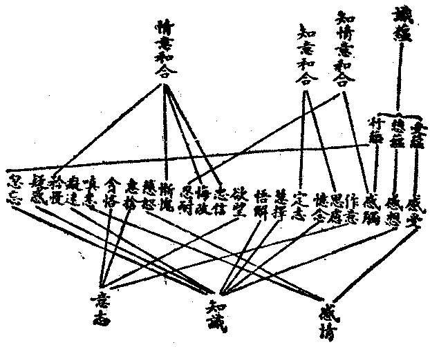



感受之受蕴、为感情之本：发展为善感情，即为慈恕，乃为公之仁情；发展为恶感情，即是嗔恚，乃为私之暴情。感想之想蕴、为知识之本：与前六识相应即为感觉，即为「自性分别」；忆念、与意识相应为「随念分别」；慧择、悟解、与意识相应为理智，即为「计度分别」或如理如量智。痴迷、疑惑、忽忘，乃扰乱知识使不能如理如量之恶劣知识也。行蕴中之作意、为普遍之意志，欲望、为差别之意志，二为根本：发展为善意志，即是惠舍，乃为公之美志；发展为恶意志，即是贪吝，乃为私之鄙志。感触、为感情知识意志所由起，忍耐、为感情、知识、意志之护持，故和合知情意。思虑、是意志之知识，志定、是知识之意志，故为知志和合。忠信、悔改，为或善不善之情志和合；惭愧、为善情志和合；矜慢、为不善情志之和合。此其大较可言者也。故感情、知识、意志，虽可为分别，而不能划然离析也。



三　心识与根身之关系



心识与根身之关系，即心理学与生理学之关系也。近人多以物理学为基本，而设立生理学，生理学为基本，而设立心理学。佛陀学则依现实——近罗素所云中立之一元——，而说明官感机关及官感对象所起之心识，谓之六识；及心识所依官感机关之根身，谓之六根；心识与官感之对象，谓之六尘；说十八界或十二处。近人或言佛学之五色根，但为眼根元子之布於眼根所依处——眼球——乃至身根元子之布於身根所依处——全身——，而各元子乃为无组织之散布。又言五色根之官感机关各立，而无联络之总机，不能明总领受之意识与肉身之关系——见迈格文佛家哲学通论——。此皆误谬推论。今为解而正之：一者、五根为有组织之五色根，即神经系；净色身根，即遍全身能为触觉所依之身感官神经，由内四大及五尘与身根自体之十法所组成。乃至净色眼根，即眼球中能为视觉所依之眼感官神经，由内四大及五尘与身根并眼根自体之十一法所组成。各有微细形状，为净天眼之所能见。换言之、亦即为显微镜所能见，但非常人肉眼所能见耳。其为有组织之机关可知。各人互见之肉身虽为根依处而非真为感官之五色根，然身感官神经既遍布於全身，则活人之根依处，亦无一处不为身感觉——身识——所依，亦灼然可知矣。二者、眼、耳、鼻、舌四根，除各根自体及四大、五尘之外，更须有身根为必须基素。可知身根：一方为与眼、身等对立之别根，一方为眼根等联络之总机关。诸生物或无眼、耳、鼻、舌根，然必有身根也。若无身根则非生物。且身根组织繁密否，亦即为高等低等生物之分判。脑髓、心脏，皆为身根之根依处。身根络布其间，即神经系；布达眼球者别有视神经，即为眼根；乃至布达肉舌者别有味神经，即为舌根。身根布列各根依处，又各成其特殊生理与心理之关系。心、肝司血液循环，为水、火二大运行枢，生命——第八识——之关系为特重；脑髓司经络传达，为风、火二大之运行枢，知识之关系为特重。由是重灵魂者，说心理作用唯在於心、肝；重意识者，说心理作用唯在於脑髓。执心、肝故，想思过度每心痛而失血；执脑髓故，想思过度每脑昏而病络。其实皆偏执之所致。火大之煖，为命、识必俱之关系，命存识存，必煖亦存，煖亡必命与识亦亡。心脏以火煖而运水，脑髓以风动而运火，心脏、脑髓与煖之关系较深密，即为与生命及意识之关系较深密，此诚不容掩之事实。又肾之於水液，而肺之於风气，脾、胃之於营养，肠窍之於收泄，亦皆有特殊之功用。中国医学於心、肝、脾、肺、肾等，分说为关系心理作用之感官。近行为派心理学，亦说心理作用为全身各部内分泌腺受刺激之反应，不以心理作用为专在於脑，或专在於心。



然此皆眼等四根与身根根依处之组织，为识所持，则与第八识有直接关系。能发识，则与前五识有直接关系。至於意识别依意根——心之官感机关——，则由意识每与前五识俱转故，与五色根及根依处有间接之关系。意识、意根，必依止於第八识故，亦与五色根及根依处有间接关系。以五色根、根依处，为第八识摄受为自体，共安危故。然意识之总摄受六尘，而能忆念推度者，在於亲密之意根，及直接关系之前五识与第八识，不在间接关系之五色根及根依处。与前五识俱转，故能总摄前五尘境。以意根及第八识为俱有依故，能忆念推度法尘境。所依意根，正为第七之末那识，旁为八识聚前刹那灭之等无间依。皆为心法而非色法，绝非五色根联络机关之身根某部。小乘或以肉心以为意根，近人多以脑为官感印象之储藏所——大乘则说摄藏藏识——、及意识依起处——大乘则说末那意根——；乃物理、生理为基本之唯物论派心理学，非真现实论之心理学也。五根直接影响前五识及藏识，间接亦能影响意识、意根，此诚为应有之关系，然不及藏识能影响五色根之力大，於有修养者，尤不及意识能影响五根之力大，故不应偏执也。



四　心法体数之决择



俱舍论依十二处教，立一「心法」；上座部依十八界教，立六心法，亦有增立为九种、十种心法者，究竟以何教为决定？换言之、即每一有情究有若干之心法体？依麤显境及各别所依根，从六识身立六心法；依深细境及恒俱转，加「意」及「藏」，立八心法；此於事理较为如实。何者？若言心法之体为一，有眼识时，不必有耳、鼻、舌、身识；乃至有身识时，不必有眼、耳、鼻、舌识；有意识时，不必有眼等前五识；有第七、八识时，不必有前六识；第七识无漏时，第八识或仍为有漏；不必俱故，性非一故。其体是一者，应不能有此殊别。然亦可以同是了知性故，俱现起时互关联故，假说为一。故说为一心法，不如说为六心法之合宜，尤不如说为八心法之究竟也。或加立清净第八识之庵摩罗识为第九识，然染净虽转而识体无二，不应加立。此若别立，前七清净分识，亦应别立。八染、八净，岂不有十六识？故不应立庵摩罗识为九，但应以庵摩罗为第八识清净分之别名而已。或加净识相应正智所证真如，立第十坚实心。识之实性虽不离识，然所了知非能了知，本以能了知性立心识名，真如既非能了知性，不应立心识名。是故心法体数，於八为定，不增不减，如理如量。



问曰：前六心识较为易知，亦为佛学之所公认，第七、八识大乘法相始施设之，既非佛学公认，世亦难知，则殊无建立之必要。答曰：成唯识论证有第八识体，引大小乘教证有八，推论事理，更证理证有十。证有第七识体，教证有二，理证有六。须者检寻，兹不繁叙。举要言之：众生生命，若说从他生命所生，则他生命复从谁生？展转上推，假说一神所生。然彼一神是否生命？若非生命，则既非他生命，应不能生生命。若亦生命，复应从他生命而生，展转上推，仍无究竟。若虽生命，独可不从他生命生，则诸生命皆应不从他生命生。若说原始生命不从他生命生，从无生命偶然产生生命，则既违现知之事实，不能从非生命之水素等造成生命，且无生命之因，突有生命之果，无因有果，亦违背科学等公认之因果律。故说众生生命从他生命而生，从无生命而有，皆不无违碍。是故应说：各生命皆无始而恒转，值相当之机会，集多能力现为生物。尽一期之势限，舍餘粗迹——死尸——，潜为生力。潜，现相续，永无终断。即此无始无终流行变化潜现相续之生命流，曰第八识，集诸种子——潜力——起现行故曰心，有极深微了知性故名识。紧依此生命流，恒有一自卫本能之生存意志，与之潜现俱转，曰第七识。色根及根依处时取舍故，非潜现恒转之生命及恒俱之意志，眼等五识时有无故，非潜现恒转之生命及恒俱之意志；第六识於深眠闷绝——初生及死——深定诸位亦不存故，非潜现恒转之生命及恒俱之意志。诸众生各有潜现恒转之生命，故必有第八识；与潜现恒转之生命有恒俱之意志，故必有第七识。是故为说明生命之真相，心法体数，应如瑜伽等立为八。



五　命根之研究



命根一法，世人认为诸生物类性之本源。谓死生穷达皆定於天命，死生有定期为寿命，穷达有定数为福禄之命。凡生物之一生，皆决定於得生时之命限。操施此命限之权者，或谓出於天神，故云天命；或谓出於自我，故云命者；或谓出於万有类与不类展转关系之自然力，故云命运；或谓出於前身与祖宗之先业，故云夙命。皆观同命定之机械，故虽人生亦无自由。夫展转之关系与前生之行业则诚有，然而亦非必然也。小乘有部，视为心不相应行之实法，而上座部视为心法，大乘说为心不相应行之假法。於百法论，窥基依成唯识论等，解为依业所引第八种上连持色心不断功能之所假立，唯是第八心种连持功能之心分位。普光依杂集论，解为先业所感，随寿长短，住时决定，谓之命根。乃阿赖耶持众同分四大诸根不坏，欲色二界通心、心所、色之分位，无色界唯心、心所之分位。二家出分位所依法，亦不相同。今按基解为是。普光说心、心所、色住持分位为命根，合能持所持说，然建立能持势限曰命根，不应兼所持说。一期色、心、心所聚能连持势力，依引业所引第八心种而限定：一、引业种，二、第八识识种。识种被引业种所引成异熟识种，值缘集现行为一期异熟识，乃连持一期之色心，聚而不断，依此能连持之势限说为命根。详厥本识，端在引生异熟识之业种功能分位，体即引生异熟识之业种，此业种之势限终尽，一期色心即不连持，谓之命终。命始於业种之引生异熟识——初托胎受生位——，命终於异熟识业种之势尽——死位——，由始至终，中间令色、心连持不断之功能分位，施设命根，由此可见命根为何义矣。异熟识之根身、器界，与前六识心境之从异熟生者，诚为机械之或然性；然任运流行而可随他力转移，自无坚决之力，故为无覆无记。而别有非异熟之第七识，及一分非异熟之前六识，则自为有力之现行，而不为先业所规定，故不无自由之心力。尤以第六识为有特殊力，能创造或善或不善之业，熏第八识以为能引第八识之业种。换言之、即能为新生命种子之创造。特此所创造之新生命种子，不能即时现为新生命，须待灌溉成熟，值遇机缘，乃出现为新生命耳。生物受命先业而亦能刱新命，能刱新命故有自升自坠之自由也。自坠之极，可沦苦生，自升之极，至於成佛，於第六识较为发达之人生，实有其自决之权能也。於各生物，各各色心集团，能连持力之命根既如此；於各民族或各国民，各各精神物质共同生活集团，能连持之命根，亦可推比而知。由强勇知识分子集团，善或不善之主义——思想、信仰、力量之结晶——，重在民族或国民之全体，则能摄植民心，成新生命潜力，增长成熟，结为党国，若遇时机，则能发现为一民族或一国民良或不良之新生命。前说第八识为生命，喻一民族一国民全体生活之无始流行变迁不断，此言命根，喻於每一革命成立一朝代势力连持之分位。合此二义，可以观生命之生死，亦可观生死之相续，而善知於命矣。



六　性之研究



异生性或改称「个性」然个性一名，殊不足以尽其义。集论谓依「不得无漏圣法之位」假立，则应对圣性名凡性，异生、圣者对称，故今但名异生。此异生之特性，今细考其含义有二：一、自他生命之别异，可云个性；二、趣类流转之别异，可云类性。类性为「众同分」，个性为「各有情假者」。在能令类性、个性有别异之功能分位上，乃施设为异生之性。能令自他别异之功能，在分别我执——及俱生我执之一分；能断除此，即预圣流，得圣者同生性，证无我故无自他别。故依一分我执种之功能分位立异生性。能令趣类别异之功能，在有漏引业——第六识者——，能断除此，即预圣流，得圣者无漏性，成无漏故无趣类异。故依一分有漏思业种之功能分位立异生性。所谓『异生性唯心所分位，依二障种上令别异之功能假立故』。亦为总略之定义也。「个性」依五蕴合续之有情假者而立；身器自他成各别隔异之障者，植根於二我执之种现力，各从其我执而集现特殊之身心相，由此各有情有各有情个性之同异。「众同分」依同类之有情众而立；其广义亦通诸法之同类，同类即是平等，各别即是差别——例平等是色则为色同类，平等是心则为心同类等——。身心器界成趣别地异之障者，植根於杂染业之种现力，各从其染业而引生类似之身心相，由此众有情有众有情类性之同异——男性、女性亦同类性可知——。儒书所云天命之性，从类性中人同类性而说。性相近之性。与人性以三品异之性，於人同类性中亦兼个性而说。人同类性之超旁生性者，有较能行善之才性，故说「性善」；人为「异生」之一，人同类性即异生同类性，有本能行恶之才性，故说「性恶」。然我执集现之特殊身心相，与染业引生之类似身心相，皆异熟性——犹云天然性、自然性——之无覆无记法，可随有力现行意识迁变，故说无善无不善而又可善可不善。百法中异生及同类二法，有关中国民族对於性之研究，故专提出讨论。又就人言：与同类对立之「各别」为个人性——各别广义亦通诸法，一一法各别性，亦此分别——；与各别对立之「同类」为人类性；中间之社会性、国民性、民族性，阶级性——即所谓民族意识、阶级意识等——，则兼类别之二性。表之如左：



　　　　各别性─────┬─个人性  

　　　　　　　　　　　　├─社会性─┐  

　　　　　　　　　　　　├─国民性─┤  

　　　　　　　　　　　　├─阶级性─┤  

　　　　　　　　　　　　└─民族性─┤  

　　　　同类性─────┐　人类性─┤  

　　　　　　　　　　　　└─────┘



类与不类，相与为类：异生为类，包括人、旁生等；人亦为别。有情为类，包括三乘圣者，异生亦别。生命为类，包括植物；有情亦别。诸法为类，无所不包；生命亦别。平等性遍於差别性，差别性遍於平等性，要为法界之同异总别相而已。「命」之研究，达於藏识；性之研究，达於「法界」，此非世间言性命者之所知也。



七　新百法之决择



问曰：无表色、为俱舍十一色法之一，大乘百法为法处所摄色之一，今列入心不相应行「盟誓」；有何所以？答曰：成实论亦列无表法於「非色非心」中；大乘本说无表业以「思种防发功能」而立，徒以其受持时有身语表色威仪之印象，由之有潜力能防发身语表色，随顺俱舍，亦假说为受所引色。然受成此潜力，尤关意业，此潜力之防发亦通意业，非但有关身语表色，故不应摄於色法，而应摄於「心心所色之分位」。至於今云盟誓，为义较宽：结盟约，立咒誓，举神圣严重之仪式，有履行遵守之义务。佛徒之受皈戒，基督徒之受洗，及人对於神或二人以上之各种盟誓等，固出诚心，则其心中必有一种深切印入之潜势力，能履行遵守，则潜力滋长，久之养成为本能，而自然防止违反，发舒遵守盟誓之行。其防发之潜力，在自心亦不觉不知，故谓之「无表」也。然所立盟誓或善或不善，佛学名其善者但云「律仪」或「善律仪」，名其不善者则云不律仪或恶律仪。凡律仪性无论善恶，皆有检束之力，非律仪性则云「游戏」，故今与盟誓对举游戏。



问曰：精进或勤，上座部列不定心所，俱舍、大乘列善心所；轻安皆列於善心所，莫不观为心所有法，今列入心不相应行，有何所以？答曰：识论以勇悍释精进，勇列於所触之分位，勤勇精进时作一名，在勤勇原语上亦可有身勤勇、心勤勇之分别，可知「勤勇」为心、心所、色之分位。由善心出发即为善精进，由不善心出发亦可为不善之勤奋，兼亦可有无记性之勤勇，故列在分位中为合宜。勤勇如此，与勤勇相反之懈怯，近勤勇之严肃，近懈怯之放肆，亦可知其为身心分位矣。「轻安」可与「压迫」相对，轻安是身心轻快安稳之分位，虽由定心及善心之所致，而轻安则是心、心所、色之分位，非心所也；身心上解除压迫而获自由之分位，即是轻安，故今列心不相应行。



问曰：想受灭无为与不动灭无为，何以与无想定等，合为心不相应行之深定？答曰：不动灭与想受灭，皆不过定心或报心之分位，不同空无碍性常遍，不同择灭永不生灭，不同非择灭阙缘后永不生灭，不应列入无为。反之，则想受灭分位中所显不生灭可名无为，则无想定心报心分位中所显不生灭亦应名无为。无想定等深定所致身器心识分位，既入於心不相应行，则想受灭等所致心境之分位，亦应入心不相应行可知。或废此二不立亦可，以定所引分位，犹不止於此也。他若睡眠、醒寤，为身（生理）所引心身分位，列於心法，尤不合理。哭泣、哂笑、叹喟、慷慨、烦劳、畅逸等之身心分位，亦不亚於轻安等之分位，故亦随宜建立。惊、慰、怖亦为重要之情况，当位置於感受之中，亦犹寻观、伺察可位置於思慧中也。境至於心曰志，境至於心即是「心一境性」，故今称定曰「志定也」。志即心之专壹，心之专壹即定，不纷其志亦即不摇其定心也。



此为新百法审检名实之大略，餘不一一。



真现实论宗依论下



第四章　所知事素之关系



所知现实成事，即有情、器界等；所知现实蕴素，即心、心所、色等。成事是蕴素之成事，蕴素是成事之蕴素。即此成事与蕴素关系之轨则，演绎之即是因果律。略观之、似乎蕴素是因而成事是果，深察之、则能为因者亦皆是果，凡为果者亦皆可以作因；不作能生因亦非是所生果者，唯蕴素中之无为法。然亦可为心心所法之所知缘，及心心所色等之增上缘，亦为心、心所、色等所显示之果——了因之所了果。诸所生果，虽不定能作因，然固都可作因，而最少必能作增上缘之助因。由此、蕴素不定是因而亦是果——心心所色等——，或虽非果非因而亦可概於因果——无为法——。成事不定是果而亦是因，或虽不定作因，然非一定不能作因。例如一块顽石，虽不一定能作何事之因，有时亦作压一枝草使之不能生长，或垫一支大木以为柱础。如此普通关系之因果律，固不能指定孰者为因、孰者为果也。然此「因果律」即存於所知现实成事、蕴素之关系上，非离此所知事素别有独立之存在，故谓之所知事素之关系。且诸成事必有所蕴含之材素，彼诸蕴素不必为已成之事象，故说成事为果，蕴素为因，蕴素与成事之关系，即为因与果之关系，亦无甚大违碍。兹亦分五节以论之。



第一节　因缘生果



一　因缘生果概论



因缘生果，为佛说之普通定量，无一经论不谈及之。然有三义必先认清：



甲、有情造因受果之自由性。增一阿含经云：世有三种邪见，信之者虽德行无亏，然必至於对自己之行为不负责任。一、谓人生所有苦乐或非苦乐纯粹由於前定——即宿命说——；二、谓是由神意规定——真神造作主宰万有之说——；三、谓由於机运——遗传、环境等科学说——。既由夙命、神意、机运。则杀人、盗财、奸淫等皆可推归夙命、神意、机运——马克思唯物史观即将人之过恶等归以机运，逃避自身之责任者——；则分辨行为之善恶，既属无谓，而有过者之改恶为善，亦成不可能之事。此经所说明者，一事之果必有其因。然有情者自受其果，亦由自造其因；有其因则有其果，虽为当然之数运，然造因固在现前活泼泼地一念心之自由决择也。因可自由决择而造，则为善为恶之权责归己，而受福受罪皆自致，亦无所用其怨祷矣。



乙、因果律之无始终性。佛学中因果通三世之说，言因果之相生，如环无端，无起始亦无终止也。由此乃否定除佛以外诸家所立之种种原极因或第一因，兹录俱舍论文，略明其义：



一切世间，唯从诸因诸缘所起，非自在天——同耶、回教之神——、我、胜性等——等於太极、自然、以太、电子之类——一因所起。此有何因？若一切成许由因者，岂不便舍！一切世间由自在等一因生者，则应一切俱时而生，非次第起；现见诸法次第而生，故知定非一因所起。若执自在随欲故，然谓彼欲令此法今起，此法今灭，此于后时，是则应成非一因起，亦由乐欲差别生故。或差别欲应一时生，所因自在无差别故。若欲差别，更待餘因不俱起者，则非一切唯用自在一法为因。或所待因，亦应更待餘因差别，分次第生，则所待因应无边际。若更不待餘差别因，此因应无次第生义，则差别欲非次第生。若许诸因展转差别，无有边际，信无始故，徒执自在为诸法因，不越释门因缘正理。若言自在欲虽顿生，而诸世间不俱起者，由随自在欲所生故，理亦不然！彼自在欲前位与后无差别故。又彼自在作大功力，生诸世间得何义利？若为法喜生诸世间，此虽离餘方便不发，是则自在于法喜中，既必待餘，应非自在。於喜既尔，餘亦应然，差别因缘不可得故。或若自在生地狱等，无量苦具逼害有情，为见如斯发生自喜。咄哉！何用此自在为？依彼颂言诚为善说：『由险利然烧，可畏恒逼害，乐食血肉髓，故名鲁达罗』。又若信受一切世间唯自在天一因所起，则为非拨现见世间所餘因缘人功等事。若言自在待餘因缘助发功能方成因者，但是朋敬自在天言，离所餘因缘不见别用故。或彼自在要餘因缘助方能生，应非自在。若执初起自在为因，餘后续生待餘因者，则初所起不待餘因，应无始成。犹如自在，我、胜性等，随其所应，如自在天应广徵遣。故无有法唯一因生。奇哉！世间不修胜慧，如愚禽兽，良足可悲！彼彼生中别别造业，自受异熟及士用果，而妄计有自在等因。



此论破除二执：一、唯一大因执，二、自在实体执——实质论——。莫非众因缘起故，无唯一大因，亦无自在实体。除佛以外，诸家之因果说，皆建设於唯一大因与自在实体之上者。佛学全破除此，故逈然不同也。



丙、因果律之无超越性。无为法虽可说非因果性，然无为法即诸法之真相，非诸法外别有其体。故诸法无论为心法、心所有法，以至色法、心不相应行法，从此索诃刹以至十方无量刹，从六生杂居地——即五趣杂居地——以至佛界，莫非因果律之所范持者；虽佛亦不能超越及改变於因果律。若了知於因果律，则能刱造善因，和集善缘，生於善果。因不值缘，终不生果，故因亦非必能生果。或远其助缘，或别造强因，皆可使此因之果暂不生起，或终不生起。故此无超越性，与前之自由性相应无违。除佛以外之诸家，虽亦说或种因果关系，然必认有大神或真我或元质、元力等，超越於因果律之外。佛法全异乎是，虽诸圣者以神通力可令现实发生变化，此神通力亦是因缘所生之果，复能为生果之因及缘者。譬如科学知识增进，能用原料造望远镜——例天眼通——、飞行机等，变更自然形物，说为奇迹，同是奇迹：说为不超越因果律，同为不超越因果律，以皆因缘所生之果，复为生果之因缘故。先知此三种之特义，乃可进论佛说之因缘生果义。



二　因缘生果与业力



佛法以因果律应用为有情行为责任——即伦理学——之根据。故於说因果时，亦时说业。谓由某业为因生於某果，因果随业力为转移。某业既成，某果必致，故有时亦说其果为业果。然此业之一名，考其初义，乃指有情或人生行为曰业。就行为之所依，分身、语、意三业；就其性质，分善业、不善业、无记业；就其所招果报，分福业、非福业、不动业；就其可能招感心身、器界之果，分为别业，共业之二；复由招果力之强弱，分为引业、满业之二。此诸行业，成熟有力能招果时，亦曰业力。然在狭义，唯说能招「异熟果」之行为曰业，由此所招异熟果名「业果」。「业」之招「果」，必在异时，至招果时，其业已为先业。若由现时行为及他人等关系所致之果，则非业果——非异熟果。那先比丘告弥兰陀王云；『如一块土被人掷空，复落於地，此由现因，非大地先业之所招。由此应知佛陀之足，曾为石击，亦非佛陀先恶业行所招之果。复如人死，有因先业力尽而死，亦有由现所行能毁先业非时而死，或及时而不死』。此中所云之业，唯前六识相应思之一分，能招感异熟之果者，且必由第六识相应思主导而成也。若其广义，则无漏行得离系果，亦可谓为清净业之所致。由现所行得士用果，亦可谓为现业所成之果。至於凡动皆业，有为诸行无时不动，则若因若果无非是业。若循其本，则应以能招异熟果之「有情行为」名业耳。此业亦为因缘之一，或以为情器身刹皆唯业之所产生；或以为业但与有情相关，而与器界绝无关系。应知两俱误解。其实色、心诸法，各由一切种识中之自类种生；然和续成各地各趣之有情器，又皆由业种为增上缘力，故身器之变迁成坏，与业深有关系。变有情身业曰别业，别别造业自受异熟果故；变器世间业曰共业。大小乘经各公认器世间能坏已复成者，由过去时一切有情共同业力而集起故。共业即社会业，社会非个人之集合，必须於诸个人间有共同关系之行为与生活，乃曰社会，故社会即共业。一家庭、一学校、一职团、一民族、一国群、一人间有其共同关系行为，即有共业；由此共业，即能转变家与国等或良不良。扩充为一大千界有情之共业，即能为一大千界坏已复成之共业。此维摩诘经广导诸有情共同行善，以为修净土之旨也。近人大抵注重於阶级、民族、国家之共业，为阶级民族等意识或行为之研究，要为共业之研究耳。别业荒沦，故鲜安乐之人，共业拘治，间成富强之国。必提高各人之别业，扩充为人间之共业，则人间世庶能进化为优良也。



三　因与缘之定义



因与缘之二名，虽见於各素呾缆中，每值一事，辄曰以此因以此缘生起，而因为何义？缘为何义？则未刊定也。锡兰巴利文论藏，则专指贪、瞋、痴为「有因」，而以贪、瞋、痴所引起之某种心作用，则谓之「因」；其餘各种之因果关系，则概谓之「缘」，列为二十四缘。然对於因与缘犹未定也。萨婆多部始刊定二名之意义：因谓正因，专指亲能生者，缘谓助缘，泛指相依扶者。例如播种於地，藉水土日光肥料工作等，长成一树，种子是因，地等则皆是缘。何等事物，须何等因及何等缘，因非一因，缘非一缘，不能指定某事为因或为缘也。然对因与缘之定义，犹未精确。大乘法相始论定之：亲从彼体办生此体，此体之外别无彼体，故言彼体为此体因，而此体为彼体之果。此唯一切种识中种子生现行、现行生种子、种子生种子，有此因果关系。除此以外，皆不能有，故唯此是因而其餘皆非因也。此体虽仗彼彼引依扶助而获生成，然此非彼而彼非此，先后内外相排列者，则皆是缘而非是因。换言之、即现行与现行之关系，皆是缘而非是因也。兹更表列於左：



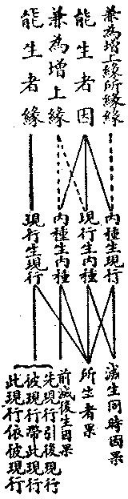



由此可知现行之事，皆以内种为因；然亦依托众多现行为缘而获生起。无因固不能生，无缘亦不能起，故曰因缘生果。果为现行之事，现行之实事皆因缘所生，其义如是。彼因与缘虽各有其定义，然各经论立说多歧，应再分析言之。



四　因之分折



梵文大小乘论，多说六因，然说明之义不同也。兹依俱舍所说列之：



　　　　┌─────┬────────────────────────────┐  

　　　　│　同时因果┘┌──一、俱有因…………指一果事俱有诸因法是──────┤  

　　　　│　　　　　　│　　二、相应因…………特指一心王或一心使相应之心心所─┘  

　　　　│┌───因─┘　┌三、同类因…………指一果事之同三性同五位同九地诸能生法  

　　　　││异时因果───┼四、遍行因…………指遍为一切染法生起之因诸随眠即烦恼  

　　　　│└───────┴五、异熟因…………指能生将来世苦果乐果之善恶因  

　　　　│　　　　缘───┬六、能作因…………泛指此事彼事能互作顺违之关系者  

　　　　└────────┘



依前所说因与缘之定义，此之六因，非但因也，亦兼说缘，但将因缘概括以分为六而已。在俱舍论则以前五属因，后一为缘。细别於因，概略诸缘附为一因，故总谓之六因。以大乘之因缘定义审之，能作因固是缘，即前五因亦多是缘，真正之因犹未能说明也。瑜伽论等以十五依处说十因，亦是统因与缘而说为十因者。兹列於左：



　　　　　　　（十五依处）　　　　（十因）  

　　　　┌……语　　　依处………随说因……………………┐  

　　　　├……领受　　依处………观待因……………………┤  

　　　　├……习气　　依处………牵引因……………………┤  

　　　　├……有润种子依处………生起因……………………┼─能生因  

　　　　│　　无间灭　依处…┐　　　　┌…………………│…┘  

　　　　│　　境界　　依处…│　　　　：　　　　　　　│  

　　　　│　　根　　　依处…│　　　　：　　　　　　　│  

　　　　│　　作用　　依处…├…摄受因┤　　　　　　　│  

　　　　│　　士用　　依处…│　　　　：　　　　　　　│  

　　　　│　　真实见　依处…┘　　　　└…………………│…┐  

　　　　├──随顺　　依处………引发因────────┤┌方便缘  

　　　　├──差别功能依处………定异因────────┤│  

　　　　├──和合　　依处………同事因────────┤│  

　　　　├……障碍　　依处………相违因……………………┤│  

　　　　├──不障碍　依处………不相违因───────┘│  

　　　　└───────────────────────┘



能生因上长虚线之牵引因及生起因明正是因；单线之引发因、定异因、同事因、不相违因，表亦通因；虚线之随说因、观待因、摄受因、相违因，表虽是缘而亦兼作因。方便缘上长虚线之随说、观待、摄受、相违之四因，表正是缘；单线之引发、定异、同事、不相违四因，表亦通缘；虚线之牵引、生起二因，表虽是因而亦兼作缘。故准因与缘之定义，此十因亦每一因皆通因之与缘者。特牵引因指未成熟之种子，生起因指已成熟之种子，对於现行之事，故是亲能生之正因。然内种生现行，除自种外，餘种亦通缘也。餘之八因，多分是方便缘。然在现行生自种，则无不是因，故又皆兼通於因也。此明概略，犹待另详。



五　缘之分析



四缘本於长阿含经，为佛学中大小各派最公认之因缘分类。巴利文之二十四缘，亦冠以此四缘。兹且表列其名：



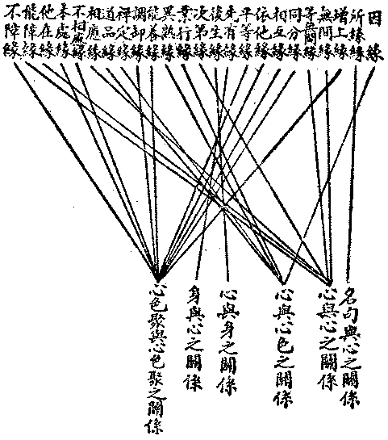



以心与名句等六种关系，说为二十四缘。然无间、等无间、次第，祗一等无间缘。所餘则皆从增上缘分立。其隶属於六种关系，如名句与心固有所缘缘关系，然作所缘缘者不仅名句。故开列此二十四缘分属六种关系，不应道理。今唯取公认之四缘以为准据，录成唯识论最了义之说於此：



一、因缘：谓有为法亲办自果。此体有二：一、种子，二、现行。种子者，谓本识中善染无记诸界地等功能差别，能引次后自类功能，及起同时自类现果；此唯望彼是因缘性。现行者：谓七转识及彼相应所变相见性界地等；除佛果善、极劣无记，餘熏本识生自类种，此唯望彼是因缘性。第八心品无所熏故，非简所依独能熏故，极微圆故，不熏成种。现行同类展转相望，皆非因缘，自种生故。一切异类展转相望，亦非因缘，不亲生故。有说异类同类现行展转相望为因缘者，应知假说，或随转门。有唯说种是因缘性，彼依显胜，非尽理说；圣说转识与阿赖耶展转相望为因缘故。



二、等无间缘：谓八现识及彼心所，前聚於后，自类无间，等而开导，令彼定生。多同类种俱时转故，如不相应，非此缘摄。心所与心虽恒俱转而相应故，和合似一，不可施设离别殊异，故得互作等无间缘。入无餘心，最极微劣，无开导生，又无当起等无间法，故非此缘。云何知然？论有诚说：若此识等无间，彼识等决定生。即说此是彼等无间缘故。



三、所缘缘；谓若有法是带已相，心或相应所虑、所托。此体有二：一亲，二疏。若与能缘体不相离，是见分等内所虑托，应知彼是亲所缘缘。若与能缘体虽相离，为质能起内所虑托，应知彼是疏所缘缘。亲所缘缘能缘皆有，离内所虑托必不生故。疏所缘缘，能缘或无或有，离外所虑托亦得生故。



四、增上缘：谓若有法有胜势用，能於餘法或顺或违。虽前三缘亦是增上，而今第四除彼取餘。为显诸缘差别相故，此顺违用於四处转，生、住、成、得四事别故。然增上用，随事虽多，而胜显者唯二十二，应知即是二十二根。



此之四缘，第一因缘是因，后之三缘是缘。以因附说於缘，故总谓之四缘。但於名义犹待论定，欲正其名而顺其义，第一因缘应改「亲因」，是亲能生因故。等无间缘改称「诱缘」，无论开避或为引导，皆可诱起次后之类聚故，旧论限於心心所聚，今亦通於色聚，以同占一处之色聚，前不开避后亦不能生故。所缘缘今改称「知缘」，能缘所缘今称能知所知，故所缘缘即能知缘。然所缘缘仅显能知必以所知为缘，未显所知必以能知为缘，故唯心心所法乃有此缘。今曰知缘，则亦通於心色，以色虽非能知，然必是所知故。增上缘今改称胜缘，除上诱缘、知缘之外，所餘之缘展转无尽，不能遍举，故祇可选其於顺违有胜势用之事，标立为胜缘耳。此於「亲因」「胜缘」，但正其名，不渝其义，诱缘、知缘，通色心法，则为义亦殊矣。兹再对列於下：



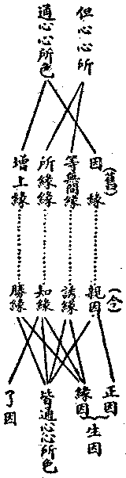



六　果之分析



因与缘之分析既明，当更分析因与缘所合生之果。所知现实成事与诸蕴素．皆是所生之果，且於一果必为因与缘合生故。对因论果，果之为义亦非一类，兹出诸论通说之五果焉。俱舍论等分别繁细，今引成唯识论略明其相：



一、异熟果：谓有漏善及不善法，所招自相续异熟生无记。



二、等流果：谓习善等所引同类，或似先业，后果随转。



三、离系果：谓无漏道断障所证善无为法。



四、士用果：谓诸作者假诸作具所办事业。



五、增上果：谓除前四餘所得果。



此之五果，今就人事以示其义：



　　　　　┌对招感为人先业胜缘……………………………………曰异熟果  

　　　　　│向习善今性善，向修福今享福…………………………曰等流果  

　　　　人┤由人以诸工具，造衣食住及国家等……………………曰士用果  

　　　　　│国政良窳，令人民苦乐等………………………………曰增上果  

　　　　　└能修佛法断烦恼障，证人空等…………………………曰离系果



除离系果为特殊之果外，其餘四果皆可通於情器、色心诸法。无论何种果相，皆可归纳於此。有论别立四种之果：一、安立果：如水轮是风轮之果，乃至草木是大地之果等。二、和合果：如造色是四大之果，眼识是眼根之果等。三、修习果：如修静虑能变化心身等。四、加行果：如修四寻思观，能引如实智等。然此亦为增上果或士用果之流类，随事分别可无量种，故不须别立之。所说境行果之果，即是离系果，亦可通於等流、士用、增上之果，但非是异熟果而已。何者？异熟之果不离於三界系，离系则非异熟果故。



七　因与缘及果之关系



前说六因、十因、四缘、五果，今再互柤观其关系：



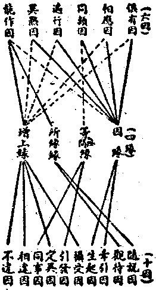



十因与四缘之关系，随胜示其如此。据实，十因皆通因缘及增上缘、等无间缘或所缘缘，随应不定。然今说因与缘，当以改正四缘所立之一因三缘为准则。故论因缘生果关系，亦持此为据焉。一、亲生因、随其亲生之果不同，亦可分为三类：



一、生自类种子之自类现行因



二、生自类现行之自类种子因



三、生自类种子之自类种子因



合此三类，统为一亲生因。现行生现行，则但缘非因也，种现相生，对於诱缘、知缘、胜缘，表其关系如下：



一、现行生现行：



前现行灭引生后现行者……………………诱缘



此现行生彼现行为能知或所知者…………知缘



此现行与彼彼现行互相顺违以生者………胜缘



二、现行生种子：



此现行为对他类现行生他类种子…………胜缘



三、种子生现行；



一切种子皆为生现行第八识………………知缘



此种子为对他类种子生他类现行…………胜缘



四、种子生种子：



此种子为对他类种子生他类种子…………胜缘



诱缘唯现行生现行有之，现行生现行是亲因所无，此为其大较之分别。以此三因七缘，以观所生五果，其例如下：



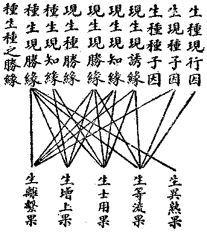



自类现行为生自类种因，自类种子为生自类种因，他类现为生自类种胜缘，他类种为生自类种胜缘，除无为法皆可有之。今谈五现行果故不列之。异熟果、是由善恶业种所生无记果，故唯他类种所生现行果，不通自类种生自类现行。又唯先业所引，故非现生现之三缘。属现行果故非种生现之知缘。若论生异熟种，则亦为现生种胜缘；论异熟种为藏识之所知境，亦为种生现之知缘。等流果、正为自类种所生之自类现，亦通现生现自类前后相续之诱缘；由先不杀今长寿等，亦通种生现、现生现胜缘。士用果、通现生现三缘，及种生现二缘之所生。现生现、种生现诸胜缘，正生增上果，然能知所知缘，亦能生增上果。若无漏道为离系果，则通无漏种因及现生现三缘，与种生现胜缘所生；若无为法为离系果，则非所生，但由无漏道为能知缘之所开显耳。此之所谈，虽无教证，推理则应然也。



第二节　因缘情器



一　因缘情器概论



因缘所生之果法非一事，今先说因缘之生起有情、器界，人等有情及其所依资之器界，此为已生成之事实，现前共见共知，而欲索其以何因缘而得生成者也。世论於此，有三种之说明：一者、神本之退化论：谓未有情器之前本唯一大神，神初造作器界，有情亦在神前享受安乐，嗣因所造有情不循教令，违背神意，乃罚之於人世以偿其罪。若能虔遵神教，求神赦罪，尚可还之神处。否则更降重罚，使入地狱。故人等有情器世间，以神为本，背神退化而致。若能返本还元，则依然是唯一之大神也。二者、物本之进化论：谓诸器有情未生成之际，但为极微之电气——略同太极、阴阳——、或原子——略同四大极微——，由相吸相拒之质力，渐成太阳诸星以至地球。地球凝流诸质与太阳光热之变化，渐生单简之植物与动物。生生不已，展转进化，遂产生高等之植动诸物，以至有人类之出生。人类或将更进化以为超人类。然至地球衰老不能有生物时，人类与诸生物尽归消灭，地球与太阳诸星亦消毁，则还为极微之原质。故人世以物质为本，进化而成，然一达其期限，不能永保其进化也。三者、物我为本之幻合论：谓诸有情，本各为一无形之神我，而诸物质亦本共为一无形之体——数论谓之自性、冥性、胜性，略同太极。偶因各神我不安其本位，向外边要求其受用，由是无形物体亦失其平衡相，生诸物质原料，供给为神我所受用之肉身及器界诸物；由神我与物体幻合为人等诸情器，流转不能脱离。如觉悟其幻合之苦，由神我不复要求外边任何之受用，则神我与物体可脱离各归无形之本位，是谓解脱。神本退化论出於俗情世间之推想，物本进化论出於科学世间之推想，物我幻合论出於禅定世间之推想，在佛学中皆破斥为外道邪见；於是乃示以因缘所生之正义。



二　情器之十二缘起



正因生果，固须明识种生现行、与现行生识种之等流因果相。然今此所言之有情身器，乃和合连续之假者——多法和合连续之假者，即各个之个体物，俗情所认为一人一犬一虫一草一石一星之动植物矿物是——，犹未能注意到各识种各生现行之因果。且先应究明以何胜缘而得成为各个和合连续之假者。此胜缘所生果，谓之异熟缘果，谓由异熟之胜缘故，范成三界、九地、六生诸类有情身器之差别果，及每类中各个身心资财之差别果。以其差别之故，所成情器，或可爱乐，或可憎厌，个个不同，间以相似而有同类；类类不同，更以相似而又有大同类。不共业为胜缘所招感，有各类各个之有情身差别；共业为胜缘所招感，有各国各报境、各星球各界地之器世间。累而积之，总为三界有情身器之差别果。而佛法则说明为十二种胜缘之所生起，谓之十二缘起。其名相已列前诸法施设节中。十二缘起，本於佛说诸素呾缆，其辞浑圆，可以之说一有情之流转，亦可以之说有情身器之流转。厥后诸论师随其智量之不同，解说之有浅深狭广之异。业感缘起，无明缘起，空智缘起，真如缘起，此诸缘起说皆出於此十二缘起义。过去现在因果经云：



尔时、菩萨至第三夜，观众生性——众生但指有情，或亦通指无情器物——，以何因缘而有「老死」？即知老死以生为本，若离於生则无老死。又复此「生」，不从天生——即不从唯一大神生——，不从自生——即不从神我生——，非无缘生——即不从无生命之物质生——；从因缘生，因於欲有、色有、无色有之业生。又观彼「三有业」从何而生？即知三有之业从四「取」生——欲取、见取、戒取、我语取——。又观四取从何而生？即知四取从「爱」而生。又观爱从何生？即知爱从「受」生。又观受从何生？即知受从「触」生。又观触从何生？即知触从「六入」而生。又观六入从何而生？即知六入从「名色」生。又观名色从何而生？即知名色从「识」而生。又观识从何生？即知识从「行」生。又观行从何生？即知行从「无明」而生。若灭无明则行灭，行灭则识灭，识灭则名色灭，名色灭则六入灭，六入灭则触灭，触灭则受灭，受灭则爱灭，爱灭则取灭，取灭则三有业灭，三有业灭则生灭，生灭则老死忧悲诸苦灭。



三有业感生三有情器——三有即三界——之果报，本通有情器界而为言也。然小乘志在有情各自之解脱，乃专从各有情三世业感之生死说明之，兹先出其说焉。



三　巴利文之业感缘起说



南方上座部巴利文论藏，曾言比丘之欲除老死诸苦者，当进究心身——即名色——发生之因缘，犹智巧之医欲治病而先诊其病源。乃寻求此心与身非无因而有，此色身之生起以无明、爱、取、行四者为因，由此四者而生色身。生已以食为资养缘，合为「色身」生存之因与缘。更进求「心」识生起之因缘，以眼为所依，以色为对象，则眼识生；乃至以意为所依，以法为对象，则意识生。既知身之与心之缘起理，则知心身性唯缘起。现在身心如是，过去未来心身亦复如是。即心识之生以色根为缘——即触受以六入为缘——，根身之生以无明、爱、取、业行为缘。无明、爱、取，由心不觉缘起无我理生，依之生起业行，为生身心之间接缘。而心身身心——即识、名色、六入、触、受、生支——之「生」起，尤以行业为直接缘。由有漏善恶业行之差别，乃感生诸类诸个身心之差别。故生起身心最重要之因缘，确在乎行业。对于能感生身心之业力，遂不可不为深切之研究。乃将业之生果效力，从时间、功用、性质之三种标准，各分为四，共成十二单位。兹列於此：



　　　　　　　　　┌急　效　业………即果报不出今生之业，今生不报，即失其  

　　　　　　　　　│　　　　　　　　效。  

　　　　　　　　　│缓　效　业………即来生始受果报之业，如被他夺，来生不  

　　　　依时间所分┤　　　　　　　　报，即失其效。  

　　　　　　　　　│无定期效业………将来任何一生皆可受报，除非未受报已证  

　　　　　　　　　│　　　　　　　　择灭，乃无效。  

　　　　　　　　　└已失效力业………前三类中，本身力薄，或被他强业抵销  

　　　　　　　　　　　　　　　　　　者。  

　　　　　　　　　┌能　生　业………此业起为「有支」即隐失，或被他业所夺  

　　　　　　　　　│　　　　　　　　即不能再活动。  

　　　　　　　　　│能　持　业………此业能扶持前一业，使完成所生之身心。  

　　　　依功用所分┤能　消　业………此业能使前两种业无效，善业恶业均可取  

　　　　　　　　　│　　　　　　　　销。  

　　　　　　　　　└能　毁　业………此业更强，能将正在活动及待发之业连根  

　　　　　　　　　　　　　　　　　　拔除者。  

　　　　　　　　　┌极　强　业………此为或善或恶之极强业，有力能作前四功  

　　　　　　　　　│　　　　　　　　业，例恶业能销毁善业。  

　　　　　　　　　│近　死　业………此为决定来生受何果报之业，即死时现起  

　　　　依性质所分┤　　　　　　　　受生之强业。  

　　　　　　　　　│习　惯　业………此为一生言行思之惯习，若死时无别强业  

　　　　　　　　　│　　　　　　　　，此亦能为近死业。  

　　　　　　　　　└累　积　业………无始所积善不善无记业，若无强业，此亦  

　　　　　　　　　　　　　　　　　　为近死业，繁奥难了。



由可失效及可消毁，故非命定而有自由回转餘地。由无始积累之业力繁广，深奥难分，非佛陀之全智不能洞达，故人生等，亦不能操自由之全权也。由此一般为渐令不受三有之生者，主随缘消旧业，唯不更造感生三有果之新业，则自得解脱耳。



四　俱舍论之业感缘起说



俱舍论以苦品、业品、烦恼品说有漏因果，即是明三界有情身器，如何由有烦恼之业为因缘而生起也。尝以人之一生，关於前生及来生者说明十二缘起支之顺序：



　　　　　　┌无明………此是前生不明缘起无我之理，起诸烦恼。  

　　　　前生┤  

　　　　　　└行…………此是前生由无明烦恼所造之善不善业。  

　　　　　　┌识…………此是由前生业力，引托母胎最初之心识。  

　　　　　　│名色………此是由识托胎后在初四星期中之胎儿心身状态。  

　　　　　　│六入………此是胎在四星期后至出母胎所历身根生成状熊。  

　　　　　　│触…………此是婴儿初生二三年中与器界接触之心境。  

　　　　现在┤受…………此是四五岁后知苦乐之感受心境。  

　　　　　　│爱…………此是十五六岁后，知男女恋爱及其他欲爱之心行。  

　　　　　　│取…………此是二十岁后，欲爱更强盛之心行。  

　　　　　　└有…………此是由爱取驱使作种种行业，为来生感三有果之业。  

　　　　　　┌生…………此指今生老死后，由能感三有之业更感引心识投胎，生  

　　　　来生┤　　　　　来生身心。  

　　　　　　└老死………此指所生来生身心，仍有老病死等诸苦。



要之、直接感生今生与来生之有情果者，唯在能感三有果之行业。故於业亦为深细之研析，列之於下；



（一）顺现法受业……………等急效业



（二）顺次生受业……………等缓效业



（三）顺后次受业……………等无定期效业



（四）定业……………………何时受果已有决定之业



（五）不定业…………………何时受果尚须待机缘而未能决定



（六）自受业…………………唯作业者自受果报之业



（七）共受业…………………由作业者自他共受果报之业



（八）本地业…………………即在来生受生地受果报之业



（九）环境业…………………即在来生环境中受果报之业



此中所说之业，与前有不同之特点，在於共受业与环境业之设立。此种即为自他互相关系之社会业。由此业乃不唯感生个别之身心，亦感成共同之器界也。



五　三世缘起之惑业苦环



以十二缘起支，配为三世因果，并合为惑、业、苦，三事连结如环，轮转相续而不可解。此大抵为小乘或除法相大乘之共通说。亦立为表以明之；



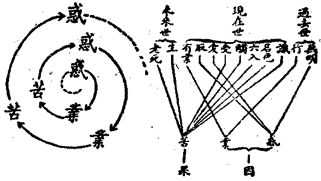



如此惑、业、苦、惑连结轮转之环，其来无始，其往无终，故成为一条生死相续无始无终之生命旋流；连环不可解而可解，解之则在断惑而消业也。依此三世果因因果，曾有人立一补充表如下；



　　　　　　　　┌果…………生老死或与相等之识名色六入触受  

　　　　　　过去┤  

　　　　　　　　├因…………无明行或与相等之爱取有  

　　　　过去现在┤  

　　　　　　　　├果…………识名色六入触受或与相等之生老死  

　　　　　　现在┤  

　　　　　　　　├因…………爱取有或与相等之无明行  

　　　　现在未来┤  

　　　　　　　　├果…………生老死或与相等之识名色六入触受  

　　　　　　未来┤  

　　　　　　　　└因…………无明行或与相等之爱取有



除此三世缘起，更有刹那缘起，无量世缘起说，其义可以推准，兹不繁述。



六　通大乘之无明缘起说



观三界有情身器之缘起法性而洞达其本空无我，此佛陀之妙悟境也。以人等有情莫脱於老死诸苦，乃在於莫知其所从出之有情身器而生。然究此情器之所生，则由先世之烦恼业，拘使心识，托生一生心色之聚；渐次身心发育，复起烦恼与业，蓄在心识；此生之后拘使再生，为别个或别类之一生心色聚。如此成为生灭灭生相续不已之生命流。然此生命流之本依，则心识也。欲灭老病死等苦，必不容身心等之再生，欲此身心不生，必不起烦恼而造业，推至其本依，必灭心识而后可。然心识本有，而无始刹那刹那相续，非可断灭之法，惟推求所以致心识有诸类差别，及拘限於一生一生之死环者，则专欲避苦趣乐之身语意业「行」也。心识无始，此业行亦与之无始。然此业行，乃缘不知缘起无我，执身等为实我法之「无明」而起，执内实我，执外实物，遂於顺违俱非之感受，起作避苦趋乐种种善恶之行业；由此心识为所拘牵而生身心老死诸苦。故究探苦源，乃在无明也。无明灭则烦恼之业行灭，心识不受拘牵而受生死，一切诸苦遂皆择灭。以此观三界有情身器，皆是无明为胜缘而起，谓之「无明缘起」。然择灭无明者，则由於洞达身等缘生无我之生空或法空慧，由证二无我之空慧为胜缘故，明了及择灭无明等烦恼业苦，起诸清净行果，故此谓之「空慧缘起」。然此空慧，又缘了知缘起诸法本空无我之真如性而起。不了真如性即「无明」，了知真如性即「空慧」。由迷或悟真如性故即无明缘起诸染法、及空慧缘起诸净法，故亦谓之「真如缘起」——或云法性缘起。天台教观，每说无明、法性互依而起诸法，是合空慧、真如谓之法性，知不相应法性即谓之无明也。故佛陀妙悟境之缘起性，甚深甚深，难可穷了。



七　法相大乘之二世缘起说



瑜伽等大乘法相论，对前三世缘起说为二世缘起。兹先录成唯识论文为据：



然十二支略摄为四：一、能引支：谓无明、行，能引识等五果种故。此中无明，唯取能发正感后世善恶业者。即彼所发，乃名为行，由此一切顺现受业，别当受业，皆非行支。



二、所引支：谓本识内亲生当来异熟果摄识等五种，是前二支所引发故。此中识种，谓本识因。除后三因，餘因皆是名色种摄。后之三因，如名次第即后三种。或名色种总摄五因，於中随胜立餘四种。六处与识，总别亦然。集论说识亦是能引，识中业种名识支故，异熟识种名色摄故。经说识支通能所引，业种、识种俱名识故，识是名色依非名色摄故。识等五种由业熏发，虽实同时，而依主伴、总别、胜劣、因果相异，故诸圣教假说前后；或依当来现起分位有次第故，说有前后。由斯识等亦说现行，因时定无现行义故。复由此说生引同时，润未润时必不俱故。



三、能生支：谓爱、取、有，近生当来生老死故。谓缘迷内异熟果愚，发正能招后有诸业为缘，引发亲生当来生老死位五果种已；复依迷外增上果愚，缘境界受发起贪爱，缘爱复生欲等四取，爱取合润能引业种及所引因转名为有，俱能近有后有果故。有处唯说业种名有。此能正感异熟果故。复有唯说五种名有，亲生当来识等种故。



四、所生支：谓生、老、死，是爱取有近所生故。谓从中有至本有中，未衰变来皆生支摄。诸衰变位总名为老，身坏命终，乃名为死。



老非定有，附死立支，病何非支？不遍定故。老虽不定，遍故立支。诸界趣生除中夭者，将终皆有衰朽行故。名色不遍，何故立支？定故立支。胎、卵、湿生者，六处未满定有名色故。又名色支亦是遍有，有色化身初受生位，虽具五根而未有用，尔时未名六处支故。初生无色虽定有意根，而不明了未名意处故。由斯论说十二有支，一切一分上二界有。爱非遍有，宁别立支，生恶趣者不有彼故；定故别立。不求无有生善趣者，定有爱故；不还润生爱虽不起，然如彼取定有种故。又爱亦遍。生恶趣者於现我境亦有爱故。依无希求恶趣身爱，经说非有，非彼全无。



何缘所生立生老死，所引别立识等五支？因位难知差别相故，依当果位别立五支。谓续生时因识相显，次根未满名色相增，次根满时六处明盛，依斯发触，因触起受，尔时乃名受果究竟；依此果位立因为五。果位易了，差别相故，总立二支以显三苦。然所生果若在未来，为生厌故说生老死；若至现在为令了知分位相生，说识等五。何缘发业总立无明，润业位中别立爱、取？虽诸烦恼皆能发润，而发业位无明力增，以具十一殊胜事故。谓所缘等，广如缘起经说。——一、所缘殊胜，遍缘染净故；二、行相殊胜，隐真显妄故；三、因缘殊胜，惑业生本故；四、等起殊胜，等能发起能引能生所生缘起法故；五、转异殊胜，随随眠、缠缚、相应、不共四转异故；六、邪行殊胜，依苦集谛起增益损减行故；七、相状殊胜，微细自相遍爱非爱共相转故；八、作业殊胜，作流转所依事、作寂止能障事故；九、障碍殊胜，障碍胜法故；十、随转殊胜，乃至有顶犹有转故；十一、对治殊胜，二种妙治所对治故——。於润业位爱力偏增，说爱如水，能沃润故，要数灌溉方生有芽。且依初后分爱、取二，无重发义立一无明。虽取支中摄诸烦恼，而爱润胜，说是爱增。



诸缘起支皆依自地，然有所行依他无明，如下无明发上地行？不尔，初伏下地染者，所起上定应非行支，彼地无明犹未起故。从上下地生下上者，彼缘何受而起爱支？彼爱亦缘当生地受若现若种，於理无违。



此十二支，十因二果，定不同世；因中前七与爱、取有，或异或同；若二、三、七，各定同世。如是十二一重因果，足显轮转及离断常，施设两重，实为无用！或应过此，便致无穷！



此云十因二果，定不同世，即为二世之义。所云二世，过去世与现在世可，或现在世与未来世亦可。如此二世二世连续不断，即成非断非常之流转义。故不须如前述之以十二缘起，分配三世为二重因果也。兹者表示於下；



　　　　　　　　　┌无明┐  

　　　　　　　　　│　　├能引支┐  

　　　　　　　　　│行─┘　　　│  

　　　　　　　　　│识─┐　　　│  

　　　　　　　　　│名色│　　　│  

　　　　　　　　　│六入├所引支├─十因  

　　　　过去或现在┤触─┤　　　│  

　　　　　　　　　│受─┘　　　│  

　　　　　　　　　│爱─┐　　　│  

　　　　　　　　　│取─┼能生支┘  

　　　　　　　　　└有─┘  

　　　　　　　　　┌生─┐  

　　　　现在或未来┤　　├所生支──二果  

　　　　　　　　　└老死┘



然佛陀之施设十二缘起，乃依现前之老死诸苦为解脱，故逆次观之立此十二支，则当於生死支属现在世，其餘十支属过去世。知现在二果支，起於过去之十因支，则现在如不起无明、爱、取，发业润生，则未来即无生死矣。



八　二世缘起之因缘果辨



前此诸缘起说，尝未辨定是因或缘所生果义。然说此十二缘起支，在明诸类有情身器以何为胜缘而生成死坏，虽不离自种生现、自现生种之等流因果，而旨在异现生种异种生现之异熟因果。此义唯大乘之二世缘起辨之，故成唯识论云：



诸支相望，增上——胜缘——定有，餘之三缘有无不定。缘起经依唯定有者，说唯有增上缘——今取此说——。爱望於取，有望於生，有因缘义。若说识支是业种者，行望於识亦作因缘，餘支相望无因缘义。而集论说：无明望行有因缘者，依无明时业习气说，无明俱故，假说无明，实是行种。瑜伽论说：诸支相望无因缘者，依现行爱、取及唯业为有支说。无明望行，爱望於取，生望老死，有等无间及所缘缘。有望於生，受望於爱，无等无间，有所缘缘。餘支相望，二俱非有。此中且依邻近顺次不相杂乱实缘起说。异此相望，为缘不定，诸聪慧者如理应思。



依此论文，分辨因缘之所生果，当如下图所示：



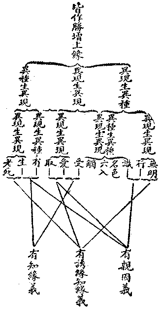



按今遵瑜伽义，当依现行爱支，为现行取支之胜缘。又唯以识种为识支，唯以已润之业种为有之，故应说诸支之相望无因缘义。虽间有诱缘、知缘义，此但兼带而非要缘。故可如缘起经所说，十二支相望但有增上胜缘也。生死二支之果，亦唯是异熟胜缘所生之真异熟、及异熟生果。



九　二世缘起之业力说



业通有漏、无漏，此明生有情器界果之缘，故但说有漏业。业为直接能引种——行支——、生现——有支——之近缘，无明、爱、取等烦恼为间接能引种——无明发业——，生现——爱取润生——之远缘，故餘处亦假说业之近缘为因，无明等远缘为缘也。其实乃近缘、远缘之分耳。所谓生死相续，由惑、业、苦——发业润生烦恼名惑，能感后有诸业名业，业所引生众苦名苦——是也。近缘之业，随其力之强弱，判引业与满业。所谓福、非福、不动，诸有漏善、不善业及其眷属，同招引、满异熟果故，亦立业名。前说行支，唯取无明所发正感后世善恶之业，即是引业；拣除顺现受业——非异熟业、别当受业——感别报之漏业……皆非行支，则唯取引业以为行支也。不唯行支，即有支亦唯爱、取所润之能引业种。巴利文论藏为「发」与「缘」之区别，其所谓发，亦专指能发引业之惑及引业以言。引业即能引生后世有情身器之总果者，生起后世有情身器之总果体，此为最先必须独一之强胜缘。各因缘种唯在其范型中各生现行，餘业——满业等——亦但随之以生餘异熟果。故行、有支之业，独取引业，且特名为发也。诸业才起无间即灭，能招当异熟果，以熏本识起自功能，成为业种，展转相续，至成熟时招异熟果。然此引业亦通别之与共。别业、能引识种、名色等种，及能生真异熟识与根身；共业、能引共相种及能生器界。而满业中之别共业，则助生身器别别诸分以成满之耳。诸惑皆能发业——业即身语意等善恶行业——，然无明最能发引业之现行；诸惑皆能润业，然爱取最能润引业之种子；故依能发、能润引业之现种以立无明、爱、取之三支。若非无明发引业之现行，则无引业种及引业现行所摄植之识、名色、六入、触、受种；若非爱、取润引业之种子，则不能滋长有力以拘牵识等五种生起某类某有情之身器。论云：有漏善业种，能招可爱果；诸不善业种，能招非爱果。随二有支业种，令异熟果成善恶别。故前十支合为能生后二支之因缘也。能发及能润引业现种之无明、爱、取，唯是前六识相应之烦恼，行业亦以前六识相应之思虑为体；且皆奉意识为霸主，故意识实操刱造未来生命之权力，所谓「动身发语此为最，引满能招业力牵」是也。兹再制为一表，以明十二支之关系：



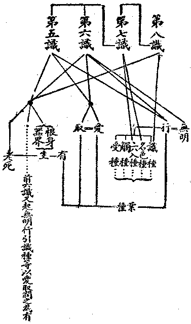



十二支中第七识之关系最少，除名色种或六入种中可有其种子，唯内随第八识所生所系，外为前六识染依耳。前六识皆重要，然发行之迷理无明，专属於第六识；且前五识皆以第六识为主动，故唯第六识为最要。其次则为第八识之受熏持种，及为业种牵其种子亲生异熟果之总体，变诸色种以为根身、器界，皆第八识之事。要之、作业唯第六识为最，发业、润业及行业体皆属此故；受果唯第八识为最，生果总体及生根身、器界皆属此故。观此，可瞭然於因缘所生之情器果矣。



第三节　因缘佛刹



一　因缘佛刹概论



现实成事，一、为有情身器，二、为超情佛刹。前已说因缘所生之有情身器，今当说因缘所生之超情佛刹。按俱舍论尝以贤圣品、慧品、定品之三品明之。有情身器之生起也，业为近缘，惑为远缘，而所生之果为苦果。超情佛刹，慧为近缘，近能断惑证真发诸清净行故；禅定及施、戒、忍等为远缘，远能伏惑资发清净慧故。所生之果，为常恒清净自在之乐果，所谓涅槃寂静乐，菩提觉法乐，及法身圆满乐是也；亦即为五果中之离系果。异熟果唯在於有情身器，离系果唯在於超情佛刹。而等流、士用、增上之三果，则与亲因及三助缘相望，可通於有情身器与超情佛刹。不证离系之果则无常觉之乐，必断异熟之果乃除生死之苦。断果为真解脱，证果为大菩提；此之胜果，曰二转依。证有证之因缘，断有断之因缘，非无端突然之所致。然此重在说明以何为缘而致离系之果，虽不离自种生自现、自现生自种之等流因果，亦尚非此节之所专论也。



二　四谛与修三增上学



知苦、断苦之集，证苦灭、修证灭之道。证苦灭为得离系果，餘为得离系果胜缘。知苦、即是知异熟果皆有老死诸苦，断集、即断除集起异熟果之业与惑，证灭、即为证离系果，能知能断能证之胜缘皆在於修道，道即菩提——正觉。所修之菩提分，可摄为戒、定、慧三增上学，其基础在确持正见而立正信；换言之、即在知异熟之苦而确信之，分说为四念住：



一、观身不净………观自身他身动植矿诸色聚皆伪丑可厌



二、观受是苦………观受人天等乐亦皆坏苦行苦



三、观心无常………观有为行心亦流转无常



四、观法无我………观成事蕴素等皆无自由主宰之力



此四皆增上之慧学。心心明记安住此净慧中，止灭其违损净慧之恶行，生长於顺益净慧之善行，则属於尸罗——正译清凉，意译戒或律仪——，增上学之为四正勤：



一、已生恶令灭



二、未生恶令不生



三、未生善令生



四、已生善令增长



四如意足、五根、五力、七菩提分，皆定与慧之增上学。定根、定力、及轻安、定舍，皆定学之增上相。增上者，殊胜也。由正见正信而修习之戒、定、慧，不同世间之伦理学——戒、及静坐法——定、与理智学——慧，故云增上。而增上定学亦谓之增上心学，即心识之和平统一，谓之曰定。定心成就，能显精神伟大之力，转移心理；以至心理、物理使皆随之发生变化，足以证明万有唯心变现之理——定所引色——成为事实。故世人往往以得定心为得道，亦以定心为不可思议神秘事。然在佛学之系统中，定心亦为伏惑资发净慧之胜缘耳。由前之慧、戒、定三增上学，至七菩提分发生无漏慧断惑而证真如，是谓见道。进修三增上学平均之八正行，更断餘惑，穷证真理，谓之修道。由是断证渐臻究竟，至无学位，即成涅槃、菩提之离系果，此通三乘以为言之。有经合三乘行果而说通十地，即乾慧地、性地、八忍地、见地、薄地、离欲地、已办地、辟支佛地、菩萨地、佛地是也。



三　七贤与四向四果



其正信见能持戒律，将造修於增上定、慧，由七贤位向於四果——辟支佛乘傍此而立，无别开建，先五停心，终以世第一位之预流向。五停心者，收散放之心，暂停止於一境也。梵语毗钵舍那、此云观；梵语奢摩他、此云止。止能观心於所观之一境，随病制方，其法凡五：



一、多贪淫者观念身秽



二、多嗔害者观念慈恕



三、多痴执者观念缘起



四、多昏散者观念呼吸



五、多障缘者观念佛陀



随自所宜，惯习其心，使停住所观之一境。既能静止乃依止而习观：



一、别相念有四：即於自别观身、受、心、法之不净及苦、无常、无我。



二、总相念有一：即於自、他、总观身、受、心、法不净及苦、无常、无我。



由此增进有四加行——倍加功力之修行：



一、煖……………为定中慧火将生之先兆。



二、顶……………为定力之顶点。



三、忍……………为定慧之已能忍住，此又分下中上三忍。



四、世第一………为世间最高位，过此即证超世之圣。观当界上界之四谛，於忍许位及智彻位，分四法忍及四法智、与四类忍及四类智。八忍七智而智犹缺其一，为世第一位，亦为预流向。八忍八智具足，即断惑证真而得预流果。从五停心至世第一，曰七贤位。



世第一即为预流向，入真见道——即见四谛——断分别我执所起烦恼障，遂预圣流，成预流果——须陀洹，为断证之初步。然至此则有进而无退矣，唯在人天，不复堕四恶趣。由是进修为一来向，证一来果——斯陀含，则於欲界人天唯一来而不再生矣。进修为不还向——阿那含，证不还果，则生色界无烦等天不还来欲界人天矣。进修为无生向，证无生果——阿罗汉，则再不於三界受生死矣。此小乘得涅槃离系果之行也。



四　境行果与三祇五位



佛学通说境行果三，为得离系果之次第。境、即能诠之教与所诠理，研教明理，照达现实事理；此即为所观境，亦为闻、思慧悟解之境也。於境能正解而正信，要先历修十信心位——十信心者：信心、念心、精进心、慧心、定心、不退心、回向心、护法心、戒心、愿心是也——养成习所成之种性。於是正信成立，刱发求无上菩提之坚固大心，乃入三祇、五位。初阿僧祇劫有三位：一、资粮位，分十住、十行、十回向之三十位。



　　　　　　┌发心住…………此住由前十信心成。  

　　　　　　│治地住　　　　　　　┌欢喜行　　　　　　　┌救护一切众生回向  

　　　　　　│修行住　　　　　　　│饶益行　　　　　　　│不坏回向  

　　　　　　│生贵住　　　　　　　│无违逆行　　　　　　│等一切佛回向  

　　　　　　│具足住　　　　　　　│无屈挠行　　　　　　│至一切处回向  

　　　　十住┤正心住　　　　　十行┤无痴乱行　　　　十回┤无尽功德回向  

　　　　　　│不退住　　　　　　　│善现行　　　　　　　│入一切平等回向  

　　　　　　│童真住　　　　　　　│无著行　　　　　　　│随顺众生回向  

　　　　　　│法王子住　　　　　　│无得行　　　　　　　│真如相回向  

　　　　　　└灌顶住　　　　　　　│善法行　　　　　　　│无缚无著回向  

　　　　　　　　　　　　　　　　　└真实行　　　　　　　└法界无量回向



此三十位中，以修积随顺解脱之福慧等——即布施等六度——资粮为事，故名曰资粮位。二、加行位：此同小乘煖、顶、忍、世第一之四，然所修之观智不同，定慧亦因之而大异。由四寻思观引四如实智，甚深决择诸法，证法空性，故此亦曰顺决择分。从发心住至此，犹是贤位。三、通达位，曰见道分：有真见道及相见道。从世第一引生出世无分别智，刱证遍行真如，曰真见道；於次刹那仿真见道而观四谛诸法，曰相见道，总为此通达位，入通达位，始证大乘圣果。满初阿僧祇劫，登极喜地，进於第二阿僧祇劫。四、修习位，即是十地：



　　　　通　达　　位┌一、极喜地……亦曰欢喜地  

　　　　　　　　　　│二、离垢地  

　　　　　　　　　　│三、发光地  

　　　　　　　　　　│四、燄慧地  

　　　　第二阿僧祗劫┤五、难胜地  

　　　　　　　　　　│六、现前地  

　　　　　　　　　　│七、远行地  

　　　　　　　　　　├八、不动地  

　　　　　　　　　　│九、善慧地  

　　　　第三阿憎祇劫┤十、法云地  

　　　　　　　　　　│　　　　……等觉地  

　　　　　　　　　　└佛　　　地



极喜地至不动地为第二阿僧祇劫；不动地至十地圆满而入佛地，即为第三阿僧祇劫。法云地与佛地间，亦有别立等觉地者。然等觉地即法云地入住出之出相，故合於法云地，不须别立。解深密经等连佛地说十一地是也。五、究竟位，此即佛地：为最究竟之离系果，亦为最究竟之超情佛刹，亦为真解脱、大菩提之二转依。



五　三慧与三智



慧之与智，名异实同。然亦可假行支、有支，於未润位之业曰行，於已润位之业名有；於未强智名慧，於增盛慧名智，亦复如是。业通善、染，或漏，无漏，慧亦通於善、染，及漏、无漏。然异熟果业感之力为胜，果亦是业，故於业须为精细之分别。今离系果则以智慧为能得之胜缘，果亦是智，故亦须於智慧为精细之分别。云三慧者：即闻所成慧、思所成慧、修所成慧是。简称闻慧、思慧、修慧。闻持遗传教法所成之慧，谓之闻慧，功在记持文义。依所闻持文义，谛观现实事理，亦依现实事理，审察闻持文义；数数思维，发生推比决知，谓之思慧。依闻、思慧矫正身语意等行业，檀那、尸罗、羼提、毗离耶、及修习禅那，使闻、思慧转加增盛明净，谓之修慧。此三慧能养成三乘之习所成种性。例瑜伽论，於声闻等地之前说闻所成等三地。今专就大乘言，则摄大乘论等，谓闻法界等流法已，闻所成等数熏习故，渐能发深固心，趋求悟入；即说由此三慧，能成就十信心，入初发心住也。从是增进，历十住、十行、十回向，集诸福智资粮，亦为修慧之事。经此长劫灌溉滋润，於慧种中智芽怒萌，遂由三慧进论三智。云三智者：一、加行智，二、根本智，三、后得智。此三统云无分别智，以出过世间分别故——即超情义——。加行智在四加行位，虽尚为世间智，然加行智前前通於资粮诸位，后后通於修习诸地。近见道时，加行相显，别立四加行位，非加行智但在地前。四加行智亦通地上，名无分别。又诸位中修加行智，莫不无间深观二空无分别性，努力趣证，故皆得名无分别智。由四加行位之加行智，无间引生根本无分别智已，后於诸地起加行智，皆是无间引生根本智者，故名无分别智。亲证根本之智曰根本智，为一切法根本者即真如，正证真如名根本智。真如是无分别，故证真如之根本智，正名无分别智。而后得智由根本智所引生故，出世间故，亦名无分别智。三慧及加行智是因后之二智，亦因亦果。因从刱闻正法，通至法云地满；果从初极喜地至佛地而圆满。佛地谓之一切智智，亦谓之无上遍正觉。故智慧为离系果之因缘，亦为离系果之果也。



六　三因佛性与缘真二修



大涅槃经等说三因佛性：一曰、正因佛性，二曰、了因佛性，三曰、缘因佛性。佛性、言成佛之因性。据言：正因佛性，即前十二缘起支之法性。今抉择之：法性非因非果，遍为因果之真实性；而正因佛性，当为一切种识中亲能生起超情佛刹诸清净色心法之无漏种。在异生位，寄在异生异熟识中，离十二缘起法无别依处，故言十二缘起法是正因佛性。了因佛性、即闻慧加行智等之智慧，能了知十二缘起及生空法空性故，能熏长引生诸无漏正因起现行故；因慧亦即无漏正因所起之现行故——果智。缘因佛性、则除本无漏种及智慧外，所餘顺解脱之善缘善行——例见佛、遇僧、助施、持戒等——，能助熏资引诸无漏正因起现行故，於果地之清净施等，亦即无漏正因所起之现行故。而摄大乘等论，又分缘、真二修：从初闻熏思修以至四加行位，皆名缘修；未亲证真如故，唯依正教所解正理为行轨故，修行所依理轨，皆仗诸佛诸圣者之他缘所开示故；且无始本无漏种曾未现行故，所知正教性虽无漏，能知之慧及慧导生之行性虽是善犹有漏故——此由第七识四惑之所致，未是真无漏种之现行故，但为熏长资引真无漏种之助缘故；由此诸义，故地前之修行名缘修也。初地以至菩萨地满——即法云地——皆名真修：已亲证真如故，从亲证真如根本智以起修故，修施等行皆已离我执故，皆是无漏无相行故，行行皆契真如理故，诸地所行皆进证上地胜真如性故；由此诸义，故地上之修行名真修也。



七　起信论之真如缘起说



前节曾略说真如缘起及空智缘起，然此二缘起乃说净法之起缘，非说染法之起缘也。其说法性无明互依以缘起者，亦依起信论文而说。今明此乃地上菩萨心境，以有漏现行无间而无漏现行，无漏现行亦无间而有漏现行；迷真如故有漏现行，悟真如故无漏现行，迷悟皆以真如为所依故，故真如法名迷悟依。今录论文释之：



复次、有四种法熏习义故，染法净法起不断绝。云何为四？一者、净法，名为真如；二者、一切染因，名为无明；三者、妄心，名为业识；四者、妄境界，谓六尘。



熏习者：如世间衣服，实无於香，若人以香而熏习故，则有香气。此亦如是，真如净法实无於染，但以无明而熏习故则有染相；无明染法实无净业，但以真如而熏习故则有净用。



要明此中所云之熏习生起义，应先知此中真如一名之含义。兹分析之如下；



　　　　　　┌─一、真如……迷悟依……所缘缘及增上缘……作境界性  

　　　　　　│　二、一切无漏种……备有不思议业正因熏习  

　　　　　　│　三、空现行智……空智……般若……根本智  

　　　　真如┤　四、后得智及一切无漏现行  

　　　　　　│　五、诸佛法性自受用身刹……平等缘  

　　　　　　└─六、诸佛圣者应化身刹及教法……差别缘



於净法熏起中，别加妄心熏习，即地前有漏善性之闻、思、修慧加行智等。无漏种增长曰内熏，妄心依正教等善熏力增长曰外熏。外熏增长内种，内熏增胜外行，至无漏智种起现行，即为证二空智现前——根本智——；依此为缘，更起后得智及无漏诸行，以至圆成佛果诸清净法。故论又云：



云何熏起净法不断？所谓以有真如法故能熏习无明，以熏习因缘力故——即无漏种内熏增胜外行……，则令妄心厌生死苦，乐求涅槃。以此妄心为厌求因缘故，熏习真如，自信己性——自信己有成佛之可能性，即习所成种性，亦即外熏增长内种——；知心妄动无前境界，修远离法——顺解脱分——，以如实知无前境故——由加行位入通达位，内无漏智种外彻起现行证二空智——，种种方便，起随顺行，不取不念——十地真修——；乃至久远熏习力故，无明灭尽，心境相空，名得涅槃，成自然业——佛果。



其说真如缘起染法，则但以迷悟依真如为迷依耳。语不精详，无烦引述。然此净法缘起，扼要言之，说为真如缘起，不如说为「二空慧智」缘起：初於妄心知心境空，即为二空观慧；次如实知无前境界，即为二空证智。由二空慧引无漏种，由无漏种起二空智，由二空慧智为胜缘，满无漏行，成无漏果。故云般若为佛法之母也。



八　维摩诘等之刱造净土行



通说净法缘起，亦含二乘自了生死之离系果——即择灭涅槃——；而刱造净土行——非往生净土行，往生净土亦多劣根，为自了故——，则为自他有共同关系之社会净行。个人不能成社会业，多个自顾自之个人，虽聚处亦不能成社会业；凡社会果，必须化成共同心理、共同生活、共同行动、而有大众相和合之关系，乃能成社会业以刱建清净之国土。大乘发心与诸众生同甘共苦，悲救世间众生之苦，而慈济以究竟安乐，故无不以刱造庄严净妙佛国为修行之目标。然以维摩诘经说最明了，兹录其文：



宝积白佛：「我等今已发菩提心，愿闻菩萨得佛国土清净之行」！佛言：「宝积！众生之类是菩萨佛土。所以者何？菩萨随所化众生而取佛土，随所调伏众生而取佛土，随诸众生应以何国入佛智慧而取佛土，随诸众生应以何国起菩萨根而取佛土。所言者何？菩萨取於净国，皆为饶益诸众生故。譬如有人，欲於空地造立宫室，随意无碍；若於虚空，终不能成。菩萨如是，为成就众生故，愿取佛国。愿取佛国者，非於空也。



此明菩萨为众生故刱造净土，若二乘但系心涅槃以求自了，不能修取净土行也。众生之类，即众同分，依此起行，即众和合之社会业，故能建成种种不同诸净佛国，分类摄化诸众生也。



宝积当知：直心是菩萨净土，菩萨成佛时，不谄众生来生其国；深心是菩萨净土，菩萨成佛时，具足功德众生来生其国；……随其心净则佛土净。



此正明於诸清净行，自修化他。故成净国时，有共行关系诸众生皆来生其国中也。



有维摩诘菩萨，欲度人故，以善方便居毗离耶。资财无量，摄诸贫民——劳资可以不争——；持律清净，摄诸毁禁——刑罚可以不施——；以忍调行，摄诸恚怒——战斗可以不作——；以大精进，摄诸懈怠——百工各勤其业——；一心禅寂，摄诸乱意——万民各安其分——；以决定慧，摄诸无智——诸学皆正其理——；虽为白衣，奉持沙门清净律行；……长者维摩诘，以如是等无量方便，饶益众生。



此举维摩诘所行为实例，以证明菩萨随众生之类以修诸净佛国行也。既修净佛国行，即当得净佛国之果。证以释迦按足之堪忍界，净名手取之阿閦国，夫亦可以知矣。他若阿弥陀因地——法藏比丘等种种发心，修取净土以摄受众生，皆大乘之不共行也。



九　托於有漏之无漏因果



诸佛应化身刹所应化处，虽属有漏情器，然能应化乃是无漏。而在三乘圣者，别有变易生死之果，『感由有漏先业，资以无漏行愿』，则此中不可不论也。按成唯识论云：



复次、生死相续，由内因缘，不待外缘，故唯有识。因谓有漏、无漏二业，正感生死，故说为因；缘谓烦恼、所知二障，助感生死，故说为缘。所以者何？生死有二：一、分段生死。谓诸有漏善不善业，由烦恼障缘助势力，所感三界麤异熟果；身命短长，随因缘力有定齐限，故名分段。二、不思议变易生死。谓诸无漏有分别业，由所知障缘助势力，所感殊胜细异熟果——胜应身、他受用所化三乘圣身刹——；由忍愿力，改转身命无定齐限，故名变易。无漏定愿正所资感，妙用难测，名不思议。或名意成身，随意愿成故。如契经说：如取为缘，有漏业因，续后有者而生三有，如是无明习地为缘——所知障——，无漏业因，有阿罗汉、独觉、已得自在菩萨生三种意生身。亦名变化身，无漏定力转令异本，如变化故。如有论说：声闻无学永尽后有，云何能证无上菩提？依变化身证无上觉，非业报身，故不违理。



若所知障助无漏业能感生死，二乘定性应不永入无餘涅槃，如诸异生拘烦恼故！如何道谛实能感苦？谁言实感！不尔、如何？无漏定愿资有漏业，令所得果相续长时展转增胜，假说名感。如是感时，由所知障为缘助力，非独能感。然所知障不障解脱，无能发业润生用故。何用资感生死苦为？自证菩提，利乐他故。谓不定性独觉、声闻及得自在大愿菩萨——初地或八地以上——，已永断伏烦恼障故，无容复受当分段身，恐废长时修菩萨行，遂以无漏胜定愿力，如延寿法资现身因，令彼长时与果不绝，数数如是定愿资助，乃至证得无上菩提。彼复何须所知障助？既未圆证无相大悲，不执菩提、有情实有，无由发起猛利悲愿。又所知障障大菩提，为永断除，留身久住。又所知障为有漏依，此障若无，彼定非有，故於身住有大助力。若所留身有漏定愿所资助者，分段身摄，二乘异生所知境故；无漏定愿所资助者，变易身摄，非彼境故。由是应知变易生死，性是有漏异熟果摄；於无漏业，是增上果。有圣教中说为无漏出三界者，随助因说。



天台好言界内、界外，界内指分段身器，界外指变易身刹。随助资缘说为界外据主感缘皆三界摄，故虽十地菩萨犹系三界。然无漏业之增上果，则固出过三者也，故解深密经等亦言出过三界之妙净土。



十　佛刹之因与缘分折



一切因缘所生果，皆不离亲能生因，亲所生果。论云：



谓无始来，依附本识，有无漏种，由转识等数数熏发，渐渐增胜。乃至究竟得成佛时，转舍本来杂染识种，转得始起清净种识任持一切功德种子。由本愿力，尽未来际，起诸妙用，相续无穷。



由此一文，可知佛刹之果，通於离系及等流、士用、增上之四果，而能生之因缘，亦通於亲因——无漏种起现行——及餘三缘也。然此於果熏离系果，於缘乃熏知缘，能断能证唯在於智力故。前刹那灭，邻近引导之缘——诱缘——亦颇重要。十信心成，乃能入於初发心住。必煖引顶，顶引下忍，下引中忍，中引上忍，上引世第一心，世第一心引根本智；根本智引后得智心，引诸净行，或复引生餘有漏心。无前刹那心为引诱缘者，必不能有后刹那心，例非世第一心，必不能引生根本智，前灭后生不同时故。又非增上胜缘，其次乃为胜增上缘，即施、戒、定、愿等诸善诸净行也。境、行生果，境是能知之所知境。必先闻比证知於所知境，乃能起行；行中复以智为主导，方致於果。由此可知於三缘尤重知缘也。分析如下：



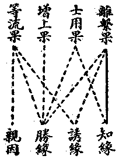



致离系果重在知缘，招异熟果唯在胜缘。由异熟果乃无明之乱动所招，不明於境故不重知，唯以乱动感生苦果，而彼无明但为发乱动之增上缘耳。致离系果在明事理，由明事理之智制止乱动，率循事理而行，故重知缘，亦重诱缘，胜缘与亲因乃在其次也。闻净法界等流正教，如理思修，故为能起超情佛刹之妙缘欤！



第四节　因缘法界



一　因缘法界概论



法界之广义亦包括现实成事，法界之狭义又唯十八界中之一界。今非此二，取不狭不广法界义，专就诸现实蕴素言。於现实蕴素中，诸无为法虽亦是离系果，有作所知缘等，非亲因生果性，此所不取。诸分位假及和续假——情器佛刹——虽亦能作胜缘、知缘及为所生之异熟果、增上果等，然均不作种生现、现生种之因果性，亦所不取。以此因缘法界，虽亦带明胜缘所生增上果等，正明亲因所生之等流果，故唯取诸心法、诸心所有法、诸色法以观其因缘所生果也。此心法等，各有自种子亲生自现行，亦从自现行熏生自种子；在持识中，自类种子复各前灭后生，引生相续。此种因生现果，种因生种果，现因生种果，乃为诸法正因果性。明此正因果义，唯一切种识缘起说与法界缘起说。虽亦兼诠知缘、胜缘，然正明者在於亲因生果。因缘情器，说胜缘等生异熟果，因缘佛刹，说知缘等生离系果。今此因缘法界，则正明亲因之生等流果，亦兼明诸缘之生诸果者。情器是有漏之因果，佛刹是无漏之因果，此则为遍通有漏、无漏之有为因果，遍为情器佛刹之蕴素者，犹舍材与舍宅之关系也。故前诸缘果，皆依此因果而立。



二　因缘所生心法



心法有八，虽诸有情不皆具备，或缺眼、耳识等，或无前五识等——无色界——，或无前六识等——无想异生——；然具备者无过於八。此八心法之亲生因，各唯自种。然增上缘举其根者，不无增减。列示如左：



　　　　　　　　　知缘─┬─空───┬─────八缘……增上果  

　　　　　　　　　　　　│　明　　　│  

　　　　境界依─────┴─色　　　│  

　　　　同境依─────┬─眼　　　│  

　　　　　　　　　　　　├─作意　　│  

　　　　分别依─────┼─意识　　│  

　　　　　　　　　胜缘→│　　　　　│  

　　　　染净依─────┼─末那　　│┌─九缘─┬──生眼识现行  

　　　　　　　　　　　　│　　　　　││　　　　│  

　　　　根本依─────┴─藏识──┤│　　　　│  

　　　　　　　　　　　　　　　　　　││　　　　│  

　　　　开导依──诱缘───等无间………………．│  

　　　　　　　　　　　　　　　　　　　　　　　↓│  

　　　　种子依───────自种────一因──┴──等流果  

　　　　　　┌空─┐  

　　　　知缘┤　　│  

　　　　　　└声　│  

　　　　　　　　　│　　　　（依义果义例前）  

　　　　　　┌耳　│  

　　　　　　│作意│  

　　　　胜缘┤意识├八缘┐  

　　　　　　│末那│　　│  

　　　　　　└藏识│　　├生耳识现行  

　　　　诱缘─无间┘　　│  

　　　　　　　自种─一因┘



鼻、舌、身识，根尘密合，而取识者不藉空缘，除眼识外，不藉明缘；故眼识九缘，耳识八缘，鼻、舌、身识七缘也。除更换鼻、舌、身之根缘外，餘者例同，故不一一。



　　　　知缘─法处┐  

　　　　　　┌作意│  

　　　　胜缘┤末那├五缘┐  

　　　　　　└藏识│　　├生意识现行  

　　　　诱缘─无间┘　　│  

　　　　　　　自种─一因┘



意识虽不藉疏所知缘，然必有亲所知缘，故列法处。作意警引自种，故亦必有，餘者例前可知。意识虽亦时依前五识起，然非必依，虽亦藉色声等之实境以生识，然非必藉，故兹俱不列之。



　　　　胜缘┬────作意┐  

　　　　　　└─所依┐　　│  

　　　　　　　　　　├藏识├缘┐  

　　　　知缘──所知┘　　│　│  

　　　　诱缘─────无间┘　├生末那识现行  

　　　　　　　　　　　自种─因┘  

　　　　知缘─境界┐  

　　　　　　┌作意│  

　　　　胜缘┤　　├缘┐  

　　　　　　└末那│　│  

　　　　诱缘─无间┘　├生藏识现行  

　　　　　　　自种─因┘



藏识为末那识作俱有依及根本依，属於胜缘；而又以其「见分」为末那识作疏所知缘，故亦为知缘。异生位之末那识，除取藏识见分为「自我」，无别所知境故，虽亦与前六识俱转，然非必俱，故兹不说。藏识以一切种及自变之根身器为所知境界，即知缘也。复以末那为俱有依，以七八识互为根故；前六识不必具，同上。此依异生之心法生起因缘说。若诸佛圣者，则根境互融而起缘不同矣。然从自种因生，则生佛亦无异。



三　因缘所生心所有法



心所有法，今此审定，唯二十三。而在佛果，除六烦恼及改悔心，唯十五心所耳。诸心所有法生起之因缘，乃随相应之心法而不同。五遍行心所法，心必俱故，除作意外，餘同各相应之心法，但各加一相应心缘。例眼识相应受：



　　　　明──────────┐  

　　　　空　　　　　　　　　　│  

　　　　色　　　　　　　　　　│  

　　　　眼　　　　　　　　　　│  

　　　　作意　　　　　　　　　├─十缘──┐  

　　　　眼识………相应心法──┼─────┼─士用果  

　　　　意识　　　　　　　　　│　　　　　│  

　　　　末那　　　　　　　　　│　　　　　├─生眼识相应受  

　　　　藏识　　　　　　　　　│　　　　　│  

　　　　无间─────────┘　　　　　│  

　　　　自种───────────一因──┘



眼识相应感受，十缘、一因所生。餘识相应五遍行心，可例推之。此中相应心法之生心所，为胜知缘所生之士用果。而八别境心所，应更加一此心所法之特别境。例意识相应念：



　　　　法处─┐  

　　　　曾习─┼─特别境  

　　　　作意　│  

　　　　末那　├──────七缘┐  

　　　　藏识　│　　　　　　　　│  

　　　　意识─┼─相应心法　　　├生意相识应念  

　　　　无间─┘　　　　　　　　│  

　　　　自种────────一因┘



别境心所，必依特别境生，故别加一特别境缘。餘识相应八别境心，可例推之。善心及烦恼心，虽可同遍行心，然善有三界、九地及有漏、无漏之别，既定非无记、染不善，应加善性缘；嗔唯欲界，应加一欲界缘；餘烦恼心唯有漏，应加一有漏缘；於有漏中复有界地之别，性或唯恶，或染不善，此於缘义，皆有可加；但因唯自种，则无不同也。又前心心所法，皆可各加一能知缘，以自身虽即是能知，亦是他能知之所知法故。此能知缘，今所特立。



四　因缘所生色法



按俱舍论，尝分四层讨论因缘所生色法：一、诸大种相互之生果功能，於俱舍论所立之六因内，谓即俱有因与同类因所生之果色。俱有因、指四大种在同一色聚内——一人身内或一树一石内——同一刹那之彼此关系；同类因、指四大种各能生以后之自类四大种，例水大种能生以后之水大种。二、诸大种於所造色之生果功能，前曾说四大种与色香等有生、依、立、持、养五层关系，然此亦仅为能作因所生之增上果。三、所造色於所造色之相互关系：此涵有同类、俱有、异熟、能作之四因。俱有因指身语表色，色随心转，故为餘色之俱有因。若单纯之色法，无此功能。同类因是前刹那所造色聚，於后刹那所造色聚之影响。异熟因指所造色聚，作造善或不善业力——表色——，能招来生之眼根等无记性异熟果。四、所造色对诸大种之势力：亦由所造业能作异熟因，引起来世新大种聚。



今按俱舍此所言者，虽显缘所成果，犹未明因所生果也。俱有因、能作因，是胜缘所生增上果或士用果，同类因是诱缘所生之等流果，异熟因是胜缘所生之异熟果；一者、未明必有「能知缘」之关系——不离识故——，二者、未明一切种识中之色种为「亲能生因」之关系。今且举一声尘为例；



　　　　　　　　　　┌四大种┐  

　　　　　　　　　　│　　　│  

　　　　　　┌俱有依┤四造色│  

　　　　　　│　　　│　　　│  

　　　　　　│　　　├耳　根│  

　　　　　　│　　　│　　　│  

　　　　胜缘┤　　　├耳　识├七缘┐  

　　　　　　│能知缘┤　　　│　　│  

　　　　　　│　　　│意　识│　　│  

　　　　　　│　　　│　　　│　　│  

　　　　　　└持种依┴藏　识│　　├生声  

　　　　　　　诱　缘─等无间┘　　│  

　　　　　　　　　　　　　　　　　│  

　　　　　　　　　　　自　种─一因┘



一声之现，必依四大种，及色、香、味、触四造色，与净色耳根作俱有之胜缘。耳根、耳识同对声境，且必有同时之意识、藏识，了「耳意识疏所知缘」之本质声，故同为能知缘。藏识又作持声种之胜缘，声之自种乃可藉前诸缘而起现行之声。诱缘或无亦可。然四大占空间同一刹那，在同一处亦不容有后大种声发生，必占此处之大种前灭或移占他处，此处方可发生后大种声；由此亦可准说等无间缘，例俱舍所说之同类因所生果。知缘、诱缘，亦今新立。兹再就四大种以举其例：



　　　　　　　　　　┌湿煖动┐  

　　　　　　┌俱有依┤尘或根│  

　　　　　　│　　　├身　根│  

　　　　胜缘┤　　　│身　识├七缘┐  

　　　　　　│能知缘┤　　　│　　│  

　　　　　　│　　　│意　识│　　│  

　　　　　　└持种依┴藏　识│　　├生地大种「坚性」  

　　　　　　　诱　缘─等无间┘　　│  

　　　　　　　　　　　自　种─一因┘



若依俱舍，异熟因例於藏识，后更可各加一「业力缘」，餘可例推知之。



五　现生种之种义



前此皆说种生现之因缘。虽诸心不相应行法亦是因缘所生，然以即是心心所色之分位故，即於心心所色和合相续上之假施设故，无别自种子为因故；现行所熏生者，亦即为心心所色种子故，不须别说因缘。然今欲进论现行生种之因缘，当先明种子义。成唯识等论云，种子义略有六：



一、刹那灭：谓体才生无间必灭，有胜功力，方成种子。此遮常法，常无转变，不可说有能生用故。二、果俱有：谓与所生现行果法俱现和合，方成种子。此遮前后及定相离。现种异类互不相违，一身俱时有能生用，非如种子自类相生前后相违必不俱有。虽因与果有俱不俱，而现在时可有因用，未生、已灭无自体故。依生现果立种子名，不依引生自类名种，故但应说与果俱有。三、恒随转：谓要长时一类相续至究竟位，方成种子。此遮转识——前七识——，转易间断，与种子法不相应故；此显种子自类相生。四、性决定：谓随因力生善恶等，功能决定，方成种子。此遮餘部执异性因生异性果有因缘义。五、待众缘：谓此要待自众缘合，功能殊胜，方成种子。此遮外道执自然因，不待众缘，恒顿生果；或遮餘部缘恒非无，显所待缘非恒有性，故种於果非恒顿生。六、引自果：谓於别别色心等果各各引生，方成种子。此遮外道执唯一因生一切果；或遮餘部执色心等，互为因缘。



唯本识中功能差别，具斯六义成种，非餘。外谷麦等，识所变故，假立种名，非实种子，此种势力，生近正果名曰生因；引远残果令不顿绝，则名引因——引因故可有枯木尸骸存在——。



本识——对转识言，即非转识——中含藏一切生现行果功能差别，故名一切种识。即此所藏一切生现行果差别功能，名一切种。识名种识，能持种故，种名种识，非谷麦等种故。以第六引自果义故，各色各心等皆各亲从自种子生。



六　现生种之熏习义



夫一切种识中之一切种，既有生灭，复恒随转，以何生起？以何转变？斯必有其由致，故言熏习。然此所言熏习，取由熏习能生长种子义，与起信论所言熏习义殊。彼言熏习，但指诸法彼此互相之影响故。今准瑜伽、成唯识等，出熏习义如下：



内——识——种必由熏习生长，亲能生果，是因缘性；外——谷麦等——种熏习或有或无。为增上——胜——缘办所生果，必以内种为彼——亲——因缘，是共相种所生果故。依何等义立熏习名？所熏、能熏各具四义，令种生长，故名熏习。



何等名为所熏四义？一、坚住性：若法始终一类相续，能持习气，乃是所熏。此遮转识及声风等，性不坚住，故非所熏。二、无记性：若法平等无所违逆，能容习气，乃是所熏。此遮善染势力强盛，无所容纳，故非所熏。由此如来第八净识，唯带旧种，非新受熏。三、可熏性：若法自在，性非坚密，能受习气，乃是所熏。此遮心所及无为法，依他、坚密，故非所熏。四、与能熏共和合性：若与能熏同时同处，不即不离，乃是所熏。此遮他身、刹那前后，无和合义，故非所熏。唯异熟识具此四义，可是所熏，非心所等。



何等名为能熏四义？一、有生灭：若法非常，能有作用生长习气，乃是能熏。此遮无为前后不变，无生长用，故非能熏。二、有胜用：若有生灭势力增盛，能引习气，乃是能熏。此遮异熟心心所等，势力羸劣，故非能熏。三、有增减：若有胜用可增可减，摄植习气，乃是能熏。此遮佛果圆满善法，无增无减，故非能熏。彼若能熏，便非圆满，前后佛果应有胜劣。四、与所熏和合而转：若与所熏同时、同处，不即不离，乃是能熏。此遮他身、刹那前后，无和合义，故非能熏。唯七转识及彼心所有胜势用而增减者，具此四义，可是能熏。



如是能熏与所熏识，俱生俱灭，熏习义成；令所熏中种子生长，如熏苣蕂、，故名熏习。



前七心及心所现行四分，熏第八识心自证分，生起及长养能生心、心所、色诸种子，是谓现行生种。



七　现生种之因缘



现行之熏生种子虽是亲因性，然亦可有缘性。成唯识云：



现行於种，能作几缘，种必不由中二缘起，得心心所立彼二故——按今扩充为知缘、诱缘，已兼通色法——。现与亲种具作二缘，与非亲种但为增上。



此云亲种，指此现行之自类种。云非亲种，指此现行与他类种。然今扩充所知缘为知缘，通能知缘故，亦得论「知缘」。兹举有漏善意业现生种为例：



　　　　　　（思）　　┌亲　因┐  

　　　　有漏善意业现行┤　　　├─有漏善意业种  

　　　　　　　　　　　└胜　缘┤┐  

　　　　　　　　　　　　　　　││  

　　　　有漏现行藏识　　能知缘┘┴有漏藏识等种



依此现行藏识，对一切种遍作知缘。各自类现，对自类种作因缘，亦作胜缘；对他类种但作胜缘。於行支之能引识等五支种义，亦可明矣。唯不作诱缘，以此唯自类前现行对后现行故。复次、成唯识云：



能熏识等，从种生时即能为因，复熏成种；三法展转，因果同时，如炷生焰，焰生焦炷。亦如芦束更互相依。因果俱时，理不倾动。能熏生种，种起现行，如俱有因得士用果。



此於现行之生种子，兼带种子之生现行以互明者。如俱有因得士用果，此借俱舍等说六因五果为设譬者。其为亲因胜缘所生诸果，当如上说。三法展转因果同时之义，兹举如下：



　　　　炷…种子──因┐  

　　　　║　　║　　　├同一刹那  

　　　　生　　生　　　│  

　　　　║　　║　┌果┘  

　　　　焰…现行─┤  

　　　　║　　║　└因┐  

　　　　焦　　生　　　├又一刹那  

　　　　║　　║　　　│  

　　　　炷…种子……果┘



两重同时因果，非一重也。种现同时，而种与种则不同时，种与种不同时，犹不焦炷与已焦炷不同时也。



八　种生现之因缘



前说心心所色从因缘生，於种子生现行，但明自种作亲因之所生果义。但诸种子之於现行，不但作亲因也。成唯识云：



本识中种，容作三缘，生现分别——即生现行——，除等无间。谓各亲种是彼因缘——亲因——；为所知缘於能知者——若种子为第八识所知缘——；若种於彼有能助力，或不障碍，是增上缘。生净现行，应知亦尔。



兹举现行之第八识，以明其例：



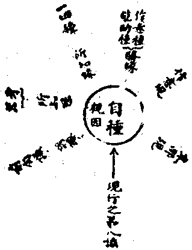



此中能助种，即能引能润诸行业种等。有能助力或不障碍即为胜缘，则为缘者多矣，难以枚举。观此可推见诸种子之於现行，除自种之作亲因外，餘种亦能作胜缘等。亦可观自种与果俱有义，及自现行前后相引，与餘现行缘俱有义。故即此所生之果，亦义通诸果。引业种等所引生故，即异熟果；诱缘所引及自种亲生故，即等流果；餘胜缘所知缘增上起故，即增上果；由餘胜缘所成办故，亦士用果；若由无漏智等种现胜缘，引生为现行之净无垢识，亦离系果。种等之生八识现行如此，餘可例推。



九　种生种之因缘



种子之生种子，虽作亲因，然亦能作胜增上缘。非现行故，不作知缘以及诱缘：种虽所知，是现行所知故；种虽前后自类相续，是相亲生非相引故不作诱缘。其作亲因、胜缘，亦如论云：『种子前后自类相生，如同类因引等流果』。『种望亲种亦具二缘，於非亲种亦但增上』。此中所云，如同类因引等流果，亦借俱舍等六因五果说，以为譬喻。其实此乃亲因所生之等流果。彼同类因引等流果，多指诱缘所引等流果言，故有不同。前种子生后种子相，兹举无漏慧种为例：



　　　　　　　　　　　┌亲因┐  

　　　　前刹那无漏慧种┤　　├后刹那无漏慧种  

　　　　餘善心心所种等└胜缘┘



然此种子之生种子，与前种子之生现行，现行之生种子，虽皆兼作餘胜缘等，而亦各作亲生於果之亲因性，故与现之生现不相同也。除此大乘法相了义之说，其餘世间与佛教中多就餘缘假说为因；对於正因果义鲜能辨者。故识论云：『种生现、现生种、种生种三，於果有亲因性；除此、餘法皆非亲因，设名亲因，应知假说』。观此可知何者是因，何者为因所生果矣。



十　现生现之缘义



此中广辨诸法相生之因缘义，前已说明亲因及缘之生果义。然现行生现行之缘所生果，今亦当说。成唯识云：『现起分别，展转相望，容作三缘，无因缘故』。『谓有情类，自他展转容作二缘——知缘、胜缘——，除等无间』。今谓亦可容作等无间缘。例前帝统之国，非前国王死或辞位则不容有后国王起，故前国王死或辞位，为后国王起之诱缘。有情类对非情色聚唯作知缘、胜缘，非情色聚对有情类亦然。非情色聚对于非情色聚，则唯作胜缘耳。论云：



自八识聚展转相望，定有增上缘，必无等无间。所知缘义，或无或有。八於七有，七於八无，餘七非八所仗质故。第七於六，五无一有，餘六於彼一切皆无。第六於五无，餘识於彼有，五识唯托第八相故。



今以知缘通能所知，笫八於前七作所知。此中不依种相分说，但说现起互为缘故。『净八识聚，自他展转皆有所缘——能所知缘——，能遍知故；唯除见分非相所知，相分理无能知用故』。心心所色法现行与现行相望为缘之义，於此可知其概略矣。



十一　现行法作诸缘义



前说诸缘生现行法，今更分别现行心、心所、色作诸缘义。论云：



阿陀那识，三界、九地皆容互作等无间缘，下上死生相开等故。有漏无间有无漏生，无漏定无生有漏者，镜智起已必无断故；善与无记相望亦然。此何界后引生无漏？或从色界，或欲界后。谓诸异生求佛果者，定色界后引生无漏，后必生在净居天上大自在宫得菩提故。二乘回趣大菩提者，定欲界后引生无漏，回趣留身唯欲界故。彼虽必往大自在宫方得成佛，而本愿力所留生身是欲界故。有义：色界亦有声闻回趣大乘愿留身者，既与教理俱不相违，是故声闻第八无漏，色界心后亦得现前。然五净居无回趣者，经不说彼发大心故。第七转识，三界、九地亦容互作等无间缘，随第八识生处系故。有漏无漏容互相生，十地位中得相引故。善与无记相望亦然。於无记中，染与不染亦相开导，生空智果前后位中得相引故。此欲、色界有漏得以无漏相生，非无色界，地上菩萨不生彼故。第六转识，三界，九地，有漏无漏，善不善等，各容互作等无间缘，润生位等更相引故。初起无漏唯色界后，决择分善唯色界故。眼、耳、身识二界二地，鼻、舌二识一界一地，自类互作等无间缘。善等相望，应知亦尔，有义：五识有漏、无漏自类互作等无间缘，未成佛时容互起故。有义：无漏有漏后起，非有漏后容起有漏，无漏五识非佛无故，彼五色根定有漏故，是异熟识相分摄故。有漏不共必俱同境根，发无漏识理不相应故，此二於境明昧异故。



上皆作等无间缘之分别。今说诱缘，许色法有，例中有身色前灭生后羯罗蓝色等。



第八心品，有义：唯有亲所缘缘，随业因力任运变故。有义：亦定有疏所缘缘，要仗他变质自方变故。有义：二说俱不应理！自他身土可互受用，他所变者为自质故；自种於他无受用理，他变为此不应理故，非诸有情种皆等故；应说此品疏所缘缘有无不定。第七心品未转依位是俱生故，必仗外质，故亦定有疏所缘缘；已转依位此非定有，缘真如等无外质故。第六心品行相猛利，於一切位能自在转，所仗外质或有或无，疏所缘缘有无不定。前五心品未转依位，麤钝劣故，必依外质，故亦定有疏所缘缘；已转依位，此非定有，缘过未等无外质故。



此为作所知缘分别。今说知缘，通能所知，则心、心所作色、心等之能知缘，亦可随应分别：



前五色根，以本识等所变眼等净色为性；男、女二根，身根所摄故，即以彼少分为性。



此明色法作「胜缘」者。然成所引声、执所俱声等，律义、不律义表色等，亦皆能作增上胜缘，随应可立。七於笫八亦作能知；第七为第六所知缘，第六亦即为第七能知缘；前五为第六所知缘，笫六亦即为前五能知缘，故均容有知缘。唯第七与前五，不作能所知缘而已。



自类前后，第六容三，餘除所缘——能所知缘——，取现境故。许五后见缘前相者，五七前后亦有三缘。前七於八所缘——能所知缘——容有，能熏成彼相见种故。



前七亦作第八之所知缘，则由仗前七现，熏生第八所知之一切种，例前七仗第八相见为本质故。



同聚异体，展转相望——一相应聚心心所法相望——，唯有增上；诸相应法所仗质同，不相缘故——无知缘——。或依见分说不相缘，依相分说有相缘义——容有知缘——。谓诸相分互为质起，如识中种为触等相质。不尔、无色彼应无境故。设许变色，亦定缘种，勿相分境不同质故。同体相分为见二缘——胜缘、知缘——；见分於彼但有增上——今亦可有知缘——；见与自证相望亦尔。餘二——自证分与证自证分——展转俱作二缘。命根但依本识亲种分位假立，非别有性。



此明以八识种作胜缘者。此中合业种、识种，云本识亲种，业种所引摄故，此为异熟果之胜缘。



意根总以八识为性。



此明以诸心心所聚为胜缘者。



五受根如应各自受为性，信等五根，即以信等及善念等而为自性。



此明心所有法之能作胜缘者。随应亦可加立，若贪嗔痴慢为染根，慈惠为善根等。



未知当知根体位有三种：一、根本位，谓在见道，除后刹那无所未知可当知故。二、加行位、谓煖、顶、忍、世第一法，近能引发根本位故。三、资粮位，谓从为得谛现观故，发起决定胜善法欲，乃至未得顺决择分已有善根，名资粮位；能远资生根本位故。於此三位，信等五根、意、喜、乐、舍为此根性。加行等位於后胜法求证愁戚，亦有忧根，非正善根，故多不说。前三无色有此根者，有胜见道傍修得故。或二乘位回趣大者，为证法空，地前亦起九地所摄生空无漏，彼皆菩萨此根摄故。菩萨见道亦有此根，但说地前，以时促故。始从见道最后刹那乃至金刚喻定，所有信等无漏九根，皆是已知根性。未离欲者，於上解脱求证愁戚，亦有忧根，非正善根。故多不说。诸无学位无漏九根，一切皆是具知根性。



此合心心所法九根作胜缘，乃离系果；以知缘作胜缘者也。然法界等流正教声，及佛应现身刹色等，亦能作离系果胜缘也。因缘所生之果，亦皆作生果之因缘，因缘及果，如环无端，观此不洞然明白耶！



第五节　所知关系评判



一　所知关系慨论



所知现实，不外成事蕴素。故其关系，亦唯在於成事与成事之关系，成事与蕴素之关系，蕴素与蕴素之关系。观其关系而分别之，条理为种种之公式，即成为种种因缘生果之格律。然成事之程度上，有异生——有情、圣者——超情之别；成事之性质上，又有情身——生命、器刹——非命之别；蕴素之转变上，亦有杂染、清净之别。蕴素之法体上，尢有性相、色心之别。种类之差别既甚多，关系之格式亦非一，非佛陀之圆智，殆无足以穷其奥者？虽广寻正觉法界等流之至教，如理作意思择，证以现知，决以比知，灿然有所敷说，以言大概，虽无所不包括，然而一花之放，一星之坠，动物之各呈其毛羽光泽，人生之各流其情欲意谓，尽其所有之性，如其不悖之量，洪纤毕举，纲目悉张，则超世间虽有其人，而世间尚无此文字言语之工具也。今就所已言者，且再加以评撢判抉焉耳！



二　事素关系与因果



依前四节之所敷陈，成事与蕴素皆因缘所生之果，亦皆是生果之因缘；则成事非蕴素之果，蕴素亦非成事之因缘也。然则成事与蕴素之关系，固非因果关系。然此章标所知事素关系之题，而绪言又说蕴素与成事之关系即为因与果之关系，亦无甚大违碍；其尚有餘理未尽耶？答曰：成事与蕴素虽皆是果，亦皆是因缘，深察之则有殊异也。一者、成事之名成事，乃已各成一个之事体者——事物个体、佛书一和合相续之假者——。一金，一树至一星球，一虫、一鸟至一人生，虽此一虫、一树与餘一切皆可有互相依资之关系——作缘——，然固可移此至彼，合彼离此，而似有其独立之存在——我执法执皆由萨迦耶见而起，亦缘乎此——。至诸蕴素之为蕴素，唯在名理上可施以分别，而於事实上则灼然必藉多种关系存在。诸无为法，藉诸有为而显；诸分位法，藉色、心等而立。虽至一眼识相应感受心所焉，一眼识所知青色焉，要皆为因缘之一聚，而莫从见其单独存在之相焉。故始终为众蕴素聚中之蕴素，而不能似独存之个体焉。然彼有「似独存个体」之假相者——一电子以至一太阳、一人及谷麦等假种——，莫非此诸蕴素之和合连续相！故此为因缘，而彼为果焉。二者、成事既为和续假者，故非亲能生种子之现行，亦非亲能生现行与种子之一切种；虽亦为缘而不为因。为因者唯在诸蕴素，是亲能熏生诸种子之现行故，亦亲能生起诸现行之种子故。而成事之和续假者，则由诸种子起现行，有惑业或慧行等为势力和续所成者耳。由此、故蕴素为因，而成事为果；唯诸蕴素亦互相为因果而已。



三　因缘果名义之决择



因缘生果节中，对於六因、十因、二十四缘皆废不用，虽用四缘而亦改为一因三缘，变其名为亲因、诱缘、知缘、胜缘。扩充所缘缘为能所知缘，扩充诱缘亦通色法，则义亦异。又於一因分为三类：



一、生自现行之自种子因



二、生自种子之自现行因



三、生自种子之自种子因



三缘分为七类：



　　　　一、前自类现行灭引生后自类现行者…………诱缘  

　　　　二、此现行生彼现行为能知或所知者…┐  

　　　　三、一切种子为生现行第八识者………┴……知缘  

　　　　四、此现行与彼彼现行互相为顺违者…┐  

　　　　五、此现行助他类现行生他类种子者…┤  

　　　　六、此种子助他类种子生他类现行者…┼……胜缘  

　　　　七、此种子助他类种子生他类种子者…┘



此虽语越常闻，当准之於事理，固无违害。然於五果，则仍先立，岂亦能适用於现行生「种果」等而无悖耶？答曰：名义以顺先立为妥，不获已而改作四缘为一因三缘等，例诱缘之一名，亦殊惧其未当；而五果於三类因、七类缘之所生果，名义皆可通用，则何待更为改作耶？然亦可再分析如下：



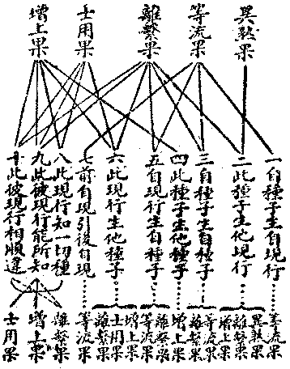



士用果为增上果中之一特果。凡彼为此特殊助力所办成者，彼即为此之士用果。此唯泛为彼助缘者，彼即为此之增上果。例第八识为一切种之能知缘，一切种为第八识所生士用果；一切种为第八识之所知缘，第八识为一切种之增上果。或废除士用果亦可。



四　佛刹缘起之讨论



於超情佛刹之缘起，虽说三增上学及三慧、三智等，而不及情器缘起之十二支法整然有序。转染成净之净缘起，为佛学中最应注重，何反无有系缘之组织耶？答曰：三十七品菩提分法，分者因也，此即为有序之组织，然说因缘不曾与果组成一系统耳。今更用二十二根试说之：



　　　　　　　　　　　　┌信根………善信……正慧等相应之正见正愿  

　　　　　　　　　　　　│勤根………善勤即四正勤亦即戒增上学  

　　　　　　有漏五善根┬┤念根………善念  

　　　　　　　　　　　││定根………善定  

　　　　┌─应化身刹─┤└慧根………善慧  

　　　　│　　　　　　└┬未知欲知根…净慧为上意喜乐舍信勤念定为助已知具知根同此  

　　　　│　　　　　　　├已知根┐─┬他受用身刹┐  

　　　　│　　无漏三根─┤　　　│┌┘　　　　　├法性身刹  

　　　　│　　　　　　　└具知根┤┴─自受用身刹┘  

　　　　└───────────┘



有漏五善根及资粮加行之未知欲知根此为能感，菩萨已知根及佛具知根为能应，合此感应之缘能起应化身刹。菩萨已知根为能感，佛陀具知根为能应，合此感应之缘能起自他受用身刹。具知根为缘，能起佛之自受用身刹。已知根、具知根之分证、满证於法性，即为法性身刹。此八根与应化、受用、法性身刹，可以全见佛刹缘起之因果矣。



五　因缘法界之讨论



情器佛刹之因、缘、果，前已论及，於说因缘法界应可除外。然无为法亦不离因果律，心不相应行法亦为因缘之有为法，何亦不论及耶？答曰：因缘法界中以说诸法亲生因，及亲因所生果为主，无为法及心不相应行法，但为缘果而非因果，故不说及。然缘果义，兹可略论：择灭与非择灭无为，但果非缘，以但是灭所显示故。择灭、是知缘、胜缘所显增上果及离系果；非择灭、是胜缘——相违胜缘——所显之增上果。虚空及真如二无为，能作所知缘及顺违胜缘，亦作能知缘及顺胜缘所显之增上果或离系果。以虽可说是离系果，而离系果即择灭无为故。此无为法之缘果也。至於诸心不相应行，或是识之分位，是何识即可依何识因缘而说；或是何心所之分位，即可依何心所因缘而说；或是何色法分位，即可依何色法之因缘而说；或是何心、心所分位，即可依何心心所因缘而说，或是何心、心所、色之分位，即可依何心、心所、色因缘而说；故皆不须别说能生彼之因缘。以能生起彼之因缘，不出前能起情器、能起佛刹之缘，及能生起色、心、心所之因缘故。唯其转加繁复，则随事别详耳。至其能作之缘，大抵皆能作所知缘、胜缘，间亦能作等无间缘。例前命根不舍，后命根即不能起等。兹举命根以示其例：



　　　　命根……业种力引润第八识种生起现行之势限  

　　　　生能引能润业种之因缘…………┐  

　　　　生被引被润第八识种之因缘……┼…合为成命根之因缘  

　　　　生第八识现行之因缘……………┘



起命根之因缘如此繁复，餘可知矣。



六　缘起决择概论



缘起初唯十二支缘起说，亦唯说十二支是说缘起。此缘起唯说「异生情器」以何缘而起，应从何择灭耳。瑜伽、摄大乘等，加说持一切有漏种之阿赖耶识缘起，阿赖耶寄存清净种，始通净法缘起。至於中华，日本，次第加立诸缘起说，前虽略述及之，应如何抉择耶？答曰：缘起在指出「为缘能起」之法属何法，但由诸法缘生四缘生法观之，固无一法非缘之所起，亦无一法非为缘能起。然则尚何缘起论之有歧异而须待抉择之耶？唯施设言教，本在方便开导，引之令趣行证果，是则就为缘能起之诸法中，观何法为发行得果之胜方便，即说何法为缘起之主，於是有缘起论之殊说。佛径说十二有支之流转为「缘」能「起」杂染诸法，正可谓之无明缘起、业感缘起耳。唯是诸经所说，浅深不同，而菩萨造论，古德判教，又复解释有异，故缘起之通相虽在於无明业感，而有说赖耶缘起者，有说真如缘起者。华严家综合之曰：业感缘起、赖耶缘起、真如缘起，自居为法界缘起而加前三之上。日本真言宗之东密派，仿列前四，自居为六大缘起而加前四之上。统计各家自命后来居上之缘起，各说不出下别五项：



　　　　一、业感缘起…┬………小乘教  

　　　　二、赖耶缘起…┤  

　　　　三、真如缘起…┴………三乘教  

　　　　四、法界缘起…┬…┐  

　　　　五、六大缘起…┘　└…一乘教



右为华严、真言等家，依缘起论，判教浅深之常途说。由今观之，依彼各教显由浅至深之程序，虽亦不无片面之理，按其实则不能尽然。盖六大者，乃依坚、湿、煖、动、无碍、了知之六性，所立地、水、火、风、空、识之六相。前四色法，后一心法，第五则由非「色有质」非「心能虑」之非二法，从非色以反显出者。色非色为五，而心总为一，是为六大，指此六大为情与无情为缘能起之根本，祇是心物二元论耳。此心物二元论，实为凡情外道共易知者。若希腊原始哲学多计水、火、风等为万物本元，而胜论之实谛——地、水、火、风、空、时、方（空）、意、我（识）之九法，与六大仅开合略殊而已。初见者为地形，进察流变之质为水，更进察能令凝流之变化力用为火——今西洋物质文明多得於火——，更进察形质变化之极、仅存浮动之轻气为风，轻动所通过之无碍性法为空；反之、乃始悟更有能了知之心为识；如斯逐层增进，认识此六性相，遂认此六性相为万有生起之本元，固为稍能观察者之所易知也。故前文所举之五种缘起，於所知法、於能知人皆当以六大缘起为最浅，由此乃更有正名之必要。



七　缘起决择之新释



兹先列三式之程序如下：



一、以所知所得法判浅深之程序：



　　　　前五属色  

　　　　　　　　六大缘起………┐  

　　　　后一属心　　　　　　　：  

　　　　　　　　　　　　　　　├…色心……五蕴  

　　　　能感是行蕴心　　　　　：  

　　　　　　　　　　业感缘起…┘  

　　　　所感通於心色  

　　　　二空所显真  

　　　　　　　　　空智缘起……┐  

　　　　如证智相应　　　　　　：　　　　　　六  

　　　　　　　　　　　　　　　├…意识……第　识  

　　　　无明相应执　　　　　　：　　　　　　七  

　　　　　　　　　无明缘起……┘  

　　　　二分为我法  

　　　　庵摩罗清净法  

　　　　　　　　　　真心缘起…┐  

　　　　界之如来本识　　　　　：  

　　　　　　　　　　　　　　　├…心识……第八识……阿赖耶识……一切种识  

　　　　阿赖耶真异熟　　　　　：  

　　　　　　　　　　藏识缘起…┘  

　　　　识之众生本体



二、以能知人判浅深之程序：



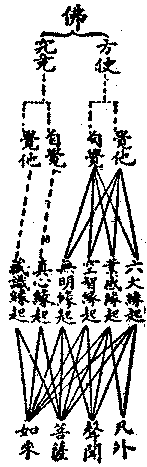



三、以能得人判浅深之程度



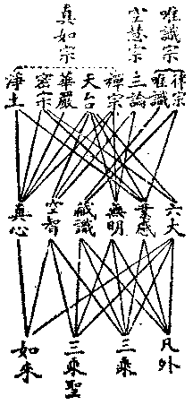



能得人者，谓能成就此法之人。依此第三能得人之浅深程度观之，故华严、真言之浅深说，亦不无片面之理由。业感、专指能感三界异熟之有漏善及不善业，三乘圣人已不造之，故不成就。若就无漏业感变易生死言，则三乘圣亦成就。若就无漏业感无漏果言，佛同成就。则广义之业感应与六大皆众生、如来所同得，故密宗之三密与净土之净业，其功用全在於业感。自觉以华严为专极，而天台、密宗、净土，皆以觉他之方便胜之。言觉他之方便，当以净土为最方便，而唯识则为究竟之觉他。盖凡外二乘虽成就无明而非所知，凡外二乘虽成就藏识而尤非所知：菩萨之知藏识，亦由佛之开示知少分耳。以第八识从不与慧相应，一相应即成佛，故藏识非佛不知也。



八　别释意识缘起



今依「可知法」及「能知人」言，六大缘起最为粗浅。地、水、火、风、空为色法，识为心法，别详色法为五，总合心法为一，此乃异生常情。如是例之，五蕴虽同色心并列，略色详心，犹此六大为进。至业感缘起，已能别提出行蕴一分为能起缘，以五蕴聚为缘所起，所明者已稍进深细。然尚是色心并立之麤相而已。进至真如——空智——缘起、无明缘起，则於五蕴内别提出最深之识蕴中独强之意识心心所一分以为能缘起法，尤深细也。



然此中意识兼意及意识，合名意识。以八个识第七别名为意，正名意识，第六别名为识，应名识识，随不共依立名，亦名意识。故此意识一名，总括七、六二识。云真如缘起者，正名空智缘起。空智谓达二空证真如之正智——妙观察智相应心品、平等性智相应心品——相应意及意识心品。然此正智由达二空所显真如而发，故亦展转名为真如缘起。第六、七识，於菩萨地，有漏无间发生无漏，则证二空所显真如。此通菩萨见、修道位。但修道位又时有无漏无间发生有漏者，此由无漏而至有漏，即由正智相应意识而至执障相应意识；亦即起信论等常途所谓真如不守自姓，「不觉心动，忽然念起而有无明」是也。



起信论文：一、『所言不觉义者，谓不如实知真如法一故，不觉心起而有其念』。二、『一者、无明业相，以依不觉故心动』。三、『以依阿黎耶识，故说有无明不觉而起』。四、『以不达一法界故，心不相应，忽然念起，名为无明』。按不如实知真如法一者，即六、七识无漏无间不觉心起而有其念，即由无漏无间发生有漏。不觉——或不如理作意——即大随烦恼中以无明为性之失念心起，谓由失念有漏心起。有其念、谓有二执二障相应之意及意识虚妄分别。二、三、四项，皆可照上消释。



由是观之，起信论所言之觉相，亦依第六、七识由有漏无间所发生之无漏智而说可知。故其文曰：『所言觉义，谓心体——根本智——离念。——离二取分别而无分别——。离念相者，等虚空界，无所不遍，法界一相，即是如来平等法身——此指二空所显真如，即登初地时所证遍行真如——。依此法身，说明本觉』。此言「本觉」，犹所云「根本智」。依此法身说名本觉，即是以所证真如为诸法根本故名根本，能证此根本之智故名根本智——以法身为本，能觉此本名本觉——。除根本智及佛果智而外，其餘信智、顺解脱智、顺抉择智及菩萨地之后得智，皆名始觉。故曰：本觉义对始觉说，以始觉者即同本觉——后得智仿同根本智——。始觉义者，依本觉故而有不觉——依未有根本智而名不觉。如论云：又心起者，无有初相可知。而言知初相者，即谓无念。是故一切众生不名为觉，以从本来念念相续，未曾离念，故说无始无明」。及由无漏无间发生有漏，皆是此中依本觉故有不觉义——故说有始觉——依未得根本智名不觉，故说有顺解脱智等位始觉；依无漏无间发生有漏名不觉，说有菩萨地后得智，始觉是所缘故——。即以佛智曰究竟觉，亦曰一切种智、一切智智。



由是观之，起信论云：『心生灭者，依如来藏故有生灭心。所谓不生不灭与生灭和合，非一非异，名为阿黎耶识。此识有二种义，能摄一切法，生一切法。云何为二？一者、觉义，二者、不觉义』。此言如来藏，即初地以上六、七识相应后得智所缘之变相真如。云依此有生灭心者，谓由后得相应末那无漏无间生有漏，执障相应末那重故，执第八为我爱执藏，故曰：所谓不生不灭与生灭和合非一非异，名为阿黎耶识。言此识有觉、不觉之二义，盖由「智相应末那」缘之，则为如来藏之觉：由「执相应末那」缘之，则为阿赖耶之不觉而已。



由是观之，起信论於生灭门之前所说真如门，当知即指菩萨真见道根本智所证非安立谛实体真如。而真如门之后说生灭门如来藏，当知即指菩萨相见道后得智所观安立谛之变相真如。无漏意识后得智，忽生有漏意识无明执障，遂为心、意、意识之生灭相。所云依一心法，有心真如、心生灭门二门，各总摄一切法不相离故，亦是依菩萨见道位心说。真见道根本智位，即心真如门——真如依言分别有二义，已通入相见道位——。相见道后得智位，即心生灭门觉义。见道位后无漏无间忽生有漏执障相应意识，重执阿赖耶为我法，即心生灭门不觉义。此三即证发心中之三种心：一、真实心，二、方便心，三、业感心。如次相配，根本智证真如，摄一切无为无漏法；后得智摄一切有为无漏法；心生灭门不觉义，摄一切有为有漏无明染法。故各摄一切法。



由是观之，可知起信论等之缘起义，乃以登地以上菩萨心境而说。无漏无间续生无漏，无漏无间忽生有漏，可云真如缘起——正云空智缘起，亦云法性缘起。真如指根本智所证实体真如，如来藏指后得智所缘变相真如——或如来藏缘起。有漏无间忽生无漏，有漏无间续生有漏，可云无明缘起，以末那无明相增故，以无明为杂染依故——起信论以一切染法皆是不觉相故。——而天台家常言「法性」「无明」互依无住之义，亦可於是明之。兹真如及无明之缘起义，一分生空真如及一分人我执无明，亦通二乘，故此犹为三乘共教之缘起理，未是大乘至极不空之一切种识缘起理。一切种识，唯佛无漏，一无漏永无漏，无有忽有漏忽无漏之变。无始法尔有无明种，种在忽现忽伏，种断永不复起，亦无有由真如忽生无明之义。彼言由真如忽生无明者，或言无明无因托空而忽起者，皆三乘圣智，未通达一切种智之谬言耳！



九　别释心识缘起



进言「一切种识缘起」，即从第八阿陀那识明缘起也。第八识即心识，故云「心识缘起」。於此分二：其一、即华严宗之一真法界缘起说，兹曰「真心缘起」。第八识别名心，此即无漏第八庵摩罗识，是无倒清净圆成实性摄、故曰真心：即大圆镜智相应心品、海印三昧相应心品——此即佛果大智大定——，亦即一切种智。换言之、即持一切清净种之心，故曰清净法界；界即「种」义，清净法界犹云清净法种，或持清净种之心义。清净法种，犹云持清净种之心。由此识清净种而现行一切法，故一切法莫非佛法。华严「称性缘起」及密教曼荼罗，如是如是。其二，即唯识之一切种识缘起，兹曰藏识缘起。具三藏义，简别真心缘起之庵摩罗识故——亦得名真异熟缘起以简别之——。此二同为从一切种子亲因缘，以明其缘起者。缘起之最深微义，唯佛所知。以本心唯佛有大圆镜智相应故，除佛而下，皆仗佛言教得少分知耳。



然真心缘起，是佛一切清净种缘起，唯佛法界；藏识缘起，是众生一切染净种缘起，通九法界，亦由进转成佛法界。前者是佛自证智之究竟，后者是佛悟他智之究竟。佛智以悟他为究竟，不为自利求菩提故，故尤以藏识缘起为至极。真心缘起是佛自受用之境界，华严等虽依诸菩萨随分所证略明大概，於诸异生，则才令大凡依所举果起信心而已。欲开其解而令由解起行，由行入证，乃非从众生分明其藏识不可。故华严若善财童子，所以成其大乘习所成之种者也。从华严得信心成满，乃从唯识之解行住，悟入究竟。举果令信，在令观自齐佛，故教是顿；示心令解，在令悟自成佛，故教是渐。顿为未入劫以前，属十信位；渐为入劫以后事，属十住位以上。然顿是渐之顿，信由佛生，佛由渐成故；渐亦是顿之渐，住由信来，信由佛起故。渐顿相依，佛生交摄。此二心识缘起。有共同之义二，为他种缘起义所不具者。如下：



一、各现各种————现现增上遍诸法



二、顿起顿灭————起起不到摄十世



达此二义，则知贤首十玄无碍、六相圆融之说，实华严、唯识之共义，不得谓唯识无此也。



此「心识缘起」，与前「意识缘起」不同者，按成唯识论说二所转依：一、持种依，谓本识；二、迷悟依，谓真如。意识缘起，正是从迷悟依以说缘起，悟真如即空智缘起净法，迷真如即无明缘起染法。故此二者亦可总名「真如缘起」，依真如而悟而迷故。然彼迷悟等心心所诸分，实皆各从自种子生，而真如仅为其所缘缘、增上缘而已。即空智相应心品与无明相应心品，亦各从其自种子生，而空智、无明等亦为等无间缘——若无漏无间生有漏等——、所缘缘、增上缘而已。故此正应谓之缘起，但明增上等三缘故。此心识缘起，虽从持种之本识得名，实从此识所持之一切种以谈生起，故曰各现各种；谓各各现行之法，各各亲从自种子办体而生起也。故此二者，亦可总名「法种——或曰法界，界即种义；或曰法性，性亦种义；或曰法体，体亦种义——缘起」。此一切种，正一切法各各亲办自体之因，属四缘中之因缘摄。通名可曰缘起，四缘摄故；别名应曰因起——或曰性起、界起、种起、体起——，正是亲因缘故。然此亲因之性起义，佛华严等虽明其概，必瑜伽、唯识等乃详其致。故立言善巧、建义显了，以唯识为最。



十　缘起决择之结论



由是观之，「心识缘起」义，与前诸缘起义，有一大别：即前诸缘起，皆未明实因缘法之一切种；依增上缘、等无间缘、所缘缘等假说因缘。六大与诸事物是增上缘，业於所感果亦增上缘。由未明一切种，於是或计六大为万物因，或计诸业为众生因，或计真如为万法因，或计无明为杂染因，皆莫明其本因，遂滋过谬。而真心缘起——或曰真界缘起，如曰：大哉真界，万法资始——，虽如证而显，说亦未了；至藏识缘起，乃尽发其秘，历破其谬而彻体显了之，故为无上无等究竟了义。齐此再加分别，则唯有更退还於妄执耳。此论缘起顿渐之义，在色心缘起中，六大为顿，以是同时之因果故；业感为渐，以是异时之因果故。顿浅，渐深，三乘渐法门由此立。在意识缘起中，空慧为顿，以我法本空理则顿悟故；无明为渐，以习气难净，事须渐除故。顿主，渐伴，大乘顿法门由此立。禅宗所云：前念迷即众生，后念悟即是佛。又云：佛迷即众生，众生悟即佛。此皆菩萨地智有如是义，而佛藏识觉即不迷。在心识缘起中，真界为顿，佛观众生同佛——众生皆具如来智慧德相——亦令众生观自性齐佛故；藏识为渐，就众生观众生，令观虽具如来种性，而须熏习、资粮、加行、修习乃究竟成佛故。顿始、渐终，顿他、渐自，而为佛法非顿非渐即顿即渐圆满法门。此心识二缘起，有图如下：



> （十信种性位）  

> ：：  

> ：：  

> 佛……………顿…………众生（他佛加众生）  

> ：  

> ：（住行向地位）  

> ：：：  

> 众生……渐……佛（众生自成佛）



由上重重道理观之，唯识虽专在明藏识缘起，已能具明前五缘起，具除在前五缘起说上之迷谬。故缘起之说，须以唯识所言为最详抉也。今论非横欲将古人定案一翻，盖由迩来各宗故籍复兴，近人往往列举古来诸缘起说，如陈刍狗，徒状狼藉，不能令阅者生决了之智，有不得不加以抉择之势。机之所在，说由以兴，诸聪智者，幸思察焉。



第五章　能知所知之决择



第一章论能知方法，第二、三、四章皆论所知之事理，义有未决了者，此章总为思择。



第一节　能知方法之决择



一　能知决择概论



第一章所论能知之方法，初节由现比量辨析真似，为令自能知之方法；第四节为令他能知之方法；第二、三节明算学及语言文字，则为令自能知及令他能知所用工具，算学为比量之准绳故，语言文字为闻量之依止故；第五分辨先觉遗教，俾於古今学说能舍谬而取正。由此五重，能显现证知於现实自相之事义，或推比决知於现实共、差别、因、果相之理义。亦能藉他言义助令自知，亦能建自言义引令他知。诸算学、语言文字学，此唯端绪，今世多有专门学者，精微奥博，非兹能详。逻辑之学，今亦时有增进。数理逻辑之用符号推演於广远之理想，使不为名句之所限，可同纯粹数量，普遍应用，亦成殊胜方便；然不精算学则无从了解，较之名句逻辑又转加艰晦矣。凡此皆在诸聪慧者之自求耳。勤学五明，是菩萨之行处，固当采容而不当排阻也。然仲尼曰：知所本末先后，则近道矣。此宗依论，取其能为内明之基础者；内明为本，所当先务。故於能知方法，尤注重能知现实之真相。现比立破，如何遣似存真，除不清净而成清净；诸所闻义，从何择显究竟可依归之至教，则当再为之思决耳。



二　四道理之建立



内明之学，楷持以四种之道理，如解深密经云：



一、观待道理者：谓若因、若缘能生诸行及起随说，如是名为观待道理。



二、作用道理者：谓若因、若缘能得诸法或能成办，或复生已作诸业用，如是名为作用道理。



三、证成道理者：谓若因、若缘能令所立所说所标义得成立，令正觉悟，如是名为证成道理。



又此道理略有二种：一者、清净，二者、不清净。由五种相名为清净，由七种相名不清净。云何由五种相名为清净？一者、现见所得相，二者、依止现见所得相，三者、自类譬喻所引相，四者、圆成实相，五者、善清净言教相。现见所得相者：谓一切行皆无常性，一切行皆是苦性，一切法皆无我性；此为世间现量所得，如是等类，是名现见所得相。依止现见所得相者：谓一切行皆刹那性，他世有性，净不净业无失坏性。由彼能依麤无常性现可得故；由诸有情种种差别依种种业现可得故；由诸有情若乐、若苦、净不净业以为依止现可得故。由此因缘，於不现见可得比度？如是等类，是名依止现见所得相。自类譬喻所引相者：若於内外诸行聚中，引诸世间共所了知所得生死以为譬喻；引诸世间共所了知所得生等种种苦相以为比喻；引诸世间共所了知所得不自在相以为譬喻；又复於外引诸世间共所了知所得衰盛以为譬喻。如是等类，当知是名自类比喻所引相。圆成实相者：谓即如是现见所得相，若依止现见所得相，若自类比喻所得相，於所成立决定能成，当知是名圆成实相。善清净言教相者：谓一切智者之所宣说，如言涅槃究竟寂静，如是等类，当知是名善清净言教相。善男子！是故由此五种相故，名善观察清净道理。由清净故，应可修习！



世尊！一切智者相当知几种？善男子！略有五种：一者、若有出现世间，一切智声无不普闻；二者、成就三十二种大丈夫相；三者、具足十力，能断一切众生一切疑惑；四者、具足四无所畏，宣说正法，不为一切他论所伏而能摧伏一切邪论；五者、於善说法毗捺耶中，八支圣道、四沙门等皆现可得？如是生故，相故，断疑网故，非他所伏能伏他故，圣道沙门现可得故。如是五种当知是名一切智相。善男子！如是证成道理，由现量故，由比量故，由圣教量故，由五种相名为清净。



云何由七种相名不清净？一者、此餘同类可得相，二者、此餘异类可得相，三者、一切同类可得相，四者、一切异类可得相，五者、异类譬喻所引相，六者、非圆成实相，七者、非善清净言教相。若一切法意识所识性，是名一切同类所得相。若一切法相性业法因果异相，由随如是一一异相；决定展转各各异相，是名一切异类可得相。善男子！若於此餘同类可得相及譬喻中有一切异类相者，由此因缘，於此成立非决定故，是名非圆成实相。又於此餘异类可得相及譬喻中有一切异类相者，由此因缘，於所成立非决定故；是名非圆成实相。非圆成实故，非善观察清净道理，不清净故不应修习。若异类譬喻所引相，若非善清净言教相，当知体性皆不清净。



四、法尔道理者：谓如来出世若不出世，法性安住法住法界，是名法尔道理。



三　四道理之略释



诸行指一切有为法。观待若因若缘能生、有为无常诸法，即缘起、缘生之道理；观待若因若缘能起随逐知识诸法，即法相唯识之道理。此二道理为诸法之根本。世间由初道理立宇宙观，由次道理立认识论，於此总为依他起义。由此因缘能得、能成办诸法体，或诸法体生已由此因缘能造作诸业用；显彼因缘法体有能得、能成诸作用故。如善不善因缘、能得福非福果，如修八支圣道、能成办沙门果，如佛能作度有情事，皆显其有功能作用；世间於此立价值论及人生观。所立、所说、所标义者、「宗」也；若因者、因支也；若缘者、喻支也。若因若喻，令宗成立，令自决知，亦令他人决知。自觉、觉他，生正觉悟，总由证成道理，故今说能知之方法，亦最注重。世间於此立方法论及逻辑学。全舍置能知、能说之主观，亦不得云纯客观界，既非主观亦不名客观故；唯存诸法本来如是真相，故曰法尔道理；世间於此立本体论或自然学。然证成道理中，有清净、不清净之别。完具证成道理五清净相，则餘道理亦皆清净。如杂有七不清净相，则诸所建立之理观学论，以含有迷谬故，不应修习。以此审观世间所建立诸学理，虽不无合於证成道理之清净相者，然亦无不杂有不清净相。故随所闻思，皆应依一切智者——佛——善清净言教相及真现比量以严密甄择。故法尔道理、非世间之本体论及自然学；作用道理、亦殊世间之价值论及人生观；观待道理、尢异世间之认识论及宇宙观。以世间之方法论——科学方法等——及逻辑学，虽亦是现量、比量，以非善清净现量、比量之言教相故。



四　证成道理之广释



四道理中特详证成道理，以其正是能知之方法故？五清净相：一、现见所得相，是现量境。二、三、是比量境。圆成实相，通现比量；圣教亦然。在能说者是现量境，曾亲证故；闻者识上是比量境，未证得故。现见所得相之一切行无常性，一切法无我性，及一切智者所说之涅槃寂静，即「三法印」。皆是苦性不遍於一切行，故非法印。非一切行皆苦，唯一切有漏行皆苦，非无漏行亦皆苦故。然云此为世间现量所得，而世间现量所得之诸行，固皆为有漏行故，亦得云一切行皆苦也。一切行无常，一切法无我，已为今世科学之所公认。唯有漏行皆苦，由彼未能知无漏故亦不能知有漏，故於错误估价中，时认有漏为乐，炽然造诸有漏行也。依止现见浅麤之相，所推得不现见之深细相：例由人老及山崩等麤无常相现可得故，推知万有皆是新新不住之刹那生灭性。又由人等老年安闲、依壮年勤劳而获，子孙殷富、依父祖营积而得，由此由先业得后果之麤浅相，可推知由前世善恶业、得今世之乐苦果，由今世善恶业，可招来世乐苦果之他世有深细相。由上道理，即可推知所造净善或不净善之业，有继续不失不坏性，可招来世乐苦果故。由狭少相推知广多之相，为自类譬喻所引相：如某人死、推知人皆有死，如某星球坏、推知一切星球皆有坏；於共知之生死相，推知内——有情、外——器界诸行皆无常；以共知老病等种种苦相，推知内外诸行皆苦；以共知之不自由相，推知内外诸法一切无我；加以共知之世间盛衰兴废相，推知皆是无常、无我。有现量及世间公认之相以为依止，所标宗义决可圆满成立，是谓圆成实相。然犹未也，若无一切智者之所宣说，仍不能得到绝对决定之真理，摧伏邪谬，断除疑惑，使人有积极进行修证之远大公共目标。故善清净之言教相，尤为重要。善清净言教相，由善清净之一切智者生。由论生论故，必知有一切智者之相；肯定一切智者，遂有一切智者之至教量。而七种之不清净相，一、二，三、四皆是因支上过，第五者为喻支上过，因喻有过，不能成立宗义，故非圆成实相。以无一切智者之五相故，其所宣说，亦非善清净言教相。依此准绳，勤求正知，庶能存真而去似矣。



五　四悉檀之名义



大智度论说四悉檀，译音未译其义，或译遍施，望文生义而已。楞伽云：『譬因成悉檀』，则为与因喻对举之宗义。正音皤啰提若，悉檀殆译音之讹略欤。四悉檀者，言佛陀施行教育之四宗旨也。法尔道理——现实——本离思想言说，一切智者一切智智如如相应，法尔道理不待寻伺议辩，亦如实了知现实真相，非名等所能安立。然有所言说者，唯为随顺开示诸未悟者，渐令悟入离言法性故。能自无所执，应机诱导，随一时代一方域之群众普通心理，说天地人物之情况，不违世间常识而渐将能通达於真理之轨道；开辟其上；或显示神奇事以惊动之，使见之闻之者无不欣然信受以从之游履焉，是名「世间悉檀」。观各人各别之天性、情好、业习等之才质，因材而笃施特殊之教育，使各由其道而娓娓进行不倦，日有所增益而不知其止，以趋於向上发达之修途，是名「为人悉檀」。信心已坚，善根已深，经得起煆炼炉锤者，则祛其不自知之痼疾，而破其有所滞之偏执，涤荡其有漏有分别之无始来杂染情习，启发净慧，是名「对治悉檀」。於信心上长养善根，祛除染习，将至纯熟之候，如卵中鸡雏欲啐壳而出，母鸡助而啄之，啐啄同时，壳开雏出；佛陀对於将证果之弟子，亦复如是。或慈、或威，或逆、或顺，或默、或语，或静、或动，使之顿悟入於现实真相，是之谓「第一义悉檀」。悟入第一义谛，则亦由一切智如如相应於离言法性矣？合於此四种施教育之宗旨者，则为善清净言教相，可依修习以求正知。如执真理即在於言说中，或执真理无言而不能施方便之教育者，则若依修习必不能求得正知，其为非善清净言教相可知矣。



六　四悉檀之作用



此四门教育宗旨之功用：其一、世间悉檀，在随顺常俗世间或学者世间之所知者，发挥其共同承认之真理——例因明学应用世间现比不相违之义以立宗——，使肯定其同而不能违异，因之而生欢喜信受。例中国往者普遍於儒化，施行佛教者植其基於儒化之同点，乃能安置其上，流畅无碍。今之各国普遍於科学化，故施行佛教者亦当植其基於科学化之同点，乃能流畅无碍。第二、为人悉檀，则由人之个性各有不同，种种性情、种种乐欲、种种业习、种种地位、种种环境及当时切身之感受，则非世间悉檀之一例能为普遍之适用；犹学校中於普通教育外，当更注重个性天才教育，以养成其特操之美德焉。第三、对治悉檀，其作用在去除其杂染之恶习。然具有普通与特殊之二方式：一切有情皆具有名相分别、我我所执、杂染业行之习气，故皆当以生空法空之二空观而为对治，此为普通对治。然其病状万差，或重淫贪，或偏嗔害，或固邪愚，或多忽乱，或富疑惑，或习傲慢，或俱增盛，或皆轻薄；故又当各因其病以药之，此为特殊对治。而第一义悉檀，始达到佛陀教育之最高目的。然德本深厚者，亦不无直施以第一义悉檀者。故於四悉檀可活用而无定次序焉。然就大概言之，非第一悉檀，则不为世间公认，难以施行第二悉檀；非第一、第二悉檀，则莫施第三悉檀；非前三悉檀，则不能信善清净而令悟入於第一义，是为四悉檀作用之次第关系。兹表於下：



　　　　　起信────㊀───乐欲………离苦求乐  

　　　　（随俗示同）  

　　　　　生善────㊁───便宜………销罪植福  

　　　　（以人同异）  

　　　　　破染────㊂───对治───舍染取净  

　　　　（对世显异）  

　　　　　证真────㊃───实证───灭妄归真  

　　　　（泯超同异）



七　四悉檀与行位



四悉檀之施用，於不次中而有次第，故於三乘贤圣修行证果之位次有关系。今就大乘行位辨之：



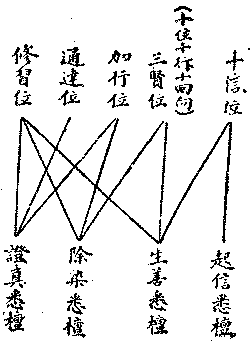



断智俱圆之究竟位，於四悉檀更无用处，以无学故。然是正能用之以悟他者，除佛以还，一切贤圣於四悉檀皆有用处。然十信位，信心圆满入於初住，贯达究竟；故世间悉檀唯在十信心，然十信心亦兼生善悉檀。三贤位积集福智资粮，正为生善悉檀；然伏执障现行，亦兼除染。加行位、正为伏断执障之染法；然亦意在证真。通达位时短故，唯是证真。修习位、则生长未生长之净善，破除未破除之染障，悟证未悟证之真实，故通三悉檀焉。於此次第，更可以一方式表之：



　　　　㊀………起信摄受……………┬方法  

　　　　　　　　　　　↓　　　　　：　│  

　　　　㊁………生善培育……………┤　│  

　　　　　　　　　　　↓　　　　　：　│  

　　　　㊂………破障锻炼……………┘　│  

　　　　　　　　　　　↓　　　　　　　↓  

　　　　㊃………证真成功……………………真实



至於究竟证真成功，即为佛位可知。经说一切智者善清净言教云：『五者於善说法毗捺耶中，八支圣智四沙门等皆现可得，当知名为一切智者善清净言教相』。亦见於以此四宗旨所施之教育也。



八　至教量之差别相



由前四道理故，四悉檀故，已知善清净言教之本相。今更广明差别，亦如解深密云：



『世尊！凡有几种一切如来身所住持言音差别？由此言音所化有情，未成熟者令其成熟，已成熟者缘此为境速得解脱』？『善男子！如来言音，略有三种：一者、契经，二者、调伏——毗捺耶——，三者本母——摩呾理迦——』。



『世尊！云何契经？云何调伏？云何本母』？



『善男子！若於是处，我依摄事显示诸法，是名契经。谓依四事，或依九事，或复依於二十九事。云何四事？一者、听闻事，二者、归趣事，三者、修学事，四者、菩提事。云何九事？一者、施设有情事，二者、彼所受用事，三者、彼生起事，四者、彼生已住事，五者、彼染净事，六者、彼差别事，七者、能宣说事，八者、所宣说事，九者、诸众会事。云何名为二十九事？谓依杂染品，有摄诸行事；彼次第随转事；即於是中作补特伽罗想已，於当来世流转因事；作法想已，於当来世流转因事、依清净品，有系念於所缘事；即於是中勤精进事，心安住事；现法乐住事；超一切苦缘方便事；彼遍知事——此复三种：颠倒遍知所依处故，依有情想外有情中邪行遍知所依处故，内离增上慢遍知所依处故——，修依处事；作证事；修习事；令彼坚固事；彼行相事；彼所缘事；已断未断观察善巧事；彼散乱事；彼不散乱事；不散乱依处事；不弃修习勤劳加行事；修习胜利事；彼坚牢事；摄圣行事；摄圣品眷属事；通达真实事；证得湟槃事；於善说法毗捺耶中世间正见，超升一切外道所得正见顶事；及即於此不修退事。於善说法毗捺耶中不修习故，说名为退，非见过失故名为退。



『曼殊室利！若於是处，我依声闻及诸菩萨显示别解脱及别解脱相应之法，是名调伏』。『世尊！菩萨别解脱几相所摄』？『善男子！当知七相：一者、宣说受轨则事故，二者、宣说随顺他胜事故，三者、宣说随顺毁犯事故，四者、宣说有犯自性事故，五者、宣说无犯自性事故，六者、宣说出所犯故，七者、宣说舍律仪故。



『曼殊室利！若於是处，我以十一种相决了分别显示诸法，是名本母。何等名为十一种相？一者、世俗相，二者、胜义相，三者、菩提分法所缘相、四者，行相，五者、自性相，六者、彼果相，七者、彼领受开示相，八者、彼障碍法相，九者、彼随顺法相，十者、彼过患相，十一者、彼胜利相。世俗相者，当知三种：一者、宣说补特伽罗故，二者、宣说遍计所执自性故，三者、宣说诸法作用事等故。胜义相者，当知宣说七种真如故。菩提分法所缘相者，当知宣说一切种所知事故。行相者，当知宣说八行观故。云何名为八行观耶？一者、谛实故，二者、安住故，三者、过失故，四者、功德故，五者、理趣故，六者、流转故，七者、道理故，八者、总别故。谛实者，谓诸法真如。安住者，谓或安立补特伽罗，或复安立诸法遍计所执自性，或复安立一向、分别、反问、置记，或复安立隐密、显了、记别差别。过失者，谓我宣说诸杂染法有无量门差别过患。功德者，谓我宣说诸清净法有无量门差别胜利。理趣者，当知六种，一者、真义理趣，二者、证得理趣，三者、教导理趣，四者、远离二边理趣，五者、不可思议理趣，六者、意趣理趣。流转者，所谓三世三有为相及四种缘。道理者，当知四种：一者、观待道理，二者、作用道理，三者、证成道理，四者、法尔道理。……总别者，谓先总说一句法已，后后诸句差别分别究竟显了。自性相者，谓我所说有行有缘，所有能取菩提分法，谓念住等，如是名为彼自性相。彼果相者，谓若世间若出世间诸烦恼断，及所引发世出世间诸果功德，如是名为得彼果相。彼领受开示相者，谓即於彼以解脱智而领受之，及广为他宣说开示，如是名为彼领受开示相。彼障碍法相者，谓即於修菩提分法能随障碍诸染污法，是名彼障碍法相。彼胜利相者，当知即彼诸随顺法所有功德，是名彼胜利相』。



曼殊室利菩萨复白佛言：『唯愿世尊，为诸菩萨略说契经、调伏。本母不共外道陀罗尼义！由此不共陀罗尼义，令诸菩萨得入如来所说诸法甚深密意』！佛告曼殊室利菩萨曰：『善男子！汝今谛听！吾当为汝略说不共陀罗尼义，令诸菩萨於我所说密意言词能善悟入。善男子！若杂染法，若清净法，我说一切皆无作用，亦都无有补特伽罗，以一切种离所为故。非杂染法先染后净，非清净法后净先染。凡夫异生，於麤重身执著诸法、补特伽罗自性差别，随眠妄见以为缘故，计我我所，曲此妄谓我见、我闻、我尝、我触、我知、我食、我作、我染、我净如是等类邪加行转。若有如实知如是者，便能永断麤重之身，获得一切烦恼不住，最极清净，离诸戏论，无为依止，无有加行。善男子！当知是名略说不共陀罗尼义』。



此中所说不共陀罗尼义，正唯「现量实相」之现实义。故真现实论是善清净言教之总持，亦为如来最深秘义。



九　历史考证之决择



问曰：大小乘教同源释尊，虽已闻命，然释尊生年既传说非一，且因锡兰所传大乘非佛说之死灰炽然复起，加以大乘之出於龙宫、铁塔、拈花者尤无信史可徵；今据为圣言者，大抵皆本乎释尊所说之大乘，安能树坚强不拔之基础耶？答曰：佛之教法缘起，辨者尝纷纷矣，今此举要言之，约为四说：



一曰、佛住世时已有文录：根本说一切有部毗捺耶杂事第四云：『时诸苾刍诵经之时，不闲声韵，随句而说，犹如写枣置之异器；彼诸外道讽诵经典，作吟咏声。给孤独长者白世尊：「听圣众作吟咏声而诵经典」。世尊意许，默然无说』。同药事第三云：『圆满与诸商人共入大海，彼诸商人昼夜常诵嗢柁南颂众义经等，以妙音声清朗而诵。圆满问曰：「是何言辞」？商人报曰：「是佛所说」』。同第四十四云：『胜光王宣告国人：不得夜中燃灯火。长者善兴於其夜中然明灯读佛教，将置狱内。四天释梵来听妙法，王遥见光明，问长者：「仁有大力今何愿求」？曰：「愿於夜寻读佛经，唯愿大王勿禁灯火」！王遂宣告：夜中燃火为读佛经，悉免其罪』。同第四十八云；『绀容夫人夜读佛经，复须钞写，告大臣曰：「桦皮贝叶，笔墨灯明，此要所须，宜多进入」』。据此、可知佛世已习经诵。且传佛说法度僧后，即逐事制止，作结界布萨，众处匪一，不皆随佛宣读，岂无律文！又传舍利弗、目犍连、迦旃延尝作论呈佛，则经、律、论皆有之矣。



二曰、结集但举证成仪式：大迦叶发起在千叶窟内结集三藏，为恐新学违异，乃会诸圣证同，勒成定本，期永依遵，非於此外别无传诵之籍。何况西域记云：『诸学无学数百千人，不预大迦叶之结集，更相谓曰：「如来在世，同一师学，法王寂灭，简异我曹，欲报佛恩，当集法藏」。於是凡圣咸会，贤智毕萃，复集素呾缆藏、毗捺耶藏，阿毗达磨藏、杂集藏、及禁咒藏』。又智度论说：弥勒、文殊将阿难於铁围山间，集大乘三藏为菩萨藏。则大乘显、密诸经，亦基於是矣。弥勒、文殊确为历史人物，集由弥勒、文殊，藉阿难以证成，亦期传信而已。其未经会证而述录之者，当犹不止於是。



三曰、语言文字诵录非一：释尊说法，游行不居，或用五天梵文雅语，或用巴利语等随方俗言，经律论中有多例证。由此佛世述录之者，语文非一，州土亦殊，何况结集之众，人非一区，结集之会，处非一地，诵录应有多种语文，传布亦在多种方域。故以巴利文为原语原典，或梵文为原语原典，或以南传小乘、北传大乘，或反於是，皆不应为执定之说。盖各方各语皆有原典大小乘教耳。不无写录缄藏而未经集诵证成流布者，亦多私人记诵传承而每致湮亡者。故大毗婆娑第十云：『商诺迦衣大阿罗汉般涅槃时，即於是日有七万七千本生经，一万阿毗达磨，隐没不现』。由此亦不应执初结集时都无录本，佛世已有写读者故。亦不应执曾集诵者都经写定，佛后亦多诵记失传者故。



四曰、流布分别次第先后：大迦叶之结集，承以阿难等上座之权威，一时王臣缁素尊视为佛教之正统，遂先流布。所写或巴利文，是为原始三藏。然此外者，亦非不同时潜流也。由此大天等得凭据为大众部之说。至於大众部兴，窟外多众所集诵录传之五藏，因渐弥布。佛寂三四百年之后，诸部分裂，正统权威失坠，弥勒等所集传与私人录承者，亦渐广布。乃缘起马鸣，龙树、无著、世亲等大乘三藏，是为流布次第先后。佛世由私人或少数人各为录诵者，随其心智浅深通狭，各尊所闻，传记有殊；然皆禀佛，同一师学，尚无大小显然对峙。迦叶结集，则为小乘所依；弥勒结集，则为大乘所依；窟外结集，则通小大之邮；然亦相摄而未相拒，或广於小、含大於小，或广於大、含小於大而已。大乘无不许阿含等为佛说者。四阿含中，若增一序品，有菩萨发意趣大乘，及弥勒菩萨问具足六度等文。中阿含、有授弥勒成佛记等文。长阿含第二游行经，有大乘文。杂阿含亦有大乘及毗卢遮那等文。律则根本说部有授记提婆达多成佛名具骨。又有令未生怨王得无根佛性。又授施灯乞女成佛，亦号释迦牟尼。又善财童子为贤劫菩萨。又舍利子为众说法，或发无上大菩提心等文。弥陀、般若、法华、涅槃，於阿难、须菩提、舍利弗、迦叶诸圣众，皆推上首。故大毗婆娑论一百二十六云：譬喻云何？谓诸经中所说种种众多譬喻，如长譬喻、大譬喻等，如大涅槃持律者说。方广云何？谓诸经中广说种种甚深法义。胁尊者言：此中般若，说名方广，事用大故。可知大般若、大涅槃等经，固早流行，且为胁尊者等共所尊信；可见在马鸣前后，大小乘相摄未相拒也。至龙猛师造论，广明一切空义，大破萨婆多等诸部论执，由是诸部论师斥非佛说及为空华外道，并据阿含等三藏以拒之。乃亦为龙猛等大乘师斥执此等三藏学者为小乘，另集大乘三藏，龙宫之华严、铁塔之大日等亦次第传出，且公然言非出阿难结集。然此亦非漫然无根据者，盖据之佛世私人所录藏更广演耳。故小大乘教之显然分别，起於龙猛，龙猛为大乘建立人，亦为大小分裂人也。由是中国禅宗所传拈花微笑与七佛等偈言，虽无所本经传，当知亦出口口之传诵耳。无著、世亲与龙猛，犹大乘一味。空有之诤，起於护法，清辩。智光为戒贤之弟子；据空义与玄奘诤者，或狮子光而非智光，以智光承清辩与戒贤并称者，出於讹传，未足信也。然玄奘作会宗论，并广译般若经等，大乘犹然一味。大乘教之分裂，则为显密，显密之分起於龙智。龙智即慈恩法师传所载，玄奘从龙猛弟子长命婆罗门学中论者。龙智长命且婆罗门，根据龙猛铁塔所传，广演仪轨，成为密部。是为分别次第先后，此观之五天佛教之势则然矣。



盖阿育王时佛教之传广，则势非迦叶之正统能限，由是窟外之结集行而诸部裂。诸部及诸外道相辩既多，势必广搜博闻，而弥勒结集及佛世录传之大小经教行，於是大乘流布。大乘既兴，为欲广宏其化，於是破诸部执而小大分。折之既胜，而欲广摄内外凡圣，於是演为华严、大日。逮婆罗门复兴，而龙智以长命婆罗门摄化之，於是演为密部而显密分。观此四义，则同源佛说，而有小大显密之流别，固昭然可知矣。



至於释尊生年，诚难考定。生周昭之俗传，不定为据。众圣点记与费长房等说，距今仅二千五百年前后，核之梵华之翻译史，若童寿译世亲之百论释，与真谛译陈那论等，亦难遵依。窃意佛生以来，当有二千五六百年；唯既无明确之史证，只能阙疑，然此与教义，盖无关弘旨者耳。



第二节　所知成事之决择



一　有情众生之决择



有情众生，前在有情节中已曾广说，今更为异门之分别。如瑜伽六十云：



如先所说生杂染义，当知此生略有十一：一、一向乐生，谓一分诸天。二、一向苦生，谓诸那落迦。三、苦乐杂生，谓一分诸天、人、鬼、傍生。四、不苦不乐生，谓一分诸天。五、一向不清净生，谓欲界异生。六、一向清净生，谓已证得自在菩萨。七、清净不清净生，谓色无色界异生。八、不清净清净处生，谓在欲界般涅槃法有暇处生。九、清净不清净处生，谓生色无色界异生。十、不清净不清净处生，谓生欲界异生不般涅槃法，设般涅槃法无暇处生。十一、清净清净处生，谓生色无色界非异生诸有学者。复次、经言：汝等长夜增羯咤斯，恒受血滴。何等名为羯咤斯耶？所谓贪爱，贪爱之言与羯咤斯名差别也。此言显示摄受集谛。恒受血滴，摄受苦谛。复次、婆罗门喻经中，世尊依死杂染说如是言：有五非狂如狂所作。何等为五？一、解支节者，谓更有餘活命方便，而乐分析所有支节以自活命，是名第一非狂如狂所作。二、悭贪者，谓悭贪所蔽，悭贪因缘所获财宝不食不施，唯除命终欻然虚弃大宝库藏，是名第二非狂如狂所作。三、乐生天者，谓更有餘身语意摄种种妙行生天方便，而乐妄执投火、溺水、颠堕高崖自害身命作生天因，是名第三非狂如狂所作。四、乐解脱者，谓更有餘八支圣道解脱方便，而乐妄执自逼自恼种种苦行，作解脱因，是名第四非狂如狂所作。五、伤悼死者，谓依伤悼亡者因缘种种哀叹剺攫其身，坌灰、拔发、断食自毁，欲令亡者还复如故，是名第五非狂如狂所作。



二　情器世间之决择



有情众生在器世间，以随时劫趣类不同，现诸差别。略引如论：



斗诤劫中有四衰退：谓寿量衰退，功德衰退，安乐衰退，一切世间盛事衰退。复次、斗诤劫中诸有情类，略於八处互不相数：一、不数正法，二、不数名闻，三、不数宗族，四、不数可愍，五、不数善友，六、不数有德，七、不数有恩，八、不数亲友。



斗诤劫指此地球减劫中之减极时，例如今世。不数谓不思也。此中之四衰退及八不思，察之今世莫不历然现前，奈何世人犹以进化自憍慢耶！又苦生界及咸海界之决择云：



何故焰摩名为法王？为能损害诸众生故，为能饶益诸众生故？若由损害众生名为法王，不应道理；若由饶益众生，今应当说云何饶益？答：由所饶益，不由损害。何以故？若诸众生执到王所，令忆念故，遂为现彼相似之身，告言：汝等自所作业当受其果。由是因缘，彼诸众生各自了知自所作业，还自受果。便於焰摩使者——众生业力增上所生犹如变化非众生所——，无反害心、无瞋恚心、不怀怨恨。乃由此故，感那落迦新业更不积集，故业尽已脱那落迦趣。是处焰摩由能饶益诸众生故，名为法王。若诸众生生那落迦忆宿命者，焰摩法王更不教诲；若由生已不忆宿命，王便教诲。略有三种补特伽罗生那落迦不忆宿命：一、极愚痴，谓生边地，不解观察，随诸恶转。二、极放逸，谓受欲者於诸欲中增上耽著，不解观察，随诸恶转。三、极邪见，谓成就一切诽谤邪见，不解观察，随诸恶转。由彼不能自然忆念，故令忆念。复次、二因缘故大海水咸：一、生彼众生福增上故，二、陆地众生一分非福增上故。所以者何？由水咸故，非人所涉，生彼无量微细众生，不被采害。又大海中种种珍宝差别可得，由水咸故，陆地众生一分难得。



三　情器世间之苦相



瑜伽六十一云：



复次、如说生苦，乃至略说五取蕴苦。云何生苦？当知此苦由五种相：谓众苦所随故，麤重所随故，众苦所依故，烦恼所依故，不随所欲离别法故。云何众苦所随故苦？谓生那落迦及一向苦饿鬼趣中，若於胎生、卵生生时种种忧苦之所随逐，故名众苦所随故苦。云何麤重所随故苦？谓三界诸行，为烦恼品麤重所随，性不调柔，不自在转，由此随逐三界有情诸行生起，故名麤重所随故苦。云何众苦所依故苦？谓衰老等众苦差别之所依故。云何烦恼所依故苦？谓受生已，於爱境爱，於瞋境瞋，於痴境痴，由是因缘住不寂静，惛荡身心不安隐苦，故名烦恼所依故苦。云何不随所欲离别法故苦？谓诸有情生者皆死，生必殒没，所有寿命死为边际，死为终极，如是等事非其所爱，由此因缘唯受众苦，是以不随所欲离别法故，说生为苦。云何老苦？当知亦由五相，谓於五处衰退故苦：一、盛色衰退故，二、气力衰退故，三、诸根衰退故，四、受用境界衰退故，五、寿量衰退故。云何病苦？当知病亦由五相；一、心身变坏故，二、忧苦增长多住故，三、於可意境不喜受用故，四、於不可意境非其所欲强受用故，五、能令命根速坏离故。云何死苦？当知此苦亦由五相：一、离别所爱盛财宝故，二、离别所爱盛朋友故，三、离别所爱盛眷属故，四、离别所爱盛自身故，五、於命终时备受种种极重忧苦故。云何怨憎会苦？当知此苦亦由五相：一、与彼会生忧苦故，二、治罚畏所依止故，三、恶名畏所依止故，四、苦逼迫命终怖畏所依止故，五、越正法恶趣怖畏所依止故。云何爱别离苦？当知此苦亦由五相：谓不与彼会生愁恼故，由此因缘生愁叹故，由此因缘身扰恼故，念彼众德思恋因缘意热恼故，应受用等有所阙故。如爱别离苦；求不得苦，当知亦尔。云何五取蕴苦？当知此苦亦由五相：谓生苦器故，依生苦器故，苦苦器故，坏苦器故，行苦性故。



四　情器世间之业相



广如瑜伽（卷六十）业杂染之决择，今略引之：



问：若於一时亦牵亦搦，盗取众生，即断其命，当言一业为二业耶？答：当言二业，以速转故，於此二业由增上慢谓之为一。若谓我当牵彼是第一思，即於盗时复谓我当搦杀是第二思，若时牵彼，尔时不搦，若时搦彼，尔时不牵，速即转故，生增上慢，谓是一时，是故此中当言二业。复次、略由三因缘故，成现法受业。何等为三？一、田广大故，二、思广大故，三、相续清净故。由五种相，田成广大：一、从于一切有情第一利益安乐增上意乐住起，谓慈等至。二、从於一切有情第一将护他心住起，谓无诤等持。三、从第一寂静涅槃乐相似圣住起，谓灭尽等至。四、已得一切不善不作律仪，谓预流果。五、极清净相续究竟，谓阿罗汉及佛为首大苾刍僧，如是名为田广大性。若於是处，以深厚殷重清净信心舍清净财，是名思广大性。若前生中，於他所施衣服等物，由身语意不为障碍，亦不思量与染污心，以无有障碍彼相续，当知是名相续清净。若有於此三种因缘，一切具足，当知彼业，定现法受；亦於生受，亦於后受。若有与此相违三种因缘，起不善业，当知亦成定现法受。或有所生一刹那业唯现法受；或有所生一刹那业亦现法受，亦於生受；或有所生一刹那业，三时皆受。譬如一缕其量微小能持一华，一系华已，势力便尽不复能系；复有一缕能持二华，再系华已，势力便尽；复有一缕能持多华，多系华已，其力方尽。又如流水其性微小，流经一步势力便尽；有第二水其性稍大，流经两步势力方尽；有第三水其性广大，流经多步势力乃尽。又如酢滴，其性淡薄，唯能酢彼一滴之水，不能酢多；有第二滴其性稍严，酢二滴水不能酢多；有餘酢滴其性更严，乃至能酢众多滴水。此中诸业差别道理，当知亦尔。



复次、十种不善业道，唯欲界系，亦唯能感欲界异熟，多於恶趣，少於善趣。又恶趣业，预流果时昔已断尽。若诸异生，世间离欲或复生上，一切皆伏而未永断。若不还果身犹住此或复上生，及阿罗汉，诸不善业皆毕竟断。若已证入清净增上意乐地菩萨，一切不善业皆毕竟断。此但由不忘念力所制持故，非由烦恼得系故。复次、思是业非业道，杀生乃至绮语亦业亦业道，贪、恚、邪见业道非业。



五　情器世间之烦恼相



广如瑜伽（卷五十九）烦恼杂染决择，今略引之：



复次、烦恼缘境略有十五：一、具分缘，谓身见等。二、一分缘，谓贪、瞋、慢等。三、有事缘，谓诸有事烦恼。四、无事缘，谓诸无事烦恼。五、内缘，谓六处定不定地所有烦恼。六、外缘，谓缘妙五欲所有烦恼。七、现见缘，谓缘现在所有烦恼。八、不现见缘，谓去来所有烦恼。九、自类缘，谓缘自类烦恼所有烦恼。十、他类缘，谓缘异类烦恼及缘烦恼事所有烦恼。十一、有缘，谓缘后有所有烦恼。十二、无有缘，谓缘断无有所有烦恼。十三、自境缘，谓欲界於欲行烦恼，色界於色行烦恼，无色界於无色行烦恼。十四、他境缘，谓色界於欲行烦恼，无色界於色行烦恼，又复下地於上地烦恼。所以者何？生上地者，於彼下地诸有情所，由恒常乐净具胜功德自谓为胜故。十五、无境缘，谓缘分别所计灭道，及广大佛法等所有烦恼。复次、烦恼现行有廿种：谓二十种补特伽罗，依二十缘起二十种现行烦恼。云何二十种补特伽罗？一、在家，二、出家，三、住恶说法，四、住善说法，五、增上烦恼，六，等分行，七、薄尘行，八、世间离行，九、未离欲，十、见圣迹，十一、未见圣迹，十二、执著，十三、不执著，十四、观察，十五、睡眠，十六、觉悟，十七、幼少，十八、根成熟，十九、般涅槃法，二十、不涅槃法。云何二十烦恼现行？一、随所欲缠现行，二、不随所欲缠现行，三、无所了知烦恼现行，四、有所了知烦恼现行，五、麤烦恼现行，六、等烦恼现行，七、微烦恼现行，八、内门烦恼现行，九、外门烦恼现行，十、失念烦恼现行，十一、猛利烦恼现行，十二、分别所起烦恼现行，十三、任运所起烦恼现行，十四、寻思烦恼现行，十五、不自在烦恼现行，十六、自在烦恼现行，十七、非所依位烦恼现行，十八、所依位烦恼现行，十九、可救疗烦恼现行，二十、不可救疗烦恼现行。云何二十烦恼现行缘？一、乐缘，二、苦缘，三、不苦不乐缘，四、欲缘，五、寻思缘，六、触缘，七、随眠缘，八、宿习缘，九、亲近恶友缘，十、闻不正法缘，十一、不正作意缘，十二、不信缘，十三、懈怠缘，十四、失念缘，十五、散乱缘，十六、恶慧缘，十七、放逸缘，十八、烦恼缘，十九、未离欲缘，二十、异生性缘。依此诸缘故烦恼现行。



问：於彼彼界结生相续彼彼身中，当言全界一切烦恼皆结生耶？为不全耶？答：当言全，非不全。何以故？若未离欲於自生处方得受生，非离欲故。又未离欲者，诸烦恼品所有麤重随缚自身，亦能为彼异身生因。由是因缘，当知一切烦恼皆结生相续。又将受生时，於自体上贪爱现行，於男於女，若爱若恚，亦互现行。又疑现行，彼作是思：此男此女今为与我共行事不？又於内外我我所见及我慢等皆亦现行。由此因缘，当知一切烦恼，皆得结生相续。复次、结生相续略有七种：一、缠及随眠结生相续，谓诸异生。二、唯随眠结生相续，谓见圣迹。三、正知入胎结生相续，谓转轮王。四、正知入住结生相续，谓诸独觉。五、於一切住不失正念结生相续，谓诸菩萨。六、业所引发结生相续，谓除菩萨结生相续。七、智所引发结生相续，谓诸菩萨。又有引无义利结生相续，谓即所引发结生相续。又有能引义利结生相续。如是总说结生相续，或七或八、九。



六　人间之上中下士



中国自孔仲尼说上智与下愚不移，后之儒家多说人性以三品别，此亦有理。兹略引瑜伽卷六十一云：



复次、依行差别，建立三士，谓下中上。无自利行、无利他行，名为下士；有自利行、无利他行，有利他行、无自利行，名为中士；有自利行、有利他行，名为上士。复有四种补特伽罗：或有行恶而非乐恶，或有乐恶而非行恶，或有行恶亦复乐恶，或非行恶亦非乐恶。若信诸恶能感当来非爱果报，由失念故、或放逸故，近恶友故、造作恶行，是名行恶而非乐恶。若先世来串习恶故，喜乐诸恶，恶欲所牵，彼由亲近善丈夫故、闻正法故、如理作意为依止故，见诸恶行能感当来非爱果报，自勉自励远离诸恶，是名乐恶而非行恶。若性乐恶而不远离，是名行恶亦复乐恶。若有为性不乐诸恶，亦能远离，名非行恶亦非乐恶。此中行恶亦乐恶者，是名下士；若有行恶而非乐恶，或有乐恶而非行恶，是名中士；若非行恶亦非乐恶，是名上士。复有三士：一、重受欲，二、重事务，三、重正法；初名下士，次名中士，后名上士。又有三种补特伽罗：一、以非事为自事，二、以自事为自事，三、以他事为自事。若行恶行以自存活，名以非事为自事；若怖恶行修行善行，名以自事为自事；若诸菩萨，名以他事为自事。初名下士，次名中士，后名上士。……又有三人：一者、有人唯能成就非律仪非不律仪摄所受戒律仪，二者、有人亦能成就声闻等相应所受戒律仪，三者、有人亦能成就菩提萨埵所受戒律仪；初名下士，次名中士，后名上士。复依修习思惟方便，建立三人：一者、有人唯得励力运转思惟；二者、有人有间运转，设得无间要作功用方能运转；三者、有人已得成就任运思惟。初名下士，次名中士，后名上士。又依已得修差别故，建立三人：一者、有人已得内心奢摩他定，未得增上慧法毗钵舍那；二者、有人已得增上慧法毗钵舍那，未得内心奢摩他定；三者、有人俱得二种；初名下士，次名中士，后名上士。又有三人：一者、有人已得有寻有伺三摩地，二者、有人已得无寻唯伺三摩地，三者、有人已得无寻无伺三摩地；初名下士，次名中士，后名上士。又依住修差别建立三人：一者、有人住染污静虑，二者、有人住世间清净静虑，三者、有人住无漏静虑：初名下士，次名中士，后名上士。



七　人间政治领袖之德失



佛法施行於人间世，而人间世盛衰兴废，政治领袖有大关系。古为帝王、辅宰，今为总统、或委员官长等。兹略引佛说出爱王经分别之：



　　　　　　　┌─一、种姓不高  

　　　　　　　│　二、不得自在  

　　　　　　　│　三、立性暴恶  

　　　　　　　│　四、猛利愤发  

　　　　　　　│　五、恩惠衰薄  

　　　　十过失┤　六、受邪佞言  

　　　　　　　│　七、所作不思不顺仪则  

　　　　　　　│　八、不顾善法  

　　　　　　　│　九、不知差别忘所作恩  

　　　　　　　└─十、一向纵任专行放逸  

　　　　　　　┌─一、种姓尊高  

　　　　　　　│　二、得大自在  

　　　　　　　│　三、性不暴恶  

　　　　　　　│　四、愤发轻微  

　　　　　　　│　五、恩惠猛利  

　　　　十功德┤　六、受正直言  

　　　　　　　│　七、所作谛思善顺仪则  

　　　　　　　│　八、顾恋善法  

　　　　　　　│　九、善知差别知所作恩  

　　　　　　　└─十、不自纵任不行放逸



此中除第一、种姓高贵不高贵，在今平民政治之制度中可不论外，餘九德失，皆政治领袖德失治乱所关也。



　　　　　　　　┌─一、不善观察而摄群僚  

　　　　　　　　│　二、虽善观察无恩妙行纵有非时  

　　　　五衰损门┤　三、专行放逸不思机务  

　　　　　　　　│　四、专行奢侈不顾财力  

　　　　　　　　└─五、专行恣纵不修法行  

　　　　　　　　┌─一、善观察摄受群僚  

　　　　　　　　│　二、能以时行恩妙行  

　　　　五方便门┤　三、无散逸专思机务  

　　　　　　　　│　四、不奢侈能节财力  

　　　　　　　　└─五、不纵恣善修法行  

　　　　　　　　┌─一、世所敬爱  

　　　　　　　　│　二、自在增上  

　　　　五可爱法┤　三、能摧怨敌  

　　　　　　　　│　四、善摄养身  

　　　　　　　　└─五、能往善趣  

　　　　　　　　┌─一、恩养世人  

　　　　　　　　│　二、英勇具足  

　　五能引可爱法┤　三、善权方便  

　　　　　　　　│　四、正受境界  

　　　　　　　　└─五、勤修法行



反五可爱法为五不可爱之法，反五能引可爱法为五能引不可爱之法，可以推知。世之欲为建功立德之政治领袖者，於能引可爱之五法，知善修习，则庶几矣。



八　超情佛刹之决择



略如解深密经卷五云：



曼殊室利菩萨摩诃萨请问佛言：『世尊！如佛所说如来法身，如来法身有何等相』？佛告曼殊室利菩萨曰：『善男子！若於诸地波罗密多善修出离，转依成满，是名如来法身之相。当知此相，二因缘故不可思议：无戏论故，无所为故。而诸众生计著戏论、有所为故』。『世尊！声闻、独觉所得转依名法身不』？『善男子！不名法身』。『世尊！当名何身』？『善男子！名解脱身。由解脱身故，说一切声闻、独觉与诸如来平等平等，由法身故说有差别。如来法身有差别故，无量功德最胜差别，算数譬喻所不能及』。『世尊！我当云何应知如来生起之相』？『善男子！一切如来化身作业，如世界起一切种类。如来功德众所庄严住持为相。当知化身相有生起，法身之相无有生起』。『世尊！云何应知示现化身方便善巧』？『善男子！遍於一切三千大千佛国土中，或众推许增上王家，或众推许大福田家，同时入胎、诞生、长大、受欲、出家、示行苦行、舍苦行已成等正觉，次第示现，是名如来示现化身方便善巧』。



尔时曼殊室利菩萨复白佛言：『世尊！云何应知诸如来心生起之相』？佛告曼殊室利菩萨曰：『善男子！夫如来者，非心意识生起所显。然诸如来有无加行心法生起，当知此事犹如变化』。『世尊！若诸如来法身远离一切加行，既无加行，云何而有心法生起』？『善男子！先所修习方便、般若加行力故，有心生起。善男子！譬如正入无心睡眠，非於觉悟而作加行，由先所作加行势力而复觉悟。又如正在灭尽定中，非於起定而作加行，由先所作加行势力还从定起。如从睡眠及灭尽定心更生起，如是如来由先修习方便、般若加行力故，当知复有心法生起』。『世尊！如来化身，当言有心，为无心耶』？『善男子！非是有心，亦非无心。何以故？无自依心故，有依他心故』。『世尊！如来所行、如来境界，此之二种有何差别』？『善男子！如来所行，谓一切种如来共有不可思议无量功德，众所庄严清净佛土。如来境界，谓一切种五界差别。何等为五？一者、有情界，二者、世界，三者、法界，四者、调伏界，五者、调伏方便界。如是名为二种差别』。



『世尊！如来成等正觉，转正法轮、入大涅槃，如是三种当知何相』？『善男子！当知此三皆无二相，谓非成等正觉、非不成等正觉，非转正法轮、非不转正法轮，非入大涅槃、非不入大涅槃。何以故？如来法力究竟净故，如来化身常示现故』。『世尊！诸有情类，但於化身见闻奉事，生诸功德，如来於彼有何因缘』？『善男子！如来是彼增上所缘之因缘故。又彼化身是如来力所住持故』。



『世尊！等无加行，何因缘故如来法身为诸有情放大智光及出无量化身影像？声闻、独觉解脱之身无如是事』？『善男子！譬如等无加行，从日月轮水火二种颇胝迦宝放大光明，非餘水火颇胝迦宝。谓大威德有情所住持故，诸有情业增上力故。又如从彼善工业者之所雕饰，末尼宝珠出印文像，不从所餘不雕饰者；如是缘於无量法界方便般若极善修习磨莹，集成如来法身，从是能放大智光明及出种种化身影像，非唯从彼解脱之身，有如斯事』。『世尊！如世尊说如来菩萨威德住持，令诸众生於欲界中生刹帝利、婆罗门等大富贵家，人身财宝无不圆满，或欲界天色无色界，一切身财圆满可得。世尊！此中有何密意』？『善男子！如来菩萨威德住持，若道若行，於一切处，能令众生获得身财皆圆满者，即随所应，为彼宣说此道此行；若有能於此道此行正修行者，於一切处所获身财无不圆满。若有众生，於此道此行违背轻毁，又於我所起损恼心及瞋恚心，命终已后，於一切处所得身财无不下劣。善男子！由是因缘，当知如来及诸菩萨威德住持，非但能令身财圆满，如来菩萨住持威德，亦令众生身财下劣』。



『世尊！诸秽土中，何事易得？何事难得？诸净土中，何事易得？何事难得』？『善男子！诸秽土中，八事易得，二事难得。何等名为八事易得？一者、外道，二者、有苦众生，三者、种姓家世兴衰差别，四者、行诸恶行，五者、毁犯尸罗，六者、恶趣，七者、下乘，八者、下劣意乐加行菩萨。何等名为二事难得？一者、增上意乐加行菩萨之所游集，二者、如来出现於世。善男子！诸净土中与上相违，当知八事甚为难得，二事易得』。



第三节　所知蕴素之决择



一　蕴事之决择



所知现实中之蕴素，可总摄於蕴与界处。五蕴餘义，今先决择。论五十四云：



问：如说积聚义是蕴义，何等名为积聚义耶？答：种种所名体义，更互和杂转义，一类总略义，增益损减义，是积聚义。问：何缘色蕴说名为色？答：於彼彼方所种殖增长义，及变碍义，故名为色。此变碍义复有二种：一、手等所触可变坏义；二、方处差别种种相义。问：何缘四无色蕴总说名名？答：顺趣种种所缘境义，依言说名分分种种所缘境义，故说名名。问：诸蕴谁所摄？为何义故建立摄耶？答：自性所摄非他性；为遍了知种种自类，是故建立。



复次、云何诸蕴次第？谓说差别，此复五种应知：一、生起所作，二、对治所作，三、流转所作，四、住所作，五、安立所作。生起所作者：谓眼、色为缘能生眼识，乃至意、法为缘能生意识。此中先说色蕴，次说识蕴，此则是诸心所所依，由依彼故受等心所生，故次经言三和故触，触缘受等。是名诸蕴生起所作宣说次第。对治所作者：为欲对治四颠倒故，说四念住，谓於不净计净颠倒，於苦计乐颠倒，於无我计我颠倒，於无常计常颠倒。此中先说色蕴，次说受蕴，次说识蕴，后说想行二蕴，是名对治所作宣说次第。流转所作者：根及境界为依止故，於现法中由二种蕴受用境界起诸杂染，谓领纳境界及彩畫境界；由一种蕴造作一切善不善业，於后法中起生老等一切杂染；一是所染，故最后说。住所作者：由四识住及识次第而说，是名住所作。安立所作者：谓诸世间互相见已，先了其色，是故先立色蕴；次由受蕴知彼进退，或苦或乐，是故次立受蕴；次由想蕴知彼如是名、如是类、如是性等，是故次立想蕴；次由行蕴知彼如是愚痴、如是聪叡，是故次立行蕴；后由识蕴安立内我，谓於诸蕴中安立所了有苦有乐，随起言说及愚智等，是名诸蕴安立所作宣说次第。又复依止我众具事及我事故，应知诸蕴宣说次第：谓我依身於诸境界受用苦乐，於己於他随起言说，谓如是名、如是类、如是性等；此之二种依法非法，方得积集。如是应知我众具事，当知最后蕴是我事。



复次、色蕴摄几蕴？几界？几处？几有支？几处非处？几根耶？如色蕴，如是乃至识蕴。谓色摄一蕴全，十界、十处全，一界、一处少分，六有支少分，处非处少分，七根全。受蕴摄一蕴全，一界、一处少分，一有支全，三有支少分，处非处少分，五根全，三根少分。想蕴摄一蕴全，一界、一处少分，三有支少分，处非处少分，不摄诸根。行蕴摄一蕴全，一界、一处少分，四有支全，五有支少分，处非处少分，六根全，三根少分。识蕴摄一蕴全，七界全，一处全，一有支全，四有支少分，处非处少分，一根全、三根少分。如是有六种摄，所诸蕴摄乃至根摄；由此相摄道理，展转相摄，如应当知。复有餘十种摄应当了知：一者、界摄，谓诸蕴等各自种子所摄。二者、相摄，谓诸蕴等自相、共相所摄。三、种类摄，谓诸蕰等遍自种类所摄。四、分位摄，谓诸蕴等顺乐受等分位所摄。五、不相离摄，谓诸蕴等由一一法及诸助伴摄一切蕴等。六者、时摄，谓诸蕴等过去未来现在各自相摄。七者、方摄，谓诸蕴等在此方转，或依此生，即此方摄。八者、全摄，谓诸蕴等五等所摄。九者、少分摄，谓诸蕴等各各差别少分所摄。十者、胜义摄，谓诸蕴等真如相所摄。如是诸蕴一切摄义总有十种。如蕴，乃至根亦尔。又由三法摄一切法，谓色蕴、法界、意处。



复次、依止几处色蕴转耶？依止几处名所摄四蕴转耶？谓依止六处色蕴转：一、建立处，二、覆藏处，三、资具处，四、根处，五、根住处，六、有威德定所处。依止七处名所摄四蕴转：一、乐欲，二、希望，三、境界，四、寻伺，五、正知，六、清净方便，七、清净。诸受用欲者，依止四处；住律仪者、精进行者，依止一处；已得近分定者，依止一处；安住根本定者，依止一处。如是七处，略有四位应知。



二　色蕴之别决择



瑜伽五十四云：



问：色蕴中眼几物所摄？答：若据相摄，唯有一物，谓眼识所依清净色。若据不相离摄，则有七物，谓即此眼及与身、地、色、香、味、触。若据界摄，则有十物，即此七物界，及水、火、风界。如眼、耳、鼻、舌，当知亦尔。此中差别者，谓耳、耳识所依清净色，鼻、鼻识所依清净色，舌、舌识所依清净色，餘如前说。若身、当除眼等四。何以故？由远离彼独可得故。此相者，谓身识所依清净色。若於外色、香、味、触彼所行相中，除一切根，餘一切如前应知。声及声界不恒有故，今当别说：若於是处有声，当知此处复增其一，应知声界，一切处增。复次、色等所缘境界，如本地分已广分别。若触处中所说造色，滑乃至勇，当知即於大种分位假施设有：谓於大种清净性、假立滑性，於大种坚实性、假立重性，於大种不清净不坚实性、假立涩性及轻性，於大种不清净慢缓性、假立软性，由水与风和合生故假立有冷，由阙任持不平等故假立饥、渴及弱、力，由无所阙无不平等故假立强、力及饱，由不平等故假立病，由时分变异不平等故假立老，由命根变异不平等故假立死，由血有过患不平等故假立痒，由恶饮不平等故假立闷绝，由地与水和合生故假立黏，由往来劳倦不平等故假立疲极，若远离彼由平等故假立憩息，由除垢等离萎顇故假立勇锐。如是一切，说诸大种总有六位：谓净不净位，坚不坚位，慢缓位。和合位，不平等位，平等位，如是六位，复开为八。若八、若六，平等平等。



复次、一切色乃至触，皆二识所识，谓自识所识及意识所识，或渐或顿。眼等五根，一意识所识。复次、色界中无现香、味，然有彼界。何以故？此二皆是段食摄故。由无此二，鼻、舌二识亦无，此就现行说，非就界说。如是一切色蕴所摄色中，九种是实物有；触所摄中，四大种是实物有；当知所餘唯是假有。堕法处色亦有二种：谓实有、假有。若有威德定所行境，犹如变化，彼果彼境及彼相应识等境色，是实物有，若律仪色不律仪色，皆是假有。又定所行色，若依此系定，即由此系大种所造。又此定色，但是世间有漏，无漏由定而生，非出世间由此定色，有戏论行定为因故。又非一切所有定心皆有能生此色功能，唯一类有，如能起化，谓不思惟。但由先时作意所引，离诸暗昧，极善清净明了现前，当知是定乃能生色。若定力励数数思惟，假胜解力而得见者，当知不能生起此色。又复此色虽非出世定之所行，然由彼定增上力故，有一能现，当知此事不可思议。问：欲色二界实物有色何差别耶？答：色界诸色清净最胜，能发光明，又极微细，下地诸根所不行故；又无有苦，依彼诸色苦受不生故。欲界不尔，是名差别。



三　极微色之决择



亦瑜伽论五十四云：



问：诸极微色，由几种相建立应知？答：略说由五种相，若广建立如本地分。何等为五？一由分别故，二、由差别故，三、由独立故，四、由助伴故，五，由无分故。分别建立者：谓由分别觉慧，分析诸色至极边际，建立极微，非由体有；是故极微无生无灭，亦非色聚集极微成。差别建立者：略说极微有十五种，谓眼等根有五极微，色等境界亦五极微，地等极微复有四种，法处所摄实物有色极微有一。独立建立者：谓事极微建立自相故。助伴建立者：谓聚极微。所以者何？於一地极微处所，有餘极微同聚一处不相舍离，是故依此立聚极微。问：何因缘故诸有对法同处一处不相舍离，而不说名无对性耶？答：随顺转故，由彼展转相随顺生，不相妨碍。又由如是种类之业增上所感，如是而生。何以故？一切色聚，一切色根共受用故。若异此者，一切聚中，非有一切地等诸色不相舍离。若尔，眼等诸识境界，便不遍满一切聚中，如是应无遍满受用！是故当知定有诸色同一处所，不相舍离。又有诸色，或於是处互相妨碍；或於是处不相妨碍，如中有色等，而彼诸色，非无对性。此中道理，当知亦尔。



无分建立极微者：谓非彼极微更有餘分，非聚性故；诸聚极微可有细分。若极微处，即唯此处，更无细分可以分析。问：如是所说五相极微，复有五眼，所谓肉眼、天眼、圣慧眼、法眼、佛眼，当言几眼用几极微为所行境？答：当言除肉眼、天眼、所餘眼用一切极微为所行境。何以故？以彼天眼唯取聚色中、表、上、下、前、后、两边，若明若暗，必不能取极微处所；由极微体，以慧分析而建立故。问：何故说极微无生无灭耶？答：由诸聚色最初生时全分而生，最后灭时不至极微位，中间尽灭犹如水滴。复由五相应知名不如理思议极微：谓於色聚中有诸极微自性而住，应知名初不如理思议极微。或谓极微有生有灭；或谓极微与餘极微或合或散；或谓众色於极微量积集而住；或谓极微能生别异众多色聚；应知名后不如正理思议极微。故应方便以如理思思议极微，断此五种非理思议。



复次、建立极微，当知有五种胜利：谓由分析一合聚色安立方便，於所缘境便能清净广大修习，是初胜利：又能渐断萨迦耶见，是第二胜利；如能渐断萨迦耶见，如是亦能渐断憍慢，是第三胜利；又能渐伏诸烦恼缠，是第四胜利；又能速疾除遣诸相，是第五胜利。如是等类，应当如理思惟极微。



四　色业之决择



色蕴作业，通无情有情色：无情——矿植——色业皆无记性，有情色业通善、不善、无记。亦如瑜伽五十四云：



复次、色蕴所摄地界能为几业？乃至风界能为几业？当知一切皆为五业：谓地界能为打触变坏业、建立业、与依止业、违损业、摄受业；水界能为流润业、摄持业、溉灌业、违损业、摄受业；火界能为照了业、成熟业、烧然业、违损业、摄受业；风界能为发动业、随转业、消燥业、违损业、摄受业。又诸大种於所生造色，当知能作五业：谓生起业、依止业、建立业、任持业、增长业。於彼变异生时，能为导首故；变异生已与彼为处不相舍离，能为依止故；摄受损害安危共同，能建立彼故；持彼本量令不损减，故能任持；令彼积集增进广大，故能增长。



问：眼耳所行善不善色，彼何因缘成善等性，非餘色耶？答：若略说由软中上品三种思差别故：一、加行思，二、决定思，三、等起思；由此能起若善不善身语表业。当知上品思为依止故，能发善不善业。问：依止聚色而有运动，当言与彼异不异耶？答：当言不异。何以故？於彼处所若生不生、或灭不灭，而有运动，皆有过失可得故。问：有何过失？答：若言生而有动，便越刹那相；若言不生，便应无动。若言灭者，应与餘等；若言不灭，便越行相。又於异处生起因缘分明可得。是故当知，无别运动实物可得。如是等类，应当思惟色蕴作业。



五　名所摄四蕴之决择



瑜伽五十五云：



问：诸名所摄与心相应所餘蕴法，当言率尔起耶？寻求耶？决定耶？答：若依彼类心，当言即彼类。问：如经言：此四无色蕴，当言和合非不和合，不可说言如是诸法可分可析令其差别。何故彼法异相成就而说和合无差别耶？答：众多和合，於所缘境受用领解方圆满故。若不尔者，随阙一种，於所为事应不圆满。问；诸心心法，凡有几种差别名耶？答：有众多名，谓有所缘、相应、有行、有所依等无量差别。问：何故眼等亦有境界而但说彼名有所缘，非眼等耶？答：由彼眼等离所取境亦得生起，心与心则不如是。问：何故名相应？答：由事等故，处等故，时等故，所作等故。问：何故名有行？答：於一所缘，作无量种差别行相转故。问：何故名有所依？答：由一种类托众所依差别转故。虽有为法无无依者，然非此中所说依义，唯恒所依为此量故，问：何故乐望苦受，苦望乐受，若乐若苦望非苦乐说互相对？答；由自种类而不同分，互相对故。问：何故不苦不乐受、望彼无明说互相对？答：由与诸受一切烦恼皆为助伴，互相对故。问：何故明与无明说互相对？答：能治所治互相对故。问：何故明与涅槃说互相对？答：因果相属互相对故。



六　界事之决择



问：何等是眼界？答：若眼未断，或复断已命根摄受。如眼界，乃至意识界及法界一分，当知亦尔。问：何等是色界？答：若色根增上所生，若彼於此为增上，是名色界。如色界，乃至触界，当知亦尔。问：此十八界几是实有？几是假有？答：实有者或十七、或十二，六为一故、一为六故，此约世俗安立道理。问：若有眼亦眼界耶？设有眼界亦眼耶？答：应作四句：或有眼非眼界，谓阿罗汉最后眼，是名初句。或有眼界非眼，谓生有色界若眼未生、或生已失，或不得眼，或眼无间灭；若诸异生生无色界；是第二句。或有眼亦眼界，谓除尔所相，是第三句。或有无眼亦无眼界；谓阿罗汉眼已失坏，或不生眼，若生无色界，或於无餘依般涅槃界已般涅槃，是笫四句。如眼界，一切内界随其所应，当知亦尔。身界应分别，谓无先来不生身者，餘随所应当具宣说。於四外界，随其所应亦当具说。若声声界，正宣击时当言俱有，若不宣击当言随逐餘界，唯界非声。问：此十八界几是同分？几彼同分？答：有识眼界名为同分，所餘眼界名彼同分。如眼界，乃至身界，亦尔。唯根所摄内诸界中，思量同分及彼同分，非於色等外诸界中。当知法界诸有所缘，如心界说，诸无所缘，如色等说。问：几界合而能取？几界不合能取？答：六合能取，四不合能取，五及一少分非能取，一界若合不合二俱能取。问：几唯所取非能取？几亦所取亦能取耶？答：一切皆所取，谓五及一少分唯所取，十二及一少分亦是能取。问：几由助伴故能取？几独取耶，答：十及一少分由助伴故能取，一及一少分独所取。问：几唯欲界系？答：四。问：几唯色界系？答：无。问：几唯无色界系？答：亦无。问：几唯欲色界系？答：十一。问：几唯色无色界系？答：无。问：几通三界系？答：三。问：几执受？几非执受？答：五执受，五执受非执受，所餘一向非执受。何以故？以离於彼，餘能执受，执受於彼不可得故。云何种种界？谓即十八界展转异相性。云何非一界？谓即彼诸界无量有情种种差别所依住性，云何无量界？谓总彼二名无量界。如佛世尊於恶叉聚喻中说：我於诸界，终不宣说界有边际。



问：云何是界义？答：因义，种子义，本性义，种性义，微细义，任持义是界义。问：以何义故涅槃、虚空亦说名界？答：由彼能持苦不生义，持生眼，等运动用义。问：为显何意建立界耶？答：为显因缘义，及显根境受用义。问：此十八界由谁分别？答：若略说当知由六种：一、法界，谓眼等法有眼等界。二、净界，谓住种性补特伽罗所有诸界。三、本性界，谓即如所说十八界，无始时来，於后后生其性成就，及住种性不住种性补特伽罗，无始时来涅槃非涅槃法其性成就。四、熏习界，谓即此诸界净不净法先所熏习，於生死中得胜劣生槃涅因性。五、已与果界，谓即此诸界感果已灭。六、未与果界，谓即此诸界未感得果，或灭未灭。如是略说诸界有六种，广说者其数无量。（论卷五十六）



七　处事之决择



瑜伽五十六云：



云何眼处？谓若眼已得不舍，於无间体非断灭法。如眼处相，餘处自性，当知亦尔。问：处、触处何差别？答：处如前说；触处者、谓与触俱，或能无间引发诸触、随顺於触所有诸处。问：若眼亦处耶！设处亦眼耶？答：有眼非处，谓若眼已得、不舍，然是无间断灭之法。有处非眼，谓所餘处安住处相。有亦眼亦处，谓若眼已得、不舍，亦非无间断灭之法。有非眼非处，谓若眼不得或得已舍，及餘耳等不住处相。问：若处亦触处耶？设触处亦处耶？答：诸触处必是处，有处非触处，谓眼等不与触合，亦复不能引无间触，然非无间断灭之法。若於色界或生或长所有鼻、舌，若生无想有情天中所有诸根，於一切时定知必定非处。问：处名何义？为显何义建立处耶？答：诸心心所生长门义，缘义，方便义，和合性义，所依止义，居住处义，是名处义。为欲显示等无间、所缘、增上三种缘义，故建立处，广分别处及次第，随其所应，如界当知。又世尊言：有八胜处，广说如经；如是十遍处等。又有四处，谓空无边处等。又有二处，谓无想处、非想非非想处。如是等法处名说者，如所说相，随其所应，当知皆在十二处摄。又处依止，如界应知。



八　诸法分位之决择



诸分位法，今於旧论二十四行虽有减合增开；然於旧义亦仍含摄。故引瑜伽五十六云：



问：依何分位建立得？此复几种？答：依因、自在、现行分位建立得。此复三种，谓种子成就，自在成就，现行成就。问：依何分位建立无想定、灭尽定、及无想天？此三各有几种？答：依已离遍净贪、未离上贪，出离想作意为先，名灭分位，建立无想定。此复三种：自性者、唯是善；补特伽罗者、在异生相续；起者、先於此起，后於色界第四静虑当受彼果。依已离无所有处贪、止息想作意为先，名灭分位，建立灭尽定。此复三种：自性者、唯是善；补特伽罗者、在圣相续，通学无学；起者、先於此起，后於色界重现在前，托色所依方现前故。此据未建立阿赖耶识教，若已建立，於一切处皆得现前。依生无想有情天中、名分灭位，建立无想。此亦三种：自性者、无覆无记；补特伽罗者、唯异生性，彼非诸圣者；起者、谓能引发无想定思，能感彼异熟果。后想生已，是诸有情便从彼没。问：依何分位建立命根？此复几种？答：依业所引异熟住时决定分位，建立命根。此复三种：谓定不定故，爱非爱故，岁劫数等所安立故。问：依何分位建立众同分？此复几种？答：依诸有情相似分位，立众同分。此复三种：所谓种类同分，自性同分，工巧业处养命同分。问：依何分位建立生？此复几种？答：依现在分位建立生。此复三种：所谓刹那生，相续生，分位生。问：依何分位建立老？此复几种？答：依前后分位建立老。此复三种：异性老，转变老，受用老。问：依何分位建立住？此复几种？答：即依生分位建立住。此复三种：谓刹那住，相续住，立制住。问：依何分位建立无常？此复几种？答：依生已坏灭分位建立无常。此复三种：谓坏灭无常，转变无常，别离无常。问：依何分位建立名身？此复几种？答：依假言说分位建立名身。此复三种：谓假设名身，实物名身，世所共了不了名身。如名身、句身、文身，当知亦尔。此中差别者：谓标句、释句；音所摄、字所摄。问：依何分位建立异生性？此复几种？答：依未生起一切出世圣法分位，建立异生性。此复三种：谓欲界系，色界系，无色界系。问：依何分位建立流转？此复几种？答：依因果相续分位，建立流转。此复三种：谓刹那展转流转，生展转流转，染污清净展转流转。问：依何分位建立定异？此复几种？答：依法别相分引位，建立定异，此复三种：谓相定异，因定异，果定异。问：依何分位建立相应？此复几种？答：依因果相称分位，建立相应。此复三种：谓和合相应，方便相应，称可道理所作相应。问：依何分位建立势速？此复几种？答：依迅疾流转分位，建立势速？此复三种：谓诸行势速，士用势速，神通势速。问；依何分位建立次第？此复几种？答：依一一行流转分位，建立次第。此复三种：谓刹那流转次第，内身流转次第，成立所作流转次第。问：依何分位建立时？此复几种？答：依行相续不断分位，建立时。此复三种：谓去、来、今。问：依何分位建立方？此复几种？答：依所摄受诸色分位，建立方。此复三种：谓上、下、傍。问：依何分位建立数？此复几种？答：依法齐量表了分位，建立数。此复三种：谓一数、二数、多数。问：依何分位建立和合？此复几种？答：依所作支无阙分位，建立和合。此复三种：谓集会和合，一义和合，圆满和合。问：依何分位建立不和合？此复几种？答：与和合相违，应知不和合，若分位，若差别。



九　诸法善染无记之决择



善唯善性，即善心所及其相应等流之善。染摄有覆、不善二性，即六烦恼心所，及其相应等流之染。无记唯无覆性，此有四种。瑜伽五十五云：



复次、诸无记法依处，当知略有四种：谓业所引生，生已若行住，若养命，若三摩地差别。复次、彼自性云何？谓异熟生蕴，若中庸加行所摄威仪路及工巧处，若为嬉戏加行所摄变化。问：彼云何展转相应耶？答：威仪路、工巧处，或於一时展转相应。如说或有事业行时易作，非住非坐亦非偃卧，乃至或有事业若行若住若坐若卧皆悉易作，如经广说；所餘无有展转相应。问：是诸无记几实物有？几是假有？答：於异熟所摄诸蕴及心加行差别中而施设故，当知一切皆世俗有。云何彼成软中上品？谓异熟生及威仪路不猛利故，俱是软品；诸工巧处性猛利故，说名中品；当知变化性极猛利，故是上品。又四种类各有差别：谓无色界异熟是软品，色异熟是中品，欲界异熟是上品；若坐若卧是软威仪，住是中威仪，行是上威仪；初习业者是下工巧，已串习者是中工巧，堪为师者是上工巧；下品修三摩地所得、是软变化，中品修三摩地所得、是中变化，上品修三摩地所得是上变化。如是等类软中上品，差别应知。问：是诸无记，依何事生？答：当知略说依十二事，如闻所成地已说。云何诸无记差别？谓异熟生，五趣别故五种差别。若威仪路，威仪别故四种差别；若工巧处，十二事差别故即十二种差别。异生、声闻、独觉、菩萨、如来差别故，为嬉戏为利他身语变化差别故，当知变化八种差别。由此差别即摄餘事，故不别说。又异熟生，一向无记；二、三可得，一、有二种。若依伎乐以染污心发起威仪是染污性，若依寂静即是善性。若依染著发起工巧是染污性，若善加行所起工巧即是善性。为引导或为利益诸有情故而起变化，当知是善，此无染污。



此中诸决择义，广如瑜伽蕴事善巧，界事善巧，处事善巧中说。



第四节　一切所知之决择



一　因与缘生果之决择



瑜伽五十一云：



问：依何道理，应知宣说唯从未来非实非有诸行相生？答：若未来法行相实有而得生者，此法为转而说生耶？谓从未来世处转向现在世处为死生耶？谓未来世死生现在世为彼为缘而得生耶？谓於未来法住不变，用彼为缘於现在世有餘法生。为有业用而说生耶？谓於未来本无业用至现在世方有业用。为圆满相而说生耶？谓於未来相未圆满至现在世相乃圆满。为有异相而说生耶？谓於未来有未来分及有因分，由此二种其相有异；来至现在有现在分及有果分，由此二种其相有异。如是六种诸法生起，皆不应理。何以故？非无方无处法，有从异方转趣异方义。亦非未生、未已生法而有死义。若彼为缘而得生者，便异法生非未来生，此於未来便为未有。又一切法第一义中无作用故，业用离相异不可得，唯即於相而假建立；设有异者，未来现在同实有相，唯说现在独有业用，理不可得。又此业用，便应本无而今得生。又与世尊微妙言说即成相违，如说诸行非常非恒；汝显诸行业用无常，由此义故行应是常。又等於一相，若相异分得是有者，相之异分何故不有？又相异分本无今有，相之异分何故不成本无今有？又离色等一切行相，餘未来分必不可得。又应未来无有果相，现在方有果相生起。如是已辨证成道理，依此道理，应知宣说未来诸法一切行相非实非有，本无今有。如於未来如是，过去、随其所应，由此道理当知宣说非实非有。



复次、过去行云何？谓相已灭没，自性已舍。现在行云何？谓相未灭没、自性未舍，生时暂住。未来行云何？谓因现有自相未生，未得自性。问：若彼诸行未来本无而得生者，空华、兔角、石女儿等，何故不生？答：由空华等无生因故，一切诸行各各差别定有生因。问：若一切行各各差别有生因者，何因缘故诸行俱时不顿生耶？答：诸行虽有各别生因，然必待缘方得生起，若彼彼行生缘现前，彼彼行因生彼彼行，是故诸行虽现有因，然无俱时顿生起过。复次、此中云何名诸行因？何等名缘？谓薄伽梵说：诸行生缘略有四种：一、因缘，二、等无间缘，三、所缘缘，四、增上缘。因缘一种，亦因亦缘；餘之三种，唯缘非因。



二　亲因之决择



瑜伽五十一云：



云何因缘？谓诸色根根依及识，此二略说，能持一切诸法种子。随逐色根，有诸色根种子、及餘色法种子、一切心心所等种子；若随逐识，有一切识种子、及餘无色法种子，诸识根种子、所餘色法种子；当知所餘色法自性，唯自种子之所随逐。除大种色，由大种色二种种子所随逐故，谓大种种子及造色种子。即此所立随逐差别种子相续，随其所应，望所生法，是名因缘。



复次、若诸色根及自大种非心心所种子所随逐者，入灭尽定、入无想定、生无想天，后时不应识等更生；然必更生，是故当知心心所种子随逐色根，以此为缘彼得更生。复次、若诸识非色种子所随逐者，生无色界异生，从彼寿尽、业尽没已还生下时，色无种子应不更生；然必更生，是故当知诸色种子随逐於识，以此为缘色法更生。



复次、若诸异生由世间道入初静虑，若得生彼，尔时欲界诸染污法及餘欲界诸法种子，但被损伏，不能永害。何以故？由此异生从彼定退，欲界染法复现前故，从初静虑没已复还生欲界故。复次、损伏略有三种：一、远离损伏，二、厌患损伏，三、奢摩他损伏。云何远离损伏？谓如有一弃舍家法，趣於非家，远离种种受用欲具，受持禁戒，於所受持远离禁戒，亲近修善若多修习；由亲近修习多修习相续不断故，於诸欲具心不趣入，心不流散，心不安住，心不爱乐，亦不发起彼增上力缘彼境界所起烦恼，如是名为远离损伏。云何厌患损伏？谓如有一或由过患想，或由不净想，或由青瘀等想，或由随一如理作意，如是如是厌患诸欲；虽未离欲，然於诸欲修厌逆故，心不趣入，乃至广说，如是名为厌患损伏。云何奢摩他损伏？谓如有一由世间道得离欲界欲，或离色界欲，彼由奢摩他任持心相续故，於欲色中心不趣入，乃至广说，如是名为奢摩他损伏。若圣弟子由出世道离欲界欲，乃至具得离三界欲，尔时一切三界染污诸法种子，皆悉永害。何以故？由圣弟子，於现法中不复堪任从离欲退更起下地烦恼现前；或生上地亦不堪任从彼没已还生下地。如榖麦等诸外种子，安置空逈或於乾器，虽不生芽非不种子；若火所损，尔时毕竟不成种子。内法种子损伏、永害，道理亦尔。若圣弟子将入无餘涅槃界时，所有一切善及无记诸法种子皆被损害，由染污法种子灭故，不复能感当来异熟果，亦不复能生自类果，当知是名第四损伏，所谓永害助伴损伏。复次、具缚者所有心起，若乐俱行、或苦俱行、或不苦不乐俱行，此一切心，皆乐种子、苦种子、不苦不乐种子之所随逐；若起善心、或染污心、或无记心，此一切心皆善种子、染污种子、无记种子之所随逐。又诸有学不具缚者所有心生，若世间善心、或出世心、或染污心、或无记心，皆为一切修道所断烦恼种子之所随逐；由未断故有时得生，亦为所餘诸法种子之所随逐。又诸无学一切烦恼已永断者所有心生，若世间善心、若出世心、若无记心，此一切心皆已永离染法种子，但为一切善、无记法种子随逐相续而生。复次、此所建立种子道理，当知且依未建立阿赖耶识圣教而说。若已建立阿赖耶识，当知略说诸法种子，一切皆依阿赖耶识。又彼诸法若未永断，若非所断，随其所应，所有种子随逐应知。



问：如世尊言：我说阿罗汉苾刍於四种增上心法现法安乐住中随一而退。若彼一切染污种子皆已永害，云何复起下地烦恼？若不复起，彼云何退？答：退有二种：一者、断退，二者、住退。言断退者，唯是异生；言住退者，是诸圣者亦是异生。若世间道，断诸烦恼复起现前，当知尔时断退故退，亦是住退。若出世道断烦恼已，心营世务，不专修习如理作意，由此不能於其中间现法乐住，数起现前如先所得，后亦如是；然其下地已断烦恼不复现前，如是名为住退故退，非是断退。又若已断一切烦恼成阿罗汉，而彼一切染法种子未永害者，云何名为心善解脱阿罗汉果诸漏永尽？若已永害，於相续中永无一切染法种子，尚不应起不正思惟，况诸烦恼！是故当知由出世道断烦恼者，定无有退。



三　种子之决择



瑜伽五十二云：



复次、种子云何？非析诸行别有实物名为种子，亦非餘处。然即诸行如是种性、如是等生、如是安布，名为种子，亦名为果。当知此中果与种子，不相杂乱。何以故？若望过去诸行，即此名果；若望未来诸行即此名种子。如是，若时望彼名为种子，非於尔时即名为果；若时望彼名果，非於尔时即名种子。是故当知种子与果不相杂乱。譬如谷麦物所有茅茎叶等种子，於彼物中磨捣分析求异种子了不可得；亦非餘处。然诸大种如是种性、如是等生、如是安布，即谷麦等物能为彼缘令彼得生，说名种子。当知此中道理亦尔。问：前已说损伏染法种子，善法种子损伏云何？答：若常殷重习善相违诸染污法，是初损伏。若执取邪见，多习邪见，如诸外道，是第二损伏。若多修习邪见诽谤如断善根者，是第三损伏。若能永害染法种子，如前已说，是第四损伏。复次、若略说一切种子，当知有九种：一、已与果，二、未与果，三、果正现前，四、果不正现前，五、软品，六、中品，七、上品，八、被损伏，九、不被损伏。若已与果，此名果正现前，若果正现前，此名已与果。若未与果，此名果不现前，若果不现前，此名未与果。若住本性，名软品，若修若练善不善法，未到究竟，名中品，若修若练已到究竟，名上品。损及不损，如前应知。



复次、我当略说安立种子。云何略说安立种子？谓於阿赖耶识中，一切诸法遍计自性妄执习气，是名安立种子。然此习气，是实物有、是世俗有？望彼诸法，不可定说异不异相，犹如真如。即此亦名遍行麤重。问：若此习气摄一切种子复名遍行麤重者，诸出世间法从何种子生？若言麤重自性种子为种子生，不应道理？答：诸出世间法，从真如所缘缘种子生，非彼习气积集种子所生。问：若非习气积集种子所生者，何因缘故建立三种般涅槃法种性差别补特伽罗，及建立不般涅槃法种性补特伽罗？所以者何？一切皆有真如所缘缘故。答：由有障、无障差别故。若於通达真如所缘缘中有毕竟障种子者，建立为不般涅槃法种性补特伽罗；若不尔者，建立为般涅槃法种性补特伽罗。若有毕竟所知障种子布在所依，非烦恼障种子者，於彼一分建立声闻种性补特伽罗，一分建立独觉种性补特伽罗；若不尔者，建立如来种性补特伽罗，是故无过。若出世间诸法生已，即便随转，当知由转依力所任持故。然此转依，与阿赖耶识互相违反，对治阿赖耶识；名无漏界，离诸戏论。



四　胜缘根之决择



瑜伽五十七云：



问：何等是根义？答：增上义是根义。问：为显何义？答：为显於彼彼事、彼彼法最胜义。云何建立二十二根？谓能取境增上义故，建立六根；安立家族相续不断增上义故，建立二根；为活性命事业方便增上义故，建立一根；受用业果增上义故，建立五根；世间清净增上义故，建立五根；出世清净增上义故，建立三根。复次、受用显境增上义故，建立六根；受用隐境增上义故，建立二根；受用境界时分边际增上义故，建立一根；受用境界发生杂染增上义故，建立五根；安立清净增上义故，建立八根。复次、显於内门受用境界增上义故，建立六根；显於外门受用境界增上义故，建立二根；受用内身增上义故，建立一根；受用外境及与内身发生杂染增上义故，建立五根；对治杂染安立清净增上义故，建立八根。复次、依止端严增上义故，建立五根；能令依止随自在转增上义故，建立一根；依止安住增上义故，建立一根；依止出生增上义故建立二根；依止损益增上义故，建立五根；依止解脱增上义故，建立八根。复次、显有情事增上义故，建立六根；生有情事增上义故，建立二根；令有情事若住若没增上义故，建立一根；显诸有情受用境界增上义故，建立五根；显诸有情胜生方便增上义故，建立五根；显诸有情定胜方便增上义故，建立三根。复次、显有情事增上义故，建立六根；显了有情增长增上义故，建立二根；显了有情寿渐损减增上义故，建立一根；显了有情兴盛衰损增上义故，建立五根；显了有情功德过失增上义故，建立八根。复次、依如是名，建立六根；依如是种、如是性，建立二根，依如是食、如是受苦乐，建立五根；依如是长寿、如是九住、如是寿量边际，建立一根。当知此诸根，依在家品施设建立。依如是信、如是精进，乃至如是慧，如是向，如是果，建立八根。当知此诸根，依出家品施设建立。复次、依修行者防护根门增上义故，建立六根；堪得出家证沙门果增上义故，建立二根；积集善品增上义故，建立一根；正知而行增上义故，建立五根；证沙门果诸方便道增上义故，建立五根；证沙门果增上义故，建立三根。



五　诸缘之决择



瑜伽五十二云：



复次、云何等无间缘？谓此诸心心所无间，彼诸心心所生，说此为彼等无间缘。若此六识为彼六识等无间缘，即施设此名为意根，亦名意处，亦名意界。云何所缘缘？谓五识身，以色等五境如其次第为所缘缘；若意识，以一切内外十二处为所缘缘。云何增上缘？谓眼等处，为眼识等俱生增上缘；若作意，於所缘境；为诸识引发增上缘；若诸心心所，展转互为俱生增上缘；若净不净业，与后爱非爱果及异熟果为先所作增上缘；若田粪水等，与诸苗稼为成办增上缘；若彼彼工巧智，与彼彼世间工巧业处为工业增上缘。复次、是四缘中，因缘一种，望所生法能为生因；餘三种缘，望所生法当知但为方便因。是故彼彼诸行生方便缘现在前时，彼彼诸行种子便能生起彼彼诸行，是故诸行无有同时顿生起义。当知依止如是四缘，建立十因，如菩萨地等中已说。



问：如世尊言：过去诸行为缘生意，未来诸行为缘生意。过去未来诸行非有，何故世尊宣说彼行为缘生意？若意亦缘非有事境而得生者，云何不违微妙言说？如世尊言：「由二种缘，诸识得生。何等为二？谓眼及色，如是广说乃至意法」。答：由能执持诸五识身所不行义，故佛世尊假说名法，是故说言：缘意及法意识得生。问：何因缘故知佛世尊有是密意？答：由彼意识亦缘去来识为境界，世现可得，非彼境识法处所摄。又有性者，安立有义、能持有义，若无性者，安立无义、能持无义，故皆名法。由彼意识於有性义，若由此义而得安立，即以此义起识了别，於无性义，若由此义而得安立，即以此义起识了别。若於二种，不由二义起了别者，不应说意缘一切义，取一切义；设作是说，便应违害自悉弹多。又不应言：如其所有，非有亦尔，是如理说。是故意识如去来事非实有相缘彼为境；由此故知，意识亦缘非有为境。



复有广大言论道理，由此证知有缘无识。谓如世尊微妙言说，若内若外及二中间都无有我；此我无性，非有为摄，非无为摄，共相观识非不缘彼境界而转，此名第一言论道理。又於色、香、味、触，如是如是生起变异所安立中，施设饮食、车乘、衣服、严具、室宅、军、林等事；此饮食等离色、香等都无所有，此无有性，非有为摄，非无为摄，自相观识非不缘彼境界而转，是名第二言论道理。又拨一切都无所有邪见，谓无施、无受、亦无祠祀，广说如前；若施受祠等无性是有，即如是见应非邪见。何以故？彼如实见，如实说故。此若是无，诸邪见者缘此境界，识应不转，是名第三言论道理。又诸行中无常、无恒、无不变易；此诸行中常恒不变无性，非有为摄、非无为摄，共相观识非不缘此境界而转。若缘此境识不转者，便於诸行常恒不变无性之中，不能如实智慧观察。若不观察，应不生厌；若不生厌，应不离欲；若不离欲，应无解脱；若无解脱，应无永尽究竟涅槃。若有此理，一切有情应皆究竟随逐杂染无出离期！是名第四言论道理。又未来行尚无有生，何况有灭？然圣弟子於未来行，非不随观生灭而住，是名第五言论道理。由此证有缘无意识。复有所餘如是种类言论道理；证成定有缘无之识，如应当知。



六　缘起支之决择



瑜伽五十六云：



复次、云何名缘生法？谓无主宰、无有作者、无有受者，无自作用，不得自在，从因而生，托众缘转，本无而有，有已散灭；唯法所显，唯法能润，唯法所润，堕在相续，如是等相名缘生法。当知此中因名缘起，果名缘生。此无明随眠不断有故彼无明缠有，此无明缠生故彼诸行转；如是诸行种子不断故诸行得生，诸行生故得有识转。如是所餘诸缘起支法流转道理，如其所应，当知亦尔。当知有及老死支，是假有法；所餘有支，是实有法。复由五相，建立缘起差别。何等为五？一、众苦引因依处，二、众苦生因依处，三、众苦引因，四、众苦生因，五、众苦生起。众苦引因依处者：谓於现法中，名色为缘六处生起不断不知，此为所缘及依处故，一切愚夫於内自体愚痴生起，是名无明；无明缘故次后诸行，乃至后时有触缘受。此中六处，名无明等引因依处。众苦生因依处者：谓诸愚夫触为缘故，於现法中诸受生起；此为依处，於外境界发起诸爱；由爱为缘，次后有取；取为缘故，次后有有。如是爱等三种生因，用触缘受为所依处。众苦引因者：谓无明缘行乃至触缘受，现法中识为福非福及不动业之所熏习，后后种子之所随逐，能引当来餘身识等生老死苦，是故说此为彼引因。众苦生因者：谓受缘爱、爱缘取、取缘有，是名当来众苦生因。即先所作业为烦恼摄受，未来世生将现前故，当知名有。众苦生起者：谓有缘生、生缘老死，如是名为众苦生起。即识、名色、六处、触、受先种子性，随所依时曾得众苦引因之名；今已与果名生老死，复得苦名。



复次、当知无明智所对治，别有心所覆蔽为性，非唯明无，亦非邪智。何以故？若彼无明唯明无者，应不可立软中上品；由无性法都无软中上品异故。又不可立无明随眠与缠差别，由无性法於一切时其相相似现行随转，不可建立。又异生心善、染、无记於一切处常离慧明，若此无性是无明者，应一切心皆成染污。又无性法非有为摄、非无为摄，既非有为、无为所摄，不能为染亦不为净。又於离明心相续中，应一切时明不得起。又不应说无明灭故明得生起。所以者何？无有无法而可灭故。若唯邪智是无明者：为除慧明所摄诸智，餘一切智皆邪智耶？为唯染污邪执性智是邪智耶？为诸烦恼相应邪智是邪智耶？若言初智是邪智者，一切异生相续中智皆应邪智，若善、若无记，此不应道理。若唯染污邪执性智是邪智者，唯应五见萨迦耶等名染性智。此中如实不了行相是名无明；由有如实不了行故邪执事相，是名为见，谓萨迦耶见；由无明力执我我所，如是餘见各於自事，邪执行转。然彼诸见不离愚痴，由痴与见行相各别，是故此五染污性智名为无明，不应道理。又若无明与诸见相无差别者，世尊不应七随眠中於无明外立见随眠。又佛世尊曾无一处於诸见上示无明名。若诸烦恼相应邪智是无明者，萨迦耶等五种邪见智为自性，无二智体俱有相应；是则诸见应与无明常不相应。又若贪等烦恼力故令相应智成愚痴性，即应贪等增上力故得有愚痴；非痴增上、痴为导首故有贪等一切烦恼。又应可说如餘烦恼相应之慧，由相应故得成染污，非彼自性；非愚痴体可成痴性。又如诸餘烦恼相应，非烦恼性诸心心所。是故当知别有无明，是心所性，与心相应。如世尊言：行有三种：谓身行，语行，意行。当知此中，入出息风名为身行，风为导首身业转故。身所作业亦名身行，由愚痴者，先起随顺身业风巳，然后方起染污身业。如入出息能起身业，故名身行。如是寻伺与诸语业，俱名语行，受想与意业，俱名意行。如是一切，总说身行、语行、意行。诸有随生何界、何地，当知有支即此所摄。



七　三世业果之决择



瑜伽五十二云：



问：如世尊言；有过去业。若过去业体是无者，不应今时有一领纳有损害受，或复不应有一领纳无损害受。此何密意？答：过去生中净不净业已起已灭，能感当来爱不爱果，此业种子摄受熏习於行相续展转不断；世尊为显如是相续，是故说言有过去业。又佛世尊观二义故，作如是说：一、为遮止不平等因论者意故显此道理，谓彼妄见从大自在、帝释、梵王、自性、丈夫及所餘等，一切有情净不净转。二、为遮止一切无因论者意故显此道理，谓彼妄见都无有因，一切有情净不净转。问：如世尊言：有过去行，於彼行中，我具多闻圣弟子众无顾恋住；有未来行，於彼行中，我具多闲圣弟子众无希望住。此何密意？答：过去诸行与果故有，未来诸行摄因故有。所以者何？现在诸行三相所显：一、是过去果性故，二、是未来因性故，三、是自相相续不断故。为显此理，故佛世尊说如是言。又观二义故作是说：一、为遮断於去来法实有执故显此道理，谓若去来诸行性相是实有者，不应由彼去来之性说言是有。二、为遮断拨无执故显此道理，谓彼妄计如去来世，现在亦尔都无所有。问：如世尊言：有过去界、有未来界、有现在界。此何密意？答：若已与果种子相续，名过去界；若未与果当来种子相续，名未来界；若未与果现在种子相续，名现在界。当知此中，如是密义。若苾刍等，於如是种子相续中而得善巧，名於彼彼一切法中，证得无量种种自性诸界善巧。



八　色物之生缘



瑜伽五十四云：



复次、略说色物生，当知有五种。何等为五？一、依止生，二、种子生，三、势引生，四、摄受生，五、损减生。云何依止生？谓於所依大种处所有餘所造色生，故如是说：由四大种造所造色；是同一处摄持彼义。又若於此色积聚中，有彼大种及所造色自相可得，当知此中即有彼法；若於此处彼法自相都不可得，当知此处无有彼法，是名总建立有非有相。若有说言：於此处所彼法自相虽不可得然必有者，今应问彼：此不可得与可得者，为物是等为不等耶？若物等者，物既是等而不可得，不应道理！若不等者，为即此量说物不等，为据威势说不等耶？若即此量说不等者，少分自相亦不可得，不应道理！若据威势说不等者，离彼自相有餘威势不可得故，不应道理！如是等类，当知名依止生。云何种子生？谓所有色，各从自种子所生。如坚硬聚，或时遇缘便生流湿，流湿过缘复生坚硬，不软生软，软复生冷，不动生动，动生不动，如是好色、恶色等差别；应知由如是等虽无自相，然有其界，从彼彼聚、彼彼色法差别而生。如是等类，当知名种子生。云何势引生？谓内色根增上力故，外分差别相续而生，谓器世界等。又由先业势所引故，内诸色处差别而生。又复诸天或现前欲、或不现前欲，及北拘卢洲所有资具，当知多分势引而生，差别而转。人中相续生者，唯有器世界，如是等类，当知名势引生。云何摄受生？谓遇彼彼摄受缘故，彼彼色法展转增益胜上而生；犹如水等润萌芽等，如是等类，名摄受生。与此相违，应知名损减生。



复次、诸聚色生时，如种种物石磨为末，以水和合团杂而生，非如苣蕂、麦、豆等聚。何以故？随彼生因增上力故，如是而生为有用故。问：若一切行皆自种子所生，何因缘故说诸大种造所造色？答：由彼变异而变异故，彼所建立及任持故。由三因缘大种变异，令所造色变异而转：一、士夫用故，二、业所作故，三、由胜定故。士夫用者：谓由地大所打触故，器差别故，田差别故，令所造色变异可得。或由水所润等，火所热等，风所燥等，令所造色变异可得。当知是名由彼大种士夫用故，令所造色变异而生。业所作者：随业势力先大种生，后随彼力色变异生，是名业所作故。由定胜者：胜定力故，先起大种，然后造色变异而生；当知是名由胜定故大种变异，因此造色变异而生。复次、略由五缘，所有大种令其异果转成异果。何等为五？一、大种力故，二、士夫用力故，三、明咒力故，四、神通力故，五、业所作力故。问：从此没已，何因何缘中有色聚续得生耶？答：当知此色用自种子为因，感生业为缘。问：何因得知有中有耶？答：从此没已，若无所依，诸心心所无有道理转至餘方故；不应如响，唯惑乱故；不应如影，彼不灭故；亦不应说如取所缘，非行往故；由如是等所说譬喻不应道理，是故当知定有中有。如是等类，应当思惟色蕴生起。复次、色蕴生时谁为先首，据其处所依此处所餘色转耶？当知大种先据处所，后餘造色依此处转。唯诸大种於此处所现前，障碍所餘造色，自相遍满；当知由彼势力任持，有所据碍。



九　色物之住缘



瑜伽五十四云：



复次、地等诸四大种，随其次第麤显应知：谓地界及果能持最胜；水、火、风等，流润、烧然、动摇等业，依止彼故方得流转。复次、诸声才宣发已寻即断灭，故於色聚中不恒相续。又此音声依质生时，质处即外俱顿可得，随所闻处於此处所遍满顿起，如燄光明，非渐渐生展转往趣。复次、风有二种，谓恒相续、不恒相续。诸轮行风名恒相续，在空行者名不恒相续，在物行者名恒摄受。又当知风，机关运转名恒相续，所餘当知非恒相续。问：何等名空界？答：明暗所摄造色说名空界。此亦二种：一、恒相续，二、不恒相续。若诸有情所居处所，常暗常明，名恒相续；餘不尔处，非恒相续。当知此亦依止色聚。又此空界，光明摄者名为清净，隙穴摄者名不清净。问：诸长短等所说形色，当知实有为假有耶？答言：假有。何以故？积集而住，故名为形，唯有众色积集可得，餘色形相不可得故。又必相待，相待之法有自性者，彼法便有杂乱过失。又如车等，彼觉可坏故。复次、法处所摄胜定果色中，当知唯有显色等相。何以故？於彼香等生因阙故；又无用故。如是於空行风中，无有俱生香等，唯有假合者。又离轮外所发光明，所餘大种及与香等皆不可得。又法处所摄胜定果色，当知此色唯依胜定，不依大种。然从缘彼种类影像三摩地发故，亦说彼大种所造，非依彼生，故名为造。



问：於色蕴中，几法由有见有对故住？几法由无见有对故住？几法由无见无对故住？答：一由二种，谓眼所行；餘唯有对；除法处所摄色，当知此色无见无对。如是等类，应当思惟色蕴安立。复次、色蕴由几种流而相续转？谓由三种：一、等流流，二、异熟生流，三、长养流。初等流流，复有四种：一、异熟等流流，二、长养等流流，三、变异等流流，四、本性等流流。异熟流者，复有二种：一者、最初，二者、相续。谓业生异熟及异熟所生，谓即从彼业力所引异熟后时转者。长养流者，亦有二种：一、处宽遍长养流，二、相增盛长养流。初长养流，唯色长养，当知由食、睡眠、梵行、等至、长养诸色。餘长养流，当知亦由食故，彼所依故，修胜作意故，长时淳熟故而得长养。诸有色法，由二长养之所长养；诸无色法，唯相增盛，说名长养。又欲界色具由四食，及餘一切长养因缘而得长养，色界诸色不由段食、睡眠、梵行而得长养。又诸色根，当知由二种流而得流转，以诸色根，离异熟、长养相续流外，无别等流流。问？异熟相续，有时亦有增长广大可得，何故异熟摄流非即长养耶？答：由别有长养相续，能摄能别异异熟等流流故。现有增长等，若非根所摄色，当知具三种流；诸心心所有等流流，异熟生流、第二长养所长养流；法处所摄色无异熟生流，餘如心心所应知。又欲界中，具有内外诸色成熟，於色界中远离香、味。又欲界中，诸色根成熟或具不具，於色界中必具诸根。又诸声界亦有异熟，非声。如是等类，应当思惟色蕴流义。



十　色物之刹那灭



瑜伽五十四云：



复次、一切色蕴，当言皆是刹那灭性。何以故？诸行才生寻即坏灭，现可得故。又不应谓能生之因即是灭因，其相异故。又法生已，餘停住因不可得故。是故当知一切诸行皆任运灭，由此道理刹那义成。若谓火等是灭坏因，不应道理。何以故？由彼火等与彼诸行俱生俱灭现可得故；唯能为彼变异生缘，说有作用。又谓坏灭是坏灭因，不应道理。何以故？与彼俱生不应理故；若彼生时即有坏灭，便成相续断坏过失。又唯自性灭坏说名为灭，而言能为灭因，不应道理。若言别有灭坏自性，离彼法外别有灭相，毕竟不可得故，不应道理。若谓火等为灭助伴方能灭者，於电、灯等及心心所任运灭中不可得故，不应道理。若谓生彼有别别功能，此差别不可得故，不应道理。若谓二种於一处所有灭功能，即应二种俱於两分，有灭功能或无功能，有过失故，不应道理。如是等类，应当思惟色蕴刹那灭义。谓由任运坏灭因故，遮计火等为灭因故，遮计灭相为灭因故，遮计二种为灭因故。如是等类，尽当了知。又一切行是心果故，当知如心皆刹那灭。



十一　三有为相之决择



瑜伽五十二云：



复次、云何应知生、老、住、无常，离色等蕴无别实有？谓已遮未来诸行实有性，当知亦遮生实有性。所以者何？未来世生自无所有，云何能生所餘诸行？亦非现在生能生现在诸行。由此生相有差别名，所谓诸行若生、若起、若现在性；离此差别，生之异相定不可得。诸聪慧者不应说言：即由现在令彼诸行成现在性。所以者何？若作是说生生诸行，当知义显即现在性能成现在。又一切法各各别有自种子因，何须计有异生能生？又此生相为即诸行生耶？为是诸行生因耶？若即诸行生者，计此生相能生诸行，由有生故诸行得生，不应道理。若是诸行生因者，诸行生时於一一行便有二生，谓生能生，不应道理。如生如是，老、住、无常，由此道理如应当知。故知生等於诸行中假施设有。由有因故诸行非本，自相始起说名为生；后起诸行与前差别，说名为老；即彼诸行生位暂停，说名为住；生刹那后诸行相尽，说名为灭，亦名无常。问：若有为法生、老、住、灭四有为相具足可得，何故世尊但说一生、二灭、三住异性？答：由一切行三世所显故。从未来世本无而生，是故世尊由未来世，於有为法说生有为相；彼既生已落谢过去，是故世尊由过去世，於有为法说灭有为相；现在世法二相所显，谓住及异。所以者何？唯现在时有住可得，前后变异亦为现在，是故世尊由现在世，於有为法总说住异为一有为相。问：佛圣弟子应观有为具足三相，何故但说圣弟子众於诸蕴中随观生灭而住，不说随观住异性耶？答：生及住异俱生所显，是故二相合为一分，建立生品，即说随观一生相住；於第二分建立灭品，即说随观一灭相住。又若由此相起厌思惟，今於此中但说此相，谓於诸行中观无常相能起厌患、离欲、解脱，故但思惟无常性相。无常性相，本无今有、有已还无所显。本无今有、是名为生，有已还无、是名为灭。



十二　处非处之决择



瑜伽五十七云：



问：何等为处？答：於彼彼事理无相违。问：何等非处？答：於彼彼事理有相违。是名处非处体。问：何故世尊显示处非处善巧耶？答：为欲显示染污、清净正方便智，无失坏故。问：应以几门观察处非处耶？答：由佛世尊但以四门宣说一切处非处故。何等为四？一、成办门，二、合会门，三、证得门，四、现行门。问：何缘以此四门说处非处？答：为欲示现遍一切种差别门故。云何一切种差别？谓依初成办门，彼所不摄餘差别相，我当显示。当知此等差别，略说有三种：一、诸根越所作故，二、大种越所作故，三、资生越所作故。诸根越所作者：谓无处无位，眼能闻声、嗅香、尝味、觉诸触等，必无是处；能见诸色，斯有是处。如眼根如是，所餘色根一一相望，越用差别如应当知。大种越所作者：谓无处无位，地能造作水、火、风用，必无是处；能作地用，斯有是处。如是所餘大种展转相望，越用差别如应当知。资生越所作者：谓无处无位，从餘类种餘类芽生，必无是处；唯自种类，斯有是处。无处无位，搆牛角等而出於乳，必无是处；搆彼乳房，斯有是处。无处无位，钻摇水缾而出生酥，必无是处；钻摇於酪，斯有是处。无处无位，压沙出油，必无是处；压苣蕂等，斯有是处。无处无位，钻湿木等而出於火，必无是处：钻於乾木，斯有是处。如是等类，应当观察初处非处门差别之相。云何第二处非处门差别？谓无处无位，光明黑暗一时合会，无有是处；若於一处无第二生，斯有是处。无处无位，麤分水、火一时合会，无有是处；随有一种，斯有是处。无处无位，二麤色聚同据一处，无有是处；若一极微，斯有是处。无处无位，同一种类二心心法俱时合会，无有是处；一一而生，斯有是处。无处无位，同一种类若善不善、若善无记、不善无记、若苦若乐、俱时合会，无有是处；随有一种，斯有是处。无处无位．爱非爱果俱时合会，无有是处；若随有一；斯有是处。如是等类，应当观察第二处非处门差别之相。云何第三处非处门差别？谓无处无位，石女生儿，无有是处；若非石女，斯有是处。无处无位，生半择迦能生男女，无有是处；若诸丈夫，斯有是处。无处无位，盲眼见色、聋耳闻声、鼻舌坏者嗅香尝味，无有是处；诸根不坏，斯有是处。无处无位，未具资粮於现法中证学无学究竟解脱，无有是处；已具资粮，斯有是处。无处无位，未到圣道能证涅槃及证声闻、独觉菩提，若证无等正等菩提，无有是处；已得圣道，斯有是处。无处无位，人趣有情，以傍生趣草等饮食以充节会，若诸天众食人饮食，色无色界食诸段食，无有是处；与此相违，斯有是处。无处无位，不舍那落迦所有身食而得人身，如是不舍所餘身形而得餘身，无有是处；舍已方得，斯有是处。如是等类，应当观察第三处非处门差别之相。云何第四处非处门差别？谓无处无位，地舍自相成餘界相，无有是处；不舍自相，斯有是处。如地如是，餘大种如应当知。无处无位，生长欲界、不得天眼见诸天色，无有是处；见人中色，斯有是处。如是餘根，如应当知。无处无位，有贪欲者贪爱覆蔽、贪爱未断而於财利心离染著，无有是处；如是瞋、痴，随应当知。无处无位，不断贪等一切烦恼、随烦恼、缠，修四念住，无有是处；与此相违，斯有是处。如修念住，如是所餘菩提分法，当知亦尔。无处无位，於如来所不舍诤见、诤欲、诤心，若不开许而能正面睹於如来，无有是处；若舍、若许，斯有是处。无处无位，一切智者，一切见者有所知境而不了知，或复失念作非一切智者所作，无有是处；与此相违，斯有是处。无处无位，已入大地诸菩萨等於诸有情起故害心，或菩提心当有退转，无有是处；与此相违，斯有是处。如是等类，应当观察第四处非处门差别之相。



第五节　能知所知之关系



一　能知所知关系概论



能知所知及其关系，统称曰「法」。法之一名，无不包括。不知不言交遍存在之一切法，谓之法性。故无一不名法。一切智者知之言之，而适当其真相，谓之法住；故佛所说曰法。佛所说法，依不知不言之法性为因而有所说，故法住契合法性，曰法界。法界者、诸法之总和，合依言之法住与离言之法性而立名也。西人迈格文、谓「法」为佛学在思想界最有刱意之一贡献。然彼认法为分析诸有，到最后之原极、元子。是但观俱舍七十五法、瑜伽百法等以有情等所蕴材素，赋以法名，遂作此想；其实法非蕴素专名。以法为大共名，故亦以之名蕴素耳。又西人之原极、元子，是指现象所依之非现象「底质」——本质或本体等——而言。此同於所谓极微色，但假想境，为析空故假施设者。虽亦法之一种，等於「无法」。佛学之法，以许皆所知故，可是现象——种子亦是一切种识之所知境——；然现象名对本体言，佛法无「本体」故——即无实我实法之实质体——，亦无对本体而言之现象。反之、则又无非现象，无非实体，故今祗言「现实」。现实皆为所知，故随能知之智差别，现其麤细不同之相：最低浅智，直观一团和合一期相续之成事故——一个有情身或一个器物——，执整个我或整物是实在体。次高深智，观成事之和合相续可以解散割断，一方从所执整个我出发，析观我体以推求最终体，由是有唯我之哲学；一方从所执整个物出发，析观物质以推求最先质，由是有唯物之科学；一方从所执整个物我为出发，推观诸我诸物以求统一之最高神，由是有唯神之宗教。再高深智现观无整个我及整个物，但有五蕴等法之和合相续聚；虽不无因缘所合成之诸法，而绝对无整个之有情我，当然亦无统一诸我诸物之神，是为小乘无实我之诸法。极高深智现观无我，而缘生诸法亦空无自性，皆众缘起、皆唯识现。初为凡情，次为异学，三为二乘，四为大乘。以能知智程度不同，使所知境重重差别，此可见能知与所知之关系矣。然大乘智知现实之真相，亦知前三智所知之谬似，故为胜也。



二　瑜伽四真实义



瑜伽三十六云：



云何真实义？谓略有二种：一者、依如所有性诸法真实性，二者、依尽所有性诸法一切性。如是诸法真实性、一切性，应知总名真实义。此真实义品类差别，复有四种：一者、世间极成真实，二者、道理极成真实，三者、烦恼障净智所行真实，四者、所知障净智所行真实。



云何世间极成真实？谓一切世间於彼彼事随顺假立，世俗串习悟入觉慧所见同性：谓地唯是地非是火等，如地如是，水、火、风、色、声、香、味、触、饮食、衣乘、诸庄严具、资产、什物、涂香、华鬘、歌舞、伎乐、种种光明、男女承事、田园邸店、宅舍等事，当知亦尔。苦唯是苦、非是乐等，乐唯是乐、非是苦等。以要言之，此即如此、非不如此，是即如是、非不如是，决定胜解所行境事；一切世间从其本际展转传来，想自分别共所成立，不由思惟筹量观察然后方取，是名世间极成真实。云何道理极成真实？谓诸智者有道理义：诸聪叡者、诸黠慧者、能寻思者、能伺察者、住寻伺地者、具自辩才者，居异生位者、随观察行者，依止现、比及至教量极善思择，决定智所行所知事；由证成道理所建立所施设义，是名道理极成真实。云何烦恼障净智所行真实？谓一切声闻、独觉，若无漏智，若能引无漏智，若无漏后得世间智所行境界，是名烦恼障净智所行真实。由缘此为境，从烦恼障智得清净，於当来世无障碍住，是故说名烦恼障净智所行真实。此复云何？谓四圣谛：一、苦圣谛，二、集圣谛，三、灭圣谛，四、道圣谛。即於如是四圣谛义极善思择，证入现观，入现观已如实智生。此谛现观，声闻、独觉能观唯有诸蕴可得，除诸蕴外我不可得；数习缘生诸行生灭相应慧故，数习异蕴补特伽罗无性见故，发生如是圣谛现观。云何所知障净智所行真实？谓於所知能碍智故，名所知障。从所知障得解脱智所行境界，当知是名所知障净智所行真实。此复云何？谓诸菩萨、诸佛世尊入法无我，入已善净，於一切法离言自性、假说自性平等平等，无分别智所行境界。如是境界为最第一！真如无上所知边际！齐此、一切正法思择皆悉退还，不能越度。



三　四真实义之今释



先略言真实之定义：一、普遍如是者：谓真实普遍一切物、一切处、皆是如此，故不是因人因处而有差别。以在此处虽则如是，若在彼处则不如是，则即谓之非真实故；必在此在彼一切皆如此，普遍而不为某人某处之空间所限，乃谓之真实。二、恒常如是者：谓真实是於一切心、一切时，恒常如此者，不因知因时而有变易。世谓某事某物在此时虽则如斯，至彼时则不如是，即谓之非真实；故必恒常永久如是，不为若心若时之时间所限，乃谓之真实。



次论真实之种类：上说真实是普遍恒常义。吾人既决定认有此真实性，为学以求之者，乃在了知此真实之知识而已。以真实是普遍恒常者，求之学之无有可得，不求不学亦无所失，以有得失则非普遍恒常故。故为学以求得真实者，实为求得了知真实之智慧。然此了知真实之智慧有浅深高下，依佛之圆满智慧所教导吾人者，可分述如下。



一、随类的常识真实——随类者、随一类一类之众生，则有一类一类众生之常识。此一类一类之众生各有其常识，各知其所知者以为真实。此又有二义：甲、世间非人类的真实：所言非人类的真实者，即人类以外之动物等，一类一类各有其自类所知之真实也。乙、世间人类的真实：所谓人类的真实者，即是人类共见共闻共知等认为真实者是。此有二种：A、人生自然的真实：谓世间一切人类耳聪目明，彼见斯我亦见斯，彼闻斯我亦闻斯。如婴儿之食乳然，以生来自然知食。凡此即於世间同见同闻认为真实者也。B、习惯成俗的真实：谓各时方有各时方所习惯成俗者，在其一时一方内共同认为真实。如一国有一国之习惯成俗，认为天经地义之真实；但其他国家或以为非真实，则习俗不同也。此常识的真实，依佛智所教导之道理以批评之，则是梦中迷梦幻以为真实，在迷梦中虽为真实而实非真实。如吾人正作梦时不知是梦，然谓梦中所见虽似实在，及至梦醒则了非真实也。



二、学者的道理真实——此学者所知之道理真实，较前为进。谓由观察及推究所证成之道理，推知常识所认为真实者为非真实。如人类常识认日环绕於地而转，日小地大，今经天文学者研究结果，谓日大於地球，且系地球绕日球而行；遂否认常识所认识者为真实，而以由学所证知之道理为真实。例此以推，又有四类：甲、科学者的真实：此由注重於五官感觉之经验，用分析及综合方法，构成一种理论上之实在，是曰科学者的真实。乙、哲学者的真实：由注重理性思考，由此推论而得之道理，认为真实，则为哲学者的真实。丙、神教者的真实：此由说有卓然超越宇宙万有之上，有一胜於万有独一无二之大神，此神及神之所知乃是真实；故此神所启示我们亦是真实，而注重於此上神，以信仰为真实，谓之神教者的真实。丁、心教者的真实；神教等之真实，是在超绝之外物，斯则重在内心之修证。如印度之有瑜伽派等哲学，中国有儒家、道家之静坐修养者等。其所得者，彼谓真实，然唯在意识之经验，确非五官上之所觉知也。此之四者，若依佛智所教导之道理评制之：则为梦中之已稍有醒悟者，以渐渐已能觉知常识上的真实乃是梦幻故；然还在梦中，故虽是悟仍是梦中之悟，可以谓之清梦者。



三、圣者解脱智所得真实——所言圣者，谓佛法中之已超凡而入圣者。此解脱智，谓能解脱烦恼、生死——即是不受生死之人——苦之智。此解脱智所得真实，既由解脱生死之智而得，则其真实便非未超凡入圣之异生所能了达，亦非世间学者等之所穷知。所以者何？以未能解脱生死烦恼故。证此真实之智者三：甲、声闻的真实：谓由佛声所说苦、集、灭、道之四谛如实了达，断生死烦恼之苦，得解脱智。而证此四谛真实，谓之声闻圣者解脱智所得之真实。乙、独觉的真实：言独觉者，亦日缘觉，出於无佛之世。谓自观十二缘生之法，知其如何流转，如何还灭，非由佛之言教而自知断生死等苦、得解脱智而证真实，斯曰独觉圣者解脱智所得之真实。丙、大乘一分的真实：谓此真实，亦大乘人所得之一分真实也。斯三者，依智慧评之：则是觉中之迷。盖声闻等人知宇宙万有咸是苦、空、无常、无我；凡夫流转生死之原因，系由执我迷法，由执著故则迷昧乱动，故由乱动，作种种业受种种苦。欲脱兹苦必先明苦因，然苦因之所在，唯由迷昧执著。其欲去此迷昧执著，而得解脱生死流转之苦者，必修戒、定、慧等行而对治迷执。迷执一除，苦因无故，亦无苦果，是真获大解脱而安然无患矣。然于所知者尚未尽知，故犹有迷。



四、觉者正遍知所得真实——所言觉者，即指佛言。谓能觉悟一切而得自在者，则谓之佛，是於真实能圆满觉悟者也。换言之、即真实是如是，佛即了达其如是。谓常识的真实如是，佛则了达如是；乃如於圣者解脱智中真实如是，佛亦了达其如是；然佛智所了知之真实，则非常识等所知。何以故？以未得正遍知故。盖得正遍知，则普遍了达如是。恒常了达如是。所以佛以下之圣者等，犹是随分而知，由此随分之知惭渐求进，至于圆满，与佛无二。故云众生悉具成佛之可能性也。此觉者正遍知的真实有二：（一）菩萨分证的真实：谓於佛所知之真实少分证得，如十地菩萨等是也。（二）佛陀满证的真实：谓佛陀于一念顷，普遍圆满顿知一切，非他之一切菩萨等可知。菩萨尚然，况其餘乎！由上观之，则知超过时间空间、普遍如是，恒常如是之真实，决定是有；以有佛智能证明故。认定其有，欲求得佛智以证明之，由兹吾人有求学之必要。



总上所说，前一是世间俗情所妄知故，但以俗事作真理；后之觉者、圣者、学者之三，则皆为真理。进而言之，前之常识，学者二种，犹共世之凡情，故非真实；后之觉者、圣者则唯出世佛法，故为真实。复进而言之，前三皆未离限量，故非真实；唯后一无碍通达，故为究竟之真实。是故唯第四方是究竟了知於真实者，亦为吾人之目的所在。吾人学佛无他，即是求达此之最高目的而已！



四　世俗胜义之差别智境



世俗谛，或云世谛、俗谛、安立谛；胜义谛、或云真谛、第一义谛、非安立谛。此亦依智以谈境别，谓依俗智此亦为谛，然在真智此即非谛；故真智之谛境异於俗智之境。论云：法与法性，非一非异，胜义、世俗、相待有故。龙猛、圣天以来，广宣斯义。而瑜伽等论分世俗、胜义，各为四重，始穷了其幽致。兹略表之如左：



　　　　　　　　┌──世间世俗……………人物军林等和合相续假名相  

　　　　　　　┌│─┐  

　　　　世俗谛─┤　└世间胜义──┐  

　　　　　　　│├──道理世俗──┴──色心等因缘所生法  

　　　　　　　││  

　　　　　　　├│──道理胜义──┐  

　　　　　　　│├──证得世俗──┴──苦集灭道四圣谛法  

　　　　　　　││  

　　　　胜义谛┼│──证得胜义──┐  

　　　　　　　│└──胜义世俗──┴──二空智所显真如相  

　　　　　　　│  

　　　　　　　└───胜义胜义……………非安立谛一真法界



世间世俗谛，为有情常识之所知境，即为个体团体之事。道理世俗谛，是学者理智之所知境；胜前世间义故，亦名胜义。由集因缘证得苦果，由道因缘证得灭果。复次、由八忍智所证知之相故。然此证得，是差别相，故名世俗；胜前道理，亦名胜义。二空观智所证显真如相，所谓生空所显真如，法空所显真如，其所证得一味平等，故名胜义。然随观智有差别可安立，复名世俗。真如为最胜智所证知之，以不可施设安立故，言思亦绝，故曰胜义胜义。前一唯世俗谛，后一但胜义谛，中间三重亦真亦俗，可云中谛。



五　三相三无性之智境



三相亦云三性，或三自性。解深密经卷二云：



一者、遍计所执相，二者、依他起相，三者、圆成实相。云何诸法遍计所执相？谓一切法名假安立自性差别，乃至为令随起言说。云何诸法依他起相？谓一切法缘生自性，则此有故彼有、此生故彼生：谓无明缘行，乃至招集纯大苦蕴。云何诸法圆成实相？谓一切法平等真如。於此真如，诸菩萨众，勇猛精进为因缘故，如理作意无倒思惟为因缘故，乃能通达；於此通达，渐渐修集，乃至无上正等菩提，方证圆满。复次、德本！如眩翳人，眼中所有眩翳过患，遍计所执相当知亦尔？如眩翳人眩翳众相：或发、毛轮、蜂、蝇、苣蕂，或复青、黄、赤、白等相差别现前，依他起相当知亦尔。如净眼人远离眼中眩翳过患，即此净眼本性所行无乱境界，圆成实相当知亦尔。



天台三谛，依此三相而立。达遍计所执空，即是真谛；了诸法依他众缘起，即名俗谛；於缘起法空理所显真如，即是中谛。然观深密之喻，眼中眩患即遍计执，眩眼所现华翳即依他起，离眩净目见清净空即圆成实。可知三相亦为三重智境。故唯识云：此三非异，无别体故；亦非不异，妄执缘起真义别故。三无性者，解深密云：



谓相无自性性，生无自性性，胜义无自性性。善男子！云何诸法相无自性性？谓诸法遍计所执相。何以故？此由假名安立为相，非由自相安立为相，是故说名相无自性性。云何诸法生无自性性？谓诸法依他起相。何以故？此由依他缘力故有，非自然有，是故说名生无自性性。云何诸法胜义无自性性？谓诸法由生无自性性故，说名无自性性；即缘生法，亦名胜义无自性性。何以故？於诸法中，若是清净所缘境界，我显示彼以为胜义「无自性性」。依他起相非是清净所缘境界，是故亦说名为胜义无自性性。复有诸法圆成实相，亦名胜义无自性性？何以故？一切诸法法无我性，名为胜义，亦得名为无自性性；以是诸法胜义谛故，无自性性之所显故，由此因缘名为胜义无自性性。善男子！譬如空华，相无自性性当知亦尔。譬如幻像，生无自性性当知亦尔；一分胜义无自性性当知亦尔。譬如虚空，唯是众色无性所显，遍一切处，一分胜义无自性性当知亦尔。法无我性之所显故，遍一切处。善男子！我依如是三种无自性性，密意说言一切诸法皆无自性。



此中之譬喻，亦可知为三重之智境也。



六　能知心上之所知诸法



所知诸法者，例观於百法，则百法为所知，观为能知；故所知诸法摄能知在内。此云能知心上所知诸法，即显所知诸法、都非离能知可单独存在。在能知有差别，则所知亦随异。喻如常人眼见，大概无异，如以X光或显微镜所见，固已大异；天眼、慧眼，其异更可比知。盖以吾人同类业报上之眼识，以同类故乃相类似，然亦有许多之参差不齐；若天趣之天眼，直可透视无碍。其他旁生、饿生所见，由其所感业报之根识不同，而所见者亦递有等差。



人及诸趣犹属凡见，进言圣知；初三乘共般若，即为悟生空人无我之慧，乃佛、菩萨、辟支，声闻所共同者。证智之所知相。逈非凡愚之所能知，而吾人所知天地万有等，亦绝非三乘共慧之所知境也。在三乘共慧之证境，实无天地万物，唯是五蕴、十二处、十八界等诸法耳，所谓唯蕴无我是也。



前言生空人无我，乃三乘之所共者，大乘则修法空、法无我观。修法空观，自然具足生空人无我智。初伏二障，至分别所起我法二执断，俱生二障亦随断一分时，得根本智；在根本智现在前时，即证真如实体，即一切法离一切相。当其亲证真如，非离天地万物外别有真如法，即於常人所知之天地万物，如实证得其真实常如之妙体。在根本智不现前时，虽言真如，实为名言假相；待根本智现前亲证，即此万法离相之体，即是真如，或执法外有真如者、非也。故在大乘根本智上，一切全是真如，无有少法非真如者。所谓离分别、绝思虑、不可施设，不可安立。



初地见道有二：一曰真见道，即笫一刹那根本智现前亲证真如。二曰相见道，即第二刹那仿照前根本智所证真如，变似真如相及种种业果无量差别法。在此后得智上，方有佛、有法、有净土、有众生等可说。若未得根本智以前，带有我执法执；此已离执证如，显一切唯识所现，如幻不实。虽如幻不实而诸法各各不相混杂，各有种子所起现行、与现行所熏之种子。在大乘后得智上，方能证明诸法如幻、唯识所现之真义。



佛之如实境界，唯佛与佛方能了知。菩萨前一刹那根本智现时、非后得智，后一刹那后得智现时、非根本智，佛智则无如此区别，无一刹那不亲证真如，亦无一刹那而不遍知诸法，故佛号为正遍觉者。性相之分，亦由能证之智而异。根本智所证者为法性，后得智所证者为法相，而佛智则无法性与法相区别可得。故在佛之自证能知上，其所知者，唯可强名曰圆融法界而已，无差别可说，亦无无差别可得。古德杜顺和尚有偈云；『青州牛吃草，益州马腹胀，天下觅医人，炙猪左膊上』。志公亦有偈云：『空手把锄头，步行骑水牛，人从桥上过，桥流水不流』。均谓此也。



由能知地位之差别而观所知诸法，大略如此。



（二十九年秋中华书局单行本）

