# 太虚大师全书．第十三编　宗用论(第122卷-第139卷)



> **藏经**：太虚大师全书（太虚大师全书）　**册次** 第 20 册（TX20）　**编号** TX0013　**卷次** 22 卷　**篇幅** 99,351 字

> **卷／品**：0 卷 · 5 品



---



## 目录



  - [缘起分第一](#缘起分第一)

  - [名义分第二](#名义分第二)

  - [界别分第三](#界别分第三)

  - [五　教育之程序](#五教育之程序)

  - [五　教育之程序](#五教育之程序-1)



---



佛教化的世界宗教学术观



　　　　　　　　　　　　　　　　　　　　　　　　　　　　　　　　　老庄  

　　　　华严宗─┐　　　　　　　　　　　　　　　┌─佛教化之儒教宗  

　　　　　　　　│　　　　　　　　　　　　　　　│　　　　　　　　附此  

　　　　　　　　│　　　　　　　　　　　　　　　│　　　　　　　　道教道院同善等社  

　　　　天台宗─┤　　　　　　　　　　　　　　　├─佛教化之神教宗理门等门及日本神  

　　　　　　　　│　　　　　　　出　　　　　　　│　　　　　　　　道教餘鬼神教  

　　　　　　　　│　　　　　　　世　　　　　　　│　　　　　　　　印度新旧婆  

　　　　慈恩宗─┤　　　　　　　的　　　　　　　├─佛教化之梵教宗  

　　　　　　　　│　　　　　　　三　　　　　　　│　　　　　　　　罗门教各派  

　　　　　　　　│　　　　　　　：　　　　　　　│　　　　　　　　新旧耶稣  

　　　　嘉祥宗─┤　　　　　　　：　　　　　　　├─佛教化之基教宗  

　　　　　　　　│　　　　　　　：本…应化的救世┤　　　　　　　　教及墨家  

　　　　　　　　├殊胜的觉世…根：　　人天佛教　│  

　　　　净土宗─┤大乘佛教　　　：　　　　　　　├─佛教化之回教宗  

　　　　　　　　│　　　　　　　乘　　　　　　　│  

　　　　　　　　│　　　　　　　佛　　　　　　　│　　　　　　　　希腊以来各  

　　　　真言宗─┤　　　　　　　教　　　　　　　├─佛教化之哲学宗  

　　　　　　　　│　　　　　　　法　　　　　　　│　　　　　　　　西洋哲学  

　　　　　　　　│　　　　　　　　　　　　　　　│　　　　　　　　一切  

　　　　达禅宗─┤　　　　　　　　　　　　　　　├─佛教化之科学宗  

　　　　　　　　│　　　　　　　　　　　　　　　│　　　　　　　　科学  

　　　　　　　　│　　　　　　　　　　　　　　　│　　　　　　　　一切  

　　　　宣律宗─┘　　　　　　　　　　　　　　　└─佛教化之艺术宗  

　　　　　　　　　　　　　　　　　　　　　　　　　　　　　　　　　艺术



（见海刊五卷五期）



三明论



——五年在普陀作——



------



### 缘起分第一



交芦子若存若亡，不觉心动：昏扰淆然撄於心，光象眩然要於知，浑浑芒芒，恍恍惚惚，初不辨象从知出，知从象来；扰故心动，心动故扰，然心动而不能自止，知出而不能自弭，如有所使，如有所系，其知弥出，其光象弥辟，其心频动，其昏扰频烦，又忽若有所自觉者。要乎，撄乎，感乎，觉乎？其光若有晦明乎？其色象若有青黄赤乎？忽焉有所动而光象泯灭，忽焉有所动而光象炳现，光乎象乎！殆系於动乎？其昏若有坚湿煖乎？若有香味乎？其扰若有轻漾嚣叫乎？忽焉有所动而有所得，忽焉有所动而有所失！昏乎，扰乎！殆亦系於动乎？光、象、昏、扰系乎动，其动殆亦有所寄乎？动其寄於感乎、觉乎、知乎？动、感、觉、知其交纽若一乎？其不能独存乎？其不可分擘乎？此不可分擘者，殆即不觉而心动乎？光象泯灭，昏扰或无减焉；光象炳现，昏扰或有增焉；推求昏扰於光象，或得或不得焉。光象、昏扰，二者其有种界乎？昏昏默默，或得坚煖焉，或兼得坚煖、香味焉。扰扰荡荡，或得轻漾焉，或兼得轻漾、嚣叫焉。一一昏扰，其亦有种界乎？或各得种种光象昏扰之一焉，或都得种种光象昏扰焉，或都不得种种光象昏扰而仍若有所觉知焉。其更有起灭离合光象、昏扰之元枢乎？种种种界，殆亦有所系有所寄乎？其所系所寄者，殆有分属乎？其分属者，殆有六族乎？六族其恒转总持聚处间列者乎？其即光象昏扰之都宅乎？忽焉辨之群象群碍中，若有一聚之昏碍光象，凡动、感、觉、知咸与俱焉，此殆即六族所聚处间列者乎？盍从之推求六族之所居乎？恍若司觉坚碍等者，即此碍象之全聚焉；司觉嚣叫者，有两窍焉；司觉光象者，有两朵焉；司觉香臭者，亦有两窍焉；司觉甘苦等者，亦有一段之色碍焉；而此碍象之表里，又恒有冷煖、虚胀、痛痒等触觉而不能离焉。此碍象内容之光色，虽莫得而见，其昏触固冥有所感觉焉。始焉若有六族，今历辨乎碍象，特五族耳。殆但有五族而无六族乎？则又不然。盖尝伥伥乎有所游处，若由佗聚顿失五族所司之感觉，而重现此聚五族所司之感觉者矣。其顿失者与重现者，两者全异，则必有第六族以恒转总持此聚他聚之五族所曾受之感觉者，且可与此聚他聚之五族离合焉，故得忽失他聚五族所司之感觉、而重现此聚五族所司之感觉欤？顾虽知必有第六族，而终不知第六族之奚存耶！则亦虚拟之为感动、觉知、忆念、思想之共主而已。於是乃有分司之五族及共主之一族所积聚连持者，得执之吾矣！曰吾者何？能感动、觉知、忆念、思想之一色碍聚也。执此一色碍聚为吾，乃格彼一一色碍聚为非吾；更推知彼一一色碍聚，其为色碍聚同，故其执有能感动、觉知、思想、忆念之吾亦同。知愈推出，境愈差别，由一一色碍聚之同然，复辨一一色碍聚之异然，异中更同，同中更异。取同异之分齐者曰想，想即名也，名所楷定之分齐相，即吾及非吾之物物。计同异之分齐者曰念，念即数也，数所贯综之分齐相，即吾及非吾之一一。以数持名，以名持数，名数交纽，是名万物。以历忆念、思、动三而似有相续者曰时，时则由刹那秒忽以至阿僧祗劫可也。以想区感觉知而似有并著者曰方，方则由点线面积以至华藏刹海可也。然吾能感动觉知、思想、忆念之色碍聚，既恒有冷煖、虚胀、痛痒、香味等感受觉知贯澈表里；又恒有光象、嚣叫等感动觉知，寻伺周遍，其感觉者平等调顺则快乐，其感觉者损益乖违则烦恼。所恶者烦恼而所欲者快乐，故常欲调顺而常恶乖违。常欲调顺快乐，则法尔须交藉於非吾之一一色碍聚而后得，然交藉於非吾之一一色碍聚，或不能藉彼而为彼所藉，反得苦障，或渴愿藉彼而无力藉彼，徒殷希望。而非吾之一一色碍聚中，则有与吾形同欲同者也。形同欲同故易得亲爱，抑其天官之意物也同，故比方之疑似而通，而渐能相狎识形声所表示别别之情欲想思；因相狎识，乃相要求，求互助以袪不能藉彼而为彼所藉之苦障，求合作以达渴愿藉彼而无力藉彼之希望。以互助合作之群力故，竟得苦障袪而希望达，烦恼减而快乐增，於是知群力之妙，可以无求不获，乃汲汲以彀充其群为第一要事。然而得亲爱狎识以成互助合作之群者，盖因形欲之同，而欲之所同，则在藉物之力而济我之私，故所同之欲乃私欲也。私欲同故亲爱，所同者是私欲，故又憎忌，憎忌交加，故互助者或以互拒，互作者或以互毁，拒毁并作，故又恐布，拒毁相续，故又怨恨。怨恨私欲，同时奋发，故不独互拒互毁，而亦互争互夺。毁夺纷乘，则愈恐怖，以恐怖故愈求互助，求互助故愈用亲爱。亲爱、憎忌、恐怖、怨恨，转辗增上，转辗衔结。故互助互作，互拒互毁，互争互夺，同时并存，同时并行。其毗於我私、憎忌、怨恨、恐怖之甚者，且倒以互助互作为射，互拒互夺为鹄焉，乃反以合群而益增烦恼、益多苦障矣！於是又知合群而互助求乐之术，不独彀充其群，尤须有职守纲维之事也，乃为之名位而职守，乃为之政法而纲维。然政法相制，名位相格，以利害故群各自群，以亲疏故群又分群，毁夺间作，仍不能免。且揽纲维者，或毗重我私、恐布而用强权，执政法者或毗重憎忌、怨恨而尚复仇，则又反以术群之职守纲维，而益增烦恼，益多苦障矣。沿习弥久，流变弥杂，终以一亲爱之善情，对於憎忌、怨恨、恐怖之恶情，寡不敌众。故虽术群之道逐事修良，卒不能达互助互作而不互拒互毁、互争互夺之初愿也。益密其牵制，有若三权宪政；益严其拒格，有若地方自治；益巧其掠夺，有若株社、印税；益盛其争毁，有若帝国军政。夫以群功交利而增之，快乐固多，而以群力交害而增之，烦恼尤众。此增起之烦恼，岂始志之所期哉！夫快乐以群而增进，烦恼亦以群而倍快乐为增进；然则以离群而快乐减省，烦恼亦必以离群而倍快乐为减省。烦恼既不可独祛，则快乐亦不可独得，其有不愿以合群求快乐而增烦恼，愿以离群损烦恼而失快乐者乎？损之又损，以至於无，烦恼、快乐胥何存哉！然以损断烦恼而并失快乐，殆亦非吾之始志乎？则欲遂吾之始志，群又终不可离乎？交芦子曰：吾初认识一能感动、觉知、思想、忆念之色碍聚，始确知有吾矣；吾继认识一一异形、异能、异欲之色碍聚，始确知有非吾之万物矣；吾继又认识一一同形、同能、同欲之色碍聚，与之共求所欲，共习所事，始确知吾为人、吾为人群之一人矣。



交芦子曰：吾始确知有吾，确知有非吾之万物，确知吾为人群之一人，即蕴积三种之疑问，愤愤然而欲明之矣。云何三种疑问？曰、吾及非吾，宇宙万物，谁为有本，谁为本体，云何起源，云何究竟？一也。曰吾及非吾，宇宙万物，种种形质，种种名理，种种事用，云何能知？二也。曰吾及非吾，吾及吾人，相待之理，交藉之业，如何施设方称吾愿？三也。蕴兮、发兮、积兮，续兮，自诘、自应、自疑、自明，明已复疑，疑已复明，转疑转明，转明转疑，不明必疑，纤疑必明，盖尝疑穷量绝，明极光通，疑无可疑，明无可明矣！云何明？明於明。云何不明？不明於不明。明者自明，无明明者；不明者自不明，无不明不明者。交芦子亦自明其明，明其自明而已；无明明者，无不明不明者，故卒亦不明其果明果不明耶？蛇知蛇足，不咬蛇足，然一经非蛇者咬嚼，明非不明，不明非明，非三不明，必是三明，则姑名之曰三明云尔。



------



### 名义分第二



曷谓三明？一曰、学术，二曰、宗教，三曰、人伦；明此三事，是名三明。曷谓宗教？曰：心明自心，见心自性，证一切法性唯自心，悟入自心更无一法，境智如如言思永绝，宗也。自心起心，缘心自相，自心无相，相即万法，开示自心，具一切法，德业重重，名理无尽，教也。宗唯自证，无表无示，离名绝义；教待缘起，有师有资，建言立行。宗则非教，教则非宗，宗教相违，宗教各立，一也。以自证故，能称法性开示名相，以缘起故，觉悟有情趣入法性，以宗成教，以教成宗，宗教相持，宗教同立，二也。心符法性，称性缘起，即宗之教，教依宗立，三也。法随法行，还证自心，即教之宗，宗依教立，四也。具此四义，是名宗教。交芦子曰：此宗教之胜义也。随俗称谓，复有多义：一曰、宗者、崇尚尊信，教者、律仪言行，是应可崇尚尊信之律仪言行，或是俗所崇尚尊信之律仪言行，故名宗教。二曰、宗者、趣向，是必要之由致，教者、法义，乃楷定之名理，言行契应，故名宗教。三曰、宗者、家派，教者、学行，是一家之学，或是一派之行，故名宗教。四曰、宗者、道理，教者、名诠，是名诠所传持之道理，是道理所依止之名诠，故名宗教。此之四义，但随俗称，具前胜义，方名宗教，不具前义，非真宗教。人天小教，假名宗教耳！



曷谓学术？曰：随顺名数，寻伺事物，形质德业，同异总别，因果前后，生化次第，简择明了，胜解印持，学也；随顺寻伺，习令惯熟，任运明了，巧便效用；或藉别缘，加行寻伺，勤勇无间，增进势力，术也。泛义言之，则计闻思念模拟练习皆学也，积习累行巧知惯能皆术也。一物不学，一物不知，一事不学，一事不能，故曰不学无术。若以严义格之，此未得称学术。凡学术、即学即术，即术即学，不独必学乃有术，亦必有术乃为学。故学术者，是学术之士条贯所知义理所具功用，依比量规律著为言诠，能令未成学术之人，研思效习而可成就学术者也。



曷谓人伦？曰：伦者、类也，对待立名者也。伦者、群也，同类相聚者也。伦者、能也，交藉为用者也。伦者、习俗也，相沿成性者也。伦者、仑思也，有道术以调剂和平利乐其群俗者也——仑思犹云理性，亦犹云有意识之行为——。群俗之相待、相聚、相藉、相沿，有名义楷定其分齐而持守者曰伦理，有伦理之群俗所起之事行曰伦业。人伦所明，在正伦理以利伦业，非以明人，明人则学术宗教之事也。物皆有群，不必有伦；非徒有群，故名曰伦。伦不必人，是人之伦，遮非非人，故曰人伦。



------



### 界别分第三



明无明相，一切相离，离相如如，亦离离相，譬彼虚空，宁堪割据！然彼虚空方圆任器，车得车空，即有坐乘运载之功，舍得舍空，即有居处安藏之业，不可责舍业於车空，不能取车功於舍空。空者、理事也，器者、名言也。能诠名言，分齐既立，所诠理事，限量随殊。学术之名不具宗教之理，宗教所言非尽人伦之事，又乌得无界别哉？



交芦子曰：三明之界别，既定於名义分矣，今特就名所诠义，对辨之耳。对辨之数，且分四门：一、广狭门，以量外帜；二、深浅门，以测内容；三、先后门，以察生起；四、永暂门，以序存在。即此四重，又有三观：一者、依法界观，现证心性，周遍含容，离一切相，即一切法，即此心法，寄言宗教，无中无边，亦中亦边，无上无下，亦上亦下，无起无灭，亦起亦灭，无始无终，亦始亦终，言思所及，兼所不及，一切有法皆宗教摄。是故宗教最广、最深、最先、最永，学术次广、次深、次先、次永，人伦为狭、为浅、为后、为暂。列表如左：



　　　　　　　　　　　　　　　　　　　┌教（亦许有学术定无人伦）  

　　　　　　　　　　　　　　　┌狱　界┤  

　　　　　　　　┌无始无终　　│　　　└宗  

　　　　　　　　│无起无灭　　│　　　┌教（许有学术若龙等故定无人伦是畜伦故）  

　　　　　　┌宗┤无上无下　　│畜　界┤  

　　　　　　│　│无中无边　　│　　　└宗  

　　　　　　│　└言思不及　　│　　　┌教（许有学术若神等故定无人伦是鬼伦故）  

　　　　　　│　　　　　　┌教┤鬼　界┤  

　　　　宗教┤　┌凡　　界┤　│　　　└宗  

　　　　　　│　│　　　　└宗│　　　┌教（或有学术或无学术或有人伦或无人伦）  

　　　　　　│　│　　　　　　│人　界┤  

　　　　　　│　│　　　　　　│　　　└宗  

　　　　　　└教┤　　　　　　│　　　┌教（或有学术或无学术是天伦故定无人伦）  

　　　　　　　　│　　　　　　└天　界┤  

　　　　　　　　│　　　　　　　　　　└宗  

　　　　　　　　│　　　　┌宗  

　　　　　　　　│　　　　│　　　　　┌宗  

　　　　　　　　└圣　　界┤　┌真觉界┤  

　　　　　　　　　　　　　│　│　　　└教（以利他故许有学术）  

　　　　　　　　　　　　　│　│　　　┌宗  

　　　　　　　　　　　　　└教┤偏真界┤　┌已入灭者及独觉者无教无学  

　　　　　　　　　　　　　　　│　　　└教┤  

　　　　　　　　　　　　　　　│　　　┌宗└未入灭者及声闻者定有学术  

　　　　　　　　　　　　　　　└大士界┤  

　　　　　　　　　　　　　　　　　　　└教（定有学术）



二者、依理界观，现见宗教、人伦之理，皆以名数文字等学表诠楷定，虽曰华藏刹海，僧祇劫波，图腾社会，大同世界，我神彼君，吾族他社，乃至无方无体，无时无生，仍此名数文字等学表诠楷定。若离学术，必无从建立宗教、人伦之理诠。然宗教闳大，非限人伦，人伦跼蹐，难拟宗教。是故学术为广、为深、为先、为永，宗教次广、次深、次先、次永，人伦最狭、最浅、最后、最暂。



三者、依业界观，现见学术宗教之事，皆是人伦之所造作，不得离人伦而外有，不得前人伦而已成。然宗教之事，必藉学术，学术之事，可非宗教，以宗教事，亦由效习名言起也。是故人伦最广、最深、最先、最永，学术次广、次深、次先、次永，宗教为狭、为浅、为后、为暂。



而此四重三观之辨，吾明学术，取理界观；吾明宗教，取法界观；吾明人伦，取业界观。学术之明，即名想而观察法相，是因俗以立诠。宗教之明，顺事相而证入法性，是忘诠以体真。人伦之明，随法性而起事行，是由真而适俗。真俗二谛，不可偏废，则并存之可也。而三明施设之次第，本当先宗教、而后学术、人伦，何则？非先明宗教，则无以起信定志，趣道造极，一也。未明宗教，则必於名相多所惑乱取著，而反为学术障碍自心，二也。未明宗教，则必溺情习俗，不能自胜，无以正德利用，膏沐群伦，三也。然建立名言，固以利俗，鱼相忘於江湖，人相忘於习俗，不因习俗之所知所守，寝导有情而转思转化，纵能自得，必难悟人，则言与不言等，岂所谓善巧名言者欤？且学术虽不即真，而人心固好求实，彼孜孜为学术者，奚尝一旦忘庶几得悟真理耶？遗其所偏，扩其明见，揭其所封，存其成法，亦未始非辟裂迷网之前矛也。是故学术明居先，宗教明次之，而以人伦明殿焉。盖两利为利，人所共知，况有情同体，本无自他者哉！



（见海刊一卷十期）



佛学与科学哲学及宗教之异同



——十七年九月在巴黎哲人厅讲——



我对於佛学有二十餘年的研究，知道他并不是一个民族、一个国家、或一个时代的产物，他的性质，实在是大同的世界的。现在的交通一天发达一天，已成了车同轨的形势。所以学说方面，决不是那一种民族、那一种国家、那一种时代的学说所应当代表，而当有大同的世界的文化，去做书同文、行同伦的事业。因为车同轨已有了基础，便当努力于书同文、行同伦的工作。我了解到这一层，并感到世界有提倡佛学之必要，所以特地到欧洲来观察是否与我的理想符合。



民族的宗教，多是从祖先上推想而来的。因为人的身体从祖先而来，便逐渐推想到他发源的地方，而有神的崇拜的宗教。神的崇拜各各不同，世界上的宗教，因之便成为一种民族的结晶。然而这样的宗教，到了交通便利、世界大同的时候，便不需要了。敬天法祖，是中国幼稚的思想。所谓「道之大源出於天」，也是民族信仰的一种。以外如基督教，也是崇拜一神的，他是犹太人从祖先上推想出去，也是民族的宗教。各种宗教多由不同的民族而来，但是从追慕祖先而推想到人的来源——神——而形成宗教，复因教徒的努力而受人类的崇拜，却是一样的。



佛教的性质却不相同。佛教并没有崇拜那一种世界万物由此发生的东西，但却要觉到人生的真相：我们怎样才能成为人的？一生有无来源，有无终结？要明白人的真相，然而却并不要到人以外去找。至人的真相，是无边无际、无始无终、无穷无尽的。不过、从人身上体验得来，此一个一个的人，没有彼此的差别，但又不失掉各人的个性；彷佛房中挂了许多灯，每盏多有他的光明，然又笼罩房中成了一种光明。人类是互相扶助，互相无碍的，他的智慧能力遍满全宇宙。这种境界是无我的，而又是无障碍的。一个个体的存在，似乎总有个主宰；但是仔细观察起来，个体是把许多物质的原素、精神的原素调和融合起来的，这种原素是时时生灭变化的，个体不过是一种和合连续起来的假相，彷佛是电影中的动作是一片一片连合而来的。因之、从假相而起的作用，并没有主宰的东西，也并没有一种实体。所以佛说人类是无我的、和合起来的东西，与外面的人、动物、植物、甚至矿物的现象都是相通的；因时时刻刻的变化，一方投进变为我的个体，一方又抛出变为他种的个体。从宇宙万有中，慢慢的集合成了个体，又慢慢儿普遍出去，而无障碍的宇宙性便成无障碍的社会性。所以、佛说无我性又是无障碍的。总之、一件事总有许多事的关系，但这一件事却又成就了其他的事。所以、由互相扶助、互相无碍的两原则，而发明全宇宙是由此种理性而来。更可因之想到现实的人生观是怎样？一个动作的发明，均有历史的关系，均有呼吸相通的文化关系。一句话便要影响到全世界，而与将来的历史有关而变成为其来无始其往无终的情形。释迦牟尼发明这真理而说出来，或字之曰佛法，或字之曰佛学。释迦牟尼要个个明白这个道理，但并不是要人迷信。学佛的人，真正觉悟便叫佛，个个人能有这觉悟，所以个个人有佛性；现在虽然没有成佛，但总有成佛的可能，这就是佛的平等。佛是有普遍的、平等的真理，打破不澈底的崇拜。总之、宇宙的真相，须有澈底的觉悟，才能明白，觉悟便成佛。佛的目的如此，这便是佛学的大概意思。



宗教或其他学说，是以现实的世界，追想到没有世界以前是什麼东西。或字之曰神；或如希腊人说是水、火等；或以不可分析的原子、电子来解决。这就是宗教家或科学家认为人生万物的来源。佛意：这说如同不说，而且说了反增一重错误。假使说现实的世界万物要有第一因，那麼、第一因若是存在的东西，也应该要别种的西东产生出来，而所谓第一因便不能成立了。假使他是并不存在的，那麼、根本上便不成问题。因为无论怎样，理论上总不可通。倘然神是无始无终，世界万物又何以不能无始无终，而必须别物来产生呢？佛不说第一因，佛说万物都是无始无终互相因果的。譬如这茶杯，造成是因，利用是果；茶杯可以装水是因，喝水是果；喝水是因，解渴是果；种种因果，连环无穷。从这一点，可以推到无始无终的时间，无边无际的空间，不必另去找一个东西，这就是佛与宗教等不同的地方。佛是彻上彻下、彻头彻尾的完全觉悟，完全的表现全宇宙人生的真相，所以与哲学、科学、宗教虽然均有相通的地方，但哲学、科学、宗教终非佛学。



哲学是从平常感觉到的智识推论到最终结的论断。佛学上也有这种说明的，但来源是不同的，佛是从觉悟了整个的全宇宙而来。结果也是不同的，佛学是要把宇宙人生的真相说明，并且是要使人实行。实行的方法，是不必专在文字语言上去找，只要自己能够得到这种觉悟，便如佛一样。科学是从经验而来，经验便是在实际上。实际上得到的，与佛学每多相合，所以科学愈发达，佛的真意愈显。但也有不同的地方：科学是一部分一部分研究，从经验贯通而分别之，偏於五官的感触。但佛学尚有心官一种，觉得事事物物灵知妙觉的心，由此都能明白万物的真相。所以、科学的结果，能增加五官感触的能力——如望远镜可助眼力之不足——，但佛是要将心官改造。心理上的改造，便是发出并增加直接智觉的能力，种种变化均由心理的改革而来。於是、全世界可以改革，全宇宙可以改革。总之、科学是求物质的进步，而佛学是心理的进步，这是两方不同的地方。宗教是以吾人不可思议的东西，而成为信仰；佛学对於往古来今的说明，也成了不可思议的东西。因为、要求说明不可思议的东西，所以佛学有发动的热诚与菩提性，要成功，要得到，这也与宗教相同的。但一般宗教的信仰，都是在现实人生世界之外，佛是从现实的自身的真相——本来面目——著想，只要将自身澈底明白，便是大觉悟，不必另找一样东西，如其他宗教一样。



平常人以为佛是消极的，空虚的，其实不然，佛是要发达吾们的人生观；发达到圆满的境地，便成了无穷尽之发展、无穷尽之进步的全宇宙性。所以、佛学最为圆满，而佛以外的学说，结果反多落了个空！倘能明白全宇宙的真相，是不生不灭、无始无终，那末、他是神、我们便是神，是上帝、我们便是上帝，是佛、我们便是佛。从宇宙的真相中发出一部分或追求一部分，不能称为佛学。纵合哲学、科学、宗教而一之，亦不能称为佛学。欲使人研究佛学，先要使人明白佛学慨念。所以、释迦牟尼要说法。人人研究佛理，将研究的结果，成了自心中的佛理，便可将平常的思想改变而头头是道，不为文字所拘束，而后从思想革命而改变信仰；因信仰改变的缘故，於是充乎其中，发乎其外，所有一切的行为，便成为人与人交接的行为——佛法中道德的行为。又是互相扶助、互相成功的，於是将众多关系的宇宙性体会出来。见之於家庭，便是和乐的家庭；见之於社会，便是安宁的社会；见之於民族，便是优美的民族；见之於世界，便是亲爱和乐的世界，所有一切互相残杀的现象统统没有了。所以、佛学能发挥优美性，消灭不良性，将人的心理改变，生理改变，而成为自然界的革命，成为普遍圆满的真觉。



就佛的精神讲，是最爱好和平的，现在的世界所要求的也是和平。我此次到欧，当然也为传播和平而来。但佛的和平，不是茍且的、虚伪的，不是在枪弹堆积上建设和平。佛所要求的和平，是彻底的和平，是从和平的思想上建设起来。人类必须了解宇宙的真相，彻底的认清和平，而后成了吾们自己的思想、坚固的信仰，於是在佛法的试验室中发挥光大，才能造成真正的和平，把一切相争相夺的现象统统消灭。



（周还、徐公肃记）（见海刊九卷十期）



西洋文化与东洋文化



西洋文化，古为希腊，中为罗马，近为英、法、俄、德、美，上下几千年，纵横数万里，亦宁一言之可概齐！而古者梭、柏、亚三氏，以及康德、白璧德诸哲，其为学与吾此篇所言之东方文化，固多相近；况曾主持西洋文化千餘年之基督教，亦本为东方之文化哉！然现世界为一西洋文化弥纶之世界，故今言西洋文化，专就现代西洋文化之盛行者言之。其化维何？曰：发达科学知识，竭取宇宙所有，以争求满足人类之动物欲而已。动物欲维何？曰：肉体生存，亲族蕃殖之私欲是也。由之以发展为行动，要不外饮食——衣食住——男女之事，及附著之奢华嬉戏而已。由衣食住生计问题，进展至帝国主义、资本主义、共产主义等；由男女之恋爱问题，进展至婚姻自主、离合自由、男女公开、儿童公育等；要皆以极衣食住之奢华，与男女之嬉戏为至乐而已。除饮食、男女、游戏之外，更别无何种高尚之目的。其为家、为国、为社会、为世界，较之为身，亦不过量之扩充，期达其饮食、男女、游戏之欲则一。而此饮食、男女、游戏之三事，人与诸动物生活之共欲，而绝非人类特具灵长之理性。今彼西洋文化，惟以扩张此动物生活之共欲为进化，故於制成之器用，及资造之工具，与能作之智力，虽日见其进步，但於人类特性之德行及内心之情理，则不惟无所进善，且日见其摧剥消陷耳！故予於今世盛行之西洋文化，一言以蔽之曰：「造作工具之文化」。而於能用工具之主人，则毫忽不能有所增进於善，惟益发挥其动物欲，使人类可进於善之几，全为压伏而已！



夫动物欲诚亦人类与生俱有之生物、动物共同性，以人类本为众生之一也。然各东方文化，则最低亦须将动物欲节之以礼，持之以义，以涵养人类特长灵贵之情性，使保存而不牿亡，以为希贤、希圣、希天之上达基本；而对於动物欲，则闲之、防之，如人群之畜牧禽兽然，善调而住，随宜以用，不令腾踔飞突以为害人性。而鬼神因果祸福之事，亦引之为行善止恶之辅，以和畅人性——宋儒曰天理——而遏动物之欲，此中国孔、孟之儒之所由尚，亦人类伦理道德之所存也。盖尝静察禽兽，饥寒倦病，则营求衣食住药；生活丰足，则为孩童之抚育，男女之嬉戏交合等；再不然、则为族类之团聚，群众之游戏或战斗等。爱之极则交合，憎之极则战斗，而不外肉体生存、亲族繁殖——严译赫胥黎天演论，谓人与动物皆以自营之私欲、及族类之繁殖为本性——之暗示使然也。今世西洋文化之所开展扩充於人者，要唯斯物斯事而已，故与东洋文化之最低限度亦相背驰。充动物欲以残人性，则虽谓之率兽食人可也，此儒家所以首严人禽之辨欤？



从儒教伦理等而上之，则有回教、基督、婆罗门教——中国之道教及日本之神道教属前鬼神教——等天神教，於人界之上提出一天神为宇宙最高善之标准，引发人之善性，使专壹其志上达乎天。虽其行教之方法或和、或激，旁起之影响及副产之效果有好、有坏，其主旨在令人类由人达天，上进乎所期最高善则同。诚能践其上达乎天之志行，则就其所凭藉所经过之基程上，已收节动物欲与人为善之效矣。故回、基、梵诸教，皆近有乎伦理道德之诫条，以为其范众进德之本，而不远乎儒术也。



更等而上之，则有疏观缘生法尔之万化，悟其皆起於心气之激荡，以是惟务因任以相与宁息，持之以慈俭让，守之以孩提初生之精神状态，以止流变而归根极，则有老、庄之道及无想、非非想之禅等。其至乎此者，则动物欲不惟节之者已多，且几乎完全停止矣。然儒家所存养之人性，至是亦化为人而上性，非复人性矣。故是与前者之天神教，亦皆有偏限。衡以佛之普法，上之未能至其极，下之又将失其本。就人以言，反不若儒术之平正也。



然则佛之普法又如何？尝察儒家之道，虽注重存养人性，而对於动物欲则闲防之以为用，俾能听命於人性之主——若康德所谓良知之命令等——为止，初未尝欲剿绝之矣。佛之普法亦然，亦如其缘生法尔之性，使之各安其分，各适其宜，则不相为害而互成其利也。其为救弊除病之对治也，则用人乘法之儒教，以节度动物欲闲存人性之善可也；或用人天乘法，禁制动物欲以上达乎天，而增进人性之善，亦可也；或用天乘法，止息动物欲引之超人入天，亦可也；或用罗汉、辟支法，以断除动物人天升沉流转之苦而超出生死，亦可也；或直用佛菩萨法，俾息除障碍普得通达，亦可也。其为摄德成事之利用也，佛菩萨法之为妙德妙用无论矣；其在相当之程度内，罗汉、辟支法亦妙德妙用也；大乘人乘法亦妙德妙用也；即发挥其动物之欲以丰足其生括，繁殖其族类，亦妙德妙用也。惟除佛之普法而外，餘皆有限有偏，故相为倾夺高下，消长治乱，不能永安！世之思想较宽者，往往罗观世间诸宗教学术而欲成一调和统合之教法、以宁一人心；而智小谋大，卤莽灭裂，杂乱附会，此无论其必不得成也，即有所成，亦弥增乱原耳！凡是、皆生於不知佛之普法，久已将一切宗教学术，如其性分，称其理宜，以调和统一合成为普利群生之种种妙方便门。故有天地之大而弗知窥，有规矩之巧而弗知用，徒抱头闷思以终其身也！呜呼！世之怀大志能极思者，盍回尔之慧光，一谛审谛观於佛法乎！



但今世之偏用成弊者，虽在西洋文化之惟以发挥扩充人类之动物欲为进化，而致汩没人理，沉沦兽性。然由此所获之副产品，则科学之知识及方法也，工作之机器及技能也，生活物产之丰富华美也，社会言行之平等自由也，交通之广而速也，发见之新而奇也，在在足令人心迷目醉而不能自主！故今欲挽救其弊，虽可用儒教，而儒教之力量微小，犹杯水不能救车薪之火，拳石不能塞河汉之流也！虽可用天神教，奈彼张牙舞爪之「西洋文化兽」，乃曾冲却天神教——指基督教——之栏而断缰绝驰而出者也，又岂能复用是破栏朽缰以为之羁勒哉！老、庄之道似乎较能也，仍有才小谋大之憾！且之三者，藉使能之而暂宁一时，终无以使之循分顺理而浩然均德也。故诸智者，应知欲救治今世动物欲发挥已极之巨病，殆非用佛陀普法之大药不能矣。



救偏用西洋文化所成之流弊，须用东洋文化，渐已有人能言之矣。而西洋文化之病根何在？言之每难剀切！而於东洋文化中，又惟佛之普法真能救到彻底而永无其弊，尤未能有言之者！吾今浅略言之：盖佛之普法，乃含涵一切而超胜一切者也。夫西洋文化之副产品，其科学知识方法诚精矣！其工作机器技能诚巧矣！其生活中之物产诚丰富华美矣！其社会中言行诚平等自由矣！其交通诚广而速矣！其发见诚新而奇矣！然使一窥到佛普法中佛菩萨之智慧圆满也，工巧圆满也，生活圆满也，群众圆满也，神通自在也，知见无碍也，必将如河伯之遇海若，叹为汪洋无极而自失其骄矜之气！由是喻之以因缘生果、善恶业报之法尔常理，使知从劣至胜之真进化路坦然可行；乃告之以儒教之人伦，可即为其转兽为人之妙法，而后不为儒限，可上通乎佛。即语之以基、梵之天，老庄之道，亦即为其销罪殖福、化形入神之妙法，而复不为天限，可上通乎佛。於是乎西洋文化之偏补弊救，而东西洋文化咸适其用，不相为害而相为益。



由上言之，则西洋文化、乃造作工具之文化，东洋文化、乃进善人性之文化也。东洋之文化，未尝不造作工具也，而以今世之西洋文化为至极；东西洋之文化，未尝不进善人性也——西洋若康德等——，而以东洋之佛法文化为至极。诚能进善人性以至其究竟，则世界庄严，生民安乐，而西洋文化之长处，乃真适其用也。今偏用西洋文化之弊既极而其势又极张，非猛速以进善人性不足以相济，非用佛法又不能猛速以进善人性，此所愿为经世之士大其声而告之者也！



（见海刊五卷七期）



东方文化正名



——十九年作——



东方一名，盖随用处而不同义。我国古来，大概以对於印度或西域诸国，而自称东方；但在古来之日本，则以东方自居，而指我国为西方，甚至以我国为极西。故某日皇致我隋帝书，自称日出处天子，而称隋帝为日没处天子。然在今世，则东方一名，大抵系对欧、美为西方而言，而且此东方一名，以欧洲为中心而定；故以地中海巴尔干半岛为近西；而美洲太平洋为远西；苏彝士河及红海两岸之埃及、阿拉伯等为近东；而中国、日本、太平洋为远东；夏威夷与澳洲等，介於远东、远西之间；而俄罗斯与土耳其等，亦介於近东、近西之间。今世所习闻之东方一名，在地理上之位置既明，则知在此东方一名范围内所包含之文化，应为若干种之文化矣。吾尝在法、英、德、美诸国，观所谓东方博物院，或东方语言学校之类，於埃及、土耳其、阿拉伯、波斯、印度、锡兰、西藏、缅甸、爪哇、安南、中国、朝鲜、日本等，语言文物，分部陈列，搜罗殆备。以知东方文化一名，所指极广，包括巴比伦、埃及等已死之古代古文化；与犹太旧教、新教，阿拉伯回教，印度婆罗门教，数、胜各派，耆那教，中国儒学、诸子，以及亚东、亚南佛教等现今尚流行之文化。其内容何等丰富繁复，决非举一二种可为之代表；亦非立一二种概念，如所谓西方是物质文化，东方是精神文化等类所能说明。此则我国今言东方文化者，所当扩其眼界，拓其心胸，勿为笼统汗漫之谈，进为分类专究之事者也！



又东洋、西洋二名，其涵义亦与东方、西方等。我国通俗语，称日本曰东洋，应正名曰日本。而日本人著书，亦有仅举属於中国古代之说曰东洋者，应正名曰中国。例东洋伦理学史之类，商务印书馆译者，已改题中国伦理学史。前年冬、余在伦敦与章士钊先生作是谈，章君谓将以英、法、德文著一书，以专说明东方文化，使西洋人获知东方文化之真相，备将来西洋文化破产时之救济。吾询其所谓东方文化之内容，则专指中国农业社会上之儒、道文化者。因谓章君改题为中国文化，章君亦颇为首肯。中国文化，犹云国学，时彦虽亦有反对国学一名过於笼统，谓只有中国之哲学，中国之史学，中国之文化等等，而别无所谓国学者。然比之以史，自可有中国经济史，中国政治史等等分别，而仍不妨有中国通史，故虽应作中国各科学之研究，亦不妨有统作中国学术或中国文化之研究者。以研究或提倡中国文化而名为中国文化，较泛称曰东方文化为宜。故所谈之学术思想以中国为限者，应正名曰中国文化也。



（见海刊十一卷九期）



新旧问题的根本解决



现今中国的学者，於文化思潮上，发生了一个新旧问题，纷纷争辩不已！然考其所由争辩之故，因以先有了两方面不同的知见：一方面、则以凡较新者必较好，较旧者必较坏，故吾人唯当选择孰为较新者而取之，孰为较旧者而弃之耳。又一方面则以凡较旧者必较妥善，较新者必较危险，故吾人唯当依恃较旧者而趋之，闭拒较新者而避之耳。於是复有第三者产生，谓：旧者既美恶杂糅，未尝皆坏，新者亦良窳间错，不能全好，故吾人当兼取新旧文化思潮为材料，加以析别择取的工作，乃能改造不危险而好的耳。然此三者，皆有胶著於某某事件为新的毛病。因之复生出一重争辩：或争欧战后从西洋传来的文化思潮为新，而辩中国自己所有者一切皆旧；或争中国先民所遗传者既经现在的人所应用，则旧还是新，而辩西洋的文化思潮，亦皆从积古遗传所发生，况展转行到中国，则新亦成旧。依是又生出一重争辩：则谓西洋传来的思潮，在西洋虽云已旧，然现今初流行到我中国则为新；顾反对一方面，则又谓中国自有的文化，在中国虽云已旧，若传布到西洋各国则亦即为新。甚或如新湖南、新潮等杂志，指斥新中国杂志为假冒新招牌，抑若新之一字乃为某个某个事件专用品似的，以之戏论层出，纠绕无极。



夫某个某个事件，乃具体的实物，而新之与旧则是抽象的假位，可偏附於一般具体的实物发现，而一一具体的实物，不能拘束彼抽象的假位，使专属某个某个事件。且抽象的假位，唯由意识为之分别安布，於同一事物，亦可在彼为新在此为旧，对较新的那一方面则为旧，对较旧的这一方面则又为新；而新之与旧，对於好不好、妥善不妥善，初无一定关系的，故在事不必争辩。且新旧不专属於一个一个的事件，而唯是各人意识於对境上分别安布的假位，故在理无可争辩。然此不过是吾对於争辩新旧的世论，观察如此，未是吾於新旧问题的根本解决。



吾於新旧问题的根本解决，分叙如下：



一、实无新旧　吾人尝谓某人某物为虚假伪妄者，亦以某物在此时虽暂如此，在彼时彼时则又如彼如彼，迁变而无一定；在此处虽特如此，在彼处彼处则又如彼如彼，差异而非一致；因此、谓某人某物为虚假伪妄耳。凡虚假伪妄的，必是不可靠、靠不住，换言之、即是无价值的。不是虚假伪妄的，是有价值的，则谓之真实。由此可知凡真实的，必是没有时世的迁变而恒常的，必是没有空界的差异而普遍的。而新之与旧，皆是在时世的迁变上、及空界的差异上，前后彼此相对待而有的，唯是虚假伪妄的。故「普遍恒常的真实」中，是从来没有新旧的；故新旧原是不成问题的，原是没有辩论价值的。



二、幻有新旧　夫新之与旧，诚不过吾心识上时世迁变、空界差异所分布的虚妄假相。然而此不但新旧是如此的，即吾人、吾心，亦是绝对没有的。但此能否认吾心是绝对没有的，依然是吾心不是他物。更进一步言之，即忍可那真实的，亦依然是吾心不是他物。故吾心虽然不离虚假伪妄的相，然真实亦不能离却吾心，故吾心又即是真实。而心外执取的对境上所计著的新旧，虽然与对境一般是虚妄的，是绝对没有的，但吾心中分明显现的新旧，即是吾心法相，却随吾心一般是不离於真实的。是故於所执离识的境而空，境本是空；於所现唯心的法而空，法实不空；此空而不空者，谓之幻有。所谓幻有者，不是绝无真实，但是於真实曾经用心之幻力转现为如此如此而已。佛华严云：『心如工畫师，善畫诸世间』；又云：『应观法界性，一切唯心造』。然既为幻有，则亦无可坚执；一坚执即同对境是虚妄故，是绝对没有故。



三、有新无旧　夫心者，无空界的存在，十方推求，莫得其形。今证知有心者，以有现在续续转起的一念耳。现前这一念的心，前灭后生，才生即灭，一刹那顷不暂停留。既以唯心幻有故而有新旧一切诸法，则充满大宇长宙间之一切有法——有法犹云存在之物——，皆不出吾现前的一念，从吾现前这一念心能知的见分与所知的相分推之，本末相依，业果相续，因缘相资，主伴相系，虽至於世界无边、众生无尽可也。然而十世古今不离当念，恒沙刹土总即吾心。夫新莫新於吾心当前的一念，而过去无始际来一切有法，无不依吾现前这一念心而有；然则尚有何法之不簇崭全新者！乃攻之为旧，保之为旧，岂非颠倒迷谬之尤欤？



四、依新立旧　在依持的能推的心，虽祗这现前的一念，但转现的所推的古今刹土，却有种种时代的分位、与种种方国的分位，区别安布。现在引未来的新，过去遗现在的旧，新旧历然，不昧不爽。所以索过去於过去，过去未尝无，索过去於现在，现在未尝有，索现在於现在，现在未尝无，索现在於过去，过去未尝有。虽然、於此若犹未昧却现前一念的自在觉心，则垂垂不尽的旧物，何莫非新新不住的餘荫哉！



五、有旧无新　然一般有情之类，从来没有悟入那依持的能推的自在觉心，故只认得那转现的所推的客尘境界。且如那仲尼对颜回说的：吾与汝交一臂已非其故。又如那希腊额拉吉来图说的：譬如濯足长流，推足便成逝水。要之、既将现前这一念心的全体埋伏在无明无知中，则凡有所知，才知是有，早已成为过去层层叠叠递传来的旧影了。未来既是未有的别名，然则凡所有者不得不谓之唯是现在已过去的旧，绝无现在起将来的新；那避新、趋新的，不皆是完全扑了个空麼？



六、析旧成新　我们埋伏在无明当中的人。只能用后一念的心取前一念的心为境。可怜那所取的境，早是鸿飞冥冥，仅留著一痕一痕的旧痕而已。但是在我们没有澈底觉悟过的人，其知识界中既除郤一闪一闪所遗留的旧痕以外，更没有旁的，则不知不觉便贪恋分别，将那捉得的旧痕，比较著一闪一闪的先后，析为若干若干的时代，指著这一时代的遗痕谓之曰新，於是更指他那若干若干的时代谓之曰旧。新之又新，则新者亦成为旧；旧之又旧，则旧者亦成为新。但新来新去，总不过是些一痕一痕的旧痕！



七、恋旧怯新　跟著人心一种乐平和的性，遂对於已经捕住养服的所有事件，总抱持紧紧的要他永远不迁流了去。一面恰虚虚地怕那没有有过的冲出来，把这已经捕住养服的冲走了，使他失郤依靠，且有不能捕住养服那新冲出来的恐怖。为此、对於那未经捕住养服的新，便想堵塞他使他永远不会冲荡过来；把他已经捕住养服的旧，乃千重百匝的以为固守之计。殊不知他那已经捕住养服的，本是一闪一闪的谢影，那一闪一闪谢影的来，恰如长江波浪，如何能固守得牢！又如何能堵塞得住呢！



八、贪新恶旧　跟著人心一种乐知能的性，遂对於近才生化施行的所有事件，总希望滚滚不断的涌过来，一面气愤愤地讨厌那已经烂熟陈腐了的不速速让开，翻一层一层的遮著那近才生化施行的不快快过来，使不能早些得到他个明白，能够将他应付利用。为此、对於那已生化施行过的旧，便想排除他使他烟消云灭，不稍留遮障；却把那近才生化施行的新，乃四方八面的以为迎受之计。殊不知他那近才生化施行的新，亦是一闪一闪落谢的影子，那一闪一闪的谢影，才落到知识的门阈内，早已是没用的陈迹了！何况那过去的早已过去得和陈迹都没有了的，乃死死的对著他爱之为新，憎之为旧，营营逐逐，胶胶扰扰，不几似剥翳眼所见的空华，以求空华的华果麼！



九、新旧真空　从那好知能的性深深透进一层，不但倾向那才生化来的事件，围绕敬畏著他团团的转，一味的欢迎他、崇拜他、恳亲他、结识他，要他明白的表示出来，晓得他是什麼，须能怎样的应付他，便算了事。简直须不问他是旧的、新的，和盘澈厎的将他翻转过来，一丝也不放松的当下要追究出实在来。但是、可怜他本来祗是个石女的儿，那里会有什麼实在可以追究出来呢！所以、一击百杂碎，便光光荡荡竟毫无一些影踪了，到那时、便真真实实的还报你一声：空！空！空！



十、新旧妙法　澈底看透了这些新新旧旧的真实是空，且不见有什麼可以唤作自己的，何况那所有的种种事件呢？一个累累坠墬的世界身心重担子，从来担著他没有放下过的，今一旦脱然的豁掉了，何等轻爽！何等快活！是之谓真实安善乐。到此、方满足了那个乐和平的心性，自笑从前紧紧抱守怕他灭了失去依靠的非计。且这些新的、旧的，不是看透了才变做空的，乃原来是空的，乃毕竟是空的；所以、不唯那新的、旧的原来是空的，毕竟是空的，且空亦原来就即那新的、旧的，毕竟不离那新的、旧的。所以、空无始终故，新亦无始无终，旧亦无始无终；空无中边故，新亦无中无边，旧亦无中无边。一旧一切旧，觅一毛头许不是旧的不可得。一新一切新，觅一毛头许不是新的不可得。不知则已，知则无不全知；不用则已，用则无不全用。何等绝待！何等圆融！是之谓真实智用乐。到此、方满足了那个乐知能的性，自笑从前向寒潭捞月的非计。



或曰：你写了一大篇，竟不曾确确切切的解决那新旧问题，但打些脱空的葛藤耳。答他道：如是如是！然而确切却又最确切不过了。何故呢？不见道：新旧即空，空即新旧麼！不见道：一新一切新，一旧一切旧麼！不见道：光光荡荡，竟无一些影踪了麼！『万古碧潭空界月，再三捞摝始应知』！



（见海刊一卷一期）



佛学与新思想



——二十年春在上海南洋中学讲——



第一　知识



人类知识，万别千差，举其大要，可分三类：曰研知外物，曰改善身心，曰妙契真常。



研知外物：今日科学知识，号称物质文明，不顾身心，专研外物，得其因果定律，变化原则，改造利用，以满足人类之欲望为目的者也。自身之欲望无底止，科学之演进无已时。第此类知识，偏於唯物，而於身心改善，全不计及，攘取掠夺，唯利是图。溯自十字军之役，欧人攘取东方知识——如罗盘针火药等——而进为西方文明，实启近代实用知识物质文明之端；由是科学思想递演递进，以至今日，风靡一世，可称全盛时代。一般心理，几谓欲求知识必於科学，科学而外，靡复有他。殊不知科学乃知识之一种，善用之足以利用厚生，不善用之反以助成恶业。方今举世扰扰，竞争贪惑，未始非不愿改善身心，误用科学，阶之厉也。



改善身心：吾国之老、庄、孔、孟——儒、道二教，以及西洋之苏格腊底、柏拉图等，咸主改善身心以适合自然环境，使天真之乐流畅乎身心，则人人各适其所适矣。其为教也，以节欲为主——物欲乱人，如老子五色令人目迷，五味令人口爽，以及孔子格物致知等。格物者，格去物欲也——，修养为功。古语有之：十年修学，十年养气，即本此旨。故与前类知识，适相迳庭，一则反己，一则务外，一主节欲，一主满欲，精粗深浅，有天壤之判矣！



妙契真常：烦恼充塞乎天地，生死无逃乎古今！佛陀悯之，为说诸法本来如是之真相，以显缘生性空，因果不紊，使闻者生解，因解起行，远离颠倒，妙契真常，方为究竟。真常、即法空所显真实常如之法性；通达此法空之真性，则知万法如幻；既知万法如幻，则何取何著！由是烦恼销落，诸苦不生，证得寂灭解脱，所谓以清净因，获清净果。故曰：因果不紊。此为第三种之澈底知识，愿诸有志，深长思之！



在欧战前百年间，一致高唱物质文明，认科学为唯一知识。欧战而后，形势既变，见理亦异，始恍然於科学之外，更有孔老之学，佛陀之说。一则改善身心，一则妙契真常，视科学之一味外求以为末矣！西人遂转注意於东方文化，而从事研究。然仅仅窥见佛学之一斑，而欧洲各国最新之思想家已认为澈底之知识，而佛教之普遍世界，其为期当不远矣！



第二　哲学——新实在论



近今哲学界，以英国罗素为代表之新实在论为最进步，试与佛学略一比较。



宇宙万有，真相难明，或主唯物，或主唯心。主唯物者，坚执宇宙万有由元子、电子所成。主唯心者，谓森罗万象，惟心所变，如梦如幻，龂龂相角，已匪一朝。惟罗素主张心物相对而有，系由论理构造而出之概念，不能认为本元；世间之最根本、最简僻而是实有者，只有一刹那。一刹那所发现之事情，以眼、耳等识可以直接经验得到，故其断定「事情」为根本元素。例如一钟，其形式、颜色、声音、硬性等，眼可见，耳可闻，触可及，此等事情，故是实有；但寻常所称一个钟之个体的物，从哲理判之，完全不能成立。因钟之为钟，除形式、颜色等外，更无钟物之存在。即就形式言，乃从各观点所观不同形相之总和，亦非整个。故平时称之为钟者，乃人类之习见，实则只可为代表『一组事情之假名』耳。个体既破，不特整个之钟无，整个之人亦无；物然、心亦然。故知宇宙间，惟有刹那变现之事情存在耳。然事情不仅属心的现象，以照相镜亦能照见故——罗素以照相镜为能见，此亦谬见，读者注意——；不定属心，不定属物，故新实在论，亦名中立一元论。



综上所述，罗素空於个性，而不空於事情；大乘佛教，并事情而空之，故不相类。祇小乘佛教二十部中之一切有部，空人而不空法，与罗素之说为近耳。其说为哲学界最新之思想，而接近佛法之真理，已非前世纪一般唯物论者所可及矣。



第三　科学——相对论及能子论



在近世科学界，有绝大之贡献者，厥唯爱因斯丹之相对论，以精深之算理，阐自然界之真相，非数语所能详尽。该括言之：「宇宙间一切事物，都是相对的」。观於山也，近观近色，远观远色，山色近远，故是相对。煮於水也，久煮热高，暂煮热低，热度、时间，故是相对。但相对论要点，在明物理事件之时间、空间等性质，概由於观察者之观点而异，故异於旧时物理之理论定律。总之、宇宙间一切事物，无有绝对，不过对彼现此，对此现彼，彼变则此变，此生故彼生，绝无一件事物可为绝对之标准者。此类学说，与佛教三性中之依他起性，颇相近似。依他起性者，依他而有，即一切法待因及缘而生，都无自性之谓；都无自性，显无绝对，依他而有，显有相对。物理事件，系乎观察者之观点，亦合唯心之理；然时、空之见不破，於究竟真理，犹未免一间之隔耳。相对论外，更有最新之能子论者，将旧时物理学及化学以物质为基本之见解，完全推翻。元子、电子之说，尽可消灭而转变为能力。物质既可变为能力，则能力应可成於物质，宇宙万有皆为能力之所变现，犹如水为氢氧之所现，故曰能子。此能子论与佛学中之一切种，义颇相符；一切种即第八识中含藏能生宇宙万有之一切功能力用，虽佛学由实证而知，能子论由推测而得，未可相提并论，然亦足以见新思想与佛学渐趋接近矣。



第四　素食——外人之素食见解



人生之大问题，曰衣、食、住、行，单论食之一项。吾人自累世来，缺乏合理思想，习成肉食；迨知识渐进，习亦渐改，故素食戒杀，为进化程序中当有之事。吾前曾往德国，於著名之城市，亦遇见素食馆三四处。某大学附近有规模宏大之素食馆，就食者多该大学之学生。在纽约、巴黎等处，素食之风，亦颇盛行。欧美一致提倡，确是大好现象。考其原由，不外四端：一、博爱精神：人与禽兽，均是动物，好生恶死，知痛觉痒，曾无有异。况物类愚痴，应加保护，令减痛苦。西人素主保护动物，现更由保护动物而进为素食主义，足徵博爱精神，为人类进化之表现也。二、卫生观念：动物被杀，必发瞋恨，一种毒素随之而生，顷刻间遍满全体，食其肉者即受其害；此从试验证明，不可不信。又生活原素，都含藏在植物中，一入动物体内，即时变坏，食肉养生，近世认为谬见。再据西人考验，人生细胞变换，与食品有直接关系，久食牛肉者，变为牛性而好斗，前次欧战之剧烈，亦为食牛肉之结果云。三、经济主义：西人以精密之统计法计算，以若干方亩土地畜牧，所获食料可养活十人者，即以此同一之地，种植谷蔬，所获食料，足以养活十五人。故人尽素食，不特令人之经济可节省，国家之经济亦因之而充足矣。四、佛教所阐：佛教在二千年前，已劝人戒杀茹素，如楞伽经等所说尤切。佛教来中国已久，故素食戒杀之风，吾国为盛。但佛教所阐，不尽为人、畜平等，并显因果轮回。如楞严经云：『人死为羊，羊死为人』；生死相续轮转无已。故今日之相吞相杀者，安知非前生之父母眷属？祗隔世成异，不复相认耳！更有进者，佛教度生，重在感化，凡遇含识，应生慈悲，勿令惊扰。古代高僧，每能驯服猛虎，并非虚搆。凤凰来仪，百兽率舞，非古圣贤之仁慈感化，安能臻此！实则禽兽食人，亦由心力感召，此有加害之心，故彼有残杀之意。心力不可思议，信然！



旧时见解，以素食为佛教之迷信，现代思想，谓素食为人生之真理，以素食为比较合乎理性也。以人类同为动物，自当互相爱护。至人类之所以嗜肉，西人从生物原理推之，良以人类由野兽递变进化而成，旧时习性，未忘致然耳。语虽深刻，然亦足以表肉食之为不人道矣。总之、思想愈进步，佛法亦愈昌明，此必然之势也。今日诸君久听弗倦，诚为难得！愿於佛法能深信勿疑，则发扬光阐，吾国前途幸甚！世界前途幸甚！



（李传书、叶玉甫合记）（见海刊十二卷九期）



佛学在今后人世之意义



——十九年二月在厦门大学讲——



一　佛学的定义



二　佛学对於文化之意义



三　佛学对於哲学之意义



四　佛学对於道德之意义



一　佛学的定义



要想把整个的佛学加以如实的说明，予一般人以一个完整的概念，那是须费很多的时间才可能。通常的讲：佛学者，是佛的学问。譬如我们是一个人，就要归到动物里的人类去；所以讲佛学是佛的学问，自然是不错的。但佛的学问，到底是什麼学问？据近今中外一般的学者观察所得的结果，有如下的三种：一、佛学是宗教，二、佛学是哲学，三、佛学是科学。主张前两种的是多数，后者仅是少数，於是把整个的佛学三分五裂的归到各方面去了。其实、我们加以具体的观察和综合的研究，佛学不要下呆板的定义，说是宗教，是哲学，是科学，我们直接的叫他「佛学」罢！因为、他的内涵成分，也可是宗教，是哲学，是科学；反之、从整个的佛学来讲，佛学是非宗教、非哲学、非科学的。所以、我们下了呆板的定义，祗能说到这一边，同时说不到那一边。我们还是还他一个佛学就是「佛学」的原来名称吧！现在我要把我提出来的题目，分作三项来讲：



二　佛学对於文化之意义



佛学在现在将来，对於人类世界之文化的意义是怎样？未说明这问题之前，先一讲文化的意义。文化这东西，可说是人类生活的特徵。因为、自然界的动物——人也是自然界动物之一——，都忙著牠自身的生活。我们和其他的动物，明显的区别，就是人类是有文化生活的动物，其他的动物是但有生活没有文化的。所以、文化是人类生活的特徵，同时也可以说是人之所以为人的定义。



文化的使命，是负有改善人类自然生活的企图。原始的人类和高等的动物，同生活於自然界里，没有十分特殊的地方。但我们人类对於自然界，近之於本身，远之於外物，在在努力改善，渐渐摆脱了初民的与其他动物相似的生活，成功了一种人类的生活。所负的使命，是将素朴的人类，变成为文明的人类，野蛮的生活改善为文明的生活——这就是文化，这就是文化所负的使命。在时间上讲，文化是有历史性的，无论那一种文化，决不能和以前的文化全无关系而凭空生出来的。新的文化，具有和旧的文化相异的特质，但它又是旧文化的承继者，改善者。在空间上讲，文化是含有社会性的，因为人类原为生活而生活，要取得自然界生活资料，须多人协力去作，故发生种种交互关系，同时对於自然界所取得的生活资料协力改造。文化所负的使命如彼，而它本身的性质又如此，在人类生活的特徵上明显地表现出来，这我就叫它是文化。



这文化关涉的方面非常之多，如宗教、哲学、政治、经济、科学、工艺、文学、美术、礼俗、方言……，总称曰文化；因为、这都是文化的成分，都负有改善我们人类生活的使命，使素朴、野蛮的生活改善为文明的生活，都涵蕴著历史性与社会性的。在人类生活史上看起来，个人与个人之间，为著生活上关系，使之有适宜组织成为社会的结合，要算宗教的力量最为伟大。宗教是适合某区域、某时代人们心理上普遍的需要而产生；在各种宗教产生时，都能把当时人们信仰精神结合起来，成功为共同一致的行动。它的本身将过去优良的文化承继过来，同时向著将来新的园地去开展新的文化。中国的儒家，西洋的基督教，及其他各国的宗教，都是继承过去、开展未来的。还有一重要的意义，就是集中现在——即当时——使社会人们的思想和信仰，集中在一个目标上。我们知道从前的宗教已成为过去的了，但它确是曾为过去的那时那国的文化集中点。我们要讨探世界现在的文化和过去的文化，非研究世界各国的宗教不可。



文化内容是最复杂繁乱的，我刚才说过它的成分，有宗教等做主要成分的。在实际上观察起来，人类的文化，是依各宗教为集中点而彼此有歧异的，这并非是过分武断的话。世界各国不同，民族殊异，故所采取的生活手段不同，於是产生的文化也各别。他虽有别的种种原因不同，如天然地理的隔离，人民种族的歧异，但他各有他的集中点，即集中在他所有的宗教上，形成世界一个一个民族不同的文化。



文化、无论属於宗教、哲学、科学等任何方面，他本身的使命，是改善人类生活向前进步的，但采取方法和手段是可有各不相同方面的，所以、结果也成为各式各样的文化。有些民族的文化，向自然界方面去改善生活，如我们觉得衣食住行不适意，都向著人以外的自然界去改善我们的生活，於是形成一种征服自然的文化。反之、也有偏重集中人以内的生活，他们有时觉得对於人世、外界有什麼不满意的时候，他就用内省的功夫来改善内心的生活，於是形成一种冥思深想所谓「玄想」的文化。还有一种不积极去改善内心和外物，但集中在内和外调的和谐，以为改进生活的方法，於是又形成一种身心和自然融合的文化。再进一层，还有一种觉得现实身心方面的生活，和现实宇宙万有方面的生活资料——即内和外——，虽有调和相通的可能，但他觉得有一个缺憾非内外调和所能救，所以他就根本上谋内外全盘的改善，於是又形成一种特殊的文化。过去世界各种民族的文化，虽种种不同，归纳起来不外如上的四种；都是依著各种宗教的力量为集中点，这是谁也不能不承认的。



讲到这里，我要转移到今后世界人类的文化究竟怎样了。二十世纪的世界，是科学的世界，海陆空的交通非常发达，於是全世界国际民族成为密切的关系。倘是此民族与彼民族之间，因文化生活的不同，不能互相谅解，在在易引起彼此互相异视、互相排拒。如我们视外国人为洋鬼子；反之、外国人对於我们中国人，自然也是这样。这唯一的原因，就是各民族文化生活不同的缘故。我们耍免除这错误的成见，须研究各民族文化生活相异点和相同点，彼此能完全了解，将以前的互相异视隔膜的情形无形消灭，把世界各民族的特长文化，综合起来构成为世界人类的文化，此为将来世界人类文化重要的意义。



佛学对於人类文化有什麼意义？我对这个问题是很感兴趣，同时、也是人人所亟要知道的。全世界各种民族的文化，虽极其复杂，比较上相类似的，将它归纳成三大线索，可以作我们研究的对象：一、现在欧、美、澳洲各民族的文化，表面上所流行的，差不多可说是科学和工业的文化，但一探究其骨格，还是二千年以还的基督文化；如风俗习惯等，觉得还是基督教的成分为多。它——基督教就是欧、美、澳洲各民族文化的总线索，可以作我们研究的对象。二、红海两岸，即亚西和非洲各民族的文化，近今虽有一部分大起变动，然对於旧有文化不能一时完全毁灭，可以作研究这区域各民族文化总线索的，不能不把回教拿来作对象。三、上两区域中两种总线索的文化，经过西洋学者深刻完整的研究，大概都能明白了。唯对於波斯湾之东的所谓亚南、亚东的各种民族文化，尚没有人起来做荜路蓝缕、披荆斩棘的工作，把这亚洲内部占世界大半数人类文化的总线索，给我们以明晰的概念。研究人文史上有了这样的缺陷，国际间异类相视的情形就不能免，世界不安宁的媒介也可以说就是这个。所以、我们无论怎样的困难，应找出一个可以作研究这区域内文化的总线索。



我们知道，道教不出中国本部，神道教不出日本，婆罗门教不出印度，儒教不出中国本部及日本、朝鲜、安南，只有佛教曾为印度、阿富汗、波斯、新疆、及南洋群岛的教化，和到现在还为锡兰、缅甸、暹罗、安南、西藏、蒙古、满洲、中国本部、与日本、朝鲜的教化。其关涉所及，不仅为人民信仰而已，而成为风俗、习惯、政治、礼制、文学、美术等全民族思想行为中心的文化生活。且蒙古、西藏、日本、锡兰、缅甸、暹罗等文字，亦直接由佛学产生。故我以为亚洲各民族文化的总线索，舍佛学外恐怕找不出同这样具有伟大性的、作我们研究的对象了。故真能从事佛学的研究，即可以得到研究亚南、亚东各民族文化的总线索。



把上列三大总线索，作分析的贯通的研究，使各种民族文化生活上相异点和相同点，明白的揭示出来，使世人由共同了知而互相了解。进一步、将这三大系的文化镕冶在一炉，使之铸成为全人类瑰玮灿烂的新文化。在这里，我不能不喊一声：佛学为今后造成人类文化之要素！



三　佛学对於哲学之意义



在从前哲学称霸时代，宇宙观、人生观，尽可以凭藉纯粹思想以构成之，故举凡自然与人事的研究，都仰承哲学的鼻息。但到了科学发达的现在，哲学似已不为人类所需要了，以此哲学将来运命，是否能继续延长下去，似乎成了一个问题。但我觉得哲学与科学，皆专心致志於真理之发见，其所不同的，科学的方法、研究大自然界的各种学问，分门别类的组织起来，一科一科作分析的研究，其方法愈精密，其成功亦愈足惊人，故科学所得的知识，比之以哲学来得可靠。科学老老实实的研究各种事实，这种态度非常的可以佩服！但我们知道，自然界里无论那一种存在的或有生命的东西，牠是整个的或全个活动的东西，一施以科学的解剖分析或化验，巳非原来的本身了。所以人生宇宙，果然可以分析，而事上它是整个、或是有生命的东西，故科学在这方面实在不能一手包办，而哲学对科学所不能包办的事情，不能不尽些义务。故哲学不仅是冥思玄想，他的职务是：通盘的彻底的、一种了解整个宇宙人生的企图，它周密的把科学零零碎碎的散材，加以综合与批评，组织成一个毫无矛盾的宇宙观和人生观。故科学无论怎样发达，而哲学依旧不可废；因为宇宙和人生，终究是和合、连续的缘故。所以宇宙和人生的问题，仍得由哲学来解决。不过须注意者，科学发达后之哲学，同以前纯主观的哲学不同，必须由谨严的科学为基础，以建立宇宙观和人生观。



哲学的使命，是讨论宇宙的本体与构成。近世纪所发生哲学，差不多都是集中在认识论上。在科学未能整个透底解决的问题，哲学很忠实地加以更进一步的精密研究，所以西洋哲学的新趋势，与十九世纪以前完全不同；这无非因有新的科学为基础，故产生新的哲学出来。讲到现在哲学的各派，如新康德派，新实在论，唯用论，创造进化论，层创进化论，都以「非实质论」为出发点。虽或者以为存在的非都是被知识的，而且是不受知识的变动的；或者以为存在的东西都是被知识的，而且为心的力量所变动的。然都和旧有的唯物论或唯心论不同，以所说的存在的，都是「无实质」的。新实在论所认为中立的元子，最根本的即是「直接感觉事」，并不是一个一个固定的实体。唯用论则认为都是「纯粹经验」，纵使这存在的可以离开经验或知识，它的存在依然不是一个一个固定的实质。那末、平常所认为一个一个的东西，究竟怎样来的呢？新实在论则说是「论理构成」的；唯用论则说「知识雕成」的。这就可以引用佛学中一个名辞是：『因缘所成』的，或『唯识所现』的，无论说为心的或说为物的，都是许多关系的和合及许多刹那的连续，所以都现有历史性和社会性的。或者更进一步主张，这因缘所成、或唯识所现的东西，一度被经验、被知识的时候，就受了精神力的变化，於是便能创生新的东西了。这种见解，可说是哲学的进步，也就可代表最近哲学的新趋势。



西洋哲学，由这新的趋势，它的理论渐渐地和佛学的理论相接近了。佛学最普遍最澈厎的对於宇宙的说明，就是：「诸法众缘生，诸法唯识现」；而新实在论知道存在的东西是论理的构成品，而唯用论、创化论又知都是被经验被知识而受了精神力变化的，这与诸法众缘生、诸法唯识现，可说酷似了。在此、乘便将诸法众缘生与诸法唯识现说一下：



怎样叫「诸法众缘生」呢？宇宙无论什麼事事物物，大至於地球，小至於微尘，乃至於整个的宇宙，没有那一法孤立的离开一切关系，和前后悬绝不相联续的，它通是有历史性和社会性的，前前后后，彼彼此此，互互为因，互互为缘，以成为一一组合体。进一步讲，就是所谓因缘也者，也是由因缘而成因缘的。所以讲到「诸法」，他的本身也就是众缘，离开众缘根本谈不到诸法，此为佛学的「诸法因缘论」。怎样叫「诸法唯识现」呢？「现」有「显现」和「变现」两种意思：显现、是指宇宙万有存在的，为五感官及意识等所知觉所显现的理法和事象；变现、是指能觉知的心具有变动的力量，一切显现的理法和事象，经了觉知时，它就有一种能力使之为变动的显现。简单的说，凡是一切所被知识的，同时由心的力量使之变动，此为佛学的「诸法唯识论」。



把上面的两句话、合成一句为「一切法众缘生唯识现」，可以全始全终的贯澈佛所说一切经论，对於宇宙透明圆满的理论。在此、我们须注意佛所说明的理论，不专是推论出来，乃是由修持效验中、智慧上所证明的，然后再用言论去说明，以启发未证明到此理的人们。所以新哲学有完成科学所未能的职务，而佛学呢，是使新哲学作百尺竿头重进一步，对於全宇宙如实的得一个透明清晰的具体的观念。



四　佛学对於道德之意义



今后人生的生活，自然是很丰富的。因为科学进步，发现到自然界无尽生活资料的宝藏；同时、利用科学的工具与方法，都一天进步一天在那里努力，於人们利用厚生方面，是深有意义、大有贡献的！我们知道，科学於人生生活上的恩惠，是很大的！但在人生道德的意义上观察起来，没有什麼大功；不仅没有大功而已，数千年来建筑在哲学基础上的人生道德，经科学尖锐进步的攻击，也失其根据了！其建设於神权的宗教基础上的人生道德，更被根本的推翻。由此之故，全世界人类道德行为的重心点，全般失掉了！科学对於人生道德方面，有没有功，就此可以明瞭了。同时、因科学的进步，生活一天丰富一天，人们的欲望也一天增高一天，利用科学的知识与工具，尽量的向著大自然界去谋发展——所谓征服自然。故人类的力量愈形澎涨扩大，以欲望增高与力量扩大而引起的冲突，演成为有史以来所未有的严重形势，成为一个不易解决的困难时期！如上古初民时代所发生的困难，是不容易抵御毒蛇、猛兽、洪水、天灾、与寻觅生活——衣食住的不易。在现在科学发达的时代，毒蛇、猛兽早已不成问题；洪水、天灾也有方法可使之减少；衣食住方面，虽人数率增加，但恰有科学的进步来解决，都不足为虑。现在成为最困难的、足为忧虑的，究竟是什麼？简单的说：是人们已失掉了的道德中心啊！人类的生活欲增高，科学知识进步，机械精巧，但没有了道德作重心，於是各人发展个己一切的本能，以谋个己生活欲的满足。同时、免不了攫取掠夺他人的所有，故人与人之间，就起了互相冲突，互相残杀——国家与国家，民族与民族，阶级与阶级，各尽量的暴露他利己之兽性私欲，争斗残杀的空气，紧张地充满在地球上。但这种祸患，不是人以外的侵袭，——若毒蛇——却是人类自身的祸患。就是：要达到自己利益为目的，以残害他人为手段，故形成现在将来的大祸患，大危机。要救济这祸患，就不能不需要於人类的道德。此所谓人类道德，是指全人类而言，仅就某人种、某民族一部份是不够的。



考察古代的宗教道德与道学道德，被科学推翻的原因：一、是建筑在神权底下的，说人是神的儿子，它不建筑在人类自身上面。一、仅凭某一种的思想为出发点，没有使全人类起同一的信仰的坚强性。因此、可以作今后人类道德的标准，恐怕只有佛学吧！因为从佛学的宇宙观，演成一贯的人生观，即可以重建今世全人类所需要之道德标准的根据。佛教的宇宙观，毫无神秘的意味，它不但把印度相传世界神造的宗教一脚踢翻，而并且不承认任何一特定不变的本体作宇宙的起源。它主张宇宙万有没有一个孤立的东西，无论大的小的，都是由彼此、此彼的众缘互相和合，刹那刹那连续以成功的。在这宇宙大集团里的万有，谁也不能灭谁的，因为、消灭其他，同时就是消灭自己。宇宙是万有众缘所集成，故万有的本身，也即是依万有为众缘所集成故。佛教把这宇宙观运用在人生的道德方面，就成为：「利他成为兼利，害他则成兼害」。其理由是：我们所以求自己的利益，而个己并没有离开其他的群众，就是自己生活的来源。倘若害他，那就是断绝自己生活的来源。反之，为群众谋利益，也就是培养自己的来源。因为其他的群众，就是构成我的或我们的国家社会众缘的原素，所以有我的个己存在。同时、因我的个己，也为构成其他国家社会群众众缘的原素，所以有其他群众的存住。由这众缘成故的关系，利害得失既不能独享，也不能独免。万有构成的宇宙，和人群组成的社会，其原理是一样的——所谓诸法众缘生。究竟宇宙的构成与社会的组织，以什麼为他的原动力呢？在这、我们要同时了解：凡存在的东西，都是被知觉且被变动的，而我们又都是有自觉力量的。这自觉的力量，虽微乎其微而不易见到，但我们一生的生活，全在这经验立场中；我们只要有自信的力量，可以改善人生，改造宇宙，把这自觉的能力扩充到宇宙人生的全境，那就成功为完全觉悟的人了——所谓诸法唯识现。所以、我们在人群社会里，对於自己思想行为，是有相当之自由的，故应负有相当的责任，使淑善的行为自由地去扩充，把那不善的行为自制地去减少，这为佛教於宇宙间的道德行为、和人生道德的实际。



进一步讨论佛教之道德方式，有下列的三种：一、佛教道德的基本形式，是自他相对的，一面是自身，一面就是其他的；一个人、一个团体、全人类乃至全宇宙，在他方面、不能离开个己的自身，同於个己不能离其他的全体一样。二、以不害他为消极的道德。三、以能利他为积极的道德。后两者，是从明白了前者自与他的真相出发的行为，就是佛教中所谓菩萨行。



我觉得现代世界人类的缺点，就是乏少这以利他而自他兼利的菩萨行的人。要知道佛教中所指的菩萨，并非指泥塑木雕的偶像，是称谓一种有改造宇宙、改善人生的伟大思想的人。我们各各都能发这样大心，那末我们各各都是菩萨了。但附带的有一个条件，须要把整个的佛教有全般深刻的认识和实行，方当得起这种称谓。



（芝峰记）（见海刊十一卷四期）



佛法对於现代人类的贡献



——十八年五月在杭州各界欢迎会讲——



一　绪言



二　科学的思想上一个宇宙观的新信仰之贡献



三　工业经济上一个人生观的新信仰之贡献



四　平权政治上一个公仆观的新信仰之贡献



五　结论



一　绪言



人类是宇宙万有的自然界中之一部分，同时、在人为界又是社会的及政治的动物表现。自然界、人为界、且弥纶贯彻於其中者，惟是向心力与离心力之二种能力。此二力偏颇而冲突，则发生扰害困苦之变态；此二力均平而和合，则保持清宁快乐之常态。时时有小冲突，亦时时有小和合，时时有冲突，亦时时有和合；大冲突之极则，为死亡消毁，大和合所至，则为生存长成，而小冲突与小和合，则为生存长成期中之嬗化。然和合为常态而冲突为变态者，以诸事物皆是和合，非和合则无事物，虽冲突亦依和合而有冲突，设非和合则且无事物，安有事物之冲突。但依和合而又有冲突者，则因所依和合非圆满均衡，故有外内偏颇，偏故外有所不偏，而来对抗之冲突；颇故内有所不平，而起反抗之冲突。一切不圆满之和合，有时藉衡突而成进步，亦有时以冲突而致萎退。冲突虽可使事物萎退，或至死亡消毁，然不圆满和合，有进求较圆满之趋势，则冲突殆为不可免之事；且欲令由不圆满和合进於较圆满，则又非冲突不为功；故竞争为自然之现象，而革命为进化之策发。推究向心力与离心力，和合表现之自然界及人为界，本无精神与物质之区别，然向心力之特殊发达，则表著为精神之现象；离心力之特殊发达，则表著为物质之现象。而物质则由侧重向心力，故聚为无数恒星系之世界；物类侧重离心力，故散为无数极微点之原子、电子。精神亦由偏富向心力，故郁为悱恻强毅之情意；偏富离心力，故布为精辟明确之理智。在人类之精神生活中，情意表现为宗教，而文学、美术附之；理智表现为科学，而哲学、工艺附之。人与人之和合相资，则成为社会生活之维持；人与人和合之均衡，求减除其偏颇冲突，则成为政治生活。佛学非宗教、文学、美术，亦非科学、哲理、工艺，而为宗教、文学、美术、与科学、哲学、工艺之和合；以其精神为情意理智之圆满均衡，故谓之曰悲智圆融。佛法非精神亦非物质，而为物质与精神之和合；以其宇宙人生为向心力、离心力之圆满均衡，故谓之曰法界无障碍。悲智圆融的精神，与法界无障碍的宇宙人生，总而言之曰圆满均衡的和合；以和合故，而有宇宙人生，以和合不圆满均衡故，而有偏颇冲突，亦以和合不圆满均衡故，而求进化。佛学非他，即是由不圆满之偏颇冲突的宇宙人生，求进化为圆满之均衡和合的宇宙人生，所用无量方便法门之综合，当其在求进之过程上，则对抗冲突之竞争，与反抗冲突之革命，亦为无量巧妙方法中所应有之方法。但用之须有「得其环中而应无穷」之巧妙，切忌笨拙板滞，反令萎退堕落。故吾向来谓佛学为宇宙人生中，无论何时何地，皆通行之达道。但今以环游之实地观察，及与欧、美哲人智者讨论之结果，觉得佛学对於现代之人类，尤有特别重大之意义。在现代人类之迫切需要上，佛学将有伟大之贡献。近代人事之进展，当然以欧洲英、法各国为母亲，美洲不过其亲生的儿子，日本等亚、非各国不过其或肖或不肖的螟蛉子。然近代人事之趋势，实为离心力的分散，故人类之精神活动，社会组织，政治权威，皆趋向分散；其动机在感不平而求平等，其目的在去强制而得自由。近顷虽现反对之倾向，有由新发生之向心力以趋集中之势。然向为离心力的分散趋势中，一时一地之反动，犹趋下之水，以受撞激而腾跃耳。须得与近代的离心力伟大相等之向心力，且原来富有与向心力相等之离心力，绰然足以容纳近代之离心力者代之而起，不能成为离心力与向心力之均衡和合，亦不能更走上侧重向心力之趋势。因近代离心力之分散趋势，虽亦已有百弊丛生之现象，然由近代分散趋势所获成绩，诚有不可磨没之价值；故多数人尚认为过不掩功，而更有继续进展之希望。因之、思想之重心，仍在科学而不趋宗教；经济之重心，仍在工业而不趋农业；政治之重心，仍在自由而不趋统治。然此三者，今已各各如老鼠钻入牛角，愈钻愈狭，而有打通一条活路出来之需要。在此需要上，唯佛学乃能给予满足之贡献。兹请分述於下：



二　科学的思想上一个宇宙观的新信仰之贡献



宗教为人类精神向心力的情意之表现，科学为人类精神离心力的理智之表现。近代人类精神，由向心力而转趋於离心力，即发端於欧洲之宗教革命。由宗教革命而产生许多自由信仰之新教会，英国要求自由信仰之清教徒，且迁居新大陆，而为建立美国之权舆。继自由信仰而起者，则为文艺复兴。古文艺从宗教控制中解放出来，遂开哲学自由研究之风气；同时、各科学亦由此萌芽。欧洲中古以来，文艺、哲学、科学等，本各统摄於耶教，继由文艺哲学为过渡，终乃悉分裂为一科一科之科学，耶教仅以神之信仰仪式保残喘；其餘一切，若文学、哲学、美术、工艺、以至伦理、政治、教育、经济等，无不皆脱离宗教。而重建於科学之上的科学，剖解了自然界的全宇宙，且改变了人为界的全生活。於此科学思想的宇宙中，更不容耶教所谓刱造且主宰万有的神之存在；影响所及，全球各教所崇拜之同性质的神，当然亦随此摧破。旧时以信仰集中一切思想力量的宗教向心力，至是为之消灭。然由离心力的科学理智剖解之所存，数学中形数，理学中名相，化学中的质，物理学中的力，天学中的天文、气象，地学中的地理、矿质，生物学中的植物、动物、人类，惟是各件之死的标本，无复全整之活的自然。虽达尔文於生物界，寻出演进之变化；孔德、斯宾塞、赫克尔扩充为从原子演进，以至人类构成机械之宇宙；乃至如最近之层刱论的宇宙观等，皆不免露出缝缀科学的碎片以成之穷相，无以引起人心之信仰。倭铿、柏格森，别走非科学的途径，又全与科学思想不相容受。宗教之神的宇宙既不存在，哲学之理智的、或反理智的宇宙亦不成立，但存下一堆科学的碎片，使全整活的人生，竟无栖托之宇宙。虽高唱美术之人生，亦不过如借酒浇愁之暂时颓醉於此渺茫空漠中！佛学乃贡献与一个因缘生成即空假中的观法，一尘一心皆是全法界。各因亲生，不失多一之独立众缘，互成一多之交遍。既全合科学之思想，而又出於大觉圆智之明证，确为法尔如是之活的自然，绝非摄合科学思想中的碎片以构成之死机械，何等丰富！何等优美！於是在科学思想上，乃能得著一个新宇宙观的新信仰。



三　工业经济上一个人生观的新信仰之贡献



往者人类生活之所资，皆出於农业，社会生产力全基於农业作地，虽有工商，以农为本；关於日用品之手工业，殆皆附属於农业。商人既不需有分业之学习，而农人亦惟凭其遗传之习惯经验，从事农作，不需专门之知识。故国民之经济，成为官出於民、民出於土之简单组织。盖除军政教化阶级之贵族、官吏、士师之外，大抵可统括之为农民农业，及农民兼操之水陆交通，以及牧畜等之副业，殆皆藉风调雨顺等之天然恩惠，人力所能左右於天威之赏罚者甚鲜。由是、自然而然发生对於人力以上之天神敬畏，信仰唯一之天神，与信仰许多之天神、地祇、人鬼虽有区别，然大抵皆统一於至高无上之大神，故其精神仍集中於宗教。而近代自工艺革命发生於英国之后，迅速的遍及於全地球，汽机、电机之次第发明，水陆空之交通，海陆空之战争，土木建筑、纺织、缝纫、舂磨、烹调、灯明、清洁等日常生活，无不皆用人力所造钢铁煤电之机器；驯至矿场、农地、农具、森林、牧畜、园艺等农事，商店之设备，商场之布置，商具之应用等商事，无不皆利用汽机、电机。及人工日新月异之改进，於是社会生产力之基本，从农业移至工业，亦即生产之向心力转移为离心力。即从事农、商者，除少数之地主、厂主、行主等资本阶级之外，亦无不分化为析而又析的专门职工。至於各项服役机器工作者，分而又分，专而又专，有终年工作於数尺之地上，唯照管一小机件者，殆为机器之附件；而又无不凭其各种各样之专门知识、经验能力的工作以生活。故一方面组成各业专门职工之团体，一方面又各为独立自谋生活之个人。同时、人类所依以生活之全个自然界，又皆为人工所造的机械力所征服、控制、管理、役用，於是人类精神亦发生严重之变化：一者、对於「各人自身权力」，发生强烈之信仰；二者、对於「众人团体权力」，发生强烈之信仰。然此二者之反面，皆为不复信赖天然恩惠以信仰天神。人生既无天神信仰上之来源与归趣，纵的生命横断，遂祇有现实之唯物史观的身世。然各人自身的存在，皆不过数十寒暑，团体亦不过各人自身的聚集与赓续，实际唯各人的自身，除自身肉体的享用而外，更无人生的意义。各人之精神力，乃各各横溢为无限之物欲。加以近代生产力之进步，生产品之丰美，少数之资产阶级遂恣其穷奢极侈之物质生活，而多数职工眼见由自身及众人身力所造成之物品，反不能同享同用；又习知资产阶级所以能有占有之力量，在於组成团体而握有政治、经济、教育之权力，於是亦组为无产的劳动团体，倡为阶级争斗，以期从选举的、或革命的，夺取国家统治权力，施行无产专政。马克思主义之唯物史观，阶级争斗，无产专政之三大要素，盖皆从工业中心社会之伦敦察验而来。另一方面，则工业中心国家，为搜括全球之工业材料，及推销其工业出品於全球，组成强大之海陆空军，侵夺弱小的国家民族为殖民地、或保护国、条约国等，以为商场及原料地。由此、有强国对抗强国，及弱国小民族反抗强国之民族的国际的战争。同时、反对资本的私产，与帝国的强权者，则为无政府、共产主义。统言之，要皆为近代工业革命后、所顺成或反抗之趋势，其根本则在只信有现实之有限身世，不复知有超现实之无限天神；只信有人的自身与国体之权力，不复信有天神之赏罚威权；只信有人的物质之快乐，不复信有超人的精神之安乐；於是人类闳富之精神力，皆横溢为物欲，用自身或团体的权力，拚命的夺取、占有，及拚命的斗争，而走入愈走愈危险之死路。然工业社会既无复退为农业社会之可能，则天神信仰即无恢复之理由；於是唯有佛学乃能贡献一个因缘和合生灭相续之身命观。诚然、只要信有现实之身世，然现实之身世就是无限；诚然只要信有自身与国体之权力，然自身与国体各有由业招报之法尔制裁；诚然只要信有人生之快乐，然人身之身命即是诸法和合三世相续之无边无终的身命，故人生的快乐亦当为无际无尽之快乐。於是从个人及团体的本身，既有相当之制裁力，不致以纵求物欲，用争斗残杀之恶行害人而自他俱害；而从无限的现实与无尽之身命，得以充分发挥其精神力，自然能提高人格，修和爱扶助之善行，利人而自他兼利。由是、从工业经济上得著一个新人生观的新信仰。



四　平权政治上一个公仆观的新信仰之贡献



古代的政治，无不是「朕即国家」的制度，土地人民皆在独揽统治权的君主掌握之中。同时、依托的信仰，亦无不是「神即宇宙」的宗教，天地万物皆在创造主宰者的上帝掌握之中。故神权与君权，原是相依为命的。自英国的革命，美国的独立，继以法国的革命，改成立宪的三权分立制，或迳废除世袭之君主改为民选之总统，波及各国，鲜不改为君宪或民宪之分权制度。根本之原则，乃在承认人民平等之地位及自由之权利。故最后之权力，不在天神或受天命之君主，而在立於平等地位上、各有自由权利之人民。从平等自由的人民之公意，选出代议士，组织议会，订立宪法，及选出行政首领——总统或总理——，组织行政机关，及独立之司法机关。换言之，即是将集中的神权，分散为平等自由的万民权力；将集中的一君权力，散为议会、行政、司法三种机关的权力。而散在万民的民权，以无由表现而集成为党团以表现之；犹神权无从表现而寄之於宗教教会。故今日之政治党团，即为昔日之宗教教会之化身。然今每国最少有二个以上作政治运动之党团，互相竞争，亦是向心力转移为离心力之趋势。此种平权政治，行之未百年，而已弊病丛出！举其大者言之，约为二端：一方则以多党多派之互相抵制牵掣，且时倒时起，或复时生内争；虽有贤明之治者与良美之政策，皆不能贯彻施行，除敷衍弥缝，更无他术，以致衰乱相寻，时有摇动不安之现象。一方则以平面而不平底，加之受近代工业革命之影响，少数在经济上竞争占胜之资产阶级，完全操纵党团及立法、行政、司法之机关，多数农、工、商、学、兵之无产职工，徒有作人傀儡之投票权，或并此而无之，实无参预政治之真正权力。於是又生二种弊端：一者、资产阶级，益利用其掌中政治权力，垄断而占有人民之生产品，使多数人民受经济之压迫；二者、资产阶级的国家政府，只求自己工业品有原料及销场，拚命制造强大军队，以侵略弱小国民为商场为原料地，并与其他强大国家，由争夺商场及原料地而起大战争。欧战后，反初一方之弊而乘时崛起者，则为意大利之黑衫党专政；反初次二方之弊而乘时崛起者，则为俄罗斯之共产党专政。他若新起的土耳其，及欧洲许多旧新之二三等国，皆有一党或一人专政之出现，似有由离心力而转趋向心力之势。然彻底反对次一方弊病者，更有无政府共产党。而默察国际政治之大势，平等自由之原则，既深入人心，而又在教育普及知识发达之后，决难再复活迷信一神的宗教般之一党党权，故专政仅为平权趋势中一时之反动；而无政府共产主义，将为今后之倾向。於上数者中，最调和得当者，则为孙中山先生之三民主义。以世界主义为民族主义之理想，民族主义为世界主义之实行，则是去除帝国之弊病：以无政府主义为民权主义之理想，以民权主义为无政府主义之实行，则是去除资本及帝国主义全部之弊病；以共产主义为民生主义之理想，以民生主义为共产主义之实行，则是去除资本主义之弊病。虽主张平民的民权，而有一训政时期以行党治，在思想信仰力量摇惑散乱中，亦可稍救分崩离析之弊病。一过训政时期，即行平等民权之宪政，又不违背今后世界政治之趋势。党员果能真依主义而实行，国民真能齐一心志以拥护三民主义，则不唯为中国政治之芳轨，且将为国际政治之良模。盖政治之形式虽变，而政治之事实不无；虽至无政府主义实行，亦不过成为真正人人平权之政治，而非无政治也。但平权政治最大之病根，乃在由分散离乱以致衰退，而不易和合调协以成进化，以离心力过於发达而几无向心力故。然一神的宗教，当跟著君主国家消灭，更不能复成为今后之信仰，故於此唯佛学乃能贡献与一个众生皆可发达成佛之菩萨观。众生皆可成佛，犹众人皆可为政治领袖，但须精进勇健的力行菩提萨埵之道。菩提是觉智，萨埵是仁勇，以他为自，除为众人求利益外无自身；以自为他，除为众人服劳役外无他务。人人是力求觉智之自由者，同时亦人人是力行仁勇之公仆，则自然和合调协，而成亹亹之进化。於是平权政治上，乃能得一个新公仆观的新信仰。



五　结论



佛学之真际，对於现代人类的需要上，确能有此伟大之贡献，并不曾加上丝毫的吹嘘粉饰。然返观现在各国遗传的佛教，又觉得实在不能负起此责任，此则非世界上对於佛学已有相当认识的人们，大家来努力工作一番不可。此项工作，要分做三重来说：一者、要将拘蔽於各民族、各文语、各宗派的佛教学行，作一番联合融贯的研究，整理成世界性的佛教学，乃能得世界学者成为一种思想之运动。二者、要将分隔於各寺院、各宗派、各国民的佛教徒众，作一番和合亲近的团聚组织，成全世界之佛教会，乃能起世界民众的同情，成为一种社会之运动。三者、要将隐沉於各偏见、各陋习、各迷俗的佛教功德，作一番勤勇威毅的施设，庄严成就世界之佛净土，乃能致世界人类的安乐，成为一种政治之运动。此三者，余於个人兴趣之所在，欲先从整理成世界性的佛教学做起，乃发起世界佛学院。不必只是一个，各地各可设立，但须联合各族、各语、各语、各派之佛徒，融贯各族、各语、各派之佛法，作互为师资的研习。



（见海刊十卷五期）



旧新思潮之变迁与佛学之关系



——二十年十一月在西安第一中学讲——



一　三十年前为唯物论与机械论黄金时代



二　三十年来已另成一新时代



三　新思潮与佛学之接近



四　少年当站向新潮之最前线上



中国近来所输入之西洋学术，犹是彼邦十九世纪之思想，至於新兴之学说，尚未有传入。三十年前之旧思想，已为现在杰出之学者所不满，正从事攷正其错误与流弊。故西洋近三十年来新学术之进步无已，大有一日千里之势；其近来之倾向，可以说全在汰除过去十九世纪之腐朽见解，而刱造新时代之新生命。现在之中国既不能闭关自守，必须与世界各国思想互相沟通而后可，若唯拾人之唾餘，不取其精华，虽美名之曰新学，仍是居人之后，不能与之并驾齐驱，有何益耶？所以、余今将旧有之感想，讲出来以供诸君的思择。



一　三十年前为唯物论与机械论黄金时代



西洋在三十年前之学说，即为唯物论称霸之时代。以为人即是动物，动物即是生物，生物即是有机物，而出於无机物各种之原质与其活动力，故以构成宇宙万有之原料，即是物质与其动力。由许多质点的力，互相冲突而成星云、太阳、地球、植物、动物、以至于人类。此种唯物论，在变动上即是机械论。以为宇宙不过是一具大机器，人是一具小机械而已，故一处变动则全体皆动，由此变动为支配之力，以致有生物与人类。换言之，人生世界皆受此力支配而不得不然。因此、人类之社会，亦皆在此机械力支配之下，不得不然，而成阶级争斗而趋於共产。在此唯物论与机械论黄金时代，人生之活泼自由，几乎完全失尽。兹再分析言之：一、自然科学则为达尔文之生物学等，如达氏之『物种源始』——或名物种由来——，所谓凡能由下等动物而至於人类，皆是环境支配之动力使然，所以、由下等生物而高等动物而人类，虽是日进无已，要之、即是受物质动力之支配，不得不然。二、社会科学则为马克思共产主义，巴枯宁无政府主义等。社会学因为以唯物论为依据，产生马克思之共产主义，以经济为社会变动之主因，故成唯物史观之社会学。盖因马氏与达尔文同时，所以亦受时代之影响而成此思想，以为物力之冲突，在社会则为经济阶级，若经济解决，则政治、文化亦自然随之解决。又如俄国之巴枯宁等，采取法国大革命时之思想，欲平等其治者与被治者阶级，而成无政府主义。亦为唯物的，机械的社会学之一派。三、哲学则为孔德之实证哲学，斯宾塞进化哲学等，此时期之哲学，可以法国孔德之实证哲学为代表。孔德以为一切真知识皆得实验，必须眼耳等五官所触者为实在。至於斯宾塞，则以达尔文之生物学为出发点，扩充之以说明质点力，怎样由星云而成恒星、行星、地球，怎样又由地球会有矿物、植物、动物以至於人类，与由野蛮社会进为文明社会的进化哲学。三十年前之旧思潮，虽不止此数种，然举此亦足以总括其一般之思想。因此，数种学说皆已成为过去，而只能转回来谈现代新思潮之发生了。



二　三十年已另成一新时代



一、科学方法，抛弃「简单定位」而利用「场合」为研究之对象：近三十年之新思潮，并非去离科学而起，乃是科学方法自身之改变。余忆民十二，国内曾有玄学与科学之论战，丁文江等犹主科学方法万能说。然丁氏所谓科学方法，即是三十年前之旧方法，已为现代新科学所抛弃；故科学万能说，在现代已不成立。其抛弃之旧方法为何？则是缩小范围，从某类某种中取出某部分，划开断绝其他的关系，细加分析，以观察其内容结构之如何，以所分析至极微细点作为基本的简单定位，再细合分析所得质素，回复其原状，以为即得事实真相，而此种科学之方法，即为现在科学家所抛弃。譬如一株树，本与土质、地理、气候、天文皆有关系，非可离诸关系以研究得其事实。再比如研究眼睛，若挖离了人面，则已非活人之眼睛，如何能够得到活眼之真相？故以前的科学方法，往往只能得到死的零碎的标本，而不能得到原来的自然之真相。所以、现在的科学，改从『场合』为研究之方法，此亦由德国之爱因斯坦相对论，影响其他各科学家之所致。以为要研究此一物之自性，若离此一物之场合上空间、时间、他物等等各种关系，则无某物固有之性质可知。此种研究之方法，虽是困难，然为逼近事实真际，新科学家决定应当毅然采用而不可辞者也。二、自然科学已将物质的概念丢失，化学的发明为结构比原子重要：自然科学之基本、即化学、物理学，而由此二学，今已将唯物论打的落花流水，化为乌有。盖化学之分析，初本以原子为万有之最后单位，后则知原子亦为电子构成。然电子是否亦为他物构成，现在虽尚无发明，但电子或加、或减、或移位，略变其结构方式，即又变为他物，因此、可知原子等非实有体，只须组织一变则体质皆变，而结构比原子尤为重要。如金刚钻与炭质，在原质为同物，所以成为绝不相同者，盖因结构不同耳。故化学分化所得之原素，非是万有差别之基本，而万有差别乃由於结构。物理学的发明，为物质基本即能力之波动。盖万有之物质，可变灭而成能力，此能力之波动即成为物质。换言之，物质乃基本於能力波动而有，故物质可消灭而还归能力波动。三、宇宙由机械的变为生动的：因为、由能力波动说，以为宇宙无有实质，而唯物论亦无可立，则宇宙乃成为自动的活泼的生命了。四、社会由经济的变为文化的：在先社会学以经济为本，而近来则成为文化之社会学，此尤以德国为甚。盖文化能包括经济等等在内，凡将朴素之生活环境变为文明之社会的，其各种的活动力皆即是文化。从此再回看唯物史观等社会学，乃等如小儿喋喋之学语耳。五、哲学变为中立一元论与创新进化论：若从哲学方面言，则有罗素之中立一元论，与柏格森等之刱新进化论。罗素以直接觉到之事，是非物非心的，此即是万有基本之原料，以此原料构成物，亦构成心，实超过孔德实验主义之说万万了。至於刱新进化论，亦非旧进化可及，一方面汰除互相冲突之劣弱者，一方面使优强个性之发展。譬如有一室人，常互相竞争，强者先征灭弱者，而后强者与强者争，结果、只留一最强者，而此最强者因失去同类之互助，亦不能独自生存，终于亦是灭亡。故达尔文之进化说，实是一种绝灭论。现在之刱新进化论，深知其错误，所以极力改革其流弊，乃是以有所新生、有所刱造为进化，并不是以灭他为进化。如柏格森等，是主此说之最有力者。他若层刱的进化论，全体的进化论，亦皆以刱新为进化的。



三　新思潮与佛学之接近



新思潮与佛学接近之点，略从数方面说明：一、场合观与法界观：前说之场合观，近於佛之法界观。譬如一间屋子，所开的一窗关系全屋，全屋亦系在此窗。如大海中之一滴水，就能合于大海。又如人之一鼻根，即通於全身，若离全身即失为鼻根，与科学之场合观正同。换言之，若明佛学之法界观，而对于新科学方法，亦必特别容易明白了。二、结构观与缘生观：佛学谓一切法皆众缘生，且如视觉，普通人谓是眼见。佛学则以空、明、根、境、识等九缘和合而有之作用，即缘生无性之如幻现象。如眼见色，必有光线、空间、离距、以及其他种种内心和外境之结合而成视觉；质言之，即是众缘。若一有不同之变动，即可发生不同之作用。三、能力波动观与一切种子观：佛学说一切种子识，即是种种潜在之能力，因所潜之种子不同，故遇缘即发生不同之现象，此说与现在之能力波动观亦相近。四、新哲学以及生动的、文化的、宇宙的社会与唯识观：前者所说之中立一元论，即是佛学之前五识的唯识现量唯识论。更有诸法唯识观，此变现说即通刱造之进化论。复次、根身器界之万有，亦皆是唯识变，则宇宙人生即是活泼自动之生动，而社会亦非是政治、经济、宗教等等一因所能转变，乃是无数之复杂因缘而成，其变化亦即是共业力之共相果，故近於文化的社会学。



四　少年当站向新潮之最前线上



不可留恋三十年前的唯物史观等旧思想，成为时代的落伍者！因为现代之新学说，已非三十年前之旧思潮可比，故我们当为新时代之新人物，非站在时代的前线力谋进步不可！若仍然留恋三十年前之唯物时代之中，必为新思潮时代之抛弃者。然则如何进步？在中国、可从研究佛学而步入于西洋已在蓓蕾待放的新思潮。



（化城记）（见海刊十三卷三期）



佛教对於中国文化之影响



——二十年十月在西安高级中学讲——



今日蒙陜西学界开会邀为讲演，诚属难得之机缘；然余因昨日略受感冒，对於此题不能详细发挥，故仅能就其大意约略说明之。



若论及佛教之历史，固发源於印度，然印度久已绝迹，早无佛教可言；而现在能代表佛教者，唯有三处而已。三处之中，二处皆在中国，即本部与西藏；另一处即锡兰。此三处亦可代表三时期之佛教：第一小乘极盛之时期，传入锡兰；第二大乘盛行之时期，传入中国；第三小大衰亡之时期，传入西藏。复由锡兰传入暹罗、缅甸，由中国传入朝鲜、日本、由西藏传入蒙古、尼泊尔。三时之中，最能表明完全佛教之精神者，即笫二时。故欲考见佛教之真象，舍中国莫由，亦可谓中国即是佛教第二之祖国。所以、近来西洋学者探讨中国之文化，亦大都以佛教为主体。故欲使中国文化传播於世界，非先发扬佛教不可；而佛教於中国文化之关系，亦为国人应知之常识。譬有中国留学於西洋之学者，常不免要与彼邦之东方学者接触，若於本国二千年来高上之佛法一无所知，岂不有愧於祖国耶？所以、余有此「佛教於中国文化之影响」之演讲。然佛教何时传入中国，史乘所载不一：有谓周朝穆天子时，西方有化人来；有谓秦始皇时，有室利房等十餘人来，始皇投之於狱。彼时虽有蛛丝马迹，然尚无鲜明确实之历史，可以置诸不论；应断定汉明帝时为佛教正式输入之时期。然此二千年来之历史，因地域时代之不同，所发生之影响亦各有异，今先研究其与一般之影响。



一、佛教来中国一般之影响　佛教传入中国，由汉末至宋初，都是翻译之时期，佛教大藏中五六千卷之经典，皆是此时之产物。而在六朝与唐朝之间，佛教大师辈出，奘师且在印度求得重要之梵本，翻译之切实，文笔之精美，诚能空前绝后。故当时之思想界多投於佛门，受诸师之熏陶，对於佛教皆有深切之印象。然佛教始终并未参预中国政局之治乱；中国之治乱，皆属儒、道二家，佛教不过居於旁观之地位，只向本位中宣传而已。故在学术上、风俗上，皆能补偏救弊，使人心转恶向善，趋於安宁之现象，此即佛教与中国文化一般之影响也。



二、佛教对於中国艺术之影响　一、建筑：关於佛教之艺术，法人烈维氏作有「佛教人文主义」等书，从文化上、艺术上、研究佛教之精神，以为东洋之美术，皆与佛教有关。譬如建筑，虽不如西洋之切於实用，然皆能力求美观，如房屋前后之布置，左右美妙之点缀，尤其是寺院之庄严伟大之形式，皆是模仿原始佛教之状态。如此处之大雁塔、小雁塔等，俱能代表崇高坚强之精神，此皆显而易见也。二、塑铸：塑、即是泥塑，中国先虽有图像雕像，然塑像自佛教入中国后始有。唐时名工之塑像，蔚为大观，美丽尽致，现在虽不能窥其真正之作品，然如日人所发现之苏州某寺唐人之塑壁，后得蔡元培等请政府保存，故今尚能考见当时美术之一般。近来国人一味破坏寺院之塑像，殊不知实是丧失中国文化之元气也。铸、即是金铸，如所铸之铜观音、铜弥陀等，亦皆有其特别之风致。又如各寺陈列之铜器大钟，以及千人之大铜锅等，亦皆是佛教之产品也。三、雕刻：雕刻有木有石，至於唐时名工之雕刻，余於游美国时，曾见有一石像，系自日本购得者，美人以为是极有价值之美术品，且认为是考察中国雕刻之依据。又如洛阳龙门与大同云冈之石佛，以及其他刻像等，每有数丈十餘丈之高，其刻工之玲珑，人物之巧妙，皆有飘飘欲飞之势，在我国之美术界，亦是绝无仅有之作品。四、图畫：我国虽先已有图畫，然至唐朝佛教极盛时，才能登峰超极。当时名工畫佛教之故事於壁上而形成一种佛像派，於我国之艺术上增光不少！不唯内容圆满精致，即作风亦多是带有印度之色彩。五、音乐：中国古时虽有极好之音乐，但佛教来中国后，更有新调参入，使中国之旧调，百尺竿头再进一步，亦有特别之发展。如「鱼山梵呗」，是摹佛教中极好之梵音。又如寺院中之磬[木*魚]皷等，皆是与僧众起居相应之礼乐，使人闻之，俗念顿消。故中国之诗人，喜闻寺中之晨钟、暮皷，而歌咏出绝妙之诗词，此亦可见佛教音乐神力之大也！六、印刷：印刷为文明进化之要素，世界各国推中国为始。中国多以为冯道印刷五经为始，但从敦煌石室发见隋唐书藉后，其中大都是佛教之典籍，或是翻译，或是作述不等，其中且有隋时印刷之通俗宣传品，故知佛教在隋时早有刻板矣。当时虽是简陋，亦足以考见是冯道之先河也。七、戏剧：中国之戏剧，多是演前人之故事，或惩恶，或劝善。而佛教之戏剧亦然，如目连救母，归元镜等，亦是演佛教之故事，移风易俗，使人回恶向善，皆大有功於教化也。



三、佛教对於中国文学之影响　一、切音：中国之反切与音韵，六朝时由「华严字母」等翻译，始有萌芽，至唐朝我国之切音学乃得以完成。二、文法：中国向来作文，只是神而明之，或是「读破万卷书，下笔如有神」，并无文法可言至。於佛教传入中国，初或是直译，或是意译，皆不甚切当；迨唐时，我国沙门学者多至印度求得原本，不唯明经中之教理，且能通彼邦之文法，於翻译上亦多别开生面，故知唐时即有梵文之文法输入我国。其「八啭声」，即是名词、代名词、动词、助词等，与西洋文法无异，然因当时无人应用，所以不能传播於民间。我们若看唐译之佛经，尚能考见其一般。又如大藏中之六离合释，亦是梵文文法之一种。现在国人多以马氏文通为我国文法之鼻祖，殊不知唐时即有佛教文法之输入也。三、名词：从佛教传中国后，我国文学中亦增加数万新兴之名词。现在之佛学大辞典，虽未能将所有之名词完全搜尽，但睹之亦足使人叹为观止矣！再如现在最流行自由、平等之名词，皆是佛典之成语。谚云：「世间好语佛说尽」，非过言也。所以、中国之文人皆好读佛经，以助其文章之精妙。四、文体：佛教之经典翻译到我国，或是五七言之新诗体，或是长行。长行之中，亦有说理、述事、问答、乃至譬喻等，与中国之文学方面，亦有极大之裨助。至於唐朝以后之文体，多能近於写实顺畅以洗六朝之纤尘，未尝不是受佛教之薰陶也。五、诗歌：佛教原始之经典，多不易懂，故后人或作浅显之诗歌以咏之。如马鸣菩萨所作之佛所行赞经，其於描写记述方面，无不尽致。梁启超谓：我国之孔雀东南飞之长诗，即受此经影响，或可近信。又如禅宗之颂古，唐时寒山、拾得深入浅出之新诗，实皆开白乐天与苏东坡之先河。六、语录：唐朝虽能改以前堆砌之骈体，然如韩昌黎等，终未离古文别刱新体，至於佛教当时之大师，则能独辟蹊经，刱白话之语录体，说明佛教之要义；宋时程、朱之语录，皆是模仿於禅宗。又如民国七八年时，胡适提倡白话，主张多读语录。且谓余曰：宋时佛教禅宗之语录，为我国古代极好之白话，亦可见其在我国文学中之重要矣！七、小说传奇杂记等：唐以后，传奇、杂记之小说，多带有儒、释、道三教之色彩。如明人所作之归元镜，是说明净士宗之事实；西游记是演述玄奘法师求法之故事，其他笔记形式，亦有如百喻、贤愚、因缘诸经者；而西游记且是我国四大奇书之一，亦足以见价值矣。又如西洋之天方夜谭，相传曾参有波斯之故事——见周越然天方夜谭序——，盖波斯古时亦为佛教之国家，其故事亦有与佛教传说相关，天方夜谭采用之，故能成为述事精详，充满诗意之第一等作品。复次、如近代世界大文豪俄国之托尔斯泰，其作品能够充满美丽性、普遍性、而成为写实之鼻祖，传播於全世界，皆是因为他能够模仿佛教述实之体裁故也——参看胡寄尘所作之托尔斯泰与佛经——。如此、则佛教不唯於我国文学上有极大之帮助，而於世界文学上亦有其不可磨灭之影响也。



四、佛学对於中国科学之影响　一、论理学：在世界各国论理学发生最早者，是希腊与印度。中国虽有墨经之上下，荀子之正名，然皆语焉不详。而希腊与印度俱为文明最早之国家，人民之知识亦异常发达，多有哲学之思想，重於辩论，故在希腊有逻辑，在印度有因明，为运用思想言论之法则，使自己之意见有条不紊。因明虽在唐朝即传入我国，惜唯用於佛学；现在因新学之输入，中学以上皆有论理学一科，亦渐知佛教因明之重要。若稽考西洋逻辑之进化，初本是演译法，培根后始刱有归纳法，至现在乃进为符号之理论；然佛教之因明，则能兼有其三者之长。故日本之学论理学，往往以二者作合并之研究。我国学者若能於此详加探讨，使之传於世界，则中国在学术史上必另增一番光彩也。二、医药：我国现在之各大都市，皆通行西药，实不知东方药材有其不可磨灭之价值，即印度之医药亦然。如唐时义净法师所作寄归传，亦多称赞我国之药材；其传中并有二篇专论印度之医学，有疗疮、医身病、小儿病等八种，并有如何使身体强健康宁之说明。后二者可谓之卫生学，即是佛在世时亦有医学之说明，如所谓「四大不调即有四百四病」等皆是。不过、中国之医学是疗病於已然，不能防病於未然，关於通常日用之卫生，尚少有说明；而印度之医学则不然，且能注重到健康延寿方面，於佛律之中皆能见其大概。如早晨之嚼杨枝，饭后经行静坐之调养身心，寺院之静洁，殿堂之禁止涕吐，饭时之节制，俱是卫生之良法也。又如印度之医病，常主张减食或者断食。故百丈大师谓：「疾病以减食为良药」，亦即此义。现在西医之疗病亦主张减食或断食，此亦可见到佛教於医学之贡献也。三、天文：我国从唐代至明朝，皆是用一行禅师所定之历；盖一行大师之根据，即印度之天文，迨至明朝，始由西人改之。如此、亦可见佛教之天文学，在中国有其相当之势力也。四、数学：此学在印度认为非常重要，即五明中工巧明之本也，与西洋之代数、几何有同等之价值。据罗什法师传，当时曾有印度之婆罗门来中国，精於数学，能测大树高度之数量与宽广之体积，然因当时无人学习，故不传。但无论如何，可以断定印度之数学，实驾於我国之上也。



五、佛教对於中国习俗风尚之影响　前章已说过，佛教并未参预政治，只是居於旁观之地位，对於社会只是移风易俗而已。今依其最显著者分述於下：一、信三世：我国在先皆以人死如灯灭，孔子亦云：「未知生，焉知死」。对於死后之如何，皆不得而知。至佛教入中国后，始信有三世，知生有所从来，死有所往，深入人心，牢不可拔。二、信六道：我人每见有作恶之人，虽能得福得寿，其业果不报之现世，知彼未来必堕恶道，此因知有佛教六道轮转说故也。三、信善恶报：因信三世六道，故信作善作恶，定有果报，或报之自身，或报之子孙，或报之来世。孔子虽谓：「作善之家必有餘庆，作不善之家必有餘殃」；但现在人往往以作恶而得福，作善而反得祸，非难因果，即无以通，读佛经，乃知果报非唯是报之即身，实通於三世，乃可确信也。四、信神通力：中国古代虽信离人世外有超人格之鬼神，有其神秘之神力在冥冥之中，可以使人得祸得福，然佛教至中国后，方证明实有六种神通力。但是佛教之神通力，自有其非凡之深意在，故不唯愚夫愚妇信之，即有智者无不以为是实有也。五、悔罪植福：因知三世善恶果报，故注重悔恶除罪，修德祈福。六、延寿荐亡：由知我人生由所来，死有所往，故对於亡者追荐超度以济其灵性。复次、又因知福可以植，所以对於生者祈福修德，以保安康。七、修德禳灾：不唯常人如此，即我国之帝王，每因国家不幸，多责自无德，引为自咎，反躬修德，以禳灾疫，此可以视佛教印入人心之深也。八、设供祈愿：平常祭祀祖先与神道等，或祈家庭平安，或求身体康健，大概皆是受佛教密宗之影响也。



六、佛教对於中国哲学思想之影响　一、汉、晋、南北、隋、唐「有、空、玄门」之思想：中国哲学之思想，在周朝已颇发达，至战国诸子齐鸣，各倡其说，诚是我国学术史光荣之一页。然汉后则唯有孔、老二家；武帝时则斥百家定儒为一尊；至魏、晋、六朝而道家复兴，盛倡其玄学，而佛教亦於斯时输入。因二者均带有宗教之色彩，且皆在社会中活动，故佛教初入中国时，二者即发生冲突，由冲突而排斥，由排斥而接近，到魏、晋时讲佛学者多取义於老、庄，而讲老、庄者亦多取义於佛经，二家遂生密切之关系。初儒家本是操政治、教育之事业，与佛教不生关系，但到后来，学佛之份子若梁武帝等，亦上了政治舞台，与儒家亦发生冲突，二家亦由相攻击而达於谅解。所以唐时明通博达之士，皆知儒家为有门，所以提倡伦理，握政权，主教育：佛家为空门，所以使人止恶向善，净意修德，以辅於治安；又以道德经中之「常无欲以观其妙，常有欲以观其徼」，与「玄之又玄，众妙之门」之义，而定道家为玄门。以为儒家虽是有为而作，但不得离佛教之空性；此盖以佛家之有、空、非空非有，而成此三家调和思想之根据也。二、宋、元、明、清「治世心身」之思想：前者之思想，即是宋、明以后三教调和思想之根据；宋明以后之学者，皆以儒教为治世之学，佛教为治心之学，道教为治身之学，以定三教相安之分位。三、禅宗与宋、明、儒学及仙道：佛教由隋、唐之隆盛，至唐末而入宋初，则诸宗一落千丈，当时唯有禅宗作佛教之代表，其他各派虽存若亡。禅宗不唯独称霸於佛教，且能操纵当时之思想界。禅宗乃是重在参究人生根本之原理，使人自己研究，於此求得发明后，方可论学；不但否认古书，且不信古人。故当时中国之学术大受其影响，如周、张、程、朱皆用过佛教禅宗之方法。如二程往礼周濂溪，周即命参「孔子颜回所乐为何事」。又如程子受学，半日读经，半日静坐，且常使门人观察「喜怒哀乐未发前之气象」，此与佛教禅宗之观「生从何来死往何处」何异？至於陆象山等，则更进之以「宇宙即吾心，吾心即宇宙」；明朝之王阳明，亦是袭取禅宗之方法，其以「致良知」为根本之提倡，亦与宗门先明了立足点后，再研究学问之用意相同。至於所谓与仙道之影响，亦很值得注意。宋前之道家，不过是采药、练气而已。至宋朝之后，亦大变其方针，皆言性命双修，而以先静坐修性，灭除妄想，而至寂静为入手；而后用其炼精化气为神之命功。其修性亦袭禅宗而貌似也。四、佛学与近今之新思想：至於我国近三四十年思想界之重要份子，如康有为、谭嗣同、章炳麟、严复、梁启超诸人，皆受佛教极大之影响。康氏本精於孔学，然能放开孔子门户，盖有取佛之华严经。曾谓「自大之能遍全宇宙，小之能入於微尘」，即是贤首宗大小无碍之义也；阅其大同书可以知之矣。谭氏曾从杨仁山居士研究内典，所著之「仁学」，尤多佛学之理想。章氏不但精於小学，且能明通於诸子，其作述如原名、明见、齐物论释等篇，国内学者皆认为空前之著作。其所以能如此对於诸子学整出其条理，盖因为他精於佛学之因明、唯识，用佛家之因明、唯识，作为研究诸子之方法，始能融会贯通故也。至於严氏所译之天演论与穆勒名学等，多是采用佛学之名词，且多附论佛学之思想，所以能执我国译界之牛耳。梁氏所讲之中国文化各种史稿，皆有涉及佛教，尤注意於阿含经、五蕴论、大毘婆沙，诸君若看其近著之中卷，即可以看见其与佛教之关系也。又如最近之学者胡适之、粱漱溟等，亦都对於佛法深有研究；胡适虽醉心欧化，因为他欲全成中国哲学史大纲，而中古之哲学又与佛教有关，故他现在正在专心於佛学。不过、因为他是提倡语体文之人，所以他以为语录易读，唯从禅宗研究而已；观其对於清华大学学生所开之国学目录，三分之一皆属佛教之经典，亦可见他对於佛学之注重矣。梁漱溟近来之思想，虽欲从陆、王之理学而沟通於西洋文化，然考其思想之出发处，仍然是由於佛学。其现在对於救国，虽主张用儒教，然其内心之信仰与其生命之归宿，似乎尚在於佛教也。



以上之叙述，不过就其大概言之。



（化城记）（见海刊十三卷一期）



中国文化之佛教因素



——二十七年春作——



阅东方杂志春季特大号，见其研究中国文化问题之特辑。关於一部分的政党政治盐政、中算、婚制、绘畫、医学、交通七篇，关於一般文化的起源发达等五篇，洵皆各有特殊阐发。然要以林惠祥君的中国文化之起源及发达一文为最善，其首先阐明基本的华夏文化之发生及特质，然后再论其由历代逐次吸收而扩展，诚得事理之真而毫无偏见，由之结示其发达之分期，条贯秩然，甚为明晰。所分五期，与余所言中国文化之五个特徵，颇可相为发明。兹为表列於下：



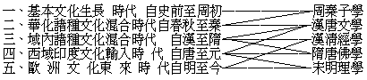



盖周、秦子学，乃上承基本文化以为第一期吸收扩展之结果。汉、唐文学，乃秦、汉及隋、唐两番吸收扩展之成绩。经学成立於汉；成为汉以来佛教之骨干；抵清由理学反动更发挥至极，扩究周秦子学而进入吸收欧洲文化阶段。隋唐佛学则正为印度文化输入成果；宋明理学乃袭取经学与佛学各一分以产生。由此、可见佛教已为中国文化一重要因素。研究中国文化，若无视於佛学，或排於佛学，实为不知中国文化为何物者也！为中国人，又乌可不研究於佛学哉？



（见海刊十八卷五期）



提供谈文化建设者几条佛学



一　彻底的因果论与现实论



二　彻底的平等论与差别论



三　彻底的社会论与个人论



四　彻底的无常论与恒如论



五　新文化的建设



六　文化的定义



文化建设月刊笫四期以来，关于中国文化建设的讨论，五花八门，诚可谓洋洋大观，但察其无论检查中国固有的历史文化，或考究资本主义文化与社会主义文化，对於在过现及将来中国的世界的文化有大贡献之佛学，大抵瞠目无睹，或语焉不切，未能于以深详注视；这是我今欲为提供几点佛学出来的本旨。



一　彻底的因果论与现实论



佛法的法，即指一切事事物物；而此一切的事事物物，莫非是因果性的。但於此一切事物，未尝索其因於未有之外，亦未尝求其果於已无之外。由过去的因成现在的果，辗转推溯其因则无始；由现在的果作未来的因，展转推徵其果则无终。由餘事的因成此物的果，辗转推寻其因则无边；由此物的果作餘事的因，辗转推究其果则无中。如此、故一切事物中任何一事一物，莫非是无始无终无边无中的。无无因的果，亦无不作因的果；无无果的因，亦无不成果的因。换言之，宇宙现象莫非因果，不索其因、求其果於宇宙现象之外，其一一现象，莫不无始终、无边中，而为因果铁则之所范持，显见为莫非是历史性和联系性的；亦可谓是澈底的客观论、唯物论、机械论、命定论、必然论的。然即其中任何现实事物，莫不可为未来事物的开始，亦莫不皆是过去事物的终结；莫不皆是现存餘物之边际，亦莫不可为现存餘事的中心。如此、故一切事物中任何一事一物，又莫非是即始即终即边即中的。只从现实存在事物而推阐因果，即可从现实存在事物而把握因果。在人言人，则可从即终即始即中即边的吾人身心之活动，转变无始无终无边无中的宇宙一切事物因果，而为现实活力之所支配，显见为莫非是刹那性和独立性的；亦可谓是澈底的主观论、唯心论、意志论、无定论、自由论的。由因果论故，法无自性，诸法无我；由现实论故，我为法王，於法自在。



二　彻底的平等论与差别论



一切事事物物，近而吾人，远而万有；大而日局星海，小而微尘电子，莫非是因果性的，同时又是现实性的。故随拈一法，皆为法界，随一事物，皆全宇宙，绝无可为独特的、绝对的、最先的、最后的、非果之因或非因之果——如一神教所谓的神，唯心哲学所谓的心，和唯物哲学所谓的物，故为最澈底的平等论，亦即是无神论、无元论、或一如无变异论。然就每一事物现实而望其餘一一事物现实，彼此宛然，自他宛然，先后宛然，胜劣宛然；则其程度之累差与形性之别异，又不可以偻指计，故又为无数之差别。由差别故，圣凡有异：圣之中，又有下乘圣、中乘圣、上乘圣中过程之菩萨与究竟之佛陀；凡之中，又有人而上之天等，与人而下之畜等。依正有异：依报中，有天界、人界、净土、秽土等；正报中，有胎生、化生，圣身、凡身等。色心有异：色物中，又有内五根与外六尘等；心识中，又有八识心王与五十一心所等。假实有异：假法中，有时分、方位等；实法中，有种子、现行等。相性有异：相事中，有五蕴与十法界等；性理中，有虚空无为与真如无为等。而人类身心世界，则为最完具此差别诸法而最能转动此差别诸法者。由此、依人心於平等差别诸法之觉不觉：或不觉而创造诸退化业，因而受堕畜等诸劣果集成苦世界，或觉而创造诸进化行，因而致升天与罗汉、辟支、菩萨、佛陀诸胜果集成乐世界。而人生世界之意义和价值，即在能走上进化之阶程而不再退堕流落。菩萨佛及其净妙乐土，即为人格及人世界进化之阶段与最高成果。由此、故又为人神论，心元论，或进化有阶向论。



三　彻底的社会论与个人论



佛陀证明一切法皆众缘所成，任举一事物，其直接能生起能长成的必要众缘，虽为各别之有数条件，而就其辗转能作关系之缘的，则无限极。此不唯外在的关系如此，而内在的关系亦如此，故随一事物皆是宇宙性的。就人切近言之，即可谓随一个人皆是社会性的，所谓『人固然一生下地后便长养於社会之中，而他之造社会现象根本是站在社会中的，这完全是把社会作用於他的又反作用於社会的一种过程』。所以、人是无个人的，众生是无我的，诸法是无自性的，只有社会，祗有众缘。然此一事物是宇宙众缘成的，而於一般的众缘，别成要泛顺违差异；且缘成此一事物而非其餘事物，这由在生缘中各有其特殊因种故。再之、此一个人是社会众缘成的，亦於一般的众缘别成亲疏利害差异；且缘成此一个人而非其餘个人，这由在生缘中各有其自然个人故。一切法缘生性空义中，必明一一法种子因义，乃可全明一切法仗因托缘而生成的实相。人生来是社会的义中，亦必明各自然个人，乃可全明社会作成人而人亦作成社会之实相。所以、虽无自性法而非无因缘所成之此法，及此法为缘所成之他法，虽无常一我而非无和合相续之此我，及此我为缘所成之他我；虽无独个人，而非无自然及社会所成之众个人，及由众个人所集成之社会。由此资本主义文化核心之个人主义虽有所偏执，不免今后之崩溃，亦未尝不握得一分的真际，故能造成近代灿烂的文化。集产或共产主义文化核心之社会主义，虽亦能握得一分的真际，可有造成将来文化的倾向；然亦以偏执，在进行中已窒碍难行。例如共产主义并不能变革资本主义极盛之英、美、法等国，迨於未造成资本文化的俄国握权后，仍不能不退而为资本之建设。要之、有见於孑无见於群，有见於群无见於孑，皆侧倾一边，致分为两个阶段，斗争莫决。若应用佛说因缘生法，因故、社会必生起於个人，缘故、个人必长成於社会。复次、离缘则因不成因，个人是社会之个人，无社会以外之个人；则个人主义之资本文化可融解於社会。离因则缘不成缘，社会是个人之社会，无个人以外之社会，则社会主义之集产或共产文化可引生於个人。如是、乃能不破坏近代的文化而导入将来的文化。



四　彻底的无常论与恒如论



佛说诸有为法的无常，不但根身的活死与器界的成坏，尤在色心等一切皆刹那生灭而引续不断，演化无尽。辨证法以矛盾的「对立又统一」、「统一又对立」说明变化，仅能说明诸有为法无常律中之一部分。且无论黑格尔的唯心辨证法和马克思的唯物辨证法，皆原本於非辨证法而终归於非辨证法。故其辨证法仅适用於「已由统一而现矛盾」、「将由矛盾而求统一」之过程中间，不如佛说有为诸行种现无始而生灭不住，虽至佛果不断常与无尽常，亦刹那生灭之彻底。然澈底无常如何而又澈底恒如？则由有为法因缘所生，起唯缘起，灭唯缘灭，一切皆无自性。无自性故则无「定体」可据之以定生灭，所以无实刹那相及实生灭相可得，亦无实无常相可得。无实刹那生灭无常相可得故，无自性实性遍一切无常法中常恒如是，所以当处无常而当处恒如，非由常如起无常复归常如，乃於无常而即恒如。达无性实性常如如故，则妙慧遍照而不为彼此生灭方时蔽碍；能极照达遍诸方时中彼此生灭幻相，幻无定体，则於矛盾对立即见矛盾消解。不待阶级斗争而阶级俄已融化，只在人心之能了如而达幻。



五　新文化的建设



以上所论四义，世界人类理智发达至今日，应已可能了解；且现代人类进步之理智上，於一切哲学及宗教等，舍佛法应已无从获得如此满足。故佛法实为现代最进步的人智上所必需的归趣，而佛法对於今后人类最大之贡献即在於此。然上所论乃为佛法建设现代世界文化之意义，而对于建设现代中国文化更有何特殊之要点？是则一因佛法传存中国者最为完备；二因佛法在中国将二千年，与中国历史文化礼俗习尚早皆渗透，而尤普遍深入多数庶民心理中，成为国民的精神要素。但於佛教文献，中国人民心理中所蕴藏的大乘佛法精义，大多尚待人掘发阐扬出来，流贯到一般的思想信仰行为上去，乃能内之化合汉、藏、蒙、满诸族，外之联合东亚、南亚强弱小大诸族。以二千餘年之佛教教化关系成亚洲东南各民族大联合，协力将大乘佛教文化宣达到亚洲西北以及欧、美、菲、澳，融摄近代的个人主义文化与将来的社会主义文化，造成全世界人类的中正和平圆满文化。中国於佛教文化，有可因藉之便利，有待发扬之需要，有能化合联合佛教民族复兴之关系，有可融摄创造世界新文化之希望，这是今日作建设中国文化运动的人所特须注意的。化合中外文化以创造新中国文化及新世界文化，在中国当以三民主义为之枢，而大乘佛法为联系。若反儒化之旧或全趋个人的、社会的欧化，则内无以化合藏、蒙等，外无以联合日、印等，而分据封建的个人的社会的各一文化阶段，但相斗争而无融摄创造之可能。故大乘佛法实於建设中国现代文化有非常的重要性。



六　文化的定义



末了、欲再略论文化的定义。对于文化，中外的人不知下了多少定义，有与文明对举的，有谓包举文明在中的。据我的意思：文化乃是与「素朴自然」相对的，人类从素朴的自然人世，为适应人群求生存、求安善、求进步之需要，乃创造文化的人为人世；故与「素朴的自然物」相对的「文化的人为事」之一切，即名文化。由人群的求生存乃产生经济文明，由人群的求安善乃产生政治文明，由人群的求进步乃产生宗教、哲学、科学文明；文明乃是文化活动的成绩，所以文化乃是「人群求生存、求安善、求进步所起活动工作的总和」。经济、政治、宗教、哲学、科学的文明，既从满足人群要求的文化活动产生，当然是有其交澈互通辟系的：生存藉安善、进步乃成更丰富的生存，安善藉生存奠其基，而进步成其功；进步依生存、安善而起，复率生存、安善而俱进步。所以经济长养於政治……科学等中，复能反长养政治……科学等；乃至科学长养於经济……哲学等中，复能反长养经济……哲学亦然。例如科学於自然科学外，亦有关于经济、政治等科学，而哲学亦可有经济哲学政治哲学等。然经济、政治、比较是文化产生的成绩文明，而科学、哲学、宗教、比较是能产生文明成绩的文化。所以叶青在「论资本主义文化与社会主义文化」一文中所说文化与文明的区别，是比较正确的。平常对科学分为自然科学，社会科学，或另分思维科学，吾意科学固皆是文化的，但就其所研究的对象以为区别，则与「自然科学」对举的即是「文化科学」，可将社会科学、思维科学的名称废除，概括称之为「文化科学」。此文化科学所研究的对象即是文化，在文化科学中则哲学、宗教亦为其研究对象的一种文化，亦犹政治、经济之为其研究对象的一种文化。佛法从表扬其特质方面，以非一般的科学、哲学、宗教的定义所能范畴，故可云非科学、非哲学、非宗教的；但而不得云非文化的。而且从贯通方面说，则可云佛法为融贯科学、哲学的宗教，所以在科学、哲学发达进步到现代的人群，佛法实为唯一的宗教，亦为综合的圆满的最高文化。平常的人误解佛法为悲观的，厌世的，殊不知佛法的否定自然，否定人间现状，但为督促人生向上进步、而改造自然界、创造新宇宙的一种革命的策略。所以、在革命救国救世的三民主义中国文化建设中，佛法可为其最伟大的精神动力！



（见海刊十六卷五期）



怎样建设现代中国的文化



一　中国历史文化的追溯



二　中国固有之社会组织



三　现代的世界鸟瞰



四　落伍中的中国现状



五　从固有道德以建设现代中国文化



六　从改进教育以建设现代中国文化



七　从改进政制以建设现代中国文化



文化是人类改造所依所资的自然物，以适应人生需要的方式和工具，乃竖穷语文所权、横遍舟车所达的一切人类努力交织以成。然因受时间、空间的限制，故一时代有一时代的特徵，一方国有一方国的特徵。但云现代，则时间限於现代，而空间却通於中外；但云中国，则空间限於中国，而时间却通於过未。今曰现代中国，则於现代是以中国为本位而内摄民族，外揽国际；则於中国是以现代为本位而检讨过去，创造将来。就中国即可有三个方面：一、中国个别的地理与物质环境，二、中国个别的民族性格，三、中国个别的历史文化的社会组织。一二两项让之地质学、生物学等专家。兹先就第三项一论究之。



一　中国历史文化的追溯



有四五千年历史的中国。自伏羲畫八卦、神农播百谷、黄帝垂衣裳而治天下以来、历尧、舜、禹、汤、文、武，至老子、提举其精要为道德经，遂成黄老的道家文化。自契敷五教，周公制礼，至孔子「祖述尧、舜，宪章文、武」而删订六经，遂成周孔的儒家文化。继是而有墨、名、法诸家，则皆不过此二家的旁流。道家乃帝王的文化，所谓君人南面之术，虽务光、许由尽多隐世，而以能作帝王为行其道；儒家乃士大夫文化，所谓致君泽民之术，虽孟轲、荀卿功在授徒，而以能作卿相为行其道。唯至汉世，由升之在朝的儒家而张为儒教，孝弟力田以取士，孝廉方正以举乡，儒之教化乃渐及民俗，浸习成风。同时、由降之在野的道家而潜成道教，乃纲罗积古以来医的丹药、巫的符箓等神仙天鬼的修炼崇拜，上诱时君，下摄愚氓，藉以自存或乘机兴寇迁政。西汉后、除外族侵入外，大抵治平之世，儒教当权；而由治入乱、由乱致治，则皆出於道教。迨东汉佛教初入，经魏、晋入南北朝，民族混杂，战祸时作，佛教乃成为真正之民众文化。盖不参糅任何政争治权，而惟凭民间自由信仰之所乐从也。历六朝入隋、唐统一，所谓道教固十六七托佛仿造；其间君相虽用儒教为治具，其濡涵德性、顺应民心的精神，固已潜移於佛教。赵宋以后，中国整个之民族，皆为道、儒、佛三要素之所渗透；於此三教混合的庸众心理上，由少数特殊份子，各张其或儒、或佛、或道的门户。读儒书的所谓读书人，往往凭其所读的死书，及所友的读书士大夫，惟认儒教为中国文化正宗，斥黄老为异端，屏佛教为外来，乃由未尝一著眼於活的民俗风习之所误也。故由时代以言之，四千年来有道教的文化，二千五百年来有儒教的文化，一千八百年来有佛教的文化，皆中国固有的文化也。由性质以言之，以帝王文化为本位下而及卿士民庶的道教，以卿士文化为本位而上佐君治下辅民德的儒教，以民庶文化为本位而上及士夫帝王的佛教，皆是中国固有的文化也。非道教莫溯中国文化之源，非儒教莫握中国文化之枢，非佛教莫广中国文化之用。居今日若仍持昔时儒士之狭见，则适以斲丧中国文化的生命，弱损中国民族的元气。故於检讨过去的中国文化，首应於此三致其意。



何况藏、蒙、满民族文化惟是佛教文化，若排佛教而外之，即无异抛除藏、蒙、满民族，而道教神秘亦多有可溯源苖族文化者。除上道儒佛三要素而外，次要者为回教，於西北诸省民俗风习，关系颇深；但其散居内地者，则大抵与汉族同化，已无深严区别。他若祆教——波斯祀火教——、犹太教——挑筋教——、摩尼教及景教、可里温教、耶稣会等耶教别派，虽亦曾传来唐、元、明各代，今皆已湮灭无存，祇可供史料之考查耳。而随欧、美近代势力传入吾国之耶稣旧教、新教，则当归入横的现代国际关系中，而非中国固有之历史文化矣。



二　中国固有之社会组织



近人论社会制度之演变，每根据马克思之学说，指中国为由封建社会进入资本主义社会之过渡阶段。其实、中国数千年来之社会，乃以家族为中心之一种特殊组织。先有许多「各人自扫门前雪，莫管他人瓦上霜」的小家族，套上一层中家族；而由许多处乡为绅士、出任为官长之中家族上，再套上一个大家族。上层的大家族，即皇室、亦即国家。国家即「皇家」的家，以中层的家族为臣佐；中层的家族即公卿大夫士，亦即所谓「世家」，以下层的小家族为家仆佃役；下层的小家族，即所谓寻常百姓家。国家既即皇家，故必曾膺一命以上而受过皇族禄位的，乃有「国家兴亡」之责；若寻常小百姓，固无国家的责任。直到屡亡於异族后的顾亭林，始逼出一句：『天下兴亡，匹夫有责』的话；而明、清两朝下的党会，乃稍有民族精神。在此家族层套的社会中，内无独立的个人，外无合组的团体与国民，所以只有父的子，子的父，夫的妇，妇的夫，兄的弟，弟的兄。朋友为兄弟的引伸，亦即上层与上层，中层与中层，下层与下层，各家族相协的关系；君臣为父子的引伸，亦即上层与中层，中层与下层，各家族套属的关系。又此五伦的伦理，尤以中层事上层为完备。上层无平等的朋友伦理，而下层缺严正的君臣伦理。故五伦的伦理道德，亦以卿士本位文化的儒家为最重视。此种家族层套，一方易分散大群的合组，一方又易牵制个人的特动，故无敌国异族的外来灾患，则每能长久相安。由此、历代帝王无不奖导扶掖之。佛教的僧伽，本为平等个人和合群众的集团，到中国亦分化成中层家族的大寺院，与下层家族的小庵堂。只有家族的派传，无复和合的清众，此可见家族化的普及与深入。其弊则「各人自扫门前雪，莫管它人瓦上霜」，十分之八九的下层家族，只有且只能各存身家的顾念；对於村里乡邑的公共利害，亦复漠不相关，更何能有国的观念，但以为此唯绅士、官府、皇帝的事而已。由此、若遇敌国异族的外患来袭，亦祇仗帝王、官绅的抗御，而往往易被摧破侵入。斯所以中国常为异族所凌占，而近数十年来屡败於环逼的列强也。然又以层套家族中的中上家族，有深酣的安乐可耽，故悍麤的他族一尝及温厚的甜梦，即易驯服柔化。但今世强敏英锐的诸国，非复昔诸异族堪比，设不因势利导，化家族为国族，则将无立国保民的可能性。故孙中山先生欲令家族化成国族，实为中国复兴的要著，惜尚无化家族成国族的方法耳！



三　现代的世界鸟瞰



备有现代的特徵，够得上称为现代的民族国家，自然是科学发达后、工业革命后的个人资本主义或社会主义国家。但个人资本主义国家已渐趋崩溃，而集产的或共产的社会主义国家或世界，犹未有建设成功把握。以反个人主义，反一元主权主义，新个人主义的三个思潮，尚在汹涌澎湃的争流中也。个人资本主义所造成的，其正面即为掠侵的帝国主义，而反面则为弱小民族反抗的民族自决；社会主义中马克斯派所造成的，其正面即为无产专政的共产主义，其反面则为资产阶级反抗的法西斯蒂。由此卷起民族与阶级的抗斗，使世界人类陷入战争漩涡。其弊同在一元主权的谬执未能破除。一元主权本为君主、神权的遗毒，个人资本主义则将「一元主权」移转到议会万能，共产主义则将「一元主权」移转到无产专政，皆极度的剥夺他共权利而发达自私权利，故不免其他的民族和阶级起与抗争。而反抗的民族和阶级，既为自立和自卫，亦势不能不托一元主权以集中力量，敌视他民族、他阶级而争取自私权利。若能粪除一元主权观念，从相对的新个人主义而到於相对的新家族、新社会、新民族、新国家，一切皆为多元的、相对的、相资互成的存在，若中国以三民主义为过渡而祈达的大同之世，庶其可为度脱现代战祸的救星。



五来欣造所作西洋文化的穷途与东方的救援，尝谓西洋文明的功利主义，在十八世纪造成了君主自利的专制：而德国之菲特立克大王，则以儒家「君主为人民而始有」的君主义务主义的觉酲，从废止贵族特权避免革命的和平中建成近代国家。然至二十世纪西洋文明的功利主义，又造成了阶级斗争，而慕沙里尼以罗马精神的复活救治了意大利，从之而德国的希脱拉，英国的麦唐纳，美国的罗斯福，皆以之挽救了阶级斗争的革命。然利用多数特权的议会政治和共产主义，诚为造成阶级斗争的因素，而法西斯蒂精神虽抑止了阶级斗争，或将引起更深广的民族战争，故犹不足医好现代世界危症。必得东方文化的「天下为公」大同主义，始能澈底救治。但扩张慕沙里尼的法西斯主义，与罗斯福的善邻主义，导城威尔斯与斯太林会谈记中所谓『大船是全人类，不是阶级』的世界人类主义，则渐渐可渡入东方文化的大同之世了。



四　落伍中的中国现状



中国人向来自成为一天地，中国之外，则胥为蛮、夷、戎、狄。虽由佛教尝认印度为大国，然除佛教外既鲜他种之政治、经济等关系，亦夷之狄之而置於不见不闻耳。明季以来，乾、嘉之前，曾有布教经商之欧、美人来往，其等之蛮戎也犹昔。故中国之加入现代世界中，成为与今欧、美、亚各国国际来往之一国，盖始於清道光十六年之鸦片战争。在鸦片战争前，中国人对外国人，则轻之笑之而已。鸦片战争之后，忌之排之之心渐炽，积数十年为拳匪之乱。然鸦片战争之后，同时亦即有羡之效之之心。其羡之效之者，初则在乎枪炮、兵舰，以为强国之道唯在乎此耳；其结果、则中日战争之失败。由是、其羡之效之者，更进一步而及军、政、法律、农、工、商业，庚子之后，既舍中国本有政教重心，将谓立国之道胥赖乎彼，遂进行益力；其结果、由清末之立宪，而成政柄迭更、军阀割据之民国。民国八年，新文化之运动思潮起，其羡之效之者，更进一步，而及学术思想之文化根本，同时更以俄国式之革命相号召，宗教、政治、经济、权力等，皆入於混乱剧变之中，乃成一变二变三变而至於今日。



庚子之后，中国岌岌不可终日。以国危有救之之必要，而国人救国之心亦日热切。观日本之中兴也，有取法於邻意。未几、而日本胜俄，遂以唯一所学者为日本。其时亲日之热度，可谓极甚。未几而日本夺据朝鲜，又稍稍由亲而畏；至民四迫订二十一条约，乃对於日本之救中国，完全失望，而大多数人民皆仇敌视之矣！清末民初时，觇德之强，颇有倣效，且希望德国之能救中国者；至欧战加入协约，则此希望亦告终矣。民初以来，多有希望美国之援助及拯救中国者，迨临城劫车案起，乃美国首倡共管中国之说；於是国人之有识者，渐知美国亦不能救中国。而一部份亲俄者，则专欲仿效俄国，以望苏俄之能救中国；至今彼苏俄但用空言宣诱，藉以宣传其不宜於中国之共产主义，冀扰乱中国以遂其私耳！九一八辽瀋事变后，依赖国联之结果，尤足令吾人恍然：知英、法等列强诸国，皆不能扶救中国，而中国人之欲救中国，唯在中国人之努力自救而已。



然自清季变法、民国革命以来，亦未尝非中国民族的力图自救，而卒致愈救愈艰苦者，不唯起初固守陈旧而整个的排斥为错误，五四后抛弃固有而整个的输入为错误，而「择焉不精」的采取尤为错误。此三者皆未尝洞观现代文化和中国文化的根本——选中国固有文化要素以建立中国民族的生命，选各国现行文化要素以资养中国民族的生命，徒为扮饰的、翻掘的以益斲丧中国民族的生命也。例如初以为西洋所长者但在鎗炮、舰车、电机，乃为此种技末的撷取；继以为西洋所长者更有政法、军警、学制，再为形表的仿效。殊不知欧美近代文明乃为科学和工业的文明，其政制在全国人民皆有民族的意识和国家的组织；不於此采取其所长以补吾所短，乃反自斲命根而务西装革履的形似！不知无现代科学工业生产力而欲建立现代的军备，无现代意识组织国民力而欲成功现代的政制，犹欲今羸弱的、瘫痪的病人跳高竞走，徒速其颠蹶耳！此为中国近年显然的现状。借观日本，既益发扬其固有的、受之中国的武士道和儒佛文化，以成长为特殊的民族意识，复根本的、尽量的吸习科学以造成现代的工业生产力和组织的军政力；其一失一得、一败一兴之几，不甚瞭然耶！



今日的中国，无论追逐资本国家或共产国家的后尘，皆不是路；即所谓迎头赶上，从根救起，也不是办法。唯有切实看清了现代中国的需要，择取中国五千年历史文化及现代全世界流行文化的所宜，凭藉之以为基本，以创造「复兴中国民族」和「解救世界危机」的新文化耳。



五　从固有道德以建设现代中国文化



察之中国现状，非无政治也，特政治无国民性之道德以为纲维，致争营私人权利耳。非无军备也，特军备无国民性之道德以为纲维，致反成群盗割据耳。非无教育也，非无实业也，特教育、实业无国民性之道德以为纲维，致教育适以坑陷青年，实业因之停滞进步耳。故今日虽有教育救国，实业救国，练兵救国，兴政救国之需要，而尤以有一种「国民性之道德」精神，贯澈於实业、教育、军警、政法之间，以为之纲格，以为之维制，乃能各循正轨而渐臻调协耳。



省之中国往情，唐、汉而上之国民性德，存在今此国民之活情意中者，殆已潜消无痕矣。惟宋、明来之国民性行，盖犹为今日最普遍最深厚之国俗民情也。经元代而蒙古同化，经清代而满洲同化，故虽间元、清二代，适恢宏宋、明化之量而未尝变失宋、明化之质也。然宋、明化之国民性德，为如何之国民性德耶？则佛、道、儒三元素之融合精神耳。如团聚而淬砺振作之，则国民性之道德不胜用也。第余此说，非现时唱三教合一之粗劣的同善社、道德学社、悟善社、道院、救世新教、道德会等所能假借。盖余之所提出者，乃经过现代的科学、哲学、宗教等精密审量，加以铸洗镕练，得有重新估定之价值者，非漠然昧於现势之开倒车的盲举也。今请分析言之：



一、建佛法以建信基也：吾华佛法，至初盛唐始完备；武宗毁后，各宗皆衰落，独禅宗水边林下，自葆其真。复经五代而入宋初，最称隆盛，不唯掩包佛教之全局，使时人知有禅而不知有佛，但以禅称；抑且遇人即顶门一锥，要问渠未生前本来面目，或当念是谁，死后何存，震荡得全国人心非向此中讨个消息没个断疑生信处，於是禅宗乃打入全国之心底深处。故宋、明来，不但佛教各宗皆张设门户於禅宗之信基上，即儒道二家之门户，亦张设於禅宗之信基上。若宋儒之要静坐，要寻孔颜乐处，要看未发前景象，要先立乎其大，乃至明得古圣贤之言皆为我之注脚；而道流若陈搏，若张紫阳等，修命之前要先之以修性，其修性即修止修定之别名耳。虽儒、道二家於佛之禅皆浅尝辄退，依旧回到其刑政伦常及长生固命之本旨，以自张其曰儒、曰道之门户；然尝筑信基於禅上，则固为事实之昭然不可掩者。诚以非如此则当时之知识阶级，末由得个安心之地也。此风至明末为盛，知识阶级如此，演为庸俗之小说戏剧，皆处处可以见之。虽劣陋之白莲教及袁了凡教，亦即产生及培养於此种学者庸俗之风气间；今日四川所流出之刘门、同善社等，皆吸其餘流也。入清以后，禅宗之势垂尽已不可用；今之佛法，循隋、唐之轨复兴，亦不须专重禅宗矣。然在此经过西洋的基督教及哲学科学化后之时代，儒的祖先教——儒之敬天意亦以天为太祖耳，故儒以祖先为宗教，今生物学乃以人祖为猿，故难置信——与道的天仙教，皆不能定信心之基矣。信基不坚，则建筑在上者，皆随时可以动摇倾败，故非宗依佛法全体以竖立无可摇动之信心基础不可。佛法全体之正信为何？则信有已成无上正遍觉者；信必有无上正遍觉所用宇宙万有之真理，及有能得无上正遍觉者之种种方法；信有已从事学习於趋向正觉之方法者，及自己与众人皆可从事趋向而必获正觉。此之三信，换言之，即皈依佛、法、僧耳，即发起无上菩提之信心耳。胜解力生，乐欲乃起，信解乐欲心净名信，由智而信，智信一致，非基督教等盲从之信仰，而不违於哲学科学之推究实验，故唯此为足於今世裂难断之疑纲，建不拔之信基也。至由研教、参禅及其他佛教中之方便等，要皆为建此皈依佛法僧之信基而已。人心上若非建成此信基，则终在怅怅乎惘惘然中，混过一生，岂不深可惜哉！



二、用庄老以解世纷也：晚明憨山大师尝言：不知孔孟不能经世，不知佛法不能出世。今御物质之华美，颂淫靡为文明，恣行言之放僻，标竞争为进化，是非有贬落文明，粪除进化。若老庄之镇以无为之朴，贞乎自然之淳者，其不为西洋化之环境所迷惑驰骛者，盖戛戛乎其难也。是则章太炎之齐物论释，最能称乎其职。



三、宗孔孟以全人德也：信基建则天君定，世务解则乱贼定。如园艺然，种得时地，则生机勃发而积极之精神具矣。围以短垣，则患害不侵而消极之防卫成矣。当继施孔、孟之道，以勤耕耘灌溉，然后发荣滋养以成为枝叶扶疏、花果繁硕之园林焉。孔、孟之道，言其大要，则施行五常於五伦以全人德耳。五伦乃秩序之人群，五常乃理性之人心实现乎人群人世者。兹列一表以说明之：



　　　　　（外表形下的）┌物质───人世┐  

　　　　人生宇宙之实际─┤　├───人群├浑然一体  

　　　　　（内容形上的）└精神───人心┘



西洋大部文化，偏於外表形下的；东洋小部文化，偏於内容形上的。孔家儒化，是符合内外上下浑然一体之宇宙人生实际施行者。注重之点，在乎人群：一、如何调达人群之内心，使发为适宜人群之伦理常德——此伦常为儒之中坚——，二、如何制用人群之外世，使成为适宜人群之器具事物——此事物为儒之表面——，依第一条，则佛之五戒、老之三宝——慈、俭、让——虽皆近之，而不及孔、孟於此最为详审精切，故当宗孔、孟。依第二条，则虽不同西洋之专务物质文明，而厚生利用诸学科及军工农商之适宜人群生活者，皆应摄受开发，使人群能制用外事，而不为外事之所制，则对於西洋化亦尽有容受消融之餘地。内养人心之正，外应人世之变，以成为具有伦理常德之人群，是孔、孟宗旨之所在也。故孟子曰：『人伦之至谓之圣』。章太炎曰：『宋明理学诸师，所以不肯直趣佛法者，祗以其道玄远，学之者多遗民义，故为调停补苴之术；然茍识其情，厉行六度，亦与儒术相依，唯有漏、无漏为异。若拨弃人乘之义，非独不益世法，亦於六度有亏矣。大抵六度本自平等，十善乃其细者。在家、出家皆不能离十善；东圣、西圣亦并依於六度，以此倡说，自然殊途同归』——见余所著人生观的科学后序——。亦可谓知其旨已。



四、归佛法以畅生性也：佛称大雄，依佛立信，成勇者之不惧；老称大玄，用老忘世，成智者之不惑；孔称大成，宗孔成人，成仁者之不忧；备三达德，人德全矣。然德业方新，老病已迫，无长不消，无形不毁，既济终於未济，有生归於必死，而此老病死三关，任英雄豪杰亦无术以冲决，世人之可伤心陨涕者，宁有过於是哉？道家长生之说，欲有生而无老病死苦也；印度灰灭之论，因老病死而并欲无生也——照流居士徐松石，指佛教为灭生息命避世，乃误以灰灭外道为佛教，未梦见佛教也——；是皆未明生理，故失阏乎生而未能畅达乎其性也。唯大乘佛法之明缘生性空，乃能宣畅生性，荡然无阂，使老病死不留痕迹。言缘生则莫善赖耶之非断非常，言性空则顿显真如之不生不灭，不生不灭，则生老病死之事本无；非断非常，则爱生恶死之情何寄？茍知乎此，其最低限度，不唯乘万化而未始有极，乐不胜计；且能自择於万化之间，操人定胜天之枢纽，以优游乎人天善道，渐成增进。其上者，则趋无上菩提，三无数劫，有进无退，净法满足，究竟常住。必如此，然后人乐为善，叠叠不倦以相引进而靡极。故吾人既得乎生，如是乃能不虚此生，非佛法不能赋与充分之意义及永存之价值，而人生遂必以归佛为终也！



兹之四义，皆就中华国民中固有之心德条理而揭出之者；撮为一图如左：



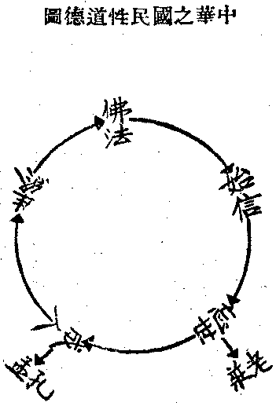



观此中华之国民性道德图，则可知今日欲求中华国民性之道德，必始乎佛法，终乎佛法，舍佛法莫为功也！诚能发挥光大，笃行实践乎此者，则如病危之际，真元恢复；然后固之以军警，理之以法政，培之以教育，资之以实业，调而养之，可臻健康。



六　从改进教育以建设现代中国文化



中国国民的实际生活，十之七八是兼带渔牧林圃和纺织等手工业的农民；近来以各商埠的工商业渐趋发达，故亦百分之十六七从事工商。至於入政法军学界及起为农工商业领袖者，当不过百分之五六而已。假使要革除近来的教育弊端，将教育适应如此如此的国民而使之普及，并能在实际上得到遍增国民能力、推进国民生活的效果，则考察全国学龄的儿童，亦十分之五六恐仅能受初小教育，十分之四五能受高小教育，十分之二三能受初中教育，十分之一二能受高中教育，百分之一二或四五能受大学教育。观此、可知适切国民多数的需要，应当办怎样的小学、中学、大学了。



一、初小应多分为办在山乡中的农村小学，教师亦须能实习农事并有当地及超当地的农事知识经验，能率领小学生并小学生的父兄共同农作及指导其从渐改进农事，务令学校生活与实际的一般农家生活相近。作了小学生以后，不但仍能去作农务，而且於农务有逐渐改进的效力。如此的小学，才是大多数人民需要的教育，才有普及大多数人民的希望。若养成少爷双料少爷、的小学，则唯有使大多数人民对之疾首痛心而已！那有普及的可能？高小可多分为办在乡镇的农工小学，兼学习一般初步的工商知识经验以外，其餘一切皆与初小同。至於为预备升中学、大学而设的小学，则在都市另设十分之一二的小学便可，或并此亦可不须另设，使升中学以上的学生，亦皆从农村、农工的基本教育中而出，则於都市儿童身体的强健劳动的操练与自然生活的接触和实习，乃至他日担当国家社会的公务，亦深知民间的疾苦，尤有莫大的裨益。而且中国人民向有重农的心理，士人商人亦无反对其子弟入此等以农事为中心的小学的理由——对於已过学龄而失学的民众，当另办民众夜学、农暇学校、民众图书馆等以教化之。



二、初中应为办在村镇间的农工商学校，使学生生活仍与一般农工商民众密切融洽，并实习农工商的事务以养成其知识和经验，俾大多数至初中辍学的学生，皆能安於一般的农工商生活，从事农工商业而能逐渐为乡镇邑巿生活的改进。高中则可为升大学的预备或小学教师与较高等的专门职业的修习等等，宜办在都市，使能渐渍观摩近代工商业而为实业进步的基础。要之、小学在养成其农工中心之天然生活、人工生活的知识经验，而中学则在养成其工商中心的人为生活、人群生活的知识经验。



三、大学或学院、研究院，应看其性质如何而定：理科中心的应设在富自然物区，工科中心的应设在工业区，商科中心的应设在商业区，农科中心的应设在农业区，法科中心的应设在政治都会，文科中心的应设在文化都会；其他若医学应设在人口繁盛都市，军校应设在首都或国防区等，皆以便实际生活的联络与研究，而对於近今务名不务实而滥设的大学之类，尤有紧缩和精炼的需要。其最大的急须改良点，则为除专门学外交和学外国文学与预备外国留学的以外，从小学一直到大学，皆停止外国文的学习。其理由、以既为中国人，当然於中国的文字不能不学通顺，然学通顺一种文已经不易，若再须学通一二种与中国文绝然不同的外国文，势必使学生的身心力量只能用於文字的学习，而对於各种专门学问更不能有精深的研究。此所以中国现今的大学学生，认真用工的每致过劳病夭，而大多数在不良学制的无可奈何下，仅以敷衍光阴弄得一卒业文凭是务，绝不能有真才实学培成出来。而大学所以成此现象的原因，则由留学回国当教授的博士等中，有一些仅能依照其所读的外国文课本照本教读，虽译成国语来讲而不能，由此才假借要研究科学必学外国文的谬习，以文其浅陋。而国内的大学遂除却学一点文学、法学以外，没有学到科学的专门识力的可能。於是、不甘自弃的，群趋於向外国留学一途，而经济人才的耗损乃莫此为甚。故今大学等等的改良，第一步应由国家设编译所，尽量的将各国已出的、续出的各科科学书译成国文，使高中以至大学的学生，只要学通了国文便能研究专门的科学；同时、由国家设研究所为二步养成能独立创生各种科学的学者，则中国的大学始有自存的地位，否则、无论怎样总不过外国大学的附庸，岂不可耻？



四、留学生除理科、工科、医科、农科以外，一律停止。但於各大学助教，讲师、教授，曾服务学校十年或五年后，得派至国外各大学研究政治、经济、法律、文学、哲学、社会学等等，以资深造。此中所省下的留学费，一、足可提高二三大学使极完备，二、聘各国最著名学者来充教授。



五、民国以来，军队扩充不已、军阀产生不尽的缘故，国内军校和国外留学军事的军官大批产生，亦为要因。今应停止各地所设的军校与军官留学，再不增选未学军事的青年学军事学，唯选拔中级以上军官可深造者，在首都设一高级军官学校，并派遣各国留学，以资研究。



对於中国现在的一般教育，有这五种的革新，庶其可由适应实际而蔚成复兴中国民族的文化。



七　从改进政制以建设现代中国文化



化家族为国族既为目前最切要企图，而顺中国固有的良风美俗，复不应破坏农村趋重工商的经济剧变上，使成为个人资本国家或社会共产国家。於此、应先建立风纪极良的陆军，实行徵兵制，使国民一达成年皆有入军训练一年至三年的义务。既导人人发生为国服务的观念，复令人人过惯组织严密、纪律整齐、群众广大的团体生活，自然而然可有超出自身自家私利的观念，养成民族国家的意识，而散漫无组织的旧习亦因以革除，可成为健全组织的国民。



其次、则无论国民党训政也好，宪政也好，终希望能将中央与地方的均权制度确立。早成均权的统一，将物质应建设的建设完成，肃清贪污土劣，治内成廉洁清明的政府，对外成平等联立的国家。



由此、使个人成为顾全国族道义的新个人，不流为资本主义的个人，亦不沦为抹煞个人的社会主义；使国家成为顾全国际道义的新国家，不流为帝国主义的国家，并不沦为废灭国家的世界主义。如是的新个人和新国家，便是踏入天下为公、大同之世的初步，也就是复兴中国民族与造成世界和平的奠基石。



（见海刊十六卷七期）



中国今后之文化



——三十二年秋在汉藏教理院作——



一



中国文化自清季颓溃以来，虽叠经交流演变，迄未凝成中心力量，故有重建之必需。而重建今后之中国文化，自然莫便於从三民主义而出发。三民主义以建民国进大同为旨趣，规模原甚闳远；继承国族原有文化，吸收世界近代文明，复经新意匠之权衡选择，足以有立。然顷年之短视急功者，欲以恢复宋儒传统，袭取应用科学为范畴，则贤於曾、左、李、张者殊不多，而削弱斲丧三民主义雄伟丰富性之已甚。三民主义文化，关於近代自由主义、社会主义之政治、经济，以及其科学、哲学基素，均应有充分之选食而消化，论之者早非一人。而关於中国历史文化之应如何承择，尚鲜专研讨者，兹遂就此问题求适当之解答。



二



於此首须论及者，则应解放宋儒文化之锢蔽而不可盲从也。中国在唐天宝后已走著下坡路，唐末五代衰乱之极！宋太祖夺国寡妇孤儿手，虽以术以力次第敉平国内群雄，获告统一，而燕云十六洲割于契丹，阻断东北；晋、甘、陜亦有被西夏占据者，隔绝西北；放弃蕃、滇，西南、尤德威不及；奠都汴中，仅尽东西地利。与契丹数战之后，且甘以上国奉之而纳币求和；西夏傲立其旁；西蕃、南滇不通闻问。开国已如此，徽、钦后更不堪言，逊汉、唐四夷宾服天下大一统之雄风远矣！内废徵兵，从此人才学术以文武分途，右文左武，民族日趋文弱，陋儒参政，赵普首言以半部论语治国；欧阳修抬出不齿於唐世之韩愈文，倡所谓韩、欧古文。在此空疏学风下，有一二较能综核名实、兴革利弊如范仲淹、王安石出，群起挤之。逮绍兴后局脊江南，承所谓元祐君子党，溯洛、蜀三派之洛学，迁为闽学，量狭气激，力拒象山深一层之精神修养，与永嘉进一步经济致用，在如此风气中成所谓程、朱儒学。中国主持政治领导社会之士大夫群，从此被韩、欧古文，程、朱儒学锢蔽。交流至清代，加上惠、戴之考据，嘉、道后言学术遂不出古文、儒学、考据之三文化孱腐之极，民族锢蔽之至，乃无以察世应变，演生百年来被不平等条约束缚之恶果。



程、朱宋学，有被近人颂为华、印两文明接触融化后所产生之佳果者；时人更或夸为欧洲十八世纪理性派源根，故缘饰柏拉图、康德哲学及形式数理逻辑出以新的姿态者。将谓如此之新儒的复建，即足为新中国文化，则试为一析言其未当。



宋儒虽抱孔、孟伦理，及语、孟、学、庸四书，但观陈、叶及顾、黄、颜、李、惠、戴之所攻难者，於经世、考文、厚生、致用之儒术，亦摈弃多矣。其於道、禅所沾气分，反为精髓。盖康节道承陈搏，而濂溪则源出之鹤林涯禅师，其两种太极图固各其有所传也。二程禀濂溪而受熏康节亦深，朱熹宗小程而参禅妙喜，其半日静坐，半日读书，其寻孔、颜乐处，看喜怒哀乐未发前气象，其严道统，其作语录，皆禅风也。然禅宗虽是佛法精釆，实律仪戒行、经论慧解依扶而现。晚唐衰乱，禅风孤振而戒废慧湮，即成宋、元来整个佛教颓败趋势。宋儒挹仰空腹高心之孤禅，亦浅尝未深诣，况足言洽受隋、唐全盛佛法也哉？则抽取儒、佛、道各一小分以凑成所谓宋儒，与明、清来所流行先天门、瑶池门等等，仅一为上层士大夫、一为下层愚夫妇雅俗之别耳，何足以言华、印文明合生之胜绩？清康熙时，上帝会教士以孔、孟人性伦理传欧洲，被当时法、德思想界所称述：一、因欧洲文艺复兴后发现自然界新个人，有其个人理性自由之风尚，引为同调；二、因见当时中国之势隆政理：颇生惊叹耳。遽认为欧、美近代民治导源，是则憍诞之甚也！希腊及欧陆哲学有一分与宋儒可相比观，理诚有之；然引宋儒入欧，或有少益，而援欧哲学在中国复活宋儒传统，则利少害广，不如仍欧哲本真以传入中国为妥善。



盖宋儒不惟是中国文化痨癞的结晶，终使宋室沉疴莫救，且令叠受蒙元、满清、倭寇侵害以直到现今。最显著的事实，则养成身弱心迂、志夸气激之士。敷衍太平，雍容华贵；而投大遗艰，则无卫国拯民之真才实能。浮巧者作奸弄权，忠贞者亦徒酬一死。每因好名、好占上风，托公义以党私交，迭相倾轧，此南宋、南明至亡而党争不释，而文天祥、陆秀夫、史可法等忠烈死难之士虽众，卒无救於亡也。中国被元族征服，世界交通大辟，输入新血液颇多，历尽苦难，朱明乃排除压迫，恢复华夏，开国气象原甚雄伟，追隆唐、汉，非赵宋堪比。乃数传至宏治后，以深中宋儒毒，士惟习朱学，猎取功名禄位，高者则道统自居，空谈理气；除王伯安越朱学别树学风，文治武功炳耀於世后，未几仍宋明儒道学合流。洪承畴、吴三桂以文臣统军，徒资敌用，而东林、复社等则意气激争，枵无施行策略。使宏光之际有军政真才调诸臣统诸军为运用者，何难保东南半壁再图兴复；乃所谓君子者，亦大抵为迂夸之儒，遂奄忽追踪宋亡之惨。满清入关，於顺、康、雍、乾之世，武力未坠，人才尚盛，亦成百餘年治世；至乾、嘉后满族之腐化渐深，而汉人仍习宋儒考求功名禄位，迂夸益甚，遂招帝国主义者侵掠百年之祸矣！茍非康、梁、章、蔡、揭去宋儒之锢蔽，得三民主义崛起以开民国，则一亡再亡久为印度续。



孙公刱国雄略，在民族功并明太，而民权民生道超前史。若牵陷宋儒狭统，致民国重演明中叶后之悲剧，则不能不为三民主义呼冤，更不能不为中华民国叹不幸！



三



然则现代中国文化，循三民主义原则，除选吸近代各国文明外，其於本国历史文化当从何承择起耶？一曰、当从宋、明、清来仍流行为现在全国民众风习承择起：盖除上层宋儒、少数士大夫群，及四五十年中少数天主、基督教化或西洋生活化者而外，其大多数民俗之风化习尚，固沿革唐、明之积化以俱来。例秘密帮会，国民党员前身之同盟会、兴中会深资其力，而十五年反共以至二十年起抗日，亦仍多藉助。此虽从宋亡后反蒙、明亡后反满所集起之潜力，而实凭隋、唐时混合凝成之民族文化为轨持，故豪侠义勇之气并不为宋儒摧灭，且能起而扫除宋儒之腐化。其信仰成分，以佛为多，儒次之，道又次之。又例劝善社堂，印送善书，倡行善事，救灾恤难，济贫葬死，育婴抚孤，拯养鳏寡残废，以及设路灯、置渡舟、修桥补路，建塔造庙等，大抵非上层儒政所施，而出广造善因、积修外功等佛、道信仰所引生。政法不及处，培养良心元气实多。又例商工会社，行商其外者每设同乡会馆，所祀省神如福建天后之出於佛，江西许真人之出於道等；亦有川主、禹王等王臣，大抵有功德於一方者；其以职业分祀者，如缝工轩辕、木工鲁班、黎园唐明等，而大抵又皆以观音、关帝、吕祖遍供其中。又例居家常俗，供祖宗神主及观音、关帝等。婚事依儒礼或乡俗土风，而丧事大抵延僧或兼延道追荐，综合表现在小说戏剧等，有时儒、僧、道皆讥，而大抵为信其所谓佛、儒、道之真者。总言之，则隋、唐来儒、道、佛混成文化之所发舒也。圣贤仙佛为雅俗共尊，圣贤治世，仙养身，佛修心，为自外而内之次第，相关联中仍存其分际。此虽民族文化之浑璞有待洗炼，乃可成为今后之中国新生活；然误以为沙石而弃绝之，则沙石中之精美金玉亦无从出，况完全弃绝亦势所不能耶？则斯为须承领过来而煆炼冶化成中国新文化之最密切者可知也。



次之、则为隋唐上层文化：隋运虽短，而混合五胡十六国数百年南北对峙而统一之，器宇雄阔有似秦，而厚宽仁美且过之。特秦亡於二世之愚，而隋亡於炀帝之狂耳；其开南北运河，堪与长城比伟。而唐实承隋混一天下之弘度而起，犹汉承秦之统一而起也。隋唐之最可景从者：一、为心量之开廓，对於晋以来异俗殊化民族之进入域中者，既合同冶化为一。域外之化如佛法，亦开放怀抱，尽量输入容受，成为中国佛教之全盛时代，迄今亦仍为世界最高文化之一。然此已是中国文化、而不复是印度文化。且如唐太宗曰：「朕以姓出老子，故班道众在僧前，而倾信者广在於佛」。其择前而崇，毫无限碍。虽景教、摩尼教、摩哈末教等亦容并行，然蔚为隋唐文化者，自在佛、儒、道，非他所能摇夺。以之启开贞观、开元之盛治，岂锢儒而排佛老之韩愈、及尚仙而灭佛之武宗辈，中晚唐衰乱之表现能逮？对於舟蹄所及、重译所通之远近邦国，或服之以威，或化之以德，或交之以道，类能为主动而大小遐迩各适其生存之序。真有建中极而进大同，统六合而只千古之气象，岂宋之猥琐堪企及！二、为学艺之博综。即就唐承隋制之取为吏才言，其诏举或制举以待非常之才者，则有贤良方正，博学宏辞，文经邦国，军谋出众等数十科目，自草泽以至军国人才，殆无不可以依科入仕。而州郡乡贡，则更有明经、三史、明算、明书等科。加以翰林院之储才待诏，则医、卜、星、相、琴、棋、书、畫之士亦在其中。故贞观、开元世，文武官吏之才固盛，而李、杜之诗，王、吴之畫，天算、雕塑、音乐、剑舞等，均有独特之造诣。设非天宝后安史等乱续兴不已，文化及政治渐渐衰萎，则艺工发达后继以科学之发达，亦意中事。此其学艺人才之富，更非宋儒传统后，但以代先圣立言取才者堪望项背。处今交通四辟，学术交流时代之中国，於历史上应直承隋唐之开博文化，方不辱没建民国、进大同之伟略。



再溯而上之，则为秦汉文化：秦始皇佐以李斯、蒙恬，融化宗族，破除封建，开一统之国运，奠郡县制之政治，固边则筑长城以拒西北胡，拓宇则建象郡以通东南夷，自谓超三王而兼五帝、三皇功德，在民族立场上，并不为过。盖中国从此为一暂分而必合之国家，实奠定於秦始。设非赵高奸恶，二世昏愚，而有若文、景者继之，则秦且非汉能逮矣。后儒以坑儒焚书罪秦始，乃无识史之偏见。盖秦所坑儒才数百人，要为六国游士，或盐铁论中与公孙宏等迂辨一类之儒，甚或为子产孔子所诛邓析、少正卯一类之儒。虽收焚民间非今是古之书，而咸阳所收藏者必甚完备，毁之者乃刘邦或项羽耳。汉逐秦失之鹿而卒定于一，率从秦制，而继起后戚、宗藩之乱，幸得文、景绥靖蕃息，国本渐固，文艺复兴，成汉武开拓西域尊上儒学之盛。而东汉明、章之世，继呈昌隆之象，儒、道、佛之文化，均植本根矣。



再溯而上之，则为孔老诸子文化：孔子整治古籍，教授学徒，无愧为中国文化承先启后之一大师。曾、史、游、夏传其学，继之者孟、荀为鉅儒，咸汲汲以得君行道。而老子先后其间，另开隐居养生风气。较儒史富组织实行力量者，则有墨家者流；较儒更能把握现实施政者，则有法家者流。老、墨合流为后世道教，儒、法合流为后世儒化。纵横、兵、名、农、杂学术出入附庸以行，则现状不安，新思迸涌，逐竞求久治长存之道，蔚成百花争芳之灿烂也！



再溯而上之，则为文武周公文化：此一家三圣之德化，诚历史上难寻比对之盛事。稷播五谷，至周文为农业文化成熟时代，兴礼作乐，固民本以宁宗邦。武王、周公平殷纣衰乱，乃分宗族所关之兄弟甥舅，封建公侯伯子男诸国，共卫王畿，继承王化。此自一中心以扩布教化於四方之封建制度，有异於罗马崩溃后封建制度，史家已言之审矣。近人想像周公已实现礼乐雍容社会，虽非事实，然以汉族中心文化，渐化边疆，久为兄弟甥舅各宗族，同进为大中华民国，则亦三民主义文化应有之事也。



再推溯而上达到舜、禹文化，炎、黄文化，虽为儒、墨及老、庄等想慕之境，今按全国之水利待兴，边夷之榛狉待启，则想像中古圣王刱辟修治之伟大民族精神，亦皆足为策动建国工作之力源。必如是承接上溯本国固有之文化，乃能选吸世界近代文明，循三民主义原则，拟成现代中国文化。



四



文化之范围甚广，举凡改造之物，顺调自然之人，以适关於社会人、文化人或人民生存发达之需求者，皆是文化。文化人之生活於文化，特犹鱼之生活於水，一时一刻不或离，离则致窒息死亡。在今未进大同之世界，则文化人最高之具体文化，犹限於演成之民族文化，与制成之国家文化，民族国家一体之文化尤为品质淳贵。以三民主义融合中华民国版图内各宗族文化为大中华民族文化，不失其特长，益充其精采，则原有之儒、佛、回文化与新来之耶、科、哲文化，皆应大量容摄，俾起自然择化之功用。乃足为开建民国之文化，且可演为进大同之文化。



（见三二、九、一九、大公报星期论文）



佛教最要的一法与中国急需的一事



——二十七年冬在重庆长安寺佛学社讲——



一　引发



二　佛教最要的一法



三　中国急需的一事



四　结成



一　引发



今天的讲题是「佛教最要的一法与中国急需的一事」。所以提出这个题目来讲的因由，不能不先说一下：中国自有佛教以来已经有一千九百餘年的历史，在这悠久底时间，佛教底传播广泛而且深到；无论大都闹市或穷乡僻壤都有著代表佛教的寺院僧尼，而信仰佛教者也各种各类的人都有，如历代的贤君、良臣、仁人、志士乃至村落间的愚夫、愚妇，多以佛教为他们信仰的对象。在这样复杂的人们来信仰佛教，当然有对於佛教的认识是很糢糊的；有些佛法的信仰是不澈厎的；即有一二贤哲之士谈空说有，然往往对於佛法执其一偏之见，亦多未能握得一要义以贯通一切。所以、今天要提出佛教最要底一法来讨究。复次、中国近三四十年，差不多都在天灾人祸、内忧外患里过生活，到今日已到国难最严重底阶段。茌这样的局面下亟欲救济，当然要先团结人心，以政治、军备为急务，然若从这深重的灾难而推其根源，则国民心理的安否，尤其是最紧要的一件事。近数十年国民心理上已失了安心立命之道，成了上无道揆下无法守的趋势，而目前中国正本清源的办法，就是如何使民心有所依归。所以从佛法最重要的一法，又推论到中国急需的一事。



二　佛教最要的一法



一、怎样叫做最要　最要的定义，从佛教里面讲，就是说：若有了此一法，便显然是佛教底教法；若信仰这一法，也便显然是信仰佛教。反面来说：就是离开这一法，就不是佛教，或就非是信仰佛教。还有、因为这一法在其他底学术宗教中，有的根本没有讲到，纵使有些讲到，然其理不能充分建立，故此一法唯有佛教能完全成立。



二、批评所不是　在伟大的佛教教法内选择最重要的一法，本是不很容易的。前月在缙云山汉藏教理院及重庆佛学社曾提出这个问题讨论过，当时有人说道：佛教最要的一法是「菩提心」。一往的看来，固然佛法的功德皆从菩提心发生，但是、菩提心乃大乘佛法所必要，小乘或人天二乘就不一定需要，故不极成。有的说道：「信心」是佛教最要的一法。本来、要成为一个佛教徒，最低限度对於佛教须有信仰心；可是信心不限於佛教，仅举信心，显然不能就表明佛教。於是有人在信心上再加一「正」字，表示佛教是「正信」，不是通於他教的信心。然而正信、抑非正信，究竟应用何种标准来判定呢？其他宗教徒，何尝不是以他们所信仰的宗教为正信呢？有人说道：「戒」是佛教最要的一法。戒之一法，五乘都有；从修行上、戒也的确很重要。可是没有受戒的人，如果受三皈也可为佛教徒；而且世间一般学者，也可以对佛教作客观的研究，以谈何者为佛教，所以单以戒来范围，就未免太狭小了。同时、别种宗教等也各有其戒条，则又未免太广了。有人说道：「定」是佛教最要的一法。从佛教修持的历程上说，要想超出欲界或世间，固必须与定心相应的。然佛法的欲界人天乘，即不必有定，可知佛教亦不必有定心；何况外道亦有定心的？假使说「定心」就是佛教，那麼、外道有定心，也可以是佛教了。有人说道：「慧」是佛教最要的一法。但慧有广狭之分：广则世间宗教、学术都是智慧的结晶；了解佛教底教义，固然亦需要智慧，然有智慧不必就是佛教。狭则智慧即指般若而言，以了知一切法空无我性的般若为智慧，此种智慧是出世间破无明断烦恼所必需；然佛教通於世间出世间，单就世间佛教来说，就不必定有般若底智慧了。有人说道：「涅槃」是佛教最要的一法。涅槃的含义及种类很多，最普通的解释，就是指己了生死流转的解脱果而言。从出世法的方面说，涅槃确是根本要法；但是从人天二乘来说，就不一定是最要了。有人说道：「空无我」是佛教最要的一法。空无我本来是佛教说明一切法的共通性，要破无明、断烦恼，先须了知一切法空无我性；然不知空无我性，亦可修学佛教的人天善法。有人说道：「无常」是佛教最要的一法。无常义通世出世间法，所谓「诸行无常」，亦是佛教最重要的观念；可是佛法中有立一切法常住宗的，也有说「常」与「无常」都是边见的，这可见仅说无常亦非尽然了。有人主张：「缘生」、「缘起」是佛教最要底一法。因缘所生法原是通五乘共法。缘起有广狭之分：广义言之，托缘现起皆可谓之「缘起」；从狭义来说：即的指十二缘起而言。广义的「缘生」、「缘起」，有如通途所言因果。无论那一种现象，都可以用因果意义来说明，佛所说十因、四缘、五果，亦皆从因果分析说。科学所立之公例，逻辑所立「同一律」、「矛盾律」、「拒中律」、「充足理由律」，亦从因果观念而产生。因此、单讲普泛的因果，究竟未完具上面所言之最要义。



三、指定所是　此间所谓佛教最要的一法，就是从广泛因果中，指定十二缘起底异熟因果法以言；用浅显的名辞来说：就是「业报」。凡说明业报，既显然为佛教；信业报的亦显然必是佛教徒。业是一切善恶行为的通称，报是由业所引生底结果；有善的行为即引生好的结果，恶的行为就引生不好的结果；造有漏业即得有漏报，造无漏清净业即得无漏清净报。如不许业报，无业无报，一定不是佛教。佛教以执常无常等但为边见，独不信业报成大邪见。从整个佛教底教理说，惟有业报这一法，是适合上面所说「最要」底条件。换句话说：说有业报则显然是佛教，不说业报或不信业报即非是佛教。世间其他学术宗教有不许业报者，如主张自然而然，或主张宇宙万有皆为神所创造的；亦有虽讲到「业报」而不能成立的，如中国古书上说：「积善之家必有餘庆，积不善之家必有餘殃」等语，好像有「业报」的意味。但是历史上许多例外的事实，如孔子弟子颜渊贤而贫夭；又盗跖作恶反得富贵寿考，这不是没有业报吗？假使说不报之本身亦可报之子孙，然如尧舜系古之贤君，其子不肖之极，其孙曾亦无所闻，这还有甚麼业报呢？其他宗教也或有天堂、地狱之说，表面看来，好像亦有后世业报的意味。然稍究之，其说即不能成立。因为这般宗教说有一创造宇宙底主宰，这个主宰能创造支配人类及一切事物。这样一来，善人固由主宰所创造，恶人所发生坏的行为，仍由主宰所创造，个人的行为尽可不负任何责任。若尔、善恶行为既不须本人自己负责，已失了业报的义意。还有、执事物有固定实体及人等有神我灵魂，皆不能成立业报。因为既有固定实体，或神我、灵魂，即转来转去皆无变化；既无变化，即善恶业皆不能改造报体，尚何业报之可言？所以从上面看，报之一法，有些根本没有讲到；有些略略讲到，又不能自圆其说；真真把业报理论确实建立起来的，惟有佛教而已。佛教说明异熟因果，内容本极微细专门，非常人所能了解。不过异熟因果的普通意义，就是所谓：「欲知前世因，今生受者是。欲知后世果，今生作者是」。此中前世非只一世，前世更有前世，前前即无始；此中后世亦非只一世，后世更有后世，后后即无终。因为众生底生命绵延不绝，所以业之受报亦强者先牵，无有定期。有现报，有后报，有暂时隐伏待机缘成熟才受报的，也有由相反的善业力把己有恶业克伏下来的。内容复杂，惟罗汉、菩萨与佛乃能穷知究竟。然理论上则人人皆可说得通，由此可知业报道理，惟有佛教能确立起来。



四、释难广成　业报、在佛教确能充分成立起来。不过、有人或许以为业报乃专从三世六道生死流转的有漏因果方面而言，佛的出世法就用不著讲业报。其实不然，世间有漏业固有有漏报，出世间无漏清净业亦有无漏清净报。六凡为有漏业报，四圣难道不是无漏果报吗？十二缘起固为有漏的流转业报，出生死、证涅槃，又难道不是无漏的还灭吗？何况假使不是三世、六道的有漏业报难解脱，吾人又何须依佛法发心修行、求菩提、涅槃呢？可知业报通世出世间，非但指有漏而言。有人或许以为业报是从世俗法言，佛教究竟胜义谛，乃在了达一切法空。如心经：「是故空中，无色、声、香、味、触、法；无眼界，乃至无意识界；无无明，亦无无明尽；乃至无老死，亦无老死尽；无苦、集、灭、道，无智亦无得」。此诸法空义，为大乘佛教之要点，然若谓所明空义可拨去业报，则根本错误！以无业无报是恶取空，非佛教所说的真空。须知佛教讲空，正是说明众生及法没有固定不变的实我，惟其无固定之作者受者，乃可随各种业力而转变，所谓「毕竟无作无受者，於诸业报亦不亡」。讲空最澈底、莫过於龙树中论，龙树曾说道：「以有空义故，一切法得成」。盖不明空性，法法皆固定不变，尚何因果之可言？可知讲空义，正所以明善恶因果悉可改转；转染成净，即建立三宝，故明无我无自性义，亦正所以成立业报之可转而已。讲空无性如离掉业报，与虚无外道断见何异？有的人或许以为佛教最精要的在明唯心、唯识，业报并非必要。殊不知佛教之说唯心唯识义，正为成立业报之理。因为外道执有固定之主宰，或神我造作万有，佛乃说三界唯心所造、唯识所变以破之。遣我法二执，说明一切法种子摄持於阿赖耶识，不起时仍无散失，异时异地仍可受报，净法熏习可培植无漏种子，然后才可证得无上菩提之果。讲唯识如离掉业报，与通途唯心哲学有何差别？又何须大乘唯识论呢？业报道理已略说过，可知从浅至深，由下至高，佛的教法皆不离此一法。今本此一法，进一步来讨论中国急需的一事。



三　中国急需的一事



一、急需再建民族文化的重心　上面说过，中国构成这样空前的国难，乃由於民族心理之先失安定。换句话说：就是中国民族已失了文化的重心。我们知道民族生命的历程是取决於民族的历程；一个民族的生存，除了土地、主权、人民以外，差不多以「文化」为主要因素，所以一个民族生命的开展，依靠於某个民族文化的创造力，民族文化有了重心，民族生命就不致衰乱。中国自汉朝罢黜百家专崇儒术以来，周、孔的儒家文化，差不多成为民族文化底重心；其他黄、老的道家文化，乃至墨、法、阴阳诸家文化，都附从在儒家文化的下面，或汇为道教；到了东汉，佛教由印度输入中国，经魏、晋、南北朝而入隋、唐，佛教遂成为民间普遍的宗教信仰；然民族文化仍以儒家为主体，潜汇的道教文化、及传来的佛教文化，虽已盛行於当时农工商社会，成为一种风尚，然社会上层的士大夫阶级，固仍以儒教为骨干也。历六朝入隋、唐后，遂有儒、释、道三教区分鼎立，而释、道二教且有迁就儒家思想之趋势。赵宋以后，中国整个的民族，乃成为儒、道、佛三种文化底内分泌所渗透的民族，即所谓儒家文化，亦早受道、释底影响，其中内容已不尽是儒家的本真，一般读书人或士大夫，因为装饰门面，仍认儒教为中国正宗，斥释、老为异端，其实思想本身已含有释、道的血分，所谓「理学」，就是外儒内释或外儒内道底结晶品。清朝外族入治，仍依儒及释、道为文化重心，因为不如此，即不能安定下去。明末张、李之乱，清季洪、杨之变，都是不曾把握得此一民族文化重心底关系，以致立不住脚。然自五囗通商以来，中国渐成为与欧、美、亚各国间来往的一国，屡受屈辱以后，把从前那种鄙夷的看法，逐渐有羡慕模倣倾向。最初羡慕的在乎兵舰、枪砲，以为这是列强惟一的强处；从中日战争失败之后，更模倣法、政、农、工各方面；庚子之后，遂把中国本有政教底重心丧失殆尽了。辛亥革命以后，构成政权迭更，军阀割据的局面。至民国七八年，发生新文化运动之思潮，同时更有俄国式之共产革命思想的流传，社会现象皆陷入剧变状态。经上述重重改革变动之后，从前儒教为主的民族文化，已逐渐崩溃了！到了现在，急需再建一民族文化底重心。



二、演变成新儒家的不能　由各种新思潮与固有文化相摩擦，社会制度底改变，有识之士已逐渐注意到文化的重要，这是一种应有的趋势。但是如何再建文化底重心呢？有人以为自西汉以来，中国虽有黄、老的道家文化为骨干及墨、法诸家学说，然民族文化底重心，固早以孔子「祖述尧舜，宪章文武」，而删订六经的儒家思想为主；至东汉经魏、晋入南北朝、隋、唐、释、道两家有相当的发展，然维持政权民心的仍以儒家思想为主。五代入宋，遂演成采取释、道精华的新儒家宋明理学。所以有人以从前底结果，推论今后当仍由吸收西洋学术工业文明，以构成一新儒家，重建民族文化的重心。这种推想，比较一般专主恢复固有文化的，确是高明很多。但是我们要知道，宋明理学构成的新儒家体系，所以能维持下去，还是因为自汉以后中国社会仍以宗法的家族制度为基本。社会既建筑在大家族制度上面，儒家文化的特点，即在家族中心的伦理道德，当然与家族制度为中心的社会能相调适。所以佛教输入到唐、宋以后，僧尼寺院亦带有儒化的大家族意味。然而现在的中国，已成为与今欧、美等各国国际来往的一国，政治制度、教育制度乃至经济制度，时时在剧变适应之中，现代国家是合全民族力量所成的战斗团体，中国如果不改变旧的形态，就不能具备现代国家的条件，不配加入现代世界中。盖自产业革命厎结果，经济上已变成资本主义底社会；城市的发达，财富底集增，工商业底的兴盛和扩大，帝国主义之向外侵略，在在对於吾族文化底本身有绝大威胁，逈非宋、明时代所能比拟！所以从产业革命变成工业社会之后，已将从前家族分化，要想维持大家族制度已经是不可能了。所以、中国不想改成为现代国家则已，要想成为现代国家，则家族为中心的社会已成过去，而家族伦理的儒化亦难复活。且就家族中心的社会底本身而论，其缺点亦甚多，最显著的，就是：一个人为家所累，不能把他的精力贡献於社会，因此埋没了许多天才。即有为国为民的举动，亦皆先以身家为重，须「行有餘力」，乃能为及国群。等而下之，在反面又养成多数苟且依赖於家族亲故而生活的不健全分子，法律的不能严正，政治的不能廉明，强半乃因於此。中国往昔有赖家族的维系，然今后则必趋崩溃，而民族文化底重心，亦不再属儒家了。



三、全盘西化的不能　演变成新儒家既不可能，另有一部份人则主张全盘西化，并以西化即为现代化。我们知道现代化或西化的特徵，有个人资本主义、或共产社会主义的两种国家。但是个人资本主义国家，由历史的演进看来，已渐趋崩溃途径；而共产社会生义国家，犹未有建设成功的把握。西化本身既有缺点，且中国没有近代科学工业生产力做基础，贸贸然主张西化；就西化的分野上说，中国究竟要用何种西化——个人资本主义呢？还是共产社会主义呢？都是很难决定的。此说全盘西化的不可能，当然不像「与古为徒」的先生们，主张中国固有文化是如何的「万能」似的，而抹煞别个民族文化的优点；但是也不像中国现在有些为了国家衰弱，如因噎废食地看不起自己的文化，对欧、美文化就盲目承受，而抹煞数千年先哲心力血汗所培积的文化基础。一个民族的文化，都有它的内在性，也都有他的历史地理因素，所以全盘西化是事实上做不到的。



四、确信业报到各自负责　演变成新儒家或全盘西化既均不能，我们便回溯到上面所讲佛教最要的业报一法。从业报所含的「自作自受，共作共受，先作后受，不作不受」的最高原则：一、应用到政治方面，就可以养成自立的个人与爱国的公民。我们知道，中国到了现在，已处於存亡绝续之交！然这样空前的国难，一面固然是暴敌破坏非战公约，蔑视国际联盟，有意扰乱全世界的和平，对於中国侮辱所造成；可是从业报的道理看来，暴敌之所以敢打到我们领土来，何以不敢以对我之行动去对付英、美、法、德，我们亦必有自取之道。孟子说道：「国必自伐而后人伐之，国必自侮而后人侮之」，就是此意。这次执行神圣的民族抗战，我们必须全面持久以期於胜利，以保持国家之完全独立；可是从业报的道理看来，除了有健全的政治机构外，个人方面尤须深切反省，自力更生，养成为自立的个人与爱国的公民。惟有成为自立的个人与爱国的公民，才能除掉贪黩卑污依赖苟安的缺点，民族的意识才能强化起来！二、从业报的原理应用到学术方面，我觉得需要一种按照森严因果律的论理数理的训练，尽量发挥中国学术的优点，纠正补充其缺点，使中国学术永远存在，继续发展，只有改造，不会消灭，只有进步，不会衰退，必如是中国文化乃为活文化而非死文化，有世界性且有未来性。三、从业报底原理应用到宗教方面，觉得一神的宗教都不适合於现代思想，上帝的存在已被科学否定了；今后宗教、无疑地须具有理智的成分才能存在。佛教底教理，被世界学者公认为最富理智的产物，我们能从佛教业报的道理作为唯一的依归，则富於理智的专一信仰，也不难确立了。四、从业报的原理应用到道德的实践，则可贯通於功利、超功利之间，彻上彻下。中国传统的道德，重在动机不重结果。从前胶西王问於董仲舒曰：越王勾践用五大夫而霸中国，可谓仁乎？董子曰：仁者正其道，不谋其利，修其理，不急其功——汉书作正其谊，不谋其利，明其道，不计其功——；而不许其仁。陈同甫日以王霸杂用、报仇雪耻为事，而朱晦庵说他日在利欲胶漆盆中。董、朱的意思，以为圣人之道，虽在患难困穷之中，要有覆天盖地、民胞物与的气概。我们祗要明明德以感化人群，不必分别人我，计较利害，而佛教的业报法则应用於道德，也可如此。确信业报善恶的行为，只问义不义，不问利不利，遇有颠沛患难之事，亦可逆来顺受，直下承当，不希望於将来，更不留恋於过去，只认定现实，把握现实，积极向是处善处前进；所谓「众生畏果、菩萨畏因」，「只问耕耘，不问收获」，均是此意。又以业报应用在道德底功利方面来说，有些好不好行为，可以得现前的果报；有些行为，虽然眼前得不到反应，但是只要你相信业报，不久的将来或后后的将来，仍然是要受报。以这样业报法成为正确的信仰，则但能行善行义必有充分的功利结果，可以使各人增加自己不少勇气，做到政治上、学术上、信仰上、道德上各各自负责任，以积极的提高个己，贡献人群，实行自利利他的弘愿。民族急需的一事，恐怕就在这一点吧！



四　结成



由佛教最要的业报一法，推论到中国急需重建民族文化重心的一事，在信业报以各自负责；其中间没有丝毫勉强粉饰的地方。这种认识，不消说在每一个佛教徒是很需要的；尤其是抗战建国最艰苦最吃紧的时期，这种从民族共业的善因培养，无疑的是抗战建国自力更生的基本工作。抗战建国的基础，在於精神力量与物质力量，而信仰别业共业的业报，尤为精神力量之主干，由信仰业报做自力更生的哲学基础，才能不惮改过，不惮迁善，负起抗战建国使命。基於自作自受——别业——，共作共受——共业——的宇宙人生大法，积集无数的政治上、军事上、经济上、文化上胜利，才能完成真正的最后胜利！



（虞愚记）（见海刊二十卷一期）



发扬中国文化与佛教以救国救世界



——二十二年八月在庐山大林寺讲——



一　为民的中国文化



二　为众生的佛教



三　近代欧美文明的立国做人之道



四　发扬中国文化及佛教以救国救世界



这庐山大林寺有了十来年的历史。在最初发起重建大林寺时，即预备每年暑期开演讲会，为来山避暑者作佛学的研究讨论。但在这中间，有四五年停止未讲，至去年曾恢复开讲。今年除发起讲金刚经外，并发起讲演会。机缘很好，来山的人特多，而讲演者有戴季陶先生讲过两次，蒋雨岩先生讲过一次，这次又有王揖唐先生来讲演，可谓难得的胜缘了！太虚这次除讲金刚经外，不曾预备作普通演讲，今日大众推到我，不得不拈一个题目来讲几句。



一　为民的中国文化



中国古书中的易经，可算是一切中国文化思想的源泉。故在中国文化思想上所说明的宇宙万有原理，即易经所谓一阴一阳之为道，以道是无所不存无乎不在的。古来的太极图，即表显一阴一阳互助相资息息相通之道的，设此一阳没有了，而彼一阴亦不能成，如有了彼阴即显出此阳来。以此太极虽指全宇宙而言，而一人一物亦各是一太极。例如一花一草，莫不是一阴一阳而成的，故宇宙万物、流行不息，变动不居，可谓之气化宇宙观。故中国文化上贯通宇宙万物的原理，乃是无平不颇，无往不复的。讲到人生的本性，古书云：「人者，仁也」。但仁之本义，则为「人偶人」，即由此人偶人的互相关系而成人伦：如偶於父母则为子，偶於兄弟则为弟兄，偶於夫妻则为妻夫，乃至於对师则为资、首则为从等种种关系。故人即成立在人与人相偶的关系上，若只一个人而没有相偶的关系，则不成其为人矣。又人即依此诸伦间的理性，而成人类的种种道德：如父慈子孝，兄友弟恭，皆得其和洽而自成其乐。即於此种种道德关系上做到相宜相适，即谓之义。义者、於行事上种种做到相宜之谓，仁者、人偶人互相关系性之谓。故仁即伦理关系之本性，而义为伦理关系之正行。故我们这「人」，即人偶人的仁，若失去此仁，则不成为人矣！



中国於宇宙人生一贯之理，又谓之「中」。庄子云：「得其环中，以应无穷」。此环中即一阴一阳循环之中也。又云：「允执厥中」；「执其两端而用其中」。此中皆即阴阳互成之中道。若在平常行事应用，即曾子所谓之「忠恕」。恕者、谓己所不欲，勿施於人，即不以不义之事加之他人，此即止恶之义。忠者、尽己之力去做合理利人之事，此即行善之义。依此做人，即成为做人之道，依此立国，即成为立国之道。然做人之道亦有难言者，例虽能对於父母做到相偶关系上的合理适宜，而仍不能得父母所谅，甚或反为所厌恶；若如此於做人之道，究应如何呢？於此当引为自己於孝道之未尽善，应反求诸己，认为本人未能竭其精诚之责任，而益尽力去做到适宜恰当以求人偶诸伦和洽之义务。此是举孝为例，於其餘一切事所未能做到好处，皆当反省而求诸自己，不要怨天尤人，所谓「明其道不计其功，行其谊不计其利」，如斯则能完善圆满其人格。这是把自己提高，从克己工夫做起的行为，并非想法去对治他人的。似乎这样是屈己为人，不知为人正是成己，所谓「既以与人己愈多」，故为人好正是为己好也。若依此而立国，即中国古书所谓「欲明明德於天下者，必先治其国，欲治其国者必先齐其家，欲齐其家者必先修其身，欲修其身者必先正其心」。正心必先诚意，诚意必先致知，致知必先格物；「物格而后知致，知致而后意诚，意诚而后心正，心正而后身修，身修而后家齐，家齐而后国治，国治而后天下平」。故欲天下皆得平安，须将自私自利之物欲，克治乾净，即所谓「克己复礼天下归仁焉」。依此以言求天下之平安，并非拿己国的力量去征服他国，乃从己国先将自私自利的劣点除去乾净，以大公至正的存心，去做天下为公的大事业，而求世界和平安宁的幸福。故真正立国之道，不在求己之如何强富，如何优胜，要在求世界各国共同的和平安宁。观他国有太过者应劝导感化之，有不足者应补助扶植之，与以各种方便；由天下各国皆得其平安，以保全己国和平安宁之幸福。天下各国未得平安，则引为己国未尽其克己自治之责任，茍世界各国无不如斯，则天下未有不平，而国未有不治者也。以世界人类息息相通，决无天下不平安，而己国独得其宁之理，故求世界各国平安，即是求己国之治理也。



中国文化上的立国之道，即为教化政治合一之内圣外王的政教，故古来圣贤治国，皆从施教化而行政治。记得中山先生曾说过中国文化是王道，西洋文化是霸道的话。这王道，是以恻隐爱人之心而拯民水火为出发点的，古书云：「天生蒸民，作之君，作之师」。孟子谓伊尹视天下之饥溺犹己之饥溺，以「先觉觉后觉」之责自任。中国文化的王道，是以教化为本，政治为辅的，故孔子谓「导之以德，齐之以礼，有耻且格」；「导之以政，齐之以刑，民免而无耻」也。中国文化的王道是为民而设的，所以孟子谓民为贵，社稷次之，君为轻。君即现在之政府，社稷即今时之国家，其所以要国家、政府者，是为保民的安全而增高人民之道德。若国家政府不能使人民安全、道德增进，而反为扰民害民的事，则失其立国为政之意义与价值。范仲淹所云：「先天下之忧而忧，后天下之乐而乐」，亦只是为民去忧、为民得乐的王道。如不为救民而立国，只为立国而立国，已经不是王道而为霸道；若为功业荣贵之威权，为子女玉帛声色货利之享受，则等而下之，更不足道。但从王道而为民立国施政，则功业荣贵等亦即不期然而自成就，所以由为民而成的功业，方为真正之功业，乃得「民为邦本，本固邦宁」之功业也。此其功业之成就，既由民力为本，故应报民之恩，尽保安人民之义务；且邦国能垂久远，得人民之爱护，方能成为不朽之功业，故为民亦所谓自求多福，发扬广大，永垂无疆也。



二　为众生的佛教



众生有二解：一、生即普通所谓动物之有生命的，众即佛法中所谓五蕴众法，由五蕴众法聚合生成名众生。二、众生谓众多有生命之类，如金刚经云：若卵生，若胎生，若湿生，若化生，乃至有想无想等类；不但专指有形之众生，而无形之众生，无不含摄。但佛教怎样为众生而有呢？以有众生则有佛，以有佛故有教法，直言之，为众生故而有佛教。从切近上说，即各各为度自性之众生，以不了五蕴假合之理而妄生种种执见，谓有我相、人相、众生相、寿者相，起贪、瞋等惑，造杀、盗等业，流转生死，受大苦恼，故各各皆为度脱自性之众生也。二乘人发心，即为如此解脱自己之苦，所谓视三界如牢狱，以生死为冤家，其所得之果为罗汉、辟支，此是做到佛法中的一分。若大乘菩萨发心，即普为一切众生之类，所谓若有想、无想等，我皆令入无餘涅槃而灭度之。涅槃者、即离一切苦得究竟乐，由如是发心，如是修行，而圆满佛果的一切功德，乃能将原来的大慈悲心实行做到，而作种种方便以济度一切众生，现种种身，说种种法。故大乘菩萨之发心，求无上菩提，不是为名利恭敬自得其乐的，乃是代为一切众生受苦而成佛施教的。但真正做到佛果，即成世尊，即不期然而然为三界之尊，众生之师，人天之所归仰，而始终是以慈悲为本，方便为门，而成大智慧圆满种种功德，故云以为众生乃有佛教也。



此为众生之佛教，乃根据佛所说一切法因缘生之原理而来，以佛法是为众生的，因众生而有佛法，可通一切法皆因缘所成义。以佛法中所谓法，即指普遍一切法，皆因缘所生，比一阴一阳之道更来得透澈深妙，以一切法皆由各别的因与众多的缘所成。故每一法当体即是因缘，并不是因缘在法之外。如说人是五蕴合成的，若离五蕴假合之因缘，则无人可得，故因缘通於内在的关系与外在的关系。又如一间房子，若离去门窗砖瓦梁等，则无房子可得。且此内在外在的关系，皆息息相通，如今在此讲堂中，我的鼻息呼出则遍吸入於众人，而众人的出息亦皆入於我，由一切关系的交互相遍相通，故一法即摄一切法，而一切法不离於一法。佛为、即因众生种种机缘成熟，佛教乃出兴於世，即法华经中所云：「佛为一大事因缘出现於世」。所以、佛法不但是为众生的，若离去众生，亦即无所谓佛法，以佛教之自性本空也。由此而观一切法自他交互之关系，以一法为自，则餘一切法皆谓之为他。故我们做人之道，一切起心动行，皆是普为利益其他而出来的，则一切皆善，故结果得到自他俱利。若为损害而起之心行，则一切皆恶，其结果则自他俱害。故做人之道，应当以利益一切他人为本，此即所谓大悲心；随其机宜而行，则又方便多门也。做人之道如此，立国之道亦然。



三　近代欧美文明的立国做人之道



总上言之，所谓为民的中国文化，为众生的佛教，都在改善本身，提高本身，除去其劣点而发挥其优点，然后可以现出中国文化为民的功用，及佛教为众生的功用。有许多人只看近代欧美文明的科学发达与工业进步，诚然是很特色而为向来所没有的，但在其做人立国之道看来，则适为罪恶之聚。近年中国内讧外患、人祸天灾之洊臻，乃由现代世界趋势之所逼成；居今日之世界，无以变今日之趋势，则国与国间、人与人间，方将肉搏火并，益演其相倾相夺相残相害之剧，同归於尽。中华之民族与国家，亦安有幸逃之理，由此非救世无从救国，而救世的方法，则端在改易近代——欧、美以至日本等——的立国之道与做人之道而已。



近代之立国之道，唯以己国富强为目的，而以侵略弱小国家、压榨柔善民族为手段以达到之，用其已有之富力强力，向其他国家民族为一度之侵压，以之益增其富强力，而进为扩大之再度侵压。若将国族缩小作个人观之，则此种行为，实为一极鲜明之强盗；循此轨辙一而再、再而三以前进不已，必然造成现代之帝国主义趋势。夫使世上只有一国能为帝国主义，或犹可横行无阻，而实又同时不止二国三国或五六七国，因此乃发生军备竞争，日日扩充海陆空军，研究防御他人及攻击他人之具。由帝国主义之战斗，迫令世界人类，悉索其才智与财力，走入极度相残杀之途。前次欧战，虽犹使人恐悸之未已，而世界二次之大战，乃日益煎迫。每国军备费，皆已超过国民经济上能负担之力量，於是直接引起经济之恐慌，间接波及政治与思想之混乱，使大战之机愈益成熟。虽屡开军缩会议，皆存一缩他国而扩己国之阴谋，空谈种种限制而毫无效果。且以毒气飞机等之新战斗具，急激增加第二次大战之杀害力与杀害量，此为由近代立国之道必至之一事。复次、使世上被侵压之柔弱国民，可永为欺凌而绝无反抗之觉悟与能力，或犹可听受若干帝国主义者之角逐吞并，卒归於一，乃不幸其被侵压者实为同此气血心知之同类，受侮既深，虑患益亟，柔弱可变而为刚强，独立自决，联合抵抗，风起云涌为全世界弱小民族一致之呼声，共同之行动。凡帝国主义所取为侵压之具者——例如科学机器军械等——，被侵压民族亦得资为抵抗之具，俾帝国主义者之繁荣富强，再不能稳立及扩进於柔弱国民痛苦呻吟之上，而促令帝国主义者为加紧其防备，不能不愈增敲剥而激争斗，此为由近代立国之道必至之又一事。由此二事，乃造成国际世界非常之危险。



近代之做人之道，唯以个人权利为目的，而以占领生产工具——劳力机器等——，夺取公共剩餘为手段以达到之。据其已有之资本，向他人为一度之占夺，以之益增加其资本，而为扩大之再度占夺。若除去其假文明面具而作露骨之观察，则此种行为，亦为一极鲜明之强盗。循比轨辙以尽量应用科学，凭藉机器，减轻工本，扩充生产而前进不已，必然造成现代之资本阶级趋势。夫使世上只有一个人或一个集团为资本阶级，或犹可横行无阻，而实又同时不止三个五个或十百千个，由此乃发生经济竞争：占据原料也，垄断商场也，秘密制造技术也，高筑关税壁垒也。各个人或各个集团，皆欲唯自己能充分生产，充分销售，以把握住人类经济之支配权力；而从事减低他人之生产力，堵塞他人之销售路，使他人皆降落於无产地位，以期独为最后唯一的资本阶级。由此销售呆滞，生产过剩，工作减少，则无产者之失业增加；商场凋敝，则中产者之倒闭屡见；民众之购买力愈低落，社会之经济力愈枯窘，於是最近三四年全世界之经济恐慌，乃日益演进，迄今挽救无术。前者白里安之倡「欧洲经济同盟」，最近路德乔治罗斯福之开「世界经济会议」，亦卒毫无效果。且以苏俄国营商品之倾销等，愈促个人资本主义之崩溃，此为由近代做人之道必至之一事。复次、使被占夺净尽而陷於无产之群众，或毫无物质之奢欲，或毫无结合之能力，或有安定之工作而不感觉困逼之生活，或有敬爱之情趣而不发生抗争之意识，则犹可任资本阶级之自相倾轧，而无需经济组织之根本改革，乃不幸彼无产群众之物质奢欲既极昂奋，而又时以失业而感生活之困苦，乃由复仇泄愤，奋起其广大之团结力，誓倾覆资本阶级，而使一切生产工具概归无产者掌管，於是有各种社会主义之运动，劳动团体之组织，终致有苏维埃俄罗斯的共产党所建无产专政之国家出现，代表无产阶级而为「第三国际」之组织；且以联合被侵压各弱小民族为号召，以增加其力量，而以代表资本阶级之帝国主义集团相决斗，此为由近代做人之道必至之又一事。由此二事乃造成人类社会非常之危险！



四　发扬中国文化与佛教以救国救世界



今日全世界各国人民，同处在此两重之危险中，中国民族则为被侵压之一柔弱民族。各柔弱民族自主之独立之国民革命，亦不过由近代立国之道之结果所激成之反抗耳。苏联社会革命之全世界赤化运动，亦不过由近代做人之道之结果所激成之反抗耳。然则中国其将由国民革命而追步英、法、德、美、日、意之后尘耶？抑将参加社会革命而追步苏俄之后尘耶？然学步英、日、等亦非易，非有二十三十年不克完成，恐不待完成，而已须随同近代之资本主义国家而没落矣。而学步苏俄亦为非计，以其出发於仇恨之报复，仍为伸此屈彼之压夺行动。凡建筑在他人惨痛怨毒上之福乐，必难安享，故唯为爱人、为拯民水火而革命之中国古圣贤文化，乃可拯救中国。



然中国不应在近代立国做人之道所产生的危迫中讨生活，以造成一现代的国家争得一较优的地位为目的，而应致力於改革近代欧、美的立国做人之道。如能将近代的立国做人之道完全改变，则由近代立国做人之道所生起之困厄，皆可解除，国民革命、社会革命皆失其对象，亦自然无所需要；而中国民族在各国民之和乐中，亦当然同得其幸福之安享。由近代所发明之科学，所造成之机器等，亦皆可为世界人类有益无损之应用。其能有力的根本的改变近代立国做人之道者，即为为民的中国文化，与为众生的佛教。中国有为民的中国文化与为众生的佛教，故我们应担负这种由救世界而救中国的大责任来，以造成中国与世界的和平安乐。



（苇舫记）（见海刊十四卷九期）



转移风气运动的原则



——三十三年三月在重庆太寓作——



风气应包括学术、思想、积习、时尚等，而转移之际以文化思潮为主动。然转移又容易扶得东来西又倒，如重古轻今，重今轻古，重中轻外，重外轻中，重利轻义，重义轻利，重雅轻俗，重俗轻雅等。中国过去与现在，每因偏重一边而成弊，故今应转移使之匀当：一、以今融古成民族文化思潮；二、以中融外成国际文化思潮；三、以义融利成道德文化思潮；四、以雅融俗成进步文化思潮。



中国之古文化为何？儒、释、道三教之文化也。隋、唐以来之中国文化，其实质澈上澈下为一三教融合之文化。而分张为儒、释、道三教角立之门户，仅其表面耳。然至清季已均达烂熟腐溃之衰运，因此、遂受欧、美新兴文化之袭击，无由自立。而振拔之者，则在今哲择取中国古文化与西洋新文化所刱成之新中国文化。故今既不宜纵任维新运动以来或五四运动以来一分骛新弃故之偏霸运动，亦不宜提倡一分执著宋、明、清来门户狭见之儒士顽固运动；应由中国今文化为本位，发扬中国古文化之精神。同时、又淘弃中国古文化之渣滓，不迷恋古文化，尤不轻蔑古文化，能层层上溯而镕冶五千年古化於今化之洪炉，成为思想界一有力的突起高潮，则风气之转移，庶入民族文化之正轨。



循上正轨文化，即中国本位新文化也。然近百年以至现今之中国，整个都在欧美近代潮流之冲激波荡中，故於其科学之理论与技能，文哲之思想与艺术，宗教的改进与调融，均应从中国本位文化上容纳消化为有益之资养。俾中国本位文化能协洽现代文化，成为国际文化舞台上的主要文化，则不唯转移了我国数十年来重外轻内之风气，且可成充实国化、转移世运之有力思潮。



由民族文化以奠其本，国际文化以成其大，再进而提高民族以至人类文化之品质，则须道义功利而成为道德文化。然公的功利即为道义，私的道义亦是功利，注重人人具体之利益即成公义，但顾物物抽象义理亦为私利，固不可唯求实际私利而蔑弃公义，亦不应偏执空名公义而抹煞私利。以推己及人、己立立己、己达达人的儒家忠恕之道，及由利他而成自他俱利之大乘佛化，在公义大前提下，融摄养欲给求随分得益之功利，乃能不流於只谈道义不计功利之偏枯，致横决而出以成恣争权利之恶斗。贯通公义之谓道，各得其利之谓德，以道义轨持功德，以功德充实道义，乃可成永建世界和平之道德文化。



道德文化足进民族人类文化於尽善，犹未足进於尽美。美的文化常被误解为象牙之塔的偏於高雅文化，偏高雅以成少数有暇阶级所玩味，既脱离群众生活遂入於古董陈列品；反此而唯重通俗，又易流於低落粗劣。故应勿自傲高雅而灌输雅化於通俗，尤勿轻视通俗而提炼俗化为高雅，乃可成为尽善而且尽美之最进步之文化，亦为转栘风气之极致。



三十三、三、十五在渝寓。（见海刊二十五卷五、六合刊）



佛学与文化



——三十三年在重庆中央文化运动委员会讲——



一、佛学与世界人类文化　文化，可以说是人类之产品，人类将自然万有，依人类需要而改造以适合人生，及其所得成果等，均谓之文化。由此广义文化言，世界人类文化，均由人类改变自然而来，可分三种：



第一、为人对万物的，乃人对自然万物而改造之文化。此自人类有生活开始以来，即由人类取自然物而使之适合人类需要，如古代采猎，已发生此种文化。因人脑在上，手可操作，故可运用思想及运用石器、木器等。此种初人对自然万物改造之文化，即史书上所谓石器时代之文化；中国史上，伏羲畜牧，神农垦植，黄帝造舟车，均改造自然环境以适合人生之需要而起，其改造结果，即为物质文明，衣食住行均有改造，即人对自然界改造所成之文化。此固自古即有，然直至今日，西洋之自然科学，乃可作为人类对万物之文化，逐渐发达之登峰造极。盖东西各国，虽一代一代都有进步，然言人类对万物文化之完满成功，则直至近代自然科学，乃具有高度之理论及应用，以充分显示此种文化之特色。自然科学文化，亦即近代西洋文化，因近代西洋有分类深造专进之研究，故对於自然万物，能明其因果演变之自然公例，统制改变而应用之，以求适合人类之需要，乃成今日之工业文明。故近代之西洋文化特色，乃自然科学及工业之文明，亦即人类对万物之文化特色。此并非谓近代西洋仅有人对万物之文化，而无其他对人对己之文化，然其特殊发达者，则在人对万物之文化。故此种文化，可以近代西洋文化代表之。



第二、为人对人类之文化：人对人类之感情、思想、动作，有不能与对万物相同者。人虽属万物之一，人对人虽亦可以有对与万物相同处，然不可尽同，以其对人类者亦为人类，而人类乃万物之灵。人对万物，固可以人为主动力而支配之以适人意，然人对人，则不可用人对万物之办法，以人与人大抵体力、智识无大高下，其不同者教育程度足不足而已。故凡人类均可以通人类之感情、知识；且人类生性乃社会互助所成，人最初即有家族生活，如夫妇、父母、子女、兄弟之简单集团，在此种共同生活中：有感情，有谅解，有思想知识，而有人对人类之文化，故不同於人对万物之文化，其基本乃为人类情意调适之伦理道德，而后可以成社会国家而至於世界；故人类文化，乃人类心理上之情感理性相通处所引起之一种人类道德。由有慈孝友恭，乃至向国族而有忠义，对世界而有博爱和平，即人类对人类之文化本质。故用於政治之组织，法律之设施，亦须以此为本。凡此人情、伦理、政治、法律种种人对人之文化，至今西洋以科学方法而研究之，遂有社会科学，包括政治、法律、经济、组织等。然其社会科学，较自然科学迟且幼稚，故西洋虽有社会科学，然未完成人对人类最出色之文化；故言及此种文化，反应特别注重中国文化。尤其自周、孔以后，成为中国最主要之文化者，即於此人对人类之文化，察之深，体之切，自伦理道德而至政教礼法；故中国文化之特色，可为人对人文化之代表。虽社会形式以时而异，古为君主政治，生活为农业、手工业，今为民主政治，生活乃机器工业，然人对人之文化态度，仍以中国者为适当。孔子曾云：「道之以德，齐之以礼，民耻且格；道之以政，齐之以刑，民免而无耻」。此以道德礼乐为人类对人类之基本文化；人对人之刑政虽不可免，仅居辅佐之地位，以优秀之人类，必需道之以德，齐之以礼，乃能安适。由此种关系言之，故人类对人类之文化，以中国最相宜。设或养成了人对万物之习惯心理，不知不觉间用之以对人，乃成今日法西斯之办法：如希特勒自以为是人类立法者，彼竟将一切人类支配於手掌中，其思想乃以人对万物之办法对人类，故有今日之强横霸道而惨酷之战争，以为一切均可以武力克服。而中国则本人情而行忠恕之道，推己及人；此西洋文化之为害今日世界者，必须要中国文化纠正之，而引其至於至善。



第三、为人对各自的文化：人亦自然物之一，人对各自之文化，亦任何时代、国家所均有，如解除自己饥寒的衣食，及为自己生存要求通力合作之社会、国家等；但由此发动出来的改造对象，在於万物、众人，故仍为人对物、人对人的文化。至如各人但为充实自己的知识而求知识，并非求生活或名位、权利，此始为各人对自己者。又如体育、固有为国家、社会之利益的，然亦有祇求自身之强健的，亦可谓其为对於自己者；逮其有耑进之造就，乃可为人类之模范，而有利於众人。又如道德，常人以为对於社会始有道德，但人非仅对国家、家族有道德，即对自己亦有道德：对自己之品格、行为，改造善良，将粗暴者去之，而崇高自己人格，完成自己品行，自此种意义上言，即非通常之道德，故有一种精神道德，精神人格。人生於世仅数十年，故必须有一种功名、事业，然后可传於世界人类，如所谓立德、立功、立言——三不朽。然人类生存於地球上，一旦地球坏灭时，人类之功绩最后亦归坏灭，故从崇高人格发展自己精神之极者，必有一种宗教之归宿，达於无生无灭、无始无终、至真至美、无所不通、无所不在的人生宇宙之根本。宗教目标，就是要使人类之精神与此相合，能至此、则人生之意义始可以无穷无限量，而成人类最高之价值。若人常思人生并非为他人而服务，乃在自求人生最高之价值，即发生宗教之信仰。自哲学方面言，或自宇宙出发，或自人生出发，统言之，皆在达到最通遍之根本。其与宗教不同处，乃哲学以推理的思维力量，完满理解人生价值与意义。教育固可为造就国家人才而设，然古圣贤以教育自己而成美德，则全宇宙即为自己学校，而完成美德之人格。故宗教、哲学、教育，均可为对自己完成自己之文化。若以世界各国言，印度注重此人对各自之文化；中国虽亦有对各自及万物二种，然特点在对人类；故印度特点在对各自的，亦有其他二种。



佛学之出发点是科学态度，以其由现实之人生宇宙而出发，佛典谓之众生世界，即现实而无限量，其义亦有非仅人类目光之所及者，故云众生无尽，世界无边；以此众生世界为根基，故其讲明众生世界处，科学发达反可证明佛学。然佛学非止科学，以其追究到最根本最澈底，无论自何物讲——如一花一叶——，均自其本身而达到其根本圆满，故可谓之科学的哲学。但还不仅思想达到即止，而知其一切均为因缘生果变化，有不断之改造，可以向上发达到究竟，故言「一切众生，均有佛性」；自各个人发挥其本性，而可以发达到最完美之智德，如佛陀是也。其所以能至佛果者，以释迦等已有此种事实上之成就及证实也，故可为吾人信仰所向之伟大宗教。以基以科学，而持以哲学，故亦为最理智之宗教。印度及世界各宗教、哲学，均有相近处，而可为人类对自己最完美之文化，即为佛学；故佛学在世界文化之位置，即为人对自己文化之代表。此乃最根本的文化，所以人对物之文化与人对人之文化，均末臻美善者，以人本身未完善故。语云：「人穷反本」，以各人均未美满完善，故其知识思想有错误，对一切均有误解，善者认为恶，遂有不善之行，若要人对万物及人对人类文化完好，必需人对於自己之道德修养、思想行为深深改造，始可以使世界至於美善。此依佛法之理，若能信解而进为笃行，由守戒乃至禅定，般若功深，则可去错误思想而舍不善行，发挥人类真正智慧，洞明宇宙真相，则由人对自己改造完善，而便对万物、同类均进於美满。



二、佛学与中国固有文化　此指西洋文化未入中国前之文化：虽衣食及政治、经济、制度、社会习惯等，均为文化，而此处所云中国文化，则偏重於文艺、文学、哲学、道德等以言；故今言佛学与中国固有文化，亦於此范围内言。且就文化特殊性言，亦即在此文学、哲学等文化。由此以观中国文化，首即周、秦诸子：汉武帝前，未独尊儒术而罢斥百家时，如孔、孟诸人，亦即诸子之一，故总称之为周、秦诸子，包括孔、孟、老、庄、墨、荀及名家、法家等，均称诸子学说。孔子删订六经，其弟子作记，故孔子虽有集古代文化大成之地位，但在当时仍与诸子并行。推本溯源而称周、秦诸子者，以其於古代综合整理，而又各有特殊发挥；此时期，乃成中国文化最精彩之时。次魏、晋到隋、唐，佛学逐渐发达完成，此时之佛学入中国者，已成为适合於中国文化者，故隋、唐乃印度佛学思想入中国而又融合成中国佛学思想之时也。当时至有十四宗之多，有讲一切有，有讲一切空，有讲唯识，有讲唯性，其各标胜义，势且突过周、秦诸子；其后最流行者，为法华、华严、禅宗及净土四宗，此四宗乃调合适应中国之思想而传至今日者。其在隋唐时，受印度佛学渗入已有六七百年，至此四宗乃成中国佛学而为中国固有文化之要素；而诸子及佛学，遂为中国固有文化二导源力。再次、为汉、清经学：清人讲汉学，亦即经学，以诸子一部份，至汉成为归宗於儒之经学。清时遂有反宋明理学而标榜汉学者，清代汉学之发达，甚或超过汉人，至俞曲园、孙诒让等又讲到诸子，於是又归到诸子之学。此汉清经学，属於周、秦诸子中的儒家者。再次至於文艺，汉前有诗、骚等，至宋、元、明有词曲等。然汉、唐时代，国极富裕，民族精神亦发达，故其文艺亦发挥广大，於是古代文学至汉而综合集成，将周、秦之文化统一而融冶之，故诸子流而有各种文艺，如汉之三都赋等之富丽。魏、晋六朝后之文艺，不仅源於诸子，而更多源於佛学，唐之文艺，於佛学不仅名词甚多，即意义亦无所不存。故汉、唐文艺，足为中国文化之一辉皇硕果。最后、说到宋明理学，不仅儒家而兼有道家、佛家成分，尤其是禅宗。因禅宗五代后特昌盛，当时人多以禅宗代表佛教，禅宗乃专讲形而上学者；当时影响於全国思想界甚深，事必求其始初，遂使当时思想家不得不入禅宗而求一立足地；於是道家、儒家均不得不以此而有形而上的追究及静坐等。然儒者仍以世间伦理为其立身处世，乃成宋明理学。陆象山、王阳明之流，益近禅宗；由此可见佛学在中国文化之关系也。



三、佛学与新中国新世界文化　今之三民主义新中国文化，其中仍含有固有文化，而又迎头追上之近代西洋文化。然如近来大战，乃用人对万物之态度以对人类所演成，故渴望世界人类永久和平，即为新世界文化。虽包括各种思想，然中国文化所重之人生道德，最可当新世界文化之选。人生道德，虽非佛学之特点，然佛学中固有完善之人生道德。佛学先看人生为一种因缘和合、业果演变、生灭相续而现实之人生，虽仅几十年，自其因果观之，则各有前因后果，推而究之，人生乃无始无终。以此理而得知：今之因，乃将来之果。故自佛法观，人生直下无始无终、无边无际，以人生各有家族、人类社会、国家、地球、日光之关系，故人生一日之生存，其生存之缘无量无边，故人生亦无量无边。最内之实在我为何？则无其物。故反之则内无固定之我，推之则外无离人之物，如此的人生，其意义何等丰富！更可以见到宇宙一切万物变化中，人生为最富有自由之力量者，其价值最高最重。故对於人生道德，在佛法中基本者，即杀、盗、淫、妄、酒之五戒；能持此五戒而扩充为十善，乃俱备真正人生之道德，世界乃成为一种真正和平发达进步之世界。中国古时佛教，对此点不甚提倡者，乃避免与儒教之冲突，故侧重到后世去了。今则对於佛教之做人道德，应特别注重。由此进一步，则应发大乘心，修菩萨行。中国古时佛理虽是大乘，而行为则近小乘；然则今日佛学对中国、对世界，应在大乘菩萨心行，即大慈大悲救人救众生心行。此依普遍无限之众生世界，发普遍无限慈悲心，行种种方便，拔除苦本，施与安乐。自佛法言，有慈悲而无方便，则不可通行，故方便乃明达事理而身体力行之也。其实行之人即菩萨，菩即菩提，即阿耨多罗三藐三菩提，佛之无上大觉；菩提萨埵，即有志成无上大觉之众生，萨埵即众生也。本大慈大悲心而行种种方便，即菩萨行的六度、四摄。六度即六波罗密：布施、持戒、忍辱、精进、禅定、智慧，从普利益众生而得自己之利益。四摄即布施、利行、同事、爱语，此四种在使众生能接近得益。由大乘菩萨心而修者，其所法者上、易得其中，不惟於人生道德自能力行，且即可通无穷之进步，即大乘菩萨行也。



（程心勉记）（见海潮音二十五卷五、六期）



中国应努力世界新文化



——三十六年新春试笔——



法国某君谓：现代世界文化，祗欧洲与中国两大集团，美国虽强而文化则附属欧洲，苏俄亦然，非於欧洲集团外另有文化；印度虽有文化而国族犹非独立，且其发展至最高度之佛教文化，已为中国吸收而更增优胜，故中国文化实已融冶印度的、亚拉伯的成一集团文化，尤以中国的大乘佛教文化，含镕儒道，传遍蒙、藏、日、鲜，为欧洲文化集团外之特殊光彩。惟两大文化集团，由多相接触，互深了解，乃能产生世界新文化。世界新文化产生，乃能拯救此争乱纷扰之人类，进入和平安乐之域。



某君之言甚善；中国文化在今日世界中既有此优越地位，且对於人类迫切需要之世界新文化，又肩负产生之任务，何可妄自菲薄，不努力与欧洲文化相竞进，以期缔造人类之文明幸福耶！中国文化中，又以佛教文化品质最胜，且早流行亚东、亚南，为接触欧洲文化之先锋队，足为使世界两集团文化互相了解之良好媒介。为提高中国文化之地位计，及酿造世界新文化计，中国人於此其可不深切注意乎？



五强之世界文教会议，苏联放弃，美、英、法之欧洲文化集团，居压倒之优势，中国相形见绌，殊不足与抗衡。尤於佛教文化方面，毫无注意，不惟对於世界未能负起产生新文化之使命，即对於中国文化亦未克尽推行之责职。亟盼吾国文教当局，增派於中国文化集团中孔老的、印度的、亚拉伯的文化有专深研究者为副代表，充实文教代表团阵容，发扬中国之集团文化，努力於世界文化之刱造！



（见文化先锋六卷十五期）



唐代禅宗与现代思潮



——九年夏作——



一　绪论



二　宗门与学术思潮



甲　反信教的学术思想



１　反信教的精神



２　学术的精神



乙　反玄学的实用精神



丙　反理论的直觉精神



丁　反因袭的创化精神



戊　全体融美的精神



己　自性尊圆的精神



三　禅林与社会思潮



甲　虚无主义的精神



乙　无政府主义的精神



丙　布尔塞维克主义的精神



丁　德莫克拉西主义的精神



四　结论



一　绪论



禅宗始於唐代，亦不终於唐代，今不曰支那禅宗而曰唐代禅宗，何耶？曰：唐之一字，即所以标举支那禅宗，而示别上非印度、下非朝鲜、日本者也。顾於支那必又示别之曰唐代者，则因李唐以前，才有一个、二个之禅师，於佛教犹未呈现何种之功效，於世道人心亦尚无何影响，故未足以云禅宗也。经五代而入於宋，佛教殆为禅宗独占，禅宗既扩成为无等之大，於是浸假收容教、律、净、密而调和混合之；宋、元、明以降，更吸揽儒家、道家而融贯之，渐失其本来纯粹之真。独唐代之禅宗，形神初完，淳朴未漓，故言禅宗必言唐代之禅宗也。今不从禅宗以言禅宗，而以现代思潮之对映乎唐代禅宗者以言之，非徒应用现代思潮以发明唐代禅宗，反之亦应用唐代禅宗以发明现代思潮也。兹请本斯意分述於下：



二　宗门与学术思潮



此所云宗门者，非一支之宗派、一家之门庭之谓也。乃楞伽经中所说「佛语心为宗」之宗，「无门为法门」之门也。他处亦谓之禅宗、佛心宗、心印宗、教外别传、心地法门等等，要皆随分设名而举不足以强名此无名可名之宗通法门也。夫既一切胥无正名，则今亦不妨姑随顺世流布语以为之名曰宗门，而取现代之学术思潮以微拟之。



甲　反信教的学术精神



１　反信教的精神



夫所以树宗教之威权而系人心之信仰者，要不外乎隆重其一教之教主、经典、戒律、形仪，视为绝对不可侵犯之神圣，而必应恭敬遵从奉行者是也。据是以观佛教之宗门，则适成其反耳。试分述之：



一、教主　世之宗教，无不由开创之人，在人界之上提出一个或多个之天神，以为彼一教之徒所尊奉之教主。不然、亦必以教主尊奉创教之人，隆礼无匹。而佛教即在最初小乘之近事徒众、求寂徒众、破恶徒众，亦已廓清此种神圣之尊奉。不唯不尊奉人界之上任何之天神等类以为教主，且释迦牟尼尝与近事等徒众极言不应礼拜奉事诸天鬼神，唯当自修福慧以求出要，则胥一切宗教之迷信，已皆在反对中矣。而近事等徒众之视释迦牟尼，亦因从之修学，奉为先觉之师耳。所云佛陀，亦为「觉者」之义，绝不含「神圣尊上」意思。迨释迦牟尼示寂之后，大小乘经律既行，编集流布；依释迦牟尼人世幻化之迹，探证其圆满成就真实之本，遂颇由先觉大师而兼救世恩主之义。塔像之饰崇既严，教主之尊奉粗备，然经中亦早有「依法不依人」之说，以为开脱。降至於宗门，则又反溯未有牟尼、未有佛陀之前，彻底掀翻，和盘拆卸。如何是佛？曰：乾屎橛。拈一茎草作丈六金身用，拈丈六金身作一茎草用。丹霞既烧木佛，百丈亦不立佛殿。云门复曰「老僧当时若见，一棒打杀与狗子吃，贵图天下太平」。而又恐愚人於教主之迷信才去，宗祖之迷信早来，德山等乃并佛与祖同时呵骂之。后复有老僧欲唤祖师出来洗脚，直使三世诸佛、历代诸祖滚漉漉地无处立足。在言者固属谈火不烧舌头，而学人依倚名相，所生取著之情——信教意念——，亦大有树倒藤枯猢狲散之概。此其反破於信教之精神者为何如欤！



二、经典　释迦既自云：「吾四十九年未说一字」，尽将其尘说、刹说、炽言说者一语勾消。而灵山会上，复逗迦叶合唱拈花微笑之剧。逮乎达摩面壁默坐，久之云：「直指人心见性成佛，教外别传不由文字」。三藏、十二部经典，与诸论著、疏记、戒律条规以言说文字称者，不几已等乎扬灰长风、飞空绝影耶！而又恐痴人颠倒迷乱，诽谤经论而反执著宗祖之言语也，乃极禁学人之记录其语。后复有人以三藏经教、诸祖言语，同遮拨为拭脓疮之烂纸者，直令人人胸头不挂留佛教祖典一个字脚。倒转头来，却又任何麤言俗语、艳曲淫词、讪笑怒骂，莫非第一义谛者。此其反破於信教之精神者又为何欤！



三、戒律　释迦牟尼之初化人世，随机说法，闻者依以思修，未尝有何种禁条定律以拘束身心者，而大众亦各各自成其和悦清净仪则。久之，始渐因徒众中间有愚痴烦恼深重者，偶有违行，为佛呵禁，由是续续因事制宜，戒条浸见繁密。其后乃录为条文，并记其制立之事缘，成为律藏。以极尊之仪轨受之，复须以极严之规范守之。而大乘亦有梵网之心地品、璎珞之本行品等，广陈戒相。然大乘之戒律行仪，实唯自性中所宣发之德行而已，一一以觉心为本，以智为导，持之於深微之动机，故曰心地本行。其著乎外表者，亦暂以小乘在家出家七种徒众之律仪为依上，在形迹名相初无何种定执。推演至於宗门，最初佛陀跋陀罗既先为律众所不容而走依慧远；达摩菩提之在小室，或且讥为壁观婆罗门；慧可时出入淫坊酒肆调心，尤不理於道宣诸律师。虽至唐、宋之后，宗门之人犹大都为律家视为麤行沙门。故道一遂显然脱离律居，创为丛林，自行宗化。怀海从之，卓立其农禅之风规，一改向来乞士遗制。由唐迄宋数百年，宗门之徒汲汲以毁律寺成丛林为能事，往往可考。律寺、梵语毘㮈耶处，直译云调伏处，是显然有部勒禁抑之义者。若夫众草曰丛，众木曰林，则不过是行道修德所团聚之群众而已。其饶有自由平等之风尚可知矣！此其反破於信教之精神者又为何如欤！



四、形仪　塔像、衣钵等形制仪状，皆滥觞佛世，而渐备於初五百年之小乘化。由龙猛之后，密宗勃兴，形像纷陈，仪轨繁设，形仪烂然矣！汉明梦金人之至，摩、竺赍经像而来，形制仪状，浸盛於姚秦、萧梁之代。出家者不称俗性，同为释子。道安之后，既皆遵依经律，而一钵、三依，居不离身，本为苾刍常式，要亦出家者之所共然。而宗门之化，亦即萌发滋长其间。达摩、宝志、傅玄、慧可、寒山、拾得、丰干、布袋等僧俗，既皆傀异奇特，逈不犹人。而卢行者、马祖、邓隐峰辈诸宗祖，亦往往以俗姓著称。空室、据座，略仿净名之示化；顶笠、腰包，拟同善财之参访。南泉斩猫，归宗断蛇，大用现前，不存轨则！或弄船江上，或鸣锡云端，或吊影崖岛，或混迹市廛，或拈棒行喝，或张弓舞叉，学女人而戏拜，择肥肉而大嚼。昔舍利弗以耕治田园、种谷植树为下口邪命食，而唐代宗门诸德，则多刀耕、火种，自食其力，夫尚何形制仪状之可能拘束哉！所贵者，盖唯在乎称性发舒之德行耳。此其反破於信教之精神者又为何如欤！



２　学术的精神



一、科学的　科学的精神，其要唯在乎实验之发见，在理论上则归纳之判断是也。而系统之组织与精密之划分，犹其形式上之餘事耳。宗门既拨除一切经论教义，则其势自专趋乎实验，且尤贵从见闻色声上随缘荐入，深戒默照冥想为坠在黑山鬼窟。其最富科学之精神而为科学家所望尘莫及者，则须各人自己从实验上发见到彻尽中边的时节，归纳一个「天下老鸦一般黑」；若在他人则仍不得援用其语以为推演之依据，若非也从自己实验得个一般的出来，绝端的不能妄许。故其归纳之判断虽然卓然不无，却又能恒保此科学之精神而不堕入科学之形式，致由实验归纳重走入推理演绎之迷路，此诚现代科学所由发达之源也。



二、哲学的　哲学的精神，其要唯在乎现实之怀疑与本体之究证。若夫说明现实为如何若何、及构畫本体为如何若何，则转为植荆棘於修途，挺榛莽於坦道。对於现实怀疑之发𫐈，则自必取世间流布之学说一一审查而批评之，一一不能得满足凭信；而现象纷弥，实用昭著，又不容掩而没之，则进而穷究其本体，自必迫不得已。卒之、虽忽然得其证会，自心了了，欲安立名言以为表宣，其事终类吹网以求气满，势不可集。反之、则謦咳、掉臂、扬眉、瞬目、水流、山峙、鸟飞、兽走，亦复无不整个活跃。此时还观昔所非拨之学说，又孰非颗颗皆圆妙无住之泻地水银，可拈来自由随意施用者哉！世之治哲学者，於现实尚未能有彻底之怀疑，以豁破一切俗网而急於为种种之构想假说，故皆不能真个有所成就，而唯宗门乃为真个完成哲学之能事耳。



三、艺术的　庖丁之解牛，丈人之承蜩，皆所谓进乎技者。而在佛法中，则有得种种善巧、种种解脱、种种三昧之说。世人应用之，遂有文字三昧、诗三昧、书畫三昧等言。昔苏轼深味禅悦，尝喻之以写字：必墨忘乎纸，纸忘乎笔，笔忘乎手，手忘乎身，身忘乎心，而於字始臻神化巧妙之禅境。今从唐代宗门诸老古锥观之，不唯其自己胸襟中所流出、偶然流布人间之一言半语，皆有灵珠宝玉、光彩内含之美；所制作诸篇章、诗歌，亦特著神气活现之妙，在世间一切文字外另成一种如出水芙蕖、如舞空龙凤之活语句！艺术的文学，於是叹为观止！此於文学既然，放观其一颦、一笑、一动、一止、一进、一退、一语、一默、一问、一答、一投、一接、一棒、一喝、一回、一互、一镢、一锄、一扭、一掌、一茶、一饭、一花、一草、一吹毛、一竖指、一垂足、一擎拳之间，无不有收放杀活之势用，跌荡飞动之兴趣。其箭锋相柱之机，啐啄同时之巧，击石火莫能喻，闪电光莫能比！即聚自然之妙以献身宇宙大舞台，亦安得有如是之惊人奇艺哉！



四、道术的　昔宋之大儒见唐代宗门先德之道影，瞿然惊曰：若非者个，定然作个渠魁。夫古书谓予有三千人惟一心，是以得王；纣有亿万人亿万心，是以失国。而达摩之在嵩狱，亦面壁坐耳，神光辈亦何所希冀，久历年所，呵斥不退！终且立雪以俟，断臂以求，此其中究有何故存耶？而至唐代诸德，把茆孤峰，拒人千里，学者益瞻风而拜，望影而归。所到辄成丛席，棒打不退，水泼不散，毒骂不怨、玩弄不恨，竟於世间一切骨肉恩爱、昏宦欢乐皆弃之如遗矢，而初未尝以言说诱之、声色衒之、名位系之、爵禄縻之、法令禁之、刑赏威之，此其中究有何故存耶？且尝夷考其实，所谓以心传心、心心相印者，卒不过曰汝既如是、吾亦如是，而绝无一点龟毛兔角之法以为拈付。虽然、此所谓汝如是者，必在当人自荐得之；自未荐得，必莫知其所然，一旦荐得亦曰得心之所同然而已，宁有他物哉？得心之所同然，则佛祖、圣贤、天人、物我、飞潜、动植、中外、古今之心皆惟一，而恒沙界外一滴之雨，一星之火莫不依归乎一心。如铁屑之向於磁，如赤子之投於母，故自然刀斫不入，斧劈不开，而何有乎三千人一心之王哉！故虽平易近人，仅令人自得其心之与佛与众生所同然者，自肯自信，别无何种奇妙玄奥之义，而其道术自天上莫与比隆也。



乙　反玄学的实用精神



印度之婆罗门教，既包孕世间一切教宗学术之质素，引伸推演，发扬滋长，进而至於因明论、数论、胜论诸派，建想高深，立思幽奥，早为大地诸玄学者冠。牟尼出世，顺应以大小乘诸部之阿毗达磨经说。厥后、大小乘诸论师更剥茧抽丝相似而成为毗婆沙论、俱舍论、成实论、瑜伽师地论、中观论、成唯识论诸论。来支那於魏、晋、六朝之代，又和之以老、列、庄、易等清谈之说，大含太空，细入微尘，盖不唯探之冥冥、索之茫茫、出乎天天、入为人人，而直探乎空空、索乎有有、出之神神、入之化化矣！得旨者、固将益妙其用，而失意者比比漫羡兴叹，莫知所归。逮达磨既以不立文字、教外传心倡，至唐代六祖惠能更以目不识丁之人，以简单浑朴麤俗质直之语，飏落玄学之士，使皆舌挢卷而莫之放。迨后、马祖、石头而下，不唯说法谈理，贵专对当前特殊情形机会，用俗语、白话单言直指，务求实际应用之适当，而洗空一切言论学理之形式。且推此实用精神而见之行为，故不适於支那唐代之传来乞士律仪，亦迳推翻之而自建农禅之禅林也。昔一僧见赵州从谂禅师曰：阇黎玄乎？曰：玄之久矣。曰：阇黎若不遇老僧，几乎玄杀！德山於烛光灭处，既得见龙潭之大用，遽取其所著金刚经青龙疏钞投之火曰：「穷诸玄辨，如一滴投於大海；竭世枢机，若一毫拟於太虚」。而其平实为人，唯在乎饥来吃饭困来眠而已。乌乎！此真实际主义之宗极，而何取乎近世詹姆士辈，嚣嚣然涂世人之目、乱世人之耳之口头的实际主义哉！



丙　反理论的直觉精神



宗门之悟入方法，绝对废除理论，专用直觉为接机之化，固稍览禅录者无不知之矣。而新近法兰西人柏格森，乃亦以直觉方法之哲学倡。按诸其实，彼盖於意想中徒有所谓直觉之一心像，而初未能亲得一度直觉之体验，故虽能举其名而莫能证其实。且於己既未尝有所亲得，则自不能施用诸人。而唐代宗门诸祖，则真能由直觉之门以开悟人者也。无位真人放光动地於六根门头，无相法身逈脱独漏於万象光中；扬眉瞬目，擎拳竖拂；一喝三日耳聋，一棒通身骨露。施之者唯欲亲切了当，求之者不管丧身失命。虚空粉碎於句前，大地平沉於掌下，彻之者诚不自知其手之、舞之、足之、蹈之者之为何物。而其理亦微露乎尼总持对达磨曰：「吾如庆喜之见阿閦佛国，一见不再」。唐代禅师复有见色闻声祗可一度之语。而挽近人以野游兴感、举物图形著称直观主义教育，而不悟秋毫一差，白云万里，徒仿其形似之迹，其实在精神，早牿亡无存矣！剑去云久，犹刻舟以求之；兔逝云远，犹守株以待之！诚有「一兔横身当古路，苍鹰一见便生擒」，与「后来猎犬无灵性，犹向横桩旧处寻」之较也！



丁　反因袭的创化精神



尝放观东西古近一切教宗学派，当其发达之时，莫不有一种蓬蓬勃勃奋兴前进之精神，长驱迈往，而不相因循袭守，所云创造的进化的精神是也。然此创造的进化的精神，乃无有能及唐代之宗门者，约略言之：



一、机教之创化精神　因机感而施教育，有因一个人之特性者，有因一时代一方俗之殊宜者。其因一个人一个人者不得而论，以论其因一时一方殊宜，则设化之时代既易，而施行之方法随变。黄梅、曹溪不因袭乎达磨、慧可诸师，而希迁、道一尤逈然不因袭前人，百丈、沩山诸祖亦然。至五宗、七派之门庭角立，后代欲争称为某宗某派之嫡骨儿孙，龂龂乎从其曲为当时之门庭施设以分辩其宗旨之所存而执守之，此宗门之机教的创化精神，乃牿亡无存！至明代且大贻笑於俗汉，若黄宗羲辈。至今则录临济、曹洞源流为第几世第几世以禅宗自居者，无非掠取野狐涎沫向自家口边，与禅者相濡以沫，而鲜有赩颜知耻者矣！



二、传承之创化精神　门宗常言：此事必智过於师乃可传授，没量之汉乃能承当。盖葛藤一代增加一代，而机智一代复杂一代，盖非过量智人，则鲜能不绊倒前人的葛藤堆里，得一一透过，自造𬬻锤，以亭毒消息乎繁然杂出之机智，杀之活之杀活自由者。晚宋来祇能利用一板定格式的死话头烹炼学者，绝少出奇制胜之术。虽由学者机智之劣，抑亦无有能开创进化之过量智人以传承祖位，故墨守绳规，愈趋愈下，一代不如一代，降至近今宗风扫地之状也！



三、道场之创化精神　达磨以至曹溪，皆所至由自己创造一道场，各成一方之化，无有守承师之寺院者，师亦无有以寺院传付责令守成者。至於青原、南岳、石头、马祖、百丈、沩仰、南泉、赵州、黄蘗、临济等等，尚掩耳不欲闻一言一句之传授，唯以从自己胸襟流出为贵，况肯受寺院产业以为之守哉！深山广野，所至学者从之，即成丛席，故无往非创化之道场。而后世顾拘拘唯以传付一寺院之方丈位为传法，甚至有以法卷为凭而涉讼争寺产争方丈者，师师徒徒习焉相忘，真不知其脸皮之多厚也！



戊　全体融美的精神



人生心行，往往难得中正。执空理者守枯寂，著实事者滞麤劣，此皆有蔽其全故著其偏，有昧其体故碍乎用者也。近之士君子之所优美，远之佛菩萨之所圆融，虽意言上未尝无此称颂弗衰之一境；若今德意志入倭铿所倡理想主义之重行为、尚活动、超自然、越思考的精神生活。而按之现实之际，则除宗门禅师之由大死而成大活者，此所谓全体融美之精神，亦终为意言中之一理想之境而已。古德云：三十年前，山不是山，水不是水；三十年后，山还是山，水还是水。盖至是、自然生活乃泯合精神生活，人境俱夺，人境俱不夺，不相掩而相遍。山河木石全露达磨之身，鳞甲羽毛俱彰．禅那之体，擎天覆地不离日用，搬柴运水总显神通。虎啸、龙吟，狮行、象步，咳唾、掉臂，皆大人之相好；嬉笑、怒骂，亦丈夫之调御。空谷寒岩，活泼泼水流花放；名场利巿，冷湫湫潭净月明。无心於万物，万物常围绕。铁牛不怕狮子吼，木人起舞惊花鸟。扑落非他物，纵横不是尘，山河及大地，全露法王身。妩媚哉！此全体融美之精神化！微妙哉！此全体融美之精神化！融融泄泄，美美满满！



己　自性尊圆的精神



最近英吉利哲人罗素尔之哲学，世人称之曰绝对的个性主义。一方面是绝对个一的实体，一方面是绝对普遍的理性。盖略同一室千灯之喻，光光互遍全室，灯灯各住自位。然犹是意拟之假设，而未达亲证之现量。余往者尝说儒书中和之义曰：中者、万有各极其性体而独超对象，故为宇宙之大本；和者、万有交兴乎业情而互应成化，故为宇宙之达道。其说未尝不彷佛罗素尔之绝对的个性主义，然亲切多矣！而犹未入自觉证智之宗通法门。唯有唐代宗门诸德，砉然得通体悟入於空劫前湛湛不动之已灵，住第一尊贵之位，独立孤峰，高视霄汉，直令三世诸佛、历代诸祖，莫不屏息退居下风，而同时复不尊佛祖、不重己灵。不是佛、不是心、不是物，与墙壁瓦砾浑通为一。圆遍纯彻，无内无外，般若清净故，无二无二分。建一心为宗，焕万法如镜，自在自在，平等平等。於戏！噫嘻！吾无以称之，称之曰自性尊圆的精神。如有没智量汉欲得而实现之，盍其从事乎此！



三　禅林与社会思潮



此所云禅林者，谓禅宗之丛林也。丛林本借以譬喻之名，亦指其依处之辞。众草众木生长繁荣之处曰丛林，三草二木从本元心地、受佛法化雨之润而成其生长繁荣之妙，故喻之以丛林。抑是清净和合如实修之僧，亦大都依止丛山林泉之闲静处而住。换言之、丛林者即社会之别名。禅林则以禅宗之精神而创化为最高尚、最洁净、最优美、最和悦之社会者也。往者、格以域中帝王儒法之礼制，故目之为方外，目之为化外，而不知乃人生最真最善最美最适之群谊也。及今界封破而世变亟，帝制、军国、君宪、富阀之暴恶，不复容其掩讳饰藏，遂渐失其固存之势。而种种欲彻底以改造变化乎社会之新思潮，乃掀天揭地而来，举一世人愕眙骀荡莫知奚届。吾因得取唐代的「禅宗丛林」之化，以献乎社会思潮之海，用以为社会思潮不可逾越之最大轨持与不可超上之最高标准；亦用以为过之者获其清宁之纪，不及之者祛其恐怖之情也。世有狂热乎新社会思潮而火驰者乎！世有怯弱乎新社会思潮而愁叹者乎！盍稍稍回向其心而一览吾说哉！



甲　虚无主义的精神



虚无主义的内容，非常复杂。考其源委，近代有欧俄的虚无主义，古代有中国老、庄的虚无主义，有印度外道的无因果、无罪福的虚无主义，及佛教小大乘的一切法但假名、一切法毕竟空的虚无主义法门。按其原理，有依据唯物论的，有依据自然论的，有依据唯心论的，有依据真实论的。课其目的，有欲拨反人类自然生活而洗除一切由人群积集所起之教法政制者，有欲反之无方体无形物之精神而洗除一切组织所现之宇宙质象者，有欲用毕竟空寂毕竟平等的法门以尽空一切和合的连续的对待的虚妄心境而究竟显实者。论其方法，有但用意言否拨者——若老、庄及印度外道——，或兼用身力摧除——若无专制的立宪党摧除专制，无君主的共和党摧除君主，无强权无私产的无政府无国家党摧除强权私产，乃至若欧俄之虚无党实欲破坏宇宙一切组织——，有用教理观行以尽空一切虚妄心境者——三论宗——，有直证虚无所显的究竟真实而否认一切虚妄心境为本来虚无者。现代的虚无主义思潮，则除佛法——即三论宗、禅宗——之外，其餘的虚无主义盖靡不含孕者。今核之唐代禅林，其自宗之佛法不论，论其与现代虚无主义的精神相呼应者：原佛法小乘七众之戒律以至大乘戒律，虽层次升进而极高明博厚悠久广大精微之量，而其初实以圣王依仁义礼智信所起刑赏劝惩之法以为柢，故昔人谓五戒之行足以翊王化而致太平，盖非虚言矣。而唐代禅者自放旷乎水边林下，不依律居；或复奇状异仪，同尘混俗，不知有世，不知有人，不知有家，不知有物，不知有政，不知有教，不知有王，不知有佛，乃真能洗除乎老子所云失道而后所起之之仁之德之义之礼智忠信慈孝等等，而圣王死、而盗贼出，而剖斗折衡而民息其争者也！又若某禅宿独隐深山，不知若干百年。偶为某禅师寻见，办勘既过，乃曰：莫把是非来辨我，浮生穿凿不相干。即焚茅他逝，更无踪迹。又若坐脱立亡，弃身如屣，是乃真能破宇宙五蕴之自然组织而不为所缚者！夫返乎自然之道，则与鹿豕同游，木石同居，无复灵长性贵之人类存在。而五蕴法之自然组织既经解除，亦无复宇宙之方体时分之宇宙存在。呜呼！是虽未达佛法之真际，而才为其附现之旁效，然人类与宇宙则已根本取销矣，是真人类宇宙的大革命大解放！而现代的虚无主义，则以未知禅宗方法，故但益无明妄动之扰乱，而终未得真正之解放焉。



乙　无政府主义的精神



无政府者谓无强权也。而强权实依国或家的私产而起。为保国与家的私产——私产之义甚广，若所谓国化及家传等等，亦属私产——而存。故根本上即不容有国与家的两种私产之存在。然於人既有各个的及社会之不同主张。於产亦有属个人主义之分产的独产的、及属社会主义之共产的集产的之不同主张。然以社会主义为正，而犹以社会共产主义为无政府主义正宗。而无强权的社会共产主义，即世人各各自由以尽其所能、与世人各各自由以取其所需也。无政府党人虽能有此怀想，而其实尚无做到之正当方法，盖此非有超我我所有之真道德精神，而欲利用多数人之贪欲、嫉妒、仇恨、抵抗、残杀、破坏之心理行动以达到之，则终徒益其烦扰而已。而在唐代被禅宗之风化者，多习杜多之苦行，其已完全脱离乎家与国之私产关系及一切强权关系，审矣！然近於个人主义而复绝无分产独产之关系，乃进而为无产主义者也。而在百丈未立清规前所成之禅宗丛林，各从禅宗中成就其自性道德，以共同食息为镢头边生活，此真无政府共产主义的精神之渊源之根本欤！



丙　布尔塞维克的主义的精神



布尔塞维克是何译义，我尚未知，以意揣之，其马克司之国家的社会集产主义，而又特重劳工神圣主义者乎！标以国家的者，明其不废除国的私产，而仍容有国家之存在，并建设一劳工握权之政府以为之维持者也。标以集产的者，明其仅废除家的私产——妻子及财产等——，而尚容各个人以其劳力所换得之代价，可依其现身为限而保其私有者也。然此约略言之，亦未见其真能完全实行也。一者、以国亦一群人共同之私产，既许此大私产之存在，殆难免有人更起一家一家小私产存在之希望，一也。既许各个人劳力所获现身保其私有，则以能力不同之故，而积其所获私有之财物，亦可渐成贫富之阶差，二也。既有交合生育、则自然而有特殊之亲密感情，在富积个人之私财者，亦自然摄受其有特殊亲密关系之人以隐然成无形之家族家产，三也。故此实始终必须由主张者集用其绝对强权，外以维持国产，内以压散家族家产之发生成立不可。故今俄之劳农政府，实为强权专制之尤，复日在扰乱的长期试验中，而未有成功其共同安乐之望也。然此固绝对的不能实现者乎？答曰：是亦不然，若固能先养成人人高尚清净、和悦优美、俭朴真诚之道德精神，由此道德精神以相感相应而成为社会，斯可行可成也。予於本刊第三期尚著有人工与佛学的新僧化一篇，有分划定的土地区域，故非绝对的废除国的私产；在区内者共同劳作亦共同享受，故即共产，而亦许其於衣具等项所用餘者为各自之保存，至死时则归入常住，以为由常住料理其后事之代价，故亦兼集产主义焉。唐代百丈禅师所实行之禅宗丛林清规——今藏经中之百丈清规本，仍百丈之旧名耳，实则皆宋、元、明、清人所逐渐增制改删，而原意之所存，仅百分之二三耳！即富有此在占领区域内共同劳动生活的精神者也。此其所以能行能成之意义安在乎？盖专以无限的真如道德精神为目的，其目的不在於此劳动生活的衣食住，但用此劳动生活的衣食住为帮助达到其最高目的之一渡具，目的既不在此，故能於此但求作受能可而止，而不奢不争也，此其一。无交合生育之事，则无特殊亲爱关系之人，以之亦无於内部分裂而发生成立家族家产之虞，此其二。其内绝无一点侈靡、奢华、淫佚、荣耀、威权、富丽等之可欲之事，惟是简单、勤俭、朴陋、恬淡之风味，来者不拒，同斯安之，故亦不致有外来侵夺之忧而须用强力防固也。兹撮录宋学士杨亿述百丈古清规序寥寥数语於下，以略见其梗概：



百丈师曰：吾所制非局大小乘，非异大小乘，当博约折中，设於制范，务其宜也。於是创意别立禅居，凡具道眼有可尊之德，号曰长老，如西域道高腊长呼须菩提等之谓也。即为化主，处於方丈，同净名之室，非私寝之室也。不立佛殿唯树法堂者，表佛祖亲嘱受当代为尊也。所裒学众，无多少，无高下，尽入僧堂，依次安排。设长连床，施椸架挂搭道具。卧必斜枕床唇，右胁吉祥睡者，以其坐禅既久，略偃息而已，具四威仪也。除入室请益任学者勤怠，或上或下不拘常准。其阖院大众朝参夕聚，长老上堂升座，主事徒众鴈立侧聆，宾主问酬激扬宗要者，示依法而住也。斋粥随宜一时均遍者——各取所需——，务於节俭，表法食双运也。行普请法，上下均力也——即共同随力以劳动各尽所能——。置十务谓之寮舍，每用首领一人管多人，营事令各司其局也。或有假号窃形，混於清众，别致喧挠之事，即当维那检举，抽下本位挂搭摈令出院者，贵安清众也。或彼有所犯，即以柱杖杖之。集众烧衣钵、道具遣从偏门出者以示耻辱，使不污清众、不毁僧形、不扰公门，不泄外讥也。



观此、可想见所云六和清众，乃为最美最善的社会精神之实现。



丁　莫德克拉西主义的精神



德莫克拉西一名，我亦不知当译何义，以意揣之：废除专制，可名立宪，废除君主，可名共和，废除贵族，可名平民；以民为本，可名民本，由民理治，可名民治；是全体之民共同和合之行动，非一部分民之偏党行动，可名全民众民民众主义。要之、说明凡国家社会种种事业皆是为全体人民施设，故主张无论在官在民，凡有行为皆须以谋全体人民之利乐为归，而积极的从政治、教育、经济、宗教等种种方面以经营以造就全体人民之利乐是也。此其意、则唐代至宋代之禅宗丛林皆极其充量发挥者也。兹摘录宋慈觉大师赜公所述龟镜文，以见大意：



夫两桂垂荫，一华现瑞，自尔丛林之设，要之本为众僧——点出民本民众主义——。是以开示众僧，故有长老，表仪众僧，故有首座，荷负众僧，故有监院，调和众僧，故有维那，供养众僧，故有典座，为众僧作务，故有值岁，为众僧出纳，故有库头，为众僧点翰墨，故有书状，为众僧守护圣教，故有藏主，为众僧迎待檀越，故有知客，为众僧请召，故有侍者，为众僧守护衣钵，故有寮主，为众僧供侍汤药，故有堂主，为众僧洗濯，故有浴主、水头，为众僧御寒，故有炭头、炉头，为众僧乞丐，故有街坊化主，为众僧执劳，故有园头、磨头、庄主，为众僧涤除，故有净头；为众僧给侍，故有净人。所以修道——提清目的——之缘，十分备足，资身之具百色现成，万事无忧，一心为道——提清主旨——。世闲尊贵，物外优闲，清净无为，众僧为最。回念多人之力，宁不知恩报恩——所以分工互助之故——！晨参暮请，不舍寸阴，所以报长老也。尊卑有序，举止安详，所以报首座也。外遵法令，内守规绳，所以报监院也。六和共聚，水乳交融，所以报维那也。为成道业故——提清目的——应受此食，所以报典座也。安处僧房，护惜什物，所以报值岁也。常住——国家——之物，一毫无犯，所以报库头也。手不把笔，如救头然，所以报书状也。明窗净案，古教照心——此四字为看经妙法，亦是教观同修——，所以报藏主也。韬光晦迹，不事追陪，所以报知客也。居必有常，请必先到，所以报侍者也。一瓶一钵，处众如山，所以报寮主也。宁心病苦，粥药随宜，所以报堂主也。轻徐静默，不昧水因，所以报浴主、水头也。缄言拱手，退己让人，所以报炭头、炉头也。恃己德行，全缺应转，所以报街坊化主也。计功多少，量彼来处，所以报园头、磨头、庄主也。酌水运筹，知惭识愧，所以报净头也。宽而易从，简而易事，所以报净人也。是以丛林之下，道业维新，上上之德一生取办，中流之士长养圣胎；至如未悟心源，时中亦不虚弃——提清主旨——，是真僧宝，为世福田！近为末世之津梁，毕证二严——福德庄严、智慧庄严——之极果。若或丛林不治，法轮不转，非长老所以为众也。三业不调，四仪不肃，非首座所以率众也。容众之量不宽，爱众之心不厚，非监院所以荷众也。修行者不安，败群者不去，非维那所以悦众也。六味不精，三德不给，非典座所以奉众也。寮舍不修，什物不备，非直岁所以安众也。畜积常住，减克众僧，非库头所以瞻众也。书状不工，文字蔑裂，非书记所以饰众也。几案不严，喧烦不息，非藏主所以待众也。憎贫爱富，重俗轻僧，非知客所以赞众也。礼貌不恭，尊卑失序，非侍者所以命众也。打叠不勤，守护不谨，非寮主所以居众也。不间供侍，恼乱病人，非堂主所以恤众也。汤水不足，寒煖失宜，非浴主、水头所以浣众也。预备不前，众人动念，非炉头、炭头所以向众也。临财不公、宣力不尽，非街坊化主所以供众也。地有遗利，人无全功，非园头、磨头、庄主所以代众也——以此、故与唐代百丈时者稍异——。懒惰并除，诸缘不具，非净头所以事众也。禁之不止，命之不行，非净人所以顺众也。如其众僧轻师慢法，纵性恣情，非所以报长老也。坐卧参差，去就乖角，非所以报首座也。意轻王法，不顾丛林——不顾国家——，非所以报监院也。上下不和，斗诤坚固——此中国今日之现象——，非所以报维那也。贪婪美膳，毁訾麤餐，非所以报典座也。居处受用，不思后人，非所以报直岁也。多贪利养，不恤常住，非所以报库头也。事持笔砚，驰聘文章，非所以报书状也。慢易金文，看寻外典，非所以报藏主也。追陪俗士，交结贵人，非所以报知客也。遗忘召请，久坐众僧，非所以报侍者也。以己方人，慢藏诲盗，非所以报寮主也。多瞋少喜，不顺病缘，非所以报堂主也。桶杓作声，用水无节，非所以报浴主、水头也。身利温煖，有妨众人，非所以报炉头、炭头也。不念修行，安然受供，非所以报街坊化主也。饱食终日，无所用心，非所以报园头、磨头、庄主也。涕唾墙壁，狼藉东司，非所以报净头也。专尚威仪，宿无善教，非所以报净人也。



盖以旋风千匝，尚有不周，但知舍短从长——互助互让——，共办出家之事。所冀狮子窟中尽成狮子，旃檀林下纯是旃檀，令斯后五百年再睹灵山一会！



然按此所以行之能安隐，近世之德莫克拉西主义，终抢攘扰搅而莫善其事者，则因彼以欲乐——或个人或社会皆然——为唯一目的，而此则以道德为根本精神也。欲乐所在，群起争竞，如一犬啮枯骨，众犬望之狺狺不已。此今世所以大乱茫茫不知何底也！然此以德为治，较之百丈超然简易之风，已有失道而后德之叹矣！



四　结论



禅宗自宋、元、明、清随支那全社会而递代降落，亦因人多流杂，法密伪增，浇漓坠堕及今，通身红烂，卧向荆棘林中，殆无复挽狂澜於既倒之望。意者、非宇内清宁，则此应世间众生而设施之佛化，亦不得独振其清宁之纪乎！则予之为此，非徒以佛化理世变之纠纷，亦冀淑彼人世，还以净兹佛化。余既以「人工与佛学之新僧化」，追攀百丈之高风，以适应将来倾向中的社会趋势；复有精审详密之德莫克拉西的整理僧伽制度论，亦凡以见吾志之不在徒发理论，须见之行事耳。览吾说者，勿徒当一篇空言读过，则窃愿焉！



（见海刊一卷七期）



文化人与阿赖耶识



——十八年十月国庆日在汉口文化学院讲——



今天是我们中华民国的国庆日，在此欢欣鼓舞的日子，到贵院来与诸位谈谈，使我得到分外的快慰，分外的荣幸！今天就与诸位谈谈文化罢。题目是「文化人与阿赖耶识」。去年，我到德国的时候，在那里有四种新的教育思潮，其中的一种，就是今天我要讲的文化人的教育思潮。这种教育思潮的意义，简而言之，就是文化的人。文化的人有两方面的意义：一是历史性的，一是社会性的。先就历史性的来讲；生长在现时代的人，无论是任何国的任何种族的人，生成就有继承以往古人所遗传下来的文化的义务和利权的。如已尽了继承以往文化的义务，享了继承以往文化的权利了，那麼、更当以这固有的文化为根据、为利器，去开拓新的文化！而发扬之，光大之，使文化生生不已，隽永地在世界上光耀著。尽继承以往文化的义务，享继承以往文化的权利，而为之开拓新道路，给文化以新生命者，即历史性的文化人也。再就社会性来讲：我们是中国人，生活在中国的社会里，就受中国文化的陶镕；中国固有的民族性，也就人人各得一分。假使我们生活在任何其他国的社会里，也必受该国文化的陶镕；我们固有的民族性，也就渐渐的以至於磨灭，而该民族的文化便取而代之了，这是无可疑的。好比菜瓜浸在酱油里，久久以后，酱油渗透了瓜的各部，菜瓜就变成酱瓜了。这酱油就比之於文化，酱菜瓜便等於经过文化陶镕的人。这种只受局部空间文化陶镕的人，还不能算是整个的社会性的文化人。再须扩而充之，去吸收世界各国的文化的长处，而不是生吞活剥的吸取，当根据本国固有文化，融会而变化之，使之充实，使之适应，同时发扬至全民族，全人类，使全世界人类无不主伴重重，涉入无尽，而确立其为全人类的最高文化。



历史性的与社会性的文化的总合结晶，就叫做「文化人」。那种教育思潮的目的，就在要造成功这庄严完美的文化人。未受教育的是素朴的文化人，因为他生来具有继承以往文化，吸取异空间的文化的长处，而能有总合发扬的才能的。这种教育思潮的目的，在造成功人人变为文化人。历史性和社会性总合起来，就是「宇宙性」。宇宙间事事物物的变化关系的条例，即是文化；结合这变化关系条例的，就是文化人。因这是全宇宙古往今来、纵横上下的总合，所以、也可说文化人就是宇宙人。总合全宇宙文化而发扬光大之者，即文化人。这种人与全宇宙、全人类有极密切关系的，他的生命是永续地与世并存的。现在即以贵院来讲，抽象的缩小范围讲得近一点，不过是空间中的一所小小的学院；具体的扩大范围讲得远一点，却是一个包罗一切总合宇宙文化的学院；因为、他是造成宇宙性的人格的学院。



再用文化人的教育思潮的本意，比较地来讲佛学教育：文化人的教育思潮，据现在一般学者批评起来，都承认它是世上最完美的教育思潮。这种教育主义，与吾国教育「促进世界大同」的宗旨，是非常相符的。文化人的阿赖耶识的意义，简言之，就是佛学教育。全宇宙的一切有情众生，每人都有阿赖耶识的。阿赖耶识的说明，可分时间和空间两方面。阿赖耶识的时间性，可用「恒」、「转」二字来阐明。因阿赖耶识是无始无终的，是永远存在的，所以可名之曰恒。但阿赖耶识时时在转变的，新生旧灭的变化，是无时或息的运动的，因此、他永远是新的；因阿赖耶识永远的新，是依靠转娈的，所以可名之曰转。阿赖耶识的空间性，可用「共」与「不共」二字来说明。阿赖耶识因有不共，才有个性；因有共，才有通性。在同空间，以共通性的联合而普遍宇宙，但其共通之中，实含有不共性。比如：一间房于里，燃上五盏灯，其光普照全室，以其有共通性也；而每盏灯的光线各异，以其有不共性含于共性中故也。社会世界是有情众生的共同力量所创造的，因为每人都有需要社会，世界的共通性使之然者，而每人所希望或贡献於社会，世界的各各不同，以其共之中有不共在也。但在共变之中仍有不共性，在区别之中仍有共性。每个人的变成，内中的一部分，是自变自有的个性；而其餘多部分，是共通性；就是每人有不共的个性，和共通的世界性存乎其内也。就是朴素的文化人，虽未受教育，而此不共与共之性，生来是有的，因每阿赖耶识有时间上的恒与转，空间上的共与不共。所以素朴的文化人，受了教育，即由增上缘的功用，便成为一个完美庄严的文化人了。增上缘的意思，就如一株菜，种在田里，用种种肥料去营养他，使他发荣滋长一样；也就是文化人的造就，须靠教育培养。



我们如要稽考历史上伟人的思想和人格，固然要晓得他的时代背景，社会环境；但最要紧还是在明了他的特性，就是阿赖耶识。如孔子、大家都知道他是春秋时代的人，因春秋战乱的环境，才造成他伟大的思想和人格。那麼、处在春秋时代与孔于同时的人，为什麼个个不成孔子？因这一问，我们就知道要稽考古人的思想，只明白他的生平和时代背景等条件，是不敷应用了。要彻底的考究，非明了他的阿赖耶识不可。因为孔子的所以伟大，使中国自汉迄今的文化，皆为孔化所统驭的原因，是在他的不共性——即个性。他的阿赖耶识的恒与转，与普通人不同。他所接触的全宇宙的一切，比一般人繁复；他的学问上的造就，自然出类拔萃，超乎万众之上了，只要明了阿赖耶识，这种都不希奇。又如释迦牟尼佛，大家都以为他生长在气候温暖物产丰富不忧明日的印度，因物质上已得到至高的享受，所以遂有求精神慰安的动机；更因外道在当时的发达，影响了他的思想，而成功今日的释迦牟尼佛。但为什麼与他同时、同地、同环境的人，个个不成普度众生的释迦牟尼呢？要解答这个问题，很直捷的可以说，是他的个性超群的缘故。他以他的不共性，去共世界的共通性，他与众生的关系非常密切，因为他是普度众生的救世主。



文化人的共性，虽然与众无异，而各有各的特性的。能发展不共性，而能互摄世界的共性的，就是文化人。文化人的阿赖耶识的意义，也就是这样。贵院的名目，是文化，所以可实行文化人的教育主义；要实行文化人的教育，须深刻的去研究佛学中的阿赖耶识。



（斯继唐记）（见海刊十卷十一期）



我之宗教观



——十四年秋在苏州东吴大学讲——



一　宗教之名义



二　宗教之起因



三　宗教之本质



四　宗教之差等



五　宗教之将来



一　宗教之名义



宗与教之二字，虽吾国文字之所素有，而连缀宗教二字成一名词，乃由日人从译自西文转传中国，今遂为一流行之名词；至西文原意为何，则非吾所知也。



按之佛典原来意义：宗、宗派也，教、佛教也。教、为全教，宗、为一派；若佛教之法华宗，佛教之华严宗等。又、中国佛法於唐宋后，禅宗最盛，餘则名教，因禅不立语言文字，其宗旨超然于言教外也，由是禅宗名宗，依经典者名教。而禅宗、讲教，又分为禅、讲、律、净、密——密宗盛行蒙、藏、日本——，则宗之与教，各为佛法之一分，骈立而不成一名也。今且就流行之宗教一名，下一定义，现在所谓宗教，本之中国原来之语意，应可但称为教——如中国言儒、释、道三教等。教即宗教，故佛教及耶教等皆为宗教。而教皆有自心修证及教化他人之两方面，个人自心修证之实际曰宗，而本之以教化他人者曰宗教，宗尚于自心所修证者而教化他人故。宗、是自心修证之实验，言语不及，他人不能共知，然是教之根本所在。由此根本发挥表现教化他人，使他人共了则谓之宗教。闻者依以修行，由行得证，亦谓之宗教。但依所闻转教他人，则但曰教。则宗教者，有内心修证之经验为宗本，而施设之教化也。詹姆士谓宗教为内心之经验，略近斯理。



然自心修证须先有专挚之信解，规定之修持，久之乃获非常之觉悟和愉快。佛教如此，可不待言；即耶教、回教之教祖，亦曾於山中绝食苦行，乃得超过常人之内心证验以确立其教化之宗本。即如中国孔、老，亦有其特殊之内心证验，断断乎非未尝修证人之见闻觉知所能徵验者。故宗教不同哲学、科学，以其所施之教，有超常之内心经验为宗本故。



二　宗教之起因



宗教起因，分述为四：一、由偶感奇幻神秘之灵境：如吾处于梦境，此梦境中之幻化，有为吾人见所未见、闻所未闻者，并有能预兆未来、影响现实之异。又吾人忽逢高山大海，一时心海顿呈现一种奇境者。盖此种灵境，实心灵作用，因心灵活动感发过去未来已受未受之境，表现得奇幻神秘不可思议之事实。又如催眠术者，以个人心灵与他人心灵相联合而呈变幻；其他以种种变态心理，现其奇幻神秘不可思议之灵境，而顿使其换一人格者。诸灵魂教，往往由之而起。二、由造物者及主宰者之推想，以为宇宙万有，如此其繁密严整，必有一造作者及主宰者在焉。遂以人及他物皆造作者之所造，故不能自为主宰，而当听命於唯一之能造作者为唯一之主宰。将此假想联合其内心灵感，耶、回、婆罗门等之天神教，由此而起。三、由对於人世不满及图超登之满足者：秦始、汉武，极人世富贵而畏老死，於现实之人世不能满足，遂存想於长生不老之仙境，冀超脱人世之缺憾而登仙界，舍此去彼，除所苦而臻所乐。等而上之，耶、回、梵等期人死上跻天国，小乘等期超三界苦海登涅槃彼岸，皆由对於现实之人世不满足，求超脱以遐登乎满足之域。大乘教及小乘教，由此而起。四、由人生意欲无限价值永存之要求：人世既不能满足无限之意欲，获得人生永存之价值，则觉人生空无意义，空无价值。且人生不自由，处处皆在於威迫之环境阶级间，终归坏灭，今虽茍延残喘，不如早死为愈，此自杀之所由起。视人世如牢狱，感人生之空虚，於此须了解人生之真相——本来面目——究竟如何，此理不关於诸宗教及诸哲学，而大乘佛教亦由之而起——唐宗密原人论亦明此义。依大乘佛法言，人生之实相，无始无终，无障无碍，无生无灭，无来无去，如是审观人生本有无限永存之价值，不须外求，乃成正觉。



三　宗教之本质



观上所言，宗教之起因可知矣。兹当进探宗教以何为其本质。一、自心信修所获之超常证验：寺院塔像是宗教耶？抑经典仪式是宗教耶？虽属宗教而皆非其本。宗教根本之实质，乃是自心信修所获之超常证验；先凭自心信解，积极修持，渐获效果，即渐得超过通常人见闻觉知之上而自得其不可思议之证验，如佛教之得三昧，耶教之得圣灵感通等，皆是自心信修之证验。此非作学理上研究之可得，而为宗教之特性。二、开示超常证验及趋入门路之教训：自心之超常证验，默而得之自心，犹不以为宗教，必宗本其自心之超常证验以开化他人，著为教训，令皆悟入，乃成为宗教。放开示其超常证验及趋入门路之教理经书等，亦为宗教之本质。三、表现超常证验或方便应化灵迹：凡事实上超常证验之表现，即成为种种灵奇神通之灵迹，使人见其未见、闻所未闻，促进后学之钦慕。然亦有因方便应化而著灵异者，如遇凶恶强暴之人畜，乃方便善巧以调摄降伏之等。大致各宗教皆有此种灵迹，多不备述。四、引导及规范其徒众之仪制：宗教必有徒众，有徒众则有其仪式及其规制。其流布於世，既须有种种相好庄严之仪式，以引一般人之注意而导生其信心，复须为其徒众制定应守之规范，以为其行为之标准。具上述四义，宗教之本身乃告成立。五、为损或为益於人心世道之旁效：既成为流布于世之一宗教，对於人心世道必发生或益或损之效果。然大致可言：皆足与人为善、有益于世道人心者，然亦不能言宗教尽有益人心世道也。何也？以世亦有害人之邪教，往往乘机窃发於一时故。惟存在至数百千年而犹得多数人之信从者，则大概为有益於人世可知。若无益於人世之宗教，人世既不能公认，而天然淘汰亦难逃却公例。惟无论有益或有损於人世，皆为宗教所生之旁效，其正果则在於生天国、登彼岸故。



四　宗教之差等



观夫世界之大，宗教之多，其差别等次，从浅至深，从低至高，判其差降之等级，概括有三：一、鬼灵教：最低限度之宗教，即祗感有奇幻神秘之灵境者是。有拜火、拜蛇、拜物、拜鬼等多神教，若日本之多神教，中国之道教，及现时流行之同善社、道院等是也，此种宗教皆属鬼灵之感动，故以鬼灵摄之。此种宗教之特性，大多以祸福耸动於人，其奉行崇拜者，多为迷信盲从无知识之人也。二、天神教：此高过鬼灵教之上，推想宇宙万有有造作主宰者为唯一真神，而否认种种鬼灵者也。如印度有崇拜梵天之婆罗门教，耶教、回教之信上帝真宰，即此类也。其计宇宙万有造作及主宰之天神者，乃以其内心超常证验附合其推想上之观念，而此天神教之崇拜，已开化民族大都有之。三、自心教：自心教，依自心信修所获之超常证验，认定惟是自心之心境，否认种种鬼灵及惟一无二能造作主宰宇宙万有的造作主宰者。人及非人之能力有高低，程度有深浅，其相去固可有甚远者，然随业受报，业变报迁，升沉轮转，互为高下，不得於人物之外别有一造作者及主宰者也。吾人及一一众生之自心力量，本无限度，各各所识的宇宙万有，固皆为各各自心之所表现。特吾人自心之所表现者，亦不无他心力以为互相增上之缘耳。所谓一室千灯，光光互遍，相涉无碍，不坏自相。而他心亦他有情之心耳，不得指为鬼灵天神也。



此自心教又分为四：一、静虑教：静虑、即禅那也。即定而后能静，静而后能安，安而后能虑之意，宋明理学亦重静虑。静虑乃由修养工夫以和平统一其心力，如水之澄静不波，清明洞彻，专以此自修教人，曰静虑教。虽尚属人天教，已非仅有理论上推究之世间一切学说相比拟也。二、存我教：印度数论派与耆那教等，依前静虑更加其哲学之理想，计以自我之独存为解脱，要将宇宙消归於无影无响，而神我遂得解脱而永久存在。以此自修教人，曰存我教，此由静虑粘合其理想之所成者。三、无我教：此乃佛教之小乘，对破数论、耆那之存我教，言其有我存在，不能解脱，故进一步否认其所存之我而主张无我。四、正觉教：大乘佛教也於宇宙万有世出世法，皆能正确了知其本来如是之真性实相，犹如大圆明镜清净光，更无无明障蔽。发起求此正觉之心，即无上菩提心；此心情与无情悉皆平等，惟须由众生而至成佛，乃成正觉而得圆满；但因众生根力不同，故成种种差别。



综上所言，复立一表於左，以明差等大意。



　　　　　　　　┌鬼灵教───────┐  

　　　　　　　　│天神教───────┼人天教………┐  

　　　　宗教差等┤　　　┌静虑教───┘　　　　　　：  

　　　　　　　　│　　　│存我教────外道教…┐　：  

　　　　　　　　└自心教┤　　　　小乘　　　　　：　：  

　　　　　　　　　　　　│无我教───┐　　　　：　：  

　　　　　　　　　　　　│　　　　　　├佛　教…┴…┘  

　　　　　　　　　　　　└正觉教───┘  

　　　　　　　　　　　　　　　　　大乘



五　宗教之将来



一、宗教不能不存在：此问题为近世学者对於宗教所怀疑而未解决之一大问题，且亟望解决者。要之、在现在及将来之思想学说上，能成立正当之教理，且确有益於人世者，当然存在；如其不然，在理论上不能成立，在事实上毫无证验，则不能存在。惟人世既长有不满足而邀求无限永存之心意，即宗教长有存在之餘地。惟除佛教外，其餘多数在理智上不能存立，在证验上不能如实者，必将渐归於淘汰耳。



二、宗教能不能统一：近来颇有欲联合各宗教而统一之者，此皆片面之设想耳。众生知识程度及根性种种不同，所以人生要求满足之心亦不一致。盖众生无性，唯佛为性，未到成佛，由宗教之要求而有宗教之存在，宗教即不能统一；及一切众生悉皆成佛，则一致平等，而宗教亦不存在矣。故尚有宗教存在，则宗教必不能统一，此则可推知者。请诸君更讨论之！



（大醒记）（见海刊六卷十一期）



宗教观



曩者尝作宗教观，今更从人类社会之组织以观之。余既历游四洲诸国邑，察诸土风民俗，究其历史变迁之迹状，对於宗教遂更有新解。



我国古所谓教，近云宗教。诘宗教译文之希腊原语，识者云是结合之义。则知人类之结合，即为宗教之本义。推而广之，或万有——一一个体结合，亦可是宗教之义。然今且从人类之结合论之。从荒古以到今日，以至将来，使人类结合以成社会生活之思想、信仰与力量，虽有种种之变异，然必有其藉为结合之思想、信仰与力量，则可断言。此人类藉以结合成社会生活之思想、信仰、力量，在中国之古语，或谓之道，今或称主义；例回教、或基督教，改称曰摩罕默德之道、或耶稣之道，摩罕默德主义、或耶稣主义，实无不可。则知昔日所谓孔、孟之道，老、庄之道，今日所谓马克思主义、孙文主义，改称为儒教、道教及共产教、三民教，亦无不宜；以同是人类藉以结合成社会生活之一种思想、信仰、力量故。



然此所据宗教之本义，乃以为结合人类成社会生活之思想、信仰、力量者以言，与近世所云之宗教异，尤与近世为科学者、或社会主义者所反对之宗教异。近世所云所反对之宗教，乃已离开於现行及趋求之政治、经济、教育等社会生活，已失去今后结合人类成社会生活之思想、信仰与力量，惟藉非现实人世之一类精神上的幻觉遐想，保存於所传诵之经典者，据为信仰之对象；及依凭古昔遗留下来之规制仪式，由少数人遵守之成立为一特殊之团体，更向一般人类中延布者。此等之宗教，实为已死未灭或垂死将死之宗教。依此而言宗教，故或言孔子之道及佛陀之法为非宗教。然孔教本为中华民族之宗教，而在今后或亦将为垂死之宗教。故陈焕章等所提倡者，已非人类结合成社会生活之主义，离於经济、政治、教育而等於近世所云宗教矣。唯佛教则犹为人类今后结合成社会生活的活宗教，故限於近世所云所反对之宗教为宗教，则仙、回、耶、儒等已次第退为宗教，而佛法之俗谛，则适应过现未之各世，亦宗教、亦非宗教；佛法之真谛，尤待实现於今后，故非宗教。然返之於结合人类成社会生活之宗教本义，则现行之马克思主义、孙文主义，与将行之克鲁泡特金主义及佛法之真谛等，固皆可云宗教也。



故依结合人类成社会生活之宗教本义以言，则宗教大概可分三类：一、已行已死之宗教，若耶教、儒教等：以此皆信神、信天之宗教，在昔农业中心之社会，人民仰仗自然之恩惠，故信天神；今入工业中心之社会，人皆自信其身心之力，故黜天神之信也。二、已生现行之宗教，若今一党专权之列宁教、慕沙里尼教等：昔者耶教在罗马、儒教在中华，亦尝为已生现行之宗教；但其殊异者，则耶稣与孔子在当时未能夺取统治权，其徒众亦末能占得统治权，由其他握有统治权者移袭应用。例耶稣以罗马孔斯坦大帝、及孔子以汉武帝而得为其国当时之现行宗教，故虽形成为结合其国当时人类之政教权力，然军权及政权之一部，犹未完全统属，与现行之列宁教等军、政、教、财权完全统属者异。但回教或摩罕默德主义之在当时之阿刺伯，以及后此之土耳其等，则亦曾与现行之列宁教等一般，完全统属军、政、教、财之权力。今阅回教经典，多分乃规定政治、军事、经济、礼俗之制度者，合於近世所云所反对之狭义宗教条件者，不过少分；则知摩罕默德主义，在当时之阿刺伯，为一种结合其民族之革命主义的成功者，或无异列宁主义在今日之俄国。至於或称阿拉，或称无产阶级者，不过摩罕默德当时能结合阿刺伯人者在阿拉之崇拜，列宁当时能结合俄国人者在无产阶级之崇拜耳。梁山泊好汉昔揭旗曰替天行道，今各国共产党揭旗曰替无产阶级谋利益。天乎！无产阶级乎！同为一抽象名词，同为一引人崇拜以结合人心之偶像耳。耶稣主义在当时之犹太民族，亦与摩罕默德主义同有革命成功之希望者，但耶稣寡谋而失败，其信徒偏能逃向异国，传持其民族之史文为旧约，集录其本师之言行为新约，克苦宣扬不已，乃变成曾现行於罗马民族而迄今未灭之耶教；其现行转近於儒教、而与回教异。然设使当日耶稣革命成功而起为犹太王，则固将与回教或列宁教同为统一军、政、教、财权之主义也。耶教旧约为犹太民族古文史之经，耶徒整理编纂者，犹孔门所传删订过之六经；新约亦犹门弟子集录孔氏言行之论语等。然耶稣猛鸷，欲自任为教政之主，成则必为帝王，以败亡流离乃变为后来之罗马教。然本其原来之性质，犹产生后来之教皇制度。且其教会为大地主，更兴宗教战争、十字军等，以教皇为欧洲之共主者历千年之久，亦几握军事、政治、教育、财产之全权也。孔子宽柔，虽未尝不思自为王者，且其徒亦尊为素王，然未敢为革命之实行，常表示欲为当时王者之辅以行其主义。其弟子所希望者，至高不过三公。故除秦始皇思以其兵刑主义为统一，绝端芟除异己者之外，后来马上得天下之帝王，无不极愿援用之者；以其为政党而不为革命党，可辅王者之治而不夺王者之权位也。然二千餘年来在中国为帝王者，舍儒道则无以为政治、教育、法制、礼俗之具，故久为中华民族精神结合之所寄，而为中国民族文化结晶之宗教。至近年、初为有列强兵力为后盾之旧新耶教所冲入，割裂民心，继又拜倒在为列强兵力屠迫下之政制、法律，终至思想、文学、艺术、礼化，亦迁为崇仰列强之科学、哲学、文艺、风俗，於是为中国民族二千年来结合精神之儒道，始退而为已行已死之宗教。回教在土耳其亦将为已行已死者，然在阿富汗等则犹未也。儒教本祇行於中国，故在中国死则即成完全死。但百足之虫，虽死不僵，自近代之科学工业兴，耶教在欧洲虽死，犹得退据为近人所云所反对之宗教以一隅自保；则儒教在中国，亦将退为近人所云所反对之宗教，如陈焕章所倡之孔教然者，亦固其宜也。三、已生未行之宗教，若克鲁泡特金主义及大乘之佛陀主义等。儒教在汉武帝之前，耶教在孔斯坦帝之前，亦尝经过已生未行之时代，然今则已退为已行已死之宗教矣。盖此等皆以古代一地、一民族之文化结晶为根据者，今后将进为世界全人类之时代，故将不复能活也。释迦牟尼主义虽生於印度，然印度民族之古文化为婆罗门教，今犹保持其几经改良之传统；而佛法、则全与之脱离关系者，唯以释迦大觉且广说人类与众生及万有之实事真相，以为全世界人类自觉自治以进化於完全自由之指针，故虽至今犹为已生未行之宗教。换言之，即为将来大同世界人类，犹能不涣散而进化之结合精神也。虽佛法亦尝以一小分现行为各地之寺院僧伽；亦尝以小乘一小分现行为阿育王时代之印度政教，及至今流行於锡兰、缅甸、暹罗等处者；亦尝以混合神梵之大乘一小分，现行为西藏、蒙古政教，及至今犹流行著。但此皆佛法俗谛中之一鳞一爪，以观佛法之真谛及真俗圆融之大全，则固犹为已生未行之宗教也。



广义之宗教，何以有此三类？则以人类自有社会生活，即有结合人类成社会生活之宗教。人类而犹要社会生活，即不能不有结合人类成社会生活之宗教。人类社会生活之需要及组织非一，以时以地变迁，故宗教亦以时以地而或生、或行、或死、或灭。今从人类太古社会而观之，盖於已行已死之宗教前，犹有已死已灭之宗教；人类游猎生活之原始，今尚有可考见之图腾社会，乃一部落之男子与女子共婚，公认一共同之祖先神，悬为崇拜之章帜者。此种祖先，不一其类，或是动物，或是植物，或是兽与人之合体，或是说为人类所从出之一种天神。若犹太民族所崇拜之耶和华，说为人祖亚当、夏娃之创造者，后来虽扩充为万有之父及全能之主，其原始当亦为一部落所崇拜之公共祖先神耳。后时进为农业之社会，乃分散共婚部落为一家一家之父系家族生活。然以共据之山泽、田地之故，乃又崇拜许多山、川、岳、渎等地祇，及一家族一家族之人鬼。久之、以上古许多之部落互相聚散，及许多之地域交通，与许多之家族联合，溶化成一种较大之民族，而各带来各种所崇拜之公共祖先神及地祇、人鬼神等，於是遂成多神混杂之社会。此种多神之较大民族，需要一种新结合精神，以结合成社会生活，於是或成为一尊下有组织之多神，若中国之道教、儒教，印度之婆罗门教，日本之神道教等；或成为扩充其民族中最大一神为绝对之一神，排斥杜绝餘神之崇拜。前者如地方分权之联邦国家，后者如中央集权单一国家。由是古代各部落、各地方崇拜之多神，大都死亡而消灭，故云犹有已死已灭之一期宗教。然印度之婆罗门教与中国之道、儒教等，其中存留之古神犹不少。婆罗门教於多神组织，殆犹未定於一尊，故印度民族殊乏结合一致之精神。顺世派、耆那教、佛教之在印度，则皆为欲破灭婆罗门教而未能者，犹今时在欧洲之科学、哲学、社会主义等，欲破灭耶教而未能相似。要之、至於有中央政府之广大民族国家，即须有绝对一神、或多神上有一尊之组织的宗教，以为其国人结合成社会生活之主义，其最高者为神权，其次为君权，其次为贵族及文武官吏权。中国帝王禀儒教，称天而治；欧洲各国尊教皇为共主，称法律为神意，皆其证也。久之、君权强盛而渐弃神权，神权散在民心，反为人民据之以反抗君权之专制。在中国则刘邦、朱元璋等，循环於以暴易暴之君权下，而西洋美国之独立，及英国、法国之革命，则从自由、平等、博爱之人权主义，开出近代保障民权、分散政权之立宪、与共和的代议政治。国家君权盛时，已分出军权政权离宗教独立，议会国家根据人权自由、政治、经济之与宗教分离者尤甚。加之思想、言论、出版等自由，成为许多独立之哲学及分类之科学，由离开宗教之军政机关自办科学之教育，於是教育以及一切礼俗风化等，亦非宗教之事，於是耶教在欧洲成为已死之宗教。而最近儒教在中国，亦成为已死之宗教，较之以前欧洲离耶教无政治教化，及中国离儒教无政治教化者，逈然不同也。中国今后能以孙文主义取代以前之儒教否，固尚难知。而欧洲之近代，实为一种反抗结合之分散趋向：思想则分散为各种之哲学、科学，权力则分散为各种之政权、民权，实业则分散为各种之专门职工，无不愈分而愈精深扩大，此近代之文明进步，虽谓皆从反宗教、即反结合的分散精神而来可也。然近代欧、美、亚各强盛之民族，若英、法、德、美、日等，固遂无为其结合精神之宗教而能成其富强耶？曰：有。为彼结合精神之宗教者，则为国家主义，玄化一神为泛神，持以国家一名词为其偶像，用议会为教会机关，此即为近代之新宗教。然最近、则又似移其结合精神於唯物的无产阶级主义，即现之於俄国。反抗之者有一神之国家主义，则为意大利之慕沙里尼教。至中国之孙文教，则合一神及泛神之国家主义与唯物之集产主义於一炉者，然以之颇乏结合精神，故犹未能大显此新宗教之功用。然近代之进步，实从反结合之分散趋势而来，泛神的国家主义，比较能於结合之中容许此分散精神，然已多有不相容之处。盖分散精神，实以个人自由为源泉。泛神的国家主义之宗教，已多牺牲个人之自由，况一神的国家主义与唯物的集产主义之结合，尤绝对牺牲个人之自由者！故一神的国家主义与唯物的集产主义，实为近代文明进步之反动。起而打破之者，将在「反结合」之无政府个人主义。其能容纳分散之近代趋势而又有结合成全世界人类社会生活之功用者，似将在生物进化的克鲁泡特金主义。而最后有希望者，或将在佛法之众生进化的法界无障碍主义。故克鲁泡特金主义及释迦牟尼主义，可为已生未行之将来宗教。至已生现行之泛神的国家主义，及唯物的集产主义宗教，殆将不能久存，若一神的国家主义宗教，犹不过垂死的暂时回光返照而已。至於将别开出一以民族自决、民族平等之唯生的民族亲睦主义新宗教，以代替国际争斗之国家主义、与阶级争斗之集产主义否，其朕兆犹难逆睹。斯可观过现未宗教死灭生行之大概矣。



循是以观中国之宗教史，盘古开天地之传说，即为共婚部落公同祖先神之崇拜，即以人祖为生天、生地、生人、生万物之本，此为中国民族之特殊思想。后是者当考之易，易以八卦象天地万物，复以天地万物演成六十四卦之人事。卦之象始於伏羲。据传说：伏羲至神农时，八卦以艮为首，艮者、山也。黄帝后以至夏、商二代，皆以坤为首，坤者、地也。崇山为农业之初立期，崇地为农业之发达期，其时即崇拜许多山川岳渎及土地之神，至今犹有遗留者。然父系之家族亦即成於伏羲以来，故相传即有姓氏之系统，家族之祖先及有功德於民者之人鬼崇拜，亦繁出於是。至周代，则农业基础上之工商学皆已兴盛，蔚然成立为文化民族，故孔丘谓『周监乎二代，郁郁乎文哉』！乃悬观大地万物及一切人事而仰系乎天，为上帝之崇拜，王者自称天子，不啻耶稣之自称神子，摩罕默德之自称天使。故中国至周，实为宗教上之一大革命，而八卦亦以乾为首也。然周文父子温良宽和，不若耶、回激烈，故并不铲除古代遗留之各种崇拜，但人类社会之阶级系统，将一切天神、地祇、人鬼亦组织成阶级之系统：天子祀天帝及其祖宗，公、侯、伯、子、男、卿、大夫、士之有封地者，祀其封地地祇及其宗祖，庶民各祀其家堂神、灶神及其祖先。此种礼俗，至前清尚然，儒教并未能将其革除之也。在周代盛时，所谓王道，即称天而治；道之大原出於天之道，此道即主义，亦即宗教，刑、政，教、财权一切皆统一於是。降至春秋战国，周失其统，即此宗教失其结合之功用，始於诸侯之各立，犹近代欧洲在罗马神圣皇帝及教皇之势力外，各建其独立国也。继之以刑、政、教、财各立，各世家各张其学术，或各称先王之道以竞鸣於诸侯王间，冀以易天下之大势，则犹欧洲在宗教革命后，变成各种哲学、科学与诸自由新教会也。儒教出於教育家，法家出於兵刑家，亦当时竞鸣之诸家之一。孔子祖述尧舜，宪章文武，删订六经，斟酌三代；其门弟子与继传之孟、荀等，又能张大其事业，遂卓然为一已生未行之新宗教。其虽称尧、舜、文、武之道，实则已易崇天崇地而崇重人事，故曰：志在春秋，而行在孝经。行在孝经，则取之尧舜之家族伦理主义也。志在春秋，则取之文武之民族文化主义也。然亦以宽柔有容之态度，在不妨碍伦理、文化之范围内，与天神、地祗崇拜并行不悖。且后代王者虽用儒教，而亦未尝不承袭周、秦王帝之仪以自仿效。兼以神仙之道教，又将从盘古以至周秦之一切崇仰，别为一种天神、地祗及人仙之组织，与古代遗留在民间之崇拜联络保存。由此汉武以来，虽为儒教现行之时代，而仍留一尊下有组织之多神教崇拜也。然儒教在当时不为王者用，却由用兵刑法家之秦以奏混一之功。秦废封建为郡县，使人民直接於国家，在国家法律下一例平等，得於法律范围内自由竞争，实同近代完成之法治国家，而对於周代之王道为澈底之革除者也。此其革命之强烈与权力之专断，不亚列宁教在俄国之革命。卒因张良等贵族之反对，儒者等智识阶级、与陈涉、吴广、项羽、刘邦等平民，不胜压迫之苦，乘隙反变，遂陷於崩乱。历多年之战争，统一为调和於周、秦主义之汉朝。初杂用名、法、黄老，逮文化复兴，乃在儒生及孔丘删订之籍，於是罢黜百家，定一尊於儒教，而儒教起为现行之宗教矣。其一部之玄言渺思、奇技异能者，退山泽原野，采集民间思想中所遗留之历代崇仰，网罗百家，附会黄老，另行组成在野之道教。以长生、御女等术媚帝王，以治病、救灾等事感人民，时起与在朝之儒教抗。加以四周蛮族之侵入，儒教努力为民族文化之同化，此即为中国汉朝以来社会生活与宗教之关系。而佛教之传入，道教、儒教皆曾受极大之影响，民风俗习上亦发生许多之新变化。然始终仅由少数人立於旁观之一隅，自修自持，不曾直接参预中国之治乱。宗教为某时某地之人类结合成社会生活之中心主义，一切思想信仰力量无不由统一於是而生长发达。其现行之盛时，往往统军、政、教、财等权而一之，至少亦必为政法教化之所宗归。若耶教於欧洲之中古，及儒教於中国之中古、近古，方足为现行宗教。近人不察，徒以在欧洲已行已死之近代耶教，以当宗教之称，一闻宗教之名，即想像为已死之耶教，即起而反对之！殊不知共产主义之反对宗教，乃反对已死之耶教，欲以共产主义之新宗教起而代之，犹往者耶稣之反对犹太教，期以耶稣教代之耳。曰阿拉，曰无产阶级，仅不同其崇拜之偶像名词而已！青年学子之执名昧实，抑何不智之甚！殊不知宗教者乃人类社会之一种向心力而已。吾於此更思及摩罕默德之回教，教主身为帝王而统一军、政、教、财之权力，此为回教主之常态，除中国周代之王道及俄国近时之列宁主义，无与相似者。回教为宗教，岂能谓王道与列宁主义非宗教耶？回教与北亚西亚及非洲诸蛮族，亦自有其文明之价值。然为南亚、东亚及欧洲各文化民族之反文明势力，亦大有可言者。当中国之隋、唐时，佛教早及於阿富汗、波斯，而其时耶教之一派，亦有传至中国者。使非排斥一切征服异教之回教，崛兴横隔於其间，则佛法或早流於欧土，而耶教或亦早遍於亚洲矣。佛、耶若早互布於欧、亚，则今日欧、亚人类，或将另成一种形势。又使非回教之土耳其阻断欧人入亚之交通，则哥伦布等或不致试为大西洋之航行，发见新大陆，为后来耶教徒等刱建新共和国之基础，则今日之世界亦将不同。回教以其强权影响於世界人类者，如是之鉅！今在俄国与回教同性质之列宁教，其如暴秦速亡耶？抑如回教之长寿耶？



（出环游记）



宗教构成之原素



——二十二年十一月在之江大学讲——



现今中国学校林立，其内容多重视知识之灌输，与乎体育之锻鍊；他如道德之陶冶，及以宗教精神融合於科学教育之中，则注意及之者甚鲜。论及宗教概念之分析，现在已与往昔不同，如政治、法律、教育种种，皆出古代宗教。宗教即为教化之意，不独宗教之本身，举凡政治、教育、法律、风俗、习惯等等，亦均包括在内。故无论中外，宗教教化，在古代实为社会之中心及文化之总根源。即如中国之所谓道者，其关於政治、文化、道德、法律、教育，亦均在其内。可见宗教范围，包含既广，内容固甚丰实。然现世则不仅科学、哲学、与宗教分立，即其他若教育等，亦均分立，而宗教遂仅指本身。



今所谓宗教与古所谓教化，考其所构成，确自有其特点。凡创立一宗教之教主，或为一新教派成立之宗祖，在其内心的心灵上必有超於平常理知之经验；此种经验即为心灵上之非常经验。吾人日常所习知者，如耳闻，目见、鼻嗅、手触、舌尝，皆为五官之感接；再由知觉、思想之推论，而形成知识。但宗教之成，不仅基於此种知识，更须有非常之经验。此种经验，或出於特殊修养工夫，或由於生来秉赋之不同，或得之於感触特殊之环境；然后之二者，虽亦得可超乎平常之心灵上的经验，但不确实而初无坚固基础，故不能维持继续，甚或失去其理智而为痴狂之人。如此，则不足以为宗教中非常灵知经验之要素矣。故此非常经验，须以出於特殊修养工夫者，方足为根据。今欲至此种灵知境界，在佛家则谓须经「持戒」、「禅定」工夫。盖持戒乃佛家道德之规律；且人之身心可以统一，如求心身之集中统一，当习禅定。以此持戒、禅定为其基础，然后依之对内对外作深刻观察，遂开拓此灵知中非常经验，至於圣境。



上述第一要素，在各种宗教，如基督教、回教、佛教中，悉皆具有；即中国之儒、道等教、亦莫不有之。孔氏有「受命於天」，「四十不惑，五十知天命，六十耳顺，七十从心所欲不逾矩」诸说；此即为内心深刻之经验也。又如孟子云：『养吾浩然之气』，此亦即佛家所修之「禅定」。总观学、庸、老、庄诸书，所论甚多。耶稣及摩罕默德均自信有非常之人格；如云天之「子」，天之「使」，是其解说虽有不同，而其根据於非常的灵性经验则一也。故不论东西古今，所谓教化者，其创立之教主，必有此非常之灵知经验。设无此经验，以持彼坚强不屈之自信力，如何能发为宗教，成为教之宗祖？



其次、如仅有此非常之灵知经验，仍不足以发为伟大之教化。盖徒具此种经验，与世脱离，超乎世外，不行救世之事，则宗教亦不能发生。如老氏所云：『和其光，同其尘』，泯然不彰不闻，不能领导人类进步，则不能成功宗教。故其第二要素，即为「大悲愿力」。夫大悲愿力者，即常人所云仁爱心、奋勇心、或博爱心也。既具有此心德，同时即觉察宇宙万物与乎世界人类，皆可得达超出尘俗之非常灵知经验，以同享澈底之安宁快乐。但观世人皆未克自臻此境，於是大悲哀悯之心生焉。良以世人沉沦於世俗习惯之中，无以超出麈俗之烦恼而解脱，故宗教者当使世人同得此觉悟，享受此非常经验所得超乎世俗凡尘之快乐。如有人以其所自得灵知之觉，揭示披露於世，因此有宗教之构成。昔者孔子常以救人自任，抱自信心，有云：『天将以为木铎』。孟子云：『方今之世，舍我其谁』？可见中国古圣贤莫不具此胸襟怀抱，故云民之饥溺，一如己饥己溺也。此不同现代之政学，仅在使人得生活上之满足；而孔、孟等终竟之目的，虽先使人得生活之解决，而旨在使教化之目的能以达到。其他如基督教、佛教之旨，皆具有大博爱心，大悲愿力，冀使世人同得灵知经验之快乐，而不以身体之痛苦为畏惧。此古之士有杀身成仁、舍生取义而不以身为累者也。既具超乎寻常之智证，复以大悲愿力彰显而披露之，宗教於是乎成矣。



第三、既有非常之灵知经验及大悲愿力之救世觉人行动，更须有通达事理之知识。盖此通达事理之知识，为认识内外事理之要件。如仅有己身修证之经验与大悲愿力而无通达之知识，犹不足以成事，则此经验愿力亦无法实行，即令施行终不免为世人所诟病、所吐弃、所讥笑，而为构成宗教之障碍。



笫四、为适合时机之德行，此即适合时代需要之道德行为也。设有宗教之经验、愿力、与知识欲行之於世，更当适合时代之需求，乃有施展之可期。否则、其所行者，违反於时代之需要，不合时宜；在自己行之有素，不为介意，然在外人之视察，以为不合时机，多方阻挠，必至教化不能推行，宗教不能构成矣。



总观上述四点，皆宗教构成之最要原素。就中以第一项非常之灵知经验尤为切要，此乃宗教构成之根本。如仅具后三者之原素，而无基本之灵验，仅成平常之政学而不成宗教。夫大悲愿力，通达智识，合时德行之三者，仅可引导人民之信行，协助宗教之宣传，而不足使宗教之产生、成立，故云非常之灵知经验为最要。从得此经验以至披露，又须视其所认识之当否，然后乃可判别其宗教之高下也！



有一类宗教，以神为至高目标，此即以其灵知之经验见解为最高之神也；有人或称之为真我，其名义虽异，实质亦同。儒家之云理性，佛说谓为真如、实相，事无二致。此须扫空一切妄想，然后始能得以相应。佛法於此非常灵知之经验，最有精当而不偏颇、严密而不疏懈之说明。要之、此非常灵知，乃为宗教经验，而通达其中事理以评判论断之者，则为宗教哲学。佛教之精华，即在於此！



（何惟聪记）（见海刊十五卷二期）



宗教对於现代人类的贡献



——二十年夏在北平协和医院华文学校讲——



今天由梅立德君的介绍，得到贵校来参观，觉得非常荣幸！同时、又能与各位谈话，更是觉得很愉快！我现在提出来与各位讨论的问题，是一个宗教问题。为什麼我提出这宗教问题来呢？因为、近来世界上有一部份人们以为宗教是过去的产物，今日人世是多麼进步，我们有了科学等等的学术发展，宗教是再不须要的东西了！所以、在今日已没有存在的价值。但是依我的意思看来，以为宗教在现在的世界上，还是须要的东西；因为、他们并没有把宗教认识清楚，假使他们对於宗教有了相当的认识，他们一定不会这样说的。然而实际上，宗教对於现代人类要有相当贡献才可立足，不然的话，的确是很危险的。我听到梅君说，各位大多数是研究基督教的人，我呢、是研究佛教的。佛教与基督教，都是世界上最大的宗教之一；我们不管佛教也好，基督教也好，其他宗教也好，总之同是宗教。这样联合起来说，究竟宗教对於现代人类有什麼贡献的？这是研究宗教的人所应当共同来讨论的问题，不是任何一教一派的问题。就我个人所研究到的供献大家，还请大家不客气的加以批评。



一　知识论上的贡献



知识论亦名认识论。人类的心与宇宙中各种对境接触，能发生种种的知识。平常的知识基础，大略分为二种：一、五官感觉的知识：这种知识，一般人认为是最真确的知识，因为、是事实上眼可见、耳可闻、乃至身可以触，这是属於实验科学的。二、推理的知识：以为人类的知识，单靠五官感觉，是完全不普遍的，要由经验再加以思考或思维推究，才可得到普遍知识；这是理论科学的或哲学的。人类的知识的来源，应有两种：一、科学上来源。二、宗教的来源。哲学的知识，是由这二种来源推演出来的，不是独立的。人类的知识，其由科学得来的固是重要，然而由宗教得来的亦甚重要。科学上或哲学上的知识，与推理知识，这是各有所偏的。感觉是零碎的，而推理不切事实的，所以不是贯通而真确的知识。何以见得呢？因为五官的感觉知识，虽然确切而不普遍，如眼见不是耳闻的，耳闻不是鼻嗅的，乃至身触的不是眼见、耳闻的，今日如此，明日又不如此了，所以、说经验的知识是零碎的。至於推理上思攷的知识，是普泛而不确切的，是抽象而非具体的，是玄想而非事实的。



然而怎样才是全整的确证的知识呢？我以为要是心灵上有修养的人，才能有的。这种由心灵修养而得的知识是全体的，整个的，明确的，亲证的知识。有了这种知识，才能洞澈了人生宇宙真实相；而这样的知识，是以宗教为来源的知识。现代人类知识的进化，知识欲的昂进，常常想打破宇宙人生的谜，求得宇宙人生的真相；但科哲诸学，虽然突飞猛进，可是仍然没有得到这种的成功。由此、可以说现代人类仍然是缺乏这种的知识，因为、一般人只能有经验的、或推论的知识，而没有全整的、真确的、由宗教的心灵修养得来的知识。依此看来，现在研究宗教的人们，应当负有供给人类所缺乏的这种知识的责任。



然而现在的科学知识，和由科学构成的新哲学知识，是重实证和批评的，实在是很利害的。在这种严重的知识形势之下，所需要的宗教是一种什麼宗教？这是一个问题。依我看来，是要经得起科学、哲学的研究和批评的一种宗教，不但可供他们研究和批评，而且使他们愈研究愈发扬；又能供给他们所没有发现的知识，而促进科学、哲学的进步，方可适应现代人类的要求，供给以宗教来源的知识。但是这种宗教须是何种的宗教？就是我们研究的人所应当讨论，而不可轻轻地放过的问题了。



二　行为论上的贡献



人类的行为，普通分为两种：一种是好的，一种是不好的。好的行为就是善的，或说是道德的；不好的行为就是不善的，或是恶的，不道德的。善的道德的行为，可以感受快乐的美满的福果；恶的不道德的行为，可以感受痛苦的不美满的罪报。因果律是这样传说，然而、究竟以何为标准呢？有一种人以为：人能做到享受快乐的结果，如像丰衣美食等一切物质的享受，就是好的行为，我们应当以为准则，这是用享乐做标准的。又有一种人说：人类的行为，须以心的动机为标准，用心若是善的，就是道德的，用心若是恶的，就是不道德的；此中说善就是适当的，不善的就是不适当的。大凡人类的用心，不外这两种，这是以适当和不适当作道德的标准。



但是这种的标准，究竟从何处建立？在过去一切的旧道德，到现在是失去根据的了，而需要建立新的道德标准。於此、现在的宗教，应负一个责任，供给人类以建立新道德标准的一个根据。供给人类行为道德的标准，这不是片面的知识可以求得的，所以、人类行为的道德标准，若根据片面的理论而建立，就有无量的弊病产生。然如何乃可不是片面的呢？所谓以全宇宙为对象的正遍知觉。换言之，道德的标准，要建立於全宇宙贯通到全人生的必然大法则上的。合於这必然大法则的，才是善的、道德的行为，不合此必然大法则的，便是不善的、不道德的行为。如此，方可把道德标准建立在不可动摇的基地上。这是要从宗教方可供给人类行为以一个根据的；这决不是科学的伦理学等所能做到的，是要让宗教的人来负责的。因为宗教上的人，是有修养成功的、相当如是的一种全知全能者为信仰的。凭此大法则方可说明人生宇宙全部的生灭变化，发生一种使人类向上发展的能力。他的发展，是有一定的方法和步骤，从因到果，不会有丝毫的差异。这种全整的大法则，在佛典上所说，是因果的道理，是因缘生法的道理。应用到说明人生的真相，即人类如何作恶业感苦果、作乐业感乐果的因果律；这是深深的稳立在所说明的宇宙真相中的。宇宙一切万事万物的生起，皆由各别的因和众缘为关系而产生的，是没有唯一的原因、或主宰、创造者的。所以、但知片面的理由的学说，决不能得到人类道德标准的——这是我从因缘生果的大法则上研究下来的结果。大至宇宙日月，小至微细毛虫，无一不是因缘所生。由此推究到世界上，不论什麼的事物，无不是与一切事物统统有关的，决不是离开一切事物而单独存在的，这是普遍因果律。所以、一种事物的成功和来源，是由於一切事物而来的，而一切事物之成功，也不离这一种事物；这是因缘生果义。所以、我们要从明白大宇宙真理来解决人生的问题，断断不能不顾一切而盲从的推究下来。我们人类行为，有两种结论：一、若是害他者结果则自他均害；二、若是利他者，结果则自他咸利。所以、我们在社会上起心做事，以利他为前题的，则是善的，道德的；若是以害他为前题的，则是恶的，不道德的。人类道德应以利他不利他为标准；供献这种道德标准者，则在於宗教。所以，我们研究宗教的人，有供献人类道德标准的责任；而在现前已失道德标准的世界上，尤其要紧！



三　社会论上的贡献



人类的生存，不是单独存在的；就是一个人在社会中的生活，是要其他人们来互助的，单独一个人，是不会生存的。以此，人类生来就是社会性的，不过他的组织各有不同罢了。社会的构成，大概有二：一、是要分离的，偌大的复杂的社会，须有分部的组织；这各部各部的作用，是各称其职，各尽其能。二、是要总合的，社会的复杂作用，在现象上看起来是各不相关似的，此团体不和彼团体相关，彼机关不和此机关相干；其实一个人也有他的集中点，一个家庭、一个团体、一个国家，都有他的集中点，不然是决对不能安宁的。这两种作用，是构成社会的原则。其供给人类之要求者，首为理智的作用，理智是离心力的；所以、还要有一种热烈坚凝的情绪，使之分而仍集，这是向心力的，能把社会摄而不散。如行星绕日，具有离向二力，乃能不即不离而运行无已；社会有离心力与向心力，亦复如此。使社会能充分发展其离心力之作用，当然是科学的贡献；然使社会更有其向心力之作用者，则是宗教之贡献。这种向心的力量，使社会不涣散、不溃裂、不争斗，这是当然要藉於宗教的。



现代人类的物质生活，虽然很进步，然而人类的社会常现有一种不安宁的状态。这种现象的产生，由於离心力过分的发达，而向心力不与并驾齐驱。以致如现代人类的社会关系：人各为其人，国各为其国，团体各为其团体，阶级各为其阶级；因互相矛盾而起种种战争。我观察近日世界各种情形，同趋向这种状态，尤其是在近世纪来的欧洲方面。世界虽然很交通，然而因社会的离心力大发展的缘故，所以依然没有一致的趋向为永久和平的基础，而潜伏著很多不安的危险和痛苦，如近日德、法两国的现状，就是一个证明。今日世界一般有知识的人们，大家都说：世界大同，无非想造成人类和平安乐的社会。可是、他们愈走愈远。但是如何能达到这种的理想呢？这是要宗教家负责、供献给人类社会以新的向心力，使向心力与离心力有同样的发展，才有达到世界大同、人类和乐的一天。



（法舫记）（见海刊十二卷十一期）



（附注）海刊原题「评现代非宗教运动」，今依子题改正。



无神论



——二年作——



无神即无造物主，亦无灵魂，而一切皆以无为究竟者也。



今世界学者，本自由平等之真理，大都主张无神说；然亦有主张有神说以言自由平等之理者，则泰西之宗教家是也。盖今世学者，欲一洗社会之习俗，使循天然的而达到自由平等之实际。泰西宗教家，乃以地球人类皆上帝爱子，无阶级、无界限，所赋之自由幸福，莫不以平等之说附会之。此则一神教以神为万物之造主，俾人类同隶於一尊之下，而消灭一切等级界域者也。但亦有以神为灵魂者，其说之能助人道之进化，促世界以大同，有二义焉：一曰、有灵魂说之足以祛厌世思想也；盖人之怀厌世思想者，以浮生百岁，为欢几何！况不如意之境遇常多於如意之境遇，於是乎遂生厌弃人世之心，此皆不知有灵魂之咎也。茍确知吾有灵魂，体魄有生死，灵魂无生死，凡吾所造德慧罪恶之别业，皆将与世界一切众生之共业，随因感果，乘万化而递嬗於无穷，初不同体魄而消灭，则便知世无可厌，且不须厌，自然汲汲以整饬身心，改善社会，期别业共业俱进於淳良完美，以享受永远之安乐矣。二曰、有灵魂说之足以破人我执见也：夫世之虽信有灵魂而信之不坚确者，则谓纵有灵魂转生他世，彼时我既不忆为我，固已不啻他人也。我亦穷吾心之所欲，尽吾力之所及，以自求一身数十年之快乐足矣，奚用悲天悯人，为广大悠久之地球，计其长安远治太平大同之道乎？若确信有灵魂而不疑者，其理想必大异乎是。仅易一躯壳，隔数十岁月，我即不忆为我，则万劫以来，千生以往，更可知也。以今生之我，视来生之我，既不啻他人，则以过去之我，视现在之我，以未来之我，视往昔之我，可知均不啻他人也。以三世分之，互以其现在之我而视夫过去、未来之我，竟无一非他人者。我既可以为他人，他人亦可以为我，人我之见，於是不破自破。庄子齐物论曰：物各自是而非他，物各有自，故天下无非，自各有他，故天下无是；无非无是，物论斯不齐自齐。用证斯说，宁不信乎？凡是皆有神说也。但有神特方便之说耳，以语真理结果之所在，则以无神为究竟。



何则？夫人类之有圣人，不唯人类之不幸，抑亦圣人之不幸也！众生之有佛，不唯众生之不幸，抑亦佛之不幸也！真圣人必日以希望人类不生圣人为究竟，真宗教亦必日以希望世界不用宗教为究竟。人类如何可以不生圣人？人人皆圣人，人类中圣人斯无从出生！世界如何可以不用宗教？众生皆成佛，世界之宗教自然退归无用！众生未能皆成佛，人人未能皆圣人，此人类之所以有圣贤，世界之所以有宗教也。信如是，则人世之有圣贤有宗教，吾又安得不谓之人类与众生之不幸，以之转累圣人与佛同陷於不幸哉！故有神说，特随机引导之方便法门耳！世尊法久后，要当说真实，开方便门，示真实相，必仍以无神说为究竟也。故予绝对的主张无神说。



世界果有造物主乎？此一大疑问也。愈作学理之研究，此疑问愈不能解决。夫有神说之可利用者，以有坚确不拔之信仰心耳！疑之莫决，信何能坚？设因不信有造物主而转疑天赋自由平等之说，则不唯不足助人类之进化，保世界以大同，将反为人类与世界之障碍也。此人间不可有造物主之神说者一。抑极端之平等主义，充其量之所及，三纲、五伦皆在废除之例而持造物主之神说者，其言造物主之权力能力，都无限量，生杀予夺，赏罚苦乐，均可操纵之於股掌间，无论何人，胥不能不恭敬之、爱戴之以仰其鼻息，而博其欢心，否则、便为大逆不道，须永堕地狱，则剥夺人之自由，使人不能自由自立，不平等孰甚耶？此而颂之曰慈父，真不啻膜拜於专制魔王之下而称之曰圣人也！况慈父与圣人，亦大同平等之世之可以无者乎！此人间世不容有造物主之神说者二。且自由平等，人类天性上所本具之真理也，正不必假道於造物主之神说，始足引起社会之信仰。谓予不信，试以造物主之神说与自由平等之说，同时鼓吹，其感化於自由平等之说及感化於造物主之神说者，孰众孰寡，可以决也。此人间世不必有造物主之神说者三。



然仅就自由平等之说，以言不可有、不容有、不必有造物主之神说，但明自由平等之说，不能与造物主之神说并存耳，人将名之曰自由平等之无神主义。彼持造物主之神说者，亦可以有造物主之无自由平等主义相为抵制，则仍不能折服彼持有神说者之心也。不从根本上以解决世界果有造物主乎之一疑问，则无神论终成虚设也。是亦快箭离弦，发而不能已者乎！



天空中无数之恒星、行星、卫星、游星，果有造物主以造乎？地球上无数之动物、植物、矿物、气物，果有造物主以造乎？吾姑置不问。仅就人类以诘之曰：人类之体魄及灵魂，既尽为造物主之所造，何不尽造为聪明正直健全善良之人，体、力、智、一般平等，皆得圆满之自由，共享安乐之幸福！顾乃或善、或恶、或智、或愚、或强、或弱、而使人类造种种之罪恶，受种种之苦恼耶？人类既尽为上帝之爱子，何以不尽居之以天国，游之以乐园，而必使人之生於罪恶苦恼之地球，逼其受种种磨折，待其恭敬归向，乃摄归天国，否且罚入地狱耶？上帝既要人恭敬归向，乃肯摄归天国，何以不尽人皆造成恭敬归向之心，俾自然恭敬归向，而必俟人之劝导其恭敬归向耶？凡是、皆深不可解也！



且闻别有所谓魔鬼者，其力能与上帝抗，常反对上帝。人之不恭敬归向上帝而信从魔鬼者，死后必堕入地狱。夫此魔鬼者，是否系上帝所造耶？若曰非上帝所造，则上帝既有所不能造，其所造者亦必有限，将如百工技艺各造其所能耳。此而可谓之造物主，则人中之百工技艺，又孰不可谓之造物主也？若魔鬼既非上帝所造，必另有一造魔鬼者，魔鬼之力能抗上帝，则造魔鬼者之能力必较上帝为尤鉅，又安知人类及上帝非皆属造魔鬼者之所造乎？设谓魔鬼乃自然而然者，不由造成，则何以万物不能自然而成，而必待上帝之造乎？若曰魔鬼亦系上帝所造，则上帝既能造之，何不能制之乎？但罚信从魔鬼者入地狱，何不罚魔鬼入地狱乎？抑上帝之权力，本能罚魔鬼入地狱，乃故意留此魔鬼以扰害人类乎？此尤不可解中之不可解者！虽质之主张造物主之神说者，亦将莫知所答，哑然失笑！



况上帝之造此不平等、不自由、不安乐、不美善，而如监牢、如桎梏、如豕圈、如地狱之世界，罪恶苦恼盈积其中，其将以为功耶，抑将以为罪耶？其果惠人者耶，抑果虐人者耶？夫上帝对於人类之心理，亦汝能恭敬我，我能安乐汝，汝不恭敬我，我能苦恼汝；与帝王之顺我者富贵，逆我者灭亡，同一设心耳。故英吉利哲学家毅果曰：浸假而有上帝，吾必戟指而詈之曰：恶也！由是观之，则世界万万不可有造物主，不容有造物主，不必有造物主，而绝对的无造物之神，可决然无疑也！然犹有未尽者，则世界既无造物主，世界果自何而有耶？此一问题，未能彻底解决是也。



夫世界者，真性之缘起无尽者也。有光明世界，有黑暗世界，有苦恼世界，有安乐世界，有庄严世界，有丑陋世界，有清净世界，有恶浊世界。光明、安乐、庄严、清净之世界，以觉为其总因；黑暗、苦恼、丑陋、恶浊之世界，以迷为其总因。吾人今所处之世界，黑暗、苦恼、丑陋、恶浊之世界，而迷为其总因者，何谓之迷？譬如有一象於此，明眼睹之，象则象耳，无所争执也。忽有二盲人，欲以手摸象之真相，摸象之耳者，则执谓象如箕；摸象之尾者，则执谓象为帚；分别两端，执之一往，以盲传盲，遂无不被其绐，运转密移，迷生於不觉，故有人、我分别，执之一往焉而杀机起。有爱、恶分别，执之一往焉而盗贪起。有男女分别，执之一往焉而淫欲起。三为根本，执之一往焉，於是世界相寻，众生相续，业果相轮，而缘起无尽。有远因，有近因，有多因，有一因，相似相续；一人、一家、一团体、一世界，综错纷披，穷无所极。断根本之缘，息分别之执，则迷者可转而之於觉，黑暗、苦恼、丑陋、恶浊者，可转而之於光明、安乐、庄严、清净矣。故无情世界、有情众生，皆於明通公溥之真性中，动如梦幻之念，造如梦幻之业，如梦幻而出生，如梦幻而消灭焉耳，曷尝稍假力於神哉！浸假而有所谓上帝者，亦如梦幻而出生之一物耳，乌足以云万物之造主哉？以必无之理而强人以必信，其信之者非迷信而何？呜呼！造物主！汝非造物主！汝其迷之邮乎！迷无为有，迷非为是，斯诚迷之大者。迷因不破，觉因不立，此余所以龂龂然不惜辞而辟之也。



余言至此，余知阅者将疑余虽不主张有造物主之神说，而实一张主有灵魂之神说者，故余当进论灵魂之有无，以穷无神说之究竟。吾人果有灵魂乎？曰：有。不唯吾人有之，即动、植、飞、潜之类，亦莫不有之也。然虚幻无实，但妄执与习气而已，非真有一物而可字之曰灵魂也。智者当以譬喻得解，试方言之：如有一人於此，都无所好，亦无所思，不存憎爱，清净空寂若无意念者。一旦忽好吟诗，横生妄执，念念相续，遂成习惯，耳中、目中所闻见者无非诗料，口中、鼻中所流露者无非诗声，心中、脑中所经营者无非诗思，他人视之如痴如醉而自若不觉者，即妄执与习气也。妄执忽起，习气随生，习气既深，妄执弥甚！此妄执与习气，即灵魂是也。唯执故不散，唯习故不断，犹波浪相激，以前浪之动，引起后浪之动，动动不已，引起无尽；灵魂亦犹前浪后浪相引之动力耳。夫波浪前后相引之动力，岂真有一物可指哉？唯此妄执与习惯，不散不断，实作轮回之本，为生死之根，乘万物之化而递嬗於无穷。真性寂然，不觉念动，动之不已，妄执随生，执之一往，成为习气；自从无始有妄执以来，愈执愈甚，愈习愈深，愈化愈离，愈变愈杂，万物乃繁然淆乱，随业发现，成、住、坏、空相寻於无既。有能破斯妄执、断斯习气者，则於真性仍未尝稍异其寂然矣。然真性非曰如木石之无识无念也，特晶莹炳灵，圆融绝待，不可思议，不可名状，非妄执习气之比耳。犹夫好诗之人，一日忽断其好诗之执，革其好诗之习，不可谓其人便都无知觉力用也。不宁惟是，其执既断，其习既革，方将无所不可为，无所不能为，又岂仅不痴於诗，而仍不妨吟诗哉！故灵魂者，但有言说，都无实义；唯迷斯有，唯觉斯无。幻迷灭故，幻魂亦无，故真性常寂，是之谓无造物主、无灵魂、无神之究竟义；是之谓自性自度之真谛。



然世之主张无神说者，非自今日始，亦非一人之私言也。顾有神之说，多出自宗教家，世遂有以神与宗教视同一体者；但予遍览古今东西之主张无神主义家，其理论类皆不能完全美满，反由宗教之学说而获其究竟焉。故予尝谓世界之宗教，有多神，有一神，有无神。无神之宗教为何？则佛教是也。但世之研究宗教学者，佥谓凡宗教皆有灵性常存幽界，与神、与人之两种关系必要之特点；而余乃以无造物、无灵魂之无神说，谓出於佛教，然则佛教其非宗教乎？殊不知余之所取於佛教者，乃佛教之最上乘究竟义耳。若通盘论之，佛教实兼有多神、一神、无神之性质者也。设但就佛教之最上乘究竟义而论，实不可以寻常之宗教性质限之。其发挥无神之真理，最为透澈：如「廓然无圣」，「即心是佛」，「平等法界无圣无凡」，「一切众生皆具佛性」，「心佛众生三无差别」，「究竟菩提归无所得」诸说，皆人间世绝无仅有之一种穷高极深之哲学也。故具上乘资质而善於学佛者，皆尊重己灵，不为佛障；诃之、骂之、甚至棒之、烧之，俾自性真光，透天透地，盖非如是不能与佛智齐平，臻於究竟也。是宁小根小草所能窥其崖岸者哉？



抑余常有一种理想，往来胸次而未尝吐之言说，因与无神论略有关系，请附及之：盖政治界与宗教界进化之比较量也。政治界之进化：由酋长而君主，由君主而共和，由共和而无治；宗教界之进化：由多神而一神，由一神而尚圣，由尚圣而无教；其进化之程，实有不期而同者。多神教如酋长政体，一神教如君主政体，显然易见，而不必辞费者也。共和政体，选贤任能之政体也。今世界大势，已骎骎趋向於共和，宗教而与之同时进化，亦必起宗教界之大革命，创多数之新宗教，与旧宗教相剧战，尽推翻一神、多神之宗教，而公择一最哲最圣、如某君所谓与道德学理合为一物者之宗教而共奉之。由之愈演愈进，世界底於大同，则政治既归无治，宗教亦复无教，即无神之佛教亦於以得兔忘罤、得鱼忘筌，而不复存其名词矣。无众生相，无世界相，无文字相，无语言相，无无相，无无无相，凡现社会之所谓有者，胥一切皆可以无之，不特无神已矣。企心玄致者，幸共参焉！



呜呼！昏昏神府，魂魂迷都，窈冥恍忽，如有实无！执之一往，真性以蔽，廓然无神；愿与法界众生共脱是疑蒂！



（见佛学日报二期）



破神执论



——三年冬在普陀作——



一　立界分



二　出计分



三　破执分



四　结益分



余昔者作无神论，率尔操觚，供某某两报之需，义未甄择也。顷闻有神教徒取以驳之者，不知其说如何！然余前论虽肤泛，要亦略有诠次，非仅知恃天宠爱者能了解耳。今从友人佩刚、耑父请，取其义更审决之，题曰破神执论。论凡四分，欲令神教徒解，文务求易焉。



一　立界分



今论决遮破之神执，要和合三事成一者方是。三事奚指？一、拟人实——人名之所谓曰人实，此与民法上所云人格者有异，与名学上人之界说略同。其所拟议者，见下出计分——；二、具天德——谓具自然性德，即唯一、实在、常住、普遍也——；三、有神能——能父万有，能主万有——。换言之，则兹所谓神，乃有形体、有情意，是一、是实、是常、是遍，而能造作宰制万有之大人或大物或大神也。不属此三事及不合此三事为一者，非今所破神执。何者？今论决遮为无之神，唯破愚人妄计之不平等因故。



独计人实而不具天德、不有神能者，则虽说别有为吾人所不能交接而言动似人之类，或似人而又胜过乎吾人之类，然既非一、实、常、遍、而一切皆为所生起，所统治，则彼或此世界万物中别有一类，或异世界之高等人类耳，揆之万物进化之理，世界无量，生物无量，固容有似吾人而胜过者，递变为种，相待成化，虽皈礼恭敬而无异礼敬哲人君子，故此非不平等因也。是以俗所敬事祖先鬼神，及佛教所谓天宫、龙仙、净土圣贤等，非今论所遮之神也。拟人实又计具天德而不有神能者，则不能作万物及管万物；虽具一、实、常、遍性德，而非万物之父之主，何为妄施皈礼恭敬？且吾人与诸生物，亦可自然具真常性德，然人等生物各各非能作万物及管万物者，而具性德者既即人等生物，故此非不平等因也。是以俗言之灵魂，数论之神我，特嘉尔之意我，吠檀陀之泛神，及佛法补特伽罗、真异熟识等，非今论所遮之神也。



独计天德而不拟人实、不有神能者，乃无异由吾人言思所立一种之理想之概念而已，则离人等生物尚无神体情意自身，况能造作宰理万有！故此非不平等因也。是以学者所立元理、本性、天道、精神、种种假说，及佛法真如、佛性等，非今论所遮之神也。



具天德又计有神能而不拟人实者，则虽恒一圆实而生变，执持乎人等万物，然离人等身心别无神之身体情意，故不得云别有一是父、是主之大人或大物或大神，必应皈礼恭敬，盖是吾人与诸生物或自有、或共有、或性具、或缘成之全体大用耳，故此非不平等因也。是以佛法如来藏、藏识等，非今论所遮之神也。独计神能而不拟人实、不具天德者，则虽生化摄持，盖是人等万物自然钩锁循环，动荡变易，及辗转顺违拒受之调和结果而已，非别有一自在常存、天父真宰之大神物，独临人等万物之上，能造之、制之者，故此非不平等因也。是以学者以统一切精神生活全力，或万物、或人群交互关摄之综合生活力，假名之曰神，及佛法十二有支缘生义等，非今论所遮之神也。有神功又计拟人实而不具天德者，则虽是能造作、能制治之一大人物，既非唯一、实在、常恒、普遍，则其能力必有限量，亦将如陶工能制器，牧竖能驱羊，对於陶器、牧羊号之为能作能制之巨灵而已，非真能父一切物、主一切物者，故此不成立不平等因也。是以人之父母、师尹、官宰、臣工，及佛典所谓风神、空神、山神、海神、林神、地神等，亦非今论之所遮也。故今论所决定遮破之神，即诸一神教所妄计唯一、实在、常恒、普遍、能父万有、能主万有之大神物，非餘所谓神也。



上列今论所不遮之种种，非必理皆诚谛，尤不得以今论不遮而即执为余之所认。盖以今论专破不平等因妄执，而餘种种虽虚实、邪正、精粗、偏圆犹有辨，较之一神教徒所执，则为近理，皆非不平等因，故不遮耳。由是、今论所决遮为无之神之分很，可得略示之矣。



　　　　　　　　　　　　　　　　　　　┌旧教等  

　　　　　　　　　　　　　　　┌耶　教┤  

　　　　　　　　　　　　┌全分┤　　　└新教等  

　　　　　　　　　　　　│　　└回教等  

　　　　　　　　　　　　│　　┌婆罗门教等  

　　　　　　　　　　　　│多分┤斯多噶等  

　　　　今论所决遮破之神┤　　└墨子等  

　　　　　　　　　　　　│　　┌儒教  

　　　　　　　　　　　　│少分┤道教  

　　　　　　　　　　　　│└柏拉图等  

　　　　　　　　　　　　│　　┌佛教  

　　　　　　　　　　　　└全无┤  

　　　　　　　　　　　　　　　└其餘哲学教宗



右表粗具其概，不能详也。耶、回二教根本义，全唯尊奉一神帝，正属今论所遮不平等因可知。婆罗门教流派最杂，有多神者，若奉事各种禽兽、水火、鬼神等徒众；有泛神者，若新起之吠檀陀派谓万物皆神等；有无神者，若数论派、胜论派、顺世派——此若今之质力学者！瑜伽派——此专习世间九次第禅者，若释迦从阿逻仙人学定等，当亦略近修神仙者——，然婆罗门教最普通之根本教典即四吠陀论，有论称是梵天所造，而执有一大自在天，或有一大梵天，或有二大梵天——此虽二神，实与一神大同。希腊古教二神，当亦如此——真实、恒、遍能父一切物、主一切物者，此即今之所遮，故居多分。斯多噶学派实缘起耶教，然斯多噶不全以奉一天神为根本义，故但多分。墨子之根本义，实唯天志、明鬼，然其不以神权皆归唯一天帝，而许众多鬼神皆有威权，故但多分。若九流中儒家，本唯文史、政治、教育、艺术、伦理、心性等学，其「上帝临汝，毋贰尔心」！等，亦录先王成言而已，非以为根本教义也；然向来与阴阳家混，若明儒黄宗羲谓有独一昊天上帝生宰万物——见梨洲遗著破邪论——，则亦不平等因之一神也，故有少分。道家流宗主老、庄等，法自然为根本义，人与天地，同法自然，本绝对黜去天神者；然后世亦混阴阳家，而天师、道士之流，则且执自然亦是一具人体而父两仪宰万有之大神，故有少分。梭氏，柏氐，亚氏等，则大略似老、庄、孔、孟也。佛法俗谛说缘生义，虽万类相悬，高至摩醯首罗天王，下至一蚁子，同为缘会虚幻而生，自作自受，唯心唯识，绝对不容作万物者主万物，故全分无。其餘教派、学派於今所遮之神，或有全分，或有多分，或有少分，应之各别属之耶教等类。其餘全分无者，不遑细别，总名之其餘教派、学派。若仅论世间资生事业之学说，非探万有生化根源，执为究竟之真理者，应知绝非今论之所关涉。而全分无今论所遮之神等学派、教派，亦非即许合正道理，但无今论所遮之神而已。



二　出计分



彼一神教徒，对取所奉事者，计拟人实如何，彼徒无楷定之说。攷核其计，必当略具六事：一、拟人之官肢形骸：彼必不许所事之神但空虚故；但虚则应都无功能作用故，不得依之起执著故，故必计有形魄，而厥形魄、又必不计但似薪火，但似污流，但似木石，但似蛇虫，但似鱼鳖，但似鸟兽，故必拟似人之官肢形骸；又必不许残耳、缺鼻、无手、多足，不分牝牡之性，不正首尻之位，用头顶步，用脚趾食，用腰胁鸣，用膝踝视，故必拟似完具端好人之官肢形骸，较吾人特高大壮姣而已。二、拟人之居处餐服：不然、应无所谓天国乐园，应不摘食树果，应是裸形丐徒，故必计较吾人之居处餐服为优美、芳甘、丰华、庄严、富丽而已。三、拟人之言动工作：若所谓搏土为人等，此则直拟同捏泥孩等玩具之技工而已；且不拟此，则不得有告诫使命等事。四、拟人之知觉思想：不然、应同用土木金石范铸所成，而能自动、能发声之机器人。五、拟人之情感意志：不然、应不得起是非好恶之念，褒贬赏罚之事。六、拟人之政教刑赏：不然、应无帝之与魔对敌，应无所谓贬坠下界之事，应无所谓人类始祖罪贻子孙万代之事，应无所谓末日审判之事。虽然、诸一神教亦高下殊数也。其高者，若婆罗门教之所拟议，则谓彼所事神有二种身：一者、本身，执为不可思议，不可名状；二者、化身，乃有拟似胜过人类诸事。彼教拟议其神胜似人间诸事，虽悠谬可嗤，而亦较圆满。惟最下劣若耶教者，始仅齐吾今所云耳。



彼一神教师徒，对取所奉事者，计具天德如何，攷核其计，必有四义。凡此四德，彼计唯彼所奉之一天神所有，不许餘共。一者、计神我——我者总举彼天神有之自身者而言——唯一而无比无对：此其所以坚执唯自教所奉之一神为万有之主因，痛排多神，深嫉餘教——若耶、回同奉一神而二互仇杀——，反斥生身之父母为非真父母，历史上实有功德贻泽人群之胜哲贤士，皆诬为彼神之使徒，一切无真可归依、真可尊敬之恩德。二者、计神体真实而自有自在：此其所以坚执自教所奉之神，自有、固有、永有、实有，谓非一切人等说有、说无可得摇动，而万有皆原彼神而有而存。故除彼神都无自在实有之体，唯彼一神无待乎万有而自在实有。三者、计体性坚常而无始无终：此即执彼神本来是一不生不灭、不变不易、不少不老、不消不长、不断不续、不增不减之物也。否则、纵较人类长寿，或如龟蛇金石，或如妖精仙灵，极如佛法所谓非想非非想处天人，长生八万大劫——此假说之大劫，若用人间岁数较之，从京垓至正载，亦不能计算一大劫。一大劫且如此，况八万大劫乎？此可见耶教等谓吾人所处之员舆，仅得有数千年，其思想之褊狭短拙，直同幼稚园中童话而已——！亦必有其起始终讫。然则彼神且有起始终讫，无能自保，纵使餘时有彼代立之神，还应始终起讫，则此天主神父圣帝真宰已非永生，奉事者、虽登天国而为其臣仆婢妾子民，何从祈乎永生哉？故彼教徒所执之神，必不容或缺此一天德也。四者、计体用普遍而充空充有：不然、应不得起直接遍一切之全知全能。且若不充盈乎无边空界，则应餘处有多并尊之神，不成一神而成多神，故彼教徒所执之神，必不容或缺此一天德也。



彼一神教师徒，对取所奉事者，计有神能如何，攷核其计，亦应必有四事。凡此四能，彼计唯彼所奉之一天神所有，不许餘共。



一者、遍生一切物而为一切物天父，故彼教徒计之为造物者。遍造一切物、则不独物心形器是彼所造，物心体质亦彼所造，除彼所造更无心物器质；否则、凡百技工，各造所能造物，亦应是彼所奉造物者矣！二者、全握一切物而为一切物神——神取中心势力及主权所有权之义——主，故彼教徒计之为主权者。身心、祖宗、亲友、禽兽、金、木、水、土、及一切群功总业等，皆是上帝所有，一切应取奉事上帝；凡有所得，皆是上帝所赐，常应感谢，犹臧获事虐主，臣妾侍暴君，恭顺将事，无敢或违。何者？生命无自有权，而又势不容改托第二主权者，且实无第二主权者可得依赖之，奴婢应然也。设彼神非全握有一切物，彼教徒即奉之为主权者，则蜈蚣有百足，亦应是彼所奉主权者矣。三者、统治一切物而为一切物真宰，故彼教徒计所奉神，随意能直接祸福赏罚一切人。然应不假往来升降，往来升降则此作彼息故；亦应不假臣工役使，若仗臣工役使非直接故；非直接能惩劝处治，则臣使得偷矫其命。彼教徒祇奉间接之神而不敬直接之使，求福赏或者应翻得祸罚，而彼神亦非唯一真实可依赖、及必归服者矣。故彼必应计一一物是神直接能统治者，方足令人无所逃遁於其伟掌之中，畏惧祗奉，莫敢稍逆其志，以显真宰非人群伪假工宰之比。四、尽知一切物而为一切物圣帝——圣有通达之义，帝有审谛之义——，故彼教徒计所奉神，随念能直接监察照临一切人。然应不假俯仰向背，俯仰向背则顾此失彼故；亦应不假胥吏侦探，若用胥吏侦探非直接故；非直接能视听𧨝剌，则必为物欺蒙。且因人成事，不是显大丈夫能，则上帝仅如水母依虾而见耳。故彼必应计一一处是神直接能尽知者，方足令人无所隐匿於其巨灵之中，畏惧祇奉，莫敢稍逆其志，以显圣帝非人群凡俗皇帝之比。



右所出彼一神教徒所妄计之义，彼等教典上所述者，或未能搆畫施设如是之完备；然在彼一神教，必应具尔所根本义，方能略有眉目可供驳斥。思想最鄙劣之耶稣教义——近代由哲学、科学家推演彼教诸说，已离彼教本旨而非本教义矣——，若所谓因人类始祖亚当有罪於上帝，其罪贻留子孙，致今人亦尚受帝罚，则虽坐九族之秦法亦无其虐！又若所谓积数万年陈死鬼魂於冢墓中，至世界末日方为审判，则虽极昏惰之官吏亦无其滞！又若所谓抟土为人，呵气为魂，实儿戏耳！此皆牧竖、爨婢所聚谈谑笑者，稍具知识人，必不能绐令信从，今论所不遑置辩也。



三　破执分



今且开为十义，摧破彼一神教所执。



先应问彼：汝所执之神父天帝，亦是物耶？为非物耶？非物、则无自有体相作用，但是对物说为非物，非是别有一个非物。譬如於无物处说之为空，非是别有一个空物；又如对有说无，但是无诸所有，非是别有一个无物；则汝天帝神父，唯是自心之一计度，唯是相传之一言说，同乎龟毛、兔角，都无实义，不应执著能主万物，能父万物。若是能主能父，必是有自体、相、作用，则汝天帝神父亦万物之中一物耳；独此一物能主能父万物，都无道理！



此中有二比量：一、汝所执神父天帝，定无自体相作用——宗也——；许非物所摄故——因也——；凡非是物所摄者，定无自体相作用，故汝所执天帝神父，亦定无自体相作用——此喻体也——。喻如龟毛、兔角，但有言说，都无实义——此喻依也——。二、汝所执天神，定是万物中一物；许有自体相作用故；喻如人禽木石。亦可用亚里士多德之论理法，但无喻依而已，其式如下：凡有自体相作用者必是一个物——例也；汝许天神有自体相作用——案也；故汝天神亦必是一个物——断也。应知今论破之执，节节皆用若干比量，此出其例，下不一一，阅者可自勘耳。



更应问彼：汝执唯汝天神能造作生化一切事物，为唯一天神绝无餘物相待耶？抑有待乎餘物乃能生能作耶？唯一天神绝无餘物相待，则汝天神即应无自无他，无内无外，无彼无此，无能无所，而与一切事物无有二相。忽然而有汝曹，忽然而有汝曹执此一神能作能生，执彼万物是此一神所生所作，都无道理！若亦有待乎餘物乃能生能作，则如炉冶之能熔卝待乎炭铜，亦如工匠之能作器待乎斤石，炭铜、斤石固与炉冶、工匠并存，非必炉冶、工匠之所生起。汝执一切事物唯由汝一天神所生所作，都无道理！且炉冶、工匠，亦是汝所奉之天神！



汝今设曰：汝神未作未生一切事物之前，唯一天神，绝无餘物相待；其作其生一切事物，唯神自作自生，亦非有待餘物乃能生作。今应问彼：汝之天神，亦有未生前耶？为无未生前耶？汝神若是固有常存而无未生前者，一切事物既唯由汝天神而生而作，略不待餘而有，则是时有汝之天神，即是时有一切事物，一切事物亦不应有未生未作之前；汝执一切事物有未生未作前，都无道理！若汝天神亦有未生前，则汝天神既生有所始，亦必灭有所终，而汝天神亦是起灭不自在之一物，无能自主，况能主餘一切！汝执汝神实有全能，都无道理！设汝转计汝神虽属固有常存造化一切，虽不待餘，然待神心之乐欲者；则汝神既固有常存，汝神心之乐欲亦应固有常存，自然而然不由待起，一切所造化者仍应与神同为固有常存。若汝神之乐欲亦由待起，如人之待金钱而爱，待爱金钱而盗窃者，则仍有待餘物。且汝神之造化一切，须待爱欲，汝神爱乐须待餘物，或爱乐忽然而有无，不能自主，则汝神都无自由力；汝执汝神为自在自由而全能，都无道理！



今更问汝曹，随汝曹意答：汝执汝神造一切物，彼所造人，为了了自知而能随自心所欲者以造作耶？为盲冥无知而忽然造作耶？若了知而随心所欲以造作者，罪恶、残废、愚邪及不敬信彼神之人，既非彼神所欲，则非彼神所造。世间现多罪恶、残废、愚邪及不敬信彼神之人，汝执一切皆神所造，都无道理！若罪恶、残废、愚邪、不敬信彼神之人亦神所欲所造，神复贬之、苦之、罚之，不令常常同住乐园，都无道理！若不敬信彼神之人，亦神所欲造故，亦得同归乐园；汝曹劝人必敬信神乃可生天，都无道理！若汝神由盲冥无知而忽然造一切物，非能随心所欲而造，若父母生子女，虽欲生好子女然所生子女或不肖，故神所造人亦善恶、敬不敬参杂者，则神亦应不能遍了知一切人善恶；纵知善恶，亦应不能随心所欲以赏罚苦乐与一切人。汝曹谓信必蒙神眷、得永生而居乐园者，都无道理！且汝神既盲冥无知，则汝执汝神十方三世而遍知，都无道理！



更应问汝：汝执一切世间物必由汝神所生造所宰治者，为一切物必别有造者治者而得存立耶？为不必别有造者治者亦得存立耶？若一切物存立必别有造者治者，则彼天神亦应别有造者治者，造治彼天神者复应别有造者治者，展转上推，敻无穷极？汝执唯汝一神为造物治物者，都无道理！若汝天神非别有造者治者而自然得存立者，则一切物亦应能自然生化调和而存立；汝必执由汝神所生造所宰治，都无道理！且现见诸世间人物，自立自治，互生互化，人牛种稻粱，稻梁亦还资人牛，父师传子弟，子弟亦还为父师，初无待乎别有一造作宰治者。故汝所执造万物者、作万物者，都无用处！又如汝曹所执之神，既全德全能而无不圆备，造作宰治一切事物，在彼亦必都无用处！



又汝执彼天神为万物父，为实是父耶？为假号之父耶？若实是父，父子必应同类：神为人父，故神是人，神为畜父神应是畜，神为虫父神应是虫，神为土父应神是土。若但父人，不父餘物，则不得是一切物父！且人不独父子相对，亦必父母相合而后能生子女，因生子女，乃有父名，非母则父固不能独生子、而不得有父名；汝执唯一天父，不待天母而能父人，岂有此理！若引夜光滴血等最劣动物，唯一物能生子而为父者，然则夜光滴血等最劣动物，必是汝所奉天父！且对之称呼父者，必是彼直接所生之子女，若辗转间接而生者，则亦曰祖而不曰父；汝曹执彼一神为父，则应别无生身父母，否则，汝亲生父应即是神，我亲生父亦即是神，一切人亲生父皆即是神。汝执唯亲生汝者为神父，要一切人皆弃其自亲生父而奉汝之父为父，岂有此理？若但假号之曰父者，则如戏剪白茅，假号曰剑，不得即有断切之用；汝执汝天父实能生化一切物，率人皈命、恭敬、礼拜、祈祷，都无实义！又汝执彼天神为万物主，为实是主耶？为假号之曰主耶？若实是主，同国权之主耶？同物权之主耶？同主宾之主耶？同主奴之主耶？所谓主者，不外乎此，然皆交互更待、变易无常者也。对贱为主，对贵即可为奴；对此为主，对彼即可为宾；现为此物之主，转瞬或非是主；今为此国之主，畴昔或非是主——此如国权，或为君主，或为民主，即君统之相传，现在之为主者，其先必是臣子——。若离物等对待，则必不得有所谓主；汝执汝别有一天神常为万物主者，遍世间皆无理可求！若谓此非世间可谈之理，汝曹应不在世间说，但应归汝天国乐园中说！假号曰主，则同假号曰父，礼拜、祈祷，都无实义！



又问汝所执之神，既拟人事言动作为，起居饮食，则宛然是一高等动物而已。然则必有形表，必有寿限：有形表则必非唯一普遍，有寿限则必非实有常住；有形表则必有外延之量，必不得全知全能乎一切，有寿限必有寿命尽期，必不得永久为父为主乎一切。又既唯一、普遍、实在、常住，应更无餘，应更无生，应更无依，应更无为，空间时间，弥满充塞，直是唯此天神而已，如何现前分明有汝有我，有人有物，有诸事业，有诸变化？即诸事物应无分别，如何复执别有一神高处天上？如何复执别有一神能父能主，一切物皆为彼所生所化所宰治？复次、汝执汝神独父独主，全知全能，如何未生造前已有自身依正？且既唯一、普遍、实在、常住，父何所父，主何所主，能何所能，知何所知，亦复何独，亦复何全？故彼所执事义，自相矛盾牴牾，无一可以成立。



今更问彼：汝今执言有个天神，唯一、实在、常住、普遍、独父、独主、全知、全能一切事物；汝为斯言，何所依据而云然耶？若据现证，汝现是人，我亦是人，五官是同，觉亦是同，吾人眼、耳、鼻、舌、身根所现觉者，不外色、声、香、味、触尘集合所成万物质象；内心自证知者，不外自心情想思念，自心则唯自证，既不得举示人，即亦不得说是天神。且人皆有自证知之自心，如何说是唯一天神别居天上？若在所感觉物象中，是青是黄，是长是短，是香是臭，是冷是热，汝今应可指出与众共觉！然众现感觉者，唯是色等诸物，纵到汝之天国，所感觉者，亦必唯是色等诸物，此等诸物，固无一可当汝唯一、实在、常住、普遍、独父、独主、全知、全能一切事物之天神也。则汝言於现证，略无依据明矣！若据比推，如人身曾触火觉热，故今见火，虽未触觉，亦即比知推念是热，虽十方万世之火，亦即得比知推念是热；复如证知我有自心主见，故亦比知人人皆有自心主见；复如曾知往日皆有明日，故亦比知今日必有明日；复如曾见多人死亡，故亦比知我及现生诸人亦必有死；要必有一分之现证，方可比推。且比推所知者，不外以通量之事理，推断局量事理。汝所执神既亦现证都无依据，且冒一切物而一、实、遍、常，其量最通，则汝言不得依据乎比推而立，明矣！若据传闻，汝虽有汝传布经书，汝执有神，我破汝执，汝之经书非我所信，犹之我今所说非汝所信，汝信我说，我信汝书，则无诤矣！故汝既与我诤，不能仍用汝之经书为据。若据世间共传文言，同汝说有个天神一、实、遍、常、独父、独主、全知、全能一切物事者，殆万分无一分，汝不得据此最少分言以为实，餘并为虚；故汝言不能依据乎传闻而立。凡立言建义之依据，不出此现证、比推、传闻之三种，今汝言於此三种，皆都无依据，故汝言必都无实义！若曰汝言无须依据而自诚实，故我及世间人皆当信从者，则我今亦不用依据，建立我身是天神，是真宰，一、实、遍、常、独父、独主、全知、全能一切事物，汝今亦应信从、归命、恭敬而礼拜祈祷乎我身！设汝以我此言为荒诞无据而不信，人之不信汝言亦然。汝曹诬世惑民而哓哓者，可以休矣！



且如汝教所执天神，十方万世，弥满充塞，既唯汝之天神体相、作用、知能，则应不容一切事物，即诸事物亦应唯是汝天神体相、作用、知能，都无辨别。然则无我之与汝，应无人之与物！牛肉、鸟粪与汝同神，唯神食神，食即不食，汝如何食牛肉不食鸟粪！猪羊、父母与汝同神，唯神杀神，杀即不杀，汝如何杀猪羊不杀父母！既有全知全能上帝直接而赏罚宰制一切物，人间伦理、群功、政教、学术等应皆可无；且不应有善恶是非。既有全知全能上帝直接而造作生成一切物，人间之父母、夫妇、农事、技工等应皆可无；且不应有苦乐罪福。故依汝教，则世间一切事物概当废绝！



且如汝教所执天神，十方三世，弥满充塞，既唯汝之天神体相、作用、知能，则应无往不在，则应无所不是，敬即不敬，信即不信，神即不神，人即不人，汝奚从以必敬汝神劝人？天即不天，地即不地，生即不生，死即不死，汝奚从以永生天国诱人？人亦即神，兽亦即神，木亦即神，土亦即神，汝何偏执别有一神？古亦即神，今亦即神，东亦即神，西亦即神，汝何不执无非一神？且汝天神，直接自能治理教化，赏罚问答，来往上下，攻守折摄，汝曹奚用坚结教团，建立经仪，向人传播，向人劝导，向人诤斗，向人攻杀，故依汝言，则汝教一切事业，先当废绝！



由上种种诘责，以彼所执天神亦是物故；亦有待故；非全能故；非遍知故；所执造治之功神物两无用故；父主之称名义略无实故；诸事义自不相容故；诸语据了不可得故；如所执则人间事业皆当废故；彼教事业先应绝故。夫然，彼一神教师徒所执之神，都无道理可得存立，可容证明，可取研究，可生信仰，决矣！若彼徒曰：此是全知上帝所能解说，非彼能解说者，则汝曹以不知为知，妄以自信信人，可知唯是迷信，唯是诬世惑民。世非易诬，民非易惑，虽我愚昧，亦不受欺，况诸聪慧者乎！亦可以关尔之蠢口，结尔之笨舌矣！嗟夫！违理妄求，劳目睛而现翳华，积迷成信，执翳华而希翳果，世纷纷而言破迷信，顾滔滔而皆投迷网，从迷入迷，展益深迷，倒非为是，淆伪为诚，有几人能灼然见迷信之所在而摧陷之、廓清之哉？然大黄、巴豆之剂，余盖不获已一用，非好为斗诤坚固辩论耳。



四　结益分



问曰：破彼一神教徒神执，有何利益？答曰：有二利益：一者、拔除不平等根，俾人道增进现世之安乐。云何现世？过去已无，未来未有，未来实现即成现世，以实现事决唯现世，故云现世？非必局定一日、一岁、一稘为现世也。又现世者，居人类现行相续世间而不求超越之谓，增进人间世之幸福安宁利乐，不外相教相养、互爱互助之道。而扰乱破坏之使不成增进者，厥有二端：则压制与战斗是也。压制以各扰其内分——或一家之内，或一乡、或一党、或一族极至於一国之内，或属国之内——战斗以互扰其外分——或一家之外、乃至或属国之外——，人道泯棼，乃无宁日！然压制、战斗，皆依因文野、尊卑、贵贱、胜劣、强弱、亲疏、利害、诸不平等量起，而一神教则不平等之总根也。问曰：一神教何以为不平等根？答曰：一、徵事实：往者专国之君，君权即是神权，固人人知之矣。虽今世犹莫不以神圣不可侵犯说明国君之尊严，此所以得成其压制魔力者也，代天诛讨，亦古昔争国掠民者一普通词——墨子非攻篇下，辩禹、汤、武、三王是诛而非攻者，皆藉天神为词。夫令民各知义，民行其义，以驱暴君，暴君自不能容，岂须妄窜餘说。若假借天神为辩护，彼暴君亦何尝不可藉词。盖天神固但一空名而毫厘无禁止人不假借之实事故——；虽今世诸国宣战者，亦皆以上帝爱汝等，将令汝等为国战死而永生天，愚其军民——案：此盖近杀生祭神，能杀者、所杀者、及致祭者，皆得生天之杀为正法论——，此所以得成其战斗魔力者也。不然、枪砲虽利，造之用之者仍藉乎人民，人民不服，彼国君非有特别之神力，能控之股下而驱之死地者也。此犹其间接者，更言直接：耶教据其势力，压制异教徒而烧杀者盖不知凡几，而婆罗门教亦以人为一神所生故，妄称口生、腹生、膝生、足生，而分人为四等，贵贱悬绝，虽居一地而互不相交通。其战斗者，若耶回教相战亘数十年，杀人盈数千万；墨教大昌之时，路毁儒者车服，至令儒者不敢行旅。试问除此数个一神教外，遍繙古今东西历史，尚有此种捣坏人道事乎？章太炎君谓耶、墨等博爱扩互仇之量，非攻为造兵之本，其言谅已！二、徵理由！夫人道之群功伦业，本由一切人积习所集起，虽或间生一二贤豪独擅其名，彼一二贤豪无不合群众以成事者。而一神教谓唯由彼一神之所造作宰治，豪者托之自拟以逞其虐，人间凭政权而生之一切扰乱破坏可恐怖事乃起。夫人道之教化文明，本由人心好真好善之性德而阐发，其道理可诚信，其行谊可敬仰，推四海皆准，历万世弥光，於是缘成为宗师。好真故，其道理必容人研诘究论而自服；好善故，其行谊必容人宜时合俗而自勤；而一神教之根本义，都无理据，其制事亦强执坚窒，道理不容徵诘，行谊不容随宜，则彼用以服人而勤人者，舍压制斗战尚有何术哉？人间凭宗教而生之一切扰乱破坏可恐怖事乃起！不宁惟是，托上神以为祢，顺帝则以游心，而彼神者唯是巫师所作空名，执此空名而为之工宰者，唯是巫觋。情智既暗，封畛实深，循其绳墨，爱且𫏐兼，兵亦茍偃；拂其条教，践尸蹀血，犹曰天宠：而彼空名者，固无从责之令任咎也！嗟夫！得吾说而诵之，庶几人人心各自主智无碍也乎？彼一神之本义既尽摧破，则天不明、而鬼不神，不平等之根拔，彼依附不平等根之枝叶而起之扰乱破坏人道安乐等魔事，亦无所假托而自枯落矣！於是人道之安宁福乐乃渐成增进，循至实现礼运所谓大同之世——大学之明德、亲民、至善义，物格、身修、天下平义，及无政府主义、社会主义等皆是，而真共和义亦附焉。然共和政制有二别：其主权国论者，所谓国权自体，亦仍用彼一神之说明而说明者也——，全人世界而为一家，唯相教相养、互爱互助以谋人道之安乐。



二者、开示正因缘路，俾人道解脱出苦之障碍。此所谓苦，其量周遍一切生类，要有二种：一、系迫苦，——细别为八：所谓生苦、老苦、病苦、死苦、爱别离苦、怨憎会苦、求不得苦、舍不得苦是也——，出离此苦，则得自由自在。二、疑畏苦，出离此苦，则成圆觉圆德。诸修道者，皆愿出离此之二苦，然不获出离者，盖有二种障碍：一、烦恼障，为诸业习之所扰浊牵引流转，莫从寂静。二、迷茫障，为诸境界之所惑乱，计度取著，莫由明悟，二苦二障，即缘起彼一神教之因也——世间教学大抵因此，但有求出离者，有不求出离者而已——。彼见世人，在初本志为善，后时或反违心为恶，在初本求得乐，后时或反违情得苦——此系迫苦——，乃疑诸世间物必应别有作者、生者、化者、主者，为物公父及物真宰，以凭临制治乎上天，诸世间物尽为彼所系牵迫扰，莫可改越，莫得遁避。畏之、惧之，乃恭敬服从祈祷彼，以冀彼之怜救，许为依恃而免拘罚——此疑畏苦。不得解脱系迫苦者，由烦恼障。不得脱疑畏苦者，由迷茫障。总之、则皆起於迷茫也——！其志亦在乎求出离系迫之苦。惜其二障深厚，不知出苦正因缘路，如蚕作茧，自投魔罥！不然、若耶、墨等诸哲，诚、爱、勤、勇，坚苦卓绝，传彼教之徒，亦不乏瑰操琦行，何至捄世反成扰世，福人反成祸人也哉？此真大士之所深悲者也！今既知彼所疑计者，全由迷惑而起，则可得而示出苦之正因缘矣。



障既解脱，苦自出离，故惟当伏灭彼二障：一、须得真现量智而悟真性体。此义如何？即证万法唯心是也。诸世间物，不出吾人五根识所得五尘相，当现量触受感觉时，意未施设名相计度，但有如是色、声、香、味、触等境象，现起吾根识中而已；尚无内外，况计心外，故境象唯心也。离心识必无由证明物境存在与否，离物境非不能心自证知有心，以物无自证而心有自证，故物无体而唯心为之体。识离施设名相所取物象，则离想念而顿现证即心自性，一切物心真如性体，一相无相，一性无性，平等平等，言思莫及。了然现观万法毕竟唯心所现，离心毕竟无有少法可得，则不向境追求本源，而自不计天上神为唯一主质矣！二、须得正比量智而识正因果。此义如何？即达万物缘生是也——即佛法十二有支转生还灭义，亦即如来藏生灭因缘义，及法界无尽缘起义，易之生生不息义，庄之物化义，万物以不同形相禅义，额之常变生化义，盖皆近是。而达尔文物种由来天演进化义，亦近之。然进化论说化为进，必局定一物或若干物之时处，以昔如彼而今如此，故有进退可云。云进云退，皆据一偏，非万物生化通量也。且彼以竞争为进化之因，未悟进化或由竞争，而进化不皆由竞争，竞争亦或成退化，而不必皆成进化，用偏概全，用不定例必定，其不合论理法，近世学者，盖能言之矣——。知各各之情世间——此情世间即人生观——由无始相续自业，无始相续他业，互爱互憎，互拒互摄，互缠互缚，互牵互引，如是生活，故不自由自在。知茫茫之器世间——此器世间即世界观——由无量众生共业，无量诸生别业，相剂相调，相糅相杂，相违相顺，相减相增，如是成住，故不自由自在。如是情器两种世间，生灭因果，深远微奥，非能臆断，但知果相变现，必因业习，业习集起，必因心识，将形顺性，则无鼠忧之累，耽色嗜醇，则有疾疢之灾！依现事之固然，推公理之必至，以慎造乎善恶之业，能令物我来今得利益安宁福乐者为善业，反是为恶。但谨业因而无著乎果报，所谓有义不义，无祥不祥，则不逐物转移志行，而自不计有天上神为唯一父性矣。由是真现量智为正因因，正比量智为正缘因，随顺之而治对二障；一者、确立正信以伏灭迷茫障。正信略为三义：一义、信真实理——此即真现量智证得，必须自觉、自悟、自信，了然无疑，踌躇满志，一任天华乱堕，不可撼动，方是。毫厘有差，天地悬隔，绝无餘人可能代致，此非神教俗学能有者也——；二义、信真德处，——父母为恩德处，师友为道德处，理教为智德处，圣贤为圆德处，孝顺敬事，归命服膺——；三义、信真能事——心性真能具足功德，师友真能助成道业，圣人真能常乐清净，大士真能慈悲救护——。二者、勤修正行以伏灭烦恼障。正行亦为三义：一义、正洁仁勇，公直和忍，息恶勤善。而以修己利人。二义、空寂平等，澹定明静，澄妄融真而以体道备德。三义、学问思辨，谛观审察，知权存诚而以称理宜事——此第二第三义亦多分是神教俗学所不能有者也——。由是二障解脱，二苦出离，正因所果，即是圆觉圆德，谓之大悲般若；正缘所显，即是自由自在，谓之常乐涅槃。常乐、故充法界而圆究竟，大悲、故度有情而尽未来，盖利益莫妙乎此矣！故劝诸聪慧者，应於今论而善观察！



吾非於一神教师有所深恶也，亦敬其苦心而冀其共游良道焉尔！见者、闻者、赞者、谤者，毋蔑人意，毋轻己灵！研之、究之、思之、择之，未能信之，且置疑之，大疑大悟，深疑深悟，瞻彼先德，不乏前型。孰不好真，孰不好善，彼真丈夫，我何不然！降志天鬼，毋乃可耻！胜物非胜，胜我为胜，我心魔神，当求降伏，我心劫贼，当求剋灭，我不胜我，胜不我胜，我胜无胜，胜我无我，无我真我，无胜真胜，能自举者，真大勇士！能自胜者，真大丈夫！大丈夫性，最极勇猛，非男非女，非老非少，非黑非白，非壮非怯，非文非野，非道非俗，盖人人皆具足者也。大道恢恢！大德巍巍！大丈夫兮休徘徊，盍无待而兴乎来！



（见道学论衡）



（附注）文钞作「论神教」，今仍旧题。



天神教之人界以上根据



世界各国，洲不论亚、美、欧、澳、非，种不论黄、白、棕、红、黑，其土人莫不知崇奉天神者；虽所奉天神名数非类，高下不侔，而大致皆认其所奉之天神为创造人世及主宰人世者。儒教、耶教、道教，以及婆罗门教，尤其杰出知名者已。使人界以上绝无所谓「天神」其物，则彼异方殊俗之各各民族，何故发生同一之崇仰，而祈祷者往往感应相通乎？则天神教匪由人心凭空之想像发生，而必有人界以上之根据可知矣。然此人界以上之天神其物，诸崇奉天神者，徒对向之以认为本元且终极之鹄的，而不能了知其实；惟有超出天神之佛，乃独知之。兹叙佛词於下：



按之佛书，有初禅第三天之大梵者，於一太阳星系之小世界，有一分成始坏终关系，选自居为能创造者。又有须弥卢顶忉利天之能天主者，以其自界及其下之天、人、畜、鬼，有一分统属管辖关系，遂自居为能主宰者。世人或奉天神为人世之主宰者，由人界以上有能天主故；或奉天神为创造者，以人界以上有大梵故；或奉天神为创造及主宰者，以将人界以上之大梵、能天主合为一故。然大梵、能天主，已自迷谬，故崇奉之者，终亦不免乎迷谬也。



何以言大梵已自迷谬也？盖此一小世界者，由先成大梵界而渐成，至地狱界为完成；由先坏地狱界而渐坏至大梵界为尽坏，而大梵之身命，则与大梵界同，为最先成而最后坏者。当大梵之初生也，梵界空蒙，尚无他伴。心念须有他伴生此为乐，不久即有梵辅界成，诸梵辅生；又不久、即有梵众界成，诸梵众生；由是久之，下下诸界诸类渐生。而彼大梵乃心计此梵辅、梵众，以至下界下类，皆由其心念生起，故自居为能生万物之父，以之宣教；诸梵展转传告於下界诸类，於是人世间有诸梵志展转传教，而婆罗门、摩西、耶稣、摩罕默德等教以之生。其实、则大梵随业报生，业尽命坏，与吾人初无所异。故大梵自居为无始无终众生之父者，实为迷谬；而奉事者，亦承其迷谬而已！然有可言者，则大梵於此一太阳界，盖居教主之地位，故佛经亦有称其为世界主者。此义如何？则犹真异熟识於一有情之一生，独能去后来先作主翁是也。夫此一世界，由此一世界之有情共业所成，而大梵虽为有情之一，对於生成世界，殆犹引得一期总报之引业，而餘有情，则犹完成此报之满业而已。摄劣归胜，摄助从主，则虽谓世界由大梵而生，亦不无相似之处；亦犹意根执真异熟为自我，而一切摄藏之。故诸神教徒，亦均执之为造物主，而一切归向之。除佛法之外，亦绝无能去此天神之迷执者；诚以除佛而外，鲜有能超越其范围而出之故也。



何以言能天主已自迷谬也？盖此一小世界，不惟太阳系而已，包乎太阳系以上之时分、知足以至梵辅、大梵界，其量之广，难可胜计，特非今之天文学所知，故置不议。而仅此一太阳系中，亦犹有为今时之天文学所未能尽知者；今此天文学所知者，至海王星而止，天王星、海王星，祗是四天王界而已，其上之忉利天界，尚非所知。然齐忉利天界之在太阳系中者，皆能天主之势力范围也。以忉利译三十三，即俗间共知之三十三天，有平面分列之三十三个天界、而能天主界，适在其中，为其餘之三十二天推为共主，复得其下之四天王率诸有力鬼神以为辅翼，故其统治之力，上齐自界，下及人界以至地狱界。惟其如是，所以恒自视为世间之统治者，而在其统治中者，亦皆以统治者奉之；此道教、儒教以及耶、回等所以奉之为能主宰治理乎人世者也。其实、则彼虽不无统治忉利以下之天、人、鬼、畜功力，亦其先世福业之所报生耳，故其能力亦非无限；不惟忉利以上非彼所能主，即忉利以下，亦能主治天人等类之一分事情而已，犹之人中帝王虽为一国民之主，而实则各各国民，皆由自由活动以自成其善恶行事，非悉由帝王之所成主宰之也。



观此、则未知佛法者，对於诸天神教，固犹在其范围中而未可妄议；其奉天神教者，亦不当封其故步，不进研佛法以自拘於迷执之中也。



（见海刊五卷六期）



爱之崇拜



——十五年冬在上海尚贤堂讲——



前承李佳白博士请余讲演佛法，听众多为佛教与基督教徒。李博士又将余之讲演词，译登字林报，故引起西人之问难。余曾作一答书，已另行发表。在余个人之意思，基督教徒应有澈底认识佛教之必要，而佛教徒对於基督之教理，亦应有相当之了解。今天李博士首先提出基督之大爱主义来为讲演之材料，余静聆之餘，思想上不觉有所感发，今愿发表余之意见，与诸君作大爱之讨论。



「爱」之一字，含义极广，能力尤大。宇宙万有皆生於爱，不但善事发生於爱，即恶事亦生於爱。杀人、放火、世谓之恶，其被杀者固为能杀者之所不爱，但其中必有所爱之条件而为行杀之起因。至於作济群利人之善事，完全根从于爱，此尽人所共知者，无烦引证。惟言宇宙万物都生於爱，骤听之似乎难解，实则亦事理之显然。如吾人因爱而作一切恶事，则来生必感受极苦之生活；若因爱而行种种善事，则将来所获之身、与身所受用之物，亦必纯善而无恶。是则吾人之生也由於爱，因而生所起之老病死苦、及由死而继续复生之身，其产生亦由于爱。若无爱则身不生，而与身同起之世界亦不能生。由是而谈，则爱实为一切善恶诸法之策源地；即吾人行事，亦不能出此范围之外，其为事之重要与人生之关切如此之大，吾人实不容不有深晰之研究也！



曾记李博士演讲中，说中国人此次反对宗教，完全由缺乏爱之观念，所以、在湘鄂间发生种种破坏示威之手段，若不知加以相当之限制，将来又引起国际之战争。又云：若世界人类皆能相爱，则战争之苦恼可以绝灭，而和平安宁之希望，亦可以达到。故希望和平安宁者，必绝对崇拜於爱。李博士之说，意本甚是。余则以为吾人对於爱之态度，应何取决，尚难判定。盖爱之为义，既如前说，则吾人对於爱，亦不应取绝对之崇拜主义。何以故？以爱亦为万恶所从生故。但又不宜取完全排除之手段，以爱亦能为善之大本因故。和平安宁固生於爱，但战争苦恼亦生于爱；此余对于绝对崇爱者，尚认为有再加考虑之必要。今请更进一步与诸君讨论爱之究竟，此应分二层：一、爱之为物，其本身究竟从何而生起？二、吾人对於爱，究竟应取何种之态度？



依科学家之因果律说，凡能生者必有所生，爱既为能生之因，亦必为所生之果。就俗情而谈，则为爱之生因者即为我执，人类由执有自我，则事事皆思为我而谋发展其私爱，由扩充发展其私爱故，结果则酿成世界之战争。世人所艳称之互助主义与兼爱主义，其立论皆基於人我对待之地位，仍是有我所起之贪爱，其所持以号召群众互助兼爱之理论者，实成为发展贪爱之工具，决无实现和平安宁之可能。



若依佛教，则一切法皆是幻有，无有一法能为一切之因，亦无一切法但为一法之果；惟就诸法互相生长之关系条件上，而假立为因为果。所以、能免除不平等因、无穷因之过，而发见平等互资之缘起无我的真相。故依佛教而言爱，亦由於万有因缘和合而生，此在佛教则不名爱，而名之曰大悲心。佛之大悲，乃依观察众生之苦恼、而发起大悲救济之心，非由谋自我发展所引起之贪爱可比，故为纯善而无恶之大爱。此种大爱，为一切诸佛产生之母，为一切佛法发源之地，故人类对之应有下列三种之崇拜：一、应崇拜了悟万有真相之大觉——万有真相，即因缘所生之无我法。二、应崇拜依众缘所生之无我法而起之大悲——即觉悟人生万物之真相，而发起之大慈大悲。三、应崇拜观世间之苦恼，而施设方便救济之万行。



上来说善净之爱，是由悟缘生无我之真相而生，吾人应当如是了解，不应盲从我执之爱。余认为有讨论之价值，故提出与诸君一商榷之。



（大定记）（见海刊八卷一期）



（附注）原题「爱之研究」，今依演说集改。



中国需耶教与欧美需佛教



——二十七年六月在华西大学讲——



一　耶教曾训练成欧美人的组织能力



二　中国人现需此种训练



三　欧美需要通得过科学思想的宗教



四　惟佛教为最高科学理智的宗教



今天承华西大学张校长和费先生相约，得来到这样优美的环境中，和华大、金大、川大各位先生聚谈，实在很偷快！费先生以前我在美国见过；民国十九年我到成都，承费先生相约，曾经到过此地；此次到成都，又承费先生在机场远迎，可称有缘得很。现在就我的一点意见，提出请教各位。



一　耶教曾训练成欧美人的组织能力



基督教同佛教，在宗教的立场上，是相同的。就是我二三十年来，所有改进佛教的努力，一部分也是由於基督教传入中国的启发。因为，基督教对於中国近代文化事业，社会公益，信仰精神，都有很大的影响。而中国的佛教，虽历史很久，普及人心，并且有高深的教理；但是在近来，对於国家社会，竟没有何种优长的贡献。因此、觉得有借镜於基督教而改进佛教的必要。更因此推想到现在中国一般社会，亦需要基督教的精神来改进。以前到欧洲的时候，看到欧洲人的社会，就有这样的感想，觉得欧洲人的优点，在富於组织力。因其富於组织力，故於学术上有种种团体组织，得以继长增高，发明进步。社会事业，也有设计，有条理，得以发达繁荣。推而至於国家民族政治，欧洲的强国，土地并不广，人民并不多，而有强盛的国力表现，也由於富有组织能力。相形之下，就见到中国人缺乏而且需要的就在组织能力。



近代欧美社会进步的原因，固然不全由基督教，而是由科学发明，工业进步，造成近代欧美文明的成绩。但是基本的原因，是由於欧美人有组织力；而此种组织力之养成，又由於中世纪基督教信仰之普及。因为基督教所信仰的对象，是独一无二的，所以最能造成统一的精神；影响於思想行动，就成为思想行动的整齐划一。基督教在欧洲，经过长期的普遍的信仰，所以人民的心理和习惯，都养成了整齐严肃的美德。欧美人在礼拜日，各种阶级、各种职业的人，都要休业，集合教堂作礼拜。各种不同的人，在同一意识、同一音乐、同一礼节之下，赞扬礼拜。常常有如此团体和合的精神生活，影响到各种家庭中，皆有此种精神。礼拜日的和谐的音乐，严肃的礼节，礼乐精神，灌注於一般家庭生活，此即所以养成其组织能力的。



二　中国人现需此种训练



返观我们中国，向来称为礼乐之邦，而一般人日常生活，反不与礼乐一致。除了祀孔的时候，在文庙里奏奏古乐，更不容易见到礼乐的遗风。佛教本来有很完备的礼乐，但是惟行之於大丛林中，他们从早至晚的生活都是与礼乐相应的；可是在小庙就不尽然了。至於一般社会，就是在家佛教徒，也不能表现其影响，好像这样生活是大寺院特有的。在宋朝的时候，丛林中礼乐之风仍然存在的。如程子的传记里，说他一次走到一个千餘人的丛林里去，不见一个人，也听不到一点人声，很是诧异。后来走到餐堂，看见一千多僧，聚在一起吃饭，一点声音也没有。吃完饭之后，才齐声念诵起来。所以程子叹息说：我们儒家的三代礼乐，不可复见，不料在寺里见到。到了近代，各大丛林有礼乐精神的，也逐渐减少。这种精神，不能振作扩充，反渐渐萎靡消沉。一般社会，没有共同的团体精神训练，所以散漫零乱，不能整齐严肃而且有组织条理。现在需借镜基督教，改良佛教，振作佛教精神，影响民间，以共同的团体精神生活，培养组织能力，是中国整个民族所需要的。



三　欧美需要通得过科学思想的宗教



欧美因科学理智发达，形成一般科学化的思想和生活，所谓现实的生活。但是在科学的生活中，仍不能不需要宗教；尤其是欧美人有深长的信仰宗教的习惯，所以宗教仍然是普通的需要。基督教的优点，在於所信仰的对象，是简单的专一的，所以能使精神集中统一。其弱点，亦在於其信仰对象，不能为理智之探讨，就是在科学思想上，不能树立此信仰对象。所以、欧美人的生活是科学的，而信仰是非科学的；欧美人现需要宗教，而他们的宗教，又是与实际之科学生活脱离的，矛盾的，所以就成了一种破裂的不一致的人生。因此、在宗教信仰上，必须丢掉理智；到现实生活上，又必须丢掉信仰，这是欧美现时之苦闷。若有与科学思想不冲突，并可为最高精神寄托的宗教，正是欧美所需要的。关於这一点，佛教是可以补基督教之不足的。



四　惟佛教为最高科学理智的宗教



佛教於科学思想，最通得过。在科学思想上，说宇宙不是单独原因发生，而是许多关系的因素，经过许多阶段演变成的。又说人生为宇宙演变的最高成果，最富於创造力。社会的改进，乃至宇宙的进化，都可以人生为主动力。这种思想，与佛教的观察很相近。



佛教的宇宙观，不是在宇宙未成之前，先有一个能造宇宙者造成宇宙，一切都是因缘生的；而各别的因又有很多的缘，所以又说一切都是众缘成的。小之至於一花一草，皆有众多因缘。所谓因缘，不仅以时间先后关系成为因果，复有同时相依的关系。推至地球、太阳，都是因缘生。在此缘生宇宙中，事事物物辗转推之，都是无始无终的。一花一草之微，以及於全宇宙的一切，都是无始无终、无边际、无实体的。没有边际，也没有中心，这是佛教普遍的原理。所谓无始无终者，就是即终即始；因为随便举一物，他的现前的状况，就是已往的终结，也就是将来的开始。所谓无中心者，因为随举一物，都可就此穷澈宇宙边际。虽然即终即始，但是以往的因不会坏失，必影响后来的果。因为即终即始，所以随处可以为出发点，改进宇宙。这是佛教的宇宙观。



佛教的人生观，就是「数取趣」一个名词可以表现。在数取趣的涵义中，表示人非固定的，而是生命流之一段。就其取「人趣」的一段，名之为人；此一阶段之前后，各有其他无数阶段，并没有固定体的。每一个生命，就是一个变迁不息的长流，这种变迁的势力，也是众缘所成的；他的主动力，就是能知的活动的心，与心上发生的能造作的意志。人生是数取趣长流的一段，其变动的破坏，就看现在的心，能否把握真理，而造成改善的因。所以、佛教亦说人生是最有创造力、进化力的。而佛教又以佛为最高信仰者，就是因为佛的智慧和能力，已进化到最高、最圆满、最完善，於宇宙一切，洞澈了达；因之於宇宙一切，亦能自在无碍。所有不明了：不自在之苦痛，皆已解脱，成就究竟安乐，所以能够为最上导师。使人各能把握真理，发达人生，圆满究竟觉悟之德性。



佛的人生观、宇宙观，可与科学理智贯通。佛为最高模范，可为唯一信仰。能贯通科学思想，完成最高信仰，是佛教的特质，也是现代欧美人所需要的。这是我时常要贡献欧美朋友的一点。



（游隆净记）（见海刊十九卷八期）



中国宗教徒联谊会赞辞



——三十四年五月作——



人类的文明，在过去实由几个民族的宗教、几个世界的宗教促成，迨至今日，已有钻天入海缩万里於比邻的物质能力，然人类的精神能力，未善调御所产生的物质能力，使用之得当，遂不能尽其利而反致屡相残杀之大害，则不能不进求之人类精神最高结晶的宗教。其各宗教的本身有未尽善？抑由各宗教徒的运用失宜？或出於各宗教徒不能合作相抵销？是诚各宗教徒，尤其是几个历史上有世界性的宗教徒所应深自反省，以期负起对於人类精神的救治责任！



几个人类历史上有世界性的宗教徒，虽历史的先后不一，最少都在千数百年以上；其所传布的区域既广，其对人类所应负的责任亦弥大。人类的精神至於不能调御物质，必由人类的精神不够健康，亦即为宗教徒对於人类精神未切实负起救治的责任，此诚各宗教徒之责无旁贷！而究其未能尽责之故，无论出於本身未尽善，运用未适当，抑由彼此不协调，觉得都应先从几个历史上有世界性的宗教作友谊上的联络起。几个历史上有世界性的宗教，能多作友谊上的互相谅解的程度，不惟可免误会所起冲突，致将有用的精力相抵相销，而且由比较而互相借镜，补充其所短，发挥其所长，以尽其善巧运用的能事。然后各宗教的精神焕发，生起人类之景慕瞻敬，方足以恢复并增进人类的精神健康。



中国宗教徒联谊会所揭橥的任务，有拥护抗建国策，尊重信仰自由，提高精神修养，励行社会服务，促进世界和平的五项。但抗战胜利在即，而在中华民族的全部团结上，建国亦自然循序有成。至於信仰自由，则战胜方面，既在民主的联合国家，亦不成问题。所以、当在各宗教徒间互相尊重信仰的自由，勿妨害他教之信仰自由而已。战争结束，世界和平亦当成立，惟是全世界人类的真正的永久的和平，则正须各宗教与全人类文化之共同努力。然宗教造成人类真正永久和平之功用，端在提高精神修养与励行社会服务之二项。精神修养之提高，能使社会服务由充实而更加励行；社会服务之励行，能使精神修养由扩大而更加提高。有此二项之充实而扩大，扩大而充实，即能恢复并增进人类的精神健康，调节制御现代的物质文明。但使为求得人生幸福的工具，不致如小儿之挥利刀，反受伤身之痛，则全世界人类之真正的永久的和平，亦可以因之而奠定。



由此可知宗教徒联谊会之出现於此时的人世，其意义之大与价值之高，远非其他任何可喜之事堪比拟。然不出现於他国而独先出现於中国，则由中国对各宗教向来宽容而不相排斥，故几个历史上有世界性的大宗教，在中国皆有相当多数的信徒，而又各有见识闳远、思想开明的领袖，各能领导各教的信徒，在全国一致抗战上，已有精诚团结的基础，遂在因缘条件比较完备下，崭然露出头角。



虽由首先出现於中国，名曰中国宗教徒联谊会。好在联谊的宗教，皆为向在历史上有世界性的宗教，诚使中国宗教徒联谊会在中国表现良好的成绩，则进一步成立各国的世界的宗教徒联谊会，自为将来之趋势。中国宗教徒联谊会肩负有如此伟大之使命，各会员能不奋勉吗？政府社会能不策励扶助吗？



（见益世报三十四年五月二十二日）



我的宗教经验



——二十九年二月在舍卫国对佛教访问团团员讲——



我初出家，虽然有很多复杂的因缘，而最主要的还是仙佛不分，想得神通而出家。所以受戒、读经、参禅，都是想得神通。当出家的最初一年，是在这样莫明其妙的追求中。第一年已经读熟了法华经，每日可背诵五六部。第二年夏天听讲法华经，始知佛与仙及天神不同。曾住禅堂参禅，要得开悟的心很切，一方读楞严经，一方看语录及高僧传等。第三年又听讲了楞严经，对于天台教观已有大体的了解。并旁研及贤首五教仪、相宗八要等。而参究话头的闷葫芦，仍挂在心上。



秋天去住藏经阁看藏经，那时喜欢看憨山集、紫柏集，及其他古德诗文集与经论等。如此经过了几个月，同看藏经的有一位老首座告诉我说：「看藏经不可东翻西找，要从头依次的看到尾」。当时我因找不到阅藏头路，就依他的话，从大藏经最前的大般若经看起。



看了个把月，身心渐渐的安定了。四百卷的大般若尚未看完，有一日、看到『一切法不可得，乃至有一法过于涅槃者，亦不可得』！身心世界忽然的顿空，但并没有失去知觉。在这一刹那空觉中，没有我和万物的世界对待。一转瞬间明见世界万物都在无边的大空觉中，而都是没有实体的影子一般。这种境界，经过一两点钟。起座后仍觉到身心非常的轻快、恬适。在二三十天的中间，都是如此。



大般若阅后改看华严经，觉到华藏刹海，宛然是自心境界，莫不空灵活泼；从前所参的禅话，所记的教理，都溶化无痕了。我从前的记忆力很强，只要用心看一遍就能背诵。但从此后变成理解力强而没有记性了。



我原没有好好的读过书，但从那一回以后，我每天写出的非诗非歌的文字很多。口舌笔墨的辩才，均达到了非常的敏锐锋利。同看经的有后作金山方丈的静观和尚等，他们疑我得了憨山大师所说一般的禅病，但我自心中实很安定。



我现在想起来，当时如从这种定慧心继续下去，三乘的圣果是可以成就的。可惜当时就改了途径，因为遇到了一位华山法师，他那时就在杭州办僧学校，暂来藏经阁休息。大家说起我的神慧，他与我谈到科学的天文、地理、与物理、化学等常识；并携示天演论、康有为大同书、谭嗣同仁学、章太炎文集、梁启超饮冰室等书要我看。我起初不信，因为我读过的书，只是中国古来的经史诗文与佛教经籍。当时与他辩论了十几天，积数十万言。后来觉他颇有道理，对于谭嗣同的仁学，尤极为钦佩。由此转变生起了以佛法救世救人救国救民的悲愿心。



当时、以为就可凭自所得的佛法，再充实些新知识，便能救世。



次年乃从八指头陀办僧教育会；冬天又同去参加镇江所开的江苏僧教育会；继又参加杨仁山居士预备复兴印度佛教的祇园精舍。



自此以后，就没有依了以前的禅定去修，这样从光绪三十四年，一直到民国三年。欧战爆发，对于西洋的学说及自己以佛法救世的力量发生怀疑，觉到如此的荒弃光阴下去，甚不值得，遂到普陀山去闭关。



闭关二三个月后，有一次晚上静坐，在心渐静时，闻到前寺的打钟声，好像心念完全被打断了，冥然罔觉，没有知识，一直到第二天早钟时，才生起觉心。最初、只觉到光明音声遍满虚空，虚空、光明、声音浑然一片；没有物我内外。嗣即生起分别心，而渐次恢复了平凡心境。自此、我对于起信、楞严的意义，像是自己所见到的，所以我当时就开始著成了楞严摄论。



经过这次后，继续看经，著书，坐禅。这一年中专看法相唯识书。当时其他的经论虽亦参看，但很注意看唯识述记。述记中释「假智诠不得自相」一段，反复看了好多次，有一次又入了定心现观。这与前两次不同，见到因缘生法一一有很深的条理，秩然丝毫不乱。这一种心境，以后每一静心观察，就能再现。



从此于思想文字等都有改变，从前是空灵活泼的，以后则转入条理深细坚密的一途；在此时所写出的文章不同，亦看得出。



上述经过定境三次，都因后来事缘纷集的时间太多，致不能有长时的深造成就。



自从经过第一次后，我的记忆力便没有以前好，但理解力很深。那年头发已变白，眼已近视，但后来头发转青了，眼睛到现在未变。经过第二次后，起信、楞严的由觉而不觉的缘起相，得了证明。第三次现观唯识的因果法相。古人所谓不昧因果，实在一一皆有条理、秩然而不紊乱的因果。



经过这三次的定境，每一次心理生理都有改变，并曾偶然有过天眼、天耳、他心通的徵兆；六通可能，则建基天眼、宿命通上的业果流转相续亦决可信。因为悲愿心太重，未能向禅定去继续深进。所以没有次笫，可为别人修证的依止。



这里是佛说金刚般若经的舍卫国，我所以把自己的定心境界，从前没有对人讲过的，也同佛与须菩提谈家常一般，因昨晚高文大的请说禅定，专向自家人谈一点。



（苇舫记）（见佛教访问团日记）



（附注）觉音作「习禅心要」，正信作「大师之自证境界」，今改题。



论周易



——四年在普陀作——



一　审名



二　辨经传



三　卦爻生起说



四　八卦重卦总义



五　周易之应用观



六　周易之世法出世法分别



七　释乾卦



一　审名



周官太卜掌三易之法：一、曰连山，二、曰归藏，三、曰周易。顾宁人曰：连山、归藏非易也；而云三易者，后人因周易之名以名之也。太虚曰：八卦始作於庖牺氏，此古今定论也，然太卜所掌三易，既皆可卜，则不仅八卦，而亦有重卦、占辞者也。重卦不始於文王，此亦顾宁人所言者。系辞下、孔子曰：「庖牺氏没，神农氏作，斲木为耜，揉木为耒，耒耨之利以教天下，盖取之益。日中为市，致天下之民，聚天下之货，交易而退，各得其所，盖取之噬嗑」。益与噬嗑，皆重卦名，可知神农氏已有重卦矣。然则列而成之为象，因而重之为爻，亦始於庖牺氏，故神农氏得取法之也。



杜子春谓连山是伏羲作，归藏是黄帝作；或谓连山是神农作，以艮为首，艮者象山取连山出云之义，故曰连山；归藏是黄帝作，以坤为首，坤者象地，取万物归藏之义，故曰归藏；周易是文王作，以乾为首，乾者象天，取天变周普之义，故曰周易。则连山、归藏不名易，於此益信。余谓此说，可通人文进化论。神农业农，故偏取之山田；黄帝垂衣裳而治天下，故偏取之大地。至文王，则由著入玄，故远取乎天道周普之化变。或以礼运孔子曰：「我欲观殷道，得坤乾也」。而以归藏为殷作，疑非黄帝之书。余谓此不足疑，盖颛顼氏来皆承黄帝之旧，文王前未尝改作故耳，而世儒大抵以周易之彖辞、爻辞，是周文、周公所系，故名周易者为定说；於是或又有以连山、归藏亦为古帝王姓氏者，故曰连山、归藏易。此则古史茫昧，莫得稽考矣！虽然、以连山、归藏为易，自周世已然。则以其书同乎周易，有卦可卜，有辞可占，以易为占卜书之类名耳；犹古昔楚曰梼杌，鲁曰春秋，有时则皆谓之史也。实则、但是文王、周公所订定者，得周易名，简称之、则曰易，连山、归藏不得名易。故孔子曰：「易之兴也，其於中古乎」！又曰：「易之兴也，其当殷之末世，周之盛德邪」？特周易所著乎书契者，实为八卦、重卦、彖辞、爻辞之都名。推其八卦、重卦所始，则本之庖牺氏耳。然周易之异乎连山、归藏者，不仅彖辞、爻辞而已，其列卦之位次亦不相同，所谓连山始艮，归藏始坤，而庖牺氏之以何卦为始，则更不可知矣。



系辞上、孔圣曰：「易行太极，见生两仪，两仪生四象，四象生八卦」。则是孔子极深研几於周易而发明之理想，且非文王、周公之所及，况神农、庖牺乎？犹邵雍於太极之上更立无极，此虽蛇足，要亦非孔子所尝言者。故吾人今所研究之周易，则又当视为文王、周公之经，孔子之传之都名也；尚不得限之以文王、周公所系之辞，况单取八卦、重卦之畫象乎？近世日本僧徒，或有谓释迦本小乘灰灭之教，——印度小乘多有其说——得马鸣、无著诸大士恢彉之，乃为大乘。此虽不韪之言，然既有大乘，则不得仍局释迦佛於小乘矣，故文王、周公之周易，或仅为卜筮占算之书，重以孔子推明之义，则为衡观物象人事万变之公例，更不得以卜筮占算局之矣。



省称曰易，具云周易。周者、遍常，易者、变化；犹额拉颉来图所云常变万化，亦犹佛说诸有为法无常流转相续不断，所谓「神无方而易无体」者也。又易易者——此读容易之易——，乾、简易知也，坤、简易能也，故八卦以乾坤为根本。又、易者交易，相待为变所以著其化也。此犹培因氏驳穆勒氏自在性之万物相待例，亦近佛法缘起无性之说。万物由周遍交待而相存相变，无能自遁，故曰周易。得此公例以临万化，则物理易知，人事简能矣。故又偏名曰易，所谓「易简之义配至德」也。此吾所以审定乎周易一名者也。



二　辨经传



伏羲畫八卦，作重卦；文王定卦次序而作彖辞；周公按爻初后而作象辞：此四者、所谓易经也。周初简毕觕重，分为两编，是谓上下二经。孔子因之，作彖传上下二篇，象传上下二篇，系辞传上下二篇，文言传、说卦传、序卦传、杂卦传各一篇，名曰十翼；则所谓易传也。彖辞仅著其德，故曰「彖者、材也」。象辞仅效其象，故曰「爻者、效也」。彖传、象传，乃顺其辞而以推明之者也。此四翼皆次第分释彖、象之辞者。文言则专发挥乾、坤二卦之义以穷其蕴奥者。盖乾、坤二卦为诸卦本；坎、离等六卦，比、蒙等五十六卦，皆从之而衍生，故专发明之也。系辞上下篇及说卦、序卦、杂卦三篇，则总论全经，或泛释诸卦，而以之徵古观化者也。此周易经传之大分已。



三　卦爻生起说



当伏羲畫八卦之始，最先成者，为⚊形。此行单一，未有变易。其行中断——初置畫礼乃是土砖故也——，次畫⚋形。合前⚊形，⚊形⚋形相对有别；观⚊为一，观⚋为二，则得三数；然而各立未成卦也。⚋与⚊叠，则为⚍形，⚊与⚋乱，则为⚎形；虽相交待，亦未成卦。草昧初民，皆知三数，观⚊与⚋亦为三数，乃於⚊⚋各畫三事，始成☰形及与☷形，此乾、坤二卦之成也。合上⚍、⚎，则得四变，此四变象，皆由累叠而起。取☰与☷，由是而变乱三叠之，则或☳、或☶、或☱、或☴、或☲、或☵，合上☰、☷，则成八卦。三连三断更无变象可出，故其卦极於八数也。然其初畫⚊形，无思而成，中断为⚋，亦出无思；其畫⚊形⚋形各三，则出无思有思之间；餘则⚍、⚎及乎八卦，皆由错乱重叠，次第傚取其象，乃成三爻之卦有八。爻有交乱之义，即傚取其交乱之象而卦，故卦成而后对於成卦之⚋形⚊形，或为初爻，或为中爻，或为后爻。初爻必待中后，中爻必待初后，后爻必待中初；否则畫耳，不得名以爻也。故爻者、错乱交傚之义。八卦皆先由惑乱而变著，由变著而傚象，由傚象而理定，由理定而事成者也——理故定於八卦之数，不止於七，不到於九，数极理定，理定相具，制为八卦，乃成用也——；此伏羲畫八卦生起之次第也。旧谓乾一、兑二、离三、震四，非是。孔子依周易推明万化生起之理，周易唯是重卦，重卦依乎单位八卦，由单位八卦而逆推其始於一畫，故曰易行太极——或曰：易有太极，不知孰是。蕅益师谓：易有太极，易即指心而言，非是。易者、变易、交易，盖即万物缘生无常之理，乃不相应行之无体假也，故曰「生生之谓易」。仗因而生，托缘而起，诸法公例，不得有局。彼谓茍非指心，何得云有大极，未知易是不相应行之理。今曰、易行太极，谓是易理之所谓止极，故至太极则易不可见，而乾坤之道息矣。一切因果、时方、生灭、名数等理，皆由交待变易而起，易不可见，则因果、时方、生灭、名数等理绝。无时无方、则无始终边际可得，故太极即无极，太极之体，则本识耳。或曰、易有太极。易者、即是彖象、爻卦之书，此书所诠之义，有其玄极，是易道之所原始要终者，故曰太极耳——。继於⚊畫，中继为⚋，相待成观，并现二形，故曰见生两仪。⚊、⚋、互叠，则为、⚍、⚎，⚊、⚋离观，则成三数。取⚊与⚋各畫三事，综成⚍、⚎、☰、☷四变，故曰两仪生四象。明此四象，皆由⚊、⚋综错重叠生也。由连断二体，交乱三叠而极於八，故曰四象生八卦。从两仪来，皆有交待变乱之义，故曰易也。合观三连三断，则成六叠，是故伏羲得起重卦。然三叠相变，已穷於八，故由八卦因而重之，乃成每卦六爻者六十四，亦所谓穷则变，变则通也。虽至周文王之世，不坏八八卦之柢，故但止六十四卦耳。实则、彼时八卦既作，恒民或仍仅知三数，若伏羲当不止知三数矣。然即八卦三叠重之，可成九爻卦九十六。若取重卦更重叠之，可成十二爻卦四千二百零四。依此交变之例而演绎之，其卦数、爻数，可无穷也。然终不离八卦、四象、二仪、太极之素，故曰物各一乾坤，物各一太极。夫此虽可演几何级数而递进，后世既有九单位数，此所三数为单位者，不复适用矣。况於例无增，於事无取，宜文王、周公、孔子之知止矣。



四　八卦重卦总义



单言八卦，每卦但有三爻，今周易所载乾、坤等八卦，是六十四重卦中之八卦，非单位八卦也。单位八卦仅三爻者，论其事、则伏羲时民但知三数，故伏羲自用可有重卦，其教民者始单位八卦耳。其义、则仰观为天，俯观为地，人处其中；依天而观象化，依地而取物用，人事觕备，书契未作，知相而不知名，意识未通种种，故以三为成数，此三才之义也。三才皆材，而乾与坤则为二性遍於三才；三才皆乾性，故☰卦有三畫；三才皆有坤性，故☷卦亦有三畫。非性无以呈材，非材无以见性，材性同现，材性并存，未有无材之性，亦无无性之材。语其相、则材性有分，语其体、则材性同物，故乾之三畫即三才，而三畫即乾坤等三畫，其例同也。故八卦之材，不出三才，八卦之性，不出乾坤。乾坤者，在星气则为阴阳——案、天本无物，不过为日月星辰风电云露之都名耳。日月星辰皆星，风电云露皆气，一消一息之变，则皆曰阴阳耳。系辞上曰：阴阳之义配日月，此盖偏举而近正者。故阴阳家亦曰日者、星者，有时举阴阳二字代坤乾，则名同而实异矣。行之健者，於天为著，故乾象天。受之顺者，以地为著，故坤象地。此但举乾坤可象之一端名之者，必曰天阳为乾，地阴为坤，斯则泥矣。岂可天无坤性，而地无乾性哉？天无坤性，天象应有消无息，地无乾性，地象应无茁唯藏，则万象无由而著，万化无由而成矣。明乎天地人为才，而乾坤为天地人之二性，斯砉然矣——，在数理则为奇偶，在势则为动静，在行则为健顺，此大公例随物随事可加察者。其动也直，乾之正例也。其静也翕，坤之正例也。然乾坤二性之所存，非异处而同处者也。乾不离坤，故其静也专，以专为静，乃即动之静，所谓天下之动贞夫一者也。犹观波流，相续恒一则不见其流，有如止水耳。坤不离乾，故其动也辟，以辟为动，但指静有所辟者而曰动，而非其所以辟，所以辟者乾也。不观夫礁石之於止水无所激，唯湍水遇之则浪花喷发乎。故有乾无坤，虽动而不成异，有坤无乾，虽异而不成变，二性倚伏隐显而相为消长，则其变易繁矣。乾静而专，坤静而翕，异者可为一矣。乾动而直，坤动而辟，一者可为异矣。专之、直之，贯其一异，故大生焉；翕之、辟之，炽其一异，故广生焉——广、多义——。大生广生，原始彻终，不离三材二性，交待为变，则所谓周易也。震、巽、坎、离、艮、兑，则由三材二性互错交媾而成象者也。雷、风动乎上，天之属也；山、泽凝於下，地之属也。故喻之以长、中、少之三男三女。其变既著，其象既章，犹夫男女既生，则离父母而有自体，虽男女皆由一牝一牡生，各有父性、母性，而自验之男性女性，亦有分定，不相混合，亦终不得复与父母合为一体。故三男三女，则与父母并为八人；而震、巽、坎、离、艮、兑，亦与乾坤并列为八——取象类乎譬喻，故雷、风、水、火、男、女、父、母等，皆不得泥执也！至夫重卦，则犹男女更生男女，男女亦转为父母矣。重卦之乾坤卦，子对之则父母，孙对之则祖父、祖母，或是臣对之为帝后，民对之为君吏，故成二重。否、泰二卦，在自则为夫妇，对於子则为父母，故亦二重。皆由交待异功殊分，可推知矣。其生生也弥蕃，其存存也弥异，要以三材二性之交变为共依；犹夫草木依山，山复依地，纵更分离，亦复贯彻，若地气亦彻草木之支叶花果也。



此八卦、重卦之例，可以斯宾塞尔之天演例观之也。其说曰：天演者，翕以聚质，辟以散力。其所谓天，体即太极，德即两仪；其所谓演，体即三材，德即二性；冒言天演，则周易也。翕以联质，乾之坤也，辟以散力，坤之乾也。又、质者材也，力者性也，物负阴而抱阳，即负质而抱力也。非力无以翕聚辟散，非质无可翕聚辟散；非质无以保神定仪；非力无以保神定仪；翕聚辟散之力，以翕辟散乎质者，无物不然，无时或息者也；特有隐显消长而已，息则天演之道穷矣。又曰：方其用事也，物由纯而之杂，由流而之凝，由浑而之畫，则由两仪而四象、而八卦、而六十四卦也。又曰：质力杂糅，相剂为变，则即所谓交易变易也。故天演者，即周易之别名耳。夫近世以生物学、地质学、历史学之进步，而天演家所取证，以成其说者，其繁博奥衍，诚非周孔所及；伏羲、神农，更无论矣。至其所著天演公例，则此例在智者观之，眼前粗象无不具足，本不待繁徵博引而后喻。盖夫物化大例，固弥纶远近，非存乎远而亡乎近者也。少观则少得，多观则多得，其境有广狭，其理则平均。犹夫拊火知热，拊一炉之火、与拊万灶之火，诚较一炉之火为多，然则所知之热则同，不得以其仅拊一炉而斥为妄也。且万灶之火虽多，以穷火量则不足，一炉之火虽少，以知热性则有餘；在量则同为不足，在性则同为有餘，夫何足矜异？唯其无异，故此例虽伏羲亦知之且审矣，况周孔乎？故周易之八卦、重卦，衡观万事万物之大公例也，不得拘墟於证成此公例之若干变象而自封，若应用之以观方物，则可得而隅举之耳。



五　周易之应用观



系辞上曰：『易有圣人之道四焉：以言者尚其辞，以动者尚其变，以制器者尚其象——凡有体相业用而为人所造者皆曰器——，以卜筮者尚其占——凡不凭见闻言想、藉物乘数、极深研几而至诚前知者，皆曰筮——。是以君子将有为也，将有行也，问焉而以言，其受命也如响。天有远近幽深，遂知来物，非天下之至精，其孰能与於此——此释以言者尚其辞——！参互以变，错综其数，遂成天地之文；极其数，遂成天下之象；非天下之至变，其孰能与於此——此释以动者尚其变——！易无思也，无为也，寂然不动，感而遂通天下之故——故者事也，事物即器，家国图书，莫非器也——非天下之至神，其孰能与於此——此释以制器者尚其象——！夫易、圣人所以极深研几也。唯深也故能通天下之志，唯几也故能成天下之务，唯神也故不疾而速，不行而至——此释以卜筮者尚其占——！子曰：易有圣人之道四焉者，此之谓也』。太虚曰：此孔子之观用於易者也，余故曰：周易得孔子发明，则不仅卜筮之书矣。余今用以概观世界，略分三观：一、天观，二、地观，三、人观。



云何天观？万法之生灭因缘观也。此又分二：一、唯识论者即物穷理，即果推因，究其生何所原而灭何所极者，非学理上一根本问题欤？此则唯识论尚矣！而吾得会通以周易之道也。本识本无自性，不守其性，奄然不觉，谓之无始无明住地，则即⚊畫之太极也。不觉而动谓之业微，动即⚊畫之中断也；动焉而有能现谓之见微，见焉而有所现谓之相微，见微、相微则即⚋畫之两仪也。见相同时，相待而起，虽起而仍无性不觉，故不失⚊。从⚊起⚋，象本识不觉而动之业微，起见相二微也。此三唯是本识自相，深细难知，其变甚微，故在卦犹未著成也。当本识之不觉而动，即为不生灭与生灭和合之阿赖耶识，有阿赖耶即有末那，此二同依犹如束芦。末那有覆，与痴、见、爱、慢四烦恼相应，常以分定种界，执我为性。本识无性，而在末那，同彼不觉，迷无为有，名为法痴，即是⚍形。迷无为有，恒审谛思，保无性本以为自性，名为法见，即是⚎形。有痴、见故，即据所有所保自贪而他摄，是谓法爱，合痴、见、爱，三叠为☷，有痴、见故，即恃所有所保自傲而他拒，是谓法慢，合痴、见、慢，三叠为☰。此但法我法法自性，尚无生我生生共性。然以法我生我亦即依之而有痴、见、爱、慢矣。依此无明三微、四惑——即四烦恼——，有见、有相，故有能所；有贪、有傲，则有内外。内能为意，外所为境，外境为缘，转生六相：一曰、智相，谓缘境界生爱非爱，即是☳卦；震生万变，为诚、为妄、为善、为恶。二曰、续相，谓依於智，苦乐觉念相应不断，即是☴卦；风轮盘旋，虽刹那灭，似相连续。三曰、著相，谓依苦乐觉念相续而生执著，即是☵卦，如水下流，陷入深洼，不能遍达。四曰、执名理相，谓依执著，分别名等诸安立相，即是☲卦；犹如畫师和诸彩色，附丽物素现诸差别。五曰、起行业相，谓依执名理等，起於种种诸差别业，即是☳卦；犹依平地起诸山林，嵯蛾崱屴。六曰、业系苦相，谓依业引，受诸苦报——佛法人天皆为苦有——，不得自在、即是☱卦；犹彼陂泽，众水流归，更难上涌。此之六相，皆属意识。意识依阿赖耶为种、末那为根，三和合有，故皆三畫。一切生灭，始终不出无明、三微、四惑、六相，故六十四卦，始终皆依八卦；尤以痴见慢☰，痴见爱☷，为诸善恶差别根本。其痴、其见，则为共依。犹彼连断相互为变而生我之痴、见、爱、慢，必依意识六相共转，始成乾坤二卦。乃有末那之生我执，变成八卦，乃有意识之俱生我执。卦之性用，不即成於乾坤二卦，八卦变相既定，乃相形为乾坤二卦，故独乾坤二卦，不成卦用，成卦用而后有生执——一色一声，一名一念，各有自性，皆曰法我。有人有天，有畜有树，取其共性，则曰生我——。然⚍与⚎，虽未成卦，观⚊与⚋，亦法我执。生我未有不依法我起者，犹之无论八卦、重卦，莫不依连断二形者；而法我则不必皆为生我。一连与一断不相共，一连与一断两相共，二连与二断不相共，皆未能成卦也；其重卦则从生趣生，生生流转之所孳也。心趣物境，向门外转，虽依赖耶、末那而住，迷不复知，隔成六识，故重卦皆有六爻也。六十四卦皆依连断二形而变，但知自然而然，不觉何故有此连断二形，则是末那之法我执，其连有三曰乾，其断有三曰坤，种种变化，不出乾坤。但知自然而然，不觉何故有此三连三断，则是末那之生我执——此即末那执阿赖耶为内自我，曰真异熟——。震等六卦，是意识俱生生我执。六十四卦，无论何卦，不出连断二形，不出乾等八卦，所谓乾上、坤下，乃至坎上、离下，有则必有，其理固然；故总名之曰俱生我执。卦皆六爻，则人皆六根六识，其境亦六尘也。见不超色，听不出声，是故不可增益损减，分别六十四卦，一一皆有自卦必然之理，是意识分别生我执。分别每卦六爻，一一皆有自爻必然之理，是意识分别法我执。依此契其性理分别者则为诚，不契其性理分别者则为妄。同一乾坤二卦，相姤宜、则为泰卦而吉，相姤乖宜、则为否卦而凶。吉者、善也，凶者、恶也；是以其业或善或恶，其报或苦或乐，诸趣流转，永无断绝。二卦合则吉凶象生，二卦离则吉凶相灭，离合互异则又互变，是谓诸有为相，无常生灭。其一一卦，皆如是知。



二、物理论者，如观日局为一宇宙，日局太始，乃为涅拉斯星气——儒生以元气未分为太极，盖与此同。依唯识论，则是相微——，布濩六合；其本热至大而平均，此为太极。而此气有抵吸之力，即是两仪：其初抵力多而吸力少，其象为⚎；继由通吸力而能收摄，其象为⚍；即质点中通吸力故。翕以聚质，聚质而形渐成，太阳居中，八纬外绕——地珠即是八纬之一——，为一日局，其象为☷；即成形中本抵力故。辟以散力，力散而热渐耗，其形寖迟，其动寖缓，终至热力平均而天地毁，其象为☰——按：唯识论其吸即爱，其抵即慢，欲了生死，须伏爱见。以内我慢，反极慢根，慢解则生死息，其例亦同——。然此乃乾坤之两极，就其偏胜者言之耳。成时若无抵力，太阳八纬不得距离；毁时若无吸力，地球不得吸合月球，日球不得吸合地球。故此二力，有则俱有，常抵常吸，常吸常抵，至其平均而后乃已。抑此抵吸二力，在成毁之两际，虽有一期偏胜可指，而其中间则消长伸缩，递相变化耳。即就地球观之，其初本为流质；其次乃有流质，凝质；其次乃有流质、凝质、固质；其次乃依凝、流、固质，光热𬘡缊，萌芽植物；其次乃由𬘡缊蒸郁而有湿生动物，由湿生而卵生，由卵生而胎生，由胎生动物久而进为原始野人。流质也，固质也，植物也，动物也，人也，以配乾坤，则为八卦，由有秀出庶物之人，人事万端，宰制天地，种种营造，时俗互殊，成败利钝，其变尤夥；然终不离此一日局，而必依止地球诸物，其生其灭，亦终受范抵吸二力。翕聚、辟散，则重卦之象已。



云何地观？唯以现对之天地为贞信，不原其所起，不究其所终，不定其中心，不极其边际，以见闻为依，以考察为用，以徵验为期，以名数为法，其端甚繁，难一二举，大略如今世所谓之自然科学耳。



云何人观？观人类之伦业者也。其大要在乎人伦各种之历史，及现世之生活情状，或生计、或伦理、或政治、或工艺、或学术、或教育；若周易孔子所传者。此观为多。依斯宾塞天演界说，则人伦之历史，亦可依卦爻生起之序演之，而重卦则所谓凝而畫者也。卦卦皆有吉凶，知之顺理而行则吉，或吝之则大成者而限於小成，或悔之则宜吉凶者卒於凶吉，卦皆有六爻者，一器、一国、一家族、一社会，凡所占说，各有其始终之序也。占者凭数，说者凭理，存以泛观人事，蔑不宜耳。



六　周易之世法出世法分别



或曰：周易者，孔宗之出世法也。然世出世之界，犹难猝定！将之涉俗经国为世，而离群索居为出世俗儒之恒见耳。楞严曰：虚空为同，世界为异，彼无同异，真有为法。生异灭法，曰有为法，有为法曰世间。夫离乎同异与无同异者，亦无所厝心於世出世法，斯则真出世法耳。世者时序，界者方位，此二原行，事物莫遁，交待凭之而存，变易由之而著，则周易之所诠者，固世间法矣。然犹未决，夫世间云者，万事万物之都名；物之生皆自然，事之起皆惑乱，其生其起皆不可知者也。不抉其惑乱之元，将顺其自然之节，与之为进，与之为退，与之为循环，与之为更化，即惑乱之变而求其条理，即自然之分而通其度数，条理得，度数明，如是则吉，如彼则凶，虽未尝不诚且谛哉！要未能不受范於自然，原型於惑乱，虽得未得，虽明未明，故是世俗谛耳。何则？其生起者，已基乎迷罔而不可知故也。故世法者，顺自然之化而起人为之功者也。不以生化为美，不以能生能化为真，将解其得生之天枢，析其成变之惑元，无生焉，无变焉，是之谓出世。然则周易之为世间法也明矣。自然之化，有进有退，其新者进、而故者退也。顺化而爱其生存者，故贵其进而偏名之曰进化也；实则进化云者，必依一物类为标准，观其昔之所处与今之所诣，相似相续，眩曰进化。然此为准标之物类，势无常存，故当其生长之期，未尝不骎骎日进；第其日进，即所以日趋乎死限者也。此日进者，剽劫於无常法而不得不进者也。故世之持进化论者，理虽有是，不足固执；昧者胶为必然，系其情於未来之世，斯则陋矣！而周易亦顺化进化之世论耳；用之而为卜筮，亦以前知未来者也。然周易之道，贵迎其变而求其理，避其凶而趋其吉耳。固知生乎自然，起乎惑乱者，必吉凶善恶复然俱进，未尝以未来为纯美；斯则虽顺化进化，而与执进化为美者，又霄壤矣！故足为世间之正法也。或曰：易、逆数也，故知是逆化之出世法，非顺化之世法。应之曰：不然。易以数往者为顺，知来者为逆，故易之所谓顺者、送也，逆者、迎也，非以送故化之往，而以迎新化之来，故曰逆数。试为譬之：大化犹长江之流水，江边舟中之人，背东面西，观其来势，随而通之，因而始之，为舟楫以利济，为堤岸以防堵，水涨则船高，潮平则岸阔，则周易之道也；其流之来，初非人谋之所致也。若出世之法则不然，将从下流，穷溯厥源，握其源以从我回转者也。东西而定向，济防无所须，用之则随器大小，湛焉而满，大浸不多，毛滴不少，不用则泯然无迹。故其极也、非世非出世，而其道有待乎反溯厥源，然后相应，故谓之出世法焉耳。虽然、其道两行，不住涅槃，故於世而有为乎人，则亦顺乎易理行耳。孔子虽观太极，特欲明易所从来而知道，非能转其来源以自在如如也。夫然，周易之为世间法也明矣。



七　释乾卦



乾卦为六十四卦之天枢，其德则元、亨、利、贞也，其体无方；至於坤、则有如局矣。贞者、事也，故曰坤元亨牝马之贞。故大人之道，乾而已矣。乾卦、於人伦象君德，人必有君德而后立，故君德非局於在位之君者，虽处蓬艾间者，亦自有其君德存焉。持此卦极论人事者，莫备乎仲尼之文言：元者、仁也，故曰善之长也；非仁、则无自有人伦，故体仁者足以长人。亨者、通也，故曰嘉之会也；嘉会云者，所以有别乎纷复凌乱之群而各循其条理，则进行恢恢乎有间而无相阂焉，故足以合礼。礼起於群合，其体则存乎仁也。利者、义之和也。此有异乎墨家「义利也」之说。义之和即利，亦异孟轲去利而言义。独与挽近两利为利之说，自由以他人为界之说，最为密迩；不独宜群，不独宜己。故斯宾塞两利相权，去己从群，犹为未当；唯群己交利，故足以和义。贞者、恒也，不恒其德，虽巫医难有成。故唯贞固足以干事。人事之成如是，万物之所由成者，举可知矣。其六爻要以初爻之确乎不可拔者为本，非此则但委运任化而人功莫之施。故庄子谓全人恶天，在易亦曰先天而天弗违，异乎虫之但能天也。孔子自述三十而立，立则确乎不可拔矣，得所立矣，则优养滋长之为急。初九之潜，非以世不知之而潜，宜於潜故潜也。上九之悔，道高则俗离，德贵则业厌也。德贵而全超故无位，道高而独喻故无民，故无民虽贤者亦逈绝而仰望莫及，故孑然无辅，无辅则人伦之业涣，不足以合世俗之礼，故动而有悔。唯韩非传老，亦曰行上礼则众民贰，此在世间法有固然者。盖世间法者，有限量之法也。造其极者无不穷，此非诫君人者持盈保泰，正表示高世之至德，决非君位所得限耳。用九、群龙无首吉，此可见贵乎人人有君德，不贵有一人焉、处君位为之首也。有首有从，有所表率而务增进也，有可增进非德之充也。德之充者，还以人德合乎天德，而都不辨天人，故曰：天德不可为首。



夫易虽世间法，而此定志、修业、成德之序，学一艺，习一术，莫不皆然；故亦可通於出世法。尝试论之：君道者，佛乘也；故佛亦曰法王。佛乘者，法界根本之乘也，刹海庄严之乘也，兼利自他之乘也，万行圆绝之乘也。修佛乘者，信成就发心而登初住，舍不定聚入正定聚，故确乎其不可拔。大悲行劣，空慧观多，故遯世无闷而有类乎潜龙勿用。十住之后入十行位，利人行多。入十回向，二利平等，然犹未入真如大地；蕴德成身，念菩提而常住世间，观涅槃而不舍众生，恒随有情而为主导，故曰：庸言之信，庸行之谨，善世而不伐，德博而化易；见龙在田，见大人也。十回向满入加行位，解行发心，所以进德也；知至至之，可与几也。证成就发心而入极喜地，所以居业也，知终终之，可与存义也。在加行位极大精进，喻以钻木取火，势难暂停，故朝乾夕惕若厉。稍懈即退，或堕顶位，不复能进，是故有咎。然在修佛乘者，至此决无退堕咎也。居上位而不骄，虽现八相成佛而不忘上求也；在下位而不忧，虽居菩萨地而证性德与佛齐也。九四或跃在渊进无咎者，七地为有相之边际，而有相无相之相违，极难一致，故上下无常。由七地入八地，但见一相无相，证极第一义空，苟非佛加，或堕二乘，故进退无恒。虽有相无相，决定不起边见，故非为邪也。虽证无相，决得佛加而不堕二乘，故非离群也。在十地中进德修业，理须如是，而后得大自在，故为欲及时也。由有信成就发心来前功所持，所以虽履此二危地，卒无咎也。八地从笫一义空起，即得三大自在，所谓得色自在，得心自在，作诸佛事，非七地前菩萨能知少分，故曰：飞龙在天，利见大人。从不动地至法云地三位，合之即是妙觉，亦称等觉。此五位虽分而不分，故在世、即君是天，在出世、即菩萨而是佛。八地之后，皆是无功用道，故喻之以同声相应、同气相求等也。至乎佛地，则为亢龙。何以为亢龙也？种习俱尽，异熟全空，佛自性身、自受用身，一一功德真实无边，故无位也；九界众生皆所不知，故无民也；地上大士、等觉大士、亦不能知，故无辅也；然且动而无悔，他受用身常应十地，随变化身常应世间，果后之普贤大人行，利乐有情尽未来际。佛乘出世之极，融世出世间而无间，故有异乎世间法也。然出世间之二乘道，则住涅槃而有悔矣。用九、群龙无首，全法界为一佛身土，更无佛外之众生，亦一切众生成佛义也。洞山五位，亦有此意。合九二、九三为第二一位，故但五位，餘者程序皆同。而兼中到一位，其象全黑，即亢龙也，亦用九群龙无首也。事理全销，是非不立，唯如来法性身、自受用身，所谓但有如如智及如如存耳。如如者、一异胥无所住，无住故无悔，一生多生，长劫短劫，亦非所论也；乃达磨向上一宗所异乎教家者。临济曰：谁知正法眼藏，向这瞎驴边灭却。永觉贤以重离六爻、偏正回互而成五位，谓是天造地设，随顺世俗之谈；则殆丹霞淳所谓「曲为今时，随人施设」者欤！



（觉社丛书第一期）



（附注）原题「周易蠡测」，今依文钞改题。



易理与佛法



依佛法全系统观，有世间法、出世间法，而世间法又分根本法、枝末法。出世间亦分三乘解脱法，大乘圆满法。易经所讲的为世间根本法与枝末法，与佛法上所说的唯识缘起与因果流转相近。易传所谓「易有太极，是生两仪，两仪生四象，四象生八卦」，即乾、坤、震、艮、离、坎、兑、巽。每卦是根本法；再重为六爻，由乾、坤演娈成六十四卦，一切吉凶、悔吝、福善祸淫等法，使之范围不过，曲成不遗，为讲明世间枝末法最良之书。



根本法，如划⚊无对待，故曰「易有太极」，即无始混沌、阴阳未分之象。而无始混沌忽然变动，即有破裂，则成为⚋；以之对未动以前之⚊，转成为有对待一阳一阴之⚊⚋，至是、只有相对之阴阳而无绝对之太极矣，故曰「是生两仪」。此二仪两两相叠，再演成⚌⚎⚍⚏，是为四象。⚊是一，⚋是二，一二相加成三，将两仪演成☰乾、☷坤、☶艮、☳震、☵坎、☲离、☴巽、☱兑，是为八卦。再依八卦乃重叠为六十四卦。此可通佛法所说唯识缘起世界众生的道理：初一划为第八识，为世间法的根本，世间一切根身、器界皆为第八识所变起，而直观第八识是无始无终、无边无中、无内无外的。无始无明忽动，即由起信论三细相之无明业相而成第七识，第七识与第八识相对之后，第八识真如即隐没而成为第七识所执之我，故笫七识为能执，第八识为所执，即起信论之三细相之能相见、能现相。此能执我之第七识、与所执第八识之我，可比易所说之阴、阳两仪。笫七、第八能执所执相应的即为无始四惑，是为我痴、我见、我爱、我慢，此四惑相应，即世间的根本。痴、爱凝重如阴柔，见、慢高亢如阳刚，可比易所说之少阴、太阴、少阳、太阳之四象。再展转相依相缘，各由根、尘、识三和合而成八识：乾比八识，坤比七识，依乾坤之七八两识，演变成为第六意识及眼、耳、鼻、舌、身前五识，可比艮、震、坎、离、巽、兑六卦。由八卦变为六十四卦，可比由八识三能变以成世间万法。道书中所谓「一生二，二生三，三生万物」，义亦相通。



易经八卦的道理，可说明世间生起之根本法；再重之以演变六十四卦，则与世间枝末法相当。惟佛法只以此了世间法，而所宗则在出世间法，如般若、中论的道理，明此等因缘变化之法自性皆空，在空性中无法可得，所谓一相无相，平等如如，才达到出世三乘的解脱法，亦曰寂灭法，亦曰涅槃法。更进为大乘圆满法，则本空无性故，生死流转当下即凊净法界，亦即具足无量功德之圆满法身，无欠无餘，无障碍，无隔别，是为不可思议解脱的出世大乘圆满法。



（了空记）（见海刊二十七卷一期）



佛法与孔子之道



——十四年四月在太原洗心总社讲——



我未入佛法以前，亦曾寝馈於孔、孟学术之中。迨皈佛修学以后，复将孔教经籍之精华，取而与佛乘相印证，觉以前见解，不如学佛以后所得之别有精微广大深切著明之处。今日幸得机会，以此题与在座诸君共同研究之。



讲到本题，先分孔子之道与佛法之二段以说明之。何谓佛？原音乃佛陀二字，迨后简称曰佛，其义盖谓觉悟者。醒觉之人乃名曰佛，如有学问之人称学者，由学而得醒觉之人称觉者。译其意义：一般众生咸在迷梦颠倒之中，无有能豁破此迷梦而得大觉悟者，自觉觉人以拯斯世，惟佛能之，故佛为觉者；然非绝对超然於人生以外若他教所奉之天神也。一切众生如能大彻大悟醒觉迷梦，自觉觉人，皆可成佛。佛之释义，如是如是。何谓佛法？佛法也者，并非佛另造之法。缘吾人类等众生於此迷梦之身世，不能彻见真相，认识其本来面目，妄执物我，造业受报；如在梦中，误以其梦为真，悲欢苦乐，不能解脱。而佛为大觉大悟，解脱迷梦，彻见一心十法界如是如是之本来面目者，其视众生，如生而盲，一切不知，以手扪索，一知半解而自满足，妄立种种宗教、种种学说，愈益迷梦，沉溺忘返。佛以大智慧洞彻谛了，明明白白，实际如何还他如何，恰如其分际，非支支节节之知解，乃完全普遍彻底之了悟。豁破此迷梦而得达迷梦界非迷梦界之真象，此为佛所证明之法，谓之佛法者一也。自觉如是，依自觉以觉他，必使世界众生悉皆同成大觉，而苦於众生不能了解。佛於是生大悲悯心，应现迷梦之众生世界中以觉悟众生，将佛智慧所了知之真理真象，因机制宜，以最善巧之言说推证明白，使闻者皆易於了解。更凭佛之智慧能力，在种种行事上启发光明之路，俾众生平平坦坦、明明白白由之而如法修行，由行得证，与佛一样，得从迷梦中而大觉大悟，洞彻一心一法界之真理真象，此为佛悟他之法谓之佛法者二也。何谓佛，何谓佛法，大致已讲解矣。



复次、更讲孔子之道：孔道精要之所在，我以为：天地之间，万物之中，有矿物，有生物，生物分为植物、动物，动物之中分为羽毛鳞角裸，而人类在焉，类类不同，但更有类类相同之点，人之四肢百骸中含矿质，死化为土，是同於矿物类也。人人爪甲毛发能生长而不知痛痒，是同於植物类也。饮食男女巢穴游戏之需，与鸟兽等，是同於动物类也。关於生命上之操作、营求、储蓄、供给，和人类与动物类共同自然而有，胥不足以显示人类特长之德性，及人格上之地位与价值，何以岐异於草木鸟兽也耶！我以为孔子之道，注意人类在万物中特殊不同之德性，所藉以岐异超尚於其他动物者在此，即孟子所谓人之异於禽兽者几希是也。此几希之别，庶民去之，君子存之，保全人格，崇尚人生特长之德性，廓充而长养之，可以为贤为圣；小人反之，则可下侪禽兽。从人类特长之德性以开发恢宏之，孟子所谓恻隐之心、羞恶之心、恭敬之心、是非之心人皆有之，养而充之，仁、义、礼、智不胜其用者是也。但人人有超乎动物之上蕴乎中之理性同，而能否发扬充尽之，则人人殊。仁、义、礼、智非由外铄，人生本有，善为维护，如草木之萌芽，不使夭折损害，俟其长养成功，为贤为圣，不外乎此。



笃於内行，发为伦常之德。世界人类，近而家庭，远而社会、国家，应当为如此即如此，父子、兄弟、夫妇、朋友各尽其道。立身处世，先须保存德行，扩充理性，各安其分，各适其宜，人到恰好地位，使人类有人类之道德，异於禽兽，方有人生之真价值。故曰：孔子之道，为人生在世最正当之办法。然孔子之道对於为万物灵长之德性，注重如此，亦非将人生需求之衣食住等生活问题屏而不讲也。实有见於人生先明人性，后乃从事生活，方为人类生活，安其生，乐其业，完全恃此德性为之维持，非以禽兽共同之生活而泊没人性也。谋国及治一地方者，仅仅以富强为目的者，其见毋乃舛谬！孟子见梁惠王，王曰：叟！不远千里而来，亦将有以利吾国乎？孟子对曰：王何必曰利！亦有仁义而已矣。殊不思国与国之间，此亦谋富强，彼亦谋富强；以至国内各省，此亦谋富强，彼亦谋富强；甚至一县、一村、一家、一人，上行下效，相率同风，交征利，利害冲突，必出於争，争之不已，战斗之事不可避免，非仅失败者不堪闻问，即优胜获得者亦损害无偿！可见富强绝非最高目的。既富矣而后教之，即发挥人群理性中之伦常道德，方为不埋没人类理性，不失堕人类价值，方为不虚生为人。即饮食、男女、居处亦与他动物有别，以其有理性为之条贯也。以此言之，孔子之道，为人生在世最正当之办法，可无疑义。人类生活需要，亦以人性驭之为运用，而不妨害正义，此又为研究孔子之道者所当注意之前提。



孔子之伟大人格，生有自来，非常人可及；人之希望，勉彊学之，随其造诣，各臻其相当之境域与地位，圣人则不可能也。然孔子则殆为天纵之圣，生有自来，超乎常人之上。如孔子喟叹为五十而知天命，六十而耳顺，七十而从心所欲不逾矩，将一生经过约略表现，而彼时及门弟子亲灸其训诲，皆学之而弗及。颜子天才不及孔子，而以好学见称於师，用功太过，不幸短命而死；尤可见孔子非常人所能学而企及也、明矣！



孔子高尚精神，别有寄托，非现世为限。孔子一生修养功纯，其高尚之精神，实超越寻常人生世界之上。观乎「天生德於予」，「天之未丧斯文也」二语，可以觇其精神寄托之所在。所谓天也者，既非蔚蓝无际穷窿在上之天，亦非世俗人心理中备具人格之天，不过表明其精神所寄托之不思议力，善其所当善，恶其所当恶，不为事事物物所牢笼，提高精神，俯察一切现世之生活，万不足以限制之。孔子虽不曾明言，而就子贡谓：「夫子之言性与天道，不可得而闻」；颜子谓：「仰之弥高，钻之弥坚」等语觇之，则精神寄托之所在，虽不以之示人，而最亲近之弟子，则窥知一二。孔子又曰：「朝闻道，夕死可矣」！人生不百年，幼稚无知，求学明理，至近亦在中年以外，餘则老病死耳！死则灭没，尚何闻道之亟需，朝闻道而以夕死为可？则现世界以外别有境地，从可知矣。子路问事鬼，子曰：「未能事人，焉能事鬼」？子路问死：子曰：「未知生，焉知死」！是孔子之教化他人，注重先正当作人；复以子路未臻圣境，非所宜问，不如以生知死，以事人知事鬼之为切近也。庄子评孔子「六合之外存而不论」。六合者：人生世界之宇宙时间空间是也；既曰存而不论，绝不曾直斥为无；而确然有存，是可知孔子精神之寄托，殆超乎常人人生宇宙之上也。质言之，即不以现世为限。故吾於孔子之经典，入佛以后复取而研究之，觉其精义奥理，即讲之百年，亦不能尽，今大致说明，如此而已。



孔子曰：「仁者不忧，智者不惑，勇者不惧」；必如何而可得之？必成永久完全快乐调和之地位乃可得之。迷梦打不破，即不能不常在忧患、疑惑、恐惧之中。文王演易，孔子作春秋，即成功於此之心境中。吾人欲超脱忧患、疑感、恐惧而达仁智勇之境，必须以佛法为依归，而念念趋向无上真觉；然后遇不测之危难，或人生不能终免之病死，得从容暇逸，处之裕如，不至徬徨无著矣。此即非佛法不能为孔家精神谋得一最高之寄托，使之发达无阂之明证也。



结论以佛法目的而令一切众生皆成佛，一切迷梦皆大觉悟，今姑不论。但就人生在世，须知孔子之道不可须臾离，欲完全一作人之品格，必由孔子之道而成就；然必经佛法之甄陶，乃能生养若孔子、若儒门诸贤之伟大人格。於入世之志，具出世之胸襟，必以佛法为归宿，乃得安身立命。至其餘、直认在世无价值无意味而生出世心者，亦必以佛法度之，方可解脱。更须知人身之难得，佛法之难闻，既有人身，即有闻佛法之资格凭藉，下一番深研细究功夫，期得彻底之了解，庶不虚生人世！如其见道不真，向道不勇，遇度不度，可惜孰甚！太虚至贵省，承诸团体之欢迎，深愧无所贡献，简短之谈语，愿诸善知识加以研究！幸甚！



（王锡九记）（见庐山学）



（附注）庐山学作「太原洗心总社之演讲」，今据海刊改。



论荀子



——四年在普陀关中作——



一　悬论



二　正名篇论



三　性恶篇论



四　解蔽篇论



一　悬论



晚周诸书，经秦火复出，至汉武、专崇儒流，寖不兼行。魏晋时、道家转盛，故道家言降至唐代，流风弥畅；然间於米贼之神话，老庄之旨盖微矣！而荀、孟同隶儒家，宋而前无轩轾，韩愈亦但曰大醇小疵而已。迨宋有程、朱辈所谓理学者出，始尊孟而黜荀；理学之徒，且排摈荀说侪於管、韩，致荀子之精义，反隐没理气之窾言中。宋人之尊孟，假其拒杨、墨之辞以辟释、老也；而黜荀则以性恶篇暨非十二子篇，语多指斥孟轲、孔伋也。夫荀义纵未完密，视孟轲、孔伋之书，亦足相胜。以宋人言望之，则岂仅煴火龙烛之较哉？况解蔽、正名二篇，持论精审，求之管、老、孔、墨、庄、韩所不得者乎？在彼自狭，诚无足责！然障蔽先贤之学，俾后生不蒙其福泽，宋儒之罪深矣！今世之士，固鲜有暖暖姝姝於程、朱、陆、王之说者，然或汗漫於董仲舒辈之纬术，或跼蹐於惠、戴、钱、段之经训，或封守於韩、欧、汪、姚之文辞；其不然者，则惊眩驰骛乎海西名、数、质、力、政、教、军、法之学，而能孑立放观，综贯古今中外之说而条理节文之者，鲜矣！余禅悦多暇，间浏览世俗之论，所窥虽少，颇得行无留滞；习闻贤豪长者谈话，亦多启发。盖辟而不散杂，翕而不泯棼，差自诚矣。乃裁取荀子正名、性恶、解蔽三篇而论次之。荀子都三十二篇，独取之三篇者：一、以之三篇义最审密，二、以餘二十九篇皆由之演绎而出，了此三篇即可觏荀子全书也。先正名者，以万理皆楷定於名，得起言语，名之为用，印持一切，笼罩最富，抑亦立说之要途，治学之公器也。次性恶者，所为修身正心，立说治学，以圣法经国化民之原因也。次解蔽者，由简恶择善，积修累行，至乎豁然贯通之地，优入圣域而为天下之成人也。此其要略已。而吾说往往掣携欧学、佛藏者，则依义不依语，固吾师释迦之大训，义既相通，固不得强为畛域。盖荀子之在儒，殆犹唯识之在佛，借彼明此，反之即藉此行彼。古大师大慧、智旭，皆尝作四书解，余亦窃附乎此云尔。



二　正名篇论



名、相、分别，三事必和合而起，今以言说方便，於此三事各区为二。云何区名为二？一曰、相名：凡诸对象，形表分齐，为有情类想所取者。如人饮水，冷暖立决，如镜映物，影色同现，而未曾起计度分别，不待表以音韵曲屈，即此是名，亦即是文。故曰：文者、物象之本。而诸服仗有仪，进止合度者，亦曰文章。法家孟德斯鸠，亦谓自然物象皆有仑脊，法自弥纶，不待施设，禽兽草木，莫不皆然；而成唯识论，称之显境名言，是此篇所云缘天官而有同异者也。相名不独局於人类，诸同貌同情者，类与不类，自为同类，互通情意，故虫蚁等各得成事。二曰、名言：依据相名起为言说，表以形声曲屈，持以计度分别，习俗而然，州国互殊。积名为句，积句为辩，聚名、句、辩，成为言论。名言难与相名适符，必有增益，故曰增语。计度增语，或复全越相名之界，故有乱名。成唯识论称之表义名言，是此篇所云约定俗成者也。名言则唯人类有之，一切字语皆所楷定，一切学说无不依止。云何区相为二？一曰、相体：此之相体唯觉感得，平等周遍，不可界量；若取分齐，即属相名矣。成唯识论称之性境，近世名家谓之物德，若青、黄、赤、白等是也。二曰、名相：依二分别——相名、名言所取之相，皆曰名相；虽计空无，亦是名相。名相之兼属相名者，成唯识论称之质境；近世名家或谓之物，若人虫禽兽、金木水火等是；或谓物德，若物之青黄赤白、同异、一多、方圆、广狭、生死、荣枯等是；或为物质，若炭养等是。名相之单属名言者，成唯识论称之影境；世人或以谓物，若造物主、昊天上帝等是；或谓物质，若以太等是。名言所诠，必以兼属相名者为贞信。云何区分别为二？一曰、任运分别，相体、相名，皆是任运分别所取；名相一分属相名者，亦是任运分别所取。取相体者，是成唯识论作意、触、受；取相名者，是成唯识论作意、触、受、想、念；近世名家谓之元知。二曰、计度分别，是计名言推度而起，虽复考察自然界物，已非相体，而属相言所持名相，况又唯依名言计度，是取增语推增语耳。计度分别，是成唯识论想、思、欲、胜解、念、定、慧、寻、伺，想、思、寻、伺必有，欲、胜解、念、定、慧或有或无，寻伺唯由意识而起，故计度分别，餘识所无；近世名家谓之推知。而此三事，以增语及计度分别，故多殽乱。计度惯熟，亦若任运，是故任运亦兼想念。此皆名相，无关相体。相体但为属於相名之名相依止耳。名家所依，则在相名；名家之用，则在名言。所谓名言务称相名，不称则妄，是谓求诚。名言计度，但及名相，不证相体，是故名家不重元知，唯贵推知。然又须先了相名者，一分元知为之依隐，不尔推知亦不得起；是故比量必依现量，全违现量，比量不成。然而推知计增语故，往往可以全违元知；又以计度增语惯熟，日用由之不复觉知，唯依习俗所是为是，此俗之所以多乱名而须厘正之也。然名言本是习俗所成，同貌相亲，同情相通，辗转告教，寖渐认识。所认识者，初唯名言及属於名言之名相耳。用认识之名言，诠相名而为义；名之与义，故难剀切。凭名言求相名之诚，果诚与否，还依所同然者而得断定；不依习俗之所同然，虽自谓诚，亦自诚耳。著之名言，以今非古，以此非彼，孰为证明？故比量须不违世间。虽曰同貌同情者其天官之意物也同，得缘天官之当簿者而同其同异。顾众人之天官所当簿者，亦随处而封局。天官所缘不得全同，则难全恃；故求所得诚，盖亦几希！况人各有心，计度万殊，依曾计度更起计度，使其计度不本天官，但逐增语，则去诚弥远，趣妄弥甚，而为异亦弥滋。夫然，何如取世俗计度惯熟之名言，随顺而节文条理之为得哉！故曰：名无固宜，约定速成谓之宜也。按荀卿是儒家者流，儒家祖述尧舜，宪章文武；盖依先王先圣之言教、礼制为法者，故知成速之当循，而尤必衡以先王之成名也。而荀卿生於战国之季，姬周之运已终，国求自王，学多异师，兼容并听，舍局就通；又知习俗之变居无恒，故曰：后王必作於新名，而注重乎天官之当簿也。此则非孔丘、孟轲之所知也！然儒流所习，本在术群经国之道，故曰：道也者，治之经理也。其次、则为文史，而文史亦以载道耳。故荀卿虽拘古王，而曰制名必由王者也。缘天官则一依自得为当，循成俗则悉任所习为异，斯则道家之所由高，不得责之儒家。今世言论尚自由，其制名之权，殆操乎学者耳。顾今世学者所持名学，虽天官而重徵验，而往往坚执增语，责成俗之必同，则是仍名家之旧者。盖名家出於礼官，拘守最严，而惠施、公孙龙辈，善为异同坚白之辩，则亦本之格物；以语术群经国，固所短拙，尚不逮荀卿，况道家乎？故斯宾萨亦谓名家、数家心理简单，未足进言群学。然其即物穷理，察果籀因，参互综错而观於义；由之转物成器，利用厚生，则非荀卿所能，而是墨翟所长。至轨范思慧，楷定名理，使成俗不得凌越，则亦荀卿正名之意；而规律严整，虽未及印度之因明，视孟轲之说，固亦过之，此其足多者也！



三　性恶篇论



性盖不仅善恶问题也，尚有有无、真幻、染净、智愚问题也。嫥嫥为辨於善恶间者，陋矣！而古今论之者非一家，皆不明其故，欲强内於一义，由是相伐；章太炎君作辨性上下，庶几解其纷矣！然吾意犹有未嗛。将欲明性之有无、真幻、染净、善恶、智愚，不可不先知性为何义。吾於性字而会其义，又於荀子之界说性字者而通其指矣。性字从心、从生，荀子之界说性字曰：生之所以然者谓之性。盖如是心生，即有如是法生——法者一切诸有都名——，如是法生，即有如是生之所以然者，轨范任持，谓之法性。生之所以然者何？则心生也。法性者何？法法皆有自相、自体、自种、自用、自缘、自习也——庄子曰：形体保神，各有仪则之谓性——。法法皆有自相、自体、自种，故法法比较有真幻、染净之不同，法法皆有、自用、自缘、自习，故法法比较有善恶、智愚之不同；此所以有性也。如是心不生则如是法不生，不生则无生，无生则无生之所以然，无生之所以然则无法性，故无自相、自体、自种、自用、自缘、自习可得，故无真幻、染净、善恶、智愚可界，此所以无性也。心无表示，生犹无生，如心不生，法亦无生，故无性其真，有性其幻。心无自用，不了无性，自守其真，故心无性，心无性故，法性幻现。了心无性，法亦无性，即此了义，强名曰性，是故谓之曰无性性。此无性性，非幻非妄，於一切法常如其性，是故谓之曰真如性。此真如性，无变无居、无动无作、无增无减，是故谓之曰无漏性。此无漏性，遍满融彻，灵明微妙，常寂恒在，是故谓之圆成实性。圆成实性，非迷所了，须以定慧方便显之，是故谓之觉性、佛性。此则无性之真性也，染净、善恶及於智愚，论有性之幻性耳。有漏、有覆而兼三性曰染；无漏、无覆而唯善性曰净；染性、净性，命之体相、因种者也。所施为权藉积集者，能令短时、长时、一生、众生，顺益利乐曰善；所施为权藉积集者，能令短时、长时、一生、众生，违损害苦曰恶；能以暂时少生之违损害苦，得久时多生——生指人物——之顺益利乐故善；能以暂时少生之顺益利乐，致久时多生之违损害苦故恶。善性、恶性，命之业用、缘习者也。能了真性无性曰智，不了真性无性曰愚；此愚、贤宗谓之迷理无明。能随顺幻有法性，简择决定其染净、善恶者曰智，不能随顺幻有法性简择决定其染净、善恶者曰愚；此愚、贤宗谓之迷事无明。能舍染取净、舍恶取善者故智，不能舍染取净、舍恶取善者故愚。能转染成净、转恶成善者故智，不能转染成净、转恶成善者故愚。愚者不能，故有迷无悟，有染无净，忽善忽恶。智性、愚性，命之意识功能者也。此则唯有情类有之，不与无情类共者也。夫染净、善恶，既幻有而转变无恒，未尝有实性矣。而愚者则并幻有者亦不能随顺而简择决定之，不唯背真，且亦悖幻；故胶扰流遁而入於妄也。虽然、智愚最无性矣，非若染净、善恶、犹有一期定分之性，得真智净智者，永不更转为愚，则即觉性、无漏性摄。其未得真智、净智者，而智愚固弹指可变，故不得有愚性、智性；名之智性、愚性；顺此方孔丘故言耳。愚若定愚，莫转为智，设教度人，则为无益！故智性、愚性，当刊落不谈矣。荀况虽未明无性净性，而此方言性诸家，莫之尚矣！盖能明乎人性染矣——人性、即百法明门论异生性——。生之所以然者谓之性，生之所以然者何指？盖有生之类，有意根号曰末那，译曰染意，此但意根，而非意识。称染意者，常与我痴、我见、我爱、我慢四烦恼俱，为四烦恼之所染污，障蔽真性，不明无性，故是有覆。不明无性，法性幻现，执有自体，故有法我；执有自相，故有生我。不明真性无性，故曰我痴；执有自体自相，故曰我见；执自体相，自贪自著，故曰我爱；执自体相，自高自胜，故曰我慢。执自体相，乃有生死流转起灭，故是有漏。但执自我，不及非我，恒审思量，一类相续，不发业用造善造恶，故是无记。茍非意根执自体相，则无物我而无生死。故生之所以然者，意根也。无生灭，则无物无人，无人则无人之种类。荀卿知以人生之所以然者为人性，此其所由高矣！顾未悟意根无记，谓之性恶，则不然也。善恶但命之业用、缘习者也，所以增益生死流转之苦乐者耳，非生之所以然者也。然业用、缘习，恶乎起哉？则是意识依止意根，转趋外境，刻畫计度，引使前五根识之所造也。意根但执一类相续之内自我体，意识则转执身体而计质、计神、计性、计因，种种分别矣；更以我有我体，缘前念而比度知一一非我者皆有自体，亦取之而种种分别矣。意根但执一类相续之内自我相，意识则转执我身，而计官、计肢、计脏、计腑，种种分别矣；更以我有我身，缘天官而对观知一一非我者皆有自身，亦种种分别矣。意根但执一类相续内自体相，以自贪著，意识则转之计质神，计因果，计名理，计宇宙，而自取所计者深贪著矣。意根但执一类相续内自体相以自高胜，意识则转之计身根，计衣食，计种姓，计伦类，而自取所计者为高胜矣。随其分别所计度者，或诚或妄——符顺法性曰诚，悖乱法性曰妄——，役禁导锢前五根识，随所缘藉，随所积习，发为言行，乃有善恶。茍非意识转计外境，无彼无此，则无交待缘藉和合，无感无应，业用不发。茍非业用别别相续，无言、无行、积习不成。然而业习还复存於意根所执内自体相，一经现行，内自体相即复多此一种功能；若遇熟境，意识偕同前五根识，必重现行。故善则愈善，恶则愈恶，诚则愈诚，妄则愈妄，智者愈智，愚者益愚。其智之极，反转意根不执内我，而我净意，则生死息矣。其未能者，意识必与意根同染，故推勘外境，痴、见并行。痴有所迷为愚，见有所察为智。愚固有染有漏，智亦有染有漏，故交接外缘，爱、慢俱发，泛爱利物为善，自慢凌人为恶。恶固有染有漏，善亦有染有漏，有漏故、生死流转无止期矣。吾人暂尔为人，其生死流转者久矣。意识偕同前五根、识所造业习，积存於意根所执内我体相富矣，故诸家所论性善、性恶，皆指斥业习耳。其善恶命、业用缘习，是善恶之正义。而善恶有泛义：以真净为善，无性、净性亦得谓善；以幻染为恶，有性、染性亦得谓恶。然佛法既但以善恶名业，而此方诸家所据以证明性善、性恶者，亦皆在业用、缘习。有若孟子以乍见孺子将入井，无不匍匐往捄，用证人皆有怵惕恻隐之心，故谓性善。孺子即缘，赴捄是用，乃意识推意根之我爱而泛爱孺子，故率同前五根识而往捄也。抑此非仅意识俱生之德，盖孺子无知可悯，无力能主，而长者应须匡乎扶孺子。当其为孺子时，己身受之、习闻之矣，身受习闻乎少成，故无待告教，发之任运，实亦由积习所起也。此不独人为然，禽兽亦与能之。盖族类所由蕃生，而自营私欲所孳乱者也。故对孺子虽然，对成人则计较利害、亲疏、尊卑、贤愚矣。荀子以人生而好利，故争夺生而辞让亡；生而疾恶，故残贼生而忠信亡，用证人皆有自营残物之情，故谓性恶。此亦据业用缘习而论者，乃意识顺意根之四烦恼，率同前五根识而转趋外境者也。由我痴故有我见，由我见故意识转执我身，而以之有意识俱生之我爱、我慢。我爱故有私欲自营，我慢故致凌人残物。复以人性皆迷，伦俗不善之习由来者渐；当人之为童子时，已溺陷於不善之习，故偏险悖乱，亦少成若性也。设有人而育於纯善之伦俗，相爱相助，唯悦唯乐，乌有所谓争夺残贼淫乱者哉？盖争夺残贼等业习，虽顺意根，而其发现，固必交待外缘乃起。然而人生之所以然者，已执我而爱慢，众人皆然，不然无以有生。故纯善之伦俗，从未曾有，而争夺残贼之俗习，弥纶世界。夙习既熟，外缘亦充，况又顺乎人生之所以然者，则值缘即发，愤骄莫系！茍非师法礼仪，将乌乎化之为善哉！故论性善、性恶，但应格以善恶正义，不应搀以善恶泛义。荀子以生之所以然者之性为恶，非也。若杨子所谓善恶混，漆雕开辈谓善恶以人异，则计业习夙种及计少成之业习耳；其但及乎业用缘习也明甚。而韩愈本漆雕开辈之说，以三品论人性善恶，殆指善智者定善智，愚恶者定愚恶，唯中品者为可善可恶，则断不可取也。盖晚周论性善、性恶诸家，特指业习之发於无记，由於夙种受於少成者耳。若可能性、则无不认为可善、可恶者，故无不欲人人祛恶择善、为善去恶也。又韩愈谓所以为性者五：曰仁、曰义、曰礼、曰智、曰信，此盖略本孟轲，乃伦业之师法礼仪所持论者耳；执为人性，实不可通。即此五者并列，亦复不然。仁为伦业之体，由乎意识转意根我爱以泛爱非我而起；智为伦业之用，由於意识转意根我见以遍计外境而起；义以界仁，礼以持义，生於分别之见，现为差等之行；信则礼义之一节耳。故圣人言仁智而已；君子法圣人，则言礼义而已。得仁智者可以无差别，可以有差别：无差别者，证於心德者也；有差别者，见於言行者也；言行则皆范於礼义者也。故有仁智则自有礼义，无待言礼义也。君子未证心德，法圣人之言行以求仁智，故当隆礼义也。隆礼义而身体力行，则自符於圣人差别之仁智，寖焉而可证心德之全，契圣道之纯矣。此五者特有高下、深浅、广狭之殊，一贯而非异物，岂可分布横列之耶？故唐、宋、明儒之言性，皆攘取前人之言，而未尝自明其故者也！兹无取也。除以人伦业用缘习论性善性恶者外，而晚周独有告子以生为性，谓性无善无恶；章太炎君谓其指阿黎耶识而言者，是矣。然犹有辨：阿黎耶识，无性无生——依密严经即如来藏——，其所以有生者，则由意根执为内自体相，以其持种名执藏识，以其受报名真异熟。此真异熟，但自内我，与身根异熟生有别。异熟生之本质，虽亦即是阿黎耶识见所了相，亦由阿黎耶识之所任持，而身根积聚相，则非阿黎耶识所了，是前五识及意识所变起似带质境耳。详告子之所计，盖是指异熟生之身根积聚相者；异熟生亦唯无记性。前五根识善恶，皆由意识而发，故告子谓之无善无恶，最无妄矣；目明耳聪，与生俱生，韩愈以与生俱生者为性，宜同告子之计；乃不知其无善无恶，谓善恶以人三品异，何其自牴牾欤？告子虽以无善无恶为人生性，而其谓人之可能性，固曰可善可恶，故同於湍水决东则东、决西则西之喻。唯人之可能性可善可恶，故谨於恶而勤於善，斯所以足多矣！而孟子与之辨，则昧於告子之所指者也。虽然、儒家言人性者，唯荀子最为随顺法性矣。盖人性者，人类生定之分；若言善恶以人异，善恶混无善无恶，则人类於善恶无生定之分，虽论人性，犹之未尝论人性耳。若夫泛爱之善，既属意识逆转意根我爱而推广，起必有待乎外缘习种，亦非人类生定之分。人类之生由於染意，染意必与四烦恼俱，意识必依意根而发，意根染故，意识亦染。顺之而偕前五根识，交待外缘，起为行业，必有营私凌人之恶，则人类生定之分也。近世天演学者，谓人皆有贪生营私之欲，义亦符契。故荀子性恶，於义为诚；孟子性善，特举人类可能性之一端当之耳，是济世之说，非穷理之谈也。佛法谓一切众生皆具佛性，盖指众生无生之本心耳。心本无性无生，众生心亦无性无生，智愚之性，弹指可转；茍悟无性，即契真性，故谓一切众生皆具佛性也。谓一切众生皆具佛性可，谓禽性即人性，人性即佛性不可。佛性亦是佛之定分，既经真智、净智觉悟，决不更执自体自相，有此定分，故曰佛性。而无性之心，则不局生、局佛，唯其不局，故生佛通，通者是心，而非是性，性者定分，有局无通。后代沙门随逐儒言，即据一切众生皆具佛性，以谓人性是善，此既乱於善恶正义，亦未能辨乎心性也。夫人性既恶矣，故荀子尊重师法礼仪，而吾佛人天乘，亦但告之曰：皈佛、皈法、皈僧；诫之曰：勿杀、勿盗、勿淫、勿妄、勿倒、勿谤、勿贪、勿瞋、勿痴；进之曰舍著、曰守戒、曰忍辱、曰专勤、曰静虑、曰正思而已。皆以人生性恶，故唯用反克之功，以去意识顺乎意根所发之恶业，恶业去则善业始能全粹，盖遮恶即以成善也。唯人天乘但教以去恶取善，未尝教以断有漏之染，证无漏之净，故未能穷极意根而不执自体自相超出生死家也。荀卿之论，殆人天乘之正宗哉！余故称而与之。而此篇所言，往往错盭而不合者，则以上未能辨於染净、真幻、有无，下又不明孟子、告子所取命为性者与已异指，故致放纷焉尔。



四　解蔽篇论



解蔽者何？解人心之蔽也。蔽之者何？如是心生，即有如是法生，万法皆心之蔽也。解之者何？道也——案：佛法有六波罗以解六蔽：布施以解贪著，持戒以戒淫湎，忍辱以戒暴害，精进以解懈怠，禅定以解散乱，般若以解愚痴，即此六度曰菩萨道——。道者何？人心以一行万、以类行杂之通途也。而能解之者还在人心，非证乎心，无见乎性；非见真性无性，则不能以一行万；非见幻性有性，则不能以类行杂；故曰：道者治之经理，心者道之工宰也。唯管子亦曰：治也者，心也；安也者，心也。心安是国安也，心治是国治也。今荀子解蔽一篇，可谓举之无上，接之无下，保傅人天，而度越人天矣。尝试论之：能表示而无表示者谓之心，所表示而有表示者谓之法。有表示故有对待，即所观能，所有可对故有能；即心观法，心无可表故无法。无法故无所无能，有能故有心有法。有心有法故有差别，有差别故有类分了：取差别之分齐者曰想，诠显差别之分齐者曰名——名即兼相——，忆习想名者曰念，计量想名者曰数，推行想名念数者曰思，集起想名念数者曰缘，简择想名念数思缘之同异者曰慧，楷定想名念数思缘之同异者曰理，审决简择之慧者曰胜解，究竟楷定之理者曰了义。无能无所故无差别，无差别故无可分类：无想、无名、无念、无数、无思、无缘、无慧、无理、无胜解、无了义。强以无差别者谓之心，心亦随法性而有差别；强以有差别者谓之法，法亦依真心而无差别。功极而应真谓之圣，见性而趋道谓之贤，契圣而贤，积贤而圣。作之、则将须道者之虚，虚则入；将事道者之壹，壹则尽；将思道者之静，静则察：入而尽，尽而察，则功极而应真矣。知虚、知壹、知静，曰见真性无性，知藏、知异、知勤，曰见幻性有性。在乎圣真者想、念、思、慧、胜解、皆曰智，名、数、缘、理、了义皆曰德，合智德而符心真以一如者曰仁，总智德而随法性以万殊者曰人——人即兼指一切众生——。不昧无差别心而遍观有差别法，是谓以一行万，随顺差别之理而曲成差别之事，是谓以类行杂——上皆是吾自定义界，阅者不可据成名驳——。差别而无差别，故天下无二道，圣人无两心。无差别而差别，故体常而尽变。不昧无差别心而遍观有差别法，故兼陈万物而中悬衡焉。随顺差别之理而曲成差别之事，故众异不相得蔽以乱其伦也。是谓大清明，於是乎心术之患祛，蔽塞之祸解矣！不能了无差别之一，不能尽有差别之类，由是而役其心焉；乃偏举一隅以概全，各封一界以相伐。心不使焉，则又白黑在前而目不见，雷鼓在侧而耳不闻，此众人之所由蔽也。其为蔽虽万殊哉，其所由蔽者，具於斯矣。故君子贵明乎道而诚乎心焉。



（见海刊二卷二期。）



墨子平议



——哀华人之盲趋冥行及悲欧蛮之大相斫乙卯夏季乃作此论——



吾读墨子书卒业，意识为之懵然，可不可骖集骈挤，若含韭蒜也。已而徐析之曰：墨子之言，可者十三四，可不可玄纽者半，而不可者亦居五之一二。夫儒墨相非尚矣！儒之诽乎墨者，孟子所诋少中肯，荀子讥墨子知利而不知文，可谓得要领矣。夫儒、墨称举仁义同，然名同实异者：墨家尚质，质者、民生正利而行之事，故以上天好生之德为仁义，曰仁、爱也，义、利也；仁义尽乎爱利，政刑乃遗礼乐。儒家尚文，文、礼乐也，故仁义即在礼乐之中，此儒墨之辜较也。独庄子临观儒、墨之上，持论最高，曰：墨子之意则是，而为之太过，故惧其相进而乱。又曰：墨子真天下之好也！而悲其所行刻苦，无以自宁放！挽近餘杭章氏评次者，亦大同庄子。然斯皆概括之谈，今分别论焉。



墨子为吾意所绝对不然者凡四篇：法仪、三辩、天志、明鬼、是也。法天、仪鬼，是墨子之根本义，犹道家之法自然，儒家之称天理也。墨子之根本义在天鬼，同乎神教，无可徵实；是以穷理之谈，不逮儒、道二家耳！案、墨子所取以成立天志之理由者凡三：一曰、人之於天，不能逃避，故当祗敬诫畏，恭顺将事，无敢违越。庄周记子来氏语曰：『父母於子，东西南北唯命是从。阴阳於人，不翅於父母，彼近吾死而吾不听，我则悍矣』。郭象解之曰：『自古或有能违父母之命者，未有违阴阳之变而距昼夜之节者』。今天志篇谓君父可逃，犹相儆戒，天不可避，乃玩忽之，何天下之士，知小而不知大！与庄、郭之说正同。然而庄周之意，特如近人所云自然规则，乃势所不能违，非义所不可逾也。岂谓实有天父天母，执持而施行其规则於昭昭冥冥中哉？而墨子之意，则类基督、天方之教。盖谓实有天神、上帝为人物之大君大父，顺之则赏，逆之则罚，故必惕惕然畏之也。儒家亦有畏天之说，故曰：上帝临汝，无二尔心。然孔子称君子有三畏：其畏天命与畏大人、畏圣人之言等；而墨子则不许圣人与天鬼等。故巫马子谓墨子曰：鬼神执与圣人明智？子墨子曰：鬼神之明智於圣人，犹聪耳明目之与聋瞽也。今基督教见中国庙祀历史上之圣杰，则非笑之，意亦犹此。且畏天亦非儒家了义之说，若取为方便，则虽无神之佛教亦优容之；而荀子则并此方便，亦往往粪除焉。故荀子同为儒家，与仲尼、子夏、子思、子舆辈，有微异焉。二曰、有义则生而富且治，无义则乱而贫且死，故知天之所欲在义。人既畏天，则当行天之所欲而不违。此论盖以天意好生、好富、好治，成立天志欲义而恶不义者。然此说之不能成立，不待智者而后知也。何则？若承前说，天既不可违越逃避，则天志果在乎生与富治者，亦应不可违越逃避而有死与贫乱；然今之人多有死於贫乱者，则不可违越逃避之天志，非在乎生与富治，明矣！然则天之所欲者，固在义乎？抑在不义乎？特未可知，行不义又安知非天所欲，行义又安知非天所不欲？徵实言之，何者为天？且茫乎不可知，更乌知天之意向所在哉？夫好生与富治而恶死与贫乱，人情也，非天志也。若以生与富治为义，而以死与贫乱为不义，则欲义而恶不义者，非天志而是人情耳。其在真畏天者，唯听之而死生治乱，不得计以人情之孰义不义，故其说适以自破也。三曰、古之天子以至庶人，莫不洁祀帝神而求福天鬼。故知刑政之法由天而出，贫罚之柄唯神是操，政顺天意则为圣王，是谓义政；义政不攻，邀天之赏。政反天意，则为暴王，是谓力政；力政相劫，罹天之罚。太虚曰：义政不攻，力政相劫，故君子贵义不贵力，洵仁人之言哉！而曰刑政出乎天，赏罚操乎神，又何其谬誖欤？虽然、称天而治，古有其说。仲尼作春秋，亦称天而褒贬君王。但儒家称天，类夫近人所云公理，徵乎人而不徵乎鬼，故曰：天视民视，天听民听。然则儒家称天帝者，监暴王而绐烝庶之权说耳；非若墨子之拘泥乎天帝鬼神也。洵如墨子之说，则所谓天帝鬼神者，必实有其人格，方能有欲恶之意志而得施祸福之赏罚；然而天鬼果有与否，孰指斥而孰证明之哉？无可指斥，无可证明，则横计非有为有耳！意犹不足，更计其有欲恶之意志而能祸福之赏罚，则犹计兔有角，更以所计兔角与牛角较大小也；其重纰貤缪，宁有纪极！然墨子特未尝如基督、天方二教，构畫天国之威严与天帝之体能也；其成立天之威权者，乃据人事之祭享祈求耳；故其说较耶、回二教，稍为圆活。夫爱人利人，则本乎人情之推同耳。人情皆求福而辞祸，人与人相爱利则成福，人与人相憎贼则成祸，是故贵仁义而贱不仁义耳！无关天鬼，何系天志？且所谓天意之赏罚，徵之人事，犹较暴王昏乱，尝有牺牛、𪺸犬、洁粢、盛醴以敬祀者，或降之殃，贫贱夭折；尝有诟天鬼而恣杀人者，或降之祥，富贵寿考；天意之赏罚不可恃如此，人情将何适何从乎？夫天志之说，既倒妄乎情理，又悖谬乎人事，斯所以一无可取也。而明鬼一篇，则从天志篇衍出者；天当儆畏，故鬼神亦当儆畏，天好义而恶不义，故鬼神亦兴利而除害，天有赏罚之权，故鬼神亦司祸福之柄。案、墨子之意，盖以天帝据人君，鬼神拟将吏者，此与一神教者稍殊。一神教则主张唯一天帝，而并构成天帝之体用居处者也；墨子则许有多数鬼神，辅佐上帝而治统下界。意谓上帝但居上界，不与下界交接，唯鬼神与下界交接，乃作明鬼以证明鬼神实有人格，且常游处人间，能实施祸福於人类。其结论、则在乎鬼神常监临人之左右上下，使人畏怖而不敢为不善，故曰：尝若鬼神之能赏贤而罚暴也。施之国家，施之万民，实所以治国家利万民之道也。然尊天事鬼，各国之政，各家之说，无间古今，盖多有之，儒家尤倚重焉。



有以基督教之天父及进化论师所云自然规则，而捆为一名曰上帝者，则於明儒黄宗羲之破邪论见之矣。其上帝篇曰：『邪说乱真，未有不以渐而至者。夫莫尊於天，故有天下者得而祭之，诸侯而下，皆不敢也。诗曰：畏天之威，於时保之。又曰：上帝临汝，无二尔心。其凛凛於天如此！天一而已，四时之寒暑温凉，总一气之升降为之；其主宰是气者，即昊天上帝也（中略）。今夫儒者之言天，以为理而已矣。易言天生人物，诗言天降丧乱，盖冥冥之中实有以主之者。不然、四时将颠倒错乱，人民禽兽草木亦浑淆而不可分擘矣。古者设为郊祀之礼，岂真徒为故事，而来格来享，听其不可知乎？是必有真实不虚者存乎其间，恶得以理之一字虚言之也。佛氏之言，则以天实有神，是囿於形气之物，而我以真空驾其上，则不得不为我之役使矣，故其敬畏之心荡然。儒者亦无说以正之，皆所谓获罪於天者也』！黄氏之说如此，亦但能持之有故，未能言之成理。斯宾塞尔、赫胥黎辈之言天神，亦大致同斯耳。然各家之说，各国之政，不过藉天鬼为维世辅政之术，或以古有其说，理在难徵，亦姑存之耳；非若耶教、回教及墨子等，专取之为根本教义者也。而法仪一篇，则既明乎天鬼之意志威权矣，乃率人心而诉合之天鬼者也。天帝最上，莫遁莫避，有理有权；鬼神次之，可显可冥，能祸能福；人又次之，仅能听从天鬼之意而行，邀其恩赏，否则、无所逃乎罪戾，故人必法天而仪鬼。此三篇，盖墨子之第一义谛也。



问曰：何以知墨子根本义胥在此三篇耶？答曰：请徵其说。天志中曰：『是故子墨子之有天志，譬轮人之有规，匠人之有矩也。今夫轮人操其规，将以量度天下之圜与不圜也。曰：中吾规者谓之圜，不中吾规者谓之不圜；是以圜与不圜，皆可得而知也。此其故何？则圜法明也。匠人亦操其矩，将以量度天下之方与不方也。曰：中吾矩者谓之方，不中吾矩者谓之不方；是以方与不方，皆可得而知之。此其故何？则方法明也。故子墨子之有天意志也，上将以度天下之王公大人为刑政也，下将以量天下之万民为文学出言谈也。观其行，顺天之意谓之善意行，反天之意谓之不善意行，观其言谈，顺天之意谓之善言谈，反天之意谓之不善言谈，观其刑政，顺天之意谓之善刑政，反天之意谓之不善刑政。故置此以为法，立此以为仪，将以量度天下之王公大人，卿大夫之仁与不仁，譬之犹分黑白也。是故子墨子曰：今天下之王公大夫士君子中，实将欲遵道利民，本仁察义，天之意不可不顺也。顺天之意者，义之法也』。太虚曰：观此可见墨子以仪法天意神权为根本道矣。夫墨子但以法天仪鬼为大本达道，而所谓天鬼者，又不必穷究其本柢，但以人之死生祸福及沿习之祭祀祈求等事，即可武断之曰：有帝有志，有神有权。其为说无待乎玄湛之思，其立行不出乎爱利之朴，故文章礼乐等增上伦业，在彼视之为有害而无益也！



吾今试略论天鬼之义焉。言天言鬼者，佛法独异。曰：天之与鬼，亦七趣之一涂，庶物之一类耳。升於人者而有天，降於人者而有鬼，其升其降，悉本乎善恶之业；则揆夫因果之律，在理无违，观夫进退之化，在事有徵。然天虽升乎人而非能必为人祸福，亦犹鬼虽降乎人而未尝定受人赏罚。人与禽兽是异类而共界居者，故祸福犹有时相及；人与天鬼则是异类而又别界居者，故苦乐利害渺不相干也。按之生死流转之说，人固有死为鬼者，然而人死不必为鬼，或天、或人、或畜、或鬼，无不可受其形焉。鬼固有由人转生者，然而鬼生不必由人，或天、或人、或畜、或鬼，无不可成其化焉。故徵之佛说，则天鬼虽可有形体，而天鬼於人生之罪福刑赏则无系；容或有之，亦如人与人，畜与畜，人与禽兽，禽兽与人，或爱或憎，或利或贼，相为祸福而已。与其仪法异类殊居而不可闻见之天神鬼魅，曷若仪法同貌同情之圣人贤人哉？虽然、古今方国之异政异学，其论说鬼神，殆莫不与佛之说异。大都言天神则与万有之元理、夙命、苦乐、寿夭相关，言鬼神与人之善恶、安危、利害、祸福相关，欲解斯惑，不可不更分析论之：然吾殊不敢与世人高谈胜义，今亦姑就恒情一论耳。



一、就万物论之，曷谓天？生化万物之亲因众缘是也。亲因者何？万物之自类种性也。众缘者何？一物之生，由万物交相助长；比若一动物身，由一切原行物、生机物、情识物、密移潜化，递转组成，一物不具，则生者无由得生。故齐物论曰：天地与我并生，万物与我为一，而所谓自类种性，则虽原行之物，一声一色亦有自种。故齐物论曰：使其自己者，咸其自取。此亲因者，物本之而生者也。此众缘者，生藉之而形者也——由胜义说，俗世所云原行、无机，亦皆有生——。其化微衍，其变繁赜，非上智者不能察，故冒而称之曰天也。曷谓天帝——亦曰天则、天性、天命、天理、天秩、天法——？万物形体保神，各有仪则以轨持自类之常德，虽力用交彻而分限毕足，故秩然皆有以自成自立，不相凌乱也。曷谓天神？即万物由力用交彻而彀充、而引伸、而蕃息、而滋硕者也。曷谓天鬼？即万物由分限毕足而拒斥、而排泄、而累消、而寖灭者也。万物皆剽劫於无常之法，莫得逭避，知其然而不知生所以然，故亦说为自然生化，是曰元理夙命。而一物荣悴、修短、苦乐、安危、虽有分定，而亦有不必分定者；分定者一类之常德，不分定者一物之节遇也。



二、就个人论之：父母精子血胞、业识、爱情，乃至内而胎藏，外而宇宙，凡所以长养色身集起心意者，皆人之生因生缘也，所谓天也。人有俱生意我，是谓天帝。由俱生意我而用其爱见，足以蕃生益智，是谓天神。由俱生意我而用其痴、慢，足以残物害身，是谓天鬼。若夫不由俱生起而由推计起者，人也，非天也。意志为帝，知识为神，感情为鬼，义亦可通，然天人之际混矣！



三、就人伦事业论之——或国、或家、或社会、或世界——日、火、空气、地、水、动、植乃至一方国沿习之成俗，一时代遭值之运会，皆缘力也；而人类则因种也。合因与缘，概名曰天。相养、相教、相诚爱、相辅助，则人伦安荣；相杀、相劫，相淫乱、相欺诈，则人伦危败；此本乎人情、彻乎伦业之根本伦理，所谓天帝是也。天帝常一，而天神、天鬼非一。万物与个人既然矣，而人伦事业尤甚：随古今方国之沿习遭际种种不同，或神之而盛进，或鬼之而衰退。盖神者引出，鬼者归藏，此二行、无一物一事而不并驰者，特为用每有偏胜，故结果多有隐显耳。然异中又有其同也，陈陈而蜕者皆鬼也；新新而化者皆神也；日用由之而不知觉，故皆天也。此则又是有为法之无常律，莫可避逭者也。持此三义，临观异政异学之天鬼说，无遁情矣。然此所谓天帝、神鬼无实体，实体则人与物而已。故虽是人生祸福、夭寿、荣辱、治乱之关系，特因果之理耳。理依事用而著，事有势力之限，故顺之则义，违之则不义也。非有实在人格，或冥冥，或昭昭，凭好恶之意志，行赏罚之威权者。而神教与墨子之言天鬼，既不同于佛说为七趣之一涂，庶物之一类，与人类无所干涉，而又执为实有人格，能凭好恶之意志，施行赏罚之威权，加祸福、贫富、生死、治乱乎人物焉，斯所以为巨谬大悖，而不容据理徵诘也。夫然、可知墨子之根本义，全无可取矣。故墨家哲理，视儒道为不逮。



至三辩篇、则非乐之衍说耳。以其困堕程繁之难，不唯无充分理由之答辞，顾曰今圣有乐而少，此亦无也，则并不能强辩以自持矣。故较非乐诸篇，尤为拙劣。



吾於墨子所谓可不可玄纽者，即庄子所云不侈於后世，不靡於万物，不晖於度数，以绳墨自矫而备世之急，其意则是，而为之泰过，己之泰顺，其行则非也。七患、辞过二篇，其墨子论乎人伦事业者之总纲乎？在彼战国奔命之世，诚有不得不然者，然非通常之治道也；执之一往，乃成偏至。窃观墨子所重乎伦业者，太上资生，故曰食不可不务也，地不可不立也；其次财用，故曰蓄其菽帛以待水旱凶歉，积其财力而治城洫甲兵，衣食宫室则以圉饥寒、辟风湿、别男女、和肌肤而止，此节用篇所由作也。夫以资生之必需，而财用之当节，故患夫民力尽於无用之功，眩文采而饰观听，习奢侈而陷冻馁，长奸媮而深刑罚，苛取敛而召危乱，於是乎乃作节葬、非乐、非儒三篇耳。有益乎资生财用之事者，则墨子所谓义利也。又其次、则在尊智能之士，尚贤篇曰：『国有贤良之士众，则国家之治厚，贤良之士寡，则国家之治薄。故大人之务，将在於众贤而已。曰：然则众贤之术，将奈何哉？』子墨子曰：『譬若欲众其国之善射御之士者，必将贵之、富之、敬之、誉之，然后国之善射御之士可得而众也；况又有贤良之士，厚乎德行，辩乎言说，博乎道术者乎？此固国家之珍而社稷之佐也，亦必且富之、贵之、敬之、誉之，然后国之良士亦将可得而众也』。又曰：『故古者圣王之为政，列德而尚贤，虽在农与工肆之人，有能则举之，高予之爵，重予之禄，任之以事，断之以令。曰：爵位不高则民弗敬，蓄禄不厚则民不信，政令不断则民不畏，举三者受之贤者，非为贤赐也，欲其事之成也。故当是时，以德就列，以官服事，以劳殿赏。量功而分禄，故官无长贵，民无常贱；有能则举之，无能则下之，举公义，辟私怨，此尚贤之谓也』。然墨子所谓公义，即是可益国家万民之资生财用者也。所谓贤士，即是能益国家万民之资生财用者也。其尚贤者，非在资生财用之外别有鹄的，以谓资生足则安，财用充则治耳。故其举贤良也，亦直以高权厚利诱之而已。又其次、则在一刑赏之政，前者在分任股肱，而此则专责元首者也。故尚同篇始从里长而卒归之天子，曰：『国君发政於国之百姓言曰：闻善而不善，必以告天子，天子之所是皆是之，天子之所非皆非之。去若不善言，学天子之善言，去若不善行，学天子之善行，则天下何说以乱哉！察天下之所治者何也？唯天子能一同天下之义，是以天下治也』。又曰：『古者诸侯国君之闻见善与不善也，皆驰驱以告天子，是以赏当贤，罚当暴，不杀无辜，不失有罪，则此尚同之功也』。孟子谓天下定於一，惟不嗜杀人者能一之，颇与此说相似。然墨子尚同之鹄的，亦在众其人民，富其国家耳。众其人民者蕃生也，富其国家者足财也，力使民生蕃、国财足者是谓义利；志欲民生蕃、国财足者是谓仁爱。故墨家之仁义，不离资养之事，本此仁义而施刑政，则墨家所许为能一天下之圣王也。夫尚贤、尚同，固人伦安荣之所须，而无可非难者。虽然、所贵乎贤士者，各治其学而为鉅子，各精其艺而成大匠，各修其行以立功德，各致其心以效微妙，而共进天下於治化耳。所贵乎大同者，行旅无阻而舟车遍达，居处无禁而风习互融，文语交喻而情意能通，工作相助而资财可共，於是乎各得生活安宁之福，优游美畅之乐耳。岂唯君长之所尚者而能众贤，帝王之所是者而可一同哉？然墨子亦知天下之圣王常少、而暴王常多，君所尚者不必贤，帝所是者未可同，故欲设天鬼以统之，而曰：『天下之百姓，皆上同於天，一而不上同於天，灾犹未去』。然则又由人事之实谭，而流遁於鬼神之虚说矣。故所尚之事则是，而所以尚之之术则非也。



节用、节葬，可訾者最少矣！则以无论人君庶民，凡滥用侈费者，必将挹损掠夺乎人；不然者、亦必含垢忍污，穷劳极苦，而后得偿其欲；虽得偿而贪冒之情曾无止足，种种追求还以自迫，亦终必损夺乎他人，然则诈取强劫，皆能酿人伦之危乱。且不知止足者，则常忧苦而无快乐，知止而节用，节用则常足，常足斯安乐，故节用者非以自苦而自乐也。而墨子则反是，日夜不休，以自苦为极，其用虽节，其劳不辍。夫迫於奢欲而勤奋者，由勤奋而得偿奢欲，其苦行已难与乐受相消；而墨子则知止而节用矣，犹不自乐而奋劳苦，特安将富藏资财耳；此其所行，非为子孙之牛马，则为世界之佣奴，二者必居其一。所谓以此自行，固不爱己者也；由之而率天下人共行焉，则是率天下人皆为子孙之牛马，世界之佣奴耳。所谓以此教人，恐不爱人者也！且人人省费而节用，耐劳而自苦，蓄积资财，将何所用？岂欲令太空大地受之耶？我知彼意固将以穷劳极苦之所成者，奉献天鬼而求生天焉耳！贵义篇曰：『故人谓子墨子：今天下莫为义，子独自苦而为义，子不若己！子墨子曰：今有人於此，有子十人，一人耕而九人处，则耕者不可以不益急矣。何则？食者众而耕者寡也。今天下莫为义，则子宜劝我，何故止我』？太虚曰：夫众皆惰而益自勤，虽枯槁不舍其事，洵难能可贵哉！然不知任众而徒自疲苦，一手一足虽勤，曷若众手众足之易为而多功哉！故以之自处，则其愚不可及，由之偕天下而相进，则为乱之上治之下也。瑜伽论六十卷、说苦行外道有五非狂如狂所作，第二曰：『悭贪者、悭贪所蔽，悭贪因缘，所获财物不用不食，而於命终欻然虚弃』。第三曰：『乐生天者，妄执投火溺水，穷毒极苦，自残生命，为生天因』。此二者，墨翟、禽滑厘辈当之矣。或曰：沙门之行，亦甘淡泊而弃华饰，大乘之士且舍生命而救有情，墨子之道，其可非也？答曰：异是。夫沙门者，以寂灭为乐，营生为苦者也；其弃华饰而甘淡泊，正以自乐，而非以为苦也。至夫大乘之士，智证唯识，观成性空，见生命之如幻，了有情之同体；如幻故物我无间，同体故法身平等，法身平等，是故无此彼之相对，无前后之相待；物我无间，是故因自利而利他，即益人而益己。性空故寂静如太虚，不见有生命可舍，究竟如实际，不见有有情可救；唯识故识性真如虽炽然现生死而未尝舍身命；识相变易，虽未尝有人我而炽然救有情。故其奋大勇猛，发大精进，乃至舍国城妻子，弃头目脑髓，汲汲救众生者，其行则充生乎不能自已，无假勉强，其事则舍无常色获得常色，舍秽脆身获坚净身。犹夫樵者担薪归家，路遇金宝，弃薪担金，以自益而非自损也，以自乐而非自苦也。今墨子之疲己而为物役，其第一义、则奉志承则乎天鬼，穷劳极苦，不敢自休，乃苦行外道笫三之非狂如狂所作耳。其第二义、则忍苦节欲而蓄积资财，悭贪保守而无所施用，乃苦行外道第二之非狂如狂所作耳。所奉事者，唯是天鬼，非能悟唯识而证性空；所勤劳者唯是资财，非能成四智而获三身也，此宁可与大乘并论之哉？故节用之意则是，而自苦之行则非也！



墨家节葬，儒家非之，庄子亦非之；然而有不可非者。其论久丧、厚丧、殉葬之弊，所谓：平民死者竭家室，诸侯死者虚府库，天子杀殉者数百，诸侯将军大夫杀殉者数十。又谓：其处丧相率强不食而为饥，强薄衣而为寒，致面目陷〔歹＋最〕，颜色黧黑，耳目不聪明，手足不劲强，必扶而能起、杖而能步者三年。使王公行此，则不能临朝听政；使官府行此，则不能治事课民；使农夫行此，则不能耕稼树艺；使百工行此，则不能造作器皿；使妇女行此，则不能纺绩织纴；故身体病废而财用虚乏。身病、则败男女之交，而人民之生养者寡矣；财乏、则来盗贼之劫，而国家危乱者多矣。故厚葬、久丧、殉葬者，徒苦生人，无益死尸，节之、短之，理甚当也。瑜伽论述苦行外道笫五种非狂如狂所作曰：『依伤悼死亡者因缘，种种哀泣，剺攫其身，坌灰拔发，断食自毁』；与墨子所讥者正同。故拘泥丧礼之陋儒，实有可笑者耳！然重丧而过者，其可痞犹在乎锢情灭性，苦生人而败人事，又无益乎死尸耳。墨子仅以不能富财利、蕃生养非之，则偏至之论耳。而节之之道，必使从乎桐棺三寸、衣衾三领、葬不及泉、丧不久哭之制，亦不能通行也。何则？若就恒俗论之，则死者在世时之德业、财誉、名位有差降，而生者对於死者之哀戚有等杀，财位既隆，则葬以厚椁高丘亦何害？哀戚既极，则反以放声号哭而为乐！其思慕之者，亦随其情之轻重，或终身，或弹指，蔑不可也。节之之道，但不拘牵而事矫饰，锢性灭情，伤财败事，虚府库，毁家室，残生人，殉死尸而已，其随人、随力而行者，则千万异不为多也。夫沙门之教最淡泊矣！而释迦之化也，金棺而宝椁焉，旃檀为𫇴而珠玉为炊焉，分其坚刚肉骨而营饰者，直乎云汉之窣堵波盈万刹焉，岂得以桐棺三寸、蓬颗一坯限之者？若就达人观之，则如『庄子将死，弟子欲厚葬之。庄子曰：吾以天地为棺椁，以日月为连璧，星辰为珠玑，万物为赍送，吾葬具岂不备邪！何以加此！弟子曰：吾恐乌鸢之食夫子也。庄子曰：在上为乌鸢食，在下为蝼蚁食，夺彼与此，何其偏也』？则并桐棺三寸、蓬颗一坯，亦不须矣。故知庄子非讥墨子之不当节葬，特悯其生之勤也既如彼，则死之薄也不当如此。抑以其自为薄葬之法式，欲率天下而共行之，以不平平，其平也不平，故曰：反天下之心，为天下所不堪耳。



墨子非乐，则最为天下所大不韪者也；虽然、亦有所是。其本意则仍在厚资生、积财用耳，故其非之者，不仅音乐，车服、仪仗、台榭、游观、文绣、雕镂、膏粱、粉黛，一切繁节缛仪，盖等取而非之矣。夫淫湎忘身，奢侈侵众，理有必然者也。痛斥之、以为恒歌酣舞而荒政贼民之君吏戒；深论之、以为豪赛冶游而荡产倾生之子弟禁，夫奚不可？且郑卫之淫声，怪迂之古乐，邹鲁间搢绅先生亦多非之矣。虽然、其泰甚者有可去，而人之情好不能绝也；其芜鄙者虽当删，而物之芳韵不能弃也。况夫音以宣情作气，舞以荡神涤形，在群众则以致民俗之安和而不涣，在个人则用保生机之涵畅而不颓。盖人类之所以乐其生者，非若下生之物，但以饱煖为满足也，必将有增上之美观，以永其性情而纾其才智，助其悲欣而写其哀敬也。故生之所需者，虽在衣食车舍，而乐之所充者，则在礼乐文理。且非礼乐文理，则其群涣散，而衣食车舍亦无由成，宁得以钟鼓琴瑟竽笙干戚之器，饥不可食，寒不可衣，休不可居，乃欲一切禁绝之哉？且人情之不可无所施写，非独征夫、学士然也。虽亩亩丘里之子，亦有其击壤、送杵、折杨、皇华之声，以相歌答欢笑，墨子欲取文釆、音乐而剿绝之，其失人情者甚矣！墨子与耶教为同类，彼能风行欧土，千载不斩，而此则不百年而其传绝；彼未尝非乐，而此独非乐也。故庄子讥之曰：其道大觳，使人忧，使人悲，其行难为也。歌而非歌，哭而非哭，乐而非乐，虽未败墨子道，恐其不类众人之情，其去王也远矣！



太虚曰：墨子立天鬼以督人，桁杨桎梏之已深矣！又益之以非乐，自弊弊人，弥复熸酷，其道之不行者宜矣！至夫儒、墨之相诋毁，固大多失情者。然余观墨子之非儒篇，所述儒者繁饰虚伪之状，亦诚有可非者，其论强半由节葬、非乐来。其诋之有至辩利者，如曰：『儒者曰：君子必服古言然后仁。应之曰：所谓古之者皆尝新矣，而古人服之则君子。曰：然则必法非君子之服，言非君子之言，而后仁乎』？又曰：『君子循而不作。应之曰：古者羿作弓，伃作甲，奚仲作车，巧倕作舟，然则今之鲍函车匠皆君子也，而羿、伃、奚仲、巧倕皆小人耶？且其所循，人必或作之，则其所循，皆小人道也』！散陋之儒，大都言服古而不作，遇此二难，其箝口结舌也必矣。



墨子为吾所忍可者，略分四类：一、政治类，亲士、非攻二篇是也。夫人之处世，必亲近善友而后能修德进业。士为人之有术智道艺者，即善友也。然则亲士不独人君，特君人者弥重乎亲士耳。老子明南面之术曰：「三十辐以为车，当其无，有车之用」。上句喻异材精能之士，分职专业而共举国政也；下句喻君人无为而成国治也。然君人无为而能成用者，则以能亲士而任能也；能亲士则端默而治，不能亲士则劳瘁而不治。然亲士尤在乎知士，不知士者，则不知所当亲，所亲不当，危莫甚焉！故曰：『善为君者，劳於论人，而佚於治官；不善为君者，伤形费神，愁心劳意，国愈危，身愈辱』。太虚曰：工乎此者，可使南面矣。



攻者、相劫夺杀害也，其事则凶器、危道，其业则杀盗婬妄，乃人伦必须去除之祸本，故攻战事绝对当非。但墨子所非之之说，实未能斟酌饱满也。其以攻战为不必者，以丧徒众、耗财物也；然则能掠资乎敌而掳人为奴者，为可攻战矣！其以攻战为不必者，以地有餘、民不足也；然则恐人满之患而徙地为急者，为当攻战矣！此其立论之未完密者也。至以禨祥符瑞之说，为禹、汤、武三王辩护，为彼是受天鬼所命，乃诛有罪而非攻战，则不惟不足以信人，且益教人以攻战矣。吾见今世之宣战者，罔不以上帝誓师徒，故虽蹀血践尸，犹曰秉之天讨。章太炎君尝讥耶、墨偃兵为造兵之本者，以此。然仪法天鬼，是墨子之根本义，故遍入各篇耳。若去其根本义，但取非攻，固无不可。且偃兵为造兵本者，以其仍未能寝攻息争耳。其自方非攻之命者可讥，而所非乎攻战者，固无可瑕疵也。夫战攻一日未绝於大地，则人伦之安乐旦暮难保。然其说非兹篇能详，当专著论之耳。



二、道德类，修身、兼爱二篇是也。儒家修身，以礼义而外饰，而墨子则曰：『丧虽有礼而哀为本，士虽有学而行为本』。又曰：『赞慝之言无入以耳，批讦之声无出於口，伤杀之荄无存於心』。又曰：『贫则见廉，富则见义，生则见爱，死则见哀，四行者不可虚假，反之身者也。藏於心者无以竭爱，动於身者无以竭恭，出於口者无以竭驯，畅之四支，接之肌肤，华发隳颠而犹弗舍者，其唯圣人乎』？不事虚仪而务实行，不用权术而务仁爱，此墨家德行之高洁乎儒道者也。



若夫兼爱，则伦业之本而众善之原也。爱、非善也，亦非恶也；然偏爱则众恶生焉，而兼爱则众善出焉；故不善於爱而善於兼爱者也。异哉孟轲！乃以兼爱罪墨子为无父，然则孟轲之所谓有父者，岂必须憎恶天下人而后为有父耶？世之陋儒，皆於是而肆其狅诋，真桀犬之吠耳！况墨子之所谓兼爱者，固明明曰君惠、臣忠、父慈、子孝，此与君君、臣臣、父父、子子何异哉？又曰：子之孝其父者，尤愿天下人之皆爱其父，欲天下人转爱其父，必将兼爱天下人之父，而后天下人乃皆爱其父，故兼爱者所以成其大孝者也。以无父非孝罪墨子，非瞽目盲心者，必不出此！故墨家之短於儒者，在礼乐文理耳；其根本之劣点，则在宰制人道於天鬼耳。然礼者忠信之薄，文者事行之华，故儒者往往流於虚矫，而鲜端悫朴诚。然则仁义道德之行，正墨之所长而儒之所短，孟轲之徒，𫘣然以所短非所长，何其亡耻之甚！以老之自然，庄之齐物，荀之解蔽，而代墨子天鬼之说，加以孔子之文史礼乐，而持载经理乎墨子之仁爱义利，调剂此五者为一丸，庶几人道之正乘耳。



三、哲理类，所染、非命二篇是也。染於善则善，染於恶则恶，即告子所云生之为性无善无不善，决东则东，决西则西者也。至夫水之就下，激之则可上流，则荀子所谓性恶而可化於伪善者也。故墨子实於人性为无善无不善，而善出於天志，不善出於逆天志者也。书称告子出於儒、墨之间，则告子人性无善无不善，盖是学於墨子者也。仁内义外，则是告子自立之义，故为墨、孟之所交诽。



非命之说，则为墨家独长。儒家多言守命，以子夏、子思为最甚，孔圣、孟贤次之，荀卿则类老庄，老庄因任自然，夙命亦是自然之节。但老庄之自然，与近人所云自然规律异趣。规律则属应当遵守，自然但是都不计较，都不计较故泛任也，泛任故无碍，无碍故自由，自由故独往。然荀卿不计乎命而守乎圣王之法，故又与老庄分殊也。然当世人嚣竞贪酷之际，道家亦有以安命宁之者，盖冥趋盲动，弥以滋患，则不若喻之以守命，犹可息妄而近真，若列子力命篇是也。佛家调和力命之间者，明永觉禅师曰：『世上有一种议论，谓一饮一啄莫非前定，全不由人力趋避者。若然，则为善者分当为善，为恶者分当为恶，圣贤无教化之功，下民无取舍之道，由是小人安於放纵，君子怠於进修，其遗害可胜道哉！夫世间祸福，莫大於生死，亦有命不当死而死者，佛谓之横死，凡有九种。故梵网戒中有冒难游行戒，恐其冒难而横死也。孟轲亦曰：「知命君子，不立於岩墙之下」；又曰：「桎梏死者，非正命也」。即此推之，可尽委於命哉！大抵天命人力，功实相参，故君子必修身以俟之』。此其所非乎命者，与墨子略等，而复调停於儒家知命之说，然犹未决。独杨仁山居士论列子力命篇曰：『北宫子以世俗之见，与西门子较量穷达，宜乎为西门子所讪笑也。幸东郭先生以天命晓之，西门子既服，北宫子亦释然心安，何其感化之速也？虽然、之三子者，皆未闻道也。夫闻道者，不为命之所囿，而能造乎命者也；且能断己之命根以出没於命所不及之处，人天三界随意寄托，十方国土应愿往生，博施济众而不受福德，永劫修行而不辞劳瘁，菩萨有十力，佛有十力，皆以力胜，谓之力波罗密，何命之足云？若规规然以听天任命为宗，亦终於随业流转而已』。可谓圆音胜义，度越一切者矣！故墨子非命之说，独应道理；然其所根据以非命之理由，未能圆满！又胶於天帝鬼神之根本谬义，欲以人性无善不善而归善於天志，人生无命无分而归权於鬼神，则转增执著耳。然非非命之咎，而是信鬼之咎也。犹有墨家与阴阳家异者：墨家不信命而畏鬼，故仅於善恶而凛乎赏罚；阴阳家则察数而不安命，故怵於福祸而务为趋避，阴阳家最无足取！墨子不信命而致谨乎义不义之行，则吾之所可也。



四、科学类，即经上下、经说上下，及小取、大取六篇，则诸子中墨子独操之论理学也。庄子所谓以坚白异同之辩，觭偶之仵之辞相应者也。荀卿正名篇，详制名之术而不著辩律，墨翟则审乎辩律而略制名之术。虽然、衡之亚里士多得之名学，则墨子为善矣。余尝欲分为十章而释其经说上下。云何十章？一、名辩之缘起——知亲说闻及论知等——二、名辩之成用——名实合为等——；三、略正成名——知恕仁义等——四、略列可名之物——鉴影梯衡等——五、论名——名达类私等——；六、论词——谓移加举等——；七、词蕴——久弥异时也，守弥异所也等——；八、分类——同异大小等——；九、辩式——故所以然等——；十、驳正诡辩——仁内义外等——。惜其简毕脱落，语多讹乱，而前后又无次第。且虽能释明之，亦唯借印度之因明，泰西之逻辑为条贯耳，未有特殊优胜之处，故置不复论。而小取、大取二篇，文句畅顺，盖最取其全书大义，依辩式而论定之者；然亦兼论分类之法——若重同、具同、连同、同类之同，同名之同。同邱、同鲋、同是之同等——。及持辩之道——若夫辩者，将以明是非之分，审治乱之纪，明同异之处，察名实之理——。辩取其总义，故曰大取；辩取其散义，故曰小取耳。经说下曰，白马多白，视马不多视，白与视也。按鲁问篇曰：譬犹小视、白则谓之白，大视、白则谓之黑。观此、可知白马多白，谓所见白色之马非一，故传於马之白色，亦离形异处而非一。然人之视马，视多马与视一马等，一马一视，一栏马亦祗须一视，故曰：视马不多视，此盖别於视与所视者。视、视也，白、所视也。一人视多白马，所视者多、而视者不随之而多，反之、则多人视一白马，所视者一、而视者亦不随之而一，此内外能所之可析者也。爱利、内也，所爱所利、外也，其析之犹是也。穆勒区别思与所思，义亦同此。正名杂义注云：视马、谓马之善视者，非是。又经说上曰：『故、小故、有之不必然，无之不必然，体也若无端。大故、有之必无然，若见之成见也。体若二之一尺端端也』。吾意小故，即因明之因。如曰声是所作，然声不必定出所作，故曰有之不必然。声虽不必定出所作，声固多有出於所作者，不可谓声无所作性；然且无因则不能成宗，故曰无之必不然。体者、合声之有法与所作之因而论一意者也。按墨经又曰：『体分於兼也』，兼者、因明所谓俱品，分者、因明所谓同品、异品。端、无序而最前者也，犹今人所云极端也。一体有兼与分，体若举名曰尺，兼、若全尺，分、若一尺而有两端，尺体虽一，尺端则二。今以所作成声无常，则所作者必是无常，曰同品定有性；而常住者必非所作，曰异品遍无性；犹一尺而有两端也。故端者、以正负二性，尽有无同异之边际者也。然因之对於宗法，但取其能成立，而不必能尽宗法上有无同异之边际，故所作性虽定无常，而无常者不限所作；常往者虽遍无所作，而无所作非必常住。在声亦然，声虽定是无常，不必定是所作。因中有同品定有、异品遍无之两端，而其两端又不必能尽宗法边际，故曰体也若有端。若者、未尽之辞，言虽有端而不尽边际也。大故、即因明之喻体，如曰：凡所作者皆无常，无常性较所作性宽，故曰大故。以极成能别之宗体，而极成所别之宗依——宗依即声——，足以尽声边际，无有一声而非无常，故曰有之必然——用章氐国故论衡说——。唯其必然，故立宗以争之，设因以成之也。以声之所作性，成立声之无常性，则是以声之部分观，成立声之大公例者，亦是以散殊之思察、而得决定之明见者，故况以见之成见也。合能成之见与所成之见，方是今之喻体，此体即为最大公例。穷尽边际，若尺两端，尺体定在端中，端外即是无尺，故曰：体若一尺之二端也。二端者、是非同异也，是声必同无常，异无常必非声，此因明同喻异喻之储能乎。若以此为墨子之辩律，则较印度因明量七支少四支，较泰西论理法三段少一段，列式如下：



因明量：



宗　声是无常。



因　所作性故。



喻　凡所作性必是无常——同喻体——，如车舍——同喻依——。若是常者必非所作——异喻体——，如虚空——异喻依——。



逻辑外籀法：



例　凡所作性物必无常。



案　声是所作性物。



断　故声无常。



墨辩律：



案小故　声——宗依——是所作性——因！



例大故　凡所作性定皆无常——同喻体！



墨子之律，虽但有案例而无断，然彼先案后例，则案之断於例者，固可不言而喻矣。三式所用三名物同，而论理法三名物皆两见，因明则宗依但一见，墨子则唯中介之因两见，餘皆一见，故此三种辩式，墨子最为简捷。然检以异喻，使所成公例亦有界而不混，则因明量最谨严矣。又墨子及因明比量，皆可通用乎内籀术，而论理法则唯外籀，以先例而后案故也；此可以参互观之者。



至若饮冰室丛书之墨子微，其主观上之理想如是，吾不得非之；其专属於客观学者，试举其所著墨子之论理学略辨之：梁氏於墨子经说上下，似茫然不解，仅摭其小取一篇中数名词，而以泰西论理学缘附之，务款牵合而填砌焉，故或自欺其所知也。。其释名章，释辩、名、辞三字尚应道理。以前提释说字，既错误矣！何则？在析别独称则曰命题，在联合推论则曰前提，或曰结论，因所居之章位异而异称，其质则同为两名所成之一辞耳。若以说为前提，奚别於辞？故墨子之所谓辩，犹云论理学也。墨子之所谓说，犹论理学中所云推论——亦曰连珠，亦曰内外籀术——也。推论但为论理学之一节，故说与辩，其分绝异。昧乎此，恐以说为推论，将无以处乎辩，乃以说为前提。又不窥经说上「故」有「小故」、「大故」，乃以说但属小前提。夫以说为前提已误，况以说为小前提乎？至以名所举实，辞所抒意，说所出故，皆谓之断案，谬之甚矣！夫断案者，即推论上之结论耳；此但说所出故，何关名所举实、辞所抒意乎？名学等书，其初必先论名，其次论词，其次乃论内外籀术，奈何将论名、论词者，全忘郤乎？故名所举实，即竹名所举之竹，木名所举之木，概言之、则有名可举之事物族类皆是也。辞所抒意，合二名物而论一意，或同或异、或是或非者也。同是者曰正意，异非者曰负意，不居乎正，则处於负，故虽两端而是一意。假为辞曰：人皆有死，则所抒者唯是正意。转其辞曰：不死非人，则所抒者唯负意矣。说所出故，即以二词、或三词而推论其原因与结果也。若以说随辞，推出辞意之故，则墨子之推论式，亦可与因明量先立宗体者同。试随前辞人皆有死立以为宗；从而以说出其故曰：由众缘和合而生活故——小故——；若由众缘和合而生活者，定皆有死——大故——。依人皆有死一辞意，推出由众缘和合而生活之原因——此原因当否暂不论——，依此原因而求得定皆有死之结果，此原因与结果，若对於人皆有死一辞意，则同为能成立之因也。故故者，实兼大前提与小前提而得其因果关系者也——小前提即案，大前提即例——。以断、案皆用故字，乃以故为断、案，陋已！以类取，以类予，则与因明因中之同品、异品，喻中之同喻、异喻之界说等耳；亦与雅里氏外籀术第六律令，所谓例案两辞之中，有一负者，则判词必负，若例案两无负词，则判词必无负——名学浅说载此——者略同，梁氏以为媒词，非是！或也者，不尽也；颇似约结离接论所用者，即梁氏所用以释援字者也。假者、今不然也，可如梁氏之说。效、即合式之辩论法，从小取篇夫辩者起，至假者今不然也止，皆是合式之辩论法，故以中效、不中效要束之。此下则为或简省、或复杂之便宜谈辩，不必求合乎论式者。故辟、侔、援、推四种辩，盖诡辩之不守论式，而以利其言谈者也。故墨子明明结示曰：是故辟、侔、援、推之辞，行而异，转而危，远而失，流而离本，不可不审也，不可常用也。梁以辟为立证，侔为比较，援为积叠，推为推论，义皆非是！此之四字，墨子自有说界说，明白显畅，何须更解？然此四种例外之辩，墨子盖常用之，今试引以为证：公孟子谓子墨子曰：『子以三年之丧为非，子之三月之丧亦非也』！子墨子曰：『子以三年之丧非三月之丧，是犹裸者谓蹶者不恭也』。此之谓『譬』。佛经十二部中有譬喻部，与此同类——譬喻种类不一，此仅譬喻一式——。公孟篇、公孟子谓子墨子曰：『君子恭己以待，问焉则言，不问焉则止，譬若钟然：扣则鸣，不扣则不鸣』。子墨子曰：『今未有扣子而子鸣，是子所谓不扣而鸣邪？是子所谓非君子邪』？此之谓「侔」，顺彼之辞而还以破彼也。大毗娑论谓之违宗破、同彼破、胜彼破也。然侔之用不独破人，亦可引人说而自立。鲁问篇、鲁阳文君曰：『鲁四境之内，皆寡人之臣也。今大都攻其小都，大家伐其小家，取其牛马，夺其货财，则寡人必将厚罚之』。子墨子曰：『夫天之兼有天下也，亦犹君子有四境之内也。今举兵将以攻郑，天诛可不至乎』？则以侔辞立自说矣。耕柱子曰：『骥足以责』。子墨子曰：『我亦以子为足以责』。此之谓『援』。公输篇、子墨子之见公输盘曰：『北方有侮臣，愿藉子杀之。公输盘不悦。子墨子曰：请献十金。公输子盘曰：吾义固不杀人。子墨子起再拜曰：请说之；吾从北方，闻子为梯，将以攻宋，宋何罪之有？子义不杀少而杀众，不可谓知类』！此之谓『推』。此之四种，或有虽合论理而词说增略有殊者，或属吊诡之辩、全悖论理而为名学所厉禁者，兹姑请止，不复详陈。



从亲士至小取共得二十四题，墨子全书之义类皆备矣。从耕柱至公输五篇，要皆与其门人问答，及与儒家辩难，且游说於王公者也。其义理不外天志、兼爱、节用、非命等所持者；其辩式不外经说上下，大取、小取所陈者。然有一二节可辩者：『义利也，利、所得而喜也，害、所得而恶也』。此著於经上而亦散见全书者也。贵义篇曰：『万事莫贵於义。今谓人曰：予子冠履而断子之手足，子为之乎？必不为。何故？则冠履不若手足之贵也。又曰：予子天下而杀子之身，子为之乎？必不为。何故？则天下不若身之贵也』。太虚曰：此固两害相权而取其轻，两利相权而取其重，斟然在墨子所谓义利之内者。独至曰：『争一言以相杀，是贵义於其身也，故曰万事莫贵於义也』；则於自所立「义利也」之界说，翩其反矣。身者、义利之主也。义与不义，以利与害决之者。利与害，以人身所受用而喜与恶决之者。然则无身则无受用，无受用则无利，无利尚何有义？争一言而杀身，不义莫甚矣！以不义为义，而以此不义之义为贵於身，何其傎欤？果尔，则杀人不唯非不义，且足以成人己之义。何则？争一言与争一地同，争一地与争一钱同；我人也，彼人也，我以争而杀身，可以为义，彼以争而杀身，亦可为义；我与彼争而我为彼所杀，我固成义，彼与我争而彼为我所杀，亦成彼义。义既天下之所最贵，则人固应唯义是务；彼不能争，我迫彼争，我不能争，彼引我争，是务义也！彼不自杀，我杀彼身，我不自杀，彼杀我身，亦务义也！然则义虽可贵，奈违重生爱人之自宗乎？奈世间将无噍乎？墨子之道不怒，今以一言而相杀为义，乃其矛盾自陷之甚者也。吾意：必人人重身爱人，而以身为义利权衡，损身曰害，益身曰利，则颠倒之情庶可渐转耳。



鲁问篇曰：『凡入国必择务而从事焉：国家昏乱，则语之尚贤、尚同；国家贫乏，则语之节用、节葬；国家嬉音湛酒，则语之非乐、非命；国家淫僻无礼，则语之尊天、事鬼；国家骛夺侵凌，则语之兼爱、非攻』。太虚曰：信斯说、子墨子何其善用方便权巧耶？夫善识药病，用以对治病恶，则虽天志、明鬼，吾亦许之。何则？砒礵、巴豆，善用之亦能愈病故。然墨子以法天、仪鬼为根本义，自胶胶人，自熸熸人，又极偏重节用、聚财，而以非乐自苦苦人，曾无解脱之谈，宁有融圆之用哉？



从备城门至杂守十一篇，皆禽子问、子墨子答者，其事悉从非攻演绎而出。盖墨子所非攻之术，著於备城门篇：城池修，一也；守器备，二也；堆粟足，三也；上下相亲，四也；四邻诸侯相救，五也。前四为内政，后一为外交，略与今之谋国者同。彼时为战国世，今亦为战国世所以同也。未能晓人不攻之道在乎荡除盗府——政府即大盗府——，泯平国界，是故不得不谋守户之术。但善自守而不攻人，使彼攻者无可劫掠，则久之必厌倦其攻，亦是息攻之良法。而此之十一篇，则皆论修城池、备器械而自守者也；专造守城之器而御战攻，故与战士有异。虽然、此实不足息攻而反以滋攻耳！守者亦为私利而守，攻者亦为私利而攻，守者能尽巧以为守，攻者亦能极智以为攻；然则城守之器益备，梯攻之器亦以弥精，两器相消，何曾足恃？两术相长，适以济恶！其未可者一也。虽有出众工巧，使攻必败而无胜，不敢侵攻，则制器与用器者，亦在乎人耳。蚩尤造五兵战黄帝，反为黄帝取之而杀其身。故器之可以拒人者，亦即可以攻人；而能造守器者，其法亦即可造攻具。墨子虽能守御弗攻，安保传其术者不改用而为攻，并变其法制以造攻具乎？彼大盗者，圣智之法且能盗之，况区区守御之具乎？其未可者二也。要之、非尊生、重身，尚同、兼爱，破家、亡国，天下太平，攻战趋死之风，未能息也。



虽然、当战国奔命世，亦不可无墨子其人，抱瓮倾甃，焦头烂额，力救生民焚肤之急！今之世则一放大之战争场也，真有墨子其人，固将有香花顶礼之者。故庄子曰：「墨子真天下之好也！特其行可偶而不可常，其道偏枯而不充容耳」！且无以宁解其根本惑，则以火救火，势将益烈！吾闻墨子之传，在中国斩於西汉时，而耶稣於其时兴犹太，安知非墨道不行於中国，转辗流入犹太邪？彼教徒之志行，何其与墨翟近似耶？然教义少有参差者：则犹太新教固以犹太旧教为质素，而更傅於墨义及婆罗门教义者也。姑置其教义而言彼教所行国之民俗：重财爱国，一也；争义轻生，二也；争强果敢，三也；巧於工作器物而致资命攻守之用，四也；能持坚白异同之辩，方平圜直之数，而察类辩物，探质研力，五也；能执觭偶不仵之辞，功利竞进之说，而尚刻博异，鸱张狼奔，六也。彼海西诸族，殆皆墨翟之苗裔欤？夫痴、见共流，爱、慢同穴，无所简择而务驰骋，亦苦乐善恶杂然相进而已矣！乱之上也，治之下也。此风今日且靡靡天下，一墨则不足以救，众墨则适足相挠斗；毗墨之道，一往而无所回顾，则今之世其去吾人所爱之和平，益以远矣！悲夫！



（见觉社丛书三期）



与陈诵洛论墨子



——四年七月作——



大箸墨子学，洵论世知人之作！日居无事，姑妄抽言。安墨子书堙殁之故，足下二言道破矣。第非晚周已然，辄西汉初亦尚多儒墨并称者。汉武得董仲舒之徒，罢黜百家，独尊孔氏，而宗师仲尼谓之儒家，於是乎儒升九天，墨坠九渊！又得司马相如之徒，隆美诗赋，润饰王业，墨之书乃并不得与屈原离骚、淮南鸿烈同显。然墨辩之学，魏、晋间未绝研几之者。尊孟氏滥觞史记，继於韩愈拒佛老而引之自况，然犹杂荀卿、杨雄列之，未即亚孔父也。故言称孔、孟，盖始宋儒以来。然则因孟氏距墨，遂无人敢言墨子，亦在赵宋以来耳。且明季已渐呈反动，诸子有复兴之兆。至胜清乾、嘉间，经师说经辄援引诸子，若孙星衍辈，亦云勤矣。足下谓墨学不外与儒为敌，仆窃不然。墨之异儒，非以敌儒；犹儒之异墨，非以敌墨。论其横决，刘子骏谓各出官守，则同居一王化中，在初特世家专业之不同耳。东周板荡，王道不纲，裂涂分出，各张其术，冀以易天下之俗，新天下之命，其势萌芽於老聃，发育於孔丘，至墨翟则学术之封界成而竞争烈矣。诸家唯儒之与墨，最为邻近；儒言仁义，墨亦言仁义，儒称尧、舜，墨亦称舜、禹；故儒墨浸淫并隆，而相非之声亦独盛。然儒墨之设教述古，所举之名虽同，所指之实或异；且儒徵乎人，墨徵乎鬼；儒以义出乎自然之天命，墨以义出乎主宰之天帝。然此关於神道玄理者，犹非儒、墨斗诤之要点。更论其纵变，诸家皆出於道：王者之化之谓道，贯天人，协幽显，强名之曰道，不可以一涂局也。老子约其精义为短书，关、亢、列、庄诸子承之，又屡变恢䌙厥绪，遂别出曰道家。道之精博玄约者，虽未尝不在乎是，亦既与儒、墨诸家割居矣。始之道家，直帝王与帝王之师耳。故黄帝、伊尹、太公皆道家，而管仲亦与焉。道化无常，浑畫质文，与世而俱变，黄帝尚矣。尧以前道在阴阳；舜、禹世道在墨——墨本墨翟之名，此乃用为一宗学术之代名者——；殷道在洪范，盖调和阴阳家、墨家而化成者；周公来则道在乎儒；故墨为夏法而儒为周法，「周监二代，郁郁乎文」，故墨质而儒文。不宁惟是，周官儒隶司徒，职掌教化，而墨守清庙，退祠神鬼；故吾以荀卿评墨子知利而不文为得其要也。夫然，儒、墨皆有其本柢，因学宗之不同而相敌，非为相敌而学始不同也，明矣。刘少少之驳天志，仆亦尝见之，徜恍不能忆其说为何如矣。足下谓墨言义出於天，犹西人上帝为人造福之说，然少少或非深信西人上帝之说而独驳墨子天志之说者，则驳墨子天志之说即是驳西人上帝之说。且其意或本在驳西人上帝之说而借径墨子者，今引西人上帝之说，固不足难少少也。然为政者本於天，降於祖庙之谓仁义，法天为治，中国盖隆古沿习如是，非墨子於战国世为鸣其学术之创辞也。但各家虽沿习称天，其观念不必同也。即以足下所引孔称获罪於天，孟称天降大任观之，殆犹梁启超言政，每曰：「设使得请上帝，常降圣君治其国，始为绝对之善政耳」。饮冰为此语，仆意其亦随俗之言而言，未尝固执有一赫然之天帝。而墨子则不然，盖同西教神甫之言上帝也，故儒为人道而墨为神道。足下以战国世未知天演之理，责少少不应驳墨子义出於天毋宁谓义出於人；昔友人亦尝有以此责仆者，今请答之。



传曰：「天视民视，天听民听」，则天即人群，在儒书亦得有之，不以天为别是一有人格之神帝也。况老、庄之自然生化义，天法道，道法自然，且更高过於达尔文辈之天演论哉！盖今欧耶教之说，吾战国世墨子有之；而天演人治之说，吾战国儒、道亦有之矣。进化之义，可徵於易，物种相为变化，庄、列之义尤广。辄所谓椎轮大辂，踵事增华，亦进化说也。特中国秦、汉以来，学术唯有退化耳。然海西天演之论，亦引端希腊额氏，唯至乎达氏，凭藉历史学、生物学及世界人类交通之进步，其繁徵博验，有非古人可及而已。彼土人士，中古来朿乎神教者既久，遂诧为新创，实则其义惟旧。足下评非乐、非儒二篇，仆无所间然。非命固墨子哲学上之卓见；然墨子意在归权乎帝神耳。盖恐命数有必然之理，则帝神之威权无得而加也。仆则以谓拘命数犹贤於系神权也。夫具体之天神，理想稍高者已能黜之，而有生之命数，则实有其不能违者也。所谓自然规则，所谓天数、天秩、天序，非天命之义乎。故孔子五十学易而后知天命；说因缘者则谓之夙命，知夙命成乎夙业，则能转命、造命而不囿乎命，然犹有所谓定业不可转者，故其义较诚。生有命则神无权，天命之说可破天神，天神之说不可摧天命。犹之天演论能胜天主教，天主教不能胜天演论也。墨子徒据有命则人事皆可废绝，谓足以非命，人独不可以既有天帝生人福人而制治，则人不如坐啸为佳，反唇相讥乎！若以天帝须人之奉行其义，独不可曰人生有命，须奉行人义乎。且命者自然之节数，吾人无得而责之；彼天帝既为有人格意志知能者，则何为不生成人皆好义而邀其福乐利安，乃使人间世偏多缺憾！举是以责天帝，彼尚何辞乎？抑人之屈伏於神帝威权，不敢不从事惟谨，其人格高卑，孰若定志於群生自然之分者乎！试为譬之：梏乎天神者，受治唯藉威权之国君独裁专制也。系乎命数者，受治双关理势之国民共定公法也。人必受范国法而未能完全自治，虽非人道极诣，而后者固愈乎前者也。故墨翟非命之说，虽若持之有故，初未能言之成理也。



足下援梁饮冰言以衡东周诸子，仆意未能茍同也。分孔、老、墨、为三大宗，以杨、朱为老子嫡传，由孟子距杨、墨之片言，引申而意谓之耳。窃依庄子、太史公二家论次者，审为去取，则当有阴阳、墨、道、儒、法五家。名学为儒、墨、法之公器；公孙龙惠施之徒，则辩论家也。彼时诸子，从师既无国拘，又莫不周流各国，朝为秦客，暮为楚卿，故其学派不能以地域分也。彼实以学为政，以政立党，结群合众，无殊乎今之政党；特皆以师学宗义之精神结合，而墨家则兼有党魁党众之形式结合者也。然起於孔子之后，至墨子、孟子之时，其势方盛，而以匹夫享天下高名，开风气之先者，则孔子也。墨学始显乎墨翟，阴阳家则著乎齐稷下邹衍之徒，其说悠渺繁博较远人事，视古说亦大现异彩，殆神怪之世界观也。道家咸推老子为初祖，以至是始淘尽古阴阳家、墨家之渣滓也。法家离道家独立最睌。韩非有术有法：术者、倚乎道家，所谓南面之术也；法者、综核名实，公布而强制执行之法律也。商君之前，有术而无法，仲尼、叔向皆尚致讥乎铸刑书刑鼎者，不欲有公布之法而唯凭执政者操纵，可想见也。商鞅、李悝、韩非、李斯之徒兴，秦以法而一天下，盖几乎法治也。然法未可独任，民群之风习不能强戾，当涵育之以人伦道德，有礼乐文章以和平其情性。秦操法过急，乃不二世而崩离；益於始皇之骄，赵高之悖，则犹不得独咎法耳。儒家盖司人伦才艺德行风化者，在周官则教育家也；以书、数、礼、乐、射、御六艺教士民——士民与庶人异，盖周制礼不下庶人，教育非普及也——，非汉以来所称易、春秋、书、诗、礼、乐之六艺也。衰周播迁，儒官失其守，孔子以士民自任教育，有教无类，教育遂及平民，而孔子之徒亦得师儒之名。孔子者，合政治家、文史家、教育家为一人者也。孔子固独逸之才，学无常师，然使孔子而有师，则舍老聃莫属。老聃道家之史官，孔子得其学，故孔氏之儒与向者所谓儒异，合道与儒而凭自意弃取以立宗义者也。一曰、儒者强学所备世之用，而大儒则天下之佐三公也：故孔子以从政为急，曰能用我者则期年可王，犹政党魁以得握政权为行道，孟、荀犹此志也，历来儒者所期亦莫不如是。二曰、儒者期修明保存先王之政教礼乐以遗后王者也：孔子所定之诗、书、礼、乐、易、春秋，皆史也。易、则胪变观化藏往知来之大象，书、诗、为史一种可知。礼、乐、则志也。文化至周而浸盛，且以近世史深切著明，故独详於周也。春秋之例创史籀，孔殆得之老聃，其事依鲁史，又左以百二十国宝书，作春秋而史法乃立也。后世则马、班等史家，而文士亦附焉。经师则在文史家、教育家间。三曰、儒者乐得天下之英才而教育之者也：孔子有三千之化，出孔子之门者及私淑孔子之孟、荀等，大多抗颜师席，后世设为学官，更无论也，而讲道学者近得其真。抑孔子又即以所手定之六经，为传以充教材，其及门与孟、荀等承之，皆广为传论，所以代保氏六艺之教，犹之今学校之教科书也。或谓礼、乐、诗、书、易、春秋，乃中国所公，诸家所公，非孔门私有者。然在可讽诵而为教材者，则必孔子所删定传论者也。盖孔子所删定者外，非即无书，且其书甚夥，但漫散杂冗；观诸子所引者，事迹错乱，辞句芜秽，则可以知矣。秦世坑学术士，孔门有荀卿弟子，抱残守阙为经师者，名不显乎世，遂得独免於难。汉定、首出以诗、书、礼、春秋传，因缘运会，宗师仲尼之儒家，一跃乃为统一国化之宗教。然孔子以来，国化之中心潜势，早在儒家，特犹多相雄长而竞争者耳。舍孔学、固无第二者能统一也。然孔学实不外政治、文史、教育三也。得孔子教育乃普及国人，文史乃永系国命，虽谓无孔子则睌周学术不能产出，居今而视周秦，犹若黄帝前可也。故其为中国第一人者，亦即在乎是。附会三统三世之说，衍申一传一章之义，拘牵纤纬，厉近神巫，则非所知也。



窃谓孔门之学，纯乎以人治为本者。老庄融世界人生观为一点，而归之自然生化，其哲理诚视孔氏为高。即易经亦贯天地人而常变言化者。管子之书，尤富罗希腊哲学之繁彩，此固逗露於人之天然性德，而重洋不能间之者也。至孔子则悉力本乎切近之人事，犹梭格拉底也。孟子才气英发，天性高朗，所言与柏拉图尤近之。荀子较孟子晚起，湛深玄理，精治名法，杀诗书而隆礼义，拨阴阳神怪，兼容并受乎道、儒、名、法，宗师仲尼、仲弓，汇晚周学术之纯全，持大衡而经纬组织乎自守之义，则宛然亚里士多德也。西洋古学以梭氏、柏氏、亚氏为大宗，今之言学者犹莫不依凭之；中国学术於孔、孟、荀三氏亦然，惜乎汉以来仅有传经之儒，荀学亦不光乎世！墨学湮没，虽亦吾华之不幸，荀学湮没，则尤吾华之不幸也！近多妄人，以梭氏为不足，必侪孔子於基督神甫之例，不知其是何居心耶？梁氏分墨子之徒为兼爱、名理、游侠三派亦不然，侠则武士，周、秦间士人习尚者多，往往能侠，尤多游结豪贵者，即张良亦侠也。墨者虽多游侠，游侠不限墨者，尤不为墨者之一派。韩非谓儒以文乱法，侠以武犯禁；儒亦训文学之士，非必言儒墨也。且何尝有不兼爱之墨者，乃以兼爱为墨之别派也？且夫兼爱者心德，论之以□可即名辩，行之以身可即任侠，岂能据以裂为三派哉！若以类别墨学，则神话也，哲理也，德行也，政治也，名辩学也，器械学也，非三派之谓也。韩非谓当世之显学，八儒三墨，则战国世与儒对峙者，虑不在道、法、阴阳而独在乎墨也。惟如是，故两大党中徒类庞杂，相非虽甚，而行事近同者，出入提携亦多也。自异而同，自同而异，耶、回同为一神教而相争者烈，新旧同为耶稣教而相争者尤烈，是棼棼者其有不尽关夫学理行事异同者存乎？夫孰知其蓻极！儒以人伦为本而近诚，墨以神鬼为本而毗谬，墨勤爱利之质而朴厚，儒饰礼义之文而华薄，亦粗得其大校欤！乙卯七月释太虚。



（见海刊一卷一期）



论韩愈



自佛教来东震旦土，韩愈之前，儒流起为排斥者，寥寥无闻，而论诤倾轧者，皆出於习黄老学及谬托道流之黄巾米贼。崔浩、傅奕虽史官，其先皆黄巾，故蛊惑帝主以灭佛，不在兴儒教而在兴道教，儒者则往往调和其间，雍容评订，多右佛而绌道，观弘明集、广弘明集所载者，详矣。韩愈独树帜辟佛、老，自比孟轲拒杨、墨，谬种传流，抑若一辟佛即足以为大儒，儒之辟佛者乃竞起。然韩愈多言无行，讦悖而不能自信信人，当其生盖少有悦从者。旧唐史讥愈恃才肆意，有盭孔孟之旨，讥戏不近人情，文章甚纰缪。其友柳宗元，深非愈斥浮图，谓浮图诚有不可斥者，往往与易、论语合。退之所罪者其迹也，非所谓去名而求实者矣。又若张籍，其为辞辟老，虽与愈同，然於愈之言行多不足，数数贻书规其过。尝曰：「比则执事多尚驳无实之说，使人陈之於前以为欢，甚有累於令德！又商论之际，或不容人之短，如任私尚胜者，亦有所累也。先王存六艺，自有常矣！有德者不为，犹以为损，况为博塞之戏与人竞财乎？君子固不为也，今执事为之，废弃时日，窃实不识其然！愿执事绝博塞之好，弃无实之谈，嗣孟轲、扬雄之作，辨杨、墨、老、释之说」！愈虽与籍友善，卒自文而拒其谏。晚年立朝廷，名誉已高，陷溺弥甚，一无所建白，唯以文、酒、博塞、酬应、媚流俗——见龙子非韩论——。老弥淫毒，服丹砂、雄鸡以健阳道，卒之以死！观此、可见愈嗜好下劣，言行乖僻矣！抑愈尤无操守，以谏迎佛骨被贬潮州，遽惴惴恐道死，乞灵湘江女鬼，兄事毛仙翁求其术，上尊号，请封禅，媚上希回复官——皆见愈文集——。大颠师斥其辟佛为舜犬妾妇之行，气结无以难——黄鲁直曰：「退之见大颠后，作文理胜，而排佛之辞为之沮」——。既服其道，复答书孟简作自文计曰：「大颠颇聪明，识道理，故与之交游，非为求福」。夫信佛岂专以求福者，用此自解，适见其不知佛而辟佛，为舜犬妾妇之行耳！愈尤躁妄于进，试礼部时，遍上朝宰书，词卑颜厚极矣！张子韶曰：「退之累数千言，求官於宰相；至第二书乃复自比为盗贼管库，且云其大声而疾呼矣，何略不知耻」！余谓愈虽善属文，亦淳于髡之流，至局脊儒言而不能守，行节亏缺，则犹下矣！逮欧阳修力推崇愈所为文，后世儒者遂沿习尊奉之。然宋明来，非愈者亦多，殆掊击无复完肤；第俗儒少读书，故为所惑耳。西蜀龙子有非韩百篇，明教嵩师有非韩三十篇——二书皆折以儒者所宗经义者，不独斥其理论乖谬，辞句间亦多纠正。诵韩文者，不可不兼读此二书——。苏轼亦有非原性等篇，且曰：「退之与圣之道，盖亦知好其名矣，而未能乐其实，支离荡佚，往往自叛其说而不知」。王安石亦讥之曰：「人有乐孟子之距杨墨而以斥佛老为己功，呜呼！庄子所谓夏虫者，其斯人之谓乎？道、岁也，圣人、时也，执一时而疑岁者，终不闻道矣」！二程、朱、陆，亦往往不足愈之言行。而阳明传习录，则曰：「退之、文人之雄耳，以语圣人之道则远矣」！至若张商英、刘谧辈，著书非其说者尤夥，吾宜乎可以无言矣！虽然、彼皆泛取愈之言行论之者，吾书之旨，凡不关及乎佛教者，概置不辨，独取其语涉佛教之文，条分篇章，据理深斥焉耳。



愈之原道曰：『博爱之谓仁，行而宜之之谓义，由是而之焉之谓道，足乎己无待於外之谓德。仁与义为定名，道与德为虚位；故道有君子小人，而德有凶有吉。老子之小仁义，非毁之也，其见者小也；坐井而观天曰天小者，非天小也。彼以煦煦为仁，孑孑为义，其小之也则宜。其所谓道，道其所道，非吾所谓道也！其所谓德，德其所德，非吾所谓德也！凡吾所谓道德云者，合仁与义言之也，天下之公言也。老子之所谓道德云者，去仁与义言之也，一人之私言也』。



驳曰：张藉勉韩愈作一书，若扬子云法言者，以存圣人之道，而排斥佛老之说。愈始则谢以二氏为天子公卿辅相所宗事，畏而不敢遂成为书，继又大言自壮曰：「然观古人得其时，行其道，则无所为书。书者、昔所为不行乎今，而行乎后世者也。今吾之得吾志、失吾志未可知，俟五六十为之未失也。天不欲使兹人有知乎？则吾之命不可期！如使兹人有知乎？非我其谁哉！其行道，其为书，其化今，其传后，必有在矣。吾子何遽戚戚於吾所为哉」？交芦子曰：愈之言如是，而晚年既显贵，纵未能行其道，亦应为其书矣。而传者谓其晚年益颓唐，一无所见树於朝廷，吾尝疑之！读原道而后知愈不唯未尝知佛、老，仰未尝知儒！其立论前后相剌谬，亦矜气求胜人而务显才名，耸动观听，冀略取高官厚禄耳！宜其年长位隆，益靡然也！就此章观之，初之四句，可暂许为一家别义；曰道与德为虚位，仁与义为定名，则谬极矣！不第与宙合内人之言道德仁义者大相左，而愈之一篇中自为牴牾者尤甚也。夫道德既唯虚位，则题曰原道者，亦岂即原此虚位乎？有为韩愈圆其说者曰：韩愈意谓仁指博爱，义指行宜，仁与义之名有所定指，故仁与义为定名；若夫道，则仁义所由而之焉者耳，若夫德，则仁义所充而足乎己者耳，故道与德为虚位。交芦子曰：信然，则道指由致所至，德指充足乎己，道与德何尝无定指乎？何尝非定名乎？果如其说，益见虽有仁义，非道则终不能由致而至，非德则终不能充足夫己；非道德则人自人，仁义自仁义，人与仁义两不相关；仁义纵实，既与人不相关，以人言之，则虽谓仁义为虚无可也。此正显人之所必有者在道德，人唯实有道德，乃能由焉至焉而充仁义足乎己。夫然，是仁义待道德而后实，非道德离仁义则为虚也。



请更为譬说以喻之：人譬之舟，仁义譬之舟之行，而道德则譬水之负舟而成行也。舟离水则不能行，故非水则以舟言舟，固与行动绝不能相附，而水之为水，虽无一舟行於其中，卒自若也！抑犹有进焉者，舟者水行之器，离水则不能行，即不得谓之舟；舟在水未有不能行者，亦未有必须常行、必能常行者，虽有时不行，行动之本能固依然在，而不失其为舟。人离道德，即不得谓之人；人果体合道德，未有不能行仁义者，亦未有必须行仁义、必能行仁义者，虽有时不行仁义，行仁义之本能固依然在，而不失其为人。故以人言人，实莫实乎道德，不可须臾离焉，而仁义则可有可无者也。此适以明仁义是道德之人所现起之分理，非若道德而实有所指者耳。曾何足为韩愈圆其说乎？虽然、韩愈之证明道德是虚位者，固在道有君子与小人，而德有凶有吉二句。彼意谓道德犹君位，尧舜可居，桀纣亦可居；尧舜居之则随之而君子，随之而吉，桀纣居之，则随之而小人，随之而凶；故道德为虚位。而实之者，则在处君位者之事行，尧舜之事行，仁义也，桀纣之事行，暴戾也，仁义与暴戾拒非若道德之能兼容，故仁义为定名。殊不知道德仁义之义界非一，引据一古义以为立，亦即可引据一古义以为破。此不必远徵也！博爱为仁，行而宜之为义，是韩愈所自立者也。煦煦为仁，孑孑为义，是韩愈指老子之所见者也。然则道或君子、或小人，德或吉、或凶，故道德为虚位者，今仁或博爱、或煦煦，义或行而宜之、或孑孑，何独非虚位乎？若曰：煦煦、孑孑，实非仁义，故仁义为定名，则独不可曰小人与凶实非道德，故道德为定名乎？抑道若必兼小人者，何以书称殷受不道；德若必兼凶者，何以传称孤唯不德，罹兹鞠凶。且既决以道或君子、或小人，德或吉、或凶，而仁义唯是君子道之吉德，则益显道德为大，仁义为小，道德必赅仁义，仁义不足以尽道德耳。且既决以小人与凶亦为道德，得道德之半，何足以见合仁与义言之，必为天下之公言？去仁与义言之，必为一人之私言乎？前后矛盾自陷，吾有以见愈之进退失据耳！



吾请为老子反其说以见趣曰：韩愈之虚道德，非毁之也，其见者虚也！掩目而观世间曰：世间虚无物者，非世间虚无物也；彼以由是而之焉为道，足乎己无待於外为德，其虚之也亦宜！其所谓道，道其所道，非吾所谓道也；其所谓德，德其所德，非吾所谓德也。凡吾所谓道德云者，仁义不足以尽之者也，天下之公言也！韩愈之所谓道德云者，局脊乎仁义者也，一人之私言也！虽使奉韩愈为祖师者观之，固亦不能为韩愈争胜也！盖此类皆模棱两可之言耳。且老子亦自有道德仁义之义界，细读老子自知，初未尝曰煦煦为仁，孑孑为义也。亦失道而后德，失德而后仁，失仁而后义。失道德而后仁义者，亦犹云失王而后霸也。霸虽未王，固必以尊王而后谓之霸；老子何尝曰必去仁与义，乃为道德乎？韩愈亦凭己之忆想而诬老子所言仁义道德，如彼之所云耳！最可嗤者，杨诚斋为韩愈救其谬曰：道德之实非虚也，而道德之位则虚也。然则独不可曰仁义之实虽非虚，而仁义之位则虚乎？唯杨龟山谓：「中庸曰：天命之谓性，率性之谓道；仁义、性所有也，则舍仁义而言道者，固非也。道固有仁义而仁义不足以尽道，则以道德为虚位者亦非也」。斯则差能举道德与仁义之分者！然欲就道德仁义之涵义，决择众家之说而绰约其言，盖非短论可斟酌饱满而无渗漏，故吾今但破韩愈之谬，而未尝自立道德仁义之理，此读文者所当知，而不得执吾言以难也。然韩愈之说，已椎为虀粉，虽累千万喙，亦不能为之辨护矣！陋哉韩愈！何足以原道！



（见海刊二卷五期）



（附注）原作「非韩愈」，今依文钞改。



论宋明儒学



——十二年冬作——



尝论我国自晚唐、五代以入於宋，禅宗实为学者思想之结核，故不惟佛教之天台、贤首、净土等，能畅行於宋、明来者，皆托禅宗为根底，各开应化门户；虽道家、儒家，亦取禅宗为骨，涂附或道、儒之旧业为皮肉，以号为性命双修之仙学，及宋明儒之理学者。道家之旧业，则长生之炼丹出神也。儒家之旧业，则治世之人事伦理也。而所取於禅宗者，则道家先守窍令心静定谓修性，似於习禅也。儒家若周茂叔教人寻孔颜乐处等，似於参禅也。然以萦挂其旧业之故，不能放舍生世，由大死而为大活；故浅为尝触，即诩已得，疾返其延生经世之旧，务为飞升之神仙，人伦之贤圣。今以唯识学之术语喻之，则从上所传教外之禅，譬第八识所变实境。立为禅宗门庭者，则如前六现量，亲托彼为本质而变为自所缘之相，能符彼本质之自相者也。立为台、贤等门庭者，则如第六正比量，疏托彼为本质，变似名相，不谬彼实境之共相者也。彼道与儒，则如第六非量，亦或亲或疏托彼以为本质，由无始我法分别熏习力故，变似所执实我实法之名相，於所托之自相、共相均有迷误者也。故儒、道家虽同托於禅，以面底不一致故，遂与佛门卒多牴牾。若如来与异生虽同是诸法离言自相之一真法界，以异生於离言界不相应故，异生卒不能即同如来，且与如来相背而驰也。吾因是於彼执旧业以自碍之二家，每深致慨焉。



虽然，吾亦不谓儒、道家於宋以前初无似於禅者。道家若庄周言「颜回心斋」、「卜梁倚朝彻」，儒家若荀子解蔽之言「空石中人」等，皆慨然有事乎禅定者。以禅定之学原不限於佛法，有内心修养者皆所同事，故禅定学亦名增上心学，而为佛法外之异道所共修也。但汉、唐间之二家，则道务长生以修命，儒务治世以修文，鲜闻有事於增上心学者。故宋明来道家之修性，儒家之究心，实由感受禅宗之佛化使然也。然宋明来之佛、儒、道三教，已潜藏此不可说之禅宗为共通之根底，故国民之普遍心理上，每易有三教同源之思想。而读书士夫，多於三教同源之思想上，守儒家之态度；无识男女，多於三教同源思想上，持道家之态度；彻里彻表为禅宗之宗、佛教之教者，卒唯极少数之人也。由上来所言以观宋明儒之学，可知其渊源於禅宗，而又肤浅自封，不能与禅宗一致，明矣。然世之论宋、明儒学者，多谓其渊源於道家，以宋之朱、陆及明之王，皆出自二程，二程则师茂叔而友尧夫，茂叔之太极图与尧夫之先天图，皆出於道家陈搏之相传是也。但予昔尝见空谷禅师之说——忘其书名——，则茂叔传承於某禅师——似即杨龟山所言之总老，乃东林总禅师——，考据极确。又晁公武读书志，谓周子受学於润州鹤林寺僧寿涯，则濂溪固授受自禅门也。即就陈搏以言，要亦道家之沾尝禅宗者。陈搏沾禅附道以道其所道，周、邵又沾之以附於儒，适开三教混合之局，其隐贯之者，则禅宗也。茂叔教二程寻孔颜乐处，仿自禅宗参话头。其言无极而太极，乃指心言。何者？周之太极，即邵之先天。邵曰：先天学，心法也；万化万事生於心。又曰：先天之学，心也。后天之学，迹也。出入有无死生者，道也。——案：先天谓心能造业，业即天命，后天谓业招而果酬，通心业果曰道——。又曰：心为太极，道为太极。又以心谓之中，故曰：天地之本，其起於中乎？是以乾坤交变而不离乎中，人居天地之中，心居人之中，日中则盛，月中则盈，故君子贵中也。宋明学大致以天地人物变易之本名太极——或谓一气、或谓元气——，以人事伦理标准之性谓之中——或曰天理、或曰天性——，而此皆以心释之，实为宋明学之大原，而托本禅宗——禅宗亦曰心宗——之明证也。谢上蔡以之说仁，故曰：心者何也？仁是也——上蔡出大程门，大程说仁，谓天地生生之大德——。仁者何也？活者为仁，死者为不仁——若活人有藏识，死人无藏识，此仁即指藏识——。大程亦曰：心一也，有指体而言者，寂然不动是也；有指用而言者，感而遂通天下之故也。此以言易之言言心。杨慈湖印本心於象山之一喝，后以之作己易，曰：易、己也，非有他也。以易为天地之变化，不以易为己之变化，不可也。己者何？主人公；主人公者何？异熟识；即指其所悟本心为己耳。至象山之宇宙便是吾心，吾心即是宇宙，语尤显然，又言理亦即心，故曰：塞宇宙一理耳！此心此理，不容有二。又曰：仁、即此心此理，万物皆备於我，只要明理。阳明承之，乃曰：析心与理为二，而精一之学亡。世儒——讥朱子——之支离，不知吾心即物理；佛老之空虚，不知物理即吾心——此由不知佛法之全，故有此说。岂连佛之三界唯心一语亦未闻乎——。又曰：心外无理，心外无事。临终谓其门人曰：此心光光地，更有何说！盖皆务明本心，同於禅宗者也。而宋、明儒学之特色，亦粗具於是矣。



唯是程、朱每言理气，至清儒黄宗羲犹极辩之。但理气之言，有一异之别：大端大程言气即理，故曰：祇此一阴一阳是道；又曰：生之谓性，性即气，气即性。小程言气非理，故曰：离了阴阳便无道，所以阴阳者是道也。气是形而下者，道是形而上者，形而上者则是理也。彼以道「理」非是阴阳「气」，而是所以阴阳「气」者，故理气二。朱熹承小程说，极主张理气二，而陆、王承大程气即理说以说唯心。大致理异气说，每与佛辨，以执其伦理——人伦理性——较佛异同故；气即理说，以无经界之标准物，故每不与佛辨，若象山、慈湖、阳明、龙谿等。此亦宋明儒学与佛关涉之大条段。兹为表以明之：



　　　　　　　　　　　　　　　　　　　　　　　　　儒曰气  

　　　　　　　儒曰理，即理一分殊之天理。┐　　　　　：  

　　　　　　　　　　　　　　　　　　　　├物各类性…：  

　　　　　　　佛曰众同分，即假类性。　　┘　　　　　：  

　　　　儒亦曰理，或曰性，即仁义礼智信。┐　　　　　：  

　　　　　　　　　　　　　　　　　　　　├人同分性…：  

　　　　佛曰人乘正法，即五戒、十善法。　┘　　　　　：  

　　　　　　　　　　儒亦略明，道亦未尽，┐　　　　　：  

　　　　　　　　　　　　　　　　　　　　├天同分性…：  

　　　　　　　　　　佛教即十善、八定法。┘　　　　　：  

　　　　　　　　　　　　　　　　儒道不知┐　　　　　：  

　　　　　　　　　　　　　　　　　　　　├出世性　…：  

　　　　　　　　　　　　　　　　真解脱性┘　　　　　：  

　　　　　　　　　　　　　　　　儒道不知┐　　　　　：  

　　　　　　　　　　　　　　　　　　　　├佛知　　…：  

　　　　　　　　　　　　　　　　大菩提性┘　　　　　：  

　　　　　　　　　　　　　　　　　　　　　　　　　心曰禅



大致儒家言气、言道心、言本心，多指一切种子如瀑流之习气种子识言。言性言理，则指各物各人之报体——真异熟识——言，亦即我爱执藏内自我体。盖各类报体随各类差别，随其自类之相同者曰同分性，所谓天命之性；天命为人则人，天命为兽则兽。兽曰兽同分性，天曰天同分性，复以依而行之，可不失及完成自类同分性之标准，曰伦理性。如人具此人同分之伦理性，则曰人，堕此或超此人同分之伦理性，则形纵是人而非复是人——或堕而禽兽，或超而天佛——。儒者务保持此伦理性以异於禽兽，故孟子曰：人之所异於禽兽者几希！君子存之，小人去之。又务完成此伦理性以就贤圣，故曰：人伦之至，谓之圣人。然儒者持此以求免禽兽，犹佛诲人勤五戒，洵亦善也。不能知其分而安之，竟欲持此以排斥求上达天同分性、出世圣性、佛性之上乘法，则殊不能为恕辞也。而程朱等之拒乎佛，只为执此人伦理故，只为恐人堕禽兽故，只为祇准人为人，而不准人为超人之天、之出世圣、之佛故，夫亦大可晒矣！



或曰：宋、明儒既同有见於本心——在人即人心，多曰心；在天地即天地心，多曰气。或指藏识，或通指诸心色——，何以执人伦之理性，竟与佛牴异欤？答曰：此有数故。一者、先入为主，守门庭故。二者、虽窥本心，未深明故——非大菩提不圆明故——。三者、不知佛有人乘法故。四者、中国佛徒偏出世故。五者、经律论藏少研究故。六者、方便教化先成人故。此第六故，方便教化先成人故之一义，即是以佛之人乘法教化人众，令得完成人格，生生世世不失人身，不堕恶趣，实亦佛法所重；而中国之儒学最合乎此，故在中国即可用儒学以教人。然中国历来之佛徒，皆偏出世，而不知以此化普通人众，致为儒者所排。然亦由儒者据此为己业，不知是佛之人乘法，佛徒若宏人乘以夺其业，更易起诤，故宁超然方外，而少数由儒入佛，真明於佛者，亦间由方便随顺以引导儒者之故，专说儒理，示异於佛，此则阳儒阴佛，菩萨之权巧也。综此六故，宋明儒於是乎排佛。



（见海刊四卷十二期）



（附注）居士林刊载此，作「宋明儒与佛」，今仍海刊之旧。



王阳明格竹衍论



——五年在普陀作——



明儒陈献章、王守仁，皆尝有得於增上心学者也。论功行则陈优乎王，论见地则王超乎陈；其发端不同，其造极亦异。陈氏之发端者，近於通明禅，其屡称我大而天地小，盖已能越过欲界住未到定；其所发或是色界初二禅之喜无量支，或迳越色界而证得无色界之识无边处定也。又称：静中养出端倪，寻常用心，若马之有含辔者也；则禅支功德持心也。王氏之发端，近於曹溪禅，其所诣则在人而人，未越人天之间；其所资则高，其所造则浅，亦庶几孟轲所谓浩然之气，至大至刚，直养而无害，充塞天地者也。唯其有中心之造，故二儒皆贵忘言，皆贵自得，皆贵恬静，皆不欲拘拘於先民已陈之刍狗。夫饬貌谨言，规行矩步，二儒概未及吴康斋也。出经入史，取精用宏，二儒概未及黄太冲也。而桀然体合於身心性命之真乐，则逈非吴与黄能望项背；故其党徒之感慕，省发之深切，亦非世之讲学者可及。较而观之，则陈氏定多而慧少，王氏慧胜而定劣；故陈氏初无用世之意，其及门亦祗许其隐居者；王氏虽时羡退藏，卒以事功终，而承其学者亦莫不以经世致用为怀。抑二儒皆龂龂自辩非佛、非禅。夫佛则大矣，未尝局於禅也；禅亦多矣，未尝尽为佛也。泛而与之，二儒又乌能逃乎佛与禅哉？严而夺之，二儒又乌能得乎佛与禅哉？彼所认为佛与禅者，当时丛林之语录、机锋耳！语录机锋，盖曹溪宗之枝流。曹溪一宗，未始有实法与人，悟了还同未悟，且证无所证，得无所得，况可於语言文字间计度欤！顾其时士大夫讲学，但图简易直捷，所诤者又祇在名之异而不在理之诚；沙门亦阘茸者多，姑与之委蛇。诚能言增上心学，则核之以禅经及天台诸部止观；言心性，则核之以唯识宗诸论；言伦理，则核之诸部大小乘律及华严之行，彼将何能容喙哉？时有灵峰大师盖尝能之，顾白衣、缁流皆惮焉而不敢与语，而二儒之徒，暗有所证，用以夸世，皆不自明其故，惜夫！



抑二儒皆未得名言善巧，不能持论立教，其於孔孟徒工於附会耳！故及所传已人异其说，自相斩伐。陈氏之喻其徒以诗，但使人反求自得；王氏则诏人以只词单句，其要在致吾心之良知於事事物物。立义均至单也，其所言、实等於未尝言耳！夫古之持论立教者，莫不以法为分，以名为表，以参为验，以稽为决，其数一二三四，故足持守而不渝。心识之微，虽空虚不可以搏掣，而唯识之论且数十万言；稽之古训，若筦子之白心心术，荀子之解蔽，斯可行久矣！彼之不再传而大乱，夫岂得委其陋哉！夫言吾心而不穷吾心之所蕴，言良知而莫定良知之所诠，言致良知而不明致良知之工程，无因可凭，无果可成，窃不知缴绕曼衍其辞说将何为也？然如陈氏之浑涵其语，尤善藏拙；若王氏之单提致良知三字为宗旨，则固可得觝之矣。良知之名，近於孟轲，盖谓本然之知耳。夫本然之知，则非可加以致之之工夫者，王氏附合大学致知之说，已不可通。然王氏之意，盖指人心本灵明，而能知事事物物之真妄善恶，及应用之事事物物而具有条理耳；此亦仿於佛说不昧本心。殊不知本心非局於知之一义！知之一义，但别境中之慧心所而已；又不昧则正是知，非良知是本心，不昧是致也。且慧心所，又有正知正见、不正知不正见之异。更微而析之，则俱生分别我法执，五利使、六十二邪见，及根本智、后得智、生空智、法空智、四寻思智、四寻思所行如实智、四智菩提等，其差别正复无量。为王氏正其言，固不如谓致正知之为当也。而彼局正知於孔父所持伦理，间排杨、墨，拒佛、老，更无论矣。



夫二儒之心学，较之世儒之窜猎於经训字句之末，无中心之得者，固有间也。顾其设为言教，则觕麤已甚。而格物之论，则震旦素所不善，仅察之形声，未尝考之柢质，析微穷化，实不足与印度、希腊诸师较。夫物之一名，实举可名可思、能名能思者而尽之，但限有本於实体耳。格者、究极之谓也。数论师之二十五谛，胜论师之地、水、火、风、空、时、方、我、意，均究极物质者也。而大乘诸论师，既说五蕴，复於色蕴开为色、香、味、触四尘，其触尘又开为坚、湿、煖、轻四质，假说为物体，此固非儒者所尝梦见，儒者又乌足以言格物乎？震旦古之言物者，区为天、地、水、火、风、雷、山、泽，则庖牺氏之八卦是也。区为金、木、水、火、土，则纬书之五行是也。八卦仅著声象，五行则於四大遗风大；风大即气也，五行遗风大，故后世言物质之不可知者，则混言曰气。唯筦子推水神为万物之原，略近希腊德黎氏，顾又远不逮彼之精详。后有名家，能离合石之坚白；其言物，极於无时、无方、无同、无异，玄悟虽高，殊难索解人也。抑亦同於中、百论师，但破遍计妄，未识依他幻。汉以来学者，不出伦理、政治之糟粕，但中庸言尽人之性，尽物之性，大学又推原其学於格物，於是乎竞言格物，而又不敢言孔父所未言者。综观程、朱、陆、王之徒，其格物二字之训话，尝不胜其岐出也，而陈献章独少言格物。今余专就王守仁所言者而论之：王氏谓格者、正也，致吾心於事物之正也。此则但言正心足也，何为言格物哉？而又力驳朱熹即物而穷其理之说，谓吾尝就窗前之竹而格之，三日三夜无所明，身心为之大困。窃不解其以何为物，以何为格也？夫物岂必在身心之外，即身心便是物也。凡考究思存之所诣，故莫非即物而穷理。即以窗前之竹而究极其理，亦何尝不可贯通天地万物而尽其性！王氏固如何格窗前之竹，竟致身心大困耶？余今试就王氏格窗前之竹一言而极论之，用证古人闻击竹而心空，睹桃花而意解，非即见、闻、觉、知、形、气、心、识，亦未尝离见、闻、觉、知、形、气、心、识耳。



夫说似一物，则既落言思矣。思所加而言所命，则必有伦有独：伦者、其有待而增起者也；独者，无待而有存者也。增起者、因缘性而兼虚妄性者也；自存者、因缘性而托真实性者也。伦之属有二：曰名、曰业。独之属有五：曰类、曰数、曰身、曰生、曰质。即此七者，而物物又莫不各有其正者与负者：正者其同性也，负者其异性也。同之又同，同至於不可同而卒无不可同者，其可同性无尽。异之又异，异至不可异而卒无不可异者，其可异性亦无尽。故一摄一切，一切摄一，随执一物，可尽物物。今请与言竹：



一、名　夫王氏格窗前之竹，而竹之一名，实不局於窗前者，尤不局於王氏所取而格之者。噭然而曰「竹」，不啻取世间之竹而尽呼之矣！不宁尽世间之竹而呼之，且并图畫中之竹亦内之矣。夫竹则非无物而是有物也，抑有物之中有形物也，有形物中之有生物也，有生物中之植物也，植物中之草本物也，草本中之不结子而有根衍种者也，由根衍种物中又别具一根荃枝节叶之形之色之质者也，综此数种而命名之曰竹，竹名之正也。其增减於此数德之物，则胥竹名之负者也。而畫中之竹，则仅取特殊之形似而名之，不得竹名之正者也。故仅以竹而名，畫竹非畫竹之名之正，畫竹之名之正，固当曰畫竹，而不得单名曰竹也。然而正当竹名之物，抑又无限也。区而又区之，其可异者亦弥众；就其种可区也，就其形可区也，就其所托之处可区也。假如曰：南山之竹，湘江之竹，窗前之竹；窗前之此竹，吾正目视之竹，吾正手拊之竹。夫吾正目视之竹，或不止一竹，然且不能得一竹之全形。盖六根功德，有全有缺：眼根功德，其缺者三有一。当吾目所正视者，固祗一竹全形三分之二，既曰吾正视之竹，则一竹全形之一分，亦所能离异者也。纵转其方面而视之，其正视之时，不见者三分之一，犹依然也。若合前后旋转所视而曰视得一竹之全形，则前所视者，在视已属过去，过去者、非有也，而所联合者但是想念，不可曰正视。故区於吾正目视之竹，决不能得一竹之全形也。夫吾正手拊之竹，或不止一竹，然且不能得一竹之全质。盖身根功德，亦缺不全：手之正拊者，不越尺寸，而竹之全质，不止尺寸必矣；今日吾正手拊之竹，则仅手所正拊之数寸，其餘又所离异者也。抑吾目视而感吾之目者，但聚苍翠之显色耳，其圆而长、分布而婆娑者，则此一聚苍翠显色之分齐与离距耳。一一离而析之，此苍翠之显色，又何异於尽世间苍翠之显色哉？此圆而长者，何异於尽世间一一色聚之圆而长者哉？此分布而婆娑者，何异於尽世间一一色聚之分布而婆娑者哉？抑吾手正拊而感吾之手者，但一聚坚、冷之触尘耳，与尽世间一一聚如石、如玉、如金之以坚冷之触尘感吾手者，亦何异哉？此则欲甚异之，乃适以大同之，且不知竹名之将施矣。更取尽世间坚冷之触尘，苍翠之显色，方圆横斜之形色，摇曳婆娑之表色，离而异之，期必得其竹名所施之所谓竹者，虽离娄之明，吾知其难矣。故异之又异，可异者无尽，无尽则虽尝异之与未尝异同耳。斯则从竹名之正而同者以异之，至异而未始异者也。其竹名之负而异者，则才称曰竹，已举而离异之矣；然而竹固草本物之由根衍种者也。置其特殊之形、色、质而不言，则与一切草本物之由根衍种者固同也。更去其由根衍种之义，则又与一切植物草本者同也。更去其草本之义，则固可与一切之植物同也。更去其植物之义，固可与一切之有生物同也。乃至更去其有形之义，亦可与一切有物同也。夫但曰有物，则举一切物尽之矣；无物则对有而说耳。但有其名，固无实以当其名也。然反之、则亦可曰有物对无物而立名，既无无物，则有物失其立名之由，亦无有物，有物既无，则有物固同於无物，而竹亦可同於无物矣。无物则无所同，无所同则不得谓之同，则由适成其异，异则又有可同矣。更从其异之可同而同之，而名竹名所施之竹，求其同，同之又同，同将有尽耶？夫竹之名，则由人心之计相取像增益而起者也。而竹无自体，所妄计以实吾心所造之竹名者，唯吾心所感苍翠之色，长圆、横斜之形，坚冷之触，及此色触聚触之分齐耳。顾自竹名之，既习乎人心，则以名计实，於吾心所感之外，横执有当竹名之竹自体，实则自心取自心耳。然由竹而空竹，实是空於心而空，心则似有，否则、谁计竹有，而又谁遣竹空也？故心外之竹实非有，即心之竹可非无；不唯竹非无，而即心之竹名亦非无。以即心之竹名而名即心之竹，竹无不尽。名与实，固交纽而存，虽加以功用转变而为筐为筥，犹自曰竹筐竹筥，故得即竹名而言竹也。



二、业　业者、业用也。业用之起，基於二物以上之交待，当一物独存之时，固无业用。其业用之所宜，则所谓伦理是也。及其既交待於他物，无间有情无情，皆有业用之可言，皆有业用所宜之伦理之可言，不独人类然也。而竹之交待於母竹之根，则对之有子之业用；交待於其根所生之子竹，则有母之业用。交待於鸟，则有时而为彼亭舍之业用；交待於虫，则有时而为彼食穴之业用。今且置其他，而就交待於人类之业用言之：或当其稚而取佐酒食焉，或杀其青而布箸文字焉，或编为筐而成盛之业用焉，或织为帘而取遮之业用焉，或为雕镂之珍品焉，或为模似之玩具焉，或制为椅而坐焉，或制为几而凭焉，或构为榻而卧焉，或构为亭而憩焉，或植之窗前而引风焉，或移之园中而饰观焉，贵之或刻畫尊像而焚香以敬焉，贱之或削披簿片而拭秽以弃焉，或因其枯而为薪焉，或因其坚而为钉焉，或附之毛而为笔焉，或碎其质而制纸焉，或以作杀人之箭焉，或以作接水之筒焉；其可能性之未见於用者，若事事而举之，固难尽数而难逆亿也。夫有可能则必有不可能，可能者其正也，不可能者其负也。就其负者而计之，亦复无限：而竹固不能以之榨燃灯之油，铸炊饭之釜者也。然即其不可能者，究其异之所极，亦能尽万物之业用而无遗。知业用有正负之性，既明其正，复推其负，虽谓万物之业用。皆构於竹可也。何则？业用由对待而起，而正负亦一对待故也。



上所论名之与业，则所谓伦之属也。此下所论，则独之属也。独之属，则因缘集合之已必定者也；伦之属，则因缘集合之未必定，且由增益改变而成者也。如竹名之字形与呼声，异族之类必不相合，然名之形声异矣，而名所命之物则未尝异。抑假使吾同文言之族，禁竹名之声不呼，戒竹字之形不作，呼竹之名必如龙声，书竹之字必如龙形，而名则易也，名所命之物固不随之而易也。竹业之可能性，虽具有种种，而其为用，或聚多竹而成一业，或分一竹而为数器；且方为窗外引风之用，又无间转为灶中助爨之事，故名则全属增起之虚妄性，而业虽必托因缘，其因缘亦殊未定，不若类、数、身、生、质五者。既必仗因托缘揽真而起，其既起者又属决定也。此则伦与独之大界已。



三、类　夫万类之类与不类，固有相待而辨者也。故名家培因，谓物无绝对而自在者。然吾以物之有类，归於独之属者，则以吾人言思中，决定一物而锡字之曰竹，自宙初以讫宇际，物之与竹为一类，而与竹为异类者，终自若也。吾得而察其为一类为异类者，亦因其自若者而辨焉耳。吾之既察而辨，吾之未察而辨，於竹之为一类为异类而自若者，初无增损焉，初无改变焉。不宁惟是，纵聚亿兆京垓人而察之辨之，或因言说之便利，类不类之义界乃千差万殊，於竹之为一类为异类而自若者，亦初无增损焉，初无改变焉。何则？类与不类，固必察之其自若者而辨焉故耳。其千差万殊者，谓其所取义以为类与不类之界者，有全、有缺、有常、有寓可也。谓以其取义之全缺，常寓於竹类非竹类之自若者，有增损、改变不可也。唯其类不类之常德自若，不可以外物增损、改变。余固於物之类不类、归於独之属也；数、身、生、质四者归独之属，其例视之。然竹名之所笼者，宇宙间亦至茻茻矣。当其稚、察之於味，有苦者、有甘者；当其成、察之於形，有修者、有短者、有洪者、有纤者；察之於色，有青者、有紫者；察之於质，有韧者、有脆者，将乌从而辨其类与不类哉？然罄吾所能察，而殚吾所能辨者，心精圆遍，含裹十虚，固可大杨榷之也。



吾始察其植於地之形表焉，其干修直而多节，其枝横斜分披，其叶尖长，其色则以青翠为大族，遇有力之物加之，其枝叶婆娑且浙沥有声，击其质而听之，音殊清越焉。吾又拔之地而拗之，觉其质颇韧，虽至襞裂而犹不断焉；乃以刃横切之，又坚而难入，锯之始徐断，直析之则甚脆焉。既断既析，见其中虚空，其虚空之中，以节间之不通，其色则皆白焉。察其根，则指届坚韧多节而色微黄。吾已辨其根茎枝叶表里特殊之色、之形、之声、之质，从而推其衍种所由，顾无花无果，观之其根，见有芽方茁焉，乃知其衍种以根，而吾向所食之笋，即竹根孳乳而生，由芽而茎，幼稚未吐枝叶者也。於是知竹类皆由根衍种。吾得竹之同然矣，将万物皆然也。抑竹有独然，而万物有不然者也。更试察之其异然者，见由根衍种之物，不必尽根於地，而竹则必根地者也。顾根地之物，弥望皆是，竹则非木本而草本者也——案草本木本之分，依俗学所已定者而假说之，余避辞费，不复徵实！下动、植、有生机、无生机之例，准此——。然竹虽与木本之物异而同，为不能自动之物，亦有与此异者乎？而反观之，吾则非不能自动者，故竹与吾异，吾者动物，而竹植物也。然吾尝由孩而童而壮，竹亦由芽而茎而枝叶，其生长蕃息之事又同也。而吾所履蹈之累累然者，则未见有此，乃知竹固有生机之物，与彼累累然无生机者又异。



（未完）（见海刊笫二年第三期）



论王阳明



——十二年冬——



第一章　缘起



第二章　阳明道学之来历



第一节　阳明道学之历程



第二节　阳明学与宋明儒学



第三节　阳明道学与佛之禅教律



第三章　阳明道学之宗纲



第一节　良知、致良知、知行合一



第二节　四句教法



第四章　阳明道学之流传



第五章　餘论



宋、明先儒之说，予昔者块居普陀，尝浏览而有所论列。比年弘法南北，席不暇煖，加以积藁迁逸，旧所治者，殆惘惘若隔世！康寄遥居士受其友人赵南公嘱，请叙王阳明全集，以告世之事王学者。予以宋、明儒学，实华梵两学构成之一思潮。今者海东西民族，方将酝酿世界之文化，唯是可为前事之准。而阳明又此一思潮之硕果，前乎阳明未有逮阳之盛者也，后乎阳明未有逮阳明之盛者也。一推斯学，小之足以起中国，大之足以援天下，故虽值荒落匆遽之际，不辞一述其所知者，就正於当世有道焉。第阳明之文章以及其生平事业，皆非此所言，惟一言其道学而已。



第二章　阳明道学之来历



第一节　阳明道学之历程



黄黎洲叙阳明道学之历程曰：



先生之学，始泛滥於词章，继而遍读考亭之书，循序格物——一变——。顾物理吾心终判为二，无所得入，於是出入於佛、老者久之——二变——。及至居夷处困，动心忍性，因念圣人处此更有何道，忽悟格物致知之旨——龙场大悟——；圣人之道，吾性自足，不假外求——三变——。其学凡三变而始得其门。自此以后，尽去枝叶，一意本原，以默坐澄心为学的。有未发之中，始能有发而中节之和，视听言动，大率以收敛为主，发散是不得已——一变——。江右以后，专提致良知三字，默不假坐，心不待澄，不习不虑，出之自有天则。盖良知即是未发之中，此知之前更无未发；良知即是中节之和，此知之后更无已发；此知自能收敛，不须更主以收敛，此知自能发散，不须更期於发散。收敛者，感之体，静而动也。发散者，寂之用，动而静也。知之真切、笃实处即是行，行之明觉、精察处即是知，无有二也——二变——。居越以后，所操益熟，所得益化，时时知是知非，时时无是无非，开口即得本心，更无假借凑泊，如赤日当空而万象毕照——三变——。是学成之后，又有此三变也。



太虚曰：此黎洲精研王学而有得之谈！阳明之一代道学生涯，昭然毕露，更不须添著一字。然综贯阳明一生者，则良知二字而已。其为学三变而入门，则由未得良知而悟得良知也。其默坐澄心，则持守良知而养良知之体也。其致良知，则笃行良知而充良知之用也。其赤日当空，则承持守笃行之后，所获粹然良知之果也。此在阳明之自成其已，洵可谓臻其极矣！顾黎洲他日，又言：先生命世人豪，龙场一悟，得之天启，亦自谓从五经印证过来，其为廓然圣路无疑，特其急於明道，往往将向上一几轻於指点，启后学猎等之弊有之。天假之年，尽融其高明卓绝之见而底於实地，安知不更有晚年定论出於其间？而先生且遂以优入圣域，则范围朱、陆而进退之，又不待言矣！先生属䌙时，尝自言曰：「我平生学问，才做得数分，惜不得与我党共成之」。又若阳明固歉然不自足，而黎洲亦对之有未满之意者。则应知阳明临逝告门人周积曰：「此心光明，亦复何言」！其在作圣成已，实无遗憾；惟於内圣外王之道，其应帝王以成人成物者，尚有待耳。故其致良知时之教育门弟，建立功业，皆自充其良知之用以成己者，未能暂舍乎己，为天下、国家、人民、万物设身处地以从之也。此黎洲所以讥其急於明道，往往将向上一几轻於指点，启后学猎等之弊，未尽融其高明卓绝之见而底於实地。卒之、其门弟纯驳歧出，流於浅薄轻嚣，不逮孔门之彬彬也。则阳明之功业之烂然当世，学风之靡然身后，殆由其才气迈人，际遇得时，非尽出道学之所成也明矣。换言之，阳明才做到藉成他而成己之圣功，尚未做既成己而成他之王业耳。然功名之立，教化之行，胥在乎江右时，弥足验阳明之专提致良知，为自充其良知之用，而但以自行者化他也。



第二节　阳明学与宋明儒学



明儒由吴康斋转为陈白沙，已开一新面目，至阳明遂启仲尼以未有之局。同时若湛甘泉、罗整庵辈，虽与阳明无大相发明之处，但阳明之学亦非突然而集，盖於宋学不无来源上之系属焉。宋学尝有朱、陆之异，明代儒者皆绍述朱学，阳明早岁亦尝遍读朱书，已而斥弃其格物穷理之说。后解大学，又主於牴牾，於是与朱弥远，与陆弥近，而世之言宋、明学者，且举陆、王与程、朱骈列焉。夫阳明与朱、陆一反一正之关系，则诚如是矣；然与二程又异其关系。盖宋明之学，二程实为根本，二程师周而友邵、张，颇谈理气大端，大程言气即理，故曰：「祇此一阴一阳是道」。又曰：「生之谓性，性即气，气即性」。小程言气非理，故曰：「离了阴阳便无道，所以阴阳者是道也。气是形而下者，道是形而上者，形而上者则是理也」。小程以道「理」非是阴阳「气」，而是所以阴阳「气」者，故理与气二。黄黎洲辨罗整庵曰：心性之名，其不可混者，犹之理与气，而其终不可得而分者，亦犹之乎理与气也。谓理即是气之理，是也；独不曰性即是心之性乎？心即气之聚於人者，「性」即理之聚於人者，理气是一，则心性不得是二。此则既言气之在人者曰心，理之在人者曰性，又言性、心、理、气之名不可混，亦不可得分，则能兼综会通於二程之说，而大程之气即性，性即气，亦弥见其为气即理、理即气之变名也。心气与性理为一，心气与性理为异，此宋明儒学分为二派之依据，而贯彻乎始终者也。故始分於大程、小程，中对峙於陆、朱，终相抗於述朱述王之徒，演成并行之二系如下：



一、心气即性理系——大程——陆——王



二、心气非性理系——小程——朱——述朱



由是观之，亦可见王学於宋明儒中道统之何属也。但阳明於宋明儒尤特出者，则因孔门之道，原重在内圣外王之行事，而不重在析名辨物之理论者。宋儒矫汉唐溺於词章训诂之弊，倡为道学，尤贵证心践形，故周茂叔最初教二程者，即在令寻孔颜乐处，而明道见人静坐，即叹为好学。然主性理异於心气者，则认物性天理在於天、在於外物，谓人心之所有者不过明觉，而理为天地万物之所公共，故必穷尽天地万物之理，然后吾心之明觉与之浑合而无间，遂仍溺於书物，不克振拔。而阳明则谓圣人之学，心学也，心即理也，心即良知也，良知即天理也。摆落一切，空诸依傍，但致吾心良知天理於事事物物，则事事物物皆得其理，故能即知即行，知到行到，以成作圣之行，实高迈古今！宋儒大程彷佛之，故黎洲叹为明道而后，未见其比也。



第三节　阳明道学与佛之禅教律



佛法可大别之为禅、教、律；所谓禅是佛心，教是佛语，律是佛身是也。知宋儒来源上之禅宗关系，则可知王学与禅宗之关系也。



然阳明於佛之教律虽未及知，而於禅宗则固尝受而用之者；故其施教往往有禅风，而亦不深辩门户之见，实知实行，盖粹然一得心於佛禅、立身於儒术之大贤，而与黎洲辈争以空言者异。此予所以认阳明为华梵两文明构成之一良果也。



第三章　阳明道学之宗纲



第一节　良知、致知良、知行合一



前言隐贯阳明一生者，惟是良知二字。故欲知阳明之道宗，必首向其所云之「良知」讨个分晓，乃有著落。良知一名，本於孟子；但孟子良知、良能并称，王子则总握其枢纽於良知，而良能即摄於良知之内，故即知即行，彻里彻表。且孟子所云之良知、良能，盖指吾人生禀之知能耳，生禀之知能，虽尚无习惯之染，实已为气质所拘，故同在人类，智、愚、仁、暴，襁褓中万差矣。至阳明所云良知者，乃先泛滥词章，从事於格物穷理，出入佛老，积闷久之，忽於居夷处困之际，尚观古人，近察当己，炯然独露而得；此乃吾人独能作圣成佛之一点灵心，自由活泼，绝待无依，不为气质习惯拘染者也。孔门谓之「仁体」，王氏谓之「良知」，总指此物。故阳明亦曰：良知即是独知事，而与孟子同名异实。盖孟子所指之良知良能犹金矿，而阳明所指之良知，则犹矿中露出之金也。而独知云者，非谓无他人共其寝兴游䜩处之知也，乃指不拘气禀——先业所引、机械所定之身心器界——，不染习尚——现身所修功业、所成之学识经验——，超然於气禀习尚之上，卓然於气禀习尚之中，而自由活泼绝待无依，独能知善知恶之正知也。确指此良知者，乃吾人前六识所相应之本来净善信心，自性清净，复能清净餘心心所，如水清珠能清浊水者也。故良知之良字，应训为诚，而有本性净善正信之义；故能发见此良知而保养之，身语意之动皆不能欺此良知以行，自能为善去恶。即知即行，知行合一。为善去恶，即是致知格物，即是致良知，故致良知则意自诚，心自正，身自修，家自齐，国自治，天下自平也。然此良知实为一切众生同具之佛性，今以人类为独能者，则犹裴休序圆觉经所谓：「诸天耽乐，修罗方瞋，鬼狱有幽况之苦，禽兽怀獝狖之悲，可以端心虑趋菩提者，唯人道为能耳」。此云唯人道为能者，乃比较之辞，非谓除人类之外，其餘即绝对不能也；然人道之可贵者，即在於此矣。顾吾人於此独比较为能者，则由习尚之染虽重，而气禀之拘独轻，谓业所得报，既不甚乐，亦不甚苦，绰然有回翔自审之餘地；但能披洗其习尚之染，易能发见良知而长养之也。然举世滔滔，卒鲜发见此良知而长养之、施展之、圆成之者，一因非陷於穷极无赖之绝地，恒染於习尚以为营逐，故良知虽卓然尚在而莫由发见。二因非积於多闻深思之善慧，恒忽於错过以生迷乱，故良知虽偶然流露而莫能持养。而阳明则不唯能发见之——龙场大悟——，且能持养之——静默澄心——；不唯能持养之，且能施行之——以致良知修己化人，致君泽民，知行合一——；不唯能施行之，且能充实之——赤日当空，万象毕照——。所以为儒家仲尼以来之一人也！所以为华梵两化所育生之唯一良果也！第阳明所以能发见良知而持养之者，以渊源於宋学及禅宗也。而其施行充实之者，卒为儒家贤圣，而不入佛之大小乘者，既因设身处地之所宜，复由佛之教律未深知及，而儒家之熟处难忘，故向禅宗悟得，却向儒中行取也。悟得良知，存省良知，应用良知——致吾心良心於事事物物，而事事物物皆得其理——，完成良知，从悟得良知之一贯工夫，终不外即知即行，知行合一。阳明道宗之在是，不瞭然可知欤？



第二节　四句教法



按天泉问答，传阳明有四句教法云：『无善无恶心之体，有善有恶意之动，知善知恶是良知，为善去恶是格致』。此之四句，乃阳明学纲之所存也；而历来解者，自王龙溪、邓定宇、黄黎洲辈，鲜了知其义者。以阳明虽心知其故，而於儒说无徵，又未窥佛教法相诸书，不能详确其说。致龙溪辈求高反浅，欲翻此四有为四无而后快也！然此弊不惟王门有之，即佛者之通宗不通说者，亦往往有此弊！故良知为王门之宗通，而此四句为王门之说通也。通此说通，非精究佛法之唯识学不可，兹略为诠释於下。



无善无恶心之体者，指先业所引之真异熟、及异熟生等色心诸法以言。此皆循已定之势而流行演进，不能自由有所转移，须待他力以为之改动。一与能为改动之他力相值，又不能自由有所趋避者，不异通常所云之「自然」。故无染净善恶可言，而惟是无覆——非染非净——、无记——非善非恶——性。儒书颂为：天之命，於穆不已，流行不息；而道书颂为：自然之道，不与圣人同忧患者也。有善有恶意之动者，是痴、见、爱、慢、恒续之意根，与依此意根而染净之前六识，及前六识中能善能恶之意识，率身等前五识以为善为恶者也。人类之所独优者，即因此意动中能善能恶之识较为自由，往往能超脱异熟及痴根之拘碍，雄据异熟、痴根之上，而独行其所欲行也。知善知恶是良知者，良知、即信心相应诸心心所，唯是净善之性者也。虽未尝不潜存於流行之异熟中，本来皆有，唯为异熟及痴根所拘碍，隐伏不得现起，惟藉较为自由之意识，时一呈露○。此若能握持得住，则作圣之基，成佛之本，胥在乎是矣。以能保持此良知而长养之，则知善、知恶，既犹规矩尺度之必得方圆长短，可由之以崇善拒恶、为善除恶也。然此「道心」，盖微乎其微，体察既得，尤必深培而厚养之，乃能应用。夫培养之道，如园植然，防以礼仪——戒律——之垣，持以静虑——禅定——之土，复时养以惭、愧、慈、悲等肥料，雨旸风露等圣言，庶乎其可无夭阏也。为善去恶是格致——原文曰格物，今代为格致，以为善去恶，即是格物，亦即是致知也——者，为善去恶，即是令意遵循良知而动，在遵循良知以处制事物边言之，即是致知、知致；在由是而意诚、心正、身修，家齐、国治、天下平边言之，即是格物、物格。盖物也者，即向者能为拘碍之异熟、痴根等，亦即是意、心、身、家、国、世界等，今悉检格之使遵从良知而回转行动一致，故悉成诚、正、修、齐、治、平、之善也，故阳明此之四句教法，主要在知善知恶之良知，笃切在为善去恶之格致，结果在恶尽善纯之至善。而王龙溪辈误认重在无善无恶之心体而欲一切无之；黄黎洲虽不善龙溪、定宇等邪解，欲从而救正之，卒迷离惝恍而莫能达其辞，均不知王学之纲也！阳明能化行当世者，以得良知之道宗也；阳明致弊丛末流者，以失四句之学纲也。知此、可与论阳明道学得失之原矣。



第四章　阳明道学之流传



阳明出其自受用之致良知三昧，简明亲切，向人当前指点。接其教音者，殆无不承风归化，心悦诚服。但阳明以自己之高明律人，视他人尽是高明，既不能定之以教理，又未能范之以律仪，而及门诸子，得浅、得深、得纯、得驳，祇取其一偏，以之独杨其至，执之不得会通，末流遂猥杂不可收拾！明儒学案泰半皆王门流裔，列为浙中王门学案，江右王门学案，南中王门学案，楚中王门学案，北方王门学案，闽粤王门学案，及泰州学案；再传而后者，又有止修学案，东林学案，蕺山学案等；於中约可分四类：龙溪、心斋，偏重阳明直指独知一端，陷於狂滥，不能谨持良知以为善去恶；故此派唯归入佛门，乃得踏实。东廓、念庵，偏重阳明默坐澄心一端，落於虚拘，未能得良知以从体起用。故此派后衍为黎洲，用乃渐宏。见罗止修，颇能贯持，然根本未清也。东林与世，颇能致用，然悟养已疏也。蕺山专提谨独，近於东廓、念庵，而黎洲亦气禀习尚用事而已。餘子不一一论，卒未有明得阳明之全者也，宜其流风亦随有明一代而亡矣！然张苍水传之於日本，反能涓涓不息，郁久成明治之盛，则因倭人禅侠相尚，易怛化於致良知而直往径行之风也。



第五章　餘论



昔尝言宋、明儒与佛牴异之故：一者、先入为主，守门面故。二者、虽窥本心，未深明故——非大菩提不圆明故——。三者、不知佛有人乘法故。四者、中国佛徒偏出世故。五者、经、律、论藏少研究故。六者、方便教化先成人故。此第六方便教化先成人故者，即是以佛之人乘法教化人众令先得完成人格者；而中国之儒学最合乎此，故在中国即可用儒学以教人，而阳明殆此流中之第一人欤！虽可崇者，在阳明全书之刊行，所以将大有功於世道人心也。然由孔子与阳明之遗说，皆不能产生若孔子、若阳明之为人者，盖孔子乃天纵之圣——佛法谓之菩萨应化——，而阳明则产自禅宗，其所成之人格，皆超其书之上也。今世兽欲横流，人性垂灭，亟须有阳明之人者兴，救之以人伦之正！然非佛法，无由得生阳明之人者；即有阳明之人者出，若非准之以佛法经论，摄之以佛之皈戒，亦终纷泯随至，而不可行远垂久！故今有忧世而救人者，应从佛化中自养成阳明之人格，以之建为佛教之儒宗，则不难融洽海东西之群化，一变而至於道！幸勿拘其私智而自小，有天地之大弗之窥，舍规矩之巧弗之用，徒眩奇以骛名，而卒鲜效功之可收也！



吾於是有慨乎近人之出佛而入儒者，有若李政纲，则曰：「佛之明心性同儒，但教迹不逮儒之符契人情也，故当舍佛而行儒」。有若梁漱溟，则曰：「唯佛法为真对，但今当先施儒化，令得尝人生之真味，故佛化须置为后图也」。夫李君治佛学久之，握厥单微，回窥儒书，乃见其心性之有同，而反憎佛之教迹远乎人情；殊不知佛之教迹，皆治人心之病者，以今世人心繁剧之变，若非佛法无央数之方便教迹，曾谓仅隐约儒言，能药愈之乎？则徒矜人情之博近，而终於无救而已。梁君亦治佛学久之，始窥见儒化真如，然则欲导世人得尝人生之真味，正须先谋宏施佛化，乃反欲置佛化为后图，是犹欲枝之茂而斫其根，欲流之长而涸其源也！不亦傎与！呜呼！使斯世斯民，犹有得复其人性之望者，必将有阳明其人以兴，莫吾逆言，慨然以建设佛教之儒宗自任，高建佛乘之法幢，而溥施人乘之儒化也。吾将於阳明全书之流布卜焉！



王阳明与新中国哲学



——三十四年六月在缙云山作——



宋、元、明、清儒家哲学，渊源周濂溪、邵康节、张横渠、二程而流变不绝。近人分为三派：一、唯心派，程明道、陆象山、王阳明为代表；二、心物二元派，程伊川、朱晦庵为代表；三、唯物派——亦曰反道学派，颜习斋、戴东原为代表，大概可为定论。三派中以陆王派摄取禅、道而近禅，程朱派亦摄禅、道而较近道，二派均排斥功利；颜戴派则远绝禅、道而近功利。颜戴派虽反陆王、反程朱，而仍由明末清初阳明后学黄梨洲，晦庵后学顾亭林、王船山导其先路。此三派今各有发扬，而欲建设新中国哲学者，侧重科学者主唯物派，侧重哲学者一份主心物二元派，一份唯心派，角逐而未有所定，以二元派较为得势。



吾意无论宇宙之真理，或中华之文化，得全原无二致，取偏乃有三歧。统三为一，依一见三，乃可成新中国亦即新世界之新哲学，而可以王阳明为枢而发之。



阳明固为中国哲学唯心派而发达最完成者。然就其著重就事磨鍊躬行实践处，例云：「学射则必张弓挟矢、引满中的，学书则必伸纸执笔、操觚染翰，尽天下之学，无有不行而可以言学者，则学之始固已即是行矣」。其所言、殆无异颜习斋所强调以呵斥危坐空想咕哔文字之宋明儒学者。加以阳明所躬行者，少则出游居庸三关，观山河形胜，逐胡儿骑射。壮则教苗獠范土筑木为室，为政首询里役贫富奸良，狱牍盈廷不即断，慎选里正三老，使委曲劝喻，民皆悔，至有涕泣而归者；抚剿南赣、汀、漳贼寇，行十家牌法，选骁勇自行编练，又行乡约之法，冠平民治；宸濠乱后，奏免租税以安民；老征思田八寨断籐峡，感卢苏、王受等来归，簿责而散其众，不戮一卒而活苍生数万，力疾破断籐峡，八寨皆平。凡此无不从躬治物用、顺养人情而致，不但非默坐空谈，执理废情，而且较颜元、戴楝被之空言者，更能深切著明而见之行事。唯其讲学教人，在先去主观自私之蔽，而明客观天然之理为本耳。故推广阳明无有不行而可以为学之说，而更验其一生之无时不体物理，缘人情之行事，足以发挥而充极唯物派之实学也。



阳明之别晦庵者，尝云：「朱子所谓格物云者，在即物而穷其理也；即物穷理是就事事物物上求其所谓定理者也。………若鄙人所谓致知格物者，致吾心之良知於事事物物也。吾心之良知，即所谓天理也。致吾心良知之天理於事事物物，则事事物物皆得其理也」。其弟子徐爱云：「心犹镜也。圣人心如明镜，常人心如昏镜。近世格物之说，如磨镜照物，照上用功，不知镜尚昏，如何能照？先生之格物，如磨镜而使之照，磨上用功，明了后亦未尝废照」。阳明又曰：「天理本体自有分限」。要之、其所以与晦庵异者，在工夫上：一在以心照物上用功，一在磨心明照上用功。阳明重在事事物物皆得其理，又以天理本体自有分限，并非谓事物皆心所变，或随心有无也。其致良知即是去主观上自私意欲之蔽，存客观上事物天然之理，故工夫上虽为唯心论，而实际上则为心物二元论，与晦庵同也。则阳明学说中，固含有心物二元论，故曰「离了事物为学，即是落空」。



由此可知以阳明学为总枢，而可分发为唯心、心物二元、唯物、三派之学也。惟阳明生平有二遗憾：一、历遭刘瑾、许泰、江彬、张忠、杨廷和、桂萼群小之障，曾不得一中资之君相辅宰，使能如王安石、张居正得君当国一二十年，则伊尹、周公之盛治不难重见明季，而国运亦或为之一变。但虽不得君，其於立德、立功、立言亦差可同於孔子而为弟子等均所不逮，立言虽不逮孔子，而立功则过之也。二、出征方捷，遽殂道途，使其退归乡里，能齐孔子之寿数，则必能裁其门弟子之狂狷者驯致中行，则立言亦可上跻孔子。不惟不致有末流之弊，且可能引三派学说均衡发展，使中华民族文化垂统继世而发扬光大也。天泉桥上告王汝中，钱德洪曰：「汝中之见，是我这里接利根人的；德洪之见，是我这里为一般人立法的。二君相取为用，则中人上下皆可引之入道。若执一边，便各有未尽。并切嘱汝中，以后讲学不可失了『无善无恶心之体，有善有恶意之动，知善知恶是良知，为善去恶是格物』之四句宗旨」。汝中是狂者流，德洪是狷者流，阳明之裁狂狷而致中行之意甚明。惜其后即出征思田，再无考正这二流学行机会，致狷者仅狷狷自守，无以正狂者；而狂者愈狂，卒猖披而流及明亡，为世丛诟。此阳明之不幸，亦中国学术文化史之不幸也！



今诚能以阳明为枢，而将宋、元、明、清之三派哲学均衡发展，复解除宋以来拘局儒名，於佛道阴盗阳拒之丑态，容认佛道均为因素。程朱得於道，而陆王尤得於佛，更扩颜戴派而领受欧西近代之科学、工业、民政、法治等学说文化，则大成新中国之新哲学，且可进而构造全世界人类所需要之哲学与文化矣。



三四、六、二七，在缙云山。（见海刊二十七卷一期）



仁学粹编



——二年编——



谭浏阳之学术宗旨，大端行於仁学一书，夫人共知矣。而仁学一书，得於佛学者为多，又人所共知。然其中持论有偏激处，有搀杂处，有自相矛盾处，虽参互错综不离其宗，欲专供佛学上之研究，盖不如汰去其繁芜之为愈也。今择其精纯於佛学及逼近於佛学者，加以述语，颜之曰仁学粹编。世有欲以佛学为入世应用者乎？则取此而读之，殊不无小补云尔。



教无可亡也，教而亡，则其教之本不足存，亡亦何恨！教之至者，极其量不过亡其名耳，其实固莫能亡矣。名非至人之所争，圣人亦名也，至人之名若性皆名也，即吾之言仁学皆名也，名则无与於存亡。呼马马应之可也，呼牛牛应之可也，道在屎溺，佛法是乾屎橛，无不可也。何则？皆名也，名固无与於实矣。



述曰：世之断断於名者，又乌知名之无与於存亡乎？自世人以名为教，为教之实乃反为名所瞀。名在人而不在我，实在我而不在人，反求诸其身而无不得者，求於实故也。然则吾曹之为佛教前途虑者，其勿以世相之盛衰隆替为喜戚，而审佛教之自身、佛学之实际为何如焉可耳。



网罗重重，与虚空而无极；初当冲决利禄之网罗，次冲决俗学若考据、若词章之网罗，次冲决全球群学之网罗，次冲决君主之网罗，次冲决伦常之网罗，次冲决天之网罗，终将冲决佛法之网罗。然其能冲决，亦自无网罗，真无网罗，乃可言冲决，故冲决网罗者，即是未尝冲决网罗。



述曰：尽虚空是一大光明藏，尽法界是一圆觉性海，本无网罗，本无网罗为障碍，夫何冲决之有！唯众生如蚕作茧，自缠自缚，乃有此如幻如梦之网罗。界划太虚，重重无极。冲决网罗者，即是未尝冲决网罗，可与金刚经灭度一切众生而实无一众生得灭度者参看。呜呼！此可见浏阳造学之深，非猎教语为口头禅者比矣。



自唐、宋以后，咕哔小儒，徇其一孔之论以谤佛毁法，固不足道；而震旦末法流行，数百年来，宗门之人耽乐小乘，随断常见，龙象之才罕有闻者。以为佛法者清净而已，寂灭而已，岂知大乘之法，悲智双修，与孔子仁且智之义，如两爪相印！惟智也，故知即世间即出世间，无所谓净土；即人即我，无所谓众生。世界之外无净土，众生之外无我，故唯有舍身以救众生。佛说：「我不入地狱，谁入地狱」！孔子曰：「吾非斯人之徒与而谁与？天下有道，丘不与易」。故即智即仁焉。



述曰：维摩经云：「不离五欲而出三界」；又云：「佛道当於众生心行中求」；又云：「随其心净则佛土净」。彼一味清净而已，寂灭而已者，又乌知佳卉出於粪壤，莲花生於淤泥哉？昔维摩与文殊说大乘不思议法，迦叶等五百弟子闻之，皆涕泪悲号，以谓我等何不幸而竟绝分於如是大法。今之学习宗乘，而堕於断常坑堑者，览此不知亦有如迦叶等之涕泣悲号者否？如其有之，吾窃慰之。如其无之，吾益悲之！



既无净土矣，既无我矣，则无所希恋，无所罣碍，无所恐怖。夫净土与我且不爱矣，复何有利、衰、毁、誉、称、讥、苦、乐之以足动心乎！故孔子言不忧不恐不惧，佛言大无畏；盖即仁即智即勇焉。通乎此者，则游行自在，可以出生，可以入死，可以仁，可以救众生。



述曰：众生之所以不能解脱於生死忻厌者，我爱与法爱累之也。有我，我爱也；有净土，法爱也。小乘人之恐怖生死，希恋涅槃，亦我爱与法爱为之也。唯大乘之士，了知净土唯世界，我唯众生，众生唯识，世界唯心，心识如梦幻，弥满清净，唯一大圆觉性，不容停留一法，亦未尝停留一法，而净土共地狱平等，我共万物平等，始无所用其爱憎，得大自在，得大无畏。



（见佛教月报笫三期）



身心性命之学



——九年十二月在长沙讲——



就中国人向来对於学问之见解，惟身心性命之学，始谓之实学；其餘、皆视为肤浅浮泛，故今试与诸君一商究之。略分为三：



一　悟身心性命之真理



欲发明身心性命之真理，且先作一图，然后分别解说之。



　　　　　　（连续假）　　　　　　　　　　　（连续假）  

　　　　　　　　　　　──（对待分位假）──　　　　　───────（连续假）  

　　　　　　（和合假）　　　　　　　　　　　（和合假）  

　　　　　┌万事万物……意境…┐  

　　　　世┤　　　　　　　　　├……┬………身………生机…………命……………虚妄  

　　　　　└万理万想……意识…┘　　：　　　：　　　　：　　　　　　　　　　：  

　　　　　　　　　　　　　　　　　　├………┤　　　　└……五　　　┌………┘  

　　　　　　　　　　　　　　　　　　五　　　五　　　　　　　　大┐　：  

　　　　　　　　　　　　　　　　　　尘　　　根　　　　　　　　　└…┼………┐  

　　　　　　　　　　　　　　　　　　　　　　│　　　　　　　　　　　：　　　：  

　　　　　　　　　　　　　　　　　　　　　　│　　　　　　　　┌……┘　　　：  

　　　　　　　　　　　　　　　　　　　　　　了　　　　　　　　业　　　　　　：  

　　　　　　　　　　　　　　　　　　　　　　知　　　　┌……识　　　　　　　：  

　　　　　　　　　　　　　　　　　　　　　　│　　　　：　　　　　　　　　　：  

　　　　　　　　　　　　　　　　　　　　　　心………觉体…………性……………真实



孰真孰妄，孰虚孰实，观察明了，无倒无迷，始能悟彻真理。先就两直线以观之：心性真实，身命虚妄，此身心性命第一重之区别也。次就交互关系线以观之：身固虚妄而所依五大之地、水、火、风、空则清净周遍，体即真实之性，且眼、耳、鼻、舌、身五净色功能亦近心真。心固真实而所带业识则为虚妄之命根，且内二了知亦展转仗托起为前六了知，依发五根，缘取五尘，流变身意境识之妄。故身与心俱通虚妄真实，命则惟是虚妄，绝无真实；性则惟是真实，绝无虚妄：此身心性命第二重之区别也。了知心依五根变缘五尘，第六了知心之单独变缘假相之身，对待以成宇宙我之遍计意识境，则为虚妄中之虚妄。生机、乃业命所持於身之生活机化，为妄幻之势限，即众生之生死是也。阿罗汉号无生者，亦无此而已。觉体、乃即身自性性一切法之真心实性，为真妙之体用，因中名如来藏，果上称佛法界者是。众生以生命为自己，执著假相之身、意识之心，以驰逐於宇宙物我之意境中，完全昧却真实之性；佛以觉性为自，而具有五大、五智之妙相妙用，随缘现为身根、境界，一一周遍清净，圆无障碍，毕竟永断虚妄之命。虚者虚假，即连续和合对待之三假。命、是「业识流动连续」假相，止动不续即灭，故非实在。身、是业命生起连续以和集凝合四大、五蕴之假相，连续断时，散夥不合即灭，故非实在。迷自身之和合连续假相以为实在，依之展转复起自他、内外、物我、彼此乃至万事万物、万理万想等等对待假相；然一冥心息念即灭，故非实在。凡可灭者，必有始起，有起者灭，必是幻妄。无幻妄者曰真，故真者圆满清净义；无虚假者曰实，故实者自在平等义。了然悟知常住、周遍、圆满、清净的心真实性是自己，看破向来错认为真实的世间身命，如海一沤，起灭无从，将从来认虚为实、认妄为真的颠倒想打销了，便是发明身心性命之真理的效果。



二　修身心性命之正行



若在有志之士，既知道了本有常住、周遍、圆满、清净的心真实性是自己，是事实上可以显得的；现前的世间身命，全是由虑知意识所变幻而起的虚妄，是事实上可以解脱的；又岂肯但以得著此一点理解便自满足，势必於实际上亲到亲达，方肯休息。但是由识而业，由业而命，由命而身，由身而境，由境而识，由识而业，成一旋复，如环无端。今知业命、命身、身境，皆已由前识先业为限定，但一概不复再认他作主人翁，置之器具、家伙、奴婢、仆厮之例便好。由境——世出世法——而识，由识而业，则为现前可以作得主的。於此首先决定一个主意，即但认心真实性为自己，决定不再被这个身命驱使，为他做奴隶，向世上起种种识，造种种业。次再决定一个主意，专使用这个色身命力以供养久远劫来展转为父母子女、恩爱怨敌、相杀相生、相负相累的世间众生，使皆回向心真实性。次再决定一个主意，掉转那意识来专观心真实性为境，随顺之以造作种种无染无著周遍清净之业，令渐渐与命机的身世相远离，而渐渐与性觉的佛圣法界相亲近。次再决定一个主意，完全舍了尘境，专从根之内、内旋归心真实性，知心一契真性，觉体便得圆露，妙用便得顿彰，而业命之根解脱矣。修此四决定意，为总持之正行，其餘种种随便之行；无量无数，不能尽言。



三　破身心性命之谬执



前来所说，若在心中空空洞洞毫无成见的人，便可悟理而修行矣。在旧时由或受他人之告教，或出自己的思想，先有了一种成见的人，於此未免发生种种疑惑违拒之念，今姑就普通者释之：第一、只谬执身世以为真实者，其目的唯在世间上支持此数十年身命——或单为一人，兼为一家、一国、一大群皆然——，好衣好食，睡得活得，身安世安，无病无难；或者更加专求美色淫逸为乐——前之发挥其食色之嗜欲，大都人与畜生所共通者，故曰人之异於禽兽者几希也——；或者别加专求财产丰富为乐；或者此外加求世间习俗所成种种游戏嗜好之事物为乐；或者又专求权势荣贵、名位誉闻为乐，要求个「身死功名留世」以为最高目的。其学理之代表，在中国则孔教——孔教虽溯於业命，但付之莫知其所以然之天命，而唯专事于身世也——，在近世则各种科学皆是。万物万姓，所谓自然之科学也；万事万理，所谓精神之科学也。其所托之哲理：一、意境意识的唯心论或心物二元论，二、唯五尘的无元然自论，三、地水火风的原质原力唯物论，四、唯空的虚无论，唯生机的生活元子论；要皆无业无果的断灭论。总持此科学、哲学的，则唯进化论是。内持生化之机，外览物类之性，贯摄自然精神诸学，唯心、二元、自然、唯物、生元诸论，除留历史的功名在世间，并在无常中求得两种常，执为真实：物类种姓续生不断，常一；物种生化唯进无退，常二。此唯意识谬执之境，除其所执之身世外，皆其所未知也。笫二、进而谬执身命为真实，把身外之人世颇淡忘之，但取身之生活机化养之炼之，成所谓神仙者，以化其身而延其命，东亚各国诸修仙者属之。除其所淡忘之人世及其所执之身命外，皆其所未知也。第三、进依业命所生谬执，若天命、天数等，创造主宰天地人物之天神等、冥性等——若老子所云：「有物浑成，先天地生」等——、神我等宇宙终极实体之盲意志等等。盖业命为各个生命之根，亦为宇宙生命之原故也。餘若谬执鬼为本者，不知但是世间物类之一，由业转生而已。意识偶断，谬执空为本者，不知此但无意识之分位而已。凡此皆属意识谬执之境，都未知乎真心实性者也。世间凡夫，从来只知物质为身，意识为心，生命为性，故但能走由世而身、由身而命、由命而天——业因——之一条路；於由根知而心性一条路，向来未通；故但能究极乎业命，执此虚妄以为真实，诚所谓迷中倍人也。



问曰：命若但是虚妄，唯性是真实者，何以孔子曰：『天命之谓性』？又曰：『穷理尽性以至於命』？答曰：彼所谓性，但是物类类性——即众同分——。譬如由业因——天、报生——命、为人类——性，既为人类，生有人类同分之理——率性之道——。当照人类同分之理修行，正孔教专重人事之旨也。穷贯通万事之理，尽类续万物之性，以归至於命元，故谓孔教亦上溯业命也。



问曰：然则佛书中所云之法身、慧命，其又谓何？答曰：法身、谓实性之体、相、用大，慧命、谓真心之妙觉明知，此唯借身命二字为代名而已。



（见海刊一卷十二期）



论哲学



——四年在普陀作——



哲学之名，制於挽近，或曰当名爱智，亦近於中华所云道；要以说明宇宙现象之实体——亦曰实在，或曰本体——，建立自他生化之常性，谓之曰哲学耳。前句成物相论——即宇宙论——；后句成神我论——即灵魂论，与数论所云神我亦稍异——。亦可由前句解决世界问题而或世界观，由后句解决人生问题而成人生观。然立说者种种不同，或取前句而弃后句，或取后句而弃前句，或前句后句并存而无别高下，或冒假名而综计前句后句，或主前句而以后句为从，或主后句而以前句为从。依佛典言之，则前句为意识妄想分别之达磨我见，后句为意识妄想分别之补特伽罗我见。从达磨我见而计之，则乾坤——亦曰质力——不灭而实在有物；从补特伽罗我见而计之，则品类流行而常持有神，皆属乎遍计所执自性者也。今试就学者於哲学之普通分类法而如次述之：



　　　　　　　┌─自然论┌─二元论┌─唯物论┌─公神论  

　　　　哲学─┤　　　　│　　　　│　　　　│  

　　　　　　　└─因成论┴─一元论┴─唯神论┴─我神论



自然论、因成论二名，乃吾依其意义以立之者。别究现象生化之元者，谓之因成论；直从生化现象而言者，谓之自然论。然为学者本欲究明自然现象之因，故今先从因成论所开出之二元论说起。



二元论之立说，以无论在何时何处，当有不可见闻嗅触、必可见闻嗅触——二种特殊现象，前者曰精神现象，后者曰物质现象。现象既然，实体亦必如是。精神唯得变发精神现象，终不能变发物质现象；物质唯得变发物质现象，终不能变发精神现象。遂计二者体性绝异，各别独自常存实在，故说明万有，全由此二种各独之存在者变成。而自然论驳之曰：既云二者各独存在，复何缘得变成二者相和合之万有？徵之吾人，固无时无处不有身心互应之情事，奈何於此乃无所说明乎？一元论者亦驳之曰：必有统一之解说为究竟，方名哲学；并立二异体性各独存在，未足为哲学之究竟论也，於是一元论起。



案：二元论亦有二别：其计实在常存之神有人格者，则若基督教是。盖基督教亦二元论，彼本计「神」外尚有物质之存在，特此大地群生，则由彼神取物质及自精神以成者耳。不计人格者，则如上所明，为一类哲学者之说。



次述一元论所开出之唯物论：唯物论之立说，则以观析推究之极，唯有物质及物质之运动，遂计物质之本体曰原子，万有乃原子和集构成之各各机械。生活灵化，基於物质组合作用；虽人之意识精神等，亦祇是物质纤微之活动功能。物质组成之机体破坏时，所谓意识精神即归消灭，无别存在。故真正常存实在者，决唯物质原子。此大抵为科学者所主张。其餘哲学者驳之曰：科学中不变之大律——或曰公例、法则、原则、定理——，言其形虽如何变化，其量虽永久不可增减。今谓精神由原子和合所变成，则此精神亦应有定量而不得增减！顾物体之破坏，又祗许物质之原子存在，不许有精神之原子存在，不已自违其法则乎？又本言物质者，指其为见闻嗅尝触所可得也；本言精神者，言其体虽有而无可见闻嗅尝触也。此义若坏，则物质与精神无可区别，何所依据而立唯物论乎？此义若在，今言精神为物质所变化，物质既变化为精神，则於物质不得不有所减，而又违定量不可增减之例矣！且科学全建筑於因果律，舍因果律则科学不能成立。然因果律实唯意识中之观念，故科学者谬托唯物，其唯物论初未成立也。自然论者亦驳之曰：彼以原子为究极之实体，则各原子皆宜独自存在动作，然事实中初不能有，所有必互相关系调和者。唯物论者任用如何方法，终不能徵验各原子独自存在动作，则所计原子且未得成立，况计为实常体性乎！唯神论亦驳之曰：彼谓有物质而后有精神，未知有精神始得认识物质存在耳！於是唯神论起。



次述唯神论——他书曰唯心论——所开出之公神论：



案：公神论一名，亦吾依义而立，诸书或曰绝对唯心论，或曰宇宙唯心论，观下论文，其义自见。



公神论之立说，以精神不能自物质说明，谓物质之存在与否，必由精神之所认识。命人曰有机物，亦必以有感觉，始得认识其感觉为有机，然感觉乃无形之精神而非形质也。故认识之种种物体事相，无论其为世宙，抑为界宇，莫非精神所认识之种种精神感觉而已。是以凡存在者唯有精神，精神外且不能有物认识，矧认识其为存在否乎？故精神绝对而无外者也。然精神究何所存在？有存於人，有存於动物，有存乎不属动物之物，究极乎常存实在之精神，则明通公溥而无别者也。然其餘学者驳之曰：若所认识为精神之感觉，复何因而起感觉乎？若起感觉不待乎因，复何故不恒起浑同成错乱之感觉，乃认识之有间断与差等及条理乎？自然论者亦驳之曰：既唯有公溥之精神，则宇宙万有之物质现象，果遵何道、得由无形生出有形而存在乎？若由无形精神中突然而忽有形物，抑何无理之甚！我神论者亦驳之曰：若吾人於自他内外一切不分，此所谓常存实在之宇宙精神，果谁为认识之者？无认识者，则亦一不得认识之物耳！於是我神论起。



案：公神论亦有二别：如竺乾古吠檀陀教所云大梵天神——或云大净婆罗门——，含有无别无外一大人格之意，亦属绝对之神论也。今所述公神论，则与新吠檀陀教之泛神义、及欧洲之泛神派哲学，大致相同。



我神论——他书曰人格唯心论，亦可曰主观论、意我论、意志论——之立说，依前公神论而斥除其不可认识之绝对精神，唯以吾人自我之意识，为出发一切现象之常存实在根本。谓吾真知者，唯自我精神所得之直觉及所成之主观，凡客观之现象，唯由主观认识而得存在，都无独立存在实体。所谓自然界之经验，亦观念与感觉而已，终不出自我精神外，出自我精神外，不得认识一物之存在也。且吾人决无能出自我精神以外之理者，故横宇亘宙，实在常存者，惟自我之精神而已。自然论者又驳之曰：若依此论，应唯许我一人存在，自我以外之人格亦一切否定，则人伦、人情、人群等概是幻影，道德、政治、宗教、学术都无意义。持此论者，亦自知过偏激也，乃谓他人格之存在，可由自我类推而许其存在，然则亦可由之类推及一切动物，以至植物无生机物，无不知其精神而许其存在。本祇认自我之存在，卒乃不得不认他人格及万有之存在，论据已先摧动矣！抑又何故对相别之人格，於客观界竟有同一人类之现象入观念中乎？人类各人格、各自观其自造之天地形物，复何故互相齐等乎？此虽有由社会习惯等说，终未能充足解决诸疑难，於是反转归入自然论为完极。



云何反转归入自然论——此自然论，他书或曰一元二相论，或曰并行一元论，今高等之哲学，皆依此基础，兹述之亦有微异耳——为完极？从我神论依次回视自然论诸驳，已知之矣，兹再略说明之。其不许常存实在唯自我精神，将我外一切为梦幻，而用其类推法，认他人以及万有各各自我精神之存在——案此即泛神论——，则成我神之公神论；就其会归处言之，且同公神论矣。然无形之精神，如何得发生有形之物质？在公神论犹难解决。乃还用驳唯物论时所云：存在者唯相互关系调和之事实，及驳二元论时所云：吾人无时无处不有身心相应之事实，即取此事实唯一常存实在，而用以精神物质为此亦常实所现之二相，亦以精神物质玄纽之体性为此一常实。借庄生之言以明之：前者曰无谓之而然，后者曰道行之而成。盖在事实，精神之与物质，各自为因，各自生果，又必相伴而起，相待而成，相合而化，相联而存，故精神物质为二相，而事实为一实。其立生化之常性说，有人问曰：如何精神与物质各自为因果，而又有相关联合之事实乎？答曰：即阳光等及谷种等生化禾稻，可见发生之因实由谷种，转化之缘有待光等。谓唯物者，熟禾稻应不待光等，或光等皆谷种独自所生。谓唯神者，茁禾稻应不由谷种，或谷种亦光等各别能生。然此皆无事实，故事实必各因生果，众缘成化。如是由禾稻之生化，转推阳光等、榖种等乃至存在者，其生化靡不然；亦诸存在者，靡不本由精神与物质并生相化而成，故还并现二相有联合关系也。其立现象之实体说，有人问曰：宇宙之所存在，设非精神，必是物质；今曰精神与物质为一实体并现之二相，所谓究何指耶？答曰：凡存在者，信乎非精神即物质，然颇曾见亦精神亦物质现成之实体存在乎？若欲徵之，则人也，动物也，此生物也；至诸星、云、光、热等也，具体之存在者莫非是也。且从未见有能证明绝无物质之纯精神存在；而唯物论者以经验自诩，亦未闻能徵所谓纯物质之原子各独存在也。故真正实在常存者，非精神，非物质，而为亦精神亦物质具足之体性也。凡是、观之人生而然，观之世界亦然，故为生化之唯一常性，亦唯现象之唯一实体，分别其平行之二相言之，则曰物质、曰精神耳。



案：此论之立说，直从现事以明，既徵现事为实，吾故名之曰自然论。乃依自然之事以成理论，非建理论以解释自然之事者，是以推至终极，还如其初。盖二元论未立之前，此自然理显露久矣！蜂聚蚁游，人情物变，孰非其天倪哉！自然论傥亦返本回原之道欤？又案：核实言之，至自然论始真成立唯物论耳。盖所谓物者，既人生也，世界也；唯物论者所云原子等，则一无徵验之空言耳。故高等进化论及所谓实体世界观者，亦皆建筑於吾今所谓之自然论也。过此以往，乃有真唯心论。



又案：吾今所述，本译著中恒见之义，以译文显有简净可观者，乃取铨叙如右。



转衡中华之学，不穷究因成，故其宗唯顺自然。在人则人，尽人之性即是尽物之性，反诸身而起义，故其说不分裂科条，挈厥宏纲，乃有礼论、道经。又胎其魄、兆乎易，仰观之天，俯察之地，近取之身，远取诸物。夫身物则「自然之实」——犹云众生——也；天者、无形精神，地者、有形物质，自然之实者人，徵人既已徵一切自然之实。人而天地乎？太极之一阴一阳也；天地而人乎？一阴一阳之大道也；其理盖同夫一元而二相，平行而一元。礼论曰：「天命之谓性，率性之谓道，修道之谓教」。夫性情者何？人也，亦自然之道也。自、谓其体性，然、谓其业情。业情者、交待而发，不见夫火乎？厥体自热，其业则遇物而㸐。火之自然然，人之自然亦然，「群实」——犹云万有——之自然靡不然，故曰自然之道。今独标天命之性，盖以立修教之所宗极，故不取乎物交物之业情。犹夫高等进化论建筑於自然论上，其趋向之鹄，乃密迩乎我神之公神。公神者天，我神者命，在人则为人性——亦得通言人格——，调和万有之化而通之，则为自然之道，虽所归在彼而所依还在此。此者、性情也，自然之道也。故曰：「喜怒哀乐之未发谓之中，发而皆中节谓之和；中也者、天下之大本也，和也者、天下之达道也。致中和，天地位焉，万物——犹云万有——育焉」！而修之始乎慎独，慎独者、致中也。致中者、自证乎天命之性也。故自然论必成立乎我神论之后，由我神论而自然论，则所谓致中和而位天地、育万有者也。中者、万有各极其性体而独超对象，和者、万有交兴乎情业而互应成化。中实、和常，同时一处，天地依之而位，故一元而二相；万物亦未始不由天地而育，故并行而一元。道经曰：「人法地，地法天，天法道，道法自然」。夫道可道、非常道，名可名、非常名，今可道之名之曰人者，依乎人之物质之身，而认识物质之身者由乎精神，而精神又与物质并现乎唯一实常体性，而唯一实常体性则本来自然而然者也，而人亦自然而然者也。故道之即以道其不可道，名之即以名其不可名。人也，道也，自然也，一也。地与天则分别之二相也，而极乎「玄之又玄，众妙之门」；「谷神不死，绵绵若存」；亦犹建筑自然论上之实体世界观，以盲冥意志为究竟依归耳。此二皆自然论最高者，中华之哲学，臻极乎是，固海西所传哲学莫能驾其上也！



今更准之佛法，未越金刚四相。四相之惑，最坚最利，最难断除，故喻之以金刚。



净诸业障大士白大悲世尊言：若此觉心本性清净，因何染污使诸众生迷闷不入？佛言：一切众生从无始来，妄想执有我、人、众生、寿命，认四颠倒为实我体，由此便生憎爱二境，於虚妄中重执虚妄。二妄相依，生妄业道，有妄业故妄见流转，厌流转者妄见涅槃，由此不能入清净觉；非觉违拒诸能入者，有诸能入非觉入故。是故动念及与息念，皆归迷闷。何故如是？由有无始本起无明为己主宰，一切众生生无慧目，身心等性皆是无明。譬如有人，不自断命，是故有爱我者我与随顺，非随顺者便生憎怨，为憎爱身养无明故，相继求道，皆不成就。云何我相？谓众生心自证者。譬如有人，百体调适，忽忘我身，四肢弦缓，摄养乖方。微加针艾，则知有我，是故证取方现我体，其心乃至证於如来毕竟了知清净涅槃，皆是我相。云何人相？谓诸众生心悟证者。悟有我者，不复认我，所悟非我，悟亦如是。悟已超过一切证者，悉为人相，其心乃至圆悟涅槃俱是我者，心存少悟，备殚证理，皆名人相。云何众生相？谓诸众生心自悟证所不及者。譬如有人作如是言：我是众生，则知彼人说众生者，非我非彼。云何非我？我是众生，则非是我。云何非彼？我是众生，非彼我故。但诸众生了证了悟皆为我人，而我人相所不及者，存有所了，名众生相。云何寿命相？谓诸众生心照清净觉所了者。一切业智所不自见，犹如命根。若心照见一切觉者皆为尘垢，觉所觉者不离尘故，如汤销冰，无别有冰知汤销者，存我觉我亦复如是。世间众生惑此四相，虽勤修道，终不能成。认一切我为涅槃故，以贼为子，以病为法，是故不能入清净觉——撮略圆觉经第九分——



此我、人，众生、寿命四相论，虽是大士修证法性时之细惑，非仅有闻慧诸哲学论所能逮，援而比之，亦略可见。转增说为四相根本，唯一我相，主、一、实、常，名为我相。初二元论，譬如孩稚，虽有俱生无始无明我执，而未能起分别我相观念，不自识知孰为自己，亦无专定萨迦耶见，但顺触受，计以为实，有实之想，无主、常之想。进为一元论，迺有爱取之一、实、常义。然唯物论亦如庸俗愚夫，唯计父母精血遗体之身以为我相，其爱取但及现有而不及后有，有一、实想，无主、常想。公神论始统一三世，然犹未有自主宰义。至我神论，於是主、一、实、常四义完足，而我相极成矣。我神论曰：吾人所真知者，唯自我精神之直觉主观，即「云何我相？谓诸众生心自证者」之义也。按自然论由我神论增进一层，本内自徵知之自我，以推知触受之物，一切各有内自证知之自我；而论一切我时，则各各自我皆入一切我中，遂转我相而成人相。唯内自触观而徵知曰证，由触受感觉而推知曰悟，故曰：「云何人相？谓众生必悟证者，悟已超过一切证者，悉为人相」——此云人相，非专指人类之类名，譬云人格及云物相，遍及宇宙万有，正可谓之宇宙万有相耳——，此即自然论中真唯物论。自然论即以自然为一元，而物质精神为二相，亦以精神物质之平行为自然。抑自然论中进化论，复说物种转辗为缘而恒其变，近乎识缘名色、名色缘体——体指六入——之缘生义；所谓天地与我并生，万物与我为一，则即众生相也。我是天地万物之并生为一者，故我非我而适是彼。天地万物并生为一者是我，故彼非彼而适是我。此众生相，唯由彼推而得了知，故曰：「诸众生心自证悟我人相之所不及，存有所了，名众生相」。而自然论究极，唯以盲意志为实体，即寿命相，故曰：「一切业智，所不自见，犹如命根」。夫自然论所取、为万有通性本体，而归向为究竟地之黑暗盲瞽大意志，盖即无始无明行识，一切众生生无慧目，身心等性皆是无明，故人生必不自断命，自断命即非是人生。知起因於无明行识、而结果於无明行识，此在循象数、顺化理之区，亦足云登峰造极矣！顾不知无明行识是病而执为真法，故圆觉之道，概乎其未有闻！



（见道学论衡）



（附注一）原名「哲学正观」，今依文钞改题。



佛法与哲学



——十二年六月在庐山世界佛教联合会讲——



一　佛法（略）



二　哲学



甲　名义



乙　历史



三　佛法与哲学



此题本不易讲，以哲学范围包含至广，材料亦极丰富，如分门别类以言，亦不免许多凌乱纷杂之事状。若单就各个人之学说以叙述而批评之，纵说多年，犹恐难尽；今如何於一期讲演欲泄其秘耶？又如佛法三藏十二部，一切经典，浩瀚宏博，集我中华及印度、日本、朝鲜、南洋群岛诸大法藏，统计两三万卷。即在佛学院中专究三载，有五六教授剖晰明解，使之一贯於佛法融通之宗旨而见诸施用，但仍是一点纲领而已。今以此小小时间，连讲「佛法与哲学」，岂不更是难上加难；虽然，天下事固有析而别之则渧涔难悉，会而通之则天地可泯者。佛经亦谓：破一微尘能出三千大千经典。若善得其解，精义入神，则短期内亦非无提纲挈领之餘地。令欲不虚此会，略为探讨，想亦诸君之所同愿也。兹题内容，虽有一、佛法，二、哲学，三、佛法与哲学。佛法一端，经两次讲过，暂不深谈，祇讲二、三两则：



二　哲学



甲　名义



哲学一词，原於西文而译自日本。日本从文部省令，提倡研究西洋学说后，遂有兹称。究哲学意义，原同於中国『明哲』『圣哲』之例，不过、严几道氏谓：直译西文之义，应曰『爱智学』。爱智云者，言只为爱此足以了达於『宇宙万有的本体真相』之智识而事斯学，绝非为谋生计、求安宁也。欧洲哲学，本於希腊，在希腊初究哲学时代，原为渴望真理，得偿所欲。累日穷年，孜孜不倦，益加以承平之际，生活问题已经宽裕，人民又达其充满和爱之境，处处都资以乐趣与团结，遂流为一种专究学理者之哲学派。此雅典诸国所由群居诸哲学者，荟萃一堂，日本寻於宇宙如何解析，万物若何起源，以成其为哲学上之爱智阶级，与寻常谋衣食住三端之徒逈然不同也。第就中国之周秦诸子，与六朝所称三玄——易老庄——，及宋明理学、道学等，并与兹哲学相类。印度之数、胜、尼牙耶、吠檀陀诸论，及五明之内明学，外道六十二见、九十六见之见学，与西洋所究之哲学，亦大体相仿。故会以方言，哲学一名，得有爱智、玄、理、道、明、见等种种异称云。



乙　历史



就历史以言，当分为三大支派：一、印度的哲学，二、中国的哲学，三、西洋的哲学。此三不是一源递派所成，故并列以为三。若深究各派之理致及归结二端，则学说歧异，造诣有别。中印暂不讲，试以语西洋哲学之历史，有古、近、今、等三段。分述如下：



古代　希腊古代哲学之发源，先是希哲观察宇宙之状态，有谓水能结冰及化气等，以为万物之本体者。后有人以火之运用更大，而认火为宇宙之本体。继此又有以风、以地、并水火称为万有或散或合之真正本体者。历时既久，又一派出，黜水火等於形下，谓『唯数量』能贯澈一切，即举此为宇宙之本体者；与上述『唯质』学派，适成对峙。诤论不定，遂有推翻一切之诡辩派兴，谓个人是实，餘为我之感觉；若眼识能感觉长短方圆，耳识能感觉声音大小等，皆不能外於我之感觉，故惟认个人感觉为宙宇之实在。於此希求舒适，愿望已足，而国家之秩序，社会之安宁，尽可置之不谈。因之、宇宙本体，亦遂有渐弃不讲之势。而西方圣人梭格拉底，乃应时出世，一反糅杂学派、诡辩派及从前哲学派之纷杂，而注意於融通统一。故一面乃精究宇宙之本体，一面又於人事上贯注伦常之道而为之调剂运用，以达其企图之目的。柏拉图、亚里斯多德继之，师资相承，至亚里斯多德氏集其大成，拓新理境，其哲学之说实兼括一切科学而无遗也。今列其哲学之纲要如下：



　　　　　　　┌第一因　　　　　　　┌伦理　　　　　　　　┌诗  

　　　　玄想的┤物理　　　　　实用的┤经济　　　　　美术的┤修辞  

　　　　　　　│论理　　　　　　　　└政治等其他　　　　　└塑雕等其他  

　　　　　　　└心理等其他



第一因、系柏拉图师传之说，基督教徒即采取其义，谓之曰「神学」。究之柏、亚等所称之第一因，不过举以为发生万物第一引动之因，非因之而执为实有之主宰造物者。此关於玄想、实用、美术、各方面所具之论理、心理、政治、经济、诗歌、雕塑等，其哲学间之范围内容，并极深广，可一览而知。从前惟个人感觉为实在的，及取水或火等一物或数物为宇宙本体等，因皆在破斥之例。而第一因之定义，盖原本其师柏氏所称之概念，谓概念之为物，实超过感觉之上，集种种感觉间之冲动和表现，贯彻於此一念中而概括知之者。在东土儒家称曰「理性」——东方有圣人焉，其心同，其理同；西方有圣人焉，其心同，其理同——，人同此心，心同此理之说，几无人不闻。此希腊哲学为西洋之古代哲学者，实以兹三氏称中坚人物。而后此罗马之伦理、政治等殿阁，亦因此为基而得建筑，焕然一新也！其兼容并蓄，不惟著称一时，且为后世之所不逮！



近代　自希腊哲学说入罗马后，此其最盛时代，旋为基督教代之而兴。由其教会专制之力，希腊哲学乃失其独立资格，降为基督教之附属品。与汉武帝尊孔，周秦诸子学说，皆成为儒家之附属品者然。至近世十六七世纪文艺复兴时代，一变其神学方法，知用圣经教典无以通其旨而发其秘，且使哲学转致隐没，遗恨终古，乃宣告哲学独立，与耶教脱离，专志於新哲学之研究。但各树一帜，约分派别为三：一、大陆派，法哲笛卡尔；二、经验派，英哲倍根；三、理想派，德哲康德。



笛卡尔之大陆派，用思考以究真实，因谓宇宙有二：曰物与我，然物非真而我为实。何者？我在故思在，思在则我在故。即为由怀疑入手之唯我的理性哲学。倍根之经验派，依旧在感觉方面，侧重研究自然界之对象，即称此对於自然界之经验为实在，流成一种「唯物」的经验哲学。康德之理想派，此派乃综合上唯物及我之二派，而注重於知识本身之研究。在彼「认识论」中所称之「十二范畴」，就时空两间方法差别同异等，推究其真义，以明「能认识之知识本身究是何物」？结果、则以「本体真相为不能知，而可知者，惟思想上对现之象」而已。故称兹理想派亦谓之认识哲学。



合上以观，唯我、唯物，固独标一说，第三说融洽两派，成海西一般学者之通义。但哲学本欲发明「宇宙真相，万有本体」，乃历经推究，失之转远。非但希腊诸先哲始愿所不及，抑亦令后之希踪追寻者有不能承续之憾。中谚：「人各一太极，人各一宇宙」，此辈实彷佛各别生活於己所理想之宇宙万有中，局外人徒悲其笼罩性灵，莫知所出，卒如缥渺蓬山难以亲历也！



今代　迨夫斯宾塞出，综合诸科学而成立综合哲学，以「知识论」为出发点，谓宇宙间有可知者之现象，有不可知者之本体。现象之可知者，则皆定为科学公例，而本体则当置诸不可知之列。自斯氏分配二说有其限度后，至杜威氏「实用哲学」，更变本加厉，放弃本体，置之不辨。如谓：『我等所讲真理，祇求应用於一切之人事上。国有乱，则思御乱之法，社会有不良分子、则思除去其暴而安其良者。一经试用有效，即为真理。而此真理亦犹工具，随用随弃，何以研究宇宙本体为』？进一步解：『无论宇宙本体讲不明白，即讲明白亦属无用』。此派学说，即以其推翻哲学上惟一要知之本体者称之曰哲学，故所崇仰之哲学，舍此而外别无「明哲」、「圣哲」等精深学理之可言；而哲学之路，至此遂尽，惟有科学而已。然法国柏格森氏，独标一新说，则谓本体若不可知，哲学将完全不讲。但本体实非不能知，而能知者即为「直觉」，直觉乃直接觉知之称，中间并不必经过「思考经验」等之步骤而直有所觉。以此物我一观，不起判断，即足为宇宙之本体。反之、若从思考上、经验上、所组织集合之出产品，顾经一二度之组合，於直觉也转远，於本有实体也亦转违背。柏氏系依据生物学、心理学，从科学而重辟其哲学之新途径者。罗素氏则以数学为出发点，注重分析，有「心的分析」、「物的分析」诸说。析到极点，宇宙间惟有活动的事情，无呆定不动之固结体，而依以自成其宇宙观及其宇宙观中之人生观也。西洋哲学至此，举古、近、今三种时代，贤哲明达，数虽甚多，兹抉择以谈，更有此三时代范围之判定，本体知识等之考察，试表列之而获睹其枢要焉：



　　　　　　　　　　　　　　　　　　　　┌摄科於哲┐  

　　　　　　┌古代亚里斯多德等……大成派┤　　　　├本体究而未明  

　　　　　　│　　　　　　　　　　　　　└范围最大┘  

　　　　　　│　　笛卡尔┐　　　┌大陆派┐科哲渐离┐  

　　一、范围┤近代倍　根├等……┤经验派├　　　　├本体究而难明  

　　　　　　│　　康　德┘　　　└理想派┘范围渐小┘  

　　　　　　│　　杜　威┐　　　┌实用派─哲尽科存──悉弃本体不讲  

　　　　　　└今代罗　素├等……┤析观派┐由科而哲──重辟新路以  

　　　　　　　　　柏格森┘　　　└直觉派┘明本体但仍究而未明耳  

　　　　　　┌多元……许多原质等糅杂结合者  

　　　　　　│二元……即主张心物二元者  

　　二、本体┤一元……即主张或唯物或唯心或唯实之一元者  

　　　　　　│  

　　　　　　└无元……英国经验派之吼模氏及近代实用学派近是。除现象感觉外，  

　　　　　　　　　　　无所谓本体，而罗素氏析观之结果亦近之。  

　　　　　　┌感觉派……诡辩派、经验派重感觉  

　　　　　　│概念派……理性派重概念  

　　三、知识┤理智派……综合经验理性之理想派、析观派重理智  

　　　　　　└直觉派……心境冥合直接觉知、柏格森氏独主张乎是



审此种种表解，互相对勘，得归纳一语，则所谓『宇宙本体』者，哲学家实各有一所执之物。今更与佛教比较观之。



三　佛法与哲学



佛、无上正遍觉者，即遍觉此宇宙万有之真实性相之谓也。在哲学所不能明，及求之不得而舍弃者，皆佛之亲切证明者也。盖昔哲执一概餘，迭兴诤辩，今者或拨置不谈，或另辟新路，要未能有何成就也。在哲学上，要知宇宙真相本体之出发点，与佛学之求正觉法界不无相同；但哲学家卒难确知宇宙之真相本体，或计之为一元、多元、无元等，思维筹度，遽执为当！不知此摸背言床，抚胸言地之徒，或差胜於捏尾言绳者之一筹，而所见较广则有之；然以此瞎子之所摸得者，较彼明眼人之亲见全象，活动自如，仍逈然不同也。何以故？皆不出错觉之一途故。众生与生俱生，即有无明我、法二执，无明即无所明，故一切成为错觉，而与无上正遍觉知之佛界，背道而驰，卒难投契。此种错觉上之根本差误，既始於一念无所明之冲动妄作，谬计进行，故未破其妄，众生毕竟无刹那间觉悟之心得离於无明之流衍，故刹那刹那间无不迷惑颠倒。在哲学家所发明之唯心、唯物等说，但执著一边，谓之法执。由妄见诸法，执为本体，以之展转测度，随逐定量，不脱「尾绳、背床、胸地」等之观象大小，或殊其方位，或异其感觉，是与梦中说梦何以异？盖概念、直觉等皆无明之所流衍，何能契证法界诸法！固知执沤认海，例所当戒，片面之谈，宁得言信？但由一己意识上妄测而得，证以佛法上「万法唯心，三界唯识」之深旨，卓然不可动摇者，既错所觉知，乃完全站脚不住矣。夫哲学家欲发明宇宙之本体，固不可厚非，第太无方法，遂致不能达到。佛法则「亲证真如」，了无所疑。真如云者，即哲学家极所渴望了知之宇宙万有的真相及本体也。於佛法中求之，乃真能举无始来戏论分别种种病根，渐伏渐断，亲实见到。故哲学若能反观自心，舍弃其戏论分别之病，则宇宙真实，当处如如相应；独患不反究心源耳！诚使持戒、修禅定等，开发般若智慧，俾无始迷梦逐渐打醒，色心诸法焕然照了，悟入佛之知见，宁非哲学家之大快事哉！今得其总比例如下：



佛法——从觉化迷



哲学——在迷执觉



（圣功记）（见海刊四卷九期）



佛法是否哲学



——十四年初春在武院讲——



佛法是哲学抑非哲学？在通常人之心目中似无研究之必要。无如乐道探玄之士，从幽渺之心曲中放其智慧之光焰，必欲照澈宇宙之谜以为快，於是佛法是否哲学遂成问题。又若佛法，大家公认其为哲学，则不生问题；或大家公认其非哲学，则亦不成问题；奈现在学界诤论不已，各执一端以衡量佛法：例如内学院之欧阳竟无居士则以佛法为非宗教、非哲学；章太炎居士则谓佛法是哲学；北大教授梁漱溟亦曾持此说以拟议佛法。其一是一非，究竟谁为当理，则成为问题矣！吾人虽雅不欲附和任何方面以鸣其得意，然既身处佛化之中，责任所在，则佛法是否哲学，不得不辨。



夫名字之界说不定，最足以引争端；故孔子从政，必先正名。盖名不正则言不顺，言不顺则事不成，自然之理、必然之势也。今此问题，譬如因明之宗体，以是否二字缀成敌对之二宗。而佛法与哲学，则应为先极成之宗依，若於宗依有含混，则宗亦非真能力也。故现对於佛法，约略下一定义如左：



一、佛开示之法，斯又分二：一曰、教为能开示之法，乃如来所现之身，所说之言，亦即众生所见所闻者。二曰、理为所开示之法，即教之所诠表者，亦即众生依圣教而研索以求之者。所谓教也、理也，名义虽异，而皆为佛如来所开示之法则同。



二、佛悟入之法，此亦分二：一曰、能悟入之法，如四众弟子、三乘圣贤，本戒定慧三学所起种种之行也。二曰、所悟入法，此在佛法上所谓如来之果，为我佛如来亲所证得之果法也，亦即三乘圣众所汲汲以求之者；要言之，亦不外於佛所悟入之法。由上以观，可知依佛开示之教理而起万行，希圣希贤以及所有自利利他之一切言行，皆佛法也。



佛法之界说既明，且言哲学之概要。哲学一语，出自日本转译西洋语而来。若我国所有之学，三皇、五帝之所授受，姬、孔之所阐演，诸子之所发明，要皆可称道学。迨后有魏晋人之玄学，宋明儒之理学，他若圣学，性学等，而未有哲学之名也。自西洋之学说流行，东亚学子见其有似我国向时之道学、理学等而研究之，仍日人转译，亦曰哲学。探本而论，在英文为『裴洛所裴』（Philosphy），译为哲学。其原文出自希腊古语，实合裴利亚（Fhileo）及所裴亚（Sobphia）二语根而成，其义即求知之意，亦有译为爱智者。即形容斯学之专由爱乐智识而来，在目的上专为求得真确之智识耳。盖凡人之性情莫不欲有所为，而欲有所为必先有所知，以无所知则无能为也。故求知之冲动，实人类之天性，亦即学术之动机也。哲学原语虽远源於希腊，然用为学术之名，则自柏拉图始。其言曰：『惟神有智，人则止能爱乎智而已』。又曰：『已有智者及愚昧不学者，均不得谓之哲学者』。此殆现时译义择意之滥觞欤。



以上所述，哲学之语义虽略为解释，然於哲学之定义则觉难以置辞。盖凡世间一切学问皆含有求智之冲动，乃至日常生活应用之智识，人类道德实践之轨范，与夫物质生长萎顿分化凝聚之故，诸如此类，凡足以引吾人思想之索求，无不可归诸哲学旗帜之下。其意义之宽泛，又岂片言只字之所能概其蕴耶？虽然，所谓求知，非求人类谋生活之常识，亦不问所学之实利为如何，与夫能否合宜於时世潮流；其学虽涵含一切学术思想，而独於观察事物之理上透澈一层，於吾人之常识上高深一级，以探其本源之理也。茍疑吾言，请喻以譬：夫昭昭者吾知其为日月矣，苍苍者吾知其为天空矣，团团者吾知其为地球矣，莽莽天地一群动物，日相逐於不识不知，吾亦知其为若者角、若者羽、若者毛、若者鳞矣。然此物类之有从何来？无复安往？何以角者不可以为鳞？毛者不可以为羽？其演化之因果何在乎？其显现之形形色色果如何存在乎？即如吾人之心，托六尺之躯以为庐，寄百里之感以为思，所谓：「人生不满百，常怀千岁忧」，是果大化之赋形乎？抑有物牵引为然乎？天地万物本有造物主乎？抑偶然而成形，突然而来生，宇宙万有为复个个相离独立而不倚乎？抑本有不可深议之势力而冥冥为之统属乎？吾人为善若归，嫉恶如仇，实吾人意志之自决乎？抑为外来之势力所迫、目的所诱而然乎？凡此问题，皆所谓於事物上透澈一层，於常识上高深一级，以穷其原理也。是即求真确知识之本义，亦哲学之真诠也。



夷攷西洋古代对於宗教、哲学、科学之界限，未甚严明，故其言哲学也，不唯宗教、科学皆含混於其范围之内，且几欲将世间一切智识与事物之说明，亦归其统属之下。其荦荦可举者，约有以下数种：一曰、神论，二曰、宇宙万有现象论，三曰、本体论。是为包宗教、科学之哲学也。



一学说之起源，非突如其来，要亦有其所自来之原因。吾人欲求此起源之澈底而得一真正无妄之答案，又非一蹴所能获，於是、骋其固有之好奇心，以努力於探讨宇宙之谜。迨至思路告竭，神情惊恐，於是不得不委之於人格之神。此殆宗教之所由起，而为神论之滥觞？沿宗教而言哲学——指求知——最高之对象，即为宗教之神。固不能不施以推究与探讨，且于吾人能知之本体，亦以为出自神赋，不可方拟，毋容思攷；或竟以为属於神之一部分。而人类之灵性本为哲学重要之说明，遂亦归之於神论焉。



所谓宇宙万有现象论者何？即就天地人物构成之次序，及其现象上变化之过程，而加以系统之说明也。学者凭其所见闻，施其推攷，欲以穷宇宙之真相，尽事物之变化，而哲学所含益宏；其研究天象上日月星辰之位置时，有天文学；其研究地球上万物之现象则有理化学等；研究人生实际上、社会上安宁与幸福者，则有伦理学、经济学、政治学等，故包含一切之科学也。



所谓本体者何？据普通之解释，谓在推究实在之本质。夫万象陈列，其大归不出二种：即占位置於空间之物质，与超时空之精神是也。然试问所谓万有者，果由物质、精神二者而成欤？此二者之根本为同出於一元欤？欲求其解答，於是唯心、唯物之二元论，及不可知之一元论杂然而起。二元论以万有有全然相异之二种，即物与心也。斯说也，流俗信之，然哲学者恒排二元论而求趋於一元。且别为三：其以物为究竟之实在者，曰唯物论；以心为究竟之实在者，曰唯心论；非物非心而不可思议者，曰不可知之一元论。派别愈分愈多，几令学者无所适从；然其最高之目的，为研究万有之本体则同，此说在哲学中最占重要之地位，久为学者所公认。然所谓哲学者，舍研究万有本体之外，果别无所研究者乎？研究本体，果足为哲学之专职乎？此盖不能无疑也。况彼所想像之本体，殆非吾人五官之所能感觉，是其所谓万有本体者，已直超乎吾人经验之外矣。然此颇有学者谓吾人之学问、知识，皆由感觉、经验而来，如英国之洛克。然则吾人果何能以研究此超经验以上之事乎？此又一疑问也。有此诸端，遂形成后述之变迁。



宗、哲、科三部之中，其主要之工具，厥维知识，而在古昔哲人从无专究知识之学。盖以能知之知识或属之物，别无知识；或属之神，而神实非人智之所能拟议；此殆为哲学与宗教、科学相混未分之故也。其后哲学离宗教而独立，且进而排斥宗教之神，於是哲学之职务亦渐缩小，而但为宇宙之说明，及本体之探讨，而神论则付之宗教矣。方中世纪基督教强盛之时，一切政学大权皆在掌握，宗教之盛，世无与比！哲学至此，已局促如辕下驹。故凡与基督教有益者，皆由教徒随意收容附会，否则，淹没之惟恐不甚！其时学术之黑暗，教祸之剧烈，亦实千古所罕觏者。噫！迨后教权渐衰，宗教在社会之势力与信念日微，古希腊之哲学侵成自由研究之风，渐脱宗教之羁绊而独立。其哲学中之神论，亦斥归宗教之列，而哲学乃趋重说明宇宙万有之现象及探究其本体。近代科学发达，凡天文、物理、生物、人事之学，日渐分离独立而为一科一科之学科，所分愈多，哲学之领域亦愈狭。而向来对宇宙万有之解释，亦不为科学家信任，而宇宙万有现象之阐明，则科学负其全责矣。至是、哲学所事，不过取科学之原理，总合之、联缀之而加以条贯，施以统系之表述耳。所以、宇宙万有现象论，亦转属於科学旗帜之下，而其真确之知识，亦在彼而不在此也。其为哲学留一席地者，唯本体论；是唯心、唯物、一元、二元，所言虽以日繁，仅作万有现象以上之探求与敷说，在科学家之心目中，实成过眼烟云，空中楼阁！即此一点，哲学之血胤亦岌岌乎不保朝夕。於斯时也，英国哲学家洛克，有人类知识之发表，专探究人类知识之构成与可知之限度。於是、知识顿成重要，而直认哲学上所言超越感觉经验为不可知之臆测，而人类真确之知识，乃唯科学的知识而已；其未知者，亦唯用科学为能发明。至是、岂非将哲学上之本体论根本取消乎？此时有大哲学家继起，康德即是，彼之言曰：人类之知识非仅赖经验之认识为已足，故必有其超经验以上之最高原理焉。吾人将直观所得之经验而一一施以先天的范畴，即知识之所事。一方认全体世界为超时空之物，而又承认绝对的神之存在，且认灵魂为不灭，恒欲以唯理的精神与宗教的信仰加以调和。然专以攷研本体之存在，固已久为科学家所诟病，哲学必以认识本体为可能，应亦有认识之方法。试观彼辈果何所供献於世？夫亦一味颟顸，拾科学家唾餘以自圆其说耳。由康氏之说，虽能矫前此哲学家蹈空之弊，斯学餘韵，赖以复振。然以固步自封，卒未能探造化之极，遂不免前后矛盾。先於纯粹理性批判，既为万有之本体亦非人类之知识所能认识；后於实际理性批判，又谓吾人实际之理性上，则有此认识本体之要求，以阐明万有之真相。若能本斯目的以尽人类之灵，未始非斯学前途之大幸，无如其不能也！其后科学全盛，几公认本体为不可知，弃而不讲，哲学於是乎穷！



夫哲学家依之以为生命者既去，则不得不反依能认识之知识为立足地，而以说明知识之知识论为哲学专职。然科学中之心理学，亦自谓能说明认识知识之本性，於是一勺餘润，复为科学的心理学家攫去，哲学本身几无完肤！虽然，认识论之不长进，且日窒其生命，然本体之为本体，则自若也。哲学家无勇气，不能履行职务，且招科学家之揶揄；然哲学之为哲学，亦自若也。顾全在乎吾人研究之方法为何如耳！



於此之后，西方哲学者有倡为说曰：汝心理学上之所发见者，非活动不居之知识本体也，而能活动之知识本体，乃为映摄全宇宙之中心；此非科学之所能窥测矣。此近代哲学家说也。诚如是，则哲学之在学术上自有其相当之位置，而宇宙万有之中心说与本体论，其命运要非绝无再生之期。夫古代诸哲，其学在当时，非不持之有故，言之成理，然终不免为人所诟病者，亦良由其取材异也。藉使借科学之精英而施以哲学之推论。亦未必遂为科学所穷。故晚近哲学家如柏格森、罗素、欧根之伦，率多依科学所得而立哲学之基础。如依生物学、数学、心理学，以说明一家之哲学者是。但斯学虽兴，而专言科学者，则不认哲学之存在；以其所依真确之知识，仍不外生物学、数学等范围也。故哲学虽经种种之变革与过程，而哲学之出发点亦仍不出平常人常识之范围，且较科学之经验为浅薄；科学则差强人意，凡物之不可以目赌者，则有显微镜以窥其微，望远镜以穷其远，非若哲学者对於高深玄远之理，专持常识以施其推论，一一以理想出之也。故其於大地之起源，列星之轮转，与夫生物之存没等等，终无以与吾人适当之答覆。可见哲学之基础完全建於推论悬想之上，非有实际之证验，故与科学较已望尘莫及，遑论乎佛学！



至宗教虽高下不一，然其心中要皆有修证所获之特别境地。此非常人之所能经验，则其基础不同哲学之在常识也。宗教之最有价值而为现在思潮之所急需者，莫佛教若也。欲於此荆天棘地之人生而施以平坦大道，维佛法为能！欲於此恍恍惚惚之哲学界下以适当之解决，亦舍佛法莫属！



佛法之真义既如前述，其所谓教、理、行、果，以与哲学较量为何如？佛教之教，乃从证智流出之教，此教非哲学之所有；有之、则惟推论悬想之理耳。然彼所谓理，惟凭常识与官感之见闻觉知而施以比度，推想所得，故亦终不脱理窖与悬谈，而无以起行，亦无从证果。佛法则不然，其教乃如来真智等流之教，教所诠理，亦称智证所得之理；故理与实际如如相应，理事无碍，事事无碍。本斯无碍之理，可起而行，可行而证，故诸行自在，果亦圆满。所谓坐微尘里转大法轮，於一毫端现宝王刹，世间谁与比耶？如斯种种，哲学皆无，故非佛法。哲学之非佛法审矣，但佛法未尝不可以包哲学。何则？佛法之徒，依佛圣教推究其深义，阐明其玄理，皆由思维比度而成高深学理，此盖首依比量之智以讲明学理，略同哲学之性质；而由理起行，则又非哲学之事也。



总之、据佛法中闻思二慧，学者推理之所得，则佛法一分可云哲学；据教及行证言，则世间之哲学皆无，故哲学非佛法。



（善长记）（见海刊六卷三期）



佛学与宗教哲学及科学哲学



——二十一年秋在重庆反省院讲——



世界的一般普通人的行动，大多数是如此：其一、没有经过考究一番，就随顺习俗，以为生来即是如此的。心理既如此，影响到生理行为上也是如此，这种是随顺习俗而动的。其次、直接感觉到如此如彼的；这也可发生一种强有力的行动，这种是五官观察到的。还有、从吾人内心上瞬间之冲动，自然流露出来，成为如甲或乙所发生之行动。这一部份是依於生理的，而大部份是根於心理的，通常谓为精神作用的内心冲动，内心冲动是强有力之精神力，有了这三种原因，不知不觉间便发生出动作来。上来三种，一、习俗以为生来即应如此的，是先天的、遗传的。二、直觉即直接知觉到的后天的、经验的。三、冲动即内心潜势力之起行动。依佛学眼光看之，均为无明之心理行动。



佛典常说之十二缘起流转门：即无明缘行，行缘识，识缘名色，名色缘六入……。其中无明缘行一句，即上面三种之说明。无明、可是不善，可是善，或居两者之中的非善非不善。但虽说是善，也非纯粹之善，其善中具过失之成分，非完全之善，澈底之善。故佛法所说最高之善，真实之善，从破除无明之究竟明了中生起。佛法重觉悟，行必由明，非不明行，明字最宜著眼。佛典中常说智慧、般若、真如、菩提、涅槃、阿耨多罗三藐三菩提等，都是描写明的代名词。必由真正了解、确实觉悟所发生之行动，乃与佛法宗旨相合；在这种意义上的思想信仰及行动，才可以得到圆满的结论。



经一番考究而起的言行，亦有种种。兹拈宗教哲学与科学哲学两方面说明之。



一、宗教哲学　根据因果律，以为人类万物世界等都是结果，都有产生的原因。用推理的方法，由果推因。由因推果，觉得世界万物，均有起头、生起之时，也有完灭、终尽之时。如人之由少洎老、由生至死；如地球百物之有成住坏空，起落兴谢。且界於生死、成空两极端之间，有许多少老、住坏的变动。在这起灭与变动不息之中，他以为另有不变永久的东西，在背后主宰这世界而创造这世界，在万物没有之前，他已先有——无始的——，即在万物消灭之后，他依然存在——无终的——。万物虽时时变动，而他却永远不变动，一切万物是有始有终、有起有落，而他却完全相反，他就是创造万物的原因，而世界人类万物都是他的结果。宗教家经过一番思考研究，发明上面这个他们认为登峰造极的崇拜对象，或呼为神，或信为上帝。以我们学佛者的眼光舒睫一看，看到他们没有透澈，好像旅行到中途便走不通了。现在、请将他的理论略施辨正。他们说：有一个无始无终的作世界万物创造的主因——上帝或神，但上帝或神是否是存在的东西，倘是存在的，那末亦应从原因产生！假使是不存在的，那末他的自身且没有，何能产生这世界万物！即此道理，就可见上帝不能成惟一的原因而创造世界了。如强说上帝可产一切，一切不能产生上帝，那末他就首先破坏自己学说立场的因果律了。宗教家虽持之有故，言之成理，但仔细观察起来，犹非金科玉律的真理。



二、科学哲学　兹拈接近科学思想的唯物论哲学来说。他们的结论证明，俱以科学为基础。说唯物论哲学是以科学为基础之哲学，亦不为差。唯物论哲学也是经过一番思考而成立的，但与宗教的说法不同。宗教、是惟一的超万有的。唯物论所说，即就世界所有一切的一切，从心理而推到生理，复由生理而推到物理化学，将一切的东西，化分而成八九十种原质；这些原质又以若干分子构成。他们既发明到分子的单位，於是一般科学者以为得著最后的实体了。后来实验进步，又发明原子，他们以为原子为万有的基本。最近、又发明电子，原子中心叫做电核，其周围皆电子环绕，俨如太阳系之有行星卫星似的。他们发明进步一次，即破坏原来之说一次。如原子说成，分子说就全部破坏无餘；电子说产生，原子说又寿终正寝了。讲到电子，已非平常所能看得见、拿得到的物质，只是一种阴阳电——力——了。近以此为最后实在，但仍未能遽言实在，以前之分子、原子说，前车可鉴！



以吾观之，电子非实在最后限度，不过是他们知识的最后限度，他们信为最后实在罢了。以他们力所及的作为一种假定，在这假定上面建筑著科学哲学的思想和学说，一重一重的组织分合，乃将世界人类万物等，皆以电子为其基本，信以为真理，亦如宗教之信上帝造物主相似。唯物论的方法、对象，诚然与宗教不同，而其信有一特定实体——电子——为因，所造成之不可解的过失，殆与宗教相等。如彼说电子是不变的、固定的，可以产生一切万有而为宇宙万有之原质，那末、电子本身是依什麼产生的呢？电子不假他生而能生万物，其破坏因果律，正如宗教一样。总之、唯物论所信与宗教家所信，均有说不通之矛盾与错误。



前一种是宗教哲学，后一种是科学哲学，两种最后都落到一种思想上通不过的边际上去。他们固亦经过不少推究与思考，只因其出发点依然是所谓无明之心，依然还是无方法改造无明之心。彼既以无明心为出发点，其推究思考自也不能越其范围。佛法则否。实地见到一切事理，透彻明瞭，以有根本改造无明之心的方法，使一切有情的心从无明而得明。佛学常说「明心见性」，见性云者，即见实事真理是也；明心、即佛法所说「转识成智」，即把不明之心转而为明彻之心的意思。



佛法见到一切事理的真性是怎样？佛法就事事物物差别来说，每一事物皆有各别之因与无量关系之缘，和合组织成立，所谓因缘所生法。同时、被组织成立之一一事物，亦能发为各别不同之因与无量关系之缘，而发生其他之一一事物。大之如地球，小之如微尘，近之如人畜，远之如天空中隐约可见之无量恒星，均从因缘所生。一重一重推出去，展转生起，无穷无尽，从因起果，果又为因，因与果间，还有无边际的缘，则现前之一切形形色色，也是无边无际。因无始终，则现前一切事物是无始无终。通常说佛法无边，就是说眼前一切事物各各无边，并非舍现前而另有一无边的法。佛法见到事理，是直达的见到无中边且无终始，不同彼宗教或唯物论哲学的转湾抹角。见到法法的本来如是，法尔如是，当下承当，直切了当！如此，庶不致自视在空间只有几尺大，时间仅有数十寒暑，而起种种忧悲苦恼。佛法明人当体即法界，如灯光相遍相摄，一多不碍，其伟大为何如？



事物皆因缘和合而成，但因缘圆遍而不能有各别物相存在。故物相如三棱镜照出之焦点，现其行动延续。因此、相互因缘和合，而有尔我、彼此、某事某物之差别假相，生死存亡亦无非依此假相而说。吾人以差别之知识观察，故所见无往而非差别之相，心上若将尔我、彼此等对待分别统统洗去，则无分别智慧——般若——现前，心上既无差别，则事实亦成无差别真如了。佛经常说：「一切诸法无差别相可得」，就是这个道理。虽然，无相无分别的真如法性，即於差别事物而显现，非离眼前事物之外而另有一物曰无相真如法性；所谓原来如此，普遍如此，常常时恒恒时如此。



因无明心而有烦恼苦痛，因觉悟心而得清净安乐，佛法教人既在使改造不明之心而转为明之心，那末在未圆明之前，必有许多改造的方法、历程、证明等。从佛法改造的方法上说有三：初步从行为改造，举止动静，俱依律仪。持戒有相当成绩时，这就算作初步改造的成功。笫二步从内心切实改造，修止观、禅定等。第三步以佛菩萨已证得之智慧，作为去观察一切的标准，至此地步，可以根本推翻无明了。由初步的成功，行为上觉得坦坦荡荡，理得心安。由进一步的改造心理而得清明在躬，变化生理。由第三步的造诣，简直变化物理了。通常谓学问变化气质，其实还是初步戒律的功绩。第三步变化物理，则平常物理上认为水沉火然的规则，至此完全超越了；普通以为障碍隔别的，至此乃成为无障碍圆满融通法界了。戒学由改造行为而到改造心理，定学由改造心理而到改造生理，慧学则於两者之上更进一步而改造物理了。这是从无明改造成明的方法，也即是改造历程与证明。诸位已见佛书者，於吾言可得一商量；未见佛书者，也可因此得一入门之头绪。



（慧松记）（见海刊十三卷十一期）



西洋中国印度哲学的概观



——十九年二月在闽南佛学院讲——



前在开学之日，本院陈定谟教授，曾提出梁漱溟、张东荪二君，所评论现代人类应采取西洋、中国、印度三派思想中，以何派为适当之一问题。此二君皆以世界哲学，大别为西洋、中国、印度三类。张东荪君曾著新哲学论丛一书，后有一篇其题为：出世思想与西洋哲学，而以佛法为出世思想之代表，且兼言及中国孔、老哲学思想。梁漱溟君曾著东西文化及其哲学一书，而其研究之出发点，则根据於佛学。兹二君之意志相殊。梁君主张适宜於今后之学说，非采取中国者不为功；张君则认为只宜提倡西洋哲学。畴昔余尝作论辨梁君之缺点，文虽简略，而关於彼对於佛学之偏蔽，已稍有指摘。梁君虽以中、印、欧相提并论，而皆未能充足说明。於西洋哲学，仅取科学及民主政治而已；至於印度，则仅注意於佛学中由无分别智而证万法本体之一点，然於此点亦尚未能全部说明；其於中国哲学，仅择孔子之思想，若老、庄、杨、墨、名、法各家之哲学，亦都未能贯通。然孔家思想，尚不失为中国之主干；盖由孔氏若少偏於自然者则近乎道家，稍趋於人治者则近乎法家。梁君所以服膺仲尼者，其意亦在乎人生哲学。然以为能真正达到哲学之目的者，仍以佛学实证为归宿。但在此时，则谓非提倡孔氏之文化不可。以为佛家哲学太高，若在现时提倡者，唯有少数人受其利益，反致引多数人昏然以迷信鬼神；至西洋哲学及其文化，虽已造成现代民主政治社会，与科学工业之利益，然使人困於计较，互相冲突，已到於利尽弊现之惨毒困厄时期矣。而梁君之赞美於孔家者，以其能领得人生之真趣味，免除倾向外面之追逐也。迨至时世丰乐，人人深发无常之痛感，乃为需要佛法之时代。此梁君说明自身虽最心佩佛教，而又主张采取孔子文化者之所以也。



考察梁君所研究之佛学，大概三论确有深造，唯识知而不周。按唯识二十论，首先研究色法之唯心变现，以色乃心之相分，随心以变，故人生对付色法之物质，可以全恃自心支配之。次论及他心自心关系：但他心各有其自动之反抗力，不能为自心支配，倘仍用西洋物质之办法，则不可通矣。唯识颂云：「展转增上力，二识成决定」；谓对他心须彼此互助而成事也。譬如制木为器，彼无所拒；欲人助我，则非由互相谅解以求其同情，不可得也，此所以须用中国文化。然人与物二者之自身，无不是有漏皆苦之性质者。世界有成、住、坏、空，有情有生死之流转，老病煎迫种种苦楚。至其时、则物质改造也，精神互助也，皆将束手无策，而处和乐之境者，尤易深深感觉於此欲济之者，则非以无分别智，照了诸法之本空，不可得也。印度数论谓苦有三：受自然界风雨水火之厄，山川阻碍，天时不利，此乃对天之苦也。小则为人所蔑视，欺骗诈吓，大则遭败国、亡家、丧身、失命之刀兵、监狱、劫夺，此乃对人之苦也。而自身人人不免有贪欲、无明、瞋恚等烦恼，与老、病、死之苦，则对自身之苦也。利用西洋与孔家文化思想，如次可除一二之不幸，唯第三者非佛法不能获其解决。此梁君思想出於印度哲学之证据，而决然唯认佛教为真对者，亦在乎此。



张东荪君之评论佛儒，盖基於梁君口吻脱化而出。彼於西洋哲学之研究，最有深造心得；虽自言少年即从事佛学之研究，然实未能深到；于中国学术，亦未有深研究；故其评论中、印，先己自立足於西洋矣。张君於佛学，亦注重离言实证之一点，而极钦佩佛家大仁、大智、大勇之精神，谓尤胜於西洋哲学，而轻视孔家为卑劣，由此可知梁、张之主见不同矣。其以为今后之社会，仍须以西洋理智精益求精，以从事改善之进步。且西洋发明之理智，有人人共同享受之共享性，及流传后世继长增高之堆积性，而佛家之实证，仅为自身之受用，无流传后世及与他人共享之益，且有无实证尚为问题，所以取西洋理智，为今后社会之救星也。综结梁、张二君对於佛家，皆有敬仰之心理，同时、又皆不采取佛学之思想，此其同也。张君崇拜西洋而轻中国，梁君重孔家而蔑视西洋，斯其异也。今讲此题，与之稍有关系，故先略述之。



一　本体论——宇宙观



甲、形的，可测量的，拒摄的，合成的：哲学大分为本体论、知识论、行为论之三，兹先就西洋本体论而言之。然亦非谓盖一切西洋哲学都是如此，但其主要思潮则不逾乎此。西洋哲学之要旨，在说明宇宙之本体为有形质之物，而其各个分子悉为独立存在者。希腊哲学之开始者，以为万有之本体为水，继之者有认为火及风等，渐进而析为分子、原子、以至於电子，大类於印度顺世外道之唯物论。所云分子等，大抵为占有空间位置而可测量者。换言之，则虽极细微而仍有方分也。设在其用上而考察之，有两种性质：一则为抗御不相容拒力，一则为吸受能相容之摄力。今时更发明一种能子，而其体虽早非耳目所见闻，但在其心理上固仍认为是一有实体者。总而言之，宇宙之体为可测量之极微形质，其用则为互相拒摄之力而已；宇宙之体用如是，而其所由之以成为宇宙万物者，即各分子荟萃而结成种种之团体也。所谓由电子而原子，而分子，以至矿、植物等。质言之，西洋哲学者所主张构成万有之原素，虽大有差殊，而约其大齐，则多数人皆承认为由多数有方分之微小实质组织积聚以成之者。除此派而外，尚有所谓唯心派。若仔细考察之，则西洋并无所谓唯心者，而仅有观念论与实在论之两派。所谓实在论者，即认为各个实物悉皆独立存在，而不为心力之所左右者也。至於观念论，通常谓之唯心论，其义盖认一类一类事物之类性为实在，即认事物之共相为真实，而以各个事物为非实也。希腊柏拉图其人，即此派之代表，盖据吾人心理上所成各各之普遍的概念为实在者。尝如我今手中所持者名为粉笔，所以成此粉笔之名相，盖由其餘多数粉笔、亦共有此相故名之也。一个一个之粉笔或成或毁，而此名相则不可磨灭，故反较个体为真实也。然此派所认为真实之观念，亦仍为事物之共相，不过非官觉之对境，而为意识上所对之境耳，安得谓之唯心论哉！近代西洋哲学，如英国哲学家休谟之唯感觉论，始有近於唯心论者。西洋学者，初以色、香、味、触为物之次性，而可以测量之大小、轻重、速度、时分等是物较为实在之初性；迨休谟、柏克莱以至现代之罗素，乃承认感觉所感觉者为事实，而近乎佛教前五识之唯识论。至詹姆士纯经验之意识流，始近乎第六识之唯识论。叔本华之盲目意志，及柏格森之生命流，始近乎第七识之唯识论。然西洋哲学固以实在论及观念论为主，而此两派所取者，固皆在乎物，不过、有「自相」、「共相」之别而已。



乙、气的，难捉摸的，感应的，裂生的：中国哲学家之本体论，实无正确可指明之者。若老、庄、周易言之为「道」、「太极」等，大概都认气为宇宙之原料。例如老子之冲气为和，孟子之浩然之气，宋明儒之理气等。然此气也，又无实指之一物，以是之故，即不得知其为何气。煖气乎，冷气乎，呼吸气乎，水蒸气乎？况且中国人开口便以气为言，彷佛无有一物而不可称之为气者。譬如愤怒者，称之为怒气冲冲；有天资者，称之为灵气所鍾；有本能者，称之为才气敏捷；二人知交者，谓之意气相同。诸如此类，不胜枚举。因此、欲寻求为宇宙本体之气，则适成其为诡怪奇异而难以捉摸之一物矣。至於气之作用为何？譬如人与人相交，因有美的或恶的感情之激动，而生起互助或互妨之反应变化，天地之道亦犹是也。如金、木、水、火、土之五行，一逢相激触之时机，即不无相感相应之变化矣。宇宙之体用如是，而其所以成者何哉？按易经之意义，最初为混沌一气之太极，既而气有所偏，感生应起，忽然分裂为二：一为阳气清者上升为天；一为阴气浊者下凝为地。由两仪生四象之四时，由四象生山、泽、水、火、风、雷之八卦，於是乎万物发生矣。老氏云：「一生二，二生三，三生万物」；意亦近是。总结中国之宇宙论，不出阴阳发生感应而分裂以成之也，即如雌雄而有雏也。但原始无阴阳而仅一气裂生，则亦犹原生物之由独体裂生焉。



丙、神的，不思议的，变化的，幻现的：此所言印度哲学，不是从佛教意义而讲，乃从印度一般之哲学思想而略明之。其义在前后弥曼萨派：盖谓宇宙之本体，皆由大梵所造作而成者。即彼大梵，兹称之为神；以其不可思议者，亦即越乎论理之判断者也。非但成宇宙万有之大梵为如是，而吾侪有情亦莫不具有真我，而此真我实与大梵同性无别，所谓「我即梵，梵即我」者是也。已而尼犍子——即耆那教兴世，乃从梵即我中，而打破我外有梵之见，与数论同仅承认神我之独立存在；且每一有情，皆各有一普遍之神我也。无论大梵、神我，悉为人之所不可思议，以见闻莫及而推理亦不能证之也。宇宙之所以成者，不思议之神之所以变化而幻现出者也；譬幻师能演木石为象马之幻境，又如梦中能现种种人物。大梵既已幻成此宇宙矣，著欲得解脱时，非用修持方便以冀还归此不思议之神不可也。迨至佛教小乘学说行时，乃不仅否认梵，而我亦无之，独取变化幻现之心、色诸法而已。



二　知识论



甲、数理的，以数度数的计算：吾人如欲解决宇宙之根本问体，必须恃乎极有技能之手腕，然则此技能之手腕为何？则知识也。但西洋取以考定宇宙本体之知识，不外乎数理而已。数学包括所谓数目、代数、几何学等。而其作用，近则能於多物中或一二物中、计算互相相差或不相差之点，远则推定宇宙万有之质量。故西洋柏拉图、亚利斯多德，即以数学为一切知识之基本，推求事事物物，务得明晰确定之观念。於是、可知西洋人之知识，胥在乎数理之中矣。按数理知识审之，能知所知皆以数为焦点，所以能有知识者，数理也；而所推求之事物，亦不过测其长短、广狭、厚薄、与重量、速率、时分等之数量耳。宇宙之本体，又如何而推测之邪？分析而又分析之，一至於极微，指人所不能见闻者以为宇宙之本体，虽无可得，而其推认为占空间时间之一实质之观念，则尚存乎中心。西洋哲学，近虽有否认实质，而认为宇宙万有仅是一种一种之方程式者，亦正见其皆为数量之计算所致焉。近来经验派，以感觉所经验之色、香、味、触为实在，叔本华、柏格森等以意志冲动为实在，似乎与数理之计算为敌，但就西洋哲学思潮上有力量之知识言，以数理而推度万有为数理而已。



乙、情理的，以情絜情的忠恕：代表吾国知识，则惟儒家之情理，意谓理存人情之中。西洋用数理、论理学推理，专趋客观之物质，若夫人生情意，全掷理外；中国则舍情而外，无所谓理矣。絜、推度义，人人不欺的、忠实的，审知自己之人情而推及於他人者，即忠恕也。质言之，知自之所好而亦推知人之所好，知自之所恶而亦推知人之所恶；人我既同一好恶，则於己应涵养心气，凡举措者，须认清於人情不悖之理性，方可为也，亦即较为有利益、或道德者取而行之也。己所应作及好恶，同时推致他人，亦莫非如是而已矣。此即以情絜情；盖彼此有相似相近之情理在也。儒家非仅知识於情，而其道德亦据於情。然本篇扼乎知识，其知识即量己之情、以忖人己共通之理者，由尽人之性至於尽物之性，则其推之宇宙本体，适成难以捉摸之气矣。盖因人之心气和平时，每有若天地人物混然而为一者，一旦稍有偏激之感，则反应而为分裂之形势，卒就冰炭二者不相容，又调和而成第三者焉。一生二，二生三，天地之道，何独不然？故中国人要旨，在於养气。语云：十年读书，十年养气，斯诚证也。儒家固然，即老、庄、宋明理学亦尔，故中国知识与西洋相殊。就西洋言，数理知识是最有明确固定而不变之性质者，无论何时何处，凡判定之理均不变更，例如二加二等四之类。情理知识的中国则不然，孟子曰：「亲亲而后仁民，仁民而后爱物」；盖随其情之厚薄而有差别，非待遇万物一致之博爱、或兼爱所同日语也。因其自然最相亲者而亲之，谓之亲亲；因其同类可相偶互助者而相偶互助之，谓之仁民；已而推万物同赋天地之气所生，亦兼而爱之，谓之爱物，此乃儒家情理知识上之差别境也。且人与人相偶，皆以有彼此相感应之作用，而其变易至为无定：我善遇他人，则他人亦善遇我，我若稍一不慎而致忤他人，他人则亦将现愠怒面色之反应矣。随顺情之至不齐者而适符其分，无过不及，是为情理之知识，又安能以数理知识之物理齐一之哉！



丙、心理的，以心观心的定慧：主张即情见理之中国，注重涵养心气；印度则不随俗而定事物之标准，而采取以心观心之定慧，以判断之。盖就心以观，则见森罗万象悉为心理内容，为心理活动之所转变呈现。然习气扰浊心识，须煆炼而清明之，方能彻底了知事物本来如是之真相。所谓定慧者，佛说吾人皆必修习而后得成，能统一吾人身心随六尘而起喜怒哀乐等流动散乱而集中之者，定力也。能於心理内容所知境，审谛观察而知其悉为心之变现者，慧力也。定深则境若无，逮心动则境随现，宛然若由一论理推理所不及之「一不思议的神」变化而幻现为万有也。然定慧有胜劣之区别，不独佛教以之修行，在佛以前之印度婆罗门教，即有森林之哲学。森林者，入森林而修静虑也。企图个人之我能与刱造万有根本之精神的梵相吻合。佛说梵为禅天之主，修得初禅者得亲之，但仍有漏世间耳。后有数论等虽粪除梵而我犹存，以为人人有一实我，其体为常住普遍不变者，一切千差万别之万有，乃由此我之要求而起，若欲止其要求而解脱者，非假途定慧不为功。犹太之耶稣基督、与阿剌伯摩哈末德之尊崇上帝，殆近崇拜梵天之思想，但较之崇梵天更为粗劣耳。



三　行为论——人生观



甲、神对物的：凡人身语意志之动作，皆曰行为。择定人生有价值之目标而行，即人生观之意义也。要而言之，决标乎行为之价值与否，即以之而确定人生应如何行为之旨趣也。



为西洋数理知识之对象者，不外有形可测量之物也。超出数理测量之外者，即不能入其知识之范围；甚至置其能推测之自身而不顾。故近人有认宇宙仅为各种之程式者，此在佛典即百法中二十四种不相应行之类耳。希腊古诡辨家，尝言宇宙以个人主观为计量；盖能推测之主观，既不在知识之范围内，遂为超越所知宇宙上之神，故康德亦以人心为宇宙之立法者，如神对物之可造作与支配。但各人之测量方法杂遝，以致客观成为各种之宇宙，而主观成为各种之神。古时希腊之神甚夥，殆以各种之主观方面皆为神，而其对面客观之一切，则无非可计量之物。既而希腊灭而罗马兴，亦大抵以纵其超越之我，攫我外之万物而宰割制伏之以为利用品，否则、取而消灭破坏之以快其意，为其最有价值之唯一人生观耳。故唯以智能勇力为贵，而怜愍自他之苦以谋普遍安乐之仁德，非所措意。已而基督教输入，强者更假其宇宙上帝所造作主宰之说，自居於神父、神主之地位，造成支配之权力阶级，视被支配阶级为蠢然之物，遂激成宗教及政治之革命。近世则造成资本与无产两种阶级，资本阶级对於无产阶级视之如机械，遂又激成共产党领导之社会革命，致常陷於「神抗物」、「物抗神」之阶级争斗途径。盖共产党亦以神自居，视餘为物，故对於社会，如木匠之对木，截而短之，或锯而薄之，一唯其意是行；至於人情之甘苦，概非其所计！此岂非西洋人以神自居，对餘为物之观念所产生者邪？故尼釆之超人说，正可为西洋的人生观之代表。



乙、人对人的：能拔除视他人为机械而利用之观念者，殆惟中国人对人之人生观。自居以人，视相对者亦为人，则人与人之间必须互相感通谅解，乃可提携和合，各遂其情之所乐，各得其生之所安。否则、将陷於阽危阨窘之地。故人生有价值之行为，首在乎对於生我之父母，教我之师长，以及兄弟、伯叔、姊妹等亲族而亲爱之；推之於同文化之民族，同形性之人类，以及动物、植物、矿物，莫非与人同禀天地之气所生，亦应泛爱及之。故儒典曰：『万物并育而不相害，道并行而不相悖』。又曰：『四海之内，皆兄弟也』。又曰：『父天母地，民胞物与』。故天地人物互相调剂而各得其所宜者，华夏民族所欣然而踊跃以趋之者也。



丙、物对神的：印度所视为人生有价值之行为，盖趋向於物对神的方面。虽则人与人之间，亦承认为兄弟、朋友，但不如中国思想特别重视人类，而夷视人类为一切有情动物中之一类，列之众生之内，与诸众生同具神性，以期各各实现同具之神性，解脱众生之苦厄，故谓之物对神的。由物而欲到达圆满之神，须摈除俗欲而静观个人之我，即为万有本体之大梵或神我，然后达於神界，此为印度行为论之大概。虽亦有主张唯物的顺世论，别开生面，大抵为印度人之所轻视。



四　西中印哲学与佛教



佛教亦从心理的定慧观察而出。数论等认为心理变化之下，有一实体之神我，然此为推理经验所不能证明者。佛教大小乘之共通思想，首先攻除此点。据佛教言：除心理现象外，了不可得，梵固非有，实我亦无。心理现象为何？色、受、想、行、识也。色者、见闻感觉之对象，而受、想等即见闻感觉等也。虽数论等亦有无我之义，但彼希冀解脱心理错觉之个人小我而返归神我，佛教则即斥彼神我亦出於错觉心理也。至於小乘佛教所谓身心世界，又如何而有乎？不出乎五蕴中所造行蕴之惑业，致招感识蕴、色蕴等，以成有情展转流浪生死，及世界成住坏空之相续不断。只要无明惑业消灭，即得解脱永灭，更无所谓实我存在。大乘不但观实我空，即色等五蕴亦非实法，而似光影、水月之幻化，其幻化亦无定相之可得，所谓一切法空者是也。如何而能证得之乎？彻底完成心理慧观，销融梵及神我之僻执，见为心理作用中之阿赖耶、末那识，而证一切法唯心所现，即以心力而转变之，转烦恼为菩提，更有漏为无漏，遂能圆满成就佛果身土，湛然相续，无有穷尽。由此大乘佛教乃从吾人实际修持进化，而渐渐转识以趋向无上之佛果者也。从行为论以言之，佛教谓众生皆可成佛，能有「物对神」向上之利，而无其迷执之弊；菩萨苦乐同情，能有「人对人」亲和之利，而无其庸俗之弊；佛陀大愿度生，能有「神对物」勇决之利，而无其暴害之弊。更从知识论与本体论以言之，解行智之推理观察，於色等法及不相应行法，悉能普遍精细而审虑之，有西洋理智之胜而不滞形数；后得智之如量施设，有中国感情之妙而不拘气习；根本智之称性亲证，有印度定慧之德而不落神秘。总而言之，佛教能摄西洋、中国、印度之长而去其短，及为其所不及者。梁、张二君未见佛教之大全，故望望然去而之於中国、之於西洋，而卒莫知所归欤！



更摄为一表，以见佛教与哲学比观之大意：



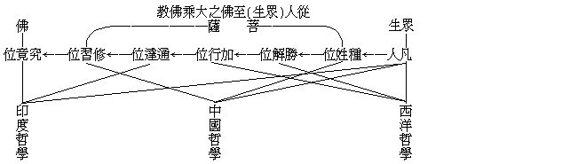



自其皆未脱凡夫之见以言之，悉离佛教犹远；自其各有特点之相似言，则中国哲学於种姓位尤近之，西洋哲学於胜解位、印度哲学於通达位、有其趋向而未能至。故梁君不须改佛以从儒，但修大乘菩萨之种姓行可也。张君不必虑佛教无共享堆积之理智，求之大乘菩萨之胜解慧亦可得也。此则窃愿为梁、张二君进一言者也。



（默如记）（见海刊十一卷二期）



最近西洋哲学与佛学



西洋哲学在二十年前后，柏格森、杜威，罗素、杜里舒等曾喧赫一时，近十年则皆退归沉寂。然有特殊开发者，乃为英人柏烈雷与怀德海。怀德海先以大数学家知名，其专哲学亦十餘年耳。而各与佛学相密迩，为前此所未曾有，因分取略论之。



柏烈雷与宗通　柏烈雷以唯心论著，其现象与实体一书中所云「实体」——贺麟、谢幼伟二君译太极——，以系统性、无对性，心理性之三种特性说明之。系统性具「贯澈」与「广包」二义，即「常」「遍」之义；无对含不二、绝待及无分别、无差别诸义；其最重要者在心理性，其曰「感觉的经验即实体，非此则非真实」，则直指现量性境为真实体耳，此似宗门之直指心性。又谓思想——即分别的知识——生存於对待关系，如谋超越则无异自杀，是亦认必离一切分别知识而后乃成实体之证验，所谓心言路绝，唯证相应也。然柏烈雷虽列论及此，似尚无方法与工夫真能达到於此，则与其参实悟之古锥，犹有一间之隔。



怀德海与法界观　近人称怀德海为二十世纪之康德，因康德曾解决了十八世纪时哲学界中一切难题，而怀德海亦有澈底解决近时哲学上种种难题的功用也。故怀德海哲学不同柏烈雷的简明，然若知法界观之六相十玄义，亦易了解。其看宇宙为一「多元的有机体」，每一元皆为一「现实事素」，每一「现实事素」摄一切且入一切，与所谓「事事无碍法界观」甚相似。朱进之君译载於新民第二期者，所用译名亦多引佛书，其谓「我一向以为惟佛法为独得名言善巧，於今始知其非是」，盖谓怀德海於名言殆有同样之善巧欤？



但生在二千年来深信耶教所谓「上帝」的民族中，致二君皆未能免俗，屡谈上帝，且在其哲学中为上帝留一地位，尤以怀德海为上帝所设地位为重要，未免令吾人观之不喜。於此点，柏烈雷似差强人意，盖以为宗教上之上帝乃有限的，故亦为关系而实非全体，如达於全体，则上帝亦消失，颇有佛亦不立之意也。



（见海刊十七卷五期）



新物理学与唯识论



一



近年最进步的科学与哲学之逼近於佛学，实为一种不可思议的奇迹。前岁尝略论大数学家怀特海近年在英国所讲哲学之逼似华严法界十玄六相义，与英国倍克莱新哲学之切近离言说分别而趣实证禅宗义，已不胜其惊喜。乃顷阅东方杂志第五号宇宙新说与物质第四态，第四态指高热度中向所谓原子碎为粉的自由电子。此类原子粉密集所成的量，较太阳所发出的能力要大几千倍，而推算出假定宇宙为一半英里之模型，而我们的太阳系在此模型内，小仅如一电子，而地球则更只一电子之几百万分之一。由此而借观芥子纳须弥、毛端吞刹海之华严世界，也觉毫无荒诞不经之处。然此等犹髣佛相及耳；最堪诧异者，则为东方杂志第六号英国秦斯爵士之现代物理学的新世界观，其深得法相唯识学之神髓，盖不唯形似而已。且又纯粹根据实验的事实之物理学进步而来，与研究佛学者比附科学以说者异。兹摘录数段以见其大概：



二



过去五十年间，由於科学者全军的坚毅的努力，科学这巨厦，大体上可说是增长到了几乎不复能辨认的程度；无论在范围的广阔方面，在形式的庄严美丽方面。然而，理论物理学者，却不得不承认，他自己的那间屋子，竟只是一个为连续的地震所摧毁了的残破的建筑！当然、这些地震，即是新的实验的事实；我们的屋宇之倒塌，就因为它不是建筑在「确切的事实」那坚固的岩石上面，而是建筑在幻想与思辨那永远动摇著的砂土上面。



此一段的开场白，即可见其完全从科学的立场上以说到进步的现代物理学，变更了前世纪的旧物理学；则建筑在旧物理学上之唯物论，当然亦随著摇动了。



三



自然的真理，只能用比喻的形式来体认。然而、没有一个比喻对於它所要解释的事物，能够绝对真确：有的时候它会觉得太宽泛，而另外的时候却又觉得太狭隘。所以、「真理、完全无缺的真理，除此而外别无他物的真理」——意谓既不少也不多的恰当的真理——译者注——，是不能用比喻来传述的。旧式物理学者的根本错误，即在他不能辨别比喻所代表的「半真理」，与实在的真理间之差异。



此段说明自然的真理，只能用比喻来显示，而比喻又只可算为半真理，不同实在的真理。亦即假立自性——安立谛、与离言自性——非安立谛的差异。而指斥旧物理不能辨别此差别的根本错误，即破斥遍计所执的法执，而其间说实在的真理不多不少的恰当真理，尤与佛法所说的「如」义相合。以如故真的「真如」，终非言说所能安立，於此亦完全表明了。然「不多不少的恰当真理」一语，不及佛典「无欠无餘真实如是」一语来得善巧。



四



设想著每一个讯号都该有一个出发的源泉，物理科学遂假定了「物质」的存在，以为此源泉。然而、这种物质的存在，仅是一个纯粹的假说；实际上、物质是和以太、牛顿引力、及其他科学中所已经消灭了的不可观测量等，同样地不可观测的。早期的科学不仅假设物质的存在，并且还把它描写作存在於空间时间之中。这一假设更没有充分的证据，因为很明显地全物质宇宙、不一定要被局限在外界讯号所由以刺激我们感官的那个狭隘的支架之中。举一个例证来比较：摧山倾厦的地震的波浪，是沿著地而进行的，但我们没有权力说它们的来源即在地面；相反地，我们知道，它们的来源却深处於地球的内心。



此中所云「讯号」，即表现於感觉或认识中的现象，而其发出的「来源」，或为藏识，或为真如，要皆只可离言说分别以内证而不可观测的。故以前假立此来源为「物质」，或「以太」，或「引力」的，皆消灭不存在了。至於并将视为来源的物质存在，局限於空间时间之内，那是更显见错谬了。此说认有所依的来源，既不拨空而落损减的恶取空见，又说假设为物质而且局限时空等为不可，亦不落增益的实法有见，深契瑜伽真实品义。



五



请让我试用另一种说法来阐明这旧物理学以为它所研究的是一个客观的自然，独立於觉知它的心灵之外而有其本身的存在——不管曾否被觉知，这东西总永恒地存在著。倘若物理学者所观察出的电子的行为，在此种假设下它所应有的行为完全一致，我们恐怕到今日都还会这样设想的。



然而电子的行为并不如此，於是引起了新物理学的诞生。新物理学的一般论旨，认为我们所研究的自然，并非由被我们觉知的东西所组成，而即由我们的知觉本身组成。它不是主客关系中的客体，而即是这关系的自身。事实上，主观与客观间并没有截然的区别；二者形成一不可分的整体，那就是自然。这论旨在波动比喻中得到坚决的表现，因为波动比喻告诉我们：自然为波动所组成，而这些波动的一般属性，却是存在於我们心灵中的「认识波」或「不认识波」！



让我提醒大家，假使我们要想知道任何波动的真实性质时，这些波动必须为我们心灵中已有东西所构成。现在认识与不认识，就正合乎这样的标准；别的东西很少办得到。譬如说吧，以太中的波动就非常明显地不能如此。自然在最后终竟组成於我们所能真确地理解的东西，这似乎太奇怪了，而且简直是太好了！然而由此可见「外在世界与心灵的观念属於同一性质」，这单纯的解答，是无往而不适用！



这三节是最精要的地方：第一节、阐明旧物理学的错误，即否定了独立於心灵以外之唯物论。第二节说「即由我们知觉组成」，乃建设了唯识论。所云「事实上主观间与客观间并没有截然的区别，二者形成一不可分的整体，那就是自然」，便是见相分同为一自体分之识三分义。此文本说有质点比喻与波动比喻，质点比喻、浅似顺世极微论或深似小乘一切有义；波动比喻、旧为以太论。而此文阐明「即为知觉自身」，则成为「藏识论」了。认识波或不认识波都不离识，故外境的世界与内心的观念，属於同一性质了。



六



旧物理学显示给我们一个牢狱似的世界，很少像是能够居住的地方。新物理学显示给我们的世界，却是一栋比较空阔的房子，虽然它里面的门也许不一定全开著——那我们还不能说。我们开始推测它该有容纳我们自信具有的那种自由的餘地；至少、在这个世界里，我们可以依著自己的愿望创造任何事物，可以度著感情的、理智的、奋斗的生活。这世界似乎可以成为一个适宜於人类居住的地方，而不仅是一个禽兽的栖息所。



新物理学显然包含著许多哲学的涵义，但这些却很不容易用言语来描述。他们不能简括於流行的通俗科学著作中所喜欢讲的那一套过於轻躁的话，譬如「唯物论死去了」，或是「物质消灭了」之类。事态毋宁说是这样：唯物论与物质，二者都必须在新的认识的光辉下从新予以定义。这样地做了之后，唯物论者就得决定科学所能允许的那种唯物论，是否仍旧可以叫做唯物论；剩下来的属於物质的东西，是否仍旧可以叫做物质，抑或必须叫做别的东西，那纯粹只是一个名词的问题。



此结论虽极温和的不肯说「唯物论死去了」，「物质消灭了」，其实、在新的认识光辉下，唯物论已经变成唯识论了，已没有离识而存在的物质了。局脊於旧物理学的唯物论之禽兽栖习所中者，犹在大讲其唯物史观与阶级斗争，盍亦解放到新物理学显示给我们的唯识论世界之比较空阔的房子中，来过些和合舒适的人类生活。从完全不同途径的科学物理学，竟走通了唯识的宇宙观，我们佛学者，固然惊异，然使现代物理学的科学者，知道了二千年前，已有从不同迹径上，更加精奥地实证，且说明了的法相唯识学，其狂喜又当何若？由此，大乘法相唯识学，实有迅传欧美的需要！



（见海刊十八卷四期）



唯物论没落中的哀鸣



一



前据东方杂志所载现代物理学之新宇宙观一文，作新物理学与唯识论，以略有申论。张世俊君自汉口来书，深致赞意；并媵以汤鍾灵君在中山文化教育馆季刊上所发表之现代科学中的观念论及其批评一文，乃对于新宇宙观的反驳。张君谓其中诸疑点，似皆已为经论所破，嘱再为申论之，此诚现代思想中最有意义的探讨。



二



余赞许秦斯爵士等现代物理学之新宇宙观接近唯识论，以其纯出於科学的理论物理学之进步所构成的新哲学，非以其系袭观念论的旧调。盖欧洲的观念论殊多缺点，余尝评之为「独头意识的宇宙观」，诚有陷宇宙万有为心灵之幻影，毁坏因果律之虞，余亦向不取之。然新物理学的宇宙观及唯识论，则并不如是。在不离识——或认识——的条件下，未尝不容许「万物之相当实在」，易以较为宽广确当之因果律，而绝非破毁因果律，使科学的进步及人生的向上，有更加努力的奋勇，初不堕入怀疑悲观而踌躇退却。故对于鍾君结论中所谓：「一切准备以最高虔诚献身於真理的科学者们，不要怀疑，不要动摇，不要为虚伪的观念论者——太虚按：应加及虚伪的唯物论者——所迷惑！坚定了我们的信仰，坚固了我们的意志，勇往迈进吧！光明在等著我们」！实可为同情的共鸣。不幸、鍾君乃为旧科学所囿，固执著根据旧科学的旧唯物论以故步自封，不敢向新科学的现代物理学宇宙观迈进，乃横加秦斯等以观念论者的旧头衔；将历来致诘观念论的疑难，施之以新物理学的宇宙观，以自坚其唯物论的壁垒。而不悟震蹋唯物论的宫殿者，乃是新物理学的地震，而不是观念论。对于进步的现代物理学既无法否认，则为唯物论的辩护，便等於没落的哀鸣！所施于观念论的攻击，自无涉於新物理学的宇宙观。



三



鍾君的叙明现代物理学，亦诚有相当的忠实，但其固执著唯物论，则不能不认为感情意气用事。如所谓：『但这些宇宙结构的原始材料，却并没有实体的存在，而只是抽象的波动。为这些原始材料之堆集的宇宙全般，当然也不过一个异常庞大的抽象形式，而缺乏实体的存在。这样、唯物论彼斥退了，观念论者都为之欣然色喜』。又谓：『然而一向当作自然科学之最合理的哲学基础的唯物论，难道果真为科学自身内部所孕育发长起来的理论所推翻了麼？这决不可能！秦斯等的论调，简直毁坏了自然科学的强固的基础，动摇了科学者对于他们自己的事业的信仰。在如此的意义上，他们简直可说是变成了科学的叛徒』！又谓：『一向彼当作自然科学之基础的唯物论，实有其绝对的正确性，因之任何倾向於观念论的理论——即使为自然科学本身所展开的实证的理论——，都不足以动摇它，震撼它。这样的企图，不过像一层加以明镜上的薄雾，略经拂拭，便会烟消云散；而那曾彼障蔽的明镜，仍将闪耀著它晶莹的光辉。科学者们用了毕生的精力与最高的虔敬所孜孜研究的外在世界，决不只是一个空虚的心灵的幻影，而是有著强固的实际存在的』。都只是些乾号著、空喊著的哀鸣！说不出唯物论所以尚能强固存在的理由！至云：即使为自然科学本身所展开的实证的理论也不足摇撼唯物论，那更显然不惜牺牲「科学的真理」以曲护「唯物论」了。



四



其引斯宾塞等所说的素朴的论调，以证明唯物论为永恒不变的真理。殊不知此种常识的事实，亦不为新物理学宇宙观者所否认，特常识的与科学的自有见解不同，犹之素朴实在论与新实在论的不同而已。欲引之以自固唯物论而攻击新物理学宇宙观，已甚无聊！何况更引苏联哲学杂志的唯物史观者阶级意识说，欲将新物理学的宇宙观，曲解为布尔乔亚意识中的观念论，那简直是为愚忠墨守於旧科学的唯物论，欲拦阻新的科学进步的探究了。不错的，『但人类为其自身狭隘的感觉所限，常常只能看到它的一方面或另一方面，因此真理的演进过程，乃不得不为一个辨证法的过程』，而最后的真理终可以找著；但找著的大概是唯识论，也许可叫做新的唯物论，或是主客内外合一而不必是鍾君固执著的旧唯物论的外在世界。鍾君等不必死守著唯物论，应向新的自然科学途上迈进而唯真理是探求！



五



其驳斥秦斯最有力之点，自然要算秦斯称物质波为认识波了。如曰：『认识波这名称，便是秦斯爵士的杜撰』。又曰：『不过秦氏最主要的论点，乃在把物质波解作认识波，因而赋予之以观念的属性。他以为干涉原则阐明客观的物质之本性、只是主观的认识之程度，这其实根本错误！我们说：一个质点於某一时间在某一地点，这句话固然代表了我们对此质点的一种认识，而更重要更根本的，另一方面也代表了此质点客观状态，它主要地是一个客观的事实，而不仅为一种主观的认识。实际上，必定先有客观的存在，而后始能认识它，认识是主观的我的心灵与客观的物的本体间之一种反应过程，没有客观的存在，这反应过程是无从发生的。所以秦氏只看到了物质波的概率解释一方面的意思，而忽略其更重要的另一方面的意义』。然「认识波」一名出于秦氏之刱制，此正秦氏之特胜处，何足以杜撰为病？而鍾君此中的驳论，我虽不知秦氏作如何答辩，但在於唯识论中则为久已解答的问题。一方面代表了此质点的一种认识，即是「见分」；一方面也代表了此质点的客观状态，即是「相分」；只要「相分」不能脱离开「见分」，便成立了「唯识」。原不要否定「相分」亦为一个因缘生的客观事实，即所谓「必先有客观的存在而后始能认识它」；只要去掉了先后的意义，也必与有所缘缘心心所乃生之义相合。由此、只要客观的质点状态不离主观的认识程度，便不可不为「认识波」了。这在佛学早有观所缘缘论的详辨。



六



『作为感觉的源泉，一个客观的实在世界必然存在，试举两个显明的例证吧：从纵的方面而说，联属於同一组合的若干感觉——知觉——，在时间长流里，恒能保持不变。……倘若感觉只是心灵的自发的任意的活动，而没有实在外界事物规范著它，则这种齐一性该怎样解释呢？从横的方面说，同一的感觉，对于不同的心灵有同一的意义，一本书对于任何人都是一本书，决没有奇怪的人会觉得它是一枝笔或别的东西。这种感觉的共通性，更使我们不得不倾向于承认一个客观的实体之必然存在，不得不相信唯物论』。以上是鍾君最精釆的一段驳论，但此虽可为向来驳倒观念论的利器，并不悉秦氏能作若何的辩解，而在唯识论，则在于最先的二十唯识论已早将鍾君纵的横的两个问题解决了。二十唯识颂第一颂所提解的四个问题，即有这两个问题在内，如果不是彼唯物论把聪明蔽塞完了的，尽可去研究以获明解，所以、虽未尝不承认不离识的缘生事物存在，然成立的却是唯识而不是唯物。



（见海刊十八卷七期）



关於近人辨证法的讨论



辨证法的讨论，在中国所以轰动一时的，原因於马克思主义的宣传，而不是关於海格尔哲学的研究。然近来一般哲学者如张东荪、贺麟、谢幼伟等，大抵将辨证法溯源于齐诺、苏格拉底、柏拉图等，此於探索辨证法一名词及其应用的起源，虽比较适当——如或译为对演法、矛盾法等——而与马克斯主义者所说的辨证法，则距离益远而渺不相关了。



大抵齐诺的辨证法，与中国的惠施等辩者是一流，久被人误会为诡辩。苏格拉底的诘问法，与中国的孟轲等贤者是一流，则被原谅为教训道德家。至於柏拉图的又专为形而上学的认识法：康德则转而应用为「理性越出经验界所发生的矛盾」说明。然以上诸家，都是就思想辩论旳方法上言，多是属于思辨法的，故可谓为逻辑——论理学——之一种。



海格尔集了以上诸家思想辨法的大成，转到了所思所辨的另一方面。其取思想的矛盾发展为达到绝对的最高真理，固逼近柏拉图；而以犹可发见矛盾的存在，为未达绝对真理，於齐诺、苏格拉底、康德等暴露思辨的陷於予盾为不合理，意亦相通。然其转到另一方面的，则在其由「思想与实体一致」，进入於思想是客观的。把思想认为不是运行於内心的，而是所思想的事物内在理则，所以思想是客观存在的、具体的；而且、就是一切事物循内在矛盾发展而达到最高绝对的历程。这便成所思辨的客观物义理，而不复是能思辨的主观思辨方法了。



但海格尔承袭了柏拉图等的思辨法，用为达到最高绝对的阶梯，故一方面仍可说为形而上学的认识法，或形而上学的逻辑——论理学，或仅为辩论的合理方法，或扩为思想行动的合理方法。而马克斯则承袭了海格尔的客观事物是矛盾发展的义理，完全废弃了海格尔最初的与最高的绝对，亦无复以矛盾发展达到最高绝对历程的意义，所以与齐诺到康德等的思辨法完全无关。而恩格斯辈绍阐马克思的哲学，祗源於赫拉克里图、海格尔，而全不提及齐诺、柏拉图等了。由此、可知齐诺到康德的辨证法是逻辑的一种；到海格尔的辨证法，则一方面是逻辑，一方面已不是逻辑，再到马克斯的辨证法，则完全是事物的客观义理，不复是思辨方法的逻辑。简明的图示如下：



　　　　　　齐诺到康德的辨证法┐  

　　　　　　「实际体验的方法」├能思辨的思辨方法「逻辑」  

　　　　　　　　　　　┌一方面┘  

　　　　海格尔的辨证法┤  

　　　　　　　　　　　└一方面┐  

　　　　　　「矛盾进展的理则」├所思辨的事物义理「非逻辑」  

　　　　　　马克斯一派的辨证法┘



马克斯哲学所明事物的相——即事物是辨证法的——，比较是对的，略近於佛说的一切无我、无常，亦即一切是「因缘和合」——矛盾对立或杂多的统一；与「生灭相续」——质变到量变，量变到质变，与否定的否定；但嫌犹执形式逻辑之物，而未尽一切有为法之量。海格尔亦有以事物的相——法相，显事物的性——法性的意思，惜执我法，有志未逮。然马克斯派硬把其是一事物理相，而不是「思辨方法」的客观辨证法，认为逻辑，这乃是错误的。这是用一种「事物内在的普遍理则」，以观察一切事物或解释一切事物而已。例如用无我、无常以观诸法，或用进化、变化以观万物，就把在事物中发展的定理公例以观一切事物或一部份事物是如此，而用以研究或说明此理例的思辨法则，如声是无常等方是逻辑。能思辨法则，与所思辨事理的能、所未分清，是近人对於辨证法讨论莫决的症结所在。



（见民族正气二三期）



爱恩斯坦相对论与唯识论



爱恩斯坦为当代最大之科学者，以相对论著闻於世。顾其说号称难解，英国人汤姆生尝论之曰：



爱恩斯坦学说之特点，在置吾人於未有空间、时间、物质诸念以前，以至於最原始之真体，即吾人本之以构成如是之空间、时间、物质诸念者也。今请揣其本而言之，其说自易明矣。试设一羌无经验之灵性，忽焉置之於斯世之场野，其最初所觉察者，即此场野及其中凡物之全体；吾人且将设此灵性为人类之灵性——在人说人不限於人——，少顷、始能辨物，随即辨认此场野之一部与其他部，且将觉其本身与此场野为二物也；又设此灵性具有躯体，以为其致思之中心，於是始有彼此之分辨矣。使此灵性适见一花，花中有蜂，花之与蜂，初为一浑然之个体现於彼处耳。有间、其蜂飞出而集此灵性之手，则向之个体一部，昔在彼而今在此矣。又使此蜂螫刺其手，则其事之发生，必在此蜂与此花合为一体之后。此也、彼也、先也、后也，空间、时间之观念於是起矣。且此手中之蜂，原在空间者也。使其悟此，则物体占空间与时间之观念，由是生焉。盖空间有不同处，时间有不同点，其理一也。如是推之，物质之概念亦成矣。



此其知识论上之空、时、物质缘起说，虽未逮藏识缘起说之深密，亦庶乎近之矣！其云最始之真体，羌无经验之灵性，今可译之以藏识。忽焉出现於此，其最初所觉知者，即此场野及其中凡物之全体，则藏识顿现器界根身也。觉其本身与此场野为二物，则末那执藏识为内自我也。设此灵性具有躯体，以为其致思之中心，於是始有彼此之分辨，则第六识依萨迦耶见所起我我所之分别也。过此以往，前六识分合以了其别别之境：彼花也，蜂也，此手也；蜂之先在花而后来手也，则物体与空间、时间、皆炽然现前也。依兹物体，离而析之，空不同处至微极处，时不同点至极微点；於是而物质之分子、原子、电子等概念始成立。故溯爱恩斯坦相对论之本以穷其末，实与唯识论符契。而彼以电子、原子为本之唯物论，适与之相反而本末倒置焉。



（见海刊八卷九期）



说四度以上的事



向来度量一物事，只一、度量其若干长，二、度量其若干广——广长仅分位假，非具体物——，三、度量其若干厚，便以谓尽了。新近爱因斯坦的相对论，以为一物事，必要加入什麼时，以为第四重的度量，乃能尽致。故不管说什麼物事，都要将时加入为度量；就是要说这一物事是若干长广厚，更要加入说在什麼时是若干长广厚了。因为这一物事，在换一时候，便不是此所说的长广厚故。这便是爱因斯坦相对论的四度说，影响於今日算学等各种科学思想，起了一个大变化。



但细为考究起来，四度说亦祗可度量仅一刹那存在的物事而已。若空中一现即灭的电光，仅一现的若干广长厚故，以不相续，自无过未，故但以某一刹那之长广厚度而止也。若言此时的长城或此时的地球，在此时的即具有昔时的，故除此时之外必更度以此时以前之时代经过。若地质学上之某纪某纪，以及长城之何时建筑何时改修等，则不惟以此时的现在度之可了，必更加以前的过去以度之，则须五度矣。夫长广厚为空间三度，非长广不易显空间；非现过——今古——不易显时间。故稍占空间之事物必有长广，稍占时间之事物亦必有今古。宇宙世界，宇界即广长厚，宙世亦即今古。故除仅现一刹那以外之物体，必应皆须五度度之。然细言之，所知事物，实无仅现一刹那者，故无不皆须为五度。



然犹未也，此五度祗可度诸死物耳。以诸死物死定如此，在过去时虽曾以他事物相加而经转变；然今祗论此物，不涉及其他之事物，则此死物必永死定，无有未来之变，故无复未来之时代。然诸生物则便不然，今度一夏草，则前有春青后有秋黄同时可度；度一壮年人，则前有孩童后有老耄同时可度；故度诸生物，必於长广厚现过之上，更加未来而为六度。然细按之，一一事物，既实无仅一刹那而以有现过相续，且相续中必缘他物交涉而有转变，然则亦必实无独不转变之死物者。既无死物而莫非转变之活物，则皆可有未来之度，故又靡不须有六度（至此有相续假）



然犹未也，使此一六度物——譬长城——，与其他六度物——譬砲弹或人身——，若一若二若多交加相涉——自他和合——，转变起一事物。譬长城砲弹合为毁，氢氧合为水，五人合为团体——社会属此——，此则必更加一群义度之——中文若仁、若偶、若众、若群，皆是六度；佛书若蕴、若聚、若集、若和合等，亦皆如此——而乃能充足。故二事——或二缘、或二法、或二事素、或二论理的元子——以上相加而起之事变，必须有长、广、厚、现、过、未、群之七度。然深究之，一一事物，莫非二事素以上之一聚——莫非众缘生法——，则靡物不须有七度——三个人立足点不同，则所见物方、位、时代亦异，亦属於此——（至此有和合假）。



然犹未也，七度盖才可以度生物聚耳，度有情聚，则尚未足。何者？前生物变，亦定律变，但为被变，非自能变。而有情心识聚，虽亦同被所变，而有一分即为主动之能变力；缺此能变则不能充足以测度有情心聚。故必於长、广、厚、现、过、未、群之上，更加第八度之能变。然精究之，一一事物，既靡不续转而合变，应无有离能变之所变物——唯识义——，变不离能，则事物无不须有「能」加入为八度矣。



然犹未也，此八度才可度粗浅识中——前六识或前七识——之情非情界耳。若深细识中之心境，则犹有待——深细识指阿陀那识——。夫粗浅识上之情非情等，皆相续而恒转，亦相摄而和合。以何而得续而不断？以何而得摄而不散？不断不散，则由有大潜势——异熟一切种命根阿赖耶——以为统持；持续不断故恒转，持摄不散故和合。粗显的恒转和合之鉅变相，则有情有生长老死，而器界有成住坏空。然「能持」之潜势力深细的恒转摄藏，则永均衡；故能持续持摄，令粗浅的情非情界之生长老死、成住坏空，永远循环而不息。彼前八度皆为所持，而此则为能持。故此必於长、广、厚、现、过、未、群、能之上，更加一持为第九度。然穷究之，粗浅识情非情界，完全即是阿陀那识，以粗浅识了粗浅相，则为情非情界；以深细识之深细相，即为阿陀那识心境。粗细识相有殊，实事不二，故依胜义，一一事物莫非阿陀那识，亦复靡不须有九度。



然犹未也，前之九度，仅能度量事之幻相，犹未能度量事之真相。事之真相，超一切度量而不可度量，谓之事事无碍一真法界。然以此不可度量而超一切度量以度之，则此超量，即为十度。在第十度，一一事物，皆小大无碍故——长、广、厚——，小大重重无尽；皆久暂无碍故，久暂重重无尽——现、过、未——；皆一多无碍故，一多重重无尽——两六度以上之合群——；皆主伴无碍故——亦曰能所无碍——，主伴重重无尽——两七度以上之不离——；皆隐显无碍故，隐显重重无尽——两八度以上之不二——；皆真幻无碍故，真幻重重无尽——即九度之量事，是十度之超量法界，即十度之超量法界，亦即是一一度量事——。一一事物皆为无碍一真无尽法界，平等平等，圆满圆满。此为事事真相，唯是如来正遍知量之所知量。此度量即超度量故，一切度量至此皆息，更无有上。



故依无上胜义胜义，如来正遍知量，随拈一物皆为法界：亦长、亦广、亦厚、亦现在、亦过去、亦未来、亦自亦他、亦知所知、亦持所持、亦幻非幻，而亦非长、非广、非厚、非现在、非过去、非未来、非自他、非知所知、非持所持、非幻非幻，以超量为量量即超量故；随度一事，皆须十度。若依世间胜义，度一一事皆须七度；若依道理胜义，度一一事皆须八度；若依证得胜义，度一一事皆须九度。唯依世间世俗而谈，区别如下：



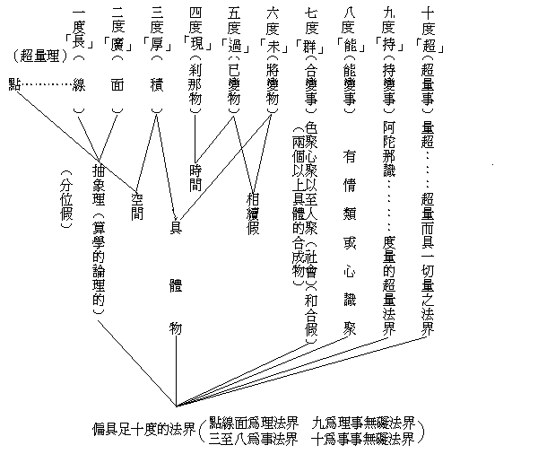



夫爱因斯坦仅发表相对的四度论，已能使科学界的思想起大变化，若能将此相对而绝对又绝对而相对之十度论，影响入科学界，其思想之变化又将何如欤！然数千年前佛家早已发明而发表之矣。今以一世人皆以爱因斯坦四度的相对论为新异，故特将此佛家的陈旧古说比较而言之。



（见海刊第八卷第十一二期合刊）



唯生哲学



——二十三年九月在武昌东方文化研究院讲——



西洋哲学是唯物论的，印度哲学是唯识论的，中国哲学可以说是唯生论的。就这三系哲学的本质上讲，中国哲学是以生气为本质的。生气、即是阴阳消长的气化，由阴阳变化而有宇宙万有的品物流行，故曰唯生论。



但这唯生论要如何研究呢？唯物论以物质为本质，凡物质的东西皆可以测量，可以把捉，故可以数理论理去研究之。而唯生论以气为本质，是不可测量，不可把捉的，溯之不见其前，随之不见其后，视无形，听无声，欲固执之则无，而虚容之则又有，乃是由感应而变化生长的；唯於感应交互之中成为宇宙万物。如此观察，则宇宙万物皆是时时在生长消息流动变化。中国的老、庄，及儒书的易经，皆表现此义，所谓：「天地之大德曰生」。天地之生生不息，属乎自然，并不要如何去造作才有，非如基督教及西洋哲学的目的论所说，要由计划造作然后才有所成。



由此、中国的学术重在修养，所谓：「十年读书，十年养气」。如有不得其正之处，则反观自省，责自己修养有缺，诚感未孚；於是更加精进修养，虔诚悔改，以期由善感而得中正之应，各安所宜。所谓中也者，天地之大本；和也者，天地之达道。天地位，万物育，无感不通，无应不是，则人民得其乐，国家得其安，天下得其平。如为人子者，当得父母之慈爱，若未得其慈爱，当反责自己之孝顺有所未尽，宜更加修养，克尽其孝，只求得父母之反应谅解而生慈爱，以得父慈子孝之适当关系。凡生物有情，皆可从心情谅解而得到感应，此与西洋哲学不同。西洋哲学、谓父子地位是均等的，当各尽其责；如父对子不慈，子亦可以不孝，甚至可依法律而解除父子的关系，偏於理智而不重情感，此种理智是不正确的。又从中西医学上比较，也可以见到此点：如西医见某处有病，即将痛处剜去；中医则见其为生气流行，可由腐而新，使病得愈。此亦可表现中国与西洋之思想不同，方法各异。再由生气以观察经济、政治，也是生气流行品类变化为原则的，由此成立唯生论。



代表印度的佛学，是以心识为本的唯识论。其本质、乃由内心禅定上之修养而成，此为唯生论更深一层的研究，尤重在禅定的修养。戒、定、慧三学的定学，又名心学，即是内心修养之功夫。由禅定将心识澄静清净，由净而明，先成为清净安静之身心，方可生出智慧光明来；由清静明觉之心，照见宇宙万有之本相，如镜照物，镜体明净，则照现之影相亦愈明净，历然可见。成佛、即是将心修成清净明觉之心，而明照宇宙万有之生起变化，能觉证一切事物之本相，故称为佛。中国古时禅宗的永明禅师，著一部宗镜录，就是讲明「举一心为宗，照万法如镜」之义，也就是明心见性的功夫。



现在复兴中国文化，可以依唯生论为本位，以唯识论、唯物论为补充。依西洋思想去看创造宇宙的上帝，亦是一物，故唯物论无不是物。但最近进步之说，亦渐与唯生论相近了。如罗素等唯五官经验的新实在论，唯五官感觉为实在，然五官感觉即是心识，亦可云唯感觉论，而可视为唯识论之一部分。又德国黑格尔的辨证法，谓宇宙一切都是矛盾对立的，由一正一反互相争斗，互相冲突，因冲突斗争而变化为合一；合一之后，又有相反者与之冲突变化；如此以成万物之变异，颇近於中国之易经。后来马克斯采取辨证法以成立唯物的辨证法，依辨证来观察一切事事物物，常常都在辨证法中的生灭消长变化发展流动，此又可称为辨证法的唯物论。如此、则所讲之物，亦是生灭变化之活泼泼的东西，不是不动的物质而近於唯生论了。但辨证法唯物论之矛盾对立，应用於社会则为阶级对立，由阶级对立而争斗，於是就有痛苦，不是由感通谅解而得到的融通变化，中国文化讲改革之功，不尽由争斗流血而致的，乃潜修感化所得之谅解感应而自生变革。即古时驯服异族，亦是如此；使其优游淘镕於德政之下，自然镕化而变为中国人，所谓修德以来之。唯生论以生气为本质，比唯物论的一切学术来得高一层，由此为本位而进研究唯识论，则唯识亦是唯生之最深义，以正为说明因缘所生，生即无生，诸法实相之理，故说唯识，一切法皆因缘所生故。因、即是一切种，缘、即一切现行的差别关系；为说明摄一切种之总依，故说阿赖耶识，将因缘所生说得最透澈的，即唯识论。言生则须有能生所生，因缘是能生，但能生之因缘乃对所生之结果而假立，若离因缘别无结果，无结果则无所谓因缘，而生义不成立。以无生故，诸法性相法尔如是，无所谓谁是因谁是果，不过、就迁流变化上假立因果。故讲明因缘所生，即是取消因缘所生，生即无生，才是诸法实相，欲成就此真智慧，以证明因缘所生，生即无生之诸法实相，须有很深的修养功夫。儒家讲修养，不过持戒的修养而已；道家略略讲到修定之处；惟佛法三学具足，定慧圆明。欲有甚深之修养，须研究佛学！



唯物论是浅的唯生论，唯识论是深的唯生论；茍善知唯生之义，则一切学术皆可作唯生论之参考，以成其唯生哲学。



（尘空记）（见海刊十五卷十期）



唯物唯心唯生哲学与佛学



——二十八年五月在云南大学讲——



一　唯物哲学



甲　原子的唯物抡



乙　自然的唯物论



丙　辨证法的唯物论



二　唯心哲学



甲　观念的唯心论



乙　经验的唯心论



丙　泛神的唯心论



三　唯生哲学



甲　生命的唯生论



乙　太极的唯生论



丙　生元的唯生论



四　佛学与唯物唯心唯生



甲　法性无生与唯物



乙　法相缘生与唯心



丙　法界妙生与唯生



今天承贵校哲学系诸君相邀，得来与各位研谈学理，觉得很庆幸。余前曾作「唯生论的方法论阅后」一文，略论及唯物唯心唯生与佛学的关系；兹承贵会同学以此问题提出讨论，特举其要为诸君言之。



一　唯物哲学



讲到哲学，不外唯物、唯心诸派。先说唯物论，在哲学上唯物论的派别很多，但在根本的主张上有一共通之点，就是：「外境离心而有」，而且是在心之先有；至於心灵作用的精神，不过是以物质为基础而后生起之现象；宇宙万有及一切心灵作用，皆由先存在之物质而生起。如宇宙万有中到了动物才有心灵的作用，再进化到人类才有思想及高度的意识发展，未有人类动物以前，岂不就有地球和太阳行星等吗？倘不先有地球等物质则心灵无所托，一切皆依物质有而有，所以说「唯物」。此物质不但比心灵先有，而且在心灵后灭。如先有眼才能见色，有耳才能闻声，有脑才能思想。此见、闻、觉、知之心灵虽息灭。而眼、耳脑经之物质不即化为乌有。此种理论，因与一般人的常识很接近，所以能普遍发展，而近代的科学，亦多依此唯物论而得建立。其中派别虽多，本人觉得可以三种概括之。



甲　原子的唯物论



此派学说，乃基於物理化学的科学发展。唯物论者最初认为宇宙的真正实体，是一粒一粒物质的最小单位——分子。当十八九世纪的时代，科学者研究到所有物体，共有九十餘种的原素；更分析之，则为最小单位的分子；然其后分析进步，知各分子更由原子所组成，於是原子的唯物论遂据之而起。此种原子是用数学分析出来的，己非眼所能见，但仍不是最后的实体。近代科学更研究到原子还由多数的电子组成，则原子仍是已成之聚体现象，一粒原子即等於一个太阳系，其中有很多成分，如一太阳系有许多行星、卫星等，一原子中亦由一电核含有多数的电子环绕。更近更有「能子论」的出现，认为能子才是物质最后的单位——按此说现尚未达确立之境——。其实分析到能子已无物质的存在，巳将物质化而为力了。反之、则可云由力结成质而有宇宙万物。但总是与心灵不相关之先有的外物，在分合变化。虽然电子之说起，可以推翻原子论，而能子之说兴，又可以推翻电子论，然仍属以分析所得最后外物单位为万有所本之理论，故统称之为原子的唯物论。



乙　自然的唯物论



此派学说，不特别注重物质构成的单位之分析，以作物质实体的说明。他们认为凡一色、香、味、触之自然界的物质，分析起来还是与自然界存在之物质相等。凡能使吾人可见可触者，就是有物质的实体存在，不待分析为最小单位而后认为是物质的实体。西洋学者赫凯尔的宇宙之谜等，可以代表此派学说。中国前数年有所谓黑漆一团的宇宙观，及古来的道家思想，亦颇与此派接近。



丙　辨证法的唯物论



辨证法唯物论的理论，在近来最流行，他们认为宇宙万有都是在矛盾对立流动否定中进化。流动的原因，由於相互对立，对立的原因是事物的本身都具有矛盾冲突的性质。依这种理论的立场，便认为宇宙万有的自身包含了矛盾，遂时起对立的斗争，斗争的结果，使事实变动而向前发展，成为新的形态。此新形态又以矛盾而对立而冲突而斗争而变化发展，永远流动无有止息。这种动的世界的转变，便是客观的物质的存在，所谓精神的心灵意识，不过是物质发展到一定阶段——人的阶段——时的现象。直言之，心灵的存在，不过是物质的派生而已。



二　唯心哲学



唯心论各派的共同点，即认心的作用为万有存在或生起的本因，而同时都否认或怀疑物质可离心而存在。此亦可分三派来说明：



甲　观念的唯心论



观念论者，以为人们对於万物中某一物的认识，须在意识上先有该物的观念。如对於桌子，须先有「四只腿一个平面长或方的桌形」的观念，然后再由材料而实现；假若没有这种观念，就不会有这种现象。而现象上存在之桌子是不普遍不永久的，观念是普遍永久的。当我们想到桌子时，世界所有的桌子都为我们的观念所包括，此观念属於意识，是心，故宇宙万有唯是以心为本体。照这样说法，则我们眼前这张可看见、可摩触桌子存在与否就成问题，因为他是可毁灭的，是暂有的。换言之，它不过是观念的一个特殊表现而已。观念论到近代的笛卡尔，更有高度的发展。他说：「我思故我在」。於是宇宙万有在观念论者看来，不过是「观念的表演」而已。此观念，在佛学上只是一种名相，认作本体亦属错误。盖此不过由概念之相而立以名，至於万物现象之所以有，尚不如此简单。近代唯心论的趋势，恰与相反。



乙　经验的唯心论



所谓经验论，是科学之一个发展的阶段，他曾领导科学成功很大的进步。他一方面反对观念的唯心论，但认为唯物论的本体也是不可存在的。真实的东西，只是个别的特殊的杂多的经验；这种经验即为人们的知识及知识内容，除此别无真实的存在。这派学者以洛克、休谟为其代表。经验论亦正成立了万有是唯心的，比如眼所经验的不过是青、黄、赤、白的显色，或长、短、方、圆的形色。若谓是手能拿到的经验，则手所取者不过是轻、重、冷、煖而已。凡此经验，皆不出感觉之心，此感觉经验到之物皆在於心，乃成为主观的唯心论。如谓唯有我一人所感觉经验者为有，则世界就只有我一人，那末夜间入寐时感觉不起作用了，那时的存在物又由谁经验而有呢？岂不应彼时一切都不存在了吗？若谓由上帝经验，则上帝有无尚成问题。如近代进步的思想家，多有不承认上帝存在的。而美国现代更有杜威、詹姆士等一般学者，创实验主义，使经验不单是感觉的累积，将知识、思想、行为亦作为构成经验之流的原素。换言之，初感觉的是混沌的经验，或素朴的材料，再经意识思想的雕刻，始成为真确的知识。这便是实相主义的「思维术」的贡献了。这种主义，我以为是「扩充了的经验唯心论」。



丙　泛神的唯心论



泛神论亦可称为万有精神论，宇宙唯心论。如印度古时奉大梵天，谓一切皆梵天幻成。西洋如斯宾挪莎以及康德后之黑格尔，都是此派的代表。不过万有精神有程度高低的不同。他们认为宇宙间根本的最后的存在，只是绝对精神；而一切可感觉的自然界的一切存在物，只不过是他的低级或高级的发展。即宇宙是一大精神，於是宇宙便是一个泛神的世界了。精神即是心灵，故名泛神的唯心论。



三　唯生哲学



唯生这个名词，近始倡出，但其思想与意义，古今中外俱有。兹亦分三派论之：



甲　生命的唯生论



此说、可以法国柏格森为代表，他认为宇宙人生都是一种「生命冲动」的表现。由生命的冲动而成生命之流，当冲动紧张表现活泼时即是精神；反之，冲动松懈时，则散成为静态的物质，如砲火一样，当其爆炸之时，即是活动的精神；爆炸后散落下来，便成为静的物质。这可名之曰西洋的唯生论。中国哲学大都可称为唯生论，如易经是儒道两家所共的哲学，易者就是变易，时时变化，生生不息，因阴阳变化，品物流行。而有金、木、水、火、土五行。行者、行动迁流也，流行到某阶段名之为金，流到某阶段名之为土，宇宙一切都是生动变化的。



乙　太极的唯生论



中国古代哲学最富於这种「生」动的思想，易经一书可为唯生论的源泉。易曰：「天地之大德曰生」；又曰：「生生而不已谓之易」。生的意思、便是阴阳协和与偏毗的继续变化，由阴阳二气的渗透融合，便成五行；由五行便生长万物。所谓阴阳太极，太极是阴阳的均衡。由此说明天地万物皆是活泼泼地流行著而不可拘定，若一拘定说是某一物时，它早又起了变化，而不是某物了，所谓物各一阴阳，物各一太极，各各物都在刻刻变化生动。这种学理，余名之曰太极的唯生论，或名之曰古典的中国唯生论。中山先生亦继承此思想，他说宇宙重心就是生，而社会的原动力在「民生」，生生不息而进化，是贯彻宇宙人生的。



丙　生元的唯生论



宇宙根源的物质，不同西洋说是无生命的原子。譬如身体是原子构成的，但粒粒原子，个个细胞也都是有生命的。中山先生提倡三民主义，在其著述中，对宇宙人类社会有两句最扼要的话：「生是宇宙的中心，民生是人类历史的中心」。并在行易知难的学说中，倡生元本体论。以后陈立夫等更就中山先生之主张，与现代自然科学之知识，揉合成一严正之系统，是为唯生论——参看陈立夫先生所著之唯生论及唯生论丛书——，可名之曰现代的中国唯生论。



四　佛学与唯物唯心唯生



以上、就各派哲学简单说明，兹更论其与佛学之关系，亦分三类来对照说：



甲　法性无生与唯物



佛学中大乘的法性宗，明宇宙万有的真实，就是空。法即指万有，万有皆依假相而立名，此假相亦可是辨证法的、非固定的、暂时和合而成的，其真实只是空，此空性则是普遍永久。既普遍且永久，则不生不灭不增不减。若能明得此诸法的真实性，则不为外物所累，可以解脱一切苦厄。然由吾人智慧不明，见地不真，祇见假相而误执为实有万物，积谬相成，习非为是；而不知永久常住普遍存在的只是空性。吾人之所以见有宇宙万有人我是非者，皆因不明空性而误执假相，如此、则「心因境有」。这与唯物论的先有物质而后有心灵相近，或可称为「唯境论」。所谓「心本无生因境有，境若空时心即亡」。因此可由唯物论进而研究到佛学中的法性唯境义。



乙　法相缘生与唯心



佛学中还有法相宗，此宗对於前宗所说的假相以为太笼统。因假相，亦有全假不全假之别，如言马角，世间根本没有此物是名全假，而世间有生灭和合之相者即不是全假。如一线之火急旋为轮，线火即不全假。又如牡丹花须有种子、水、土、日光、空气以及人工种种培植的因缘，始能含苞吐萼，种子是它的亲因缘，水、土，人工等是增上缘；而真正的因缘乃为吾人阿赖耶识中所含藏之种子。由有继续存在之习惯势力在心识中存在，方可以有此牡丹花之发现。万有的生起皆以阿赖耶的种子为因，此阿赖耶识即是心。法相宗的唯识论或唯心论即由此而立，而且可以包括前面几派的唯心论。大乘法相宗把心分成八识，前五识的唯心论可以包括经验的唯心论；第六七识的唯心论，可以包括餘二派以及其餘一切不能融会贯通的唯心论。



丙　法界妙生与唯生



法界即统括一切法。佛法到中国来，演为天台宗、贤首宗，此可称为法界宗。他所谓诸法无碍，互主互伴，一法即一切法，一切法即一法，如一枝粉笔，它的种子因缘与法界一切法都有关系。此法如是，彼法亦如是，随拈一法皆为法界，一切法不必於一法外求，我如此他亦如此，故亦可绝对自由，但由一一法所在之地点、时间等不同而有差别，而成人物。人中又有自他各不相同。而每一法生起，皆通过去、未来，无穷无尽，故名不可思议缘起的妙生。此与物各一阴阳，物各一太极，其义相近。而欲将太极讲得圆满，最好研究贤首华严宗的六相十玄之法界缘起义。



今天拟的这个题目略说如是。诸位若能从研究哲学而一探佛学的奥义，将更见其圆满。



（尘空、李思齐合记）（见海刊二十卷笫七八期合刊）



致私篇



——二年春作——



天下亦私而已矣，无所谓公也。陆子曰：宇宙内事，皆己分内事。夫宇宙内事，既皆属己分内事，则宇宙之外，设更有事亦己分内事耳。信如是，则尽法界、虚空界，尽未来际，固莫非己分内事也。尽法界虚空界尽未来际之事，既莫非己分内事，则可知除己分内事更无一事之可述也。然则人之任事，无论至於何地，所任之事，要皆己分内事耳，为己分内事，非私而何？夫天下无往非己分内事，即天下无往非私，故曰：天下亦私而已，无所谓公也。虽然、天下之攘攘扰扰，竞权争利，演种种之惨剧怪剧，以致社会不能安宁者，皆由於有私耳，仁人君子，冀消弭种种之惨剧怪剧，以维持社会之安宁，方使人背私就公不暇，顾吾乃一笔抹煞之曰：天下亦私而已矣！无所谓公也；宁不益长私竞之气燄乎？虽然、我之所谓私，非背公之谓，亦非大小递进如吾友某君之所云者。盖以凡时闲、空间，形上、形下，万事万物，万法万理，莫非己分内者，莫非我之私有者，除我之私有者外，更无一事、一物、一法、一理，乃至如微尘许，如芥子许。唯我之私如是故绝待，唯物之私亦然故圆融；绝待故，唯私无公，圆融故，私亦不存；此人生观、世界观一致之极诣也。



或曰：万物显然万物，我显然我，初未见我为万物有，万物为我有也；万事万物，万法万理，莫非我之私有者，亦一空言耳！证之实际，未识其当也。呜呼！是盖泥於妄执之我见而不知夫有真我故也！请言真我。



真我者、真我耳，非思量拟议之所及，又岂言辞所能喻哉？无已，姑以妄执之我见反显之。譬畫月者，转而畫云，云相拥处，一轮皎然而现，月之真相，以云形之而尽见，是亦天下之一巧也；窃取斯义，用妄我反显真我。今试问所谓万物显然万物，我显然我，果以何者为我，而曰我显然我耶？手足耶？头颅耶？腰肢耶？心胸耶？眼耳鼻舌耶？脏肺肝脑耶？彼是则此非，此是则彼非，其均是耶？抑均非耶？藉曰：均是也，则父母未生之前，固未尝有是也；死亡消灭之后，亦未尝有是也。而此处数十年间，忽而孩提，忽而儿童，忽而壮大，忽而衰老，忽而疾病，忽而健康，陈陈相蜕，新新不已，抽足即逝，交臂即非，如是其又谁为我耶？藉曰：均非也，而别有知觉灵魂为之我也。则赤子初生，仅知啼耳，嗣后知觉渐开，要皆感境而生，非必本具也。即知识之出生及存存之点，亦不易知：在心、在脑皆武断之言耳，况人之思想意识至无定者也！方思未来，忽忆过去，方念天上，忽虑人间，以至方悲、忽欢，方怒、忽喜，方恨、忽爱，方忧、忽乐，凡是其又将以何者为我耶？藉曰：此皆对境而生之情状，胥非我也。是则除夫形骸知觉，所谓我者，固何在耶？此可见所谓我显然我，物显然物，物对物而云我，非真有一我在也；离去对待之物，我本无我，我既本无，又谁与万物显然对待哉？由我之本无以推万物，则可知万物亦本无也。物我双忘，而后即物即我，非物非我之真我，乃恍然见之。



真我乎！真我乎！历万劫而常然；虀万物而弥纯，包藏无量天地而不为富，出生无穷种类而不为巧，声声色色而未始声声色色，毁毁成成而未始毁毁成成，横极十方无限无限，竖穷三际无尽无尽，其大无肤，其小无腹，窈冥恍惚，晶莹炳灵，无有乎弗具，无有乎或变，尘尘然，物物然，万有之元宗，自在之真宰也。一旦得之，则天人同根，物我一本之理，朗若列眉，尚何疑耶？我之为我，如是其广大悠久，地球之生成坏灭於真我之中者，不啻微尘之起落於太空，其为物固甚小，其为时固甚暂也，固不必有惊於世界大同之说也。抑人之以地球大者，因人小耳！他世界有伟大众生，其身量较地球大什百倍者，彼之视地球，曾不翅拳大一土块而已；又人之以拳大之土块为小者，因人大耳。设以微生之类，处此拳大之土块，应不异人之处於地球也。地球固大乎哉？土块固小乎哉？亦人之自生区别焉耳。唯真我无对待，故无比较无大小。无比较无大小者，又生比较者、大小者之所能乎？天台宗所谓一念三千，华严宗所谓法界唯心所造，为庶几耳！信如是，则某君所云佛能言爱，能言无，不能言有者，误矣！以愚意断之，竟是某君能知佛之偏，不能知佛之全，能知佛之一二，不能知佛之三耳。真空不空，妙有非有；所谓空者，又何不可谓之有？所谓有者，又何不可谓之空哉？要言之，一即三，三即一。能言无者，果未有能言爱、言有者；能言爱、言有者，亦若是则已矣。所谓随拈一物，莫非即假、即空、即中者是也。明乎此，则可知物物皆私。物物之私，莫不竖横穷遍，有能充此私之量者，虽天地不足为也。王阳明好致良知，余则换言致私。是同是别，且质之具眼者，余不复畫蛇添足，再为之论断。



（见佛教月报第一期）



宇宙真相



——二年作——



忆余总角时，春深日暮，玩弄既倦，间旋绕於乡老之膝前，尝闻其相谈曰：昔有一士者，一樵者，一渔者；士者处城，樵者处山，渔者处江。一旦邂逅，以渔者之鱼，烹以樵者之薪，倾士者所携酒而共酌之，三杯落肚，万虑忘怀！士者曰：吾曹操业，无或同者，今之良会，殆非易得，盍各言所知以佐逸兴！请自仆始，为二君倡，今吾人仰视一轮赫然而高悬者，非日乎？二君知日之赫然高悬空中，亦知日之出於何所而入於何所乎！仆辨色而起，观日之腾腾然渐升渐高，出於城之东隅，扬清光以照临吾室；既暮，观日之颓颓然载坠载下，入於城之西隅，回餘辉以掩映吾窗。历数十年无少异，夫亦可谓极经验之能事矣。此现前之显且易见者，二君所知，应不仆殊也？樵者嗤之，若深形其妄者然。徐进曰：就余所见则不然，夫日、余固昕夕以睹其出山之东而入山之西者也。樵者、士者，相辩不巳，折衷之渔者，渔者覤然曰：吾於二君之说，胥未敢茍同。吾但知此𪢮然之日轮，晓则从大江之东浴而出，夜则赴大江之西没而入，吾未知其他矣，亲目所觏，真相斯存，虽有异说，不欲闻命。於是之三人者，各是其是，各非其非，援引证据以实其说，诤论未竟，不觉垂暮，相得之情，一变而成为相敌之势，不尽欢而散焉。余一历耳根，深入识田，二十年於是未之忘，今世界学者，异说蜂起，横议孪生，思潮之复杂，理想之繁赜，索之冥冥，探之茫茫，出乎玄玄，入乎妙妙，各执其经验所得，各有其证据所陈，光怪陆离，纷纭杂沓，窃为之脑血充溢，目神眩骛而杳不知其所究竟者久矣。以例乡老之谈，虽未免拟於不伦，顾古今时异，东西俗殊，偏执其习见者以相为是非，私未敢必其皆真理真相所存，殆亦难免夫乡老之笑言乎？第余之云此，非不足於今世学者之谓，仍不敢自是之谓也，余将有姑妄之言於是，欲世人以余言为姑妄而亦姑妄听之，迺用是发其端耳。呜呼！吾其城居之士人耶？吾其山居之樵子耶？吾其江居之渔翁耶？吾其均是耶？吾其均非耶？吾诚不能自辨。吾不知异日之乡老，将属余为谁何，以供其花前月下、酒后茶餘之谈助耶？虽然，彼士者、樵者、渔者皆敢於自是者，余则未敢自是而将以求信於天下者也。余之异於彼士者、樵者、渔者，其在是乎？法人特嘉尔尝高唱尊疑主义，以为古今之学说，无一可信者，非概置之怀疑之例，衡於经验，断於智识，不足为情实，学者称之曰怀疑派哲学；盖即经验派之所出也。余所持论，岂即怀疑派之附庸乎？此则不然。余盖谓人皆有所偏蔽，瞭於近而昧於远，实势所必至，理有固然；毋偏执之太甚，是自而非彼，当谦怀而虚受，藉非以显是而已。庄子曰：以指喻指之非指，不若以非指喻指之非指，以马喻马之非马，不若以非马喻马之非马。天下之非马，天下之相诤，由於人己之互执，方欲与天下人解执而息诤，乃先执一说以诤之，此之谓益薪止沸，缘木求鱼。故余亦曰：以执使执之无执，不若以无执使执之无执；以诤使诤之无诤，不若以无诤使诤之无诤，是则微意之所存也。但尽凡情，别无圣解，能穷世相，斯即常住。



夫宇宙万有，一幻之表现耳，何真相足云？吾人居宇宙万有之一，亦微末巳甚，所恃以为真者，使眼、耳、鼻、舌、身之五，接色、声、香、味、触之五而已，然眼所不及之色，望远镜、显微镜能及之；耳所不及之声，电筒、德律风能及之；从而递推异日所发明，必有鼻、舌、身所不及之香、味、触而藉器以及之者。且吾人之眼、耳、鼻、舌、身，固能与色、声、香、味、触相接者也，而有及有不及；可知藉器以及之者，亦必有及有不及也。故彼望远镜、显微镜所不及者，必有天眼、慧眼、法眼、佛眼能及之；彼电筒、德律风所不及者，必有天耳、慧耳、法耳、佛耳能及之，而所见所闻无或同者。同一恒河之水，鱼鳖见之为窟宅，饿鬼见之为火燄，天见之为琉璃，人见之为流水，凡是、其所谓真相者，固何存也？以不止五接五，尚莫得其真相，况以五而接不止五乎？吾人其乌可恃眼、耳、鼻、舌、身所接色、声，香、味、触为真耶？宇宙一幻之总相，万有一幻之别相，凡所有相，皆是幻相，以幻接幻，谓有真相可得者，无有是处。



然特嘉尔曰：是实非幻者，唯意而已。何言乎唯意为实？盖意有是非而无真妄，疑意为妄者，疑复是意，若曰无意，则亦无疑。故曰：惟意无幻，无幻故常住，吾生始终，一意境耳。是则宇宙万有皆为意境，万境胥妄，惟意是真。但意既真矣，复何容疑？疑则妄矣，意宁是实？以余观之，意为幻末，意之与境虽有本末，同是一幻，无非幻者。特氏知万有之皆幻，此特氏之卓见也；而曰唯意非幻，则殆未免「无量劫来生死本，痴人认作本来人」欤！



余将下一断语於是曰：宇宙无真相，唯幻是真相；宇宙无万有，惟幻是万有；宇宙无宇宙，唯幻是宇宙。以唯幻故，同一朗日、皓月、绪风、晤雨，同一名山、大川、长林、幽谷，或把酒吟啸，触境皆虚；或怀远伤离，成形即惨。以唯幻故，同一文字、语言，仁者见仁，智者见智；同一天下、国家，治者自治，乱者自乱，以唯幻故，智慧深则山河、大地立成金色；罪业重则食到口边都化猛火。以唯幻故，同一眼根，或恒沙世界一滴之雨皆知其数；或伏处斗室，三光偶隐，惟睹黑暗。以唯幻故，同一天地日月，或上圆下方，乾动坤静；或日住地转，晓东暮西。以唯幻故，同一人生，或为舜、为跖，或为彭、为殇。以唯幻故，世界无量，众生无量。以唯幻故，诸佛出世，名号庄严，说法度人，各各相殊，毕竟同中有毕竟异。夫何以故？曰：以唯幻故。以唯幻故，三界唯心，万法唯识。以唯幻故，有一众生不得度，誓不成佛；度尽一切众生，卒无有一众生得灭度者，而佛界不增不减。以唯幻故，过去非去，未来非来，三世一时，十世一念，而不来不去。以唯幻故，森罗非异，无相非一，而不一不异。以唯幻故，是法住法位，世间相常住，而不生不灭。以唯幻故，因中无果，果中无因，而因果不昧，因果相成。以唯幻故，小中见大，大中见小，而大小悬绝，小大相融，毕竟异中有毕竟同。夫何以故？曰：以唯幻故。伟矣哉幻！虚空由之立，世界由之生，众生由之出，国家由之成，宗教由之建，学术由之明。远而日月星辰，近而肝胆手足，大而山岳江海，细而尘芥虫蚁，六合内外，万形上下，莫不依此不可思议之幻力而成、而住、而坏。唯其皆依幻力而成、而住、而坏，故无成、无住、无坏。统宇宙万有而浑成一大幻相，遍法界、虚空界、众生界，无所不贯彻筦络而充满；吾无以字之，字之曰：宇宙真相。



（见佛学月报三期）



自治哲学



人类群化变迁之趋势，横观东西洋，纵览古近史，其繁剧严烈莫甚於今世也！自帝国制贵族之化，以至无政府共产之化，其间若君宪之化，民宪之化，国际政府联盟之化，劳农政府集产之化，此各种人类迁化之势力，殆无不皆尚在争死活、竞存亡之中，而未见其极。余既胪察群变，暇居静思，意其必有一沟通贯达之法，可藉之会樊然之众异，得浩然之大均，以免其相冲击、相倾夺而长在忧患劳累之途者。推校详审，於是喟然而起曰：其惟自治乎！其惟自治乎！盖能免除「忧患劳累」者，即谓之治，而人生之为治，其道术未尝齐一：古昔称天而治，是神治而非自治也；牧民而治，是君治，而非自治也；立宪而治，是法治而非自治也。降及今世，神治、君治既不足为治，而法治亦不足为治，且皆使人发见其徒增忧患劳累而已。由之反究其何因而致此，始悟皆因不自治自、而赖他以治自之故耳。有人者累，有於人者忧，欲除忧累，其必不有人亦不有於人，而惟自己治理自己乎？此诚今人由历受神治、君治、法治所遗之痛苦，而发生之最深切、最周遍之新觉悟、新思想、新潮流、新运动也。以其深切周遍，故近今昌言自治者，非徒平民昌言之，高居政府中人亦昌言之，虽有专制之皇帝、贵族殆亦将昌言之。而远推至於主张无政府、共产者，其所求既同在乎免除忧患劳累，则换言之亦即求治而已矣。既求治，则其所求之治，必非神治、君治、法治而为自治无疑。夫自治之至，且不仅如世人无政府、共产之主张，随世人所知之量而起言说。且姑以无政府、共产为自治之至，则无政府、共产之能实现与否，亦必视自治之能臻其极轨与否为断。欲达到无政府、共产之目的，固亦舍却循自治之道以前进，无他术也。然则能贯通人群变化之各种趋势，以免除其冲击倾夺之战争，有居今不违之德——政府中人亦言自治——，行远无滞之功者——无政府亦必由自治——，端在乎自治，不昭然若揭哉！然自治虽切实之行事，要亦须先明其根本之原理，与极成之宗趣，庶建而不悖，不致徒贻后忧，故不可不有自治之哲学也。夫自治之思潮，汹涌澎湃於今日之人间世，既如是其弥漫普遍，而关系人群变化之趋势者，又如是其重大。顾近人若杜威辈，但泛言社会哲学、政治哲学、教育哲学，独未尝有一言自治哲学者！故余试胡乱言之。



然哲学上之自治问题，与施行上之自治问题不同。其问题在根本，其解决亦必从根本上解决之，始能圆满。故一言自治，不但须说明何者非自治，何者为自治，如何则能自治，如何则不能自治，及应当若此若彼以实际施行其自治之事项而已。从哲学思想以追著疑问到穷源澈底，更须先发明何谓自，何谓非自，何谓治，何谓非治，自固安在，治复奚为？自本治，何须自治！自本不治，何能自治！果将如之何以自治乎？故今言自治哲学，当首从明自言起；自之既明，乃继之以明治；自与治既明，本之乃可言自治耳。



今皦然而曰自，此自之一名，其所名之实为何？且其实何在乎？使莫知其实之为何，或虽知之而仍莫知其实之何在，则仅此自之一名而已。使所云之自但名无实，则自治自治，果将安从之以为治？而治亦将奚施乎？



在实际主义哲学者，将曰自治之起，亦本乎人类生活之需求，发生此需求者，即在乎各各之自。使其先无各各之自，则自治必无从起，今自治之既起，则自必先有在矣。故谈自治哲学，而首先怀疑及自之存在否，实为无病之呻吟，但置之不成问题、不须解决之列可也。若视为问题而空费其解决，卒之解决与不解决，与自治之事实，无丝毫损益於其间也。



虽然认今世之运动，固对於要求免除非自治所起之忧累而发生，且一方面认自治为有益，一方面认非自治为有损，故排却非自治，主张自治而为运动耳。此非甚高之论，在实际主义哲学者，当亦同承认之。然则若非先发明自治之所云自，自与非自既无由辨，则自治与非自治亦无由辨，昧其实而徒徇其名，又安保运动自治之不适为运动非自治，排却非自治之不适为排却自治，欲益之而反损之乎？故实际主义哲学者，对於一切求达真实之问题，皆用消极的、否定的之不解决的解决，不唯不能满足吾人对於哲学上之所要求，驯至实际上之亦必使人茫然莫知所可，而永堕於迷离徜徉之中也！故实际主义哲学者，於吾人欲知自之实在之要求，虽用此消极的否定的暗示以暗示吾人，吾人初不能为之有所摇动，而仍必本其所要发明之何为自，自何在之疑问，以求一圆满之解答。



或起而为之辩护云：实际主义者，固尝云发生自治之需求者，即在乎各各之自。使实际上求为自治者，皆从其需要发生之所在而获知其所云之自，其解答者不既圆满乎？然不为畫定一刻板之意义者，盖因实际上依之发生自治要求之各各之自，其性质、分量亦各各不同故，假如吾人类被主治於非人类——若称天而治之天神——，吾人因之求解脱非人类之主治权，施行人类自治之时，则所云自者，即人类是也。又假如一民族被主治於另一民族，此一民族因之求解脱另一民族之主治权，施行民族自治之时，则所云自者，即此一民族是也。又假如一国家被主治於另一国家，此国家因之求解脱另一国家之主治权，施行国家自治之时，则所云自者，即此一国家是也。又假如平民阶级中大多数人被主治於皇帝、贵族、官僚、军阀等辈，此平民阶级中大多数人，因之求解脱皇帝、贵族、官僚、军阀等辈之主治权，施行平民自治之时，则所云自者，平民是也。又假如各地方被主治於中央政府，此各地方因之求解脱中央政府之一部分主治权，施行地方自治之时，则所云自者，即各地方是也。又假如多数劳动者，被主治於少数资本家，此多数劳动者因之求解脱资本家之主治权，施行劳动者自治之时，则所云自者，即多数之劳动者是也。又假如人群被主治於国法，人群因之求解脱国法之主治权，施行人群自治，则所云自者，即人群是也。又假如各个人被主治於全群众——即社会——，各个人因之求解脱群众之主治权，施行各个人自治，则所云自者，即各个人是也。随各个时代各种环境之下所发生之特殊事实而列举之，依之发生自治需求之各各不同之自，殆不能更仆以数之也。就今世所发生之自治要求、自治运动以观之，则民族自治、国家自治、平民自治，地方自治、劳动自治、人群自治、皆其较有意思者也。若人类自治、个人自治、别无何重大意思。故自治之所云自是何？或是民族、或是国家、或是平民、或是地方、或是劳工、或是人群而已。自治之所云自何在？或在民族、或在国家、或在平民、或在地方、或在劳农、或在人群而已，所解答者，不既灿然明白矣。随要求自治、实行自治者，依其所处不同之情境，当各得其自与非自之辨别，又安有自与非自先不能辨，致自治与非自治亦不能辨之患哉！



然从根本上发生何谓自、自何在之疑问者，虽闻此详晰之解说，仍等於隔靴搔痒，初未能使其疑冰之融释，且益多腾疑起难之端耳。夫使随著各个时势、各种情境下依以发生各种自治意思之特殊事实即谓之自，而於其中绝无一贯通范持、变而不渝、在而不居之真实性，则此亦一所谓自，彼亦一所谓自，此亦一所谓自治，彼亦一所谓自治；反之、则此亦一所谓非自，彼亦一所谓非自，此亦一所谓非自治，彼亦一所谓非自治，使或此或彼之所谓自与非自，自始与非自治者聚论一堂，各然其所然而互否其所否，不益足腾自与非自无由辨，自治与非自治亦无由辨之疑，而起实际上亦使人莫知其所可而永堕在迷离徜徉中之难乎？且人类但是自之同类而非自也，民族但是自之同族而非自也，国家但是自之国家而非自也，平民、劳动、人群、但是自之朋侪而非自也，地方但是自之居处而非自也；以依於自，故有自类、自族、自侪、自国、自地，而不得举是等等以冒充为自也。则何谓自乎？自何在乎？不尤急须辨个端的、求个著落哉！



自类非自也，自族非自也，自业非自也，自居非自也，舍之离之俱非自也，舍离到不能舍离乃存个身，此个身其真自乎？自其唯此个身乎？身即自也，自即身也，身在自在，自在身在。然虽仅此个身，亦终未能得达乎自体之中坚也，故亦祗可谓之自之身，而仍不得冒充之为自也。何者？以兹个身，但为连续和集所成之一个假形状，分析之则为若干之物质——金镭炭养等——，物力——热动光电等——，若干之生机——脏腑脑筋等，生元——血胞精子等——，而体非一实故，体非一实，则不真常；不真常者，则非有本；非本有者，则不永存。故此，一形之生长，一命之存在，乃由假借四大、组织五蕴之所幻成。乍经幻成，便趋渐於分离解散，既分离解散，此身即无。未假借组织，本无此身，故此身乃自昧乎自，妄为假借四大、组织五蕴而有，虽可是自之身，而决非即是自。自必自在，无待假借组织，不可分离解散。此身既从假借组织而起，复由分离解散而灭，故身决定非自。



自家即自也，自国即自也，自胞与即自也，自环境即自也，摄之取之莫非自也；摄取到无可摄取乃成宇宙，此宇宙其真自乎？自其唯此宇宙乎？宇宙即自也，自即宇宙也，宇宙在自在，自在宇宙在。虽然极此宇宙，亦终未能得达乎自量之边底，故亦祇可谓之自之宇宙，仍不得冒充之为自也。何者？以兹宇宙，但是隔别对碍之一圈虚分位，解剖之则为天空、群星、地面、庶物、六合、内外、十世古今，而量非妙圆故。量非妙圆，则不融遍；不融遍者，则非明通；非明通者，则不含具，故此十方之施设，三际之安立，乃由计度意识、分别法尘之所浮现，乍经浮现，已即归於止息空亡；既止息空亡，宇宙即无。未计度分别，本无宇宙，故宇宙乃自昧乎自，妄起计度意识，分别法尘而有，虽可是自之宇宙，而决非即是自。自必自如，不落计度分别，无能止息空亡。宇宙既由计度分别而出，复从止息空亡而没，故宇宙决定非自。



无待而自在之谓自，不落而自如之谓自，闻其义也，然未获证明其实也。何者是自？自究何在？问之者非徒欲知其义也，欲现证其实也。推之则穷极，宇宙都非自也。反之、仅存个身亦非自也。然则何者是自乎？自究何在乎？不益令人疑极疑绝，而又不能不疑，疑不能已乎！云何为自？自何在？愿阅者俱掩卷试参究之！若能觌面相见，则太虚千里不隔一线。如或未然，且待续布！



（见海刊二卷一期）



人生的自由问题



——十九年五月在北平讲——



此问题含义甚广，关於政治、宗教、哲学各方面，但现在限於时间，不能作充分的研究，所以、略重在哲学。在十七世纪法兰西的理想家卢梭，高唱：「人类生而自由，在神权、君权下失去了自由的人，必须争回了这天赋的自由权利，才得完成人格。不自由，毋宁死！」於是惹起现代推翻神权和君权，以争取人权或民权的革命风潮，摇动了全世界人类的心理。国家的体制因之而改，社会的组织，因之而变，就是数千年古文化的老大中国，也被这思潮鼓荡了二三十年，到现在仍未得著安定。但卢氏所唱「人类生而自由」的高调，虽曾激生了非常伟大的变迁，而一经仔细研究，觉其理由并非充分。从生物发达进步到我们人类，最可宝贵的即在自由，所以要求自由，是人生意义和价值的所在。但「生来就自由」的学说，殊与事实不符，例如初生的小儿，心理、生理、均未完备，就不能自由，这是极显明易见的。卢氏的学说，正为不自由人类共同有此要求，於是引起众人的注意；然事实上初无确切的根据。故政治论的人生自由问题，犹待哲学来为解决。



再从一神的宗教方面来说，以为人是由上帝所造。然由此推论，人既由上帝所造，当然没有自由，善恶的行为，一概应由上帝负责，那人就同机械一样了！但信仰一神教的人，又承认人类有自由，他们的论调是：上帝造人类，曾赋与人类自由权的。从这种解释穷诘之，则人类的自由权，既从上帝赋与，而人类因有自由权以造成罪恶，这亦仍须全知全能上帝负其责。我们切实的研究，觉到宗教的解答人生自由问题，自相矛盾，更不能成立。所以、有从哲学上重新来研究的需要。现分为四点来说：



一　必然偶然与自由



以自然科学来说明自然的现相和关系，这其间就有因果律的存在。例如：有甲种的现相，就有乙种的现相；甲为乙的因，乙为甲的果。将自然现相观察明了，就能由关系上知到因果律，自然的现相和关系，才尽受因果律的支配管辖。例如电灯，只要知道了电的作用和开闭的机关，就可被人管辖、支配、利用他，这就是因果律所有的必然性。以若非必然，就不成定律，不能受管辖、支配，失却他的功效。所以、从自然现相关系间求得其因果公例，此即为自然科学的目的。全宇宙的事物，皆系必然的、受因果定律支配的。那麼、宇宙即是一大机械，人生不过是大机械中一小机械；人生既系机械性、必然性的，尚有什麼自由可言？但人生哲学，以注重人类须有道德责任的缘故，极力主张人生有自由的意志；以为人的善恶行为。发动於各人的自由意志，所以要由各人自己来负责。善的行为，就受名誉、利益、恭敬的报酬；不善的行为，就受社会上法律、道德、或宗教上因果报应的制裁。所以、在人生哲学上研究起来，人类是有自由的，不是如机械的。人生有道德责任，故当有人生的自由意志，人生的意义和价值，就在自由意志。



总以上两种研究，而成绝对相反的结论，所以自然科学与人生哲学不能相通。德国康德的哲学，分为「纯理批判」与「实践批判」，在「实践批判」中，认人生有自由意志。然「纯理」与「实践」，在理论上虽可区分，而实际却不能判然成为两事，所以仍免不了有通不过的冲突。



近代科学进步，二十世纪的科学，已迥非十九世纪的科学；对於因果律几经修正，已不似从前的狭隘板滞，而变为广泛的活泼的因果律了。甚或废因果律的名称，而代以「函数律」的名称，说宇宙万有的现相，从互相的关系上可以互为因果，这就是佛法众缘生的因果律。这种宽泛的活动的因果律，不复是必然或偶然的两极端的，以必然过於板滞，一切都属命定，即无创生改变的自由可能。反之、若一切都是偶然的，似乎是很自由，然一切偶然，则亦惟有乱碰运气，而没有自由选定一方针以趋向的可能。所以、这两种都有所偏。但在这必然与偶然之间，有或然的可能，就叫做或然律。或然律为不定因，如优良的青年，应有好的成就，但由各种的关系，或竟堕落。所以、一果可从各种不同的原因以成，一因亦可变生几种不同的果。这其间、尽容有知识的审虑，兴趣的选择，意志的判决等，各种自由活动的餘地；或善或不善既可容自由决择，则便应自负行为责任。然此自由并未超出因果律以外，自由与因果律合为一种，自由於因果律中的活动。例如人驾马车而成的行动，人固为驱马以率车而前者，然亦即为由马与车所载运者，此共同的行动，是即由互相的关系以成。所以、既无绝对的自由意志超出在因果律以外，亦无必然的因果律绝对不容有自由活动。前者未脱去一神教的错误，而后者亦为旧科学的偏执，今在新科学上所建设的新哲学以解释之，庶其渐近真相。



二　现状人生的分析



前者对於「人生的自由问题」，虽以一般的哲学作大概的解决；然而欲进一步以分析人生究含有若干限度的自由，及人生的自由有否进步的可能，更就佛家的哲学，就现状的人生一分析之。据佛家所说：众生都有一部分自由活动的心力，人是於这一部分自由活动心力尤其较强的。佛学将心分析为八识：即眼识、耳识、鼻识、舌识、身识、意识、末那识、及阿赖耶识。八识都叫做心，每一识都是「一聚心」作用的总相，而每一识各含有随识分别而起的复杂作用，叫做心所有。人生的八识，前六识均有自由活动的心力，但惟第六意识有较多的自由活动，而前五识仅有少分的自由活动，而且是随第六识而活动的。此之自由活动心力，不但不受业果「异熟」束缚，并可转移业果；如现在的身体要受自然律的支配，例如人多食就要病，然在意识上则可用改转的自由权，如不去多食便不至於得病。故人的行为不当，健康、成年人的意识应能完全负责，不应一概委之环境。惟有意识已失的疯人，与幼稚、老病的人，已不能有自由活动心力的，乃可不负责任。



复次、人生的组织，一似社会的组织，不是单纯的，各部都互相发生关系的。这当中如有一部份是不自由，当然全部也要受他的影响。佛说人生的组织当中，有一种不自由的癖执性，是从初生直到死，恒时审注在一点上的心理作用。浅言之，就是各人的癖性。所谓：「江山易改，秉性难移」。深言之，即佛家所谓的异生性。就是：人与异类的众生所共有的深刻「自我」执。其执自我，就是「我痴」、「我见」，由此更发生「我贪」、「我慢」等，这种心理作用就名癖执性。由各人的和异生的癖执性，在人生的组织里头作梗，所以就不能得到进一步的自由。而且、此癖执性又限制前一类的自由活动心力，使之受他的影响而不得自由。如人有癖性，就可牵累及他的行为，使他当作不作，不当作而作。人生有癖执性，所以人生不能生来即有完全的自由。



但人生不仅有癖执性的不自由，而更有异熟性的不自由。异熟性、是佛学中的特别名词，这近於平常所论的自然性、或天然性，系以前的业力所引生的结果，不是当时的力量所造成功的——就是异时而熟的意思——。自然的人生与世界，全属异熟性。人有八识的心理作用，除第七末那识唯是癖执性以外，其餘都有异熟性的不自由限制，而第八识尤其是异熟性的。以人生有异熟性的不自由，所以人生须受自然法则的支配。例如人想不老和不死，是不可能的事。但异熟性的不自由，程度有浅深不同；前六识的不自由异熟性，可用前六识的自由活动心力来改变他的不自由。例如生来愚钝的，可由精勤学问而改变成聪敏的。然再作进一步的研究，人生还有「异熟所变性的不自由」，这就是人的身体等，那是更加不易自由转移了。例如生来是盲目的人，甚不易使他复明。而异熟所变性，更分两种：就是「共变」与「不共变」。各人的身体是不共变，社会、国家以至世界是共所变性。社会国家和世界既系共所变性，所以尤不易自由转移。但人生少部分自由，虽包围於大部分不自由中，然倘具向上的要求，自能将少部自由逐渐扩充以至於伟大。



三　自由的可贵和扩充的可能



佛学谓众生有六种，人类处在六种内之中等地位。人类以上的二种，如天等，人类以下的三种，如畜生等。享天福的，因环境太优而不易发生向上的希求；至畜生等，因报身下劣，难言进步；唯人处中，最富有自由活动的心力，以富有自由活动力的缘故，亦富有创造性、改革性、和变化性。所以、依佛学来讲，六种众生中以人为最可贵。而人生可贵的意义，就在人生最富有自由性，而且有无限扩充的可能性。所以、此即为人生与众生不同的特殊性。若能善用此人生的自由力，向包围的不自由势力进攻的时候，第一步若能将癖执性突破，即能大大的将自由范围扩充了；由此更进一步至於能突破异熟性的时候，则自然界亦可自由转移了。因为、自然并非自然，不过是先时的业力所引而成，业系自己作的，当然亦可以自由改转。若先时的业力都可以现在的心力转移，这就是突破异熟性所扩充的自由了。但能所性如未突破，则「能变识」虽可自由，所变的身、器等犹不自由。然能，所皆依识而假立，识若完全自由，则能、所不成对待，是为突破能所性以成功的自由，亦即是人生所变性不自由的突破。至共所变的，则「自识变」以外，更潜有「他识变」的势力为限制，不能自由。至於自、他、一、多摄入重重，则「自他性」亦突破，而成为法界无障碍的自由矣。



四　人生的自由到宇宙的自由



将「能所性」突破，就无心物的分别。将「自他性」突破，就无彼此的分别。这就是由人生的自由得到宇宙的自由，而因果律与自由完全一致。此中的因果律，就是每一现相由许多因缘关系所起，由此所起一现相又为影响，变起一切的因缘关系，所以、每一现相全是因果律的，亦全是自由的。这因果律与自由的完全一致，便是佛的法身。法身者，以一切法为身。换言之，即全是因果律，亦全是自由。孔子「七十而从心所欲不逾矩」；从心所欲便是自由，矩、指规律，既从心所欲而又能不逾於矩，便是自由与因果律的一致。所以、孔子的最高成就，虽未到全是因果律又全是自由的佛陀法身，而亦为具体而微的法身表现。



这个讲题的结论，便是：人生是可以自由的，是应当要求自由的；但现状人生的目的是很少的，好在人生有扩充自由的可能，能得扩充自由的方法以进行。人生的自由是可扩充到圆满的。（崔寄云、胡继欧记）



（见十一卷五期）



佛学的现实论



——十九年十一月在四川大学外国文学院讲——



一　近代两大思潮之理想主义与现实主义



二　现实主义为近代思想主潮



三　佛学现实论与现实主义之异同



四　佛学之现实论



五　现实论之宇宙观与人生观



通常的人以为佛法主张虚无寂灭，是消极而且抹煞现实的。这种测想、完全谬误，因佛法纯粹是真实、和注重现实的学问。谈到现实这个名词，就和西洋近代的两大思潮——现实主义和理想主义，发生了联带的关系。所以、在未释佛法的现实论之前，将此两大思潮略述梗概。



一　近代两大思潮之理想主义与现实主义



在西洋各种主义中，可以代表近代思潮的，就是理想主义和现实主义。这两种主义，是以法国哲学家笛卡儿和英国哲学家培根的哲学为根据，而应用到人生实际和社会上去的。理想主义根据的，是哲学上的理性派，就是注重推论，用论理学上的演绎法，先立一个一切事事物物的共通的标准，而据以应用到一切事事物物的各方面去，这样的求他的实在。现实主义根据的，是哲学上的经验派，就是注重事实，用论理学上的归纳法，凭经验和知觉去观察一切事事物物的现象，归纳起来，这样去求他的真理。哲学上有此二派，科学上也有此二派，政治运动和社会运动上也有此二派。但理想主义近於哲学，偏於社会方面，现实主义近於科学，偏於个人方面。这两种主义，互为消长。近来日人作的「近代思潮」里，就把代表近代的思潮，归到这两种主义上去。



二　现实主义为近代思想主潮



近代思想的特色，专重现实方面。比方各种科学的发明进步，是受了经验派的影响，近代思想所以有非常进步，也是为了专重现实的原因。所以在两种潮流中，现实主义要算是近代的主潮，科学上是如此，哲学上也是如此。在起初、哲学上原是重理想方面的，后来英国哲学家洛克继培根之后，提出人类知识论，以为人类精神初如白纸，后由经验遂成种种知识。经验以前，如像神秘事就是不可知的，实际上经验到的事物都是现象的事，这才是现实的。法国的哲学家近於理想派，英国的哲学家近於经验派，后来德人康德才出来调和而成为新理想派。可是、康德的哲学已受了经验派的影响，著重现实方面了。其后、根据达尔文的生物进化说所起的各派进化论，也是以现实为根基的，其研究结果又是以现实为最后判断的。这样、又应用到人生实际的社会运动上去，作出改造进步的办法，企图达到现实的满足，实现黄金世界於人间的将来。至於理想的超自然的所谓天国，则终於成为现实主义者所反对的迷梦。



三　佛学现实论与现实主义之异同



上面已经把近代思潮的现实主义讲了一个梗概，这儿又来论佛学现实论和现实主义的关系，究竟两者的同异在那裹？因为、两者都以现实的一切事事物物为根据，佛学用「法尔如是」的道理——法就是诸法，统指一切事物——去解决人生宇宙究竟问题。法尔如是，就是说：诸法性相原来如此，还他如此。用这个道理来证明，真实不在现前的事物外，当下便是。近代的现实主义也注重，即从现前的事物证明出真实，这是二者的同的方面。不过、现实主义的办法，总不外乎用五官感觉，及意识知觉——概念思想及归纳、演绎种种方法来推论，终脱不了分别戏论的遍计所执。所以、现实主义是平凡的人有限度的、不完全的知识经验所得的结果，究非宇宙的究竟真相，而佛则是无上正等正觉者，他所经验到的是无限的圆融的现实境界。从这点说起来，佛学的现实论又和现实主义不同。



四　佛学之现实论



甲、现行实事——流行之不常不断　一切显现的事物，我们不但叫他为现实的事，而说他是现行的事，因为、他都是流行变化的；因为他既不是固定常住，又不是断尽绝灭的。譬如住的房子，起初是新的，后来便旧了，当中经过无量刹那的渐渐积久的结果，这就是所谓流行变化，不是固定常住的道理。要是更过了些时间，或是房子烧了，人死了，这便显然是一种非常的变化，可是还是相续不断的。人死了不过是肌肉起了地、水、火、风等分化，经验的精神知识还是继续流行不断不灭，房子烧了不过不是房子了，但是他的物质终於不灭，当中不过是起了一种极严重的变化而已。所以说：一切都是恒时流行不断不灭。像这样的情形，佛典上有个名词，就叫「诸行无常」。又如一个朝代，明洪武开国至崇祯而亡，但是他的民土文物非开国而始生有，亦非亡国即归灭无，这就是「国破山河在」的道理。在科学上、也认有一种常住「本体」，如唯物论所谓的原子、电子，佛学还是认为流行不常的东西。总之、佛学於一切现实都认为流行而不常不断的。各家所谓神我、上帝、原子、电子的常执，与死坏即绝灭的断执，就此打破了。



乙、现事实性——缘成之非有非空　流行转变，而非常非断之事事物物，皆假众缘聚集而成；缘至则集，缘尽则散。譬如一学校，假学生、教授、学制、学舍等种种聚集组合而有，此地本无学校而今有学校，则非有而有有由众缘，由众缘故自体非有，虽无自体而不无众缘，故非空。又如一人身，揽四大五蕴而成，离四大五蕴觅人身则非有，假四大五蕴名人身则非空。此非有非空、万物万事之实际显现，本是如此；实实在在宇宙万物皆不能外众缘所成义。唯识家遍计所执性、依他起性、圆成实性之说，天台及贤首空假中三观之说，皆据乎此。实非主宰创造各不平等因之妄说所可同年而语。



丙、现性实体——亲证之言绝思绝　以上所说，一切事物皆是缘成的，而以非有非空为其性，但是非有非空的理性，犹是假智诠上的共相道理，其自相实体究竟又是怎麼样的呢？我们要想证得他，如果用言论思想来推考，断没有得到的可能。因为言论思想，终於与实体是隔离的，他们是永久不能见面的。这条路达不到，只有走另一条路，就要根据佛法里面修慧亲证的办法，要办到止观并行，引出无分别智，将平常有对待的分别知识突然遣尽，这样始可以证得非有非空的理性所显的诸法真体。



丁、现体实能——唯识之显现变现　证得言绝思绝的实体以后，始见无量的真实功能都不外乎智识。总之、根身、器界唯识变现，宇宙诸法皆识显现。所以、佛智为诸法中王，一切诸法无不为佛智所调御，而佛法即以宇宙诸法为身，号称法身，人们有心识，都可成佛，那怕宇宙万变纷纭，都以心识为主动力，都以心识为出发点。所以、人们各各都有转变全宇宙改换一切的本能，谈到此处，就要赖各个人的勉奋了！



五　现实论之宇宙观与人生观



事事物物既是刹那刹那地流行变化，无始无终，又假众缘结合而成，无边无中的。统计一切事物曰宇宙，指其特殊之一部分曰人生。从宇宙的观点上以观人生，人生原与一切事物不异的。佛已证到人生和宇宙一致的实性，所以佛法的法身即宇宙——人生性即宇宙性——，那时、不但能受用宇宙，而且能够转变宇宙。但人们则尚须依据佛法去修持，其修持的出发点，前头说过一切唯识的道理。所以宇宙一切，我们都可以自动变化，不待外求，只须发展心识的本能，便可证得人生和宇宙的澈底的现实真相。这样说来，佛法正是指示人们发展本能，就在这世界中实证无上的真境，并不是所谓抹煞现世，虚无寂灭，离却人生和宇宙实在实际显现之象，而凭虚创造异论以为高奇的学问。但是、现在人们之智慧未完全，不能亲证，又不免为向来积迷的识所变起的种种对象所惑而认识不真，故时有谬误知解。故人类等一切有情之改善宇宙，皆须从改善自己之心识做起。



（袁辅臣、王天中合记）（见西来讲演集）



佛法之四现实观



——二十年十月在开封河南大学讲——



今日贵校邀讲佛学，又承瞿、乐二君介绍，无任感谢！佛本梵音，义为觉者，含无上正遍觉意，亦即最高、最遍，最平等之觉人。此与中国所称圣人略相等，并非作祸福之鬼神，亦非创造宇宙之主宰，乃为洞明宇宙人生真相、自觉觉他者。是故吾人所应知者：一为佛之自所觉法，一为佛所说法。佛对宇宙人生性相，依最高、普遍、平等智慧，贯澈上下、表里、始终，尽行觉悟，此为佛之内心境。虽一切众生皆有佛性，然在未证佛果之前，佛若不将自所觉者开示众生，众生则无由了知。故佛利用微妙音义，为众生说明其所觉真相，虽不克一一尽其致，而如地图之示地形，手指之示东西，可依之而觅得途径。是故吾人研习经、论，律大藏教典，以明宇宙人生事物之真理，是为学佛者应有之过程。吾人果能依所示教者以修学，启发本具智慧，自不难渐生佛智，而达最高目的。佛法不离现实真相，故非幻想，非假设，亦非空谈，乃觉悟现前显现事实之一切真相，复说明现前显现一切事实之真相者也。明乎此，方克以言佛法。



一、现行实事之起灭无常观　就现前显现流行之各种实际事物而观察之，均属起灭无常。如孔子所云：『天何言哉！四时行焉，百物生焉，天何言哉』！又曰：『逝者如斯夫！不舍昼夜』！均言现事之迁化无常。试观流水、花谢、鸢飞、鱼跃，可知流行变化，忽起忽灭，迄无常态。又如云山、水波，时刻变化；以至一木、一草、一花、一叶，莫不皆然。人亦如是，由幼而壮、而老、而死；推之地球、月球、日球，，以及无量无边虚空世界，无不有成、有住、有坏、有空，起灭无常。而佛法之第一步，即将此现前流行之一切事实的起灭无常如量说明，毫不增减。并不玄想，亦不谈空，随事随物皆可证实。但世人贪、痴不了，常欲向无常的现实之内或之外，觅一永久常住之物以求满足。如唯物者，欲用化学分析方法以求最后单位，求一不可分的永久不变之实体，称为原子、电子之类。实则不过就现前事实，设一假想，遂有此假设之名物。质其究竟，终无实相。而佛法则就其起灭无常还他个起灭无常，如此方为实在，方不为主观上假设所迷惑。而近世所谓科学之进步，乃常觉其自己昨日之裂痕，因其所计的原质、原力，出乎事物现实之外而勉强加以假设，纯本於迷信之要求。故科学之建筑在迷信之上，亦如神教之创造论，以上帝或神为其基本。谓此上帝或神超越万事万物，永久常住，并能创造一切，现实生灭皆因而有。此均为佛法之所破。又如印度外道，更有一种神我之假设，以为众生各有一神我，为永久常住，此亦不过为迷信要求之假设。在现实背后，抽象假想作真我，亦为佛法所不取。佛法如量而说，现行实事起灭无常，就还他个起灭无常。事实如此，焉假外求？是在佛法，名曰诸行无常观。



二、现事实性之缘成无性观　事物成为事物，乃为事实上一切关系条件完备时之所显现。譬如这讲台上陈设之花草，是因种子、气候、土宜、人力等之关系条件所集显而成。推之社会现象之变化，有谓在於经济，有谓在於政治，有谓在於教育，有谓在於宗教，均为偏执之见。实则由种种关系条件完备时，集中於一焦点，然后随其分量之配合，而显现各种之变化，是之谓众缘所成。推之一花、一草以至於地球、日球等，亦皆众缘所成而无固定之实性。何则？例於花，若谓其有体性者，何以因气候、地宜，人力等环境条件——生理学上之环境因子——而生变化。如缺其各种环境之关系条件时，即成萎垂现相，则其无有体性可知。故凡过去、现在、未来所出生之一切一切，均为众缘所成，空无体性。换言之，一切事事物物，又可以合一团体目之。如人为五官、百骸之集团；而五官、百骸又为各种细胞之集团；而各细胞又为各种原形质及细胞核等之集团；而此原形质等之瞬息变化，亦可谓其为各种瞬息变化之集团。凡此皆并无固定之实体，因此亦无体性之可寻，故佛法谓之为空。心经所云『色即是空』，色为众缘所成之谓，而空即无体之谓。佛不过将一切事物的真相如此还他如此。世人多为畫蛇添足之举，如眼有病见空生花，实则无花。而众缘所成空无自性乃为实相，是为事事物物显现之真理，在在均可证明。惟世人因迷信之要求，而求满足其迷中之贪欲，於一切真相真理，皆起或增或减之谬解，而成错误之习惯与错误之行为心理。如是、乃以个体及我、他为实在，其实不然。又如见桌，即非见桌。盖可见者为其色相，而色相乃众缘所成，色相非即是桌，不过名为之桌。见人亦然，见宇宙万物亦莫不然，均不过为假相假名而已。又不过为触到、听到、见到之各条件和连续之想像而已。是故所知之各物，佛经上说为「比量的共相」，亦如世俗之「归纳法」，不过归纳他作一概念，实无体性之可言。是在佛法，名曰诸法无性观。



三、现量实相之真如无相观　现前显现知识的现量所见实际之相，离於名言种类等之分别，实无如上所说诸事物。依於现量所见，经过意识上构成概念之假相而立一名词，遂成为世俗之万事万物。非依见到、听到的，不能集成概念而立假名。此假相假名，在佛经上谓「比量知识」；即比量所知之假相，还他个为假相，不为增减，如量而说，不起比量所知而安住现量实相，则即真如，以其真是如此还他真是如此，不令有概念的假名相，不加肯定与否定，故云真如无相，盖即无相真如观也。



四、现变实力之唯识无境观　此为上说之三项所层层说明及证明。夫真如既为无相。故一切事实之生灭变化皆为唯识所见。如眼识之现色形，耳识之现声响，鼻识之现香臭，舌识之现甘苦，身识之现冷暖，意识之出现一切差别之假相，而末那识之以为有我、有实，阿赖耶识将一切经历连续保存。如有随其起灭无常，成为经验之流，乃因有此种种之识，而现一切事事物物之起灭无常。是故缘生无性，唯识所现，如水月、镜花，相用宛然即无有实体，故曰唯识无境。凡此皆佛法之要旨。既能明了宇宙人生之真相，亦可证到成佛之地位。今日所说，姑止於此。



（乐天愚记）（见海刊十二卷十二期）



中华民国国民道德与佛教



——八年春作——



自民国成立，朝野之士固屡次以共和国之元素在乎道德为言，唱国民道德主义，以期改造国民之人格，使咸进於善。顾迄今国俗民心败坏愈甚，虽欲退求一日之法治亦不可得，此其故奚在耶？曰：是皆瞩道未真，建德无本，人心失所依归，回遹驰荡，软弱脆薄，末由立根深蒂极之诚，是以卒无所谓道德其物者应国民之需要也。兹当国者又昌言道德矣，迺其徇伪迹昧真本也如故；非斥直心咸令大觉，则国民道德云者，其终付之於空谈欤！中华民国国民，其终泯棼沦胥以尽而不能振欤！叩心所危，宣意之默，作中华民国国民道德与佛教篇，布告中华民国国民。



一、道德之真本　人复真如之心，道之元也；心契本觉之性，德之全也。其致之也庸易，要在内反而不外骛耳。国民能反求诸己有，虽小国寡民亦必有以自立，况地广人庶承袭数千年政教学艺之化而维系不坠，有若吾中华民国者乎！条而贯之，整而理之，淬厉而振作之，磨砻而光明之，固将王百谷而镜万流，亹亹斐斐，雍雍和和，率宇内共跻於仁，至治上理可操券待，宁至攘臂露肘，效彼未脱贵族乍入战国者，逐逐金铁功利之末，且欲求一日之富强而图存於列邦之间亦不获哉！乌虖！国民可知反矣！人能反修诸躬行，则皆有以安其生，乐其业，遂其心，完其性，大同太平可端拱致，宁至制之以律，絷之以政，拘之以礼，别之以居——家庭也、聚落也、国邑也、皆别之以居者也——，犹不能得一日之宁哉！乌虖！人心可知反矣！人心能反休之性觉，则诸法空而一心寂，疏观乎宇宙万有，靡不逍遥自在，通达平等，圆常普遍，本来如是，何至眩水火之相倾，骇物我之相统！乌乎！人心可知反矣！虽然是必於真唯心论朗焉而悟，确焉而信，乃能有所宗依。夫古今东西之学宗繁矣！虽亦有标名唯心论者，胥未能究其本末，穷其真伪，使人断除疑畏、解脱烦忧也。进至近顷来所崇之一元二行论，亦仅能成立真唯物论。故除佛教之外，曾未有极成真唯心论者也，而真唯物论亦真唯心论之一部分也。真唯心论，上证乎心如性觉，出其绪餘，足以陶铸尧、舜、华盛顿、孔、颜、柏拉图、老、庄、托尔斯泰；非是者，则唯有为造成大盗、巨奸、妖媚，巫觋之资耳！故道德之真本，必求之真唯心论，其唯心论必求之佛教。



二、中华民国国民之道德　以内反诸己躬、性为真本之道德，在今日之中华民国国民，不唯是应时之圣药，抑亦中华民国国民性本来之特徵也。顺而导之，彀而充之，以完其至真至美至善之量，故与缘饰涂傅者殊也。稽之古史，中华民国之国民性，一内圣外王之国民性也。离过绝非、智圆福备之谓圣，济世救物、益群利众之谓王。故随之以发扬国民道德，极之唯一浑圆真觉之国民性，更不容有公私等种种之分别也。随顺国民之真性本能离过绝非故，断除一切染心恶业苦事，则杀、盗、邪、妄、贪、嗔、痴、慢、骄、谄、嫉、忧皆无矣。随顺国民之真性本能智圆福备故，则养成一切净心、善业、乐事、仁慈、义让、温良、勇健、荣富、寿康皆有矣。随顺国民之真本能济世救物、益群利众故，则体国、经野、惠民、厚生、扶弱、匡时、解纷、排难，哀不能而拯困穷，流闿[門@弟]以驯服强暴，足以保傅人天，与圜地伦庶贞无尽之进化矣。此即佛教实践真唯心原理之三聚净行，约之一心，施为万德：见之家族，则家族亲睦矣；见之社会，则社会辑和矣；见之国家，则国家安固矣；见之国际，则国际妥洽矣；见之世界，则世界康乐矣；见之政治，则政治清宁矣；见之纪律，则纪律修明矣；见之教育，则教育均平矣；见之学艺，则学艺昌盛矣；见之礼俗，则礼俗淳良矣；见之财泉，则财泉流通矣；见之群伦，则群伦整齐矣；见之庶类，则庶类繁荣矣。得其一而万事毕，斯之谓也！广见乎大藏中万八千卷之经律论，欲详之者可寻之也！



吾国民有不以国民道德一言但作口头谭、门面语者乎？幸於斯义益深思考之！勿视为一家私说，或疑为远阔无当而河汉之，盖国民道德未有庸常切近於是者矣！



（见觉社丛书第三期）



菩萨的人生观与公民道德



——十九年十一月在重庆大学讲——



今天承贵校校长及李公度先生等招待，来贵校参观，很为荣幸！顷蒙李先生提及本人之志愿，然颇以未见诸行事为憾！佛法虽深广难测，据我所见到者，非离开世间而别有佛法之存在。佛法能普及一般人而为一般人立身处世之大经；将佛法原理见诸於人类或非人类、之实际行为，非是玄想空谈的。所以、提出「菩萨与公民」一题来讨论之。



想各位对於菩萨一名词与公民一名词联为一句，大抵以为奇异；因中国人心理上，久已误会菩萨为偶像之代名词，但其实不然。菩、即菩提，是觉义；萨、即萨埵，是有情义。凡具有情意知觉之人与非人等，皆名有情。所谓菩萨者，即有了觉悟的有情。质言之，即有了觉悟的人，根据了现今已有的觉悟而去更求进步以至最高的觉悟者，就是菩萨。纪念他为之立像，在於引起后人之景慕；如近来各国之立铜像，亦即此意。然若以菩萨义而徵之於人类，如各位来此大学研究学问，是先有了普通学问的根抵，而来更求高深之学问的；如更发大志愿去求圆满彻底的觉悟，则亦即为菩萨。若已有觉悟之菩萨，欲更求最高深之觉悟，其出发点究竟何在呢？因菩萨之本身是有情，觉到一切有情皆同体性而平等的，因为、是同有血气灵性觉悟的。然人类与非人等一切自然界中之有情命者，以形类小有不同，而莫不演成互相吞噉、互相争杀之惨痛，菩萨因同他平等之关系，不期然而然的发起了普遍的悲愍心，誓欲为之解脱其苦恼。但如何方能解脱其苦以得到共同长久之安乐？观察此诸苦果从何而起？若谓自然是苦而不可救者，为悲观派之谬见；若见能安於痛苦，即谓非痛苦而不须救者，为乐观派之谬见；此皆落於边见，而实无救度之办法者。菩萨研究有情痛苦之由来，以为凡自然界，人为界，皆是结果，非凭空而有，亦非神所造成，更不是机械性的物质所构成，实实在在是因缘所成；而其因亦非单独之因，而为许多关系众缘所集合之结果，凡人类或非人类同没於自然界之痛苦中者，其因果正复如是。在许多因缘中，各各有情众生之心的活动，就是许多因缘中最重要之缘。如心中有了何种情感、意思，见诸於言行，即有种种事业之表现。故集成一切事事物物的众缘，又皆随心之力量以为变迁。其在心之活动态度上，若不曾认得清楚，即於万有变化与人类生存之道，无有深切之认识与真确的觉悟。於是凡有举动，皆不正当，而得到的反应，即为痛苦之结果。从此可知凡欲解除人为界与自然界之痛苦，非将各各有情的心变成一个觉悟心不可；而菩萨之所以为菩萨者，即由具有此觉悟。有情心之觉悟，其方法种种不一，但不同其他宗教、教人凭信一神便可解脱，佛法须使人人皆於自心上得到觉悟方能解脱。但菩萨欲令众生觉悟，而自己须先有很完全之觉悟，故须先求更进步乃至最高之觉悟。故其求最高觉悟之动机，在观有情同体平等而起了大悲悯心，由此乃确立求正觉心，依正觉之力乃能从实际上解除众生之痛苦，得大自由。如此、遂成为一个菩萨。



菩萨之义既明，今应讲到公民了。中国政变已有二三十年之历史，其尚未能达到平等自由之目的，实因国人缺少了公民道德的原故，故今日中国国民最需要者，即为公民道德。若不能养成国人的公民道德，无论军、政、实业等变化至如何程度，而欲建近代的国家社会，终无安定之一日。在中国以前之情形，从人的方面来讲，多数农民及工民、商民皆有大家族之组织，祇知各顾身家，凡国家政治、地方公众之事，概视为毫无关系，以为一切自有皇帝与官绅去作，纵欲去作亦不可能，其无国家社会观念者如此。然现在之国家，乃人民建立之民治国家，人人皆有国家的、社会的关系。欲建立此民治的国家社会，必须先养成公民道德为根本之要素。而公民道德之第一点，须知全国民众是同体平等的，皆视为同胞兄弟一样。有了此心，无论一举一动皆当以国家社会之公众利益为前提；凡起心用事，皆从此心发出，则即成具体而微之菩萨行为，亦即成为公民之道德了。如此、则全国人民可无相争相斗之痛苦，而生起同情博爱之心以解除痛苦，而得到种种利益安乐；其全国人民之利益既以达到，而我之利益亦自在其中。然由此博爱心上，又当进求种种学问知识，以养成各种实际能力，向国家社会去实行各种为全体人民谋福利之事业，如此、乃完成公民道德。若人人有此公民道德，自能实现民治之国家社会。然而中国之旧习惯积染甚深，欲养成此公民道德，实非易易。若能从研究佛法得到了一种菩萨的人生观，则方知实现公民道德并不困难：故我们今日最需要的，在从菩萨的人生观去修养公民道德。



（见海刊十二卷六期）



如何建立国民的道德标准



——二十一年九月在武昌文化公学讲——



文化、是改善人类生活，使之向上进步的。这种文化的功用，虽然很普通，但至最高上的文化，亦不外乎此理。平常人以为佛法是消极的，寂灭的，其实、佛法是使一切恶业消灭，将人心改造，使之向真实美善前途发展，发展最圆满了就是佛。佛称两足尊，即是福、智的满足。换言之，即道德、智识都满足，达到最高人格之表现。并将佛在心境上所证明到的宣说出来，使人人共闻共知，成为一个究竟改善人类生活的文化，就是佛法。但现今的中国，经过了许多内忧外患，天灾人祸，更加以最近之日寇、红匪，国民都在灾患困难中过日子。现在所最须讨论研究的，也就是怎样解除国民灾难，而使之改善、向上，进步的文化了。但要晓得，近代中国的灾患，乃从整个的外患而来。这种外患，把全国打得落花流水，并非偶然的事，实为近代列强的立国精神，对於善弱的国族所必至的趋势。所以、要想解除其困难很不容易，因为四方八面外来的侵略，除非中国也变成近代国家，方能外抗而内安。然要建立近代的国家，但有现代军事、政治是不成功的；要有现代军政，先要有近代国民生产力和社会经济能力才可以。否则、如要生痨病的人举千斤之鼎，不但不成功，反之把鼎敲破，把人压死。所以、中国三四十年来，越救越乱，就是不知道从国民生产力和社会经济能力上、去培植进步的缘故。再深进一层观察，觉得在经济上救，还是不成功的。近察中国民族性，很抱悲观；由城市以到乡村的男女，都受了西洋物质繁华的诱惑，把全副精神化成奢淫的欲望，并且还要不劳而获侥幸的、现成的，以填满他的欲望，由此，乃专以巧诈欺骗，为得到非分享受之手段。这种的风气习惯一成，就是二人的团体都结不起来了！既无二人以上可以彼此诚信，注重公共利益，遂令为公共利益的心愈加其狭小。从前还能为家族，现今只为个人，成为极端的自私发展。在如此整个民族堕落的状况之下，只有消耗社会的经济力，减少国民的生产力，万万没有增进国民生产经济力的希望。我们中国向来以农业立国，到今时不但五金、木材、布疋、器皿、都用外国货，就是米面都要靠外国输进，其餘、更不必说了。既没法去培养国民生产力，军事、政治、就无从建立。所以中国民族，现已走到绝路，决非少数贤者所能挽救！因为到现在，差不多要做一个好人，都要偷偷地去做了。但如果全国人各各都负起责任来，深深觉悟，痛改前非，下全国民道德的动员令，以为对治国民痼疾的方法，笫一、就是尚俭朴，将外来物质浮华的欲望减轻，方可以保存一点生产资本；第二、要勤劳，乃可使生产的经济力量得以进步。虽然、这若仍使用欺骗的心，难竟其功，所以第三、要诚实，务使心口一致，言行一致，乃能得彼此间之相信。去做公共事业，把私心减小，以公共利益为前提，所以第四、要为公。将此心理推广到一县、一省、一国，不但建立近代的社会国家，且并可为国际一种向上进步的文化。然而这种文化，并非纸上之文化，口头上的文化，要在实际上去做到的文化。现在、中国从外国输进来的新思潮，简直把全国思想界弄得五零八落，你说是道德，他说是罪恶，你说是改善人类的生活，他说是阻碍社会的进化，邪说风行，使国民堕落，道德只成了一种空谈，没有办法。



各位要在此办法当中找出路，佛法才为唯一的需要。我今天讲：「如何建设国民的道德标准」，就是怎样把人类的道德标准确立起来。道德基础巩固起来，要有一种最圆满学说，能立能破，方能使人类必需的道德原理成功，开扬不可磨灭的真理。在佛法中，可以提出很简单的二种观念：一、众缘主伴之互成：无论什麼万事万物，有为主的主因，有为伴的助缘。如这张木棹，木为主因，再加人工等等为助缘，有众缘互相的关系，才成此一棹，宇宙间真很复杂，有各各主因之主，有各各助缘之伴，成为事事物物一种东西。以及一个人也如此，需要许多相关系的助缘：如呼吸空气、水土、阳光等，都是助人生存的要素，你若把这普遍的众缘破坏了，结果自己非灭亡不可。由此看来，人非为公去私不可，这是普遍的原理，宇宙的大法。要为公，便不可互相欺骗，各人勤俭，若如此做去，方有办法。第二、唯识因果之相续：凡人经过许多行为，都蓄为心中习惯，若是一种不好的业，一定结不好的果。这、各人反省内心一下，就知道了。有时良心发现，想将一种不好的行为改变，但习惯已成，一时难改。个人如此，而社会国民心理亦然；恶风习既成，虽有一二贤者，亦难挽回。近来的人做事，只问目的不问手段，为罪恶之大源；以为只要达到目的，虽杀人放火而不顾。大部分人，都是如此！若明白佛法，不种善因，不得善果，要实现其良好之理想，必须建立人生道德的基础，当下就成为良好的行动，将世界邪说之风扫尽无餘，方能建设道德文化。这种文化，才不是纸上空谈的文化！



（见海刊十三卷十期）



新青年救国之新道德



——二十一年十一月在厦门新青年会讲——



厦门在中国已成了一个新兴的都市，在这新兴都市的厦门而成立贵会——新青年会，我今天有这个难得的机会和在座的诸君聚首一室，觉得非常的欢喜！所谓新青年会，必定负有能抓住新时代的新生命的需要，站在新时代最前线而促进国家社会之进步；这样才能充分的表现新青年整个的精神。所以、今天和在座诸君来谈谈新青年救国之新道德，我觉得这种需要，在我们这个新时代的中国为较重要的一种需要。



无论那一个国家，在历史上一个一个的时代，都有过它一种一种的需要，产生各样不同的文化、道德、经济等等。就在我们现在的中国看起来：在这六七十年中经过许多内乱和外患，尤其是近三五年来接二连三的「天人交迫，内外夹攻」，危急的情形，一天严重一天。在这严重时期的中国，感觉较为敏锐的青年，都喊著救国的呼声。所以、在这危急存亡之秋的新青年，应当要认清什麼是我们最适合最需要的问题？摆在我们眼面前的事实，全国人民都处在重重困苦之中不能挣脱，我们最觉得需要的是什麼？就是修明政治以安内，强固军备以御外，这就是现代国家需要建设的政治和军事；这在一般人都觉得有这种需要。



但是这有重大意义的问题蕴蓄在里头，中国自清末「中英鸦片之战」、「中法之战」、「中日之战」以来，全国人民何尝没有觉到这强有力的政治和军备的需要；而且有很久实际的运动，足足经过了四十多年一直到现在。实际，不但政治没有进步和国防没有充分的准备，国际没有相当的地位和人民没得享应有的权利幸福；反而政治愈腐败，国防力量非常薄弱，人民处在水益深火益热，国际声誉日以堕落！这是什麼原因？中国近年来外祸内患，当然有它的原因：就是在这六十年来受列强的文化的侵略，经济的侵略，政治的侵略等等的结果。帝国主义的列强立国的精神，唯一的政策：是把其他的弱国被视为殖民国的销货商场的国家，所有富源原料，用政治上的威力贱价的收买；用科学方法制造物品，重新以重价销到殖民地的国家中去。这种杀人不见血的政策——经济的侵略，再加之以文化、政治等利诱威迫，给中国原来自给自足、自保自安的精神以重大的打击，将数千年来民族所固有的文化、道德、政治、经济等根本的破坏；因此全国人民的思想行为都越却常轨，呈其崩溃离析的现象，成功今日社会混乱不安、灾患纷来的局面。这大部原因，就是中国处在列强帝国主义之下的结果。帝国主义的列强之所以能在弱国间这样的横行，因为它比较的有健全的政治和强大的军备；我们中国要想打条出路和帝国主义的列强相周旋，也须有健全的政治和强大的军备，方足以建立现代的新中华民国。虽然这两种——健全的政治和强大的军备——不是从空想上所能产生，是建筑在国民生产力和社会经济力的基础上面的。倘是国民不能生产或生产落后，社会经济破产或非常薄弱，那麼、想专从事政治上改革和军实上准备，必定造成朝三暮四的政府和军阀混战的局面；把国民原有的生产力和社会原有的经济力，更加摧残击毁了。好像一个有病的人，叫他负两三百斤重的东西，不但身体上加以重大的创伤，连所负的东西也被碰碎。中国近来的现状，正在这样病态中过日子！



在这建立现代国家的两大需要，就是：一、国民生产的能力增加，二、社会经济的合理组织；也早已为我们中国的政治社会运动者所知道，也已经过相当的时期。然而事实上不但没有什麼成效给我们看到，且愈暴露一切一切的弱点，这又是一个什麼原因？



我最近年来漫游南北，观察都市与农村的生活底畸形，真是替我们中国前途抱著无限的悲观！在离都市稍远，甚至城内与城外为界的农村，经济已穷窘到极点。明白地讲一句，现在中国内部农村经济已完全破产了。在交通稍便利的都市方面，将内地的经济吸收集中在富绅、商人的手中，受著西洋物质的诱惑，都趋著繁华奢侈的风尚，多不肯从事实际的生产，专想不劳而获现成攫取的享用。有权力者施用其淫威，无权力者运用其奸巧，上至政府人员，下至贩夫走卒，都在这个活计里头，相习成风，披靡天下。因此、成功为不能使两人彼此相信的团体产生，为公之心减到冰点，为私之心增到沸点，卒至父子不相容，夫妻相反目；这样堕落的国民，祇有把已有的消灭，不能将未有的新生。欺诈的行为日发达，诚信的行为全无！所以、民国二十一年以来，国体政治以及社会各种运动，虽曾搬进西洋强国建立种种的主义制度，在西洋各国行之有利者，一到中国通统变成有害无益的东西了。到底是什麼原因？这就是中国一部分稍有知识的国民，受西洋文化的侵略，把原有数千年来传下的道德观念打破，西洋国民的道德又没有养成功，祇学得一点皮毛的洋化，叫这样的无道德的人民来救国，那是办不到的事情。这样、救国之道，虽重在国民生产力和社会经济力的培养，尚较这两种尤为基本的是：国民的道德。



道德的范围很宽泛，意义较深切而为现在中国国民最需要最为对症之药的，觉得有如下的几种：中国一般习染都市生活的国民，忘记了全国多数国民的贫困，把自己由淫威、奸巧、欺诈行为所得的财产尽量的挥霍，过著奢侈淫靡的生活。应当觉醒过来！把有用的精神和金钱来施之於实益生产的建设，不作过度的挥霍，不肯奸巧、投机不劳而获现成攫取人家的东西，而从事用自己的身手体力去获得应有的报酬。上面的两条：第一是「俭朴」，第二是「勤劳」。还有对於整个的国家，私人的友朋，应当去却虚伪欺骗的行为，养成光明磊落的胸襟，一切一切的行径，处处示人以「诚信」、不使人有所怀疑；这是第三重要的条件。复次、有了诚信的道德，把向来不能於二人以上团体欺诈相尚的风习完全扫除；在在昭人以为公亡私，且真能做到为公亡私的德行。由二人以上团体「为公」之心，扩而充之达到为整个民族国家的德行，这是第四重要的条件。



有了「俭朴」的德行，就是消极的抵抗帝国主义经济侵略唯一的救兵；有了「勤劳」的德行，国民的生产力可以无限的增加，就是打破贫困唯一的大道；再加以彼此「诚信」相孚，「为公」忘私；社会的经济，国家的富源，有组织的条理，便会整个活动新生起来了。於是政治的建设，军备的建设，都从这新生活运动中健全强大的起来！好像一个人的年龄体力正在发育健全的新青年，而成立为所谓新青年的中华民国。



现在中国的思想学说，可说复杂混乱之至。纵使有人出来提倡一种道德，作全民的运动，但仍不免有最大的困难。例如：甲提出一种依据他的学说的道德主张实行，同时必有个乙依据另外一种相反的学说来非难。乙可以针锋相对地来攻击，谓甲的学说之不澈底不圆满或完全的错误；此所谓「此亦一是非，彼亦一是非」，结果，形成愈搅愈乱，愈不能使一般人认出谁是谁非，这正是现在中国学说界的流行病，也就是我们全国人民思想混乱的来源。因此、想成立一种道德以作救国的运动，到了这里，也成为山穷水尽，没有办法。在我个人从各种学说的观察得来的自信力，假使有一种平实易行、条理严密且深合於人生要求底道德原理，有颠扑不破的理论和实践的可能性者，那麼、祇要有人从事研究专意提倡，必成功为有力量底道德的运动！生存和繁荣而发达向上的心理，是人类根本的要求。假使有一种道德，合於这人类欲望通性的原理，这种道德自然投合人们的胃囗，自然是为人们所要求；人们对於这道德，将如火向上、如水就下的不期行而行的一致趋进。



古代的依据多神教、一神教底教义的道德，在现在成为已祭之𫇴狗；玄虚的一元、二元、多元、做最后依据的哲学，也被人视为纸上空谈；这些这些，都失却时代性的。真能合於人类生存的道德原理，在佛教具体上发现有两条原理，可以合於现代人类道德的原理：一、众缘主伴之互成；二、唯识因果之相续。



申明「众缘主伴之互成」的意义，就是阐显全宇宙间事事物物，没有那样东西离却一切的主因助缘单独地存在。例如汽车的行动，有车身、车夫、车道等主因助缘的互助以成功汽车的行动。如新青年会的成立，也靠著基本的会员的运动，其他会员的加入、和会所、会则等等众缘互助而成立。推至於各社会团体事业，都是建设在这基础原理的上面。一个人是不能单独生存的道理，也至为明显；其有待於其他个人、社会、国家的成就，也自无待言。因此、无论何人的行动，不能损害他人或其他的团体国家等，损害其他，就是损害自己利益的来源。能明白这种道德的原理，知道公共团体社会国家事业的发达繁荣，就是个己生命的繁荣发达。那麼、人们对於自己有益的道德的实行，自然如火始燃、如泉始流地乐於趋行。



复次、「唯识因果之相续」：宇宙间的天然界和人为界，所有事实的现象先后之迹，稍一观察，莫不含有心理现象因果的至理。最近的为我们日常经验所得到的心理现象来讲，如现在现起一种好的或坏的心理现象的作用，都由过去经验所给与，同时又可影响於将来。不但个人这样，就社会群众的心理，也是如此。各个社会的风尚好坏，一方面由过去的风尚好坏所给与，同时又影响到未来，这种前因后果关系非常明显。所以、现在有些人掩饰自己不道德行为，假藉一种好听的名词来欺群众，说什麼「祇为目的，不问手段」，实际上去扰乱社会人群，造成一种可恐怖的危状。倘能了解唯识因果相续的道理，就明白要达到未来好的目的，是由现在好的行为得来；反之、现在专事捣乱、穷凶极恶的行为，将来必食恶果。个人如此，整个社会也是如此。所以、我们想中国建设成功为现代强大的国家，须从我扪全国人民改变恶的行为而成为道德的行为做始基，有好因必获好果，也是宇宙因果的之理。



综合上面的意义，中国想成立一个现代的新国家，须有健全的政治和充实的军备；但要完成这两件事业，须有多量的国民生产力和合理的社会经济；但造成国民的生产力与经济，全国的国民应有俭朴、勤劳、诚信、为公八字，做道德行为的标准。但这道德行为，须建立在「众缘主伴之互成」，和「唯识因果之相续」的原理上方能巩固。所以、一切的行为，合於这两条原理的，是道德的行为；否则、是不道德的行为。故这两条虽极其简略，实可包括佛教的精髓，整个佛教的教义渊海，都从这源泉中流出而建立佛教的教法。



（芝峰记）（见海刊十四卷二号）



（附注）自「道德的小论战」中录出。



菩萨行与新生活运动



——二十九年四月在星洲中正中学讲——



中国平常人的观念，以为菩萨就是偶像的代名词，其实偶像很多不是菩苈，菩萨也不一定有偶像；立像不过表示恭敬的意义。菩萨是略语，正云菩提萨埵。菩提、是对宇宙万有的最高觉悟，萨埵、是有情的意思。有情比人的范围还宽，佛学上译为众生，所以菩萨即是求觉悟的众生。譬如人类有能达到最高知觉的可能性，倘有大的志愿而去求佛的最高觉悟，这个人就是菩萨。中国古书上，讲君子、贤人、圣人，就是指有特殊仁智勇的人；菩萨的意义，也是如此。菩萨的行为，首先是不存心自私自利，能牺牲自己，为社会服务，替公众谋幸福。现在我们中华民族，到了最危险的时候，这正须要牺牲自己，为国家民族求生存自由的菩萨行了。所谓菩萨行，即六度行：第一、布施：如金钱、生命、全都可供献国家民族，及为世界人类乃至宇宙一切众生而牺牲。我国古代的伊尹，被称为圣之任者。谓如一民未免饥溺，如已罹於沟壑，就是菩萨行的第一行。等二、持戒：就是应守的轨律，这不但恶的消极不做，而尤在善的方面积极必做，故有积集一切善法戒。将不应做的事不去做，应做的事业行起来，这是圣贤行为，与普通豪杰行为不同。因为豪杰所作的事业，未必尽是善的，而圣贤所做的无往而不是善。所谓：「行一不义，杀一无辜，虽得天下不为也」；也即是夷齐的圣之清者。第三、忍辱：这并不是含冤受辱，而是一种宽容大度。从大觉大悟的胸襟，见到普通人很多易犯幼稚病。譬如我们为大众谋利益，或有人不谅解的，应以精诚感服，而自己仍孜孜不息的行善，丝毫不动於心，由此得到其心悦诚服，就是孟子所谓柳下惠的圣之和者。第四、精进：这是精纯无杂的进行不息，认定真理即孜孜不倦，为正义和大众利益去进行。无论遇到怎样大的困难，都能克服而不为所阻。古来禹王治水，三过其门而不入；又如墨子为普利天下，摩顶放踵，这就是菩萨的精进行。第五、禅定：不限静坐，大学中所谓：「知止而后有定，定而后能安，安而后能虑，虑而后能得」。因为精神力量很大，我们不能集中，随外境散漫，故力量小了。譬如我们中国偌大地人民，就因为不能团结一致，所以受倭寇的侵略；但近来中国能精诚团结，全国统一了，也就能够抵抗他了。我们常由物欲的引诱，精神不能集中。古书中所谓「精诚所至，金石为开」；又颜回三月不违仁，这都是定的修养。这样、方可担当大事，作济世利人的事业。第六、智慧：对事理要有头绪，并有明切的经验，然后方少有错误。有此大智大慧，就成为人哲，像孔子、孟子、都是有超人的智慧，所作事业才没有不好的。平常所谓学佛菩萨行，与其他的宗教不同，因为其他的宗教，只系信仰万能的神，而学佛是以佛的觉悟为标准，由人或众生依菩萨行去渐渐达到佛的最高觉悟。



新生活运动，就是把从前谓为个人私德的礼义廉耻，社会化、国民化了，成为中国民族必有的行为准标，乃成为国民公共的道德。管子说的：「礼、义、廉、耻，国之四维，四维不张，国乃灭亡」。新生活就是要在我们日常的公众生活，高张著四维，变成我们崭新的道德，由此使国民的道德提高增进，这样一来，我们的生活都合於礼、义、廉、耻了，一切越轨的事件都没有了。中国有五千年的光荣历史，现在受人侵略，古人所谓「知耻近乎勇」。把过的耻辱除去，将光荣恢复光大起来。有礼、义、廉、耻，则自然会奋发成功的。再进为廉洁的政治，则民权平均发达，各得其义，而民生充实，彬彬有礼也。菩萨行既然就是我们古圣先贤的道德综合，而礼、义、廉、耻，也是先民道德的结晶，把他贯澈到个人、家庭、社会和整个民族，便是达到了新生活运动的目的。



（苇舫记）（见访问日记）



集团的恶止善行



昔圣天对异道庶民立论曰：「吾教以恶止善行为宗」。而异道论敌无以难之。夫此岂御人以口哉？以人群事实所须，要不外此，诚凡下凡愚所共喻，圣中圣智所莫逾者也！



今世人群所需者不在乎斯！夫政治莫尚於民主，经济莫高於共产，知识技能莫备於科学，虽或至或未至，而咸知趋向是三者矣。然大地人类汹汹，危乱苦逼，益无以安其生乐其活者；毋亦犹缺道德之宗极，有以调融於民主、共产、科学之间欤！众生世界中，人类翘焉首出，解之豁然大通之谓道，践之浩然均得之谓德，果有可解而践者乎？曰：是惟恶止善行而已矣。救今之民，拯今之世，则蚩蚩者氓，已胥溺於恶习俗而无以自拔矣！矫矫者士，亦格於恶势力而无以自振矣！故应以恶止为先；非恶止善莫能行。止一分恶同时即应行一分善，非充实善行则恶亦终莫能止也。以恶止开导善行，以善行完成恶止，故其程序乃由「恶止」而「善行」。



恶止善行，诚言简而义周矣。然恶之谓何？善之谓何？若无准确之义界，则仍莫得运思措行之轨辙，故恶之与善，尤应解之通正，而后践之得当也。害他为恶，利他为善，恶与善分界之本概在乎是，而交互转变之式则非一。害他亦实害自，固为愚且恶；害他不害自，及害他为利自，似智且巧，而不见终必不利自且害自，亦不免愚而恶。故害他必断然是恶，作恶断然是愚痴，明智者必不致害他作恶。利他亦利自，固为智且善，利他不利自及利他致害自，似愚且拙，而若知终必利自而不害自，则皆为智而善。故利他必断然是善，行善必断然是明智，愚痴者亦不能利他行善。故得结论曰：



害他终害自，而致自他俱害故为恶。



利他终利自，而成自他俱利故为善。



除此尚有二式曰：



利自不害他。



害自不利他。



利自非恶，亦可由之作恶，然不害他则不作恶而反可遏恶也。害自非善，亦可由之行善，然不利他则不行善而反可遏善也。故此二应可判为非恶非善。然利自害自非恶非善，而不利他为遏善作恶之端，不害他为止恶行善之始，故恶止善行，当自打破不利他而严持不害他为入手。



严持不害他而渐止害他之恶，佛法有由戒而定、慧之学。打破不利他——我执——而启行利他之善，佛法有由施而福、慧之行。要之、不害他而止恶，能利他以行善，始乎立人，终乎成佛，其事无人不易知乐行，其量惟佛能究竟穷尽，故恶止善行为人间超人间道德之大宗也！何则？不害他而不杀、不盗、不婬、不妄而不醉乱昏愚，能利他而能仁、能义、能礼、能信而能清醒明智，则人之道全德备而人格立矣。此虽老生常谈，而实为人类能安乐生活之定则，舍此而人类安乐生活必不能得也。然不持五戒之佛律必难保五常之儒行，若能遵五戒之佛律，其五常之儒行自在其中，斯亦恶止而善行之程序则然也。



然自内之我执不至於断尽，则利他之行固未能无限，即不害他之心亦难尽免。虽曰「杀身成仁，舍生取义」，而未澈身生毕竟空寂，则仁怀义愤亦终未尽泯害他之几。尽空我以达不害他之极，乃成生空涅槃之小乘行果。安住生空涅槃，诚已达不害之极则，恶已灭尽。然守住无我之法，未能极尽利他之用。进於无我唯法，无法唯识——相——，亡自皆他，全他皆自之菩萨行；达至自他融遍、一多圆澈，恶无不寂，善无不圆之佛果菩提涅槃，乃造不害他利他之极，善亦圆成。故止恶行善为道德之宗，而宗之所极必在於佛也。



然一往之恶止善行，唯策励人人自造其极。而今以拯救人群民众出集团恶习惯之陷溺，抗止集团恶势力之侵害，则必养成集团善习惯之对治，振兴集团善势力之弘利；庶能以集团之不害他而止恶，以集团之能利他而行善，变革人群之危苦，造成民众之安乐。故今日非个人恶止善行能达成救世拯民之目的，必集团之恶止善行乃能达成之也。以集团之恶止善行，造成恶止善行大集团；使不害他之精神，融澈於民主、共产、科学，则危苦之害可除；使利他之精神，贯通於民主、共产、科学，则安乐之利斯得矣！



（见海刊二十七卷第九期）



转凡小旧道德成菩萨新道德



从三恶趣人天善趣以至二乘圣者，一直是为己的，不过三恶趣是不道德而堕落的，人以上则是道德而上升。天及人等五趣，都尚在迷惑不觉中造业受果，升沉不定，而二乘圣者则是已由菩提（觉）心行而得涅槃（解脱）；但都是循为已路线进行则同，循为己的道路造其极便是二乘者。



中国的学者，是一向歌赞著为己，轻笑为人。「闻为身矣，未闻为天下也」（庄子）。「古之学者为己，今之学者为人」（论语）。语意尤重在古之为己，为己是鞭辟近里，比较切身切真，故亦成为道德。道与儒即为人天善中较切身切真者，二乘圣者则更切真。或谓儒重伦理是为人，但儒五伦都在身家所系，君不过父之扩充，朋友不过兄弟的推广，皆仍倚重为己。故墨子兼爱便被詈为无父。或又谓二乘圣者证达无我，岂是为己？要知正由为己之极，寻究所为自己的我不可得，证达我空，遂息灭所为而无为了，生死於是乎解脱。



二乘无我涅槃，虽亦为大乘同证，但大乘菩提的出发点则极相反，故其过程及结果亦大大不同，即其出发点是极端舍自（不为己）利他（为人）的，绝无一点为自己的心，唯为尽虚空、遍法界、一切众生离苦得乐的大利益而发菩提愿。初学发菩提心修法有二门：一、观恩深的亲母陷在极重痛苦中，对治向来为己的心使转为舍身忘命以『急救母苦』的心。练习惯后，完全没有为己的心了，再观一切众生都是『受苦的亲母』。将为母的心进展成普为一切众生的心，这是从情意转变的一种修法。二、观旧来所为的自己，但是从他众缘合集的假相上所立的假名，丝毫没有实在，所有的唯是从其他各方集合的众缘，无自为他，以他（一切众生）为自，於是唯以博施济众为事。这是从理智转变的一种修法。从此发起大菩提心，便转凡小旧道德成菩萨新道德了。



为己，则他自俱绝，厌他（一切众生）弃绝，遗世而独往，以至自亦绝灭（涅槃）。为众、则自他俱益，导他同化，具德而圆明，以至身土融净（法界）。



（海刊二十九卷一期）



心理建设



——二十年十一月在西安建设厅养成所讲——



贵所是研究建设的，将来的新国家，新社会，新世界，都要从建设产生出来。因为、宇宙万有是时时刻刻在新生的，我们所希望的光明之路，都是要我们自己刱造，非是有现成的在那处摆著。所以、对於过去的一切，一方面应当吸取他的精华，一方面因为过去的已经要灭了，所以应当向前求新的进步，在刱造的进程中，才有大同之世界与光明之人生。换句话说，若唯事事享受现成，就失去人生之价值了。这实在是宇宙进化之原理和人生之意义的所在，不但是老大的中国应当如此，即是西洋新进的各国，也无时不是在建设之中的。各位都是在建设上用修养考察工夫的，将所得的知识技能和种种经验，用到实际的建设上去，也可以说这就是总括物质、精神二者的社会建设了。诸位既然对於实事的建设有极专门精细的修养，所以我但从心理方面说明怎样的建设。记得孙中山先生曾办有「建设杂志」。曾谈到心理建设，在革命进行的过程上，使大家能够服从他的领导，就是他所讲的『知难行易之学说』。不但说知者可以实行，即是不知的人也可以跟著先觉者实行的。因为有了这种心理建设，所以才有近数年来革命的成功。但现在要从训政时期进到宪政时期，非建设新中国、新社会以至大同世界不为功。所以诸位内心中，应有更进一步之建设。



一、自信力　怎麼叫做自信力？就是要个个人相信自己即是能建设的人，凡新的社会、新的国家、新的世界、新的道德，我都能建设。能够这样的自信，那末、都是真能建设的人了。反之、若无此自信力，只能随环境迁移，随人事浮沉，没有百折不挠的精神，排除万难的力量，对於不良的社会不能改造，使自己所学的无处可用，那就使建设的根本破坏了。若从心理建设上大家皆有自信力，那末，新长安、新陜西、新中国以至新的世界，或是简单的建设，或是复杂的建设，一心一意誓要建设，毫不畏困难，不失志愿；能够如此的人，即是真建设的人，也就有能建设的种子了。这种自信力，正如植物的种子一样，有此种子就能够吸收空气、养料，生机就可以发生。若没有自信力，即无建设的生命，那就如同死物了！



二、向上心　建设的动机，即是对於现在的自然界与社会、国家、世界不满足，努力改造，想明日比今日好。能够这样不满意现实之世界，方是生于忧患的生长力了。否则、若生满足心，就不能澈底建设，也就是死於安乐了。所以；应有向上的心，须将此心去冲决一切！仰观天界，俯观地域，远观万物，近观人事，以及一切的一切，都如此时时求其向上，务使达到顶点才歇足。平常不明白佛法的人，以为佛法是消极的，绝欲的；实在、佛陀即是向上的菩提心之发展，因为不满意现实恶浊的世界，努力改造，誓达到高上之目的的。譬如中国的禅宗、就是专提向上，使人人振作自己精神，澈底改革，刱造新生命的。能有自信力就是种子，有了这种向上心，就是生机的勃发了。



三、大同爱　我记得庄子曾有这两句话：「自其异者而视之，肝胆楚越也；自其同者而视之，万物皆一也」。即是略其小异，取其大同，就可以成为同气、同貌、同情的大同爱了。人类本来以为有我、你、他，若从其大同言之，即可视同一体而相爱了。譬如人的一身，头若有了痛痒，手即会抚摩他；一处有了苦乐，全身都觉得苦乐。根据这样道理推开去，在家族有同宗爱，在地方就是同乡爱，在职业就是同业爱，进之有同社会的相爱，同国家的相爱，同人类的相爱，乃至对於动物界有同血气心知的相爱，以及自然界和全宇宙的大爱了。且如人的一吸一呼，与空气、阳光息息相通，本来都是宇宙大爱的表现。能够这样略其小异而取其大同，成了全宇宙的大爱，即是佛法的大悲心。能够有了自信力、向上心，即应当有此大同爱，纵不能推广到自然界与全宇宙去，最低限度也要有全国民、全人类的爱。若见全人类有害，即同自身有害，国家有难，自然也能够共同起来救济，有了外患，也能共同起来御敌了。须知道：一个国家决不是独立存在的，所以、应有全人类的大爱以联合世界，自己的国力乃可以发展。全国民能够内外上下相通，自能生长无碍。正如生物有水、土、日光一样，有了周围之资料相滋相养，自然能够蒸蒸日上了。反之、若无大同的爱，则处处皆要成为棘林，虽有种子、生机，无日光、土、水滋养，且有牛羊损害，其不能生存，可想而知了。



四、如实智　要达到建设目的，更须以正确的知识、认明一切的实事真理，否则、纵有向上的心，大同的爱，也成为盲目的意志和感情了。想改造一切，若於各种事理不能明白，如人无目，就不免堕坎落坑，不能完成自愿了。所谓如实智，即是于事理作如实的观察，成系统的知识，对於事理真得明白了，就有了充实的把握，才可以平安的进行，作一切的建设。所以平常的人求各种学问，都要有如理如量的选抉，成为确实应行的知识。



五、精进行　有了此上所说的四种为建设的基本，仍要有精进的实行才可以。换句话说，若唯有空言，于事实有何补益？所以、诸位应当有此精进的行，在工作上才有充实的进展，决不能畏苦偷安敷衍卸责。精进的意思，就是对於不应行的、不须作的，都把他弃置不顾。反之、若是应行的、必须的，则不论何年何月何日，必要时时求其进步，有进无退。能这样精进去行，纵有了磨难，也不会退。所以、第五应有这精进行，随时随地都要使应行应作之事，尽心竭力做去。



六、归至善　有了前五层自然要发生功效了，但不要于所生的功效上就生欢喜满足心，应观于所欲成的大果，不过是「千里之行，发于初步」罢了。时时要提醒，不至于至善而不止，故不应自生骄傲心，知道自己的前途无量。能够有此种精神，明白现在仍要不息的努力刱造，进之於全宇宙。知道现在不过是一分之贡献，须时时刱造不息，以求达到至高无上真美善之境界。



七、完美　若能有了如上的心理建设，那末、建设成了永远、无穷、光明之全景亦终皆显现。这是宇宙真相的披露，也就是人生意义的所在。不用求之其后，更不须求之其外，即在於刱造建设过程上，实现了完美无缺的宇宙和人生。



诸位应知道建设是很困难的，所以非有这样的心理建设，是不能有究竟成功的建设啊！



（化城记）（见海刊十三卷五期）



人性可善可恶



——在人生哲学研究会座谈会讲——



过去本会开会时，本人多半因为远在山中，不能参加，听说本会过去对於人性问题的讨论，颇为详尽。本人以为所说的「人」，照常识说，是万物之灵；照科学说，是最进步的动物，就佛学的意义说，人则为众生中比较重要的一类。至於「性」字的意义，范围很广，中文的用法也有不同，但其最基本的意义，可以说是哲学上的本体性。另一种意义，则为伦理学上的名理性。这两种意义，比较抽象。笫三种意义，则为事物的性，这个意义比较具体。各种事物均有类性，生物的性，普通称为性能。



我们所要讨论的人性，因为人是动物的一种，所以他具有普通生物的性能。同时人又为许多事物中的一种，所以他也具有各种事物的物性。我们所要研究的，是人类的特性，和他与其他生物、动物的通性，这是人性论者研究的范围。人性有许多地方与其他动物相同，如食、色等属之。但也有与普通动物性不同的地方，孟子所谓「人之所以异於禽兽者几希」，就是这个意思。



我们时常说，人类是一种理性动物，所谓理性乃系理智与道德的总称。孟子说的人性善，系指人类所应有的理性而言；荀子所说的人性恶，系指人类所常有的动物性而言。因为人类具有理性，亦涵有动物性，所以人性可以善，可以恶，也可以善混恶。如果再从本体性方面看，也可以说人的性是无善无恶的，且是超善恶的。这是本人关於人性的一点意见，还请各位讨论！



（陈际湜记）（见军事与政治八卷九期）



人性之分析与修证



——二十一年九月在重庆反省院讲——



诸位皆佛学组之人，所以特提出比较专门一点的「人性之分析与修证」来与诸位商榷一下：人性问题本极普通，但今是专拿佛教眼光来分析的。人性即人类理性，含义极广，内容复杂。平常谈到人性，以为人性就还他人性好了，用不著再加说明。但若把它放到佛学的分化室来加以分析，却有下面的种种质素：



一、纯善性——纯粹之善性，即真如觉性，亦即佛性。质言之，即人与佛共同之性，人与佛无异之性。此性在佛法中本号清净性，今姑以普通之纯善性以代之。有二：甲、诸法群生平等真如性：诸法即包括一切万法之谓，群生即收摄一切众生之称，真如性即理佛性——法界身。谓一切形形色色万有之山河、大地、家舍、田园、砖头、瓦砾等器世间相，与一切飞禽、走兽、鱼鳖、蠕蜎之有情世间，皆与十方诸佛之真如性一律平等，所谓普遍的，平等的。因此，不但人们具有此性，就是马、牛、鸡、犬、蚊、虫、虱、蚤也具此性；又不特有生命之物具有此性，即无生命之砖头、木块、荆棘、瓦砾等，亦无不具此性。吾人於此性，不过如金藏矿物，隐而未显罢了。乙、正觉妙善清净种子性：梵语三菩提，此云正觉。觉而云正，即正当之觉悟，非邪智邪觉可同日语。善者非恶；妙善即微妙之善，非劣粗之善；清净谓无染污夹杂其间；具此三种之德性，寄於第八阿赖耶识之中。阿赖耶识曰藏识，亦含藏一切清净无漏种子。吾人虽具此种子，但根茎枝叶犹云有待，所谓藏而未现行者也。孔子曰：『用之则行，舍之则藏』。向来舍藏而未用行也，即行佛性也。



二、杂染性——有五：甲、非善不善异熟性：非善不善即中立性，在佛学上曰无记性，此性在通常曰自然性，在儒家即天命之谓性之性。何谓自然性？谓吾人各因宿生之业因、业缘、业力，而有今生之业报或业果。因前生业因、业缘、业力复杂已极，现在异时而熟——异熟——，即时经长久而成熟，吾人不察，不知其所以然，特字之曰自然性。佛学上不许有自然这名词，只说非善不善异熟性。何谓天命性？通常曰秉赋天性，谓人性秉为人，畜性即秉为畜，各各不同。在人性之中，又各秉厚薄寿夭之不同性，即业报性——随业受报之性。有二：如左表。



　　　　一、真异熟──第八识自体  

　　　　　　　　　┌根身──正报──有情世间  

　　　　二、异熟生┤器界──依报──器世间  

　　　　　　　　　└前六识一分



乙、可善不善俱非之种子性：真异熟、即第八阿赖耶识之自体。阿赖耶识能藏一切种，为产生万有之潜势力。孟子上有个叫做告子的，他说：「人性无善无不善」。只讲到佛学上的异熟生。孟子自己说「人性善」，只谈到佛学上可造善之心，尚未谈到可造最高之善。荀子说：「人性恶」，仅谈到佛学上可造不善之心，尚未谈执我之心。丙、执我之非善不善性：第七识执我，认自我存在牢不可破，其所造之业非善不善，根本上从执我而起。丁、造业之或善不善俱非性：造业即动作业事，业有三业：即身业、语业、意业。孟子曰：「恻隐、羞恶、是非、辞让之心，人皆有之」。此四端人之造善业也。通常说业，以为是不善，实则视听言动无非是业，如工业职业等，并非不善者，或善、或不善、或非善非不善，均前六识一分所造。戊、最能求知创作性：唐裴休作圆觉经序曰：「诸天正乐，修罗方瞋，畜生有獝狖之悲，鬼神沉幽愁之苦，整心虑而趣菩提者，惟人为能」。所以此性为人类之特性，他类无之。昔贤云：「人生难得，佛法难闻」。意谓做人而不遇佛法，等於不做人，虚生浪死，蜉蝣两间。佛法而不遇人闻，则虽有佛法亦可惜！此中有六：一、意识：人类特性，最多思维，能求种种之知识，凡见到听到都能积为观念，再由观念推出许多理论，而成为理智的创作的特性，此特性从意识总机关发出。二、文理：理以文显，文能载理，文字的根源，是从前结绳记事的符号，也可使人增长求知创造的特性。三、大脑：人之头大，异於其他。四、立身；人为立体的动物。五、手：两足可单独驻立，让两手可作他事。六、火：人能使用火，也有很大关系，现在所谓钢铁文明，亦由使用火造成。以上依佛学分析人性，大概如此，次略讲修证：



性若全善，何修证为？本不可修，遑言证诣！因有求知创作性，方有引发正觉创显真如之修证可能；因有不善恶劣性，始有进攻执我清治染杂之对治的必要。有七：



一、善用求知性以理解信向纯善性：依理解纯善性而信向之为最高目标，以达到其圆满究竟为目的。无此理解基础，虽有趋向，亦不能直到佛法之修证，故此第一条须特别注意。二、善用创作性以勇作善业止不善：青年人对於自己的创作性，须好好利用，否则一失足成千古恨。三、集中善行理解力进攻执我性：集中云者，如国民与军队的集中，便生伟大之力量，单散则否。吾人善行理解，必也集中方有进攻执我性——第七识——之最高能力，否则便投降於他了。理解是从禅定所生之无我观、法空观等智慧。四、积高善行理解力引发正觉性：善行高，理解力强，如春天之阳光，可引发生之种子生起。五、突破执我性，生起正觉性，创显真如性。六、洗除执我习；清治杂染种增长，增显纯善性——初地至十地。七、异熟性空，杂染性尽，圆满纯善性——佛地。



末媵一偈云：「一反自性成真佛，三省吾身学古人，悟得本空好勤拂，永令明镜绝纤尘」。此偈摄人性之分析与修证尽。



诸位乘此息仔肩之时，正好学佛法，将来还可与各位通信讨论；如有机会，还可与各位再谈。二十一年九月三日。



（见海刊十三卷十二期）



人欲之分析与治理



——二十一年秋在重庆求知俱乐部讲——



今日因贵社何社长之介绍，试提出这学理上之问题，即人欲之分析与治理，来与各位咀嚼一番。



讲到人欲这名词，含义极广。在人生哲学上所说生物之表演与发动，皆出「意欲」，——意志欲望——在人即「人欲」。在心理学上所说之「冲动」，——冲动为从内心冲出的意志，欲望从外物引发——，亦摄属於人欲中。人不能离开社会而单独生存，即生存亦无文化知识之生存，但社会怎麼能安宁？文化怎麼能发达？知识怎麼能进步？这些与人欲均有莫大之关系。在吾人将人类活动之根源——人欲研究明白，拿相宜方法去安顿它，调御它，而后社会可得安宁而发达和进步。因此、人欲是值得我们探讨与研究的。



一　人欲之分折



所谓人欲，若要分析它的内容，洵非一言可尽的，这好像一块物质，把它放置化验室分析起来，有同样的复杂情形！



一、有情共欲。有情欲的生物，曰有情，这欲不仅人类专有，凡三界之有情众生均有，所以称做有情共欲。人是有情欲中之一类，差不多就像说人是动物中之一种。有情的共同情欲，又叫做根本欲。此根本意欲生来就有，而且不知不觉的就有。这可分为四种：一、从形相上说，有美丑之分，人是好美憎丑的；二、从性质上说，有真假之别，人是求真弃假的；三、从行事上说，有善恶之辨，人是厌恶取善的；四、从成果上说，有胜劣之区，人是好胜舍劣的。上来四种从相对上说的。佛学上八识中之第七识，有四种功用：谓我痴、我见、我慢、我爱。从正面说，即好美，求真，取善，好胜；从反面说，即恶丑，弃假，厌恶，舍劣。我与各位均有此欲美、去不美等之意欲，——根本意欲意指第七识——隐藏于内，诸位稍加反省，即能领会。



二、欲界共欲。佛学讲三界：欲、色、无色。今缩小范围，除上二界；而专讲欲界。在这欲界内，一切有情均有欲。欲界共同性之欲，有三：甲、续生欲，即继续生命之人欲。此亦有二：一、男女欲，通常曰「性欲」。男女之欲惟欲界有，上二界无此欲，此欲彷佛就是平常所说的阴阳性，心理生理，均有此欲。由此男女欲，以继续人之身命，如父生子，子又生孙，身命的种类种族，得以相续。还有一种：依佛家三世轮廻的说法，此一生死了，还可投胎，取得第二生的新身命，所谓精神不死。种类相续与精神不死，就以男女欲为动机。



乙、段食欲，四食之一；段即形段，形段食，即物质之食也，可维持人类之生命。小孩初生，即知哺乳，既长又要吃饭，使身体发育魁梧起来。儒书上有句流行语曰：「食色性也」，这是生来就具足的。上面男女欲，即色欲；段食欲，即食欲。



丙、物境欲。从万物对境上所起之要求欲，如我们的眼睛欲看美的色，耳朵欲听美的声，鼻子欲嗅美的香，舌头欲舐美的味，身体欲接美的触。眼、耳、鼻、舌、身、曰五根，色、声、香、味、触，曰五境；根境之间曰五识。



三、人类特欲。即人类特别独有的欲，有二种：俗习欲，即社会习惯欲，有五：甲、财欲：财产所有欲，小动物如蚂蚁、蜜蜂之类都有，人有此欲，不过更为明显罢了。一般人要求发财，以为有了财，一切都有了；习俗上流行如此，故又可曰俗习财产欲。乙、饰欲：本作色欲。饰欲，人人皆有，小孩即知要穿花彩之衣，开一店要崇华富丽，造一房要舖张排列，动人观看，凡此皆曰粧饰之欲。丙、名欲：惟人类特有，即高等动物如猿猴之类，亦不知好名。人则不然，要於多数人之中名列前茅，名列前茅还不算，还要如何使其永垂不朽，流芳百世；有些人好名要不到，就是遗臭万年之恶名亦乐之。丁、膳欲：本作食欲。膳欲，即上面已说过之段食欲，彼为支持有情生命而食，但单为支持生命，而粗糠糟粕亦可果腹。今则于支持生命之外，还要求丰腴可囗，罗列八珍，食前方丈，乃为得意。戊、逸欲：原作睡欲，即放逸闲逸之欲，人人皆有。如人总想多倚多睡，随意随便，安逸舒服。平常人虽不能一蹴达到放逸之目的，但总有一侥幸机会，得一空旷地方，让我去放心安意去睡一觉的心理。于是酿成多坐不喜走，多睡不爱醒的恶习了。以上五欲，均为习俗流行普遍之欲。



二、文化欲：文化欲是为公的，社会的；俗习欲，是为私的，个人的。此有两种：甲、平安：社会不平即不安，社会既不平安，所以于不平安之中，就迫切希望平安与要求平安了。人心何以不平？是因为社会不安；社会何以不安？又因为人心不平。创造社会平安之欲有三：一、宗教，宗教有超万有的天国。可平人不平之气而得安慰。二、政治，政者、正也，凡事得其平正，国家乃治。三、艺术，文学图畫等都是艺术，都可安慰人之心灵与精神。三种之中，有宗教宜于时人地，有政治宜于时人地，而其原则不外使人得安慰，社会得平安。乙、知识：如贵社以求知名，即欲求种种之知识，质言之，即知识要求也。知识当从三方面去求：一、科学，确实科学，使人得到自然社会应用之知识。二、哲学，根本哲学，使人得到宇宙人生综合之理解。三、文学，凡想像理想叙述历史等皆文学。



二　人欲之治理



人欲之大概分析，已如上述，次讲人欲分析后之治理人欲。若完全是好的，则亦无用乎治理，如一块旷野之草原，有好有不好，有杂乱污秽之地，也有条理清楚之地，在这两种对峙之下，就有修治整理可言了。求适当处置人欲之学说，更仆难数，陆续发现于古今中外之各种学说，他们处置治理之态度，不外下列几种：



一、对欲的态度　有主张纵欲者，以为人欲应任其充分流行，如河港污塞，尽量疏通，既免泛滥之害，复收灌溉之利。有主张节欲者，以为欲如洪水猛兽，稍纵即不可收拾了。如上面所说之俗习财产欲等，有一百便想得一千，搜罗一切钱财，萃于我一身，结果造成现在之大地主与大资本家，弄成社会不平等之现象，那时身为罪薮，害人而复害己，所以须加节制。有主张绝欲者，以为纵欲固不对，节欲亦不澈底，不但俗习欲之财、饰、名、膳、睡逸等要不得，即文化欲之宗教、政治、艺术等亦不足取；中国古代如老子辈，即主张此类，他说：『剖斗折衡而民不争，绝圣弃智其利百倍』，便是主张绝政治欲等之确据。有主张化欲者，以为欲亦无固定性，可以转变改造的，如地方风俗之窳败，可以改成美善风俗一般。



二、对欲态度的批评　主张纵欲者，以近代欧美学说为多。百年来西洋文化纵欲的生存竞争的口号，大放厥词；所得结果，造成争斗不平等之现象。所以、纵欲的处置，也许说不无有益，但总是益少而害多。主张节欲者，儒家以理节欲，古今学者亦多有主张节欲的办法；但其去欲既不能，而向善亦不大，故其缺点，未免是无力的。主张绝欲者，如古代希腊、埃及，及中国之道教等，多主张绝灭态度以对欲，但不好的固绝去，好的也灭绝，吾人认为也是偏枯的。主张化欲者，哲学有一部份，从前儒学主张变化气质，也就有化欲的意思。吾人以为第一纵欲，害多利少，利不敌害；第二节欲，动于情，止于礼，情欲冲动，有相当限度，以理节之；但情冲动到极端时，理是无力绝制的；第三绝欲，好的欲与歹的欲，玉石俱焚，同归于尽，这种态度是偏枯的；第四化欲比较来得善巧，文化亦从化欲而产生出来的。



三、佛法对欲的态度　甲、人乘节欲：佛法教人做平常人之方法，三皈立信，五戒为规，五戒即节欲之方法。五戒者：一、不乱杀，非全不杀，如杀一救百亦可；二、不偷盗，非不取有义应得之财；三、不邪淫，非戒男女夫妻之婚配；四、不妄语，不妄语以立信；五、不饮酒，不饮酒以明性。乙、天乘、二乘绝欲：修五戒是人乘，修十善、四禅、四定是天乘，天乘从人超天，守完全五戒——十善从五戒开出——，绝一部份欲，可超一层天；渐绝渐高，依次超于四王、忉利、夜摩、兜率、化乐、他化自在之六天，而上入色、无色界天。二乘即声闻与独觉，他们知苦、断集、慕灭、修道，成声闻果；无无明乃至无老死，成独觉果，是主张完全绝欲的。三、大乘化欲：大乘修六度万行，普度有情，有度生之大欲，无利己之私欲。大乘以大欲去化私欲，方便善巧，蔑以加矣！



四、大乘化欲的方便　甲、文化欲的净化：一、平安信教而修行：信「众生无边誓愿度」之佛教，修「烦恼无尽誓愿断」之胜行。二、知识的解理而证果，解「法门无量誓愿学」之理，证「佛智无上誓愿成」之果。二、俗习欲的净化：佛法讲八功德，七圣财，可以净化众生之财欲；讲三十二相，八十种好，相好光明，无有伦匹，可以净化众生之饰欲；讲「法王」「世尊」十种德号名称普闻，高逾须弥，可以净化众生之名欲；讲禅悦为食，法喜充满，可以净化众生之食欲；讲三摩地轻安定乐，可以净化众生之逸欲。三、物境欲的净化：十方诸佛菩萨净土，依报正报之净土庄严，可以净化众生物境欲之欲见美色，欲听美声，欲嗅美香，欲尝美味，欲舐美触。四、续生欲的净化：大乘密宗最高部有二根交会，二性相合等形像以表法，表福智双修定慧和合等法，可以净化续生欲之男女欲；密宗修法以花、香、灯、涂、饮食等物质供养，表布施、持戒、忍辱、精进、禅定、智慧等度，可以净化续生欲之段食欲。



五、大乘化欲的圆成　一、全美：佛法真有完全美满，如佛典上说，无漏方算究竟。所谓无漏者，如杯盛水不漏，就是说没有丝毫过失，才叫完全美满。世俗美总是美丑相对之美，非无漏，非究竟，更非圆成；佛法之美则否，可以净化众生之根本好美欲，二、极真：佛智通达一切，澈了人生最极究竟，无欠无餘；而十方三世诸佛，完全证明，毫无虚妄与伪假，其极真自不待言，可以净化有情之根本求真欲。三，纯善：诸佛、诸大菩萨，自己早已完成，而今以大悲方便利导众生，孳孳不休者，纯为利人也，故曰纯善；纯善可以净化众生之根本喜善欲。四、最胜：佛法讲最胜，非曰其他是劣，而佛法独为最胜。佛之福德、庄严、智慧、能力等，实际上确为高出一切，最究竟，最圆满，吾人依之为模范，可养成超三界出苦海之清净最胜人格，所以十号之外，佛又号曰「最胜」。佛弟子在经典上又称「最胜子」，就是表明佛为实成最胜者，佛弟子学佛，亦为学最胜者，可以净化众生之根本好胜欲。



上来从人欲之分析，讲到古今中外学说对付人欲之态度，再谈到佛法如何治理人欲。草草说来，大海一滴，希望诸公努力研究，庶人欲不致作弊，而能满足人类之欲望与要求了。



（慧松记）（见海刊十四卷一期）



佛教心理学之研究



——十四年春初在武昌佛学院讲——



佛法广博幽深、无乎不备，无乎不精；经论组织亦尽善美，无待后人弄斧。但应时世要求，以科学之方法为分类之研究，亦吾人之责！心理学者，为近世科学之要部，以后进之故，未至大成。佛法虽广，要归一心，故於心理阐之特详。以此特详补彼未成，佛教徒之义务有在，今略研究以立斯学张本。



世俗心理学，就生物及常人心理作用观察，但为叙列述明之记录而已。过此以往，则为溢出常人经验范围，非本科所应有事。佛教心理学不然，集类推论而外，又必决择善恶，指示修证，而后此学有所应用，不至空谈学理。兹分三类研究：



一、情的心理学　随生系爱之为情，谓随所生异熟报之生命，系缚爱著，以末那我痴、我执、我慢、我爱四惑为中心。楞严以想轻情重分众生之升沉，故鬼、畜、人、天、一分菩萨皆未离情，但有多少分别而已。瑜伽四真实中此为世间真实，即是世俗常识。此类心理，既须究明末那四惑，同时必显末那内执之赖耶，与外依之六识，由之以及相应心所、相分色法、分位假法等；彻底究竟，即此已非世俗心理学家所能望其项背，况后二类心理学耶。



二、想的心理学　慕胜求真之为想，或不满意於现前之生活而别慕高远，或不信任於幻众之境界而推求真实，如希生天，愿生净土，及修世出世之定慧等。此种心理以第六识之作用为最强，人天菩萨皆有而优降不同。四真实中为道理真实，由观行起，专为研求真理之哲学、科学亦属之，乃情的转为智的之枢纽也。



三、智的心理学　如实现知之为智，谓现证诸法实相之无分别智，即净分之八识与五遍行、五别境、十一善心所为体。菩萨、如来同具而惟佛为证极，四真实中为净智真实，由智证得。



如是三类心理，亦可合为二类：情的心理与想一分，为凡庸心理学，四惑所染杂故。智的心理与想一分，为增上心理学，四智所清净故。如是三类二类，皆前染后净，如欲修证，当舍前趋后。其方法如经论明，兹不详述。综上所说，结成左表，作嗢柁南。



　　　　　　　　　世间真实─常识  

　　　　　鬼畜┐  

　　　　┌──┼情的心理学………………随生系爱曰情┐  

　　　　│　　│　　　　　　　　　　　　　　　　　│  

　　　　│人天┤　道理真实─观行　　　　　　　　　├凡庸心理学─四惑所杂染心  

　　　　│　　├想的心理学………………慕胜求真曰想┤  

　　　　│　　│　　　　　　　　　　　增上心理学　│  

　　　　└菩萨┤　净智真实─智证　　　　　　　　　├增上心理学─四智所清净心  

　　　　　　　├智的心理学………………如实现知曰智┘  

　　　　　如来┘



（显教记）（见海刊六卷三期）



行为学与心理学



一　引论



二　论传统心理学之浅狭



三　行为学与心理学之分界



四　行为学与心理学之裨益



五　行为学与唯身论



六　行为学与唯根论



七　结论



一　引论



西洋之传统心理学，吾人向视为浅狭，谓其未足尽心理内容之深广。若探究其中古以来，从基督教之起源，则始为研究基督教所谓灵魂之学；继在文艺复兴时代，由研究具体之灵魂者，演化为研究唯心论，所谓「精神现象」——与唯物论的物质现象相对者——的「心」之学；继而又演化为研究主观的「意识」之学。故其所云心理学者，由灵魂而心，由心而意识，故始终立在与肉体或外物或客观相对之一方面，为研究所谓灵魂或内心或意识之学也。而所谓传统的心理学，亦至演为意识心理学乃成科学。此意识心理学，若推究其源于上古之希腊哲学者，所谓意识，初仅侧重知识之研究；继由卢梭等特别注重感情，乃并列知识与感情，为构成意识之二成分；继又由康德、叔本华等特别注重意志，乃并列知识与感情及意志，为构成意识之三成分。知、情、意三分法之意识心理学，遂为百年来传统心理学之定例。然所研究之意识，大抵指成人醒时显然之心理现象而言；继研究到成人睡时，及儿童与动物等本能的反射作用，有非显然之意识所能包括者，遂有潜意识或阈下意识之说明以济其穷。复因孔德、斯宾塞等所倡之社会学渐兴，於是研究到群众心理，又有社会意识、民族意识、国民意识等说明。虽合离异趣，繁简有殊，对於心识的研究，未实未尽，而为研究与物理相对之心理，则大致从同。名以心理学，固犹可名实相符也。



然传统心理学，其研究之对象为成人意识，其研究之方法则内省为主，而观察为辅者也。继因内省之经验，各人不同，不能成为科学之公例，渐多注重观察方法者。以成人意识之不易观察也，於是侈为群众心理之测验，儿童心理之测验，动物心理之测验。心理学家不管其主观的成人意识，而务以群众或儿童或动物的心理为观察之对象，於是渐变其研究方法，以观察为主而内省为辅，浸假取销内省而专主观察，以求合於研究物理的科学方法，成立等於物理之一般公例，於是乃有行为派心理学兴起。行为派心理学，刱始於美国之瓦特生，才有十多年之历史。但以其合於研究物理之科学方法，得多数热心科学者之研究兴味，不断的从事观察实验，对於传统心理学又勇猛的加以攻击，颇有突飞之进步。於是遂蔚为心理学界新起之一强国，与传统心理学所派分之各派相对抗。由此派研究之结果，对於吾人所谓心理，颇增加不少之发见。此派以基於物理的「反射作用」及「交替反应」，以解释一切心理现象，皆目之曰行为；而主张取销意识，以但是行为故。有藉思想以证有意识者，则目思想为「隐微言语」而取销思想；有藉动机以证有意识者，则目动机为「迟延反应」而取销动机。然意识、思想等，本为非物理的「心理名义」，故研究意识等学，可名心理学；今行为派即一切解释为基於物理所起的行为，而取销一切心理名义矣，顾犹袭用心理学之一学名，殊为不合！故有主张取销心理学一名而改为行为学者，吾则赞成其改称行为学，而视为另成之一科学；非有行为学，即可取销心理学也。其义试分析言之：



二　论传统心理学之浅狭



何言西洋传统心理学之浅狭耶？以吾人所谓心理学，应包括八个心识及五十一个心所有法为研究之对象。而传统心理学之基於基督教以灵魂为研究之对象者，既同吾人所破除之神我，唯是妄执之一空名，全非事实；而演为基於唯心论哲学之心的心理学，与近於科学之意识心理学，又大抵祗研究得吾人所谓八个心识中之第六意识及其相应心所，且亦多遗漏舛误之处，其为浅狭可知矣。



又传统心理学以内省为方法，而大抵以成人意识为其研究之对象。此成人意识即凡庸成人之心理也，下不遍於儿童与一切有情类——有情类即一切动物——之心理，上不及於圣智成人之心理。且於凡庸成人之心理，亦祗及其肤浅者，其为浅狭又可知矣。



吾对於心理学，尝有两次论及。一见於刊在道学论衡之教育新见篇中，是就一切凡庸有情类之心理言者，以其所有者之唯在「情」也，故以情为普遍基本，而分此「情的心理」为情感、情习、情识、情意之四干。后是在於第五年海潮音月刊上，又发表一篇由「凡庸有情类」进及「圣智有情类」与「佛陀」之心理，而大分「情的心理学」、「想的心理学」——亦曰情智的心理学——、「智的心理学」三级。情的心理学，则研究遍於今人已知之一切动物，及其餘未知诸动物之心理者也。想的心理学，则研究一切修学佛法之三乘贤圣的心理者也。智的心理学，则研究佛陀的心理，或阿罗汉、辟支佛之心理者也。此其横广竖深，与彼两相形对之下，弥可见西洋传统心理学之浅狭也。



三　行为学与心理学之分界



何故赞成行为派心理学改称行为学，不赞成以行为学取销心理学耶？以行为学可与心理学分界,犹行为学可与生理学、物理学分界也。盖行为有二：一、如云意行、语行、身行——即身、语、意三业——之所谓行为，是伦理学范围内之行为，可名为规范的行为学，或狭义的行为学；二、如云诸「行」无常，一切有「为」法之所谓行为，是遍於一切因缘生法之行为，可名为说明的行为学，或广义的行为学。行为学既自认非伦理学，且自认非心理学，则考其所云「行为」之义，应是广义的行为学。如有行为派学者云：



将一张纸折过一次，便留下一个印象，而对於第二次的折纸生一种影响。不仅折纸如此，无论什麼物体，若受一种外界影响，总可和过去发生关系，而影响将来。所以在某种限度之内，我们也可以说物质界有时间或空间超越性，不过物质没有自觉罢了。



依此、可见行为派所云的行为，不限於有机体的行动，而一纸一叶之被动，亦可包括於彼所云行为之内。则彼所云行为，应等於「诸行有为」之行为可知矣。有为诸行，就其具形，可分为「有情众生」与「无情器界」；就其含素，可析为「根尘等色法」及「心心所等心法」。唯「色法」——五尘——之一分者为「无情器界」，具足「色法」与「心法」之全者为「有情众生」。就有情、无情之色法以研究说明者，为物理学、生理学；就「有情」之心法以研究说明者，为心理学；就「有情无情及色心法」之行动事为以研究说明者，为行为学；就「人」或「有情」之行为以究明其规范者，为伦理学。虽一切不能离开行为派所云行为而单独存在，然对行为学既可别有物理学、生理学、伦理学，何独不可对行为学而别有心理学耶？



若以心理不能离行为而存在，故但以行为学包括心理学，而不能别有心理学者，然行为即动作，凡「有」皆「动」，绝无可离行为动作而存在者，则亦应以物理等不能离行为故别无物理等学。反之、行为派既许对行为学别有生理学等，岂不应许别有心理学耶？何者？诸法缘生，互相资应，绝无有一法可离绝於餘法者，亦绝无有一法不涉入於餘法者。若因观察餘法不离此法，即执祇有此法而无餘法，则不唯可以但有行为学而别无心理学乃至别无伦理诸学；且亦可但有伦理学，而别无行为学乃至物理诸学也。若能观彼於此虽不可离，而彼非无特有之德，则对行为学可别有生理学等，亦何妨可别有心理学耶？



行为派难之曰：行为不离物理、生理，而彼物理、生理非无特有之德，故应别有物理、生理诸学。而心理则正是行为，而无特有之德，换言之，心理学与行为学名异实同，故今既正其名曰行为学，不应别有心理学也。答曰：若云心理别无特有之德，则心理之非无特有之德，证据正复不远。如前所引行为派云：『我们也可以说物质界可有时间或空间的超越性，不过物质没有「自觉」罢了』。行为既承认有此自觉，又承认是物质所无，则此自觉，非心理之特德是何？无自觉的行为，是物理的行为；有自觉的行为，是心理的行为。虽皆不离行为，对行为学既不妨别有物理学，亦何妨别有心理学！盖凡自觉即是心理，心理虽复非一，若无自觉即非心理。有情众生所有之情，换言之，即是有自觉而已。能觉他的心必有自觉，无自觉的亦必不能觉他。诸心所之自觉，即其「自证分」；其「能觉」他，即其「见分」；被觉之「他」，即为「相分」。有自证分及见分及亦可为相分者，则为心理。此自觉者，就有情言，即於有情而云自觉；就「眼识聚」乃至「藏识聚」言，即其一一自聚以云自觉。究其根本，则由一一心识，一一心所有法，各有自觉，故能自觉。使无此一一各有自觉之心法，无自觉之物质，又安能凭空突有自觉耶！研究及说明此一一各有自觉，且能觉他者之特殊事体，即吾人所谓心理学。



行为派曰：我侪所谓行为，广义虽可遍於万有，而今谓心理即是行为之行为，则专指动物之有机体的活动而言。动物之有机体，非矿物等之无机体，故动物之有机体的活动，可以有自觉的活动，不同矿物等无机体，不能有自觉的活动。所以自觉的活动，亦动物有机体的行为之一。岂动物有机体的行为之外，别有汝所谓自觉心理之事耶？答曰：动物有机体，吾人谓之「有情身」。矿物身——即无机体——不同植物身，植物身不同动物身，岂唯「组织」不同，亦由「成分」有殊。使非成分有殊，则用矿物成分作动物之组织，何以不能成为有自觉之动物身也？物含咸之成分则有其咸，物含有自觉之成分则有其自觉；不含咸之成分不能有咸，不含有自觉之成分不能有自觉，其例正同。故正由矿物身无自觉之成分，故无自觉；动物身有自觉之成分，故有自觉耳。动物身所有自觉成分，即为心理研究之对象。伴此自觉成分与无自觉成分之活动曰行为，或伴此诸成分所组成的矿、植、动物身之活动曰行为；心理是心理，行为是行为，各有研究之对象，各成说明之学理。安可以动物身之行为学取销心理学也？



行为派曰：我侪以科学方法研究说明之科学，贵有客观之对象，可为实验之观察。而汝但据自觉为研究心理对象，则自觉但为主观而不是客观，既不能从客观为实验之观察，不唯不成科学法方所究明之科学，且既非被知之客观，则不入於可知范围，在我侪之可知范围中，实无此自觉心理之一事，又安能有研究说明此绝无之事的心理学耶？答曰：先不云乎？有自觉的既能觉他，亦可被觉，既可被觉，岂非被知之客观耶？且君等客观、主观之分界，以何为标准而定耶？若以自有情身为主观而餘为客观，则客观应但是他身而非自身，然则将谓但有他身而自身实无耶？如曰自身可被知故，自身亦有客观存在，则君等以自身为客观时，又指何事为主观耶？主观、客观，相待而立，设无主观，亦无客观。又安可以知客观自身之主观自心为无耶？向者自有情身曾为主观，今可转为客观，则自有情心虽为主观，亦何不可易为客观耶？诸有自觉之心心所，可互为主客观，亦犹诸有自觉的有情之可互为主观、客观耳。若云身等诸物有形体之恒续存在，故可为客观之研究，而所谓自觉之心理飘忽无定，内省互异，故不能为客观研究，但可从身之行为以研究之者；夫心心所等诚多有不恒续者，然自有为诸行变动不居观之，无不刹那谢灭，新新不住不相到者，又安有恒续之身物可研究耶？自刹那生灭之相续观之，虽心心所亦不无恒续者，亦何尝不可供客观之研究耶？且自觉非知耶？即祇现一刹那之心心所，既自觉矣，即被知矣——如自证分之知见分——，何尝不在可知范围中耶？故依吾人之说，有无自觉非能知者，若色法等；然无有不可被知者。以自觉知能之心法，亦皆可被知故。可知即所知之范围，大过於能知。其式如下：



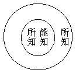



故能知之心法，亦可为被知之客观。习吾人观心之观法，可据为察验之对象，说明以成为科学也。若云飘忽无定，不能准确，则从相对论之数理以言，虽前此物理学据以为基本之牛顿数理，亦何尝可为准确耶？且君等不亦知微隐之行为，较粗显之行为为难知乎？则较更难知之心法，亦唯有更求能知之方法以求知耳，岂可退求易知，遂无进求确知之勇气耶？至於求知他有情心，吾人虽不必唯以他人自述之言语以知，亦可从察验其身行以知；且儿童、动物，尤待察验其身行以知。然更有不待听其言语察其身行以知者，有他心智能知之也。此虽非平常人心理而为变态心理，但是变而更健全之心理，且人人可修得之者。真有求知之志者，亦何乐不从事乎？若唯以但可为客观之色法为可知，而不知可兼为主客观之心理亦可知，且拨之为无有；则如光中昭显诸像谓唯有诸像而无光，不睹光光自昭互显，非狂愚耶！



四　行为学与心理学之裨益



或曰：然则彼以有情身活动的行为为对象研究者，固无裨益於心理学耶？答曰：此亦不然。盖行为学固有行为学自身之价值，而行为学有裨益於心理学之研究，亦犹物理学、生理学之能有裨益於心理学也。就广义的行为以言，心法既不离於行为，则行为学至少亦能究明於心法之一分。就狭义的行为以言，所谓意行既是心的行为，且身行、语行亦关系心理，彼从身行以研究於心理，未始非一方法，但非唯一之方法耳。今以其裨益心理学之处，分述如下：



甲、消极之裨益有二　向来论心理作用之关系於肉身者，或谓在於心脏，或谓在於头脑，近世尤以心理作用为出於头脑。此皆受一神教帝制国之误谬，以为必别有一主脑之物，出发一切活动。不知就和平的民众以言：全宇宙的活动，即为万有活动之总调和；全国的活动，即为全民众活动之总调和；则全有情身的活动，亦为全身灵肉活动之总调和。不得但据肉身一处为心之所在也。然依瑜伽师地论，说心脏与心之关系，生时最先而死时最后。由近今生理之研究，亦能证明，当较在脑之说为胜。而行为派说诸心理作用，遍关身里身表种种之反应活动而成就，尤可摧破向来偏执在头脑、在心脏之说，其有裨益者一。



西洋或印度——除佛教及顺世派——与他处之古来宗教及哲学家等，大抵说人身中有类同神我之灵魂一物。西洋之传统心理学，虽由灵魂而心，由心而意识，犹不脱神我灵魂之色彩。中国后代佛教徒，不明佛法之真义者，亦往往以身比房屋，而谓身中别有一心为主人；或喻身为皮袋子，而谓身中别有一心如猴子，藏在袋中。皆同神我灵魂之谬见，实不明大小乘教所言心理之真义。得行为派从全身内外部之种种活动，以说明於心理，完全否认灵魂及类似灵魂之心与意识等，不无摧谬破执之功，其有裨益者二。



乙、积极之裨益亦二　传统心理学，大抵祗说明得第六意识之一部，而於依色根——肉体——而活动之前五识，殊少发明。尤其是依身根而活动之身识，缺於研究。今得行为派之精进，依全身筋肉分泌腺之活动，以说明心理之关系，於身识既大有发明，而其刺激反应之说，於前五识必待根尘接触而起心理作用之义，亦多阐发。罗素曰：



感觉、说是物理可，说是心理亦可；印象则祗可说是心理。



感觉的特别性质，就是发生时必须有个刺激，从生物之外界来的，不像印象是从内部发生的。



所说「感觉」与「印象」，以吾人之术语言之，感觉虽通於八识，而是前五识之特徵；印象虽通於八识，而是第六识之特徵。而前五识之特徵，其所谓必须有个刺激来，此即须有不随心之性境之谓也。而行为派於此研究，最为详切，其有裨益者一。



西洋传统心理学，鲜有能攻究及第七末那识、第八藏识者，唯近时之潜意识说，及生机派的隐德来希说，稍稍涉及，误谬不少。而藏识执受身根为自体，安危与共，行为派力从生命有机体全身观察实验，渐能窥及深细，以察见身肉与藏识隐秘的流行活动之变化，其有裨益者二。



故行为学虽非心理学，然从生命物之有机体全身活动的行为，观察实验，以为研究心理学之一方法，於心理学实多裨益，但不应执著此为唯一之方法。应知用内省法，群众意思测验法——社会的、民族的、人种的群众等——，他人语言忖度法，各人内心经验分析法，修奢麼它禅定以澄静观察法，发得定通、慧通之他心智以观察考验法，两人以上联心作用——催眠术——之试验法，皆可取为研究心理之一涂术。最灵妙深广之心理，幸勿执一以求，亦勿一得自封，斯则吾有厚望於今之攻究心理学者！



五　行为学与唯身论



六　行为学与唯根论



唯身论乃吾从范缜之神灭论以引伸者，唯根论乃吾从大佛顶首楞严经引伸者。此之二种，皆与行为学及心理学有极深关系。兹姑列於此，他日再专篇另论。



七　结论



近今科学界对於最微妙难知之心理学，纷起研究。旧时以物理学为基本科学者，今渐有移科学之基本於心理之趋势。无论何种科学，皆必推究於心理，若治社会学则须究社会心理学，治教育学则须究教育心理学，治任何一学皆各须有其一学之心理学，各科学之与心理学，犹众星之拱极北辰，万川之朝宗东海然。心理学一学，可对抗其餘一切科学而有餘，实为知识界之一良现象。



但除行为派之外，近之另标为联念派、完形派、生机派者。生机派以杜里舒为代表，假定有一「隐德来希」——生元——为区别生物与非生物之一元素，以之说明一切心理。此隐德来希者，乃灵魂论之理论化。虽近於藏识之变起身根，及由种子发生诸识，然未有精澈详审之观察，颇涉含混。而完形派以惠墨塞苛勒考夫卡为代表，颇能说明心理由众缘所生之一点；但从知觉据为起点，祗以之说明第六意识之心理现象，未能究及前五识及后二识之心理。联念论从心理分析至以感觉为原点，然后联念以解释知觉、记忆等种种心理作用，为培根、洛克以来之机械论相承旧说，祇及由前五识关系说到第六识，即於前五识根尘刺激反应与诸心心所，皆众缘互成义，亦有缺漏。此诸各派与行为派，皆不无一长，而各有偏执。取其众长，去其偏执，更进而为佛教心理学之研究，庶其有渐明「心理真相」之可能。此则吾人所希望於诸心理学学者者也！



（见海刊第八卷第一期）



行为学与唯根论及唯身论



——十六年四月在闽南佛学院讲——



近於第八卷第一期海潮音中，余尝发表「行为学与心理学」一文，於行为学与心理学之界说，已曾论及。今将其与佛法之关系，更为诸君一略述焉。



凡出世法非越世间法而成就，所谓「由此有诸趣，及涅槃证得」者也。兹所云：「此」、即指心，或阿赖耶言。所谓「无始时来界，一切法等依」者是也。是以世出世法皆依心言，故世之讲心学者皆与佛法有关，而今之行为派心理学，与佛法尤有深切之关系也。所谓『行为』者，即科学所谓有机体——佛法谓为有根身——受外境刺激而起反应之活动也。如被人击，而发生反击或因人问闻而应之者皆是也。故此派所谓心理者，谓：除「有机体受外境刺激之反应活动」外，别无所谓心理作用者在。其谓思想、言语皆为行为，惟思想无声，言语有声而有差别耳。据是以观，若人身死，心亦随灭。如此、则佛家所云「生死轮回」之说，云何可通？生死轮回既无，涅槃亦无，吾人於此不可不留意焉！盖今此行为派心理学，既取销心理，仅承认有「有机体受刺激而反应之活动」，生死轮回既无，亦无解脱生死之涅槃法，此为佛法之大难关；此若不通，佛法无从安立。故余近作「行为学与心理学」，对此问题曾一论及也。



余意以为行为是行为，心理是心理，二者虽不无关联，要未可以行为代心理也。以有机体——或有根身——不唯是物质，乃精神与物质所和合，所谓五阴和合者是也。是以五阴中既有色阴之物质，亦有受想行识四阴之精神；所谓生死轮回者，即五阴相续流转耳。既有相续流转，亦自有解脱生死之涅槃法可言也。楞严经云：



『善哉！阿难！汝欲识知俱生无明使汝轮回生死结根，唯汝六根，更无他物。汝复欲知无上菩提令汝速证安乐解脱，寂静妙常，亦汝六根更非他物』。阿难虽闻如是法音，心犹未明，稽首白佛：『云何令我生死轮回，安乐妙常，同是六根更非他物』？佛告阿难：『根、尘同源，缚、脱无二，识性虚妄，犹如空花。阿难！由尘发知，因根有相，相见无性，同於交芦。是故汝今知见立知即无明本，知见无见斯即无漏真净，云何是中更容他物』？



华严、楞伽、深密等，说唯心、唯识，祇二三言，推演而成唯识论。今楞严云生死涅槃均唯六根。亦可谓之为「唯根论」。唯识不唯前六，亦摄第八及第七识；第七识即第六所依之根，摄根於识，扩充识之范围，成唯识论。但楞严所云根大，亦扩充根之范围，至识大之范围则特缩小。盖楞严经最特殊者，在讲七大，其餘经论唯讲六大，而楞严则在空大之后、识大之前，加一根大。而此根大非唯物质，亦指前五识现量，同时意识、及七八识而言。立表如次：



　　　　五色根　┐  

　　　　前五识　│  

　　　　同时意识├根  

　　　　第七识　│  

　　　　第八识　┘



故云：生死涅槃，皆唯六根。至其所云识大，则专指独头意识比、非量而言，偏就各种分别而谓之识。餘书讲六大，无根大，故识大之范围特大。若能据此，更取其他材料组织成编，可成「唯根论」云。依此唯根论，以廓大有机体之行为，亦可成立生死涅槃唯有机体。交光法师所云『用根不用识』，亦指此大范围之根以言耳。所谓根尘同源者，根身器界同陀那变缘也。缚脱无二者，杂染清净同陀那也。识性虚妄如空华者，独头意识性虚妄也。由尘发知，由环境刺激而起反应行为也。因根有相，由有机体反应而有思想知识等所知相也。此所云相见，唯根尘所发，宛然行为派所谓：「有机体受环境刺激而反应之活动」，及由此反应刺激之活动而成知识等。至云知见立知即无明本，知见无见斯即涅槃，意在去独头意识之比、非量，而取诸识现量，故於根大特注意焉。即此唯根论言，可见以根尘反应刺激之相见行为曰心理，佛法中亦尝有其义；而佛法生死涅槃之说，亦於焉成立。



宏明集九卷、广宏明集二十二卷，有范缜所著神灭论，其内容亦主张唯物，其谓精神即形体之作用，亦同行为派之所谓心理。如云：『如刀有割物之用，杯有盛茶之用，故有形体方有精神也』。当时有反对者，难云：『若如此说，设形体灭坏则精神亦随灭，如此、则人同木石，死如灯灭。三世因果，将云何通』？答云：『石之形体，有石之用，木之形体，有木之用，羊等形体，亦各有其作用，人之形体，自有人之作用，如何以人与物较耶？乃至圣人是圣人形体，与凡夫不同。唯各有其形体，故各有其作用，不可谓离去形体，另有精神在也』！问云：『然则人死岂不同於木石耶』？答云：『死人有死人体用，活人有活人体用，岂可以死人体用难活人之体用耶？活人形体，自有活人之精神也』。问曰：『人死精神已灭而形体渐坏，乃至成为白骨，形体犹存。若如汝说，形神同存，则白骨亦应有精神作用』？答曰：『物之灭也，有顿有渐，如灯光顿灭而烟则渐灭，故人之精神虽顿灭，而形体则渐灭也』。



总观其说，亦有相当理由存在，不易颠覆；且与行为心理，彷佛相似。谓人受人之环境刺激，即生人之反应，羊受羊之环境刺激，即成羊之心理。二者精神皆以形体不同而异，形体渐坏，精神先灭。此说可谓为唯身论。



然则人死如灯灭，佛法生死轮回之说，宁不破产耶？须知石之体不同木之体，牛羊之体不同木石之体，人之身体又不同牛羊木石等身体。惟其不同之原因又何在耶？不惟以其组织之不同，亦以其原素为有异耳。无情木石之形体为四大所组成，有情牛羊之身体为五蕴——色心——法所组成，故其所生皆为众缘和合；无情为四大和合之假相，有情为五蕴和合之假相，而有情又有三界、六趣之异，此皆有漏和合之身。而菩萨等为无漏五蕴之身，佛为清净无漏五蕴法身，故唯各有其身耳。而身实不灭，不过因缘聚散，另变成一种组织而已。身不灭故，神亦不灭，依此有诸趣及涅槃证得。故若以唯身论解释行为派心理学，亦可依之建立世出世之佛法也。



（蕙庭记）（见海刊八卷六期）



再论心理学与行为学



对行为派心理学，余尝两次讨论，发表於海潮音月刊上。但心理一名，扩充之可成「唯心理论」；行为一名，扩充之可成「唯行为论」。然固各有其立场之处，从其立场之处以区别焉，则心理自心理，行为自行为，固有秩然不可相滥者。今为便於立论起见，不将行为放大到无生物、植物及动物之全宇宙，专就现实中「人的有机团」——有机体改称有机团，亦即团体之义；在佛书曰萨迦耶——而考察之，以见心理学与行为学区别与关系之所在，不亚於理化学、或生理学与行为学之区别与关系也。



按行为派固承认其研究之对象与生理学不同，不属於生理学所研究之筋肉等。而行为派所研究之对象，则为全个人类有机团内部外部，由感受刺激而发动之反应，故於行为派所研究者之外，非别无生理学等所研究之对象也；然则亦应知行为学之外，亦非别无心理学所研究之对象矣。盖心之有感激刺与发反应的行为，固不异身之有感激刺而发反应的行为；然心为一实在、变化之自然，亦不异身为一实在、变化之自然。以「人的有机团」之现实为所呈之果，从果察因，研究其自然的生机和成分，则有生化学——生物学、生理学等；识团学——完形派心理学及三能变唯识学等；理化学、心法学——心体、本能、感觉、情绪等问题，及康德以来之知识论等；研究完成而综合之，则成为晓得什麼叫做人类之人类学——博物学中的人类学，与晓得什麼叫鸟叫兽者同。以人的有机团之现实为所依之因，由因致果——若行为派以生理学上综合的全体为所依，以观其感激刺而发反应之所致——，研究其行为的激刺和反应，则有养生学——衣食住行娱游眠息之农工商医婚姻等，教育学——宗教与学校及文艺风俗环境等，身行学、心行学——此身的行为与心的行为，在学理上虽可分析，在事实上则常为综合身心之人的有机团行为。若吃饭、走路、说话、写字、作工、踢球等，行为派心理学属之；然高等之心的行为，若身居一室而心罗宇宙，则可无关身行而独立之哲学思想等属之；研究完成而综合之，则成晓得什麼叫做人事的人事学。再综合由察果知因之人类学而到从因致果之人事学，完成以现实中人的有机团为出发点所研究之体系，则谓之人生哲学；但人生哲学之外，犹可有动物哲学、植物哲学、宇宙哲学等。兹结为一表如下：



　　　　　　　　　　　　　　　　　┌生化学┐　　　┌理化学┐  

　　　　　　　　　┌有实有变的生机┤　　　├和成分┤　　　├曰自然的人类学┐  

　　　　以人的有机│　　　　　　　└识团学┘　　　└心法学┘　　　　　　　│人生  

　　　　团为出发点│　　　　　　　┌教育学┐　　　┌心行学┐　　　　　　　├哲学  

　　　　　　　　　└团内团外的激刺┤　　　├和反应┤　　　├曰行为的人事学┘  

　　　　　　　　　　　　　　　　　└养生学┘　　　└身行学┘



故於人的有机团之现实为出发点而研究，其於自然学也，则当由生物学、生理学、与完形派心理学等直观所知的生机，然后研究到物理学、化学及心体本能情绪感觉等问题，与知识论等析观所得的成分，综合之乃知自然的人类是什麼。其於行为学也，则当由现有如何的营养、生殖，及学校文艺、风尚、环境等刺激，然后研究到将来如何的动身、发语、立志等反应，综合之乃知行为的人事是什麼。再综合之乃成人生哲学。一般的科学者、哲学者，不知以现实为出发点而建设其研究之体系，祇知掠取前人析观所得的成分为构思之基础。吾友卫中博士尝谓『杜绝科学家之产生法，有至巧而为用最便者，则为现代之所谓科学教育。现代之科学教育，乃务使物质现象中之自然成分尽量灭绝，而陷物质活动於死无生气而后止者也。其实验室之工作，殆无非致物质活动於生地，而后取其零星片段之物质，假由上而下之解释。此之为法，与夫真科学家之由下而上——按即由现实而到析观所得成分——，先之以领略自然感受印象——直观所知——，而后阐明物质之形性者，全然反背。於此而求真科学家之产生，又乌乎可』？由是倒从化学、物理学而到生物学、生理学、心理学，致行为派袭取此迷谬之陋习，乃将自然的心理学及刺激的心理学概遗弃之，祇取身心感刺激而发反应的平庸行为，执为心理学所研究之对象，且排斥研究其他任何对象之心理研究也。若知研究「人」的科学哲学中之心理学，当从人的现实为出发点而研究之，则行为派之僭妄固显然可知也。然又岂但行为派僭妄哉！依现实主义之见地而言之，则从来依其析观、推观所得，而建设以化学、物理学、或数学、论理学为基础之科学及唯物论、唯心论等，固无一非僭妄之徒也！若知今此「唯现实论」之科学、哲学研究法者，则从来之科学、哲学体系，皆当一变其观察实验法及组织判断法而后可。此另详余所著之现实主义，兹不具论。



但从现实主义之人生科学、哲学中，一观行为派心理学、与完形派——或格式派——心理学，去其执一端而排全体之僭妄，则其研究法及研究之所得，在人生科学中，亦未尝非有一相当之位置与价值。然亦祇在此相当之程限内而已。世人固无所用其惊异！



（见海刊九卷一期）



论候尔特意识学与佛学



美国的候尔特，在哲学上是个新实在论者，在心理学上是个行为主义者；其说明意识的学说，曾译在东方杂志上。我前者评行为主义的心理学，尝举了佛学内唯根论来比较。现在候尔特的意识说，越发近於唯根论了。唯根论上的前六识说，与唯识论的不同，只是唯识论上的第六意识之一部分。唯识论上的第六意识与唯根论上的意识，区别如次：



　　　　　　　┌前五识　┌同时意识……………┐  

　　　　　　　│　　　　│　　　　┌散位的─┤  

　　　　唯识论┤第六意识┤独头意识┤眠位的─┼唯根论的前六识  

　　　　　　　│　　　　│　　　　└定位的…┤  

　　　　　　　└后二识　└清净意识……………┘



唯根论见於佛学的大佛顶经。它所说的前六识，大约同於候尔特所指的意识，亦一般心理学者所认为心理学全领域的意识，这种的意识，且不能为唯识论的第六意识全领域，况能包括八大系情识团的佛学心理学全域。但近代科学者，将第六意识一部分以外的活能力，属归物体中去了。唯根论亦将以属到六根或根尘内去了，故只将第六识一部分为前六识。换言之，亦不过定义不同、分类不同而已。



大佛顶经之大意云：『根、尘同源，知识虚现，由尘发「知」，因根有「相」，「相」「知」无性，同於交芦。知识之用，起於六根』。根者、即反应之神经也。尘者、即刺激之物体也。同源者、同是实在或阿陀那也。由尘发知，由物体刺激而发现感觉知觉的知识历程也。因根有相，因神经反应而有知识中所经验割切的时空事物的切面相也。此切面相与其知识，为虚现之关系作用、而非实体构成於逻辑的名辞和数理，故曰：知相虚现无性同於交芦也。观此、可知候尔特的意识，等於唯根论的前六识也。然以唯识论言：此属十二处的不了义学，乃小乘学之破除神我等迷谬者；新实在论及行为主义心理学，亦以此破除灵魂等谬执者，是其特长，但未是究竟的了义。



进言究竟的了义，则「实在」即为根尘同源的第八阿陀那识；实在各自冲动而显现实在为根尘物体的，即是第七末那识；由尘——本质尘、根——净色根刺激反应而现的知识境界，一部分可如候尔特所说的意识；尚有其深细不易观验的，则为同时意识和前五识及清净意识，共有八大系情识团和其组成的关系。於是任何可知不可知界的实在，皆离不了八识团的变和现，而不越出八识团以外，於是乃成了唯识论了义学。在仅仅研究一科之学的，虽用不著研究到此，然若候尔特一流以新实在论哲学鸣的，於此似不能不注意及之罢！这是我对候尔特的忠告！在中国一般幼稚又幼稚的洋学鬼，当然没有受我这忠告的程度！



（见海刊九卷一期）



心之研究



——十一年四月在黄陂县前川中学讲——



中国文「心」之一字，含义最广。通常之心字，多指吾人身中之肉团心而言，然此肉团心不过专司人身血液之流行，其本质为一物体，於空间占一位置，其时非永久不变坏，此非佛法上之所谓心。近代人多误以脑筋为有知觉思想之能力，遂指此为心，殊不知脑筋亦为一种物质，亦应属於肉团心；惟吾人心念发动时，在身体中之各部，常与此一部分有关系耳。



佛法上就心之功能力用及发动之方向，由浅至深，由粗至细，将心分作三类：一、虑知心，二、集起心，三、真实心。虑知心者，将吾人能思想知觉之功力而姑认为心者也。此虑知心虽无边际方所、时劫短长，非形色可限，非容量可局，然实为一心之所起，作用时不免虚妄错误而非真实。人身中能表现之功用者，厥惟六根，根者非为心所从生，乃是心之所托，与六尘接而发为六识，心之用於是始显。就此种心之功用言，似可指此功用即是心，然前五根仍非是心，而第六根亦虑知心耳。



意识之背后，尚有所谓我识——即第七末那识——此识常处黑幕，念念执我，而为前六识心之主动。前五识为根境所限故，其用有时而穷；意识之用，则能横遍十方，竖彻三际，广漠无垠。其所以能具如是之大用者，因其背后有我识为之主宰，以此我识极广大，故意识之功用及境界亦极广大，孟子谓万物皆备於我，与此相似。



我识一面为前六识之主宰，一面念念收罗一切万有而藏於藏识之中。此藏识能含藏万物，有任持一切之力。藏识喻如专制时代之国土，我识则如专制之国王。前说之八种心识，皆属於虑知心。



藏识虽贯彻三际十方，永不断灭，而又生灭成坏之相相续不断、刹那不停，而所以现此生灭相者，因我识念念执之，遂见其有生灭耳。如朝代更异，国土本无变动，而国王或遂以为国亡焉。



　　　　　　　　　　　　　　　　　　　　　　　　┌──明  

　　　　　┌───眼───┐　　　　　　　　　　├──空  

　　　　　├───耳───┤　　　　　　　　　　├──色  

　　　　虑├───鼻───┤　　　　　　　　　　├──眼根  

　　　　知┼───舌───┼识　　　　　　　眼识┼──意  

　　　　心├───身───┤　　　　　　　　　　├──我  

　　　　　├───意───┤　　　　　　　　　　├──藏  

　　　　　├───我───┤　　　　　　　　　　├──种  

　　　　　└───藏───┘　　　　　　　　　　└──作意（动）



眼识以明等九缘生。耳识去明，以声易色为八缘。鼻、舌、身三识去明、空，以香、味、触易色为七缘。意识为五缘识，我识、藏识均为三缘识。



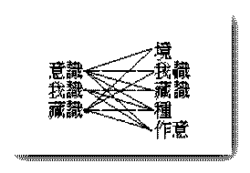



　　　　见┐  

　　　　　└………能虑知─┐（精神现象）  

　　　　　　　　　　　　　├虑知心…………体  

　　　　　┌………所虑知─┘（物质现象）  

　　　　相┘



虑知心於起不起，体恒常在，其现起时，见、相二分同时而起，即精神物质两现象同时起矣。



（王净元记）（见海刊三卷十一十二期）



梦



——二十一年腊月在厦门大学心理学会讲——



一　梦的事实存在



二　中国古书的梦说



三　现代科学的梦说



四　佛学的梦说



五　综合的批评



一　「梦」的事实存在



现在讲到「梦」，以梦为我们研究对象，所以首先要问：梦这个事实是不是存在的？梦是大家都经验到的，我们在睡眠中大概都做过梦的。中国古书上虽说「至人无梦，愚人无梦」，其实愚人并不是无梦，不过做了梦不记忆罢了；至於至人，也不过是做梦来得少些，或来得清明些，也并不是完全没有梦的，可知道梦的事实的确是存在的。中国人有梦，外国人也有梦，古人有梦，今人也有梦，空间无论是中外，时间无论是古今，都有梦的事实。所以梦并不是现在才讲到的，试把古今中外的解释引来说一下：



二　中国古书的梦说



中国古书周礼六官中春官所属的太卜，所司有三种卜梦法：一曰、致梦，二曰、觭梦，三曰、咸涉。这种是沿袭、夏、商、周三代将梦的现象予以解释的；如近今流行之玉匣记等，即为此类占梦的书。在列子周穆王篇里说：梦有六种：一曰、正梦、日有所思夜有所梦；二曰、噩梦，惊奇异状的梦；三曰、思梦，对於某种事特别思想的梦；四曰、寤梦，清明的梦；五曰、喜梦，非常欢喜的梦；六曰’惧梦，非常惧怕的梦。又云：『故阴气壮、则梦涉大水而恐惧，阳气壮、则梦涉大火而燔炳，阴阳俱壮则梦生杀之事』等。中国古医书灵枢经说：『厥气客於心，则梦丘山烟火；客於肺，则梦飞扬，见金钱之奇物』等。中国素来重「气」，就是梦也喜欢用气来解释，以为气凝聚在什麼地方，即梦到什麼。梦的构成原因与状况也就不同。此外还有比较有学理根据的，是汉朝王符潜夫论里所讲：凡梦有直，有象，有精，有想，有人，有感，有时，有反，有病，有性十种。王符所讲梦在将来能发生什麼影响，都是心理或生理的原因所构成。



三　现代科学的梦说



甲、梦的特徵　普通生活现象，在醒觉时因为神经系统组织互相联络，所以能照个人的意思去进行；到了疲痨的程度，神经失去了统治的能力，入於睡眠，即常常有梦的事实发生。这种梦，在睡眠的时候，每以为是真的，简直分不出那一件是梦的境界，那一件是醒的境界，这种梦的身心器界与醒的身心器界究竟有什麼不同？梦有甚麼特徵？现在将多数科学者研究的结果，分五种说明如下：第一、是化自他身：梦中所梦到的，当然化生有自身及对象存在，但有时不但是有所梦到的自身及对象，并且还化生许多人共同活动。如梦演讲时，不但是有自己演讲，同时亦有许多听讲的人来共同活动。在所化出的天地万物里，谈笑歌哭，与醒时一样。这种现象，称做化自他身，是梦中最平常的事情。第二、是不觉自身：醒时的活动是和自他相一致的，梦时把自己的身体完全忘掉，梦中所现出来的东西，虽然有种种的不向，可是自身实际上仍睡在床上丝毫没有动作。第三、是不合事实：人当醒时，一切活动都能与事实相符，譬如鸟因有翼所以能飞，人类没有翼当然是不能飞了；可是在梦的时候，也许可以梦到自身从地下飞上天，这种与平常经验事实不相符合的，是在醒时所不能有的。第四、是空时约束：醒时要走到多少路，须费若干的时间，时时觉时空的限制；可是在梦时就不然，夜睡之梦不用说，即午后少睡数十分钟，也或梦做许多事，经过许多地方。岑参诗云：『枕上片时春梦中，行尽江南数千里』，这时醒时是不能够有的。第五、物体移换：梦自己为羊、为牛、为蝴蝶，自己即为牛、为羊、为蝴蝶；梦从山走到海，海也可走上山，万物乃至自身都可移换。梦中的现象，因有许多特徵为醒觉世界所不能有的，所以、每有以为很神奇奥秘的。



乙、梦的构成　梦的构成，有生理的，心理的，弗洛德 Freud 约三种说。



一、生理的有三种：一、细胞惰性说：人身细胞活动有惰性，醒时的生理状态，五官百体各尽其职，并且发生强有力的联络，受脑中枢所统率，但在睡眠时陷於惰性，缺少中枢的统一，所以有梦的事实发生，这是文德 Wundt 细胞惰性说的说明。二、脑神经及反应说：吾人感官受刺激，由传达神经传达到脑神经，是时脑神经必起一种相应的反应；但在梦的时候就不然，刺激与反应的程度相差甚远，脑神经的反应不能和感官上所受的刺激相当，往往就发生奇怪百出的梦象出来。三、潜病预现说：有人在没有病的时候，就梦自己得到了甚麼病，这种梦象从生理上观察起来，以谓此人的身体虽尚康健，但是他的内部组织已经有了某种病的倾向，所以在睡眠的脑神经统治力消失时，常常梦到潜伏中病的状态，而后来所得的病亦完全与所梦的一样。这种裴奈楷 Beueke 的潜病预现说，和中国灵枢经所说的也差不多。



二、心理的有二种：一、观念复起说Copernicus：一切观念都存在人的脑中，复起与否，看它原有势力之强弱为断；假使势力强大，虽醒意识亦不能支配，何况在梦中的意识，已经非常薄弱，祇好任观念势力自己起伏，形成种种的梦了。二、想像说：醒时由意识结合旧观念，可以成为想像。梦中的意识，虽无支配能力，但有时也忽明忽暗，以半意识的想像操纵其间。翻希奈尔 Fecinel 所谓记忆复象，就是想像说的一个代表。



三、弗洛特 Freud 是近代一个特殊的心理学家，他对梦中说明最多，所以讲到梦特别要提到他。弗氏以为精神作用有三部份：一、现意识之下，还有潜意识，潜意识都是从许多被压迫的欲望所构成；现意识彷佛是统一的政府，潜意识如有许多被压服的叛民。但是这被压迫的潜意识欲望，虽为现意识所压迫，但是还有机会，还是勃勃欲试。在睡眠中现意识一经松懈，隐意识乘隙表现出来，就成各种的梦。这是弗氏梦为隐意识表现的说明。二、是欲望的满足：弗氏分两重的我，一种社会我，一种自我。人类因为社会、风俗、法律等关系，各种欲望不能随各人而得满足，这是无可如何的，因此就有许多欲望压伏；可是这些欲望的潜势完全没有失掉，遇有机会还要出来活动，所以在睡眠中各种的梦，就为给被压伏的各种欲望得到满足。三、是检察与遏抑：弗氏既发见梦就是表现一种不曾满足的自我中心的欲望，这些欲望因为被压伏在潜意识之中，所以在梦中表演出来。可是现意识遇见潜意识这样的表现，是一定要加以检察与遏抑的。在梦中现意识虽比较来得忽略，可是潜意识还不敢公然大胆的呈现出来，有许多和现代风俗习惯相合的，虽不妨表现出来，但有许多违背伦俗的便不敢公然现出来。於是就利用化装的方式现出来：在化装的分析中，就有隐义（Latent Coutent）和显义（Manifest Content）。显义乃梦的化装，隐义乃梦的真意，所以要研究梦的真意，非探索其隐义不行。但这派有多种的基本欲望说：弗洛特主性欲说：弗氏说梦乃潜意识所含欲望的求得满足，但是这些欲望最基本的是属於那一种呢？在弗氏则以为都是属於性欲的。以性欲是人类最基本的欲望，一切道德文化他都用性欲来说明，所以他用象徵符号来解释一切梦，亦不外就是以象徵化的性欲来解释。此外、还有德勤尔，以为人类基本欲并不是性欲，而是权力欲，因为人类有好高威权的本能；这种欲望不能满足，就化生种种的梦。又永格的学说：谓性欲、权力欲，还不是基本欲，基本的欲在求生存。各个人求生存的欲望甚高，而平日的生活则甚庸碌，乃祇好到梦中去求满足了。



四　佛学的梦说



甲、梦的意义　佛学上说「梦」是什麼东西？佛学谓一切众生有八种识：一、眼识，二、耳识，三、鼻识，四、舌识，五、身识，六、意识，七、末那识，八、阿赖耶识。梦既不是前五识，也不是末那及阿赖耶两识，乃是第六意识在睡眠时的心心所相应活动，这种活动就是梦。所以梦是睡眠相应的第六意识心心所，而与他识无关。在第六意识有有漏无漏之分，在诸佛圣人的意识是无漏的，在平常人类的意识是有漏的。有漏之意识，又有五俱及独行之分；五俱意识是眼识乃至身识之五官感觉之一，与第六意识同起的作用，此在醒时才有，如见色、闻声等。独行意识乃离开眼、耳、鼻、舌、身五官感觉之后，单独构成的。但独行意识的范围亦甚宽大，又分三位：一、清醒的时候，心力分散而非集中统一的为散位独行意识；二、经过修定工夫而增加许多超越的力量，为定位独行意识；三、梦时前五识不起现行，唯是第六意识之分别现忆，为梦位独行意识。而不称为睡眠意识者，因平常所谓睡眠，只是指血液的休息状态，而梦是睡眠时的意识现起活动，此可知梦是第六意识在睡眠中现出来的。有了梦位意识的见分相分同时现起，就是有梦了。



乙、睡眠心所　梦是在睡眠中演成的。要知道梦是什麼，兼要知道睡眠。通常所谓睡眠，但是生理的；而佛典所谓睡眠心所，则是心理的。成唯识论云：『眠谓睡眠，令身不自在昧略为性，障观为业』。『谓睡眠位身不自在，心极暗劣，一门转故。昧简在定，略别寤时，令显睡眠非无体用，有无心位假立此名。如餘盖缠心相应故』。睡眠心所，乃第六意识作用之一，谓意识心理作用与定心所合作，则成定位意识；与睡眠心所共起活动，就成为梦。



丙、梦的来源　睡眠不定就成为梦。佛典善见律说梦的来源有四种，大智度论、毗婆娑论说有五种，内容所讲大同小异。今用毗婆娑论的五种：第一种、是由「诸病」：即身体上四大不调发生出来的病态，如身体在冷则梦水，身体感暖则梦火，即由生理关系而生梦。第二种、是由「思惟」：即心理有所希求，因感情和思想的不安宁就生梦，略同前心理说中的观念复起及想像二说。第三种、是由「曾更」：即前所经过留下来的习气，在梦中重演出来；凡人生的经验，都谓之曾更。第四种、是由「当有」；这种、在现代科学没有讲到，所谓当有，就是将来要实现的事情，先在睡眠的梦中发现出来。到了某时某月某日所发现的事情，果如睡眠的梦中所梦见的。余从前在湖北听一个人说，他在武汉起义前，有一晚上梦见许多人没有辫子，过了几天果然革命军政府成立，大家都剪了辫子，这是由当有的梦底一个例证。这种梦的性质，虽然有时发现，不过不是常有的。第五种、是由「他引」：由人心力底关系，所引生的梦，简名之曰「他引」。他字所包括的很广，凡他心等关系皆属之。譬如母亲爱子的关系，心理上有种像磁石相引的力一样，子女远别，常常梦见母亲的现状。从前伍廷芳说：可由梦中和朋友通信会晤，亦是「他引」的功用吧！



丁、梦位意识与其他七识及五根关系　做梦的本身固然是第六意识睡眠相应心心所的活动，但是第六意识与眼识，乃至末那、阿赖耶识及五根亦有间接底关系。第七识与第八识是永不相离的，平常经验的印象，普通心理学以为是藏在脑府，在佛典则谓藏在第八识里；可知「曾更」及「思惟」的梦，都是与七识或八识所受熏的习气有关系。至於与前五识所依的五根底关系，不过没有十分显明，譬如以磨墨的声音影响到梦舂米，尤其是与身根的关系更切。由此可知梦位意识与七八二识一定有关系，与前五根识亦有相当的间接关系。



戊、梦的空有及俱非　在佛典或说梦是空无的：如一般的经论多用梦来讲空，如人生如梦等说。或说是实有的：一切有部以为除自我是空，其餘一切法都是有的；如现代新实在论所说，不惟具体的事物是有，即概念也是有的。这一切有部以为梦的事物虽有时不合事实，其实梦的构成是实在的；如梦有角之马，乃从角与马相加而成。或说非有非无的，如二十唯识的即空即有说：以梦喻天地人物都是唯识所现，如梦位意识所现的宇宙万有一样。然实际上，南普陀有一定的处所，开花有一定的时节，如何是唯识？故二十唯识以梦的功用来显唯识，以平常根身、器界都是共不共业所感所变的，都是如幻如化没有实体的，故二十唯识以梦位意识所现，既不是实有，亦不是全空，构成即空即有、非有非空的如幻有说。但照二十唯识论所说，则醒时的世界与梦时的世界殆无分别。然则前所言梦的几种特徵，不几可以推翻吗？以醒与梦既无分别，自无特徵可言了。故应进一步更讨论到梦与醒觉！



己、梦与醒觉　梦位的意识比较醒觉时与五根身同时现起来的五俱意识薄弱。复次、醒觉的根身、器界乃是第八识共同变现，梦时祇第六意识睡眠相应心心所活动而有。更简单的说：醒觉位乃八个识所现，梦位但意识所现，范围之大小自不全同。在佛典上以醒觉时人生为「业识所现的梦」，经相当的训练修证，也有再醒的希望，所谓大梦然后大觉。乃指无明业力空掉了，成为大觉而言，犹之睡眠亦可醒觉一样。无如睡眠、业识所现如梦中境象；不过吾人破无明的盲动，完成大觉，与睡眠后的醒觉是不一样的。佛学的目的，端在求破无明后的大觉。



五　综合的批评



依中国、西洋、佛学的梦说看来；中国古书许多的梦说，缺少科学的根据，没有系统的组织，固然比不上西洋；但是西洋的梦说，在每小部份或有明确的研究，但是还没有说到「当有」、「他引」的梦；从佛学上梦的构成五因来看，前三种与中西洋略同，后二种中国略有说及，而佛学有独到之处。所以佛学对梦的研究，比较来的完密！



（虞德元记）（见海刊十四卷八期）



佛法与科学



——十二年八月在庐山世界佛教联合会讲——



一　佛法



佛法大旨，不外乎自觉、觉他二端俱得圆满，故得其公例如下：



一、无上正遍觉者所如实觉知於法界诸法之真实性相体用　此无上正遍觉者一名词，关於自觉方面，谓自己觉悟地位已确臻於无上正遍也。如、当作依照解。如实觉知、即依照真实之相，不增不减，无伸无缩，毫无有变动差误之点而觉悟了知之义。法界、即宇宙，诸法、即万有。此法界诸法，以通俗所云之宇宙万有亦大概比得，但亦非真能吻合无间者。性相体用冠以真实，亦别於世论之迷谬游戏浮泛无稽也。此就佛之自觉以言，尊极如斯。反观众生不觉，似人作梦，昏昧无知，大慈佛陀时劳呼唤。复如发神经病人，本身不自知病，惟头脑清晰知见正确者能晓。更若眼中有疾，妄见空华，亦惟明眼者能觉其妄。此义甚明，故不繁述。



二、无上遍正觉者所如觉宣示於世间众生之善巧教理行仪　此则关於觉他方面，谓无上正遍觉者之佛，依照自己觉悟之法界诸法，宣扬於口，示现於身，随俗、雅化，方便引度——如依世间一切语言、文字、风俗、人情等，及随十二类有情身相、行为、之类，循循施教以善诱之——，遂有方便权巧所施设之种种教仪。宏化三界，开觉群生，使明解乎理而轨修乎行，庶大觉之果人人堪证耳。故别言之：教者、言教以明理，身教以行道之施设；理者、教之所诠义，为学人所了解於心者；行仪云者，以人人有无上正遍觉知之可能性，过去诸佛无量无数如实而觉，如觉而说，现未来际诸佛，果依先觉如觉开示之法，明了其理，如理起行，行同佛仪，亦毕竟成佛故。



二　科学



上释佛法二字竟，兹释科学，当分二端，如下：



一、科学之方法　诋科学者，谓造成利器，都务杀害，是有弊而无利。誉科学者，则谓物质文明庄严灿烂，俾世界蔚为雄观，利益俱在，何弊之足云？关於此层，虽犹在诤论之中，而欧洲数年来之战祸，亦不得云诋之者之毫无理由。不过此属於后来之成绩，及应用其成绩者如何，而科学之所重尤在方法，其方法之精密谨慎，固不得遽加以诋毁之辞。盖科学方法，可有六层：一、科之一字，具分科、别类之称，故首先分划范围，不得儱侗，而一科一科之新学说乃由此产生，如讲心理学、单就精神现象种种说明；物理学、单就动、植、矿等物理现象说明；生理学、单就有机身上之消化器、分泌器等种种说明，故兹严别界限，不许紊乱，为科学之第一步。二、既就一种对象，详细研究，俾有所发明；则必先观测此对象之大概情形。三、大概情形既明，乃继之以精察谛观，务有於确然深知其性质、功用、及价值等。四、审察既确，乃综合其观察之所得，著有假说而试实验。五、例如雨后见五色虹霓，假说是日光反射之所致。科学家既具此发明，则必亲验出红霓之处，是否由日光及雨映照所成。一次不足，而再而三，须屡试不爽，遂成定判。六、前五所述悉数通过后，如议场中绝无一废票，此议长乃安然而定；其某种学说得成立为通行於全世界之公例，亦犹如是。综上六端科学之方法，可谓手续精密，卓然不可摇动矣。至其所发明之定例，后哲有真确於前贤者，即可舍前取后；即并世同人，彼此、今昔，亦取是舍非，无所执著。其渴望发明真理以济世之心，尤为可敬。但科学亦有一种执著牢固莫解，则执著此方法为求得真理之唯一方法，而不知法界实际，尚非此种科学方法之可通达也。



二、科学之成绩　推其由科学方法所得之知识，应用於世间行为人事上，以演成五花八门之人群业果，皆谓之科学成绩；而其根本则端在知识。天文学、古来以地为中心，法国歌白泥氏更发明太阳为中心，后人又有发明八大行星、无量恒星等。此外、牛顿发明地心吸力等，达尔文氏发明人种由来等。一则谓堕果向下，必有吸力；一则谓下等动物变中等动物，进趋於高等动物，如猿为人之祖等，此类学说，一应用於人间，则社会群众所得之新知识，在国家政治上、社会事业上，顿起无量数之传递与实验，若簇新组织一大世界者然；此其成绩之为世人所共知者也。



三　佛法与科学



一、科学之知识可为佛法之确证及假说而不能通达佛法之实际　科学上有所发明，即宗教上便有所失据。寻常神我等教，根本上既少真理，一经风吹，不免为之摇动。骇辩不足，继以恐布，牵强附会，又失自主，此其人至为可悲。独有佛教，只怕他科学不精进，科学不勇猛，科学不决定方针精究真理，科学不析观万有澈底觉知。能如是、则科学愈进步，佛法将愈见开显。以佛法所明者，即宇宙万有之真实性相。科学愈精进，则愈与佛法接近故。今且先言天文：在昔东土，仅知上天——日月星辰等——下地，中乃有人。西洋则基教徒利用希哲地为中心学说以传布於世。迨法哲既明太阳为中心后，迄今复有以无中心之说宣传者。盖已经过若干度之进步，以之空中恒星实无数量，相摄相抵，无主持者，故恒星为中心之说亦除也。至此、始证明佛经云：虚空无边故世界无数，交相摄入，如众珠网。又云：世界依风轮而住，风轮依虚空而住。——皆为实境，此其接近者一。科学家以水中有虫。内典亦云：佛观一滴水，八万四千虫。兹事、余於十数年前，确曾在南京杨仁山先生处，用高度显微镜亲验之，此其接近者二。达尔文氏以人种由来，自种业遗传递蜕渐变而来，虽与佛法之世间万类皆由积集业力——品性——行为等而感报差别，遇缘各升沉靡定，尚有不逮。而较神造、天生之旧教，亦为有进，此其接近者三。生理家谓人身由循环器等集成，而其血肉皆为无数细胞积聚生灭而活动。与佛经所谓「观身如虫聚」；及谓受生之初，由「起根身虫」而起根身，宛然符契，此其接近者四。物质家谓固、液、气、三质，系万物之原素。佛经言四大：地即固质，水即液质，风火即气质。风动、火热合为一切力，如光、电、热力等，此其接近者五。随举五端，餘不缕述。在二千年前佛经中已具此说，未有科学之新发明，人鲜有言。故科学愈见精进，则佛学上愈为欢迎，此其大足为佛法初步之确证也明矣。



云及假说，假说有两：一、随迷情：例如法界诸法一说，恐不能尽人能晓，因取此宇宙万有之普通名词以代之。就常人迷情上之所名者，随与之语而实不符真义，故为假说。在佛陀垂示外道时代亦多类是。二、随方便：得无上正遍觉者如实了知后，用世间通俗语言、文字、风范、威仪等，种种发挥宣示。虽佛智亲证者实为思量之所不能到，语言之所不能及，而亦不妨用兹方便假为言说，以化导於世人。如因明学上由比较思量而立宗，其错误者曰似比量，反之、比较思量判别正确者，曰真比量。科学家真正之希望和目的，本即在此。经云：菩萨於佛智当於何求？曰：当於五明处求。五明系印度古代科学，即声——文字、语言——、因——论理——、工巧——艺术——、医药、内——即哲学——。换言之，菩萨於佛智当於何求，即应言科学中求也。故科学得为学佛者方便利他之假说也。



但进一步言之，科学卒不能通达佛法之实际。此义云何？例如无上正遍觉者所证知之境界，是谓佛法实际，亦是宇宙万有真实性相。而此必须转自心为佛智乃能亲证，非用声明、因明等科学方便所假说得到者，故此但为过渡作用。而科学则执定其科学智识所知识者即为真实，宁不成失！又如有一大象，其周身百体，喻为宇宙万有之全部分。瞎子虽极仔细，但运用其按摸之腕，欲廉得其情实，若摸耳则言如箕，捏尾则言如帚，抚足则言如柱等。以自己之智识，断定其即箕之耳、即帚之尾、即柱之足，谓已得此象全体无缺之妙用，明眼人见之，宁不哑然失笑耶！真正佛学家对於科学，畴不云然！故惟彼无上正遍觉者妙明通达，如明眼人观活象然，见即遍照无遗，何待箕帚等之展转譬喻证成公例哉？科学之不能通达佛法之实际者，如此。



二、科学之方法可为佛法之前驱及后施而不能成为佛法之中坚　释此、再据世间最深之迷情上抽象以言，得二说如下：



一、迷有神者——我执——：神、即神我，小乘人即空此执，以知因缘和合而有此身相生灭连续，幻有非真。如色、受、想、行、识五蕴等，暂起之际即复暂灭，刹那刹那变迁不停，如旋火然，见有圆影，旋转一停，安有此火影活动之幻想哉！科学家亦知生灭积集，无此神我之实可得，迷有神者悉为所破。二、迷有实者——法执——：实、即法之谓，唯物家所称之物质亦同此。但谓万物各具原质，系单纯之元素积集所成，进为原子、电子等说，则由「唯物」派进堕於「唯力」；若更深进，安知不将有虚空粉碎之一日哉！盖唯物为耳闻目见之有者，至唯力则已为闻见所不及之无，益信科学之方法，足为佛法之前驱也！所谓研究愈精与内典愈足发明者，即以此故。若夫后施作用，言菩萨得证真如之后，可参用科学方法，施行於一切有情，裨令悉数觉悟，舍弃迷情。正合於法华经『以方便力故，为诸众生说』之深旨。如小乘俱舍论等，方式极精密，理论极周致，适与科学规律相彷佛，而更高出其上。以之联袂共进，携手偕行，何难达於至善之邦、菩提之道哉！所谓科学并足为佛法之后施者，亦以此故。



第归根以谈，科学毕竟不能成为佛法之中坚。以佛法中坚，须我、法二执俱除，始谓之无分别智证入真如。如瞎子忽然眼光迸露，亲见象之全体，一切都豁然开朗，从前种种计度无不消失者然。科学家譬祇知改良所藉用之机器，而不能从见之眼上根本改良。今根尘、身心等，皆是俱生无明之性，若不谋此根本改良，乃唯对境之是求，执一之是足，将何往而非瞎子撞屋，颠仆难进也哉！滞迷情之见者，可以休矣！故佛法之中坚方法，即为完全非科学的，专息灭建筑在戏论分别上之科学的，以非如是则终不能打破无明得大觉悟故。然若能依佛法中戒、定、慧三增上学，布施等六波罗密行，精究实行，则勒马崖头，共登坦道，脱黑暗之火坑冰堑於庄严佛土，出狂热之社会群众於清凉境界，夫亦何难之有？



（圣功记）（见海刊四卷八期）



唯物科学与唯识宗学



——八年春作——



三界唯心，万法唯识，固圣教之决定量，佛理之根本义也。就三界依正之总相言之，则曰三界唯心；就诸法体用之别相言之，则曰万法唯识；故唯识宗学，实为大乘之始。自海西科学之功盛，以其所宗依者在乎唯物哲论也——海西哲学诸宗，始於多元论、二元论，於纯正哲学未能极成也。进至一元之唯物论与唯心论，然唯物论未极成唯物论，唯心论亦未极成唯心论，以唯物论所云之原质轶出於证验，而唯心论仅为神我论也。又进为一元二行论，即指天地人物之和合连续假相，以为一元而物质、精神为二行。新近诸科学，大概均以此一元二行论为依归。精核之，此乃「真唯物」论耳。盖所云物者，本指天地人物之和合连续假相中之现象，非谓物质、精神。物质、精神则天地人物之现象上同时并著之二现象耳。此一元二行之真唯物论，颇近小乘俗谛。盖小乘之俗谛，亦即天地人物之和合连续假相，其缘起流转因果义，亦说色心二行，即「极微」之物质、与「惑业」之精神是也。真谛、则为生空真如，即和合连续之假相本来空寂，及缘起流转之幻事择除还灭是也。然小乘之所重，固在由实践哲学之道品以断俗证真，此虽非一元二行论所有，然专就纯正哲学以言之，小乘固近於一元二行论者也。一元二行论又近於大乘唯识现量性境，以其即现对之天地人物为一实元，以精神与物质为二行相，近似唯识论以前六同时亲所缘缘之色尘为实事，以四大极微等为意识假想观慧所缘缘影也。但此为免违世间过，随顺世间世俗谛姑纵许之耳。究之、乃是似现量、似性境，所谓非量与带质境，非真现量、真性境也。何者？以真现量、真性境中，无复和合连续假相之天地人物等故也。然无论为现量性境、抑非量带质境，此一元二行之真唯物论，卒不得不归之大乘唯识真唯心论中之一部分也。其详当阅拙著之道学论衡，楞严摄论——，遂畏闻大乘佛教之名，抑若一言大乘佛教，即挟神权幻术俱至！不知大乘唯识论之成立，先尝经过小乘及大乘之空宗，将邪僻唯心论——正名公神或我神论——之常见，与邪僻唯物论之断见，同日摧荡清理，乃开大乘唯识中道。故竺乾当日大乘唯识论之所缘起，正以胜论之多元或二元论等，天神、泛神及数论之神我论等，顺世论四大极微之物质论等，小乘之有论、空论等，大乘之空宗等，探究玄奥，观慧微密，皆极一时之盛，迫於人心之要求所不能自己，大乘唯识论乃应运兴起。且彼时虽有小乘之正论，徒高超世表而不能普救群生，与今日虽有科学所宗依之一元二行近真唯物论，徒严饰地球而不能获人道之安乐，亦恰相同。故唯识宗学不但与唯物科学关通甚切——案中华隋、唐间因研究竺乾外道小乘之学者颇盛，故大乘唯识宗学因之昌明。由五代入宋、元各学衰微，唯识宗学遂亦因之湮没。相承者，但禅宗及净土宗耳——；正可因唯物科学大发达之时，阐明唯识宗学，抑亟须以唯识宗学救唯物科学之穷耳。



突然闻唯识无境物之言，似乎可惊，然未能细按唯识之义耳。言唯识者、识有四分：一者、相分，即识心上所明了分别之境象，如镜中影；世间所言物质，不越乎此。二者、见分，即识心中能明了分别之功用，如镜上明；世间所言精神，不越乎此。三者、识自证分，即识心不待他证明心有而能自证明者——如境象之有无，必待心为证明，非心证明即为虚妄无验之言。心自证知故，曾起心能自忆之，更不待他——此为识心自体，喻如镜面。四者、证自证分，即识心自体所证明之结果及能证明识心自体者；此为识心体实，喻如镜身。后之二分，皆世间所未与知也。若知有「识自证分」者，则一元二行论之所谓一元者，不难见矣。否则、虽立一元虚位，实无元耳！又曷尝有所谓一元者哉？诸识心之一相分中，境凡有三：一者、实境，此又有二：一、一切法真如性境，此转识成智时第六、第七、第八识相应之无分别智了之。二、一切法自相性境，此前六识及第八识与其心数了之，若现量所了一一色、声等离名言之自相是也。二者、带质境，此又有二：一、以心缘心真带质境，此第六、第七识与其心数了之。二、以心缘境似带质境，此唯第六识与心数了之，即现在天地人物等宇宙现象，乃和合连续如幻如梦之假相，亦谓之意言境。其根、则以在心缘心之第七末那识执第八识相为内自我体，法兰西特嘉尔所谓吾生始终唯一意境，殆亦有见於此。三者、影像境，唯第六识与其心数了之，亦谓之意言境，略分为二：一、妄情执著境，若执著无验之原质为实体等，又若执著造物主等。二、随念分别境，若念过去、未来之境，及假想观慧所观之境等——未得无分别智亲证，虽观真如亦影像境——。复次、言唯识者，有二类识：一者、本识，即第八识，为诸色法、心法、心数法、分位法作因，而又有自现行之四分心与心数者。二者、转识，即前七识，各各有自识之现行四分、心与心数，亦还熏习本识，增长本识功能而为本识作因。复次、有二类识：一者、有漏恒俱转识，即第七识与第八识，乃和合与连续二假相之根本作生死依。二者、不定恒俱转识，即前六识，依和合连续心倏起倏伏，亦还牵引有漏恒俱转识，受生死轮。又「唯识」言，总含诸法，非谓一切绝无，色、声等法识变现故；眼识乃至藏识，识自体故；触、欲、信、贪、寻等，识眷属故；时、方、名、数、前后、同异等，前三分位故；真如、乃前四实性故。皆不离识，俱非心外，故名唯识。又唯识宗说人生世界之缘起，非谓一霎忽有，或异熟焉，或等流焉，或共共业力化成焉，或不共不共业力化成焉，成共不共业力化成焉，或不共共业力化成焉。十二有支，十五依处，三习、四缘、十因、五果，理趣宏深，兹难具述。不应闻言唯识，即指器物，责心令造。要之、种种业习因缘并所生果，皆非识外，俱不离心，故名唯识。以此圆净成实真唯心论，律一元二行之唯物论学，抑而夺之，虽未知真实义，纵而与之，固真唯心论之一分。必明唯识宗学，诸唯物科学乃能消归自己而成妙用焉。



唯物科学与唯识宗学相关通之处，不言其远，即就佛教大小乘共同之说以观之：佛言身为虫聚，又言滴水有多微虫，此虽佛及诸圣弟子天眼之所亲见，然诸肉眼凡夫所不能见，故无证明；今得科学所制成之显微镜以观之，则获其亲观矣。又若四洲一日之所照临而互视有日夜之别，得今之天文学益明其指。又说色身之所生起，乃有起身根虫，证以今之精虫说而确验。略举数事，餘可类推。近顷以光学、电学之进步，己能窥见宇宙诸存在物皆是和合连续假相，绝无不透明、无空隙之固实质。刹那刹那生灭流动连续而现，展转展转抵吸调剂和合、而起，是以一切无常无实，其实常者正唯「空」耳，盖密迩小乘之生空观矣。第何缘而现起和合连续假相诸物且有类别及恒轨乎？彼刹那生灭展转拒摄之微体究为何性，复依何现起乎？且平常见天地人物之时，既不见其为刹那生灭、展转抵吸之连续和合假相；逮藉光电见为刹那生灭、展转抵吸之连续和合假相时，又失平常所见天地人物之相，则欲藉光电证明彼缘理性源，亦终为不可能之事。然究实唯一真如性，藉光电犹见有生灭抵吸相者，仍在乎能见心上之有障碍耳。依此可知空不定空，有不定有，但心明见臻何程度，即心之境则成何状。是以能从唯识宗学如实修证，则得圆成五眼——此举眼以总表六根，当知耳、鼻、舌、声、意亦各成五种——，遍知诸境。以人眼——本曰肉眼——见天地人物，以天眼见透微远预，以慧眼见常遍空寂，以法眼见缘起因果，以佛眼彻证唯是一心更无二相可见，而圆显真如觉性。然五重境，皆即唯心真如觉性，故佛眼具前四眼，而前四眼不能具佛眼。藉光电所见者，可准为天眼、慧眼之少分。修唯识宗学则渐得成五眼，一念中平等了知五重境，知藉光电所见者虽境界不同，实即吾人之所平常见者，亦可推知吾人妄造惑业、妄受生死之现行无明境界，即如来之不动智光矣。道有可证，言非凭虚，思之思之！夫亦何远之有？



尝有二因明比量曰：一、佛所说阿赖耶识人人所能谛信；以可内自证知故；凡可内自证知者，必人人所能谛信，如人居暗中皆审知非无自身；反之、则人人所不能谛信者，必是不可内自证知者，如言天神、上帝。二、佛所说五眼、六通众人皆能谛信；以有众同分现量可得故；凡有众同分现量可得者，必众人皆能谛信，如质学化验。反之、则众人皆不能谛信者，必是无众同分现量可得者耳，如言上帝创造天地。夫科学之可贵，在乎唯徵真理实事，不妄立一标格坚握之，以所知自封而拒所未知耳。若不求真是而妄排蔽，则与迷神教者亦复何异？习唯物科学者，若知佛乘唯识宗学，其贵乎理真事实，较唯物科学过无不及，则必不将佛教视同天魔畏途而相戒不游也。乃作此以忠告诸治唯物科学者！



（觉书第三期）



佛学的「色法」与「物」



——二十一年十二月在潮州省立第四中学讲——



潮州为中国历史上文化颇发达的地方，而贵校又是潮州的第一学府，今天承贵校校长及孔训育主任等之邀，得以来此参观，能与诸位作佛学的讨论，实是非常愉快！但因时间短促，即刻赴汕，所以拈此题略为解释。



普通所谓物质的物，依佛学是有「色法」的名词来代表它。色法、即是在佛典中最普通所知的「色不异空，空不异色，色即是空，空即是色」的色法。这色法、是佛学中许多法中的一种法，故知除色法外，尚有其他诸法；但今唯谈色法，其餘诸法，姑置不论。把色法来比较观察，颇同於平常所谓物质的物，其意义、性质、范围皆相等。现在略把色法分析为色、声、香、味、所触，眼、耳、鼻、舌、身、法处所摄色的十一种来解释：



一、色，即眼根所见者为色，又可分三种：甲、显色，即光中所显现的色，如青、黄、赤、白等皆是显色，如现在科学中说明太阳光分七色等。乙、形色，眼所见者，如长、短、方、圆等色是。丙、表色，即动作，如风撼树木等色是。二、声，就是耳根所闻的粗、细、响、微等声，皆包括其中。三、香，是鼻根所嗅的香、臭等境界，皆包括其中。四、味，就是舌根所尝到甜、酸、苦、辛等味，皆包括其中。五、触，触有能触和所触，如身体是能触；冷、暖、饥、饿等被动的境界是所触；此中所明，即所触的境界。以上五种，皆由五官所感觉到的境界，是色法中的前五种。但是其中所触包含甚广，平常所说的物质，多可属於所触。如所见的色法，能任人执持、抛弃，或以身手所触，知其硬软，或以分量相称，知其轻重，故色法是质碍的，如墙壁等所障，即难通达。然其质碍之性质虽多，而根本者不外坚、湿、热、轻。这四种，若以具体地表显，即地、水、火、风的四大。但四大亦是指所触的性质，如坚是地性，湿是水性，或地是坚质，水是湿质；如中国所谓金、木、土等。凡坚硬性质，皆可包括地大中，凡流湿性质，皆可包括水大中；这二种分析，可说是物的体质。热、用具体表现，即火大的性质；轻、轻到极轻而动，即佛学中所谓四大中之风大，而从其性质名为轻。故与上可说力与质。其所接触的性质，可分坚和湿，而力中则可分热和轻。但是这四大种是能造——主动——的色法，前所说的色、香等是所造——被动——的色法，以凡具体存在的色、香等，皆藉坚等众缘而依住，故色等为地等所造的色法。但所谓能造，非有能造作其他的意义，不过、凡所造法皆依能造法为根本而生起罢了。如所见所闻的境物，其性质中皆具有坚等体性。故以坚等为能造，所接触的所造色，皆赖其为根本而生起，此为色等五法大略分析。



眼、耳、鼻、舌、身、是五根，但怎样成其为眼等五根呢？亦由坚等、色等、能所八法而构成。而其与普通所接触所见闻的境物不同。即是动物有生命的有机体，有特殊的功用，如眼能见，就与普通物质不同，以能发见用，故见虽由於心识，而眼能有发见的功用。如是耳有闻声功用，鼻有嗅香功用，舌有尝味功用，身有觉触功用。所以五根虽属色法，而与平常所指物质有异；以其各能发功用，故为有生命的有机体，而无生命的无机体，便无功用。但眼等亦由坚等质力所构成，为眼根等所依处的，则有表面的形相可见；但是真正的五根，在佛学说，非常眼所能见，就是「净色根」。平常眼见物，是眼识依眼根作用，如瞎子无眼根，即不能见物。而真正的眼根——净色眼——非常眼所见，修证到天眼方见。这五根，颇同科学所谓神经系统，遍於全身，因此而能发各部的感官作用，如眼能发见，耳能发闻等。而身根、一方面又同心理学所谓全身总机开的脑；脑、在佛学亦属身根，身根有两种作用：一、接触所触，二、为五根共同所依，如眼等发用，皆依其功能。所以身能为全体的总依，同时、亦发生特别作用，故相似神经与脑。



法处所摄色是同前长、短、方、圆等由比量而知的色不同，非眼所见，是由意根辨别而知者，为法处所摄色。这有五种：一、极略色，即极微色，微是细小的意义，正显这色是色法中最小的一粒微点，虽有质而不可分析，如化学中分析到原子、电子等无可分析，非以眼见，但可意度，即是极微色。二、极逈色，就如把光、影、明、暗、空一显色等分析到极远，名极逈色，也是由意识构畫而成，如天文学家推测到星云星海，而不可捉摸者是。三、受所引色，是指受戒等所引的色。四、遍计所执色，即如通常一般人说有造物者主宰宇宙的神等，本无实体，计执而认为实有，在佛学中皆谓之遍计妄执色。五、定自在所生色，即是定中所行境界现起种种影像的色法。色法略释如是，现在且来考究所谓「物」。



物、即是所指的一切物的质象，如色等、是一般物的现象；眼等、是动物的现象。法处所摄色中的极微色，即科学所说的原子、电子；极逈色、即天文学所推测宇宙到极玄而不可捉摸处是；遍计所执色、即一切妄执之物等。故平常所说物的意义，皆包括在色法中。如现在物理化学、生物学等自然科学所研究的对象，皆可在色法中摄尽。但在佛学中还有所谓心法、不相应行法等等，皆不在此色法范围中，此中唯以「色法」与「物」来比较。所以、平常所谓「色即是空」，亦可说「物即是空」。但须知空非全无曰空，是明诸法都是众因缘所成，无固定的体性，缘散即灭坏，故说为空。如现在物理化学中求物质最后的实体为原子、电子，而其实亦是空的，以其是虚无渺茫，非可捉摸。故凡现实存在的物，都由众多因缘而成，无固定体性，变幻无常，故说之为空。所以空即是色法——物——，色法即是空，以色法本身无固定的体性。由此、可知佛学与现在科学等的研究，非特没有相违背，且不无进一步的补助地方。



二五五六、一二、一五，记於潮州。（守志记）（见海刊十四卷四期）



论天演宗



——四年在普陀作——



一　玄论



二　宗趣



甲　名义



乙　道理



三　效功



四　较量



甲　观同



乙　证异



五　解蔽



甲　惑相



乙　断德



六　绾言



七　寓意



一　玄论



情器世间，自有所谓人类能群居其身而交感其意也。发乎喉舌、习乎耳识者，浸假而有互喻之语言；示乎指畫、寓乎目官者，浸假而有共解之文字。积时既旷，操术弥精，遂总合数千年数万里之人事而供思考，会通数千年数万里之人智而悉受持，恒凭先觉，益濬新知，推著以及微，察迩以探远，於是乎独成一宅灵秉彝之类，逈出庶物矣。虽然、人之所异乎禽兽者几希耳！其间非有划然之鸿沟可判也。经久而化，待缘而起，其来极遐，其成极渐，昧者未察，徒讶其知富而能广，迺有神造帝降之谬说，不知实造端於物种剂变也。



夫人之所日远於禽兽者，以能通才共工，开物成务，蔚为治功道术，宰制无尽藏而备为之用也。然果由何道克臻此乎？非以能巩群体萃群力故耶？而所以能巩群体萃群力者，则以能通群意综群思也。群思之能综，群意之能通，则语言文字之功也，此其为几己微矣。顾语言化声耳，一鸡遇食而啼，则喔喔者群集，一犬逐人而吠，则狺狺者咸奔，安知彼曹绝无语言以相晓也？文字徽帜耳，蜂能部署其所居之房，出入异门；骥能认识其所经之路，往还百里，安知彼曹竟无文字以相志也？故语言文字之道，苟索其朕而穷其委，人语鷇音同为识心流露，特互殊而不能知云耳！假令殊方异族，乍相逢遇，互听所言，亦何异鸡鸣狗吠，不能读其所自化，意其所将为哉？於此而辄曰彼无语言文字，彼亦固可以无语言文字诮我。此理非难明也，何独於禽虫而疑乎？蝯蜛之能通人性，鹦鹉之善学人言，更无论已！然人类终能相喻相习，非异生之可比，则形气之拘既别，识想之趣亦殊，其作始也简微，其将毕也繁鉅，自有书契以来之人类，且非猿狙所能企，况下及蠢动之品乎？然其累差积异之因缘，千条万绪，非可一往而罄也。



草昧初民，畫地而居，结绳而治，鸡犬声相闻，老死而不往来，大山巨渤以为阻封，各成风气，人文之发达因有迟速，夫谁曰不宜！其迄今犹聚处蓬艾间者，几又自为一类矣。然洪荒之前果已有人文否？人文果一进而不退否？退者将以何底？进者将以何止？此一大事，横宇亘宙，欲得至诚之公例以为真确之判词，吾实未足与者。第通计今世轮蹄之所及，六州百国有书契可考者，后起或二十稘，最先达者亦六千载耳。以六千载而视无始无终之大化，真不啻万里之一步；然吾人据此六千载之陈迹以推核之，其权藉世厚，其事功代著，繁变媾化之迹，固已大足惊奇而有不容掩者存也。粤稽政教与学，皆始起於名、相、数三而贯之以人心分别。生成之物，作有之事，察其德而类别之，命以名而习称之，自意识之幽至河山之显，自肤发之亲至日星之疏，异同并著，先后相承，一一欲探其原行，究其真际，以期厚生正德，明己善群。於是乎言学之流曰歧，昌佛之端曰异，圣世者终且锢世，亦往往然矣。



挽近爰有天演宗揭橥西土，其学察化知微，思精体大，苟善悟其恉，深藏之心，用以穷理，或以涉世，殆无入而不得，无往而不宜！富哉道乎！实集有史来学术政教之大成，而尤赖四稘以还格致之新理，乃得确定公例，极成玄宗。溯而上之，则额拉吉来图，以常变言化，已开其端；而上神、鸿钧、天命、真宰诸家言，亦彼所凭依者矣！顾必待达尔文而本立，斯宾塞尔而用备者，亦瓜熟蒂落，会逢其适焉耳。今其说出世且百年也，虽风行八寓，雷轰两间，然人性不齐，心习互殊，见智见仁，可狂可圣。苍帝能制字，不能令亿丑皆识字，今犹古也，故得意者妙道之行，过不及者执之一往而惑乃大滋。矧细玩彼宗之比例及定义，亦间有偏至而未臻圆满者乎！夫两智相剂而新智出，两理相谟而新理成，吾党为学，又岂在竺守陈言是贵哉？吾固素持佛藏者，请摅所见而参订之。



二　宗趣



甲　名义



古今谭名理者，往往意中了然，及达之语言，施之文字，即容易浑涵不明，则散名之被於万物，其字义多歧出而不畫一故也。今此天之一字，则歧义之尤夥者也。攷初民创制天名之本义，亦曰有物处高而临下，与大地相待，虽听之无声，搏之无质，嗅之无臭，而视之则有苍苍之色焉耳。已而见云腾雨降，电闪雷震，日月之回旋不忒，燠寒之往复无差，意在上必有巨灵以纪纲而执行者，遂引申为真宰之义。又以风雷雹雪炎冻雨旸时时与人生之休咎相关也，乃益引申谓天之真宰，恒鉴察左右，监临上下实操赏罚之权，人生之寿夭祸福，家国之兴亡治乱，胥听命焉！此儒家称天而治之说所由盛也。更进焉而有物之大元出於天，精粗递演，明文以兴，所谓天命之性，率性之道，天生蒸民，有物有则，盖又以天为元理也。综真宰、原理二说，又证明天为实有声容、体质、官骸、身肢之一大神，全知全能肇作万物者，则景教所谓造物主，及竺土所谓大梵天也。老氏道法自然，实摧破造物主之说。邵雍宗之曰：自然之外无天。何谓自然？物各有自具之性德，物各有自成之业用，火之性德自热，火之业用自毁，此火之自然性也，初无待乎外缘者也。在火如是，非火亦然。故造物者，物自造耳。谈天者至此，益精微已。在昔身毒、大秦之言物理者，皆以凝质、流质、光、热、轻气为原行，故无以气质为天者。支那独以金、木、水、火、土为五行，气不列居也。於是儒家之愚者，复有以地局蒙气为天之一脉，如朱熹所谓天有九重，笼罩地体，如蛋白之裹黄，逐层加坚，其最外层则犹蛋之硬壳；日星盘旋，阴阳消息，皆不出此硬壳中者是也。近世法人笛卡尔以天体旋涡，言日星运行之故，义亦相似。特彼不言蒙气外层为硬壳，并区别地局之蒙气，而远指太空有元气为天体耳。至释迦氏则以惊惑於天说者既久，非一时所能摧陷廓清也，乃等列之情世间五趣中，曰：天与人、禽同为大轮回内之一类，特处境食报，较人优胜焉尔。故天不宁不能肇造员舆，祸福人伦，且亦身随业牵，无从自脱。高唱唯心胜义，独超欲、色、无色天，大雄无畏，迨今莫能加矣！汇上所列者而数之，则苍苍而在上也，真宰也，元理也，造物主也，大梵也，蒙气也，优於人类之情世间也，天之义至是已得七数，其他荒谬不经之甚者，尤不在此。演字之义，虽亦繁碎，训之曰流行不息，曼衍无穷，固未为大迳庭也。然天字义歧若是，不啻变一名而为七名矣。今曰天演，果何天之是演乎？曰：天演一名，自英吉利迻译而来，彼土衍声之字，义当较精，然欲即名以求义，究讨宗趣，已属难能之事，况拘拘於译名欤？第有界说也，有因果也，有体用也，有公例也，曷试求之彼宗各家之所言哉？



乙　道理



凡一宗之立，一学之成，皆应有四种道理：曰观待道理，曰作用道理，曰证成道理，曰法尔道理。法尔道理者，其道理无待发明，本来如是者也。然法尔无待於发明，发明必有符於法尔，始为知本之言，不僢实相。特法尔道理性离言说，终非思量分别所能及耳。今姑置此，由观待、作用、证成三种道理而寻之。观待者，内籀术之求得公例者也；证成者，外籀术之获得定义者也；作用道理，则所以现之业用者是也。执是以核其宗趣，庶几无遁形乎！



观待道理：天演宗之成立也，汇群哲之明慧，穷百昌之蕃变，大而日局星气，散而草木禽虫，幽而生生之机，显而存存之功，盖不知曾费几何内籀之工，始得完全之理证，确然不摇！浅学如余，惜未能广徵群籍也，姑就所曾见洎所今忆者而言之。曰天演者，翕以聚质，辟以散力。方其所用事也，物由纯而之杂，由流而之凝，由浑而之畫，质力杂糅，相剂为变，此观待於质力者一也。曰：天演有大用二：曰物竞，曰天择。物竞者，竞於万物，争其独存。天择也，择於自然，存其最宜。此观待於物天者二也。曰：天演有大界二：曰天行，曰人治。天行恒毁人治，人治务反天行，人治天行相待消长，天行人治同属天演。此观待於天人者三也。曰：万物莫不始伏易简之储能，终极繁殊而效实，实所效必能之所储，能所储实不必有效，故成演之化，至赜而不乱。此观待於能实者四也。曰：万物莫不逐大运而常然，其来无始，其去无终；莫不待际会而诡异，远迹一物，世差代殊，故天演之变至渐而不息。此观待於运会者五也。天演宗观待之道理，虽不仅乎是，然亦略备其要也；而初重观待质力，尤其大纲者已。



证成道理：证成者，由观待所证明之公例，以成立其究竟不易之定理也。吾今执第一观待之证例以穷究之，又觉其究竟之定理，未易见也。何则？天演宗之言质力，非根据质力不生灭、不增减之说者耶？质力既不生灭不增减，设曰力自然翕以聚质，质自然辟以散力，则万物应无始起之期，亦无终了之日，既无始终，又安有由纯、流、浑以至杂、凝、畫之先后可言耶？脱转计质力虽属常住，非能自为翕辟聚散，则始为翕辟聚散者又谁耶？若是天演，则天演实可司翕聚辟散之权，肇起万物，而质力仅为造作之材料，然则所谓天演者，与上帝、天神、大梵、真宰诸说，特异名而同实者耳。所异实者，特彼为物物而造之，无论巨细洪纤，皆造者意匠之所存，且恒监察而监视之，以施行赏罚；此则仅凭原有之质力，为之翕聚辟散，及质力既聚既散而能自为翕辟，即自化其身为一种无形而不可变易之规则，附於质力，相随不离，使不能不恒翕恒辟，相剂相变，由纯、流、浑以至乎杂、凝、化而已。顾天演宗之意，又不尽然也。将曰万物之成而毁，毁而成，统而计之，实无始卒先后。今吾宗所研究者，第据吾人所处之一日局星系耳。此一日局星系之始终先后，固无与於质力之全量。盖专就此一日局而言，其质益聚而老，其力益散而离，力均质毁，天地乃终。然质体毁而质无恙也，且飞合於他日局之将成者，在此为毁为终，在彼方为始为成矣。抑使他处之日局有同时毁散者，质力相值，重心势成，翕辟聚散之用又生矣。故质力且为翕辟聚散，不妨质力之常住。然而吾所疑者，犹未尽袪焉。夫信如斯说，则质力之自为翕辟聚散，以有一日局之成毁始终，乃犹乎阴阳之自为消息，而有一岁之寒暑往来也尔。则质力不生灭、增减之全量，非拘拘於此一日局，而此一日局之外，其日局方且无数，则此无数之日局，其成毁始终，程序后先，与今此之一日局，为有同一之规则耶？为无同一之规则耶？若曰有同一之规则，则从何而证有此规则耶？何以见其同一耶？既轶出测验之境，必非科学力所能答矣。若曰无同一之规则，则今以一人一物而对於日局，固无异一日局而对於无量日局也。一日局与无量日局，同为日局，尚无同一之规则，何以此一日局中樊然殽乱之万物，及有此由纯、流、浑以至杂、凝、畫，同一而不可逾之规则耶？此则亦非天演论师所能自解也。夫是、犹依质力聚散所成之万物而对勘耳。更就质力自性而语之，所谓质者，非炭、养、轻、淡等耶？所谓力者，非光、热、声、动等耶？从炭、养、轻、淡等所合成之金、石、动、植，固人人同见其消长成毁，未见其不生灭增减也。观金、石、动、植所附著之光、热、声、动等，尤人人同其倏忽隐现，未见不增减生灭也。於是有原质全力之说出焉。然执为原质常住者，非以其析至极微而不可破耶？执为全力常住者，非以其流转恒动而未息耶？则吾又知所以问彼矣：所谓不可破之原质，为依人力析化至不能析化而言其不可破耶？为不待人力析化乃原质之自性不可破耶？若是原质自性，则今原质不可破者人也，非原质之自性也。既无待人力矣，人又安知之原质之自性不可破耶？若但是人力不能析化，则可言人力不能析化之质，不能曰不可破之原质。盖人类之力不能析化，固不妨有非人类者能析化也。抑今日之人力不能析化，异日固不妨有人力能析化也。今日之人力不能析化，不足为莫破之真因，则莫破之义坏，则原质无由自别於非原质，而原质之义亦坏。原质之义既坏，附原质而有之常住义，益不待乎遣而自毁矣。所谓未尝息之全力，为附乎质而有者耶？为离乎质而有者耶？若是附质而有，质且有灭，附於质者又奚能不息耶？若是离质而有，则离去人身而有言语作为，既违世量，亦堕自义——按质力学者，谓思想、感觉、亦属脑力，故不得如宗教之言性灵，可离质而有。天演宗之言质力，取义亦同——。因果全谬，无异啖鬼，岂犹得谓之科学耶？抑今日全力流转恒动而未尝息者，亦人见之、人言之而已；去乎人类同分所见者外，力固未尝自告人以流转恒动而未尝息也。且今见其未尝息也，乌知异日不竟息耶，人见其未尝息也，乌知不有非人者见竟其息耶？故全力常住之义，亦非能无渗漏者也。吾今试退一步而承认质力常在之说，第从而诘之曰：质力之自性，为一乎？为异乎？夫既异矣，异则相拒而不相合，乌能有其翕与聚耶？且未尝翕聚矣，乌能有其辟与散耶？此亦非科学所能答者也。吾今试再退一步置质力自性一异而不究，且承认质能辟散乎力，力能翕聚乎质，第从而诘曰：力何为翕以聚质乎？质何为辟以散力乎？质力杂糅相剂为变，何为而有太阳为群星朝宗乎？众星何为而止於八乎？自星气以至动植，其用事何为而必由纯、流、浑而至杂、凝、畫乎？其莫之为而为者乎？其起於有所不得已乎？凡此、皆敢预决彼宗必无真因能语我者也！然则此日局与无量日局有同一之规则否耶？质力之自性果常住否耶？质力之自性有一异否耶？质力之翕辟散聚、剂变程序亦有缘故否耶？此四个问题，彼宗皆无知者也。由是而就第一观待道理而证成其究竟不易之定义，非即此无知二字欤？但此无知之名，殆非天演宗所乐受，彼固将曰此四个问题虽不可知，尽是自然耳！夫自然诚冠冕於无知者多矣！无如自然无知，异名同实，舍诿之真宰上神无他途，斯诚胶固於法我者莫能逭避者也。



夫自然既彼我所共许矣，则可得而推断之曰：万物有同准而不可逾之规则者，自然也；其规则为由纯、流、浑而进於杂、凝、畫，亦自然也；守此规则，则得存在之果，抗此规则，则得灭亡之报，亦自然也；则可知天演者自然也，自然规则也。天演宗者，讲明此自然规则为进化，为凡欲存在而不灭亡者必守此而勿抗也。於戏盛哉！此真天演宗究竟之定理焉已。执此定理而广求证明，则物竞者，自然规则之趋势，挟之使不能不进化也。天择者，耘去抗自然规则者，而存其守自然规则者，以成万物之进化也。人治之与天行，盖物竞之一境也。储能简易、而效实繁殊者，亦自然规则所以使物蕃而争烈、益速其进化也。实所效必能之所储者，所以使万物品性各异而起争也。能之所储、实不必效者，品性虽具，苟稍抗自然规则，或不能尽畅也。大运常然者，自然规则，恒挟万物而进化，前之无首，后之无尻也。际会成异者，杂糅剂变，或竞争而占优胜，得天择而成物种之进化；或竞争而归劣败，不获天择而成物种之灭亡也。苟执此定理，以求证明於其说，殆无往而不贯澈筦络者，是特略及其大凡耳。於戏盛哉！此真天演宗究竟之定理焉已！吾先不尝云有法尔道理也，今所证成自然规则为进化之定义，即法尔道理是也。以此之定理，彼宗固曰非天演宗出而始有，亦非以天演宗出而所增益，法尔常然，振古如斯者也。故天演宗之立，必有得乎此，乃能证成其定理。第其所证成者，果为不易之定理否，则须验之果符法尔道理否而后决，兹请姑缓其议也。



作用道理：夫科学之所成者，恃有因果律也，而吾所谓作用道理，则即因果之谓。然因果之相，放纷繁赜，因果之理，微眇奥衍，磨诃衍诸论皆略说十因、五果，尽谭名理者之大矩也。而泰西学者，以习闻一神真宰之说，先存一万物一因之观念，因果义相，未能善巧。故从事事物之究竟极其所诣，往往轶出经验外，陷入无知之界，强为之名曰：自然。夫曰自然，尚何因果之有？因果律破，则科学之基亦毁，是皆不知因果但依作用而有，离作用而求大因，宜其踬矣！亶天演宗虽借言质力，所观者、实在天地人物之诡化蕃变，苟置其第一因而考夫物化之迹，固无往非因果之事也。远迹一物之由来，不胜其悠久也；旁推一变之呈现，不胜其综错也，此天演宗之执果以穷因者也。有累分而渐微之消也，有积久而大著之息也，有缘会成异之嬗变也，有择存最宜之进化也，此天演宗之即因以明果者也。物变何以日进以优耶？以所存者必最宜也。物性何以有宜不宜耶？以万物常相竞故也。万物何以常相竞耶？以物物各有自营之私欲故也。物何以能递嬗而蕃变耶？以相竞之结果有异也。物竞之结果、何以有异也？以值遇之地界时分、及所竞之外力，与所权藉之地界时分、及能竞之内力各有不同也。物何以有积久大著而息者耶？以不为地界时分、及外力所限，竞争而胜进也。物何以有累分而渐微之消也？以为地界时分及外力所限，竞争之败退也。所谓天行者，即值遇之地界时分及所竞之外力也。所谓人治者，即权藉之地界时分及能竞之内力也。储能者，一物有一物既定之因也。效实者，一物有一物既定之果也。实所效必能所储者，总一物既定之因果而言也。能所储实不必效者，则是所权藉者不胜所值遇者之故也。扼要言之，则物物各有自贪其生，自蕃其种，自张其势之自营私欲，第一因也；以是而恒欲吸取外境为私有，第一果也，亦第二因也；以之而与不受吸取者竞，第二果也，亦第三因也；以相竞而各以所值遇所权藉之异而见优胜劣败，第三果也，亦第四因也；以优胜劣败而判存亡，第四果也，亦第五因也——案：此特依其法尔之次序言耳。若言其变，则以劣败而能改变其为竞之法，如能群之动物，不以独竞而能群竞，则每可转劣败为优胜。如人为裸虫，无爪牙，无羽毛，无鳞甲，本不足与他物竞，而竟能战胜万物、霸王两间者，则以能群也，知群之有大利而能偿其私欲於群外也。又如私欲流行於群内，足以败其群也，於是以仁孝忠公等调剂之，又以礼义刑罚等法制止之，又以功名赏恤等事劝诱之，又以伎乐诗畫等术融泄之，皆所以益修其群而益弸其群者也，此人群之所以有今日也。但人类所贵乎有此群者，要不过竞胜争存以偿其自营私欲而已。设有人焉，能谛审谛观，可以藉乎群而获偿其胜存之欲者，则固可以离群而独往，非大群所得禁也。何则？人非为群而生，群以人求遂胜存私欲而立，今此人可以藉群乎而自遂其欲。群虽美甚，於彼无加，则彼之於群，固将如凉秋之团扇，海鸟之太牢，捐之舍之，乃其宜也。群又乌得无禁之哉。设又有人焉，知群之所贵，本以求胜存之私欲，而以胜存为大苦，私欲为大罪，不独无所藉於群，且以群为引贼之媒，导虎之伥，群之日进化而日优美，彼视之方犹贼之媒益精，而虎之伥益凶而已。瞿然弃之而远离，则尤非群之所得呵问也。之二人之心行既如是，或者徒见群之为大利，必欲使之二人者同乎己之所为，效忠於群，则如乐斥鷃以钟鼓，飨鸾凤以腐鼠，不宁违物情之甚，抑亦昧立群之意矣。此则余欲为务群而过当、爱群而发狂之徒，好执己律人恃众暴寡者告也。然余非有憾於群者也，欲人人知立群之本意，得其中道，因便及此——；以存亡而成进化，第五果也，亦第六因也；以进化而有嬗蜕——如鱼之化兽、猿之化人等——此第六果也。嬗蜕之结果，则自营之私欲，一扩其分量，一改其方向，仍与所不受吸取之外物相竞而已。其因果法为循环，而因果所依之物则种业相附而进化矣，故有万物进化为旋螺形之喻。此六因、六果，万物之所同者也，亦因果之所以悠久者也。而物之又各有遭值时地之不同，竞争方法之互异，故或劣而存，或优而亡，此因果所以纷纠繁赜，莫可究诘而综错者也。然则天演宗之言因果，虽未解十因五果之义相，而一果必一因，一因必一果之惑，亦庶几遣矣。使所言而可信，则吾人於即物穷理、处群观化之术，可知其方矣；抑可知其难矣！



三　效功



俗谚谓天演宗未出前为一天地，天演宗既出后又为一天地，其言之过当，固不待词毕而后决；然亦可觇此宗与政教学术世道人心关系之深且大也。夫天演宗之为学，诚镜涵万流，吞宰十世，不可课其效功於一时之人事。第创之者人也，吾今议之者亦人也；百年中人创之，百年中人议之。创之、议之，不出百年中之人，则舍百年中之人事而求其效功，其效功将为何如之效功，殆非吾所知也。抑任举一并世之人，皆非所能知也。吾闻有所知而有言者也，未闻无所知而有言者也；非曰无言，以其有言等於未有言耳。若曰效逮千稘，千稘后之事，非今人所知也；抑果将有所谓千稘与否，亦非今人所知也，则何如姑待其效逮千稘，任千稘后人自言之为得哉？若曰：功加兆品，兆品之心知，非吾人之所通也，又乌知功之加彼与未尝加彼者？故今欲言其效功，必以已达见於人群者为断。按天演宗之起，盖权舆於园丁、牧夫，察见动植物种类之渐相诡异；继由医生察见黑白二人种之互变。而格物学者，以物种由递化而来，则足以推上帝造物之说也，乃益肆力寻讨之。寻讨乎现在之动植物而不足，则又究及乎地矿中之蜃灰、僵石、兽骨、古器，於是遂定生物之种类皆由递变而成，及物种之递变皆由不善而进於善之公例；依此又推定物种之递变，出於互竞，互竞而进乎善，出於所存者必强且宜，此天演宗之根柢也。自达尔文之后，治此宗者蔚起，所搜集为物证者，累京溢垓，虽未能使人必信，殆已使人不易疑也。抑格物学者，以此宗为格物新学最大之成绩，曾经多数先学所证明，且实为新学与古教分途之大界。宗之可得博达之时誉，反之将遭顽锢之恶名。而近稘来物质文明发达，格物学之大利，人群已久食其赐，故虽有所疑，不欲轻毁，盖破坏上帝造物教之正鹄，及是庶乎命中矣！俾人心解脱神权之羁绊，其效功一。第天演之学，初仅究论乎生物类耳，巳而及非生物之地矿日星，巳而及无形物之声热光气，至康德、斯宾塞尔更演及国治、群化、道德、心灵，会天地人而一之，俾人人知生存竞争——按即物竞——之剧烈，自然淘汰——按即天择——之倚伏，并确信有郅治全盛之世界悬於未来，各以偷安苟活为惧，咸怀虑远忧深之志，而向前生无限之祈向，而往上作勇猛之进步，其效功二。天演宗既隳天神肇造之谈，於是谓荟兆物而成为此世界，必皆有其因缘，不唯不欲轻诿之造物主，非至甚不得已，而亦不欲轻诿之自然——欧字天帝之天，天文之天，天演之天，本截然三名，形音亦异。天演之天，盖以名形气因果之不可知者，唯自然二字，为得其似。故天择既为自然淘汰之代名，天演亦为自然趋势或法则之代名也——。故迹一物之由来，推一事之所起，必参互交错，旁搜遐徵，穷其繁变之观，极其悠久之致，然后敢断然有所建言，斯则足袪浅人庸妄粗疏之谬论，伧夫卤莽径简之心习，而渐能扩充人类之智藏者，其效功三。之三事者，虽不尽出於天演宗，而天演宗实尸其高位。吾党苟以之三事为有裨於群己者，则不可不向天演宗称谢矣！



四　较量



天演宗之既立，西士若康德、若斯宾塞、若赫胥黎辈，尝胥希、印两土之古教古学为比论。逮入震旦，闽县严氏，亦剌取易、春秋、中庸、大学之言疏瀹之，其言既浏然清矣。夫易、诚天演宗之枢哉！太极非即不易不离之理耶——他处亦云自规律——？二气之消长，非即质力之翕辟耶？有太始焉，精者其为三光，粗者属五行；行生情，情生汁中，汁中生神明，神明生道德文章，非即物种递变而渐进於善，始乎纯、流、浑而终乎杂、凝、畫耶？首乾而尻未济，非进化之无穷耶？易初祖庖羲氏，仅以著天地变象耳；后姬、孔二氏，乃以之括张百蕃，挥斥八垠，迆及人伦之治功，君子之德业。唐代李通玄、释澄观，又假以演华严法界缘起之旨，可谓极易之能事矣；而与天演宗昌大之次第，若𭰞符节。夫易诚天演宗之天枢哉！所异者，易之辞浑涵而简隐，天演之论详证而辩晰耳；此殆即文字思想进化之率欤？而物种递变之理，与庄周之万物皆种也，天地与我为一；孟轲以万物皆备於我，尤足互为发明。然今不具论，而请较之吾佛缘起之经。吾佛之谈缘起，随人智颛敏而异，约有三门：太上心体缘起——有唯心、唯识、真如、如来藏缘起等异名——，其次法界缘起——亦曰无尽缘起——，其次惑业缘起。心体、法界二缘起，其义稍艰深，或非恒情所乐闻；且语焉不详，转生见障。故专就缘性说，以一量天演宗外帜之广狭与内弸之深浅。



甲　观同



无明——亦曰无知痴暗——缘起行——亦曰业相——，行缘起识——亦曰转相——，识缘起名色——亦曰现相——，名色缘起六入，六入缘起触，触缘起受——案此处若不论三世，依作意、受、想、思五遍行心所解，则作意即行，触即名色，受即是受，所谓细分不相应者也——，受缘起爱，爱缘起取——案此爱、取二支，即起信论之智、续、执、分别、起业五相——，取缘起有——案有即起信业系苦相，合上五相为现行六粗相，而即为未来之无明与行——，有缘起生——此生指未来，即现在识、名色、六入是也——，生缘起老死忧悲——案老死忧悲，即爱取所行境——，是谓十二支缘性缘起。三世衔接，蝉联不断，故亦曰钩锁缘起。烦恼、业、报，互为滋润，故亦曰惑业苦三如恶叉聚，今设一表以明之：



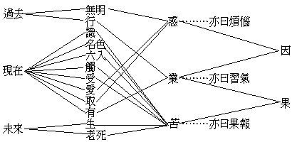



此十二支奚以名缘性缘起也？必十二支辗转支柱，相引而起，阙则不现，非自性有，一也。所得现在爱非爱果，及造成未来善不善业，须关待父母眷属师友以至贵贱贫富而时代境地，众同分中众多因缘，会合而剂变，虽有夙业，缘违则谢；如眼识以空、明、根、境等九缘而生，随缺一缘则不生起，起唯缘起，灭唯缘灭，二也。以是二因，故曰缘性缘起。又曰：三界缘起者，无色界、色界、欲界，是谓三界；今不详宣。第知人、禽等皆以淫欲而正性命，居於最下劣之欲界足矣。而此三界者，各有两种世间：曰有情世间，曰器依世间，欲界之有情世间，即今人、禽是也；而器依世间，则众同分业所现，即今所执为世界者也。此三界之情、器两世间，皆以十二支因缘生起，而拣别超过三界之四种正觉世间，故曰三界缘起。既略明缘性缘起之理，今乃可比合天演宗之例矣。盖十二支缘起，与前所述彼宗之观待及作用道理，虽间有增略，殆无遇而不同也。吾不尝谓彼宗根本之定理即无知也，即彼亦自认为不可知，或美其称曰不可思议，强名之则云自然；顾彼之不可知者，今曰无明。唯彼之无知，不止今之无明，以今此行与识二支，亦属彼之无知故也。质力自性果常在与否，非彼所知也，而即今此之行也。此行变易无恒故非常，流转无间故非断，缘会则有故非无，离缘则无故非有，盖是过去所有善不善业也。又质力自性为一异，亦非彼所知也，而即今此之识也。夫识以了别为义，唯了别故，内外、自他、一异相生，此情、器世间缘起所托始者也。亦庄周所云一之所起，有一而未形，物得以生谓之德者也。即了别时即有内外、自他、一异之对待相起，此对待者，即名色是也，故曰识缘名色。色是形碍，即天演例所谓质，名即受、想、行、识，即天演例所谓力。既有自他、内外、一异等对待，则攻异党同之用生，是以有翕聚辟散。六入者，在情世间为眼、耳、鼻、身、舌、意六根，在器世间即为色、声、香、味、触、法之六尘，至是则根境枞然，见不超色，听不越声，简者繁，纯者杂，融者固，浑者畫也。故名色缘六入，即天演例所云物之用事，由纯、浑、流至杂、畫、凝是也。而根与尘触，故曰六入缘触；尘与根合，故曰触缘起受。则天演例所云质力杂糅、相剂为变者是也。又天演例质力剂变，物之幼者多质点力，既壮多质体力，以涅菩星气言点力，以周天日局言体力。又谓点力即爱力，翕聚为用；体力即动力，辟散为用。余谓点力即俱生我执相，今识缘名色是；体力即遍计我执相，今名色缘六入是。又例谓根心之受感觉思为点力，欲动为体力，此犹於触受为无记，识了别境爱取方起身口意三业之说密符。吾於此不得不惊彼观照之深细，抑不得不疑彼尝攟摭佛藏也。又古德有以识、名色、六入，触、受、爱、取七支言人生者，曰流爱为种，纳想成胚，三缘和合——案即精子血胞及业识也——，凝滑成胞，是名识缘名色。曰体以日坚，形亦月变，百骸俱成，九窍俱备，是名色缘六入。曰呱呱堕地，始对外境，虽有接触，无所领录，是名六入缘触。曰略辨名号，辗增闻见，童子之年，惟务容纳，是名触缘受。曰既壮既冠，选声慕色，驰骤五欲，惟日不足，是名受缘爱。曰忽入中年，虑深虑远，取著染相，逐逐老死，是名爱缘取。虽人性黠顽躐绝，静躁敻极，盖亦可得其大较已。而六入、名色、识、三支，由纯、流、浑至杂、凝，畫，义最明瞭。然触受浑而不畫，爱取畫而不浑，斯氏谓物至畫则壮且老，亦云奇验矣。夫物变起於体合——与天择之义略似——，体合起於物竞，物竞起於过庶，过庶起於孳乳而贪生，孳乳贪生而起於自营私欲，固天演家言因果者之大矩也。而此生贪与私欲，则吾今所谓爱也；此爱支依托过去之无明种子，任运而起为现在无明之现行，既现行矣，又储作未来之无明种子。唯以任运而起，故昧者惑曰天赋，不知乃无明种子所赋也。无明种子，亦云先在观念，质言之、则情与习耳。斯例固徵於今之言卫生学、言伦理学、言群学者也，谓道德不以思理学术为正鹄能发生效力，惟以感情习惯为正鹄乃能发生效力者，无往不伸。然爱之发现，逆施、顺施、恒随所触受之外境而为转移，是即天演宗所云以体合而变异也。故在物有拒有迎，在力有正有负，在见有是有非，在情有贪——爱喜欲在内——、有瞋——怒忿恶在内——、在受有苦有乐，在意有善有恶；而於物、力、见、情、受、意六者，又莫不各有中庸之一境，是为无记。常人亦间有时熙怡、骀静，浑忘、忿嚏、恐惧、好乐、忧患等心行，适合乎大学所云心得其正者，则即此无记是也。随此爱习，以起身语之作为——案即前所云体力之发动——而杀害，而盗窃——案为护身而杀蚊蚋等、唯是杀业、为嗜食而杀鸡羊等，兼杀盗二业。盖害猪鱼等生命而滋养自己之生命，无异强盗掠掳他人之财物而受用也——，而淫媾，而诬诳，而谤詈，而调唆，一往坚鞭，执著不舍，则是吾今所云取也。此取支有正例，有变例；兹所云者，则其正例也。亦名曰想、心颠倒，亦名曰爱、恚二系。惟任性情，直动径行；天演宗则云物竞，云天行，云大运常然，云实所效必能之所储；荀子曰性恶；孔子曰性相近；均是物也。何为变例？曰变例盖起於宙合之外缘，凡情世间众同分所依者，若时代、若国土、若地理、若历史、若礼俗、若风习、若政教、若法律、若伦理、若学术、若艺业、若朋党，乃至一生所遭值贫富、贵贱、荣辱、得丧等境遇，皆足改革其性情，禁制之使渐不现行，而适合周遮之外缘以求其生存。然非必不现行也，特异其现行之趋向耳。故处於尊君之国者，则虽甚恶其君之所为，不敢以非礼加之而致其忠焉；但对於非其君者，好则敬之，恶则非之，於忠何有也？务合於爱国之俗者，於己所托身之国家及民群，则守助亲和，若出本心，颂之曰神圣，美其名曰华夏；然移之与国及敌国之民群，则曰僿野，曰凶虐，破坏之、戕贼之惟恐不及；抑亦最善破坏戕贼者为英雄。春秋言非义战也，孟轲言善战者服上刑也，而不能不严夷、夏之界，拒杨、墨之道；苟有为他国他族讼直者，且诟为丧心病狂，大逆不道，刑罚随加焉，於守助亲和何有也？信天神之教者，以人类为帝之爱子，宏忍博爱，普救万国，可谓极平等矣。而以禽兽为饔餐，以蛇蛙为蛮狄；且耶、回、新、旧之相轭，流血者数千里，杀人亦数千万，烹醢屠戮，惨酷莫甚！皆曰非此无以为帝之肖子，於救世博爱何有焉？主张共产、无政府者，无智愚贤不肖，无黑棕黄红晢，无非澳欧美亚，无孔子耶释回鬼，咸令遂其情，得其所，乐其生，可谓至公至仁矣。然对於阻碍其主义进行者，不恤以玄铁购彼之碧血焉，於至公至仁何有焉？研究物化之学者，使人人自致厥心於宇宙之形气，求其因果之公例，可谓极思想之自由矣。然脱有以真理实惟二约，大圣实惟三皇，境尘不足寻伺，阓闹不足欣爱；倡者则蚁拥而至，讪骂之曰迷信，诋諆之曰悖谬，曰违犯天然之法规，曰捣乱进化之程率，於思想自由亦何有也？随举人事，略及数端，若泛论之，可尽物物，虽穷年终身、脱腕烂舌可也。此变例之取支，亦名曰戒、取二系，亦名曰想、见颠倒；天演宗则云体合，云天择，云人治，云人择，云际会成异，云能所储实不必效；孟子曰性善；荀子曰积伪；孔子曰习相远；今人区之曰家庭上、社会上、国家上、伦理上之天职及道德；抑亦儒宗克己复礼、四勿、四毋所缘起也。余不遑遍为捆拢群言，读者固可意会而通耳。总逆顺之爱与正变之取，而成身、语、意三业之所作，於是有荣辱、繁悴、寿夭、智愚、贤不肖、仁暴、圣狂、哀乐、庆戚等结果，则吾今所云有也。然此有支，亦有同相、异相，如勤於卫生则得寿考，此因果之同者也；而所以有异相者，则亦天择——案即境缘——所致。如居於浅化之群，所告者分明正理，违其习俗，则或遭恶果；所为者分明欺诈，合其习俗，则获善报等是也。故大智若愚，大巧若拙，内怀真见，外任俗尚，必得其资而后语以妙道之宗；否则、没世闷焉自熹耳。此有支，在天演宗则曰生存，曰进化，曰劣败，曰灭亡，亦即所悬想於未来之极美备、极幸福世界也。故虽谓天演宗之说，尽於缘性缘起之爱、取、有三支可也；抑谓庄严世俗之言，胥具於爱、取、有三支，亦无不可也。而生与老死二支，本三世邅旋之理，谓今既作有身、语、意善恶等业，则未来世必循是而更起识乃至取之现行耳。然域内之说，大都衍子姓而不衍业识，故天演宗寓其希愿於万世后之郅治也；是皆天演宗与缘性缘起宗之大同者矣。



乙　证异



夫天演宗所观待与作用之间，缘性缘起说洵大同矣，独至证成之理，则砉然绝异。何则？彼曰自然——案含有不可知之真宰之意味——，故有不能不如是之意；此曰无明，故有必不可如是之意。彼曰自然规律，生活秩序，故有不能不阐明而依遵之意；此曰法尔——案法尔之义，较彼自然规律之范围为大，以不仅顺十二有支而流转生死为法尔，即修四念处、四正勤、四如意足、五根、五力、七觉支、八圣道等三十七道品，逆十二有支而灭证真如，亦为法尔。以顺爱取等即转轮回，修定慧等即趋涅槃，决定因果不昧，而无其不昧之所以然，故云法尔——，故有更不必研究而推求之意。然之二者，仍是作用上观察之异点耳；顾究竟楷定之理，即由之而殊。彼究竟楷定者曰进化，故文明美备、郅治久长、富乐真实、安固平等、亲和自由等义附之。此究竟楷定者曰牵转，故无我、无常、苦、空等义附之——案我有四义：一、对待他人假名曰我。二、执取义，执身、曰我身而取苦乐等相，执业、曰我业而取善恶等相，乃至执国曰我国而取文野强弱等相。三、主宰义，谓独力坚持之主体。四曰、自在义，谓离系无碍之自由。今曰无我，盖是无三四之意。以对待曰我，但便称呼，此虽圣者不废。执取之我，内本於无始习种，外益於有生染相，非修止观获证生空，诚无以离遣。唯主宰、自在之我足以增盛取执之我，执取之我又能消失主宰自在之我，以既有执取之我，但依所执取者，立主宰，求自在，故主宰卒不可立，自在卒不可得也。万物莫不偕执取之我俱生，故万物皆无主宰、自在之我。试举通摄力例证之：地局内之凝、流、气、质、动、植、飞、潜、以至乎人，皆不能不亲地，而地又不能不亲日旋绕而转，此物之不能立主宰、得自在之一端耳。广言之，则随取一人一物观之，其前后、左右、内外、上下之所集，殆无时不此牵逼彼、彼牵逼此者，初不容稍作主宰，从未尝略得自在。愚者不知，因乎有执取之我，而归之神造、诿之天命。挽近乃诧为自然规律，益执取之以为主人翁，奉志承则，自比厮养。乌乎！众生之颠倒，洵可痛也！故今此无我之义，乃萌俗所共认，唯大雄之士，以不能成主宰而得自在，恒引为奇耻大辱，而又深知其因在乎有执取之我，於是誓断除执取之我，而完全其主宰及自在。华严所云：「净诸心念若虚空，令其所向皆无碍」者是也。故对待之我，则异生与大觉同有。自在主宰之我，则诸佛有而众生无。执取之我，则诸佛无而众生有。兹首标无我者，据众生所共认之事，使知不能自主，不得自在，故恒被牵摄，流转三途，轮回五趣，无由自免！又使知此皆起於执取，而所执取者，毕竟无主宰自在可得，以是渐厌离损灭所执取者、以至断灭，执取既断已，则主宰自在更无庸外求矣。无常固世间现见，虽日星诸局终有毁时，此皆今人所共认者也。苦有无量相，即小教亦说一百八苦，今略摄之为三相：曰苦苦，曰行苦，曰坏苦。凡欲祈向一乐境，必劳身苦志以赴之，是为行苦。所祈向之乐境，十九不达，是为苦苦。幸而得其少分，又转瞬变灭，是为坏苦。羯通哥斯著社会学，谓凡彼乐受，先由轧轹。第一轧轹，惟是苦观，则苦亦世间所共知也。要之、人生所受，苦为其本，所谓乐者，但略减苦；饮食以医饥渴，男女以泻欲火，譬如疥夫，痒极爬抓，当爬抓时，微生乐受，俄顷之后，则痛痒益甚，疥疾不愈，痛痒不已。空者、非实义。三界本空，人心妄执，爰如幻师咒成幻境，此理则世人稍难喻矣；但据无常之义，以变易无定、物相暂现，用释空字，亦可也——。无常、苦、空，咸所以开示我之执取者无足执取，益发明无我之义耳。然斯皆世人所现见，抑天演宗所公认者也。而天演宗明知世人如是，顾又以此不足为一定之理，乃必证成曰进化者、何也？余盖常反覆推核之，此则现证乎心体而了察乎业用，彼则寻考夫业用而未能洞彻乎心体，歧因一也——案：物心交感，激成意境，爰起言行，是曰业用。所感者物，能感者心，外触内受，恒为主因，世虽知有，依业用论，妄虑既极，曰不可知，康德诸哲，说咸齐此。痴氓謣夫诳云帝神，孔、墨、耶、回实惟同伦，聃、周、胜、数、犹隔罗縠，声闻、辟支，亦非自力信受奉行，爰入乎圣，惟佛一人朗然现证。设犹不信者，请略举事相为例。除过佛藏，试遍取世间之学说观之，其不根於天帝、不根於自然、有不根於不可知者乎？无有也。其果不可知乎？是殆非然。惟可以圣智内证，不能以名言示人耳。故释迦自谓四十九年未说一字，但心体虽离言说，吾得就修增上心学者，从心体所发现之增上作用、而证明世所谓自然秩序、生活法式，实非能范围吾人者。夫催眠术，心学之至浅者也；而已足冲决天然之规律。昔南宋时，蜀郡有大树，摧於风，树中空，一僧跏趺坐，发覆两肩，爪纤长卷屈，身微煖而不倾不动，挺然自若无所觉。居民诧异极而哗闻於郡守，郡守闻之朝，命舆舁之都中。帝心知为入定僧，顾无术使其寤，桑门有言可以手磬声就耳畔觉之者，试之、果然舒目展足而立，无异恒人。诘其生平，始知为庐山远师弟子，为时几千年矣，自言无异弹指，不知今何世。诏令住某寺，辞不获，翌日则已留简而莫知所往云。佛藏中神僧传记载者甚多，以此事为平日千万人所共闻见，故独及之。庄周曰：「至人神矣，大泽焚而不能热，河海沍而不能寒，疾雷破山、风振海而不能惊，若然者，乘云气、骑日月、而逝乎四海之外，死生无变於己，况利害之端乎」？世尊曰：「假使十方诸有情类，一时吹击大角大鼓，或现雷震、掣电、辟历、诸山大地倾覆动摇，不能令佛举心视听」。证於兹事，夫亦何远之有？今之桑门隐於终南山者，数月不起乎坐，亦恒有之。即吾党捆䌸情解，习染戏论，顾稍能静摄，但须浃旬，必亦能触证心一境性，发现定境，若昏暗之夜忽然明光，数里之外人语了了等事，是在现证心体者观之，诚奚足道！但世俗心量狭劣，姑言其近而可徵者耳。抑此非所以表示心体也，盖藉心体之增上功用，俾薄俗知希世大宝即在自心，可反求而获之，非不可知，非居乎天。所得以凭恃者，又万非社会、国家、眷属、子孙之堪比拟。而有此心在，纵为空气，仍将随所造业，升沉五趣，永无已时，则三世轮回之因果，自不疑矣。夫近人亦有所谓心灵学也，顾祇及人事相交之抽象，不敢一探其秘，乃相为欺绐，滋世烦惑。夫物、理浅者耳，犹知非察观所能穷其变，而必以术为试验，何独於最深切、最贵重之心灵，反漠然置之，虽有试验之术，不欲问津耶？吾言及此，吾於今之桑门，乃尤悲之！桑门且不知此而歆世，吾於世又何责耶？虽然、出世种性，固非可以形迹限者，吾岂必於桑门求之乎？世有欲得其术而试验者欤？则奢摩它、毗钵舍那、三摩提之说具在，前修之道迹，可计步而行也。吾尝以两个因明量楷定斯义，用附录於此：一、佛所说阿赖耶识人人所谛信；以凡可内自证知者必人人所能谛信，如人居暗中，皆审知非无自身；凡人所不能谛信者，必不可内自证知，如上神天帝。二、佛所说三明六通，众人皆能谛信，如试验化学；凡众人皆不能谛信者，必无同分现量可得，如上帝创造天地——。此安住心色实相而赡足乎内，彼执著宇宙假法而系系於外，歧因二也——案：吾所云色法有实有假，身形假也，色之实法即今人所云物质。小乘宗假立为实，大乘则一心耳，无实色法也。宇唯是方处，宙唯是时代，乃依心色二法和合离散、变易所经过之分位而说，亦是自心之碍相。自众同分之员舆、民族、国土、社会、宗教、家室等，所有成毁、强弱、兴衰、存亡、治乱，以至一身之佼丑、寿夭、皆假法也，惟有男根、女根及命根所孳乳增长。世人如蚕作茧，自缠自缚，无不为其系缀役役至死者。此假法亦名不相应行法，弥勒、天亲皆说二十四种，康德之十二原型亦近之。知为心色变现，而又知能变惟心，则无动乎外矣——。此衍心识而三世轮回，彼衍形气而一生断灭，歧因三也——案：前二条之理既明，此条固不待更辨矣——。此随业受报，唯在自己；彼造因责果，爰及孙曾，歧因四也。综此四端，结成一错，即此则唯䜣合於真如，彼自唯䜣合於幻变是也。䜣合真如者，不为形气所拘，故见其无不牵转，深知过患。䜣合幻变者，恒唯身世是笃，故见其似有增进，极生贪恋。彼安立天国及未来美利安宁之至善世界者，要不外养命求福，笃其生活之一念耳！故终不免身见、慢见及贪、瞋、痴惑所缠缚耳。故但能於增进己若亲若族若国之生活，不问其心行之善恶而皆足称矣。自进化论出，有能於增进己与群之生活之外，别悬一正鹄者乎？灭人种，夷人国，凡一切兽行禽德，有不以增进已与群之生活自托者乎？所谓道德，道德视此为进化，所谓政治，政治视此为进化；所谓学术，学术视此为进化。进化之所依在乎生活，生活之可羡在乎进化，生活乎，进化乎，洵人情独一无二之正鹄哉！夫未证生空，谁不缚於生活，即未入大地菩萨犹不能无生活怖畏，吾於人群之惟生活是祈响，又乌得而非之。所欲申其忠告者，进化之说，未必若是其可欣耳！夫牵转之与进化，胥心色聚散所变现之假相耳；今既许有牵转，奚独不许有进化乎？进化盖心色之变相，等流而增长之义，从幼至壮，物物莫不有其增长之一期；然须知从壮至老，又物物莫不有消损之一期也。今夫员舆，亦异生共业所感之一大物耳；生住变灭，亦何能异？员舆且然，人群益信。故进化惟笃时之谈，牵转实必至之理。牵转惟业，造业唯心，食果凭前业，造因凭今心。任前业而食果，浮沉听之；慎今心之造因，决择行之。则虽未度越死生流，诞登涅槃岸，而柁柄在手，方向固可自定矣。余岂必欲立牵转之义哉！亦以形气之内，势实如是，虽欲为之饰讳而美赞之，有所不能耳！故希望群化增进者，无异小儿之希望为成人，而不知既为成人，将及老死矣！欲促速群化增进者，无异小儿欲速得为成人，而不知实无速之之法也。以群化增进为安善欣利者，无异小儿以成人快乐自由，而不知成人惟忧患艰辛也。抑小儿之望成人，固实有成人比例，未来之美备世界，可比例者谁乎？亦吾人搜取种种之陈迹，随戏论习气幻想浮现，以构成此结晶概念耳。执此概念，惑为实有，其愚不较小儿尤甚乎？夫天演进化之论，不能圆满如此，则彼宗所见於人群之效功，吾亦不得不为之稍贬其辞矣。



五　解蔽



世论无不以男根、女根及命根为依止者，亦无不以众同分、和合性及宇宙为究竟者。由所依止者，故无不蔽於种姓见——案：种姓起於夫妇父子，若中国之十族，印度之四姓，以至挽近人类学之分为若干种、若干族，要皆由男女二根所孳乳寖大。欧人兢兢以保种强种为要义，及自视为贵种轻蔑他族，由斯见耳——。萨迦耶见、断见、爱见、慢见，而成贪、瞋、痴等惑，起杀、盗、淫等业，受迫缚坏等苦。由所究竟者，故无不蔽於戒禁见——即人民对於国家、家庭、社会等义务，及对於上帝等义务——、疑见、邪因见——即计上帝为世界因等——，增上慢见，而成贪、瞋、痴等惑，起杀、盗、淫等业，受迫缚坏等苦。凡是皆吾教小乘宗，预流果之前，四加行、十六智所断尽者，而世间出世间所由判也。今天演宗固世论之一，然以视神鬼之教，见网稍解矣。吾惜其邻於缘生义，而歠其流喁其声者，仍陷入邪见稠林，末由出离也！乃摘其蔀蔽之大者以为祛解。



甲　惑相



近世学者大都不满神教之说，天演宗立物种递变之例，反对造物主之声浪，益高唱薄霄汉矣。顾由予观之，彩畫稍新，质素惟旧，殆未能窜出全知全能之神权范围也。故其天演之天，不仅不可知及自然之义，实兼有元理真宰之意味。何则？近世学者之言想，固莫不极於不可知之界也；而是不可知中，又必带有天神地象之观念。吾试条举天演宗鉅人之言为证。斯宾塞曰：古宗教之言天，与今之言天所异者，亦渐离乎迹而日即乎玄耳。赫胥黎曰：有一不易不离之理行乎其内，有因无创，有常无奇，设宇宙必有真宰，则天演一事即真宰之功能。惟其立之之时，后果前因，同时并具，不得於机缄已开，鸿钧既转之后，而别有施设张主於其间耳。又曰：是天工也，特无为而成，有真宰而不得其朕耳。康德曰：天神者，超乎认识圈外，非人所能有无也。泡尔生曰：神之实体之全量，超於吾人知识之外，强拟以吾人知识生活最高之形式及内容，於是宗教之模人论立。模人论者，谓造物主之视听言动，一如人也。最近欧美大陆派学者，谓上帝恒寓居人类之生活力中，以行其创造世界之职务，致世界非已造而方造者。要知彼宗常以不可知之元因及众同分之趋势，与天魔并为一谈，而以众同分之趋势为天然法理，不可违抗，即戒禁见；元因不可知，即疑见；与魔神——按欧土所信天帝，恒以生死法系缀人类，与印度吠檀多教之高等大梵异，而同其劣等大梵，劣梵、则吠教所斥为天魔者也——并为一谈，即邪因见；而自谓所言最真最当，嗤反其说者为迷谬，即增上慢见。是皆胶扰乎神教之言，始为厉阶，至今为梗者，其惑相一也。



万物由质力调剂，业缘辐辏，积久而递变成异，种姓繁衍，或复寝灭，其理固自圆通。而彼宗推寻物证，远及数十万载、数百万载之前，以骨骼、石器等足成其说，则转失平实，流於荒诞不经矣。夫文字所纪，未越五千祀，尚多不足信者；凭陈迹臆断为倍倍之五千祀，顾可深信，斯亦反已！吾国儒先，有尊信彝器、抗慕古篆者，於是钟鼎纷纷出於土；彼治地质学以言物种由来者，毋亦类是乎？不悟地质中物，纵非出於伪设，亦由意中先存此一观念，逐物联想，积成心习，故随得一不经见之物，即若可为物种考据耳。今脱有人翻其物种进化之说而为物种退化，以三数人终身之迹考，得千百人为附和，安见不又有古物古器等堪为证据乎——按：章太炎君作原变曰：「亚洲之域，中国、日本、卫藏、印度有蝯蜼，其他不产。澳洲无猿，亦无反噍之兽。其无者，化而为野人矣，其有者庸知非放流之族，梼杌穷奇之餘裔，宅岫窟以御离鬽者从而变其形也」。余读天竺古志，述人群退化之事相甚详。谓生民之初，皆受天然之乐，寿长八万岁，每百年递减一岁，减极为十岁之时，性最凶恶，人与人相杀食，弱者逃入荒岫杳壑，食草而仅免。其时、人形长不过二尺，土地礁确，谷麦麻桑皆不生，御饥以血肉，御寒以毛发云云。试默想其状，非即与猿处同乎？以证章君之说，益以相通。抑此说，阿逸多亦取之以谈人群由善恶之共业，人寿增劫减劫之理：谓减劫之极，性恶者死之略尽，逃入岩岫之性柔善者，乃得渐复其旧，福慧寿命，日以增长，则是猿类进化为人类之谓乎？且今人於地带热寒之迁变，尚有一说，谓地轴侧转久之，向日局之方面易异，故南北冰洋寒极变为热极，其冰融为沸水流下时，今人所居洲陆，将尽变为洋海，彼时唯处最高之山巅者，乃得仅存，其餘则一切灭没。又今人之原人种，皆起於帕米尔高原，震旦古建国者，亦皆在西北，名曰中华，足徵楚、越等地，犹为海岛。今濒居海地者，皆谓海沙渐涨为地，数十年即不同。而东西古志，太古咸有洪水之言，其地带寒热易位之证欤？居山巅以幸免之人类，则以大海汪洋，孤峤悬居，思虑言语都无所用，乃渐退化为猿类。或与山中猿类交合，生为野人后洪水渐退，地亦渐舒，乃人群相争，再起人文。抑进化教又谓人类先有水族，核之洪水之言，义亦可通。且今之海栖族类，有类似人形者，有类似兽形者，安知非陆居人兽为洪水漂溺，乃变水栖动物乎？然则洪荒之前，必先有人类，其人类人文之发达，或回出今人之上。印度古志谓有前一减劫中毗舍浮佛等古迹；今美洲及中国以开凿山矿，往往有雕琢工美之石像等发见，亦可说洪水前先有宗教之据也。夫蝯蜼则进化教依之为人类进化之证者也。而余依之则亦得说为人类退化之证。然余非欲成立人类退化之教也，特言进化教所取为进化证据者，未必可作为证据，用遣进化教之谬执耳——？因此所证明之事，非关现今，故无亲量；非载地志史乘，故无声量；其比知者，又皆荒远茫昧而不可确知，无异证明山精鬼魅上帝大神者，可随其意拟而为比傅，执自幻想为外实法，其惑想二也。



进化之说，初才及於动植物耳。故斯宾塞之天演界说，亦不外述一物生长之理，谓之生理大经则可，以言物种之蟺蜕，已觉牵强，通之国治群化，益扞格难符矣。然斯氏则身援其例以倡群学，而力言群学同乎生学，又泛引人物生理为证明。然群理与生理，实不能相侔也，今请以人身核之。夫吾人得察究人身之生理者，非徒以其有众多之细胞及各件之机能也，兼有其外包之共相可观也；而国群外包之共相则何在乎？将曰在疆土，无论其界域但由地图之染色为凭也，假使据此疆土之人群今忽死尽，而疆土不随以亡也。虽疆土如故，所谓国者固乌有矣。抑疆土不宁不随此土人群以亡，苟他土人群入据之，疆土之作用亦仍可如旧也。而人身则岂有各质点各机能皆消灭，其外观之身形尚宛然者乎？此可见疆土不足为国群外包之共相矣。将曰在法制、在政府、在宗教、在礼俗，此则但可比人身之表业，益不足言其共相也。又既以大群比全身，个人比细胞，则一个人固可独处於大群外，抑从此国群而入於其他一一国群，或竟老死於异乡，或仍返居於故土，而始终皆有其自相可得；一细胞之於全身，岂亦能如是乎？虽童子亦知其不然也。又既以政府比头首也，则政府之倒，应如人首之断，岂得全群仍能行动而更建头首乎？又今言人身之生理者，亦人身之共相言之耳，决非人身中之质点所能言也。既以大群为拓都，而以小己为么匿，则此么匿者，又乌能言拓都之生理乎？使么匿者而能言拓都者之生理，则此么匿者，非人身质点之比，拓都者亦非人身共相是同，又不待辨矣。要之、国群之与物体，个人之与质点，断断乎不能相类，欲广为徵引，虽累亿万语犹将不穷也。盖个人实先於国群而有，国群但是个人对於所依处者之观念，即此观念亦非国群自有，而为个人之观念孳乳而成，离各个人无国群之自相可得，离国群实有个人之自相可得；非若物体之与质点，同时并有。物体实有自相可得，质点但依物体之剖解而得其自相；而斯氏则著为学说，抑若初无可疑者。乃知心习既成，虽识见闳富，往往以智起愚，其愚谬又甚於蝡生者，其惑相三也。



第斯氏之治群学，亦知蔽於心习之为害也，故於物情、政教、学业、党国等所有笃时拘墟之见，亦既历历言之而中肯。尤力斥天命、世运之说，不令人崇拜神祗、英雄；一事物之成，归功於全群之渐化，已与华严宗世界以无量因缘生之说近似。惟不知毗重於全群，致个人与全群主客先后之位倒置，较彼梏於流而辟於教者，特深浅宽狭之异，其未能无所蔽则一也。虽然、吾党责人，应稍恕其辞，若斯氏之谈群化，恒拳拳以不务近功，不欲速达，其流蔽亦末减矣。赫胥黎则以社会进化、生齿日繁，殷忧群道之终穷，乃发为简单之厌世思想，恨不能剿绝万物之生化，此其论根诚浅薄！斯宾塞所云脑之事费，则生生之事廉，已足摧破之。然人齿过庶之言，盖起於达尔文生物繁殖例。然人之生殖，不可与下等动植物相比。愚者见一夫一妇赴於新荒陆，二十年而得四人焉，又二十年而得八人焉，遂谓人口以几何级数递加，每二十年辄增一倍，不知再经二十年，则死率与生率相抵，固不复增矣。顾谬种流传，此迷至今不破，地球人满之祸，时一浮现於人意，乃一变人世界而为张牙舞爪之兽世界，抑若其国中将即见骈肩重足而立之状，不得不汲汲攘他群之地，夷他群之种以自殖其民者。持此以邻为壑之主义，以加慈善柔直之群，幸其技之果售也，乃益信杀害之足为正法，强存弱亡，公例非谬。不知此非群化之自至，乃先执一强存弱亡之见，仗一旦兽力之强悍，广为刘弥戕贼之所致也。苟随其群化之自至，则人心之灵，固无不善变者，亦体合其外缘而渐适於宜耳，又乌得萎绝哉？而强权进化之谈，愈演愈烈，则甚且以人为世界进化而生，当为世界之进化而牺牲，傅以帝国主义，益尊奖强权，几全同回回之教，曰人惟为神战争，得生天国也；而今日欧洲之大相斫，即欲以兽力达进化之目的者，以成绩及其真相揭示吾人者也。或谓欧陆经此次蛮触之战，后将永息干戈，不知彼方种其报复之因於无涯：胜者益高其贪燄，败者益蓄其仇毒，循斯道而不知返，吾恐不至强者亡尽而弱者仅存，无税驾时也。君等纵希望人满，人又乌得满耶？夫世人固多盲从一时之风说，羊突狼奔而进，不暇计其苦乐利害者，此诚野心家所得阴驱而利用者也。积其惯习，皆自忘其何所为而为，若出乎自然；如染著嗜好者，妄计为人人若是，以战死疆场、奴佣国群为人生至乐者，亦同乎此耳。虽然、此类特最少数而已，就众人恒情论之，适得反焉。故以今日之世界为至善醇美者，始无其人，唯以现今之世界校善於过去，而未来必有至善醇美之一期，则人人信之；此实世俗之大惑，吾不得不稍进正言而冀其一悟者也。吾今姑承认群化有进而无退，未来必有美善之世界，果用何标准定其为满足完备乎？又与今人有何等利益，乃希望而经营之、若是其切乎？理求其诚而事效其实，此当人人所不迕者；今曰满足完备，所满足完备之内容，果为何物乎？又以何者为不满足完备乎？将在意志乎？感觉乎？智识乎？在感觉有恶美苦乐，是曰俱生痴；在智识有善恶、是非、真妄，是曰分别见；而意志之冲动，但是无记；及其执取焉，则又不得不听从乎感觉或智识。人之用以衡量事理者，术尽於是，故恃为标准者，应不出乎恶美、苦乐、是非、善恶、真妄之外。但世人既无现证心体之智，则所谓智识者，不得不以众人所同然者为归依，众人所同然之善恶、是非、真妄，大都以习尚为转移，以习尚为转移，则智识不足自恃，必更证明於感觉，而后始克判断其善恶、是非、真妄。然则感觉尚矣！而感觉之所有者，惟是美恶、苦乐，好掉举者，以居聚落为美，耽寂静者则恶之；恋妻子者以离家为大苦，惯游历者则无地非乐境。盖美恶苦乐，亦未有不随俗尚及根习为变易者；然则感觉亦不足恃。既无公同一定之美恶、苦乐，则无公同一定之美恶、苦乐、善恶、是非、真妄，又将乌从以决择此未来之世界，为满足完备与不满足完备乎？藉曰：此世界自性满足完备，无关乎人之感觉智识，则既无关乎人之感觉智识矣，纵使满足完备之世界，今既实现，亦与人渺不相涉，况在千万岁后者乎？或曰：人固往往无所为而为，不必有关於美恶、苦乐、善恶、是非、真妄者，如好胜好名等。夫好胜好名，初亦起於苦乐善恶，积渐成惯，乃时时妄动，但是无明染相耳。且既曰无所为而为，则都无方向进退，如何复有美善之世界为正鹄乎？然则吾人生此世间，固茫然无所标准者乎？曰：是又不然，盖谓无常世相，不能有公同一定之标准耳。然吾人自有其标准，太上现证心性，而随顺正因果律，其次、各人自凭其感觉所符者，以为智识之基，超乎感觉之外者，不以妄信，则感觉虽时时变易，当其未变易而正感觉之时，固有诚而无伪，足以楷定其是非、善恶、美恶、苦乐者也。夫世俗所重，本唯生养之道，种种事业，实为生养而辗转增设，乃穷高骛远，计著幻相，致反絯生养之道。昔印度外道妄计坠渊、吞炭可生天国，非斯类欤？灯不燃蛾，蛾自投灯，鬼不魔人，人自崇鬼，其惑相四也。



乙　断德



今欲断其惑染，须明诸法缘生——案：此所谓法，与世俗所谓法者有别。此法乃总举一切心物事理而言之者也。略言之：有心法、色法、心所法、不相应行法、真如法等五科——。缘、言其因，生、言其果。一果之生，非一因故，故但曰缘；一切法以生为初起相，故但曰生。缘生之义，以前所说十二缘起支为经纬，以四缘、十因及五生五果为体相。以之谈世间名理，虽未亲证心体，凡横计妄执所成过，吾知免矣。盖知诸法但从众缘生，则自不信宇宙为真宰；知诸法起唯缘起，灭唯缘灭，则自不於现法中起种种执取；缘会则生故因果不昧；生由缘会故世相本空，则无歆乎分外而致谨於心行。夫天演宗固近乎缘生义，而其效不在乎是者，则於现法中起执取耳。织意组想，乃由是缴缠无极！故曰「即今休去便休去，欲觅了时无了时」。



六　绾言



太虚曰：近世学界稍能自树者，无不知佛矣。如赫胥黎曰：自有谈理者以来，未有如佛者也。斯宾塞对耶教徒曰：东方有圣人曰佛，其於化世导民，断然有可言者。牧师李登曰：净饭王子之所为，吾人对之不发愤增愧者，未之有也。麦惕孙、庵罗知、马克拉夫等专研究佛学者，可无论矣。盖格物之理大明，神教既摧，思想所极，未有不与佛学邻近者。而言论自由，又非宋明儒束於孔父之比；正教推及全球，此其因缘时节哉！但微窥欧陆最近之思潮，若现漩澓之状，将以民生国政为归宿，不复进步，殆以思想渐成统一，乃入於随眠状态乎？是不可不有以棒喝之。所望於支那学者，则稍息其政治热，习法律、军事等学者日少，而习名数、质力、农矿、动植等致知厚生之学者日多，庶乎生养之道既舒，而学理益弥进乎精辟耳！



七　寓意



爰有谔谔先生诘太虚曰：若之议天演宗者辩矣，但予於若所言缘性缘起，犹不能无疑也。若不曰顺十二有支则流转而系生死，修三十七道品则还灭而证涅槃乎？然何以有十二有支，何以顺之流转而缚生死，又何以有三十七道品，何以修之则还灭而证涅槃？若幸有以诏予矣！设曰此唯是法尔，可谛信而不可思索，则与天演宗之无知自然之不可思议，亦奚择焉？若幸有以诏予矣！太虚怃然有间曰：恶！君斯问抑胡悍且突哉？盖净名之所口缄，马祖之所头痛者也，太虚其将奈君何！何则？夫缘性缘起宗，至此既云法尔，则心行灭言语断矣，太虚其何以语君！岂不曰尚有法界缘起宗，然设无因缘，则大通智胜十劫坐道场，佛法不现前；释迦牟尼、诸法寂灭相，不可以言宣，而生不可说，生不生不可说，生生不可说，不生不生不可说，太虚又将何以语君？设有因缘，则百界千如，十玄六相，帝网既重重无尽，法门亦别别无量，虽以四十二法身大士、微尘点地涌古佛，一一舌相遍覆无边刹海，流出无穷名言，一一名言表诠无数法相，如是乃至极未来边际，极虚空分齐，犹未能宣说普贤愿身之一毛孔。纵略言一毛孔之一毛孔，已足矼实三千大千世界，纵略言一毛孔一毛孔之一毛孔，亦足穷形尽寿。言者虽不知倦，亦徒增君之惘惘耳，太虚又将何以语君？岂不曰尚有心体缘起乎？然设以空拳相诳，楛叶相绐，则楞伽、密严之教，瑜伽、庄严之论，六百函之般若，七千条之葛籐，扪飘风而玄释，谈者诚可翏翏，搏舄迹夫太空，听者未免役役，太虚又将何以语君？设不以空拳相诳，楛叶相绐，则才曰心体，早污染矣，太虚又将何以语君？虽然、敢姑妄告君曰：以无明故、以行故、以识故，是以有十二支可顺而流转以䌸生死，有三十七道品可修而还灭以入涅槃。



设更诘以何以有无明、有行、有识，则但告君曰：君何以忽有斯问？君乎！君须知此所告者，乃狗日之翼，月兔之角也；亦释迦所以无佛性，弥勒所以失布袋也。苍鹰而有灵，固将一见成擒，则心境销亡，知不知寂，复何所动？复何所生？知寂故无无明亦无无明尽，无动故无行亦无行尽，无生故无识亦无识尽，无无明行识亦无无明行识尽故，乃至无老死亦无老死尽。然则曰何以顺十二支而流转生死？何以修三十七品而还灭涅槃？宁复成话言耶！设君犹不自知反，弃却家宝，甘於贫乞，则太虚固无奈君何！君曷诘之无明，诘之不可知，诘之上神天帝，诘之自然规律欤？於是太虚欹窗而歗，谔谔先生，忽不知所往。



（见道学论衡）



（附注一）原作「订天演宗」，今依文钞改题。



世间万有为进化抑为退化



——十四年初春在武昌佛学院讲——



近百年来，风行一世，而影响於世界人心最鉅者，厥为进化论。然谚云：江河日下，人心非古，则又反对进化而主乎退化。但二者虽异其进退，而世间万有为变化的、非固定的、则同认无异也。故世间万有之变化，为向胜进乎？抑向劣退乎？正可成为问题而待解者也。



关涉此问题之学说，纷纭不一。今分为非佛法的与佛法的二条，略述於左：



甲、非佛法的　一、物本的进化论及断见论。物本者，即以物质为宇宙万有本源之论，如印度之极微论师谓：地水风火，渐分微细，分至无分可分，此即极微。地球之大，微尘之小，非有二本，皆极微成。又云：两两极微生一子微，合本有父母微成为三微，此三微复合他三微，生子微第七，其量等六本微量。如是辗转相生而成大千世界，乃至世界中之吾人；此进化之义也。至西洋之唯物论谓：世界未成之前，有最极微之物，曰电子。此电子散布空中，由热力不均，有冷煖之殊，成太阳与众星之异。地球为众星之一，动植诸物渐以蕃生，乃至成灵於万物之人类。盖人、猿同种，人固由下等动物进化而来，是则地球之成住，物类之优劣，非本有而为进化，故所求唯在向前发展上之进化；此依物之类而言。若反观其个体，人生数十寒暑，即归消灭；心灵作用，虽若前念后念杂遝而来，此想彼想奔凑并至，亦如物质之组织及机械的活动，是中固无所谓常住不变之心体，如灵魂、精魄、自我者。世界万物新陈代谢，沧桑叠变，风云翕合，亦不过物质聚散离合之变化，是间亦无所谓常住不变之天神，如上帝、真宰、大梵者。故天地人物物质构成，人死质散，心灵随灭，无有后世，亦无业报，故名断见论也。



二、神本的退化论及常见论。有超过人间以上者为天神，有主宰一身及支配四肢者曰神我，示别物质则曰精神。谓以神为世间万有之本，即神能肇造万物。或曰：精神流出形质。此派依物之类而言，则成退化论。如印度之婆罗门，谓万物之本唯一梵天，梵天初生之物，两相邻近，转生转下，引发物欲，渐渐低降，遂为人、为兽等，器世间之变化亦与相类。他如柏拉图之「初皆清净」，堕为万物；基督教之初为上帝所生，住於乐园，后乃有罪而受苦迫，皆其例也。而婆罗门之事梵天，基督徒之求天国，皆为复初。以今后为退化，故所求乃在还复其本。中国孔、老等一分复古思想，亦为斯类。



夫人类之异於天神者躯彀，而类同上帝者神我——或曰灵魂——。躯彀异於天神，故迁流变坏；神我同类上帝，故亘古常存。宗教徒之苦行精进，亦为由躯壳中超脱与天神相同之神我耳。故由个体言之，为常见论，计有一遍常之神，或各有一不变不灭之神我故。



乙、佛法的　一、谬似的。谬似之中，有二大类：（一）、是前物本之类：在佛法缘生性空而不坏因果，无如弗达缘生之徒，谬似佛法，成恶取空，拨无因果，遂转成虚无外道，实即从前物本的进化论之末流也。盖攷物类之变迁，生物之增进，如地质学上考得古时尝有极强盛之物，属蜥蝪类——东方古书曰龙——，全世界之生物，莫相与匹。然极盛之后，不久消灭。由是观之，则生物最极强盛之际，即近於消灭变坏之时。故认人类为进化，日进强盛，殆无异进於消灭也。於是产出虚无主义，及自杀主义等等，在西洋学派中时发呼声；在印度则由佛教而起之恶取空，及古时拨无因果之邪见外道等。然恶取空虽为外道，有时亦可对治染著世乐之凡情焉。（二）、神本之类，即恶取不空。如佛法中闻如来藏、法身、真如等名，不善了达，谬以神我与天神等为实有，执为吾人本体性，后以一念不觉，为无明所覆，物欲所蔽，遂成众生；虽成众生，复可以返此真如、法身、如来藏之本位，以为修持。然此虽属谬误，而於人天乘中，依之施设补特伽罗，使止恶修善，亦无不可。故列入相似佛法之类，用以摄受佛法之人天乘机。



二、正确的。正确佛法，依俗谛言，可分二类：（一）、世间之轮回论：器世间成、住、坏、空之四劫循环，有情世间本、死、后、生之四有轮转，与大小乘之十二因缘，由无明而老死，由老死而无明，如环无端，无暂间断是也。庄子中冉有问曰：『未有天地可得闻乎？孔子曰：古犹今也；无古无今，无始无终』。亦轮回之义也。由是世间所谓进化退化，皆片段之偏执耳。



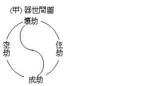



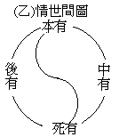



（二）、出世间之还灭圆常论，万有之生灭流转，谓之世间；出世间者，即灭除万有轮回之有漏种现，而获得进化于圆常之无漏种现也。盖出世之缘修有漏胜善，由有漏胜善引发无漏胜善，得出世间之无漏种，以无漏种证真常性，由真如智起无漏用，出世之义，如是如是。然出世法有三乘共及大乘不共之别：盖逆生死流而解脱之，属还灭论，是三乘之所共也。大乘不共之因位菩萨法，则为进化论；盖第六住为信不退，第七住为行不退，初地为证不退——未证初地之前，偶有证得，未能不退——，至第八地为念不退，以念念迁流入萨婆若海，此积极之进化论也。直至佛果，以圆满故更无有进，以均常故更无变化，曰圆常论。撮表如左：



　　　　　　┌三乘共…………………………还灭论  

　　　　出世┤　　　　┌因…………………进化论  

　　　　　　└大乘不共┤  

　　　　　　　　　　　└果…………………圆常论



依真谛言：诸法离言，实性平等，真如界中绝生佛自他之假名，非进化，非退化，非不进化，非不退化，亦非轮回非不轮回，离四句，绝百非，泯一切相，即一切法，常遍如是，何思何言！依俗谛义，得下列之二条：一、世间万有非进化非退化而为轮回。二、出世的一分大乘不共因位菩萨法，为真正进化。世有误认轮回中一片一段之偏执进化为金科玉律者，亦知其但是轮回，毫无进化价值之存在而幡然从事大乘真正之进化论欤！



（育普、满智合记）（见海刊六卷二期）



大乘渐教与进化论



——十九年十一月在四川大学中国文学院讲——



一　进化论在现代思想中之变迁



自昔思想界对宇宙万有的观察，有四派主张：一、亘古不变，二、循环消长，三、退化，四、进化。主进化者非始於近代，如古希腊之额拉吉来图哲学，与中国一派哲学所谓由椎轮而大辂、由茅茨土阶而峻阁崇楼，皆言后胜於前。至十九世纪以来，乃用科学方法证明宇宙人生是进化的，将前三派说法完全推翻，故可云在现代思潮中，是进化论独霸的时期。然於近代进化论中，又有唯物论系的、唯心论系的、组织论系的三种变迁，愈后的主张比较以前的完善。兹分举如次：



甲、唯物论系的进化论，约有四派：一、达尔文、拉马克之生物进化论：两氏均根据唯物主义——即十九世纪一般科学家依理化学研究之结果，断定一种原子之质与力为宇宙万有的基本，此原子能刱造一切而不待他的刱造，由此原子组成星云、太阳系、地球，以至矿、植、动物而有人类，都是原子的质和力之作用，推到精神思想也是此质和力的反应，是为唯物主义。达尔文、拉马克虽非理化学家，而亦以此为根据——，乃於生物的变迁作进化之主张。但关於进化的原因，达氏谓由於生物同类竞争，优者生存，劣者淘汰。拉氏则谓生物适应环境者存，不适应者灭。两说微别，其谓生物种类之由来，系从简单而趋复杂，则无异致。然此两氏专为生物学上的解释，尚未应用到哲学上、社会学上去。二、孔德、赫胥黎、斯宾塞等之宇宙的社会的进化论：乃将甲派学说推衍扩充，如孔德之实证论，赫胥黎之天演论，斯宾塞之综合哲学，均承认原子本体说。由此原子之质和力相吸相抗，而成此宇宙，演进而至人类，建此社会。又推到将来人类社会幸福圆满的黄金世界，而成其哲学上的进化论完全系统。三、马克斯之社会的阶级斗争进化论：其根据亦是唯物说，但只从社会经济上著眼，以为人类进化主因在经济。经济上生产手段起一度变更，则社会文化上有一度进步。而社会间自过去到现在乃至将来，都有上下两层阶级相对峙，下层阶级与上层阶级斗争致胜之结果，社会随以进化。此后又有新兴的下层阶级为二次争斗，由是争斗不已，则社会进化不已。马氏虽亦属於唯物派，其学说却还另有一根据，即德国赫格尔用其正、反、合的辨证法所演出之人文史观者。在赫氏的时代，正是德意志帝国新兴时代，故谓现代世界文化之中心，已由巴比伦、埃及、印度、中华、英吉利、法兰西、而移转到德国。马克斯所说争斗而成的进化，大概引用赫氏此种辨证法。四、克鲁泡特金之生物的社会的互助进化论：此派反对竞争之说，大致谓生物及人类社会之进化，由於互助互爱。徵诸一切生物，同类不互助者，虽强大、智巧必灭，而能互助者虽弱小愚拙亦存。克氏学说所根据，仍是唯物论，不过见到质和力另一方面的作用耳。以上四派，均以十九世纪根据原子本体说之唯物论为出发点，在最近欧洲哲学界中已是落伍者，在新物理学上已无成立之价值，起而代之者有以下诸说。



乙、唯心论系的进化论：柏格森的刱造进化论，为此派杰作。主张宇宙本体为一种「精神之流」，常在刱出新生的过程中；精神极紧张时纯全是心理的世界，精神懈弛时乃有物理的世界。譬如然放火炮，当其冲激上升，只见光明——喻精神——；渐渐散落，乃为渣滓——喻物质——。并斥前唯物派的进化论无进化可言，谓彼以不变不灭之原子为万有本体，那麼宇宙之间只是一些原质及力，搬来搬去分合聚散而已，既初无此新的质力发生，何能说是进化！柏氏学说全以哲学理论反对唯物主义。



丙、组织论系的进化论：此派根据二十世纪新科学，澈底推翻原子本体说。据最近科学实验之结果，原子非不变不灭的，非独存的，仍有待於其他的条件为之组织——电子及时、空与格式等——；推之其他，复有待於其他的组织。故物质不为宇宙本体，而唯是现象；物理如是；心理亦然。心之现象亦待种种条件组织而成。证以爱因斯坦之相对论，凡物因主观之心与时间、空间之不同而成变异，可知心、物皆是组织而成的。此说颇近於佛法之众缘生义。但此论系中，又有微别之二派：一、突出的进化论：谓只要条件具备，就突然有个或物或心的「新有」出现。批评柏格森之说虽足推倒唯物派的进化论，然但有新生而无程序，仍不足以进化。而此派主张，则有依物理而生命，依生命而心理之次序，故有进化可言。二、全化的进化论：此依柏氏新刱义及突出论程序义，更加一番可说为进化的标准义。谓有一些的组织条件具备而有物理，再加一些组织条件而有生命，更待组织条件完备而生起心理；生命支配物质，心理支配生命，乃有所谓理性，有所谓人格。多一番组织，即向更完全的方面进一步。以由不完全而渐进到完全的标准上，乃能充足说明宇宙万有所以在进化之理。



二　佛教对於万有变化的观察



佛教外之各宗教，对於宇宙、人生观，多主退化说。多谓今不如古；或云世界人类由天国堕落而来。佛教不然，对此观察有四点的分别：一、异生的流转：异生、指六道的凡夫众生，当其未觉时，随所造业之善恶而趣升沉苦乐之异类，佛陀观之极可悲悯，以其为不定的循环起伏故。二、二乘的还灭：声闻缘觉已超凡地而臻圣域，推溯身世来由，生於无明，爰从事断除一己的无明，无明灭则行灭，乃至老死灭而得解脱。佛对二乘圣人的宇宙观，乃在将异生的流转还溯其源而灭之。三、菩萨的进化，菩萨发心利生成佛，一方面灭除无明，一方面趋修佛德，经过三阿僧祗劫长久的六波罗密行，一步一步地上求下化。同时、并引导一切众生，跟著止恶修善，向最高尚最圆满的标准——成佛——作去。故此菩萨地之发心行事，乃可谓之真进化。四、佛陀的圆常：菩萨经过信、住、行、向、地、五十五层阶级而证佛果，就进化至极而到究竟的地位，横遍竖澈，莫非法身矣。然此中所应注意者：异生发心、二乘回心修菩萨行，皆有进化到佛果的可能性。



三　大乘渐教之进化论



教者、佛之教理。言渐教者，对於大乘教有一类主张顿超说者而立。顿超者，由凡夫地一跃而登佛地，既无进行之过程，即无进化可说。惟渐教循序渐进，乃足云进化。此段分八项说明之：一、括人、天、声、缘、菩、五乘的渐教，即佛法全部的教理。进化的时间不局於一世，空间不限於一界，近世之全化进化论——囿於人类——犹望尘莫及也！二、舍恶趣向善趣的进化：人天为善趣，修罗、畜、鬼、地狱为恶趣，凡人存心行事不合理性为恶，恶的人生当然与恶的宇宙相应，於是堕落恶趣。反之、合乎理性为善，做够人生道德，成就儒家所谓贤人、君子，即与善的宇宙相应而生善趣。舍恶趋善，是进化义。三、舍邪见起正信的进化：凡与大乘究竟的佛理相违之见，皆属邪见，而发菩提心者为正信。信又有立志之意，谓立定志向圆满佛果，即是发菩提心，即是正信。舍邪起信，是进化义。四、舍俗世求真常的进化：菩萨修学到初地以上，乃不为俗尘所染而一心向求真理，背尘合觉，是进化义。五、舍下乘住上乘的进化：菩萨中道疲厌，或生自求解脱的下劣之心；至七住位以上，则退怯之念决不复起。舍下住上，唯进无退，是进化义。六、从解行入亲证的进化：前此皆是菩萨依据教理而生悟解，由此悟解、从事修行之进化途程，对於法性法相之实境，尚未亲切明证；迨从七住而至初地、始真见道。到此地位，乃可说名真是菩萨。从行入证，是进化义。七、从菩萨至佛陀的进化：由初地到十地，菩萨随分修行，随分亲证，如舟顺流而进，直至成佛乃得圆满，是进化义。八、从佛陀度有情的进化：佛法在世间，不离世间觉。佛虽进化至极，若有一众生未得度者，佛不舍弃，随类教化，使其循此渐教的轨道，咸能进达圆常究竟的地位。故佛证果之后，就度生一面观察，仍是进化义。



四　大乘渐教有圆满的进化理论与事实



在第一段所述近代最新的全化进化论，虽通缘生义、及渐进渐圆义，但局人类的心境，以人格为最全标准，而无一最高上、最圆满的恒常究竟标准，为人人向上进步之的。以佛理判之，仍属异生的转化而非进化。唯大乘佛教，昭示吾人已具有自觉心，及观万有通三世的理智——理论——，依此自觉心以运用其理智，改正其一向不良的习惯，养成良好的习惯，止所当止，作所当作，以修学具体的梵行，努力向上，历劫不退，终可历经进化阶级而至於究竟。故唯大乘渐教有圆满的进化理论与事实。



（濮冠云记）（见西来讲演集）



近代人生观的评判



——九年春作——



依照平常的做人习惯做去，在平常的人、对於做人本不发生什麼问题，所以也用不著什麼解决人生问题的人生观；独到了依照平常人习惯有些做不过去的时候，於是遂发生了：做人是什麼样的？做人是为什麼的？何必要做人？人是个什麼？可以不做人吗？这种种的做人问题既发生，便纷纷扰扰的不安起来，乃皆欲得一个解决此种疑难的人生观，现今便正是这种的时候了。但是此不过指庸俗的人而言，若在忧深虑远、玄鉴妙悟的哲人，则随时随处皆自有其适当的人生观；然一到纷扰不安的时候，则一般庸俗的人亦成了必要的需求。故此种人生观，亦祇将隐伏在泛常知识中的，采集之、显出之而已。今各家所标立的人生观，种种不一。由予观之，循环单复，大约不出下列的四款，兹一一将他诠叙出来，亦可见近代各家人生观的分齐了。



一、人本的人生观　这人字，含有人类、人伦、人道、人群的意思。要之、凡以天地间人的现成生活为基本所生起的人生意义，即是此所谓人本的人生观。此种人生观，对於人何从生，何名为人，但依据人类习常的情形行为，指之曰人。生则禀之父母，死则归之天地，此外即无须推究。即依此立地戴天的人类，目为与天、地并称的三才。曰「天地之性人为贵」——性亦性类，谓天地间芸芸万类，以人为贵——，曰「人为万物灵长」。其所以翘异於万有者，固由形体，尤在性行。办之以性行，故恒以勉赴此人类的性行为标准，惴惴然恐几微之间坠失其性贵、灵长的地位，下伍於禽兽也。然性行即系之於人伦、人群、人道，既为人类中之一人，依兹一人为本位而观其各方面的联合关系。基之以始生终死的关系，有父妻子女等一伦，兄弟等一伦；基之以承前启后的关系，有夫妻等一伦；基之以分工互助的关系，有主从、师资等一伦，朋友等一伦。於此各种关系之间，所有适如分宜的理性，谓之曰性。依此理性所起的行为，谓之性行。依人类浑括此各种伦理的关系，和合言之，谓之曰人群。人群以同情心为性，是谓之仁，仁之中又有信、义、礼、智。盖无仁不群，无信、义、礼、智则群不整理坚靳也。依此群性所起的行为，亦谓之性行。推人类的本然者溥遍其群性言之，谓之曰人道，人道以自由、平等、博爱为性，依此理所起的行为，亦得谓之性行。以此推之四海而皆准、则普遍，俟之百世而不惑、则常恒，得此常恒普遍之理，故其心泰然安也。但身命危脆，死灭短迫，既遮拨鬼神之有，宜有以慰其长存永在之慕，於是举出立德、立功、立言的三不朽，而以名物文史保留其痕迹，俾得垂久。全依理性所成的行为，谓之立德，可与天地人俱久。不全合人的理性——若唐太宗之类，颇有乖伦理性——，或不关人的理性——若发明造成各类有益於人类的器用等——，所成大有利益於人类人群的事业，谓之立功。关於上二类或其餘种种但著之言语文字未措之行事者，谓之立言。则随人群信用的高下以成久暂，此即所谓经营人类的历史生活者是也。此种历史生活中所存在者，分别说之：则曰德、曰功、曰言、曰名；总之、则言行的遗痕遗迹而已。其托之以存在者，虽在语文器象，而实赖於子孙民族人群，合言之、则社会的委形委蜕而已。故此种人生观，其根底上必永远的能保存人的社会不破灭，乃为有意义、有目的、有价值，否则、到底还是一场无结果！然在此人本的人生观，既依固有的天地间、固有的人而起义的，所以决不论思到未有人或人已无的际合外去的。此种人生观，即是世俗中庸常之理，能於此安得落心的，对於人生便也不成何种的问题了。中国孔门一流的人，虽微有侧重人伦的倾向，於人群、人道未能发挥圆满，然大致也便可以代表此一类的人生观了。



二、物本的人生观　物本的人生观，约分三组：



甲、物质学的：若中国古来或说为阴、阳二气的，或说为金、木、水、火、土五行的；印度若顺世外道等说为地、水、火、风四大极微的；其说亦散见儒道诸子。以为人生者气之偶聚，偶聚偶散，渺渺漠漠。宋儒亦尝论气之全偏纯驳，以为得其全者为圣杰，得其偏者为凡庶，得其纯者为人类，得其驳者为畜类；极成於近世的元子组织论。依此则人与土石、草木、虫鱼、禽兽，固同其物质，但其元素的增减分合，其分量上有种种的不同而已。



乙、物种学的：中国古来，若列子所说的青宁生程、程生马、马生人；若庄子所说的万物以不同形相嬗；若贾谊所说的或化为异类。其间似有「偶变的」、「进化的」二说，亦极成於近世的物种进化论与细胞生命论。依此则人与一切动物，或与一切植物，乃至与一切矿物，亦但有地位的不同，或程度的不同而已。



丙、物类学的：中国古来若庄子等，往往比人世为蜗角，比人生为朝菌，比人类为微虫；又若晋阮籍比人生天地间如虱处裈。近世因天文学、地质学、物理学的进步，彼大地既为太空无数星中的一星，地质积层既动以几百万年称，而矿、植、动物之类，亦以几十百万计，则此世间有历史来的人类，不大足证实其为蜗角、朝菌、微虫吗？



此物质、物种、物类，莫非唯物论的物；人生亦物中的一物，置人生於物中，而后有人生的名义，故皆谓之物本的人生观。此种人生观，或有因为在此看透了没有甚麼天、神、鬼、我等事，一心定志回转到前面人本的人生观，以专尽力於人群的事业；或由之看轻了物质，别求非物质的存在，进入下面神本的人生观，我本的人生观，或解脱的人生观。但在此种人生观的本位上说来，却是瑕瑜互见，短长相掩。使人观念精深，心量远大，能察破群俗情伪，摆落功名富贵，得一较为明确的理智系统，因任自然之巧，取宇宙万有之利以为人用。其弊也，则觉得人生无目的、无价值、无意义，遂百无聊赖，但纵放数十年的逸乐，听数命，任运气，或恣逞其暴恶，而以能早死为佳。盖不徒可以摧陷廓清后面神本的、我本的人生观，而前面人本的人生观上若三才、三不朽等主要义，亦皆为之摇拔而不能直立。则但有终必与蚁犬、木石、大地、群星、同化为游离太空的元气，聚而散，散而聚，起而续，断而灭，夫亦尚何道德责任之可言、与福乐目的之可论哉——此即无因无果、无罪无福的虚无断灭论！



三、神本的人生观　先认定有一个无始终、无内外的宇宙本元创造者，及人生究竟主宰者的天神，由之遂说到宇宙人生的意义上来，谓之曰神本的人生观。这种人生观是从何而起的呢？大概也有许多由上面人本的——若儒家的天地祖先等种种祭祀，物本的——若悬揣默想质元、生元，更有一唯一的本因、真宰等，及下面我本的——鬼灵神祗的唯一元因主宰等人生观，展转积累成就的。但直接的缘因，大约两种：一、是人生的意外获得、意外巧遇，或不能如志、不能自由，遂想到必是另有一创造人、主宰人在冥冥中摆布人的天神。二、是因见宇宙日月星辰、风雨雷电、山川海陆、草木禽虫，及时节寒暑、阴晴变化等种种瑰特的情状，森严的秩序，遂认定必有一创造宇宙、主宰宇宙，事事物物皆不能违越的天神，於是倾心尽意的向之归依，而神的意思完全成立矣。



此中的神，在古书上或称为上帝，或称为天，或称为天帝，或称为昊天上帝，或称为帝，要皆主宰的意思，而绝少创造的意思。说得最明显的，便为墨子的天志；其餘道家的玉皇大帝、元始天尊皆是；而极成於婆罗门的大梵天、大自在天，回教的真宰，基督教的耶和华，此则皆详言创造及主宰者也。此创造主宰的神，为宇宙的本元与究竟，亦为人生的本元与究竟。此各宗教的共同意义，则皆有此一「神」以为奉戴，以为依归，以顺从神所以生人的神意，孜孜做一个信顺神的人，以邀神的恩眷，冀得到与神一般永久、一处快乐的效果。但其影响於人间，有种种不同者：一、因各教各认天神所以生人的神意各有不同，若墨翟、耶稣为一类，以努力为人类公益牺牲自己，便是得到神的天国的门路。儒家附此以尽力於伦理性的德行，为生天的门路——忠孝节义等。回教自为一类，以能尽力於同族，战争传播，自蕃自卫，以为入天国的方法。婆罗门又为一类，大约一方面自私自尊其族类，一方面解除人世种种烦累以求与梵天冥合为归。道教又为一类，以一方面炼自身的精气神使能脱却死的肉躯，另成长生的神仙，一方面在人间做些与人有益的行为，作膺受天封的因地。二、因各教各认神的主宰权力有不同：或集重於独尊专制的，则此中的一神教也。或泛重於分散统御的，则此中的多神教也。一神教的显者，若耶稣教；多神教的显者，若道教。但此中却无绝对一神教、或绝对的多神教者，何故呢？若绝对的唯是一神，则天子、天使、天魔、灵魂生天等义，亦皆不应有故；有则此亦不得不谓之是神，是神则神固不是唯一，特创造主宰的神是唯一而已。若并立的定有多神，则宇宙主宰者的意义应不能有，有宇宙主宰者，则非无一神之义，无宇宙主宰者，则便不能成立神本的人生观。彷佛言之，则耶教等的天主，若独裁政体的皇帝；道教等的天帝，若贵族政体的共主，或立宪政体的君主而已；至酋长式的多神教，则未足预选於此。



然近古以来，更有於神的本身上所认不定之点：若新婆罗门教——吠檀陀——谓有幻的大梵、真的大梵，宇宙万有皆幻的大梵所作。人能打破幻的大梵，始契合真的大梵；否则、便为幻的大梵所宰制，不得归入真梵。若一契真梵，则也别无幻的大梵及其所作的宇宙万有，以皆即是真梵故。此则根本上取消人世，且几乎根本上取消创造主宰宇宙的「神」——幻的大梵。其所谓真的大梵，则非复言思之境，而成为一种解脱论矣。近世以各种自然科学的发达结果，既深致不满於耶教等拟似人主人世的天帝天国，亦不以唯物的元子为惬意，於是更从物的底里进一层，说有非物的神为本体。但神不是在宇宙万有之外的，宇宙万有皆即是神，皆即是神的本体的实现，实现万有的归宿皆即是神，成为一种泛神论。在中国古书，若道书所谓大道浑成，先天地生，窅冥恍惚，有精有物；所谓天与之情，道与之貌；所谓天命之谓性等；及柏拉图之说皆近是。此皆以神为本，而后乃有人生的意义可言者。



此中神本主义所赋与人的价值，亦各不同，大多看人类与其餘各种动物、或各种生物乃至一切的物，不过程度与地位的不同，非无展转相通变的可能性者。故此即有生死流转的意义——轮回论——。但耶教则特别看得人与他物绝然不同，独许人乃有所谓灵魂者，得登天国同上帝永生，否则、永贬地狱。究之、亦不过断割一期的永定说耳。若轮回论，人生意义、或在兢兢积善业以求善报，或在取得一不退堕的地位。若永定论，人的意义、则在生天。其意义虽皆在乎超人的灵性之我，但要皆从依归那宇宙创造及主宰的神或宇宙实体的神乃有者；故非我本而是神本。昔康德说形而上学所依据的理性观念有三：一曰、灵魂之观念，即以绝对的统一供给於内的经验者，而纯理心理学上之根本观念也。二曰、以宇宙为一体之观念，即以绝对的统一供给於外的经验者，而纯理的世界论上之根本观念也。三曰、神之观念，即究竟的统一供给於内外经验之全体者，而纯理神学上之根本观念也。独以神为究竟统一的内外全体，可见神更为宇宙及灵魂的根本。



四、我本的人生观　此中所谓的我，即是自我，亦同近人所谓的个性。但於这个我性，要须涵有舍身受身、永续不断的意义，或更加有普通自在的意义。在中国古书，庄子谓：乘万化而未始有极，乐不胜计；或谓：物各一太极，人各一天地；又各个鬼神灵性的意义扩充到极端，不复认有创造主宰宇宙的唯一大神，亦即成为我本的人生观。如此、则人生乃是神灵不灭的我性的实现的一节；这实现的一节，亦并未割断那我性的全体，而且也就是那我性的全体。人生所有之意义、之价值、之目的，胥在乎此。而於此亦有进化论、轮回论、解脱论，以印度的数论师为我本的人生观之正宗，若瑜伽派、胜论派，则尚依违於神本的、物本的之间者也。衡量既立，今且用以一评判现代的人生观。



今尚在西历二十世纪的初期，故现代的人生观，大概不外在十九世纪的餘势与其反动。十九世纪来乃物本的人生观最发达的时代，在初但与神本的人生观尽力搏战，神本的人生观便渐渐的立不牢了。但人在物本上尚有相对的地位，且益见趋重人群的进步，依此进到了十九纪末二十纪初，从孔德、斯宾塞以来，便有些觉得人生的意义和价值也渐渐减到零度了，渐渐酝酿遂反动出人本的人生观与我本的人生观。到近来、似乎都成了一种新的调和融化的人生观，於这新的调和融化中、似乎德国的欧根——或译倭铿——稍侧重於人本的；德国的柏格森稍侧重於物本的；英国的罗素稍侧重於我本的；於神本的，似乎俄国已故的托尔斯泰尚稍稍注重，於现在其终不能再恢复耶稣教式的神本观乎？有之、或新婆罗门解脱的神本观，或泛神的神本观而已。审观现代的趋势，其在人本的人生观代物本的而兴起乎？其兴起或即在人道的充量实现乎？且东鳞西爪摘录现代人关於人生观的若干言说，以觇一斑：



一、人生在世，个人是生灭无常的，社会是真实存在的。一、社会的文明幸福，是个人造的，也是个人应该享受的。一、社会是个人集成的，除去个人便没有社会，所以个人的意志和快乐是应该尊重的。一、社会是个人的总寿命，社会散灭，个人死后便没有连续的记忆和知觉，所以社会的组织和秩序，是应该尊重的。一、执行意志，满足欲望，是个人生存的根本理由，始终不变的。一、一切宗教、法律、道德、政治，不过是维持社会不得已的方法，非个人所以乐生的原意，可以随著时势变动的。一、人生幸福是人生自身出力造成的，非是上帝所赐的，也不是听其自然所成就的。一、个人之在社会，好像细胞之在人身，生灭无常，新陈代谢，本是理所当然，丝毫不足恐怖。一、要享幸福，莫怕痛苦，现在个人的痛苦，有时可以造成未来个人的幸福。譬如有主义的战争所流的血，往往洗去人类或民族的污点；极大的疫瘟，往往促成科学的发达。总而言之，人生在世究竟为的甚麼？究竟应该怎样？我敢说道：个人生存的时候，当努力造成幸福，享受幸福，并且留在社会上，后来的个人也能够享受，递相授受，以至无穷。——右陈独秀说的，见新青年。



反对物本的人生观，为没有人生的目的及人生的价值，足以生纵欲、任运、压世的三种不良结果。而以为健全的人生观，必基本於精神之我，有精神之我而后有个性、有人格可言。欲发展个性，必以一己之精神贯注於人群，而后其精神滔滔汩汩，长流於人间，永不止息，随社会之进化而俱长，此之谓自我实现，此之谓化小我为大我，此之谓灵魂不灭。又曰：执於生者，适以自丧其生。一粒麦种，方其块然，依然一粒，迨已腐烂，甲坼萌生，久之成熟，结实累累。且我之为我，本属群我，我与大群息息相关，我之生命非我有，社会之委形也。我之人格非我有，社会之委蜕也。我既与社会无分，为人即所以自为，为人即所以扩充自我。——右刘经庶说的，见太平洋。



一、人生以前有生活，死后也有生活，人生不灭。二、现世生活为全体生活的一段。三、现世的生活有两方面：一、理性的生活，二、肉体兽性的生活——指所反对的物本的人生——。理性的生活，承生前、启死后，是无穷的；兽性的生活，有生有死，是有穷的。四、理性的生活，是博爱，是服务，是忘却自己，是互助，是不畏死的。五、兽性的生活，是私己，是争夺，是残杀，是畏死的。——右托尔斯泰说的，见新教育。



一、人是具有体相、质力和生命，而且能够自觉的东西；或者可以说是：人是具有体相、质力和明瞭目的，意志的自动，主动的适应，急激的进化，而且能够自觉的东西。二、人是为精神与肉体、社会与个人、理想与现实相一致的欲望，就是为精神的、肉体的、社会的、个人的、理想的、现实的、各种快乐。具足的快乐，亦为是人类圆满的、普遍的、永久的快乐。三、人要改造做工作的、创造的、博爱的、牺牲的新自我，和自由的、公财的、共同的、科学的新社会。总之、人应促进自觉，改造新生活以谋人类圆满的、普通的、永久的快乐，及人人应该工作求学，担任教育、扑灭强权、改造社会。——右沈仲九说的，见教育潮。



陈君的人生观，乃物本的、人本的混合人生观，其立足犹在乎物，反对神本的；而与其餘各家於人本的皆有一部分的反对。至刘经庶与托尔斯泰，皆反对物本的人生观而归宿於人群的、人道的人生观，将人本的、物本的、神本的、我本的、选取调融入人道的人生观。以沈君的说得最为周密，但总是以这个物质世界上的人类、人群、人道的生活为根本依止的，所以我认为皆被蔡君元培的言语驳掉了的：



人不能有生而无死，现世的幸福，临死而消灭，人而仅仅以临死消灭之幸福为鹄的，则所谓人生者，有何等价值乎？国不能有存而无亡，世界不能有成而无毁，全国之人、全世界之人类，世世相传以此不能不消灭之幸福为鹄的，则所谓国民若人类者，有何等价值乎。



以此回视陈独秀君等诸说，将不知其所说，为主张人生有目的、有价值、有意义耶？抑为主张人生无目的、无价值、无意义耶？由予观之，直是主张人生究竟毫无意义、目的、价值者耳！故蔡君逼进一步，而认现世幸福为不幸福之人类到达於实体世界之一种作用，而悬无方体、无始终的世界实体为究竟之大目的，於是进乎神本的、我本的人生观。在「超人类化」、「超世界化」的倾向上观察之，其进程固应当由人本的进为物本的——宇宙的——、神本的——人及宇宙的实体——、我本的——个性自在的实体——。但陈独秀君的虽进至限於天然因果律的物本人生观而止，而刘经庶、托尔斯泰、沈仲九三君的，则皆能通至乎神本的、我本的人生观者也。



太戈尔 B. Tagore 所著的自我之问题，谓一方面我与木石同居，所以应该承认宇宙的条例；我生存的基础，便也深深的立定在那儿。我们人的强力，也稳稳的潜伏在这万有世界的怀抱里，与众物的充满量里。又一方面则我是离开了万物，我已摆脱了平等的牵制，我是绝对的单一，我是我，我是不能比较的，宇宙的重量不能厌碎我的这个「个性」。在外像方面，个性是藐小的；在实际上，个性是极伟大的，比全世界更贵重的多。又曰：唯有无止的新与永久的美，能给我们自我的唯一意义。要之、他於自我问题那一篇深广周详的解答，却所见由人本、物本而已进於神本、我本的人生观。



然我以为：为人间的安乐计，则人本的、神本的人生观为较可。为理性的真实计，则物本的、我本的人生观为较可。至於现代的适应上孰为最宜，则我以为四种皆有用，而皆当有需乎择去其迷谬偏蔽之处而已。兹不极论。但是在佛学上，对於右所述的各种人生观则又何如？吾以为：在佛学上於右所述的各种人生观，皆有所是、亦皆有所非，然尚无一能到达佛学的真际者！今不能详分判，撮为一表以见大略：



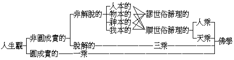



（见海刊一卷四期）



佛教的人生观



——九年十二月在汉口佛教会讲——



近来世界的人们，因为物质方面、社会方面、精神方面、经了种种变迁摇动的结果，都起了一种不知怎样生活方好的感想。换言之，即对於人们向来及现今所依居的世间，觉得无甚可靠的希望，成了一种不复能安然向下过活的情况，遂急欲觅得一安心定性的真理。因之、颇有不少的人们，便撞到佛法中来了。既撞进佛法，即可安生过活，坦然无难；但亦有因过於急迫之故，未获恰到佛法好处而偏向一边的。或习於西洋的人本个性主义、社会主义；及中华的「天地之性人为贵」、「人为万物灵长」、「人参天地化育为三才」等说，一切皆以人事为标准，唯视人世为实，除人的现实身世以外，但认为一种理想的精神世界，用为勉慰人的精神而已。故根本上超不脱人类的私见，但顺世俗及顺天魔。或习於西洋物本的自然主义、进化主义，觉得人世与人类极其微小虚渺。进观佛法，更觉得人生与蜉蝣、蛆蚁同一无丝毫价值，遂完全厌弃远离人世及人世以上的世间，务求超出有域，证取无生。故根本上仍不免心外取法的妄见，但入小乘及入外道。由偏向此二边故，虽求佛法得一安慰，终不能从容以游履大乘中道也。今欲令世人於佛法中获一适当之人生观，略论其义如下：



一、佛教一心十法界大统系中的人生观　依佛法论，可以说为无本亦无末。若云有本，心即其本，以一切不离心有。故华严云：『三界上下法，唯是一心作』。又云：『应观法界性，一切唯心造』。起信论亦云：心真如、心生灭、真如生灭唯是一心。今谓一心之本相即真如，一心之变相即生灭，真如即心之无为体，生灭即心之有为用。有为法有假相而无实体，但其业用不空，皆仗因托缘所生起成就之果。业行差别无量，故因缘差别无量；因缘差别无量，故果报差别无量；果报差别无量，故相用差别无量。然此无量差别都无自体自性，一一当体即唯心平等性。凡一一变相皆一差别，而一一差别皆是心平等性；虽实唯心平等性，而因缘所生之业果相用，实各有其差别之分位。就其业果相用之差别分位以言，故分十种法界之依正；而每一种法界依正之心平等性，实即其餘九种法界之心平等性，故一种法界可隐通潜摄其餘九种法界。虽可隐通潜摄其餘九种法界，而不失其自一种法界业果相用之差别分位。然其因缘果相之由致：一、由迷觉於心平等性之浅深；二、由所起业行染善之厚薄，遂致相用成十种胜劣麤妙之差别。兹为图示如下：



一、迷染之浅深厚薄成九法界之胜妙与麤劣——佛为不迷无恶者故。



> △菩萨法界……迷染最浅薄之最胜妙者  

> △独觉法界  

> △声闻法界  

> △天法界  

> △人法界  

> △神法界  

> △畜生法界  

> △饿鬼法界  

> △地狱法界……迷染最深厚之最麤劣者



二、觉善之浅深厚薄成九法界之胜妙与麤劣——地狱为不觉，无善者故。



> △佛法界……觉善之圆满而极胜妙者  

> △菩萨法界  

> △独觉法界  

> △声闻法界  

> △天法界  

> △人法界  

> △神法界  

> △畜生法界  

> △饿鬼法界……觉善之极微少而麤劣者



从此佛法的大系统中以观人生，以一心平等故，不应以是人故而自高，与众生平等故；亦不应以是人故而自卑，与诸佛平等故。以十法界差别故，不应以是人故而自贱，当观四恶趣而自欣故，自欣故应防退堕；亦不应以是人故而自贵，当观佛菩萨而自悲故，自悲故应求进修。换言之，即高即卑，即贵即贱，非高非卑，非贵非贱，以平等故无慕乎外，以差别故无著乎内。无外无内，无慕无著，人之法界，不可思议，此我们於佛法所得根本的人生观也。



二、三乘佛法中的人生观　以言出世三乘法之共同点，固在於总观三界、二十五有皆不免生死流转之苦，务还灭而解脱之。则一欲界中之人类，除与蚊虻阿修罗等当一般速求灭度无常之苦外，尚何人生之可观！但上三天界，下四恶趣，人独处於苦乐参半、计虑繁深之位，非没在极苦而愚瞋罔觉，亦非味著乐而痴爱难悟，故最能观察无常之理，修证无生之法。就其所最能独能者言，既生为人，不亏人理，又得闻乎佛法，更应勤修出要，以合「人身难得，佛法难闻」；「及此身不向今生度，更向何生度此身」之说。若其未获人身之众生，与虽生为人而未能得全人生之理者，亦当以人乘正法救拔之，使得跻人生之域，由人生以证无生也。故依此观之，证无生第一，得人生第二；证无生由得人生，则人生之重要可知矣！



三、大乘佛法的人生观　大乘佛法以圆觉为宗，即本性圆寂、本性菩提、无上圆寂、无上菩提之都名，而众生之如来藏，诸佛之法界身也。昔裴休序圆觉经云：『诸天耽乐，修罗逞嗔，鸟兽怀狖獝之悲，鬼狱沉幽囚之苦，其能端心虑、趋菩提者，其唯人道为能』！今更为广之曰：小乘滞空寂之境，独觉乏悲济之心，统观法界，修菩萨行、证如来果者，唯在乎人而已。伟矣哉！人生欤！美矣哉！人生欤！是大丈夫能为大事！盖圆觉之乘，不外大智慧、大慈悲之二法，而唯「人生」具兹本能。以人之生活，必待发挥才智、利用境缘而后获，故人的生活，一智的生活也。必待权藉群众、调和自他而后成，故人的生活，一仁——慈悲——的生活也。由智而仁，由仁而智，唯此仁智，是圆觉因。此仁智的圆觉之因，即大乘之习所成种性，亦即人道之正乘也。换言之，人道之正乘，即大乘之始阶也。故今提倡大乘，尤亟提倡人乘。今西洋人之文化，一析的哲学——科学的哲学——，智的生活也。古中国人之文化，一易的哲学，仁的生活也——印度人大概可说为天的生活，是受天然快乐反感无常之痛而深味禅寂求证还灭者，故与大乘之道反远——。然若非统持於大乘佛法，则西洋古今诸哲与夫老、庄、孔、孟之徒，皆不免魔外。其结果、终必趋於自私之途，而不能成就中正之人道生活。若统持之大乘佛法，则不唯即得成就中正之人道生活，且即为大乘始因之修习信心菩萨。故菩萨者，即人与佛之间之过渡阶位也。或谓：欲完好人道生活，但当由西洋文化折入中国文化，暂须排斥佛化以留待将来专作解脱人生之用，可以知其不然矣。



由上三种人生观以言：依第一观、则无可无不可而无所容於其间。依第二观、则正由有苦恼烦虑故，而可即求超脱；佛法不兴於北郁单越，而兴於五浊之南阎浮提，可知或谓佛化不能行於苦恼烦虑之现时者，此不当也。由第三观、则更当积极的发挥人之本能，致之於完全好的人道生活，而为趋入大乘行果之始因。可知或谓佛教不可提倡人乘以失佛教之真者，此不当也。而我们现今所主张提倡者，即为大乘佛法的人生观。换言之，即求完好的人道生活之实现，以为大乘之因地是也。其道为何？依大乘的圆觉心为人生的本身，用西洋析的智的文化、与中国易的仁的文化为方便善巧的工具——此析智与易仁，本为大乘法中所有者——，而免堕落於为境缘凌逼——若地狱、饿鬼——及族类残斗——若畜生、修罗——之四恶趣。亦兼用一般印度人之天的、二乘的生活，以为进行之停顿休息场；亦用天的行果以提高人的生活而辅助不堕，亦用二乘的理智以破除三界中种种天魔的、外道的、鬼神的谬执，使不为迷乱也。盖由吾观之，西洋化与中国化之好处，唯在救免人类不堕落於恶趣耳。故西洋既以人为生物进化之果，而中国亦独严人与禽兽几希之辨。然唯依大乘圆觉心为主，而统运此智的、仁的两种工具，始可保傅人生而进行不匮也。



（见海刊二卷二期）



佛教世俗谛的人生观之一



——十四年七月在庐山大林寺讲——



人生观、是观察人的价值与意义，而决定如何及如何发达人生的。古今所说，种种不同，今就佛法言之。但佛法之真谛，离名绝相，凡有言诠，尽归俗谛，故今又就佛法之世俗谛言之。真俗二谛，摄佛法藏尽。然而真不自真，假言相而彰显，是世俗谛的人生观，亦复赅佛法藏尽。佛法世俗谛的人生观，复有多种不同，今就其一以言之：



佛法分世间与出世间两种，世间的为天、人、阿修罗、地狱、鬼、畜生，出世间的为佛、菩萨、辟支、罗汉。世出世间计有十界，如是十界人为枢纽。吾先辨十界以显人能，而后定人生应抱的观念。



一、所谓世者，谓可破坏，有生灭，隐真理，性有漏，堕在其间说为世间。而堕在其间的有情有六种：前为三善，后为三恶。善道由十善业所感招者。十善，谓身三、口四、意三。身三：谓不杀、不盗、不淫；口四：谓不妄言、不绮语、不两舌、不恶口；意三：谓不贪、不瞋、不痴。能以此十善为因，则所感招者为三善；反之、则堕三恶；盖此中所说的天，包常人所说的仙与神。阿修罗、亦神之一种。此中所说的鬼，亦业力所招的业报，非通常俗人所说人死为鬼的鬼。然鬼可大分为二：一者、福德鬼，二者、饿鬼。吾人所处的世间，为苦乐参半、善恶升沉之中枢。世间六类有情，皆为因果律所支配，而能招之因即是业力。业分善恶二类，吾人一举一动，不善即恶，故逸乐的天堂善业招感，极苦的地狱恶业招感，而造作善恶业之能力，以人类为著。



二、出世间的；即超出无常、无实、非乐、非净的世间者。此有四类：一者、阿罗汉，中国翻作无生，即无烦恼生，无烦恼生即无业生，无有漏的善恶业生，即无由业所感之分段生死生。无分段生死生，则解脱无系，神通自在。诸君快求自由！快求此永久的真自由！若欲得此自由，必先求得此自由的方法。求自由的方法，即在如何断此烦恼。故烦恼的存否，即自由与不自由的关键。能断烦恼的利器，则在悟四谛与勤修圣道。二者、辟支佛，中国翻作独觉，此有二义：一、谓出於佛时，自观十二因缘而独自悟道者。二、谓纯为己利，而不能觉他人者。三者、菩萨，具云菩提萨埵，此翻觉有情，即以自己所觉者而觉人。菩萨自己所觉者，即诸法实相，此诸法实相人人本具，众生迷之而流转生死，菩萨悟之则生死圆寂。盖此诸法实相，菩萨虽悟证而未圆满，故一方修戒定慧等以自利，一方说法行施等以利他，精进六度以促进究竟佛果。四者、佛，此翻觉者，集前菩萨道中所修德行的大成。在这个地位，上天下地，唯我独尊，此为出世间的究竟者。是为出世四圣。



由上世出世间的十界，可分为二途：一种是迷罔的，也可说是流转的；一种是觉悟的，也可说是还灭的。流转即是世间六凡的往反，还灭的终极於究竟佛位。但是能趣修此究竟佛觉的，厥唯吾人类。因此出世之胜善，在极苦的三途，为苦所障，不能闻法修证。在天的为欲乐所转，虽闻而不能修。裴休云：『诸天耽乐，修罗方嗔，鬼神沉忧愁之苦，鸟兽怀狨獝之悲；整心虑，趣菩提，唯人道为能耳』。由这种种推演的论断，人为万能了。虽然，我们应持平等的态度，不可过於骄恣。近世达尔文的生存竞争，尼釆氏的超人主义，已深印世界人类的脑际。盖竞争与超人的主义，为贪、嗔、痴的策源地。骄恣起，竞争生，种种不道德的行为，继起不已：杀哪、淫哪、盗哪、两舌哪、恶言哪、绮语哪、相生相续。再推及於骄恣的动机，以昧於上述十界的分判。盖既知人类万能，固不须悲观而轻自菲薄。然吾今处世界的恶浊，溺於骄奢，与吾人现生活的不圆满，又知有出世间的清凉能消热恼，则吾人一方面应持谋世界的和平以求人间的相当生存，一方应凭特具胜相能修出世间的胜善，以期达出世间的清凉境地。斯二者、皆为人生应抱的观念，亦复为观察人生的一个结论。



三、由上观之，吾人既有出世的大自由可以获得，复有四谛、六度的方法可以修学，今得人生，岂可忽过而负已灵吗！为此、我们必要定个进取的历程，以冀不虚生为人一世。佛教有五乘法，由人天乘至佛乘，次第不紊。欲修出世的胜善，当先备人类的道德，倘人德的基础不备，则修行出世胜善，亦是空中楼阁。今讲人的道德，应作三个问题：一、何为人德？二、人德与人世及云何为出世基础？三、人德应取人世何派学术为标准？



一、所谓人德，即对於本身在日常行动中培养自己天良的心地，控御营私的兽欲，习练成淳美的德性。对於社会人群，即发为相忍、相让、相提挈、相各安其业而不侵略他人的互助公德。



二、保障社会的安宁，厥唯人德，人德的凭藉唯在公平，故公平则人德存。现生骄横霸道人多，人自相食，战争攘夺而堕落为禽兽世界生活，失去人性之生活，现在如是，后报何堪设想！所谓鬼神沉忧愁之苦，鸟兽怀狨獝之悲，出世胜善闻尚不能，何况言修！此人德非出世的基础吗？



三、人类道德，古今中外的宏哲，罔不详言。举要言之，儒家的仁义礼乐，道家的慈俭不争，耶教的博爱，希哲的中和，佛法五戒、十善，均可为人类道德的标准。但其中能型范万世者，厥维儒教的仁义礼乐，与佛法的五戒、十善。吾先言儒教的仁义礼乐与人德：儒家以仁义为本，所谓『立人之道，曰仁与义』。溯儒家仁义的动机，可对治人世的战乱，故谓：『志士仁人，无求生以害仁，有杀身以成仁』。此即相争相夺的行为可以止。又论语中颜渊问仁，子曰：『克己复礼为仁』。又曰：『一日克己复礼，天下归仁焉』。又曰：『志於道，据於德，依於仁，游於艺』，并吾人所以安身立命之具也。孔子后，儒家的嫡派为孟子，孟子第一章，梁惠王问孟子曰：何以利吾国？孟子谓：『王何必曰利？亦有仁义而已矣』。至礼乐与仁德，王介甫礼论谓：『凡为礼者，必诎其放傲之心，逆其嗜欲之性，莫不欲逸而为尊者劳，莫不欲得而为长者让……』。此为消人的骄恣。其关於节制兽欲的，则谓：『为理者，雕琢人性，矫拂其情，目虽欲之禁以度，心虽乐之节以礼……。不本其所以欲，不原其所以乐而防其所乐，是犹圈兽而不塞垣，禁其野心决江河之流而壅之以手。夫理者遏情闭欲，以义自防』。其关於世界竞争的推察，谓：『廉耻陵夷。及至世之衰，害多而才寡，事力劳而养不足，民贫苦而忿争生，是以贵礼』。由上所言，儒家仁义礼乐，足以维系人类的安宁，俾免人生的堕落，而出世的胜善，亦基础於是。虽然，以食色天性的人类，加以尼釆、达尔文的鼓吹，若无因果律的鞭辟向里，使无逃遁，必有越轨的行为；佛法的善恶因果，足以进行儒言的保障。故今虽欲行儒之行而本之於佛，而又归之於佛也。



兹再申以剀切的结论，以判世俗谛人生观之一：一、欲证出世的圣果，当修胜善。二、能修出世的胜善，唯吾人类。三、冀免人类的堕落，与求人世的和平生存，应具人德。



（满智记）（见海刊六卷八期）



人生问题之解决



——十四年十一月在帝国大学青年会讲——



今天讲的题目，是「人生问题之解决」。从来人类对於这个问题的解决方法，约有十种，现在就将这十种方法，依次说来：



第一种、就是不成问题不须解决之人生：这一种人是浑浑噩噩醉生梦死的糊涂人，对於人生是不成问题的。在他的思想上，也不知人生是怎样一回事，大家怎样生活著，他也怎样生活著，所以这种简直可以说没有思想！大凡对於人生有问题的人，平常观察世间之事物，必生出种种疑难，有了疑难，因求解决之方法；这种人既不管人生是什麼，当然对於人生无须用思想，亦无须求其解决，所以这种人，倒也不觉得什麼不安。庄子所谓「惟虫能虫，惟虫能天」，就是说：惟无知如虫，能营虫的生活；惟无知如虫，才能任其天然，别无要求。在混沌状态中的人，实与虫无异，而在平常人中，亦以这种人为最多。



第二种、就是生养死葬之解决：这种所要求解决的人生问题，就是生死二字。生的问题，就是衣、食、住，如何能得到衣，如何能得到食，如何能得到住，是他们最切要的问题。假使衣、食、住都得到了，那他们生活的问题就解决了。对於死的问题呢？死了，只要有适当的处置方法，西洋的裹尸，中国的土葬、火葬，就是这种解决死的问题的方法。这种生有以养，死有以葬，就算是人生问题之解决；在中国一般人的心理中，很多很多。一般人有了这种思想，可算对於人生问题粗枝大略的有了解决，较第一种人不知人生为何物者，已不同了。



第三种、就是立三不朽之解决：这种人更进一步了，不以生养、死葬为问题，而以如何不朽为问题了。在中国有所谓三不朽，就是：「太上立德，其次立功，其次立言」。一个人有德风布於人间，或建功立业於一国家或一民族，或有名言至理传於后代，则这个人的精神思想及姓名，后世的人就永远纪念他，崇拜他。故简单说来，三不朽即名之不朽。大概中国之士君子，都是致力於名之不朽，衣、食、住方面虽受种种痛苦，倒毫不介意；没世而名不称，倒深引为憾事，这就是所谓「君子疾没世而名不称也」。这种与前一种不同的地方，就在要留名於后世。这种人原是很好的，德、是从人的理性上发生出来的共同的有益的行为，功、是有益於一国或一民族的，名言学说也是有益於世道人心的，所以就一人讲，可以留名於后，就一国家一民族讲，也得同受其益，这就是西洋人所谓作历史的生活，有以承前，有以启后的人。但是、有人把名看得太重了，就有只求名以传后，而不问所做的事情是否正当，是否有益於国家、有利於民族了！于是「大丈夫不能留芳百世，亦当遗臭万年」的流弊来了，不能从正当路上去作立德、立功、立言之历史的生活，而从不正当的路上去作反人心、背人道的事情，以求历史之留名；而国家民族，就要深受其害了。这就是要求名之不朽之流弊。这种人的人生问题，就是留名，名留了，他的人生问题也就解决了。



第四种、就是现身快乐之解决：这是一种哲学上之人生解决，中国的杨子就是这一派；杨子的为我说，孟子曾大加痛斥。他们以为人生在世，只须求现在之快乐，有生之前、及既死之后的问题，都不必研究。即国家如何，民族如何，也不必关心它。各人求一身的快乐，为唯一的人生观。既肯定现身的快乐为无上真理，而否定现身以外的一切事情，所以就成一种学说，而视求名于后及作种种国家事业的人为苦恼、为无知了。在印度有所谓顺世外道，也就是这一派。根据了唯物论上的理由，说人生是由各种原素聚合而成的，人死了，原素散了，就一切都没有了。所以、在这种种原素聚合著而生活著的几年中，实在是一个很宝贵的时候，我们应乘此生活著的现在，力求快乐；所以现生的快乐，就是人生的解决。不过在西洋的快乐学派，也有人主张求共同之快乐的，就是在伦理上所谓求最大多数之幸福。总之、这派是根据哲学上的唯物论，以为我人生前与死后，都不必生宗教上之信仰，我人祗当力求现生之快乐，得到了现生快乐，就解决了人生问题。



第五种、就是乐天安命之解决：乐天安命，是中国儒家孔子及其弟子、对於人生思想之中心点。所谓天，质言之、就是自然。顺乎自然之性就是命，中庸上说：「天命之谓性，率性之谓道，修道之谓教」。从自然发生的，就谓之性，自然生人类，就生成人类的性，自然生禽兽，就生成禽兽的性，自然另有一种发生，就另有一种不同的性。人与万物不同之特点，就是人性，此人性是自然所特与的，人人应乐此自然所与之特性，去正大光明的做人。孟子说：「人之所以异于禽兽者几希！庶民去之，君子有之」。此人性即人所异于禽兽之一点，失乎人性，即与禽兽无异了。苟能保存此人性，就为万物之灵。宋儒每喜辨儒释异同，其实、儒家切要之点，就是保全人性，保全人性，就是保全人格，在儒家推论上，即以为无上之德性。但是如何可以保全人之特性呢？祇须将人类最高贵之德性，所谓恻隐之心，是非之心，羞恶之心，保存之，长养之，扩充之，就是乐此自然所与之特性，就是乐天安命。率此性以自行，即所谓「率性之谓道」。以之教人，即所谓「修道之谓教」。这是儒家乐天安命的人生解决。儒家与前唯物论派之现生快乐者不同，儒家对於人生原素如何，生前如何，死后如何，都不否定，亦不肯定，而只要将人类特性上之一点，保存长养而扩充之，便是圣人、贤人了。孟子称孔子为「自生民以来，未之有也」，就是乐天安命之一点。即孔子自己也说：「五十而知天命」。他知道了天命后，就各事都抱著个乐天安命的宗旨，最后做到「七十而从心所欲不逾矩」。一个人能彀乐天安命，就可以「六合之外，存而不论」。而他的精神上，自有一种无穷的浩然之气，而能做到「朝闻道，夕死可矣」。闻道后连死也不能动他的心，他的人生问题，当然解决了。现在世界上有学识、有思想的人，可说大概是第三、第四种人，若第五种真正儒家生活的人，实在也不易得了。



第六种、就是弃人取神之解决。这种人生解决，就是宗教了，像基督教、婆罗门教都是的。他们以为人之一生，在唯物论上讲起来，各种物质集合而成生命，过了几十年死了，就一切都损坏了，没有继续了。照这样看起来，人生不是完全空虚的麼？不是同机械一样的麼？刹那间又损坏而成各种小片，人生有何意义与价值呢？即有人不落空虚，立功业於一国家一民族，或有道德言行留在人间，但是追究一下，试问古来有几个永久不亡之国家与民族？并且现在科学家说，几千万年以后，宇宙必有破坏的一天；世界损坏以后，人类都亡了，还有什麼东西存在？世人一切行为，结果都是毫无意义，所以在人世上欲求永久不灭的价值，人生真实的意义，是终久得不到的。因此、宗教家就生出了宗教的说法：谓人世而外，尚有个创造万有的天神，人的祖先由他创造，一切万物都由他创造。他们既如此一肯定，遂以为天神既创造宇宙，宇宙乃实自存在，而天神常宰临之。这个天神，在印度称为梵天大神，在耶稣教称为上帝。耶教说：我们人类的祖先，是犯了罪而做人的，因此也遗传一个罪给我们，使我们不能永生长在，我们只要能潜心虔敬求上帝赦罪，则死后就可以升到天国，与神同住，我人也得永生不灭了，那就有了人生之意义与价值了。这是耶稣教、婆罗门教、回教、的人生问题之解决。



第七种、就是无为任化之解决：人生之来也无始，其去也无终，忽而生，忽而没，忽而为鬼神，种种变化无穷之状态中，我人应达观一切，任其变化，不必加以思维，不必立以标准，一切无为而为，这样人生问题就解决了。中国的庄子、列子都是这种思想。庄子说：「若人之形者，万化而未始有极也，其为乐可胜计耶」？万化无极，就是一种轮回的道理。人生现是万生无极，现在之人生，不过是广大流行中表现上之一节耳；在此一节之以前与将来，生死仍属是永久轮回的。生既如此广大，无始无终，此人生之所以最为快乐也。但庄子的思想是完全任他变化，不加思维，不立标准的。而在佛法上，则有标准，就是业与果。果由业生，业为果因。但业从心起，心可自立标准；心存善念，就造善业，结善果。因此、人欲知以前的业，就看今日的果，欲知将来的果，即看今日的业；那就是在无为任化中，也有自主之可能了。此为转化迁善之人天乘；在西洋柏拉图的学说，也有无为转化迁善之思想。



第八种、就是冥物存我之解决：冥、冥没不见也。冥没了一切外物，以存真正之我，在印度哲学中，就有这一种思想。他们以为真正的我，并不是肉体，离肉体的精神最深幽处，有个真我，这个真我，很自由，很活泼，很光明，是永生长在的。假使人的见地不够，不知有这真我，那就种种妄想，要求外物为他所用。妄想一生，要求一起，那就不好了！就有种种心理作用，种种外物的引诱了。那个真我，也就为外物所束缚住，不自由，不活泼，不光明，而造作种种业了。到后来、这个真我随著业而上下变化，那真我就完全为物所拘束了，而就失去真我了。倘使人能保存这很自由，很活泼、很光明永久长生的我，不务外求，否定万物，那就万物都归於冥，只留个单独的真正的我了；我得了解脱，人生问题也就解决了。印度的「数论派」、「尼耶也派」，都是这样的想摒弃万物，而求独存的神灵的真我之解脱的。



第九种、就是否定自我之解决：这就是佛教的小乘了。小乘由第八种冥物存我上，更进一步而主张无我，无我的我，也不是常人所说的假我，就是第八种冥物存我之我真。自我实在是没有的，不过是色，受、想、行、识五蕴之法的假相，所以小乘就否定自我。能够连自我都没有了，才是真正的解脱。若存有一个我，就有要求，就有痛苦。因为有了一个我，即我与物有界限，有了界限，则我常觉不能满足，就有要求，就不能真解脱。所以否定了自我，才是真解脱。小乘的涅槃二字，就是解脱之意。



第十种、就是正觉人生之解决：这是佛法的大乘了。人生的真相如何，能正正确确的觉悟，就谓之正觉的人生，对於以前种种不能解决的问题都解决了。现在且把它分点来讲：一、人生其实无人无生：大乘经说：「无复我相、人相、众生相、寿者相，无法相、亦无非法相」。在众因聚合的假相上，即由四大、五蕴、十二处、十八界、连续表现上，时时变化的假相上，因为思想上分别起见，故假名曰人；在人的假名之下，实际上是无人的，不过一聚变化之假相耳。至於生、其实亦是无生；生一方面对死言，一方面对灭言。然人未生时，不见其生之性，既生矣，亦不见其生之实；所以实在没有什麼叫做生死、生灭，不过在思想上起一种意义，假名此相曰生。大家称惯了，也就以为是如此的了；其实、无生之实体可得。大乘中般若经等，都是发明无人无生之义的。



二、人生缘起无性无性缘起。前条谓人生其实无人无生，此条讲人生缘起无性，看似矛盾，实则并不矛盾的。因为人的实体是没有的，不过是一种心识流行变化的幻相幻影，从幻相幻影上，缘起种种关系集合而成人，所以人生是从种种因缘而起的，人既是缘起，故无所谓生。无性即是完全没有实在之体性，人是幻相而无实体的，人生是刹那刹那变化的。我们在此刹那中，可藉一种自动力，使人生起种种变化，所以一个人存圣贤的心即成圣贤，存菩萨心即成菩萨。以心识的关系，即能将他种关系变化。人果能治理万念而彻底的如此觉悟，就可以成佛。



三、人生无始终无边中而本圆通。归纳前二种而得人生既无始终，亦无边中，不过是一种心识流行的变化。假使有了始终，即由心识流行而起之假名相，将有断绝的时候。有了边中，则重重叠叠之众多关系，将生出障碍来。所以人生只要能悟彻一切因缘，人生即本来无始无终无边无中了。一人无量，众生无量，宇宙无量，而人生能安全，能美满，能超一切时空而存在。我人有此彻底的正觉，即是成佛；舍此之外，则无所谓成佛。所以人生唯一的大路，只是成佛的正觉，也就是人生唯一的解决。只是正觉的人生，只是大乘佛法；其餘各种人生问题之解决，并不是完全的解决，只是走到半途而已。



（满智记）（见海刊六卷十二期）



佛学的人生观



——十九年新春在集美中学演讲——



余于前数年中，早已知有厦门集美学校，而来厦两次，总未遑一造参观！此次承贵校校长及诸同学之邀，得来参观贵校，及获与诸君谈话的机会，私心如何欣快！



今天与诸君所谈的，是佛学的人生观。在谈此题之先，应先问如何是人生观？人又是什麼？换言之，就是说：要知具如何的观念去做人，更应知道人在宇宙中是什麼。故讲人生观，必进言宇宙观，二者息息相关；不过宇宙观属整个的，人生观属特殊的，故人又非概与宇宙中万有相等，而具有特殊之性质，所以成为人生观。



宇宙观与人生观之区别点，可说一是自然界，一是人为界；一是共同的全体，一是具有特殊的部份。现在所要说的，就是人在宇宙中，居若何的位置？具若何的价值？以及如何做人的办法。在余观之，可得以下的诸点：



返归自然派：在此派之观念，以为凡自然的，皆具有完满的美善；人虽自然中一分，而失却完满美善者，系由人不能安於自然而妄有造作，致生出种种不自然的罪恶和痛苦，若能返归自然，则完满美善即能复现，此中国老、庄派是也。



改善人为派：此派亦以自然为美善，其不美善者，亦是由於人之行为不当而产生。然与前异者，彼则全毁弃人为，以人为皆不善，此派则谓不善固由於人为，而自然之美善，亦必假人为方完满。所谓「作之君、作之师」，以为人类之轨范，揜其不善而充其善，此派可以孔、孟为代表。



中国之老、庄与孔、孟，对於宇宙人生之观念，既如上述；然有适与此中国思想相反者，则科学是。在科学的人生观，是向自然界予取予求的以满足人之欲望；而自然界之朴素简陋，不能满足人之要求，乃发明驾驭之法，则制服利用而享受之，且加以改造以适人意，故在科学的人生观，须发展人为力而征服自然者也。



然复有神教派的人生观：此派以为宇宙间自然及人为的现象，皆恶劣而不美满，唯有此现象界所从出之本体天神、上帝为至善，此人间系由人祖造罪恶受罚而堕落所成，吾人欲得到究竟的完善，必舍离此现象人间界，而归於本体的上帝天国方可，此耶、回等神教之人生观也。



与此派意见相违者，则为进化论：进化之思想，在希腊古哲学中已具端倪，不过至十九世纪方告完成耳。此派对自然以至人为之解释，以为其原始皆非常单纯朴陋，如由浑沌而进至於万有，无机而进至於动植，猿类而进至於人类，穴居而进至於广厦，诸如此类，皆由简至繁，由恶劣而进至优良。将来之现象界，以理想推之，愈演愈优，愈进愈善，诚有方兴未艾之乐观；而与宗教派舍离现象的人间，以求返本体的天界者，大相反背，此进化论之人生观也。



以上、系述中国的儒、道和欧西的哲学，及耶、回等神教和进化论等，两两相反的人生观。今天下汹汹而大乱无已者，未始非此种相反的人生观有以致之也。以下、复介绍印度对于宇宙人生观的思想之一斑：



印度思想，亦有同於神教的梵天等派。除此之外，可摄为二类：其一解脱的：此派谓宇宙人生，根本不足耽嗜，如彼斥以自然界为美善的云：若谓现实之恶劣，系由人为所产生，然人即自然界之一分，自然界既能生产恶劣的人为，而谓须返於自然，虽返亦奚以益！至科学的放纵人欲，唯有更加痛苦而已。再如斥宗教之欲归於神的本体云：若人世是由上帝所创造，而上帝即应负完全责任，岂应任人世界堕入於恶劣！上帝既不能负完全责任，而谓上帝为毕竟的依归，此言殊成戏论。复斥进化论云：若谓自然及人为愈演愈优，愈进愈善，此乍观虽有理，然进化所依在物理基础，终归毁坏，例如地球灭时，还有什麼人类的进化可说！由是、此派对宇宙人生，乃持彻底否认的态度，既无意於人生的存在，复何有乎向自然界的要求！所以此派之主义，即在止息要求而反归各各独存的神我，以神我不受束缚而得解脱为究竟，此派可以数论及耆那教为代表也。



其二佛学的：在佛学上，又可分为二类：一、小乘的，二、大乘的。在小乘、则由批评数论等之缺点而出，如斥彼所谓解脱云者，不是究竟解脱，以所执之精神界的神我仍然存在，而现世之产生，即由神我之要求，神我存在则仍有复产生人世之日，不得谓为究竟解脱。故在小乘的意义，欲得究竟的解脱，首应否认自我的存在，而所有的但现实作用而己；无从证明离现实作用外另有我体，我体无故，能要求者则无，无要求故方得称为真的解脱。此小乘的无我解脱之人生观也。



然今天所要讲者，并不在前此之诸说，而在此大乘的人生观也。在大乘的人生观所从出的宇宙观：则以凡现实界，无论若何大小高低相差的存在，皆是因缘所生法，过去之法为现在之因，现在之法复为未来之因，上溯之无始，下推之无终，所谓无始无终。然一法之生起，又非单因之所致，而实由一一诸法息息相关的众缘所成，所谓「一即一切，一切即一」，故又无中无边。虽一刹那、一微尘之存在，其真相亦无始无终、无中无边。通常所指为某物，但和合相续之假相作用而已。且就人言：子之有父，父复有父，父父无始：子之有子，子复有子，子子无穷，是为无始无终。一人之成分，由物理的、生理的、心理的组织，乃至有血统的遗传，风俗的沿习，教育的培养，如是举一人而言，无一息而不与全人类、全宇宙吸呼相通。一人如是，人人如是，然又不得谓谁为中心，谁非中心，举一即一切，一切即摄一，是即无始无终、无中无边义；亦可是即始即终、即中即边义，即终则宇宙以吾为目的，即始则宇宙由吾而创造，即边则宇宙以吾为极轨，即中则宇宙以吾为司命。由无始终、无中边之宇宙，而观即终始、即边中之人生，遂变成极活泼自由，极圆满平等之宇宙人生矣。



从上面一段意义，而讲到应以何种观念而去做人的话，即是既知吾人是无始无终，即终即始，无中无边、即边即中的意义，同时知道现在世界之妍丑，是由过去之遗传，而现在之动作，亦必效果於来际，一人之动作固受他人环境之转移，但亦能影响为他人之环境，此吾人之言行举止，故不能不特加审慎矣。



人类果能实行大乘的人生观，则所谓世界大同、社会平等，亦即佛法上所谓无人我相的圆融法界。其世界所以有争斗者，均由各人错认其狭小的假相为我，而侵略非我、排斥非我，由是而产生出种种的冲突，是为世界人类争斗之原因。今若见缘成无我的人生真相，一切人无不与我息息相关，故一切人无不是我；我一人之举止，影响於一切人，故我一人即一切人，所谓一即一切、一切即一也。由是可结言曰：吾人之一切动作，须从利他处著想，利他即自利；一切莫向损人处进行，损人即是损己。由此、吾人之举止言行，则须消极的不害他，积极的能利他，以为善行的标准，此大乘佛学的人生观也。



上来所言各种人生观，简略已甚，然古今东西人之思想，亦粗备於是，何去何从？则在诸君自择！



（宏度记）（见海刊十一卷三期）



佛教与人生



——三十二年十一月在耒阳民众剧场讲——



我们翻遍全大藏经，没有发现佛说他自己是创造「宇宙万有」的真宰，也没有发现佛说他自己握有「赏善罚恶」的权威；相反的、佛视此类「神权思想」，直为众生心灵上底毒瘤，势非强有力的予以割治不可。当然，在佛书里面，也承认有天、有神；但若天、若神，等是「六道轮回」的苦恼众生，谁也没有如此的本领与威力！佛坦白地告诉我们：佛是从「众生本位」跳上去的，佛与众生的本质，根本就没一丝一毫的差异；只要我们众生有担当，肯奋发，谁也可以毫无遮拦地自由成佛，这实在是任何势力阻塞不了的！众生底命运，完全紧捏在众生自己底手头；佛只是从实践生活里澈底悟透了「宇宙真理」的一位圣哲，他只能启发我们，引导我们，使我们逐渐适应真理，大家和谐地创辟自由、幸福、安乐的世界。但「公修公得，婆修婆得」，假使我们自己不肯向上奋发，则佛对我们也没办法。因此、一般宗教，都有他自己虔诚崇奉的天神——用自己想像雕刻出来等於特殊阶级的天神；佛则要一切众生绝对信任自己，不要埋没自己的性灵！故我们对佛与天神，也绝对不能夹缠不清，糊乱的混成一气！而且、我们必需有了这点基本认识，才能避开习俗流弊，而将佛法应用到日常生活上去。可惜，可惜许多诋毁和信仰佛教的人，对这点似乎都未有弄清，真是一大憾事！佛教，就是世尊根据自己证悟而施设的特殊教育，亦即佛学、佛法。但习俗偶闻谈到佛法，总嫌虚玄、高远、神秘莫测，是不切实用的，与己无分的。其实、这都同神佛夹杂不清一样的错误。六祖说：「佛法在世间，不离世间觉」。金刚经说：「如来说一切法皆是佛法」。故从来高僧大德，几莫不有勗勉众生，要向应缘接物的日用生活上去觅佛法实益的。「死水不藏龙」；「佛常在众生六根门头放光动地」。试想这是多麼直捷了当的言句！独惜现成明珠，众生不知自从衣底翻取出来享用罢了。为证此意，愿更略拈一二佛理，以供诸君抉择：



一、佛说现实事物，都是「因」、「缘」会合而有的。如借用科学底语气来说，举凡自然、社会现象，都有它自己底来龙去脉，谁都逃不了因果则律，决定不能凭空跳出来，也决定不会突然声形俱渺，宣告失踪。不过、「因缘」、「因果」二词，涵义略别，就因果说：现实事物，皆可名果；至能构成每一现实事物底因素，则名之曰因。但任何事物底生起，都不是单一性的因素所能包办得了，故佛法又於繁复因素，详加分析，将能构成现实事物底主要成分，名之曰因；构成现实事物的协助成分，名之曰缘。举例言之；植物自种，望於自家所生起的植物，则应名因；他如土壤、水分、热力等，都能协助植物自种而使之长出欣欣向荣的植物来，故应名缘。又如已经实现的抗战胜利，是我们全民族团结、统一、奋斗、牺牲所获取的，此实为主要条件，故应名因；至如盟邦同情援助，以及日人自己因憎厌军阀黩武而起的反抗行动，虽亦或多或少有裨抗战，但我们绝对不能视为获取胜利的主要力量，而只能当作一种助缘，故应名缘。现在我们纵目所视，举手所指，小而尘芥，大而宇宙，几乎全盘都是因缘会合而有的。现实事物底出生、扩展、变化与消失，亦几乎莫不完全决定於它自身之因缘。在因缘背后，绝对没有什麼冥冥中的主宰，能够妄用特殊权力加以操纵、干预。我们真要改变个人，或者群众底生活，也只有蓦直向它底根柢——因缘去做工夫。我们不能屈服神权，也不能委命自然；我们要信任自己的力量，识清因缘的条件，而去实际发挥自己底权能。这是虚玄、高远、神秘莫测的理论？还是从日常生活上能够触处省悟、随时应用的事实呢？这、诸位最好自己去下一个精确的断判！还有，我们说因说缘，或说为果，都是观察者从事物关系上创制出来的一个名词，我们决定不能机械地硬执某事为因，某事为缘，或硬执某物某物为果，因为现实事物生灭变化，靡不有待於其自身所需要的因缘，事事物物俱得名果。但正当为果的事物，既与餘诸事物不能完全断绝关系：在时空上，於餘事物，或多或少也能给与适当影响，故我们另从一角度观察，这正当为果的事物，於餘事物同时亦可作因作缘。故我们要精微剖析，灵活运用，断不能将繁纷综错的事物关系，过於看呆。



二、佛说因缘和合之事物，当体就是「空」的。但世俗闻空，即硬执别有一空；世俗闻有，又硬执别有一有。不知曰空、曰有，皆是附丽事物上的形容词，而决非诠表事物的名词。因在活泼泼地现实事物上头，本自玲珑，具有空、有两面；而这空、有两面，实非离开事物而能存在。故前言「当体」二字，异常吃紧。明乎此，则言空、言有，实自相融相成，即尽十方诸佛神力，恐亦劈不开。拨空执有，固将为有压毙；拨有执空，亦将为空活埋。惟事物实有，众所共喻；贸然言空，不能不略加诠释：应知现实事物的彼此关系，本自异常紧密，而绝对割裂不了的，本自脉络贯通、普融普摄的。如我们自家情见作梗，不能顺应这实际真理好好地活下去，偏要兀自划出鸿沟，筑成壁垒，分人分我，争强争弱，简直闹得乌烟瘴气，糊涂一塌，就是连作梦也难得片刻宁静，还要在那儿胡天胡帝，歌哭无常。佛法说空，就是想将我们从这自掘的坟墓里面拖起来，庶能海阔天空，自由飞翔。试思因缘和合的现实事物，就时间上说：无常绵密变化，推陈出新，相似相续，刹那不住，我们实前前莫测其端，后后难竟其续，如何能容我们横截片段，强执某也实人，某也实我，某也实心，某也实物！就空间上说：现实事物，既彼此脉络贯通，相倚相伏，而绝对不能孤独地存在；内觅莫得其朕，外扪罔穷其际，如何又容我们剔出寸肤，强谓某实人也，某实我也，某实心也，某实物也！何况人、我、心、物诸名，纯出意想构畫，实非事物本所具有，纵有巧运语文之士，亦有时自丧难於圆转自如，曲尽物态。循名求实，几类隔靴搔痒，试痒又如何搔得著啊！善达因缘生法，自性空寂，此实十方三世诸佛大解脱门；只要能问这不执药成病，死在言句底下，将见我辈历劫受用不尽。世俗偶闻佛说法空，辄哗然轩笑，妄以什麼悲观、厌世的恶名，强压佛法头上；东行西向，直不知错到那里去了。



三、佛说现实事物，等是圆融无碍的。虽说我们为了观察、研究，或者实际上的应用，很可以运用我们的智慧，拿事物个别区划起来，而一一赋予特定的名称，但因缘和合的现实事物，毕竟呼吸相通、搏脉相贯的，毕竟是交相渗透，交相涵摄的；毕竟是不能因为我们主观底方便区划就顿时隔绝关系，断塞影响，而真能僵直的个别孤立起来的。前言因缘性空，是要我们填平鸿沟，撤除壁垒，不要将自己埋到自己掘发的坟墓内；现言圆融无碍，是要我们从一切众生上面，摸到自己的鼻头。在自己的一一毛孔，嗅著众生底气息，彻悟我与众生，原本是痛痒相关的，原本应当共存共荣的！法法绝待，法法平等清净，法法圆具无上功德。因之随拈一法，无不直具佛法底全体大用，这一点也没有神秘，只要我们自己当下直观领取罢了。现在因为时间的关系，我们对於佛法，只能描畫这样的粗疏轮廓。再谈人生：



一般的讲，人、就是世界上底人；生、就是生命、生活，人生、就是每个人对於生活所应禀持的态度。但是许多人对於生活，多半是不能或者不肯运用自己底思想，将自己生活好好地审顾一下，便依之采取一种适宜的态度；因此、自己生活几乎全是因袭的，被动的，由於社会上风俗习惯与国家底政治、法律融凝铸成的模型印出来的。这，也无妨说是没有态度的。固然，只要一个肯用思想的人，对自己生活必有个趋向，能够自成一家学说以求取世人信仰的；对於人生态度，当然更会涂上鲜明的彩色。这，不是我们短时间内列举得出的。现在，我只能就影响我们现代生活最大的唯物论者来同佛法略加比较：唯物论者肯定人是高等动物，是由低级生物逐渐进化来的；生命，也只是透明的胶质溶液，也只是生殖细胞的演化，而且生物与非生物是有著极大区别的。人生活动，只是祖先遗传的重奏，只是环境刺激的机械反射。生存竞争，更是天演公例，更是自然界的惨酷事实。我们要维持这傀儡式的生活，也只有奋勇的混杀上去。基於这种生存竞争的观点，更疯狂的歌颂权力意志，而诬蔑道德只是弱者用以系缚强者一条缰勒，否定了人类优秀的理性，绞杀了人类的责任观念；所有将人类推堕到战争血泊里的法西斯主义者，我们很可以说是从这气氛里孕育出来的。他们用所谓「满足自然愿望」，掩饰自己底侵略的罪行；他们用「优异民族」的骗诳，煽动或鞭箠良善人民葬身炮火。这是我们目睹的事实。我们真想人类破除偏私，诚信相与，我们先就要扫荡这种危险思想，跳出这种危险思想。我敢说，佛法实在是人类的救星；最低限度，佛法值得我们在日常生活上借镜的。佛法说人，只是他过去五戒、十善所招感的一种业果，绝对不是固定的。只要他能站在真理立场，为众生的幸福精进奋发，那末，他就与众生底生命统一了，无妨高视阔步，跨入佛、菩萨底领域。假定硬要强生分别，不能从臭皮囊里透脱出来，将又凭他自己底善恶轻重，依然六道轮转，永无了期。即心见物，即物见心，也绝对没有生物与非生物的差别。生命、是一空洞的抽象名词，也是普遍潜在宇宙万有里面底闪灿灵光。假使法西斯主义者，造下了这滔天的罪恶，也是一死了事，这人间就太不公平。而且根据物竞天择的公例来讲，正是他当仁不让，不肯辜负他自己底天赋权力，用不著他自己良心上的负疚。而且、我们申张正义，奋力诛讨，似亦未免近於庸人自扰。我们肯甘心这样想吗？我们现在蹲著的大地，果真就是命定的血腥战场，永远没有涤荡的机会吗？否则、我说佛法在我们日常生活上，最低都有一种参考价值。最后、我要结论到佛教与人生的关系：



根据佛教第一点的因缘观，不但可以使人生从神权统治的黑暗世界解放出来，而且可以认定自己面前世界，法尔条理井然而不是乱杂无章的，才能安心生活，才能使奋斗得著一个趋向，才能不将「自然」二字看得太呆，而又使自己跌入木偶生活。根据佛教第二点的因缘性空观，人生才可以将自我灵活放大，庶几与物触处无碍，而真能昂首天外，大来大往。根据佛教第三点的圆融无碍观，将於现实事物关系更见紧密，事物价值，更见胜妙。腐朽神奇，弹指顿化，反视终日等量计较作茧自缚之生活，虽霄壤不足以喻其悬隔矣！记住吧！佛是从众生本位跳上去的，我们当下谁都具备有成佛的资格。



（明真记）（见海刊二十卷九、十期）



身命观与人生观



——十七年十一月在德国福朗福特大学讲稿——



一　宇宙之身命观



二　死身命与活身



三　活身命之原理



四　活身命之究竟



五　身命之人生观



六　敌人生与仁人生



七　仁人生之原理



八　仁人生之究竟



一　宇宙之身命观



流行在各民族之佛学，虽有多种之派别，但从其最普通最根本之原理观之，对於一切存在之事物，殆无不公认是身命者。身者，各因众缘之多法组织；命者，前灭后生之一系联续。一系联续之趋势有穷，此穷而彼达，故见新旧代谢。多法组合之集团可散，彼散而此聚，故见离奇变化。统计一切事物曰宇宙，分析宇宙一切云事物。宇宙事物皆是一一身命，故无不在离奇变化之此彼聚散团体中，亦无不在新陈代谢之此穷彼达势限中。为证斯义，请徵其实。



经长、广、厚、久之四度，以成为吾人之宇宙。一度之前有零点，四度之后有五度，以至无数度。有不知时间，而仅知长、广、厚者；有不知厚而仅知长、广者。在仅知长、广者之宇宙中，则吾人之零点亦成为其一度，故零点无自性，小而又小，其小无穷。在能知八度者之宇宙中，则吾人之宇宙，亦成为其零点；故宇宙无自性，大而又大，其大无穷。则小至於零点，亦合多法组成；而大至於宇宙，皆续一系联现。故知凡存在之形数，莫非身命，此可徵之数理学者。由一恒星系以积至星海，由一原子量以析至电子，各无实有之自性，故无非多法之因缘组合；各无常定之自相，故无非一系之生灭联续；且皆可见其团体聚散，与势现穷达之现象。故知凡存在之物质，莫非身命，此可徵之物理学者。近若吾人，远若恐龙，微若细胞，鉅若大树，皆各因众缘之多法组合以成，及前灭后生之一系联续而现。由陈谢新代，可观其势之穷达；由离奇变化，可察其集团之聚散。故至於每一生物之为一身命，益显然彰著矣，此可徵之生物学者。藉其自种子为因，与空、明、根、境等以为缘，更有其相应相合诸心所有法与之俱起，种灭现生，种生现谢，复经多刹那之现行生灭相似相续，如是等多法之集团与一系之趋势，乃为吾人所认识之一瞥视觉。一视觉然，一耳觉以至一意觉亦然。故知每一心行——格式派心理学每持此说——莫非是一身命，此可徵之心理学者。一家属也，一教团也，一职社也，一学会也，一政党也，一民族也，一国群也，一人世也，无非是多数分子之组合，无不有一宗历史之联续。以此离彼续而呈彼此之奇变，此陈彼谢而成彼此之新代。故每一人群以及一动物群之伦理群事，莫非是一身命，此可徵之社会学者。



此物理、生理、心理、伦理之四界，可以穷现实之所有而无遗矣。既然一一皆是身命，且非唯一之一身命，而为多一互涉相关之多身命，亦可徵知之矣。犹未明虽同是身命而有高下之程度，及身命代谢变化之发动力何在耶？第群伦事业之身命，乃依生物中动物或人类之身命而成；而物理身命与心理身命，亦各唯充足身命之一分，未完备一切身命之蕴素。虽在生物中之植物，犹缺心识情意，故完备一切生物之蕴素者，始于动物，但其功能尚多蕴潜未显。故以言充足之身命，在地球之一切身命中则唯人，在统计一切身命之宇宙中则为佛。人者充足身命之萌芽，佛者充足身命之完成。由人到佛所经历之过程，犹有多级，斯可略知身命高下之程度矣。



蠢动含灵之类——动物——各有身命，皆为完备一切身命蕴素之身命。以各身命皆各含有一切潜能——一切种——之阿赖耶，依恒续之现行，有统持之功力，发能觉之心意，趋进善之转化。故动物之官体，与非动物之植矿，以至统计一切事物所谓宇宙，无不以各动物各有之能摄藏阿赖耶，及能刱造之根识互涉相关，以为代谢变化之发动力。一恒星系有住、坏、空、成之代谢，则无数阿赖耶根识为发动力之共果也。一动物流有本、死、中、生之变化，则各自阿赖耶识为发动力之别果也。斯可略知一切身命代谢变化之发动力何在矣。



二　死身命与活身命



夫现实之一切，皆是身命，既经证知，则现实之身命以外，有非身命者以为现实身命所从出之处乎？现实之身命，更无以外之身命者，今此一切身命皆无始起之期！无始起故，亦无终尽，无始无终，常在活泼之代谢变化中。故凡是身命，皆永是活身命。



如曰：一切现实身命别有非身命者，以为其从出处，则其所别有之非身命者，即为绝异於徵验可知之现实界；别是一非因缘组合及灭生联续之死体。此之死体，不论或唯一个，或有多个，或名曰神，或名曰物，或名曰心，要皆为固定之死体。从此非身命之死体，如何得成代谢变化之活身命，已为理论之所不通。纵令如一神论者，或原子论等之说，可由彼死体之一神，或多原子，造作出或结合成此现实界之一切活身命。然今此现实界之活身命，既有其刱始之期，亦应有其终尽之日。未创始时固死体，已终尽时仍为死体，始於死体，终於死体，则今此现实界之活生命，虽在若干时中为活身命，原始要终固皆必为死体。且在若干时为活生命之期内，亦仍以彼死体为其实质，死体为其实质，而活生命但为幻相，如是一切身命终必为死体，故活生命但为暂时幻相，故虽其为活生命时亦变为死体，故凡身命皆永是死身命。



佛家大乘哲学，无论空宗、有宗，皆主张凡身命永是无始无终活身命者，故对於唯神论、唯物论、唯我论、唯心论等，主张一切活身命始终於死体，而以死体为实质之死身命说，皆在破除之例。小乘但破动物各自之实我执，及唯神等之邪因执，犹有普遍之事物实我执，故亦为大乘之所破。大乘於实我、实体之二执，尽皆破除。故佛家大乘哲学主张：现实身命，彻始彻终、彻边彻中、皆是活身命。



三　活身命之原理



无始有代谢变化之种种潜能——一切种、摄藏於各各无始恒转之阿赖耶识，且为所餘一切无始现行而代谢变化之心识等法不断熏习，使之或增长、或减消、或新生、或永断、或显起、或隐伏、或优强、或劣弱，以此而有无数无数组合联续之各身命，互相且永远活泼泼新陈代谢离奇变化——无著系之大乘哲学作如是说。复次、此一切活泼之身命，皆因缘所成，生灭无住，故皆空无常之实体；所谓物身命、心身命、以至人身命、社会身命等，皆是依因缘组合、生灭联续之假相，立为假名以便称谓而已。即此假名空无实体，即彼空无立为假名，空假不二，假空一致，由非空非假即空即假之中立，以观一切现实活身命之真相，除此之外别无真相之可观察——龙树系之大乘哲学作如是说。总此大乘哲学之识现观与中观之二观，可以知活身命之原理矣。



四　活身命之究竟



一切身命，皆是究竟皆活而无死者，然今此现实界之一切身命，发现有二种死：一、粗显之心象物象，为组联之一生一生分段死。如动物身命之丧亡，及植矿身命之枯坏。其微隐之心法、色法；虽仍合续流行，而非人目所能见及。由是或云：动物身命一死永死，器物亦一坏永灭，成为断执。或云：动物别有一不变不灭之实我，主贯於生死死生之间；或别有不变不灭之一神或多质，主贯於成坏坏成间，成为常执。秉兹或断或常之二遍执，於各身命互相起诸扰害。二、隐显诸心象物象，恒联续之一层一层变易死：如矿质动类之演化，及凡圣地之转进，胜之者存，败之者亡，遂有优强善净等与劣弱恶染等相限碍，不能圆通遍达。因分段死不得自由，因变易死不得平等。然此不自由平等之二死，非一切活身命之真相，但因人等一切活身命，向来未遍知一切活生命之真相，误於一切身命或一切身命中之一分，执为普遍之实体，於是成为境界碍——所知障——之不平等之变易死。误於动物身命，或身命动物中一分，执为各自之实我，於是成为扰害事——烦恼障——之不自由分段死。为一切活身命之真相，而究竟唯活无死，则当以善行静虑，增生清净之智慧，周观深察以明证於一切活身命之真相。见其皆是因缘集成，生灭无住，性空假中，相唯识现，择灭向来误解是实我实体之二执，二执除故二障永断，二障断故二死永除，此之择灭曰大涅槃。由智择二执、二障、二死皆灭故，於是遂实现一切为自由、平等之活身命真相用，曰大菩提。得大涅槃及大菩提，尽未来际，为一切活身命，除妄死而成真活者，谓之佛陀。故佛陀为活身命之究竟，其究竟之身命，即是法身慧命。小乘以择灭烦恼障、分段死为涅槃，住於择所成灭，犹非究竟。其餘学说宗教之窜扰二执、二障、二死间者，更非究竟可知。



五　身命之人生观



人者、一切身命中之一类身命，且为各身命类中之充分身命。人生者，人类在生存中能作所作之生活。人生观者，审量人生是何意义，及权衡人生有何价值之察观。故人者，一切身命之枢纽，数理、心理，得人进致於高度；论理、伦理，得人而发现其大用；物理、生理之身命，得人而进为多式多样之变化。纵肉欲而向旁争逐，可为杀人之魔鬼，以至於畜生；尊德而向上精进，可为超人之圣者，以至於成佛。人之一生，虽为多法组合一系联续之身命之短期表现，然得此短期表现之结果，溯其自发之因，既累积而无极，观其互藉之缘，亦展转而无际。从此短期表现所成行事，究其出生之本，固周流而不居，诘其引致之果，尤远及而不穷。然人生与一切身命，同为多法组合一系联续之事，同受趋势穷达之新陈代谢，与集团聚散之离奇变化所支配。各别活动则各有独特之功用，互相增上则互有资助之关系，虽无特定之因，亦无突有之果。各由决定於适当之因缘，乃成适当之果实，故亦不应对一切其餘身命有所骄傲。



要之、人生者，备有可大可久之性能，然未为既大既久之事实，故当以仁心为致善之德根，以智行为达真之道器，乃能观察且明证一切身命之真相，成正遍之知觉，调洽且发挥一切身命之善力，得圆满之安乐。人必如此，乃不虚生；否则、不惟辜负人生，抑且将斲丧人生矣。



六　敌人生与仁人生



未观一切皆为身命与身命之真相，则不知人为何等之身命，及人生之正谊。於是、谬执其表现之人身生命、或人身命之一分为各自之实我，而环伺於自我之周围者，则皆视为自我之敌。其为自我所能征服者，则征服而役用之；其不能为自我所征服者，则恒处敌对之形势，而每以战争求胜负存亡之解决。其可为自我相助以共求私利、共御大敌者，则申盟誓，订契约，以协合为共遵从、共行动之团体。以协助为手段而有团体，以竞争为目的而常敌对，复以盟约难期必信，须藉无上权威以为强制行使之保任，於是认有全宇宙创造主宰之大神，形成全国民主权化身之元首。徵之历史，自禽兽为敌之初人，至国族为敌之今人，殆犹为在环敌中以战争求生活之人生观所支配，而未能有其改善之道也。近世倡说优胜劣败、强存弱亡，以竞争为进化之母，弥增惨烈，此即前所谓辜负人生而且斲丧人生者。人生若此，不其大可哀乎！



然察知一切皆身命与身命之真相，而可达人生为何等之身命，及人生之正谊，则敌斗之人生观，殊有大谬不然者。夫经一最暂时间之身命，皆前无始而后无终者也。占一最小空间之身命，亦皆外无边而内无中者也。虽各因之殊致，实众缘之遍通，故一切之身命，皆於活泼流行之互相关涉中，组合而生，联续而存，由趋势之穷达而代谢，由集团之聚散而变化。一切身命既然，而人类之充足身命，尤为积集一切身命之缘所成，更能为发生一切身命之缘者。众缘所成故无小我，能为众缘故有大仁。仁者、自他互通，一多相遍之和德也。人类於此和德中而生存代变，故人偶人则道并行而不相悖，人偶物则万物并育而不相害，惟见有声应气求之朋侣，而不见你争我杀之怨对，故曰：「仁者无敌」。是谓仁人生，亦为人生之正谊。而有时不免冲突斗争者，要非人生所应有之常德，不过、仁人生犹未臻健全，有时乃现此毗寒毗热、药病攻伐之态耳。



七　仁人生之原理



考人之得生也，凭一流之先业，引俱转之恒行，揽两亲之遗液，起三缘之结生，此其组合而乍生为人之无敌唯仁也。继而藏种之集起於识心根尘，母体之长养於骨肉脏脑，如是组合联续，乃有胚胎位之生存。继而离母胞以触环境，资母乳以受群育，如此组合联续，乃有婴孩位之生存。继而父兄、师友，宇宙文物以启其心知，天地动植、衣食住行以滋其体气，亲族、学校、社会、国家、以达其事行，如此组合联续乃有儿童位、青春位、壮成位之生存。至是屹然能立，始发生自我之意识，乃反为认执为多法组合一系联续之身命为自我，分割所餘本来互资相助之一切为非我之物，横与之敌对而角斗，宁不悖哉！还众缘於众缘，则此身命本无自存之实我；观身命为身命，则此人生唯有遍通之真仁。居心不仁，则父子兄弟可以成异国；居心而仁，则天地人物皆可为同体。故不仁则遽生荆棘於坦途，众苦交逼；仁则化天戈为玉帛，安乐无忧。故仁者、人生之原理，人生者、仁德之象徵；必仁而后有人生意义，必达仁之究竟，而后有人生不磨之价值。



八　仁人生之究竟



由一切之存在，本为一一之活身命，诸法无特定之实体，动物无各自之实我，故人生亦以缘起无碍为真相，天地与人并生，万物与人为一。人是天地万物并生为一者，故人非人而即天地万物，天地万物非天地万物而唯是人；如此互通相遍，故人生之真相本仁。然以人心向来未觉此真相，故於物执特定之实体，成诸限碍，於人执各自之实我，起诸扰害，遂违仁而成敌。今欲空人生之幻敌而达於真仁之究竟，当启发人心之净慧，破我执及法执，明证人生本仁而无敌之真相，智仁圆合乃即人而成佛。故佛者，即仁人之究竟。



由人以至佛之历程，第一、为研究佛陀之哲学，由了解而进为信行。第二、为实践行十善之人伦道德，以为定慧之基。第三、习超人之定慧，经三十贤位而趋於十圣。第四、直依圣贤明证之真仁广行，到达究竟之众善。第五、圆成佛智，达於仁人之究竟，遍十方界，尽未来际，唯利济人世与众生界为事。佛为适应印度思想，说小乘法，虽非究竟，然亦为先破人我执之一方便，故大乘亦用而不废。中国孔子及欧洲康德等之哲学，为具体而微之大乘哲学，且为践行人伦道德之十善者，故亦为由人至佛之初步。



佛学为说明一切事物真相之真理；凡是真理，皆为佛学之所容纳，故愿求真理者，皆来为互相之研究，勿为流行於各方、各族、各文语、各习俗之佛学派别所拘碍，亦勿为任何宗教学说之成见所囚缚。故予曾有世界佛学院之发起，希世界学者加之意焉。



（见海潮音第九年第十二期）



从无我唯心的宇宙观到平等自由的人生观



——十九年新春在泉州民众欢迎会讲——



讲到佛学，它的范围非常大，所谓三藏、十二部，不知从那里讲起。我们就把今天委员会——民众欢迎委员会——所发的宣言里的「无我」、「唯心」来谈谈吧。



怎样叫无我　一般人所认为我的，就是各个人的自身，假使这个我没有了，那不是连各个人的身体都没有吗？故佛学所提出无我的问题，同一般人的常识是相反的。佛学所讲的无我，是很深、很有意义，合於科学而且是事实的。根据佛学或科学的无我，来推究一般人所认为自我的，到底是指什麼东西呢，这样一推究，一般人常识所认为自我的就动摇了。例如我们去问他——一般的人——以什麼为自我？他就用指指自己的鼻子，意思就是认这个身体为自我，鼻子是作全身的代表罢了。执定这身体为自我的，依科学和佛学的实验观察来解剖一下，如次：



依科学的生理学来讲：这一般人所认为自我的身体，不过是脏腑、肝、肺、骨骼、筋肉、呼吸、血液……各机关所构成功的集合体。这许多集合的机关，也是由无数的一个一个细胞组合的各一部分的小集团。把这个整个的身体来观察，乃是一个很大的、很复杂的小集团所构成大团体罢了。这个团体不是固定的，它的本身时时刻刻地把这团体以外的东西吸收进来，溶化成为团体里头的成分；同时在这团体里头的成分，被排泄出去变成非自身团体的东西了。依物理化学来讲：各个人的身体，乃是由十四种原素所组成的，无论什麼人的身体，没有单元变成的。依佛学来讲：是地、水、火、风四大所假合的。而平常人执定自我的身，依化学及佛学的四大眼光来观察，无非是各种原素集成，没有固定自体的东西。



再为稍详细的说：如我们身体上所发生的呼吸，这口气未呼出去的时候，是自身里头的东西；一呼出去的时候，变成自身以外的东西了。假使认呼吸为自我，那末这个自我就忽焉在内，忽焉在外了——。而且一呼一吸，前后相续，没有一口呼吸的气是相同的；那末、不是更为无数的我吗？再说生理机关所组成的血液细胞，本来生长在身体以外的一切营养料，被我吃进之后，经了胃肠化学的作用，不适宜的渣滓，排泄出去，适宜的变成为自己的血液细胞了。成了细胞以后，又不是一成不变的。依生理学上的说明：经过六七日，全身的细胞已统统改换过。假使认全身的细胞为自我，前一刹那为自我时，次一刹那就被排泄出去成为非我了。平常不承认为自我的营养料，一经吸收变成血液的时候，又成为自我了。这样、自我的忽成为非我，非我的忽成为自我，在这些我与非我之间，实不能指定那一种为自我。



依化学原理来讲：人体是十四种原素所组成的，但觉得太专门了，还是应用佛学所讲的地、水、火、风来说。怎样叫地？凡是全身的固体，如毛、发、爪、齿、骨骼等。水呢？凡是周流全身的液体，如汗、血、涕、泪、唾、便等。怎样叫火呢？即是全身的体温热度等。风呢？就是屈、伸、出、入的运动、呼吸等是。倘是固执地为自我，则墙壁瓦砾等凡是固体的东西都为自我了，那自我是不局于渺小的一身了；倘执水为自我，那末洛阳江的水，和洛阳江以外的海洋的液体都为自我了；执风、执火为自我时，除身以外的吹动的风和温热的火，也都为自我了。其实、一般的人是不承认这些为自我的。这真觉得奇怪！因为、身上的地等，与身外的地等，本没有什麼区别的，在这没区别中，却强生自我与非我的分别固执！试将我们全身的固体的地还与地大；液体的水还与水大；呼吸的风还与风大；温热的火还与火大；这个自我究竟在那儿呢？所以、一般人认为自我的，不过是常识上的根本谬误。一经科学与最浅近的佛学推究，便不成立了。



进一步来讲：曾经过一番推论的哲学知识上所认为自我的，这自我不是物质的而是精神的，或叫灵魂。但我们也可审问他：你所认为棈神的自我，所指的是什麼东西？假定他这样的说：倘使没有精神的我，谁来感觉苦痛和快乐啊？这样、我们来考察他所谓苦痛快乐的感觉，不过是心理的现象，没有苦乐后面特有的自我；所以苦乐的感觉，就是苦乐的感觉。但有些人说：能知道这苦乐感觉的为自我，我们不妨也作再进一层的考察：这能知道苦或乐的，乃是知识，知识亦是心理的一部分作用，知识后面没有什麼自我的存在。又有些人说：自我是能行善行恶的行为，人生的行为既有善有恶，故必有一个自我。其实、行善行恶的行为是有的，而在行为的后面，主持行为的自我是没有的。所以哲学上所指的精神、自我、或灵魂等，都是没有的。以佛学来分析，就是五蕴中的受、想、行、识；在科学的心理学上来解，唯有心理现象的感觉、感情，以及知识的判断，意志的作用等等而已。



照上面的推论，一般人所认为的自我，和哲学知识论上所认为的自我，在佛学的眼光来观察，不过是地等四大色法的变动，与受、想、行、识心法的作用。用科学的方法去实验，不过是物理、生理、心理三种的现象。无论依佛学或科学的说法，这些物质的或精神的东西，在时间上讲：时时刻刻地新的生起、旧的灭去，转眼间全身全宇宙都重新变换过了。换句话讲：没有一个东西能占两个刹那以上的；不过这新旧变换前后相续罢了。在空间上讲：这个单位的个体和其他的单位个体，时时刻刻地发生吸力和抗力的作用，由吸力的作用，故和其他的个体聚合拢来组织成为一个团体；同时因抗力的作用，又把其他的团体，或被其他的集团分散开来。这一聚一散的前灭后生，就是五蕴诸法离合的变化作用而已。所以、彼此此彼，事实上是互相通变的，所谓「天地一体，万物同根」。平常人没有这觉悟的能力，误认自己几十年的相续，以为是个固定的自我，那里知道这几十年相续，不过同长片的电影很迅速的纵逝与前后相持的连续，不知者以为是完整一个的活动！我们的人生，在这个大宇宙的幕上，不过呈其五蕴生灭幻影的连续，或物理的、生理的、心理的现象聚散变换而已，自我到底躲在那里呢？



怎样叫唯心　五蕴生灭幻影连续的人生，物理、生理、心理现象聚散变换的人生，究竟能使之连续，能使之聚散变换，这伟大的权力，操在什麼高能的手中呢？这里要注意！这伟大的权力，是不离开生物以外的什麼神或超越的东西；乃就是我们心理作用的活动力，是感觉、感情、意志、知识的集团所发生的活动力，能够把生灭的东西连续起来，聚合的使之分散，分散的使之聚合。宇宙万有的成坏变换动力的来源，都是依著心理作用为中心点，为出发点，为归宿点，这就叫作一切法唯心。有些人一听到心的名辞，就联想到我，以为心就是我的别名。其实是不然的，所以说之为心者，是指苦乐的受用，爱憎的感情，善恶的意志……这些集合起来共同出发的力量而言。不但各个人的自心的集团的力量不能分开，就彼人与此人之心理作用的力量，也不能绝对的分开。所谓「一人向隅，举坐为之不欢」；可见人与人之间心的作用，原是相通相应。再引用一句古话来讲：就是「人同此心，心同此理」；没有空间把它隔住，就是这一刹那心起来，其来源很久，其影响於将来也是很长。故我们一起心动念之间，没空间、没时间地普遍的影响到宇宙大集团的全体，各个的单位的一切。换言之，其他各个人们或生物的心理力量，也同我们一样的伟大。故这大宇宙间的一切生物，一刹那一刹那的心，虽各各的尽管不同，而却各各都互有相感相应的，没有滞呆固定的，故可以叫之为无我的唯心，或唯心的无我。



从无我而唯心的理说来，对於唯心的问题，还要特别提出来讲一下：例如上面所讲的无我，是事实祇有物理的、生理的、心理的现象存在；而唯心，似乎祇有讲到心的现象。在这、是有两重的理由：其一、现象就彼此生灭的变化，其变化上虽有物理的、生理的、心理的现象不同，其变化的原动力都从心理的活动出发的，故物理、生理的活动，是跟著心理的活动而活动。其二、现在我们在学问知识上所认为一切事实现象的存在，皆是存在知识中的。知识、不是刚才说过是心理现象的一部分吗？故物理、生理的存在，也都存在在心理上。由上面的两种理由，故谈唯心，并不否认物理与生理，不过物理、生理都是心理的而已。



上讲无我唯心的原理，即是一种无我唯心的宇宙观，拿这种宇宙观的原理应用到人生实际的行为，有什麼意义与价值呢？根据无我原理，应用到人生，就见到人生是最平等了。因为、一方固知道无我，同时、又於各各假定的自身与自心，都彼此相通相应，互相变化、聚合、离散、生灭相续的，由此故能成立为平等的人生观。社会所以有不平等的发生，就限定一个自我范围，除自我外的为非我，於是将自我抬高，把非我的压伏下去，就形成了个人、家庭、国家、社会、种族等的不平等。与自我直接或间接的有利益的，把它抬高；非自我或与我有违损的，一起压伏下去，由此产生种种争斗。倘使全世界的人们，都能了达人生无我的原理，这抬高和压伏的恶剧，就不会在人类的舞台开演了。这是从无我的宇宙观到平等的人生观。



再拿唯心的宇宙观应用到人生观是怎样呢？平常人以为所要作的事和创造事业的力量，都操在神或天的手中；於是人就要听人以外的东西所指挥，人就失其自由的能力。不但神和天是这样，就是这能力是存在於一切机械的物质东西里面，那末、这变成的大宇宙，亦不过是一部大机械而已；而所谓人者，是这一大机械里一个渺小机械的一份子耳！如自鸣钟的一个小轮齿耳！这听命於万能的神、或机械的物，都是知识上的谬误。科学虽能打破第一种的谬误，而它的谬误点，正是陷於第二者而不能自拔。依佛学的研究，物理、生理的现象，是不离心理作用的活动，人们所要作的事业和创造力，是各人的自由，不但不听命于神，而且不听命于机械的物质。再进一步，这机械物质宇宙的万有，运用人们心理的力量，去认识它的真面目；同时、依自然活动力的法则，去改善人生，改进宇宙，使我人所处的国家、社会乃至全世界、全宇宙，把不良的旧习惯一一的将它消灭了，良善的、美好的新习惯，尽量的发达，直至於究竟圆备无缺陷新人生、新宇宙为止境。这是依唯心的宇宙观的原理构成功为自由的人生观。



近代世界文明的进步，同这人类所大呼、所希望的自由的、平等的人生，成为现代世界的大运动。但大都对於根据宇宙观而来的人生观出发点的原理，没有看得清楚，所以、还没多大的效果。佛学的自由、平等的人生观，是从无我、唯心的宇宙观来。其出发的动力，就是各人的心理为中心点，这样去作自由、平等的运动，才有把握，不会落空。全世界的人们都能依著无我、唯心的宇宙自然的法则去活动，平等、自由的人生目的就会实现了。



今天所贡献给诸君的，是与人生有密切关系的，不是高谈与实际人生漠不相关的闲话。



（芝峰记）（见海刊十一卷四期）



现代人生对於佛学之需要



——二十年五月在南京基督教青年会讲——



一　现代人生与古代人生之区别



二　现代人生之特点



三　现代人生之烦闷



四　佛学之要义



五　现代人生对於佛学之需要



一　现代人生与古代人生之区别



论到现代人生对於佛学之需要，即有先说明之必要者：佛学是一种世界性的学术，不论何时何地的，可说人类从古至今皆是需要，不限於现代。兹说现代，则於时代性应有先说明之点。现代人生与古代人生之区别，可就数点观察之：



一、思想：大抵古代人民多数蒙昧，而由少数杰出者启发之；而此种启发众人之思想，即由此等超过众人之少数非常天才，一旦豁然贯通，自悟得来，因而演成时代思想。故古代思想，非从一般人而成，乃由高出者引发而来。古所崇拜者，大抵即此等偶然启发之思想，故可称为天启的。及至流传於世，由思想而演成所谓「持之有故，言之成理」之学说，即为哲学。此种哲学，即是追求某种思想至以最渊深最根本之处而发出之学说。而前者天启的思想，即为种种宗教思想。哲学与宗教，相为因果，每一宗教观念初起时皆近於哲学，久而久之，能为多数人所信仰所崇拜，即成为宗教。是以古代人生之思想与今不同，大致古代思想乃天启的，哲学的，而人生即受此种思想支配。现代注重实验，必先有五官感觉之经验，复从事於试验，最后证实有效用而无错误，乃为成立。近代迄今，皆依此实验方法，故成其为一科一科之科学。古虽有科学，但为哲学上之分科；现代则在实验上以成科学。从反对方面说，此实验的科学的思想，是从感觉经验积累而得者，故非天启的。且纯正的科学方法，不许如哲学之追求根本，但究明其所知之现象关系，即成科学，故复与古代的哲学态度不同。



二、政治，人类的生活，为社会的、政治的生活。此在古代，则有崇拜之神以为政治中心。如中国儒家之道，即为政治的；又谓「道之大原出於天」。中国天字之义，有时作自然界之天解，有时作神解，故帝王托於神道设教而称天子，宗教以教主为神子，可见古代政治权在神，顾神无形，乃以帝王代表之。至深信奉神权之后，递演而进，遂成不可侵犯之君权。近代如法国革命，首为人权宣言。盖以人在世界之上，应有其本有之权利；据此本有权利以组织社会，遂有政治产生，故视政治为原於民约，即人民相约共守之法。人权之义既出，政治之源泉，遂不在君而在民，不在神权而在人权；以人权对神权，以民权对君权。是以人群苟有组织，即有政权之表现及使用。近世中分各国多为此民权的民主政治，其间虽有君主之国，但其君权已非托於天或神，要亦托之於民——如君主立宪诸国——。故近代政治源泉在人民，而为人权的、民权的，以与古代神权的、君权的有别。



三、经济，古者天然动植之物供人之所需，稍进而有近於天然之农产物，虽有工商而所取亦仅动植矿以及农产。近日南洋群岛土著之人，犹可见一斑，经济上初无工业之重大关系。近世科学进步，对自然界征服，在在表显人为力；所有天然素朴之物，鲜为直接所需，经济上之价值，亦经加以人工变更始得。此现代经济趋重於人为的、工业的，尤与古代天然的、农业的大异其趣



以上思想、政治、经济三方面，可见现代人生与古代人生大致之区别。



二　现代人生之特点



现代人生之特点，即近世人与古代不同之特殊性质，亦略分三方面观之：



一、现实与人间之注意：近世人所注意者，乃现在实际的人类世界。换言之，即除现实人世以外，皆非所注意。十九世纪西洋思想上，如孔德所倡实证主义，进而为近今美国之实用主义，即以「人间」为中心。苟能实证为人间有用之事物，始为有价值之事物，一切真妄虚实，皆以人类实用判别之。质言之，即视人类有用与否为断。此种以人为本之判别，亦可称人本主义。至於尼釆之所谓超人，亦自称地的超人。而古时超人之天国、乐土等，皆所否认，此为思想上之特点。



二、人格与公议之尊重：从人权上言，各有不可侵害之自由，即有人格之尊重。从社会上言，须以服从多数为要义，视多数人之意，与古代之圣言，君主之上谕同，即有公议之尊重。此为政治上之特点。



三、劳工与社会之神圣：向者皆视资本及天然之土地等为生利之要素，而人工副之。近世不然，只认劳力人工为最基本的生产要素，而劳工遂成神圣。在此人为的、工业的经济社会，直视劳工之力为创造社会之力。如美国卫中博士云：近代欧美之所信者为劳动教，信仰自己之劳力，而成为唯劳动力所刱造之人生。再者、现代劳工之创造，非个人的，乃团体的，因凡百皆须由工厂多数人之力量而出，故尤重在各种组织之社会，不在个人。故劳工是神圣的，社会尤其是神圣的，此为经济方面之特点。



三　现代人生之烦闷



兹设问曰：现代人生有如上之特点，亦可以满足人心耶？此问题可先总括的以不满足一语答之，以其从此特点即生烦闷也。



一、现实与人生之丑恶无常：所谓现实者，乃为充满丑陋恶劣之情形；近哲亦有谓人生是充满缺憾的。至若古代，有超现实、超人生之观念与信仰，故得有所寄托与安慰，今则一切否认之。但现实之给予吾人者，在自然界则有灾难疾疫，在社会则有怨仇斗争，相逼而来，莫之或已！且人性之现象，无恒常性，以此脆弱无常之人生，周旋挣扎於是无量烦恼苦痛之中，将欲奋其智力改造救济，甫有途迳，即复淹没销殒而无一定之轨道可寻。复次、人生所寄，无非民族与国家，而此国家与民族，纵有相续之义，要亦终归消灭。推而至於地球乃至太阳界，其结果也无非破坏无存。由是思惟，意义既无，价值亦复非有。现实之丑恶如彼，而人生之无常如此，则一进到根本上，其思想上之烦闷当何若？



二、人格与公议之虚伪无实：人格是无定的，是指不出的，虽在假定之概念上有此人格，但是尊卑高下实无一定之对象以为标准，即亦无从尊重。公议者，大之如国家，小之如团体之决议，大概视为公共意思之表现；但细查之，决议不尽为多数之表现。故公议无真实性，即亦无绝对尊重之可能。譬如在代议政治盛行之时，崇拜者以为此制发明，可以从此不乱。梁启超尝谓：「天下一治一乱，有代议制则一治而不乱」，可见当时言论之一斑。然而反观中国历年之试行，与欧美今日之痛诋者，即此代议制之虚伪，亦可见公议之非有真实性存在。是故人格与公议，为近世唯一所尊重，兹既发现其虚伪无实，则使人徘徊歧途，其烦闷又何如？



三、劳工与社会之冲突无安：劳工以谋自身利益为出发点；社会之组织，则以结合目的相同者而谋共同之利益为出发点。夫各凭劳工之力以求利益，人孰得而非之？但即以各人之出发点，皆谋自身利益故，及至利害相反，则冲突以生，於是有社会起而代表共同者之利益。复以各社会利益之不同，更演进而为阶级之冲突，团体愈多，冲突愈甚。由是理论上之视为神圣者，事实上转互相侵犯。以故个人立在社会，社会立在世界，胥感不安，而成近日种种问题。贤哲之士，绞脑汁、用心血，谋所以处理此种种问题者至矣，而未有当也。最近如去年因经济之纷扰恐慌而呈全世界之不景气，要皆冲突无宁之暴露，是尤人生烦闷之大者！



由是言之，现代人生，在思想上、政治上、经济上、已充满烦闷；而此等烦闷，皆由所注意、所尊重、及所视为神圣者所产生，若必循是以为解决之方，不几扬汤以止沸！然则如之何而后可？今请一谈佛学。



四　佛学之要义



佛学泛广，非短时间可以详谈，兹提其要义述之：



一、事事皆法界人人有佛性：事事二字，略如常言之事事物物，其义概指凡事凡物，不论种种色色，连佛亦指说在内。法界乃统括一切事物之总名，即以统一切法为法界。譬如常言世界，则举凡世界上所有人物等等皆包括在内；故法界之义，与宇宙略似而较广。事事皆法界者，谓随举一事一物，即无论何事何物，皆为法界。常言「人各一宇宙」，其义与此略同而较狭。第何以知事事皆法界耶？以一切法皆众缘所生故。此众缘所生义，即是说任何事物皆藉众多关系所合成，故一法提起时，此一切关系——众缘——同时提起；而此一切关系，复为众多关系所造成，如是推之乃至无穷。可见任何事物，无非为众缘所生之法，同时亦为能生其餘一切法之缘。依此、则绝对否认任何特质能生起世界，如一神能创造世界而为世界之大本因等说。即此眼前一扇、一椅、一屋，切近如各个人，远之如日月星球，各各皆全法界，无始终，无边中，法法圆满，无待外求，此为事事皆法界之大义。



人人、非专言人类，乃就人以代表一切有情者。而佛性为最高尚最完全人格之表现，表现此最高尚最完全之人格者名佛。使佛非假设之对象或偶像，使人叩头崇拜者。以人人皆有此成佛之本能，即表现最高尚最完全人格之本能。故人人有成佛之可能性。一般人以为佛学为否定人生的，其实不然，盖佛学系於人生澈底革命的且最高发达的。以必须澈底革命，始能将各人内在的佛性充分发展表现，而达到人生最高程度。而此内在的佛性，人人具足，不待外求，在凡不减，在圣不增，是为人人有佛性之大义。



由前之说，人物一切皆法界性，即宇宙性，相互相遍，无不圆满。由后之说，人人都有能将此法界性开发之、表现之、充足之，极至於成佛之佛性，平等平等。故说事事皆法界，人人有佛性。



二、我为法王诸法无我：此二我字，取义略有分别。在佛学上，我之定义为主宰，即有主宰之实体方名为我。常言之我，都无实义，不能确指何者为我，无有对象，故无真义，但有假名。第假名我，亦为言说方便上所许。此上一我字，即取假名我。法、即无论色法心法，有情无情，而法性平等；第虽平等而能缘起变化，在种种缘起变化之中即有心法，因心法即一切法中之能转变化的力量，凡有心的——有情——皆能转变一切法，以其有转变力量故；故有心的，即为宇宙诸法之王。复次、转变云者，亦有因果规则不可破坏。所重者心，能创造某种之因，故得某种之果，各各有情皆有自由选择之力，故各各有情、均为宇宙诸法之王，故云我为法王。若至心能转物，即同如来。又即以诸法无非缘起变化故，即无论人、物、色、心，大之世界，小之微尘，无非众缘和合之团体，在时间上亦有相续之意义，依此和合相续之假相，成为概念，故一一法得有假立之名相而实无主宰，亦无实体，以无主宰无实体故，故说诸法无我。



三、自心众心唯心所造：唯识所变，唯心所造，乃佛学上重要义理。专阐此义之学说，灿然成为一大宗，即法相唯识宗。兹所谓自心众心，谓非仅自己之心，乃各个众生之心，包括心王及心所有法而言。依唯识宗一切众生各有八识：即一眼识、二耳识、三鼻识、四舌识、五身识、六意识、七末那识、八阿赖耶识，此八识谓之心王；与心王同起之作用为心所，各依心王而各成类聚，谓之心心所聚。於此有觉知之部分及被觉知之部分：觉知之部分谓之见分，被觉知之部分谓之相分。一人之心、心所、见分、相分如此，各各有情亦如此。故有一人独造者，谓之别业所感；众心互造者，谓之同业所现。譬如现见此屋之光，乃众灯所成，而一一灯亦不失各有其明。故世界一切自日月之大至草木微尘之小，皆唯识所现，唯心所造。第所谓造者，非从空无所有突然造成，乃谓无始来心力为因，至今缘具则现。由是各人之心心所聚，固已繁复深邃，不可穷诘，众生心识，力更强赜，试举浅近者言之：家、国、社会之创造，固由若家、若国、若社会之人共同心理相互之力量而成，而在各个之吾人，要亦有一份之参加；推而至於世界，亦可知绝非离此世界之外，或超此世界之上，而别有创造者。借曰有之，亦即众生心共同力量，乃为创造的原动力而已。



佛学之要义既明，今得言归本题。夫以思想、政治、经济之与古异，而有现代人生之特点；又从此特点引生烦闷；则欲得出路以求离此烦闷，将毋人同此心。上来要义，即正对此烦闷而与以解脱者也。



五　现代人生对於佛学之需要



古昔宗教或圣哲之言，亦可以救脱一时代、一地域之人生苦痛；至於现代之人生烦闷，已呈特殊之症，则对治不能再用古方。佛学虽为一切时地之需要，而现代之需求尤急，兹以前说合而明之：



一、即丑恶无常而真常净善：夫以注意现实与人间，而复觉丑恶无常致生烦闷者，要因囿於平常的知识而来。若明佛学事事皆法界、人人有佛性之义，则此种烦闷当下解脱。详言之，则佛学可即依现实而观察到现实真相。譬如有杯於此，以吾人所见有此杯相，遂认为杯之现实止於此耳。但细究此杯，其关系乃遍一切，所谓水、火、土质、模型、色彩、人工，乃至遗传之文化，自然之演变，缺一不可；而此现实之杯，遂即成无始终、无边中之全法界。故佛法绝非抛却现实，别寻真相，乃即此现实微细观察而明其真相，是故即无常而见真常。复次、以人生世界为丑恶，亦由束於习俗之谬见，若能以佛理透澈观察，即见人生亦为全法界关系之所现起，而最美善最圆满之佛性，固亦包含在中。譬以黄金造成毒蛇等形，现相虽恶，质地原美，故谓人生真相之净善，亦非离此现实人间，别於现实人间之外去求天国也。故云：即丑恶无常而真常净善。若深明斯义，实可为解脱现代烦闷之一服清凉散也。



二、即虚伪无实而圆融自在：人格与公议虽虚伪无实，然以诸法无我之例例之，则人格与公议乃世间事物之一，原无实性，以其本为众缘和合，乃有此事实表现，若无众缘，则事实不存，故欲求固定实体，实不可得。但以众缘所成即为真实，故诸法无我，此无我之性即为实性；诸法如幻如化，而此如幻如化之相，即为真相。人格与公议，亦复如是。且即以其如幻如化，故得有转换变动，以无实性，故得有活泼变化。而唯心之义，亦即以活泼变化，转换变动，而显现其圆融无碍。故云：即虚伪无实而圆融自在。如是观察，微特不生烦闷，且益见其光明。



三、即冲突无安而解脱安乐：冲突无安，乃世间当然之事，如法华经说此世界人生之苦痛谓：『三界无安，犹如火宅』。此火宅之喻，所以形容熬煎逼迫之情形，可谓尽致。现在於自然界之灾厄，及各个之一病恼，姑置不论。而社会所生之苦痛，举要言之；如经济之恐慌，劳工之失业，帝国主义之压迫，弱小民族之革命，诸如此类，彼此冲突，任举其一，皆足以酝酿大战而为全人类之纷扰，何况备而有之！则无安之状，不啻火宅！揆厥原因，皆以不明前来所说之真理，各以注视之点而计若者为我——包括个人之我，及家、国、社会之我——，若者非我，此人非彼，彼物非此，由是界限划然，物我角立。故其发动之各利其我，往往不惜由害他以出之，遂各以害他为手段，以利我为目的，所谓国家主义、帝国主义，莫不以其他之国家之民族供我牺牲。社会、团体、阶级，亦各认其所谓我之范围，而与其非我之他相周旋。既各以害他为手段，以自利为目的，故相冲相突，靡有底止。若明佛学自心众心唯心所造之义，则譬如此屋之光明，即由此屋之一一灯共同之光明相涉相互融合而成，不容分别，故各个人之力，皆融贯於国家社会中，而每一各个人中亦含有其他一切缘力之存在，以此则可觉知相互关系之中，利害相共，而起心作事，当以普利为怀。利之普故，则本身当然在中。且本身云者，不过吾人注视之焦点，其关系实遍於群众。故为本身利，亦当於群众中求之。盖利他即为利己，而害他即为害己也。是故解脱安乐，无事外求，乃即各除私见，各尽自力，以为社会群众而服务。所谓依大悲心行方便事，即可冲突不生，而解脱安乐现前矣。



（谈玄、法智合记）（见海刊十二卷十一期）



真常之人生



——民国六年十月作——



一　唯人生无世界



二　所谓人生



三　人生皆有死皆愿获真常



四　人生可以不死不灭而真常



五　法界唯心即心自性为真常本



六　人生心性之不死不灭



甲　教证



乙　理证



丙　事证



七　人生色身之不死不灭



甲　教证



乙　理证



丙　事证



一　唯人生无世界



世人皆以人生与世界为生存之二物。就现行幻象观之，非不如是；然进究其实，则惟人生而无世界，故今非遗世界不言，乃实无世界可言也。此论有证，其证有三：一者、教证：起信论曰，『言众生心，则摄世间出世间一切法』。反之、犹言离众生心，无一自性之实法也。有心之类始名众生，众生在人且说人生。言人生犹言众生心，故惟人生而无世界。二者、理证：就人生之对境而言世界，则所言之世界，不外吾人眼、耳、鼻、舌、身所感觉之色、声、香、味、触。正感觉时，尚无器物可名；世界器物，乃色、声、香、味、触「和集相续假相」之谢影，意识所缘，但名无体，故惟人生而无世界。三者、事证：人居世界，无殊处梦，梦境宛转忽就，每无定序；醒境教诵串成，似有常法，所恃为梦醒之异者仅此而己。究之所谓定序、常法，亦惟自安乎历验之习、相忘之俗耳。就直接之感觉精密考之，梦境、醒境固不能殊。由醒境知梦境是空，当知醒境之空正同。梦、醒自知，非无人生，故惟人生而无世界。



二　所谓人生



人生之解说，纵就恒变言之，粗者则有物种进化论诸说；精者则有三世流转、五趣轮回诸说。横就分合言之，粗者则有物理学、生理学、心理学、质学、力学诸说；精者则有五蕴、十二处、十八界、七大、八识、百法诸说。更就浑成言之，粗者则有哲学、神学、道学、性学诸说；精者则有如来藏性、一真法界诸说，固罄宣厥义矣。吾今所以明人生可由修养而获常真，依人生而起义，非推求乎人生者，故於人生无需原究。就通俗之庸见，知人生所以命有色身——俗称物质——，有心性——俗称精神——，而与吾人同形同情之类者足已。



三　人生皆有死皆愿获真常



人无不死，固人所熟知，抑亦人所习忘；故未尝有一日不闻人死，卒未尝有一人闻人之死而矍然惊者。且生必有死，有生必灭，亦为圣教之定量。然人生又莫不有不死不灭了获真常之愿望，第为流俗所胜，溺莫自拔。意谓横览大宇之内，竖观有史以来，人生死灭，亦皆安于死灭；此理既遍且常，我奚为求其独异，抑奚能求其独异！乃随众人之所安而亦安之。不知众人无体，乃各人之自我相望以云众人耳。人之望我为众人，亦犹我之望人为众人，人人之相望蔑不然。人人不能自安，随众人之所安而安，亦如我之不能自安而相随以安，又蔑不然。则反之、各人之自我固无一人能安者，我尚安得众人之所安而相随以安乎！抑我之饥，不能随众人之饱而不饥；我之寒，不能随众人之煖而不寒；我之疾，不能随众人之健而不病；我之老，不能随众人之壮而不老；我之心不能自安，亦安能随众人之所安而安哉？言思及此，又未有不进求了获真常者。稍一进求真常，则维世之教，辄岌岌不能安立。於是世教如所谓名教者，起而为之说曰：人生有伦常之性，此性是真，真故与人生生生不息而常存，人能保持此伦常之性，谓之立德；更能立功、立言於世，则有名焉，亦可与人世而俱久。故死且灭人之身心，而有不死不灭之性与名在焉，夫何患人生身心之死灭乎！又有世教如所谓进化教者，亦为之说曰：人生有个体、有群体，死者人之个体，不死者人之群体。个体待群体而生存，群体不随个体而死灭，个体既待群体而生存，则必有种业功名遗留乎群体；个体虽死，固有其遗留在群体者。不惟真常不灭，且继善增盛而进化无已焉。更深言之，且必待乎人之个死体，人之群体其进化乃弥速，夫何患人生个体死之灭乎！然反之自我，惟此身心个体，个体之身心死灭，我尚何存？我先不存，则由我而起之真常愿望，更安论乎！故纵使遗留在人群世界之种性功名，真实常存，继善增盛，亦已无关乎我。况前乎我者死矣，我亦必死矣，并乎我者、后乎我者，亦必死矣！死死相续，则所谓人世、人群，亦必有终灭之一日。其遗留在人世、人群之种性功名，益不足论矣！且所谓人世人群亦依各人自我相望立名；未尝有自体者乎！人世人群先无其体，又安有所谓生生不息、进化无已、真实常存、继善增盛者哉？於是有天教者，进为之说曰：天有帝神，真实常存，人生世界均其手造，人有性灵则天帝从自体特赋乎人者。人能敬从天帝之意志，行慈善业以缮修性灵，则死后灵魂即得归至天帝之前！与天帝同其真实常存。然所云天帝，是否有自体性业用者？若无自体性业用者，不合能造世生人，且有志意！若有自体性业用者，则既将自体分赋人为灵性，天帝之体应日有所减；减减相续，天帝亦终有归灭之一日。天帝且然，何况从天帝体所分与人之性灵？若云：分与人为性灵时虽有所减，人死后灵魂摄归天帝，天帝之体即得还复其原量者，则人之性灵死后归还天帝，应如人之爪肤皮骨死后归还泥土；既归还泥土之后但有泥土，而无复人之爪发皮骨，性灵之归还天帝，诚亦如是，又安有所谓人之灵魂者与天帝同其真常哉？然则天帝纵真常，与人生亦了无交涉。况天帝之体量既时减时增，亦必有老死变灭乎！於是又有仙教者，进为之说曰；大道真常，不可名状，聚而成形，则有人身；人身有精、气、神三宝，能得修炼养持之法行之，则可蜕化必须死灭之形躯，而成为长生不老之神仙。在神仙既由形躯内之精、气、神所修成，其性质固依然有生必灭之物，亦较蜕去之粗暂形躯略为微妙长久而已，固未得谓之真常也。於戏！人生皆有死，人生皆愿获真常，真乎！常乎！其将乌乎求之！



四　人生可以不死不灭而真常



夫人生者，三世业缘所推荡，五蕴幻法所和合者也。就五蕴法简言之：则为色身与心性之二法。今欲明人生可了获真常而不死不灭之道，则亦自从其色身与心性研究之耳。



五　法界唯心即心自性为真常本



心识通量，分理有四：一、相，二、见，三、自证，四、证自证。相、见为心体所同时并现之二分，凡触觉想思所及者、皆为相分；其能触觉想思者、则为见分。心体为自证分；心之自觉乎心体者，为证自证分。世出世间诸所有者——心所取自他身心法亦在其内——，法界摄尽；一切法界，心之相分摄尽，故曰：法界唯心。见、相分皆从心体现起，心体无所从起，本来真觉常寂，故曰：即心自性为真常本。众人皆以自心之见分趣起自心之相分，不知相分皆是自心变现之影；倒从之求真常体性，遂致不能自觉心体，转滋迷惑，从惑造业，随业受身，枉入生死。必焉顿空诸有，离念归觉，乃自证本不生真常心体；以本不生故无死灭，以无死灭故是真常。人能悟此，则顿了生死之本空，故谓之了生死。人必悟此，始可修身心而获真常，故谓之真常本。



六　人生心性之不死不灭



悟即心自性之真常本，则心性之不死不灭，不待言矣。然藏识海中，积妄惑业，如大瀑流，激荡腾跃，眩变前境，辗转念起，起不自觉，觉已还迷；故必有需乎修养，乃可息昏动而归明静，契心体之真常，显如来之德相。此义、今当从正负二面，相为剀切，以证人生心性，由生死轮回起灭流转，修成不死不灭。



甲　教证



诸大乘教云：『烦恼生死，无始而有终；菩提涅槃，或无始或有始而无终』。今按：菩提、涅槃或无始者，兼就本觉心体而言；或有始者，专就始觉以至究竟觉所转得、所显得而言。今且专从有始言，即依初悟本觉心体之始觉心，修习诸觉悟行，修习诸清净行，修习诸慈善行，渐令烦恼生死终尽，而菩提、涅槃转显也。



楞严经曰：『一切众生有二根本：一者、无始烦恼生死根本；二者、无始菩提涅槃元清净体』。今按：元清净体即心体之真常性，以其无始无明住地为烦恼生死根本，故须依觉悟本觉心体之始觉心，修养增进令得充满，纯觉圆明不容他物，烦恼生死之根本乃祛除也。



起信论曰：『依净熏业识，说有如来藏功德相』。今按：此中所云业识，染净两无违拒；迷时造杂染行熏习，故恒现识海诸扰浊相；觉已修满清净熏习，故渐显如来藏诸功德相。初说如来藏无相者，专就本心体言；继说如来藏诸功德相者，以择灭诸杂染法尽，惟有顺合本觉心性诸清净法弥满充盈、晶莹炳灵也。



成唯识论言：佛地二常：一、法性常，二、相续常。相续常者，谓已断尽诸杂染业趣，唯有诸纯善心品，无变无异、无增无减，弥满清净，中不容他，一类相续，尽未来际。亦即首楞严经所谓诸变现者精纯不杂，皆合涅槃清净妙德也。



大小乘诸书有说异性、同生性者，诸为四根本烦恼覆障，造诸杂业，生诸异趣，飘忽无常，轮回不定，故曰异生。既见法性，即预圣流；唯生人天及诸净土，不复转堕诸杂恶趣，故大乘初地以上为同生类。虽尚有变易生死，以得净法界等流身，故生死中已能自主。若小乘、则初果以上，亦为同生类；须陀洹七返人间天上，生死必尽也。



乙　理证



夫众生心本无性故，无明无始。以无明故念起不觉，以不觉故心不自主，不自主故造业无恒，业无恒故善恶杂染，善恶杂故感报无定，报无定故升沉轮回。本起诸识种，新故互熏习，虽相续任持，恒转未常断。然杂趣生性劣昧故，此有既舍复得后有，若他人不能自忆。不自忆故生有分段，有分段故世限莫逾，故有死也。诸杂染心以麤羸故，以诸净善心为对治，则能简择除灭，故有灭也。是以当依始觉心为本，修戒定慧三法：以戒拒远诸染恶法而崇行诸净善法，以定止息诸染恶法而长养诸净善法，以慧择灭诸染恶法而莹治诸净善法。修习或熟，觉力充盛，则能从净善业感等流身，常生人天，不堕异类；慧命相续，生能自知，主持进修，不令退转，如药王、药上生生世世同为兄弟，同业同名，则色身不妨舍换而心性故未尝死也。驯至究竟圆满，灭除诸杂染法尽，纯白净法一类相续，不容更有增减熏变，则无死亦无灭也。



丙　事证



故记所载，近闻所录，生而知前身之事，及因知前身之事而继续求成者，指证良多，不能繁引。即就吾人所习知之卫、藏喇嘛、蒙古活佛，以转身继续为喇嘛活佛，七度之后即不复来：故已大足证明小乘须陀洹七返人间之说也。又如民国三年，有英人某致书於大陆报曰：先是予妻养疴锡兰，未几病剧，电招予往，为移住产妇院；予则寄宿旅馆。一晨、有佛教徒入见，谓予当生一子，面貌均节节详言之。并谓右手跗有一痣，足指互叠如鳞，当出胎於菩萨诞日，应锡兰五月十七八九三日大庆之期。谓予子系其师重生，予与予妻特别被选云云。予固未信，然与亲友多谈及之，皆笑为诞。已而出生月日，面及黑痣、足痣之状，一如预言。当予子生大半小时，佛徒入见，并执敬礼，此儿两眼歪斜，吾家素无此异，七日能独行，周岁能言笑云云。亦一最新最确之事据也。



七　人生色身之不死不灭



依法界唯心之真理言之，本不应於心性外更说色身。且从有为相言之，根身、器界固永无不坏者。虽可修色身常存在世，至色身所依器世界坏时色身能终不坏否？盖亦难知。况保此块然一物之色身常存在世，亦何所益？寒山诗讥诸修长生者为守尸鬼，良有以也。然今因世俗庸见，多执著色身，不知心性，虽相传有所谓唯心派之哲学，亦昧真实之唯心道理。故更就色身以证明其亦可由修养而不死不灭：



甲　教证



华严十身，有力持身。今按力持身，谓禅定力所持而身及身分不坏，功德力所持而身及身分不坏。若佛祖之设利罗，及诸禅师等不坏肉身是也。教中又说佛那有罗延身、金刚不坏身。又说劫火洞然，焚烧世界，灵鹫不坏，我常住中。然则此器世界之坏，是亦众生共业妄见所见，而佛身佛土固湛寂如空，无动无坏也。



乙　理证



尝考一切物类，内守自本，绝其发动，外离诸物，断其侵入，则皆可扃然固存。如所谓『外息诸缘，内心无喘，身如墙壁，可以入道』者是也。然金石瓦砾之类，虽内动之机垂绝，未免为风雨光热等侵入，故至销铄以坏；而生物之类，外绝食息即枯死而消灭者，以不能同时断尽内动之机故也。试从生理以察之；人身以饮食故，消化、排泄诸机，时时运动劳损，由细靳渐成觕胞。以呼吸故，肺受浊气之侵害，由白润渐成黑涩。黑涩、觕胞积於渐，老死之状乃现於不觉。故欲人身之常存，必绝食息。然脑气之思虑不能不感发，则心脏之血液不能不流动，流动感发，则心脏脑气辄不能不有所消乏；有消乏则需营养，需营养则不能不食息，须食息则必劳动百体，劳动百体则衣食等益不可少，身之老死遂以弥速。故必先修禅定以止息思虑，乃可断绝食息。静虑初成，微息若存，进至无想定，不恒行心心所灭，尚有执我爱生之意根、命根伏守潜行；必入灭受想定，恒行心心所始灭而内动之机全绝。然得灭受想定，必先见不生之真性，成生空法空智，乃能尽乎求生之意志。禅宗有大死大活之说，老子所谓外其身而身存，义稍近之。然能发得初禅以上之禅定，离段食故，离麤息故，亦足固存其身矣。至进修禅定之方便，当先悟但有人生而无世界；故所行惟对内界有价值而绝无对外之价值，则人为之威胁、利诱、毁誉、荣辱等胥能不为所动也。此为得音声忍之麤相。次当进为能忍受天然之风雨寒暑等，自身之饥渴淫睡等。所谓日中一食，树下一坐，以减损衣食住之需於外物者。次当黜聪明，止意念，视惟自视，听惟自听，凝其心息，恒注足踵，所谓守护六根，不驰六尘，此为得生忍之麤相。由是得安静之窟宅，习为端居常坐，则饮食可绝，而禅定可深证也。



丙　事证



禅宗初祖迦叶尊者，持释迦佛衣入鸡足山启石藏身，其石还合，於中入灭受想定，待弥勒降世。



寒山、拾得入天台山中，身与石冥。



神僧传载：赵宋时某省大风吹折一树，树中发见一人，爪发甚长，端坐不动。展转上闻，天子召人舁至，宣问其事，时有某僧识其为入定之僧，以出定法感动之，果即出定。询知为东晋庐山慧远弟子，入定已将千年矣。数日后忽不见，识者谓其入山安禅云。



今鸡足山有德清禅师，亦尝入定十餘日，不动不食。此等出定时，与常人同。不唯身存不灭，而且身生不死。



（自东瀛采真录别出）



新僧



> 第一章　发音  

> 第二章　僧义  

> 第一节　僧之体义  

> 第二节　僧之量义  

> 一　僧量之古义  

> 甲　僧之古狭量义  

> 乙　僧之古广量义  

> 二　僧量之今义  

> 甲　有情的  

> １　人类  

> （一）　家族僧  

> （二）　学校僧  

> （三）　教寺僧  

> （四）　社会僧  

> （五）　民族僧  

> （六）　国民僧  

> （七）　国家僧  

> （八）　国际僧  

> （九）　人伦僧  

> （十）　人间僧  

> ２　非人类  

> （一）　现前者  

> （二）　非现前者  

> 乙　非有情的  

> １　生物类者  

> ２　生理类者  

> ３　矿物学者  

> ４　天象学者  

> ５　物力学者  

> ６　物理学者  

> ７　数理学者  

> ８　名理学者  

> ９　唯识论者  

> 10　法界论者  

> 第三节　僧之用义  

> 一　佛的用义  

> 甲　行自觉义  

> 乙　觉他行义  

> 丙　觉行增胜义  

> 丁　觉行圆满义  

> 二　法的用义  

> 甲　本如是义  

> 乙　轨觉行义  

> 丙　遍相应义  

> 丁　施教化义  

> 第三章　新僧  

> 第一节　新的僧  

> 第二节　新於僧  

> 第三节　新即僧  

> 第四章　餘韵



第一章　发音



阿！僧阿！僧阿！尔何所在？尔何所不在阿？寻不著尔底终始，窥不到尔的中边，尔非纵、非横、非大、非小，尔非古、非今、非新、非旧，猛不防今时此刻我和尔却簇崭全新底和合了！和合了无尔无物、只是我阿！无我无尔、只是物阿！无物无我、只是尔阿！尔只是和谐合聚底日月星辰山川物植，又谁知天地人物，只是一一和谐合聚底群众阿！尔今无量无数底化身中一个底化身已新了，将续续以新遍尔千千万万、万万千千底大化全身。新僧阿！新僧！知尔、信尔、思尔、歌尔底，只是尔新底僧阿！



第二章　僧义



第一节　僧之体义



寻此僧之一名，所名之实维何？明此所名之实，是曰僧之体义。梵语僧伽，古华言和合众；翻以今语，应谓之「和谐合聚之群众」。三人以上名众，未及三人则不得以名众；四人以上名僧，未及四人则不得以名僧。故僧之本体相，即为群众，若离群众而为孤寡单独，理应不得以云「僧」也。然犹有进，须合聚之群众乃得云僧，虽群众而离隔分散，仍不得以谓之僧也。然犹未尽，必为合聚且和谐之群众乃得云僧。虽合聚群众而乖争乱突，亦未得以谓之僧也。故应以此「和谐合聚的群众」义，为僧之自体义。然此和谐与合聚及群众三义，所难者不在於群众，而在於合聚之群众，尤在於和谐之合聚群众；故惟和谐为最难能可贵。尝稽故训，和之为义：有事、有理。理和惟一，曰同证真如性。事之和有六焉：一曰、身和同住，则何有华屋、茅屋、上床、下床之异乎？二曰、说和同悦，则何有妄言、恶语、两舌、多口之诤乎？三曰、意和同怀，则何有幸灾乐祸、斗狠报怨之违乎？四曰、见和同解，则何有是非水火、黑白冰炭之碍乎？五曰、戒和同遵、则何有滋长过恶、损害净善之嫌乎？六曰、利和同均，则何有富骄贫谄、贪得患失之污乎？懿矣休哉！此其和顺谐协为何如欤！



嗟夫！嗟夫！古今贤哲者对於人世之群众，所绞脑𬬸肝而不能已者，将何求乎？非求离隔分散者之归合团聚乎？非求乖争乱突者之和睦谐适乎？呜呼美已！系以歌曰：僧兮僧兮！和谐合聚之群众兮，一咏三叹兮！吾为世人欢迎汝之合聚兮，吾为人世歌唱汝之和谐兮！汝其听兮，汝其来临兮！



第二节　僧之量义



僧之量义，所以说明彼僧——指和谐合聚的群众——内包之容积、外延之范围者也。质言之，僧之量者，即和合众存在上之「宇宙分限」是已。兹分二条说之：



一　僧量之古义



甲　僧之古狭量义



古之所谓僧者，正指依佛律仪之出家人众言，故其内包外延之界，可表之如下：



　　　　　　┌非佛教徒　　┌邬波索迦  

　　　　世人┤　　　┌非僧┤  

　　　　　　└佛教徒┤　　└邬波索夷  

　　　　　　　　　　│　　┌沙弥  

　　　　　　　　　　│　　│苾刍  

　　　　　　　　　　└─僧┤沙弥尼  

　　　　　　　　　　　　　│式叉摩那尼  

　　　　　　　　　　　　　└苾刍尼



除世间人类以外之异类，既不得依佛律仪而出家；其不出家之佛教徒，又非是僧，故僧唯是依佛律仪而出家之男女沙弥等五众人而已。男女必入沙弥律仪，乃入僧之量内，除此则皆在僧之量外者。沙弥等五众人之特殊性，祇在已依佛律仪，誓终身舍离媱欲为根之亲眷，及取著为根之财产耳。今中国通俗之所谓僧者，已失其舍离取著为根之财产之第二特点；而日本之所谓僧者，则并舍离媱欲为根之亲眷之第一特点，亦失之矣。故狭义纯正之佛教僧，今此人世尚存否，已成问题！



於此、予对於中国现所谓之僧，请附二议：一、由每县各佛教寺庵联合组成一某邑佛教财产经管处，由全邑各佛教寺庵僧公同处理支配之——按：此予将由沩山倡办之——。各县区联合为道区，各道区联合为省区，各省区联合为国区，渐图扩充。二、由每县各佛教寺庵联合组成一某邑佛教经忏应赴处，由全邑各佛教寺庵僧公同办理分配之——按：此须仿公司章程办理，予屡向人提倡，但由私利，尚难实行——。其渐扩充至全国之联合，同上。窃谓必此二事成立，从消极方面言：中国之僧乃真出家为僧，以无复私产及传承私产之私眷故。从积极方面言：僧乃真能担荷宏法利生事务，除宏法护教、度世利众无复家业故。在出家人顾名思义而实行此，本非难事！顾全中国十餘万僧，皆以私利私眷为梗，终未有实行之希望！此予十六年来心底最深之痛痕也！



乙　僧之古广量义



然考经论，多有称四向、四果、三贤、十圣为小大乘僧宝者。除第四果在人趣中必为出家者外，其餘固可遍在诸趣及诸色人等者。是则诸有情类，无论所感之报、所具之仪为何形类，但已能修证得小乘向果、大乘贤圣之道法者，皆可摄在僧之量内，不应以相状拘碍也。此以舍异生性入同生性曰僧，乃胜义之僧义。昔天竺某论师依某圣者三升睹史陀天，见慈氏为天像，三次不能礼次开示，皆以拘世俗形状以为僧，而不知胜义之僧故。但修证未臻初向、初住者，在古之正义中，仍应格以前之狭量，以别僧俗之界。故在家学佛者，应居近事三宝之类，而不得妄同於已出家之僧也。要之、前说住持三宝中之僧宝，此言别相三宝中之僧宝。住持佛法於世间故，须前狭量之僧；修证佛法而出世故，有后广量之僧。



二　僧量之今义



何者是僧量之今义？曰：和谐合聚的群众之内包外延，是今之僧量义。兹分二段明之：



甲　有情的



有情、言有知觉情意之类，兹分二类言之：



１　人类



就人类中分为十别，以此皆是群众，皆是已合聚之群众，皆可为和谐合聚之群众，皆本应是和谐合聚之群众故。所分十别如下：



（一）　家族僧



家族者何？即依夫妇关系为根本所发生、所成立之人的群众是也。使人类无一夫一妇、一夫多妇、多夫一妇之伦理法，则所生之子女，但知母而不知父，即无父子关系；及既长大，无赖於母，且复不记有母，亦亡母子关系。既不知身所从生之父母，宁复知身所同生之兄弟、姊妹，以及父母所从生之高曾、翁媪，所同生之叔伯、诸姑者哉！此既不知，宁复知自身及祖父子孙等妻女间接关系之亲戚哉！故无夫妇必无家族群众，由家族群众而生遗传财产之关系，由遗传财产之关系而演成民族、国民、国家的群众，故无家族即无国家。儒家之五伦的人道，全以夫妇为基，故曰：「君子之道，造端乎夫妇」也。此以夫妇为基之家族的群众，原来必为合聚，初始即有能生父母、所生或同生弟兄三人或四人以上之合聚群众。此合聚群众，即应为夫倡妇随，父慈子孝，兄友弟恭之和谐者，且为合聚之最难分散，及事势上最易和谐者。故家族即最良好之和谐合聚的群众，亦最自然之僧也。此家族僧以儒教之伦理、及佛教之人乘，最得和谐合聚之理。近人偏於个人主义、或社会主义、及国家主义之故，致令家族的群众渐成不合聚和谐之势。然此实为保持人伦理性最大关节，堕此即为禽兽，超此则为天与三乘；今之世人，大都奉法禽兽——即动物进化例——，扰乱离散此家族僧，使人伦堕落於畜道，殊可悲矣！



（二）　学校僧



学校虽有由个人、家族、社会、国家、国际发生之不同，而教师学徒之关系实为合聚学校群众之中心力。或虽未成一学校之形式，而有以教师、学徒关系合聚之群众，即为学校之类；已成形之学校群众，必为合聚，可无待言。其中教者、学者、同教者、同学者，皆应为知觉情意、道谊德行之最和谐者，亦无待言。故学校者，实应为和谐合聚群众之最完美者，而为僧之模范者也。比来失其由教学团结之要素，转成名位权势生计所关之市易场，致呈混乱涣散之象！若由真能教者、真求学者相摄持而成立，则灵山、杏坛、百丈等威仪跻跄之和合众，何难重现於今世哉！



（三）　教寺僧



宗教之寺庙，为住持及附从者以同一信心合聚之群众，若今基督教之教堂，有其住持之牧师及附从之教徒者是也。此其所要，全在乎同一之信心；由此同一信心，感情得其安慰，意愿有所归著。此住持及附从相合聚之群众，果由同一信心为本，自必和美谐洽，无诸乖舛，而为一和合众。及其末流，住持者取为居奇之生业，附从者视为夤缘之捷径，不由同一信心之源泉而发动，致成背谬！世之有智者，已知今之牧师与教徒，已皆失其对基督之信心，故讥为虚的基督教，以虽有形式名称上之基督教团，而实非信心上和谐合聚之群众也；他教亦复如是。当如何发挥不二真理，以呼起一般人之同一信心，形成为信心上和谐合聚之众，以为世间可宝之僧，则当视其宗尚之教理有无圆满成就之真实义为断耳。



（四）　社会僧



社会群众之所和合，殆皆起於通力易能、贸无迁有之故。村落者、农牧之社会，市场者、工商之社会，城邑者、军政之社会。约之可别社会为六：曰行业之社会，若商会、农会、医生会、律师会等。曰住籍之社会，若各同乡会等。曰学术之社会，若哲学会、科学会、书畫会、音乐会等。曰政治之社会，若县议会、省议会、国会、政党等。曰娱乐之社会，若䜩会、庙会、戏剧会、跳舞会等。曰特殊之社会，若欢迎会、追悼会、祈祷会、运动会等。凡社会固皆合聚之群众，但其和谐与否，盖尚难言！若能观循其发持之条理，行不逾轨，必可为和合众之僧，则无疑矣。



（五）　民族僧



人民种族之起，殆由家族扩张所致，或由多数家族及两个以上之民族婚媾结合而成。由之，其言语、文字、礼教、风俗、性情、嗜好，皆大致相似，而构成为一个民族。此民族即为多数之群众，亦为团居一地、或团居数地之合聚群众，使其不受他民族、或其他外缘及族内强烈之激变，则亦可为合聚且和谐之群众。无以名之，名之曰民族僧。



（六）　国民僧



同一国籍之民众曰国民，纯由国家军政权力所范持区分者。可一民族而成数国民者，可一国民而包数民族者，故与前民族异。国民为合聚之群众，无待言说；然亦时有叛乱离贰之变，故不定为和合；而由一民族构成之国民，较为和合。但国民之为物，本应为和谐合聚之群众，故谓之国民僧。



（七）　国家僧



民族者，国家之根也——增上缘——；国民者，国家之种也——亲因缘——；而国家、则此根此种所现起之事也。此国家事表现之处，即中央及各属行政、司法、议会之机关是。扼要言之，则此机关皆为占守治育一国民之总产业而设者：以军占之，以警守之，以政治之，以教育之，国家之事，军、警、政、教、四事尽之。然彼国家机关皆为一合聚之群众，而由此各机关总合之国家，尤为合聚之群众，更无待言。使国家有生存发达之象，必其各机关之统率联络，有如身使臂、如臂使指之调适。故良好之国家，必为一和谐合聚之群众，应谓之国家僧。



（八）　国际僧



有占、守、治、育、一国民总产业之各个国家，此国彼国分际以立，而交相涉入之事遂繁重。昔者、中华以天下称，四周皆夷狄之，故无国际之事。然在周季七雄、汉末三国之代，亦尝屡现其国际之事也。欧洲向来诸国林立，凿美通亚，以成今日此疆彼界之国际团，盟敌和战之变既殷，互呈不安之态，於是每作共同联合和平妥协之谋，此正由万有皆以僧为性。故兹国际群众，亦能不力图联合和平之实现也。然则国际非进化为和合众，不足以暂存，亦可知矣。



（九）　人伦僧



人类以群众合聚且和谐为性，绝无孤寡、分散、乖逆得以生存之理。盖其能生所生之间，已有三人，益以同生，为数弥众；加以长成存立所关，虽一人之生存，殆亦由横遍大宇竖亘长宙之众缘群集而有。故人生伦理之所存，弥纶世界，无乎不在。儒者据其切近言之，祇曰五伦；然夫妇、父子、兄弟之伦，乃家之桎梏，亦国之根荄也。君臣、师资、主从，则国之桢干也。独朋友为无乎不在之和合众，为人伦之至和合众。何者？家之与国，皆不外二事为执障：一曰、婬爱为根之私亲，二曰、占据为根之私产。由此二私，有家、有国，除此二根，家空、国空。故佛教之出家，质言之：即舍此婬爱所生私亲，占著所成私产而已。乃儒礼运所说大同之世曰：「不独亲其亲，不独子其子，选贤与能，天下为公」。再曰：「力、恶其不出身也，不必为己；货、恶其弃於地也，不必藏之己」。则私亲、私产舍，唯有人世皆朋友之群众，无复家与国之存矣。然此人伦僧与旧之佛教出家僧异：出家僧之外犹有在家之群众，人伦僧之外别无人群众，所异者一。出家僧中须严师资、长幼、主从之别，而实无属；由婬爱而有之夫妇、父子、兄弟，人伦僧中虽可无夫妇、父子、兄弟、君臣、师资、主从之严别形名，而事实上不无能生之夫妇，从生之父子，同生之兄弟，以及教学所关之师资，行业所关之主从等，所异者二。故人伦僧实非无夫妇、父子、兄弟也，特不同家与国以此为构成之主要枢纽，其形名乃不复秩然以彰著耳。故此人伦僧者，乃依人类俱身而生「群众合聚且和谐」之公性，须待人伦至极完成而实现者，今世尚未至其期也。



（十）　人间僧



人生之宇宙曰人间，从现前与人有显明之关系者言之，昔尝表现其说於佛乘宗要论，兹引录之：



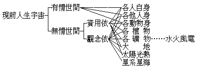



右表各人自身以下三项，属有情世间。各植物以下五项，属无情世间。无情世间所属事物，有为人生资用所依者，有仅为观念所依者，或一或二，分别表列。兹就右表逆推而前以为解释，如星系星海，与人本无甚关系，仅为观察思念所及，故属於人之观念依，而不为资用依。太阳光热、大地、矿、植，为观念、资用所俱依，其事易明。至有情世间之各项亦通於资用依，未免怀疑；殊不知各人之自身，亦为各人资用所依,如科学言人身如一机器，百骸五脏，或为排泄器、消化器、呼吸器、生殖器等等，其为人生所资器用之义，不甚明乎！各他人身，为人身资用所依者，如以人之才、之力、之智、之色、之声为用是；若动物身，则或资其力，或竟用之为衣食，尤不事辞费矣。以此而观人间，则人间为一和聚之群众，复为一原有相当和谐程度之合聚群众，非甚瞭然之事实乎？但终未至完全和合之度而已，若能完全实现其人间僧之性相者，则即极乐世界。



２　非人类



有情中之非人类者，有为吾人所能知者，有为吾人所莫知者，故分二别明之：



（一）　现前者



有情中之非人类为吾人现前所知者，可大概分为羽虫、毛虫、麟虫、介虫、昆虫五类，其细类则虽亿万而莫穷。羽之鸿雁，毛之猿猴，以及昆之蜂蚁，皆有和谐且合聚之群众，可无论矣；即推之餘类，亦皆有合群可能，且亦皆有和合可能，虽虎、狼、蛇、蝎、其同类亦常有聚居之事实,殆由皆含有两性、或他缘和合而生起之通德，故於和谐合聚之群众性，无类而不存也。



（二）　非现前者



非吾人现前所能知之有情类，依佛智之所知，或说三界，或说四生，或说五趣，或说五地，或说十二类生，或说二十五有，乃至或说六十二有情类，无量数众生类。兹约为下表以明之：



　　　　　　　　　　　　　　　　　　　　　　　　　　　　　┌狱鬼  

　　　　　　　　　　　　　　　　　　　　　　　　┌琰摩王界┤  

　　　　　　　　　　　　　　　　　　　　　　　　│　　　　└饿鬼  

　　　　　　　　　　　　　　　　　　　　　　　　│　　　　┌畜生  

　　　　　　　　　　　　　　　　　┌地居…小三界┤金轮王界┤  

　　　　　　　　　　　　　　　　　│　　　　　　│　　　　└人生  

　　　　　　　　　　　　　　　　　│　　┌时分天│　　　　┌神仙  

　　　　　　　　　　┌有欲有形界类┤　　│知足天└能天主界┤  

　　　　　　　　　　│　　　　　　└空居┤　　　　　　　　└天仙  

　　　　　有情大三界┤无欲有形界类　　　│化乐天  

　　　　　　　　　　│　　　　　　　　　└他化天  

　　　　　　　　　　└无欲无形界类



於金轮王界有现前所知者，即人类及羽虫等；有非现前所知者，即他洲之人及未发见之羽虫等。其餘琰摩王界、能天主界，以至空居四天与无欲——即无男女二性——界、及无形界，均非吾人现前可知之有情类。然彼等之为和合众，则皆无异，虽至无形想化而生，亦由业感众缘而得。故中庸曰：尽人之性，尽物之性，穷理尽性至於命也。



乙　非有情的



非有情类，遍周一切，兹分十类言之：



１　生物类者



立生物学之水平线上而观之，则有情之动物与无情之植物，同为有机能、有活力、有种性、业性之生。有情类已如前述。若无情之生物，如草本、木本之群植，有花无花，有果无果，种种传根、传干、传枝、详为析别，何虑亿兆！顺其种性栽培之，则生长荣发，违之则萎瘁枯死焉！或依自类群聚而生，或依他类附合而生，生气流行之内，和合众之情状，无处不跃如也。此非所谓俯仰皆是，左右逢源者欤！



２　生理类者



生理学者，所以说明生物组织之机用之生元者也。故原始之生理学，虽祇就人身研究，继而进观乎各动物、各植物之生理现象，以为比较而资会通；今且可由人身之生理，贯通诸生物之生理矣。诸由剖解以察生理之情状者，不能藉人身为试验，往往假之其餘动物，由其餘动物推之人，由人又可推之植物。草木有根荄，犹人有头脑，人之头脑向上，而草木之本柢钻下，人之手足垂下，而草木之干枝叉上，此上下之殊也。人之筋脉脏腑内含，而草木之根络——犹经脉——、花——犹肾脏——、叶——犹肺脏——外张，此内外之殊也。虽有上下、内外之异，其为生理机体组成则同。断其根，截其络，摘其花，除其叶，则或死、或不能传种，而伤其生、害其理焉。故草木之伤其叶，犹人生之病肺焉；伤其根，犹人生之病其心脑焉；伤其花，犹人生之病肾焉。由生理学上而观之，人生者何？一生理机件之组合而已。犹之一机器然，各机件中失一重要机件，即失运用。然则各生物皆为各机件聚合之群众体，且为和协谐调之合群体，明矣！



（见海刊五卷二期）



（附注）此下未续出。



菩萨的政治



——三十年春在中华大学纪念周讲——



今天蒙陈校长之邀，前来贵校与各位谈谈，感到非常高兴！因为我二十年前在武昌贵校，曾经讲过印度哲学；今天在这抗战期中，又得与各位在四川见面，更使我感到欣慰与愉快。



今天讲「菩萨的政治」。近代的人类，由於科学发明家的辈出，我们总算已能克服自然的生活。的确、在如今，我们在自然界中的困虽，要比往昔减少多多了。就是洪荒时代，那些害人的毒蛇、猛兽，在如今也都不能为害於人了。不过、生於现世的人类，仍有二种不能克服的困难：那就是人类自己本身的生活。例如年纪一天一天的衰老，加以疾病的折磨，而最后总不免一死。这就是说：人类对於本身的生活，还没有完全克服，这是一点。还有一点、现今人类最感到迫切的严重的利害关系的问题，那就是社会的生活，也就是所谓政治了。我觉得在现时必须将古今的学术思想融贯起来，建立一个最合理的政治，才可以解决人类现时最迫切的痛苦。譬如我们中国数十年来受著强邻的侵略，无时无刻不在艰难困苦中奋斗，不但我们中国如此。世界许多国家人民，都无日不是在战争的恐怖气氛里生活。这不是人类以外的自然势力或他种动物的行动所构成，乃由人类一种集体的动作有以致之。近来世界的政治，或是个人的资本主义，纯自私地以自己所造成的力量掠夺他人，而创成一种不平等的社会；或是想以自己的国家民族来统制其他的国家民族，造成一种侵略的行为，而被侵略者乃不得不起而反抗。这种不良的政治，促成一种阶级间或国族间的斗争。既然现世界人类在这种恐怖困苦的状态下生存著，都是由於政治的主义或行动的不完善所致。因此、我们人类现在最需要研究的，也即是一种最合理最完善的政治。



我向来是研究佛学的，所以我今所谈的政治，也当然从佛学来说。讲到菩萨，菩、是由 Buddha 翻译而来，含有「觉悟」的意思。萨、是 Satva 的译音﹐义即「众生」、或「有情」；说得切近一点，就是我们人类。所以、菩萨就是：「觉悟的人」。不过、这里的觉悟，再深一层说，在佛典上叫「阿耨多罗三藐三菩提」。阿耨多罗、是最高无上的意思；三藐三、就是普遍正确；能得到这种最高无上普遍正确的大觉悟，便是佛。佛的意义，也就是最高普遍正确的觉悟者。立志要求得这样最高觉悟的人，才叫做菩萨。这样，菩萨就可和圣人或哲人相当了。古希腊学者柏拉图所著的理想国，主张一种「哲人政治」，就是必须理智最发达的人，才可以掌管政治。柏氏将人分为三类：一、哲人，二、勇敢者，三、一般的生产者。他将哲人的地位看做首要，认为一般生产者是占国家大多数的基本分子；而为了使国家安固，则需要一种勇敢的保护者；惟必须更有一种理智最发达的哲人来领导，始能达於公正仁爱的良好政治。再根据我们中国古来的传统文化，即孔子所谓「祖述尧舜宪章文武」的文化，其著重者全在政治；而认为凡政治的领导者，必须先具一种圣贤的修养，以救天下的人类为己责，期达到一般人的安乐的境界。盖惟有深刻的修养，高尚的道德与知识，才能施展出最完善的政治。因此、中国的传统文化，首先著重於政治人格的修养。在以前、皇帝便是最高的政治领袖，但他必须具备内圣的修养，人民才能信服他，以建立共同生存发达的社会国家，成为政治领袖的帝王；所以谓之圣王政治。现在中国的「三民主义政治」，也还是从古代政治哲学的传统，兼采世界各国之所长而成。说到菩萨政治，差不多也是与西洋的「哲人政治」、或中国的「圣王政治」相近的。现在为说明菩萨政治，便谈到第二点「性空的理与缘起的事」。



刚才说过：菩萨就是觉悟的人。所谓觉悟，就是对於宇宙人生的真象，对於性空的理、与缘起的事，有了觉悟。事、就是事事物物，全宇宙万事万物都是。理、就是说所有一切事物的普遍理性。空、就是决没有一种隔离的、单独的、呆定的、实质的东西。就我们人、房子、地球、乃至一切一切的物来说，都不能说某一事物与所餘事物断绝关系而单独存立，所以真实的理性，就是空。这在平常人是没有见到的。平常每个人，必先讲到我；这我认定以后，其餘就是非我。以我及非我之中，各成一个一一个单独的、实在的东西。然而照佛学说，这都是没有的——「空」。由於主观见解的错误，把「空」当作为实，这完全缺少了客观的真实性。所以、佛学上不承认在宇宙成立之先、或消灭之后，有一个创造神的存在。科学上认为一切万物分析到最小最后时，必有各个单独存在的原子，以为这是不生不灭的东西；而佛学也认为是不存在的。这「空」、乃是一种普遍的理性，所以叫「性空」。然宇宙的一切事物又怎样生起存在的呢？佛学都认为是「缘起的」。缘、就是普通所谓的关系条件；一事一物能够生长存在，都须具备它的关系条件，也就是佛学所谓因缘和合。即一切自然生物亦莫不如是；它们必须要有一个中心主要的条件，佛学谓之因；而所餘必需具备的条件，谓之缘；如是一切齐备，方能生长而存在。所以说一切的事事物物都是缘起的。所以、「性空的理」、与「缘起的事」，是互相贯通的。因为一切存在的事物，都是缘起的，所以都是性空的。真实的理性都是空的，非定实的，即佛学所说的「空无我」。由此事事物物无时无刻不在从缘起灭变化著，即佛学所说的「无常」。同时、这种种的变化，又都是连续不断的。这种无定的、不断的变化，缘好变好、缘坏变坏，对於一切事理认识的深切，方能去其坏而得其至善。这种事理，佛学解释得很详细，这里不遑细谈。总之、对於人生万物之真象，有了真正的觉悟，就可以见到我并不能离开其他一切而存在。比方世界上人类存在於彼此种种关系条件；如以为我是我，没有其他的，就无异消灭自己的来源了。因为一切存在者，虽有亲疏远近，都不无息息相通的关系。



因为一切存在的没有各别实物而都是互相关系的，所以不能自私自利。我之所以为我，正如每个国民之对国家，是不能与其他的我断绝关系的。由此、谈到「慈悲的心与方便的行」：慈、就是慈爱的心，我们必须要全国人都得到安乐，进而至於全世界的人物都得幸福。悲、是悲愍痛苦灾难，我们要全世界人类乃至一切万物都解除苦难。有了这种慈爱悲愍的存心，才可以施出一种方法上比较便宜的行为。即如我们抵抗暴寇，乃以求得军事胜利为最方便的行为一样，去解除人类的痛苦，使人类幸福安乐。



明瞭性空缘起的事理，再本著慈悲方便的心行，才能去改造社会、建设国家。正如我们国歌所谓：「以建民国，以进大同」。再由本身生活的修养，进而求世界人类万物的改善，则非但改善人类而已，且进化一切动物以至宇宙万有，可以达到我们理想的极乐世界。



（范鸿元记）（见海刊第二十二卷第五号）



人群政制与佛教僧制



——三十二年作——



一　绪言



二　现行政制之分类



甲　国家本位政治



乙　个人本位政治



丙　社会本位政治



三　政治起源於人类生活



甲　采猎生活与个人自立



乙　牧畜生活与群众组织



丙　农耕生活与国家建立



四　人类生活与宗教起源



甲　农家牧群之原始宗教



乙　并合改进之宗教



丙　理性刱建之宗教



五　演变中现存佛教僧制



甲　锡缅暹僧制



乙　藏蒙僧制



丙　中国僧制



丁　日本僧制



六　结论



甲　政制之进化



乙　僧制之进化



丙　今后之人群与佛教



一　绪言



近代思想上，有一种是从人类思想进化上说到宗教是怎样产生、转变，乃至消灭；另外一种是从政治经济制度上说到宗教是怎样产生、转变，乃至消灭。或推测某种宗教到什麼时代要消灭，或不问什麼宗教，到了某个阶段完全要消灭。这是近来一般人对於宗教问题的说素。



佛教为宗教之一，从教法的本身上讲，是很广大的，它是以无边世界和无尽众生为其对象。佛法之存在，就是佛菩萨的圣智所亲证之诸法真实相性，若佛出世或不出世，都是普遍地常住；不过有佛出世，由证得而解脱，适应无量世界众生之根机而有佛教。它是超越一切时间空间，不受一切时间空间之限制而变迁。如同一时间，与某处众生机宜相应，佛法则兴；与某处众生机宜不相应则衰，甚或没有佛法。但在无尽的世界之中，并非完全没有佛法，此世界纵没有，他世界仍有。在佛法的应机兴起上，既相续无尽，而佛菩萨所证之诸法真理更是普遍常住的，所以没有一定的产生转变和消灭。



但从地球人类的世间范围来讲，则须有另外一种的看法。以地球人类为基本，根据了去看人类历史上的文化，则佛教也自然为各种文化之一。广义的文化，凡是用人类力量去改变一切自然环境来适应人类生活的需要，所改变而生起来的一切制度和器具，乃至最高深博大的学说，统统都叫做文化。在这种意义上，我们人类世界中的佛教，也就是地球人类所产生的一种文化。在人类一切文化之中，当然有互相连贯息息相通的关系。而佛教也是随人类历史的产生、转变，而有离不开的关系。照这种看法，或从思想文化上来说宗教，或从政治、经济上来说宗教，也就很有意义了。现在专就人类的政治、经济说到宗教，再从宗教说到佛教中的僧制。



二　现行政制之分类



现行政治，就是现在世界上所流行的各种政治制度，研究此种问题，有专门的政治哲学。现在约略把流行世上的政治制度，分为三种：



甲　国家本位政治



这里所讲本位，是以国家为根本，一切都侧重於国家。国家本位，就是专以国家为根本出发点的，举凡一切措施，皆以利益国家为前提；对於其他，则有所限制牺牲和抑伏，所以便成为国家的本位政治。大概说来，我国从前的历史和其他古代国家的历史，他的政治都可以看作国家本位的。如亚洲、中国是历史最长的国家，在政治哲学上看来，也是国家政治本位的。印度很少统一。其他如日本等，那是模仿中国的国家。而欧洲从希腊和罗马帝国的历史上看，其政治也都是国家本位的。国家二字，只是一个「国」字，不过其发达起来是以「家」为基本的；中国的国家本位政治，尤其著重於家。所以中国数千年来之历史，绵延不绝，使中国民族长久地传承下来，不但不灭亡，反而生长兴盛，建成一个史长地大人多的国家，而其中为骨干的东西，便是家族；也就是由宗法社会的大家族制度上建立起「国」来。国、就是帝王的大家，许多公侯官绅则是世家，世家之下就是民家。以家族制为主干而成立君国，故国的重心点还是在家族制度。所以从前中国很敬崇祖宗，所谓敬天法祖。天高高在上，是公共的祖先，只有帝王可以敬拜，而帝王之祖要配天，天是最高最胜，配天之祖为国祖，故一国之中帝王之祖名国祖，家族之祖名宗祖，家族最隆重的为宗祠，这就是中国政治的形式。



另外还有一种国家本位政治，特别偏重在国，对於家毫不重视，这在西洋古代希腊的斯巴达国，就是这样。不单是它，就是罗马帝国等都有此种趋势，个人和家族的一切都为国家所有。比方一个小孩初生时，并不是那个家庭父母的儿女，而是国家公有之人民，所以小孩从儿童就要受国家的教育训练，全以国家为目的，使成为国家需用之人。此种著重於国的国家本位政治，后来罗马崩溃，就变成贵族封建了。稍后继起的日耳曼帝国，则侧重减裁私利，加增国权，所有一切利益都为达到整个国家之目的；古来的斯巴达和罗马帝国，都是这样。



以现在世界各国的政治来讲，从前的日本，除它本具的野蛮民族习俗外，一切都是模仿中国，所以也偏重於家；到近代仿英国的个人本位政治、和德国偏重於国的政治。在商业上，它虽然学到英国一点，而军政则是学德国的多，所以近来就成为偏重於国的国家了。现在真可以做为国家本位政治的代表者，就是纳粹主义的德国，和法西斯主义的意大利。意大利在从前本是罗马老帝国，文化比较落后，人民也很散漫。近二十年来，以墨索里尼法西斯的领导，视为所有的人力物力，没有一种是个人或家族的，一切都应由执行国家政治建设的人去统制发挥，以达到国家利益为唯一鹄的；因此，即成为现在的意国了。至国社党的德国，本来应译为民族社会主义的国家，他说日耳曼民族在世界上是最优秀的民族，应在一切民族之上，其他的劣等民族，应当受它统治使用或消灭。比如牛羊，原是人吃的食料，而下等民族也应供给优秀民族的统治和使用的。因此，才要造成德意志的大帝国以达到统治全世界民族为目的，所以也演成现在的德国了。意大利和德意志，近十年来成为侵略国，其根本出发点，还是民族主义，这种民族也可以叫作国族。因为他要达到此种目的，才把他的民族讲得是如何的优秀，如何的强盛，应该为全世界一切民族之统治者。尤以民族主义讲得太过度了，便如德、意、日等都变成侵略国家。比如日本自己说他们是从天神所生，万世一系，直接上通於天，是如何的了不起，所以就成为国家本位政治的侵掠国。要之、国家本位政治侧重於家的不免松散衰弱，而侧重於国的则又强暴侵掠。



乙　个人本位政治



这在西洋古代的历史上，似也有过的，如希腊的雅典，是公民的政治，由民众选出议员，组织议会管理政治，和现在的瑞士就很相近，后来的罗马帝国也含有此种因素。但不能说他们就是现在的民主政治，不过相似而已。雅典的公民，不是大家都可以做的，必须要有贵族资格；其他的奴隶平民客人都没有做议员的资格，也就不能算公民；就是公民的思想行为，也不能做到自由的地步。真正所谓个人本位的民主政治，还是近代西洋才有的。近代西洋文艺复兴，也就是发现个人，在世界、社会、国家之中，个人有其独立人格。因为个人生於宇宙间，就是万有中心，不是为家、国、社会、世界而生，乃是为个人自己而生，天赋个人有个人的自由，世界万物都不过是供给个人的需要；乃至家庭、社会、国家的组织，都是为了个人权利享受和发展个人的思想能力。假使国家社会妨碍个人，就得把它改革；为要达到保护个人自由的目的，所以就产生了个人本位政治。在此种原则之下，个人生来就有的天赋自由，谁也不能侵犯。假使需要政治，就应以不妨害且能保护个人权利为出发点，因此就成为现代的民主政治。一切障碍束缚，可以打破的都得打破它，个人可以自由竞争，自然得一种调剂，政治的效用，是在个人与个人间冲突的调解，而以多数个人的意见为依归，多数就是最大的权威，所以民主政治的最大力量就是个人。这种制度最早发达的是英国——英国虽有君主，但不负实际行政责任——，后在美、法等国，这种思想发达起来，就建立没有君主的民主国。因当时的法国帝王不明白此种趋势，就发生大革命，他的改变很是激烈深刻，影响非常之大。所以当时法国所成立的民主政治，把全世界都震动了，近百年来世界各国政治都受它的影响；在共产专政和法西斯未发生之前，全世界各国都向这种趋势迈进。其好处在於各种科学、机械……都能在这种思想自由解放之下发达起来，也就是个人自由力量发挥的结果。现在的法国是被沦亡了，英、美仍是个人本位政治的代表国家。但把它发展到了极端，如卢梭的天赋人权论，个人生来就是自由，便很难成立，例如小孩初生下来，并不自能生存，一切都要父母照应和教养，乃能成长为人，若不管理，就得冻饿死，那里还有什麼天赋的自由？这种主义走到极端后，就成为无政府的主义。所以还要在大多数的议决上建立国家，尊重个人自由而不令放纵，使个人思想行为能够自由发展，如近代的各种科学……都能很快的进步，这是很好的。但既任个人竞争，并把个人的所有权看得太神圣不可侵犯——如国家和社会本位政治则不如此，要徵用就徵用——，由这自由竞争发展的结果，就造成一些大资本家。因为个人的财产绝对神圣自由，亦不一定遗传於家族子孙，凭个人的意思可交任何人享受。一往说来、个人本位似是平等的，但其凭藉本不平等，再任个人自由竞争的结果，遂成为大不平等，也就成为资本主义的社会。如英、美……就是资本主义的国家，在他们国内，虽是尊重民权，其实政治实权还是操纵在少数的资本主义者之手；所谓政府，也就是供给资本家发财的工具；无产阶级的平民，只可帮他工作，而政府则在国内为他制服劳工，在国外为他找原料和销货的市场。为要满足这种欲望，就在各处侵略他国为殖民地。所以、个人本位政治也分两歧，一种成为空想的无政府主义，一种成为资本的帝国主义。



丙　社会本位政治



在国家本位中反动起来，就成个人本位，而个人本位的反动，就发生社会本位政治，这是最近二百年或一百年之内才发生的政治运动。它反对民治，民治虽说个人都自由平等，其实并不是人人都自由平等，只有少数人自由，多数人反不自由。它反对一切经济资源都为少数人所享受操纵，同时，它又反对古代国家本位政治，所以就另成社会主义。这种社会主义，就是由多数个人合拢来组织成的集团，所有各种的利益，应当为社会所公有，成为公众的大多数人的利益。总之、就是以多数人集团的社会为本位。就是每个人的财产和学问智识能力，都不是你个人所特有或天所赋与，而是社会文化的遗传，所有各个人的一切利益都应拿来贡献给多数人的集团社会；但也不是国家的，只是社会集团公共所有，所以说「各尽所能」。而各个人所需要的，可以取於社会，由社会作公平的分配，供给各人的需要，所以说「各取所需」。这种政治，就是要将所有的各个人都使它发挥能力、各尽所能的去贡献给公众社会，再由社会分配给各个人的需要。



这里面可以分作几种；一、在社会本位政治极端发展之下，就要废弃国家、个人，就成为空想的无政府社会主义。二、有一种社会主义，由国家政府的机构来推行社会的政策；如怎样裁制资本，优待劳工，办理慈善，救济残废，以及人民突遇险难等情形，国家都要负责去救护。但又有一种社会主义，它认为只是空想的固不足论，就是国家的社会政策，也不过是施点小惠去安慰一般残废贫民，无益於事，因此另产生了革命的社会主义，那就是第三国际的马克斯的社会主义。国家都在少数资本家操纵之下，必须废除国家；但在过度时期，还须以无产阶级专政来执行政权，与资本主义国家对立。它的究竟目的，就是联合全世界的无产阶级来对资本主义国家进行革命，建成真正的无产阶级的世界的社会政治。这种社会本位政治的理想固然很高，但事实上、民主国於社会政策很难接受，而国家本位接受了反去做侵略的工具。就革命的社会主义，也有两种缺点：一、阶级的排斥，从始至终以无产阶级为号召，使有产阶级的畏惧抵抗；在这上面，必须经过大破坏、大流血，障碍难行。二、如俄国初革命时，人民受大饥荒，大杀戮，后来又渐渐采用国家本位和个人本位的新经济政策，才慢慢的苏息发达起来。所以社会本位政治的思想，唯一实验者便是俄国，但它也几经调和而变质了。



三　政治起源於人类生活



政、古来有种种解说，但近代孙中山先生解说得最明白，谓「政」即众人之事，举凡办理公务、公役以及公家之事者，谓之行政。「治」是管理，管理众人之事，便是政治。此基於群众的公共组织，有如何之组织，即有如何之政治，其种种办理和管理众人之事的方法，便叫政治制度。此政治乃起源於人类之谋生活，大凡人生在世，最基本的就是能够生活，故求生是人类最切要、最根本的事。起初只求个人生命的相续，后来又求种族生存的相续，这都是人类最基本的需要。因为人类的求生活，较之其他动物艰难，如兽有毛，鸟有羽，鱼虫有鳞甲，能御寒冷攻击，而人类则无，必须仰藉他物。至於饮食，起初都是自然而然的水果血肉，后来渐加以人工的制造。故人类之谋生存，不但是个人的活动，而且要多数人乃至群众的联合互助，才能得其生活。因此，在人类的生活上，就有政治制度的产生。这里略分三段来讲：



甲　采猎生活与个人自立



据现在一般的人类学和社会学等说：采猎是人类的原始生活。谓人类初有时，大概与猿猴相近，而现在的猿猴已有好些地方比原始人类进化了。当时的人类，采草的嫩芽及果实而充饥，饮料则取冷水。野兽中的猛兽，人尚怕他，猎得小禽兽如兔、鸡、猪、羊等，则食其肉而饮其血。人的生活虽困难於一般动物，但有两种优胜：一、人身可直立行路，故有二手空出，可取物，可做事。二、人的头能抬起瞻望，眼、耳灵活，脑比其他的动物进步；不但可采植物和猎动物为食料，就是对极大的凶兽和猛禽，也可以想法避免或捕捉。以能用脑用手，故可用木棍石块等远击飞鸟、走兽和游鱼。并能将鸟羽兽皮作衣，如我国古书上所传的神农氏等，亦衣树叶、兽皮。又因人的脑手灵活，更能用火；木棍石块，猿猴虽然也能用，但不能用火，倘其能用火烧人房舍，则为害何堪设想！故火为人类最重要之宝贝，可用以御猛兽，烹食物，改去茹毛饮血之旧习；就成为熟食生活。进之能冶铜制器，所以波斯有火教，印度有事火婆罗门，特别尊重於火，因为火於人类有特别利益的原故。



这种简单的采猎生活，初用木石，进而用火，故能战胜禽兽而生存。这时、一切需用都是取之自然：住则居地窟或山硐；路是由人多次行走而成；衣则用树叶毛羽或兽皮；食则采果芽而猎血肉；都是取之自然。故当时的个人生活，很易自立，不须有固定的团体生活；纵使有点团体，乃是出发於本能的种族繁殖相续的要求。人在动物群中，是属哺乳动物的，因人类要怀胎十月，初生饮母乳乃能生活，所以就有母子关系。而母的子女间又有兄弟姊妺，已经长成的也能领导幼小的去求生活；幼稚的小孩都须跟随母亲，於是便有生活团体，但非长久的。中国古书上说：原始人类，只认其母，不识其父。由当时尚没有一定的婚嫁制度，小孩生来随母亲生活，故小孩只认识母亲和兄弟姊妺；母亲也只将小孩抚养成人后，便抛弃不管，犹如现今的牛羊一般。西藏的母系中心家族，也还有这种遗习。因有幼年随母亲及兄弟姊妹生活的关系，便发生相亲相爱的感情，如母子的爱，兄弟姊妹的爱，自然而生，於是便萌芽了团体的生活。这种个人自立的根源，发展到现在，就成为侧重个人自由权利的个人本位政制。现代个人本位政治，固非原始采猎生活可企及，但原质上还是相近，所谓人类有天赋之自由。子女未成年之前，父母负教养之责，到了成年，就任其自谋生活；父母不负任何责任。男女婚姻，到了成年，则任其自由。如在中学时，父母还是管得很严；到了大学，就都让他自由。但同时生活也必须自立，此为西洋民治国民之一般趋势。所以欧、美人往往有到了三十多岁还不能够结婚的，都是因为不能自力维持小家庭的原故。由壮年的积蓄，到了老年，有养老金自由过活；所有财产，任个人意愿支配处置。故这种政治，就在个人自立，使人人有独立发展的机会。但古来成立群众国家以后，历时甚久，因国家政制的反动，又成为近代的个人本位政治。故个人本位政治与原始个人自立生活，有其渊源上的关系。



乙　牧畜生活与群众组织



牧畜生活的起源，还是基於前面的采猎生活而来。猎得的禽兽等吃不完时，便将活的伤的畜养起来，这时所养的动物，以兽类为多。其饲养的母兽，已经怀孕了的便产生小兽，当时人类见到这种情形，就发明猎取各种活的动物开始牧畜；於是，捉到活的不再打死，都一一饲养著。或挖土坑作陷阱以捉活兽。或用棍子绑石远击飞鸟，渐又发明弓箭、弓弹射击，要是中伤未死，都给它畜养起来。畜字、即有饲养储蓄之义。而畜养的野兽，经过相当日子，也就渐渐地驯变为家畜。畜养的动物渐渐孳多了，便须寻找供给食料的地方，所以须将大群的动物率领游行，使它繁殖；这所畜养的动物，多是牛羊之类。由於动物的饲养，对于人类的衣食住等生活，也渐渐起了改变：如衣穿兽皮外，并撑皮为帐，织毛成毡以作遮雨露的篷帐和御寒的卧被；见小羊牛食乳，初去取来为小儿试吃，於是就发明以牛乳为主要食品的生活。但牧畜生活发达了，不是一个地方能够供给大群动物的饲料，因而要常常移动，这几个月在这里，那几个月又在那裹，并将能够保存的水草，收占起来备给牛羊食用。在迁移时，由这地方到那地方，或须经过一段长途，因此、必须有统率群众的力量，方可将所畜千万成群的牛羊，与同时养著的马和骆驼，造成游牧的生活，这也就是群众集团的组织。如现今的蒙古还很相仿，它有一旗一旗的名目，一个群众团体里面便有一手旗子作它的标帜；每旗的群众户口和统属是固定的，但住居的地方则不一定，时常可以移动。每个团体总是几千几万人的组织，所牧畜的牛羊也几万几十万的大群。由於住处的不定，有时也居地窟山硐，但常共居帐篷；一切生活资料，都取诸所牧畜之动物。如帐篷就是皮毛所制，燃料就是牛粪，食品便是牛羊肉及乳酥；大概都出於各种家畜的生长。由这种牧畜生活进为群众组织，后来便渐渐进化为社会本位政治。



在原始采猎生活中的人类，唯以个人为主，儿女只认识自己母亲，故现在仍遗留有所谓母系的社会。但其中一部分化为牧畜的群众团体时，便如大军队一样的有组织，凡移动到一个地方，前有巡哨，夜有守护，不论是否有血统关系，都可共宿食於一处，今之蒙古包，还是这样。如一群中之女子，到了成年，即有种已成年的表示。或照中国习惯作夫妇相配；但大多不一定配为何人之妻，成年男子亦不定配为何人之夫，不讲究夫妇有别，一群中的男女夫妇是公共相通的，饮食也不计较彼此，过路的人也可以遇食便吃，有事共作，夜中与大群男女同宿。但这团体中是有首领统率著的，比采猎时强多了。现在的社会本位政治，固然比当时进步，但仍有渊源的关系。如所说的「各尽所能，各取所需」，以及夫妇不用一定的配合，如俗传之「公妻共产」等，推究言之，都和牧群生活有密切的关系。



由这种牧群生活，常时迁移流动，后来对于智识学问，亦渐渐的发明。如地理学，以当时游动所经过的高山、平地、河流、沙漠，都能熟记研究；又如算学也渐渐发明，因为牧畜生活，原是大群的组织，其人口、牲口、饮食、器具等等，均须有计算，方不致差错遗失。由於行动游牧的关系，出产的牛羊皮毛和乳酥，除供给自用外，也或与农家出产品相换，由这种以物易物的贸易，就发明了商业，后来便成为赶集的市场。因为住处不定，时常都须迁移，经过险隘地方，必须要保护，就有简单的军队组织。武器、起初是用打野兽的棍木或弓箭等，后来也就造作成军器。因为仗著有组织的群众团体，就发生强盗的行动，如强劫其他小的团体和农家的食物等。又如在河东望见河西有很好的水草，起初便游泳渡河过去，后来设法用皮用木作船，大量搬运，於是就发明了航行。海边的人见船在海上行动便利，就在船中住宿，或聚居海中岛屿。船到靠近陆地的地方，见岸上人家有食物，就登陆抢取。陆地上人见了追来，他就上船逃走，别人把他没有办法，这种人到后来就成为海盗。如英、日等岛国都是由海盗而进化成功的；所以商巿、军队、海盗等，都是由牧群的组织而来。



丙　农耕生活与国家建立



牧畜与农耕并不能完全分开，於牧畜中也兼有很简单的农耕，於农耕中也带有很少量的牧畜，但农耕必须固定的土地乃成其耕种生活。起初的农耕者，只是将荒地耕耘，所种之物，如一季可收的谷类，或数年才能结实的果木类，因此、住居的地方也就自然固定了。但他的发生还是基於采猎生活而来，由於从前所采的果实，将食餘的散在地上，便发芽生长，人类见它可以种植，就开始垦荒耕种。后来、关于土壤肥瘦的辨别，气节雨露的经验，农耕器具的制造，就渐渐地发达起来。



这种生活，附著固定的地方，便成立了家。中国的「家」字，上面便是表示洞穴或草室木屋，下面就是一个「豕」字；现在乡下的普通农家，也可以看到这种情形。他们住的很简单的两层房子，楼上住人，楼下就喂猪，或有把猪饲养在自己床下的。豕可作食料，又可产生肥料，它并不像牛羊要远逐水草，粗劣渣滓甚至人粪，都可以吃；且行动笨拙，容易圈在固定的地方饲养，於是便成了家的成分。因为这时有了家的建立，便成为父系重心，家中一切，均由年长的男人作主，如起早睡晚，勤劳农耕，都由男人工作。同时既有固居的地方，而饲养的猪、鸡……以及耕获的食物，势必要有固定的女人保管，於是便有一夫一妻或一夫多妻的婚制。家庭的一切，是由一男人当家长而负管理之责，因此、就有父、祖、高祖、曾祖氏族系统的遗传。因有固定的一妻或是多妻，所生的子女也就很多，但都受家长的管理支配。后来子孙太多了，分出另居，聚成村落，就由家长而成为一村的君主。因为有了家的建立，后来的子孙，就知道有父子、夫妇、兄弟的家庭；或父亲死后兄为家长，弟为辅弼，家长为君，辅弼为臣。兄弟多了，分居聚处，就成为朋友，五伦都备了。但这时不过是以家为国的基础，并不能就算为国。虽是大家族，但生活极简单，都能自给自足。如女的饲养牲畜，收藏食物，煮制饮食，管教子女，以及养蚕抽丝作衣等——在制衣方面，蚕丝较棉早——。每家在习惯范围之内，都能供给一家生活；但很保守，如一块作熟了的土地，别人家要来侵占耕种，决不肯与；各种各食，彼此不相往来。后由弟兄之多，分成多家，便成小村，但每家每村都是自给自足的生活。



在这种大家小村之上，后来所以能成为国的原因，一方面固然是家的扩张，而最重要的关系，还是因与牧群接触。起初、牧群的人或以牛羊毛等与农家在以物易物的商业交换；到没有交换物件时，便去劫盗占据。三五家的农村，就得受其牧群团体的侵害；而农家为要互相防卫，才彼此联合多家，成为乡里，防御牧群的扰乱。又因牧群的势力大，占据了多量的乡村，统治多数的农民，自成为贵族，承受农村文化，役使农民为佃奴，就建立为国了。但国并不大，不过是数十里或百餘里的地方。经过牧群的占据合并之后，许多的农村，都当他的平民。在多数小国之中如有知识、学问、武力、财产……都比别的强盛，於是就征服其他势力脆弱的小国，成为各小国的首领。有了首领，一切事业、文化、道德等都渐渐发达起来。被他征服了的小国，就受封为公、侯、伯、子、男的爵位，自己就成为一个大国。在没有被征服统治的小国，为要保卫自己，联合许多小国以御外侮，另成为联邦的大国，由此而有现代国家本位政治。



由这农耕生活中，也发明各种的文化：如天文学，是从农事上，要知雨水多少，气候怎样变化，一年四季中之时候长短，月亮到什麼时候圆缺，星斗何时移回转变……在他们固定的居地经验发明的。文字，也是从农耕生活中发生，因有家族的传承，祖宗之遗事，须有记载，所以便发生结绳记事——现在广西边地居民，还有此种遗风——。但容易错误忘记，便发明打土砖作符号，后来在土里挖到铜铁，便镕冶打磨成刀，才刻於竹木上，以成为象形等文字。但都是以语言音声为根据而成：如记牛羊，就刻牛羊形状，并仿其叫声以读。无声的山，就刻个山形。经过几千年的变化，就成功了文字。因有了文字，能把古代相传和他人的感想都记录流传，而知识学问才飞快的发展。牧群占据了农家的乡村，见到他有文字，受之以同化。如中国的伏羲，犹是采猎时代；到了神农，才入农耕生活，所以在那时就有家族村落和宗法社会的建立。黄帝则是西北方的牧群民族的领袖，他侵略进来的时候，几千个小国，都为它制伏统治，才创成了大中国。尧舜时执玉帛者万国；在周武王的朝代，还有诸侯八百；所以中国也便是这样建立起来的。再如八卦，便是进化成文字的开始。当初、「大抵三等畫，代表天地等现象，初用以记寒暑水旱一年间所经过之天时，或记牛马豕犬谷贝等一己所有之财产。……后来又因之以为占卜之象，故卦之本字为圭，后加卜边」。同时、由农以发生工业，男子出外务农，女人则在家里以竹木制造器具，或以蚕丝作线织绸等，甚至细巧如绣花之类，都能作得出来。而农人在忙时很忙，雨时冬时，因为很闲，也在家工作。所有制成的物品，出与他人交易，因此更增盛商业。由於祖宗相续传流之远，学识渐多，就要有专门教学的人，在学问的传授上，又发生种种的礼仪，如祭祖、祀土地、山川神等。这种信仰上一定的礼节和知识，更须掌教的长老为传授。或一家掌教的家长，一村有村中的长老，为众人所信仰。他一方面以学问教授人，一方面又与人作占卜吉凶，祭祀鬼神，消罪祈福等等事情。古传所谓有所谓太史、太卜、太祝。太史、是传记过去之事的，太卜、是占测将来之事的，太祝、是祭鬼神而祈祷的，太祝后来就是成为中国道教的巫觋，也便是原始时代的宗教僧侣。因此，在农耕生活中，就发生了天文、文字，及工、学、宗教等。与牧群生活中发生的算学、地理、商业、军队……的各种综合起来，就成了人类整个的文化。但在这里面，又有了阶级尊卑的区分，如印度的刹帝利，便是贵族，但因承受文化，掌教的婆罗门，反而成了最高阶级，而商、工、农奴，自然的更居下层。这就是农家生活与国政的关系。



四　人类生活与宗教起源



就一般的宗教说，从最低的到最高的，有各种各样。有人谓「佛法非宗教非哲学」，这是指狭义的宗教讲。现在从广义的宗教来说。如基督教、犹太教……而佛教也还是宗教之一。不过宗教这名词，有多种解说不同：据希腊拉丁文字的语根，宗教含有约束人心的意义。现在通用的宗教名称，是由西洋经日本翻译来的，中国沿袭承用。在中国的佛书上也有宗教的字义，但宗与教是分开的，即所谓宗下教下。这是据楞伽经所讲宗通说通的意思，宗通即宗下，说通即教下。现在所要讲的宗教，不是中国分开的说法，然要说明高等宗教，这种分开的说法倒很适当。依实践修证而亲自证验到内心境界的名宗；依所证心境用言语文字宣布出来而教化他人的名教。简单的说，自证名宗，由自证而教他名教。在此种意义上讲，佛法才真正的是宗教。由修行实证到的，不是平常的见闻觉知智识思想言语文字所能企及，而超越平常的智识思想言语文字等等，是圣人心内亲自证验到的真见境界，自己才能明白。别人如要知道他的心境，也须如实修证到乃能获得，所以是超出一般思想文字之外的，是神秘的，佛法谓之不可思议的，秘密的。故真见道的心境，是一种超越而不可思议的，易其名谓之神秘；以此为根本特质，由不可思议而超越平常智识思想的自证心境中，施设种种教法出来，教化他人，则名曰「宗教」。这宗教意义在佛教是很适用了，但在一般较低的宗教则不能适用；不过把这种意思说得浅一点，亦或可用。在有些宗教教徒看来，平常人的力量以外有他种的力量，为常人不可窥知，不能显现的，是由人的偶然灵感或特殊的神人才能有的。这些低等宗教，如中国之巫觋，有神附身，能够降神，能说平常人所不能说，能见平常人所不能见，越出人的知识能力所及，而起人力以外神秘的不可捉摸的现象。因有这种神秘的东西作根本，它的言语行动有种种特殊的方法，以发现人们之外的特殊事象和力量，或能降祸於人，或能赐福於人，或能使人晓得些人所不知的事物，或做些人力做不到的事情。在这种神秘之中，使人觉得奇怪，便发生信仰和依赖，就成为一种宗教。这种宗教，说到最高的地方与佛法可以相通，因佛法有其超人以上不可思议的心境，非常人所及，唯有信仰归依修证乃能获得。故推之为最高，亦可与佛法相容。放之最低，如起码的拜物教，信鬼教，乃至信仰一件动物植物——如信一「树」为神，便烧香供奉，以为此树有人以外的特殊力量，与人祸福，治病发财，求甚麼得甚麼，使人信仰依赖，得到人所得不到的要求。再如普通人家供奉祖先，所谓家有家神，以望其保佑子孙，赐福消灾，在人心上总是有种神秘的力量可依靠信赖。所只讲到最低，也还是这宗教的意义。这神秘可依赖信仰的东西，在人类的无形中，由一家一村至一邦一国，都有这种共同的信仰，而成为一家以至一国的精神上共同的趋向约束。一切日常生活祸福，都在这种神秘力量的约束中，他能满足人的要求，能为人的信赖，所以便是人们共同精神上的团结力。这样、由最高到最低的宗教，便很广泛，其起源亦可依人类生活中去探讨。这里略分为三：



甲　农家牧群之原始宗教



宗教既为一家一村至一国的人们精神上共同约束力量，单是采猎时代个人自立的生活，可以说还没有宗教生产的可能。宗教是代代相传为众人共同的约束，故其个人生活的采猎时代，还是没有宗教的作用生起。不过、里面也蕴含有宗教的种子，但没有发生罢了。宗教的发生，是到农家牧群生活的时期，分途发展。因为农耕有家的建立，故有夫妇、父子、兄弟……的许多人成为一家。一家之中，必须要保守家法，对於祖宗，便很注意的敬重。所生的子孙，不是为个人或家长生的，而是为世世代代的祖宗所生。要扩充家的发展，所以中国古书谓「不孝有三，无后为大」。绝子灭孙，就是大不孝。这家里有已故的祖先，使家永久不断的发达兴旺，故子孙对它都有共同的信仰和依赖；或祖先祭祀时，偶然彷佛有某一奇特的现象；或在梦中彷佛见到已死很久的祖先，觉到有某种感应。因此，在见闻不到中，成为精神上的依赖。农家有固定的地方，须依田土而生活，故对天时、水土、山川、木树、日月星辰，都是为他固定生活上的依赖。如有时丰收，积谷满仓；有时荒年，收获全无。在这生活时饱时饥之中，便想到这里面有种种的无形的神秘的不可捉摸的力量在主持著。天时的好坏，农产的丰欠，都是这力量在管理，要是不恭顺信赖他，对它不好好的祀祭供奉，万一得罪於它，必将不但不来帮助，而反兴灾降祸，或使人无故死亡，家畜横遭瘟疫，农产受水旱所侵，便要发生种种不好的现象。於是、对山川水土风云雷雨……都发生信仰起来。最切近的，是一家有一家的祖先，较广泛的，是所赖以生活的风雨山川等神，所以就有宗教的发生。



还有牧群，他们的生活情形又大不相同。他们原是几百几千几万人所集合的大群，住居地方又不一定，时常流动迁移；这大群的结合，不是单信一家的祖先，而是信仰人类公共的祖先；既不固定於山川土地，所信的神应是无处不在的，故他们所信仰的神，是世界人类公共的祖先，而且是无所不在的，彷佛人类及万物都从他所生。由这种神秘的信仰而为全群的结合重心，乃皆仰望此神的护佑而获安全的生活。



由农耕和牧群发生了两种不同的宗教，这两种宗教的发生，在世界上当然很多而不一致，而其中可举二个作为代表；中国的道教，可作农家源始的宗教；然到汉朝的道教成立，已有并合改变。探其渊源，就是农家的起初由家成村，信仰有祖先和山川风水等神，就是中国的道教的源泉。中国古书上说，道教为黄老之教，其实在神农时候就有了。这种宗教，在当时只为一家或一村落的精神上约束依赖和安慰。太史公叙老子谓：「郅治之世；鸡鸣犬吠相闻，民至老死不相往来」。人民住定一个地方，一家或一村，就是他的全世界。其他的邻村，就是鸡鸣犬吠相闻，然而老死都不相往来。又说：「破斗折衡，绝圣弃智」，后来陶潜的桃花源遗世独立自耕自食的思想，也就是这种意思。这在思想的政治理论如此，其信仰的神秘方面，则仍是祖先及土地风雨神等。如村庙，就是全村人民公共的精神寄托。道教的起始，就是这样。后来慢慢的发达，到黄帝时已加上了公共普遍的天神，演变到三代秦汉帝王祭天地、五岳，公侯祭奠山川，建筑祭坛祭庙，庙中就有侍奉祭坛的庙祝，依此遂演成汉以来的道教。如一家有祖先奉祀，一村有地方神保护，并有巫觋对鬼神能感动，有符咒等方法与鬼神相通，就有农家宗教的建立。这祖先及山川等人鬼、地祇、天神的发达，到了后来，就发生有个玉皇大帝来统摄他们，进而信奉玉皇大帝能总管一切，这是由家到国的进步宗教了。因要与鬼神相通，欲求长生不死，必须有修养的工夫，於是又发生修神仙的人。由这几种综合起来，就成中国的道教。但起源於农家生活的宗教，广泛地讲，世界上还有许多与道教相近的宗教，如埃及和巴比伦等文化古国的古教，其性质也和道教相似。又如西藏的黑教，则逼似於中国降鬼神、畫符咒的巫觋，这黑教到了后来，形式上似乎因佛教起了些变化，但其性质仍在使人类免祸得福。再如日本的神道教，其起源亦与道教相近，最重要的是祭奉祖先，头一个宗祖认为是从天所生，故日本的天皇，就称是神的子孙，不同於常人，这也近於中国的道教和埃及的古教。所以古来的帝王，是天子，亦是圣人，有神圣的性质。所谓真命天子，都是有超人神秘力量的。农家生活的演进，就有这种思想，这是说明由家而村而国的道教等宗教。



由牧群起源的宗教，可以犹太教来作代表。犹太教是一神的，这唯一无二的神，便是他们的祖先，也是人类公共的祖先，并且是普遍的，无形的。这耶和华也就是个公平正直的神。为要在世界上教化人类，故以犹太人为上帝的选民，特别显得犹太人的伟大高贵。这种牧群须有公共的信仰，不是风雨、山川或家谱祖先的多神，而是唯一普遍无形无像的一神。但要统一团结群众的心理，使其精神和力量集中，故自称是上帝选定来世界上教化人类的，犹太所传来的旧约，就是这种。牧群是多数人集合而成的团体，须有统率的首领，这首领是为众人所推；佛教古典上相传「王」的起源，以人类相争，故公推一人出来为王，管理一切，牧群里面差不多常常是这样。他们在大有举动时，就在大群中选出一人为首领，统率群众。此种现象，如蒙古在成吉思汗时，还没有固定的宗教，漠然的信仰，唯是敬天。起初由这个较强的部群，集合起许多部群，公推他为领袖，就成后来的蒙古帝国。犹太的性质，也与此相似。前节讲过，牧群中可以发生商、军、盗等，由於他的人多，以皮毛诸物与人交易时就成商业；要顾群众的安全，特别派人持武器保护，就成军队，或交易不到时，就集合多人去劫掠农村，就成强盗……因它的团体大，人众多，信仰的神专一普遍，所以力量很大。以现在的情形看来，讲个人主义自由权利的，很少宗教信仰，对宗教很是淡然，甚至反对宗教，废弃宗教，进一步就形成无政府主义。但到合群的精神生活不能维持时，无形中含有宗教作用的因素，便又生起了宗教。



乙　并合改进之宗教



如印度最初的土人，也是崇拜祖先山川风雨等神，与原始的道教相同。后来成为国家，不单是农家的建立，而是经过牧群的侵占，才能统一成国。如刹帝利武士，就是牧群。当其侵入，就以牧群普遍的神为信仰；后来和土人的文化合并，便产生专掌教化的婆罗门。但未征服以前，还是信仰各种不一的神；由并合之后加以改进，才成为婆罗门教的。唯一的信仰是大梵，梵为一切世界万物的出生主，普遍一切，无处不在；同时又融纳了土人的多神，演变到现在，便成为目前的印度教。印度的政治向来少统一，故文化思想，宗教信仰，亦复杂而不整齐严肃。现在印度教信仰有三个根本神：一是大梵，二是毘湿奴，三是喜瓦。大梵能生万物，毘湿奴保护万物，喜瓦破坏万物，也就是生住灭三位一体的意思。这三种神，随信仰一位，或三位齐奉。除此之外，也还是有其他的神，但以这三种神为最高的神。印度也是敬重祖先，但只重精神，忽视肉体，故对尸体看得很轻。特重轮回业报，在轮回上使他不没落而得上升。其为农家的牧群的宗教并合改成，显然可见。



中国的儒教，在建立万国共主的天下以后才有的，当时虽是由许多公、侯、伯、子、男的小国所合成的大国，根本上还是著重於家，因家始有伦理道德，由家到国便成为仁义礼乐的政治，其最高的信仰，也是天，天是超人无形的。古来祭天，都是凭空而祭，没有形像。「昊天上帝」就是无形无像，非人所能见，如孔子说：「天生德与予」，天是有灵性神理而无形像的。由信仰天和祭奉祖先，便成为「敬天法祖」，所谓「皇天无亲，惟善为亲」。在伦理上孝亲奉天，政治上敬君祀天，故儒教的宗教信仰，「敬天法祖」，这也是并合改进所成的。中华之建成大国，是由黄帝的牧群侵入，合并神农的家教，摄统而同化之。欲自为广大无比的天子，统御万民，故尤重敬天。



回教、也是并合改进的宗教。印度教是并合的，但还没有调整完善，所以成为散漫的现象；儒教在改进上成有条理的统率，故二千餘年来发生很大的统摄同化功用，然仍以农家的宗教为本质。回教原是牧群的宗教，阿剌伯地方，就是世界游牧部落的发源地。到了摩罕默德时，游牧及商盗的性质虽然还多，而小部分的农家宗教也渐渐的传入，那时的麦加就也有供神像的教。摩罕默德受了犹太教的影响，欲阿拉伯人改奉唯一统一的神，集中牧群信仰，便去排斥传来麦加原有的神教。这样一来，便引起地方人的反感。因他信仰的不同，为要达其目的，就以军队力量去打破其他神教，故成为左手持剑、右手持书、强迫信仰一神的回教。所以、回教原是以牧群的一神教为主，但那时旧有的大家族和有势力的豪族，都加入其教为重要份子，遂并合入由家建国之要素。因此，回教在信仰上是唯一的神，在生活上是大家族为骨干而建设国家，成为教国。它一方面有豪贵家族，一方面有军队力量，又能以一神统一其信仰，故不惟由教建国，又能以教繁殖其族。尤注重家族，男子可以多妻，而女子很重贞节，故对女子的管束甚严，人口易为发达。所生的子孙，都是教中所有的教徒，所建立的国也都是子孙相传的国家。他本是牧群的宗教，在并合改进上，就成功为又能特重家族的宗教。



丙　理性刱建之宗教



前面所讲，从人类生活起源之宗教，一种是由农家崇拜祖先与风雨山川等神而建立；一种是由牧群信奉人类公共的祖先，即是能主宰万物的唯一大神而建立。从这两种原始人类宗教到后来的并合改进上，其性质仍是脱不了原有的本来性质。如印度教是并合后取得混融的变化，虽是合前二教，仍不足为有条理系统组织之宗教，故其宗教信仰散漫，政府亦很少统一。儒教是以农家敬祖鬼奉神祇的信仰为本质，并合改进加入了牧群唯一的天神，成为「敬天法祖」有条理系统的组织。回教以牧群唯一的天神为本质，又并合了家族伦理为其中心，故教中极重由家族而建军国，成为改进之宗教。但无论是原始的或改进的宗教，总还是脱不了原来的两种根本性质，或重家族祖先，或重唯一天神。在崇奉的天神中，往往有种垄断的性质，如回教只有摩罕默德所说的一言一语才是真正神意，唯有它才得上达真神而教化统一世界人类，因此虽经并合改进，仍未脱原始宗教的性质。这其中有种限制，由家族扩充成大民族时，就推重自家种族的原始祖先是如何的优胜超过一切，如中国重家族者必叙述自己的祖德是如何源远流长而胜於他族，自己是中华，其他都是边夷。其出为帝王的，就是「天无二日，民无二主」，他就是天下唯一的真主。犹太教虽信普遍唯一的神，而特以犹太民族是上帝的选民，唯有它乃能统治一切。回教也说只有摩罕默德是个最后的唯一的先知，麦加是上通真神的唯一圣地，只有麦加的教主，才能教化统一人类，所以回教又特别采用了从家族而扩充成教族的宗旨。到现在看来，回教就是回族，回族即是回教。印度教也脱不了印度民族的限制，儒教也是为中华民族所限，内华夏而外夷狄，夷狄不能与华夏完全平等。牧群者以自群团结的优胜力量去征服统治一切，家族者以自族去扩充为万民的中心，所以此并合改进的宗教，仍脱不了原始的气味与束缚，不能从一切众生或世界人类都是平等的普遍理性上去开刱建立为理性的宗教。因於原始生活所产生的宗教关系，乃不能脱其羁绊与限制。



由此，能从平等普遍的理性上创立的宗教，要到人类理智发达，对原始生活的习气一一都消镕解脱，由此发现的普遍真实究竟的理性，近之须人类平等，远之乃至一切众生皆平等。这在原始的改进的各种宗教看来，却还没有这种普遍的理性，却还是限於家族或种族。最先有此种理性宗教的刱建，要算是佛教。



佛教的教义和教制，都是脱离了原始宗教的臭味，是从人类发达的理智所认识的理性而创立的。大概而言，一般从人类的生活而起源而并合改进的宗教，其内容均有二种的含意，此不同前面所说各宗教两种起源的分界，乃是含蓄於各宗教中各有偏重的两种意义：一重祈祷所依赖的，一重造作所获得的。造作即行业，获得即果报，由人类自力造作获得的就是业报。本来宗教都有祈祷，不过有的注重於自力的止恶行善，达到善果的善业；有的注重於他力的感应。由造作得果报，便认定於造业受报之后必有个能够造作受报的主体，便是灵魂或神我。在祈祷感应有种种的方法，或供养、焚献、念诵、拜恳……除众神以外，觉到一定还有个不可捉摸，无始无终，无所不知，无所不能，普遍唯一最大的神在其后。在这两种意义上，比方印度教是并合的，一面重轮回造业受报，一面又信有一个唯一根本的大梵天神，复信有高低上下不一的神在业报轮回中，唯有此根本的神能生一切，无始无终，如与他合一，永无生死，与神同不生不灭。在这两种意义上，佛教、就是把它们虚妄执著的限制都破掉，业报相续后面的我，和祈求感应后面的神，都把它空却，所以就没有不平等的东西了。所有的、就是一切众生，都是同样的业报相续，作善有善报，造恶有恶果，私毫不爽。感应资助的也祇是众生，因为此众生之中，又有高低胜劣之差别，其能去掉妄执上的限制，相契於普遍平等究竟真实的理性，就可以成为与「无始终、无内外」理性相应平等恒如的佛。然此理性非另有其物，就在一切众生之中。佛教、一方面是空了「自我」和「天神」而发见平等的理性；另一方面、是业报相续而无量差别的众生世界，众生世界的理性，又都是平等无别。由业报的不同，就有低劣的众生、可以祈祷优胜众生为帮助，已破迷执得大觉悟的有情，可去教化其他一切迷劣的众生，为其师导；觉悟到圆满，就契应普遍常住真实的理性，而成为圆满无碍的报身佛，由此也成为祈祷信赖的宗教。这种宗教在世界人类的文化中，其理性上固然绝对平等，同时也不抹杀事实上的业报差别，故须各人造善断恶，自己负责改造以向上进步。从这理性创立的宗教，不复是一家一族的宗教，而起码是世界上人类的宗教，人人都能成佛。这宗教的生起，固然也承有原来的宗教中那些造业受报，生死相续，和不生不灭普遍恒常的教义，但对其限制性——自我、大神等——都予以打破，而成平等理性；其业报亦即别无限碍，要是依业报的法则去作，造何业得何果，不论什麼都可做到，并无限制。



佛教的建立，有佛、法、僧三宝，最初觉悟平等普遍的理性而出为一切有情之师导者名佛；将所觉悟的理性说出来，施行教化者名法；依所说之法而学习实行者名僧。佛教的基本就要去掉原始生活积累下来的枷锁，所以释迦牟尼佛现生於印度的迦毗罗国，要出家乃修行成佛，也就是这个意思。他的家就是国，出了家就是出了国，也可以说是出了族。因此、他经过在山林中采食自然的水果，不依赖人间社会的生活，对於家和国的关系都脱离了，彷佛返回了原始个人自立生活的时代。此在教义上，也成为绝对的，不依赖祈祷天神、鬼神、他人……，完全自解自行，自悟自度。这就是循由业报的原则，善恶自己造，迷惑自己悟，非旁人所能代替，故在教义上成了特殊性质，但后来由佛说法度人为僧团时候，僧的分子还是保持原有的性质，故佛常舍众独往山中，当时的佛弟子，也有很多修行林野，佛亦常赞岩间住宿、树下修行之头陀生活。我尝见印度佛迹的灵鹫山中，还有很多古硐，都是当时佛弟子们独自修行的禅窟。此自修自证，自觉自度，正是佛法的肝心。另一方面，又成为僧团的组织，僧如大海，无所不容，所谓「四河入海，同为一味；四姓出家，同为一众」。这众中以学业的胜劣先后为秩序，并以业报上的男女为差别，虽有七众不同区分，但根本上无论什麼人入了佛法僧团，都是平等平等，不问是贵族或贫民。而这僧团的范围普遍无限，非常广大，僧众一处举行布萨，地域、种族、阶级等等的差别，皆予以破除，故合乎普通平等的理性。同时、僧中的现律，善事为众敬崇，恶事向众忏悔，为众推爱或为众摈弃，一切唯以清净和合众为依持，使佛法普遍人间，常住於世。然渐化常俗，复为说善生子、玉耶女等家族伦理，及四种报思、王正法论等国君治道；亦不妨印度习俗上所奉诸天神鬼，祈求感应，但令了知亦同为业报差别之众生而已。总起来说，在教义上有空去了「内我」「外神」的普遍常住真理，并有业报差别的众生万物；而在教团僧制上，一面出家离俗，返到个人自立生活，达到自觉自度，一面在教化众生上，建立平等无限的广大僧团，并随顺摄化世界人类和一切众生。把这一切为自私的限制皆予以打破，成为大公无我，无论在教义上或教团上都是如此。所以、由此理性创立的宗教，便与一切的宗教都不相同。在人类文化中讲，唯佛教首先有此普遍理性；后来别的宗教虽也有些普遍理性，但都是受了佛教的影响而起的变化。



耶教、在世界上今分为三大派：就是罗马教、希腊教、基督教。在教义上，原很平庸。他的旧约原是犹太教的，新约方是耶稣及其使徒的言行录。把旧约的限制打破，说明一切人类都平等。佛法平等理性中本不许特一的神，但当时犹太的文化程度讲不到，只说「神」就在人人心中，对於人类平等慈爱；在教理上只说到这点，把犹太人为上帝选民的不平等处予以破除。但在教团的制度上，颇有与佛教相近的地方。起初耶稣及其徒弟，也都是出家，离开国族，经过一种个人独自的修养；另一方面之教团组织，则很普遍广大。现在西洋人的组织能力，也都是教会给它训练成功的。如罗马教等早成为普遍各国广大一致的团体，其最高首领的教皇是由修学服务勤劳卓著大主教之中选举产生的，他们自称为教宗，故成为很实际，很有系统的普遍严密组织。依佛教僧团的意义说来，他到很能发挥了僧团组织的力量，后来改变了原来罗马教的出家僧制，成为很通俗的有家室的新基督教，派别很多，也还是很能组织。由此耶稣的教义虽然很平庸，颇能在平等博爱上实践实行；而在教团的组织上，不限於地域人种，但由男女和学行的区别上，而成为广大普遍和秩序严整的组织。



由此，近来印度、锡兰各地的欧洲考古家；从历史上考证起来，都说耶稣教是受了佛教的影响而产生。阿育王时，佛教曾传到印度西北的波斯和红海两岸的叙利亚、埃及等国——叙利亚即古犹太国所在地——。现在又有一种考证，说耶稣本人在十五岁到三十岁期间，曾到过印度留学佛教，故耶稣所说的神，不是犹太教的「耶和华」而是「高达ｇｏｄ」，与佛名「乔达摩」音近。故耶稣所信的和所说的神，就是佛陀。对於当时文化程度较低的犹太人等，未能接受高深的道理，遂只为说皈依祈祷平等慈爱的「高达」罢了。从历史的考证上，教团和制度上，教义的影响上，至少耶稣是受过佛教的教化，而要去改革犹太教的。故耶稣承袭旧犹太教的地方很少，而依理性佛教去改革掉旧宗教的因素反而很多。所以他的行为，是想一切人类信佛获救，也可算是一心信佛普度人类的菩萨行了。故耶教可摄属在理性创立的宗教中之一种宗教。



五　演变中现存佛教僧制



前面对於各种政治和宗教都说过了，现在来说佛教僧制。所谓现存，就是世界各国现在还保存著的佛教制度；演变、则是从原来的佛教制度上察其历史沿革。上面说过，原始佛教僧制，一面注意个人能够出家离俗，自立自活，自修自证，古来在林窟修习禅定的，都是最简朴的自立生活；一面又有僧团的组织来住持弘宣佛教於世，摄化信徒，普度有情，依学业先后的次序，阶级进修的差殊，成为普遍广大的教团组织，这种组织就是僧，僧即和合的团体。佛在世时，一切依佛为主，各处散居的僧众，举行布萨羯磨，都依佛的律制为唯一的标准。佛灭度后，有迦叶、阿难继承著为僧众尊仰，后来就渐渐的发生许多部派，在纷争甚烈之下，依佛陀原来的菩萨行上又发生了大乘教团；大概演变到中国的唐代，印度各地都分有大小乘的教派。玄奘法师的西域记上，载著此处全学小乘，或某处又全学大乘，而顶大的寺院如那烂陀寺，里面兼容并包有大小僧团。但到了大乘僧制，享受的丰富，供养的庄严，已和原来简单朴素的僧制生活完全不同了。在印度的演变上，现在其历史已不大清楚，但与原始僧制也还相距不远，其古来流传到波斯、埃及、阿富汗、新疆、爪哇……已经没有了，就现今还存在的地方，且来略略分说。



甲　锡缅暹僧制



锡兰、缅甸、暹罗的佛教，是在阿育王时流传锡兰的，年代虽久，现在还能保存著原来的僧团制度。出了家的人，没有家产，都是个人三衣一钵的乞食生活；同时、在全国就是一个僧团，锡兰近因受戒的传承不同，已分三派，但仍不失广大的僧团组织。因注重於律仪的受持和一部教理的研究，集团受人民供养，教化人民，故个人入山林修习禅定的自立生活，则比较很少，现在存在世界各国的僧制，尚能保存原始仪态的，就是锡兰和流传缅暹的僧制。近来因受了西洋文化的影响，虽渐渐没有从前的尊严，但终究还能保持原来以佛制律仪为依归的僧团组织；比较缺乏的，就是个人完全离开世俗而自立独修的精神，所以僧团必须与信施连系。僧寺供奉的只有佛像、佛塔、佛舍利、和纪念佛的菩提树，最多也不过有些佛的故事和佛的弟子，再加弥勒菩萨，和一二护法天神，男女信徒也於拜佛敬僧外，不信奉其他的鬼神，只以三皈五戒为唯一的受持。



乙　藏蒙僧制



西藏、蒙古佛教历史，也有一千多年，现在藏、蒙佛教僧制，乃是明初以来的黄教制度；西藏佛教的范围，连西康、青海、甘肃等也有一部份，这些地方都有藏人的寺宇，故可附於藏中。蒙古原可包括内蒙、外蒙，外蒙现已无佛教，故专就内蒙而言，不过也可渗入北平、宁夏、青海、东北四省，新疆——一部分，这些地方也有蒙古民族及佛教寺庙。



西藏虽除黄教派之外，尚有其他宗派，但从宗喀巴以来，实际上成为蒙、藏佛教的主干者，乃宗喀巴派的黄教制度，其他红教等教派，自清朝以后，也完全在黄教的势力范围中成了附庸，虽是各守各的传统，实际都已受了黄教的影响而大起变化。故现在蒙、藏僧制，可依宗喀巴派为代表，不单是前后藏及西康，如青海的塔耳寺、与甘肃的拉卜楞寺，以及其他嘛喇寺僧的制度，都与拉萨所行的僧制相差不远，大部分都是相模仿的，外蒙的哲布尊丹巴和内蒙的章嘉都是此派。佛教情形与僧伽制度，都可从这黄教派去看。僧的狭义，是单指纯粹的出家佛教徙，住居寺庙者而言。但在蒙藏的佛教中，寺僧乃是尊贵的特殊阶级，真可谓之门第高贵的僧阀。如一寺院在某个地方，一切文化事业、教育、政治都集中於此；达赖、班禅掌西藏教权，蒙古则有章嘉执掌。分在各地之寺庙，也都是由掌教权者指派；各大寺庙的所在地，就是当地政教的最高机关，故达赖、班禅、章嘉就是僧侣及民众的元首，其实就是教王。而且、达赖在西藏范围之内，连政权也都归他掌管，虽有藏王，但仍隶属达赖之下；而蒙古、青海等则另有王公或政府。所以这种僧伽制度，最高者就是政教元首；不管政治的区域，也是掌教化权的教王；分派各地方的，在寺院所在地，也是个政教领袖。这种僧团，就成为政教上的尊贵阶级，故可名之为僧阀，别处讲僧阀不大适宜，而蒙藏僧徒，才可正式的配当僧阀之称。不但名义上是尊贵阶级，实际上真是有钱有力。在这些地方所以能够成功此种僧制者，当然有其历史上的关系。但在近几百年来，其能保持如是之久，乃因黄教有一稳固的基础：一、所有僧众皆以律仪为范持，对世俗事能离开，故能引起世间敬仰。二、一般大寺院——不但拉萨三大寺，其他青海、甘肃、及巴塘、德格各地大寺皆然——都有几百人、几千人，有秩序的系统的几十年学习的修学制度。三、有经济基础，这经济虽没有师徒相传的产业，但各寺都有相当的财产，可资修葺寺宇及维持一切的公共用途——公产。所以从明末以来，一般国王及当地民众都对之尊重信仰；并藉外护的政治力量，故能维持几百年来的僧阀制度。



各寺虽有转世继承的呼图克图，但还是要向大寺中求学若干年，才能成为一水平线上的喇嘛；经众攷得格西之后，再进修密宗，乃成显密完满的资格。因要造成如此的资格，必须一笔很大的学费，这学费皆出自个人俗家，而寺产只能用於公务，私人求学只有自己预备费用，虽也少数施主来供养，主要的还是仰赖个人俗家的供给。因为俗家供给小喇嘛在寺中受学，犹如人家供给子弟读书求官一样，故皆乐意供给并与僧发生关系。这种转世继承制度，在从前偶然也有，但不成为制度。到达赖、班禅转世传承以来，才仿效流行，这算是西藏佛教的特点。中国古来有一警句说：「万般将不去，唯有业随行」。他们根据了业报相续的思想，以现在所造的福慧功业在寺院中有个地位之后，他可以凭前生所积财产而转生来继承著，好像世上万般都不会失掉，过几年又再来享受，这根据佛法中业报相续的教理，事实上竟成为藏蒙寺僧财位继承的稳固办法。转世的地方，多是青海、蒙古、康、藏。而转世的人家，都是有相当的地位，一家如有一活佛转世，也便成为贵族。在青海、蒙古转世的呼图克图，往往常在一二家，故一般高贵人民，都希望有活佛在家转世，家族才荣耀，故贵族人家也就与寺院喇嘛发生密切的关系，就这点上，发生了蒙、藏僧阀与俗家的连系；然深修密法的人，也有离开一切，个人住茅蓬山洞的，这又兼有了另一特点。



丙　中国僧制



中国的僧制，差不多有两千来的历史，古来演变的很多，现在的大概可以从唐、宋来的禅宗丛林制度为代表。除此之外，虽有台、律等宗传承下来，但都受了禅宗寺院制度的影响，成了附庸的制度，故可专以禅宗丛林来说明中国僧制。现在所谓的百丈清规，虽经宋、元、明诸代的修改，似已失其本来面目，但仍是从其沿革下来的。中国民族的一般文化思想，特重敬祖的家族制度——所谓宗法社会，而佛教也还是受其影响；尤其明末、清初以来，变成一个个特尊各寺祖师的寺院。因此，便成剃派与法派的两种传承——唐、宋时尚无，明、清才流行——，主要的是保持祖规，保守祖产。法派的继续传承，这算是一般大院寺的规范。其他或限於自寺受戒、自寺剃度，更狭小的只重於自寺剃度，才可接法继承住持。因而现在的中国僧制，成为一个个的寺院，俨然是一个个的变相家族；各寺各兴家风，自成一家，独成一国。除大寺院或有统率几个下院——小寺——之权外，一切寺院皆是各各独立，谁也不能干涉谁。但并不注重徒众的教化，使之修学学佛法，自度度他，而专重视法派与剃派的相传和遵守祖规，保守祖基。大的寺院须遵祖规传戒、坐禅，比较有佛教的传习，一部份人对於佛法也还稍有实际修学；而多数寺院的剃派、法派相传，犹如在家之注重子孙，若无徒弟，便同俗人一样起断绝后代的恐慌，故招收徒弟越多越好，越年幼越好，因而滥收徒弟；只图绵延香火，对於出家的本分事，全不闻问。而传戒的大寺，则以收戒徒的多寡为荣耀。接过法的，至少须传法一人，如一人都不传，就有断绝法嗣的罪过。但传法的仪式，只不过把祖师的源流录成一卷，交与接法者作为凭据，可以为继承保守祖规祖产的一分子，实际与佛法无大关系。故中国现存的僧制，就成为一个个的大小家族僧寺，其重要点，便是招徒继嗣和保守祖规祖业。后来、虽有其他连带的关系，如地方人民请寺僧诵经礼忏，祈福消灾，既为寺僧与居民相需为关系，也足增加寺院的经济来源；尤其清末以来，许多寺院的重兴或创建，都赖经忏的收入。此外还有出於信仰佛法人的供养布施，朝拜佛菩萨的人进香献帛，因而也成为僧众与信徒的关系。而这两种关系，从前虽有而不成普遍重要，近几十年来渐变重要，但寺院的主干，还是以保守祖规祖产为要点。故清末以来，寺产常被外人侵占，乃有僧教育会、佛教会……团体之组织，办僧教育，才也成近三四十年保持寺院祖产之要事。但中国僧制也含有三种殊胜：一、寺产的传承管理，虽属剃派、法派，而挂单结众之丛林大寺，不问国籍何属，只要是僧众——甚至道士——，都可享受有期限或无期限的食宿，颇有十方无碍的僧德。二、一个人入荒山、住茅蓬古硐，独自修行，也有原始佛弟子脱离俗群、超然自立的风尚。三、祖规较好、继承得人的二三大刹，禅堂的团体生活，训练也相当整齐严肃。



丁　日本僧制



日本僧制，从前原传自中国。由於日本民族的特殊情形，大概在我国宋、元时代，就起了大的变化，发生两个宗派：一、真宗，二、日莲宗。真宗一起，就成为有系统组织的在家宗派，分到各地的真宗寺院，只属於真宗的各大派，都是有系统的。因此，在日本僧制中，便以专门管理佛教事业者叫做僧，实际并不是出家人，故与出家戒律无关。日本古来的出家人，也受比丘戒的很少，除律宗——只二三寺，极不发达——必受沙弥、比丘戒外，其他宗派都只有受菩萨十戒，但都是出家僧，如中国传去的天台宗、临济宗等的寺僧。至真宗虽受十善戒，已公然娶妻生子，家族相传，实无所谓出家；故但以专管寺院事业者名为僧，成为很通俗、很广大的宗派。日本之佛教信徒，只是信仰一宗一派，不能兼信他宗他派，如有更动信仰的宗派，须与前者脱离关系。所以日本人信仰佛教，只是信仰某一种宗派，信徒如是，寺僧也是这样。其不同点，只是职业上的差别，专管那一宗寺院为职业的僧，就是研究那一宗的学问，守那一宗的规矩。因为这样认真，故能成为极严密的组织。在真宗各大派中，各有一个领袖——法主——，这领袖是子孙相传的——亲生儿子——。在明治维新以前，只有真宗僧才是在家的，但到明治维新以后，各宗派都变为真宗的在家僧制了。当时因有政治压力，虽有反对者，大势所趋，渐渐全变为蓄妻养子的在家僧制。其寺院宣扬佛法，摄受信徒，特重者尤其是派，宗只不过是教义上的同异，而派则是寺院事业、信徒管理上的系统。演变到现在，真宗有东本愿寺、西本愿寺、大谷三派，其他如临济宗等以派数多了，太分散了，力量不集中而薄弱。势力最大的只有真宗与曹洞宗。曹洞宗只有两派，合设有宗务院最高机关，所有此宗寺院与信徒，都归管理统率。真宗、曹洞宗的首领很有权威，真宗尤与贵族接近，法主袭封伯爵。前某法主的妻子，同大正皇后是姊妺，与国家关系极密切。中国虽有各宗，但只是名目而已，实际并不严重区别；而日本则宗派区别很严格，不单是宗派上的界限划分得很清楚，就是各宗派服色的标帜也迥然不同，宗祖的殿像非常闳大，所以日本僧制专重在宗派。然与国民有密切关系，教化非常普及。从前我看见一本调查日本宗教的书，日本佛徒有三千多万，占了日本人民的少半数。管理寺院的僧侣，也有随时改作他业，以职业差别而确定僧的名位。僧侣只有十几万，而信徒则有三千多万，因此可见其於国民很深很广的关系。但日本全国没有整个的佛教，只有各宗各派的，其宗派间互相排斥，如对外教一样。在某个时期，曾有日本联合宗教的组织，但很空虚，真宗对之看得极轻，故日本无整个统一的佛教，可以说是僧派与国民的佛教。



六　结论



把上面所讲的综合起来，观察其有缺陷的地方，于以修正补充，优美的地方，则应当选择采取，以期有所贡献於今后的人群与佛教。在此意义上，再分三段来说明：



甲　政制之进化



前面讲，政治制度起源於人类生活，演变到现在就有国家、个人、社会的三种本位政制。三种之中各有利弊，国家本位中，一是偏重於家，一是偏重於国的。现在世界各国的形势上，偏重於家的国家本位政治，不免贪生苟活，多已灭亡或衰落，如印度、中国及受中国影响的朝鲜、安南……皆归衰亡；中国几十年来为求自强自立，故起了改变的办法；而日本则早已改变成很强的国家。偏重於国的国家本位政治，如德、意等，则易成为以武力侵略他人的侵略国，别国受了它的侵略固然是损失，而它自己也常常受到战争上的失败，使国家人民破坏和毁灭，故重国与重家的都同样的有弊。偏重於家的，也能建设很大的国，不过散漫而不大严密，但很能繁殖种族，如中国和印度，因偏重於家，一家之中，一夫一妇或多妻，都注重子孙的承嗣，并且希望越多越好；同别族通婚或被侵入，又能温柔和蔼地无形中把他族同化，成为人口很多、民族繁盛，故重家的也有这种好处。偏重国的，好处在能组织全国民众，发挥国力，增加国势，成为有主动强力的国家。在这互有利弊上，应该要弃其弊而取其利，讲明民族主义。但民族主义讲的太过，也易成为偏重於国的；讲得不够，则又成为偏重於家了，故难得讲到适中。我国三民主义中所讲的民族主义，有两点很适当的地方：第一、中国向来以家为主，家之所本有宗族，同姓还要同宗，有些虽同姓而不同宗，同宗都立有宗祠敬祖。而孙先生讲民族主义，就是要将宗族扩大为国族，并以原来宗族中亲爱的精神为基本因素，联合扩充而成为整个的中华国族；一面要成强大的国族，一面仍不失固有的亲亲仁民的道德精神，乃成孝民族而忠国家的忠孝。其次、国内向来有几种异言异服的少数民族，如蒙藏、藏、苗……一律平等相待，不能有所轻重，和气相爱，合成中华大族。并联合世界上以平等相待之民族，率诸弱小民族共同奋斗，达到民族平等，人类大同。这是国家本位政治的进化。



个人本位政治，也是各有利弊的：讲个人自由极端者，则成返於原始个人自立生活之无政府主义，与老、庄思想相似，这也只是空想，事实上不能办到。另外、在国家社会方面，亦会组织松懈，法律宽弛，一切放纵个人的自由与竞争，结果成为个人资本主义，这就是现代的民主政治。虽然主张各个人皆自由平等，而实际则成为少数资本阶级的自由；对个人财产等不可侵犯，极端的保护个人自由权利，故少数人成为大资本家，而多数人则失财位，便成无产阶级。所以此种政治，就使一方面在国内成为少数资本家的操纵，政府施行法令，都是专为资本家的便利，以致大多数的劳工起而对立反抗，使国家社会不获安定；另一方面，政府为要给资本家推销商品，占取原料，在国外须扩充殖民地，其殖民地人民必引起反对，於是在国内外的反对斗争中，彼此都不安稳。再者、个人自由主义，对家族看得极轻，很少子孙观念，故人口亦不发达。例如法国，一切都只讲个人自由，并不为家族光荣与国家民族的繁殖，所以其结果人口有减无增。但也有很大的利益：一、尊重个人的自由人格，使各个人都能充分发达以成为健全分子；个人的才能，平常埋没有家庭、社会、国家之中，不获展布，此个人自由竞争，便能够尽量的发挥。许多低能分子，没有建立家庭的力量，不能娶妻生育子女，虽人口减少，而有才能的人，遂都发达得很健强了。二、因重个人的信仰、思想、言论等自由，有天才的人，都能发挥其思想能力，故有近代科学发明及种种新事的试验成功、学术思想上都很快的进步。於个人自由政治能弃其弊而取其利者，就是三民主义中所讲的民权主义，其中有几个要点：一、个人平等，但非天赋的平等，所谓「平脚不是平头」。古代帝王、公、侯、伯、子、男阶级之下的人民，是不平等、不自由的，但人类的天赋也不能完全平等，有的是天才，有的是低能，若硬把天才与低能拉平，则退化於原始人类的无政府生活了。这里所谓平等，是把人为的阶级障碍打破，使其有机会可以自由发展，并非将聪明者与愚蠢者压成一律，才叫平等。或成庸劣，或成智慧，或成贤圣，都听其发挥；要是才能事业较大，则其自由也相当的大；同时、又扶助一般低能的平民，都能得水平线上的自由生活权利，有才者都可向上发展，成为社会大众的领导者，这才进化的平等自由。二、民权主义注意民权初步的训练，人民要常常开会议，养成团体的组织能力；至少五个人便可开会，使人民都受教育，而具备为民主政治之基本能力。三、个人本位政治之政府，因松散缺乏权能，遇到强暴有力的国家来侵略，便无法迅速应付，现在有些国就病在此。民权主义则依民众平时之组织训练，能适当使用选举、罢免、创制、复决的四种政权，而国民政府又能组织成有能力的五权政府，迅赴时机。这是个人本位政治的进化。



社会本位政治起源於牧群，近则发达为社会主义，其派别很多。有表现者：一为国家保育社会主义，一为阶级革命社会主义。前者是偏重於国的国家本位政治，它所采用的是社会保育政策，如现在的德、意，一切经济力量皆集中於国，反使造成武力以侵略他国。另一方面取径於阶级对立的斗争，必须经过大革命、大流血、大破坏、大饥荒……，事实上还是不能做到，如俄国后来仍兼采个人主义、民族主义的新经济政策、一国建设政策，始得成为现在俄国的政制。且女子多夫或离合无定，人口亦将锐减。所以社会本位政治，也是有弊的。但也有些好处：很多事业不是个人自由竞争所能做到的，如大量的刱造的生产，减少纷歧浪费，并有计划的分配平均享用。三民主义中的民生主义，即是弃其弊而取其利的：第一、没有完全废弃家产的遗传，但行累进的遗产税，家产多则抽税重，或上千万的遗产，可以抽五万百归公。一面使它有节制，一面使他保持家族的子孙关系。第二、许多大生产的事实，则归地方，不许少数垄断；普遍全国性的，如铁路、粮食……则归国家。第三、对国际之营业，多则使出，少则使入，都成有系统有计划的国营事业，不为个人谋利，使人民生活能得平均安享。这是社会本位政治之进化。



三种本位政治之进化，分别成为三民主义。但三民主义又非分开的、个别独立的，而是连锁的：「民族主义需要民权主义、民生主义来充实他的力量，成为一种对於世界担负责任的民族。民权主义需要民族主义来牵系他的责任心，同时需要民生主义来推进它的实在性。民生主义需要民族主义来冲破它前途的障碍，同时亦需要民权主义来保障它的敏活的实施」。并且、「第一民族主义必须要是民权主义和民生主义的民族主义，才不会变为帝国主义。第二民权主义必须要是民族主义和民生主义的民权主义，才不会变为虚伪的资产阶级的民主政治。第三民生主义必须要是民族主义和民权主义的民生主义，才不会变为阶级斗争」。它对一般政治的弊端，已尽量扬弃了，所以说三民主义是政制的进化。



复次，三民主义还有一种特殊的精神，它不是为个人的功名权利，亦不是专为国家的光荣，而是专为一般人民利益而设施的政治。人民的利益上须要建立国家时，乃尽力建国；迨须进为世界大同时，亦能不固执於国。这个完全为人民利益而施政的利他主义，有救人救世的仁爱道德性﹐与古来大圣大贤、佛、菩萨的精神相吻合，更是进化的政治！



乙　僧制之进化



佛教狭义的僧，是专指出家众的﹐现在已变化得不囿於出家的范围，如日本……一般蓄妻养子住持寺院的也叫做僧。所以、从广义说，僧即是众，就是有系统有组织的宗教团体，佛教七众的在家众有了组织也是僧。佛教现存的僧制也各地不同，僧制的原始，一面是自修的个人，一面是和合的大众，在家的男女信众则附摄而不成组织。后来流传分布，在锡兰、缅甸……虽与原始相仿，不过已少有个人入山自修的，并没有出家的女僧；蒙、藏成为有系统、有组织的僧团力量，又与在家家族密切相关；中国也有其三种长处；日本则为各派有信徒的组织，故各有优劣。若能综合而调整补充，认为须要这样；锡兰等接近原始僧制，所以僧团与信徒关系，比较的好。若与其他的比较起来，不如日本信众——人民——有系统的组织，故锡兰佛教的信徒只是供佛施僧，还没有严密教团的组织。佛教之所以易受政府或帝王的摧残破坏，都是信徒无组织，力量薄弱所致。出家与俗家密切关系，是蒙、藏的特殊情形，照理应该远离家族，才合乎僧伽生活。中国寺僧太成变相家族了，狠是弊害，应以寺产为一地方、或全国、或全世界的佛教公产，不应囿於制度传法少数人所有；但对十方僧众的供养，禅堂的集团生活，茅篷自立自修的头陀行，却可采取，完成佛教的僧团，须有离俗自修的精神，又须练习和合的僧团生活，另一方面还须有广大的在家信众，勿以出家的修学程序为其标准，须用通俗之佛法教化，使人民都成为信徒而有系统的组织。但应去掉日本的宗派区别，而成为佛教统一性；如是进为全国的世界联合的教团，乃成进化的佛教僧制。



在耶教教团中，有两种长处：第一、耶教教会的组织都有世界性，罗马教会不待言，其他如基督教的圣公会、美以美会……都是世界性的组织，这在佛教中可说没有。日本的真宗等虽有国外传教团，但还只是日本人的，未成佛教的世界教团。第二、教徒的社会事业，罗马教神父统於教皇，基督教牧师派别虽多，各国全世界都有联合协会，教徒有系统的组织，故能发挥一般教徒的力量，举办各种的社会事业，如学校、图书馆、医院、救灾会……乃至一切有益人群社会的事业。佛教须采取他的这两种长处。



回教、有清真寺教堂，有管教堂宣教义的阿衡，但这阿衡不很重要，回教向来的教主就是国王，如摩罕默德，就是政教合一的阿剌伯王。回教徒的特点，很注重家族中日常的衣食住、婚丧等生活，如教规规定不吃猪肉，整个的回教家庭都一律的遵守不吃，初生的小孩就是回教徒，他族要娶回女，必须改信回教，回教子弟娶妻，更非信回教不可，这样一来，人口很发达，回教徒只有大量的增加。由於教徒既多，从幼便养成护教力量，如有反对者，则以整个回教徒的力量去降伏，所以成为很强盛的宗教。这种回教的长处，我觉得在家佛徒是应当采取的。



丙　今后之人群与佛教



从前中国战国时，孟子说：「天下定於一」，因当时各国分列，常常发生战争，才有这种要求。现在世界情形，只是战国时代的扩大。目前文化发达，交通便利，各国的关系极其复杂，故常有国际大战争发生，使各国都受影响，所以也必须达到统一乃能安定。依现在各国的政治情况看来，各有这种趋势的表现，如德国的希特勒，欲以德国力量征服其他国家以统一世界，这恰似秦鲸吞六国的方式。此外英、美——可以美国为代表——也有希望世界和平统一的运动，如罗、邱提出之和平条件，有完成一世界联邦政治的趋向。再如俄国领导各地一切组织皆为「苏维埃」，联合很多的苏维埃组成苏联世界，建设劳工政府，也是希望使全世界合一的办法。办法虽有三种，趋向都要定於一。不过各有所偏，亦各有所短，所以都很不容易做到。把这三种综合起来，而提出一种比较完全之办法，就是中国的三民主义：三民主义不囿於一边，它是采取各种政治之长而弃其所短，合组成功的最进步的政治。现在中国正在与其他平等相待的国家民族，齐向全世界人类公共幸福之目标奋斗前进，而达到大同世界，这在三民主义的政治上是很可能的；不过现在中国的国力，未及其他三种趋向之国力，但其专为世界人类谋和平幸福，是值得取法的。



今后之佛教，在教制上，觉到有采取别教所长以补充的必要。至於佛教的教理，原是最优胜圆美的。在世界大战争大残杀之后，大家觉到武力之不可恃，必将觉悟到武力只可作抵抗防守用，绝对不可用以侵略，所谓「害人之心不可有，防人之心不可无」。一切一切的改造进步，都要用文化才可，对低劣者以教育提高其程度，对凶恶者以感化改变其气质，使昏蔽开朗，隔阂消溶，都只可应用文化，不带一点武力。这样一来，佛教就可得到世界学术的领导地位。如科学和哲学之理智，只要不偏僻固执，佛教都可给他更精深的说明，一切高尚宽博的思想，都可与佛教融通。故今后之佛教在全世界上，不但复兴起来，而且要发展成领导一切文化思想的最高信仰。不过在制度方面，必须融合现在各种僧制之优点，并采取耶教、回教团之所长，使佛教成为普遍世界的有系统的组织。所有在家教徒，都采取回教家族化办法，并如耶教徒之发挥其力量，作种种济世利人的事业；信徒所生的子女，都能使之为佛教徒，养成其爱护佛教的精神和力量。在世界强暴势力尚未消灭之前，必须有护国护教之武力，才能保持优秀的文化。关於今后的人群和佛教，现在用韦尔斯世界史纲的几句话来作结束：『宗教教训与有组织之教育分离，盖暂时之现象，不久教育必仍具宗教之意志及精神。在过去二千五百年间为诸大宗教同具之主动力，而沉沦於七八十年来繁富奢靡虚妄怀疑之完全忘却个人、专心服役世界之冲动，将涤荡瑕秽，再现於斯世，被公认为人类社会之根本精神焉』！



（见时代精神九卷二期三期）



中山之社会革命与佛陀之宇宙革命



　　　　　　学　　　　　　　　　　　┌→闻　　教─学  

　　　　　　说─┐　　　　　　　　　│　　　　　　说─┐  

　　　　　　↓　├──博　　学┐　　│　　　　　　↓　├殊胜信学┐  

　　　　　　思─┘　　　　　　│　　│　悟　　理─思─┘（格物）│  

　　　　　　想─┐　　　　　　│内　│　　　　　　想─┐　　　　│  

　　　　　　↓　├──壹　　志├　　│　　　　　　↓　├信增上果│  

　　　　　　信─┘　　　　　　│圣　│　　　　　　信─┘（致知）│  

　　　　　　仰─┐　　　　　　│　　│　发　　心─仰─┐　　　　│  

　　　　　　↓　├──修　　己┘　　│　　　　　　↓　├殊胜戒学│  

　　　　　　行─┘　　　（求友）　　├─修　　行─行─┘（诚意）│自  

　　　　　　为─┐　　↓（相通线）　│　　　　　　为─┐　　　　├  

　　　　　　↓　├──化　　群┐　　│　　　　　　↓　├戒增上果│觉  

　　　　　┌教─┘　　（组党）│　　├────→┌心─┘（正心）│  

　　　　　│育─┐　　（军政）│　　│（相通线）│理─┐　　　　│  

　　　　人│↓　├──建　　国│　　│　　　　　│↓　├殊胜定学│  

　　　　为┤政─┘　　（训政）│外　│　自然界　┤生─┘（得通）│  

　　　　界│治─┐　　　　　　│　　│　　　　　│物─┐　　　　│  

　　　　　│↓　├──康　　民├　　│　　　　　│↓　├定增上果│  

　　　　　│经─┘　　（宪政）│　　│　　　　　│物─┘（圆寂）│  

　　　　　└济─┐　　　　　　│王　│　　　　　└理─┐　　　　│  

　　　　　　↓　├──平天下　│　　│　　　　　　↓　├殊胜慧学│  

　　　　　　证─┘（大同世界）│　　│　亲　　证─证─┘（正觉）│  

　　　　　　验─┐　　　　　　│　　│　　　　　　验─┐　　　　│  

　　　　　　↓　├──垂后世　┘　　│　　　　　　↓　├慧增上果┘  

　　　　　　学─┘　　　　　　　　　│　开　　示─学─┘　　觉他  

　　　　　　说　　　　　　　　　　　│　　　　　　说  

　　　　　　────────────┘  

　　　　　　　　　　　　相通线



（见中国佛学旬刊第七期）



社会观



此所谓社会，乃为最广义之社会，犹社会科学之所云社会。在人世、即人群之别名，非与政治、或经济、或国家等对称之名词，盖包括一切人类组织之全称也。始於个人而极於世界——全地球人类——，中间更约分有家族、党团——狭义之社会——及国民之三种。国民亦不过一部分人类依武力占定一部分地域所组织成之一种社会，非与社会相对立之非社会；犹之家族为以血统及私产关系所组织成之一种社会，党团为以职业或志行关系所组织成之一种社会，皆有随时可变更或消灭其组织之趋势者，非人世所必然应有。人世所必然应有者，厥惟根本之个人与究竟之世界而已。儒书修身、齐家、治国、平天下之说，身即个人，家即家族，国即国民，天下即世界。然察之古今社会情状，家族之上与国民之下，应更列党团之一种。此所云党团，或仅一小村内数人之组织，或遍於数国以至全世界大部分人以共同利益或共同目的所成立之组织，若国际劳动同盟，或某宗教之教会等，兹概谓之党团。



一　古今之社会组织



然考之历史，徵之近况，各地人类之社会组织，虽皆备有个人至世界之五重，而其偏取为组织之基本点与趋重点者，约可分为四类之不同。兹请分别论之：



一、基本个人而趋重世界之社会组织　人类欻然裸形而出生，亲疏远近之差，利害恩怨之别，皆后起之事；其根本之相与形式，厥为孓然自身之个人与樊然他物之世界。使个人生育长养於世界中，若婴儿之在慈母怀抱，则个人与世界混然和合，而个人与世界之为敌。次之、认识同为此世界中之人类，五官之感觉既同，众心之应求乃通，世界之人类，遂为产生世界怀中之同气连枝兄弟。个人或其同类所知之世界，每以根识及时代与地域之异而有久暂小大之不同，故古人所各视为全世界、全人类者，今或祇视为一部落之暂时状况。然在原始之人类，必曾於其所认为全世界人类之中，作个人直接世界范围个人之组织，无所谓家族、党团、国群者以梗隔其间。迨生齿繁而争食艰，交通广而竞存烈，於是蓄其妻孥财产而家族起，党其职业志行而团体立，划其疆土军政而国民判。然有地居温热、天产丰饶之人世，虽亦以生齿繁而交通广，、成家族、党团、国民之社会，然不深感争食竞存之艰烈，故其组织未尝趋重於家族、党团、国民之三者，仍隐循基本个人而趋重世界之轨迹，与时俱进。或觉个人当与世界人类同享受安乐，或念个人当与世界人类同解脱烦苦，不肯为一家、一党、一国以牺牲个人而扰害世界。此种基本个人而趋重世界之组织，吾意今犹为印度及南洋各岛人类之社会情状。吾虽未亲历印度观察，然尝履阅柔佛、锡兰诸地，见其土人生息於椰荫、蕉香之海滨，作工一日可得三日温饱，则以二日唱歌、暇游或诵经、默祷，而不知蓄家产、争国权为何物，陶潜所慕葛天、无怀之民，乃仿髴见之。更徵之印度古今哲人思想所流之学风，则以印度、南洋之社会为基本个人而趋重世界之组织者，虽不中、不远矣。与吾见於江海两岸——若阿剌伯、埃及、犹太等——沙漠之民者，抑何不侔之甚乎！



然此虽为世界人类社会组织之进化极轨，然在由半开化而竞争进化之途，趋重广漠空虚之世界，则分子失其愤悱所启发之勤勇；基本逍遥散漫之个人，则社会乏於利害所关切之团结，故千百年来历遭败亡於趋重党团或国民组织之社会，虽遇基本家族之社会亦不能竞之。



二、基本家族而趋重世界之社会组织　此种社会组织，在中国最近之过去，犹然保存，直到现今始有摇动变迁之情状。父系之大家族制，乃跟著农业生产而成立。游猎游牧的游动社会，不能产生聚族而居、安土重迁之大家族制。近代大工场、大商巿的社会，引致成百成千成万之男女，群向於大工厂、大商店以求生活，更不容父母、儿女、夫妇、兄弟以及姻娅亲戚等在家乡。而中国则不然，伏羲、神农以来，早成农业之世界，教化政制虽屡有更易。但农业之民本则并无迁改。战国以至秦始之统一，虽曾起类於近代欧洲之变化，经过分业之团体及集权之国体，但旋至汉朝，仍回复於重先王之道及农业之本；以祖述宪章於二帝、三王之孔道，作为社会组织之宪法。二帝、三王皆是以家族世德起为天下之元首，若周之井田制，注重於宗子、别子之授田有差；孟子等极主张为王道之根本，皆可见农业制与家族制相关之重要。周、孔所垂为社会之大法者，不外以五常之道德纶贯於五伦之组织，五伦之父子、夫妇、兄弟固完全是家族，即君臣、师友、亦不过是父子、兄弟二伦之扩充。父曰家君，而君为国君、天下之君；子曰亲子、犹子，而臣民则为臣子、子民；帝王及贵爵是臣民之公父祖，世卿官长是士民之公父祖；推弟之恭敬於兄者、而恭敬於亲炙私淑之师长，推兄之友爱於弟者、友爱相交莫逆之朋侪，要皆以家族伦理为根干也。故求忠臣必於孝子之门，求益友必於睦弟之家。孔子谓志在春秋，行在孝经：行孝则上追曾高，求宗祖千万年光，以辱先为不孝之重；下泽云礽为子孙千万年计，以无后为不孝之大。而春秋所志，则在严夷夏之防，大君父之雠，亦为维持此家族伦理制之文化民族於不敝而已。然又曰趋重於世界者何耶？则以自居为天下之中之华夏，而旁指为天下之边之夷狄，夷狄之来侵扰或占据者，固当防御光复，若其退守归顺，则不惟不若今之强国主义者之压迫脧削，且当厚之以恩而化之以德，导之同化於礼让之风。孔子欲居九夷以施化，又欲乘桴浮於海外以行道，礼运之称美大同，大学之期平天下，皆可见其趋重於国际之世界，而不趋重於军政所筦制之国民矣。以「不党」且「周而不比」为君子，亦可知其不趋重於党团矣。以家族而滞守农业，以农业而生大家族，乃历数千年而不发达工商，亦历数千年而不分裂文化。盖虽有工、商、士官，其本皆在於田陇。工艺微贱，世不重视，奇技婬巧，且为人诟病；拙陋之男女工事，可附庸於农暇；商逐什一之利於行旅市廛，人尤轻之。而游学之士绅，游宦之官吏，虽复奔走名位，然与商人等皆有其先人庐墓及田产在乡，春秋祭扫，视为大典，无不以来自田间、归向田间为有基本。虽刘季贵为天子，犹以荣归乡里为得意；而叱咤风云之项羽，亦以渡江羞见父老而自刎，可知农业与家族迭为钩锁，以成牢固之势矣。曩者、在此中国之农业宗法社会，非能适合於此型范者，殆难自存。故佛教僧伽本属教会，而在中国之寺僧则亦化成一寺院一寺院之变态家族，迄今不易改其组织。然复以家族伦理之民族文化，以亲和宽柔之道，通以婚媾，驯化蛮犷，故复能积成最大民族。



此种社会组织，乃以联合各各家族或笼套重重家族以成之世界。皇帝亦一家族而笼套天下各国及世家之各各联合家族，各国各世家又各笼套其范围内平民百姓之各各联合家族；故天子之与诸侯臣民，亦等於乡绅之与家工佃农，资其劳佐，收其租税，并为理纷争、济困危耳。言其善、则虽广为世界，亦有家人眷属之感情融注其间，德礼之化为本而刑政之齐为末，深厚宽大，和平优柔，且各安本分之生，咸有自足之乐，不务外驰，不尚掠夺。其弊、则自八口之家之小家族，以至普天之下之大家族，都各由一家长负完全之责，掌专断之权，家以内的个人，胥失其为一独立之人格；但由对父为子、对子为父，对夫为妇、对妇为夫，对兄为弟、对弟为兄，对君为臣、对臣为君，对师为友、对友为师之相互名义，以成为一人刚之家长或众人柔之人家属，而无经济上、责权上、思想上、志行上之独立个人。一人成功，则宗教、亲戚、乡邻皆蚁附，一人失败，则宗族、亲戚、乡邻皆鸟散，以致家族以内鲜强健之分子。同时、又成为联列多数家族及套罩多重家族之笼统世界，不知有一定区域、一定人口之国民，亦不知有各别目的、各别利益之党团，以致家族以外鲜有精严之组织。由此遇著欧美近代内有个人之强健分子，及外有党团或国民之精严组织者，乃被其蹂躏屠割，莫可如何矣！



三、基本个人而趋重党团之社会组织　此种社会组织，今欲以英、美为代表。虽法、俄等国亦多党团，然比较上法、俄等尤重集中国权，使全国人民直接统结於国政；而英美之政治上、经济上、教化上之力量重心，则几皆在於党团，国家或地方之政治机关，殆不过为各党团调剂或平衡之作用，故其国民为一松放之组织。在其国中、可容存许多类如一国之分立权力，若爱尔兰与加拿大，几於各为一独立之国，而犹得为英国之一部；印度乃为一商人团之东印度公司所占领之物，大权操於在印度之英商，英国中央政府并无处理印度之全权；前数年在中国屠杀华人及派兵来中国镇压，亦由在中国之英商主动。至美国为各州分权极宽之联邦国制，联邦政府之权力微薄，更为了然。又英、美政治，亦由两大党或三党迭相操持，议会内阁等不过党政更替施行之场所，且从无一党专政，亦不化成多数小党，故不生极端中央集权政制。至经济力之完全操於私人之集团，绝鲜国营之实业，虽航海、铁道等亦由私人集团之公司办理。在美国，於同一路线上且有数个公司各敷铁道以相竞争者。宗教亦於统一於教皇之天主教甚少，而多为自由组织之基督教教会，由美以美会、圣公会、长老会、浸礼会等大教会互相竞争，更有百餘各成组织之小教会角立其间。而教育虽不少由政府主办之学校，然多数著名之大学及专门学校、中小学校、神学院、博物院、图书馆等，皆属私人或教会及社团主办。人民之信托政府机关，盖不加信托於社团之重，故政府机关须仰党团之鼻息以为转移，党团则不全受政府机关之拘束。然此各种党会社团，皆以成年男女之各个人为单位者，各人皆重独立之生活，须养成政治上、经济上、品行上自立之人格，及能竞争活动於党会、社团、公司、工厂之内，故其个人皆成强健之分子。又须各标特殊之目的或利益，各示优胜之势力与成效，以号召吸收多数能自由选择之个人，从志同意合为一致之行动，故其党团又成严密之组织。斯所以英国为最先之工商社会，执列强霸权者百餘年；美则为现今取代英国从前地位之最盛大工商社会，俱为近今之骄子也。然此铸个人成党团之英、美社会，亦非突然而致！试一寻其深远之来路：古代雅典之共和城市与初起之共和罗马，已为吸收之远因。复次、耶稣使徒从犹太逃至欧洲，初所组成之教会，亦为将人类训练成离开家族而自由聚集为有组织社团之习惯者。且英国人在千百年前亦为林中游猎、海中劫掠之野蛮，靠个人力量党团结合以生活，既而浸习罗马帝国、耶稣教会之文化，成立自由村落城市。及路德对於教皇革命后，风起云涌之新教会，亦为此种社会组织之基础。如美国之开创者，本为争自由信仰之一团清教徒，遁离英国向新大陆，其动机不在建国而在教团之自由。加以英国为近代工业之最先进国；美国则先为英人之殖民地，后乃吸收各国人民同化成美国民族，自然以英国风尚为其质素。工业之社会最能分化家族成独立个人，同时、又聚合众多个人成社团。且英美近代工商，本由提倡自由竞争、自由贸易而兴盛，故可不趋重於集中之国权。综兹各种因缘，使英、美社会成为基本个人而趋重党团之组织，非偶然也。



然此种社会之组织，近百年来亦已弊端丛见矣。盖集合众多个人之利益与目的相同者，各组党团以自由竞争，在上既无抑富强、扶贫弱之公平限制，则凭藉优者占胜利，失凭藉者愈成劣败，自为必然之结果。加以近代科学之发明与工业之革命，其利器尽为竞争优胜者占有，劣败者惟有愈加低落，更无翻身腾达之机会。卒之、优胜者之人数愈少、愈骄横，政治上之各种权利亦为垄断；败落者之人数愈多、愈穷困，纵得法律之保障，亦难实施！以政府机关仰党团鼻息而成事，党团实权皆操於优胜阶级；非显然分为另一之劳动阶级，亦起组党团为直接之争斗，则空文之宪法已毫无实益。如美国工人缩短工作时间之运动，九十餘年前已发生；到前五十一年，美国国会已通过八小时制，然政府尽管公布国会通过八小时制之法令，而各资本阶级社团所管之工厂全不遵行；直延到前四十五年，美国及加拿大劳动组合联盟，决议要在前四十三年之五月一日，采取直接行动之总罢工，以后遂从美国以至各国渐实行八小时制。此五月一日，乃永为劳动阶级之纪念日。由此劳动阶级益知非与资产阶级分离，而由劳动阶级向资产阶级采取直接行动手段以争斗不可。旦见资产阶级能利用政治权力以强制劳动阶级，因之、进一步欲由议会或革命之途径，向资产阶级夺取政权，设立强有力之无产阶级专政政府，土地分与耕者，工厂归为国有，废除商业，消灭私产，共同劳动以为生活，遂成近数十年来马克思主义轰轰烈烈之运动。盖马克思虽为德籍之犹太人，但中年以后即居在英国，其阶级争斗、无产阶级专政之说，实皆根据当时英国社会经济状况为材料以构成其思想，针对英国社会之病态以立论者。在有阶级党团争斗、而无集中国权政府之英美无产阶级，犹末见强大国权政府之过患，反觉以能夺得国权建设一强有力贤明政府为需要，故发生无产阶级专政之议；列宁等取而行之俄国，实非所宜。俄国需要之革命，缓进者为民主政治及社会政策，急进者为无政府共产，列宁党两失其宜，故於政治则退为变态之沙皇专制，经济则退为变态之新资产阶级，纯陷於反革命也。马克思无产阶级专政之说，今后虽亦不必能行於英、美，然无产阶级采取直接行动之阶级争斗，已足为英国社会崩溃之致命伤！苟非资产阶级有非常宽大容让之觉悟，改组贤明公平之政府，融和且渐镕化劳资之阶级，平等劳动，平等享用，则终将两败俱伤於阶级争斗下矣。吾亲见伦敦无数失业工人，成为满街乞丐，而纽约亦有无衣食住之工人，夜则集候於公共会场门口以待眠息，日则叫卖其敝衣破靴於街道欲资一饱。而同时又眼见富人之极其骄侈淫逸，如此现象，其谓能久乎！美国虽比较平均富裕，而有工作之工人，亦能享有娱乐；然亦有一种不良之现象，则有工作之各业工人，把持工会，台高工价，限制无业工人入工会及得工作，以自保其较好之生活；而多数农人终年劳作所出农产，不足以换得需要之工作品。则城市有工作之工人，且将为第四阶级，而更生失业工人及农人之第五阶级。要之、此「各图个人之利益，互藉党团以竞争」之社会，今亦利尽而弊见矣！



四、基本个人而趋重国民之社会组织　国为由掌握统治权力者，用军警之武力及政法之强制，以占领一定的土地，管束一部之人民所组成之社会，基础在於武力，虽谓由武力造成者可也。而与民族殊异，一民族而有两个以上系统之武力，即可分成两个以上之国，若汉末之中华分成三国，及美国南北战争时几分成两国者是也。数民族而惟一个统系之武力，亦可转成一国，若今日在民族则为日本、朝鲜、台湾之三族，而在国同为一个日本帝国。又若清朝在民族则为满、汉、蒙、回、藏之五族，而在国则同为一个大清帝国是也。然终以建国於一个民族之上，或由一强大民族威胁恩服数小民族者为稳固；若由一小民族凭武力以强制其他较大或相等之民族以成国，则终时现不安宁之状，此实为历来有国者之常态。国民之组成，或以家族及党团为重要基本，若中国、英美之组织：或则以个人为重要基本而组成之国民，或趋重有更高之和平世界，若中国平天下之国际观念；而或则趋重国权无上观念，以国民为最高之组织，成为帝国主义之战国世界。今所论者，为基本个人而趋重国民之组织，代表之者，乃在法、俄、德、日、意诸国。此等社会组织，亦谓之军国民，发达为近代之军国民社会者，首推法兰西之拿破仑、及俄罗斯之亚历山大第一，故法、俄实为组织成「基本个人趋重国民之社会」先进。继起之者，为德、日、意。此军国民之社会，本宜为崇拜英雄政治之专制者，故俄、德、日、意、在昔皆为帝制国。法之革命虽震动全欧，然初由雅各宾党专政而过渡为拿破仑帝国，继由他国之力恢复露易君国；二次革命后又成为拿破仑第三帝国；三次革命后虽终成为共和民国，考其实、则迄今犹袭极端之中央集权政制，而复辟党之势力至今尚存，且於宗教亦完全是天主教。又近年俄虽革命，亦将由列宁党专政而渡为斯太林帝国；意则将由黑衫党专政易为慕沙里尼帝国；日本犹为万世一系之帝国，更无论矣。德於欧洲亦为后起，以威廉第一及俾斯麦构成联邦政府，教育、司法、立法、行政、财政、皆有各邦分立之权制，完全统一者不过外交、军事。且国中工业亦发达在他国之后，时已有社会主义流行，当国者既能采社会主义为政策，复容社会党参议政治，故其后工业之发达虽超过英、法，而贫富阶级则不甚为悬绝，无法、英之短而兼英法之长，宜乎迈出一时！但国居四战之地，不若美之超然海上，南接仇法而北邻强俄，故其君相初则汲汲以战胜法国为鹄，鼓励全国人民之爱国心，造成国民之军国。胜法以后，威廉第二继之，乃起为拿破仑与亚历山大第一之雄图。欧战败后成共和，然被压於战胜国之军、政、经济之下，虽恨威廉第二而对於威廉第一及俾斯麦英雄之思，初未能已。要之、此数国於其弱败之际，则将爱国主义鼓励全国个人，练成军国民以期转为强胜；逮其强胜之际，则使其军国民行霸国主义，侵压他国民族以期操纵国际，实为其显著之现象。至其不基本家族而基本个人，理由同上述之英美，但其社会重心，不在党团而在国民之状况，亦可略言之：除中央或地方之政府所办学校外，几无教育，人民皆以能在政府机关任职为荣耀。除个人之私事外，凡事皆欲责之政府或求之政府，政治、法律、经济之制度，皆取整齐划一，铁道与大实业等归为国有，皆可见其与英、美不同。言其操练全国个人成健全分子，则在普及教育与发达实业，组织全国国民成尊严社会，则在遵守法纪与充实军备。德国除战败后军备不充外，其餘程度皆较他国为高。法、日、俄、意亦皆有优越程度，故皆能迭称雄长於近今之世也。然究此种种社会组织之来源，则上古之斯巴达及马其顿帝国为其远祖，中之罗马帝国为其近宗，而巴比伦、埃及、波斯、阿剌伯、土耳其、成吉斯汗、莫卧儿等帝国，亦不无多少之影响。适逢近代科学工业之进步，由亚历山大第一、拿破仑、威廉明治、慕沙里尼等发愤图雄，乃完成此近代之国家主义。



然正相反对之无政府主义，或双管齐下之无政府共产主义，反对其以国分割世界人类，以国箝束全国人民，以国挑起战争牺牲人类之生命，以国扩充军备加重人民之压迫，而主张废除国家、政府、军、警、法律、私产等，以成为个人自由联合之社会，平等劳作，共同生活。从法之蒲鲁东、俄之巴枯宁倡导后，今已盛传於拉丁、斯拉夫之各国人民，日本亦流行其思想。则国家主义、帝国主义之社会，亦急需改变其组织之型范矣。



由上四类社会以论之，一、二类已成过去，三、四类虽犹在当令，然亦已著造成「悬绝阶级」、「战争国际」之弊病，为共产主义、无政府主义欲起而革其命矣。然共产主义纵能以无产专政、破坏於造成悬绝阶级之资本主义，无政府主义纵能以劳农暴动、破坏於造成战争国际之帝国主义，似皆未足以建设更进步之社会。然察之欧洲大陆，则战争国际不久将重演国际战争，其时、共产无政府主义，必将起而推翻资本帝国主义，而英国等亦随此风潮以俱陷。



二　今后之社会组织



今后人类社会之组织，当更从亚洲以演为进步之方式，将为下列之二类：



一、家族世界进步之民族亲睦天下　欧战之后，高唱民族自决、种族平等之主义，虽未能见之实际，固已深影响於人心。而中国革命党在昔排满复汉之民族主义，至是亦进化为联合世界上平等待我之民族、及扶助世界上被压迫之弱小民族主义。近人进为之说曰：世界主义为民族主义之理想，民族主义为世界主义之实行。孙中山之说民族主义，主张扩充家族慈孝友恭亲睦之德，成民族仁爱侠义诚信之德，推是而为民族与民族平等和合之大同世界，大同之中固不妨容存众多之小异。一民族之内，则选贤任能以自治，各民族之际，则讲信修睦以联治，天下为公，谋闭不兴，则不须另谈民权主义，而民权主义已实现其理想於民族亲睦之中矣。货恶弃於地，不必藏之家，力恶不出身，不必为其己；一民族共产如室家，各民族通财如戚友，天下为公，盗贼不作，则不须另谈民生主义，而民生主义已实现其理想於民族之中矣。今不以个人直接世界，以世界太广阔，犹非今日之个人心量所能直接也。今以民族化除家族、党团，以家族太狭小，不若民族之宽大，可有均等机会，发展各个人之贤能。党团易偏激，不若民族之中和，可藉同化感情，调剂各个人之冲突也。今以民族化除国家，以国家基於武力强制，内而压迫，外而侵伐，殆为必有之过患；不若民族由自然演化而成，内则大抵含有父系毋系之血统关系，上溯之皆为兄弟、姊妺、诸姑、伯叔，且言语、文字、风俗，教化、生活、习惯等相同，易生亲和之感情；外亦可由互通婚媾，以戚友、邻里之礼义相往来。故由民族内亲个人而外睦世界，以之个人构成民族、民族构成世界之社会组织。



其破坏方面：一者、破坏独亲其亲、独子其子之狭小的家长、房长、族长、宗长之家族，去除各个人倚赖遗产及为子孙作牛马之生活，但扩充其血统天性与历史文化之亲爱感情，使全民族成为一家之团𪢮骨肉，由各个人独立人格以构成民族，由全民族共同生活以发达个人之民族，亲睦天下；然此亦非经过破坏与建设之努力不能实现。二者、破坏各为其个人自私之利益及偏见之目的，以之结合营求之党团，由此种党团以营经济的、政治的、教育的事业，最足以造成悬绝之阶级而惹起阶级之争斗，故当代以为全民族公同目的、公同利益之无党无偏组织，完全废止党争。三者、破坏各由其执掌统治权者，以武力强制所造成之国民组织，以此种组织，对内则恣其搜括的、严酷的民众压迫，对外则肆其报复的、侵掠的国际战争，故当代之以自然演化所成之民族，内则自由亲爱，外则平等和睦之组织，完全废除军备。



其建设方面：一者、当开世界民族联合会议，规定人类平等、民族平等之原则，以每一民族为单位，得自由联治、自由分治。并依民族单位，平等推举代表以设立世界民族亲睦同盟，调解民族与民族间之纠纷冲突。二者、就原有区域之习惯或天然形势之便利，划定民族疆界，但民族与民族间得以双方自由同意、赠与或交换之，如今日此家田产得赠与他家，或交换他家田产者然，但须报告於世界民族亲睦同盟。三者、以民族自治之议会及政府为单位，得联合两个以上民族成为某联治议会及某联治政府。但加入某联治或退出某联治，概由加入或退出之民族自由决定，但於加入退出或转移时，亦须报告於世界民族亲睦同盟。四者、每一民族以内之各个人，不分男女，在经济上、教育上、政治上完全平等，共同生产，共同用产，互相授学，互相求学，公正论事，公正行事。但於二十岁之下者，必须受教育，至五十岁之上者，得自由告休养，告休养者得受民族供养，要如今日一家之人然。五者、同姓不婚，久已通行，但民族社会应废除原来姓氏，而以每一民族之名称为各人之姓，例日本民族中人以日本为姓，蒙古民族中人以蒙古为姓。由此更进步为同民族不婚，而定为必须与异民族以结婚，但得双方民族之同意，或男子随女子赘入他民族，或女子随男子嫁入他民族，学龄以上悉听自由。对於同族男女，则视为同胞姊弟，自不相婬，久之使世界各民族同化成一世界民族，於是民族之名称可废，而过渡入世人和合人世矣。



二、个人世界进步之世人和合人世　经过资本帝国主义与共产无政府主义大决斗大破坏之后，本应进於世人和合人世，然因资本帝国主义太过於危迫，而共产无政府主义又太过於急激，各个人尚未能由平等教育普遍同化而成为世界关系之个人，致亦未能直接和合成人类世界，故须由民族亲睦天下以为过渡。在民族亲睦天下中，於平等之经济政治上经过长期之平等教育，於普遍之通婚缔交上经过长时之普遍同化，由是个个人皆成为有全世界人类知识感情之世界个人，各各能直接参与全世界人类之一切行动；如此发达所成之个人，谓之世人。每人皆为世界之中心，世界即为每人之边际，一人众人，众人一人，各各相遍，互互无碍；如此组织所成之社会，谓之人世。必由如此之世人，乃能和合成如此之人世，必成如此之人世，乃能有如此和合之世人。盖此虽亦为共产无政府主义所希望实现之社会，但若循共产无政府主义所取之途径一往直前，则经过大破坏大扰乱之后，或则分崩离析，尽消灭数千年来由人类结合所产生之精神物质文化，复返於小部落之榛榛狉狉之原人生活？或则再由枭雄怪杰崛起於死伤荒落之世，团结流亡，练成劲旅，一手执剑，一手执经，顺则与经，逆则与剑，以复於神权，君治之世界而已。在今代民治主义、自由主义之趋势中，而忽起列宁党、慕沙里尼党之极端专制，亦其先例也。故资本帝国主义者若能速为觉悟，抛弃其资本帝国主义，与天下人类更始，即进为民族亲睦天下之社会组织，此其上也。否则、一方循其资本帝国主义以继续前进，阶级之悬绝愈甚，国际之战争愈烈；则一方之共产无政府主义，亦终必勇猛反抗，推倒资本帝国主义，实现大破坏大扰乱之恐怖时代。然我世界一部分觉悟之人类，欲期於彼大破坏后为重新之建设，今亦不可不亟为民族亲睦主义之研究、宣传并运动，以期能藉民族亲睦天下之过渡，真个实现於世人和合人世之社会也。而实现世人和合人世之社会最需者，为於自由的、平等的经济、政治基础上，施行完全教育以造成世界文化；由全世界书同文之世界文化，再施以世界教育，先使世界人类之施教育受教育者，同为一般无二之教育，然后可造成世界人、而和合为人世界。然在资本帝国主义之高压强制中，与共产无政府主义之恶斗暴动中，都无进行之可能，故非先为民族亲睦天下之过渡不可。世人和合人世之社会，亦为无政府共产主义之所希望，但其进行之程序，犹侧重破坏而鲜建设之方法耳。



高德曼女士云：



我们所了解的组织，该筑基於自由之上，那是用以确定人类幸福的机能之自然和自愿的团结，那是有机的生长之和协，这和协能产生各种不同的色彩和形式，正如我们喜爱花的完全一体那样。同理，自用人类的组织的活动，是由休戚相关的精神所浸润，而其结果，是社会和协的完成，我们称之为无政府主义。事实上、无政府主义在他消灭了个人间和阶级间的对抗以后，尽力在可能之内建筑公共意趣的和无强权的组织，在现在的状态下，经济的和社会的利趣之对抗，致使各社会的单位中发生不息的争战，而且在横梗了难制的阻碍。还有一种以为组织不能培养个人自由，而反以为是贼害个性的谬见，然而按之事实，组织的功能却是帮助人格的发展和增进的，正如那动物的细胞那样，由於相互的合作，以表示「完全的有机体」之形成的潜能。个人亦然，应和别的个人互相合力，以达到他们发达的最高形式。一个组织，其真实意义不能只是无用东西的结合，牠必须是能自觉的、有智能的、个人的组织。不错，一个组织的可能和动力的全量，是在各个人的精能的表示中显露出来，因此、在论理上是：在一个组织中、其分子之强毅的自觉的人格愈大，其滞钝愈小，而其各生命的原素愈浓厚。无政府主义是主张无裁制、无恐怖或者无惩戒和无贫乞的、压迫的一种组织之可能。一个新社会的有机体，牠能绝灭为生存而起的可怖斗争，这种斗争，是能损坏人类中最优良的品性，而且扩大社会上的黑暗的。要之，无政府主义企图达到的，是完成为全体的、福利的一种社会组织。



然此所云休戚相关的精神所浸润之世界人类和协，我以为须经过将家族感情扩充为民族感情，再将民族感情扩充为世界人类感情，然后乃能实现，此即由民族亲睦天下、再进为世人和合人世也。而吾之对於世人和合人世之实现，注重於使用教育之点。皇皇君作「无政府主义与教育」一篇，证明生物有遗传和习得之两种物性：习得性完全可由教育改变；又证明人类中语言、文字、团体、私产等，皆系习得性，故皆可由教育而改变；又谓大同世界运动要自幼年的教育、或婴孩的教育著手。然如何乃能使世界儿童得受此大同教育？如在压制暴斗之现社会中，无施行此种教育之可能，则仍须取径於民族亲睦天下之过渡也。



又有颇知佛学之老梅君，作「无政府共产主义圆义」，谓虽比不得佛说圆融无碍、圆满无缺，也得同於圆转自如的圆义，比如向心力与离心力两相拒摄调和所成之圆圈。其说无政府之社会组织，皆离心力与向心力拒摄调和所成。一曰、「各尽所能，各取所需」：谓若不各尽所能去生产，试问将何从各取其所需？故析成「共同生产、共同用产」之二句。然以老幼残疾亦须用产。又说「生存权利、劳动义务」之二句。二曰、「极端自由，完全自治」。三曰、「欲望满足，良心安适」；世人往往只图极端自由，欲望满足，不顾完全自治，良心安适，其实则舍自治不能自由，舍安适不能满足也。四曰、「独体为群，群体为独」，亦云「小己奋斗、大群巨助」。按此亦即余世人人世之义。五曰、「消极破坏，积极建设」，亦曰「和平目的，激烈手段」。此其以九个二句相对成为圆义，有从佛学中得来者。然激烈手段亦须为从大悲心中不得已之方便，不可滥用。此皆足为无政府共产主义之补偏救弊者，余故以佛法为今后民族亲睦天下、及世人和合人世之社会组织指南。



（出寰游记）



由职志的种种国际组织造成人世和乐国



一　绪论



二　职业与志业说



三　职志的种种国际组织之可能性



四　全世界可成一和洽丰乐国



五　佛教徒当首先进行佛教的国际组织



六　结论



一　绪论



天下乌乎定？定於一，唯不嗜杀人者能一之——。此孟轲於战国世感到列强之分裂争斗，非统一不能安定；又观到列强唯仗屠杀他人之兵力，决不能统一天下，遂发生此之结论也。今此放大之战国世，亦复如是。非世界之统一，则纷乱不能安定，非有和平之道，又决不能得其统一。然地域既经扩大，人种民族尤极复杂，言语、文字、风俗、宗教、经济、学术，种种不同之阻碍，加以一个一个旧式国家主义之统治政府，以法律为之笼罩，以军警为之执持，又如何能用和平之道以达其统一耶？则抽出一一组织国家之元素，使各各成为世界化，并先由已成世界化之各业，成立为一一国际之组织；则国家之实质空，国家之形名亦将渐归泯没，而人世可由和平统一之矣。



自马克斯联合劳动者组织成第一国际，社会党、共产党继之有第二国际第三国际，合作主义今亦骎成第四国际。更有法律上海牙和平会之国际，政治上国际同盟之国际，此二国际，虽为整个的国家政府之国际，然亦可为政治的、法律的国际组织之先河也。外此则宗教可有宗教的国际组织，教育可有教育的国际组织，俾一业一业皆成为一种一种之国际组织，而由此一业之国际组织的团体，以自治理其一业所关系之事。换言之，教育界即於全人类之世上自成为一教育国，宗教界即於全人类之世界上成为一宗教国；而此一一国——即一一成为国际组织的团体——皆交互周遍於全人类世界，无人种、民族、国籍、领土之区别，譬如一室多灯，光光相网然。则世人不难由此进一步为总组织之统一，而造成为一平洽丰乐之世界国。



二　职业与志业说



吾此所言者，骤观之似与柯尔所刱由职业团体组成国家政府之主张，无甚区别；惟彼在组成国家政府，此在组织世界政府，量的广狭有不同而已。其实吾此论之意趣，全体吾佛学者精神，尤注重於高尚之志业，且曾於五年前为一度之发表者也。故今言职志，异於柯尔所云之职司职掌，祇限职业，而兼括乎职业与志业二者也。兹请言职业与志业之区别：



职业者何？迫於机械的必然形势，为应付现前环境之工作；乃由质力之不足，求补充以保持固成局面之艰苦事也。志业者何？发於精神的自由意志，为创造当来运命之活动；乃由质力之有餘，谋施用以开辟生化源泉快乐事也。人格之高下，皆由志业分判，职业之为何不与焉。然矢人惟恐不伤人，而职业亦往往能间接影响於人格耳。



志业之高下可分为五：最高者为宗教：次高者为学理——若玄学、哲学、道学、理学、科学等；其次为艺术——若文学、音乐、书畫、雕塑等；又其次为游戏——若舞咏、游览、抛击、骑射等；最下者为俗染——若嫖、赌、烟、酒、奢侈等。前四者施之教育，即为德、智、美、体之四育焉。



职业可分为二：一者、直接为维持身命所需要者，若衣食住等农、工、商业是也。二者、间接为维持身命——是维持家及国等之社会力的——所需要者，若政治、法律、军警、礼教、学校、寺庙等是也。间接者关系深广，非智者不能明其理，非仁且勇者不能善其事，此四民中所以贵有士民也。



纶贯志业与职业中者，有名权欲与利乐欲焉，即通俗所谓求名求利是也。高尚之志业与间接之职业，易获名权；卑下之志业与直接之职业，偏从利乐。在得名权者每牺牲其利乐，在求利乐者亦抛弃於名权，二者又分志趣高下焉。



然职志二业，复有相摄相入之处：如政治为职业，在徇国徇名者又即为志业。又宗教为志业，在僧尼、牧师等亦即为职业；若僧徒以宏法利生为家务，即由之受人供养以资身命。大抵高尚志业中少数之职司者，若宗教家、哲学家等，以能志职一致为最善；否则职在於此而志不在此，此之志业必致颓坏——若僧尼志在恋爱，道学先生志在发财等——。而间接职业之政治、教育等，固重志职一致，更以能寄托其精神於高尚志业为善——若政治家同时为宗教之信徒或道学先生等，此中国儒道所以须内圣而外王也——，故志业尤要乎职业。



志业中之宗教、学理，乃是善性，将有餘质力提高於德行智解，可引胜妙之圣果故。艺术、游戏是无记性，将有餘质力施用於严饰情器，但招随属之满报故。习俗欲染是不善性，将有餘质力浪费於损害自他，必感困苦之反应故。故观志业之何在，可判人格之高下。艺术、游戏之职司者，虽贵职志一致，而以能尊教崇道为尤善——若道学之文学家等。至职司俗染之业者，损己害人，谋苟偷之生活，流品斯下。然职业在斯而志趣别托高尚之业者，若信宗教之屠沽等，则又当别论也。



间接直接以维持身命之职业，皆通善、恶、无记三性。要以背私利公之量愈大者愈为善，所谓以最大多数最大幸福为至善鹄的者是；背公利私为恶；公私不分者为无记。从此可比知操农、工、商业者，能念念从利益众群为心行者，可贤於政治、教育家；以政治、教育侵公益私者，其罪亦暴於工、商也。然其志趣限於其所职司者﹐若农、工、商业，非枯槁无乐趣，则流於嫖、赌、烟、酒等；驯至损公益私，故必须有较高尚之志业，以为其情意之寄托，此又宗教、哲学、艺术等所由尚也。



由是观之，近世偏重职业而不重志业之文化，或不崇高尚志业之文化，甚为偏缺不全，断然可知。故今不曰职司，曰职志的种种国际组织。



三　职志的种种国际组织之可能性



成唯识论卷二：



所言处者，谓异熟识由共相种成熟力故，变似色等器世间相，即外大种及所造色；虽诸有情所变各别，而相相似，处所无异，如众灯明各遍似一。



谁异熟识变为此相？有义：一切。所以者何？如契经说：「一切有情业增上力共所起故」。有义：若尔，诸佛菩萨应实变为此杂秽土，诸异生等应实变为他方此界诸净妙土？又诸圣者厌离有色生无色界，必不下生，变为此土复何所用？是故现居及当生者，彼异熟识变为此界；经依少分说一切言，诸业同者皆共变故。有义：若尔，器将坏时，既无现居及当生者，谁异熟识变为此界？又诸异生厌离有色生无色界，现无色身，预变为土此复何用？设有色身与异地器粗细悬隔不相依持，此变为彼亦何所益？然所变土，本为色身依持受用，故若於身可有持用，便变为彼。由是设生他方自地，彼识亦得变为此土。故器世间将坏初成，虽无有情而亦现有。此说一切共受用者；若别受用，准此应知，鬼、人、天等所见异故。



此论三解，后解为正。业之地位同等，设生他方亦变此土，设已生此土亦变他方。业之地位悬隔，设生此土亦不通变。异於第二解之限生此土者及许业地异者共变。器世既然，社会亦尔。第二解当於领土的国家组织，其义多过。第三解当於国际的——此土他方可相通变——职志组织，其义无过。应知共变即为交相涉入之组织义。故由一一职业志业等组织成一一国际之团体，各各遍於全人类之世界，乃根据於异熟识中共相种共变世界之天则。声应气求，同类相聚，其势甚顺，其理最正；较之隔疆划界以组为国家者，其难易正反之相去者远矣！



然事实上之可成国际组织者，须已为遍於世界或超过三四国以上之事实，乃能成立。若其事业仅在一方、一国、或一民族者，则亦无从组为国际团体。故一一业皆须努力以先成为世界化，其不能成世界化者，将来即与国界、族界同归淘汰。今就已可成立为国际组织者言之，若国际律师会、国际教育会、国际弭兵会、国际工会、国际法官会、国际警察会、国际交通会、国际文官会、国际农会、国际工会、国际商会、国际医会、国际哲学会、国际科学会、国际艺术会、国际运动会、国际回教会、国际基督教会、国际佛教会、国际戒烟会、国际戒酒会、国际戒赌会、国际废娼会等。使此诸关予道德的生计的之事业，各各成为一一国际组织之团体，皆以谋全人类世界之幸福为鹄的，则国争不平而平，人世不和而和矣。至一一业皆易成为遍世界的国际组织之理势，已如上明，只须各业皆有中坚之职司者以为提倡组织之耳。



四　全人类世界由此可成一和合丰乐国之可能性



一业一业各有其职司者与关系者，如教育家为教育之职司者而曾受正受当受教育之人皆为关系者；僧尼为佛教之职司者，而世界信受佛教之人众皆为关系者；农夫为农产职司者，而受用农产之人皆为关系者。故职司者各唯人类中之一部，而关系者则各各遍於世界之全人类。明此、可悟如众灯明各遍一室之喻，世界全人类如一室，各业之职司者各一国际团体如众灯，各业关系者各遍全人类如众灯之光明各遍一室；虽各光交遍而不失其各灯各自存在，虽各灯各自存在而不妨其各光交遍，虽各光交遍而同处无碍，虽各灯各住而互助成明。盖各业虽各有职司者之不同，而无不由互相增上、互为影响而得存在。如职司佛教之僧众，既宏佛法普利世人，而同时亦受用农、工、商品以资生活，及受政治、法律之保护等。故能成为世界化之各业。果能各各成为一一职志的国际组织，不愁不能由其自然调协之关系，以成一总组合之全人类世界的和乐国。所可虑者，则诸仅能依托一国、一族存在而不能成世界化事业之职司者，为防护其将被淘汰之故，或起为挠阻者耳。然不能世界化之业，即为於势不顺、於理不正之业，职司势顺理正之世界化事业者，能各努力以为世界化的国际组织，则彼为阻者亦必变其方向以求适存，而同化为世界化之事业也。



五　佛教徒当首先进行佛教的国际组织



甲、据理由上佛教可首先进行国际之组织也　前明二业，志业犹精神焉，职业犹肉体焉，肉体由精神为主动；志业犹头目焉，职业犹肢体焉，肢体由头目为率导；故二业之中志业为先也。志业中又以宗教为最高上，而今世已成为世界之宗教者，则耶教、佛教或回教而已。耶教、回教各崇天神之一尊，不相并容，有此存彼亡、彼亡此存之势，若冰炭不可共炉，如水火不可同器，则与一一国际组织各遍人世而调协成一和乐国之事实相违，故彼於此当为后起之随从，不能主导前路也。唯佛教以诸法因缘生为大宗，进为大乘佛教，若中观之因缘生即空无自体，空无自体即因缘生，因缘生故一切入一，无自体故一遍一切。若唯识之虽有情所变各别，而相相似，处所无异，如众灯明各遍似一。法华之一色一心皆为法界；华严之一切即一、一即一切；真言之六大无碍，四曼圆具等。其义皆与各遍相成之事实符合，足树为最深固之理据。故吾职传佛法之佛徒，有首先肩此巨任之可能也。



乙、由现势上佛教当首先进行国际之组织也　吾代表东洋之中华文化及印度文化或犹太、天方文化，要皆为普遍全人世之性质，而绝无以割据一区域土地、一部分人类之国家为最高至极之鹄的者。吾此所言，乃本吾东方文化之共通精神，以之救战国式之西洋国家主义之穷，绝非与持国家主义者为敌。设持国家主义者不能顺从胜理，恃强顽抗，吾侪决不另造一强力与之争斗，唯有以理化服其心耳。故迷执国家主义者，对兹亦无所用其恐慌，此吾先欲申明以释其疑梗者也。世界现势，犹劫持於西洋之割据的国家强力，而西洋所以产此各各割据之国家者，由其心习上、学说上自来偏重於智、勇，殆无仁慈忍让之德。希腊哲家若梭、柏、亚三氏等，其标举德纲唯在智、勇，可以概见。而东方文化则智、仁、勇三者同尚，而尤以仁德为根极焉。故儒尚仁义，义亦就人己关系之公宜者立为标准，重在克己者；老尚慈让，让则不敢为天下先；佛尚慈悲忍受；耶尚博爱；墨尚兼爱兼利，兼爱即仁，兼利即义。偏尚智勇之西洋人，千九百年前乱极无法之际，得耶教之博爱为救主，其心德中有了仁爱之德素，遂由危亡转成罗马之繁荣，千餘年颇享和平之福。后因耶、回之战，失去耶教之麻醉力；新起诸蛮族——若央格鲁撒逊之英、德人等，又后耶教中跳出其智、勇之旧性，益加长足之发展，乃造成世界割据之战国。外围扩大则侵遍美、亚、非、澳，内容充盛则更见富强奇巧，於此乱极无法之际，非复寡陋之耶教能救，而救之者固仍在东方文化之仁慈也。今世界之乱源皆起於西洋之乱，救西洋之乱即救世界之乱，然救之者虽在东方文化共通之仁德，若非先由智、仁、勇俱极发达之佛教，以极深博精确之理智及最猛挚坚毅之诚勇，殆不能调伏其野性不驯的学能之智与血气之勇，而服此东方慈忍仁义之药以愈其狂易之剧病也。故当首由佛教组织为超出国家之遍於世界的国际团体，将大悲为根本的佛教之智勇，显然开示於彼，使心折乎以仁为本之智勇，然后能舍其逞强之智、斗狠之勇，而一一同进於国际之组织，以组成全人类之世界和乐国。



六　结论



依上来所推论者，人世可由一一职业志业各成为国际组织而得和乐之果，且当首由佛教进行，其义瞭然可知矣。然佛教之国际组织欲何从进行也？按构成佛之元素，一、佛，二、佛之教法、法制、法物等，三、崇佛传法之僧徒。佛与法为已成之元素，而变动生发之活力，则在僧徒。僧徒有二：一、传持佛法之僧伽，二、事奉三宝之信徒；而世人则皆为佛法僧徒所教化者。今全世界佛教徒，据英国戴维兹教授所统计，约近五万万人，占全人类三分之一。所餘三分之二，则待佛法僧徒为之教化者也。此三分之一中，约千餘万人属传持佛教之僧伽，其四万七八千万人则皆为事奉三宝之信徒。而此千餘万之僧伽——出家五众——，即佛教之中坚分子，职司佛教之业者。若能职志一致，发挥佛教之优胜处，以尽宏法利人之责任，自得信徒之拥护扶助，达到全世界人类皆承受佛之教化之目的。然僧伽当如何努力以负其责任耶！



甲、当修养成职志一致之人格也　前已略言宗教家，道学家者职志不一致之弊，今且进言以传持佛教率化信徒及世人为职业之僧伽，其志业之当奚若。常例举「僧」对「俗」，俗括信徒与世人在内，故佛教之信徒应循常俗，而僧伽则必超俗而有异乎俗。俗即俗染。纵财利、男女、名权、饮食、睡眠之欲，更引增为嫖、赌、烟、酒、奢侈等恶习。信徒则志向於僧而职拘乎俗，内之可为升进阶渐，外之可为引导方便，而僧则必超然拔出於俗染之上，标示清净幢相。故僧伽之志业，必先绝男女之欲以拔除俗染焉。兹略表如下：



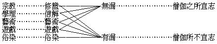



僧伽正所宜志之业，仅为学理、宗教、艺术、游戏之能摄归无漏宗学者，则为化俗方便之威仪、工巧、神通、妙辩等。宗教、学理之外道有漏者且非所宜志，其五欲俗染之专为有漏，必超然远离，更可知矣。故僧伽首重乎无漏僧律，而僧律之特殊处，即在完全摈除俗染。虽支持身命之不获已条件——若衣食等——，亦不令稍存爱欲。婬欲之全绝，更不待论。故三学虽通除诸漏，而戒学专除俗染，定学专除游戏、艺术之有漏者，慧学专除宗教、学理之有漏者。定慧依戒为基，非除俗染则无僧戒，无僧戒则无僧之定慧，故不除俗染则唯俗而无僧。今世耽妻室、甘食肉而号为僧者，应知其实非是僧也。僧者唯其能以无漏之业为志业，故名僧宝，僧宝然后乃能胜宏法之任，尽利人之职耳。因能宏法利人，则资持身命者即在其中，亦更无待他求矣。是谓能成职志一致而粹然成为佛教僧伽之人格，须先有此修养之僧宝，为佛教的国际组织之根本。



乙、当统率信徒组成有秩序之国际团体尽力於宏法利人也　不能统率信徒则团体之力不充或乱无秩序，则其内先无以立，更何能宏佛教化以普化世人耶！不能宏法化人，则虽能信修胜业，独善自利，则唯志无职，於职为未能尽。上辜负於佛恩，下逋欠於人债——若藉人之衣食为衣食等，即俗谚寄生虫是。故欲尽僧职，必须宏法利人，欲宏法利人，必组成有秩序之宏大团体，而必先之以善能统率信徒使不凌乱散漫。诚能有僧宝之人格为中心，则信徒之精神自然能团结，而佛教国际组织之大团体即不难实现，故前为根本而此为后得也。



夫佛教僧伽在今世所负之责任洵闳矣，果能於此二者深察笃行者，则不唯佛教可普及於全世界人类，而人世和乐亦将奠基於是焉。五万万佛教徒其勉旃！千餘万僧伽其加勉旃！



（见海潮音七卷第一期）



以佛法解决现世困难



一　告强资阶级



二　告贫弱阶级



三　告摧残道德文化者



四　告保持道德文化者



五　告毁坏佛教者



六　告佛教内外护



一　告强资阶级



余昔年有云：今后人世之危厄，不在国际之强权阶级的高压与争霸，而在弱小者对于强权者之联合报复；不在民间之资本阶级的垄断与竞胜，而在贫困者对于资本者之联合抗斗。今则此种形势成矣！国际之弱小者与民间之贫困者，已有猛火燎原、虎兕出柙之概；强权阶级与资本阶级，已处全体崩溃、四面包围之中。然予又尝谓唯佛法能救此危厄，虽未为当世人士共同注意，协力谋济，以致卒来今日之险状，但强权者与资本者及今能有澈底之觉悟，犹不难化险恶为祥和也。其法维何？则根本上破除悭贪自我权利之私见，激发自他同体、无我、平等之慈悲，实行我佛之布施与忍辱而已。



然行此三种布施，若非更济之以忍辱，则未能有恒有成也。盖贫弱之民众，愚蒙少智，怨愤蔽心，虽广慈爱，或反招来横逆，虽加悯济，仍莫戢化粗暴。如躁进以求功，遭辱恼而难忍，必致疑毁交集，猜忌相乘，不能竟厥全功。故须以大悲深慈，不辞劳怨，不避讥毁，逆来顺应，苦来甘受，持之以不屈不挠之坚忍，乃克有济也。



强资阶级，若能以觉悟心发无我之慈悲，以忍辱心行平等之布施，则不招反动之破坏，得成调和之建设。一切精神物质之文明成绩，共同享受，则群众既安，自身亦宁，实为人道之福利。否则、奋其私智，相激相斗，仍循损人利己之旧辙，不徒必自倾覆，人类高尚之道德文化，亦随之澌灭矣！何去何从，愿强资阶级、有以自择其宜耳！



二　告贫弱阶级



三　告摧残道德文化者



亘古亘今，无东无西的道德文化，在以前虽仅为少数高尚人哲之受用，而不澈底普及平民——此儒家所以有「礼不下庶人，刑不上大夫之说」——；亦为少数富强阶级之利用，而或反致遗害平民——此道家所以有「窃钩者诛，窃国者侯」；「侯之门，仁义存」之说——。然此为人智程度未到平等所生之恶果，非道德文化之本身有此过咎也。人类有向上发达之精神，有进化为真美善人类之精神，有由人类进化为超人类之精神，此种人类倾向进化的精裨，万无可以遏抑抹煞之理由，亦无应当遏抑抹煞之必要。在此种倾向进化的人类精神上，关於人类衣食住之物生活及家国世之社会生活，虽亦为基础的条件——若所谓富而后可教等——，然其最可尊尚贵重之要点，固决在乎道德文化也。且道德文化之出发点，虽在少数先哲内心修养所成之果智，不同科学在於众人根境相对之常识，致成以哲智为标准之文化，及成由超平民而施设及平民之文化，其获真实受用者，仍在少数超平民之哲人，而未成一般的平民化；且或为似是而非之圣帝明王利用高压平民。然以今日之人智程度反观之，科学文化亦何尝不如是耶？科学的理智，岂不超於一般平民的常识，而别成所谓科学家之学者的知识耶？岂不亦尝为强权资本阶级利用为绿气砲以杀平民耶？然既知此非科学文化本身之过咎，而由科学文化未能普遍，且为少数野心家利用之所致，则何独於先哲所遗道德文化不能作如是之谅解耶？故若因此而摧残道德文化，则亦应摧残科学文化，其关系上同有此之过咎故。若不因此而摧残科学文化，则亦不应摧残道德文化，其本身上同无此之过咎故。故为今之计﹐但应一方面普及科学文化，以谋全人类物质生活、社会生活的自由平等，一方面普及道德文化，以谋全人类社会生活、精神生活的自由平等。人类丰富的生活是多方面的，不应偏执一方面以摧残一方面也。普及之途径，虽有改革现在处於强权资本阶级压迫下的社会制度之必要，然应认清先哲所遗道德文化本身的真相，条理整顿其适合於人类向上进化之精神者，随时势之演化恳切提倡普遍推行而已，非革除不良的社会制度，即须摧残道德文化也。



或谓先哲所遗之道德文化，已成过去时代的死文化，虽有可宝贵之处，当视同夏鼎、商彝，收拾到古物陈列所以供考古家之研究。而残留在民间为现代文化发展之障碍者，则必当摧陷廓清以扫除之，何可使之蔓延普及，使文明的现代退回野蛮的古代耶？曰；凡事理诚有有时代性者，然亦有超时代性者，若二加二则为四之数理，过去如此，现在如此，将来亦如此，岂以其过去曾如此故，而现在将来则不如此耶？道德文化中：一、以人类生存於自然界为基本者，二、以全人类互相生存於人世为基本者，三、以人类欲进化为超人类之精神为基本者。换言之，即个人进化的道德文化，世界大同的道德文化，全宇宙进化为真美善的道德文化。此则苟人类犹生存继续，不论人类的物质生活、社会生活已变化到如何程度，现在及将来为如何时代，固皆应使一般人民共同其享用，此如太阳、空气一般，不得以时代为之限也，随时代而变失其功效者，亦拘于各个国家民族时趋习尚者而已。然就时代性言，尤大有研究之餘地。道德文化的时代，固已为过去的时代，而现在与将来，即完全不需有道德文化，不复成为道德文化之时代耶？以吾观之，则近代虽曾蔑弃道德文化，然今后穷变而通，当更进入道德文化的时代耳。何者？由西洋宗教革命以来，人类渐蔑视道德文化，一变而为重视法治的文化。法兰西革命为其中心，屡次以要求立法权、参政权为急务，至今日全民普选政治为尽头路，虽走到尽头，仍未能满足人意也。由西洋工业革命以来，人类更蔑视道德文化，一变而为重视财产的文化，俄罗斯革命为其中心，亦渐以要求共产均财为急务，今虽未走到尽头，意其走到尽头路时，仍未能满足人意也。抑又可知：人类之重视点，降低至专在物质生活的财产上争斗，亦不过以此为人类优美生活的基础，先奠定此基础而已，非以此为进化之终点也；则财产的物质生活奠定之后，必更进为要求美善的社会生活，真善的精神生活，亦可推知矣。则虽谓今将由法治与均产的文化，更走上道德的文化之时机已迫近可也。虽由近代重视法治与均产之两次革进，可涤除道德文化以前为强资利用之污点，及可由之使道德文化普及於人类，则相反之固以相成。当整理出真正的道德文化，以为人类公共普遍之受用，岂可为摧残破弃之行动哉！



四　告保持道德文化者



前告摧残道德文化者中，已明道德文化之性质，则道德文化之本身，纯洁无过，应可瞭然矣。於是而犹有摧残者，当然须有保持者以保持之。然欲谋保持，务须认清超时代性之真道德文化，适应现代时势以谋其保存。一、不可将前代利用道德文化之污点——若帝王权力所托命之上帝天神教等——，误认为道德文化而加以保持。不惟不可保持，且须迅行择出除灭之，以免其虱於真道德文化中，致招其牵连之害，玉石俱焚。二、速须择道德文化中适宜於时用者，浅明开众、降低其文义程度，普遍宣传，务令人人了解，唤起群众之热心拥护，乃有可救也。然道德文化，亦须切於现代人生之实用，乃能为现代人生之活的道德文化，不同残留之僵石，而为人身血管中热流之血液。道德文化，不外慈悲为体，方便为用。当以大慈悲心详观谛审，察今世人类所需要之道德文化何在，随顺其欲而令得入之方便何在，所当挽回者何在，所当补救者何在，然后渐次阶进，成效斯著。此则有心保持道德文化者之责，勿空言以保持道德文化为号召，不发真切慈悲之意，不求适宜方便之行，徒以陈腐死板、违时鸣高为保持，则愈招反动之摧毁，名为保持，实销灭之矣！慎之！勉之！



五　告毁坏佛教者



今之毁坏於佛教者，若徒为非理性之盲动，无理可言，则吾人固不能再有讨论之餘地。设以其毁坏佛教为有理由者，则吾人固得据其理由以诘之也。兹且出其所持为毁坏佛教之理由，一评判焉。



一、谓佛教是迷信之宗教，值此科学发达人智进化之时代，故当与一切迷信同排斥之。夫佛教固为世人以宗教著称，以佛教亦不辞自居为宗教之一，虽佛教徒不无自辨佛教为非宗教者，其实当来考其真相，不必於此名词上争是非也。大抵迷信之宗教，一在於可能证验之外，信有一神、多神之神，造作或主宰於人世。二者、纯用感情之服从，而丝毫不容理智之抉择。据此而云宗教，则佛教固决然非此迷信之宗教也。若以由人类修学结果，凭其理解上、经验上之所证信者为宗，为悟他故而施设声名文物之教化，据是而云宗教，则佛教固不得不谓之宗教也。且人心不能都无所信，非信皆迷，特无可证验不容理智之妄信为迷，而由理解实验所得之证信则当别为智信，不能等视为迷信。迷信当破，而智信不当破，不惟不当破，且正为科学等所求之最高智果耳。佛教者、由释迦牟尼修学之理解上、证验上所得最高「正觉」为宗，而施设声名文物以觉悟世人，使学其理解修习之，以同得其证验之最深智果者也。既为人之所能理解证验之最高智果，此正人类向上进化的心理之所愿求，岂能以其可名宗教，与其他迷信的宗教同排斥哉！



二、谓佛教麻醉人心，使人类昏惰衰退，违反於人生向前进化之本能，故须排斥之者。则此亦其餘迷信之宗教或如是耳，或佛教随一时一地一类人之暂时施设有然耳。梁漱溟君言：印度化倒退向后要求，亦言印度化非言佛教；或言佛教之暂适印度一时一类人之教化——若小乘教——而已，非言佛教之本身也。若佛教之本身，则惟以究尽诸法真实相的佛知见为宗，教化人人皆得究尽诸法真实相之佛知见而已。此真浩浩荡荡向前进趋於无上觉之牢强精进，乌可加以麻醉昏惰衰退之罪哉！



三、谓佛教之僧众——非僧众之佛教徒，则工农学商各事其事，当然更不成问题——，坐食分利，既不从事生产，亦不热心群众之事业，故当排斥之者。但僧徒不事生产，亦犹学生、教员之不事生产耳；其始为专精学业故不能从事生产，其终为专以教化社会故不能从事生产，虽不从事生产，不得云坐食分利；其劳於身心而利於社会者，既不亚於学生、教员，亦何谢於农工军政乎？至僧徒末流之币，不能尽社会教育之职，热心群众之事，则淘汰而整顿之固无不可，即改为半工半修、半工半教、亦无不可，终不能并佛教而亦毁灭之也。



由上言之，则佛教固无可应毁灭之理由也。不宁惟是，而佛教方为今后人类所需要，当亟提倡阐发宣扬之者也。何者？以前宗法社会则依迷信的多神为所本，帝国社会则依迷信的一神为所本，而今后的人类平等自由社会，既经摧陷廓清以上多神、一神之迷信以后，不以发明诸法——宇宙万有——独立发展和合增上之佛教为依据，将何所依据乎？故佛教者，为今后人类平等自由之所本，而人类舍此无以成立真正自由平等之社会者也。奈之何而欲毁灭之耶！



六　告佛教内外护



关此一端，吾昔年尝论及之，兹录於此。



（见海刊八卷三期）



从世界危机说到佛教救济



——二十年夏在华北居士林讲——



我是研究佛学的人，对於世界上的政治和经济都无研究，可是今天所讲的题目内容，涉及世界上的政治和经济的地方很多。以研究佛学的人而来讲这些话，似乎是不合宜；但是、佛教是救世的，是依世间而建立的。佛经上说：「佛法以世界众生为依」；又说：「佛法在世间，不离世间觉」。反过来说，没有世间，也就没有佛法，佛法与世间，有如此的密切关系。但是、医生治病，必须要对症下药，那麼、依佛法去救济世间，也必须先诊察世间众生的苦恼，烦闷的危机之所在，他需要佛法的那一方面，然后依佛法来作切实的救济，这才得到功效。这救济不仅对於人类，是广而至於一切一切有生命的有情。不过、现在且就人类的社会来讲，因为有了社会的组织，社会上便有了治乱消长，更增加种种的痛苦，因此、便谈及「从世界危机说到佛教救济」的题目。此中所说的现代世界的危机，以及佛法的救济法，是就我个人所见到的，来供献给诸君，还请诸君加以严正的批评！



一　世界的危机



现在先将现代人类的痛苦烦闷，或是已显现的，或是初发动而将兴未艾的，种种前途可怖畏的危机加以分析。如果广说起来，按空间的分别，就有各地、各国、各社会的种种差别；按危害的种类来说，若天灾，若人祸，若内部的冲突和变乱，若外来的侵略和迫压，种种的痛苦也是擢发难数的。所以、现在只能就各民族、各国土、所有已成为普遍性的世界危机，把他总略起来分为三段来说明。



甲、经济恐慌与劳工失业　在前年的前半年，日本的实业界起了很大的恐慌。然而那只是一国的情形，还不足以影响到全世界。但是在前年的后半年，为全世界中心的美国，经济界上也起了很大的变化，如银行的倒闭，股票的跌价，金价的腾贵，这种情形是很快的影响到全世界去。欧洲、亚洲等国没有一国不受波及的，不多时便成为普遍的世界经济恐慌的现状了。推究这种现象的原因，固然很多，但最主要的、便是由全世界中心的美国发生变动而引起。如果这种种的情形不在美国而发现在中国，那只成为一国的问题，决不能影响到全世界。美国是现代工业国家的魁首，尽力研究其出品的精良和销售速率的增加，然而先决的条件，便是在世界上取得商场，然后才能推销，令所造成的物品流畅无碍。可是、因为机器的日益灵巧，新起工业国的日增，以致出品太多，无法推销。譬如人食物过多，消化不良，反成了一种病态。如是货物不流通，金融也因之而滞塞，所以反成了经济恐慌之最大原因。又加以劳工失业没有购买能力，也成为货物不能推销的重大原因。可是、资本家及工厂主的救济，是危险的方法，便是使工厂的范围缩小，减少劳工；於是劳工失业的愈多，而经济的恐慌也就愈趋愈下了。至於所以构成现代的情形的，就是因为科学的发达，机械的发明。如机械没有发明以前，用五百工人所作成的事，现在用一个人就可以完成了。在工作方面说，固然可以减少四百九十九人的劳力，在工人本身来说，便有四百餘人的失业。又从科学的管理法发明后，连一分钟的浪费也没有，而劳工的失业於是又因之增加；复因劳工的失业以致购买力愈加减少。有这种种往复的关系，所以经济的恐慌，才陷於不能避免的危机。自前年以来，这种恐慌已遍满了全世界，虽有许多人在研究救济的方法，但是直到现在，不但不能有了解决，并且还在极严重的趋势中！如果再不设法救济，恐怕前途是不堪设想了。



乙、阶级斗争与殖民地革命　阶级斗争与殖民地革命，也是现在世界上普遍的现象。阶级斗争在中国尚见不到的，在工业发达的国家，经济力集中在少数人的身上，而此少数人以雄厚的资本为基础，更可操纵一切、垄断一切，更可将多数劳工由劳工所产生的成绩据为己有。於是、那些资本家，不劳而获所得的甚为丰富，而劳力的工人的生活却是朝不保夕，如此、便形成资本与劳工两种各趋极端的阶级。因为两方面的利益，绝然相反而时起冲突，於是社会主义者便提倡阶级斗争。所以、在去年德国、美国以及意大利等国，各处全有失业的劳工团体时起暴动，而各国的政府也无法阻止。复次、自近一二百年来，世界上有许多新兴的工业国家，用政治的手腕向国外发展，使那弱小的国家成为自己的殖民地或半殖民地。一方面采取其地的出产以为工业的原料，一方面以该地作一个商场以推销他所出产的物品，而用极大的海陆军作他商场的后盾。於是、世界上又分出两种的阶级：便是帝国主义者与殖民地的弱小民族。所说的半殖民地，如美洲南部各小国家以及中国，多半是由列强帮助设立政府，他们国家的名义上虽然是独立的，可是国内的一切动作，大多是受列强的支配。近来各殖民地的人民，已有了觉悟，何况列强感觉国内经济的恐慌以及劳工失业的暴动，更向各殖民地攫取非分的利益以救济国内急迫的危机？而殖民地的人民，本来也同时感受了经济的恐慌，更加以列强极高度的敲吸，於是各殖民地的民众，不满意於他们的政府，争起反抗，革命现象日接日厉，也就成为现代世界普遍不安宁的情形了。



丙、世界第二次大战的酝酿　现在离过去的大战为时不久，很多的人亲尝到战争的痛苦，再不愿有第二次不幸的世界大战发生，所以想出种种的方法来作种种的和平运动与宣传。然而，也是因为见到第二次大战的危机正在酝酿，所以才有这先时的预防和制止。这种战争酝酿的原因很多，但就最显著的来说，欧、美列强国际与俄国第三国际间的对峙，在前几年俄国还没有和列强竞争的力量，在近一二年来，乘列强受经济恐慌和劳工失业的机会，用国家的资本把本国的工农业品低价出售，在商业方面与列强一极大的抵制，使各国的货物无法销售，破坏列强的商场；这种情形，已日紧一日了！比如日本以中国为商扬，而俄国则将他的货品贱售与中国，那麼日本所得的利益就大受损失。又如英、美海军的竞争，虽说缩减军备，而他的海军确是有增无减、扩张无已。还有法国与意大利，在地中海与欧洲大陆的争霸，也经过多次的危急冲突。德、法的世仇是愈积愈深，他们的胜负时有起伏，所以、在去年德国受了经济的恐慌，而有民族社会党及共产党起而作停止赔款的运动。又如太平洋的经济范围之下的美国与日本，於利益上的争夺，当然时有冲突的可能。各方面几於引起战争的事情，虽是竭力的避免，可是同时又极力的准备军事。凡是以上所述的种种事实，全是能引起第二次大战的线索，而事实上又是无法获免的。



二　危机的原因与结果



这种事实的现象，并不是偶然的，是由许多原因所构成，总括说起来有，三点：



甲、知识的偏蔽：推求现代全世界上所有的痛苦和烦闷，不能不说是由於知识的偏蔽所构成。知识偏蔽、最初是由十字军的战争，西方民族与东方民族接触以后，因为东方种种的新发见，引起欧人科学思想的复活。此后，经文艺革命、宗教革命以及政治革命、工业革命，差不多在十八世纪乃至十九世纪的时候，科学的知识才到完成的时代。一般人受了科学的催眠，认为唯有用科学的方法所得到的知识才是真实正确的，除此以外，所有的知识完全是「非知识」。於是、所有人类的聪明与才智，全用之於科学上面，处处不离科学的窠臼。科学的知识日益强盛，而其餘一切的知识，也就因之一蹶不振。由科学的畸形的发展，起初不过对於自然界的现象加以研究、及实验怎样才能取之为人所利用，由科学的应用而有种种机器的发明，如先用人力的代以煤力，更进一步而用油和电力。因为机器愈发明愈灵巧，於是世界便成了机械的世界，而人工的价值完全失掉。不过、这时候的科学，只是研究自然界的现象，以及应用在工业方面。既而科学的势力日益扩大，便伸张到社会的人和思想方面来，如社会学、心理学等，没有一样不是科学化的。科学本来以物理学为基础，可是、后来进而到社会、伦理学等，也无一不依科学的方法来整理和组织。所以、在这种情形之下，社会不过是整个的机器，而人生不过是等於机器中的一个螺钉而已。



乙、恶行的恣肆：运用科学的知识，不过是对於其他的国家社会乃至对於他人——就是对於我的对方可以操纵，可以控服。然而、对於自身方面的善恶行为，却是无法进善去恶，自己的欲望也是无法节制升化。因为、科学的本身是向外的，如同人的两个眼睛只能外视而不能内视。所以、建立在科学知识上的行为，是纵欲的，害他的。这种恶行，若是在国家方面表现，便是侵略的帝国主义，也就是以害他为立国精神的；如现代的列强，不惜用种种的手段来亡他人的国家、灭他人的种族来利益自己。所以、我们可以说：他那军备的强胜，财富的充实，完全是建立在那所灭亡国民身上。这样、与那虎食众兽之肉以肥自己的身体，又有什麼区别？要是在各人方面表现，便是各个自由发展的竞争主义，也就是不利他的企业宗旨——就是凡我自己意志所要作的事，毫不顾及有利於他人与否，但以满足我个人的欲望，以贯澈我自私自利的宗旨。科学的发明，本来是为减少人类的劳力以增加人类的享用，可是、由恶行的恣肆的结果，反得到较以前科学没有发明的痛苦更深厚了！这因为科学的发明，仅作了少数人纵恶的利器。



丙、恶行的反响：从纵恶的结果，成了两种的反响：一种、是强霸的侵略与弱小民族的反抗；强霸侵略就是帝国主义在帝国主义侵略之下的弱小民族，不得不起而反抗。反抗的初步，就是不供给原料，不与作商场，於是帝国主义者便成了货物不流畅、与经济恐慌的情形，促成国际阶级斗争的导线。又一种、是财产独占而劳动民众反抗；由各人竞争的结果，财产为少数人所据有，形成有产阶级与无产阶级之对抗，而成为资本国际与劳动国际的斗争。所有的这两种结果，可见是由於知识的偏蔽与恶行的恣肆，而成为世界上普遍的危机了！



三　佛法的救济



世界的病源已然诊察过了，所以、最后一步，就要说到佛法的救济，可以作三段来说明：



甲、思想的解放　在欧洲以前，欧美各国全认为除了自己的近代文明，则别无其他民族的文明，除了自己的近代科学知识，别无正确的知识。这种偏蔽的思想，直到了大战以后，才有了很大的变化。许多有远识者，知道科学文明并不是圆满的，究竟的，是应当进一步而求更圆满的究竟知识。他们有了这种虚心，实在是思想上解放之光明。所以、以后对於亚洲的文化以及古希腊的文化，重作细心的研究，以致现在新兴的社会学的思想，已与从前有显然的差别。就是以唯物作根据的社会学及思想，还是大战以前思想的产物，与现代思想已有许多不合的地方了。要知道，科学的知识，不是人类唯一无二的知识，而是知识中不可缺少的一种。因为科学是向外发展的，即或说科学可以控制自然，但对於自身行为的改善，和内心的修养，是毫不发生关系的。所以、就东西洋的文化研究起来，还有两种知识：一种、就是中国古时儒家所有的道德知识，和西洋古代苏格拉底及柏拉图等的哲学知识；就是不但要发展自己，还要根本改善自己。如中国儒家所讲的由格物所致的知，是要用之於诚意、正心而来改善本身；西洋的古代哲学，也是要使人做成合理性的人。所以、就道德知识言，实在是「只有科学知识者」梦想所不能及的。还有另一种知识，是比它更根本的，就是在我之外的非我，和非我以外的我，在这我与非我之间，是如何的成就？如何的生起？如何的联络？澈底推究，知道我与非我的对敌形势，要是终不得到解脱，不能得到澈底的认清，是终究不得了的。所以、对於我与非我，要求澈底的明了真相，要求澈底的解脱，这便是第二种的「解脱的知识」。所以、在新近研究世界文化者的结论，便是这第二种的解脱的知识，才是最圆满最澈底的。但是能完成解脱的知识的，要算佛教的知识为最究竟了。所以、根据佛教的知识来救济全世界的危机，是极其澈底而不像其他的知识的偏蔽与缺陷。



乙、美德的确立　美德是对於恶行说的。在恶行的恣肆上，善恶的标准已然失掉，所以现在要将善恶的准标重新确立。可以分作两方面说：一、就是「无自体的缘成义」：无自体是空义，缘成是因缘生义；连合起来，就是一切的事物，不过是由种种的关系条件组合成功的，而完全是空无自体。这道理是极其普遍易知的，如一个国家或一个家族，乃至於一个人身，那一种不是由种种的关系条件所组合成的？而在组成的种种条件中，有那一种条件是其中的决定的自体？又如物质分析到最微细的电子，说到它的光、热，数量、时间、空间等等的关系，还不是众多关系的集团吗。所以、佛说一切法，全是「众缘所生，空无自性」。而且、在那众缘和合中的众缘，都是刹那生灭，没有一个时间是停住的，不过在那众缘和合、生灭相续上的假相上，幻有人或物的形相。何况凡物虽是众缘和合所生，和合中的众缘也是众缘的和合，如是重重相关，与其他的团体是互遍互通的。所以、在缘生的假相上，似乎有自他的分立，而在诸缘互相普遍、互相贯通上，实在是自他互融。因此、要利自而害他，他既受害而自也不得利；必定要利他，才可以自他俱利。从这「无自体的缘成义」上的「自他不二」，是很坚确的道德根据。二、就是「唯识现的恒转义」：若内若外，所有的事事物物的表现，完全不离心力的转变与自识的觉了，所以说：「一切法唯是识现」。然而自能现的识上说，是刹那生灭的，是无常的；但是在生灭相续不断的意义上说，是恒永的。知道这种「唯识现上的恒转义」，就可以知道人类社会所有的治乱兴衰，完全是自识上的生灭相续不断的现象。不过、在这前后相续上，是有因果的关系的；前一际行为的善不善为因，能得后一际的善不善的效果。这是显然易见的定律。依著这种唯识现的恒转因果义，可以打破恶行的恣肆。因为、恶行者以为要达到善的目的，无妨用不善的手段；然而、这样目的和手段，既是两种不同性质的东西，当然没有丝毫的连络的可能，何况在因果必然律上，决没有由不善的因得到善的果的道理！所以、佛法说善的定义有两种：一、是自他皆利；凡是利自不利他，或利他而不利自的行为，是不合乎善的定义的。二、是顺益二世；凡是益於现在而不益於将来，或益於将来而不益於现在的，也是不合善的标准的。若具足自他兼利与顺益二世的条件，方是佛法之善的行为。由此对於真理认清后而发生信心，才能决定依著所认清的真理去实行。



丙、至善的实践　自消极方面说，以不害他为过渡，这是佛法中的小乘行为。以这种绝对的不害他的精神，用在政治方面，就以自治自卫做政治的方针：对於自己的国家里所有的军备和外交等，在不害他的范围以内，以谋自卫自立。因为、现代的列强，皆是以损他益己为政治的方针，所以、常常因为利益上的冲突，便以刀兵相向。在这种情形之下，不有自卫自治的力量，不足以生存。不有不害他的标准，也就卷入相争相夺的漩涡里；持定这种态度以自立，等到列强相争相害乃至於疲乏厌弃的时候，恐怕还要尊重这以不害他而自卫的国家为先进者呢？在经济上、是以自产自给为原则！因为、现在各国的工商经济等，其重心完全倾向在外，所以、任何一国有了变动，其餘的便都受了影响。如果以自产自给为原则，於自给之外，所餘的可以自备灾难时的救济，更可以帮助其他的国家。如此、则虽有一国发生困难，也毫不足以影响他国，而一国的富裕更可随力的帮助他国。



然而、这两种原则，不过是过渡时代的救济方法，究竟的方法，仍然是以积极的利他的大乘行为为正确为澈底。不过、在这完全以害他为手段而图自利的情形之下，不得不以不害他的方法为过渡。所谓利他的究竟行者，如大禹的治水，是为救经所有的被灾害的人民，但是所有的人民不再受洪水的侵害，而大禹的个人，也就得到了安宁幸福的生活。所以、现代以灭他人的国家来充实自己的实力者，实在不明宇宙人生的大法，也就是违反了因果的定律和自他的关系，以致愈求和平而和平愈不可期，愈求幸福而幸福愈不能得。所以、必定要依真理去作，必定要将所有的政治经济，皆以全人类的利益为前提，而自身自国乃至於自种族的利益，也就建立在人类的全体的幸福中。



（金书琴．金小琴合记）（见海刊十二卷九期）



中国近代之民族生活



——十八年一月在德国耶纳城讲——



中国民族之历史太长，此云近代，姑断自千年间之赵宋以来。所云中国民族，自然指汉族而言，但后来已被汉族同化之蒙古、满洲、回回族，当然也算在内。此千年间之汉族，虽在政治上曾被蒙古族、满洲族统治三四百年，有过元朝与清朝两朝代，但於赵宋以来之汉族生活，并未有多大变更；而且於一部分蒙古族，及全部分满洲族，还被汉族同化，而成为更广阔之中国民族。然至近今数十年，则固受欧美民族生活之影响，已起极大变化，故此近代之中国民族生活，当更析为近古近今之两个时代以说明之。



一　近古之中国民族生活



经过唐末五代之乱，进入赵匡胤统一中国之宋朝，承袭以前之中国民族文化，演成为宋、元、明、清之中国民族生活。兹分数条述之：



甲、民族之心理　中国民族从汉朝以来之国家、政治、人民、教育、社会、伦理，皆统一於儒家文化之下。上古各种祀天神、地祇的遗风，则与求长生不老者混合成道教。汉末佛法传入，一天一天发达，先后引起道教及儒家的排斥，经过六朝、唐朝、五代、至宋朝，有了好几次摧残。然终以佛法的理论深广，及方便迁就，且产生了「直指人心见性成佛」的禅宗，应用诗歌俗语及疑问反究，以普遍深入一般士夫及齐民之心坎，於是宋朝以后的思想界，遂皆以禅宗为共通之底质，分儒、释、道三教的门户於其上。宋朝以来的佛教各宗派，固无不以禅宗为核心；即宋朝以来，为教育、政治、伦理中心的儒教理学，及主张性命双修的道家，亦无不以禅宗为基本。至多数农、工、商的通俗心理，表现於寺庙、戏剧、小说、庆吊之间者，则无不成为三教混合之状况。故此时代之中国民族，成为三教融合的心理，而思想界亦成为佛以修心，道以养生，儒以治世的调和。



乙、社会之组织　中国近古之社会组织，固然亦从中国古时代所逐渐形成，大约可分为三个级阶：一、皇族与文武官吏的治者阶级，视国家为皇族之物，而文武官吏佐之以掌管国家政治。二、儒士、僧士、道士之士民阶级，则处於治者被治者之间。於中儒士掌国家及社会之教化，且为文官之所从出。僧、道著重於寺院内之修养，而亦分担社会教化之一部分。三、农、工、商、民，则完全为被治被教化阶级，而一方则为国家官民一切生计之所从出，於中农民尤占重要。所谓官出於民，民出於土，而工商则比较轻微。以上即分构成人群生活之政治、教化、经济三要素为三个阶级，互相依倚连合，以成为国家社会之组织。可撮为一表如左：



　　　　国家──────┐　　社会  

　　　　　│　　┌──────┴─────────┐  

　　　　皇族　　文武官吏　　　儒　　道僧　　　农工商



> 政治阶级教化阶级经济阶级



国家既等於皇家，以皇族为主体，遂除受皇族俸禄以佐治之官吏，及官所从出之儒士与国家有关系外，其餘僧、道、农、工、商、每视为与国家兴亡无关，故容易为蒙古、满洲等异族君临其上。然原为农、工、商或僧、道者，亦有起为帝王或文武官吏及儒士者，故实无固定之贵族阶级。然一起为帝王、官吏、儒士，则即转移其帝位，而非复僧、道、农、工、商，故仍得为此三重阶级之分配。



丙、民族之重心　中国此时代民族，具有坚强伟大力量之重心，乃在儒家教化及农业经济所结晶之大家族制度。儒来之教，以亲亲为本，由本身而上及父祖曾高，下及子孙曾玄之九族，旁及姻戚，皆有通财共财之义务；加以产生之基在农业，更易成「安土重迁」，「生恋田园，死正首丘」之风习。即游宦经商者，亦以田间为归宿，遂无不以承祖宗传子孙为人生最大之事业。无论何人来作帝主，但能适合於此民族之精神者，皆不难施治，否则、必骚乱无以安。蒙古、满洲族之能为中国之帝王者，以此；蒙古、满洲族之被汉族同化为中国民族者，亦以此。无论何教，能迁就此民族精神者，皆易施行，否则、必引起排斥。佛教僧伽在中国，失去原来之教团组织，变成一寺院一寺院之变态家族制度者，以此；天主教、耶稣教在中国，曾引起极大之暴动反抗，亦由不适应此民族精神之所致。



二　近今之中国民族生活



此云近今，断从八十年以来。此八十年为中国民族生活、受了欧美民族生活之影响，发生重大变化时期。今后当变化为何种之民族生活，殆犹难说，然试将此期已变迁事势略述之：



甲、民族重心之转移　西洋人为传教及通商入中国者，由来已久。然前此皆迁就中国民族之生活习惯，不敢立异。惟自中国与英国鸦片战争失败，订条约，许通五处商埠，欧美人之相继至华者，遂日多一日，渐渐喧宾夺主。除割地、赔款之外，更有租界及领判权，与关税权等主权之重重损失。即传教者，亦无不挟其国威以俱来，以外来传教士为主体，设教堂，立学校。为中国民族重心之儒化，本包举国家政教、与家族伦理，而至是均渐为摇动。一方面有明悉欧美之政教者，主张变法；一方面有反抗欧美势力侵入之义和团举动。逮义和团失败，遂完全承认仿学欧美之军政、法律、教育，而分为君主立宪之改良派，与民主共和之革命派。由革命派占胜利，而有中华民国成立。然国家之政教虽变更，而儒化最深之家族伦理犹保存。近十年来，欧美留学回国者，提倡新文化，尽量输入欧美各种之民族风习，家族伦理，遂亦从根本上崩溃。或於国外之任何学说，任何主义，皆漫然引进。或於国内之先秦诸子，与汉、唐、宋、明来各家之学与佛法各派，及道家变形之同善社、道院等，无不泛然杂出，各欲凭其所主张者以争易全国之势。三年前之六七年间，在中国大抵可看为欧美俄各种西方思想与佛学纲领下各种东方思想之对流时代。近二年，则共产主义在国民党掩护下，有震憾全民族之势。至最近一年，渐呈稳定於三民主义之趋势，然民族之重心，犹未能成立。



乙、社会组织之变迁　由国内数十年来，满族君治丧权辱国之反抗，及欧美列强民治发达之羡慕，迫使革命以成立民国。皇族既除，国为民国，而非复皇家，当然为社会组织之一大变更。然其始不过文武官吏与儒士之变更，其国家政治之办法，虽号称民国，实则为文武官吏及一部分士民政客之国，而与大多数农工商民无与。民国六年以来，由大小军阀无形割据，迭兴战争，互为消长，文官政客惟以奔走其下、拨弄其间为生活，可谓之军官国。由此兵匪滋蔓，灾荒连年，有民不聊生之叹。然另一方面则以华侨海外经商回国，及国内新式大商业兴起，加以军阀、官僚、政客，亦仰商界为财政通融之处，商人团体之力量渐增。每逢战争，亦往往能呼号和平以左右其间，甚至一时有设立「商人政府」之议。又近十年来，学生团体尤为有力，时作种种政治社会之运动，以为工商团体之领导，亦曾有设立「学生政府」之说。加以在外国及本国资本家所设新工业机关下工作之工人，亦日见增多，渐形成各种之组织，海员工会、铁路工会等较为有力。此商、学、工之组织，皆近於欧美社会之新式组织者。惟最大多数之农民，既无教育知识，以成立新式组织；然在兵匪灾荒中挣扎，又不能不谋自卫之道，於是从旧来小说戏剧中所表现似是而非之教，混合心理，成为神秘结合，若红枪会等之组织，亦能成为社会民众之一种力量。近来国民党组织国民革命军，欲为国民党领导军人及全国有组织之民众，共行国民革命，遂大呼农、工、商、学、兵联合起来。然土广民多，交通未便，农工商业均未发达，且未施行义务教育，致尚未能镕化家族乡土之隔碍，造成个人单位之强健分子，合组为国效命之民族战团，以变为近代欧美之国民组织；然今亦已有不得不趋向於此之形势。



丙、民族心理之更换　近古三教调和之官士心理，虽尚潜流於一部份人士间，成为道院等之组织，然近亦加入耶、回成为五教调和，或加入其餘一切宗教成为万教调和，非复旧来之性质；而大约近於去年日内瓦所开万国宗教和平会之运动。近古三教混合之农、工、商心理，虽亦尚潜流於一般未受学校教育之男女间，然稍受学校教育之男女，则已有不信教，或改信基督教之变动。然全国人民以历年来内讧外患之逼迫，近代教育文化之灌输，民族意识与国家意识渐渐发达，形成为爱国、爱民族心理，大多认欧美自然科学，社会科学，为今日中国民族之圣药，而对於欧美各派哲学，亦有相当兴趣。然真正佛法之讲求，既成了许多研究或修养之团体，而对於中国先秦诸子、及中古近古之哲学，亦分别研究。其餘则古书之考证，古文学艺术之探讨，亦有相当成就。今后之中国民族心理，其将吸收东西两半球，古近五千年各种民族之文化，陶铸为中国民族新心理，以为刱造世界文化之发轫。因为、最能虚心容纳各种文化来研究的，恐无过於今日的中国人了。然要看中国民族今后之努力如何，兹犹未能必之也。



三　结论



今以地球上海陆空之交通发达，全地球已为近代欧美人自然科学之进步所征服。然人与人之间，则依各个国家之界域，造成各个民族战团，日相寻於扩充军备之一途，以求退可防御，进可侵略，而握得经济上、政治上之胜利，致随时可以爆发世界民族之大战争。故虽有进步，而离完善犹远。近来虽进行种种世界和平之运动，然要未有根本和平之办法。今中国民族固亦已有操练成民族战团、以应付此国际环境之倾向，然亦不能忘情於：向来以天下平和、人类完善之要求。但真能联合进步与完善为一致者，则唯发达人生以至成佛之大乘佛法最为圆满，此吾所以愿与世界佛学者，共为世界佛学之运动。



（余乃仁记）（见海刊十卷二期）



（注）考寰游记，地点及记者俱不合，此殆讲於柏林民族博物院者。



新中国建设与新佛教



——二十六年九月在北碚三峡实验区讲——



一　发端



二　新中国建设之趋势



三　佛教之特质



四　新中国建设与新佛教



一　发端



余今到此处为第二次。在五年前——民二十一年——曾来一次，晤卢作孚先生，承极尽招侍，并讲演「建设人间净土」。余所以讲此题者，以闻以往某一时期，三峡区范围，大半沦为匪区，不但当地人士不能安生乐业，且为他方旅客视为畏途。厥后经卢作孚先生等领导地方民众，肃清匪患，於是地方人士方有生气，由是生聚教训而建设生产与文化，所以、现在此地不但不为人视为恐怖区域，且就原地已经改造成名胜，及为川省种种新事业建设地，此在所表现之事实上可证明者也。故余觉佛法上所明净土之义，不必定在人间以外，即人间亦可改造成净土。虽人世有烦恼生死、痛苦斗争等危险，但若有适当方法而改造之，固可在人间建设净土也。现在重到此处来，觉在此四五年中，三峡区建设更为进步。如关於织染工厂，以前虽有而规模甚小，现在不但为本地冠，即在四川全省，其生产亦甚驰名；三峡区中建设事业甚多，此不过举其一隅耳。又关於文化建设方面，余适参观科学院，见有多种矿质乃在近数年中研究出者。此不独关系於四川，亦且关系於中国，将来於国力发展上，当有伟大成绩。是皆就所观见者而言；因此、现在的新三峡建设，可作新中国建设的缩影观。



然此新三峡建设固非凭空以出，乃就其原有而改造者，此有前后相承之关系。如在此三峡区中，有温泉寺、缙云寺等，皆为三峡原有佛教事业场所，设使此佛教场所，不能发挥佛教真义以适应新三峡建设事业，使三峡中亦有新的佛教建设，则此原有佛教场所当趋消灭。近年来、缙云山已设有汉藏教理院，缙云寺佛教场所，亦以新的面目而出现为汉藏教理院，与新三峡建设相调和；不但於新三峡建设上无所妨碍，且互成为资助，使新三峡建设更为充实完美。因此，新三峡建设即新中国建设之缩影；而缙云山汉藏教理院出现，亦即比拟於新中国原有佛教场所能本佛教真理为适合时代需要的佛教新建设。故今此一题，亦皆就目前事实推想而讲者。



二　新中国建设之趋势



甲、由内力统一到外患解除　现代新中国建设之趋势究为如何耶？余觉吾中国乃地大物博人众史远之民族国家，以中经多年变化，形成积弱不振之邦，以致屡受外力侵略压迫。其受侵略压迫之结果，即缔结种种不平等条约，束缚我整个中华民族。此於近八十年五口通商以来已然，而当国者复不知改进，国内机构，腐败涣散，失自卫力日甚。中山先生乃提倡国民革命，其主要目的，即欲将国力统一集中，成为一充实之力量，以解除外患；此内力统一之事业，由蒋委员长继承努力，至最近将完全达到。而外力为欲永久使中国在其压迫束缚之下，觉内力统一，可以抵抗侵略、解除束缚，与彼不利，故日本於我国内力统一将完成之时，特加紧压迫侵略；尤其最近不惜用非常横暴残酷之武力，对付中国，此实由现在新中国建设内力统一到解除外患的过程上必经阶段，故中国全国国民，在今政府领导之下，莫不一致与日抗战。如三峡过去为一匪区，欲走上建设之路，必须用武力扫除匪力。现全中国对日抗战，虽中国牺牲甚大，人民所蒙痛苦甚深，然为整个国家人民计，若中国能统一抗战到底，则最后胜利，必属於我，固不用其惶恐也！盖成一自由独立之国家，全在自身内力坚强而能抵抗或解除外患，如土耳其等所以成为今日自由独立之国，亦经与希腊战争。中国抵抗日本果获胜利，不但日本不能侵略，即以往种种不平等条约亦可解除，此为由内力统一到外患解除之一点。



乙、由农村建设到工商发达　通常以为国家之国防，唯在军事，但近代所谓国防，由军事设施至国民生产力，皆非常重要。若不能提高国民生产力，即不能建设庞大军备，故国民生产力为根本切要。然各国之生产基础互有不同，中国国民则十分七八皆务农，即工商等亦大都出於农村，农村果真兴盛，则生产力自然增加；中国近来特重农村改良建设，即是此义。此次来三峡，见三峡已成为乡村建设实验区，实即中国诸建设之基本。盖农民在农业上能改良进步，则购买力强，其对於工业种种需要自然增加而发达；至於商业，更不言可喻，而大都市亦随之复兴矣。虽近代文明为工业文明，提高国民生产力的枢纽亦在工业，故一切事业动作，群以机器代替。中国固应努力於工业建设，盖工业建设，为改进生产力提高效率最重要者。但中国大多为农民，应使从农业上足可维持其生活，若其生活不丰，则对於工商需要不能迫切，工商亦随之破产，故在新中国建设之趋势上，农村建设实为工商发达之基础。



丙、由政治修明到文化开展　以前所说，为由内力统一到外患解除，及由农村建设到工商发达二点，此则关於政治设施。苟政治设施渐已修明完美，则能提鍊几千年来中国固有相承的文化，及吸收现在世界所流行之文化，而建立为现代新中国之文化。由此趋势，则可达到常所期望「以建民国、以建大同」之目的。盖依中国历代相传「天下为公」之主义，扩大发展，不但实行於中国，且宣扬古圣贤文化，去改进全世界的人类趋向大同。



三　佛教之特质



甲、前作后受的因果之非偶然非外得的自力改造　佛教因果之说，往往为中国人民视作迷信之谈，实在佛法中讲的因果，乃为明显之事实及精确之理论。因果律亦适用於科学，不过范围甚广；现从比较切近者言之，庶易获益。佛教言因果，即通俗所谓自作自受，即前作如何因，后乃感受如何果，现在作如何因，当来定受如何果。故佛教讲因果，责任全在自己。然所谓自己，非限个人，从自己一人以至一家、一地方、一民族，皆可言自己。此一民族以前若作不善因，现在定受不良果；若想将来得好果，现则应改良思想行为，造作好的因。如中国以五六十年来曾屡有良好机缘，容许振作，固不应使现在有受痛苦之可能。但以前人思想错谬，虽早接触西洋文化，以无根本改进计划，唯认为购些军舰、大砲便足，致一误再误，现受恶果。而日本在前数十年乃同与中国受西洋压迫，至今日本不但不受侵略而且侵入。此盖日本有根本维新计划，故改造成世界第一等强国。故中国所以得今苦果，乃由於前人所造不良之因。不良因、在佛法上谓为无明惑业因，即昧於事理而发生错误行为；良因、即明事理共同正当行为。倘今仍续为下劣思想、散漫行为，则将来不但无良好结果，必更堕落！故佛法所说因果，全不迷信，全从各个人，各民族的思想行为上自负其责。绝非中国习惯思想上谓一切事皆碰命运，偶然而然，以之唯侥幸趋避；然亦非定命，可改造故；亦非以神等外力为造作主宰，使成此结果；亦非但由以前的种种历史相承。或周围的种种环境关系决定。所谓从因得果，重在自力改造，即凭自力而改造恶因果为好因果也。



适乃从人事上讲，从世间万有上讲亦如是。佛法不说万有以外有神；平常中国人迷信神者，随有何事即至庙中求神，此乃出於中国一般风俗习惯，因之、对佛亦认为众神中之一，此实错误！盖佛乃至於真理觉悟，解脱众苦，以其所觉悟理，转示一切人，使一切人亦得觉悟真理，解除痛苦！至於菩萨之意义，菩是菩提，即佛的觉，萨即众生；菩萨即学佛的学生，随学於佛，求佛觉悟，亦以其所觉使人同觉。故对佛菩萨崇拜，崇拜其能指导吾人觉悟真理而解脱痛苦。如此、方谓真正之信佛。了知此义，则知佛法所谓因果，非操在神等，乃全仗自力改造，即自作因以后受果；如想将现在之苦果，改造成乐果，或不满此乐果更求进步，皆赖各人悔悟的行为改进，乃至全民族亦皆从思想行为悔悟改善，方可造成合理因，发生幸福果。



乙、众资一持的缘成之非涣散非专制的和平统一　如一团体成立，贵在众力相资，亦仗有一力统持。由统持力，则多方散漫的关系乃能类集资助，亦以能适合众多资助之关系，乃得成统持力；若不适合众多关系，即不能有众资而一持功效发生。据此定义，故成国家建设领导者，或团体事业主持人，决非个人私见，专欲独断违众所可做到，必要适合於民族需要，方成民族领袖，得全人民服从拥护，此在佛法即谓众缘成事。然众缘所成事，云何彼此不同耶？如此案上花同是众缘成的，为何与窗外的花草等差别？应知此花有其特别一种持力，以摄所宜众多资力而成故，彼别的花、又另有一种一持众资力在，故另成一种。因此、有彼此不同，即由各有一持力，以适合众多资助关系而生长。故佛教中说，无论何事何物，皆众缘所成，以凡事物皆团体的，非单独的、非涣散的，以单独涣散则不成立，其所以成立，即由平和集合，如种子置於土中，适合土质气候及种种资养，於是即茂盛生长。故佛法观察万有，乃众缘资助、一缘统持，方有一切万有成立存在，若违此缘成法则，即失其存在矣。



丙、发挥佛教的特质以成立新信仰　此说缘成及因果义，皆眼前事物可证明，亦科学理智所可容许。既洗除一切迷信，复可通过现代科学思想，故发挥此佛教特质，可以建立现代人类的新信仰。虽此种特质原为佛教本有，然由破除以前所积遗粗陋形迹，而揭显出佛教真正面目，故即成为新的佛教。此发挥其特质所成的新佛教，剪除迷信，使佛学可通过现代的科学哲学，适合人类进步之需要。



四　新中国建设与新佛教



甲、缘成义与平和统一　综合前二说，试问新中国建设於发挥佛教特质的新佛教有何关系？此即应知，佛教所讲一切万有皆众缘所成义，若非众资一持的缘成，即无万有。如依此宇宙法则，观察人生，从人乃至国家、社会，皆在此法则之中。如此法则等於铁则，根深蒂固，不可动摇，即推之於物，无物不如此，推之於国，无国不如此。如现在中国完成统一，其所以完成，即全国之力、不分裂，不涣散，精诚团结。至於得成统一，是用何种方式？此即众资一持的缘成道理。以中央有一统持力，能适合资助的各种关系力，故能平和集合。若但勉强而不能适合全国需要，不但徒劳，且呈分裂；如民国以来内争不已，即是此义。故能明此缘成之理以生正确之信仰，由此信仰团结，可获平和之统一。讲至此、余觉最近国人在抗日应战之下，已能一致团结，昔之分散者今皆集合，昔之不能合作者今皆合作，此无他、即适合於全国心理，故能众缘成事也。



乙、因果义与自力更生　现在、中国欲复兴中华民族，若赖世外之天神，或赖过去之祖先，或依国外若国联或他国等外力，此等皆不能达复兴之目的；结果、觉民族唯有改过自新、努力自强，方可以复兴。此即佛法因果义上所谓责任全在自己，自造良因以自求善果。若了此义，故对自力更生，自成强固之信仰。



丙、以新信仰振作民族的建国精神　依前所说，发挥佛教特质，成立新信仰的佛教，则能摆脱迷信消极逃避等不良习惯，而为通得过经得起科哲思想所批评，成为观察宇宙人生大法则，建立人生思想行为新信仰。此用之於中国，可令国力益加平和统一，而坚强信任自力更生。故从佛教新信仰、振作起全民族复兴中国的建国精神，而佛教乃成适合於现代中国之需要的新佛教，得为建设新中国相适而不相悖之因素。



（碧松记）（见海刊十八卷十期）



以佛法批评社会主义



——十四年初春在武院讲——



一　社会主义之说明



甲、社会主义之主旨，打破资本家之垄断生产，而平均支配生产所获於社会群众。社会主义之名词，在西历十八世纪有英国人涡文始用於所作之社会改造论中，后圣西门等沿用之。其主旨即在改变社会之经济制度，以资本家垄断生产为社会万恶之源，资产阶级不平则罪恶滋生，贫民亦永受其苦。而生产所由为资本家垄断者，则因近世机器发明，巧夺人工，由是贫民生活之途日狭，资本家之势力日隆。因机器必为资本家所有，贫民工人则随机器而作工，有工可作，仅堪糊口，无工可作，即将冻馁，而生产之材料，全为资本家所垄断。如是由群众集合之社会，遂生两种阶级：一、资本家，占有土地、机器、金钱之生产机关而享有其生之利。二、贫民工人，日夜为资本家作工，劳力多而得资少，遂至衣食不充，饥寒莫御。昔者各人勤俭皆可树立，今则为资本所逼害，无复生机。以此二因，造成为不平等之社会，而一般关心时局之学者，遂目此为祸患之源，倡资产归公主义，以一切土地及机器等，凡能生产之物皆归於公，以使群众共同劳作，平均受用，而解贫民衣食住之困苦，以除资产阶级之专横。社会主义之派别虽多，而其主旨，大概如是。



乙、社会主义之派别：一、集产与共产之区别，此就支配方法上言者。以劳作之多少，能力之大小，而得其利益上之报酬，可归私人受用，但祇限於本人之受用，本人死后仍即归公，则为集产主义。共产主义则不但一切生产机关全归公有，而不论其劳力之多少大小，其受用乃各满其人人之需要，而毋许私人积蓄焉。二、宗教与科学，此就思想之来源言者。社会主义之起源，虽由机器生产之反动，而亦从宗教博爱平等的思想之导生，故基督教之圣西门，即为最初之讲社会主义者，以一切财产人人应有平等之享用，不应有贵贱贫富之阶级。后有应用科学之马克斯出，以前来之言社会主义者，不过理想之空谈，复以科学之方法而推证社会，本由群众之集合而成，群众生活之所需即财物，故无论若政治、宗教、文学、风俗、思想等等，皆由财产制度之变化而变化。古之时、用自然物为价值标准，则宗教之所奉者亦为自然物、后进为金银钞票等，则所奉亦进为最尊之神，或无人格之精神等。故知社会之现象，皆由财产制度而变迁，故改造社会当从财产制度改造，财产制度改造好，则社会皆好。三、有政府与无政府之区别，此就旁带之关系言者。有政府则仍依国家设政府以行集产、或共产事实，如俄罗斯则用政府以行共产者是，无政府则不立政府，人人各尽其力，各取其需，以政府恒为资本家之护符，故主张推翻政府，因此兼及於国家、家庭、宗教、亦完全推翻。四、激烈与温和之区别，此就施用之手段言者，即急进派与缓进派。急进则以暴动流血命等求达其目的，或名之曰过激党。缓进派则适应时机，以学说而渐化。



二　佛法之批评



甲、目的之承认：讲社会主义者，一面由于见资本家之专横而起嫉妒心，虽为不善；一面由於见劳工之贫苦而起救济心，则固甚善；而其希望之目的，亦未可非。古书礼运言：「大同之世，货恶其弃於地，不必藏之己」；此亦共产主义。若佛教中之出家者，则为废产无产，而十方常住之制，亦为公有，平均受用，各尽所能，共取所需。更就理上言，此器世间一切所依所资之物，原为共业所变。依唯识论云：一切器世间，皆多识共变。以共变故，则亦是共有。极至佛果，虽有自受用身土，而悉周遍无碍。但彼之社会主义，尚未能及此之深远耳。



乙、手段之偏谬，略分四条：一、见环境而忘本身，彼之所注重者，纯在改造环境，改造社会，而不从个人缮性修德以改造身心。古云：「自天子以至於庶人，一是皆以修身为本」。身不修则家不齐，国不治而社会亦无由平。二、专物产而遗心德：以为环境之坏，由於物产之不平，遂专从物产之制度上改变，而不知物产上之有阶级，亦由心理上知识欲望等发达变化而来。三、齐现果而昧业因：凡人生所有种种之阶级，亦由先业为因之所招感，业因不同，故报亦不同。若但知专从现果上铲平，而不知从业因上改造，如取消专制阶级、资本阶级，其意固善，但恶果既去而未种善因，不转瞬间而军阀专横，暴民专横，则亦等於换汤不换药，乌有济於事哉！四、除我所而存我执：除一切之阶级，公一切之财产，故能忘其我所有法；但其私意则在由此可从情受用，则我执之心更甚。然我所由我执而有，我执不去，我所何可忘？结果或好逸恶劳，但用不作，百业废而仍渐复其旧。



三　补救之方法



甲、改造本身：人人能持五戒、行十善，则社会之分子既良，而社会之阶级可平。佛云：「平其心地，则世界平」。儒云：「克已复礼，天下归仁是也」。乙、究源心德：物产之变迁，推究亦由心力为源。唯识云：「彼能变为三」，谓第八、第七及与前六识。故知凡变化皆由人之思想、知识、欲望，如前之工作用手工，而近变为机器，亦由知识欲望发达而来也。故美恶好丑，大都由於心理之变现也。丙、进善业因：善因得善果，恶业受恶报，彼不知业因，故为头痛治头，脚病治脚，结果则病遍全体，而反怪药之不良。故欲治乱，必须施以五戒、十善、定、慧之方，裕以慈、悲、喜、舍之德，而使之正本清源，则支流自清也。丁、伏断我执：我所之不能除，以有我执，我执既甚，则争夺之事兴，利已损他之见决不能除。总以上观之，世界人类之所作所行，其希望皆是求善。虽有此望，而所作所行不能恰当，甚或倒行逆施，以致一著手做去，所得反较更坏。如修道者亦然，诸外道於无常计常，无我计我，非净计净，以苦为乐，永不能达其常乐我净之目的。佛法为说明其无常、无我、非乐、不净，使解脱其所偏执，乃真达到所希望之常乐我净。今对於社会主义亦如是。



（晤一记）（见海刊六卷三期）



缘成史观



一



——十九年十一月在巴县监狱讲——



承县长与典狱长等邀来讲演，因向知各位对於人群社会之改造很具热忱，特将佛学之可应用人生实际之改良者与各位谈谈。



我前在德国柏林讲学时，曾遇一研究经济学者，他说：他对研究经济学之结果，认为马克斯之经济学不甚圆满。盖马克斯虽为德国人，当其著书时则在伦敦，其感触者皆为伦敦之环境，故其经济学之取材，完全根据伦敦社会情形之报告与调查表。然伦敦之社会是工商业最先进、最发达之社会，其情形之显而易见者有其两种：一为少数的资产阶级，一为多数的无产阶级。由生活之不平等，显然有两阶级之对峙，故其经济学，以资本为掠夺而来，主张阶级争斗，以收为社会公有。但其他欧、美、亚各国之情形颇不相侔；仅根据伦敦一特殊市场之社会情状，而决定改革全世界经济之办法，其立说之基础不能稳固，可想而知。且对於伦敦社会，亦仅为片面之观察，不能完全适用。故其经济学，实犯论理上以偏概全之错误。然此经济学者，又表示对其唯物史观，却承认为社会哲学的真理，以为社会变迁完全是以物的变迁为主因。我当时告诉他说：你於经济学研究很深，所以知道马克斯经济学有偏缺点；若於哲学方面亦能作一番深切之研究，将亦发见马克斯唯物史观的偏缺毛病。



复次、本年在北平讲佛学时，有许多大学生来听讲。有持陈某在天津大公报上的一文——大致谓：他的思想是根据於物的，而且东西洋学术与人类之道德亦皆是以物为根据的——，来问我对他这一种议论的意见。我当时遂有答复的一番谈话，亦曾登载於大公报。大意谓：他说根据於物，须先认清甚麼是物。中国的「物」之一名，可成为一种很普泛之意义，自桌、凳之为物、地球之为物，以至心的现象之为物，与虚空之为物等，莫不可以叫做物。物乃是一种概念或意义，而与佛法之「法」的名义相同。如此、则思想名字言说所及之意义，无不是物，则亦无根据於物或不根据於物的区别；说根据於物，不等於废话麼！世俗所谓的物，大概是指见得到、拿得到的，若一个人身、一间房屋、一个皮球等，即谓为物。然在科学上观察起来，所谓物，不过是长短、广狭、深浅、轻重等可测量的数量，其次、则软硬、涩滑、色、声、香、味等感觉之现象而已。然感觉现象随感觉之不同而异，无普遍之定相；而测算到的数量虽较为固定，然亦为意识上的现象而已。除感觉到的现象与测算到的数量之外，实别无所谓的物的存在。世俗所谓的物，不过综合感象与数量所构成的各概念而已。所以英国的罗素谓：心或物，都是感象与数量的构成品。根据此种最新的科学，旧时所谓唯心论与唯物论，皆不能成立。故现今哲学有趋重组织论之势，谓一一事物皆为许多关系条件所组成，如原子为电子集成之问题，而电子亦无离开其集团而单独存在的。由是、存在的皆团体，而集成团体的因缘，又甚复杂而交互出入相通。



从此意义上看来，即与佛所谓一切事物皆由众多因缘所生所成者相同。以之而为宇宙人生社会之变化的观察，则向来说为唯心史观的、唯物史观的、唯理史观的，皆据一方面为立足点，以偏概全，不无错误。但人之运用思想，如人走路一般，为便利起见，有归纳成简单公式，以为趋向标准的需要。然由此虽得一时便利，而如果偏执一边径行直前，则往往利犹未见而弊已先现。故吾人虽不能不有一种基本的思想，以为动作的标准，而不可不求之较为圆通贯彻的思想。由此、我今来介绍一个「缘成史观」。



缘、谓许多关系条件，由许多关系条件完备的聚集以成为各种事物，故名缘成。由众缘於离合、聚散、生灭、增减、时时变化，而事物遂亦时时变化，故谓之宇宙的缘成史观。人生为宇宙中之一部份，故人生亦由众缘关系而成种种之变化。不过、人生因有了人生特殊的函素与组织方式，故又特成人生的缘成史观。说到人生社会史观，在中国历史上的观点是政治的，可名为政治史观。政治有了变化，而全国因之而有变化。若三四百年以前之欧洲，及红海两岸诸国，可说为宗教史观；因其时此各民族之观念与行动，皆随宗教而转变的。又若德国之毕斯马克谓：德国之能战胜法国及建立联邦，是由小学教育之普及，故亦可谓为教育史观。至於近代欧美的社会，以趋重於经济，乃成为经济史观——马克斯的唯物史观亦其一种。所观察的，虽皆为整个社会的变迁，以其所依以观察的根据点不同，而其所见到变迁之情形亦异。如各人在各方面观察桌子，其所立之方向不同，或光线与视觉等等不同，而其观察到之现象亦有不同；故如上政治史观等等，皆不能得到社会变化之完全真相。举凡学术思想，往往因少数人之主张不同，致社会蒙其影响。若知政治等等皆为致社会变化的众缘中之一缘，而建立为社会的缘成史观，则较为平实可靠，且圆满可通矣。由宇宙以至人生、社会，皆为一贯的缘成史观。以之应用於实际行动，则见一个人、一阶级、一国家之利益，皆由众人、众阶级、众国家的互相利益关系所集合成功的，并不能离开对方的种种关系，而得有此方之利益存在。故一举一动所发出之各种言论思想与实施工作等，皆足影响到其他的各方面去；故欲此方之利益，须兼谋其他各方之公同利益方能达到，绝不能以损害他方为手段，而可达到自方之利益的。此所谓：利他则成自他两利，害他则成自他两害也。如战争、争斗以损人益己为目的，然欧战之结果，败者固觉痛苦，而胜者亦因生命财力之损失，其感受之痛苦殆不亚於败者。故须与其他国家谋共同之利益，方可实现国际的和平安乐，以至得成大同的世界，完美的社会。能根据缘成史观而应用到人生道德行为上，实为改善人生社会的光明坦途。我此说、是根据於佛学中「诸法众缘生」之一言的，而各种佛学大抵皆是阐发此一言之义的。诸君如感到兴趣、要想研究者，请从各种佛学书中去研究！



（克全记）（见海刊十二卷一期）



二



——十九年十一月在成都临时执法处讲——



今天应刘处长之邀，来此向各位——指被禁人等——谈谈佛理，我很欣悦，而且是很愿意的！因为现在世界恶浊，社会虚伪，有些人於此环境中，见到或承受一种——自以为是的——理论；根据这种理论，发为言行。察其用心，甚为真实，作事甚为努力；无如他们所执之理，并非真理，故反不为社会所容而受束缚；到这般情形，言之可悲可悯！如今要抛弃从前误执之理，只凭那番真实心，瞭解宇宙人生的真理，改作人己两利的善行，由是渐次的和平的弃邪趋正，方能完成优美极乐的世界。佛理上真美善的境界，非凭真实心不能达到，所以我今天亦乐於向各位略谈一二：



佛学上所谓真理，并非佛个人所创说，而是万事万物原来如此的真实性相。真相云何？就是宇宙万有，非由其外或其内、一种单独原因所造成，每事每物，皆由许多关系条件——在佛典上谓之缘——充足完满而后发生，故宇宙非神造、非唯物、非唯心，乃众因缘展转变化而成立。宇宙如此，人生亦然。大之说到国家，说到社会，小之说到各个人，无不待种种关系条件而存在。由此原理，推察人类历史，可谓之曰缘成史观。须知诸法众缘生，并非有单独的本体为之主宰；谈到此间，就该知道唯神论、唯物论、唯心论之错误。中世纪以前，欧洲人多主唯神论、认为一神创造世界人类众生；至十六七世纪以后，始知唯神之说，在因果律上不能成立，於是多数学者主张唯心，以为宇宙乃由人人各个的精神所显现；至十八九世纪，科学比较进步，唯心论因无实证而被推倒，乃有唯物论起而代之——从宇宙说到人生，都认有简单独立的物质为基本；又於此中，注重经济，而认生产方法之变化，为社会变化之原因。然此种种，都是落伍的旧思想，入二十世纪以来，科学更为进步，最近的相对论，已证知物理的现象，皆由时间、空间、主观许多关系集於一点而显出，其中有一关系变更，则物象随之变更。哲学据此而有组织论，这就与佛理中缘生之义相接近。概括的说，就是宇宙人生，不是唯麼唯甚所能表现，而是各个体相互之间，都有许多待以成功的关系。以上是谈理。



由此理论，见诸行事，既是一切彼此为缘，便无敌对，既无敌对，就用不著争斗；欲为一部份谋利益，必须为其他各部份谋利益，各阶级与各个人都是如此。有人认错，以为损害他部份，方能利益我的一部份，实属大谬。依上缘生之理，他部份都是我这一部份成立之缘——我对他亦然——。那末，害人的结果，必至人我两害。所以、对他方面，断不能认为敌对而起争斗，行为总须存普遍利益的心，行普遍利益之事，方能达於佛学上——就是真理上真美善的结果。



（克全记）（见海刊十一卷十一二期）



（附注）原题「临时执法处禁闭室中之说法音」，今改题。



释中华民国



——五年冬作——



释国



言国家学之理论夥矣！吾无所求同，亦无所求异，然合离众说而观之，当亦十得其七八耳。春秋曰：「我入枋」，是古史称国为我也，今亦请以我义明国义。



人莫不自谓曰我，一诘究其所谓我者何在，则茫然者百九十九，诚所谓自射则无下手处也！其精者则言世间有二：曰「我」、「非我」，非我者物，我者此心。然心亦至繁至赜，将孰从抟掣其一而字之曰我乎？且所云心者，非丽乎身而存，著乎境而现者也！身境皆物，而物非我，我与非我，离而二之，离非我则所谓我者亦了不可得，然则徒设为我、与非我之辨，仅强名此了不可得为我耳。凡有情之类，由五蕴缘合得生。形质、声、味曰色蕴，顺违感触曰受蕴，名象摹施曰想蕴，谋为动变曰行蕴，了别集起曰识蕴。前一、向所谓非我，后四、向所谓我。从而究极之，皆非我也。何者？夫曰五蕴，则既各有其当名之物矣，综合而执为我之实体，於义非诚。裁取五蕴之一，或二、或三、或四为实我，犹然於义非诚。离五蕴而别设想一名理执为我体，则是想蕴中摹施之一名象，义尤无实矣。夫然，则我之一名，固空无所谓也。



虽然、不徒有生者必执有我，且无我则无生也。故执我之见，非唯后起，亦由本具；则意根之恒审思量，执藏识之性为内自我体也。是以有所谓灵体之我——灵魂，神体之我——天神。然藏性如如，离思离言，虽为一切众生公性，非一非非一，非我非非我，不得封执为我；封执为我者妄也。果证藏性者，执我非我等妄见且自灭。故人生所谓我者，无论后起本具，皆有名无实也。成唯识论曰：由假说我。假者、谓假借以为之名耳。然假名之我，亦有违理依理二别。违理者何？世人既未证藏性，未知唯是五蕴假合，故所有实我，但意想所度取之名言影象，空无实体，以其但随妄情施设而有，故说之为假也。依理者何？是又有二：一者、如来藏识真性：然以无可名故，有时强名之曰我，虽有真体，而我之一名不足以当之也，故亦说之为假。二者、五蕴和合众生：持唯识论，则识蕴为自性识，行、想、受蕴为相应识，色蕴乃所变识也，犹民心为本，国群一切功业皆相应民心而起存，国境则民群之领土也。辄持心色论，亦犹以人民、土地为本，与但取想相，谓离土地、人民别有国家自身之实体者异。盖五蕴虽非真有而是幻有，须仗因托缘乃生起成住，不同但凭名言所摹施之意影。顾五蕴缘合之众生，虽有机体，亦非实我，以无一定坚常之主宰作用故也；是以亦说为假。寻常称我，即是概称此五蕴缘合之幻体耳。知假说我名以称谓者，唯此五蕴之幻聚，非别执有一实我体，在五蕴中、或五蕴外，故不违乎理。然此五蕴假合之人生，虽虚幻流变，固已凭藉积生业习之力，集起种种好丑、苦乐、是非、善恶，诚妄之事业，还复熏为业种，新故相乘，种现相持，续续缘生无既；故离幻无我，离幻无生，离幻无物，离幻无事，处幻世间而与幻人成幻事，固无须舍此幻我而别求真实，真实则无我也。



今以我义明国义，违理既非所取。依理之第一义，则国之所无，以国无自证体故，若立名强拟，则反成想像耳，故唯取依理之第二我义。若明五蕴缘生之幻我义，则知所谓国者，亦民心等增上五蕴所缘成之一增上大幻我耳。何谓增上？人物幻矣，更蕴聚而缘成为国，则是幻上加幻。比如水、火、土已是杂质物矣，更和合制成陶器，则为杂质之杂质矣。虽然、是犹难言也，取譬成义，姑据其相似相续者耳，固不足深求坚执。盖以国我比人我，色质不能融化持受成一身，一不同也；无一定可明了识别之形表，二不同也；无身表之行业可见，三不同也；除民心各各意念之集合，决无国之自证心体，四不同也；民心各各之国家意念，必由传习告教而成，不若自我之意念俱生而有，五不同也。故国之与我，其亲切终有间也。



近人多谓由人民、土地、政权——取最广之政治权言，包括主权、统治权者——三要素和合成国，义亦近是，且适符古文「或」字之形义；以戈表政权，军国社会当然之势也。但极成之国，必有版土划定之疆界，与别个国家相对待；非是则人群世界而非国，故未若今文之国字加一范围之圈者为尤当。此犹之无自身他身之形别，则我之观念亦不明晰。故显而言之，我见亦曰身见也。疆土、物产、形器，色蕴也；国民之苦乐、荣辱、安危，受蕴也；国徽、国名、国宪、国籍、礼仪、版图等，想蕴也；政治等种种活力活业，行蕴也；民族心习及宿留民族心习而又摄持缘起民族心习之语言、文史、宗教、风俗等，识蕴也；撮此五蕴和合所缘成者而为一概念，则谓之国。



释民国



或谓民、氓者，[算*見]髳也，系隶於君师官吏，盖近奴虏之科。今虽不必溯寻古义，然民义必异人义。人者、所以名群生中之一生类；民、则人类团体中之一分子，必成所依持之一团体中，自意众意和合之云为，一也。必受所依持之一团体中有形无形公同之制裁，二也。然人类之团体，其经纬综错，整齐坚密，严重亲切，灵变生动，决无完备乎国者。盖团体之深固，亦由相等之别各团体为对待；而大同人群，则其互爱互助，通作通受，殆所谓无思而为，不勉而成，团体之观念亦融化而无迹矣。国团以下之团体，则无论为亲族、为宗教，未有能逮国团者也。夫人类团体既以国为极成，则人类团体分子之民，亦至国而始极成。故所谓民者，即是国民，所谓国者，即是民国；国民民国，一而二、二而一者也。国民譬云笔毛，民国譬云毛笔。笔之毛亦毛也，故民亦人也；然单言曰毛，固不能即为笔毛也。笔毛者，既不失其为毛，复调和组合而以定法构成笔用者也。杂驳散乱之毛，虽积聚成堆亦岂能谓之笔哉。今云民国，犹云国民民国耳。



然民至国民而极成，国亦至民国而极成也。真正之人生观、世界观，唯识论也；而真正之国家观，则唯民论也。盖民者国民，故民即国民全体。海陆山河，非国民之领持资用，则空界而非国土。盖国土者，民之总业也，故亦在民中而不能离民自有；其餘国事，无非是民人积续和同之云为，更无论也。试合为一表明之：



　　　　　　┌─民生┬──民富………………色─┐  

　　　　　　│　　　└──民福………………受─┤  

　　　　民─┼─民权┬──民意………………想─┼─国  

　　　　　　│　　　└──民行谓智…………行─┤  

　　　　　　│　　　　　　　　德力　　　　　　│  

　　　　　　└─民族───民性………………识─┘



此中民族，实为国根；近人所云国性，亦基乎此。盖民权兼国团所摄持之民人自主发动权，及民人所集托之国团自主发动权；而民生亦兼人命生活及国命生活，必原因乎民族同化性，乃荣辱皆共，休戚相关，其势自然顺成；否则、顺违错出，痛痒噩异，决非徒持一纸国籍能奏功效也。近人大唱因民族以成立国家说，可谓知本。尝观德意志人伯伦知理论民族特质，谓其始必同居一地，同一血统，而又同其体状，同其语言，同其文字，同其宗教，同其风俗，同其生计，而语言、文字、风俗为尤要；然亦必曾经同一政治，或政教混同则有之，决非全未有政治制度之统御者。故民族能结集於一领土，即得有政治组织而成民国，而民族较之发达最完备之民国，或国团主权、国民生活未能显著焉耳；然固已具存之隐微，引发即现，决非无民族为根者所能追步。故以错杂民族而欲建机能完备之国，终必同化成一族而后可。杂民之国，苟无过半数一大民族而又文明程度高出其小半数之上者，则唯有仗军力强制而暂为系縻耳，殆必难成完固之国。即有太半之优秀民族，犹必须多藉严法强制干涉之力，积久行之，始能渐就；比之欲化除乖戾性癖，必坚立意志，随时省察，久久矫治练习也。无民族为根，混集杂民立国，於是或赖乎英明雄武之君主耳。



国有君主，世谓之君国。钩稽其诚，即国有君主，亦复以民为重，君为轻。且衡以国民之义，君主亦一世其特业之国民而已，国固依然是民国也。尝考起世因缘经，初因众民争地，共推一有威德明智者专任平断，号为民主，义取由民众立为君主，而为民众主其事权也。而所谓君国之皇帝，实不过公认为民众之主，主民众之事权而已，其国之为民国则一也。今君国之皇帝与民国之总统，其别要唯二端：一、君姓无年限世袭，与众民立年限更举，一也。民国之主权在民国，而以皇帝为民国之化身，立乎国民之上；民国之主权在国民全体，而委托总统行使及代表，处乎民国之下，二也。其统御事权之轻重既无与，而抚我者后，雪我者雠，其地位以民心之顺逆为安危，亦不殊也。窃为譬之：泛任民爱，遵时选能，犹圣人时中，欲不逾矩，无庸固执一义以必践之也。专宗一姓世袭为君以主之，则中人以下，勉为上达，必坚执一二信条为生命以上之义命，作践形缮神之准绳也。故未至完成之国，唯世袭之明君为期，而以尊奉忠事其君主为第一义，甚或民国丧亡，不遑顾恤；然择执赴践之信义未必尽当，故所戴之君亦未必仁明，一旦悟所执非义，固将舍之求是。故国民一认其君为昏暴，必别有以为仁明者代之。而大成之国，民自求立国，非国要求民立，民各自主以发挥其力，即是致国之宜，所谓发而皆中节也。故民国臻盛，帝王不容有也。



民族为国根，而根中要有四种特德，国民之功能始发荣滋长无已，而民国得以成立巩固：一者、国民须养成以国为自然而然一大人格永生命之意，此之谓国我痴德；二者、国民须恒具审察之国体国性观念，此之谓国我见德；三者、国民须贪著其国不能去心，常进求其国之安全福利而终无厌足，此之谓国我爱德；四者、国民须保持其国之自主独立，大雄最尊，不令有一物加於国上，此之谓国我慢德。四德充极，然后推及世界各国，审察自国亦审察异国，自尊重其国亦尊重诸与国，而博爱国际之世界和平，文明进化，然后渐融化其国我德，会归大同人群。盖国我四德望大同人群则又成四惑，然四惑断则国我不生矣；故在国为德。且必有此四德，其国乃成，则所谓人生不徒皆执我，非执我且不有人生也。此之四德，悉依隐民族，有民族即已有之，现行而表著之，则在民权民生耳。故民族者，国之意根也。



问曰：人生之有根身，虽亦色蕴，固异尘境。在我爱执藏识有摄为自体、持令不坏、领为亲用、托令觉受义，作事识共有依，同其安危。今民国之色蕴，则国邑物产也；此岂亦能与有根人身密合耶？答曰：不尽符同，前既言之矣。虽然、正唯摄为自体，安危事同，所以国土丧失，即为亡国。且保持国城，守卫边疆，非持令不坏乎？民生之衣食住与军实国财，靡不资乎地产，非领为亲用乎？国土有恒，乃得安生乐业，流徙放逐，则困苦穷戚，非托令觉受乎？不宁唯是，疆场领海，既犹肤甲，而都郡州邑，亦得取喻胸首身肢之关系，而国民民族系乎宗邦故土，种种遗泽名迹之情怀感念，弥满充塞，尤难胜述。矧夫荷兰人善泅水；日本人善候地震；邹鲁多平原大坛，士善颂礼；秦陇关塞便用军，兵家兴焉；海岸之民，多闳渺玄怪之谈；则风习、文化、学术、思想，亦因之矣。国土之密切乎民族之国民，亦何让根身之与识心！故曰：民之所不执受者，乃空处而非国土。唯民五蕴之义成，则国为唯民五蕴缘成之大幻我义亦成，是以曰民国。



释中华民国



中华乃吾民国之名，亦吾民族之名。世界之民国、民族非唯一，故为名以别之。然立名亦有其缘由：历来国都常在西北，故豫、鲁、晋、陜之地，号为中原，又称华夏；华、则华山，夏、则江夏，浑括楚、汉、秦、陇言之。又中华亦以对四陲内外之未开化国族言者，故或中华、戎狄对称，或华夏、夷狄对称，此因历史上之人文地理而得名之大概也。今以中正和平谓之中，华贵文秀谓之华，表吾民族本有之品性，故以之名国。复次、中者质实，华者精明，作吾国民进德之指针，故以之名国。复次、中者道备吾心，华者化成天下，造大同之世，俾人人皆为完全之人，其责任唯在吾人，故以之名国。



（见觉社丛书第三期）



帝主於神民主於佛之根据



——十六年秋在闽南佛学院讲——



一　神为万有之创造者及主宰者故为不平等因及不自由因



神有一神、多神之别；奉多神者，为多神教，奉一神者，为一神教。今祇讲一神；如天主、婆罗门、耶稣、回教等，均以一特定之神为独一无二之大神，说宇宙万有都是他创造的，如中国所谓造物者是也。万有为所造，彼为能造，彼是无始无终、全知全能的，万有皆是少知少能、有始有终的，故彼为主宰治理一切，而我们人等万有则非依靠他不行。所以、回教及耶教之上帝，乃至婆罗门之大梵等，皆是他们指定为能创造及主宰之神，永为我们万有的父母，且完全的管理我们。所以、我们永不能自由，尤永不能与之平等。因为、我们既为其所生，就当为他所制，他教我们如何就该如何，专向其尽义务而不能有丝毫自由权利之可言。虽小有知能，然永不能完全，所以一定须彼管理，由彼为因。人间种种不自由、不平等之事，乃皆因之而产生。如以前之国家所有不平等之专制制度，皆以天神为根据而建立，故神实为不平等、不自由之因。



二　帝王专制皆根据於神而立



譬如欧洲中世纪之教皇，自称为上帝之代表，要管理世界上各国的人。后来各国的帝王，亦模仿教皇，而各於其国内以神的代表自居。彼教皇及国王，但对神负其义务，其对人民但享权利而无义务。至人民对彼等，则祇有尽义务而无权利。以当时基督教所讲的神，很显明的说：万物皆为所造所主的，故依之而产生为上帝代表的教皇、国王等，其一种的专制权，差不多对於其人民的事，他亦都管全了。但如中国古帝王之称天而治、天命所在等，虽亦同为根据天神而设施，然较欧洲中世纪专制高压的显明样子，要差得多了。高压专制不如他们的利害，故要求自由平等之近代文明，亦不从此而发生。然古时必须天子方可祭天，百姓则不能，亦髣佛祇有他系天之代表，不与别人相干似的。所以、古来帝王的专制，皆系根据於天神而立。如欧洲中世纪、天主教下之教皇、国王，专制尤甚。由是人民不服，澈起反抗之运动，於是有美国革命、美国独立、法国革命等发生，以要求人类的自由平等焉。



三　近代文明皆求自由平等而出发



人类欲求自由平等，遂不承认独为创造主宰之神的权力，既不承认神权，其代表神的帝王，不用说也要推翻了。由是改立人权的政治，以期达到自由平等之目的。近今各国的文明，差不多都是由此而产出。澈底的、则成民主立宪，其不澈底的、则成君主立宪。由是於经济等上，皆显得人力很大，神教完全像已死的人，虽有尸骸，己无力用。所留君主及所举大总统等，都是代表人民的，不复是代表神的。故政治等与神教分离，无复关系。



讲至此，当将近代之政治、经济、道德等略为说明。政治、则初为人权主义的，但争国家之元首等是代表人民，而非代表天神耳。进为民治主义，以人民皆能管治其代表为要义，然再进则当为代表之自治主义也。经济、则初由各人自由竞争而成为资本主义的。继以资本主义完全是个人主义的，虽发达了近代的科学及工业，但为少数人之所垄断，於是近来渐渐顾到众人利益，主张种种职业皆当有其团体，以为其生产及消费之支配，所谓基尔特主义是。但从公有公享上言，则当更进为社会主义。至於道德这一方面，当以政治、经济、合拢来讲。人权的政治与资本的经济，是个人主义的；民治的政治与职团的经济，是国民主义的；自治的政治与社会的经济，是无政府主义的。现时的重心，在民治、职团的国民主义，或落伍在后面的资本主义上，或突出在前进的社会主义上。翻来覆去，虽都求自由平等而出发，然二三百年来，究竟尚无完善的途径及成效。



四　以未得真信仰为根据故尚无完善之成效



昔帝王专制之社会，虽不合人性，然以能得人心上决定无疑所信仰之一神为根据，故能历千百年而不变，其间且有极治平繁盛时代的经过；而近代从要求自由平等而出发的政治、经济等，虽合乎人性，然二三百年犹在纷扰不定之中者，则以一神的旧信仰打破以后，徒凭一时一处民众之情意迁流变动，未有一达到真正自由平等的真信仰以为根据。故近代的社会，时现飘摇不稳之状。而一神的旧迷信，且时为变相的根据，出来作祟。故帝国主义、阶级专政等，反闹得民不聊生；而共产主义等，虽亦在试为新信仰的宗教之创立，然未能正觉宇宙人生的真相，而确立自由平等的根据，且时或违反自由平等的精神，倒行逆施以求达，致愈趋而愈远。故於今日实有求得一真信仰、为近代文明根据之必要。



五　佛有正觉万有真相而真得平等自由者故近代文明当以佛法为根据



平常一般人以为佛与神是差不多的，而不晓得佛与神是完全相反的。神是阶级专制的，佛则是平等自由的。如基督教所奉之上帝，其信徒要说我是上帝，我将来有成上帝的希望，这完全是不敢的，而且是不应该，是叛道离经的。如君主的国家，有人说我是皇帝，我有做皇帝的希望，这就是造反了。佛是说人人皆有成佛之可能性的，你若能依适当方法而得到正遍知觉的时候，你就是佛。并不是说万有是由佛刱造，而一定要受他管理的。佛但将自己正觉到的真相，教人亦同觉到这样境界而已。所以、称呼上祇说佛为天人师，并未说为天人父、或天人主能生宇宙间的万有、都是佛造的话。不过、佛已将万有真相完全觉悟，又欲叫人尽皆觉悟成佛而已。然吾人欲觉悟成佛，必须有其觉悟的方法，这种方法，就叫佛法。比方佛说人人可以成佛，这就是自由平等的理性；但事实犹有五趣、三界、四果、十地的不平等，而其自由亦有大小之限度。然此等阶级的不平等，与限度的不自由，乃因程度之差，非阶级之别；并非一定不易的。若依适当方法而进化，皆可达到无限自由究竟平等之佛地。如民主国人民，个个都有被选作大总统之希望，不过须由适当方法而有大总统之相当程度而已。佛所正觉的万有真相，并不是宇宙万有之外有别一独能创造且主宰的怪物，而万有中的有情，各各皆有相当能刱造万有且主宰万有的权力，其各各的相当程度，又皆可进化而至完全自由平等的极诣。故从要求自由平等而出发的近代文明，当依佛法为根据。



六　达自由平等之路在行六度



上已说理性是本来平等自由，但事实是未能完全平等自由的；此因觉悟未觉悟的关系，不是终不可达到完全平等自由的。所以、就要扩充我们自由平等的方法，方法云何？就是佛法中之六度。今谈六度，略作三重：



一、檀那与尸罗：合言之，即牺牲己有而为众、为正法。己有二字，应作我、我所有解释。檀那、就是舍弃我我所有而为大众；以世间本无一定的自体，皆是众缘所成的，我由大众而成，大众即真我，真我即众缘，故我就当为大众用。局之为家、为国，扩之即当为全世界乃至全宇宙，既无分别，亦无人我。所以、菩萨摄持身命者，无非为利大众。尸罗、就是牺牲己有而为正法，此正法即系自他大众和合均等的公法，亦即民主社会的轨范。故要得真正自由平等，须除私意而奉公守法。



二、羼提与毗离耶：合言之，即修持万行而护生进化。修持万行，就是凡可达到我们平等自由的种种事业，我们就去修持之，而修持之法，须忍耐、精进。然忍耐在於护生，以不忍耐而浮躁，则恼害群生，诸事阻碍难成。而精进在於进化，若不精进，则懈怠退堕，种种事业不能增益。



三、禅那与般若：合言之，即净明心境而成事证真。以上二种，尚属表面，今从深的地方看起来，则非由净明心境不可。心系能知，境系所知，能知所知不出心境。心境若不清净光明，则以上二种皆不能得完全的效果。而净明心境，必修定慧，以有定则天眼、他心等神通可就，有慧则可达到漏尽。即如研究科学的，亦必持冷静态度，由心静定，种种察验方可真确。



如是六度实为达到自由平等的路径，若能实行修学，自可成就正遍知觉、而实现完全自由平等。以此为要求自由平等的近代文明之信仰根据，然后神权及根据神权的专制可完全消灭，而真正自由平等的社会乃可以成立。如是则人人自由，人人平等，乃至人人是佛。



（志融记）（见海刊八卷十二期）



民国与佛教



——十九年春在厦门双十中学讲——



在未讲之前，关於这题牵涉的问题，先在此讨论一下：在西洋，法国哲学家孔德，他的思想力，可以左右当时全西洋哲学思想界，就是现在，也还具有相当的势力。实际地讲起来，他的思想，可以代表十九世纪之末、与二十世纪之初、欧战以前的思想。他观察到人类思想是向前进步的，他依这思想为出发点，於是把人类的思想史，分作如下的三期：一、古代人类的思想，——宗教为其代表。二、十六世纪至十九世纪上半期人类的思想——，哲学为其代表。三、十九世纪下半期至现代人类的思想，——科学为其代表。宗教时期，就是迷信的时期；哲学时期，是理想的时期；科学时期，是实证的时期。——这为孔德关於人类思想史经过历程上的分法。



依我看起来，这样分法，未免太含糊太儱统了；而且未免有错误的地方。例如他拿这三样东西——宗、哲、科——代表三时期人类思想，那末宗教时期的人类，便没有哲学和科学的思想了。换言之，哲学或科学的时期，同时也没有其他二种思想了。所以、他最含糊、最儱统、最错误的地方，就是把人类思想演进史，看得太机械太呆板了，於人类思想进步历程上是不合的。既然承认人类思想是活动的，是进步的，由人类思想所表现的社会上各种事业，自然都有进步；由野蛮进步至於文明，由幼稚进步至於高深，由简单进步至於复杂，一一事业各有其系统，各有其产生历史上的渊源，都不是於什麼时期突然凭空生出来的。宗教、哲学、科学，是代表全人类思想史上较有具体表现的东西；它各有它的进步之历程，各有它产生的渊源，断不能用三时期的分法将它割裂截断，机械式地硬将它配在三个时期，变成板定的死东西。虽然这是孔德思想上的错误，其宗教、哲学、科学，於人类思想上，依然是活动的在那里演进，孔德为主观思想所蔽，没有见这三种真相罢了。



现在就假孔德三时来讲一下：如古代宗教的思想是很渺茫幼稚的，同时也就发生了空虚错误幼稚哲学的思想，也同时发生取法自然人生生活实用上、器具和工具的科学。不过、在那时候和宗教、哲学同处在幼稚简陋时代，自然不会像现在一样产生飞机、汽车这一类的东西。虽然、没有那时幼稚简陋的母亲，恐怕也不会产生现在这个娇儿吧！故在古代的时候，科学在人类史上早已萌芽了；不过、到了近代有了显明的进步加速的发达，故有近代文明的成绩。然而无论怎样，总不能抹煞其过去的历史。科学如此，哲学亦何尝不如此。在十六世纪以前，乃至穷到古代的人类，也就萌芽了哲学思想，不过很幼稚、很简陋罢了。就是在十九世纪后半期以来，科学有突飞的进步，而哲学也随之而进步。如现代西洋的哲学，因受科学的影响，处处建设在科学的基础上面，同时悬解其困难的问题。致於宗教呢？岂独能例外？在古的宗教，果然是迷信，十六世纪以来乃到现在，亦何尝不日在进步之中；故现代文明时期，也自有其最进步的宗教，以适应最文明人类的要求。所以宗教、哲学、科学，这三样东西，与人类思想，是相推相演，而表现其一时代一时代人类思想的各方面而已。像孔德这样分法，我以谓是不妥的。



自然界与人事界，各有两种力量：一是团结集中的力量，一是反抗分散的力量。在表面上看去，似乎是相反的，其实、乃是相成的。在自然界方面，小的一草、一木、一沙、一尘，大的地球、太阳系、星雾、星云，乃至全天体，都是由这两种相反相成的力量以形成的。倘是宇宙万有仅有集中的力量，则全宇宙岂不是祇能混沌一气、成为一个或一样的东西了吗？因为有反抗的力量故，所以、虽同在一宇宙中，而析成万有不同、一系一类的形色事物的独立东西；又由其集中的力量故，而成功为一个一个都有其中心、都有其系统了。



自然界是这样，那末取法自然界的人事界，也不期然而然的演成这两种力量。一部分人们、见到自然界有这样伟大统摄集中的力量，取法之以应用到人事界，表现出来就成为宗教；但因其没有见到自然界、同时有离析分散的力量，故祇能成其为混沌思想，对於宇宙万事万物在真相上不能明白。然有一部分的人们、见到自然界有离析分散的力量，於是也取法以应用到人生实际方面，图社会的组织、一类一类的分工去倣做，成功为科学的知识；但因其没有见到自然界同时有统摄集中的力量，故袛能成其为局部的思想，对於宇宙事物全体，祇好付之不问。由此言之，无论在宗教、在科学的两方面，於宇宙自然界都有所谓；『见其倚未见其齐』的弊了。能够折衷这两者缺点，同时互相调剂，站在中间的地位，算是哲学。哲学一方面取法自然界，依科学的准绳、於一事一物收拾其原料，推出定律以解剖事物，且作进一步的探求，究其来源，穷其根底，往往发现到科学未有之律。在当时虽属理想，在后往往为科学所实验到的。一方面取法自然界，如宗教般综合宇宙，於宇宙万有研究其相统相摄的全体，较之於宗教又进了一层。因为、宗教的混沌思想，久之久之成为人们的迷信，哲学能考察其信仰的根本，在思想上有没有它的立足点，故往往能将旧宗教打翻，能产生新的宗教。哲学是宗教、科学的调和折衷者，是宗教、科学督促进步者；同时，宗教、哲学、科学，不即不离地构成人类社会的要素；人类社会之所以能团结，这是宗教的力量；社会事业之所能分工去做，这是科学的力量；能使此两种力量相反得以相成，这是哲学的力量。人类思想之所以有进步，人类社会之所以构成，全以此三种为要素。而此三种得以有这样力量，不外乎取法自然的法则而已。



现代人们的思想，大概是偏於一面的；此偏执思想的发生，实在是受孔德的影响最多。他说宗教是古代人类思想的代表，於是现在的人们，完全把宗教看做过去的东西，不适宜於今日文明的世界。甚至於若现在西洋的社会党，俄罗斯的共产党，呐喊著打倒宗教的口号，渐渐的成为社会上一部分人的运动。其实、依我所观察到的西洋各国，其社会团结的基础，完全是宗教的力量；俄罗斯喊出这样的口号，是它另有主张，它是以马克思主义为中心思想，团结全国民众，都站在赤色旗帜之下，此为一党独裁制，和穆罕默德一教独裁一样。回教的国家，不许人民信有其他的宗教；同时、以政治的力量去征服弱者，故回教的出发点是政治，不过依此为趋向的目标，以完成其宗教之形式耳。共产党是信其唯一的共产主义，去宗教的名而取宗教的实，依共产主义为号召以集中人民的思想，以完成其共产党治的形式。社会党的意义，也是这样。故社会党、共产党所喊出打倒宗教的声浪，这不过是要打破旧式的宗教，建立新的宗教罢了。



现代各种运动中，真能无需宗教，算是极端的无政府主义；它是个人主义，破坏一切，不用集中的社会。其实、人类这样东西，究竟是社会性的，如自然界一般的运行著，故个人无政府主义是一条断港，行不通的东西。倘是人类共同存在一天的话，那末、社会彼此团结集中的制量力，一日不可无，也一日不会消失。换言之，就是团结的宗教中心力，一日不可无，也一日不会消失的。



依上各方面讲来，人类团结力、所谓社会性，是人类本性上的要求。然而全社会具体的组织条件，最为完备的，要算国家。每一个国家，能产生这样伟大团结的力量，皆有它的自然界宇宙信仰为背影，还取它所信仰自然界宇宙组成的条件，应用到人事界，以构成社会国家。如中国古代政治，用以治人的基础，是『法天规地』。把人民的思想，都集中在这信仰条件之下，国家基础方得稳固。由此推论，怎样集中人民的思想，使之同投在一个宇宙信仰之下，这就是宗教。故无论那一个国家，都有其宗教的信仰——宇宙的信仰为其背景。在一个国家社会的组织全体改变时，其作为国家建设的背影的宇宙信仰——宗教信仰，也应当改变。不然，其社会表面上有一时或有所骚动，其整个的下层基础，是不会有何改变；因为、所信仰的宇宙没有改变，故虽政治方面或强力的去改变，亦祇得成其为表面上骚动而已。



在政治与宗教相关系方面讲，有这样的三时期：



一、在古代的宗教，是多神教的时代。因为，当时人类知识幼稚，各种生活都为自然界所征服，於是惴惴於自然界之下，发生惊奇的思想。以为宇宙间的事事物物，都有一个一个神操纵其间，故对於山川河海、日月星辰、乃至最小的东西，都存著畏惧的心理，一一地去崇拜，这就叫做多神教。在那时的政治，也组织成为一部落一部落的酋长制度，这种制度，是以多神教为其背景的。二、次后，人类知识渐渐有大的集中的趋向，於宗教所信仰的宇宙，由多神而进为一神。以为宇宙万有，虽然有种种的不同，而其所表现不是一个一个的神，乃一个权力最大的神所产生，於是所崇拜的乃唯一无二的大神，如基督教、回教等，这就叫做神教时代。在这时代的政治，是君主制度，其最发达的，是崇拜国家为神圣——且不必专指有皇帝的国家——。这是因为於宇宙信仰是一神，故产生这样政治的国家。三、到了近世纪的时代，人类知识大进，每个人都知道赋有人权，故群起将君权制度打翻，而入於民权时代。民权者，每个人民对於社会、乃至最高组织的国家，都应当尽其相当的义务，享其相当的权利。其团结的中心点呢？是在每个人民都有这样的认识和实行，义务权利，均尽均享，没有阶级，完全平等，故其中心点，即在民众共同思想表现的组织上。换言之，即每个人民都可以说为是中心点。在此民权发达时期，於宇宙信仰的多神、一神的宗教，是不适合於民意的，应当取一无阶级平等真理，发挥宇宙构成的宗教为背景，以集中人民的信仰，发展其个性与共同性。在此，唯有佛教当之无愧。佛教哲学上说明的宇宙，首先打破多神、一神迷信的宇宙观，而建立『众多因缘所成的宇宙观』。因缘者，就是彼此前后关系一种一种的条件，大凡自然一物之得以生长与灭亡，人事界一事之得以成功与失败，都由时间上前后相续而不断，空间上彼此相摄而不隔，凑泊此无量数的条件而结合成就的；统摄此万有不同的事物，即成功为宇宙全体。然进一步，试问此全宇宙万有事物的生灭成败变化活动，谁之大力使然欤？在佛教哲学，叫做心的力量。故宇宙里一事一物的变化活动，其质其量，纵使极其渺小，也是与宇宙全体彼此前后都有互相的关系。最大宇宙的全体，与最渺小的事物，也是如此；因为、大宇宙离各个渺小的事物，就不成为宇宙，渺小事物离开大宇宙，亦不成其为事物，大小虽殊，其普遍性一也；其彼此关系条件发生，变化的力量亦一也。能使此变化而成变化，能使此力量而成力量，其总枢纽唯在我们各个人的心力，结果、构成为个人与共同的宇宙。假使宇宙果真有一个神在那儿做主宰，那末、我们就应当毫不客气地挺身而出，就承认我就是神了。要是想一个国家真正民权发达的话，须使全民众都能信仰「众多因缘所成的宇宙观」为背景，则易上民权政治的正轨。我们中华民国，是三民主义的国家，即是民权政治的国家，也正是适合信仰『因缘所成宇宙观』释迦牟尼的宗教。



我所拟的题目：『民国与佛教』，正面的意义就是这一点。我们依中山先生的民权主义建设中国，同时、要使对於宇宙有合宜的信仰，作民力集中的重心。将各宗教观察起来，还是佛教为合宜；民众有了这新的宇宙信仰，其对於民权信仰的力量，必有加无已；因为、这政治与宗教的精神，完全是相一致。凡我全国的国民，尤其是贵校的诸同学，对此问题，希望加以注意和批评！



（芝峰记）（见海刊十二卷三期）



国家观在宇宙观上的根据



——十九年五月在北平讲——



一、宇宙观与哲学和宗教　说到宇宙观，便要用哲学和宗教来解释，因为宇宙是哲学家和宗教所讨论的对象。并且、人类对於宇宙观的认识非常重要，因为有了任何的宇宙观，然后以他作根据，才能建立人生的行为和社会国家的组织。所以、要能知道一个时代或一个民族的宇宙观若何，就可以推知他的社会、国家的组织是如何。



宇宙观、在哲学上讲，由两部构成：一、为本体论，就是宇宙现象之本来的体质究竟是什麼？关於这个问题，历来哲学家的主张各个不同：如希腊哲学家，有主张宇宙本质是水，有说是火的；在印度，也有说是地、水、火、风的。后来知识进步，学者以为这些论调都不合於真理，一种物件绝不能作全宇宙的本体；以为要得到宇宙的本体，只要将物质分析起来，直分析到不能再分的时候，宇宙的本体便可得到了，所以有原子、电子的发明。原子、电子已然是人类看不见听不到的东西，差不多只成了心理上的观念，到这时期的宇宙本体论，似将由唯物论而转到唯心论了。以上是哲学上研究的情形。宇宙的本体，如果将他具体化、人格化，就成为宗教上所信仰的神了。各个宗教所信仰的神虽然不同，然大抵认为神是万物产生的原动力，宇宙万有的管理者。以上所讲，皆为宇宙本体论。在哲学上，则有一元、二元、多元的不同。在宗教上，也有一神、多神、泛神的差别。然而不管他所主张的宇宙本体是那一种，但是由宇宙本体又怎样去演成这个宇宙呢？这就要讲到构成论了。



哲学家的构成论，大概可分两种：一、机械论，二、目的论。主张机械论的学者，以为宇宙是许多小机械连合成功的大机械；宇宙本体不过是机械的原料，一切事物的现相，全是用各个形式法则所组成的大机械。主张目的论的说法，并不是就各种事物的组成而言，乃是说明他的发生和发展，是先有目的和计划的。如一粒种子，发芽、抽干、生枝、长叶、开花、直到结果，井然有序；就是植物未生以前，已先有一种生成什麼样子的目的。这两种学说，前者可以解释人造物，如房屋的构成；后者可以解释自然物，如种子生植物、蛋生鸡等生物的生长。宗教家虽然以为宇宙是神造的，但是也含有目的论和机械论。神要造成什麼样的世界，当然有他的目的，这便是属於目的论。至於用制造的宇宙的原料和方法以造成如何的宇宙，便是属於机械论了。



以上所讲的宇宙观，涉到哲学和宗教两方面。哲学和宗教，二者是相去不远的，因为他们全要说明宇宙的本体如何和构成如何。这两点、就是哲学家在求智识满足上所得的宇宙信仰，也就是宗教家就万民情意上所提出创造宇宙和管理宇宙的万能者信仰。至於他们不同的地方，也有两点：哲学是靠个人知识去自由观察，自由研究宇宙现象，将研究所得的结果，构成一有系统的宇宙观；然而人的观察点是不同的，所以各个哲学家的宇宙观也是各个不同。宗教家的宇宙观，并不是由一个智慧高超的人，由主观的观察单独创造的，是适应一个时代、一个民族公同心理趋向的产生物。所以、这种宇宙观，是一个时代的文化、思想、信仰的结晶，他是有力量的，有威权的，可以支配人类生活方式的；不独为有思想、有信仰的人所信仰，也是不能了解的人所必须信从的。这是宗教和哲学不同的第一点。哲学的构成，是以怀疑为第一步工作，由怀疑再凭假个人的智力去研究，去推论，然后才得到一个系统的宇宙观；而宗教是共同思想的结晶，是大众心理的集中点，不许怀疑而重在用信仰去接受。所以、宗教的作用，是社会的向心力；哲学的研究，是社会的离心力。这是哲学与宗教不同的第二点。以上为哲学和宗教与宇宙观的大略说明。



二、酋长的国家与多神的宇宙　自国家观研究起来，国家也是社会组织的一种形式，不过组织较为完备和严密罢了；所以说国家是完备的社会组织。前面说宇宙观有哲学、宗教的不同，二者之中、以宗教的宇宙观影响於国家组织为最大。因为、宗教的宇宙观，是思想文化信仰的结晶，有伟大的威权，有集中人心的力量，有团结民族的精神；所以国家观的成立，是根据宗教的宇宙观的。在社会学上观察起来，现在已到了民治国家的时代了。在社会进化的过程追溯起来，在民治国家之前，还有君主国家、部落国家，所以、要讲现代国家在宇宙观上的根据，对於以前的国家，也不得不讲明。



古代民族，因为生活交通种种的关系，渐有国家的组成；然而这种国家，是不完备的。在一片广大的地面上，有许多小的部落，每一部落有一个酋长管理一切。现在中国的苗族的土司，仍然存留这种遗风。酋长国家的组织，是根据多神的宇宙观。在人类最初信奉的宗教是多神教，以为宇宙万有各有各的创造者和管理者，如山有山神，水有水神，神的种类既多，信仰的对象也有了许多。由此多神互相交涉，互相联络起来，使成了多神的宇宙观。当时人民既以这种多神的解释作唯一的真理来信仰，他们的国家组织便分作许多部落，各有酋长来领管。因为、他们的国家组织，就是他们共同心理的结晶的表现，人人觉得理得心安，没有什麼缺陷。所以部落时代的国家观，是根据多神的宇宙观。



三、君主的国家与一神的宇宙　部落时代以后，人民知识渐进，交通日繁，於是旧有的思想根本动摇，各部落慢慢互相融合起来，部落制度也就消失了。人民对於旧有宇宙观的信仰既加以怀疑，於是进而求相当的解答。哲学上，从前认地、水、火、风等为宇宙本体，因为知识进步，才知道那些都是现象而非本体。在宗教方面，因部落时代以后的人，知道宇宙现象是囫囵浑合为一的，是整个而不可分的，并不是像以前所谓由个个独立的神产生，管理个个独立的事物；至是，认为产生宇宙与管理宇宙的神或上帝，只有一个，并非多数。由人类思想的信仰趋向於一神，以一神的宇宙观为出发点所建立的人类社会的组织，遂由部落国家一变而为君主国家，以为人类组织的产生和管理，必完全出於君主一人之手才合乎真理。像路易十四自称：「皇帝就是国家」。中国古史所说的天，除老庄解作自然以外，差不多全有一神的意味。例如说：「王者称天而治」。这种思想，便是根据一神创造及管理宇宙的思想发生出来的。又如墨子等人的思想，也是这样。中国古时对於君主的观念，如言：「国不可一日无君」，「天无二日，民无二主」；以及「普天之下莫非王土，率土之滨莫非王臣」等国家观念，和信仰一神教的宇宙观念完全相同。因为一般人以一神教为根据，所以对於国家观念，觉得天经地义；对於君主的专制，认为事所当然。在君主国家里，又有一种君主封建制度。这种制度的发生，因为有的民族以为创造及管理宇宙的固然是一个神，然而在一神之下，还有许多阶级高低不一的神为之辅佐。封建制度所根据的宇宙观，和多神教的宇宙观不同：因为多神教的诸神，是没有上下之分的，是一律平等的；而到了一神下有多神组织的宇宙观成立，以这种观念为根据，就演成上面有君主，下面有诸侯的封建制度了。由上面看起来，可以知道君主国家的国家观，是根据於一神教的宇宙观。



四、民国到大同社会与法界缘起的宇宙　现在的国家，已是由民治国家趋向到大同世界的时代。以前所有的宇宙观，到现在不但不适用，反足为社会进步的障碍！就像天气热了，仍然穿著冬天的皮袍子，反足以生病。



民治思想，发源於十六世纪欧洲宗教革命的时候。以前教皇掌握一神宇宙的全部，一神教下所有的权威，全集中在教皇身上，教皇就是神的代表，当了人和神的介绍者。自从宗教革命后，教皇的势力衰微，人民可以自由组织教团，自为领袖，自己根据经典解释一切。在宗教革命以前，教皇的权力伸张到政治上，国王即位须经教皇认可，行加冕礼，才算为正式皇帝。宗教革命后，国王把教皇的羁绊都脱离了，英、德等国成立国家教团，人民不待教皇之介绍可以自由信仰宗教。所以、自从宗教革命成功后，产生两种主义：一、个人自由主义，二、国家独立主义。倡导个人自由主义的学说之最著者，如卢梭的民约论主张天赋民权说，以为人人都有自由权利，不能受任何的压迫。民权主义发达到极点，於是进而为争人权的政治革命；因为、人人都要发挥自由的权利，又必依社会国家的法制来保障，於是产生民治国家。民治国家有两种趋势：一、就是君主不知道顺应民心，由人民共同心理所发生力量的集中，起而推翻君主建立民主立宪的国家。二、就是因为君主的觉悟，对於人民让步，把权利退还给人民，於是成立君主立宪国家。



在宗教革命之后，国王将教皇权利夺归，所以国权完全独立。又由思想的自由，促进科学工业发达的结果，就产出近代的国家，差不多近代的国成了争求独立战斗的团体。因为各国都极力务要独立争强，免不了民族间、国际间的权力竞争，於是都扩充军备，振兴实业，普及教育，以增高自国的独立富强。所以、个人自由的发展，在内便成为民治主义及人民竞争主义；国家独立的发展，在外便发生帝国主义及国团竞争主义。由此人与人争，国与国争。於是、一部分人因竞争胜利而占为社会的最上层，一部分人因竞争失败而落到社会的最下层，遂造成现在劳资阶级的争斗。一部分国家民族因竞争胜利而占为国际的列强，一部分国家民族因竞争失败而降为强国的牺牲，遂造成现今强弱民族的战争。



我们从社会进化史上看起来，人类有进化到世界大同的可能。可是、为什麼到现在还没有真正民治国家实现？终日强侵弱，众暴寡的乱干！大同世界的希望等於泡影，这是什麼原因？最重要的原因，就是社会组织已在改变，旧思想已在动摇，但是旧国家所根据的宇宙观尚未完全消灭，新时代的国家社会所应根据的宇宙观信仰尚未成立。所以、不能成真正的民治国家、渐渐的趋向大同的世界，而人心也纷扰著不得一日的安宁。



在十九世纪西洋哲学界，也有新的哲学，新的宇宙观贡献与世人。最重要的，就是达尔文优胜劣败的竞争进化论。达尔文的学说，犹限於生物学一科。以后斯宾塞依据达尔文的学说，成立新的宇宙观，一直从原质、原力、天体、地球到生物以至人群，皆以竞争进化的法则说明之。以为竞争的结果，优胜劣败，劣者因败而灭亡，所剩的只有优胜者，世界才得成进化。所以、一任弱小国民受强大国民的侵暴，贫劳阶级受富资阶级的剥削，宛转呼号而不加以悲愍，以为受之当然！



在竞争进化论予资本的阶级和列强的国际一种的宇宙观后，不久、就起一种反抗，这种反抗运动就是社会主义。社会主义，可分两派：一派注重反抗「从个人自由争富的结果所演成资产阶级压迫无产阶级的暴行」，此即是马克思的学说。根据唯物的宇宙观，演成社会的唯物史观，主张阶级斗争，反抗优胜劣败的进化说，为竞争失败的无产劳动者鸣不平。主张无产的劳动者组织起来，向资本家方面去夺回已失的权利，先造成无产阶级专政的国家为过渡，以冀达到共产的社会。一派则注重反抗「从国家独立争强的结果所演成帝国主义压迫弱小国民的暴行」；以为国家的组织是强权者压迫弱者的工具，是要不得的，所以这一派主张无政府。此派重要者，为克鲁泡特金氏，主张人类应由互助而成进化，亦说明天体以至人群全是从互助而进化出来，成立一种互助进化的宇宙观。以为世间一切文化全是互助的结果，不过在互助中有时未恰到好处，才偶然发生冲突和斗争。人人能互助以成社会，即可以不需要国家而成大同世界。以上达尔文的生物科学，经斯宾塞发挥成一种自由竞争进化的宇宙观，以后马克斯起而取黑格尔和科尔伯克的学说，成为唯物史观的宇宙观；最后为克鲁泡特金的万物互助进化的宇宙观。无论他是那一种宇宙观，都有一重要相同之点，就是未完全脱却一神宇宙观所遗留的痕迹，而自成坚确不拔的根据。所以形式虽然改变，还是把一个潜在现象背后的信仰来代替上帝。



斯宾塞在他的哲学里，有两部分：一、为可知界，即宇宙现象变化的事实和互相的关系。二、为不可知界，此为人类智识所思议不到的。斯氏所言的不可知界，便为一神所说的上帝留了一稳固的宝座。不论他所说的名词是甚麼，实际上总与一神教的上帝相同！马克斯主张唯物史观，以为社会的变迁，依经济为唯一根本的支配者。可是、就现象的因果的关系言，社会变化的原动力既是经济，然则经济的变动有没有原因？若亦有原因，则便不是唯一的根本原因了！若没有原因，则便同一神教的上帝一样不可思议了！



克鲁泡特金主张的互助进化论，虽然是一种较能脱却一神教臭味的合理宇宙观，但是他所根据的是十九世纪的自然科学、社会科学等。然科学日新月异而岁有不同，例如牛顿所发明的原理，曾视为天经地义者，爱因斯坦发明相对论后，也不能不降落其价值了。克氏在彼时所根据的科学，到现在已成陈迹了！根据这等科学所建立的宇宙观，似在沙聚上建立宝塔一般，所依的基址天天在流动，又怎样建立得牢固呢！



自君主国家进至民治国家后，一方面、则新发明的宇宙观，都只可算为哲学的宇宙观，并没有能向公众的心意中揭出今后思想趋势的共同信仰，以成为根深蒂固的宗教的宇宙观。一方面、则过去时代的多神教虽已垂灭，而一神教的餘毒犹普遍深厚地潜藏在一般人的心底，由此各各自心中皆抱有一君主的帝国的危险思想，乘时窃发以扰害由民治而趋大同的程序，此所以不能成为真正民治而趋入大同了。故现今、确有彻底消灭旧时代宗教性的宇宙观，而树立新时代宗教的宇宙观之需要！应这种需要的宇宙观，现在有没有，我不知道，然而就我所知道的，以为佛法的宇宙观，恰恰的应了这个需求。



所谓佛法的宇宙观，据其立足地言，可以说是现实主义的，就是即依现存的一切事物以观见其实相，而不另外去找任何东西作他的本体。所以、就从现在本人以及其他的事实，用一种公平无私的态度，严明透澈的观察，知道现存的一切事实的真相：就时间而言，是无始无终的；就空间而言，是无边无中的。事实虽然如此，然而用什麼方法来观察呢？佛说：一切法全是众缘所起，而所谓众缘是无限的，是以一切法为界的，所以又叫做法界缘起。这法界缘起的真相，或就人讲，或就物讲，以至就一刹那的心理的活动来讲，都是这样的。譬如见、这虽是一刹那的心理的活动，却并不是单纯独立的，也不是从另一个什麼东西生出来的，也不是这见与其他一物共同生出来的，更不是无因而有的；细细观察起来，是全以一切法为界量的众缘所成的。现代心理学家，以有机体受剌激的反应行为讲明心理的现象，这不过是心理活动诸条件中的一方面。如见色尘必须用眼识，眼识又必须依著眼根，又须有所见的境界，根境相对中又必有虚空与光明，才能发生见的功用。然而眼识之后，要是没有意识作他的所依，那末、便成了视而不见仍旧失却见的功效了。在意识之后，还有它所依的意根，即是无始滔滔不断地一切经验的洪流。这样说起来，要明白一刹那中见的心理活动，必须以一切法为界的众缘完全明白了才可。更就因缘及果来说：一刹那视觉为果，以一切法为能起因缘；以一刹那视觉为因缘，亦可以一切法作所起的果。所以、见觉为一切法缘起的果，亦是缘起一切法的因。如就现在一刹那的视觉现相而言，他的缘起便是一切法，也便是一切法的缘起。一切法是无穷无尽的，所以从引起的因看起来，这一刹那便是无始的；从引起果看起来，这一刹那便是无终的。自一刹那中现存的一切法互为引起的因果相看起来，引起见的既是一切法，被见所引起的亦遍一切法；换言之，即是遍宇宙，所以是无边的。而一切法缘起的条件又是没有一定中心的，如眼睛的好不好，固当能影响见觉的清楚不清楚；但日、月、灯光的明不明，也能影响见觉的清楚不清楚；其他的一切可为影响者尚多，不能以任何法指为缘起这一刹那见觉的中心。所以、在一切法种种关系条件之下，适当其宜的时候，这一刹的视觉才能发生，所以是无中的。一刹那的视觉如此，所餘的种种事物都可作如是观了。



这种即从现实的事物上可观察到的宇宙真相，确是人人本来现成的普通心理，所谓「人同此心、心同此理」的。不过，须有佛智、佛说，才能尽量的充分的揭示出来罢了。一经揭示出来，虽有见浅、见深的不同，如果真能得到相当了解的，当无不在心底发出共同的呼声，以为「先得我心所同然」了！所以、得成为现代社会组织国家体制所根据的有力量的宇宙观。



复次、佛法所说，乃於现实界事事物物澈底了知的真相。这种的澈底了知，确不是一种凡庸心理所能获到的。法界的真相，虽是一切法本来如是的真相，并不是由一个人——佛——主观的见解推演出来的。能彻底了知这真相的能力，这要由人或有情经过很长的菩萨阶程，下了很悠久的修养工夫，从修养中将功德智慧扩充到至高无上，由这种无上功德智慧，才事事无不直接觉到其无始、无终、无边、无中的宇宙实相。得到这无上智慧的、名叫佛。佛与神的意义是不同的，人人皆有成佛的可能性，所以人人能成佛。然而必须经过长时的修养，才能得到无上正智，才能直接证到法界缘起的宇宙真相。所以、这种基础是极其深固而坚确的。从这种「人心同然」、「佛智无上」的基础上所建立的法界缘起的宇宙观，绝不同於那根据科学的宇宙观，是那样有时间性，那样摇动不稳的！



但我们对於法界缘起宇宙观的信仰，又怎样适用於人类的国家社会呢？依缘起的理来说，一个人的生存，是受全体人类的资助以成的，所以他的力量也必施用之於全人类，而不能存私我的观念；一国民的生存，对於全国民的关系亦然。如此、才可以根据之以成为真正的民治国家，以趋向大同的人治世界。在法界缘起的宇宙观中看起来，国家的组织，本来是一种旧的习惯，也不是永久必需的；然现时暂时的存在，也是没有妨碍。因为、这种由「相对性的国家」所成的国际，并不是冲突的，战争的，而是适合法界缘起、调和而互助的国际。因为一个国家的存在，也是仗其他国家的互成，所以他的力量也必施用於国际的全世界。这样、全世界成了一个社会，每一个人与全世界皆息息相通。依此点看来，由民治国家而进化到大同世界，是可以有很合理，很稳固的宇宙观信仰作根据的。依著这种信仰的根据实行起来，人类世界的前途，是有无量的光明无限的幸福的！



（金书琴、小琴、觉范合记）（见海刊十一卷五期）



说革命



——十六年六月在上海作——



革命一名，滥觞於汤武革命，原为政治上革故鼎新时之一专门名词。儒者重天命，当易姓之际，辄称受命於天，言天已革去昔日命某姓为其国元首之职，今已改命某人任元首之职也。由天视民视、天听民听推之，则天命即是民命，即由民意革去某姓之君职，而改命一人为新君尔。此与君主革去所任命之某官职而改命一人新任其官职同。而革职必因有亏官职，违犯君命使然；则革命亦必因有亏君职、违犯民命使然。但在昔君主，朕即国家，君命即是国命，既改命一人为新君，则其国继续生存之势力习惯，皆随之而革故鼎新。国之势力所形成者为政制，国之习惯所形成者为礼教。当革故鼎新之际，一国之势力习惯，既随之而革，一国之政制、礼教亦随之而新，由新天命而产生新国命，故曰：「周虽旧邦，其命维新」。



准此而言，命义有二：一、生命之命，继续生存之谓命。二、命令之命，使令任用之谓命。天自革去天之旧命令，革某姓之君职，天又改发天之新命令，任用某人为新君。新君又来革去故君关於一国政制、礼教之命令，施新命令以任用职掌新政制、礼教之官职，此为命令之革命。此命令有继续生存之效力，即成一代政制、势力、礼教、习惯继续生存之生命。其祖父子孙传承君统，时有所修改，则修改而非革命也。由天革去故君统而任命新君统，旧君统继续生存之生命，完全断绝，由新君发布新命令而产出一代政教、礼制继续生存有效之新生命，此为生命之革命。由命令之革命而到生命之革命，乃能完成革命之意义，民宪国以「国宪」代「君统」，以「民意」代「天命」，其革命之意义亦同。兹列如左：



　　　　　　　　　　　　　┌托天革故君而命新君  

　　　　　　　┌命令之革命┤  

　　　　君统国┤　　　　　└新君革故令而布新令  

　　　　　　　│　　　　　┌革断故君之政教旧生命  

　　　　　　　└生命之革命┤  

　　　　　　　　　　　　　└新君产生之新政教生命  

　　　　　　　　　　　　　┌由民宪革故宪而立新宪  

　　　　　　　┌命令之革命┤  

　　　　民宪国┤　　　　　└依新宪革故制而布新制  

　　　　　　　│　　　　　┌革断故宪之政教旧生命  

　　　　　　　└生命之革命┤  

　　　　　　　　　　　　　└新宪产生之新政教生命



然革命不难於命令革命，而难於生命革命。必生命之革命成功，命令之革命乃为有效。盖命令革命由革命党发一露布，宣一政纲，即可谓之革命。但故君故宪之政教，已成为旧势力、旧习惯继续生存之生命，盘据深植，不易摧革除断；抗而未伏，伏而未断，皆未足为已革旧生命之命也。且新君新宪之新政教虽已施行，而未能深入民心，畏威爱恩，习之而安，养成为继续生存之生命，则已革之旧生命犹有乘机复活之餘地，亦未足为已竟革命之功也。虽然，使命令之革命，固深合乎天时地宜人和一致要求之天命民意，加以至诚不息之精进，勇猛无畏之努力，智足以及之，仁足以守之，则必能克奏生命革命之效。若违反天时地宜人和而凭私见为命令之革命，即必不能有成；即使其智勇过人，亦徒为扰乱於一时而已。予据此以深察中山先生之三民主义，可谓能契演化之天时、中国之地宜、华族之人和者，国民能一致行其遗教，必可底革命於成也。



然革命虽为政治上之专门名词，近今应用推广，凡事物之革去故而鼎取新者，皆可赋予革命之名。若所谓宗教革命、文学革命、经济革命、心理革命等。今以此广义之革命而类分之，大别为二：



一、人事革命　甲、人类处事方法之革命，以及家庭、校社、国族——若国民革命等——。人间——社会党、无政府党的政治组织之革命。乙、人类生产方法之革命，以及农业、工业、商业、财货的经济组织之革命。丙、人类治学方法之革命，以及学理——科学、哲学、艺术——文艺、美术、宗教、教育的思想组织之革命。此中亦有涉及自然革命者，而要以人事为主耳。



二、自然革命　甲、有情由不觉而正觉之革命：伏断羝羊愚、愚童愚——此二愚，佛法以外之宗教、哲学、教育、科学、政治亦间有能伏之者——、婴儿愚、小圣愚、因圣愚，而成无上正遍之果觉——思想革命。乙、有情由世间而出世之革命：止灭七支恶、五欲染——佛法以外之宗教、政治、经济等亦有能止之者——、三界贪、二边著、一中爱，而证无住圆寂之涅槃——经济革命。丙、有情由秽土而净土之革命：转舍五浊土、三灾土——佛法以外之宗教、政治等亦有能转之者——、二死土、变化土、他受用土，而住自受用法性之净土——政治革命。



人事革命与自然革命，皆有「心」「物」「群」之三方面。思想革命即心的革命，佛法之究竟曰菩提，曰智德；经济革命即物的革命，佛法之究竟，曰涅槃，曰断德；政治革命即群的革命，佛法之究竟曰净土，曰恩德。智、断、恩之三德，亦即佛法僧之三宝。惟人事浅狭，而自然深广。人事革命以群的革命为宗主，自然革命以心的革命为宗主。人事之革命未必能涉及——亦有涉及者——自然革命自然之革命，则必能包括人事革命。除佛法之外，实惟有人事革命及不澈底之假自然革命——若科学之征服自然，及道士之成仙，神教之生天等——。而人事革命，换言之，亦即不澈底之革命耳。故真正澈底之革命，除佛法以外无他事，惟佛法能真正澈底而革命也。



对於任何旧势力、旧习惯，初立革去之志愿或发革去之誓言，即为命令之革命；继为革去之行动及成革去之事实，即为生命之革命。人事革命与自然革命之三方面，皆有命令革命与生命革命之可能。命令革命在乎仁智，仁智则当，不仁智则不当；生命革命在乎勤勇，勤勇则成，不勤勇则不成。使其志发乎智而动乎仁，则其行事必沛然莫御而终达初愿；若动乎私欲而发乎愚见，则必行之难通而半途反悔也。今且就革命最澈底之大乘佛法一论之：



吾人依大乘佛法而起命令之革命，即在受三归依，立四誓愿，谓之发菩提心。三归依者：归依无上正觉之佛故，革众生愚迷之命；归依无住圆寂之法故，革三界流转之命；归依清净和合之僧故，革五浊纷扰之命。四誓愿者：众生无边誓愿度，烦恼无尽誓愿断——为救人救众生而发，所谓仁也；法门无量誓愿学，正觉无上誓愿成——以学法成正觉为的，所谓智也。仁则广圆，智则深澈。如是革去众生烦恼，鼎取新法正觉之革命命令，是个人心愿而贯澈全自然界之大革命宪纲也。



果真能澈见佛智所示宇宙人生皆无我缘成之真相，由是三归、四愿、立菩提志，则必能勤勇於下述诸行以求实证。



一、力戒除身三、口四、七支之过恶——戒。二、渐灭离五欲之垢染——戒、定。三、观三界皆苦由烦恼业集，都不复贪，能舍财命以行布施——戒、定、慧……施、戒、忍、进、定、慧。四、无我故非有，缘成故非空，不著有边以堕三界，不著空边以堕二乘——施、戒、忍、进、定、慧、愿、方。五、无离边之中之无边不中，法法皆为法界，尘尘尽显中道；则又何中可爱而何边可舍哉！由是力、智圆满，成最正觉。要言之，则修习十波罗密行而己。诚能勤勇行此十波罗密，则必能奏自然界生命革命澈底之大功也。



自然界革命能包括人事革命；



唯佛法能彻底於自然革命；



一切革命皆趋向佛法之澈底革命为究竟。



不知佛法澈底革命之真义而违反之者，终将为最后之反革命；故真正主张澈底革命之人士，必须於佛法有完全之信解！



十六、六、五在上海法苑写（见海潮音第八年第六期）。



心理革命



——二十年十月在西安新城大楼讲——



今日承杨主席设筵招待，王参谋长与来秘书长等各位相叙，曷胜欣谢！佛法之精意，顷康先生已说其大略。余於中虽有二十餘年之研究，然亦仅能知其梗概。兹就研究所心得，约言以贡献於各位。



中国古书云：「天地不与圣人共忧患」；老子云：「天地不仁，以万物为刍狗」。盖天地於万物，生生不已，即是佛说世界众生相续不断之义。然天地虽生万物，而於如何使之相存相安，则不问不闻，任其各争生存，而演为相残相杀之世界。不唯其他物如此，而人类亦莫不然。因各欲自扩其生命，自繁其种类，同时不得不以残害他类为条件，此则千古圣贤之所忧患，所欲为谋救济之道者，此亦为研究自然科学或生物学可以见到之现象。但如达尔文等所唱「生存竞争，优胜劣败」之学说，则顺而主张侵害他生以繁自生。然在他类之方面，亦未尝不如是，所以酿成互相争杀之悲剧。故达氏以来，世人奉此为人生工作行为应当之规律，结果促成相争相夺之世界。凡欲自己国家富强，则不得不灭人之国家；凡欲自已阶级之繁荣，则不得不倾覆他阶级，遂形成不平等之国际与不平等之社会。然在中国之圣人与佛，则皆不然，俱以此为可忧患、可悲愍之惨事，以为最有理性、最有智慧之人类，应当改变此态度，以自求公平正当之生活，并以改善一切众生之生活。因此、故从其理性的、智慧的、慈悲的动机，思为救济而有革命之兴起——革者改也，命即相续生活之习惯——，以改其自然现象之不良。於此、可以谓古今中外——除西洋近世之文化——之文化，皆是自然界之革命文化，皆以使众生相安乐为目的。



然现在之西洋自然科学，可略分三种：一、物理的，二、生理的，三、心理的。在物理方面，以征服自然，改造自然，而成现在之机械的物质科学。此外有优生学，改良人种，存好去恶，则进为生理之改善。至於心理方面，近代之研究还甚粗浅，尚不足论。



但人生之自相残杀，尤有改革之需要。一部分人欲从社会国家为改革之入手，故有政治革命，社会革命，推演於世界。然在中国之道家，则从自身作种种之修养，或医药之锻鍊，而谋生理之革命。在佛法、则以世界、人身、心理均须革命，而尤以心理革命为入手之法门。以佛法证明：从极小之物体以至於人类及全自然界，无不是众缘所生，时时变化，息息相通，可以改革的。然佛的革命方法，是由心理而生理，由生理而物理，以至於世界之改造，使恶浊之世界，成为不相残不相杀之相存相安之世界。盖佛法既以为无论是物理的、生理的、心理的，皆可以改变，而其改变之主要活动力即是心力，故从心理革命为入手。反之、若唯从物理而入手，则必不能成功。故须由最基本之心理以为改革之策源。



但於此、第一、须知人生世界皆苦，故由不满足而要求改革。第二、须知世界变化无常，故皆可改革。第三、须知人生世界皆以心为主动力，故应先从心理改革二种之错误：一、知识之错误：我人在人生方面，执有他人与自我之分别；在世界事物方面，执有房屋、杯壶、以至地球、太阳等整个之物体，而后见及其色质大小之属性状态等。此种人类知识之错误，唯佛法早见到如此，而现在之哲学、科学亦渐知其错谬，以为我人直接知识之境象，不过是眼所见之青、黄等色相，乃至身所触之软、硬、冷、暖而已。故应有知识之革命。以所见所触之色相、重、轻、冷、暖为所知之基本，至於所谓器屋、人物等皆无实体，不过为思想构成之假名。故整个物体，只是知识之概念，是所见所触等结合，乃从知识上假立之概念名相。能如此将思想改变之后，即容易明白佛法之「无我相、无人相、无众生相、无寿者相、无法相、亦无非法相」矣。观自我既是总集合之假相，则观人亦然，而人观我亦莫不然，於是彼此无不相通，而可消灭人我之区别。换言之，我身即是分子结合之团体，而同时亦为社会之分子，故欲自利，须先使人类世界皆利，切不能害他以自利；若害他以求自利，则自身非灭不可。现在世界各国之错误，皆是不明此理，所以侵掠他人之国家——此道已行不通矣——，而造成现在相残相杀之现象。然而欲改此错误，诚非易事，须观生理、物理、心理，皆是无量关系之集合，能如此、则可改变旧有之错觉矣。二、行为之错误，我人向来皆以自我为前题，故所作所为皆是为我之恶行。现在既知实无自我之存在，我实遍於宇宙之全体，则应以社会国家全人类为前提，处处为社会国家人类谋幸福，则自身自然亦有幸福矣。



以中国之大、之富，全国国民能皆以利益全国人民为前提，则不唯天灾可息，外患可灭，更可改造人类世界共进於大同，而成极乐之世界！余个人意见如此，愿诸君裁夺焉！



（化城记）（见海刊十二卷十二期）



革命当从革心起



——二十五年四月在常州中山纪念堂讲——



一　绪论



二　革命的古义



三　革命的今义



四　革命是果革心是因



五　心的分析



六　革心的可能



七　由革心而成革命即内圣而外治



一　绪论



今天、因为各界的要求，到此地文化中心的中山纪念堂来公开讲演。以佛法的思想，对於中山先生的革命意义作进一步的认识，故题为「革命当从革心起」。



我觉得，现在的中国，无论政治、军事、文化、建设等等，在进行上有很好底气象，是中山先生的致力於国民革命四十年的结晶。然而、在国民革命进行上，到了何种程度？这还是如中山先生的遗训一样：「革命尚未成功，同志仍须努力」！坐在纪念中山先生之中山纪念堂里的诸位同胞们，要下最大的决心，承继中山先生革命的精神，完成中山先生革命的事业，这是中华民国的国民所应注意的！在目前、大众所注意的革命可以成功的重心，皆寄托於军事、政治、经济等等，这些确是重要；但革命的成功，还有种种的因缘也须顾及。我觉得、佛法道理，对於革命进行上，有很大的贡献与帮助！



中山先生在建国大纲里面讲，一个国家的建设，分物质建设和心理建设两方面，尤其是心理建设，是一切事物建设的根本。可知革命应注重革心，亦即所谓「心理改造」。无论人类或是动物昆虫类，都有一种心理作用。心理最深最隐的根源处，人类和高等动物或低等动物，一切平等。世间的事结果好坏，皆基於心理的好坏而决定。中山先生的信徒，及中华民国的国民，应当注意於此，路才不会走错！不过、世间学者的主观不同，对於事物的看法亦不同。如唯物论者或唯心论者的哲学家，他们对於心理的分析，事物的辩证，说法不同，主张不一。其实革命思想，古今有史以来的造就大业者，最扼要发动力，在心理上经过种种底变化作用，结果才完成革命的工作。所以、世间一种伟大事业之成就，要先有决心与宏愿，否则、无从实现。如我今在武进佛学会所讲的唯识三十论，所讨论的中心问题，就是关於心理的变化作用。通达变化的心理，运用他的变化的功能，应付变化的环境，勇往直前，卒立心理上所创造的将来大业，这就是心理建设的所在。



二　革命的古义



革命的名词和革命的事实，在中国古书上、历史上、已经实现过了。很显著的革命，是夏至商、商至周的汤武革命。原来、革命是政治生命的根本改革，夏朝的起初是很好的，可是、到了夏桀王就不对了。他在深宫中饱受婬乐，置人民於水深火热之中而不顾；所以、成汤在这个时代起来革命了，率领著人民，革除夏代不良的政治与事业，另造成新的朝代，救民水火。到了商末时代的纣王，又荒婬无道；於是、周武王率领诸侯兴师问罪，消灭了不良的势力，施行道德的周朝政策，使人民安心乐业，得以维持且发展国家民族的生命。所以说：「汤武革命应乎天而顺乎人」。因为、商汤、周武的革命，是吊民伐罪，救人民於水火之中。所以、革命是革除国家不良的势力而树立好的政治，此为中国古来革命意义之所在，是不可轻视的史事。



革命的命字是何意义？一、是古书上所谓「顾𬤊天之明命」的命。天命是政治的本源。比方、帝王称为天子，是天命他到人间做帝王，保国爱民，发号施令，一切的政治、军事、法律、制度，均由天子一人计划决断。这样、发动根源的天子，是要时时顾及「天之明命」的；若违反天命，就是要受天命的制裁和处罚，而甚至有生命的危险。那末、现今民众时代的应天顺民革命领导者，他就是为民族生存而奋斗而牺牲的伟人！天命的天之意义，是自然而然之民众公共心理的意义，所谓：「天视自我民视，天听自我民听」。一切适合天人的自然法则，则可生乎天地之间，存乎人伦之类。如果违反自然的公理，则不能生存天地之间。如果违反时代的思想和环境的需要则等於自杀，一切没有希望！



二是政治制度的命令，在诗经大雅篇里所谓：「周虽旧邦，其命维新」。这是说：周国虽旧，至文王能以德及民，始受天命；武王革了商朝的命，而建立周朝的新制度，所以、周虽旧邦，但一切政治建设，不是从前纣王时代的样子，救人民出水火，置国家於安全，把政治、法律等等另有一种新的建设。这是中国古代的革命人物与革命的思想一贯的表现。



三　革命的今义



一、政治革命　讲到现代的革命，大概有三种意义：即所谓政治革命，社会革命，文化革命。政治革命、在东西洋各国，都有这种事实的经过；在欧洲数百年前，先有罗马旧教蜕化到新的基督教，引起了思想上的大转变，由英国立宪、美国独立、激生法国大革命怒潮，由君主专制进到民主政府的成立。以后东西洋各国，或以战争或和平纷纷改变为立宪或共和，这都是政治革命。



我国自中法战争之后，有中山先生之大声疾呼，鼓动国民革命，经过长期间之努力，以三民主义的国民革命的精神与政策，推翻了三千餘年的君主之专制政体，於是国家政权的掌握在国民手掌之中。这不仅由於中山先生坚苦卓绝百折不挠的奋斗精神，亦由於中国国民党的党员，都能严守党的纪律，忠实於三民主义的政治革命主张；唯其如此，中国国民党得成为中国民众的政治信仰中心。虽然、中国国民党在中国政治革命史上有光荣的一页，可是国际状态如是险恶的现在，在暴日进逼如是深入的现在，在赤匪扰乱如是凶残的现在，在民生凋敝百业流离的现在，距离革命的成功实现尚远，如果国民党不能负起建国治国救国的责任，实现国民革命的理想政治，完成国民革命的使命与工作，则政治革命的结果，尚不易测度！



二、社会革命　社会革命、他比政治革命有更重要的意义，社会革命就是经济革命。因为近几百年，由科学的发明，有种种的机器创造出来，一切手工业的制造均以机械来代替。以火力、电力供给机器的发动力，所以无论工业、农业，在从前需要几百人或几千人的力量，才可以出产的，现在只要一二人司理机器的关键，出产品还要增加和进步。靠手工业而生活的大众，完全被机械劫夺去了。所以人类社会，自然的被分为劳工与资本家的两个阶级；资本家的骄奢淫逸，和劳工大众的窘迫困苦，乃有社会革命的暴发。政治当局，若能觉悟到劳工大众生活困苦的情况，运用政治力量救济工农，致力於各种事业之建设，此即我国国民革命中民生主义实施的一条正大光明之路。



三、文化革命　一个国家、民族，那怕是在最初的时期，都有他的文化。所谓文化，含义颇广，我们自不能一一申述，惟择其最要者，便是：言语、文字、思想、风俗、伦理、宗教。从原始时代的这些语言、文字、道德、宗教……随著时代的进化，积年累月，经过人类拿来做了改变自然界，而适合人类社会所需要的工具。文化的本身，与人类社会发生密切的关系；既有了这种关系，所以、到了不适用的时候，须要改革；文化革命的基因，即在乎此。今日思想界已混乱到了极点，从改革中，努力建设民族革命的文化，至为重要。优秀的国民，皆应具有文化建设的精神，不然、在中国国民革命的三民主义中之民族主义，岂不是毫无意义？孙中山先生的所谓，「三民主义」的革命意义，如民权主义，这是政治革命；民生主义，这是社会革命；民族主义，这是文化革命，也即是心理革命。



文化的含义很广，不管他是东方文化或西方文化，举凡政治、经济、教育、道德、风俗、宗教、哲学、文艺，皆是文化。总而言之，文化支配了整个人类社会。但是、所谓文化革命，不要轻视了历史的发展和时代的需要！采取科学方法，应用原有文化的各体系，创造适合现在人生的文化，这才是努力於文化革命的最忠实的革命先进。



四　革命是果革心是因



世间一切事物，皆从人心的思想转变出来，所以、革命事业的指导者，呐喊著「革命先须革心」；因为、心能给以新生命之源泉。我之所谓「革命当从革心起」，就是把心中旧的恶习气革去，在革命的意义上，无论政治、社会、文化，便顿成新的善的生机，这才是伟大的革命。



世界各国革命，各有其旨趣之不同。我国中山先生的革命论，为复兴民族，使沦落於垂危之中华民族，从水火之中救出来，得一苏生之路；若能依从三民主义革命的真理去做，则民族自然会兴盛起来。然而、人心有好有坏，如果没有好的心理，虽有政治、法律而不得其用。所以、如果要想革命有很好的结果，先要从人心理上建立好的基因。这不是说一说就算了，主持革命的中心人物，必须有此善心诚意，才能尽其应尽的责任，完成革命的事业。所以、革命的伟业，必须先从革心上做起。在佛法里讲，凡是要想有好的结果，先要发好的心以为因，在人心方面有了改善，事业方面必定收获好的效果。「革命是果，革心是因」；人心的改革，确是一切问题的先决问题。



五　心的分析



一、潜通的精神界　依据佛学，我们人类乃至一切动物——即一切众生，有精神界的互遍相通的作用；它、隐潜在一切动作的内心底下。所谓精神，含义至为广漠；心理学上所研究到的，祇是人之心的作用，或心的过程。如所谓潜在意识，即於人类及众生的精神界，没有显然的区别。这种相通无碍的本心，即是佛学上所谓阿赖耶识，也即所谓『三界唯心』。



既有潜通的精神界，那末、一个人的好坏，可以影响到一切人类，一个人的精神不安，亦能影响到大众之不安。所以、往往一部份人恶劣的行为和不良的习惯，普遍到整个社会群众裹面去。因此、社会大众的精神，兴起了不安的纷扰，出现为种种的灾祸。如果有一种平衡的力量，保持潜通的精神界之安宁，世间一切便是慈祥和平的显现。现今人们放纵的行为，造作了许多无恶不作的恶业，从精神界的扰乱，乃出现为外境的危险，而现前的天灾人祸的劫难，遂一幕一幕地表演在我人的面前。照这样看起来，灾难的所由来，乃出於心理，在普通的心理学上，虽还没有讨论到证实到，而在佛学上，关於心理造作的因果报应，早已分析得极其详细了。



二、显著的心理作用　一、善的心理作用；善的心理、就是道德，道德就是善的标准，而善的标准，要建立在宇宙人生如何生存、与如何安立的因缘理性之上。世间万物，皆由众多因缘所成；一个国家社会，也在许多的关系因缘之中而和合成立。由此、道德的标准，要以利益社会大众为前提。我们信仰世间事物的成功，是由於很多的关系——所谓因缘。这样、我们要以大公无私的心去利益大众，这便是大慈大悲的菩萨心肠。人能以利益大众为前提，则将来国家社会的自由、平等、繁荣、发展，皆可於此——善的心理——建立了良好的根基。从此入手，不难达到自他俱利的幸福境界。



二、非善的心理作用：非善的、即是与善相反之恶的心理，乃是唯以个人利益为前提，不惜以害他为手段的。例如在人类中为自利而予他人之痛苦，或见他人有痛苦而不救济，或他人无论造作何种事业漠不关心；只为自身之快乐，而对他人怀恶意以去损害，这如同帝国主义的国家，为自利而害他，但害他行为之结果，必致自他俱害。在近代人类史上，以自利为目的、害他为手段，而乘机夺取，互相残杀的事，时有所闻。要想消灭现前的残杀无道的行为，而达到平等博爱的坦途，唯一的办法，要从改革人心做起。要明白世间事物，彼此都有互相关系，在生存的关键上，不离因果法则。如果明白这种方式，分析清楚善的心理与非善的心理，纠正自他俱害的观念，发挥发扬自他均利的真理，降服非善的心理，使善的心理增起来。那末、「小人道消，君子道长」，如是而信，如是而行，於是潜通的精神界中不良的习惯减少，善良的习惯势力增加，则国家社会、世界人类，均可得到真正安乐的途径。



六　革心的可能



一、扩充善的心理作用　怎样扩充善的心理作用？在佛学上、有一层一层的很深切的道理与方法，可以决定扩充善的心理作用的方针。如果以佛学为出发点，不但可以扩充善的心理作用，亦可以消灭非善的心理作用。消灭非善的心理作用，即是扩充善的心理作用的表徵。然所谓扩充善的心理作用的工具究竟是什麼？我简明的回答一句，即是「六度」的实行。这六度法门，乃为消灭六蔽——悭贪、毁犯、嗔恚、懈怠、散乱、愚痴——非善的心理作用。这非善的心，是自私自利的心，人有了自私自利的心，不顾大义，蒙蔽公理。惟其如此，故现在就以此六蔽为非善的心理根本，以六度为善的心理实质，在革心的可能方案上，有了最切要的把握，来启发扩充善的心理作用，养成消灭非善心理作用的能力。



甲、布施度悭贪：悭吝与贪求，是自私自利的世人通病。世人对於财物，都希望为他个人所有。因为非分的贪求，於是去作损人利己的事，甚至伤害他人的生命。而自己所有的财物，却不肯给人，这是非善心理的魁首。所以、现在要用布施去除掉悭贪，扩充布施的善的心理作用，将自己所有的财产、劳力、身命，以利益於人。站在善的心理立场，应该不惜牺牲自己去供给社会群众。乙、持戒度毁犯：凡是世间的事，都要注重道德上的修养；所谓修一切善，止一切恶。儒家所谓「礼义廉耻」，即佛家五乘共法之人乘善法；我们要努力去奉守，不可违犯，养成「非礼勿言，非礼勿动」等如法行为。在行为上，在心理上，要有这种严格的训练，才有做人的资格。丙、忍辱度瞋恚：古人所谓「酒色财气」，这个气字，真害煞人！往往有人遇著不满意的事情，小题大做，生气动气。世间本没有什麼了不得的事，只要忍耐得住，「忍得一时之气，免得百日之忧」。所以、千万别要生恨动气，以致危险到无法挽救。悭贪是欲，而瞋恚是忿；所以、有「惩忿窒欲」的古训。丁、精进度懈怠：一般人，对於有利益社会大众的事业不作，而个人一味底放逸、懈怠，结果、个人的损失无庸说，连整个的国家社会、也堕落了。设使不懈怠放逸，依著佛法的「精进」，勇猛去为国家社会服务，则人群的利益，必定收到很大的效果。戊、禅定度散乱：禅定能止息人心的散乱。人心散乱，对於任何事情也看不清楚，精神的力量不能集中统一，则一切事缺乏创造力而无从实现。因之、中国古代的圣贤，有重要的明训，所谓「知止而后有定，定而后能静，静而后能安，安而后能虑，虑而后能得」。己、智慧度愚痴：没有智慧的愚痴人，於宇宙的真理，人我的关系，都不明白；如是不识因果时势，专干自他无益的工作，遇到了形势险恶的时候，不知如何是好。如果我们以佛法真理为主旨，明白因缘所生法，体验人生真意义，乃可完成善的心理。



二、消灭非善的心理作用　修行六度的法门，不但能扩充成就善的心理作用，同时、可以除去六蔽以消灭非善的心理作用。在中国古圣贤的修养上，就有很多不能否认的事实。甲、伊尹为圣之仁者：假使天下有一人或饥或溺而不得其所，他定要予以救济，这就是行布施而已破悭贪的好例。乙、伯夷、叔齐为圣之清者：能进则进，不进则退，洁身自爱，虽处於他人有破坏礼法之时，他独高超而不染，这便是持戒而不毁犯。丙、柳下惠为圣之和者：对於他人，他总以和平忍耐去克服暴慢之气，堪称忍辱度瞋恚的模范人。丁、大禹的「三过其门而不入」，一心为大众谋利益；墨翟的昼夜不休，自苦为极，均是实行精进而无懈怠的。戊、颜回的心斋；一点妄想也没有，连自身也坐忘了，可谓修成禅定无复散乱的榜样。己、儒道所宗的周、孔、老、庄，均具有甚深的智慧；研究他们的学术思想，在学术上的创造与成就，不是普通人所能及的。



如上所述，修行六度，对治六蔽，扩充善的心理作用，消灭非善的心理作用。这样、确有革心的可能。



七　由革心而成革命即内圣而外治



根据六度来革除心里的六蔽，在革心方面讲，诚有确实的把握。有了革心的办法——六度法门，由此革心的成功而革命，必定完成良好的结果。但在革心的进程和效果上，有浅有深，有君子贤圣的区别，要看革命家心力如何而定。在深的方面讲，大贤能成功革心，即成圣人，能作革命的领导者，率大众以为国为民。如是、则「君子道长，小人道消」。能够有了圣贤的道德，来领导人民主持国家政治，则国人的善的心理增长，而人民对於领导者有一种共同信仰心，於是人无争斗，天下太平，社会安乐，这是自然的实现程序。



所以、国家政治是否良善，先决的问题，在政治领袖人物是否是有圣贤的道德。如果是内具圣人之德，当然外现太平之治，自可完成救国救民救世界的工作。故在本题所讨论的原则之下，不管是什麼革命意味，其主题不仅是人的问题，或是法的问题。换言之，在人治与法治以外，尚需要最重要的一种：就是治心。如是、方可发展人类的特长，得成人类进德的日新。



（灯霞记）（见海刊十八卷八期）



国俗观



且分国势与俗尚来观察。从国势以施观察，与从社会以施观察，逈然不同。社会、乃观世界人类在各地方各时代之如何组织；而国势、则观现今国际形势上各个国家与国民强盛发达程度，并推测其国家与国民将来之形势何若者。国际之形势，於欧战后尝大有变迁：德、奥战败，奥分为奥、匈二国，帝制推翻，成为共和国；俄国则变为共产党专政之国；德、俄之间有波兰、立陶宛、芬兰等起为独立之小国；德、法之间亦有卢森堡小国之独立；巴尔干半岛则有南斯拉夫、罗马尼亚、捷克、希腊等诸国独立；埃及虽仍在英国卵翼之下，名义上亦称独立；巴拿马及爱尔兰，虽未脱离英国，亦几成独立之势；土耳其以国民革命而成为独立之新国；更有阿富汗、汉志等回族新建之独立国，次第出现。欧洲之瑞士、瑞典、荷兰、挪威、丹麦、西班牙、葡萄牙等，及亚洲之波斯、阿剌伯等，似无大变动；而中国及印度与南洋诸国，亦犹守欧战前之旧状；日、美之国势颇有增进，英、法、比在战时大伤元气，至今未能恢复；意国从衰乱中有黑衫党之崛起，颇呈一时之强势；非、澳二洲，则大抵仍为英、法等殖民地而已。欧战后之大波澜，当推俄国共产党专政及组织第三国际：初则惹起英、法等国之武力压迫及经济封锁，继则以第三国际之鼓动英国等罢工风潮，及援助土耳其、中国等被压迫民族反抗，几造成世界劳工阶级与弱小民族之联合战线，与英国为首之资本帝国主义国际开战。今则俄国亦变成资本帝国主义之国，波澜渐归平息矣。次之、则为英、美争霸：英国久执世界之霸权，前次欧战，关於英、德之争霸亦一原因，而战后美国崛兴，事事驾英国而上之；英不甘心退让，遂现欧战前英、德钩心斗角之趋势。较小之波澜，则法、意争霸於巴尔干，法之侵压德、与德之反抗法，美之排斥黄种与日本之反抗，日本之积极侵掠中国与中国之反抗等，而英、美与法、德皆有造成第二次国际大战之可能。盖今日国势之强固与民力之充盛，当以美为第一。国民大多醉心於国家兴隆之势，绝无内乱之机兆，农产丰富，工商发达，数十年中必犹将蒸蒸日上。德虽战败，且於战后海、陆军实皆被夺於战胜之国，割内地并失去国外殖民地，尤限制其国中军备之恢复，及加以非常重大之赔款负担，由法国等驻兵占领其边界以威胁之，又曾因金融混乱，国民经济受损失殊鉅。然战时实未受外国兵力之蹂躏残破，全国人民知识能力之平均发达既超各国之上，又皆能克勤克俭以爱其国，农业之尽其地方殆足自给，机器工业之精良亦冠诸国；今被限制军械之制造，乃移而制造民生日用之工业品，民用飞机之航空线遍於全国，而国民体育之注重与警察之施以陆军训练，亦足为其军力之替代。国民之负担虽有每人每年二百马克之重，乃以工作时间之分配得当，若一人之工作工资，均派於二人等，失业之人数反较英为减少；以之自金融稳定之后，国民元气即渐渐恢复。所苦者、过量之工业品，缺国外之销路，并受赔款、外兵之侵压，然由此反足以促成其全国民心之同仇敌忾，共图向外反抗及向外开展，使之不生内乱。盖战败国与战胜国异，战胜之国民若仍不得良好生活，而反受失业或被压迫之困苦，则对於统治权者易起反对，发生内乱，英、法、意等皆有此内伤。而德国之国民则纵极困苦，亦推其罪恶归侵压之他国，力谋团结兴复。余与德人谈话，德人往往言德国已失其国民光荣之历史，成为他国殖民地；且以法之对德，有引日本之侵压中国为喻者，此可观德国之民心矣。故欧洲诸国国势之强固与民力之充盛，反以德国为最，然亦最为今后能发生欧战之主因也。



国基之稳定，首在农业品之能自给。农业品能自给，则工业之材料可取之国产，商业之货品可销之国人，以之而国民皆有自足自安之心，则可不相侵掠而保持国际和平；战时或战败时，亦易以自恃自保。若弃其农业之基本，专务发达工业及推广商务，则一方面既须向国外寻原料，一方面又须向国外觅商场，由是不能不广占殖民地及国外商场。成为资本之侵掠国，则尤不能不置强大之海、陆军备，以为联络及保护商场殖民地之工具。久之、全国成为一大工厂及一大军营，断其原料之供给则工无可造，杜其货品之销售则商无可运，由工商所换得之粮食，遂亦断绝，故其仰给於外之国民，可立而毙也。英国国民，殆已成为此等之国民，农地多已荒弃，农民穈集都市为失业工人，日多一日。法国人民於战后，一时亦有此种趋向。英国尤为依靠殖民地与国外商场以生活者，其於国际战争，殆处可胜不可败之势。如一战而败，则国外之殖民地商场完全失去，则其仅为工厂、军营之本国，将立见其沉陷或灭亡也。前者、英国欲对於俄国施以经济封锁，然俄国基在农业，故并不能致其死命。德国在战前虽亦成工、商、军国，然农业同时注重，粮食差能自足，故战时、败时皆能自存。美国工商发达，而其全国之农地农产亦同时供给粮食原料而有餘。故使之数国者，他日重见於大战，美、德则虽败犹堪退保，英、法则一败将难自立，而英国之势尤岌岌！盖其英伦三岛，譬犹殖民地架上之一花盆，战败而架倒，则花盆即堕地而碎矣！况揆之国力，英之不易胜美，亦犹法之不易胜德乎！



日本今专事侵掠中国，殆欲为东方之英国。他日中国复兴，则中国为亚洲之美，而日本将与英国俱例。意大利国罗马之故都，慕索里尼专政后，似将鼓励其国民以上追古罗马之盛况，然土狭而农、工、商业亦未臻发达之高度，以之海、陆、空军备亦难与他国并驾齐驱。由亟欲伸张其国力，乃与法国竞雄於巴尔干半岛，他日将联德而敌法。俄国今为共产党专政之国，国民十分之七八业农，不惟无改进，且反日事摧残，工商业亦无善况；专制既甚於沙皇时代，政治、军事尤窳败不堪。第三国际之共产宣传，以各国劳工及诸弱小民族历受欺骗，今亦不能售其技矣。他日、其国民或将起更剧烈之革命，以覆其假号为无产专政之政府。土耳其本为回族强国，虽经积弱之餘，其刚猛之气未衰，因得战胜希腊，复起为自由独立之国。然当国者力革回族之旧贯，仿效欧、美；或将振兴如亚东日本，抑因回族反抗而重现衰乱，犹未可知也。要之、世界未来之国际战争，其主动者将为英之对美，与德之对法。但英狡滑，先发之者或仍将在德，而日、意、俄、土诸国亦仍将为参战之一员。战争之结果，其胜利将归德、美，英国纵不覆亡，其地位将降与今之西班牙等。



前次欧战，美、日如能不为英、法所愚，远观世界将来之大势，知欧洲犬牙交错之战国形势，万难久保和平；当俄国革命已与德和之际，若能与德相约，不预闻欧洲之战；乘英、法等力难远顾之时势，美则抛弃其在亚洲之菲律宾等，以其海、陆军力尽收英国及拉丁族在南北美洲诸殖民地，并统合墨西哥及南美诸国共同成立一美洲联邦政府；日则抛弃其侵掠中国之野心，表示真正与中国平等合作之态度，联合出其海、陆军力，驱逐英、法、荷等在南洋、印度之势力，共同成立一亚洲东南联邦政府；而欧洲亦可由德军一胜而占巴黎，再胜而达伦敦，除外俄国，成立一欧洲联邦政府；俄国及北亚则让之俄国，成立一联邦政府；西亚之阿富汗、波斯、阿剌伯、土耳其及非洲，则让之回族以成立一联邦政府；澳洲自成一联邦政府；於是全球可分为六大联邦区，各有其充分之地力民力以为休养生息，庶其可得百年以上之太平。他年再经一战，则全球可混合为一联邦矣。古云：天下定於一。以今日世界人类交通之便，文化、经济等息息相关，其势非速趋混一，不能安定。全球混一之道非一途，无政府、共产党作全世界劳动革命之运动，亦一办法。然使前次美、日能见及於此，以之造成全球混一之过渡时代，亦未尝非可喜之事也。乃目光如鼠之日本，仅知为英国守门户之忠犬，代为镇压南洋、印度，而一方则狺狺然欲以中国为其到口之肥肉。美国亦徒骛协约国公理战胜强权之虚名，欲从战胜德国后、为国际联盟之盟主，以维持此后世界和平。卒之不惟为英、法等所欺弄，且威尔逊以国际联盟之失败，愤懑以终，所谓公理战胜强权之价值，一点毫无！惟有反增无数之国际怨毒仇恨，冲突纷纠，以酿成将来一战再战而莫决之战祸，俾世界人类永陷於为国家屠杀之地耳！美、日之所以昏愚如此者，以只知自私其国，不著想於世界之人类，故曾不能一为其高瞻远瞩。窃愿览予言者，在将来遇有此等机会，勿再错过也。



俗尚多端，且先从物质生活来说起。欧美之最良者，即关於游行之道路、公园等。水则汽船、电艇，而美国多处之渡舟，可连汽车或火车渡过。陆则火车之铁轨，遍布乡市，各国相通；汽车道亦然。火车路以美国为最多，然同路亦皆有汽车道；虽数千里之远行，如不乘火车而坐自用汽车，亦无不可。欧洲之火车亦有一二三等，德国今提倡节俭，有唯二三等者。美国之火车则皆一例，略如欧洲之二等，然有加价特定之座位、卧车，则尤胜欧洲之一等。不同者、美国皆为统室，而欧洲则皆为一等四人、二等六人、三等八人之别室。繁盛市场，又有陆地之公用电车、汽车，及地底与空中之火车、电车等，美国於过渡亦有穿海底河底之火车、汽车道，余曾一一身历之。航空路线今或以德国为最多，惜犹未一乘飞机也。纽约、伦敦等，乘汽车有时因街道拥挤，较步行尤慢者，故唯以地道车为最快。华盛顿之街道电车，其电线装於地底。而纽约赴华盛顿之火车，亦有用电者，尤较清洁，故交通以美国为最善。城市乡村大抵相距非远，而大小之公园遍处皆是：大公园若伦敦之海德、凡尔达，柏林之体尔、卡登等，有占地十数里者，内有河流、树林及汽车道等。花草等布置之精美，当以巴黎之卢森堡等为善。有植物或动物等特别设置者，进门亦须购票，其餘则大抵皆可无拘出入。再之、则为公共之建筑，若博物院、图书馆、学校、剧场、教堂等。房屋之高大以纽约为最，最高之屋为五十九层，二三十层者触目皆是；一屋中作住宅或办公处者，动以数千或数百家计。然整齐则又推柏林，高低式样大致相同，坚固精洁，鲜有过六层者。美国在纽约以外，住宅多同英国，如上海静安寺路一带之精美西屋。新屋皆设有电梯、蒸汽管、盥浴间等，居之甚为安适。余於旅馆、私家寄宿舍及家宅，皆曾住过，床舖用具等无不设备完全，可以不须携带何物也。游行居住，大抵以夏时为宜，以不甚热也。冬时则屋内煖而屋外寒，出必加衣而入必去衣。然南欧及美国西南部之加里福尼等，亦有常年温凉适宜，若江浙之初夏天气者，故欧美人冬夏穿衣殆无大更变。妇女居屋中，虽冬日亦仅衣薄绸，袒胸露臂，唯出外则男女皆加一毛或绒之大衣耳。然妇女以狐毛等为颈饰，於夏日仍有围之者。男女衣服於作事殊便；然寒暑季为体温之调适者，转在房屋而不在衣服，故衣服亦可简单，不如中国之以衣服御寒暑，四时须齐备多套。故西人之衣服须与其房屋连配，若非其房屋，则不宜其衣服矣。至於饮食，则余虽蔬食，同行者固随其俗。据云：肉食亦大抵单调寡味。余所食蔬菜，或生、或於水中煮熟，略加以盐耳。大城市亦多有西人所开蔬食馆，尤以德国为夥，食之大抵无味，故中国之饭店，中外人皆乐就之。饮料常唯冷水，咖啡及茶皆加糖或牛奶饮之，其他则为啤酒等。美国禁酒，但亦多私售。欧洲出酒之国，有提倡人人必饮者，如德国之饭馆，多有不饮酒亦须加酒资者；然啤酒一杯，较茶一杯为廉也。淡饭清茶之味，既非欧美人所知；珍错笋蔬之烹调美味，尤非其所能也。故於衣、食、住、行，合言之，欧美於行及游观第一，居住次之，衣服又次之，饮食最劣，与中国适得其反。又可作如是观：益去人以外者益优良，如大路、公园等；益近人以内者益劣恶，如饮食等。又中国之生活联络和合，例浴池中饮茶、整容、或食菓点，皆可在於一处，西人则非分赴四五处不能得。又如整容、剪发、洗头、剃须等，分作三四事，各别给价，中国则一举而理发、洗头、整面、剃须、以至挖耳、捶背等次第作到。故除游行、居住之外，日常生活之意味，究以中国为丰美也。



次言男女之风化：其今此社会之组织，所重者一方为个人自由，一方为党团或国民之责任，而对於家族关系独轻。小家庭制，不过夫妇及未成年之子女而已。子女成年，须各为独立生活；父母虽老，子媳亦无奉养之义务；亲子且然，他若祖、孙、伯、姪等更无论矣。男女成年以生活独立之故，交际极其自由，且结婚、离婚亦非甚难。唯未成年者，则父母有教养之责，亦有拘管之权耳。除贵族富家之特别情形外，常人之以职业谋生者，大抵子女满二十岁即须自谋生活，因之大学之男女学生，多有同时兼每日作工数小时者。男子未得相当职业足以瞻养妻儿者，往往三四十岁犹未敢结婚。女子二十岁前未能觅得丈夫者，即须自身谋职业以生活。由此十六岁满，即须赴跳舞场等处与男子交游，藉觅丈夫。儿女婚嫁，非父母之责，各须自主。男子既以经济关系不敢轻易结婚，对於女子，乃利用情欲冲动或金钱买卖以相婬乱，由此女子觅夫更非易事。於二十岁后犹未觅得丈夫，亦无相当职业以生活者，往往行同暗娼。或与有妻及未娶之男子，过临时同居生活。美国谋生较易，然三十岁未结婚之男女，殆过半数。然不婬乱者，男子二十分之一，女子十分之一耳，故近人倡试婚制以图补救。欧洲各国生活较难，其隐情更可知矣。然女子十六岁后，交际男女，贸然邂逅，即可谈笑、游戏、跳舞、饮食及相往来於家内。此种情形，在以前之中国人，殆非老练之高等艺妓不能。即其已嫁、已生儿女者，犹大都别有其男友以作情人。至於寻常交际跳舞等，更属公开，公共场中亦时时在照镜擦粉中搔首弄姿。英美人颇存种族偏见，然於同为白种之男子，固无所矜持。罗素论：有夫之妇虽或别有情人，然对於儿女仍留心抚育者，丈夫亦不必与之离婚，唯抛弃儿女乃可离婚耳。由此故将来妻虽别有情人，在法律上或亦不成离婚理由矣。犹怪者，闻法国凡尔赛林中，每年有若干日，夫妇或孤身男女，多有在林中互相杂交者；唯平时及他处，则警察须干涉之。然本为夫妇或男女情人等，乐於林野中媾合，为警察干涉者亦时有所闻，此则殆游猎社会之遗习也。他若三十岁以上未嫁人之女子及寡妇，或已与人离婚之妇女，因职业或资产足以生活者，尤可过其不结婚之自由情爱生活矣。男子则未娶前须积资以备成家。娶后、妻则管理家务，生育儿女，故须负担家庭经济。即交结女友情妇，亦须用钱，故须不断劳碌，千方百计以自求财利，无所谓亲属朋友情义，苟於法律、名誉无碍，取财更不瞻徇。且奢侈之物质，尤足引其无限之欲望，终身勤奋忙迫，大抵孜孜求财或用财以营物质生活耳。清静闲逸之高尚精神快乐，殆非所知！曾习惯中国旧生活之欧美人，返欧美后往往感忙迫之苦，回味清闲之乐。由此、无论贫富，皆为得财或用财所困，日常之生活，为物欲充塞，绝鲜性灵之修养，有之、或唯到礼拜堂之片刻耳。故除少数特出之贤明士女外，以中国之旧道德评欧美之男女私德，大抵可云男是文明盗，女为高等娼也。然其对於职业党团及国家民族之公德，则殊有可钦耳！



学术思想，虽贵能标新领异，然同在一科之学者，视为终身名闻利养之所关，对於位置之竞争，非常剧烈。有一新说之兴起，虽可鼓动群众，但同科学者间之嫉妒障碍，颇不易处。若无充足理由及反抗勇气，即将为吹毛求疵之攻击所推倒。故一新思想有压置数年，数十年而后能出现者；甚之、无名者所发明之学理，为有名学者掠取为己有以增重其名位，亦往往有之。资本家奖励科学者之试验研寻，其动机在冀其有所发明，能增进其实利；科学家极少能为学问而学问。尤注重於实际之应用，此风以美国为最盛，故其自创之哲学，只能有杜威派之实用主义。在中国人所知美国行为派心理学之创始者瓦特孙，谓能测验他人心理以施其管束，今已为某大公司聘用，不复讲其心理学矣。美术则图畫、音乐、雕刻、堆塑、建筑、陶铸等，均极注意；对於美术品之考古，亦兴味深浓。唱歌、演戏，跳舞等，同为政府及社会之所重视，作者名利双收，殆非操他业者所能企，故多有专心练习推陈出新之处。文学、则为小说、剧本、诗歌等，而以剧本、小说为尤重。中国於美术，轻为末技，唯重文人之写字，文学则唯贵诗歌之类，餘皆贱视。故虽欲以美术、文学相夸示，然内容实不逮欧美之丰富也。唯欧美人於学术之趋尚，亦因祖国民族之观念而异：如德国从有康德以来，至今其哲学犹笃守康德之流派，不唯美国之詹姆士、杜威等为所轻视，即法、英之柏格森、罗素等，亦皆不正眼相觑；而法、英、美等，则於哲学各有趋新之倾向。在科学、则德国近有安斯坦等之新发明家，故有趋新之倾向，而法、英等则反宗奉笛卡儿、奈端等之旧说，美国之行为派等科学，欧人皆浅视之也。



察其家庭社会，乃又为一礼乐相应者。家庭间夫妇、儿女，早晚晤别亦皆接吻行礼，相问安好。虽代取一衣、一菜之微，家人侍役间亦时称谢。与友人相见，不论男女生熟，大抵握手为礼；以时致其不同之问安语，别则握手道再会。家中大抵有钢琴等音乐器，童年以上男女，踏琴、唱歌皆习知一二。寻常宴会、茶会，座中男女相间，主妇居首位以陪尊客，时或歌唱、跳舞、奏音乐。富贵之家，食时或由音乐师奏乐。食菜次序及用刀叉等，各有仪则。吐痰、则轻咳藏於巾内，剔牙、亦须一手遮掩，洗手、盥口等必在屏处；男子吸烟必先敬妇女，询其可否；座少则让妇，妇女可安坐不谦：此日常礼乐之节，欧美各国大抵相同。英最拘谨，失仪即为所鄙，而美国较为疏懈。其人每如好动青年，喜诙谐以资笑乐，然亦仍以不失其礼节为度，否则将被人所轻。无意间偶有过错，则须乞恕称谢，方免他人谴责。作事交友，贵心直口快，是非藏否，质言无隐，不乐为吞吐之辞。意其成为此等礼乐之风化，其初盖从教会中来。以在昔诸国人民皆为基督教之教徒，时时参预礼乐相应之教会，久而移化之家庭社会，遂浸成习俗。如七日之一休息，每年耶稣之生日节、复活节等，各国人民无不一致照行，虽不信耶教者，亦认为俗尚如是，无所违异。盖其初虽出於教会，今已与教会无关而成为社会风俗矣。中国号称礼乐之邦，甚实儒家礼乐仅行於孔庙及朝廷，朝廷仅少数大京官参预，孔庙唯秀才以上入学者能参预，且预行者亦祇极少之时间，平时起居皆与之了无关系。至於民间则各随其习尚之所在，以行其婚丧、庆吊、祭祖、敬神，除僧众之大丛林外，鲜有礼乐可观者。故中国有礼乐之名，无礼乐之实也。又欧美男女，工作则工作，游戏则游戏，各以全副精神赴之，其工作时间虽少，而工作之事业反多。寻常家庭中、绝鲜用婢仆者，故家事皆由妇人整理；即用侍役，主妇亦共作。厨室等均用机器，故快而且洁。出外间、则穿脱外衣等，大抵由男子服事女人，女人有一男子，即无异有一侍婢也。



（出寰游记）



法与佛学



——二十年新春在汉口律师公会讲——



今天因罗会长、张会长等相邀，得以参观贵会，并参与贵会会员新年团拜盛典，在此欢欣鼓舞之中，得与各位相聚，诚使我生无限的欢喜庆快之心！



适间罗会长论法与佛学的关系，在佛学之哲理中，确有法学原理。如日本法学博士笕克彦所著法学原理，往往引用佛学，可见佛学与法学本是一贯的。诸位都是法律专家，对於法学自然是有很深切的研究！法学是社会科学之一种，凡一学问必有其根本原理，法律学的根本原理，就是法律哲学。但在中国研究各种的学术，如政治学、经济学、法律学、以及生物、心理等一切学术，能够从根本原理上推求到佛学的还不多；因向来对於佛学有了错误的观念，以为佛学是不足研究的。这种误会，在旧的观念上，以为佛学是虚无寂灭的，非人生的，非伦理的；有了这种误会，故对於代表佛教的出家僧众，认为他们是向虚无寂灭方面去的，与人生社会无关的。其实佛教不是如此。佛法固然有时讲到空无寂灭，因为人生世界本来不全美善，所以对於其中不美不善部分，要离掉它，要除掉它，但是在离掉除掉之后，还要实现出美善的来，并不是只破坏就算了的。譬如革命，是先要经过破坏的，但是他把原有各种不好的制度和现象破坏了之后，还是要建设出一种新的制度来；一般人初见他破坏的过程，就以为他是消极的，其实不然。中国人对於佛学旧有的误会，亦是如此。到了今日，一般人对於佛法又有了新的误会：其一、以为佛法与革命性是相反的，遂不愿研究佛法，殊不知事实上佛法正是革命的。假使革命只破坏而不建设，那末、亦可以说佛法不是革命的；但革命是破坏了不好的之后，还要建设好的，而佛法正是如此。且可以说：佛法是一种澈底的革命，澈底的破坏和建设。因为、佛法是破迷而成觉的，破妄而成真的，破染而成净；所以佛法是破除种种不美的、不善的，来建设美的、善的，而使一切人民以及众生得到究竟安乐的。故可以说：佛法是革命的，而且是革命最澈底的。其二、以为佛教是迷信的，因为在社会的风俗习惯上见到一些拜神、度鬼等情形。这些情形，似乎与佛教有很大的关系，其实、这不过是一般通俗的现象，绝不能拿来代表佛教。我们要研究佛之经典，方知佛教之所在。这种通俗的现象之发生，其原因由於中国旧时分两种阶级：其一、为读书人，所谓读孔孟之书；其二、为不读书人，如农工妇女等。以不读书故，一切行为无所规范，为政者应其需要，於是有神道设教，施行之於通俗社会，积习相沿，真义寖失，仪式所存，遂为近来一般稍有国民常识的人认为迷信，而自佛法真理上观之，更应认为迷信。故真正研究佛法者，就应当把这种通俗的迷信，逐渐破除掉。



既将以上的误会解除，才可讲到佛法的法理上来。法之一字，其中本含有法律的意义。但在佛典上用这法字的意义，还要扩大得多，其意就是说：每一事每一物都有其自具的体性，在他的自性上各能表现其式相、作用；凡事物皆一方面自有其体性，一方面又能表出其相用以使人了知，由此事事物物都叫作法。梵文中之达摩，此译为法，即谓各各事物各有自体相用的意思。佛的道理，就是明了这一切法。佛、梵语具云佛陀，译言觉者。就是由不觉之中，打破种种不觉而得到究竟的觉悟，即是对於一切法本来的真象，皆能澈底觉悟，是名为佛。所谓「法尔如是」，即是在法的本相上不加一点、不减一点、而觉悟之而讲明之。是以佛在当日说法，自谓并未说法。诚以法之为本，本来如是，悟法、说法，并未稍有增加或造作，不过就其本尔者而发现之耳；犹之科学家之发明自然公例是。故佛之说法，即是对於所觉悟的法而讲明出来，使人皆觉悟，因我人於一切法，皆有觉悟之可能也。



以上所讲，为佛法的名义。至於佛法的内容如何，即觉悟的所知为何，今概括而略说之：凡是一件一件的事物，把它分开来看，或单纯的、或复杂的，都叫做法；小之一微尘，大之一世界，乃至空中包括无量星球，皆在法的范围之中。然无论大的、小的、单纯的、复杂的法，皆是众缘所成，佛法谓之「因缘所生」；即是无论何法，皆不是单独成功，而是很多的关系所构成，例如成一国家，必须有领土、人民、法律、制度等，外而国际间之其他各国关系，以及自然界的水、火、日光、空气等，如是各种关系条件之结合，始能成一个国家。此上乃就大者而言，小者、虽一草一木，必须种子、水、土、肥料、日光等始成。故知一切法无论大小，皆是由众缘所成，由其密切的众缘推至疏远的众缘，则要推及无穷尽而此法始获成立。故吾人欲明了一法之究竟，势必对於与此法有关之一切法，皆悉明瞭方可；推之其他一一法，亦复如是。是以每一法一有任何活动变化，即足以影响其他一切法，故一一法为一切法所成，一一法又为能成其他一切法之缘。法法相关，法尔如是，故知此理在一切法无不平等，绝非有某一特别法能生一切法、而不待他法缘成。如世所谓创造之神等等，此等在佛法斥之为不平等因。是以佛法谓一切法入一，一摄一切法，一切事事物物莫不如是。此理、吾辈稍一留心，对於凡一事物皆可研究而明瞭，所谓俯拾即是者也。关於此理，吾曾於海潮音杂志上，著现实主义以发明之。诚以一切法都是现成如此的，事实如此的，一方是无我的，众缘所生成的，一方又每一法都是活动的中心，故每一法都是自由的，而一切法都能转变其他一切的；同时、其他一切法亦复如是。故知一切法，是普遍的，是平等的、是自由的，是一摄一切、一遍一切的，这就是佛法上的宇宙法理。



将此法理应用到民主国家与大同社会，很是一贯相通。因这种法尔如是的法理，是由宇宙观可以贯通到人生观、社会观的，因一一法每一刹那都有变动，各自有其一种因果，非另有主宰者造因果於其间也。民主国家主权在人民全体，是由个个国民共同的力量、共通的关系所造成，所谓民有、民治、民享者是。故此宇宙的大原理以建立民主国家，最为相宜。而建设国家者，能依此理为心理建设，然后从事民主国家之建立，则尤为稳固不可摇动。以上就国家言，若论及大同世界，更与佛法相合。即每一人是大同世界的独立分子，大同世界是每一人的直接团体，即是所谓每一法都是法界的一分子，法界是每一法的总合体。法界如是，人的社会世界亦如是。上来就法浬的意思，归究到佛法的原理来建设民主国家和大同世界的关系，略说如此。



各位都是对於法学有精深研究者，今我不过就佛法与民主国家、大同世界的组织法，约略言之。曾记维摩诘经中，言及维摩诘菩萨在社会上作种种不同的人，有一次作法律家，其中有一句谓：「入治政法，救护一切」。盖任何时地，立法原意，皆系公平善意。乃有一般不明正法正理的人，往往发生强凌弱、众暴寡的流弊，是以必须有一种平正之心，以为之救济护持。故施行法律的，应先明白是理，执持公平，救护弱小。今各位皆是法律家，皆能如是实行者。吾因现在佛教正信会讲维摩经，感触及之，深以各位即是佛法之真正实行者，故特将佛法的法提出，供各位讨论。



（周文澜记）（见演说集）



怎样做现代女子



——十九年十一月在四川第二女师讲——



一　现代的认识



甲　思想



乙　人群



二　女子地位



三　女学生应取之途径



四　怎样完成女子责任



今承贵校校长与各教职员之邀，来贵校讲演，以贵校是全川女界文化之领导机关，故特提出「怎样做现代女子」一题来与各位讨论。



一　现代的认识



甲　思想



一、科学：现代非现在的现代，乃从过去与将来上所看出来的现代。即从科学来说，科学也是逐代进步的，故现代之科学又非昔日之科学。但科学的本身，在於科学方法，过去时代科学方法所注重的，在将见到听到与观察到的归纳起来为科学之定律，若思想到而尚未见到与观察到者则非科学，故其根据在见闻的观察；此为过去的科学。若近代的科学，以为但凭观察仅得事物之皮相，每不可靠，又复加以分析试验以期穷至究竟。而科学中最进步之物理学等之最新趋向上，谓分析试验仅能为得了科学知识的辅助，应用方法而基本的工具，非化学的方式，而为数理学的方式，由测量计算而得到现象与现象间的关系公式，为我们所可据之以利用自然者，乃为科学知识。而见闻观察与分析试验等，亦可借之以为证成明确知识之一助。然科学於现象关系上，只能得到大概如此的公例，并非得到事物之实质。此为现在到将来的科学趋向，而与十九世纪之科学所逈然不同的。如最新的物理学，即是相对论的理论发表数年之后，乃由天文学上得到证明。故相对论的物理学，是由测算所构成的，不是由观察析验为基本的，此为现代的科学思想之趋势。



二、哲学：在欧洲十六，十七世纪之哲学，是唯心的，由十六、十七世纪以前是神学时代，由神学一变而为唯心哲学，其理可知。复进步至十八、十九世纪，为唯物论之时代，以为宇宙万有之本体为原子，一切皆由原子所集成。然近二十年之趋势，则又不同。谓向来指为原子者，并非一粒一粒单独存在之物体，乃为许多电子的集团，而电子亦不能各各离开而存在。於物理学研究之过程上，更有时间、空间与主观上之观点等种种关系条件齐集完备，方构成为某一种的东西——心或物——，并非离开各种关系条件而有所谓心或物的存在，故皆可谓为众缘所成。因此、唯心论与唯物论等根本不能成立。故最新哲学，可以说是缘成论的。统观哲学之思想，从过去、现在，到将来之趋势上，是缘成论的了。



三、宗教：在二三百年以前，有许多宗教，大抵是超神的。但百年来，有一种泛神论，渐逐科学而发达；以为超出万物之上的神是没有的，而万物泛然无不是神，故宇宙万有之精神即是神。故近来时有反神教的运动发生，於是超出宇宙万有的神教思想，已不能成立。然「物即是神」之思想，亦太过於泛滥无归，难有良好之结果，故须在万有或人类中，对於人生宇宙真相之觉悟者、方可成为究竟的依归。然须有人生宇宙全体之觉悟方为最高的思想与真正的觉悟，才能发生圆满的信仰精神。此从过去现在以趋於将来上讲，有唯「佛陀」「觉者」为宗教之趋势。然所言现在进於将来之思想，现在皆尚处於过度之中，此为各国之思想如此；若中国之现在情形，或犹在过去到现在，现在到将来的变化之间，故其情形颇为混乱。



乙　人群



一、国家：从世界上的人群去观察，第一种即是国家。在过去的国家，是帝国主义的国家，是欲将自己的国家民族为中心，以超出其他国家民族之上而统制之、且压迫之。由此观念，就造成两种国家：一、为压迫其他之国家民族的阶级，一、为被其他压迫的民族国家。此种帝国主义的国家，正所以造成欧战之结果。故近来有民族自决主义出现，中国之国民革命潮流亦根据於此。其目的在与各国同立於平等之地位，以为现在之国家行动；其对於将来之趋势，则成为国际的国家。一国之繁荣发达，须以各国共同之繁荣发达为前提。此为帝国主义之崩溃，与民族自决主义进於国际主义之概况。



二、社会：以前之社会，是农业的乡民社会。近来之社会，因工商业发达一进而为市民的社会。又因其经济力量常集中於少数人手中，故显然分为资产的与无产的两种阶级，由此有社会主义以激成无产阶级种种反抗，致社会陷於不安宁之状况。曾记游欧时与各国人士谈及，在工商都市过於发达中，又有反归农村运动。故由现在到将来的趋势上，盖将减缩工商业倾向於农业方面，使诸业渐趋於平均之地位。此种社会实现，可说为全民的社会。



三、家族：在前之农业时代，其家族多为大家族，降及现在，因工商业之发达而趋向都巿，又变成为小家庭了。故欧美现在的社会，对於家庭已无足轻重，皆从各种工厂公司以营其职业，衣服、饮食各人自了，除晚间或可同住外，别无家庭关系，亦成自然之趋势。由此便生出许多流弊；因男女间多图自己快活自由而不顾一切，不特抛弃家庭，乃至遗弃小孩，由警察收取公养，习为常事。故鉴於其弊者，又提倡适中之家庭，使有夫妻、父母、子女、兄弟之相爱，以成为有恒产而有恒心者，由之以改造为自给自足之社会。此为最近对於家庭观念之趋向。



如上所讲，皆世界各国之情形，而中国则从帝国主义压迫之下，现在亦渐渐要达到工商业之发达时了。因此、亦由乡民进为市民，而许多地方亦成为小家庭了。於此、亦有种种新流弊生起，亦有人欲改进之者，此为中国之现代观察。



二　女子地位



过去女子所处的地位，仅在大家庭中为大家庭之一份子。初时应对於父母而为淑女，第二时代则对於丈夫而为良妻，晚年时代则对於子女而为贤母。故古来女子唯有在家庭中的淑女、良妻、贤母地位，在社会与国家则无地位。而现在则世界各国之女子，一方面为社会之一份子，故应有立身社会之职业；一方面为国民之一份子，故亦有参与政治之权利，如欧、美等国已多有女子参政之实现。但其地位一偏重於此，足以引起放弃家族之观念，因此亦非完善！此由过去以至於现在之趋势。若由现在而观将来，女子於世界上首应尊重者，厥为完全人格，同时、於个人相对上应有构成家族之资格。在家时、对於父母仍应为淑女，出嫁时、对於丈夫仍应为良妻，年长时、对於子女仍应为贤母；而对於社会与国家，亦行其一份子之事业。更扩而充之，有对於世界人类乃至宇宙万有相生相养之关系。将已上之地位统括起来，集成为一个全人，以建立其完全之人格。



三　女学生应取之途径



学生所应受之教育，为智、德、体、三育。由智育以求种种学问知识，由种种学问知识以构成个人有系统之思想，而立身处世方有正确的主张与真实的信仰，以成立个人之人格。然立身处世，对於家庭与国家、社会皆有相当之责任，故更应求学一种技能上应用之知识，以为个人及国家、社会之趋势。而体育则对於个人应有身体之保卫与强健，同时、亦为增进人类之康宁。盖女子将为国民之母，母康健而国民亦康健，此为体育上之意义。至於德育，则更为重要，即在个人方面，应有人格之修养，如古书上从格物致知之后，又当诚意、正心、修身，皆注重於个人之改善。以吾人遗传环境及生死流转上，在精神里面，即人含有许多缺点，故须要有一种修治的工夫。在诚意、即要凭自己的良心以发动其言行，不可用自欺欺人之虚伪而用心必轨於正，如「爱之欲其生，恶之欲其死」等，皆非平正之心也。除精神的人格修养，同时、尚须有人格之践行，对於家庭以至於国民及世界人类，皆能顾全其公益。例如学校有学校规则以维持公共之秩序与安宁利益，虽於个人自由上或稍感不便，亦应遵从而不违犯。换言之，即凡有公共之利益安宁者，皆当力为维持，不令破坏，方为践行公德。



四　怎样完成女子责任



就上来所讲女子地位以言，其应完成之各种责任，颇非易易。然而类处於宇宙之间，在求学须求有自觉觉人之知识，对於宇宙人生，须先有观察思想之自觉；更应随时将自觉者以启他人之觉悟，因觉人之故，方能对於家庭以至人类等以完成其责任；而於做事，又须养成自立之能力，并能将自己之力辅助於人，而人亦互助以成其功。复次、於私德之修养与公德之践行，既已完备，自己之行为既正，则能使人以正。故自己先处於正当之地位，方足以使人仿效。若知识、能力、行为，三者皆有成，则就可以尽其应尽之责矣！



贯穿此题目之总意，从现在而将来，与佛法之理有一致之趋向，如缘成论、即佛法所讲宇宙之原理。如女子能完成其责任，就是菩萨——菩萨即是能自觉觉人，自立立人，自正正人者，非指泥塑木雕之偶像——，在在能为社会、国家、民族、人类谋利益。故欲在世作一个全人，须依佛法之菩萨行做去，此亦谓之菩萨的人生观，幸诸君加以研究！



（见海刊十二卷六期）



教育新见



——四年在普陀作——



一　绪言



二　教育之名义



三　教育之主义



四　教育之方针



------



### 五　教育之程序



六　教育之学科



七　大同世界圆满生活之教育



八　结论



一　绪言



大块噫气，翏翏无方，卒然而怒号万窍，其质不同，其所受不同，其受不同，其所宣不同，虽至异而不足怪。然未几则刁刁调调之餘韵，亦莫从迹之矣。而琴瑟空侯。制必合乎法度，操必调乎律吕，岂不曰藉妙指乃发妙音哉？顾人之睹琴瑟、空侯，未尝不思琴瑟、空侯之音者；盖不发斯已，发则必不失琴瑟、空侯之音。故由存在观念而推之，琴瑟、空侯存，则其音亦存也。夫地籁、人籁，同出乎天籁矣；而其分之异乃如此。中华民国初成立，蔡孑民君长教育部，首以教育新意见宣示。继是而言者，颇极一时之盛，即予亦尝附之讨究焉。际遇国政新兴之缘会，感发民情特撰之怀想，怒号万窍，不亦宜乎！癸丑来、盖犹有刁刁调调之餘韵，今兹则响绝矣！而教育界亦日坠千丈，沉沉无复生气，所谓中华民国教育，几莫名其何在矣！夫世界名言，各抒其意，工宰之者，在乎人心之主见。其极受不同故顺违异，其取施不同故是非歧，起伏者缘也，而彼此者因也。然人情域乎形数，其各别私业，每不易改越互共公业，是以公业一成，其占空间、时间者必较广修。今教育非所谓人群公共事业乎？使其公共事业之实效果成立者，天何言哉！日月行焉，四时成焉，百物生焉！虽无扬扬之者，教育事业固自骎骎演进，胡遽随风会而改盛衰之度？由是观之，教育无贵乎论言之外张，贵乎事行之内充，明矣！虽然、谓言论鲜有裨於教育者可，顾未可谓言论全无裨於教育也。吾不知今日何日，姑请尝试言之。



二　教育之名义



教育者何？成人对於未成人，因其可能性而长养畅达之，俾自成为群化中自立自治自由人之道术也。道术广矣，尊生尽性笢析之以穷人事物理，固不仅教育，教育乃人事之一。然在人言人，人之德业，要皆缘起乎教育。然成人界与未成人界，义有广狭：其狭义者，可依年程学程而定，或分人生为三时：二十五岁前为储能时。二十六岁至五十岁为效实时——豫备储蓄其能力谓储能，经营效著乎实功谓效实，与他书之义不必同——，进五十岁为息机时。储能时者为未成人，过是则为成人，故民之受教育也，有卒业之期。广义者、则始乎童子，终乎为圣人，天见其明，地见其光，圣人贵其全自立自治自由之极诣；权利不能倾，群众不能移，物境不能荡，生死不能夺，夫是之谓德操。德操然后能定，能定然后能应，能定能应夫是之谓成人。学程有终，学义不得须臾舍，故其界莫得而定也。然广义之教育在乎自求，广义之成人在乎自致。群功之有事乎教育者，盖狭义之成人，专操可程之学术，施之狭义未成人者而已。



三　教育之主义



教育有道，观察持取张弛乎道者见，而人心之主见，其量有通局，其德有健顺，其质有凝流，其性有静躁，又𩐎成乎吸受积习之事义，随俗异宜，与时俱化，故主见万不同也。然人心对观一事物而成之主见，其主见所持取之主义，如实不如实，圆满不圆满，综合不综合，相称不相称，盖可得而分也。主观适当客观，客观适当主观，谓之如实。虽然、吾人在名想分别界中，名之与义，先未必相符，凭推测以求如实，固已不可能矣；矧教育乃无一定之客观可现对者哉！故圆满与不圆满，综合与不综合，亦程度上之准较而已，非有截然之界可量定也。至相称不相称，则系乎时世与方国，非可从主义而求，非可凭主见而断，乃事实而非理论也。且夫一事物上种种主义之发现，其原始虽必持成乎人心特殊之主见，然其自类而自别之，已不妨有众多主义杂呈乎一心；依文史而汇集焉，考订焉，审择焉，论断焉，仿行焉；或兼容而并采，或一主而众从，或扼要而屏餘，或举通而概局，其取舍或亦因缘乎时势方俗之宜否；而圆满不圆满，综合不综合，则由是殊矣。今姑取世人所称道之教育主义略论之，而继以贡吾所见焉。



有泛据教育历史而分为若干主义者，若所谓雅典主义、斯巴达主义、耶稣教会主义、英吉利主义、德意志主义、美利坚主义、法兰西主义、俄罗斯主义、奥大利主义、婆罗门教会主义、周官主义——颜习斋所主张者当属此——孔教主义——周秦诸儒、汉清诸儒、宋明诸儒属之——等等。然此可为历史上一种事实之研究，或国族上一种习性之考证，而不是厘然定取一种为主义而执行之。何则？彼皆关系乎时处上特别之趋势，而缘成为适宜不适宜之事实者。时异俗异，处殊民殊，其精意可供提持，其觕迹须归淘汰，既镕冶之，既裁成之，则非彼之素矣。故依之定取为某某教育主义者，其名义殆不能成立，一也。此等历史上之陈迹，要是交相涉入、交相杂糅者，彼此之间无经界，取舍之间无标准，取彼或未尝非取此，舍此或未尝非舍彼，二也。兼采之乎，不独义无所归而亦势有所不能；单取之乎，不独事无所当而亦理有所不可。故历史教育主义，有空名，无实义。



有专举教育品素而分为若干主义者：一曰、智育主义，注重乎取宇宙间种种事变物象之名相以濬其智识。二曰、德育主义，注重乎取人群间种种嘉言懿行之教训以敦其志行。三曰、体育主义，注重乎刚健聪敏其身心。四曰、美育主义，注重乎和淑灵秀其情性。虽然、此四者皆教育之品素，受教育者必备之一身，乃为完人。故施教育者，必同时令发达增长之，偏取者皆足为病，且亦从无偏取其一得为人群普通教育者，有之或一专门学师聚徒所讲习者耳。历史中古近方国，或有裁减其一二端，及专重其一二端者——美育亦不可缺，若墨子非乐，以违人情，其传乃不昌大——，行之靡不流弊昭著。有因补救一时，专重其一二者，亦审乎缓急，以一为主，以餘为从而已。然偏攻之亦不久、利尽而害见。且既然补救一时，则本非唯一非餘者比。故此之所云，可用以分别教育要素之品类，不可执取其一端而谓唯一非餘；见一当重当取而不见其餘者，不得不谓之无圆满综合之观察力也。



有据教育鹄的分为若干主义者：一曰、国民主义：谓教育非在铸成极少数之英雄、豪杰、学士、博士，而在铸成全国人民完全之国民资格，此说主张者既多，理由亦颇充分，揆之国势尤称允当，然未足概教育鹄的之全；盖此仅国家义务教育之所蕲，而教育非可限於是也。二曰、人才主义：此所谓人才，即指极少数之英雄、豪杰、学士、博士耶？则已为前一说所驳矣。但推之主张此主义者，大抵为执政之人；其所谓人才，要指能供国家外交、内政、司法、理财、实业、教育、军警、将校、官吏之用者而已。此无论超轶政治之世界观，亦得列入教育主义。即就人生论，今之国家，虽尚为人类生存之一要件，然人之才不才，亦决不以可供政治上之应用否为断；此在往昔专制帝国，由君主对於臣民所取之教育主义或然耳——案周官学校取士、及汉唐来选举考试取士者、其主义或如是——立於人群——国家亦人群事业之一耳——地位施行之教育，其祈向才及乎是，必不然也。三曰、军国民主义：此在普及军事教育於一般国民，以达建立强固国家之鹄的者，其理有二：邦国邻接，各欲伸己之势力以夺异国之业，而奴异国之民，故非全国人民执干戈以卫国家，则国家危亡而人民亦末由自存。实行军国民教育，庶内足保国，外可竞世，卒之国力平均，战端不敢轻启，武装适以维世界和平，一也。军人社会，往往演成武族阶级，流为专制。实行军国民教育，则民皆军人，既堪自卫，又不致别生武族阶级，二也。夫所谓武装和平者，今欧洲之大相斫，已宣示吾人矣，使生计穷乏，道德沦丧，又无博达精辟之知识，崇高优美之情操，纵体力互足相制，亦与禽兽何异！此义姑置不论。则所谓军国民教育者，亦教育上养成个人对於国家之一资格而已。四曰、实利主义：此以人生所需，不外乎衣、食、行、住、而致之之道，不外乎农矿、森林、工技、商贩、交通、卫生。故实利主义教育普及人民，则足以富民而富国，民富则自有恒心志操，讲求礼义，互相保卫，国富则自能政举军修，增进威信，发展光荣，盖於人群生活之所利赖者，似乎尽矣。然使人民有揆持经纬乎群业之术，尤教育所当注重，而实利教育者，仅使人民能瞻其身耳。抑人之异於他动物者，尤贵乎有其雄权伟实，瑰意琦行，而化成之者，端利赖乎教育。凡是超越乎质物文明之大业，固非实利主义所能范围也。五曰、公民道德主义——亦曰人道主义——：此盖德育之一种，然异乎德育者，泛言德育，未尝规定所谓德育之内容，此则唯取人群通德，概括为自由、平等、和爱三事。准乎此者谓之公民道德，畔乎此者非公民道德。究论之、要惟德育而已。六曰、实用主义：此与实利异指。盖曰实用，仅反对不适乎人群之实用者耳。实利固人生第一要事，笫经群处世立己宜人，种种之事业、之操行、之知识、靡不属乎人群实用。故实用主义，不仅可包举实利主义，而国民主义、人才主义、公民道德主义、亦能统摄之也。究之、侧重现世之实用，亦足陷溺乎习俗，使消乏优美高尚之感想，无胜义之道德，损减运进群化之机能，而不容人心好真超俗之情性；故於教育之能事，亦未全也！



虽然、实用与公民道德，稍近完善矣。何者？主实用则不骛虚荣，可减省种种空耗之劳力，且其施教育之方法，不重往论而重现事，不重意言而重根境——案：佛宗门教家之别，亦略同此。昔有一禅师、问一讲师曰：闻百法论，一切心境不出百法，是否？曰：然。时适天雨，乃问即今落雨，百法何法所摄？讲师茫然，莫知所答。紫柏师曰：性相俱通而未悟达摩之禅，如叶公畫龙，头角望之非不宛然，欲其济亢旱、兴云雨、断不能也。此虽超世之道，有异经世之学，其致乎实则同也。又此亦即蒙特梭利之教育术，蒙氏尝曰：世之学校教师，所谆谆者皆意言也。学者所喻，亦皆意言，至遇实物而施实功，即无所措其手足。何则？喻者意言，接物之官未尝修且治焉故也。余按俗谚上台昏者，学者十有八九，病皆坐此——。故储能期人所处之世界，不与效实期人之世界相扞格，所储能者无地不可傚实之，得备持身处世不可少之条件，於己具有自立之能力，於人能为适宜之应付，凡人群实用所当有者，又莫不可容纳之，盖已能完成乎普通之智、德、体育，特乏美育耳。公民道德以自由为质，欲致人人之自由，必令人人能自立、自治。自立者，自卫自存也；自治者自饰自勉也；三育已不能偏缺一矣。平等者，各均其自卫自存自饰自勉之力，一也。互成其相卫相存相饰相勉之事，二也。既非不容国家存在，则非第必含实用、实利主义，而国民、人才、军国民主义，亦容许之矣。和爱者，一、为对完具自由人互互平等之依持，无爱则不知爱己，必成放弃自由；无和则不知爱人，必或侵犯自由，於是乎不平等矣，故自由必持以和爱乃平等。二、为对残缺自由人种种救济之根本——若无力受教育令得受教育，亦和爱之救济也——，盖非此、则人群中惸独残废者之缺憾无由弥也。此则群功益大，扶植愈多，而和爱之德量愈宏，由之必增高好真好美之情性——仁者爱人，无所为而为，故近乎真。弥其缺憾而愿见人群之完全生活，亦好美之情也——，而智育、美育亦渐臻圆满矣。故虽谓教育之鹄的，尽备乎公民道德可也。然用公民道德施教育，举其原理、数言可尽，旦旦聒之，易生厌倦；依其原理而事事物物演说之，则唐费言辞而不切乎行事。盖知识每不与情志相应，必令情志相应方成道德，故非学校期内所全能养成，必实现其事行之时，由良社会之力方能养成之。在学校期内，必焉全用率性、复礼、演生、集义之教育方法浸渍而滋长之，固植其根蒂，俾所志者确乎不可拔，庶出而应用乎社会，不为习俗所胜，有以自胜而胜习俗耳。



有据教育方法分为若干主义者，吾综核其意，列之为四：一曰、率性主义、自由主义、自动主义、自觉主义、自成主义等属之。主此者多畸性善之说，又大抵侧重情性，儒先则子思、孟轲等是，欧哲则卢梭等是。二曰、复礼主义，严重主义，服从主义，训练主义，庄敬主义等属之。主此者多畸性恶之说，又大抵侧重情习，儒先则仲弓、荀卿等是，欧哲则赫胥黎等是——案：进化论者，大抵以人性为恶，恶故进化为善，本善则无所进化矣。人生进化策源於自营私欲，全同於荀卿性恶之说，而赫胥黎至欲行择种留良之术。持人治进化论者，於教育必持复礼主义可知——。三曰、集义主义：主此者多说性兼善恶，或性别善恶，又大抵侧重情识，乃学问、思辨、尊闻、博识之大归，凡在类物推理、察果穷因而持名数之论者，要皆务搜集外物事义，增益其意想观念而已。世之言心理学者，其知识亦除所积种种印象无自体，施教受学，不出口耳刀笔，唯仗言语书数，古今之教育，大抵如是。虽然、周官之礼乐射御，皆须运役全身，即书数亦必兼练手指。礼大学记言：壹是皆以修身为本。荀卿、隆礼家也。劝学篇曰：君子之学也，入乎耳，箸乎心，布乎四体，形乎动静，端而言，蝡而动，一可以为法则。小人之学也，入乎耳，出乎口，口耳之间，则四寸耳，曷足以美七尺之躯哉——案：礼乐皆含美术性质，西人卫西琴称蒙特梭利之教育术，其缮练官骸之法，不但有合卫生，且亦无伤雅道。小儿得此，天骨开张，肢体便利，以为趋事之资；且举止娴都，周旋中节，令人望而爱之，不唯手足之美而已，直是举体相配而动静咸宜。由是面盎目瞭，一望而见其神明之焕发也。誉之为美术之缮练，而痛诋近世通行之体育为粗劣，亦与荀子劝学篇吻合——？故先世贤哲之教育，原不徒开人之知识，但入耳箸心。然师资间传导之器，犹是凭文言外铄而已。四曰、演生主义：主此者多说性无善恶，或性混善恶。又大抵侧重情感，乃在本生生之机，导身心全体之发达，修治其官觉，俾实应乎实境，由接知而谟知，由诚形而明理——此若一切生物，所成天然纹理，往往非构畫雕饰之所能及。虫兽草木，种种毛羽、华色香味，生物学者，皆说为自保生命，或自求胤嗣而现此相。然彼物何尝若人之学言推理计度寻思也哉——！操此教育术者，古有庄、列等道家；扼要之说，备乎庄子养生主一言——案：楞严舍六识而用六根，取术同此。禅宗以扬眉、瞬目、棒喝、舞蹈、嬉笑、怒骂显法者，皆深切其根觉，而直奋其情志，不令转落独意识者。意识所取名想，唯是虚影，想之切不若情，情之切不若生，生者异熟心也。古有用扑教者，倘亦以感受深切乎——。今则其蒙特梭利乎？盖为教之事，不仅用文字、图像、语言、语具，而周围一切可视、可听、可嗅、可尝、可触之境物，皆天然之教体。受学者亦不仅用视官、听官、语具，而五官之觉明皆得受焉。五官翕然感受五境，灵知直觉，本其情性以进求明晰、至勤奋而至诚无息，则官知皆能了别，而香、味、触尘亦莫非可读之文字也。由是全身浑然皆成为健灵之体，知与所知恒一，意诚而心正，清明在躬，志气如神，无遇不可立呈其效功——若心性慧敏者，则触类通达，及身体捷健者，则举事速成，是其例也——，所谓通其一而万事毕。较之事事物物而练习之者，通此壅彼——道之所以亏，之所以成果，且有成与亏乎哉？果且无成与亏乎哉？有成与亏，故昭氏之鼓琴也。无成与亏，故昭氏之不鼓琴也。昭氏之鼓琴也，师旷之枝策也，惠子之据梧也，三子之知，几乎皆其盛者也。故载之末年，惟其好之也，以异於彼，其好之也，欲以明之，彼非所明而明之，故以坚白之昧终；而其子又以文之论终，终身无成，若是而可谓成乎？虽我亦成也。若是而不可谓成乎？物与我皆无成也。齐物论此言有二意，一意则同乎此——，盖不可同日语也！蒙氏又曰：知物自易简始，易简者反神明於至虚，而不可留一切成见，则鬼神来告矣。犹之道德然，必待物质极贫，意气都尽而后能体合之，此尤与庄、列诸子相符。其曰：人必有官觉之教育，而后有察知之能；有察知之能，而后能与世界之进行为体合，而事功以兴。事功者、所以为生活，而生活必待何物？吾知世之人莫能明言也。唯道书多曰：闻治身也，未闻治天下也。固以吾身由万物缘成，万物皆备吾身，本之身修，形端影正，常定而应，应之家而家齐，应之国而国治，应之天下而天下平。随俗而化，不知则问，感通无际者，皆其自能，无待乎骛前识也。由斯术而教育，其最近道真者夫！虽然、此四术者，亦若德、智、体、美四育，不可偏挃。率性、演生，学徒能受教育之内因也，亦教师得而施教者也。复礼、集义，学徒待受教育之外缘者也，亦教师所以施教者也。非因则缘不成，辟雨露无益乎僵石；非缘则因不箸，辟植物有需乎光气。必能受教育乃不徒劳，必待受教育乃见实功。一往唯率性、演生，待施教育何存？一往唯复礼、集义，能受教育者奚在？因缘相资，效果斯成，一也。率性、复礼、自由、必然之两极也。夫造因未尝不可自主，而食果常若有所待命。施受教育者造因也，宜乎有自由而无必然，孰知不然。盖因无最初之期，故因无独因而恒与果同转；即一现事望昔因则为果，望当果则为因，而因果重繁，其理深广微奥，人心所不能一一自知。故其作始也由盲动，盲动则昔因之所果也。然果固仗因托缘而变呈——本非必然，唯不知其所造因，惑为自然，及有所待命，夫亦迷而已矣——，范於昔因所果，造因可自主而初不得自主。不得自主则无一定之蕲向，则无一定之进行，则无一定之成效，故无自由亦无必然。其荣满侧，乍有所觉，则既箸乎果矣。故知因由於察果，察果知因，定乎比量。故其造修也，以往贤大群致其美善之行谊，著为礼则，令遵循之以造因；则造因不由盲动而由明动，遵礼故待命，明动故自主，依必然造自由之因，凭自由趋必然之果，亦自由亦不自由，亦必然亦不必然。卒之若仲尼随心所欲不逾矩，随心所欲故率性，不逾矩故复礼，性礼一如，则造因食果皆自由矣，皆必然矣，故复礼正所以率性。然其能察果知因，能循理明行，亦未尝不由率性而得成，施受教育、则正从作始而建立修造之能者也，故率性复礼两韪。集义、演生，从物、本心之两极也。夫物象固依心呈现，而心功亦缘物续存。心证自性，证无证相，既言思之不及，亦安得尚有心物之别？盖现行心物，两皆缘变而起之事相，同时并著，无独存者，从孰生孰，本孰成孰，交互相待，莫非莫是。且称体固在正心，而如量须在格物，正分别智亦以名相为用，特名知唯名，相知唯相，以一行万，以类行杂，随俗雅化不起横计而已。夫名言、义理，乃人意感通之殊胜能事，文史、图数，亦人道演进之奇秘化机，群功、伦业所由蔚蒸。扩而充之，令官觉成同等灵敏则可，任官觉而斥去思理名数、几同下生，知相而不知名，则不可。但名相不深切人心，理喻万端，略无所动；卒然迫之，惊愤顿形——此在未证生空者，未有不如是——。且名相织妄，多不如实，不逾官觉而骛构虚境，令名相必如官觉触受之量为贞信，是之谓意诫。故集义、演生两韪，二也。且夫率性、演生之与复礼、集义，非一成不变，截然有鸿沟不可逾也。何者？率性在乎顺导之而尽其才之所长，使得立於自觉自动地位而为称事合理之行；率性即是复礼，故本与恣性异。集义在乎浩然充塞而无间，未尝非自诚自明，故本与袭义异。演生在乎修治而完其身之所美，使实现自诚自明境界，而备应变适化之德，演生即是集义，故本与纵生异。复礼在乎真，积力久而相应，未尝非自觉自动，故本与饰礼异。谓义礼不若生性之志行相应乎？有始学者，勉强服学以求富贵，久之或变其志以求真理，则学即在学，而志行相应矣。谓义礼不若生性之情意真切乎？而学者葆其持义之言，笃礼之行，或过於生命焉；杀身成仁，舍生取义，古今盖累累矣。谓生性本无义礼乎？则所云义礼者何自而起！谓生性必叛义礼乎？则所云义礼者何依而存！三也。人之情性无善不善，人之情感亦无善不善也。著积善恶者、其情性，辨执善恶者、其情识，善恶非不含於情感——若苦乐忧喜等——，然在情感微乎其微；著之者情习，而辨之者情识，情识之所辨，唯情习之所著也。善恶非不根於情性，然在情性，玄乎其玄。积之者情习，而执之者情识，情识之所执，唯情习之所积也——近世通行之心理学，大都分智、情、意三部。余若箸心理学，当分情感、情识、情习、情性四部，以情为质——。情性无善不善，故不得执善不善。善未尝不根焉，故当引之而不得一向矫之以习；恶未尝不根焉，故当克之而不得一向纵之以性。引之克之者、识与习，性固无易，特眠伏其恶耳。情感无善不善，然恶习恒俱之而现起眩荡昏沉，令不清明，能深细观察以辨别乎善恶，择善固服、而除恶务尽者，则情识也。择之除之者、识与习，感亦大殊，必纯粹而善矣，四也。故是四种主义，乃教育上应有之方法，不当偏取其一而专用，能兼之斯美耳。



有据教育形式分为若干主义者：一曰、社会主义：近代主张者颇不乏人，要皆以人群现生幸福为终同鹄的，亦可谓之人生观教育；乃实利主义、实用主义、公民道德主义之钤辖，尤以自由、平等、和爱之民德为根本。社会者，人民之群体及其总业也。尽量言之，亦即人群世界在群体总业中，固亦许有家庭、国家等者，故国民教育、人才教育亦容纳之。虽军国民教育、亦非绝对排斥，第或以国家等为过渡作用，或以国家为赘疣障碍，不甚注重之耳。主张而过者，有见乎群，无见乎孑，唯於群体总业致其观察力，而昧夫合成此群体，集成此总业，及需有此群体、享有此总业者之所在，牺牲人人自由意志而以大群为衔轭，名为自由；实则、一切不得自由。取此为教育主义，未敢认为必当也。二曰、世界主义：即所谓世界观教育，亦曰超轶政治教育。此云世界，不限人类，乃宇宙万有之都名，且进求不落宇宙之实体世界者也。以国家教育、社会教育所造成之人群现生幸福为不圆满，故国家教育、社会教育，仅为到达实体世界之一种作用；此在教宗哲学，本有其义。主张之为教育主义者，始见蔡孑民君教育新意见，此当属夫教宗团之主张及哲学家之自修耳。刘以鍾君谓此为广义德育，不必独辟为一种教育主义；贾丰臻君谓此只须由主张者私立一二大学提倡发挥之——按蔡君之主张此，亦未始非个人自由主张，同乎一教门一哲家所主张者。以蔡君彼时立於行政地位，将取为行政方针，有异私人主张耳——，其言谅矣！但教育遂无事於此乎？曰：好真乃人生求学之第一情性，在教师固须养成学者高明之智德，俾於教宗哲学，有自择自信、自修自证之能力，特在教书中，不应即悬一何种鹄的耳。故贾君评蔡君於所谓不以一流派之哲学、一宗门之教义梏其心者，不免自道之而自蹈之。蔡君固无以难矣！但贾君谓教育上所有事之科学与教宗哲学，必不可同一攻究，则於所谓何种科学，其结局皆到达於哲学，亦几自言之而自食之矣。然蔡君所主张世界观教育，有二重迷：一、价值有无迷：若曰人不能有生而无死，现世之幸福，临死而消灭，人而仅仅以临死消灭之幸福为鹄的，则所谓人生者有何等价值乎？国不能有存而无亡，世界不能有成而无毁，全国之民，全世界之人类，世世相传，以此不能不消灭之幸福为鹄的，则所谓国民若人类者有何等之价值乎？如其说，则所立鹄的必须有价值，有价值者必无生死、无存亡、无成毁，不可消灭而常一。未悟鹄的由趋向营求而立，价值由比较衡量而起，常故无可趋向营求，尚无趋向营求，况有鹄的可得？一故无可比较衡量，尚无比较衡量，况有价值可得？故鹄的者，即存於无常人生——心量物质无不刹那生灭相续转变相化——中之祈向——其祈向或长时相续，或不相续，或广大，或狭小，要不得离现在及无常也——外此无鹄的可云也。故价值者，即在於现行非一人生——所取意境、所造行业、所致果报种种不同——中之成效——成效非必指一生言，一秒、一日、一事、一物，凡彼实现之成效者，皆价值也——外此无价值可论也。计死亡毁坏为是断灭乎？则鹄的、价值亦同时消灭，更何鹄的、价值？况价值为何等！计死亡毁坏非断灭乎？则死亡毁坏亦一现行相，一方面现死亡毁灭之相，一方面现生存成就之相，不独鹄的、价值存在，其业行——或善不善——果报——或幸不幸——亦存在，故蔡君理论不能通也。二、乖违事理迷：若曰惟悬一无方体、无始终之世界观以为鹄，夫世界必有方体及有成毁，固蔡君所前云，亦世人所公认。则曰无方体、无始终，特是依世界而离方分时分之观念，所持但一如如空理；空理如如，应无能悬所鹄，故其鹄唯在身心之相应此空理，不即在乎空理。今以无方体、无始终为鹄，直无之耳！无之、则匪独不得有现象世界，亦不得有实体世界。何者？世、即时分，界、即方体故也。夫然，其鹄宜唯在减有归无，顾复谓能剂其平，其肉体之享受纯任自然，而意识之营求泯，人我之见亦化，合现象世界之意识为浑同，而得与实体吻合焉。故现世幸福，为不幸福之人类、到达於实食世界之一作用，则又纯任自然为即实世界及无方体、无始终之鹄矣。无论纯任自然，非即无方体、无始终，仍是生死、存亡、成毁之现象也。而现前之地水火风，日星草木，及低类动物、婴孩等，有非即纯任自然者乎？岂教育仅令人类能傚法草木为究竟乎？又说实体世界为黑暗意识，则教育乃率人类而归於黑暗为究竟乎？未悟世界皆现象，而实性唯心空，心空者理，现象者事，物事无自体，体性即真理，空理无自相，相用即幻事，证心空之理，融现象之事，则所谓意识泯而人我化者，庶有当耳。夫现象者，无适非现象，古犹今也，彼犹此也；虽至佛典上所谓华藏世界，亦现象也；故蔡君之理论自相覆也。虽然、安知不又有以吾说为一宗门教义、一哲派学说者乎？则任各人之自证。三曰、国家主义：主张此主义者，近世界最强盛，梏於时势，不知非亦不敢非也。以实利教育富国，以军国民教育强国，以国民教育为国基，以人才教育为国用，与实用主义固无抵触。而相对之国家主义，於其餘主义亦容许之，但皆策源归纳於国家，立国权为天枢耳。然国家主义之德育，唯注重乎爱国、守法、勇进。夫国家者，人世中一区域人政教礼俗之群化及总业耳；其实则为各个之人民，而国家非有自身也。要有国家者，此一区域之人民，运用国家者，亦此一区域之人民。若曰唯爱国家，而各个之人民可以不顾，谁要有国家者，谁运用国家者？且国家教育者，国家向国家自施教育自受教育耶？抑人施之而人受之耶？离人民及人民之相续群业，所谓国家者，正唯国家二字之一名词耳。或曰：此可非难绝对的国家主义教育，未足非难相对的国家主义教育也。则请试案之刘以鍾君相对的国家主义之解说，谓相对的异於绝对的者：一、不背世界进化之原则，尊重人道，欣爱和平，认为国民道德上所不可缺条件，故可谓之世界的国家主义。二、不妨人民个性之发展，虽以国家为精神界中心，非蔑视人权，使纯粹隶属政治，於不碍国家发达之范围内，仍尊重个人自由及其特性之发展，故可谓之个人的国家主义。其说诚善，第所云和平，国际和平、而非人道和平也；其世界、乃各个国家构成之世界，非各个人生构成之世界也。相对世界者，是国家而非人民，故国际和平，亦唯主以国家而不得主以人民，国家欲破坏和平，固不管人民之欣爱也。所谓不妨国家之范围，亦当视此范围为何若，个人少分之自由活动，则虽囚犯亦有之，岂不得曰不妨监狱范围而尊重个人自由！其曰不得施违反国定规程之教育，不得行违反国定道德——案即爱国、守法、勇进，守法则兼纳税义务，勇进则是当兵义务——之讲演；人民言论操行之自由，不已胥取而禁夺之乎！则教育家又乌从而实验其新发明之教育术耶？尊重个人自由者奚在？不妨个性发展者奚在？适见其有名而无实耳！他若家族主义——中国古代教育可称家族主义——民族主义、宗教主义，今并衰息，不甚有人主张家庭教育，则大抵认为一种附属教育，今皆无讥焉。虽然、取形式以区定教育之主义，固一最完全之道德也。故继是谓发表吾所见取之教育主义。



吾所见取之教育主义，曰相对之个人主义。吾人立身处世所相对之宇宙万有，无不以个人为中心者。以心境论，自自身以至乎万事万物，概唯吾心之所呈现；离吾心固无由觉知证明观察推测其存在否也。一时一处、心境呈现，有个人、即有万事万物，故当然无绝对的个人者。然个人之中心，有时与相对的事物吻合为一中心，而又与他事物相对，由是重重无尽；虽重重无尽，然卒未尝失其个人之中心，而恒以个人之中心主动贯彻筦络焉。约之凡有数端：



一、各一个人相对之个人　此不依共业增变各个人之本位，故相对者唯各各之个人——案：吠史迦哲学，列实、德、业三部，旌别诸所有法，较亚里士陀德之十伦、五旌，尤为简显平允，颇足得人心之同然而令思不越理。今试就人以明之：人曰实，人之身、心、性、命曰人德，人之言思、行为曰人业。有实必有德，德与实恒俱有而不可离异，德亡者实亦必有所丧。业则不一其状，增益损减乎实、德，而不符实德之量。农、工、士、贾、穷、达、荣、辱，皆业之离合流变也。然业通能所，人之能作者曰事业，人之所有者曰产业，产业不外乎器物，器者、名器，工器、用具之器，物者、物所自物，要为人之所依持爱取资用，方成产业。作之、有之、主之者，唯在乎人，故业必随实之有无而有无。改农为贾，昔穷今达，人固犹是人也，故实不随业之得失而得失。就人业论之，有共共者，全人类之云为是。有别别者，各个人之云为是。有别共者，家庭、社会、国家等一部分之云为是。国家等名，盖总计人群之差殊共业者，其实德则唯多各个人及器物。器人作而物人有，故实主者唯人，离人必无家国等也。有共别者，关系乎共共业及别共业中多各个人之云为是，故农工师徒等，亲友宾朋等，父子夫妇等，君臣主仆等，官军民囚等，圣杰盗跖等名称起。别共业及共别业所起名称，有唯名其摄属乎人之事业产业者，故名称异者，业亦必异，然非名乎实也，实则人及器物而已矣。今各一个人相对之个人主义，依别别业为本，虽非全离共共业而非所志，即志之亦唯主张以别别业为共共业之主，过此则非所思存也。别共共别业更非所志，即不得已而营之，亦但为达别别业之鹄的。夫别共共别业固多由和合众人而增变生起者，即共共业亦多和合众人而增变生起者，今唯别别业为本为至，不须有总计共业及关系共业之名称，故绝无由共业而增变生起者，以之得恒守各个人之本位，业之量、符实之量，业亦人业而已——。然有二种区别：一、处俗之各人主义：依此而行教育，则造成其於一个人之自身能生活保存——此即自立——，与相对之各。个人不相侵犯——此即自治，亦即平等，所得则自由也——而已，过此非所求也夫大地搏搏，太空茫茫，非一人所有，亦非众人所有；反之、则众人得共有之，一人亦得各有之。欻然而生为人，未尝先有所要求也；故生养之、育成之者，盖彼之自愿生养之、育成之耳，於所生所育者无恩也。生也而为生所迫，故不得不营求一身之需要，免离全生之困厄。能营求一身之需要矣，能免离全生之困厄矣，则亦已矣。爱群利众，自是鉅人长德，当出之其自心之诚爱，非有必然之律令者。故人者不知其所为而自生，非为应世界要求服役而生，非为应国家要求服役而生，非为应社会要求服役而生，非为应家庭要求服役而生，非为应各个人要求服役而生，亦非应已往无量人要求为传持其文化功业而生，亦非为将来无量人要求为增进其文化功业而生。故个人果能自生自存於太空大地间，与他人无所侵犯，无得诃责检押之者，李老称至治之极，鸡狗之声相闻，民各甘其食，美其服，安其俗，乐其业，至老死不相往来，其义近之；亦所谓各治其身则天下治也。挽近杜尔斯台所诵义无穷者，亦大致相同耳。二、超世之各个人主义！若佛法之声闻、独觉是也。而印度苦行梵志之各派，老、庄、关、列及其书中所称述诸子，希腊什匿克派，明儒陈白沙派，挽近德意志人叔本华等亦近之；盖高等之天乘及出世之小乘也。彼等亦非不相授教，然唯教之自度而非教之普度世间一切众生以为自度也。然此义当在教宗哲学，非人群普通教育上所应有耳。



二、各自家庭相对之个人　此由个人化合数个人相字养等之事业产业而为增位者；然所重在生者与被生者及配合相生者。兄弟义通师友，亦不必共一家庭也。夫得生虽自求，然吾固凭父母所生身，而修吾所爱乐之德业，则生之恩大矣！且既生而不能自立自治，赖字养而长成；既知所求而未能自营所求，又从之得遂所求，则生育之大恩矣！心怀其恩，则不得绝之矣。父母有责任吾者，能不顺受乎？父母有所须吾者，能不藉之以报其恩乎？然父母对於子女之责任，亦在其中矣。夫妇者，相处理、相生养、相和乐、相爱护，既深结其所喜之情於身心，辅成其所需之事於身家，则彼此固有应尽之义务、应负之责任矣。依此而为教育，乃有二种要义：一、养成其在家庭中对於长幼等辈，有能分任家庭事业之自立力，有能各守家庭道德之自治力，而为能共营家庭生活之自由个人。二、养成其在家庭中於对内外亲属有供给数人以上之生活所需力以自立家庭，有经理数人以上之和乐所宜力以自治家庭，而为能自由营造发达家庭之个人。



三、多各社会相对之个人　此由个人化合多各个人相字养贸迁协助等事业产业而为增位者。尽人者营求无厌，不以仅能支持生命为满足。且天行物力之灾人者，甚为强烈，浸循乎积化，即支持生命，亦非一人数人能成办。一日之安生乐意，已不知由几许人力展转而获得，故分业合作、易事通功，尚矣！然此所云社会，取狭义不取广义，唯以家庭学校而上、国家军政而下者为社会，广义、则国家亦一社会，斥大之即是人群世界故也——或谓：然则亦应有相对学校之个人，若以学校非人生终身有关系者，则师范生出而为教育家，非以学校为终身生活乎？但究非若一一家庭等，遍及全人类终身者，故今简之不论。且今论教育，取人群形势上所当造成之差别，而学校独为能造成者，各层次相对之个人皆学校之殊果，而学校则其总因也。故学校中人，亦相对个人，亦相对家庭，亦相对国家，亦相对社会，亦相对世界之个人也。当於下学程中详论之——。且尤重乎属业之社会——余略分狭义社会为三种：一曰、属亲社会，此若一一宗族、戚族、种族等团体，其关系在乎生因。二曰、属地社会，此若一一村会、市会、同乡会、祖国会等团体，其关系在乎住籍。三曰、属业社会，此若一一农会、工会、商会、学会、政会、教会、善会、美会等团体。美会者，即公园等是，其关系在乎志行。以此略摄狭义社会诸形式尽。今非不兼属亲、属地者，然注重者则在乎属业社会——，然亦有由个人化合家庭为一身而与社会相对者——若家长代表一家，及家中人代表家长，组合或经营社会者——，究之、家庭者业，其实仍在乎多各个人，故但以个人直接社会也。依此而施教育：一、俾能造作社会中一种生业，贸易乎社会令一身所需取者无所逋欠，成社会中自立个人，俾能惯守社会中一类公德，交通乎社会，令一身所关涉者无所冲突，成社会中自治个人，而为容存乎社会之自由个人。二、使能增高发达乎社会而营造之，使能纲纪整齐乎社会而筦理之，而为运用乎社会之自由个人。无前者则社会必致堕落，无后者则社会不成增进。



四、各自国家相对之个人　此由化合个人对於多各个人一类法定相续之领治等事业产业而为增位者。夫既有自他国家之差别，且个人生活之所须，又相赖以得存，则失其各自国家者，亦失其各个人生活之所须。在今国界森严、国竞剧烈之时代，本其各个人天性上之同情，爱护是一类法定相续、而同形同化、同安危、同利害之多各个人共业，则虽杀身舍生而为之，亦何过焉，亦何馁焉？不宁惟是，野行遘狂风暴雨，狭路逢剧盗猛兽，则虽岩窦棘丛，犹潜藏焉以卫其生命。自霸国主义兴，人生亡国之惨痛，诚不啻狂风暴雨，剧盗猛兽而已矣！反之、则虽甚恶之政府，变国家为牢狱，视人民同寇囚，亦较愈乎岩窦棘丛；故曰：恶政府犹胜无政府。盖人生苦乐利害之标准，恒依比较而定，唯适时宜为善。知此、则虽持绝对的国家主义犹可，况夫共和国家、舒民之慢，不夺民之爱，而以谋国民最大多数、最大幸福为号召者乎？故身与国直接通吻焉。然亦有化合乎家庭社会为一身，而与国家相对者，究之其实，则仍唯多各人耳。依此而施教育，横论之、则实利、军国民、国民、道德教育；纵论之、则国民教育使能为容存乎国家之自由个人，保国家之安固，国才教育使能为运用乎国家之自由个人，增国家之繁荣。



五、普一世界相对之个人　此由化合个人对於自然世界——即是实德——全人类相生相养、相卫相存、相爱相助、相化相乐之事业产业——业即人为——为增位者。大别为二：一、化合人群世界之个人主义：此以员舆上人文所纪、人迹所通者为限，其所图谋者亦以人群幸福为限，所谓六合之内者。从而别之：甲、国家世界，若国家与国家协合而谋全世界国际和平幸福者，国际公法、海牙和平会等属之。乙、社会世界，由人民成种种大组合而谋全世界人群和平幸福者，若无政府主义者与红十字会及诸教团等属之。丙、个人世界，若不藉众力，惟凭个人立德、立功、立言而谋全世界人类幸福者，古今以独行盛德膏沐乎全人类之高士、哲士、贤士属之，然已偏近乎处俗之各个人主义矣。丁、大同世界，此即无政府等等主义之实现，亦直谓之人群世界。前之三者，皆不妨国家事业之存在与繁荣，然第一者不能通至大同世界，第二、笫三者则可通至大同，且即大同世界之基础焉。然国家社会者业，其实则仍唯全人类多各个人，故但以个人直接乎世界也。依此而施教育，较对於社会者综合放大之而已。故人群世界，即是广义社会。教育之内容，其实用主义与人道主义者，然骎骎进入乎哲学教育矣。二、化合众生世界之个人主义：此统括六合内外而不拘时间之限量者，情世间无边无尽，器世间无边无尽，与众生则直接概括一切情世间，而间接概括一切器世间。盖人心默容而无涯际，故人者不惟暂有有涯际之生身，而亦本有无涯际之法身。众生者、各人心内之众生，离自心则无由证明众生之存在，故法身大我之量，如一切情器世间无量之量，非一非异，非断非常。谓之一切众生公有者可，故智悲同体，非有自他之实界。谓之一切众生各有者可，故因果殊用，不亡主伴之假相。自他同体，故度人即度己，度己必度人；主伴殊用，故各各唯度自心内之众生。夫然，业符实德，德符实业，实符德业者，固唯此无餘也，此即佛教之大乘义。诸哲学亦往往有涉及其籓篱者，然义在教宗哲学，非人群普通教育所能行也。



故相对之个人主义，无往而不适存。使人群共业，化合个人，无论变成何种增位，皆得论其相对之所宜。今此中间三位，固随别共、共别业变增变减不一定者；初后二位，则必与人类相始终，极相违而实极相成也。即礼运所谓大同之世实现者，国家完全灭除，亦无国家世界；家庭则消纳於大群，而更无家庭之形式，社会则但存属业社会之一部——若工会、学会等——且皆成世界之社会；而各一个人普一世界相对之个人，则全臻发达；此相对之个人主义，依然适存也。由是观之，必取相对之个人主义，始尽教育之能事，无所遗漏，无所偏颇，舍妄而存诚，兼容而一贯。礼大学记曰：「壹是皆以修身为本」，旨哉言乎！其超世之各个人主义，及化合众生之各个人主义，则教育上但养成学者高明之智德，不悬定何种以为鹄的，泛任其自由之情性志行，而自致所谓广义之成人焉耳。



夫然、教育之鹄的，亦可见矣。鹄的者何？养就人人皆为自由人，使随其各个人之所相对者，化合之而能经营其相当之自由业也；最始者也，亦最终者也；至同者也，亦至异者也。是以得其环中而应无穷，别别业与共共业，无乎不在，则无乎不当。有相当与否之差殊可论者，盖系乎共别业与别共业耳，共别业有与生俱生者，今所不论，而论其习所成者。盖因乎生身之资质，节遇——若家之贫富、俗之文野等——之境地而异，各适其所当，则造成其於一个人自身能生活保存、及能与相对之各个人不相侵犯，即教育之鹄的也；乃至造成其能化合全世界人群而普为全世界人群谋幸福，及进求一切众生究竟之安乐，亦教育之鹄的也。别共业者，盖因乎部邑之习俗，世界之趋势而异，各适其所当，则文者得意於娴都，野者自安其简陋，奚用是此非彼？然顺世界之趋势，循中华之习俗以论教育，亦有适当。且教育固公共事业，持论者或指为国家共业，或指为社会共业，然欲定一国人民之教育，尤当以国家而总计之耳。就今日之中国而衡其缓急轻重，当以造成各个之个人而为化合国家之个人属第一位，化合社会之个人属第二位，化合世界之个人属第三位，化合家庭之个人属第四位，综之则曰：中华民国教育之鹄的。然习俗趋势，变易无恒，故相当常与不相当倚伏，周遍而计度之，则别共、共别业，皆依别别、共共业为根极，亦各本其诚以立志行，各致其明以流学说，各修其业以为工宰，各操其艺以务精妙，导各一个人之亹亹，成普一世界之斐斐而已！其枢同，其取予不同。政之所举，不过经令；法之所禁，不过奸害；过此、则无得干犯。是以万物并育而不相害，道并行而不相悖。



四　教育之方针



教育之方针亦由是可见矣。方针者何？望所悬之鹄的而端定其趋向者也。中华民国之教育方针，则亦端定其趋向，而趋向中华民国教育之鹄的而已。昔蔡孑民君宣示教育新意见，尝并列五种主义，论者多非难其不符教育方针之意义。意谓方针者，即专趋乎一之谓，并列有五主义，则如航海者於一舟同时立五罗针，而欲同时以趋达五地，事必不能。然此乃不学无知者之言也！详蔡君之意，非罗列五主义而将择取其一为方针，亦非审缓急轻重而择取其一为主要方针者，直以综合并重此五主义而为中华民国新教育方针耳。所列之主义虽有五，无害其方针之为一也。蔡君盖尝譬之人身也，军国民为躯骨，实利为肠胃，公民道德为呼吸机、循环机，美育为神经系，世界观为心理作用，欲得人身之健康灵活，五者皆应修治，不可偏废。夫人身者何？中华民国国民也；修治、则教育也；修治人身全体而致健康灵活，则中华民国国民教育之鹄的也。修治以专求人身之健康灵活，则中华民国国民教育之方针也，何得以一舟同时列五罗针而欲达五地者讥之？至审乎缓急轻重，如神经有病则治神经，亦如行舟时飓风至则觅泊岛欤，要不出求一身之健康，赴一地之贸易之统一方针也，而於此统一方针中，亦不害其歧也。且夫名学上类之与别，原无定位。即如人类，自各个人观之则为类，自各动物观之则为别。又如动物，自各动物观之则为类，自各生物观之则为别。是以使蔡君立於政长地位，施其新意见为行政国家教育之标准，则可冒五者而称之曰新教育主义；蔡君立於人民地位，施其新意见为私有学校教育之标准，则亦可冒五者而称之曰蔡孑民新教育主义，夫何歧之有？反之、若单取军国民主义，就而别之，海军主义耶？陆军主义耶？形式主义耶？实质主义耶？於此四者绝对择一为方针耶？择一为主要而餘为从耶？更细别之，海军为类，海军又有别；陆军为类，陆军又有别；夫何一之有？是以自统而寻之，物虽众可以一名举也。自分而观之，物虽一可以众义称也。大统至分之教育主义，其唯相对之个人主义乎？大同至异之教育鹄的，其唯致人人皆为自由人，各随其化合而能营相当之自由业乎？大一至歧之教育方针，其唯端趋此大同至异之教育鹄的者乎？



------



### 五　教育之程序



世所通行之学程，盖大致可观矣。则以相对之个人主义教育充实之，为便於言论撮为一表如下：



　　　　┌──┬───────┬──────┬────┬────┬───┬────┐  

　　　　│学　│二十二岁　　　│十九岁　　　│十五岁　│十一岁　│七岁　│六岁　　│  

　　　　│龄　│至二十五岁　　│至二十一岁　│至十八岁│至十四岁│至十岁│以下　　│  

　　　　├──┼───────┼──────┼────┼────┼───┼────┤  

　　　　│学　│太　　学　　　│大　　　　学│　　　　│小　　学│蒙　学│　　　　│  

　　　　│　　│　　　　　　　│当今高等中学│中　　学│当今　　│当今初│幼　　学│  

　　　　│程　│当今大学　　　│或预科大学　│　　　　│高等小学│等小学│　　　　│  

　　　　├──┼───────┼──────┼────┼────┼───┼────┤  

　　　　│　　│分　　　科　　│分　　　科　│普　通　│普　　通│　　　│或家庭教│  

　　　　│　　│　　　　　　　│　　　　　　│或国立　│　　　　│蒙　校│育或社会│  

　　　　│　　│国　　　立　　│同　　　上　│或民立　│同　　上│　　　│立幼稚园│  

　　　　├──┼───────┼──────┼────┼────┼───┼────┤  

　　　　│学　│专　　　门　　│专　　　门　│专　　门│专　　门│　　　│　　　　│  

　　　　│　　│　　　　　　　│　　　　　　│　　　　│农校、商│　　　│　　　　│  

　　　　│　　│　　　　　　　│　　　　　　│　　　　│校、各种│　　　│　　　　│  

　　　　│　　│各种专门科学、│　　　　　　│　　　　│工校、或│　无　│　无　　│  

　　　　│　　│随宜分立各种　│　　　　　　│　　　　│国立、或│　　　│　　　　│  

　　　　│　　│专门学校，师范│　　　　　　│　　　　│民立。海│　　　│　　　　│  

　　　　│　　│亦属专门校类，│同　　　上　│同　　上│军校、陆│　　　│　　　　│  

　　　　│　　│此专门校，或　│　　　　　　│　　　　│军校、国│　　　│　　　　│  

　　　　│　　│国立、或民立。│　　　　　　│　　　　│立。此小│　　　│　　　　│  

　　　　│　　│　　　　　　　│　　　　　　│　　　　│学程不立│　　　│　　　　│  

　　　　│校　│　　　　　　　│　　　　　　│　　　　│餘种专门│　　　│　　　　│  

　　　　│　　│　　　　　　　│　　　　　　│　　　　│学校。　│　　　│　　　　│  

　　　　├──┼───────┼──────┼────┼────┼───┼────┤  

　　　　│教育│充　　　　量　│增　　　上　│寻　　常│必　　要│预　备│基　　础│  

　　　　└──┴───────┴──────┴────┴────┴───┴────┘



表中所列者，上必起於下，下不必至於上；上必具於下，下不必具於上。例如仅受必要教育者，不必能受充量教育；受充量教育者，则必曾受必要教育。预备者，直接为受必要教育之预备，间接则乃至为受充量教育之预备也。但是进受必要教育以上之预备，故仅卒业蒙校者，未养成人生处世必要之能力也。必要者，即义务所由起。卒业小学者，已得成就人生必要之能力，故义务教育齐此也。幼学盖未是学校教育，但为施受学校教育依止之基础，故义务教育不取此也。然基础之良否，所关极为重要，不独慎始於学语、学步，且当慎始乎胎教，及父母婚媾之遗传。寻常教育，则所处境地稍优裕者，皆当受之。盖大抵为一般人之资守所能受之教育，受之者则不仅能求人生之必要，且得渐进於美乐之生活矣。增上教育以去，则有当择各人资质所能及所宜受者；人之资质不齐，非必皆能受之也，故进普遍人之本位而为一分人之增位。充量者，充足成人之量，受至必能教育，已得狭义成人之具体，亦得进修为广义之成人。然必受至充量教育，方充足狭义成人之量，与广义之成人密迩，或即得广义成人之具体，过此、则自致乎广义之成人而已，非学校教育事矣。



幼学、最宜重者为体育：一岁前后，盖纯赖乎他人之保字，且体身孱嫩，最易受害；故为之母者，必习知保姆学术，始足胜字育婴孩之任。二岁以上，则得因其欲自步自食等性，而渐教之自动、自卫其身体。五岁至六岁，则必教之於随身衣食行住坐卧起居等，寻常皆粗能自为照管——若冷则自能加衣等——，及为有益於身之游戏，活健其身心。次宜重者、为美育：以此期浑然唯官觉情感，其感觉最为敏锐，知识则由感觉而开，美感必与乐感俱，故孩童最富美感性，而常好得美术之玩具；赞美之言，亦孩童所最乐闻，且忆持不忘。故其一言一动，闻他人赞美者，往往喜作之而势必积成习惯。且闻赞美他人者，亦恒喜效习之。能利用美玩具及赞美言，诱开其知识，坊正其言动，更顺其情性，导之自描自制种种轻巧玩具，且导以爱惜，则智育、德育，即在美育中矣。次宜重者、为智育：一岁以上、即欲以别种音声代啼声而索物，且发声以指别所见之人物，顺之而示以器物，教以言语；至四岁、则日常习见者，渐能别之呼之，而一数至十数亦能举之。增进至七岁，则能由语言而受学义矣。至五岁、则当於玩具，模刻华文独体字之音纽，及通行欧文或一种或数种字母之字形，教之手拊其形体而目察其形相，循之而为辨定其字音，令於字之形与语之音，习起联合观念之作用，亦教之数其字数。至六岁、更教以华文一切独体字，且教依之写畫华、欧诸独体字形。及数其字数不谬，则逮入蒙校，於书数形声之基础已立，但须增多之、综变之，及教之以文义耳。又其次、则德育也：此时期儿童，尚无自观力及情识、情习之志行，殊无道德可言。然彼虽无所志，习成於不觉而发见言行矣；良窳之根荄，已植乎是矣。染习乎恶家庭之儿童，三四语中必杂一骂语，抛砖、掷石、嚣叫、跳奔、其粗蠢犷野，令人触目生憎，则以无幼学之德育也；此皆是为受学校教育之障碍者。故德育当始之於习语，勿令闻效各种嚣骂之言；继之於习动，务令寓快乐於益身美感之游戏；而以夺其玩具与所爱之衣食，及示其怒容等为罚则，不用扑教、诃教，则孩童必为纯良之孩童，而学校师亦易以施教也。此期之受教育者，十之九分是处世之各个人及大同世界之各个人——此二义所谓无乎不在者，下文一一述之——，其一分则化合家庭之个人也。盖六岁内之孩童，对於家庭、除能称父母等名及亲近父母等外，无别能为也；然在世界，则固已为人类中一人矣。但除养成其能受学校教育，及至进为成人之基础外，盖无别鹄的能到达也。此期之施教者必用妇人，其施教育机关，循按之国习时势，固在乎家庭；然以组织公共幼稚园为宜。何者？家庭之业，非专在教育婴孩，在教育婴孩事，多荒废妨害。幼稚园、则无异学校之专为教育机关，且应仿同寻常之师范校而设保姆校，教育婴孩者，必须曾卒业保姆校而为一种专门术业，始臻完善。但未至乎大同之世，此奢愿殆难偿耳！则父母於教育子女为成之人责，不得逭也。



蒙校、最重者国文：此为教学总依，地理、历史、修身，皆消纳国文中，不用别编教科书。其前半期，已渐富单散闻忆力，故亦但令多闻名物而忆持，不须组织文义；通用之数千字，皆使认识形声及其本义，且习书之。至后半期乃教之缀合文义，诱开其综合之思忆推想力，至卒业则能为一百字内文章，亦可用文达意也。属此者、则有教读诵、教解说、教书字、教作文之四项。殊文、则但於字母及习用为符号等字，能识、能作、能读便足。次重者、珠算、心算：要能用加、减、乘、除，以衡量综错之中数者便可。字算令粗识算术各种名词，得进受小学而已，不求能用也。书之与数，乃求学办事之公器，亦识物思理之大原。佐之者：一、为图像，眼前无实物可举者用之；二、为器物，直举日用习见等物——动物植物衣食等物——，示其名而令辨其数。此二物也。三、为工作，令习作洒扫、礼问，及诸轻快娱乐等手工器物，俾知良楛巧拙。此一事也。凡是皆智育也。积极之德育条件，略举为四：一、和助相爱，二、勤劳自奋，三、尊重相敬，四、忠悫自诚。习成此四善德，消极诸恶德自离；推而广之，善德尽乎是，而权舆於小学，然须在教师平常之言行身教之。道德之中心，则各个之个人及家庭之个人是也。佐之者、则文史中所赞美之人事，及称颂善德之谱为音乐歌唱者。而乐歌之功为鉅，以其感入童心者深也。消极之罚，则当养成其以耻辱为大苦而耻之，及靳其所乐所爱耳。然逢暴犷儿童，应亦得用适宜之体罚。体育：当全用特梭利之修治缮练术，务条畅之令自增长。注重衣食起居；令自爱精洁，自为浣濯，於各种工作——作字、作畫、珠算等，亦习练手指者——、各种游戏之中，寓整齐严肃之法。必有益於儿童生机之全体自为发育，慎勿用近军式之体操，揠苗助长也！此期儿童，唯乐歌、最富美感，图畫、则依标本填写，粗具形像，尚无美观，然於其日常所作所学，皆当利用其好美之情，诱导练习之。而自然界物尤宜处处引起其美感，不独对於作字等而已。此期教育之鹄的，固在预备其能进受必要教育，然已养成其各个个人之五六，家庭个人之三四，社会个人之二三，国家个人之一二。设甚不幸而不能进入小学，亦可以勉强自生活矣。此期之教育机关，宜男女生合校，略似一公共家庭。施教育者，则亦任曾受师范教育之妇人。



小学何以有普通专门之分？尝观主张国民教育、实用教育者，与主张人才教育、文美教育者，无术调和而两得。夫欲造成多才多艺之学者，其小学亦仅为进入中学以上学校之预备耳；则效乎实用之能力，固可期之中学以上，而所养成者，亦将有改进家庭社会国家之能力。而仅欲造成其国民资格实用能力者，将以小学为教育之终期，则可不为其学成后之个人能生活适存乎现状之家庭社会国家者地乎！今分之，则普通者为进入中学之预备，而国民资格亦已在其中，实用则不妨暂置缓图。专门之小学教育，则唯在令卒业后即得致之实用。俾处夫社会家庭间，於己具有自立之能力，於群能为适宜之应付，亦岂泛然易成？必令专习一业，则自立之能力成，而自能应付乎群耳。能应付乎群，国民资格固自在其中，且各随其专门所习，亦不碍进受乎寻常以上之教育，审其所处境遇及所生资性而分之——此期儿童，当犹未能自审择其所宜，则审之者当在乎父母师长，若进中学，亦可任学者之自审从矣——，由是而两得。循此标准而施小学教育，则所宜者不须繁述矣。然所异者多分在乎智育，而有关乎实用之殊文殊语，亦当知其大概。其次，则普通校富美学——文词、书法、图畫、音乐皆是——，而专门校则甚贫乏。惟德育则略同，应以各个国家家庭社会之个人道德为中心。女校特注重家庭教育，海陆军校特注重国家道德而已。体育、则男普通校及专门之农工商校，兼取军式训练，使成人后能自为组合保卫地方，及能尽国家服兵义务；海陆军小校，则全取此时期儿童所能为之实际军事训练。夫农工商校，固以致生活之实用，而服兵固无待乎专校；然欲造成海陆军将领，则固当筑其基础於专门小校，但此最应慎择其资质所宜者也。此期之教育，庶乎完成其能自立自治，而得自由之各个人矣，否则亦得其七八矣；而家庭与社会之个人，已成其半或成其过半，特成人后亦鲜能运用而增进家庭社会之共业耳；於国家之个人亦成其半，成人后已能尽国家普通之义务矣。此期已分男女校，女校教育女师任之，男校教育男师任之——中学以上亦然。然女生受教育期，或终於中学，或终於大学而已，其长成较早，二十岁上，鲜有不为妻为母者——。



中学以上，智育、德育并重。其次、则为美育。又其次、则为体育——海陆军校不在此例——。其体育在讲究习练小己大群各种卫生术，以健康其身体，焕发其精神而已。除海陆军校外，唯当习练柔术、拳术、剑术耳；而农工校等，实地习练工作，亦有益乎体育者。更有兼智、德、体、美育而一之者，则修习佛学之禅定及各种仪身古礼之可取者是也。然中学於军式体操，每星期亦不妨举行一次。中学之道德中心，当依小学，於社会下更加入世界之个人道德，亦以普通者为进入大学之预备；然即不进入大学，而此程度内之成效，亦自著也。其各种专门学校，皆应随时地风俗之宜而设之，虽一一皆可进入大学，要以此程度内、学者即能致乎实用为期——例如中学程之师范卒业生，即得为蒙小校教师，然非不能进受大学程之师范教育——。其所学於成人后，不独能自谋生活，亦能运用而增进家庭社会之共业，故已养成家庭个人之七八，社会个人之六七，国家个人之五六，世界个人之二三，而各个人之自治已得完备。



大学以上，於国家当受学位；握其枢者，则在国立之分科学校。而大学之道德中心，应取化合国家、社会、世界、家庭之个人道德。各个人之自治，则先已完成矣。此期学成，则得完全家庭之个人，而社会个人得其八九，国家个人得其七八。



太学则以化合世界、国家、社会之个人道德为中心，而通程教育上之能事毕乎是。究之、则至此方全成处世之各个人耳。故大同世界，必将人人受此充量教育。更作一分科大学之学科表以说明之：



　　　　　　　　　┌名　学  

　　　　　　┌理学┤数　学　　┌教育学（即师范学）  

　　　　　　│　　│质　学　　│法理学（各种关乎政治者及伦理学皆属之）  

　　　　　　│　　└力　学　　│医　学（催眠术当可属此）  

　　　　　　│　　　　　　┌─┤农　学  

　　　　　　│事学────┘　│工　学  

　　　　　　│　　　　　　　　└商　学　　　　　┌希腊哲学  

　　　　　　│　　┌心　学　　　　　　　　┌哲学┤  

　　　　　　│　　│生　学　　　　　　　　│　　└欧罗巴哲学  

　　　　　　│实学┤物　学　　　　　　　　│  

　　　　　　│　　│地　学　　　　　　　　│　　┌孔子学  

　　　　学科┤　　└天　学　　┌字书学┌─┤子学┤  

　　　　　　│　　　　　　　　│词章学│　│　　└老子学  

　　　　　　│文学──────┤疏证学│　│　　　　　┌大乘学  

　　　　　　│　　　　　　　　└历史学│　│　　┌内学┤  

　　　　　　│　　┌音乐学　　　　　　│　│　　│　　└小乘学  

　　　　　　│美学┤图畫学　　　　　　│　└佛学┤　　┌吠檀陀等六派是也其餘神┐  

　　　　　　│　　│诗歌学　　　　　　│　　　　└外学┤　　　　　　　　　　　├  

　　　　　　│　　└杂艺学　　　　　　│　　　　　　　└教琐琐天爱之说无足研究┘  

　　　　　　│　　　　　　　　　　　　│  

　　　　　　└宗学──────────┘



六　教育之学科



名数质力之学，其实唯在心物；推究之极，则所立者离乎实，而仅存名理焉耳。然学术皆由之而缘起，所谓万物出乎无有者也。教育等六，则皆人群相教相养、互助互爱而得以生存之事业也；生活幸福所营求者，盖不外乎此，实、即心物，前一心学，后三物学，生学或唯物学或通心学，凡名之实有所命者尽於是。故诸有法，皆以心物为实体，实体者、自证直觉之所可得者也；亦由因种亲生自体者也。文学则唯能诠之声名文句身聚，所诠物理事义依之，而不是所诠也；所诠依之，故呼火未尝得水，非即所诠，故呼火未尝烧口。不徒文字，亦摄语言，且兼世界各种文语而言。盖文字固依语言而起，藉语言而通，然亦非止代表语言。喻以数学上术语，语言者如点，文字者如线，故文词传久远，而语言不然。但此科不在求文字之彣彰华釆，贵在治理能诠之文器而能如量楷持所诠之义理也。字书学、近人多称小学；大概言之，则字形、字音、字训是也，谓之字及字聚，或名及名聚——此所谓字，唯取字母，华文字与名一，除华文外、皆字与名相异，缀数字母方成一名，否则、但为声之符号故也。又案梵文之八啭声，亦即名类，犹欧文区为八类也——。由字形故，亦兼书学，词章等皆以是为依。辞章者、缀数名以为辞句，积多句以成篇章，谓之句及句聚，与文及文聚——文赅始终以字为始，以章为终，故莫非文也。又案梵文六离合释，亦说明句法者。佛典十二部，当亦即是文体——，则讲究研习文章之轨则，及其体式是也。文体尽备一切格式，凡学说、历史、诗歌、表谱皆属之。疏证者，或疏证字书，或疏证词章，或疏证历史，此大都在疏通证明论定难读之书者，即作字典、词典者亦属此；故字书学等亦依之。但此专在从种种方面考订，三量中以闻量为极，不取发明耳。历史、乃记载过去人群之遗言遗行遗迹遗泽者，然过去者已灭无，故所诠者唯依能诠存，离能诠更无所诠者可寻得，非若地理等所举者可从而寻得之也。华文之古籍，若春秋、诗、书，皆应全归乎历史；易除孔子易传，礼则周官、仪礼、曲礼、王制等，亦唯应归於历史，当历史上一种往言往事观之耳。历史有两方面：一者、过去全世界之事迹，二者、现在各个人之感念。是故不徒以闻量为极，而记载亦兼乎评论也。然固以藏往而不得据以推来；藏往者、所以兴情感而丰情识也。文学譬之医学，字书则物理学也，词章则制药学也，疏证则药品之陈列也，历史则医方之编集也。诗歌虽亦一种文体，然在文学，譬器用品中之瓶，多取瓶用。在美学则不徒重文釆，而尤重音节，如珍玩品中之瓶，取供陈之美观，不必取其用。希腊美术，古时以镂塑术为大宗；即中华之摹刻、金石学等，亦应属之雕镂术。技击、即柔术、剑术等，故以杂艺概其凡而等取之。美学中餘者可知。宗者、总持——有学者以哲学为科学之总和，义亦符合——，一切学术皆本之为建立而展转缘起——若诸科学之假定原理，皆取之哲学，在哲学上或降其原理为非原理，而更有为之原理者——，故宗今亦训尊。一切学术皆向之为会归而差别融化——若一切科学，其结局皆达到於哲学，由哲学观科学，则科学失其统一而不存在，若江河朝宗於海洋，入海洋则更非江河也——，故宗今亦训通。学者、文教，兼能诠名言所诠义理，故名相义相之宇宙现象皆为文教——文为物象之本，则一切物象及附著物象之生化理量，皆自然之文教。若云焕乎其有文章，则人事之著乎礼法者，亦文教也——。而宗学亦即宗教，宗教则是一切学术之通相。若耶、回等师徒所建立传行者，其人神巫，其事神业，其教神话，谓之神道、鬼道。其神话略不容人研究，别稍一研究则已完全冰消瓦解；都无存立之餘地，故决不得谓之宗教，而但应谓之神话——案：华文译耶稣等为宗教，其在欧文，本是神道之义，译为宗教，义实不符——，今於宗学都无取焉。於人事有可取者，则在慈善团等资生事业。然今之世，其神业、神话但可供历史记载而已，故宗学与宗教一，而必与神话离。凡哲学有涉神话者，亦应提清而分别观焉——宗学为吾私立名词，故界说之如是——。然宗学之流派，皆不可以一义状，故但举其宗师别之。今所称哲学，亦可谓之西洋宗学；希腊哲学，亦可谓之西洋古宗学；欧罗巴哲学，亦可谓之西洋今宗学；其流派不遑繁举。而所谓大陆派、英伦派，则近世融合无间，不复成派别矣。夫欧学固皆承之希学者，然培庚、笛嘉尔来，固已特现异彩。进至康德、叔本华诸哲，更食化於梵学，驾出希学之上者远矣！故得分希学、欧学为两大宗，而欧学又以德意志派为大宗。子学、亦可谓之中华宗学——亦可合子学、佛学为东洋宗学——，孔学则全取论语为本，易传——文言等——、礼传——大学、中庸、礼运等——择取之，孝经在宗学无甚足取，孟子全取之，荀子择取之——荀学久湮，而其义有过孔孟者，最宜发明之。余别有荀子论——，汉之扬子与宋明之程、朱、陆、王等派附之，其餘汉、唐、宋、明、清诸儒则文学、事学而非宗学也。老学则以老子为本，管——管子虽早於老子，然其义未纯，故当以老子为宗主——，列、庄、韩诸子则择取之；庄为最富，其次则列、则韩、则管，而魏晋诸贤宗老者附之——不取神仙天师道士等言——，即周濂溪、陈白沙之类亦当附此——案：宋明理学诸儒，固皆得之禅学，然濂溪、白沙超放人世，所修者最近天乘禅学。明憨山师尝判老、庄为天乘禅学，故濂溪等虽号儒者，而当属之老学，特非天师道士之流耳。程、朱、陆、王等则不然，固同孔学之为人乘。盖禅学无经界，适人则人，适天则天。孔、孟等亦有禅学，老、庄等亦有禅学，印度之瑜伽派，其天乘禅学，尤高於老庄。禅学固不徒佛，佛学亦不徒禅，而佛学於诸禅学兼容之而更驾出之耳。又以宋明儒喻之佛教，则程、朱若佛教之小乘，而陆、王则佛教之大乘。程、朱、王之同为孔学，亦犹大小乘各派之同为佛学——。此外、晚周诸子，墨子之根本义为天志、明鬼，纯是神话、神业，餘篇则理学——经上经下大取小取乃是名学——。事学——尚同、兼爱、非攻等法理学，亦杂神话。其制造器械等工学，在今当亦无可取矣——而已。名家为理学，法家属事学，阴阳家则但神话、神业，杂家集录人说而无所归宿，可取者、仍在孔、老之说。纵横家、农家、小说家，在宗学更无可取，故但孔、老二派。佛学亦可谓之天竺宗学，亦得谓之东洋宗学，举佛学总表天竺宗学，故以内外别之。外之六派，虽非佛学，而佛学中固多引之而为破斥。且中华佛藏中，向译有天竺佛学外最高之胜论、数论二派宗本义，而在日本学佛者，新近更有译；且其精义，佛学固皆挟有之——然六派中吠檀陀派，其先亦本是一神教或二神教，唯近世则大放异釆，完全脱离旧义，同乎近世欧哲之说明神义或高过之。餘有四派皆无神。此六派中，亦杂神话或事学等，神话无研究地，故当与学术分别之——，故得举佛学概之。胜论、数论，其义皆高过希腊诸哲远甚；欧学、昔之大陆派、英伦派，亦未足望其项背；康德以来，则庶乎近之。内学为纯正佛学，有大小乘之二别，别中之别，则小乘在天竺派别甚多，在中华则晚唐来久已衰息；大乘在天竺但般若、瑜伽二派，在中华、韩、日派别颇多，今不须述之。然本义不越般若、瑜伽，而有综变之功耳。大小乘经律藏，皆漫无研究头绪。可研究者，在乎论藏中宗论，则其文严义审，条理精晰，有非科学书之组织可及者：而密藏则亦神秘之道焉耳！故今宗学中，但取其宗论藏。



此所分理事等母科，非适宜立专门校者。专门於农学、工学等，固当别设；微而析之，则於历史学欲专攻周易、诗、书、三礼、春秋三传，则中华史更为类别，立三代史专门校可也。然此种别业，应是学者随性之所乐，自择自修，校中为大概之研究耳。即子科亦分科，校中唯应专习其一者。若杂艺等，而与他科兼习之而已。除专门之宗学校，在学校中，皆不应有奉一宗师之仪式——自蒙学以至太学、奉孔子等亦所不取——。虽分科校中修宗学者，在校中亦但攻究其学理，践行则当在校外，凭个人之自修。西洋宗学，大概有理论，而事行尽乎事学，无立专门校之必要；藉立专门校，亦无异分科校中，但攻究其学理。而有须立专门校者，则孔学校、老学校、佛学校是。何者？其研究理论，兼须与修习事行相吻合故也。大学上皆得有之。中学以下则不须也。此类学校，必是由社会——若孔学会、佛教会等——或个人设立之，其学者必是由自由信仰而集合之，则校中亦必须有尊事宗师及教师之特别仪礼，严肃庄敬，四威仪皆与礼乐相应，乃实践修养一重要条件故也。且由止而定、而安、而静、而虑、而得，尤为密切工夫。夫静虑、则梵文禅那之华文也。观孔、孟、庄、列诸子得相应者，皆由乎是；相应、则梵文瑜伽之华文也。程子主静，孟子先立乎其大，皆是；然陆、王尤近之。夫大智诚乎中，则至仁自浩然大均而充生不已，精进勇猛以为社会、国家、世界、乃至普为一切众生，皆无异乎为个人，是之谓大我，是之谓成人——本此义以寻之中华沙门，明紫柏师当为第一——。肥遁山泽，固将隘居以自求其志，一向贪爱幽闲而弃乎群生，则适得其反耳。虽广义之成人在乎自致，既专门修习宗学，则固当立其确乎不可拔之基於有程期学校，而后乃可自入宇宙之无程期学校。且此类专门校，既由学者自由信仰而进入，则亦即是自致乎广义成人者。盖人者、资守不齐，早成者、中学程后，因已有完全之自择自信力矣。



宗学专门校，仅被最高一流人。由最高者出其绪餘以膏沐群伦，不在国家，不在学校，其任责乎个人，而其枢在乎社会。各派学会、教会，固皆得泛有。为中华计，为人群计，则孔学会、老学会、佛学会为尤要。由中华之组合，进为东洋之组合，进为世界之组合。人道之丰，必有难预测者！其组合之内容，当有两大别：一、为宣导——宣讲、慈善等事属此——，二、为研究——研究会及宗学专门校等属此——，则谓之社会教育。



或虑分国家道德之中心，失国民之统一则何如？应之曰：在学校通程教育中，虽分科太学之宗学科，除攻究学理，吾固未尝引一种教宗哲学，确定为主张；若夫各个人由特殊主张所集合之社会及组织之学校，则国家固不得取人民集会、结社、言论、思想、信仰、营业之自由剿绝之。即从国法上严密言之，亦示之以分限而已。且国民普通道德，筑於中小蒙学，而此在大学以上，则何碍之有！至恒民於学校外，所自认公认为有益无损之特殊志行，国亦乌得强贼其性、劫夺其爱哉？盖法之所禁，亦极乎奸害而已。国之与法，亦人之所作所用，若不从神话说明者，固无万能。且所谓国定德目，名由人作，义由人取，势必容人为种种解说。夫国者，一口之人，自执干戈以自卫守其周围之谓，则爱国适成爱各自个人，或人自为战而各攻各御耳。凡可名而不名者皆法，而法性离言，法法各住守其法性而不相交涉，是谓之守法。故守法则不徒群业涣散，且一切变象莫不寂灭。勇进固达德，何遽限於为国！大勇精进，势且越自然界而长往，况能令其安心桁杨桎梏哉！夫亦奚足劫持人心？设曰吾将定精审之义界，使不得畔越，则用以定义界者，还即名词，仍必容种种解说；界说果足持乎？亦藏舟於壑，自以为固焉耳。更进言之，则事物皆无所谓中心，假以集合调和之关系为中心耳，个人为有自然之中心矣。然粗而言之，其身亦各细胞各机体缘集和合之果色耳。且身者、不自忍为个人，忍之者在乎心，心周涵万境而无自相，亦安有所谓确定之中心者？个人且然，况国家但人之别共业而无自体，实体唯人物者乎——有以国家喻人身，人民喻血胞者，此大不然。认有个人者，唯人心自认，非细胞认之，亦不待外物认之。国家自身，但是一名词，认有国家者、必在人心，且必与国对立、而人心中国家观念乃明晰，故曰别共业。且今言细胞，亦为人心认之，细胞不能自认也，而各个人岂待国家认之乎。纵使各细胞皆能自认，然个人固仍有人心之自认，亦细胞得喻人民，而人身不得喻国家，故国家决无自体——！由是知事物皆由众缘集成，而幻现一中心势力耳——对此为缘，在彼即为事物，故一一缘亦皆众缘集成——，非待先有中心主宰而集起。论者倒果为因，皆由惑於一神真宰之神话。夫昔民何尝专持国家主义哉？然又何尝无国家成立？故国家之成立，有无量因缘，不得是一非餘。盖所非者，或适是成立国家之缘也；此之谓无尽缘起。明乎此者，虽持绝对之国家主义，正不妨泛任民爱。何者？民求立国，非国要求民立，任民爱自求多福，适以增国家之繁荣故也。



夫论者固将以充中华民国之教育。持此主义，立此学程，其坐而言耶？抑或起而张施耶？欲张施者，固不得不依中国国民现状而施张。察之中国国民现状，无论大多数未受教育壮夫，学程学龄，必不能符合，即学龄符蒙学小学程儿童，亦奚尝有如量容施之学校及教师，且能悉令来受教育乎？然吾有说：论国事者，欲陶铸一国人民，则令国民均受必要之教育，亦可已矣。过此、则在各个人家庭各自之求多福，盖非仅应社会国家中个人之必要，亦将凭其自由志行，以运用社会国家。夫有形之类，大必起於小；行久之物，族必起於少，不独个人，即国民亦然。今中国之国民——假以大多数国民、代表国民全体——，其尚在幼学程耳。虽九州之大，五族之众，不妨同时有能施受充量教育者。然置其不齐，统类以观其齐，从之而施教育，夫可以知矣。将陋就简，无论国家、社会、个人，务多设蒙校、专门农、工、商小校，及女普通小校——女小校当纯以能处理家庭事务、及保育幼学、婴孩为实用，所谓贤妻良母教育是也。故女普通小校，亦即女专门校——，男普通小校。学龄不必求定符——若在小学龄者，未修蒙学，亦得收入蒙学。纵使迫於营求生活，不能进受小学，亦必较未受蒙学者贤多。又若中学龄之女生，亦使得受小学教育，卒业则即可为贤妻良母——，学程亦可稍降格——若素无幼学之孩童，固将从五六岁所应受之教育教起——，校具不必求完备，教师亦可稍融通——若蒙学无女教师，则用男教师。无若干师范卒业生，及农工商中学卒业生，则一校必有一帮教师，其帮教师凡能任国文科者，皆得任之，且善用二部教育法以节之——，则学费、教师，当未至甚穷蹙。更随地随俗之所宜以为诱导——若务令学生习惯与家庭社会之惯习符合等——，劝之迫之，摄而教育之，使全国已有运用家庭、社会、国家之力者，皆依此一致以求小学龄内儿童均得受蒙小教育，则十年之国民程度，必大有可观；以所养成者，皆能致其实用於家庭、社会、国家故也。同时、次当重者，则为中学程女专门师范校——女子近欲求参政权，吾谓不如求握蒙小学教育权也——，即将期妇人任蒙校及女小校教师，则现有之中学程男师范校，但保存之已足，不必求增矣。蒙校任之女师，有多利益：女子事农、工、商业，多分不若男子，故居纯粹分利之多数，得此则亦能间接生利以充裕家计，一也。蒙校师由女子任之，则任蒙校师之男子，皆得从事农、工、商、业，及国家、社会各种相当职务，则国家、社会等共业必大增富荣，二也。女性温和细密，善熨贴人情，且富美术之工巧修治，教育儿童，男子实不如女子，由之造成美健儿童，乃人群莫大公益，且得於学校自教养其子女，三也。女小校所教，皆取妇人於家庭之实用生活，男教师必多所扞格，而有不能教不便教之者；此乃一切家庭幸福所待命者，而得之由任女教师，四也。女子曾受中学程师范教育者，纵不出任蒙小校教师，於其所举婴孩施家庭教育，必胜於仅受小学者，而教育之基础实筑於幼学，将来人群一切良事业，皆由之产出，五也。故中学之女师范，当速求增设，务令十年中有如三千万儿童数所须有蒙校女小校之女师；俾十年后於必要教育程下，得一切如学程而施设。又其次、则任之各自家庭各各社会及国家政府，派遣卒业中学者，择宜留学各学，唯应专注重各种工艺学，其次则农、商，其次则海、陆军官；其餘学校者，概应停止留学。若卒业法律、政治者，则已人浮於事，亦以矫国民一受教育即希望营业官吏之虚荣心习。且精神文明，中华自富，但应从而发挥之；而中学程下，则无留学必要。又其次、则随地随宜，广设中学程上之工、农、商、医校，及海、陆军小校、中校，对是四者有餘力、有特尚者，则亦不妨施受餘种学校教育。而综是四者：有前二者，则有民生及军事之兵卒；有后二者，则有民生及军事之将领；夫国民不富不强何待？而政治之良，亦著於是矣！民皆能自立自治，则人道亦由是大昌，於家庭社会国家有运用力者，胥致勤乎是。树国何必百年？近之十年，远之二十年，即能一切依学程而教育施矣。



此则专指学校教育者。然此二十年内，其已失学之壮夫，及在中小学龄内己不能不自谋生活，虽欲受学校教育而力有不能者；其失学之壮夫，或且为学校教育之障碍，则又何如？此其所举者最为普遍，然但令现在之小学龄及小学龄上一切失学国民，略具常识而稍成增进，则甚平浅。此则一、在救济学校教育，列而举之：一、半日学校，二、星期学校，三、夜学校是也。二、在通俗社会教育，列而举之：一、劝学会、二、宣讲所，除定处定时之宣讲所外，又当利用多人集合之种种机会，而为瀹溉常识及劝学之宣讲。所谓机会者：一、舟车旅客，二、工厂，三、婚丧庆吊，四、寺庙祭日，五、地方纪念日，六、游戏场，七、剧场，八、开会场所，九、家族会，十、商业会，十一、热闹市场，十二、通衢，十三、茶寮酒肆，十四、公园运动场，十五、广告招贴，十六、副作用，其说明见沈颐君之普通教育议——按沈君尚有二部教育、贫民学校及代用学校，此可归入前之普设蒙小校中矣——，及某君之通俗教育。利用机会灌输知识之方法，此则各善会、学会、政会、教会员皆得为之，但当不背救济学校与劝学，及灌输国民常识之宗旨。其宣讲或当习练，及择有宣讲之才者专为之。实则、有运用社会力者，随宜谈论，皆得於无形中化导国民也。至能受书报之益者，则已略具常识。然能本此宗旨，多编行白话小说，其益滋大。



七　大同世界圆满生活之教育



问曰：此之学程，若所谓大同之世实现者，亦适符乎？答曰：试悬揣之。彼时人类，群业私业，善力增上，互相招感，由医学、生学、心学之进步，人之寿限当亦较长，假定平均各得七十岁论，其所得遗体即良，其所感环境尤善，固不得不与今异也。学程但须划为四期：幼学期与今同，七岁至十二岁为小学期，十三岁至十六岁为中学期，十七岁至二十岁为大学期。除病废等不能受充量教育者，人人皆令受充量教育，一也。除病废者及在学龄内者，人人皆得人群中完全自由，二也。所用之文语，同一精简繁富优美；所用之仪法，适当、灵通、敏捷、完备，受中学教育者，必已胜过今之卒业太学者，三也。过学期后，所接触者多美乐之境，所遭际者皆和爱之人，无不可薰陶德性，四也。除病废者，二十岁外五十岁内，人人皆直接生利者，作务时间短少——当不过四小时——，恒得自由於美会游嬉娱乐，於学会研究学术，五也。除病废者，五十岁至五十五岁或六十岁之女人，皆为幼学、小学教育师；五十岁至五十五岁或六十岁之男人，皆为中学、大学教育师，六也。五十五岁上、或六十岁及病废者，皆专修宗学，以成超俗或化合众生世界之个人，七也。则兼广义狭义之教育而贯澈之。



问曰：此与孔子所谓大同之世界者，果尽同乎？答曰：横论之、则大致相同，纵论之、则有不同。盖孔子所称美之大同之世，局定时量，且局定过去。若以是为趋向，则成复古主义。今则不局时量，而存其志愿於现在之将来及将来之现在，故有异也。何者？过去已运往而灭无矣，其事迹存乎现在文字中之历史，其化义持乎现行人心中之感念。且过去之大同之世，现存文史中亦无明晰纪载，而现在之入乎过去，法尔归无，不假功用——若人自然须死，不必设法乃死——，其由功用而务善希乐者，祇是现在之将来及将来之现在，谓之二世缘起义。然非谓於过去之现在中必无大同世界。何者？统而计之，物无始故；局而计之，此一世界有人群化道者，亦必非仅齐历史所载，伏羲得河图洛书等——近有在北美洲发见古美术文艺皆例亦同此——，皆足推想前此已有文化之人群——若佛典载此大地上人，已经过九回增劫等，其增劫即大同世——，特茫昧无可明证。且以过去之现在——现在即实有时，非现在即非实有时——，已过去而灭无，决不能复现，而作持者唯现在之文史心念；设使过去世事物复现——即发见古器等——，则现者即是现在而非过去，故今是二世缘起义，而非复古主义。岂仅不欲复古，乃实无古可复也。



问曰：蔡孑民君云：其现象世界间所以为实体世界障碍者，不外二种意识：一、境地人我之差别，二、幸福营求之差别。能剂其平，则肉体之享受纯任自然，而意识界之营求泯，人我之见亦化，合现象世界各别之意识为浑同，而得与实体吻合焉。故现世幸福，但为不幸福之人类到达於实体世界之一作用。今此主张者，与彼何如？答曰：亦有同有不同也。实体不离现世，而大同世亦属现象。由实体观之皆实体，由现象观之皆现象，现象之不同而非实体，一也。由现世观之，现世幸福自住於现世，即其对於将来大同世之乐观，亦属现世幸福，谓之思食，能增益现世人之喜心善心，而将来之大同世，尚未实有故也。合二世缘起义观之，不徒现世幸福可为达到大同世之作用，即大同世之幸福，亦可为更到达何种鹄的之作用。故以能谓二世之幸福为善，不偏重现世，亦不偏重来世。如营业之人所得利益，未尝不用之以快乐身心；故现世幸福自住乎现世幸福；未尝不积之为营业资本，故现世幸福亦是将来作用。而蔡君之说，则如不衣不食而但欲积为营业资本，二也。大同世亦人道种种正因所缘起，在乎一切自由人营一切自由业，非以纯任自然为美，三也。



问曰：然则与进化论所期望将来之圆满生活者何如？答曰：亦不同也。进化论者，有过去将来而无现在；盖但有客观而无主观，且其客观亦非圆满之客观也。无现在故，不知实有者唯现在之刹那刹那，而欲尽以现在为牺牲，而致祭乎未来之一空名，倒见倒取之甚者也！又以无现在故，唯倾向未来故，蔑往世而尊来世，爱儿童而暴父老。不知由事实观之，往世之事实已灭无，来世之事实尚未有，而有之者唯是现在人心之意识感念所有者，唯是意念中取著之名言影像，何须蔑、亦何须尊！由缘起观之，将来之美者，固将由现在而缘起；现在所得者，孰非由过去而缘成？现在之竟得或可欣爱或可憎厌者，皆凭过去而缘成，古岂但应蔑乎？将来当有之或可欣爱或可厌憎者，皆藉过现而缘起，来岂尽足尊乎？壮夫由儿童而缘起，儿童亦待壮夫以缘成，儿童固须爱矣；壮夫待父老以缘成，而壮夫亦将为父老，父老岂可暴乎？此又偏见偏取之基者也！然亦非尽不同。



问曰：此与无政府主义何如？答曰：亦稍不同。彼则纯从解决政治共业达到之，故不独空间绝对不容家国存在，时间亦绝对不容家国存在。此则纯从利用教育共业达到之，故一期中不妨家国等随宜随俗之存在且繁荣。又彼或偏以各自个人主义，势将沦灭人类由积化所增起之群业，成老聃所谓至治之世，或成野人野猿之世。否则、偏於有群无孑主义，使人类互相必以大群为衔辔，个人志行之自由不得稍申。二者均未是中道之行，虽词和而成中道之行，其达到者亦但化合人群世界，尚不能超俗及化合众生世界。由政治消极达到者，与由教育积极达到者，广狭深浅不同故也。



问曰：然则无政府、共产社会主义实行时何如？答曰：由各尽其所能、各取其所需观之，固同也；然彼或偏於使人类互相必以大群为衔轭，故应更界别之。盖人之所苦者，不徒不得各取其所需。而尤以不得各尽其所能为大戚；知各尽其所能，正是所得之大乐，则不徒各各自勤其业，而亦不限止於化合人群世界为满足。虽然、今人或有能为盗贼、帝王、巫觋、官吏、压制、战争、商贾、欺诈者，而大同世则无从以尽其能矣，是故当有界说，其各尽所能之事、有利——利益与乐谓之善业，善业则兼现在将来——、无害——害损及苦谓之恶业，恶业亦兼现在将来——於己，有利无害於群者，则应自勉交勉之。此融各一个人与化合人群及化合众生之个人而一之者，乃大同世中庸之行也。无利於己且有害於己，而有利无害於群者——若杀人救人、舍生利物等——，但应任之各自个人，不徒不应交勉，亦复不应交禁，乃化合人群众生之高行也；单就来世论，则亦未尝不有利於己。有利於己或有害於己——极至若无端自杀等——，而无利於群、无害於群者——不得以彼为群之份子，而以彼自害即为害群，群无自体，但是各各自己相对之众人曰群。各各自己有需有乐於群，或害其自己，彼且弃其自己，何有彼相对之群，故群不得干涉之——或但交勉彼无须出此，而绝对不应交禁。然大同世此等事必甚少甚少，乃各自个人主义之极行也；学龄内人则得禁止之。有利於己或有害於己——若故意自致狂易残废，而仍不得不累群者——，而有害无利於群者——欺诈、斗骂、暴虐、懒惰、及取非所需而但供毁坏等，大同世或未能尽除，若王贼巫吏等则自绝矣。王吏等在大同世不独害群，亦且自害，然未大同世，则或利群，或害群、或利己、或害己——，且约二世论，於己亦但有害而无利，故绝对应自禁交禁之，大同世之恶行也。然其勉之与禁，当取何道？一者、文史语言交称之而交讥之；二者、居动工作交亲之而交疏之，如是则已矣；而其功在乎学术志行之修养。要言之，则教育者而非政治者，道德者而非法律者，感化者而非强制者是也。更益之以敬爱长老而怜爱儿童及病废者，乃至一切生类；盖前者为自由平等，而此为博爱。是以教育由长老施之，而彼时当有四种社会者：一者、工会——合农工而一之，总摄一切工场，商贾则已绝矣——，此当有各种工作别别日行之公守常则，二者、美会——衣食住及游行等处，皆应属之美会——，除工作外，纯任自由而行乐也。三者、善会，此以互相营救天时、地理、人生上等灾祸，及医治众人之疾病死亡等事。此三者，由壮夫掌理之，而老幼共享受之。四者、学会，此又分二：一、科学会，由学校师长理之，儿童共学习之，壮夫自由研究之。二、宗学会，五十六岁以上长老掌理之，壮夫自由研究之，残废人等皆依修习之。然摄属学会之工作，则应壮年之偏废人等之能作务者，及中学以上学生作之，不及者则壮夫助之。故彼时之人，二十岁内可谓之受业时；二十一岁至五十岁，可谓之工作时；五十一岁至五十五岁，可谓之施教时；五十六岁外，可谓之超俗时。各个人之自好，固不得一割求齐，姑妄言其概略而已；而一切皆养成於教育。



八　结论



虽然、作斯论者，亦现在之人耳。此员舆中之相续人类，固将有大同世乎？未可知！即大同世必实现矣，此亦未必与大同世人心中之感念及其实事相符。微而析之，此则吾一人心中之观念耳；更微析之，与年俱化，此特吾心今日之观念耳。勤而行之，是在上士！而吾及吾人现在各各客观中所实有之中华民国国民，其所当张施之教育，则从幼学程度而增进之焉耳！邦人君子，其傥得吾心之同然欤？如曰不然，任之自取。



（见道学论衡）



论教育



——十三年夏在武昌佛学院讲——



尔等毕业在近，出院后当以教育之职自任。虽然，提倡教育，务必拣其善者而从，否则多归失败；纵使侥幸，亦无完善结果。比年来、吾国僧界提倡教育者虽有其人，但彼宗旨仅在保护庙产，抵拒侵占，虚张门面而已。至教育内容，不加审察，其所用书籍，多用世俗学校之教科书。此种书籍，多攻诋佛法，故其结果，致僧人多有反俗者，如是奚望其宏昌佛法哉？今论教育，试分二段。



一、教育之类别　溯教育之实由於上古，而儒教二千年来所传之学，多归於伦理。清末海禁大开，西洋文化东播中华，举国青年咸循其治，至今尤步其后；故中国改革教育之动机，由於西洋文化之压迫。虽然，十餘年来新式教育之复杂，实难尽举，兹摄其趋重者，列为四类说明。



一、动物教育：盖人之为物，据佛理言之，则为五趣众生之一；以动物窥之，则人为动物之一。为异生之一，则具异生共性；为动物之一，则具动物同性。具异生、动物之共同性，则人与动物无异。而动物之共性，即：一、自营私欲，二、种族繁殖。故孟子曰：食色天性，遵之而进化教育，其教育之目的即在扩充其动物性，故名之曰动物教育。此种教育，西洋极其发达。其发达之原因，相沿达尔文进化主义而来。盖达氏尝喜食禽，见其於所喜之物较为发达，因求其故，乃知由於所喜之物，愈加保重其生活适宜，发达自易，否则、即在淘汰之例。而此但人为之淘汰，推及於天然淘汰，亦莫不然；因此而定优胜劣败，竞生争存之公例。西洋教育家遵循其说，故以竞存为天职，强国为正事。於是鼓煽竞进之公例，而人道暗无天日矣。扩充其动物之共性，唯在富国强种，故达尔文之进化论，即以动物共性为出发点也。此主义自达尔文肇始后，中国、日本皆效之，今几举世皆然矣！



二、人伦教育：人伦之说，各处皆有，而以吾国孔子为最显；其作用在节欲而养人性，以明人类之异於兽性者。盖人类虽共动物性，而人群实有高出兽类之天性，此性君子存之，小人弃之。虽男女饮食人之大欲与禽兽相等，然当节减兽性以扩充人类之不共性，使人类互相安宁，处於平和之域，非如洪水猛兽之暴乱。故管子曰：「富然后可教」，此可判二说之高下矣。



三、天神教育：此说在西洋有天、基、耶、回，在印、日有婆罗门、天神等教。以伊等之眼光，见有高出人类之天神，以故悬想天国之美满目的，欲达其目的，当以天道律人行，亦当节其动物欲，或绝其动物欲，故其道亦有伦理之效。



四、佛化教育：此有五乘别，而结局在大乘。以大乘能摄餘乘，故大乘教义在明动物皆有佛性，茍明此性，则所谓动物与人伦、天神之界限，无形消镕，别而不别，不别而别，各适其分，各用其宜。此总前三，故以佛化教育列后也。



二、教育之比较　佛化教育对於动物、伦理、天神、实有超越与融贯之可能。彼动物教育，在谋个人之丰饶，国家之富强，质言之，即是掠他人之物而自肥；如是行为，等於巽生牛羊。西洋教育循此进化，以冀征服自然界，促进贫富平等、男女自由，长此不反，难免人竞、家竞、国竞、种竞矣！夫竞争勃兴则机械发达，机械发达，则作机械之人反为机械奴隶。如是之说，皆舍本向末，愈趋愈险，安望其黄金世界之实现！彼人伦教育虽在节欲，而即以目前为目的，无远大之希望，其收效亦微。天神教育，欣厌情重，厌目前以求生天国，亦无真实效果。惟佛化教育，其目的远大，不但能消除兽性，且许一切动物有成佛之可能性；又不须出位希求，即在各个自位循理遵行，渐次增进，以达其无上妙果之目的；亦是即能於各自位中淘汰其恶而进於善，故能得各教育之利而不受其弊，乃能得真富强、真伦理、真天国，乃至无上菩提之圆满目的矣。



上来所讲，佛化为上。虽然、法不自法，宏之在人，惟望尔等出院后，本菩萨心，行菩萨行，将所学之法普及全人类，以济教育之弊，是则吾之夙愿遂矣！



（满智记）（见海刊五卷七期）



以大同的道德教育造成和平世界



——十六年八月提议——



民国十二年开第一次世界教育会议於旧金山，予时办佛学院於武昌，曾以有关教育之一文，托中华大学陈叔澄校长携至会上宣布。比闻去年八月开第三次会议於坎拿大，分组讨论内有道德教育组、教育和平组，而尤注意研究 Hermaniordan 之如何以教育实现世界和平之一文。余因撰此文，托郭秉文博士提出会议，以请公决，颇得公众同情焉。



古时、似乎曾实施道德之教育，然大抵为一宗教一学派之教育，别户分门，党同伐异。学术之师弟授受，比财产之父子传承，好称家法，动夸秘珍，自私自利，相蔽相欺。故虽貌为道德，其实每图利禄，可谓之宗派的经济教育，不能以道德教育名也。近今国家主义与民族主义崛兴，教育亦随之转为国家民族之教育，其旨在陶铸一国之民为一团，以供其国家民族竞存争胜之用。学派之教育虽渐融化，而宗教之教育则仍继其旧，因之有宗教以外之教育，亦有教育以外之宗教。宗教与教育之分，实分於近今之国民的政治教育也。此国民的政治教育，唯富以其国强其民为事者也。今谓宗派与国民之教育，虽其范围广狭不同，要皆各蔽以私，未能大公而无我也。始以教育生於其心，卒以行事害於其政，故战争时作，而难致世界於永久和平之境也。欲革其弊，当正之以德，超脱各教宗学派、国家民族之拘碍而融解之，取其精华，弃其糟粕，以成为普益全世界人类之大同的道德教育，庶其天下为公和平可期耳！



以宗派的经济教育造成以经济为中心之社会，一切皆自私自利的家产化，其极致即为今此资本主义为中心之社会，於是社会常现阶级战争之病象而成战争之世界。反动方面，遂有共产党乘之而起。然共产党纵能颠覆资本主义为中心之社会，而未能建设和平之世界也。以国民的政治教育造成以政治为中心之社会，一切皆争强争霸的国权化，其极致即为今此帝国主义为中心之社会，於是社会常现国族战争之病象而成战争之世界。反动方面，遂有无政府党乘之而起。然无政府党纵能颠覆帝国主义为中心之社会，亦未能建设和平之世界也。然则孰能建设和平世界乎？曰：唯大同的道德教育。言大同者，示超脱宗教学派、国家民族之各异，然非毁灭之也，特解其私蔽，集其众长，以全世界人类之公益为依归耳。言道德者，道者公理，德者正义，示超脱经济上争产与政治上争权之罪恶，然非破弃经济与政治也，特令经济政治皆成全世界人类的公理正义之道德化耳。中国有古书曰：「大道之行也，天下为公。选贤与能，讲信修睦，故人不独亲其亲，不独子其子，使老有所归，壮有所用，幼有所长，矜寡孤独废疾者皆有所养。男有分，女有归。货恶其弃於地也，不必藏於己——经济道德化的真共产——；力恶其不出於身也，不必为已——政治道德化的真无政府——。是故谋闭而不兴，盗窃乱贼而不作，故外户而不闭，是谓大同」。最足表明大同的道德教育之义。至谋闭不兴，盗乱不作，外户不闭，则战争世界成和平世界矣。但其本乃大道之行，所谓大道之行者，即大同的道德教育之施行耳。故和平世界必由大同的道德教育造成焉。



以大同的道德教育造成以道德为中心之社会，一切皆公理正义之道德化，曰「亦有仁义而已矣」；曰「道之以德，齐之以礼」；曰「十善为人道之正行」，皆斯义也。极致即为全人类自由平等之和平世界。经济政治既大同的道德化，则大同道德化的经济政治，亦大同道德之一端，无大同道德外之经济政治也。宗教学派既大同的教育化，则大同教育化之宗教学派，亦大同教育之一端，无大同教育外之宗教学派也。何则？以离去个人修养、社会修养之教育，无别宗教之可得。故修养之究竟莫过於圆成正觉，普济群生，而求真利众，为人类终身可行。此即宗教修养，亦即大同的道德教育之纲骨。至迷执之谬习，当自镕解而无迹也。



然此大同的道德教育，由如何推行之以实现和平世界乎？曰：由世界教育会议，组织一「大同的道德教育运动」。一方解放宗派的经济教育与国民的政治教育之拘蔽，一方唤起全人类世界小中大学之教员与学生皆同情於此之运动。全世界之教育界，若能以坚决一致之主张，下百年树人之工夫，则百年之后，大同的道德教育行，而和平世界亦造成矣！



（见海刊九卷五期）



全国教育会议提议案



——十七年五月提议——



为提议事：查中国民族，今用以建国治国的三民主义，虽以求中国的独立，和中国民族的自由平等为出发点，然其逐渐的推进程序，实以令世界各民族皆达於自由平等之地位，而成为真民治主义的真社会主义的大同世界为终点。本此三民主义而施行教育，在现时自然也以求中国的独立，和中国民族在国际上、政治上、经济上的自由平等为目的。故在大学院的大学区教育制度之直隶系统中，各大学、中学、小学及专门学校，自然应以贯澈求中国的独立，和中国民族在国际上、政治上、经济上的自由平等的主旨。然三民主义的教育，是更有渐达大同世界的宏远性的，不同狭隘的国家主义的；故除大学院直隶系统中兼教育行政的学校，凡由国民的集团学或国际的集团以特殊目的所设立的大学或专门学校，大学院应取宽容的态度，而特许设立之。其假借教育以传布多神、一神的神教迷信，或为帝国主义文化侵略的工具之学校，自然应当严密取缔。然以正觉人生宇宙真相为目的，於科学的基础上建设人群的安宁秩序与世界和平，而促进人类达到大同世界的佛教教育之类，则大学院原本三民主义的宏远性，应当奖励提倡。而且设立中央的佛学研究院，及特许佛教团体，於科学的基础上，以建设人生佛教之目的。设类乎专门学校的佛学院，以丰富且恢彉三民主义的内容。虽在今日剥削残存的佛教僧产已不足维持僧众在乞丐以下的困苦生活，而奉行三民主义的教育当局，亦应为设法筹集经费以补助之，使此种能丰富且恢彉三民主义而有益世界人类的教育，得以维持发达而更进於创新繁荣之境域。太虚是主张世界教育独立运动的，去年曾提出以大同的道德教育造成和平世界一文於世界教育会议，主张销镕一切为经济目的，或政治目的的宗教的、学派的、国家的、民族的教育；创生为尽教育本职，而增进人生智能的大同世界教育。兹所谓人生佛教教育的宗旨，亦不外是。为此特将此议提出贵会，是否有当？敬求公决！此请全国教育会议公鉴。



附去年提出世界教育会议的「以大同的道德教育造成和平世界」一文（见海刊九卷五期）



从中国的一般教育说到僧教育



中国的教育较之日本及欧、美诸国，固然不普及而且低下得很，有急须推广开去和提高起来的需要。但若照二三十年来的教育样子继续办下去的话，不推广不提高已足渐渐底置中国民族的生命於死地了，若再加以推广提高，岂不立刻可以制国民的死命吗？然而这究竟是一个什麼理由呢？中国二三十年来教育的大弊端，其一为没有贯澈的宗旨，其二为不切於国民实际生活的推进，所以愈办愈纷，愈久愈为人厌恶，几乎可以视为国家社会扰乱根源的制造场，和国民生产能力的销毁所了。如此的教育，犹当做一件功德唱著推广提高的调子，而不认为极大的罪过，真不复知其是何等的肺肝了！



近年议定以三民主义为中国的教育宗旨以后，第一种的弊端似乎可以去除了，而以第二种的弊端仍然存在的缘故，将使笫一种的弊端亦无由解脱。以没有切於国民实际生活的推进办法，则虽有良好的宗旨，亦必无从贯彻。兹先摘录天津大公报的论评一则，以证其事态的严重：



中国政治为都会政治，一切主义政策，皆都会之主义政策，而政治家、实业家、学者等所经营擘畫研究思索，举不出於都会，其持以判断事物锻鍊思想者，要以都会生活为其背景。至於全国数百万方里中，百分之九十以上、大多数同胞之真正生活上状态如何？则大抵茫然无所感知。易言之，中国之政治家、实业家、学者等，并不知中国事，不理解中国人生活，与最大多数同胞精神上并无接触是也。此殆中国改革多年失败之根本，亦都会政治家、实业家、学者等精神堕落，沦为寄生害虫之由来。



……冀南非战地，非灾区，论历史、开化最早，论现在、犹属小康。然以中原文明之民，而群迷信归依於所谓红枪会、白枪会、黄沙会、黑枪会、绿枪会、花枪会、孝衣会、孝帽子会、篮子会、九公会、八卦会、真武会，所事维何，则从所谓传法师或代传师者，读老本咒、止血咒，更学所谓分身法、土遁法……。此外、更有所谓邪门教，盛行於豫北、冀南，其教以秘密行之，其组织有皇帝、正宫、西宫之称，其等级有尚书、侍郎、状元、榜眼等之设，其人著红衬衣、黄臂章，其教义不详焉……。最下等之刺激性的娱乐，反横行於乡间，海洛因之剧毒，遂化为红绿黄灰白五色金丹，以吸耗人民精髓，而土娼跋扈，梅毒流行，亦遂为乡间特色焉。……盖冀南在全国中犹为较完好无事之区，而其穷且乱如此，人民失教如此，社会风俗之蒙昧退步如此！然则战区更何如？长江共祸，西北奇灾之地，又何如？吾人敢大声疾呼於政治家、实业家、学者等之前曰：中国文明在那里？主义政策在那里？凡都会居住之有支配权者，反躬自省，对同胞大众曾扶助否？曾教导否？让一步，曾不加剥削摧残否？且政治上、社会上之浪费，对於生产者之农民生活，影响若何？苛捐杂税，购械增兵，於精神上、物质上、贻害人民之程度若何？再退一步，自省都会人之思想行动，生活样式，其去同胞大众者若何之远？对於革命及建设之努力，若何之微？茍有天良，当可知耻而发奋矣！



中国多数人民的实际生活如此，而所施的教育如彼，又何怪小学、中学、大学，只成为下等、中等、高等的失业游民，或密群流氓产生所，不能适应国民的实际生活，推进其能力，改善其行业，以收教育的良效。然试一窥察其症结之所在，则知其所以然的来源甚远，而近今的教育非澈底的通盘的革新，决无以起死而回生。盖中国在以前，书院设官、科举取士的教育，不外由士而仕，出仕为官，退仕为绅的士、官、绅、教育。迨废科举而改学校，订学制，办学务，做学生的仍不过是这些出仕的官、退仕的绅、未仕的士而已。乃至三十年来，到日本、到西洋留学的学生，以及留学回来而办学的学士、硕士、博士，亦仍旧是这类官、绅、士，以及官、绅、士的子弟，或官、绅、士陶育出来的生徒。所以、由这种教育只能造出些文官、武官与教员，以及没事做的有钱绅士，和无业游民、流氓、共党、兵匪。



从前科举时代，自成一阶级的所谓读书人，童生以秀才为出路，秀才以举人为出路，举人以进士、翰林、与做官、做乡绅为出路；不得已，然后从事教书和刑名讼棍以及医、卜、星、相、琴、棋、书、畫等等。迄今进学校的学生，亦依然另成一读书人阶级；初小以高小为出路，高小以初中为出路，初中以高中为出路，高中以大学或出洋留学为出路，大学以出洋留学或做官为出路；留学回国的学士、硕士、博士等，更以做官、做大学教授为唯一出路；不获已，然后当教员、律师、医生、工程师、会计师、新闻记者、卖文者、绘畫者、以及做戏剧电影的演员等等。



然以前的读书人，原是农、工、商以外的另一士民，以此为业的原不到百分的一二，所以不妨以为官作绅、及落伍的刑名讼棍杂流等类为出路。至於今日所办的小学校等，乃是所谓国民教育，乃是应普及全国人民的，虽则小学也尚距普及全国的儿童甚远，但小学生较之以前以秀才为出路的童生，亦何止已多出二三十倍。而小学的学课，都是为升中学而设的，一做了小学生以后，即已变成喜欢踏琴、踢毬——而百事不为、五谷不分的寄生分子。然在中国农工的经济状况之下，小学生百分的六十至八十不能终小学或升入中学，遂堕落为小游民、小流氓，而卒以为兵、为匪、为共党的工具。其升入中学的，学生所受的学课，又皆是为升入大学而设的，中学生百分的七十至九十，又限於家庭经济而不能升入大学，然已习惯成穿西装皮鞋，出入电影戏馆的社会消耗分子，既无专门的技能，而旧式的农事与工商学徒又薄不屑为，做教员或公务人员又不易有位置，遂堕落为较高的游民流氓，最容易被吸收为学兵、军官学生、以及社会的棍痞政客的牙爪，共党的工具，匪类的首要等等。现在做共产党的，十之八九是此类中学不能升学的学生。而大学生中的共党学生，则都是由此类中学生得共党的资助而升入的。其少数能升做大学生、或留学生，以及做教员、官僚、将校等等，则自然更变为奢侈的浪费的高等游民流氓害虫了。要之、一进了小学以后，即已将其原有为农业为手工业的生产能力消毁了；一到了中学生以上，那是更习成为一种都市的浪子，而再不能回到原来的社会中、家庭中去的了。由此学校教育的结果，不但不能於原来的农工商的事业有所改进和能力有所增益，而且反加以巨量的摧灭，并大批的产生只会消费的游民流氓，以及肆为扰害的社痞、政棍、军阀、匪首等人群蝥贼，带累那百分之八十的农民，以天灾人祸的逼迫，不得不流而为匪为兵，以至在红枪会等等的无可奈何办法中生活著。说到了这里，大概良心未丧尽的教育当局，也应知道若不是全国的学校立刻停闭，便应立刻图谋改革的方法了罢！



中国国民的实际生活，十之七八是兼带渔、牧、林、圃、和纺织等手工业的农民，近来以各商埠的工商业日趋发达，故亦有百分之十六七从事工商；至於应可入政、法、军、学界，及起为农、工、商业领袖者，当不过百分之五六而已。假使要革除向来的教育弊端，将教育适应如此这般的国民而使之普及，并能在实际上得到遍增国民能力、推进国民生活的效果，则考察全国学龄的儿童，亦十分之五六恐仅能受初小教育；十分之四五能受高小教育；十分之二三能受初中教育；十分之一二能受高中教育；百分之一二或四五能受大学教育。观此，可知适切国民多数的需要，应当办怎样的小学、中学、大学了。



一、初小应完全为办在山乡中的农村小学，教师亦须能实习农事，并有当地及超当地的农事知识经验，能率领小学生并小学生的父兄共同农作，及指导其从渐改进农事，务令学校生活，与实际的一般农家生活相近。作了小学生以后，不但仍能去作农务，而且於农务有逐渐改进的效力。如此的小学，才是大多数人民需要的教育，才有普及大多数人民的希望。若养成少爷、双料少爷的小学，则唯有使大多数人民对之疾首痛心而已，那有普及的可能！高小可为办在乡镇的农工小学，兼学习一点初步的工商知识经验以外，其餘一切皆与初小同。至於为预备升中学、大学而设的小学，则在都市另设十分之一的小学便可，或并此亦不须另设。使升中学以上的学生，亦皆从农村农工的基本教育中而出，则於都市儿童身体的强健劳动的操练，与自然生活、人工生活的接触和实习，乃至他日担当国家社会的公务，亦深知民间的疾苦，尤有莫大的裨益。而且、中国人民向有重农的心理，士人、商人亦无反对其子弟入此等以农事为中心的小学的理由——对於已过学龄而失学的民众，当另办夜学、农暇学校、民众图书馆等以教化之。



二、初中应为办在村镇间的农、工、商学校，使学生生活仍与一般农、工、商民众密切融洽，并实习农、工、商的事务以养成其知识和经验，俾大多数至初中辍学的学生，皆能安於一般的农、工、商生活，从事农、工、商业，而能逐渐为乡镇邑巿生活的改进。高中则可为升大学的预备，或小学教师与较高等的专门职业的修习等等，宜办在都巿，使能渐渍观摩近代工商业而为实业进步的基础。要之、小学在养成其农、工中心之天然生活、人工生活的知识经验，而中学则在养成其工、商中心的人为生活、人群生活的知识经验。



三、大学或学院、研究院，应看其性质如何而定：理科中心的，应设在富自然物区；工科中心的，应设在工业区；商科中心的，应设在商业区；农科中心的，应设在农业区；法科中心的，应设在政治都会；文科中心的，应设文化都会；其他若医学，应设在人口繁盛都市；军校、应设在首都或国防区等，皆以便实际生活的联络与研究。而对於近今务名不务实而滥设的大学之类，尤有紧缩和精炼的需要。其最大的急须改良点，则为除专门学外交和学外国文学与预备外国留学的以外，从小学一直到大学，皆停止外国文的学习。其理由、以既为中国人，当然於中国的文字不能不学通顺；然学通顺一种文字，已经不易，若再须学通一二种与中国文绝然不同的外国文，势必使学生的精力，只能用於文字的学习，而对於各种专门学问，更不能有精深的研究。此所以中国现今的大学学生，认真用功的每致过劳病夭，而大多数在不良学制的无可奈何下，仅以敷衍光阴、换得一卒业文凭是务，绝不能有真才实学培成出来。而大学所以成此现象的原因，则由留学回国当教授的博士等中，有一些仅能依照其所读的外国文课本，照本教读，虽译成国语来讲而不能，由此才借要研究科学必学外国文的谬习以文其浅陋。而国内的大学，遂除却学一点文学法学以外，没有学到科学的专门识力的可能；於是、不甘自弃的群趋於向外国留学一途，而经济人才的耗损，乃莫此为甚！故今大学等等的改良，第一步应由国家设编译所，尽量的将各国已出的、续出的、各科科学书译成国文，使高中以至大学的学生，只要学通了国文，便能研究专门的科学。同时、由国家设研究所，为第二步养成能独立刱生各种科学的学者，则中国的大学，始有自存的地位。否则、无论怎样总不过外国大学的附庸，岂不可耻？



四、留学生除理科、工科、医科、农科以外，一概停止；但於各大学助教、讲师、教授，曾服务学校十年或五年后，得派至国外各大学研究政治、经济、法律、文学、哲学、社会学等等，以资深造。此中所省下的留学费，足可提高二三大学使极完备，聘各国最著名学者来充教授。



五、中国近来军队扩充不已，军阀产生不尽的缘故，国内军校和国外留学军事的军官大批产生，亦为要因。今应停止各地所设的军校与军官留学，再不增选未学军事的青年学军事学，唯选拔中级以上军官可深造者，在首都设一高级军官学校，并派遣各国留学，以资研究。



对於中国一般教育，有这五重的革新，庶其可由适应实际而有贯澈宗旨的一朝。故中国近代教育家可崇佩的，非前期的康有为、梁启超、张之洞，亦非后期的蔡元培、胡适之、蒋梦麟，而为农村教育实行的陶知行。平民教育社的颇适於北方农工社会，职业教育社的颇适於东南工商社会，亦为其次。



至於僧教育，则前清光绪三十年以前，大抵不外於丛林的参禅、和丛林的讲经、与律寺的持戒三种；此外、则习为念佛、诵经、礼忏、施燄等等而已。光绪三十年以后，因各地方兴学校、夺庙产的关系，八指头陀与北平觉先、杭州松风、江苏月霞等，刱办僧教育会，由僧界自办僧学及请绅办人民小学：江苏僧师范校，湖南僧师范校，以及杭州宁波等僧小学，最为佼佼。然小学则通俗化，而师范则儒化，或讲经法师化，未足云僧教育。卓然有世界弘法之意义者，则为南京杨仁老所设祇洹精舍，惜时短未有成效，入民国后，僧小学等时有增设者，然亦无何成绩。民三、有华严大学的名称起，颇形成一月霞学流，迄今未衰。民六、有观宗学舍的名称起，又形成一谛闲学流。民八、有支那内学院名称起，又形成一竟无学流。民十一、余在武昌始刱办佛学院，继之而有近七八年来北平、四川、厦门、九华、湖南、普陀等各处的佛学院或僧学院。然办僧教育的人，或为旧时的讲经法师，或为讲学的儒者，或为通俗的教员学生，要皆未适於办此「造成住持现代佛教之僧宝」的僧教育，以致或专学做老式的讲经法师，或变做考讲佛学的学者，或由变成通俗的学生、再变成通俗的教员。学出来的人，除去讲经、做教员、或办刊物等以外，亦几以回不入原来的寺院僧团而作僧事。我办佛学院，原是过渡的，头一班毕业后，即拟办僧律仪院，因故未能办成；而后今各处仿办的学院，亦几於为「寺僧社会」添造出不切实际、不符宗旨的游僧了。



所以、今日的僧教育，应速分为两大支：一支为汰除的僧教育，使之退为沙弥或优蒲，以习农工而自食其力；一支为考取的僧教育，使之入为律仪院二年，教理院七年，参学处三年的学僧，养成弘法利人的职僧。由选拔为职僧，推定为德僧者以主持佛教。要之、学僧的僧教育，当以造成能管理佛教寺事，办理佛教务会，以及布佛教、授佛学、办佛教文化、慈善等等事业的僧才。换言之，即为能劳动操作、弘法利世的住持佛教职僧，学者、讲师、教员、记者、虽亦为职僧的几种人才，然应造的职僧不仅限这几种，尤重在能以大悲为法为人之心，布施济世、持戒正俗、忍辱负重、精进耐劳之办事才德，能适应切近现今各处寺院僧务的需要，以入於各处寺院僧团中，改良发达佛寺之僧务。这是现今各处办僧教育的、所应深深注意的。要之、办僧教育，一方面须认清「造成住持佛教的僧宝」之宗旨以求贯澈；一方面又须适应现今寺院僧伽的实际生活以求逐渐的推进。果能这个样子以办僧教育，才可以算做一件的功德。不然，那又未免与办现今一般教育的、一样是罪过了！



（见海刊十二卷八期）



释迦牟尼的教育



——二十年一在鼓浪屿武荣中学讲——



释迦牟尼的确是古代的教育大家，他生平所建立的教育宗旨、和适应现实所施设的方针及办法，虽在这二十世纪新时代，还可以作今日教育界的参考，尤其是我们现在的中国教育界。在讲这题之先，应把释迦的生平，大略介绍一下。



释迦牟尼，即是现在地球上的佛教创立人，我们通常都呼他为佛。其实、应当呼他为佛陀，音义方为圆具。佛陀、原是印度的话，中国译出来是觉者，就是先知先觉的意思，好像我们中国人呼孔子是圣人。释迦牟尼，他诞生时期，大概离现在有二千五百年的历史了；他本是当时印度一个国里的太子，那里知道会成一个世界上伟大的最完全的先觉者。他生平的略史，可分为两时期：一、修学时期，二、教育时期。



他临圆寂——即死也——那一年，已有八十岁了。在这八十年中，三十岁以前是修学时期，他到了三十岁、是成佛的一年。他在幼年、青年的时候，把当时印度所流行的学问并古代系统传下来最高深的学问，乃至武术竞技，都造诣到最顶点。就是一般人所认为最快乐的享受，他也都享受过；以及於人事各方面，他也都有丰富的经验。终至他觉得厌烦而不满於那现时的生活，而要窥探那宇宙人生的大秘密，他到了十九岁的那一年，他竟抛弃了一切而出家去了。但他的出家，不像现在一般出家的懒僧，诸事不干，祇知道吃闲饭、睡死觉，他出家是有他唯一目的。他出家后，到各处访道寻师，这样漂流游历了五年，对於那些在印度当时最有名的大师的学问，都觉得偏枯，不是宇宙人生圆满的真理；於是他独自入深山歇脚修养，凭个己的灵觉，企图发见宇宙人生的真相。这样也经过了六年，但是还没有什麼效果。他又从深山里出来，坐在所谓菩提场的地方，在不久之间的一个夜里，偶睹天上的明星，豁然窥破了宇宙人生的大秘密，成为古今以来世界上最完全的觉人。这就是我们所说「成佛」，也即是他修学成功的时期。



成佛之后，他还有五十年生活在人世上，这五十年以至於最后圆寂一口气未息的时候，都是他将自己所经验、所证得、从浅显到深细的事理，向人们以及一切的众生说出来，这就是所谓「转法轮，度众生」；换句话，即是实施教育的时期。但受释迦教育的是一些什麼人？大概依现在教育的分类，不外学校与社会，即一部分是在释迦学校——当时最著名的：若灵山、祇树给孤独园、竹林精舍等——的专修学生，所谓出家的比丘、比丘尼——男女二众是；一部分是社会的民众，是普通的学生——当时释迦所行化的区域中，信仰他的民众——所谓在家的优婆塞、优婆夷——男女二众是。出家二众的学生，他们有一定的律制，居住游历，都有他们特殊的标帜：如服则三衣，食则一钵。而且每天有必修的功课——戒学、定学、慧学——，都是跟释迦修学，而成功为有纪律、有团体生活的特殊社会。这传下来的，就是现在寺院僧众团体生活的形式。至於在家二众的学生，他们虽有最简单共同遵守的律制——三皈、五戒、——但是没有改变他们原有之地位，无论是农、是工、是商、是军、政、学，除共同遵守简单的律制外，都不舍他们为个人、为社会服务的职业。而且、从各人个己本所受於释迦教育的真理和道德的标准，去随分随力地改善社会不良的现象，而使整个社会移风易俗，逐渐向善的方面进化。



这在家出家的两种人，是受释迦牟尼教化的学生；出家的学生，是特殊，是少数，在家的学生，是普遍，是广摄多数，且普及於全宇宙一切的众生。



但要知释迦教育的方针如何，这不外於下面两条原理的施设。



一、主旨的贯彻：无论何人，或其他界的异类，凡来受释迦的教育，他都使他们——受教者——各各达到最后的目的，并不是无所适从、犹豫莫定的。他施教育所抱定的目的，到底是什麼？就是他自己在修学期中最后所获得的宇宙人生最高深、最究竟的真理，他要使受他教育的一切众生，都和他一样达到这圆满的真理，所以、他在实施教育所取的方式和手段，尽管五光十色的不同样，主旨所在，终是一贯旳。法华经说：『唯有一乘法，无二亦无三』；这以成佛证真为目的的法，即为释迦教育主旨的贯彻。



二、现实的适应：我们知道释迦所抱的主旨，那样高深，从他受教育的、无论在家出家的学生，未必个个都能领受得了。倘是释迦要一般受学的学生，都来认识这真理，恐是不容易的事。所以、他俯顺一般普通各样各色众生心理的需要，和现实生活的欲望，特别地降低，施设各种教育，以适应各国、各民族、各种群众的心理上的需要和欲望，很合宜地来施设。这在佛教术语，叫做：「方便」。



这样、我们知道释迦牟尼的教育，一方面是贯彻他的主旨，一方面是适应现实的施设；由这两大原理，建立成功为释迦牟尼的教育。这也是建立一切教育的基础，不然、或徒具高深的主旨，没有适应方法，阿谁撞进这大门里来！但逐时潮的上下，没有了主旨，尤明显地徒见其扰扰不宁，成绩自更坏了！



现在再进一步，来讲释迦实施教育的办法怎样？也可以例为四条：一、普遍主义：这就是世界主义；他运用他的巧辩妙慧，普为一切的受教者作种种有趣味地、极浅显地譬喻，来表演他全部的、或一部的主旨。二、特殊主义：这彷佛现在教育思潮中的「道尔顿制」，就各个人的特性和各种天才的优越，应其各个人天性之所近，施设一个一个人的教育。三、对治主义：这是由释迦以佛眼观察被教育者的劣点在什麼地方，他随时指训、或劝责、而施设种种的教法，以去除受教者自身的劣点，以成其完善的人格。我们佛教通常有句话：『众生有种种病，如来施种种药』，也就是这意思。四、体证主义：这是受释迦教育的特出优秀份子，所以他把自己所体证到的真理，直授给他们，使这些少数优秀的份子，也能获得最高觉悟的真理。



上面四种实施办法，前三种是不可避免的不得已的方法，而目的所在，是第四所谓体证主义。但此四种，不限定对个人或团体，也不限定四种都具，或唯一种。用佛教专门名词，一、即世界悉檀，二、即各各为人悉檀，三、即对治悉檀，四、即第一义悉檀。



以上所讲释迦的教育，其重要点：一是主旨的贯彻，二是现实的适应，三是实施的办法。我今天提出这题目来讲，觉得释迦教育的原则与应用，可为中国现在教育的价值的参考，且助中国现在的教育家、取法释迦当时活泼教育的精神，而改善中国的教育。中国二十年来所办的学校教育，把数千年传统的孔子教育主旨撕破了，把从前科举制度废除了，顺世界教育的大势，应现代中国与全世界关系的需要，这可说是现实的适应。但是、这二十年以来，有时模仿日本，有时模仿欧美，同无主的游魂一样，随著各强国的变化而变化，难得有什麼好效果。讲刺激一点的话，这中国二十年来的变乱，都莫非直接间接地受这种教育所酿成或影响的。因为、这徒知模仿强国与顺世界大势的教育，没有统盘的计划与系统的思想，虽有了现实的适应，而却失掉了贯彻主旨的精神重心。假使以释迦教育来衡一下，得其一面，失了一面，不是整个的教育。



到了近年中国的教育界，也觉到从前的错误，於是聚精会神地定出了中国教育、以中山先生的三民主义为宗旨。这宗旨是不是对的，那是另外的问题；但有了一定的标准，使全国教育有了重心，在三十年以来的中国教育，可谓开一新纪录，自然是一个很好的现象，因为、贯彻主旨，是教育的精神啊！但是、我终觉得中国现在的教育，还是有一个潜伏的危机，这也可说是数千年来养成的观念。就是：读了书的人，变成文弱者，什麼事情都不能做；除了做官、当教员、或绅士外，简直成了废人。试想将来教育果有一天普及，那末、全国的人都变成官僚、教员、绅士，还有谁人来经商、作工、务农呢？这种观念，盘据一般人们思想中是很普遍的，稍为来注意一下，就能使你觉察到。如小学本是最普及全国国民的，而尤以农工子弟居多，固当为农工子弟来设想，不可为少数贵族阶级而误却多数，使他们毕业出来，就不愿去种田工作了。如中学应著重於社会职业教育，也不应专为少数中的少数升大学的学生设想，而误却多数将来社会职业的份子而不顾，使他们中学毕业出来，不能取得社会的职业。大学的教育，自有少数环境较好和优秀的份子，由小学而中学，而大学，将来在教育上、政治上、为群众的领袖，这是少数的。



现在中国的教育，虽定了主旨，而於现实的适应，尚感缺乏。应当谋中国国民薄弱的产能生力，使他强大起来，须使从受过小学教育出来的人，去从事改进农工，受过中学教育出来的去办实业，受过大学教育出来的去施设教育政治等，这才可适应於现实。



释迦牟尼的教育，确具足这两大方针——主旨的贯彻与现实的适应，而又有实施办法的。所以、我今天提出来与在座的各位讨论，也无非希望唤起中国教育界的注意，大家来共同参酌，以建设现代中国健全的教育。



二〇，一，二三。（芝峰记）（见海刊十二卷八期）



三增上学与三育



——二十八年十二月在仰光华侨中学讲——



贵校是在全缅华侨所办学校中的最高学府，校舍宽敞，设备齐全，学生众多，固在各校董担任经费之充足，亦由校长及教师职员认真办理之所致。今天得来贵校参观，并与各位相叙谈，非常的愉快！但我除了佛学之外，没有研究过其他的学问，所以今天只好从佛学的平常戒、定、慧三增上学，与学校的智、德、体三育来谈谈，因此或可得到此类发明之益处。佛法中的戒、定、慧三学，亦名三增上学，以戒、定、慧为从凡入圣的阶梯，由此三学，使我们能增进上升，提高人格，将我们达到非常人的圣贤地位。



一、戒增上学与德育　三学中第一是戒增上学，这与学校的德育，同是生起长成道德的教育。已有道德的人，由德育可以增长，未有道德的人，可以生起道德来。故与佛法中戒的意义很相符合。



这可分四种讲：第一、难舍能舍：此即是牺牲，为趋向远大高尚的事业，如牺牲享受，牺牲嗜好，将平常的事牺牲，方可以希望成就非常的事。故在戒行中，第一、就是能舍。此牺牲是要难舍的能舍，如习惯上私人逸乐，在平时是不易舍的，因为要与大众谋利益，就能把个人的安乐等都舍去。佛法为僧受戒须先出家，将父母妻儿家业田产等，在平时不易牺牲的，实践学戒增上学时即都能舍去。第二、难止能止：平常所谓食色性也，自然而发生的贪欲等，在平常的人是不易停止的；随著本能俗习以行动，遂不能有更进一步之超越习俗，改进本能的胜行。而戒增上学则便在能止息此种难止之染习。第三、难忍能忍：所谓「小不忍则乱大谋」，对於平常如身上的劳倦，心上的忧闷，以及其他种种不能忍受的困难，都要能忍受。从前曾国藩讲过一句话：「凡事都有难处，打得过即是好汉」。所谓「动心忍性增益其所不能」，在平常难忍受的困难都能忍受，则心常安定，不为事变倾动。第四、难行能行：戒学中最重要的是难行能行，如舍身取义，杀生成仁，蹈汤赴火，勇往直前的勇猛精进，都是这种难行能行的精神表现。上述戒增上学之所实习的，也就是发育长成道德的德育。



二、定增上学与体育　佛教中的定，在梵文所谓三摩地、或心增上学，即是心专住一境，保持平正不偏不倚，这就是定增上学的意义。若是修得适宜，其功用与身体的健康上和发育上利益很大。这亦有四种：



第一、修习定学，须先调食、调身、调睡：饮食有节制，食不可多食，亦不可过少，多食则易生病。而要於生理、心理都能调合适宜，如素食、或不可过午，都是通常的卫生，很有利益的。并须把睡眠调好，因为睡眠要有一定的限制，睡眠时间不可太多或太少，这样才可使身体得到合法的休养并调理。使身体的行、住、坐、卧都有仪轨，就可达到通常体育的卫生。第二、调身、调息、调心的特殊卫生：此指坐禅时端身正坐，以及调息都是使身息很适当的保持平均的态度。至最安适时，似乎身息都溶化了。在平常人，心静的时候就会惛沉，动的时侯就会浮躁，如猿猴一样不能止息。若我们能从调身、调息、调心而达到意止心静，成功一种特殊的心境，则全体清明；由心理影响到生理，身心得轻安妙乐，成为一种特殊的体育。第三、中国平常所传的国术，有所谓少林派、武当派，都说是达摩所传下来的。这种古传的体育，有所谓内外功，如八段锦、太极拳等，有病可以治病，无病可以增加体力。这种运动都是与修定有关联的；定使气息流通全身血脉，将病等除去，使精神充实起来。西藏密宗的气功，也是定增上学中的特殊体育。第四、离欲、离盖的心灵修炼：深一层的讲，心灵祇可把七情、六欲及所有的烦恼等，从心的根源上除去了，成为纯粹精明。没有烦扰恼害等习气，所谓离五欲：如眼贪见色等，使心分散流动，如灯光为风吹动则光明不大，心亦如此，由情欲等将其分散而不明静，要藉定力将其凝集，成为离欲清净的心灵。复次、由定的力，使我们内心变化，所有的贪欲、憎恚等盖覆心灵而破坏寂静的，都要除去，乃安如泰山，无有动摇。否则、精神恍惚，什末事都不能作。故须离去五欲、五盖，而焕发精神到全身。所谓「诚於中，形於外」，此皆是定的功用。



三、慧增上学与智育　佛法中的慧增上学，第一、就是闻所成慧，由多闻博学所成。如学校上课，听讲演以及到图书馆阅书等，此是依前人的教化而承受过来的。第二、是思所成慧，不但承受前人的，更能从自见闻上、思考上，把心的力量发挥出来，将身外天地人物乃至万有，都依耳目心思能力观察思维，凡接触到的均能发挥成系统思想。如此所成之慧，即思所成慧。至於从古今的道理，抉择到成为信仰，向身心体验修习，得成决定明见，此即修所成慧。闻所成慧是学问，思所成慧是思想，修所成慧是体验实证到的。此与学校的智育，完全相符。不过、佛法专在佛法上修习、体验，与普通不同。



四、三育即包括群育　我说三育即包括群育，是因为有人在三育之外另立群育的缘故。其实、群育就包括在智、德、体三育之中，佛法的三学也是如此。如佛法中出家人所过的僧团生活，同受戒，同学佛法，乃至同衣食，同言动，这岂不是群育吗？何况大乘佛法中，所谓饶益有情戒，专以作利益众生的事业为必守之戒条，所谓「菩萨不舍众生，常行化导众生」。又如各种运动的竞赛等，有共同遵守的规则；现代提倡的童子军及国际运动大会等，都认为是世界人类最好的联合。在中国修习禅定的大丛林，坐则同坐，走则同走，一切的行动，均是合群的动作。由能修定有群众共同的训练，实为良好的群育。



五、辨悟他与五明成佛　由自悟而悟他，佛法中有四无碍辩：所谓法无碍辩，义无碍辩，词无碍辩，乐说无碍辩。因为这四无碍辩词，都是依逻辑方法的。要观在何群众，乃作何说法。今贵校都是智识份子，所以讲比较精粹的道理；由自己觉悟，使他人亦同得觉悟，都是需要到群众中的。在大乘佛法中，谓菩萨於佛果菩提当於何求？当於五明处求。五明就是：声明、因明、工巧明、医药明、内明；等於现在的社会科学、自然科学和哲学。要成满菩提佛果，就是要从不离群众学术中寻求。



概括起来说：教育不出智、德、体三育，佛法亦不出戒、定、慧三学；如此、佛法就是教育的三育，三育的育教也可通於佛法，故特将此意提出，供各位的参考！



（苇舫记）（见海刊二十五卷七八期合刊）



任孤儿教育者应具性格之商榷



所谓孤儿者，即丧其所抚养之父亲之赤子，而其母亲又穷困不能养育之，於是有孤儿院者代为收容，鞠教育诲而加之保护焉。但考查现代各国所被收容於孤儿院之孤，其死亡率比较常高，大都为不能使孤儿享受其所最不可缺离之母亲的爱抚，致儿感受种种不自然或不幸之弊害。所以欲使孤儿虽被收容於孤儿院，依然如相依於温煦的慈母之膝下，而不失其自然之生长，则任孤儿教育者应具之性格，有不可不注意商榷矣。



作者从事於孤儿教育有年焉，积累经验，以助我分析审定所以致成败之诸因，编刊於兹，非敢自夸多闻也。盖作者所处之地位，乃真实责任之所在，使於此得服务研究之机会，有待於高明而加以努力也。



法华经云：「今此三界，皆是吾有，其中众生，悉是吾子」。任孤儿教育者，最要之性格，即此是矣。故吾曰：任孤儿教育者，其人虽已成家，且必有热情真挚於子女之乐趣；或尚无子女而盼子殷切，爱人子犹如己出者；或具有孤儿心理之知识，及一般童性之观察，且能了解分析其童年发育中之种种自然律，与生活标准式之差变，如情绪、欲望、嗜好、冲动、易诱惑性、喜怒无常性、以及其他心理上之弱点，皆能感受之而图其完成者。如是则得其同情，庶免玩忽之弊乎！既得此同情之了解，则更须具吸引之人格与愉快之性情，乃有亲密之接触，伴侣之精神，并加以游戏娱乐之参预，浸润渐渍，使孤儿可亲可近，优游而忘其所在。然后於所训练，悉婉听从，一若教育者即其慈母然。



孤儿既被容於孤儿院，其与社会必少接触，则任孤儿教育者，当具丰富之社会常识与其背景之了解，以及实际处理社会事业之经验以同情心。一一分别，使彼被教育之孤儿各得其所，他日出而应世，庶无社交之困难，而易与群众相和洽也。



童年时期，最富模倣性，所以教育孤儿者之服式仪容，尤应足以示范者。平时之宜处处显示雅驯优美之形式，与夫必诚必毅之态度。通常小学教师已应注意，而尤以任孤儿教育者为切要也。



任孤儿教育者，有所取决，必先去我见偏见，信任孤儿自行理解之。事之重大者，略为发踪指示，然后搜集事证，下敏速审慎之判断。而出言复当含有滑稽之意，是在紧张形势之下，一语诙谐，全般体解，最易迁善改过者也。然不可失其诚恳态度，致贻害孤儿，流於卑下。亦不可固执而过严，盖严肃冷峻，即无热烈之友情，而失其执著之魔力矣。茍不慎而以之处置初入院孤儿，尤为不宜，徒触动其思亲之念，而与教育者生一重隔膜矣，不可不慎也。且每施行一严重之训育事件以后，则必思所以转换其性质，使之略治琐细无关紧要之事，以湮却其恶意。视其所训育事件关系之大小，令全体或一部份之有关系者合作之，所以融洽其意见也。



至於任孤儿教育者之年龄，初不能以经历之多少为断。茍老景颓然，头脑冷静，最为童心所厌弃；必也天真活泼，适合童年游戏之生活者，当在二十以至四十也。



总之、任孤儿教育者，必能体慈悲之旨而具有慈母心肠者；能根据教育原理以发挥其精神；能了解分别各个孤儿之品性，而实施其教育之方针；能在孤儿中立真挚诚毅之品格为之模范；能负积极之责任，使孤儿出院后对於立身处世之原则有充分之准备者，庶几可矣！



（见海刊八卷七期）



家齐国治天下平之大本原



——七年秋作——



孔氏之门，有大学之道，将以亲民而先之以明明德。亲民者，齐家、治国、平天下也。明明德者，修身也。故曰：「自天子以至庶人，壹是皆以修身为本」。夫修身、固兼格物、致知、诚意、正心言之者。身者云何？盖心、意、知、物之大中和也。心者、神灵之元原；意者、志性之主宰；知者、灵明之功能；物者、觉受之体相。格物物格之格，当读如「光被四表，格於上下」之格，格者、极至之义。极一切物之体相完成吾身，是谓格物物格；证明离舍吾身别无宇宙万物之体相，是谓致知知至；知至则志立性定而主宰不惑，故意诚；意诚则神清情和而元原不昧，故心正。知大学明明德之道，在乎由格物物格、致知知至、诚意意诚、正心心正而反诸其身。身之修、明明德之至善也。知大学亲民之道，在乎由修身身修、齐家家齐、治国国治而推之天下，天下之平，亲民之至善也。知大学明德亲民之终极地，惟在得止乎至善，更无他事，是谓格物致知，亦谓物格知至，亦即谓之知止。故曰：「知止而后能定，定而后能静，静而后能安，安而后能虑，虑而后能得」。能定、能静意之诚，能安、能虑心之正，总之则谓身修。能得者，家得其齐、国得其治、天下得其平也，故修诸其身无不得者。



然世人虽知修身为齐家、治国、平天下之大本，顾於修身之大原，往往瞢焉！或以纵身心之欲，极口体之奉，谓之修身焉——古之杨朱及今之边沁之快乐伦理学等是——。或以遵习俗之常，要浮伪之誉，谓之修身焉——此即孔子所谓乡愿——。或以严宪律之守，凛权责之分，谓之修身焉——此即今之所谓国民道德、公民道德等学派是——。或以践仁义之形，履忠孝之实，谓之修身焉——此若儒家——，或以专大神之敬，广博爱之怀，谓之修身焉——此若墨子、耶稣等是——。夫此之五家，去其初之二家，其后之三家，固未始非修身之道，然未知修身之原也。人莫不知将欲行远，不可不先备其资粮，将欲伐木，不可不先利其斤斧；乃将欲凝至道要德，而开物成物、厚生利用，翻於身心不为之缮治葆养焉，宁非惑欤！试问目失其明，耳失其聪，身失其刚柔，心失其灵悟，其质不存，所谓忠孝等等其将奚从而施乎？或谓学校则有体械之操练，社会则有水陆之运动，健康则卫其生，疾患则医其药，有何不足来此讥也？然之数者，仅能修治物身，且於物身亦未能完全修治也。不知身者固兼夫知身、意身、心身而言，统修乎物、知、意、心之全，乃得谓之修治其身耳。必焉调和其体气，融化其物欲，安固其情性，精濬其神灵，然后一身粹美，万事顺成。兹述其要於此，勤而行之，是在上士。



（见觉社丛书第一期）



（附注）此下备述调身调息调心之修身法，以编入佛教救世主义，今略之。



身心之病及其医药



——十五年三月在江苏省立医科大学讲——



现在所提出来的题目，因为、我觉得佛学与医学有相通之点。但是命题所包括之范围极为广泛，於此短小时间不能细为分析，祇好撮其概要，共诸君略作讨论。通常有一譬喻，佛陀如医师，佛教徒——菩萨、罗汉、比丘、比丘尼等——如看护人，佛所说之法如药品；此谓佛法僧三宝，即医师、药品、看护人。名之曰譬喻，毋宁谓之为指事。兹将身心之病及医药，分数项於下：



一、人身自然的病及其医药　自然之病，如饥饿、淫欲、风雨、虫兽、盗贼、怨敌。而医此之医药：一、以饮食、男女、屋衣床被、军警、政刑治：此等自然之病，谓人身生来就与之俱来，沿习成惯，常人不觉得是病，其实稍一观察，何一而非病。如孩提初生，自然就要求乳，因为身上发生自然的饥饿病，所以佛说饮食是药品，为疗形枯，岂可当他是滋味福口之物！确因有此饥饿的病发生，自不得不服饮食之药品以疗之耳。到青年时代，有两性之爱情，因为身上发生自然的淫欲病，於是有男女婚姻之制度。佛制在家五戒，许遵依礼制之正式夫妇，不许越轨之邪淫。确因有此淫欲的病发生，自不得不设方便，施以男女婚姻之药以疗之耳。但以我人渺乎小哉之一身，孤立於广宇长宙之间，杂处於万有不同之中，对於外界自然发生种种关系，於是有风雨、虫兽、盗贼、怨敌等病，其实尚不止於此，此不过举其大而且显者。既发生此等自然的病，必须备具种种药以疗之。故对於风雨、虫兽的病也，则有房屋以蔽之；对於寒暑、冷热的病也，则有衣服以御之；对於困倦、睡眠的病也，则有被床、卧具以安之。然饮食、男女、屋、衣、床被，非个人身力所能致，於是有群策群力互助互输之必要焉。因合群也，就自然发盗贼、怨敌等病，於是更设警军、刑政之药以疗之，所以维持平安之社会，建立强大之国家，使各个人民体魄健壮，均有征服自然病症之能力，不为自然病所缠缚。由此说来，将医学原有范围尽量扩充，放大其眼光而观察宇宙万有人事始终，无一而非自然的病症，无一而非自然的药品。浅视之，似乎假设譬喻，彻底而说，却是真病真药。然此种药，不过是临时救急品，非能根本铲除於病根者。超而上之，则有第二种之药品。



二、以义礼禅定治：义礼云者，超乎警军、政刑。道德义礼是世间治本之药，警军政刑是世间治标之药。故孔子曰：『道之以政，齐之以刑，民免而无耻；道之以德，齐之以礼，有耻且格』。禅定为治身之药品者，就是通常所谓静坐修养法，故禅定非佛教独有。如中国、印度各国之先哲，均有静中修养；近今催眠术等，亦有赖於静定功夫，其作用能疗自他的病。换言之，即精神界和平统一，谓之禅定。惟其入手方法有多种不同，其所得功夫亦成多种之异，不能一贯圆融，致其功效亦等於零，故佛法目之曰外道禅定。因治此等自然的病，尚非究竟故。要使自然的病永远不发生，除非无有色身。老聃曰：『我所以有大患者，为有我身，我若无身，我有何患』！印度外道实现老氏的思想，入无色界定，惟有精神而无物质。但是定力衰、寿命尽，依旧还落欲界、色界，自然的病仍不能免其发生。故应更进一层，穷其究竟！



三、究竟的无身界、法性身治：究竟除尽身自然的病，须是小乘罗汉果位，子果缚断，灰身泯智，入无餘涅槃，色身永无，病从何生？不受后有，无再病时。若是起慈悲心，现度人身，则非小乘所摄，而已回入大乘矣。此小乘既无自然的病，自不须自然的药，但不合我人初心本愿耳。我人本心所希望达到之目的，在有其身而无於病。真能得践此实际者，其惟大乘佛果法性身，诸自然病断尽无餘，湛然常恒，永久安乐。



二、人身不自然的病及其医药不自然的病，即平常所谓之病。治此病之医药：一、平时卫生的预防，及病时医药之疗法：平常所谓之病，即感受风寒湿热等症，佛经名曰四大不调，致全身或一部分之病，非是常态，乃变态也。医治之法有二：一、卫生，居日常之中，作合宜之调度，或家庭卫生，或公众卫生，预防其不自然之病，不使发生。二、医药，若不自然的病发生时，则须用医学疗治之法，故医学是学问中甚深之一科，乃贵校专有之任务，今置而不论。



二、以义礼禅定治：义礼能疗人身病者，如个人对於群众或独居时，有道德礼义之观念，躬行而实践之，不自然的病亦自然减除，所谓富润屋、德润身也。禅定能疗人身不自然的病者，若能深入禅定，万物不能挠其外，感情不足惑其中，精神界得其和平统一，便发生一种不思议的功用，不自然的病无从发生。纵使发生，亦可用禅定力以治之，如催眠术能治人病。故佛教修习禅定之人，有病时无须医药，即禅定为药品，且能疗人之病。如对病人说一句话，使病者得精神之愉快，病即消除。故耶稣说人脚无病，病脚者即能行路。此他无，因其有禅定之力，故获此等之功效，亦无若何之希奇也。总上二种医药，俱非究竟。假使入无色定，尚不免旧病复生，况其餘乎？



三、以究竟的无身界、受用身治：究竟使人身不自然的病断除尽净，不复萌生，须是无身如小乘涅槃。无身无病，惟非我人初心本愿。要得金刚身无诸病患，独有大乘佛果受用身，所谓四智菩提身，究竟清净尽未来际也。



三、人心自然的病及其医药　人心自然的病，即俱生我执的烦恼障，与俱生法执的所知障。治此病之医药：一、科学、哲学、艺术、宗教、政治、法律：此人心的人字，是普遍指一切动物，佛家术语即是众生。俱生我执的烦恼障，俱生法执的所知障，是佛学专有的名辞，就是我人不期然而然各有各的自私自利的我见。如我的身命，我的财产，我的眷属，我的团体，我的国家，我的种族；对於非我的欲攘夺排除，於是起争斗的烦恼，此之谓人心自然我执烦恼的病。更有一般思想深远超过常识的人，求其我之所以为我，利用分析的方法，以求何者为我，肉体细胞无有我，精神知觉无有我，团体组织无有我，宇宙现象无有我，於是明白乎无我。但我虽无，其分析至於极际底原质不可无，故常识认为实有者，超常识认为非有，超常识认为实有者，常识认为非有。就其超常识的各个人方法眼光有不同，其研究结果所得亦有不同，彼以为是者此以为非，此以为是者彼以为非，彼亦一是非，此亦一是非，各曼衍至乎无穷。孟子云：「是非之心，人皆有之」，殆常人习而不察耳。此之谓人心自然法执所知障的病。科学、哲学、艺术、宗教、政治、法律，皆是对治我执、法执二种病症之临时救济药品，用之得法，可以有相当效验，用之不得法，恐愈增其病耳。



二、以生空观、法空观的戒定慧等治：我人要去自心俱生二执的病，是在佛法修习止观，所谓生空观治俱生我执烦恼障的病，法空观治俱生法执所知障的病。依二空为主导而修戒、定、慧之三学，施、戒、忍、进、禅、慧之六度，自资粮位、加行位至於通达，分分修证，分分去病，虽未得跻究竟，亦逈超乎其昔矣！



三、以究竟的无心位、妙觉位治：究竟去此内心自然的病，在无心位。如平常的人熟眠无梦时，或外道修无想定、罗汉入灭受想定等地位，以无心故似无此病，惟非究竟耳。究竟者，罗汉无餘涅槃。无心无病，不过非我人初心本愿所希望之有心无病，惟至大乘妙觉心，凡心所有自然的病症，一概断尽无餘，心上自然所有的功用，一概圆净精纯，所谓阿耨多罗三藐三菩提心。我人初心希望达到之目的，始终集中於此。故前所讲人身自然不自然的病，亦须在人心上除去之；以身由心有，心病故身病，心若无病，身亦无病也。



四、人心不自然的病及其医药　人心不自然的病，即分别所起二执二障及狂醉等。治此病之医药：一、科学、哲学、艺术、宗教、政治、法律等为药剂：分别所起二执二障狂醉等病，既曰人心不自然的病，非先天的乃后天的。就是因受世间不正当之学说，起错误的思想，所谓邪教、邪思维，起我、法二执。或因生理的变态，而有狂醉乱心等，或受外界惊恐悲痛等而起，或因修禅定不得其方法，暗入邪途，如楞严五十种阴魔等，皆是人心不自然的病。在世间、用普通科学、哲学、艺术、宗教、政治、法律之药剂以治之；或从生理上治，如身体饥饿饮食以治之；或从心理上治，如知识饥饿，学问以治之。凡此等等，无非是治病的药品。若在佛法眼光看来，总不能成一健全的心灵，故皆非究竟的治法也。



二、以佛法之闻、思、修治：欲正本清源，使人心不自然的病永远断尽，必依闻思修三慧，所谓闻佛正法而起思维、修习也，闻而不思，依旧茫然，思而不闻，易入歧途。孔子云：「学而不思则罔，思而不学则殆」。学即闻也。既闻思矣而不修习，徒增知见，如人说食终不能饱。故曰：闻而不修，与不闻等。故须闻佛正法，起正思维，修真实行。真实行者，戒、定、慧是。戒以御其外非，定以治其内乱，慧以破除内外分别所起二执二障也。



三、以究竟的无心位、圣道心治：若要达到究竟无病之目的，是在小乘无餘涅槃无心位。不过、非我人所欲得有心无病之本愿，惟大乘圣道心——登地菩萨——以上，此等病既不复发生，渐获究竟佛果圣道四智菩提心。不独对於心的不自然病不起，即身的自然、不自然与心的自然病，皆根本拔除，且圆满成就乎身心上不思议之大用矣。



（象贤记）（见海刊七卷四期）



佛学与医学



——在汉藏教理院为江苏医学院读书会讲——



胡院长和诸位教授，都是现代医学界权威；我是研究佛学的。表面看来，好像佛学与医学毫无关系，了不相涉。但如果把医学的范围放大了，作广义的讲，佛学也是医学；就是各种宗教、哲学、政治、法律，都可视作医学，归入医学范畴之内。古语说：「上医医国」，能成一位上医，不但要能治疗人类生理上的病患，并且还要能够治疗社会上的病态。还有所谓：「礼施未然之先，法禁已然之后」；施诸未然之先，不就是预防医学吗？禁诸已然之后，不就是治疗医学吗？



我们知道：一切自然现象，可以归纳为三种：一、物理现象，二、生理现象，三、心理现象。普通的医学，唯在生理现象，先从基础医学上的生理、解剖、组织、病理等部门，进而研究临床各科，如何保卫身上的健康，使得身体上各种机能充分发达，不受阻碍。如有内在的不良变化，或外来的不良侵袭，能以药物上、或理疗上种种治疗方法，使之消除，恢复原有活力，或更增进而充实之。现时更著重预防医学，力求减少疾病因素，防患未然。若再扩大一下，就可普遍到一切物理现象——这里所讲的物理现象，也是广义的，可说就是物质现象——。讲到物质现象，也有种种病态，种种的演变进化；我们要大至虚空的天体，小至肉眼所不能见的一切电质，彷佛和研究人体组织一样，明其相需，辨其相异，调和其冲突，循自然之法则，使宇宙间一切的一切，都能得到相当安定、建全、调和、美丽，便也成为医学内的事了。佛学上对於宇宙一切，称之为法，而法又莫不了知於识，所谓「万法唯识」。如果知识不足，於万法不能透彻明了，不能适应恰当，生活上就不免发生种种的烦恼痛苦，造成了心理上的病态，和行为上的罪行，这都是不能明法所起的错误。我们要把心理的病态治愈，岂不也是成了广义的医学吗？说到心理现象，最冲动明显者，莫过人类。现代医学也研究「心理卫生」，促进心理健康；佛学对心理现象特别注意，特别注重医疗心理病态。虽然佛学五明中原有医药明一项，可是更著重内明；佛经上赞叹我佛世尊为「无上医王」，也可见佛学与医学的关系密切了。



什麼是心理病态呢？就是「烦恼」；浅言之，人类固有烦恼，就是一切众生，都不能烦恼免除。佛学上的所谓烦恼，和普通一般解释不同，普通以为不适意不愉快叫做烦恼，佛学上的所谓烦恼，包括精神上一切扰害。这种扰害的烦恼，细说起来，有贪、瞋、痴、慢、疑、和身见、边见、邪见、见取、戒取等，尤以贪、瞋、痴为烦恼根本；所以贪、瞋、痴又称三毒。对事理不明了曰痴，对事物易起恼怒曰瞋，对名利恭敬等贪求曰贪。其餘慢、身疑、见、边见等等，都缘此而来。总而言之，一切众生都是有烦恼的，不过或多或少不同罢了。可是种种烦恼病态，平常隐伏不见，要想根本完全没有，那就要做治疗功夫了。这种治疗隐微的功夫，也和医学上用显微镜精密检查病菌一样；佛是明了遍知的。如果心理病态不能去除，烦恼妄动继长增高，小之则害其身，害其家，大之则害于国，害於世界。现在日本军阀之侵略我国，纳粹德国之蹂躏全欧，丧心灭理，好像疯狂一般，祸害了千百万人，都是贪、瞋作祟。所以心理病患，害於自己，害於他人，比生理上的病害，何啻超过千万倍！



佛学对症下药，医治心理病态，所用的修养功夫，就是所谓三增上学，亦曰三无漏学。什麼是三无漏学呢？就是戒学、定学、慧学。这戒、是行为上的基本规范，是基本的修养方法，相当於儒家的所谓礼——「非礼勿视，非礼勿听，非礼勿言，非礼勿动」。在家有五戒，沙弥有十戒，比丘有二百五十戒，总而言之，戒是初步的治疗。定、就是禅定，禅定入门法是静坐，但禅定不专限静坐，不过要使心力能够集中统一，身心安定，然后能发生平常所没有的力量，以精神力量支配生理、物理；到了修养纯熟，那末平常所不能见到的也能见到，平常所不能抵抗的也能抵抗。因戒生定，使贪、瞋、痴制伏不起；再进而因定生慧，乃消灭三毒。所以戒、定、慧三者，更是著重最后的慧。慧、以戒、定之力，而观察透视宇宙间一切微细的变化和真相。如现在科学证验要借助器械一样，借助了戒、定的慧，证明人生真相，宇宙真相，自然不起贪、瞋，识诸行之无常，明诸法之无我。如果达到了慧的修养，然后心理病愈，和一切自然现象都不起冲突，而成功所谓极乐世界矣。因此、我敢说宇宙的一切，都是医学的对象；一切的知识，都是医学的知识，一切的法则，都是医学的法则；一切的功用，都是医学的功用。佛学应病与药，当然也就是广义医学。拉杂的说一点，还请诸位指教！



（濮季南记）（见海刊二十三卷三四期合刊）



佛学之心理卫生



昔中山先生既言物质建设，又继之以心理建设，亦以见其物心之并重。今吴君南轩等设心理卫生协会，又以心理卫生倡。夫心理本为生命现象之一面，言卫生、实较言建设更为确切。兹先摘录吴先生之说，再就佛学一申论之：



心理卫生之功能，消极的为心理疾病之预防及治疗，积极的为精神健康之培养与增进。但疾病与健康之果限，划分匪易，健康标准之确定更难。於生理卫生为然，於心理卫生为尤甚，常人以亲汤药卧床第为疾病，反是为健康。然则最近中央社会部举行重庆学生健康比赛检验结果，何以健康者仅占百分之某数，其餘百之某数固未尝不被目为健康无恙者也。若以航空人员以及机械化部队兵员之体格条件为标准，则同胞四万万人，列入健康者，其能有几？试以身体活力指数之大小说明身体健康程度之强弱。假定以一百为理想之健康标准，以五十以下为疾病，则活力指数在五十与六十之间者固不至与二竖为缘，汤药作伴；甚至无碍其营业谋生，乃至生男育女。然其生活幸福，工作效率，自不能与活力指数八十以上者同日而语，半死半活，喘息苟延，其人虽不死不病，去死病殆亦不远。故吾人提倡卫生，应不以无病为餍足，而应提高活力指数，使与一百之数相接近。生理心理，理有同然。



人生幸福之破产，社会中反社会行为之流行，吾人初不否认其有外铄的、社会的因素存乎其间。妻离子散，家破人亡，此战时个人幸福之破产，决不能归咎於心理不卫生者也。肠饥乏食，岁暮无衣，因而穿窬窃盗，此反社会行为之应多归罪於社会本身者也。然而幸福破产之酿成，原因有外铄，亦有内在；反社会行为之诱致，有客观因素，亦有主观因素。若去客观而言主观，略外铄而重内在，则人生幸福之破产，社会中反社会行为之流行，殊应由心理之失常负大部分之责任。



「适应」一名词，始创自生物学界，嗣后则应用於心理学、教育学中。盖含广狭二义：狭义为迁就个体以适应环境；广义则兼含迁就个体以适应环境，及改变环境以适应个体之意。心理卫生学中，以适应外在环境能力之大小，为心理健康程度强弱之标准，盖指其广义而言。夫外在环境，有物质的，有社会的，而作吾人社会环境适应对象之最高准则者，则为某一特定社会特定时代中之生活理想及行为规范。汉奸卖国，国人皆曰可杀，社会理想与规范之所不能容恕者也。故认贼作父者流，虽得锦衣肉食，安富尊荣，然千夫所指，亲党不容，清夜扪心，未有不神明内疚者，无他、对社会环境中最高准则不能作和谐圆满之适应也。是以汉奸人选，往往为贪懦昏庸，腐化败类，失意政客，无知武人。茍无丧心病狂之心理，安有倒行逆施之行为？志士捐躯，仁人成仁，此社会生活最高理想也。刀锯鼎镬，俗夫之望而却步者，志士仁人，慷慨赴义，甘之如饴。在他人以为痛苦者，在其本人，则求仁得仁，理得心安，谓为幸福，实属於至高无上者。所谓浩然之气，至大至刚，无所惧馁，是即精神活力与心理健康充沛之例徵。人各有死，泰山鸿毛之辨，亦为有识者所尽知；然而或则临难茍活，或则舍生取义者，盖精神活力与心理健康之强弱程度不同，故其适应方式亦逈不相侔也。



消化不良，四肢乏力，及头晕目眩发烧吐咳，为生理不健康之徵候。至於心理不健康之症象亦有可得而言者，如消极悲观，萎靡颓唐，怨天尤人，无谓恐惧，过度疑人，视人生如苦役，目现实若虚无，对事则懈惰敷衍，对人则倾轧嫉忌，或则自卑无地 Inferiority Complex 或则自视过高 Superiority Complex 皆是。或谓此等现象乃环境所造成，然而飞机轰炸，人所共畏，乃或则在轰炸中往来自若，神色不变，或则仓皇惊走，手足失措。天者人之所共戴，而𣏌人则忧天之坠，皇皇不可终日。此种心理失常之现象，决不能全诿之社会环境。举此一例，可概其餘。



心理疾病之诊察有道乎？曰：有。此盖精神病学家 Paychiatist 所优为者。但其内容之复杂，视生理疾病之诊断尤有过之，其法约含以下诸项：甲、心理家研究；乙、个人生活史调查，包括胎孕期，婴儿期，学童期，青春期，壮年期，衰老期；丙、科学检查及测验，神经检查，精神病学检查等。上述各项工作，或由精神病学社会服务员 Psychiatric worker 负责，或由医师、教师，心理学家，神经学家主持，皆所以提供材料，而以精神病学家总其成。精神病学家依据各方所提供之材料，审慎观察考虑，比较分析，经过若干之时日，最后方下一判断曰：此机体精神病 Organic Disorder 也，此机能精神病 Functional Disorder 也，此轻性之精神神经病 Psychoneurosis 也——如神经衰萎症 Neurasthenia 精神衰萎症 Psychasthenia 迷狂症 Hysteria 等——，此严重性之精神病 Psychosis 也，——如少年狂 Dementia Praecox ，躁郁狂 Manic-depressive Psychosis 偏执狂 Paranoia 等——。病因、病状及病名既经确定以后，於是施以适当之治疗。进言治疗，则其法术亦至繁赜。最通用者有管束治疗 Cutobian therapy，医药治疗 Pharmaco-therapy，水疗 Hybro-therapy 作业治疗 Occupational-therapy，及精神治疗 Psgchotherapy——包括劝导、暗示、催眠、精神分析等——。总之，心理疾病之种类至为复杂，若欲详言其诊察之过程，医治之内容，非精神病学专家莫辨，非精神病学专书莫举。作者不惮辞费，列举一二，盖欲说明心理卫生之并非限於原则原理之推陈，文字口头之宣说，而实有科学方法，实际功能，可与世人以共见也。



更有进者，心理卫生不重在心理疾病之诊察与治疗，而在心理疾病之预防，及心理健康之增进。预防心理疾病及增进心理健康之法则如下：一、良好之遗传：心理健康与生理健康同具相当遗传之基础，心理卫生家充分利用现有之遗传与审慎创造未来之遗传。二、适当之环境，环境不宜单调，亦不宜太兴奋，有多方变化，能引起多方兴趣，而又不强烈刺激自然物质环境，及充满同情谅解之社会环境，最适合於心理卫生。三、健全之身体，健全之精神寓於健全身体，健全之身体亦寓於健全之精神，二者互为因果，可以两全，难以独善。四、健全之性生活：吾人虽不必崇信精神分析派之「性的一元论」，但性本能之为人生最基本最强烈之一种冲动，则不能忽视，健全之性生活，可以增进精神之健康，反之，不健全之性生活，足为心理疾病之策源。载舟覆舟，能不深慎乎？五、适当之工作活动：闲居为不善，不独小人为然，常人亦然。饱食暖衣，无所用心，则舍淫欲外，岂有他哉？六、健全之心理态度：消极方面凡种种形态之耽於空想及躲避现实之心理病态，如「醉葡萄」心理，「甜柠檬」心理，「胜利英雄」心理，「失败英雄」心理等，皆宜防微杜渐，加以矫正。积极方面，尤贵乎培养正视现实，征服困难，奋斗乐观，坦白虚心，自信信人，自尊尊人之态度。他如生活中之各种欲望，於其轻重配置及其发展方式之间，尤宜求得圆满和谐之调整，使人格统一，精神无分裂之忧。凡此种种，均日常心理摄生之道，初不待假手於精神病学专家。或则施之自身，或则施之学生子弟，於人於己，均有裨益。或谓上述诸项法则，多为心理健康之结果，而非为心理健康之原因，「健全之心理态度」一项，尤难逃因果倒置之讥。此则涉於鸡生卵、卵生鸡之争辩，吾人以为鸡可生卵，卵亦生鸡，健全之心理态度为心理健康之果，亦为心理健康之因，二者互为因果，初无矛盾於其间也。



身理卫生者曰医，而佛之得称大医王者，则在心理卫生。向者科学之心理学，仅及观测说明而止，今心理卫生学乃能应用之以改善心理，庶与佛学近矣！关於通常之人群心理，预防及治疗其疾病，培养及增进其健康，吴君所言者大率尽之。兹请就佛学略论心理卫生之究竟义。



佛学之诊察心理疾病也，分析之则痴、执——不正见——、贪、慢、瞋、疑为六根本烦恼，而忿、恨等二十为随烦恼。其预防治疗及培养增进其健康也，则仍不外发起并扩充信、惭、愧、精进等十一种善心；惟此十一善心，对治彼二十六染心。逮得最后胜利，则餘中性之心心所皆随而净善，诸不定性者亦不复再容存在矣。由是成为至极健康之四智相应二十一净善心品，是之谓圆满菩提，是之谓成佛，亦即为心理卫生之究竟义。



此义关涉全部之佛法，兹但略发其凡，详具乎三藏佛典，诸有志者幸探究焉！



（见海刊十九卷十二期）



佛学与国术



——二十年佛诞日在中央国术馆讲——



久仰贵馆以提倡国术发扬国光为责志，今蒙张馆长、李处长之介绍，得来此参观，深觉庆幸。今讲佛学与国术，然我於佛学虽稍有研究，於国术则全系门外汉，故此讲题仅能得其半面，此则须先请在坐诸君原谅者！就名词上看，佛学与国术，似乎无甚关系。但一究其实，则相关之处甚多，今请分述如下：



一、佛学原理与国术原理之一致　国术以锻鍊身体使健全无疾病为原理。佛学亦以锻鍊心身使健全无疾病为原理。惟其入手之处则不同，国术以鍊身为入手，锻鍊身体而袪风寒湿热虚弱痨伤等症；佛学则先从精神方面著手，从心至身，使心身健康而解脱老病等苦。人类精神上有种种疾病，一若肉体上之风寒湿热。其病维何？即贪、瞋、痴、慢等。此贪等病，由於六根、六尘所感起之七情、六欲，其痛苦殆又甚於风寒湿热之加害肉体。佛学乃先锻鍊精神使其健全，由此健全之精神，使肉体成坚固不坏。佛学上以佛身为金刚身，金刚即坚固不坏义，此原理上相同之点、一也。



佛学与国术，非惟在消极的方面使身心健全无病而已，更积极地使身心充强有力：国术锻鍊之目标，在使四肢、百骸、五脏、六腑、乃至一一毛孔，皆浩然充塞强大之力；佛学亦然，故佛一名大力尊，乃表示佛在心身两方面都有充实之力量。我人在佛殿中每见大雄宝殿四字，雄即英雄，冠大字，以佛为世间最伟大之英雄故。近人称甘地为圣雄，圣雄二字之含义，与圣贤二字稍有不同；因圣贤不过表示良善，此则除表示良善外，又示其勇猛强健焉。称佛曰大雄，乃最尊尚之名词也。有大雄而后有大力、大勇猛、大精进、大无畏，此佛学与国术在原理上相同之点、二也。



二、释迦牟尼与武术　佛学之精神，在历史上能具体表现之者，乃为释迦牟尼。今日为旧历之四月八日，即佛诞纪念日。今国历虽改用阳历，民间习俗上仍以今日为浴佛节，而贵馆所订讲期，初虽未尝留意，而适值是日，足见颇有因缘。甚愿释迦牟尼之真精神，能活跃地涌现於人人心中！释迦为一民族之姓氏，义即「能」；当时此族为印度最有强大能力之一族，故得是称。牟尼译为智者，与释迦相连，则为强大有力族中之智人。此就释迦牟尼之种族上言，彼与武术实有密切之关系。



再从其本身上讲，世尊於道德、智慧、才能，固无所不具，且亦孔武有力。幼时、父王延国中著名武师名羼提提婆者教其习艺，学未久，即尽得其传，而超过其师。及其成年，更为骁勇。当时印度国习，每年集各国王子竞赛武艺。一日、竞射各种强弓，释迦牟尼均不适用，后以库藏神物历代遗传之宝弓射之，穿七重铁鼓又七铁猪，入地成井，后人称为箭井。同时、有一力士杀一巨象，尸阻於路，世尊伸一手将其上掷空中，堕地成坑，一时惊服四邻。象坑与箭井，遂同留为印度史上之美谈，此世尊身力强健之证也。



世尊非惟在身体方面强健而已，精神方面尤觉坚实。普曜经言：世尊将成佛时，在菩提树下入定，有若基督教所言撒旦之魔者，用种种方法，恐吓威迫，谓若不起坐将举而掷诸海。世尊不为动，徐言曰：「设有因缘於此坐处，身碎如尘，寿命磨灭，不成正觉，终不起座」。此所谓魔，内即为贪、瞋、痴等诸烦恼魔，外即为欲界天魔。世尊具坚实强健之精神，故能透破魔之包围而成正觉。法华经曰：「以禅定智慧之力，得法国土，王於三界，而诸魔王不肯顺伏，如来贤圣诸将与之共战，破五蕴魔、烦恼魔、生死魔」。而佛之说法华经，其目的在使佛之弟子人人能将魔战退，成於佛道。故佛不惟以自己强健之身心将魔击破，且以其勇力总摄世间良善之势力，以制伏世间一切恶势力代表之魔，此世尊心健之证也。



上所述世尊身心两健之证，但就通常眼光观察，实则佛之境地，乃至不能以言语形容，此即所谓不可思议力。史载：世尊出游，有五醉象颠狂失性，横行道上，人物遇之，罔不毁灭。世尊至其前，五象即纷纷跪伏。人问：何术制之？佛言：并未起心制象，惟恃大慈大悲之心，同体平等之力，自然地感化一切凶恶之众生靡不驯服耳。此乃身心修鍊成功至极，力量自然表现之证。在国术中，亦有此现象，凡修鍊至於极处之武士，对付一切防卫之功用，不必审度计较而应付裕如，殆若本能之动作。此世尊具有不思议健力之证也。



三、少林寺与国术之关系　少林寺以禅宗及拳术著名。禅宗之东来初祖达磨菩提，曾在该寺面壁九年。相传达摩著有洗髓、易筋二拳经，故拳家奉达磨为宗祖。惟考达磨过去之历史，与我国拳术之关系，实际犹难考定。要之、达磨虽与拳术无明显之关系，而少林寺与拳术之关系，则甚显著。缘与达磨同时有慧光者，本系武技师，在少林寺出家，居寺中多年，后至南京。一说：慧光即慧可、神光。夫以武师出家为僧，又能名扬后世，其有惊人绝技可知。又神僧传载：少林寺被盗，相持正危时，一烧火僧自厨下出，只身与众盗斗。盗退，和尚腾空而上，自称紧那罗王而去，寺中至今供之。和尚去后，在其禅室发见许多图式，示寺僧以锻鍊拳术之方，后人仿其法以锻鍊，乃蔚成少林一派。唐太宗时，因征王世充而延少林寺僧昙宗、志操、惠玚等为助，执世充姪仁则归唐，封昙宗为大将军。凡此事迹，皆与国术有关者也。



四、武当派与少林派之渊源　我国武术，近分内外二派：外派即少林派，内派为武当派。武当派以元明之际之张三丰道人为宗祖，实亦脱胎於少林派。盖自赵宋以降，一切文物皆深受佛家禅宗之影响。即如道家当李唐、六朝时，惟以采补、导引、鍊气、服食为事，至宋时始知性命双修。以为欲修长生之命，当先修性，修性之法，即在於修定，显然从禅宗学来；故武当派之所谓内功，乃系结合佛道两家之学术而形成之修内丹新术。此尤可见中国武术，无不与佛学历史甚有关系也。



五、中国武术之溯古　武术今称国术，可知为中国固有之技术。中国既怀此国术，我中华民族当强盛有力，而今反衰弱者何也？请言其故。秦、汉以前，所谓士农工商之士，皆习武艺。六艺之中，有射与御：射、即射箭，御、乃御战车、战马，与今之驾飞机、御砲车相若。故古之士君子、士大夫、皆强毅有力，威武不屈。即如孔子一族，孔子之父叔梁纥，为鲁国勇士，孔子亦强捍有力，齐鲁之会，以一人而劫齐侯还鲁侵地。又若颜蠋、蔺相如之流，亦皆文人而有强健之武艺者。就此推论之，我中华民族，原为一强盛之民族。



降及后世，国家统一，为帝王者，只要一人刚而万人柔，深惧强武多事有碍大业，於是重文轻武。士君子专以读诗书为务，帝王乃得操纵於其间，循至习文者手无缚鸡力，武人亦成一不知诗书义礼之野人。因此武人之地位下降，不为社会所重视，然文弱书生不足以捍御边疆，武人又皆为一勇之夫，毫无谋略，乃启外族之侵凌。梁武之朝，达磨东来，其时中国士风已委靡不振，武人之地位更形低落，其最大之输入，厥为佛教，而少林拳术亦於是时发轫。至於有唐，以佛学兴盛，民族精神亦随之振起。迨宋儒、专倡理学，唯务高谈，文武合一之精神益形涣散。经元、明、清、而形成今日之颓唐衰靡，其能保存中国武术之精神千餘年而不替者，唯在佛教之少林一派、及渊源少林之武当一派。知此，则佛教与国术之关系，将益形亲密矣。



六、国术应正名健强术　贵馆以国术为名，负有使全国人民身体强健，及提倡中国国粹，发扬中国国光之责任。但在原理上、文化上、佛史上言，实无一定之国界，似可取「健全无病」、「坚强有力」之义而通称为健强术。顾健强之术，非惟国术而已，譬如医药疗治可除病痛，滋补可使有力。惟医药有假於外，非由内发，故於健强之义有间，只可强名之曰医的健强术；其无假於外者，则为锻鍊身体，使四肢百骸乃至毛孔皆充实发育而有力，方为真正之健强术。若就广义言，佛学亦健强术：因佛法不重理论，重在实习，期於由心及身均能发达健全。其与国术可并称为健强术者，不特原理上同，致用上亦相同。如近日盛称之印人甘地，其所奉乃印度各教融合而成之印度教，多分为婆罗门教，少分为佛教，彼所倡之革命主义，非学西洋之方法，亦非假外力以周旋，乃以其自身及民族之宗教精神，致之实用以贯澈其不合作、非武力抗英之目的，若得成功，当开革命史上之新纪录。然我人在此当注意一事，即甘地所信奉之印度教中，仅含少分之佛教精神，其效力已如此可观。使我人不得不信仰精神力量足以战胜物质，而佛学之为健强术，亦彰明较著矣。



七、贵馆负有复兴民族及佛教之责　今日至贵馆讲演，提出此题，实有大希望在。因中华民族自汉、唐以来，尚武之精神渐衰，至今日而至於极！中原鼎沸，外族侵凌，百孔千疮，几於不能自拔，同时、千百年来保存中华民族尚武精神之佛教，亦随之而每况愈下。学者大都萎靡不振，消极退缩，勇猛精进之力量，大慈大悲之精神，几无复餘存之势。即若所塑佛像，亦失西藏、锡兰等处所塑之挺拔威武，此在唐代之像，尚未全失，宋、明以还，惟能表示慈悲一方面，雄力一方面已不存；有慈悲而无雄力，每易流於畏葸懦弱，此可证颓唐之民族精神已反映於佛教艺术之中，而佛教徒亦不能作中流砥柱，为时代之表式。今欲求中国民族之重兴，中国佛教之复振，必须提倡健强术。为士者恢复其固有之尚武精神，学佛者振作其大雄大力之精神，乃能复兴民族，重光佛日！兹故略说二者之关系如上，深望诸君能了此复兴民族与佛教之重任，努力振作，提倡健强术，民族、佛教实利赖之！此则予讲此题之微意也！



（法智、传戒合记）（见海刊十二卷十一期）



六离合辞例释义



——七年秋作——



一　六离合释法原文



西方释名，有其六种：一、依主，二、持业，三、有财，四、相违，五、带数，六、邻近。以此六种，有离合故，一一具二，若单一字名，即非六释，以不得成离合相故。



一、依主者：谓所依为主，如说眼识，识依眼起，即眼之识，故名眼识，举眼之主以表於识。亦名依士释：此即分取他名，如名色识。如子取父名，即名依主；父取子名，即名依士；所依劣故。言离合相者：离谓眼者是根，识者了别；合、谓此二合名眼识。餘五离合，准此应知。



二、言持业者：如说藏识，识者是体，藏是业用，用能显体，体能持业，藏即识故，名为藏识，故名持业。亦名同依：藏取含藏用，识取了别用，此二同一所依，故名同依也。



三、言有财者：谓从所有以得其名。一、如佛陀，此云觉者，即有觉之者各为觉者，此即分取他名。二、如俱舍，非对法藏，对法藏者是本论名，为依根本对法藏造，故此亦名为对法藏论，此全取他名，亦名有财释。



四、言相违者：如说眼及耳等，各别所诠，不相随顺，故曰相违。为眼及耳二言，非前二释，义通带数有财。



五、言带数者：以数显义，通於三释。如五蕴、二谛等，五、即是蕴，二、即是谛，此用自为名，即持业带数。如眼等六识，取自他为名，即依主带数。如说五逆为五无间，无间是因，即因谈果，此全取他名，即有财带数。



六、言邻近者：从近为名，如四念住以慧为体，以慧近念，故名念住。既是邻近，不同自为名，无持业义。通餘二释：一、依主邻近；如有人近长安住，有人问言：为何处住？答云：长安住。此人非长安，以近长安故，云长安住。以分取他名，复是依主、邻近。二、有财邻近；如问何处人？答云：长安。以全取他处以标人名，即是有财，以近长安，复名邻近。颂曰：用自及用他，自他用俱非，通二通三种，如是六种释。



二　释义



此六离合释法式原文，依唐玄奘三藏法师译述，乃天竺之辞句通例，犹八啭声之为一声或数声——天竺亦拚音文字故——之各单名字之通例，及因明用为多名句推论一义之理论例。故此六离合释，亦为二字或多字之二名结成之一辞句之义例也——二名或多字者，如中华民国为一名，中央政府亦为一名，结成为中华民国中央政府之一辞，每一名四字也——，故今谓之辞例。辞有离合，正以一辞皆由二名结成故也。离之则为二名所诠之物，合之则为一辞所诠之义。在名但诠单一之物，则既不由合成，亦复无有离相。然此唯在一字之名及两字之辞则然，若在多字之辞，所依多字之名，则当随其辞之与名之相对位而异。如「中华民国中央政府」之一辞，对此一辞观之，「中华民国」与「中央政府」为二名。然将「中央政府」一名撇开不提，单云「中华民国」，则中华民国即为「中华」与「民国」之二名所结成之一辞，而以「中华」与「民国」为二名。更将「中华」一名撇开不提，单云「民国」，则民国即为「民」与「国」之二名所结成之一辞，而以「民」与「国」为二名。反之、进以「中华民国中央政府之统一主义」为一辞，则「中华民国中央政府」亦与「统一主义」降为结成一辞之二名。然退至二字之辞与一字之名，则更无退位可退矣。一字之名非所合成，乃无可离，故名无关合离。而在辞必以其可离显其合成，尤须明其由何式而合成。因其合成关系，乃变一名所诠之二物，为一辞所诠之一义也。或谓一辞须由三名结合，即中间必有「与、及、之、即」等连缀名也。但此在西文、日文或如是，华文、梵文则不必然。



三　辞例



　　　　　　　　　┌用自者───持业辞类─亦曰同依……例云『动物』  

　　　　　　　　　│  

　　　　　　　　　│　　　　　　　　　　┌少分用他……例云『学者』  

　　　　　　　　　│用他者───有财辞类┤  

　　　　　　　　　│　　　　　　　　　　└全分用他……例云『称人父子曰（桥梓）』  

　　　　　　　　　│  

　　　　　　　　　│　　　亦曰相┌依主辞类─劣者依胜……例云『天子』  

　　　　　　　　　│俱用者───┤  

　　　　　　　　　│　　　依辞类└依士辞类─尊者依卑……例云『世人』  

　　　　六离合辞例┤  

　　　　　　　　　│俱非者───相违辞类─各别并立……例云『竹木金石』  

　　　　　　　　　│  

　　　　　　　　　│　　　　　　　　　　┌依主邻近……例如『天山』  

　　　　　　　　　│通二者───邻近辞类┤  

　　　　　　　　　│　　　　　　　　　　└有财邻近……例如『问慈谿人何处之人，  

　　　　　　　　　│　　　　　　　　　　　　　　　　　　　答曰「宁波」』  

　　　　　　　　　│  

　　　　　　　　　│　　　　　　　　　　┌持业带数……例如『七情』  

　　　　　　　　　│　　　　　　　　　　│  

　　　　　　　　　│　　　　　　　　　　│有财带数……例如『古有四凶今称四恶人  

　　　　　　　　　│　　　　　　　　　　│　　　　　　　　亦称以「四凶」』  

　　　　　　　　　└通五者───带数辞类┤相依带数……例云『三才』  

　　　　　　　　　　　　　　　　　　　　│  

　　　　　　　　　　　　　　　　　　　　│相违带数……例云『一十百千』  

　　　　　　　　　　　　　　　　　　　　│  

　　　　　　　　　　　　　　　　　　　　└邻近带数……例云『四念住』



四　例释



一、即如「动物」一辞，动即物之业用，非离所目之物外别有动之自体，即用此物之自业用以名此物，示别他物；是故动即是物，名为「用自」。动是业用，物是体相，即用显相，即体持业，故名「持业辞类」。类者、等餘同此「动物」一辞之辞性者。业用之动，体相之物，同是依此「动物」有者，非离此动物外别有体相、业用，离此体相、业用即无所目动物，故名「同依」。此之一类辞性，二名中间之连缀名，当用「即是」二字，所目必在此物之体，但用此物之业以显此物非他物耳。设云动之物，或云物之动，则属「相依」辞类。设云有所动物，或云物有所动，则属「有财」辞类。其辞皆与「动物」之一辞义不符矣。



二、例中「学者」一辞，释为有学之人。此人能有学，学是此人所有，犹云有财产者、有衣食者义同，故名「有财」辞类。学是人之所有，此人之所有者，非即此人，不用此人以目此人，而用此人之所有者以目此人，故曰「少分用他」。设云学即人，人即学，则不成辞义也。设云人之学，学之人，则与「学者」之一辞义不符矣。其连缀名当用「所」、「有」二字。



三、例中桥梓二字，世以称人父子，实则父子是人类，桥梓木类，桥梓完全非是父子，徒以桥梓之尊卑，似父子之道，遂借托以为称谓，故为「全分用他」。



四、帝皇古称天子，所目在为帝皇之「子」，不在降生帝皇之「天」。天是一物，子是一物，各别有体，本是二物。天是他物，子是自物，故为「自他相依俱用」。天尊子卑，故为劣者依胜者之依主辞类。其连缀名当用「之」字，曰「天之子」。不得云「天即子」；亦与「有天之子」等异。



五、世、是世间，世间之人，谓之世人。人、是世间之主，人胜世劣，故为尊者依卑者之依士辞类。



六、竹木金石一辞，共有四物，各别独自有体，分立不相连属，故曰「相违」既不能云木即石，亦不能云竹所有石，但可云金与石而已。原文谓通有财、带数二释，但并举几物即含几物之数义，及为连缀名连缀所有之物耳——不能别成辞类。



七、因山高邻於天，名其山曰天山，故曰依主邻近。



八、喜怒哀乐爱恶欲之七，即是情，故曰持业带数。



九、天之才、地之才、人之才之三才，故为依士带数。



十、一十百千，并立不关相属，故名相违。又即是数，故为相违带数。



其餘概可准知。「相违带数」、「邻近带数」二类，今依义新立也。



（见觉社丛书一期）



对於文艺政策之管见



——三十二年三月在重庆狮子山作——



承张先生以「我们需要的文艺政策」询及𫇴荛；再经详阅之下，窃觉所标示「六不、五要」，既甚惬当，而阐明文艺与政治之连系及三民主义应有文艺政策之意义，尤极精彩！惟有希望全国文人作家能协力实行，俾新中国之新文艺，早日呈现於世界！然略有其补充之意，则新中国之新文艺，以恢复固有文化从根救起，吸收现代文明迎头赶上之三民主义为中心，自无疑义；但恢复与吸收，应以三民主义之精意为标准，为选择的而非笼统的恢复与吸收也。兹试就固有文化与现代文明略加分析，以备采择。



以言固有文化：首应著眼於中国民族唐、宋来政治、经济、学术、文艺、思想、风俗之彻上彻下彻内彻外的整个文化；断自中英不平等条约订立之百年以前，皆为三民主义所应直接继承，而择去其渣滓、选取其精华之所在。於农业宗法之骨架上而表现为学艺政俗之结晶者，则为儒、释、道三教之混合文化。此徵之民俗、小说、戏剧、诗歌、建筑、雕塑、绘畫、音乐，以至学说思想等，无一不然。例如宋明、儒道学，即为於儒、释、道三教各撷取少分以构成者。故皆应依三民主义为准则，施以分析整理之工作，然后或淘弃或举扬之，方收取精用弘之益。设一言固有文化，即随瞀儒浅见，笼统的以接受韩、欧、程、朱一流为恢复，而不知韩、欧肤浅无识之偏狭，程、朱、阴盗阳憎之欺伪，其狭伪实为中国文化千年来渐陷低弱之原因，则恢复固有文化反成加三民主义以拘蔽，使不能有所择取於初盛唐雄大宏远之全国民族文化也。即就王通、李翱、陆象山、王阳明等道学，魏徵、范仲淹、王安石、张居正等政治，李白、杜甫、柳宗元、苏轼等诗文，其胸襟识见亦远超韩、欧、程、朱之上。近人乃仅附韩、欧、程、朱而比类言及，抑何锢迷之甚耶？由唐再溯而上之，则周、秦子学与晋、隋佛学实为中国文化之斗枢。周、秦子学皆承伏羲至春秋之古化，经孔、老之抉择而开出，百家争鸣，九流竞兴；秦用法家者流而启大一统之局，汉初法、道兼用，至汉武罢黜百家，独尊儒术，儒籍乃升而为活跃为上层政治文化，蔚成两汉经学，清儒则承汉学而疏证精究之者。东西汉间道家淮南子、魏伯阳、张道陵等，则宗黄老而吸收退而在野之诸子绪餘、及积古流传之社会风尚，迁为道教，是为周、秦子学之分流为在朝的儒教与在野的道教。佛教之传入始东汉，至东晋渐盛，经南北朝入隋再成统一之国家，唐承之而佛教遂成陶铸儒、道之中国民族沦肌浃髓之主要文化，其流变尝有十四宗之多。故古化之周、秦诸子与佛化之隋、唐诸宗，在中国民族文化之构成，实为最主要之因素，而傅翕、王通、李翱、周茂叔、盖宋明儒、道学之先河也。然转为程朱之传统，则非其全也。汉承秦之大一统，融冶秦、鲁、燕、楚之异风殊俗及周、秦九流之子学，因有两汉灿烂之文艺。唐承隋之大一统，陶炼诸胡、五印之异风殊俗及晋、唐诸宗之佛学，因有三唐瑰玮之文艺。则文学艺术之莫盛於汉、唐，亦有由来矣。故必须以三民主义为准则，抉择隋唐以来、周秦以来两大阶段之文化，加以批判扬弃，整理成三民主义之中国文化史，始足言恢复固有文化，从根救起，顾可以抱持学、庸、程、朱之道统了事耶。



以言现代文明，则基督之宗教，历史之哲学，自然之科学，工业之经济，国族主义、民治主义、社会主义之政治也。而三民主义为针对国族、民治、社会之政治，分析之，综合之，批判抉择之，选取其精英，择去其弊害，融成一体而又统持超越於其上之政治哲学也。所以能统持超越於其上者，一由其集取中印古化精意之中国民族文化为渊源，二由中山先生之特见，三由蒋委员长率全国同志之力行，则於政治固可遵循之以建成现代民国而更促进大同之世。但自然科学之研究，工业经济之建设，虽已具规畫而为国民咸知注重，然犹待有步骤的二三十年之努力，庶可完成。至於现代哲学之精彩，如文化哲学、辩证法哲学皆历史哲学之主流也，尤应迅速建成从宇宙至人生之三民主义史观，方足统摄过去、把握现在、刱造将来而可大可久。夫三民主义之体系既如是精深而广博，则发扬三民主义主要工具之文艺，安可无此「我们所需要之文艺政策」哉？是诚全国文艺界未可掉以轻心，而当以审慎出之者也！



（见文艺先锋二卷四期）



佛法与美



——十七年冬在法国巴黎佛教美术会讲——



一　美与佛的教训



二　佛陀法界之人生美



三　佛陀法界之自然美



四　从佛法中流布到人间的文学美



五　从佛法中流布到人间的艺术美



六　结论



一　美与佛的教训



佛陀教诫诸弟子，作不净观，观人的身命，以及万有的身命，皆为不净，使之厌离而不贪著。不净观即不美观，此即观人等自然界为不美；人等自然界既为不美，则依此自然界为质素而人造之技术的文艺等，亦无美之可言，自为当然的结论。且佛陀又说人或人而上的有情类，於五种官觉上，感的美色、美声、美香、美味、美触所生起之爱，与贪财、贪淫、贪名、贪食、贪睡，都称之为五欲。这两种五欲，皆是牵引人等有情流转於生死轮内，使其不能进化而达於高超之宇宙的。是则人类等自然界由佛陀的不净观说，根本上不承认人等宇宙中有美的存在。又由佛陀之五欲说，则以人等若误认为美，而起心贪欲，即为漏落於生死轮的苦因。故似乎我们在我们的宇宙中承认美的存在，以之而有审美爱美的心情，皆为佛陀所说之法中不容许的。



虽然、此仅为大乘佛法对於低等不完美的宇宙，所下消极的、否定的观察，亦即为大乘过渡的小乘法观察，但决非如佛陀之普遍的、无限的宇宙观察。以佛陀所成就之最高的、完美的宇宙来比较观察人等的自然界，犹是进化未臻极高度的完美宇宙，故人等未可茍安於进化未臻高度的不完美宇宙中，不更求向上的进化。若为更求向上的进化，则自然方面须认清人等的宇宙未为完美，不足贪恋，然后一方面乃能勇猛精进的以刱建更高更完美的宇宙。故佛陀的法中，又表现为佛身相好的人生美，及佛国庄严的自然美，以为积极的、肯定的之进化趋向。譬之对於社会主张革命的一方面，消极的否定现在社会为不美，乃有必须打破之意义。一方面积极肯定将来社会为较美或完全美，乃有必须刱成之意义。依此必须打破及刱成的意义，乃有社会革命的实行，及社会进化的实现。佛陀是对於宇宙主张革命的，故对於人等的自然界观为不完美，使更进求佛身、佛国的完全宇宙；故以观不美为破坏之手段，要求由较美至於完全进化及建设之目的，以要求由较美至於完美。故佛法从积极上肯定了审美爱美的观念，而有佛教艺术美之涌现。



但佛身、佛国的完美宇宙，虽不是理想的、假说的，也有是已成的、且现存的，但其已成的、现存的完美宇宙，原先是从我们一样不完美宇宙改良进化而成的，故我们的宇宙虽未见完美，须要更经重重破坏与重重建设，但已有进於较美而成为完美的可能性，故可即由人生未完美的宇宙，改进为较美以至完美的宇宙；并不是观人等的宇宙未为完美，即可抛弃了离开了而别走到一个已成的、现存的完美宇宙中去，故此是佛法与别的宗教不同的地方，而又是与改革不良社会为良社会的社会改革家相同的地方。由此、远之可以庄严自然界而造成净佛国土为工作的菩提萨埵，叫做宇宙的更造者；近之亦可叫做社会的改革者，叫人们勿贪恋著已成的、现存的未完美的美，应发挥可由较美进至完美的可能性，不惮改地以刱造更美更完美的人生美与自然美，这才是佛陀的教训！



二　佛陀法界之人生美



法界、谓一切法的总和，等於通俗所云的宇宙。故佛陀法界，即佛陀的宇宙。瑜伽等论、以佛陀的三十二大丈夫相，及八十随形好，与十八不共法，三不护、四无畏等，描写佛陀的身及心之综合的人生美。佛华严经以如来现相毗卢遮那佛不思议法，如来出现等品表示之，而总略说为如来十身相海品，及如来随好光明功德品。所谓：



如来顶上有光照一切方普放无量大光明网等三十二大人相，眉间有遍法界光明云相，眼有自在普见云相，鼻有一切神通普见云相，舌有示现音声像云等相，腭牙齿唇等有示现不思议法相，胸臆等有吉祥海云等相，手有影现照耀云等相，指掌有现诸劫刹海漩云等相，阴藏有普流出佛音声等相，臀脾腨等有庄严海云等相，足有一切菩萨海安住云等相。略况为九十七大人相，广析为十华严世界藏世界海微尘数大人相，一一身分众宝庄严。



更以随好光明功德，显示由佛陀之身心美，与种种人生宇宙交涉而起之业用美，所谓：



如来有随好名圆满王，随好中出炽盛光，照十佛刹微尘数世界，遇其光、闻其声、蒙其香者，皆得展转向上增进，成就善行。



即以如是色心、自他、主伴等，至无障碍之人生真相，以为相好庄严之佛法界人生美。



三　佛陀法界之自然美



摩诃衍经论中，叙述出过三界诸妙净土所有庄严美妙，深广无穷。华严经之世主妙严、华藏世界等品，尤敷衍无尽。所谓：



其地坚固，金刚所成，上妙宝轮，及众宝华，清净摩尼以为严饰，诸色相海无边显现，常放光明，恒出妙音，宝网香璎周匝垂布，宝树行列，枝叶光茂，宫殿楼阁广博严丽，诸庄严具流光如云，从宫殿间萃影成幢，无边菩萨众会咸集。



又如世界成就品中，所谓：



世界海起具因缘，世界海所依住，世界海形，世界海体性，世界海庄严，世界海清净，世界海佛出兴，世界海劫住，世界海劫转变差别，世界海无差别门。



广明无限虚空中无数无量之世界，如网珠交映，光影重重，相摄相入，相坏相成。即以一多、大小、永暂等互无障碍之宇宙真相，为常遍圆满之佛陀法界的自然美。



四　从佛法中流布到人间文学美



佛陀流布为人间之美的文学，有其次第。佛陀住世之时，虽已有贝叶书之写诵，且以有文饰才之大迦旃延，为十大弟子之一，然重在悦可众心之佛陀说法妙音，及一般听众对於佛陀之称赞歌诵，犹未具体表现於文学。已而有第一次、第二次、第三次之三藏结集，尚传持於口诵，及著为质朴说理之经、律、论等。佛灭后五百年，有大诗人马鸣，著佛本行赞，文釆斐然，为一般印度人所传诵；於是佛教遂於印度民族中，发生伟大之美的文学。已而大乘之法华经、华严经、及称赞诸佛净土经等次第流传，在印度文学中乃呈深博雄丽之奇观。传入中国，於中国浓厚之文学风气中，演生为天台宗、华严宗、净土宗诸派之学说，类皆臻文学作品之上乘，其影响於中国六朝、隋、唐以来之学者殊鉅。尤以中国之禅宗文学为最奇特：一方则超脱一切经、律、论、疏之学说拘束，直探赤裸裸地佛陀真觉界；一方则应用风光景物，细语麤言显第一义。故既用当时的通俗话，以表其当时妙悟之真理，刱成极优美之语体文学，又刱成许多诗歌等形式的玲珑活泼韵文，开出一中国文学中特殊之面目。朝鲜、安南、日本等，皆承此流风。至由佛教之文学，成为西藏、蒙古、及锡兰、缅甸、暹罗等之民族文学，更不待言矣。



五　从佛法中流布人间的艺术美



艺术美、姑略分为建筑的、雕塑的、音乐的、图畫的以叙述之。此等美术，皆滥觞於佛陀住世之时，若祗洹精舍、竹林精舍等，屋宇之建筑，以及灵鹫山等岩窟之禅室，今已为发掘古物者之所称道。他若佛史上有名的旃檀佛像的雕刻，比邱等读诵之有音律为节，起居之有乐器相应，而壁畫亦发其端者。其后、与希腊、波斯等美术相影响，先有表现佛净土之宫殿建筑、形像雕塑，而佛教之音乐、图畫等，亦以之日滋。中国承之，有梵呗等音乐，及诸塔像、图畫等，后期演为真言宗的风尚，其四曼陀罗之陈设，三密相应之仪轨，尤完全以组织的调和的之建筑，雕塑、图畫等艺术，以为体达其理观，摹写其实证之工具。至今攷徵之，由印度传於西藏之佛教艺术，及由中国传於日本之佛教艺术，为全世界之研究东方艺术者，所称美无穷者也！



六　结论



然佛法之文艺美，乃出於佛智相应之最清净法界等流者，应从佛教之文艺流，而探索其源，勿逐流而忘源，方合於佛法表现诸美之宗旨，是则所应郑重申明於研究佛教美术诸君之前者也。



（见海刊第九卷第十二期）



美术与佛学



——十八年十一月在长沙华中美术专校讲——



一　我之美术观



二　佛学与美术



三　佛教美术在美术界之位置



四　在今日中国提倡美术之功效



一　我之美术观



甲、美术之来源：美术由工艺、文学二要素所构成；工艺产生乎科学，文学源出於宗教。科学的理智，取作人生实际的应用，即成为工艺。宗教的意义，传作人间普遍的说明，即成为文学。由科学及宗教推演出精深博大之理论，则成为哲学。由哲学之理想，经文学、或工艺臻乎精美微妙之域，超乎人类现实社会基本生活之所需，则成为美术；故美术乃人类社会文化之精华，而表现人类社会之精神者为文化，表现文化之优美者是美术。美术为哲学、文学、工艺之结晶。表图如下：



　　　　宗教┬───────文学┐  

　　　　　　│　　　　　　　　　│  

　　　　　　├哲学───────┼美术  

　　　　　　│　　　　　　　　　│  

　　　　科学┴───────工艺┘



乙、美术之内涵：美术之内容，在普通说之，不外乎音乐、图畫、雕刻、塑像等数项，然实非惟此而已。盖凡超乎人类之基本生活以上为高尚之精神生活所需要者，皆美术内涵，如衣食住行，在实际应用上之服装、建筑等非美术，而进步至於精美时，则即成美术，如衣有文绣之美，味有珍馐之美，住行亦然。又如实际应用之文学非美术，至於诗歌、小说、剧本、则成为美术。简言之，美术之内容，可分二项，即纯美与不纯美。纯美者，谓离实用生活之绣畫、音乐、雕刻、塑像、金石等，皆纯美术。图畫、在中国古时，称谓书畫同源；如象形字，鸟字则形如鸟，水字则形似水，非中国如是，即埃及等亦然。总言之，由文学、工艺进步至精美时，加以人之创造想像力有所写作，成为自己之创造物，可言系纯美术。再、音乐可使社会之心理互相沟通，如吾作乐，赏乐者闻音，即知吾之心理。人类社会既成组织，必须人人心理互相沟通；音乐为人类社会心理沟通划一之作。古之礼乐同说，缺一则颠，礼仪是内心之见於形色者，音乐是内心之通於声气者。礼乐之相应一致，如西洋之跳舞，中国之演剧，其表演之动作随音乐而转动，所谓为美术之音乐。若军乐则为实际应用之乐，美术之乐是超实际应用之乐。美术之内涵，富而且广，将诗歌、小说、剧本、音乐、图畫、雕刻等综合起来，而成为混合的美术，则为戏剧。美国耶路大学等学美术者，注意为戏剧之表演，以各种之美术，皆可於戏剧中表现。总说一句，纯美术非人类之基本生活所需要，而为人类之高尚精神生活所需要品，图畫、音乐等是。非纯美术，乃即在於人类之基本生活上，如衣食住行精美者，亦可称为美术品。



丙、美术之效用：现在人类所处之社会及自然界，精神上常感不满足之痛苦，於是乎于自然界上自出心裁，将自然之物改造成自己内心所想像之物，自己个全精神游於自创物之中，以忘却现实之苦痛。故美术之效用，即游心寄情於人造的超现实之世界，使不满足之精神得以安慰。如善图畫者，及赏图畫者，则其精神完全游於图畫之中，一切忧郁悲愤因以忘失，所谓美术能超脱现实之世界者是。故西洋人谓美术可以代替宗教，但最高之美术虽可使人忘失忧患，可云有宗教之一分作用，以信仰宗教者，有别一之美满世界、为其精神之所寄托，美术亦复如是但以言。信佛教，则绝然不同。以佛教是由根本了解宇宙人生之真相，出离悲苦——即现实之世界，成真净无障碍真如法界，一切痛苦永消。美术虽有想像之美满世界为其精神所寄托，但自然界之一切苦仍存而不失。故谓有普遍宗教之一分作用则可，谓能与佛教同一之结果者不可。



二　佛学与美术



佛学之来源，由感觉人类现实之社会、及自然界上有种种之痛苦，而生悲痛之心，本此心而求解脱，於是对於全宇宙和人生作一种最深切之考察，研究一切痛苦由何产生？有无根本解决之方法？然后知宇宙众生及人类所感受之苦，皆由人等之错误知识而造成，要解脱此苦，须要根本了解宇宙人生之真相，本来即是一真法界，无本有苦。而美术之来源，则由文学、工艺进步至精良而成，则谓美术之出发点，由感觉现实社会及自然界之不满足而起，此则同於佛学。然美术于自然上用自心想像力、创造为超现实之世界，精神寄托於其中而得以安慰，虽暂得安慰，而现实界之苦仍在，未能根本解脱，则其结果不能与佛学同矣。



美术将精神寄托於人造的超现实之世界，心情托之於美术而忘一切痛苦，其现实界之痛苦仍存在而不少，但忘而已！佛学于现实人类之世界，感不满足之痛苦，而忠实道破世界不美之现状，所谓现实之世界：系空的、苦的、不净的、无常的、不自由的。空、即非实，苦、即非乐，不净、即非美，无常、即不永存，不自由、即是无主宰。亦不同其他宗教，别立一天国之美善，但从当下之世界，看出是空、苦、恶、浊、无常、束缚的。复发明世人之痛苦皆由自己之知识上错误而生出不美满之世界。使人当下明了世界之真相，而知本来即是：常、乐、我、净之世界，根本推翻一切痛苦恶浊，得真解脱。如是以观，则佛学与美术之效用，不禁有假真之别矣。



三　佛教美术在美术界之位置



西洋对於东方文化之研究，以美术为最有兴趣。而为其所研究之美术，即造像、雕刻、建筑，而音乐、图畫等，则犹未为注重，而此三种，复以佛教的为最精美。尝在西洋之东方的，或民族的博物馆参观，见所畜藏之物，亦印度、西藏、波斯、爪哇、新疆、中国、日本之佛教古物为最多，其中所有佛像等等，多有出贵价在中国购之者，且大抵以研究佛学为研究东方文化之线索焉。



在中国固有之美术，惟图畫、音乐等，至於雕刻、塑像等则肇造乎佛徒，后来渐成普及。单言之，东方文化最有价值者推美术，美术中以造像为最，造像复推佛教为最。由是以观，则佛教美术在美术界之价值，可想见矣。



四　在今日中国提倡美术之功效



现在革命时代，社会正起剧烈变化。一般人对于美术无相当了解者，未免有轻易破坏之举动，如近来山西被毁之精美雕刻石像等。外人为得一手一耳，即要费至数千金，在中国则视如敝屣，为一般牧童樵竖所玩弃，不知保存，实在可惜，而且可怜。祇知拾西人唾餘，自有家珍，反视若草芥！而在现时仍能保存其十分之一，为近代后来研究美术之模范标准者，其功绩不可谓非提倡美术之力焉。



成功的美术，非工艺、文学、臻至精良优美不为功。现代之中国，内乱外扰，干戈不息，而已成贫苦之社会，吾人对于衣食住尚不能完全，更何有乎美术耶？然若无美术，则人类社会即变成粗暴忧悲之社会。社会文化粗暴，人情亦化为粗暴，且处於忧悲之中，即国家亦无安宁和平之日。若欲人类文明世界和平，非将工艺、文学等基本生活充实起来，创造新的美术不可。新的美术出现，则人之精神高尚生活有以寄托，行为亦善，行为善则粗暴忧患自除，粗暴忧患除则中国亦成安宁之中国。若拟成此安宁之中国，在现代非保存国粹不可，保存国粹尤重保存佛教所有之造像、法物等，不要轻易毁弃。诸位有心尽力於美术者，当注意在斯。



（绍奘记）（见海刊十一卷一期）



佛教美术与佛教



——二十三年九月在武昌美术学校讲——



今天到贵校来参观，见贵校收集关於佛教历史上的各种佛像、雕刻、以及见到贵校近来的作品，皆具有深义，对於国家社会有大益处。



佛教在世界历史上，总在两千五百年以上了。发源的地方是印度，约合我国周朝的时代；到东汉时才传入中国。然在东汉之前，佛教已先传入，不过到了东汉，佛教始由帝王的提倡接受。佛教传入中国，亦有一千八百年了。由中国而又传入朝鲜、日本等。但印度的佛教，在中国周、秦间，已由印度流入亚洲西部的波斯，远在欧洲的希腊，及北部中国的新疆，与南部之锡兰、缅甸等处。迨隋时，差不多全亚洲都佛教化了。但唐初起了一种变化，即亚洲西部有回教兴起，蔓延红海两岸的亚、菲洲一带。古来许多宗教，多是由亚洲而传入欧洲的。佛教於印度之东，传入中国西藏、蒙古，并及日本、朝鲜国等。南方则传入锡兰、缅甸、而及暹罗、马来半岛等。从回教崛起於欧、菲、亚之间以后，佛教即不能传及印度之西，自唐代印度原来之婆罗门教复兴，而佛教在印度亦日益衰危；结果、印度全化为婆罗门之教区，印度民族自此即失却佛教之精神。



中国至元代，信仰西藏喇嘛佛教之大元帝国，其武力一直达到欧洲。而有一部分军民，居在波斯、亚剌伯、土耳其等处，接近回教所化，而信仰回教。其后印度即为此信仰回教之部所征伏，建立印度莫卧儿帝国；於是、不但印度西北之佛教由衰而灭，即印度全部所残存者，亦尽沦亡！佛寺及出家之徒众，皆化乌有。故由明初至今，印度佛教早已绝迹。但中国由宋亡於元，明又亡於清；而印度则婆罗门教，而先亡於回教，清初乃又亡於英。由此、故近来印度的宗教之争，只有婆罗门与回教的恶斗，近则又有耶教加入，而南洋的马来半岛等土人，亦已回教或耶教化。



我到欧洲游历时，参观各国之东方博物馆，或东方民族博物馆等，所陈列关於佛教的古物，多是古代的建筑、或雕刻的艺术品。如亚洲印度西北方，若波斯、安息、阿富汗，及今新疆等处，古代造像、雕刻，及南洋等处的许多佛教艺术品。由此等佛教古代作品，可以考察佛教当时在各地的情形；考证佛教的历史，亦有很大的价值。然印度在佛教灭亡之后许多文物古迹，多为婆罗门教、回教等异教摧毁。自归於英国之后，反比从前进步，关於文物古迹，皆尽力保存，尽力开掘，如菩提场、鹿野苑、祇园，以及那烂陀寺等的遗址，英国人又设立委员会保管，重新把佛教历史上和美术上的古物规模树立起来，这不能不说是对於研究印度历史、印度艺术的一点好现象。



复次、再说到艺术方面，欧洲近代的美术风尚，很受印度的影响；因在亚洲东方的艺术，有普遍线索的，即是佛教。但欧洲的艺术，前三十年很模仿印度，而最近的倾向，则许多皆又在模仿中国了。我在法国巴黎时，曾发起法国佛学会，今其副会长某女士，即从前之美术校长，由美术兴，而研究到佛教的。但要真正了解佛教的美术，非要深入到教理中去不可！中国美术的名词，或叫做艺术，这是没有一定的。关於佛教的美术：笫一、是造像，第二、是雕刻；这在佛教的美术上，是有特别价值的。但在造像，是概括雕像、塑像等。再其次，则图畫、音乐等。中国艺术史，如六朝时代的造像、雕刻、图畫、音乐等，与佛教皆有很深的关系。



从佛教来说明佛教美术，要知佛教有所谓「像教」、「声教」。以音声的言语文字，和音乐来诠表诸法的意义，是为声教。而佛教又以「像」来表显诸法实相，像、即形像，此即现身说法的现身，所以、佛教中现那一种的身，即说那一种的法；故不单是说法，同时亦表现说法的身像也。因像可以为像教，与声之可以为声同，故佛教中有雕刻、造像、音乐等的美术。然在文字方面，中国向来所谓「文能载道」，而佛教的经典，即是表显超绝语言文字之道的。道、是无分别智相应之真如法界，所以佛教的文字——经典，皆是如指标月；故一切经典，都是为指示真理作用的。而造像、图畫等美术，亦足指示最高的真理，其结果、其功用，皆是相同。譬如某一件美术的作品，能引人入胜，导人为善，其感化的力量，或比文字还来得广大；如西藏喇嘛造各种的形像，皆含有深义。



这样说来，美术即是由自心觉悟，而用各种方法表显出来，使他人也能得同样的觉悟，这就是佛教艺术的真义。所以，由佛教产生美术，而美术亦可通达到佛教的实际。



二十三年九月二十日。（苇舫记）（见海刊十五卷十期）

