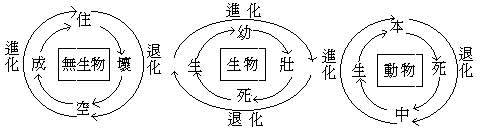
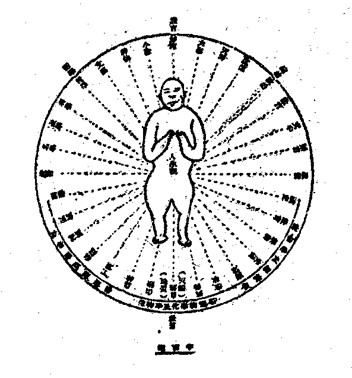
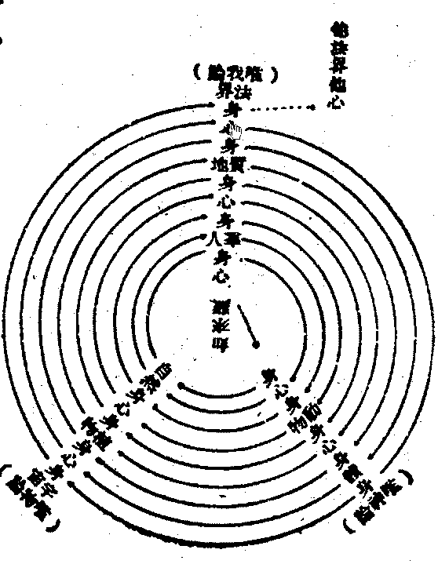

# 太虚大师全书．第十四编　支论(第4卷-第8卷)



> **藏经**：太虚大师全书（太虚大师全书）　**册次** 第 23 册（TX23）　**编号** TX0014　**卷次** 3 卷　**篇幅** 101,328 字

> **卷／品**：0 卷 · 0 品



---



人生观的科学



——十三年初冬在宁波作——



一　绪言



二　宗教玄学哲学科学之审定



三　人生的科学



四　人生观的科学一



五　人生观的科学二



六　人生观的科学三



七　人生观的科学对于世界文化之抉择



八　结论



九　摘要



一　绪言



人生观、是指我们人生在世应当如何作人的生活之一种观想，一种意念，及禀持此一种意念所引生的行为与所结成的效果。但其本旨则在立定「当如何作人的生活之一种标准」——以下但简称人生观——而已。然此成立一种人生观的要求，在人人或多数人可以安居乐业过生活的时候，是不容易发生的；及至少数人或多数人或人人都感到不安宁不快乐的时候，才用其智识要去求得一种人生观。今此大地上的人类，被征服的人皆深感不安乐，可无论矣；即在能征服的欧、美、日本人，也是恐慌困迫的不了！於是智识较强的人，才各各要用其智识以求得一种人生观，以为自谋安乐及谋一地方人类或全世界人类的安乐之依据。欧、美、日本人之不安乐，犹不外政治上霸权之争持，经济上资本之占据，与私欲之压迫，我见之扞格，世情之凉薄，生趣之枯寂而已。而中国人——印度人等亦似之——则天灾之洊臻，邻国之侵逼，兵匪之扰害，生计之穷促，侈欲之增高，旧德之沦丧，风俗之淫乱，知识之泯棼，土地之瓜割，人物之沙散，意见之冲突，能力之脆弱，真使大多数人有何以为生、何以终日之慨！做今日中国的人，到底怎样做才好？於是七手八脚，逞其小才浅智，或欲凭武力以成统一，或欲据省分以谋自治，或欲持政党以图改革，或欲仗稗阖以为箝制，或欲行社会主义以新局面，或欲用科学知识以张奋斗，或欲复礼俗以求宁息，或欲藉思神以资诱慑；卒之、愈趋愈纷，愈弄愈乱，而做今日中国的人到底怎样做才好一问题，急待解决亦愈迫切。此诚人的生活根本之所在，而在今日的中国人，又有不能不从此人的生活根本上以打开一条活路来之势。此比年来研究人生观者所以纷纭日出，而张君劢所谓人生观一经宣布，即引起一时之论战也。



但其论战之结果，张君劢所主张者虽确难成立，而对方之科学家、社会主义家，亦未能显示一明确决当的人生意态——吴稚晖较有力量，但他的说法却不合科学的——，以应国人之要求。张东荪近著科学与哲学一书，以为由张君劢所引起之人生观论战的总批评；虽所言大多平允，而对於所要求的人生观，则仍未见有何成就。予比因身世交疲，入山休养，静居无俚，块然寡营，案头的青林翠雾，又引发了积年的文字结习，起为世人一说人生观的科学。



二　宗教玄学哲学科学之审定



张君劢所引起的人生观论战所以不得结果者，就因於所用几个主要名词未有定义，以致彼此辩诘，相为出入而无决断。科学以能致谨於经验见长，洵为自悟悟他最良之方法。然据我的观察，宗教、玄学、哲学，亦同以感觉的徵验为出发点，不过、其感验有诚谛不诚谛：其不诚谛者，若病目所见的青黄不是青黄，谓之似现量的带质境；其诚谛者，则所见与所托的本质相符，谓之真现量的性境。而依之由思念推辨所知之义理，有契当不契当：其不契当者，谓於现前感验之事，不能尽其内容而又越其量外，谓之似比量的独影境；其契当者，谓能尽其内容而又适符其量，谓之真比量的独影境。玄学、哲学之感验不异常人，其错误多从思推而来；由其思推之结果，自觉由思推所获之理知超越常人，由是宝其所思推之理知，据以判断事物，而不知离所感验之事物已疏远；彼诸事物是否如此已无从辨别，乃必欲据之以为判断，故适成其妄也。宗教是别有其灵奇特殊之感验的——玄学亦或有之，故玄学或即宗教学——，其感验多不诚谛，凭此不诚谛之感验而起为思辨之理智，亦更难契当。故除佛教外，其餘宗教大都为不诚契之尤。唯佛教是由圆满之诚验——无上菩提、而演为善巧之契理——大悲方便，遂为谛当之最。科学注重实际经验，错误可免，且少主观之固执；即有错误，亦可藉实验以渐末减。但现时狭义的科学，犹未能扩充其心觉以得全宇宙之诚验，故不足以达究竟。复次、现时狭义的科学家所用科学方法，未能自袪其能感知上的心病；又於所用方法及所获成绩——知识及由科学知识所成之事物，不免沾沾自喜，得少为足而生执著，故其错误仍难尽去。然为学之道，实应以科学为最妥当。而由我之见解，则佛学即为能扩充感验以至圆满之广义的科学也。前来不过说宗教、玄学、哲学、科学皆起於感验，今请进言宗教、玄学、哲学、科学之定义。



宗教一名词，在佛典原有其解：所谓自觉圣智境界——烦恼障净智所行真实、所知障净智所行真实——为宗，应机方便宣说为教。此与西文的「宗教」一名，义虽不合，但日本译为宗教，原是用的佛典之义，而此义放低了，也尽可为一般宗教之定义：即以特殊之感验——对於通常人所感验的世间真实而言其特殊，即为神秘的、超绝的、或不可思议的——为宗，而向他人表示其特殊的感验、及达到其感验之方法的说明为教。宗教家是有其「特殊感验」为中心的——孔子之於「天」，苏格拉底之於「神力」，亦有之；但此为其自行方面，其教人者不专致力乎此，故异宗教——，他的特殊感验，是他内心感觉到实有其事的，他自己也以为是通常人的思想议论所不能到达、不能取来批判的。所以、凡是真有「内心特殊感验」的宗教家，他的主张是极为坚定有力量的，虽其讲出来的，错误地方不免为哲学家、科学家所批评，但他对于讲出来的原不妨随势变更的。所以、仅有常人感验的哲学家、科学家，虽有若何猛烈攻击的批评，决不足以摇动其「内心特殊感验」的信念。至於已远离实际感验的玄学，更是宗教家可随便取来以解决其所信仰之事的，若基督教利用亚里士多德之目的论。唯有遇著了一般有其特殊感验而又看破其特殊感验更超越其上的——若释迦於印度诸外道禅等——，乃能说破其错误之点而变动其信念，若迦叶等外道，后皆从佛得小乘果。故唯有高等宗教乃能破除劣等宗教，亦唯有佛教乃能摧破一切宗教，融收一切宗教也。或谓低等的拜物教及鬼神教与天神教——西人祇晓得基督教为宗教，故说宗教为「有神及神与人之关系」，但以此解说印度诸无神教便不能通——，恐不是由特殊感验发生的。其实、即拜物教所拜的或火、或树、或蛇，他也是因内心中特殊感觉了所拜物的灵奇，自己觉得用如此的方法去拜祷，便能益得其灵奇之感验，於是宣说出来导著一班信徒也去学他的拜祷，使也能获得何种之灵奇感验，展转流传，才成了拜物教。鬼神教的特殊感验，一部份是因未有科学知识之解剖，囫囵的感著了自然现象的灵奇变幻，遂推想彼内中有「似人胜人力量伟大的神」造作或示现出来的；一部份是因亲爱者死亡之思慕——祖先的鬼——，悲惧者忽得之安慰，渴求者望外之喜遇，病梦者奇异之感动——我所知：有几个无学识的少女或老女，因病中启发其奇幻的心境，说出许多神怪之事，渐渐亦有其灵奇之作用者，遂为人事奉为神仙，渐而成一小宗教的——，以及偶得启示未来之机兆，冥坐澄念所成之感通，藉物凝心所生起之心象与动作及所推出之数命——若圆光、扶乩、催眠术、占卜术等——等等，於是凭其所感得之影响，以推想有如何若何之鬼神主持其间——其间亦非绝无「他有情心」相呼应相感召者——，而鬼神教遂迭兴不衰矣。如信鬼者既有其鬼之特殊感验，而哲学、科学者凭其通常感验、及推论理智以斥其必无，固不足以折其心而夺其守也。道教亦依其修炼所得之仙灵感验为立足之点。至一神教，则由内心之灵性感验，而觉其「精神自我」必有所从来及所归宿，不随肉体而尽。复依自身与众身由父祖生生而推其大本，及依工匠之制造与君主之统治而推想宇宙万有必有一生化主宰之大神，凭此推想以祈望契合，复得内心彷佛之感验，於是将其所得感验及致此感验之方法宣示众人，其信从者皆率由其道而奉行之，於是一神教乃流布於世。此从其致误方面言之，虽有或由缺憾人生不能凭意志以自致乐善，或由泛观万汇皆有蕃变之美、秩序之常——明末黄宗羲坚持必有一昊天上帝，其理由即在乎此——，意其必有造物主宰之上神；然确实之开创宗教者，必因实有其内心之特殊感验而起为教示，非以求人世之功业名誉富贵者。虽亦有因之为帝王若摩罕默德者，然此乃其副产之旁果，而其所求之正果，则在彼不在此也。观於耶稣、摩罕默德，皆尝有其入山食绝之静修，其后即有神通的灵迹传留，可见宗教在有其超越常人之内心特殊感验为本质，乃发为言诠仪轨以教导乎人也。故宗教者，创教人由「宗」而「教」，而受教者，复由「教」而实行其所「宗」尚之理解，以证得其同样之超常感验者也。此所以异乎哲学、科学皆以常人感验为出发，而亦异伦理道德以人世安乐为归宿。至谋世者，利用为固群制众之具，非宗教之本质；由之以令一民族或世界人类得何进善、或转恶之影响，亦其旁效而已。



玄学、是「深远微妙的学说」之义。其深远微妙之学说，是从深远微妙的感验而来者，是宗教的；是从推理展转增上而来者，是哲学的。故玄学是介於宗教与哲学之间的。但玄学却不是宗教，以宗教是宣示其内心特殊感验，而教导他人修行以得同其内心特殊感验的；玄学则在讲明其深远微妙之理，以成为一种学说而已，仍为理智的而非情志的。故玄学祇哲学之一部份，或即哲学；其内容则为宇宙本体论、人性论、神论。本体论是讲明宇宙万有——人与神亦在内——之原料的，若计水、计火、计原子等。人性论是讲明人类特出庶物之根本的，及最高的理性或灵性的，即灵魂或精神、自我等。神论是讲明超越万有之根本的，及最高的主宰者或造作者的，即上帝或宇宙大我等。在西洋、所谓形而上的玄学，应不外此，而在中国儒道家、及佛教之华严宗等所讲之事事无碍玄学，则是讲明从「广义的科学」——能排除各方面知识上之误谬而认识事物真相的——所得来流行活泼之不可思议生活的。据我观之，儒家与佛乘，只是量的不同而非性的不同，故儒家即为佛乘之初步；与西洋形而上的玄学另是一种。



哲学之本义是求知——爱智。依求知的广义哲学而言，则科学亦是求知，故科学祇是哲学的一部份；而哲学与科学，祇是总统的理知——哲学——，与部份的理知——科学——之不同而已。由科学的知识总合起来而认识全宇宙，即是哲学；由哲学的知识部别开来而认识各事物，即是科学。但自科学专重感官经验而与侧重思想推辨之哲学分家，则哲学之遗留者仅为形而上的玄学，故哲学又祇是玄学。哲学与科学有一不同之点：则科学虽用推理，而推理所得知识，不越经验之量，越徵验之量即不认为科学。而哲学则虽亦依徵验为出发点，而主在用思想推辨，层累而上，以构成总合的统一的理智；既以得到总合的统一的理智为目的、故达到此目的后，科学的知识即在可弃之列，唯不弃亦视为达到其目的之手段而已。故哲学之目的，可谓即在玄学，而哲学又可谓之由思议的、相对的科学，达到不思议的、绝对的玄学之学。而科学则虽亦认有感验不到之未知界，但不认有绝对不可思议界，而唯认为将来终可感验到认识到之事；至於绝对不可思议的玄学，则唯认为妄想之虚构的而已。故科学诚可绝然排斥玄学，而哲学则为之搭科学与玄学相通之桥，以引导科学使日进无疆者也。是以狭义的哲学即为玄学，应同受科学之排斥；广义的哲学，则为包玄学、科学之理知全量的——由感验及推理而得之知识。但前来仍不过指说明「宇宙始终的实体」及「宇宙系统的现象」，是哲学而已；而向来於哲学，原是分为：「形而上学」，「知识论」、「宇宙现象系统论」之三部份的。近来哲学正宗的「新唯心论」——存疑的唯心论，所存疑的东西，即是康德所谓「物如」，亦即是科学所认为不可知的「所与性」，亦即是玄学上不可思议的东西。——，以玄学既受科学的排斥，而科学又即是对於各种事物之「明确知识」及「创造智慧」为本身的，故宇宙现象的系统，亦须随科学的进步而迁改，是不可以讲的。於是对於进行中的宇宙本体及构造中的宇宙现象皆置而不论，专集中以对於科学本身的知识——即能够感觉及创造宇宙各事物的智识，来下批评考察；即是从知识所由成的来源上，以逆探由知识构成的宇宙之根本。换言之，即以知识论为哲学的专职是也。但此亦是笛卡儿、康德等哲学者所趋重的方向，科学的心理学家对之仍不承认，以谓叙述或说明知识所由成的来源，亦仍属於科学之心理学的。然卡阿却说：心有两种看法：一种是把心认为是一个特定存在的东西，是心理学等科学所研究的；一种是把心认为「从一主动中心所映的全世界」——此语颇好——，是哲学所从事的。但科学即是各事物明确的知识，此「从一主动中心所映的全世界」之一事，若是神秘的、超绝的、绝对不可思议的、则即是科学所排斥的玄学，或是科学所阙疑姑存的未知界；若是可为明确知识所认识之材料的，又何为不可是科学之心理所研究的呢？故知识论仍不足为哲学藏身之处，而除掉了科学与玄学，仍无哲学存在的餘地。故哲学在知识论上，仍不过作个科学的引导者，而终究要为科学追著，或与玄学同样被科学排斥在真确的知识以外而已。



科学、是靠著经验、分析、推论、试用，以成宇宙各部分事物之真确知识而得其关系法则的。虽宇宙各部分事物无不可为构成科学知识的材料，而由所构成的科学知识，亦非不可组为宇宙全系统的知识；但在今日，确有许多事物未成为科学，而由科学组为宇宙全系统之知识时，则又成了科学的哲学——若孔德、斯宾塞，赫凯尔、罗素等哲学——而越出了科学之界。故科学的科字，即含著一科一科的学识之义。而现时狭义的科学，是祇应指用科学方法所成宇宙各部分事物之知识的。但心理内容的宇宙现象，虽尚未尽为科学的材料，而丁在君所说「心理内容的感觉经验，个性直觉及真的概念推论，无一不是科学的材料」，我是承认的。因为、虽有许多尚未能成为科学；或若生物学、心理学等，虽已成为科学而尚未能如数学、物理学的精确，然不过常识——世间真实，与科学知识——学理真实之程度上的等差，而非将来永久不可成为科学的分界。故张君劢以为人生观是非科学的；梁任公所谓情志是绝对超科学的，又情感中的爱和美是不可用科学方法来分析研究的；任永叔所说人生观是不能成为科学的，我皆不能承认。因为、扰害人生宇宙的，正是这些不曾经过科学而确实弄清楚的事在那里作怪，所以、我们必须用科学把他弄得确实清楚不可。但科学是包含科学的方法及科学的成就而言，科学家对於科学的成就是不固执的，所以其进行是无限量的；至对於科学的方法则不然，所以丁在君说：「科学方法是万能的。设有人来对科学说：你走的路是错的，有几条路不是你所能走的，旁的还有巧妙的方法可以走到你前头，科学绝对的不能承认」——。此是一般狭义科学家执著的所在，也是阻碍狭义科学不能前进的所在，佛学小乘之不究竟，也是这种法执为碍。夫科学方法重感觉经验，而使分析论推所成之理智不越感觉经验之量，可以试用到实际上去，这是最可贵的。但能为感验的原祇藉五种官觉——应加一种意觉——，一面於对象用分析解剖等以增加感验，一面用望远镜、显微镜、爱克司光镜等以增加视觉，用传声、留声、检身器等增加听觉，用其餘器械以增加体力触觉，以论理训练等增加意觉，将感觉经验的能力扩充成熟，乃能得成科学；否则、终限於常识之程度而不成科学。由此观之，可见科学之方法，当以扩充感验的能力为最要。而今於视觉、听觉虽已有扩充方法，然於嗅觉、尝觉、触觉之扩充方法既极短缺，而於意觉，又祇有论理训练之一法——概念推论。理性派哲学谓知识来源为概念，概念超感觉而先有，此固同柏拉图执类性离个体而自有，为亚里士多德等所否认；但亚氏仍认类性即寄於个体而并存，则亦应认概念与知觉、感觉俱始。唯成为论理公例的知识时，则为由感觉而知觉而概念之历程。在知觉之程度非无感觉、概念，不过、感觉、概念已摄於「知觉中心」；在概念程度亦非无知觉、感觉，不过知觉、感觉已藏於「概念中心」；然则在感觉程度亦非无知觉、概念，不过知觉、概念犹隐於「感觉中心」而已。隐於「感觉中心」有知觉、概念，即为意觉之特徵，可谓之微意识；在佛典谓「同时意识」。此同时意识别前五官觉曰意觉，语其觉处可曰法觉、一切事觉。不唯前五官觉所彼皆同觉，而有前五官觉所不能觉之数量、总别、同异、生灭、是非、彼此、前后、因果、真伪、有无等，亦皆其所觉。然此意觉中所含之迷误甚多，而其作用又最宏伟，若对於此意觉无以排除其迷误，条达其功用，以发挥扩充其能力，待其已到「知觉中心」、「概念中心」之程度，始有论理训练起为救济，抑已晚矣！故现时狭义的科学，其确实感验之基础，仅能得之於官觉，而生物学、心理学之科学程度，终不能如物理学之高也。论理训练既不能施於意觉发动幽微之际，而分解修缮之以扩充其纯正感觉之力量，则於增益意觉等纯正感验之方法，岂可不谋有所改进乎？此则佛教之瑜伽学——或曰止观学、静虑学——所由尚。而予认「瑜伽方法」加入於现时狭义的科学方法，即为佛教广义的科学方法；以之得成由纯正感验所获之明确理知，即为广义的科学，亦由乎此。盖瑜伽方法，不先立何标的——此是禅宗的，其餘宗派或依前人所示之公例，若有漏皆苦、有为无常、诸法无我等为实际之观察研究——，但先澄净其意觉而进为分析之观察，若先有明利之官觉及设备完全之器械室而为试验。佛寺有讲堂及禅堂，予常以禅堂喻试验室，但试验的物品非他物，而即为试验者自己的身心耳。由是得到直接之感验而构为善巧之说明，俾众同喻。依纯正感验所构成之明确理知，此非科学，则科学复是何物？但科学家时曰：吾辈所认的科学，须依常人之感验为基，而可准之通常之感觉而得其同验者。然一种科学，若非素对於此有试验器械之试验经练者每不能知。闻安斯坦之相对数学，能确实了解者极鲜，则科学所依感验、亦非常人感觉所能同验——常人所同感验而得之知识，为常识的世间真实；科学家所同感验而得之知识，为科学知识的道理真实；瑜伽师所同感觉而得之知识，为道理真实或二障净智所行真实。此常识与狭义科学知识及广义科学之知识之分界，不可不知——，唯有同样之科学经练者乃能喻之。然则由瑜伽方法所得之感验与所成之知识，亦须有同样经练之广义科学家乃能喻之，亦何害其为由纯正感验所成明确理知之科学哉？此诚现时科学家所当稍贬其狭义科学方法已是万能之僻执，而进采瑜伽的科学方法以求深造者也。由是以言科学之体用，科学即以依直接的感觉经验构成论理的明确知识为体，而以对於复杂混乱的宇宙现象——心理内容——中，求得其较为普通不变之关系法则，整理或创造为调适之人生宇宙生活为用者也。科学之定义既明，复以张东荪於科学之说明颇好，录取以一论之：



要明白科学是什麼，非先明白知识是什麼不可。原来知识就是个别中求共同，用佛教的术语来说，即是在自相中求共相，如无共相，自相亦必定没有了。因为特自与普共是相待相成的（按：相待而成的已是差别相而非自相，故自相纯是感觉中的），知识的最初是感觉，次则知觉，再次则概念，其实乃是一个循环。由知觉把共相从自相中抽离出来，再由概念把共相嵌入於自相上去（已是差别相而非自相）。所以、感觉、知觉、概念，祇是一个历程上的段落，我们应得从动的方面把三者视为一线相延的历程，不可从静的方面认感觉是组成知觉的元素，知觉是组成概念的元素（知觉取个体，概念取类性）。这个历程，就是纯粹经验的开化。换言之，即赤裸的所对（自相），变为秩序的经验（共相、差别相）。这种开化，就是知识的成立。若是只有赤裸的浑朴的自相，则便是无法认识（用瑜伽方法修治意觉乃能认识）。所以、认识乃是用共相为法式以嵌合到自相的素材上去（已不是自相的素材，而是差别相的釆材了。自相的素材是现量的性境，此差别相的釆材是似现量的带质境，或真比量似比量的独影境）。因为、只有一次的必不能成知识，凡成知识的必能移用他处，所以、知识便是一种抽绎作用，把具体的变为抽象的。因为、非抽离不能於自相上得著共相（应说得著共相、差别相、因相、果相）知识的本质，就是如此。则科学的本质，便可推知，自不外乎根据这个本来的性质而再进一步说常识，就是对於事物为之分类。要区别常识与科学，可借用柏格森所说：希腊时代的科学所从事的，是「类」（共相、差别相）；近世科学所从事的是法（更加因相、果相）。此语可移用於常识与科学，就是常识的分类在种类，而科学的分类在关系。所以、常识的表示是名词，而科学的表示是方式。故科学乃是对於杂乱无章的经验，求其中的比较不变关系。因为、经验的内容总是只有一次的，所以科学并不十分注重内容而只注重於方式。



张东荪的这一段话，对於知识及科学，颇有说明。但他未知「差别相」、「因相」、「果相」，故於纯现量的「自相」、与非量或比量的带质境，或独影境之「差别相」——知觉的个体与概念的类性合并的，可於个体上辨其类性非类性之差别，亦可於类性上辨其此个非此个之差别，故为差别相——，未知其异，遂於须用纯感觉去知道的诸事物离名种等分别之自相，不复设法去觉知而进为广义的科学。且「因相」、「果相」，即为关系之法则所存，而应用之可徵进行之实效者。何谓因相、果相？即於此一差别相事，而观其所依以成现之较为必要关系点，谓之因相；复以依彼为必要之关系点，而观其「成现为此一差别相事」，谓之果相也。此取较为必要关系点为因相者，以推广其普泛的关系言之，则一差别相事殆於一切差别相事皆可作因——法界缘起——，则因果之意义无由立，而进行之作用不能起也。要之、不知共相、差别相，则不知知识与科学之体，不知因相、果相，则不知知识与科学之用。而感验之自相——包所与性、物如、不可知界在中——，则为知识与科学之所依，而复为科学与知识所不能取得——诸法自相为假智诠所不能得——；唯用瑜伽方法得到真现量智，乃能如其实相而觉证之——如实智的亲证真如——狭义的真如，亦兼如量智的变相而缘真如万法——。然用瑜伽方法，虽人人可以得到真现量智以觉证於此诸事物离言自相，而表现出来，则仍为知识的、科学的而已——如量智重现身土而应机说法。



以上、对于宗教、玄学、哲学、科学的诠释，所以讲明我之人生观的科学，是广义的科学，或科学与佛教的。佛教以外的宗教，多是以「含迷谬的意觉」构成的：柏格森的直觉，倭铿的精神生活，多是此类。孔、老直觉虽较少迷误，而用下去亦不免惑乱苦痛，且既有佛的便用不著孔、老的，故皆是不可用或不须用的。换言之，科学不外佛学的五明：声明、因明、医药明、工巧明、内明。且现时一切科学，皆可收在佛学的五明，而佛学的五明，则尚非今日之科学所能尽——若内明等——，故亦可谓「唯佛法是人生观的科学」。



三　人生的科学



观察人生是什麼的人，往往先说明宇宙是什麼为根据，而后用来解释人生。其实、宇宙祇是人的生活与非人的生活之总生活，而人亦即为宇宙总生活表现之一种生活。换言之，人生即一宇宙，人生各一宇宙。人生各一宇宙与一一人生各一宇宙，及一一非人的生活各一宇宙，皆有交遍涉入之调和关系而不相离绝的。万有的现象——心识的内容，虽可有死物的与活物的之区别，而佛学唯识论亦有「相分无能缘用」，与「餘分——见分、自证分，证自证分——有能缘用」的区别。但相分都是餘分所变缘的，绝无离绝餘分而有的相分。故明宇宙万有是什麼，即是明人生是什麼，明人生是什麼，即是明宇宙万有是什麼。所以、有万有之区别，及万有中一有的人生之区别，祇是从一主动中心集一切关系而成「一有」时，由其特殊之功能——一切法的自种——，於一切现象的关系——现行的一切法之增上缘等——，有亲疏顺违等之差异，故成无数之差别耳。今要明宇宙人生是什麼，首现在前者，即为此能够明了分别的知识自身。从此知识之一体系——一体系即一积聚的自身——而以类别言之，每一人生则有能认识色、声、香、味、触之眼识、耳识、鼻识、舌识、身识五官觉，与能认识一切法之意识，及能认识内我之末那识，并所认识的内我之阿赖耶识，共为八个知识身聚。此八个知识身聚，固为人的生活中可现知之事实而无从否认者。其次、则为八个知识身聚相和互应的情志等，即五遍行、五别境、与诸善、染、不定等心所有法。其三、则为知识与相应的情志等所变现、缘虑的影象，即物质现象，若五尘、五根、及四大种等。其四、则为前三事上附现的分量、位次、数目等。其五、则为前刹那起灭事的所依，不可分辨、不可区别、不可规摹、不可言诠的实相，即真如。其六、则为阿赖耶识中所潜藏前四刹那起灭的事，於不起时之一切能起的功能差别，即是种子。此上六事，皆为人的生活中感验所可及、推论所必至之事实，除此别无他事，故一一人的生活，唯此六事而已。一一微尘，一一世界，一一细胞，一一生物，一一心行，一一神我，亦同一一人生，唯此六事而已。此六事中，最幽微难知而是所知之一切差别现象所由差别的，则为阿赖耶识所潜藏的一切功能差别——一切种子或一切习气。若一差别功能藉一切现起流行亲疏顺违关系而起流行时，便成一个刹那起灭相续或不相续的生活之事——一个调和所成的不调和事物，而又与其他一一调和所成的不调和事物相调和的。其次幽微难知的，则为现起流行不息的阿赖耶识、末那识、与微隐前六识及此诸识相应的情志等；即迷谬者所说为「神」、或「灵魂」、或「个性」、或「直觉」、或「真时与自由意志」、或「精神元素」等。又其次幽微难知的，则为一一阿赖耶识上所变现刹那起灭相续而缘虑的人生宇宙；即为现前所知人生宇宙现象依托为本质的根身、器界，此是科学家所认为不可知的感觉所与性，与康德所谓物如；但所与性及物如，亦可包前二难知的及实相在内。又其次较易知者，则为现前心理作用之显意识，即心理学所研究的；及现前所知有生活目的物之变化，即生物所研究的；与现前所知人类生活作用之关系物，即生计学、法律学、社会学、文语学、历史学、论理学等所研究的。又其次尤易知者，则为现前所知之器界物质现象，即数量学、物理学、天文学、地质学等所研究的。前三难知的，皆须用广义科学的瑜伽方法——佛教之外亦有瑜伽方法，但佛教之外的可说为常识之瑜伽方法，唯佛教的为科学之瑜伽方法——，析观知识方面现前及非现前之一切万有，皆为变幻无常，没有定例可得的；皆为相待假现没有自体——我——可得的；故知识上不可存立。而在情志方面，更析观其是杂乱染污扰害苦患的，故情志上不可存立。而唯不可成立，不可施设，不可分别，不可取，不可说，不可得的是真实相。由是久之久之，引生真现量如实智，实证不可存立、不可假说、不可取、不可得的真实相，只是遍一切一一自觉而别无他可觉——真见道；於是起摹仿智——相见道的如量智变相缘真如万法；而渐渐久之久之觉行圆满，乃能遍了知第一难知的一切功能差别——究竟觉的佛智一切种智。夫现时科学方法可求知的以上，犹有这许多人生宇宙内容，须待广义科学之瑜伽方法乃能知的，岂可安於现前偏狭的科学方法，不采用瑜伽的科学方法以进求确知，徒置之无可奈何而示弱，或任宗教、玄学的逞臆乱谈乎！噫！此诚现时狭义科学之耻哉！



由上所明，可知无论一微尘、一世界、一细胞、一人生、一心行、一神我，皆各为一差别功能，藉一切现起流行的亲疏顺违关系，而现起流行为刹那起灭相续或不相续的、一个调和所成的不调和事实，而又与其他一一调和所成的不调和事实——一一微尘、一一世界、一一细胞、一一人生、一一心行、一一神我——相调和的。一切事实的本来真相如此，人生的本来真相亦如此——此之真相，亦即广义的真如，亦云本来面目——。但其中有可损灭断绝其各各功能差别、而使永断相续永不现起的——烦恼障、所知障所摄及所起的有漏界，即乖於前来所述明一一微尘等事实之真相的；有虽可隐藏损减而不可断绝，且可增益——熏习增长——发挥扩充而使成满显明为永远现起相续的——离二障之无漏界，即合於前来所述明一一微尘等事实之真相的。明佛教在用瑜伽的科学方法以达到「离二障等的常乐我净无漏界」，可知梁漱溟等所言者为不然也。因为、一刹那的现起流行，有一部份属前七识的，与其有顺违关系的，即能熏减熏断、或熏生熏长其潜隐於永远起灭相续之阿赖耶识中的功能差别。使一部分前七识的现起流行而乖於前来所述明一一事实真相的能熏有力，则便能熏长熏生潜藏赖耶之自类有漏界的功能差别，及熏减潜藏赖耶之他类无漏界的功能差别，而续续现起流行乖於前来所述明一一事实真相的事实，即成为不安不乐之有漏苦果。使一部分前七识的现起流行而合於前来所述明一一事实真相的能熏有力，则便能熏长熏生潜藏赖耶之自类无漏界的功能差别，及熏减熏断潜藏赖耶之他类有漏界的功能差别，而续续现起流行合於前来所述明一一事实真相的事实，渐渐圆满乃至唯有合於前来所述明一一事实真相的事实现起流行，而永绝乖於前来所述明一一事实真相的事实现起流行，即为常乐我净之无漏妙果。知此、乃可进言当如何做人的生活之进行趋向的标准。



四　人生观的科学一



由上所明，可知人生进向的标准，即在减断前七识的现起流行上一部份乖於前来所述一一人生等事实真相之能熏力用，而生长彼前七识的现起流行上一部份合於前来所述明一一人生等事实真相之能熏力用，使永久起灭相续的赖耶中所潜藏的有漏危苦之功能差别逐渐减断，及无漏安乐之功能差别逐渐生长而已。但前来於一一世界、一一人生等事实真相虽略有述明，犹未细为解释。此一一人生等真相——广义真如或如来藏法身，为乖则有漏而苦，合则无漏而乐之所从判，故更分析言之。



依前来所述明者，当知一一微尘、一一细胞等事实真相，第一、即为遍一切一一自觉而别无他可觉的遍觉——佛陀。若非遍一切一一自觉，则必有其他可觉，有其他可觉则有能觉所觉之对待，而所觉一分即非是觉，便不成为遍觉。故遍一切一一自觉的遍觉，是一一人生等第一真相，我们当以为进行趋向所依归的第一标准。第二、即为由一潜藏在赖耶的差别功能，藉一切现起流行的亲疏顺违关系，而现起流行为一个刹那起灭相续或不相续的生活之事，而又能损减或生长潜藏赖耶的功能差别，及唯不可得的为真实相之律法——达磨——。故此种生现、现生现、现在种、种生种的一切变化，及不可得的实相之律法，是一一人生等第二真相，我们当以为进行趋向所依归的第二标准。第三、即为藉一切现起流行的亲疏顺违关系调和所成的一个不调和事实——若一一微尘、一一人生、一一心行等、而又与其他一一调和所成的不调和事实若一一世界、一一细胞、一一神我等相调和——僧伽——。故此一一摄一切、一切入一一的调和，是一一人生等第三真相，我们当以为进行趋向所依归的第三标准。依此根本的、究竟的第三标准，则我们做人的生活，如何是善，如何是不善，可得而定矣。但此一一人生等事实三真相，未到究竟觉位，不易认识证实，而摹仿此三真相以表示於现前现起流行之事实上的，即为释迦牟尼等佛陀，解深密等阿毗达磨，华严海会等僧伽耶。故人生之究竟观，当以皈依佛陀、达磨、僧伽为始，以此三者为摹仿一一人生等事实三真相，而表现为吾人作人的生活之真标准，故吾人珍之、敬之、宝之、重之、而抱守为不可须臾或离的宗旨——最高情志或最高生命或最高信愿。



五　人生观的科学二



上来明佛陀、达磨、僧伽、为人生三真相，须归向且依持之为人生究竟的标准，准之以圆成实现，即为佛陀或佛法僧之圆成实现。然我们作人的生活之究竟的标准虽定，而我们现前作人的生活，当从何为初步以进行乎？此则当积之以渐而为渐次之进行。但既明作人的生活之究竟标准，则初步之进行，亦即为进向究竟的进行，所谓圆渐而非渐圆者也。然圆渐中无非渐次，仍当以修行信心位——大乘习所成种性位——及三无数劫位分之：第一无数劫位，即依信心位所修「成就信心之行」扩充之，而从事广义科学的瑜伽方法，以得遍一切一一自觉的遍觉，亦梁漱溟所讲人人第一态度之进二步态度，第二无数劫位，即依前位遍一切一一自觉的遍觉扩充之，而觉知不可得的实相——狭义真如，与种现起灭断续损益的变化相之律法，以渐证——调和的不调和之一切调和，亦梁漱溟所讲人生第二态度之进二步态度。第三无数劫位，即依前位渐证一切调和而扩充之，以从事反穷一一不调和所由起的功能差别永灭之，亦梁漱溟所讲人生第三态度之进二步态度，得真解脱，而成就常——恒续转的、乐——遍和洽的、我——法法为王事事无碍的、净——二障尽断二死绝灭的大牟尼法，得真解脱及大菩提，乃达究竟。但三无数劫位之前，更有一修行信心位，即为吾人做人的生活最切要之进行初步——就今日已能征服自然、发达个性的西洋人言；若中华、印度等人，则更须同时补足一二百年来西洋人之所事——，其第一、即於现前的科学理知，不但用以征服他物——包括自然界及他人，发达自我，而亦用此格物致知的理知，反躬以诚意、正心而调治直觉——理智调治直觉，用梁漱溟语。此即明明德、致中、致良知的工夫，亦即内圣外王的内圣工夫，及孔子四十而不惑以前的工夫——，使随感而应皆不离与理知冥寂的当前直觉，欣然自足而无所倾慕乎当前以外，则佛教以外之宗教、及西洋的玄学、哲学等迷执，皆伏而不起，亦即是科学家一切可知的皆是心理内容，与佛教初一步做说的遍一切一一自觉而别无他——若宗教的、神玄学的本体等——可觉之遍觉。亦梁漱溟人生第一态度之进一步态度。心意的困难问题摆在前面，遂用理智以向此摆在前面的问题要求解决，其解决之态度亦是战争的，所开的战争即名理欲战争，战胜了即儒家所谓贤圣，但其战争是内向的而非外向的，故为进一步的。其第二、即依现前的科学於零乱忽漫之经验中，所求得比较有秩序条理的关系法则——法学根据於此，中国的易理亦根据此——，侧转身来施用到突戾嚣张的人众生活上，使成为比较修齐治平的一一个人及各各团体——身、家、国、天下，此即亲民、致和工夫，及内圣外王的外王工夫，与孔子五十而知天命（天命即一切经验中所得关系法式），六十而耳顺的工夫——，使随时随地随人皆能乐其生业，而安於符顺理智之人间礼义，欣法自足而无所倾慕乎人间以外，则佛教以外之宗教及西洋的玄学、哲学等执情皆伏而不起，亦即是科学知识施於人众方面。以人众生活为本之经济学——基尔特等之社会主义、法律学——克鲁泡特金之无政府主义、伦理学等，而所本者则在生物学、心理学，亦佛教初一步仿一一事实关系所施设之毗捺耶法。亦梁漱溟人生第二态度之进一步态度。因彼偏尚情感流动，而此则本於合理的人众生活之法则以轨持情感，使人众生活成为理得心安的生活。其第三、即依上二重之经历，而自心的、人众的庸常生活，俱达到无思而为、不勉而中之仁慈孝友生活——即止於至善之物格、知至、意诚、心正、身修、家齐、国治、天下平之境界，亦即致中和而天地位、万物育之情境，与圣王之极致，及孔子七十而从心所欲不逾矩之心境——，使无可无不可，活泼泼地，无入而不自得。则佛教以外之宗教及西洋的玄学、哲学等迷情皆伏而不起，亦即是佛教初一步假说的不思议常乐我净法界——此是由修习大乘增上戒学之十善法成就而渐生大乘禅定之境界。亦是梁漱溟人生第三态度的进一步态度。以此即从致中和及不中和的本身反转，一切休息，而脱然真得庸常生活之中和故。然梁漱溟的人生第三态度，是印度无想外道等妄取的断灭，与佛教小乘之发生稍有关系，而与大乘佛教无关。故梁漱溟所说人生三态度，其第一是此前西洋人之征服天然、发展自我的科学态度，其第二是以前无科学时代的儒、道家态度，其第三是印度外道的态度，而皆非佛教的。佛教的、当以其第一态度之进一步态度为起点。此修行信心位之三事，与后之三无数劫位相仿，不过此三事是依现前流布的人道生活而施设——世俗的，是用狭义科学达到的；彼三位是依一一世界、一一人生等事实真相而施设——胜义的，是用广义科学达到的。故人生之初行，是依一一事实三真相之世俗假说的佛陀，若周、孔之圣；达磨，若易礼之经；僧伽，若史家所颂为刑措风清之成康之治等为依归。而人生之究竟，是依一一事实三真相之胜义真实的佛陀、达磨、僧伽——如第四章所说的——为依归。然未闻总持人生初行及人生究竟之佛教，则滞止於初行而不能进趋究竟，或重由此位走入玄学、若老、庄等，及其他宗教、若各天神教及印度各外道等。孔孟等所谓圣希天者，即有走入天神教之势；而终不免末流之弊。唯有根本的归依可由初行直趋究竟之佛教，则此初行即为得达究竟之初行而有利无弊。故今人既闻佛教，则初行时、虽准一一事实三真相之世俗假说的佛、达磨、僧伽而践履，然心志所归向者，则当在胜义三真相之佛教的佛陀、达磨、僧伽，故此初行得成为进达究竟之初行也。由是、人生初行之第一要义，仍在皈依佛教的佛陀、达磨、僧伽——由此可知梁漱溟排斥佛教之非——；而第二要义则为信乐果报、修十善法。如所谓「谦受益、满招损」，「作善之家有餘庆，作不善之家有餘殃」等，即为信业果报。业为何物？即善的——合一一事实真相的身心动作，或不善的——乖一一事实真相的身心动作，所遗留在赖耶中之习气种子，而能为后时生起或安乐或困苦的总报、别报之差别功能者。其后时所生起或安乐或困苦之总身器及身器部份，即为果报。信由善的业可招致安乐的果报，由不善的业可招致困苦的果报，是谓信业果报。此即孔子之知天命，亦科学从生物学等所得比较不变之关系法式。既信业果报矣，於是孜孜务治伏不善的身心动作而调练善的身心动作，是谓修十善法。十善法者：一、不杀伤，以充养恻隐人物不忍残害之仁慈；二、不偷夺，以充养人物生活咸遂情性之义利；三、不淫乱，以充养人物𬘡缊调畅生化之礼乐；四、不妄语；五、不两舌，六、不恶口，七、不绮语，以充养心言一致彼此通诚之信赖；八、不悭贪，九、不嗔嫉，十、不痴邪，以充养了达事实符顺真相之智慧。此十善法，是人生之真道，亦大乘之始基。故曰：「端心虑、趣菩提者，唯人道为能」！而今世之所急需者，亦唯在此人道耳。第三要义、则为厌取作、舍坏苦；起信论曰厌生死苦，其实、无论厌分段生死或变易生死，皆是厌取而作成，未几又须舍而毁坏之，劳烦不获安常苦耳。非指一切生活变化为生死苦，厌患一切生活变化而剿绝之也；故其结果为得恒续转的遍和洽的常乐而非断灭。此义、诸学佛者，大须注意！以向来学佛者多迷误於此义，致近似断灭外道，若梁漱溟等所见也。盖一方面既臻人道之极，所谓亢龙有悔，须是群龙无首斯吉，故更不宜出头伸手有所创造，唯当逍遥无为，以持保盈泰而防维毁败——老庄注重乎此；而另一方面、则反观前来所取作者虽有成就，犹不免无常之舍坏，所以既济终於未济，遂转从厌取作、舍坏苦开一孔，以走上瑜伽的广义科学方法之路，即由修行信心位入信成就发心初住位，走上三无数劫修途以直趋人生之究竟。今后能致人世之安乐者，必由此皈依一一人生等三真相，信业果报，修十善法以达到之，并由厌取作、舍坏苦，更走上瑜伽之大道，决然可知。故此进向人生究竟之初行——人乘佛法，在今世为最要之事，亦为予提倡佛法最致力之处。



六　人生观的科学三



上来第四章所明的，是人生究竟之佛乘法；第五章所明的，是人生初行之人乘佛法。孔子是人乘之至圣，即於人生初行已完成者，设非佛法亦进於天乘耳。然天乘以上有偏至，老庄等即有偏至者，不若人乘平正，可为佛乘始基。与佛乘仅异其浅深狭广之量，不异其质，故予最取孔之学行。向来於佛法判为五乘：曰人乘，曰天乘，曰声闻乘，曰独觉乘，曰佛乘——或曰大乘、一乘、菩萨乘、最上乘。人乘之上，隔著天乘、声闻乘、独觉乘之三阶级，始臻佛乘，如何可由人乘直达佛乘？换言之，如何可由人即成为佛的因位之菩萨，——菩萨、具云菩提萨埵，菩提是佛智，萨埵是迷情。即上求佛智下化迷情者，谓之菩萨。又菩提是觉悟、而萨埵是慈悲，自己觉悟而慈悲他人者，谓之菩萨。又菩提是妙道、而萨埵是勇猛，能於无上妙道勇猛精进修习者，谓之菩萨。非是所奉偶像或神之义——，及进为菩萨的果位之佛，而中间可不经过天与声闻及独觉之三阶位？此疑不除，吾此人生观的科学即不成立，故须进为一分析之。



梁漱溟尝谓：「似乎记得太虚和尚在海潮音一文中，要藉著「人天乘」的一句话为题目，替佛教扩张他的范围到现世生活里来。其实、这个改造是作不到的事，如果作到也必非复佛教」。我要发挥佛教原来直接佛乘的人乘法，以施行到现在人世的生活范围里来，可谓一语道著。然我发生此愿望之动机，全不是替佛教扩张他的范围，以此原为佛教范围内事，用不著我来扩张他。然以现在的人世生活已困苦危乱之极，非将佛教原来直接佛乘的人乘法，发挥到现时的人世生活里以救济之，终为头痛医头、脚痛医脚，暂图苟安，转增烦苦之局。复以此佛教原来直接佛乘之人乘法，实为佛教适应人世最精要处，向来阻於印度外道及餘宗教玄学或国家之礼俗，未能发挥光大，昌明於世，致人世於佛法仅少数人稍获其益，未能普得佛法之大利益。今幸一切为阻碍之物已皆在崩析摇离之际，而人世生活复有需此之急要，於是迫乎不获已的大悲心，及阐扬吾所确见之真理的大智心，从事佛教原来直接佛乘之人乘法的宣传。但六七年来，以对於此一疑点未为详切说明，故从予修学者亦每不能同喻斯要。至於许多恶劣宗教团体若同善社等，我是向来极排斥的，对于此一态度，世人终该已明了我。而此等粗劣的同善社等，也跟著佛教繁盛者，亦只因向来未将佛教原来直接佛乘的人乘法尽量发挥之故。於是、我更要来一作此难作的工作。



梁漱溟提出的两大问题：一曰、其实这个改造是做不到的事，二曰、如果作到也必非复佛教。今可并为一言辞决：则说明人乘法原是佛教直接佛乘的主要基础，即是佛乘习所成种性的修行信心位；故并非是改造的，且发挥出来正是佛教的真面目。此因释迦出世的本怀，见於华严、法华，其始原欲为世人——凡夫——显示一一人生等事实三真相——若华严等所明；俾由修行信心——若善财童子等——进趋人生究竟之佛乘。此即是将菩萨位扩张延长於人及超人与佛之三位：修行信心位的人生初行，是人的菩萨位，若孔、老、善财等；初无数劫位，是超人的菩萨位，若世亲等；第二无数劫位以上，是「佛的菩萨」位，若普贤等。华严宗所主张之三生成佛说，即是经此三菩萨位，以第三「佛的菩萨」位谓之成佛。由「人的菩萨」位入「超人的菩萨」位及进至「佛的菩萨」位，所经历的皆菩萨位，故更不须经历天与声闻、独觉之三阶段，而彼三阶段已消融於「超人的菩萨位」矣。故彼三阶段非由人至佛所必经的，乃由人不走遍觉的路所歧出之三种结果耳。无如仅有少数大心凡夫若善财童子等——善财童子参一个一个善知识所学的解脱门，即是从一个一个专门科学家所学一门一门的科学，但皆以先发信解三真相之菩提心为本耳——，及积行大士若文殊、普贤等能领受其意。其餘、大多数科学幼稚、人情寡薄、若须达多等居士；习於印度外道心行，若舍利弗、目犍连等沙门，皆如聋如盲，不能同喻。为适应此印度的群众心理，即人天福报及道解脱之机感，乃不得已而示说人天乘福业不动业之报，及声闻乘独觉乘解脱之道。人乘有二：一、由专修福业以祈求人天殊胜之果报者，此类观佛为神人、天人，而皈佛不异事奉梵天等神教，是科学幼稚之世人若须达多等者，可谓「天的人乘」。二、由了达一一人生等事实三真相，归佛法僧、信业果报、修十善行、厌「取作」、舍「坏苦」以阶进佛乘者，若善财童子等，可谓「佛的人乘」。前一类各地佛教皆极盛行，各政治家皆极利用，亦粗劣的宗教团体之所由盛，通俗所知之佛教多属此。后一类则中国之少数禅师若百丈、永明等，及少数居士若庞蕴等，颇得其真。然居极少数人，而即为我今所要极力提倡的。天乘有二：一、由修人天十善福业而得超人之欲界殊胜天报，由人乘衔接而上者，或事奉天神而修胜福，若基督教等，或尽忠人事成为人伦之至的圣人若周、孔等，皆可超人而得欲界殊胜天报，可谓人的天乘，故贤希圣、圣希天也。二、由内心修养有特殊感验之玄学家——若老、庄等；宗教家——若创教诸教主；及印度诸外道等，修色界、无色界之不动业，即天乘无出世慧相应而有贪痴等相应之禅定业，而以达到无想天、无所有处、非非想处等为究竟解脱常住者，可谓天的天乘。世间一部分人，视佛教为此类，而道教及同善社等之所由盛。前来所谓由特殊感验而教化他人的宗教家，皆出乎此。其优秀者，则得四沙门果、辟支佛果之二乘解脱；其凡劣者，则得人天福报及不动业天报。向来在亚洲各地所流行及今日欧洲人所知之佛教，多属此为适应印度的群众心理所宣说之人天乘及二乘之一部分，不知人生究竟之佛乘及大心凡夫直接佛乘之佛的人乘，亦无怪梁漱溟以不动业定果或二乘解脱为佛教真面目，绝不知释迦之本怀及从本怀所流出的大乘佛法，遂以发挥直接佛乘的大乘人生初行施行到人的现世生活范围里，谓为改造，谓为作不到的改造，谓为如果作到也必非复佛教。殊不知以今日征服天然、发达自我之科学的人世，已打破向神求人天福报、及向未有以前求外道解脱之印度群众心理，正须施行从佛本怀所流出之佛的人乘，以谋征服天然后欲望炽盛、及发达自我后情志冲突之救济，且正可施行此佛的人乘，俾现时科学的人世基之以进达人生究竟，以称佛教本怀，以显示佛教之真正面目。噫！佛教之本来真正面目明明若此，基本现时科学的人世生活以进达人生究竟之大路明明若此，有科学知识者可奋兴矣！尚何徘徊踌躇於断港曲径歧路为？



七　人生观的科学对於世界文化之抉择



对於世界文化，予别有专论，今祗取大乘人生初行应如何摄用现时人世文化者，约略言之。可分为三方面说之：一、人心的生活方面，精神的方面；二、人群的生活方面，社会的方面；三、人物的生活方面，自然的方面。



一、人生的生活方面，其根本则在了达一一人生等事实三真相而归向之，信业果报。依现时述明的心理学为基本，反向心理的本身以调治之，从动机上修十善法，使成为调治过的心理德行。现时的心理学，虽尚未能尽兹职任，当细研究瑜伽师地论等勉力进行。从心理学说明伦理学的动机，用科学的理知调治直觉——即孔家之格物、致知、诚意、正心、克己复体，以成天下归仁——，此於用科学方法整理后之孔、颜、孟、荀学，及宋、明学完全适用。而於柏拉图、笛卡尔、康德、及新唯心哲学，与老、庄等玄学，又印度数论等外道与吠檀陀等泛神教——若泰戈尔的，及基督等一神教——若托尔斯泰的、倭铿的、詹姆士的，则须据根本的三真相，用科学方法以批评抉择之后，或破或收而选用。鬼神之教等，则当在排斥肃清之例。



二、人群的生活方面，其根本则在从自然零乱界忽漫之经验中，所得到较有条理秩序的关系法——知天命即知自然的生化节度，亦即生物学的——，信业果报，修十善行。用现时的生物学、社会学、文史学、名数学、归本於克鲁泡特金的无强权、无私产主义及基尔特等社会主义下——圣西门、马克思的社会主义及巴枯宁的无政府主义，概无取——。而根本改变现时产生於达尔文竞争的进化下之战国的富强主义——富即资本主义，强即霸权主义、及战国的富强主义所产生之伦理学、法律学、经济学、政治学、教育学、艺术学等；而成为克鲁泡特金互助的进化下之和乐的无强权无私产主义——克鲁泡特金互助论之进化哲学，从天文学、物理学、生物学、心理学种种方面以说明互助进化之公例，予十年前尝评为可通於重重无尽之法界缘起义——，及和乐的无强权无私产主义所产生之伦理学、法律学、经济学、政治学、教育学、艺术学等——亦即吴稚晖所谓生小孩的神工鬼斧艺术，及招呼朋友的覆天载地仁爱。孔氏修身、齐家、治国、平天下之礼乐仁义，经克鲁泡特金之科学洗鍊批判修整之后，亦即为得过雍容安娴的人群生活之道德。其餘基督等天神教，道教等鬼神教之教团生活，则当在排斥肃清之例。



於此、当知产生於达尔文竞争进化下之战国的资本主义及霸权主义，乃是由动物进化为人的途径，其利已属过去，而其害方弥满今后，犹无底止。盖达尔文等窥见诸生物由发挥其自身营养及同类蕃殖之私欲，而激烈竞争以得到进化之一方面，於是用科学所成就的理知为利器，以制御自然的人物，求满其富的贪欲，遂成资本家与劳工的经济阶级之冲突恐慌战争；以制御自然的人物，求满其强的贪欲，遂成霸权国与弱族的政治阶级之冲突恐慌战争。於是一切劳工、弱族之牛马奴隶的惨痛呻吟，郁为戾气，遍於寰宇！加之、富强与富强相竞争，以求其资本出产之消化及霸权统治之伸张，致成为欧洲之大战。於是、人世不能一日安乐矣！故今世之大乱，其餘原因皆属助满之业；若基督教与工业发达及科学知识等；故科学知识於欧战虽不负直接主要的责任，然为所利用以张其势焰，亦负间接旁助的责任——而达尔文等以发挥营己蕃类之贪欲，令激烈竞争以求进化，实为最高原因之引业力。故今后要求人群安和福乐之生活，当根本的瞭解由动物进为人的达尔文「竞争进化」——此为与洪水猛兽争生活之人群所用，今在劳工、弱国地位之人群亦尚堪一用，但在已富强之资本家、霸权国急应抛弃——，在今后之祸害而弃绝之，并瞭解由人养成人性的克鲁泡特金互助进化，在今后之福利而采用之。对内心、平欲和忿以养成仁义，对人群、开诚布让以养成忠恕，由各资本家、霸权国先痛悔过而相谅解，不再起若欧洲之大战争——威尔逊等尝屡图国际和平而未成者，予尝著文评前者为独图富强之战国主义，若法家、兵家等全不要仁义道德者，道家一部分亦属之；此为共维现状之霸道主义，若齐桓、晋文等之号召仁义收享富强者，墨家及儒家一类属之。后者则为契人群生活本性之王道或人道主义，若周、孔、黄、老等仁义道德。王道契人众生活之情性，故为人众归往之所由也。——同时、由富家强国渐解放对於劳工、弱族之压抑箝制，使贫富强弱之阶级渐平，次乃完成无强权而个个平权，无私产而人人共产之世界人群的安乐生活。否则、国际的富强、家国之侵夺战争续开，而劳工弱族之阶级战争继起——俄国德国是其前例——，贫弱转为富强，而富强又转为贫弱——由巴枯宁、马克思之主义必至如此，俄国是其前例——，富强与富强之战争重开，贫弱与富强之战争迭起，往复相倾，循环不已。吾噍类之人众，其受达尔文发挥私欲竞争之所赐，不进化为枯骨僵石无巳日矣！何以如此？则因达尔文所倡发挥私欲竞争，乃较乖於一一人生等事实真相一方面之事，故准之以进行，必得苦恼的结果也。噫！当世富强家国的人群，其亦念此而知栗栗危惧，根本的改用发挥仁恕互助以进化为和乐的人群生活乎？此诚人世安危之所系，而人生苦乐之所判也。审之勉之！



三、人物的生活方面，则在施用现时的天文学、地质学、数量学、物理学、及矿、植、农、工等学，资养身命，群给人足。修十善行，厌取舍苦，以享受临到人间的福乐，而不去寻逐没有到人间的意外之幸遇，则便能为江上清风，山间明月，观玩之不尽，欣赏之不竭，大可打开华屋、美衣、丰食以招呼世界朋友来共同欢畅。否则、填欲壑等於夸父竞日，守财产等於痴狗看门，徒为自苦，亦何乐乎！然此为已富强之欧、美、日本人说耳，而中华、印度及其餘贫弱民族，则未能引此以为例，当用翁特所云确实科学——见张君劢所引——以努力开发振作之，达到今日欧、美之物质生活程度也。



此有一事足引发人类残忍恶行者，「则地力有限，人满为患」之说也。然此实为𣏌人之忧，盖无论一一事物的真相，本为互遍无碍，实无穷尽，地力亦本无穷尽之可言。即依现时科学言之，宇宙亦非固定的而是在创造变化进程中的。信业果报，修十善行，则宇宙时进於高明、广大、悠久、丰美、殊胜之境，初无有限、为患可虑，即孔子「财不患寡而患不均」之一语，亦堪解其惑矣。



更有一言须附论者，则梁漱溟「理智对於物质可完全制服」之说也。盖物质的器界，虽不同他有情有各各他心力以相抗拒，较易制服，然器界的矿植是一一有情的共相种互变成的，是依以共资生活的，其底仍有一一有情的各各他心为变持缘虑的，岂容个人私欲施用理智以完全宰制哉？所以、凭私欲巧智以取积物产到过度时，儒家谓之有伤天和，即有兵匪灾疠之祸，兵匪灾疠亦器界所依的他有情心之反抗也。观此、则知古人遇兵匪灾疠而节用轻徭之意，寓有至理。况依一一事物真相之法界缘起义，一一事物无不横遍竖穷，互摄互入，互融互含，虽一微尘芥子，亦当敬之如佛而不敢怀轻侮。此在有科学知识者，取证於安斯坦之相对论，克鲁泡特金之互助论，当不以吾言为河汉。而在人生，当广行善业以自濬其造变殊胜福报之来源，不当逞个人欲望以巧取有情共资之物，保为私有也。



上来所说之人生三方面生活改进以后，则旧时在帝王下、霸道下、战国下所产生之典章文物，与多神教、一神教等仪物，皆只可充艺术家之欣赏，无堪适用。唯佛教的僧众——出家五众，塔像，仪制，当整理保存之，以为归向一一人生等事实三真相之现事上的依托处，及为由人生初行引进人生究竟之一关键。而此一部分人——约千人中一人，亦可即是依人生初行、用瑜伽方法进向人生究竟者。予则当返之唐时百丈，庞蕴等生活，择空荒的山野，由百数十同学，务农造林以赡粗衣粝食，建藏书楼、法堂以研佛学，各居一茅蓬以修习禅定，身命慧命皆取资於己躬，不分群利，不负世责，此行略见於第一年第三期海潮音「人工与佛化」一文，详待实行后再为表宣。大致除佛教僧众外，其餘必得科学知识已充分者，始能引为同学，共修瑜伽数年，可出为世间之圣哲，流行十善，化育群生。其科学未成者，则从佛教仪制僧众，皈佛法僧，持行五戒——不杀生，不盗物，不妄语，不服用昏惰身心成恶嗜好之荤酒烟毒及奢侈品等，不婬乱非科学的礼义所许之男女人物。男女牉合之事，古今方俗，本无常准，随后时科学研究进步之结果，认为当如何即如何，以养成良美之风俗。然以约定俗成为礼，而此礼义未经人众别有新约定时，不能率臆侵犯，侵犯即为婬乱。但有新见到之正义，较良成俗之约定者，则可先发表宣传其意义，俾群俗咸知而成新约定，以此男女问题亦为今后之一大问题也——，勉修十善，即为贤希圣位。又其次、则皈佛法僧同上，但持行前五戒中四三二一戒，勉具五戒，即为士希贤位。又其次、则但导之以皈佛法僧，加以多量教化，俾能渐修戒善。然根本之要义，则务由教育令了达此人生之究竟及人生之初行的科学也。至其餘之各工其业、各遂其生，皆是无碍缘起，所谓道并行而不悖，万物并育而不相害。



八　结论



近人所谈的人生观，我唯认梁漱溟的东西文化及其哲学，与吴稚晖的黑漆一团论，较有力量，故略取一论以为结束。



梁氏所说人生之态度，即是其所说「没尽的大意欲」之「向前竞取」、「持中调和」、「反复剿灭」的三路向。其没尽的大意欲，应包括俱生我执相应的意识及末那识、阿赖耶识，而以末那识为中心的，此说可认是不错的。其第一、向前竞取之路向，说为近百数年来西洋的人生态度，大致看似不错。但西洋人仍有第二、第三态度之经过在其中，若苏格拉底、基督教会等。故百数年来西洋人虽偏於逞育意志以向前竞取，仍有其道德、艺术、宗教等隐为维系。故今日之西洋人，亦不同侠少年的跳踉叫号，而祇可说其侧重第一人生态度而颇轻第二、第三态度耳。至十九世纪前之西洋人，尤不应概论矣。第二、持中调和路向，说为中国人数千年来之人生态度，大致亦似不错的。但中国人虽无较高之一神教，而黄帝及殷代与墨家、阴阳家等多神、一神、泛神教，又法家、兵家等向前竞取态度，皆不应忽视的。故亦只可谓数千年之中国人，大致颇轻第一、第三态度，而侧重第二人生态度耳。第三反后剿绝路向，说为大乘以外之印度的人生态度，大致看亦不错；然印度之大乘佛法，大不应作如此看法。而此外大小乘法相与各派声明、因明的科学及许多艺术的文化，亦难概予否认，故亦祇可谓其侧重第三人生态度，而颇轻第一、第二态度而已。然依大乘佛法的进行以言之，此三人生态度是纵延衔接发展的，非横列各独前进的。故依发达人生——大乘佛法除发达人生以外无他事，此点最须认清——之正当态度言，可谓第一期应以向前竞取为主，而第二态度为辅，第三态度为随属。此为由动物进化为人的发现之西洋科学期，与人的养成之修行信心期，及人的增上之初无数劫期。第二期应以持中调和为主，因为实证了祇有自心他心绝无心外之物，而专务自心他心之调和，而第一态度为辅，第三态度为随属。此为第一无数劫之初地以上。第三期应以向后剿灭——择灭二障种——为主，而第二态度为辅，第一态度为随属。此为第三无数劫之八地以上。至佛地则无复态度可言，但在利他则仍用第一期、第二期之态度耳。故近代西洋人、由动物进化为人的发现之向前竞取态度，是正当的，但今后则当在人的养成之修行信心而已。中国人未有西洋人与修行信心位、初无数劫位的经过，印度人亦未有西洋人与修行信心位及第一、第二无数劫位的经过，遽取第二期、第三期之人生态度，是不正当的。且无论中国人实未有西洋人之经过，即已有西洋人之经过，在修行信心位初无数劫位，犹必须以「假智诠」的科学为主导而向前进。故予前说人生初行，仍注重於科学。丁在君说：「科学不但是无所谓向外，而且是教育同修养最好的工具。因为、天天求真理，时时想破除成见，不但使学科学的人有求真理的能力，而且有爱真理的诚心。无论遇见甚麼事，都能平心静气去分析研究，从复杂中求简单，从紊乱中求秩序，拿论理来训练他的意思而意想力愈增，用经验来指示他的直觉而直觉力愈活，了然於宇宙、生物、心理种种的关系，才能够真知道生活的乐趣。这种活泼泼地心境，只有拿望远镜仰察过天空的虚漠，用显微镜俯视过生活的幽微的人，方能参领得透彻」！此科学的修养，亦即任叔永所言科学的人生观之可能。予所说人的养成之人生初行，亦祗是令先了达人生三真相，用论理经验来训练指示意思直觉之修养耳。人生初行之进一步，乃用瑜伽方法以扩充意觉之感验，增加望远镜、显微镜所不及之能力而已。但今世的科学家，往往不能实践其所言，纵欲逞忿，不能破除其成见的直觉冲动，以流露其诚心公道，致受世俗诟病，此则因未能归向人生三真相，不能自胜其激发的忿欲而已。予尝谓人生初行，本为顺人生情性所最易行之事，然不能践行者，则因从动物来的盲直觉内心冲动，复缘无限恶习惯势力的外界刺激，遂致不能践行。故根本的须了彻人生三真相而归向之，乃能奠定心君，而制胜内因外缘的烦扰，以信业果报修十善行也。虽使孔子天分极高，是已有今日西洋人之成就而上者，亦未是已断尽分别所起二我执之初地菩萨，只是修行信心之人的菩萨耳。乃遽专主重第二无数劫人生态度，亦非正当，况一般中国人实尚未有西洋人之经过成就哉？中国如此，印度外道等遽专主重第三无数劫人生态度，可知其更不正当矣。故一般中国人及大乘外之一般印度人，其人生态度皆不正当的，是含有多量的迷谬未经理智排除掉的；走了许久走不通的时候，仍须折回来用狭义、广义之科学方法的——丁在君也说：因为用这种超越方法的人，走了几年仍然走回到他的地点，出不了自己制造出来的太极圈子。故我对於救济西洋人今世之偏弊，是要用科学的人的发现后之科学的人的养成之大乘人生初行的，不能用中国之孔老的，与其餘宗教、外道、小乘的。至梁氏所言，横列分为三地，单独各走一路向的人生三态度，更是绝无之事。换言之，则人生祇有善由狭义科学、广义科学以浩浩荡荡前进，而达到人生究竟的一条大路，并无第二、第三路向；其第二、第三路向，祇是错误迂回的路向而已。



我对于梁氏的话，尚有一处须批评者，则其知识论所云直觉是也。彼云：



受、想二心所对於意味的认识，就是直觉（其意恐是模仿先在的知觉概念之说来），故从现量的感觉（其意恐是只认有前五识的感觉现量，而忘却第六识、第八识及果上四智的现量）到比量的抽象概念，中间还须有直觉之一阶段，单靠现量与比量是不成功的。这个话、是我对於唯识家的修订。



所有美妙好吃等等意味，都由人的直觉所妄添的，所以、直觉就是非量。因为、现量对於本质是不增不减的，比量亦是将如是种种的感觉、加以简综的作用而不增不减得到的抽象的意义，故此二者所得皆真；虽有时错误，然非其本性。唯直觉横增於其实，则本性既妄，故为非量。但是我们所以不用非量而用直觉者，因为、唯识家所谓非量，系包括似现量与似比量而言，乃是消极的名词，表示不出於现量比量之外的一种特殊心理作用，故不如用直觉为当。又直觉可分为两种：一、是附於感觉的（其意即似现量），一、是附於理智的（其意即似比量）。如听见声音而得到妙味等等，为附於感觉上的直觉；如读诗文所得到妙味，其妙味初不附於墨字之上而附於理解命意之上，於是必藉附於理智之直觉而后能得之。惟如认识生活及我时，才能见出第二种直觉的重要来。



我看梁氏之引用唯识学，未有如此段错误之甚者。其以受、想二心所为直觉，已为根本迷谬。无论何界——乃至无漏界的亲证真如、何识——乃至庵摩罗识现起之时，此触——梁氏意以触为感觉——、受、想等五遍行心所是必有的。然若梁氏所言，则梁氏所谓纯感觉现量的前五识，亦岂无受想二心所？如前五识亦有受、想二心所，岂亦非纯感觉现量而是非量直觉？且第八识有受、想二心所相应，岂亦非现量而是非量直觉的？故由我观之，所谓直觉的，在凡位祗是俱生而来意识——简别由分别二执所起的似比量意识——心心所聚，及末那识心心所聚之似现量的非量。至於似比量的非量，是错误的理智而非直觉。在未究竟圣位之初地以上八地或等觉地以下，则是自得的第二重真现量如量智，第一重真现量如实智，是遍觉而非直觉。至於真比量如量智，则又是上求佛智、下化含识之理智而非直觉——俱生二执相应的意识聚、末那识聚之似现量的非量。至於似比量的非量，是承受他人或表示他人的错误理智，而非直觉。究竟圣位之佛位，则是自得的第二重真现量如量智，佛位之真比量如量智，是纯以下化众生利他的理智而非直觉。佛已全灭非量，佛法之还灭，祇是还灭此非量及非量所相应、所等起之杂染心境而已，非并自得的第一重现量遍觉的如实智境，及第二重现量直觉的如量智境，与悟他的比量理智如量智境而一切绝灭之。且正为圆成此自得的现量直觉，而还灭彼二执所起的非量直觉耳。此可知梁氏以佛法的还灭为绝灭之谬解。无复非量存在，但非无复现量直觉存在；恒审思量无我性故，恒遍觉知一切法自相故。而梁氏所云佛法以现量用理智，却是对的。但佛的第二重现量即是直觉，故亦可谓是直觉用理智的。但佛的直觉，是已离非量的清净直觉，不同凡位及未究竟圣位，是非量杂染的直觉而已。直觉是我、是生活，亦可不错的，但佛是无我的自在无碍我，及恒续转遍和洽的常乐生活，不同凡位是取执的我及间隔的生活而已。知此直觉之义，则知梁氏所言从现量到比量之中间，须有非量直觉之一阶段为非是。以凡位的现量感觉，虽必经过俱生意识杂染非量的直觉——意觉——，而后得成比量的理智；但圣位则有现量直觉而非必非量直觉也。大乘佛法最重者，即为此现量直觉。而得成现量直觉者，则因前七识一刹那心的现行皆是能熏习的，所以、真见道位亲证诸法离言自相的六七识聚，一刹那现量遍觉——如实智，即已熏断一分非量习气，及熏长一分现量功能矣。故第二刹那，六七二识重现相见道位，即能仿照现量遍觉的诸法离言自相，而变为亲所缘的变相真如，及万法自相而重缘之，故谓之第二重现量。前五识祗有此第二重现量，餘识则兼有第一重、第二重现量。第一重现量祗是亲证真如的遍觉。真见道位为现量如实智，相见道位为现量如量智，依现量如量智即可起比量的如量智，其间妙用在乎熏长熏断之事。以非量习气既熏断，而现量功能已熏长，则无间仿照而起者，势必为现量的而非复非量的。凡位依一刹那现量感觉，仿照而起的为非量直觉者，则以未有遍证诸法离言自相之如实智现起，六七识聚从来皆熏长非量习气而不能一熏断之，故无间仿照而起者，必为染意识之非量直觉。知此、则知可纯任直觉者，唯有佛位；圣位且有一分非量直觉。未可纯任，况凡位可纯任直觉也哉？凡位纯任直觉必多迷误，唯用理智调治直觉，即为人生初行最要之事。孔、孟、荀、王，颇知此义。至於孔子七十而从心所欲不逾矩位，本为相似佛位，故在一期一界中可相似乎佛。但相似者非真之谓，故其极、仍多迷误而或堕生物，或进天乘。然释迦之为真佛者，以曾有三无数劫之修证，因圆果满来应世故。即就其应世之迹言，其童子时，家族华贵，身容健美，学识冠世，武勇绝伦，是已做到今西洋人人的发现之境界者。及其亲慈妻贤，臣良民康，生趣洋溢，情感丰富，是已做到孔子人的养成之境界者。由情感丰富而哀生物之相残及人生之老病死，超然舍家学道，是由厌取作、舍坏苦而进修瑜伽也。出家五年间，遍参诸方修道之耆德，一一徵验而超出之，是历初无数劫位也。六年间，由一一徵验超出而入山自辟修证道，是由初劫满位，加行入地，证唯自心不从他教之第二无数劫位也。不住山而出山，受乳糜趋菩提树下，是从第八地第一义空起，经历第九、第十地之第三无数劫位也。於是、菩提树下誓不起坐而降魔成正觉，是因圆果满成佛也。其后转法轮度众生，则纯为利他以畅本怀耳。其迹如是，其本可知。试观古今中外，除释迦有如是发达人生以至究竟者乎？此宁至七十乃从心所欲不逾矩之孔子能企及乎？呜呼至矣！有志者能不奋发菩提心欤！梁氏谓今后世人当纯任直觉，柏格森虽有将来或发明一较高科学，以直觉指示吾人的行为，亦期之将来耳。故可即是期之将来从广义科学所达到初地以上之人生者，梁氏即指为是孔子的而是今世的人众生活便能如此，亦可知其非矣。切实言之，人生大事，唯是用科学的、瑜伽的理智以调治杂染非量直觉，而进为亦现量亦杂染非量直觉，以圆成纯现量直觉而已。以本来之纯现量感觉是本来清净的，不杂染非量的，无所用其调治，亦无从施其调治的。而真比量的理智是适宜调治之工具，似比量的理智是不适宜调治的工具；所调治之目的，则唯在乎直觉而已。佛书喻以牧牛，直觉为牛，而理智为牧童，人牛双亡，祇是佛位无所用其治牧，故牛失其为被牧的牛，而童亦失其为能牧之童也。常乐我净无尽无尽，利乐有情无尽无尽，岂断灭之谓哉？古来禅师所成亦为相似佛位，与孔子等。



吴氏之黑漆一团或漆黑兆兆兆兆团论，张东荪谓其是有几分模仿大宇原始的星云说之一种臆说的，但研究哲学者，亦可谓其是有几分模仿安纳西门特以无限——无极太极似之——为宇宙本体之臆说的，亦可谓其是有几分模仿齐诺、分尼斯以物质神为宇宙本体之臆说的——是一个我或兆兆兆兆我——，亦可谓其是有几分模仿赫凯尔唯物的一元哲学的，亦可谓其是有几分模仿蔡元培的实体世界观的，其餘说不尽的尚多；故我们研究佛学的，亦可谓其是有几分模仿「阿赖耶识缘起」之一种广义科学说的。仿吴氏语，叫阿赖耶识为黑漆一团或漆黑兆兆兆兆团，原无不可以的。但阿赖耶识缘起说，是说可将有漏杂染的阿赖耶识转成无漏清净的庵摩罗识的——庵摩罗、是无垢清净义，庵摩罗识缘起即法界缘起，或一切无漏种缘起，见余之缘起抉择论。仿吴氏语，叫庵摩罗识为雪亮一团或兆兆兆兆团，亦无不可以的。就阿赖耶识本来含有可以转成庵摩罗识的功能言——如来藏或佛性，则谓黑漆一团或漆黑兆兆兆兆团，本来含有可以转成雪亮一团或兆兆兆兆团之功能，亦无不可以的。此雪亮一团或兆兆兆兆团，即为吾上文所说的一一人生等事实三真相。一团或兆兆兆兆团，皆本来含有可以转成雪亮之功能的，即是一一自觉而无他可觉的遍觉。一团或兆兆兆兆团，皆有活动变化之关系律的，即是一一刹那起灭而种现熏变的律法。一团是团，兆兆兆兆团亦是团，离一团无兆兆兆兆团，离兆兆兆兆团无一团，一团遍於兆兆兆兆团，兆兆兆兆团遍於一团，兆兆兆兆团中任何一团皆遍入一团及兆兆兆兆团中任何一团，兆兆兆兆团中任何一团皆普摄一团及兆兆兆兆团中任何一团，但仍一团是一团，兆兆兆兆团是兆兆兆兆团而不失其自相，即是一一不杂不坏而互摄互入的调和。



你肯信得过吗？只是要了得你的黑漆团本来含有可以转成一一雪亮的功能耳；只是要用科学的瑜伽的方法，转令本来所含有可以雪亮的功能实现出来耳。你仔细自家用科学的瑜伽的方法考察考察看——最好一先研究来勃尼兹的单元论，以为研究成唯识论等之过渡，较易了解。你不要太信任你的黑漆老祖的骗！你不要太信任你的漆黑朋友的骗！困在鼓里，以谓佛法只是枯坐冥想出来的，以谓只是反转灭却你的黑漆团的；须知只是用科学的瑜伽的方法变你的黑漆团为雪亮而已。你的用科学方法要如何若何，我都赞成的，只是你不了得本有可以转成雪亮的功能潜在你的漆黑中，故不知用科学的瑜伽的方法以转令实现出来耳。你若一定信你黑漆老祖及漆黑朋友的骗，狠著你兆兆兆兆漆黑团中的一个漆黑团，要永远黑漆一团或漆黑兆兆兆兆团过去，则你的黑漆一团或漆黑兆兆兆兆团，终究是糊涂黑漆、漆黑糊涂的，你尚有什麼科学知识可言！你尚有什麼宇宙人生是如何若何可言！你尚有什麼人生宇宙当如何若何可言！雪亮一团的老僧，未免忍俊不禁，笑你为糊涂一蛋，或兆兆兆兆糊涂蛋中之一蛋，高唱著「混沌乾坤一壳包，也无皮血也无毛」，便拿来一口吞却了！一笑完结。



九　摘要



一、人生观是我们应当如何做人的生活，及应当如何发达人的生活以至究竟的标准。



二、科学、是不越感觉经验之论理知识，於经验中所得的关系法则，能善为调治以发达人的生活至究竟的。



三、科学以增加感觉的能力，扩充经验的内容，而去除直觉的迷谬为要素。而佛学的瑜伽方法，即是能增加感觉能力，扩充经验内容，而去除意觉迷谬的。故瑜伽方法为今后进一步的科学方法。



四、人生及一一事物，皆是各从一主动中心集一切亲疏顺违关系、所刹那起灭相续或不相续的各各事实，而各动物皆各有一永远相续的阿赖耶识为摄持的。



五、人生及一一事物的真相，皆是遍觉的、律法的、调和的。要做人的生活而发达人生以至究竟，首当认识此人生三真相，归向且依持之以为标准。



六、今世做人的生活之初一步所行，当以归依人生三真相为根本，而信业果报、修十善行、以渐求增进。



七、佛教的唯一大事，祇是从人的生活渐渐增进以发达人生至其究竟，即是由人乘直接佛乘的一条大乘路，而小乘等皆是歧路。



八、今世做人的生活最切要的，则在根本的弃掉达尔文由动物进为人的竞争进化主义，而采用克鲁泡特金由人调善人性的互助进化主义。



九、人生祇有由科学以排除谬执、圆成佛智的一条大乘路向，并无第二、第三路向。



十、人生唯一大事，祇是用科学的理知以调治杂染非量直觉，而完成纯现量直觉，常乐我净无尽无尽，利乐众生无尽无尽。



（泰东图书局发行）



大乘与人间两般文化



——十三年冬在慈谿保国寺作——



一　释题



二　甲种文化



甲　理智上——离言契性的



乙　行为上——克己崇仁的



丙　信向上——融迹同本的



三　乙种文化



甲　理智上——藉相求知的



乙　行为上——纵我制物的



丙　信向上——取形弃神的



四　人间两般文化利弊之对照



甲　利之对照



１　实事虚理



２　善体利用



３　存性厚生



乙　弊之对照



１　妖怪封蔽



２　苟惰奋斗



３　沉迷失望



五　大乘与人间两般文化



甲　大乘与甲种文化



乙　大乘与乙种文化



六　大乘化之人间两般文化



一　释题



此题、尝标为「佛法与东西洋文化」，在庐山及如皋两处讲演之。听者既未能纪录成章，复以所题东西洋文化一名，义犹未当，乃易为今题一演绎之。



「人间」一名，包括历史所载交通所及之全地球人类以言。佛法之在人间流布者，固亦为人间范围内文化之一，而大乘之在佛法范围内，更不待言。今既抽出「大乘」与「人间两般文化」对裁，则「大乘」且置后论，先一审人间两般文化之义。



此人间之两般文化，以横的空间分别之，似可言东西洋文化。甲为东洋文化，乙为西洋文化。然甲种文化在西洋亦非绝无，若梭、柏、亚三氏与基督教及康德下之各派，多为甲类；而乙类文化在东洋亦非绝无，若中国之法家、名家、兵家、纵横家、与墨家一分，及印度之顺世外道等，皆为乙类。故梁漱溟君东西文化之分为未当，而此亦不能以东西洋文化名也。以纵的时间分别之，又似可言古今文化——若近人所言新学、旧学，或新旧文化等——，然古文化中非无甲种文化，若法家及顺世外道等；今文化中亦非无乙种文化，若生命派及人文主义等。故亦不能以古今文化名也。以性质分别之，又似可言动静文化，然甲类文化非不动，但调伏「激烈的动」为「安静的」动耳，虽静而恒动。乙类文化虽尚动，但动之结果则化为物质的、法制的死静之件，由动而成静。故亦不能以动静文化名也；由此可见李大钊所言东西文明根本之异点之不然。又似可言精神文化、物质文化。然甲种文化所产之工艺器物非不灿然，而乙种文化亦由凭藉一种精神而产生之，若渴求真理及欲望等，故亦不能以精神物质文化名也；由此可见泰戈尔等所言之不然。又似可言乙种为改善依报——谓器世间即改造环境——的文化，甲种为改善正报——谓有情世间即改造自己——的文化，然改善依报非不凭仗正报，改善正报亦必施及依报，且其名费解，故亦不能以依正文化名也。又似可言甲种为提高——谓提高人性以向上发展——的文化，或择善其质的文化；乙种为扩大——谓扩大人力以向下普及——的文化，或廓充其量的文化。然提高非不兼藉扩大，若贤人政治亦言衣食足而后知礼义等；而扩大亦非不并冀提高，若多数政治，亦期望由众愚或全民执政后，当如何美善。且提高、扩大，名不雅驯，故亦不能以提高、扩大名也。又似可借用白璧德语，以人文主义、人道主义区别之。然此二名之界说犹混，而白璧德所持之人文主义，亦不足包括吾所言之甲种文化，故亦不能以人文人道名也。然大较言之，则上来之东西也，古今也，动静也，依正也，精神与物质也，提高与扩大也，人文与人道也，其名皆有可用；而各各不无未当之处。故今不嫌笨拙，祇得题之为「人间两般文化」。



今此两般文化之分别，乃从人间的理智上——知的、行为上——情的、信向上——志的、之两般各异性质以区别之也。今准此说其区别於下：



二　甲种文化



此之甲种文化，可以宗教及人生哲学为代表。如佛、基、神——若日本之神道教等——、回回教与印度旧新婆罗门教、数论、瑜伽、胜论等派；又中国之儒家、道家与墨家一分——宗教的、及阴阳家等派；又西洋古代之毕太哥拉、齐诺、芬尼斯，与梭、柏、亚三氏，及斯多亚并希腊的宗教哲学、新柏拉图主义等派——中代多分是基督教的，少分是柏拉图的。属於甲种，更不待言；近代之斯宾罗莎与康德下之一分——除尼采——，及最近英国的苏格兰、康德、浪漫三派之结晶，德国的浪漫派与倭铿派，法国康德派之柏格森等，美国之马希陈林等派与新唯心论派及人文主义派等，俄国之托尔斯泰、克鲁泡特金等；皆应包括在甲种文化范围以内。故兹甲种文化，横亘东西，纵贯古今。唯有从其性质上偏重之点可区别之，分说如左。



甲　从理智上观之是偏重於离言契性的



「性」、指真理或实体或本然之理性；意以真实的本身名之曰性。此真实的本身非名数诠表所能得到，唯是不可思议，故必离绝言思，超出名数，乃能以「不思议心」契证此「不思议性」。至名言义数，不过是「离言契性」之圣者——哲人——或先觉者，随俗施设以接引群众之度筏。前来所列举甲种文化之各家，其理智皆以此离言契性为大本营，而以达到离言契性之一境为极致，决无以名数所诠表出来之义量为究竟真实者。佛法如此，可不待言！



证之以儒家，则孔子曰：『余欲无言！天何言哉！四时行焉，百物生焉，天何言哉』！子贡曰：『夫子之言性与天道，不可得而闻也』？中庸曰：『上天之载，无臭无声』！他若孔氏之「尸斋」，颜氏之「心斋」，而宋明儒亦多从事静坐。以参究「未发之性」及寻「孔颜乐处」，则儒家理智之大本营在离言契性可知矣。证之以道家，则老子曰：



『道可道、非常道，名可名、非常名；无名天地之始，有名万物之母』——谓从言思之假施设，乃产出万物之差别——。曰：『镇之以无名之朴』——朴指离言本然之实际——。曰：『强名之曰道』——唯不可名故名为强名——。他若庄生「槁木」、「死灰」、「木鸡」、「筌罤」诸喻，则道家理智之大本营在离言契性可知矣。



耶、回、神、梵诸教——墨家之天志，阴阳家之天数、天机不可测，附此——，以真实的本身归之於所崇仰之天神，其对於所崇仰之天神，必谓为超绝的、神秘的、不可思议的，非科学之经验所得经验的，非哲学之推论所得推论的，唯全然不加研索之虔诚渴仰乃能感应契合之。则其理智之大本营在离言契性，又可知矣。数论、瑜伽、胜论诸派，虽皆详切以说明其所指之根本的、最高的真实之一境，而认为唯修证静虑或恳挚祭献乃能契及之，亦复从同。则其理智之大本营在离言契性，又可知矣。



西洋之哲学，似不适此离言契性之一条，然齐诺、芬尼斯、斯宾罗莎及唯心的浪漫派——别以新科学影响下之浪漫派——等，既皆以神秘主义为中心，亦必然以莫名其妙之妙况为其根极。梭格拉底一切工作皆被动於一极深挚之神力，有一天整日立著与神力相合，此神力唯自心之契合，不能用言说以表示他人。柏拉图有出洞之喻——杜威讲演的哲学史上载之颇详——，出洞即离言之意。见真相即契性之意，回洞中报告即施设名言以悟他之意。康德亦肯定其认为不可知识的灵魂与本体及天神——康德是肯定的，故后有「自存物」一派哲学，自存物即此云离绝言思之真实的本身，故不同后来之否认，不可知的——。则其理智之大本营皆在离言契性，亦可知矣。



乙　从行为上观之是偏重於克己崇仁的



「仁」、指自他之调和性。自他犹云物我，我以外皆为物，故自以外亦皆为他，自他调和则一切无不调和。而此自他调和原是宇宙物我本然之关系，此本然之关系，亦名为礼。世人徒以肆其私己之贪欲及反动之忿争故，遂违反此自他调和之本然关系；若能克伏或克除其私己之贪欲及忿争，以遵循此本然之关系而行，自他乃无不调和。故儒者云：『一日克己复礼，天下归仁』。依之以施行种种刑、政、礼、乐、文物、制度，要皆从「一自」对「一一他」种种不同方面之本然关系，以求其恰到好处之调和耳。佛之破除我执，依平等大慈施设种种方便，可无论矣。老子曰：『吾有三宝：一曰慈、二曰俭、三曰不敢为天下先』。——让——慈、标所崇之仁，俭、克私己之贪欲，让、克私己之忿争；其为克己崇仁可知。



耶标博爱，视敌如友。又基、梵、神、回诸教，大都属其本然调和至美之关系性於所崇归之天国，而由供献私己之身财於社会於神，以为能达到其天国之径路；则所行在克己崇仁可知矣。梭格拉底及康德等，皆以极严之肃括主义律身，汲汲然唯务教化他人而利益之；他若柏拉图之要超出特殊人性——见杜威所讲哲学史——而进於普遍人性，建设其理想之国，斯宾罗莎主以肃括理智达到其神秘伦理——脱去情欲及感官的束缚。由直觉有了爱神的爱，则无论什麼都可以得到相当价值；克鲁泡特金极论万物进化之须由互助等等；皆可以见其行为之在克己崇仁也。



丙　从信向上观之是偏重於融迹同本的



「迹」、谓现前万有变易差异之迹象，「本」、谓常住一如不变无异之本体。镕融变异之迹象，泯同常如之本体，为甲种文化於信向上共通之标的。此螎迹同本之信向，即为求人或万有之一致及常存。佛果之自证心境，等於无等之真如，名曰无等等智，可无论矣。儒家以天命为性、率性为道、修道为教，穷理尽性以至於命；孟子说人之性善、犹水性之就下，而以不善为被激而成；则其明德、亲民、所止之至善，必为反迹伪而归本真，义无可疑。老子曰：『天得一以清，地得一以宁，物得一以生，人得一以灵，侯王得一以为天下正』。贵在得一，贵在上法自然，贵在反本归朴，故贱仁义为道德之衰、礼为忠信之薄；绝圣弃智，剖斗折衡，务去除一切人为所起之伪迹，返於自然之真本，意尤显然。至基、梵、神、回诸教，在超出现前起灭类别之万有迹象，归奉宇宙本体之真神，冀上同真神之永生，亦皆一致无异。数论最终目的在令「神我」与「世性」脱离，各返本位，灭除神我与世性——世性谓世界的本质——合所生起之觉等二十三谛，亦是销迹归本。



属於甲种文化之西洋哲学家，若齐诺、芬尼斯以宇宙种种变化的原始单纯本质为神，而信向为一种敬礼之对象；梭格拉底以无上妙或无上道德为最高目的，而以此道德为根本的且不朽的；柏拉图既分现象世界为模仿的、及观念世界为实体的，而复以善之观念为一切观念之目的，人类实体之不变性，亦以此为目的而不朽；斯多亚派以世界为一种内在理性之表现，而谓压制个人感情则可独立；斯宾罗莎以神为本质，有限之事物不过是神之变化，祇有此本质之神是真实存在，而期望神之统一；康德於实际理性批判中承认灵魂不朽及神之存在，而以有绝对确实性之自由意志为无上命令，人当服从此无上命令，与神合一；叔本华以世界的实体为意志，而复以世界惟是忧苦纷乱，欲否认意志，由解脱以求得永久之自由；倭铿欲拨反物质生活而归入於精神生活，以明人生之意义及存在价值。又泛神教的泰戈尔等，以现象世界一切冲突矛盾，皆是依本体之大梵暂时幻现，而无不趋归永久统一调和之大梵。皆可见其以融迹同本为标的，从别异及变易中求一致与常存也。



三　乙种文化



此之乙种文化，可以科学及宇宙哲学为代表。英伦派之培根、洛克、休谟、边沁、约翰弥尔、达尔文、斯宾塞、赫胥黎等，最为杰出。上稽於古，则希腊一元、多元之宇宙哲学者，印度之四大极微论派，中国之法家、名家、兵家及墨家一分。下徵於近，则德国之马克斯派、尼采派及海克尔等，英国之失勒派、罗素派等，法国之孔德派等，美国之新实在论派、实验主义派等。故兹所云乙种文化，亦是横亘东西，纵贯古今。而但可从其性质之偏重点上，以为区别。



甲　从理智上观之是偏重於藉相求知的



「相」、指共相、差别相及因相、果相，亦即是名数所诠表之义量相。此之相字亦可易为理字，故理知即是相知。知、指由经验及推论所得之明确知识。藉客观上宇宙万有现象为经验之基础，加以归纳及演绎之推论，成为部分的或系统的知识，是乙种文化治学之通义。而经验中感觉之所与性——康德谓自存物或物如，亦即诸法离言自相——，以不能得成知识故，复非知识之可知故，则付之存而不论。则其所藉以得成知识及为知识所知者，唯是特共之差别、因果之关系等，能诠所诠之假相；而未尝一触证事物之实际，显然可知矣。若名家尚论石之坚白；石之一名，所诠义是共相——是一切石共名故——、差别相——指此一石故，别於非石故——；白之一名，所诠义亦是共相——是一切白共名故——、差别相——指石之白故，别於非白故——；坚之一名，所诠义亦是共相——是一切坚共名故——、差别相——指石指之坚故，别於非坚故——。所持以辨别异同者，皆在於此三名所诠表之三义相，而不及於所见所觉之实际。假若说水、说火、说空气、说无限为宇宙之本体，言彼等所持为本体者，亦唯是此水名、火名等所表之义相，而无涉於感觉所与之实事。以感觉所与之实事，唯是离名言、种类等分别之纯粹感觉所相应故。科学家由经验、分析、推论、综合以求得公式、求得关系，由此公式关系所得知识，复知识此公式关系，亦唯是知识此等由名数所诠表之特共、因果等义量相，而不及於所见闻觉知之实事。至於能见闻觉知之实事，则惟信任而无更动，惟处於能所间之感验——显微镜等——、及推论——论理学——等器具，则时有改良进步可徵耳。此於客观的宇宙哲学与科学方法，明明白白祇是「藉相求知」；所得之知识，祗是一一工具所知宇宙现象之关系公式，亦祇是一一工具，当更不须详为徵引矣。



乙　从行为上观之是偏於纵我制物的



「我」、指私己及由私己所发之贪欲、忿争等，「物」、指自然界之万物及人间之家庭、国家、社会、经济等，前谓所知公式及所得知识皆是工具。然彼工具将供何者为用，及作何等之用耶？可以此章答之。即供自我为用。一、用以发展自我，若达尔文、赫胥黎等认定生物——人类亦属生物——以营私及蕃种之二欲为本性，起而与他物相竞争，则劣弱者淘汰而归败亡，胜存者进化而为优良；及尼采所谓地的超人等，一、用以制服自然界及人群界之他物，若现吸实验主义末流之胡适之云：



自然主义的宇宙下那个渺小的两手动物——人——，却也有他的相当的地位和相直的价值。他用的两手和一个大脑，居然能做出许多器具，想出许多方法，造成一点文化。他不但驯伏了许多禽兽，他还考究宇宙间的自然法则，利用这些法则来驾驭天行。到现在、居然能叫电气给他赶车，以太给他送信了。他的智慧的长进，就是他的能力增加，然而智慧长进，却又使胸襟扩大，想像力提高。他也曾拜物拜畜生，也曾怕神怕鬼，他现在渐渐脱离了这种幼稚的时期。他现在渐渐明白空间之大、只增加他对於宇宙之美感，时间之长、只使他格外明白祖宗创业之艰难，天行之有常、只增加他之制裁自然界的能力。



此文於制服自然界的他物，颇能发挥得淋漓尽致。而致服人群界之他物，若利用理知以打破旧宗教之迷信而成为新信仰，打破大家族之束缚而成为小家庭，打破王权国之压制而成为法治国，打破资本阶级社会而成为劳工共产社会，皆为纵我制物必至之趋势。然所纵之我，非必以个人为本位，或以一民族为本位，或以一国家为本位，或以一阶级为本位。一民族为本位，则发展一民族的自我，纵使制服自然界及他民族；一国家为本位，则发展一国家的自我，纵使制服自然界及他民族；一阶级为本位，则发展一阶级的自我，纵使制服自然界及他阶级。然终以个人的自我为根本，个个人要用他所有的工具以求发纵自我而制服他物，犹长了极锋利爪牙的虎一般。故在一民族、一国家、一阶级内，亦非有繁密强制若铁栏一般的法律，及电报铁路等交通——但导之以政、齐之以刑，而与导之以德、齐之以礼为本之儒家不同——，不能一日相安。而对一民族、一国家、一阶级之外，则非有铁舰、飞艇、巨砲、利鎗的军备，及益以纵横捭阖种种欺诈之外交，不能一日争存。此法家、工商家、兵家、纵横家之所由尚，而可见乙种文化的行为，在於纵我制物之真相矣。



丙　从信向上观之是偏於重取形弃神的



「形」、指事物形质，「神」、指心灵精神。揽取事物形质、认为唯一实在；摈弃心灵精神，认为物质运动；此亦为乙种文化的向上共通之条件，而以孔德哲学之态度为最明瞭。孔德分人类学术思想之进化为三时期：



第一时期、是迷信之宗教的…………文艺复兴以前



第二时期、是理想之哲学的…………十九世纪以前



第三时期、是实证之科学的…………十九世纪以来



所云实证之科学，即只认由经验所知识到之自然界事物形质及物质运动为唯一实在；而对於幽渺的玄远的心灵精神问题，更不置论也。古之希腊宇宙哲学者，一元、多元，或火、或水、或气，或无限之量，或奇偶之数，要皆不出物之质形。印度顺世外道，唯认四大极微为实在，亦属多元哲学。近之德国尼采，力说其所主之超人，是地的非是天的，海克尔以唯物的一元哲学解宇宙之谜。马克思以唯物的历史观裁断一切人事之变迁。英国培根、洛克、休谟以来之经验派哲学，尤富取形弃神之色彩。实验主义派若美之杜威等，则唯认应用到人世上有近效可徵者为真实；宗教固非所信，而哲学上所讨论之问题，亦皆摈弃之矣。新实在论派若英之罗素等，据休谟之所说，唯取感知中之现象为实在，谓之唯现象论。若足以证明其为取形弃神之乙种文化也。



上来对於人间的两般文化，已从理智上、行为上、信向上各立三义以分说之。山居未携书籍，故仅能就偶然记忆者，略明其大意如此。但属於甲种文化或乙种文化之诸派，或只得所立三义中之二义一义者，非必皆具三义，兹亦不复分别。总撮为一表如下：



　　　　　　　　　　　　　┌─理智上是离言契性的  

　　　　　　　　　　┌甲─┼─行为上是克己崇仁的  

　　　　　　　　　　│　　└─信向上是融迹同本的  

　　　　人间两般文化┤  

　　　　　　　　　　│　　┌─理智上是藉相求知的  

　　　　　　　　　　└乙─┼─行为上是纵我制物的  

　　　　　　　　　　　　　└─信向上是取形弃神的



四　人间两般文化利弊之对照



甲　利之对照



⒈实事虚理之对照　甲种文化之理智在离言契性，「性」指事事物物真实的本身。以事事物物真实的本身，原来不可思维，不可计议，甲种文化见到此层，毅然以出离思维计议中的名言义解窠臼，而直接契会於事事物物本身的真实际。如柏格森之轻理智而重直觉，谓理智唯得事物相待之假理，唯直觉能契事物绝对之实体，故其所长即在能冥符实事。乙种文化之理智在藉相求知，即是用分析综合考察整理其经验到之事物现象，以规定其特共因果相待之关系法则而知识之。故其所长，即在能明了确知其假藉主观所附现於客观上贯通一类一类事气之虚理。



⒉善体利用之对照　甲种文化之行为在克己崇仁，而以自他调和性之仁为其主体，以克除为自他冲突出发点之私己的贪忿等。则道德也，礼乐也，皆以之而产生，故以能淑善其本人之自体见长。乙种文化之行为在纵我制物，为发纵自我以欲求奋争之故，必须向外制服他物。要满足私欲，制服他物，则必先凭藉智能以创造种种工具。则法律也，机器也，皆以之而产生，故以能精利其工具之使用见长。



⒊存性厚生之对照　甲种文化之信向在融迹归本，融化万有不同暂时幻现之形迹，归契不变不异恒常一如之本真。孔子曰：『朝闻道、夕死可矣』！盖闻道，则死者乃其形迹之融化，至闻道之性灵，则契同本真之道体而永存。如柏拉图既深信人之灵性前无始而后无终，人之一生仅为其实现之一段；而康德於实际理性批判中，亦信灵魂之不朽。故其长、在冀永存性灵於来际，而努力於履仁修德，不为现世毁誉荣辱之所夺。乙种文化之信向在取形弃神，取现在一期之形化为唯一真际，用为对於万有利害苦乐之计量，若希腊人事论期之哲人等。故其长、在冀丰厚生活於现世，而努力於强国富民，不为鬼神业报之所惧。



此两种之三利，可同名为智、仁、勇之三达德，特其所智、所仁、所勇之方面各有不同耳。欲圆满其利，则当求之大乘佛法。



乙　弊之对照



⒈妖怪封蔽之对照　甲种文化既主张离言契性，则於凭藉名数诠表思维计议之事物因果关系法式等虚理，便不能充分明白确知；察物以能观大略为尚，读书以不求甚解为高。由此，而种种似是而非的妖魔怪异，依附模糊影响之谈，乘间抵隙而兴。以自无明确之理可据，遂往往置之不论不议之列，不能锐辞而痛辟之——佛法在此例外，以佛法之小乘及大乘之三论、唯识，最能据明确之理论，锐辞以痛辟之故。然晚唐以来佛法之三论、唯识等学不昌於世，故种种妖怪亦多依附。阴阳、谶纬、五行、气运、相地、相人、占命、占星、扶乩、圆光等奇技乃纷起——此等伎术，佛法之真言宗亦多融摄在中，如不悟本空无性与随俗方便之理，亦为妖怪——，而黄巾、白莲、同善社、及日本神道教之各派——日本神道教育有名天理者，有名金光者，有八十餘派之多——亦繁滋不已。惑世障道，莫此为甚。不可不挥科学之理智刀及大小乘之法相慧剑，扫荡而廓清之也。乙种文化既主张藉相求知，则不能脱於名数义量寻思计度之山洞——借用柏拉图之喻——。而妙契事物之真实，於是常受封蔽於名类等分别之山洞内，葛籐缠绕，绊缚终古。亦当取其种种遍计所执，投之般若大火聚中，使转成无得不思议之无数善巧法门也。



⒉苟惰奋斗之对照　甲种文化於克己崇仁之行为，以未能解除己碍、而深得仁体之大用故，往往遇苦乐逆顺之遭际，苟为容忍以图安便。惰於进取，怯於改造——佛法不在此例，以佛菩萨能解除己碍深得仁体之大用故。然末流亦有斯弊——。其流弊之所至，及萎弱衰退。腐败楛窳，一切惟旧是笃，惟故是守，奄奄无复生气。一逢勃发新兴之他族遂昏鹜慌乱，驯至故旧之物亦委坠零落，不能保持，致成中华、印度今日慢性之病状。乙种文化於纵我制物之行为，以未能伏断我障而开发物性之通德故——佛法不在此例，以能伏断我障而开发物性之通德故。物性以何为通德，即皆以无上正遍觉为通德也——，遇顺境乐事则随贪欲而奋求，遇逆境苦事则随嗔忿而斗战。忿斗所获结果，往往不是自我损害了他物，便是他物损害了自我；万物皆在你死我活、你活我死的战争中求生存，几成了普通格言。杀人利器日出无穷，强国军备谋减无术，致成英、法、俄、德今日急性之病状。



⒊沉迷失望之对照　甲种文化以深信可融化其幻迹而泯同本真故，深深拥抱著恒常一如之本真，犹如婴儿依住在慈母怀中，毫无恐惧以安眠酣睡一般，故十住心论谓之婴儿无畏心。此於耶、回等一神教及生命派之泛神教，尤足见之。儒家之信天命，如孔子云：『夫天生德於予，魋恒其如予何』！『文王既没，文不在兹乎！天之将丧斯文也，命也夫！天之未丧斯文也，匡人其如予何』！亦足见其任天无畏之概。然以实未能一刹那间亲证真如之故，大都凭著自心一种恍惚窈冥之想像，保以为真。沉醉迷著其中，虽遇至教正理而不能一启其悟，以策发其趋向真解脱之途，获无上之妙觉，斯又深可慨叹者也。乙种文化以深信唯有形物及形物运动，无别心灵精神之故，其远大之欲望，唯有向现世以求满足。於是若尼釆等主张地的超人——按尼采所谓超人，类於世俗所谓英雄——。尼釆本人既未能成就自所期许之超人资格，威廉第二感慕其说而欲为征服全球之雄主，卒亦归於失败。况徵之历史，国无常强之事，族无常富之势。推之科学之理论，人类终有灭尽之日，太阳群星亦不无隳坏之时，无论如何继续，亦经荡析游离为野马微尘而已。人生人生，不过暂时的机械运动，毕竟毫无价值、毫无意义之存在。使有雄谋大略深智玄慧之人类，一思及其必以毫无结果为完极，其失望之可痛为何如耶？噫！使人之生、果若是其芒耶？则诚不如早日一瞑为得，此有深湛思想之士所由多自杀欤！



此两种之三弊，可同名为惑、业、苦之三杂染。特其所感、所业、所苦之方面，各有不同耳。欲净除其弊，亦当求之大乘佛法。兹将对比之三利弊，撮为一表如下：



　　　　　　　　　　　　　┌甲……实事……善体……存性  

　　　　　　　　　　┌利─┤  

　　　　　　　　　　│　　└乙……虚理……利用……厚生  

　　　　人间两般文化┤  

　　　　　　　　　　│　　┌甲……妖怪……苟惰……沉迷  

　　　　　　　　　　└弊─┤  

　　　　　　　　　　　　　└乙……封蔽……奋斗……失望



五　大乘与人间两般文化



甲　大乘与甲种文化



⒈大乘中有三论宗及禅宗。三论宗以言遣言，荡空周遍计度所执种种之名物——谓我及法——，专明缘起无性、无性本空之义。由比量之法空观，导生离名种等分别之现量智，契证离言法性——谓二空所显真如性——。禅宗是以无言遣空一切比量等假智诠，由离名种等分别之现量智，契证诸法离言自性。此二宗虽不限於「离言契性」——谓亦通克己崇仁等——。而大乘真能「离言契性」之特色——除大乘外，无有真能离言契性者。小乘尚以法执故，未能离言契性。其餘人天之宗教哲学，可更无论矣——，实由此二宗以显之。然三论宗之离言契性，虽未若禅宗之直捷，而斩绝似是而非的邪谬之依附，及破除周遍计度种种名物之所执，则其功用特为宏卓。盖三论中之百论，善能运用依据正理之巧方便智，破除种种邪谬之计执，故为一切鬼神术数等妖怪所不能依凭附会。三论中之中论、门论，善能破除小乘的、科学的——科学的理智中之比较正确少错谬者，大都近於小乘论之理智。若科学者观万有皆为受因果法则支配的机械，而无灵魂神我及自由意志，即为无我观。万象皆是互相依仗的关系所集现，而无特定自体之存在，即为析空、体空观。万物皆是活动变化而起灭不停的，即为无常观。万事皆为丑恶夹杂而无全善纯善的，即为不净观。宇宙一切皆为自类及环境展转淘汰变异而成为类别，非别有一超出世界及人类万物以上之一物所造作的，即为破除大梵、大自在、时、方等一因论，明正因缘。但由小乘与科学於出发点上之主观有不同，故小乘则由之以反向自身而求解脱，科学则由之以趋向环境而务制驭，周遍计度种种名相之封执——。盖小乘与科学皆有对于其所用之方法及所得之关系公式等，认为决定真实之法执；而不悟其仅为依知识转变上所假施设之名相，此则由其未能亲证诸法离言自性之真如故也。而回观世间种种宗教及哲学所自命为离言契性者，又皆迷离如恍。而未有其理智明确之程度，遂不能不执假为实，以为其知识之依止及情志之安慰。唯中论等以内证离言法性之现量智，施为推证明确的比量理论以批评之，使失却其所据执之物，由树倒猢狲散，脱离名种等分别，现量亲证诸法离言自性，乃能完成离言契性之真智也。晚唐以来禅宗盛行，诸禅师又皆不能如曹溪以上诸祖兼善三论、唯识，自虽得之，利他之道未宏，致为专守两目间鼻脊默坐同善社妖怪，及宋明儒学等，漫为依附。在近今受科学之批评蔑视，亦不能一施其反攻之利器。故今日之学佛者，当善学三论以摧破邪谬的妖怪，擒收理智的科学置之般若大火聚中，使真个离言契性也——真个离言契性，即为禅宗。



⒉大乘中融小乘归大乘、融五乘归一乘之南山律宗，是真能克伏私己之贪忿等，而调善群众和合之仁体者。尽大乘律多从摄众的行为动机上说调伏，小乘律多从处群的行为现实上说调伏，其皆依和合的群众而施设，则无不同。佛律尤注重於群众之调和聚合，其调和聚合之义分二：



一　理和同证



二　事和同行



事和同行之中，又分为六：



一　身和同住



二　语和同说——说是则同是说非则同非——



三　意和同悦



四　见和同解



五　戒和同修



六　利和同均



使融小乘归大乘之律宗得施之实际，乃真能一切视听言动皆合於自他本然之关系法则而无不调和，成就克己崇仁之行为，由仁体——谓自他调和的群体——发为种种无碍之妙用。予昔者所著之整理僧伽制度论及新僧篇，亦据斯义而发挥其少分耳。



⒊大乘中有华严宗——包括贤首宗及地论宗——，是开示佛陀自证智境之事事无碍法界者。事事泯同真际——谓废诠存旨的真法界——，而真际即融为事事。故佛之自证身土心境、一向唯是离言绝思之真本实际，而即依外凡之十信位人，内凡之十住、十行、十回向位人，超凡入圣之十地位人，重重差别不同之身土心境的形迹，融同佛之智境以彰显之，虽一花一草一虫一鸟，亦无不为事事无碍法界。则无论若凡若圣，皆可等同佛之智境，融通佛智。且其书，於文学的风趣尤极丰富，使浪漫派、生命派学者见之，有不如饥遇王膳，如渴逢甘露者哉！然正能完成理智及净善行为者，终但可为信向之一境，由倾慕之感情以发长其趣求无上佛果之心意耳。



乙　大乘与乙种文化



⒈大乘有法相唯识宗——包括俱舍宗及摄论宗——，善能假设言诠，以说明依知识转变而现起之种种法相。一方面根据仿现量真智所起之比量假智，对于世间种种宗教与哲学及科学等理智上之误谬，加以批判纠正；一方面则於一一法皆在「识所变中」，与他一相当之位置，施以正确之解释，规定其事体，料量其业用，使秩然明白而各称其现实，无可混淆紊乱。若生物——根身——、若无生物——器界——、若心理、若物理、若生理、若伦理、若名数、若时方，以大乘瑜伽、唯识等论为主，而附之以俱舍、大毗婆沙等论，於说明宇宙万有的哲学及种种科学之知识，殆无不灿然完具；且精审明确之程度，亦无不超出其上焉。然有许多处非现时之哲学者、科学者得徵知，但可凭推论所至以仰信之者——若阿赖耶识等——。则因此唯识家所说明之法相，乃从亲证离言法性后、所得之如量智假为施设，彼封蔽在名相山洞内之哲学科学者，藉盲人摸象一般之所及，实无由得知之也。



⒉大乘中有法华宗——包括天台宗及涅槃宗、日莲宗——，依据法华经之宗旨，在说明诸佛所以现身应世说法度人之本意：乃因确见一切众生皆无固定之自性，而唯以佛性为性；是故一切众生虽有苦乐、愚智种种差别之心境，本性是佛，悉皆平等，非至一切成佛，则不能完成其本皆是佛之本性，得达常住不变之地。诸众生虽各各封蔽著於其自住之无量差别心境，不悟其本皆具足如来智德之平等性，枉受五趣流转及二乘偏枯之苦。然佛则依所见一切众生之平等佛性，发为平等意乐大愿，现种种或净或秽或胜或劣之身土，设种种或直或迂或浅或深之言喻，或令随顺而起信，或令欢喜而生善，或令恐怖而破恶，或令妙悟而契真；皆是为众生开示佛之知见，普令悟入佛之知见，悉皆成佛而已。知此，则凡为诸佛之所示现宣说者，若明四恶趣之恶法，若明人天之善法，若明三乘之圣法，若明佛自住之大乘法；若示现本迹身土，若示现神通威力，若示现苦行降魔，若示现默坐涅槃，乃至流布舍利、流布经教、流布塔庙、流布形像、流布名字、流布僧仪，莫非普令一切众生悉皆展转增上，渐得究竟成佛之唯一大乘妙善权巧法门。专从如来平等意乐之大愿观之，诚然是如此也。此可为诸佛发「纵」其自「我」之意愿，施用种种方法以「制」度世出世间一切诸「物」之极致，而真能纵自我以制他物者也。然诸佛无自私之碍我，而以一切众生之平等佛性为无碍我；诸佛无可见之身土，而以一切众生随其心量所见闻者为身土。诸佛圆成众德，更无所求得，而唯以利益一切众生、用方法；诸佛荡无纤患，更无可为害，而唯以救护一切众生、降邪魔，故非纵我制物而为「大愿度生」也。



⒊大乘之真言宗及净土宗，当相即道，即事而真，更不须绝名相而明心性，以名相当事即心性故；更不须融形迹而归本真，以形迹当事即本真故。以绝名相、融形迹为遮过门，非表德门，以明心性归本真为难行道，非易行道。表德门、则名名字字形形色色皆为六大无碍、四曼圆满、三密契应之妙德；易行道、则谈心说性、研本究真、转滞弥陀愿力极乐庄严捷径横超之妙行。但须现成受用，无不横遍太空、竖穷永劫。不假长远熏修，何必神灵不朽，人性常存！亦可为「取形弃神」之极致也。然六大无碍则心识遍为物质、而物质皆为心识；弥陀愿力则佛果遍为生缘、而生缘皆为佛果。是当物质皆即心识，当生缘皆为佛果，可名之为「当形皆神」，非取形弃神也。复以当形皆神，则不可离形别谈乎神；不可离形别谈乎神，则离形无别有神，亦可名为「唯形无神」。而佛法之富贵、大受用，实备於华严、真言、净土也。兹将大乘与世间两般文化之义，撮为一表如下：



　　　　　　　　　　　　　　　　┌─三论禅宗的离言契性  

　　　　　　　　　　　　　┌甲─┼─律宗的克己崇仁  

　　　　　　　　　　　　　│　　└─华严的融迹同本  

　　　　大乘与人间两般文化┤  

　　　　　　　　　　　　　│　　┌─唯识的假诠明相  

　　　　　　　　　　　　　└乙─┼─法华的大愿度物  

　　　　　　　　　　　　　　　　└─真言净土的唯形无神



今天下汹汹，国内则阶级的势力不和平而战争，国外则国际的势力不和平而战争，无人不取战争之行为，举世皆伏战争之祸机，是真所谓厝火於积薪之下而卧其上者也。然思想为行为之母，必先有如此思想——以少数人之思想，由多数人盲从之——，乃有如此之行为，则人间两般文化之思想，各有其偏蔽执碍冲突之扰乱，有以酿成之也。欲从思想上解其偏执冲突，而转战争的人世为和平的人世者，则须立於人间两般文化旗帜下之任何一派学者徒众，皆当深深的研究大乘佛法、而进之於大乘化。



六　大乘化之人间两般文化



近百餘年来，全人世皆受新科学及由新科学所产生的新工艺之影响，可谓已皆在乙种文化之发挥支配之下。而甲种文化之浪漫生命派、则仍在潜增滋长而不已。今欲导之令入大乘，若专依大乘入地之顺序：——



一者、当由三论宗，荡空一切邪谬，遣破一切计执。令知虽念无有能念可念，虽说无有能说可说，随顺真如，修行六度。经资粮位入加行位；即由禅宗顿空一切名种等分别，触证真如，得离二取，入真见道之通达位，达到「离言契性」之实际。



二者、当由唯识宗，善能假施设种种言诠以阐明一切法相，布施未悟，开导来学。此即为初欢喜地之修行布施波罗密多，以诸施中法施为最故，达到「藉相成知」之目的。



三者、当由律宗，以修习之无得不思议胜行。以前来由三论，禅宗得真觉心，由唯识宗入遍知海，已能完成自悟悟他之理智，故当继之以践行。於行则首由第二离垢地具修持戒波罗密多，进行第三发光地忍辱波罗密多，第四燄慧地精进波罗密多，第五难胜地禅定波罗密多，第六现前地般若波罗密多，第七远行地方便波罗密多。由戒生定，由定生慧故，完成「克己崇仁」之行。



四者、当由法华宗，依平等佛性发平等大愿，以之普度一切众生。此即为第八不动地修行大愿波罗密多，及第九地修行大力波罗密多。以第八地能任运现相及土故，入第九地时已破利他中不欲行障故，得四无碍解，乐为众生说法无滞故，完成「纵我制物」之行。



五者、当由华严宗以修习第十法云地大智波罗密多。以入第十地时，已断能障所起事业之大神通愚，於诸法中得自在故，世出世间所呈迹象，无不等同真如，融通佛智，完成融迹同本之德。



六者、当由真言宗、净土宗，亦修习第十法云地大智波罗密多，以此地中已断除能障大法智云及所含藏之微细秘密愚，於诸法中得自在故，物物皆真，头头是道，完成「举形即神」之德。



其进化之序列表如下：



　　　　一　　由三论禅宗离言契性─┐  

　　　　　　　　　　　　　　　　　├完成所求之理智  

　　　　二　　由唯识法相藉相成知─┘



　　　　三　　由南山律宗克己崇仁─┐  

　　　　　　　　　　　　　　　　　├完成所起之行为  

　　　　四　　由天台法华大愿度物─┘



　　　　五　　由贤首华严融迹同本─┐  

　　　　　　　　　　　　　　　　　├完成所信之果德  

　　　　六　　由真言净土举形即神─┘



然此所陈之义过高，犹非摄引「人间两般文化」的学者得入大乘化之道。予前作人生观的科学，则在导之修十信心，令进化入大乘习所成种性位。故今仍依斯义，一反前说之次序以推阐之：



一者、当由净土、真言、华严以举示果德之庄严胜妙，生起其钦慕「信」向之心。如胡适之所谓「空间之大，只增加他对于宇宙的美感，时间之长，只使他格外明瞭祖宗创业之艰难，天行之有常，只增加他制裁自然界之能力」；则净土依正，真言之曼荼罗，华严之法界，其广大无边，长远无际，圆融无碍，足以增加其美感、恩爱、能力者为何如耶！而又不夺其现前之所著，令「念」即物而真，即人而佛，即民富国强而为净土，即家居形处而周法界。由之「精进」靡懈，准因果律之作用：一方面由因求果、由果推因，解释过去，预测未来；一方面又运用其智慧，创造新因以求新果。并观天然界竞争惨酷之损耗，益增加同类互助之情，心得安定。由是信有「无上菩提」，信有己成「无上菩提者」，信自身亦可成无上菩提。信有因果；信无边空中种种存在之世界，可以有净有秽有美有丑，愿牺牲秽丑而转依净美；信无际时中重重进化之人生、可以有胜有劣有善有恶，愿牺牲劣恶而得成胜善。此心乃决定坚固，确乎其不可拔，更「不退」转。此即为十信心位所修「一、信心，二、念心，三、精进心，四、慧心，五、定心，六、不退心」之前六心也。观净土真宗、真言宗得盛行於充满科学思想之日本，及浪漫的生命派之深表同情於华严宗，可以知其所宜矣。盖真言、净土——尤以日本之净土真宗为然——之「举形即神」，既不违乙种文化执形弃神之信向；而又可丰厚其对于现世生活之感情，以消吊其失望之憾。而华严宗之融迹同本，尤恰合甲种文化的生命派之情意也。



二者、当由法华宗以激发其回俗事向真理，回小己向大群，回劣因向胜果之回向心。此即为修第七「回向」心。以上述之三种回向故，对於事事物物因果关系诸法则，及诸法离言自相之真理，又群众必调和互助与人生当努力以求进化为优胜等真理，皆能有拥护之热诚；而阐发宣扬不遗餘力，以期流通尽未来际无有间断，传布尽大地上无不充满，此即为修第八护法心。



三者、当由律宗各各反其理智、向己躬所起行为之动机上及现事上，克除其恶劣之习染，崇奉调和之仁德，力求复礼归仁，以期调和互助进化优胜之实现。此即为修第九信「戒」心。



四者、当由唯识、三论、禅宗以希愿了达一切法相，打破一切谬执，证得诸法离言自性真如。此即为修第十信「愿」心。由此若得一刹那间遍伏分别所起我法二执——与初地顿断者不同——，暂开发离名种等分别之现量心，得道理真实中之现量实证者，则为十信心满，进入初发心住，亦即为禅宗之祖位。祖者、始也。永明宗镜录，常称祖佛，盖由众生而至佛，若入祖位，即得成佛果之始基也。由此走上三无数劫之佛乘大路，更无歧滞。盖未入初地以前所愿皆唯在证真，与初地以上所愿在能利他及圆成佛果者不同。故十信心以愿心居后，而所愿者专在完成理智也。兹亦撮为一表如下：



> 一由净土真言华严…………起坚定信向



> 二由法华…………宏理事心行



> 三由律宗…………淑群己施为



> 四由唯识三论禅宗…………愿完成理智



（泰东图书局本）



佛法救世主义



——民国十六年夏秋编——



　　　　发端  

　　　　上编　心的净化  

　　　　　立志第一  

　　　　　　一　救有情──佛法本是救世  

　　　　　　二　求正觉──救世必在佛法  

　　　　　　三　研至教──释尊遗教  

　　　　　　　甲　佛学之特殊性质  

　　　　　　　　１　来源与施设  

　　　　　　　　２　无漏与离言  

　　　　　　　乙　修学之适当态度  

　　　　　　　　１　考据与信仰  

　　　　　　　　２　教义与宗趣  

　　　　　　四　明真理──无我缘成  

　　　　　　　甲　真实之定义  

　　　　　　　乙　真实之种类  

　　　　　　　丙　真实之性相  

　　　　　　五　立净信──受三皈依  

　　　　　　六　发宏愿──发四誓愿  

　　　　　修行第二  

　　　　　　一　勇牺牲──财施法施无畏施  

　　　　　　二　止粗恶──五戒  

　　　　　　三　治细染──十善  

　　　　　　四　勤善行──瑜伽菩萨戒  

　　　　　　五　习止观──调五事  

　　　　　　六　修定慧──习诸禅  

　　　　　成德第三  

　　　　　　一　建大心──立志果  

　　　　　　二　能大施──牺牲果  

　　　　　　三　持大善──戒善果  

　　　　　　四　住大定──止观果  

　　　　　　五　生大慧──止观果  

　　　　　　六　趣大觉──定慧果  

　　　　中编　器的净化  

　　　　　人世第一  

　　　　　　一　自然学──抽象科学自然科学应用科学等  

　　　　　　二　地产物──农林磺物但废渔牧  

　　　　　　三　人工器──衣食住等但废军械  

　　　　　　四　交通器──车路轮舰飞艇邮电  

　　　　　　五　寿康具──体育场病院药品等  

　　　　　　六　娱乐具──花园游艺场音乐等  

　　　　　天界第二  

　　　　　　一　龙仙界  

　　　　　　二　修罗界  

　　　　　　三　地居天  

　　　　　　四　空居天  

　　　　　　五　色界天  

　　　　　　六　无色界  

　　　　　圣居第三  

　　　　　　一　寄人间  

　　　　　　二　寄天界  

　　　　　　三　变化净  

　　　　　　四　圣地净  

　　　　　　五　佛智净  

　　　　　　六　法性净  

　　　　下编　众的净化  

　　　　　人类第一  

　　　　　　一　人事学──人类学社会学等  

　　　　　　二　法政学──无政专制君宪民宪一党专政无产专政无政而治  

　　　　　　三　经济学──无产君产贵产资产集产共产无产而化  

　　　　　　四　教育学──宗教伦理等  

　　　　　　五　律仪众──六和众与清信众  

　　　　　　六　郁单众──十善业感福报众  

　　　　　有情第二  

　　　　　　一　苦趣众  

　　　　　　二　鬼趣众  

　　　　　　三　傍生众  

　　　　　　四　人趣众  

　　　　　　五　天神众  

　　　　　　六　贤圣众  

　　　　　法界第三  

　　　　　　一　异生众──六凡法界  

　　　　　　二　圣人众──四圣法界  

　　　　　　三　有情众──九法界  

　　　　　　四　佛陀众──佛法界  

　　　　　　五　圆融众  

　　　　　　六　无尽众  

　　　　结论



发端



今谈佛法救世主义，当先略知「佛法救世」之一名，所涵何义。欲知佛法救世之谓何，兹分四节言之：一、佛，二、法，三、佛法，四、佛法救世。



一、佛的略解　原佛之一字，先系印度方言，具足应云「佛陀」。抵华后译称「觉者」，如世界上对於有学问人谓之「学者」之例。然兹何不曰觉人而曰觉者？缘佛义遍於宇宙万有之一切众生，而不限於人类，故曰者而不曰人也，在通俗名词间，今有感觉、知觉、觉悟等谓。凡知煖知冷谓之感觉；知彼知此等谓之知觉；而陶渊明之流，亦自谓今是昨非，得大觉悟。究以冷煖靡定，彼此迭更，今日之所谓是，明日睹之又属非是；种种颠倒，皆谓之错觉。佛之得称觉者，不堕於前列范围之内，超然独出，有以异乎而契乎真；故应加一字曰「正觉者」，为与错觉有别故，因具此称。



然何以言正？常人但於衣食住之事混过一生，或经一番富贵荣华，辄为了局。但稍有学问见解及宗教信仰者，即审兹错觉之非究竟。讲科学者，后有所发明，即前哲视若敝屣；以此展转发明、展转制造，一错百错，觉即无正。讲哲学者，於人生宇宙观，从自己之研究观察，据为真理之可定，对别方面哲学有微隙足乘者，便起反对；与上言之例，同为错觉，难为正轨。此皆心之主观对於境之客观不能恰相适当之咎也！例具七分白，讲到十分白即增，三分白即减。能觉心所对境，恰恰相当，如如相应，不变不动，不增不减；若带错误知觉，於实相上妄起乘除者，在常人虽自言能觉，实则不免迷惑，成不正觉。正者、不偏不倚；平等如如，既无所增，亦无所减，如实觉了，是曰正觉。今当再添一字，视上义愈有所明。其称为何等？曰：「遍正觉者」。



佛教之中有小乘、大乘二种：小乘即对自心中种种错误悉已弃却，但其人自了为足，不能发愿使全世界人心同得正觉，故谓之「独觉者」。佛称为「遍正觉者」，则异是。自心之错误谬妄既悉销除，如医生不但自医兼能医人，能运大慈悲心，设种种方便善巧之法门，使大地有情共得普遍觉悟，不限於自己之正觉，尽未来际，悉臻正觉。



以自心之正觉为基，务令人人正觉，是之谓「觉有情之菩萨」。但在菩萨功行未到极点时，六波罗密行尚须精进，则遍犹未满；惟佛一人福慧具足，得更加尊称曰：「无上遍正觉者」。以六凡三圣，万有群众，悉能比肩故，因得言无上。无上者，更无所上，惟佛独尊！



据此，累累加称，根本上仍著重觉者之一觉。一经错误，觉即异轨，纵云普遍，适成颠倒。今归纳此义，可作一喻：错觉人例如盲者扶墙摸壁，煞是可怜！万劫捉迷藏，常颠倒迷惑於苦海狂涛间，末由自脱其束缚与轮回。觉悟则双目一张，灵光炯露，如行坦道，何适非快！若自己不觉以盲引盲，势成堕落坑堑之不戒，自他胥有害而无益也。故「自觉觉他觉行圆满」谓之佛。舍是正觉之轨道而别有所计，不待智者自可辩明。其觉不觉、错正关头，全在当人之善拨此机焉。



二、法的解释　凡能「固持自性」不变不失：如水能保其湿性，离湿外不得云水；火能守其热性，离热外不得云火；乃至地坚、风动等一切万有，皆得曰法。但法之义不仅如是，更有一「轨范物解」之义也。轨范物解者，谓凡能固持其自性者又皆能表现其在一定轨则范围内之情状，使其他有心者可了解其为何物也。合兹固持自性、轨范物解之二义以云法，则法之一义，正与俗称「一样东西」、「这类物件」相同。然则凡山河、大地、动植、飞潜、因果、色心、空有、是非、莫不可概括以曰法。故法者，即概括宇宙一切所有之总名也。



三、佛法的解释　佛法之法，与法字之义正称量相等，故一切法皆佛法也。然亦大有区别，何则？凭常人心理上之感觉、知觉以言，觉悟既皆不免错误。如眼睛有病，忽见空华；又如作梦，非不见有人我众生等影象历然有所知觉，究之黄粱饭熟，一切都非。亦适成其为迷惑颠倒之众生法而已矣，於佛法也犹远。然此亦可谓之即众生法、即佛法。



斯「即」字何解？譬如有病见灯乃现眚影，无病见灯本自清明。故佛所觉悟，即觉悟众生所迷惑颠倒的；众生即迷惑佛所遍正觉悟的。觉本对迷之称，若不有迷，何所论觉？如欲真觉，迷须全除。如夜行人见枯树杈枒，疑为厉鬼，心生惊怖；翌晨踪之，适成一笑。夫明暗境殊，觉迷心异，事实如斯。则知世间万法，本无迷悟，亦无好丑。顾众生无往而非迷惑颠倒毫无觉悟者，祇在众生之自心上，若遇树疑鬼之类耳。总之、凡夫心地，概同睹空中之华，意生采撷，不但欲折枝归来，并妄思由彼华翳能结硕果而纵啖自如。殊不悟花木非有，惟从翳目而现，折枝撷果，空劳结想。此众生不自觉之处，病根所在，讳莫如深。必也，自知有病，才肯吃药。不然，纵阿伽陀药满前，於彼人也无补，於旁观也徒悲。曾不知望远镜能见远，德律风能听远，特借为增上；而真能听者，还在自心。心之自性本来是觉，犹火热，水冷、地坚、风动等之克保其自性，求不变坏。故曰：「凡有心者皆有佛性，有佛性者皆可成佛」。若舍此不悟，则终不免乎妄见颠倒而已！故根本上当从身、口、意边彻底改造，彻底觉悟，向自心中去除迷惑。迷惑既除，乃如实了知诸法实相，如无上正遍觉者所了之境，斯亦成无上正遍之觉者耳。



然欲去除迷惑，当依佛陀所垂教之八万四千法门，菩萨所精进实践之三增上法门——戒、定、慧——，十波罗蜜门——布施、持戒、忍辱、精进、禅定、智慧等——，乃能悟入佛之知见，不从外得。曰法门者，以此菩萨修行之法，为悟入佛知见之门故。门本开通无碍，人何病而不思立服妙药以愈哉？今设有盲目之徒，摸一大象，随所摸者，开口便错；而况执尾一端言象是绳，执耳一端言象是箕，执背执足言即床柱，宁非可笑之甚耶！故佛法云者，简言之有两重解：



一、无上遍正觉者所如实觉知於宇宙万有之真实性相体用



二、无上遍正觉者所如觉宣示於世间众生之善巧教理行事



四、佛法救世　据此、佛与众生中间最相关涉者，即为修十波罗密行之菩萨。此菩萨上修下化，利济有情，如设宝筏，随缘普度，而任运种种随顺众生，方便引导。医药明、则转病为喜，工巧明、则转苦为安，乃至佛法藏明，欢喜安乐更何待言！所以不离此岸不住彼岸之菩萨，与佛之大慈悲心心相印。若文殊、观音等普度众生而无厌，历经苦途而无畏，是即吾人学佛之好模范也！



在吾人学之之一面，佛法亦称佛学，以佛所垂教之法，皆令人学究以明其理，修学以证其果故。然在佛垂教一面言之，佛学又即名佛教，以佛亲证之法开示教诫，令得依之信解修习故。众生一能信解修习於佛法，则众生无非菩萨；造诣至极，又无非佛陀。以教理行果步步增进，必将到达无上正觉故。明如是解，起如是行，审量冲度，非「菩萨僧」不办。故佛、法、兼僧，并称三宝。



佛法之可宝贵也既如前说，而无僧住持，佛法何以传久？有情何以宏济？斯之僧宝，不尊奚待！但学佛非限於出家之僧尼也，在家之优婆塞、优婆夷两者，古来亦多外现居士身、内秘菩萨行，适合於大乘清净众之菩萨行者。矧释尊说法时代，原合四众俱听，即合四众俱修。持律具仪虽有不同，戒定慧业无往非然。确知人人有心，人人可觉，人人都觉，人人成佛。佛与菩萨悲心痛切，应化人间，总期宏度。凡依佛法修行者既得曰僧，则僧之真正意义，必为「觉有情之菩萨」可知矣。已能自觉，并觉有情，觉行圆满极果如佛者，尤可知矣。



佛乃正觉「法界诸法」者，非创造及主宰於世界万物者，以世界万物实无创造主宰者故。而正觉法界诸法，既为一切众生所共能至，故佛是平等的；又世人所以有诸苦缠缚者，以有迷惑烦恼之故，而佛是已解脱一切迷惑烦恼，故佛又是自由的。以佛是平等的，故慈悲普救；以佛是自由的，故安乐无畏。若人世依佛法修行，无不可发「平等慈悲」而得「自由安乐」者。如弃此真理而不一究，自由平等卒鲜实效，世道人心终难补救。故今敢倡言於世人之前曰：处今世之乱，欲有以致今后之治，必全世界之各色人等皆联合而为佛法之研习，庶社会群众可以得一条到达太平新路耳！



上编　心的净化



管子曰：『心安则国安』；阳明曰：『即知即行』；中山曰：『知难行易』；皆以心的建设为国民建设之基者。佛曰：『净佛国土，当於众生心行中求，众生心净则国土净』；故首言心的净化。



立志第一



孔子曰：『吾十有五而志於学，三十而立』。一切佛经论之发菩提心，大乘起信论之成就信心，成唯识论等之大乘习所成性，皆立志之谓也。菩提心者依大悲起，大悲之起在救有情，故兹依次论之。



一　救有情——佛法本是救世



言「有情」者，有情意虑知之类也。吾侪人类及诸蠢动，未圆佛智，皆曰有情。情之本质，指阿赖耶、末那互依，六识随转。阿赖耶识变根身、器界，五识依有根身了别器界为境，阿赖耶识执持有根身为自体，有根身与阿赖耶同安危，故曰有情世间。器界曰器世间，乃阿赖耶中共相种之所变现，多识各变，同处似一。但诸有情互相顺违，不即不离，非一非异。



今言救世，质言之、即救有情。昔亦尝谈佛法救世之义云：



佛教救世之义，且作四段而谈：一、世的定义，二、世何以须救，三、今世灾患之由来，四、佛法救世之方法。



一、世的定义　就凡俗言：上天下地，中间有人为万物灵，此之人类即以天地为世间。依佛理言：一者、时世，以诸法流行之分位，有过去、现在、未来等三世之表现。二者、世俗，以历史上、习惯上通俗如是故。前者为迁变无常，后者为虚伪无实，总斯二义即是世义。更依佛法中世间出世间而言：世间谓迁变无常、虚伪无实，出世间即超出此迁变无常、虚伪无实。间者、中间，谓堕於无常、无实二者之间，即谓世间。世间有二：一、有情世间，二、器世间。名有情者，以有情命知觉故。此世间赅括三界、五趣有情。但三界五趣亦各不同，如无色界无依正二报之身器，唯有情识的生命；欲、色二界既有正报之身，复有所资为生之依报，此依报即器世间。如人为正报而地球则为依报，以为人所依资故。



复次、器世间以共业而成。共业者，一类有情业力之总和也。吾人平日一切造作行为，凡能影响於他人者，皆谓之共业。业有善、恶，故果报亦有等差，如人之有贫富贵贱，即其例也。唯业之起，每无所知，以故世间之成，乃由不知不觉之或善或恶业，非神所造，亦非凭空而来。救世者，即从有情之业力以救之也。



二、世何以须救　法华经云：『三界无安，犹如火宅』，喻有情迷惑颠倒心之活动。由此活动，於器世间则有成、住、坏、空，有情世间则有生、老、病、死诸苦。不知苦而贪求，不遂其求便生瞋恨，而贪、瞋等杂染依则为愚痴，所谓三毒是也。於此应了诸法无实，本空如幻，惟有情识业果，以从因缘生故。诸有情类不晓斯义，由彼三毒及与我慢，迷惑颠倒造诸恶业，故经喻之如火，三界如宅，宅既被火，故须营救。然此仅譬喻之一，若以水灾、饥馑灾、刀兵灾为例，其义亦然。以此世间在灾难之中，特人不自觉耳。



三、今世灾患之由来　古来诸家学说，说多不同。或以人伦道德教人，或以神天为教，佛则以五戒、十善及出世三乘之法随机应化。而近二三百年有所谓「进化教」者，谓人由动物递嬗进化而成，更能进化发达至他种境地；恣纵人类保持自己生存与蕃殖自己种类之二种欲望，而生存竞争优胜劣败之说，异口同声，佥起倡道。工与工战，商与商战，党与党战，国与国战，种族与种族战，阶级与阶级战，乃至家庭社会亦互相倾轧，一切智识事业皆用为竞争之工具，以图达其所谓富强之目的；而不计实际上能满足、与满足时能安享否也。此种以富强为人生最高目的之思想，即儒家亦不谓然。孟子见梁惠王，王问：『何以利吾国』？孟子曰『仁义而已矣，何必曰利』！是其明证。夫竞争之起，起於贪等三毒，三毒心增长滋盛，人祸、天灾遂相继显露。而救济之法，则非凡俗智识所能及也。



四、佛教救世之方法　凡俗之说，既不能济斯浊世，故兹依至圆无上之佛法，而分根本与临时二种救济法以解决之。所谓根本救济法者：如救贫人，须今受教育使有谋生之技能，乃能自保其生存。今欲根本设救，应令先明佛理，喻如教育。所谓三界犹如火宅，以及苦集灭道四谛法等是。苦、谓生老病死等；集、谓贪等烦恼及业，此二为世间因果。道者、以戒定慧三对治贪等为出世因；灭者、解脱成就义，为出世果。谛者真理，谓此四皆决定之真理也。明理而后依以修行，即得证果。或但教以五戒、十善等人乘法，使觉进化论之谬误，而近於人的真正安乐境。然有时灾难，若无根本救济法施於前，则不得不更用临时法以救济之，如政治、经济之财施、无畏施等之施救。则道非一途，此不具论。



读此、可见佛法本在救世。然志何以须从普救有情而立？曰：志者、心之所之也。浅人心之所之，只在一身、一家，扩为一乡、一党、一族、一国而至地球人类，尽矣。但地球坏而人类灭，则所志亦绝矣。必知真有者为阿赖耶识——情——，竖无始终，横无边中，虽各成系统而不乱，乃互遍交彻而无间。就现行、犹有界、地之隔别，论种子、则并生、佛而兼具；是故一即一切、一切即一，唯普济之能济，无自了之可了。性海圆融，法身无量，除救有情，此心更何所之哉？非为存身故救有情，以救有情故存身耳。以一切有情为自身，自身即一切有情耳。使非然者，此身终归败灭，勤苦苟延残喘，曷若遄死之为愈耶？志之所立，必於普救有情，然后周遍而安稳，深彻而坚固，可以长劫精进，求无上觉。



二　求正觉——救世必在佛法



正觉者，无上遍正觉之简称也；即吾人求学之最高目的。何者？吾人求学，在乎学成之后能救身及国等。今既发心普救有情，苟非求得无上之遍正觉，则终难致普救有情之效。故正觉者，能普救有情之大知能也。昔尝论求学之目的和方法云：



求正觉时，有三重信：一、信必有契真实之正觉，二、信已有得正觉者，三、信吾人可得正觉。即信法、信师、信自之谓也。必正觉乃能救有情，得正觉者曰佛；求正觉必依佛之法，可见救世必在佛法。为救世求正觉，当从研究佛之至教而入。



三　研至教——释尊遗教



上言为学之序，首当拣择古今哲人之说求得至极圆满之教诠，奉以为研究真理之标准，以破除若他传、若自起之谬误，此即「研至教」之谓也。推寻至教，端在佛言。此地球上成佛陀者，曾有释迦牟尼。吾人对释尊遗教之大藏经论，视为产生「净心」之母。当如何以研究之乎？兹分二节言之：



甲　佛学上特殊性质



流行於世间之学说，大致不出四种：一曰、科学，二曰、哲学，三曰、佛教，四曰、宗教，惟世人对於佛教，能研究而深明其学理者，於世实难多得。故浅狭之流，或批评佛教为宗教；世智辩聪之辈，则又误认佛教为哲学。实则、佛教非宗教、非科学而尤非哲学，只能称为佛教。今将佛教之真理与世间之学说，而比较其特别不同之性质，试分二节述之如下：



１　来源与施设



一、圣心与凡识之异　来源异者，即指东洋学说与西洋学说所以产生之因缘，各自有其不同也。盖西洋文明多近於科学之哲学，而东方文化则近於宗教之哲学。耶稣虽流行西洋，究其根本则又出於东洋。西洋为科学昌明产生之地，希腊古代虽有哲学之名、而其所言多近於科学方法；及科学发明后，竟无独立完成之哲学。东洋虽为哲学最盛行之国，但亦无脱离宗教之范围而别成为哲学者。代表中国古代哲学之孔、老二家，皆以天、道二字以标所宗；其对於宇宙万有之形形色色，亦以天、道二字解释之。唯其重视天道也，虽无专门宗教家之祈祷礼拜式，其承认有全知全能之人格神，则与宗教同一迷信。佛学虽产於东洋，就凡夫俗情上间亦说有欲界之天、色界之天、无色界之天；虽亦建立有人乘之道，天乘之道，声闻、缘觉之道，菩萨与佛所行之道；但言天道之义，则高出於儒、道诸家之上。孔、老二家时或天道并说，时又说天即是道、道即是天；其於天道之义，犹恍惚而未睹其真。若依佛法解释：则天即是天，道即宇宙万有缘生之真理，佛即发明此真理之人。於此亦足证佛法非西洋科学之哲学、与东洋宗教之哲学所能范围。



但东洋文化，注重内心之修养，其言论皆修养内心所得之经验。今之佛学，即佛当时修养内心之结果。孔、老二家所发明之道，亦因修养内心而证於高出常人之心境。有释迦心性上之证明，乃有佛学；有孔、老心性之证明，乃有儒、道学；其餘诸子百家，不过於孔、老心性上所证明、言之未详密者，更发挥其说而自成学派。西洋文化，偏重客观之经验，其所自诩为西方人独得之科学，亦不过藉宇宙万有现象为经验之基本，使前五识对於万有之作用起感觉，意识更从而加以归纳及演绎之工作，使成为有系统有部分之知识。此西方人研究学问之通义，故其学说皆由五官感觉而发明者。故虽有哲学，亦皆近於科学之哲学。东洋学说，皆发源於超出常人之心境；故东洋可名为圣人之学，西洋可名为凡夫之学。而佛之教法，不惟超出西洋之学说，即与东洋之孔、老诸子，其证明之心境尤有深浅粗细之不同。



故世间所有之学说，皆随时代而有进化；唯佛学独有退化而无进化。何以故？佛学由无上圣智所流出故，与通常之学理学说出发点完全不同。盖通常之学说，乃依半明半昧之常识推究所成，从所已知者而推究其所未知。如科学家在研究之先，一方依赖前人感觉所得之经验，一方更加以自己感觉经验所得之知识，而作比较之推论。故得一番经验，加一层知识。如昔言天圆地方，后知地本球形，故说无确定，义时变动。通观西洋之学术史，皆是甲说乙破，乙说丙破，从无经过数十年而未遭人摧破者。以前人之知识有限，后人之经验无穷；尤以其所持以求知识者，徒用五官之感觉，五官之感觉必藉客观之万有，客观之万有无穷，故西洋之学说亦随经验而进化无穷。惟佛为无上正觉者，对於宇宙万有生灭变化之真理，无一刹那间不彻上彻下彻内彻外完全明了觉知者。由此明了觉知所产生之思想言论，后之学者，极其思想之能虑、五官之感觉，亦不能出此范围之外而别有所谓新佛学。故西洋文化则随时代而有进化，东洋文化则经时愈久而退化愈甚。世之不达此义者，以西洋科学方法而研究佛学，所以扞格不入。此佛学在东西洋文化中之特殊性质一。



二、应机与随执之异　东洋文化是应机而施者，西洋文化是随执而设者，此为二方大致不同点。而佛学在东西洋文化中又独有特殊之性质。盖东洋文化虽同为应机而施设，但佛学所容纳之知识，又为佛当时证明宇宙万有之真理所产生者，故其所言皆为正智。世人之智识皆谬误不正见，佛因是而发起大悲心，应用当时所证得之正智而发为言教，故所言皆为应机应时之教法。应时者，观察时代所流行之学术思想，而施以补救方法；应机者，随众生之程度，说适当之教法，所谓：应以声闻身得度者、为现声闻身而说法；应以缘觉身得度者、为现缘觉身而说法；应以菩萨身得度者、为现菩萨身而说法；乃至应以宰官、童男、童女身得度者，亦为现宰官、童男、童女身而说法。佛以众生之程度不等，故其教法亦有五乘之别。盖程度浅而教法深，则不惟无益而反有损；法华之五千退席，斯其明证。所以善於教化者，皆有应机施设之方便。如论语言「仁」，其门人所问皆同，孔子所答则随人而异，此亦应机施教之一端也。西洋文学所包含之智识，皆生於五官感觉之经验：有感觉社会之现象为经济所压迫者，则发表其经济之学说；有感於经济为资本家所垄断者，则提倡社会主义之学说；人各以其所见而发为学说，故学说歧出。佛学虽有高深浅近之别，惟是应机而说教不同，非如西洋学说之随人见解而异。此又为佛学在施设上与各家特殊之性质二。



２　无漏与离言



一、有漏与无漏之别　无漏者、谓完全美满之意，不完全不美满者，则为有漏。佛学为修养内心之无漏善法。东洋孔、老诸子，虽有高出常人之内心修养学，若依佛法观察，则其修养尚未臻圆满之境，其知识亦有不完全之处，祗可名之曰有漏学。习此学者，能实行人群之道德，亦可以不失人天之福报；虽非究竟圆满之真理，但所证入之心境，则亦非西方学者所能企及也。



二、著言与离言之别　西洋人研究学说，虽藉宇宙有为感觉之经验之对象，而又须赖前人由经验所产生之言说，以为推论之基本：若离言说文字，则无所谓学说。故西洋文化所言，皆非真理之表示。何以故？凡近於真理者，皆含有离言性故。盖言说文字，虽能表诠万有之义相，决不会因言说文字而觉万有之实相。盖一切言说，唯是随顺俗情而假施设，至其究竟，皆以言而离言，决无以言说文字所表示之义理为究竟圆满者。证以儒家，则孔子曰：『余欲无言！天何言哉？四时行焉！百物生焉！天何言哉』？他若宋、明儒之从事静坐，与参究未发之性，皆是冀以离言而契入实相之明证。即老子亦曰：『道可道、非常道，名可名、非常名；无名、天地之始，有名、万物之母』。乃至『吾不知其名，强名之曰道』。皆指离言本然之实相。惟孔、老二家虽说离言，仍在言说文字上而显示离言，尽文字言说形容之能事。以表示离言之境界，非文字言说所能言，犹是意识分别边事。而佛学，则为根本无分别智所流出。在俗情上，凡见一事，必由分别方有智识。惟佛智而无分别，无分别而智；无分别而智，为一切言说分别所不能入。盖佛之所证者皆超出言说之上，虽超出言说而不离言说，如因指见月，指固非月，但见月亦须待指；法本离言，然闻法亦须因言。所谓说法四十九年，说者未说一字，闻者未闻一字。俗学则由学而保存其学，佛学是以学而取消其学——如罗汉名为无学位。金刚经言：『如筏喻者，法尚应舍，何况非法』？此等皆宣此义——。此亦佛学与各种学说不同之特殊性质也。



乙　修学之适当态度



世人对於佛教，或谓须重学理之研究；或谓当作行为之修养；或谓研究佛学应持怀疑之态度；或谓佛法圣言，唯宜绝对之信受。虽具片面之理由，终非修学之标准。然则今日吾人学佛，应用何种为适当之态度？兹上探我佛了义之经，下择适机修学之法，略述二分。



１　考据与信仰



考察事实，必有证据，方能破人类过去之疑惑，起现前之新信。汉人治经，皆为考据之学，其所言说，既作学理之考据，亦为史实之证明。仰信者，以能发明真理之人，为自己信从仰求者。但无相当之考据，则其所信每成为盲信；若专持己意之考据，则对未证悟之言论，必妄肆诋毁。兹为方便学者起见，复分为二：



一、参用史实之考据　今世研究佛学者，大致可分二派：一、训诂派，二、义理派。训诂派之研究，依训诂解释文句，然泥守陈言，鲜有发挥。义理派之研究，类皆望文生义，穿凿附会。以是二因，研究佛学者虽多，而佛之教理，茫昧难知如故。故今后从事佛学：一、应研究立说者之地位及立说者之思想，与当时所流行各种学说之关系；二、应研究教理发展之程序，及因袭推衍之途径，与变迁沿革之因果；三、后世传承佛教者，每有误会教理之弊，故学者必持依法不依人之态度，而辨别后人对於教理之误解，於佛说亦认识其为了义与不了义；四、佛教在流传上亦有为后人改易加入者，宜慎辨别。乩坛所传与得於梦中、山谷等种种不经之谈，无智之佛教徒，亦多承认为是而信从者。



考佛当时说法，本无记载之文字。逮佛灭后，其弟子欲使教法永留於世，乃各以当时亲闻所记忆者，共同诵出，为文以结集其义。其传入震旦者，又皆经过翻译之手续。是则佛之经典，皆有历史可言。故学佛者，必依教理，研究教理；又须从事佛教史，以考据教理之真伪。观上述之四条，亦足证参用史实以考事据之必要矣。



二、尊重果觉之仰信　史实之考据，今人亦有见及此理者。惟不知历史之考据，在佛法中祗可应用於相当之事实。而必泥执史学研究之法，对於佛说种种事相乃多否认，如近之学者每犯此病。故此后学佛，应有第二段尊重果觉之信仰，即信从得证佛果者有超人之智识，其所证知之境界有非人类之常智所能徵验者。故研究佛学，於圣言量应有尊重之态度。若依常人之智识，以研究史学之眼光而应用於佛学，则考据必不相当，且必因此而根本否认佛果所成之学理。故学佛无尊重果觉之仰信，则修行学佛必无所标准。如研究儒学者，其心目中亦必先信孔子有超人之圣德，堪为人类修学之标准，方能研究儒学而成为儒家之所谓圣人。佛法中有种种不思议事，吾人修学若不到成佛境界则不能证知此种事实。如说此经佛当时在龙宫宣讲，与称佛在大光明中演说；又说华严经由龙宫诵出，及大日经为南天铁塔取出等说。若无果觉之仰信，徒持凡夫之知见以考据佛学，於此种事必成怀疑。以怀疑故则不能信受，无信受则永无成佛之希望。当知有非常之人必有非常之事，若信有非常之人而仰求修学，则向之所讶以为非常之事者，终有的确证到之一日在。比如有人未到北京，别有一人因到北京而了解彼地之情形，转向此人而称述其亲身视察之景况；在此人既未曾经历，他人所说亦不能信受，必永无明白之日。学佛之人若修养未到，於佛说种种神变境界既不能有实地试验之能力，於佛说又不能取仰信之态度，则亦终於疑惑而永沦生死已。



此种信仰，本为合理之态度，实非迷信盲从者之可比。盖佛实为证知宇宙万有圆满之真相者，若吾人但信有宇宙万有之真理而不信有能证悟万有真理之人，则所承认之真理亦非实有。何以故？无能证无上圆满之觉者，即亦无所证圆满之真理故。故修学佛法，证据与仰信二方面，皆应有相当之态度。



２　教义与宗趣



一、广探教海之理义　佛学非言语上之空谈，学佛亦非盲从之行为，皆有相当之教义与行为。佛之教义，犹如大海，故应博览。然又非泛泛之博览可比，必具有冷静之态度与深沈之观察，不应执一经、一论、一宗、一派之言论，以攻击他宗为不合佛法；应有平等普遍之研究与平等普遍之观察，又不宜参以一己之感情作用与研究他种学说之凡俗见解，以为研究之标准。否则，决不能明白佛学之圆满真理。故应广探三藏之玄文，以求如理之教义。



二、寻究宗极之行趣　今世学佛之士，其原因多被动於求智之心，故有谓先求如理之法相，而后起如理之修证者。佛言：佛言人命在於呼吸，一气不来，前功尽弃。每一念及，辄为寒心！故今为诸仁者讲适当之修学法。不惟愿诸仁者依佛教之经典而明白其教理，且愿同时依教理而起行证。盖无教理则无修学之标准，无适当之行为则教理亦成空谈而劳心无实益。所谓行由理起，理由行证者此也。但研究教理，须得其系统，乃能起行趣证，此在佛法中名曰「宗趣」。宗有禅、净、律、密等不同，在理义上则大致从同。於行为上，则宗趣之方法各自别开。故修行应先明白大藏之教理，然后专趣一宗以求证入。如天台宗言三观六即之理，若研究者、不可专守此宗陈言，以为尽佛学之能事。当先广探大藏之教义，求其於思想得一贯之系统，方有安心立命之处，方能起行趣证，故修行适当之态度；一、须明白大藏之教理；二、须寻得修行之宗趣。若能如此以研究至教，则必能明彻至教所诠之真理，断疑生信。



四　明真理——无我缘成



研几至教，在明真理云者，不乖谬於诸法真实相之所诠理也。然诸法之真实相如何欤？兹请从而研究之：



丙　真实之性相



然此真实相，约言之、则曰「无我缘成」而已。云何法界诸法——宇宙万有——之真相，即是无我缘成耶？宇宙万有之起源为如何？各家学说不同。在昔印度有主一神者：如梵天派，则以一切万有皆以梵天为本源，与基督教、回教等略同。有主二元论者：如僧佉派，以一切有情各各有一「自我」，此我为精神的，竖穷横遍而无相；我之对面，有微隐不同而不可知的原素，略同中国所言太极，谓之「自性」。由此自我向自性要求享受，乃和合而起作用，转变成人生宇宙形形色色之万有。此则偏於精神方面，似西洋之唯心论。更有主张唯物者：从现实之万有，仔细分析，分至不可分处，彼则以此为万有之本源。故有主张唯动、煖、坚、湿之微子若，与近今之唯物的一元论略同。



综观上说，虽纷歧不同，然有一共同点：即皆从所生现实之果而推究现实外能生之因不得，於是乃从现象因果以外，复立一本体为万有之起源。若以佛法观之，虽各有相当道著之处，但落於偏见，未能彻底明了万有之真相。惟佛法不从现象以外建立本体，但观缘成现象而了其无我。缘、即万有现行所必需之关系条件；然不能确指一物，以万有现象各别不同故，其所必需之关系条件亦各别不同。万有但从此各别不同之关系条件所成，非专从一天神或自我、自性、或地水火风等所生。其现象如何即说明其为如何，不再畫蛇添足，建立本体，故曰：「法尔如是」。诸家不明此理，妄有所说，若衡以缘成之义，实无存在之性。是以佛陀兴世，外道披靡也。



复次、一法生起，关系条件多至不可纪极。仔细剖析，复有亲疏不同：凡为此法生起之主要条件者，谓之亲因缘；凡助成此法之生起者，谓之增上缘。有情心法之生起，其增上缘中更有前后引生连持不断之等无间缘，及为能缘之所虑而托彼生起之所缘缘。由此亲疏二缘论之，一法生起，表面虽似简单，而内容至为繁赜。如吾人渺小七尺之躯，浅识者但知从父母所生，不知父母但为疏远之增上缘，而构成人身之主要条件为过去精神活动之业识。而此精神活动，又各有其必需之自类条件。递而上之，条件中更有条件，前前乃不见其起始。而吾人现身之活动，又影响他种事物，为构成他种事物之主要条件或助成条件；推而下之，后后乃不见其终尽。故吾人之一举一动，影响於社会人群至为重大。但由各人毅力之雄否，其结果有迟速之不同耳。非是强者得果而弱者消灭也。此但就人身主要条件，推其繁赜。若更从增上缘论之：父母所生成之吾身，又必有其资生必要条件，若衣食居处，若亲戚朋友，而衣食居处、亲戚朋友等又各有其自类条件。横而论之，无有边际，与大宇内万有诸法皆有增上关系；竖而论之、过去过去、未来未来皆有亲因、增上，或无间关系。非此法决定从某时间或依某法而单独生起。以缘成法界，无始终、无边中、光光相遍，互存无碍，法尔如是也。虽集各种关系条件而使此一法现前，而在各种关系上实无此一法之实性，亦非有一大力创造者主宰乎其间，故曰无我。明此无我之理，诸法但有因果条件关系，非离此法现象外而另有一实体存在。此佛说所以异於外道说，而亦无我真胜义性之所在也。



既知诸法无我，而大乘佛说复建立种种缘生因果相者，以愚昧者不了缘起性空之理，妄执一因不平等因；故佛方便解说，除其种种迷执，欲其证入圆明空海得无上正遍知觉也。故以俗谛论之，法法全彰，因果不乱；以真谛论之，相相全空，因果俱泯。有真谛故，即世离世，得成超人之正觉，有俗谛故，不舍世间，得成大悲之普度。佛法无边，二谛摄之亦无不尽。又无我故缘成，亦缘成故无我，无我则非有而即空，缘成则非空而即有。无我缘成，非空非有，缘成无我，即有即空。天台之一心三观与贤首之法界十玄及禅、密、净诸宗义，无我缘成，摄无不尽。明此，则通达诸法真实相，可以了然无惑而生信矣！



五　立净信——受三皈依



「净信」云者，成唯识卷六云：



云何为信？於实、德、能，深忍乐欲，心净为性；对治不信，乐善为业。然信差别，略有三种：一、信实有，谓於诸法实事理中深信忍故。二、信有德，谓於三宝真净德中深信乐故。三、信有能，谓於一切世出世善，深信有力能得能成，起希望故。由斯对治不信彼心，爱乐证修世出世善。忍谓胜解，此即信因；乐欲谓欲，即是信果。确陈此信自相是何？岂不适言心净为性。此犹未了，彼心净言，若净即心，应非心所？若令心净，惭等何别？心俱净法，为难亦然？此性澄清能净心等，以心胜故立心净名，如水清珠能清浊水。惭等虽善，非净为相，此净为相，无滥彼失。又诸染法，各别有相，唯有不信，自相浑浊，复能浑浊餘心心所；如极秽物，自秽秽他。信正翻彼，故净为相。有说信者爱乐为相，应通三性，体应即欲，又应苦、集非信所缘！有执信者随顺为相，应通三性，即胜解欲：若印顺者，即胜解故；若乐顺者，即是欲故；离彼二体，无顺相故。由此应知心净是信。



故净信者，净即是信。此净信非世俗之所云信，乃大觉之根本，众善之元首也。故华严云：『信为道元功德母，长养一切诸善根』。马鸣大士之为「起大乘正信，佛种不断故」，造起信论，亦说四信：曰信根本、信佛、信法、信僧。此同识论信实、信德。而确立信心以公布龙天三宝表示无复疑悔者，即受三皈以为佛子是也。明真理而起信，即所谓胜解深忍以为信因也；故不解真理之迷信，非此所云信也。由起信而发愿，即所谓乐欲以为信果也；信而不乐欲以发大誓愿，亦假信而非真信也。故净信即须继之以宏愿。



六　发宏愿



成唯识论云；『谓愿有二；一、求菩提愿，二、利乐他愿』。又谓：『愿以欲、胜解及信为自性』。瑜伽师地论三十五云：



菩萨最初发心於诸菩萨所有正愿，是初正愿，普能摄受其餘正愿，是故发心以初正愿为其自性。又诸菩萨起正愿心求菩提时，发如是心说如是言：「愿我决定当证无上正等菩提，能作有情一切义利，毕竟安处究竟涅槃及以如来广大智中」！如是发心，定自希求无上菩提及求能作有情义利，是故发心以定希求为其行相。又诸菩萨缘大菩提及缘有情一切义利发心希求，非无所缘；是故发心以大菩提及诸有情一切义利为所缘境。又诸菩萨最初发心，能摄一切菩提分法殊胜善根为上首故，是善极善、是贤极贤、是妙极妙，能违一切有情处所三业恶行功德相应。又诸最初发心所起正愿，於餘一切希求世间出世间义妙善正愿，最为第一，最为无上！如是应知最初发心有五种相：一者、自性，二者、行相，三者、所缘，四者、功德，五者、最胜。



求菩提及利乐他之二愿行相，他处皆说为四，所谓：「众生无边誓愿度，烦恼无尽誓愿断，法门无量誓愿学，佛果无上誓愿成」。誓度众生即利乐他，誓成佛果即求菩提；而断烦恼与学法门，即为成佛度生所修本行。剋论所愿，则在成佛、度生而已。故唯识二愿，等於餘处之四愿。真言宗更加「福智无边誓愿集」为五。其实此已包括成佛果中，不应更立。故以上求下化为境，则唯二愿；以缘四谛为境，则发四愿。今从四谛，故发四弘誓愿，谓：缘三界、九地、五趣诸有情苦之苦谛为境，发度生弘誓愿；缘自及他集起诸苦等烦恼业之集谛为境，发断惑弘誓愿；缘十度、四摄等菩萨行法之道谛为境，发学法弘誓愿；缘佛果福智圆满之灭谛为境，发成佛弘誓愿。愿是正希求相，加誓则更深固坚牢，不可退转。真正发此四大愿誓，是谓初发深固大菩提心，亦曰始立以佛法救世志。



修行第二



一　勇牺牲——财施法施无畏施



救有情者，动乎悲也；发宏愿者，决乎心也。悲心既起，则牺牲一己身财以赴有情之急难，自沛然而莫之能御。犹见孺子将入井而匍匐往救之也。牺牲者，施舍也。施为六度之首，不能施舍，则悭贪我身我所有财、法，凡百所为，皆在自私，而利他为人之大乘永无趋入之门。故佛法救世主义之修行，必先之以「勇牺牲」也。能勇牺牲，则有威力，一人拼死，万夫辟易；能勇牺牲则有功德，为众亡己，天下归仰。最近、予为救度强资阶级之恐慌，尝告以施舍之道云：



布施有三：一者、财施：资本者向来贪得无厌，悭吝自私，以之拥有多财，而别成资本阶级，今则灾祸临身矣！若能澈底觉悟，发大慈悲，将一切资养身命之衣食住等、凡民法上规定为所有权之财产，最后乃至为财产所资养之身命亦可舍施，若舍身为道，舍生取义之类。而发愿舍一切自私之财物以至身命，专以布施全地球一切贫困劳苦之群众，哀怜爱顾，犹如对眷属亲友一般；则外其身而身弥存，外其财而财弥荣，自然与全地球人类得享共存共荣之幸福。此资本阶级所当由之以自度度他而共进於道者也。



二者、无畏施：强权者向来凭其权力威势，箝制民族，征掠他国，以之别成强权阶级，今亦灾祸临身矣！若能澈底觉悟，大发慈悲，将使用军、警、政、教、法律、捭阖等等以慑伏人、恐吓人、使人怖畏之利器，乃至为利器所维护的权位亦可舍施，若释迦之弃国修行，泰伯之让王成德，而发愿舍一切自私之利器以至权位，专以布施全地球一切弱小衰残之群众，解救匡扶，犹如对眷属亲友一般；则外其位而位弥尊，外其利而利弥安，自然与全地球人类得共尊共安之幸福。此强权阶级所当由之以自度度他而共进於道者也。



三者、法施：法者，人类在大自然中以之共存、共荣、共尊、共安之理法也。此须宅心公溥，处境优越者，乃能明察而谛审及之。而强权资本阶级，席丰履厚，取精用宏，对於学识之修养往往过人一等。但向来予智自雄，惟竞私利，良法美行转成肆恶之具，故古人有「圣人不死，大盗不止」之愤语。今若能以大公无我之心，求至当不易之法，既得自觉，展转觉人，不偏不激，无执无滞，凡所知者，不秘一义，尽以布施人类；务使人人能自立、自治而获自由。遍兴利益群众之教育，广宣和乐人世之文化，则人心既平，一切由不平而起之争斗自宁矣。



然此勇牺牲之胜行，岂惟强权者、资本者所当修，其餘人众即无藉乎此耶？此实不然。应知欲修佛法以救世间，无论何人，必须能勇牺牲而后可也。兹更录前言二则以明之：



一、人生第一种病就是悭贪　这病来得甚深，不是今生有的。因为人生而有身，此身根本是由贪来，因贪生命就贪养生命的财色等，可见贪病皆由贪爱生命而来的。



悭贪病分开来讲，悭是时时保守，贪是种种追求。如人有了生命就贪保守生命，因保守生命，不得不贪求各种衣食住。所以士、农、工、商，一言以蔽之曰：皆是求富贵以满足其悭贪之心。富贵既得，随之又想长生，古来帝王如秦皇、汉武皆是，此种亦是悭贪。又有一种人，思想发明一种事物，若发明了，自己秘密保守，不使他人晓得，要晓得非出代价不可，这也是悭贪。更有一种人，他的力量，很可救济一切苦恼众生，他偏不肯去救济，这也是悭贪。所以我佛见得一切凡夫，迷在生死苦海，造种种业，不能脱离，就以布施波罗密医治人的悭贪。



布施有三种：一、财施，财是资养生命的，能够舍得救济他人，这就是财施。二、法施：佛法广大无边，束之为八万四千法门，门门可以治病。我若知道了佛法，要公之世界，使人人知道，不同外道有甚麼神秘，不肯传授於人。所以我们学佛的人，当时时以宏法为心，有来问我，要讲与人听，或多印送经典，令大地众生人人明白佛法，这就是法施。三、无畏施：人人都贪爱性命，资养生命，或不得到手，或得了怕失，或遇刀兵水火等种种恐怖的时候，有力量人用种种方法去救济他、使他离了恐怖，这就是无畏施，佛法中有观音，人人知道的，法华经普门品称观音为「施无畏者」。明白佛法的人，就当学观音！



上来所讲，众生都是贪病，才用布施来治。能布施、就可不贪不悭，不贪不悭就能解脱烦恼，一丝不挂，是曰布施波罗密。



第二、人生因有贪求，就造种种恶，毁种种善，与诸菩萨相反。业报一熟，随业受报，堕入三途，苦不可言。所以佛制根本大戒，使人从止息杀、盗、淫、妄做起；进而求所谓八戒、菩萨戒、沙弥戒、具足戒，得证诸佛平等白净法身，是曰持戒波罗密。



第三、平日因贪爱生命，如求不得就起瞋恨心，或他来破坏我也起瞋恨心。其实了达生空，我见一破，平等平等。纵有人反对我，侵犯我，或我身上受了种种痛苦，能够以坚固力摧忿恚军；并能起大慈悲，兴大誓愿，乃至成佛最先度之，是曰忍辱波罗密。



第四、懒惰的病，亦是由贪悭来。因为见得有自己身命就要保守生命，要保守生命就要求贪安逸。佛以精进法治众生懒惰病，大宝积经有云：菩萨摩诃萨具足成就不退正勤波罗密故，又复成就无边势力，勇猛精进，正勤勇健，心意勇健，净戒勇健，大忍勇健，等持勇健，大慧勇健，正行胜智皆悉勇健，是曰精进波罗密。



第五、因为贪生命，便贪求财、色、名、食、睡五欲境界，前念后念不得停息，昏沉散乱。要不昏不乱，须用禅定去治。禅定有世间禅、出世间禅，言之甚长。若简要说来，念佛念得一心不乱，参禅参得一念不生，诵经诵得六根清净，皆是禅定。禅定度散乱。是曰禅那波罗密。



第六、一切众生皆有智慧，与诸佛无二无别；所以愚痴不明不白者，还是贪病。古人说得有一比喻：有一人走到人家门口，看见了金子便想拿去，被人抓著。旁人问他：「众目昭彰之地，如何拿人金子」？他说：「我拿金子时，并未看见人」。可见人的愚痴，实由贪来，一旦般若现前，便能扫空二障，攻破无明，直到如来地位，是曰般若波罗密。



以上所讲六度，可治众生六蔽；而六蔽之中，悭贪是总病，医治悭贪布施为首。



二、吾人何以迷妄　吾人迷妄，由自心悭贪而迷妄也。盖悭贪是迷妄之根，如要去迷妄，须从破悭贪下手。



所谓悭贪者，悭是固守义，贪是妄求义。贪之所欲起，因为有身，身之所自来，又是贪造出的。有了这色身，便有生命，有生命便有我，有我便有我所；我之所有不足以供其需求，不得不贪。因贪而又造业，循业受报，因受报又有色身；轮回六道，不得出离，不得自在。且因有身而有我，有我又有我见。所谓我见，即外道邪见是。一说人死如灯灭，又说死了便了，这种理论是谓断见；一说我是永久有的，我既永久有的不能不用种种方法保持，是谓常见。二见由我所生，其实皆自悭来。



无有悭心，将身空去，无有贪心，便不造业。可见圆明清净之心，不能显现，是因悭贪之故。悭贪之病一去，而此圆明清净之心，就在现前。诸佛菩萨发明此心，众生亦不离此心，众生与诸佛既不一不异，所以吾人对於苦恼众生，要起大慈悲心。能起大慈悲心，则圆明清净之心，自能了了现前。身由悭贪来，恍惚成了天性，要求去了他不必远求，只要相反的方法，就能打破他、降伏他。



其法为何？即布施波罗蜜是。波罗蜜为梵语，华言「到彼岸」。惟到彼岸，乃得见自性清净心，出生死苦海。是欲离苦得乐，非布施不可，以布施是度悭贪到彼岸故。但布施有两方面：一方面、是以布施制止悭贪，息诸恶业，一舍一切舍；一方面、是以布施助长慈悲心，慈者是与一切乐，悲者是拔一切苦，慈悲能增长一分，悭贪心即能减少一分。



众生之病甚多，我佛所说的法亦多，惟布施为最要。瞋心因何而有？因贪而有。因贪求不得乃用尽种种机能，而愚痴障蔽因之以生。故以布施去贪，为学佛第一方法。依此而言，一切病在悭贪，一切善在慈悲，是慈悲为万行根本，布施又是慈悲根本；布施能行到极处，便可以离一切苦得究竟乐了。



华严经上讲的布施很多，不止财施而已，乃致国城、身命、妻子、头、目、脑、髓、无不布施。以此大慈悲而行布施，一切恶业以止，一切恶业止则一切业系苦脱而得大自在。所谓人生要求之目的，至此然后才算真实达到了。自来诸佛菩萨、历代祖师，无非本慈悲心，布施一切，利益众生，使之得究竟乐。愿大家本诸佛菩萨之心，而行布施利益众生，使之得究竟乐，何用另求别法耶！



由是观之，可知欲治心自度，成佛度人，皆必能勇牺牲以行施为首也。



二　止粗恶——五戒



止粗恶者，在持五戒。云何五戒？今依佛教人乘正法论，先列其名：



三　治细染——十善



十善，即增上五戒。云何即增上五戒？



又余著人生观的科学云：云何信业果报修十善法？如所谓谦受益，满招损，作善之家有餘庆，作不善之家有餘殃等，即为信业果报。业为何物？即善的——合一一事实真相的——身心动作，或不善的——乖一一事实真相的——身心动作，所遗留在赖耶中之习气种子，而能为后时生起或安乐或困苦的总报、别报之差别功能者。其后时所生起或安乐、或困苦之总身器及身器部分，即为果报。信由善的业可招致安乐的果报，由不善的业可招致困苦的果报，是谓信业果报。此即孔子之知天命，亦科学从生物学等所得比较不变之关系法式。既信业果报矣，於是孜孜务治伏不善的身心动作而调练善的身心动作，是谓修十善法。十善法者：一、不杀伤，以充养恻隐人物不忍残害之仁慈；二、不偷夺，以充养人物生活咸遂情性之义利；三、不淫乱，以充养人物𬘡缊调畅生化之礼乐；四、不妄语，五、不两舌，六、不恶口，七、不绮语，以充养心言一致彼此通诚之信赖；八、不悭贪，九、不嗔嫉，十、不痴邪，以充养了达事实符顺真相之智慧。此十善法，是人生之真道，亦大乘之始基。故曰：「端心虑、趣菩提者，唯人道为能」！而今世之所急需者，亦唯在此「人道」耳。



四　勤善行——瑜伽菩萨戒



勤善行者，谓精进修习自利利他一切善行也。近为勉济贫苦阶级，尝告之曰：



人类的生活，不外精神的、物质的、社会的三方面；困贫与衰弱，同为人类之病象，而此病象亦就三方面皆贫弱而言。贫弱既为人类之病象，当然非所甘受，当然须设法医好，其由社会生活之制度不良而致一部分人类陷於贫弱之病象，当然亦有就社会制度以求改良之必要，此即为社会革命、阶级争斗之所由起也。且贫弱之与富强，亦从不平均的社会生活之彼此相形而见。在兹相形之下，仗富欺贫，恃强凌弱，既为人情上恒有之事；彼富与强又往往从欺贫凌弱而得成，以之富与强恒居少数。由近世资本主义、帝国主义之结果，富强者愈少而贫弱者愈多，贫弱者受侮既深，积愤亦厚；又察见联合多数势力之足以抵抗之也，由是农党、工党、共产党、无政府党风起云涌，遂成今此世界之奇观。无政府党目的在打倒帝国主义的强权制度；共产党目的在打倒资本主义之私产制度；工党、农党在主张发展本身权利，与资本阶级及建设於资本阶级上之强权阶级为难；要言之，则由不平均的社会生活所激起之反动而已。



然此反动之行动，充其量惟足颠覆不平均之社会生活制度，未足以建设均良的社会生活也。不惟不足以建设均良之社会生活，且良善的精神生活与丰美的物质生活更有因之而破坏堕落之虞。人类的精神、物质生活，为人类的社会生活之元素；精神、物质生活既衰退窳败，则人类生活全体皆陷於穷乏，又何得有美善的社会生活乎？今日起而建设美善的人类社会生活，其责任诚己在多数的贫弱阶级；但若无根本改善之道，则从人类生活全体陷於穷乏之后，欲求如今日之不良的社会生活而不可得！彼时为求精神、物质的生活之故，势必仍循利用强权资本之旧辙，再成富强与贫弱之不平的社会生活，回环往复。则经此一番纷扰争斗杀人流血之惨祸，不宁害他亦复害自，且害及人类全体，其正义何在乎？依正义言之，由惨行而获良果，犹且不为，况无良果可得且反致更恶之果乎？此冀多数贫弱阶级有以深思之也。



社会生活以精神、物质生活为元素，而物质生活又以精神生活为根本：由此推究，贫弱阶级当於佛法而深生觉悟。依佛法言之，一部分人类之贫弱，原因有三：一、由前业之罪报，二、由现生之恶行，三、由社会之不良。其由社会之不良者，虽亦须为改革社会制度之行动，而根本则须从改正各人现生之恶行为入手也。何者？前业之罪报，亦出於以前之恶行，能改革现生之恶行，积修善行，则前业之罪报亦可随之而改转为福报；而社会之不良，亦从各人罪福等报、善恶等行为错杂相倾之所致。人类能各各悔恶行而勤善修行，则自成既均且良之社会，有如十方净土同享安乐矣。



贫弱阶级者，诚能於此各深觉悟，应勿专从相对之富强阶级怨愤争斗、力事破坏，当更回观自身之恶行罪业，力求革除，乃成进善之基础也。盖贫弱之起由前业者，则如生来即身残不健、心愚不敏之类，身心之正报既不如人，财器之依报遂亦无以相等，故人类生来有衰健、智愚之不均，实富强贫弱所由分判之大原因也。近世虽有因财位遗传而致不均者，而究太初不均之所起，则必生有衰健、智愚之所致也。贫弱之起由现生者，若怠惰不勤而失机会，放荡不检而丧信用之类，为社会所不齿，致堕落而无依。故根本当从精神生活求改善，然后物质均富社会平安也。



贫弱阶级欲去除贫弱之原因，而建设人类之良好生活，则当取我佛持戒与精进之行也。持戒有三：一、在止恶：若身体上之杀伤他人、侵夺他物、淫乱男女等不轨则行动使有轨则，若语言上之诳诈欺骗等不轨则使有轨则；若能止息此诸不轨则恶行，则身体语言之发施皆合轨则，而社会之信用自佳矣。二、在行善：若仁爱生命、孝顺父母、恭敬师长、尊重有德、保持正义、守护善法、发明真理、创造器用、修习静虑、谛求净智之类，则前业之罪报亦可改良也。三、曰利众：若热心公益、服务社会、和合群众、拯济灾难、解释纷斗、宁息争乱、教化愚顽，消弭世患之类，则智仁勇之三德俱获充足，自他共之三方咸蒙福利矣。



持此三戒，尤必以勤勇精进之精神贯澈之。若非勤勇精进，则终为罪报恶行之所障，不能获最后之胜利，故应尽力湔除懒惰懈怠之旧习，勤行不息，有进无退也。



行此持戒与精进，尤要者、在发慈悲觉悟心为根本也。农工阶级，若能如此慈悲觉悟，持戒精进，则即同发愿创造极乐净土之阿弥陀佛，吾人当尊之为农工佛也。



又尝为诸学子研究律仪之体用云：



何者为律仪之体相？其由来与效用又复如何？详细研究，分说为四：



甲、律仪之体相　一、律与仪；律谓戒律，即「身心动作之轨则」。以身心之活动造作，为身语之表业，心即意业。然身语之动作，是由心意之指挥。盖前五识之作用，凡见、闻、觉、知皆依第六意识方能发动；如率尔等之五心轮，惟第六意识具足之。故造善恶之引业与满业，招五趣之总报与别报，亦随第六意识之活动造作。欲其止恶业不造，作善报之因，故施设身心动作之轨则，为止、作二持之戒律。止持者、即诸恶莫作之义；作持者、即众善奉行之义。谓身、语、心意之动作，应止则止，不止则逾轨范；应作则作，不作则违法则。如火车依於轨道，轮船守其航线，不能越於轨道航线之外，应止则止；亦不停於轨道航线之中，应作则作。故身、语、心意之动作，须合於应作、应止之轨则，此所依之轨则即戒律也。复次、从竖明之，则有僧俗七众别别解脱、与身口七支别别解脱之别解脱戒。由戒生定，进为定共戒则有禅定相应上身心动作之轨则。由定生慧，更进为道共戒则有圣智相应上身心动作之轨则。以之伏断烦恼，圆证菩提。如是三戒者，乃由浅至深、由凡入圣之轨则也。若横言之，在菩萨戒中有三聚净戒：一、摄律仪戒，抑止一切之恶；二、摄善法戒，积集一切之善，即止持作持之义；三、饶益有情戒，乃依大悲之动作，发为普利之节度，要亦为身语心意活动造作之轨则而已。



仪谓威仪，即「形声现行之节度」。以身口二业皆有形容声音之表现，其表出之仪态，有适当之节度，则谓之威仪。但身形之举动、语声之屈曲，其外现之威仪必由内行之戒德，故必三业清净悉合轨则，然后形声现行皆当节度，美德外显，足为他人之仪范也。故在可表现之动作上，合於节度之音容则为威仪。



此律仪、换言之，即通俗所讲道德之行为。然必有无形道德之义理充於其中，斯有有形道德之礼乐发於仪表。故曰：有诸内必形诸外，谙於心而动於言。所以有戒律之轨则，自然表现於威仪，以由内而治外也。孔子云：『君子不重则不威』，此不重即不适於节度也。又曰非礼勿视、听、言、动，此礼即节度也。故能谨守威仪，适合於形声现行之节度，则身语不放肆，心意不散乱，渐与禅定相应，是由外而得内也。内外相承，表里互彻，实有不能偏废者在，故并举之。



二、律即仪：合於轨则节度之身语动作谓之仪，身语动作所合之轨则节度谓之律。盖威仪从戒律而彰，戒律亦从威仪而严，能持戒律则具威仪，威仪不缺则戒具足。此律即仪者，是竖指「不共之别解脱」，横指「三聚之摄律仪」也。别解脱者，一、以七支有别，二、以七众不同。谓别别解脱七支之过恶，既有条文规定，别别所受七众之戒律，复有音节态度，依如来之制定，受者即於身心上发得无表之戒体；随顺戒体，轨持戒行，由律之身心，显威仪之德相，此所以即律即仪也。然以菩萨戒言，则指摄律仪戒，以其止恶防非，须凭有条文节度之律仪也。此律即仪之律仪，正为律仪之特相。



乙、律仪之由来　一、为成高尚之志业故：佛法不但对於法界诸法详明解释，而关乎有形无形之律仪道德行为，尤重持修。故学佛者除研究经论外，尤有律仪之必要矣。夫此律仪，贯通凡圣，在求无上菩提者固为应具之基础，亦即世间伦理道德之根本焉。故凡欲成较高尚之志业者，皆有此律仪之必要；而发出世上上善欲之士，尤非世俗庸愚之堪比矣。今考人类通常心理上所乐欲之事，可以说为「生命之持续」与「动息之自由」之二。生命之持续，复有个人、种族之别：个人生命之持续，即衣食住欲是；种族生命之持续，即男女欲是。近之为一身、一家，远之为全国、全人类，此即保持继续生命得以永久不断。继由得生命之持续后，而复求动息之自由，即游戏欲等诸欲望是也。若个人求衣食住之不得，种族求男女欲之不得者，即是生命之不持续，动息之不自由更可知也。如西人每日之作工八小时，即为求生命之持续；游戏八小时，即求动息之自由。因为求持续生命之资养，故须得货利财产；欲得货利财产，故孜孜为力而去工作，此皆所欲之事也。复虑个人生命之持续不久即灭，故欲求永久不灭之保存，乃有种族生命之持续焉。盖初即求货利之财产，俾得生命持续、动息自由而已。然由货利财产祇得肉体不永久之持续，乃更求声名贯注於种族之中。既可由名闻以达利养，复可立功言而垂永久，故曰立功、立言。而求名之不朽者，亦需动息之自由而得也。此生命持续与动息自由之二，不但人类为然，即禽兽之嗜欲，亦已有此二者。今彼西人之嗜欲，以扩张此二种欲望为目的。故彼工人之每日做工八小时，即为成就其生命之持续；游戏八小时，亦图扩张其动息之自由耳。但人类之志业，亦有浅深之不同：观其从事经营於货利财产名闻恭敬者，此必须於外物及世间中求；更有不依於外物及世间而求之内心精神道德生活上者，则为高尚之志业矣。故先须蠲除庸众所求货利财产之卑劣欲，而后乃成最高尚之道德志业焉。所谓『克己复礼，天下归仁焉』者，亦即将与禽兽相共之动物性及与庸众人相共之卑劣欲克伏后，乃成最高尚志业上之德业。此德业即儒教中之所谓「仁」，佛教之所谓「悲愿方便」。然欲成最高尚之志业，必须有合轨度之律仪，此又不仅佛法为然，即世之稍求名利者亦须遵守群众之法度而后得，况求精神上之道德生活耶！故佛子欲成高尚之志业者，则当以律仪为重要，乃得生长法身慧命为永久之持续；常乐我净为究竟之自由。如是，则吾人为成高尚之志业故，须有严净之律仪也明矣！



二、为保和合之众安故：释尊初成佛时尚未制律，十二年后始有律仪之制者，亦为保护已和合群众之治安也。故律仪之所起，不但为个人之事业，亦为和合众之治安有需维持也。夫律仪之由来，既为修己及保众安，则所收之效果即自利与利他。何则？因欲成自己高尚之志业，而设法保护众人之安乐，此即由自利而利他也。若依同体之大悲，即以众安为己安，几安则高尚之志业可成，斯又利他而自利也。然有条文、有形式之律仪，即犹儒家之礼乐；而此礼乐之设，尤於群众之和合相安有必需。故和合众之僧，必一切时皆不离乎律仪，否则即失其和合众之僧也。



丙、律仪之效用　一、治劣情以成胜德：禅教尊性德，律宗重修德，性修之二，不可偏废。以性无修则不显，修由性而后成，故今谓治劣情以成胜德者，即是从修德而显於性德也。治字、有琢磨与煆炼之义。以琢磨则璞破而玉出，以煆炼故则沙净而金纯。若不琢磨则玉石不分，不煆炼则金沙不明；故须假琢磨而后有美玉，经煆炼而后有精金也。治劣情以成胜德，亦犹炼磨金玉然。一切众生皆有本性胜德，但为杂染之劣情所覆藏，使本明不得显现；亦如璞之与矿，金玉尚在蕴也。故欲成胜德，不须他求，即於劣情之中治劣显胜而已。治显之法，非仗律仪不为功，以调练三业故一切善无不成就，制伏诸非故一切恶无不除灭。毗奈耶此云调伏，亦曰善治，即此意也。又治有二义：於自性杂染之恶业及不善与有覆无记等烦恼法，既为治灭；无覆无记性之异熟等法，不待治灭亦即不生；於自体清净妙善性之法，即得洗秽垢，引生长成。故治恶则可生善，善生亦能治恶，而此二治之功能，即在乎律仪。何则？当身、口七支受律仪之时，即熏发一种无表戒体，此戒体在唯识论中，即为思心所之种子。由此种子力胜之际，即发出有表色之律仪，且因是而对治恶法使渐渐至於灭除者，皆由律仪之效用能止恶行善故耳。盖律仪犹隄防也，能使内水不出，外物不入。劣情尽治，胜德全显，由此故众生可舍异熟劣报而进於妙觉圆果也。



又治染非暂伏之谓，必须永断，乃能成就自性妙善之胜德。其与自性善相应者为相应善，是善等流所起为等起善，有为善成而无为清净不生不灭之胜义善德始得开明显现。由是观之，虽谓由凡成圣，惟仗律仪也可。而禅那能使律仪坚固，般若能使律仪决择，谓之定共、道共二戒，是则定慧亦可摄於一律仪中。律仪以治灭、成就二方面观之，可分积极、消极二种。虽目的在积极成就胜德，但必经过消极治灭始可。今西洋化鄙薄消极，惟务积极，谓将吾人原性发展，即可达其高尚之目的，虽有种种科学方法，而无一对治劣情、择灭杂染之举，遂致一切无完善之结果，不亦宜乎！而东洋则注重道德精神之修养，对於下劣情欲，务克治之，儒、道、耶、回等教皆是。而真个亲切见到、确实行到者，则唯佛教为能。如所行舍悭、持戒、忍辱等消极主义，即是欲究竟治灭劣情而圆满成就胜德也。



二、调小己而和大群：凡由自己成就无上菩提以后，能以大悲愿力普为利益一切众生者，此即自觉已圆诸佛应世也。又有欲上求佛道而下化众生者，此即自利利他菩萨发心也。故菩萨非仅自成其胜德而已，尤与众生有密切关系。不可离群索居，必须调和群众，小之一微尘、大之无量界，皆以调和为共通性；相摄相入，如华严法界缘起，密宗曼荼罗等。见法界一事一物无不与全法界有相互之因缘，故菩萨之本愿乃为自他不二。换言之，即菩萨无我以群众为我，上同十方诸佛之慈力，下同一切众生之悲仰，与佛及众生成一大调和。而在人群凡境之中，难免乖角分离之虞，於是制治防护之法而有律仪之必要。吾人既置小己於群众之中，当以群众之调和为前提，群众调和则小己亦安宁矣。但调群之愿力有小大之不同，若能以等虚空界一切众生之量为量，斯即菩萨发心大慈悲为首也。若图国邑之安宁或保身家之调和，此为世间之法律，其范围犹有限耳。今西洋之法学，以小己为单位，扩张个人之权利，故易起争端；佛法则不然，见彼此之互为缘起也，乃注重各调伏其小己，则大群自易和合，此亦为东方文化之通义，不过佛法最为究竟。即以僧宝之六和条件论，若能见之实行，必能统理大众，一切无碍也。



由上二种效用，则自利无不究竟，利他无不圆满矣。



五　习止观——调五事



修止观者，质言之、即调五事也。



一、调食　食之时义大矣！昔有一人遇佛，问曰：「世皆称佛一切智人，佛尝说法明何义耶」？佛时适行乞食，乃曰：「吾明一切众生，咸依食住」。其人笑曰：「众生依食，畴不知者！明此便为一切智耶」？佛曰：「汝云畴不知者，汝知食有几种」？其人不能酬答。佛遂为说食有四种：所谓段食、触食、思食、识食是也。酒肴茶饭等类皆为段食；衣具、男女等类亦为触食。要之、食者以能滋养精血、资益神识为义。或妄贪其味，或徒适其兴而不顾将有大患之踵其后，以颓丧其身意、昏扰其心知也，故必当有以调融之。



一、调食物：苑舍器服，今皆不论，而专就段食以言之：一、宜勿食激刺奋兴之物，若淫药、毒药、吗啡、鸦片、各种烟酒，乃至茶醋等类之可以成嗜瘾者。二、宜勿食辛腐秽浊之物，若植物中之葱、韭、蒜诸物，及各种臭腐物，与诸动物之血肉等，食之能令身口臭秽心气昏浊。三、宜勿食坚硬麤涩之物，即食之积滞而不易消化诸物。此上三种食物，唯遇不能得适宜食物时，或病时暂取为医药，或有特殊方便作略，斯用之耳。四、宜选食软净和厚之物，俾实收滋养精血、资益神识之效。



二、调食量：食若过饱，则气急身满，血脉不通，令心胸闭塞，行坐不安；食若过少，则身羸心悬，令意虑不固。故当食如其量，使身心不饥虚、不胀闷也。



三、调食时：最宜者惟日中一食，於早间稍食粥，废止暮食。如未能者，以废晚食为宜，或废早食亦可。又未能者，中食三次，须定时刻以为常准。除此三时之外，稍饮清水止渴，无论何物，略不入口，斯为至要！



二、调睡　睡非善法，乃身心昏昧沉略之形况。然在未获禅定力者，人之身心限於消息之生气，禀於遗传之习惯，若不安眠熟睡晏息数时，身肢疲困、头目低垂而性灵亦忽忽若亡，故当有以调之。



一、调睡时：每夜当以能安睡四小时为限。如四小时不能睡足，则由常人习惯睡七八小时者渐求损减，由六小时以至五小时、四小时可也，睡当以中夜间，黎明前一二小时间，当起身就床上静坐为宜。



二、调睡法：将睡之先，当就床上收歛放心，宽身舒气，静坐片时；然后右胁吉祥而卧，令心明静，神气清白。



经云：『初夜后亦勿有废，无以睡眠因缘令过一生空无所得』！此之谓也。



三、调身　饮、食、衣、药、行、住、坐、卧，皆调身也，今且就行、住、坐言之，使动止皆合律仪而不乱。



一、调身行：行有二种：一者、行走，於行路时，须端直其头项肩背腰尻诸部，令全身正相支拄而不倾不斜不俯不仰，两肩下垂，随势微掉，两目从鼻下注，两足安徐行之。二者、行动：即运动身之全部或部分，作为一切事时是也。要使不失行住坐时姿势，随作何事，使全身调制得宜耳。



二、调身住：立时须前后左右无所偏倚是。



三、调身坐：坐有二种：一者、常坐，即於寻常椅几等座上随时之坐法，要令百体四肢各安其相当之部位，不失威仪为是。二者、禅坐，后另详之。



经云：『进止有次第，麤细不相违，辟如善调马，欲住而欲行』，此之谓也。



四、调息　息不相续，便成隔生，故息者命之依。调息得宜，却病增健，体舒心广，美意延年。佛法有修「安那般那观」者，且能了脱生死烦恼，悟道证真，超凡入圣。安那般那，即调息是。



一、调鼻息：息之呼吸出入，当令由鼻而不由口，可使空气中麤浊物不吸入肺，一也；可使气息徐徐由鼻而颈而胸而腹，二也。故除发声受食之时，常应缄闭其口，舌舐牙根上腭，务令气息出入尽皆由鼻。



二、调气息：息有麤细之相，可分为四：最粗者为风相，即於鼻中出入觉有声者是也；次粗者为喘相，即息出入时觉结滞不通利者是也；次粗者为气相，无声无滞而犹觉麤重者是也；最细者乃真为息相，不声不滞不麤，出入绵绵，若存若亡，乃能胸虚腹实，情悦神怡。如觉有前三麤相时，当开口用想吐浊气令尽，再闭口徐徐吸清气，用心想送至丹田，再送至足跟，充满全身；然后再开口用想吐尽之。如三遍或至七遍，即可调粗入细。此法於晨间日初出时，可向东方常行之。



三、调体息：日常於行住坐卧时，常调细息，徐徐出入，绵绵存亡，用心下注丹田、足踵，充遍周身，内彻骨髓，外达皮毛，久之能使身轻力健。



五、调心　孟子曰；『为学之道无他，求其放心而已矣』。老子曰：『偾骄而不可系者，其惟人心乎』！佛曰：『当善调心，如调劣马』。又曰：『制心一处，无事不办』。故当调制其心，毋令放逸。



一、调昏沉浮躁心：人心常有二种之不调相，未用功修习者，殆皆莫免：不轻躁浮散，即昏昧沉闷是也。此当用观念安心灵於胸间，遇昏躁时，力提正念安心正处。如未能即见成效者，当用对治之法：浮躁、则用观念安心丹田、足踵，昏沉、则用观念安心鼻端、发际；浮沉患止，即复安心胸间。如是久久修习，则心灵常惺惺寂寂，收在腔子中矣。



二、调历缘对境心：所历之缘，谓行、住、坐、卧、动作、言谈之六种缘是。所对之境，谓眼、耳、鼻、舌、身、意所对之色、声、香、味、触、法之六种境是。於此六缘、六境历对之时，应常细心观察，我今何为行、住、坐、卧、动作、言谈？我今何为见色、闻声、嗅香、尝味、觉触、知法？如由痴惑、贪嫉、瞋恨而起之不善无明事，即应止息舍离；若非痴惑、贪嫉、瞋恨而起之善利有益事，然后勤勇进行。所谓非礼勿视，非礼勿听，非礼勿言，非礼勿动是也。



三、调闲居静虑心：下另详之。



依此常时调善食、睡、身、息、心之五事，虽亦可令渐增纯熟，然以尘缘劳娆，身心耗散，则道力不胜俗习而每易失陷；故当於每日睡起黎明之前二小时，每年春冬之交一星期或至四星期，闲居静虑以事调身、息、心三事。然后真积力久、而刚健中正粹美，全体安泰，万事和顺，能定能应，其成德操；天见其光，地见其明，通天地人而为成人。孔子三月不知肉味，颜子三月不违仁体，此何人境？当深思之！



闲居静虑时，身、息、心三事当同时调融之。凡有入出住之三时：先当安铺坐处，前坐稍低，软和平正，务令安稳久坐无妨。次当盘屈右足在左䏶下，左足加置在右䏶上，使左足指与右䏶齐，右足指亦与左䏶齐。次当宽解衣带周正，不令坐时脱落。次当以右手置左腿上，以左手置右掌上，层累相叠，摄令手足近身。次当挺动全身骨节者七八反，如按摩法，勿令手足差异。次端直脊骨，令勿曲勿耸；次正头项，令鼻与脐相对，不偏不斜，不低不昂，平面正住。次当口吐浊气，不可麤急，以之绵绵恣气而出，想身中百脉不通处积息随放而出；口闭、鼻纳清气，如是三次，唇齿相拄，舌舐上腭。次当闭目令断外光，端身正坐，犹如奠石，身首肢体无得摇动；安心丹田，宽放身体，想息周遍毛孔出入，通同无障。渐伏乱想游思令不流逸，以臻安静而得灵明不昧，是谓初调入时。如在坐中，於身、息、心三事，觉有浮沉宽急之相，应善觉察而调治之；务令息缘无喘，适中合宜，惺寂寂惺，一性绵绵，是谓中调住时。欲起坐前，应先放心异缘，开口舒气，想从百体随意而散，然后微微动身，次动肩膊及手头颈，次动二足，摩令柔软，次以手遍摩诸毛孔；次摩手令煖以按摩两眼，然后开之。次待身热稍歇，然后离座以行动之。於起座前若不如是，则定中之细法未散，住在身中，令人头痛，骨节木强，犹如风劳。於后座中烦躁不安，故出定时须善调治。



佛言：如世陶师，欲造众器，先须善巧调泥，令使不彊不濡，然后可就轮绳。亦如弹琴，先应调弦，令宽急得其宜，方可入弄，出诸妙曲。夫修身者，亦复如是。能善调治物、知、意、心之身，然后全体充达，大用圆成：应之家而家齐，应之国而国治，应之天下而天下平。



六　修定慧——除二障



定、慧为止、观之增上，由习止、观而成定、慧：如鍊精金，转更煆炼，使烦恼、所知诸障渐伏渐除也。具在经论，兹不详述。



成德第三



一　建大心——立志果



建大心者，谓建立确乎不可拔之深固大菩提心也。知佛法之本在救世，知救世之必在佛法，观佛功德，决心成就，即立志之果也。兹录普贤行愿文以见志：



尔时、普贤菩萨摩诃萨称叹如来胜功德已，告诸菩萨及善财言：『善男子！如来功德，假使十方一切诸佛经不可说不可说佛刹极微尘数劫相续演说，不可穷尽。若欲成就此功德门，应修十种广大行愿。何者为十？一者、礼敬诸佛，二者、称赞如来，三者、广修供养，四者、忏悔业障，五者、随喜功德，六者、请转法轮，七者、请佛住世，八者、常随佛学，九者、恒顺众生，十者、普皆回向』。善财白言：『大圣！云何礼敬乃至回向』？



普贤菩萨告善财言：『善男子！言礼敬诸佛者：所有尽法界虚空界十方三世一切佛刹极微尘数诸佛世尊，我以普贤行愿力故，深心信解，如对目前，悉以清净身语意业常修礼敬。一一佛所皆现不可说不可说佛刹极微尘数身，一一身遍礼不可说不可说佛刹极微尘数佛。虚空界尽，我礼乃尽；以虚空界不可尽故，我此礼敬无有穷尽。如是乃至众生界尽、众生业尽、众生烦恼尽、我礼乃尽；而众生界乃至烦恼无有尽故，我此礼敬无有穷尽。念念相续，无有间断，身语意业，无有疲厌。



『复次、善男子！言称赞如来者：所有尽法界空虚界十方三世一切刹土，所有极微一一尘中皆有一切世间极微尘数佛，一一佛所皆有菩萨海会围遶。我当悉以甚深胜解现前知见，各以出过辩才天女微妙舌根，一一舌根出无尽音声海，一一音声出一切言辞海，称扬赞叹一切如来诸功德海。穷未来际，相续不断，尽於法界，无不周遍。如是虚空界尽、众生界尽、众生业尽、众生烦恼尽，我赞乃尽；而虚空界乃至烦恼无有尽故，我此赞叹无有穷尽。念念相续，无有间断，身语意业，无有疲厌。



『复次、善男子！言广修供养者，所有尽法界虚空界十方三世一切佛刹极微尘中一一各有一切世界极微尘数佛，一一佛所种种菩萨海会围遶。我以普贤行愿力故，起深信解现前知见，悉以上妙诸供养具而为供养。所谓华云、鬘云、天音乐云、天伞盖云、天衣服云、天种种香、涂香、烧香、末香如是等云，一一量如须弥山王；然种种灯——酥灯、油灯、诸香油灯，一一灯炷如须弥山，一一灯油如大海水。以如是等诸供养具，常为供养。善男子！诸供养中，法供养最！所谓如说修行供养，利益众生供养，摄受众生供养，代众生苦供养，勤修善根供养，不舍菩萨业供养，不离菩提心供养。善男子！如前供养无量功德，比法供养一念功德，百分不及一、千分不及一、百千俱胝那由他分、迦罗分、算分、数分、喻分、优波尼沙陀分亦不及一。何以故？以诸如来尊重法故，以如说行出生诸佛故。若诸菩萨行法供养，则得成就供养如来，如是修行，是真供养故。此广大最胜供养，虚空界尽、众生界尽、众生业尽、众生烦恼尽，我供乃尽；而虚空界乃至烦恼不可尽故，我此供养亦无有尽。念念相续，无可间断，身语意业，无有疲厌。



『复次、善男子！言忏除业障者：菩萨自念我於过去无量劫中，由贪瞋痴发身口意作诸恶业，无量无边，若此恶业有体相者，尽虚空界不能容受。我今悉以清净三业，遍於法界极微尘刹一切诸佛菩萨众前，诚心忏悔，后不复造，恒住净戒一切功德。如是虚空界尽、众生界尽、众生业尽、众生烦恼尽，我忏乃尽；而虚空界乃至众生烦恼不可尽故，我此忏悔无有穷尽。念念相续，无有间断，身语意业，无有疲厌。



『复次、善男子！言随喜功德者：所有尽法界虚空界十方三世一切佛刹极微尘数诸佛如来，从初发心为一切智，勤修福聚，不惜身命，经不可说不可说佛刹极微尘数劫，一一劫中舍不可说不可说佛刹极微尘数头目手足；如是一切难行苦行，圆满种种波罗密门，证入种种菩萨智地，成就诸佛无上菩提！及般涅槃分布舍利，所有善根我皆随喜。及彼十方一切世界，六趣、四生一切种类，所有功德，乃至一尘，我皆随喜。十方三世一切声闻、及辟支佛、有学、无学所有功德，我皆随喜。一切菩萨所修无量难行苦行，志求无上正等菩提，广大功德，我皆随喜。如是虚空界尽、众生界尽、众生业尽、众生烦恼尽，我此随喜无有穷尽！念念相续，无有间断，身语意业，无有疲厌。



『复次、善男子！言请转法轮者：所有尽法界虚空界十方三世一切佛刹极微尘中，一一各有不可说不可说佛刹极微尘数广大佛刹；一一刹中念念有不可说不可说佛刹极微尘数一切诸佛成等正觉，一切菩萨海会围遶。而我悉以身口意业种种方便，殷勤劝请转妙法轮。如是虚空界尽、众生界尽，众生业尽、众生烦恼尽，我常劝请一切诸佛转正法轮，无有穷尽！念念相续，无有间断，身语意业，无有疲厌。



『复次、善男子！言请佛住世者：所有尽法界虚空界十方三世一切佛刹极微尘数诸佛如来将欲示现般涅槃者，及诸菩萨、声闻、缘觉、有学、无学乃至一切诸善知识，我悉劝请莫入涅槃，经於一切佛刹极微尘数劫，为欲利乐一切众生。如是虚空界尽、众生界尽、众生业尽、众生烦恼尽，我此劝请无有穷尽！念念相续，无有间断，身语意业，无有疲厌。



『复次、善男子！言常随佛学者：如此娑婆世界毗卢遮那如来，从初发心精进不退，以不可说不可说身命而为布施——剥皮为纸，析骨为笔，刺血为墨，书写经典积如须弥，为重法故，不惜身命；何况王位、城邑、聚落、宫殿、园林、一切所有，及餘种种难行苦行！乃至树下成大菩提，示种种神通，起种种变化，现种种佛身，处种种众会——或处一切诸大菩萨众会道场，或处声闻及辟支佛众会道场，或处转轮圣王小王眷属众会道场，或处刹利及婆罗门长者、居士众会道场，乃至或处天龙八部人非人等众会道场——处於如是种种众会，以圆满音，如大雷震，随其乐欲成熟众生，乃至示现入於涅槃：如是一切我皆随学！如今世尊毗卢遮那，如是尽法界虚空界十方三世一切佛刹所有尘中一切如来，皆亦如是，於念念中我皆随学。如是虚空界尽、众生界尽、众生业尽、众生烦恼尽，我此随学无有穷尽！念念相续，无有间断，身语意业，无有疲厌。



『复次、善男子！言恒顺众生者：谓尽法界虚空界十方刹海所有众生，种种差别：所谓卵生、胎生、湿生、化生、或有依於地水火风而生住者，或有依空及诸卉木而生住者；种种生类，种种色身，种种形状，种种相貌，种种寿量，种种族类，种种名号，种种心性，种种知见，种种欲乐，种种意行，种种威仪，种种衣服，种种饮食；处於种种村营、聚落、城邑、宫殿。乃至一切天龙八部人非人等，无足、二足、四足、多足，有色、无色，有想、无想、非有想非无想，如是等类，我皆於彼随顺而转种种承事，种种供养，如敬父母，如奉师长及阿罗汉乃至如来，等无有异。於诸病苦为作良医，於失道者示其正路，於暗夜中为作光明，於贫穷者令得伏藏。菩萨如是平等饶益一切众生，何以故？菩萨若能随顺众生，则为随顺供养诸佛；若於众生尊重承事，则为尊重承事如来；若令众生生欢喜者，则令一切如来欢喜。何以故？诸佛如来，以大悲心而为体故。因於众生而起大悲，因於大悲生菩提心，因菩提心成等正觉。譬如旷野沙碛之中，有大树王，若根得水，枝叶华果悉皆繁茂。生死旷野菩提树王，亦复如是：一切众生而为树根，诸佛菩萨而为华果，以大悲水饶益众生，则能成就诸佛菩萨智慧华果。何以故？若诸菩萨以大悲水饶益生众，则能成就阿耨多罗三藐三菩提故。是故菩提属於众生，若无众生，一切菩萨终不能成无上正觉。善男子！汝於此义，应如是解：以於众生心平等故，则能成就圆满大悲；以大悲心随众生故，则能成就供养如来。菩萨如是随顺众生，虚空界尽、众生界尽、众生业尽、众生烦恼尽，我此随顺无有穷尽！念念相续，无有间断，身语意业，无有疲厌。



『复次、善男子！言普皆回向者：从初礼敬乃至随顺所有功德，皆悉回向尽法界虚空界一切众生。愿令众生常得安乐，无诸病苦，欲行恶法皆悉不成，所修善业皆速成就，关闭一切诸恶趣门，开示人天涅槃正路。若诸众生，因其积集诸恶业故所感一切极重苦果，我皆代受，令被众生悉得解脱，究竟成就无上菩提。菩萨如是所修回向，虚空界尽、众生界尽、众生业尽、众生烦恼尽，我此回向无有穷尽！念念相续，无有间断，身语意业，无有疲厌。



『善男子！是为菩萨摩诃萨十种大愿具足圆满。若诸菩萨於此大愿随顺趣入，则能成熟一切众生，则能随顺阿耨多罗三藐三菩提，则能成满普贤菩萨诸行愿海。是故善男子：汝於此义应如是知』！



二　能大施——牺牲果



依菩提心，勇牺牲之行故，习之成熟，乃能大施。其说在佛华严经施藏：



佛子！何等为菩萨摩诃萨施藏？此菩萨行十种施：所谓分减施，竭尽施，内施，外施，内外施，一切施，过去施，未来施，现在施，究竟施。佛子！云何为菩萨分减施？此菩萨禀性仁慈，好行惠施，若得美味不专自受，要与众生然后方食；凡所受物，悉亦如是。若自食时，作是念言：我身中有八万尸虫依於我住，我身充乐彼亦充乐，我身饥苦彼亦饥苦，我身受此所有饮食，愿令众生普得充饱，为施彼故而自食之，不贪其味。复作是念：我於长夜爱著其身，欲令充饱而受饮食，今以此味惠施众生，愿我於身永断贪著，是名分减施。云何为菩萨竭尽施？佛子！此菩萨得种种上味饮食、香华、衣服、资生之具，若自以受用则安乐延年，若辍己施人，则穷苦夭命，时或有人来作是言：「汝今所有，悉当与我」！菩萨自念：我无始以来，以饥饿故丧身无数，未曾得有如毫末许饶益众生而获善利，今我亦当同於往昔而舍其命。是故应为饶益众生，随其所有一切皆舍，乃至尽命亦无所吝：是名竭尽施。云何为菩萨内施？佛子！此菩萨年方少盛，端正美好，香华衣服以严其身，始受灌顶转轮王位，七宝具足王四天下。时或有人来白王言：「大王当知！我今衰老，身婴重疾，焭独羸顿，死将不久！若得王身手足血肉头目骨髓，我之身命必冀存活，惟愿大王莫更筹量有所顾惜，但见慈念以施於我」！尔时、菩萨作是念言：今我此身后必当死，无一利益，宜时疾舍以济众生。念已施之，心无所悔：是名内施。云何为菩萨外施？佛子！此菩萨年盛色美，众相具足，名华上服而以严身，始受灌顶转轮王位，七宝具足王四天下。时或有人来白王言：「我今贫窭，众苦逼迫，惟愿仁慈，特垂矜念，舍此王位以赡於我，我当统领受王福乐」！尔时、菩萨作是念言：一切荣盛必当衰歇，於衰歇时，不能复更饶益众生，我今宜应随彼所求，充满其意。作是念已，即便施之，而无所悔：是名外施。云何为菩萨内外施？佛子！此菩萨如上所说，处轮王位，七宝具足王四天下。时或有人而来白言：「此转轮位，王处已久，我未曾得，唯愿大王舍之与我，为我臣仆」！尔时、菩萨作是念言：我身财宝以及王位，悉是无常败坏之法，我今盛壮富有天下，乞者现前，当以不坚而求坚法。作是念已，即便施之，乃至以身恭勤作役，心无所悔：是名内外施。云何为菩萨一切施？佛子！此菩萨亦如上说，处轮王位，七宝具足王四天下。时有无量贫穷之人，来诣其前而作是言：「大王名称周闻十方，我等钦佩，故来至此。吾曹今者各有所求，愿普垂慈，令得满足」！时诸贫人，从彼大王，或乞国土，或乞妻子，或乞手足血肉心肺头目髓脑。菩萨是时，心作是念：一切恩爱会当别离，而於众生无所饶益，我今为欲永舍贪爱，以此一切必离散物，满众生愿。作是念已，悉皆施与，心无悔恨，亦不於众生而生厌贱：是名一切施。云何为菩萨过去施？此菩萨闻过去诸佛菩萨所有功德，闻已不著，了达非有，不起分别，不贪不求，亦不求取，无所依倚；见法如梦，无有坚固，於诸善根不起有想，亦无所倚，但为教化所著众生，成熟佛法，而为演说。又复观察过去诸法，十方推求都不可得。作是念已，於过去法毕竟皆舍：是名过去施。云何为菩萨未来施？此菩萨闻未来诸佛之所修行，未曾废舍，但欲因彼境界，摄取众生，为说真法，令成熟佛法；然此法者，非有处所非无处所，非内非外，非近非远。复作是念：若法非有，不可不舍，是名未来施。云何为菩萨现在施？此菩萨闻四天王天、三十三天、夜摩天、兜率陀天、化乐天、他化自在天；梵天：梵身天、梵辅天、梵众天、大梵天；光天：少光天、无量光天、光音天；净天：少净天、无量净天、遍净天；广天：少广天、无量广天、广果天、无烦天、无热天、善见天、善现天、色究竟天，乃至闻声闻、缘觉具足功德。闻已，其心不迷不没，不聚不散，但观诸行，如梦不实，无有贪著。为令众生舍离恶趣，心无分别、修菩萨道、成就佛法而为开演：是名现在施。云何为菩萨究竟施？佛子！此菩萨假使有无量众生，或有无眼，或有无耳，或无鼻舌以及手足，来至其所，告菩萨言：「我身薄祐，诸根残缺，惟愿仁慈，以善方便舍己所有，令我具足」！菩萨闻之，即便施与。假使由此经阿僧祇劫诸根不具，亦不心生一念悔惜。但自观身，从初入胎不净微形胞段诸根，生老病死。又观此身无有真实，无有惭愧，非贤圣物，臭秽不洁，骨节相持，血肉所涂，九孔常流，人所恶贱。作是观已，不生一念贪著之心。复作是念：此身危脆，无有坚固，我今云何而生恋著！应以施彼，充满其愿。如我所作，以此开导一切众生，令於身心不生贪爱，悉得成就清净智身：是名究竟施。是为菩萨摩诃萨第六施藏。



三　持大善——戒善果



依菩提心，由前止粗恶、治细染、勤善行之习所成果，能持大善。说在佛华严离垢地：



佛子！菩萨住离垢地，性自远离一切杀生：不畜刀杖，不怀怨恨，有惭有愧，仁恕具足，於一切众生有命之者，常生利益慈念之心。是菩萨尚不恶心恼诸众生，何况於他起众生想，故以重意而行杀害？性不偷盗：菩萨於自资财常知止足，於他慈恕，不欲侵损，若物属他起他物想，终不於此而生盗心。乃至草叶不与不取，何况其餘资生之具？性不邪淫：菩萨於自妻知足，不求他妻。於他妻妾、他所护女，亲属媒定，及为法所护，尚不生於贪染之心，何况从事？况於非道？性不妄语：菩萨常作实语、真语、时语、乃至梦中亦不忍作覆藏之语。无心欲作，何况故犯？性不两舌：菩萨於诸众生，无离间心，无恼害心。不将此语，为破彼故而向彼说；不将彼语，为破此故而向此说；未破者不令破，已破者不增长。不喜离间，不乐离间，不作离间语，不说离间语若实若不实。性不恶口：所谓毒害语，粗犷语，苦他语，令他瞋恨语，现前语，不现前语，鄙恶语，庸贱语，不可乐闻语，闻者不悦语，瞋忿语，如火烧心语，怨结语，热恼语，不可爱语，不可乐语，能坏自身他身语，如是等语皆悉舍离。常作润泽语，柔软语，悦意语，可乐闻语，闻者喜悦语，善入人心语，风雅典则语，多人爱乐语，多人悦乐语，身心踊悦语。性不绮语：菩萨常乐思审语，时语，实语，义语，法语，顺通理语，巧调伏语，随时筹量决定语，是菩萨乃至戏笑，尚恒思审，何况故出散乱之言？性不贪欲：菩萨於他财物，他所资用，不生贪心，不愿不求。性离瞋恚：菩萨於一切众生，恒起慈心，利益心，哀愍心，欢喜心，和润心，摄受心。永舍瞋恨怨害热恼，常思顺行慈仁祐益。又离邪见：菩萨住於正道，不行占卜，不取恶戒，心见正直，无诳无谄，於佛法僧起决定信。佛子！菩萨摩诃萨如是持十善业道，常无间断。复作是念：一切众生，堕恶趣者，莫不皆以十不善业，是故我当自修正行，亦劝於他令修正行。何以故？若自不能修行正行，令他修者，无有是处。此菩萨摩诃萨，复作是念：十不善业道，是地狱、饿鬼、畜生受生因；十善业道，是人、天、乃至有顶处受生因。又此上品十善业道，以智慧修习心狭劣故，怖三界故，阙大悲故，从他闻声而解了故，成声闻乘。又此上品十善业道，修治清净，不从他教自觉悟故，大悲方便不具足故，悟解甚深因缘法故，成独觉乘。又此上品十善业道，修治清净，心广无量故，具足悲愍故，方便所摄故，发生大愿故，不舍众生故，希求诸佛大智故，净治菩萨诸地故，净修一切诸度故，成菩萨广大行。又此上上十善业道，一切种清净故，乃至证十力、四无畏故，一切佛法皆得成就。是故我今等行十善，应令一切具足清净，如是方便，菩萨当学！



佛子！此菩萨摩诃萨又作是念：十不善业道，上者地狱因，中者畜生因，下者饿鬼因。於中杀生之罪，能令众生堕於地狱、畜生、饿鬼，若生人中，得二种果报：一者、短命，二者、多病。偷盗之罪，亦令众生堕三恶道；若生人中，得二种果报：一者、贫穷，二者、共财不得自在。邪淫之罪，亦令众生堕三恶道；若生人中，得二种果报：一者、妻不贞良，二者、不得随意眷属。妄语之罪，亦令众生堕三恶道；若生人中，得二种果报：一者、多被诽谤，二者、为他所诳。两舌之罪，亦令众生堕三恶道；若生人中，得二种果报：一者、眷属乖离，二者、亲族鄙恶。恶口之罪，亦令众生堕三恶道；若生人中，得二种果报：一者、常闻恶声，二者、言多诤讼。绮语之罪，亦令众生堕三恶道；若生人中，得二种果报：一者、言无人受，二者、语不明了。贪欲之罪，亦令众生堕三恶道；若生人中，得二种果报：一者、心不知足：二者、多欲无厌。瞋恚之罪，亦令众生堕三恶道；若生人中，得二种果报：一者、常被他人求其长短，二者、恒被於他之所恼害。邪见之罪，亦令众生堕三恶道；若生人中，得二种果报：一者、生邪见家，二者、其心谄曲、佛子！十不善业道，能生此等无量无边众大苦聚。是故菩萨作如是念：我当远离十不善道，以十善道为法园苑，爱乐安住，自住其中，亦劝他人令住其中。佛子！此菩萨摩诃萨，复於一切众生生利益心，安乐心，慈心，悲心，怜愍心，摄受心，守护心，自己心，师心，大师心。作是念言：众生可愍，堕於邪见，恶慧恶欲，恶道稠林；我应令彼住於正见，行真实道。及作是念：一切众生分别彼我，互相破坏，斗争瞋恨，炽然不息；我当令彼住於无上大慈之中。又作是念：一切众生贪取无厌，惟求财利，邪命自活；我当令彼住於清净身语意业正命法中。又作是念：一切众生，常随三毒种种烦恼因之炽然，不解志求出要方便；我当令彼灭除一切烦恼大火，安置清凉涅槃之处。又作是念：一切众生，为愚痴重暗、妄见厚膜之所覆故，入阴翳稠林，失智慧光明，行旷野险道，起诸恶见；我当令彼得无障碍清净智眼，知一切法如实相，不随他教。又作是念：一切众生，在于生死险道之中，将堕地狱、畜生、饿鬼，入恶见网中，为愚痴稠林所迷，随逐邪见，行颠倒行——譬如盲人无有导师，非出要道谓为出要，入魔境界，恶贼所摄，随顺魔心，远离佛意；我当拔出如是险难，令住无畏一切智城。又作是念：一切众生，为大瀑水波浪所没，入欲流、无明流、见流，有流、生死洄澓，爱河漂转，湍驰奔激，不暇观察，为欲觉、恚觉、害觉随逐不舍，身见罗刹于中执取，将其永入爱欲稠林，於所贪爱深生染著，住我慢原阜，安六处聚落，无善救者，无能度者；我当于彼起大心悲，以诸善根而为救济，令无灾患，离染寂静，住于一切智慧宝洲。又作是念：一切众生，处世牢狱，多诸苦恼，常怀爱憎，自生忧怖，贪欲重械之所系缚，无明稠林以为覆障，於三界内莫能自出；我当令彼永离三有，住无障碍大涅槃中。又作是念：一切众生，执著於我，於诸蕴窟宅不求出离，依六处空聚起四颠倒行，为四大毒蛇之所侵恼，五蕴怨贼之所杀害，受无量苦；我当令彼住於最胜无所著处，所谓灭一切障碍无上涅槃。又作是念：一切众生其心狭劣，不行最上一切智道，虽欲出离，但乐声闻、辟支佛乘；我当令住广大佛法，广大智慧。佛子！菩萨如是护持於戒，善能增长慈悲之心。



四　住大定——止观果



依菩提心，由数修习奢摩他故，得住大定。说在佛华严发光地：



佛子！是菩萨住此发光地时，即离欲恶不善法，有觉、有观，离生喜乐，住初禅；灭觉观，内净一心，无觉无观，定生喜乐，住第二禅；离喜住舍，有念正知，身受乐，诸圣所说能舍有念爱乐，住第三禅；断乐，先除苦，喜忧灭，不苦不乐，舍念清净，住第四禅；超一切色想，灭有对想，不念种种想，入无边虚空，住虚空无边处；超一切虚空无边处，入无边识，住识无边处；超一切识无边处，入无少所有，住无所有处；超一切无所有处，住非有想非无想处。但随顺法故行，而无所乐著。



佛子！此菩萨心随於慈，广大无量不二，无怨无对，无障无恼，遍至一切处，尽法界虚空界遍一切世间。住悲、喜、舍，亦复如是。



佛子！此菩萨得无量神通力，能动大地；以一身为多身，多身为一身；或隐或显；石壁山障所往无碍，犹如虚空，於虚空中跏趺而住，同於飞鸟；入地如水，履水如地；身出烟燄如大火聚，复雨於水犹如大云；日月在空有大盛力，而能以手扪摸摩触；其身自在，乃至梵世。此菩萨天耳清净，过於人耳，悉闻人天若近若远所有音声，乃至蚊、蚋、虻、蝇等声，亦悉能闻。此菩萨以他心智，如实而知他众生心，所谓：有贪心如实知有贪心，离贪心如实知离贪心，有瞋心、离瞋心、有痴心、离痴心、有烦恼心、离烦恼心、小心、广心、大心、无量心、略心、非略心、散心、非散心、定心、非定心、解脱心、非解脱心、有上心、无上心、杂染心、非杂染心、广心、非广心皆如实知。菩萨如是以他心智知众生心。此菩萨念知无量宿命差别，所谓：念知一生，念知二生、三生、四生，乃至十生、二十、三十，乃至百生、无量百生、无量千生、无量百千生，成劫、坏劫、成坏劫、无量成坏劫——我曾在某处，如是名、如是姓、如是种族、如是饮食、如是寿命、如是久住、如是苦乐；我於彼死生於某处，从某处死生於此处；如是形状、如是相貌、如是言音、如是过去无量差别，皆能忆念。此菩萨天眼清净，过於人眼，见诸众生，生时、死时、好色、恶色，善趣、恶趣，随业而去。若彼众生成就身恶行，成就语恶行，成就意恶行，诽谤贤圣，具足邪见及邪见业因缘，身坏命终必堕恶趣，生地狱中；若彼众生成就身善行，成就语善行，不谤贤圣，具足正见及正见业因缘，身坏命生必生善趣诸天之中；菩萨天眼，皆如实知。此菩萨於诸禅三昧、三摩钵底能出能入，然不随其力受生，但随能满菩提分处，以意愿力而生其中。



五　生大慧——止观果



依菩提心，由数数修习毗钵舍那故，能生大慧。说在佛华严慧藏：



佛子！何等为菩萨摩诃萨慧藏？此菩萨於色如实知，色集如实知，色灭如实知。色灭道如实知；於受、想、行、识如实知，受、想、行、识灭道如实知。於无明如实知，无明集如实知，无明灭如实知，无明灭道如实知；於爱如实知，爱集如实知，爱灭如实知，爱灭道如实知。於声闻如实知，声闻法如实知，声闻集如实知，声闻涅槃如实知；於独觉如实知，独觉法如实知，独觉集如实知，独觉涅槃如实知；於菩萨如实知，菩萨法如实知，菩萨集如实知，菩萨涅槃如实知。云何知？知从业报，诸行因缘之所造作，一切虚假，空无有实，非我非坚固，无有少法可得成立。欲令众生知其实性，广为宣说。为说何等？说诸法不可坏。何等法不可坏？色不可坏，受、想、行、识不可坏；无明不可坏，声闻法、独觉法、菩萨法、不可坏。何以故？一切法无作、无作者、无言说、无处所、不生、不起、不与、不取、无动转、无作用。菩萨成就如是等无量慧藏，以少方便，了一切法，自然明达，不由他悟。此慧无尽藏，有十种不可尽故：集一切福德心无疲倦不可尽故，入一切陀罗尼门不可尽故，能分别一切众生语言、音声不可尽故，能断一切众疑惑不可尽故，为一切众生现一切佛神力、教化、调伏、令修行不断、不可尽故，是为十。是为菩萨摩诃萨第七慧藏。住此藏者，得无尽智慧，普能开悟一切众生。



六　趣大觉——定慧果



依菩提心，具施、戒、定、慧故，伏断二障，通达法性，由是直趣大觉。以成大觉为究竟故，说在解深密经地波罗蜜品：



云何名为十一种分能摄诸地？谓诸菩萨，先於胜解行地，依十法行，极善修习胜解忍故，超过彼地，证入菩萨正性离生，彼诸菩萨由是因缘此分圆满。而未能於微细毁犯误现行中正知而行，由是因缘於此分中犹未圆满；为令此分得圆满故，精勤修习便能证得，彼诸菩萨由是因缘此分圆满。而未能得世间圆满等持、等至及圆满闻持陀罗尼，由是因缘於此分中犹未圆满；为令此分得圆满故，精勤修习便能证得，彼诸菩萨由是因缘此分圆满。而未能令随所获得菩提分法，多修习住，心未能舍诸等至爱及与法爱，由是因缘於此分中犹未圆满；为令此分得圆满故，精勤修习便能证得，彼诸菩萨由是因缘此分圆满。而未能於诸谛道理如实观察，又未能於生死涅槃弃舍一向背趣作意，又未能修方便所摄菩提分法，由是因缘於此分中犹未圆满；为令此分得圆满故，精勤修习便能证得，彼诸菩萨由是因缘此分圆满。而未能於生死流转如实观察，又由於彼多生厌故，未能多住无相作意，由是因缘於此分中犹未圆满；为令此分得圆满故，精勤修习便能证得，彼诸菩萨由是因缘此分圆满。而未能令无相作意无缺无间多修习住，由是因缘於此分中犹未圆满；为令此分得圆满故，精勤修习便能证得，彼诸菩萨由是因缘此分圆满；而未能於无相住中舍离功用，又未能得於相自在，由是因缘於此分中犹未圆满；为令此分得圆满故，精勤修习便能证得，彼诸菩萨由是因缘此分圆满。而未能於异名众相训辞差别一切品类宣说法中得大自在，由是因缘於此分中犹未圆满；为令此分得圆满故，精勤修习便能证得，彼诸菩萨由是因缘此分圆满。而未能得圆满法身现前证受，由是因缘於此分中犹未圆满；为令此分得圆满故，精勤修习便能证得，彼诸菩萨由是因缘此分圆满。而未能得遍於一切所知境界无著无碍妙智妙见，由是因缘於此分中犹未圆满；为令此分得圆满故，精勤修习便能证得，彼诸菩萨由是因缘此分圆满。此分满故，於一切分皆得圆满。善男子！当知是十一种分，普摄诸地。



观自在菩萨复白佛言：「世尊！何缘最初名极喜地？乃至何缘说名佛地」？佛告观自在菩萨曰：「善男子！成就大义，得未曾得出世间心，生大欢喜，是故最初名极喜地。远离一切微细犯戒，是故第二名离垢地。由彼所得三摩地及闻持陀罗尼，能为无量智光依止，是故第三名发光地。由彼所得菩提分法，烧诸烦恼智如火燄，是故第四名燄慧地。由即於彼菩提分法，方便修习，最极艰难方得自在，是故第五名极难胜地。现前观察诸行流转，又於无相多修作意方现在前，是故第六名现前地。能远证入无缺无间无相作意，与清净地共相邻接，是故第七名远行地。由於无相得无功用於诸相中不为现行烦恼所动，是故第八名不动地。於一切种说法自在，获得无碍广大智慧，是故第九名善慧地。麤重之身广如虚空，法身圆满譬如大云，皆能遍覆，是故第十名法云地。永断最极微细烦恼及所知障无著无碍，於一切种所知境界现正等觉，故第十一说名佛地」。



中编　器的净化



识及根、身、种子，皆为有情世间，而本质现象之尘境为器世间。器的净化，随有情而净化，故曰「有情心净则国土净」。此编所言，含摄近世科学厚生利用之术。或讥为非佛法所应有者，不知佛法特以心为首，以器为从，非舍器而徒言心也。佛法之唯心唯识论，言凡百皆不离心识，以心为主动而转变，非孤调的心也。如佛经所言净土庄岩，及郁单越、欲、色天等，器世间之美化净化为何如哉！又如华严言五地菩萨善声明等云：



佛子！此菩萨摩诃萨为利益众生故，世间技艺靡不该习。所谓文字、算数、图畫、印玺，地、水、火、风种种诸论，咸所通达；又善方药，疗治诸病：颠狂、乾消、鬼魅、蛊毒、悉能除断；文笔、赞咏、歌舞、伎乐、戏笑、谈说、悉善其事；国城、村邑、宫宅、园苑、泉流、陂池、草树、花药、凡所布列，咸得其宜；金、银、摩尼、珍珠、琉璃、螺贝、璧玉、珊瑚等藏，悉知其处，出以示人；日、月、星宿、鸟鸣、地震、夜梦吉凶、身相休咎、咸善观察，一无错谬；持戒、入禅、神通、无量、四无色等，及餘一切世间之事，但於众生不为损恼，为利益故咸悉开示，渐令安住无上佛法。



观此可知大乘佛法，本含摄世间一切厚生利用之道也。故继心的净化而言器的净化。



人世第一



佛法之言有情界也，遍於五趣，上洎三乘贤圣。故於器界之量甚广！就方域以谈，则虚空无边，器界无数；就阶位以谈，则净秽悬殊，胜劣逈异。今以吾人所观验者为起点，先就此一地轮之人世以言之。言此人世以类其餘人世，故曰人世第一。



一　自然学——抽象科学自然科学等



就为成之果以观之，无非自然，无事非果，则无事非自然。今此聊以吾人但能察验利用而不能刱之者，谓之自然。阐明此自然之学说，时人谓之科学，其大类见於汤姆生之科学之分类。



事实之类有三：即事物之区域、生物之境界、人类之彊国是也。简言之，亦可称为无生界、生物界与社会界。物理学、化学，根本科学也，所研究者为物质世界之质与力。生物学以生物之生命为其领域。至於社会学，则有事於人类之社会及其行为，其学似少而实老矣。物理学与化学实际上不能分离；生物学与心理学殆似彼不可捉摸之活动，吾人所称为生命者之两方面。社会学所研究者为各种人群，其全体之现象，有非各部分之总和所能代表者。五根本学者，依次分之，有如下表：



　　　　┌───┐  

　　　　│社会学│  

　　　　├───┤  

　　　　│心理学│  

　　　　├───┤  

　　　　│生物学│  

　　　　├───┤  

　　　　│物理学│  

　　　　├───┤  

　　　　│化　学│  

　　　　└───┘



由此表中，可见生物学适居正中地位，彼虽有其独立之方法与观念，一半亦据物理、化学为基础；一半又为心理、社会学所依据也。又每一普通科学，皆有其分科细目。如生物学，包含植物学、动物学。天文学之大部份应归入物理学，矿物学之大部份应归入化学是也。又有所谓合成科学者，应用数种科学之方法观念，以成一特别科学。如地质学、地理学、人类学是也。如地理学，殆似一圆与四五他圆相交而成一体。复次有所谓应用科学者，驱策多数普通科学以为解决实际上特别问题之用，即凡有关於工艺技术者是已。故农学、医学、工程学、及较新之教育学，皆应用科学也。以此之故，亦不得谓其科学，性质有异他科。赫胥黎尝云：应用科学非他，即纯粹科学之用於实际问题者是已。



然有不可同年而语者，则为抽象科学。抽象科学所研究者，乃为抽象之观念或命题之关系，而於实际内容之如何，非所容心。彼盖演绎的而非归纳的，理想的而非实验的，其所有事者，方法而非观察也。算学为抽象科学重要部份，而统计法、图表法、逻辑学、亦属其中。玄学中之批评范畴论，与研究解释之自身者，有人亦归之抽象科学，然非定论也。



於是吾人可作一科学智识之统系图如下：



　　　　┌────┬────┬────┬────┬────┐  

　　　　│抽象科学│普通科学│特别科学│合成科学│应用科学│  

　　　　├────┼────┼────┼────┼────┤  

　　　　│玄　　学│社会学　│人种学　│历史学　│经济学　│  

　　　　├────┼────┼────┼────┼────┤  

　　　　│逻辑学　│心理学　│美　　学│人类学　│教育学　│  

　　　　├────┼────┼────┼────┼────┤  

　　　　│统计法及│生物学　│动物学及│生物史　│医　　学│  

　　　　│图表法　│　　　　│植物学　│　　　　│　　　　│  

　　　　├────┼────┼────┼────┼────┤  

　　　　│　　　　│物理学　│天文学及│地质学及│工程学　│  

　　　　│　　　　│　　　　│气象学　│地理学　│　　　　│  

　　　　├────┼────┼────┼────┼────┤  

　　　　│算　　学│化　　学│矿物学　│太阳系史│冶金学及│  

　　　　│　　　　│　　　　│　　　　│　　　　│农　　学│  

　　　　└────┴────┴────┴────┴────┘



观此图当注意者，各种科学，不唯其题材各殊，即目的与方法亦逈不相同。同一题材，可由科学研究之故，有人体之化学、物理学，亦有人体之生物学。一鸡雏可由解剖学、生理胚胎学、心理学，各方面研究之，尚不能尽此题中之底蕴。盖科学之门类虽多，而各为了解自然秩序及人类生活之努力之一部份，合之则为互相关系之智识体。彼此之间，宜互相提携，惟能承认彼此之地位与限制，其成就乃愈有望也。豆干之化学，物理诚重矣，然合此二者，不能成豆干之生活史，更无论种豆干之功矣。故谓自然科学，唯一能尽宇宙间之事物变动而包括之，且可以算术公式、理想运动之术语表示之，则陷於多数丐门之病，是殆欲以虚伪之单简加於事实也。夫今之化学家似乎无所不能矣，然不能语吾人以猫之何以跃？杜尔璧教授（Professor Dolbear）有言：『科学上所谓解释，盖指对於某现象之机械的前因，尽数表出更无补充及未知因子之必要』。然今之生物学家，则以为研究明确之生活行为，如猫之跃者，於机械的因子之外，必有其他原因。如生物所具记忆与利用经验之力，皆不能不计及各科学之关系，盖较统一尤重也。



此诸科学中，若抽象之玄学等，有关涉一切者；普通之社会学，及特别之人种学、美学、与合成之历史学、人类学、并应用之经济学、教育学等，则属众的净化内事，然不能严为区别也。要之，化学、物理学、生物学、矿物学、气象学、天文学、植物学、农学、冶金学、工程学、医学等，是此自然学中之主干也。而下述之地产学等皆出於此。



二　地产物——农林矿物但废渔牧



此为农学、农业，而植物造林、开矿、冶金等属之。要之取於天然所产之矿植物者皆是也。然本佛法救世救有情之慈悲心而从事於此，则渔牧等之害生以利养人者，宜废止之。然废而不皆废，牧尤马牛等以代劳，渔水族蓄池以观玩，御猛兽毒虫使不害人生，且随力所及以闲节群动，俾动物减少吞残，庶其既遂人生之欲，亦充万物并育之仁。若能如是，则群生之气既和，人心之性亦淑，山川献瑞，动植呈祥，而天产亦转化为丰美矣！



三　人工器——衣食住等但废军器



此为工程学之工业，大抵皆由人工制造，以供吾人衣服、饮食、居住，及附属於衣食住之所需用者。以今此积化之人类，凡一身生活之所需，要皆不能径以天然产物为用，而必藉工作制造而后可。故日用之密迩人生者，十九为人力之工作器也。然近世人之工作，强半乃用於战斗之军器，故科学之进步而人生愈苦，物质之发达而人事愈艰。其末虽形格势禁而不能不然，若探其本则非无废除战器之道也。兵法有云：「攻心为上」。今造端於心之净化，而本之以救人救世间之慈爱，则战器於势为可废，亦於理为必废。能废军器，一则可减少人类自相残杀之事以渐无，充足人生之情以臻於完善；一则可增加人类衣食住等之器以丰美，充足人类之生活以臻於优胜，此尤为器的净化之要也。



四　交通器——水陆空交通及邮电



人生需要，不但衣食住而又有行也。身藉舟车等行，心藉言语文字以行，言语文字之行远为邮电；故交通之器，包括道路、车马、航线、舟舰、飞艇、邮电以为言。然交通器以近代之进步为速，而近代之进步月新岁异，他日当更有为今日所无之交通利器产生者，未可知也。而在器的净化主义之中，当使今后所发明之交通利器，尽量使全球人类皆获其享用，实为要著。



五　寿康具——体育场医院药剂等



器之净化，亦凡以除人除有情之苦耳。藉地产工人，以除人身饥寒之苦略尽，藉交通器，亦略除人之身境心境上阻碍之苦。然犹有切身最苦之老病，虽无术以尽除，要不能不求其末减；则医药之学尚，而所以保健康延寿命之具不能不修也。若体育场、体育器械等，关於增进及保持吾人之健康者，若医院、及治疗器械、与药剂等之防除疾病以复健延寿者，亦皆为器的净化中所不能不务其详备者也。



六　娱乐具——花园游艺场音乐等



前之四事，所以除人世之苦者粗备，温饱轻便，身复康强，如此人生，当有娱乐，亦藉娱乐为忘苦消忧解闷之具也。此娱乐之人生，即艺术之人生。近人昌言艺术人生，然既未经心之净化，而赡生之器亦缺如，殊未可遽言也。若山庄、花园、游艺场、剧场、电影场，及图畫、音乐、诗歌、小说等，悉为娱乐之具；斐然毕备，使人生有以泄其情而适其志，洵为人世器的净化之所期也。



人所求於世者，不外衣、食、住、行、康、乐而已。使人类托身之器界，有以遂其所求，则人世之有情安矣。实现於全地球者虽尚无详细规划，而须实现於中国者，则孙先生建国方略之物质建设计划近之矣。



天界第二



救世间有情之佛法，不限人世，故对於与人同一器界之动物，於人世中亦期能安其生；而对於劣於人及胜於人之他有情类器世间，亦应有所论及。今以器之净化为旨，其劣於人世之地狱界及鬼界，虽不必言，而胜於人世之天界，可为净化中进步之进程，则不能不略言之也。此亦有一、龙仙界，二、修罗界，三、地居天，四、空居天，五、色界天，六、无色界之六重。今避繁广，略引经论见意：



问曰：诸天住处，其意云何？答曰：如婆沙论说：天虽有三十二住处，但有二十八重。以彼四空绝离形报，故无别处，遍在欲、色二界中。但随欲、色二界众生，成就四空无色业者，随命终处，即便受彼无色界报，故无别处，不同大乘说有色也。其二十八重者：谓须弥从地上升，去地四千由旬，绕山纵广一万由旬，是「千手天」於中止住；复上升一倍，绕山八千由旬，是彼「持华鬘天」於中止住，复上一倍绕山四千由旬，是彼「常放逸天」於中止住；复上一倍绕山四千由旬，是彼「日月星宿天」於中止住；复上一倍绕山四千由旬，是彼「四天王天」於中止住——其中由有七种金山，是四天王城邑聚落，悉在其中——；复上升四万由旬至须弥山顶，纵广四万由旬，其中有善见城，纵广一万由旬，面别有其千门，「三十三天」於中止住。即从此山升虚空四万由旬，有处如云，七宝所成，其犹大地，是「燄摩天」於中止住；复上一倍有地如云，七宝所成，是「知足天」；如是乃至「他化自在天」。如是乃至色界「究竟天」，皆悉有地如云，七宝所成，相去皆倍，不烦具说。依顺正理论云：三十三迷卢山顶，其顶四面各二十千，若据周围数成八万。有餘师说：面各八十千，与下际四边其量无别。山顶四方，各有一峰，其高广量，各有五百，有药叉神名金刚手於中止住，守护诸天。於山顶中有宫名善见，面二千半，周万逾缮那，金城量高一逾缮半，其地平坦，亦真金所成。俱用百一杂宝严饰，地触柔软如妒罗棉，於践蹑时随足高下，是天帝释所都大城。城有千门，严饰壮丽，门有五百青衣药叉，勇健端严，长一逾缮那量，各严铠仗防守城门。於其城中有殊胜殿，种种妙宝具足庄严，蔽诸天宫，故名殊胜。面二百五十，周千逾缮那。是谓城中诸可爱事。城外四面四苑庄严，是彼诸天共游戏处：一、众车苑，谓此苑中随天福力种种车现；二、麤恶苑，天欲战时，随其所须，甲仗等现；三、杂林苑，诸天入中所顽皆同，俱生胜喜；四、喜林苑，极妙欲尘，杂类俱臻，历观无厌。如是四苑，形皆异方，一一周千逾缮那量，居各有一如意池，面各五十逾缮那量，八功德水弥满其中，随欲四苑花鸟香林庄饰，业果差别难可思议。天福城外，西南角有大善法堂，三十三天时集议制，伏阿素洛等如法不如法事。起世经云：佛告比丘：以何因缘名波娄沙迦苑——隋言麤涩——？……三十三天王入已，坐於贤及圣贤二石之上，唯论世间种种杂色相语言，是故称为杂色车苑。又何因缘名杂乱苑？三十三天常以月八日、十四日、十五日，於其宫内一切彩女入其园中，令与三十三天众合杂嬉戏，不生障隔，恣其欢娱，受天五欲，具足功德，游行受乐，是故佛天共称此园为杂乱苑。又何因缘彼天有园名欢喜？三十三天王入此中已，坐於欢喜、善欢喜二石之上，心受欢喜，复受极乐，是故诸天共称此园以为欢喜。又何因缘名波利夜怛逻拘毗陀罗树？彼树下有天子住，名曰末多，日夜以彼天种种五欲功德，具足和合游戏受乐，是故诸天遂称彼树，以为波利夜怛逻拘毗陀罗树。



问曰：天量广狭云何？答曰：如婆沙论说：须弥山顶面别纵广八万四千由旬，其中平可居处，但有四万由旬。炎摩天倍前四万，其地纵广八万由旬；如是乃至他化自在天处，次第倍前，其地纵广六十四万由旬。四禅之地，广狭不定，有其两说：第一说者，初禅广如一四天下，二禅如小千世界，三禅如中千世界，四禅广如大千世界。第二说者，初禅如小千世界，二禅广如中千世界，三禅广如大千世界，第四禅地宽广无边，不可说其分齐——诸师评之第二说是——。问曰：初禅广如小千世界，乃至第四禅地广无边者，未知於他大千之上，为当共有初禅梵天，乃至共有色究竟天？为当於彼一一四天下上各各别有初禅梵天，乃至别有色究竟天耶？答曰：如楼炭经说：一一四天下上各各别有，皆悉不同。故彼说云：三千世界之中，有百亿四天下、须弥、大海、铁围、四天王天，乃至各说百亿色究竟天。此文斯显，无劳致惑！又如顺正理论云：小者是卑下义，以除上故，如截角牛，积小成餘，亦非摄彼。问曰：既彼一一四天下上乃至各有色究竟天者，是则处别可不相障碍耶？答曰：虽各有亿，同居一处而不妨碍，其犹光明迭相涉入，相遍相到，亦无障碍。彼亦如是，以彼色细妙故。故经中说：色界诸天下来听法，六十诸天共坐一锋之端而不迫窄，诸不相碍。以斯文验，何所致疑矣！



圣居第三



初一人世，是就吾人现所知者以言：第二天界，虽依圣教以言，但所言者犹在五趣流转之域，是有漏之凡界，非无漏之圣居；今此进言圣居，则皆证无漏果之圣者所居也，虽有自依摄他之别，其为无漏则同。亦分六节言之：



一　寄人间



圣居之寄化人间者：若华严言：妙吉祥与万菩萨之寄居清凉山；又五百阿罗汉之寄居方广。若法华言；释尊与诸圣者之常住灵鹫山。他若登地之初地、二地菩萨，为人王、转轮圣王，寄居人间宫殿，此皆寄人间之圣净居也。凡居自凡，圣居自圣，处同界异，两不相妨，而圣者盖为摄化人类而寄居者也。



二　寄天界



圣居之寄化天界者，若一生补处净土之寄化於欲界兜率天，及色界色究竟天；又不还果圣者寄居於四禅界之五不还天；复次三地菩萨至十地菩萨之寄居忉利以至四禅；此皆无漏圣居之寄於天界者，可详弥勒上生经等。



三　变化净



佛及登地菩萨，为摄化四加行、三贤、十信、及二乘等有缘众生故，以变化胜身居变化净土；乃至佛及上地菩萨，为摄下地菩萨所现他受用身净土；亦此变化净摄。此与前二，皆圣居之为化他而有者也。可带业往生之西方极乐，亦此变化净之类，可详无量寿佛经等。



四　圣地净



此为除佛以外三乘圣者自证到之净土，或二乘无唯大乘有，或约三乘皆可说有。而大乘之圣地净土，即初地以百佛世界为净土；二地以千佛世界为净土；乃至十地以不可说不可说佛世界为净土等是也。此於菩萨亦为自受用土，天台家曰实报庄严净土，如华严等所明。



五　佛智净



佛智净土，即佛自受用身土，功德庄严，无不圆满，略如佛地经之所明，欲知者可寻之。



六　法性净



诸法真实相之法性，本来清净，以本净故，不垢不净，不增不减，不生不灭，人人不异，物物咸同，凡无所失，圣无所得。但异生心迷故，不能证明；小圣偏证而不圆；大圣分证而未满，唯佛圆满证明，故唯佛安住於法性净土中也。



下编　众的净化



上编心的净化是精神的；中编器的净化是物质的；此下编之众的净化，则是精神物质之和合的，亦是诸实事本来如此的，非以精神与物质合成为和合众的诸实事，乃分析诸和合众之实事，曰精神与物质而已。然在修净入手之际，不能不分别何者是心，应若何净化？又何者是器，应若何净化？而心器净化之结果，即成众之净化。众既净化，则心器自无不净化，今亦以三大章言之。



人类第一



净化之功，皆由近而渐远。众、非一时、一处、亦非一类，然应先从此时此处之人类以言之。类者，百法论曰众同分，在人曰人同分，人类即人同分。此人同分，依人众立，而界别非人者。今分六节以言：



一　人事学——人类学社会学等



此人事学与前之自然学相对，应包括心理学、社会学、人种学、美学、人类学、历史学、宗教学、教育学、经济学等。其结晶之应用於中国者，则如孙中山之三民主义，亦其流亚也。综合而深究之，则为人生哲学。在佛法之起世经、正法治国经，圣王十善法等，亦明斯义。



二　法政学——宪法法律军政民政等



此由人的群众有治理及和辑之需要而来者。在现时大抵皆依国的人群而施设，其内容虽为宪法、法律、军政、民政等，而一按其过去到现在之历程及现在到未来之趋势，则其始盖本无政治法律之事。仰天俯地，中有人物，人与人也，物与物也，亦各自生自死而已，不知治乱，亦无文野。然以传种须合男女，资生要友群众，有合则有离，有友则有敌，事之所需，争以此生。能平断者共听其制，於是有专权之帝制，大率托其权力禀之以天，浸假而有帝制之政治法律焉。发端酋长以至皇帝，由族而国，胥曰专制。已而帝制专断，民情失平，要准以法，君民共守，乃有若今英、日等君主立宪国之政法也。法为平准，人等权位，民则皆民，何有乎君，乃有今法、美等国民立宪之政法焉。国大民众，群老情涣，横议蜂起，阀势倾争，欲依政见铸成一党，以一党力辑治国众，乃有中国国民党今在试验中之党治的政法焉。俄国之共产党等亦然。然国民党以全民政治为号召，而共产党则无产专政而号召：故国民党而实现其号召，仍为国民立宪，与法、美等；若共产党而实现其号召，则为一无产专政之世界，不复是国，亦非全民及全人类，乃全世界中一部分无产阶级的人众之法政也。此自为马克思唯物史观、阶级战争两主张所必至之趋势也。然亦尚在试行中而未实现焉，仅为少数党人思想而未见群众行动者。犹有根据克鲁泡特金互助论之无政而治的无政府党焉。此与共产党有异者：主张全人类幸福而非一阶级利益，一也；无复政府及由政府权力执行之军政刑法等，二也。其相同者：皆世界而非国家的，一也；皆共产而非私产的；二也。在今政治之学，其思想以此为极矣。而适中之道，似在三民主义焉。



三　经济学——生产支配消费等



生之者众，为之者疾，是言生产也；财不患寡，而患不均，是言支配也；以天下之财，经营天下之美利，是言消费也；此本於人类生存之需要而有之事。然一察其从过去现在未来之历程与趋势，其初托身天地，自然生活，无所工作，亦无占蓄，则为无产无经济世；其次则若印度之刹帝利——译曰地主——中国古云，「普天之下莫非王土」，则财产要皆为君主所有，其臣民皆为给养之雇工及佃奴耳。进之乃为贵族产权之经济世：一、因多数有地之君合并成国，共尊一帝，其君降为王、公、侯、伯等之贵族，然仍各主其地。二、因君主以地分封亲族及有功之臣工，亦能各主其地，於是产权乃操之於贵族。此时虽有农、工、商，而以农为本。进之工商发达，由握有机器等资本者操产业之权，於是乃成资产阶级之经济世。此为近代诸国经济情状。感其不平而欲改正之者，则有社会主义。此有二派：一、集产派，将生产机关集合为社会公有，而各个人皆为工人，计工与值，虽各得享有其工值，不能为资本主权者。二、共产派，产皆社会公有，废除金钱物价，但各尽其力以作工，亦各取其需以资享用。然此二犹为一种主张之在试行中者也。然与无政而治相当者，应更有无产而化一阶，无产者无复财产之观念，然互相生化而不相戕贼，亦不同原始之自然生活，而略似佛书所云北郁单越之生活焉。而折中者，亦在三民主义。



四　教育学——宗教伦理等



教育之施设，大抵为知识之启授及行为之指正，由此炼修身心而致强健优美，以之构成群治，周给世用，乃至超凡愚之辈，入贤圣之流，皆教育之事焉。有时谓吾人的知识之启发传授与行为之指导纠正，惟上神天帝等乃能示以标准，於是有宗教之教育，若基督教、回教等之教育是也。有时谓人类之生性能群而有伦理，以为准则而启导之，足为教育之本，则有伦理教育，若孔子及亚里士多德等教育是也。於此而偏重玄理，则成哲学之教育。於此而偏重实事，则成科学之教育。近世则以国民主义而偏重国家民族，以教育达到国民主义之政治为目的，乃成为国民的政治教育。此皆自其注重点以为区别，其实则知行之启导而已。予往者著教育新见，兹重刊於余之文钞；又曾讲论教育，曾刊在庐山学；前数年著以大同的道德教育造成和平世界之一文，提出加拿大世界教育会，兹录於此：



古时似乎曾实施道德之教育，然大抵为一宗教、一学派之教育，别户分门，党同伐异，学术之师弟授受，比财产之父子传承，好称家法，动夸秘珍，自私自利，相蔽相欺，故虽貌为道德，其实每图利禄，可谓之宗派的经济教育，不能以道德教育名也。近今国家主义与民族主义崛兴，教育亦随之转为国家民族之教育，其旨在陶铸一国之民为一团，以供其国家民族竞存争胜之用，学派之教育虽渐融化，而教宗之教育则仍继其旧，因之有宗教以外之教育，亦有育教以外之宗教，宗教与教育之分，实分於近今之国民的政治教育也。此国民的政治教育，唯以富其国强其民为事者也。今谓宗派与国民之教育，虽其范围广狭不同，要皆各蔽以私，未能大公而无我也。始为教育生於其心，卒以行事害於其政，故战争时作，而难致世界於永久和平之境也。欲革其弊，当正之以德，超脱各教宗学派、国家民族之拘碍而解阑之，取其精华，弃其糟粕，以成为普益全世界人类之大同的道德教育，庶其天下为公，和平可期耳！



以宗派的经济教育造成以经济为中心之社会，一切皆自私自利的家产化，其极致即为今此资本主义为中心之社会，於是社会常现阶级战争之病象而成战争之世界。反动方面，遂有共产党乘之而起，然共产党纵能颠覆资本主义为中心之社会，而未能建设和平之世界也。以国民的政治教育造成以政治为中心之社会，一切皆争强争霸的国权化，其极致即为今此帝国主义为中心之社会，於是社会常现国族战争之病象而成战争之世界。反动方面，遂有无政府党乘之而起，然无政府党纵能颠覆帝国主义为中心之社会，亦未能建设和平之世界也。



然则熟能建设和平世界乎？曰：唯大同的道德教育。言大同者，示超脱宗教学派、国家民族之各异，然非毁灭之也，特解其私蔽，集其众长，以全世界人类之公益为依归耳。言道德者，道者公理，德者正义，示超脱经济上争产、与政治上争权之罪恶，然非破弃经济与政治也，特令经济政治皆成全世界人类的公理正义之道德化耳。中国有古书曰：『大道之行也，天下为公：选贤与能，讲信修睦。故人不独亲其亲，不独子其子；使老有所归，壮有所用，幼有所长，鳏寡孤独废疾者皆有所养，男有分，女有归；货恶其弃於地也，不必藏於己——经济道德化的真共产——；力恶其不出於身也，不必为己——政治道德化的真无政府——。是故谋闭而不兴，盗窃乱贼而不作，故外户而不闭，是谓大同』。最足表明大同的道教育之义。至谋闭不兴，盗乱不作，外户不闭，则战争世界成和平世界矣。但其本乃在大道之行，所谓大道之行者，即大同的道德教育之施行耳。故和平世界，必由大同的道德教育造成焉。



以大同的道德教育造成以道德为中心之社会，一切皆公理正义之道德化。曰『亦有仁义而已矣』；曰『道之以德，齐之以理』；曰『十善为人道之正行』；皆斯义也。其极致即为人类自由平等之和平世界。经济政治既大同的道德化，则大同道德化的经济政治，亦大同道德之一端，无大同道德外之经济政治也。宗教学派既大同的教育化，则教育大同之教宗学派，亦大同教育之一端，无大同教育外之教宗学派也。何者？以离去个人修养、社会修养之教育，无别宗教之可得故；修养之究竟，莫过於圆成正觉，普济群生，而求真利众，为人类终身可行，此即宗教修养，亦即大同的道德教育之纲骨。至迷执之谬习，自当镕解而无迹也。



然此大同的道德教育，由如何推行之以实现和平世界乎？曰：由世界教育会议组织一「大同道德教育运动」。一方、解放宗派的经济教育、与国民的政治教育之拘蔽；一方、唤起全人类世界小中大学之教师与学生，皆同情於此之运动。全世界之教育界，若能以坚决一致之主张，下百年树人之工夫，则百年之后，大同的道德教育行，而和平世界亦造成矣。



五　律仪众——六和众与清信众



依上政治、经济、教育三学，对於人的群众之各方式，或已过去，或正现在，或属未来之希望者，已可明其大概。然在佛教，乃犹有七众的律仪众也。世之群众，系以君师，此律仪众，则唯作师。近与某居士论律仪众书，兹录於此。



吾昔於整理僧伽制度论，尝略分佛徒为信众、僧众曰：『世尊虽说五乘法，而建设律仪则在声闻乘；此土所流传尊崇者，其教理虽多在大乘系统，而律仪则从声闻乘；内秘菩萨行，外现声闻相，此土僧伽之特色乎！良由缘觉乘摄在声闻乘。人乘天乘暂以化俗，随世常仪，无别开建。菩萨乘则浩荡无涯，普摄众生，皆菩萨众：前之四乘，全非全是，遍於神人缁素之中，而无人神缁素可别。菩萨之舍俗入僧也，他方佛土纯一大乘，则依菩萨律仪而住。若此土、既依声闻建律仪，则舍俗菩萨亦依声闻律仪住，曹溪先得法复受苾刍戒，其先例也。在俗菩萨既摄在优蒲众，则形仪随俗而不能住持像教；入僧菩萨则摄在出家众，此出家众以波罗提木叉为师，依毗捺耶处住，人天钦敬，独能住持佛法，故得住持僧宝之名。若据同体三宝，此为即心自性功德，生佛平等；若论别相三宝，此为果圣因贤教证，圣凡差别。今说住持三宝，佛即塔像，法即经典，僧即依出家五众律仪而住者。住持僧宝，端肃严整，则住持佛宝有威灵；住持僧宝讲说精进，则住持法宝得宏通。如是则信众兴盛，反是则信众衰灭。故住持三宝，全系乎住持僧宝而已。故依出家五众律仪住者，一方对别相三宝及住持佛法为信徒；一方对信众为被信之住持僧宝，故与信众有殊。欲令住持僧宝清净，势不能不择善根具足者而度，其数故难多得，亦无需乎多』（节僧依品）。



又曰：『梵网等菩萨戒，是法身金刚心地之善根，非释迦佛在人世安立教团之律仪；佛在人世所安立教团者，良唯在家二众及出家五众之律仪。故瑜伽第四十：「律仪戒者，谓诸菩萨所受七众别解脱律仪，即是苾刍戒，苾刍尼戒，正学戒，勤策男戒，勤策女戒，近事男戒，近事女戒，如是七种，依止在家出家二分，如应当知，是名菩萨律仪戒」。又云；「出家菩萨，为护声闻圣所教诫令不坏灭，一切不应行非梵行」。又七十五：「此三种戒，由律仪戒之所摄持，令其和合——正明七众律仪为人世安立教团之纲纪，令众和合——，若能於此精勤守护，亦能精勤守护餘二；若於此戒不能守护，亦於餘二不能守护；是故若有毁律仪戒，名毁一切菩萨律仪」。故近事男女戒，虽不必在戒堂学习、戒坛传授，然必从苾刍，苾刍尼受之。而梵网等菩萨戒，则随曾受菩萨戒能解说菩萨戒者，无论何人，为僧为俗，佛经像前具得受之』（节教团品）。



又曰：『菩萨乘戒，如大地畫，遍具诸相，入一切畫；如伽陀药，遍医诸病，更增气力；如醍醐味，遍入诸食，益加味美；是故发菩提心悲智增上，随持何戒皆菩萨戒。虽持近事男女一戒，若兼受菩萨戒，即为受持菩萨一戒近事男女；如是菩萨沙弥，乃至菩萨苾刍，亦复如是，故菩萨戒遍於七众。非菩萨戒不融圣凡，非七众戒莫辨僧俗；非菩萨戒不见佛门广大，非苾刍戒莫显僧宝清高。昔灵峰律师毗尼事义集要缘起曰：「大雄御极，法僧二宝咸由正觉扬辉；善逝藏机，佛法二尊同藉僧伽建立。傥惟十重众轻，即与在家奚别？自非五篇七聚，安知离俗高标？是知梵网五道齐收，但除地狱，则以通而成其大；毗尼止许人伦，犹遮诸难，正以局而成其尊。必使仰慕大乘，不甘小节，自可反俗舍僧，作火中优钵；如或情悲末法，有志住持，岂得恣情荡检，为师子身虫」！斯亦可谓深知律意矣』（同上）。



又曰：『受菩萨戒，约义当有三种：一者、冥资受菩萨戒：若为鬼畜神天等说菩萨戒，大悲冥益，资熏善根。二者、名字受菩萨戒，凡发信心佛经像前向法师求受菩萨戒，能解法师语言，识菩萨戒中名字者，皆得受之。在俗二众，在僧五众，及诸发心受菩萨戒善男女等，皆属此摄。三者、实义受菩萨戒：一切众生，无论僧俗，凡悟实相，了知甚深菩萨戒义，或佛经前依法自求受之，或从曾受善知持净菩萨戒法师——不拘僧俗——依法求授受之。然出家菩萨，为护僧制故，必仍从苾刍菩萨求受之。凡参学毕，欲摄俗利生者，皆应受实义菩萨戒』（同上）。



又曰：『然菩萨戒，非佛教教团在人世之安立相，自心自持，自心自忏，智悲为首，随宜变化，大用现前，不存轨则，故制度上不限定须受之行之。盖制度依群众而设，乃佛教团在人世之安立相耳。婆沙论曰：夫能维持佛教教团，有七众律仪在。又曰：世间道果相续不断，尽以波罗提木叉为本根。则赡部洲佛教教团之存立否，亦据是以辨耳。律仪七众在，则赡部洲佛教教团在；律仪七众灭，则赡部洲佛教教团灭；故为教团之绳检者，在俗仍是近事男女一戒乃至五戒，在僧仍是勤策乃至苾刍。勤策乃至苾刍，此僧宝之所以为僧宝也，必须依众和合学处修习。受名字菩萨戒，则资长善根而已；受实义菩萨戒，则自发大心而已；此不关众和合之学处者。具菩萨德，受苾刍戒——若曹溪等——，斯即菩萨苾刍。所谓情悲末法，有志住持者也』（同上）。



准是以观，居士释师中之辟谬，有可得订正者：



一曰、许菩萨僧，非许不出家为僧也：菩萨之不共戒不分僧俗，此有二故：一者、诸净土中化生化食，唯僧无俗，本无有家，无出不出。故据乘之德行，分僧为二或一。此居士引智论所谓他佛土中，或纯菩萨僧，或菩萨僧多声闻僧少，及一灯明国但菩萨僧——此虽释迦亦他净土，以释迦亦於他净土作佛故——等是；亦吾所谓他方佛土纯一大乘，则依菩萨律仪而住者也。二者、诸秽土中有家狱故，须出家故，有僧有俗。然秽土中必有声闻，必有声闻律仪，严别僧俗。菩萨从同，不须别立。故在家菩萨即依近事律仪住——有处维摩诘等亦名优婆塞故——，出家菩萨即依声闻律仪住——有处弥勒等亦名苾刍故——。居士引智论所谓释迦牟尼佛，声闻为僧，无别菩萨僧，弥勒、文殊师利菩萨等以无别僧故，入声闻僧中次第坐；吾亦依此，谓释尊建立律仪在声闻乘。然同时据乘之德行以言，则弥勒等即菩萨僧，亦名菩萨苾刍，大乘行故名菩萨，出家故名苾刍僧。则於居士所引大般若经，以无量菩萨为僧一文，亦无违背。以无量菩萨为僧者，即有弥勒等无数行菩萨德之苾刍僧耳。故净秽土中，虽皆许有菩萨僧，然非许秽土中在家狱者得称僧也。故今此人间安立佛教教团之住持僧宝，仍非出家不许称僧也。



二曰、僧宝通异生，非居士也：异生非生异，非出家不出家之别，乃凡圣之别也。有不出家居士而圣非异生者，若净名等；有出家僧异生非圣者，若凡僧等。法苑引十经，解为异生具苾刍戒及正见故，得名为示道沙门之僧宝，自是正义。别解为设非沙门——非出家——而住圣道，理无诤故得名僧宝者，此非赡部洲之住持三宝义所应许。然在别相三宝义中，一切证圣果者，或内凡具正见修行者，不论曾出家否——在家声闻得证四果，则自然成出家相；菩萨登圣地者无限，但成佛亦自然成出家相——，皆得称僧。昔吾在起信论释及庐山学中亦屡言之。论敬有德，则居士辟谬中二、三、四义，可皆合理。然论此赡部洲安立佛教团之制度，则仍当格於住持三宝义曰：居士非僧类，居士全俗。而居士为福田义宽，则等於世间有恩有德有苦者，皆可为福田耳。盖僧与俗，别相三宝，可以乘别；住持三宝，必以七众律仪别故。



三曰、居士作师说法阅戒，及为比丘就学，礼拜叙次，当简别言也：在家菩萨作传在家菩萨戒师，当如璎珞经说。若传出家菩萨戒及传七众律仪戒，则应属出家师。至华严、瑜伽等发心为师为尊，则犹发心欲成佛等。且下文舍家，未始非实现为师为尊之一事也。造论者称论师，精因明者称因明师，精某经者称某经师，比如医称医师，畫称畫师，当然可以为授业师，但非出家苾刍之剃度师及传律仪戒之师耳。一、昔须达长者为新学苾刍说法，先礼僧足，然后为说。今日不高座说，或於佛高座前旁立为说，可为白衣说法仪也。二、在家阅戒，吾於古德圆通之说，亦无间然；然此等遮中之特开，乃为大菩萨化他事。大菩萨智悲为首，可自为权变，然在家非皆大菩萨，为护多数在家人故，不应昌言破在家不可阅戒之禁也。三、居士乃至世间有一技之长者，比丘需学之时，皆可就学；其住内法在家英叡若胜军等，从学内法亦宜，但不为出家者亲生法身之师耳——和尚为亲生法身之师，故古译力生，谓亲从其力生法身也——。四、比丘礼拜在家，在安立七众律仪则迦叶难为礼则犯戒，当也。故佛旋曰：此为大乘者说，不为声闻众说。声闻守世常经，菩萨可自行达权通变而为之。然为护七众律仪故，为护多数在家人故，不应昌言令僧拜俗。善财童子，非僧摄故。五、文殊等亦出家菩萨，当然在於僧次。阿阇世王经至推文殊所率在家菩萨亦在前，一、因尊文殊，故尊及其众；二、因其时迦叶等初发菩萨心，故特推之。若论世之常仪，则出家菩萨当自为叙次，出家与在家，当如七众律仪为次也。



勘辨既竟，犹有数义当论及者：



一、律仪为众立，不为非常人设：世之礼法，为群众设，佛之律仪亦然。故瑜伽云：由律仪所摄持，令众和合。如有一二鉅人长德，远若维摩诘、傅大士，现通说法，四众倾服；近如杨仁山居士，刻经弘法，竹禅和尚尝献金供养，纳头礼拜。如此高贤胜事，世偶一见，其孰得非之。然不以此一二高德之事著为定制，仍护惜七众律仪常制者，以知佛律以大悲心为护庸众方便施设，故不凭我见法执而立异，令众不和。然吾尝谓菩萨於戒，智悲为首，随宜变化，大用现前，不存轨则，此岂常律能拘；然悲护庸众故，终不昌言破常律也。



二、秽土须律仪之故：净土化身化食，天然无家；秽土生身养身，则有家眷家产，贪爱独鍾，俗染为相。然若不存净化，则非佛教标相。欲存净相於浊世中，非於出家、在家、男性、女性、分别部居、各成一众不能。秽土中有此佛法清净标相安立於世者，则为佛法住世；否则即为法灭。菩萨法中，以此为与声闻共法，声闻已有，不须别立。故即依之为法曰：菩萨依声闻律仪。其实菩萨用之，即为菩萨律仪；菩萨外此别无律仪。故瑜伽指七众律仪为菩萨律仪戒。又曰：是故若有毁律仪戒，名毁一切菩萨律仪。故应知七众律仪为声闻菩萨之共律仪，非但属声闻也。居士门下亦有言曰：菩萨之大，乃能兼之为大，非与声闻立异而已。历举龙树、世亲、从有部受出家戒，无著从化地、陈那从正量受出家戒等；出家菩萨无不遵习苾刍律仪，则知在家菩萨亦应遵习近事律仪也。在律仪言：弥勒、龙树亦苾刍耳，维摩、傅翕亦近事耳，敬其乘德乃称菩萨；复以菩萨之不共戒；以广化他之用而已。故知於秽土中，七众律仪大小共遵，非别出家在家即为小乘，而大乘无出家在家之分宜也。於此七众律仪，不惟住某众不守某众戒条为毁犯，其住某众不安某众之分，如以近事凌躐苾刍，尤为毁坏七众全部律仪，亦即为毁一切菩萨律仪。故具大悲方便而护法护有情者，此宜知慎！



由此推论，佛教团中作师之分，可依三学，为表如左：



　　　　　　　　　　　　　　　　　　┌须上级出家众以为传  

　　　　　　　　　　　┌传七众律仪戒┤  

　　　　　　　　　　　│　　　　　　└出家众及在家众师  

　　　　　　┌传　　戒┤  

　　　　　　│　　　　│　　　　　　┌出家菩萨得为传出家众师  

　　　　　　│　　　　└传各种菩萨戒┤  

　　　　　　│　　　　　　　　　　　└在家菩萨得为传在家众师  

　　　　作师┤  

　　　　　　│　　　　┌授禅授密应同传律仪戒或  

　　　　　　│授　　禅┤  

　　　　　　│　　　　└应同传菩萨戒犹待论定  

　　　　　　│  

　　　　　　│（闻慧）┌内学──出家在家可互为师资  

　　　　　　└讲　　学┤  

　　　　　　　　　　　└外学──出家在家可互为师资  

　　　　　　　　　　　　　佛教团七众区别表  

　　　　┌─────┬──────┬──────┬─────┐  

　　　　│　　　级别│上　　　　级│中　　　　级│下　　　级│  

　　　　│　　　　　├──────┼──────┼─────┤  

　　　　│　性　　　│　　　　　　│　　　　　　│　　　　　│  

　　　　│　　　　　│　苾　刍←─┼─勤策男←─┼─近事男　│  

　　　　│　　　　　│　　苾刍尼←┼─正学　　←┼──近事女│  

　　　　│　别　　　│　　　　　　│　　勤策女　│　　　　　│  

　　　　│　　　　　├──────┴──────┼─────┤  

　　　　│　　　处别│　出　　　　　　　　　家　│在　　　家│  

　　　　└─────┴─────────────┴─────┘



吾非敢谓现有如法出家律仪僧众，而为中国今之僧众辩护也；特以为护此浊世中如来正法清净幢相，摄有情故，不可不维持佛教教团安立相之七众律仪制，以期望有悲愿住持佛法之僧众，与安立如是净律仪之众耳。



六　郁单众——十善业感福报众



北郁单越洲之人众，为佛法所说之模范人众，由十善业所共感之自然福果。兹节录佛说起世因本经为证：



『诸比丘！郁单越人发绀青色，长齐八指，人皆一类、一形、一色，无别形色可知其异——此条甚要，人种进化，淘汰劣种也。现在格尔通 Calton 讲优生学，正是为此——。



『诸比丘！郁单越人悉有衣服，无有踝形及半露者，亲疏平等无所适莫。齿皆齐密，不缺不疏，美妙净洁，色白如珂、鲜明可爱。



『诸比丘！郁单越人若有饥渴须饮食时，便自收取，不耕不种，自然粳米清洁鲜白无有糠糩，取已盛置敦持果中，复取火珠置敦持下；众生福力——教育智德兼到也——，火珠应时忽然出焰，饮食熟已，焰还自灭。彼人得饭欲食之时，施设器物，就座而坐。尔时若有四方人来，欲共同食，即为诸人——古时斯巴达人国王同上饭堂，将来也必废私厨，如罗素说公共食宿馆，克翁所说 Popottes Communists 公灶也——具设饭食，饭终不尽，乃至食人坐食未竟，所设之饭器常盈满。彼人食者，无有糠糩自然粳米，成熟饭时，清净香美，众味备具，不须羹䑏。其饭形色，犹若诸天酥陀之味，又如华丛洁白鲜明。彼人食已，身分充盈，无减无缺，湛然不改，无老无变；是食乃至资益彼人、色、力、安、辩无不具足。



『诸比丘！郁单越人，若於男女生染著时，随心所爱，回目观视，彼女知情，即来随逐。其人将行至於树下，所将之女，若是此人母姨、姊妹、亲戚类者，树枝如本，不为下垂，其叶应时萎黄枯落不相覆苫，不出花果，亦不为出床敷卧具。若非母姨、姊妹等者，树即垂枝，垂条覆荫，柯叶郁茂，华果鲜荣，亦为彼人出百千种床敷卧具。便共相将入於树下，随意所为，欢娱受乐——更可证树即大机器房场公园了。按：大同世人，如伏羲以前无姓氏，大抵用干支以文身志血统远近——。



『诸比丘！郁单越人住於母胎，惟经七日，至第八日即便产生，其母产讫，随所生子若男若女，皆将置於四衢道中，舍之而去——此言男女公育甚明——。於彼道上，东西南北行人往来，见此男女，心生怜念，为养育故，各以手指内其口中，於彼指端自然流出上乳甘乳——此即今用之机器乳头也——饮彼男女，令得全活。如是饮乳，经於七日，彼诸男女还自成就一色类身，与彼旧人形量无异，男还逐男，女还逐女，各随伴侣相随而去——人合大群，真成天下一家也——。



『诸比丘！郁单越人寿命一定，无有中夭，命若终时，皆得上生，何因缘故郁单越人得此定寿？命终已到皆复上生？诸比丘！世或有人专事杀生、偷盗、邪淫、妄言、两舌、恶口、绮言、贪、嗔、邪见，以是因缘，身坏终坠堕恶道，生地狱中。或复有人不曾杀生，不盗他物、不行邪淫、不妄言、不两舌、不恶口、不绮语、不贪、不嗔、亦不邪见，以是因缘，身坏命终趣向善道，生人天中。何因缘故向下生者？以其杀生邪见等故。何因缘故向上生者？以不杀生正见等故。或复有人作如是念：我於今者应行十善，以是因缘，我身坏时，当得往生郁单越中——此言今人能行十善即变为郁洲也——；彼处已生，住寿千年，不增不减。彼人既作如是愿已，行十善业，身坏得生郁单越中；即於彼处复得定寿满足千年，不增不减。诸比丘！以此因缘，郁单越人得定寿命。



『诸比丘！何因缘故皆得上生？诸比丘！阎浮洲人，以於他边受十善业，是故命终即得往生郁单越界。郁单越人以其旧有具十善业，郁单越中如法行故，身坏命终，皆当上生诸天善处。诸比丘！以此因缘，郁单越人上生胜处。



『诸比丘！郁单越人命行终尽舍寿之时，无有一人忧恋悲哭，惟共舁置四衢道中，舍之而去。诸比丘！郁单越人有如是法，若有众生寿命尽时，即有一鸟名忧承伽摩——隋言高逝——，从大山中疾飞而至，衔死人发，将其尸体掷置餘方洲渚之上——此又是一种飞行机器，将来用飞艇运死尸也——。何以故？郁单越人业行清净，乐净洁故，乐意喜故，不令风吹秽臭之气，来至其所。



『诸比丘！郁单越人大小便利将下之时，为彼人故地即开裂，便利毕已，地合如故——此亦是机器便池——。何以故？郁单越人乐净洁故，乐意喜故』。



有情第二



前说人众为有情众之一类众，而有情类包括有「异熟识」者之全部，下自无间之苦趣，上至等觉之菩萨，唯佛除外，舍异熟故，此即佛界与其餘凡圣之区别。而有情众，则指五趣异生与三乘贤圣以言也。兹别为六於左：



一　苦趣众



梵语「泥犁」，是苦器义，意指苦器中受苦众生。古译地狱，殆取譬耳。此有八寒、八热诸处之众，广如经论所明。所奇者，乃最苦之无间处：一有情满，多有情满，一多无碍，情器圆融，乃同佛智之境，洵所谓有情业报，亦不可思议者也。



二　鬼趣众



鬼趣，为有情类之一，非是人类死后之灵。人死之后，或转生为人、为天、为苦趣、为傍生故：虽或为鬼，亦转生以为鬼，非死即云鬼也。鬼趣有由胎生或化生者，衣食男女不殊人畜，特其业报异人畜界，故不相通见耳。其类有福德威力者，然大都饥虚羸弱也。



三　傍生众



傍生，亦云畜生，指除人以外诸动物以言。种种类类，分别难尽，大别为陆行众与水行众及空行众。然有更不在地球而为吾人不及以知者，若诸龙众及妙翅鸟众等。



四　人趣众



在有情类中有人趣众之一位置，言其等级，居苦趣、鬼趣、傍生众之上，天神众之下也。已如人类第一所明。



五　天神众



此有一、四天王统诸神众及阿修罗众，二、三十三天众，三、时分众，四、知足众，五、化乐众，六、他化自在众，此为欲界天众。更上有四禅十八类之色界天众；更上有无身无器之四空天众。较之人众，其数甚多，总曰天神众也。以上五众，皆为世间之众。



六　贤圣众



此云贤圣，非世俗所云之贤圣，唯是佛法之贤圣。有三乘别：一、声闻乘之贤圣众，七贤为贤，四果为圣；二、独觉乘之贤圣众，因行为贤，证果为圣；三、菩萨乘之贤圣众，十住、十行、十向为贤，十地为圣：是为出世之众。



法界第三



法界犹云宇宙，乃总包万有之名也。中国著述，每云四圣六凡法界，是统指佛乘及一切有情众言。兹亦分为六众论之；



一　异生众——六凡法界



异生云者，常造异类业以受异类生，在五趣升沉流转中之有情也。此综合有情中前五众及第六众中之贤众为一众以言者也。



二　圣人众——四圣法界



圣人指唯进升无退堕或已圆满者以言，不同前之异生众在可进可退流转中也。包含有情中三乘之圣众及佛陀众以为一众言之。



三　有情众——九法界



此合前有情中之六众为一众以言。



四　佛陀众——佛法界



三世十方佛陀无数，指已成者，则唯现在、过去诸佛；未来者未成故。过现诸佛依应化言。若真身佛，以常住故，一成佛果，永为现在，无有过去，亦无未来；无过未相对故，亦无现在，唯是常住。此常住界不可思议，自他一多互融无碍，一室千灯，难可为喻！



五　圆融众



此推佛界自他一多互融无碍之理，扩充为以前之圣凡法界无不如此。佛法界为主，圆具九法界为伴，主伴含融；乃至苦趣法界为主，圆具餘九法界为伴，主伴含融；一法界众各具九法界众，则成百法界之大圆融众，如天台教义之所明。



六　无尽众



前百法界之圆融众，如百圆珠，珠光互照，一一珠中，各现餘九十九珠影，则成万个珠影；而万珠影，一一珠各现九千九百九十九珠影，则成万万珠影。如上递推，无尽无尽，如华严教义之所明。



结论



上来略说净化主义，即佛法救世主义竟。净化从心净起，以净至法界无尽众为极；救世从心救起，亦救至法界无尽众为极。众为心器之总，众净众救则无不净无不救故。



自由史观



——十六年十二月在杭州灵隐寺作——



第一章　绪言



第一节　有情及人之自由本性



第二节　古代人类之自由及反自由史



第三节　人及有情有完成自由本性之可能



第二章　古近人类专权制度之原理



第一节　以唯神论为专权制度之原理



第二节　以唯我论为专权制度之原理



第三节　以唯物论为专权制度之原理



第三章　近代自由运动及尚未成功之故



第一节　近代自由运动之略史



第二节　唯神的强权帝国主义之反自由



第三节　唯我的自利帝国主义之反自由



第四节　唯物的共产帝国主义之反自由



第四章　佛陀现实主义之自由原理



第一节　佛是现实主义者



第二节　四真观



第三节　八正道



第四节　三德藏



第五节　以佛陀自由原理刱建自由史观



第五章　以自由史观完成近代之自由运动



第一节　自由史观



第二节　刱建自由史观之世界教育



第三节　刱建自由史观之社会经济



第四节　刱建自由史观之国际政治



第六章　结论



第一章　绪言



第一节　有情及人之自由本性



自由是被囚之反面，被囚则不自由，自由则不被囚，自由之极乃完全不被囚，被囚之极乃完全不自由。自由被囚间有无数阶段，吾人所观事物，皆此阶段间者。完全被囚之不自由，完全自由之不被囚，皆尚非今之人类所知也。今未言「有情及人」自由之本性以前，先一考宇宙万有——法界诸法——之自由本性。夫现实之人生宇宙，则无生物、植物、动物、而已。无自由则无活动，无活动则无变化，然万有无时不变化，故其本性无不活动而自由者。何以言之？以芸芸万有皆活动之表现耳。



就现实可分为三种之活动系：一、扩大——就限量言——活动为主，而提高——就性质言——活动为伴之活动系——主指自身方面，伴指关系方面——：此活动系之表现，即为一切之无生物及生物之死体——枯木死尸等。二、提高活动为主，而扩大活动为伴之活动系：此活动系之表现，即为生物中之植物。三、充足前二活动系为主又为伴之活动系：即为生物中之动物——有情及人。故动物能有充分积集提高又充分聚散扩大之心理活动，而植物则但能有充分积集提高之生理活动，死物则但能有充分聚散扩大之物理活动也。此三种活动系之潜能，皆无始而存在，非由任何一种活动系为本而产生餘二活动系者，亦非以任何二种活动系为本而合生餘一活动系者。而此三系又不相离绝焉，特其表现为无生物及含生、含情物，则随关系条件——众缘——及表现法而或先后，皆为活动，故皆自由亦皆变化。然活动之表现，既随关系条件而转，则即含被囚之倾向；但其被囚与自由之阶段，不无差降。无生之地质等，其活动大抵为被动而自由性极低；含生之草木等，自由性亦不高；唯含有充足提高且扩大的心知活动之动物，实为自由活动力之源泉，其餘活动系表现之转移，亦皆以此为重要关系也。动物而至人类，其自由性遂臻高度，然其被囚之桎梏犹在也。得身体——肉体——而生也，则为身体饥寒、淫疲、病老所囚；依社会——身家以至人世——而存也，则为社会制度、习惯、风尚所囚；藉根境——身世以至宇宙——而知也，为则心境、时空、名数事物所囚。故吾人正当之所为，唯自用自由源泉之心知活动，自解放重重被囚之桎梏以增进其自由、而完成其自由之本性耳。由现实活泼泼地自由源泉的身心活动观之，无能为囚，亦复无可囚者。昔有学徒乞师解缚，师诘曰：「谁缚汝」﹖曰：「无谁缚」。曰「无谁缚，焉用乞解为」！学徒悟之而自解焉。此可为深探自由源泉之论已。



第二节　古代人类之自由及反自由史



老子尝谈太古小国寡民，鸡鸣犬吠相闻，老死不相往来之郅治也；孔子尝存想上古之大同世也；庄子尝言与木石居、与鹿豕游之初民也；耶教旧约尝有埃田乐园之说也；然皆理想神话，无历史之根据也。唯近人韦尔斯之世界史纲，尝极力以历史之事实，表明人类社会史中有两大演化之潮流，交互而起作用：一方、为新石器时代后期，在温暖冲积平原所发生之日石文化原始之文明，驯良柔顺，制度繁复，勤勉服从者之日臻繁广——指吕底亚、苏马达、埃及等——；是种早期文明，与早期神庙、王神及神王等，有必然之关系。一方为新石器较简单时代中往来无定之民族，发展为游牧民族，如西北方与东北方之雅利安族及蒙古匈奴族，与带有日石文化之塞姆族及犹太族、阿剌伯族等诸群是也。而日石文化之原始文明，屡为游牧民族所蹂躏而使之更新。然其始、非由游牧进为农业者，乃往来无定之草原沙漠游牧民族，兴安士重迁之农工原始文明民族，各循其途而演进焉。游牧民族时一侵入农工家族之区域，或摧毁其文明也，或承受其文化也。游牧演化为军人贵族，而农工者一分演化为脱离农业之工匠，而一分保存原始文明者则演化为宗教与学术之士族。由工匠、士族、贵族之混合，演化为工业、商业。盖原始之工业、商业，不离农业与游牧而分立也；大抵工业由农业而演进，而商业则由好移动侵掠之游牧民族，承受农工之文明而演进者。波斯之商业尝大盛於中国之隋、唐时，而近代商业之崛兴於欧洲雅利安民族者，皆其例也。



由此观之，初人类之身体被饥寒、媱疲、老病所囚，为自由之本性所冲动，欲谋解放之道，於是在适居之温带平原上，演生其日石文化——谓以崇拜太阳为信仰而石器为工具也——。有农业则饥寒之缚解，有家族则媱疲之情慰，有神庙、王神则老病可得健康不老、永生不死之希望，遂群聚而奠居焉。然群聚之基於神庙、王神也，依之而有代表王神之神王，於是专制之国家起，而为社会之制度、习惯、风尚所囚。奠居之基於一定区域也，於是局狭之世界成——若中国古代谓天倾西北，地尽东南，而上天下地唯是中国之区域，且以天空之星宿配所居之地带也——，而为根境之时空、名数、事物所囚。被社会及环境所囚之结果，除少数执持社会之王族——若印度之刹帝利及中国之王侯等——，及执持环境之士族——若印度之婆罗门及中国之道士、儒士等——外，在此群聚奠居中之多数农民，且沦为奴隶猪仔，无以解其身体上被囚之苦而稍得自由矣。於是渐现骚乱之状，而在王族、士族则愈施其高压专制以强迫之，遂日益腐败而趋崩溃。然草原沙漠间有其他之民族也，以牧牲畜而逐水草，冬夏移动以解放其身体上被囚之苦，虽不得农业、家族奠居之利，时挣扎於疲病、老死之中，然不被社会与环境之所囚，则较为活泼而自由。自动或被动——若被他部所驱等——之迁移所及，发见群聚奠居之城村民族也，遂侵入而占据之。不欲被其社会及环境之所囚也，则蹂躏而摧毁之；或羡其农业家族奠居之安乐也，则夺其王族之地位，而摄用士族以承受其文化，此观於北欧蛮族及波斯族、亚刺伯族、匈奴族之侵略史可知也。六朝、五代、南宋、元、清之中国民族被侵史，亦斯例之证也。此两民族为一种所屈服则成停滞，若两种群居集化，不相屈而能互用其长，则工业、商业日益繁盛。被环境之时空、名数、事物所囚者，渐得解放自由，复为自由本性所冲动，亦不甘终为社会之制度、习惯、风尚所囚，於是宗教革命、政治革命、社会革命等随之而起，此近代文明之所由发生於欧洲而传布於全球也。要言之，则唯人类为自由本性所冲动，要求解放被各方面事件所囚缚之苦，而得充分之自由耳。然其生不能不有身体，其存不能不依社会，其知不能不藉根境，则其被生活、存立、知识等仰赖之条件所囚，势难完全解放。故新得一自由，同时即被一新起之反自由条件以囚之。人类已往之历史，盖惟此自由与反自由之迭相推演史耳。



第三节　人及有情有完成自由本性之可能



根据以上推论，则人类终必被囚而不得自由，其以自由本性之冲动而求自由也，终为自寻烦恼痛苦，而不如随俗被囚之为得计乎？曰：否、否、不然。不惟人类终当完成其自由之本性，且一切生而含情之类，亦终当完成其自由之本性。但唯近代人类已能渐备其可能完成自由本性之基础——若无漏种及善根等——。且吾人之所用以表示斯义之工具，又在乎人类之言语文字，唯人类所能通解，故单就人类以言之。



言近代人类已能渐备其完成自由本性之基础者，一、由知识上之解放而自由之可能提高扩大，有哥白尼、爱恩斯坦——爱恩斯坦可谓知识上之无政府主义——而环境的时空渐为解放；有牛顿、罗素而环境的名数渐为解放；有达尔文、詹姆士，而环境的事物渐为解放。二、由存立上之解放而自由之可能提高扩大，有卢梭、马克思而发现破坏旧社会之力——由卢梭思想而有法国式革命，乃破坏古代建於神王之社会；由马克思思想而有俄国式革命，乃破坏近代建於权利之社会。此二人之思想，实为一种愚弄思想简单者之迷人说。然思想简单者信之，足以团结而发生破坏之力，唯破坏不能建设，故仍为拿破仑、列宁等返於专制耳——，有孔德、斯宾塞而发现批评旧社会之学；有克鲁泡特金——克以前无政府党唯破坏，至克乃有建设之理——、韦尔斯而发现建设新社会之理。三、由生活上之解放而自由之可能提高扩大，以瓦特、弗打、福尔敦、斯蒂芬孙、爱迪生等之发明，有多种改进农业之应用及能代人工之机器等，则被囚於饥寒者可能解放而希望自由矣。看火车、汽船、汽车、电线、电话、无线电、潜艇、飞艇、公园、旅舍等，则被囚於疲闷者可解放而自由矣。有医学、卫生学、优生学等，则被囚於病与老者亦渐有解放之希望矣。有文艺、美术等，则被囚於媱与死者亦稍呈解放之慰藉矣。



然生活上之未能完全解放而使全人类平等得其自由者，则基於知识上、存立上、未能完全解放而得自由之所致，此则独有待於完成自由本性之先觉者释迦牟尼为指导，其理当述於下。以近代人类尚未能采用先觉者释迦牟尼之指导，故犹盘旋於自由反自由之途也。



第二章　古近人类专权制度之原理



第一节　以唯神论为专权制度之原理



专权制度者，或一人、或少数人、或一阶级人、或少数阶级人，专掌政教权以制服多数人群之法度也。此其原起之端有三：一、由农业民族之奠居一区也：生聚繁广，冲突频烦，须有一共通约束之必要。然当其群居渐演成共通精神而为——西文宗教一名之原义为约束——之约束者，无形从其自然物及祖先之崇拜以到王神之崇拜，已有神庙之设立；有神庙则必有司神庙者，且视司神庙者为能使人与神交通之媒介，於是誓於神求於神者皆有赖乎司庙者，而司庙者遂渐化为有形之神王，或托神意而自称神子、神使，执约束其群之大权——中国帝王称天子而有祭天特权，其居必近天坛或社稷坛；而埃及、巴比伦之古王，亦居近神庙，皆其例也——。於是作之君、作之师，政教在握，代神牧民，如人之牧羊矣。二、由游牧民族虽往来离合而无定，一旦被驱或发见而欲侵略他邦也，则由一部强者之首领为王——若马其顿王亚历山大等——，或集诸部以公举一王——若成吉斯汗等，此王实为战时之总司令性质——，而举行战斗争夺之事。战争而败，则分途而散，战争而胜，则进为被服征农居民族之王。然非承受农居文化而以代神牧民之天子神王自处，则不能於广国众民而建安固之帝统，故亚历山大、成吉斯汗辈，其兴也忽，其亡也速，不逮波斯居鲁士帝国、与中国满清帝国之长久也。三、由游牧、农居已曾同化之民族——今日之欧美犹似之——，既有好移动侵略之民性，亦曾受神子、神使之文化，适值衰乱望治，而发生将有一神使降世来兴其族之传说——若中国於乱世往往望真命天子或真人出世之民心——，於是有以先知或神子、神使自居者，遂得其民众信奉为神王，而建其专掌政教权之帝国。摩西之於犹太，摩罕默德之於亚剌伯，斯其例也。而耶稣之与摩罕默德，殆无所异：盖摩罕默德若事未成而被杀，或亦将如耶稣，耶稣不被杀而得成事，或亦将如摩罕默德，与释迦之本为贵族而超脱一切习尚者不同也。然前者於神为出於无意识之习尚，而后二者於神为出於有意识之承受或改创，斯其异也。但专权之人与阶级，有一多不同；而所奉之神与阶级，亦有一多不同，故有一神、多神之别。大抵初由自然物及祖先崇拜而到崇奉一最重要或最大——若太阳或天——之王神，为其族共通精神之约束，其餘诸小神非必消灭而依然流行於民间，但或混杂而无序耳——若印度等——。其由少数贵族共治或迭替以治者——若雅典等——，则奉少数神或表勇武、或表文美、或表战斗、或表和平等。若少数阶级层叠而治，则其神亦为统於一神而有阶级有组织之多神——若承封建制度遗习之中国，元首祀天，次大臣祀文圣、武圣，次祀城隍，及农工商民各祀其神等。又若欧洲中世纪封建时代之基督教，变成在神之下有神子、有精灵、有天使、有堕落天使、有魔、有葡萄神、枯草神等之多神——。若因相敌之国族并峙相争，则奉光明与黑暗二神等，表示当以光明战胜黑暗。若曾有文化民族衰亡之餘，欲团结一心以求拯救崛兴，则有唯一公正大力之一神祈望，遂排斥多神而产生专奉之一大神，若犹太之耶和华及阿剌伯之阿拉是。然成立长久广大之专制国，使多数人民被囚而不得自由者，非专奉一大神，或於一尊下成为有阶级组织之多神者，其势不能也。罗马帝国得耶教而久，亚拉伯及土耳其等以回教而固，中国亦以法天敬祖而组成各阶级之神而不敝。若不得此，则雅典、罗马等仅能为城市之贵族共和国，扩大为广土众民将无办法。故老子之郅治但小国，而柏拉图之理想国不过五千人，且於其时亦渐倡一神论为救济论也。



然则古代反自由之大专权制度，必依一神教或一尊下有阶级组织以多神教不可。日本仿同中国，而婆罗门教似犹欠组织，故印度民族殊乏统一之力，可瞭然矣。然民众茫昧，心理上虽有此神之崇奉，养成习惯风尚，足令专权制度安固。然识字之士，为满足其知识上环境之解释，於是为神之探讨而有各种神学，若讨论神之体用如何若何，神与世界万物及人类关系如何若何，神与神子神使、及神子神使与人类之关系如何若何，结果至於多神中定有一尊之神教，及唯有一神之神教，则成为唯神论。而世界人物皆由神刱造而主宰，世世相承以守其说，锢蔽人心之自由思想，梏亡无餘；於是专执政教权者，托兹原理而临御民上，朕即国家，生杀予夺，一切皆以意为之矣！



第二节　以唯我论为专权制度之原理



唯我论或灵魂论，殆萌蘗於游牧民族或武士阶级。凭其勇力以竞争生活，有自尊独立之风。而理论之发现，在印度则早於释迦之数论派主张受者我，胜论派主张作者我，耆那教派尼乾子主张独存我——尼乾子为刹帝利种之武士阶级人，信徒尊之曰大雄。而释迦虽亦为武士阶级，且亦曾经过数论等之思索，然透出而主张无我，故超然正觉宇宙人生之真相——。在中国道家若庄、列所叙之古哲，亦多有闻为身也，不闻为天下也之意。犹杨朱以「为我说」著名於世，则近於受者我。而希腊在苏格拉底时之哲人，大抵主张以个人为万有之计量，可谓之知者我。柏拉图承苏格拉底之风，反唯我论而主张超个人之公共观念说，遂演生为一神论。后伊壁鸠鲁派则亦为近於受者我之义者。然知者我为诸家之通义，至笛卡尔「我思则我存」，亦不外斯义。而一切之唯心论，亦大抵以由我感知而呈万有之自我唯心论为本——至由众人唯心而推万有唯心，成斯宾挪莎、黑智尔、新印度教等泛神论，则唯我论转入唯神论以空化灵化者耳——，亦知者我也。迨叔本华主张意志为生存之本，益以达尔文之生存竞争进化说，於是转为尼釆之地的超人说，与柏格森之创造进化说之作者我。大抵主张受者我则为享用的、消极的、解脱的之倾向，而主张作者我则生产的、积极的、创造的之倾向。受者我说无扰於人，有利於己，然可使人群事业因而解体。本知者我而成作者我说，则唯我为全知全能，欲自利故，纵我制物，有造於人世亦大扰害於人世，此则足为反自由的专权制度所因之而产生存立之原理也。马其顿之亚历山大，中国之秦始皇，罗马之奥古斯都恺撒，蒙古之成吉斯汗，当其极盛，为一世人作神怪英雄崇拜时，殆蕴畜有唯我论之思想。而乘唯我论以出现之专权制度，当以拿破仑及威廉笫二为代表。盖拿破仑虽利用天主教，其利用之始与利用共和以践登帝位者同耳；故拿破仑在教皇前自取皇冠加首，且曾囚教皇也。至威廉第二，则久已熏染於达尔文生存竞争与尼釆超人等说，对於基督教之上帝，自然无复迷信，虽极尽利用基督教之能事，亦不过视为团结民心之一工具耳；其最高之信仰力，则自信为全知全能之英雄超人，而亦鼓舞全国人民皆信仰其为英雄超人也。盖当法兰西革命之后，与德意志科学发达之后，上帝之名已不足生人民之恐惧与愿望，唯有得英雄超人之领导，使我一民族为地球上最强之胜利者及统御者，为足使人民起愿望而生恐惧以约束之耳。



故唯我一名适用於唯首领亦适用於唯我民族或国家，而国家主权之独立无上说，亦依之产生存立。今日意大利黑衣党首领慕沙里尼，则日以致其意大利国民於地球上最优强之地位自任，鼓励其党徒及国民，使对之生恐惧与愿望，一如往昔之对於神者，其迪克推多之专权制度，乃岿然固存。



第三节　以唯物论为专权制度之原理



唯物论亦发端甚古。其初本为崇拜自然之迷信与魔术，大部分感情浓厚者渐进於唯神论，小部分意志坚强者渐进为唯我论，又小部分智识锐利者乃渐进为唯物论。希腊最古哲学主张万有由水而成，或由火而成，或由地、水、火、风而成，已为唯物论之发端。印度为其餘各派呼之为顺世派者，主张地、水、火、风之极微论，已知以分析观察所得之原子谓之父母极微，由此父母极微展转集生及成万有，与今此以物理化学之以太、电子、原子、分子为基本所建设之自然科学，虽简繁粗细有别，而理论之大旨则同也。中国亦有名家者流，公孙龙、惠施等为物质之办，能离坚、白若天地之悬隔。墨子虽非唯物论者，在经上下亦多数学、名学、物理学之成分。然核实言之，则唯物论到欧洲近代才有力耳。



哥白尼先以日球中心说推翻一神教之天国；更得培根、洛克等实验论为基础，断之以化学、力学之进步，太阳系之世界，由化学的质点，或分子、原子、电子之运动力，或以太产生，渐成为一般人信用之说，达尔文之生物原始说出，又推翻一神教之上帝造人神话，一切生物遂亦统归於化学、物理学之基础上，於是孔德、斯宾塞、赫克尔等，皆组织唯物的一元哲学。然尚有心理犹未尽入唯物论范围内，及今乃有瓦特生者，说心理但是生物有机体受刺激的反应，於是乃完成彻头彻尾之唯物论矣。



此有力之唯物论既经成立，乃为野心者应用之以建设专权制度，使唯物的、机械的人类被囚而不得自由也。夫质力的机械，固皆可任智识征服而制造管理之者，故只须夺得物质的生产机关与财产在握，要如何便可如何。大地主、大工厂主、大托喇司主之对劳佣农工，既成为东方古代之专制帝王式；而无产专政之党首，亦成秦始皇式也。盖此种唯某唯某论，推到极处，皆有一个起头点；此个起头点，不问为神、为我、为物，唯以一点贯古彻今而筦钥万有；故祇要握得此一点原理，便可建立专权制度，以创造人世而主宰之也。唯物论者之於物也何独不然乎？



第三章　近代自由运动及尚未成功之故



第一节　近代自由运动之略史



吾不尝谓近代人类已能渐备其可能完成自由本性之基础乎，是必尝为努力之自由运动可知矣。此努力之自由运动，在欧洲发端，故当一叙其背景。欧洲自基督教、罗马教皇确定以来，几为各国之共主，以其独能代表在天上之一神也。然遇有力之国王起，每欲夺教皇之代表上帝而归之己，以归之己则可为欧洲之大帝也。一国王如此，餘国王亦如此，教权争逐高下，教会时可分裂。加以十字军之外向回教争、而内屠反对教皇者，结果以屡征东方之观感而有意大利之复兴希腊文艺，与文学家福禄特尔等对於教会之攻击，及路得依附国王以成功宗教改革，使多国教会脱离教皇，以国王代本国之教皇而各成其国教；民间复有依耶稣新约而不从国教者，分向新大陆及海外殖民地，后遂产生美利坚之联邦国等。然此犹古代专权制度之崩溃状况，未为近代自由运动之正面发端也。



近代自由运动之发端，五六百年前有倍根、罗哲尔之倡实验——实验成为求真之必要、但今日之实验方法，则尚未完全而犹须大加改进耳——，实开其始。三四百年前，哥白尼、伽利略之发明日球中心与地动说，而哥仑布亦以发见新大陆闻，於是旧式环境天地完全改样，而知识从被囚中放出，大为自由之活动。迨牛顿之万有引力，及瓦特、弗打等之汽力电力等发明，於是有新力用之物质发现，而身心从被囚中放出，又加一度之自由活动。然对於人类之世界，在一二百年前，欧洲人犹讨论系由上帝於六日内造成之，且其创造之日期，确定在耶稣生日前四〇〇四年云云——据世界史纲——；在佛徒对之，当为如何可笑之迷信耶——近年美国人犹有为猴子事件打官司者——！至七八十年前，达尔文刊布其物种原始，又迟二十餘年又刊布人类传世，於是有新意义之生物及人类出现。其说虽非完善，且为人误用而滋流弊，然知识之自由活动力，则固更加扩大提高矣。卢梭、孟德斯鸠、马克思、克鲁泡特金、基尔特派等之学说流行，有解放独立为口号之美利坚共和，有自由、平等、博爱为口号之法兰西大革命，有第一国际组织，有俄罗斯之大革命，有威尔逊维持世界永久和平为口号之国际联盟及民族自主自决，有非宗教大同盟，有国际教育会议，於是从旧式的制度、习惯、风尚之被囚中放出，有自愿合作的自由社会组织之试行及可能。然迄今以社会组织之尚未走上自由之正路，且知识亦犹有限故，身体生活虽已得多量之自由可能，犹未能有完成自由之把握，故今从近代社会组织更探讨之。



法国革命中自由、平等、博爱之呼声，实为近代自由运动之主力。按此三名，其实唯自由而已。何者？平等者，指人人之自由当平等耳，舍自由则无所谓平等。博爱者，指人人之自由智慧及良心当普遍全人类合作耳，舍自由则无所谓博爱。自由，自由，不自由，毋宁死，此真确立近代自由运动之基石也。然此精神在克林威尔之英国革命已具之矣；随此种革命成功而起者，在政治则为「人权代表」，盖以前国王代表上帝权利，极端专制，兹则虽设国会及国民元首与官吏等，当由人民选出以为人民权利之代表。霍布士虽有一全权元首之主张，然亦由人民选出而代表人民权利者，故与以前代表上帝之神权异也；即推翻政治上神权而易以人权也。由是政治与宗教乃分离，而人权之最高代表权，无论在国会、在元首、在内阁，其为代表人权而非代表神权则一。在经济、则为「自由营业」：以亚密斯丹之经济学为原则，各用其资本才力，以自由意志经营其生利之业，在平等之法律保护中，互相竞争以发达其私有之财富。在政治、经济、道德之社会结晶，则为「个人权利」：以个人而与世界相对，视世界中个人个个皆当如此，即为道德，而道德亦为达到个人权利之手段耳。先达到於此之当局，自视为先进及改造人世之发源动力，革命初成之法国革命党人，及近年之俄国共产党人，殆皆存此想；觉周围之他国，非尽由其力量进攻改造之不可。循此一转而进展之，当局者之权力大增，几经侵略及抵抗战争，败者或亡或被压迫，胜而存者则政治上成为国权主义——或国家主义——，经济上亦成为资本主义，而其结晶则为帝国主义——或强国主义——，盖由个人权利扩大为帝国权利也。小大有殊，其为自私则一——帝国主义，近人有释为用国家权力以为经济侵略者。实则帝国主义，本於犹太民族为上帝之选民一语，及罗马神圣皇帝代表上帝为宰治全世界人类之意义而来。乃妄思以一国民族征服全世界人类以管理之者也，不但为经济之侵略也。观於所谓英帝国者，虽於彼无何经济上利益，犹千方百计以牢笼为英帝国领土之一部分者，可知矣。观新帝国主义之苏俄，用多量之宣传费者，尤可知矣。然则可知根本铲除帝国主义，非根本铲除一神教及一神思想不可。智慧如韦尔斯，犹希望将来有公平正直之上帝为信仰，而以释迦不谈人类在一真神下为缺点。噫！亦何锢习之深欤——！由是反激起破坏之偏激运动，在政治则主张废除组织之个人自治——克鲁泡特金以前之无政府主义——，在经济则主张铲除资本之劳工共产——马克思社会主义——，在结晶则为消灭家族国界之世界主义。最近乃寻出和平到达自由之理论，在政治则为「真民治主义」；不但有选出政治代表权，且须有权管理政治代表——孙中山之民权主义——；不但依地方区域选政治代表且管理之，且须依职业组织选政治代表而管理之——基尔特主义——；不但无万能之政府而以政治组织为多种社会组织之一种，且以政治组织为由於人类发挥互助本能的兴趣表现之一种，自由调协，自愿合作，丝毫不带强权性质——克鲁泡特金主义——。在经济则为「真社会主义」；不但不令任何一阶级独占——资本阶级或劳工阶级与军政阶级——，生产机关及剩餘之财产，且须以适当限制而各剂其平——孙中山之民生主义——；不但使生产者皆得直接管理生产机关——若土地、工厂、机器等，及所产之物品——；且令享用消费者——若国民或合作社等，亦间接管理——基尔特社会主义——；不但无个人各占有生产机关及私产之管理麻烦，且有个人劳力所获剩餘之极便金融汇划，可以优游地球而增兴趣——韦尔斯主张——；不但四小时工作外可得读书游艺之乐，且发挥互助本能之自愿工作，即为游艺之乐——克鲁泡特金主义——。在结晶，则为真共和主义：不但婚姻自由，且缔造夫和、妻睦、父慈、子孝、兄友、弟恭，同宗不婚，而辈行有序，异姓结姻而往来有礼之家庭；不但民族自决，且缔造忠诚、仁爱、侠义和平之民国——孙中山之民族主义——；不但一事有多方面人之参与，而一人亦可有多方面事之参与——基尔特社会——；不但国际平等，且缔造讲信修睦、联邦共和政府之世界；不但不限国界、民族、阶级互通婚姻往来交际，且冬夏互相移居於适宜温度地带，游动卫生——韦尔斯主张——；不但为利害等关系而共和合，且由於发挥互助本能之自愿合作，为有趣之自然共和——克鲁泡特金主义——。然走向自由大路之真民治社会、共和世界，固犹仅为理论及运动之发端，前途尚渺茫无把握。且理论及方法亦未完备，而迄今犹被帝国主义所囚缚，未能得解放之实效，故犹挣扎於反自由之牢笼中也。



第二节　唯神的强权帝国主义之反自由



法兰西革命之初成，其在国内则所有王党及任何叛逆之行为皆在所芟除，其对国外则法兰西应为世界上所有革命之保护者及援助者，全欧全世界皆当变为法兰西式之共和国。其国情况，略同於近年之苏俄，於是惹起其他强国之反抗与攻战，亦略同於资本帝国主义之反攻赤俄。然未几、而奥、普等皆为所败，亦同於资本帝国主义之为赤俄所败；而首领罗伯斯庇尔不信神而专信卢梭，亦如列宁之不信神而专信马克思；罗伯斯庇尔死后之法国督政部，亦如今日俄国无领袖之中央委员会；然法国由督政部而产生拿破仑帝制，不知今后之俄国当如何耳。拿破仑帝制自为而又继承欲令全欧全世界皆成法兰西式之精神，东伐西讨，战争不已，乃卒为若俄、若奥、若英等强国所征服。法国王族路易十八恢复其君主之位，以俄皇亚历山大为首，结神圣同盟之欧洲协约，普、奥、英等先后加入。旋主持於奥相梅特涅，专以遏止平民革命之隐谋，虔信基督教为主。经此维也纳会议之神圣同盟后，即习成一种列强主义或强国主义之外交传统政策，即无论任何国家及何民族，只须几个强国或秘密或公然之会议，即可任意分割或合并而处置之。於是、有所谓「有强权无公理」，及「弱国无外交」之说，隐为无形之信条，致中国人亦染有列强一妥协即可瓜分中国而灭亡之迷信。此种信条，至俄国皇统之灭亡，犹以一种神秘之一神教迷信为其潜势力，而至今尚为英、法等强国操纵世界之秘宝也。故非将欧洲神圣同盟以来之唯一真神迷信根本铲除，则以强国权力支配弱小国家民族之帝国主义，殆无扑灭之希冀。世人徒知基督教为帝国主义工具而欲扑灭之，未知基督教等一神教，实为帝国主义之源泉，必须根本铲除之也。



美国守孟禄主义，不参与欧洲之事，且对其国内人民於外交无秘密之可能，故此列强首领秘密外交之政策不能适用。而威尔逊於欧战终止时所倡国际联盟，以「民族自决」「外交公开」等为号召，殆将打破梅特涅以来之列强外交传统。然以美国人同信唯神论之一神教故，不知此一神之迷信即为强国自私外交之根本故，卒无丝毫之成就也。



夫法国革命，诚不但革除王统而亦推翻教会，但其推翻教会，徒以教会为大地主及与国王、教皇为缘，而於基督教一神之迷信则犹在也。故罗伯斯庇尔虽不信基督教之一神，犹有所谓最高之主之信仰，且虐杀当时之无神论者；而不同今日之赤俄，先有近百餘年科学之进步思想，及马克思之唯物史观为信念，已能肃清一神之迷信也。故其时之法国以及他国，其首领各可有代表上神天帝之权力，以宰制弱国小族及平民也。故今欲扑灭英帝国主义等，同时更须努力肃清帝国主义根本之基督教等一神思想，使从一神风尚之被囚中解放而出，得大自由也。马克思能先以唯物史观肃清一神之迷信，不可谓其非卓识高见！特牵於共产主义谬说及为便於鼓动及控制劳工之故，主张唯物史观而不主张自由史观，是又其铸成大错之所在，故犹有待於佛陀也。



第三节　唯我的自利帝国主义之反自由



前已谓拿破仑为信唯我者，而拿破仑之帝国则其产物也。其所托之机缘，则法兰西革命后自视为一切革命之保护援助者，及当使全欧全世界皆成为革命后法兰西式之风习也。此基於唯我信念之帝国主义，纯为狡狠贪纵之自利心发挥，故其有所作为，无论为自身权利或为自族、自国权利，皆从自私自利之本能冲动而发挥。拿破仑死后，崇拜之者为一种神秘性之英雄宗教传布，故拿破仑第三犹能仿其所为以为法国之皇帝。继之更得达尔文生存竞争、优胜劣败说之暗示，及生产机器、交通机器、战斗机器、与新闻纸等之工具，遂成英雄的军国主义与财神的资本主义所结晶之帝国主义。做人、为国、处世之道无他，曰战争侵略以自求强与富而已。世界各帝国主义国家民族，殆无不以此为精神者也。



欧战前之七强国，若英、若美则以资本用军国之帝国主义而侵略各弱小民族国家；若俄、若法、若德、若日、若意，则以军国用资本之帝国主义而侵略各弱小民族国家；然日、法、意则以国力非极强，犹带自卫之国家主义色彩者也。由此唯我的自利帝国主义与唯神的强权帝国主义对流之故，致各帝国主义者不能尽得神圣同盟之妥协，虽以武装维持和平，亦时现自我权利冲突之战争，而十年前之欧洲空前大战，则蕴之久而发之大者耳。



欧战后、美与英犹保其以资本用军国之帝国主义恒态，俄、德已另变一形式，而日与意则有代表以军国用资本之帝国主义趋势。盖此种帝国主义，在欧战前固以威廉第二为之代表，而近年意大利之慕沙里尼，则大以拿破仑、威廉第二之神秘性的英雄为宗教，往往以其非常之举动及夸大之预言以惊恐国民与世人，使其党徒对之发生愿望，如对於神威之不可测而敬畏之也。新起之土耳其国，亦唯神的与唯我的之产物矣。



此种唯欲以战争式的军国与资本而自求强富私利之帝国主义，非扑灭不能实现国际之和平共和；然其根本所在，尤非肃清唯我论之思想不可也。此思想之所寄，则在达尔文之生存竞争、优胜劣败说，与尼釆之超人主义及柏格森之自我创化主义，而美国之实验主义亦有其含素也。克鲁泡特金之互助进化说，虽可为解放此英雄的、财神自利帝国主义之工具，然未能从此种帝国主义根本的唯我论囚笼中释出而得自由也，故亦犹有待於佛陀。



第四节　唯物的共产帝国主义之反自由



唯物论之如何发展而完成，前已言之矣。共产主义者、虽如何辨别其唯物史观与唯物论有如何之不同，谓哲学的唯物论，是论究肉体与精神、物质与心灵、神与世界的事情，是解说思想与物质关系如何，及思想起源如何问题的，不同唯物史观是论述精神如何依赖社会状态，如何依赖生产方法器械与劳动而取一定轨道进行问题的。然唯物论在本体哲学上虽则如此，而哲学是都要组成宇宙观、人生观者。由本体哲学推论到宇宙史，当然有斯宾塞、赫克尔等之说法；推论到生物史，当然有达尔文之说法；推论到心理史，当然有瓦特生之说法；推论到社会史，当然有孔德、马克思等之说法。但可谓唯物史观是唯物论之一部分，决不能说唯物史观不从唯物论派生，不是唯物论也。故其辨别唯物史观不是唯物论，但是为免去信神的劳工反对之一种策略。或逃避哲学上辩论之一种策略耳。然使无唯物论及唯物之宇宙史、生物史等，则马克思之社会唯物史观决无由产生，此明眼人不可为瞒过者也。



又彼为避去信神的劳工之反对，既说劳动阶级不信神，又说信神是个人之私事。谓唯物史观所说劳动阶级之不信神——彼说无宗教，今以其非无信仰，但不信神，故为改之——，不同科学者之无神论，彼无神论是要用科学来破坏愚民的迷信，此唯物史观以信神不信神是人的生活关系中经济关系之结果。资本阶级信神与劳动阶级不信神，皆是当然之结果。故但从社会为改造，不去用无神论破迷信。然其实，则唯物史观为破劳工之信神，使信其唯以物质关系为社会主变因之共产主义也。



然马克思主义为解决社会经济的社会主义之一种，而社会主义者不必为唯物论者。中国为农业国，生产机关当然是田地，而中国则尝屡倡屡行土地国有、量人授田之井田制也。佛徒初为无产之乞者，后有寺产概称十方和合众物，无论何处来的佛徒，皆可共同来依规律食住及工作，亦共产主义之社会也。耶教初起时，信徒亦有实行共产者。而数百年前奥文有近於基尔特式社会主义之实行，亦曾有耶教徒圣西门社会主义之主张。而产生於近代唯物论科学发达后之社会主义，约为三派：有国家政府者，则有马克思共产主义与基尔特——同业公所——社会主义；无国家政府者，则为无政府共产主义——安那其主义。无政府党之口号曰：吾党无祖国，地球即祖国；吾党无上帝，自由即上帝；无神、无国家、无政府、无私有财产，但自由於地球而已。故基尔特与安那其，皆自由者而非唯物者也。马克思共产主义则不然，以唯物史观主张劳工阶级与资产阶级战争，由劳工夺取国家政府而专掌政权，以实现共产制度之社会者也。於是更加别种原因，而赤俄之唯物的共产帝国主义乘时出现。



其远因则自马克思至列宁等共产党领袖，皆是犹太人，犹太民族有一种传统思想，认其民族为地上特出民族，当为地上人类统治者。又因犹太人虽散居各国，然善营运而历为操纵金融界及资本阶级之领袖，习知财产与生产机关之经济关系，足为转移社会之基本力量。然不能於其他国家握得政权，亦不能恢复犹太之领土以建设国家政府；而又深知非先有国家政府不能进而为地上人类之统治者。由此穷思极想，窥见近代一般人心理上已有不平之动机，而与资本阶级之专权相争之劳工团体——劳工初结团体，但争减少工时增加工资耳——，渐为社会之一种强大力量。且劳工大抵思想简单，可诱为夺取政权之工具，於是有科学知识之马克思辈，乃出而以「共产社会」、「劳工专政」、提高劳工欲望，以唯物史观、阶级战争、鼓励其勇敢，由第一国际工团联合会、别为第三国际共产党以扩大其组织。其夺取国家统治权之进行，一为党徒占国会多数而渐达其专政欲者，昔尝行之於德国；一为由党徒诱领劳工多数以倾覆一国家政府，而建设共产党专政之国家政府者，此为近由列宁等实现於俄国者。其近因、则欧战时俄国之劳农兵等，皆不堪压迫而革命，又乘革命后当权政府不与德和而继续战争，大失民望，於是共产党徒以停战搆和而得劳农兵多数之信仰，乃成为共产党社会革命之苏维埃制俄国政府。又值战后欧洲各国之力量衰落，攻战封锁，反与共产党红军「敉平国内反动」、「抵抗国外侵入」之胜利，於是赤俄政府及党徒、益增领导及援助全世界各国劳工与弱小民族实现全世界各国各民族为赤俄式之勇气，以犹太领袖之地上人类统治欲及赤俄党徒之新奋勇，抟为一丸，於是有崭新之唯物的共产帝国主义崛兴。



然唯物说何故能转生帝国主义耶？夫自然物可为科学知识征服而管理利用之，固为科学者所习知也。今彼党既使劳工等深信社会之唯物，财产与生产机关及劳力既皆指为物质，而劳工之应如何行动又皆为物质社会所发出的社会主义所决定的，则为有科学知识者列宁等所易管理利用，固不异管理利用自然物也。且共产党既与唯物史观诱取劳工阶级，使劳工阶级之意识与资本阶级分离，激增阶级战争，利用之为夺取政权之工具。又欲使劳工夺来之政权皆献於己也，於是谓劳工得彼共产党的主义之指导，则『精神就要燃烧努力起来了！精神支配肉体的一句话，到这时候就成了真理了？精神至此成了肉体以上的东西了！肉体尽管衰弱，精神终是强健的』。夫劳工原是唯物的，而共产党实与之以精神，与基督教所谓由上帝呵气以为人之灵魂相似。基督教徒不能不献一切以归之灵魂源泉之上帝，劳工又安能不献一切以归之精神源泉之共产党首乎。於是劳工专政变为共产党首领专政，而帝国主义成矣。然共产说又何故能变成帝国主义耶？以马克思党之主张共产，非以自由的人自由享用财产为原则，而以人的自由是为唯物的社会关系之结果，改成共产社会之后，人既无罪恶道德之责任，遂同机械而被支配。然若退为唯神、唯我，则仍落於唯神、唯我之思想漩涡中，不足愈唯物之新病，将转致唯神、唯我之旧病，徒增反自由之桎梏而走不上自由之轨道，故尤非有待乎佛陀不可！



佛陀乎！佛陀乎！其今日地球上十数万万在帝国主义压迫下要求解放自由的人类所唯一渴望者乎！其将如何随机应感而出现於世乎！其将如何随机应感而出现於世乎！



第四章　佛陀现实主义之自由原理



第一节　佛是现实主义者



世界史纲著者韦尔斯，以其进化教、一神教信徒之眼光，未能尽知佛陀者也。然其叙佛之生也，则曰：若干世纪间之印度，驩虞逈乐，无有忧患，而佛陀乃出生於喜马拉雅山麓孟加拉北一自由之社会中。其叙佛陀之舍家也，则曰：於是俗累尽脱，得自由求其智慧矣。其叙佛陀之正觉也，则曰：忽尔光明爆出，始知获永远之胜利，已抉生命之奥，洞然於其真相，乃传其觉悟於世人。奇哉！此蕞尔小恒星之上，乃能产此一人为过去未来现在众生之本性作甚深思惟！其叙佛陀之教义也，则曰：其为自古迄今最锐利理智之成功者，盖不待辩也。历史之教训正与佛之教训合，自我解放於更大趣味中，即无异自桎梏中放出也。然咏叹初期佛徒若阿育王等，能为人类真需要之服务，而慨后期佛徒不悟自我解放之旨，而演怪诞之衰腐。若将佛陀原始之教义，经科学及历史精神涤清之后，於人类命运前途尚大有所造，未可知也云云。按释迦为解放印度四姓阶级而创建平等自由之社会者，固世上无人不知也。观此可知佛陀可於近代人类自由运动以基础上，为人类完成自由本性之导师，然非后代衰腐之佛徒也。



现实主义，谓於现在实际之无生物、生物、有情及人之真相，是如何即了知其如何，而说明其如何——如如——，不参杂丝毫私见私欲之主观於其中之主义也。故其他各先哲皆自有其所说之物，唯佛为现实如何即还他如何，而自无其所说物者。故现实主义之主义即非主义，为解放一切主义拘囚之自由公平主义。詹姆士等实际主义，於孔为近，然已毗於唯物论、唯我论间矣。然孔子虽为现实主义者，较之佛陀具体而微，未能洞彻现实——现实即指人生宇宙，佛典则曰法界——真相，恒遍无碍。故唯佛陀为究竟於现实，而唯佛陀为真正现实主义者。



现实主义何故能解放一切主义拘囚而自由公平也？各私见私欲之偏执主义——主观主义——，其本原即唯物论、唯我论与唯神论。以囚於无生物之主观，穷究无生物之本体，至於脱离现实之纯主观境——若原子等——，偏执为现实之本元，依之演为万有，则为唯物主义之哲学与科学进化论。以囚於植动物——生物——之主观，穷究生物之本元，至於脱离现实之纯主观境——若神我等——，偏执为现实之本元，依之演为万有，则为唯我主义之哲学与道学及循环止息论——若中国儒道家——，或轮回解脱论——若印度外道等——。以囚於有情及人之主观，穷究人生之本元，至於脱离现实之纯主观境——若创造主宰万有之唯一真神等——，偏执为现实之本元，依之演为万有，则为唯神主义之哲学与神学及退化论。而现实主义则都不如此，但洞明现实之真相如何，即说明其如何。於现实为无生物与植物、动物之三大类，即说明其为三种活动系之表现相。於现实之三类，不由任何一类产生餘二类，亦不由任何二类合生餘一类，则说明三种活动系潜能皆无始而存在——现实主义是无元的，必欲求元，现实即元；潜能非元，是依现实而推出的，亦依现实而恒转的——。於现实唯第三活动系表现之动物至人类为最能自由活动，即说明当从人类到有情以完成现实之自由本性，丝毫不存私见私欲之主观偏执，故产生於私见私欲之主观偏执诸主义，得此皆如黑暗之遇光明，自然消灭，因以解放其被囚而获自由也。



三种活动系之潜能，在佛学於第一系曰共相种，於第二系曰不共相种，於第三系曰一切种识。每活动系各有其无数之类别，表现为别别之单个——一尘一界至一有情——。於共相种仅有一「聚散变化性」，人皆可以共变共了，故有物理活动法则，由此而得自然科学原则，以聚散变化新新不已而说进化论。然据此原则欲移用之於生理、心理，而生命心灵遂成不可思议矣。盖不共相种除有「聚散变化性」之外，更有一「死限生殖性」。无生物无死限，而生物有其一定由生长至老死之死限；无生物无生殖，而生物有其遗传种类之生殖；此生物与无生物不同，而不得拘於物理活动之法则者。唯物主义者不知也，其说明生命，遂流於武断——若唯物一元哲学等——。於生物而偏执者，另成唯我主义，於死限求不死，说轮回与解脱；於生殖观传尽，说循环与止息。一切种识，除有「聚散变化性」、「死限生殖性」之外，更加有「永续统摄性」与「自觉进化性」，以永续统摄性曰「一切种」，以自觉进化性曰「识」。唯物主义者不知也，其说明心灵，遂流於武断，若行为派心理学等。而偏执乎此者，以永续统摄与自觉进化，说全能全知之上帝，别成唯神主义。



以第三活动系完备「聚散变化」、「死限生殖」、「永续统摄」、「自觉进化」之四潜能也，故有充分自由活动而表现为有情类也——动物——。或无所依资於第一第二之活动系，若无色界诸有情是。或执受第二活动系为自身而依之摄取第二第一系为资用，若色界、欲界诸有情之身器是。或依或不依第二第一活动系而自由表现身刹，若佛陀之法性、受用、变化身刹。三界有情身器，以未走通「自觉进化」而到「完成自由」之路，故自由犹有限。佛陀已从自觉进化而得完成自由，故其身刹完全自由。斯义深广，别详余所著之现实主义，兹但知其大凡可也。



第二节　四真观



一、无始恒转观：三种活动系之无始存在，盖无时不流动而转变也。以聚散变化而转变，小则地面沧桑陵谷，大则星球住坏空成。以死限生殖而转变，隐则刹那阴阳消息，显则一期幼壮死生。以永续统摄而转变，近则一有本死中生，远则三界升沉往返——分段生死——，其式如下；







此有待解释者，则生物由壮到生之为退化也。盖此生乃生殖之生，壮时生殖果子，离自体为他体，即为自体趋死之道。故依父母之自体言，即为退化；尽有若稻麦、若蚕蛾，一生殖果子即死者。吾友卫中博士，在其政治与教育，谓生殖力为至宝而不容丝毫滥费者，亦斯意也。由上观之，可知於此无生物及生物流动恒转之公式中，说为进化，说为退化，皆偏不全。然亦不说为循环轮回者，以此可引起一误解，即谓循一定轨道而复其旧也——儒道家邵雍之轮化论有此意——。然实不循其旧，而有微异突异之变化新样者；故但应谓之流动恒转而不可谓之循环轮回。然动物有自觉心故，若能打破一分於现实之愚昧——佛书谓之破无明——，能保证自觉心永不退时，则可依现实真相之悟契，走上进化於善美之通路，易为进化恒转——变易生死——。由自觉之进化恒转到达圆满，则又易为均化恒转，则为佛果之「相续常」与「无尽常」，故恒转无始而亦无终也。然亦可有区别，流动恒转无始有终，进化恒转有始有终，均化恒转无始无终。以始觉心有始而本觉心无始故，由是可洞明现实——现实是现变实事义——无始无终之真相。



二、无性——或无我——缘成观：物理之聚散也，生理之生殖也，心理之统摄进化也，皆有与他物、他生、他心之关系。故三种活动系中之别别潜能，表现为别别单个时，皆藉无数量或亲、或疏、或近、或远之他系、他类、他个关系而得表现成立。一原子以阳电子中心、而聚环许多阴电子得成；乃至一地球以一热力、动力中心，而聚环许多原质得成，此其以亲而近之他缘关系得成者。更有疏而过之他缘，则生物系之吸收呼舍也，动物系之摄受改变也，皆为无生物多样多式表现之关系。至於生物，其理更明。一果子之成立也，由父母、祖父母辗转遗传变化及吸收呼舍於物理等关系得成；其发生长大，更有藉於水土日光空气等。疏而远者，且有动物系之摄受改造等关系，以之有生物多样多式之表现。至於动物，其相尤显。一人生之成立也，基於永续统摄之一切种识无始来流转熏习多类多别之潜势力，摄受「生理父母遗体」、「物理物质空气」、及衣食等无数关系得成；而一切种识更藉三界诸有情中转展熏习，得统摄各类多别潜势力，永续不已。自觉心之发现，进化业之增胜，亦藉潜能、遗传、环境及「先觉之教化」而得成。由此观之，一原子、一果子、一人生、一心识之表现流行也——现行——，其真实相皆为全宇宙或全法界之众缘，而无单个独有之固定自体性——无自性或无我或空——；而个体但为众缘和合连续之假相——假——；无性故缘成，非无性则不假缘成，故无性非缘成则不显无性——中——，以无性缘成、缘成无性故，活动变化，自由无碍。印度之中观学，中国之天台六即三观学，华严法界六相十玄观学，日本之真言宗六大三密曼荼罗学，皆发挥斯义耳。由此可洞明现实——现实是现事实性义——无边无中之真相。



三、无相真如观。夫无始恒转与无性缘成皆就相对之关系上说明，其立足点近於安恩斯坦之相对论。据一刹那——假定为最短时——时间为主，十世古今摄於一刹那而为其伴，然其伴中各各刹那皆可为主，皆可摄十世古今为其伴，则时重重无尽，长宙都在一刹那中，而了无恒转之转相可得。据一原子——假定为最小空——空间为主，十方星球皆摄於一原子而为其伴，然其伴中各各原子皆可为主，皆可摄十方星球为其伴，则空重重无尽，大宇都在一原子中，而了无缘成之缘相可得。推论之无尽而现实自如，分别之无尽而现实自如，善能分别诸法相，於第一义而不动。观固善观，说故善说，其如观之说之为得於现实乎。到此诚有「竭世枢机，如一滴投於大海，穷诸玄辩，如一毫拟於太虚」之概。心欲虑而知亡，舌欲谈而言丧，心言绝故，一切寄於知识言论之分别相，都无安立之处。於是无分别故，无所得故，自明现实如是即现实如是故，自明现实真是如此即现实真是如此故；一切之分别言说相，到此悉皆退还，更无能所知及能所诠相，亦无现实如如真如之相，亦无无相名相，大彻悟之现实——不分人生宇宙——如此。然为开示未悟者故，说为无相，说为真如，说亦无相，说亦真如，为亦无相真如，悟亦真如无相，无为而为，为即无为，无说而说，说即无说，无悟而悟，悟即无悟，真如故无相，无相故真如，真如真如，现实真是如此。或因真如之名，迷为未有现实前之本体，由此本体创生万物，复弥贯於万物之中而为万物之主，则沾染於唯神论之大梵、上帝、真神说而错解，非此无相真如之谓；而中国之禅宗学，则发明斯旨者也。由此可洞明现实——现实是现量实相义——真如绝对之真相。



四、无元心枢观。由无始流转、无性缘成，则为自然法则支配而不能自由；由无相真如则无可分别言说而无出路。然则现实人生宇宙，岂不为机械死物乎？又安能趋入进化、均化无碍自由乎？於是有无元心枢说。然无元心枢说，不同唯心论也，盖唯心论皆为有元说而非无元说。有唯物的唯我、唯心论也，虽认知者我所知识之现象皆唯心变现，而别认有不可知之物体——若哲人以我为万物计量等，亦是康德及承认境随心转之学者等——。有唯物与唯神或唯我之唯心论，虽认意识现象皆为意象，而别认有发生境象之物体、与发生意识之我体或神体——若穆勒是——。更有唯物的唯我唯心论也，则数论之以神我要求受用而自性三德变生万物，复由神我觉悟后不要求受用而万物复还为自性之德；耆那教与叔本华亦近之。有唯我的唯心论也，主张皆由作者我之刱造进化而有万物，若胜论及尼釆、柏格森是。前此之四种，皆可谓之自我唯心论。有唯神的唯心论也，推人及物皆为心之变现，主张宇宙绝对唯一真心——亦可谓之宇宙唯心论，绝对唯心论，他物唯心论，泛神唯心论，一神唯心论等——。要之、皆有元唯心论，非此无元心枢说也。后人误解大乘起信论等为唯心一元论，说如来藏缘起同於上帝真神缘起，此亦由沾染唯神论邪思惟邪教而妄谈，非此无元心枢说也。然有虽为无元心枢说而未完成者，则为业感缘起之唯心论。此虽知无始流动恒转、有识心造业感苦之关系为枢纽，由现实之识心於觉悟以后不造业而得解脱於苦——小乘——，未知无始无终而永续统摄、自觉进化之一切种识，故解脱於苦而不能自由於乐。今此无元心枢云者，三种活动系皆无始存在，恒时转变，故无有始，亦不以何为本元体。但第三系表现之有情类，有永续统摄性故，能摄持自系他系一切潜能——一切种——而为转动之枢。有自觉进善性故，能於一切种识之潜势力中，现起情意知识，自觉自系——心理现象——、他系——生理物理现象——一切现实而为进化枢纽。有永续统摄性故，不同第一第二系表现之无生物、植物，可析其质断其种而使之散灭，且渐能统摄一切为自身依资，不全受自然法则支配而转能习熟自然法则，恢恢乎游刃有间而自由无碍，变化无方。有自觉进化性故，不同第一第二系表现之无生物、植物、可解其体——若冶金、割木等——食其生而为之利用，且渐能进善一切为自身依资，不全受自然法则支配而转能明了自然法则，恢恢乎游刃有间而自由无碍，变化无方。然其自觉必进化至於现实之「无始恒转」、「无性缘成」、「无相真如」皆完全显了正确觉知时——真现量——，乃能打破迷现实之无始愚昧——无始真实愚与异熟愚之无明——，不复退回於唯神、唯我、唯物等迷谬中。於是、自觉心成立而渐进於善，有进无退，得成功真正之进化。印度之瑜伽唯识学，正明斯义。由是可洞明现实——现实是现变实力义——自由可能之真相。



第三节　八正道



八正道者，依上所观现实真相，从自觉心能自由进化於善之一条正当道路，而解说之则有八义，非偏僻而平遍，非邪曲而端直，故谓之正。



一、正见：谓於现实真相有正确了知之见地，肃清违越於现实之唯神论、唯我论、唯物论、及由派生之一切迷谬知见，了然不复被其障蔽，卓然不复被其摇惑，此非改进教育而有最善之教育不为功，亦为教育所蕲响之正鹄。二、正欲，或正思惟：欲非不善，亦非是善，有善、不善，亦有非善不善。和合私心贪、瞋、痴、慢、邪见而起之欲，则谓之不善欲。和合正见及大公无私心——无贪、瞋、痴、慢——而起之欲，则谓善欲，亦曰正欲。欲望为人生一切事业之发动及推进机，须绝灭其邪恶而导进於正善，不当笼统压抑使之萎缩。但如何谓之善？此当解释。有利益於此时后时、自身他身之心身行动谓之善，反是、有损害於此时后时、自身他身之心身行动则谓之不善。有损害於此时自身而有利益於后时他身——他身指群众——者，谓之准善，有利益於此时自身而有损害於后时他身者，谓之准不善。无何损害利益及但损害利益自身而无涉此时后时、他身之心身行动，谓之非善不善。而欲望之发动，於此当伴於正见之观察，善则奋勉精进以行，不善则灭之不稍犹豫。善不善未自觉自决，则当考之现实真相，绳以正见而求解决，不可盲昧从事。孔子告颜回以复礼归仁之道，亦惟此耳。三、正精进：放逸、懈惰、懒怠，最为人生进化於善而求自由之大障碍，故必扑灭一切放逸、懈怠、懒惰习尚，得正见、正欲择善固执后，当继之以勤勉奋发勇猛之大精进。如一狭士与万人战，大雄大力，不屈不挠。世之但以懒散、闲逸为清高者，是孔子所谓「饱食终日，无所用心」之朽木而已。四、正业，或正命：夫身安则道隆，欲得身安，必有正当资生事业之生活法。此根据上述现实之真相，不可利用其他动物以厚人生。但当用近代之科学方法，发明利用一切无生物、植物以厚生之正业，由是而得衣也、食也、住也、交通也、卫生也、体育也，皆此正业之果也。五、正语：言语文字为人生自心他心交通之利器，由此可收储他心——古今人类——一切知见情意於自心，亦可放射自心一切知见情意於他心——今后人类——。然有心者各有其永续自觉之自由活动，不可强制，不可侵犯，若强制侵犯之，必生反应而还以强制侵犯加之於自心。故於他人以及人群，不可藉语言文字之利器以为侮弄欺罔，当为不粗恶之柔软文语，不巧饰之质直文语，不挑唆之和悦文语，不虚妄之真实文语，是谓正语。人众之和合为社会，基於人与人之信用，而人与人之信用枢纽於正语，正语失则人群之枢纽解，而社会分崩矣。六、正行：谓人与人之人群社会间，所有正当行为，亦即人类立身处世之道德、政治、法律也。据人各有心、不可强制侵犯之原则，及自心他心可以感应交通之原则，人当自治，亦当有公平之政治，此导之以德、齐之以礼——谓公平原则——之公平政治，谓之正行。七、正念：念者、谓习熟明记而忆念之也。根据正见所知宇宙人生真相而习熟明记之，且於起欲及精进与营业发语动行之间，时时忆念而不忘失，不令流于错误，是谓正念。八、正定：定谓心力集中，亦谓心一於境坚固安定。不流荡於唯神等及其派生等邪僻迷谬之见，而能专心於现实之真相，是谓心力集中。於现实真相洞明契应而无复丝毫违越，是谓心一於境。颜回之「三月不违仁」近之，而究竟则唯佛陀矣。



此中正见、正念、正定、则为教育，然学龄教育注重於正见，而正念、正定、则待成人教育自修之。如佛陀之净土学，亦修正念、正定之一种法门耳。正业则为经济，正语、正行、则为政治，佛陀之律仪学属之；此人生社会之三原素也。正欲、正精进、则发动推进此三原素而完成之者也。正念正定亦为教育，故人生自由社会之构成，发轫於教育而终于教育，不同帝国主义社会以教育为政治奴隶，共产主义社会以教育为经济奴隶，斯其异也。



第四节　三德藏



依四真观，行八正道，至於究竟充圆美满，谓之佛陀，有三德藏：一、圆满安静藏：佛书谓之圆寂，谓无限福慧皆圆满，无限惑苦皆寂灭也。其义深广，说有四种，兹不详述。但知由真观破除一切之妄执，永不复有违越现实之愚昧及烦恼，由正道灭尽一切之系缚，被囚现实之拘牵与逼迫，毕竟都无，由是清净光明，安乐闲静，曰恬静乐。二、遍正觉知藏：佛书谓之无上正遍觉知，义广难穷。今但知由比量真观於有情界修八正道，进成现量真观，更於广有情界行八正道，至於究竟充足，能於一刹那心正觉遍知十方三世现实——法界之性——绝对、相——相对、事——事物、理——法则，而无少乖漏。如实而证，如证而说，不假寻思伺察，无不契理如量，曰觉法乐。三、完美自由藏：佛书谓之法身，以全宇宙为身，亦以全宇宙为依住，相好无量，庄严无量。三种活动系之潜能现实，皆统摄於永续自觉之清净一切种识而平均转化，应现无方，变化莫测，一身作多身，多身作一身，小身作大身，大身作小身，自身作他身，他身作自身，有身作无身，无身作有身，眼根作鼻根，耳根作舌根，根身作器界，器界作根身，有法观无法，无法观有法，少法说多法，多法说少法，而复於他有情根身、器界、心识、文语周遍随顺，方便开导，完全无碍，完全自由，曰自由乐。



此为吾人之现实中所含之可能自由性，亦为佛陀已能完成自由之现实界。到此现实界，三种活动系融通一致，可谓之无性唯生论，或无我唯身论。谁有心者，闻此而不歆往！



第五节　以佛陀自由原理刱建自由史观



有完成自由之三德藏，可为人生要求自由、解放被囚之凭信；有进达完成自由之八正道，可为人生要求自由、解放被囚之通路；有洞明可能完成自由之四真观，以为人生要求自由、解放被囚之现实真理。於是、犹处自由反自由相搏中之近代人生自由运动，可得确实之思想信仰而发生坚强力量，战胜反自由矣。



於此建立人生自由史观，当有三种态度：其一、对於一切现实潜能之普遍自然法：不常不断——无始恒转——、不一不异——无性缘成——、不生不灭、不有不无——无相真如——、不来不出、不自不他——无元心枢——，当善了知而习熟之——习熟即修观行——，契应恰当，则从心所适无不如意自由矣。此为现实主义者佛陀之态度。其二、对於无生物与植物，可取西洋近代科学态度，发见其关系公式而摄取制役之，以利用厚生。其三、对於有情及人，各有一永续统摄自觉进化之心故，未皆成佛，各有自由活动之范围而未能无碍，则不能用前一态度；以有永续不可制之潜能与自觉不可犯之反动——杀人者被人杀，业报相寻，理存於此——，尤不能用科学态度；故此当用亲和感通态度，此为佛陀常用，而中国孔子亦近之。所谓亲近善知识和合众，感而遂通天下之故，皆斯旨矣。依此亲和感通态度，彼一自觉自决自动、与此一自觉心自决自动之感应相通，亲爱融和，互相受施，互相引随，互相变化，互相增上，乃上进化於善之道，渐达完成人生自由本性之境，此为今自由史观之源泉。虽然、佛陀以全宇宙全法界为身刹，完全自由，无间心物。人之心灵感通仅能及有情故，暂以有情为限，文语感通仅能及人类故，乃唯建人生自由史观耳。



第五章　以自由史观完成近代之自由运动



第一节　自由史观



自由史观，谓全宇宙以自由活动为本性，而人类有自觉心故，自发自动解放被囚，自决自主要求自由，自存立且自治理，以巩固自由之基础。不强制且不侵犯，以平均自由之分位，相感相应以生博爱之同情，相传相承以成进善之演化。然与身俱生即有被囚之桎梏——按此故不同道家及卢骚谓人生而自由——，内迫自身之需，外震天然之威，欲为工人之解放，进谋人众之和合，遂因约束，仰信天神——宗教——；天子、神使之元首托而产生，皇帝、君王之统治因以孳乳。自然之被囚稍解，人事之被囚转剧，则由天子、神使、皇帝、君王，不知人各有心，皆能自觉，妄用其自由之权力，强制他人自由以呈私见，侵犯他人自由以张私欲，乃藉天神之约束，演为帝王之专制，於是近代之民众自由运动起，以要求各人自由、皆得平等为原则，革除专制之帝王代以民选之政府。以国民之统治依赖犹在，致政府之专权制度如故，资本主义代之崛兴，帝国主义因以侵略，虽有多量之财产足资生活，及有多量之文化可益知识，皆垄断於富强阶级，不均沾於贫弱民众。於此探厥本原，近由遗传来私有财产之贫富不平等，远由遗传来私有文化之智愚不平等，非文化平等而知识平等，及财产平等而生活平等，则统治依赖不能去，而专权制度不能革，人群社会存立之权力即不能平等。然近来虽有为权力平等、财产平等之无政府共产运动，而未知平等之实质在於自由，自由源泉於人类自觉心之自立自治与同情演化；未为文化平等之世界教育运动，故共产主义之结果，不演为身体贪懒至人类无以生活，则转成占夺之侵掠。无政府主义之结果，不演为社会焕散至人类无以存立，则转成混乱之强压，以致惟能破坏而无建设。虽克鲁泡特金主义与基尔特主义，似可为建设自由社会之方法，然以今自由史观之眼光衡之，犹未能尽然也。



克鲁泡特金虽发明生物皆以互相扶助而得生存进化，有契於人生宇宙无性缘成之真相，欲用人类互助本能以达自由社会，去除人类统治依赖之劣根性，而废专权制度。然若未能以世界教育运动使文化平等发展，人类之自觉心以人生宇宙四真相观，养成广大正确之知识量；又以行八正道养成充分自空自治同情演化之力量，以完成人类自由之可能性为方针，则人类互助自由社会，不等於空想，即以其唯神、唯我、唯物之迷习，演为互助以私其家、以私其族、以私其乡国、以私其阶级而相战斗争夺。不探其本而齐其末，此为必至之境，非故为危言以耸人听也。



基尔特主义虽根据生物官能组织及同业相关原理，期建设职业机能组织之自由社会。然仅知从工会整齐组织——制定划一政策——，扩大权力——管理生产机关——，为进行之过渡方法，置社会经济关系於最高权位；虽可减轻社会政治关系，未能增重社会教育关系，则无扩充人类高深自觉心以完成自由生性之道，亦无养成人类广大同情心以建设自由世界之道。其结果，或易区域战争、阶级战争、为职能机体战争，未可知也。



为是、故今当试为刱建自由史观人生世界，而以提高且扩大人性自觉心为基石，首在刱建世界教育，更以提高且扩大人身自由生活为梁栋。次为刱建社会经济，以提高且扩大人群自由和合为成功故，进以刱建国际政治。复为完成现实人生宇宙自由活动而进化尚无止境故，又结之於教育。兹依次述之。



第二节　刱建自由史观之世界教育



十年前抒教育新见，尝分教育为二：一曰、学龄教育，则成人对於未成人辅成其自觉自营自治之自由力，能自由营资生事业，及自由治共存社会者也。二曰、成人教育，则成年后之人，入人群世界自然宇宙之大学，由个人与他人及生物无生物互以为师，互以为资，以成参赞人生宇宙化育，而自致为完全之人者也。因字之曰：相对的个人主义之教育。相对故、普通能助人之自由而不夺人之自由，个人故、独特能充己之自由而不失己之自由。乃析之为相对各个人之个人，相对自家庭之个人，相对自职团——包学校及国体——之个人，相对自区域之个人，相对自种族之个人，相对全人类之个人，相对自世界之个人，相对众生类之个人，相对全宇宙之个人，终以体达全宇宙缘成的个人——如来藏——为中心，开发个人实现乎全宇宙——法界身——为极则。在个人曰全人，在社会曰大同，在宇宙曰圆融法界。自一至七之个人，为学龄应受之教育；自八至十，为成人自致之教育，兹制一图以明其意：







科学教育为学龄之教育，宇宙教育为成人之教育。魔术、迷信为原人及幼儿心理，魔术发达之极为神仙，看破魔术则以神仙为山林高士可也。迷信发达之极为天神，看破迷信则以天神为世间伟人可也。文艺、艺术为科学哲学之结晶，亦科学、哲学煤炉所生之火焰。道德为教育、政治之结晶，亦教育、政治煤炉所生之火燄。语言、文字、名学、数学、为知识教育之基础，亦想思交通之工具。天体、地质、河海、山陆、植物、动物，总为自然演化。农林工业以至区域，渔牧商业以至社会，联合之为国际，续持之为历史，总为人功演化。至魔术尽而迷信空，为各自个人而解脱，则成小圣。为无量众生而精进，则成大圣。至於究竟，则为佛陀。大圣为相对众生类之个人及相对全宇宙之个人，佛陀为体达全宇宙缘成之个人而开发个人实现为全宇宙者，其餘则大抵可知矣。



向曾主张佛化教育，分教育为四类：曰动物教育、或生物教育；曰人伦教育，或人群教育；曰天神教育；曰佛化教育，或宇宙教育。谓佛化教育备乎到三者之长而无其弊，超乎前三者之上而贯其通，后有因之设世界佛化教育社作佛化教育运动者，虽极言无前三者之弊与超乎其上，惜未能言贯前三者之通与备乎其长也。吾友卫中博士之新教育方法，颇能得之，兹节录其说焉。



一、新农工商教育之基本教材为物质，基本工具为人身，凡有接触物质与使用人身之机会，即为新农工商教育之起点，故新农工商教育当设施於教育全系统，而开端於幼稚园时期。二、设教伊始，全不用书，写读算三者亦当力避，特注意於儿童之用物质法。而就人身之强弱，物质之种类，及用物质之态度缓急多少等项，培养其对於物质之兴趣，盖兴趣为热力之表示，热为变化诸物质之动力，能变化旧有之物质而生新物质，即物质发明之始也。三、在不妨碍儿童身体发育之范围内，可以任其个性尽量使用物质，盖儿童之喜用物质非病，病在用之不以其道耳。用物不以其道，斯不能尽物之用，不能尽物之用而见异思迁，势必外物之激刺胜於应付之能力，而有厌弃外物之虞矣。四、非由感受运动用质而得来之学问，不得谓之真学问，况儿童教育之初期，纯在练习感官，宁可忽於物质之运用乎！即就识字而论，必先始於象形而后及於目阅口诵之练习。以此类推，则凡教育儿童，莫不导其由互相关系之物质，得互相关系之智识，进而导之以较复杂之活动。各耕其田，各织其布，各筑其屋，则关於农工诸科学，皆由此而生矣。五、既由普通农、工、商学三操作，取得矿、植、动三界之科学知识，更应综合片段之知识为系统之研究，以明人类之问题。孟轲曰：「人之所异於禽兽者几希」！倘非具矿、植、动三界与人类之系统观念，又焉能生超众之盛想乎？使世人均卑视自然，而以人与禽兽乃不可同日而语者，则至今不发生物质科学可也——按此故儒家缺物质科学——，遑论心理科学哉？儿童不知物性，随意玩弄，损坏学具，老人笑之。书痴感官不灵，忽於外物，误解人类，科学家笑之。六、视儿童能力之所及，任其攫取物质，自由采择，非於其活动范围内深感不足已有之外，勿及工业；非於己力创造之物品外深感不足已有之外，勿及商业。由是可知新商业教育之意义何在。七、感官因练习而愈细，则脑力之於消受印象者愈多，用脑力多乃善用物质之结果也。春情期发动之儿童，感官之发动乃恒随其用物质之程度而并进，感官果善用物质，使其通之脑力，则感官与精神，有互通之机会。感官力、脑力、精神三者，果能一气贯通，则春情期发动之儿童，断无性欲冲动之危险。盖性欲冲动者，乃潜伏感官力滥用於产生新体之谓。果使感官与精神相贯通，则滥生新体之隐力，亦必受精神驱使而减少危险矣。近来青年学子，骚动若狂，原因固非一途，而科学教育不足导青年感官使与精神相贯通，致躯体之活动易为外物所诱惑也，实其主因。八、儿童之使用物质，为练习感官之活动，发情期之性欲冲动，乃潜伏感官力不为己用之证明；非感官之练习全告成功，则潜感官力之冲动无由防止。近时性教育家，每於发情期教育，发现极复杂之问题，即由於此。吾人所陈者异於斯，发情期以前之儿童教育，早使感官力、脑力、与精神三者一气相通，感官之活动，纯以精神为指归而日趋向上，则此冲动性最大之潜伏感官力，反足为物质通达精神之伟助矣。盖身体果强壮者，则准之上述之方法，使此潜伏之感官力，生极强之活动而无以发泄，专以助强健之感官，摄引外物之激刺，使深通内部精神，又乌有不产生物质发明及精神创造乎。九、由农工商教育产生科学，藉科学教育而使物质汇普精神，以产生发明与创造。然个人精神之表示，尚非完全，教育最终之鹄的，在以精神管理个人之物质感官，是谓个人之道。以精神管理家庭社会以及国家之物质，是谓大群之道。现代嫉世者流，每谓世风日下，道德沦没等语，殆深感世人只知物质不知精神而发欤！果深悟其病因之在感官力不足沟通物质与精神否耶？



盖佛化教育即现实主义教育，现实主义教育即自由史观教育，而自由史观之教育，由内而外、又由外而内为一度之提高扩大，再由内而外、又由外而内为二度之提高扩大。如此一度二度以至七度，乃臻究竟。兹以图式表之。







此图一小○符，表提高扩大之一度。↑符，表每度中由内而外由外而内之程序。内谓心，身为介，外谓自然及人群等。人为生物，由内心而活动摄现身之活动，由身之活动接触自然——动、植、矿三界——之活动，由接触自然之活动同化为身之活动——新农、工、商教育——，由身之活动提高扩大於心之活动——新科学、哲学、道德——；此为生物教育之第一度，亦儒家格物——接触自然与摄受自然，格者、来也，即摄受自然物来身心也——，致知——摄自然来身至心而有新科学发明也——、诚意——由新科学成新哲学也——、正心——由新哲学成新道德也——之学。然儒家不详於此，而孔子以来唯详於身修以后之事，致但能代表人群教育而不能代表生物教育。其鹄的在强健富荣，其哲学亦以此为人生观，故道德亦以衰病贫陋为罪恶。教育而以此为终止，则教育经济之奴隶，而不能自由进化。然此固自由史观教育之基也，不应舍弃且首须重注之。从此展进有一歧途，由身健荣而迳从身发泄，则为生殖力之向下活动——人以之动物盖属於此，为近代动物教育之弊，亦杨朱等主张也——；一为由身强富到心之健荣——即哲学、道德等——，由心健荣而到身之表现，则为身修之礼乐等——文章、艺术——。由此有二歧途：由身修迳到身心者，但为各个人相对之个人，浅之若伊壁鸠鲁及个人无政府主义等，深之若小乘解脱等。由身修到殖力发泄之夫妇、父子、兄弟之家国等人群，则为正途。然第一度但成社会经济之利，养成各个人相对及自职团相对之个人而已。三种人生态度以第二种为主，而以第一第三为伴。若由心之健荣表现为身修——由身修而直达天下者为出家菩萨——、家齐、国治、天下平，则为由心到身修，由身修到人群治平，由人群治平到身安，由身安乐到心清泰之第二度提高扩大，是为人群教育，儒家始於家庭之孝弟而终以国际——天下——之忠信，故为代表。此人群教育能养成各个人至自世界之相对个人，其鹄的为调和安宁。且自人群教育而起，已废第二人生态度——征服利用自然态度——唯用第一第三人生态度，互为主伴而已。然此人群教育，但成国际政治之平，若教育从此而终止，则历来教育为政治奴隶之弊不能去，而不能达於较人间更进化之境矣，故尚须有天神教育以引进之。以天神为唯一之造物真幸，成完全脱离生物关系之灵怪等——魔术、迷信——，致有高压人世、冥仰天国之弊，吾人固当扑灭。但视天神为人间以上更进化之生物界——若火星等——，固为进化之所承认，亦为自由进化之所应有，於是有由心身到动物及植物之第三第四度之提高扩大。不惟同类能有心意、文语感通，异类——兽等——亦能以心意、文语感通而相化；不惟能制死物及感通动物以充资人工用——若机器、牛马等——，亦能感通植物以供人之衣食及音乐等，则从北俱卢人以至三禅天之生物界也。再进为由心身到地质及天体之无机物，亦能感通随身有无之第五第六度提高扩大，则四禅天是也。以上皆可谓之天神教育。其鹄的在超人胜进，故亦谓之超人教育。再进、为由身到宇宙之无量世界，皆能随身有无之第七度提高扩大，则大乘圣者随心应现百世界身刹、千世界身刹等是也。究竟圆满乃为佛陀之法界身，而仍与他法界心境——即诸佛法界身或众生如来藏——相感相应，无尽无极。第七度为佛教育之特点，其鹄的在进化圆满。观此、乃知自由史观育教——即佛化教育，贯乎前三者之通而超其上，备有前三者之长而无其弊矣。而卫中博士之新教育说，虽仅至笫二度提高扩大而止，然已兼有近代西洋教育及儒家教育之长而减少其弊，故今取之。



依此而设学龄教育，当为幼稚园之教育六年，初生至六岁；小学场之教育八年——非学校式之农场、工场、商场式之学习场，七岁至十四岁——；大学校之教育六年——十五岁至二十岁，於此为系统之研究，成功科学、哲学个人道德——。此学龄教育为人人之所应受，以能成功个人自营生活、自治存立、自觉知识之自由能力为鹄的，且当采用卫中博士之新教育方法者也。若夫成人教育则无程限，得佛陀之大乘，则走上第三提高扩大之自由进化时，即为发大乘心之觉有情道矣。



复依前图所示，世人不知走现实主义——自由史观——，由内而外、由外而内、为一提高扩大之活路，而专走从上而下各偏一边之死径。其最高明之唯神论，则从天体以外之身——神，由天体走到内心，再由内心走到天体以上之身之一旋复耳——若大梵、耶、回一神教——；其下者，或由内心走到天体——若拜日教——，及走到动物而止——若拜物教。其最高明之唯我论，则从最外身走到最内心，由最内心再走到再外身为一旋复耳——若数论、耆那教——；其下者，则由最内心走到最外心——若柏格森——，或最外心以内身——若尼采——而止。其最高明之唯物论，则由宇宙走到自然，再由自然走到宇宙为一旋复——若赫克尔万物有生论或唯物的一元论——；其下者，则由自然走到第三层之心——若行为派心理学——，或走到第八层之身而止——若原子电子论——。此唯物论与唯神、唯我论有一不同之点，则始终皆弃最内心不问是也。故於此等思想系统中之学理，在自由史观教育中，皆不适用，非以现实主义澈底改造一番不为功也。



然今此刱建自由史观之教育，旨在完成近代自由运动。近代自由运动，在於社会经济自由平等，国际政治自由平等而已。此则自由史观教育系统中观之，即学龄教育之生物教育、人群教育、已够之矣。然对成人教育，究竟亦不能不顾及之而为设备，则当设自然科学研究院——物理学到心理学——，社会科学研究院——经济学、政法学等——，哲学研究院、文艺研究院——一切文学、艺术等——，卫生研究院，优生研究院，体育专修院，技术实习院，身心修养院——废除一切宗教之组织名称仪式等，寺庙或改为修养院、宣讲场、古物陈列馆等，古物亦皆收存於古物陈列馆——，古物陈列馆，图书储藏馆，图书编译馆——杂志入此——，图书印刷馆，图书发行馆，电讯新闻馆，通俗宣讲场，群众演说场，戏剧音乐场，技术游玩场。凡以资观感而益智能为目的，导身心於提高扩大之自由进化者，组为种种文化机关以收蓄宣发之。合前学龄教育之机关统属於教育事业之中，统为一教育职团机能之组织；对於经济与政治别为一种独立之社会，在经济组织与政治组织中者，但能以受教育之关系及经济资助政治维护等关系，而协相商榷，不得迳干涉其职权行使及主持统治其事业。然此与基尔特社会不同，彼以此属之公民组织之一种，纯本职团机能之见地而组设，此则依自由史观之见地，以教育为解放心境上知识被囚而得自由之工作，且为取得经济上自由、政治上自由之基本工作，故为一独立之职业团也——学龄学生即以求学为其职业。



然以此而生一问题，即如何解放现代被囚於宗教、资本、阶级、民族、国家、帝国主义等桎梏中之教育，使从此等桎梏中而出，以成为教育事业独立自由之职团组织也。为此、今年尝向世界教育会议，提出世界教育运动之主张，而今亦云以自由史观创建世界教育也。



世界教育完全为自由之教育，不为经济奴隶，以经济目的而使用；不为政治奴隶，以政治目的而使用。古近宗教与教育，大抵皆为经济目的、政治目的而设施。古代宗教教育不分——若中国教育等——，宗教为经济关系政治关系之群众约束威信，用此威信去达经济政治目的，故即用此有威信之宗教而施教育。近代宗教威信崩落，资本阶级与军政阶级以权威在己，而所信则为科学等，於是另设施非宗教的民族国家教育之学校，而又於原来之宗教组织——教会——及其施行教育，不能禁止，於是宗教教育与民族国家教育分立，而宗教为宗教，教育为教育。然此宗教与教育，要皆为经济、政治目的而使用之奴隶。



教育为经济上专利目的之使用奴隶，故一般教师学生皆不以解放心境上知识之被囚而获自由为目的，偶有心得，宝为枕秘，是丹非素，出主入奴。学者为求私利而求学，教者为得私利而施教，知识经验授之子孙，传之徒侣，各张门户，动云家法，夸为道统，不异财产据为私有，故但有各宗各派之教育，而无普遍公平之教育也。韦尔斯尝谓：『孤立考察之习惯，自阿剌伯以传入欧洲，而炼丹术家所行私人秘密之研究，亦复綦夥。彼等与当时之玻璃匠、金属匠、及药用植物家、制药师等，相知最谂。彼等颇能窥探造物之秘奥，然囿於实用之观念，其所求者非为知识而为私利，其所欲者为用贱价物以炼金，求长生不死之药，及其他种种幻梦而已。顾其研究所至，於毒药、染料、冶金诸术，亦每有所得，发见各折光之物用，遂进而制造透明之玻璃透镜以及光学之器具。顾科学家虽言之谆谆，而好实利之人类，仍复听之藐藐，终不知为知识而求知识，知识方予吾人以无量之赉赏也。即在今日世界，用之专门实用之金钱，其数尤在纯粹科学之上。今日科学实验室中之科学家，梦寐於专利及秘法者，犹居其半，而不知此辈所为，曾未稍胜炼丹术家也』！其掊击为经济目的而教学者，可谓深切。由此种教育助长专利之私欲，其结果乃产生资本主义之阶级，而教宗学派及国家民族之教育，皆不能辞其咎也。



教育为政治上专权目的之使用奴隶，故一般教师学生皆以得做官握权地位为目的。卫中博士尝谓：『政府束缚驰骤其人民之方略，曰宗教，曰教育。宗教所为之事，其崇拜不外往古之圣哲，其讽诵不外天启之神话，其仰望不外跻天堂而登神域。凡此、莫非尊已往修将来、弃现世舍人事，而重人所不能徵验者也。人心受其刺激而动过其度，官感反因而隔绝精神，身体至是毫无注意之价值，於是、政府、教会乃能利用其身体以为牺牲之具矣。教权式微，政府转而利用教育，普鲁士一八〇七年之强迫教育，则专以报复拿破仑为目的。政府之假借教育，役民自卫，实自此始。继之、全欧、北美、东亚皆转相仿效，中国又从日本而学步其教育之法，则拾取前人之学说，编为多量之科目，注入学生脑中，如荷重负。於是、官能毁而身体疲，由古书报章窃取思想，听命令差遣而后行动，政府又奏其束缚驰骤之功矣』！由此种教育助长专权之私欲，其结果乃产生帝国主义之国民，而教宗学派及国家民族之教育，皆不能辞其咎也。



然共产党纵能铲除资本主义，无政府党纵能铲除帝国主义，顾不能建设自由社会者，则以不知从教育脱离於经济及政治，组织独立职团为入手也。世界教育运动组织，既消镕各教宗学派之教育而去其偏谬，复消镕各民族国家之教育而解其封蔽，世界教育之外，更无各教宗学派及各民族国家之教育存在。於是、任何专利阶级之资本主义，任何专权阶级之帝国主义，皆不能用图其私欲；而凡欲施受教育者，皆须同化於「世界教育组织」之主张。於是、向为阶级战争、国族战争利用为工具之教育，乃可昂首伸眉，出而消泯一切战争，缔造自由和乐之人世矣。



然世界教育运动之组织又如何成立耶？近年曾有一世界教育会议之组织，扩而充之，能专以唤起全人类之施受教育者，尽销融一切宗教学派民族国家之教育，而创建世界大同教育为职志，则十年而世界教育一致平等，二十年而社会、经济、国际、政治，亦解放而自由和合矣。兹试提出各种方案，以供世界施受教育者之讨论采择。其组织当由职能组织而进为机体组织，庶能各尽其职能而又得互相融合为一有机体之功效。



一、幼稚园教员团——若一县区人少，可合邻近职业组成一团若幼小学教员团。



二、小学场教员团——各教员团皆连职员在内。



三、大学校教员团——废除中学。



四、小学学生团——幼稚园学生尚未能组团体。



五、大学学生团——教员学生皆无性别，故无男女之分。



六、学术研究团——包括各种研究院。



七、学术修习团——包括各专修实习修养院。



八、文化保藏团——图书古物馆等。



九、文化宣传团——印书馆新闻馆等。



十、通俗文化团——宣讲场戏剧场等。



此种职能组织，内容各有立法、行政、司法、监察、考查五部。首为县区组织，若某县幼稚园教员团——普通市别为一市区、同县，特别市别为一市区、同省——；进为省区组织——国小者但县区、国区亦可——，若某省大学校教员团；再进为国区之组织，若某国小学生团；再进为世界之组织，若世界学术研究团。此中县、省、国但为地图上天然区别，不须尽照现时政治区域；且他日国际政治区别，亦须依教育区域而重行分划者也。此教育中办教育事业及以受教育为职业者，各成一世界团体之组织，若有一世界也者。然后再依自然区域，从其同为教育职业之关系上为有机具体之组织。县组县区教育会，曰某县教育会，由各职能团体选代表组织之——小学生可选其所信教员充之——；省组省区教育会，曰某省教育会，由省区各职能团体与各县教育会分选代表各半数组织之；国组国区教育会，曰某国教育会，由国区教会分选代表各半数组织之；世界组世界教育会，由各世界职能团体与各国教育会分选代表各半数组织之。凡本选区对於本区代表，皆能撒回及弹劾之。对於法制，皆有创制，复决之权，且得由选出代表之各职团各区域之合议而解散代表机关以重组之——此中有关涉教育以外若政治组织等者，待於政治节中论之——。此各区域之教育会，则於在区域内专以维持各职能团体之平衡，调和各职能团体之冲突，融合各职能团体之关系，策畫他职能机关——例如经济团体、政治团体——之互助，发扬本区域之教育，联络他区域之教育，执行上级区之决议，通告本级区之决议，皆其职务；而内容之立法、行政、司法、监察、考查五部，可知矣。



其方法当由现实教育而进为进化教育，庶能各尽其天才，而又得相对人群以为一自由人之功效。



一、学龄教育废除中学，而为幼稚园、小学场、大学校之设立。



二、幼稚园为园林式，不用书，不用写读算，但引导婴儿发出其心力以表现为身力，向其官能接触到之人及动物、植物、矿物、与衣食器具等，能知识、记忆、查考、习熟、谈话、行动、歌唱、应用以为事。大抵就婴儿身心力能及之环境，条畅发育其官能耳。



三、小学场为农场、工场、商场式，初四年多习农场事，略兼工事；次三年多为工场事，略兼商事；次一年专为商场事。农、工、商为人类进化程序，儿童亦当经历，乃能由自然物、人造物到自然人造交易物之刺激，得直接经验之知识。初四年少用书及写算读，中三年渐用之，后一年乃充分用之。



四、大学校为学校式，亦为职业团体式，以养成其为社会动物之习惯。分科教学，凡三大科：曰教育科，内分文字言语系，名学数学系，有体物学系——物理学、化学、天体学、地质学——，有生物学系，有知物学系——人类属之——，美术文艺系，自然哲学系——体系的历史的综合——，人事哲学系——经济、政治及教育之哲学——。曰经济科，内分农学系，工学系，交通学系——废除商学，以商乃人群以货物交易运输互通有无之事，故属之交通学——，卫生学系——医药亦为解放身体被囚而得自由而设，故属於此——，经济哲学系——论经济与教育，及政治与人群社会，及全自然界历史的体系的综合关系之学——。曰政治科，内分选举组织学系——各种社会至政治机关之构成——，维持公安学系——法律、警察等废海陆空军事——，治理区域学系——一县至一国以及国际之行政——，历史地理学系，政治哲学系。教育科以自然哲学系，人事哲学系，兼其餘一系为必修。经济科以经济哲学系与其餘一系为必修。政治科以历史地理学系，政治哲学系，与其餘一系为必修。三科十六系。包括一切学术皆尽矣。



五、学龄教育，以从生物教育而到人群教育，养成身能自资、行能自治、知能自觉之一人群世界中自由人为目的。发明进化之业，则付之教员及一切成人之自为研究修习耳。



六，欲减少儿童读书写字之工作，俾多有心身之力以交接环境而摄受且同化之，则当改造一种简明统一之世界文字言语为利器，此为人心之交通器，犹铁路、汽船、飞艇、邮电也。因势顺成，则当以英文系文语、华文系文语、梵文系文语为主——以用此三系文语之人多故——，博搜广采现世界全人类各种文字言语，会合各方文字言语学专家以参订之。改造成功，乃先从世界教育组织中人，一致施用，则受教育之儿童皆同化，不三十年，世界书同文矣。各种民族文字书籍及方言等，则记录保存之以为历史学及考古学者之研究而已。



凡此组织及方法之实施，皆待「世界教育会议」组织一世界教育办事处，专将此种主张，先唤起全人类教学者，共为并力进行。先将宗教机关财产及学校财产等，完全收归教育主张者手中以施教育，则事成矣。此自由史观之真共和的世界教育刱建成功，则社会经济、国际政治之自由，自不成问题矣。一由经济上专利阶级与政治上专权阶级，已无复假借教育以遂私图之餘地；二由以后之经济与政治，皆从「世界教育」产生，故自然得成真社会主义之经济，与真民治主义之政治矣。是谓真共和主义之教育。



第三节　创建自由史观之社会经济



夫一种社会之事业，固有其职司者，亦有其关系者。就其职司者虽各可分为一种社会，就其关系者则各普遍於人生世界而不可。前就教育以言，就专办教育事业者及学龄内以受教育为职务之学生，虽可对从事经济及从事政治者别为一团体，然以曾受教育及现犹间接受教育者——一切成人——以论，则虽谓教育世界外别无人类可也。而经济之关系，尤为任何个人每日所不能缺，故凡社会主义者之言论，每谓经济社会外无复有人类，一切人类皆为生产及消费之关系者也。於是、主张每人劳作生产，乃能得受消费。然劳作之生产，指生产能供给为人衣食住行之物用耳，於是乃见其立论之偏谬。产生婴儿之产妇及婴儿，彼时不能劳作生产物用，病人病时及医者亦不能劳作生产物用，儿童在学龄内及教育儿童者不能劳作生产物用，专研究修养及办文化事业者——若办图书馆者——不能劳作生产物用，专管理家庭事务及团体事务者亦不能劳作生产物用，会议公务、维持公安、治理公政者亦不能劳作生产物用；用此等人之劳作所产生功用，实为人类所必需，初不异於衣食住行之物用品，且或过之。故其销费於物用品亦或过之，又安能谓其不能以劳作产生物用品，禁其消费物用品乎！明此、则知社会经济之关系者虽遍人类，而职司经济事业者则仍为人类中一部分之人，可得论经济社会之职能与机体之组织也。其关於生产之经济组织如左：



一、矿产农业团，渔牧废除。动物能与人相友侣而代劳者，若犬马等则教养之；其餘杀之供衣食者，则代以矿植物或取其死体以为之，但为附属之业，故不专设。



二、森林农业团，房屋器具等材料之所出。



三、衣料农业团，出产棉麻等者。



四、食料农业团，出产稻麦荳菽生果等者。



五、矿产工业团，冶金及制机器、金属器等。



六、土木工业团，建造屋具之业等。



七、衣食工业团，织布制衣制粉制果制药等。



八、交通工业团，筑路、制船车、飞机、电线、及邮运与管理修整船车等。



其关於消费之经济组织如左：



一、家用消费团，屋具衣食等。若近时合作消费社之组织，亦可称个人消费团，虽遍各人，可由家庭主妇组之。



二、交通消费团，受用船车、旅馆等交通便利者，虽遍各人，可由交通管理人及区域公民组之。



三、卫生消费团，虽与各人疾病健康有关，可由医药者及区域公民组之。



四、娱乐消费团，公园戏场游艺场等，可由管理人及区域公民组之。



五、教学消费团，关於学龄教育者，由教员学生及区域公民组之。



六、文化消费团，关於成人教育之研究修养宣传等，由司其事者及区域公民组之。



七、生产消费团，若置矿具、农具、工具、机器、厂屋等，由管理人及农工等组之。



八、政治消费团，若办理区域选举机关，及法律公安机关，警察公安机关，人物交通机关——道路自来水等——，货价交通机关——此即银行等类金融机关，既废商业，当由各区域组设一货价交通机关，若国家银行等，由政治机关办理之——，与区域行政机关等。凡此机关，皆系区域公民选出代表组成，即由此各机关组政治消费团，公民仍监察之。此各经济职能团体，各由县区进为省区、国区、国际之组织者，如前教育可知。由各经济职能团体总为县区经济会，乃至国际——世界的——经济会，亦如前教育可知矣。但此中有区者，即在经济会中以生产各职能团体为主，占三分中二分之代表额，而消费各团体则但占三分中一分中一分之代表额。陈述何者所需，何者可无，何者应改良，何者甚优美，供生产各团之考虑；待其解释磋商，共同表决，以求调剂适宜物用进步而已。犹之教育会以教员及办各文化事业者为主，而学生及成人之承受者，则发表其或欲或不欲或良或不良之意，待其解释磋商而决议耳。



然对於山田土地有一待决之问题，则其业主权当谁属是也。此有三种之解决法：一、办农业之山林田土，凡非直接从事农业之耕作者——若专靠收租吃饭之田主——，皆不得为业主，当概收归区域教育会为业主，以实施大量改良农业之计畫。集农人农作之业主农人，各收十分之五，业主所收，即充教育经费——小学场多设农村内——；其直接农业者，则仍得各有其田土而为业主，以营其小量旧法之农业。二、造住所之土地及直接农业者之山田等，当由业主向政治机关报告其地价，按其地价年徵什一或百分五之税，移充教育经费。地价报定，若业主出售时，须先向区域教育会售之；区域教育会不买，乃得向其他个人出售。三、道路及教育机关、政治机关，与区域公民公所等——若公园等——之土地，皆属公有，不徵地税；如须转移变售，亦先尽教育会购之。要之、田地问题之解决，亦即教育经费问题之解决。



然於货价交通又如何设立耶？此由区域政治机关设之，若县区货价交通机关至国际货价交通机关，皆划一标准互相联络以设之。个人及团体之存款，其息最少一厘，最多五厘，以除操纵之弊，以平物价标准；且使各人皆省自储财货之烦，持一汇划簿，无论旅行何处皆可使用之。



然生产机关又如何设立之耶？教育会管有之田土——包括林矿——，由教育会设备农场、农具、农舍、及农料等，集农人耕作之；农人自有田土——包括林矿——，由农人自主之。各工业机关概由直接工作者组织而设备管理之；现时各资本阶级，当然亦同为直接工作之人，然随其善於管理长於技能之个人力量不同，所获劳资亦有多寡，此则当由各工业团各会议决定之。而对於现时之资本阶级，使其乐从此之制度，亦可设为优待之法，即工业生产机关厂所机器材料等，虽收归工业职团，而其已获餘利则仍得自由使用且遗子孙，但由政治行政机关徵遗产税耳。其有计畫及管理智能者，亦仍得为工业职团领袖，故与阶级战争之共产党方法异。而以交通机关及遗产税、交易税、奢侈税等收入，充政治经费。



然於消费机关又如何组设耶？生产消费及交通消费、卫生消费、娱乐消费、教学消费、文化消费、政治消费，各无问题可知，唯家用消费犹有待论者。设农产交易市，若生果菜蔬及柴煤盐等。工产者则设饮食交易巿，若米面饼干牛乳油茶罐头豆腐油酱及食饮店等。衣服交易巿，若布疋、衣被等。竹木交易市，若桌椅床几等。金玉交易市，若五金器及玉器等，铜铁床等属之。交通器交易巿，汽车脚踏车等。文艺具交易市，纸笔墨砚及畫具等。随要分设，不拘一定，大抵皆由妇女组设为宜。日用必须品可预定由交易巿向各家分送之，略同合作社之办法。非必需品则由须者向交易市场选购之，其物价标准则由家用消费团与各生产团商订之。



然何以须设货价交通机关及货价中介标准耶？一、免除货物交易之烦难，二、维持经济关系之调匀。尤要者，则为增进各人、各家、各团体、各机关移动游历及随喜施用之便利自由，必得此之自由，乃能以其劳作所获，用之於各人愿意之用途，随其自由意思，得其自由娱乐。否则、社会经济生活，成一呆板形式，乃共产党剥夺各个人自由之方法，非自由史观之社会经济自由方法矣；故此点尤须注重之。然尚有污秽无趣之事，则当定为一日劳作抵三日五日十日之报酬，以徵愿意者而作之，是谓真社会主义之经济。其能成功，则由真共和之世界教育为之基也。



第四节　刱建自由史观之国际政治



虽已有教育会经济之组织，足以维持且发达人生之精神及物质之自由，然犹有待於政治组织者，则以人生世界以其身体住所及生活所依之关系，生而有区域之分布；复以教育经济职能不同，而又互相关系，其关系又随所依住之区域近远而有亲疏——直接间接——之区别。本此二因，乃须有依区域以分治、联治之政治，以为综合一区域至各区域之职能机体。政者、正也，治者、理也。维持各域内各职能团体之均衡，所谓正也。调解各区域内各职能团体之冲突，所谓理也。选举以议事立法也，选举以考查、监察也，聘请专门人才以司判断相争也——法律机关——，聘请专门人才以司保护公安也——警察机关——，聘请专门人才以办人物交通也，聘请专门人才以办货价交通也，聘请专门人才以办本区分治行政也，聘请专门人才以办各区联治行政也，皆为必要不可少之事矣。



分治始於县治——大镇及巿别为一区——区域。过小则事业不能举，且近时交通便利亦无须过小；过大则其区人民不能直接参预政治。故须以县治为单位，联治终於国际——全地球。——由县治进於省联治——最小国可但一县治，次小国亦可废省治——。由省治进於国联治，由国联治进於国际联治；国际如今日一大联邦国，故国亦如今日之一大省。县区内各职能团有纠纷不能自解决者，由县治处理之；县与县有纠纷不能解决者，由省联治处理之；省与省有纠纷不能解决者，由国联治处理之；国与国有纠纷不能解决者，由国际联治处理之。非超过一职能团之事件，县治不得直接处理，但可间接监查劝导。非超过一县之事件，省治不得直接处理，但可间接监查劝导。非超过一省、一国之事件，国治、国际对之亦然。小之则各人或各家与任何各职能团有关系之事件，非各人各家不能自决或有斗殴等扰及公安之行动，则任何各职能团及警察等，亦但可间接监查劝导，而不能直接处理之。非此不能尊重自治及发挥自治之能力，亦非不足去除以强凌弱、以众暴寡之压抑，而完全保障各个人、各家庭、各团体、各区域之自由也。



政治之组织及方法，兹试述之。



一、代表机关内分四个机关：一、立法机关，专司订立各种之法制，并接受各职团各机关之刱制者，审查而订定之，略同今之议会。二、议事机关——等於董事会——，专议决各种应兴应革事宜，提交立法机关，订定法制，付公民复决，并聘请专门人才执行之。故政治机关聘请权，属於议事机关，略同今之总统。三、考查机关，专司查检考定各项人才优劣，公布群众，俾各职团各机关有人才之择聘——或选举有标准——，俾各人才持考查证，得於各职团各机关服务。四、监察机关，专司监督侦察各个人、各职团、各机关、各区域办事之品行能力及成绩优劣，公布群众，俾知效法及改良黜陟等。此四机关，皆由教育职团——教员及办成人教育业者，学龄内学生除外之——、生产职团之职能团与区域公民普选会——不分男女满二十岁者皆为公民；消费业包举公民中——，各选举半数代表组织之。此之代表机关原选举之职团或区域公民，得加以四种代表意思之限制，违背原选举之意思，得弹劾或撤销其代表权，另选代表。



二、聘请机关，以此中各机关所办之事，非各人皆能办，必择专门人才乃能办之。其最高办事人聘请权，则属议事机关——若警察厅长等。其中办事人，则由上级择请议事机关聘之——若警佐等。其下级办事人，则由中级办事人，择请上级办事人任用之——若警士等。乃聘请法律人才以司法律机关之事，聘请警察人才以司警察机关之事，聘请人物交通人才以办人物交通机关之事，聘请货价交通人才以办货价交通机关之事，聘请本区分治行政人才以办本区分治行政机关之事——治理婚姻徵税等事，学龄后一夫一妻之婚配，悉任自由，学龄内则禁上婚配。此中事务较繁，约如今之县署——，聘请各区联治行政人才以办各区联治行政机关之事——略如今之外交部，或交涉署等。



由此构成县区政治，由各县区代表机关及各省区职能团体，各选举半数之代表，构成省区代表机关，立制、考试、聘请、监察各项专门人才，构成省区聘请机关；国区、国际、可类推之。由此构成省区、国区、国际政治，国际行政机关则为世界行政机关与各区行政机关，以无复对外之事故。政治权力集中代表机关，而代表之人为各区公民各职能团之所管理，其立制得刱制且复决之，其办事得弹劾且撤换之，故人民有充分之自由权。政治执行分属聘请机关，而聘请之人依代表机关之所规定，各循范围，各行职能，不受公民职团选举纷扰，故政治机能有充分自由。政治能有充分自由，则政举事治；社会人民有充分自由，则衡平鉴空，无复革命之破坏，惟有进化之建设。政治正轨於是乎在，统治专权之弊於是乎除，民治自由之利於是乎得！是谓真民治主义之政治！其能成功，亦由真共和之世界教育为之基也。



第六章　结论



前言真社会主义之经济与真民治主义之政治，皆待真共和之世界教育而后成功。卫中博士尝论及之，兹节其说。



盖政治活动为人类活动之最高者，必其他诸学尽告成功，最终乃有图谋政治成功之可言。迨至农工商科学文艺等渐次完成，则个人身心活动两俱满足——生物教育之发挥——，吾人之自我亦得以认识。然后举其自我以献於更活动之非我，此人民承认政治机关，敬畏政治机关之心理根据也。



人民果以此种态度承认政治，则政治之良窳，不难凭人民有无敬畏之心以为断。惟此之所谓敬畏，与近代革新家所排斥者不同。以政府而不得不敬畏，革新家所排斥之敬畏也。政治机关诚高於自我而不能不敬畏之敬畏，此之所谓敬畏也。彼之所谓敬畏，乃迫於外而无根於内，是政府产生之果也。此之所谓敬畏，则起於内而表现於外，是构成政治之因也。彼之所谓敬畏实为盲目之崇拜，必须冲决解除。此之所谓敬畏，则为民治真正成功之证明，此而无存，则政治之窳败可立而待。林肯有言曰：「不能於人之不愿受治时治之」。此言政治机关不能得人民之敬畏者，不足以言治也。



真敬畏者，乃一己之外而肢体、内而精神，相贯活动既达於极度，而适於己力不及之处，觉得人群更高之活动，於是、敬畏之而相援互助，以加益其已有活动之谓也——人群教育之发挥——。当其初生，内发而非外诱，为己不必为人；及其结果，则凡对人、对家、对社会、对政府，无不准斯道而厘定其关系。设有政治焉，举凡内外、上下、智愚、贤不肖，俱皆一致输诚，同声敬畏，则不言民治而民治之精神必已贯彻全民而无疑。既知有无真敬畏、为有无真民治之证明矣，顾所谓真敬畏者何由而养成乎？则不可不诉之真教育。



真教育由农而工而商而科学而文艺等，用以明人与人之关系。人与人之关系，固非如禽兽与禽兽之关系仅限於身体而已，要当就人特有之精神关系而定，以显其所以异於禽兽之点。顾是人与人之精神关系，随其精神活动之程度而有若干之差等——即相对家庭之个人、相对职团之个人等——，是又不能不以敬畏为其结合之凭藉。个人与个人如是，人民与政治机关亦如是。今先论个人与群众之关系。



生殖力为能生人体之总力，实为人生次於心力之最强大者。惟其强大，故一般不知有心力者，差能知有生殖力。惟不知有心力而只知有生殖力，故平时恒以生殖力代其心力，主动一切。性交则以生殖力之冲动为本，殆若无心。夫以若无心之父母，生若无心之子女，则不能不藉名分之敬畏，强成若无心之家庭，遂非真敬畏之家庭。抑尤进者，生殖力固强大之感觉力也。其用与不用与用之当否，自与体力之盛衰有莫大关系；不加滥费，则其创生新体之隐力，必助长其已有之感觉力。感觉力长，斯易摄外来之印象，激生精神之活动。精神既富活动之凭藉，则不难活动向上，求其更活动之机会矣——学龄内不可结婚之理见於此——。故真正之教育，原则上承认家庭之重要，事实上则求改变名分敬畏为真敬畏，真敬畏之根底既固，则家齐而国治不难立致——即孔家孝弟为忠信之本义——。然真教育果何恃而生人与人之真关系乎？曰：是在真教育之爱。爱非情欲，亦非性交，尤非生育。且性交愈频，生育愈多，爱反愈减，故谓爱为反性交、反生育亦无不可。是以爱之由来，不在要求与供应，亦不在肉体之关系，而在保存其强大之生殖力，以助长其精神之活动。欲有纯挚之爱，不可不求极高之精神活动，欲求极高之精神活动，不可不求强大之感觉力，欲得强大之感觉力，不可不藉助於生殖之隐力——故大乘亦贵出家菩萨——。故首应注意营养与生殖，俾得因自然而从事新农工商而研究科学文艺，以成一工作教；工作教既成，则人人均得即其工作培养其活动。至迨各层活动内外高低均臻发达，则人与人相关之基础乃得巩固，家庭、社会——职团的亦即经济的——、国家——区域的亦即政治的——之成功，乃有可望。



真教育与社会之关系，犹不至此。劳资冲突问题，近代社会问题之中心也；风波澎湃，靡不振荡。追溯其源，初不外劳力者不堪机械式之生活，奴隶式之工作，激起反响耳。若先施以真正之教育，俾因工作而得兴会，因兴会而生思想，感觉精神两俱舒畅，则必能拯机械式之乾燥奴隶式之痛苦，而奠社会於稳健之基础。且真正之教育，自始即提高作事之能率，则个人之生计不成问题，而斯农商科学等成功，更可使物质之发明不期而自至，则全社会之福利举足以真教育为保障，此真教育之能进善社会经济者也。



真教育之能建设真民治政治，尤在真教育之自由观。政治革命所标，初不外自由、平等、博爱、解放、自主、自决等词。然考其实际，世人所谓争自由者，不过平民不堪权贵之强暴起而报复之，劳农不堪资本家之压迫还以压迫之，此殆如两儿角力，互有起仆，以暴易暴，暴固依然——此共产主义、无政府主义等所以但能破坏而不能建设仍退还於强暴也——、果何有於自由？更何有於政治？是以欲求自由，不可不先明真自由，尤不可不明真自由之以何得成。真教育之培养个人之力，能由内而外、由外而内——生物教育——，更到由内而外——人群教育——，俾於工作表现其心身活动者也。故其所求与其所得，尽属工作以内之自由，而非工作以外之自由，乃於工作以内表现其最高活动之自由，而非於工作以外滥用其身体活动之自由。惟其有工作以内之自由，故不於工作以外争自由。惟其於工作以内有表现其最高活动之自由，故遇有活动更高之非我，得有同声相应、同气相求之自由。惟不於工作以外争自由，故人不我扰、我不犯人而不有人我倾轧之争。惟其以最高活动相应相求，故人群之结合属於力量而无两体冲突之乱。且惟精神为能感及精神，惟活动能感及活动，亦惟已有之精神愈高愈有更高活动之希望。人人以增高其工作活动相期许，人人以更高之精神相仰望，则个人之於社会，人民之於国家，无时不有其仰望，亦无时不感应以精神，政治尚有倾覆之虞乎！此真教育之能进善国际政治者也。



衡以卫君之说，可知真社会主义之自由经济，真民治主义之自由政治，必先施真共和主义之自由教育，乃能产生矣。然犹有进焉者，盖人生於世之束缚而被囚也，始於身体之被囚，至社会之被囚而到心境之被囚，在此重重被囚中以自由本能之冲动故，由自觉、自营、自治而力求解放以得自由。故今必须首从教育自觉、至经济自营、到政治自治，而获解放之自由也。此人生世界之自由史观原理，唯佛陀之自作自受一语尽之。自作自受，故往前之被囚，亦自心不觉而自作之且自受之耳。今后欲得解放自由，亦自心自觉而自作之且自受之耳。求之现实之以外假想的天神，无益也；求之现实以外之假想的神我，无益也；求之现实以外之假想的物体，无益也。唯有世界人生，自求之现实世界人生自心之自觉，由自觉而自营身体生活之事，由自觉而自治社会存立之事，乃可获济。是自觉自济，亦曰自性自度。



然依上来所言之社会经济与国际政治，虽济而犹未全济也。盖身体之疲病、衰老、婬死等患犹未能尽，而社会以强凌弱、以众暴寡之事亦未全无也。若非更精进於教育，提高扩大而进化自觉心，则又将由身体被囚至社会被囚而到心境之被囚也。於此有二旋转形式，一被囚之旋转，一自由之旋转。



　　　　　　自由←──┐　　　　　　　　　被囚←──┐  

　　　　　　　　　　　│　　　　　　　　　　　　　　│  

　　　　　　　　　　自治　　　　　　　　　　　　　依境  

　　　　┌─自觉　　　↑　　　　　　　┌─依身　　　↑  

　　　　│　　　　　　│　　　　　　　│　　　　　　│  

　　　　└→自动───┘　　　　　　　└→依群───┘



观此、可知不当以养成相对自世界的自由个人之教育，能自由营人群社会经济，能自由理人世国际政治，遽为满足，当更进求能为相对众生类的自由个人之教育，进求能为相对全宇宙的自由个人之教育，进求能为体达全宇宙缘成的个人，开发个人、实现为全宇宙的完全绝对自由之教育。故成人后二十一岁至五十岁或六十岁，当办经济政治之事，而五十岁或六十岁之上——一部分专办教育事业者，则二十岁以上即从事於此——，则当专办人生世界进化之教育事。研究也，修养也，发明也，宣传也，皆人生世界进化应注重之事也。



佛陀之教育也，始於正见，终於正念、正定，而一贯彻於正欲、正精进。正业之经济与正语、正行之政治，亦贯持於正见、正欲、正精进、正念、正定而精进不已。故今此人生世界，惟释迦牟尼为大教育者——觉他者——，曰天人师，当之无愧。



自由乎！佛陀乎！师自由而佛陀，师佛陀而自由，个个成佛陀，人人得自由。大哉自由！至哉佛陀！



十六年十二月在灵隐太虚



（上海群众图书公司出版）



建设人间净土论



一　人生愿望之所在



二　现代人间之苦恼



甲　五恶五痛五烧五善之佛说



乙　人间之分析观



三　人间净土之建设



甲　建设人间净土之要求



乙　人间净土之成分



丙　保持身命资产之安全法



丁　具体之建设



戊　普遍之摄化



四　人间净土与永生极乐



甲　弥勒净土



乙　弥陀净土



丙　觉海净土



五　由本人发大悲愿施舍为始



附录　刱造人间净土



本论缘起，十年前尝一发於刘仁航居士之舍家建设报恩村。比年遇诸军阀财阀，辄惴惴惧赤化大祸之将及，身命财产，危险殊甚；而孙厚在居士，屡言世人迫於生计，经济改革恐不能免，旧时佛教之僧伽制度，非渐变为农林工作以食其力，势难存立。凡此种种，皆能引起予著此论之意思，然主要之动机，则为藏贯禅居士近寄之二书，兹录於左，以当绪言。



（一）、太虚法师慈鉴：鄙人心皈师座有年矣，而未肯数通笺牍琐陈法录者，诚以佛法真意，非名言所能诠表，而大乘正谊，尤非蹈常习故，拘守耳目，多所博忌者所可与道也。鄙人每於海潮音月刊及各地旬报，得读开示，庸常皆震师之博奥玄辩，而鄙人独心倾师之大慈大悲，振式聋瞆之缁素，使之惊心作意，有以悟人法断灭众生莫捄之惨毒酵痛，举全球而莫能外也。鄙人不佞，蒙佛启示，诸善知识善业感发，使一得之愚，趁此一念相应握管就正於师座之前。狂夫之言，不以人废，实为人类之大幸也！吾师昔年著论，有整理僧伽制度及新僧各法语，已为极成理论，曷敢再有蛇足之赘！然鄙人忽联想到十二门中观性一门，有内自免过之辩诘：『答曰：若人不知二谛，则不知自利、他利、共利』；又『诸佛因缘法，名为甚深第一义，是因缘法无自性故，我说是空』。鄙人之蒙佛启示，即在龙树菩萨施设二谛辩诘之言。何为世谛？本无执著定量，不过假借名言随机开导耳。鄙人确知群众所最贪著刻不我舍者，厥为生命、财产二者；今世之国际战争，种族嫉视，军阀私斗，政党倾轧，举不外乎贪著其生命，繁殖其子孙。因贪生命之故，不得不攘夺财产，卒之因攘夺财产而丧失其生命，祸延於子孙。国国如是，家家如是，人人如是，各社团、各族类、各阶级无不如是。如是因，如是果，循环无际，苦乐颠倒，可悲可悯！而内外凡圣大声疾呼，莫不思有以挽其狂澜，思为长治久安之策。然古今中外，绞脑𬬸肝而卒不获实效者，以所唱道多为契理而不契机之论也。如破人法二我之说，或演莲邦极乐之象，非不唱深玄妙，奈碍於世俗迷谬，杆格不通，即非我佛「平等无二」，「等视有情」、「广运大乘」之中道实义。鄙人誓愿追随师座，合群请愿全球贤达，建立现世庄严净土。约举草创，即以世界佛教联合会为净土基础，不分种族文野，国体专宪，阶级高下，学术通塞，宗教新旧，资产多寡，凡欲向佛诚恳皈依求佛保护其生命财产者，即可审查其能否遵守戒律，以为托庇庄严净土之准的。至当兵纳税义务，本非天职，原系霸国强迫民众，供其残暴侵略之资。凡入佛土者，即可免除。若身任将帅武职，暂除其佛教会籍。至其眷属，与其职守无干，仍可寄寓所在国地之佛教会籍，安享生命、财产之自由。至其私财愿捐多少，由各人所在国地佛教会审查，以能维持其个人及其家属之生活以为衡。捐入之后，其财产即由佛教会代行管理处置，按月支给生活费用，请其所在国地妥为保护其生命。其未捐入佛教会之财产，仍照所在国地法律，负担公私税赋附捐义务，佛教会不能过问。若至所在国地有战争情势，则其居住不能自由，当由佛教会指定迁移地点，请该地官府保护。想世界人类，无分君主臣民，谁无子孙，谁不希图安宁，仗佛慈力，各开正见。吾师联合世界高僧哲人，劝导各国总统、财阀、军阀及本国、日本各实力派，速速觉悟，以为安身立命之所，则佛化可以普及，而吾师功德，不亚於路德马丁之改革天主旧教为耶稣新教也！否则，空谈学理，无补世患。而难者又谓建此佛土，无武力以为保障，设有三武之祸，如何图存！不知众生业力，不可思议，果报亦不可思议。况同一佛性，一经引发，则无漏种子自可现行，绝非浅夫小智之所可测量也！吾师素具大愿，非拘守门庭陋劣小乘所能仰望，祈赐开示！皈依学人藏贯禅和南。



（二）、太虚法师慈座：迭次陈言，俱蒙清印。兹又承嘱拟一较详之办法以图进行，足徵师座救世心殷，慈悲无量！学人深以弥陀要解：极乐世界依正庄严，原为阿弥陀佛种智所现，「愿行所成」之语，为最切要。素稔吾师具大愿力，故於静居斗室一念相应普照无边之际，蒙佛开示，不愿如电光石火随所照以俱亡，辄尔渎陈法座。窃以为建设之始，总须外应世界潮流，内护佛门律仪。举世界之僧俗、男女，共同组合一佛化团体，以为避免争夺惨杀之新净土，优游乐育，各安生理。各出所蓄私财，正法贡献若干於团体之内，听凭团体酌量人数多寡，生活程度，平均分配。其各国团长，由各区域团员公推——公推章程由各团体定呈总团修正施行。——先由各团长集议组成世界佛化总团，订定简章，呈由住在各国之公使团，要求各国政府承认总团，并保护团员之眷属财产。於不抵触其本国之宪法外，完全由佛化团体分配团员之居住、集会、交通、言论自由权。若在危急状态之中，而该国官宪力有不能保护者，该团员得施行适於自卫之武力组合。事后、经佛化总团查明该国官宪若不认真保护，则该团员之生命、财产，俱应就地酌量情形，由该国政府赔偿损失。平时由各团长查核各团员之品性优劣，生活程度，编制职业、志愿、社会交际章程，俾团员遵守奉行，不得逾越。如有滞碍，随时集议修改，报告佛化总团，转达该国政府及所在官厅。遇有争讼，司法官应按其所订章程及所在国之法律判决。其有不守团章及违犯国宪者，由该地官厅通知所在之佛化团团长，分别教诫——教诫章程另定之——；如有不悛，即行除其团籍，凭官宪按法惩办。此事在中国之军阀、财阀以及智识阶级，或无此信愿，即有一二明达之实力派，感受历年争夺惨杀之痛苦，赞成此举，亦不能强制其他之军阀、财阀不破坏之。故惟有组合全世界之宗教名流，达人善士，本其固有好生之心，自谋安全之志，以成此世界新净土之基础。我佛以大事因缘出现五浊恶世，若无浊世，则无净土。孟子曰：「虽有镃基，不如待时」。今正丁此火宅烽㶿，三界无安之际，当有共同大觉，超绝世界各种组织、各种思潮的佛化团体出现於世——军阀财阀唯一之恐怖，乃在赤化，不知如此消灭赤化思潮，较用武力压制为易易也——。师为世人之公共头脑，灵机一触，身臂之使，不顷刻而环周世界。各种著述，久为法门津要，而学人所服膺者，尤在素蓄弘愿，洁白坦荡，不为众挠。是非历生定慧功深，乌能若此！第恐景慕服从皈依猊座者，仍在多闻博辩，叹为莫及。若能上合佛智，普度含灵，文存外大有事也。学人私愿，惟在净土。其他经典，偶或披读，辄望洋兴叹！将来有缘，追随杖履，或可减其麤重。引领庐峰，伫盻慈海。虔请道安！皈依学人臧贯禅顶礼。



一　人生愿望之所在



吾人及一切众生，称性而有之愿望安在乎？枝分流派，虽复无量，探厥根源，不出二事：一、身命资用之安全，此惟佛说郁单越人间能满足之。二、永生极乐之获得，此惟佛说无量寿净土能满足之。今先说身命资产之安全：



人生之正报曰身命，身命之依报曰资产，除此之外，别无有用之事。盖身命即安危与共之异熟识及根身也，资产则长养根识、领为尘境之器界也。故异生真实义愚、异熟识愚之迷惑者，亦惟迷惑此耳；如来无分别智、不思议智之觉悟者，亦惟觉悟此耳。迷觉虽异，所依之事无二，何怪人心本愿发舒，唯在求身命资产之安全也！为身命之安宁，求资产之全备，延续身命而传子孙，保持资产而立家国，由是千端万绪，引生无极，种种战争，亦因之起；以之谋生命、资产安全者，乃反致身命资产之危败。今世帝国战争之白化，与阶级战争之赤化，其本愿孰非求身命、资产之安全，其结果孰不致身命资产之危败哉！此吾佛所以愍其颠倒忧苦，而为说十善业感之北郁单越人间也。佛说须弥卢，乃一太阳系之总称也。此太阳系中，人间有四洲焉，地球居一，曰南赡部。至於北郁单越，则如佛说起世因本经——隋三藏法师达摩笈多等译。此书共十卷，大藏恶字函一——郁单越洲品第二：



『诸比丘！郁单越洲有无量山；彼诸山中有种种树；其树郁茂，出种种香，其香普熏。遍彼洲处生种种草，皆绀青色，右旋宛转如孔雀毛，香气犹如婆师迦华，触之柔软如迦旃连提迦衣，长齐四指，下足则偃，举足还复。别有种种杂色果树，树有种种茎叶花果，出种种香，其香普熏。



——按：佛每说一境界，先说土田与树木花草，可知佛甚注意花园式之生活也——。



『种种诸鸟，各各自鸣，其声和雅，其音微妙。彼诸山中有种种河，百道流散，平顺向下，渐渐安行，不缓不急，无有波浪；其岸不深，平浅易涉；其水清澄，众花覆上，阔半由旬——由旬合一站路远——，水流遍满。诸河两岸有种种林，随水而生，枝叶映覆；种种香华，种种杂果，青草弥布，众鸟和鸣。又彼河岸有诸妙船，杂色庄严，殊妙可爱，并是金、银、琉璃、颇梨、赤珠、砗磲、玛瑙等七宝所成。



——按：各佛经对人生最重香、色、音乐，感动人处，改变人性，每靠音乐树及花鸟说法，可谓改造环境最圆满了——。



『诸此丘！郁单越洲，其地平正，无诸荆棘、深邃、稠林、坑坎、屏厕、粪秽不净，僵石瓦砾，纯是金银。不寒不热，时节调和。地常润泽，青草弥覆，诸杂林树，枝叶恒荣，华果成就。诸此丘！郁单越洲复有树林名曰安住——说心安的众生才有住此地的幸福——，其树皆高六拘卢奢——一拘卢奢五里——，叶密重布，次第相接，如草覆屋，雨滴不漏，彼诸人等，树下居住——百年后新社会书，主张将来市上有公共之伞盖，遮日蔽雨而通风，此树正与彼同功也——。有诸香树，亦高六拘卢奢，或复有高五拘卢奢、四三二一拘卢奢者，其最小树高半拘卢奢，悉有种种枝叶花果，此诸树上，随心流出种种香气。复有波婆树，亦高六拘卢奢，乃至五四三二一拘卢奢，如是最小半拘卢奢，悉有种种枝叶华果，从其果边自然而出种种杂衣，悬置树间。复有种种璎珞之树，其树亦高六拘卢奢，乃至五四三二一拘卢奢者，如是最小半拘卢奢，亦有种种枝叶华果，从其果边，随心流出种种璎珞，悬垂而住。复有鬘树，其树亦高六拘卢奢，乃至五四三二一拘卢奢者，如是最小半拘卢奢，亦有种种枝叶华果，从其果边随心而出种种鬘形，悬著於树。复有器树——即是今机器枝管也——，其树亦高六拘卢奢，乃至五四三二一拘卢奢者，如是最小半拘卢奢，亦有种种枝叶花果，从其果边随心而出种种器形，有种种器悬著於树。复有种种众杂果树——种种机器管——，其树亦高六拘卢奢，乃至五四三二一拘卢奢者，如是最小半拘卢奢，亦有种种枝叶花果，从其果边随心而出种种众果在於树上。又有乐树，其树亦高六拘卢奢，乃至五四三二一拘卢奢者，如是最小半拘卢奢，亦有种种枝叶花果，从其果边随心而出种种乐器——像自动八音盒——，悬在树间。其地又有自然粇米，不藉耕种，鲜洁白净，无有皮糩。欲熟食时，别有诸果，名曰敦持，用作鎗釜，烧以火珠，不假薪炭，自然出焰——明明是现在电煤气灶——，随意所欲，熟诸饮食。食既熟已，珠焰乃息



——按：此明言器形树火珠，可知佛之神通，明见今机器世界也。高大形状，即机器厂也，其枝即机管耳。如此物质文化圆满世界，都被一般把作空谈，错了——。



『诸此丘！郁单越洲，周匝四面有四池水，其池皆名阿耨达多，并各纵广五十由旬；其水凉冷、柔软、甘轻、香洁不浊。七重塼垒，七重板砌，七重栏楯，周匝围绕；七重铃网，周匝悬垂。复有七重多罗行树，四面周围，杂色可爱，金、银、琉璃、颇梨、赤珠、砗磲、玛瑙等七宝所成。於池四方，各有阶道，一一阶道亦七宝成，杂色绮错。复有诸花：优钵罗华，钵头摩花，拘牟陀华，奔茶利迦花等，青、黄、赤、白及缥碧色。一一华量大如车轮，香气氲氛，微妙最胜。复有诸藕，大如车轮，破之汁出，其色如乳，食之甘美，其味如蜜。诸此阿耨达多池之四面，有四大河，阔一由旬，杂华弥覆，其水平顺，直流无曲，不急不缓，无有波浪奔逸冲击。其岸不高，平浅易入。诸河两岸，有种种林，交柯映覆，出众妙音。有种种草生於其侧，色青柔软，宛转右旋，略说乃至高齐四指，下足随下，举足还复。亦有诸鸟，出种种声。於河两岸，又有诸船杂色可乐，乃至砗磲、玛瑙等七宝之所合成，触之柔软如迦旃邻提迦衣。诸比丘！郁单越洲，恒於半夜从阿耨达多四池之中，起大密云，周匝遍布。郁单越洲及诸山海悉弥覆已，然后乃雨八功德水，如𤛓牛乳，雨深四指，当下之处即没地中，更不傍流——按此地下水道也——。还於半夜，雨止云出，虚空清净。从海起风，吹此甘泽，清凉柔软，触之安乐，润彼郁单越洲，普令调适，肥腻滋浓。如巧鬘师及鬘师弟子，作鬘既成，以水洒散，彼鬘被洒，光泽鲜明。诸比丘！郁单越洲，其地恒润悦泽光腻，亦复如是，当如有人以酥油涂。



『诸比丘！郁单越洲复有一池，名曰善现，其池纵广一百由旬，凉冷、柔软，清净无浊，七宝砖砌，乃至藕根味甘如密——善现者，言此世界人性善妙，世界乃现耳，一争杀即不现也。下仿此意——。诸比丘！善现池东，复有一苑，亦名善现，其苑纵广一百由旬。七重栏楯，七重罗网，多罗行树亦有七重，周匝围绕，杂色可乐，乃至悉是砗磲、玛瑙七宝所成。一一方面各有诸门，於一一门悉有却敌，杂色可乐，亦是金、银、琉璃、珊瑚、赤珠、砗磲、玛瑙等七宝所成——按：大同世，废钱捐金，金土同价，故用金为墙，等于用土——。诸比丘！彼善现苑平正端严，无诸荆棘、丘陵、坑坎、僵石、瓦砾，及屏厕等诸杂秽物——是用机器法吸水洗粪了——；惟多金银种种异宝。节气调和，不寒不热，常有泉流——自来水——，四面弥满，树叶数荣，华果成就，有种种香，随风芬馥。复有种种异类众鸟，常出妙音，和雅清畅。有草青色，右旋宛转，柔软细滑如孔雀毛，香气皆似婆利师华，触之如触迦旃邻提迦衣，以足踏之，随足上下。复有诸树，有树各有种种根茎华叶果实，咸出众香，普熏彼地。诸比丘！善现苑中，亦有树林，名为安住——按：惟安仁之人乃可住也——，树并举高六拘卢奢，叶密重布，雨滴不下，更相鳞次，如草覆舍，诸人於下居住止宿。复有香树、劫波娑树、璎树、鬟树、器树、果树、又有自然粇米熟饭，清净美妙。诸比丘！彼善现苑，无我无主，亦无守护——按：守护即兵警，大同世废之也——。郁单越人欲入此苑，自在游戏，受诸乐时，於其四门，随意所趣。入彼苑已，游戏澡浴，恣情受乐。欲去即去，欲留即留，随心自在。诸比丘！为郁单越人故，於善现池南，复有一苑，名曰普贤——按：普贤者，人皆尧舜仙佛，性皆善贤也——，其苑纵广一百由旬，七重栏楯，周匝围绕，乃至熟饭，清净美妙。诸比丘！此普贤苑亦无守护——可见废兵警是大同要政——，郁单越人若欲须入普贤苑中，澡浴、游戏受快乐时，从其四门随意而入，入已澡浴，游戏受乐。既受乐已，欲去即去，欲留即留。诸比丘！为郁单越人故，善现池西复有一苑，名曰善华——言善心开花——，其苑纵广一百由旬，七重栏楯，周匝围绕，略说乃至如善现苑，等无有异，亦复无有守护之者——反覆说去兵警——，郁单越人若欲须入善华苑中澡浴、游戏受快乐时，从其四门随意而入，入已澡浴游戏受乐，既受乐已，欲去即去，欲留即留。诸比丘！为郁单越人故，於善现池北复有一苑，名曰善乐——无悲但有喜，大欢喜也——，纵广正等一百由旬，乃至无有守护之者。郁单越人若欲须入善乐苑中澡浴、游戏受快乐时，从其四门随意而入，入已澡浴、游戏受乐，既受乐已，欲去即去，欲留即留，略说如前善现苑等。诸比丘！为郁单越人故，於善现池东，接善现苑，其间有河，名易入道——言人易入善道——，渐次下流，无有池浪——人无烦恼——，不缓不急，杂华遍覆，阔二由旬半。诸比丘！易入道河於两岸上有种种树，枝叶映覆，出种种香，普熏其处。生种种草，略说乃至触之柔软，如迦旃邻提迦衣，高齐四指，以足踏之，随足上下，或举或伏。又有种种杂色果树，枝叶华果，悉皆具足。亦有种种香气普熏，种种异鸟，各各和鸣。其河两岸，有诸妙船，杂色可乐，七宝所成，金、银、琉璃、颇梨、赤珠、砗磲、玛瑙等庄严校饰——以上反覆说人心善现，人心花开，易入善道。心无波浪，是人性和环境同时改造——。诸比丘！为郁单越人故，於善现池南有大河名曰善体——以善为体，无恶事——，渐次下流，略说皆如易入道河。此处所有种种树林，与彼种异；乃至诸船杂色所成，柔软犹若迦旃邻提迦衣。诸比丘！於善现池西，为郁单越人故有一大河，名曰等车——平等也。妙经言等与大车，皆成佛也——，乃至略说渐次而下。诸比丘！於善现池北，为郁单越人故有一大河，名曰威主——人皆自主自由——，渐次而下；略说乃至两岸有船，七宝庄饰，柔软犹若迦旃邻提迦衣。此中有郁陀那偈：善现、普贤等，善华及喜乐，易入并善体，等车、威主河——欲得以快乐，先以善喜为代价也——。



『诸比丘！郁单越人，若欲入彼易入道河，善体、等车、威主等河，浴澡、游戏受诸乐时，即皆至彼河之两岸。脱其衣裳，置于岸侧，各坐诸船，乘至水中，澡浴身体，游戏受乐。既澡浴已，随有何人在前出者，即取上衣著已而去，亦不求觅所服本衣——今入医院之人，都不用本衣，将来大同世到处如此——。何以故？郁单越人无我我所，无守护故。是诸人等，又复往诣众香树下，到树下已，其树自然低枝垂屈，为彼诸人出众妙香——此明明是香机器盒——，令其自手攀揽得及。彼人於树取种种香用涂身已，复各往诣劫波娑树——此衣柜机器——，到已，其树亦复如前低枝垂下，出种种衣，令彼诸人手所揽及。彼人於树复取种种上妙衣服，著已而去。转更往诣璎珞树下，既到彼已，璎珞树枝亦皆垂屈——此化粧机器盒——，为彼诸人流出种种上妙璎珞，手所揽及。彼人於树牵取种种璎珞之具，系著身已，更转往诣诸鬘树下。既到树已，鬘树自然为彼诸人垂枝下曲，流出种种上妙宝鬘，令彼人等手所揽及；便於树枝取诸妙鬘，系头上已，转更往诣诸器物树。既到树已，器物自然枝叶垂下，令其手及，随意所欲。取彼器已，持诣树果，时彼树果亦为诸人枝垂下曲，出生种种胜妙甘果——果食机器——，令手所揽；彼人於树，随心所欲，取其熟果适意食之，於中或有搦取其汁，器盛而饮——饮汁机器——，饮食既讫，乃复往诣音乐树林——音乐机器——，到彼林已，为诸人故音乐树枝亦皆垂下，为出种种音乐之器，手所揽及。彼人於树，各随所须取众乐器，其形殊妙，其音和雅。取已抱持，东游西戏，欲弹则弹，欲舞则舞，欲歌则歌，随情所乐变种种乐。其事讫已，各随所好，或去或留——按：此段文甚明白，是指大同乐园公用机器厂了。今人实已用之，惜尚不能各取所须，因善性未现故——。诸比丘！郁单越人发绀青色，长齐八指，人皆一类、一形、一色，无别形色可知其异——此条甚要，人种进化，淘汰劣种也。现在格尔通Galton讲优生学，正是为此——。诸比丘！郁单越人悉有衣服，无有裸形及半露者，亲疏平等，无所适莫。齿皆齐密，不缺不疏，美妙净洁，白色如珂，鲜明可爱。诸比丘！郁单越人，若有饥渴须饮食时，便自收取，不耕不种，自然粳米清净鲜白无有糠糩，取已盛置敦持果中，复取火珠置敦持下；众生福力——教育智德兼到也——，火珠应时忽然出焰，饮食熟已，焰还自灭。彼人得饭欲食之时，施设器物，就座而坐。尔时若有四方人来，欲共同食，即为诸人——古时斯巴达人国王同上饭堂，将来也必废私厨，如罗素所说公共食宿馆，克翁所说 Popottes Communists 公灶也——具设饭食，饭终不尽，乃至食人坐食未竟，所设之饭器常盈满。彼人食者，无有糠糩，自然粳米，成饭熟时，清净香美，众味备具，不须羹膳。其饭形色，犹若诸天酥陀之味，又如花丛洁白鲜明。彼人食已，身分充盈，无减无缺，湛然不改无老无变；是食乃至资益彼人，色、力、安、辩无不具足。



『诸比丘！郁单越人，若於男女生染著时，随心所爱，回目观视，彼女知情，即来随逐。其人将行至於树下，所将之女，若是此人母姨、姊妹、亲戚类者，树枝如本，不为下垂，其叶应时萎黄枯落，不相覆苫，不出华果，亦不为出床敷卧具。便共相将入於树下，随意所为，欢娱受乐——更可证树即大机房场公园了。按大同世人，如伏羲以前无姓氏，大抵用干支以文身志血统远近——。诸比丘！郁单越人住於母胎，惟经七日，至第八日即便产生。其母产讫，随所生子若男若女，皆将置於四衢道中，舍之而去——此言男女公育甚明——。於彼道上，东西南北行人往来，见此男女，心生怜念，为养育故，各以手指内其口中，於彼指端自然流出上乳甘乳——此即今用之机器乳头也——，饮彼男女，令得全活。如是饮乳，经於七日，彼诸男女还自成就一色类身，与彼旧人形量无异，男还逐男，女还逐女，各随伴侣相随而去——人合大群，真成天下一家也——。



『诸比丘！郁单越人寿命一定，无有中夭，命若终时，皆得上生。何因缘故郁单越人得此定寿？命终已到皆复上生？诸比丘！世或有人专事杀生、偷盗、邪淫、妄言、两舌、恶口、绮语、贪、瞋、邪见，以是因缘，身坏命终坠堕恶道，生地狱中。或复有人不曾杀生、不盗他物、不行邪淫、不妄言、不两舌、不恶口、不绮语、不贪、不瞋、亦不邪见、以是因缘，身坏命终趣向善道，生人天中。何因缘故向下生者？以其杀生、邪见等故。何因缘故向上生者？以不杀生、正见等故。或复有人作是等念：我於今者，应行十善，以是因缘，我身坏时，当得往生郁单越中——此言今人能行十善，即变为郁洲也——；彼处生已，住寿千年，不增不减。彼人既作如是愿已，行十善业，身坏得生郁单越中；即於彼处复得定寿满足千年，不增不减。诸比丘！以此因缘，郁单越人得定寿命。诸比丘！何因缘故皆得上生？诸比丘！阎浮洲人以於他边受十善业，是故命终即得往生郁单越界。郁单越人以其旧有具十善业，郁单越中如法行故，身坏命终，皆当上生诸天善处。诸比丘！以此因缘，郁单越人上生胜处。诸比丘！郁单越人命行终尽舍寿之时，无有一人忧恋悲哭，惟共舁置四衢道中，舍之而去。诸比丘！郁单越中有如是法，若有众生寿命尽时，即有一鸟名忧承伽摩——隋言高逝——，从大山中疾飞而至，衔死人发，将其尸骸掷置餘方洲渚之上——此又是一种飞行机器，将来用飞艇运死尸也——。可以故？郁单越人业行清净，乐净洁故，乐意喜故，不令风吹臭秽之气来至其所。诸比丘！郁单越人大小便利将下之时，为彼人故地即开裂，便利毕已，地合如故——此亦是机器便池——。何以故？郁单越人乐净洁故，乐意喜故。复次、彼处有何因缘而得说名郁单越洲？诸比丘！彼郁单越洲，於四天下中，此餘三洲最上、最妙、最高、最胜，故说彼洲为郁单越也』——郁单越洲，义译最胜，言福善业胜乃得此。



上言郁单越洲，并非天上，亦非他方净土，乃确为此太阳系中之一人间。特太阳系中之人间有四，此为最胜之模范人间耳。既为此太阳系中之模范人间，当为吾人所能致。察此模范人间，福充一洲，则资产全备矣；寿定千年，则身命安宁矣；可谓已能满足吾人求「身命资产安全」之愿望矣。惟考其致此胜果之因由，乃在行十善业，则知吾人今欲满足身命资产安全之愿望，亦惟勤行十善业为能致之也。苟能以此郁单越人间主义施行赡部洲——即地球——，则变赡部为郁单越可也。勉哉！人人勤勇行十善业！勉哉！人人勤勇行十善业！



次言永生极乐之获得：郁单越人间，虽得身命资用之安全，然寿定千年，终有死亡之期，未能永生。福充一洲，亦存限量之域，未为极乐也。故非身命之永久生存，与资用之极为乐意，不足满吾人之本愿。由是有佛说无量寿净土，如佛说无量寿经云：



『其佛国土，自然七宝——金、银、琉璃、珊瑚、琥珀、砗磲、玛瑙合成为地，恢廓广荡，不可限极，悉相杂次，转相间入，光赫煜烁，微妙奇丽，清净庄严，超逾十方一切世界。众宝中精，其宝犹如第六天宝。又其国土无须弥山及金刚围一切诸山，亦无大海、小海、溪渠、井谷。佛神力故，欲见则见。亦无地狱、饿鬼、畜生诸难之趣。亦无四时——春、夏、秋、冬，不寒不热，常和调适』。尔时阿难白佛言：『世尊！若彼国土无须弥山，其四天王及忉利天依何而住』？佛语阿难：『第三炎天乃至色究竟天，皆依何住』？阿难白佛：『行业果报不可思议』。佛语阿难：『行业果报不可思议，诸佛世界亦不可思议，其诸众生功德善力，住行业之地故能尔耳』。阿难白佛：『我不疑此法，但为将来众生，欲除其疑惑，故问斯义』。



佛告阿难：『无量寿佛威神光明最尊第一，诸佛光明所不能及，或照百佛世界，或千佛世界，取要言之，乃照东方恒沙佛刹，南西北方四维上下亦复如是，或有佛光照於七尺，或一由旬，二三四五由旬，如是转倍，乃至照一佛刹。是故无量寿佛，号无量光佛，无边光佛，无碍光佛，无对光佛，炎王光佛，清净光佛，欢喜光佛，智慧光佛，不断光佛，难思光佛，无称光佛，超日月光佛。其有众生遇斯光者，三垢消灭，身意柔软，欢喜踊跃，善心生焉。若在三涂极苦之处，见此光明，皆得休息，无复苦恼，寿终之后皆蒙解脱。无量寿佛，光明显赫照耀十方诸佛国土，莫不闻焉。不但我今称其光明，一切诸佛、声闻、缘觉、诸菩萨众，咸共叹誉，亦复如是。若有众生闻其光明威神功德，日夜称说，至心不断，随意所愿，得生其国，为诸菩萨、声闻之众所共叹誉，称其功德；至其最后得佛道时，普为十方诸佛、菩萨叹其光明，亦如今也。佛言：我说无量寿佛光明威神巍巍殊妙，昼夜一劫，尚未能尽』。



佛语阿难：『又无量寿佛，寿命长久不可称计，汝宁知乎？假使十方世界无量众生皆得人身，悉令成就声闻、缘觉，都共集会，禅思一心，竭其智力，於百千万劫悉共推算，计其寿命长远之数，不能穷尽知其限极。声闻、菩萨、天人之众，寿命长短，亦复如是，非算数譬喻所能知也』。



『又、声闻、菩萨其数难量，不可称说。神智洞达，威力自在，能於掌中持一切世界。彼佛初会声闻众数不可称计，菩萨亦然。如大目犍连百千万亿无量无数於阿僧祇那由他劫乃至灭度，悉共计校，不能究了多少之数。譬如大海，深广无量。假使有人析其一毛以为百分，以一分毛沾取一滴，於意云何？其所滴者，於彼大海何所为多』？阿难白佛：『彼所滴水，比於大海多少之量，非巧历算数言辞譬类所能知也』。佛语阿难：『如目连等於百千万亿那由他劫，计彼初会声闻、菩萨所知数者犹如一滴，其所不知如大海水』。



『又其国土，七宝诸树周满世界——金树、银树、琉璃树、玻璃树、珊瑚、玛瑙树、砗磲之树，或有二宝三宝乃至七宝转共合成，或有金树银叶华果，或有银树金叶华果，琉璃树玻璃为叶，华果亦然；或水晶树琉璃为叶，华果亦然；或珊瑚树玛瑙为叶，华果亦然；或玛瑙树琉璃为叶，华果亦然；或砗磲树众宝为叶，华果亦然。或有宝树紫金为本，白银为茎，琉璃为枝，水晶为条，珊瑚为叶，玛瑙为华，砗磲为实。或有宝树琉璃为茎，水晶为枝，珊瑚为条，琉璃为叶，砗磲为华，紫金为实。或有宝树琉璃为本，水晶为茎，珊瑚为枝，玛瑙为条，砗磲为叶，紫金为华，白银为实。或有宝树水晶为本，珊瑚为茎，玛瑙为枝，砗磲为条，紫金为叶，白银为华，琉璃为实。或有宝树珊瑚为本，玛瑙为茎，砗磲为枝，紫金为条，白银为叶，琉璃为华，水晶为实。或有宝树玛瑙为本，砗磲为茎，紫金为枝，白银为条，琉璃为叶，水晶为华，珊瑚为实。或有宝树砗磲为本，紫金为茎，白银为枝，琉璃为条，水晶为叶，珊瑚为华，玛瑙为实。行行相值，茎茎相望，枝枝相准，叶叶相向，华华相顺，实实相当，荣色光曜，不可胜视！清风时发，出五音声，微妙宫商自然相和。又无量寿佛，其道场树，高四百万里，其本周围五千旬由，枝叶四布二十万里，一切众宝自然合成，以月光摩尼持海轮宝众宝之王而庄严之。周匝条间，垂宝璎珞百千万色种种异变，无量光炎照曜无极，珍妙宝网罗覆其上，一切庄严随应而现。微风徐动，吹诸宝树，演出无量妙法音声；其声流布，遍诸佛国，闻其音者，得深法忍，住不退转，至成佛道，耳皆清彻，不遭苦患。目睹其色，鼻知其香，口尝其味，身触其光，心以法缘，皆得甚深法忍，住不退转，至成佛道，六根清彻，无诸恼患。阿难！若彼国土天人见此树者，得三法忍：一者、音响忍，二者、柔顺忍，三者、无生法忍。此皆无量寿佛威神力故，本愿力故，满足愿故，明了愿故，坚固愿故，究竟愿故』。佛告阿难：『世间帝王有百千音乐，自转轮圣王乃至第六天上，伎乐音声辗转相胜千亿万倍；第六天上万种乐音，不如无量寿国诸七宝树一种声音千亿倍也。亦有自然万种伎乐。又其乐声无非法音，清畅哀亮，微妙和雅，十方世界声音之中最为第一』。



『其讲堂精舍，宫殿楼观，皆七宝庄严，自然化成，复以真珠明月摩尼众宝以为交络，覆盖其上』。



『内外左右，有诸浴池，或十由旬，或二十、三十乃至百千由旬，纵广深浅皆各一等。八功德水湛然盈满，清净香洁，味如甘露。黄金池者，底白银沙。白银池者，底黄金沙。水精池者，底琉璃沙。琉璃池者，底水精沙。珊瑚池者，底琥珀沙。琥珀池者，底珊瑚沙。砗磲池者，底玛瑙沙。玛瑙池者，底砗磲沙。白玉池者，底紫金沙。紫金池者，底白玉沙。或有二宝、三宝、乃至七宝转共合成。其池岸上，有旃檀树，华叶垂布，香气普熏。天优钵罗华，钵昙摩华，拘牟头华，芬陀利华，杂色光茂，弥覆水上。彼诸菩萨及声闻众，若入宝池，意欲令水没足水即没足，欲令至膝即至於膝，欲令至腰水即至腰，欲令至颈水即至颈，欲令灌身自然灌身，欲令还复水辄还复；调和冷煖，自然随意，开神悦体，荡除心垢。清明澄洁，净若无形，宝沙映彻，无深不照。微澜回流，转相灌注，安详徐逝，不迟不疾，波扬无量自然妙声，随其所应，莫不闻者。或闻佛声，或闻法声，或闻僧声，或寂静声，空无我声，大慈悲声，波罗密声，或十力、无畏、不共法声，诸通声慧声，无所作声，不起灭声，无生忍声，乃至甘露灌顶众妙法声，如是等声，称其所闻欢喜无量。随顺清净离欲寂灭真实之义，随顺三宝、力无所畏、不共之法，随顺通、慧、菩萨、声闻所行之道，无有三涂苦难之名，但有自然快乐之音，是故其国名曰安乐。阿难！彼佛国土诸往生者，具足如是清净色声，诸妙音声神通功德』。



『所处宫殿、衣服、饮食、众妙华香庄严之具，犹第六天自然之物。若欲食时，七宝钵器自然在前。金、银、琉璃、砗磲、玛瑙、珊瑚、琥珀、明月真珠，如是诸钵随意而至，百味饮食自然盈满。虽有此食，实无食者，但见色、闻香意以为食，自然饱足，身心柔软，无所味著。事已化去，时至复现。彼佛国土清净安隐微妙快乐，次於无为泥洹之道』。



『其诸声闻、菩萨、天人、智慧高明，神通洞达，咸同一类，形无异状。但因顺餘方，故有天、人之名。颜貌端正，超世希有，容色微妙，非天非人，皆受自然虚无之身，无极之体』。佛告阿难：『譬如世间贫穷乞人，在帝王边，形貌容状，宁可类乎』？阿难白佛：『假令此人在帝王边，嬴陋丑恶，无以为喻，百千万亿不可计倍』。佛告阿难：『汝言是也。计如帝王，虽人中尊贵，形色端正，比之转轮圣王，甚为鄙陋，犹彼乞人在帝王边也。转轮圣王威相殊妙，天下第一，比之忉利天王，又复丑恶，不得相喻万亿倍也。假令天帝比第六天王，百千万亿倍不相类也。设第六天王比无量寿佛国菩萨、声闻光颜容色，不相及逮，百千万亿不可计倍』。



佛告阿难：『无量寿国，其诸天人，衣服、饮食、华香、璎珞、缯盖、幢幡、微妙音声、所居舍宅、宫殿、楼阁，称其形色，高下大小，或一宝二宝乃至无量众宝，随意欲所，应念即至。又以众宝妙衣遍布其地，一切天人践之而行。无量宝网弥覆佛土，皆以金缕、真珠百千杂宝奇妙珍异庄严校饰。周匝四面垂以宝铃，光色晃曜，尽极严丽！徐起微动，其风调和，不寒不暑，温凉柔软，不迟不疾；吹诸罗网及众宝树，演发无量微妙法音，流布万种温雅德香。其有闻者，尘劳垢习自然不起；风触其身，皆得快乐，譬如比丘得灭尽三昧。又风吹散华，遍满佛土，随色次第而不杂乱，柔软光泽，馨香芬烈。足履其上，蹈下四寸，随举足已，还复如故。华用已讫，地辄开裂，以次化没清净无遗。随其时节，风吹散华，如是六反』。



『又、众宝莲华，周满世界。一一宝华百千亿叶，其光华明无量种色，青色青光，白色白光，玄、黄、朱、紫，光色赫然，炜烨焕烂，明曜日月。一一华中三十六百千亿光，一一光中出三十六百千亿佛，普为十方说微妙法。如是诸佛，各各安立无量众生於佛正道』。



佛告阿难：『其有众生生彼国者，皆悉住於正定之聚。所以者何？彼佛国中，无诸邪聚及不定聚。十方恒沙诸佛如来，皆共赞叹无量寿佛威神功德不可思议。诸有众生闻其名号，信心欢喜，乃至一念至心回向愿生彼国，即得往生，住不退转。唯除五逆诽谤正法』。佛告阿难：『十方世界诸天人民，其有至心愿生彼国，凡有三辈：其上辈者，舍家弃欲而作沙门，发菩提心，一向专念无量寿佛，修诸功德，愿生彼国。此等众生临寿终时，无量寿佛与诸大众现其人前，即随彼佛往生其国，便於七宝华中自然化生，住不退转，智慧勇猛，神通自在。是故阿难！有其众生欲於今世见无量寿佛，应发无上菩提之心，修行功德，愿生彼国！其中辈者，十方世界诸天人民，其有至心愿生彼国，虽不能行作沙门，大修功德，当发无上菩提之心；一向专念无量寿佛，多少修善，奉持斋戒，起立塔像，饭食沙门，悬缯然灯，散华烧香，以此回向愿生彼国。其人临终无量寿佛化现其身，光明相好，具如真佛，与诸大众现其人前，即随化佛往生其国，住不退转。功德智慧，次如上辈者也。其下辈者，十方世界诸天人民，其有至心欲生彼国，假使不能作诸功德，当发无上菩提之心一向专意，乃至十念念无量寿佛，愿生其国；若闻深法，欢喜信乐，不生疑惑，乃至一念念於彼佛，以至诚心愿生其国。此人临终，梦见彼佛，亦得往生。功德智慧，次如中辈者也』。



二　现代人间之苦恼



吾此赡部洲人间之苦恼，有三依处：一曰、依外界苦，二曰、依内身苦，三曰、依人群苦。依外界苦者，若风、雨、雷、雹、霜、雪、旱、潦、震、啸、薄蚀、波涛、险阻、蛇、虎诸难。依内身苦者，若饥、渴、寒、热、淫欲、衰老、残废、疾疫、夭死诸患。依人群苦者，若负担、被制、争夺、倾陷、监禁、驱役、战斗、杀伤、恩爱、别离、怨憎会合诸害。郁单越洲，已能远离依外界及人群之苦，但犹残留依内身之苦若干耳。惟无量寿净土，尽离诸苦，故云极乐。今此赡部人间，藉科学之征服自然，及机器之发展人力，对於依外界及内身之苦，似可渐灭。然为科学机器之力所不能防止之大灾，若飓风、洪水、地震、海啸、恶疾、巨疫等，反时见为大规模之出发，毒祸人间，无从逭避。以此知不清净众生心业之本源，仅凭物力以相掩拒，终致变形横决而出，达於不可收拾之域。比年日本等处之大震灾，既极可怖；而澳洲某预言家之预言，且言三四年间，欧、亚、美洲之国及民，将毁亡其大半——见十五年六月上海新闻报——。噫！人间朽宅，栋折榱崩，覆巢之下，殆无完卵！苦哉苦哉！至依人群之苦，则日增月剧而靡已，更可惨矣！自教人类师法生物以争生存之学说出，所蕴皆为杀机，所事皆成战争。夫妇、父子、兄弟、则相战相杀於家庭，亲戚、邻里、乡党、则相战相杀於邑村，士、农、工、商、则相战相杀於社会，军政、议、警、则相战相杀於省国。各各疆域之争，则酝酿为帝国侵掠之白化大争杀；种种阶级之争，则酝酿为劳工专制之赤化大争杀。今举一世，胥在赤白二强之恶化中，火并之祸，迫于眉睫，摇荡惊骇，莫知其可！呜呼！吁嘻！是诚业燄燎空，毒烟熢㶿之世界哉！请诵我佛转「五恶」为「五善」之说，以劝有心人之自觉。



甲　五恶五痛五烧五善之佛说



佛告弥勒：『汝等能於此世，端心正意不作众恶，甚为至德！十方世界，最无伦匹！所以者何？诸佛国土天人之类，自然作善，不为大恶，易可开化。令我於此世间作佛，处於五恶、五痛、五烧之中，为最剧苦，教化群生，令舍五恶，令去五痛，令离五烧，降化其意，令持五善，获其福德，度世长寿泥洹之道』。佛言：『何等五恶？何等五痛？何等五烧？何等消化五恶令持五善。获其福德度世长寿泥洹之道？其一恶者，诸天人民蠕动之类，欲为众恶，莫不皆然。强者伏弱，转相剋贼，残害杀戮，迭相吞噬。不知修善，恶逆无道，后受殃罚，自然趣向。神明记识，犯者不赦，故有贫穷、下贱、乞丐、孤独、聋、盲、瘖哑、愚痴、弊恶，至有尪狂不逮之属。世有常道，王法牢狱，不肯畏慎，为恶入罪，受其殃罚，求望解脱，难得免出。寿终后世，尤深尤剧，入其幽冥，转生受身，故有自然三涂无量苦恼。转贸其身，改形易道，所受寿命，或长或短，当独值向相从共生，更相报复，无有止已。殃恶未尽，不得相离，展转其中，无有出期，难得解脱，痛不可言！是为一大恶、一痛、一烧，勤苦如是。譬如大火，焚烧人身。人能於中一心制意，端身正行，独作诸善不为众恶者，身独度脱，获其福德，度世上天泥洹之道，是为一大善也』。佛言：『其二恶者，世间人民，父子、兄弟、室家夫妇都无义理，不顺法度，奢淫骄纵，各欲快意，任心自恣；更相欺惑，心口各异，言念无实，佞谄不忠，巧言谀媚；嫉贤谤善，陷入怨枉。主上不明，任用臣下，臣下自在，机伪多端。臣欺其君，子欺其父，兄弟、夫妇、中外知识，更相欺诳，各怀贪欲、瞋恚、愚痴，欲自厚己，欲贪多有，尊卑上下，心俱同然。破家亡身，不顾前后。天神记识，别其名籍，寿终神逝，下入恶道，故有自然三涂无量苦恼。展转其中，世世累劫，无有出期，难得解脱，痛不可言！是为二大恶、二痛、二烧，勤苦如是。譬如大火，焚烧人身。人能於中一心制意，端身正行，独作诸善不为众恶者，身得度脱，获其福德，度世上天泥洹之道，是为二大善也』。佛言：『其三恶者，世间人民相因寄生，共居天地之间，处年寿终，无能几何。不善之人，常怀邪恶，但念淫泆，烦满胸中，爱欲交乱，坐起不安，盼睐细色，邪态外逸，自妻厌憎，私妄出入，费损家财，事为非法，恣心快意，极身作乐。或於亲属不避尊卑，家室中外患而苦之，亦复不畏王法禁令。如是之恶，著於人鬼，日月照见，神明记识，故有自然三涂无量苦恼。展转其中，世世累劫无有出期，难得解脱，痛不可言！是为三大恶、三痛、三烧，勤苦如是。譬如大火，焚烧人身。人能於中一心制意。端身正行，独作诸善不为众恶者，身独度脱，获其福德，度世上天泥洹之道，是为三大善也』。佛言：『其四恶者，世间人民不念修善，转上天、泥洹之道，是为三大善也。相教令共为众恶，两舌、恶口、妄言、绮语，谗贼斗乱，憎嫉善人，败坏贤明，於傍快喜；不孝二亲，轻慢师长，朋友无信，难得诚实；尊贵自大，谓已有道；不畏天地神明日月偃蹇，谓可常尔。如是众恶，天神记识，寿命终尽，诸恶所归，自然迫促共趣夺之。又其名籍记在神明，殃咎牵引，无从舍离。但得前行入於火镬，身心摧碎，精神痛苦。当斯之时，悔复何及！故有自然三涂无量苦恼，展转其中，世世累劫无有出期，难得解脱，痛不可言！是为四大恶、四痛、四烧，勤苦如是，譬如大火，焚烧人身。人能於中一心制意，端身正行，独作诸善，不为众恶，身独度脱，获其福德，度世上天，泥洹之道，是为四大善也』。佛言：『其五恶者，世间人民，徒倚懒惰，不肯作善，治身修业。家室眷属饥寒困苦，父母教诲，瞋目怒应，言令不和，违戾反逆，譬如怨家，不如无子。耽酒嗜美，饮食无度，肆心荡逸，鲁扈抵突，不识人情，强欲抑制。见人有善，妒嫉恶之。无义无礼，无所顾难，心常念恶，口常言恶，身常行恶，曾无一善。不信先圣诸佛经法，不信行道可得度世，不信死后神明更生，不信作善得善、为恶得恶。欲杀真人，斗乱生众，欲害父母、兄弟、眷属。六亲憎恶，愿令其死，大命将终，悔惧交至。不豫修善，临穷方悔，悔之於后，将何及乎！天地之间，五道分明，恢廓窈冥，浩浩茫茫，善恶报应，祸福相承，身自当之，无谁代者。善人行善，从乐入乐，从明入明；恶人行恶，从苦入苦，从冥入冥。谁能知者？独佛知耳。教语开示，信用者少，生死不休，恶道不绝，如是世人，难可具尽。故有自然三涂无量苦恼，展转其中，世世累劫无有出期，难得解脱，痛不可言！是为五大、五痛、五烧，勤苦如是。譬加大火，焚烧人身。人能於中一心制意，端身正念，言行相副，所作至诚，所语如语，心口不转，独作诸善，不为众恶，身得度脱，获其福德，度世上天泥洹之道，是为五大善也』。



佛告弥勒：『吾语汝等：是世五恶，勤苦若此，五痛、五烧展转相生，但作众恶，不修善本，皆悉自然入诸恶趣。或其今世先被殃病，求死不得，求生不得，罪恶所招，示众见之。身死随行入三恶道，苦毒无量，无自相燋然。皆由贪著财色，不能施惠，痴欲所迫，险心思想，烦恼结缚，无有解已。厚己诤利，无所省录，富贵荣华，当时快意。不能忍辱，不务修善，威势无几，随以磨灭。身坐劳苦，久后大剧！天道施张，自然纠举，纲维罗网，上下相应，㷀忪忪，当入其中。古今有是，痛哉可伤』！佛语弥勒：『世间如是，佛皆哀之，以威神力，摧灭众恶，悉令就善，弃捐所思，奉持经戒，受行道法，无所违失，终得度世泥洹之道』。佛言：『汝今诸天人民及后世人，得佛经语，当熟思之？能於其中端心正行，主上为善，率化其下，转相敕令，各自端守。尊圣敬善，仁慈博爱，佛语教诲，无敢亏负。当求度世，拔断生死众恶之本，当离三涂无量忧怖苦痛之道。汝等於是广植德本，布恩施惠，勿犯道禁，忍辱，精进，一心，智慧，转相教化，为德立善。正心正意，斋戒清净一日一夜，胜在无量寿国为善百岁。所以者何？彼佛国土无为自然，皆积众善，无毛发之恶。於修善十日十夜，胜於他方诸佛国中为善千岁。所以者何？他方佛国为善者多，为恶者少，福德自然，无造恶之地。唯此间多恶，无有自然，勤苦求欲，转相欺殆，心劳形困，饮苦食毒，如是恶务，未尝宁息。吾哀汝等天人之类，苦心诲喻，教令修善，随宜开导，授与经法，莫不承用，在意所愿，皆令得道。佛所游履国邑丘聚，靡不蒙化，天下和顺，日月清明，风雨以时，灾厉不起，国丰民安，兵戈无用，崇德兴仁，务修礼让』。佛言：『我哀愍汝等诸天人民，甚於父母念子。今我於此世作佛，降化五恶，消除五痛，绝灭五烧，以善攻恶，拔生死之苦，令获五德，升无为之安。吾去世后，经道渐灭，人民谄伪，复为众恶，五烧、五痛还如前法，久后转剧，不可悉说！我但为汝略言之耳』。佛语弥勒：『汝等各善思之！转相教诫，如佛经法，无得犯也』！於是弥勒菩萨合掌白言：『佛所说甚善！世人实尔。如来普慈哀愍，悉令度脱，受佛重诲，不敢违失』！



乙　人间之分析观



老聃曰：『圣人取同智而遗同状，众人近同状而疏同智。状与我同者近而爱之，状与我异者疏而畏之。有七尺之骸，手足之异，戴发含齿，倚而趋者谓之人，而未必无兽心，虽有兽心，以状而见亲矣。傅翼戴角，分牙布爪，仰飞伏走，谓之禽兽，而禽兽未必无人心，虽有人心，以状而见疏矣。庖牺氏、女娲氏、神农氏、夏后氏、蛇身人面，牛首虎鼻，此有非人之状，而有大圣之德。夏桀、殷纣、鲁桓、楚穆，状貌七窍皆同于人，而有禽兽之心。而众人守一状以求至智，未可几也』。有非人形而人者也，有人形而非人者也。则今此徒以人形号称人间者，其果为人间耶？抑非复人间耶？当有以比对人间上下而分析观之，为表如左：



　　┌───────────┬───────────────────┬─────────────┐  

　　│　超　　　人　　　间　│　　　人　　　　　　　　　　　间　　　│　人　　间　　堕　　落　　│  

　　├──┬──┬──┬──┼────┬────┬────┬────┼────┬──┬──┬──┤  

　　│　　│菩　│二　│天　│　皇　　│　帝　　│　王　　│　霸　　│　夷狄　│傍生│饿鬼│地狱│  

　　│佛　│　　│乘　│　　│真人至　│圣　人　│君　子　│　　　　│　　　　│　　│　　│　　│  

　　│　　│　　│圣　│　　│人地仙　│人　仙　│贤　人　│小　人　│修　　罗│禽兽│　　│　　│  

　　│　　│萨　│者　│仙　│　　　　│　　　　│　　　　│　　　　│　　　　│　　│　　│　　│  

　　├──┼──┼──┼──┼────┼────┼────┼────┼────┼──┼──┼──┤  

　　│　　│　　│　　│　　│　郅治　│　大同　│　小康　│　衰乱　│　　　　│　　│　　│　　│  

　　│　　│　　│　　│　　│天降初民│金银铜转│铁轮王　│王失福德│　　　　│　　│　　│　　│  

　　│　　│　　│　　│　　│北郁单越│轮圣王　│栗散王　│　　　　│　　　　│　　│　　│　　│  

　　├──┼──┼──┼──┼────┼────┼────┼────┼────┴──┼──┴──┤  

　　│　　│　　│　　│　　│　化　　│　教　　│　政刑　│　兵刑　│　　　　　　　│　　　　　│  

　　│　　│　　│　　│　　│无　刑　│象刑不用│半用权力│用权诈　│　专用权力　　│大虎狼机　│  

　　│　　│　　│　　│　　│　　　　│权力　　│　　　　│　　　　│　　　　　　　│器为爪牙　│  

　　├──┼──┼──┼──┼────┼────┼────┼────┼────┬──┼──┬──┤  

　　│　　│　　│　　│　　│无　　言│少　　言│号　　令│腕　　力│　　　　│　　│　　│　　│  

　　├──┼──┼──┼──┼────┼────┼────┼────┼────┼──┼──┼──┤  

　　│　　│　　│　　│　　│寿颇长　│寿命亦长│寿已短　│身陋寿短│灾祸恐慌│朝不│　　│　　│  

　　│　　│　　│　　│　　│　　　　│　　　　│　　　　│　　　　│　　　　│保夕│　　│　　│  

　　├──┼──┼──┼──┼────┼────┼────┼────┼────┼──┼──┼──┤  

　　│　　│　　│　　│　　│邻近超人│希在超人│内圣外王│假圣假王│　　　　│　　│　　│　　│  

　　├──┼──┼──┼──┼────┼────┼────┼────┼────┴──┼──┼──┤  

　　│　　│　　│　　│　　│十善禅定│十　　善│五　　戒│伪　　善│　十恶五逆　　│　　│　　│  

　　├──┼──┼──┼──┼────┼────┼────┼────┼───────┼──┼──┤  

　　│　　│　　│　　│　　│　道　　│　德　　│仁　　义│假仁义　│假刑法名词杀人│　　│　　│  

　　│　　│　　│　　│　　│　　　　│　　　　│　　　　│　　　　│物　　　　　　│　　│　　│  

　　├──┼──┼──┼──┼────┼────┼────┼────┼───────┴──┼──┤  

　　│　　│师　│师　│师　│　师　　│师　　君│君　　师│大元帅　│　修罗虎狼罗刹恶鬼　│　　│  

　　├──┼──┼──┼──┼────┼────┼────┼────┼───────┬──┼──┤  

　　│　　│　　│　　│　　│无　　为│揖　　让│征　　诛│搂　　伐│　优胜劣败　　│　　│　　│  

　　├──┼──┼──┼──┼────┼────┼────┼────┼────┬──┼──┼──┤  

　　│　　│无法│无心│无身│人优游　│人有家　│人渐多　│人患多　│灭人国　│亡人│　　│　　│  

　　│　　│　　│　　│　　│　　　　│　　　　│　　　　│　　　　│　　　　│种　│　　│　　│  

　　├──┼──┼──┼──┼────┼────┼────┼────┼────┴──┼──┼──┤  

　　│　　│　　│　　│　　│尚　　朴│尚　　爱│尚　　敬│尚茍安　│　尚　战　争　│　　│　　│  

　　├──┼──┼──┼──┼────┼────┼────┼────┼───────┴──┴──┤  

　　│圆觉│悲智│但空│福爱│淡泊自　│　　　　│礼义节　│　　　　│　　　　　　　　　　　　　│  

　　│　　│空为│　　│乐变│　　　　│乐生为性│　　　　│夸诈成性│　恐　　怖　　成　　性　　│  

　　│为性│性　│为性│化为│然为性　│　　　　│文为性　│　　　　│　　　　　　　　　　　　　│  

　　│　　│　　│　　│性　│　　　　│　　　　│　　　　│　　　　│　　　　　　　　　　　　　│  

　　├──┼──┼──┼──┼────┼────┼────┼────┼────┬──┬──┬──┤  

　　│　　│　　│　　│　　│黄　　老│尧　　孔│禹　　荀│管　　商│天演竞争│　　│　　│　　│  

　　├──┼──┼──┼──┼────┼────┼────┼────┼────┼──┴──┴──┤  

　　│　　│　　│　　│　　│忘公私　│天下为公│天下为家│　　　　│　　　　│杀人之父兄人亦　│  

　　│　　│　　│　　│　　│　　　　│　　　　│　　　　│　　　　│　　　　│亦杀其父兄　　　│  

　　├──┼──┼──┼──┼────┼────┼────┼────┼────┼──┬──┬──┤  

　　│　　│　　│　　│　　│老必出家│老必逊位│不知出世│争权位　│争权私利│　　│　　│　　│  

　　├──┼──┼──┼──┼────┼────┼────┼────┼────┼──┼──┼──┤  

　　│　　│　　│　　│　　│淡　　泊│火　　食│五味备　│纵渔猎　│极奢侈　│　　│　　│　　│  

　　├──┼──┼──┼──┼────┼────┼────┼────┼────┼──┼──┼──┤  

　　│　　│　　│　　│　　│　春　　│　夏　　│　秋　　│　冬　　│闰　　位│　　│　　│　　│  

　　│　　│　　│　　│　　├────┼────┼────┼────┼────┼──┼──┼──┤  

　　│　　│　　│　　│　　│解解超位│精神上无│身体上无│　　　　│　　　　│　　│　　│　　│  

　　│　　│　　│　　│　　│　　　　│一夫不获│一夫不获│　　　　│　　　　│　　│　　│　　│  

　　├──┴──┴──┴──┼────┼────┼────┼────┼────┼──┼──┼──┤  

　　│　神游化身十方交通　　│诸星物质│物质圆满│地球统一│　　　　│　　　　│　　│　　│　　│  

　　│　　　　　　　　　　　│交通　　│　　　　│均田制产│　　　　│　　　　│　　│　　│　　│  

　　└───────────┴────┴────┴────┴────┴────┴──┴──┴──┘



由上表以观，今则此人间。除少数道德自贞、超然荣辱之士，大都已堕落为夷狄——修罗、禽兽——傍生、饿鬼、地狱，非复人间，不既彰彰明甚耶！不惟去帝道、王道之人间甚远，且於霸道亦难企及。其强力专权者，则损人自益之夷狄、修罗也。其贵本专利者，则食人自肥之禽兽、傍生也。多数被资本高压，劳作不给衣食者，非饿鬼也耶！多数被强力高压，言动不能自由者，非地狱也耶！静以观之，此人间之为何世，在人世所为何事，能不悲从中来，怆然涕下乎！於此犹不幡然悔悟，期有以改善其所为以复乎人道，则无耻之极矣！知耻近勇之士，於是乎有人间净土之建设。



三　人间净土之建设



人间净土之建设，大抵因对於现处之人间，由种种烦闷忧恼之不满足而起。此所起者有二：一者、脱离此人间而求之人间以外，若各天神教之求生天国，及佛教之求生他方之净土等。二者、就此人间设想一美满之治境，期以改善之方法建立之。其改善之方法，由其所基哲学上之原理而异：若或基於唯物，或基於唯心，或基於生物学，或基於业感缘起，或基於藏识缘起等。以其所基原理之或迷谬，方法遂多错误，以之求美满之治境，往往反演成益加扰害之人间。由唯物史观之马克思说，导成阶级战争之赤化，即其前例也。兹於此章分五节以论之：



甲　建设人间净土之要求



一、佛说光音天下生人间之初民时代，及郁单越洲人间，与转轮圣王世时之人间等，此为佛教中所含人间净土之建设意思。二、耶徒彼得之公产制度，圣西门之社会主义，托尔斯泰之农村生活，此为耶稣教徒建设人间净土之要求。三、老子所谓郅治之世，庄子所谓畏垒之山，建德之国，列子之华胥、终北、古莽、大漠国等，则为道家建设人间净土之要求。四、孔子大同之世，孟子之井田制，所谓汤以七十里，文王以百里，而欲五十里之滕急於一试者，则为儒家建设人间净土之要求。五、苏克拉地、柏拉图之理想国，陶母士茂亚之乌托邦，伯康之新大西洋，克奔拉太阳之都市，何林通之大洋洲，则为西洋古哲建设人间净土之要求。六、白雷马之向后看，喜而克之自由地，伟尔土之新乌托邦，则为西洋今哲建设人间净土之要求。



上之六种，仅於所忆持者，谈其大略；然亦足以窥古今东西之人类思想上，对於建设人间净土有共同之要求也。然今此欲以之建设人间净土者，则全在於佛化，而与前列诸家大异其方法，故当先进言用以构成人间净土之成分。



乙　人间净土之成分



统观十方虚空中无量清净土，皆以佛、法、僧为成分，故兹建设人间净土，亦以佛、法、僧为成分。无上遍正觉者名佛；佛於法界所证身土，佛於众生所施教法，总名为法；随顺佛之教法修行之和合众，谓之曰僧。此为具体成立之事实佛、法、僧，吾人当依止为标准而归向为鹄的者也。然吾人之人间，亦即为理性之佛、法、僧也。盖吾人灵动觉知能造作能摄持之心识，即佛之潜性也；吾人内分之根身、心识，外分之器界、国家，内外分所起之身、语行业，即法之元型也；佛觉转乎诸法，法集现乎心佛，和合为身、为家、为国、为群、为人间、为宇宙之无量众，即僧之本能也。特吾人向未了达此本来如是之三德相，依究竟成就之三宝为归仰而引生显发，以致由迷入迷，造业感果，匍匐三界，流浪五趣，集为此恶浊之人间，不能与诸佛大圣同证於常乐真净。然三途剧苦，诸天耽乐，五趣中惟人趣最能端心虑趋菩提。吾人既达佛、法、僧德，实为人间本具成分，欲令生发增长，转恶浊人间进为善净之人间，须归依已获成就之佛、法、僧为胜增上缘，摄护不退，而奉佛等先觉为师，依佛十善等法而行，与三乘贤圣僧为友，即为造成人间净土之因缘也。故吾人建设人间净土，当了知本具佛、法、僧之性德，而以归依佛、法、僧为根本。



丙　保持身命资产之安全法



建设人间净土所要求者，在保持身命及资产安全。此保持安全之方法，略说有二：一、为治本之法，此又有二：一者、依得生最安全之郁单越洲法，在於力行不曾杀生、不盗他物、不行邪淫、不妄言、不两舌、不恶口、不绮语、不贪、不瞋、亦不邪见。故今亦惟各人各自归依佛、法、僧宝，仗三宝力，励行十善，修人间增上之善业，由改造自心以造人间净土而已。二者、以行十善为业，传此风教，化被群众，昌明德礼，改良陋俗，减弭兵刑，宽裕生计，慈幼安老，救废恤焭。去贪则劳资之阶级可平，去瞋则国际之战争可息，由此改造人间环境以造人间之净土也。在人间净土中，则身命、资产保持安全矣。



二、为治标之法，此亦有二：一者、由全球各国佛教徒依佛法为大联合之国际组织，请求各国承认护持。平时安分行善，互助互益，不相扰害；遇天灾人祸等之身命资产危险时，由佛徒之国联合，设法救护——若藏居士第二书所拟诸办法，酌可采用。二者、依「法界无尽」、「自他不二」之三宝诸天威力，当修真言密宗之祈祷法，息灾增福，降伏魔怨；及临时举行全世界佛徒联合之悔罪祈福等，使能遇难成祥，逢凶化吉，得保持身命资产之安全。



此之治本、治标二法，显密双融，因缘互具，若能如法而行，未有不能保持安全者也。



丁　具体之建设



人间净土虽遍人间，然要有一具体建设为表现之，尤足以资观感。此人间净土之具体建设，今西藏、暹罗庶近之。然在中华建设，普陀山之圣道场地，最为合宜。不然，则深藏奥阻丰林沃土若大沩山者，亦堪施设，惟以分界清畫之整个山为善耳。假有周围数十里之一山，由国家舍为佛教无税地，泉水充足，竹木茂盛，田垄耕种稻麻，可敷数万人至二万人衣食。在山高深平稳之处，建一大寺，内有释迦牟尼佛殿为总道场；左附讲堂、僧堂，住般若众；右附讲堂、僧堂，住法华众；后附法藏；后左有毗卢遮那佛华严海会殿，附讲堂、僧堂，住华严众；后右有毗卢遮那金胎，两界曼陀罗殿，附密坛、僧堂，住真言众；左后有弥勒内院殿，附讲堂、僧堂，住唯识众；右后有弥陀极乐殿，附讲堂、僧堂，住净业众；左前有戒坛、板堂，住律众；右前有法堂、禅堂，住禅众。共住苾刍、菩萨约五百至一千，其式如图。



　　　　　　　　　　　　┌─┐  

　　　　　　　　　　　　│后│  

　　　　　　　　　　　　│靠│  

　　　　　　　　　　　　│山│  

　　　　┌─┐　┌─┐　└─┘　┌─┐　┌─┐  

　　　　│石│　│茅│　┌─┐　│岩│　│塔│  

　　　　│窟│　│蓬│　│森│　│洞│　│院│  

　　　　└─┘　└─┘　│林│　└─┘　└─┘  

　　　　　　　　　　　　└─┘  

　　　　　　　　　┌─┐　　　　┌─┐  

　　　　　　　　　│真│　　　　│华│  

　　　　　　　　　│言│　　　　│严│  

　　　　　　　　　│众│　　　　│众│  

　　　　　　　　　└─┘　　　　└─┘  

　　　　┌─┐　　　　　　　　　　　　　┌─┐  

　　　　│弥│　┌─┬─────┬─┐　│弥│  

　　　　│陀│　│　│　藏　法　│　│　│勒│  

　　　　│众│　│法├─────┤般│　│众│  

　　　　└─┘　│　│　　　　　│　│　└─┘  

　　　　┌─┐　│华│　殿　佛　│若│　┌─┐  

　　　　│禅│　│　│　　　　　│　│　│律│  

　　　　│　│　│众│　　　　　│众│　│　│  

　　　　│众│　└─┴─────┴─┘　│众│  

　　　　└─┘　　　　　　　　　　　　　└─┘



此为人间净土最高之功德海，三宝皆具於是。法藏收藏关於寰球各种不同文字之佛教书，供众公览。八众分宗修学，唯真言众每日须修息灾、增福、降伏魔怨之法。佛殿、每日出前，八众同忏罪、祈福、护法，以安道场及安天下。释迦佛诞日，於佛殿同开会议，以决一年之大事。成道日於佛殿同树论义，以标各宗之殊胜。此前半里有沙弥堂，以受持沙弥律及各宗门径学为主，约一百人。此左此右半里各一刍苾尼堂，附沙弥尼，约四百人至八百人，修学以律宗、净土宗为主，得按时参学於苾刍僧海。以上皆为僧界，占地周围四里。其后靠山森林占数方里，此外为信徒界，约为八口之家千户，分为十善村，五戒村，三皈村，三级。每级十村，每村三十餘户。十善村近僧界，每户授山场田地百二十亩。五戒村近十善村界，每户授山场田地百亩。三皈村近五戒村界，每户授山场田地七十八亩。每村设村长，以办两等小学，及宣讲堂、阅经处、莲社一所。每级设一级长，五戒级加设中学一，十善级加设中学及农林专门一。三皈级设巡警所一，出巡警四十人；五戒级出巡长四人；十善级出所长一人；巡警由所长管辖之，巡警全山。惟所长由山长选任，听山长之指挥。山长每年佛诞日，由尼众及沙弥众，十善级、五戒级、三皈级之年满二十岁者，於作苾刍后，曾住山中十五年，及巡游世界五年以上者之芯刍中，共初选之。次由寺中之苾刍众，於初选当选者，再复选之；有选任全山职司及统理代表全山之权。三皈众之山前，更设参观招待所一，招待各方来参观者。苾刍、十善、五戒、三皈男女招待各一，以便参观者之諮询。山中男女，非年满二十不准婚嫁，亦不准出家。出家为沙弥一年至三年——沙弥尼则二年至五年——入苾刍众。住一宗堂四年——程度不及留堂——，次参学各宗堂四年——程度不及仍留——，次乃得住茅蓬、塔院等处，或任寺职，或宣讲员、教员等。住茅蓬或任职员等五年——程度不及仍留——，乃得游化於山外之各地。为苾刍住山中十五年，及游化五年，或住山二十年者，乃得任八宗之首座。首座有代山长及议山务之权，由各宗各选二人，交山长择一人任之，大事皆取决焉。是为具体建设人间净土之大概。



戊　普遍之摄化



一、本道场常为各国及各地方政府人民修息灾、增福、和平、安宁之祈祷法，令尽大地人均沾化益。二、如各国各地方遇有特殊灾祸时，本道场得受各国地方政府人民代表之别请，为特修息灾、增福、和平、安宁之祈祷法。三、各国各地方之家属各个人，得因其特殊之意愿，请求本道场为修特殊之祈祷法。四、由本道场特派住山修持十五年以上之菩萨苾刍众，率领十善、五戒、三皈级众，以建设人间净土之善法，游化大地人众。五、欢迎各国各地方政府代表、或人民代表团，及个人等、来本道场参观，殷勤招待，为之说明一切。六、於特定时期内，欢迎各国各地方佛徒，来本山各宗道场随喜参学。七、由本道场与各学各地方佛徒为全世界之大联合，谋佛法之宣传，及人民之教化。八、劝请全球人众，各各为保安身命资产及将来之永生极乐计，舍施一部分财物，建设人间净土，由本道场为按时之救济及永远之超荐。



四　人间净土与永生极乐



人间净土，乃由三皈、十善以得生命资产安全，亦由生命资产安全以行三皈十善而已。寿命虽可延长，有生终必衰亡，既信身死而识相续受身，不归断灭，则须有以为「识相续受身」谋一安稳妥善之地，免从迷入迷生死沦沉之危险。然已具三皈、十善之人间净土善根，但加称念回向，即得上生往生於内院极乐之净土，兹录圣教为证。



甲　弥勒净土



佛告优波离：『谛听！谛听！善思念之！如来应正遍知，今於此众中说弥勒菩萨摩诃萨阿耨多罗三藐三菩提记。此人从今十二年后命终，必得往生兜率陀天上。尔时、兜率陀天上有五百万亿天子，一一天子皆修甚深檀波罗蜜，为供养一生补处菩萨故，以天福力造作宫殿。各各脱身旃檀摩尼宝冠，长跪合掌，发是愿言：我今持此无价宝珠及以天冠，为供养大心众生故，此人来世不久当成阿耨多罗三藐三菩提，我於彼佛庄严国界得受记者，今我宝冠化成供具。如是天子等各各长跪，发弘誓愿，亦复如是。时诸天子作是愿已，是诸宝冠化作五百万亿宝宫，一一宝宫有七重垣，一一垣七宝所成。一一宝出五百亿光明，一一光明中有五百亿莲华，一一莲华化作五百亿七宝行树，一一树叶有五百亿宝色，一一宝色有五百亿阎浮檀金光，一一阎浮檀金光中出五百亿诸天宝女，一一宝女住立树下，执百亿宝无数璎珞出妙音乐，时音乐中演说不退转地法轮之行。其树生果如颇黎色，一切众色入颇黎色中，是诸光明，右旋宛转，流出众音，演说大慈大悲法。一一垣墙，高六十二由旬，厚十四由旬，五百亿龙王围绕此垣。一一龙王雨五百亿七宝行树庄严垣上，自然有风吹动此树，树相枨触，演说苦、空、无常、无我诸波罗蜜。尔时、此宫有一大神，名牢度跋提，即从座起，遍礼十方佛，发弘誓愿：若我福德应为弥勒菩萨造善法堂，令我额上自然出珠。既发愿已，额上自然出五百亿宝珠，琉璃、砗磲、玻璃、一切众色无不具足，如紫绀摩尼，表里映彻。此摩尼光，回旋空中，化为四十九重微妙宝宫；一一栏楯，万亿梵摩尼宝所共合成。诸栏楯间，自然化生九亿天子，五百亿天女。一一天子手中化生无量亿万七宝莲华，一一莲华上有无量亿光，其光明中具诸乐器，如是天乐不鼓自鸣。此声出时，诸女自然执众乐器，竞起歌舞，所咏歌音，演说十善、四弘誓愿，诸天闻者，皆发无上道心。时诸园中、有八色琉璃渠，一一渠有五百亿宝珠而用合成，一一渠中有八味水，八色具足，其水上涌，游梁楝间。於四门外化生四华，水出华中，如宝华流。一一华上，有二十四天女，身色微妙，如诸菩萨庄严身相。手中自然化五百亿宝器，一一器中，天诸甘露自然盈满，左肩荷佩无量璎珞，右肩复负无量乐器，如云住空，从水而出，赞叹菩萨六波罗蜜。若有往生兜率天上，自然得此天女侍御。亦有七宝大狮子座，高四由旬，阎浮檀金无量众宝以为庄严。座四角头生四莲华，一一莲华百宝所成，一一宝出百亿光明，其光微妙，化为五百亿众宝杂华庄严宝帐。时十方面百千梵王，各各持一梵天妙宝以为宝铃，悬宝帐中。时小梵王持天众宝以为罗网，悬覆帐上。尔时百千无数天子天女眷属，各持宝华以布座上。是诸莲华自然皆出五百亿宝女，手持白拂，侍立帐内。持宫四角有四宝柱，一一宝柱有百千楼阁，梵摩尼珠以为绞络。时诸阁间，有百千天女，色妙无比，手执乐器，其乐音中，演说、苦、空、无常、无我诸波罗蜜。如是天宫有百亿万无量宝色，一一诸女亦同宝色。尔时、十方无量诸天命终，皆愿往生兜率天宫。时兜率天宫，有五大神：第一大神名曰宝幢，身雨七宝，散宫墙内，一一珠宝化成无量乐器，悬处空中，不鼓自鸣，有无量音，适众生意。笫二大神名曰华德，身雨众华，弥覆宫墙，化成华盖，一一华盖百千幢幡以为引导。第三大神名曰香音，身毛孔中，雨出微妙海此岸旃檀香，其香如云，作百宝色，遶宫七匝。第四大神名曰喜乐，雨如意珠，一一宝珠自然住在幢幡之上，显说无量归佛归法归比丘僧，及说五戒、无量善法、诸波罗蜜，饶益劝助菩提意者。第五大神名曰正音声，身诸毛孔流出众水，一一水上有五百亿华，上有二十五玉女，一一玉女身诸毛孔出一切音声，胜天魔后所有音乐』。



佛告优波离：『此名兜率陀天十善报应胜妙福处，若我住世一小劫中，广说一生补处菩萨报应及十善果者，不能穷尽，今为汝等略而解说』。佛告优波离：『若有比丘及一切大众，不厌生死乐生天者，爱敬无上菩提心者，欲为弥勒作弟子者，当作是观。作是观者，应持五戒、八斋、具足戒，身心精进，不求断结，修十善法，一一思惟兜率陀天上上妙快乐。作是观者，名为正观；若他观者，名为邪观』。尔时、优波离即从座起，整衣服，头面作礼，白佛言：『世尊！兜率陀天上乃有如是极妙乐事！今此大士，何时於阎浮提没，生於彼天』？佛告优波离：『弥勒先於婆罗捺国劫波利村，波婆利大婆罗门家生。却后十二年二月十五日，还本生处，结跏趺座，如入灭定。身紫金色，光明艳赫，如百千日，上至兜率陀天。其身舍利如铸金像，不动不摇。身圆光中，有首楞严三昧，般若波罗密，字义炳然。时诸人天，寻即为起众宝妙塔，供养舍利。时兜率陀天七宝台内摩尼殿上，师子床座忽然化生，於莲华上结跏趺坐。身加阎浮檀金色，长十六由旬，三十二相，八十种好，皆悉具足。顶士肉髻，发绀琉璃色，释迦毗楞迦摩尼，百千万亿甄叔迦宝以严天冠。其天宝冠，有百万亿色，一一色中有无量百千化佛，诸化菩萨以为侍者。复有他方诸大菩萨作十八变，随意自在，住天冠中。弥勒眉间有白毫相光，流出众光，作百宝色。三十二相，一一相中五百亿宝色，一一好亦有五百亿宝色，一一相好艳出八万四千光明云。与诸天子各坐华座，昼夜六时常说不退转地法轮之行。经一时中，成就五百亿天子，令不退转於阿耨多罗三藐三菩提。於是处兜率陀天，昼夜恒说此法，度诸天子。阎浮提岁数五十六亿万岁，尔乃下生於阎浮提，如弥勒下生经说』。佛告优波离：『是名弥勒菩萨於阎浮提没生兜率陀天因缘。佛灭度后，我诸弟子，若有精勤修诸功德，威仪不缺，扫塔涂地，以众名香妙华供养，行众三昧，深入正受，读诵经典，如是等人，应当至心，虽不断结，如得六通；应当系念念佛形像，称弥勒名。如是等辈，若一念顷受八戒斋，修诸净业，发弘誓愿，命终之后，譬如壮士屈伸臂顷，即得往生兜率陀天，於莲华上结跏趺坐；百千天子作天伎乐，持天曼陀罗华、摩诃曼陀罗华以散其上，赞言：善哉！善哉！善男子！汝於阎浮提广修福业，来生此处！此处名兜率陀天，今此天主名曰弥勒，汝当归依。应声即礼。礼已：谛观眉间白毫相光，即得超越九十亿劫生死之罪。是时菩萨随其宿缘，为说妙法，令其坚固不退转於无上道心。如是等众生，若净诸业，行六事法，必定无疑当得生於兜率天上，值遇弥勒，亦随弥勒下阎浮提，第一闻法。於未来世，值遇贤劫一切诸佛，於星宿劫亦得值遇诸佛世尊，於诸佛前受菩提记』。佛告优波离：『佛灭度后，比丘、比丘尼、优婆塞、优婆夷、天龙、夜叉、乾闼婆、阿修罗、迦楼罗、紧那罗、摩罗伽等，是诸大众，若有闻弥勒菩萨摩诃萨名者，闻已欢喜恭敬礼拜，此人命终，如弹指顷即得往生，如前无异。但得闻是弥勒名者，命终亦不堕黑暗处、边地、邪见、诸恶律仪，恒生正见，眷属成就，不谤三宝』佛告优婆离：『若善男子、善女人犯诸禁戒，造众恶业，闻是菩萨大悲名字，五体投地，诚心忏悔，是诸恶业速得清净。未来世中诸众生等，闻是菩萨大悲名称，造立形像香华衣服、缯盖、幢幡、礼拜、系念，此人命欲终时，弥勒菩萨放眉间白毫大人相光，与诸天子雨曼陀罗华来迎此人。此人须臾即得往生，值遇弥勒，头面礼敬，未举头顷，便得闻法，即於无上道得不退转，於未来世得值恒河沙等诸佛如来』。佛告优波离：『汝今谛听！是弥勒菩萨，於未来世，当为众生作大归依处。若有归依弥勒菩萨者，当知是人於无上道得不退转。弥勒菩萨成多陀阿伽度、阿罗诃、三藐三佛陀时，如此行人，见佛光明，即得授记』。佛告优婆离：『佛灭度后，四部弟子、天、龙、鬼、神，若有欲生兜率天者，当作是观，系念思惟，念兜率陀天；持佛禁戒，一日至七日，思念十善，行十善道，以此功德回向愿生弥勒前者，当作是观。作是观者，若见一天人，见一莲华。若一念顷称弥勒名，此人除却千二百劫生死之罪。但闻弥勒名，合掌恭敬，此人除却五十劫生死之罪。若有礼敬弥勒者，除却百亿劫生死之罪。设不生天，未来世中龙华菩提树下亦得值遇发无上心』。



乙　弥陀净土



尔时、佛告长老舍利弗：『从是西方，过十万亿佛土，有世界名曰极乐；其土有佛，号阿弥陀，今现在说法。舍利弗！彼土何故名为极乐，其国众生无有众苦，但受诸乐，故名极乐。又、舍利弗！极乐国土，七重栏楯，七重罗网，七重行树，皆是四宝周匝围绕，是故彼国名为极乐。又舍利弗！极乐国土，有七宝池，八功德水充满其中；池底纯以金沙布地，四边阶道，金、银、琉璃、玻璃合成。上有楼阁，亦以金、银、琉璃、玻璃、砗磲、赤朱、玛瑙而严饰之。池中莲花大如车轮，青色青光，黄色黄光，赤色赤光，白色白光，微妙香洁。舍利弗！极乐国土成就如是功德庄严。又舍利弗！彼佛国土，常作天乐，黄金为地，昼夜六时，雨天曼陀罗华。其土众生，常以清旦，各以衣祴盛众妙华，供养他方十万亿佛，即以食时还到本国，饭食经行。舍利弗！极乐土成就如是功德庄严。复次、舍利弗！彼国常有种种奇妙杂色之鸟——白鹤、孔雀、鹦鹉、舍利、迦陵频伽共命之鸟，是诸众鸟，昼夜六时出和雅音，其音演畅五根、五力、七菩提分、八圣道分，如是等法。其土众生闻是音已皆悉念佛、念法、念僧。舍利弗！汝勿谓此鸟实是罪报所生！所以者何？彼佛国土无三恶道。舍利弗！其佛国土尚无恶道之名，何况有实！是诸众鸟，皆是阿弥陀佛欲令法音宣流，变化所作。舍利弗！彼佛国土，微风吹动诸宝行树及宝罗网，出微妙音，譬如百千种乐同时俱作；闻是音者，自然皆生念佛、念法、念僧之心。舍利弗！其佛国土成就如是功德庄严。舍利弗！於汝意云何？彼佛何故号阿弥陀？舍利弗！彼佛光明无量，照十方国，无所障碍，是故号为阿弥陀。又舍利弗，彼佛寿命及其人民，无量无边阿僧祇劫，故名阿弥陀。舍利弗！阿弥陀佛成佛以来，於今十劫。又舍利弗！彼佛有无量无边声闻弟子，皆阿罗汉，非是算数之所能知；诸菩萨众亦复如是。舍利弗！彼佛国土成就如是功德庄严。又舍利弗！极乐国土，众生生者，皆是阿鞞跋致，其中多有一生补处，其数甚多，非是算数所能知之，但可以无量无边阿僧祇说。舍利弗！众生闻者，应当发愿，愿生彼国！所以者何？得与如是诸上善人俱会一处。舍利弗！不可以少善根福德因缘得生彼国。舍利弗！若有善男子、善女人、闻说阿弥陀佛，执持名号，若一日，若二日，若三日，若四日，若五日，若六日，若七日一心不乱，其人临命终时，阿弥陀佛与诸圣众现在其前，是人终时心不颠倒，即得往生阿弥陀佛极乐国土。舍利弗！我见是利，故说此言：若有众生闻是说者，应当发愿愿生彼国』！



丙　觉海净土



前来虽说五趣秽土、人间净土、内院净土、极乐净土诸相，须知一一自相离言思故，平等皆为真如法性净土，特非菩萨无分别智，不能分证清净，非如来大圆觉海智，不能满证清净。故现种种异相；虽现诸相差别，然皆不离觉海。但由觉心杂染清净之殊，染有浅深，净有偏圆，现诸相之差别。以无始觉心杂染故，惑业增长杂染觉心，杂染觉心增长惑业，招杂染觉心现为五趣之秽土。损伏惑业，增长善业，招善觉心，现为人间净土。仗托弥勒、弥陀净愿为增上缘，伏断惑业，增长净业，招净觉心，现为内院极乐净土。觉心大海，少未圆净，即不能尽别异诸相。如来觉海圆净，如如相应真如法性，是为自受用之净土。然为与诸菩萨地同受用及随三乘、五趣缘故，亦复现诸净秽身土，如幻如化，无量差别。知为觉海，则同在净土矣。欲穷斯义，具於教理行果之大乘法。



五　由本人发大悲愿施舍为始



吾人悟此建设人间净土之法，如欲建设人间净土，则当先由本人深察：今此人间种种战争残杀，种种欺盗淫湎，天灾人祸，纷至沓来，五烧、五痛，苦何可言！以之生大悲悯，痛切身心，乃发大愿，誓愿成就人间净土以为救济。须知净土之成，未有不由悲愿成者。如今现在之阿弥陀佛土，即由法藏菩萨因中悲愿之所成就。如无量寿佛经云：



『第一愿：设我得佛，国有地狱、饿鬼、畜生者，不取正觉。第二愿：设我得佛，国中天人寿终之后，复更入三恶道者，不取正觉。笫三愿：设我得佛，国中天人不悉真金色者，不取正觉。第四愿：设我得佛，国中天人形色不同有好丑者，不取正觉。第五愿：设我得佛，国中天人不识宿命，下至知百千亿那由他诸劫事者，不取正觉。第六愿：设我得佛，国中天人不得天眼，下至见百千亿那由他诸佛国者，不取正觉。第七愿：设我得佛，国中天人不得天耳，下至见闻百千亿那由他诸佛所说不悉受持者，不取正觉。第八愿：设我得佛，国中天人不得他心智，下至知百千亿那由他诸佛国中众生心念者，不取正觉。第九愿：设我得佛，国中天人不得神足，於一念顷，下至不能超过百千亿那由他诸佛国者，不取正觉。第十愿：设我得佛，国中天人若起想念贪计身者，不取正觉。第十一愿：设我得佛，国中天人不住定聚必至灭度者，不取正觉。第十二愿：设我得佛，光明有限量，下至不照百千亿那由他诸佛国者，不取正觉。第十三愿：设我得佛，寿命有限量，下至百千亿那由他劫者，不取正觉。第十四愿：设我得佛，国中声闻有能计量，乃至三千大千世界众生悉成缘觉，於百千劫悉共计校知其数者，不取正觉。第十五愿：设我得佛，国中天人寿命能无限量，除其本愿修短自在，若不尔者，不取正觉。第十六愿：设我得佛，国中天人乃至闻有不善名者，不取正觉。第十七愿：设我得佛，十方世界无量诸佛，不悉咨嗟称我名者，不取正觉。第十八愿：设我得佛，十方众生至心信乐，欲生我国，乃至十念，若不生者，不取正觉。唯除五逆诽谤正法。第十九愿：设我得佛，十方众生发菩提心，修诸功德，至心发愿欲生我国，临寿终时，假令不与大众围遶现其人前者，不取正觉。第二十愿：设我得佛，十方众生闻我名号，系念我国，植众德本，至心回向，欲生我国，不果遂者，不取正觉。第二十一愿：设我得佛，国中天人不悉成满三十二大人相者，不取正觉。第二十二愿：设我得佛，他方佛土诸菩萨众来生我国，究竟必至一生补处；除其本愿自在所化，为众生故，被弘誓铠，积累德本，度脱一切，游诸佛国，修菩萨行，供养十方诸佛如来，开化恒沙无量众生，使立无上正真之道，超出常伦诸地之行，现前修习普贤之德，若不尔者，不取正觉。第二十三愿：设我得佛，国中菩萨承佛神力，供养诸佛，一食之顷，不能遍至无数无量亿那由他诸佛国者，不取正觉。第二十四愿：设我得佛，国中菩萨在诸佛前，现其德本，诸所求欲供养之具若不如意者，不取正觉。第二十五愿：设我得佛，国中菩萨不能演说一切智者，不取正觉。第二十六愿：设我得佛，国中菩萨不得金刚那罗延身者，不取正觉。第二十七愿：设我得佛，国中天人，一切万物，严净光丽，形色殊特，穷微极妙，无能称量。其诸众生，乃至逮得天眼，不能明了辨其名数者，不取正觉。第二十八愿：设我得佛，国中菩萨乃至少功德者，不能知见其道场树无量光色，高四百万里者，不取正觉。第二十九愿：设我得佛，国中菩萨若受读经法，讽诵持说，而不得辨才智慧者，不取正觉。第三十愿：设我得佛，国中菩萨智慧辨才若可限量者，不取正觉。笫三十一愿：设我得佛，见无量无数不可思议诸佛世界犹如明镜睹其面像，若不尔者，不取正觉。第三十二愿：设我得佛，自地以上至於虚空，宫殿、楼观、池流、华树、国土、所有一切万物，皆以无量杂宝百千种香而共合成，严饰奇妙，超诸天人，其香普熏十方世界，菩萨闻者，皆修佛行，若不如是，不取正觉。第三十三愿，设我得佛，十方无量不可思议诸佛世界众生之类，蒙我光明触其身者，身心柔软，超过天人，若不尔者，不取正觉。第三十四愿：设我得佛，十方无量不可思议诸众生之类，闻我名字，不得菩萨无生法忍诸深总持者，不取正觉。第三十五愿：设我得佛，十方无量不可思议诸佛世界，其有女人闻我名字，欢喜信乐发菩提心，厌恶女身，寿终之后复为女像者，不取正觉。第三十六愿：设我得佛，十方无量不可思议诸佛世界诸菩萨众，闻我名字，寿终之后常修梵行，至成佛道，若不尔者，不取正觉。第三十七愿：设我得佛，十方无量不可思议诸佛世界诸天人民，闻我名字，五体投地，稽首作礼，欢喜信乐，修菩萨行，诸天世人莫不致敬，若不尔者，不取正觉。笫三十八愿：设我得佛，国中天人欲得衣服，随念即至，如佛所赞应法妙服自然在身，有求裁缝、捣染、浣濯者，不取正觉。第三十九愿：设我得佛，国中天人所受快乐不如漏尽比丘者，不取正觉。第四十愿：设我得佛，国中菩萨随意欲见十方无量严净佛土，应时如愿，於宝树中皆悉照见，犹如明镜睹其面像，若不尔者，不取正觉。第四十一愿：设我得佛，他方国土诸菩萨众，闻我名字，至於得佛，诸根缺陋不具足者，不取正觉。第四十二愿：设我得佛，他方国土诸菩萨众，闻我名字，皆悉逮得清净解脱三昧，住是三昧，一发意顷供养无量不可思议诸佛世尊而不失定意，若不尔者，不取正觉。第四十三愿：设我得佛，他方国土诸菩萨众，闻我名字，寿终之后生尊贵家，若不尔者，不取正觉。第四十四愿：设我得佛，他方国土诸菩萨众，闻我名字，欢喜踊跃，修菩萨行，具足德本，若不尔者，不取正觉。第四十五愿：设我得佛，他方国土诸菩萨众，闻我名字，皆悉逮得普等三昧，住是三昧至於成佛，常见无量不可思议一切诸佛，若不尔者，不取正觉。第四十六愿：设我得佛，国中菩萨，随其志愿，所欲闻法自然得闻，若不尔者，不取正觉。第四十七愿：设我得佛，他方国土诸菩萨众，闻我名字，不即得至不退转者，不取正觉。第四十八愿：设我得佛，他方国土诸菩萨众，闻我名字，不即得至第一忍、第二、第三法忍，於诸佛法不能即得不退转者，不取正觉』。



观其第一愿，即愿国中离三恶趣苦，愿愿愿其离诸碍难，及愿摄他方苦恼有情往生，可知其由缘诸苦生大悲悯，发为斯愿也。至愿誓成，乃有今之极乐。然非实行舍施为始，必不能发真实大愿。於现前小身命、财产悭贪不能舍施，不能真心求广大法身法财故，於现前危迫之身财悭不舍施，不能转为安乐之身财故，故必先以弃国捐王，乃成法藏菩萨。能弃国则世财无不可舍，能捐王则报身无不可施。中华昔多舍宅财为僧寺，施本身或子孙为三宝服务者。今欲实行建设人间净土之愿，必如是而后可。否则、其愿虚设，难徵实效。由发心普为世间人而作如是施舍，普为世间人离苦得乐，而服务三宝及人间世，万善之行於此皆具。精进坚固，求不退堕。故无量寿经云：



『法藏发愿之后，於不可思议劫，积植菩萨无量德行，不生欲觉、瞋觉、害觉，不起欲想、瞋想、害想，不著色声香味触法，忍力成就，不计众苦，少欲知足，无染恚痴，三昧常寂，智慧无碍，无有虚伪谄曲之心，和颜爱语，先意承问，勇猛精进，志愿无倦。专求清白之法以惠利群生。恭敬三宝，奉事师长，以大庄严具足众行，令诸众生功德成就。住空、无相、无愿之法，无作、无起，观法如化。远离麤言，自害、害彼、彼此具害；修习善语，自利、利人，人我兼利。弃国捐王，绝去财色，自行六度波罗密，教人令行。无央数劫积功累德，随其生处，任意所欲，无量宝藏自然发应。教化安立无数众生，住於无上真正之道。或为长者、居士、豪姓尊贵，或为刹利国君、转轮圣帝，或为六欲天主乃至梵王。常以四事供养恭敬一切诸佛。如是功德，不可称说。口气香洁如优钵罗华，身诸毛孔出栴檀香，其香普熏无量世界，容色端正，相好殊妙，其手常出无尽之宝。衣服、饮食、珍妙华香、绘盖、幢幡、盖严之具，如是等事，超诸天人，於一切法而得自在』。



噫！人间净土！吾人当发悲愿，勤行舍施，精进求之，宏济群品。系以歌曰：今世何世兮？人间地狱！当发悲愿兮，舍身命财。进善人心兮，严净佛土。三宝加被兮，南无如来！



（佛学书局流通）



附录　刱造人间净土



——十九年十一月在江巴璧合峡防局讲——



此次因游温泉公园，及参观贵处之新建设，承卢作孚先生招待，得与各位晤谈，敬此致谢。刚才卢先生提到太虚之历史经过，所谓改善佛教本身，将佛教昌明到全世界去，确为太虚之志愿；但直至现在尚无何等成绩，不过发为空言而已，说之殊愧！今观贵局种种建设，颇有革故鼎新，转秽为净之趋势，故提出「刱造人间净土」一题，来与各位谈谈：



一、佛学所谓的净土，意指一种良好之社会，或优美之世界。土、谓国土，指世界而言。凡世界中一切人事物象皆庄严清净优美良好者，即为净土。在佛典中所谓净土，是与我们现所居的秽土比对而言。我们所居之土，因有许多秽恶充满，为五浊恶世之土：若时代不好多生变乱名劫浊，知见不正易起邪说名见浊，所求不遂烦扰恼害名烦恼浊，人及动物善少恶多名众生浊，百年难期生命短促名命浊。此土具此五浊，人生多行恶行，故非净土。净土、乃遥指此土之外，如西方之极乐净土、东方之琉璃净土等种种净土，谓为清净庄严之胜妙国土。据今天文学研究之所得，发见此地球之外尚有许多星球世界，则其各种之世界，应有较此地球更恶劣者，亦应有备极优美者，足以证明此地球外可有较优美之净土。故从比较而明此人间之非净土，复从观此人间为有许多不美满之浊土，反显出他方各净土之情况。然佛学从比较上说明净土之后，跟著又说明净土所由成立的因缘。盖净土非自然而成就的，亦非神所造成的，是由人等多数有情类起好的心，据此好心而求得明确之知识，发为正当之思想，更见诸种种合理的行为，由此行为继续不断的作出种种善的事业，其结果乃成为良好之社会与优美之世界。故此诸净土之何由而成功，在佛典中都有确切之答复。所谓一草一木，以至一行星、一太阳、皆为无量数因缘关系集合而成，其发动处为人等各有情类之心的力量。以心的力量即为各种的思想知识等等，及其发挥为各种学术，造成各种事业，积之既久，因满果熟，即成一优美良善之社会，或一清净庄严之国土。今退就中国之一小范围而论，其经济力量之不充，社会事业之不振，人民思想之激变，国家政治之混乱，宛然是不美满的浊恶国土，而比之美国人民之安乐情况，可为净土。然中国之所以成为浊土，盖因昔时人心不正之结果。反之、今日若能以良好之心知，发纯正之思想，努力建设一切正当之事业，亦何难转浊恶之中国，一变而为净土之中国耶？



二、甚麼是人间净土？近之修净土行者，多以此土非净，必须脱离此恶浊之世，而另求往生一良好之净土。然此为一部份人小乘自了之修行方法，非大乘的净土行。此与有些人以中国之环境不佳，而需用复难满足其欲望，同时艳羡美国之丰乐，於是竟脱离中国求入美籍而作美国人之意相同。此皆由意志薄弱，或於净土所以然之理不曾究竟明白，故有此举。然遍观一切事物无不从众缘时时变化的，而推原事物之变化，其出发点都在人等各有情之心的力量。既人人皆有此心力，即人人皆已有创造净土本能，人人能发造成此土为净土之胜愿，努力去作，即由此人间可造成为净土，固无须离开此龌龊之社会而另求一清净之社会也。质言之，今此人间虽非良好庄严，然可凭各人一片清净之心，去修集许多净善的因缘，逐步进行，久之久之，此浊恶之人间便可一变而为庄严之净土；不必於人间之外另求净土，故名为人间净土。



三、为甚麼要创造？上讲的人间净土，是要创造的，故应先破除悲观派与乐观派之误会。悲观派者，以为此人间终是不能成为净土的，不如自杀或混过一生，用不著去努力。乐观派者，以为今此人间已经是很好的净土，竟贪恋爱著而陶醉其中，不更求进步。今将此二派之成见打破，了知世界一切事物皆因缘所成，其出发点为各个人及各个有情的心，若心不平等清净，则最后的结果便是不净土，心若平等清净，即可为创造净土之原动力。复应了知一切的事物，确为因缘所成，既非唯神，尤非唯物，亦非唯心；心之力量不过为众缘中的主导，比之民众中的领袖而已。此为创造净土之真理，然须经过知识上之革命，将错误之思想根本打破，以养成契合真理的思想知识，尽量去发挥；如最新之科学的发明，往往足以证明佛学上此种之真理。前十九世纪之科学，以为世界万物皆物质原子所集成的，遂认原子为万物之本体；到二十世纪之最新科学，则以为世界万物无最后的单纯本体，而一一事物莫不皆为众多因缘关系之种种条件组合而成，此说颇与佛法相接近。故佛法中创造人间净土的真理，已渐得最近科学的证明，很可以直接提出来讲的了。要之、当下的人间确是不完美的，但是人等有情如愿意要去创造成净土，并不是没有可能的。只要能够革去成见，用合理的努力去创造罢了！



四、怎样去创造？人间净土可以由人们去创造，但又如何去创造呢？在人间净土是要人们去创造出来的思想既已有了，而於实行方面：其一、须用政治的力量为实际施设：如我闻此间向为匪窟，今诸君在此能有新建设成绩，首赖峡防局以军力将旧时恶势力铲除，握住管理此间民众公务的政治权，乃能施法律之赏罚，为系统之建设，故政治为创造之总枢。然实施上仍须分工以进行，一日、实业，实业发达，衣食住行的生活问题方可解决。二曰、教育，教育为改造思想与发展能力之要素，必教育进步，社会乃有进步。三曰、艺术，艺术为实业之升华，由资生之工艺进而为娱乐欣赏、陶神悦性之美术，用以提高其思想与健全身心。四曰、道德，道德为教育之根本，由致知之教导，进而为操存、涵养、诚意、正心之德行，乃可保持此良好之社会至於悠久，而永不忘却创造之心，以继续发展而求进步。如德国之知识论的社会学，谓世界知识有其三种：近代西洋科学知识，仅为实业等实用知识，而尚无道德之修养知识，推中国及雅典诸哲为德行知识之宗，而又以佛法为解脱知识之代表。故其二、应依佛法的精神为究竟归趣：因上述政治与各种政治事业，其成绩虽甚可观，究为有限的，要将此有限即为无限，非求之佛教不可。佛教将宇宙人生贯通为一，谓人间净土之创进，其进步至于道德，即大乘佛教中最初步之菩萨行为。以此为基础，经过无数时间之继续不断的力量而向上进行，则成为佛的宇宙。从此便显得每一人皆为全宇宙的，而全宇宙亦即为个人的，随举一事无不皆然，於是不离有限而皆成无限，可以长时的勇猛精进为净土之创造，更无退转之虞矣！



（克全记）（见海刊十二卷一期）



怎样来建设人间佛教



——二十二年十月在汉口市商会讲——



人间佛教，是表明并非教人离开人类去做神做鬼，或皆出家到寺院山林里去做和尚的佛教，乃是以佛教的道理来改良社会，使人类进步，把世界改善的佛教：这是题目的概括意义，此次由汉口律师公会、佛教正信会、汉口红十字会，邀来讲三天，故将题目分三大段：



一　从一般思想中来建设人间佛教



甲、不明佛教真相的群众心理　建设人间佛教，要先从普通一般人的思想中建设起来，故须把群众对於佛教的普通观念，略略的解释。佛教到中国，虽近有二千年的历史，差不多穷乡僻野，都有佛教，而於佛教的真相，却犹不能明了；故佛教的精神及力量，亦不能充分显发出来。但群众对於佛教的观察，可以在戏剧和小说等表显来看；戏剧是乡僻妇稚都能知道的。可分下列的数种观点：



一、神异的：民众中对於佛教信仰崇拜的，他们大抵看佛教是很神怪奇异的东西。例如图书集成，即将佛教编在神异典中。既看佛教是很神异的，故看代表佛法的和尚也是如此，就以济公活佛、疯僧等种种神通为崇仰；又以为和尚是在山中打坐而修静功的，或有念经度鬼等能力，及有看相、算命、卜课、懂地理各种本领，晓人未晓的过去未来事件，故对於佛教与和尚都看做是很神怪灵异的。由此而信仰佛教，佛教的真相却因之被蒙蔽了。



二、奸盗的：在别有肺肝或盲目反对的人，对佛教怀著憎恶的意思，而对於代表佛教的和尚，遂以为都是奸邪、盗骗的东西，例如现在的火烧红莲寺等等的电影之类。对於佛教作这一种的看法，那末、佛教的真相就愈加看不见了。



三、闲隐的：有许多人望著佛教和代表佛教的和尚，生羡慕心；即看做佛教是清闲隐遁而可羡慕的，故此以为佛教是清净寂灭而和尚是无所事事的。由此、致有一类人，都谓待我把家务世事了过之后，乃可来作佛教徒的误认。



四、朽弃的：又有存著轻蔑心理的一般群众，以为佛教是世界最没用的东西；而代表佛教的僧尼，都是穷苦没有饭吃或父母算定是苦命的孩子而送出家。如此，等於社会淘汰下来的一堆垃圾，故对於佛教徒是可哀愍怜恤的，因而布施等等。



由上观之，即由中国人民看作佛教是神怪、奸盗、闲隐、朽弃等，把佛教底真相蒙蔽。若要佛教真精神表现出来，须将神怪等等的烟幕揭破，然后才可见到发达人生的佛教真相。



乙、佛教教人的报恩伦理　现在进一步，先将佛教教人做人的道德，略略解释。心地观经上说有四重报恩伦理：



一、报父母恩：以人类的生存，比其他动物来得艰难。譬如一个小孩子，须在母胎十月；生出后由婴孩而童年而青年，又须父母的抚育。不若其他动物，如鱼、虾等遗子后，即可不管；而人须由十餘年的教养。故一个人的成人，须由父母费去很大的辛苦劳力。所以佛教教人第一要知父母恩，报答父母，亦即世间所谓之孝道是也。



二、报社会恩：以人类生活上衣、食、住、行的需要，不但是依赖现代的社会人群，且有藉於前辈遗留下来的业绩。故我们一日的生存，皆赖上至千古，下至全球的力量供给，故须知报社会恩，即众生恩。人生在世界，不是个人的存在，由要报社会的恩，才有所谓仁爱之德也。



三、报国家恩：因为我们虽由父母的生育，社会的扶助，但倘有天灾、猛兽的侵害，或以强凌弱、以众暴寡的等等欺压，演成内匪、外寇的人祸，就要有国家的组织，以有秩序的协力保障全国人民的安全，换言之，即由国家政治、法律、军警维持人民的安宁。故应知报国家的恩，人人爱国，先办国群的公共事业而后治其私业。



四、报圣教恩：然以上三义，犹不过做一个庸庸以生、碌碌以死的平常人，而未有导人生向上改善、发达无穷的不朽精神，犹未免要与草木同腐。因此、对於古今中外贤圣的教化，应知有使人类精神向上的恩德，而各种圣贤教化中，即有佛教；而观察佛教在一切圣贤教化中，有其他的圣贤所没有的特点，由此我们乃生起信仰恭敬的心来。以知恩报恩，即为成人的道德行为，亦即为佛教切近教人实行的道德。



丙、佛菩萨不是鬼神　普通人信佛菩萨，以为是同鬼神一样的，这是大大错误的！佛是天竺——印度——的话，此云觉者，与中国圣人的意义略同。故佛非宇宙万有的创造者，亦非宇宙万有的主宰者，乃是宇宙万有实事真理的觉悟者；将佛亲自所觉悟的道理，如实说出来，而使人也依之去行，便是佛教。再说菩萨、普通人以为就是偶像，其实并不是这样！梵云菩提萨埵，此翻为求觉的有情众生，即随佛修学、立志成佛的佛弟子，故皆与普通所谓鬼或神不同。中国通常所谓的神，即是天神、地祗、人鬼——人死之后为鬼，所以神是聪明正直而在冥冥中主宰人类祸福的。然依佛教解说起来，神、鬼是六道中的鬼道、神道，生死流转，轮回苦海；而佛是圆满觉悟已远超於彼岸，即是已能自觉觉人，故与鬼神逈然不同。所以、佛是使人觉悟而趋向光明的指导者。若信佛不明佛之真相，虽信佛教亦不是真信。



丁、善堂的慈善家最好能信佛　中国如汉口、上海等处，多有善堂，能做慈善的事业，此皆是已有了向上好善心的。他或有信仰的神；或静坐炼气而修精神，或做慈善功德而希望生天堂的果报。论其以慈悲恻隐的心肠来做慈济事业，也即为佛菩萨济生度人的基础。但这种世间善事，虽然功不唐捐，若不能信佛学佛回向菩提，亦祇是有限的功德，或转世来做一个好人而生富贵家中，或也能成仙生天。若由佛法看来，都是有限量而不究竟的。若明了佛法而去做善业，即将有限的福德成为无量的功德了。譬如山沟中的水，只能够在牠小范围内——溪涧，就不能够流注到江海中去，便不能周流於全世界；这是一个浅显的譬喻。佛菩萨证明小则一草一木，大则无边世界，都是其来无始，其往无终，无有边际，无有穷尽。平常人所谓佛法无边，其实佛法无边，并不是另一种的东西；明白了佛理，随作一事，便都成了无量无边。如金刚经云：『应无所住而生其心』。又云：『不住相布施，其福德无量』。做善事而能信佛，如一滴水放於大海，便等大海一味。因此、善堂的人最好能信佛！



戊、从事正当职业无碍於学佛　佛法并非隐遁清闲的享受，而教人不做事的；应对於国家、社会知恩报恩，故每人要做正当职业。因为不正当职业，如发生害命，败坏社会风俗等等，这是不可以做的。如何是正当职业？如农、工、商、学、政、法、军、警等。军队保护国家安宁，警察维持社会治安，这些都是正当职业。而学佛不但不妨碍正当职业，而且得著精神上的安慰，做起事来，便有系统而不昏乱，在平常人做不了的事，若学佛就能做了。明白这种道理，佛法不离世间法，所谓『佛法在世间，不离世间觉』。若能如此学佛，方称为真正学佛。



己、佛教的一个经济办法　世人往往以为佛教徒都是寄生虫，是社会分利分子，以为只有消费而不生产的，这是因为他们只以寺院的和尚来作佛教徒的代表；其实佛教徒不止是寺院和尚，而寺院不过是教化的机关，和尚是教化机关中的办事人而已。讲到学佛，并不是教人都去做和尚，要知道和尚不过是修养高上的人格，来化导社会罢了。经济学分为三种：一、是生产；二、是消费；三、是分配。生产、消费都容易讲，所难者就是分配；现在社会的不安，也是由没有分配办法。依佛法简单的说明，有一部大乘心地观经上，曾教人把产业分配为三分：一分拿来做生产的资本；一分拿来做本人及家属的生活消费；一分拿来做救济穷苦、宣扬圣教，及各种文化、慈善、公益等事业，使人类盈虚调济而有无相通，享受均等公共的幸福。若照这样，人类阶级斗争，不会发生了。现在资本主义拿十分之九来做资本，成为社会特殊的阶级，致生阶级斗争。其实人生，只要有衣、食、住、行就可了，要很多资本堆积起来作什麼？



庚、经济史观与缘成史观　经济史观、就是唯物史观，他以人类社会的政治、宗教等等，皆以经济为基本；若经济一生变化，社会的一切随之而起变化。现在讲社会各种史观的，有十餘种派别：有讲地理史观的，有讲文化史观的，有讲宗教史观的。但此等皆不知事物之完全之底细，依佛法来讲，每一事物，皆是众缘所成，谓由众多关系而成一事物，所以社会并非简单的缘因使他发生变化。试问若社会变化但由经济而起，则经济变化又由何而起呢？现在讲社会学的，单欢喜讲经济史观，真不啻痴人说梦！那知佛教的缘成史观，比经济史观要透澈明白的多呢。



辛、辨证法与诸行无常　辨证法、是现在时髦的一种流行学说，源出希腊哲学吉拉额来图，见宇宙万事万物，时时刻刻在变化，以有无相反相成而起变化；每一事的统一，不过是相对的统一，常在矛盾的变化中。到了德国的黑智儿，始确立了辨证法；但由绝对观念发展为矛盾变化，还要进而成为绝对的观念。不久，又出了一位马克斯，把黑智儿的绝对观念代替唯物观念，拿唯物来做基本条件，谓社会都是在物质经济上，分成对立阶级而门争，进化；最后、无产与资本斗争，变成无产社会，方没有变化。所以、马克斯的辨证法，起头与终结，都不是辨证法的。又或以辨证法是一种逻辑的三律：一、同一律；二、矛盾律；三、因果律。辨证法亦仍为此思想律所规定。所以辨证法在佛法看来，乃是对於宇宙人生的诸行无常律。行是流行变化，万有都是无常不息而不永久的，譬如人从小孩变化到壮老到死亡，由无而有，又由有而无。人类有生老病死，世界有成住坏空，万法皆空，生住异灭。但在佛法、此不过诸行无常的一条原理而已。较辨证法透彻的多。此外尚有诸法无我、有漏皆苦等原理，便非所知了。



壬、最新的科学与佛学　中国人近来对於科学，有反对的、提倡的，但无论怎样，多是以西洋十九世纪的唯物科学为科学，不是西洋最新的科学。从化学来讲：凡一物质，皆从分子而成，分子由原子而成，一地球可算出由若干原子构成。而最新发明原子，亦由电子构成，如八大星行围绕太阳一般，空隙比实际多；又进而发明量子，成为无质的力。从前化学、物理分开，到此分不开了。这种力、也可说他是精神的，而近於佛学的一种议论。又在物理上的相对论，以空间、时间、主观各种关系成为某一物象。譬如一张棹子，立在各方面所看不同，这是近於佛学的缘成论。再就生物学讲：最近广东中山大学教授罗广廷试验的结果，把达尔文的进化论根本推翻，而近於佛法的业感论。所以、现在最新的科学，已不是唯物的，而是与佛法相符了；然佛法历万古而常新，亦非新时代的科学所能及！



二　从国难救济中来建设人间佛教



今天继续讲明佛教徒在救济国难中，应当如何来建设人间佛教。讲到国难，我们中国在近几年来，真是很可哀痛的！所谓天灾人祸，内忧外患，相继而来，自从日本的侵扰，内匪外寇，交迫尤甚。关於国民救难之中，我昨晚曾讲过，佛教教人报恩的第三项，就是报国家恩。国家能为人民拒外寇而平内匪，现在国家处灾难之中，凡是国民各应尽一分责任能力，共想办法来救济个人所托命的国家，在佛法即所谓报国家恩。



甲、国难中勿徒逞悲愤　在受强暴侵略的严重国难中，凡有人心者，当然有悲痛之情，愤激之气。但是专发挥悲痛而纵愤逞激，悲观之极而作中国必亡论，以个人之哀痛而影响他人同陷悲观，无益而反有损。何况人在这种愤激之中，往往不顾一切，欲作不量力的孤注之一掷，则个人牺牲而同时亦损失了国家的元气，不能发展。若能各尽各人的力量，从实际上坚忍耐劳去工作，那就不会没有办法的。



乙、想免灾难要省过修德　在佛教的因果业报上讲：要晓得这种天灾人祸，并不是从天上掉下来的，也不是土中生出来的，或漠不相关的他人给与我们的，灾难的果报，皆各人自造，或我们共作业因所致，在佛法称为别业、共业。别业、是个人自心所造之业，共业、是多数人心理共同所造成之业。要清本正源的拔济灾难，须要各人反省过愆，而勇於进修业德。「业」、就是平常所谓行为，就是各人的身、语、意所作出的行为。古人谓「吾日三省吾身」，所以我们要常常反省，而见到自己有过处。如一日一月一年前所作的罪过，乃至十年二十年前所作的罪过，能知而改悔，此即消极的不作恶；而在积极为善，则各人若要无灾难，安乐康宁，就要各人去作各种善良的行为，在中国称善行为德。由修德行善之结果，社会自然安宁，所谓「自求多福」，便造成自己和国家之幸福了。



丙、安分尽职为救国基础　现在要救国难，而国是什麼呢？就是有领域，有组织，有秩序的团体，而需要其分子之各尽其能，各安其分。大凡灾难之起源，皆由内患而生。如人身体中之内四大有一不调，乃招外感而致病。现在救国声中，高呼安定人心，安定社会，倘若不各自安分，反扰乱於他，则必荒废其职责，且妨害他人之业务。例如国防军队，能安其国防，军队之克尽他的国防职，便不会有不抵抗而放弃东北，国难即无从发生了。在普遍全国的农、工、商、学、政、法等各尽其职，各安其分，然后国家的组织方能坚固，社会的秩序方能安定；必如此乃可有进行各种救国事业的基础，而尽国民应尽之职。



丁、剿匪先得民心归顺　现在有匪，各省区的人民，都在颠沛恐慌中，而且时时牵动全局，故必先安内乃能攘外，剿匪成为现在最重要的事情了。但是站在剿匪方面的人，必令匪区外或匪区中的人民，不受匪的各种诱惑或胁迫、或蹂躏，然后才能认识剿匪的军政是确实与匪不同，而真能拯民于水火而登衽席的，方能使民心信仰归顺，断绝匪源，使匪渐灭。如剿匪方面反不如匪，反使民心增加怨怒，被匪引诱，则不但不能剿，反从人民中另制出新的匪来，那就危险极了！故剿匪的人，要发佛菩萨的大慈大悲、救世救民的愿心，都要能牺牲自己，而勤劳辛苦的去作救人工作，先取得民心的归顺，进使被匪诱胁的从众亦来归顺，则匪不剿而自灭了。



戊、有攻人杀器不如有保民防具　剿匪是对内的，而对外当然也不能不重国防。然以外寇用海、陆、空杀器、毒气等等来侵虐我们，主张我们也须有攻人的杀器毒气等等去报复。譬如有一种毒气施放出来，能使汉口全市的人畜一点钟内都死干尽，连空中飞鸟也不能存留一个，故有许多人也要去制造毒气施放。但制造毒气去杀人，不如制造防御的面具来保民；因为你杀来，我杀去，究竟不是做人的道理。然我们也不能不抵抗的让人来攻杀，所以中国在战国时代，亦因各国互相争斗残杀，即有一位墨子主张非攻，制造防御器具，而讲求抵抗技术。如要塞炮台的防守，使外寇的兵舰不能来损害我们，以及抵抗飞机的来袭，而多置高射炮等。从前我听到德国回来的朋友讲：谓德国时常试演新发明的毒气，人民走路，常带著三四种防毒的面具。这种防毒面具一带上面时，所放的毒气，便不能为害了。故我们不要跟著人去学制造攻人的杀器，使国民成为互相屠杀的一架杀人机器。无论如何，须改变方法，如墨子非攻而注重防守的方法。当时曾有人要攻城，墨子谓你如何攻，我即如何守，结果使攻者失败而去。所以、这不是空谈的事。我们中国既然并不想做帝国主义去侵略人，所以我们最需要的，即是自救自立。若能从防攻止攻方面占胜，则不但我们的国难可以自救自免；且可为全世界开辟出一条光明的坦道啊！



己、生产教育先要有生产计划　中国三十年来所办的教育感到不适用，学风之败堕，已至无可讳饰。而现在谋中国今后教育的改良者，大抵谓须趋向增加生产能力的教育。我亦觉到需要有生产教育，但此须先有生产的计划，使生产为国民实际所需要的东西，其结果乃不但人民富裕，而国家亦增强盛。否则，势必闹成现在各国的经济恐慌。现在各国的经济恐慌，与我国不同，我国是民穷财尽，生产不够；而各国是生产过剩，市场停滞。此即生产无计划，不恰合世人、或国民所需要的缘故。如现时美国将成船的牛乳倾入海中，成堆的谷麦付之一火，而一方面依然有几百万、上千万的失业广大群众；故此无计畫的投发财机会的生产，是陷入困难的。若知办生产教育而不知生产的所需要，则将来结果亦必演成国内国外的经济恐慌。故有生产的教育，先须有生产的计划。



庚、复兴农村要注重俭朴勤劳　中国几千年来都是以农立国的，故十之七八尽是农民，若农村破产，则都市中一切繁荣亦皆不能保，故救济农村，在目前是非常的要务。但救济农村的人，须要先能注重俭朴勤劳。以农村败坏的原因，皆由都市生活一天比一天的繁华，而农村中稍有知识财产人民皆被指为土豪劣绅，赶出农村，齐集到都市中。这样一来，农村成为无主脑的僵尸，无有统治的活力，唯剩空壳的躯干而已！因此少数的共匪，即易从中破坏占领为匪区。因此复兴农村，需要有知识、有财力的人回到农村里去。但都市生活过惯的人，在乡村便不能与农民同甘苦，故须把奢华堕逸等习气除去，而能俭朴勤劳，这样的回乡村去方能有益。假使不是这样，那末回到乡村去，不但不能复兴农村；且把农村最后的基础也摧毁了。因过惯都市生活的一个人消费，超过农村的数十人，这样的人去一个人，必定反增加农民的负担，而为复兴的障碍。故复兴农村须政府的不扰民，而负其保安的责任，更要有能俭朴勤劳的人去领导。



辛、施政要立诚为公　施政、非单在文章上做得好，唯一的条件即要立诚；而诚即言行一致。发号施令等等，必立诚乃能生效力，使社会人民皆能切实的奉行。否则，虽放言高论，仅在文章做得好看，尽管张布告，贴标语，而效果终是没有。故中国古书上说：修辞立其诚。为政之要，固不单在立诚，然立诚在今日政治信用破坏后，是起死回生的救命针。讲到为公，我记得孙中山先生讲过：『政治就是管理众人的事』，所以政事是众人公共的事。虽也是可附带著解决个人的生活问题，或达到名利的欲望，但从政的第一要义，必须要有为公共的心，为国家或社会公共的利害是非而去作事。所以、中国古来往往藉口亲老家贫而做官——为政，此即不对：因政是公共的事业，虽然可附带解决个人的生活，而不能以此为目的。中国人不能有为公的心，而为私的心发展过甚，此即为政治腐败、人民困厄的总病根。所以要救国自强，须从施政皆为公起。



壬、单在政体上争亦庸人的事　「单在政体上争，亦庸人的事」，这是英国某诗人的一句话。英国人与法国人性情不同：法国每有建树事业，先须详细的计畫，然后施诸行事；英人则反此，而他们皆从实际方面做起，等到事体实现之后，理由即从事实产生。如英国是立宪最先的国家，但其宪法却是著名无条文的，这种性质颇与中国国民性相同。现在中国因国难的救济，而又争论到政体上去，反而生出许多纠纷。今各国如英、美、法为民治政体的国家，义大利、德国是一党专政的政体，俄国是无产专政。或有谓中国必须即行英、美、法的政体方能救国，或要学苏俄先经过大破坏；或谓中国今在国难的时候，须学义大利等的办法；而国民党所施的，则先党治而后民治。其实所要的，乃在能如何切实的去实行各种救国的事，不是在政体上作种种空论。



三　从世运转变中来建设人间佛教



今日讲从世运转变中来建设人间佛教。世运转变，即全世界的趋势已有了一种转变。在这种转变之中，不要再跟在人家的后面走，故须趋向最前面，作世界的领导者，因此而建设人间佛教。但人间佛教的意思，已在第一日讲过：人间佛教，并非人离去世界，或做神奇鬼怪非人的事。即因世人的需要而建立人间佛教，为人人可走的坦路，以成为现世界转变中的光明大道，领导世间的人类改善向上进步。



甲、纵我制物的思想是近代文明的源泉　近代的文明，可以说是发源於欧洲，乃至美洲全世界皆受影响，而日本等皆是效仿欧洲以成为现代国家的。但欧洲近文明代如何成功的呢？欧洲古有希腊文明，亦以人为本位，而利用万物以享乐为主义，研究宇宙万有的哲学颇发达。然不久，即为罗马并吞，变成罗马的大帝国。但没有好久，罗马即成为骄奢淫逸，腐败崩溃。在这时候、接受了耶稣教以为救济，而成立所谓罗马教；於是欧洲各国都成为信神的国民，信宇宙万事万物，由神创造并为主宰，故求神赦罪即可到天堂去，而将以前人本位的意义亡失殆尽。至十四五世纪，起十字军，与回教战争；旋起宗教革命，而信神亦因兹摇动。希腊人本位的观念，亦觉悟转来，即所谓欧洲文艺复兴，而从神的怀抱中跳出，发见了自我，向来的神权不承认了。主张人权，而发展成自我为中心的新天地，以扩充自我的自由快乐，为人生的意义和价值。但与自我相对的皆为外物，谋所以利用而制服之，据此为一切发动力的根本精神，纵任自我去想种种方法，以制御用一切的外物，以满足自我的欲望，故发生科学的知识。科学发展之后，即造出机器，演成工业革命，故结果产生资本主义。帝国主义者，即一个国家或一种民族的纵我制物，求自我国民的向外发展，而制服利用其他的国民。复因资本主义工商业的发展，欲占领一切制造原料及销售市场，於是造成强大的海、陆、空军备与交通，以为侵虐征服他国民的工具，乃成为现在世界的偏崎情形。由此、即成帝国主义与帝国主义的斗争，及被压迫民族革命的门争；资本主义与资本主义的斗争，及被剥夺阶级革命的斗争。如资本主义与资本主义，及无产阶级相斗相杀的情形；帝国主义与帝国主义，及弱小民族的相斗相杀，无不拚死拚活的战争著。由上观之，可知纵我制物的思想，即为造成近代帝国主义、资本主义文明的源泉。



乙、世界各国都已陷入走不通的死路　现在世界各帝国主义、资本主义，与反帝国主义、反资本主义，皆在相斗相杀中；故各国不能不发展海、陆、空军备，结果达到了全国国民已负担不起，而对外亦伸展到各国一触即发战争的危迫情形。在此状况之下，故有非战公约，和平公约，及军缩会议等发生，以要求裁减军备。但其立国之道的根本精神既无改变，以致迄今仍无结果。而另一方的资本主义，也是如此；生产过剩，金融停滞，工人失业，高筑关税壁垒，演成长期的经济恐慌；大开世界经济会议，亦毫无结果。由此皆陷入走不通的死路！而反抗方面，更有被压迫民族及社会主义，尽力的争斗。然若能辟出一条新的活路，则相持不下的僵局，乃可打开。



丙、中国无出路中的出路　中国当然不能长此下去，故中国也不能不求出路。但若走仿效列强的路，非三四十年不能做到；即做到而各国已不知变成怎样了。故单是跟随他国走，究不是办法！而另有一些人，以为中国须走入俄国走的路上去，然俄国也尚在各国你死我活中拚命；且中国并不能有此办法，以近代欧洲之有社会主义，即因反对欧美的资本主义而起。中国无有资本主义，亦即不需要社会主义；况俄罗斯虽云社会主义，仍是变相的新帝国主义。列强的路与苏俄的路，既然都不是中国的出路，然则中国长随天灾人祸等下去麼？不是！因各国走到走不通时，必须改变方向。以人为万物之灵，穷则变，变则通。乘此各国由穷到通的转变趋势，中国可为他们走不通之中而开辟一条出路来。然这一条出路是什麼呢？即将纵我制物的思想，改变成中国文化根本精神的克己崇仁。今世界各国，若驶船驶到断港没有路一样，而我们以克己崇仁，为他开辟出一条河路，就可以通行於江海中了。如此、不但我们不必随人家走，且即是救各国救全世界，而中国亦在无出路中得其出路。由此、中国可济世界末路之穷而作世界之领导，显出中国文化的真价质与真精神。



丁、罗斯福的善邻主义　现在纵我制物的世运，已有转变；因为此路既走到尽头，所以别想出路。前两月、美国新任总统罗斯福氏发表了一段论文，中国各报纸亦曾译登，或称他为善邻主义。其中所讲的有二点：其一、只顾自业不顾他业之利益，即为自职业谋自利益而不顾妨害他业之利益，这是不可的。其二、只顾此地方之利益，不顾妨害他地方之利益——如汉口只顾汉口利益，不顾妨害其他处之利益——，也是不对的。要人兼顾旁的职业，和旁的地方，所以称他为善邻主义。其实、罗氏这话，但限於美国范围，若把他扩充，从前各国纵我制物之蔽，便可以除去了。而从克己崇仁的方法，则求自己国家与阶级之利益，就要兼顾其他国家与阶级之利益，因为其他国家皆与自国有邻接关系；假使日本人能知此义，便不会来侵略中国。罗斯福见到美国国内，各业各地相争的情况，美国资本家与资本家争斗，如纽约到旧金山的铁路，数个公司并造了数条相竞争，所以才说出这种话来。而现代各阶级，各国斗争的尖锐化，亦正须扩充他的善邻主义，应用於各国各阶级间了。



戊、日内瓦的世界佛教大会　亚洲的佛教，传播欧洲后，各国都有研修佛教的人了。新近由意、法、英诸国人在日内瓦发起世界佛教大会，遍载各外国报，而中国报也有几处登载过。此会由欧、美、亚各国佛教徒组织之，曾发表宣言以明其宗旨，不为个人精神的修养和安慰，乃为救全世界人类道德之沦亡；希望亚洲的佛教先进国为指导。以欧洲本是信神的国民，所有伦理道德，皆依据於神，而演成科学的现代文明后，已使神本的伦理道德摧毁无遗。现在欧洲以及受欧洲文明的全世界，人与人国与国相杀相夺，要想解除这种痛苦，遍求之古近东西，有没有符合科学思想可建立的新道德？那就是他们来接受佛学的原因了。由此种动机上，发起世界佛教大会，在於建设世界人类的新道德，全人类走向光明大路。前讲罗斯福的善邻主义是美洲的，而日内瓦的世界佛教大会是欧洲的；可由此知欧、美纵我制物的思想，已有转机。那末、我们将中国固有的孔、老文化，及二千年来流传中国的佛教，拿去贡献欧、美各国，岂不甚为适合时宜吗？



己、佛教的原则与人类新道德　佛教的原理，简单说：宇宙万有都是众缘所成、唯识所变的。但在众缘所成中，若没有统摄的发动力，便成为死板机械的东西。由此虽明众缘所成，还要心识的心理作用，在众缘所成之中，常为转变的活力；此活泼泼的活动力，就是各人当下的一种发动力。佛法不许另有造物主的，而各人都有创造的心力，虽有创造的心力，而亦是众缘所成，转变为人生万物。利他则自他俱利，害他则自他俱害；造因善则结果良，造因恶则结果坏。而众缘所成，既不违科学，唯识所变，又皆是各人自心之力，不须外求矣。



庚、菩萨是改良社会的道德家　菩萨是觉悟了佛法原理，成为思想信仰的中心，以此为发出一切行动的根本精神，实行去救世救人，建设人类的新道德；故菩萨是根据佛理实际上去改良社会的道德运动家。必如此，菩萨乃能将佛教实现到人间去。



辛、三十年后的太平世界　由上面几种关系看来，世界人心已有转机。因为近代文明的路走穷了，穷则变，变则通。我们在此时，真能修菩萨的愿行，将亚洲文化贡献到欧、美各国，我敢作一个大胆的预言：三十年中，便可把相争相杀的人间地狱一扫而空，变成太平世界。此并非凭空的揣想，如有修菩萨行的人，必可实证到的。



壬、中国人做错了将延长祸乱或再落人后　中国本为世界的先进国，而自有其伟大的文化；而於近代的西洋文明，却落后了百年或数十年。假使现在再做错了，或跟随列强资本帝国主义去走，或跟随苏俄去走，那就或者延长了世界祸乱的时代！或者等欧美人从转变中都做好了，再落在人后面跑，未免太可惜了！现在我们要想自救救世，非将中国的文化发扬成领导各国的文化，恢复为世界的先进国，不足为中国人无出路中找到的一条出路！



（苇舫、谈玄合记）（见海刊十五卷一期）



即人成佛的真现实论



——二十七年二月在重庆作——



堕世年复年，忽满四十八，众苦方沸腾，遍救怀明达，仰止唯佛陀，完就在人格，人圆佛即成，是名真现实。



一



这八句、是余前两旬的述怀，兹且引为本文发端。佛法之原则在於契理契机，理是诸佛诸圣、满证分证诸法性相之理实，机是众乘众趣、已修未修众生行果之机宜；不契理则失实而本丧，不契机则失宜而化滞，无佛法亦无僧及信徒矣。



诸佛证理平等而应机差别，其现身说法於诸清净国土清净时劫也，自成其唯菩萨圣众、或三乘圣众、或人天善众之机教，固难概以揣量。而我本师释迦牟尼佛应化於三界、六道之娑婆五浊恶世，则华严等亦既明示未获直以内证理实施教矣。虽应别机所流别说，其旁及者罄无不宜，而正转之法轮，端在「修超欲界之梵行——戒定——，证出三界之涅槃」——定慧解脱——。此因应受佛化之众，善根深厚，机感殊胜，一唱善来，即成比丘，一悟法要，即成罗汉。而大乘菩提行果，则再依「出三界涅槃」为基址，大而化之，胜进而究竟之。此观之法华所开显者，固甚彰彰也。由其托基甚高——超欲界梵行及出三界涅槃——，是以「欲界之天仙神鬼」，及「人间之善信男女」，仅为外护与近事而已。佛寂后千年正法，犹秉持斯化。特初五百年后，马鸣、龙树、无著、世亲等，渐开展大乘理论，及重视诸天药叉神等，以为像法期事实之母耳。佛寂一千年后，入像法期，乃由龙智等兴行密教，旨在修神仙咒术行，成欲界天色身——双身从盻、笑、握、抱、合，即示欲界他化自在至忉利，由上而下之五天次第，以最下之合为无上瑜伽法——，依所得天色身之等流果成就佛身，故特重即身成佛。设非菩提心、般若慧，则失其为成佛之方便，故尤以发大乘菩提心、修大乘般若慧为要义。换言之，亦即再依「天色身」为圆成大乘行果之基据也。此确为像法期佛教之主潮，然虽盛流於印度、藏、蒙，而汉族则格於原有之礼俗儒化，传入而不受行。历梁、陈、隋、唐而变通者，别成禅宗、净土宗。禅宗的悟心，上追梵行涅槃，其寄身於自耕自食的农林生活，则下启末法期的人间佛教。净土宗传日本，再变为真宗，弥切合人间生活。而锡兰、缅甸、暹罗等，传初五百年佛教餘绪、薄周民众后，亦成善信男女通俗教化。而像法期密教，印度灭於回教之侵入，西藏到元、明间变猥杂垂尽，宗喀巴救之以正法期戒律教理，凭特殊环境，幸获重兴，然无以改善杀、盗、淫、妄民俗。今后既失帝王护持，则亦将由无民众基础而致隳堕，外蒙即其前车之鉴。由此种种，故正法期「超欲梵行」，及像法期「即欲咒术」，皆将退为旁流，而末法期佛教之主潮，必在密切人间生活，而导善信男女向上增上、即人成佛之人生佛教。锡兰等地律风，虽有切近人生者，然侧尚离欲出世，对人世资生物用及人群治理救济均鲜积极的心行。西藏密宗对资生济众虽较有积极精神，然以习修欲界天身而迷信多神，甚违近代思想。日本真宗似为开末法人生佛教之最前进者，然托弥陀净土安心，又何若直指人心见性成佛的唐代禅宗更切人性？惟亦嫌侧重唯心，而绌於利物治生耳！然主唐代禅宗并辅锡兰律行以安心立僧，主日本真宗并辅西藏密咒以经世济生，庶可为末法期集起人生佛教之要素矣。故应易「直指人心见性成佛」为「直依人生增进成佛」，或「发达人生进化成佛」，是名即人成佛的真现实论。



二



佛法无他缪巧，不过阐明正确的宇宙观以立为从基本进向究竟的人生观耳；详说在真现实论。但余於真现实论才成宗依论，其宗体论与宗用论盖犹有待，然又尝散出其义於大乘与两般文化等书。兹录摘民十三所作人生观的科学第六章，以示一斑。



又民十六所作自由史观第五章第二节之一段云：



然此所云人生者，应方包括三方面，人生观的科学说为：一、人心的生活方面——精神的方面；二、人群的生活方面——社会的方面；三、人物的生活方面——自然的方面。而在自由史观之第五章，则分说为世界教育、社会经济、国际政治之三节，大抵：一、经济以资人群的生存，二、政治以保人群的安善，三、教育以求人群的进化。此虽集重人群，亦以经济摄物的生活，而教育摄心的生活。因此中的广义教育，包括教化或文化，与经济及政治对立为人生三要素。由教化中最高教化即通到佛乘，即为人的佛乘，或即人成佛的人佛乘。换言之，即从人生的进化，走上大乘菩提行果也。



三



直依人生发达成佛的人生佛教，余十餘年前，尝欲辟一山以实验之，顾以福缘欠缺，荏苒蹉跎以迄今，则色身衰朽而力不从心矣，然不妨仍表示其轮廓於此，以待大心有福者之实验。



开辟一农林为本生活自给之山，招集正信三宝慕行六度之高中毕业或相等程度的青年八十人，受沙弥仪，施以沙弥到比丘的训练二年；此二年分四学期训练，约为每日从事农林工作四时——忙时或六时，暇时或二时，平均约四时——，讲授研究约四时，禅诵修持约四时，八时睡眠，四时饮食或游息等。从寤寐行止一切皆或成为僧团化、律仪化的公开共同生活。衣食住行完全公给，严持沙弥比丘的钱钞不经手戒，但由尝试而决求辞退者，每学期终可给修业证离山，二年满可给律仪院毕业证离山。离山者或为僧，或还俗，皆可听自决，而还俗即可为入工、农、商、学、军、政各界之佛教信徒。假定二年中八十人有五十人至六十人离山，则仍有二十或三十人留山深研教理，过完全的比丘僧团公共生活，如是四年可授教理院学士位，满一年二年三年者分别给修业证。假定有十人至二十人离山，仍有二十人或十人留山续修者，如是三年满给研究院博士证，未满三年离山给修业证同上。假定仍有十人或五人住山深修者，如是三年满给开士证，至是四共十二年修学满，必须发菩提心受菩萨戒，或住山任职，或出山行化，应依菩萨戒而不复拘比丘律仪也。诸离山者或住僧、或还俗，皆听自决同上，唯始终住僧四十年上者，得应供本山长老院及被举为山长，唯山长一人得尊称大师。如是全山沙弥僧——假定二年招八十人——、比丘僧、菩萨僧、长老僧，虽常不过二三百人，而四级修业或毕业之散布人间者，十数年后将四五百人，而逐年递加可至数千万人而不止。其住僧的出家菩萨，可随缘改良各处僧寺，其还俗之在家菩萨，可深入各种社会，以为本佛教精神施佛教教化之社会改良家。换言之，菩萨即社会改良家之别名，人生佛教之正体保持於菩萨长老僧，而人生佛教之大用则寄托於社会改良家也。



四



吾意如是之佛教，乃可为今后世界人类适行之佛教，亦为释迦牟尼佛末法万年中之佛教主潮——真确考来，去年才满佛诞二千五百年，则依佛灭后推算，尚在末法之开始期也——。而中国二千年来的文化主潮在儒化，故尤不得不行此人生佛教，亦最适宜行此人生佛教为各国倡。兹录民十三章太炎先生致吾的一信结束此文：



太虚上人侍者；昨日快耹清论，所发明起信大义，洞若观火，拜服拜服！更论人乘大乘的关系，尤有益於世教。昔人云：俗昧远理，僧滞近教。宋明理学诸师，所以不肯直趣佛法者，祗以其道玄远，学之者多遗民义，故为此调停补苴之术，然茍识其情，厉行六度，亦与儒术相依，唯有漏无漏为异；若拨弃人乘之义，非独不益世法，亦於六度有亏矣。大抵六度本自平等，十善乃其细者。在家出家，皆不能离十善。东圣西圣，亦并依於六度。以此倡说——按：予於人生观的科学则既倡说之矣——，自然殊涂同归，未知上人以为有当否？此颂禅悦。章炳麟和南。



二七、二、八、在重庆



（见海刊十九卷三期）



人生佛教



——三十四年春在汉藏教理院编——



人生佛教开题（代序）



笫一章　总叙



第一节　人生佛教名辞的提出



甲、中国从前……十善文化的人世。



附录　对於中国佛教革命僧的训词



第二节　人生佛教学理的说明



附录



十七年在法国东方博物院，讲「佛学之源流及其新运动」文中，对人生佛学亦有一则简略提示，兹摘录於次：



一、人生之佛学……圆满福慧的无上菩提。



第三节　从人乘行果进趣大乘行



一　即人成佛的真现实论



堕世年复年……是名即人成佛的真现实论。



二　判摄一切佛法



在民国八九年后……普遍全球。



第四节　人生佛教之目的



第五节　旁录



一、兹录民国十年「评梁漱溟君之东西文化及其哲学」一文：梁君以生活意欲……余则谓须昌明五乘的共佛法以达到之耳。



二、录民国十三年章君太炎一信（见人生观的科学后序），及李君正刚「余之佛教复兴论」於次：



章太炎先生书。



李正刚居士「余之佛教复兴论」。



第六节　人生佛教之层系



第二章　无始终无边终之宇宙事变



「事变」，亦可曰现变实事，亦曰现实，亦曰真现实。以无始终无边终中之宇宙显其义相，兹分三节明之。



第一节　因缘所生法



一　略叙



因缘所生法……都打破之。



二　能知所知关系概论



能知所知及其关系……故为胜也。



三　因缘生果之三要则



因缘生果……亦无所用其怨祷矣。



四　亲因生果之因缘法界



法界之广义……皆依此因果而立。



第二节　世间



一　何谓世间



甲、世间之名义……为时不太促乎？



二　所知现实之成事



所知现实之成事者……故随顺中仍加以修改也。



三　所知之器界



器界与根身一切种……世间相违之过也。



四　所知之情器



有情与器之世间相……植矿之异，应更研究。



第三节　大蕴处界



第三章　事变中之有情众生业果相续



宇宙一切现变实事中之有情众生，即为一切变化之主动力，兹亦分三节明之。



第一节　十二缘起



一　世间之因缘情器论



因缘所生之果法……乃示以因缘所生之正义。



二　情器之十二缘起



正因生果……三世业感之生死说明之。



三　生活与生死



四　有情为本之世间



佛法无他事……附表



第二节　有情



一　何谓有情



有情，具云有情众生……殊不足怪也。



二　有情之分类



於有情类略分为六生……二十五有情众生类也。



三　有情类之流转与进化



有情类强烈之意识与行动……可以观有情之进化矣。



四　情器之生命由来问题



有情及植物之生命……人生亦有互助与进化之可期矣。



五　有情类之生起



前言每一有情……生起为各类类似之身命耳。



六　有情众生之决择



有情众生，前已广说……第五非狂似狂所作。



第三节　业与界趣



一　总论业与界趣



业谓行为造作之义……大略如此。



二　三界五趣九地



「三界表」……皆无主宰故皆是苦。



三　福非福不动业及三世生死流转



福业应得福报……无有已时。



四　因缘生果与业力



佛法以因果律……庶能进化为优良也。



五　二世缘起之业力说



业通有漏无漏……可瞭然於因缘所生之情器果矣。



第四章　有情业果相续流转中之人生



第一节　人生世界



一　此一人间之器界



此人间之器界……可见天人之关系。



二　动植矿之关系与区别



凡动植矿物……遂成物本论等。



三　人间情器与非人间情器



依人间情器之现实……三类之分别。



四　人间之有情器界



依上述区别与关系……可知人生世界为何状矣。



五　人生世界之我与非我



常俗以自身谓之我……缘起无碍之现实矣。



六　切近之人生宇宙观



以人生为本位……亦通於器世间也。



第二节　人生之特性



一　人生之特性与即人成佛



古锥就因明果……即人即佛，如是如是。



二　有情类之教育



教化之能发育……曰天人师，如是如是。



三　人间之上中下士



中国自孔仲尼说……后名上士。思惟义大者……岂不哀哉！



四　人性之研究



异生性或改称个性……言性命者之所知也。



第三节　人与器界及一切有情



一　人生於器界之依资



兹再就资人生所依持受用之器界……可衣食住行康乐於天地。



二　有情与有情之相处



瑜伽第二……乃皆归仰。



第五章　有情流转中继善成性之人生



第一节　人乘正法



第二节　家庭之男女道德



一　男子



居士子！若有人善别六方……若人尊奉沙门梵志者，必有增益，则无衰耗。



二　女子



佛语玉耶：世间有七辈妇……是名夺命妇。



三　优婆夷教育与佛化家庭



附录　一　异性与女性



男女之性别……仍不能平等。



二　女子宗教心理学之解剖



第三节　国与国际道德



一　模范政治家



佛言：宿命无数世时……上下和乐，遂致太平。



二　人间政治领袖之德失



佛法施行於人间世……则庶几矣。



第四节　人生世界之净化



一　人类之净化



净化之功……乐意喜故。



二　世间之净化



第六章　人生向上胜进中之超人



第一节　佛法与人天



一　六种　情众



人众，为有情众之一类……是为出世之众。



二　佛乘与人世的关系



谓先观察佛法流行於世……而后人天善法之为用大也。



第二节　由人而菩萨



一　进化的人生



二　生活之量的扩充与度的提高



王化中评王国维思想云：盖生生主义之所以不能充其量者，……而必由解脱之道达其目的也。



三　人生观的科学



四　修行信心



第三节　菩萨学处



入中论第一颂：声闻中佛能王生，诸佛复从菩萨生，大悲心与无二慧，菩提心是佛子因。悲心於佛广大果，初犹种子长如水，常时受用若成熟，故我先赞大悲心！



一　建立菩萨学处的计划



在佛教戒律中……附表三。



二　瑜伽菩萨戒



若诸菩萨安住菩萨净戒律仪，於日日中，若於如来或为如来造制多所，若於正法……又一切处无违犯者，谓若彼心增上狂乱，若重苦受之所逼切，若未曾受净戒律仪，常知一切皆无违犯。



第七章　人生向上进化不退之菩萨



第一节　法界众



法界犹云宇宙……如华严教义之所明。



第二节　三乘共十地



经云：须菩提！是中菩萨摩诃萨，从初发意行般若波罗密……具足是十地，得阿耨多罗三藐三菩提。



论云：此中佛更解得无上道因缘……以是故言十地具足故，得无上道。



第三节　境行果与三祗五位



佛学通说境行果三……大菩提之二转依。



第四节　分别发趣道相



第八章　无始终边中之宇宙完美人生



第一节　由菩萨而佛



甲、建大心……是故第十一说名佛地。



第二节　教育圆满之人生



教育新见分教育为二……备有前三者之长而无其弊矣。



第三节　重重无尽之法界



兹以华严之周遍含容观，以明此法界之重重无尽义。事如理融，遍摄无碍……深思之令现在前也。按古德准此十义开为十玄门，兹录五教仪文以明之：



一、同时具足相应门……当成无所畏。

