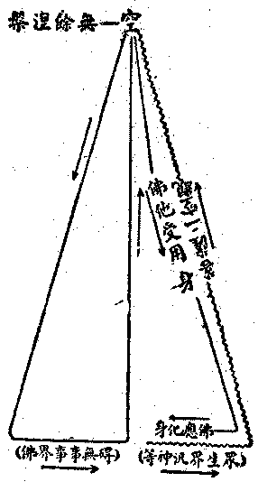
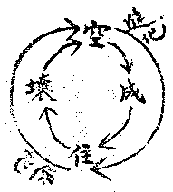
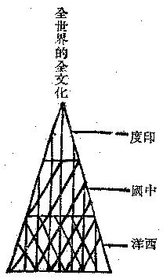

# 太虚大师全书．第十六编　书评



> **藏经**：太虚大师全书（太虚大师全书）　**册次** 第 25 册（TX25）　**编号** TX0016　**卷次** 76 卷　**篇幅** 162,839 字

> **作者（译者）**：期前同上，九期后因史君病改由唐大圆编

> **卷／品**：1 卷 · 0 品



---



## 目录



- [是卷八](#是卷八)



---



论佛教伦理讲话



——七年七月作——



演宗居士寄示第一种佛教伦理丛书讲话，并嘱为校阅。展诵之下，乃用通俗之言语作随宜之教化者，对治恶慧，整饬伦纪，深入显出，比喻剀切，洵觉世之良书也！意之所到，辄书以志之。



一、「佛即中国所谓之圣人」，此解最好。盖佛陀、译觉者，犹言有觉之人，与单称之觉字，有人法之异。独说为「醒觉明白」，义反不符，故可作：「讲到佛，那就大大的不同了，他是永远醒觉了的完全明白了的」。



二、「说了四十九年大法，教化徒弟不计其数……那顶劣等的也生天界。佛到七十九岁，当时度脱的皆已度脱，所以那应身便灭了，但佛的真身是湛然常住的，应身在别个世界亦依然是有的」。



三、璎珞经：神名天心，通名慧性。天、谓第一义空，即心真如；慧性、则四智菩提也。故可曰：「神、是佛和我们无二无别的本心；通、是我们各人能开了智慧照著佛法去修行，修到与本心融化成一的地位，就没有一点遮碍，所以叫做神通」。



四、六种神通。天眼通凡六义：透碍、一也，彻通、二也，破暗、三也，显微、四也，见未来、五也，见诸趣、六也。至其所及时之长与处之广，则前之五通，仙、鬼、神、天、外道、小圣，皆各随其功行而为分限，唯至佛斯真无涯量耳。天眼、天耳，其实均非关肉体之眼耳者，特以能见形色谓之眼，能闻音声谓之耳而已。其能闻能见，实唯寂定中灵明之心也。庚桑楚谓：我能视听不用耳目，虽六合之外有来於我心者，我皆知之，此即天眼、天耳通也。唯言语乃意识所缘法尘，天耳亦但闻种种音声，正如吾人闻蝉鸣雀噪，不能读其意之所解也。至得通一切语言陀罗尼，乃属妙观察智者，非天耳通也，故唯佛及大菩萨有之耳。而能解一二种异物所发音声之意义者，此或由夙业报得，或由专学修得，既非得言语陀罗尼，尤非得天耳通。天耳通者，能了闻微远之音声是也。见未来既属天眼通，故唯指知自己及众生过去之事者为宿命通也。他心通、谓能知他之心念，其义易知。目连称神通第一者，即身如意通最胜也，以有时亦专称身如意通为神通故。积聚依持曰身，虽今之唯物学家亦谓无原子、电子各各独立存在者，则存在物无非是积聚依持之身，故身兼根境言也。此通乃上下、远近、隐现、大小、地水火风、日星金石、皆无障碍也。未得佛法三乘菩提者，必无漏尽通。前之五通，则天、神、仙、鬼等有得一种至五种者。人间外道仙人，寻常不过知三世、几万年、几万里而已。大梵天王以小千世界为限，摩醯首罗天王以大千世界为限，过未以八万大劫为限。小圣阿罗汉多得漏尽通不得前五通者，以唯志在了脱生死也；而独觉则必得六通。大阿罗汉与独觉之五通界限，与摩醯首罗天王同也。大千世界者，百万亿日月天地也。天、鬼等通，多由报得，生成是有；人界——兼动物言——多由修得；种种异道，种种修法，依禅经修发四禅，即可依之作意修神通，而佛法不求五通，贵深证最清净心而妙用自发耳。凡发通，大约先发天耳、或眼，被「交灵术」者能见远地，以被术时意识空亡而精神虚融，故不目而见，随念而现，此犹光照树上而影落地下，实无来去，与禅定中发天眼理同。但一系发自自心作意，一系受人咒语而有两心联合为异；与念佛、持咒而发通，及菩萨入定受佛加被而说法，理略相同。然念佛等半在乎自心作意，识想虽灭，了了不昧，故有益无损。而彼之被术深者，失自心作意，与睡眠复异：睡眠是由前五根识疲倦昏昧而独头意识仍行故有梦境，此则意识由昏昧而沈潜，前五根觉固依然触受境界，但得明了意识为分别，其感觉浑浑平遍而已。非离根境现量之觉，故异梦中意影，其觉浑浑平遍，故虽唯虚空，若一受术者指语为樱桃，即以此咒语成为彼之作意，乃意识所示与之虚空实是樱桃。又唯术者之言得受其识别，其餘皆浑然无所了者，以彼意识之种种观念，唯由术者之精神咒语压沉，故亦得由术者之精神咒语唤起其一种观念也；乃至唤醒亦然。但被术时若术者不施咒语，殆全落无想境界；平时既未数习厌除想念，则必不久安住无想中，与入无想定者同。故被术深时，若术者精神不注，既不施语，又不唤醒，则彼沉潜之意识则自由无条理而乱起，术者无从知其意念之所在，则不能令被术者之意识受术者制服之指挥之回复矣。於是被术者永失旧时人格，变成疯痴，此其事甚危险也！必术者修得他心通，施术时方无危险。佛菩萨加持众生有益无损者，以有天眼、宿命、他心通，知众生性欲想念也；此岂术者所能哉？但在寻常催眠术才致人精神恍惚沉迷之度，疗病矫癖，固无妨害；至自己催眠，则可为修禅定之前方便也。尝习禅定，亦偶然现天眼、天耳之境，特由寂静暂一流露，既非作意所修，亦非称性所发，故不随念应现，亦不法尔常然，好灵奇是痴见，道人心只是平常而已。



五、六道或减作五趣，或增作七趣。校此三者，折衷六道。然修罗本属四天王所统八部神鬼之一部，特有少数倔强者不受统摄，或起抗战耳。魔罗之徒，亦异天人，乾闼婆、紧那罗等亦然，彼既不别列种种道，何须於修罗别列一道也？至仙趣亦人中修行者而已，若舍人报成天仙，则空居天以上天人是也；神仙、鬼仙，则亦四天王所统摄者也。要之、五趣为正。此外有不能正摄五趣者，彼非天、非鬼、非畜生，亦天、亦鬼、亦畜生，则或可混名曰杂趣而已。与其名修罗道，不如总以四天王天修罗等八部，及魔鬼、鬼仙、地水火风各种主神等，名之曰神道也。此诸种种，其实皆有灵化神力，虽胜劣悬殊，互可交接，虽善恶不纯，颇有威福，字曰神通，可谓名称其实。又案：三界有二种：甲、就欲界地居天以下分为三界：一、天神界——旧名帝释界，依主立名，其实亦摄诸神，地居天八部神皆杂居也——孔、墨、耶、回——案耶、回所奉天神，只南天增长天王耳——所奉天神，唯知顺阴阳之化者，齐乎此而已——婆罗门教、道教之高者，则超出此界而上趋乎欲界空居天、色界天乃至无色界天——。盖帝释天以上，即鬼神所不能往来居住；且除自在天魔及大梵天，皆与下界了不相涉也。二、人生界——旧名人界，以人类为主立名，亦依主立名，其实遍赅诸动物而言也——：此即俗语所云阳世也。三、鬼囚界——旧名琰魔界，亦依主立名，乃阎罗之变音。阎罗乃地狱之主，亦饿鬼之主也。今合其二道而立此名——：此即俗语所云阴世也。地狱、非泥犁之正译也，正译苦具，谓依正身器无非是苦具耳。堕阿鼻泥犁者，转生在无间苦具中也。下劣之修罗、罗刹、夜叉及鬼仙等类，亦是鬼类，多为鬼王臣使，此鬼王等亦得谓之神也。此之三界，以相居处交通分判，唯杂趣之神道，於餘五趣无不交通耳。乙、就生死轮回界分为三界：即欲界、色界、无色界是也。依修禅定则分九地，而欲界名六道杂居地——原名五趣杂居——。故欲界云者，非单指欲界六天，自欲界六天乃至地狱统名为欲界也。过此、则名色界天，无复婬媾阴阳之事，清净光明，自然化生。无色界天都无色、声、香、味、触、眼、耳、鼻、舌、身，唯窈冥之定心与广漠之清空耳。世间轮回界齐此，过此则是出世间涅槃界矣。



六、有情世间即是六道众生，器世间方是六道众生所依止之世界。所以皆名世间者，盖有多义，其最大之义，则无论正报之根身与依报之器界，皆不出三世相续，迁流无常，十方相待，变易无定；相续故有世，相待故有间，名之世间相，无异名之曰物相耳。盖非此则十方虚空悉皆消殒，发心归元证心真如矣。所以曰：若见诸相非相，即见如来。复次、有为相之谓世间，有生灭故；和合相之谓世间，可破坏故；虚伪相之为世间，可克治故；有碍相之谓世间，有分限故。



七、九品饿鬼，自罪之最轻者以至罪之最重者而为次序，则势力、得失、得弃、大瘤、臭毛、针毛、臭口、针咽、炬口是也。炬口、常被火烧，亦无间苦也。佛典虚怯多畏者谓之鬼，威灵有势者谓之神，而势力鬼多则无障，且有威势，乃鬼中之神也。人世祀立神庙，大约多为此一类鬼所据享，正直者则若城隍、土地等，邪恶者则若罗刹、鬼子母等。而得失、得弃二类，则占鬼中之最多数，且占六道中之最多数，其数实多於三十餘万类之动物也。此乃鬼道中之寻常百姓，其居处多在地面，满山、满海、满楼、满窟，大概虚怯多畏而得食常难，其所食、在人以为唯是气息，彼则亦作种种饮食见也。鬼唯见人想念而不见人身，被所见人身，即人观念中自身之影；故人身亦不为鬼障碍。间有积世老鬼，或弄人、助人，且能现形出声而同人饮啖。鬼类之生，亦有胎、卵、湿、化四种，最多者为化生。地狱中则专从化生也。此类鬼何为独多？因有是受果报者，有是餘道中舍报毕命而生缘未遇化为中阴身鬼者；盖化生鬼亦大略同中阴身也。此种鬼大都未失前生人格，且有宿命通能知多生之事及能变幻梦游。世人初立鬼名，即由梦中或冢间遇已死之祖先而起，遂有人之神灵不灭谓之鬼，及鬼为人之神灵之所归等种种误会。其实则人死不都报生为鬼，鬼亦不都亦人死报生。人生鬼生，各有来自六道中新死者；鬼死人死，各有直趋六道中转生者，所以谓之六道生死轮回。惟罪福业未甚分明决定，无强烈之转生缘者，人死亦多浮寄鬼中耳，所谓游魂滞魄是也。寻常为亡人造福，即是多恐在此类鬼中，令速得善道之生缘也。其餘报生定者，非有非常道力不能回转之。然众生阿赖耶识原非定一定异，善业恶业皆互为缘力而相感应，故作善作恶都不遗失。后之六种饿鬼，则皆唯酬饿鬼之业者方报生耳。其住处亦依傍热地狱。地狱之大者，有八寒八热十六种：八寒即在南北冰洋中，八热即在地心火汁中。坏劫若近，地狱先空，即是地狱蕴火尽向冰底喷出，火泄冰消，大地乃渐毁灭也。



八、四天王寿五百岁，非人间之五百岁也。以人间岁月校之，五十岁仅为彼天一日；以如此之日，复如人间日数积成岁；积如彼之岁五百岁耳。若单计人中年岁，则彼一岁已有人间十八万岁矣！然此犹天人中寿之最短者耳！故在彼观吾人，真蜉蝣之不若也！



佛二九四五年，七月，释太虚识。



（见觉社丛书五期）



（附注）原题「阅佛教伦理丛书讲话第一种」，今依文钞改题。



读梁漱溟君唯识学与佛学



予读北京大学梁漱溟教授所著唯识述义，认为研究唯识宗学的良书，亦认为条贯东西洋哲学得一适当解决的方法论。但予是向来主张大乘各宗，所有因本与果极是平等无二的，但建言与制行的门径有不同耳。故不以贤首五教、圭峰三宗、空海十住心，及近来日本各家依据贤首等所下评判为然的。予为此论非漫然出之者，因之读了梁先生所说唯识学在佛教上的价值地位，还发生了一重商究的言论，写出来请梁先生赐教。



一、梁君说自来判教者都拿他——指唯识学——次小乘之后，位般若之前，高小乘一等而逊於性宗所宗奉的般若教。论起来、紧接小乘的应是唯识，如此判法并没有错。那戒贤以来唯识家自己说是第三时教的话，未敢相信，实在不对！今按此亦依据贤首圭峰等评判者，在天台则便不然。天台大概判般若为通别圆三教，而判古来宗三论者多属通教，於唯识判为别圆二教，多属别教。通教为三乘共教，别教为大乘不共教。则密接小乘共通大乘者固在般若，而唯识当次般若之上也。予谓必欲一论其平等中的差别，则以般若次小乘后为尤当。何者？般若所空者三乘共法，而未及大乘不共法。真如、法性亦三乘共法，大乘不共法乃是佛性。在因地、总言之阿赖耶识，专指其无漏清净者言之即如来藏心；在果地、即法身，亦即三身、四智。所谓「陀那微细识，习气成瀑流，真非真恐迷，我常不开演」者是也。盖迷执为真，则阿赖耶生死流转之妄不能断；迷执为非真，则如来藏常乐我净之德不能显，故三有之凡、二乘之愚皆秘不开演。正须经过般若教荡空一切见解计较，证明了真如法性究竟无得之理，成法空慧，不起法执，乃可开演阿赖耶、如来藏非一非二的唯识教。故曰「非不证真如，而能见诸行，犹如幻事等，虽有而非实」。然则般若教者空一切法而证真如也，唯识教者证真如而见诸行如幻也。由是增进，即是华严、法华、真言、净土之行果。故予以天台家般若通别圆、唯识别圆之判为允。而唯识有空中三时教之判，亦与此义符合。且释尊寂后，在天竺最昌明为小乘，进为般若，再进为唯识，程序尤显。在戒贤三时教之判，则以小乘属有，般若属空，除小乘及般若之外其餘大乘显密经教皆为中道时教，故华严、密严等亦为成唯识所宗之经也。然予的本意，非在贬般若而尊唯识，乃欲明大乘各宗皆发明本元心地达到圆满佛海，皆是圆教之理，唯建言及制行方便有殊。随其殊胜方便以观差别，则亦条然不紊。若般若通别圆、唯识别圆之判，既同达乎圆而复有兼别、兼通别之异，斯为善评判者！但天台独尊法华亦有未允。泯三乘归一乘，亦正犹会三乘共般若入一乘不共般若，则三乘共般若皆一乘不共般若，待至法华始显然说破之耳。又予觉成唯识诸论师各述造论之意，以贤首五教仪观之，若安慧等为於二空有迷谬者生正解故——大乘教理，生解为断二重障故——大乘行教——，断障为得二胜果故——大乘果教——，此通终教、圆教，与贤首家所谓法性宗者不殊——贤首家所谓法性宗非指般若，般若则贤首家所谓破相宗也。盖般若宗所谓法性，乃一相无相、一性无性之真如法性，贤首家所谓法性，则具德圆融之如来藏心。一为大乘体，一为大乘自体相用也——。若火辨等又为开示谬执我法迷唯识者令达二空，於唯识理如实知故，此同破相教之空宗及法性宗之顿教。若护法等复为迷谬唯识理者，或执外境如识非无，或执内识如境非有，或执诸识用别体同，或执离心无别心所，为遮此等种种异执，令於唯识深妙理中得如实解故作斯论——大乘教理——，此乃但为大乘之始教耳。故唯识亦自具始、终、顿、圆四教。至法相、法性等，则名同实异者多，此不专论。撮一表见唯识三时教义：



　　　　　　　　　　　　　　　　　　　　　　　　　┌妄┐  

　　　　　　　　　　　　　　　　　　　┌──业……┤　├…染┐　┌…即末那前六根尘境  

　　　　　　　　　　　　　　　　　　　│　　　　　└迷┘　　│　：　　　　┌……┐  

　　　　　　　　　　　　　　　　　　　│　　　　　┌真┐　　├依┴……转识┴─┐：  

　　　　┌─────────有时教──┼──解脱…┤　├…净┘　遍计执依他起─┤：  

　　　　│　　　　　　　　　　　　　　│　　　　　└悟┘　　　　　　　　　　　│：  

　　　　│　　　　　　　　　　　　　　│　　　　　┌染┐　　　　　　　　　　　│：  

　　　　│　　　　　　　　　　　　　　├──苦……┤　├…妄┐　　　阿赖耶──┘：  

　　　　│　　　　　　　　　　　　　　│　　　　　└迷┘　　│　　　┌┴┐┌…用┘  

　　　　│　　　　　　　　　　　　　　└┐　　　　┌净┐　　├依……本　心┼…相  

　　　　│　中道时教─┬────────┼─法身…┤　├…真┘　　　└┬┘└…体┐  

　　　　│　　　　　　│　　　　　　　┌┘　　　　└悟┘　　　　　　如来藏─┐　：  

　　　　│　　　　　　│　　　　　　　│　　　　　┌染┐　　　　　　　　　　│　：  

　　　　│　　　　　　│　　　　　　　├──惑……┤　├…迷┐　依他起圆成实┤　：  

　　　　│　　　　　　└──空时教┬┐│　　　　　└妄┘　　│　　　　　　　│　：  

　　　　│　　　　　　　　　　　　││└─┐　　　┌净┐　　├依……真如┬─┘　：  

　　　　│　　　　　　　　　　　　│└──┴般若…┤　├…悟┘　　　　　：………┘  

　　　　└────────────┘　　　　　　　└真┘



二、梁君说：般若家的空无与唯识家的空无原是两事，唯识家原从分别有无入手，说遍计是无，依他是有，那无的便如龟毛兔角之无，那有的便如羊牛角之有，有无是对待说的。般若家直悟一切无得，不堕在见解计较里边，拿空无来扫荡一切的见解计较，而他所说的空无却不是一种见解计较。所以他们两家虽然都说空无而实在彼此不相涉，此意印度哲学概论最详。若拿两家略不相涉的空有去比较等差，因而去判三时教。这全出於唯识家对於般若家的意思的不了解，实在不对的。



今谓此非唯识家对於般若家的意思的不了解，或是梁君於唯识学所谓的遍计所执性未尽了解耳。一切的见解计较，即是遍计所执，直悟一切无得不堕在见解计较里，即是遍计执空。故一有所得一堕在见解计较，即是落於遍计执也。成唯识论谓若执唯识真实有者亦同法执，可见唯识依圆之有，乃非有之妙有，非堕於有所得的见解计较中者。六凡随顺遍计所执依他起性而流转，二乘远离遍计所执依他起性而解脱；此皆依遍计所执性迷执依他起性而或顺或离，实不知依他起性的。盖能如实知依他起性及证於圆成识性，故必须般若将一切的见解计较完全空无了，遣尽遍计所执，乃证真如而见诸行如幻的依他起唯识，盖遍计执性一遣除，则依他性即是圆成实性，故一转依间一切苦障皆成了法身妙德。然则依深密三时教，般若岂不仅高於小乘，又如何能与诸大乘中道时教平等无二呢？但般若家说的好，般若为一切佛法的父母，真如法性为一切佛法的祖父母。但能空无一切见解计较契证真如，由证真如而生般若，般若生则一切佛法自成。所谓「以有空义故，一切法得成」，更不消说得故不说，非见不到此故不说。从有为法说主唯识，从无为法说主真如，从无漏法说主般若，而大乘之功尤在乎般若。菩萨依般若波罗密多故得究竟涅槃，诸佛依般若波罗密多故得无上正遍知，尚何不能圆满哉！转有漏为无漏，即是转识成智，其枢纽固在乎般若。故究言之，则唯识者般若之唯识，般若者唯识之般若耳。



三、梁君说：唯识家虽从有分别入手，归根还是无得，与般若家无二无得是佛家的真意。般若唯识本来是两条大路，同以无得为归，没有高下可言。一般以唯识为权教的也不是，古德如嘉祥、圭峰对於唯识想去难破都无是处。又云：论起来、般若家的意思，是大乘教里不论在什麼地方不能离开的，离开便不是大乘了。唯识家的意思，虽未曾如此普遍，但我看起来也有同样的重要。因为大乘教倘若没有唯识，单只般若的无可说的意思，那末要说只好说小乘的教理了，那是很不妥当的！质言之，离了唯识竟是没有大乘教理论可得，大乘佛教离了唯识就没有法子说明（广义的唯识）。我们如果求哲学於佛教，也只在这个唯识学。因为小乘对於形而上学的问题全不过问，认识论又不发达，般若派对於不论什麼问题一切不问不下解决。对於种种问题有许多意见可供我们需求的，只有唯识这一派。更进一步说，我们竟不妨以唯识学代表佛教全体的教理，这都是说唯识学价值地位的重要。但我们回头来看佛教自己对於唯识学如何呢？他们自己便很不重视，这种倾向是很当注意又很难讲的！



今按梁先生这一段评论是极圆到的。然般若不但大乘，竟可说佛教的出世法里不论在什麼地方不能离开的；离开了便不是佛教的出世法了。盖小乘的生空般若，虽未足云般若波罗密多，亦般若支流也。若唯识则无之虽未必便非大乘，但有之者则必为大乘。故唯识端为不共大乘，与华严同。故唯识与华严的重要，在於明说无得而得的为何事，而唯识尤重说明无得而得的在尚未无得而得的时候即为何事。梁君后时谓唯识学并非别物，原是佛教瑜伽师去修禅定得的副产物，此言最确。至唯识般若同以无得为归，以言境唯识则然，未入行果唯识，但一言行果唯识，即越超哲学要说明的，而拦入宗教的说明。盖哲学要说明的，即是形而上学及用何契会他的认识论，形而上学即是毕竟不可得的法。如梁君在此书本是拿唯识学来当哲学讲的，故其言如此。予谓专从解决形而上学问题以说之，在理论上的说明自然在唯识学；但到真个契会，则又自然进为般若宗及达摩的禅宗。於此可云唯识为文字般若，般若为观照般若，禅宗为实相般若。观照、实相非复理论所到，故亦非哲学上之所需求矣。然梁君乃深知有观照、实相般若，故曰回头看佛教自己对於唯识如何呢，他自己便很不重视，这种倾向是很当注意又很难讲的。盖佛教的需求与哲学的需求异趣，要在真个契会真如以发生般若而圆满菩提耳。故上者直悟实相，其次用般若的观照；至於唯识的说明，则发生般若后自会知道的。先知道了，但增益些见解计较，毫无用处的，此即佛教不重视唯识学的原故了。质之梁君以为何如？



（见海刊一卷五期）



论佛学次第统编



佛法名相浩繁，义类奥博，对於一大藏经律论者，每使人望洋兴叹，莫知何所适从。虽有一切经音义、翻译名义、佛尔雅、佛学小辞典、佛学大辞典等编撰，仅解释名句耳。虽有大明三藏法数、教乘法数、诸乘法数等编撰，仅录列名数或略解句义耳。虽有阅藏知津、法海观澜等编撰，仅略序部类、少提纲要耳。虽有隋、唐、宋、明、清之教藏目录，及日本弘教书院藏、续藏、又续藏等目录之编录，仅次第录列部帙之名题耳。至乎总括佛学之一切法相义类，依一贯之条理而编次之，可为航教海之南针，且可凭之得明佛学之系统者，吾未之见焉。以之乐趋简易者，讥为入海算沙，卤莽灭裂，执持其一二端沾沾自喜，而圣教竟束高阁。或纵探经究论，穷年矻矻，亦往往以不能获其要领，终而浅尝辄止，不免模糊汗漫，更无论已。故今寂照居士之佛学次第统编为不可缓，而将大有功於佛法之宏明者也。



或谓阿难四阿含之结集，及小乘有部所撰大毘婆沙论、俱舍论等，大乘所撰大智度论、瑜伽师地论等，亦何莫非统包括佛教之一切法相义类，依一贯之条理而编次之，或加以判摄焉者。传入中国，援引大智度论之例，若天台之法华玄义、文句，清凉之华严悬谈、疏钞，其应用者宏矣，复何事后生初学之有此佛学次第统编为？然一时有一时之机会，适宜而作，岂能以古拟今！且正由往昔诸大士先德曾为种种之结撰判摄，不啻於佛法中添出若干之名相义类，各成一门、一宗、一簇、一聚之学说。及今已极形间错杂糅，极需要有为之次第统合编集之者耳。故古师之作虽云美备，较今或不妨有所增减。兼之古作之文势辞气，与今人之心理相去悬远，每致艰於了解。则欲通古人之书，亦正须有为之门径者。故此编之特长，即在但贯摄编次，使法义有一系统，而不加批判焉。



编凡有四，今为用分类法表列之：



　　　　　　　　　　┌外编  

　　　　佛学次第统编┤　　┌正编  

　　　　　　　　　　└内编┤　　┌餘编  

　　　　　　　　　　　　　└旁编┤  

　　　　　　　　　　　　　　　　└附编



外编为叙列教外之各学派各教宗者，餘编为叙列教内各教相各宗致者，附编则佛教之历史及地理也。故此四编为法义之集中者，唯在正编。正编复分七篇：一、世间相，二、出世间相，三、小乘，四、大乘，五、密教，六、人天乘，七、综合。亦为用分类法表例如下：



　　　　　　　　　　　　　　　　　　┌世间相  

　　　　　　　　　　　　　　　┌法相┤  

　　　　　　　　　　　　　　　│　　└出世间相  

　　　　　　　　　　　　　　　│　　　　　　　┌小乘  

　　　　　　　　　　　　┌列举┤　　　　┌显教┤  

　　　　　　　　　　　　│　　│　　┌主┤　　└大乘  

　　　　佛学次第统编正编┤　　└教乘┤　└密教  

　　　　　　　　　　　　│　　　　　└附────人天乘  

　　　　　　　　　　　　└综合



今是为之序论者，意亦仅在其正编也。然手此一编，虽足窥佛学之法统，余则望览者用为深入经藏之探海灯，勿徒以是为足；且更望编者以不懈之搜讨、修订，使益臻完美焉。



序论既终，更出其一例以与编者商之：



　　　　　　　　　　　　┌世间相  

　　　　　　　　　┌法相┤  

　　　　　　　　　│　　└出世间相  

　　　　　　　　　│　　　　　　　　　┌显教  

　　　　　　┌列举┤　　　　　　┌大乘┤  

　　　　　　│　　│　　┌大小乘┤　　└密教  

　　　　正编┤　　└教乘┤　　　└小乘  

　　　　　　│　　　　　└天人乘  

　　　　　　└综合



此中次第系统之理，叙列法相，则由世间而及出世间，彰众生上达之义。上达至究竟即佛，佛乃下化，故叙列教乘，则由大乘而小乘而天人乘，显如来垂济之义。佛自住大乘，但教化菩萨，若施慈悲方便，则由大乘而缘觉乘而声闻乘而天乘而人乘，展转资为摄引，终而综合；则无异法华之开权示实，涅槃之追说还泯耳。斯则法相为内证之门，教乘为外化之道，而内证外化之既圆，乃会归而综合焉。



（见海刊二卷十期）



评大乘起信论考证



——十一年十二月作——



梁任公先生此文未发表前，予尝略闻其绪论，且微与评订焉。乃不图梁先生爱国心殷，以若能否认此论非马鸣所作，实为中国先民假托马鸣之名而作，则中国於世界学术界中当陡增无限光荣，故遂旋发表於东方杂志焉。夫老子之五千言，已为国学之至宝，而此论之可宝，实驾出老子五千言之上不知其若干倍，其可为国宝也，宁不信然！惟若论学者忠实之态度，则颇为失之矣。自梁先生此文发表以来，武汉佛教会各学者，及安徽佛教学者赵寿人，宁波佛学者某居士，长沙佛教会周稼孙等，纷纷叠请予一言评判，予闷然未有以应也。今闻该志十九卷二十号又续载矣，诸佛学者多有坚申前请者，予乃不得不略贡其所闻持者，以请益梁先生，并就正当世有道焉。壬戌腊月六日，著笔谨识。



大乘起信论作者、译者之问题，十餘年前日本已嚣然於学界，吾国章君太炎尝著大乘起信论缘起考，亦与之辩此问题者。近年日本之望月信亨，复数数言大乘起信论非马鸣作，非真谛译，而为支那人撰述。常盘大定等著论驳斥之，迄今犹餘音袅袅焉。但世人好奇眩博者多，而卓见真知者少，故望月大乘起信论之研究出，附和其说者遂占多数焉！



予往者读奘法师传，言大乘起信论一卷印度已失其传，由奘法师译华成梵以还传於印度云云；颇疑以奘法师之博学，及游居印度之久且周，使印度而有此论者，当无不知之者。然彼时正印度大乘昌盛之际，何以此大乘论竟失传耶？於是亦偶起支那人伪撰之疑惑焉！继思贝叶传经，钞写不易，印土裂阻，流布维艰，学派障碍，授受隐秘，新说代兴，束置高阁，此则於全印虽不无少数人仍藏护讲受大乘起信论於奘法师游印之际，而奘法师亦尽可不知印度之有斯论，故稍后仍不妨有实叉难陀来华重译也。且深察斯论根基充厚，亦决非释尊后，复兴大乘第一人之马鸣不能有此，而疑遂冰释也。



今楷本、望月、村上辈之所以致疑此论者，要惟二因：一者、以博览六朝、三唐诸家之经录，往往载有疑惑伪妄之类。此论、真谛三藏既为流寓之际而译，隋法经著众经目录，复因「勘真谛录无此论故入疑」；而唐均正四论玄义，又引「北地诸论师云：非马鸣造，昔地论师造论借菩萨名目之」；於是惑乃滋生。二者、以毒迷於西洋人思想学术发达进化之偏说——即所云进化之史论及科学之方法——，见此论所诠之义，有包举龙树、无著两派论义之概，遂判此论必发生於龙树、无著两派之后，且必发生於善为调和之说之中国人手。殊不知此二皆误谬因焉！



第一因为误谬因者：要知南北朝诸国，分合起灭不安定，而佛教各派学者，亦分合起灭不甚安定，往往有为北方佛教徒不容而投之南者，有与南方佛徒龃龉而投之北者，抱一经一论以为终身之业者，是非杂出，好恶纷错，於地论师为尤甚也。起信论译於梁，乃於真谛航海初抵中国时译。但真谛三藏后译诸经论，皆在陈朝译，著在真谛录中，而此论及大宗地玄文论等，以非在陈朝所译，遂未入录。隋法经未详其不录之故，据陈录入此论以疑，误矣！续高僧传传六朝间之禅宗等不尽不实，多辨之者，未可定据。至唐均正所引北地论师之说，则出於北方之地论师，借端排斥此论耳。宏地论者，惧其学徒徙南以学此论，作此论为地论师造之说以尼之，而昧者不知焉，迄今犹津津乐道之，吁！可哀矣！能抉破此第一误谬因者，则原文「从文献上考察」之全节，吾虽未读，已不烦言而解决矣。



第二因为误谬因者：要知西洋人之学术，由向外境测验得来，乍观一层粗浅零碎皮相，后人凭藉以条贯整齐之，更进察其隐微，於是日趋完密，或因而又发见另一物焉。不然者，则向学说上推论得来。甲立一说而乙驳之，甲乙相驳之下，两派之短毕彰，两派之长尽露，於是有丙者起，除两派之所短，集两派之所长，而著后来居上之效，故有发达进化之程序可推测。而东洋人之道术，则皆从内心熏修印证得来；又不然、则从遗言索隐阐幽得来。故与西洋人学术进化之历程适相反对，而佛学尤甚焉。用西洋学术进化论以律东洋其餘之道术，已方柄圆凿，格格不入，况可以之治佛学乎？吾以之哀日本人、西洋人治佛学者，丧本逐末，背内合外，愈趋愈远，愈说愈枝，愈走愈歧，愈钻愈晦，不图吾国人乃亦竞投入此迷网耶！吾为此说，非漫无徵据者，在确知东方人道术之来源者，固已不待往下再说；然姑试举印度、支那之学术史数事以证。



一、一切佛法，皆发源从释尊菩提场朗然大觉之心海中所流出，后来任应何时何机所起波澜变化，终不能逾越此觉源心海之范围外；此於佛法具信心者，任何人当靡不承认之者。若并此不承认，则根本上且不承认有佛，更论佛法耶？於此信得及，则释尊不动寂场而与同证觉海诸大士说华严，当亦能信。此可知佛法初证、初说，即为最高之境矣。嗣为因顺人心，渐谈小法，令徵近效；复为荡空功迹，令无执滞；复为解除偏蔽，开示融贯；卒之谈常劝善，坚固信行，则平易通俗矣。此观释尊应世说法，可见其发於一人。或同悟人自到自得之最高妙证，渐随机阐说其一分，渐随机又阐说其别一分，渐镕会而归之简易之行，习成流俗，浸失本真。而东方人一派一系之学，其历程皆可作如是观也。



二、马鸣创始复兴大乘亦然，盖由自内深证大乘悟境，於久来隐没在小乘中诸大乘经，发见其精奥，宗造大乘起信、大宗地玄文——尼乾子问无我经应别机而说，已渐开龙树派之端。至大庄严论经、佛所行赞经、十善业道经、六趣轮回经等，乃暂行导俗劝信之书耳！不足以见马鸣——等诸论，皆直提宏纲而规模深远，与释尊顿转华严根本法轮，遥遥相呼应。至龙树、则因大乘之根基以立，渐偏重对破外凡小，宗般若经，宏法空教。又数百年，至无著、天亲时，兼注重对破凡外小及大空，宗深密等，宏唯识教。又数百年，经清辨、护法至智光、戒贤，两派言纷义繁，从事调解和会，智光、戒贤各有三时教——此即成唯识论判教所本，原文谓判教唯中国所有，盖未详耳——而建理之言论毕矣。於是进於真言行持诸仪轨，乃渐成俗而就衰灭，此印度大乘史之可徵者。



三、禅宗在印度，仅密印心证而己。达摩入中国，於慧可亦唯导令自悟而自得之。引教以证，则为楞伽四卷。此亦与释尊华严、马鸣玄文相应者；其发端最高，而后来莫能过也。至五祖、六祖则多说金刚般若，颇近龙树、提婆。至法眼、永明——六祖下五派以法眼宗最居后——则渐近华严、唯识，略似无著、世亲。其后、则参究话头，渐近密行而衰落矣。他若天台、贤首等之创开一宗学者，皆可推观得之。



四、中国儒家理学，周、程皆用修证实功得来。大程器识宏远，规模伟大，后来之朱、陆、王、皆不能出其范围也。朱阐说其一边，陆又阐说其彼一边。至王阳明则吞没其两边而一之以简易之行。王以后，则习成流俗，而理学之局亦终矣。



凡是、皆可见东方人由修证内心、索阐遗言得来之道术，其变迁历程，与西洋人之学术进化史，截然不同：一是顿具渐布，一是渐进渐备。於此义若能审谛不虚者，则原考证「从学理上考察」之说，无论其有百千万言，皆决然可一扫而空之矣。



又按：即姑就西洋之进化史论，则依竟无居士之马鸣论，亦可见大乘起信论之必为马鸣作无疑，故其唯识抉择谈云：



真如缘起之说出於起信论，起信作者马鸣，学出小宗，首宏大乘，过渡时论，义不两牵，谁能信会？故立说粗疏，远逊后世，时为之也。此证於佛教史实，无可讳言者。……又、马鸣初在印度盛唱异说，中印度、则分别论流行之地也，其思想之受影响，当有其不期然而然者。及后为胁尊者为弟子——按当是为尊者剃度弟子，而传法则为再传也——，北去迦湿弥罗，从五百尊者笔受毗婆沙论之文，备闻一切有部诸师异论，不能惬怀，以至於别宏大乘。其取反对一切有部之思想如分别论等者，又属应有之事，可无待言也。……马鸣著起信论，立义虽多疏漏，然仅此一书，不足以见马鸣学说之全而决定其真价也。考马鸣之重要著述，已传译者犹有数种：一、六趣轮回经，详谈六趣生死轮回，无甚精义。二、大庄严论经，归敬胁尊者，而说引凡外入内事，又说归依供养因果事，说十二因缘事。此似初入佛教时之作，犹限於小宗所说。三、佛所行赞经，与大庄严论经同其旨趣，而原典文辞特美。四、尼乾子问无我经，昔人於此经未尝重视，然提法空要领，而谈因缘生法俗有真无，实为法性宗之要籍。五、大宗地玄文本论，此论亦有疑为伪作者，然其所谈五位，义极广博，甚可推重。所谓五位，乃谈五义，非立五宗：一切诸法俱非位，谈大般若经法无自性之义；一切诸法俱是位，谈阿毗达摩经五姓齐被之义；无超次第渐转位，谈解深密经三祇成佛之义；无餘究竟总持位，谈楞伽经乱住之义；周遍圆满广大位，谈华严经帝网重重之义。五经皆大乘最要之籍，而此论已概括其大义而无餘——又其说果位有无量过患，故教化之用尽未来际，此即含有无姓之义，实为甚精——。是故马鸣所宏大乘，不可但以起信一论相推测也。



此则看斯论甚轻，而断定正由马鸣在龙树、无著等之前，且为从小而大之始，故得有此起信论耳。若龙树、无著二系之说极精详之后，唯有进之以默行耳，又乌容此粗略疏漏之起信论出现哉？此可见同一史实，同一方向，而可成两相反对之结论。而望月等固执其穿凿之说以为是者，亦可以休矣。



於上来所说已认清楚者，则於原文「研究本问题之预备」所列九条，固不须更为辞费矣。然或有萦绕於枝词蔓义而未能脱然者，姑略为披剥焉。



一、所云思想展进之阶级，佛学与西洋学不同，已如前辨。至於时代背景，各人观察不同：於吾及竟无居士等观之，则马鸣时——佛寂五六百年间——应有起信论之发生，且必马鸣时乃有起信论之发生也。至某种思想非其时代所必须要者，则不会发生，此不尽然。佛法乃为众生无时不须要者，特要有深证妙悟者以发之耳。至影响於后此之思想界否，亦不一定：就有影响者说，后此龙树等说极精详之大乘空义，无著等说极精详之大乘有义，即由马鸣造囊括纲要之大乘论——起信论本名大乘论——曾先立基本之影响也。就不有影响说，马鸣出家於小乘部——无著、天亲等出家，皆在小乘众中者，龙树明言出家菩萨即摄声闻众中，似至戒贤时始另有大乘众——，时小乘之正统犹盛，自虽内宏大乘，外还随顺小乘徒众以免毁害。所宗之大乘经，及所造宏大乘之论，或密传一二人，或藏之名山以待后世耳——案此小乘学者所以祇知马鸣为雄於文之文章家也——。尼乾子问无我义等先传为龙树学，而此大乘总论亦竟可无影响於印度焉！譬如大学、中庸二篇，宋、明来在中国思想界可谓影响极大矣！然在七国、两汉、六朝、三唐间，有何影响乎？然学、庸实非造自宋、明儒者也。一学说发生，能致无影响之故甚多，故不得谓定有影响。乃原文谓此为各国思想史所同然，佛教史亦断不能独违此公例，吾则谓此为东西洋各国思想史皆不必然，而佛教史尤断断乎不然。



二、佛在世时不然，已详前说。佛灭后，各时代虽可作如此说，然初五百年亦非无大乘之流传，特零散隐幽耳；六百年后亦非无小乘之流传，且仍繁盛，特不能独占为佛教之正统耳；龙树时亦非无异派大乘，如智度论之方广道人等；无著、世亲、护法等时更可知非无异派之大乘，特在彼时要以彼代表之一派为最显著而已。知此、则知马鸣时虽犹为婆娑最盛时代，而马鸣之大乘论不妨成立也。



三、四、此二段若全未知佛经从何而有者，释尊未命笔著书畴则不知者，然不云佛寂后由弟子结集乎？而大小乘弟子各尊所闻，以结集为大小乘契经者，大智度论尝言：原不必皆如来所说，或声闻说，或菩萨说，或天人说，或鬼神说；但要须於佛法会上由佛印可者，乃得结集为契经，否则不得以契经名，所以重圣教也。佛在世时，佛为法本，一切义皆取决於佛。佛寂后，契经为法本，一切义取决於契经。若契经可由人陆续以添造者，则「依法不依人」等句，亦不足为圣教定量，凭何以证其了解之法与佛同耶？故此实自为矛盾之论也。



五、既以印度人之思想为超时间者，则当知由印度人思想之产物，亦为超时间者。以彼超时间之思想学术，乃忽欲以时间拘之，抑何矛盾之甚！且今所译於西洋者，固现流行之品，然亦有译千百年前之亚里斯德学说者，岂此亦西洋人现代所新造耶？西洋人今有译中国之五经或道德经者，此亦中国人今日所新造耶？且罗什所译之百论，其长行即属世亲者，何知罗什时无著、世亲未盛行於印度耶？据此类一偏之见而用为研究佛书之根本方法，宜其所见皆非矣！



六、七、八、九皆枝蔓之词，与本问题无甚关系。



此其根本研究法既九无一当，则从此根本法以发生出文献上、及学理上之考察，吾虽未能得读，亦尽可置之不论，亦尽可置之不读也！



要之、以佛学言，得十百人能从遗言索隐阐幽，不如有一人向内心熏修印证，一朝证彻心源，则剖一微尘出大千经卷，一切佛法皆湛心海。应机施教，流衍无尽，一切名句文皆飞空绝迹，犹神龙之变化无方。否则、祇有一切世间，於彼之事随顺假立，世俗串习悟入觉慧所见同性，而於净智所行境界、及净智境所流出之至教定量，终非其分，祇窜绕於一切世间从其本际展转传来，想自分别共所成立之名相中而已。呜呼！东西洋之科学、哲学、文学、史学者！而日本於今日，所以真正佛学者无一人也！



（见海刊四卷一期）



评佛教哲学通论



此书商务印书馆出版，迈格博士原著，大约是英国人，江绍原译。我因要知道欧美人近来对於佛法的思想如何，特取来看了一遍。



译者云：上座部的主张，乃是用古於梵文的巴利文纪载的。巴利文的作品，支那历来没有多译过。迈格文博士陈述佛家宇宙论之时，既然把巴利文佛典也算作研究对象的一部，所以我想单为这一点，本书已有翻译的价值。关于其餘两派佛家——一切有部及瑜伽宗，他所用的虽是支那文原料，但他的方法，或者也很足供我们参考。



我以为译者这两层意思很中肯，此中所述巴利文的上座部之说，虽似无特长之处，但的确有若干名物及组织为我们向来所未闻见过的——若色法有三十二数，及生住异灭亦入色法中等——殊足珍异。至他的方法，谓不知佛家的宇宙论则不能懂佛家玄学——形而上学——，远过於不知西洋科学则不能懂西洋近代哲学，这是很对的。日本人作的佛教哲学，大致分为二部：一、缘起论，二、实在论。缘起论近于此所谓宇宙论，实在论近于此所谓玄学。然缘起论不同此之宇宙论者：一、缘起论通论世间与出世之缘起，而此宇宙论仅论世间。二、缘起论大抵祇谈如何生起世间及出世诸法，而对於此中之宇宙综合，宇宙分析等基础，鲜能注意及之。然此必令人阅之感其空漠无凭，故此能先注意及宇宙之综合与分析，未始非其方法之长处；但出世的缘起及缘起的出世如何，论者未能言及，亦未始非大缺点。



论者於绪论开头处，言佛、法、僧三，略去佛、僧而单言法，亦为拿佛法来当哲学讲者应取之态度。然佛法实以佛及三乘圣众之智证为源泉而流出，不探其源而酌其流，则终不免皮相。此所云宇宙论及玄学皆境，而佛及圣众为行、果。境与行、果为佛法一贯之道，焉能割取？况行的历程与果的成就，亦为所应知境之一部。故谈佛学应分三分：一、世间论，二、真实论，三、出世论。依法的源流程序，应先出世论、次真实论、复次世间论；依人的学习程序，乃可由世间而真实而出世。而谈哲学者，误视出世论为神学，谓系宗教而不关哲学，去之不谈，此支那佛家所以不愿有人称佛法为哲学。且佛法的出世论乃行智的果证，绝非建立一宗教论之神学，故尤不愿人误会为宗教或神学也。故译者虽云我们绝不曾臆定佛家的主张之来源是理智，而论者则显然处处将佛的法义，作为从理智而来之研究。此因哲学者之哲学，但由推想而安立，不能确知有可由「出世间圣智」而证明之事；故佛学则佛学，非哲学之所能限。或问：然则比利时学者普胜亦否认佛法为「宗教」而称之为「出世修持法」，则又如何？答曰：佛学名为佛学，最为合宜；否则应名「真觉修证法」，谓契真如的正觉之修学证成法也。对世间论虽可名为出世论，然单名为出世修持法，则易滋误解。如译者以其滑稽的语调云：「至於居住在我们现在所知或所假定的世界里面的人，能否信受悦服居住在另一种宇宙里面的佛家所奉行的出世修持法或住世法，自然是个重要问题」，亦此种误解的表现。彼以谓出世乃离开这个世界而住于另一宇宙故。殊不知出世乃「出迷妄」而「得真觉」之别名耳。在迷而妄，谓之世间；契真而觉，谓之出世；即人界而超人界，超人界而即人界，故应名「真觉修证法」乃无过。



论者对於宇宙叙述中——天文学、地质学、地理学之类，往往故举一二在今人视为可笑之点以为嘲弄，故译者云：「迈格文博士对於佛家的玄学，虽然还很尊崇，然佛家的宇宙论，他却不敢辩护，这自然要使支那的佛学家又发现一件可叹的事」。然要了知佛法所称的世间——宇宙综合——三界、五趣、九有情居，是重要的。至於苏迷卢、四洲的是如何，是没大交涉的。故此种尽可借用印度的当时或地球的现代之常识来说。然亦非不可为之辩护，实以无辩护之必要而不辩护。盖古代的天文、地理与现代的天文、地理，大致皆建立於推测的假定上的，原不能定谁实谁假，不过现代人的常识上以现代的天文、地理为真实，亦所谓世间真实而已。且此中叙述亦时错误，如谓一一世界皆有苏迷卢等同样安立，仅指此娑婆大千中之各小世界而已；若此大千外其餘的世界，固不一例。相对以观，仰、覆、正、侧，诸相无定，华严言之矣。且时劫与方量的标准亦各殊。而世间大抵三界、九地、五趣，或仅人天而无三恶，故欲叙佛说的综合世间，亦说明三界、九有情居可耳。至宇宙分析及宇宙动转，则皆为佛法要义之所存，论者若谓与事实相悖，则吾必能为证明非与事实相悖，而仅与论者及现代常识之情执相悖也。



论者以凭藉西洋惯於分析的科学理智故，於宇宙分析中颇有许多说甚清透。於分析及动转中，对佛法中一贯之反神我的反实质的缘生论，颇能见及。但此或即彼所云佛家悖於物理的事实之处，亦即吾所谓仅悖於论者及凡情的妄执之处；此若不悖，佛心何异凡识！



论者於所依的三家，大概巴利文的上座部说，以译成西文者颇多，故知之较广；其次为一切有部说；至瑜伽宗说所窥甚少，误以华严宗等之真心一元论为瑜伽宗。不知瑜伽宗乃为无元的心枢论。所谓真如乃色心等平等真相，非是心也。又后来护法等谓极微为假想慧上分析假立，非事实有，亦引瑜伽师地论之成说；论者谓瑜伽宗初期之无著等采用原子说，亦误。兹不一一辩之。



（见海刊八卷十一、十二期合刊）



评佛学抉择论



——十八年作——



善因法师作佛学抉择论，胜义络绎，洵近代希有之名著，叨在知爱，试一评之：



一、分正、迷、自、净之四信，据实祇须分正、迷之二；自、净二种，其迷局者入於迷信，其解通者入於正信，不须另立。迷信重重，至佛始尽；正信重重，至佛始圆。而在初行，则惟有据释尊遗教，以为判别准绳耳。



二、斥除今汉、藏等佛教滥杂神鬼之俗习，返之释迦之本始，卓然至论。然有群众即成礼仪，歌咏音乐，亦以滋生。根本说一切有部毗捺耶杂事第四云：『时诸苾刍诵经之时，不闲声韵，随句而说，犹如写枣置之异器。给孤长者白世尊：听诸圣众作吟咏声讽诵经典！世尊意许』；则佛世时已诵经矣。仪象、音乐，和悦情感，但令率归真理善行之正，协合时方之雅尚，勿流邪陋而已。易龙树之名为龙猛，语尤不然。梵文亦有一字多义者，罗什等据一义，先译龙树；奘师考梵文及其立名之义，迁译龙猛，非出传密之人也。



六、佛历尚悬，洵哉！故佛徒今应暂停佛生卒年不书，再待考定。余以罗什曾译世亲之百论释——什门作序，明言天亲，不应非也——；真谛曾译陈那之论。则世亲、陈那应早於罗什、真谛，佛生应在二千六百年前也。生卒年月，祇可姑遵常俗。然日本早改依阳历，中国今定阳历为国历，故今后亦应改依阳历耳。



七、定学应复，但禅学应改称慧学。



八、大端如理，但细言之，大小中各多异义，颇难概论。但所云小乘间露神通，大乘全禁，殊不然。菩萨戒本明载菩萨遇须神通变化之人，有力能现神通而不为现者，为有违犯。盖现神通说法，同为度生之工具，唯真菩萨善巧用之耳。



九、大端赞同。但应穷研诸部广律，再厘订之。予於出家戒律，主分为二：一、曲往菩萨，先受持沙弥、苾刍律；发心利他，再受持菩萨戒；亦可终身不受。二、直往菩萨，迳受菩萨戒品，戒本当用瑜伽论者。善师所持三十五条，自修观行虽善，然亦祇止持之一义，较苾刍律缺作持义，较菩萨律缺摄善法与饶益有情二义。又身口七支，加二十六，祇三十三，不能有三十五条也。



十、上慢、我痴之判时，诚应废止。最大之流弊，在於只知尊大其宗祖，虽以佛附其上，然无不以为佛之正法唯吾宗祖得之传之，排斥同禀佛法之餘宗，等於排斥异教；故予尝谓日本祇有一宗一宗之佛教，而无全个之佛教。中国则降而愈下，其尊祖也，且祇知尊其一寺一寺之祖；其传法也，实只传其一寺一寺之产；故祇有一寺一寺之佛教，而更无全个之佛教。今之所急，应根革除各尊宗祖、寺祖之习统，归以尊释迦佛，庶几百川汇海，同为一味。然佛应机开示，法既千差，有情随根悟入，势难一准，故佛法之统一，应为千门百奥，互涉互通之统一，不能为单板之统一。批判教藏，探寻宗教，乃为从许多遗教传说中理出一系统来之必经途径。昔人所判分者，即其研究所得结论表示於人者，初学可资为研求先导，但不应墨守祖言，当直探佛说、圣众说，自成一条贯秩然之圆解耳。



十一、百奥相通，则宗亦可分。宗者、教义中之纲要也。握厥纲要，乃应有一集中致力之点。善师云：修习宜专，苟非握厥纲要，安从而专之耶！但分宗有二：一、为各宗一经、一论、一门、一行以趣专修之行宗，此所云者是也。二、为总摄若干经论之理宗，若小乘之法有我空宗，及大乘之一切皆空宗等，则等於前述之判教，不过举单理以纲若干经论耳。假云：佛法以开悟有情同成正觉为宗，斯可为一切佛法总宗，但应机宜，施法非一，然有其大类可为综贯，因将一分综贯以我空义，一分综贯於皆空义，则谓之总宗中之别宗可也。摄教归佛固为总宗，应机之教，不妨分宗。至於门户之诤，则诚应亟泯除矣。



十二、法华、华严，亦什、奘所传习，其程序之境，应曰：明性相之境而致行果，改称如下：



　　　　境──一、明性相。──十玄六相，一念三千，参究本来，亦明性相之餘义  

　　　　　　　　　耳。  

　　　　　　┌二、基戒定。  

　　　　行─┤  

　　　　　　└三、习观行。──理观现前，入尘历事，广修万行。  

　　　　果──四、获果证。──果唯实证，非教诠之所及，教诠所及，应皆入於  

　　　　　　　　　境中。



十三、大端赞同。此宗成於惠能，而惠能之后，已多伪滥知见，当以性相拣之矣。



十四、大端赞同。



十五、善哉！善哉！阿耨多罗三藐三菩提。



十六、大端赞同。然按之寺僧本身，察之国民环境，皆无实现途径。



十七、十八、善哉！善哉！唯上节难关仍在。



（见海刊十卷七期）



议印度之佛教



——三十一年十月作——



印度不注重历史，所以治佛教史最困难者，即在印度部分，至今不能有一部较为完整之印度佛教史。



印顺法师读书好为精渺深彻之思，故其著作往往能钩玄揭要，自成统贯，以从事沉稳之印佛史，必有胜绩。今已成十餘万言之「印度之佛教」闻。然钞传不易，仅邮其第一章印度佛教流变之概观，乞冠一言，乃就此章所畫轮廓略抒吾意：



『佛教，乃内本释尊之特见，外冶印度文明而创立』，此语最好！



由此先探溯佛前印度文明之源流，自为必要。但吾意所分吠陀创立时代，毋宁谓游牧之雅利安族征服土族而承受其农业文明；梵教极盛时代，则由统治之雅利安族凌驾驯服及邻接各族之上发展所成；教派兴起时代，则不安梵教祭祷及阶级制而起反抗之运动。然此虽说明不同，而大致可认为相差不远。



惟於佛世以来之教史，似因庄严「独尊龙树」之主见，将大乘时代揉成离支破碎，殊应矫正。公平之看法：第一期之佛教，应曰「佛陀为本之声闻解脱，庶於后行之大乘有其本根」。第二期可曰「菩萨倾向之声闻分流」，但应历佛灭至马鸣前约五百餘年，内更分小节。第三期应束三、四期曰「佛陀倾向之菩萨分流」，此中可分四小节：一、佛陀行果赞仰而揭出众生净因之真常唯心论，此於六百年顷，法华、涅槃、般若、华严等渐兴，及马鸣诸论代表之。二、对治外小执障而盛扬摩诃般若之性空幻有论，此於七百年顷，龙树、提婆诸论代表之。三、依据法性空义而补充小大有义之有为唯识论，此於九百年顷，无著、世亲诸论代表之，四、空有剧烈争辩而小大宗见各持之渐倾密行论，此於千餘年顷，清辨、月称、安慧、护法诸论代表之。则验之向传印华佛史无不符合之大乘时代也。第四期可曰「如来为本之佛梵一体」，则承前厌倦苦诤而倾向外内、小大、有空融合持行之趋势，龙智等密咒兴行，在佛灭千二百年起，奄奄五六百年，内更可分小节，则适当我国唐开元前以至宋元时是也。



基佛世之淳朴，握持马鸣、龙树、无著之一贯大乘，前融采声闻分流而后摄择宗见各持与如来一体；亦即依流传在中国者，摄持锡兰传者及择取西藏传者，成一批评而综合而陶铸之新体系，庶其为著述印度佛教史之目标欤！



三一、十、二七、缙云老人。



（见海刊二十四卷七期）



再议印度之佛教



——三十二年八月在缙云山作——



一



印顺论士前寄其所著印度之佛教第一章来请序，曾审阅而作议印度佛教史与之。今其全书共十八章已印出，并附敬答议印度之佛教，乃赓续原议再而议之：



原议「以从事沉隐之印佛史，必有胜绩」，今果有可称举者。其一、印度佛教之流变，每依印度之政治及种族宗教等之关系而转移，向来以无印度较清楚之政治史为依准，故於佛教史亦无从探索其盛衰起灭之因果。今得原著钩稽排比而出之，则印度之佛教与政治相倚转变之迹，瞭然以明。然亦因此关於释尊等兴世年代尚多有待研讨者。其二、中国佛教之传入，在印度大乘佛教已兴之世，故虽仍将其并行之小乘三藏及部派间之论诤陆续译入，但鲜有能如大乘经论深被穷究者。今得原著从四含、六足，以至大毘婆娑、顺正理等所曾辩涉各方，揭出虽译久晦之多种精义，及诸可为演生大乘之源泉者，益增教义内容之丰富。然亦因此陷近锡兰之大乘非佛说或大乘从小乘三藏䌷译而出之狭见。



他若佛法应於一切众生中特重人生，本为余所力倡，如人生佛教，人间佛教，建设人间净土，人乘直接大乘，由人生发达向上渐进以至圆满即为成佛等。然佛法究应以「十方器界一切众生业果相续的世间」为第一基层，而世间中的人间则为特胜之第二阶层，方需有业续解脱之三乘及普度有情之大乘。原著以阿含「诸佛皆出人间，终不在天上成佛也」片言，有将佛法割离餘有情界，孤取人间为本之趋向，则落人本之狭隘。但求现实人间乐者，将谓佛法不如儒道之切要——梁漱溟、熊子真、马一浮、溤有兰等；但求未来天上乐者，将谓佛法不如耶、回之简捷；而佛法恰须被弃於人间矣。又若撷取二三义证不坚之语句，於人种中推论释迦佛出於黄种人，可为黄色种族人共奉之圣者。此虽适於近代民族思潮，亦适於联合黄色人种以竞存於白色人种间之要求；然人种与民族方为德、日据倡谬论，为祸人间，而中国之民族主义反以对内平等对外联合进大同之世而见胜，於救国之仁、救民之仁外别颂佛为救世之仁，方欣有此一切众生世间最少全世界人类之大圣佛陀，殊不须再降格其为黄族之圣人。且依种族之见而限佛陀为黄族之圣，则阿利安种占优势之印度将益被排绝，尤非佛教之利也。



然此种种有待於辨析之义，牵一发而动全身，千端万绪，殆非另编一印度佛教史不足以详达之。以余衰朽之色身，复何暇再从事於此，故一切舍置；但从前议所及者再申论之。



二



佛教乃本释尊之特见，外冶印度文明而刱立二语，为原议所称许。今考核全著，始知与吾意有不少距离。余所称释尊特见，包括能见所见而尤重无上正遍觉——阿耨多罗三藐三菩提之能见——即法华所谓佛知见，而原著仅就「所见一分之缘起无我」言，何以缘起无我为所见之一分，则以佛知见所见之诸法实相，应具缘起无我之法性，无我缘起之法相，缘起无我无我缘起之法界三义。由所指「释尊特见」一语之义界不同及其主重点之有殊，故原议佛陀为本而原著则声闻为本，以致从此而其下重重演变均不能相符合矣。余所许印度文明，亦指潜通世间人类——谓游牧征服农居等乃至一切有情界积习而言。故直冶印度文明当时特著一分成声闻解脱，亦间冶隐通全人类以至一切有情积化所成诸乘一乘行果，故大乘经源出佛说，非非佛说，亦非小乘经论䌷释而出。



原著第三章佛理要略，仅列世间之净化，世间之解脱两表；而菩萨道一表，则列之第十一章第三节末，意许锡兰传大乘非佛说，以大乘为小乘学派分化进展而出。虽未退齐锡兰传，仍重释迦菩萨行及龙树性空为三乘同归涅槃，亦仅齐天台所谓藏、通教，与贤首所示小、始教——大乘虽不应分通、别、圆，或始、终、顿、圆之教级，但为一大乘教行位浅深之异。然大乘特法，固须至其别、圆教或终、顿、圆教而成立。或余他处所谓五乘共法与三乘共法，而特大乘法则竟未为承受。故虽特尊龙树亦不能完全宗奉，而有「已启梵化之机」之微词；所餘大乘经论不为所尊重，复何足讶！则其附摄大乘於小乘，不容有超出小乘之大乘，自当与大乘佛菩萨立场有异。其学佛菩萨之大乘人，应於原著佛理要略章所列摄表之后，加一综合表如下：



　　　　　　　　　　　　　　　　　　┌────────────────────────┐  

　　　　　　　　　　　　　　　　　　└┐　　　　　　　┌─施────┐　　　　　　　　│  

　　　　　　　圆寂─如实而无可取之空─┼──┬法性空慧┤　戒┬───┼天人乘↖　　　　一  

　　　　　　　│　　　　　　　　┌┘┌┘　　│　　　　│菩忍└─┐　│　　　　＼  

　　　　　　　↓　　　　　　　　↓　│┌──┘　　　　│　进┌─┼─┘　　　　　人　　切  

　　　　大乘以佛为本──────佛性┼┼───法界圆觉┤萨定┴─┴声闻乘↖  

　　　　　　　↑　　　　　　　　↑　│└──┐　　　　│　慧───般若　　＼＿＿　　　有  

　　　　　　　│　　　　　　　　│　│　　　│　　　　│　方───方便　　　　　间  

　　　　　　　│　　　　　　　　└┐└┐　　│　　　　│道愿───大悲菩提心↖＿＿＿　情  

　　　　　　　妙觉─极空而无可舍之识─┼──┴法相唯识┤　力　　　　　　　　　　　　↘界  

　　　　　　　　　　　　　　　　　　┌┘　　　　　　　└─智　　　　　　　　　　　　　│  

　　　　　　　　　　　　　　　　　　└────────────────────────┘



三



由上推论，可瞭然於原议「第一期之佛教，应由佛陀为本之声闻解脱。庶於后行之大乘，有其根本」之义矣。盖佛陀为本，以彰佛陀无上遍正觉与诸法实相之心境，由果德探溯因行，乃流出佛华严，并陶冶一切有情积化随施种种法门。阿含亦载佛三时说法，晓诸天、昼人、晚鬼神，故於后行之大乘，皆有其根本。然冶当时印度文明特著一分——沙门团解脱风气所得之显赫成绩，则为声闻解脱，亦凡俗人间共见闻尊信者，故云佛陀为本之声闻解脱。设非佛陀为本，何自有声闻解脱？乃原著仅以印度文明一分所成之声闻为教本，则当然自塞於大佛法源矣。有情趣大佛植种於菩提心，菩提心之发生，在信「究尽诸法实相之无上菩提」，信有「已得无上菩提者」，信「自心能得无上菩提」，本此信以发必得誓愿，曰菩提心；不深信无上菩提，则菩提愿不生，亦无大乘菩萨行矣。或疑佛陀为本，将毋同以「神」为本，不知「佛为万有最高觉者」，师导人天，而绝非「刱造及主宰万有之神」；且一切有情皆可发达成佛，程度之差非性质之别，亦绝非「不平等因之神」可混。英人汤玛士近著人物中心世界史，第四章讲释迦牟尼，是一位「成神的无神论者」。盖就其深行所成圆德，固备世间所奉至真善美神德而超之，可称为无神的自成超神者。亦何用因噎废食而不敢言佛陀为本也。



由此名第二期曰菩萨倾向之声闻分流，以包括佛灭后印度初五百年之佛教，固无问题。而名第三期曰佛陀倾向之菩萨分流，亦可得而说明。於此有须先说者，则印华三时教之教法教史也：有、空、中三时教，乃本深密、金光明等；而法华、华严之流印与译华均不后於般若。华严日照喻，法华穷子喻，显然有根本，从本起末，摄末归本三时教、亦甚明了；名此三时教曰三种法轮，嘉祥用之，贤首亦用之。在此三法轮之从本起末中，更分出有、空、中之三时教，故台、贤实均判五时也。据根本法轮，故佛陀为本之本教，更先於从本起末之渐初声闻教。佛陀为本之教法如是，故印度第三期大乘，亦从佛陀倾向而出。



依此而论印、华之教史，则印度第三期之分四节，初以倾向佛陀而马鸣赞佛行果，其揭示深圆证德，激发大乘正信，竖立菩提愿心，契根本法轮之直依佛陀者，则为宗地及起信二论。然其时马鸣处一切有派方盛之北印，外现随顺无诤，故惟赞扬十善、六度行及无我义，其宗本论则传一二人如坚慧辈潜待机缘。护法之三十论释，且隐俟玄奘乃传；马鸣之宗地、起信，数传后始宏布，不惟可能，亦其势有然也。既同为推测而绝无能证实二论非出马鸣者，则毋宁顺古认出於马鸣，故马鸣在龙树前，即法界宗——原著名真心——在法空宗前也。



从本起末法轮始於声闻教。但龙树以前虽有马鸣之大乘论本，其不能适化，与佛之虽转根本法轮未转从本起末法轮同。然佛转从本起末法轮，虽首为冶凡外之声闻法，而印度龙树时则久行小法，承马鸣大本须力为展开者，则为冶凡外小之大法，尤在弹斥淘炼小法之末中末后法。且龙树原处大众部空义盛行之南部，又为国王所护持，故能发挥其破小融小之大空义，使大乘超小乘而高竖起来，故大乘虽本马鸣而实至龙树乃建成也。然龙树不可以空、亦不可以中论限，即缘起空明空缘起之不二中道，其五心菩提——发心、伏心、通心之般若道，与通心出到、究竟之方便道，五心、二道一而贯之，所谓空为无生初门，本含中不空义，不过多用力对破小有；或提婆统破外小盛明空义，遂引生后时偏执空者。



稍后、无著起印度西北，以龙树虽立大乘，至提婆而后，声化衰息，反有流於所破方广一流之恶取空者；乃承其性空幻有，於幻有中析为名假遍计无，与事实因缘有之二类。此二虽皆唯识而无与有殊，其因缘有唯识法，要待传染乃净，以祛「执空理而废有事」之偏见，完成性空幻有非空不空之中道。故无著、世亲系全承龙树性空义，仅於幻有特加辨明，助龙树破有无义入中道耳。与龙树同为末中末后法，但因兼除空执，致偏彰识有，以显非有非空之中实，遂成为此期之第三节。马鸣、龙树、无著之佛陀倾向同，一、随和小而潜奠大本，二、破小有而明空契中，三、对有、空而唯识显中。虽分三流，相成而不相破。龙树、世亲同释华严十地，安慧释龙树中论，护法亦释提婆百论，此原议所谓一贯大乘，亦即印度传入中华之精粹；而冀不以「独尊龙树」，乃前没马鸣而后摈无著，揉成支离破碎也！



入此期之第四节，空有激烈争辩，小大宗见各持，遂渐倾密行，趋入印度佛教衰运。大乘本由综含而见优，至是时执皆空者力破唯识，持唯识者亦反斥空执，大乘分裂，重陷初五百年末部派苦诤餘习。於是空识分宗，空与识又各分派；大乘已失其综含功能，小乘部派亦纷起分庭抗争其间。若藏传有部、经部、唯识、中论四宗者，即小大宗见各存之后后硕果，均依附密教保残喘也。而创开此等衰势者，殆为清辨，执空斥识始掀起空识之争，说空又异佛护起空宗派别，持咒叩药叉求延身命俟决弥勒；启部派诤习，苦诤莫决，退求密咒神助。令印度佛教衰灭，除外来政治社会原因外，咎莫大於此执空诤者。然此时在中国，则开展了摄末归本、本末融贯的综合论，故印度趋衰灭而中国则成全盛。



四期——原著五期，如来为本之佛梵一体，可无异议。而如来为本之不同佛陀为本者，则如来兼有「外道神我」之含义，故易转佛梵一体，其表现者为持行密咒。考今西藏所传，大抵为空论师之转变。龙智亦为中论师，传玄奘曾从学中论，龙智欲授玄奘密法，玄奘辞不受，亦为密教开端空论师之证。盖依中观内修观行，高者可证入空性，从容中道，如龙树，或成中国禅宗；而执空论者，善坏他论，自无可持，不流恶取空拨无因果，则惟有如清辨转入神秘密咒延续身命之一途。而他论被坏者，亦厌倦苦诤，同趋密咒为息心之地。中、日之密宗传来，已在台、贤教盛行后，故应用圆教理论。其在印度则仍依宗见各持理论，故即有部、经部、唯识、中观四宗并各派理论，尤以中观为主重，在密法中排成系统之行列，遂为外内、小大、空有融合之持修。



中国於印度所传，虽前摄第二期而后涉第四期，然以第三期大乘上溯第一期佛本为主。其译史与宗史应分别言之。不完全之般若、华严、法华，开始译传魏、晋间，均唐世始译完；昙无谶、罗什、佛陀跋陀罗、道泰所译传者不相前后，则佛本论与性空论在印度均已先行，可以推知。菩提流支等译传无著、世亲论稍后，亦徵识论之为后起。此从译史可得马鸣、龙树、无著三系之次序相符者。至宗史，则中国在道安前后虽尚空义，亦重毗昙有义。罗什、僧肇、盛空义，而觉贤、道生亦兆端真常义，然大抵示其所见，未据为宗义以衡量全部之佛法。罗什下先行者为成实空义，与毗昙为印度第二期续传餘势。而崭然竖示判教者，当刱始地论师，尤以北地论师立真心为本；后南地论师受真谛摄论义，说本心真妄和合，综合之等於马鸣真如门心生灭门心之起信义，则亦真心宗先起也。肩随北魏地论宗，南梁摄山道朗以对成实空，乃以折毘昙、抑成实之雄姿出现三论空，恍然龙树之出印度。稍后、真谛亦以摄论宗无著。所承印度三系粗备，而不走印度宗见各持之路。由陈入隋、承国政统一之雄势，智者透过中论，综合地论、摄论、为摄末归本本末该通之立宗开教；传嘉祥吉藏晚年亦有归宗天台之说。循前三系而达摩禅宗、清辨空论、护法唯识在中国又分途更进，贤首承转天台，透过地论，更综新传而为末本该通摄归根本之立宗开教。俱含在真谛、玄奘原仅附行，弥勒、弥陀净土亦祇是兼带。但从台、贤后禅宗更深展进，故由台、贤、禅奠定中国佛教；其后印度小大、空有诸诤及密咒虽传入，亦仅居辅属而不能夺之矣。故译史虽随逐印度第三期第四期，而宗史则於印度第三期末，不随印度第四节而入衰运，别开批判融贯之教宗，遂逈然不同印度矣。



印度之佛教：佛世根本为一期，初五百年小行大隐为一期，中五百年大盛小衰为一期，后五百年密兴显附为一期；此按著教史常识，灼然可知者。原著於此千五百年中乃在马鸣后、无著之前短短百餘年为龙树提婆独立一时，马鸣为大乘兴印度之本，抑令湮没，无著与密教极少关系，乃推附后时密咒为一流；约为第一时六百年，第二时一百年，第三时八百年，则除别存偏见者，无论何人难想其平允也。



四



原议「基佛世之淳朴，由握得马鸣、龙树、无著一贯大乘」，至是当可大明矣。「前融声闻分流」，则深有取於原著第四章至第十章之分析探究，而第十一章则应加以批判而择取焉。盖部派思想虽可渐趋大乘，而大乘实起佛陀为本。至於「后择宗见各持与如来一体」，则殊有讨论需要。吾分佛理为五乘共理、三乘共理、大乘特理之三级，前二级之理，原著第三章已明；第三级之理，则开法性空慧、法相唯识、法界圆觉三宗摄之，许皆平等究竟。故於法界圆觉宗所通摄之台、贤、禅、净、密，都应修正其原持意念。台之藏、通教，与贤之小、始教，有一分应归三乘共理；另一分之唯属大乘者，则无论藏、通、别、圆，与小、始、终、顿、圆，均应收入大乘特理。但将藏教、小教者可视为由十信入初住菩萨所看大乘法，通教、始教者可视为由十住、十行、十向、四加行入初地菩萨所看大乘法，别教、终教者可视为由初地至七地菩萨所看大乘法，圆教、顿教者可视为由七地入八地、八地入佛地所看大乘法；贯通前后惟一大乘法，特由菩萨解行浅深，所见有殊。如此、则虽无五类断证因果，但不妨有五重菩萨位看法。特台、贤较重地上菩萨看法，性空、唯识较详地前入初地菩萨之看法耳。禅则等於天台离言谛，不须另开顿教，亦非别趋在诸教之外，乃对教义特示证德。净、密应复其辅行原位，不令嚣张过甚。净非可废诸乘解行之另一独特法门，密非判餘为显教而独超其上之密教，亦非各宗各派宗见各持下之唯一修证。但如社会立法中，净为保寿险法，令死时有一依怙；密如灾病失业等保险法，令困厄时有其救济。以社会力补助於自力，仍须自力积注於社会力，不惟不能懈废自力，且由加多自力集成，故悟修仍以自力为本位。经此决择修正所成新体系，人生向上发达渐进菩萨乘，遂可得而言矣。



裴休，禅宗、华严人也，其序圆觉经曰：『诸天正乐，修罗方瞋，禽兽怀獝狖之悲，鬼狱沉幽囚之苦，端心虑、趋菩提者、惟人道为能』。则分析有情界中以人生为菩萨之阶，且亦为三乘解脱之所共阶，卓然不惑。非一言众生皆具佛性，即不重人间之端虑趋行也。令众生都脱苦安乐而发菩提愿，忘己为他，不求自利，大悲为根，大乘所共，安见无著系之缺此。起信不限时劫，华严短劫亦入长劫，禅顿悟不废渐修，天台六即尤解圆行渐，岂必违任重致远精神。唯识与台、贤、禅俱注重尽其在我之自力，但令净、密返於辅謢修行之原质，则都无可訾议。其实宗喀巴派以菩提道次为主，早降密宗於辅护行矣。五乘共法以净化人间，进善来生。三乘共法以出离世系，解脱苦本。大乘特法以圆觉悬示最高目标，唯识统贯始终因果，性空提持扼要观行，由此以发达完成一切有情界至上之德能，则均组入佛法新体系中，不应偏弃。



本是以言中国之所宜：则大一统之国家，中和性之民族，非统贯一切之道不足以尽其情，非圆澈一切之理不足以定其志。而就其知识思想言论之所及，必於变中求得其常，偏中求得其圆为满足，非锡兰或西藏等边附国民之偏霸一方可自安者。尝论中国重统持融贯，唐以后教理仅行台、贤者，亦由乎此。故中国易取西藏、锡兰所长，而任举彼二之一不足以代替中国之所有。至於注重人事，固为中国之特性。但近人汪少伦说：中国过重人本，不唯神，使宗教信仰不高超；不唯物，使自然科学不发达，为近代濒危之病根。则虽重人间，而下基无边众生，上仰最高佛陀，适救儒术之隘，足以充实国族之精力。又中国人向称佛教为空门，虚无寂灭，诋为蔑伦逃世，使闻者因而却步，不敢一究佛法。今若更盛张「解脱同归寂灭、法性皆空唯名」之说，不益将示佛教为畏途，拒人千里乎？



更进言现世之所宜：一、交通之便捷，缩万里於比邻，隔重洋如对面，使思想、文化、政治、经济等等相影响之关系，密切深遍。非有一联贯融化之道，不能安定，则一发牵而全身动，动乱将无底止，故长久之世界平和，遂为凡富思维力者所共求。二、知识之发达，尽物之性，彻见无有所谓神者为物之本主；而由物类生生进化、息息联通所成之人世，已有其演达极真至善完美之超人入佛可能性。则即人而下基一切众生，上极无等佛陀之人生，向上渐进菩萨乘，正适和平演进之仰望。



基上民国与人世之时机所宜，则於佛法首应强调阐明者，乃为五乘共理之因缘所生法。进之乃为对因缘生法深一层阐明之法相唯识学。再进揭示众生至佛之人群净化、世间解脱、法界圆觉之三重进境，坚定信仰之目标。对确求世间解脱或直趋法界圆觉者，乃专明三界皆苦，诸法性空促深悟证。其主潮乃在阐明因缘生法，悬示法界圆觉，策进人间净化。而苦空寂灭但为过程或旁果，不应偏事激扬，阻国民及世人接近佛法之机会。原著亦以适於今为言，故兹及之。



五



阐明万有因缘生灭之遍理，悬示法界圆觉之佛境，在众生有达现之可能性，导由人间净化以渐渐上趋，为一再议建「佛法新体系」之理论。然理论必继以实践之行事，乃成共仰而垂久存。禅宗以禅林制度，故唐末、宋初风行全国，迄今虽精神枯竭，亦犹赖形制而未灭。必须有适应现代社会之教团组织，方足展开实际之运动。原著虽假想龙树曾欲刱建菩萨僧，曷若隋唐曾有三阶教团建立，唐季百丈曾有不即小大乘、不离小大乘之禅林规制，日本早成只受十无尽戒菩萨僧，中国久行连受沙弥、比丘之菩萨戒僧为事实乎？则吾今拟刱菩萨学处，固将依佛法新体系论，增损斟酌古近中外之制而出之，不容偏执乎一端也。



要之、原著由印度两次教难而说印度佛教之三期演变等颇多精义，特今为明「完型佛教」，建适时体制，故一再扼要核议耳。



卅二年八月卅日，在缙云。



（见海刊二十六卷十期）



阅入中论记



——三十二年十月在汉藏教理院作——



月称论师入中论，於译稿曾随阅隋删润。顷刊印初出，复览一遍，综前寻伺之所及，久恐遗忘，乃援笔记之。



三十二年十月四日，汉藏教理院编译处监译太虚记。



一



全论节成六卷。初赞佛因大悲五纸，洎说初极喜地、二离垢地、三发光地、四燄慧地、五难胜地，共为一卷。次於六现前地般若度，依龙猛中论不自生、不他生、不共生、不自然生义，繁兴巧辩，独得四卷，乃入中论之所由命名者也，故论义特萃於是。次於第六卷前四纸半，说七远行地、八不动地、九善慧地、十法云地。次三纸半，再综说菩萨十地所得功德。再次、由称颂门赞佛功德，约十七纸。最后二纸，为月称述其本龙猛中论所成自论，最胜无比，并劝奉持，并申回向。



二



首赞诸佛第一胜因之菩萨大悲与向来力主应先学菩萨之意合。最所倾诚服膺所说二颂：『声闻中佛能王生，诸佛复从菩萨生，大悲心与无二慧，菩提心是佛子因！悲性於佛广大果，初由种子长如水，常时受用若成熟，故我先赞大悲心』！愿与闻此论者恒时诵持，策励其心者也。



此论从菩萨初心以至后心之一切广行宏德，无不陈说。又能特显中观要旨，较龙猛中论之仅深观空性者为完足，可兼摄大智度、十住之义。故西藏宗喀巴大师於月称见，不取专释中论之显句论，而特取入中为必学之一者，良有以哉！



入中论虽以悟入於中论之性空义为肝要，力说诸法无自性；但於卷二第九：『诸佛之胜义乃真自性，由此无虚妄故是胜义谛，此为诸佛各别内证，如是思择真实义时，唯诸圣者方是正量』；又三卷末：『如是自性，於依他起所作法上是遍计执，…………於佛境界乃是真理，非遍计故，由不触著所作性事唯证自性，证悟真理名为佛故』；又卷五第二十九：『一切诸法如同影像，既无自性亦无共相，岂有现量及比量耶？此中唯一现量，谓一切智智』；卷五第二十二：『论师论中所说差别行相，如是本性，论师许有耶？曰：如薄伽梵说：「若佛出世，若不出世，诸法法性恒常安住」。所说法性可许是有，……唯此非胜义事，亦非无事，以此本性即寂灭故』。则大乘中道佛性已及之。



又卷六第二十二：『次明佛於一乘说有三乘，是密意教。……由彼是乘亦即是大，故名大乘。若大涅槃唯有一者，……彼等亦当如佛，圆满资粮证得一切智智。宣说一乘之理，如集经论等应了知』。而不执三乘同证无餘涅槃之说，则一乘究竟涅槃亦及之。



由此可见入中论於别大乘法亦非不具，但於台、贤所谓圆教之义，则尤逊一筹耳。



三



论与清辨派及唯识等大乘皆异者，乃其执二乘人亦必破法执、必达法空，方能通达补特伽罗无我，永断三界一切随眠。卷一第九如十地经云：『……故佛於大乘，圆满说彼义』。



二乘但明生无我，不明法无我，亦得解脱，大小乘所通许。但二乘利根亦有明法无我者，以无大悲愿故仍证涅槃者，大乘亦多许之。天台宗之通教，三乘同以无言说道而证涅槃，亦是此意。然谓声闻、独觉亦必达法无我乃证生无我涅槃，则为月称之所独说。盖台、贤等亦无不许有愚法声闻，虽未明法空，但达我空，亦解脱三界生死。且达法空固易达生空，然谓达生空必须兼达法空，理固不必。例昔人饮於友舍，错认杯中弓影为蛇而致病者，友知其病因，乃邀致舍原处原杯饮之，悬壁上弓影仍现杯内，其友移其弓并指示之，使豁然证之为弓影，病即得愈，岂必毁其舍、灭其弓、碎其杯而后乃可证蛇是无哉？此虽未执舍、壁、弓、杯等为实，固亦未观舍、壁、弓、杯等为空，而可证杯酒中弓影是空。则观唯是五蕴、四大等和续幻现生我，虽不彻见色识等皆空，亦何为不能见生我是空乎？故分别不深者，观只有六根等未尝不可悟生空；特推求深者，进执蕴、界等为实，认作生缘，佛乃说不达无相则无解脱。龙猛正为对破一切有执之小乘，乃夺之云不达一切法空，亦不能得二乘解脱。月称执之过甚，遂与各派牴牾。卒云：声闻乘中说法无我，仅略说耳；於大乘乃圆满广说法无我义。则略说乃等未说，小乘未能显示法无我义，大乘始显示宣说，则并不能坚持小乘亦必兼达法空说矣。



二卷初，问：菩萨如何得见缘起之真实性？答：谓缘起实性唯是以上六地菩萨之境，不应问吾。又般若经、十地经等圣教密意难解，故但当依龙猛论说。并引楞伽、大云，证龙猛为佛预记之能宏大乘法者。谦己以推先德，诚可尊信。然六卷第二十六曰：『月称胜比丘，广集中论义，唯增上信解空性之正见，最为希有』！於此待研讨者：一、如月称意，龙猛之外，有否胜於龙猛——二地以上，等於龙猛——初地，近於龙猛——地前加行之菩萨，亦曾能造论显扬六地以上菩萨所见之诸法真实性者？若有、则不应言：『若离於本论，餘论无此法』；若无、则龙猛外诸圣贤论皆应废弃！二、佛及初地以上或六地以上菩萨能证说真实性，应为月称所许，其所说诸经等圣教，闻者是否亦能直从悟解？若能、则谓虽依不能宣说真实——例依法华、华严等——，不合道理！不能、则除龙猛论外诸餘经教，概同废物！三、除自所宗中观论外，概谤餘宗为乱造之理，如外道邪教，则应除所宗中论外更无五乘、三乘、一乘等之佛法！此种褊狭之胸襟，实出部派之恶诤，较之宗喀巴以三士道摄佛及圣弟子等所说皆为教授；上士道中摄二大辙及密咒道，宽隘天渊！犹使中国佛徒之不习印度部诤者，竟莫能想像其何以横恶如此！习印度部诤者，乃知大毗婆娑丑诋大天具造五逆，而分别功德论则推崇为唯一菩萨，过情失实，乃其斗诤惯风；印度之佛法由此而衰灭，不足惊尤不应学也！



卷二第三：『如是宣说缘起诸论……为如是闻者劝说真实义，非空无果』。卷六第二十七：『如是彼等虽已成就如是多闻，然无信解空性种子，故犹不能了解空性；若有宿世建树信解空性习气，即於现在唯由因力，亦能通达空性渊底』。此可见龙猛或月称等所说空性，仅於一类夙植乐闻说空习气之有情等，可有悟益。所餘众多有情，固待佛之五乘、三乘、及大乘中多种，殊胜法义，乃能各契其机，各成其益。由於大乘法契悟者咸成了义，不应仅执契一类机所说之空独为了义而摈他说，遮闭圣教诸多胜方便门。则虽能开显一派宗论义，亦将功过互见而瑜不掩瑕矣！



四



此论之第三卷都是破唯识论师者。尝闻朋护法者向党月称者诘之曰：吾宗无著、世亲、陈那、安慧及护法等先德，莫不推尊龙猛菩萨，依顺中论释中观、释百论等，汝月称等宗龙猛者，何对吾宗偏好兴诤？答曰：虽尊龙猛，失龙猛意，故须斥正。诘曰：今不能起龙猛为质，谁得谁失，孰与正之？汝今且言吾失何意？答曰：龙猛论明一切法皆空无自性，汝论於一切空如言取义为恶取空，岂不相违？诘曰：经说龙猛破有无见；龙猛自说：『大圣说空法，为离诸见故，若复见有空，诸佛所不化』；更於智度论，双破迦旃延子有见与方广道人空见。且月称论师亦云：『或有一类为误解空性为毕竟无，谤一切法，增长邪见』。则吾宗破取空见，亦顺成破误解空见，助显龙猛论意，曷尝有违！答曰：不然，汝论般若经等说一切空是密意教，但遍计空，依、圆是有，故违一切法都无自性之空义。诘曰：汝应确指吾宗违义何在？答曰：汝依他性三相安立：一、无所知，二、从自内习气而生，三、有自性非戏论境为假有法依处（又辨了不了义论，依教及理成立中观为了、唯识不了。但所引教，空为了者皆只对有明空为了，显唯第二时说：唯识了者皆对有对空说第三时了，故诸教义唯识为了，绝无问题。所堪诤者，唯在於理。其所据明唯识不了之理，不出入中所言者三。故破入中，亦即已破辨了不了）。有此依他起性，岂非违诸法空无自性耶？



诘曰：汝「无所知」定义如何？答曰：所知是境，汝等执为内识而无外境，故「无所知」。诘曰：识必有所缘，所缘即所知境，岂无所知？但以是识变现，或依他识疏境所亲缘，亦不离自变，无离绝於识之外境，名无外境，岂无所知？答曰！既有异境，何名唯识？诘曰：不离识故，岂非唯识？『识言总显一切有情各有八识，六位心所，所变相见，分位差别，及彼空理所显真如。识自相故，识相应故，二所变故，三分位故，四实性故；如是诸法皆不离识，总立识名。唯言但遮愚夫所执定离诸识实有色等。若如是知唯识教意，便能无倒善备资粮，速入法空，证无上觉，救拔含识生死轮回。非全拨无恶取空者违背教理能成是事』——成唯识卷七。答曰：汝唯识言，唯遮境无，识表心有，识外境无，识内境亦但世俗有；内识是世俗有，亦为胜义实有唯事，岂非执所知境实无，并执识为实有？诘曰：岂不曾说观察所取境故亦不见有能取心，速入法空！答曰：汝说识胜义有，故所取能取空，非一切空；仍在证识实有唯事。诘曰：此汝妄计，非吾宗意。吾宗所取即境，能取即心，执法自性，属所取境，汝执法无自性亦所取境。汝等所执取境尽空，则诸能取心识亦空，证真胜义。说识亦胜义有，乃世俗胜义有，非胜义胜义有。故云：『诸心心所依他起故，亦如幻事非真实有。为遣妄执心心所外实有境故说唯有识，若执唯识真实有者，如执外境亦是法执』——成唯识卷二。答曰：诸境空故心亦空者，岂不中观论一切法空义耶？诘曰：岂不曾言中论空义本为吾宗顺摄！汝为自他胜负恶欲驱使，妄兴诤论，岂知汝苦诤所成者，本为吾宗所摄空义耶！答曰：然则汝等应但宗归中论空义，何须别立无境唯识义耶？



诘曰：本楞伽、华严、深密等至教而为阐发，所以垂此教理，有多深意，非恶取空，宁致诽拨？答曰：楞伽、华严固为了义，然不如汝之计，深密不了义，故非吾所崇。诘曰：汝取楞伽、华严为了义者何在？答曰：世尊於契经卷三第三十二中说：『如来藏……显彼一切皆非了义』。诘曰：彼经亦说：『譬如巨海浪，斯由猛风起，洪波鼓冥壑，无有断绝时。藏识海常住，境界风所动，种种诸波浪，腾跃而转生。……心名采集业，意名广采集，诸识识所识，现等境说五』。又说：『如来之藏是善不善因，能遍兴造一切趣生，譬如伎儿变现诸趣。……无始虚伪恶习所熏，明为识藏，与七识俱，如海浪身常生不断。……不共一切声闻、缘觉及诸外道……唯佛及餘利智依义，菩萨智慧境界』。汝於彼经不又应执非了义耶？故此云即空性说阿赖耶，如来异门说如来藏或说无我，以如来藏藏识本为空性中如幻缘起事，地上菩萨乃能了知，为恐汝等凡愚分别执我，故说空无我耳。且华严经不亦说三界唯心耶？答曰：经云『随顺行相——故经安立唯心为主，不立外色』。诘曰：统观汝言：『如是破除常我作者，於世俗中见唯内心乃是作者，以是通达三界唯识』；『由见彼补特伽罗等皆非作者，故说唯心是世间之作者』；『如是应知唯心最为主要，遮遣餘法亦是主要，故说三界唯心』。如是一切众生皆由业生，业复依心，唯有心者业乃有故，其无心者业亦无故，故众生流转心是主要因，餘则不尔。故经安立唯心为主，不立外色，皆顺吾义，以皆成立唯识支分义故。此外。『如是遮遣所知亦是悟入无我方便，故佛世尊先遣所知，以了达所知无我者，易入能知无我故。诸了达所知无我者，有唯以自力便能了达能知无自性，有因他略说即能悟者，故佛先说遮遣所知』，亦契唯识教方便意之一。执外色无及识实有，但汝妄计，故汝亦但破汝妄计，非干吾宗。然汝所解义犹未尽，汝说不执色是作者，不破外色；不知计外色是作者，『於世最多，如路迦耶，岂不以四大父母极微』为作者；又中国儒、道以阴阳二气之太极为作者；近代科学所宗机械的、辨证的唯物论者，更以物质色法为宇宙万有作者，排斥心等！故破外色以明唯识，尤为现在当机妙法。汝盲无知！谓不应破外色。反援世许以违圣教，应非佛子，但是顺世外道！又汝谤深密非了义，复何据耶？答曰：彼经说遍计执、依他起、圆成实三自性中，遍计执无性，依他起有性；又云『阿陀那识甚深细，一切种子如暴流，我於凡愚不开显，恐彼分别执为我』。此等如云：『如对诸病者，医生给众药，如是对有情，佛亦说唯心』，即显彼经是不了义。诘曰：彼经亦说『若杂染法、若清净法，我说一切皆无作用，亦都无有补特伽罗，以一切种离所为故。非杂染法先染后净，非清净法后净先染。凡夫异生於麤重身执著诸法补特伽罗自性差别，随眠妄见以为缘故，计我我所』，汝何亦不说为了义？又龙猛云：『大圣说空法，为离诸见故，若复见有空，诸佛所不化』，岂非说空亦为应病施药？汝何不知例同「如对诸病者，医生给众药，如是对有情，佛亦说空法」，亦非了义，而妄执说一切法无自性空为了义耶？故知汝说但随妄情自为取舍，无当圣教！



且汝不许『唯从自内习气而生』，『则从无明行及种子等生识及芽等，此世俗生如何决定』？答曰：诸法非从无因生，非由自在等因生，非自他生，非共生，故知唯是依缘生。婆伽梵说诸法此有故彼有，此生故彼生，所谓无明缘行。中论亦云：『因业有作者，因作者有业，除此缘起外，更无成业因』。诘曰：汝说缘起、缘生，为不离汝现分别法而说，为离去汝现分别法，别依「大自在」等离识之法说耶？设不离汝现分别法，则任说如何依因缘生起，总即唯从自内习气而生，岂能别有缘起、缘生义耶？答曰：不然，汝「依他起」据所起法为自，而指别从他生；中论缘起不自、不他、不共生，故破他生中已破汝义。诘曰：此彼他自等字，都是代名，所指义相，不应定执！故依他起之一他字，原可易为缘字。华译经论依他起性，亦多译为缘起性者。起之与生，义亦通用，故依他起亦可云依缘起，即云「依因缘生」，亦无不合。汝以他字而起他执，不观其义，妄施破斥，则何不於此有故彼有，此生故彼生之一彼字执同他字，亦作他生破耶——彼此二字，可更换作彼有故此有，义不异——？汝闻依彼生之缘起则许，依他起之缘生则破，亦犹愚狙闻一十则喜，二五则怒，不解二五恰等一十耳。佛菩萨等别应机宜，为异门说显缘起义，说为依他起性，说从自内熏习而生，亦性空中更明缘起深细相耳。佛菩萨智甚深无量，勿於楞伽等藏识缘起教妄生诽谤，随顺世执！故汝立『执内识实有，谤外境定无』之妄计，又自妄破。但汝妄计，自破妄许，无干吾宗。故所计破，不再一一叙责。



然汝又破是有有性非戏论境为假有法依因，计何为「自性」耶？答曰：『自性名无作，不待异成法』。诘日：若汝所计「自性」，则於依他起之缘生幻事，当然是无，又谁执之为有，待汝破令无耶？答曰：然则汝等说三性中，遍计执无性，依他起有性，彼何谓耶？诘曰：岂不闻经说离言自相——或自性——耶？汝著言辨，谓法尽於名言，遂不知有离言法？诸瑜伽师定心所现，及因明者所许世间现量，闻气而觉香臭，饮水自知冷暖，乃至蜂聚蚁群，各成业用；凡此缘生幻事，均不离识。然非必待名字言说而立。此离言亦成事，不同龟角、兔毛必藉名言假说，谓之离言自相，谓之唯事。对彼唯藉名言假说之遍计所执相，亦说为假名法所依实事，为名言种类之忆念计度分别所不到故，亦说非戏论境。然为缘起幻事，本无「无作不待异法成」之自性。对圆成实真胜义性，仍世俗有而非胜义。汝因不解经义，妄计妄破。答曰：缘起皆无自性故空，以不坏世间名言故假名为有，离假名外岂有缘生实事？诘曰：於缘起实证无自性空后，断缘起否？不断缘起，则於无自性空见缘起事，岂无离假名分别、离假智诠之证智如幻事耶？龙猛为未证空凡愚速证空故，但说假名，汝意愚执假名而拒圣证缘起幻事，岂龙猛论意耶？如明清辨说『蛇於盘绳之缘起上是遍计执，以彼於此非是有故；彼於其蛇上是圆成实，非遍计故』。於蛇、绳喻全不知义。蛇於蛇上是圆成实，则绳於绳上亦圆成实！蛇於绳上是遍计执，则绳於蛇上亦是遍计执！但从绳上了绳是绳而正误认为蛇之误，即除遍计而达圆成，不须绳外之蛇上达圆成，岂须缘起外之真性达圆成耶？答曰：龙猛论同诸佛语皆依二谛说，胜义谛唯无自性空，世俗谛唯缘起假名。除此性空假名，更何缘起义耶？诘曰：如汝所执唯假名者，诸缘起事是否尽同龟毛兔角，但有名字言说？除名字言说更无识觉了事？若但名字言说同龟毛兔角者，毕竟无故，复何异龙猛所破方广道人及汝所斥由误解空性为毕竟无谤一切法增长邪见者？若除假名字说非无不离觉了之缘起事，则舍假名遍计执空，应许缘起依他事有，染净因果，乃俱可成。亦即龙猛以空义故，四谛、三宝俱得成也。汝必执唯龟毛兔角假名，则汝不唯四谛、三宝俱坏，即令汝唯龟毛兔角复何能起龟毛兔角计耶？答曰：如汝言岂二谛外别有法耶？诘曰：汝自不了二谛义耳，岂不知中土传龙猛、提婆三论四谛义者，均於二谛说有多重？吾宗则说世俗胜义各有四重如下：



　　　　世间世俗──────────军林人物─────汝执世俗  

　　　　世间胜义──────┐  

　　　　　　　　　　　　　　├───唯识五蕴  

　　　　道理世俗──────┘  

　　　　道理胜义──────┐  

　　　　　　　　　　　　　　├───四谛因果  

　　　　证得世俗──────┘  

　　　　证得胜义──────┐  

　　　　　　　　　　　　　　├───生法二空─────汝执胜义  

　　　　胜义世俗──────┘  

　　　　胜义胜义──────────一真法界



汝执世间名言全不思察者为世俗，故唯世间世俗；汝执唯所说无自性空为胜义，故是胜义世俗。不达离言内证一真法界，此但汝自局执，岂龙猛义为汝限耶？汝为争自宗胜，力破吾宗，却如贼入空室，竟无可偷。然汝旁论亦多破绽，可再略举一二：汝破他生，敌宗示汝『唯特殊他作因生果，非凡他性皆是因果』。汝等仍计「他」通一切而破，曾不能破特殊胜他生，则是自破汝计，岂破敌义！且例现见一母产出一子，岂应不许此子从彼母生？又汝但引剑不自割，指不自指，破识不自证体。但於如火生时，顿俱照自体及瓶等，非渐照喻，并不能破。如是内识生时顿了自体及境之自证义，亦何曾破？所餘汝如村妪斗口所兴诤论，一一何难破令粉碎。但为不欲效汝徒诤舌辩，不复一一。『若汝爱自宗，他宗则不喜，不能证涅槃，二行无寂灭』。汝爱汝宗如再兴诤，亦不用再破矣！



五



观上两家诤论，则知入中破他，但为舌辩游戏，无当正悟！乐著内诤，卒难独占全胜，徒令外道乘隙，尽灭佛法，故诸佛子应不为此！然则此诸诤辩，尽无益耶？曰：善学者，当领其要，皆空派在依世间世俗名言而明第一义以趣实证，唯识派在依道理世俗而明第一义以趣实证；其明第一义趣实证者同，一依世间世俗、一依道理世俗是其差别。现代科学发达，世间知识昂进之际，则从道理世俗之世间胜义为出发，尤当机宜。以月称观缘起法无自性空义以上，诸法缘起唯识所现义，取其足喻世间学者而止。其诤辩义，可用为反观自心之所资，据彼此所破义，一一察之，当下身心世界，内证诸法无自性空，亦达诸法唯识变现；藉此反观以求亲证，庶能契龙猛，世亲等先圣意。而入中论等之诤辩，亦可去内想之隔滞，翻毒药为醍醐，而习其利辩以荡诸外情，亦堪为三宝之城堑金汤者也。故记存之为劝诫焉。



（见太虚大师纪念集）



关於支那内学院文件之摘疑



——八年十二月作——



予於己未九月十四日，访欧阳竟无居士於金陵支那内学院筹备处，与谈甚欢；嗣获读其支那内学院缘起叙书后一览表简章，顶戴信奉，如佛明诲，窃望一一能徵效其实，故微有未符意言，申论之以冀竟无居士与发起诸长者居士咸赐察焉。



一、简章第一章总纲第一条，「本内学院以阐扬佛教、养成弘法利世之才，非养成出家自利之士为宗旨」。予对於此条颇滋疑义！阐扬佛教，果无须出家之士乎？弘法利世，果有不可出家之意乎？出家之究竟果唯自利乎？出家人中果不能有弘法利世之才以阐扬佛教乎？予意佛教住持三宝之僧宝，既在乎出家之众，而三宝为佛教之要素，犹主权、领土、公民之於国家也。欲阐扬佛教以弘法利世，顾可无出家之众哉！分析以言之：出家之士，以无家人之累而减少谋生之计，弥可专志阐扬佛教弘法利世；亦因与群俗形制隔离，於弘法利世间或有难以通假便宜之处。然在家之士，虽有和光同尘以弘通佛法普利人世之益，而未免有家计缘务以纷其心志、使不能专事阐扬佛教，弘法利世。较厥短长，亦适堪相覆。考之历来宏传佛法之沙门、居士，在家者壮年利世、而衰晚修己；出家者早岁自度，而长老为人，斯各得其当耳。予昔尝读太炎居士之建立宗教论，谓宏传佛教，於沙门、居士二者不可偏废，爱其平允，此於住持僧宝及出世俗家之义，固应如是者也。若论大乘胜义僧宝，虽不限在家、出家，然大乘胜义出家之义，亦何尝可以形迹拘之哉！而太炎居士缘起文中，谓自清之季，佛法不在缁衣而流入居士长者间，亦未尽然。学佛之长者居士，固渐盛於清季，然雍、乾来苾刍以世主之裁抑，於学说虽表见者稀，第笃修禅净二行者，未尝无人焉。至云以居士说佛法，得人则视苾刍为盛，不得则无绳格，亦易入於奇袤；是故遵道而行，昔之富郑公、张安道是矣；杂引他宗，迤入左道，今时裨贩言佛者是也。其撢简诚当！故切望支那内学院无隔别僧俗，引出家之士同为发起，且亦令出家有志於阐扬佛教宏法利世之青年，得依之修学焉，但吾尝闻某某居士言：以常州天宁寺殷富常住，乃不务作育出家人中阐扬佛教弘法利世之才，沾沾效世俗守财奴之所为，不其可长叹息哉！意者、支那内学院简章之列此条，其有激云然欤！乌乎！出家儿亦足羞已！



二、简章第十三条，一、法相大学本科（慈恩宗、贤首宗、俱舍宗）。又竟无居士叙云：「由因相大故，建立瑜伽宗，曰弥勒学」。又云：「瑜伽学支派，曰无著学，曰世亲学；依世亲古学曰安慧学，广世亲今学曰护法学，世亲别传曰真谛学，糅而大成曰窥基学；瑜伽宗境行果三，独详行果曰普贤华严学，阐华严根本行相曰世亲十地学，阐华严法界玄门果相曰法藏、澄观学，别诠华严圆旨曰李通玄学」。又答徐蔚如书云：「华严即法相宗，非附入法相宗也。自来讲法相者，惟知有百法唯识之说，故隘其量，是不知法相之所以然也。性周法界而不可说，体大也；相周法界而可条说，相大也；用周法界可说不可说，用大也；乌可以名相琐碎之词，遂了法相耶！如如不动之谓性，帝网重重之谓相，若不称相，称之谓何？事事无碍，惟华严说到此处，此果中之相也。以其义言为法相，以其经名则为华严耳。太炎居士缘起亦引称唯识法相；唐以来并为一宗，其实通局、大小殊焉」！总观诸说，辞义固足，条贯秩然矣。然予意大乘一切法门，任举何种法门，一一皆此性此相此用而已，无不具相用之性，乃至亦无不具性相之用。所谓糅而大成之窥基学，非指成唯识言乎？然窥基述记固言唯识为宗也。攷成唯识论三十颂，唯识境之二十五颂中，前二十四颂为法相，第二十五之一颂为由法相所显之法性，第二十六颂至二十九颂为唯识行，第二十九颂至三十颂为唯识果；此行之与果皆为悟证法性所起之用，而唯识一宗未尝不全具法相法性法用也。於二十五颂，则摄三论宗、天台宗、禅宗；於二十六颂至二十九颂，则摄华严宗、律宗；於第三十颂，则摄密宗、净土宗；可以唯识融持一切佛法，无欠无餘。夫唯识果局小而不足以尽法相，法相果通大而兼包唯识、华严耶？亦适得其反耳。故予意孰为法相、孰为法性之说，亦就其偏显之端以为言耳，非能划然割截为二者。於诠门则或用表诠，如成唯识、起信等论；或用遮诠，如中、百等论。於论法则或近归纳，如唯识等；或近演绎，如起信等；归纳近於琐碎，演绎近於浑括，故唐之法藏等乃以起信论为法性，中、百等则属於破相。然此仅施设名言上之差别耳，非可依定义理分齐。钩稽其诚，在法藏等系指如来藏为法性，实则如来藏乃净分法相，彼既以净分法相为法性，遂专指染分法相之阿赖耶为法相；中、百等既未立赖耶、如来藏，乃属之於破相；此既与原来以三论为法性宗者异也。予之见解则复不然，以三论为偏显大乘之法性，以唯识为偏显大乘之法相，性之与相俱属乎境，故之二宗亦偏显乎理教之境而略行果；而华严、法华、真言、净土等，均属偏显大乘行果之法用者：华严是显佛果上自行因果之实智者，法华是显佛果上化他因果之权智者，真言、净土是显佛果上正报依报者，至於禅宗、则祇是务实证，律宗、则祇是务实行，不能以大小乘、性相、体用绳格之者。故予欲废法相宗、法性宗等名，就一个具德之事体，如一类经或一类论之华严宗、法华宗等，及瑜伽宗、唯识宗等，开创之山、之寺、之人，若慈恩宗、天台宗等，立名以为标帜。外有个别之名物以为识，内复可条举其特胜之处与融通之处，使分析含摄，咸得其宜，以免破相、法相、法性等无谓之争也。予昔者尝作宗依品，载在四期觉社丛书，愿谈言佛法者察焉！



佛二九四六年十二月十五日释太虚。



（见海刊一卷一期）



阅竟无居士近刊



距今三十三载，我参加金陵刻经处杨仁老所办祇桓精舍，时竟无居士——欧阳渐——亦每函杨仁老问研佛学，尝见其手扎，颇涉法界观义，始心识其人。民元，居士与李政纲等办佛教会，我则办佛教协进会，嗣闻继主杨仁老刻经事。民七，我於沪上组觉社而出季刊，载居士答徐蔚如诸问，传有支那内学院之刱设。民八冬，余过金陵访之，始与居士晤谈，吕君秋逸亦随出见。民九，海潮音创刊后，我与居士虽时上下其议论，两方门下亦往往辩言杂出，然我过金陵仍频访叙，徒侣亦转相问学，法喜靡间。惟近十年卒致不通闻问，学侣形之攻难者其气渐粗，则民二十后涉及俗事问题，余乃默避之也。



阅杂刊五六七及中庸传，觉居士气壮神旺如昔，学有进益，剀切敷陈以求解人，真挚恳诚之意洋溢於字里行间，堪示为学良范。爰藉之为推衍，以重结法喜之缘。



居士自述学程，初习程朱，继学陆王；看起信、楞严，年濒四十；学唯识、瑜伽至涣然冰释，年五十餘矣；发愤治智论而般若娴习；进治涅槃，年六十而后知无餘涅槃之至足重。当其瑜伽冰释，尝力非起信、楞严；迄宗涅槃，则幡然又变。然详察居士顷年所提倡者，在「宗趣唯一，无餘涅槃；法门无量，三智三渐次」二语，其餘事则辟汉、宋伪儒，显真孔同佛而已。试略分别之：



宗趣唯一，无餘涅槃；法门无量，三智三渐次，是诚居士之学有增益，能揭示其要者也。又云：



念念无心是地上境界，凡夫有漏从何觅得？然无路可通而有方便，大智慧人苦心婆心贻我大宝，岂堪忽视？无漏则无心，有漏则有心——无心有心带语病——，虽则有心而心之内境有自证分，亦现量得，此之现量世间现量，但能建在率尔堕心上，稍一刹那则寻求、决定、染净与六识俱矣。发生六识之根基，是四惑相应之末那，缠眠演绎，无有出期。若自证分则有漏中至善，久久缘习忽无漏生，所谓径路绝而风云通也。此即随顺依处依之立引发因，能引发无漏者也。诸修道人都恃此心，而於宗门唯一取用。



於教外别传之秘，亦能从教理中点出睛光，与吾去年请示於真现实论者，语意密迩。然居士以刻苦工夫得此，又因憍慢素深——在居士或以狂狷自许——，遂夸为创获之旨，欲据之以凌轹古今，则仍不免陷於疏忽也。



其说大涅槃三德：



不即不离，不一不异，至微至妙，妙於相应。夫相应者，不可思议，法尔如是，境界也。经云：「我今当令一切众生及以我子四部之众，悉皆安住秘密藏中，我亦复当安住是中入於涅槃。何等名为秘密之藏？犹如∴字，三点若并则不成伊，纵亦不成，别亦不成；解脱之法亦非涅槃，如来之身亦非涅槃，三法各异亦非涅槃。我今安住如是三法，为众生故名入涅槃，如世伊字」。细味经言，而知相应至妙之义，一语具三玄，一玄具三要是也。举一涅槃而即具三德，一语具三玄也。举一解脱，法身以充其量，般若以显其得。举一法身，清净无垢本於解脱，功德无边资於般若。举一般若，因之为无分别起於解脱，果之为一切种智成於法身，则所谓一玄具三要也，皆相应义也。并则一畫，纵则一贯，谁居左右？谁为始终？面目无序，君臣无位，混淆一团，法相乱三，是则即也，一也，有过也。别不具三，解脱则有小而无大，法身则详增上而略本质，般若则明用而非诠体，非圆相也；异地而处，三法虽具，不相连属，非妙相也，是则离也，异也，亦有过也。伊之三点，非并非纵，亦非别异，而仍三法，以法相谈则治而不乱，以至理言则融冶无间，相应之妙如是哉！



此不惟天台之圆三谛义相合，而起信之真如如来藏体相用三大，以至楞严、圆觉等天台，贤首疏义，亦何尝违异？



至於『据是三智，有情成佛凡有初中后三渐次，引生无漏为初渐次，由凡入地历七方便，加行智境也。无相无功用住为中渐次，自初至八烦恼障尽，根本智境也。圆满菩提为最后渐次，一切智智乃证极地，后得智境也』。则常途或谈五行，或立五位，或开十三位以至五十二位，开合之差别耳。而言『唯一宗趣无餘涅槃，是则澈上澈下澈始澈终须臾不离无餘涅槃也。故般若为地上事，为根本智相应涅槃矣，而三智所系皆不离乎根本』。尤宛然天台从性起修，全修在性，即而常六、六而常即之六即义。六之等一即圆三谛理，亦即大涅槃三德义，第二第三第四则随顺无漏趣向无漏临入无漏之地前加行也。第五第六则地上根本智地上最后后得智也。其不同处亦开合及名字之异尔。



不宁惟是，其致李政刚书中所言：『自小乘经四含，论六足各部执，而归极於俱舍。如是中观——大般若、四论、瑜伽——六经、十一论。如是而一乘三德，所谓经涅槃、密严。分为四段，段段精研以为教』。



亦近於天台小乘三藏，般若通，瑜伽别。法华涅槃圆之四教。居士能虚心再一读天台诸部，不将视今日所谓：『台、贤、藏、密绝口不谈，盖法华、华严自有真谛，决不可容一家之垄断也。密不尊教，藏时背理，皆法界之陷害也』。同於自己攻诃自己，而哑然失笑耶！天台之书具在正续藏，在今观之，虽不必皆精当，亦不能与居士之说尽符。然此数端之恰合，固不容诬也。



至辟汉、宋伪儒，显真孔同佛，质言之即孔学同佛之无餘涅槃、三智三渐次也。於答陈真如论学书外，旁见复张溥泉、梁寒操书，而致力乃在中庸一传。其辟除宋儒之锢蔽，以免国人再堕入汉、宋门户窠臼，进求於孔、孟先秦学术之真，亦诚有振发聋聩之处。然无餘涅槃三智三渐次之佛法，非易明也，居士历程、朱、陆、王、唯识、智度四十年仅乃得之，加之斥二千年之儒皆伪，又於孔、孟掩人伦仁义之显，揭同佛寂净之隐，均非内外学者所公认，则更难上加难。纵令孔、孟真同佛，亦何如直谈显了佛法之易起人信哉？况孔、孟为人乘道德之宗，强拉同佛，两失之，曷若王恩洋人生学之位置者为得当欤！



居士求法勤苦，为学真切，诚有可钦者。当其得益处猛力激扬，每发隐奥；而偏至之势亦随以生，由之执此斥餘，故立言往往功过参半。宝持其精刻而择取其精义，则光严佛国之功德亦足多已。



（见海刊二十二卷七期）



读木村博士佛教研究之大方针书后



日本佛教研究之现状，以吾人观之，已臻隆盛之域。此书歉然不为满足，而向上更求精进，吾人对之当如何愧奋乎！研究预备之资料：



　　　　　　　　　　┌佛典汉文　　　　　　　　　　　┌宗教学  

　　　　　　　　　　│西藏语　　　　　　　　　　　　│宗教史  

　　　　　　　　　　│日本语　　　　　　　　　　　　│西洋哲学  

　　　　一、文语──┤散克利语　　　　　二、学说──┤基督教神学  

　　　　　　　　　　│巴利语　　　　　　　　　　　　│印度宗教哲学  

　　　　　　　　　　└英德法语　　　　　　　　　　　└西洋心理学



此诸资料，洵为必要之预备，且亦为实施佛之教化於此世界之方便缘。今佛学院虽已知注意乎此，而实力上犹未易及之也。佛教研究区划为历史、教理、实际三部，殊为卓见。旧时佛教，只为教理之研究，近来虽然兼重历史，而实际之研究，则尚无谈及之者。更进之以全体研究之二方面，尤为圆满无缺，倾倒无似！然鄙意佛法由证而教，由教信解修行乃发智证实，获得佛菩萨之真精神，以为随缘应世之利他事业——社会事业——。故鄙意於实际部门，可再为一、修己之实践，二、利他之施设，庶徵超「人」入「佛」之真效，不惟以历史。教理之学解为自他之利，而且有宗教之益焉。质之博士，以为何如？



（见海刊五卷八期）



评宝明君中国佛教之现势



宝明君之「中国佛教之现势」一篇，其意思有从去年显教「中国佛教界最近思潮之观察」一篇抽引来者，简明扼要，阅之颇为醒豁。惟内有二点，吾意稍有不然：晚唐来禅、讲、律、净中华佛法，实以禅宗为骨子，禅衰而趋于净，虽若有江河就下之概，但中华之佛教如能复兴也，必不在於真言密咒与法相唯识，而仍在乎禅，禅兴则元气复而骨力充，中华各宗教之佛法，皆藉之焕发精彩而提高格度矣。默察中华佛法将来之形势，禅宗内感衰弱之隐痛，外受密术之逼拶，旁得法相唯识研究之结果，欲求实证乎离言法性，则禅宗之复振，殆为必然之趋势！故谓中华佛教之旧派将从此日衰，毋宁谓其将复由禅宗而大兴，此其一也。吾折衷於法相唯识学，以整理大小乘之内教及东西洋之外学，仅为顺机宏化之一方，而旨归之所存，仍在禅、净。昔居净慈，尝立角虎堂，即本永明大师之意，以有禅有净期之者，此其二也。律、讲——性、相、台、贤——密、禅、净，乃为完全佛教，愿勿分新旧，而以派别拘也！



（见海刊七卷六期）



书释大勇告全国佛教徒文后



汉族中的古僧，处孔儒的专化下，耽山门里修纯佛法。及其开始对外，不得不说些知客应酬语。而士大夫处孔儒地位，间有阴崇佛法，然外面不得不用些儒说遮掩著，且为使浸淫儒化中的汉族人容易领受的方便，这都是应该原谅其苦衷的。乃时至今日，孔儒专化的藩篱久已撤除，从五洲百国流入汉民族中来的异见异说，已万非孔儒学说所能范持，故孔儒不复见重世人。由此今日真发悲悯心救世的佛子，惟有直从根本的三藏，建立纯净的佛法，乃可抉择且轨正一切的异说异见，咸使正信三宝。再依纯净佛法中流出来的人乘正法，立人生德行，使先建人德以渐进菩萨道。若仍附著孔儒的学说来施法，不惟杂染邪妄，而且反受一切异说异见所穷。使本易信佛的，转因障碍而不能信佛；或本堪明确信佛的，亦以变成糊涂信佛。故如近为一般人所崇拜的某某老法师的，除专提倡念佛往生外，并以了凡四训、安士全书、及母教胎教等，杂儒学说以为引人起信，及教人做人的方便，其实可以不须了。适阅此文，因附识於此。



（见海刊十卷十期）



附从译本里研究古禅法及禅学古史攷之后



胡适之君，为要作中古的哲学史，遂汛涉到佛书。但是佛学的书籍，实在太多，系统实在太大，且有许多的理论，又极精细！以多忙且先存了成见的胡君，虽已为此担搁了将近十年，但又那里能够弄清楚全个的佛学思想呢？然不弄清楚，则中古的中国哲学史，又不能做成，这个什麼样好哟！



究竟胡君是最聪明不过的人，於是遂急中生巧的，有了一种方便法，就是将不容易研究得了解得有头绪的对法之类，向西洋哲学史上，借用一个烦琐哲学的名词来，一脚踢开！加以类於论理哲学的因明，和心理学的心心所等，抹煞为既有了现代科学，已尽可弃置不管。且以佛法的精髓，本在禅学，由此乃摭於几个瑜伽禅那等名词，向佛书中攷之。更将佛书中所谈禅法，与禅师语录中没巴鼻言句，取些来点缀一下，中国哲学的佛学一关，岂不便可偷过了吗？从译本里研究古禅法啦，禅学古史考啦，乃陆陆续续出现！



哼！让你聪明，也须知天下人未必尽聋盲！



（见海刊十一卷四期）



相宗新旧两译不同论书后



——二十年二月在厦门作——



此论为梅撷云居士著。居士相宗著述颇多，覃研法相，几三十年，视欧阳竟无犹早——按：竟无初习贤首，民三以刻唯识枢要等乃研法相——，况韩清净等乎？宣统二年，居士服官广州，余亦应粤人请，在广州设佛学精舍。旋住持白云山双溪寺，与居士时相过从，蒙赠余成唯识论述记，为余对于识论研究之一助。余初从八指头陀参禅及依水月禅师——七塔寺方丈——诵持楞严、法华等，亦从道阶法师、杨仁老、谛闲法师等，究天台、贤首教义及相宗八要、唯识心要诸书。与圆瑛、云泉（已故）、静观（现金山方丈）、昱山等为友。然於佛法之悟入，乃在慈溪西方寺之阅大般若经。由此以融照禅、净、台、贤，及华严、法华、楞严、涅槃，与起信、中观、大智度、十住毗婆娑等论，皆灿若心影了无疑滞。然未涉律藏、陀罗尼藏，而於法相经论则犹往往惮其艰涩。其持佛法以入世救人之心，则激发於清季兴学校毁佛寺之事，及谭嗣同、章太炎、严又陵、梁启超等关于佛学之议，乃起而为护法宣教、振僧兴学之运动。此为余光绪三十四年至民国三年间之心境。民三闭关普陀，禅隙乃专观法相经论以及律藏，间及密部。遂知整僧在律，而摄化学者世间需於法相，奉以为能令久住正法饶益有情之圭臬，逮今又十四五年矣。然自居士以述记赠余，携身畔者数年，暇即一览，当时亦未尝非诱余闭关普陀之一缘欤！



顾自宣统二年冬，居士移官湖北提法司之后，二十年来迄未晤面。民二十年元月，余自峨嵋返厦，由鄂过京，乃与居士相值，当荷赠以近著三四，而此论即其一也。途次阅之，触想不少。复以此论虽已刻行而见者犹寡，拟付海潮音转载之，因乘暇隙，一叙居士与余之夙缘，并附商榷之意焉。



此论先辨传世亲学三大译师，关于世亲时代之先后，遂以流支、真谛为旧玄奘为新。论八义不同，并附唐灵润所举十四不同义。终推两译所由以不同之源，归於从空至有之学级历程，始麤终精所致，理明辞晰。既为时彦谈唯识古学新学所依准矣，但余有商榷之二事。



一、世亲之时代　释尊示世年代，近人因锡兰所传与众圣点记相近，遂一依众圣点记计之。此论以流支为世亲同时之人，亦依此以言。但观较先流支在华译传世亲学之勒那摩提、佛陀扇多，梵本不同，译文互异，似皆非亲承正传世亲之学者。由此可知其时世亲之论著已广流布。以古代交通抄写传习种种之不便，一学说新兴至广流布，终须阅五十年百年方可。故余意众圣点记年代，必须推早百餘年，始与中国古来许多译经之史实，才得无阂。如此、则流支应后世亲百餘年。故世亲较早罗什，陈那较早真谛，罗什得译世亲之百论释，真谛得译陈那诸论也。否则罗什译百论之释者，纵可说为另一婆薮；而较早陈那之真谛，壮年即来中国，中间又未回印土，乃已携陈那所著而为翻译，终为不可解之史实。即此流支、勒那、佛陀等亦来华颇早，於同厥年代世亲其人之学，已各从不同之处而来国外译传，亦同为不可解之事。故时代上余以为世亲应早流支百年，真谛百餘年，玄奘三百年也。



二、传学之泛正　世亲造论既广，殆从小乘而旁及大乘全部。虽自所宗成熟在唯识，而不必对於释任何经论皆一本其严格之自宗以说，而无随大乘通义，或随他人意之说也。故亲承世亲之学者，亦不妨所传有异，如奘门或传俱舍，或传唯识，亦不一致。按初期译世亲论著，固以流支为夥。然除十地论之翻译涉及摩提、扇多三人外，摩提又译有世亲之法华论，扇多又译有世亲之摄大乘论释——此译内容尚未研考——。而当时所传为地论宗之说者，则出扇多弟子慧光，传系慧光糅合扇多、摩提、流支三人异译所成。而此三人态度相异，扇多以传禅著称，不重传译经论；摩提泛传大乘经论，似不专重世亲者；流支似专传世亲学——但其译传者，乃在世亲泛释诸大乘经之释论，而不在其特明所宗之唯识学。故可云初期流支等所传译者为泛世亲学。而慧光所据以折衷者，且在扇多之说。吾意扇多即禅宗初祖菩提达磨，而慧光即二祖慧可神光。其以第八识为真心即真如，乃是禅宗宗本之真心，所谓元是菩提、本无烦恼者。如此则初译之地论宗所传，一因系泛世亲学，二因又牵强被夺於禅宗师之意旨相传流支与达磨交恶，当亦因此——，故而如此。如后代永明及憨山、紫柏等禅师之说法相唯识，多以摄唯识归禅宗为旨，而非悉由其时学级未穷之所致也。至於真谛则传译摄大乘世亲释及转识、显识、大乘唯识诸论，似传译专宗唯识之正世亲学者。然细观其误阿陀那为第七末那一事，可见其学无根柢，每多随意揣测为说。则其以阿摩罗为第九识即真如，及第八阿黎耶为真妄和合识等，可知其亦由对于世亲误解意揣而致此。似元、明、清台贤宗人等说法相唯识学，每多误解意揣之词气者然，而非悉由学级未穷之所致也。故吾意学级历程亦诚有关，如唯识学至护法乃确然可立，纯粹以精是也。然其中若以第八识为真如，及以阿陀那为第七识等，则不能诿以学级始麤末精之关系。以世亲之百法论已显然将第八识列於有为心法，而真如则列於无为法。又三十论亦显然已将阿赖耶列为初能变。凡此皆为世亲已显指定之法相，流支及真谛等之所传，乃误谬於世亲之自说，非仅不合於传世亲学之护法等所说。故不应以旧译之异於新译者，为亦系正传世亲唯识学者，但当视为传泛世亲学且误传者。而正世亲学，乃唯应以新译为准也。



民国二十年二月十五日，在南普陀写出。



（见海刊十二卷四期）



评印顺共不共研究



——二十一年四月在杭州灵隐寺作——



原文根据识论之所说，义诚正确。但於解释「用」义、「变」义、与对於基师或破或救诸义，则犹多缺误之处，兹据理评决之。



共中共与不共二句，指器界、即外色言。不共中不共与共二句，指根身、即内色言。此之分判，与论文及述记、学记等教理，皆极符顺，自是正义。相宗纲要以鬼等异见之猛火等外色，判为不共中共，其有违论违理之谬误，无待再言。而尚成为问题者，则在基师以属己田宅等判为共中不共，及鬼等异见之猛火等何以在共变用中带有不共变用义？又扶根尘等何以在不共变用中带有共变义耳？此则须先将用义、变义加以说明，而后乃可分判也。



寻绎识论与述记等，此中所说之用字，应通下列三义：



　　　　依持用─────┬─共  

　　　　缘虑用═════╡  

　　　　摄属用─────┴─不共



依持用最宽，正所谓「处」，可但共变。缘虑用较狭，如所谓器世间，以广大故不可  

知，不可知即不缘虑。又鬼等之猛火人等不缘虑，人等之流水鬼等不缘虑；然亦有通  

异趣共缘虑者，故缘虑用通共不共。至摄属用，则诸趣约异类而不共，若鬼等所见猛  

火，但摄属鬼等有被烧用；同类约各身而不共，若某人田宅摄属於某人用，最显著事  

例若轮王之轮宝等唯摄属轮王用等。是识论虽以鬼人天等所见异故明别受用，系从缘  

虑用言，然实无遮止摄属用——即原文之使用——之义。且共中之器世间相，诚有不  

能缘虑而未尝非依报之依处者。原文限以缘虑论用，缺依持与摄属之用，致於基师属  

己田宅之共中不共误为有违识论。其实基师之加此句，有助明论义处，初不违论义  

也。



原文之诠「变」义，谓外色有二，赖耶所变本质色法，一切自地有情共变，六识所变影像色法，随类共变不变他类。然则影像色法不唯不共缘，且不共变，而与并非不共变只是不共受用之自语相违。如此则六识所变影像色法，应可不同赖耶所变之本质。然影像可不同本质者，仅第六、第七之带质境；可离本质者，仅第六之独影境，前五识但缘性境，性境影像必同本质，如何共变之本质上可有不共变之性境影像？若非性境，则鬼等於所见猛火应不受燃烧实苦；若实受苦，则是异熟果色，如何可非赖耶所变之本质？由此应决定说此中所言共不共相种成熟力所变之色法，或可是赖耶本质而无前六影像。若人等胜义根为人等五识不能缘故，若前六影像则必同赖耶本质，是性境实色故。此可知影像不共变则本质亦不共变，本质共变则影像亦共变矣。



用义、变义既定，再进言用与变之关系，可作二句：一、共用必是共变；二、不共用必是不共变。据此以言，可知原文以他方自地器世间虽共变而不能共用，判为共中不共；实与义蕴、道邑师上一字说变下一字说用，同一误谬。因此上下之二共与二不共，应作如下分判：



上共…………指非情器物外色言



上不共………指有情根身内色言



下共…………指共变共用言



下不共………指不共变不共用言



然下共与不共当再分析以尽其例：



　　　　　　　　　　　　┌自方器世间  

　　　　　　　　　┌全分┤  

　　　　　　┌自地┤　　└异方器世间  

　　　　　　│　　│　　┌自类扶根尘  

　　　　　　│　　└少分┤  

　　　　下共┤　　　　　└异类扶根尘  

　　　　　　│　　　　　┌上地用下  

　　　　　　│　　┌报得┤  

　　　　　　│　　│　　└下地用上  

　　　　　　└异地┤　　┌上地用下  

　　　　　　　　　└修得┤  

　　　　　　　　　　　　└下地用上  

　　　　　　　　　　　┌多分………天人鬼鱼异感  

　　　　　　　┌多有情┤  

　　　　　　　│　　　└少分………阶职家国异属  

　　　　下不共┤  

　　　　　　　│　　　┌全分………自胜义根  

　　　　　　　└各有情┤  

　　　　　　　　　　　└少分………独属己物



依此、可知基师所说属己田宅，系多有情或各有情中少分之不共，复是非情器物，故为共中不共。但何为少分共与少分不共耶？少分共者谓根身，多分系不共变用，然此则带有少分共变用，器物多分系共变用，然此则带有少分不共变用。譬塑一佛像系一人独塑成，然其装金则出多人，故装金功德属多人。反之、系多人共塑成亦通。如轮王之轮宝是器物故，系自地有情之所共变用，然亦出轮王一人不共福业招感而变得，故独摄属轮王所用。此中除全分共、全分不共之二例外，其餘可有随多少有情变用或共或不共之义，故述记之说皆正也。



据前下一共不共之多例，则於原文举问各条，即可完全解答：



一、欲界有情望色界器世间，非四句摄，但上一共字摄，是非情之色故。二、身在下界见上界色通报修得，地上菩萨寄报欲界能见上故，共中共摄；识论说由业起，且据有漏，义无遮故。三、上界天等见下地色，答如原文。四、他方自地器世间，亦共中共摄。此中所言，虽多有识论及古德所未谈者，仍就护法正义之范围内加以说明，於识论义无所违也。然佛智境难可思议，自他依正互融互现，说共不共唯假施设。



依上假施设义，观原文所引诸古说，亦可抉择：



一、义蕴以摄属己房为共中不共，可同述记无误。二、义演以自他身别说不共，反之、应以自他器同说共，不应难以自他身同。其意即言内色，但措辞未莹耳。三、演秘所载诘难，极易例破，扶根尘少分为他用，尚名为共，己田宅多分自受用，如何非不共？四、演秘所载详曰，极为明确正言。扶尘是内身名不共，少分属他用复名共，故为不共中共。己宅是外物名共，多自受用不摄属他，复名不共，故为共中不共。研究谓都是不属他，殆出误解。五、学记载测泛言共中二句可摄境尽，基确指广大不可知之处为共中共，二无违碍，研究何自起左袒不左袒之见。六、学记以变与感辨其差别，适证成其无别，以业变即业感，名异事同；研究执缘用出二过，皆不成过。七、学记随类共变不变他类，解人天等所见各异，正明共中不共；然本质影像，俱不共变，如上明。



二十一，四，五，在灵隐。



（见海刊十三卷六期）



阅为性空者辨



——三十二年四月作——



性空宗有无缺点问题



且同认龙树、提婆及专宗龙树的论师等为性空者，而辨者乐为朋辅，因有申辨。兹先辨有无缺点中辨不缺行果：诚然，龙树是能破有无论的中道师，偏执空理的方广道人亦为所破。龙树、提婆与月称入中均宗佛华十一地，而智度亦广谈行果，何得说其缺行果？然必执此谓已圆满，对餘大乘宗以不同方式、不同教据说行果较详晰处，决然排不容许，则恐非龙树意，而不免为末师偏蔽也。



次辨阿赖耶识：一、细心：龙树的论中诚寻得出，然此不过小乘论中亦说有「穷生死蕴」等之类、安立赖耶者固可引之以明无违，而性空者则不能以曾有片章只句，执已完具无缺；而正显其含而未弘，有待补充。如必执片言为已足，则犹老儒在儒书中寻得一二相似言句，谓佛法三藏及近代科学皆早具於儒，更无待於佛法与科学也。二、种子：执三世为实有，固可不立种子，然说三世幻相，将统如方广道人之看同龟毛兔角或空华耶？抑由刹那刹那生灭不常、相续不断说为幻有耶？如方广则无三世，说何三世幻有？如以不常不断明三世幻有，则摄过去含未来於现刹那，说种现生灭相续，正明三世幻有。且就性空者可陷於方广的三世无有，或萨婆的三世实有之笼统三世幻有，辨明非实有非实无的种现生灭幻有，不应为说三世幻有的性空者所欣受耶！三、唯识：说唯心者之不够了解性空耶？抑执性空之末师不够了解唯识耶？兹且不论。要知者，境心之理性俱空与事相俱幻，乃为性空者唯识者共同义，所以性空者力破心亦同境空幻，祇是成唯识义，非破唯识。然幻相中有唯藉名言立的龟毛等，亦有可离名言而觉了的色识等。故再别为名言之「假」与「色识之实」，以明假依实立；并示遣假存实，别明执假为实是遍计，遣假存实是依圆。此中性空的依他幻有，固可以名辨显，但非全藉名言假立，亦可离言而唯由识显，了其不藉名言之自相，故不唯名而唯识。此唯识义，设非乐著言辨，但执比量否认现量者，固应同许。



再次、就空具不空净因，辨者许空宗不说，则无论其不说之原因是含而不说，或是不要，既未能悍然否认一切说空中具不空净因的大乘经论为非法，则在佛法已说有所缺，不已显然欤！何况空显之不空有二，一为真理，二为幻事。龙树自认空只为大乘初门，而空宗末师至月称，虽广以无自性破他，最后仍说唯佛有真自性。则空宗之不空义，为性空者未尝自外，而辨者诽拨，更为偏断！



从空到不空的问题



要先明的，就是说性空、说真心、说唯识者所宗本的都是佛经，其宗本的佛经之集显於世，虽时有先后，其源於佛说则为大乘学者所同许。故不应只说从部派学者的思想演化而出，不过从部派思想演化上也可见到其联系耳。马鸣与龙树的孰为先后，便是真心论与性空论熟为先后。迦湿弥罗结集会上已有马鸣，则马鸣在先可知，不过马鸣未广以大乘论批判小乘学，故至龙树以性空广破盛行的一切有部，始与小乘分裂而显立大乘。性空为出三乘共观，遍一切法彻底的性空更为大乘所共由之要门，故於大乘教理上从空到不空，证之多分的大乘经论无问题。不过龙树开建的大乘，义本圆满；特为对治小有以奠定大乘初门，故盛说空，而即空之不空则未详说。至於大乘真心宗与唯识宗，决不如空宗末师或辨者所诬「不彻了一切空，要有点实在以立世出世法」的意思，其畅而明之的不空，祇是说空者不能自外的空真理与空幻事。从真空理发挥真净性德以对离妄染，从空幻事显示种现识变。以对遣倒执，俾性空不落方广道人，幻有不落萨婆多部，而圆显性空幻有的中道实有。若通贯之台、贤圆教义，毋宁谓为不拘龙树言而善得龙树意者；而所谓「真正的性空者」，殆於龙树反为滞言而失意者欤？至中国宗派史，什祇译传，梁武朝成实与三论对峙，三论宗始成立，遥尊什为开祖，故涅槃、地论、楞伽之真心宗，亦应较三论之空宗先成立，先真心、次性空、次唯识，亦略同印度马鸣、龙树、无著之程序。台、贤之综合，则为印度所无，兹不具论。



吾意不以一宗派学者立场而以全部佛法立场，佛法五乘与大乘三宗，实可融贯且实应融贯者。隋唐之台、贤与宋初永明、明末蕅益等都曾融贯之。惟台、贤於大乘三宗不免有所抑扬。真心为圆实，性空、唯识为偏权，则仍落排蔽。永明、蕅益又语焉未详。吾意佛证离言，宗门直指，亦大乘各家所共宗；而佛祖应机施教，故般若、中论非不了，而非其机者之不了，则有待於餘经论以成其了。而各宗学者每欲扬自宗独胜而抑他宗为劣，致令一部分经论被排隐蔽，执性空者仍不免，故因是而发之。



（见海刊二十四卷五期）



第九年海潮音之回顾



——十八年五月在灵隐寺作——



海潮音由钱诚善、王诚普二居士主持办理，又一年有餘矣。余负审定之名义，去年漫游欧、美，深以未能尽责为歉！顷之、养疴灵隐，始取第九年全年海潮音复阅之，随感录之如次：



余之著述，见於第九年海潮音者，较往年并不为少，唯错字及误句读甚多。出他人笔录者，亦往往违异，故对於审定殊不易。后当改余为本刊之主撰，庶犹可符名实，愿同社诸君许之！至其瑕瑜得失，当听任阅者公判。但生活与生死一篇，视为颇有关於佛教之重要思想。而尤有须声明者，则世界佛学院缘起，乃赵君寿人代撰，非予所作。



来论中若景昌极之评进化论，苏慧持、汪济生之当今教育界根本问题，为最有益人道民德之杰作！常惺之佛教救亡的新建议，藏文学院之劝请全国僧伽书，则为复兴佛教之精要论著。大勇之觉道略科次第，张慰西之佛化西行记，可为研究华言外佛教典籍之指针。欧阳渐之大般若经叙，谛闲之金刚经新疏，则为般若之二鸿制。唐大圆之唯识与常识，清净之唯识指掌，亦为唯识之二佳构。他若持松之贤密教衡，为判教上之一问题。会觉之佛教与今后中国之国民性，为有关佛教与国民之作。李圆净之揭示佛教徒应具之崇高伟大人格，为佛教徒之所应勉。凡此、皆不可草草读过之文字也。



景昌极之因与果，大抵据三论破显，然对於唯识论的种子说，与经论共说之三身等，亦致其疑难，则景君不惟自违前此诸著作，岂一时亦忘佛所说法之本依欤？夫佛之所说，本乎「诸法实相」，依乎「究了诸法实相之佛智」者也。四依中依智不依识，尤为最要。此中智与识之别，凡心曰识，圣心曰智。世间科学与佛法，虽并重现实之证验，异乎神学、玄学；然依据「人识证验」之科学，究未齐依据「佛智证验」之佛法。故於佛法虽可用科学推证，而不应据科学裁剪，以类削足就屦。一切种亦是现象，但为佛智所了最深细现象；各托众缘，能起为佛以下圣凡所了之粗显现象——相似相续之感觉集团——，佛智证知其能，说之曰能，不应以人识证验之现象及在人识中未获验知其能，即拨之曰无也。三身者，法性身即所证之诸法实相。受用身即能证诸法实相之净智，及智所引无漏功德。法性普遍常住，然佛以下圣凡未全契应，故虽有若无。佛之智德证於法性——法性即诸法实相——，称法性而自在，故成佛身。复次、佛位大智德聚，与诸佛非一非异，互融无碍，正佛自体，谓之自受用身。托佛以下圣凡众缘起诸粗显现相——包括他受用身与三类变化身——，随凡圣量，作胜劣相，名变化身。要之、受用身即佛之正智，法性身乃正智所显真如；圣凡识所缘变化身，皆圣凡识仗佛之正智真如为本质，各随自类识心所现。若依佛智，理皆可徵，唯据人识，义斯成碍。



又大圆之谈唯识，似乎往往有「一心为体、八识为用」之意。如佛的认识论云：「又识之用虽有八种，而其体唯是一心」，此蹈旧来以三界唯心为性宗，万法唯识为相宗之误，不合唯识宗之正义。盖举言唯识，则识之性即真如，识之相即名相，识之净分即正智，识之染分即分别，体用皆唯识而不得别有一心为体。但心与识二名，施设每有差别。其一、如在五蕴言识，但指「识蕴」——八识；——言心可括「受想行识」四蕴：又在百法，「识」指八识，「心」括八识及五十一心所，则心宽而识狭。其二、则心意识分指，心指藏识，是集起义，意指末那，是审量义，识指前六，是了别义，又心狭识宽。其三、则心与识无差别，如二十论云：「心意识了，名之差别」。名之差别，犹云实无差别，其差别者仅在名耳。则可名为心者，皆可名为意，名为识、或名为了；乃至名为了者，亦可名为心、名为意、或名为识也。三界唯心之心，万法唯识之识，当以心与识无差别释之。佛华严偈：『若人欲了知，三世一切佛，应观法界性，一切唯心造』。唯心造即唯识变，或唯识现也。然心体识用，为积谬之种，流传甚广，今偶寄唐居士所言辨之。



复次、善因之锦汉君八识批评正误，读之颇叹治学之难。善师老於佛学，而锦汉言释教之受人群信仰，因身体或头部放出圆光之故，可知彼於佛学毫无了解。此类在门外瞎猜之瞽说，不值识者一笑，应置勿谈。善师乃与辊成一团，致亦通身泥水，全文著不少之疵累，兹难一一辨之。然锦汉所云：弟子大迦叶、阿难、优婆夷等五百人，皆依暗诵法结集经律论三藏。盖抄从传说者，特将优婆离误抄为优婆夷耳。暗诵、即目不对书籍而诵，结集时尚无经律论，当然目不对书籍诵，故兹二字无误。他若以执持识为依士释，立在缠真如为阿赖耶识背境，义皆舛谬，通篇盖瑜不掩瑕也。



所餘各文，大抵平平，可以无咎无誉。略繙一过，聊著数言，对於十二册之鉅编，诚不免挂一漏万之讥诮，尚祈阅者谅之！



（见海刊十卷六期）



十五年来海潮音之总检阅



一　海潮音的来历



海潮音之前身是觉社丛书，觉社丛书是一种定期季刊。民国七年夏间，蒋雨岩、陈元白、黄葆苍——即大慈——等在普陀听余讲佛学之后，邀至上海组一研究及宣传佛学团体，名为觉社。先刊行余所著道学论衡及楞严摄论二书。旋於十月出版觉书——即觉社丛书——第一期，时著有出版「宣言」，可据为余十七年来佛教运动之一出发点。



二　十五年来海潮音的大关节



觉书出至民八之冬才满五期。时大慈购庵潜修於西子湖畔，余亦有住息一年之决计，爰议改觉社季刊为月刊，定名曰海潮音，其后之觉社亦即无形转移为海潮音社矣。至民九元月，海潮音乃初出现於世，在首卷第一期上，曾有「海潮音出现世间的宣言」，及余之「宣言」。



民十六年第八卷出版之初，革命军潮前锋已及长江流域，时代人心发生极度之繁变，余因有「海潮音之新希望」文发表。



第八卷於第十期，余因有远游欧、美之计划，而海潮音才财两困，遂发「要言」。



旋得泰县钱、王二居士继任维持，於十二期乃又有「告徒众书」。



其中余之宣言，尤足见余在中国之佛教运动前后一贯之精神。而第二卷出版宣言，亦颇关要。此第一卷海潮音，乃余在杭州编辑，托上海中华书局印刷发行者。然余为法缘所牵，竟未能在杭住定下来。是年夏间赴粤及夏初冬初两赴武汉讲经，故编辑之事，每於车唇船吻为之，深以为苦！九年春，既住持西湖兜率寺，十年又兼住持西湖净慈寺，十一年后在武昌开办佛学院，更无躬任编辑之暇晷。由此第二卷后之编发人员既转变频繁，而地址亦因就经济与人才之便利，迁释无定，兹制一表如下：



卷别  

编发人员  

编发地址  

附注



第二卷  

释善因　史一如　编陈仲喈　发



汉口佛教会西湖弥勒院



北京大佛寺



初汉口印，以印刷不良。二期后仍改沪中华书局印。编迁杭州弥勒院即兜率寺，九期起改史一如编，迁北京。



第三卷  

史一如　编陈仲喈　发



北京东城大佛寺武昌佛学院



六期前在北京编发，七期起因史君兼任佛学院教员，迁武昌。



第四卷



------



## 是卷八



**译者**：期前同上，九期后因史君病改由唐大圆编



武汉佛学院编汉口流通处发



上卷七期后皆武昌正信印务馆印，汉口佛经流通处发。



第五期  

唐大圆　张化声　编  

同上  

第九期起改由张化声居士任编辑。



第六卷  

张化声、会觉、克全、满智  

八期前同上九期后改庐山大林寺



第九期后，由余指导会觉、克全、满智在庐山编发，印刷交上海泰东代办。



第七卷  

四期前　会觉编　克全发五期起　唐大定编　谷馨山发



庐山大林寺上海佛化教育社



上海法藏寺



第五期起迁上海佛化教育社，第八期起又迁上海法藏寺。



第八卷  

唐大定　楞伽山民　编玉慧观发



上海四川路一一二号  

第四期起，由楞伽山民编，本年经费由玉慧观支持。



第九　十　十一卷  

钱诚善编王诚普发



泰县居士林  

第八期终，余宣告停刊，钱泰、王二君发心为继续维持，乃迁泰县三年。



第十二卷  

满智编佛学书局发



佛学书局  

因佛学书局来接洽担任印发，遂改每年津贴该局五百元以上办之。



第十三　十四卷  

法舫芝峰大醒编佛学书局发



佛学院编  

十三卷法舫编，十四卷九期前芝峰编，十期起大醒编。



第十五卷  

大醒、法舫编止安发行



佛学院编发  

十五卷起改在汉口印刷。



第九卷由泰县佛教居士林出版，又曾於第一期发表海潮音继续出版之新希望。



至十卷第六期爰作「第九年海潮音之回顾」一文，第八期又作「本刊第十年前六期之回顾」一文，以总评正兹一年半来之论著，盖前此余犹每为编印前之审订，至兹余以事繁不能负其责，乃为事后之评阅。然十卷之后，一、因余益无暇顾及，二、因编者之能力已强，余於本刊仅负筹款及撰文之责，而审稿评文均不复有之。



第十二卷，改由满智、法舫、芝峰、大醒相继编辑后，余於此刊之担子，渐可交卸与佛学院学员。而形式与质量方面，亦时有改良进步。而两年来王恩洋居士长期撰述之人生学，尤为希有可贵之作品！但编者与其他作者偶因尖锐之笔锋，间由狭隘偏激紧张而惹起诤论，亦或有失於以前平容宽弘之阔达气度，此固期望本刊编者主撰者保持本刊深观广行之原旨！对於普及之净土法门，引令入胜；对於新兴之法相唯识，及日本之东密、台密，西藏之黄教、红教，予以抉择融贯扶植；对於台、贤，亦宣扬其长处；而戒律中心之声闻三藏，及中观之龙树，与实证之禅宗，尤须作贯成一气之阐发！同时亦希望读者瞭解本刊对於时人所趋之或有抑扬，皆出补偏救弊，勿递生歧视而起忮心。但能持之有故，言之成理，或可披浅似而发深真，或足施方便而探究竟，投寄本刊，皆可代为宣露，使如来无量无数之大权善巧法门，咸得以开阐无遮，靡所遗漏焉！



三　十五年来海潮音的大波澜



海潮音第一年在余之编辑中，颇卜圆满之好誉。而十二期以有善因法师□□论之预告，曾引起本刊社董宜昌王咏香居士等，函杭质问，以为有同外道之□□相传，故弄玄虚。旅以善师在第二卷发表唯性论，知□□即是「唯性」，亦即释然。至第四卷而与内学院诸子时有违诤：先有唐君慧瑞——后出家名大敬——与吕君秋逸有释尊生卒年代之抗辩；继而又有聂君耦庚与史君一如关於因明作法之争论；及乎景君昌极主张「无相分种」，亦旁起激诤，隐然成为武昌与南京两相对峙之佛学思潮，实为一时之盛况。复因予有对辨唯识圆觉宗、三重法界观，曹溪禅之新击节等文，於台贤之说不无所绌；而至五卷有持松法师据贤首义以争为判教之最胜者；并有守培禅师主张一切法空义，抨及印光法师之高提净土，而陜西王莲尊居士竟斥本刊袒守培而排印光，则稍涉意气矣。其实本刊盖谓可从种种不同立场以标奇竞秀，各尽厥致，而无执一非餘之见也。第六卷余对於当时东密、藏密等传华之偏激趋势，发言纠正，而一部分倾倒於咒术者，裂痕渐深。而第七卷则因欧阳居士批评天台教义，乃有兴慈法师等，於本刊据天台宗义与辨论者。第十卷登载康藏学法团大勇、大刚等如律的护持三宝一文，与印光法师等之尊孔者，在一二年间亦引起不少之风波。其对於常惺法师等之辩正，提倡律仪之功殊不可没。十二三卷间，因守培师据空义横拨唯识，历经数次之辩争。尤於十四五卷编撰者关密宗之议论，激生之反影为最大。而十二卷以来对於人物之臧否，亦时引起波折，如佛学书局之干预编辑等，皆出於是。斯亦可以观十五年来法海之澜，而可为将来著佛学思想史者之所取材矣。



四　大检阅之结论



佛教定期刊物之较伟大者，民初有佛学丛报与佛教月报，佛教月报亦为余所编，惜仅出四期为止。佛学丛报虽只十二期，其质精量富，至今犹有可考之价值。自民七觉书出版至蜕变为十五年之海潮音以来，其并行之有价值者，前有内学年刊，亦才五期而止。后起者为现代佛教与威音月刊。现代佛教虽祇十期，然实承现代僧伽而来，故亦有四五年之历史；而今之人海灯尚步其后尘。威音之继续今亦五六年矣。居士林季刊，佛学半月刊，正信周刊等，则为一团体之宣传物；其他日刊、三日刊、周刊、半月刊、月刊、季刊、及南洋之慈航等，十五年来殆不下百餘种，尚鲜有继续至三年以上者。本刊取材之精审或有不逮於佛学丛报、内学者，而博大悠久，流行遍全国各省以及南洋各埠东西洋各国，所阐扬者关於各时代各方域整个佛教之各方面者，实无有逾於本刊，不惟求之国内无其比，即衡以东邻日文佛教月刊之最伟大者，亦无多让。且专主精审每陷於狭隘，惟博大故乃悠久。固须有三四分深造独得之微言奥义为骨干！尤须有六七分应变适宜之大权活用为精神，乃能由十五年而五十年百千万年以无穷尽！盖宫室不起虚空，莲华实生淤泥，知佛法藏之因应众生心而施设，握佛法之纲而随机化导一代一代之人心，庶可无愧於海潮音之名恉耳！本刊虽有或失之滥，或失之杂，然其瑕未尝掩瑜，其疵不足累纯，变不离宗，引趋正觉，而可免於杂家使人漫羡无归之讥者矣！



觉社丛书五期，曾出有觉社丛书选本。而海潮音十周年后，则曾出有海潮音文库。文库编印未精，希望至二十卷时，有精读二十年海潮音其人，慎选严勘，在十分中择取二三分之可垂久远者，另编印成海潮音文库，并附以检读二十年海潮音之总目索引，则为余检阅后未雨绸缪之思也。今检阅中尚拟有十五年来之大事纪，十五年来之大文章二节，以一提本刊中所记关于佛教大事及各篇鸿制鉅著之纲要，乃以时间不及，篇幅过长，故省去；如有人能为另撰二文以补成之者，则尤余之所盼望也！



（见十六卷一期）



（附注）本编广引各文，今概略去以免繁重。



克兰佩的中国佛教季刊



——三十五年夏作——



十七年中国佛学会筹设中，及全国佛教代表会议准备中，曾出「中国佛教旬刊」一种；而抗战期中余在四川缙云山，亦有「中国佛教」之讲著。今至上海以克兰佩居士函赠刊物之察阅，始知三十三年居士曾出「中国佛教季刊」三册，殊为可感焉。其第一册发刊词曰：



本刊态度可得而言者，即以佛说为尊而无系统之见，以宽容为尚而不取乎偏执。稿件方面，凡佛门文字无攻讦之病者，皆所欢迎。惟容有热心之作者，虽具美意，而言语或失鲠直，不免反伤同道，故文责概皆自负。又所刊载，以纯宗教文学为限，而政治与迷信绝所不涉。又读者与作者间之问答，亦乐为发表。总之、同人等之职志无他，即在使本刊成为中国佛教复兴之舆论机关，及世界佛徒之公共喉舌，意举世佛徒皆遵佛法结合一致之日，此战祸世界当可一扫苦痛忧怖而树立和平神圣之幸福。然则中华佛徒其勉为精神复兴之先导，庶几祥和公正之文明大法盛世可期也！



此可见其发刊宗旨之弘正，而内容所载亦能适符其所期，惜季刊第三期而止！今得其来函云：



民国二十八年，即计划用中英两种文字发行中国佛教杂志，亦不克成。直至三十三年始竭一己之力发行季刊一种，然困於经济，加以贱躯抱病，仅出三期而告中辍。弟子所能为者，固不过如此。而沪上一般称为信佛者，更未闻有何可述之努力。至於各寺院则陋习相因，但以诵经以博金钱为务，曾不知佛门教义为何事。此真可痛心者也！弟子虽寡陋不学，然深感目前有二事至为需要：一、则亟须有一高级研究佛法之团体以研习梵文，而获读佛经原本为要务。盖中国译经虽称典雅，然习诵之者，茍非上上之材，实难领略原经之本义。二则须普遍设立推广教旨之教育机关，务能革除陈旧诵经之方法，而能以现代之方法代替之。凡此两项，皆弟子旅华近二十年所深切感其必要者。窃谓此等研究机关，茍得有力者为之提倡，必不难成立。至於梵文或巴利文教授之聘请，则弟子可任其全责，此等教授自当为义务职，仅须供给川资及住宿膳食即可。惟此等建议，一般人闻之必以为妄，度全中国之内能察弟子之心者，吾师一人而已！



此其所言，大都先得我心，且先一部分已为之，或已进行中者，则堪为居士慰焉！



（见海刊二十七卷七期）



略评新唯识论



——二十一年十二月在厦门作——



贤首初列玄奘三藏译场，以意趣不合退出，别弘杜顺、智俨所传华严法界观，乃成贤首宗学。熊君十力，初从支那内学院欧阳君游，习成唯识论，旋改辙而迈进之不已，今遂有新唯识论甲境论之发表。畴昔支院师资，据唯识掊击起信，几将宗起信立说之贤首学之类，一蹴而踣之；余尝作佛法总抉择谈及起信论唯识释以明其并是各存而通摄焉。答王君恩洋质疑之后，其议因息。顷熊君之论出，本禅宗而尚宋明儒学，斟酌性、台、贤、密、孔、孟、老、庄、而隐摭及数论、进化论、刱化论之义，殆成一新贤首学；对於护法、窥基之唯识学亦有一蹴而踣之概。马君一浮序云：『足使生肇敛手而咨嗟，奘基挢舌而不下』，其所怀可知矣。虽然，护、窥之学，果因是踣欤？观昔支院师资未能踣起信，则知熊论亦决不能踣唯识！盖仍一「并是各存」之局，而须再为通摄焉耳。



余宗佛法全体而不主一宗一学，其义见於四现实轮：曰现变实事；曰现事实性；曰现性实觉；曰现觉实变。尝题现实主义以发表其序论。然以名滥世俗所云之现实主义，今后将易题真现实论，再继续发挥其本论与支论。故余昔评支院师资之掊击起信，今评熊论之掊击唯识，皆宗佛法全体立言，非主一宗一学而建义。唯是熊君才出境论，其量论既未刊发，即不能尽知其意趣；故今亦祇就大端略评之，未暇详焉。



兹为省构思起见，援引民十二所作佛法总抉择谈数则，以为推论之端绪：



大乘佛法，皆圆说三性而无不周尽者也。但其施设言教，所依托、所宗尚之点，则不无偏胜於三性之一者。析之，即成三类：



一者、偏依托遍计执性而施设言教者，多破鲜立，以遣荡一切遍计执尽，即得证圆成实而了依他起故。此以中观等论为其代表，所宗尚则在「一切法智都无得」，即此宗所云「无得正观」，亦即「摩诃般若」。而其教以能「励行趣证」为最胜用。二者、偏依托依他起性而施设言教者，有破有立，以若能将一切依他起如实明了者，则遍计执自遣而圆成实自证故。此以唯识等论为代表，所宗尚则在「一切法皆唯识现」。而其教以能「资解发行」为最胜用。三者、偏依托圆成实性而施设言教者，多立鲜破，以开示果地证得之圆成实令起信，策发因地信及之圆成实使求证，则遍计执自然远离，而依他起自然了达故。此以起信等论为其代表，所宗尚则在「一切法皆即真如」。而其教以能「起信求证」为最胜用。



此三宗，虽皆统一切法无遗，然以方便施设言教，则於所托三性各有扩大缩小之异：



般若宗最扩大遍计执性而缩小餘二性，凡名想之所及皆摄入遍计执；唯以绝言无得为依他起、圆成实故；故此宗说三性，遍计固遍计，依他、圆成亦属在遍计也。唯识宗最扩大依他起性而缩小餘二性，以佛果无漏事用及遍计执之能遍计者，皆摄入依他起；唯以由能遍计而执之所执为遍计执，及唯以无为理为真如故；故此宗说三性，依他固依他，遍计、圆成亦属在依他也。真如宗最扩大圆成实而缩小餘二性，以有为无漏及离执遍计，皆摄入於圆成实为真如体、相、用大；唯以无明杂染法为依他、遍计故；故此宗说三性，圆成固圆成，遍计、依他亦属在圆成也。



依此以观熊论（指新唯识论，下皆同此），所谓：『今造此论，为欲悟诸究玄学者，令知实体非是离自心外在境界，及非知识所行境界，唯是反求实证相应故』。即知其论属真如宗，以彼所计「实体」，即指「真如性」故，宗在直明直证真如性故。熊论所宗既别，亦自得成立其说；然袭用「唯识论」为题，且据其自宗以非斥别有其宗之护、窥诸师唯识学，则殊不应理矣！



余谓三宗之学於三性各有其扩大与缩小，语殊关要；而其扩缩之争点，尤在心法。诚以「心」为万化中枢，必夺归於所扩充之性，而后乃能据之以统持一切。故般若宗必夺归遍计执性内，五法、三自性皆非，八识、二无我俱遣，而后乃无智亦无得；唯识宗必夺归依他起性内，了境、造业、持种、转变皆属之，而后成一切所知之依；真如宗必夺归圆成实性内，故起信云：『唯是一心名为真如』。熊论亦云：『是故体万物而不遗者，即唯此心，见心乃云见体』。不如此，则不显偏胜之相，亦不成宗别矣。然未真达离言自性而见此等施设皆唯假说自性者，则每唯自宗为是，而於他宗不善容察，由是相伐。



熊论以心以智以功能摄归真如实性，即楞严所谓『本如来藏妙真如性』，若以此立其自宗，固无不合。然既许有染净中容诸心所有法以为习气，现前身心器物皆习气俱行；且许佛果不断净习，不唯不断，且须藉净习增盛以成以显。如云：



为己之学，无事於性，有事於习，增养净习始显性能；极有为乃见无为，尽人事乃合天德，习之为功大矣哉！



夫习气千条万绪，储积而不散，繁赜而不乱。



然习气潜伏而为吾人所恒不自觉者，则亦不妨假说为种子也。即此无量种子，各有恒性，又各以气类相从，以功用相需，而形成许多不同之联系；即此许多不同之联系，更互相依持，自不期而具有统一之形式。古大乘师所谓「赖耶」「末那」，或即缘此假立。



原夫八识之谈，大乘初兴，便已首唱，本不始於无著。但其为说，以识与诸法平列，语幻相即均不无，语自性毕竟皆空。逮於无著，始成第八识，引世亲舍小入大，此为接引初机。



唯识为言，但遮外境，不谓境无。以境与识同体不离，故言唯识。唯者，殊特义，非唯独意。识能了境，力用殊特，说识名唯，义亦摄境。岂言唯识，便谓境无？



据此诸言，护、窥唯识学便足成立。故唯识论即唯习论，亦唯行论，无事於性，唯事於习故。种姓有无，据行性辨故。且据熊论，岂但唯识学立，即空慧学亦立。例云：



慧者分别事物故，经验起故。



世间谈体，大氐向外寻求，各任彼慧，构畫搏量，虚妄安立，此大惑也。



慧唯分别境事，故恃慧者，恒执物而迷失其固有之智，即无由证知真理；若能反求诸自性智而勿失之，则贞明遍照，不由拟议，虽复顺俗差别而封畛不存，种性玄同而万物咸序，此真智之境，非小慧之所行矣。



由慧有执，复资慧发解引智而断执，不唯世人实际生活不能不有用於慧——此所云慧，皆姑顺熊论定义，而较般若为狭——，即圣人化世，乃至熊君著论，亦仍有藉於慧。则唯执论——唯执故一切皆空——，唯慧论——乃至破慧亦是慧故——，或毕竟废除主观心意识了而唱唯境论，亦皆成立。由此三宗各有论据与立场，互不相夺而尽，遂成「各存而互容相摄」之局。对观以定其名界，应为下列三系：



　　　　　　　┌唯性论………或唯实论  

　　　　第一系┤唯习论………或唯幻论  

　　　　　　　└唯执论………或唯妄论  

　　　　　　　┌唯智论  

　　　　第二系┤唯识论………识为慧智共依  

　　　　　　　└唯慧论………或空慧论空观论  

　　　　　　　┌唯心论………依熊论心统体义  

　　　　第三系┤唯行论………行发於心而达於境  

　　　　　　　└唯境论………心空或心无义



由此、可见熊论袭名唯识之未当，而欲斥除护、基唯识学，尤唐劳无效矣！



然佛法大乘之说，孰为至真极成，应定於一而正信解，安用三宗并存而谈容摄耶？此以各有胜用，宜所被机故。是以余在佛法总抉择谈中有云：



然此三宗，虽各有当，若从策发观行而伏断妄执以言之，应以般若宗为最适；譬建都要塞，而便於攘外安内故。若从建立学理而印持胜解以言之，应以唯识宗为最适；譬建都中部，而便於交通照应故。若从决定信愿而直趣果觉以言之，应以真如宗为最适；譬建都高处，而便於瞻望趋向故。要之，「教」以真如宗为最高，而「教所成益」每为最下，以茍非深智上根者，往往仅藉以仰信果德故；於「教」於般若宗为最下，而「教所成益」却为最高，以若能绝虑忘言者，必成妙观而发真智故，於「教」以唯识宗为处中，而「教所成益」亦为处中，以如实了解唯识相性者，虽或进未行证，而必非仅能仰信故。



此中般若宗为地前「破执」之教，故为最下；唯识宗乃初地以上「后得智境」之教，故为处中；真如宗为八地至佛「法界智境」之教，故为最上。然般若教破相显性，由加行入真见，益成入地故高；唯识教资发初信入大乘者之胜解胜行，益在由十信而十住十行十向故中；真如教除极少顿证者，大氐皆依以欣慕崇仰，而为彷佛恍惚之揣摩耳。



熊论讥无著始成第八识，引世亲舍小入大，此为接引初机；不知此正是唯识教之不可已处。今世科哲学每近小乘论执，则引之亦正须此。而世亲晚岁展转升进加行，临入初地，依无著之教，作三十论以资益信解行人，胡可非议！而护法传为贤劫千佛之一，观其於无可建立处而炽然施设建立，非名言安足处而秩然决定安置，自非慈氏之流，等觉之俦，殆不能作此大不可思议事！反观熊论虽托本宗门曰：『夫最上了义，诸佛实证，吾亦印持』。究其语旨，亦推阐如来藏不变随缘随缘不变之说耳。而复推尊大易，傅合儒言，貌似顿证，实才欣仰而已。



余昔尝作大乘之革命云：



佛法之於众生，有因循者，人天乘是；有半因循半革命者，声闻乘、缘觉乘是；而大乘则唯是革命而非因循。故大乘法粗观之，似与世间政教学术诸善法相同；细按之，大乘法乃经过重重革命，达於革命澈底之后——谓大涅槃——，遂成为法界事事无碍；其革命之工具，即二空观是也。事事无碍法界，似近於吠檀多等泛神教，及孔、老等生命派玄学，但其根本不同之点，即大乘之事事无碍，是已经过二空观之澈底革命而离染纯净者；彼泛神教等未经过二空观之澈底革命，故非清净，而祇是众生之杂染心境。可以图式表示如下：







般若心经云：菩萨依般若——即二空观——故，究竟涅槃；诸佛依般若故，得阿耨多罗三藐三菩提——即事事无碍法界——，亦明斯义。此图曲线表杂染生死法，直线表清净常住法。故修学大乘者，必以二空观之革命贯澈之，不能茍安图便，妄想从众生界横达佛界之事事无碍；以未经二空观之澈底空净，终等于泛神耳。学华严、真言者，未经过二空之澈底革命，亦不能达真实之事事无碍界。故华严须由理法界观——即二空观——经理事无碍法界观，然后事事无碍；真言亦须阿——即本空义——字为根本观也。



夫儒、道、庄、易之学，与佛法界之悬别如是其远，而熊论掍而类之。余前谓『真如宗之教所成益每为最下』，不弥信欤！昔评梁君漱溟东西文化及其哲学云：



梁君以生活意欲之向外求增进，说明西洋古代及近代之文化；处中求调适，说明中华之文化；向内求解脱，说明印度之文化，但言人世，虽觉甚当，统观法界，殊不谓然！今另为表如下：



　　　　　　　　　　　┌向前求进的……西洋文化  

　　　　思议的障碍生活┤因循安茍的……中华文化  

　　　　　　　　　　　└根本解除的……印度文化及三乘共法  

　　　　　　　　　　　　　　　　　　　┌分证的……菩萨法界  

　　　　不思议的无障碍生活──大乘佛法┤  

　　　　　　　　　　　　　　　　　　　└满证的……佛法界



梁君以现量、直觉、理智三种为知识之根源，盖即现量、非量、比量之三量也。然非量原以指似现量、似比量者，梁君似专指似现量言。且直觉非不美之辞，在凡情之直觉虽属非量，而圣智之直觉亦不违真现量、真比量，故成为无得不思议之任运无障碍法界智。另为表如下：



　　　　　　┌似现量┐  

　　　　　　│　　　├直觉──非量  

　　　　　　│似比量┘  

　　　　凡情┤  

　　　　　　│真比量──理智─────────┐  

　　　　　　└真现量──感觉───┐　　　　　│  

　　　　　　　　　　┌真智────┼─现量　　│  

　　　　　　┌自证智┤　　　　┌─┘　　　　　│  

　　　　圣智┤　　　└俗智══┴───直觉─┐│　　圣凡之智赖  

　　　　　　└悟他智────────────┴┴比量  

　　　　　　　　　　　　　　　　　　　　　　　　　　此比量以通



梁君以西洋文化是直觉运用理智的；中华文化是理智运用直觉的。所云直觉皆专指似现量言，换言之，直觉境即「俱生我法二执之心境」也。又言：「佛法是现量运用比量的，或比量运用现量的」。由余观之，当言佛法是由圣智的比量排除非量的凡情直觉，获真现量；起不思议无障碍法界之直觉而运用比量的。所云起不思议无障碍法界的直觉者，即示现他受用身土及应化身土也。



熊论不用圣比量以排除非量的凡情直觉，而反引凡情直觉以排除圣比量，又适成颠倒矣。



由此、熊论之排斥护、窥学，每成自语矛盾。夫既自许『毋妨於无可建立处而假有施设，即於非名言安立处而强设名言』，则护、窥之施设安立诸识、诸心所、诸分、诸种，孰不谓於第一义皆假非实者？成唯识论曰：



若执唯识真实有者，亦同法执！



真胜义中心言绝故，如伽陀说：心意识八种，俗故相有别，真故相无别，相所相无故。



论有诚言，何得诽同『宇宙实体，将为分子之集聚，适成机械论』耶？熊论殆未知其说种、说现、说八识、说心所、说诸分，皆为说缘生幻相而非言实体，而实体则显於言外；此犹烘云托月，但畫云而不畫月，原异於熊论直斥实体之但畫月。熊论谓：『旧师分析心识，归之众多种子，一如分析物质为极微或分子、原子以至电子者然』；抑若忘其皆为说缘生幻相，而故诬执为实体，抑何傎欤！且熊论他处自许率尔等五心聚集显现以说识起缘境，不又自堕於极端多元论或集聚论、机械论耶？顾乃以识转势用迅疾，不可思议，以『夫唯滞於名言，则疑动而无静；若使会其玄极，斯悟静非屏动』，巧自解免。然则护法、窥基奚独必滞名言不会玄极耶？奚以见其独非势用迅疾，不可思议，非一非异，不即不离，即多而常一，即分而常全耶？至若以多元机械——以其执最后许多单元之各自有实体——目唯识而起斥难，而唯识学之诸识诸法以至诸种，究其澈底，莫非缘生无自性之幻相，斯正一即一切摄涉重重而空灵活妙之极者，宁曰多元机械？反之，执『心为浑然不可分之全体』，『为吾一身之主宰』者，已堕神我论；『体万物而无不在』，又堕泛神论；则为他人作疮而挖自身之肉矣！



熊论痛言护师掍功能习气为谬。夫用名定义，各有其权，余斥熊论不应题唯识，以据熊论在直明实体，不在依幻习识用而彰相性之故。至护师之说功能种习，自有定义，安得以熊论实性功能，遮护师种习功能？抑熊论他处亦说习种功用相需，「功能」「功用」为别几何？又熊论既谤无著以来「性决定」、「引自果」之种子义；他处又自许『即此无量种子各有恒性』。既自说『唯者殊特义，非唯独义，识能了境，力用殊特』；他处又谤『世亲造百法等论并三十颂，遂乃建立唯识，而以一切法皆不离识为宗，唯之为言，显其特殊，是既成立识法非空』。凡此一论，前后种种相差，取舍任情，是非违理！



或谓熊论但许习气假说为种，而於习气又唯许为心所，此则八识及识各有自种，终非所许。况护法唯识义，认心心所各别有自证体，见相各别种生，宁得成立？然熊论既许『又各以气类相从，以功用相需，而形成许多不同之联系；即此许多不同之联系，更互相依持、自不期而具有统一之形式，古大乘师所谓「赖耶」「末那」，或即缘此假立。小乘有所谓「细识」者，亦与此相当』。是即许立矣。夫六识聚，一切佛法所同立，七识依意根立，八识依各有情各有前后经验之统持力而立；且依根、依境、依心所相应、依能所薰习异故，虽说八聚非一，但亦不说定异。经说八识如水波等无差别故；定异应非因果性故；如幻事等无定性故；诸心心所依相见分说自证体差别，而自证体唯现量离言故，别不可及。安慧唯自证体，当可由此进明心体，故唯识观遣虚存实，但遣妄执外境；舍滥留纯，始唯心心所而无境；摄末归本，始无相见而唯自证；隐劣彰胜，始无心所而唯识存；遣相证性，乃无识相而唯识性。若至遣相证性，遣相即般若，证性即真如；而前四级接引之梯，正其善巧方便。相传戒贤、智光，有空各判三时。依大慈恩传，智光为戒贤弟子，然戒贤寂后，智光或转崇中观耳。法性、法相，依证依教，则性前而相后：非不证真如而能了诸行，犹如幻事等，虽有而非实故。依行依观，则相前而性后：唯识观印所取空，般若观印二取空故，智光三时依观行判，戒贤三时依教证判，义各攸当，随用无诤。



由此、古唯识义安立无动，退察熊论反多过咎。盖一真法界心言绝故，出世间智不思议故，华严、法华、涅槃、净土诸经，寄之咏叹，欲示轮廓，使生欣向；而真言之秘密，则微露於威仪声音光色香味之事；楞严、起信稍有开发；禅宗则激之反究令自悟而已，终不以「名理」示之。龙树、无著皆真觉中人，乃一以遮诠空执情，一以假说表幻事，虽炽言而皆导悟真於言外，斯其所以为善巧矣。天台、贤首争立圆教；日密横分二教，竖判十心——藏密於教理唯宗龙树、无著，故无增立——；贤首尤恣谈玄境，斯既滞於言解，反成钝置。昔著曹溪禅之新击节，有云：



然自达磨以逮曹溪，虽别传之心宗实超教外，而悟他之法要不离经量。……故达磨、慧可授受楞伽，黄梅、曹溪弘演金刚。夫楞伽乃大乘妙有法轮之天枢，而金刚亦大乘真空法轮之斗杓。洪源遥流，酌之不改初味；雪山宝林，湛焉有如新泻。每读信心之铭，证道之歌，观般若、瑜伽诸经论，辄觉焕然融释，妙洽无痕！惟后时宗徒既混入知解——荷泽等宗徒——，而教徒亦强挺荆榛——，四教先乱般若，五教尤乱瑜伽——，江西、石头以下诸师，或由旁敲侧击使亲悟，或由电骤雷轰令顿契，然皆要期自证，不为语通，绝言思之妙心，终不用父母所生口为说。故曰：「若能不触当今讳，也胜前朝断舌才」；虽易临机之用，不失教外之传。……曹溪曰：『吾有一物，无头无尾，无名无字，无背无面，问诸人还识否』？才被神会唤作本源佛性，即呵之为「知解宗徒」。以说一切法虽不离这个，而这个终不能言陈出之，神会名作本源佛性，以为「假智诠」可得之，遂滞於名相知解中而失教外之传。此与贤首等之知解教徒，以诸美妙言辞，种种形容绘畫绝言思之一真法界，自谓超越先哲，能言龙树、世亲所不能言，殊不知先哲岂不能言哉！特以实非言思之所及耳。虽构种种形容绘畫之说，徒益名想之影，反障证悟之门，故曹溪力呵之。有曹溪力呵之，故虽有神会等知解宗徒而宗风仍畅。慈恩等於知解教徒未力呵斥，故龙树、无著之教轮辍。



由此以观熊论以转变，变，恒转，翕辟，刹那不住，八义，非动义，活义之无作者义、幻有义、真实义、圆满义、交遍义、无尽义、不可思议义、及功能即实性非因缘义，一切人物之统体非各别义，与习气非一义——即活力义——唯无漏义，不断义，举转变、恒转、功能诸名，以能斥实性真体自居，其视华严六相、十玄能上之欤？纵能上之，亦徒障悟门耳。此其探头太过者！而不及者，一切有为皆缘生法，则心识亦缘生法，皆无自性，其义先明。而复说唯识，在统缘生而转染成净，乃不依无始『许多不同之联系，更互相依持，自不期而具有统一』之赖耶，末那施设有情界，则生死流转义不成，而涅槃还灭义亦失！乃曰：『夫云有情业力，不随形尽，理亦或然』。付之或然，则不免断见！而别言宇宙生生不容已之大流，则类「耶和华」、「大梵」一神之常见，此其於有情相续之未能充分说明也。以恒转翕辟之变，成色成心，酌「太极两仪」与柏格森「生命冲动张弛」及天演「元气抵吸」之流，聊成一说：较之於「一切种起一切现」，「一切现薰一切种」，「薰起无始」，「依变无始」、「依我执习气成自他别」，「依有支习气成界趣别」，尤不啻处幽壤而望朗霄欤！



然余许熊论不失为真如宗之属，以其提撕向上，主反求实证相应，鞭辟入里，切近宗门，亦正为义学昌炽中之要著。抑其所谓：『护公持论，条理繁密，人鬓鱼网，犹不足方物。审其分析排比，钩心斗角，可谓极思议之能事。治其说者，非茫无头绪，即玩弄於纷繁之名相，而莫控维纲；纵深入其阻，又不易破阵而游』。其言亦颇中学者时弊。余亦尝以「恶取法相」呵之！余之序慈宗三要亦云：



世亲大师尝集境行果为三十颂，回施有情，护法诸师解之，大义微言灿然矣，是曰成唯识论。第明境繁细难了，而制行期果又非急切能致，慧粗者畏焉；或耽玩其名句，味乐以妄疲，不觉老至，造修趣证者卒鲜！熊君斯言，乃有同感。故余观境尚大论真实义，即矫此弊也。



比年游目佛法藏者日多，往往因智起愚，自生颠倒分别以蔽其明。盖其心习侧重於是，即落窠臼，执此为是，斥餘为非，不能砉然四解，说法无碍。得吾说以通之，庶几裂疑网於重重！



此余作佛法总抉择谈之尾语也。今略评熊论，请还持斯语以赠之。二一、一二、二八、写於厦门兜率陀院。



作略评新唯识论旬有餘日，获阅刘君定权之破新唯识论，破之固当矣。欧阳居士序之，深致慨熊君十力之毁弃圣言量。然履霜坚冰至，其由来者渐！夫起信与楞严等，殆为中国佛教唐以来相承之最高圣言，居士虽未获融贯会通，而判为「引小入大之不了义」说，犹未失为方便；乃其门人王君等，拨而外之，居士阴许而不呵止。殊不知即此便开毁弃圣言之渐！迫令千百年来相承起信、楞严学者，亦敢为遮拨法相唯识，彷佛中论，依傍禅录，奚有瞽僧狂士，攻讦窥基、护法而侵及世亲、无著。今刘君犹曰：『除起信论伪书外』，居士亦未拣除，徒责熊君之弃圣言，所谓「有知人之智而无自知之明」欤！



二十二年一月九日太虚附识。



（见海刊十四卷一期）



阅唯识新论简述



李君琯卿在十年前与吾通过一次信后，便久无消息。此次寄本社的唯识新论简述油印，本是寄吾阅览的，但吾阅到的时候，已刊在本刊去年十一期上了。但李君的所说，虽言之成理，然从唯识学与科学两方面看来，有些是不必或不能的。兹略提出於下：



一、原子律——即以极微渐集成万物——虽久为依据物理化学的科学所应用，而且印度吠史迦路伽耶等派，与小乘诸论师亦皆所宗奉，但至大乘空宗则直观为幻化，不复推析以求。而唯识亦以极微为假想慧之假想境，认身器等实随量大小，由识顿变，并非由集小以成大。至於占空间之大小原为色法之特性，一为非色法之心心所等，则无形量可范畴。「识」虽包举心、色，而以心法为自性，设非所变现之色法，绝无形量可言。故识或种等，不能应用由小集大、从微至著之原子律来说之。何况近来科学进步，依所发明的「能子」以论，则理化二学不须再分，而由质之可化为力，即明力可成质，由此以成力一元论，则质形失其根本存在义，亦不须认原子律为科学之金科玉律，牵唯识学迁就原子律以沟通科学；盖不占空间之力的能子，反易接近於阿赖耶识一切功能差别的种子也。



二、地质学、生物学上的先有器物，后有情生，在成唯识论本已早有说明。如论卷二云：



然所变土，本为色身依持受用，故若於身可有持用，便变为彼。由是设生他方自地，彼识亦得变为此土。故器世间将坏初成，虽无有情而亦现有。



此谓初成虽无有情亦可先有器界，已足为答复原问矣。盖诸器界非一，在此将成，在彼或正住、或将坏、或已空而不等。彼正住中同地有情，可资变此将成器或彼将坏器，使亦现有。况一小世界从初成到坏尽共经六十小劫，而此小世界主之大梵天，寿命亦六十劫，从初成到坏尽，皆有彼之业识支持，故於佛学无待补充。况生物进化说未为极成，近尤摇动；如广州某君之试验，证明低等高等各生物可同时发生，故亦无迁就彼说之必要。



要之、科学乃就所观察到浅显现象排列编辑成系统之说者，与佛智由洞明底里以说明其表者，诸表象上虽或时同，而以浅深异故，在说明之详略上——佛学详深而略浅，科学详浅而略深——、次序上自难完全合辙。然科学能适应今日一般人智，而於佛法尚鲜能达，则假科学以通方便之门，吾於李君亦深佩之！



（见海刊十六卷三期）



阅藏密或问



在海潮音上与佛学半月刊上，先曾发现禅密或问与净密或问之二种，似出於一人手笔。禅密或问折密入禅，惟禅与密各有其殊胜方使，适所宜机，似不须强归於一辙。而净密或问则以密而释净，实有裨於净土。然二文均未续完，兹不具论。而佛学半月刊在近二期又有藏密或问，虽文亦未完，而其意趣已明，略摭数点以言之：



关於大勇之转生，谓『大勇师之转世小孩，来山叩师，约三岁许。勇师之弟子叩此小孩，彼似乐受，而与诸人摩顶，颇异寻常』。后虽云真伪殊不敢知，乃泛评康、藏一般从降神打卦以测转生者而言，然就康、藏惯习观之，则大勇转生已无问题。且当大勇殁时身忽然缩小，据诺那呼图言，此亦持咒成就之一徵，则更有转生可能性。惟谓大勇曾实求转生於彼，则亦未然。盖大勇本意学成回汉弘法，乃学未成，赍志而逝，於彼再生重学，亦顺所愿。餐石日记谓『惟勇呼图克图一事，余究不敢信，何也？必生前修中阴，乃能成呼图克图，勇公从未修此法，何得有此』？则於修法似太拘执。盖修中阴法，为未能随愿转世而求此者以设耳。其能随愿转世者，不必皆藉修此法也。再世不失人身者固多，而可徵转世之兆者，在康、藏即名呼图克图，原不足为奇。若惊以为活佛，斯则流俗之见耳。



对修行人转世，净密或问甚轻之。既曰：『沿途遇有藏僧寻转世者颇多，彼如罪犯恋囚』。复曰：『子误矣！予因见彼之转世太不自在，而群众无识，迷执互熏，心所谓危，所以不满，於是略举中土古德真得死生自在者三。而以藏中转世，达赖最著，亦祇第一、第五、第六世为有自在相，餘皆以打卦、降神等人力访出，不能上比中土先德之自在於万一』。而责留学康、藏汉僧之求转世，为毁我黄钟，赞人瓦缶。此於中土佛法灼然有见而能自树立，诚有过人处！吾尝怪今之汉人种性沦丧，随一习学异域异文即倾倒崇奉，极度自鄙自弃。不惟普通留学东西洋者如此，而近年学於藏、学於日、学於锡兰之佛徒亦然，阅其言足为针砭矣。但答者因专主於净，遂轻蔑转生在人世修行弘法之事。其实在修行程度、发心标准如何以定耳。如圭峰禅师云：『中阴自在，人间天上随愿寄托』。又怡山国师发愿文云：『不失人身，生在中国，闻法出家，童真入道』。亦切於弘护正法、利人处世、菩萨行者所常有，岂必劣於往生净土？而宗克巴命达赖、班禅之转世西藏，亦在护教，恰同十信位中所修护法心也。但康、藏流俗今以转世为艳羡，每出於贪荣利之念，则亦诚不免答者所讥耳！



所言康藏人持六字大明，不知求生净土，然此或流俗如此，中土亦非无念佛而未解发愿者。惟彼崇密者，在求现生成就，或亦不发愿耳。如中土之专禅宗者，亦多如此。述曾叩其师洛桑格西『百年后识何处』？师应声曰：『予当上生睹史内院』。并云：『汝生西方，与此无二，龙华会上亦当来会，助济群生』。所言甚善！吾亦志生内院，然於愿生极乐诸土者，亦均赞扬。盖圣净刹内，十方互通，慈氏冠上具诸佛菩萨，则於兜率亦常预弥陀海会，岂唯龙华来会哉？后之问答中崇扬净土法门者虽甚善，而过於抹煞密宗之求现生成就，稍嫌偏枯，以法门所宜，各有其当机也。



又其所答不应食肉之义；辨藏、汉礼俗不同而宜修单身法之义；以及抉除向东放魔致内地乱之谬说，皆甚明快！故斯文不惟耳食藏、蒙所传而眩夺其守者，可为一清凉剂，即对於深入康、藏而未知自择者，亦不无裨益也！



（见海刊十六卷三期）



阅餐石日记



胡妙观居士解行精卓，一时无两！盖於解或胜之者则无其行，於行或胜之者则无其解；且能近齐其家，举室而迁以入山，远周於世，尽人而导之奉佛。比年率善眷隐居五台自修，密行造诣益深。就山中喇嘛习餐石法，日餐石一杏核量而渐加至三倍，经三七日，不疲不病，如是苦行，洵属难能可贵！餐石期中作餐石日记，静极而明，由定生慧，其信愿思察之锐利深刻，尤逈过平日。然亦坐因是故，心殷意笃，所言或过专切。其阅海潮音化声自叙，遽欲绳以三皈，此言於康、藏等地虽可，而汉土则虽印光法师之笃修净土尚兼意崇儒教。前者大勇等责以违三皈旨，且格格不入。又古德精严如远公，亦与陶、陆同虎溪之笑，况化声先修道功，后研佛理，已能位儒道於人天乘内：既率人天而归佛，则欲暂游于人或天，亦尚何不优容於佛海？犹有可言者，人天善法，本唯世间，佛融通其滞而摄之，亦成圣智资粮。而密宗之咒术、气功，亦间出梵释龙仙神鬼等凡外之类，各举其奇材异能以献於佛，佛因笑纳之药笼中，以备恩济群生之一物者。故吾亦闻化声之将笔绎其仙术而随喜焉。



又於阅大圆居士化声序，徒责唯识家之诋密家，而反不问同善社等真正外道；然不责密家之崇自而抑大乘餘宗，反不恤形滥於凡外，殆亦难得其平。至西藏所传无著修弥勒法十二年，三次欲退，最后舌舐狗身烂处，始见弥勒，亦一流之传说耳。如据谓必修弥勒法乃见弥勒，然印度阿罗汉升兜率见弥勒者非藉修法，无著以圣地菩萨升见弥勒，亦可无藉乎此；玄奘法师途中遇贼将杀以祀天，入观之顷亦上升亲见，是故其道非一，未可拘墟。又安知修唯识观非面见弥勒之路乎？谓应速趋顺决择分，亦谈何容易？天亲仅为顺决择分菩萨，而宗克巴大师所最崇之阿底峡尊者，密部判位，亦祇顺决择分忍位菩萨，故应於六度广积其资粮也。



（见海刊十六卷三期）



阅陈撄宁孙女丹经注



偶及陈撄宁君黄庭经讲义与孙不二女丹经注，兹注黄序谓：『学识最精博者，当推陈君撄宁』。吾於阅陈君书后，以其所治仙学，亦无间然。顾於兹注之涉及儒、佛处，在陈君虽仅在偏扬仙道，然於佛法不无误蔽，故节取其文，略为评订。



兹注凡例八云：



儒、释、道三教，自汉以来，至於清季，彼此互相诽议，优劣迄无定评。君主政体改革而后，儒教早已同归於尽，道教又不成其为教，祇餘佛教为硕果之仅存。其中信徒虽多，而真实用功者盖鲜。僧尼无论矣，即一般在家居士，所称为大善知识者，除教人念阿弥陀佛而外，别无法门。至於参禅、坐香、打机锋、看话头等等，因净土宗盛行，已渐归淘汰。天台止观，虽有入手之法门，仅作讲经之材料而已，从未有人注意於实行修证者。近来又有所谓真言宗者，授自东洋，传於中国，学者甚众，每因持诵急迫，致令身心不调。总上四端，曰净土，曰参禅，曰真言，曰止观，近代佛教之精华，尽於此矣。然皆属唯心的片面工夫，而对於唯物的生老病死各问题，殊无解决之希望。其所谓一切了脱者，都有待於身后，而生前衣食之需，男女之欲，老病之虞，皆与常人无异。至其死后如何，唯彼死者知之耳，吾辈未死者仍难测其究竟也。况佛教徒之习气，每谓惟佛独尊，餘皆鄙视，教外诸书概行排斥，虽为宗教家对於教主应有之态度，所惜畫界自封，因此遂无进步。吾人今日著书，乃为研究学理，预备将来同志诸人实地试验，解决人生一切问题，与彼阐扬宗教者，用意固有别也。故对於道教之元始天尊、太上老君、玉皇大帝，毫无关系可言。至若儒、释二教经典及诸子百家，遇有可采者，亦随时罗致，以为我用，不必显分门户。书中於仙、佛异同，偶依昔贤见解，略加论断。虽曰挂一漏万，所幸不亢不卑，庶免随声附和，自误误人，盖学者之态度本应如是也。总之、不问是何教派，须以刻期见效为凭据，以今生成就为旨归；茍欲达此志愿，除却金液还丹，别无他术矣！谨掬微衷，敢告同志。



此中『然皆属唯心的片面工夫……至吾辈未死者仍难测其究竟也』，为其抨击佛教之结论。然前题未当，结论不免於误。其曰『僧尼无论矣』，则似僧尼绝无真实用功者，然则连印光等专勤念佛者亦无闻也。其曰『居士称大善知识者，除念阿弥陀佛外更无法门』，然则连专修唯识观而轻净土之韩清净等亦无闻也。谓参禅已渐归淘汰，实则高旻等禅堂与终南茅蓬犹保其绪，而昱山之端居普陀，虚云之复兴曹溪，守培之提唱浮玉；沪、嘉、杭间不少潜心於此之居士，则重振禅宗之机亦兆。天台止观虽每为天台讲师资为讲料，而潜修者亦有寂云、柱明、静修等稍获相应。至密宗尤为近岁新兴之一重实际修证者，或东、或台、或红、或黄，缁素之笃行有成，化传不倦者殊众，岂能以『授自东洋，每因持诵急迫，致令身心不调』抹煞之！况乎唯识、华严、律宗等，亦各有行人，非所举之四所能括尽！如此浅知寡闻，不衷事实，信口开河，其亦非自诩学者态度之修仙家所宜欤？至谓皆属唯心而与唯物对举，殊不知科学——物理、生理、心理之三分，与仙道——元精、元气、元神之三分，皆未越凡情常识，而不足范畴佛智证宣之法。「法性真如」为色心等一切法平等体性，不应对举心物。即法相阿赖耶亦摄持一切种及根身器界，含综心物；即人天等乘明业果流转所基之蕴、处、界，亦皆兼摄心物而不离。故生老病死、衣食、男女，浅言之亦皆业果流转中一期业果之所有事，非唯心亦非唯物也。枝枝节节而求解决，则虫鸟等生以至人间诸政教学，固万不同；根本解决，则非了知为业果，或进知为赖耶、为真如不能。知为果所业果而进业升果，曰人天乘；知为业果而解脱无餘，曰声闻缘觉乘；深知业依曰赖耶，深知业果空性曰真如；一知信为业果即竖穷横遍无际无限，不以现身现世为据点，但以现身现世为过程。故陈君『不问是何教派，须以刻期见效为凭据，以今生成就为旨归，茍欲达此志愿，除却金液还丹，别无他术』；与『不以现代人生环境为满足，不以宗教死后迷信为依皈，务免衣食住行之困难，誓破生老病死之定律，非学神仙，安能满愿』；『倘今生不能修成仙体，束手待毙，强谓死后如何证果，如何解脱，此乃欺人自欺之谈』等说，似乎足以排斥一切而独扬仙道。然一遇佛法仍无丝毫用处。以佛法所据在於无际无限之业果，所转胜、所了脱、所澈底了脱而又圆净妙成者，亦在於无际无限之业果，本不据定现身现世为要如何若何之出发点也。人间政教学，大都据定现世为出发点，而仙道家似乎特别据定现身为出发点，其曰『若儒、释二教经典及诸子百家遇有可采者，亦随时罗致以为我用』，抑若示其宽容，实表其为我自私之甚。故仙道家乃以「最深萨迦耶贪」为其策源地，其得「长生」但据现身现世言，似亦可言解脱生死，其实不过由造仙业而引生一仙果，业尽——所谓命原祇煖息识心连续之寿命耳——又死，仍一生死而非了脱生死也。以初未了如何谓死生，又乌从而解脱之？由此故世间尚无确知「无际无限之业果生死」者，遑云得脱生死？虽欲不言惟佛教独尊而不可得，习气云乎哉！



或问：然则禅宗言立地成佛，密宗言即身成佛，又有「此身不向今生度，更向何生度此身」等语，不亦有据定现身现世为出发点之咎乎？答曰：不然。禅宗盖以直明一切法空平等性为成佛，其云立地，虽不离现世而并不据定乎现世。密宗之即身，似有随顺凡情萨迦耶贪之处，然进知身为五蕴、六大，则亦无即无不即矣。而不向今生度、何生度此身之说，则於无际无限之业果流中，就当下鞭策精进修证耳。现於声闻菩提、独觉菩提、无上菩提得不退转、亦今生度也；命终得上生内院、往生极乐，亦今生度也，岂与所谓『死后如何证果、如何解脱，乃欺人自欺』者同乎？故彼为不知不信业果之说，而此为了知业果而求解脱之语，绝然不容相混滥也！



又仙书用佛典名，多非佛义。其辨别「舍利子」一名，颇涉论及佛教云：



舍利子、在此处为内丹之代名词，然非佛家所谓舍利之本意。究竟舍利子与金丹，是同是异？修佛与修仙，其结果有何分别？皆吾人所急欲知者，而各家经书咸未论及；虽楞严经有十种仙之说，是乃佛家一面之辞，除佛经外，凡中国古今一切书籍记载，皆未见有十种仙之名目，似未可据为定论。吾国人性习素尚调和，非但儒、道同源本无冲突，即对於外来之佛教，亦复不存岐视，彼此融通，较他种教义之惟我独尊者，其容量之广狭，实大不同。而青华老人之论舍利，尤为公允。意谓佛家以见性为宗，精气非其所贵。万物有生有灭，而性无生灭，涅槃之后，本性圆明，超出三界，永免轮回；遗骸火化之后，所餘精气结为舍利，譬如珠之出蚌，与灵性别矣。而能光华照耀者，由其精气聚於是也。人身精气神原不可分，佛家独明心见性，洗发智慧，将神光单提出来，遗下精气，交结成形，弃而不管。然因其诸漏已尽，禅定功深，故其身中之精气亦非凡物，所以舍利子变化隐显，光色各别。由此推之，佛家所谓不生不灭者，神也。其舍利子者，精气也，即命也。彼灭度后，神已超於象外，而精气尚留滞於寰中也。若道家则性命双修，将精气神混合为一，周天火候，炼成身外之身，神在是，精在是，气在是，分之无可分也。故其羽化而后，不论是肉身化气，或尸解出神，皆无舍利之留存，倘偶有坐化而遗下舍利者，其平日工夫，必是偏重於佛教方面，详於性而略於命也。性命双修之士，将此身精气神团结得晶莹活泼，骨肉俱化，毛窍都融，血似银膏，体如流火，畅贯於四肢百节之间，照耀於清静虚无之域，故能升沉莫测，隐显无端。释、道之不同如此。佛家重炼性，一灵独耀，逈脱根尘，此之谓其性长生。仙家重炼气，遍体纯阳，金光透露，此之谓其气长生。究竟到了无上根源，性就是气，气就是性，同者其实，异者其名耳。



按楞严十种仙之说未为定论，则且就陈君之所云：『仙有五等：有鬼仙，有人仙，有地仙，有神仙，有天仙。鬼仙者，不离乎鬼也，能通灵而久存，与常鬼不同。人仙者，不离乎人也，饮食衣服虽与常人无殊，而能免老病死之厄。地仙者，不离乎地也，寒暑不侵，饥渴无害，虽或未能出神，而能免衣食住之累。神仙者，能有神通变化，进退自如，脱弃躯壳，飘然独立，散则成气，聚则成形。天仙者，由神仙之资格，再求向上之工夫，超出吾人所居之世界以外，殆不可以凡情测也』。据以论之，鬼仙可不谈，人仙、地仙则陈君以为可解决老病死、衣食住之问题者也。姑不论老病、衣食之果得免否，而死与住则可决知其未免，特迟死与易住而已。由仙术而免老病、衣食，其愈以由医药衣食而济老病饥寒，亦五十步百步耳。神仙神矣，而要亦近似五通等四王天神耳。天仙至矣，或可超入忉利天，等而上之则超而空居天，再超而色界天耳。青华老人谓『精气神原不可分，佛家独明心见性，洗发智慧，将神光单提出来，遗下精气，结成舍利』，此自为仙道家常说之佛家修性不修命，仙家性命双修谰套，其实何尝梦见佛说之心之性乎？终谓『佛家性长生，仙家气长生，到了无上根源，性就是气，气就是性』，则又调和傅会。就其和会处言之，亦再超而无色界天耳，尚不知阿罗汉之涅槃，况诸菩萨智境及佛智境乎？况陈君自言从未得睹「出神」以上之经验，则神仙、天仙亦仅存传说。而所谓『孙不二元君以香风瑞气出』，亦何异现今常有之命终念佛往生瑞象？就凡眼言之，曷尝非死非不足信乎？至佛遗舍利，亦犹留经像以化导人天耳，岂於此课其功果哉？



或谓：信然，则佛仙优劣较然，仙实不能比近於佛，何以前此作化声序，独许化声居士之习仙道乎？曰：儒、仙虽未明业果之流，而儒资人乘，仙资天乘，较世间善政、善教，善学之可资人天乘者，尤为剀切；今佛徒未充戒善之基，亦虚禅定之梯，去其执滞而善引用之，皆足资以为助，且自有一类人，已於此习之有素，可引令就路而通佛。复有一类人，萨迦耶贪深者，须於彼借路而通佛，故亦应存此方便门耳。至欲据其偏见片行，或固执之以对抗於佛，或扬厉之以斥排於佛，斯则掩蔽真圣，惑障凡愚，不能不为众生之慧命而略伸其说也。仙家所谓元神、元气、元精，及性长生、气长生，要唯业果愚——异熟愚——所愚之业果；仙家若了知业果而彻底空脱之，则亦易证阿罗汉、辟支佛之涅槃，此释尊十大弟子所以多从外道来也。



（见海刊十六卷三期）



新唯识论语体文本再略评



民国二十年初见熊十力君新唯识论，曾作略评载海潮音月刊，后又编入商务版法相唯识学。谓大乘佛学分唯识、性空、真心三宗。中国之禅、贤、台属真心宗，熊论近之，於佛学系统应名真心论，不应题唯识论。至其杂糅易、老、陆、王暨印度数论、欧西天演论等思想，在说明世间因缘生法未逮唯识，而发挥体用亦不如华严十玄，故其妄破唯识论处，百无一当，都略加评及，欲研究者寻之，兹不重出。



顷见语体文本，上中两卷虽大概仍旧，词益枝蔓，其足以眩惑初学弥甚。吾前纵许其接近禅宗，今有不能不再为拣辨之处，乃录民国十二年发表海潮音「曹溪禅之新节」一段，以为论据：



禅宗悟本体禅、主人翁禅，所悟虽亦离言法界，在异生位仍即「阿赖耶异熟识」，前六刹那不生，末那「我爱执藏」暂现，此若执实，虽悟唯心，不悟无性、或入外道。了幻无性，取无性空，不透末后，或归二乘。进悟「无性心源含融万法」，乃大彻了。解深密云：阿陀那识甚深细，一切种子如瀑流——易经说为寂然不动，中庸说为天命之性，未发之中，可知不当——，我於凡愚不开演，恐彼分别执为我——执为我即执为性，我义即性义，未悟无性故入外道——。然在凡位欲求顿悟，除悟此亦别无真体。故大佛顶云恐迷真非真，欲求别真，终亦无真可得。按宗下三关之义，大佛顶经有其分齐：「不历僧祇获法身」者，破初关也；「涅槃尚在遥远，非汝历劫辛勤不能证得」，示有重关之须破也；终曰「圆满菩提归无所得」，则彻末后关也。然破初关时与破末关时似而不同者，一为未脱世间生死，一为不住出世涅槃而已。



大易之明世间法——因缘和合生灭相续法，原颇恰当，且终于未济，示非究竟。则应不遮出世，但於出世法未论及，故亦无超世出世之佛果法界事。熊论不确知此为世间流转事，生死惑报说为或然，因之亦诽出世解脱为印度风尚，遽以上比佛果法界之事事无碍。以言哲学——即各派见趣，虽不妨自成一派，如依佛法立场评之，则不得不说是「顺世外道」。佛经上古传之顺世外道、是四大极微论之唯物的顺世外道；而熊论则宗在反究心体，故为唯心的顺世外道也。此犹就其实曾反究内证於心者言耳；若其所谓内证心境，仅为读书推理设想构思之共相，则更不足道也！



或指其於性空宗，不知「以有空义故，一切法得成」，已三谛圆融，通摄法华、华严义；说涅槃如幻，亦但破执，或如幻即非空不空中道义；致妄说空宗得体遗用，全无是处，亦可补充吾昔评之未及。要之、大乘三宗，虽据点不同，各成殊胜方便，而互遍互容，实皆无欠无餘。熊论对唯识与性空两宗，妄肆诽拨，适见其於两宗均未圆彻耳。



（见海刊二十七卷三期）



论严译



——四年在普陀作——



严几道君、为中国传译西学者之圭臬，其译著风行已久，此当为全国学者所共知矣。吾所治者佛学耳，佛学之外，实无心得。然以严译诸书，名理玄微，往往附谈佛学，吾故乐而读之。抑严氏之附谈佛学，亦未始非全国学者倾向佛学之一诱因也。然严君盖凭所得於西学者推测佛理而已，未必真有得於佛学也；而吾今辨之者，只在其涉论佛学而错谬之说，其无关佛学与符契佛理者概所不及，此欲先标明吾辨之之义界者也。然严氏传译者，大抵十七、八、九、三世纪间英法学者之说，在挽近德、美学者则多所唾弃矣，而非吾辨之之旨，故略不道及耳。



一　赫胥黎天演论



其涉及佛学最多者，莫如所译赫胥黎之天演论，以赫氏亦尝评次佛说故也。今试节取其文辨之：



一事、诸法无常，三世相续，此大小乘之通例也。护法论师立四种真俗谛，以此例属之道理世俗谛、或道理胜义谛，其为有为法之定理，亦既得学者公论矣。然三世之理，大小乘又莫不认为色心不相应行之分位假法。大乘或破其执，则以现在不住，但在过未之间者推破现在，复以过未无在，但是现在之待者推破过未。或立其理，则华严宗有一念十世，而唯识宗有刹那三世，一念刹那其义正等，要皆以现量心行而建立。然则在破执教则三世俱遣，在立理教则现在为依，而但以一念刹那为现在，则不背有为法无常迁流之通例者也。诚以客观待主观而存在，观过去未来者主观之心必属现在，且客观之过去未来亦必待现在而影现；过去者、已往之现在，未来者、将至之现在，苟无现在，宁有过未？故断无拨除现在，专心过未，得为真理者也！特谓迁流至速，方未来而已现在，方现在而已过去可耳。额拉颉来图以常变言化，固亦种识恒转之旨，而谓万事万物皆在过与未间而无现在，则在破执为偏见，在立理为倒见，决不可信者也！而赫胥黎以额氏为天演学高祖，徵引其说，皮傅者以其近佛法之破执教，不知其为偏见倒见，故不可不辨也。



二事、佛法轮回因果之说，依世间现量之所证，用因明立为真比量者也。赫氏引佛说曰：「身世苦乐之端，人皆食所自播殖者，无无果之因，亦无无因之果。今之所享受者，不因於今，必因於昔；今之所为作者，不果於现在，必果於未来。当其所值，如代数之积，乃合正负之数而得通和也。必其正负相抵，通和为无，不数数之事也。过此、则有正餘也，有负餘也。所谓因果者，不必现在而尽也。负之未偿，将终有其偿之之一日，仅以所值而可见者言之，则宜祸者或反以福，宜吉者或反以凶，而不知其通核相抵之餘，其身之尚有大负也」。太虚曰：此虽未辨引满业之因，素报绘报之果，其论三世因果，大抵不谬佛说者也。「顾曰夫轮回因果之说何？一言蔽之：持可言之理，引不可知之事，以解天道之难知已耳」。又曰：「自婆罗门以至乔答摩，其为天讼直者如此，此微能决无由审其说之真妄也。就令如是，天果何如是之不惮烦，又何所为而为此，亦终不可知而已」。太虚曰：此又何其与身世苦乐之端，人皆食其所自播殖者之言，自相矛盾耶？夫佛所说因果之理，自修自得，自作自受而已；初非谓有天帝、神鬼张主施设其间者也。抑此固赫氏所知者，乃搀杂以神教之说：一则曰、以解天道之难知，再则曰、为天讼直，而曰天何如是之不惮烦，又何所为而为此，何言之不知伦类欤？生物学者常剖鹿矣，谓其便体长颈，故能捷足而远害；又剖狼矣，谓其深喙大肺，故能多力而自养；乃至虫兽草木、种种毛羽、华色香味，皆谓或为保其生命，或为求其胤嗣而设，於是深叹造化赋形之巧。此天演学者所公认，而亦赫胥黎所尝引称者也。吾今即取之以反质曰：造化者何为而为此？又若是其不惮烦也！可乎？若曰：此但自然之理，非有工宰以造之者，则佛说之从因感果，亦曰法尔道理而已，何所谓为天讼直，而可责其奚为而为此哉？抑名学上所谓诚与妄者，亦决之於能否持之有故，言之成理，与本之可见之人事物理以为推，而求之日用常行之间者耳。今赫氏既认因果轮回之说，为持之有故、言之成理，亦本之可见之人事物理以为推，即求之日用常行之间，亦实有其相似者矣。而又抹煞之曰：无由审其真妄。然则凡名学上所认为诚者，皆可曰无由审其真妄！而吾尤不知彼所立论，除去物理人事之可推者，将恃何道为基础耶？嗟夫！世俗学者，智识褊狭，又凭藉其偏嫉之私，务求胜人，而近世之竞争进化说出，益鼓舞其我慢劣情，盲骋冥驰，无由返镜，故丧己役物凌人而不惜自隳也！此真人道残灭之巨忧哉？幸今之学者已稍稍能悟「优胜劣败、强存弱亡」之非人道所宜耳！



三事、种姓之说，固世俗之恒谈。印度外道，亦有以牝牡二根为万物之本、而生生不息者。按因明量须不违世间，故佛法亦兼取种姓之说，特以为偏而未全耳。然生物学者之言种姓相传，谓其父母之性格传之子孙也，此亦仅可通之理论而已；在事实则何解於尧生丹朱，舜生商均乎？此类证据，在在皆是，不得援为例外。若曰：尧舜之生丹朱、商均，由於牉合乖宜，则如何牉合乃适宜？生物家既未有定说，又何从知其非性格本不能相传，而谓必由牉合乖宜乎？藉有牉合适宜之法，理论决定，事实确验，必牉合胎育等法至而后性格相传，则益见性格本不相传，相传之能、在乎牉合胎育合宜，亦何得单言性格相传乎？其谓官品物体之中，有其死者焉，有其不死者焉，而不死者又非精灵魂魄之谓。可死者甲，不可死者乙，判然两物：如一草木，根荄、支干、果实、华叶，甲之事也；而乙则离母而转附於子，绵绵延延，代可微变而不可死，或分其少分以死而不可尽死，动植皆然。故一人之身，常有物焉，乃祖父之所有，而托生於其身，盖自受生得形以来，递嬗迤转以至於今，未尝死也云云。夫性格相传，既不可为通例，即性格亦附见身心之行表者。今复以植物之根干、花果，概归可死之甲，而乙又非精灵魂魄，但立乙为符号，强执之为不死之物；然则此不死之物，亦一符号而已。曷若谓一人之身，常有绝无之虚空焉，乃祖父之所有，而托生於其身，最初受生得形以来，递嬗迤转以至於今，未尝死也，犹为得乎？盖虚之与无，虽但为反对实有之一名词，而无实以当名。然在名理，固犹有表其虚无而遮非实有之用，不若乙之仅为符号，故此说可为符号上之说明耳，实不可以理徵诘也。原其此种虚矫之论，实由神教始祖罪恶遗传子孙之说，变式演成。所谓变式者，以神教之说为质素，略加彩色，离彼之著而即乎，使人不可捉摸焉耳。执著空名重纰貤缪，转相诬妄，欺己欺人，致起种族之见，及改种殖民等谬论，禽狝异俗，流毒无极！世之愚者，顾眩为实验真理，智者观之，不其大可悯笑乎！虽然、草木不生人，人不生牛羊，此种类之性分，吾姑谓之曰自然种姓界。故种姓之说，非无半面世俗谛理，然无遗传可言。盖以如是亲因，如是疏缘，如是因缘和合，如是果相生现。其因缘之和合者常相续，其果相之生现亦相续；其因缘之和合者有微变，其果相之生现者亦微变；因果相续，不失其类。物界有一期之分定，谓之种性。如是因缘和合，则决定有如是果相生现者，亦所谓法尔道理耳。在因谓之同类因，在果谓之等流果，犹夫种瓜得瓜，种荳得荳，此亦因果别相之一，而因果相不尽於是，读者不得泥执之也！



佛说业识——即羯磨识——生死流转，赫胥黎引之曰：「人有后身不必孙子，声容气体粗者固不必传，而性情德行凡所前积者，则合糅剂和成为一物，名为羯磨，译曰业种：业种不必专言罪恶，乃善恶之公号。人唯入泥洹灭度者，可免轮回，永离苦趣，否则善恶虽殊，要皆由彼无明转成业识，造一切业，熏为种子，种必有果，果复生子，轮回生死，无有穷期，而苦趣亦与俱永，生之与苦，固不可离为二也」。此所言者大较近是。然种之生果，必待缘合而呈现，果复生子，亦待缘习而成异，故缘阙则暂尔不生。然而熏成业种，所待缘习已多，则无始来所积滋者，生缘必广，故生缘有暂阙而无永阙，非入泥洹，莫免转生。盖夫有情之类，其得生者，业识为因，父母为缘，业识、与父、与母三事和合而后生有所胎。子与父母，其心行身习皆相感召，即精血气体亦受范铸，非绝无关系者，故种姓亦有其理也。佛不生於旃陀、首罗，必生刹帝利、婆罗门，且须观父、观母、观时、观处，此虽小乘之说，亦大士生圆满之义。餘有情类，虽莫自择，其感召者，亦有所宜，然不必有性格相传也。尧舜之生丹朱、商均，其一世所修，未敌多生所积，宜得不肖之子，不能传其帝位故也。丹朱、商均为尧舜子，亦以夙生善恶参半，宜得圣父，安享痴福，而复顽劣，不克继宗故也。此两因相感以得生者也；两因相望，互为增上之缘，则又不必一定如是。所缘福增，虽恶亦足迁善，所缘罪滋，虽善亦足变恶，要视其力量何如耳。此则当其相感，牉合之乖适，欲情之邪正；当其处胎，母体之健病，母心之暴和；当其在童，抚养之宜否，教育之良否；乃至亲属师友，服玩嗜好，皆所以缘成其身根品性者也。故佛虽说轮回因果而不定执夙命。大抵禽虫庸俗之流，受范夙命者居多分，得以自立者居少分；而圣哲则多能缮修以转夙命，不为夙命所范。而相感处胎之时，缘缘微变乎父母者已多，故往往於祖父有几分之肖似也。其最初能感者，谓之引业之因，最初所感得者，谓之素报之果。使其所感之父母为人类，则所得者必为人身，虽得产与否，能寿与否，六根具足与否，诸相圆满与否，为智愚贤不肖及贫富贵贱等一切未定而有变迁；使其获生必为人类，则决定矣。其后种种，则皆谓之满业之因，所招绘报之果。犹彼畫师，先楷素形，后填以种种彩色也。故由佛法完全之理，无往不通！由生物学家偏曲之执，触处成阂！而赫氏亦生物学者之一，固其偏见，於佛因果轮回之义，语焉不详；又例同天神教，诬以为天讼直，故谓「佛欲明生类舒惨之所以不齐，而现前之因果，又不足以尽其所由然，用是不得已而有轮回之说。然轮回矣，使甲转为乙，而甲自为甲，乙自为乙，无一物焉以相受於其间，则又不足以伸因果之说也，於是而羯磨业种之说兴焉」。抑若佛言业识流转，与彼甲死乙不死之用符号凭空架说同者，亦可谓𫘣於评订矣！案释迦所言者，赫胥黎固初无由难，盖以其坚义至坚密，在理论上本无瑕隙可寻，极人类智业之进步，历亿兆岁可与佛说日相密迩，淘汰渣滓而益见精纯则有之，决其无能破坏者也。然吾人贵乎佛学者，非仅其理论上完密而已，尤以其胜义谛可证之心，而世俗谛可证之世间现量也。业识流转因果轮回之义，介乎胜谛、世谛之间；胜谛故非恒俗佥知，世谛故有人事可证，古世积喙相传，其例多矣。而毒於进化之说者，笃信古人远逊今人之智，故不援引。



第虽以今人之世智聪明而欲抹煞法尔道理不复实现，终亦叵得。民国三年，有英吉利人某，致书大陆报有言曰：「先是余妻养疴锡兰，未几病剧，电招余往为移住产妇院，余则寄宿旅馆。一晨、有佛徒入见，谓余当生一子，面貌均节节详言之。并谓右足跗有一痣，足指互叠如鳞，当出胎於菩萨诞日，应锡兰五月十七、八、九三日大庆之期。谓余子系其师重生，余与余妻特别被选云。余固未信，然与亲友多谈及之，皆笑为诞。已而出生月日，面及黑痣足指之状，一如预言。当余子生后半小时，佛徒入见，并执敬礼，此儿两眼歪斜，吾家素无此异，七月能独行，周岁能言笑云」。此非业识转生一最新最确之证据耶？斯事在佛法本非甚深了义，凡心灵上修养较深者，类能见知。若婆罗门习禅得五通者，道家之亢仓子、列子，希腊之柏拉图，清初时蒙藏之呼图克图，下及宋明儒者亦往往有亲验，略观宋明儒学案，可知之。特诸家皆睹其偏曲而不完全，唯释迦独能圆满证说耳。然此事既非萌氓所能周知，故佛教但许为比量；又以轻为妄者假托，故维世者不欲极论；然在穷理家亦何可终秘哉！



赫氏又曰：「夫以受生不同，与修行之得失，其人性之美恶，将由此而有扩充消长之功，此诚不诬之说。顾云是必足以变化气质，则尚有难言者！世固有毕生刻厉，而育子不必贤於其亲，抑或终身慆淫，而生孙乃远胜於厥祖。身则善矣、恶矣，而气质之本然或本尝变也。熏修勤矣，而果则不必证也。由是知竺乾之教，独谓熏修为必足证果者，盖使居养修行之事，期於变化气质，乃在或然或否之间，则不徒因果之说将无所施，而吾生所持以自性自度者，亦从此而尽废。而彼所谓超生死出轮回者，又乌从以致其力乎」？则又所谓语无伦类，一篇之间自相牴牾者也！夫声容气体，粗者固不必传，非赫氏所自承於佛说者也。今乃以孙子气质之或未尝变，谓其熏修未必证果，岂不悖哉？夫佛说亦自修其因自证其果耳，孙子虽互为增上缘，熏修证果，曾何交涉？自心自修，自智自证，此真六祖所谓自性自度者也。童蒙无知之徒，剽窃其语，何足以通自性自度之恉！若赫氏所云云，可谓之父性子度，或他性他度而已。此则气质不变而无果可证者，固在彼说而不在佛说也。执己祖传性格、人衍形气之见，强绳佛法业熏种识、生死流转之理，期其必合，奚殊斥鷃之笑大鹏不抢飞枋榆间乎？欲以佛法合彼之说，必令一身自为祖父、自为所生之子而后可，吾初不知赫氏何持论如是之颠倒谬妄耶？殆其愚耶？抑其诬耶？二者必居其一。虽然、吾又未见夸俗之学者、能有愈乎赫也。严氏引柏拉图之言曰：「人之本初，与天同体，所见皆理而无气质之私。以有违误，谪谴人间，既被形气，遂迷本来。然以堕落方新，故有触便悟，易於迷复，此有夙根人所以参理易契也。幸而明心见性，洞识本来，则一世之后可复初位，仍享极乐。使其因迷增迷，则由贤转愚，去天滋远，人道既尽，乃入下生；下生之中，亦有差等。大抵善则上升，恶则下降，去初弥远，复天亦难矣」。太虚曰：柏氏槃然有见於斯，自非康德以积行期证，则不得不要求来生存在，但是空华理想之比；然仅可以吠檀陀教相次，尚不及娑毘迦罗之说，况佛法乎？佛法无明无始起之期，而现前一念即是，一念无念便是一法界遍照义，无论天、人、鬼、畜同是迷中一物，二十五有生死轮回，虽至无色界天，全超色、声、香、味、触尘，而历无数日局成坏，定业一谢，还堕轮回。所见天理，正是生死根本，斯则了义之谈，弥惊俗听者也。而佛法业种流转说，唯庄子「万物皆种也，以不同形相嬗」之言，粗得其似。生之前前，还在乎生，生之后后，犹即是生，是谓生死流转，是谓十二因缘之钩锁义。



四事、赫氏真幻一篇，多分近是，然亦有可辨也。印度之婆罗门、及欧罗巴之斐洛苏非派，所谓真者是佛所谓幻有，仅得体用显现之道理世俗谛少分耳；所谓幻者，是佛所谓妄境，而人物形器之世间、世俗谛摄尽，然彼且不得谓之谛。何则？逐名取相，偏执一隅以为固然，但是意识遍计之法我执、生我执故也。执必有灵魂真宰者，生我执也；执必有实性造物者，法我执也。然其执念所原起依止者，则佛所谓幻有者也。然而妄依幻起，幻依妄现，幻不离真、而真非幻——此所谓真、非婆罗门、斐洛苏非所谓真也——；彼幻妄法有种种相，而彼真如於诸幻法、於诸妄法，常如其性。诸妄幻法——法者神灵形物都名——唯心所变，即心本性斯为真如。唯心之理，从浅入深，有其五重：始於遣虚存实，终於遣相证性。唯心之事，从粗入微，亦有五重：始於分位假法——即时方名数等——，终於无为真如。若离唯心，远说真性，斯即同於数论自性。



然世俗之言唯心者，於理仅游至浅之藩，若特嘉尔吾生始终唯一意境是也。於事仅涉最粗次粗之域——方员、一二，分量唯识、五根、六尘，所变唯识——，若穆勒及严复所解说者是也。此皆差近世间胜义谛者，然且不得为谛，何则？遣虚存实即是遮境表心：观境为妄，决定遮境，当遮境时境已不存，观心为妄，决定遮心，而遮心者还即是心。故心境虽常时交待而现，境不可离心有而心有时可离境存，所以境可名之为妄，心则但可名之为幻；妄者都无自体之谓，幻者不离真性之谓。真性如如，离诸戏论，非可执名推理以求，唯离想念而后相应。特嘉尔谓境皆妄，惟意为实，此亦能辨於虚实者也。然不能遣虚存实，复不知意念相续绵绵自存，亦属幻有，待境而后念起，念亦同於境妄，而以积意为我，执为真我，此则还依意识之遍计我法执而起，所执我法唯是虚妄，其不谛者一也。



而复建立二元，谓妄境有自然法理，昧於分位唯识，执为意外独有，亦依意识遍计法执而起，离心识法亦唯虚妄，其不谛者二也。



穆勒取橘为譬，谓举凡可以根尘接者，皆褫之而无被以其他，则是橘所餘留者为何物耶，以解特氏唯一意境之说。此则以根尘为实，物相为虚，根尘是所变唯识位，亦唯识所存之实也；物相是意识我法执，正唯识所遣之虚也；其分之是也。顾其旋一转下计曰：名相固皆妄矣，而去妄以求真，其真又不可见，则安用此茫昧不可见者，独宝贵之为性真哉？故幻——此幻即妄——之有真与否，断断乎不可知也。赫胥黎、严复皆宗斯说，以难婆罗门、斐洛苏非幻还有真之言，此则名为衍特氏说，实则适与特氏惟意为真一语反对也。特氏所云之意，固曰都无对象，岂同形质之类为可见者乎？特氏所云之意，固曰自知自在，岂断断乎不可知者乎？然则不可共见者，未必不可自知，以不可见断其为不可知，将何以处特嘉尔意我乎？以不可见为茫昧不可知矣，於是留恋形气而还逐其妄，此在唯识之理，适成遣实存虚，其不谛者三也。



既倒退於妄矣，本其推刻名理之念，势不能退妄而遂止，从妄趋妄，乃复计及物之本体，此则唯是意识遍计法执寻名取相而增起者。穆勒所计物之本体，即彼名学所著形神是也。形者、亦曰底质，神者、亦曰真宰，复加以特氏意我及物境之自然法理，故立意、神、形、法、四干，此大抵为今世学者所宗也。今以方便破其物之本体之执：唯识所变之境，略分为三：一曰、性境，此是阿赖耶识及前六识共缘，阿赖耶识所缘，即是根、尘、种子，前六识所缘，即是色、声、香、味、触五尘一一自相——此即穆勒所谓物德——。性境但是现量，意识未起计度，本不执为心外，亦无内外之见；前谓根尘即所变唯识，而是唯识所存之实，即指此性境也。二曰、质境，是末那识及意识所缘。意识所缘者，即是根尘之和合相，即现对之天地人物也。意识非能直接缘之，但间接由前五识别别所缘之色触等相，内依阿赖耶识之分位假法种子，及末那识俱生我法执，综合为一，聚成妄相，取其形表，曰人、曰物，虽虚妄哉，然犹依性境为柢也，故谓之世间世俗谛。三曰、影境，此则唯是意识之假想迷见所缘，其对境唯是意识依名言所执之我法——我执若帝神等法执若底质等——，及意识依名言所施之无体分位假法——若宇宙等——。知其唯有名言，为通利其微密其思慧，随顺观察而不执著，是谓假想；取之以为实我实法，真理真性，是谓迷见。而穆勒所谓物之本体者，即此第三影境。了其唯是意识所缘名理之影，则亦无妨。然赫氏在此篇虽曰：「不敢言其有无，悬揣微议而默於不可知」，而穆勒名学中，固明明执为自在实有矣，非迷见而是何？夫不可去妄以求真，此言未尝不是；盖质境之别别自相，即是性境，而性境即是唯识之内境，但须了境唯心，本不须去境而求心故也。若夫去其真而从妄，增妄倒执以为真体，则乌乎可哉！夫以真不可见，但取现象物而止，更不计其因体本根，若比圭黎所谓事止於果未尝有因者，虽计物我，不离现量，则反近在质境、性境之间，此固世俗之恒情，所谓世间世俗谛者是也。虽不了真，犹未非因计因，彼取人物而计其有心外之本体，则非因计因矣！其不谛者四也。



虽然、若辈仅知意识，不知有前五识及末那识、阿赖耶识，宜其不能通达唯心胜义。况复贪爱身世，胶固名理，唯以趋逐意识之遍计我法执为生活者哉？严氏附著之说，不外演穆勒名学中所言者。其曰：非不知必有外因始生内果，外因即是论中所云物之本体，内果即是特氏所云意境。既以内境为必待外因而起矣，所谓外因，又遁其辞曰人不可知。人既不可知矣，又何所据曰在外，曰必有？唯是取著名言，唯是遍计法执，故曰非因计因也。夫如形与影，同事因之增上果也；击鼓人与鼓声，作用依处、士用依处，摄受因之士用果也；此亦决定是人所可知者，何足以喻不可知者乎？因不必同事，果不必增上，除增上果与同事因，岂即可以都无所知者为因乎？因不必同事，果不必增上，除增上果与同事因，岂即可以都无无所知者为因乎？然则月中之桂，日中之狗，若有若无，何色何状，皆吾人绝不可知者也；以此为物之本体其可乎？故穆勒之说，本无由立。斯宾塞之综合哲学，既认神力质点宇宙等为不可知，复执取为一切科学之原则者，亦同此摧破耳。夫意验於形气物象之符，其知识已足生事，则吾所认为世间世俗谛者，固无遮拨之理，所遮拨者，正在其骛高驰远，向心外执物之本体於茫昧不可知耳。然此当前意境，非曰无因，学者岂遂忘有不可见於对象、而可内自证知之心意在乎？有志确知其真因者，亦澄虑寂想，反证之心性而已。



又严君以庄子心止於符，取为意识止於形气之符证据，亦过好断章取义矣。夫意识止於形气之符，不致非因计因，增益妄执，此洵亦心符於诚者，然仅世间世俗谛之理耳。综庄子此言前后文观之，义趣敻别，其说载於人间世篇。仲尼告颜回曰：「若一志！无听之以耳而听之以心，无听之以心而听之以气，听止於耳，心止於符，气也者，虚而待物者也；唯道集虚，虚者、心斋也」。太虚曰：观其无听於耳、无听以心二句，可知听止於耳，犹云无听於耳，概之五根，即是弃耳目、黜肢体之谓，此则於形气物境已遮除矣。心止於符，犹云勿思於符，符者、符节，即是意识所缘质境影缘之名相义界，此则正遮除意识即意识所缘之名数、时方、生灭、有无等法尘也。听之以气之气，此非科学上所谓形气之气；依道经则是道心之微，依唯识论则是阿赖耶识所缘性境，乃一切根尘识种之自相，无聚无散，无分无剂，刹那变易，含融感应。荀子所谓：「清明内景，浊明外景——外景谓随感而成前五识所缘五尘者——，养一之微，荣矣而未知是也」——见荀子解蔽篇——。故曰气也者，虚而待物者也。盖骎骎乎由体用显现谛，进入生空胜义谛矣——生空者即空天地万物之质境也——此正吾所谓澄虑寂思而明心澄性者，故曰唯道集虚，虚者心斋也。唯其了悟生空，故颜回应之曰：「回之未始得使，实自回也；得使之也，未始有回也。可谓虚乎」？而夫子即印可之曰：「尽矣」！夫未始有回，则分别我执忘而见惑上之生相、人相空矣，此与小乘须陀洹见道全同，岂得类同於贪人生、恋世界、胶名理、固我爱之科学家乎？案：严君实误解心止於符一句，为心取足於符，而不知庄子之旨，适在破除乎意识於法尘上之符契封执，两义相反，犹一趋南极而一趋北极焉。虽然、此由止之一名，义界非一，名学所谓虽一名而实多名者。听於气之气字，尤与形物混乱，皆文器未善所致也。设曰：国民止食鸦片，乃令国民断绝食鸦片之习惯，非教国民以食鸦片为至极也。若止字上加一禁字，义固甚晰，今仅用一止字，两义斯相乱也。严君老於名学，此固所深知者。其致误之由，在不观前后文而断取单句为解；抑以泰西科学之说，积成心习，偶尔触忆此句，乃随笔书附而已。要之、泰西於气质形器、名数、政法各种经俗功利之学，多胜於震旦、天竺者，若身心性道之修证，生化元理之探究，仅可与墨翟相等次，其偏高不逮婆罗门，其中正不及儒道家，若佛之广大精微高深中正备之者，更无论矣！盖彼俗以神教局其思想，非拘象数即属天神故也。互择其长，各拣其短，兼容并听，舍局就通，人伦庶乎优利安乐，此则吾平情之论已。人心本好知真造微，若曰当限止於经俗之功利间，其必非明智者所乐从乎？



五事、佛法一篇，其称颂佛陀者至矣，虽未足为纯粹佛法，在乎泛常评论家者，斯亦善哉！独於严氏所附之不可思议说，深有未安！详其所据，盖是从质学家、名学家、本於我执法执之原型观念向心外推求物之本体、原则、真宰，穷思极索，卒迷茫不可知而来。疑昧回惑，无所适从，名不敢诠，义不得界，於是谓之不可思议。夫名由意造，理由识别，彼以此为不可思议，吾又何得訾之！今严君专举此为佛法中不可思议四字之精义，反以佛书正义为失本意，则吾辨之其容已乎！案科学家不可思议一词之诠表者，正与佛法所云无明及所知障同义耳。此与不可思议，两义僢驰，又所谓一南极而一北极者也。然大乘论所指无始无明住地，唯是不觉心动，能所未分，王数未现，即此无明之义，亦非科学家所云不可思议能企及者。盖科学家所云不可思议一境，但是意识所取名言之对境故也；故谓与无明同义者，亦仅指意识计度之迷理、迷事无明而已。曰所知障，亦属异生见惑，非菩萨地之所知障也。此皆大小乘见道位一念断尽者。然异生类迷罔颠倒，亦有不可思议之义，所谓众生业力不可思议是也。菩萨无始无明住地更有不可思议之义，所谓不思议熏、不思议变是也。然无明与不可思议，二事违反，终不相混。无明亦曰无知，亦曰愚痴，无知、愚痴，又非冥然比於木石，正指世智聪明者耳。役心对境，向物求真，但逐名相，终无实证，其见识益驰骋，其迷痴亦偕之增长，如猿捉影，徒劳跳掷，终不可得！此亦如是，决定无可明证。悟者了其决无此理，是谓智觉；迷者倒执为真实义，所以愚痴。今当略说佛法不可思议正义：一者、不可思议因相，二者、不可思议果相。云何不可思议因相？此又有五：一者、现正等觉一切法离言法性真如，二者、现正等觉一切法无二相真如，三者、现正等觉真如超过寻思所行相，四者、现正等觉真如超诸法一异相，五者、现正等觉真如遍一切一味相——其详见深密经。楞伽经谓此为自觉圣智境界，此盖大乘不共般若，一切大乘经论处处散见其义——。皆以现正等觉为首，是故是如实知，非不可知。云何不可思议果相？即是善通达所知真实、所知佛地转依之真如果，一真法界最清净相。此亦有五：一者、法性不可思议，五蕴、七大、十二处、十八界，一一圆融，一一具摄，所谓即色离色，非色非非色等。二者、时处不可思议，三界诸趣，十方三世，或在不在，或并在不并在等。三者、安住不可思议，谓於意乐禅定有心无心圣、梵等住，或安住或不安住，或遍安住或遍不安住——上时处是指身所在，此安住是指心所居——。四者、一异不可思议，谓诸如来同安住一无漏真界，非一非异。五者、成事不可思议，谓诸如来同一大智、大雄、大悲、利乐有情，遍诸尘界尽於未来。然此五种，何以皆曰不可思议？所谓离名辞义故，过语言道故，出世间故，无比量故；然而一一皆正遍知，非正遍知不名佛故。又此乃是佛果菩提、涅槃、四智、三身之大共相。又此不可思议果相，菩萨、罗汉、亦能分证，然望佛果，未为真实不可思议。诸异生类，迷罔颠倒，执事执理，造诸业果，生死流转，不善自悟，虽以佛力，莫能救度，故亦说为不可思议。盖以表其力量伟特，更无餘法可思比也。然非诸佛不知，但是众生执迷，迷忘则悟，悟则善知，故此亦非不可知者。今当更说：不可思议何以非不可知？知、即是识，识、即是心，诸法唯心，决定不得心外有法，故不可知全是遮绝之词；既遮绝已，更无少法。思者、役念之谓，但是心所之一。议者、推论之谓，但是思表之一；且依止名理之推思，但属意识寻伺心所。不可思议、虽遮思议、而是表诠寂思绝议，如实觉知胜义法者。故此两名，逈不相侔。今当更说：何故彼胜义法表以不可思议？一者、心真如性，必须虽言无言、虽念无念而后随顺，离思绝议而后内自证知。二者、诸异生类言说文字，皆待寻伺生起成立，寻、即名学所谓观测，伺、即名学所谓察验，皆以役心匆遽为业，最是禅定之障，修禅定者必须离之。第二禅天已无寻伺，况复出世诸深禅定，况复如来常在禅定！三者、即心自性一切功德明现湛然，普遍证知，不待推思考察，无须拟议评订。四者、思则局偏失全，议则取一遗多，而违圆满融彻之理。有此四义，真胜义法所以表为不可思议。



案严君所示别於不可思议之不可名言、不可言喻二说，反得佛法不可思议之少分义；其所举不能思议例，亦可喻乎佛法不可思议果相，出世间故，世间无能知故之义独其所专取为不可思议之例，则但是无明愚痴迷罔所执，绝然非佛所说不可思议之理。何则？彼皆依於科学家说，执为外因，离心自有，心必难知，而又实在故也。若悟唯心，证之心性，则又皆顺佛所指不可思议矣。造化、真宰，则末那识及阿赖耶识也；万物本体，但是阿赖耶识；万物质点，是阿赖耶相分；力与神思，是诸心心所法别别功能；宇宙时方、始终起讫、但是心物别别分位无体假法；此皆唯识内幻相也。然理学、科学家，莫不执为心外实法，故唯是意识遍计所执质影境之名理耳。严君之有圆形之方等譬，大类庄子所称惠施物辩，在名数等科学中决所不许。然略近佛法不可思议之果相，全超数量、而等现数量，时处不可思议，则有圆形之方、与一物同时在两地可也；常住涅槃而现老死，则有无生而死可也；舜若多神、无身而触，则有无质之力可也。然一一皆可如实证知於心德而实现，故是不可思议，非不可知。学者所谓谈理见极时之一境，则唯是意识对象之无明区宇，实无所知，而又疑有疑无莫决；既不敢断言其无，则转执为应有耳。意谓若绝无者，不应起此观念。殊不知观念之种，唯在内心，观念之缘，唯是名言也。且惠施之辩，魏晋人亦有能为解说者。而对象之境，苟由联合想念观之，即质境上亦可通之。如见一方物，在地疾速𪢮转，在视觉则但见圆形，在意识中、则同时认识其方形。又若有宗之说，月轮本四方形，远观故成圆形，现依视觉之想则圆，联以学说之念则方，此岂非圆形之方耶？吾人视太阳小如方尺盂，而天文家术以测算，则较地舆尤大，小形之大，其例亦同。餘事皆可思以准之。此盖是以名言逐破名守之论，名数学家固所不许，而亦未为不可思议，唯实证实现者乃真为不可思议耳。维摩诘无言不二门，即是自觉圣智境界，如实现证，故无言说，乃是不可思议因相之一；专以此一以当不可思议而遮餘义，见已偏矣！况乎所谓追溯本源，渐进於至不可思议，至於会归最上一理，既无不冒，自无与通，无与通则不可解，不可解者即不可思议也之说，但是意识寻伺假观而非如实证智。况乎大士加行地之寻伺假观，亦由悟唯心之后，最极简择即心诸法而已。且大乘寻伺假观有四：一、於尽一切法之名理，唯见名理，都无实物自性、自性差别。二、於尽一切法之实物，唯见实物。三、於尽一切法自性，唯见自性。四、於尽一切法自性差别，唯见自性差别。此三转展都无其餘，例同初一；第一有名，餘三无名。况乎名理家之执取名理，递推递进而会於一，仅属初一寻伺假观；况乎名理家不见唯是名理，取为实物自性，唯是遍计法执乎？虽欲为维摩诘不二之台隶尤不可得，况不可思议乎？吾今当正告世之学者曰：不求佛法则已，有志佛法，则佛法不可思议胜义谛，须以定慧方便，静然明然而自觉之心性，久久功熟，心光焕发，洞十方刹，固非奇事；现观分别一切法相，穷其事理自性差别，则语亦不思议，默亦不思议矣。严君曰：津逮之功，非言不显，夫人在迷中，非此无由随顺，斯固然矣。然藉言而随顺真如内心自证，与用名而增益妄执趋境求实者，则内道外道所由判，不可不知也。其言涅槃，大旨近正；然涅槃之义，尤为广奥纯粹佛法之义，让之他书，今不复决择矣。



六事、赫氏之论人性，独以饮食男女为与动物之类所同具，而不知哀乐喜怒亦是动物之类所同具；唯此喜怒哀乐亦动物所同具，故虫鱼禽兽与人同曰有情，异於草木。情之一字，固动植二物最精之义界也；谓之动物，毋宁谓之情物。严先生谓哀乐羞恶之情，禽兽亦有，但见端而微耳，斯言是矣！然以人较之，禽兽岂徒削於哀乐羞恶哉？即饮食男女之情，其专挚味著，固亦逈不逮人。故就其具有而言之，哀乐喜怒、人亦与禽兽同也。情之有无，既不足为禽兽与人之界矣；禽兽与人之界，固奚属乎？夫饮食男女、哀乐羞恶之情，人皆高出於禽兽者，皆以有所谓清静之理与群性故也；然不若简称伦理性为当，此伦理性，则人与禽兽之界也。然非人之自然之性，亦非人之与生俱生之性，特是人类所以异於其餘有情类之界性耳。此伦理性，究其本素，亦未始非人之与生俱生而自然，特人之与生俱生而自然者非独此性，有有情物之共性焉，有生物之大共性焉，有无机物之更大共性焉——此所以有死人尸也——，乃至有一切法真如涅槃之唯一无二真性焉——此所以有超出生死之三乘也——。在乎人类，合於伦理性者为善，反是为恶。当人之生最初现者，则为生物、情物共性，而情物性亦尚微薄，独生物性则已全俱。人伦理性现行较迟，而其现行有待师法，全合与合多而违少为善，全违与合少而违多为恶。是故生之为性，以告子无善无不善、可善可不善为最确。情物共性，通於一切有情之类，内种甚强，外缘亦广，故人不待师法而现。人伦理性，专局人类，内种稍弱，故必待於师法——广义之师法则襁褓中之父母教之者已是——，而后现行。纯合伦理性之师法，外缘亦狭，故人类能全合及多合伦理性者偏少，此荀子性恶而善伪之恉也。非伦理性，则人同於禽兽，故人必有伦理之性，者孟子性善之恉也。然谓之与生俱生之自然性则非是，故斯多噶率性而行之语有病，而荀卿力非孟轲也。盖此人伦理性，乃教人必为人而毋为餘有情类者，藉为人类标准，非徒率人生自然性而行即是，率人生自然性而行，固情强理弱、恶多善少也。此伦理性——伦者人群，非鸟兽群，并有仑思节文之义，此吾所定伦字界说——，何以独为人类标准，得用界别餘有情类？一、以下於人者，不能有此。二、以高於人者不必有此，不仅有此，不可有此。唯是人类，可能如此，必须如此，仅须如此；故伦理性专属人类。然而孟、斯二家之说，若能明於佛法业识流转三世因果之义，则亦可通。何则？有情之前生，还即有情，人之前生，非必是人，然今生得生为人者，必由夙生有合於人伦性之行业为因，故从之而感得人果，然则人固因伦理性而得生者，顺此生之性而行，岂非即合於人伦理性而善乎？此虽不谬，然非全义。何则？因待缘显，增上缘强，虽乏人因，亦得为人；譬有夫妻二人，豢养一虎，二人甚爱此虎，虎亦爱此二人，虎虽未有伦理性行，以此相爱增上缘故，其虎死后、或得生为此二人子，然而此子必甚暴凶而无人理，以夙爱故，则又偏顺父母之教，若其父母能严教之，亦或可化合乎伦理，此一例也。得生之因，但是引因，以其夙业伦理性因，因熟缘具，引之得生於人类中。素果虽定，然其无始流转诸趣，种种夙业不一其类，用为满因，渐待缘显，发现绘果。或以禅定因强，可於人类而有天道之行，或以愚贪因强，可於人类而行畜生之事；乃至或以闻熏出世乘法因强，可於人类而修菩提涅槃之道，此又一例也。要之、引因满因皆因，果必由因，故有夙命，因待缘感而始成果，缘阙不呈，缘强则变，故决不可执著夙命。所以天命之谓性，率性之谓道之说，义甚偏也。彼伦理性，亦为人生所以然之一种耳。然孙卿既以生之所以然训性，而又谓之性恶，则不然也。何则？若以夙生业种为人生之所以然，虽不必尽出伦理性之善，而谓其必反乎伦理性之恶，则尤不可故也。虽然、恶有泛义，若不以伦理性为善，以真如涅槃性为善，则有情无情之异生染性，皆曰可恶，无此染性，则必无生，故此染性是一切生类有生之所以然，人亦生类，故人生所以然之性恶。此所谓恶，与世人所谓恶者大异。即在佛法，亦曰杂染而不曰恶，故释为恶之泛义也。详荀子之所谓善恶，固专以伦理性为标准者，是故不得窃附於此。然何为伦理性？不暴害而仁爱，一也；不侵夺而义利，二也；不淫恣而礼敬，三也——恣、谓恣睢，淫、谓乱淫，兼含过甚奢侈之义。礼以方外，敬以直内，唯内直故而能外方——；不诬妄而诚信，四也。此四是人伦理原则，无论圣愚皆所共许，今之学者亦尽崇尚，大近儒家五常之说，亦是佛教人乘正法，人伦事业，皆依此成，皆衣此住，若复无此，人伦事业必尽消灭，此地球上必无人类。何则？人之生物性上力量，多不皆及餘有情类，缺以单独生存之能，迫此外缘求相保存，复以内因官肢敏便，又非甚小若蜂蚁等，心情易变善能模效，於是和成合助之能。此能即为人伦起点，傚习声音，渐起语言；模作形迹，渐起文字。有语言故其意可通，通则可大，大则集思广益；有文字故其识可传，传则可久，久则递代增明。其意集思广益，其识递代增明，种种人事乃以大利，於是特出乎地面诸有情类矣，逈非禽兽所能及矣！其任持合助之力而不涣失者，即此伦理性四原也。人群非徒群其身业也，亦群其情意识所表示之文理言义业也。故其为群及其群事，有是有非，有可有否，有同有别，有守有变，有取有舍，有教有学，非鸟兽群乱无仑脊，所以谓之伦也。其为事也，善能假物，语言则假文字，工作则假器具，交易则假货币，游行则假舟车，非鸟兽类但藉身能，故彼演化唯在生性之形，而人增益多在伦功之业。伦业愈增益，艺术愈繁密，其增益而繁密者，后生需要，不能复离，而又势非一人能备其事，故不得不分工专事而后成，不得不交仗互藉而后得，非若神农之民犹可独耕独养，则合助之群功与人类之关系益重大矣。微於语言文字，著於政教艺术，此皆不起存於人类之单散，而起存於人类之群合者也。此群合之功能，则真是人类所特有者也；任持之者则伦理性四原则也。人人不仁爱而害暴，则无可聚而散；人人不义利而侵夺，则无可守而灭；人人不礼敬而淫恣，则无可治而乱；人人不诚信而欺妄，则无可交而叛，其伦业既叛乱散灭，则人类所独有者失，人固无异乎禽兽也。况人而无伦，不独失其由伦业上所增密之需要，又迫於强烈之外缘，决不能生存者乎？反是、而人人之三业皆契合伦理性四原则者，极至物与民胞，天下一家，虽无政府国界，而人类所独有之功能事业，固尤将日即蕃昌也。故此伦理性者，人类所原始要终者也。



虽然、此性所持伦业，莫不经以思想、载於名言者也。名难如实，言可凭虚，外驰思想弥炽，内失本真弥甚，所以真人又冥然独往也。名想之真切不若情，是故至哀之啼，听者有可摧肠裂肝；情之真切又不若生，所以剥肤之伤，受者不能破涕为笑；生之真切，又不若生生不息之化体，故曰若人之形，万化而未始有尽，乐不胜计；生生不息之化体，其真切又不若常寂无生、圆明无为之涅槃，故曰唯有真实常乐我净。欲令返妄而日近真，偏激其语，用为方便，或毁礼义辞让之伪，而赞任情放形之达；或诋尚文守名之治，而唯尊生为身是贵；故道家有魏牟它嚣，为荀子斥为禽兽也。虽然、此非不及人者禽兽之比，是由人乘进入天乘者也。儒家必诋之为禽兽，此儒家之蔽也。何则？委蛇遗形，出生为人，本无鹄的，亦无责任，责任鹄的皆由后起，其鹄的由於自意有所择，其责任由於他人有所负，苟於他人都无所负，而自意所择之鹄的，在乎超出人伦之拘，离群索居，自求其乐，则本非世界社会国家及一一他人所得干涉者也。无负之人，可干涉者，仅直接以害人者耳。道家以知足之足常足为乐，其无负无害於人者审矣，其不必更以伦理检押者，犹沙门既得定共戒，不必更学调伏戒也。且彼本不以人伦为满美，方将由人乘而入乎天乘，则不仅乎伦理性矣。彼以深观谛察人伦，皆是名想织妄之业，於是决然弃同敝屣，返本归真，澄神潜修，则又不可系著伦理性矣。彼未尝不已具人伦理性，特以体真为急而藏其用，故不得例同禽兽之不能合乎伦理性者也。然修道者首须反对名想织妄，禽兽含情而识想微，较人近真，故洞山曰：白牯黧奴，修行却易。达摩至谓心如墙壁，方能入道，则不独比於禽兽，且比於无机物矣。此盖不贵增益其伦业，贵淳净明善其生生不息之化机，而契应於无生无为者也。生生不息之化机何？则三能变识也。然婆伽梵上应本真，下利民生，随俗施教，固亦兼善人伦理性，故释迦有五乘法也。欲人知吾人与生俱生而自然之元，更有其高於人伦理性者，不可偏执此以拘阂，余故略论及之。



七事、赫氏谓「乔答摩——即释迦文——悲天悯人，不见世间之真美；而斯多噶乐天任运，不睹人世之足悲。二者虽均有所偏，而使二者必取一焉，则斯多噶似为差乐」。又曰：「合前二家之论而折中之，则世固未尝皆足悯，而天又未必皆可乐也。夫生人所历之程，哀乐亦相半耳，彼毕生不遇可忻之境，与由来不识何事为可悲者，皆居人生至少之数，不足据以为程者也」。严先生评之曰：「赫胥黎氏此语，最蹈谈理肤泽之弊，不类智学家言，而於前二氏之学去之远矣。试思所谓哀乐相半语，二氏岂有不知，而终不尔云者，以道眼观一切法，自与俗见不同。赫氏此语，取媚浅学人，非极挚之论也」。太虚曰：严君斯言侻矣！然赫氏固代表恒俗之见者。吾先不以佛法而论，即就恒俗见解观之，赫氏亦何其自相矛盾耶？夫生人之事，欲忘世间之真美易，欲不睹人世之足悲难。徒矜作达，无补真忧，非赫氏所前论者耶？然则以世间为足悲者近诚，以天人为真美者綦妄，审矣！此於理既然矣，於事则又何若？夫了知足悲者为足悲，则不至趋之而生苦；而妄以足悲者为真美，则必致撄之而创剧。譬如烧铁在地，一人知其触之则烂身手，则不触而可免烧烂；一人不知其为烧铁而误为珊瑚玉树，则必随而触之，而不免焠掌矣。免苦者虽未得为乐，而较之莫免於苦者则为差乐，此非乔答摩之教差乐之证也！而赫氏以斯多噶为差乐，亦何倒耶？夫使释迦之教而仅於悲天悯人而止，则以人伦为本位而观之，诚与斯多噶均有所偏也。而孰知大有不然者：释迦之教，有世间乘，有出世乘，世间乘之苦乐，相对之苦乐也，取五趣生而大较之，则人、天同为善道乐趣。何则？胜於鬼、畜故也。若取人类与天对较，则天之乐纯，而人则苦乐相半，故人伦必以合助之能为要。苦乐相半，故天分有限；合助为能，故人事有功。所谓善可日增，恶可代减，有自辅之权能，练心缮性以至於宜，且可与宇内共跻於美善安乐，斯亦释迦之所重也。故裴休序圆觉经曰：「诸天著乐，修罗方嗔，禽兽有獝狖之悲，地狱受幽沉之苦，其能端心虑趋菩提者，唯人道为能耳」。则人道之可贵，且不仅乐业安生而已矣。唯人多执著安生乐业为已足，故释迦有出世之教；此教之论苦乐，则所谓绝对之苦乐，与世间之苦乐逈不侔也。当有四句决择：一、纯苦无乐，此当地狱；二、苦多乐少，此当鬼、畜与人；三、乐多苦少，此当三界二十八天；四、纯乐无苦，此唯出世涅槃菩提。凡在诸趣轮回之中，结生相续，皆为苦果，则不徒人为可悯，而天亦可悲！故前之三句皆苦，而唯后之一句为乐。哀乐相半，即足为苦，原不必毕生不遇可忻之境而后为苦也。何则？生死流转，有生皆苦，苦之共相，要有三类：一者、生苦，异生之生，皆由迷罔，生即是苦；二者、苦苦，生已苦矣，生而又死，是重苦矣；三者、行苦，由大勤劳，少得乐受而又无常，朝不保夕，故足苦也。此三苦者，诸趣通有。由行苦中、专依人类身受心受，又分为五总相：则老苦、病苦、爱别离苦、怨憎会苦、求不得苦是也；若其别相，则有无量，兹不遑述矣。使释迦而但观其苦，更无解脱其苦之道，解脱其苦之后更无妙净圆常之乐，则其悲天悯人诚无谓也。孰知不然，修佛道者，固将触证乎大欢喜、大怡悦、大安乐者也。大安乐者，大涅槃也；大怡悦者，禅定、般若诸三昧也；大欢喜者，以一切众生之欢喜为欢喜者也。以一切众生之欢喜为大欢喜，故利乐有情尽未来际；证得涅槃禅定之乐，故无生无灭，而安乐怡悦欢喜皆常住；其苦绝无，其乐常住，故曰绝对之乐。此非据恒俗之见所可评判，亦非嫥嫥名相之学者所能微喻也。



八事、赫氏之结论曰：「欧洲世变，约而论之，可分三际为言：其始如侠少年，跳荡粗豪，於生人安危苦乐之殊不甚了了；继则欲制天行之虐而不能，㤞憏灰心，转而求出世之法，此无异填然鼓之之后，而弃甲曳兵者。吾辈生当今日，固不当如鄂谟所歌侠少年之轻剽；亦不学瞿昙黄面，哀生悼世，脱屣人寰，徒用示弱而无益来叶也。固将沉毅用壮，见大丈夫之锋颖，强立不反，可争可取而不可降，所遇善固将宝而维之，所遇不善亦无懂焉；早夜孜孜，合同志之力，谋所谓转祸为福因害得利而已矣」。太虚曰：此其以伦理性评判善恶，而又立以为大标准，故虽所遇不善，而意志则不回，盖专重人治而不顾自安者也。独以释迦哀生悼世，与侠少年为反比例，相提并论，则未知佛法固亦有人乘，而如来乘全备五乘故也。夫世固有由盲撄苦痛而灰心厌世者，其示弱而无益来叶固矣；然岂足以论明智为首、大雄无畏之释迦哉！此其过、皆由欧人思想出於神教，为对象之境所障碍，而上失乎真故也。抑彼过趋乎人为之进化，於伦理性亦有偏焉，彊立不反，可争可取必定志於伦理性者而后可耳。不然者，则暴害侵夺，淫恣欺妄之恶，皆将由之而生，彼欧洲列国，外交狙诈，如鬼如蜮，卒乃驱其民以相杀，非所谓彊立不反而争者乎？斯则自作之孽，以倾灭人伦者，然亦未始非偏重人为进化论有以导之也。要之、古今东西学者皆有得乎理之一隅，特以中正圆备之释迦教衡之，皆未免偏趋而妄执焉耳。其偏妄又各有差降，斯所以流变无蓺极，而简择之大非容易事也。智不失真乎心性，行求有益乎民生,道之简者,其在是哉！



二　穆勒名学



严君所译穆勒名学，可名之物一篇，其网罗学理者至富；近世各科学之最大原则，大约具之，洵有辨之之价值者，盖皆大小乘论师所斥之为外道者也。然穆勒未尝言佛法，故仅就严君案语之一二端辨之。



一事、穆勒论物之结语曰：「总诸家前后之所发明者如此，则吾得为学者正告曰：人心於物，所谓知者，尽於觉意，本无可知，亦无由知」。严君案之曰：「此乃释氏一切有为法皆幻、非实真诠，亦净名居士不二法门、言说文字道断的解」。太虚曰：穆勒之执谬者，以其虽认物体本无可知，亦无由知，而复执必有物之本体耳。若知物之本体、即众生心原型之一切种子识，唯是阿赖耶识所缘——阿赖耶识略近儒家所云道心之微——，意识及前五识所缘对境之物，唯是此六自识见分，托本识种——此即世俗所谓外因——所变相分，而本识种本非此前六识之所能知。何则？此前六识向外门转，而本识种非在於外，非有对之色法故也。向意境物执本体者，根於末那我法二执，起於意识遍计名言妄执，绝无在外自在实体。故人心前六识於物，尽於直觉感觉之境，过此外求，毕竟无有。以无有故，决无由知，则其所言固甚诚谛。然无如其必执实有不可见、不可知之心外物体何！此则唯是意识遍计妄执，其谬妄尤甚於取一切所附著而发见者为物之本体也。然本识种无非有者，虽非前之六识所了，而是本识见分所了。且意识转成妙观察智者，则得内外门转，亦能明了於本识种，是可知而非不可知，所以非无而实有也。严氏於穆勒不可知为净名之不二法门，其谬见於前所辩矣。



二事、名家所谓因果，此依彼有，由彼有此，因之与果，是二非一；唯其二故，不必相似。夫一果非定是一因生，一因非定祇生一果，因果不必相似，理本无谬。然不必相似者，非必不相似也，由瓜种而复生瓜，非其相似者也！昧於此理，因果偏矣。死依生有，由生有死，生因死果，二相非二，何为不是因果？善报依善业有，由善业有善报，善业善报，二相非一，何为不是因果？彼但执定物之总相，昧於一物有多别相，故不知就一物之别相观之，亦有彼此可互为因果耳。明夫肝胆楚越之论，则知异矣，然大乘说因果有多别相，若十五依处、十因、四缘、五果等，即严氏所举种瓜得瓜一事，瓜子、种者、种具、种事，对於所生瓜豆，一一皆有因果别相可辨，其理甚长，兹不述之。名家但知因果二字，而不知因果有种种别相，故谈理多难自完也。



三事、穆勒论心一节，严君案之曰：「於万物吾心之本体，其指示学者至亲切矣，实综额里思、罗马至於竺乾、今欧言心论性诸家之所得而具其要略於此，惟其知之明，故其言之晰如此也。大抵心学之事，古与今有不同者：古之言万物之本体也，以其不可见，则取一取所附著而发见者，如物之色相，如心之意识而妄之，此般若六如之喻所以为要偈也。自特嘉尔倡尊疑之学，而结果於唯意非幻，於是世间一切可以对待论者，无往非实，但人心有域，於无对者，不可思议已耳」。太虚曰：般若所谓：「一切有为法，如梦幻泡影」者，即菩提涅槃亦说为梦幻泡影，岂独物之色相、心之意识而已哉？诸法无性——即无自体——即是一性，诸法一性即是无性，非有无对诸不可知，是真实无有无对法。凡对待存者皆如幻，是故一切法皆如幻。涅槃非有为矣，然对有为说名无为，则亦对待之幻法耳。盖曰涅槃，餘法遣尽，尚有涅槃一名未遣，此名亦无，乃真涅槃。故僧肇作涅槃无名论；洞山示寂，亦曰间名已谢，明此旨也。故云究竟菩提，归无所得。然破一切法遍而又不舍一切法，行如幻之佛事，度如幻之众生，涅槃生死两无依住，谓之无依住大涅槃。无论心色、假实诸法，皆是依他起性，其体如幻，契应圆成实性则为真如，随逐遍计执性则为幻妄。圆成实性，即是依他遍计之远离性，亦是圣智自觉真如，非真如性不显圣智，若离圣智则无真如，故有即幻之真，而无真真之真。世人则随逐遍计执性而取於法，上取涅槃，亦是妄执，故须破矣，破其妄执，转幻识法而令顺真。盖如幻法，有其净染善恶之别，顺真则净，逐妄则染，净则唯善无恶，染则善恶参杂，能令一人多人、短时长时得利益安乐者曰善，反是为恶。即幻之真，即真之幻，此则般若之二谛也。世人皆妄计耳，尚不如实知幻，况如实知真乎？甚矣严氏之妄谈般若也！特嘉尔知唯意非妄，差近唯识之自证分。盖人心八识及诸心所，皆有四分：一者、相分，二者、见分，三者、自证分，四者、证自证分。相是见之所变了者，见是相之能了别者，自能知了曰自证分，意有自证，故意离物自在，自证证於见分，故意亦是对待，但非对象之色法耳。然特氏虽知前六现识之证量，仅知总相，不知别相，执以为我，斯又妄矣。诸识自证，但可说为非妄，不得说为非幻；所触觉尘，色声香味，亦幻非妄，以触觉时本不执为在心外故；执为心外之物，取其人畜等相，斯成幻妄，虽妄犹未离幻。更执心外有物本体而不可知，则成妄妄。故就世俗谛说，世间一切可以对待论者，无往非实，其义固不谬也。独其人心有域，即是无明碍相，执别有无对者不可思议，则是遍计法执耳。其执宇宙，由於不知色心分位但是假法。盖唯识法有真有幻，其幻法中有假有实，实者、心色，假者、分理。若离心色则无分理，但依心色发现分理，非依分理生起心色，故所论自然律令者，亦是倒执。诸法尽於对待则是，而斯宾塞破幻则非；凡对待法，即如幻故。何以如幻？无自性故；若有自性，应独存故，而对待法非独存故。人亦如幻众生之一，决无如幻而外众生，是故尽心对待之中，即足以成人事之功。人事之功，亦复如幻，幻人幻事，何虑不成？苟非真悟唯识，亲证即幻之真，幸勿执对待之物外、别有无对而自在之本体也。夫特氏但粗知唯识现识之证量耳，以特氏来为古与今心学之界，例彼欧洲浅化之民或可，以概世界先觉古德，可知谬论。尊疑之学，沙门亦尚；提婆有言：大疑大悟，小疑小悟；禅宗诸德，从此门见道者尤夥。其最浅者，未破初关，不悟生空，起大我见，则於特氏适相符也。智者所弃，愚者拾之以为己宝，斯可哀也！



严先生译穆勒权界论，举凡例以释自繇曰：「佛言一切众生皆转於物，若能转物，即同如来。能转物者，真自繇也」。又谓：「人亦束䌸於物而无完全自繇，斯言似矣！然佛法有自在之名，鲜用自繇之名。自繇者、自在之部分义也」。严君称「名义一经俗用，久辄失真，如老氏之自然。盖谓世间事物，皆有待而然，惟最初众父无待而然，以其无待，故称自然，此惟造化真宰、无极太极、为能当之。乃今俗义，凡顺成者皆自然矣」。详老氏人法地，地法天，天法道，道法自然之说，推为最初，训曰无待，立义似无疵矣；然断割一期则有时，长无本剽则何有初后，谓必有最初者，人心观念之碍相耳。夫造物者，物自造也，故造化真宰者，非离物物而别有最初之一物，物物皆自造，自造则无待，是谓造化真宰，物物皆自造而不待知其所以然，斯谓自然。故曰：物各一天地，物各一无极。小至一蚁子，细至一举手，自现自成，而未尝有待乎厝心其所以然者，何为非自然哉？盖自其因种而观之，法法皆无待也。自其缘会而观之，法法皆有待也。各仗其无待，所以能有待，互推其有待，所以知无待；设於最初而有真宰，此真宰者亦若是则已矣，物何谓而最之乎？故因任顺成，固亦老氏自然之一要义，盖自然之义，举之无上，按之无下者也。若拘牵其文句而不得其会通，谓自然必道而后可法，道必天而后可法，天必地而后可法，则人者但可仪法山川草木而已，且不得法天，况得法道法自然乎？故离於世间事物，别指自然为最初独有之一物，字曰造化真宰者，则黄冠道士乃别拟一鹤发琼颜者曰道，冕旒端拱者曰天，而貤为一神、多神之教，与老氏所谓自然者远矣！人人一天地道法自然，斯则真老氏自然之旨也。严氏依据西学，西学出於神教，於道家之旨盖蒙已！严君又曰：「释氏之自在，乃言世间一切六如变幻起灭，独有一物不增不减，不生不灭，以其常存，故称自在；此惟力质本体，恒住真因，乃有此德」。太虚曰：斯亦相似而谬之说！於此先须知假有其物，必非独有，力质本体亦属如幻。次须知佛法即生灭法是不生灭法，如来涅槃，一切生灭法皆涅槃，涅槃无外，更无生灭，众生生灭，即涅槃而为生灭法，生灭本空，更无涅槃；然而如来涅槃非生灭法，是圣智所证出障真如，故众生生灭法非涅槃，是无明所起烦恼尘劳故。尘劳是妄，真如是真，但离无明，即是圣智。更须知自在非外一切法别有自体独存之谓，一切法皆体空而一性无性，一切法皆如实而一相无相，而又无不性焉，无不相焉，无不在焉，无不现焉，无不成焉，无不可焉，无待而待，无为而为，无系无属，无障无碍，此之谓自在。自在即涅槃之我德，安闲逸乐，非自在义，严君斥之是也。佛法有三大自在、八大自在、十六自在，皆以完全自由之义为近。举要言之，无待一也，无系二也，无障三也，无碍四也——无碍即无不可无不能义——；然非有人独居世外、所有自由可以相拟；何则？内有人相，外有物境，故非无待。身附於地，命住於食，故非无系。居有所区，寿有所限，故非无障。目不能听，声不能见，故非无碍。能自在於为人之善恶，不能自住於生成之分齐，由其未得生空故也。虽然、能自在於人为，亦自在也。是故五趣有情，除大地狱，皆能略得自在少分。由显言之，如王如天——此天亦即有情之类——，较之人、臣，则为自在。佛法言王，即训自在；佛证生空，兼证法空，故曰我为法王，於法自在。法自在者，不仅诸根互用，心能转物——此即名家之所谓物而非物德及与物业，法空兼空物德物业——而已，此则但证生空者已能之。生空自在，三乘共有，法空自在，唯大乘有，盖即不可思议之因果相，颂其力能别曰自在耳。试以专权王国喻之——但取一国人事为限——：朕即国家，国不二王，故是无待；人皆服从，不服从人，故是无系；权力所施，一往莫御，故是无障，随意予夺，任情刑赏，故是无碍。其权滥用，虽必亡国，当在王位，固得如是；故以王字训自在也。章氏齐物论释曰：人各自主之谓王，亦斯训，此自在正训也。严君习於名学家说，名词蕴义，务狭其界。又举欧文狭义之名，强以律同内典之名，不仅删裁广义，往往全违佛典，若此所云自在及前所云不可思议，皆蹈斯弊。设严君所说曰：今所谓自在及不可思议，其义如是如是，非同佛典，吾固无得而讥之焉。唯其必曰佛义如是，故得据佛典以辨之。夫一名祇含一义，无论中文所难，即西文亦有所难者；欲严名守而正成名，但可就成名中蕴义一二更为区别而已。如说人字，不得但举人为有物，曰所谓人义尽於是，拣取人之其餘常德，一概摈弃之也，明矣。所可摈绝之者，虽无其德而无妨其为人，并德之不有於人者焉耳。人类常德，虽非一义，其可摈弃之义尤广，故涵义虽多，而未尝不足以为界。特其为界，或共、或别、或正、或负，随所对待转位而异，未可定拘。是故若对虚空而辨人类，但曰人为有物，已足辨别；唯对物而辨人类，必具有物、生物、动物、理性、人形五义耳。对空辨物，有物全正；对生物辨人，有物半负；对餘动物辨人，动物为共，人兽为别；对诸植物辨人，生物为共，动物与植物皆为别。故曰正、负、共、别，随对待位而异，不得定执一理为是。况自在名本是玄义——依佛法说——，而可定属独有之一物乎？此由西哲未悟生空——金石草木莫不有生，此依佛说，不从俗说，须知生空即是物空——，於一切物局执自体，复以执著时方宇宙分位假法为是实有，定执别有最初本体，远在未有天地之前，而究竟名指归在彼，故於不可思议及自在义，但许质力本体等为有斯德也。佛法则唯现前一念无欠无餘，离现前念，不得别有宇宙万法；涅槃在是，生死在是，刹那在是，万劫在是，华藏在是，微尘在是，系碍在是，自在在是，可思可议在是，不可思议在是，此法华旋陀罗尼也。不信解此，不入佛法。



三　孟德斯鸠法意



梵语达摩，此译曰法，详之佛典义类非一。曰佛法僧，三宝角立，佛僧非法，法非佛僧；一体三宝，则又互摄。曰佛法、心法、众生法、则皆曰法。为大共名，随所施设，异其义趣。盖达尔摩，有自性义，有门径义，有轨则义，有分理义，有种类义，有如是义，有决定义。若曰万法唯心之法，亦用为概举一切之都名者也。起信论曰：一者法，二者义。云何是法？言众生心，则摄世间出世间一切法。义非法外，即是析言於法者耳。然则法即是心，心摄诸法，谓之万法唯心；不唯尽诸有法，亦复摄於龟毛、兔角等但有名言之无法；且非与无反对之名，况於诸有局一端乎？按严君译孟德斯鸠法意首章，一切法与物之关系，显判法与物为二矣。又云：儒所谓理，佛所谓法，法理初非二物，则又以法以理统名曰物。彼说物为通号，佛典法为都称，物之一字，或指体相，或名有情无情生类；彼此名界，本是有别。孟德斯鸠所云万物之理，儒家所云天理，即是色心不相应法；此是心法之一部分。儒家父慈子孝等理，孟氏教法、道法、国法，此但众生法之一部分。布鲁达奇云：法者、一切人天之主宰。此但异生法之我执——众生通於圣凡、异生唯是凡夫——，众生法缘起於心法，即幻真妄，圣为真幻，凡为妄幻，此则不谬。儒家以理别气，孟氏以法别物，皆不足以尽佛所谓达尔摩义也。



太虚曰：大辩无辩，小辩不胜辩，今姑止此。太虚曰：今太虚仗三宝力，已略说少分义竟，愿施有情，共悟胜义！



（见道学论衡）



（附注）原名「译著略辨」，今依文钞改题。



论北美瑜伽派



灵华居士刘仁航，立言善巧，著作等身。兹又获读其北美瑜伽学说，盖新大陆最近流行之学派，结集评论於日本禅学家忽滑谷快夫，刘君取而译述之，固将道国明民，而非第撷新釆奇已矣！



考瑜伽一派，乃印度之古禅学，渊源甚远，与佛教既不无关系；徵之声论、数论、吠檀陀诸派，尤多出入。予当别作印度瑜伽哲学以明之，兹且就刘君所述北美之三种新学派一评焉。



一、新思想派之自由真理　以清静高尚简易为志行，以优闲美乐康寿为效果，以淡忘放舍乎身心世界诸所有事为方法，取径直捷痛快，殆无其比！近老庄达生外物之道，亦沙门少欲知足之义。其一切放下之工夫，通乎禅宗最初方便之一法。然禅宗放下又放下，放下到无可放下处，尚有透天透地一段大光明在，头头圆显，物物全彰，而彼未能逮知也。随顺世俗语言以解说之，盖纯乎消极之法门耳。法华经穷子喻品所谓，唯令除粪是已。



二、耶稣教理学派之权利真理　其说曰：神者，吾人生命之源泉也，意思之本根也，福智之渊海也。欲得长寿永康之真乐，唯在归依乎神，求助乎神而已矣。人之心灵，即神赋人之慧命。神者，弥满纯善，故宇宙唯有精神而无物质。凡疾病死亡罪恶，皆由妄执有物质而起种种邪思，狃於俗见俗习之故耳。如灼然真知乎神，则且无物质，况有依物质而起之苦痛哉。其致力之道，即在乎时时提醒此正知而诚明夫真神。效神之弥满纯善而行博爱，以屏除俗见俗习妄执邪思耳。慧可禅师曰：本是菩提，元无烦恼。尝有某禅者问某禅师曰：「如何是佛」？曰：「尔能信否」？曰：「师是大善知识，争能不信」。曰：「信则汝即是佛」！禅者珍重而住。又问：「如何保任」？曰：「一翳在目，空华乱坠」。则所谓耶稣教理学派，亦禅录中一重公案而已，此盖纯用积极之法门者。唯彼派之所谓神，不徒有名言而无实证，殆犹未免认境为心之倒想。



三、瑜伽学派之真自由观　此派在反观深究，拣粗入精，先外身外之物，次外其身，次外其感觉、欲情、智能、理想，而求得自在常存之神我者。然一推此神我，即为宇宙万有本体之婆罗门大梵天神，而与之浑然融合也。瑜伽古译相应，即天人合一之合一义。其修证之法，乃在宴坐静虑，使身心妙入禅定与大梵合一，到达真自由平等、全福德全智能之域也。其观念则在认清乎自在之神我，超绝宇宙万有而无上最尊，能统摄调御乎身心物境而为之用，不令欲情思想及身心物境间寒燠饥渴疲劳等感觉所牵动也。此则同时兼用消极法门以降伏物情，积极法门以证会神我者。其证明神我，有至精之言曰：「离我则无能认身心物境之为我者，故能认身心物境之为非我者，即神我也」。盖兼有前二派之义而又有加行之功，可进之乎实证者也。然按彼派所证之我，乃第六意识心王之自证量。其所谓婆罗门大梵天神，则末那识所执之阿赖耶识也。其迹似禅宗而实异禅宗者，非仅好眩神奇而已。



虽然、积极消极之说，就其功用之方便门，或侧从放舍而入或侧从持取而入以分言之耳，究之则非可划定畛域而横生执著者。新思想派之清静高尚简易与闲逸安乐康寿，非即其积极方面乎？耶稣教理学派之屏除俗见俗妄习执邪思，非即其消极方面乎？明乎此，则刘君以北美瑜伽学说为中国国民之清凉散者，又曷尝不可即为中国国民之补养剂乎？夫人心之所求者，孰大乎使我与万有本体合一，到达真自由真平等全福德全智能之域，而能统摄调御乎内外上下，得大自在，不为一物所牵动流转乎！以是尊国民之人格，则国民之人格无上而自强不息；以是尊国家之主权，则国家之主权无上而物莫能竞。乌乎！吾国民果能有得乎此，而后乃令可进悟佛乘之无我，而后乃令可妙运佛乘无我之大我，而后乃令可极证佛乘无我非无我不二之圆常真我。



（见觉社丛书第一期）



（附注）原题「北美瑜伽学略评」，今依文钞改题。



读伦理学原理感言



伦理学原理，德意志人泡尔生著，山阴蔡元培重译於日本。译者、重译者，皆以平实称其书。读之卒业，曰：有是哉！德意志国民之大愚不灵乎！曰良心，即政教、礼俗之存於意识者；曰义务，不外徇政教、礼俗所期者；曰道德律，为人类而存，非人类为道德律而存；曰人生之价值，即在现实之一时，而驳斥斯宾塞之蔑古尊来。此皆藏诸吾心而达诸彼口者也。然其言虽同，其的则异，故所归向之方面卒离歧也。



吾之的，在自心之本体，故以政教、礼俗及道德律，皆为实现吾心本体之众缘；而良心、德行、人生，则即吾心本体所实现之一节也。然吾心之本体，与尧俱圣，与跖俱狂，恒受范於过去集积之种业，而随现前值异之众缘以异其实现。彼非支国王以噉人民之多寡为道德标准者，即彼之良心也。是故所实现之良心、德行、人生，非能自有其价值者也，亦非对於政教、礼俗、义务及道德律而有价值者也。其价值之所存者，盖以凡事等等一经实现，即聚集吾心熏为种业，又必实现於将来而受其拘碍。故一动一作之实现，皆不可不审慎而出之。欲审慎所实现者，则又不得不改善其实现之因缘，故严净依土，觉利有情，与世界众生俱无尽时，所谓但有对内界之价值，初无对外界之价值是也。



彼之的，则在神及帝国，今试剌其言而疏辩之：以神为的，故必曰人生出乎神之善意，凡人世之害及恶者，皆为人生德能之具，断断焉而为神颂直。夫耶稣诚以磔死而垂大名也，然古今人与耶稣遇害同者何限，今之为崇饰帝国而死沙场者又何限，岂一一荣耀千秋者乎！即流芳不朽矣，亦徒令后之人坠情陨涕悲欣失中而已，其本人自身之善利奚在哉？



以帝国为的，结成四过：一、崇拜历史之英雄，而鼓励人类之战争。故曰：茍泯国界，则历史上勇敢善战摰猛神武之英雄，必无从发见；人类欲营自然界之历史生活，计诚无善於战死，抑若人类专为历史而生者！然其贵历史而贱人生者有如此，所谓以百姓为刍狗非欤！二、尊奖国家之安宁，而蹂躏各人之利乐，故曰：国家者，大人也，吾人则国家之一支一分也，吾人之圆满生活，仅为国家或文明社会之一作用。而以愚黔首者，则曰：设询勤作农夫：「汝终日孜孜，利己乎，利人乎」？彼必所答非所问，而曰「恐田园之将芜」。再则曰：「恐无以益井里裨国家耳」。太虚曰：此实谬论哉！吾意彼农夫所答；非为是，则身将冻馁焉耳！曰：假能坐食安享，余固甚不愿终日孜孜焉耳！益井里云，裨国家云，虽狡者必窃为美谈，讵其情哉？三、隆多众而杀单己以摧陷民心，使不敢不以皈敬天神者归敬帝国。故曰：随历史学研究之进步而益惊其不可思议，自觉渺渺之身微於尘芥，不能不起寅畏折损之情。太虚按瑜伽师曰：『欲界天魔，常设种种幻法，怖惑有情，俾系缀尘网，不获解脱』。信然，则泡氏亦上帝之忠仆哉！持无政府主义者每诟神教与强权相狼狈，不我欺已。四、主张服从秩序，而束䌸各人之自由。故议员之入议场，则凝神注意，逈异平时；游於家族工厂，则所遇者皆恳至谨慎，而反覆称扬以为至美。殊不知此帖定静谧之象，观其外表之和通，虽暂时若是，其出乎牵掣之不得已，固与苦工之为逼迫而不敢惮劳者无以异。而各人之内界，究不出小己之利害得失荣辱间也，夫奚足善乎？



要之、道德者，神意也，而又以神意与国民之总合生活混为一体，宝泡氏洎德民伦理思想之原泉。酝酿滋蕃者，已非一日，人相忘於习俗，处其国者，非特立不羁之杰，殆难自拔。故德民莫不驯伏於神意之帝国，奉令承则，无敢或违，鸷兽之威廉第二，今乃得托神意而尽驱以飨铁火祭锋刃焉。虽然，在德意志之帝及民，固莫不视为良心之所使也，义务之当然也，道德之实践也，人生光荣无上之价值也。余故曰：非支国之王，以啖人肉之多寡为道德标准者，即其良心也。夫彼非支国之王及民，世人既皆以僿野视之矣，独於德意志则步趋后尘惟恐不及，吾窃惑焉！



虽然，索宾霍尔——即叔本华——者，真德意志特立不羁之杰也！泡氏虽极与牴牾，亦染习流俗取媚浅学焉耳，实则寝酣索氏之言者深矣。曰：吾人记忆中之实在，安知非本质之实在乎？曰：人生之行为，起意志之冲动，稍进则导以快苦之感觉，又进则谏以非善恶真妄之智识，往往近吾宗唯识缘生之论。第泡氏不知唯识，而必以本体归之天神，於是辗转执著，貤乎子孙万世、国民万岁，没入倒见稠林，不能出离。顾此实远西人之普通锢疾！即单纯唯物论者，亦必以自然规律拟同上帝，泡氏吾无责焉。然神及帝国，胥不出吾心之妄执，一旦知返，道固非远。故曰：「若能转物，即同如来」。且人亦有言：重世界者世界之奴隶，轻世界者世界之主人，则所欲稍申忠告於吾同体有情者矣。



（见海刊二卷一期）



（附注）文钞作「论泡尔生伦理学」，今仍旧。



论倭铿赫克尔



学者以一生坚决固持之论说，而表示其一种系统组织之思想，此思想之既深入人心，即渐著为群众之行动，而形成国家及国际之政治，其影响必遍及全世界而后已。其尤强有力者，且往往主持十年、数十年、百年、数百年之世运焉。徒见政治之功罪，与夫群众行动之善恶，抑亦末已。故论世者，贵察及思想界发纵指导之学者生心动念之几微也。



人群中有坚定统持之学者思想，犹个人之有末那意也。其著为群众行动，则前六识依末那之染净而染净也。及成为国家与国际之政治而若干时代隆污系焉，则意识为主而造就或善或恶之三业，而业熏赖耶感为异识果矣。故治心、治世，其道可通。治心之要，转意识其末，转意根其本；治世亦然，政治其末，思想其本也。



百数年来世轮之运转，以欧人为中轴。在距今十年以前，则科学之物质文明最著其成效之时代也。欧洲各国，尤以德意志为盛，要其思想之大归：唯物、经验、自然、进化、之四事是已。逮今十年以来，则物质之功利已运而往矣！而所遗之弊害，既陷一世人於纵欲败德不可收拾之地位，而人类所藉之自尊贵於万物之点，复被唯物经验、自然进化之哲学所征服，不复能有宏远高尚之志，非於肉身上极其衣食住淫之欲，与国群上极其权力财利之欲，殆不复能安其性而有以慰其情矣。所求者无限，而供其求者有穷；得者夸之，不得者嫉之，於是胥一世之国与国、群与群、人与人，咸出於肉薄火并之五欲争战，迄今日犹不知其何所底止！然十数年前，则人皆爱见其福而未察其所倚伏之祸焉；十数年来蚩蚩者犹未知返，而察微知几之士、则已如置身炉火之上，早为之抢攘呼救矣！其奈强业先熟，未之能转何！



赫克尔之一元哲学，在十数年前集唯物，经验、自然、进化之学之大成者也。以世界之谜为基础而建筑其上之神教迷，固为之洗除不少；然所谓人生之意义与价值，亦为之击碎而等於零矣。然赫克尔之时代，正唯物科学将席卷而收其全功之时代也。故虽犹恨恨於神教与唯心论之迷未能全破，唯物科学之智识未能普及人人，而凭其百数十年长足进步之丰富经验知识为之论列判断，殊见其从容暇豫焉。——按赫克尔所谓一元哲学，即唯物自然哲学。



倭铿有慨於近时思想之杂乱与人生之坠落，创立其精神生活哲学，欲使已为自然理智哲学所否定之人生意义价值，得之复活而益显其伟大，但其急迫之状，情见乎词，故曰：现在我们祇能用一类简易真理，去取得精神之停泊所，以战胜无理性之混乱。其所谓简易真理，即「精神生命」也。彼言精神生命，为世界及人生之渊源。若世界人生能够深切合此精神生命而为生活之变化，即谓之精神生活。而现代文化经过许多搜集与订定，考核与改造，已变为极端混乱复杂，一一皆欲支配人心，於是人心皆破裂失其统一。欲从混乱复杂中得一显明简易之综合，回复人心之统一，除立在独立之精神生活之上，别无有充分活气及动人力量之综合方法。至其学说之影响於将来者，固能如其所期否，则尚未可知也！



然彼所云精神生命，乃从基督教所崇拜之神脱化而出，故论者名其主义为新理想之新宗教云。由余观之，彼已能化除基督教徒所执在宇宙外一个人格的神之见解，且已祛却古理想主义之内在个我精神之见解，而见为非人格、非个我之常遍生命，人生世界皆从之直接发生，且世界人生即是此精神生命之活动变化，故人生及世界无不直接切合於此精神生命，颇近於阿赖耶识之义——既为器界、根身之因种，亦即为器界根身之果体也。至其所非难之自然主义及理智主义，即赫克尔之一元哲学也。所非难之辈，纯人本主义，即詹姆士、杜威之哲学也，兹不具论。要之、倭铿之哲学，实由百数年来之工作主义、自然主义、理智主义、个人主义、社会主义等种种物质的反动而立。所以生此反动者，则由已因上列各思想潮流、牵制人类精神已到於极混杂堕落之地故也；故倭铿於唯物自然经验之根据，已与相当之难破。至日本井上圆了新近发表其轮化论，则於进化亦为否决，此诚一个时代的思想之异观也。而井上圆了系治西洋哲学而兼治佛学者，彼轮化论之发端，余见其实依小乘之教理而立。若倭铿能一究大乘法相，於其所学必大有裨益，而亦佛学昌明於世界之机也。



（见海刊二卷十期）



（附注）原题「倭铿赫尔哲学短评」，今依文钞改题。



论世界史纲



华译世界史纲，文笔生动，趣味盎溢，颇能引人阅之终卷！且原著者英人韦尔斯，可谓已能超脱英吉利之国拘，而为一欧洲人，或合全欧、全美及西亚、埃及的西方人。然亦以其未能为全球的世界人，故令南亚之印度人阅之，已不能满意；而在东亚之中国、日本人阅之，尤难满意；然南亚、东亚实占地球人类之半也。复以其为赫胥黎弟子而是进化教之信徒也，字里行间，皆以从天体地球以至人类之进化教义贯注之，亦非有更宏伟之思想者所全许。然得此全欧、全美及西亚、埃及为立场之进化教信徒所示之世界史观念，已足为拘一隅、笃一时的史家中之佼佼者矣！



使能扩充「有始进化」说为「无始进化」说，更根据现实主义而现实现世界为立场者，必将更有公平正确之史眼，以洞照乎上下古今而表示吾人也。其法应剖三史：曰人文史、曰地质史、曰天体史。以现今实际之人物地球星系天空为立足点，从作史之年逆推而上，曰史前一年十年百年千年等以为纪——真正世界史，必废基督教纪元——，盖吾人於历史之观察，亦当以空间观察之由近而远也。先广搜地球人类一切文语传记，旁参现存之古物古刹为材料，细心推析，以忠实之纯客观，察果求因，以叙其后先之变嬗，上推至无复文语传记可得而止——约六千餘载——，曰人文史。从是石器岩层，更上推之曰地质史。远至地球由日裂生与各星及天空中无数恒星系，且观此太阳系未成以前，此处为一空洞无物之以太电子界，曰天体史。於是为察因求果之推断，结论今此地球人类之果，由若何演成；并预言今后之人物地球当若何，以至今后此一太阳系终当坏灭，再为空洞无物之以太电子果。且天空中无数之恒星系，皆为坏空成住之恒转，而进化实为由空而成，由成而住之一期现象。且地球人类今固犹在进化期中者，但由住而坏，由坏而住，则为退化焉。其式如下：







然著者未能为全球人类之史观，姑就其叙西方史与中国史比观之，即可瞭然矣。夫中国孔子删订之六经，虽不必有往昔中国人视同江河行地、日月经天之观念，然最少与希伯来诸先知编成旧约，当可等量齐观；且由六经而引生先秦诸子之学派，其价值或亦有过於旧约之引生耶稣以后之希伯来文化者。又由佛教传入中国后，中、印两文明接触而产生之唐、宋、元、明、清儒学，曾管辖中国人思想数百年，且曾同化蒙古民族之一部，及日本、朝鲜、安南等，较之由希腊、埃及两文明所孕生之亚历山大里亚之科学与宗教，似亦无何愧色。乃著者於有关於西方史者，则皆各为专章以详述之；於此属於中国史者，则仅於叙佛教时略及孔老，与叙耶教时略及墨而已，唐、宋来之儒学，则且无一言提及也。凡是岂不以其未尝有何影响，当於西方而忽略之乎？殊不知其曾影响於东方人类之众，在地球上实相伯仲也。



又著者疑中国民族曾经汉、唐等之盛世，何以不能产生科学及发达工商业，其答案仅谓属於中国之文字不便，或印刷术未进步之所致。夫纸及印刷，固中国最先发明者也，即使文字不便而印刷术未进步，设有发明科学之精神，则改良而进步之，亦为易易；然则其故之别有在可知矣。且中国先秦诸子，若名家、墨家，与后期儒家之荀况等，固已有科学及机器之萌芽；然汉、唐时竟不能产生科学与发达工商者，则汉以来中国重道与重本之精神阻之耳。唯其重道而以天算、理化、博物等为艺而轻之也，故祇能产生汉、清之经学，六朝、三唐之文学，宋、明之道学，而不能产生科学也。唯其重农业为本而以工、商为末务而轻之也，故全国国民皆志为各有若干小田产之农业者，而不能经营大工业、大商业也。夫道生则艺兴，本立则末长，但应为先后之序而不应为轻重之别。唯其轻蔑而狭之也，於是所谓道者空疏而无科学之用，而所谓农业之本，亦枯窳而不能立，致工商等枝叶亦不能发荣滋长也。凡此在中国本皆易见，而著者不知，故可为西方人之眼光而已。然其于印度似较中国人所知者为多，故今置餘事，一论其关於言佛教者。



著者称佛为自古迄今最锐利理智之成功者。谓佛教教义要点，在明人生一切苦恼皆起於私心之贪欲：一、为满足肉体之贪欲；二、为求不大公无我；於是乃达更高之智慧而得涅槃。涅槃者，心境恬静之谓也；人或误会以涅槃为绝灭，不知此但指个人为私我而使生活卑污且可怜可怖之恶绝灭耳。又谓佛陀关於生活之道，曰八正道：一、正见，以严格考验一心求真为求学之第一步，世俗迷信不可有也。次曰正欲，私贪既摈，必有服务人类及求公理之正欲继之；最初未腐败之佛教，不以绝欲为目的，而以换为正欲为事，从事於科学或艺术及改良世事皆合佛旨，惟不可与嫉妒好名心羼杂耳。正语、正行、正业、无庸解释。六曰，正精进，谓於善的意向及不善的应用不假以宽容也。七曰、正念，於所为或未为之事，常防范个人感觉或虚荣心等使不得近。最末曰正定，以防信仰者精神之迷，如敬神者之虚骄也。虽著者拘於一神教及进化教之心习，於佛教「无始恒转」之胜义未能考求，且多误解，然其说「离贪涅槃」及「八正道」，颇得其真而足药中国佛徒之病。中国佛徒惟古禅宗能得「离贪涅槃」之恬静心境，然八正道已不能充分行之，故明体而不达用，未能化被人类。至其餘则大都本源不清而末流猥妄者耳。今欲有传佛心印之真僧宝——僧伽和合众，乃专行佛训者之团体名称，世人误以奉神传教者称曰僧侣，谬甚！彼奉神传教者，应正名曰「神逋」耳——，非从离三贪、行八正求之不可。



又著者叙阿育王之行佛教也，曰「阿育王有才能以和平治国，彼非徒以迷溺於迷信也，於其唯一战争之年，遂入佛教团体为一「信徒」，数年后始从事八正道以求得涅槃。此种生活於彼一生事业之如何完全适宜，可於其生平功业见之。正欲、正精进、正业乃特表功业，彼大兴掘井之业於印度，且种树以取荫，彼任官以理慈善之事业，立医院及公园，又专设药圃；若有一亚理斯多德以响导之者，彼必大鼓励科学研究无疑。彼设专官以理土番及藩民，又设女子教育，彼教育其人民使於生活之目的及方法有一定见解，在历史中可谓第一人矣。彼大施惠於佛教教学团体，且鼓励之使於佛教文学益加研究，国中皆树立碑刻以载瞿昙之教训；所叙者皆简单近人情之教训，而非后世乖谬之舖张。其刻镌物之存至今日者，尚有三十五件。此外复广派教士，以播佛教於世界，至罽宾、至锡兰、至塞琉卡王朝、至托密勒王朝。阿育王为人类之真需要服务者二十八年，历史上千千万万帝王名表中，阿育王之名乃照耀如明星。自倭尔加河以至日本，其名至今受敬礼。中国、西藏及已舍其教义之印度，尚保存其伟大之遗传。今世之人纪念之者，其数远过纪念君士坦丁及查理曼也」。呜呼！若阿育者，真「在家佛徒」之模范也！吾所欲设之佛教正信会之领袖也，吾十年来盖馨香之心诚求之矣。然中国一般据高位之在家佛徒，但荧惑颠倒於个人生前死后鬼神祸福之迷信，对於正道以利人群者胥无能焉，视此能无惭愧乎！



吾阅世界史纲既终，於其书之第四章所谓历史之下一幕者，深表同情也。盖吾固认现实之地球人物尚在进化期中矣。其描写人类将来之生活也，曰人类对於动物界将另生一种新兴趣。在现代混乱失度之日，动物当遭失度之残害，其悲惨盖较人类之痛苦为尤甚。在十九世纪中，动物之因此而绝种者以数十计，有多种极饶趣味者，已无噍类矣。将来有力之世界国家实现后，其首先生产之佳果，殆将使今日所谓野兽者，得较良之保护。吾人试一观察人类史，则铜器时代之人民，已能驯养野兽，利用野兽使为人类之伴侣，而欣赏其生活矣。然此事至今竟无何等进步，诚可异也！吾人现在所谓行猎之游戏，盖初民残暴天性中所表出之无谓杀伤，将来在教育进步之世界团体中，人类必将改变其对待野兽之态度。不乐其死而快其生，不视此等可怜同类之低级生物为可畏可敌可恨之仇，亦不役之为奴隶，而用种种奇妙之计划使之为人类之友侣焉。伟哉！韦尔斯之心量！几等於以一切众生为同类之佛矣。但佛则更须将各宗教所奉之神——若基督教之上帝——，亦视为众生之一而为吾人之友侣；如此、则韦尔斯之心量，可更由基督教及进化教之拘囚中释放而出，而实现宇宙之人生矣！然此非一般盲目而吃蔬放生之迷信佛徒所知，吾欲得远虑宏识之士若韦尔斯者以为之言耳。



（见海刊九卷一期）



评中国学术史概论



商务印书馆近出之中国学术史概论，系日本渡边秀方原著，刘侃元译。其瞭解中国学术的地方，真比胡适强多了！胡适的中国哲学史仅编成上古的，中古及近古的还未编出，胡适是根据美国实验主义一流思想的，未免将中国学术弄得削足就履；得渡边秀方的此著，胡适的大可以不编了，纵要编也须将上册毁过重编乃可。



但渡边秀方此著乃有极可奇怪的，乃於生在号称佛学研究极发达的日本，竟对佛学完全不了解，仅仅用宋儒以佛学但是绝欲寂灭的眼光看。宋儒以佛、老并称，渡边乃弄成以佛、耶并称。将耶稣教那些污秽东西，看同一样。从此可知渡边中了宋儒的毒，而日本人但以佛学依附科学及耶稣教为荣的研究，真正的佛学实已埋没无光了。故我们今日要将佛学的真面目拿出来，必须将耶稣的宗教一类东西与后来伪流的佛徒情状，尽量扫除，务使有眼睛的皆能看见佛徒真相；并剥去了世间学者戴的著色眼镜，乃可评量。



（见海刊九卷一期）



评沈译克鲁泡特金的人生善行学



——十七年四月在灵隐作——



沈嗣庄先生，以今后的世界人众，似非达到经济平等必不能安稳；而又苦社会主义内倡导者，对於「人生的善行」，往往忽略甚且破弃。然社会主义最进一步派之克鲁泡特金氏，於八十高龄，曾为「人生善行学」的撰述。虽仅成十一章而遽殂，然其从互助论及国家论而来的一贯意思，已彰然较露而无遗隐，因亟取迻译之以饷国人。顾旋觉其以人生的善行，完全出於生物的演进程序，力斥以宗教为人生善行的来源，及人生善行必须以宗教为引导之说，深感不安；思补充以人生善行对於宗教的需要之义。以予习於佛教，且对于克氏之学说亦有相当了解，持译稿访予西湖灵隐，以极诚挚之人类爱，请予说几句话於后面。予既喜先读为快，复深感沈先生博爱人类之热情，故虽在养疴期内，即为浏览一过。然予虽亦觉克氏所说之未圆彻，而与沈先生之意殆不免相舛驰。予对于人生善行的意思，他日当发表世界新文化之创造一书，兹未遑评述。且将读沈先生此译所引生的一些零碎感想，写在下边，沈先生爱人类尤爱真理，当能宽恕而不以为忤。



研究人生善行的学说，日本人绍袭中国儒家的辞意，译为伦理学。从日本传到中国，亦流行了一二十年，然其义嫌过狭。近年、由胡适之先生改称人生哲学。人生哲学，应一方面由人类学推溯到生物学、生物心理学以及一切自然科学；一方面由人类学推演到社会学，社会心理学以及一切人生科学——经济学、政治学、教育学等，其结果须推到宇宙全部的究竟真理；则虽为哲学而失去为一科科学的意义，故其意亦嫌过宽。或直曰道德学，然道乃指自然之理，或思想言说上可通得过之理；德亦指自然之知能，或积行所成之品性，皆不足显明出人生善行的定义。故今拟改称曰「人生善行学」。研究什麼叫做善？什麼是人生之善的行为？人生为什麼需要善的行为？人生的善从什麼处起来？怎麼样可以增进且完成人生的善行？此种学说，叫做「人生善行学」。至此学与人类学及生物学、社会学的区别与关系，让在别处去说。这一点修改学名的意思，虽不但关於此译，且为下文讨论的张本，故先写於此。



克氏在第十章里，尝云：「我在这儿，更要加上几句话，使他格外的清楚，……至……再行讨论吧」。就克氏这一段话，可以见到克氏所认为人生善行起源於人类演进中的互助性，即动物以来的社交性或群性；在佛学可名「相续的和合」或「因缘所生果」及诸缘互应以生住成得。而一切善行，皆包括在人类平等的公平观念，在佛学可名「无我观」或无我相、无人相、无众生相、无寿者相、无法相亦无非法相，是法平等无有高下。其次、则为近於牺牲的宽恕，在佛学可名慈悲喜舍或慈惠。慈惠是一般人共知的善行，但不达公平则虽善而未真；不知「生住成得」於演化的互应，则公平慈惠虽真善而未美。克氏知是三者，可谓已握「人生善行」的纲领！既知人生的善行生起且成就於自然演化中的群性，则其否认以宗教的神为人生善行的来源，及人生善行须以神的宗教为引导及归趣，势必为当然的结论了！



从佛学言之，不知一切事物皆生成於各因的演化与诸缘的互应，主张别须一「专能产生及率成」的，无论什麼——如超绝的上帝——，谓之「异熟愚」或迷事的愚昧。换言之，即不知演化互应的自然，或自然的演化互应之因果真相。不知一切事物皆相对待而随缘变现，没有内在的自我及特定的自性，在人或生物执著各有内在的自我——内在的上帝——，在一切事物执著各有特定的自性，谓之「真实愚」或迷理的愚昧。由这两种愚昧的缘故，虽有些慈惠的善行，亦不成为真如美满的善行了。故佛学，对於克氏演进的互助性，及公平为人生善行的源泉与总持，较宽恕尤为重要，自应表示相当的赞成！



然谓克氏之所说亦未圆彻，又因什麼呢？一因量的未圆彻，二因质的未圆彻。今先说量的未圆彻：克氏说演进的互助性，虽然群性的动物推到社会性的人类，可说明「社会的动物」皆由互助而生存演进。然未能遍通的说到一切生物的各个，与大地及大空的各星，乃至分析到不可分析的各电子，一一皆是各因演化诸缘互应以生存的一群之相续；则演化的互助性或互助的演化性，不能遍通到大宇永宙的全部，以成为最深最广的无限因果律。故犹不能有完全的妥当性及消灭性，使永无宗教神或类乎宗教神的愚昧再来扰害。克氏的公平，虽推到人类的平等，然未将平等公共到一切众生类，则犹有人相、众生相、寿者相；在人类虽曰公平，对於异生类则成私平的不平等。未将平等公共到一切诸法，则犹有法相、非法相；在众生类虽曰公平，对于诸法亦尚为私平的不平等。必知一切众生皆无我故，一切诸法皆无自性故，个的差别与类的差别及相用的差别，皆是对待假立而没有真实。且一多互摄互入互为主伴而无障碍，乃能契应宇宙万有公溥平等的公平。虽事行上以现为人类之故，不妨从人类平等的公平心行起；在理观上则必公通一切众生、一切诸法悉皆平等而没有限际，始为真正的公平。佛教中之说慈惠，分为三重：一、以一切众生为对象而发起的慈惠；二、以无人无我的一切诸法聚为对象而发起的慈惠；三、无所缘对而普遍恒起的慈惠。克氏以未能圆彻于互助的公平之量，故於慈惠亦仅及「缘众生」而起的慈惠之一部分，即所谓对於人类的宽恕。



已说量的未圆彻，再来谈质的未圆彻；大乘佛法最概括的可摄为三分：一、正觉心为种，二、慈惠行为根，三、方便力成就。互助的演进，破对于异熟的愚昧；公平、破对于真实的愚昧；此二者可云正觉心。宽恕、可云慈惠行。克氏虽量未圆彻，而已有「具体而微」的质。然若非习成种种之方便力，则正觉的知与慈惠的行终不能究竟成就，仍等於理想的空谈，而无实际的实行实现方法。故须依现实的人生宇宙中善的关系——例善友善学说及勤修习等——，发明及施行种种方法，以产生且增长种种极巧便、极适恰、有势用、有效率的能力，乃能完成人生的善行，以进化於无限无止境的福智妙严海。否则、空谈理想，势将退归混沌自然，流于老、庄的退婴主义。而此等方便力的修习，在佛法则有三增上学、四摄化事、五善根力、八正道行、十到彼岸等等。综合起来，可成功三种的能力：一、消灭的能力，渐次的澈底的将一切愚昧及愚昧所搅成的种种坏习惯及恶势力完全消灭，使之永不能再生。二、生成的能力，引生及成满一切事理的正觉，及正觉所导现的种种良习惯及善势力。三、博济的能力，依上消灭及生成的能力，真能有大智慧、有大功能，可以遍一切处，尽未来际，普为利益，无有间歇。孔氏所云「博施济众，尧、舜其犹病诸」者，至此乃能更无遗憾。凡此等方便力，克氏非但未穷其量，且犹未具其体质，故云於人生善行的质亦未圆彻。



然克氏所说虽未圆彻，已足应今此的世界人类及中国民族的需要。今此的世界人类，乃一民族战团或阶级战团的战场与战斗员，日在战争中寻生活者。而造成此战争的人世，达尔文或仅由达尔文弟子中赫胥黎一派所倡强食弱肉的竞争进化说，固为一主要因素。今克氏从动物演进中，抉出「社交互助」为人生善行的本源；「自然演化程序」与「人生善行程序」联合一贯而进化，至少可以为中赫胥黎等学说的毒者一服消毒剂！变化战团的人世，使渐成互相和解的人世。而中国民族亦为偏中赫胥黎派的流毒尤甚者，故沈先生译此书成，吾尤不能不於中国民族的前途，生一线光明的希望！



十七、四、廿三。太虚写於杭州灵隐。



（见海刊九卷四期）



评善之研究



魏肇基君，译日本西田几多郎所著善之研究，分为四编：一、纯粹经验，是其一切推论所依据之出发点，大致皆得之詹姆士者为多。第二编实在，第三编善，第四编宗教，则为依次论究真善美者。其思想大近泛神论，与海格尔、斯宾挪沙相默契。而尤一唱三叹於我印梵之印度弥曼萨派，柏拉图、基督教及康德、叔本华、柏格森等与其思想亦不无影响。虽亦数数谈到佛与佛的禅宗，不无近似，然於佛法以二空观彻底澄清之特点，及以后得智重新建立之特点，尚未了达，故仅能与倭伊铿哲学比次而已。



（见海刊十一卷三期）



论陈独秀自杀论



——九年一月作——



一　自杀果足为破灭社会的危险思想吗



二　最近代思潮果足为自杀的救济吗



三　我对於自杀的批评



四　我对於自杀的救济



八年十一月间，北京大学学生林君德扬，在三贝子花园投水自杀，遂惹起多数人底恐慌，讨论救济方法。陈君独秀於新青年之第七卷第二号上，亦发表了一篇自杀论，其恐慌的要点，就是认自杀为破灭社会的危险思想。如云：「自杀若成了一种普遍的信仰，社会便自然破灭。各国政府所深恶痛绝底，是共产主义和无政府主义，说他是破灭社会的危险思想。倒是真有两个可以破灭社会的危险思想，他们却不曾看见！这两个思想是什麼呢？一个是独身主义，一个就是自杀」。其救济的要点，就是新理想主义，新唯物主义的最近代思潮。如云：「古代的思潮过去了，现在不论他，所谓近代思潮，是古代思潮的反动，现在也还势力很大。在我们中国底思想界，自然还算是新思潮，这种新思潮，从他扫荡古代思潮的虚伪空洞迷妄的功用上看起来，自然不可轻视了他；但是要晓得他的缺点，会造成青年对於世界人生发动无价值无兴趣的感想，这种感想，自然会造成空虚、黑暗、怀疑、悲观、厌世、极危险的人生观，这种人生观也能杀人呵！他的反动，他的救济，就是最近代的思潮。古代思潮教我们许多不可靠的希望，近代思潮教我们绝望，最近代思潮教我们几件可靠的希望」。现在我要批评底，虽自有我对於自杀一事底见解，但对於他恐慌和救济底要点，自不得不先加一番审定。



一　自杀果足为破灭社会的危险思想吗？



按：陈君认自杀为破灭社会的危险思想，先有一个「自杀若成了一种普遍信仰」的因。然自杀一事，设若必不能成为一般人的普遍信仰，则自杀固无破灭社会的危险，而对於自杀且亦无救济底必要。陈君既未能证明自杀必将成为一种普遍的信仰，遽认做破灭社会的危险思想而有救济底必要，何异偶然见一家或若干家绝了后代，便起人类将断种底恐慌乎？陈君以自杀和独身主义并认为破灭社会的危险思想，今就独身主义观之：既未尝妨害其贪爱自身生活的生性，又能免离了人事上若干的忧患，而获专心致志以成就过人的德业，经世界若干宗教家底实践唱导，犹且能信仰实行底，不过占人类数千分中之一分。其餘的数千分，化醇化生，固但有生齿日繁的现象，而初无人口减少之徵。则独身主义犹不能成为普遍的信仰，况自杀乃根本上妨害贪爱自身生活的生性，又并其能造成德业受用善果的本身而毁灭之者乎？故自杀必不能成为一般人的普遍信仰，亦不足为破灭社会的危险思想。陈君认自杀为破灭社会的危险思想，因视为有救济底必要，不得不谓之迂阔无聊的过虑！



二　最近代思潮果足为自杀的救济吗？



按：陈君谓最近代思潮教我们几件可靠的希望，应是指思潮趋势表中所列：举恶中有善，丑中有美，人性比兽性进化底数条而言。然此亦是暧昧不明、徬徨不定、疑惑不决的戏论，固不足为自杀救济者也。何则？此论果示人以有善、有美、有进化的人性而不当自杀乎？抑是人以恶、以丑、以兽性而当自杀乎？况善在恶中，即是无纯善之善；美在丑中，即是无纯美之美；人性较兽性进化，未离兽性，即是无纯粹之人性；即此、已足令不愿过苟且生活者自杀矣。且更进一步言之，如作者所云：古代思潮是全美的，然近代思潮在当时、亦何尝不认为恶中有善，丑中有美，人性比兽性进化也。由作者在今时观之，则古代思潮、既成为不可靠的，近代思潮亦成了绝望的，则作者於最近代思潮所谓几件可靠的希望，安知一转瞬不又是一种不可靠的绝望吗？是则益暗示人以应当自杀而已！故以最近代思潮有几件可靠的希望，以为自杀的救济，不得不谓之唐丧无益的戏论！



然吾虽未尝得读罗志希、蒋梦麟、李守常、杜威、杜威夫人等人对於杨君自杀的言论，仅就陈君所批评的以观之，陈君的自杀论，固较罗志希诸人的见解高出数筹矣。而陈君跟著「自杀是破灭社会的危险思想所以必要救济」底后面，更进一步讨论：『为什麼要维持这社会不让他破灭，谓是一种狠难解答的哲学上疑问。厌世自杀的人，正是这一种疑问达到他心境最深的处所，感得人生没有什麼价值，所以才发生一种最后的决心而自杀。这种自杀，是各种自杀的源泉。各种自杀，多少都受了他暗示底影响。这种对於人生根本上怀疑的自杀，只有能解答他心坎深处所藏人生哲学的疑问，才能够改变他的人生观，才能够教他不去自杀；否则、对他种种的解说，总是没有一看价值的，亦决非改良社会、减轻压迫、所可救济的』。这一段说话，却颇为中肯！但谓这种疑问，是由宗教上苟且心的空观，及哲学上偏见的性恶所造成的，已属不全不类。何谓不全？不单是空观和性恶说所造成故。何谓不类？空观和性恶说，不必造成为什麼维持社会不让他破灭的疑问故；且陈君似未知空观和性恶说之真意义故。至其应用所谓最近代思潮的现实扩大、自我扩大，以对治空观；恶中有善的、丑中有美的，以对治性恶；谓可以解答厌世的人心境最深处的疑问，则又显出无他能为底本相来了。何则？其自我扩大之义，分为物质和精神底两种：物质的自我扩大，是子孙、民族、人类，精神的自我扩大，是历史；但那厌世的人，岂不知有子孙、民族、人类和历史哉？亦以此即是构成社会的原素，固与社会一般的不须维持让他破灭而已。然则这些子孙、民族、人类和历史的有不有，与他什麼相干呢？所谓种性不灭，亦属子孙、民族、人类相传相续而存在的。但是、现存的人，过数十年、百年而俱死矣，现存的人子孙，亦依然不过数十年、百年而俱死，如是死死相续，纵使相续而不断灭，亦祇成得个各各皆是无价值无意义的生活！况死死相续的人类，亦终有与这大地同归灭坏的一日？安有所谓种性不灭者存乎？物质的灭不灭，两无证明；藉使不灭，然物质不灭，亦何尝可算得人生的意义价值？且所谓物质、种性、现实、自我、个体、全体、空间、人类、历史、生命、精神，皆不过各种转变上所生各种现象的记号。这各种转变一旦完全停止，则此各种现象的记号，又安得不完全断灭而唯是空乎——注意：此未是佛法的空观——？作者乃曰：总算是有不是空，抑何措辞之滑疑闪烁耶？至用恶中有善、丑中有美、对治性恶，更为无力！何则？善中杂一点恶，美中染一点丑，已不足谓之美善，而可谓之为恶。况善在恶中，美在丑中，尚欲不谓之性恶，得乎？又且贪生，亦不必由於要维持这社会不让他破灭，自杀、亦不由於不要维持这社会让他破灭乎？



陈君自杀论中所表列的原因，文明人、有教育的人、青年、老年人，关於知识信仰的有五类；妇女未婚的人，关於情绪压迫的约有八类；都会里的人，穷人关於经济压迫的有二类，说之颇为详尽，然大抵就周围情状以言。吾请更有以添补其缺，为表如下：



　　　　　　┌投真………视自杀如灭沤还水，所重者在还水不在灭沤。  

　　　　　　│尊我………见色身非我而拘碍乎我，遂杀身以尊我。  

　　　　　　│　　　　┌成阿罗汉者患退失，自杀以入涅槃。  

　　　　为己┤患失……┤  

　　　　　　│　　　　└少妇患老丑失美貌，自杀以保形容。  

　　　　　　└报怨………得无生者偿还夙怨以了旧债，如达摩报怨行。



此四者虽近似厌世解脱，实非厌世解脱。



　　　　　　┌省累………为避免连累他人而自杀  

　　　　　　│去碍………为令他人得成功而自杀  

　　　　为他┤  

　　　　　　│悟世………为警觉世间沉迷而自杀  

　　　　　　└利人………为利益他人而舍施身命



此四者虽亦关於知识信仰，却是纯为他的。



佛教在於为己之第四种，及为他之第四种，是常行的；於为他的第一、第二、第三、亦相对的赞成；为己的投真、尊我、患失，亦绝然反对。更有为对治身见、破除我执，及舍身为法、求福、消罪等等自杀者，此不具述。陈君於自杀的批评，分为反对派与非反对派，於反对派首列：「佛教反对一切杀，自杀也包含在内，而且他们相信轮回，杀这世的肉身，无济於事」！这几句话，亦然而不然。一、未知佛教戒杀的原因，二、未知佛教对於自杀的分解。予谓叔本华说：自杀不是应该非难的行为，乃是糊涂的行为。因为自杀，只能够灭绝肉体，不能够灭绝发生肉体的意志。又谓自杀底真正目的，在求得精神的平安。否定意志，是达目的底唯一方法；实为佛教对於自杀见解之一种。而英国哲学家休谟之说，在佛教当亦予以相对的赞成也。但佛法随缘而说，初无定相，用之当则一切皆佛法，用之不当则一切皆非佛法。今姑略述吾对於自杀一事底见解。



三　我对於自杀的批评



自杀一事，不能笼统断为反对的非反对的，当分别其自杀因由之所在，乃能有所评断。吾所不反对者，用身主义的自杀也；或用之以求悟真理，或用之流通正法，或用之以报偿怨债，或用之以供给需要，或用之以增长福德，或用之以消除罪恶，或用之以伏断迷惑，或用之以脱离苦恼，或用之以圆满悲愿，或用之以护持众生；能善用其身以达到超尘世色身以上之高尚目的者，不论乐生与自杀，无何不可。否则，为色身拘䌸，或为色身积聚成的社会拘缚，不唯不能用他，反为他的奴隶而不得自由，则乐生固无意义，而自杀者尤属糊涂。此种糊涂的自杀，则吾所绝然反对者也。然设使无下列三种彻底的觉悟，则未有不为糊涂的乐生与自杀者：一、吾人有生生死死死死生生而未尝生未尝死的自体。这种自体，一、是不知不觉自然痴爱乎生存，而为「生存所以然之故」的意志；二、是为这意志所迷执而转变出生存现象来的心体。这两种，今假合称为：「有情性有生命者的自体」，彻见了这个自体，方知吾人一生所作的行为，皆逃不了这个自体的范持保藏。若未能确然灭尽了痴爱生存的意志，则势必仍为迷执而随著业行转变出新的生存现象——生命的、物质的——。依止这个自体的见解，而求正当办法，上者、即是由降伏而灭绝那痴爱迷执的意志，这就是超世间的出轮回法；次者、即是多造些美的善的行业，使转变出新的生存现象来的时候，渐进美善，以免比现在的更坏更歹，这就是处轮回的求进化法。



二、身世本空，物心非有，所现的无非是接续的、集合的假相，所说的无非是分别的、虚妄的戏论，从来未尝有人生，今亦何能有自杀？自且本无，杀於何有？本来无䌸，复何求脱？



三、吾人的心体，本来没有人物众生、宇宙万有的妄染，亦复本来具有人物众生、宇宙万有的妙德，能唤醒这昏睡在无明大黑夜中的本真心体，彻体觉悟，转痴爱迷执的意志为大悲方便妙用，於是乎全知全能，自由自在，常遍真实，圆满清净，得到人生究竟的真价值。



那糊涂的自杀，本由不善用身，求生遇困而自杀，既不能断绝贪恋生存的意志以成解脱，复不能造美善的行业以成胜进，便无第一种觉悟；於平等一如，横见有自可杀，便无第二种的觉悟；不能以之为彻究真心之用，便无第三种的觉悟；且由之益深其痴爱迷执，而转变愈加恶劣的新生存现象。故虽不能谓之有罪，而实为一种可悯又可憾的行为也！而反对杀他人及一切有生命情性之物者，其理由亦可知矣。佛法戒杀，原是戒杀他的；但广义的他，虽杀身亦是所杀的他，而非能杀的自；欲杀其身的决心，方是自故；有这杀心，即是罪恶故；有这杀心能杀自身，亦即能杀他人故。但在有上面三种觉悟的，遇正当作用自杀其身，譬之施用其所有的财物，亦依然是一种正当的行为。但对於自身之外的他人，及一切有情命者，则绝对不得杀害；以各各的身命，有各各的自体所痴爱迷执，强加杀害，将益固其痴爱迷执乎身命的意志，并激发其抗拒报复之怨毒，纠结缠䌸，展转牵率，愈陷入恶劣的生活耳。然遇从因地上救不及时，为解大众的苦厄故，为觉悟他人故，间亦权衡轻重而许有杀他之举；对於内界，破坏痴爱迷执的意志组织，则必善用其杀而后可。所谓「护生须是杀，杀尽方安居」——参看叔本华之说——。



四　我对於自杀的救济



那觉悟了的能善用其身的，我认为没有救济的必要。至那不能善用其身心、善用其世界、反为身心世界所拘碍而糊涂自杀的人，依照上说，将更转变出愈加恶劣的新生活现象来的理由，便须救济。而陈君於自杀原因中所列：二乃至十六的十五条自杀原因，自然可从改造新制度、新道德的新社会以为之救济。唯陈君视为各种自杀底母亲，所谓厌世及解脱为原因的自杀，则正是今所欲改造正当的思想以为之救济者耳。兹分为两种救济的方法：



甲、消极的　一、破弃那单是肉体的、物质的、个人的、人类的、现世的、子孙的、一死个性断灭的危险人生观。这种的人生观，生则尧舜，死则腐骨，生则盗跖，死则腐骨，令人想到最后的结果，无论前乎我的人，并乎我的人，后乎我的人，亲友我的人，怨敌我的人，疏闲我的人，除却腐骨之外皆更无他有；欲令人不根本上发生人生毫无价值、毫无意义之决心者，尚可得乎？故此种人生观，实为发生厌世因自杀、及自杀为解脱的思想源泉，以认为一经自杀而死，个性即便断灭，故以自杀为解脱尘世也。近来青年底自杀，大都受此影响，此固欧洲前来束䌸於基督教的反动。然今欲为之救济，虽不能再用基督教，而此种断灭危险思想，则不可不速为抛却者也。二、变通那急躁的、狭迫的、零碎的、骛外的实验主义——亦曰实际主义等等——，为安详的、远大的、根本的、贯澈的实验主义。现在杜威一派所讲的实际主义，拿各种学理比为银行的支票，当时就要向社会去兑现，如在社会上一时发生不出如何效用来，便立即撕却；这种急躁狭迫的思想，未有不坏事的。那青年的人，当时听了一种言说，便天旋地转、头昏目眩的要向他处身的社会去求实现，一时实现不出来，又没有法子奈何社会，於是愤恨社会的不良及自己的无用，便自杀了。故此种思想，若不变化而通之，其危险亦不为少也。三、化奋斗的猛烈精神，为温和的勤勇精神。盖奋斗的力猛烈一分，抵抗我奋斗的力亦猛烈一分，其结果，非杀了社会、或杀了自己不可。



乙、积极的　一、认清吾人生死死生而未尝生死的自体，则知世间尘网，非自杀其身可能厌离解脱的。且身世非可厌非不可厌，但在自己善以施用，施用得当，便是有意义、有价值的；有意义及价值与否，但由自己决定之，不应当责备身之与世，身之与世原是不负其责的。若对於身世欲根本上厌离而解脱之，则当善用其身心以破除痴爱迷执生活的意志，非妄杀其身所能济事。若欲去除现在不良的身世而进求比较现在为善美的身世，则亦当善用其身心以造道德的善因，而求幸福的善果，尤非妄杀其身所能济事。二、自杀者必须认清白了所要杀的自，究竟是个什麼？然后方杀；否则、所要杀的本是自，至杀了的却又不是自，岂不白费一番辛苦吗！但是究竟那一样东西可唤作自呢？究竟有一些些可以唤作自的吗？尽宇宙推求落来，总不过是些地水火风啦，色受想行识啦，邻虚邻虚的谢影啦，刹那刹那的变态啦，毕竟没有一点可唤作自的。自且没有，又何从杀起呢？说来真是一场笑话！有不丢下了自杀的刀，而抚掌呵呵的吗？三、认清了本无烦恼元是真觉的心体，则主位定而万法顺，左之右之，彼之此之，空之有之，虚之实之，生之灭之，是之非之，无不是向此究竟底目的地而进行的，无不是从此究竟底目的地而演施的，六方之外皆充塞，尽未来际无间歇，尚何容心於取舍为哉！



（见海刊一卷一期）



（附注）原题「新青年自杀论的批评」，今依文钞改。



论胡适之中国哲学史大纲上卷



——九年作——



予作此论，先有欲申明者，胡君此书与佛学本无甚关系，然取而论之者，不仅以其为新近出版的国语杰作，有关於现代人心思想者颇鉅，而更有二种之原因在也。胡君援用西洋学者的历史观念，以为解释演述中国哲学史底工具。予往者读日本境野哲君所著佛教史大纲，於此点亦与胡君相同，尝有不满意之感，欲藉此以一论西洋的历史观念，一也。胡君於此卷底中国上古哲学，对於佛教底评判虽仅微露端倪，然闻胡君将继是作中古、近古哲学，中国哲学之第二期，既以佛学为主干，而近古哲学亦以禅宗为普遍底关系，其对佛学将下如何之评判，必甚重大。今可於其已微露底端倪中察知大略，二也。兹论列於下枋：



一



西洋学者的历史观念，进化论的历史观念也。故明变而不明变中之不变；推变之发生，在於时代形势而抹煞其餘相等之关系。不知一个哲学家的思想学术之发生，实於个人之才性为主因，而更有种种助缘如下：



　　　　　　　　　　　　　┌主因………哲学家本人的才性  

　　　　　　　　　　　　　│　　┌时势……┐  

　　　　思想学术沿革变迁的┤　　│方俗　　：  

　　　　　　　　　　　　　└助缘┤家世　　├……顺成的、反动的  

　　　　　　　　　　　　　　　　│师友　　：  

　　　　　　　　　　　　　　　　└奇感……┘



予读日本人近作的佛教史传，叙论释迦牟尼之开创佛教，马鸣、无著等之昌明大乘，大约不过将印度当时前后的思想学术情形趋势摹述一番，以为其所以如此如彼的因缘效果，而绝不曾於释迦、马鸣、无著等才能德性与常人不同之处，及其思想学术於现在及将来之影响，一探究考论之也！今胡适之君虽说明有三种原因：一、个人才性不同，二、所处的时势不同，三、所受的思想学术不同。又说三种的效果，以为哲学价值的客观评判：一、要看一家学说在同时的思想和后来的思想上发生何种影响？二、要看一家学说在风俗政治上发生何种影响？三、要看一家学说的结果可造出什麼样的人格来？但考核其全书的精神起来，其推求原因，评判效果之所贯注的，亦祇在时代形势而已。处今日之世，除却个人才性及奇感，其餘的助缘，诚有可用时代形势以包括之者。然在古时交通阻隔，且中国保家世、传子孙，而帝王兼握君权、师权，教育限於士大夫，不下逮於庶民，则非注意方域土俗、家业世位、师友传习、与时代形势并重不可。且个人特殊情境下的特殊证悟，尤有足以改变其平生之性格，而发生一种特殊的思想学术以影响到群众心理者，例如人因怪病、异梦、遭贬、悼亡等等，遂一换其人格者；若王守仁因遭贬龙场，动心忍性而成大悟，遂有所谓王学者流传中华、日本，及今未衰。使王氏当时若无龙场之贬，浸溺於朝中的势利富贵，则其后来之成就究应如何，殆犹未易知也！胡适之君未能将哲学家个人的才性，特殊的感验，及其方域、家世、师友、与时代趋势兼营并顾，唯侧重时代的思想学术大趋势立论，致於古代哲学史的史料，觉得十有七八与这进化论的历史观念冲突，而悍然遮拨为十有八九都靠不住也。但在予、亦非谓古书都靠得住是真的，且予亦承认胡君所判定某书某书是伪造的、假托的、杂凑的、错集的、极有明确的证据而毫无疑义的，但也有些因为心中先存了个进化论历史观念的成见，将由於个人才性的不同，与所生长之方域家境的不同，及生平的师友特殊的徵发种种不同，而发生思想学术的变化，多有与时代学术思想的大趋势不能符合者，胡君即断其为必无之事，而不知尽有可援别种原因解释之餘地也。



又、若胡君於评判上所援的例，谓：『古代的命定主义说得最痛切的，莫如庄子。庄子把天道看作无所不在，无所不包，故说；庸讵知吾所谓天之非人乎？因此、他有乘化以待尽的学说。这种学说，在当时遇著荀子，便发生一种反动力。后来庄子这种学说的影响，养成一种乐天安命的思想，牢不可破。在社会上好的效果，便是一种达观主义，不好的效果，便是懒惰不肯进取的心理。造成的人才，好的便是陶渊明、苏东坡，不好的便是刘伶一类达观的废物了』。若此种评判，在胡君固以为是客观的，不是用自己的眼光来批评古人的，但庄子所言的，是否命定主义，抑并非命定主义？陶渊明、苏东坡、刘伶一流人，是否庄子的命定主义所养成，抑并非庄子的命定主义所养成？古今人评判不一，胡君作此评判，亦怎见得不是用自己的眼光来评判古人的是非得失呢！予谓凡评判，多少总离不了主观的见解，其要在主观的见解能圆满周到否耳。然一种的效果，亦决非一个原因所发生，一个原因亦决非但发生一个效果；其效果与价值究竟如何，亦未可据当时或暂时於思想、风俗、政治、人格所发生的影响遽为判断。正犹化学中的原素一般，与某种某种的原素化合，便成了此种现象；与某种原素化合，又成了那种现象。一种现象不单是一种原素所成，一种原素亦不单成一种现象，亦未能据其已经化合发生的现象，遽判断彼原素决定但有何种效果及与价值。何者？若遇新原素与之化合，也许发生新效果、新价值，或失却曾经化合之要素，亦能消灭其已成之效果及价值故。例如苏东坡自然也受庄子学说多少影响，但其人格决不得谓之唯从庄子学说养成的；而庄子学说，亦决非但影响得苏东坡一个人，或陶渊明、刘伶等几个人。顺世言之，周秦诸子学说隐晦了二千餘年，到新近才有复兴之兆，则虽谓其效果与价值，要看之今而后；已往者、皆未足为评判是非得失的依据可也。随便的东扯一个人，西指一桩事，以为是那一家学说所发生的效果，即将这些效果说是那一种学说的价值，岂就算尽了评判的能事吗？



二



胡君论近世哲学，尝谓：『宋、明的哲学，或是程、朱或是陆、王，表面上虽都不承认和佛家禅宗有何关系，其实、没有一派不曾受印度学说的影响。这种影响，约有四方面：一面是直接的，如由佛家的观心，回到孔子的操心，孟子的尽心、养心，大学的正心，是直接的影响。一面是反动的，佛家见解尽管玄妙，终究是出世的，是非伦理的。宋、明的儒家攻击佛家的出世主义，故极力提倡伦理的入世主义。明心见性以成佛果，终是自私自利，正心诚意以至於齐家、治国、平天下，便是伦理的人生哲学了。这是反动的影响』。予尝谓宋以来的儒、释、道三家，是皆用禅宗打了底子的，但儒、道二家，终究是治世的、保身的，故於禅宗终究是不能彻底，而表面上三家还是各行各的：所谓儒以治世，道以忘世，释以出世。与胡君此论，似乎相合。实则释家於禅的根底上所行的形式，亦自是佛教的律宗、密宗，特与儒家不同，亦非必定是出世的。但当时的儒家硬将世间占定谓唯属於他的形式，致佛教的现行形式既与他不同，不得不谓之单是出世的了。其实、禅宗与一切佛法，皆是通为世出世间底善法的；佛教五乘中的人乘正法，便是佛教的人生哲学。居在今日，只可谓佛教的人生哲学与儒家不同，不能谓佛教非伦理的。盖佛法本是透彻出世、而亦利益世间尽未来际的，在中国但由几个出家的人於山林中保持佛教不坠，不曾用佛教的人生伦理学来代了儒教的。因中国的思想、学术、政治、风教，先为儒家独占了，佛教到隋、唐后，几几乎有易而代之之势，渐惹起儒教徒的恐慌抵抗，经过隋、唐、五代而入於宋，佛教僧徒为避免与儒家的冲突起见，乃依出世法与儒的治世、道的长生，划疆而守。故虽谓佛法在世间，尚未一度发挥其功用，其效果与价值，将看之今后的努力以为定可也。



大概佛法以明心见性为因地，以大悲普济为根本，以圆成善巧为究竟。胡君谓明心见性以成佛果，终是自私自利，一由不知佛法的根本与究竟，二由不知佛法所谓心性，故竟能於明心见性以成佛果的下面，连写著终是自私自利六个字！所谓妄认四大和合为自身相，六尘缘影为自心相，不知身心外洎世界，皆是真心之所显现。若知佛法之所谓心之与性者，则心者、天地同根，物我一体的本心；性者、周遍常住，圆满清净的真性；明之者，莫公焉！见之者，莫溥焉！夫又安能将「终是自私自利」六个字连缀以成一辞哉？我近来常见浮光掠影一知半解之徒，尚不能将所要批评的东西弄个明白，便硬拖来瞎三话四的胡乱批评。以胡君清爽的头脑，明利的眼光，通平的心量，渊博的才识，深望能将佛法细心的研究一番，当真的能将古近西东的思想学术，条理通贯比较评判一下子，将各种文化及其哲学都射注到酿造今后美善的文化、真正的哲学上去。明而不取，用而不舍，不偏执著古代或近代的一二端以相排而自蔽，不亦善乎！予闻胡君作中国哲学史下卷，将有叙评佛法，故藉斯出之。



中国哲学史大纲上卷内，精义卓论多的很，但既与我今欲评论的目的无关系，姑请从略不谈罢。



（见海刊一卷三期）



论梁漱溟东西文化及其哲学



——十年十一月在杭州作——



夏历十月十日，由北京讲法华经毕返杭，适与张仲仁先生共车，出梁漱溟君所著之「东西文化及其哲学」，读之终夜，不忍释手，真近年有新文化运动以来第一之杰作也。梁君以深细精锐之思，成此不朽之文，恐透彻了解者殊不易多得。余既真知灼见其义，且与我所提倡之佛化关系颇大，故不得不粗略先为一文以评之。



梁君推究各方文化之发生，於地理、天时、经济、交通等种种周围之助缘外，特别注重於「天才」及「意欲之主因」。且为中华文化数千年所以停滞不进者，乃由老、孔等几人之天才太高，使后人仰摹犹虞不及之所致，此皆深获我心，而去年评胡适之君所著中国哲学大纲时，亦曾略言及之者也。



梁君以「生活意欲」之向前求增进，说明西洋古代及近代之文化；处中求调适，说明中华之文化，回后求解脱，说明印度之文化。但言人世，虽觉甚当，统观法界，殊不谓然。今另为表如下：



　　　　　　　　　　　　┌向前求进的……西洋文化  

　　　　思议的障碍的生活┤因顺苟安的……中华文化  

　　　　　　　　　　　　└根本解除的……印度一般文化及三乘的共佛法  

　　　　　　　　　　　　　　　　　　　　　　　┌分证的……菩萨法界  

　　　　不思议的无障碍的生活──大乘的不共佛法┤  

　　　　　　　　　　　　　　　　　　　　　　　└满证的……佛法界



梁君以「物质」、「他心」、「无常律」、为障碍生活之对境，意谓对增上物质之障碍，可用西洋文化排除之；若他心之障碍，则须用中华文化融和之；而有生必灭之无常律，唯印度文化乃足解除其障碍。另将文艺、美术等列为一种相似不思议的无障碍的生活。其实、文艺美术为一类之无记法，展转亦为障碍，而物质、他心之障碍，亦必由三乘之共佛法，达到大乘之不共佛法，乃成真正之不思议的无障碍的生活也。



梁君以「现量」、「直觉」、「理智」三种为知识之根源，盖即现量、非量、比量之三量也。然非量原以指似现量、似比量者，梁君似专指似现量言；且直觉非不美之辞，在凡情之直觉虽属非量，而圣智之直觉亦不违真现量、真比量，故成无得不思议之任运无障碍法界智。另为表如下：



　　　　　　┌似现量─┐  

　　　　　　│　　　　├─直觉───非量  

　　　　　　│似比量─┘  

　　　　凡情┤  

　　　　　　│真比量───理智────┐  

　　　　　　│　　　　　　　　　　　　│  

　　　　　　└真现量───感觉┐　　　│  

　　　　　　　　　　　　　　　│　　　│  

　　　　　　　　　　┌──真智├现量　│  

　　　　　　┌自证智┤　　　　│　　　│  

　　　　圣智┤　　　└──俗智╧直觉┐└┐  

　　　　　　└悟他智────────┴─┴─比量



梁君以西洋文化是直觉运用理智的，中华文化是理智运用直觉的。所云直觉、皆专指似现量言。换言之，直觉境即俱生我法二执之心境也。又言：佛法是现量运用比量的，或比量运用现量的。由余观之，当言佛法是由圣智的比量排除非量的凡情直觉，获真现量，起不思议无障碍法界之直觉而运用比量的。所云起不思议无障碍法界之直觉者，即示现他受用身土及应化身土是也。



梁君视佛法但为三乘的共法，前遗五乘的共法，后遗大乘的不共法，故划然以为佛法犹未能适用於今世，且虑反以延长人世之祸乱，乃决意排斥之。其理由、盖谓东方人民犹未能战胜天行，当用西洋化以排除物质之障碍；西洋人民犹未能得尝人生之真味，当用中华化以融洽自然之乐趣。待物质之障碍尽而人生之乐味深，乃能觉悟到与生活俱有的无常之苦，以求根本的解脱生活，於是代表印度化的佛法，始为人生唯一之需要。若现时则仅为少数处特殊地位者之所能，非一般人之所能也。故对於特殊人的个人之学佛虽或赞成，而对於向一般人提倡，必力反对之。果如梁君之言者，似乎如佛典所云之北俱卢洲人，乃真能适宜佛化者，何以佛法兴世，又偏在南阎浮提，而北俱卢洲人适得其反欤？且梁君自云：在个人唯觉佛法为真对的，其欲专提倡代表中华文化的孔家哲学，纯出於舍己从众的悲愿，则梁君殆不免自视太高，而视人太卑欤？同为人类，同生斯世，梁君能觉得唯佛法为真对，众人便亦能觉得唯佛法为真对；众人既亦能觉得唯佛法为真对，梁君压良为贱，强谓其不能，乃云佛法在今日但为贵族的，则纯出梁君之错觉可知也。虽然、近来学佛之人，所知於佛者，不及梁君之正确，故大都迷信为鬼神之一，好为扶乩、圆光及贪玩守窍出神等种种秘戏；其不然者，则悉趋於厌弃世事消极主义之一途而已。前者徒益邪秽，后者又懦弱自了，无裨人世。且当今佛法乏人，间有一二深思专精之士，则又寝馈昔贤，高文奥义，非一般人所能共喻。梁君视佛法为贵族的，盖亦有在。



余则视今为最宜宣扬佛法的时代：一则菩提所缘，缘苦众生，今正五浊恶世之焦点故。二则全地球人类皆已被西洋化同化，外驰之极，反之以究其内情。下者、可渐之以五乘的佛法，除恶行善，以增进人世之福乐；中者、可渐之以三乘的共佛法，断妄证真以解脱人生之苦恼；上者、可顿之以大乘的不共法，即人而佛以圆满人性之妙觉故。而对於中国，排斥混沌为本的孔老化，受用西洋的科学，同时、即施行完全的佛法。以混沌之本拔，则鬼神之迷信破故。若对西洋，则直顺时机以施行完全的佛化可也。余所谓完全的佛法，亦未尝不以三乘的共佛法为中坚，但前不遗五乘的共法，后不遗大乘的不共佛法耳。五乘共法，十法界的正因果律也，乃属於依他起性者。三乘的共法，生死烦恼之解脱也，乃通於三性三无性者。大乘的不共法，常乐我净之法身也，乃属於圆成实性者。今以明正因果以破迷事无明之异熟愚，则中华宗极混沌，乐为自然之惑袪，而西洋逐物追求、欲得满足迷亦除，於是先获世人之安乐，渐进了生脱死之域以蕲达乎究竟圆满之地。此先得人世之安乐，亦与梁君所期者同；但梁君欲从排斥佛法、摄受欧化、提倡孔学达之，余则谓须昌明五乘的共佛法以达到之耳。此后当另著「佛教人生学」、「具足佛教学」二书以明之。余并愿脱离寺院及讲经之务，周流全国及全球以专事讲演。



梁君欲排斥佛化，先以提倡孔化，使迷入人生之深处，极感苦痛，然后再推开孔氏，救以佛化。乃不直施佛化，俾世人得孔氏同样之利益，而预免其弊害，用心颇为不仁。又孔子天才之高，殆大士之应生，而此种人才，决非孔学所能产生，唯佛法乃能产生之耳。故宋明儒者，亦莫不与禅宗有渊源者。即梁君自身，要非先曾入佛不为功，乃反欲排佛以期孔化，何异斫除本根而求枝叶敷荣乎？则又颇为不智。一言而不仁不智，窃为梁君惜焉！



（见海刊一卷十一期）



评郭沫若论文化



自梁漱溟说佛法为「反身消灭」之后，不少的人皆受了他的暗示，动不动都看成佛法是以消灭人生世界为究竟的。郭沫若的中国文化之传统精神与论中、德文化书，对中国的儒、道文化，原有许多说得很好的地方；但因不彻了大乘佛法的缘故，其论佛法亦受了梁漱溟的影响，说佛法为死静、为否定现世以求自我的消灭；故根本与孔、老的进取活动，及肯定现世以求自我的展开者不同。其实，孔、老能破除迷信的神，而理想化曰道、曰易。佛尤能彻底破除神的迷执，而谓之阿赖耶。孔、老善言生生，而佛则从缘生明即无生，从无生而明即缘生，故曰生无生，无生生，同明生生，不过孔老为素朴的，佛为批评的。死於其批评的无生句下，非善知佛者也。



唯孔、老为素朴的，故对於自然的万有大宇宙，及个性小宇宙，祗有恭顺遵从，不能有澈底之澄清。以本源混沦，故道以返源混沦为至，儒以逐流救济为极；故或徒矜达观而莫逃於忧患，或暂调适而早计为至善，如空华之难邀结果。佛则不然，溯生流，彻生源，见生真相：缘生无生，未尝有自。云何而然？无始迷染。彻底澄清，由是无自然性，众缘生法一摄一切，一切入一，真平安故曰大涅槃，遍正觉故曰大菩提，唯其曾痛下一番研究批评的工夫故耳。然佛的研究批评工夫太深广了！一般近视的人，往往只见他研究批评，且不知其研究批评的为何物，更何能察见其研究批评之效果。乃从其研究批评的过程上谓之曰消灭、曰死静，岂知其研究批评的正是生，而所成之效果则为圆明净善之大生哉！



佛法的要义，在体达全宇宙缘成的个性为中心，开发个性实现乎全宇宙为极则。前者曰如来藏，后者曰法界身，在个人曰全人，在社会曰大同。



（见海刊八卷十一二期合刊）



评胡适的戴震哲学



清代的考证学，对于古籍及文字语言的工具之整理，确是有功的。用来建设哲学，确只有戴震与章炳麟二人。然在戴震的时侯，考证古籍，尚限於儒家的经传，环境尚囿於汉、唐、宋明的风气，内则尚未能考证到周、秦诸子的古籍，外尚未有西洋传来宗教、哲学、科学的环境风气；故戴震的哲学，当然不能有章炳麟的恢大。然吾往者读戴东原集，已曾觉其哲理之精审出於宋明儒之上，其本儒言矫正程、朱处，有足多者。而同时即感觉其对于佛学无所知，且对于老、庄亦无所知也。



胡适是有其先入为主之私己意见的，以其承袭於美国实验主义派哲学的私己意见，用来裁断一切配其胃口的摭取之，不配其胃口的则忽略或攻击之。其所持的私人意见，正与宋儒所执著「得于天而具於心的天理」一般。否则、何至今日戴震盲目的连写「老庄释氏」四字，谓宋儒所从出的攻击，犹不能一分析其讹谬也。



戴震哲学，其说心知血气，与道理性命，及人性之善，扩充心明，去私蔽不去情欲，可言皆极当的；而与宋、明儒两派，各有同异之一边，则胡适未知、戴震亦自不知也。余昔论宋明儒学，谓宋明儒之说理气心性，有二大别：一、大程言气即理，故曰：「祇此一阴一阳是道」。又曰：「生之谓性，性即气，气即性」。小程言气非理，故曰：「离了阴阳便无道」，所以阴阳者是道也。气是形而下者，道是形而上者，形而上者则是理也。彼以道「理」非是阴阳气，而是所以阴阳「气」者，故理气为二。朱熹承小程说，极主张理气二；而陆、王则承大程气即理说以说唯心。大抵理异气说，每执其所谓理与佛辨；气即理说，以无径界之标准物故，每不与佛辨。由此可知大程、陆、王为一派，小程、朱熹为一派。戴震力攻去「得於天而具於心之理」，而谓道即阴阳五行气质，正同了大程、陆、王派，只攻去小程、朱熹派所执之理。盖血气心知皆现变之实事，现实无不是有质、有力、有感觉的；言质为血，言力为气，言感觉为心，言「血气心知」与言「质力感觉」无异。大程就力言气，陆王就感觉言心，戴震就质力言感觉，言阴阳五行血气心知皆同。就变化的现实言，在佛言五蕴色心，言唯识变亦同就变化的现实言。而小程、朱熹所执之理，得於天曰天理，则为佛学所破之法执；具於心曰人性，则为佛学所破之我执。佛学即以破此我法执之理曰真空，正同戴震破朱熹派「得于天而具于心之理」。而戴震、胡适等，反盲目地谓佛学的「真空」为朱熹派所执之理，真不知颠倒到何处去了！於此一点，焦循看到了，故说戴氏论性与王阳明同，同者即不於心气外另有一执「性理」也。胡适不知，却扯到另一戴与王不同之点上。不知另一点——方法——虽不同，不妨此一点却同也。禅学明心见性之语，儒者最多误会，而以攻击其误会者为攻击禅学。不知所谓明心，恰同戴氏扩充心之明，由无明的心以求明的真，积力久而明明相继圆明了，是谓明心，亦曰心明。戴震所谓闻见不可不广，而惟在能明於心，一事豁然，使无餘蕴；更一事而亦如是，久之心知之明进於圣智。虽未学之事，岂足以穷其智哉！致其心之明，自能权度事情，无几微差失，又焉用知一求一哉！即为禅学「明心」二字之确诂。所谓见性，此中性指「事物真是如此的真相」，谓心既明了，则能照见事事物物真是如此的真相也。戴震所谓实体实事，同非自然而归於必然，天地人物事为之理得矣。夫天地之大，人物之蕃，事为之委曲条分，苟得其理也，如直者之中悬，平者之中水，圆者之中规，方者之中矩，然后推诸天下万世而准。夫如是，是为得理，是为心之所同然。举凡天地、人物、事为求其必然不可易，理至明显也。胡适亦从而称之曰：同於科学家之证实。不知「证实」一名，正「见性」一名之确诂。性者、真实之谓，有时曰真理，有时曰实相，有时曰真如，有时曰如实，皆同指显见现证之事物真相耳。乃戴震等毫不知「明心见性」一语之为何义，只盲目地妄施攻击，真同自己打自己一般可笑！胡适且妄谓禅宗是「个性」的，唯识是「共相」的，其意谓见性只是见「个性」，只是见朱熹派所执「具於心的理」。不知此乃是佛学所破的「我执」，所谓「我相、人相、众生相、寿者相」等的我执相，岂是禅宗所云「明心见性」所见之性耶？胡适也算看了几本佛书的，并此不知，於是如戴了著色眼镜的人，终是无法令见真色的，聪明的胡适，变成了如此糊涂的胡适，真是奇怪！



上说了戴震同大程、陆、王而异小程、朱熹的一点。今再说戴震同小程、朱熹而异大程、陆、王的一点。上一点是本体论上的同异，此一点是方法论——或知识论——上的同异。在方法论上，大抵大程、陆、王所指为支离琐碎的，却是小程、朱熹、戴震所精进的；小程、朱熹、戴震所斥为空疏的，却是大程、陆、王所视为易简践实的。又大抵有重知、重行之可分，然重行亦期在知，重知亦期在行。清闲的贵族哲学派，欢喜从学问上求知，知而不行，乃成了重知派；勤劳的平民哲学派，欢喜从事行上求知，乃成了重行派。戴震、胡适与朱熹，皆是贵族的重知派，从线装书上做学问以求知的方法，戴震以有考证的新经学做了基础，实在比朱熹高明精密的多。况小程、朱熹，以在本体论上误执了一个天理，横在胸中，如马衔勒一般，致不能如戴震之从容的考求经义，故戴震尤见特长。而这一点，却是最配胡适脾胃的。胡适於戴学，最反复表扬的，也只在这一点。特胡适於线装书外，更加了洋装书的学问耳。而大程尤其是陆、王，则是重行的，忽略且排斥专在书本上做工夫的，故尤为胡适所不取。至於佛学，这两派方法都有，大抵禅宗、律宗、密宗、净宗是重行派，唯识、三论、天台、华严是重学派。仔细批评起来，学问上的知识，是袭取他人——古书或外国书——的假知识，事行上的知识，才是形徵实验得来的真知识，孙中山所谓行易知难的知识；真科学从博察事物印证现实得来的知识，皆是从事行以求得的真知识，必不是胡适式所袭取西洋的假知识。且中国此时所急需的：一方为颜元、李𤧴、吴稚晖、卫中式重农工商的真科学技艺，以为教育经济中心；一方为孔仲尼、王阳明、孙中山式的事功德行的真哲学精神，以为政治道德中心。决非中西合璧之八股先生式的胡适哲学，断然可知。



然宋儒在行为上，皆注重居敬之一点，等於肃括主义，流於狭隘而严苛责人。独阳明主张与愚夫愚妇相同的同德，焦循亦从而和之。而戴震亦大呼以无私通天下之情，遂天下之欲，以顺民众饥寒号呼、男女哀怨、垂死冀生等情欲；而责宋儒空指一绝情欲之感者为天理，以理杀人，而别出理之定义曰：「理者，情之所不爽失者也」。曰：「情之至於纤微无憾，是谓理」。故其理为世事经多皆学问之理，亦为人情练达即文章之理。此人情世业泛应曲当之众条理，即儒者所云之理。戴震所谓礼者，至当不易之则是也。故焦循一方采阳明与众愚同德的情欲，一方主张以礼调解情欲之争乱。盖礼者情欲之理，情欲之理，动乎食色而止乎仁义，与单称曰「理」者殊。单称曰理，如数学之公式，是死板的；情欲之礼，是生活的。前者是自然科学的理智，后者是人生哲学的礼智。人生哲学的礼智，是兼重和解感通的，不同自然科学的理智，专在是非裁断的。兼重和解感通，故导德齐礼；专在是非裁断，则导政齐刑。礼之非理，等於白马非马。故焦循谓治天下以礼不以理，无何不同於戴震，且足补充戴震遂人情欲纤微无憾之理，施於行事。胡适但读书谈理而不习行事，遂欲以自然科学理智之理，裁断人生情欲；不知以死板格式的理杀人，此正今日共产党以唯物史观的理杀人之所本，其酷烈尤甚於戴震所大声号呼之以理杀人也。然戴震以无蔽无私非无欲排佛，亦为其不知佛的盲目攻击。佛八正道：一曰正见，即无蔽之智。二曰正欲，即无私之情欲。正欲即信愿等，正须大欲特欲，何尝无欲？所无之欲，则蔽之痴、慢欲，私之贪、瞋欲耳。佛学常以自他兼利之乐利为善，故佛学在人生哲学，亦为最大之乐利派，非老庄及宋儒之淡泊刻啬派也。



戴震、焦循等，以人性为善性者。性分、指人分得於气质之才能，较禽兽等优秀者以为善。此亦同於佛学以「人的众同分性」，较「餘有情众同分性」为有向上发达可能以为善，同其义指。然佛书之性之一字，用之不同，昔尝分为十义，以说明之，别见余之性论。今此同戴震所说之人性，则为「众同分性」中的人同分性。换言之，即「人之类性」，然胡适以为即是血气心知，不知戴说乃指人类分得於道、限制於命的血气心知上分位，谓之曰性；非即血气心知也。血气心知是实物，性非实物，但是托现在血气心知上生来的分限。在人类血气心知上生成的分限，即为人性；在马类、牛类血气心知上生来的分限，即为马性、牛性。非实物故，不同朱熹等所执之理性。是分限故，不即是血气心知。戴氏虽知其义，言之亦未能明晰也。



於此尚须加数言者，则前方法论中重学、重行之二派，求知方法皆未完善；即兼二派之方法而合一之，亦未能完善也。由声量——声量指古今贤哲一切之学说——而比量，由比量（理智）而现量（证智），此重学以求知之方法也。由现量而比量，由比量而声量（声量指所立之学说），此重行以成之方法也。重学以求知，未至现量证智，则为袭取之假借知识，未是真知识也。其声量闻智、但为考据之训诂；其比量理智，虽已为经过逻辑训练的科学、哲学知识，然坐谈而实未践形去做，做事时将仍不免无所措手足之迷乱。其所得知识，至多可以著书立说，及为注入式教育的教授耳，此即胡适之流也。重行以成知，未至声量则不足以喻他人，未至比量则无自决其现量之固当与否，故云皆未完善也。欲完善之，乃在行而知、知而行。行而知、知而行之精进不已，换言之，即现量而比量、比量而现量之精进不已。亲从环境感受，实验於农工政教生活，产生科学、技术、文艺等，是行而知、知而行之第一重真知识也。亲从心身修养，变化於气质根识生活，产生哲学、德行、圣智等，是行而知、知而行之第二重真知识也。从此精进而不已，乃由佛学八正道生活，而趋向无上遍正觉的大路。禅宗是经从第二重做起者。宋明儒则欲将第一重、第二重沟通而范归孔、孟者，然结果不大佳，惟阳明较有成就。士生今世，固不必局脊孔孟，以欧美新方法以产生农工政教新学术，以佛、儒善方法以产生身心社会新道德，庶几可矣！



（见海刊九卷二期）



什麼是物



这一个问题，我因读了陈君公博之「物」的根据和解释而提出的。但在这里我先要声明一句：我对於陈君的主张和态度，乃相对赞成而不是反对的。然以陈君只说明他思想的出发点是物，而未见明畫出物和非物的界线，使别人可以知道陈君所根据的物是什麼？所排斥的非物是什麼？所以似乎须更下一番正名析辞的工夫才可。这便是我提出这一个问题的缘起。



为造成思想系统的便利起见，我虽亦相对的赞成一元论。但我确知事实是无元的，不是一元、二元、多元的，这里姑置勿论，且来一查看陈君所谓的物和非物。陈君谓：『首提出「物」作思想上的根据，并不一定要与唯理派挑战』。又谓：『既相信一元论，那麼不是唯物、必是唯心』。据此看来，则陈君所根据的物，似乎是西洋哲学中实在论派的实在。所排斥的非物，似乎是西洋哲学中观念论派的观念。观念即是「共相的理」，反之、即实在应指「自相的事」。西洋哲学书上或译观念论为理性派与理想主义及唯心论，实在论为经验派与现实主义及唯物论。据义、观念论应译为唯理论，实在论应译为唯事论。陈君虽釆用「唯物」一名，於「唯理」、「唯心」二名则杂用之。但唯理论并不是唯心论，而唯事论中却有唯心论，例柏克来、休谟等。则陈君果为排斥唯理派而根据唯事派的事呢？抑排斥休谟等唯心论而主张唯物论的物呢？已使人不知其命意何在了。



陈君在「中国学说与唯物」的一节内，谓：『但这样方法和穷至道理，是能关了门玄想得出吗』？又谓：『非拿物作对象不可，若拿心作对象，是没有方法能穷至道理的』。又谓：『程、王两位都研究过佛学，王阳明更由佛复返於儒。我们时常看他们的学说，论起性命，时时都夹著禅理的。程、王犹复如此，其他可推而知』。又谓：『我还不是极端唯物论者，我不过恐怕人们流於玄想和空谈，更恐怕一般革命党流於主观的革命，所以单拿「物」作思想上的出发点；所以、与其叫我是主张唯物，还不如叫我是主张物观』。就这几段看来，则陈君排斥的，是所谓关了门的玄想；所谓心，所谓佛学，所谓禅理，所谓玄想和空谈，所谓主观的革命。回转来看他归纳在所根据的「物」以内的，则引大学和朱熹语录，已将「物」及「事」、与物事关系的「理」，皆括入「物」的范围了。引王阳明、程明道的所说，将明善、诚正等伦理，五官感觉等心理，圣人众人的情绪，亦括入「物」的范围了。最后自称主张「物观」，亦大致是朱熹「即物穷理」的意思。则陈君既自否认主张唯物，亦不主张除了物便没有心，仅是要先根据「物」，然后再说到「心」等；除去各人自私的意见，以根据万物遍通的情理。是则已置实质不问，但在形式上主张「即物穷理」，反对臆谈玄想而已！已与前一节所谓「相信唯物」的自语矛盾了！又陈君说「物」为「本体和质素与关系和现象」，倒也概括得事物及理，没什麼不合。但於本体和质素上，加以实践科学的头衔；关系和现象上，加以社会科学的头衔，则便莫明其妙了。有所谓实践科学与社会科学对称，颇属闻所未闻。康德的哲学，有译为纯理批判与实践批判者，所云实践批判可说为社会科学的哲学，而决不是与社会科学相对称的东西。与社会科学相对称者，大抵称自然科学；但自然科学与社会科学所述明的，不外现象和关系。现象即事物，包括物和心等；关系及理法；至於本体和系统，指宇宙事物的本体和宇宙组织的系统，所谓的质素，或即本体，或即现象，用不著另出，可让哲学去处理，科学可置而不问。所以代陈君来说一说，不如曰：所谓「物」实包含两种意义：一种是哲学的本体和系统，一种是科学的现象和关系。



看到陈君西洋学说与唯物的一节，觉得尤其胡乱到不可开交。欧洲中古的思想界转折而入於唯神，这一句极对。但所谓『希腊哲学的宇宙时代，无论一元论、二元论、多元论，无不根据於物』，即便不无可怪了！一元、多元且不说，专拿二元来说，假使以根据於物的唯物为一元，那末二元论必更有根据於心的那一元了。既说有二元论，又怎麼可说无不根据於物呢？再说到福禄特尔和卢骚，若福禄特尔固如陈君所说，仅可谓是反对唯神论，而主张极端的自我唯心论者，又怎样胡扯到唯物派中去呢？卢骚大概皆知道他是一个要破弃人群的文化而返归自然的玄想家，略同我们中国的老、庄；以卢骚谓人生而自由，谓即从唯物论而来，那末、老庄等无不讲人生而自由，老庄等玄想家亦皆是陈君所谓的唯物论者了！亦是陈君的同调了！然则陈君又更进一步而连「臆说玄想」也不反对了！黑克尔与科尔伯克的学说，诚为构成马克斯思想的要素，然使西洋哲学中而有唯理派或唯心派的话，那末、黑克尔正是唯理的唯心派了，而且是近於唯神派的。陈君也把他拉为实在论或唯物派，未免太不对了！至於马克斯的唯物或唯经济史观，其实质是取之科尔伯克的；而其阶级斗争的史观，则是应用黑克尔的辩证法以演成的。



陈君的道德论和唯物，只有两点意思：第一点、道德是根据於社会的经济构造而有时代性的，第二点、所以道德是相对而不是绝对的。这种道德论、固是可以相对赞成的，「衣食足而后知礼义」，便是这种意思。但要知经济也是造成道德中众缘的一缘，也不是绝对因。换言之，即没有绝对因，所以也没有一元论了。但我在这里，并没有对於陈君所根据的物反对或赞成，我只是犹不知道陈君所谓的物是什麼？提出来要问个清楚罢了！陈君在这段文内，又引「君子言有物」的物来说，物的范围更扩充的无边大了。以「言有物」的物，即是「物名」的物，「名之所名」与「名之本身」，都叫做物。既然一切都叫做物，自然随便根据什麼，——根据幻梦以至根据屎溺，都是根据物了。有什麼根据物与不根据物的区别，要来说这些闲话呢！



原来中国的这个「物」字，含义的广狭是大有不同的，不应当先立定了一种根据於物的主观意见，向书上去找些与这个物字有关的议论，附会为自家所根据的物，假使这样做去，结果有消灭自家根据的危险。所以、陈君要根据物以为思想的出发。似乎不可不先将物是什麼弄清楚了，乃有可说。中国的物字，据我看来，自狭到广，可有这样的几种：一、是常识上眼看得见手拿得牢的一个一个个体，一个人身以至一粒尘颗都是。二、是科学上所谓物之次性与初性，即是五官所觉的色、香、味、触等，与数理上有长广厚、与热度、重量、时速等可测算得定的。专以这两类叫做物，是物的本义，与唯心相对而称唯物的物，应专指这两类的物而言。三、是以现象和关系、本体和系统，都叫做物，则假使有心的话，便也包括在其中了。这便是凡存在的都叫做物，与此相对的非物便是不存在，便是玄想空谈的子虚乌有。然中国的物字，其范围犹可扩张，故四、例云：无之为物，名之为物，这物字即是意义，即是概念，则不存在、子虚、乌有等概念，亦可叫作物。这个物字，便与佛典上那个法字用得一样普遍了。说到这里，陈君根据物，岂不与子虚、乌有同了吗？岂不成了大笑话吗！所以我说：结果有消灭自家根据的危险。



陈君原是经济学博士，最好还是专门谈谈他所研究的经济学罢。如其要这样中国西洋经济道德无所不谈的谈法，结果弄到我们不知道陈君所根据的物是什麼！这是我因读了陈君那篇大文所提出的一点意见。



（见海刊十一卷十一二期合刊）



李石岑的未来哲学



——二十二年春作——



去年来读到东方杂志，觉到与前年已大不相同；一到今年，觉得完全是宣传「马克思主义」的刊物了。无论政治、经济、学术和文艺等各方面，其叙述和批判的思想，皆充分表示著是以马克思主义为中心的。东方杂志突变成宣传马克思主义的一个刊物，李石岑亦摇身一变，突变成马克斯主义的信徒，都足以使人发生希奇的感想。



李石岑讲哲学多年，曾听过欧阳居士讲唯识学，著过人生哲学，又曾赴德研究哲学。最近东方杂志上发表未来的哲学，谓：『未来哲学，必然的以新唯物论为主营』——案即指马克思、恩格斯、伊里奇诸人完成的而言。又於梦想的中国答案中，谓；『经过若干年军阀混战之后，又经过几次暴动之后，中国必然的走上科学的社会主义之路』——科学的社会主义，亦指马克思主义言。都十足的相信未来的中国和世界全是马克思的了。然其思想的核心在於哲学，今且就其所谓未来的哲学一检讨之。



李石岑划分一八四〇年以前是黑格尔哲学顶猖獗的时代，到一八四〇年引起各方面的反抗而形成两大派：一为自然科学派，一为新观念论派。前派以孔德的实证主义，佛格特等唯物论、达尔文和斯宾塞的进化论为代表；但以不能舍弃第一原理本体界之形上学的观点，结果遂诱致现代哲学上柏格森一流的刱造进化说，和詹姆士一流的实用主义。后派本是站在唯心论之康德主义上的，其发展到现在，不过为进一步的康德哲学的说明者而已。在反抗黑格尔中，另有最急进的一派，便是费尔巴哈的唯物论。由是乃结为从过去到未来，费尔巴哈的唯物论实在是一座重要的桥梁。一八四〇年至一八七〇年，是费尔巴哈一流的黑格尔左党的思想颇占势力。一八七〇年至一九〇〇年，便是马克思、恩格斯一流的思想家，一面批判费尔巴哈的唯物论，一面建立新唯物论的期间。一九〇〇年以后，是伊里奇充实新唯物论的期间。按此、仅可为由黑格尔经费尔巴哈而引渡到马克思一派思想的叙述，用以概括全哲学界的过去，而遽下未来的判断，已大大不对！然此姑不事深论，而再探讨一下他所谓未来哲学的新唯物论。



他所谓属於实在论部分的统一说，属於认识论部分的联系说，属於价值论部分的实践说；据其说明的语意，皆可为颇近於事理真实的，即近「缘成性空」、「性空缘成」的法界。而吾所要追问的，即从何义名之为「物」而复曰「唯物」也？其曰：『自然界（缘生法界），便是可感觉（识）的世界之全部』。曰：『主观（见分）只是自然界的一部份，知识只有适於自然界的限度内才是真实的（现量性境），自然界可由不完全的认识渐达於完全的认识（由凡夫经菩萨而到佛），认识并不是无条件的，受动的反映客观界，认识即是一种动因、可以能动的改造客观界（不唯能现而且能变）』。凡此其所说为「物」、为「唯物」、为「新唯物论」的，似皆可说为「识」、为「唯识」、为「真唯识论」；而实无从区别其为「物」，为「唯物」，而不为「识」、为「唯识」也。且一名为「物」为「唯物」，则因「离感觉」、「离认识」、「离觉识改变」之「物」之「唯物」之终不可得，反致落於神妙玄秘。而所谓「唯物辨证的宇宙」与「唯心辨证的宇宙」，将等於二五之与一十，仅可愚弄狙公而已。



由此、既粪除「形上学的本体」，则所谓「主观的我」与「客观的物」之实在性，亦必随即粪除；仅存「缘生之事」，「识现之相」而已。平等中正，但应名为「缘生界」——即现实界——而无所用其「唯」。以一用「唯」，即有所「偏」也。为便利起见不得已而用唯，则莫如用「唯识」，以「唯心」、「唯物」皆易流於形上学的本体之神秘也。



故李君所谓的「新唯物论」，亦但为结束一九三〇年以前的过去哲学，而一九三一年起头的真正未来哲学，则为无所唯的缘生辨证法，缘生史观的真现实论。



（见海刊十四卷二号）



老子述义



此书、为怀宁胡渊如先生著。其大旨，言老子之道，忠信而已。太史公淡云：「道家以虚无为本，因循为用」。虚无者、谓虚心载理，於己乃尽，即程子所云尽己无歉为忠也。因循者、谓随顺时地，於用乃宜，即程子所云循物无违为信也。淡又云：「道家其实易行，其词难知」。实即忠信；词难知者，盖正言若反，老子已自揭其义。如云：「礼者忠信之薄」。此非恶礼，正言礼不宜不忠信，以见世之自名礼者之非礼耳。礼器云：「忠信者，礼之本也」。学记曰：「忠信之人，可以学礼」，「忠信之薄，尚得为礼哉」！又云：「绝学无忧」，正言学之不宜为患。餘可例推。儒家不得其旨，遂斥为异端，其实老子一部书，不出「论语为政以德，譬如北辰居其所而众星拱之」数语。盖天地万物与我为一，我动得其所，则天地万物自得其所。曰静，曰重，乃变动不居而居其所之谓。为政者，不矜其能，唯曲足守，万众自全而归之，此即如众星之拱北辰也。不矜者、不自有其雄与刚，故曰雌、曰柔。又如「挫锐解纷」、「和光同尘」，以及「方而不割」，「大成若缺」，「善者吾善之，不善者吾亦善之」云云，皆所谓以德也。所释大旨如此。至其词法，讲解种种妙义，颇难备录，盖於古今注家无所不采，实亦无所不归。然先生犹不自有其说，命名曰述义，殆亦宣尼信於古窃比之义欤！



（见海刊十卷十一期）



中国哲学史评



冯君友兰所著中国哲学史，曩尝稍一翻涉，顷始阅尽，其殊胜处诚有如审查者所言；然於佛学未能与子学俱重，故於向来之儒道拘蔽，未尽解脱，以视蔡孑民先生「不以一派之哲学，一家之教义梏其心」，似有未逮。中国民族文化，哲学乃是主脑，竖承三千年来子学佛学之结晶，而横吸欧美各国近代现代之思想，始足复兴，且充实恢弘之。而汉末来之道教与北宋来之道学，则最为锢闭削弱中国民智者也，而此书反多奖许，将汉武以来划为经学时代，致儒道对佛之误解偏见，不能去除，而陈君寅恪，且谓以完成宋明新儒家为唯一大事因缘，尤使言固有文化者，仍落宋儒窠臼，与蔡孑民先生「兼采周秦诸子印度哲学及欧洲哲学以打破二千年来墨守孔学之旧习」，何其反耶？此其故皆由於中国传承之佛学未能充分详述，於佛学莫见其全之所致。冯君亦知「东晋至唐季数百年，第一流思想者皆为佛学家」，则此数百年之佛学实应与春秋战国数百年之子学并重，划为另一时代，故我於冯君此书上编之子学时代，大致赞同，而愿为之商请者，则改下编经学时代使三倍其量。而全书划为「诸子分途竞兴时代」（即子学时代「秦统一入另一时代」），「诸子分期独盛时代（秦为法家独盛时代，汉初为黄老独盛时代，汉武为今文独盛时代，东汉为古文独盛时代，魏晋为老庄独盛时代）」，「佛学传受化成时代（东晋到唐季应详叙毘昙俱舍法相诸有宗义及三阶教等救世苦行与君相之佛教治化等：最少应不减於子学时代之叙述）」，「子佛融合道学时代（宋至明清）」。窃观明之兴起，根器原颇雄大，追隆汉唐而非宋可比，然其后仍渐媕陋者，受宋儒拘锢之所致也。今欲复兴民族者，不可不注意於此。



（太虚大师文选）



贞元三书简评上



——三十一年七月在北碚作——



贞元三书，可为这一系成熟的思想，成功的著述，但不必是普遍最善的。以从别种学系上看，尚可有别种胜义。在这一系，便是孔、孟学曾摄取佛学成为宋儒理学的一派，今再摄取希腊到近代欧洲哲学成为新理学。所以、这三部书的总根，只在新理学一书内。新理学十章的第一是哲学的哲学；二至四是自然科学的哲学；五至十是社会科学的哲学，亦可云后二章是宗教哲学。



把程、朱的理，看成抽象的名理，乃从柏拉图氏的「观念论」——理型而来。理与气二元并重，则亚里斯多德为近。然孔子之「天生德於予」，及孟子之「万物皆备於我」等，孔孟之道，都以统一的「宇宙整体精神」为根极，并非以非气之理，与非理之气为二本的。由此，宋、明儒的陆、王心学派，反於孔、孟为较契，而朱被斥支离不是无因的。即朱亦说心具众理而应万事，惟心无对心之理是太极，物物一太极，毋宁说新理学第十章所谓圣人的心即宇宙的心。这种唯心论，反是孔孟的正宗。



三书直提及佛语处不多，有许多佛义已为儒、道通用的，尽在儒语、道语内取之，故必要借用及的几句，亦但借用便了。然谓：



道家之圣人，及上章所说宗教所说中之圣人，不能有用於社会。凡人没有能离开社会者，即令遁迹深山，自耕自食，亦不能说是离开社会。和尚之出家，亦只是出「家」，只是离开社会中之一种组织，而不是离开社会。如真无社会，则虽有山而不能入，有地亦不能耕，更亦无庙可住。道家及佛家之圣人，不能离开社会而又不能有用於社会；如人人俱如此，则即无社会，所以此是行不通亦说不通底。宋明道学家说二氏中人自私，正是就此点说。



这种批评，在人类的、或儒家的观点上，似乎可如此说；但其实是不然的。因为佛、道、或他教，是有「法界众生」、或「道」、或「神」之立场的，所以可「超人类」的；其尚处人间时，当然也与人群相利益，并非自私。及其已达「超人界」时，，则非限人类，或是更公更广的。



照新理学的系统，可作成这样一个图：



　　　　　　　　　　　　┌─阳┬───────成  

　　　　理─┐　　　　　│　　│  

　　　　：　│（宇宙）　│　　└───────盛  

　　　　道　├──物──┼─动物（心）──人──社会  

　　　　：　│　　　　　│　　┌───────衰  

　　　　气─┘　　　　　│　　│  

　　　　　　　　　　　　└─阴┴───────毁



今要用佛法的系统，略为比较批判，合成另一图：



　　　　　　┌真如─┬（超人）┌理（假理）─┐（宇宙）　　　　　　　　│  

　　　　法界┤　　　│道心──┤　　　　　　└物──动物──人──社会│  

　　　　　　└正智　│　　　　└气（实事）　　（色）（心）　　　　　　│  

　　　　　　　出世…┼……世间　　　　　　　　　　　　　　　　　　　　│  

　　　　　　　　　　│　　　　　　　　　　　　科学──────────┤  

　　　　　　　　　　│　　　　　　　　　　汉儒────────────┤  

　　　　　　　　　　│　　　　　　　新理学──────────────┤  

　　　　　　　　　　│　　　　　程朱─────────────────┤  

　　　　　　　　　　│　　　陆王───────────────────┤  

　　　　　　　　　　│　老庄─────────────────────┤  

　　　　佛法────┴────────────────────────┘



这是依佛法来衡量「新理学」及诸家学术之高下的，科学只齐色法的物为最低；汉儒齐气与物间；而新理学及希腊柏、亚哲学等正齐理气二元；程、朱又较高至理气二元与道心的心之间；陆、王正齐道心之心，孔、孟之高度亦至於此；老、庄则高齐道心之道。道即混沌，亦即根本无明，故世间以老庄为最高。陆、王、老、庄皆已超人入天，过此则出世佛法矣。佛法通世出世间，世间法或共道儒、哲、科，出世法则不共。



道是无明缘行，道心是行缘识，理气是识缘名色之名色；故程、朱正在识缘名色间。又道即有为诸行，有为诸行分假理——多数等分位——、实事——心色等法体——，即是理气。以之演生万有，如下图：



　　　　　　　　┌─假理────┐  

　　　　有为诸行┤　　　┌─色　├物──生物──动物──人  

　　　　　　　　└─实事┤　┌─┘┌～～┘　　　│  

　　　　　　　　　　　　└─心══╧──────┘



新理学似未知高于理学二元之道心，故不以程、朱「总理事的心」为然，由此更不信陆、王心学；而错以老、庄的道是与理对立之气，殊不知老、庄的道是理气浑，没有对立而又能为理气对立之本，所以混沌而无明也。



卅一、七、十五日，在北碚镇。



（见海刊廿三卷八九期合刊）



论复性书院讲录



马君复性书院讲录一二三，文从字顺，其辞雅驯，义积纯熟，其理平允，宛若程、朱、陆、王之再现。虽笃行践形处犹未获深知，而读书为说，则粹然类之矣；岂惟类之，且尤有胜之者也。试略言之：马君於禅宗语录，台贤教义，亦研习得相当纯熟，引之比合儒言，乃往往恰到好处，使儒道藉以辉煌炳耀，大有非宋、明道学诸儒所能及者，其胜一也。承清代发皇小学考据经子之盛，马君亦尝含咀英华，撷拔芳萃，其取精用弘处，亦有非宋明儒之空腹空心、疏谬夸诞堪比者，其胜二也。值清季民初以来，欧西学术云奔雾集，震荡全国，自政治教化以逮民俗生活，均呈剧变，马君胸有悬衡，静观默察，其所愤悱启发於世缘者，亦远超宋明诸儒而上之，其胜三也。然大醇不无小疵，再更端议之。



『阳明释知善知恶是良知，为善去恶是格物，不善会者亦遂以物为外；且如阳明言，则大学当言格物在致知，不当言致知在格物矣』！按阳明言知善知恶是良知，不曾言知善知恶是致知；致知即致良知，就在为善去恶的格物上力行，故又言知行合一。何得云如阳明言则大学当言格物在致知不当言致知在格物耶？殆犹未免於先儒妄生异同，心存取舍欤！



『天台据法华判四教，慈恩依深密、楞伽判三时教，贤首本华严判五教』。按判三时教有数家，最明显的是慈恩一家所依的深密经文；而楞伽则绝无三时教文，故非判三时教所依也。



『如释氏讥教相不明者为龙侗真如，颟顸佛性，儒者之学不如是，以始终条理也』。举此辨儒、释，必先明释氏之学乃是「不始终条理者」乃可。然此斥不明教相为儱侗颟顸，正显佛法始终条理——即教相——之不可不明，犹儒氏讥不知始终条理则血脉不通、触涂成滞耳。其引此二语而失其意，不亦瞭然欤！



引「悉檀」为「遍施」，虽出天台教义，但悉檀译「宗」，后来贤首、慈恩教义已均更正，不应再沿袭承用。



『楞伽云：一切法不生，我说刹那义，当生则有灭，不为愚者说。言朝夕者，犹刹那义也』。按「一切法不生刹那生灭义」，或可当闻道的「道」，以朝闻夕死的朝夕为刹那，附会得太是勉强！以朝闻为圆悟真常了生脱死，以夕可为无生法忍，亦比传略似耳。



『贤智分属知行，知德为智，行仁为贤，犹华严以文殊表智，普贤表行也。贤智愚不肖即圣凡迷悟二机，君子小人二道。佛有四圣六凡，儒家只明二道；但简贤智之过，实无异为二氏预记。释氏弹偏斥小，叹大褒圆，知以大拣小，以圆拣偏，未知圆大之中亦有过者，此孔子所以叹中庸之德也』。则愚与嫉兼之矣！盖佛说四圣、六凡，儒家仅君子、小人二道，乃佛遍一切众生言，儒仅就人言，广狭天渊也。「弹偏斥小、叹大褒圆」，乃天台家判方等时教则然，天台所判五时教之餘四时教不必然，且餘家之判「各方等经」亦不必然也。举此为佛教皆然，则迷谬之愚也。乘此出佛教「未知圆大之中亦有过者」，无论佛应机说法，偏圆小大各适其宜，无从出过；且就圆大言，事周理遍之谓大，患尽德满之谓圆，又安能以过不及义加得上去？唯承宋明儒慢嫉之心习，乃借孔子叹中庸之德，自文其固陋，自安其庸俗耳。



然此犹出一二句义之误解，毋庸深咎。若以士、卿大夫五等比菩萨五位等，不安者多，今不一一。且进而论其所关之大者：



一、儒家乃就人事以求其当，就人情以求其安而已。依据现况稍为修整，以歌治效之美，而无彻底的革命精神，祈响於究竟真善者，故无敢透视现实之过患，力图断除超越。但如诗畫等美术家，凭想像构成其美以安慰其情，聊以为已达於至善至诚也。昔尝说大乘之革命，明大乘佛法是向现实宇宙经过彻底革命而再成为真实纯善完美之宇宙——法身，净土——者，而能革之工具即四念住或二空之观慧。为一图简示之：



　　　　　　　　　　　　　　　　　　　　　　　　　　　人  

　　　　　　　　　　　　　　　　　　　　（道家）　　　间  

　　　　　　　　　　　　　　　　　　　　　　　　天　　：  

　　　　　　　　　　　　　二乘　┌──────────有︵  

　　　　　　　　　菩萨　┌───┘┌慧观───────漏儒  

　　　　　　┌─────┘┌───┘　　　　　　　　　界家  

　　　　　　│┌─────┘　　　　　　　　　　　　　：︶  

　　　　　┌┘│　　　　　　　　　　　　　　　　　　　：  

　　　　涅│←┘　　　　　　　　　　　　　　　　　　　想  

　　　　槃┤　　　　　　　　　　　　　　　　　　　　　像  

　　　　　│　　　　　　　　　　　　　　　　　　　　　：  

　　　　　│　　　　　　　　　　　　　　　　　　　　　：  

　　　　　└──────┐　　　　　　　　　　　　　　无  

　　　　　　　　　　　　└───┐　　　　　　　　　　漏  

　　　　　　　　　　　　　　　　└─────────→界  

　　　　　　　　　　　　　　　　　　　　　　　　　　　：  

　　　　　　　　　　　　　　　　　　　　　　　　　　　佛  

　　　　　　　　　　　　　　　　　　　　　　　　　　　土



道家及高等宗教，与印、希、欧哲学或最高科学，均有超进人间之宗趣，故於人间社会亦不安现状而为打破之建设。然真善之成现，乃经过观慧荡空人世，以超天、超二乘、超菩萨至大涅槃，始尽患而达德圆之佛法界。儒家不经空慧破显，而平望真善，则仅向美术家之虚构想像，最不革命者也。故於佛法显佛果圆德之处，每易比合，而於佛法看破幻相证极空性之增上解行，坚绝不受。故有『佛言妄明生所则世界为幻，儒言一气成化则万物全真，此为儒佛不同处。正蒙辟此最力』；『圣人以天地方物为一身，明身无可外，则无老氏之失；明身非是幻，则无佛氏之失；明身不可私，则一切俗学外道皆不可得而滥也』。最革命的佛法固为所不容，而有革命性之老、庄及哲学科学，亦无不被反对矣！



二、家族伦理是构成儒家道理德行之主要因素，故儒家著重於子弟对父兄之孝弟为人格道德修养基本，有子的孝弟为忠信之本，孟子之孝为众德之纲，乃至孝经之孝为至德要道；演为后来通俗的孝弟为八德之首，求忠臣必於孝子。据此而排斥杨、墨为我兼爱为无君父；又适逢佛教之出离家族家产关系，以个人入住教团之和合僧为佛教之主持，由此遂益为儒家掊击之焦点。实则人天乘、大乘、均不必出家，必出家者仅二乘；而在中国未发挥人乘、大乘之风化，由此有多士夫纵信修佛理，仍退保儒家原位，以另成其儒家之佛。宋明之「道学儒」，以此为最要起因，沿至马君亦於此深深著意。如云：『现前一念孝弟之心，实万化之根源，至道之归极，故曰孝弟之至通於神明，光於四海，无所不通。自来料简儒家与二氏之异者，精确无过此语』。又引伊川作明道行状云：『泛滥诸家、出入释老者几十年，返求诸六经而后得之。明於人伦，察於庶物，知尽性至命必本於孝弟，穷神至化由通於礼乐，辨异端似是之非，开百代未明之惑』。又引黄石斋孝经有五大义：『阐杨诛墨，使佛老之道不得乱常，五也』。注谓：『阐杨墨虽孟子事，佛老之弊更在其后；然孝经之义明，则杨墨之道熄，谓为过之亦宜』。皆据孝弟为本之堡垒，以抵御以攻击餘家者；盖儒家失此堡垒，即失其进德修业之所依也。然今日则已遭严重之厄运，一般儿童自五六岁知识初开，已常时生活於学校集团；迨其青年壮年生活於公司、工厂、军队、政团等职业群中，已少家庭关系；甚至如苏联之由托儿育婴以逮幼稚园学校，父母子女兄姊弟妹更鲜特亲机会。一方面养成其独立个人，一方面受授於国族群体，直由小己在大群中修养其道德人格，方能适为现代之法治国民或未来之大同世人。不惟人德之修养重心不在家庭，且家庭已自然融解於国族社会，靡可凭依，保其残喘餘势，乃反足为累。陶孟和君分析中国家族制度对於民族特性之影响，认为产生相忍倚赖不安定人格之压迫，缺乏组织能力等习惯和行动。则原来亦未达到从家齐的基础上以成功国治之效；虽有繁殖系縻等好的方面，而坏的方面本已非少，及今则弥觉患多而德鲜矣。所以孝经丧礼等之赞美尊严者，失其真实需要；而新圣注重化宗族为国族，欲以「孝民族而弟国民」变其质，盖非无因也。



三、儒教之确立，在孔子删定六艺为教，及门三千，身通六艺者七十人。七十子后学，展演为孟、荀以逮董、郑；就在传持阐发於六艺，宋明来则称十三经或四书五经。五经犹耶教之旧约，四书犹耶教之新约也。有此教典，据为自立破他之准则。近至井研寥君之经学一变二变而五变，皆欲以六艺括尽人间道术，不容许更有出过其上或并列为尊之道术。此事或称为保持民族文化之功首，或亦讥为衰弱民族文化之罪魁，近人更多申讨其锢蔽之过者。而马君则承传孔、孟、程、朱之道统，尊扬六艺，卑抑一切。如曰：『彼为义学——指一部分佛学——者之判教，有小、有大、有偏、有圆、有权、有实，六艺之教则绝於偏小唯是圆大，无假权乘唯一实理，通别始终等无有二，但有得失而无差分，此儒者教相之殊胜，非义学所能及者也』。又：『死生之义，佛说为详，然彼土之言虽多亦无所增，此土之言虽简亦无所欠，此在学者善会。先儒不好举佛，亦无过也』。又：『川上一语，可抵大乘经论数部，圣人言语简妙亲切如此』。又：『如后世玄言家或至任诞去礼，质胜则野也；义学家每务知解辩说，文胜则史也；二氏之流失如此，亦以老子之恶文太甚，释氏之言义过奢，有以致之。今人行好脱略，言好攻难，学不逮古人而病则过之，学礼与春秋是其药也』。其诋老庄则每曰此玄言也；对海西哲学、科学以及时人之说，则皆以私智穿凿拒之；唯於佛说之甚美而莫掩者，汇缘萦饰之；唯儒道为实理为至圣，更不容有所斟酌损益其间。由今观之，儒者所称美二帝三王之治，并非事实，偶现一斑亦甚微。孟子说：『当尧之时，天下犹未平，洪水横流泛滥於天下，草木畅茂，禽兽繁殖，五谷不登，禽兽偪人，兽蹄鸟迹之道，交於中国』。加以驩兜共工等内奸，及有苗等外患，岌岌乎不可终日。舜、禹勤劳数十年，稍致治平，而家齐更为难说：尧、舜之子均不肖，而舜更加父顽、母嚚、弟傲；文武周公以一家三圣致治平，而管、蔡之乱旋出其家；春秋之中，弑君三十六，亡国五十二，诸侯奔走不得保其社稷者不可胜数。所谓三代之治何在？修齐治平既无实徵，则所云性德亦乌知其非实理而为假想！故『大哉尧之为君也，惟天为大，惟尧则之』等，仅同耶教赞美诗，可为歌咏涵养之美文，而不足认为人性实德曾现之实事；实认之则正失之愚、失之诬也。由此、应知人世有漏多苦之佛说为实。而勉为十善业以造福人间，已非易易，鉅欲上比佛净法界，抑何僭妄耶？不祛斯蔽而自锢，将如蒋百里君云：『自礼乐书数射御的六艺，改为诗书礼乐易象春秋的六本书，举天下之良法美意，无上妙品，一一须经过这一道腐败幽门，而后入於中国社会；百药罔效之总因，岂非在此』？则久为深患，设今仍堕此窠臼中，殆非中国民族前途之幸欤！



然则中国已不须传孔、孟、程、朱之道统，而孔、孟之道已不须研修欤？此亦不然，孔订六艺，七十子洎孟、荀继承以来之儒学，自为中国学术思想之主流。第其关於历史文化与关於辞章文学并小学部分，可归入各大学文科攻究外，而马君传宋明「道学儒书院」之统，如讲第一册所示学规、读书法、通治群经必读，诸书举要，亦已堪作楷模。但宋明儒之锢蔽处须更加解除，而孝弟等义更须以新圣孝民族等说扩充之，成为「孔孟之道研究修养院」性质（承用复性书院之名亦可，此乃言其规定之性质耳）。他日恢复历史上有名之白鹿洞书院等一书院以建立之，程度在大学之上，百万人中能有一人研修，则全国可得四五百人，专作为「人格道德之陶治修养所」，三分之一在院陶修，三分之二任各大学、各高中、各师范学校训育主导，守为专业；更开观摩游学方便门，使军政学长之退闲者，与各国慕中国儒风之学者，得来短期修习，则可收获分宜之实益，复不妨碍其他学术之分途发挥，各适其用。且其影响之大，可间接及於全国各界与各国高人，庶仍不失为组成「新中国文化」之一重要因素。但吾意与此同时并应有一「佛仙之道研修院」（这两个研修院，归属中央研究院，可称为孔孟研究所，佛仙研究所）。通俗之佛教、道教，另为通俗之宗教，但专供全国及各国高人之研究修习，应另有此一种国立之学府。仙道为卫生学、医药学之一特殊部分。佛学所修约为律行、禅观、净业、密法之四门；而仙道殆可附归密法以学修之。西藏密法中之炼气、制药部分，本通仙道。更融会仙道而精彻之，上达佛证，下足为养生之术，亦中国学术之一精彩也。要之，在镕冶国故、钧陶世变之新圣的新中国新世界文化中，应认识孔孟之道、佛仙之道之特色，在适当之范围内为适当之建置，勿拘一孔之儒之宿习，则与今世之自然科学、社会科学均遂其宜矣。



（见时代精神五卷二期）



阅大学贯释



——三十一年九月在缙云山作——



李云麾居士，壬午秋来缙云同住。既览其正字初桄，经史发覆，深以嗟赏！又及大学贯释，言小学已格物致知，故大学之明明德直从诚意始；而慎独为戒慎犯众违俗；听讼为听人歌颂勿惑，虽创解、实有当乎孔学之正。吾尝谓孔学之诚、正、修、即在家国中践行，异乎佛、仙须入山林；而格致则为历究天地人物，以充足其识知义，颇偶合。然於其涉论孔佛契同之处，曾病竟无之以孔同佛，反失孔人事之功，故亦觉云麾之以佛同孔，将局佛法界之量，因进同而不同之说。同者、其诚意、正心、修身工夫有所同；不同者、孔之格致是天地人物之了达，而佛则三界诸趣流转还灭，法界诸法缘起实相也。孔之行果是家齐、国治、天下平，而佛则人天福定、三乘涅槃乐、无上菩提也；由此於诚、正、修、亦略同而不尽同。顾犹有其不同而同者，则孔虽才限人世，於六合之外亦存而不拨，扩充之可周乎法界；且大乘之行，亦可建基人乘而进趣佛菩提果，则修齐、治平，非即菩萨之近因欤！能辨此同而不同、不同而同之义，庶其孔佛不相外相掩，而可互资互彰也乎！



卅一，九，二七在缙云。



（见海刊二十三卷十一期）



唯生论读后



——二十三年秋作——



去夏、中央大学社会学系主任黄凌霜先生同休暑庐山大林寺，暇读余所著真现实论，见其中以唯生论的中国哲学、与唯物论的西洋哲学、及唯识论的印度哲学相鼎立，告余陈立夫先生近在中央政治学校讲唯生论，所言颇多同点。今夏、在庐山闻陈立夫先生至，曾拟邀一谈，而陈先生适因他约未果来。然以中国文化为唯，又稍稍发舒其意於化声序。秋间至武昌，东方文化研究院唐大圆院长见之，邀至院讲唯生哲学，又微有宣绎，而次日阅申报，忽睹陈立夫先生著唯生论出版广告，乃亟购一册以阅，体大思精，诚三民主义哲学之刱设，而纵阐中国固有之所蕴，横吸西洋现代之所长，足为建立现代中国之基本思想者也。然阅后略有微意，兹贡献釆择焉：



其一、以中国为唯心的精神文明，与西洋之唯物的物质文明对立，虽可使中山先生唯生论增高综合中西之价值，以唯生论兼包近代西洋的物质文明；然文明之分为物质的与精神的，原不过比较上有其特胜之方面，而实无绝对之区别。察中国之文化，於物质方面，固不及近代西洋之发达；但於精神方面，亦未逮古代印度——以佛学代表——之深远。故不如用历来许多人对於世界文化之三分法，以唯心的——或唯识——归之印度，而以原来是综合心物之唯生的位置中国。推中山先生为继承唯生的中国文化融摄唯物的、唯心的文化而充实之、发皇之、光大之，以成现代中国文化或世界新文化者，尤较为平实而有力。盖大学之格致诚正修齐治平，虽有完备之纲目，而考之内容，代表中国正统文化之儒道，其较优详者祇在修齐治平；至於格物致知之须藉西洋物质研究为补充，而诚意正心可引印度佛学修养为资助，实为最契理契机之办法。此其摄持格致诚正为修齐治平之精蕴，亦唯物唯心为两面而唯生为总体之旨也。



其二、唯生论殊不宜有「元子」之概念与名称。盖以原子律说明万有之生起，虽为古代之印度及希腊所同有，不仅为近代的西洋学说，然此实为唯物论物质分析之所限极，由分子析到原子，再由原子析到电子，皆不越物质之质点，故为形数之可测量，而得以「极微」、「最小」或「无穷小」等以小大形之。然近起而未成立之「能子」说，已非属质点而不可以小大形之，何况唯生论之「元」可从分析至无穷小以求之，且名之以「子」哉？盖一拘小形，即落於「形而下」，是唯物而不成唯生、唯识矣。故不如用「生元」——或生炁——之一名，区别孙文学说上之生元为「通俗的生物之生元」，而另以唯生论上之生元为「哲学的万有之生元」。诠明此唯生论的生元，无穷小亦无穷大，非小大可形而遍为小大形，前无始而后无终，非前后可时而通为前后时，则庶其近於易之「太极」。而太极无极无不极，则无极一名，亦蛇足也。



此之二义较为重要，故略为提供，其餘惜未遑详也。



（见海刊十五卷十一期）



唯生论的方法论阅后



生是宇宙的中心的生，不是和死对立的生，而是生化不息的生，达此生性即得无生无死而了脱生死。昔在庐山与戴季陶先生等分韵作诗，余拈得恨字，成一绝云：「春来春去纷愿恨，花开花落异欣厌；岂知万化乘四时，荣悴总是天行健」！颇能表显此为宇宙中心的生义。佛法明缘生无生而成事事无碍缘缘无尽的妙生，法相唯识论是明缘生也；法性中观论是明无生也；而中国台、贤、禅所宗的法界圆觉论则明缘缘无尽事事无碍的妙生。哲学之唯心论近缘生义，唯物论近无生义，唯生论近妙生义，故诸哲学皆可融摄於佛法，而唯生论尤契中国的佛学思想。谈唯生论及唯生逻辑者，若能一研究华严宗之六相十玄等说，必能大有裨益！



民生是人类历史的中心之「民生」，不是与民族主义、民权主义并列的民生主义，而是人民或全人类全民族求生发达生的总动力，亦为三民主义之总根本。在宇宙曰生，在人类历史曰民生。必辨明宇宙的生，乃能认清为人类历史的民生；必认清为人类历史的民生，乃能握得三民主义的根本。故讲三民主义不可不讲到为三民主义根本的民生哲学，讲民生哲学不能不探究宇宙的生而成立唯生论。然唯生论，若仍袭用形式逻辑，或唯物辨证法为研究方法，必未能函盖适合而恰到如如相应之好处。张铁君先生以所著唯生论的方法论送阅，阅后深觉张君的方法论，实能为三民主义哲学奠一稳固的基础；乃就其与中国佛学思想相关者略提告之。



（见海潮音二十卷二期）



读不同的逻辑与文化并论中国理学



张东荪先生不同的逻辑与文化并论中国理学，是近来思想界的杰作。但於四种逻辑归之某一方面、某一阶段的四种文化产物，有相当说明，而未到於恰好。再为显了以言之，则逻辑甲、乙是「发表思想工具的名数法式」，逻辑丙、丁，是「直观思想内容的事物性相」，其义大抵如东荪先生所说。不过逻辑丁是直观「事物的相」，仅说为参加政治社会实际运动的斗争作用是不够的；事物的相，即从自然以至社会以至意识的相也。是什麼相？是和合假相与相继假相。和合故是矛盾的统一，相续故是质量互变与否定的否定。金刚经所谓『不取於相，如如不动』，是逻辑丙直观「事物的性」；所谓『一切有为法，如梦幻泡影，如露亦如电，应作如是观』，是逻辑丁直观「事物的相」。不过通俗所谓的「唯物辨证法」，尚囿於「逻辑甲所执的物」，上未达逻辑丙所明的「性」，下未尽「有为法的量」，故又倒执「和合相续的假相为真实相」耳。其义详见中国文化服务社新出版的新科学哲学。



至东荪先生的论宋明理学——冯友兰先生说为道学，内分理学与心学二派，是很有睿见的——，亦能揭发一都分精奥，不愧为哲学家言；但亦未尽。我意孔子以来的儒士，有一体三位的用，东荪先生所说的为一位，还有一位是「传整国族文物」——典章制度等——。所以遇需要文致太平、润饰鸿业的时候，儒士便起而表现其当行出色的擅长。比如县官不能不用「刑名、钱谷的幕友」一般。还有一位，是「维持既成善政」，此即近於陶希圣君所说的孔子，从孔子为鲁相以来得政的儒士，即为此类。此三位本为一体，每一通儒可易地皆然，而基本的本钱，尤在「传整国族文物」这一点。中国二千年来，在儒士这一体三位能发挥相当功用的时候，便成短期治世。但失「得君持善政」，「清议达民困」的时候，又陷短期乱世。所以常在一治一乱之间。由治入乱的，一因国外蛮夷的侵入，二因国内豪猾的兴起，豪猾的兴起尤为主因。豪猾每为近於「墨侠的道家」，本时时欲兴起者。然得待儒士善政、清议失效而农民怨沸的时候，乃乘之兴起。由乱极而再入治的，或为外夷如元、清；或为内雄如汉、唐、宋、明，而内雄大抵为近於「法术的道家」。故道士由治起乱，由乱进治，而儒士则在治定后文饰维持。此为中国二千年来道教、儒教变演之活剧，而佛教则超然治乱之外以聊为救济苦难而已。



然今后则非复以前之中国局面，而道士、儒士均失其力用也。一、因四围不是以前的蛮夷小国，而是高度文明的大国。二、因海陆空交通的便利，缩万里为比邻，连国际为一环，息息牵动，更难划疆孤立。三、因科学发达，人力胜天，道士阴阳术数失其用；家族分散，农变为工，儒士宗法伦理失其用。社会革命，孑没於群，国愿抱残守阙，仍欲凭其「传整国族文物」的本钱，贸易而再现为儒、道的中国，戛戛乎其不可能矣！而新兴的三民主义文化，却有「以建民国、以进大同」的端绪，但犹未见能从思想上树立开展，以成为今后新国新世界的新文化其人耳。东荪先生谓佛学理论未为儒道采取是对的，但其不采，不是因为佛学专是宗教性而无道德性的缘故。因为佛学理论高一度，采取时便降低儒道，这是一分各立门户的儒道不肯的。东荪先生又说儒道采取了佛学瑜伽方法，亦是对的，但采取了顿悟，是中国发明的传说。又谓儒道发明把出世的悟修方法用於入世，佛学由寂入手而终于解脱；道学由寂然不动注重感而遂通，由静虚而动直，不厌恶世间生活而把此心活泼地常乐，以为这是孔孟之道而与佛不同。其实此皆囿於向来「不了知佛学全系」之俗见！顿悟门原为佛学之一门，可无论了。由了达空寂性而不厌世间，不舍众生，入世利人，乃正为大乘菩萨之一阶段。故于孔、孟，予之则大乘菩萨，夺之则人乘圣贤而已。



（见读书通讯四十四期）



阅世界大同之道



「世界大同之道」，丁君世宝之所著也。其以天地人有机体之宇宙观，演为天地人有机体之人生观，再演为人生世界、人类社会、人群文化之种种变化；所诠之事理，所用之名词，其为确当与否虽尤当别论，而能自立一种思想体系，卓然成一家之言，则无可轻视之也。以今日之百家争鸣众说纷披中，亦可谓放一奇彩！



尤可特为推许者，於此举世思想言论鲜有能超越国家民族之时代，独慨然奋笔大书特书曰：世界至上，大同至上，而痛言此次大战不能结束人类之战争，即种因於犹局狭於国家至上、民族至上之观念；而欲救免第三次乃至第……战争将致人类灭亡者，端在当世有识人士解放国家民族之拘束，能以整个世界人类福祉为前提。此其大胆敢言，洵可谓超出一般时论而特立不群者也！中国文化之贡献於世界永久和平者，即此亦非浅鲜已！



其谈及佛法之处，虽未尽能如理如量，然固以佛法为超出一切科学、哲学及儒家、道家之上，专崇为全宇宙至高无上之文化，与一般执著一些哲学道理或儒家道理妄肆衡量者，迥然不同。惟丁君於佛法仅窥轮廓而未穷其详实，冀更能深究之也！



（见海刊二十六卷五期）



人死何往的回答



生从何来？死从何去？久为佛教中禅宗的参究话头。东方杂志第二十六卷第二号，微知君亦曾提出人死何往的问题，且曾试述三条的答案，结论则为尚不能有何确切的说明。然寻之佛典，则曾有相当之解答。未述其解答之前，先录微知君原文於此：



「人死何往」？对於这个问题最正确的答语，不如说「没有知道」。不过人类通性，虽对於自己丝毫没有知识的事情，也欢喜研究；所以这样一个问题，各时代的人们，都以其各时代所有的知识，加以讨论。



在这里、我们应得先说一说宗教家和科学家所抱见解的不同：科学家相信真理，其所信的真理不单是论理的意志的真理，乃是解剖事实，加以实验观察而能确证的真理。宗教家则不然，他们只用著独断的无证据的议论来解说一切事物。这里要说的，当然是科学家的见解。常人对於「人死何往」的见解，不外三称说数：即一、个性是不灭的。二、死便一切消灭。三、精神不死。这三种说数，以科学的眼光看来，都难得到确切的证据。



第一种个性生存说，最为一般人所信仰，一切宗教都如是说。也有说：惟有修养的人，他的魂灵能够永存，其他凡人，则死后便即消灭，或经过若干时而终於消灭。对於此说的论据，也有几种：如不可思议的千里眼者的心理现象，以及关亡术者的不可思议的技俩，还有一种疑神见鬼的传说，也是他们所视为切实的证据的。



这种证据是否值得研究，且不必说。但我们从生物学上说起来，这个性的生存，实不可能；再就生物进化上研究起来，更不可能。原来研究生物学的都知道：心与物、即灵魂与肉体，是不可分的；而心的活动，无不依据於肉体，这是事实。试想甲状腺分泌不足，即能令人变为白痴；酒精药料使人服用，能变其人的性格；而脑的各部分，如有局部的伤害，则对於其人的才能、记忆便发生显著的影响，这不是灵魂与肉体不能分析的证据吗？



今若对於人类有机体的作用，更加以精密的探讨，则更可以看出心与肉体是互有密切的依藉。盖心的作用不但关於脑，更关於分泌腺的化学的配合和身体的作用，所谓精神的活动性并不是别物，乃为从属於生活物质的必然的活动性，这在现在已经很明白了。换句话说：为人类物质的架格的肉体，与藉以思考感觉的心灵只不过一个实在——即人类个性——的二种看法。果然，则以为有无心的肉体，固属困难，而谓有无肉体的心——即不赖物质的基础，而能具明瞭的个性的心——，尤为难之又难！



这是和电气现象相彷佛的：电池是电流之源泉，电流之流，不关系於电池的构造和作用，也就如心之与肉体一般。不过电流离了电池便不得存在，也就同心离了肉体是不能存在，没有分别。



再从进化论方面来说：若人类的灵魂能够生存，则猿的灵魂也应该能够生存，甚而至於上等动物的哺乳类、爬虫类、两栖类、鱼类，又甚至於最下等的生物也该有灵魂存在；若说有不存在，那末以何种动物为分界线呢？



返过来说我们人类自身罢：如说生后的赤儿即可以应用灵魂不灭的话，则尚在母胎中的胎儿怎样？更追溯上去，尚为卵子时的一切细胞群怎样？或进而至於没有组织的卵细胞自身又怎样？



因为有这种种批点，所以个性的生存总不能成立。於是第二说以起，即人类死时心灵也全部消灭。换句话说：就是一死便了。用这话解说死后，还是等於不说，因为牠只有消极的打消别种说法，而没有可以证定已说的论据。



第三种的假说，则是由於应用物理学上的原则——即「能的法则」而来的。盖能是一切物理的活动的源泉，曾经使用而耗费了的能，实际上并不消失，不过变了一个形态；如能收集起来，总量还是与前相等。而人类的精神，便相当於这样的能，人类有了这能，所以能有精神的或心的活动。肉体死后，则此能仍返还，而其全量不变。这个假说比其他二说，比较圆通，照这说的见解，以为永远不灭的精神即能，当其人死之时，即向空中广播而弥漫於宇宙，恰如无线电话机播送电话一般；但此被播送的无线电话，如再遇到新的物质的构造，即如收音机者触之，即仍能形成语言或音乐。精神亦然，牠是广播於天空之中，在未遇到某种肉体之前，不能感、也不能觉知，但一遇某种物质，即忽然苏醒而成为一个新体了。



不过、物理学上所谓能的存在，是有一定的形式的。有位能，有动能，有声、光、化、电各能；牠的变换，也逃不出这个范围以内。那麼，所谓精神的能，究以何种形式而存在？死时以何种方法而放射？遇了新体，又以何种方法而收受？这种都不曾有明白的说明，我们便也不能确实的相信，牠无非把无可解说的精神活力，勉强附会到物理上所谓能的见解罢了。



总之、在我们现在的知识范围以内，对於「人死何往」这一问题，实尚不能有何确切的说明；与其解说不当，还不如不说为是。至於宗教上所谓轮回、天国等等，那更是迷信无稽之谈，不值科学家一笑！



按：此文所列的三种解说，第一说、类於佛典上所破之外道常执。第二说、类於佛典上所破之异生所执。原文的难点，虽不尽当，但於佛学上既明同在破除之列，兹复不论。



第三说、原文评为比较圆通，诚哉比较圆通！但仍提三种莫决的问题。一、所谓精神的能，究以何种形式而存在？二、死时以何种方法而放射？三、遇了新体，又以何种方法而收受？今以佛学，对此三问题解答如下：



一、精神的能，依各动物、各一系统的潜藏精神——潜藏精神即「藏识」别名——而存在；但不是个别的定量的定质的存在，而是交遍的，互关的、变易无常的、生灭相续的存在。



二、刹那刹那现行而潜遍，并非死时始行放射，但未死时，曾由一种前期的特殊势能——羯磨——使藏识阻凝机体而摄取为自身，渐次依机体的完成而现为种种之显著精神——有机体即有根身别名，藏识执为自体，令生觉受——。死时，即前期的特殊势能尽，藏识舍己组成的根身，不复取为自体，短时间遂只存潜遍的精神——藏识、末那。



三、未几、藏识中另有新的特殊势能，又代之而起作用。一时遇不到动物的物质基础，即暂成为一种精气的机体；一遇到动物的物质基础——例如父母的精卵，遂又凝组机体，而摄取为自身——例由精卵集团的胎而渐发达为胎婴；再渐须完成机体，而现为种种之显著精神。



虽各系相续的潜遍精神，尚非科学的试验所能证明，然在理论上，固已通达无难。此种理论，根据在於佛的言说；而佛的言说，则从佛智明证的真相而出。故最后的根据，是真相如此，说为如此，与科学所说的无异。



（见海刊十卷七期）



阅科学的人灵交通记



科学的人灵交通记，亦欧美思想从十九世纪末到二十世纪之一产物。此类书在欧、美应已甚多，十数年前译有鬼语等，亦是此类。而此书则著者译者皆为最近一二年事，以知此一类思想，在欧、美今尚在长进时期中也。然以佛理而评订此书，则此书末有浙西藏一居士之跋，已发挥恰到好处而不须著他语，乃全录於此：



生息於大地之上，俄焉而生，俄焉而死，生从何来？死复何往？岂非人类最切近之问题哉？即此问题而研究之，则有灵学。我国三代以上，殆无无鬼之言。魏、晋以来，阮籍有无鬼之论，昌黎有原鬼之文。至於宋儒，遂并鬼、神之为物，归之於二气之良能。大言炎炎，若可垂为定范，而不能杜有鬼之说。岂不以灵响昭然，有未可以空言否认者在乎？东亚之学善课虚，其俗好为神怪悠谬之谈。然而类似灵媒之巫，士大夫尤不之信。西欧之学贵蹈实，其俗尤重实验。自科学大盛，往时所谓灵媒者，宜无可容喙於其间。顾最近半世纪来，言灵学之书，乃日出而不已。日者，陈无我君以所译英人科学的人灵交通记见示。作者深於科学哲学，以最精之学识，最确之证据，积十二年之久，合四十三次、二百八十三事，而以其目击而心得者，笔之於书。作者固自言专为真理而探求者也。愚谓讨论生死问题，莫详於宗教。顾自科学发明，宗教家言皆不攻而自破。独有佛法则转因科学发达，而增一重之证明。赫胥黎氏天演论谓：『自有生民以来，未有如佛者』，岂虚誉哉！顾佛经非谈科学之书，亦非谈灵学之书也。所欲解决者，生死问题而已。



若鬼物之情状，则当佛教未来，我国亦自有其相承之旧说。尔雅鬼之言归也。列子精神无形，各归其真，故谓之鬼。鬼、归也，归其真宅，此即我国往古相承之说，以人死为鬼，为返其原来之区域，亦即还其本来之面目。推其说，则人之身体，若机器然，灵魂则其主动力也。纳於形体之中则生，离之则死。灵魂与鬼，初无大异。对形体而立名，则曰灵魂；离形体而独立，则目为鬼。此与特芬莱是书用意略同，而与佛说已异矣。世人既以人死皆为鬼物，而虑其生前之所需用者或感缺乏，於是若金钱，若居室，若衣服车船仆马，皆纸制而火焚之。此盖古代涂车、刍灵之遗制，本与佛教了不相关。而自佛教渐衰，流为应赴者十之九。死丧之家，必延僧徒为之诵经礼忏，遂举一切送死之具，悉以属诸佛教，而不知佛经固无此说也。非独纸钱等物，为佛经所不谈，遍检三藏十二部经，乃无一魂字，此尤世人所不及知者已。佛氏之说，则判一切有情以为六道，曰天道，曰人道，曰阿修罗道，曰鬼道，曰畜生道，曰地狱道。地狱、鬼、曰为三恶道。大抵善业强则生人天，恶业强则堕恶道，六道升沉，循环无已。苟非断惑证真，无由超出生死。又判六道以为四生：曰化生，曰胎生，曰卵生，曰湿生。或但化生，或但胎生，或兼胎化，或具四生。人之死也，必经中阴——已离此方，未达彼方，在此中间，名曰中阴，惟天道、地狱无中阴——，中阴之中，神识至为茫昧，寿命亦至短促，若不获转生，至七日即死。死而复生，至七七日不获受生，则化生为鬼——是书中某妇不能省忆其子，殆犹甫离中阴。人之生也，中阴中之业识，与父母交会时之业识，互相吸合，如磁引铁，是为入胎。鬼者，亦有形之一物，特与人之情体截然不同耳。凡循环於六道之中，有生必有死，即天道寿命之长，以千万年计，亦有天报终尽之一日。况在鬼道，安有永存？特其存在之时期，较人类为永久。盖吾人今日，方在减劫之中，寿命日趋於短促。顾修短虽异，而生必有死则一也。故以佛说衡之，不独鬼道决非究竟，即天道亦非究竟，必超出六道，乃能历劫而长存。一切有情，轮转生死之中，莫能自拔，佛氏说为可怜悯者！则以其超出生死之法门，为众宣说，法门无量，不可具述。其说理之精密，有非此书所能拟其万一者。甚深无上之真理，自非普通人类所能知，尤非沉沦鬼道者所能知。人鬼之知识，相去固不甚远也。



编中所记，皆出於鬼类之传述，而非由灵媒与作者之伪造，此自可信。然作者就所闻而臆测之，阅者仍当即所言而详察之。如询以人死能否再度投胎为人，此固非彼所能答者也。夫人死为鬼，既非人类所能确知，则鬼死为人，亦岂鬼类所能澈见？然不能因其未见，遽断为无此事也。倘谓鬼类可以永永存在，则必有亿万年以上之鬼，恒与彼辈相聚处而后可。今彼所见之鬼，仅以数千年为限，则逾於数千年者果何往乎？全书所言，大率类是，学者分别观之可也。人生於世，不及百年，乃於吾生最切近之问题，不一措意，虚生浪死，宁非大愚！鬼物之有无，与生死问题有密切之关系。我国旧说，大抵浮光掠影，学者不能无疑，即各处乩坛，本皆灵鬼所依托，鬼也而不自承其为鬼，宜为有识者所讥议。得此编以证明之，庶足发人深省。至於超出生死，不入轮回，八万四千法门，唯佛能知，惟佛能说，非人鬼道所能梦见。三藏灵文，灿然具在，不一探究，入道无由。兹编之说，虽非究竟，要足以研究鬼物之情状，藉为探求真理之阶梯。辄附数言以为之介，知我罪我，听之而已！



然此中有数处犹可一论者，则其云层级之高下以震动之速迟为准，此之震动与佛说「业识」相当，层级即由一类一类相似业识所振；一类一类众同分业报，业报同则相见闻而同受用，业报异则不相见闻，而上一层级者可借通下一层级，皆颇符唯识之义。按佛书说鬼为九等，此与人交通等，殆鬼中之多财自由者，故能与人协作此团体之周旋。



然此中说为现亡不久之某某人者，或由其人死后适堕於鬼趣，或由稍具五通之灵鬼扮演，非必真为已亡某人之鬼。大抵称为赫胥黎等名人，虽决非灵媒或试录者之作为，而不免出於鬼灵之假托也。以人死流转六趣，实非皆作鬼灵，且亦非皆从鬼灵投胎以来。其以人畜等鬼灵身为在人世身副本，亦属不当，谓以太身与肉身无关而无衰老，又谓鬼中小孩须教养，亦矛盾也。



（见海刊十五卷三期）



阅回教改造杂志第一期



对於利用教徒的武力以卫教的回教，人们向来不敢撄其锋的，而且向来也不知道回教可作学理讨论。顷中国回教改造杂志社新出的改造第一期，有读「欧阳竟无以俗说真之佛法」的书评，第二期又预告著「驳太虚之无神论」的题目。其中又有：『不过有许多真正信仰的佛教徒，如欧阳竟无、唐大圆、太虚和尚等，仍然是不信仰真宰』；『然而他们确是反对真宰的信仰，如唐大圆、太虚的文字，都想打破这种信仰』等语句。又谓：『近来我读了海潮音的「人间佛教专号」，我知道佛教已觉到人间的重要』，这已逼问到面前来使之不能不开口了。而且在戒条内，又鲜明的标举著『不反对严格的批评』，反对且不反对，想不至於哄著一群人来动武罢！然而这还是待以后旳事实来证明的事。



狭义的辨护，反对用引诱手段而主张以理相见，「评上海清真董事会改组与在我的主权之下」，对於回教旧有的组织和机关亦能不掩饰的严厉批评；其诚实公正的态度，已引起我们的敬佩了。何况「我们的主张」一文，尤其充溢著勇敢的活泼的精神，使人深觉其可爱。但虽然已把回教改造到只剩「真宰」两字，而照我们看起来，仍觉得要将这两个字在思想名言上连根拔却方能畅快；否则终觉似吞了钩的鱼一般游行不远且不自由了。例如从宗教本身的改造中，所谓『一、信仰真宰』。既云不可言诠，又如何尚可存「真宰」这一名词呢？既云「不可思义」，又如何尚可以最完全的观念喻之呢？「真宰」一名相的本身且不曾成立，又何从去说牠『无色无相即色即相』等等呢？这不是等於说「石女儿的肥瘦黑白」吗？又如『五、比较各种宗教』一段，真是极好极公允的议论，乃尾巴上拖著『只要我们的信仰不违背真宰的大道』一句。当这真宰一名相，尚未得到公认的时候，前面极好极公允的议论便轻轻被推翻了。谁也知道回教把「真宰」『视为一最可怕的神』，如觉得这样的神不足以信仰，而在『整千整万部的佛经所解释的真如藏性』为深可欣乐，则迳直信佛、信佛说的真如如来藏便可，又何必虚妄的颠倒的要执著「真宰」一名而不放弃呢？



如以佛教『打破回教这种真宰的信仰，就等於推翻佛教自己的信仰，陷於执的迷妄，固执门户之见和名字之称』；好的，那末就请你不执回教的门户，不再固执徒使人视为最可怕神的「真宰」一名称罢！如以真宰是超因果律的，说真宰的信仰犯无穷过，犯断灭过，犯不平等过。然而这些过错是因果律上的问题，是逻辑上的名称，何能用之於真宰？这种非难都是由於「妄执」之过；好的，那末就请你去掉这真宰的妄执罢！因为这真宰一名称，是逻辑上的，是因果律上的。



至於「读欧阳竟无之以俗说真之佛法谈」，驳「太虚之无神论」，自有欧阳和太虚来答覆，用不著再来多说。然这些积古以来的佛教理论多著呢。若翻开百论、中论、十二门论、成唯识论、瑜伽师地论等，随时可以看见。近人若章太炎的无神论、太虚的破神执论等等，真是驳不胜驳。恐怕傅君见到的尚有限得很呢？



傅君云：『读了人间佛教专号，知道佛教已觉悟到人间的重要，他们已知道佛法是要入世的；所以我们希望佛教徒在除去妄执悟真如之外，还要走入社会，实地的改善人生，切勿避免人生』。傅君对於佛教徒的厚望和对於人生的热情，那是十二分敬佩的！但这文中似乎认识佛教是向来不觉悟人间的重要，不知道佛法要入世，不实地改善人生而避免人生的。但这些仍是未知道真正的大乘佛教的误会，所以谓『佛教要完全脱此世间以得涅槃，佛教主张从脱离人生以解决人生』；因此更发生『人们能否脱离人生以证真如』的问题。这绝然等於一部分人只以小乘代表佛教的过错。傅君若真是『为真理而真理的努力』，我希望勿妄执回教的门户，真宰的名相，而能真正的会证超假说的真如，而能彻底的施设显真如的假说。例如答「托靠主」一文内说：『假如世间一切都是真宰在造物之前就具体的规定了，那末世间一切罪恶，都该由真宰负责，怎能定其命於前，而讨之於后呢』？这不是极透辟的吗？然为不能舍离「回教真宰」的妄执之故，终以承认所谓的真宰，『在造物之前规定了若干规律，……并允许和命令所造的众生努力追求牠所规定的定律』。然则由所谓「真宰」造了定律，又造了完全明白遵从定律的众生而发生的世间罪恶，不仍旧要这个所谓的真宰负责吗？较之定命论不过多遶了一个湾子，岂摆了些迷魂阵造了些众生迷魂在中闹出来的罪恶，那个造者能卸责的吗？倘若是信佛教的，只信「因果律」等等的法，只信这些法随众生的心识显现而转变，不在这些的法和这些众生的心识以前或以后，安排著一个造作主宰的东西，理论上便没有这种碰壁的过咎了。



临了，再声明几句：对於傅君等回教徒能容许我们来作教理的讨论，这是极感谢的！但我们对於回教原不敢议及，不过因傅君等逼问到面前而且鼓励著我们答辨，故不能不说上几句。务请回教教友们不要误会是我们来多事！



（见海刊十五卷四号）



评唯民月刊



民国五年冬，陈君诵洛有浙江月刊之作，叠函索予文字。时予犹闭关普陀，无以应其请。为撰释中华民国一篇，聊为塞责。内有『真正的宇宙观，唯识论也，真正之国家观，唯民论也』之语。篇中颇说明『国家唯民』之意义。且自诧『唯民』一词实为创用。近偶於坊间见有唯民月刊发行，忽触忆前事，微动好巧之心，购归一阅，始知为义译西语德莫克拉西之名。然德莫克拉西，颇难得善名以为翻译，所译平民、全民、众民、庶民、民本、民主、民治等等，则唯民二字，似较妥洽。果采用唯民二字为德莫克拉西译名者，则予前此说唯民之义，或亦有可为德莫克拉西之定义及涵义者。但予之唯民论，则实宗五蕴唯识论而立者也。



（见海刊一卷一期）



实际主义批评



实际主义，乃庸俗囿於现世事实之徵验者，朱君比之为顺世外道，灼然无谬。然朱君文内引用器世间、有情世间二名，稍异原来之定义。盖有情世间即是众生，器世间即是众生所依止之世界。换言之，即是指五趣众生之正报为有情世间，依报为器世间而已。有情世间虽不限吾人，吾人即是有情世间也。唐人又有约义加立正觉世间者，斯则指超出三界之阿罗汉、辟支佛、菩萨、佛陀之真净法界言者。又朱君似指佛书中第六识为知识，第七识为意志，前五识为感情，第八识为情，而以「情」为真实之元极。然此亦妄染之真，未是真净之真也。解深密经云：『阿陀那识甚深细，一切种子如瀑流，我於凡愚不开演，恐彼分别执为我』。此端诚不易辨之也。夫顺世外道乃随顺庸俗之智识翘为真实者，所谓凡夫是也。对治之当用外道及二乘之法，朱君颇适其选，但予甚望朱君能进履大乘之中道耳！



（见海刊一卷一期）



评道德学社丛书



喧喧然耳道德学社、同善社之名久矣。同善社唯以延年却病诱人，以传其守窍——祇是守鼻梁尖、磕几百个头，别无他得——静坐之术，驾言教外别传不立文字之禅宗真传，未尝著书立说，故除却个中人亦鲜有知其内容者。间印送书籍，亦道家旧书，若太乙金华宗旨等类而已。至去年刘君笠青始作善言散布之。道德学社则异是，虽曰主张万教归一，而实欲利用儒家以为旗帜，将文字号召群众，编印书籍颇多。顷学人钦圆自京寄彼社上帝大中外王刍谈、一知录、道德小引、一心论等书前来。予略一翻阅，要皆鬼道惑人之说，东扯西拉，牛头不对马尾，无以名之，名之曰一塌糊涂烂书堆耳。其伎俩尽同乩坛上之神话鬼言，他日亦终可於乩坛中作一个鬼戏子而已——乩坛即鬼戏台——。考其内容，略近同善社而犹不逮其专致也。



（见海刊一卷一期）



评实验主义



胡适之尝辑录杜威一派底学说，题为实验主义。肤浅轻泛，原不过庸俗日用之需，无甚学理上可研究评论的意义。孔仲尼说乡愿，章太炎说国愿，若杜威者至多亦是个「社会愿」而已。但中华人对於杜威的言说，除我於六七月间在天津穆斋处看见了新教育的杜威号，即作了一篇杜威之研究，后见朱谦之作了篇实际主义批评，闻胡子笏亦尝一批评之，其餘便一味恭维著、宣扬著，有听受而无辨难了。惹得杜威也狠诧异！偌大一个中国，何以竟没有怀疑他、反对他的，这真是思想界的奇耻大辱了。有的说：杜威在前几年，不过是哥仑比亚一个括囊无咎无誉的教授，近年忽然飞声世界，乃是威迩逊政党的关系，是随著威迩逊的政治运动而然的。是威迩逊利用著传布学说以作为政治运动底前驱的，犹之前此的君主用传耶稣为殖民政策的前驱无异。但吾谓此殊不足为奇，世俗中学派与政党原来无大区别的。中国前二十年的康、梁党，起初亦是个学派；溯而上之，明末的复社、东林，东汉的党锢；再溯而上之，老子、孔子以来的先秦诸子学派——参观与陈诵洛论墨子——，何莫非学派的政党哉！但彼等讲学者皆自为政党首领，或不同杜威仅为政党的工具耳。然而威迩逊的政治亦濒於过去时代的了，杜威一派的学说已是近世最令人绝望的现世主义，一致不认为最近世最新的较可靠的主义了，唯其强弩末势亦尝赫然可观耳。譬之数十年前的天主教，在欧西仅留残喘的时候，却跑到中国来大肆咆哮。今杜威亦不过是一个传耶稣教的变形牧师而已。予对於杜威学说的总批评，譬之中国辛亥光复各地纷纷变动的时候，自临时政府、临时总统、以至临时饭碗、临时乞丐，无一不是临时的。但此种临时，犹是有正式底后望的。若杜威底学说，祇是一个临时到底，是没有根本底问题与根本底解决的，是没有究竟底问题与究竟底解决的，所以也没有真实可言的，一味的祇是东一点西一点以求苟且生活，糊过眼前底日子便算是实际底效用。夫人是一种有情命的物，固有与一般有情命物一样的求生欲；但人生之价值不仅仅乎在於求生，在求生而既得生，当更进求此生之不虚生，由不虚生而进得遍然常然的真实，由证得遍然常然的真实而后生不虚生，人生之生活乃为有意义有价值之生活。否则、无论为一个人求衣食住的生活，乃为大众人求衣食住的生活，终与牛羊之但知逐水草孳族类者无以异，然则又安用杜威辈之哓哓为哉！故迷惑驰骤於杜威之说而不自觉悟者，必将胥陷於「人生无意义」之悲观而兴绝望之叹也！



（见海刊一卷一期）



评朱谦之君的虚无主义



朱谦之君作了篇虚无主义，自云：『是唯心的虚无主义，乃取黑格儿绝对唯心论辨证法，叔本华的厌世主义，柏格森的直觉主义，某某的唯力论，颉德进化论，克鲁泡金的无治主义，归纳起来才成功的。与俄国很多是唯物见解的虚无主义不同』。所以要批评他的虚无主义，便不能应用向来批评俄国虚无主义的老腔调。须从他的虚无主义寻出头脑来，乃可再给他的批评。



我看他的虚无主义的头脑，就在他的结论中：『要求读者不要误会他的虚无主义是断灭思想，声明他的虚无主义是「真实主义」，因要求真实所以不惜将虚伪的宇宙完全解放。又是「进化主义」，因宇宙的进化，是自无而有，自有而无，现在是要自有而无了。所以虚无主义，乘著这潮流现身说法』。他的主脑既在於此，他的方法论自然是为此而设的了。他的本体论、政治论、经济论、更是根据了他的真实主义发挥出来的。他的进化论，更是根据了他的进化主义发挥出来的。他的宇宙论、人生观、善恶论，便是根据了他的真实主义和进化主义发挥出来的。总之，他全论的发动点与归著点，皆在他所谓的真实主义和进化主义而已。要批评亦祇批评他的真实主义和进化主义而已。



他的真实主义的论据，即在宇宙是自无而有的，「有」是出於「无」的；宇宙须自有而无的，「有」须归於「无」的。所以、其本原和究竟唯是「无」，而真实亦唯是「无」。故宇宙的「有」皆是暂的、错的、虚伪的。他的进化主义的论据，便是认「自无而有自有而无」为宇宙进化的过程，现在已到了自有而无的时代了，所以须应用虚无主义从有进无。然从有进於无之后，却又须从无进有。有从有进无、从无进有，是转换著前进没有止境的，所以进於无是进化，不是断灭。



昧盦曰：朱君的虚无主义如此，固与俄国的虚无主义，及道士们炼神归虚炼虚归无的虚无不同。但立其真实主义即自坏其进化主义，立其进化主义亦即自坏其真实主义。何者？宇宙的从无进有从有进无既没有止的，则从现在自无既有、自有未无的时代观之，此宇宙万有的本原和究竟虽在无，可说无是真实；若从将来自有既无、自无未有的时代观之，彼一切都无的本来和究竟又在有，亦可说有是真实。然则有与无皆是真实，皆是虚伪，虚伪和真实两未可定。故曰立其进化主义则自坏其真实主义也。若本原是无、究竟是无、故唯无是真实者，则伪的、幻的、错的、暂的宇宙万有，既归到了本原的、究竟的、真实的无，便永远没有伪的、幻的、错的、暂的宇宙万有了，如何又要进之於有呢？故曰立其真实主义，即自坏其进化主义。朱君的虚无主义虽不成真实和进化，却同了庄子大而化之的乘万化而未始有极。在佛法上则是生生死死、死死生生、有有无无、无无有有的聚散起灭流转相续。



此理原亦易知，但将各人的生壮老死例推到万有的生住异灭、和宇宙的成住坏空上去，不便可发见一个个的宇宙也和一个个的人一般，有其自无而有的成而住，便有其自有而无的坏而空麼？故朱君的虚无主义，要唯从已成现住的器世间欲使其由坏入空耳。然宇宙的已成现住须由坏入空自是不可逃遁的，顾执为真实，取为进化而欲力求其速坏速空，则便与自杀其肉身为足以脱患归真的一样是糊涂行为！故朱君到此也便不能自信其虚无主义能得真实，乃曰：『我现在觉得解脱只是怪异的夸张，放弃了宇宙的生活，而求那绝无危险的涅槃，似乎不可能了。但我却要依著宇宙的进化现象流转下去，宇宙是不能不生的，但也不能不灭，虽然不能不灭，却也不能不生。当没有宇宙的时候，自然以自无而有做进化的路程。现在既已有了宇宙，也不得不以自有而无为适应』。这一段说话不已明示其虚无主义，但是宇宙的流转相续中一段路程，无所谓真实与进化麼？但朱君必要说其虚无主义为真实主义和进化主义者何耶？殆含有正言若反的秘意在内耶？欲令世人觉悟其所执为真实的不过流转相续中一段景况，皆不足执为真实耶？欲令世人觉悟其所执为进化的不过是流转相续，实无进化之足云？且进化的意义，不过是从现在变出不同的将来，初没有善的、乐的、真的、美的可取著耶？



他的虚无主义虽不是真实和进化，但他所说的话，如：现在的宇宙是从空而成的，要由坏而空的，本原是空的，究竟要空的。空了复要由成而住的，住了复要从坏而空的。无而有、有而无，是流转无穷止的，现在已是要从有而无的了。却是世界相续，众生相续，业果相续，一切轮回转化的确实情状。可以警觉那执著社会人群，世界人类为不坏灭的人，欲依靠现在住的人世以断为真实，求其进化到最圆满的迷梦。换言之，即是杜威辈实验主义的反动，可以为彼囿於现世的实验主义之对症药而已！



（见海刊一卷二期）



评改造要全部改造



这一篇本是李人杰君与朋友的一封信，那题目却是建设杂志的编辑人，照他后面一段意思加上的。但我今要评论的，在他前面一段所说「透明的、虚无的本性自然性」。李君所说透明的，虚无的本性自然性，是说内面的满足的，谓内面的满足，只要有了「我」，就可得到的；外界的满足，却不易得到。但求满足是人的本性，得不到自然要努力求他，所以又是人类进化的原素。现在的人，都在努力求满足，却都忘记了「我」，故都是无内容的努力，无实质的努力。所以他们的进化是危险的，无价值的。所以我们要先求「我」的内面的满足。由是一转说到人人的我，是一样的我，可混合相忘的。所以能得到内面的满足「我」，是大我亦是无我，不致争斗的，由是更一转说到人人的我是自然，大我是大自然，各个我是小自然。现在人类的争斗，是由坚持形体上的假我发生的，不是由自然的真我发生的。由是更一转说到自然是不能作践自然的。但人类先有了要生存的假定，遂跟著又有了牺牲异类的自然以保存同类自然的假定。因这与异类争生存的习惯，浸假行使到同类里来，所以又生出许多维持人类群众生活的种种假定学说，反将同类爱护同类的自然通有性灭尽了，所以弄成现世界种种苦恼。要脱离这种种苦恼，须将种种违反自然的制度道德法律破除净尽，使人人都得有了我方可。且有了「我」，那自然的通有性也就出来了。又加以人类求外满足的本性，则人类便不但可以安全生存，并可以安全发展进化了。由是便转到透明的、虚无的、本性自然性一个名词上；以下便只称为本性自然性了。窥其所谓本性，似是指其初所谓的「我」而言。所谓自然性，似是指其所谓「同类爱护同类」的自然通有性而言。但又有所谓「外界满足的本性」，「要使人自然发展的」等言连说在一起，却又似以本性自然性兼指外界而言的。李君这一段言论，自然有许多真理在内，然也是一种虚无主义，较之朱谦之君的虚无主义却狭小许多。朱君的可谓宇宙的虚无论，李君的可谓礼教的虚无论。由是可见李君谓返本归真到透明的虚无的本性自然性，便可安全生存及安全发展进化，终究也是个靠不住的。何故呢？依李君的理想推之，违反自然的制度道德法律虽是由圣人造成的，那圣人却不是在人类的本性自然性以外的。故所云透明的虚无的本性自然性，便是发生出世界种种苦恼的根源，决不能靠他脱离苦海的。直截根源，其餘的枝叶便可以不谈了！



（见海刊一卷二期）



评精神不灭论



此论乃德意志人海凯尔所著「宇宙谜」中之一章，是根据科学的唯物论的观察，对於基督教及其餘各种死后灵魂不灭或精神不灭等说，下极严重之破斥，而主张死后人的身体和精神一齐断灭者也。或谓此有妨乎佛法三世流转、五趣轮回之信仰，其实亦不尽然。以轮回流转原出於迷妄颠倒之梦幻，本非实理，考之大小乘诸论之破斥神我者，且较海凯尔所论更为严重也。然佛教虽不同基督教主张说人类有精神不灭之灵魂个体，亦不同科学的唯物的之断灭论。盖基督教等是常见，海凯尔等是断见，以常见对治断见之损减执，以断见对治常见之增益执，两相对照，庶可发见世界众生业果相续之俗谛道理；两相穷极，空无所执，庶可远离断常，获证真谛！



（见海刊一卷二期）



评朱执信君覆林直勉李南溟二君书



李君林君的通信及胡汉民君的覆信，却无甚可论的地方。唯朱君覆信中有「至於无明明尽之境，宇宙不存，人道正义复在何处？所以人道正义不能与佛教并存，亦不能与佛教对立」。下又借算学以为譬喻。若用离一切相以说真如，朱君所言亦为近是。然真如离一切相而又即一切法，宇宙人道正义佛教等等，无不当体全唯真如。即在宇宙人道正义佛教不取宇宙人道正义佛教之相，则宇宙等便是真如，非灭却宇宙人道正义佛教始谓之真如也。至言佛教佛学，则更不然也。佛教佛学、通出世世间真谛俗谛而言，人乘正法即为人道正义，此正佛教五乘教之人乘教、五乘学之人乘学。虽不是可与佛教并存对立之法，然曷尝非佛教佛学中之法哉？



（见海刊一卷二期）



评宋明学说与佛学之真诠



迩来中国之学者，颇有作学术史而窥探佛学者。姚鹓鶵君之作此篇，盖亦由著学术史之眼光出之者，其用心者勤矣！第予谓要论宋、明以来之学术：第一、须知皆儒、佛、道三教混合之学术；第二、须知最重要者尤在乎佛学；第三、须知由五代入宋佛教唯餘禅宗独大；第四、须知宋、明以来儒家学、道家学皆以禅学为体骨；第五、须知宋明来儒家学、道家学与佛学之关系，皆不过是与禅宗片段之关系；第六、须知禅宗唯贵直悟，不重建立学说，故宋、明儒家、道家亦受其影响，不能成为有系统之学说；第七、须知宋、明儒学理气心性等说，由佛学上观之，与道家性命双修、仙佛合宗等一般毫无价值，都不过是些依稀髣佛、糢糊影响之谈。姚君比附言之，亦不过刺取佛经中若干言句，东配西搭，决不能理出何种端绪来也。然余谓宋、明来儒家学、道家学、皆以禅学为体骨者何耶？则因皆尝加入一番不依圣贤经训，不拘语默动止而探究本体之工夫也。若看喜怒哀乐未发前气象也，若修命须先修性也。其探究之方法是否得当，探究所得是否本体，今且不论。要之，儒、道二家前此实鲜有用此静虑工夫者。宋、明来理学家、仙学家之高者，似皆尝经过此之一层，故曰皆以禅学为体骨，以其曾参一番本体禅耳。然余谓一方面欲窥探本体，一方面欲把持圣贤经训、适应礼教政俗以建立三不朽之业者，此宋、明儒学之统也。一方面欲窥探本体，一方面欲把持身命以求长生者，此宋明仙学之统也。放舍人世，放舍身命，专究本真心体，由悟而修，由修而证，而至於体用圆显，理事全彰，处人世而超人世，用身命而忘身命，遇缘即宗，无善不崇，此宋、明来禅宗佛学之统也。而儒、仙二家皆不能彻底者，其以情在把持自为留碍欤！余近来看见梁漱溟君的唯识述义中谓：『形而上学，这事在西方化与中国里边，都没有成功希望，因为这种文化，很没有形而上学的要求。在印度化底下，这是他唯一底要求，所以成就在他手里』。予谓宋明儒、仙二家之学，虽受了禅宗之影响，加入一番探讨本体功夫，卒之仍不过是些治世的、养生的学术，而绝无何种超世间、出生死之效也。



（见海刊一卷二期）



（附注）上九篇，并自「昧盦读书录」分出。



评徐庆誉君之心是脑的产物吗



徐君此论，是很有心理学上哲学之价值的；但未能穷原竟委，轻轻将偏於唯心一边的罪名，加之佛法，亦有误会。依进化的现实，乃现实的进化，言现实之本来真相，是非心非物的。但在无机物，则但有物体的发现；在生物的植物，渐有生理、心理的发现；在人类更有意志理智的意识发现，而有心力支配的徵验。然人类不是进化的最高阶级，由人之心的努力，而进化为超人类，其过程上实非物体皆可由心识变现之一段，於是有唯心识论。由超人类达於超超超人的究竟完全地位，则依然是非物非心的实现。本来面目，不过已没有障碍扰害的因子罢了！在人类的地位上，是心物、灵肉、形神相为影响关系的，这也是佛法所许的。徐君勿执一概齐为幸！



（见海刊九卷二期）



评对於西洋文明态度的讨论



胡适之君，在日本发表了一篇我们对於西洋文明的态度，曾转载於东方杂志。本刊唐大圆君，曾发表了一篇反对的论文。今在东方杂志，又看见了张崧年君的文明或文化，张东荪君的西方文明与中国。崧年君从胡君於文明、文化、精神的、物质的文明因子，三个基本概念，加以科学方法的讨论，颇不满於胡君「我们我们的英雄态度」；东荪君从西洋文明，倾山倒海般输入中国的趋势上，抉出国中一部分人所以不满之症结，在於没有精神安慰；都很扼要，所以转录来本刊。但东荪君将用甚麼来为中国人的精神安慰呢？又西洋人在现时，是否犹可用耶教安慰呢？从科学的基础而达到至高无上的佛教，是否中国或西洋所需要呢？



（见海刊九卷二期）



评无乐器之音乐



此种播音器，在空气中所现之微妙音乐，亦可为佛理证明。经说：佛之圆音，无有边际，目犍连尝以神足飞行，至若干世界之外，犹闻佛音平等无减；可知凡物皆动，动皆有音，一音众音皆展转无尽，唯佛之闻觉，无不圆闻。是故佛音皆是圆音，各人各为「异熟耳根识」所限，祇在大小、高低、远近之一定范围内能闻音，出范围外，以不能闻，遂谓其音已消灭！今得播音器助耳根识，乃可验知向者不能闻之处，有无量音，以人身影响，调谐合律，即成微妙音乐。然此藉机械之所闻，仅为天耳通所能闻之初相，若能依佛法精进得天耳通，所闻当更玄妙。有志之士，何不勤修证验之！



（见海刊九卷二期）



评花草有灵



万物有生论，原是佛法中所昌言的，故众生一名，包括有情无情之类；众缘和续而生的无常诸行，是皆可谓之众生的有情无情。既皆是众生，故情与无情间，原无一定划然之分界，不过从比较上说有情与无情之区别耳。此印度科学家发明花草有灵，论者遂谓佛制不食有情肉而食蔬果，今花草有灵，则应同有情肉并蔬果而不可食！殊不知不践生草，不摘生果，本为佛制；而自死之有情肉，亦不禁食。故充佛之慈心，本祇许食生物之枯死者，其生机勃勃者皆禁伤残也。故科学发明，足为佛理之证，无害於佛之真理。然植物固有灵而近於有情者，动物亦有蠢而近於无情者，吾人当以一般人及本人之慈悯同情所能及，止伤残而勤爱护。若充养慈心而感众生同体，则禅悦为食，而伤残可除矣。在初心则佛许食三净肉，更何论植物！故当由渐而进，不应概齐。



（见海刊九卷二期）



（附注）上四篇自「东方杂志短评四则」中分出。



评新有鬼论与新无鬼论



张东荪君此论的结论如下：



一、承认幽灵学会所查究的事件不是伪造的。



二、承认身体死后有「心灵尚能餘存若干时日」的现象。



三、但不须说为未有身体先已存在的灵魂。



四、这短期餘存的精神，一、不久仍灭，二、一部不全。



五、这餘存与人类文化无益。



六、建设在这餘存上的宗教，仅用为维持世道的工具，没有达到精神不死的贡献。



七、英人伯劳德说有精神元素的，可名新有鬼论；而张氏此说，则可名新无鬼论，并自认属於佛法所云断见。



但张氏每逢说到佛法，就挂起「我於佛教未曾有深的研究，现在不愿多说」的免战牌。但有时又好勇为速断，如曰：「小乘佛教，志在避免生老病死诸苦，似乎尚有求不死的倾向」。又曰：「如佛教一流出世主义，我认为是人类几千年以来的一个大迷妄；他们把精神与身体的暂时分开，误认为精神是永久自存的，於是一切误解皆由此而生。我则以为轮回是不能成立的，不死是不可能的」。我今要问的：



一、张氏从何处知道佛教有如此一类的误认？



二、什麼是佛教的世？与什麼是佛教的出世？



三、怎见得佛教的出世主义，是人类几千年的大迷妄？



四、怎见得小乘尚有求不死的倾向？



张氏作文，每每涉论及佛法，虽每以不曾深究为挡箭牌，然又好为无知的速断！以张氏如此的毫无佛学根柢，既无从与之据佛学以谈，则惟有如下申告：张氏如欲不成为一个狂妄无知者，而失去学者、哲学者的态度，以后应出二途：一、闭口绝笔，再不涉谈及佛学。二、对于佛学，作一番博洽的深彻的研究再来谈。



（见海刊十一卷八期）



评组织论中的全化论



胡君先骕叙述南非洲斯末资将军的全化论，先说从达尔文以来的机械论，反对者有柏格森等的生命论，最近则有沟通两者间的组织论，而全化论即为组织论中之一派。予按照胡君所叙，则前者张东荪君所译为层创的进化论，或突出的进化论，亦应为组织论的一派。组织论即「诸法众缘生」义，但全化论似乎比层刱论更较圆美！



全化论之特点，首在攻破十九世纪来由科学方法所生之误认。科学约重要方法即为分析，但分析可发生两种错认：一、分析时、或分析又综合时，与未经分析前原情形，必有所遗漏或不同，而以分析时、或分析又综合时所得为原情形真相，即为误认。二、以分析所得之质素为实体，而以原有情形为此质素构成之结果，即为一种颠倒。以实际上原有情形乃为自然之事实，而分析所得为分析所获之抽象的结果而已。此与佛法中大乘法相之攻破小乘等之法执者，颇同意致。



其次之特点，乃在提出各事各物各有其逐渐稀薄而至於无尽的「场」，而各各事物，不过为其各各「场」的中心。此所谓「场」，与层刱论所谓「时空的架构」，当亦相近。佛典说六大，前四大为分析所得的质与力，而第五曰「空大」，则非分析所能得，即同时空架构的场。然唯此全化论所说心灵的场，乃能说到识大或阿赖耶识，故较层刱论又进一步。



又其最重要之特点，乃在所谓愈趋愈进於全体化的观念，亦即全化论所以名为全化论者。最完全的全体，为充足物质、生命、心灵，而灵肉相即不离的人格。要之、宇宙一切，皆各各渐趋於完美的人格化，即全体化，是为宇宙之目的：无不从此法界流，无不还归此法界。噫！非六大无碍之毘卢遮那身，其孰能当此！



（见海刊十一卷八期）



评社会学与三种知识



杨续元君述德国现代的社会学，可称为文化社会学，但主要的学派，有宗教社会学、知识社会学、历史社会学等等；但其中以知识社会学尤有观察世界文化的眼光。这种社会学以知识论为出发点，据说十二世纪以后勃兴起来的西洋人，自然科学知识，祇是一种认识自然而征服自然的技术，此则为实证主义或实用主义之知识。但是知识不限於实用的一种，此外尚有教养的知识及解脱的知识；前者如中国及希腊支配阶级的知识，后者如印度佛教的知识。



近世西洋学者与各国学者之沉醉於西洋学风的，大抵皆已不知有教养的——或修养——及解脱的知识类型存在。故祇认实证或实用的知识为知识，而排斥教养的及解脱的知识为非知识；此为近世学者一般共同的偏蔽。乃德国的知识社会学者，独具只眼，知道於近代西洋的实用知识外，尚有教养的与解脱的知识，此种知识与实用知识有同等的或更高的价值，不可不谓西洋思想界的一大革新。



但这三种知识的开展，即为西洋与中国及印度的三种文化。必这三种文化之合一，乃能成为世界圆满的文化，如物质、生命、心灵之合一，乃成为一完全的人格一般。故不应互相排斥，而应由互相认清以成和合。其层次与关系，表现如下图：







下中层为中上层所依，但下中层不能包含及支配中上层，而中上层反能包含及支配下中层。



（见海刊十一卷八期）



评层化论与盘化论



瞿君世英在哲学评论上作了一篇层化与盘化，盘化仍是层化，不过是说明一层进一层的变化是连续转进的变化而已。但其一层一层的层次大抵设为四层如下图：



　　　　─┐　　　　　　　　　　　　　　　　┌─  

　　　　　└────────────────┘  

　　　　　：　人　：　心　：　生　：　物　：  

　　　　　：　　　：　　　：　　　：　　　：  

　　　　　：　格　：　灵　：　命　：　质　：  

　　　　　┌────────────────┐  

　　　　─┘　　　　　　　　　　　　　　　　└─



我以为此中除生命一层外，其餘三层，都有不当。盖生命是自然中一类具体的物，而物质则仅是自然中分抽出来的各种质素，心灵则仅是从动物——有情类或灵物——中分抽出来的一部分特性，人格则仅是人类中分抽出来的一部分特性，皆不是具体的自然物。此种错误，向来的心理二元论及科学以分析为唯一的法宝，以分析所获为原本的实在而来，故於此极应修正，有如下图：



　　　　─┐　　　　　　　　　　　　　　　　　　　　┌─  

　　　　　└────────────────────┘  

　　　　　：　超　：　　　：　灵　：　生　：　无　：  

　　　　　：　　　：　人　：　　　：　　　：　生　：  

　　　　　：　人　：　　　：　物　：　物　：　物　：  

　　　　　┌────────────────────┐  

　　　　─┘　　　　　　　　　　　　　　　　　　　　└─



无生物不能有「生物」之特性，而生物有无生物之性质，且有力支配之；反之、则无生物可离生物之特性而存在，生物不能离无生物之性质而存在。乃至於人则可有灵物、生物、无生物之性质，且有力支配之，而灵物等则不能有人之特性——人格——。反之、则人之特性不能离灵物等存在，而生物等则可离人之特性存在。至吾人对人不能满足，往往有超人趋向，故人以上应有超人的一阶；而且说明过去是进化的，尤肯定在将来亦是进化的，则现在的人趋向将来的进化，必是个性更圆彻更完美的超人。



（见海刊十一卷八期）



（附注）上四篇，自「时论汇评」中分出。



评近代科学之发展及其与哲学之关系



——三十年六月在缙云山作——



任鸿隽先生所译英国丹波尔惠商科学史导言的近代科学之发展及其与哲学之关系，阐明二十世纪的自然科学与十九世纪不同点，及其重与哲学接近之趋向，是为很明晰公允的；其结论处有尤堪注意的两段，兹摘录於此：



宇宙从机械的抽象的立场看，也许是完全机械的；但从心理的方面看，也许是完全精神的。一条星球的光线，物理学也许可以从辽远的发源，寻到感光神经的影响；但当心灵感到他的光色和美的时候，视官的感觉和美的知识，的确存在，而这些既不是机械，也不是物理的。



这一段很说明了物理的宇宙，但是一种抽象的机械的看法；可见唯物论是决不能成立的了。



在这个历史的时期，物理科学好像是至高无上了！但从近代科学的哲学所赋与的意思看来，这从生来的性质和根本的定义上，不过是一个抽象的观念；而且无论牠有多大发展的力量，牠绝难代表生存的全体。科学可以越出自己天然的范围，是有益的批评时代思想，和神学家所迷信的教条，但是要能稳定的了解生命，并是了解生命的全体，我们不但需要科学，并需要伦理、艺术和哲学，我们需要神圣秘密的了解，一个与至高无上自然力量交通的感觉，这种感觉，也即是组成宗教的最后基础。



这里、一方面予了物理科学一个相当的限度，一方面许以去有益的批评时代思想和神学家所迷信的教条，对於一般神教的严重威胁仍在。但所谓「一个与至高无上自然力交通的感觉」，无疑的惟佛陀的「无上遍正觉」乃足以当之。



（见海刊二十二卷十期）



评同治新政考



——三十年六月在缙云山作——



王德昭先生的同治新政考，是於中国现代史的一种有力的提示。论当时的新政运动者不成功的原因云：



中兴诸臣之震惊於中国国力的疲弱，并不限於军事一端，他们的确看到了中国政治上的许多弱点，但不幸的是他们自己在这里遇到了不可克服的制限。中兴功臣如弈䜣、曾国藩、左宗棠、李鸿章辈，他们都出身於旧社会，一生为旧教育所陶冶，在他们所要应付的新世界中，他们知道的极为有限，他们没有一个能直接阅读这个新世界的书籍；除了李鸿章曾在晚年出使日本和俄国并周游西方外，没有一个到过外国。他们对於西洋机械，的确十分惊服，因而也尊重西洋科学；但他们立身的根本，是中国固有的文章道德和诗书典则，他们信奉中国的旧文化，尊为人类精神最高准则，其结果、他们都成了定危安倾的卫道君子，旧精神和旧制度的最有力拥护者。



这段文提示了中兴诸臣新政不成功的两要点：一、对於外国认识之不够。二、对於中国固有文化的太过尊重。我以为两点中第一点是对的，第二点不惟不对，且为庚子以来国人最大的错谬心理！沿此必须不尊重或破坏固有文化的谬见，佛教从庚子以来即历受摧残苦难到今，而儒教亦受清季「尧、舜、禹、汤、文、武、周、孔、亡八蛋」，及五四运动「打倒孔家店」的口号影响，致全失固有文化的优点，而种种恶习流弊反加滋长；於外来文化亦无从采纳其长，反尽量吸收了很多毒素。到国民革命军统一全国后，虽欲力图挽救而不易。再加日本明治之维新，不惟尊崇其固有文化，且依以为国本而调整发扬，用是亦能采取有益日本之欧化，以成其近代之强盛。由此可知同治新政与戊戌变法之不成功，非以其太过尊重固有文化。考其原因，同治中兴诸臣对於外国认识不够，且已近持盈保泰暮年，一也；戊戌变法诸人以新进资望不够，并格於后党，二也；同治、光绪非明治的英断雄主，三也；满、汉族间猜忌与抗争不能克服，四也；而后之二因为尤重要。由是乃演变成辛亥革命；辛亥及五四革命未能成功，正坐不尊崇且加破坏固有文化，失去择食选化欧美文明之内力所致。由此调整激扬固有的佛儒文化，依以吸收现代文明，以冶成中国的新兴文化，仍为现今的需要。



三十年六月二十一日，在缙云山。



（见海刊二十二卷十期）



（附注）上二篇，自「时论摘评」中分出，题新加。



偶阅理想与文化的随感



颓朽的闲心，得一书以放观，有如鱼徐游水中之乐。卫立民送来理想与文化的创刊号和第二期，展阅竟不忍释手，乃把随阅随感到的写一些。



唐君毅创刊上的「道德之实践」，和第二期上的「世界之肯定」，当是其「人生之路」一书中一贯的理论，真算是把持要点，引人入胜的好思辩，是从儒书、佛经的闻慧已进入思慧的阶段，所以可依文字亦可不依文字，而运用自己的想言来讲，讲得细微曲折，入情入理，纵未服人以心，而已足御人以口，可谓极思辩的能事了！



李澄源「论春秋战国之转变」，是一篇好史论！没有儒者偏袒春秋时代的习气，把战国的出生，推见在春秋胎里，句句都有来历。



牟宗三「论阴阳家与科学」，可算巨眼！我昔年与在汉口办东方文化学院的唐祖培，曾说可改办中国学院，特别注重名、墨、阴阳、医、法、象数等分析研究，在中国学术思想渊源上引生出科学，颇为偶合。



程兆熊的「儒家思想与国际社会」，於西洋的人生与宗教不无偏抑，也有道著病症处。唯对儒家难免过分夸扬，虽可举出几个代表人物，忘了在事实上的二三千年中国社会，也并未成为儒家理想人物般的社会；数千年的一部血腥污辱史，是不能用几个人遮却的。然儒理亦未尝不可为贡献西人作为今后构成世界文化一因素而已。



王恩洋的「论中国文教精神」，也只翘承著儒家的一些特殊思想，未看彻整个中国人生社会。



梁漱溟的「理性与宗教」，可以成问题的很多。谓中国的儒教不统一，人民信仰混杂，动机低近则可，谓缺乏宗教则不可。历来黄巾以至红羊多起於宗教，则中国是否缺乏宗教成问题。儒家注重人事和教育、政治是事实，若据罗素、桑戴克等片面观，谓非宗教，则另举西洋、日本人指孔子的天同於一神教所奉的神，如「天将以夫子为木铎」，「天未欲丧斯文欤」，「天厌之，天厌之」，「朝闻道，夕死可也」，「鬼神之为德，其盛矣乎」等，岂不能又谓孔子是宗教。则孔儒是否宗教也成问题。谓孔子专重理性，则「天何言哉」，「余欲无言」，「上天之载，无声无臭」等，亦未尝非超理的神权！又儒以理解释古祭礼等，亦如佛教密宗以理说明仪轨等，可谓提高宗教，不可谓非宗教。故周公亦以多才、多艺、善事鬼神称。至谓独少欲以西洋宗教代替中国无宗教运动，则因中国原有之儒、释、道三教的理论已较高；且洪杨不已欲以天教代替过吗？康有为不曾大作过孔教运动吗？



李长之「从孔子到孟轲」，比之康德到黑格尔，是一种较好的史论。然康德的正统派，认黑格尔只为康德一支派，则孟轲於孔子亦然。其他零碎的不多写了。



（见海刊二十四卷七期）



（附注）本文自「杂忆和杂感」中别出。



书与仇张二君谈话后



十数年来，予尝屡言中国文化之特点，在於本人情为调剂之人伦道德。前者与仇君等剧谈，又触发积习，言之不觉滔滔。唐大圆居士记录之，既入海潮音矣。顷觏学衡二十七期，有柳诒徵君之中国文化西被之商榷，与予所言，多合符节，不仅为之一喜。然欲中国文化之能复活於今世，而宏被之欧、美者，又必植其根於佛化之中，而后乃发荣滋长，条畅茂达，可无阏绝之虞。以宋、明儒学已浅植其根於佛之禅宗，今尤必托之大乘佛法，以真明人伦道德之所以然於因缘生果之律，而后此中国文化之人伦道德，乃足被四海垂万世而不敝。不则虽有此中国文化之人伦道德，可以裨欧美而济今世，亦终等羸弱之夫之不能举千斤鼎矣。尝见某君云：嗟乎！今世何世，功利物欲充塞人心，道义廉耻寖成迂腐，因果之义不明，善恶之辨都绝，且顾自我、宁恤他人！且趣生前，奚遑死后！异说肆其纷披，群氓靡所归向，非陷武断，即落游疑；非纵骄奢，即甘暴弃，利足以欺世，辨足以饰非，耶、回失其权威，孔、孟丧其伦理，非佛法其孰起之！盖佛法者，真能说明道德之所以然者也，真能破除世间一切谬见而与以正见者也，真能破除世间一切迷信而与以正信者也，真能破除世间一切恶行而与以正行者也，真能破除世间一切幻觉而与以正觉者也，真能涵盖世间诸教之长而补其不足者也，真能广被群机而无所遗者也！夫然，今之欲复活中国文化之人伦道德以宏济苍生，既不当再学韩、欧之阳憎，尤不当学程、朱之阴盗，是当堂堂正正主张以佛法因缘生果之俗谛，以植人伦道德之根，庶乎可屹然以回狂澜而砥中流耳！此所愿为提倡中国文化之儒者一深言之者也。



（见海刊五卷四期）



书复雠以上之后



这是一编三幕剧本，日本菊池宽作，中国胡宜闲译的；载在东方杂志第廿六卷十七八号。这书的内容，写一个武士家里的家奴，受了家主一姬妾的诱惑，犯了奸淫；被家主捉破时，反杀了家主，同那女人逃在一山乡要道。受著女人要钱使用的强迫，常作掳财害命的勾当，十餘年间也不知谋杀了多少人。有一天、又被女人迫著，谋死了一对过路的新夫妇，心内非常难过，趁女人到死者身上去取珍饰的时候，将掳得的财物抛弃了，逃脱这恶魔的女人，远走高飞，到另一山乡中去，扮做了一个和尚。在其处要为民众凿通一条往来要道上的岩石，并且口中常念著真观清净观的观音经，以求悔前半生的罪恶。如此经了二十年，人已将六十了，岩洞的工程，已凿了十分之九了，感动了地方官的奖励，感动了山乡四方的农工民众，常有数人帮著锤石。此时、其家主的儿子，已成一壮年武士，寻著了仇人来复仇了。这僧极认罪，愿即就死。但乡人保护著，请壮士待凿通岩洞，再杀。武士没法等著，夜间拟暗杀之，见其尽力工作不已，受了感动，反帮著凿岩石，期凿通后再为报仇。壮年武士与这僧，往往於众石工夜睡的时候，仍极力挥锤不已，如此经了一年的夜间，只有这两人运锤的时候，竟将岩石凿通了，两人遂同得非常的欢喜。这僧为以前被杀的家主，诵经回向；请壮年武士施戮！壮年武士一年来受其感化，此时在两人同一的极大欢喜中，早已将以前恩仇完全忘却；遂成了和解，相抱喜极而哭。



这种剧本，盖纯为运用佛法的思想作成，其感人极深，而为西洋及中国思想中所不能有。读此则可见虽如阿阇世杀父的深罪，一入於佛法中，也真有方法，可忏洗为圣洁的善人，一般无论如何罪大恶极的人，也有改过的勇气了。又无论什麼深仇大恨，因能专向极大的牺牲自己利益他人的方面前进，则皆可融化而得著和解的更大欢喜。知此则劳资阶级，固不必一死一活，才能得著解决；资本阶级若能学这个野僧，天下尚有不太平麼？又体味到这僧与武士在凿穿岩洞的欢喜，则可想见菩萨经初阿僧祇劫修行加行，而得透出无明壳以登初地的时候，名为极善地之极欢喜的情形之万一了。



（见海刊第十一卷第三期）

