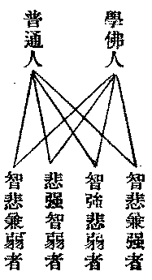

# 太虚大师全书．第十七编　酬对(第249卷-第320卷)



> **藏经**：太虚大师全书（太虚大师全书）　**册次** 第 26 册（TX26）　**编号** TX0017　**卷次** 248 卷　**篇幅** 178,184 字

> **卷／品**：0 卷 · 0 品



---



覆陜西佛教会延请法师函



定慧大和尚、戒忍大居士道鉴：去岁腊底，於汉口得读由杭州转来贵会邀太虚赴陜讲演之函，以此间事缘一时难了，既苦不能应命，又深感公等宏法卫教之热忱，颇思荐人代行，遂迟迟未报。嗣得抄来一幻师之信暨兑票百元，嘱为代请一幻师。按一幻师初本於太虚杭州兜率寺居住，乃去函问时，适已云水他处，月来探讯，卒未知踪。兼虑其聋病，正拟另行转请间，又接催致汉口佛教会之书，而李桐仙居士亦来相访，谈急望赴陜讲演之意。遂即就商於汉口华严大学诸教授，得荷妙阔法师慨然允许，不禁窃为陜中之佛教前途幸也。盖妙师蕴藉多学，热心传教。贵会除每星期一二次於冯督所设洗心所讲演之外，并可请妙法师就贵会为一班专心研究佛学者，讲起信论、楞严经等数月，则将来自不乏讲演之人。而太虚得有机缘，亦当从公等以游也。来款除为代请经书并饯行等外，餘八十元付妙法师充车费。专此，祇讯道安！太虚谨启三月二十日。



（见海刊三卷四期）



覆佛教普济日灾会



谨复者：来函敬悉。救灾恤邻，以畅慈悲普运之本怀，极表同情！惟所拟办法，似宜改度亡部为宏法部，词与利生相对，较为随顺。但于宏法部内可略分三条：一、度亡，如所拟云云。二、文字，徵集关於救恤日灾文字印成小册，赠送劝化。三、言说，组织讲演队，随处演说，藉以警悟。以兹三者传布宏法於国内外，是否有当，统希裁量！顺叩慈安！释太虚谨复。



（见海刊四卷九期）



复闽南佛化新青年会



闽南佛化青年公鉴：承函示粘叶二君讨论之件，具见诸君慎重佛法之至意。谬荷諮询，鄙见窃谓粘君语妙思玄，欲人将恩怨冤亲作一场梦幻观之，虽足令人深省，然或致聪明者流粘玄玩世，转不若叶君之词严义正，於此人心陷溺之险海中，有乘一叶扁舟而诞登彼岸之妙。愚见如是，尚祈审裁！并祝公绥！释太虚和南。



（见海刊五卷六期）



辞佛学院院长书



敬启者：太虚自壬戌四月八日受请为佛学院院长，勉策疏慵，躬任烦剧，功效未宏，身心已瘁。今幸三年约满，且院中基金渐备，原状完整，用特具书辞职，请贵会即行另请院长，俾获交代而就休养。不胜祷切之至！此致佛学院院董会公鉴！太虚和南。



（见海刊六卷一期）



致中山先生治丧处函



无量、海滨、雨岩、沧白、锡卿先生并治丧处诸公钧鉴：太虚今日於中央公园社稷坛讲经回寺，阅报惊悉中山先生业於昨日辞世，至为感悼！特函致哀惋民国元勋之忱，藉申景仰！又闻法会同人，传贵处有停灵社稷坛之说。太虚以中山先生为民国之魂，式安中山先生之灵爽，即为安奠国魂，与宣讲般若而护国安民之宗旨，融彻相为一致。已商法会同人，函请贵处於议定之后，先三日通知，以便量移法会於他处也，耑此，并颂公安！太虚和南。



（见海刊六卷三期）



覆四川佛教会电



成都文殊院方丈转四川佛教会公鉴：来电已函陈善后会议中班禅、熊希龄二公，托为提议维护矣。太虚覆覃。



（见海刊六卷三期）



复国民大学函



国民大学教务处台鉴：承函商於　贵大学增设佛学史或印度哲学，每周二小时。鄙意可先授佛学史，而教本可采用武昌佛学院新编之佛教各宗学源流。鄙人顷难来沪，暂托门下嘿庵师及王君锡光代授，希为面洽，此颂教安！释太虚和南。



（见海刊六卷九期）



覆梅埔六属佛学院筹备处书



迳复者：奉到大扎，诵悉种切。诸仁组织佛学院，阐发真如，恢宏正化，敝会无任欢忭！自应赞助一切，期获效果。至谓前函简章各件，均未奉到。遥想诸仁悲深愿宏，所拟简章，谅无不合。当即转咨国民政府速予转饬县属出示保护，并函请铁禅法师就近保护外，理合函知，庶不致误。尚希切实进行，期收极果，佛法幸甚！但简章等项必须呈请国民政府核准立案，方为有效。此复梅埔六属佛学院筹备处。会长释太虚。



（见海刊七卷三期）



致国民政府函



迳启者：顷据梅埔六属佛学院筹备处代表释桑空等函称：组织梅埔六属佛学院，函请咨呈贵政府，转饬梅埔行政机关出示保护，以利开办而兴佛事等因。查该代表等组织佛学院，纯为阐扬佛法，宏开正化，裨益世道人心甚鉅。当经敝会照准，代为函恳贵政府，伏乞转饬梅埔六属行政机关出示保护，俾利进行，期成盛举，至纫公谊！此致国民政府委员长汪。会长释太虚。



（见海刊七卷三期）



致海潮音社书



今已至巴黎二日矣。中国留学生团体，东方文化学会、大学院，纷请讲演；约留一月，再至柏林或伦敦也。太虚白。九月十五日。



（见海刊九卷九期）



致中国佛学会书



中国佛学会杭州、武汉、福建、首都、上海、普陀等处发起人及筹办委员均鉴：太虚离沪后，时在旅行之间，对於中国消息，怅无所闻。今至德国之佛郎府大学中华学院，小事休息，得筹备处来信，稍悉近况。知八月一日及九月一日曾召开常会，学会但研究会术，故拟另组教会，鄙意可即由筹备处召开佛教代表大会，将学会改组为中国佛教会，以今中国之佛教，不可不有此全国之组织也。太虚三月内可回国，当再报告游历之经过。先祝诸公精进！太虚谨启。



（见海刊九卷十一期）



覆英国三真社书



承赠以贵社社刊，藉悉有东西联合、邻居互助、信仰同盟之三重运动，与太虚素来所主张者，颇多符合。嘱令参加，至所愿欲！惟大乘佛法，实为东西文化之唯一桥梁，亦为人类和合精神统一之要素，冀於此深注意焉！此颂大安！太虚谨启。



（见海刊九卷十一期）



覆吠檀陀学会书



嘉尔德奇先生：荷惠书，并赠以贵会会章，阅悉甚感！大乘佛法，为博通一切宏济群生起见，对於世间道术，固皆须学之，况与佛法关系素深之吠檀陀学哉！承嘱参加研究，谨表意愿。如贵会更能研究发达在东亚之大乘佛法，则尤幸甚！专复，即颂道安！太虚谨启。



（见海刊九卷十一期）



复大菩提会秘书维利申喀函



维利申喀法兄大鉴：顷奉五月十一日大函，藉悉前寄汇票，业蒙察存，并承宠召参预大法苑开幕典礼，至深感谢！悲观比丘现在印度，届时由彼前来参预典礼，至为便利，请迳函悲观知照。通信地址，向加隆吉打中国总领事卢春芳君索取便妥。承嘱开列捐款人姓名一节，可以纪念刊上镌左列字样：「中国佛教徒捐款人代表太虚募集」关於协助贵会一节，事关教务，自当尽力向中国佛教徒宣传，期有裨补。承赠法苑影片，拟於敝刊海潮音上揭印，俾一般佛教徒得共瞻仰。



抑尤有不能已於言者，吾人得睹佛法在其诞生地复活之光明前途，与数千年来潜伏印度人民心坎之真理今已醒觉，实感无上之愉快！惟有虔诚祝祷印度将再为宣扬佛法之领导者，且为全世界佛法之发源地！



兹承寄赠大菩提杂志，至深感谢。以后烦寄上海闸北同济路大中华化学工厂转交。托为佛教复兴运动一文，有暇当即草就寄奉。专复，并颂近佳！太虚谨复。



（见海刊十二卷九期）



与正信会诸居士书(十二通)



一



法舫、森甫、奉僧、益亭诸仁者转武汉诸上善均鉴：得寄来各件，藉悉鄂院有恢复之望，而汉会亦注重研究。世苦日亟，待佛法解救亦愈急，而各地佛化，遂亦盛起；武汉今亦得徐督办夏司令提倡，曷胜哀慰！专祝弘法精进。太虚手启。三月十一日。



（见正信一卷二期）



二



奉僧、森甫、益亭诸仁者均鉴：函悉，顷因厦门学僧定於旧历四月八日毕业，函电催往，今看时局可往，尚须一行。故赴鄂或俟一二月后再定。遥承注念，先此复闻。并讯同会均好！太虚启。四月二十四日。



（见正信一卷五期）



三



奉僧、达五居士并研究部居士鉴：闻近来研究重开，甚所盼望，比来国中青年思想，倾唯物日甚，若能附一「青年佛学研究组」，以余之「自由史观」、「缘生史观」等为研究，尤要。唯察修持部除日常修持外，可分聘律仪阿阇黎、禅观阿阇黎、真言阿阇黎各一人，以为各随所喜以修习之轨范耳，并祝福慧！太虚手启。一月二十三日。



（正信二卷二期）



四



森甫、益亭、奉僧三理事长台鉴：十三日来函，展悉。有杨厚慈女居士，捐屋地充女众学舍之事，亦殊难得！而即有融、筌二尼，能肩斯任，尤为不易！但近今每事才一兴起，即已力竭，故常有不能持久，或虽持久而不能充实发挥之苦。若武昌女众院及菩提精舍能合为一，当可图振作；然不能也。今此事於持久及充扩之道，应先注意及之。尼众依八敬而有，宜名八敬学院。而为学当自学律仪起——沙弥尼、室叉摩那尼、比丘尼——，贵精不贵多，惟理事诸公决之！并祝年祺！太虚谨复。一月廿三日。



（见正信二卷二期）



五



森甫、益亭、奉僧、国桢、子中、云程、子平等诸居士均鉴：今得森甫居士等电函，请余即来武汉弘化，殊感诸仁者热诚之意。惟是余须明夏阴四月乃能抵汉；今在此间讲经，正月底方了，二月初抵沪，於二三月在雪窦处理其事，皆有预定时缘也。潮州开元寺，极请住持，然以难负责辞却，今后雪窦为世苑禅观林，闽院为世苑中日系教理院，仍在进行也。专复，并祈商子宽居士，於世苑图书馆来年经费切实筹划维持为祷！太虚。



（见正信二卷二期）



六



森甫居士鉴：仲喈逝世，於会中失一要人。而总务诸事，尤须要居士特殊致力为劳矣。然得少尧居士之热心勤恳，亦当更见进步耳。得雪窦来信，已收到二百元，为祝功德无量！修持部、护法社诸居士，未及一一，望并为致意。又去年曾计划买进会左首之屋地，不悉成事实否？如成事实，所议办宿舍、厨房、食堂、浴室、厕所诸事，必须妥议办法，以期无弊而有益。或能於中稍作能引起青年兴趣之高雅游艺之设备，亦一引导青年方便也。



（见正信二卷二期）



七



益亭居士鉴：阅正信刊之报告，悉比来慈济之事，精进有加，至为钦佩！今正信会颇为汉市所推重者，在慈济，而尤以居士主持得宜，诚信昭孚所致。然由此居士之福慧功德亦日充，尚祈勤勇无懈！而国桢居士等尝数言当力为扶助也。专此，并祝慈济团居士均福！太虚手启。一、二十三。



（见正信二卷三期）



八



瑞卿居士并宣化团诸居士鉴：察近来宣化成绩，殊为进步，此皆居士与诸团员热心弘化之所致；尚望精进，益求扩充！而得有相宜场所，则通俗宣讲所并附设小学，尚可分设也。专此，顺祝功德！太虚手启。一、二十三。



（见正信二卷三期）



九



得慧成居士书，惊悉宣化团余主任病逝，曷胜悲悼！余居士比来发心勇猛，於宣扬法化尤为努力，不料溘尔遽逝，虽舍浊土而生净域，然少一弘化菩萨矣！尚希善选人继主宣化以愈发扬之！太虚。三、九。



（见正信三卷二十一期）



一〇



子宽理事长，益亭、达五副理事长，奉转监事长，并转理监事及会员全体公鉴：阅九成居士来函及二十四年度徵信录，成绩斐然，洵可为武汉文化慈善之一重要团体，固出正副理事长、监事长领导有方，暨各部社团主任与理事努力精进之所致，实尤为全体会员至诚和洽勤行爱护之表现。今后愿益加尊重珍惜，勿自毁裂，以期光大盛昌而不替！本会在精神上，应即为「太虚学会」，虽不要有其名，而凡会员必须体达此宗旨，乃可精诚致志。除会章、宣言、格言、及佛法僧义广论为各会员所应体会奉行外，对於太虚之学说行事，应为密切之观察及贯通之研究。最低限度，当於正信第六卷第十一期之「本会导师在佛法中之意趣」一文，认清面目。故此时当速印小册，分发各会员，审受恒持，勿忘勿渝！若专标一宗一派一人之小组，不得羼入本会，是为至嘱！专此，即祝全会和乐！太虚谨启。二五、十。



（见正信九卷十五期）



一一



与正信会会众函



日本近年对中国之大蹂躏，全出不明人我性空，自他体同，善恶业报，因果缘生之痴迷；及掠夺不已之贪，黩武不止之瞋，凌厉骄傲之慢等根本烦恼。我中国佛徒，必须运大慈悲，以般若光照破其妄执邪见，以方便力降伏凶暴魔焰，速令日本少数侵略派的疯狂病销灭；拯救日本多数无辜人民，及中华国土人民早获安全，世界人类克保和平。于晓暮二时，人人作此回向祈祷为要！二六、八、十八。



（见正信十卷六期）



一二



九成居士鉴：函悉。关於调整正信刊各点，极为赞成。希望能将佛法轮装在抗战建国心行中焕发新光也。惟若能仍作为周刊小册，似尤好也。闻鍾会长与胡鹏程理事等将同来川朝峨嵋，顺此函迓。并候时祉！太虚。



（见正信十一卷二期）



覆巴黎佛学会书



德贞女士慧鉴：欣奉巴黎佛学会报告书一件，并惠询在巴黎出版之拙著。「佛学」一书，所译法文，晦涩错谬，可否由洪先生译成英文再转译法文？但书店已出版此书，余尚未知。彼当时有此书勿再译他国文之约，惟请嘱此出版之书寄数份来，当另翻译，以副雅望耳。专复，并祝佛学会兴盛！太虚。



（见海刊十三卷九期）



复支那内学院书



谨复者：兹由中国佛学会转下贵院关於佛诞纪元论之刊定书，对於计算之疏差一年，与所根据之岛地三国佛教略史及藤井佛教小史之伪谬，藉彰比来对於释尊生卒年代之研究，益有进步；则佛诞纪元论不无激发之功，而诚足为全国佛教徒之荣矣。其间本无人我胜负之容心，更何用吐𥎝相刺也哉？惟是中国佛教会之本意，在求得一各国统一之佛教纪元；而贵院虽可坚持自说，然对於西藏、锡兰、日本乃至国内诸异执，亦仍无融合之道，则遗憾犹在耳。此复支那内学院。太虚。二十二年二月十一日。



兹据支那内学院之考证，锡兰原传佛灭迄今为二四七六载，逆推佛诞今年应为二五五六年或二五五五年。特此更正，太虚附志。



（见正信二卷三期）



致汉院员生书



前因院务主任因病辞职他去，所有院务主任一职，应即取销。分请遍能法师为教务主任，主持教务；常恩法师为事务主任，主持事务。其他教务、事务各员，就留院者协力维持。维藏文重要，已去函喇嘛，速即请还，酌加供养，俾能尽职。学生并为一班，其程度低者，退保证金遣回。学生须严遵院规，违犯者摈除。院长太虚。二二、九、一五。



（见汉藏教理院年刊）



致汉藏教理院第一届毕业生函



本院承刘主席及诸院董之提倡维护，诸教职员之毅力热诚，诸同学之继续精勤，以有今日之毕业；望尔等深造研究，或宏法为众，不忘沟通汉藏宗旨，以酬檀护师长之厚望。特托法舫法师代为致词，幸皆存察！太虚。



（见海刊十八卷三期）



复安庆佛教居士林函



安庆佛教居士林暨林友各居士均鉴：贵林六周年纪念，拟请宣讲莲华经，惟本人以法务羁身，不克前来！届时可荐慈航法师代座。此祝诸位法乐！太虚。



（见正信九卷三十四期）



致中国佛教会书(三通)



一



敬复者：承询班师请定释尊纪念日，虚意可定国历五月月圆日为佛教纪念日，以开会、献花、演讲等新仪式举行纪念；而四月初八等降生、出家、成佛、涅槃等，可仍旧贯。



（见海刊十八卷六期）



二



中国佛教会公鉴：敬启者：顷晤宁波徐专员，倾谈之下，深佩以菩萨心，现宰官身，其属望佛教之护国辅民者，至殷且切，曾举三大端以言：一、讲经说法，勿但在寺院待信仰者来听，应遍入民众，以浅显文语，作通俗之宣讲。二、联合各寺院，多作医病、救灾、济贫及教育等慈善公益事业。三、各寺院每日课诵，为佑国福民世界和平之祈祷。而于浙江尤有极关切之二事，则宁、绍、台之渔业，与杭、嘉、湖之蚕业，为国计民生之所系，然无数生命之被伤害，亦未始非天人感召、灾祸萌生之因素；而解冤拔苦，祗有仗佛菩萨为之超度。太虚感其诚恳，因议每年佛历二月十八九庆祝观世音菩萨诞辰，为众蚕通疏超荐；四月初七八庆祝本师文佛诞辰，为众鱼通疏超荐。由本会通告全国各寺院，著为常例，而本年时期已过，则於六月十八九及十一月十六七补行之，想本会同仁对此应有同感。祈即提议通过，通告全国各寺院施行为幸！又关於释尊诞辰，在吾国自应以四月八日浴佛节为定例，然锡兰、西藏且传及南洋、西洋各国，已均以阳历五月月圆日为纪念日，则吾国加入为世界佛教国之一，亦应以此日为世界佛教纪念日，举行适合时机开会仪式。顺此附及，并颂公绥！太虚谨启。二六年六月七日。



（见海刊十八卷七期）



三



敬启者：顷抵沪，接阅公函，藉悉被推为筹建会所常委。但虚即须赴庐山及鄂、湘、川数月，势难担承，特此函辞，希即改推为荷！又、同时接阅黄监事传单一纸，内言会所不须另建，似稍有理。盍移寿资办僧学，盖兴土木不如造人才也。前曾嘱敝寺上海分院代送薄仪二元，谅蒙察收！此请中国佛教会同仁公鉴！太虚谨启。二六、六、十四。



（见正信九卷五十期）



拟致锡兰摩诃菩提会书



法舫来函，亦忘了原约，措此错误言词。今可以「世界佛学苑秘书苇舫」名义正复一函与哥仑布摩诃菩提会。



一原订约双方为「哥仑布摩诃菩提会」与「西安世界佛学苑巴利三藏院」。双方交换各二僧，华赴锡二僧，以学巴利文佛教为主，兼传华文佛教；锡来华二僧，以学华文佛教为主，兼传巴利文佛教。各期五年。二、双方未达目的地前及离目的地后，来回一切费用皆由自备。到后，由订约双方互供膳宿，并供每月三十罗比备用。三、事前曾警告应由加飞重庆转飞西安，不可走海道。乃回信经海道所增困难，及一僧之费用，概由自任，故只可听之。四、索麻等抵沪，为备供膳宿处一星期，便即赴陜（上海并无世界佛学苑机构）。后以索麻等要求在上海安居三月，另筹备宿处及食费，约耗万餘罗比（由上海佛教团体及信徒筹付）。然索麻比丘等，只热心传巴利佛教，对于学习华文佛教，无表示求学。五、当安居初，西安已派善归比丘来接待；至安居将终，索麻等表示决返香港过冬，善归始返西安。为修住处及种种筹备欢迎，与专员往返，结果不去，不惟大失人望，且空耗经费不赀矣。六、决返香港，系出索麻等自意。然苑长仍嘱香港信徒予以资助，并约春暖再至西安。后因索麻等又怕西安寒冷，及疑地方不安等；重庆、蛾眉、汉口及宁波之延庆寺、雪窦山等，亦均表示可欢迎前去。乃索麻等突然来信，于一月六日乘船经星嘉坡而返锡矣。



今详告索麻比丘来华离华之经过于贵会者，非欲责以他事，但欲贵会明了种种违约行动，全出索麻等三比丘，而敝苑之西安巴利苑、则不仅忠实履约，且曾为种种额外之招待也。此致哥仑布摩诃菩提会。世界佛学苑秘书苇舫。



（稿存世苑秘书处）



答传佛传生书



传佛传生善友：来函述日用功夫未得力各节，详有数缘，如腿痛身疲，致唯能死念话头以为抵制；又因尚居学戒堂，分心两处，行径未获专一。然此二违缘，去之无他缪巧，但制之以忍，帅之以志，一待三阳开泰，百体从令，自然与春冰俱化也。又须知此亦话头看不上，疑情起不切之故。今细观来书，所以看不上话头，起不切疑情者，因有三种毛病：一、将心待悟病：盖参究话头要当念翻身拶入，踪影全绝，如夹带一求悟之想，系心於悟欲得到者，则依然与颠倒驰逐前境无异。二、畏怯烦恼病：如第一支香之腿痛身疲，第二三支香之昏睡，学戒堂之闹境，说来易做来万难等等，皆一种之烦恼也。参禅人对之不可生畏怯心，当知一句话头，倚去如银山靠背；一段疑情，提来如宝剑当头！智慧火与烦恼薪战，多多益善，须如探险家愈险愈兴味，愈勇猛前进。能如此、则无时非话头得力之处，稍存恐惧，则一败不可振也！三、专心不疑病：参话头与念佛不同，心心念念要钉著扭著这一个没头没尾没面目的『谁』，滚天落地一步不放松，定要知道他一个著实，历历明明的是谁，无杂念的是谁？知杂念起灭分明的是谁？皆不可轻轻放过之。藏经缁门警训中有上封佛心牙禅师坐禅仪一篇，长芦慈觉赜禅师坐禅仪一篇，又频伽藏腾帙十有禅宗决疑集一卷，皆精切初参用功之术者，可仔细一寻讨之！



（见海刊一卷一期）



答善因法师书



善因法师：承赐函商论佛法，欣感，欣感！论宗教出世二条，不唯可补足觉社前此评论之餘义，且深得佛法之正。至论宗名一节，弟对於此条现尚在徵求批评，再为遴择，尊说亦存之以供众论。佛元二九四六年十二月十六日，太虚。



（见海刊一卷一期）



覆妙莲尼书



余以讲经转徙粤、鄂，致来书久稽未覆为歉。大德与妙昙大德皆凭一念之决裂出世网，洵女中丈夫也！顷有静禅大德来信，全与二德志同行合，而能化一家俱为佛子，尤见殊胜，殆将来佛法大兴之兆耶！然谚云：「出家如初，成佛有餘」，所望诸德能以古德自师，能常与善知识友亲近策励，使初心有进无退耳。考诸德发心，皆不唯求自了而已，且抱有宏法利世之志。余为计之，当先纠集若月空师并妙慈、妙昙、静禅、妙莲诸德，就某庵合并成一尼众丛林，一时不要太求人多气旺，必同志者方与同住，以免流弊。如是二三十人即可成立一尼众丛林。斟酌妙昙、静禅大德所拟丛林制之能实行者先实行之。以余计之，则可办一白话文之小旬刊一种，以为传布宗旨，宣扬教义之枢纽。内纠集就地信佛女士设立一新莲社，每朔望及佛诞等日，集社众开大会念佛、忏悔、发愿、受斋、戒行、善施，并讲演教义。林内众尼日常功课职务，则各按步就班以精进修习之，庶几善信熏资，师友护持，而自利利人一时俱得成就。诸德今忽於此时不约而同各发此无上胜心，有大因缘，非为偶然，期诸德能水乳和融而同宏佛化也。



至今父母一时不能信佛，须知佛有不可思议之力，非人之智巧所预。当於早晚礼拜三宝，代父母忏除业障，资发其神识，使不期而能信佛，此亦孝顺子女之第一大孝行也，当诚心行之！令妹但坚其信心，劝其不必急於出家。须早晚在家十分殷勤孝顺奉事父母，以奉事父母时，常默念阿弥陀佛以感化之。并在家於晓起时或临睡时，澄心静气，以温和之声念阿弥陀佛数百声，则父母不久必为感通也。



焚指、焚身等事，其理非一，在悟心之士，确见身非自己故焚身，不过去除一重报障，并非自尽。又身乃吾所得之一报果，吾能善施用之，即是用之以造善因。其所重者，则在能舍除世间所最贪爱之物耳，痛不痛则亦有将理勉强制情而忍痛为之者，亦有得深忍定了无痛苦者，但此种行不须提倡也。太虚复。



（见海刊一卷十一期）



复大勇禅人书



大勇禅人入览：由杭转到来书，知汝尚能忍耐寒苦，果於冰雪中煆鍊一番，养成衲僧刚骨，将饱暖安逸之习气洗除，亦未始非自家之真受用处耳。据汝来信所呈见解，正所谓「信位则得，人位则未」，因为汝但知「没有谁」，却未知「就是伊」之故，所以透不过无义味语。然纵使於此也透得过了，尚是说道理禅，於从上混淆是非、颠倒黑白、极没有道理的葛籐，仍须绊倒。又纵使於一切淆讹公案，一一皆勘破无疑了，亦不过是一个头头上见、物物上明的了事人，於佛祖亲到亲入的去处，尚是五台山上望琼崖，坐著不动，终是都没有交涉的。佛祖大法，非可以轻心、慢心得之。汝住金山才数月，毫未得益，谈何容易！虽然，不用贪看天上月，且须照顾手中桡。但向汝开卷时，定中作意时则有的猛著精彩挨过去，一旦与眠食俱共的文殊大士觌面相遇，且为吾问讯起居也。玄师公及山中诸善友，便为道安！太虚在武昌讲经处书。



（见海刊一卷十二期）



复古松长老书



古松长老元照：敬展华函，过蒙藻饰，莫名感愧！久闻高德，以怠疏参访，未能一亲尘教，尤深钦驰！恭诵道霈禅师八吉六胜颂，藉知胜地垂荒。怆然曷已！然比年天灾人祸，不惟贵省之厄。当此剥极将复之会，法灯殆不远重辉之日，荷殷殷垂意於瑛师及虚赴闽一行，且期之他日之胜缘也。专复，即颂道安！太虚和南。九月三日。



（见海刊四卷十期）



覆显荫法师书(三通)



一



显荫法师鉴：叠来函片，均悉。座下扬化东邻，潜心密教，云天引领，健羡何如！前寄来大稿，已嘱大圆居士编入，尚望续续惠投文字也。对於佛化新青年之盛意，已为转达，彼当有较详之接洽。专复，即颂得大成就！太虚和南。



（见居士林林刊第五期）



二



显荫阿阇黎鉴：叠函均悉。雷斧僧正能来鄂否未可知，然已去函欢迎矣。水野先生能临庐山联合会，至为盼祝，以系十年前之故交也。中国佛教之组织，曾拟有僧制论，兹检奉，望悉心参攷，冀将来能实行也。惟现下盖尚难为统一之进行规划，只有枝枝节节为之耳。国中佛徒至日留学，殆无此财力，能整出一好规范丛林，劝日僧多来留学，或足为援彼溺于形物而缺戒定之助，亦东亚佛化沟通之路也。便中将此义提倡之！顺祝三密妙严！太虚作礼。



（见居士林林刊第六期）



三



显荫阿阇黎道鉴：叠函均悉。所言皆殷勤恳至，念念不忘正法，洵僧中之宝也！演华说权田僧正事，已得其详，曾更正於佛化报及海潮音也。密教至弘法大师，始开宗明义成一家言，此说甚善，吾昔曾与大勇言之。至弘法大师诸说，则略曾阅及之矣。此覆，顺讯法喜！太虚和南。



（见林刊第六期）



答某师书



某十年来所持论旨，在并宏大乘各宗，以通达其平等而标显其殊胜，平等达则障蔽除，殊胜显则信行起，义若相反，事固相成，言之间有抑扬，亦明其短长互见，无可高下而已。夫揉曲木欲令其直，必反其直而曲之而后能直。贤家判教，对大乘性相，抑之独甚，以欲除其抑故，从而反抑之，反抑之非抑也，使底於平耳。座下知贤首融性相之诤，为时之所当言，何不知今融权实、一三等之诤，亦为时之所当言乎！某虽不欲墨守古人家法，然对於墨守古人家法者，属之各标殊胜门内，敬之重之，初不歧视。以非独标华严殊胜，不足起华严之信行，犹之非独标弥陀殊胜，不足起弥陀之信行耳。斯意深长，他日当有专书问世，今姑止此。



（见海刊五卷二期）



覆天童净心老和尚书



净心老和尚慈鉴：缅怀太白，时以得闻德音为欣悦。比蒙出示寄老人遗稿，并锡教言，具徵大悲心切，方便门多，曷胜拜感之至！法无定由，何有轩轾？真脱诸法缚，能抉出太虚之论意而救阅者之误者！鄙意正由愚法者坚执法界缘起为胜，不悟平等，生高下想，故别开一途反其说以见其通耳。专复，敬祈时赐法诲！并叩禅安！戒弟子太虚顶礼。



（见海刊五卷十期）



覆日本佐伯定胤书



定胤大法师元鉴：前荷锡临庐阜，备领教益，欣喜无量！近维起居胜常，法乐有加为颂！顷承惠书，敬悉贵联合会已推定大法师与木村水野二公为东亚佛教大会准备委员，并已议定日期及招待方法，具徵办事精神之切实，深为东亚佛教前途庆幸！至须待秋间始能开会，亦殊恰当，以敝处之各省佛教联合会，虽在分途进行，而以去秋来东北、东南叠兴军事，交通梗阻，团结艰难，致中华佛教联合会亦尚难及时成立。今亦将展期夏间，於庐山先开中华佛教联合会，再推各省代表以出席贵处之东亚佛教大会也。俟贵处印刷物寄到，敝处有何成议时，再行奉告。先此驰达，并祝法安！中华佛教联合会筹备处启。



（见海刊六卷一期）



致班禅熊希龄函



班禅大师、秉三先生均鉴：顷接四川佛教会来电云云，太虚但讲经耳，不知其可。兹幸五族佛徒，班师允为领袖，各区教产，秉公素殷护持，而又值二公均列议席，为此敬陈来电，祈察！至所关佛教宏护之事，应如何筹议施行，统希尊裁为荷！专此，恭请大安！太虚和南。



（见海刊六卷三期）



致铁禅法师书



迳启者：顷据梅埔六属佛学院筹备处代表释桑空等函称：「组织梅埔六属佛学院，函请咨呈国民政府转饬梅埔县属出示保护，以利开办而兴佛事」等因。查该代表等组织佛学院，出至精诚，将来开展至何程度，未可限量。除一面照准转咨国民政府请予转饬梅埔县属出示保护外，更应照准函请法师就近赞助，以利进行，期臻完善。此致铁禅法师。释太虚和南。



（见海刊七卷三期）



覆体参书



体参仁者：来书并译稿，已阅一过，於彦按略有评正。因汝所疑，更抽一二於此：



彦明说转识论是三十颂之略释，可认不错；我昔年阅藏时，已见其然矣。



少一无痴心所，或出解者以即是慧故略，或出解者、译者欲立十整数故略；此十是自性善句，亦因立为十整数故。



十自性惑，出於彦明误解论意而立，论实未开列十自性惑也。不过说明前列十为自性善，乃补足一句曰：「翻此十为自性恶」而已。要知翻此十，即为根随烦恼中之欲、瞋逼恼等，岂能於下列根随诸惑外别立十自性惑耶？至根惑中开见五而成十数，则释颂之文应尔，更不足异。



此论六无心位，文句不明，作四句读亦可：一、无想定，二、无想天，三、熟眠不梦，四、醉闷绝暂死。加灭尽定，即同颂中之五，此殆出译者脱误。



无相论之无相，应即「唯识无境」之无境义。奘师携来解三十颂者有十家，糅合为成唯识论；在印度所流行者，恐尚不止十家，其中有解全颂者，有解数颂者，有择其要略通关节者。真谛时、或有梵僧总为汇集成一部名无相论，其实则各家三十颂释文之集录也。此转识论，或即十家之一，或为十家外之另一家，均不可知。



汝以不整齐之论，反疑颂文疏忽，有所弄错；此种幼稚态度，实属不合！又转识论或出真谛以散文变译三十颂颂文，并以己意增损搀杂其间，意图令人易晓，遂成此论，亦未可知。



真谛之法相唯识学，近於沟通性相之安慧学，而真谛本人於此学殆不曾精澈，译时好加注语，且或时以己解羼入文内，遂至错误杂出。若此论之解三性，与颂不合，或由解者原文如是，或由译者自圆其误解，增加语句而成。盖论中之「前后二性」，「前性后性」，若作依他圆成解，固同颂文也。丙寅元宵后二日，太虚。



（见海刊七卷四期）



致嘿庵书



嘿庵师鉴：南京联军刘参谋长来信，催速往讲演，彼处由副官处招待。准今晚十一时夜车出发，难得胜缘，速告假一星期，同往讲演为要！太虚白。



（见居士林林刊第十六期）



致常惺法师书



常惺法师慧鉴：法师与满、翠二子书，言将赴藏，并述其动机。证之法师素来倾心实证之谈话，知出真诚。且虚近讲救僧运动，首重真修实证以成果，尤见万里同心，不谋而合。此间人莫不奋然欲遮法师旋厦，而虚以极须有如法师之出乎真诚解行力充者趣修成果，为佛法证明，作人天眼目，故闽南佛化虽将因法师之去而一落千丈，以虚亦恝然不顾，反劝人赞成法师之谢事为宜也。然龙树、无著之登地尚矣！否则以菩萨心取四沙门果，亦沙门之本分。生空神通，亦足为诸趣流转涅槃证得之验。此於造诣之路，若大论之声闻地较然可程，窃愿法师从事焉。若融摄魔梵渐丧佛真之泛神秘密乘，殊非建立三宝之根本。经书十倍华土，圣证多有其人，藏僧夸言，未堪保信。且试探藏密，僧俗已有多人，法师自可游心三十七菩提分法，以之奋追千古，宏范三界，何用门头户底去依傍之也？因有相知之雅，敢尽进言之谊。非太虚不能言此，非法师不足言此。若息缘之处，则泉州雪峰亦上选也，愿法师决之。此讯禅悦，并讯竹村、元白诸君均好！观音成道日，太虚敬白。



（见海刊八卷十二期）



答净心长老冕甫居士融高法师书



敬复者：展诵大札，为法为众生之热忱，溢於言表，真菩萨之心行也！若能无间缁素，混融稚耆，上无背於如来之教理，下期契於现代之时机，以之共维正法，应可起衰复兴。太虚之赴欧观化，乃数年来预定之规划。而提议开全国佛教代表大会，及共同发起中国佛学会，则为偶逢其缘之事，故仍依原订日期放洋，绝无他故也。今幸中国佛学会筹备处成立，所举筹备人员，皆一时之选，堪能负责，但依序进行，不难一一成就。太虚虽游国外，所当效力之处，仍当竭绵薄随诸公之后也。专复，敬颂道安！



（见海刊九卷七期）



示法舫书(二通)



一



法舫仁者览：日本藏经，请用「佛学院太虚」名义，致一公函，并述明曾收到若干册，缺何册等，令赠全藏。



僧制今论，不须附印，序文亦不须作，照原纸型翻印较易。印师隐居为善，以所言在沪上渐成诤论也。



显密经藏，大相迳庭，今不能不认密藏是佛经，则依密宗说，亦难否认。根据般若或唯识经论，同是圣言，尽可专门持究，不涉其他。森甫、仲阶等劝学，尽可不须学，百千法门，各行其所信，毋须强归於一途。



大愚、余只许其根据之佛心经品，似闻其好言人夙生事及将来事，余已切函戒之，今当更戒仲阶也。



达无所得，生佛亦空，成佛不成佛，是两头语，三僧祇亦无所施设，生佛行果皆如幻事，幻事不空，空即其性，而幻事行果亦难概齐，初僧祇菩萨往往昧其夙命，一经精进登地，名顿悟成佛，与教不相违。



佛学院以专研教理摄行证，不必於教理外别论行证也。太虚示。



（见海刊十卷七期）



二



法舫师鉴：接二日函，悉於武院、潮音、汉会诸事，计划周详，并交托清楚，甚堪欣慰。今以武院暂事收束，祗须保管而无事办，而汉院则因密严辞去，且须进行接收华蓥山及天台寺等，必须有与尊倾心相助者，故嘱即来渝，而半年一年后仍望能返鄂重兴武院也。专此，即询近祉。太虚启。元、五。



（见海刊十九卷一期）



致满智书(四通)



一



满智法师览：得各来函、知院内座下力任维持，殊慰！惟经费摇动，终以为虑。昨访旭东，亦力任函渝，於省方经费先行筹垫，必可恢复；而渝方经费，则当请潘、白诸公设法维持也。院内充实教材，当减汉文而加藏文，方符名实，希注意筹及！



晓西居士均此！太虚启。二十一年十月二十五日。



二



满主任并转北衡、晓西院董同鉴：接两函、藉悉能海法师讲比丘律，院员生集听甚喜。流言不与计较甚佳；信用规模，树之非易，满主任当续维持为要！但院中最注意为「藏文教理」，亟望法师教授「藏文菩提道次第」，并代催法尊喇嘛来川。应体师来渝，可任佛学教员兼学监，胜济夏间亦可回也。顺问均好！太虚白。



三



满智贤者慧鉴：叠接来书，虽每形怨愤，但殷殷师生之念，及为法为众之意，亦见近来修养有进，而福寿亦增加矣。然甚望再能扩宏忍之量，平褊躁之火，温而有礼以待人，恭而无逸以临众，续为维持教务；而事务员尚能称职，则同何院护、王院董监督之可也。本年下学期起，并望能注重藏文基本读写，不负甫公等之望，以济时艰。一院之成立，才财两缺——胜济不久可返渝——，冀从慈悲忍辱，福慧双修，并保养身体健康，以释远念！虚白。



四



满智法师鉴：院员生全体来函及所附会议录与告行书，均阅悉。一、余因此间要务，并省汉藏院经费，决明夏乃来渝。二、告行书所言不背余武昌办学院及历来对学僧之训辞，但余既未能处居一处以执行，而其他又鲜能负责执行者，座下既有志有能於此，且於汉院已成相当基础，即当负责办下去，以免能说不能行之诮，盖咯血之不妨事，前何院护曾剀切言及；而医疗此病之贵在心气宽和，与起居无甚关系，故亦并无辞职他去之必要。并函院董会略改院章之教务、事务主任制为院务主任制——制表见致院董函——，委负全责，以励施行。如此即从第三学期起，座下最少当再负责一年，方可有头绪。而座下聪雅之资，亦为余所识拔，对余亦有八九分忠信，但时不免为憍躁刻狭所扰。而近来亦似时能修省改善，深为可嘉，亦徵识验之增进，每由历事造修而成也。常恩会计，寄来四五二月报告册及附函，亦办理殊善，举为领袖事务员，亦妥。应体法师来信之意，亦甚善。余意第三学期仍以应师兼学监，月薪不兼学监者拾二元左右，兼学监二十元左右。书记国文永晖师能继者继，否则应以文渊师教国文，而胜济助教佛学兼书记。以遍能师领袖教员，并以藏文严切注重，即可教课每日四点至四点半，便多温习，故教员亦足数也。研究部不须办为宜。餘若公园设图书处，应即办。除每月院务会议及账目报告外，开学前一月，须以每学期教员功课表寄余核定；进退更动教职员，须经余核定，或由会议及临时处置，须即陈报。既为此决定，故辞别书退还，可不印发。但讲求学二篇，可另成一篇，付潮音编入。而其中与赵百符所谈，亦最好录出，另成一篇来发表。太虚手启。



（并见汉藏教理院年刊）



覆能信书(二通)



一



能信禅人览：函悉。虽自讼无何进益，而观於禅宗确然有其自信之处，实未尝无进益也。禅宗为中国佛法之真髓，希益精进为嘱！密宗藉果力为增上缘，亦不可含混，诚有之，非全出於混也。然仁者仍以速出关赴缘工作，半工半禅为善！顺问时祉！太虚。



（见海刊十三卷十一期）



二



能信法师览：接来书，论学律年限及受戒程序，亦深有理致。但五年学律，非出律文，乃古人一时之制。顷於出家，既有高中毕业程度，习律仪礼乐二年，亦已可矣。且练办事或研究教禅，需时甚多，亦皆在律仪基础之上，非舍於律，故律行仍俱进也——专弘律者，当於专精教理院时专研律学；并於参学林时专修律行，以养成律师资格——。至菩萨戒，当於受比丘戒毕即受学之，不受者听。在家发心皆可授菩萨戒——。比丘反须限若干年后，理实不合。比丘戒以严成其尊，菩萨戒以宽成其大，倒之，反失其用矣。望更察之！顺祝禅悦！太虚白。



（见海刊十五卷四期）



致遍能常恩书(三通)



一



遍能、常恩两师鉴：久知汉院教务向藉遍师维持，而常师办事务，忠勤殊甚。今以满师辞去，即请分就教务及事务主任，以收驾轻就熟之效。务即荷担支持，与院中教职诸员，共商维护以策进行，为盼！顺询秋祺！太虚手启。廿二、九、十五。



二



晓西院董并转遍能、常恩主任均鉴：比来新学比丘狂妄，稍能引楮伸笔，即目无一切，概由不习律仪所致。本院荷院护、院董老成持重，而遍、常二师亦素端凝稳慎，获保安全。期率全於院沉静，勿令一二躁浮者恣纵其间，并时以院况函告，为盼！顺讯近祉！太虚。九、卅。



三



遍能、常恩主任转全院教职员均鉴：一、每次院议毕，须即将议录寄呈覆核：如有须更改者，可立时指示修正。二、今定院刊作年刊，年出一册——去年者余尚未见，速寄鄂院及雪窦寺各多册——，则去年开学以来者皆可编入。三、不另设研究部，但组「教职员学生研究会」，每星期指导或讨论二三次。四、对余来信，须署名负责。太虚手启。



（见汉藏教理院年刊）



致常恩书



常恩主任鉴：所拟办事细则，颇妥善！未拟者皆拟完全，并作一关於事务之详细报告及计划，交院刊发表。并须拟一今后院产发展计划。又关於事务处薪，前函定三人五十元，如另添人，则减主任兼薪与之。太虚启。九、一三。



（见汉藏教理院年刊）



覆濬然比丘书



濬然比丘慧鉴：函悉。留心护教，具徵信愿。师子尊者被难，原有付法藏传所说，唯例如中国遭唐武宗之难，非即全断灭，故不妨仍有人继续。近人发现敦煌石室唐写本楞伽师资记——日人某已印行——，亦有达摩承续传至黄梅、弘忍下诸师之说，足证北宋前确有其传。专复，顺询精进！太虚启。七月廿一。



（见海刊十六卷八期）



致安东格西书



安东格西大喇嘛座下：前五年得法尊比丘来柬，藉闻总持二藏，博达五明，既充解行，尤富悲愿，曾允莅内地弘化之情。太虚因与四川檀越刘督办等，於世界佛学苑之系内，就重庆缙云山，筹设汉藏教理院，盖专备座下之讲学地也。顷年、法尊比丘从拉萨东返，主持汉藏院，培植稍有基础，奉迎法驾贲临。乃与同人公推法尊院长专迓，惟惠然肯来，为祷！肃颂法祉！世界佛学苑苑长太虚谨启。二十四年十一月十日。



（见正信七卷七期）



覆仁山法师等书



仁山、法权、霜亭、智光、却非、宽道、圣裔、怀昆诸法师暨四川、湖南、贵州等省佛会诸公均鉴：荷先后垂询：关於中国佛教会沪办事处之如何由少数人集议变更前者在南京所开理监联席会议之议决案；如何以『改于上海开会及代表须现会会员为限』，朦呈中训部备案。虚事前均无所知，但未离沪前——九月二十六日离沪——已传闻为变更之说，故曾在九月二十四日佛教日报发表谈话，声明若变更京联决议，决不再预问会事，遂即回山养息。此非虚为德不终，盖殊觉会议及民、内部指导等均类儿戏，不如山中高卧之为愈耳！专复，即颂公绥！太虚谨启。十月十二日。



（廿五、十、十七佛教日报）



致缅僧阿底沙温沙书



中华民国全国佛学会理事长太虚，谨致书缅甸国阿底沙温沙大德，敬启者：太虚前岁访问贵国，与诸上座晤谈甚欢，别来年餘，思念殊深！屡接法舫代表函告，知大德热心中缅佛教文化之沟通，又乐教吾所派遣之留学僧，此诚现代中缅两国僧伽所应努力之工作。按中国佛教多传梵文，而缅佛教则纯传巴利，吾中缅两国僧伽，依据佛陀戒律，和合亲善，合巴梵传佛教而成一世界佛教。为实现此种计划，吾前曾分派弟子赴暹罗、锡兰留学，今特派吾弟子达居、天运二比丘前来贵寺，依上座下学习缅甸佛教，希如法如律教授教诫！至於入寺手续，特命法舫法师代为办理。肃此，即颂法乐！太虚谨启。卅、六、十五。



（见海刊二十二卷九期）



与止安书



止安座下：兹由吴校长来，商定关于大雄中学之事务，由校长聘座下为事务主任，月薪肆百元；并由校董会委兼会计监督，则系义务，负责依收支预算施行。如有超过，则须与校长陈明校董会，始得开支。另由校长委余自力为会计员，办理写账制表册等，月薪贰百元。并委金剑管理员，真容兼庶务员，协办事务，月薪壹百元。所有会计员、庶务员，均在事务主任领导下办理其职务，希禀承校长以襄成良美之校风为主！校董会董事长太虚。卅二年二月二十六日。



（稿存止安法师处）



嘱福善书(二通)



一



福善编辑览：阅本刊二十五卷一期所载「湘佛教界发起铸大师像」一则，窃以万梁居士等对虚兴此过分之誉，已令悚惶不安，盖虚仅愿学菩萨发心修行而未能者耳。而本刊编者未代辞谢，反助为宣达，更使惭汗无地，并适招忌者之谤。以后如有关於此种文字，务为辞绝为幸！太虚老人嘱。一月、九日。



（见海刊二十五卷三期）



二



本年一期载湘乡铸像文，已诫止矣。阅四期「中国佛教之改进」一文第四段语，编者应负删削之责。须知过情评誉，适招愆毁，后务裁止为要！太虚。五、二七。



（见海刊二十五卷五六期合刊）



与法尊书(六十通)



一



法尊喇嘛慧览：前年以得座下来信云：「与昌都某格西可偕来华弘化」，乃就川东筹设世界佛学院系统中之一汉藏教理院，以会通汉藏佛教之理为目的。今已正式成立，其院址之殊胜，经费之充裕，不但为世佛苑系统中各院之冠，且於汉地各学院，将居首屈一指之地位，在将来有扩充成拉萨三大寺之一之希望。惟现在虽有超一、满智诸师协办，而皆属望座下回汉，乃能实现其理想。但现今一二年，藏文尚浅；可迎请格西来院，祈酌之！顷即托北平德茂永汇奉川资贰百元，收到时希即日起身，由印度回国至川，为要！专此，即祝精进！太虚手启。民国二十一年八月二十九。（发自重庆北碚）



二



法尊喇嘛鉴：子笏居士转来七月十五一纸书，阅悉。所云前寄各函暨托赵蹇叔转交各书，均未收到！余曾两函并汇参百元——均托子笏转交——，嘱即回汉，主持重庆汉藏教理院——仿三大寺只研教理而不传密。今阅来书，仍未提及，其款究收到否？今冬或明春能回，极好！回国以直到汉口佛教正信会暂停，再转重庆，勿逗留他处，为要！如再须款若干，可速来函，当即寄交也。川北及各省边，赤乱虽时有，大局无碍，法化颇宏！格喜仁波卿书亦未收到。吾意座下可即先回汉，稍有布置，而在一二年后，再迎此格喜来汉。或朗禅法师在藏，稍留一二年后，陪此格喜来汉。均好。如已定期回汉，希电报或航空信先通知汉口佛教正信会，俾预备迎接。专此，并候朗禅喇嘛均好！太虚手启。十月十九。（自汉口发）



三



法尊院长览：函悉。会议录各端，可照办理。托佛天之佑，如大局安定，而院费於维持中得谋增进，要须座下与遍、常主任及满、德诸师，同发长远心，乃堪望效耳！商同院董会，联合具呈，将办理经过及成绩，具呈南昌行营，请酌助经费。顺颂时绥！太虚手启。（自汉口发）



四



法尊贤者览：函悉。一、关寄南昌之件，如未寄出，仍以由重庆——重其地——双挂号寄行营杨秘书长转呈为妥。如已寄来，待到后再发。二、余年内或可到武昌住。三、广论毕，再好再译出咒——本续——道次第，便窥黄密组织！四、座下明年必欲去藏，余拟同至厦、汕、港、粤、暹、缅、锡、印而入藏一游。但汉藏院希於明夏结束，交满智或遍能另筹办法。太虚。二十三年十二月二十一日。（自溪口发）



五



法尊法师览：今日蒋公来寺，已将汉藏院请补助经费事面提，应允待与戴先生一商酌之。前述之公函，可早寄出，则当能有多少之成效也。屡询及超一，对于藏学人才之注重，可知！已将以座下品学最优言之。顺候全院均好！太虚启。十二月二十六日。（自溪口发）



六



法尊法师览：接议录并来书，均悉。就程度高者设一「专习班」，另加之奖学金，先募之；如无著，亦不多，吾可酌助也。兹预备於阴腊十五前后抵武昌，座下可即来鄂一行，待正十外再赴渝也。最要在早将「咒道次第」译出，俾窥藏密之系统。省财政何人？一查，备再函托。虚白。腊月六日。（自溪口发）



七



法尊法师览：来函所谈，甚要！今可与科学院立「合同」，各执一纸。内容：一、汉藏院出地，科学院出资。二、期限十年至十五年——今法律规定，最长租约不过十五年。三、其收益，地方得三或四，资方得六或七。四、原有树木，概归地方；有如须伐去，须先商允。五、合同地段，须以所划定者为范围；近寺各山地自开，不必入约。六、年满后，由地方收回；如续办，须另议。七、违上条款，得随时取销合同。虚复。二十四年元月五日。（自溪口发）



八



法尊、法舫法师览：得函，悉已于八日乘轮赴渝，想已到院多日，或举行毕业矣！余就沪疗养，病渐愈，但衰老剧增！佛教前途，唯望座下等努力而已！海刊费只可挨一年算一年。陈静涛营业亦不佳，最好从广销及招广告设法；余近曾汇百五十元至鄂。渝院务，请法尊邀同严定力任其事，以专为研究西藏佛教，沟通汉藏文化之工作；留少部分学僧作西藏佛教研究员，以为专深研究。另依旧章招生四十名续办。而法舫盼能携同苇舫回鄂院，充实研究及潮音内容。守志来信，即须赴鄂研究。前谈办佛学函授事，最好鄂、渝院能联合，在潮音办。渝缙缁素诸知识，及潘、何、王诸院董，统希道候！并祝阖院安和！信寄沪转。太虚。（自上海发）



九



法尊法师览：函悉。专修班有一人，已由汉口拨汇壹百元补助费矣。遍能师应嘱发心，以本院为常住。南京所请费，查系蒙藏委会之文化补助费，领得不易，今尚在与黄慕松商洽中。闻院费艰难，甚悬念！另函希即转交！而於藏文，盼将「咒道次第」译出。汤住心等译菩提正道论，登在佛学半月刊，即菩萨戒释也。太虚启。四月十日。（自溪口发）



一〇



法尊法师览：前由院董向军会拟请经费，屡经接洽，虽未拒绝而无把握；且各方经济，同陷艰困。对汉藏院已欠千餘元，尤切痛感！故座下赴藏，亦感费绌，且一旦离，则苇舫去，汉藏院或即颠踬！因此、唯有座下与苇再继持一年，学僧明夏毕业。此一年中，力训教职员忠勤吾苑志业，由苇将吾学行为系统研究讲授，使院生精神贯注，以长养院命，则明年后或可有人维持也。唯察之！虚白。二十四年六月九日。（自南京发）



一一



法尊法师、苇舫法师同览：函悉。院费无虞为快慰！惟修建仍缓进。所云建太虚台，尤不可！或能略为刘主席、潘院董、何院护，在山作何纪念为好。以稍储蓄备不时之需，尤要！开荒种植以增产，尤为基本！茶子已函雪窦又信为购寄矣。写字各件，俟办就再寄。闻已成藏文法及咒次，甚欣！惟菩萨戒已重，而荣、高、汤等近亦成文法，将出版，又重耳。阿旺格西，请为问讯，能在汉院安居教授，尤盼之！前函嘱学僧延长一载，再由座下等切实培教一年，即可望有继人，尤希注意！鄂院缺人，舫坚留尘空以助，故渝院事务，望座下等对常恩或满度为精神训练，俾即化成能坚强吾院之干力，尤要！虚入川之行，尚不易准备；夏间曾允子笏赴平。净土刊愿移汉院，可即移之，一举数得，勿缓可也。餘再详。顺问近祉！太虚白。六月十一日。（自南京发）



一二



法尊法师、苇舫师等均览：函中两书均剖悉。承奋勤勇协振渝院，殊为快慰！惟鄂院财才空乏，法舫烦劳，勉就渝院人才协作之，则尘空宜留鄂也，尊院长仍兼训育授佛学。苇舫法师教务主任兼授佛学，胜济法师事务主任兼授佛学，德潜、仁弘诸师量宜酌任。难灾益深，员薪得仍旧已佳，若需加可酌行。余齿坏一枚，悲水淹未登庐阜，疲弱不胜热，遂来莫干暂住。此祝精进！太虚手启。七月十七日。（自莫干山发）



一三



法尊法师览：函悉。比应早达武昌，而尘空如未回鄂，法舫师不能离武，望即商定飞告。而明春即迎师回渝之约，尤必须履行勿失！至於会觉师来信，余早知全出彼之错误，而去函责释之矣！余日内赴奉化，约旬日到沪。顺问近祺！太虚手启。十月三日。（自上海发）



一四



法尊法师览：得书，悉已抵仰，一星期可转印度，为慰！沪汇贰百元，乃汤、屈诸君托汇者，前已函仰，应收阅矣。吾此时尚无赴仰可能，不日当仍返沪。然仰光不如力劝慈航在彼久居，则值缘便，当赴缅一行，以成中缅连络。苇舫、晓西等均来信，务盼明春早归重庆。专此，顺询旅祉！太虚启。二十五年一月一日。（自广州发）



一五



法尊师鉴：得渝院转来电报，知已安抵拉萨，为慰！已晤安东格西否？已承允来汉否？至为念之！渝院一切安好，省教厅仍月领六百元也。四川今为最安全区。专待奉安格西莅临，大转法轮。务希速迳回渝为盼！顺颂法喜！太虚手启。二十五年二月二十五日。（自溪口发）



一六



法尊法师鉴：顷获川讯，悉安东格西已逝，至为惊惜！而自乾军长主由座下另请上师回川，尤以能请阿旺格西之师，以偕阿旺同东下，为盼！又渝院即招小喇嘛十名，来学汉文，亦盼速行，并电覆！顺讯时祉！太虚启。二十五年二月二十九日。（自上海发）



一七



法尊座下：比闻不日过汴来汉，但渝院秋季如教员、课程等，诸待决，希早赴矣！慈航来书附致，其言行颇乱，但殊有热诚、勇气。决于京设律仪林，俾率持。如去函，须嘱严遵吾教为善。顺询旅佳！北平经过希函告！太虚启。八、七。（自庐山发）



一八



法尊法师鉴：得函，悉已抵鄂，至为欣快！虚因病未能赴川，已详昨函。而汉藏院祇可仗座下一肩荷负，俟书籍到来，请即赴渝以主持汉藏院毕业，及与院董商续办事宜。并祝旅绥！太虚手启。二十五年十二月二十三日。（自上海发）



一九



法尊法师览：赴川之劳顿，病躯实不堪任！而渝院之毕业此班及续开后班，务望座下即日赴渝！且余已另函北衡等，请座下负专长渝院之责，希勿稍迟滞！而法舫势难离鄂，设欲有一代表，则托谈玄一行，并即令苇舫回鄂，为要！务望兼顾鄂院，以渝院有座下及严定、密严，足敷矣！顺祝精进！太虚手启。十二、三十。（自无锡发）



二〇



法尊院长并转严定、苇舫、密严、本光诸师均览：译处章程核还。函中所云各点，碑记俟重撰重刊，要写各匾额，亦待写寄，或俟他日到川再题。但诸物质建筑等可缓省则缓省，勿使因此受经济困难，能有餘资以开发院产尤要！又、可由院具文至蒙藏委员会，汉藏互派游学，由本院承办。顺问均佳！太虚启。二月三日。（自无锡发）



二一



法尊法师鉴：五日来函，欣悉请定教职诸仁及座下尽心院务之表示，至为快慰！密严主任事务，尤盼发广大长远心，以谋本院之发展。严定主教藏文，当能发挥多年积学之心得。本光师文学、佛学优长，望坚忍协助翻译。并询苇舫主任等均好！又、搜集材料，可预备编一近二年院刊。太虚启。二月十八日。（自上海发）



二二



法尊院长并苇舫主任等均览：叠函均悉。印度带来各件，由鍾衡平居士交涉妥，上海不开验，转运至汉口，以提单由舫、谈等探取，当为甚妥，可勿念。纪念台如未做勿做，已做易名慈氏，自惭福德凉薄，望勿以名之！顺问合院吉利！太虚启。三月十八日。（自上海发）



二三



法尊院长鉴：顷闻尘空师已去汉院，可以代苇舫之职。而嘱苇舫师赴鄂勷鄂院事，因已调谈玄师来雪窦办学，鄂院需人极矣！望即与苇、尘商行。顺讯公绥！太虚白。六月十三日。（自上海发）



二四



法尊院长、圣观主任同览：今登歌乐山遇林主席，谈及其在歌乐山所造屋，今年恐不及过夏用，将在温泉租磬室住，而稍嫌游人繁杂！吾因谈及石华等新屋可住，彼如有意借住，故询颇详，曾问及有无用具之事。或去函邀迓，或待来问询。林主席来住。则守卫自无问题矣！又、至成都，当即催严定及格西速回，但最好还是函牛次封嘱回。虚白。



二五



法尊院长、法舫、圣观主任同鉴：蓉讲将军，将至青城等一游。一、塔坪学粮，何厅长已函江北县长。二、请德格藏，昨已将教部四百元，交肇乾、次封居士填足千元，即寄黄、杜二君代购运此。三、昨潘副主任来访，已谈与王主席商，省府年增助五千元，共万元。四、女众部难成事实，如增五千成事实，则石华可专住喇嘛，招一班康藏青年学生，最为合宜。专此，顺问院众安和！太虚启。六月十九日。（自成都发）



二六



尊院长、舫、观主任同鉴：尊、观来函均悉。一、马颂摩的三十元川资，已改作雨堃来的川资矣。二、德格请藏事，已见前函。三、圣观师事、李佐成所言华蓥事，已交何厅长进行。四、今日与田颂尧、刘自乾、肇乾诸公游长松山，回将再游青城。五、时局消息甚危急！六、一星期后，余或回渝。七、教育部五月份未发下，圣观师可一向秘书主任探问。八、国文教员陈法健，可先去函问之，虞佛心或亦仍可来也。顺问近祉？太虚启。（自成都发）



二七



法尊、法舫法师览：昨与刘自乾委员长等同游长松山，盘桓一宿。今晨与谈及：拟请「西康建省委员会」，年助本院五千元，以增设本院「康藏青年僧俗来学汉文佛教班」，已蒙允许。盼即拟具办法具呈，迳寄刘委员长呈请为荷！此讯安和！太虚启。六月二十三日。（自成都发）



二八



法尊师鉴：顷已由成都乘小汽车安抵歌乐山，昨晤林主席、马寅初等，大约均怕石华远而不登矣。在此小住，盼将余著述取一分，赠品有多者，多取数分来，以便在此间陈列。连信件，可专派一工人送来——过青木关约二十餘里。专此，并问法舫师、圣观师等均好！太虚启。七、四。（自歌乐山发）



二九



法尊院长览：昨妙乘来辞退学监职，要尘空师留之，无效；或再回山，不愿再负学监责。如此、则学监速须改请。吾意：最好为尘空师兼，否则仍以北海师为宜；不得，则希於又信等数人内商请之。而权限要清，负责要专，亦一要义也。院内厨子闻不再回山，已令大林寺来厨子阿四来做。煮饭必须教好，阿四可教之，能煮闷饭方好，但嚼米渣，实在不好！又省教育厅曾来经费？及宝源已有何交涉？昨融海带回五只面包，收到否？顺问近好！太虚启。十、十一。（自重庆发）



三〇



尊院长、舫主任鉴：前覆书——关院事——收阅否？渝社请讲法，余意当可到渝住一月也。余三四日后拟回渝社筹赴黔事；如不赴黔，尘空可住渝否？并以问讯。严定应川大聘为藏文教师，诸学藏文者勉之！太虚。十二、二十五。（自重庆南泉发）



三一



尊院长览：舫、圣主任恳切留任！关院事，三人详尽商洽，所有应兴革沿改之事，商洽后送来一察。尘空师可随去黔、滇，其餘教职员，商酌聘定。国文教员，吾意登缘可充任，如另有妥人聘之亦宜。顺问全院安乐！太虚。十二、三十。（自重庆发）



三二



尊法师鉴：函悉。谢、黄居士等，要在杨佃相近结苑亦可，但吾以能成佛化村，在下北碚坡较宜，今想已在渝也。贺刘主席称呼，不合吾口吻！即问近好！太虚。二、七。（自贵州发）



三三



法尊、法舫、苇舫、慧泉诸法师，了空、晓西、如云、益亭诸居士，并转渝、蓉诸善知识公鉴：太虚旅贵阳，适值敌机肆虐，大施轰烧！乃备承电函交驰，殷殷慰问，顷已安抵昆明，敬致谢忱！游兴一阑，当再返巴都也。并祝春祉！太虚谨启。二、二十四。（自昆明发）



三四



法尊院长、法舫、圣观主任仝鉴：前拨教育部去年七月份四百元作游化费，赴贵阳前，苇舫师犹见全存在箱，乃抵贵阳后，一用一用即去其半；今抵昆明，又一用一用将告罄矣！如一月份四百元领到时，希仍拨来应用。托银行用航空汇昆明海子边云南省佛教会月沧法师转交。顺祝春祺！太虚启。二八、二、二五。（自昆明发）



三五



法尊、法舫鉴：顷在渝应将讲完而返缙开学矣！余留渝盖垫被单，携存山院。又戴赠灵山图等，及虞佛心题裱成饯秋图，均时为存晒，勿霉坏！太虚。二、二十五。（自昆明发）



三六



法尊院长、舫、观主任仝鉴：前接关院费问题信，曾复，应已到。舫等近来应皆安乐，为念！关法会，既戴、李等皆热烈，如有推请本院事，应表示欢欣接受，并以大公无我态度，为作进一步之建议，特嘱！并颂近绥！太虚手启。四月二十日。（自昆明发）



三七



尊院长鉴：一、教厅费事，可速将督学室颜、章二君来调查事，函告何院护向教厅洽定。二、请北海主任事，已见前函。三、法舫、苇舫拟留一人在缙云办教务及中国佛学、佛教会事，以一人来滇助我办省佛会，鸡足山事——局势未决定，定再函邀——，但宜谁留谁来，请选择并商徵二人同意。顺问近祉！太虚手启。五月二十七日。（自昆明发）



三八



法尊、法舫师鉴：得函，悉教厅费尚未发下，为念！惟所附来谈玄信，乃假托的：一、前月亦幻等来信，谈玄在宁波阿育王祈祷主密坛。二、来信的字，亦分明非谈玄手笔。其人不过要想普超回一信，以证明是我徒弟以脱罪耳！须速通知布雷、真如先生等，为荷！又前来信，知苇舫信已为转交，但今得苇舫函未收到，恐有遗失！太虚。七月二十三日。（自昆明发）



三九



尊院长鉴：七、三十函悉。一、关教厅款，得由部代催，当有相当效力，但恐非久计。而郭司长所指示由部备案之方式，应照具呈，并托顾次长帮忙，分发在蒙藏司，再力托郭司长设法通融备案，则下年度可列入预算，而经费较可稳固也。关编译事，座下偏劳，殊有益於国於教；而藏人学汉文本，应如何编译，可请顾次长指示也。顺问近好！太虚启。八、十二。（自昆明发）



四〇



尊院长览：三十日函悉。一、悉编西藏民族政教史作课本，甚好；二、遍能请为院董亦可。三、工人要用，亦祇可酌加工钱，请必要的人。四、出国事，尚在待苇舫在渝接洽决定间。五、关水源缺乏，亟须设法接水，种菜及各事务，要北海主任与事务处各员工，多开会详商办法，员工有须酌加薪者加之。六、得法舫所编最近概况报告，关于训育导师制，虽报告得好听，但关于实行，仍恐未全贯澈！近读陈部长「训育之目标及方法」，与「告各校导师书」，甚重要，希与法舫主任集诸教师，多开训育会议，依所订纲要，切实施行。七、近来物价昂贵，教职员等或须酌加薪者，亦希酌量鼓励及之。专此，并问全院员生均好！太虚手书。九月二日。（自昆明发）



四一



法尊院长鉴：近商法舫，以海潮音迁缙云编发，已略有决定。此刊为院宣扬，而院中教、事、员、生，望善为领导，予此刊以各种方便援助，则相得益彰，而精神可更增奋发。专此，希致意全院员生！太虚手启。九月六日。（自昆明发）



四二



尊、舫法师览：二十七安抵昆明，顷定十日由昆明出发，或有改期未可知。山中诸善友，均为致意！兹检表上小鸡血石章一颗遗失，问会生可有收拾，或为一搜寻，如桌底及抽屉等，函覆。顺候近祉！太虚手启。十一、二。（自昆明发）



四三



法尊、法舫鉴：此件日记当再陆续记之，兹先将第一部分送交保存，除保存外，亦可采录其中无关政治者，另编新闻，发佛化新闻及海潮音登载；其有关政治者，须暂略去之。兹已定十四日先至鸡足山，约一星期再趋缅，约十二月一日到缅京瓦城，再去仰光。信寄仰光中国佛学会转。顺问近祉！太虚。十一、十二。（自昆明发）



四四



尊院长、苇主任等鉴：伪刚法来山，应善言慰留在院，现已如何？速告！昨晤海楼，催速拘灵、坤矣。前议决由尊、苇查款账，慧明归，催十二月份速结出，至十二总查报。现经存各款，须以存折款等取出查对与存账无误。而以后须每月十日前，将前月收支表造出，当日查对账款。勿拘心剑讼，应注意所示讲经、布教，以感化人为最要！学生会总筹备处，可加尘空、虞愚为筹备员。福善、贯仁所记，寄来核阅。加「曾阅著书十种以上而愿为私淑学生者，得本会会员二人以上之介绍，得加入之一条」。海定速复！商务印所迁渝否？太虚。三十、一、十。（自重庆发）



四五



法尊、印顺、苇舫、又信、止安、雨堃、福善、周观仁前后辈诸生同鉴：一、你们祝我寿，他事都不用，今年只注重把学生会努力筹备！我的色身不多年的了，而法命寄于兹会。二、尘空、宁达蕴、虞愚加入筹备员。查在重庆尚有老学生否？成都加超一。三、前捐三十元都买邮票，作航空信皮、赠海刊等用。四、苇舫布教，阴年内即须举行。尊讲经塔坪，阴正初亦必速办，教化力最要，不可懈缓。五、尊、苇可待开整会再到渝，免多一趟跋涉。印顺希对于支院精刻大藏缘起审辨之，作一文！我搬狮子山，住处尚安。已对德勇说，假前返院可当书记。顺问张、陶、杨诸居士！太虚。三十、一、十三。（自重庆发）



四六



陈济博自康定康松扎贡噶山来信，要求慈氏五论颂及现观庄严论释各一册，请寄交西康省政府交通局邵副局长转与。又慧明来信，悉文书无人，聘致实难，如会计有人，慧明任文书，颇能胜任：不然，只能就德勇等强令一人任之。函华岩定九，促速复省佛会。此致尊院长。太虚。四、九。（自重庆发）



四七



尊院长览：函悉。教部所言三点，殊以欣慰！海定昨来此，今已赴谢律师洽商矣。县能帮忙，即易解决，如不帮忙则较难。院函华岩一催定九复省佛会，为要！次封居士函中，述及诸点，悉翻入中论，诚要！济勇诸古，与曾子高等筹款另寄，已复次封矣。顺问近佳！太虚手启。三十、四、十一。（自重庆发）



四八



法尊、苇舫等同览：顷因病，两臂麻木酸痛，须返山静养。又因空袭期近，仍以住接官亭屋为宜，先饬工安设好以备来居。色力不加，关国佛教事，拟推昌圆等任之。太虚。三十、四、十九。（自重庆发）



四九



尊院长：返缙应安好！闻有歌乐山的人走询，前本院几为人指充收德侨用，虽打销，不卜再生变否！世乱茫茫，惟淡泊宁静谨慎耳！太虚。二月十日。（自重庆发）



五〇



法尊院长览：十日函悉。一、法雨因不知金剑山通讯处，尚未复书。二、土主庙、玛瑙观，余亦已复函令不接，海定应无他意。如法雨决辞，余所示职员更动，希察现实，并先与苇、尘计之。库房多物不能报账，责令现管库者，照接存时点清收账；餘缺少者，付为前届损失，不应久悬；薪水另各加津贴二十元。苇舫、尘空、慧明、海定等，总以随时集谈之为好！今返山迟速仍未决。即问近好！太虚。四、十三。（自重庆发）



五一



尊代院长览：昨下午抵渝，晚间韩子材、宗仙商请座下讲经事，拟定在罗汉寺讲普贤行愿，二十二号起，约一旬。盼於二十一号能抵渝，则二十一号至四号，暂离院两周可还山耳。余现暂寓罗汉寺。太虚。七日。（自重庆发）



五二



尊法师览：函悉。次封居士捐贰百元，付慧明师处汇交，并先为函谢。又在渝仍服药中，又因医院、药厂等刱办，尚未回山。院中统问好！太虚。三月二十五日。（自重庆发）



五三



尊代院长览：顷应返缙云矣，讲堂捐款，得茂芹、昌猷等之十餘万，再加李会长向孔院长捐募，谅可凑成所需之数，在年内速将修建完竣也。返山后，务希勿再他出！一、将工程督促速完，了此一事。二、加勤教训学僧，振奋学心，以维本院及全国佛教之生命！旁观他处，尤感本院之为要也。老人字。十二、七。（自衡阳发）



五四



尊院长览：来信并海定自悦来场来信，均悉。江北起诉事，已停止或已如何？海定已返院否？时事都在大困难中，曾国藩说：「打得过难关，便为好汉」，此正为修炼磨心时也，勉之！并问慧明、海定等！太虚。二十日。（自重庆发）



五五



尊法师览：教务及学监，谅已商妥。如未果，则商正果、开一分任亦宜。以院中之人才济济，这些职务应不再烦吾操心矣！苇法师回院，尤可商谈。大雄校董事，众议佥同余意，顷惟待之教育局耳！太虚。（自重庆发）



五六



法尊院长、苇舫主任同览：院中恐将近开学了！我在专修班的两钟点，请印顺法师讲其唯识学探源或人间佛教，均可。如印师另能多讲，尤好！不能多，则此两点钟便可。严定法师应讲若干点，尊与商定，并致聘书。关塔坪、金剑、缙云近况，并盼来函！太虚。三十、二、十二。



五七



法尊院长、苇、尘主任同览：李会长因攷核会派他头一批赴京，半月后即须动身；来函催赴渝，故定明早即乘船赴渝矣。余信件明起即转渝为要！王尔昌捐讲堂三万元，已付海定；捐编译处十万待交。售券并售余书，凑足五万二千元，已有一支配单交海定。法物六箱存温泉寺，留有运渝费捌千元，待余信运渝。均好！太虚。九、十七。（自温泉发）



五八



法尊院长：一、雄校本期学生三百餘，经济充裕，学风良好，阅唐献之信可知。余去了，烦为代理董事长。夏初召开一校董会便可！二、献之为预定朱校长去后之代校长或继校长。三、禅岩或绍隆两院空出，可迁；未空、仍金剑办之。四、李烈钧校董逝世，以陈德宣补充之矣。太虚。三十五年三月十五日。



五九



法尊院长：一、十二函悉。大雄事，今早与海定函，已加留朱校长终此期、或下期开学再东下，今凭此纸与朱校长，切留之可也。二、松案败诉，早有可能，败诉了，吃亏早了，勿再拖延！海刊，后交朱校长带京亦可。太虚。五、十七（自上海发）



六〇



尊院长：满度已返川，想曾至院，当可面留矣。雄校事，洵苦极！陈德宣处、已去函嘱照兑至泰丰。何厅长返渝，曾切函嘱为解决渝校结束事，当晤矣！顺问开一、正果，心朗等均好！太虚。十二月十六日。（自上海发）



（上函，均法尊存）



答某师书



某某慧鉴：自称意见是很浅薄的，诚然是很浅薄的！然马说固不无片面理由，佛出印度以三衣一钵奠定僧团生活，而锡、缅、暹且相承至今，而入西藏则另成西藏样式，入日本则另成日本样式，在中国至唐、宋亦不得不变成开山力田的禅寺，乃至迄今末流不得不群趋於应赴经忏一途，岂非在在可以证明佛教也是生产关系的一种麼！惟核之「万有因缘生」的佛法，则——马说——与黑格尔之说，都不过据一方面的增上缘为执偏以概全之谬见。余往讲缘成史观，曾对破之。即如所谓「人类获得新的生产力的时候」，此新的生产力是什麼？又怎样获得？岂应不再加思索，遽据以推断一切！你向来颇好文艺，而於佛法胜义未研究深入，对一般哲学与各种社会学益鲜探涉，偶及马说，故亦同一般浅薄少年的骤然倾向。其实近人的文化社会学亦远胜马氏之说，况於佛法之所明耶？为佛教徒而不信奉佛法为根本的、至极的、唯一的思想标准，则所谓破见，较之毁戒尤甚，直可舍佛而去，何用更自居佛徒而以改教制为言耶？余光、宣以来，即好泛览各种经济、政治学说，及各种社会主义书籍，对中、印、希、欧各家哲学亦好探究较择之，无有逮於佛法之圆澈者。虽所著真现实论尚未完成，而关於社会学则自由史观已可见其纲领。要言之，佛法明因缘生法，尤其因缘生法则中的业报法则，实为佛教最根本的亦最究竟的信念所在。此而不信，即无所谓佛教，更何所用其为住持佛教的僧寺而谋适应改更！明治维新后的日本佛教，曾与日本整个生产的和文化的各种社会组织发生缜密的有力的联系，但过於迁就苟求生存发达而渐失佛教的真实性。余民四前，揆度我国将成一欧、美式的民主国，故作整理僧伽制度论，为适应之建设。然以国内军阀割据，政变迭生，及欧战后俄国革命成，形势异前，迨民十六遂适应改为僧制今论。民二十后，外感世界经济大恐慌，内觉中国佛教会无由有全国之健全组织，另为建僧大纲之拟议。今更缩为先建一菩萨学处。皆因中国经济、政治尚无一确定之趋向，不能如近代日本佛教与整个经济政治文化成就联系的功效。然其屡变皆与整个中国相呼应而起，且皆从佛教根本信念流出。惜乎你等都不能深切注意研究及此，轻易看过，致新进后生亦漫不经心而妄生訾议！要之、佛教必须从根本信念上立起，从有根本信念的广大信众上增进成立住持佛教的僧众，则纵为适应生存环境，变更僧制，甚而退出僧众，亦必仍为佛教之信众；否则、但为个人或一群人生活求出路，别无超俗向上之意义，存佛教之名而无佛教之实，又乌用是佛教僧寺为哉？愿你与诸友生同体究之！太虚特复。二八年四月三日。



（见海刊二十卷三四五六期合刊）



与竺摩书(二通)



一



竺摩慧鉴：来信并各诗，均阅悉，殊为喜慰！此时出版刊物，港澳为易，但邮递甚难，故潮音不拟迁移，只得在后方勉延残喘。余暂住缙云，藉应时变。弘师六秩徵文启事，已付登，勿念。如晤剑老，便为致意！华院希力促芝峰代主，汝亦参加！自由史观甚简，宝乘法师如能阐发其义以译之，甚所盼望。昔亢虎欲译於美而未果，今宝乘欲译於英，则甚善，望促成之！太虚。廿九、十、十八。



二



竺摩慧鉴：来书宛叙觉音及诗讯，诚慰！觉音经汝编后，较有活泼生气，盼努力使成青年刊物，为宣传华南佛教之生力军；惟迄今尚祇见到十八期耳！弘师传闻，冀不实。余顷病臂麻，返缙云。尔应少讲写而多习禅，或习拳。诗勿时作。夏声先生，为吾卅年前故友，时在念中，顺为致候。诸学生愿行坚甚好，能服训则非阐提而为善信，可为慰之！太虚。卅、五、二。



（原稿竺摩保存）



与优昙书(五通)



一



优昙法师览：巨赞法师来，带来你的信及香一盒，又密持居士港币百元，心尊居士银耳与参各一盒，均收谢！另舫法师与妙吉祥一书已付海刊。巨赞面告各节，大致均由其函覆。唯闻你与心尊居士等议移设巴利文学院於港，且可购地造屋，诚胜事！但锡兰三师，农历十月间即赴陜，能先于秋底租屋供住，免赴陜跋涉，则请彼等即沪返港乃便，如去陜难再还矣！商覆为要！太虚手书。九、十九。



二



优昙仁者：今索麻等三比丘决从沪到港过冬，希即为预备住处，及与其直接通信至港为荷！顺问近祉！太虚。十、十四。



三



优昙学士：十八日函，顷从上海转来，已悉。一、大镇十分堕落，无面来见，恐须你与他见面了！二、妙吉祥文稿，在二十八卷一期刊出。三、到京，以雄校闹火灾，百事停滞！你护照待托人试办。四、惟幻同时也得了他的信，巨赞昨在杭亦来信。五、太虚藏订十一部，闻尚未收到；静涛居士亦未见！太虚。十、二十二。



四



优昙贤者览：锡兰来电，似拟为索麻等欲还锡而发，顷不知索等仍寓港否？仍寓港，劝留至明夏一同赴陜。可留则留，不可留则过夏还锡，以了来华原案。已去港，则为代复发电者，告以：一、索等无志学华文大乘；二、不愿赴原约之西安；只可听之！并请静涛居士参详其意。太虚。一月十七日。



五



优昙贤者：索麻等不知中国之大，不赴预定之地，妄据片知以断全局，真井蛙之不足责！你来信，我已游甬，今始覆之。墨禅事，已告福善，可再直函，勿函余！又领护照事，亦直函托隆信；以函余转告迟误！太虚。二十五日。



（稿存优昙处）



与海定等书(十四通)



一



尊院长，苇、海主任览：函均悉。一、乐观事早知半月餘矣！於吾人无碍。二、想占吾院为德侨之人在歌乐，前日访止之矣。三、本日院护隆树抵北泉否，所议如何？四、山洞歌乐曾访居院长、林主席、孔奉祀等，谈甚洽。又山洞曾晤张主席弟张云帆局长，愿为本院请张主席增补助费，或给官价米；海定到山洞，可送些院碑等专访之。五、金剑之柴调解及佃户换佃办妥否？六、塔坪民众校，勿须预计学生多寡，多办些时必有人，勿迟疑，速办！七、华岩一尼，文学、中西医学俱好，或能到塔坪施诊。又塔坪讲经已宣布否？未宣布可停。太虚。二月二十日。（自重庆华严寺发）



二



海定主任：送上车后，以车在路两次修理，到荣昌已天黑矣，足见行路之难！今想早回院。拆修图书馆仍考虑，无必要可缓，一动工恐用钱多也！有餘钱以先烧砖瓦为善。吴校长应在北碚，雄校事务主任已定否？余已定旧正月回渝。即问近好！太虚。一月二十七日。（自荣昌发）



三



海主任：苇法师来函云：「讲堂倾斜甚」！即趁假期动工——花数千元，图书馆缓修不妨，即撑修讲堂是要——，把瓦片卸除，柱梁撑直，或添换好再盖瓦，则开学可用；而再过若干年亦不妨矣？有缘法盖新讲堂，可於后操场建立，原讲堂可不拆之，此严定法师意，颇妥！又前一纸可寄苇师，而前购谷念石，即由院出一收存谷念石，款一千六百元条，寄渝转我！太虚。二月三日。（自荣昌发）



四



海定：函悉。一、讲堂另建，基在药师后，虽不及在讲堂后，然与宿舍连络成一气，并配双柏后之楼屋，亦佳，但须基坚耳。加以改狭为六丈餘，或在四十万内可建矣。二、旧堂荐正修复，须找此项老工匠能手，价廉工实，勿找工程师，当可省费！与何院护谈，当在四万内作之。三、黛湖给价，何院护已允作修旧堂用，可以旧堂修整费函告他，请他付款。三、苇舫、止安到金剑已得报，真容亦来过矣。四、捐册系周经手印，印出期尚远；图样改变，可不须寄蓉。五、佃户增苞谷，勿强增以伤情感！山中佃户须善感化，俾遇事能帮忙！六、松山案及禅岩买树亦悉，要须设法还债、开支费为要。告尘空法师：抄来出生菩提心经亦收到。太虚。二月二十二日。（自重庆发）



五



妙虚、海定师鉴：俞兰馨居士为夏季攷大学自修，要借塔坪暂住。我意必需在民众学校教点课方可，希与林众分派之，为荷！顺问近佳！太虚。三月十一日。



六



尊院长，尘、海主任同览：余及本院办院务人员到渝，无适当住处，常在罗汉寺无固定的东挂西搭，殊不成样！且本院在渝的住所是永需的，今与宗方丈商，就罗汉寺合造三楼底——乃大殿对面拟造韦驮殿处——，底归罗寺，楼归本院。全包十五万元，本院出一半七万五千元，本山本年包谷费收作此用便够。此速待议定，复信即决，迟恐有增价！太。三、六。（自重庆发）



七



尊院长、尘、海主任览：今日晤教部陈部长，谈本院员生缓役事，陈答应可缓，嘱即备一文到部——此文另抄一分由我直函陈部长——，并教职员学僧名册一份，当可办到在本院员生免役之地步，而全国僧众作救护队的免役，已访军政部长，亦可办到矣。专此，即问院众近佳！太。三、十五。（自重庆发）



八



海定：一、关本院员生免役，已晤教育陈部长，仍呈教育部转便可。昨函尊院长令办，呈军委稿未妥暂不改，可还妙钦暂存。二、曹润民至谢律师处，而不来我处交件？能速催把原交股款付还——并数月来息金——，免多烦亦可。罗明兴件仍存我处。太。三、十七。（自重庆发）



九



海定：大雄来信悉。一、校舍、校具等难完备，草创期难免，要各员生谅校长辛苦经营，暂安，渐求进步。二、学生情形，告校长嘱教职妥为驯化。三、止安能负事务主任仍可，不能，嘱校长另请。菩萨是众生的奴仆，嘱止安、真容、相密出家事务职，要忍辱耐烦，做出成绩来使人感服，稍难即求退，只永无长进的废人！四、小偷应员生共组防卫；学生劳作，可辟地种菜疏。五、经费现尚存无问题，包谷售付千五百元，餘校长负筹。六、卫生拟募赠药品，水池应续筑。太虚。三、二十九。（自重庆发）



一〇



海定校董：据吴校长托徐主任持函报告陈恩海体育教员兼代训育主任，颇多不合，应即辞退，已托徐主任代为处理，并请校董会派一代表协助处理。兹由校董会即派校董为代表，协助徐主任妥为处理为盼！餘由徐主任面达。校董长太虚。四、七。（自重庆发）



一一



海定主任：据续远来信，似乎兼职务过多，或金剑管理另派人，或商苇法师察其内情。如心月、隆法可各分兼一事。又未知已到过金剑并查过大雄校账及监察近来用途否？太字。四、十六。



一二



海定览：函悉。前数函皆另复，应早知悉。白云寺事，最好由其寺有关之一僧或数僧，函呈巴县佛教会及重庆市佛教会，可据以质问该局。绍隆及温泉等近如何？江北凤皇寺及玛瑙观寺，亦以数僧飞呈省教会并省府保护，并改组县佛会。太虚。四、十七。（自重庆发）



一三



海定师览：关大雄中校立案事，顷得市教育局通知，所有照片每样须再补两张，望：一、将各照片片底，二、所取得之教育局契据等收条，速即挂号寄罗汉寺宗仙方丈转邹元律师手，代为补照片及领回契据，即可批下也。我约后天到北碚，通知吴子贻候我。顺问近好！太虚。七、二十七。（自重庆发）



一四



海定主任：院中收支，虽暂可维持，而已有寅吃卯粮之势！一方要开发财源，一方尤要力行节俭。希以坚忍勤敏赴之。事务处月空、圆光、永生等，渐能练达，须发长远心。而事繁或须添改人，可禀承尊院长为之。如遇重要事；则商承尊法师，而苇、尘二师，慧明、超明师，亦諮商以行。老人。三十二、十二、七。



（原稿存汉藏教理院事务处）



致月空书(六通)



一



月空主任：函报各件均悉。事务职一期才可熟手，务须连任多期，不得辄求自退。至院费不足，则非一人事，仅可与尊法师从长计议，提出常会通过也。太。一月九日。



二



月空：百医不痊，已开始用草药酒，觉无甚碍。吾房内草药酒，望为倾入一小玻瓶带来！原瓶中药，再买甘酒贰斤浸之。太。一月十四。



三



月空主任：闻陶居士募修缙云诸古像，稍须工食、木料，院中当随喜助之！工人此已有，另须黄栀子及药酒，须挑担炭来便可。太虚。十八。



四



月空：函悉。皈依证已收到，竹木天灾捐害，近月院费尚可支否？胡豆花，闻慈圆有为采好晒乾者，可便带至。近日手臂又增酸麻，几难写字。太。二、十九。



五



月空主任：西山坪产，原属禅岩捐充汉藏院学产，久已省府备案；二岩乡妄指为地方公产，全无理。又、兼善照熟土价六千一亩买，自可除去三百万元以上；前议只照荒土二千元之半价，自已属最合理办法。又、今但须一合理解决之办法，亦不必卖，但加租亦可。熟田照原租额，土照地价税亩约百元，亦可。彼此同为国家的地方的公益文化事业，卢局长应为公平的合管的处理也。



石华寺焚献谷，似已难回后，或呈省府设法。



松山案，教育厅可买，实一最好机会，但不知吴忠本日前来说如何？海定应已来山，可妥商办理之。



余经数医诊治，病仍无起色。老僧不管兴亡事，后事如何付后人！老朽字。



六



院中公款，不可为我买瓜果！我每月约一斗米煨饭外，三餐小菜及早粥，均随众不可另添！太。七、十一。



（原稿均存月空处）



复正果书



正果主任：函悉毕业生分发及新招生情形，颇慰！但格桑与东本两公均逝世，甚以悼惜！望为致函其治丧处致唁为幸！太虚。二十三。（自上海发）



（正果藏稿）



与慈云法师书(四通)



一



慈云法师座下：函悉。用意虽不无理由，而印度瑜珈学派之说，未足为凭。华严及密宗等大乘经典，固多重礼拜。然按人间佛化之原本，可寻之阿含，不重礼拜，亦不无礼拜；造像始佛时，优填王造佛旃檀像，其他『弟子菩萨诸天像』皆后起，百丈初制亦不立佛殿也。顺问近好！太虚。六、八。



二



慈云贤友：来书及附致梅坡稿，虽平正，亦好事不如无，梦游侍者福善多事，老朽闻之粲然，未加呵止，卒因透漏了香气，招致蜂蝶嗡嗡不已。传闻福侍者，投佛化新闻有「示林梅坡」，不卜浮沉如何？按查或更发噱！朽太。十二、十九。



三



慈云法师：附致定慧和尚，希转交。今计划佛教整委会迁京办理，拟议全国五十至一百大刹，直属中佛会。今聘各大刹住持财务者为预备，川省或能占四五刹耳，且看大刹热心如何？太虚复。七、八。



四



慈云法师鉴：惠书并件均悉。昭觉开办僧校，至深钦佩！惟校长务由智光方丈专任，切勿将虚名挂上为要！校长暨教职诸公，统希致候！太虚谨启。九、十二。



（慈云法师藏稿）



与茗山书



茗山：二月函报等均悉。前所通知训练班已暂停办，尔专心在湘省办佛教会，及邀明真法师等办佛学院为宜。余病躯专需休养，不能任繁剧也。全湘佛教系座下，谦忍集贤能，勉之！太虚。六、十五。



（茗山存稿）



复性觉书



性觉：函悉在平近况。李介如居士系汤住心居士介绍，商组「中国佛教会北平市分会整理委员会」者。七人名单，乃吾所开与，并已由京整会行文李君与社会局。请虚心为北平佛教与商洽一切！太虚。卅五、七、廿九。



（性觉存稿）



与慈航书(三通)



一



慈航：八日函悉。你的耿直是可取的，但未将事理辨清，鲁莽言动是可耻的！一、谁说以「俗服」来代替？二、何处有「新僧籍」？你曾从何处入籍今要脱离？这二项都是没根据的！三、海潮音上曾有一二人议改僧服，乃一二人的言论，我未置可否，你亦尽可向作文的一二人在海潮音辨论。既无所谓新僧籍，亦不应对我及对海潮音言。四、试制训练班僧服，亦训练班僧在班时试用。往者救护队僧亦曾著大同小异之各队制服，仅可提为是否适当之讨论材料，未经一律规定。五、我的意思：甲、佛传制服——佛教大礼服——仅七条或九条以上的田纹袈裟，热带地方完全采用锡、缅、暹罗黄布田纹袈裟可也。但寒带只披袈裟不敷御寒，除举行佛教法会仪式仍披各地田纹袈裟为大礼服外，汉地、蒙、藏、日本，又各加有当地当时适用之便服。乙、汉僧现时通用之便服——非佛制袈裟——，原略同唐明时汉人之俗服，乃适宜古时之便服，今当修正为适宜现时之便服——即海青及长短衫裤等，应认清皆适宜古时之汉地便服，并非佛制袈裟——。此修正适今之便服，则训练班僧制服，便为一种试用之刱制。然为刱制之特殊便服，并非同於俗服。丙、佛传服制，适热带用，本无帽、鞋、袜，故仍以光头、赤脚为原则。既无佛制僧帽、鞋、袜，则僧所用帽、鞋、袜，无非是随各地习俗采用之帽、鞋、袜，故必须时亦采用当地洁朴简便之帽、鞋、袜。



以上各点认清辨明，则你脱离新僧籍及反对新僧会，恢复佛制、打倒伪装，不全是无的放矢的乱喊吗？愿你底理智更清明一点！老人太虚字。九、一。



二



慈航：你这文的错误，就是没有把伪装、变装、佛制范围认清。佛制只有三衣，五衣即裙，此外都是随时随地的变装，只变装也无所谓伪。你讲的黄袄、黄裤、黄袜、黄鞋、黄帽、黄风兜，又那一项是佛制而不是变装？东初等所议改的服装，也不过是变装——不全同俗装，若用俗装，则随用俗服便可，何用议改——，但三衣佛制是应遵用的，适时地的变服可讨论的。你主张改你的变服，与东初等提改他说的变服，同是主改的，如何反对，只有商讨！太虚。



三



慈航法师慧览：一、从汉口苇舫转来的信也收到了，不过甚慢，以航空直寄上海为宜。二、佛学月刊上见作文大进步了，内三唯论一文甚好，不知何人作？三、你联络华智、念西、弘船、广洽等，甚见费心！祝你的香火庙成功！四、认真做起事来，这里也缺人，何况你在马来亚缺人帮忙！俨然不知在何处？五、你有写信给你的与所讲的邱慈良等好徒弟真难得！我手边没有照像，镇江印的小传寄一张他看看。顺祝愿行自在！老朽太虚。九、廿八。



（以上慈航存稿）



复王容子居士书



容子居士净鉴：得元白居士来函，知居士潜心佛法，欲精究唯识以成妙观，甚见志道之笃而择门之专也！略贡所习，希借览焉。



攷唯识五观，最注重者，乃在遣虚存实与舍相证性二观耳。中间三观，特简菩萨智中之微细淆讹而已。欲成观智，先明理趣，欲明遣虚存实、舍相证性之理趣，当审究三性之义。何谓三性？一者、遍计所执自性，此即第六意识依第七末那为根，执宇宙物我等一一法为实有自体，乃五趣二乘之凡愚有情共有之虚妄执著，此即所当遣除之虚也。二者、依他起性，乃了知假实、色心、有为无为、有漏无漏诸法，一一皆展转互相仗托以为因缘，而悉由识心分别显现，了无离识心外之实有物。所执为宇宙物我等之实有物，但是意识所取名言之境，唯有假名，都无自体！若如是知，则顺实相，此即所当存留之实也。准此谛理一遣一存，相为剀切，安住中正，由比量之假观，入现量之真观，是为最初唯识观成。三者、圆成实性，由第一观更进一步，舍离一切识心变现名言境界，而进观即心自性之离言实性，由之证入本来圆满、本来常住、本来清净、本来成就一切功德之真如心，是为究竟唯识观成。此唯识观，皆中道观，一入现量，便成祖佛，下手极分明简易，彻体无淆讹过患，诚有智者所当勤务者也。至上生兜率净土之法门，有弥勒上生经及兜率龟镜等书，居士当能自寻览之，可毋庸赘述尔。专此，顺讯道安！释太虚和南。



（见觉社丛书第四期）



答王蓉清居士书



顷由严厅长转至宝书，因太虚尝厕迹桑门，乃猥蒙奖饰并垂询以佛法，愧对奚似！然辞意殷厚，雅问高深，虽未堪以僿陋酬，既逢净名，又安能不略供其愚，仰靳诃正乎？窃挽近士夫之学佛，或助文章之波澜，或供名理之䌷绎，求其刳心皈命精义入神者，殆亦罕觏！长者以仲尼学易之年而学佛，必能法随法行，与说食数宝者异；则所云佛学愈后愈深亦愈趋愈捷者，殆有任运增进欲罢不能之乐欤！尝论佛教之教义：法界性相，圆满真常，如释尊大觉一念普印，是为根本之教。有情迷执，未能相应，展转方便，随类开解，爰成差别之义。从差别义间有谈佛学之进化者，谓小乘、大乘皆浑成於释尊住世之日，而未露小乘大乘之罅隙；释尊寂后，以律相故，小乘教团最先成立，次成立小乘有宗，次成立小乘空宗；次马鸣成立大乘，次龙树成立大乘空宗，次无著成立大乘有宗，则由浑而畫矣！传入华夏，汇成天台、贤首二家，皆为大乘圆宗。天台宗成立之时，禅宗未盛，故於化法不立顿教；贤首宗成立时，禅宗风行日久，遂立顿教以收之。然天台之化法四教，各分十六门。入理之外，别有一离言谛可当禅宗，且比立顿教为尤善。何则？教者、随机所说之轨范物解，宗者、圣智所证之任持自性。故教譬幼少壮老而宗譬人，教譬江河淮海而宗譬水，略其形相数量而直观体性，人性水体固靡间於幼少壮老、江河淮海也。贤首之立小、始、终、顿、圆五教，小、始、终为渐，圆则非顿非渐；然除顿教，当教亦各有修入阶次，虽有由小转进乎始、乎终、乎圆者，上智之士顿悟圆修，小、始非所必经也。李唐以降，宗支离岐，戒学浸不注重，小乘先衰，密宗旋替，三论、慈恩、天台、贤首诸教观浮休，不易修习，於是反躬切己之行，会归乎禅、净二途：贤首稍近乎禅；三论、天台之与慈恩，其所归虽有极乐、兜率之异，要皆往生净土之法耳。



至达摩东来，不立文字，直指人心，见性成佛，禅宗以建，宗教以分！其示人入道之门，诚简要切适矣！盖人心入道之基，第一当确立谛信法性心，第二当休歇攀缘境界心。夫吾人闻他人之言而信之，恒不如目击身触其相而信之之确乎不可拔。真如法性，吾人固可以反证之心体者也，与其遍探法藏而犹不能疑断信生，曷若有术焉令了了自见而疑绝信成乎？抑研寻经论，不得不随顺名言以分别，则转使攀缘心炽然盛行，纵得知解明了，缘止信立，亦何若由销除识想而悟入，获信心时，诸攀缘心顿与之俱息乎？此宗门之所以殊胜也。宗门所重，尤在必令叩心内悟，不从文字语言以生解。逮既证悟，桀然有得，然尚有微疑未亡，即不能自决所悟证者。果与佛祖所传之道同否也。是则必有待乎先觉之印证，若永嘉定慧命於曹溪，「汝既如是，吾亦如是」二语，所谓以心印心也。非此则道统不存，信无由立。故曹溪门人策永嘉曰：「大德无师独悟，威音以前则可，威音以后则天然外道也」。佛法住世之日。不许有独觉者，亦是此意，惟后世亦有依佛祖经论语录以印证者耳。机锋乃宗家活用，虽著於马祖，实则释尊拈花，迦叶微笑，早发厥端。即少林答神光：「将心来与汝安」一语，直使二祖有手无可伸处，尽力祇道个「觅心了不可得」亦何殊马祖一喝，百丈耳聋三日哉？提究话头，如香岩因沩山问「父母未生前本来面目」，力参数年，闻击竹声彻悟，即其缘起。溯禅宗初至之时，学者未有依傍，直吐胸襟，故一语相契，即可印心。嗣以禅录流布，学语者寖盛，马祖乃变用闪电击石之机，从不及拟议思量间，掀翻意识，揭露本怀。又久之、机锋亦成熟习，口舌滑利便堪取给，妙喜乃专持一可疑不可解之问题，先使人贯注全神，叩心参究，然后触令悟入。要之，机锋、话头，皆以救一时之弊，俾不能在文字语言伎俩窠臼上立脚躲跟，售其欺妄，因之、死心蹋地，见则直下见，不见则回光反究。私谓禅林至今，亦几同饩羊之存，沿其末流，失其本源，有大师者出，当一拨而返之少室之朔耳。长者今有志禅宗，应以外息诸缘，内心无喘，身如墙壁，斯为第一。其次、则置传灯录一部，朝夕研几，一句一字，苟心头未能悄然，誓不放过。一旦遇著狭路冤家，如目中著剌，不拔除不能一刻暂宁，穷参力究，不彻不已，则必有破黑漆桶入大明国之时。纸上无佛祖，舌下无禅师。最要者，每日黎明必跏趺静坐一二时耳。



长者能发此无上胜心，当知已曾亲近百千万亿佛，深植道根，愿黾勉以求贯彻，则佛法多一灵验之人，亦佛法之幸也。至以释尊、马祖、龙树、无著、天亲、达摩并论，从学术史观之，未尝不可。若格以佛教之教律，释尊为忍土贤劫第四佛，独尊无侣，未应虚拟也。又今之丛林，宁波有观宗寺，系专习天台者，其餘教下诸家，不惟无学习之专所，且沙门中鲜有学习之者。然有欧阳竟无居士颇精摄论，章太炎居士颇精唯识，黎端甫居士颇精三论——近已逝世，李政纲居士颇精真言，而净律二门，各禅林大都兼行，亦多专修净业者，律门仅闻有南京宝华山耳，禅宗之曹洞宗，盛行日本，闽、粤、赣亦未绝流传习禅之丛林，兹当以扬州高旻寺为最善。其次、则镇江金山寺，杭州天目山，宁波天童寺，每值冬期起禅七之时，皆可参预也。沙门之高行，姑就普陀言：净有印光法师，禅有昱山禅师。印师之近刊信稿，即附奉览。又佛法引导论一卷，於大小乘禅教律净，颇有论列，尝为订正其辞，亦足以见余怀之所存也。



（见觉社丛书第四期）



复净行居士书



两展来书，具窥信心淳厚，道性贞纯！然云为众生忏悔发愿时，心念不能专力，盖忏悔发愿，原须於念佛前与念佛后行之。念佛时专心念佛，全心念佛，全佛是心，圆满清净中不容他，而忏悔发愿之力自然融贯在中。又云不能为众生发愿及回向一切智，此自是博地凡夫情强理弱之通病，不足为薄於大乘信根之徵。可随时观一切苦恼众生，熏发大悲，每日读诵圆觉或维摩等大乘经典熏发大智，依此不思议熏，自生不思议化耳。至云本了无生，情偏妄计，起信论说初心菩萨以后念觉前念，觉即不觉，故知情计在前，了悟在后。情计之生，乃由无始妄习，起念即觉，觉即念灭，久之妄计之情自然成无生之智。所以云：「不怕念起，祇恐觉迟」也。



（见海刊一卷一期）



答郑贤宗函



半年多不见足下，去年过上海时不能得相会，后来信息也沉沉了！惟足下志行精切，知见端敏，谅必深入经藏，体解大觉。前者两次来问，皆想於晤面时谈之，故未答覆；今恐面谈不易，将来信录在海潮音通信中，略附数语於此。



印光法师的阅经法，就是实行修证法，也就是戒定慧在一事上修成的方法。我看足下能择定一种经论。若金刚经、圆觉经、起信论之类。每日定一个时候凝心朗诵一过，便可是个好的修行法门。周围不静，是要在自心凝定，不为摇夺；要安定自心。故凝心於经，直阅不生分别，如是久之，则周围的喧闹皆如影如响，虽有若无，否则居在山林，那风声、溪声、鸟声、虫声亦大足撄人也。其餘照来书条件所求的实行法门，依觉社丛书第一期佛教人乘正法论所列的三皈依法，或连著更加入无量寿经的十息念佛法。合是三种为日日无间持续有恒的实行法门，就也算得尝一滴而具百川的海味了。



决定研究法性宗，决定用足下所述的补助记忆法以研究法性宗，均甚好。



足下发心上既有与佛法僧的甚深因缘，某虽自愧不足为住持佛法的僧，亦祇可随喜足下的胜愿，代佛法僧受归了。



（见海刊一卷二期）



覆朱幸觉居士书



诸君为觉护世人，究宣佛法，诚所谓菩萨发心者也！一方去神鬼之迷信，一方建宗教之真诣，意尤完善。往者略供刍荛，荷蒙采用，欣感奚似！望依照两次来教之所云者，如次施之实行，建正法幢於蜀国耳。闻有成都佛学研究社，君等亦与之相习乎？此后如有关於佛法宣布究论之件，请随时惠教为荷！



（见海刊一卷二期）



与黄雪峰居士书



吾今据以评判古人者，原不外观察古人平生所遗言义行事之萃全，以断其为何如之辈耳。来教既以儒、道属人天乘为是；又云「孔子以儒立教，以人道训世」，则弥见以孔子当属之人乘耳。乃复曰：「孔子超乎儒教，非杨、墨、耶、回可同日而语；推其极致，孔佛一也」云云，又何所据而云然耶？若凭虚而为斯说，则若杨、若墨、若耶、若回又孰不可作斯说耶？若刺取一二语，如所谓「先天而天弗违」等句以为据耶？则若杨、若墨、若耶、若回之书中，又孰不能刺取一二语以为比附，如所谓融通各教、皈命基督之谈道书等类，以为杨、佛一致乃至回、佛一致耶？若孔子先天而天弗违等语，若遇寒则衣，遇饥则食，此后天而奉天时也。若未寒而先贮之棉，则寒不能困；未饥而预积之粮，则饥不能苦，此先天而天弗违也。无论其本为人事之常，无关出世之法，即使义符出世之法，亦所谓「如虫食木，偶然成字」而已。盖孔子既未尝於出世佛法有说到、行到彰明皎著之徵验，而显然为天下后世所咸见者，唯在乎人伦之道，则亦安能凭自心爱憎之情，谓其独超儒教而与佛一致耶？要知佛法间亦与诸世教论同者，一者、依平等真如观之，虽尘芥、虫蚁亦与十方三世一切诸佛平等，尚何世教诸圣之不同等乎！然世教诸圣与佛同等，亦即与蚁芥同等，不足翘异之以为尊荣也。二者，依差别法化中之一阶以言同等，若对於人世群俗而言，则佛教与各教同有驯致人群以为善之功是也。若以其智证之分满，行果之深浅，教理之偏圆，德用之粗妙，虽等觉地之大士犹不能望佛，况才以人伦之至谓之圣人之孔子哉！



（见海刊一卷二期）



复志禅先生书



志禅先生清鉴：教示诵悉，过蒙奖饰，惭愧无地！足下英年志佛，曷胜倾佩！鄙意最好是於佛法能真觉实行而不舍世俗，去秋在北京讲维摩诘经所唱导者即为斯义。至大慈机缘成熟之说，假如有一人於人世，於佛法已能领悟，自觉有出家之必要，而在离脱一方面若父母妻儿等都能善法安放，心无不宁；在趋向一方面，又能得善良师友，则亦便可为出家机缘成熟之徵。比邱尼难言，闻杭州城内有一茅庵尚好，未知确实。此覆，问讯无量！释太虚。三月十二日。



（见海刊一卷二期）



覆王弘愿居士书(七通)



一



承示译权田僧正两部曼荼罗通解付海潮音登载，甚是欢迎！电版应可加入。欧阳君所著，诚如居士所言。拙著指耶、回所奉天神、无甚依据也。罗汉、菩萨变易生死，论疏中往往谈及。楞严七卷中所说众生颠倒，尝谓即是变易生死，是自主而非业系，是进化而非轮回，则窃说为与分段生死不同者也；是等流而犹带异熟，是增进而犹未圆满，则窃说为与佛地真常不同者也。太虚和南。



（见海刊一卷二期）



二



迳复者：愈出愈好，固将有此期望，而回视所曾出者，则未有此满意之处，当期之於居士之大作耳！大作接得，已预告於第六期矣，太虚阴六月底仍回杭州。所询悲华及笠居，一系别署，一为湖南宝庆佛教慈儿院善因苾刍也。此复，弘愿居士大鉴！太虚合十。



（见海刊一卷六期）



三



承询真带质境之义，久稽未答为歉！按唯识三境，四分诸义，虽圣智自证所知，实常情共由之则。餘宗取之为说，见义未谛，语意离异沉晦者多；宋、明以来，转益汗漫，致学人莫究其真也。今按真带质境，第六、第七两识皆有之，而吾人日用中所明了者，则但第六意识一分，其属於第七末那者，自是深隐不易明了。然第六识於境无所不缘，故不得就日用中一分明了之意识境指出之。盖现行明了意识中所明了诸现行心及心所，即意识所缘之真带质境也。譬如忽於行路之时，足为棘刺所伤，身识、意识同缘痛触——身识同时意识所缘性境，及独头意识所缘似带质境——，是时意识之了知中，兼将「能缘彼痛触之痛觉」领以为境，能领「痛觉」为境者即明了独头意识，所领为境之「痛觉」即「真带质境」。是时明了独头意识若不兼领痛觉为境，则痛觉止息后，在明了独头意识中应不能重现当时「痛觉」之相故。由是观之，则意识上当时必有以心——以明了独头之意识——，缘心——缘身识意识之痛受——之真带质境可知矣。凡吾人内观现行自心心所聚，与未成佛者他心通之知他心，其能观能知之心皆能缘之明了独头意识，其所观所知之心皆所缘之真带质境，概可知矣。夫心本无可缘，而取之为所缘境者，但是带能缘所缘两心於其中间所变生之相，正犹「眚目」「灯光」之间所现五色重叠轮影。「五色重叠轮影」，虽非「灯光」之真实相，然亦必依灯光而有；且净目所见灯光之真实相，亦不离此眚目所见五色重叠轮影而有。故退非似带质境及影像境，进非性境，而但为真带质境也。以心缘心，但为真带质境，故虽深观唯识，若现前尚少存所缘以为唯识性者，必未能真住唯识性，而真住唯识性时必智都无所缘也。至佛智自体显照一切法，则不复在此例。复次、明了独头意识之自证分，亦常人日用间所能证知。比如忽起一是非心，即此所了别之是非为相分，即此是非之能了别为见分，而此是非心即为彼「相分」「见分」所依持之自证分体；彼所了别之是非，是非之能了别，即为此「自证分」所变起之「相分」「见分」用。由自证分言之，但是一是非心；就用上剖说为相分、见分之二耳。故自证分在意识，亦非玄奥难知也。途中草草，不尽所怀，惟居士更深究开显之！太虚书於九江舟次。



（见海刊一卷十二期）



四



弘愿居士慈鉴：屡读大著，叹为震旦居士中之具正知见者，并叹为震旦专门真言宗之一人。因见与印光、仁航二公之书，遂借附鄙议，亦聊资义蕴之挥发耳。乃居士不引据真言宗经论，将悲华所立之义，逐条抉其谬非，但传述弘法之如何示现，日莲之如何奇特，殊深惋惜！夫佛史所载各宗祖师应化之事迹，悲华虽不学，亦尝浏览及之；惟守旧寻常，堕於诸祖所张施之教弶中者。或惊诧之耳！若悲华则窥透从上佛祖之方便权巧，苟有因缘，正不妨示现为「奴儿弘法」，「婢子日莲」之奇特，用援堕入其教弶中者以出之耳。有居士囫囵谓悲华之说，全是以显理疑密义，然何谓显理？何谓密义？由悲华观之，则居士所谈者皆是显理，而悲华所指者无非密义，特人多迷不审实耳！盖悲华於女身成佛义，仅为之疏解，固未驳难也。悲华且言蠢动蠕灵山河木石皆成佛，况女身乎？况在家人乎？居士偏见其所言之一边，执为驳难女身成佛义，使之参瑜伽燄口观音三摩地偈文。按偈文所言，乃一种之禅观，窃不知居士之举此其意何属也？又悲华但言仁航之法华六十五不思议功德，采之日莲宗，故仁航不应翘之为独得之解。訾傲於人耳，初未尝谓其采之日莲宗为不可也。居士误为以仁航六十五不思议功德力之采之日莲宗为不可，抑何错甚！一法梗心，智失等照，一翳在目，空华乱坠。居士试放舍一切端居以静观之，谁有所执？谁有所坏？悲华用一切法，不有一法，大乘且不执，况小乘乎？小乘且不废，况大乘乎？愿演圆音，宏宣密义，津梁后学，勿懈开示！悲华和南。



（见海刊二卷七期）



五



弘愿开士道鉴：蒙叠函垂讯刘大心自戕事，刘大心即刘崧申，前在杭州曾访吾数次相识，并赠吾居士参禅提要，因知其为亲近法一禅师而留心禅宗者。至其素行若何，则非所知。印光、谛闲、范古农皆相识，惟马一浮尚未知为何许人耳。然此四人对刘大心有无诬谤，却非所知，惟去年偶闻刘大心略曾谈及耳。日前由杭有寄来传单一束，内述『马子毒邪术』云云。适有曾毅斋自杭来汉，遂询以有无其事，据云，有一姓刘之外道，为一净土宗马某批驳，愤而自戕不成，乃发此传单云云，亦疑即刘大心之事。则刘之自戕，当系确有之事，而曾毅斋直以外道呼之，则刘为杭州一带主张净土宗者所不容，当亦实事。噫！良可叹矣！太虚敬覆。



（见海刊三卷十二期）



六



弘愿居士慧鉴：读敬告海内佛学家书，知日本雷斧僧正将至中国，此诚一大因缘事也。以近年闻密教之风而兴起者，多得力於居士所译雷斧诸书者，而雷斧於日本密教之学者中，洵亦一代泰斗。然虽冒僧正之名，实缺僧行。闻之演华师，其年七十餘时犹娶妾——闻日本僧皆如此，已成通俗——所行殆不亚居士非议於净土真宗之某某上人者。夫密教贵行，空言无行，则祇能以哲学者视之，不能以密教阿阇黎视之也。故私意当请其周游讲学，等以杜威、罗素，而不应有开坛灌顶之事。质之居士，以为何如？悲华和南。



（见海刊五卷二期）



七



弘愿居士览：比年天下汹汹，人失其性，莫非值誉利则贪痴即纵，处人己则瞋慢相凌，播流四毒，构成众凶，乃知非先自降伏烦恼，则凡百皆为资福之具耳。宏法！宏法！多少人将假此名以行其恶，语之曷胜痛心！去春雷斧之事，日僧演华等续续来信，且宣誓以证其所云之皆实。予以君等已心丧其主，客气用事，不能止恶，徒以长瞋，因之默尔而息。其意在不添火宅之燄，非有他也。近衡时尚，稍发危言，乃闻门弟传述君於所撰之报纸，公然恶口相加，予惟有痛自惭愧，祝君心快而已！他复何言！太虚白。



（见海刊六卷七期）



覆净性居士书



读手书并太夫人哀启，弥见居士性行淳笃，德慧真粹之有本。令慈淑世间之人道，通解脱之佛乘，精进持诵，诚极以明，命终於预期长斋之日，而忽得诵佛持经诸上善人俱会一时，其即为永辞忍土，诞登乐邦之徵欤！数日前，於李隐尘居士信中，得闻其太夫人往生安养之瑞；今又闻乎居士。夫念佛一法门之在今日，抑何实验者之比比耶！宏正法，益群生，彻乎自他，通乎上下，始终浅深，唯佛圆了。约言缘因、了因，云何缘因？建僧团、开法会，流布经像，护持道场，救济人世，严净佛国，三施等运，四摄齐修。云何了因？探研了义契经，体究真如法性，真性显则妙慧生，妙慧生则了义明，法眼清净，法门通达，随机示教，咸令觉悟，当熟览大智度论及般若诸经，约之以百论、中论、十二门论诸论疏，然后融会乎法华、涅槃、天台诸书。出家、在俗，各有仪轨，因机设化，互为方便，此不须拘执也。疑为独觉，须发大悲；不适衙门，莫味静乐！但得般若火旺，正宜烦恼薪多，如何？如何？惟善思择！庚申正月二十三日，释太虚覆。



（见海刊一卷三期）



复妙昙女士书



於海潮音月刊加传记及修续比丘尼传，甚善甚善！采辑有得，当即可披露於杂记门。所论佛教平等真理，於第六期海潮音上，当有一篇发表。至大慈师时机已到宜於出家之语，可於本刊第二期复志禅君信中得之。女士灵根夙植，慧悟超人，乃能以深通佛法，戒行精严，抱大慈悲心，以宏扬佛法为怀，为佛法幸，为众生幸，曷其有极！



（见海刊一卷四期）



答薛集芙先生书



集芙先生大鉴：展诵来书，莫名钦佩！意人道之可望善存者，端在少数士夫之尚有此种心德耳。太虚谬荷称扬，非所克当，第平居亦尝引是为怀，其所学散见於拙著道学论衡，觉社丛书，海潮音杂志诸书，计垂察及之矣。改正伦理学说基础之大论，太虚曾观之。吾国古书既无组织完全之伦理学，而迻译自欧美者尤鲜可用，此不徒中国为然，即大地各国，在今亦未有一是而适之伦理学。於是尝慨然欲原本佛法而有人伦学之作，大致以适合人道理性之善为因，以增进人生利乐之善为果。而善之定义，必因善、果善乃谓之善，非是即谓不善。既非理性派死守理性，桎梏人生；尤非功利派徒贪功利，违背人道，与大论所云事实的形式论义相符顺。又打破生存竞争之大论，此义尝发其凡於道学论衡之译著略辨及论天演宗。窃谓当根据上节人伦学所定之善恶标准，以为积极进行，即一方面勇於除恶，而一方面勇於为善，谓之正勤，亦即佛典精进之义。祇说努力及互助，仍属无用，盖努力为恶及互助为恶，亦努力亦互助也。又救正社会奓侈之大论，鄙意当说明苦乐皆生於欲望，欲望达到即乐，欲望达不到即苦；而欲望愈奢侈，则愈达不到故愈困苦，欲望愈简约则愈易满足，故愈安乐。佛典谓天堂亦不能安者，是也。窃谓此虽三义，原为一贯之论：首定善恶之标准，准之起正当之勤勇精进，而赴达人道安乐之目的。所引杜威之说颇善，但今之附杜威者，仍不过不辨别不选择之趋新耳；且所患尤在无总合及系统之思想也。因读尊论，略纾鄙怀，惟赐裁正焉！此复，即讯道安！



（见海刊一卷八期）



复程天度居士书



惠来大作，洵亦梵音，海潮音中之一妙音矣！而来书所问，尤为切要。解先行继，行起解绝，寡欲得佛法之真实受用，勿滞知解，须历修证而致修之！道贵在精确专笃，不应虚务玄远！天台小止观一书，依其十门次第，不稍躐等修习之，最为有效无患。不然，则专念阿弥陀佛以求生极乐，亦千稳百当之法门也。勿昏勿散，勿暴勿寒，选择一门，安行五载，当会见於三摩地也。此致天度居士。太虚合十。



（见海刊一卷八期）



答李近聃书



过蒙称崇，非能克受！而所赐教者诚是，稍俟当应来嘱。而答净悟女士之言，不唯材料问题，经济问题，并有办理问题，公其有以赐教乎！太虚复。



（见海刊一卷八期）



复蔡育之先生书



育之先生鉴：来书称颂逾恒，愧不能副此为歉！佛门各宗派，通俗易修，允推净土。而随人根性不同，则亦不拘此例。修禅之论，散见於各种经论，集成之者，则有天台小止观，禅波罗密次第法门，大乘止观，摩诃止观各书，足堪取资，可向各佛经流通处请之。门径诸书，若觉社丛书，海潮音，大乘教义，佛学大小辞典等，均可。其流通处，大概皆见於各期海潮音之介绍。而首楞严经与大乘起信论，不可不读也！此复，即讯道安！太虚敬复。



（见海刊一卷十期）



复黄谦六居士书



谦六居士元览：来信垂询，具徵精进！所言虽非无见，「但参究心是何物」，在发明心之一名所明是何耳。心若本无，何名为心？心岂竟同蛇毛兔角，但名无实耶？此应参究！若随缘生，谁随於缘？缘复是何？更应参究！此不先明，谁尽虚空界耶？亦应参究！心本无处，尽虚空界，何为有处知有处不知？尤应参知！祇管如此参究去，勿问行住坐卧动静闲忙，都没用怎麼眉间、鼻端、丹田、气海，也没有怎麼魔佛及善知识，也没须怎麼抑勒放任，复何处安著病与疑惧！不可作道理解会，要须见个实在，如视黑白，如觉冷热，到那时自会不用口舌，不用纸墨通个消息来也。看经看论，也但须如此参究将去！楞严前三卷应可参究，注解尽没用。但不是参究楞严，仍祇是参究心在何处，心是何物而已。此祝心安！



（见海刊二卷二期）



覆仰西居士书



仰西居士净鉴：整理僧制，有智者皆所同意，惟如何整理，则往往异其方法。拙著整理僧伽制度论，过荷推许，而衲则仅望人之稍能注意於此，渐由讨论而进行而已。然寸莛不足发洪钟之响，竟亦无一人相谈及者，有之则惟广州汤君雪筠与居士耳。在汤君之意，则因衲於教产计算未符，浮增过多，易招世人起觊觎之心。衲狃於浙江之鄞县、杭县等一二县之情状，未能周察他处，实不能辞疏阔之咎也。所冀有志者共起讨究，异日时机成熟，或可收补偏救弊之微效而已。尊论笠居之所倡议者，诚足抉其隐患，防其流弊。然笠居实一热心振兴佛教之大心众生也，殆因悲愿太切，遂觉所感僧伽环境之过坏，言之未免偏激，而择术亦未遑深思耳！衲兼录其议，一由其所善者亦拙著整理僧伽制度论所曾议及之一部分，二欲借其指摘者为雷火针，使麻木僧界稍为警觉，非以其所取倚赖政府之方法为可行也。同抱兴教护法之宏愿，冀与笠居平怀讨论也！太虚复。



（见海刊二卷七期）



复希声居士书



披读玄示，辄为怃然！宋、明来学佛之士，但求福报者不论外，殆人人眼高於顶，以一超顿了为标的、华严、法华、涅槃，且不足措心，况三论、唯识乎！况成实、俱舍所宗阿含乎！第课之实际行证，云栖师已谓震旦当时无一须陀洹人。此由学无阶次，徒事凭虚迈往之故也。灵峰师欲揣其本，齐之以戒，而势不能逮，将一句阿弥陀佛救之。又数百年，及於今日，人慕禅净，卒之禅非其禅，净非其净，无所遇而非儱侗颟顸之徒耳。於此自为躲跟，已不胜其劣卑之慢，矧欲应析微究元之科学，哲学思潮而昌明至法乎！故对於仁者辑录研习俱舍之所得，公布以供国人之资发明慧，极深欣赞！但须以趋入唯识为蕲向，勿於此畫止而已。太虚於大小乘经律论，虽稍曾涉猎，观其大略，了无精解。俱舍诸疏，尤目未尝遇。仁者问道於盲，不免有负盛意，而太虚或能因大著，为将来研究俱舍之一引缘耳。



（见海刊二卷十一期）



复王实居士书



展读惠书，洵卓然不为环境笼罩，能自抽其智种灵苗於火宅之中者！惟似甚戚戚於家狱之不能超出，则当观家性空，了无逼迫，自可安忍一切艰辛苦难，而於其中成就波罗密行焉。若家事能舍离者，开春元初，即来院修持学习二三载，亦未始非成满二利之因，但随缘勿加勉强为要。太虚白。



（见海刊三卷十二期）



与大圆居士书(六通)



一



大圆居士法喜：承问行舍之义，当不作行蕴起时即舍为解。盖五受之中有舍受，此云行舍，乃示别非属受蕴之舍心所，而是属行蕴之舍心所耳。然舍之为无偏倚无滞著也，有平等中容之意，亦金刚经应无所住之义。瑜伽师地论云『如是菩萨行胜义故，於一切法平等平等，以真如慧如实观察，於一切处具平等见，具平等心，得最胜舍』。此可知行舍之所谓舍，非有抑止之意，但为心行平等之善心所法耳。幸居士再参详之！又承示曾、萧两君询敝院明春有无招班一事，按敝院修学科之学人，於本年年假考试，未免有人降班，故於程度高尚者，明春当可插班加入。惟须已具佛学根底，且国文通畅，或曾学日、英文之一者为合格，惟审择焉！专复，并讯讲祉！太虚和南。璧华居士均此问候！



（见海刊三卷十二期）



二



大圆居士鉴：接电时知蒋已离鄂，故未致电，今日已另函京矣。读一期潮音，藉知本院情状，及居士之书为感。返日本时，佐伯送性相学典样本，附奉，并讯全院安吉！太虚启。



（见海刊十卷四期）



三



大圆居士鉴：今抵沪，收读手书，殊用欣慰！此行於各国虽布佛法声气，犹未能责以财施。唯中国能设有可供西人来学之学院，则来学者盖将有人矣。故吾意亦拟於本院筹备试办，然其办法对於以前者当改变，容稍暇拟商。故对於预科及某等办法，暂勿宣布：唯於经费能先筹畫，甚盼之！请告院职员董诸公为荷！并讯公安：太虚启



（见海刊十卷四期）



四



大圆居士览：宏法之人，除心地宗通、教义说通外，更须将自身之嗜好，家属之牵缠，法眷（即徒弟学生等）之纠绕去令净尽，乃能洒洒脱脱、随机应缘，如月印潭，过无痕迹，窃尝自勉而未能。借观居士能解能行，通身乾净，然未免属眷之累，能猛然割断作比丘宏法乎？天龙仰之矣，餘题别简，并讯禅悦！太虚合掌。



来问不探分别论所执何在，护师破意立意何在，遽为分别论代立种子，代取销常一体执，曾谓护师无的放矢乃尔耶？须悟计有一个心体性常无漏名性本净，离客尘染即显无漏，故无漏法非生因生——即不从种子生——此正分别论之执处，故例数论相虽转变，而体常一破之。又以若有漏心之体性是无漏，应无漏心之体性是有漏破之——此中差别因缘不可得故一句，谓若汝计有漏心体性是无漏之宗得成，我说无漏心体性是有漏之宗亦成，以彼此差别之理由不可得故。然我宗若成，则成心性本染永染，而汝心性本净宗被破——此破意也。至立意在有为无漏是生因生，无漏现行亲从无漏种生，并非心体向来性是无漏，今但显出其相不须从种子而生者，故必有无漏之种也。至护法二解，妙契性相：一、心空理所显真如曰性本净，是指无为无漏。二、心王体曰性本净，是指有为无覆。他处说如来自性清净，亦依此言。而本有无漏种，虽亦可释心性本净，然分别论不曾立种，岂能代引成彼？若云种子随义假立，则诸法孰非随义假立者？诸所破外道应皆可为假立义以救之，如此徒尚浮辩，无义无利，迷佛菩萨立破之意深矣！且章太炎君非专佛者，尚知儒佛虽同六度，唯有漏无漏为异，故不应以诸子百家之有漏凡语滥无漏圣言。呜呼？岂从无漏智流出之圣教，乃犹待有漏之凡语为补苴耶？如曰随俗方便，则麤言野语皆可，何但诸子？铲文士习，持圣言量，是所望於居士！



（见居士林林刊第十期）



（附注）原题「分别一切种相之研究」。



五



大圆居士、法舫师同鉴：读来书，知张、胡二君向佛之志，甚堪嘉许，可於佛前拜受三皈，今为取法名慧庄、慧严，以为纪念。又最新科学，若相对论、量子论等，已摧前三十年之科学执见而近佛说。虽尚隔未达，而学佛者应精究利用，不应排斥。中国少真科学，佛学者不通科学，科学者不通佛学，互排类盲。近见中央研究院王小徐作，佛法的科学说明，颇佳！今后真能光阐佛法者，属此类。法舫评锦汉者，较善因为佳。须知锦汉亦是毫无科学知识，认彼为科学便错了。太虚启。



（见海刊十卷七期）



六



大圆开士：书偈皆发悲焕智，读之极为神往！贵府诸弟多亡，为世为教，殊惜才凋耳！除足下儿女外，全家所遗，恐惟寡妇孤儿女，可就家改「净行林」，作工、学佛以和合生活，则家之名相既除，家世之人亦无得以家之名相系枷矣。并问无恼！太虚谨复。



（见海刊十卷十一期）



复洪樵舲居士书



樵舲开士慧照：获亲手翰，如面故人，过蒙奖饰，无任惭悚，开士以文章气节回向禅那般若，兹更进崇戒行，曷胜钦佩！承询楞严独选耳根，其胜安在？衲於摄论尝专章论之，今再略言：一、观音於此界缘胜故，二、音闻於此方教胜故，三、反闻於禅观境胜故——习定惟声最难离脱，故声为禅定之刺也——四、多闻於阿难机胜故。若夫法性平等，实无优劣，惟垂审择焉！专复，即讯起居吉祥！衲太虚和南。



（见海刊三卷十二期）



复费范九先生书



范九先生大鉴：奉观社章，体大思精，承蒙垂询，无词可赞，为愧！他日重游南通，谨当恭瞻德化，沐浴淳风。然鄙意则更望先生以此为方便之多门，而有以引归一实之佛乘耳！此复，并讯岁安！太虚和南。



（见淡远楼存牋甲集）



复李琯卿先生书



去年底谈话半途中止，不单你底意思未尽宣扬，即我也觉得尚多讨论的地方，故今日接读你的来信，把去年研究未了的问题提出来继续研究，我是极欢迎的！承你的过分夸奖，我可是不敢当，今亦聊贡所知以凭审裁而已，还望你再进而赐教为幸！



据说：你对於佛教在情意上已是非常信的了，但在理智上犹有通不过处。今细考你於理智通不过底地方，不过是唯物论或心物并行论对于唯心论的冲突罢了。佛学与西洋的唯心论、唯物论、心物并行论，都没有多大关系，因佛学中底「三界唯心」、「万法唯识」，是不同西洋底唯心论的。且唯识论在佛学中说明缘起底方面虽稍关重要，在第一义谛上仍不成立的，故曰『若执唯识为真实有，亦同法执』。盖佛法实是一法不立的，凡所说都不过解除心惑底工具，心惑本空，工具何寄？



西洋底哲学，无论唯心论、唯物论、或心物并行论，都是先认定现前底人世是实有底东西，乃从而推究此现前实有底人世，在未有以前原本是一件什麼东西？於是或说元唯是心，元唯是物，元唯是心物并行！乃再从而说明原本虽然是一件什麼东西，向后由如何若何乃变成现前的人世。此在发足点先迷了错了，故无论如何横推竖究，终无一是。佛说全不如此，因为现前的人世现前就是空的，就是没有的；现前的人世就都没有，又何论现前的人世以前原本是什麼呢！譬如且没有兔角，又何论兔角原本是什麼！现前的人世全同迷梦一般，迷著了迷梦去做，虽似形形类类都实有的，若悟知是迷梦时，这形形类类又何尝有一丝毫呢！必先於此有些体会，於佛法方能领解。



迷著了梦事为实有便宛然实有，这便是三界唯心、万法唯识底注脚了。心识者何？曰迷梦是。三界万法者何？曰梦事是。迷梦梦事皆毕竟无实，故三界唯心、万法唯识亦毕竟无实。必先悟实无心识可唯，乃可谈三界唯心、万法唯识，心识是无定体的，故依心识所现底时间、空间亦无定量的，无定量则无始终、无内外、无边际、无穷尽，不得局定一地球或一太阳系言，近则即无一念，一尘不当相自如，远则虽十方、十世亦无可觅。



今假说有「真如」为万有实性，除却真如皆幻相，幻用毫无实体。但真如乃非心非物一切俱非的，绝无形相可取，作用可得的，没有一时一处单有真如而没有心或心物的，亦没有一念心一尘物非真如的。万有虽皆依真如为实性所变成，然真如但永永为万有的实性，从不变成万有，故不可说从真如以发生万有，真如可比为科学上的真空。真如遍含「灵动不居底觉力」——比如真空中遍满以太，合真如与灵动，假说为本心。本心的自体相是通明净妙的，假说为「如来藏」或「佛性」至成佛时即为佛的法身——。然以本心灵动不居故虚扰昏动，郁成迷执——譬如见劳成疾——，假说为第七识，幻万有含藏於本心，复本心隐藏於万有，假说为第八识——譬如劳见空翳——。於是有情众生、无情世界、内六根、外六尘、中六识、万有森罗变化，不可以究诘，皆认识於意识之分别。然意识、六识、第七识、第八识，展转为因为缘以相生起，都无有始；而真如常为真如，未尝或变，佛性常为佛性，亦未尝或变。



若意识了悟所分别底森罗万有，皆由心动变成，实体唯是真如，真如绝无心动变成底森罗万有。复知心动底不已，由昏动底迷执；迷执底不解，由认识底分别；分别底不止，由不了宇宙物我底森罗万有本空。乃观绝无物我，但是真如以止认识底分别；由止认识底分别以逆解昏动底迷执，迷执解则众生世界空，藏识万有融，隐藏的佛性显，常乐我净底佛果成。佛已有解脱迷执底经验力，故永不复生迷执；又以曾经历迷执底境界，故遍知迷执中底事，这便是唯识底概观。



由上底结论：一、天地人物虽在迷执分别中亦即是空无的。二、天地人物但从幽深底迷执与显著的分别所幻现的。三、山河大地实唯真如，真如实无山河大地。迷执若除必不得仍有山河大地存在。譬如见病所见的华翳，实唯虚空，虚空实无见病所见的华翳，见病若愈，必不得仍有华翳存在。今我们虽知但是真如，绝无物我，仍不消灭者，以幽深的迷执未除故，亦如见病未愈，虽知空无华翳，华翳仍不消灭。佛二九四九年四月二十五日，太虚。



（见海刊三卷五期）



覆净平居士书



净平善男子：汝今如是，吾亦欢喜！但此中无悟亦无悟者，弗存悟见，因见生慢。今更字汝「护常」，当善为严净护持平常之身口意行也！壬戌四月太虚字。



（见海刊三卷五期）



致梁任公书



任公先生史席：曩者、承赠与中国历史研究法之大著，今卒读之下，获帝网重重之法界观焉。随推一史迹之关系，其引伸可以无尽，则剖一微尘出大千经典，夫亦何奇之有！以之扩充为事事物物之研究法，诚吾人智慧之无尽藏哉！於中若穷三日之力，卒考定奘师由贞观元年赴印，具见狮子搏兔之精神，弥使钦景焉！唯所引涅槃经佛说『从今日始，不听弟子食肉』。及入楞伽经佛说：『我於象腋、央掘魔、涅槃、大云等一切修多罗中，不听食肉』。谓涅槃经共认为佛临灭度前数小时间所说，既象腋等经已说，何得云『从今日始』？鄙意象腋等经是对别机别说，涅槃始为诸弟子明制，故不妨云从今日始。又涅槃时有通别，别在灭度一日夜，通则通於一化始终，故楞伽不妨引涅槃。复次、释尊入灭年代，迩因欧人据西藏文释迦传，及印度石柱刻文之阿育王时代，巴利文之锡兰岛史等，作为旁证，日本人和之，先生亦主张之，咸趋重众圣点记之说，推定佛寂在西纪前四百八十五年；而中国旧传佛灭度於周穆王五十二年，即西纪前九百五十年之说，势将不能存立。然阿育王有二人，年代前后非一，既不足据，而藏传岛史之传说，恐更不如吾国传说者之可信。至众圣点记乃依善见律以传，善见律是解法藏部之四分律者，法藏部之分出在佛灭三百至四百年间，释律之善见论应更为晚出，当在佛寂四五百年间，由此善见律成立后始每一年一点计之；明佛灭在周穆王之世，尤较可凭信也。随感书请垂教，并讯大安！太虚和南。



（见海刊三卷十期）



覆月华居士书



月华居士青及：寄来各件，可为逐渐发表於海潮音上。所举四事，具徵宏法热忱，第一第二条尤见卓识！盖此二条，世之无智者多为迷惑，而妇女沉溺其中者殊夥也。第三条明年在北京西砖胡同法源寺开佛诞全国佛教联合纪念会，居士等可联合同志多人，将所拟举办之事，用公函陈请该会施行可也。第四条，於京昔虽开办，未能持久；在汉二三年内或亦能成立耳。女佛学院虽在筹备，尚以女界中未能有积极负责进行之人，故现犹未有成效可言耳。此复，即讯净祺！太虚手书。



（见海刊四卷一期）



覆赵慧纶居士书



慧纶贤士如晤：叠接来书，曷胜欣慰！惟以经济困乏，恐不获卒业，亦殊深为踌躇！但祝君离诸障碍，进步自由耳！至陷第二日人之讥，此不足虑。何者？君能以佛法真理报酬教授者，令同觉悟，即真能报恩者。故函询各节，佛法中之人天乘，可云初乘；其各个的善恶与合众的善恶，即是「别业」、「共业」。译文与来书，已略更正载海潮音，他日当可阅及之。反对者所云学佛者多愁病，此全是虚构之词。云对女子不平等，此亦小乘教法如是耳。专复，叩讯学安！太虚合十。



（见海刊四卷三期）



与廖笏堂先生书(二通)



一



笏堂先生慧鉴：时丁末叶，魔强法弱，往往有法身大士，乘悲愿轮，扶持正教。客岁大沩之事，赖热心维系，不惟衲等铭感，实乃佛陀赞喜、人天庆悦者已！顷者、长沙僧界来函，称湘省议会修改提寺产案，其结果仍公产提十分之六，私产提十分之五。此等非法议案，无虑蛮横无理，为稍有人心者所愤惋。且关于佛法前途，影响国家兴衰不少。所以者何？一省作俑，各省效尤，涓涓不塞，何所底极！衲等闻此惊告，疾首痛心！念大法之倾危，实支拄之有责，奈狂澜之方激，非孤掌之堪障。用特函恳阁下，发护法心，作师子吼，转请熊秉老领衔联络湖南旅京各同乡及各名流，函电湘省议会、省署、教育会，据理直斥，多方指导，开彼迷云，涤兹妖孽，定颠扶危，在此一举。况长沙来函，亦云据实调查此案，操纵于少数教育界议员之手，其他之议员有中立者，亦有力争不承认提产者。乘此风雨如晦、鸡鸣不已之际，正好登高一呼，唤醒彼梦。愿公等疾趁此时，鼎力挽救，则庶几法轮一转，佛日重光，缁素国民胥获其益！江树、燕云，不胜引领待命之至！肃此，敬颂道安！诸维慈照不一。太虚启。



（见海刊四卷三期）



二



笏堂先生大鉴：汉皋雁去，京国云来，卓议名言，良深景佩！衲因忆民二国会初开，尝请愿吾僧选举当选之权。未几国会颠播，致犹稽议，其书载于佛教月报，尚可按覆也。乃者贵省省选，僧界亦同选举，但仍无当选之权耳。然衲於此时，反不敢令吾僧有兹矣。盖议员当选，非贿莫成，非争莫获，而碌碌庸僧少受教育，未具阿罗之德、菩萨之操，一入斯途，必将尽失其所贵乎有僧者，而僧翻可以无之也。故于发表民九、十一期海潮音之整理僧伽制度论，乃主张僧伽祇守其卓遐清让之风，以宏佛化之普及为职，而由正信佛法之士女，组拥护佛教社，专为保障三宝，似较妥适。然顺时因势，未知孰为至宜！顾吾僧竟绝无注意及斯、商论及斯者，上者仅能自修，下者反丛世诟，鲜有可与之共尽明教救世之责任者，斯则窃所深引为巨忧者也！设能藉公之伟论，集国中缁素之视线以相研究於此，则何幸之！耑覆，即颂仁安！衲太虚和南。



（见海刊四卷四期）



覆周亮才先生书



亮才先生左右：欣展来教，乃京华旧游，恍然心目。忽闻人庵病殁，殊为怅怅！夏邑何地？其病殁情状，可得闻乎？人庵积学能文，信佛已笃，因之发心回向三宝者颇众；足下能为一殷人庵居士传，以登海潮音否？盼盼！即讯秋祺！太虚合十。



（见海潮音四卷十期）



覆徐润琴居士书



慧敷居士鉴：宜沙同游，恍然犹在心目，而自春徂冬，忽将卒岁，每一回思，辄为慨叹！前闻抵省垣，正拟邀为一聚，旋悉以因病回沙。今得来示，颇令心慰！所云经忏之事，佛言比丘乞食以资生命，此为今僧众唯一乞食法门，能整理完善，洵为两利之道。但僧同散沙，各谋其食，宁有整理可言！无已、其将拙著整理僧伽制度论集资刊行，各寺并由各县长召集教务会议，以组一某某县各寺院应赴经忏联合处而整理之耳。此讯近益！太虚和南。



（见海刊四卷十一期）



致湖北教育厅长书



迳启者：闻近有国学馆之设，诚为切要！但居今日而言国学，应不以旧日儒家之故见自封。孔孟以外，周秦子学、汉清经学、魏晋玄学、隋唐佛学、宋明理学，何莫非国学之粹乎！所分经、史、文、理四科，似祇收得孔孟及汉清、宋明儒之学，应添子学、佛学二科，庶符国学名实，以隋、唐之大乘佛学，已成中国之特色。故纵因格於旧贯，未能从根本为改作，亦可扩充理学一科，内分老、庄、荀、韩、墨诸子之子学，魏、晋、六朝之三玄学，六朝、唐、五代、宋、元、明之佛学，宋、明、儒之道学四系以隶属之。据实，吾国之学，可分小——形声意语、文——经史子集、实——刑政德业、大——道德性命、四科，文、大二科，皆关内典；而经、史、子、集但可为书之分类，不足为学之分类也。故依以分经、史、文、理四科，亦难允当。率陈梗概，敬希藻生厅长赐察！释太虚和南言。



（见海刊四卷十一期）



覆张伯良居士书



葆元居士慧鉴：奉到手书，喜慰有加！今日剥极将复，则当务之急，宜培植根本人材，以备他日干国栋家之用。唯识、因明之学，博大精微，实能撷科、哲诸学之奥，而与一般学者以绝大之补助。诚如所云，能筹设一师范，专门研究，固为极善。然在鄙意，更望令行全省各校，皆添设唯识一科，则提高与普及并进矣。又每年寒暑二假，当召各属校长及教育代表等集省开会，随时导以佛化利益，使通达真俗无碍之理，则教育之发展，当有不可思议者矣！草此敬复，藉颂道安！太虚和南。古十月二十五日。



（见海刊四卷十一期）



致西北大学校长书



佩青先生大鉴：夏初得示，知台驾有陜西之行。顷接回音，并赐大学章程，藉悉壹是。而贵大学成立之速，皆出宏谋硕畫，莫名钦佩！阅豫科有因明大意，而本科文学院，於印度文化撷其精要，或可设一因明、唯识学讲座，敬质高明以为然否？哲学纲要已函购，遥承关照为感！专复，并讯起居吉祥！衲太虚和南。



（见海刊五卷一期）



与张纯一居士书(二通)



一



仲如先生道鉴：沪堧一晤，弹指六年，乘化观物，应多至乐！曩读大著，融通各教谈道书，改造基督教之讨论等，虽知内秘外现，用心甚苦，然以时机欠熟，辞义含隐，未能加以赞言。今阅与某女士书，有「当知真基督教即是一部分之佛教，故佛教即是真基督教之骨髓，所以圆满基督教之欠缺者也」。又云「不精研佛教，决不能了解真基督之奥妙与欠缺及错误」。又云：「洋教不足道；专就真基督教言，其法门远不及佛教圆满，其条理远不及佛教邃密」。又云：「融通各教，皈命基督，仅对洋教徒方便引导之说」。真若探予怀而达之君笔者，非先生之精通佛、耶，勇猛无畏，亦不能为此语以援彼溺於洋教迷海中之大地群生也。从佛教之广大而观之，孔、老为菩萨应化华土而阶梯佛乘者，既瞭无可疑；则基督为菩萨应化欧土而阶梯佛乘者，亦了然可知矣。故尝论我国宋明来之理学、丹道，可称为佛教之儒道宗，而今则更须有佛教之基督宗，以救胥溺洋教之祸。今先生既言真基督教为佛教之一部分，则持「佛教基督宗」之旨宏法西洋者，其责已得先生肩任之矣，欣幸何如！然据实定名，必应令知基督仅为佛教之宗派——一部分，不得执此以概佛教，尤不得执偏以排佛教之全，但当由此以渐通佛法为期，乃成妙方便门耳。此之妙方便门，浅之可救人免堕四恶，得全人道；进之可拔人入天；再进之可通净土宗、真言宗之径路，而勇修菩萨利他之行。今欲西洋被於佛化，殆非由此门不可，然非先生之荷负无畏，虽知亦不敢行也。特申钦景，并颂教安！释太虚和南。癸亥十一月廿六日。



（见海刊五卷一期）



二



仲如先生大鉴：手教并致吴雷川君书，均敬读。今夏庐山讲演，务请驾临，贵西友高君，望速代邀同莅！基督教进化为佛教，实为今日救世唯一之大事，能行此者，是即救世主。大作诸篇光芒万丈，语皆圆转无碍，但同时令更知佛法之所由高，乃由三无数大劫所圆无上果觉海中之所流出，故其妙满非孔、老、耶诸菩萨能及，尤为有力。专此，顺讯著安！太虚合十。四月十五日。



（见海刊五卷四期）



覆袁闻纯居士书



闻纯居士道鉴：前者大圆居士盛称高致，心焉向慕！遂欲以中哲讲席相烦，乃盛德让先，逊谢未遑，益令倾折无似。顷又蒙惠书，厚意殷虔，肫肫至诚，溢於言外；惟过荷推奖，殊增愧耳！他日有相会之缘，其终驾临鄂渚，俾获光照欤！专此，并颂净祺！太虚和南。



（见海刊五卷四期）



复郑雨生居士书



雨生大居士澄照：欣接云翰，如闻謦欬，宏法诚意，形於楮墨，翘首海天，曷胜钦景！惟是过蒙奖饰，殊增愧惭耳！自觉书、海潮音蝉联至今，衲虽稍效绵薄，实皆出中外学佛诸公或资以财、或助以文，乃能保存及兹，流传渐广。而历年荷大居士之惠施者，尤独深厚，此当率海内外诸阅海潮音者馨香以致其谢忱者也。今又承慨捐千圆以充基本，弥徵见善勇为，他人莫及！如得大居士者十人，则海潮音之慧灯常耀，何至时虞飘荡哉！先此驰谢，并祝道康！衲太虚和南。



（见海刊五卷四期）



致宝庆县知事函



县长先生均鉴：敬启者，顷接点石禅院来函称：因修筑墙脚，致与杨姓兴讼。其中情节，敝院亦未能遥测。但素闻点石禅院道风最高，自尊美公开辟丛林以来，常有修行衲子，於中行持佛法，至今未衰。虽或因众生难调难伏，偶生胶葛，而贵县长为一方之保障，乃佛法之外护，尚望特别拥护，随缘开解，令道俗两得其宜，则佛法甚幸！世法甚幸！南望昭陵，企怀靡尽，惟大居士常护念之！肃此，敬请勋安！并希赐覆！武昌佛学院院长释太虚。



（见海刊五卷七期）



复张幻龙居士书



鄂中佛徒，勇行者多，研理者鲜；得居士之问，不禁有足音跫然之喜。但前说在明五蕴即空空即五蕴之相即义，遂借喻即平常眼识所见「坚密」之石，由显微镜可见为「不坚密」之相，以明即凡情所见之色、圣智可见为非色，即凡情所见之有，圣智可见为非有，即凡情所见之空、圣智可见为不空，即凡情所见之无、圣智可见为不无，故空色相即、有无相即。而以诸法即空故，诸法之定相不可得；空即诸法故，空之定相亦不可得；若诸法若空之定相皆不可得，故诸法空（不可得）而空亦空（不可得）。老聃「一」指「无名之朴」，「二」指依无名之朴所起「名」「实」相待之二，「三」指名实之「二」对无名之「一」待合为三，三生万物，则所谓「无名为天地之始，有名为万物之母」也。此但推论之名理，非为实证之智境，意存无名自然之实，未达缘生性空之如，极之亦不过以名分位假——即对待假——推明空理而已。般若由法和合假、受相续假、名对待假以明本空及无自性，由如实而证，乃如证而说，故徵验之科学反得引为喻也。三假皆可明无自性，明无自性即是明空，即以无自性谓空故；能所空无自性，有无空无自性，固遣无可遣，泯无可泯也。此覆，幻龙居士慧照，并讯起居无量！太虚和南。



（见海刊六卷二期）



复冈田恒一先生书



冈田先生阁下：去秋来承以贵报相赠，名论卓议，读之至为钦佩！而采译贵报之大事，转登敝处海潮音月刊者频矣。今又荷华翰遥颁，奖饰逾恒，殊为感惭靡已！而适予讲经北京，有稽裁覆为歉。至东亚佛教大会，洵为盛举，亦今交通便利时代，东亚各地佛教徒应有之事。惟此间佛教徒众，颇以省界、国界为佛教之障，各人皆愿为普遍大地之佛教教徒，而不愿为某省、某国之佛教徒。故贵处佐伯僧正等，嘱推中国各省代表出席东亚大会，尚鲜得其同意，而佥谓当以超出国家之佛教徒名义，出席东亚大会为宜。盖昔之佛徒出家，今之佛徒进而主张出国，以谓不超出国家不足为真正之佛徒，此论不知贵报以为如何？此希赐察，并加以指教为盼！释太虚和南上。



（见海刊六卷四期）



复卫西琴先生书



卫西琴先生大鉴：两次倾谈，极为心洽。今以依先生教育之宗旨而欲达其目的，必须先从大乘佛化，以得到符合外内上下浑然一体之宇宙、人生实际之孔家儒化与大乘佛化，乃能收事半功倍之效。承先生之诚恳垂问，谨以此意贡献，幸参究之，并祝得大成功！



　　　　　　　　　外表形下的┐　　┌人世┐  

　　　　　　　　　　　　　　├物质┤　　│  

　　　　　　　人生宇宙之真实┤　　├人群├浑然一体  

　　　　　　　　　　　　　　├精神┤　　│  

　　　　　　　　　内容形上的┘　　└人心┘  

　　　　西洋大部文化……偏於外表形下的  

　　　　东洋一部文化……偏於内容形上的



孔家儒化，是符合外内下上浑然一体之宇宙人生实际施行者，注重之点，在乎人群。如何调达人群之内心，使发为适宜人群性情之常德伦理，如何制用人群之外世，使成为适宜人群生活之器具事物。



大乘佛化，是符合外内上下浑然一体之无限世界众生实际施行者，注重之点，即在无限世界众生之实际，使之消除过患，成满功德，平均发达，以至无上之佛法界。



（见海刊六卷六期）



与杜万空居士书(三通)



一



净空居士览：顷见所作东方论理学之一之三，意汝於因明、唯识之学，较昔年为进矣；然略一浏览，觉汝於佛法虽窥一斑，未能昭彻。以之摭谈华土之古今文学，稍有堪针砭时弊处。然以儒、道诸子比附佛说，往往扬之太高，将凡语滥齐圣言，过同鱼目混珠，使人莫辨。至取五支论式代八股为作文法，纵皆牵强相配，亦等八股滥套耳，知此何益！且言语文字学应归五明内之声明，如名句文身、八啭声等，非属论理学之因明所摄；在中国则为小学——即六书音韵形训等学。至文学之文体——若诗赋论辩等，——文法——用字法、造句法、成篇成章结构法等——等，则近人之文通与古人之文章流别等，书肆所在都有，在五明属声明或工巧明，亦非论理学之因明所摄。汝於论理学之一学科，且未能认清何物，遽欲取来施诸应用，何粗心胆大之甚耶！



应知论理学之论字，等於心理学之心字，物理学之物字，是名词而非动词。故论理学非指议论道理之学说，乃指讲明「运用思想言论之理法」——若宗因喻等。——之一科专门学说，曰论理学耳。汝并论理学一名词之意义未知，何得妄作东方论理学；纵能欺人一隅，然使稍知因明之论理学者见之，岂不令鄙笑学佛者之狂且愚耶！汝於因明一名及其中之各各名词，十九误解。如曰：法是天地间一切现量，又曰现相。将现量解同现相，不知现量比量等，乃专指能缘智之差别名。换言之，即实智曰现量，假智曰比量耳。汝乃妄指为所显现之一切法相。又云：是故现量五支皆备，不知现量且离名及类等分别，一字不存，五支焉备？殊不知三支、五支，正名为比量耳。又不知声论乃印度之一学派名，妄以论中所举声是无常例，谓是声论；杂凑近人论理学上所举之人是必死例，谓是人论，配无常、无我之法印。殊不知声是无常，由印度之声论外道妄执声常，佛弟子破其妄执，往往对之说声是无常，故论中举以为例而已。因明论在讲明立论之法式，不在讲此无常等理也。



又言声是问题，是无常是解决，则并通俗问题二字亦不了解。必有是非疑义始成问题，无是非疑义即不成问题，单举一个声字，岂成问题？即对佛弟子言「声是无常」，亦不成问题，不成宗体，以相符极成故。必对主张声常之声论派，争声是常故；或对未辨声常无常之无智者，疑非无常故，有继之提出理由证据之必要。对能解决之理由、证据，此乃谓之问题；对能成立之因、喻，此乃谓之宗体；故唯立敌相争是非未判之宗体，乃谓之问题耳。五支之结，则是解决断案；三支以宗之问题经因喻成立后，即等於解决之断案，故省结支不用。至五支之合支，即是三支之喻体。汝以「千金之裘配喻体」，「非一狐之腋配喻依」，可知皆是胡说！又汝於因上、喻上之说明，莫不错乱，兹略言数例令推知耳。



又汝心经天地万物有无始终证道图，揆之唯识之理，亦带谬解。汝若不援用因明或唯识之名词，不言是依据因明或唯识之学说，自造若干名词以自成汝一家言，吾固可听不闻不问。今以汝之谬解，妄言因明学如是，唯识学如是，使不知者闻之，谬种流传，习非成是；则后时虽遇明眼为之指正，彼亦将信疑参半，不能决了，汝误己虽小而误人甚大！既系吾皈依弟子，吾不纠正汝，无人说汝，故不辞痛切直言也！要之、汝但不乱谈因明、唯识，汝亦可为人说法，唯切忌妄不知以为知耳。怜汝衰年笃学，宏法心切，应即来天童受比丘戒，以法为师，亦说法为人之师，汝意云何？释太虚言。



（见海刊六卷九期）



二



净空居士览：前见所刊东方论理学第一、三卷，曾略揭其谬，劝令停著。今又见其二卷来，正欲重加批导，适君之信到矣。第二卷，通体有说真方售假药之过，以名题皆是，而义解全非也。须知因明学或论理学，为讲明「运用思想言论的规范」之学，与言语文字学或文学，虽不无关系，确乃另是一学。至此依「运用思想言论的规范」以阐明何种学理，则本无拘限：道家依以明道家之理可也，儒家依以明儒家之理可也，物理学依以明物理学之理可也，心理学依以明心理学之理可也，佛法依以明佛法之理可也，佛法一宗之天台宗依以明天台宗之理可也。虽可依此因明学或论理学，以阐明各种学理，而各种学理，皆非此学，以此学在明「运用思想言论的规范」而已。犹各种学说，虽皆不离文字，而文字则自为文字学也。故虽全不谈佛法，亦不妨其为论理学或因明学——若西洋论理学及足目因明等——；或虽全谈佛法，亦不能成为论理学及因明学——禅宗语录等。君欲依此「运用思想言论之规范」以编为小学教科书，亦无不可。但一、应名为小学国文教科书，不应名为因明学或论理学。二、对於论理学或因明学之性质作用，及其专门名词等，应先透彻了解，乃可应用。三、虽可一喝不作一喝用，仍以不失其「一喝自相」为本。如供人坐倚之木椅，虽遇无柴时可充薪，击敌御敌时可充武器，防夜时可作抵门之物，垫高时可作踏脚之用，但制椅仍以供人坐倚之用为本。若不知此意，徒以欲取垫脚之用故，对於制成之椅，不识其自有为坐倚用之价值，将其截低接长，东并西凑，卒之徒失其坐倚之用，而於垫脚之用，亦仍不适宜，岂非愚痴颠倒！四、至改良进步其事，如已知制椅供人坐倚，求於坐倚更适宜之法，而另制之，如此成改良进步之论理学或因明学，乃可名为新论理学或新因明学；非君欲充小学国文教科书之所编者得窃用其名，如指脚踏为最新之坐椅也。望细参之，并讯禅悦！太虚复。



（见海刊六卷九期）



三



净空居士览：佛音第三年第二期之最新东方论理学辩，已经阅悉。君济时心切，用意固善，惟对於因明法相之学，实未了彻，且闻思太无根柢，故虽率直浅露为言仍囫囵致辩。世有因国文难解而改用白话者，君亦以因明书难读难解，率意乱改；乃所易者，卒为君之臆谈，非是因明，所谓毁桌椅作踏脚用也。且深思之！太虚白。



（见海刊七卷四期）



致段执政书



讲经沙门太虚，谨致书段执政大鉴：诵前致各省区军民长官一电，陈述销祸修德、移兵为农之微恉，莫名钦景！故兹撷华夏之文化，体佛用儒；应世界之思潮，斟今酌古，为我国人一扬榷焉。



一曰为学当以正觉为标的也：正者，忠实公正，诚之谓也。觉者，真知达见，明之谓也，比来之言学者，衒奇说以自高，失其忠实之真知；矜偏曲以相竞，乱其公平之达见。播兹邪说，中于萌俗，生乎其心，害乎其政，此民生之所以不安，国群之所以多患也！故不问其所治之学为亚、为欧、为科、为哲、为政法、为礼教，必也忠事理之实，契以真知；公人情之平，衡之达见。诚正而明觉，明觉而诚正，则心地清而世间宁矣。



二曰立行当以仁慈为根本也：德行虽广，有根干焉，儒曰仁恕，佛曰慈悲。自世人标发展私欲为进化之母，人以肥身家。蕃亲族为务，国以逞强，积财富为专职，人与人竞，国与国争，观我国近年因拥兵据地而构祸频频者，胡莫非纵贪斗狠之所致哉！故期息乱归治，必修慈心三昧，其道在绳己之过而勇改，悯人之苦而强恕，无我之大悲渐充，体义之至仁斯普。本兹摅舒，万行适应群化，则或刚、或柔、或严、或宽、或急、或缓，粹然皆善矣！



三曰施政当以利便为准绳也：用平实之正智，依体群之大仁，凡所施为於政事者，权其便宜，因以利导，使之害无不除，利无不获。今我国地广民众而孱然至无以自立者，则农工不兴，地多弃财，兵匪为患，民莫安业也。现在四川西康已定为特别区域，其他边徼荒地，更不知凡几！逐渐垦拓，俾成重镇，无饷饥兵，虽百数十万，失业匪民虽数千百万，亦何难安置哉！此屯兵兴农，安民卫国，利便之道，莫逾於此。由此发施政令，整理财政，振兴工商，普及教育，皆可推行无限矣！国事万端，纲举三要，愿教邦人力图成之！



（见海刊六卷十期）



复徐兆熊先生书



展诵来书，论教育若偏重精神或物质之任何一方面，皆足成弊，甚合鄙意。故前此之论教育，於激成欧战之动物教育既不谓然，於压迫当前，求生天国，使犹太、印度沦亡之天神教育，亦不谓然。而所言人伦教育与佛化教育，即为得精神、物质的中和而平均发达之教育。人伦浅近，致远犹泥；故唯佛化为能得各教育之利而不受其弊，达到真正富强——西洋教育之目的——，伦理——中儒教育之目的——，及於此更高之目的。惜君於佛学毫未研究，全不知吾此所谓之佛化教育为何物，乃例以菩龛佛像，不衣不食，此则全出君之误认，而於君所谓佛化教育无关也。此复，并希於佛化稍研究焉！



（见海刊六卷十期）



致驻日德使书



大德国驻日公使台鉴：迳启者：衲於去年十一月间赴东京佛教大会，得与贵使握手言欢，并承招待殷勤，感谢奚似！承示他日衲赴美宣传佛教时，可绕道欧洲，先往贵国一游；并承慨允致函驻华公使，为之介绍，感何可言！想此项函件，刻下早经发出。如蒙再赐一大片或大函介绍，俾得持以晋谒，尤所盼感！专此，敬颂勋绥！衲太虚和南。十五年一月十五日，时在苏州。



（见海刊七卷二期）



致孙总司令书



馨公总司令崇鉴：伏诵筿电，治在顺民，民在安居乐业，历陈十数年战祸天灾惨况，此而不恻然哀隐者，殆非人心也。至云转贫为富，反弱为强，在当局者方寸一转移间耳。孔子有言：「修已以安百姓」，欲安百姓，断在修已，尤为至理。然若何乃能转移各方当局者争雄竞长之念，易为仁让而相调协？又若何乃能摄持此转起之善心而不敝，缉熙光明以归民德於厚，则必有道也，第非今人所提倡之禳灾、祈福、拜像、讽经之佛化也。故唯在约取佛法、孔、老之精要，而习俗之迷著，则力须破除。请为略陈其概。今人所急，虽在民富国强，然一悬富强为的，则争端即由之以起，此近今国际及国内战乱之祸源也。有王道、有霸道、有战国之道；悬富强为的以赴之，是战国之道也。仓廪实而知礼义，衣食足而知廉耻，所期在礼义廉耻，借富强为之阶进，是霸道也。足食足兵足信，不得已而去兵而去食，虽死而信不弃，是王道也。窃冀公之能从於王霸之道也！犹有进者，观今国内，唯治下之东南数省，人物较为完整；风行草偃，近悦远来，则天下炊累矣！肃此，祗叩勋安！衲太虚自杭州佛学会拜启。



（见东方文化）



致云南唐省长书



蓂公省长崇鉴：允钦威德，意必从禅那般若中来！曩荷电邀，即图参谒，以事牵率，未遂所怀。顷与王梦菊居士过从，每闻胜行，弥深向慕！盖环顾华国，杀机遍发，兹晋省亦沦战涡；而卓然获保宁谧者，唯公之治下耳。按庶民所求，本祇在安生乐业而已。有能遂民之欲者，则翕然归往，将如赤子之就慈母。孔孟之言王道，方百里、方七十里、方五十里皆足致之，况泱泱大风之云南欤！而所难者得人心也。以衲之愚，窃谓公命世英豪，宜膺救国救世之大任。然其起点，乃在乎睦邻以止外纷，专志以隆内治。外纷止则军备简，内治隆则政教修，轨乎正觉，动於大悲，集滇才以行滇民之所欲行，出滇财以施滇民之所欲施，则资生之情畅，而礼义之性充，滇之富皆公之富，滇之荣皆公之荣，既安且尊，天下仰之。由是推之全国，如顺水使舟，更何阻滞？廓而大之，菩萨之道，亦造端乎此矣。十年而国必宁，卅年而世可平，以公托质之高而凭势之厚，宜有如斯盛德大业，昭当代而垂后世焉！为天下苍生，曷胜祝祷之至！肃此，祇颂勋祺！释太虚上言。



（见海刊七卷六期）



覆杨毓芬居士书



蝶甫居士大鉴：惠函备悉。居士蒿目时艰，努力佛化，情殷悲悯，钦仰钦仰！至嘱出版佛教畫报，诚为美举，已交干事部策划进行。拟由本社北京办事处出版，希先与胡子笏社长磋商组织各项：一、编辑人员，二、刊内组织，三、借地址，四、经费，五、销路，六、报之名称。以上商妥示知，以便备文聘请各职员，并办立案事。特复。顺祝法乐！太虚。



（见海刊七卷九期）



致蒋慧雄苏慧纯二居士书



慧雄、慧纯二居士清鉴：讲经会筹备经过，得来函，籍悉一一，殊慰！王君曾来函，对于星洲诸居士之热心筹备，亦多赞美之辞。仅云：彼因政事关系回厦，可见其同心为法也。当以函慰之，以安其心！惟衲在杭明日讲毕，而北京开联合佛学会讲演，会会为汪大燮、熊希龄诸元老，与学界同人发起，请衲主讲，期以两旬：及途中往返，恐非一月又半不能毕事。故赴星之最早日期，亦须在阴历七月半间，预定八月初一开讲，当可来得及也。上海日兴行云已汇来规银四百两，覆函暂存，届时收用耳。为适机宜，现作「建设人间净土论」，拟在星洲讲之，或印好带来也。兼可由贵处迳向武昌察院坡正信印务馆，购「维摩讲义、佛乘宗要论」各三百本，以备或讲此二种之用，约汇百圆可也。专此，并颂天恩、葆光、汉民、俊承、克章、子晖暨职员诸公均安！



（见海刊七卷十期）



致李铁民先生书



铁民先生：屡读大作，承奖饰逾恒，殊愧！惟提倡佛化之热忱，则赫然具瞻矣。惟衲不久他去，而星洲所需者，则要有少数有思想者，来成一佛学研究之小团体，为宣传佛教之中坚。天福宫将有此种之组织，如荷加入。共同研究，则未始非星侨之福也！太虚扶病不庄。



（见海刊七卷十期）



致林宰平先生书



宰平先生大鉴：违教云久，时切思慕。比读大著「李石岑人生哲学序」，所主张之自然的及非个人的人生哲学，与虚曩在星洲讲演之无我缘成的人生世界，大意相同。以尊意说自然在明无我见，说非个人在明众缘成故——或自然即缘成，非个人即无我亦可，以无我故缘成，缘成故无我也——。此无我缘成，实为万有真相，然先生独能委婉曲折，言尽其致，说破一般科学、哲学者之毛病，有鉴空衡平之概。以之知先生比年於佛学上用功之得力，殆非一般嚣然以学佛称者堪及耳！钦服钦服！太虚白。



（见海刊八卷十二期）



复杨棣棠居士书



棣棠居士大鉴：屡诵大著，见义之切，卫道之勇，宏法之诚，度人之恳，有一时无两之概，特奉书以申拳拳！即颂慧安！太虚和南。



（见居士林林刊第十二期）



致吴稚晖先生书



稚晖先生：我曾见过先生两三面，也曾对先生的文字发生过一次交涉，但恐先生都不曾注意及之，我虽是个佛徒，行为上似乎也还规矩，在今日一般佛徒眼中，实视为一个很不安分的。二十年前，的确从一日本留学朋友带回的书籍中，接受了孙中山的三民主义，严又陵所介绍的思想，章太炎的五无论，康长素的大同书，谭嗣同的仁学等。旅游粤，又得读了新世纪，接受了巴枯宁、克鲁泡特金等思想。不久、又发表了无上帝无灵魂的无神论。废姓的师复等，也曾作了朋友。嗣后，更回转去将宋、明、六朝、周、秦的中国书研究了一番。我虽不懂西洋文字，有介绍西洋思想的新译新著出来，亦必买一本看看，然自信我的思想本质，仍完全得之佛学的。行佛行，言佛言，也还一致。不过以为有西洋近代的科学，则佛学的真理可多得明证；有西洋近代的社会文化及克鲁泡特金等思想，则佛学渐可见之实行。马克思主义，我是向来看不起的，我自己是以为实行上最低限度也必克鲁泡特金才可；但随俗上，则难齐一，只可随民族邦国的风习上渐求改进。



十年来感人世的不安宁，尝出其所信，以与世人相见，注重於佛学教人做人的原理，融摄中国的文化及西洋近代的文明，冀中国、印度等勇猛精进，不落於西洋之后，而西洋亦为温和的进化，梁漱溟讥为欲以「人乘」将佛学扩充到人生上来者是。其实、佛学本从人生做起的，其赞美人生，要人生不可虚生，遂渐渐推到广远的超人境界，与先生从招呼朋友推到覆天载地的仁爱，实无大差异，并非是我代为扩充起来的。不过梁漱溟误认印度灰灭的外道为佛学，并认灰灭的外道为最高明的，以为不可将这最高明的办法此时拿来贱用了，致此时仍得不著这最高明的办法的好处，反使他日到用得著的时候没有可用了。乃臆造出三种人生的三条路，谓此时当走儒家持中的一条路，欲推开了佛学，生吞了近代西洋化，让儒家出来独霸。这全是宋、明儒尊自民族斥他民族的偏见，李石岑批评得好，人生那曾有这三条路，只有一条浩浩荡荡向前进达光明正觉的大路。第二路只是进行上在适当的时期暂休息一下，第三路只是进行上遇了障碍的反动。我作的人生观的科学，也曾批评一过，不过讲明旋螺形的进化，比李君稍为曲折一些，与先生的却颇相近。然智小谋大，近年来弄得虽不曾变成乩坛式的道院、同善社等相似，而腐化、癖化者实居多数。正犹先生的结果，与陈仲英、丁芸轩行过先施公司、永安公司之间，丁先生所发的慨叹一样可叹，故现今我又暂时闭起门来。



但我终信从释迦以来的真佛学，仅在极少数的学者。如偃鼠饮河一般，各得一饱，从未行到人世上来，人世上亦从未认清过他的真面目，真似空谷幽兰一般的芳洁。人文史上，惟印度的阿育王略曾实行过一点，载在世界史纲上韦尔斯的公道话，稍平心的当皆可值得一顾。以印度的民族是新旧婆罗门教及回教的，中国民族是儒教及神仙的，其他日本、西藏等等是牛鬼蛇神的神道的；佛的仪制，虽容留若干在中国流行著，都是随各民族风习迁就成的，其遗教是但保存於极少数的专门学者的。若想拿出来公之大众，稍稍移风易俗，不难立被排斥的。但我想：近今的人世既有了以公平态度研求事物真相的科学，又有了打开族拘国拘教拘以至「人拘」的克鲁泡特金等思想，似乎是应可拿出来供之人世了，惟上下古今天空海阔若先生似的，庶其能谅解之了！



我今写信与先生的动机有二种：一、因我所作的人生观的科学上，末后有批评先生之黑漆一团的话。我当时谓中国近来有两种人生观最有力量，一是梁漱溟的三条路，二是吴稚晖的黑漆一团，接著将梁先生的及先生的统统批评一下，以谓从黑漆一团到黑漆兆兆兆兆团，闹到底，终究是些浑蛋，不如高唱也无皮血也无毛，拿来吞了罢！然我当时未读到登在太平洋杂志上的全文，但在张东荪的科学与哲学上读得几句引来的句。一方面认著所言颇有力量，一方面下了不满足的批评，然其意也不过胡适之所谓『单是登台演剧，红进绿出，有何意义』而已。然心中到底挂念著先生的全文，不知到底说些什麼！近日看见了群众书局出版了先生全集的广告，乃急托人买了一部来一读，读完了先生的一个新信仰的宇宙观及人生观，乃知以前的大胆批评，大错特错。以先生通篇的意思，实与我相近，并非是黑漆的胡闹，乃是要演成很光明，很真善美的。我前此的误会程度，真不下先生当初听到孙文二字，误会为一定是红眉毛绿眼睛的强盗。——我还无忌惮无覆盖的告诉先生：我廿年前虽读过中山先生的三民主义演说，但直到今年以前，尚不曾读到孙先生的三民主义全书。所以去年与朋友闲谈，谓三民主义是在清季的时候，华民已失其国时，讲来恢复其故国的。今民已复国，当更讲由民建国的三国主义：一、国际和平主义，未得平等当求得平等，既得平等不还以不平等压迫他国，并扶助被压迫之他国，使皆得平等。二、国政公治主义，以施行公开的公平的真民治。三、国富充匀主义，当充分的兴农工商而使财力全国调匀。至今年读了中山全书，遂知孙先生近年所讲的三民主义，已扩充二十年前的范围，而国际平和等等，早包括在三民主义中。这也是我大胆妄说的过举，今因连想附及——，——这是我要向先生求恕其卤莽的。



二、因先生似乎受了西洋人对於耶稣教或其它宗教的无神论或非宗教论的暗示，对於佛学是不屑一览或无暇一顾的。所以怎麼样叫做佛？佛学是什麼？先生是始终看佛作鬼神或上帝及灵魂一般的东西。（或听丁仲祐先生等谓学佛当先明鬼神说——，——力为排斥。）然此种神等迷信，在佛陀的学说中尽量排斥，排斥的最乾净，实在非无政府主义者等之可及。随便拿开百论等书，皆可见到。佛陀者，不过是个对於事物真相有正确知识的先觉者，我们对之称为善友，乃为一能引导我们认宇宙事物真是如此的真相——真如，得到正确觉知的知识——正觉之好朋友而已，如何可当他鬼神上帝般看待！如何好拿佛的学说来放在希伯来、亚刺伯及婆罗门等宗教一堆。中国民族今以中山先生学说为先觉者遗教，然则亦看之为上帝及宗教耶！我今为释迦及其遗教辨白，正犹先生为周刚直般一个朋友无辜被人杀害而辨白，在确能平恕的先生，谅不以我言为忤。然先生后来又受梁漱溟谓佛学是定向后求灭一条路而不是理智的暗示，遂咬定佛学是人死观，专以反归黑漆一团为事的，排斥之尤力。按胡适之等皆受了此种梁漱溟暗示的，然韦尔斯则知释迦为世界理智成功之锐利的，摊开其因明论及俱舍论、成唯识论等一看，其理智之充满是不待言了。



至向后求灭，乃印度的断灭外道，小乘亦不如此。小乘固然是个人的消极道德，近似先生所谓『化了劳力吃不到饭，还是不愿意夺别人饭来吃，也便算作难能可贵』的一流。然亦完全是以理智成功的，极至饿死不做贼，乃由理智深观事物真相，众缘和合假名为我，其实不殊非我，变化连续暂现为我，其实瞬即非我。然若凭直觉坚执为我，妄欲长生不死，不能施用理智纠正，以至杀他、夺他、盗他、偷他而不恤，则於一团兆兆兆团的众缘变化大流中，将遗留一恶运动而激生种种恶反应。由此观察，连做贼等为恶的动机，也完全铲除了——即小乘所谓涅槃或寂灭及解脱。宁舍假名暂现之我，决不更为害及众缘变化大流之恶，世缘不艰，亦随其能出而福利众生，有时为入群化俗之哲人，有时为清风明月之高隐，非断灭之谓，然此固犹祇能完成消极之道德者。在大乘则不然，略近先生所谓能够想出许多饭来给人吃。自然最好的一流——布施、精进等，亦即是由招呼朋友而至覆天载地的仁爱之一流——喜舍慈悲等，其结果自然也有许多近於神工鬼斧而造成星辰日月飞潜动植的奇观处，也有许多近於神工鬼斧而造成銧质炉以太开火星航路结月球探队生些机械性小孩以助万有热闹处，然实不是什麼鬼怪，其初步亦先从人生的吃饭问题做起，由吃饭做到人偶的相化，再做到人与动物的相化，再做到人与植物的相化，再做到人与地质的相化——毛厕里石头也活起来了——再做到超人与天体的相化，再做到超超人与宇宙的相化，再做到宇宙为身身为宇宙的圆化——参考自由史观教育节中所讲七重的旋螺形进化。渗透了洞明了兆兆兆兆团，非常非断的变化永无穷极，更不还归黑漆一团。循先生之道，终必还归黑漆团；循佛之道，则有进而不退，则与先生同而不同，似唯此之一点。然就吃饭的初步办法，与先生尽心所定的四条标准，几乎多是说过的。且蔬食等多是实行的，其讲求当如何勤勇精进，当如何设法生多量物产以博济群有，也多曾尽心过。就释迦舍国之动机，既为救众生之苦；入山习禅，乃循印度之俗；其正觉后之勤劳为众宣化，语君长以治国，语夫妇以齐家，平易可行，不是空谈白话，若先生所谓西洋的个人私德，在律仪上几乎谈得详过百倍，末流降至於宋以来的僧林，犹为宋儒叹为三代礼乐在於是。而近今一二稍具律仪的僧林，亦为西洋人赞其唾痰於袖中的手巾，及分饭而食，净除爪发等，有彼方的美风（见某西人笔记）。夫佛的主义，见之言行者如此，而先生动曰人死观，曰躐蹋懒惰，真不知何所据而云然？先生以平心实察求事理之真的科学态度为态度，窃以谓不应如此架词以诬枉也。



若曰：观之印度民族而知然，则印度无佛的学派千年矣；且其学原始亦仅传持於其学派之学者间，未尝民族化，而千年来则唯婆罗门教、回教而已。若曰徵之中国现今佛徒而知然，则现今的一般佛徒，皆历代帝王以神鬼愚民所养成，稍知佛的主义者，又畴认其为佛徒者。少数佛学者则为儒教及近来西洋教等排斥，在山林内安分以营其隐逸生活，似亦先生所谓难能可贵的一流。先生为热心科学及无政府主义者，於此无神、无宗教、无民族性、无阶级性，且勤求理智实行进化人生以至超人的学派，似宜提携而不应排斥。然先生或以谓其如弄到『蛇鼠黄狼，一齐显灵，廿四夜灶君的上天，耀武扬威，农民的辛苦粒米，都装入妖巫道姑袋里』何！然此等与佛学无关，犹之『半洋半相的男女，桃红柳绿的创作，无耻苟偷的猪仔』，与先生等所鼓吹的科学无关也。果能平恕，自可相喻无言。抑盲目地攻击科学者，若举此等为科学的代表，固反对不到科学，而此等反可依科学为靠山，致无耻苟偷等不能去除，科学等真相反被障而不能使人民得到实益。然盲目地攻击佛学者，若举蛇鼠显灵等为佛学代表，固亦反对不到佛学、而此等反可依佛学为靠山，致妖巫道姑等不能去除，佛学等真相反被障而不能使人民得到实益。何如分别出真的佛学是如何若何，真的科学是如何若何，使妖巫苟偷等皆不能依附为障，然后联合而肃清妖巫苟偷等类，收除弊兴利的实益，较为两得。



然先生或以谓既有了西洋近代的科学，则佛学等等更用不著，何须留著徒乱人意。然所贵乎科学之理智，以其能以公平的态度，分析考察真伪，去伪存真，搜集一切真理以成为简明详确的公式，使人了然无惑，可信可行也。若专任好恶之情，笼统排击，知者固不为动，而不知者仍荧惑莫解，则科学非示人以真的公理，亦为少数学者撑持门面之具矣！且佛陀学重实验以构成理智而开物成物的态度，虽同近代西洋科学，同可谓之科学：然其增进实验能力的方法，则有其同异。同者、科学以器械——若望远镜及化药等——助增官觉，取自身以外的事物为对象而实验，佛学者固皆可照办。言其异、则佛学更以所得的理智，进取自身为实验之对像，首分析观察无始来经验的结晶本能直觉，排除其谬习而扩充为进化的本能直觉，为心理的改造，心理的改造一度成功，进而为生理的改造，更进而为物理的改造。依改造过的物理、生理、心理，开物成务的功用增进，宇宙为之一度扩充，更进为心理、生理、物理的改造。换言之，即以改进身心官觉用为实验的器械，一度提高，一度扩大，一度扩大，一度提高，如此众缘和合变化相续而不已，连宇宙也为之改造。地球是三百兆年的暂局，人类是六兆年的暂局，六兆年后可有超人的一期，这是先生所信的，如此则可谓近代西洋的科学是人的科学，佛的科学可谓「人到超人」的科学——人生观的科学上，谓之狭义科学与广义科学——。然在科学所讲的科学，纵可演成超人，到了六百兆年的地球暂局告终，或六千兆年的太阳系暂局告终，卒无办法，——蔡孑民先生的教育方针，亦为此说——，仍不得不归还黑漆一团，变成人死观。且六百兆年、六千兆年若放在兆兆兆兆兆年中——若佛说的阿僧祇劫等——，也不过等於先生所说地球六百兆年的一日或一小时，演得一小时戏的人生即永归黑漆，纵令黑漆再开新局，然前演一小时的人生与此固已无关系，则精彩的人生戏剧，也不过同先生所说的精虫在玻璃片上闹了数分钟相等，仍逃不了胡适之红进绿出有何意义的话，而实实在在只成个一小时即归黑漆的人死观。但我昔在人生观的科学，曾谓先生的黑漆一团，也可谓模仿佛学中有身器（质），有种子（力）的阿赖耶识而假设。然一进入佛的科学，则此众缘变化的大流，遂成个变化永无穷极的。当此日球地球的开始，其意志情感的冲动——或但曰力——，亦由前前无始来的经验积集而来，非是无端突起，故今经过了产生太阳及地球等行星与地球上生物人类超人等等，变到毁坏，然其续续变化的质力流中，又增了不知若干的新经验积成的本能直觉情感，故后后无终中一次二次乃至兆兆兆兆兆兆次再开新局的时候，此时一人一秒所演的人生，与之永有关系。我们不能倾向真美善而演得不良，便影响将来的日局变得愈加不良：我们能倾向真美善而演得精彩，则影响将来的日局变得愈加精彩。由恶多善少进到善多恶少，更进到无恶纯善，由是善善增高扩大，有进无退，永无止境——此即大乘涅槃——，而我们一人一秒所演的人生，亦有永远的意义及价值。且一太阳系方成，他一太阳系或方坏，一太阳系方长进，他一太阳系或方衰退，若水上沤泡的或起或灭然，此成而吸彼坏，此衰而助彼长，展转关系，我们一人一秒演得真美善不真美善，皆能影响一恒星系以至兆兆兆兆兆兆恒星系，由暗多明少进到明多暗少，更进到无暗纯明，由是明明增高扩大，有进无退，遍无边际——此即大乘正觉——；而我们一时一秒所演的人生，亦有普遍的意义及价值。此虽充类至尽之语——这两段可应用爱恩斯坦的相对论为渡桥——，而我们现实的人生上即不能不为此假设，否则局於一种情境内姑且胡闹，亦即可局於一小时内，但顾目前，不恤一切，成一各人各占一小时即死的人死观，说什麼吃饭、生小孩、招呼朋友以至科学及黑漆一团等，一概毫无意义。故我们要有人生意义，要由人进超人，要由地球暂局演进为无量恒星坏成相续的无始终无边中变化大流，故我们要有近代西洋科学，尤要有佛的科学。



然行远自迩，登高自卑，尤其是我们中国人，在今日更当从连名数都还没有的幼稚园小学场做起，做练官觉重感验的新农工商教育工夫，由是增进乃有基础，而不外治生器艺为本之意。然徒贩些洋货来装在身上、注入脑中的教育，实非科学教育的真方法。然事非一概，因已成年的人，大都已成为教不会新把戏的老狗，程度性情种种不齐。固有习科学或孔学、或佛学等而成君子的，亦有成小人的，亦有都无所知的，亦有博通融贯的。攻偏药愚，不妨随宜修学。且中外交通，往来互达，西洋人不妨对东方人有所言，东方人亦不妨对西洋人有所言，一言传布，全球可闻，欧洲激进疲闷之餘，暂得老、庄、孔、孟思想为宁放，以苏息其精力，更推以向前趣正觉——正觉作排去误谬知识的正确知识解，有直觉、理智二种。误谬知识即非量，非量亦通於直觉、理智，然直觉有含非量或不含非量，犹理智或有错误或无错误。梁漱溟以直觉为非量，谬甚——的佛学，愈加勤勇科学，亦无不宜。故除各种灵魂上帝等迷信，在今日已确知其为错谬思想且已毫无用处者外，其餘有关於人群调和及人生进化的真理，固不妨平等发挥，以供众缘变化之消息亭毒。先生以为孔、佛等学在个人自行虽可，但不应昌言於众者，可知不然。我们除未成年的学生暂规定其应学的范围外，对成年人固不能挟一我智人愚之见，而唯当自陈其合理之说以凭择而已。论我自己。固连幼稚园的教育程度都没有，然亦有上下古今、招呼朋友的意思，故不禁言之滔滔，惟先生赐教！并请大安！太虚白。



（见海刊九卷一期）



致阎百川总司令书



百川总司令仁者：忆前年过晋，备承优遇，在贵署畅情剧谈，举凡天人之故，政教之微，无不倾怀放抱而出之，诚快事也！别来忽三易寒暑矣，盱衡各方渠率，殆皆有蹶竭以赴之概。惟仁者休休有容，卓然保持常度，且揭十三年来实行而不事空谈之三民主义，使中外钦服，然后益佩仁者之大过人也。今海内汹汹未即平者，徒以张君雨亭未宣布服从三民主义，冯君焕章，唐君孟潇未宣布讨共耳。而数月来每闻列强有进占吾国沿海诸省风说，今上海长江军舰麇集，日本增兵华北，而各国亦将继之而进，此国族危急存亡之秋！吾国内群雄，当并集三民主义之下，一德一心，协抗外侮，岂尚容各竖旗帜以相逐乎！然非於各方皆景仰之仁者出而斡旋，又孰能扇以和风而消其积痞哉！惟善为融内以应外，使生民少受一分涂炭，亦佛法与乐拔苦之慈悲也，故冒昧言之。又太虚今将赴坎拿大之世界教育会议后，游历美、欧，讲演中国佛儒之文化；傥蒙示我南针，加以赞助，则何幸如之！肃此，祇颂勋绥！释太虚谨启。



（见海刊九卷一期）



致李石曾先生书



石曾先生道鉴：钦景高德，每怅缘悭，邂逅云林，曷胜欣幸！昨闻唯一多一之论，今思实唯一及实多一，均有违事物真相，而假唯一假多一，则皆可顺真相而说。何者？实唯一近於执常一用之我执，实多一近於执有各体之法执；舍唯一而取多一，近於小乘之破我执而存法执，故多一虽较唯一为胜，亦宜舍之。如观一事，由多方面为关系而集成，故无实唯一；同时复观彼多方面关系，亦一一依此一事为关系而发现，故无实多一。反之、则一事集成由於一一，故实无此一事而唯彼一一，可假说有多一而无唯一；又一一发现依於一事，故实无彼一一而唯此一事，可假说有唯一而无多一。无实曰空，假说曰假，观事物真相之即空即假曰中。先生雅量冲怀，应不以直陈管见为忤，幸评正之！专此，即颂静安！太虚谨白。



（见海刊九卷一期）



复黄忏华居士书(二通)



一



忏华仁者鉴：来问盖由无始熏习所集成之现识业流，非依教解理所能转染成净，必由行而致果乃有效力。行果不论其高者，即台家所谓观行即佛，已不易致，能致此，其功用已非凡矣。以大乘是全法界之系统，全达本空之无染无净，恒转之非常非断，不畏生死烦恼，长劫积行而致，求速效，则小乘远离众缘，但空自我之戒定慧行，较易成功。出家者，正解深欲，则一生专修，大抵可证果位。然即用精察勘破世界之道，以精察勘破日常心行，所谓灯原是火，不须另求也。太虚。



（见海刊九卷一期）



二



忏华开士览：展读惠柬，超俗之思，溢於言表，游心之远，则朝市适成大隐。请持慈宗三要，为寄托之内乐地，何如？学会近况，曾得诚善函告。惟漠无常费，虑难久持，足下其兼图之！入川在即，而溽暑恼人，颇踌躇了！顺讯时佳！太虚手复。七月二十六日。



（见海刊十一卷七期）



致薛部长书



展奉批及赐函，所陈者敬悉已蒙采择，莫名感纫！阅七月四日报载大部行政纲领，九、「改正礼俗」，内分：一、定礼制，二、定服制，三、改良不善风俗。十、「寺庙登记」：一、调查管理寺庙僧道，二、调查管理教会教民及其财产。具徵对於礼俗宗教之至意。惟内容详细虽未能知，而察大部之现制，以礼俗宗教等仅属於警政司之一科，似有未备。北平前此之内务部，设礼俗司，内分宗教等科，名义亦欠周正。鄙意大部应添设一礼教司，内分礼俗科、祀庙科、宗教科。礼俗科办理定礼制，定服制，改良不善风俗，提倡良善风俗等事宜；祀庙科包括不属於宗教之祀馆、祀庙，如先贤祠，先烈祠，各祀神之会馆，及各姓之宗祠，与孔庙、关庙、岳庙等，及城隍庙、土地庙，各种习俗上之鲁班庙、老郎庙、娘娘庙之类，厘订其应革、应兴、应改善及如何管理之办法；宗教科则包括基督教、天主教、佛教、道教、回教等。各国或中国公认之宗教，宜由大部召集一全国宗教会议，以议订一宗教行政条例，内分一、修正及发扬各宗教之教义。二、规定各宗教之教团组织法，三、规定各宗教寺院庵堂或教会等财产管理法，四、改良各宗教之仪制，五、规定各宗教管理人及传教师等之奖惩法，然后颁布各省依条例执行。窃礼教之良否，与世道人心，民风国俗之关系匪鲜。今值训政开始，又适逢振作有为励精图治之部长当其事，其望能树立百年远大之基，选任专家，悉心考订！为此再呈愚见，祈鉴核采纳为幸！专肃，并颂勋绥！释太虚谨上。七月七日。



（见海刊九卷六期）



与胡适之书



适之先生：在现代评论读了大著的菩提达磨，因我对于这事也曾用过一回推攷，特写出寄上。我以为：洛阳伽蓝记上所载的菩提达摩，是的确有这个波斯胡僧的，但却不是后来禅宗奉为初祖的菩提达摩。禅宗所奉为初祖的事实上人物，应是先生在嵩山少林寺为魏君臣道俗举国奉为大禅师的佛陀扇多。至其名字，则是后来禅宗的人，为避去佛陀扇多，乃影借达摩波罗与菩提达摩、菩提流支的名字，另用此名立为祖的。略言其证据有三种：一、奇异的禅风，由佛陀扇多后渐昌。二、传达摩与流支不合，然此实为扇多与流支议地论不合之故事。三、二祖神光——慧可，即传扇多禅的慧光律师，一名折成二名。至宣律师僧传所载，则出於禅宗传说流行后，更采伽蓝记一百五十岁之说而成。这点意见，或可备哲学史的参攷。



（见海刊九卷六期）



致蒋总司令书



介公澂照：太虚至欧，本为宣扬三民主义所根据之中国民族文化精神及佛学。来日在巴黎东方博物馆演讲，听者六七百人，皆各国名人，由该院院长翻译，结果大生效力。昨今两日，其学者名流纷来访问，遂提出在欧洲或美洲设立一世界佛学院，以昌明佛学，陶铸文化，增进人生之福慧，造成世界之安乐为宗旨。由各国熟心佛学者设立，以研究超国族之世界性佛学，大荷赞许。推太虚为创议人，签名发起，已得希尔法勒肥、费奴尔、伯里和、马斯博、德未爱威尔加、尔伯底女士、佛雪、普里流斯奇、哈根、马松阿塞尔、库郎、格拉乃、威努、爱斯克拉、腊尔哇、腊尔女士、布腊诃、古楼塞、巴士等大学院大学之教授院长，共议即在东方博物院，先设一世界佛学苑巴黎通讯处，筹备进行。太虚先担任每月百元经费，不敷者由彼等分同担负之。已议草案缘起华文，译法、英、德文，印布各国，并提出国际联盟会议。预筹建设费连地基华币百万元，如各国佛学者赞同设在法国，彼承认即由彼等捐与地基，并由巴黎之里昂信托公司经理担任收款存款，——此人与某美国女士，已声言当即捐款——。故中国及华侨方面，太虚亦告以可筹募二十万元之数。今英、比、德都亦已来信，约定太虚前往演讲，故一星期后，即至伦敦；三星期后，过比至德，预计筹得同样效果。唯设法、英、德之通讯处，既已增加太虚之费用，而建设费在中国亦不可不先付到一部，以为各国人出捐之倡导。然声明不受各国政府之款，以免政治捍隔；然个人名义，则无论居何地位，皆可收受。环顾中国，唯公有此远大之眼光心量，故请公先电驻法之中国公使馆，转示东方博物院，认捐十万元，作世界佛学院建设费；并先汇存巴黎之里昂信托公司一万元，以示倡导，是所切祷！



今欧、美最高学者，皆已有研究东方学术之倾向，老子、孔子及印度之吠檀陀等，虽亦有人研究，但皆看为东方学术之支流。除基督教、回教以外，公认为贯通东方各民族文学、哲学、艺术、政治、风化之普遍精神，乃在佛学，且实唯佛学以具足西洋近代之科学理智，而更有最广大哲学可以笼罩一切哲学驾出於其上。若令西洋人真个了解，必能敬服而欢喜领受。由是随佛学而各种东方学术以至中国之文化思想，亦可深入普遍於欧、美人之心内；而以中国民族道德精神为根据之三民主义，遂能为欧、美人真正了解，而得望谅许不妨碍，且能协助中国民族之完全独立，共进於中山先生天下为公、世界大同之通路。三民主义以仁爱信义忠实和平等道德为本源，在欧、美人未完全领受了解整部东方学术之根本精神以前，终难谅解。尝察之欧人心理，不视为不可解——例吴稚晖先生言俄人以恨为革命出发点，而不了解中山先生以爱为革命出发点是——，即视为徒摭拾欧美之片段思想缝缀以成，遂生隔阂或鄙薄之意。此皆由根本上不了解不接受「三民主义」所源之中国文化及东方学术而致，若能将公认为东方学术共通精神之佛学，引其由研究而深入普解於一切中国文化，即为三民主义大昌於世界之日。兹者，法、比诸报，已载日本外务省，通知欧、美各国之日本公使馆，将派三千人至欧、美传佛教，殆亦已窥及欧、美人已大有对於佛学之倾向，故有此大举。然日本以其为帝国主义工具之伪佛教，或反足引起西洋人反感，而使永不了解东方学术之精神，中国亦受其害。故中国如公之有远大眼光者，不可不急起直追，超日本而先之。今若得公如太虚所请，则世界佛学院之基立，三民主义亦随佛学而飞腾矣，惟赐察俞允，中国幸甚！世界幸甚！专此，敬颂政绥！太虚敬上。



（见海刊九卷十期）



致宁达蕴居士书(二通)



一



达蕴居士鉴：十月十八日之来信，今已在此间之中国学院收到。吾已由法、英、比而至於德，再二三月可回国矣。读来书，藉悉国中及佛学会之现况。九月一日中国佛学会常会所议之另组中国佛教会，甚赞同！然鄙意可即以中国佛学会为中国佛教会筹备处，即改组为中国佛教会，请商一亭、铸陈、忏华、康侯、禅定、智圆、惠宗、玉皇诸公，仍积极进行。盖今於政局统一之下，佛教不可不谋一全国之组织，以为适应之兴革也。



（见海刊九卷十一期）



二



达蕴居士鉴：今已由欧抵美一星期矣，寓居纽约。明日赴华盛顿，参观四日新总统就任，五日、赴耶路大学，六日、赴哈脱福特大学，七日、赴哈佛大学讲演，仍回纽约；於十日、在学生公寓讲演，十一日、在哥伦比亚大学讲演；十二日、赴芝加哥，约十五日在其大学讲演，即转旧金山落上等处。讲演毕，乘船回国，预计四月廿外可抵上海。国中同人欲知虚消息者，请遍为通知。世界佛学苑，已於巴黎认捐地基，但各国赞成设於巴黎，否则建设费之筹措，皆尚有问题。国中对此赞助如何，尤要！专此，须讯佛学诸公均安！太虚启。三月一日。



（见海刊十卷三期）



致王森甫居士等书



森甫、仲阶诸贤均览：大愚偶言人夙命，事无可稽，徒益人疑谤，皆不应传述。凡此鬼亦优为者，佛法行人，勿存心念将以为逗人方便，其被此等方便引生之信心，大抵迷信，徒长鬼神教之焰，反蔽佛光。必应使人遵依经律论，生信解行，勤持密法，勿生增上慢！应悟无有一法可得，名阿耨多罗三藐三菩提。



（见海刊十卷七期）



致钱诚善居士书(二通)



一



诚善居士鉴：范洪致竺庵师函，乃阴传先天教、同善社等邪说者，八期误登，应声明去除之。



（见海刊十卷十期）



二



诚善居士：余此次往返湘、鄂、皖、赣、江、浙、闽之间，观察现在佛教教育情形，其较有精神团结力者，其唯武昌佛学院，安徽佛学院，九华佛学院，与闽南佛学院耳。然因地势远隔，彼此不相和通声气，联结一致，故使外间谣诼繁兴。如余经江苏，则盛谣闽院发生学潮，全体解散；来闽南，则从上海得来传闻，谓武昌佛学院关门。诸如此类，按之事实，真所谓无根之谈，但推究其原，皆因彼此各自为其门庭，不常通消息，以致反动份子从中捣乱。虽然於事实上无何损失，而一部分热心于佛教教育者，不知道担忧多少！而间接上亦不无受些影响也。为杜绝此谣诼起见，余拟定一办法，即在各半个月，须将每院院况，作彼此简略相互之报告；同时、将此报告投登海潮音及佛教各杂志，如此则误传者自不能发生，捣乱份子亦无从使其技俩矣。耑此，即颂教安！太虚。一八、一二、一三。



（见海刊十一卷一期）



覆万梁居士书



万梁居士鉴：接来函，欣悉居士发大乘心，宏法救世，与诸上善设佛声社，甚善甚善！今为取法名慧声，以为纪念。所须各书，此间手头已无，请按照海潮音上所载各发行处购请为盼。顺颂静安！太虚白。



（见海刊十一卷一期）



覆陈肇琪君书



奉教无任欣感！遥荷垂询，兹寄上拙著在家士女学佛程序一册，希赐察及之！又首都已由中国佛学会设有星期研究会，若能加入，当不无互助之益。专复，并颂时祉！太虚启。十八年十二月三日。



（见海刊十一卷二期）



告国内佛学同志书



国内诸善知识均鉴：太虚誓施舍身心以弘佛法，十餘年来，对於一切艰难毁谤皆所不顾，想诸公中亦不乏深知者。比年熟察中国之事变，皆从世界各国而来，非世界有力诸国，对於佛法有相当之信解，则中国之佛教，亦必常有摇动不安之形势。故甘以头目脑髓作牺牲品，扶病至欧、美一游，观机设化。抵巴黎之后，差幸佛天之护佑，稍有效力。前星期在东方博物院，作「佛学源流及其新运动」第二次讲演，听者各国名流五六百人，颇多感发。旋商西尔法勒肥博士，及该院院长阿甘博士等，议设「世界佛学苑」，以「昌明佛学，陶铸文化，增进人生之福慧，造成世果之安乐」为宗旨。旋由彼二人邀集爱斯嘉拉、伯希和等著名学者十餘人共同发起，决议即在东方博物院，先设一世界佛学苑巴黎通讯处，并邀请中国之发起人。近来欧美学者，对於佛学，确已有研究之倾向。闻日本将派三千布教师至欧美传教，中国为日本佛教之祖国，於此尤须努力！此由各国佛学者共同建设之世界佛学苑，中国佛学者尤不能不出为倡导之人。此苑若成，则佛法宏布欧、美，一切中国文化皆随之而为世人重视，中国乃能得各国人士之谅解，安全发达。建设地未定，如主张在中国亦可；预算建设费百万元。如各国赞同设在巴黎，法国发起人已担任捐出院基，而议由中国发起人首任捐建设费四分之一以为信导。巴黎最大银行之东方汇业银行经理，已认收保捐款。华法英国文简章缘起，一月间可印布诸国。故特函求诸公为发起人，函告巴黎通讯处，并先认捐及汇寄数万元至巴黎收款处，则他国发起人皆踊跃输将，不难观成矣。太虚不日应请至英、比、德，并告。即祝诸公精进！太虚自巴黎上言。



（见海刊九卷十期）



覆灵涛法师书



灵涛法师：得惠书，承问为感！觉三法师已回漳州南山寺，病日起矣。二量、守间师者佳，但亦为破量则可，为立量则犹有过。盖因「念」之一字，指何法尚未明确。指随念分别乎？指念心所乎？指我法执相应心心所乎？指三界摄有漏心心所乎？指随念分别及念心所，则众生有时无念，若五无心位等；佛则大念成就而无时无念，净识常与遍行别境等二十一心所现起故。指执相应，则初地菩萨始有不起时，异生则未有不起时也。指三界摄，则未至金刚道后异熟空，菩萨亦未有不起时也。故「众生果有未动念以前」否，将有所依不极成过。由此应改破量曰：「汝计众生未动念云云……如汝计动念时众生」。加汝计二字，则过归被破而可成破矣。然风定师者，若不计动念未动念，但依法性立之亦无过，今改作如下：「众生与佛无二，法性平等故，如佛与佛」。以若观法性，则生佛无二，亦犹佛佛无二，法法无二故。专复，顺问无恼！太虚。



（见海刊十一卷三期）



致范古农李经纬居士书



两居士均鉴：佛学书局得二公主持，前途当可有美满之成绩！然鄙意若循旧式，必难将佛学打入思想界之中心，引起人普遍的研究，故今拟为各科目及方法，并拟担任之人，冀分别函请，而佛教法要一书，尤为需要（代禅门日诵），拟由古农居士编纂，然亦非博涉大藏不能也。专此，即讯近安！太虚启。



附华文佛学之分科研究（略）



（见居士林林刊第二十五期）



覆李哲生先生书



哲生先生大鉴：展奉惠书，极佩高明。承询三事，兹以应事鲜暇，略答如下：一、情意理智为一人所具，固应平均发达，西洋判为截然之二事，正其偏至之处。而佛法则平均发达圆满，故曰智悲兼大或悲智圆融。去其偏而除其执，则曰非宗教且非哲学；即智而悲可云哲学之宗教，即悲而智可云宗教之哲学，则亦宗教亦哲学。然寻常哲学与宗教二概念之范围，又不足以尽之，故祇可谓之佛法，而不便归之於哲学或宗教之类中。二、大论本於中国之文化及社会情形，以言佛教施行之所宜，殊与向所持论者相契。然翘举密宗为密教，对其餘一切佛法名为显教，乃出於日本空海之说，而本非原来之意。故祇有小乘教，大乘教，而密部则大乘教中一部分之特殊行法也。以此言修密，应悉本於大乘教律，而不得另成一教，庶得其宜。三、关于教制之改革极须慎重，所论良是。十年前所作整理僧制论，多本於丛林制，而益加於阔大精密之组织以广其用。兹检奉一册，请垂察之！但从二十餘年来出入丛林，主持丛林，赞助丛林之经验，确知中国虽尚有具有规模之寥寥数十丛林，亦已徒存形制而缺乏其原设此形制之真精神矣。故今觉得非从一般佛徒中，吸收一部分真正於佛法有修学而且具宏法愿行者为重新之建设，不能振佛教於今后，故又有建立中国现代佛教住持僧大纲之作。而关於住持僧，即保有西洋旧教之整严；其社会民众之信行者，更主为佛教正信会之组织，以期普及民众，则开放为西洋新教之自由发挥。兼此二意以观之，亦可谓与尊旨颇多不谋而合。上来就垂问之点，草草申述，殊不足以尽其意。统祈谅察！并候时祉！太虚敬复。十一月十六日。



（见海刊十一卷十一十二期合刊）



致刘甫澄军长及川东各信佛者书



谨闻建金刚菩提之塔，建西南和平之会，设华严讲诵之校，派康藏留学之僧，博施修福，济众兴善，仰企精诚，曷胜纫佩！惟是住持佛法，责在寺僧，窳败之餘，整治是待，必一新寺僧之面目，使能表现佛教精神，乃可回群众之视听。如不揣其本而徒齐其末，则虽以求觉而反自迷，民众将骇为夺生人之资养，事神鬼之渺茫，不惟无以见公等安国福民之至意，或且转招来佛教蠹民病国之谤词；致对如来之正法，益滋常识之障碍，岂不与公等初心所期，适相僢驰者哉！达摩言「造像兴寺，并无功德」。般若谓「斋会求福，末劫衰相」此皆为真正大护法之士作进一步之论者也。兹太虚以礼谒双峨，游涉三巴，窃闻弘化之恳诚，弥切私心之感动。乃将所拟建立中国现代佛教住持僧大纲，检请垂察采行，庶获效易俗移风之功耳。虽二十年之远效，将在全国；而第一期之发论，可由一省。从来祸乱靡定之症结，一言以蔽之曰：国民思想信仰失其重心而已。今万方犹在喜乱之际，若诸公独建治平之基，则他日光荣之历史，宁不焜耀千秋，而炳烨五洲也哉！惟公等出勇决之智，为弘毅之图，则国民之幸，亦人世之福也！至於遣青年苾刍留学康藏，询为互相切磋所必需之举。然在今寺僧形势之下，无论其不能成事实也，即令诸寺各派其学无根抵之僧前往，空抛岁饩，漫为云游而已。以言吸收其所长而纠正其所短，汰除糟粕而输贡精华，亦安有可期哉！而前者北平佛教藏文学院所有入藏求法团之众，今滞留康藏间者，犹不下二十餘人。此辈於佛典藏文，皆已造有基础，而转徙沟壑，半成饿殍，若能给以资助，俾获卒成其所业，不其事半功倍欤！



（见海刊十一卷十二期）



与蒋特生居士书(六通)



一



特生开士大鉴：久倾道闻，辄深景慕！兹者朝蛾返蓉，又羁讲务。得惠片，藉悉现升任参谋长，谅公务加繁，而深以未能一晤叙为怅。专此，顺颂时祉！太虚谨上。



二



特生开士慧鉴：虚此次来川，除应佛会之请及朝蛾之外，犹有两事，拟与开士一筹进行。一、住持佛教之中国寺僧，觉须有一番整顿，现拟有建立现在中国佛教住持大纲，虽事关全国，而效在数十年后，但第一期尽可由一省施设起。刘自乾军长来访，曾与谈及，颇为首肯。而切实进行，须开士与田军长商妥而鼎力提倡之。二、世界佛学苑，今已择定北平北海公园内寺为院址。明春修理约十万元，业由朱子桥担任筹集。惟开办及第一期基金，亦非再集二十万元不敷。前者在鄂办研究部，曾荷募款捐助，而此时所需殷巨，必须有力者多方资助始可集事。请邀田军长等共同加入为发起人，慷捐巨款以为诸乐施者倡！专此，统希惠复，并颂时祺！太虚敬白。



三



特生开士鉴：展奉惠霓，诚为所云。见犹不见者多，不见而见如开士，甚希有也！瀛泉曾以田军长意来数次，前函所言，曾告之。闻军长贵恙稍瘥，向未晤云。专复，顺颂时祉！太虚谨启。



四



特生开士鉴：开读七日惠书，自见纯正，而所以宣正法以启人正知者，又殷恳如此，诚吾所谓十善菩萨行者也！近在文殊院曾讲瑜伽戒，而昔刊行慈宗三要，兹奉一册。吾之建教摄群，以七众戒为体，而瑜伽戒为用。其自行则真实义为体观，上生经为用观也。承询法要，辄举以告。祈慧察！太虚白。准廿八日离成都赴渝，於廿五日传瑜伽戒。



五



特生开士：转来田军长函敬悉。离省前曾晤田公，所谈亦同，谨为川僧致谢，并讯兴居！太虚启。曾寄慈宗三要，送登否？



六



特生开士鉴：成都转来东电，精诚溢於言表。摄兹净意，名以智行：智为先导，修万行故。理事同法界，宗观在慧心。函询行程：冬月初旬在鄂汉口佛教正信会；下旬拟抵厦门——南普陀寺。专复，并讯慧福积进。太虚启。



（并见海刊十二卷一期）



复黄健六居士书



健六居士鉴：惠书展悉，虽则溢誉之词，才追绣虎，其如无悔之意，德耀亢龙！然此个己之间，亦何关於得失！忆前者华札朝至，芜缄夕复，亦既披陈实情，冀怯疑滞，并云如有良方，愿承明教；傥求改进，尽可提商。乃遽尔印刷分发，挑起教内之斗争，报章播登，引来俗间之非毁。致令已认之半数必需经费，抗延不缴，议决之会务僧员养成，设办莫从。百事阻挠，群凶肆扰，不惟口吐刀矛，上摇监察院之听，直欲身为屠刽，下挟流氓帮之威。弟兄反目，邪外快心！庙产兴学虽打销於国民会议而又促成立；佛会许设虽通过於中央党部而仍莫进行。事至於斯，势安可为？宣布退出，夫岂容已！纸老虎戳穿，不堪再用，破沙盆扶起，但逞偏锋。卤莽为能，未尝非法而竟成非法，骈枝乱设，已是糟糕而更加糟糕。未见调𥅡有方，硬为拉扯奚益？应移居士之热诚，从事众顽之感化，稍解惟我惟私之痴，徵发为教为众之意。勿存把持。重谋组织。知建僧宝之住持，必为僧制之整理，斯言决定，可喻金刚！实施方案，能立初步基础。新进危言，本祇什一希冀，若得提携之道，不难和合以行。吾自审舍身舍心，救僧救世，慧德无让古贤，福缘乃逊时伧。每逢随俗浮沉，可括囊无咎无誉，才一发心振拔，辄招致疑神疑鬼。进无可许，退犹不容。嫉憎所届，滥小报詈为修罗，颠倒之极，捏名信诬以邰党。纵无伤吾之毫发，亦可觇世之向趋。出任劳苦，徒损自他，则不惟我应忘世，而世亦应忘我矣。嗟乎居士！亦能永忘之欤？专复并讯时祉！释太虚白。八月四日，在北平柏林寺。



（见海刊十二卷九期）



与康寄遥居士书(十九通)



一



寄遥居士大鉴：前者回电，谅荷察及。日前朱长者来平，晤谈多次，然以柏林寺开学，而常惺法师未回，坚邀太虚讲二星期，故须俟朱公回平，及常师来平后再可赴陜也。专此，顺候时祺！太虚启。八月廿三日。



二



寄遥居士鉴：叠复函电，应早荷察及。今得十三日信，而子桥去沪一星期矣。赴陜时并须过郑、陜三四日，当以速电催子桥来平同赴为善。海潮音文库法相宗上卷，有「法相唯识学概论」，可在陜中讲之，先查出「原文」印刷行之可也。专此，即候讲经会诸善知识。太虚启。八月廿六日。



三



寄遥居士鉴：函件均悉。子桥抵平时，本即可偕之赴陜，但因子桥被京、沪催急而去。又因此间常法师未到，子桥乃又坚留在此暂教学僧，乃留滞此间。但阳九月内须赴沪，今未能偕至陜，则今年或不能作陜行矣。又慧空等传单——系现代僧伽等招来反响，原笑置之不理，但此间有函沪查究者。并祝健安！太虚。九月五日。



（上三函，见海刊十二卷十一期）



四



寄遥居士鉴：函悉。善归信寄汉口佛教正信会，以武昌不能住也。善归善巴利文，略知英文，但国文甚浅，不必办巴利文学！既兴善学院中设巴利文一科，令专教，并使补习国文也。询教整会，因政府迟缓，未见明文，然不远耳！甚欣陜垣佛教有一转机，就陜中速造僧才为要！顺祝时祉！太虚。三十、三、二。



五



寄遥居士鉴：致苇舫书转悉。一、教整会事，以主管部多不须要之顾忌，适屈文六表反对，遂停滞耳！二、印光法师应为十二代及属于民国，颇当！尊议已转佛化新闻，令迳答矣。三、吾尚滞渝，或仍返缙云，亦随缘耳！顺询近佳！太虚启。三月七日。



六



寄遥居士鉴：四月十八函今接，并答客问一本，均悉。陜西教务纠纷亦甚如此，可胜同概！雨堃仍催赴陜，如有人帮找得赴陜车，当更易也。古宝、古源，亦新受心道戒者，何忽恶性如此，而心道竟不制而去之耶？吾又病月餘未痊，殊感衰朽！已返缙云静养。佛教国会，社会部促成，但内政部志在提产，坚阻勿成，两部仍僵持中耳！顺问近好！太虚。五、二。



七



寄遥居士：顷接法舫师来信说：半年后，已有一个锡兰教师和一个学僧可来，巴利三藏院不难名实相符了！照来信所云，望预备著，并望以五万元寄重庆和平路二八号考核委员会李子宽，为买外汇寄法舫购书籍。太虚。八、卅日。



八



寄遥居士鉴：前信曾言及法舫师与锡兰摩诃菩提会接洽好，由该会与世苑巴利三藏院交换教师，学僧各一人，到达后各由双方依教师学僧供给，而旅费由原派团体供给。兹已派好教师、学僧二人，旅费恐须五十万元，速筹及为荷！顺问近好！太虚。十、四。



九



寄遥居士：函暨印件均好！锡兰摩诃菩提会已正式换文，兹抄奉一份。请院中预为准备：一、寮房两间或一大间。二、每月送供养每人约壹万餘元，不受或代储以备用。三、重庆托好一人，便到时可代照料至陜。派赴锡兰二人，能即来贰拾万元为盻！顺候近祉！太虚启。十二月十六日。



一〇



寄遥居士：世光暑期毕业或可入陜，可先预邀。余恐二三月后始能东下。教整会随政府迁京，赴京主持，聘设计，望就教况作整理建议也。汉藏教理院仍法尊师负责。通英文愿学巴利文教师，实最要！可与西北大学教授连络商请。两锡僧同为半教半学不分教师学僧之比丘，固需讲述，而众学僧亦需多学英文耳。此人望就陜中速为物色一人，不惜费，先於学僧多多教英语，则半年后学僧亦稍能听英语，最善！而精了国文及佛学之一法师，亦至要！世光或可任之，而代主院务仍须妙法师也。外汇五万，仍交涉购买中而未买成也。两锡僧学程已高，在大学毕业以上，其来学中国佛学，亦兼喜孔、老诸子学，乃国外研究成博士之类，故不与院中学僧同学，须专为讲授；大抵在助其自选经书研究耳。本地学僧，前作预学，专学英文，补习国文，秋季始入第一学年，如此四年，每日巴利文、英文占二时，国文、汉经亦占二时，不用多讲，须多有时间温习研究。顺讯近祉！妙阔法师暨定悟、莲启、太初、圣泉诸师均此！太虚。一月十三日。



一一



寄遥居士：来函又寄壹万元来，请向吴彬如居士均此敬谢！周君书上面谈者相符，附还。善归赴陜有可能，请去函与汉口佛教正信会苇舫师，嘱即赴陜，我亦另信。锡僧何时来？未有准期，仍托周君代办为妥！我行期尚待舟、机中。顺问近祉！太虚谨启。二月、一日。



一二



寄遥居士：法舫师来信及锡兰二僧履历，兹寄奉。彼一二月间或可到渝转陜也。十五万亦交光宗、了参二人，彼一星期内可领得护照，再加英领签字及购飞机票等，快亦一月可成行耳。又为法舫买外汇五万元事，通知到第二晨去买，已发表新外汇法，不能买，要待四号照新价，可惜要损失四五百万法币也。近祉！太虚。二月、二日。



一三



寄遥居士：三、一、函悉。社会部文已加函寄去。昨可喜者，乃五万元外汇已结购八千餘罗比寄印度，此事费尽辛烦，终达目的！餘见前复。顺询近祉！太虚启。三、五。



一四



寄遥居士鉴：十九来函阅悉。锡僧以海上船只未通畅，闻仍由印飞渝转陜，故前函已嘱仍托渝周季钊接待照拂赴陜。至锡僧只需指导，若中论、成唯识论、金刚经、楞伽经等，读诵研究便可，不须讲授，要有英语述传大意为要！太虚。四、二四。



一五



康院董寄遥、超一代院长同鉴：得索麻、开明德、潘那西哈锡兰三比丘自香港来电：准於七月十日下午六时到达上海，接寓法藏寺藏经会，略停拟送至南京转徐州，盻陜派人至京或徐州迎接入西安。一、预备好三房间，每间一床、一桌、一椅，吃饭可分三份共桌食之，携来书籍，为置书架，为备寒衣被等。太虚手启。七、十。



一六



寄遥居士：锡兰三比丘到沪两周矣！迭函迭电，昨得来函仍未提及；而超一师来函更云：「无经费，不能派人来接」！如此、将锡兰僧搁沪，怎可？今十日内，如车路畅通，可由锡兰侨沪一商人伴同到陜；纵兴善未周备供养，亦须於寂园或佛化社招待！盻速复！并候近祉！太虚启。七、二五。



一七



寄遥居士鉴：二十三四函及派善归来电，始悉先后一贯之信用。前以叠函又电，任超一，原知不甚妥！锡僧旧七月十五要第二安居，盼即到，方赶及其安居也。先于寂园或佛化社供养之矣。太虚。七、二九。



一八



寄遥居士：善归带来及寄来函，均阅悉。衰病中仍能勉力法务，为感！吾亦衰病，无可为力！但锡兰三比丘到沪安居后——阴十月间——赴陜，务速商妙阔法师预备：一、兴善屋不敷，决於佛化社备静居一栋。二、随锡僧受戒、学持锡僧律仪及巴利文，选优秀学僧五人至九人。详待善归述。太虚手启。九、十四。



一九



寄遥居士：二十二函并附件，均悉。西安要将——佛教陜分会，与兴善巴利院——已办事集力办清，未办事可缓，免人力分散！福善於前月二十日病故。复问法乐！太虚。三、三。



（以上康居士存稿）



致王晓西居士函(二通)



一



晓西居士并转汉藏教理院董事会公鉴：今得满智师来信，可以回渝办院事，但询件颇多。鄙意可请为汉文佛学主讲法师，每月月薪三十元。但由再请助讲一人，事务僧二三人，即可先开办汉文班。如康格西已请来，即汉藏同时开办可者，希即迳去院函上海佛学书局，公请满智法师可也。专此，即候公祉！太虚谨启。



（见汉藏教理院开学纪念特刊）



二



晓西居士鉴：奉惠书悉。北衡居士亦在汉候甫公，惟愿川事得一妥善之解决，从此政理民康耳。藏院得院董诸公维护，尚能持续，为感！但院中仍虑经费不继，而院务无积极进取精神，希相机充实经费，并时一安慰院员之心也。顺颂时绥！太虚启。十一月十六日。（自上海发）



（汉院存稿）



与王觉先生书



醒窟先生哲鉴：前承以大著原易携示，连日无暇，乘隙稍一披览，乃精义络绎奔凑，真有亭毒千古、欲累一世之胜概！而寻出数元为易之本，既能吻合西洋最新之科哲思想；中平为易之归，尤可贯通华夏传统之圣贤宗旨。诚能使国中学者皆知其理，则中国思想信仰之重心，不难由此而确立。其中有数处少有商确，条举於左。



一、各得其中而性命正，共得其平而言行和，故大中大平，易以中正平和，意义较足。



二、易为世间之正法，而佛法则为由世间而出世间，由出世间而世间之正法。若根本智、后得智皆佛法之出世间智，真如亦为根本智相应之理，正等正觉为佛果究竟之觉。宗下、教下，则为宋、明来禅宗之流布语，附以尊德性、导学问之旁通，无关佛说。现比量虽通世间出世间法，然杂染清静逈然有别，而配合四智为言，尤属非是。故凡关於佛学名词，以尽量删去不用为妥。必欲通之，则非深究佛教各根本经论五年十年殊未易言也。拙著周易蠡测，无何胜义，唯周易三世法出世法分别一条，或可为论及佛法时之一参考，幸存览焉！



三、直觉一名，虽大著卓有新解。然此类译名，根於西文原义。若罗素之驳柏格森，亦大抵根据此名原义以为驳。故不如别刱新名用之。且常人直觉为似现量之非量，尚非现量，况根本智等乎？此亦应辨之者也。专此，并颂道祺！太虚谨启。二十、十、三一。



（见海刊十三卷一期）



覆余乃仁居士电



余乃仁居士台鉴：电悉，发起救国僧军事，甚佩！虚适旅行他处，致稽覆为歉！用我不入地狱谁入地狱之大无畏精神，作民皆救国家、僧亦救国家之真有力行动，此其时矣。但以「佛教救国军」或「僧伽救国军」为善。如何组织，如何出发，当在伟筹详畫中耳！太虚。



（见海刊十三卷五期）



覆罗普悟居士书



普悟居士惠鉴：佛学院转来云翰，藉知比来解行精进之实况，良用欣佩！更得杨、左、叶诸君相为切磋，弥彰法乐！虚以前日来牯，拟在清凉中度过残暑，当再经汉入川也。垂问各条，兹依次略言：一、可从高等级第一年研习起。二、厚严即密严；义林章有补缺及抉择记，并检考续藏中有关此类之著述。又基纂、论记，即略纂、伦记，更有瑜伽释及序，或散见解说之类。唯识义章释，即释唯识章者，不久将有印出。觉梦钞以及大乘入道次第章、能显中边慧日论之类。三、可独自研习，遇有疑滞，随时讨究。又成唯识论标目，吾昔阅过，当交会觉师转致，今悉尚未收到，然不知其存何处也！鄂院已收回，在进行中矣。专复，即讯时祉！太虚启。七、十九。



（见海刊十三卷九期）



复陈维东居士书



维东足下：展奉来书，具徵留心政教，但所云殆扞格难施。一、心无二用，既为法官律师即不为佛教师，而有僧亦等於无僧。二、佛教掌法权，起他教争。故余主力减僧数，而提高其质。如附册所明，使不容僧生活，亦即可无僧寺矣。又暹罗函，仍请酌复，并告以收到已迟为歉。顺询慧祉！太虚手启。四月二十二日。



（见海刊十四卷十期）



复陆心梵居士书



心梵居士鉴：由雪窦转来惠书，藉悉一是。一、应望僧尼日善而不必望其日增，以斯浊土中增则势难善故。二、僧尼负住持佛法之责，佛慈悲广大普度众生之旨，不在皆令出家，在令信佛法僧，持五戒，行十善，以及发菩提心而修六度、四摄。三、限制具戒而不限制出家，实一矛盾，许多出家而又不能具戒者，岂不徒为佛门赘累！四、补习学校，为救济已出家而失学者而设，正本清源，自当从出家限制。虽有学识而更须正信切愿诚意，则为确论！太虚复。



（见海刊十四卷十期）



复甘立仁居士书



闻由音声、耳根、心识三和合成。根在音识之间，楞严正选闻根，虽曰音闻，初步入流亡所，即遗音返闻，不重於音也。但心闻洞十方，初心不能入，此为初心设方便，故令即音闻而弃音入闻耳。武昌佛学院出版之楞严研究，可参阅之。太虚复。



（见正信二卷十期）



复徐寻声居士书



寻声居士鉴：得函，藉悉近来时到会与鍾、吕诸居士热心会务，并曾参加汉南正信会皈依会。对王仁励、陈丹阶、钱养吾诸居士，均希转为问讯，并嘱时通音信为盼！顺候近祉！太虚。



（见正信二卷十一期）



复戴季陶院长书



季公赐鉴：昨承莅教后，晚间又荷惠书，感佩奚似！奉僧居士昨已赴普陀，然十日外当再至杭，当以尊意转达之也。宋藏会一函，昨遗案头，今再附上。虚意除法会请购十藏，分赠康、藏、青、蒙各寺外，再祈商请林主席、褚秘书长鼎力提倡，由政府购请数十藏，分赠全国各大学、各大图书馆，以及各国最大文化机关各一藏，既以流通佛典，亦以宣扬中国文化，并使宋藏会藉以圆满其功德，惟垂注及之！又阿育王寺，为释尊舍利道场，古历四月二十四日启讲药师经，如得驾临护持，则益令四众欢腾矣！专复，顺颂晨祉！太虚谨启。四月四日。



（见正信四卷二期）



致王一亭居士书



一亭先生并转中国佛教会公鉴：阅近日申报载：一部分佛教徒将东渡参加泛太平洋佛青会，二十六日竟标题为『全系太虚之徒与日人勾结而成』，怪诞离奇，殊堪诧异！此似乎不仅日人片面宣导，藉为空气作用，而兼系有人对太虚故为构陷之所致，明眼人当不为所瞒也！查自去冬知该会有所谓『满洲国』列入，早经严词拒绝。而谈玄、虞德元等，虽接该会邀请，亦闻皆复函严拒。而竟有『太虚首先表示态度可领数十人赴会』之谣，抑何与事实相反之甚！除另登报声明外，并请公等据此实情，对於各报所载诬词，概加否认，为荷！专此，并颂公绥！太虚谨启。二三年、五月、二八日。



（见正信四卷四期）



致何北衡等居士书(二通)



一



北衡院护、昌猷、晓西院董公鉴：比悉法尊法师等在院教学，颇为精进，渐有成效可期；但闻院费陷于困难，务祈鼎力设法维持，以安院众为祷！顺颂公绥！太虚启。二四、四、十八。（自上海发）



二



北衡院护大鉴：闻偕贵州吴主席等来温泉，能莅缙云一游乎？虚牙痛将愈，承问为谢。并颂近绥！太虚谨启。二九、十一、二五。



（汉院存稿）



致欧阳竟无居士书



竟无居士道鉴：今中国佛教中人，居士与虚固应处较为相知之列，而自仁老以来之关系，於道谊亦不为不深。然虚以闲名为各国佛徒所知，若印、若锡、若日、若德等佛教学者，访谈关於国际佛教之事，固常有之。至为游者藉以烘托而自增声价，亦势所不免，或可俾世人多结佛缘，或由佛法令世人稍沾法化，固将不惜慈悲为引。乃居士门下一二意气少年，时摭拾日文报浮言，对虚及其他佛教缁素，吹求攻讦；皆由贵院常任油印人笔迹油印，并用贵院信封寄发。知者虽悉系无知妄人所为，而不谅者或将为乃出贵院或居士指使所为，殊足为居士及贵院盛德累！且虚门下缁素已多不平者，或由误会而演出对于贵院或居士之反诋，甚非佛门之幸。故窃愿居士一察门下所为，稍加裁抑而免横决。专此，顺颂时祉！沙门太虚白。



附：更正南京油印纸之误传



余至今未见日文的中外日报，但据南京寄来油印纸，谓日文中外日报云云，颇违当日好村所访谈之实。虽确否未可知，应略请更正。



好村偕译人等共四人，四月十四日下午，访予於上海雪窦分院。谓此系求赞成中日佛教学会，曾访段芝泉、王一亭诸老，次第访予及印光法师等。乃申其所问，请予答之如左：



问：中日佛教学会拟推中日会长各一人，日本方面於高楠、铃木二博士孰为宜？而中国方面法师能担任否？



答：高楠博士编印大正新修藏，主译南传巴利文藏，中国佛学者知之较多。闻今夏有常惺法师等将游日本，届时可就询之。余以事繁，恕未遑参预。



问：中国僧人近已渐有赴日留学者，日本僧人亦有可来中国留学之寺院否？且其用费如何？



答：中国僧赴日留学，经费颇为不易。中国今某某等寺皆附设有佛学院，设为国家所许，而日僧能遵照中国僧生活习惯者，则就某某等寺佛学院，可无须纳费。



问：拟请法师赴日讲演，不知有暇否？今夏铃木博士将重游中国，庐山暑期佛学会邀讲演否？



答：铃木博士若有游庐山之便，在大林寺讲演期间，当邀讲演。余本年无暇，明年后或可能。



问：大醒、芝峰、法舫等，今夏能赴日考察否？



答：或者能之。



问：南传巴利文藏经已译成日文，中国最好能转译之！



答：武昌之「世界佛学苑图书馆」中有暹罗某亲王所赠巴利文藏经，并已订购日译南传藏，若得一精於此学之日本学者相助，当於馆中选华文之所无者译之。



太虚。二四、五、九。



（见正信六卷九期）



致屈文六居士书



文六长者台鉴：比来屡接清言，深感尊重三宝，调融四众之诚愿，实为复兴中国佛教之精神要素。盖今后佛教之建立，须托命於四众——或七众有秩序之和合组织，不和合不能有秩序，无秩序亦不能成和合。民十八以来之佛教会，殆因缺秩序而致欠和合欤！今佛教会既以仰承国政、应赴时宜所不容不设，洵有改善其机构，健全其组织之急需也。目前荷与大悲退居，陪同圆瑛法师偕临雪窦分院，殷殷以共举佛教会事为说。夫服膺无我，方为佛子，况圆瑛法师与虚三十餘年之友谊，在人自无所间。然惟论佛教会之事，就目前为宁息纷争计，曾面告应速作容纳各方修改会章提议之表示。嗣晤常惺、大悲、宽道诸师，亦谈及针病得穴之点。今偶阅最近之联席会议录，知第八届大会，已定十月上半月举行，则至迟亦相距三个月零耳。又阅所报告去年以来徵求会员之总数，仅得一万零二百餘人。而查大会之选举代表规则，按会员满五十人，得选举代表一人，虽可有二百餘代表之出席；然闻所徵会员，大抵属上海及鄞、杭、嘉各市县，就会员满一千得选代表四人计，才有代表四十餘名，纵能全集此数个市县之数十名代表，亦宁足开成号称：『中华民国全国佛教徒组织之中国佛教会之全国佛教徒代表大会』耶？且报告中，虽云已组织成六省分办事处，然据传闻则湖南、四川、福建诸省，皆在与原设省佛教会争执中。凡是症结之所在，设不於事前速谋周洽之法，恐虽开会，亦成无效。窃谓在今时服务庞大之集团，智虑周密，宗旨公正，心气和平，盖皆为必要条件。为此纯以希望为好之善意，提议将第八届大会代表之选出，定为：原未有省佛会或已取销省佛会，且曾依新章改组之各市县佛教会，则依新章选举在原有省佛会未取销，且多数县佛会亦未改组之省分，於兹新章未遍照行，及将议修改之期内，得仍依旧章由各省佛会选代表出席大会。如此，庶不舍弃原组织之遍於十六七省诸省县佛教会以自残其肢体，且亦为容纳争议而解息纠纷之一道。并议定代表大会，须选出代表超过当然代表三分之二以上，方得开会。又增主席团为七人，由常务理事、理事、监事中各推三人，选出代表中推举四人，原理事长不加入主席团——例如民二十蒋主席之於国民大会——，大会秘书处亦临时改组之，以示大公无私之意。据是及前谈要点，若能即开一常会决议施行，则当进拟修改会章之提案，以为健全其机构之图。不然、则认兹事尚鲜合作之坦途，惟有对於公等表示其敬佩而已。专肃，即颂时祉！太虚谨启。二五、六、五、在常州。



（见海刊十七卷七期）



复广盈君书



天津广盈君鉴：阅来书，欲复而无地名，请速告通讯地址！盖来函所云，虽为非佛法之道术，能善用之亦可为助道方便，但须毫无隐瞒以细述详告，乃可回答之耳。太虚启。九月、二日。



（见海刊十七卷九期）



复周继武居士书



继武居士慧鉴：展惠书并所附书，览之心意快然，殆非言喻。虚之起信宗地上菩萨心境说义，得楞伽藏识寄居如来藏中证之。及起信不唯以真如为真如，兼以净法为真如义，又真如亦为所缘缘义。虚皆发端而微，得附书益臻明了，喜何似之？当即将件送海潮音发表，俾阅者同沾法乐。专颂禅悦！太虚谨复。二五、八、五。



（见海刊十七卷九期）



复江易园居士书



易园居士垂鉴：不亲謦欬，弹指十餘年矣。而每睹妙论，辄深向往。比潘对公屡转宣和韵佳什，弥增景仰。承示诸佛功德平等圆满，一摄一切，一切摄一，确为至言。故十方诸佛与蕅、澈诸古锥赞弥陀者，如用以移赞药师，应无二致。其在皈仰弥陀缘深极乐者，正可专一愿行，心无旁驰；而志向药师净琉璃者，亦复如是。释尊以应机适缘分别说之，虚秉释尊遗教，不碍圆融而区析，想居士亦必能不拨分析而通达圆融也。专复，并颂法喜！太虚和南。



（见海刊十七卷十期）



复李荫亭居士书



荫亭居士鉴：得书悉，隐修五台，为欣为慰！所譬三期颇佳；但吾意确立僧寺整理法，乃是军政；使僧出家受戒修学办事皆如法整理，而在家佛徒亦皆助成，乃为训政；整理完成，僧能真住持佛法，在家能正信护佛法，乃入宪政。今去初期尚远，遑云三期？幸再慧察，勿得少喜足！并祝精进！太虚手复。二五、十、二一。



（见海刊十七卷十一期）



复罗阁英居士书



来函实为佛教有心人，又如此其至诚恳切，殊使余不能不扶病而握管略酬（近年衰病极少握管时）。



余之新，乃「佛教中心」以采择古今东西学术文化（包哲学科学及宗教政治经济文艺等）而适应现代机宜之新；故奔放於任何一部分而离去「佛教中心」，皆为有分离余之倾向。



又余之新，乃「汉族（即中国）佛教本位」以采择佛法之古源（锡兰、西藏等）今流（日本、西洋等）而适应现代中国需要之新；故奔放於任何一部分而离去「中国佛教本位」，皆可有分离余之倾向。



昔专趋於西藏佛教学者，尝一度发生硬欲牵扯余向西藏跑而不得，对余有叛逆之萌动，旋亦无形消弭。今后或亦有硬要牵余领导专向日本跑或专向锡兰跑而不得，遂发生叛逆的可能。



所谓「天声」，当系由「偏向文艺及日本佛教」的三五人杂凑所成，於余亦颇含叛离的萌动，当然破坏有餘而建设不足！盖凡建设非一蹴能几，必由继承而非叛逆。如叛离则叛离，后又来叛离，决无所成。



顷余所患在衰病，在无继承。然藉此略表明余「佛教中心」及「中国佛教本位」之新的佛教意义！思想品行健全的青年佛徒应知自择！太虚。二六、七、二〇。在大林。



（见正信十卷三期）



复李虎居士书



虎居士慧鉴：接阅复书，满怀伤感！至望本大乘慈悲，作在家正信佛徒，自觉觉他，无负奉佛之初衷！际兹国难严重，来印尚未可定。此复。并祝旅祺！太虚。



（见正信十卷十一期）



与陈静涛居士书(三十通)



一



静涛居士鉴：前昨曾游白云山（明晨去罗浮山，五日回后，在居士林讲上生经），有就能仁寺设佛学院之议。但，一、希望港方何夫人等合助经费，不知有无可能？二、须有常驻主持的人，亦不易得！未知居士以为如何？顺问近祉！太虚启。廿三、十二、二。



正书函未寄间，接来书，再述如下：莲觉原不望他去代向别人募，但伊自捐的即书在所交册上便可。可与说：希望捐二三千元也。陈总司令处，曾谈及恢复光孝寺，当即允设法恢复。又能仁寺办华南佛学院，铁禅、叔颖等已数谈及。中大、勷大，因罢课未讲；昨、今，复旦中学、学海书院曾讲。廿三、十二、二。



二



静涛居士鉴：此间昨已开讲唯识，由颜居士翻译，听众四五百人，秩序尚好！明日去居士林开示：腊五、六、七，在该林讲下生经。拟腊初十间还港返沪。何、王、方、萧、觉，各募潮音捐，希催！顺讯近祉！太虚。廿三、十二、七。



三



静涛居士慧鉴：日前复函，应荷察转！昨得何亦韬君带来「广释」、「专刊」各百本，当以专刊各二十本分寄重庆、海社、汉院。



阅六期觉音「佛教与上海」一文，中有史实相违者，略为辨正，可付觉音刊出！



一：频伽藏经创刊於宣统二年，而印成於民国二年。华严大学则於民三冬始开办也。



二：八指头陀逝世於民国元年冬，其「中华佛教总会」在民元春组织，承清季各省分立之僧教育会联合改组之，设会所於上海静安寺，办事处於上海清凉寺，及北京法源寺。至民二春，在沪正式成立，省支部达二十二，县分部达四百餘，实为上海有中国佛教总团体之最隆盛时代。虽因八指头陀之逝，会得增强确立，而继续主持乏人：民三、复由清凉寺清海为会长，改称「中华佛教会」，各省解体。民四、袁氏颁布寺庙管理条例三十一条，取销佛道教会之组织，则清凉寺之中华佛教会，更成一空招牌；但此空招牌，清凉固至今悬在清海寺门前也！民十四、余在北京发起「中华佛教联合会」，各省有承风组织者，如湖南佛教联合会，及上海之江浙佛教联合会等，然未普遍健全。至民十七、余在南京发起「中国佛学会」，筹备召集全国佛教徒会议，以设立中国佛会；民十八、乃开成立会於上海，设会所南京与办事处於上海；民十九、民二十间，甫堪继承民元二间佛教总会之隆盛。而此后圆瑛等把持，渐索无生气！至民廿四，擅改为两级制及理事长制，各省纷争解体，即等於悬空招牌於清凉寺之中华佛教会矣！原文所述，适得其反。三：濮一乘等之「佛学丛报」，发行於民元之初，断断续续，至民三出至十二期告终。余主编中华佛教总会所出之「佛教月报」，则才出四期即停顿。此中事或为原文关系人尚未成年、尚未信佛前者，或为有意变更事实，迷乱听闻者，故为据实纠正。顺候近祉！太虚启。



（见华南觉音第九期）



四



静涛居士鉴：时得港函，藉悉应机弘扬佛法，精进无倦，深以欣慰！并悉李金荣居士亦来港，均承对吾关注，殊为感纫！顷山居尚适，请纾远念！惟今在港之闽、岭东、武，先后学僧，及皈依之男女居士非少数；其学僧或有困於生活者，希有一联络组织以相扶助勉励切磋，勿涣散退堕而能随宜修化也！顺候近祉！太虚启。三、卅一



五



静涛居士慧鉴：接奉七日详函，弥佩悲智兼充，兹略答复於下：



（一）关於寄回三百圆，除百圆赠觉音外，所餘见覆墨竹二君信。（二）华南觉音公指示甚当，嘱令速改不定期刊，以便从速续出。（三）学会留俟机缘。（四）海刊迁港登记，确为一大问题，综合竺摩来信所云，阳历年内决在昆明由尘空负责，四五个月后，观时局演变如何？再定迁否。（五）鸡足山佛学院事件，藉此俾大醒、芝峰、（法尊在川责重不再来滇）会觉、谈玄、墨禅、竺摩、惟幻（亦幻宁波责重亦难来滇）慧松、岫庐能集合一处，教学相长，未尝非盛事，故致芝醒函附还，可由港发。而所虑者，主持不得其人，势将耗力於另一套事，与所期南辕北辙。尤碍者将与醒芝等相抵，而两无所成，鼓山前车可鉴，而曾养甫居士徒耗心血，并浪费国力民力为可惜。（六）俟出国宣传事定，约慈航或兼惟幻赴缅，并转印暹一行。蔡慧诚在沪常通信，忠实诚如所云。洪雪堂、谭培启、李因如诸君，遇时便为致问。（七）某慈善社未徵同意，以吾名号召，已发不究，但希转嘱以后非先得同意勿再尔。聘张圣慧主持东莲教务，甚赞成，当附函代劝。心经问题，另覆白慧师。（八）贵行各处遭困，忧国忧家，常增苦闷，惟扩为大悲，学维摩诘为盼。顺颂增益！太虚谨启。八、八、十四。



六



静涛居士鉴：昨函应荷惠察！关鸡足山事，今又思及：「鸡足山佛学院」为一具体之事，宜以虚云老为院长，陈定谟为院护（即副院长），而周惺甫与曾养甫为正副董事长，而吾则由蒋总裁以「国民精神总动员会会长」名义（此只须向蒋公一提，谅无不应）函聘——认鸡足山佛教之整理建设，为全国佛教整理建设之根据，为国民精神总动员在宗教方面要素之一——为较泛崇之「鸡足山佛教整理建设导师」，则於定谟、芝峰、大醒等之实际工作人员，可时予最高原则之指导，使能有所统归总持，而不致散漫旁骛或被其他旧习及歧路所耽误，实为要著！唯与定谟计之。今短期内，并拟邀芝峰、慈航，或加惟幻为访问团员，赴缅、锡、印等一游。觉音不定期刊，令速续出，拟假为港宣传之一支也。即候近祉！太虚启。廿八、八、十五。



七



静涛居士鉴：正拟致书，并寄惟幻，以美国通讯因其译经甚佳，便广流布，乃适接十九日第五号函，但所云九月四号函，却未收到，恐已遗失，信中所言有何要事？须再来函重述。（一）定谟於十五号到昆，余原订廿四号偕定谟及苇舫等赴鸡足，乃苇舫不及来，而定谟觅屋安家未得，今已在一再展期中，尚难定期。（二）访问团虽因时局阻误，外汇改迟，但仍决照原议进行中，此为中央函聘导师（密）一团员若干秘书繙绎而成（谭云山已约为繙译或秘书在印候我）。但对外（显）用佛徒自组所成以增强宣传力。慈航、惟幻聘书已下，由外部电仰光领事可即办（但慈航法师或已办到矣），惟事关机密，祇为二三知者言之耳。（三）定谟或可促到仰光（代谭云山此一段），游缅后仍返鸡足，以鸡足学院祇关系康、缅，而与印、锡、暹原无关也。（四）慈航、惟幻每人由港赴缅（仰光），连办护照等须港币若干？望为代拟一最省之预算来，以便经费到即可汇交。（五）了如师再求学问事业深造固佳，但觉赴渝仅可专学（愿此者可去），鸡足或可兼办事，俟与定谟商之（昆明连日大雨，余居山未至城相会）。（六）复写起居录，当俟团员集后分派为之，迭函所言，具见精心擘划，知无不言，言无不尽之菩萨心行，惟力行勿懈。（七）君傚来晤时，当为介绍勿念。专此统希转达。并询近祉！太虚启。九月、二十七日。



八



静涛居士慧鉴：廿八日详函（复函请寄昆明云南省佛教会），甚感热诚！转函稍稽，及拨款未决，欧局骤紧，迟复数日。今款已决，尚待领取。然极承关注，不能不先酌复：一、附条所言甚当，但根缘各异，亦只尽劝导耳！二、周居士带来襟章三十枚，收到，为谢！三、定谟租屋极难，且此间生活贵，并虞空袭，故眷属宜住大理、下关（上鸡足一日程），屋易费廉。附设筹备处，与山上易联络。已为约谛闻（来接余上鸡足者）、妙乘（此间佛会派去先筹备欢迎余者，曾公亦熟）在山帮同筹备。定谟在吾先或同时可至鸡足，但不宜同出国，以款方限僧众（李子宽曾请自费随行，亦已遭劝止）也。对曾公惠书，祈婉言致意。四、餘见与慈航等书。并颂安乐！太虚启。九、五。



九



静涛居士鉴：顷因事飞渝，拟下星期五仍飞昆明，日内并汇款香港也。兹以得外部通知：已电香港（皇后大道）签证货单办事处专员，协助慈航、惟幻签发护照事，希派人与该处接洽为荷！此颂近绥！太虚启。十、廿一。



一〇



静涛居士鉴：兹财部发下国币二万圆（每圆换一先令二辨士又四分一），换英金一千一百餘镑之中央银行汇票一纸。但此外汇须在香港领取，因是香港汇票，写居士姓名，请为代取。取得后，即为照另开一单支配之。专此，即颂台祺！太虚谨启。十、廿四。



一一



香港廿八年九月九日至二十日之大公报上之「论暹罗排华运动」一文，请购裁一全份来，为荷！以后该报有关於缅、暹、印、锡之纪事，论评，均请寄。



又昨航快所托约英金百镑折购国币寄昆明，如不合算，折购港币寄昆明亦可（二万系今日航空汇出）。静涛居士鉴：太虚启。



一二



静涛居士鉴：昨函应达！今接廿八早航函，兹复如下：一、财部廿五号改用航空汇寄（我有收条），谅今应已收到。二、汇暹、仰、昆，多一番手续，诚属麻烦。除祈力为向中央银行，或财政监督官，力为设法，俾可早为汇出；而此间亦函渝请电港设法。三、向仰领入口证，渝亦曾电仰荣领事；不知慈、惟二师曾先将详情开报荣领事否？又闻近来英属往来，已稍松动，请再赴英政府发护照处一探问之（或付电费请彼电缅政府电准），如即领得，则慈、惟可速购船往矣！四、合影及剪报，收到；为感！五、陈、苏纸，即为转交；陈昨已有函矣！六、体真、体妙尼办渝飞港，款鉅而手续繁杂，不如由惟幻汇国币数百圆与重庆中大梁子鍾益亭居士，托为照料（在宜、在渝均可，在宜鍾亦有分店也），较为便妥（此时旅途甚艰，万勿轻动）！专此，即颂近绥！太虚启。廿七、十一、一、早。



一三



静涛居士鉴：今日晤蒋公，已说妥，由（？）铸一银塔。慈航所造银塔，可刻上「蒋中正赠」字样，上款暂不刻亦可。专此，请转达慈航师等。太虚又及。



一四



静涛居士鉴：电悉。款系中央银行重庆分行於十月二十六日航空汇港，由太虚汇与陈静涛居士者，日内想必能到也。惟慈航、惟幻两君不能领得仰光入口证而由港即行者，吾意可於领得汇款时，速即由港乘飞机来昆明（所印刷定铸之重物由香港寄仰光），则可由滇缅公路赴缅。昨接曾克念君等来电：华缅僧联会在缅甸之瓦城迎接，亦请由滇缅路前去也。如此，则除汇仰光及留十五磅在港作印铸邮电费外，所餘款亦可交慈航师携来也。如何？盼先飞复！即候近祉！太虚。十一、三。



一五



静涛居士鉴：函电均悉。一、关於为佛团发函电及街车等费，统希在六十镑内支付。已耗劳身心殊甚，对此再勿客气！二、印小册、制襟章、印照片等，亦皆在前款中支付。三、前慈航曾言制一镀金之银塔，亦在前款中支付，加镌上「托太虚大师携存（上行）佛教胜地（另行）；蒋中正二八、一一、二六」字样。四、兹已定车十四日由昆明到下关，十六日上鸡足山，廿三日回大理，廿五到廿八到腊戍，十二月一日到瓦城（二三日即转仰光），无故不再更变。五、最近（十七日前）有要函可寄昆明佛教会转；十七日起则须寄仰光中国佛学会转矣。所最关心者，惟慈、惟两团员之签照，当仍以在港候签为便，转昆殊不易也。我到仰后，总可把入口准照寄港。五、昨又接到发来两函并汇仰光之千镑支票一纸，收存无误。六、本来信早函寄，因等候联泰段某兑款（四日间每日推明日），致有延搁！但止今晨仍即：李子文兑来五百港币，俊安电器行二百港币，均每百三四二圆算。其段某一千港币，待下午如能办妥，再函告；否则、当函托存港也。专此，顺候近祉！



团日记寄存，无关政治部分亦可采出发表；我日记付觉音。太虚启。十一月、十三。



一六



静涛居士鉴：宿鸡足山四夜，今晨下山即转缅，约於十二月一日可到瓦城也。昨日已成立「鸡足山学院筹备处」，推公等十五人为筹备员，余兼主任；定谟、义周（鸡足石钟寺主持）兼副主任；妙乘兼事务；性空兼书记。划定以石钟寺后阁为院址，当由定谟等支出筹备费法币三百圆，并决由定谟两个月内回山主持进行；先此函告。并祝时祉！太虚启。十一、廿二。



十七



静涛居士慧鉴：赴暹未成，在星候船，今决廿四日可离星赴西贡。惟幻师回港，应晤及矣！慈航决暂留马来亚，再去仰光。今托者：一、转告惟幻师：剪摄电影，要在二百尺以上，能到三百尺最好！又摄影再晒二百餘张一全套，仅寄重庆罗汉寺宗仙方丈留交。二、前托寄等慈之十镑款，今迄未收到，务查原汇寄处追还，并先复昆明佛教会为荷！专复。顺候近绥！太虚手启。四、廿三。



一八



静涛居士：廿二函悉。费神至感！一、暹汇退票连前存应否为改存美金，请酌行。二、佛诞攷暂停不印。三、莲苑深以为惜！四、觉音刊事可照行。五、云南佛会未改选，故名义未能卸除。六、白慧等已到重庆。七、醒、芝等是否住静安寺？天慧现亦到渝，曾来见过，告其者与公同。八、闻营业不振为忧！仍热心法务，殊佩慰！顺颂近祉！太虚启。五、廿九。



优昙师拟赠还舍利一枚令供养，以在重庆，故未及寄，待下次寄。



一九



静涛居士慧鉴：抵渝曾接一函，已复，谅荷察及！今与苇舫等安处缙云，希释念！去年来托费神为办诸事殊感！寄暹罗款已退还否？收支各账及尚存办法，祈结示一纸为盼！顺颂时祺！太虚启。廿九、六、十五。



二〇



静涛居士鉴：昨复书应先察及！兹接教育部函，抄奉阅览，应以惟幻去为最宜，否则祇有另觅他人，望再一代询惟幻。又另找他人，拟询法舫、芝蜂、岫庐等；芝蜂亦望一代电询如何？教授为传译大乘楞伽经，并负筹备世界佛教联合会责也。顺询近佳！太虚启。八、十五。



二一



静涛居士鉴：一、二奉悉；昨并复惟幻矣。三、草舍诗存，此间以邮寄为难，尚未见一本！拟请由香港航空寄一部来。冯君现居昆明，当嘱再寄港廿本也。四、见复墨禅等函。五、弘化精舍事，议定六条均当，正式书来可允。芝蜂信，亦待其时再发；必要时，吾或亦可飞港也。去年见宝乘师文，就叹为难得，希先致意！即颂时绥！太虚启。九、廿一。



二二



静涛居士慧鉴：惠书附件均悉；除潮音诗存，可不害及海刊，已转告发行人外：一、复书录如另纸。二、芝师最宜，他人颇难选，要多有人促来乃佳。三、教职：宝乘、墨禅二师预定外，餘待芝师定，再与商订。四、招生学课及组织表与书院额，见复墨禅纸。五、全章及规约等，容参考汉院、闽院徐定之。六、此事全系感公热诚护法而勉应！务希注察尽言，使无疏谬。太虚。廿九、十、八。



二三



静涛居士慧鉴：华南佛学院虽勉任，而最要须芝峰代院，盼多有人促其振作起精神来港。印顺今在贵阳已有专务，无已、即由宝乘暂代院如何？觉须此层先定，其餘乃可全定也。顺讯时绥！太虚启。十、廿七。



二四



静涛居士鉴：前寄回廿二号函并复收到，二千圆应均察及。兹阅毕诗存，已制正误表，由海刊社印送。又寄来之一本中，缺第六十七、八十六页，拟请饬抄这一页寄来补上。又芝峰再不来，墨与居士不须去沪；以去亦不来，来亦非自愿而无精神！芝前函推会觉，不知会觉现在何处？要芝转邀会觉来代，或由港迳函邀会觉来代亦可。印顺现担任贵阳大觉精舍主讲，方由此间邀人去，亦难使来港！否则就港人中，如宝乘为代；祈酌办。并询近祉！太虚启。十一、十六。



二五



静涛居士：墨来信述芝近况甚详，谅居士亦闻之；如此，恐难望来港！而醒、觉亦然，且恐来亦难洽！另外应请就留港之吾门人选，察择其宜代者一人，除宝、墨已定外，并再加教职二人，即可组织成立。万一必无人，或须辞退，或暂空，亦希设计！开春南洋安定，我有飞港可能。专此，顺候时祉！太虚启。十二、三。



二六



静涛、墨禅仁者同览：封函待发，接李素发居士飞函摘觉音载宝乘食嘢诗，深致不满！有恐黄君见而退心说。我亦觉此时宝、竺不应以讥戏授其他嫉忌人以隙！来信求复，由陆无为转交，殆即陆搜剔以挑拨耶？希善巧开解之为幸！太虚又及。



二七



前纸未发，今接转来廿八号书并邓尔疋先生诗，甚感！法舫等稍俟仰光无碍，教育等原希望在缅多有联络，且预备英文，亦善。印光法师高龄谢世，此间佛侣亦同悲法弱！宝静壮岁，当能速起沉疴也。并问香江诸友！太虚启。元、十六。



二八



静涛居士慧鉴：得卅三号函，悉已由南洋领足球队凯旋香岛，至为忻慰！而马来民沦回教，地系英政，华僧寺适应唯利是求之侨民繁衍，其不能满教史教理参印之望，尚待言耶？乃知识僧青年亦往往堕落其间，殊可悲悯！觉中国政治及社会不澄清，僧徒虱其中，亦无改善可期！黄居士诚如所言，惜无多愿行纯洁者引摄成有力清净佛团以宣化耳！自来墨水笔，便带至重庆南岸狮子山慈云寺交止安师收转可也。李俊承之公债息金票参百元亦照收到矣。给惟幻师之国币百元，本已照其函嘱付其俗妹体妙尼收矣！既又取去百港币，谅系需用，不须追索！催将「自由史观」早译为英文是要！优昙嘱交演培之款，以演培不在此未交，故其廿元请退还之。印度来英文，已转致中央宣传部以待复。芝、醒诚如所论，但此间艰苦，不易招致！暂盼仍消极持守耳。墨禅闭关、（盼习作国文）好，甚慰！了如师能掩修更好！顺颂时绥！太虚谨启。卅、八、廿七。



二九



静涛居士慧鉴：承托人带下自来水笔一枝，改进略史十本，已收到；为感。惟略史需求者多，苦未能多得耳！日前嘱止安以来纸访君泽，尚未回音；但今日得君泽寄转卅四号函矣。居士年长吾两岁，对佛教革进，诚勇有加，殊令感佩！惟所云之僧青不多得，而社会腐之，政治梗之，亦只可尽心而已！菩萨学处，如得地得缘，当拚舍衰躯一践行！今国教会仍搁阻中，对全国僧寺不敢奢望矣！於演培，亦见爱才之笃，在此，吾亦特栽培之；今为合江办法王学院，向吾请去主教务耳。川中近由汉院学僧出去开办僧学者已五、六处，惟格於僧寺传统，只分途小办，不能联合为整个之系统也，演培之学院，有可发展希望，已令飞邀芝、醒，未卜如何？圆净、沪识殊早，可以邮址告。顺颂近祉！太虚。九、十四。



附静涛来函



虚公导师菩萨：尊论国家政治及社会不澄清佛教无改善可期，甚佩高明，但俟之河清，人寿几何？弟子以为尽形寿、尽人力，向佛革运动之途径迈进，陆续训练基本干部，依照青年团组织，将学生会尽量扩大，招揽智识超越，思想前进，愿行纯洁，不慕利养之僧伽辅佐提挈，决必有成功之日，弟子年龄虽老（五十五），亦极愿追随师座致力佛革与佛教恶势力奋斗也。



演培师佛学国文，在僧青年中堪称杰出，决为可造之材，今读尊示谓已不在汉院，颇为系念，究不知演培师转居何地。近况若何？有何任务？便乞赐慰。



芝醒法师以渝方艰苦，不易招致，闻之惘然！但以两师之才及过去历史，若一任令投闲置散，一任其赧颜妥协，心中大为臲卼耳！



上海李圆净居士，昔者囿於一宗之见，对师座主张不甚投契，年来与弟子相交日深，常以师座著述送阅，现已一改故态，对师座不特有正确之认识，且信仰日固，彼数欲修函致敬，因邮递不通，兹将彼昨日来函一段附呈，可资印证。李居士在佛学著作上似有一部分之权威，弟子颇欲罗致为师门臂助，甚盼师座赐函嘉勉，由弟子转去，师门甚幸！弟子静涛顶礼。九月二日。



三〇



静涛居士慧鉴：惠函欣悉！并转示芝峰、大醒、亦幻诸子矣。三四日后将赴奉化或天童育王与慈溪等旧游，一应邀请，恐度阴历年於甬矣。荷关注大雄校费等殊感！李金荣居士前者曾交与中国佛教医院捐册一本，亦曾允捐大雄校费，如抵甬相晤，均为询及！此次留沪，未晤李荣祥居士，如见时可言及，以吕碧城居士遗款作藏经会编费为嘱。顺候年祺！太虚手启。卅五、十五、廿九。



（稿存陈静涛处）



复香港女众书(二通)



一



以深密佛告善现，因论生论，展转谈及不为女人说过五六语等律文。佛於声闻乘专为比丘，初步即超欲界，故经律呵厌女，令女自厌，其处非一；大乘则胜鬘、月上等全异此。深密之告善现，乃以其深解空义，绝不须牵及此问题。我对女佛徒，只劝在家学胜鬘等，不令依声闻律出家，亦因不契时机，於法於人两无益也。妇女应多学佛，但切勿出家为尼！



二



来信是完全不信，而只凭我见争论！要知如转变的空性是平等的，转变业果行相齐是平等的；业报的当相，人是人，畜是畜，男是男，女是女，凡是凡，圣是圣，如何妄执平等！此可妄执平等，恶染也不用除，善净也不应修，还要什麼佛法？佛制不平等的尼戒，却是改革业报使能平等的方便，尼便是从受佛制不平等的尼戒而成的。尔等空慕平等……，又如何能从佛的不平等方便以达到业报转胜的真平等呢？佛说女子为尼，减损佛教，是这世界共业报中的真确事实。就现存世上的佛教现状，西藏、缅甸、锡兰、暹罗无尼，佛教较纯盛，汉地有尼佛教衰乱，广东多尼佛教尤颓败。在家信女多菩萨，尼最胜不过自了果。尔等如有菩萨心，如尊信佛语，如护惜佛教，应学在家菩萨！



（见觉音卅至卅二期合刊）



复朱铎民居士书(二通)



一



铎民居士慧鉴：惠书览悉。所提可纠正偏失，甚佳！佛法诚以众生为对象，然中国佛徒旧习，济救鬼畜，漠视人群罪苦之化度，於佛出人间，佛身同人，佛说人身难得，古德云「端心虑趋菩提者唯人为能」等义，致成偏失。佛教於人群失其重要性，重人事者亦轻佛教，为近世佛教衰落之要因。乃证明佛对一切众生，尤以度众生中之人类为先务，世出世善法之进修以人乘为初步，因为对治。激而过者，起佛法以人为本位倾向，甚而唱言人本主义，陷佛法於世教俗学之浅狭，忘佛法对一切众生之深广立场，亦成偏失。正两端之偏失，彰一贯之中德，已发其机於门弟子所集之人生佛教。人乘重戒善，天乘基戒而重定，出世三乘基戒定而重慧，戒定慧亦视乎当此而已矣。病废不能多运思走笔，略而未详。复讯法喜！太虚启。四、二十七。



（见海刊二十六卷六七期合刊）



二



铎民居士玄览：昨晚得长笺，未能尽读，今晨始阅之毕，为法殷勤乃尔，能不力疾略答乎！一、於「常途知见」一言，从飏落知见为说，非吾此言意。法华唯为开示悟入佛之知见，佛之十号一曰正遍知，八正道之第一曰正见，知见其可轻欤！知见非一类，有圣真，有凡俗。吾此言意在常途二字，常途一词亦唐贤常用，指习常通俗之途；而彻真或切要之特见，每多殊胜，故未可据常途之解概之耳。二、方便一词，解亦欠彻。孔子云：「可与适道，未可与权」。盖必透彻乎道而活用乎道，乃可与权，权即方便也。维摩曰：「无方便智缚，有方便智解」。大日曰：「方便为究竟」。法华曰：「以方便力故为五比丘说」。十度之第七曰方便波罗密。自行化他，皆有事乎方便，吾所谓适切时机之要旨，亦存乎方便耳！三、乘字义，以佛法为运达究竟言，唯一佛乘，则二乘亦不得为乘；顺众生机先运载达所欲达之地言，则缘觉、声闻固与佛乘并称三乘，而五戒、十善、八次第定，运载出四恶趣而住人天，深密等经佛亦说人乘、天乘，与三乘并说为五乘。以乘为出世善法，天乘、人乘为世间善法，同有善法之运载用耳。佛之说法，非但为出家比丘说，亦为一般人说。其为一般人说，皆先说施论、戒论（五戒、十善等）、生天之论。遇有胜根，乃为说出世法，非如后师动不动为说大乘也。亦正唯明二乘而后说大乘，乃显大乘之胜；明人乘、天乘而后说出世三乘，乃显出世三乘之胜。正唯不明人天乘，乃儒道混，若知儒人乘而道天乘，犹为世间善，而出世三乘乃唯佛为胜耳。



宜办者一至宜办者十，与商榷者一、二：大抵为向所倡言而施行尚艰也。商榷者三、四：缅甸、暹罗、锡兰无大乘经咒，咒音今闻有正以西藏者，但今已有习梵文者，当正以梵文耳。抗战起后，中国佛教会随京、沪沦陷而停顿，陪都迄未能复立。兼之组织未健全，议行亦时扞格，吾以聊尽吾心而已。吾之所说，亦非专为缁流而说，为缁徒说者每多未布文字，布之文字者大抵为一般人说。其中自多鼓励白衣弟子为之者，尝病白衣好谈习缁流事，而缁流又趋习白衣事，不能各随其分宜而精进。居士盍亦力行居士所应行事，并力为诸居士阐说居士所应行事而共策励乎？缙云山居尚佳，暑热渐增，惟珍卫！太虚手启。六、二十六。



（见海刊二十六卷十期）



复姜摩西先生书



美国纽约宗教联合会名誉干事姜摩西先生阁下：顷奉大函及附寄对世界公义与和平共同信念之宣言，异常欣慰与感谢！得悉贵会之成立与工作，及为世界公义与和平所作之善工，尤觉兴奋！今日世界需要各宗教之联合呼声至急，本人对贵会宣言所得之印象甚深，谨愿在此向做此善工之贵会诸同仁表示敬意。关於宣言内容，本人对所提各点均表同意，但仍愿就其中之三点，提出愚见：其一为第二段之第一句，其中有云：「都是一个上帝的子孙」，愚见以为应改为「都是平等的」。第二点，系在第二段，原文为「我们相信上帝」，愚见应改为「我们相信真理」。第三点系在第三段，原文为「能引之为一个上帝之人类家庭的统一」，愚见应改为「而能引之於人类平等、全地球人类家庭的统一」。至希对此三点，惠予指教！於结束此函之前，谨愿将敝国宗教徒联谊会之情形略为报告，先生对此组织或已稍有所闻。该会成立於年餘之前，会员包括回教、天主教、基督教、及佛教之信徒，白健生将军、于斌主教、陈文渊会督、冯焕璋将军及本人等五人为常务理事，常务理事会每月举行一次，理事会每半年约举行两次。此外并请各宗教徒领袖作公开讲演，同时参加一切有益於抗战建国之各项活动。惟最大之贡献，则在促进各宗教徒间之谅解同情合作及互助。同人等更望将来可作更大之贡献，非但有关本国之事务，即整个世界中之国际事项，亦系相同。但该会尚非完全，前途之留待吾等积极努力者正多。先生及贵会诸友人之各种援助，均甚需要及铭感！敬祈时赐大教，同仁等亦将尽量设法与先生常通消息，俾双方於将来彼此认识及互相帮助，尤愿请求先生向贵会诸朋友前代为致意！专此奉达，敬颂道祺！并祝伟大之使命早日完成！你的朋友太虚谨启。卅三、七、十五。



（见海刊二十五卷九十期合刊）



覆杨星森居士书(三通)



一



杨居士星森慧鉴：阅十三日惠书，获知北平近年佛化时况，至深欣慰！吾所著各书，虽颇切时要，过承各方推许，亦弥滋悚疚。顷病废日久，不惟艰于搆思握笔，而口讲亦难，故真现实论讲录海刊者，未克完成也。世苑图书尚全，近将由苇舫返鄂恢复，但房舍残毁，整理不易。李子宽抵汉皋，拟设一书局，专出版海潮音及编印拙著各书，亦犹在筹划中耳。前者、承寄至慈宗三要摄颂，供缙云院众公阅后珍藏院图，咸所赞佩！住心、继欧译著精进，清净亦续编述，闻之甚喜！叔迦比已有详告，并悉辛喇嘛、慈舟法师亦居旧都，化导有加。胡妙观之逝，虽久已知，而顷知现明、普照诸老与芾煌居士亦已西逝，颇感老成零落！汉藏院译编，曾刻印十餘种。内学院竟无逝后，无何表现，但恩洋在内江立一东方文教学院，曾出孔孟学案等，及出一期丛刊。巴利三藏院设西安，今尚在邀请锡兰讲师。真现实论已出者，请从中华购之。海刊遗存不多，拟检寄若干也。北平各旧雨新知，统希问好！不一一。太虚手启。十一月十七日。



（稿存杨星森处）



二



杨木居士：阅佛学月刊各文，深以赞喜！今有李子宽等，在南京办佛教文化社，决编印余之全书，预约出版，唯须有专责编校者，居士能至京专负责斯事者，速函复汉口佛教正信会转知为盼。太虚。三月十日。



三



杨居士：来两信暨与李子宽各信均悉。所述丛书搜编各点，均善。吾国历十一月十五前可在京，盼十五前到京，及面定种种。来此供给膳宿外，仅可七万元月津，来京旅费希先垫用，以菩萨愿行而不计者，能早到京为荷！专编勘丛书，及关于编行丛书往来信件等，不管文化社他务也。复问近健！太虚。十月二十七日。



覆吴文官长书



达诠文官长转陈主席钧鉴：顷蒙令文官长赐函垂询，深感关怀同舟、勤求民隐之盛德！太虚忝兼旧谊，尤不能不藉之以酬互通情素之旨也。太虚领导中国佛教会。办海潮音月刊，躬率佛教访问团於国内国际，呼起同情，阐扬抗建，并有多处僧徒组救护队等，救治灾伤、振济难胞，虽不足言有何大勋，至少於一般国民之尽力於国家民族者，不相差也。今值胜利和平，欢腾大地，而僧众之被欺压，寺产之受侵占，仍未消灭。近以中国佛教会整理委员会名义，曾呈由内政部、社会部转请行政院、军事委员会会同布告全国僧寺重申保护，此为安定全国寺僧俾能继续服务国家社会之公益者一也。太虚又尝联合耶、回各教徒成立宗教徒联谊会，对宗教调协、国际宣传颇有贡献。为令职业宗教师如佛教僧侣、回教阿衡、基督教牧师、天主教神甫等各得其尽力国事之途径，曾由宗教徒联谊会呈中央党部请求以职业团体选国民大会代表之例，全国各性宗教团体亦得选僧等代表各若干名，已荷中央吴秘书长交审察会议，尚祈赐予裁定，俾宗教徒在国民平等立场亦同享参政之权利者二也。本会南京中山路万寿寺会所，二十六年冬被敌机炸毁，寺中残屋迄今为通信队等所分占，失去本会还京之会址。又本会上海市分会会所在虹口，亦於全面抗战初起时被敌军烧毁。两处图书器物等，损灭无遗。兹已呈南京、上海两市政府就没收之敌产（上海有日僧本愿寺等）拨一份以资恢复会所。而武昌手创之佛学院，陷敌时残存餘屋，为敌驻兽医队，今国军接收仍占居之；虽已呈请发还，尚延未实施。此为发扬佛教学术文化以启迪社会人心计，祈饬令武昌、南京、上海军政当局迅即发还及指拨者三也。太虚所住持奉化之雪窦山寺与所属妙高台等，亦受敌机及游匪残毁甚多，前者毛颖甫先生曾谈及将来须藉提倡重修；而在上海东有恒路之雪窦分院，亦於八一三时被敌烧毁，亦祈饬上海市政府拨封闭之日僧寺屋一所，恢复沪上分院。此有关修复珂乡风景名胜古迹者四也。夙疾犹艰行履，未能躬谒文官长，乃恳转陈，冀垂察赐示为祷！此颂尊绥！中国佛学会理事长太虚。元月十三日。



（见海刊二十七卷二期）



复赵慧燮李晴峰居士书



赵调甫、李晴峰居士转监利正信会诸会员公鉴：承惠书请邀说法，病朽难应命。且半月间飞汉或京亦无定，希原谅！并祝会众精进！太虚启。二、二五。



（赵居士存稿）



与过圣严居士书(三通)



一



圣严居士：去年屡邀赴锡，曾允今春可行。兹於半月间（农历二月廿外），如无临时要故，当可赴锡住十日，先此预告。福善法师已於前月卅日病故，十六送殡。顺问年祉！太虚手启。国历二月廿七。



二



圣严居士：震华法师昨又病故了！天气仍寒，赴锡或须展期，望告超一法师：他的来信阅悉，不久到锡再谈。太虚、三、十一。



三



圣严居士：古二月初八函悉。一、五万元已为转致。二、我精神不济，赴锡请事务简单，免多劳累，切嘱切嘱！三、准廿六日到锡，你勿须廿一、二来回，源广二位亦勿要廿五、六来回；但廿六在锡相接，便可。（此间可与圣轮同来）。闰月初一起，可讲菩萨学处大纲三日；只能讲三日，餘不能讲！在闰月初六、七，或抽空到常州、苏州各一日。菩萨学处大纲，可印一千张作讲稿。中国佛学会无锡县分会，一、即日可先将会员名册登记好（三四十人至数百人均可）。二、举七人为筹备员成筹备处，报县政府请指导。三、在我到时二三日间（先报县府定期），开成立会。四、我在锡不能久停，务须先预备好！太虚。古二月初十日。



致苏慧纯居士书



慧纯居士：吉堂的本家蔡天一托写了好几张字，好久不来拿去，如知他的地址，嘱来取去！太虚。三、六。



（见觉有情八卷六号）



复长沙赵省长等电



长沙赵省长、宝生和尚、王师长均鉴：电悉，讲经修法，为国祈福，理当应召，惟滞晋留京，事缘未了；更须急赴宁波天童寺之约，故拟祈转请道阶法师至湘以成胜举！太虚叩微。



（海刊六卷五期）



覆四川当局欢迎电



成都统率办事处刘邓田处长荃鉴：锦水莪峰，久萦寤寐，重以电招，弥切遐想。溯江西上，当待春深，先此驰报，无任钦迟！太虚。



（见海刊八卷一期）



致陜西辛未讲经会电



陜西辛未讲经会公鉴：东电悉。候朱子桥长者来平，即同来陜。太虚。



（见海刊十二卷十一期）



电劝甘地进食



印度圣雄甘地鉴：废除阶级，实现人类平等，为佛徒共钦！顷又闻绝食三周，咸恐碍及康寿。吾国谭君云山，因亦随绝食。恳停此举！敬愿印人速从圣雄主张，圣雄应为爱世界众生，即日进食！中国佛学会会长太虚。十四。



（见海刊十四卷七期）



为国难电告全国佛徒



各地佛学会、中国佛教会、各省县佛教会、各正信会、居士林、佛学机关、佛教团体、及各丛林寺庵四众同人公鉴：兹值我国或东亚或全地球大难临头，我等均应本佛慈悲：一、恳切修持佛法，以祈祷侵略国止息凶暴，克保人类平和。二、於政府统一指挥之下，准备奋勇护国。三、练习后防工作，如救护伤兵，收容难民，掩埋死亡，维持秩序，灌输民众防空防毒等战时常识诸项，各各随宜尽力为要！中国佛学会理事长太虚叩。



（见海刊十八卷八期）



为蒋委员祈祷安全通电



全国佛教寺院会社公鉴：委员长蒋公，一身系国家安危，民族兴替；顷蒙难西安，祈即或联合或分别修法诵经，祈求早获安全返京，不胜忧痛迫切之至！



（见廿五、十二、十八佛教日报）



佛教访问团通电



各通讯社、各报馆、转全国同胞、海外侨胞、暨全世界佛教徒公鉴：太虚等顷因国中文化界之启发，佛学人士之赞助，及海外各地佛徒之吁请，爰组织成立本团，将赴缅甸、锡兰、印度、暹罗等处，朝拜佛教诸圣地，访问各地佛教领袖，藉以联络同教之感情，阐扬我佛之法化；并宣示中国民族为独立生存与公平正义之奋斗，佛教徒亦同在团结一致中而努力。因此佛教愈得全国上下之信崇，随新中国之建成，必将有新佛教之兴立，堪以奉慰吾全世界真诚信仰佛教之大众，洎崇拜赞扬东方道德文化者之喁望！兹者、本团取道滇缅公路出发在即，敬布衷诚，伫闻明教！佛教访问团导师兼团长太虚率全体团员叩皓。



（见海刊二十卷九期）



覆济南净居寺电



济南净居寺静斋大德转四众同仁均鉴：支电奉悉，实深同情。空飞乏术，电掬精诚，并急刊布，来电，呼吁全国名刹高德，同诵仁护以祷平安矣！太虚寅齐。



见兹来往电文者，全国名刹请诵仁王护国经，四众同仁亦各随诵经咒，以共回向济南安宁。太虚附请。



（见觉群二卷卅五期）



贺班禅额尔德尼就职电



南京班禅大师慈鉴：逖闻就职宣化，弘法救世，开政教之合作，为通俗所宗仰，特电敬贺，并颂福祉！厦门南普陀寺太虚叩宥。



（见南普陀寺志）



电贺欧洲佛教大会



英国伦敦欧洲佛教大会公鉴：敬祝欧洲佛教前途之光明！汉口佛教正信会代表太虚叩马。



（见正信五卷一期）



电贺虞洽卿寿辰



虞洽卿长者尊鉴：欣逢七秩荣庆，并旅沪五五纪念，特电祝贺，敬颂康强！



（见廿五、七、十九、佛教日报）



电贺草堂寺宗镜和尚



成都草堂寺自立佛化初中学校宗镜校长慧鉴：接诵大函，藉悉近感僧材缺乏，创办佛化初中学校，于九月念一开学等由。仰见仁者高瞻远嘱，於抗战期中不殚艰劳，拼此热心毅力，预为储材辨器。将来龙象辈出，荷担如来家业，正可拭目以待也！特电奉覆，用伸贺悃！世界佛学苑汉藏教理院院长太虚哿印。



（见三十年十月二日佛化新闻）



电贺蒋主席



国民政府主席蒋钧鉴：顷披官报，敬谉十一中全会公选钧座为国民政府主席兼海陆空军大元帅。众望所归，曷胜钦忭！揆文奋武，负抗建之重任；迈古铄今，致国族於复兴。同盟居四强之列，世界奠和平之基，伟烈丰功，永垂万代！景瞻吉座，讴颂无量！特电申贺，恭叩崇绥！中国佛学会理事长太虚叩删。



（见三十二年十一月四日佛化新闻）



电贺缅僧高寿



阿戾都耶法师慧鉴：余去岁领导中国佛教访问团访问贵国佛教名德，得晤法师，讨论中缅佛法，两无歧异；两国佛教民族应友爱亲善，甚佩尊见！今得讯知法师八八诞辰，谨代表中国佛教徒，以无限之愿望，谨祝座下努力世界佛教运动，促进中缅亲善，福智双修，长寿无量！特此电贺。重庆中国佛学会理事长太虚。二十九年十一月二十四日。



（见海刊二十二卷三期）



贺王经济部长电



南京经济部王部长云五先生勋鉴：国府还都，策贤柄政，先生学为士则，清畏人知，以史云独行之才，作子产众人之母。计划经济，期於正德厚生，开发资源，将以安民救国。忝叨文谊，共被荣施，肃布贺忱！维希霁察！太虚叩径。



（见海刊二十七卷八期）



贺俞交通部长电



南京交通部俞部长勋鉴：复员伊始，邸报传来，先生荣长交通，得人有庆！将见羊肠西转，能回九折之谿；牛尾东来，定鉴五丁之路！舟车所至，声气咸通，化荆棘为康衢，涉巨川有攸济。祥和在望，毋任贺忱！太虚叩径。



（见海刊二十七卷八期）



覆彭宣传部长电



南京宣传部彭部长勋鉴：衮衮还都，喁喁望治！长才揽辔，作喉舌於邦家；儒者登坛，播丝纶於南朔。将见德声含咏，仁风飘十地之雄；相期道化，惠露洒三天之渥！昔居山野，曾挹霁光，谨布贺忱！维祈睿察！太虚叩啸。



（见海刊二十七卷八期）



贺上海吴市长电



上海吴市长国桢先生勋鉴：中枢望治，昃晷思贤，为地择人，调公长沪，春申迪庆，万国腾欢，甘棠荫屋，援街咸思！召伯名宦，送江入海，……不让坡公。循声早播江汉之间，治绩更驾巴渝而上。谊深文化，道契寰中，流水不穷，浮云自远。敢忘世俗之礼，聊申忭贺之私，伫候履新，诸维爱照！太虚叩效。



（见海二十七卷八期）



贺白国防部长就职电



南京国防部白部长健生先生勋鉴：报载国防会议，机构重新，先生众望所归，擢膺首长，黔黎忭跃，陆海欢腾！固知李霍勋名，应开东第，鄂褒毛发，并会南宫；以现代化之设施，作第一流之领导，从此有征无战，保大定功，所深愿也。谨布贺忱，伏维垂鉴。太虚已东。



（觉群一卷二期）



贺陈辞修总长就职电



南京陈参谋总长辞修先生勋鉴：抗战成功，巴徼振凯旋之旅，指挥若定，屺桥回访道之车，先生秉武三军，抗棱八表，长征绝幕，刻石字於狼胥，固我边疆，控河源於牛渚，犹复公忠体国，羞言大树之功，总长参谋，不受通侯之赏；允宜矜式，萦感私衷，肃布贺忱！聊申敬礼。太虚叩东。



（觉群一卷二期）



电唁蒋作宾



国防最高委员会党政考委会政务组李副组长子宽转蒋部长雨岩家属礼鉴：阅报，惊悉雨公西逝，殊深震悼！公勋业彪炳於国家民族者，自著史册；而民七闻法普陀，至沪刱觉社，实开佛化新运动，则佛门功首也！特电致唁，尚希节哀以弘令德！中国佛学会理事长太虚叩径。



（见海刊二十四卷二期）



唁赵戴文电



赵故主席戴文家属礼鉴：文公西逝，震悼殊深！公一生尽瘁党国，维护佛教，特电致唁；尚希节哀以弘令德！中国佛学会理事长太虚陷。



（见海刊二十五卷三期）



为追荐罗斯福总统告全国佛教徒电



全国佛教团体徒众均鉴：罗斯福总统在美国为未曾有之联四任者，在全世界为同盟国之执牛耳者，仁声义闻，洋溢全球，吾佛徒方以铁轮王奋戈乃定期之。不图未及观成，遽传噩耗！所幸萧规曹随，胜业必成。吾佛徒哀慕之餘，其各诵经念佛竭诚追荐，以见公道在人，良心未泯，战争必可消弭，和平定能永久矣！中国佛学会理事长太虚叩元。



（见海刊二十六卷五期）



答黄覕子问(二则)



问一：八识之中，第六是意而第七末那为意识所依故亦名为意。若然，则六为能依，七为所依，即与眼识之依眼根，耳识之依耳根无异，何以六名识而七亦名识乎？



答一：梵语「末那」，此译为「意」。八识中第七识正名为意，意者，恒审思量是也。第八恒而不审，第六审而不恒，前五不恒不审，唯第七恒审思量，以执第八见分为内自我体，故名为意。剋实言之，第七第六俱名意识，以恐相淆，故第七存末那之梵语而不译为意。然立名虽同，而义还有异。第七名为意识，是持业释，意之恒审思量是第七之业用，识之了别是第七之体相，即用此第七识之业，标第七识之非他识，即用显体，即体持业，意即是识。第六名为意识，是依主释，犹夫眼识依眼根，故名为眼识，第六依第七为根，故亦名意识。根者，胜增上缘，有依、如、发、属、助五义；依意之识，意助之识，属意之识，意发之识，如意而转之识，故名意识，意之与识，二各有体，用其所依胜增上缘之根，标此第六非是他识，故与第七即意是识而名为意识者义有异也。第七之为第六识根，正如眼、耳、鼻、舌、身为前五识之根也。然第七识自体是识，以复为第六识依、助、属、发、如之根故，又名意根。但在意根一名，又有三义：一者、即第七识独为第六胜增上缘；复通为前五染净依，即第七识未净，则前六皆染；与第六之如第七而转同，复与赖耶为俱有依，有则俱有，第七不执第八为我，第八即舍赖耶之名，故第七识偏名意根。二者、八个识之等无间缘，通名为意根，此即自体是意根也。三者、在隐秘教，但说有六识而未说有八识者，所云意根，即隐含第七与第八二识，此通常说六识、六尘、六根之意根也。



问二：如来一代时教，天台、贤首均判五时，独慈恩宗则依深密等经判为三时，而以最初华严判属第三时，本在方等之后、法华之前之般若，却又判属第二时，种种不同他宗之处，果何据乎？



答二：慈恩依深密等判为三时，所谓有时、空时、中道时者。时者时义，非指时代，此中亦有顿、渐、不定。顿教不历三时，从始至终皆中道时，即华严是；在不定教，亦不定历三时，或从有入中道，或从空入中道，方等诸经皆是。唯约渐教，乃历三时，初从依他起性秘相而说，对治凡夫断见，说续有情，建立人天因果；对治凡夫断常二见，说惟有诸法而无我，建立二乘因果。次乃依遍计执性，说毕竟空义，淘融执见，解除法䌸，在经正指般若诸部。然后会归前二性显圆成实性，令入中道，在经正指深密、法华等部。盖在顿教之机，从始至终皆闻华严；在不定机，从始至终皆闻方等，亦有始终唯闻阿含教机，亦有始终唯闻般若教机，亦有始终唯闻法华教机；唯不定教中有一类从小入大、从空入中之渐机者，乃历此三时耳。故天台之判五时教，亦有通五时以融之，阅教观纲宗可知矣。



（见觉社丛书第一期）



答刘笠青问(四则)



问一：各教下手工夫，俱重持戒，其义云何？



问二：自修之士，对於人事一切烦恼，如何屏除？



问三：入道之始，志愿若何，方可成就？



问四：圣人以神道设教而天下服，正信欤？抑迷信欤？



答一：戒者、去其染业而不使之复染也。孔子戒色、斗、得，释氏戒贪、瞋、痴，同为扫除根本烦恼。譬如擒贼，擒王为先。而其守持之法，如子思之戒欺求慊，颜子之心斋、四勿、不贰过，皆所以去妄存真，省之又省，以至於无。必也四相尽绝，一尘不染，永久不退，方为戒律精严。故曰：「万法无真，持戒近是」。一切圣贤莫不始基於此，此第一义谛也。



答二：旧缘无碍而已矣。儒者下学上达，尽人以合天；佛子出世不舍世法，要皆以心照境，不以境蔽心，久则心境双忘，逆顺爱瞋，犹如光满太虚，声传空谷，不相留碍，所谓烦恼即菩提也。夫奔雷掣电起於心目，可谓暴矣，天地反覆，身入玄冥，至深远也。大空如日，三界煊赫，或成冰海，晶莹无际，此亦极宇宙之至变也已。而此种种幻相，灿若空华，终不令翳我明觉，何况寻常人事？一切烦恼皆由无明发生，理障既灭，事障自销，无劳屏除。故曰：「大定无出入」，在学者融会焉可耳。



答三：但发愿心，决定成就。愿海无边，各随心量。阿弥陀佛以愿力结成净土，接引三界十方众生。观世音、地藏菩萨等，皆各以度尽众生为其本愿。仁者欲立立人，欲达达人，即愿即行，即人即己。良以万类为一原之分，万法为一心所造，无愿无成。愿量不宏，成就不大；扩而充之，终而成之，则专视学者精进之心与广大之怀以为断。



答四：正信非迷信也。夫太虚、一心之所弥纶，性为体，神为用，其於物也，体而不遗。人之生也，神与俱来。神、聪明正直而一者也。诗曰：「清明在躬，志气如神」，即此之谓。凡夫之人，蔽於物欲，囿於形体，性不复见，神失其所依，而不可以终失也。圣人於是教以事神之道，其言曰：正汝形，一汝志，神将来舍，降神也。盥而不荐，有孚颙若，侑神也。上帝临汝，无二尔心，事神也。其竭诚致敬，凝神一志若此，实为复性之初步。梵网经曰：「我是已成佛，汝是当成佛，当作如是信，戒品已具足」。欲成正觉，先具正信，正而后信，何迷之有！



（见觉社丛书第四期）



答杨荦哉问(二次十则)



一



问：疑情不可卜度，卜度则成妄想；卓之所不解者，疑情与卜度有何区别也？



答：宗门之第一义，即不以佛祖圣贤在文字言语上所留传的如何若何为满足，必须翻转来向己躬下愤愤地要辨个究竟是什麼而后已。即这便谓之疑情，触著磕著，无不当下翻向己躬下讨究他个究竟是什麼，即这便谓之起疑情。然不得在那要根究的「究竟是什麼」上，用推论方法，先立下几个假设，以为不是甲或许是乙，不是甲乙必不出丙之与丁，如来书所云疑之状态，此正所呵斥之卜度是也。然参禅所要根究的「究竟是什麼」，为何不可用推度的方法呢？因为此中所要究明的「究竟是什麼」，乃吾人情识上向来所未曾有过的，且是情识上绝对不能有的，要待吾人的情识窠臼彻底脱落时乃显现的。若妄想卜度，则是自己骗自己，自己阻碍自己，留著情识遮蔽他，使他不得显现的。与北京赴上海时东西南北的方向，天津、保定、南京、汉口的旅途，原是情识上之所有的，是绝对不同的。今说此，并不是为疑情不可卜度一句话做注解，实是参禅用功的要紧处，故不辞唠叨耳！



（见海刊一卷一期）



二



问一：如此用心是否妄念——如参念佛的是谁一句话头，心思此念佛者果是谁耶？我也。何者是我耶？血肉筋骨无知之体非是我也，有知觉处方得谓我；脑主知觉，故我应在脑里，脑亦血肉物质之一种，焉能化无知而为有知！或系如机器、电器之类，因组织上而发生此种能力耶？然万物原有何种性能方能发生何种功用，断不能使本无者而化为有，如汽机本有热力之性能，故方有机器之功用，电机本有电力之性能，方有电器之功用，及降而言一切物质分子亦本具分合之性能，方能起化学作用，兹物质与精神绝不一类，何能以物质之本能而发生精神之功用耶！且穷究物质之本原，出於多元之分子，再进而推之则出於一元之原子，再进而推之则出於渺微之以太，因以太之律动种种不同而生种种原子、分子，又因其种种律动不同而生力、生热、生音、生光种种之现象，是物之本原穷於以太，而其性能亦极於力、热、声、光、气、液、固而止，绝无与精神可以相应相生之点，当知精神由物质组织上而成之理，无有是处！——穷搜极想，无有恰当之解决，如此起疑情，疑则极其疑矣，然参诸各禅录及来函所云，似正以是为妄想，为追寻，为卜度；在台宗则正谓之外道异计也，究系如何，请师就此文下一断语。



问二：如此用心是否合法——如参念佛的是谁，但心中想曰此念佛者是谁，神凝於谁，内视於谁，念法於谁，但用心至此处即止，如一刀斩断，如勒马悬崖更不再向前寻出个如何如何，解出个如何如何。换言之，即但起疑问而不自为解答也。又如参无梦无想时主人公在何处，但一心看著那无梦无想时情景，心问此时主人公究在什麼处，一味咬定这里，如抵断崖绝路，更不再向前寻出个主人公在处来，解出个主人公在处来。如此用心，鄙见似於各禅录暨师来函所示相符，然究是合否，请师就文下一断语。



问三：果如第二条用心，愚仍有疑问二焉：甲、止观之法，无论系缘、制心、体真等止，其制心一处，截断妄想流注之法门，与参禅之用话头，愚见以为并无二致。且参话头仅抵止门，於观门尚缺，是止观较参话头犹较完备也。乃禅宗则以己宗为别传无上法门，果何所以而云然也。不特此也，并斥行止法者谓为如石压草，果止门如石压草，则参话头能独异此诮乎！乙、佛法无论台宗止观之法，净宗念佛之法，密宗念咒之法，禅宗参禅之法，及其他一切宗之禅定修持之法，据愚见可一例以观，无非截断妄流，制心一处，由定发慧，定慧等持之义尽之。果如此义不谬者，则愚见以为亦不必定参前人所指定之话头，即随便自己定一话头亦无不可耳。如桌现在写字，则参墨如何是墨的，或笔是从何而来的，均未为不可，何必定用古人公案中之话头耶？不特此也，如人专心一意，注想一事意不纷流者，皆应与参话头相等；是世上专心於一事一物者，皆合由无意悟道而悟道矣。是耶非耶？请为断之。



问四：六祖之时，既无参话头之法，六祖又不许人坐禅，不知依六祖教法究如何用心做功夫耶？如无法，不几蹈坐在无事甲里之弊哉！



问五：达摩祖师九年面壁，及心如墙壁之语，皆与止门不殊，别无奇特，何以谓之别有心传？



问六：六祖坛经般若品中有曰：「欲入圣位，然须传授从上以来默传，分付不得匿其正法。若不同见同行在别法中，不得传付，损彼前人」。味其言，是确有法门可传矣，佛法果有秘密法传耶？



问七：唯心诀列举一百二十种邪宗不是，但如何为是，不见下解。末文但曰「唯在观心」，此一语何能别得一百二十种之非耶？



问八：终日俗事，自是杂念，与无念之旨自极相背。若谓操俗务於功夫不妨碍，则截断妄想流注及无念等法，可谓废言。若谓一日只须作少时功夫，其他时仍可作事者，则一日作事时多，即杂念时多，仅仅少时无念，如何敌得生死？若谓做功夫时固无妄念，作事之时亦非妄念者，夫作事明明念念迁流，不得以动静一如空言饰之，明甚，关於此点，幸有以教之！



问九：佛法住世，分正法、像法、末法三时代，法应一耳，何能分三？分三，则将有真伪矣。且像法犹可曰以像为教解释之，至末法时果以何法为法耶？



答一：此种用心，亦可算得一种人我的析空观，虽未是禅宗的参禅法，却亦非台宗所谓外道异计，因外道异计是有所执取，而此中但是推观也。



答二及附答三：禅宗参禅，是专心要求发明本来意，不在截断妄想流注。但途路上所附著发现的截断妄想流注的功效，亦自如来书所云；此仅是附著发现的旁效，故不同分止分观的止。但依交光禅师於楞严正脉中指前三卷楞严为说妙奢摩他之例，则将参究话头为妙止，亦无不可。参话头原不必前人指定的话头，但要须是直截根源的疑问，可以求一个天地同根、物我一本的根本解决者方是。若来书所援参究墨或笔之类，则适成寻枝摘叶的戏论矣。昔法兰西人笛嘉尔，以对於一切皆疑为不实而进求真实不已，卒之悟一切皆可疑为不实而唯疑一切为不实之意不可疑为不实，因疑意为不实者还是意而非他故也。此亦略近於禅宗的起疑参悟者，但禅宗不许人在意识的想像上推观上建立出组织出任何道理，解说境象状况为如是者，要人亲切分明得入现量性境，悟彻本真心地而已。又若法兰西现在的柏格森，排斥各种概念，谓实在的唯直觉能得，因在直觉中不分能所而能所皆在觉中故，则较笛嘉儿更密符一层矣。近日北京大学印度哲学讲师梁漱溟所作的唯识述义中，谓「大家不要把佛家坐禅，看成什麼外国养生家、中国道家、印度外道的古怪神秘把戏，佛家的禅定不过要求真现量罢了，更没一点别的意思」。永明寿禅师曰：「夫禅宗者，真唯识量，但入信心，便登祖位」，则更大大的宣露矣。能但从『万法唯心，心在何处』蓦直追到底的追究落去最好；如欲先求理解，则於唯识诸书仔细研究一番亦好。



答四：六祖前，但随人有何情识知解功习上的粘缚，与他解去了，还他一个本来明明净净的便好，由他随分穿衣吃饭去，所谓「修证即不无，染污即不得」也。若坐在无事甲里，则便是为无事甲染污，亦是为无事甲粘缚。



答五：莫错认面壁及心如墙壁便为达磨！但达磨究竟有甚奇特，我亦到今疑著！



答六：坛经原文，第以悟佛法者不可不传授人，传授人须观是器非器耳。盖六和僧须见和同解、戒和同遵，恐彼知见不端，行履不正，妄附圣法以行邪伪，自误误人，为害非鲜，故须同见同行乃可。而同见同行，祇从自悟自证得来，佛祖不过为之印定而已。知见宗旨之办，接机应用之方，古人喻以军符，亦非定无传授。



答七：情有偏著，取为实法，一百二十种所以皆为邪宗。但观唯心，无邪不正。



答八：动念息念皆归迷闷，若能提得起本参话头，自然做著坐著的无不是他。



答九：正法、像法、末法，乃依世俗谛说佛教在世间的盛衰状况而已，正法时多能从佛法修行证得圣果者，像法时鲜能证果，但尚多明理行道，持律仪而具形像者；末法则仪像亡滥，以佛学资谈柄，比丘中修持者亦鲜矣！



（见海刊一卷二期）



答杨陛云问



问：弟子前曾学习调息静坐，坐至静极之时，杂念渐少，忽然如浮於虚空，不知有身，不知有处，但浑浑然似知非知，似睡非睡，有时亦如睡眠，迨至醒来，颇觉头目清明，精神爽朗，四肢安适。弟子常以此境告人，或谓此系邪定，恐入歧途，故弟子近来不敢再试。兹弟子参研佛学，见禅宗法门，亦须入定，然后大澈大悟而得成佛。盖佛之法门，乃至尊无上，是故弟子窃有志於是。特竭诚叩求吾师：前之定境为邪为正？若何修习可改弟子之邪定而入正定？不堕魔外，直至佛地！又如何可以一生取办？若必须数世，则菩萨尚有隔阴之迷，诚恐来世一有福报，便尔忘却，岂不可惜！敢问修何功德，能令世世不迷？并恳求指示：先看何种经论？俾便研阅。



答：详考来讯所言静中境况，虽非邪定，亦尚非佛法之正定！盖是欲界——即吾人及六欲天界，凡夫修习禅定，尚未能得到梵界，亦曰色界——之禅定。论界、则禅定须欲界以上之梵界及空界，乃能有之。在欲界之过程上所发生之各心境，於此不怖不悔，不忧不喜，不昏不散，不浮不沈，不退不失，能善安住，一二三年或有能得证梵界禅定者；然此正所谓执身修入之凡夫定也。於佛法论，此亦歧途。况无佛法真慧，在欲界未到於禅定之过程上，便往往流入鬼神仙魔等邪径者乎？来述静中心境，亦可安正徐进，但急须研佛理，务令正解正念同得现前，以求定慧相应。所谓慧者，即内身心、外世界，彻底全空，圆明寂照之真空慧也。一生取办，全在乎此。可请童蒙止观、禅波罗密、摩诃止观、首楞严经，细参究之！



（见海刊一卷四期）



答妙慧女士问(九则)



问一：修行出家与在家有何分别？出家胜於在家否？女弟子前年依姑苏净空尼皈依三宝，净师屡劝予出家，谓汝既有志修行，以出家为最方便。惟女弟子俗缘羁束，终难摆脱，故尚未现尼相。



问二：有何方法可摆脱一切俗缘？



问三：年青出家胜於年老出家，是否？女弟子今年二十三岁，净师谓予出家当乘年青，予十七剃度，汝今不披剃，更待何时？



问四：出家何以必先落发易服？出家修行，不过求其比在家静心能定，何必将头发剃光，易服改装？



问五：衣袈裟有何意义？



问六：出家何以必受戒？持戒固是，何必在头上烧疤？



问七：尼姑与僧同侣，称呼相同应改否？



问八：普度众生，原不过度众生信佛，并非度众生出家。但苟度一人出家，较度一人信佛孰佳？



问九：今尼庵多而尼僧寥寥，大可合并，当用何种方法？



答一：此亦须看对於修行两个字作何解法。专修持戒、习禅、或与持戒、习禅相策应等行，则自是以出家为较胜；若读诵、礼拜等皆然。至修布施、慈济等行，亦许在家为便。大士十度齐修，万行平施，盖无何优劣可言。但佛时先例，不出家具足苾刍尼戒，祇有获证预流果，一来果，绝无能得阿罗汉果者。若以了生死、出轮回为志，修学戒定慧三无漏行，以求现生得证四沙门果，则姑苏净空苾刍尼之言信矣！因出家者，已将从生以来由家族所赋予之人格完全抛却。若女媳妻母等，另依佛法取得一种新人格；此种新人格，即是专修学三无漏行以了生死出轮回之苾刍尼也。第能成就此苾刍尼行，亦须有苾刍尼之僧众方可。而在今日之苾刍尼僧众实难得师友，则戒难净，定难生故；定难生故慧难发也。然则虽出家，亦祇能仗阿弥陀佛愿力，持名求往生极乐，以为超出生死轮回之捷径耳。持名求往生极乐，则唯在自心信得笃实、愿得恳切、念得贯彻而已。在家出家，无大关系。若无何挂碍牵累，遇有缘善知识，迳投出家，亦可较能护持信心不退。



答二：在佛法亦大有峭然斩绝不近人情之处，如一口气不来时如何摆脱，即今也便可如何摆脱。人命在於呼吸，入息不保出息，即今便算死去，有何不可摆脱！然佛法随顺世间施设，也不过违俗情人事，则先存一摆脱之志，於家人持但了旧缘，不造新业宗旨，定心耐性做去，必亦有了毕一日，看自己愿望与毅力何如耳！若由大智慧大解脱人观之，则那来俗缘，无非真觉，尚何摆脱不摆脱哉！



答三：从较能不犯戒言之，亦有谓宜待年老出家者。然出家不是苟安偷活以度餘生之无耻勾当，乃奋大勇猛发大精进以超三界越四流而趣证无生者，自须年青乃可。盖衰老虽可能不犯戒，但於持戒、修禅等等，亦无精力能行也。



答四：此从消极言之，毁却换却庸俗所贪著之形容饰好，以绝爱欲。若从积极言之，依佛仪制，仿同佛之形仪，使自己观之生策励心，使同侣观之生和顺心，使世人观之生净敬心。且亦身心夹护，俾不容易成就犯戒缘也。其餘若洁净、简便等义，亦附之。



答五：梵语袈裟，此云坏色，即破坏色质之衣服。依佛仪制，与前落发易服同义。



答六：烧疤，是受戒时献身供佛灭障消罪之意，与受戒、持戒原来非一事。今合为一事，亦可作为提醒自己罪已减、戒已受、僧已成，不应更沾俗染之心念之用。然据吾一人之意，则烧疤与否，当随人各自发愿，不须定烧。



答七：若正其名，比丘、比丘尼、沙弥、沙弥尼，四种同名为僧。今世俗则以比丘为僧，呼为和尚；比丘尼为尼，呼为尼姑。而和尚是亲教师义，即师之谓。在比丘，比丘尼，其徒对师但应称师，或称本师，或称和尚。在师无别，故无别称，对於比丘等中大善知识，则呼大师、法师、禅师等等。平常年耆出家早者，或称长老，或称上座。相等、或呼同参、或呼仁者。徒辈、则呼名字。而「大德」一名，上下通可以相称。然则於父、母、兄、弟、姐、妹等，皆可废除不称。若从依此本师之力，得生一比丘或比丘尼之新人格以言，所谓从佛口生，从法化生，则皆称以父亦可。此其为父，本不在其人之为男为女也。



答八：信佛与出家，有广狭浅深之殊：信佛者广而浅，出家者狭而深。劝一人信佛即算成效，剃一人出家虽亦成效，但其成效须更看出家后之行果如何以为定。至普度众生之义，非仅度之信佛，亦非仅度之出家，乃度之了脱生死，超出轮回，及度之成佛也。



答九：尼庵自以能合成尼众丛林为宜；然沿习已深，未能易行，然方法固不难也。



（见海刊一卷四期）



答净悟清信女问(十则)



答一：前复志禅君书所云者，以出家非修学佛法之究竟，乃修学佛法之一，殊胜方便。若能不假此一方便，便能见到行到，则一面既即俗而真，无世俗之可舍；一面又因处俗，尤能广摄群流，若维摩诘、庞蕴之所行，故曰最好。



答二：怎样可使父母或其他长者许子女卑幼出家，可寻之佛与佛世诸弟子出家因缘，及古来诸高僧高尼之出家事故，必能有所取法。



答三：私遁剃度，可再归省。



答四：可於上海有正书局购周安士所著欲海回狂一书心会身践之，亦即可以之感化爱欲者使解脱爱欲。



答五：不得父母许可，与弃夫及弃子女等出家，在律文本所不许；然观之古之抱刚果之志，有坚深之誓者，亦不以是而为障碍，则在自决耳。



答六：自见出家真实之好，以之劝夫劝妻或劝他人，固无不可。然亦不可轻易教人出家，或反致於法於人两皆有损无益。



答七：「善法安放」，衣食亦自在其中，而能亦用佛法开化，使亦能安心於是而各修其行为最善。



答八：吾甚昧尼界情形，茅庵亦偶闻人说，实未细悉。



答九：一面端身正意，祇一味将经熟诵；一面可阅易解之经，渐求了解。请静安寺路三十九号佛学丛书研览之甚善！



答十：海潮音总望有人来帮助之，吾之愿亦犹君之愿，愿其相续无尽。责吾一人，恐终难续。传记、调查、小说三项甚好，有材料尽可登载也。



（见海刊一卷五期）



答朱中翰问(三次十则)



一



答一：力食、乞食，原可并存。一、新僧化但指在山林之一种僧化，非概括各地僧化之全故。二、所谓以「竿木随身，遇缘即宗」之化，则凡有利益，无不兴崇，亦何有障碍於乞食之化哉？



答二：此中废像，亦因此说住山比丘，务专修求实证之一种特殊僧化，故如是云耳。若夫摄俗利众，亦不妨陈像。要之、亦概括在「竿木随身，遇缘即宗」之化中。律寺当须设像，但所设之像，应依照经典，或如整理僧伽制度论所说著为一定之制，不得随情混列天魔鬼神之像耳。



（见海刊一卷七期）



二



问一：佛以断爱绝欲为止恶修善之根本，虽然、世间恩爱欲望，果非善乎？无恩爱则社会不能成立，无欲望则进化终莫得而现实。使佛化大兴，则世间一切法皆将变动，而天下扰扰恐不能得一日而安！况爱欲生於无明，然无明非他，即真如是，若曰断爱绝欲，不将举此真如而断之乎？



问二：佛视女子似太轻蔑，谓为不能成转轮圣王、大梵天王、帝释、魔王、佛身，此种论调，可证明佛教的女性观，甚为抑制的。若以此为伦理学原理，推而致之，必致偏重於男性的一方面。夫既同为世界上之人类，果可助男而抑女耶？然则佛之伦理将为局部底也。



问三：佛法中国王之恩似亦於今世不合，且相背焉。



答一：断爱为小乘法，亦为出世三乘法。然此所云「爱」，是依我执而起之贪爱、痴爱，若无贪无痴之慈悲，则又是所成而非所断。佛所成之智德、福德、恩德，恩德即慈悲也，特不名为爱耳。至欲、有时专举与贪同起之欲谓之欲，故说绝欲；而专就欲以为言，欲即愿望，三十七道品中有欲如意足，十波罗密中有愿波罗密，佛果位中亦不去五别境心所之欲心所，非绝欲也。至谓「无明非他，即真如是」，此言不然。无明即痴，乃真如之迷而非真如，悟真如即是断无明，故断无明不唯不是断真如，且正须断无明以显真如耳。



答二：佛法说俗谛，不外乎因缘业果报应之理。从业果论，现前之果相中，既已分明有男女之区别，则其德用势不能等，又安能不如男女之实以为说，而抑男扬女为平等之空谈乎？然果由业致，业由自造，但谓女身不能作转轮圣王等等，而未尝谓女身不能转生为男身，女身男身不过一时业报相之区别。佛法当依同一真如、同具佛性而观平等，若业果相则自万有不同等也。若夫真俗圆融，即相无相，有如维摩诘经之天女说，则尚何男女平等不平等之可执乎？来问所引之经，大致依出世小乘法为说者，小乘法专在出世，出世在断贪爱，断爱首在绝婬，观女身而深厌贱之，男观之可，女观之可，皆所以绝婬断爱也。故此本非维持人世之伦理学，而伦理学则当依人乘、大乘之说为柢耳。男女同为人类，即不能有高下，何不同为生类而人与草木平等乎？何不同为物类而人与土石平等乎？从不平等之业果执平等，而不明其真平等之所在，复昧佛说此之所因，洵乎其难通也！



答三：国王之恩，与今世不合，则废不说之，亦与佛法何碍。佛之应机而说既多，人人、处处、时时、互互相望而不合者何限！众药不为一病而设，亦取其适用者可耳。况乎国者国家，王者主权，国土主权所在，即为国王，不问其为在君主、或在民全体、或在国自身也！复次、国者国土，国土犹云世界，虽至世界大同，世界主权在乎人群，无复国家存在，而人之取所需於世界人群者，犹不能不尽所能以为之报，则「报国王恩」之四字，仍无疵焉。



（见海刊一卷八期）



三



问一：往日桂伯华先生以确信因果轮回之说与否，判是真佛法与伪佛法，其言曰：「佛法者，因果也，而因果必以轮回为根本，故不达轮回则因果不通，因果不通而侈口言佛者，皆谬妄也」。然予以为因果之说与轮回之说，皆为印度所素有，非自释迦始。若以此判是否为真佛教，不将以印度数论派等宗为佛教，金十七论、四吠陀等论典为佛典耶？或曰：印度诸派虽亦言因果轮回，而与佛说究竟不同，则请问其相异之处何在？如何始为佛底因果轮回说？



答一：轮回之与因果，义界广狭，殊大不同。盖轮回仅指三界、五趣之有情众生生死死生，在生死中升沉往复未得止息者以言；而因果之义，则不但通於轮回内之三界有情，兼复通於木石水土等一切无情之物，一尘之细，一滴之微，亦因缘所生之果也。且又不宁世间有情、无情诸物然也，即出世三乘所得解脱，亦修解脱因所获解脱果也；即无上法王所成大觉，亦依大觉因所获大觉果也。此谈轮回因果之时，不可不先分别观之者。因果之中，有一桩「三界有情生死轮回的因果」，是之谓轮回因果，而此轮回因果乃是一桩事实，对此事实所得不同之见解，则便为古近东西诸家之学说与各派之宗教。於此轮回因果「认为有不有」，为第一分类；於同认为有中，又将「见得确不确」为第二分类。印度之顺世外道，近代之唯物论者，皆认为有生之物，死即散为物质（断见），绝无性灵转生之事；又若耶稣教以灵魂专归上帝（常见）等，此皆不认有「六道众生轮回因果」者也。然人死已，其性灵转生为鬼、为畜、为人之事实，乃多有昭昭在人耳目间者，此既为一桩现实之事，又岂「唯物之空言」所能取销为无！庄周、柏拉图、数论、佛教等乃皆认之为有，第其认识之方法与认之为有之性质，各不同也。在佛以定慧神通之力，了了照见三界有情死此生彼轮回因果之实况，如吾人自视其掌。且观人世等如幻如梦，故虽有三界众生轮回因果，但幻有而非有实，其实性则本来都无此种种差别生灭之虚伪相也。此其根本上与别家之认有「轮回因果」者，已不同矣。因别家但依凭偶然发见之一二事实，悬为推测，不能明其虚实，通其原委，而即据之设为种种原因结果之说，纰谬颠倒，转益滋人迷误，则印度数论派等是也（持牛狗戒等，亦数论派人）。用较佛说之「洞明业识流转三界五趣之因缘果报」，足以发人之深省，导之止恶行善，反妄归真者，敻然异矣！桂伯华之言，虽可矫侈谈空理不修实行者之枉，亦未为平遍圆满之论。然固如朱君所难，因释迦与印度之数论等同说轮回因果故，便应以数论为真佛教，殆等以「人与牛同耕於田故」为前提，而断定为「人应是牛」之结论。朱君思之，其亦相与抚掌呵呵！



问二：印度数论派自著金十七论者即定多我之说（我指神我）；而佛说实大乘，若华严第一时教，法华第五时教，亦承认立神我，不过佛教有无我之法印，不以神我为各个性，而以为普遍性而已。但普遍性底神我，与金十七论派的多神我说有何别？若无别，则佛教中底实大乘教，不如竟称为数论派为妥。若是、则可知实大乘殆非佛底主持说，乃随顺婆罗门说法耳，即外道。若有别，其别之处安在？



答二：数论所云之「神我」，不过错认五阴中之「识阴」，为一人一人别有个能知能见者之个自实体，此各人各有能知见者之个自实体即谓之神我。此神我之性量如何，则数论中有种种派别之说明不同，要皆以「虚妄分别」取其「虚妄分别所生之幻影」，颠倒执为「能知能见之我体」而已。大乘佛果上所云之「我」，即平等——真如——之体，自在——解脱——之用而已，非分别取执中之物也。来难所引「实大乘若华严第一时教，法华第五时教，亦承认立神我」等言，此皆於佛法颠倒分别，模糊错乱之谈。近来日本人所作讲佛学之书内，最多此类似是而非之说，无知者阅之乃益迷闷无由得解。然朱君但以涅槃等经尝说「真我」之故，即谓「实大乘教不如竟称数论派为妥」，然则朱中翰尝到茅厕内大便，粪苍蝇亦尝到茅厕内吃粪，以同到茅厕内故，朱中翰亦不如竟称粪苍蝇为妥欤！其可笑，不较前者为尤甚乎？



问三：如前所说实大乘，恐非释迦主持说，然则释迦之说为胜乎？抑实大乘与外道为胜乎？又释迦的教义，果出於阿罗逻迦、迦兰二仙人乎？因此二仙人曾为释迦师故。



答三：明第二条则第三条不成疑问，可不待说矣。



问四：马鸣菩萨创底真如生灭二门说，如来藏缘起说——如来藏缘起说原非马鸣所创，特马鸣所说至为详尽，即谓马鸣所创亦非过言——，为因袭传承释迦说耶？抑为革命改造说耶？释迦所说法与马鸣所创法，何者较胜？马鸣虽是应佛悬记而生，其所说法或亦依於楞伽、密严等经，起信、宝性等论，然果超过佛说，吾辈不妨宗马鸣而排释尊也！



答四：凡学说有因散乱而遂成隐没，一经采集开显，编辑条理，始耀然呈露於人之耳目间者，盖往往有也。马鸣宗释迦所说百部大乘经以造起信论，洵大有采集编辑条理开显之功者也。何来乎「因袭继承，革命改造」，及「超过佛说」等等邪妄分别哉！至云「吾辈不妨宗马鸣而排释迦」，其吐语尤为不伦！既宗马鸣，则根本上便宗释尊矣，马鸣宗释尊故。既排释尊，则根本上便排马鸣矣，马鸣宗释尊故。朱君抑何不逻辑之甚！



问五：佛教人天乘教理，与佛教伦理，有提倡之必要乎？若谓不必提倡，则将以何者对下愚说法？若谓应提倡，则其中迷信滋多，与实大乘圆教了义的佛说冲突繁出，且佛教或不必依此而始得久住！吾等居今正宜发挥妙理，此种方便随顺说，正宜消除，有何提倡之必要乎——前见悲华君文中有欲提倡佛教伦理、人生哲学之语，故云——？



答五：佛教人天乘教理与佛教伦理有否提倡之必要，即请用朱君之语答之。若不提倡，则将何以对下愚说法！故佛教人天乘教理与佛教伦理，有提倡之必要。「若提倡则其中迷信滋多，与实大乘圆教了义的佛说冲突繁出，今正宜发挥妙理，此种方便随顺说，正宜消除，有何提倡之必要」！即此两说，一任朱君取舍，无乎不可。然尚应正告朱君者：人天乘教理非徒对下愚说也，绝对的没有迷信，且能破除世人种种迷信，而与了义大乘一贯者也。朱君当深其心以思之，勿粗躁浮妄也！朱君所问，本无解答之价值。然以迩来躁妄之徒，生吞活剥的猎取二三名句以佛学自矜者多，实则虽此种粗浅之疑见、邪说亦未能辨之也，故不惜笔墨而答之如左。



（见海刊一卷八期十期）



答汤雪筠问(二项二十则)



甲、问对觉社及海潮音所欲参末议者



一：觉社宜多设支处，要多集同志，如北京、上海、广州、星洲等处，尤为最要地点。



二：宜在北京、广州、上海、星洲四处，开办日报、旬报。盖近世无论何国及鼓吹何种主义，皆须赖报纸之力以转移人心，然后易於筹款拨地。



三：海潮音宜增多影片，宜多古佛、名刹、名山及印度古迹等畫像，以唤起阅者兴味。并宜辟同道住址一栏，以便大众函商。



四：宜多辟名山游记一栏，及近代名僧、居士事略。



五：宜以浅近之白描派文字著述，千万不可用白话文。因中国言语不能统一，惟文字能统一，若用白话文，反难明白。且白话文若除却哩呢的底这那等字，即是白描派文，尤觉了利直捷也。



六：杭州交通不如上海、香港、广州之便，宜速设支处。



七：宜有具体由浅入深之著作，使世人不致误趋歧途。



八：办日报只须筹开办费，若在广州开办，瑛可决入能敷出，且多得捐款举办其他报业。



九：宜提倡组织旅行印度、西藏、日本佛教旅行团。



十：宜提倡组织旅行演讲佛学团。



乙、问所未理解者



一：禅宗应从何入手？宜购阅何种书籍经卷？



二：六祖坛经，谓「以无念为体」。又云：「无者无何事？念者念何物？无者无二相，无尘劳之心；念者念真如本性，真如是念之体，念是真如之用」云云。是六祖教人以无念为体，非如止门之百物不思，换言之即教人念本性也。且照坛经无念二字，非连缀而读，似属无字一解，念字一解也。然本性无形相，如何念法？若谓去诸妄念即是本性，但去诸妄念一切皆空，则经又云：「不著空，不著不空」。若准此言之，则念亦应不著念，不著不念矣。究竟如何为合？



三：坛经云：「心不住法，道即流通」。金刚经云：「应无所住而生其心」。然则参禅者应一切不著，以心听心之所之，以自性听自性之发慧乎？



四：参禅何以要起疑情？究疑何物？何以一切忌著而疑情独不忌著？



五：楞严、华严及印光禅师，皆言佛土黄金为地，七宝为池，凡所用度皆是化现，无不如意，是以净土为实有也。何以经又言「随其心净，即佛土净」？六祖坛经云：「东方人有罪，念佛求生西方，西方有罪，念佛求生何国」？又曰：「迷人念佛，求往生彼土，悟人自净其心」，是以净土为无也。究竟净土是有是无？抑属寓言！



六：密宗所谓二乘地者，声闻地、辟支地也。有云：「若堕二乘地，是名菩萨死；若堕地狱地，毕竟得至佛」，若堕二乘地毕竟遮佛道，其理云何？



七：坐禅要摄六根，惟耳最难摄，敢问坐几许年月方能有效？



八：坐禅之经过若何？乞法师说法师初时坐禅，由入手之日以至今日，其经过所见之境地如何？



九：坐禅何以著魔？魔何形相？魔是否系佛譬喻诸妄之词？抑是实有魔鬼？乞为详示，并示不著魔之法。



十：古德云：「禅宗无净土，十人九错路；净土无禅宗，万修万人去；有禅有净土，犹如带角虎」。味其词，是净土、禅宗须合冶一炉始得，乞示其故！



甲、答对於觉社及海潮音各节



第一节尊议，原觉社之初愿。但真正发自觉觉他人心，有己利利人能力之同志，卒难多得，故尚无一处能成立，非有所靳之使然也。



第二节与第一节同，要之此皆非所不欲，特未能耳。如何使能为此，尚请赐教！



第三节亦因办事无人，及办事无财，故难期完美。



第四节、则尽可依议，或收入杂记栏中。



第五节、无可不可。因海潮音对於文体，原无何主张，但随顺时机之所宜耳。



第六节、尊议诚然。但觉社原设於上海，嗣因无有真正同志办事，故姑移设於杭州而已。



第七节、编辑此项佛书，亦尝计及，但终须有经费及有多人帮同作事方可。实告之，现在觉社作种种事，仅有一二人而已，其餘但自修耳。



第八节、阁下如能本乎觉社之名义与宗旨，在广州开办日报，固觉社同人所极其馨香顶祝者也！



第九、第十节，以言提倡，则觉社所出之书报上，无不可尽力提倡之者。但要期其实现。必别有何种巧妙方法乃可，否则亦空言以提倡而已。盖吾十餘年来，凡关於宏扬佛法、振兴佛教之举，千端万绪，应提倡者无不尽力提倡；驯至今日，乃百千万亿分中尚无有一丝一毫之成效可观也。浊劫众生缘浅障深，恶重如山，善轻如毛，於佛之无上甚深微妙清净之法，绝无所能心契。纵得一二向风餐化者，亦但有急求自度之怀。欲求符觉社之名义者，未之逢也。噫！此佛所由往往言菩萨道之难行欤！



乙、答对於所问教义各节



一：禅宗入手，端在「发明本心」。心在何处？心是何物？於此二问题参究穿透，方有商量门路。参究时不拘行住坐卧均可，用不著阅看经书。要参看者，则楞严经、金刚经、楞伽经、圆觉经等经，六祖坛经、黄蘗语录、宗镜录、指月录、宗范等书，须一一反向自心研究之。



二：但将大乘起信论「心真如门」一章，及「真如三昧」一章，熟读深思，义无不了。



三：但先「参究发明本心」，此义自了；否则终依稀彷佛，千言万语，亦不能为解说清楚也。



四：有疑故不得不研究，有疑故必须要求一个真明白；著即不疑，疑即不著，疑即参究，疑即要求个明白，有奋进之力，无住著之事。



五：有净佛土，是言其结果；自净其心，是言其修因。譬如吾人以无始心未清净，造诸染业，生於此五浊忍土为人。人身、世界，推厥本因，皆是心业造成。但业成果生，业果未谢，则固实有此人身、世界，然则岂以随其心净即佛土净而净土为无哉！正以身净之故而净土是有耳。念佛求往生，是佛为未能悟心之众生所开之一异妙方便门，无论迷悟皆可修证。六祖则专为悟心之士，说切实得生净土之所修因行而已，法无不相通会。我们以前造了恶业，现在既实有这个恶浊之人身世界；诸佛诸祖心业清净，亦便有净佛国土。我们现在能依照诸佛所言而行，即便与诸佛祖清净心行一致，岂不决定往生净土！其义昭昭若是，何有是有是无抑属寓言之疑惑哉！



六：菩萨以能成就无上佛果尽未来际普度众生为义。二乘地是已得到解脱众苦之地位者，自己没有苦恼，便不知众生之苦，不易有所感动而发心度人，转不若地狱中众生以苦极之故，推己及人而能发普度众生之心，故其说如此。然亦抑扬之谈，未为了义。如实言之，应曰堕二乘地者，其菩萨心较堕地狱者尤难发耳，盖二乘亦非毕竟不能发菩提心也。



七：可修楞严经「旋闻」法门，快则百日，迟则十年。



八：可将憨山梦游集年谱详细阅之。



九：可将楞严经详细研究之。



十：先由禅宗悟心，后依净土修行。禅宗是顿悟法门，净土是顿修法门。非禅宗、恐一生不能顿悟彻底，非净土、恐一生不能顿修到家。不到家则不免蹉跎，故合之为妙。



（见海刊一卷十期）



答朱芾煌问(七则)



问一：烦恼因缘有身——五阴，身因缘有烦恼；为是先有身后有烦恼，为是先有烦恼后有身？若先有身，身则无因！若先有烦恼，未有身时，烦恼寄於何处？若烦恼与身一时俱有，则互不相因，即破因果法，亦失十二因缘。若烦恼与身俱毕竟无生，於第一义则通，於世谛则失，若失世谛，还破第一义谛。



问二：梵网载：供养法师应自卖身及男女身。既是出家菩萨，云何有男女可卖？若卖弟子，云何不失慈悲？又与戒卖男女色之条，云何不相矛盾？



问三：药王菩萨焚身供佛，自是得一切色身三昧以后之事，非谓初心。梵网谓若不烧身臂指供养诸佛，非出家菩萨；此已摄初心，然犹仅限於出家菩萨。今传戒制度，则不论在家出家，一切需烧。又知其难行也，烧则从轻，不知何所依据？净名谓但发阿耨多罗三藐三菩提心，即是出家；今云何乃以烧身臂指为出家？若出家即已烧身，以何精究一切佛法？若可轻烧，何如勿烧？



问四：佛告优波离：声闻戒与菩萨戒，因缘异、心异、庄严异、方便异，是故声闻戒净非菩萨戒净，菩萨戒净，非声闻戒净。声闻以求有为破戒，以一念不求於有为净戒；菩萨以不求有为破戒，以无量劫中常处有中心不生悔为净戒；以此经意推之，似无一人同时兼受二戒之理！今之律师，大抵次第即授二戒，此与佛意有无违碍？云何行持？



问五：涅槃经佛言：我灭度后，以佛法付诸国王大臣百官及四众弟子，若末法中有犯戒者，听其苦治，若能苦治，多诸功德！是破戒辈，不名比丘，名秃居士。而梵网第六戒则又禁说四众罪过，夫说犹不可，当云何治？今北方寺院多违半月说戒之制，是以犯戒者多，而佛法因以不振！我辈既有謢法之责，又惧破戒之罪，若有确见比丘非法行为之时，究应干涉与否？彼既向不诵戒，则无从於说戒时白其罪过；若置不问，则佛法将益坠落，亦增众生疑谤三宝之罪，其将何以处之？



问六：小儿腹病，医谓有虫，若不以药下虫，则是疾视其子之死而不救，若救子病，势必杀虫，二者何以兼顾？又春夏间，沟坑臭秽，易生疾疫，不以防毒药水洒治，则滋传染，药之亦必杀虫！园丁治树，农人耘苗，亦有不能两全之虑，如何处理乃得其宜？又推不肉食之义，则应绸衣革履不可穿，肥皂、洋烛不可用，一切发酵之物不可食，乃至茶不可饮——闻香片等茶曾由猪油熏治——，油漆之屋不可居——颜料中多和猪血——，即素餐之约亦不可应——以素菜中多调味之素，此物是荤——。总而言之：即处处荆棘难行，出家人远离尘俗，或可屏除，在家人未免应酬，何以善处？



问七：迦叶、阿难是佛传法弟子，涅槃经是佛最后说法，理宜付与传法之人。乃说此经时，佛偏禁此二众与听！若谓小乘不堪受持大法，则涅槃与法华何异？况诸阿罗汉与闻涅槃者固甚多耶？阿难谓为魔著，然佛既能破阿难梵咒之迷，宁不能救魔著之困？况说经将毕，佛终救之，何不早拔将来共闻正法？迦叶并无魔著，佛入涅槃，恒沙界外菩萨尚来供养，如何迦叶近在耆阇崛山而不知晓！直至灭后七日乃始知之耶？



答一：依胜义谛言，真性如如，本不生灭，且无身与烦恼，况可言孰先后！依世俗谛言，烦恼与身互为先后，身与烦恼俱时并有。论唯识之变，种生现，现生现，现生种，皆俱时因果；但种生种为先后因果耳。故一时俱有，并不破因果法。盖因於彼而果於此，以彼有故此有，即因果之义也。然有有烦恼而无身者，无色界天——或兼二乘无餘涅槃——是也。有有身而无烦恼者，如来他受用身、应化身——或兼自受身、法性身——是也。有有身有烦恼者，欲界、色界五趣凡夫——或兼二乘及菩萨——是也。有无身无烦恼者，三乘无餘涅槃是也。依从真起妄言，摩诃衍论谓依如来藏故有生灭心转，不觉则动，动则有苦；不觉而动，即无明烦恼，动而有苦，即业系受身，此可言先烦恼而后身。依息妄归真言，由身有故观烦恼有，由身空故观烦恼空，此可言先身而后烦恼。更设喻以明之：真心譬水，无明烦恼譬风——风即水之轻动——，业系受身，譬水波涛。专就水言，无风无波，以风波皆水故，以风波皆非水之真相故。专就风、波以言，前波之动遗为现动之波，现动之波传为将波之动，展转带起，如环无端，动与波同时，未尝不为因果也；波与动先后，亦未尝不为因果也。推之先先而无始也，引之后后而无终也。若问波涛从水缘何而起？则曰风耳！风耳！欲观风於水如何止息，则波涛相空，而水唯澄净平明是也。二谛及二谛不二之义皆在。



答二：梵网虽为出家菩萨戒相，然亦兼摄在家菩萨，故卖身及男女，自是指有身及男女之菩萨言。若在无男女者，则断无令彼去寻出个男女来卖之理。其不失慈悲之义，可观华严、宝积等诸经中所记菩萨以妻子等布施之行事。至卖男女色，乃导众生以婬；此乃表示轻所爱身及男女，而尊重恭敬供养於法，以此自行，亦即以此导人，与彼事义不相类例。



答三：法华、楞严、梵网，皆劝人烧身臂指供佛，所以破人之贪爱也。晚世导在家出家诸修学菩萨行者，皆略以轻烧，亦令稍作破身见、断我爱之因缘耳。净名以理夺事之说，别对机言，非常训也。云「若出家即已烧身，以何精究一切佛法」？则身即不烧，会归坏灭，岂色身坏灭，便无有能修证佛法乎？以何精究佛法的何字，好一话头，大须参究！况烧身亦即精进修习佛法之一行乎？况药王以得观一切色身三昧而烧身，实亦由烧身而得现一切色身三昧乎？云「若可轻烧，何如勿烧」，此言不然！譬大菩萨行施，内外一切施，而初学菩萨可随分施，岂以不能一切施便不当施乎？又如持戒，岂以不能顿一切戒，便当不稍渐戒乎？然近来有般僧俗，但知以烧香疤为受戒，反昧受戒之正义，又奚足取哉！



答四：佛告优波离之言，含有斥小叹大，激励小乘人发大乘心之密意。实则菩萨三聚戒，摄律仪戒与声闻共，摄善法、饶益有情不共，故出家菩萨当兼具声闻律仪，以声闻详於律仪而缺善法、饶益，菩萨详於善法、饶益而略於律仪也。



答五：此问题且提出於海潮音，徵求全国缁素讨论后，再为判断。



答六：有身生则不能杀非身生以全身生，有亲生则不能不杀非亲生以全亲生，有族生则不能不杀非族生以全族生，有人生则不能不杀非人生以全人生，有有情生则不能不杀非有情生以全情生。故生以杀成，杀由生有。民胞物与之大慈悲心，既不能自已，而民物又不能不相残相杀以自全其生。大悲与生，不能并存，又不能灭一而存一，则舍大慈悲心与一切有情，同归之无生法性，尚何他道哉！然虽发此大菩提悲愿，而於未能与一切有情同证无生之间，虽不免残杀全生之事，然以同体之心，不胜其怆恻悲痛之故，当力求其减免，以并育不害为常经。在己身、则宁失命而不害生；对他生、则以亲亲、仁民、爱物之差降为变例。去其迫不得已之害亲、害民者而止，此为俗谛之中道也。哀哉菩萨！当以度一切众生无生为归，当以对於亲民非不得已不害生为济。



答七：迦叶习杜多行，乐独善寂，往往不在众会。又灵山会上，拈花微笑，涅槃妙心付嘱已竟故。但阿难后仍在会，列名时或被魔娆，或闻佛将寂，悲泣失情，未及到耳。



（见海刊二卷十二期）



答李直问



问：依起信论众生在生灭之中，虽依真如自体相熏习，亦能发心修行，但以有无量无边无明，起一切烦恼种种差别，若不遇诸佛菩萨以为之缘，而能证入涅槃，则无是处。读此窃有疑义：即诸佛亲证真如，从断无明而证乎？抑本未尝起於无明乎？依后义，则佛本与众生绝对不同，三阿僧祇劫之修行於佛为多事。依前义，则佛与众生绝对无异，不遇诸佛不能证入，於第一佛作何说？况经亦云众生即佛，无明即真如，一切经论但对世间人见思执著而为言说，若分别不有，即经论亦舍。金刚经谓之如筏喻者，如是亦可谓筏依渡而有。经依分别而说，真如依无明而立，佛依众生而证，得毋使人疑佛，亦从人心识中出，不过一种对病下药之法门，亦相对的而非绝对的乎？法华诸佛一大事因缘，欲令众生入佛之知见；心经度一切苦厄，以无所得故。佛之大用如是，即以度苦厄、入佛之知见而止，恐不对世间相本无出世间体也！



答：一、诸佛亲证真如，即非诸佛亲证真如；以亲证真如即佛，佛即亲证真如，於中无能证所证相故。二、亲证真如，则无明即断；亦以无明断故，名亲证真如。然无明虽有断，而无明无始起之期也。故一切染法起於无明，而无明无起。三、依俗事言，十法界因差果别，佛与众生未尝不异也；不异则何须修佛行乃成佛果乎？依真而言，一法界大总相体，佛与众生未尝不同也；不同则众生虽修行亦何能成佛乎？四、真如无明无始故，佛界众生界亦无始，无第一佛者，亦无不第一佛者。无师智、自然智、成就慧身，不由他悟，故无不第一佛者。而展转无不从佛闻法发心修行者，故无第一佛者。第一不第一，但依妄情立，佛身超数量，绝戏论分别。五、众生即佛，众生与佛同以真如为体故；无明即真如，以无明乃无体之虚病，其实体即真如故。六、言诠但彰假智所缘之假相，而不证诸法之实相，分别心空，则亲证诸法实相，无明断而真如显，众生情尽而佛陀智圆，亦即谓之入佛知见，亦即谓之度一切苦厄究竟涅槃，亦即谓之得无上正等正觉。阁下似但认名言义相为真如、为佛，而不知超绝名相之实证智境之正为佛、正为真如也。若但念名相，以为真如及佛，则不过对治众生妄想分别之一种言说，即如阁下之所言者，亦无不当！



（见海刊二卷十二期）



答石扶持问



答一：学佛有在家士女，原不限於出家，故不成问题。



答二：果然能够皆转成佛，则佛世界岂不较人世界更为进化於至善？何必定要有烦恼苦痛之人！



（见海刊三卷一期）



答觉非问(十三则)



答一：济生会假扶乩行善事，同善社借孔附佛，欺罔人世，皆迷信仙鬼者，与佛教初不相干也。



答二：知进香求福，不知正法，大都习俗使然。亦由能读书明理者少，故佛教之经论虽灿然大备，而知之者卒鲜矣！



答三：念佛持斋，固亦有益，但若能明理而看空名利色，则为益斯大。



答四：人人出家为必无之事，如实有其事，则已非复人间而为佛土矣。对人世全体言，非对个人言，故与个人修一世便能成佛不成佛无干。



答五：讲经能深入浅出难，听经能了解实行难，诚如所议。然亦无法将佛法说低，使皆能懂，以说低便同俗情，非复佛法；故唯有设法将人智程度增高渐够得及耳。



答六：出家者每年亦不为少，然真实发心出家者少，故往往还俗或随波逐流而去，徒污佛门，复亏僧德，故吾不劝人出家。



答七：但一经应酬经忏，即依此为生，兼且不免出外应酬，故难佳也。



答八：湖州白雀寺，系梁武帝时一比丘尼总持禅师之所开创。总持遇达磨，发明心地，复隐此山专诵法华经。至云妙庄严王女观世音菩萨，均系附会之说。但大菩萨本无男女相，而应化则无定相；观世音应化为女身，经中及事迹上均有。



答九：欲得改转，除非使进香者一齐皆明白道理如阁下方可，否则欲令改转殊难也。



答一〇：借境观心，藉像明佛，此为设教之意。今有杂塑神鬼多像者，实属不对；但最少一尊释迦佛像，必不可无也。



答十一：不剃发或是尼，但不得是比丘尼耳。



答十二：同是人身，自天生之，此语不然。佛法不许言天生，但言业报。同在人中，先业善者报为男身，先业恶者报为女身，故有清浊；然造业由心，皆可自主，故复平等。



答十三：皈依多师，亦习俗使然，乃广参善知识之意，孩童亦多有礼尼为师者。



（见海刊三卷四期）



答纯保问(三则)



答一：前眼、耳、鼻、舌、身之五识，以第六意识为分别依；前眼、耳、鼻、舌、身、意之六识，以第七末那识为染净依。而第六意识仅从五缘生者，以较眼识之九缘除去明、空、分别、根之四缘故。除去明、空可知，除去分别依者，因正是第六识之自身故；除去根者，因第六识以末那为根，根即染净依故。



答二：散位独头意识者，即除去梦位之独头意识，及定位之独头意识所餘之独头意识皆是也。



答三：且先从觉书、海潮音诸讲明唯识者类聚研究之，再进求成唯识论可也。



（见海刊三卷五期）



答潘圆音问(八则)



答一：提倡教学，不济贫穷，是由智强悲弱，智悲未能平均耳。非但学佛者有之，社会中多有此类人。或亦因贫穷者多，善门难开，及济贫适以长惰等观念先横梗在胸也。贵亲娶四妾，或系学佛前已成之事实，非学佛后发生之行为。且少女偶然心欲为尼，实不应便赞同，当令在家中修行，能至善根坚固不为境缘摇夺时，方可听令出家。盖出家尼众，类皆愚滥，甚或犯规败常，不忍言状。与其堕落於后，何似慎重於始，既免玷污佛门，亦可减少罪过。然事非一向，若与因胜、缘胜，出家可望道业有成者，则阻止其出家者，罪亦极重。



答二：出家若要为一个好出家人，是件极艰难极劳苦之事。在家稍有欣慕，岂能便谈到此！女人痴爱情欲娇纵等烦恼俱重，佛制初不许女人出家，后虽开亦深限制，但劝令在家信学修行，故出家者少。



答三：未能明出世法，发出世心，多求来生福报，此本普通人之心理，亦导普通人为善之法门耳。



答四：夫妇居室，是淫不是邪淫，在家五戒不戒之，故与出家人别。



答五：常念弥陀，自然有益；但也须将关於念佛各经书研阅，方能信解愿行。



答六：中国受教育人少，妇女及平民大都迷信鬼神报应，故信佛者少。



答七：所论诚然。但当时答的人，或亦因女子姑息，无志者多，欲激发其愤悱自立之心，故不惜口业耳。



答八：非是佛经中不劝人止恶行善，只因易说难行，故讲者多而行者少耳。



答九：此无不赞成帮助的。但你既发此议，便由你去办何如？若希望他人，终是没有用的事。



（见海刊三卷三期）



再答潘圆音问



答一：学佛者与普通人比论，有同不同，今且略一分析：







就中自然以智悲兼强者为最好，但智强悲弱、悲强智弱二类，犹不无偏长可取，惟智悲兼弱斯为下耳。如第一次来函所述令亲对於佛学很有些研究，平常吃斋念经，都很诚心，并且印送佛书，此吾所谓智强也。而不肯周济贫穷亲友，此吾所谓悲弱也。此乃吾就来函所述以分判者，究竟令亲是如何一人，则非吾所知。要之、智强诚有益，不如能济之以悲为更有益，吾前答之意如是。



答二：有舍名利色而不为周济贫苦者，亦有不舍名利色而能周济贫苦者，亦有由特别原因故不周济贫苦，而非关不能舍名利色者。即依释尊言：其舍王子宫室妻妾之尊荣富贵，并非为欲将其所舍之尊荣富贵以周济他人之贫苦，盖是为求大觉以度群生，须舍离之以便专志精修耳，所谓不为周济贫苦而舍名利色者是也。故不应如来函混为一谈。



答三：福德智慧二俱圆满方是佛，不能以清寂概之。以福德圆满故，能顺应众生痴情之所求，用为后时渐渐得令度脱之远缘。求寿得寿，求子得子等，皆经教明载，不可一偏抹煞。



答四：前答中所云皆关於佛之教义如是、人之事实如是者；来函虽为女子鸣不平，亦不过一不平鸣耳，无当真理也。



答五：未能真实知出世法，若知有来生，深信轮回因缘果报不虚，汲汲以为善修福，即人天之正教，故前答予之。盖此为正信佛法轮回因果之理者，与迷信鬼神报应绝不相同。迷信鬼神报答者，看得佛同鬼神一般，且不能知道如何是佛，又安从信佛哉！即信佛亦等於迷信鬼神耳。



答六：佛非糊糊涂涂可迷信者，故受教育识道理者，始能正信其所了解之佛法。然佛法方便多门，随机引导，智解暗短者，若能虚心领受智者之纠正，自能渐趋正道。惟自执为是，斯难教化。至云受过教育者多信耶教，由此耶教办学校多，青年学子多出其中。亦由初不知佛法是何义者，妄以佛徒自居，致为人将信佛看同迷信鬼神一般，稍受教育者遂亦少信佛教。



答七：若能照所讲经义而行，自然能将实际之道德，自行教人行。但讲经而不照经行，致如前次来函之所云，故曰「讲者多而行者少」。



答八：因胜：若其人於佛法已能真正了解，生决定信，发坚固心，要求出家依佛法修正，自利利众。缘胜：若根身敏健，才器优秀等。此佛教中许人出家之条律，原是如此。



（见海刊三卷九期）



答黄景基问(二次十九则)



一



问一：起信论曰：所言觉者，谓心体离念，乃至即是如来平等法身，由此而言，真如本体即诸佛法身。又云：「真如用者，所谓诸佛如来乃至摄化众生」。由是而言，真如之用即诸佛之业用。以真如即佛、佛即真如故，然真如体一而诸佛非一，一真如也，为释迦佛耶？为阿弥陀佛耶？若果是一，则修净土者，何以定念阿弥陀佛，不念释迦佛耶？如云阿弥陀佛有此愿力，诸佛既为一体，阿弥陀佛之愿，应即诸佛之愿，同一真如之用故。譬之於水，一切有情未解脱以前，有如浮沤，解脱以后，沤化为水，则不能指某水为某沤之水也。如云真如体同，业用既异，能用有别，能用既别，诸佛有别，何得云诸佛无差别？如云法身无差别，受用身有差别，则是诸佛受用身。仍有彼此自他之分域，此与众生又何以异？进退思维，理如何通！



问二：烦恼、所知二重障，显然有别，何以百法但列举烦恼而不言所知障？如云心所相同，所望有异，究竟何者为异？且既为一矣，则断所知障时烦恼障应断，断烦恼障时所知障随断，何以二障各别断耶？



问三：唯识论云：种子虽依第八识体，而是此识相分非餘。在色种子固属相分，若心及心所种子，岂相分摄耶？



问四：唯识述记卷二十五第七页，问曰：若尔，如何知七於六有势分，非八现於七！故知说八为第七依。下二句似是答词，然所答非所问，岂第一句八误作七，七误作六耶？



问五：意根云者，诸说不一。显扬十七云：「由此意根，恒与我见、我慢等相应」。又云：「如前所说意根，恒与四惑俱」，是以意根为第七识，盖意识之根也。唯识论云：「增上缘依，谓内六处」。述记云：「即五色根及意根」（廿六卷廿一页）。宗镜云：「唯取同时八识心王为意根」，是又以同时八识心王为意根也。瑜迦云：「若此六识为彼六识等无间缘，即施设此为意根」，是又以前念六识为意根也，即论文所谓为等无间缘依之前灭意也。据第一说，唯识论解具依多少：五识俱有依为五色根、六、七、八识，是於内六处外别依六、八。第六意识俱有依谓七、八识，是於意根外别依八。第七俱有依谓第八识，是又完全不依内六处矣。则述记所谓八识俱有依，皆不过内六处，殊难概括。而论文所云即内六处，亦太狭也。据第三说，意根既属前灭意而作等无间缘依，又为内六处之一而作等无间缘依，则此二依应无区别，三依应二！若据第二说，则意根乃同时八识心王之通称，而非第七之专名，又何意义广狭差异如是？



问六：三支比量：「真故极成色定不离眼识，自许初三摄眼所不摄故，如眼识」。此因自许初三摄眼所不摄，何足显其不离眼识？又唯识论云：「极成眼等识，五随一故，如餘不亲缘离自色等」。量云：「极成眼等识不亲缘离自色等，五随一故，如餘」。此中所云离自色，当是指色之本质，不尔便犯相符过。然此因五随一故，何足显其不亲缘色之本质？盖此二因，似非同品定有性，亦非异品遍无性，於因明法是否相违！



问七：因明之法，立敌共许，然每於因加自许言，以简他之不极成，何能得其共许？如外人不许大乘经为至教量，唯识论立量云：「诸大乘经至教量摄，乐大乘者许能显示无颠倒理契经摄故，如增壹等」。此因在乐大乘者则许之，在外人不乐大乘者便不共许，何能对外人而成立大乘经至教量摄？



问八：唯识义蕴，经论毕宣。然唯识论於自他之关系，但变他之浮尘根，则於种种事实，殊多窒碍难通。例如张献忠嗜杀，流血之惨，同业共变。然无献忠，无此浩劫。如是众生变起浩劫，则必起献忠，然经论但言变起根身器界，未言变起他之有情。又依别业言之，如甲因先世恶业，应受果报而见杀於乙，此应是甲之识变——是否即异熟生——，以其因果故；然同时必变乙识，令其杀己，不尔乙何以得杀甲？又如友人招往某地，中途遇险，险固识变，亦因果故，然亦必变友人之识令其相招，不尔不得遇险。然经论亦未言变他识者。若尔，则一切因果报应，非关系识变，云何唯识？此等事实，为例甚多，理如何通！



问九：唯识论云：「内遣有情假缘智，能除软品分别随眠；内遣诸法假缘智，能除中品分别随眠」。此等分别随眠，何者为软品？何者为中品？



问一〇：因明入正理论疏第一卷第十三页：「世亲以后，皆除第七」。此第七言，是何所指？



问十一：成唯识论，刻已读过一遍，颇能领悟。近读述记，竟有十之二三殊难索解。未审有何方便，并应备何种参考书——百法明门论、八识规矩颂、因明论疏均读过——以资研究？



答一：「真如体」为心、佛、众生、万法毕竟平等无差别性；「真如自体相」为一切如来平等法身——在众生曰如来藏，亦曰有垢真如，在佛曰平等法身，亦曰离垢真如——，绝对不二。「真如自体相用」是一一如来自受用身；证「真如自体相」之「果觉」，是灭尽惑累所成之智用——亦曰智德、断德——，乃由因行得於圆满，是谓「真如自体相用」。从因致果，因果各有专属，故别别住。果海难思，德用等同真如——即所谓等於无等之无等等无上正遍觉——，故互互遍——一住一切、一切住一、一切遍一、一遍一切——而非不二非非不二。由果德中因行不同之悲愿力，随十地菩萨缘现起他受用身，及随二乘六凡缘现起应化身——释迦、弥陀，娑婆、极乐，身刹名相差别无量。摄归自受用身，虽谓弥陀即释迦、释迦即弥陀可也。归本真如自体相，则释迦、弥陀都不存在，唯一平等法身而已。归本真如体，则心、佛、众生、万法差别都不存在，唯一真如而已。然本设念佛修净土之法门者，原以由悲愿力随有情缘现身现土引摄渐归而说，不从直显真如体相而说，故依弥陀本愿，令专忆念以一其信定其心也。有情如浮沤，佛他受用应化身亦如浮沤，但在有情既有不知海水之迷，复有执浮沤为海水之迷，在佛同时依悲愿力随缘现浮沤身，同时遍知海水，亦知浮沤，无迷倒执，故虽业用差别，不同异生在迷。



答二：别名烦恼、所知，通可俱名烦恼。即彼无明心所等，依迷补特伽罗无我而起者，则名烦恼障；依迷法无我而起者，名所知障。断所知障时烦恼障应断，此义可尔，如无五蕴，则无假者；断烦恼障时所知障随断，此义不然，若泥团坏，非微尘灭。



答三：但属见分之所缘，便名为相分，不论其所缘者为心为色，若第七见分缘第八见分以为所缘相分。故心心所种子，既为第八见分所缘，皆第八相分摄。



答四：述记之文不错。「若尔，如何知七於六有势分，非八现於七」之问，系反质难问。谓既不能证明出第八现行於第七识非有势分，则第八现行於第七亦有势分，故知第八可为第七之依。



答五：意根之说：一、未了义十二处教，显说指前念六识为意根——若所引瑜伽论是——，兼亦密意指第七八识为意根——宗镜以第八识心王为意根者，义因於此——。以彼未说八识，若非第七第八密含在意根中，则摄法不尽故。二、了义八识教，就第六亲近俱有依，则指第七以为意根，如显扬是。就八识心王各自开导依，则指等无间缘以为意根，如论文所谓为等无间缘依之前灭意是。十二处教既显指前念六识及密含第七八识以为意根，则依六、依七、依八皆是依意根。论云「增上缘依谓内六处」，及所引解俱依多少之文，亦皆可会通矣。



答六：初三谓眼、色，及眼识，色既为初三摄，又为眼所不摄，则必不离於眼识也，故用此因以成色尘不离眼识之宗。「极成眼等识」，等於耳、鼻、舌、身识；「五随一」，谓随此五识中所摄或眼识、或耳识之一识。「如餘」，则若举耳识，即如餘鼻识等。此五中随一之一识，既遍是眼等识，则遍是宗法性。既於「不亲缘离自色」定有；则同品定有性；於「非不亲缘离自色」遍无，则异品遍无性。此之比量，假如先已成立五识中之耳识等不亲缘声之本质，则此眼识既为五识随一摄之一识，亦应均等不亲缘离自所变相分色之本质色。故五随一因，可成眼等识不亲缘离自色之宗。又自色指自识所变缘之相分，既简本质，并互简随五识中餘识所变缘之相分。若耳识所变缘相分声等，眼识不能亲缘——有因见钟想及钟声，钟声非眼识所亲缘。



答七：因明之因，虽须立敌共许，由难得共许因，故加「自许」简随他一之不成过。此等比量，未必能积极令敌人起信，但能消极令敌人不能破；既为敌人所不能破，则立者便离过能立，然不如能得共许因为善。



答八：他有情及他识，在四缘中但为自识「疏所缘缘」及「增上缘」，不为「因非缘」及「等无间」。由自望他如此，由他自望亦然。以此各有情识必由自度，非他所能度也。器界为共共、共不共：共不共故一部分众生有，一部分众生无；共共故一切有情空，器界亦空。器界是一部分有情或一切有情所共变，非器界所自变故。他浮尘根是不共共，虽各有情自变，亦餘有关系有情所共变，故被他生、或能生他，又被他杀、或能杀他。众关系人之共恶业为疏增上缘，张献忠自恶业为异熟因，乃有张献忠之情命，众关系人共恶业及张献忠自恶业为异熟因，乃生张献忠之浮尘根。至张献忠流血之惨，众关系人同业共变，亦张献忠别业别变——众关系人亦仍各有别别不同之别业变——；若张献忠非由自恶业变，但众关系人共恶业变者，应同器界或地狱卒，为非有情之类。既以张献忠为有情，必由「自因缘变」，但亦不无众同恶业为增上缘助之生耳。於他识亦但为增上缘变而不为因缘变，二十唯识颂云：「展转增上力，二识成决定」，即增上缘变之因果关系，亦即因果报应唯识之义。



答九：从人我执所起之分别随眠为软品，从法我执所起之分别随眠为中品。



答一〇：此第七言，即指「阙三有一」，从阙一之三，阙二之三，数到此列在第七位故。



答十一：可读略述法相义、唯识开蒙、法苑义林章、唯识枢要、唯识了义灯、唯识演秘、唯识观心觉梦钞。此外则能广读论藏中之大乘五蕴论、大乘成业论、阿毗达磨杂等论、瑜伽师地论、摄大乘论、辨中边论，及楞伽、密严、华严等。



佛二九四九年五月二日，释太虚。



（见海刊三卷六期）



二



问一：前第一问诸佛自受用身土，究竟为一为多，仍未明晓，如云为多。承示摄归真如自体相用，虽谓释迦即弥陀、弥陀即释迦可也，则是合而为一，以其为真如自体相用故。真如自体相，绝对不二，体相与用理应尔故。众生虽同依真如为体，以各自起惑造业，各有第八识，因能各自变起根身器界；诸佛第八净识，同此真如体相，同此平等法身，理应同以法性为身，同依法性为土——解脱以后，当不是各有一第八净识——，何缘各自变起自受用身土——不同他受用身，随有缘情变现——？如是推徵，理应为一，不应为多。然经言一佛一刹土，刹土非一，诸佛非一。宗镜云：「此方佛以他方佛土为疏所缘」。如云是一，岂有疏所缘，以能所俱泯故。又成唯识论云：「自受用身及所依土，虽一切佛各变不同，而皆无边不相障碍」，此即承示所谓一一住互互遍也。既云各变不同，即是显然非一，与众生各变器界殆无以异。如是依据经论，又应为多，不应合一，究竟如何会通？如何决择？



问二：前第六问极成眼等识，决不亲缘离自色等，五随一故，如餘。承示此之比量假如先已成立五识中之耳识等，不亲缘声等之本质云云。然实际上先未成立餘四识不亲缘离自声等——因明法恐不能说「假如」——，则喻有能立法不成过。且纵成立餘四识，而谓他之一识，可以随之均等，似亦未安。宁不许他之一识，为五识中之特别者？设量云：不相应行法是实有，五位法中随一摄故，如餘，岂非过也。如云先已成立五识不亲缘离自色等，则宗有相符过；如先未成立，则非同品定有性，因有不足过。应如何离过，仍恳指示！



问三：成唯识论：「此识所缘，定非离此，二随一故，如彼能缘」。此因似有随一过，以小乘心外有境，不许相分与见分同从自证分起，彼许见分不离识体，未必即以例相分，以彼所缘与见分非同从自证分起故。是否应於因上置自许言，简随一过？



问四：成唯识论：欲界诸心心所阙轻安，说一切地皆有十一者，通有寻伺等三地。然瑜伽云：欲界及色界初静虑，除静虑中间，若定、若生，名有寻有伺地。即静虑中间若定、若生，名无寻唯伺地。从第二静虑，餘有色界及无色界全，名无寻无伺地。即寻伺等三地，已摄三界九地全，而欲界尤显在寻伺等三地之内，何得云欲界阙轻安而寻伺等三地皆有？



问五：成唯识论证有第八识，可谓详尽。然大抵根据经说，在信佛教者固已无疑，在不信佛教者何能共许？故近代通人，尚谓第八识为佛学家假想之词。此根本问题如不解决，则一部大藏都是一方面说话，将何以起社会上之信仰！



问六：成唯识论似以相见道最难体会，如倣真见道中无间解脱之见分及自证分，此际如何倣法，无从想像，请示端倪！



问七：因明论疏，近已读过第二通，尚有未能了解者，列举於左，敬求明诲！



甲、第二卷十二页：「四不顾论宗乃至不须定顾」。夫佛弟子应立佛法义，乃忽善外宗，乐之便立，岂不有自教相违之失！



乙、第三卷第一页：「以其总声於别亦转，如言烧衣」。举烧衣为例，未了其意。又此总声之「声」，及下文宗声之「声」，是否即立宗言声是无常之「声」？



丙、第三卷十七页：「贤爱论师乃至故唯六句」。依止所陈，即不以无体为阙，应不止六句。又云：诸德皆说总有七句，亦应不止七句，请详示之！



丁、第六卷第四页：「且发智论萨婆多师自许佛说，亦餘小乘及大乘者两俱极成非佛语所不摄」。是两俱极成非佛语所不摄故因，於发智论亦有，且亦大乘所自许，何以下文云：「若以发智亦入宗中，宗违自教，因犯两俱一分不成，因不在彼发智宗故」；又云：「简彼发智等非自许故」，是与上文显然相违，何也？又第九行、唯大乘者许非彼摄，『彼』言应指佛语，即语意相反，似应省去非字或彼下添不字。



戊、第六卷二七页阴面第九行：「因疑之喻，同喻无体」，未审其义，请举列明之！



己、第七卷十四页阴面第六行：「无细分亦尔」。细分、是否即极微？次行云：「除同有能无能俱分异所和合一有同诠缘因」，未解其义！



庚、第八卷十二页量云：「似现比等皆比量摄，如疏俱述」。此疏是指何疏？又外道立量云：「非比极成现所有量，非现量摄，极成现量所不摄量所摄故，如比量」。非现量摄，与现量所不摄，语异义同，均为不共许法。令加极成言，简随一过，便可以不共许法成不共许法！且即以所立为能立，以立其所立，则一切非量皆可成为正量。如云声非所作，极成非所作性故，如虚空；岂非过也！



辛、第八卷十五页：「问：身根实智俱得火之自相，云何得有烧不烧异」？意谓俱得火之自相，何以身根则烧，实智不烧。答云：「火有微盛，烧不烧异」。此答未得其解，岂火强盛时便能烧实智耶？又第十八页：「若一往唯言无二或三所有分别，乃至随应恒有彼故」，未解其义。此「二三」言，是何所指？又云：「准七摄三」，「七」言是否指前七识？



问八：真唯识量，何以初三摄眼所不摄，便足显色不离眼识？岂此三界中眼界不摄，他之二界遂可决其不相离也？



答一：诸佛陀自受用身土，诘其实际，非一非多，绝心言故，不思议故，超数量故，离分别故，故不应问为一为多。亦不能答为多为一，一切俱非，无可安立。言其义相，亦复非一非多：以诸佛各变不同故非一，以皆无边无障碍故非多。异生体无边碍而相用有边碍，诸佛相用同体等无边碍，此其异也。所引经言及宗镜录，仍属他受用或应化身土，故无妨难。诸佛身土有三：一为法性身土，二为受用身土，三为变化身土。受用身即报身，乃修因所成圆满果，因果各有专属，故云各变。不同法性身，但为因果所依根本智所显而非因非果者。换言之，自受用身即所成大圆镜智相应心品，仍是相用而非是体；以佛果之相用称体周圆，欲彰与异生违碍真如所起之相用不同，故曰真如自体相用。不应则以自受用身为真如体，以真如体自名法性身故。



答二：假如——此云假如，乃指或对已信耳等识不缘离——自色，而未信眼识亦缘不离自色者以言，义乃假定敌论为何种人云假如，非假定其义云假如，故不关因明法——有已信耳、舌等识不亲缘离自色，但未信眼、身等识亦不亲缘离自色者，对之立此比量，即可无过。故因明之有过无过，不能概定，须看对方为何如人而定之也。五识为同类识，乃内外、大小共许者，宗前所置之「极成」言，意即在此，故可以五中随一之餘例此。餘既如是，此宁不然。至五位法乃异类法，不相为例；若意未决，请另博访！



答三：置自许言，此应可尔。然亦须检论文前后，若在前文已令小乘等承认相见同依自证而起者，则此用已成义为因，不须更言自许。



答四：以有寻伺等三地摄三界，如所引瑜伽论文是。然有寻伺等三地，本依禅定之别相而立。欲界寻伺，非禅定之有寻伺地，故他处经论往往唯指初禅为有寻伺地，识论盖依此义故云。



答五：识论证有第八，一以教证，二以理证。其用理证成者，即为一般人所不能不同许也。要之、若无此识，惑业谁依？果报孰持？上帝所造，太极所生，物质所集，以及真性、神我等等，既皆为因不成，非此识更何理可成！此虽比知是有，亦属即心可自知为有者。若证真如，即能明见。在无明中，譬如有人生来是盲，虽复不见自身，然亦能信自身定有。吾人能信阿赖耶识之有，亦复如是。真智现前，则如生盲眼忽得明，了了见其自身。故欲真知，非修定慧亲证不能。世所谓通人者，离却假想无所通，安能不以为假想哉？能向疑处辨个端的，便是入路！



答六：真见道中，无相而离分别，亲证真如，唯根本智。依之转生带相之智，曰相见道。此带相智所带变相，即二空相及四谛相，缘此二空相四谛相之智，属道理胜义，证得胜义之安立谛摄，不同真见道唯是胜义胜义一真法界之非安立谛所摄。云倣法於真见道者，以带相智所带变相，与无相智所亲证之法体无异，乃是『如其实体之相』。前五识之相分与本质同，此『相见道之相』亦与『真见道之真』同，故亦现量性境。譬如有人无意中忽然感受一奇境，方感受时未生分别，亦无此一奇境之相。旋为意识之所识知，乃有此一奇境之相在意识中，且有认知此一奇境相之意识，同时并著；然此认知奇境相之相识，乃完全依照无意识中之奇境感受而成。云倣法者，即此『依照』之义。



答七：甲、若依义不依语，依了义不依不了义，义胜便立，何须定顾？故自教相违过，可用胜义等言简除，或用别时意趣及密意说消释。如立外宗，可用汝执等言简过。



乙、总以乐所成立合说为宗之「宗」之一声曰总声，犹云总宗之一宗字。此宗之「总」，即对有法及法是宗之「别」而言。宗之一字，虽指宗之全体而名，然於宗之部分亦可云宗，故曰「总」声於「别」亦转。如云烧衣，虽只烧衣一分，亦可云烧衣也。此之声字，与声是无常之声无关系。



丙、六句、七句，皆指阙能立过。或以因一、喻二之三法为能立，或以遍宗法、同品定有、异品遍无三义相为能立，依之离合转变之阙过式，可有七种。所谓阙一有三：若或阙因，或阙同喻，或阙异喻者是。阙二有三：若或阙因同喻，或阙因异喻，或阙同喻异喻是。阙三有一，全阙因及同异喻是。陈那本以三义相论阙过，即三相全阙，亦是有体非无体；然在无体阙中，以但陈宗全阙因及同异喻者，为完全无能立之体，陈那、贤爱以此既全无能立法，岂成能立阙过？故无阙三之一，而唯阙一之三、阙二之三之六句也。餘诸古德，以总阙因、同、异喻三亦名阙能立过，故皆七句。



丁、萨婆多师宗发智论，是佛灭四百年时迦旃延造，非佛亲说，与增一阿含等是佛亲说不同。但萨婆多自许佛说，虽餘小乘及餘大乘两俱极成非佛语所不摄，然以是迦旃延造故，此大乘家不认发智论为佛说，故将发智亦入宗中，宗上既违自教，立者不认发智非佛语所不摄，敌者不认大乘非佛语所不摄，因上又犯一分两俱不成。若不将发智入宗中——即不以发智为佛说——，敌者即可出不定过。此中唯大乘者许非彼摄「彼」字，指「非佛语」，犹云许非非佛语摄。



戊、因疑之喻，同喻无体，谓犹预因不能有同喻体。例如「见雾等故必定有火」之语，不能有也。



己、无细分，作无分子解。次行约彼十句，谓除去同句等七句，同诠於缘因也，其详待攷！



庚、此疏指何书今不详。「非现量摄」，是共许法；「非比极成现所有量非现量摄」，乃是不共许法。故「极成现量所不摄量所摄故」之因，是共许法，不是不共许法，以比量即是现量不摄量所摄故。所举声非所作云云，不相为例。辛、「火有微盛烧不烧异」，此答实未妥洽。或说自性、随念、计度三种分别，或说有相、无相等七分别。无二谓无随念、计度，无三兼无自性，准七指七分别。



答八：初三界，除色尘已举为所立法之外，唯眼识及眼根之二而已。既眼根不摄，则必眼识摄。眼识初三摄，非眼摄不离眼识，色尘初三摄，非眼摄亦应不离眼识，故可用此因以成彼色不离眼识宗。



（见海刊三卷九期）



答周颂尧问(五则)



答一：此系夙生善根及一时精诚之感应所现，但一心念佛，不必记挂计较。



答二：此由夙生恶业招此微苦，偿必不更招后报。



答三：依佛经理信解修行，不须求签问卜。



答四：於一切时一切处心中默念佛，皆无妨碍。



答五：此世界是一大火宅，纵离得家，亦未能出。但能念佛诵经，临终往生西方极乐，方是脱离火宅时也。故但须在家中安心忍耐如是行去，不要退转便好，切忌别打妄想！



（见海刊四卷九期）



答穆藕初问(十则)



问一：事业不能废止，斯不能不受诸种业缘束䌸，吾人如何乃可解脱业缘，避去烦恼而修养身心乎？



答一：世界事业是人类应做的职务，衣食问题，胥惟是赖。所以吾人必得各尽世务，不能以欲去业缚故遂因噎废食，并此应干的本分也废止起来，这层是大家所应知道的。大抵世人的一切业缘和烦恼，是由於虚假的意念迷住了本心，乃相生相演而成的。世人苟能一念觉悟，不为虚假的意念迷住了本心，则业缘末由而生，烦恼不灭自灭。佛学是教人去迷归真，了澈本心的无上法门，所以吾以为世人只要能够欢喜念佛，解得佛学精义，则事业尽管经营，烦恼亦可自灭。常人无所事事时，必寻种种消遣法，如嗜酒的饮酒，好打球的打球之类。但此类消遣，实际上於身心未见有多大益处。愚意倘能利用时机，以其所最欢喜的消遣法，即出至诚心，代之以学佛，精进勿怠，久而久之，不难返朴归真，还吾本心。到得此心不为物役无所罣碍时，则业障本已无，烦恼何由生，真正快乐在此，修养身心之道亦在此。



问二：世界习惯上的观念，以为学佛者须得解脱世务，销声匿迹，隐藏於深山丛林去处的。故其心中有一层隔膜，执认佛学是教人消极的，因之大家淡然视之。有时还要妄加诬蔑，未识将何词以辟之！



答二：事业与学佛并行不悖的关系，顷已略说。出家者果是学佛，但在家者亦未尝不可学佛。世人附会佛教是消极的心理，大约是鉴於以前学佛者大都隐迹山林，与世无声无息，致生此想。其实大谬，要知世间本有现成佛法，众生祇欠一觉，致愈趋愈远，甚且认定学佛就是出世的消极观念了。今即以出家、在家比较论之，出家人之不应终天念念佛号算了事，而必得说法讲经，尽觉人的天职，化饭以糊其口。盖亦犹在家人之应尽一天本分，吃一天饭，斯为正当。可知学佛初不必从弃世逃俗做起，只消从现今所有的职位上做去就够了。且佛教所谓布施波罗蜜，实不限於何界何人，是故行有餘力则处处行方便，或自己无力则从旁欢喜赞助，这是轻而易举人人所能做的。至若设立一工厂，则赖之维持生计者若干人。创某种实业，则因而得以衣温食饱者又若干人，此皆布施的真义，亦即吾佛利他主义。准是以言，学佛正是极平常的事体，祗要人类各尽正当的职业，各发真正的善心。譬如做官的则尽其做官的本分，以利国福民为职志，弗作丝毫利己损人的贪、瞋、想，时刻怀著自利利他的菩提心，则成佛之得操左券，可以预言。他若为士、为农、为工、为商，亦复如是。要之，但能各从原有的职位脚踏实地做去，各充其菩提心肠，打得破利害关头，使此心毫无牵累，不再作物质的奴仆，则菩提正果自然能成功，极乐佛国不患无分了。於此，吾们可以知道，世人之所以漠视佛教，实由於观念的根本误会。考其观念误会的由来，祗因未明佛教真相故。讲到佛教的积极处，尤非浅见者所知。佛门以度尽一切众生，脱离种种苦厄为宗旨，举世间所有无量数升沉六道具有性觉的生物，虽蛰飞蠕动甚至微纤不能以肉眼见者，在佛眼视之，皆一例平等，皆有成佛的根基。以故佛门宏愿，在在乘机提撕众生觉悟，速超生死苦海而登彼岸为惟一责任。则其纯主积极永不消极的真精神，於斯可见一斑了！



问三：顷聆高论，大启愚塞。可知学佛是自救救人最积极的无上法门，惟世人惑於旧说，以为学了佛，则六亲不认，父母都弃，是故众人认为学佛是大背孝道的。向者其漠视佛教的心理，此或亦一原因，敬问如何以解释之方可祛除众执！



答三：孝字、含有广狭二义：何为狭义的孝？即世间所讲者是。他们认为天经地义的孝之范围，不外能够奉养父母於生前，能够不忘亲恩於死后。又儒教之言孝云：「三年无改於父之道，可谓孝矣」！吾们自顶及踵，莫非父母之遗赐，受恩何等深重，而所以报之者，仅仅曰能奉养，曰能久而不忘，曰能不改亲志，就算是孝了麼？尤其是欠缺不满足的，则其所谓报亲云云，只限於报今身的父母恩，至於历千万劫来吾的前世亲恩，曾未计及，此其范围之狭，立义之隘，为何如？何为广义的孝？即佛门中所讲者。佛教所倡孝之范围，不仅以能报今世亲恩而止，并且上推过去世，下而未来世，无不容括在内。凡自无始以来，升降循环恒河沙数不可计极的众生中，在佛门视之，胥有吾前世亿兆赐身之父母在。是故其报恩宏愿，处处以历世亲恩为怀，亦处处以众生尽往乐土为祷。此其言孝范围之廓大，垂教之澈底，又何如！总之，佛门之视三界众生，无论其为披毛戴角，无论其为昆虫蝼蚁，要皆在觉之度之之列。然则对於举世生灵所发之菩提心，已如是如是，岂有对於生身的父母，反而弃之不顾，忘恩背义的麼？世人执迷，仅须以此解之。



问四：向者我国士夫，尚能以儒教道德之说领袖群众，为治国规范。可是到了晚近，士夫自己既不能以身作则，致众行无轨，人欲横流，滔滔莫之能御。丁此时会，要是希望澄清乱源，惟有待诸佛教遍施点化。故拙见佛教之在今日，匪特有不能再作袖手旁观的态度，并且有不能不越俎代儒之势，法师以为何如？



答四：诚然！佛教所倡因果说，裨益世道人心处甚大，此乃儒者所公认的。至其范围的广大，可说举世伦理道德之说无与其匹，而其切如事理，圆通精妙，尤非他教所可及！他种宗教，事理每多说不圆通处。如基督教的改造人心立说云：「吾人的上面，冥冥中有个万能全力的主宰。此万能的主宰，就是世界上人类以及事事物物被所创造、被所主宰的上帝」。细味其意，含有阶级之限度，姑弗论；而且颇有显著的偏见。好似人类之为人类，完全是立於被动地位的。上帝要他们怎样，他们就怎样了。据此论之，人类所作的善恶行为，都非人类本心自主的。若再严格的言之，竟可说：人类行为既非出於自主，苟使造成种种过失，人类当然可以不负何种责任的。然则试问万能的上帝，为何不以其全力的主宰权，使人们个个向善呢？为何不先预防制止人们的造业行为呢？又为何放任人们去做出那种种败德的事情呢？其矛盾之点，灼然可见，这是不能为讳的！至於佛教所倡的因果定律则否，其一定不易之理，是永远颠扑不破的。何以故？盖种因下去，自然结果出来。事物公例如此，并无所谓奥妙存乎中。所以种何种因在先者，迟早必结何种果於后。虽一念之微，而无不种因，无不结果，因因果果不爽毫厘。速者则果成於刹那间，可於眼前见之；迟者则果成於数十百年后，或未来世中仍显其作用。观此则可知种下何因，无不结出何果。所差者，不过迟与早之一间明甚。世间诸种问题，千端万派，有非平常道德范围所可囊括者，而因果律则能之。所以者何？因其生灭变化，自然制裁，如竿见影，如响应声，一切世业终不能越此范围。世间尊严的法律与众口的舆论，是用为保障人类安宁的一种规范，这是谁也知道的。人要是生存在世，则必得循此轨范，要是不循此轨范，则法律与舆论就随后要来干涉，轻则剥夺自由权，重则剥夺生活权，处置之严大有凛然不可犯之概。以故人类之尊而视之，也好像是大家所公认的生存信条然。恪守惟谨，不敢抗违。人类之得以生存而相安者，不可谓非法律与舆论的功效。然而此犹有未尽善处，苟有人於此，一旦忽然灰心了，以为做人是乏味的，奉守生存之信条是不自由的，因之不愿再生人世，并即破坏人类生存信条起来，以为无论甚麼天大的事只用一死了之，都可冰消瓦解。於是不幸而竟充其消极之一念，任性的作出放任不羁的行为来，任性的作起五逆十恶来，任性的杀人，又任性的纵火起来，凡是世人绝对的不许做的行为，而他偏偏违众胡作起来。到此地步，试问法律还有甚麼效力否？舆论还有丝毫功用否？照那麼说，世间人类既没有了存活之保障力，岂不要归到灭尽的危惨麼？曰：否，否，世间法虽有穷竭失效之时，而因果律制裁万恶的无上神力，则是相续不穷的。即使你以为造诸恶业，一死即干净，可是因果定律却不容你这样好过啊！一死之后，必得辗转销清夙业而后已。盖前者一死，不过销灭了虚假的躯壳，然其心识则永永不灭的，是故肉身虽千死万生而心识却不如是，死后复有来身，来身还有来身，生生不息，升沉六道，受种种苦：为畜生，为羽类，为蠕动之蜉蝣，为微细之生物，各随宿世业因而受业报，何曾以其形骸的暂时毁灭而消灭其痛苦的报施呢？是故苟使众生眼前多种善因，就使你不想得到何种善报，而善报自至；就使你不愿做人而因果律不容你不做人，并且随了你所种善因的多少，而使你获多少的善报，或者使你将来做个较优於眼前地位的人，或且使你得到超人的。地位尤善者，或且使你为菩萨，造乎其极而证佛果。盖后者种种果，全由前者种种因演造出来，非偶然以成的。然则佛教因果之说，的确为万古不易之至理，明甚！至其与世道人心的关系，亦非他教所能及。盖因果说以必有的事理，晓人以切肤之痛，积极方面则足以勉人为善，消极方面则可以戒人为恶。中人及上智，知希圣法贤；即下愚者，亦不敢为非作恶；而凶者知所惧，贪者知所惕，触目惊心，遂各不敢穷恶以逞。惜乎向来那般学佛的，动辄去寻那隐居生涯，不与世务，而因果定理，也未经尽情阐发宣传，致世人疑信参半，仍不免盲种恶因，而演成今日痛苦之恶果。而今而后，佛教任务綦重，当然不可效法从前的学佛者，徒计静中业趣，抛却应尽的世务了。



问五：佛学之在今日，诚有宣传昌明之必要。惟如何而可使一般普通人起信仰，如何而一一觉之度之，还乞详为指教！



答五：现今昌明佛学的要务，自然首先要使人起信仰。但是尤要的，莫如先使明理。不然则虽有信仰的人，其实不过增了一般盲从者，究非根本之计。惟是负此项任务的人才，尚难觅得。因为此项人才：一、须真正明瞭佛学的精义与藏经的奥旨，而后足以发挥佛学的妙谛；二、须旁通世间学术，熟悉社会情形。因为世人见解的错谬，观念的迷惑，都是由於被虚假的世学和物欲的魔力洗染著，倘能参透其弱点所在，因势利导，对症下药，当不难脱去其重重迷障而使之觉悟。三、须确能实行自利利他自觉觉他之主义的，像以前学佛者专攻小乘法，隐迹山林派，实非所取。因其与世隔绝的太远，对於觉世利他曾未计及，与众生不生若何感化。上述云云，是关系人才方面先应提倡之点，亦即昌明佛学之重要起点。此外为学佛者所应知而实行的，学佛惟心愿在利他，非惟应尽觉人的任务，并须做些社会上实利的事业才好。如基督教的致力种种公益事业，寓实行利他主义於宣传宗教中，体用兼施，其用意深足取法的。



问六：法师设立佛学院之办法与宗旨如何？



答六：年来奔走南北，颇想从设立佛学院为起点，由渐推行佛教。或以机缘未到，或以时局影响，辄半途中止。比来汉皋，得诸人士赞助力，爰组斯院。院内现有学者五十八人，初级暂定二年毕业，明夏第一班可卒业。苟志在深造者，则留院精修，更下功夫，渐增其程度。此院标的在造就一班稍明佛学的普通人才，使出院后各依先觉觉后觉之本旨，悉力做去，日久熏陶，效当匪鲜。此外则有佛学讲演会，以及佛教学校等等之进行，用意亦在灌输佛化於社会上一般普通人。



问七：佛学深湛微妙，非浅尝粗解者所能贯彻精义，今老法师定佛学院程度仅三数年，不嫌稍欠精澈麼？



答七：现在昌明佛学的愿望，重在救济人们太缺乏佛化的饥荒，故求在短时期间普及佛化为主。犹之方今国内教育家，努力提倡平民教育，从事开办义务学校，志在普及国民小学的程度，使不识字者略受些教育认识几个字为目的者，一般无二。至中大学的程度，初不在教育家普及教育之限度内的，鄙意普及佛学，亦如是。



问八：老法师昌明佛学的宏愿，闻之甚佩！拙见倘在各大商埠，如沪、宁、京、津、一带，多立大规模的佛学院，与武、汉等处连成一气，请各地高僧及诸大法师主其事，预料成效必更伟速，行将见纷纷乱世一变而为清净乐土！



答八：诚如尊论。而尤希望从各大商埠竭力宣传到洋人方面去。因为洋人现占人类最大势力。到处有他们的踪迹，一经信奉佛教，昌明的效力当益倍蓰。惟现在尚少此项启发洋人的人才，去灌输佛化，倘得精通洋文而研究佛学之士，担任宣传，就不难达此目的。



问九：欧战以还，佛化渐见流传至欧土。德国人士，颇多热诚研究佛学的倾向，此正佛教渐渐蓬勃的好气象。



答九：大抵处境顺遂时，众迷往往不易觉悟。及遭际乖逆，乃豁然大悟，如去夙障。世人之存出家思想的，往往而然，德国的倾向佛化亦复如是。以其战时受创最深，故其人民之觉悟，亦较他国为早。惟向来正教未昌，当此马克低贬，得食艰难之会，颇有为饥火所驱，妄造择人而噬之杀业，以种累劫难於解脱之苦因者，亦大可悲悯矣！



问十：国中连年扰攘，民不聊生，欲谋拨乱反正，其惟望之普及佛法乎？



答十：此言良是，现在国中尤其是水深火热的诸省，非厄於兵祸，即苦於匪患。但夷攷其实，则以佛化少及之区居多数。平日没有佛教感化，无人为之提撕警觉，致一念之迷，深而不及，干戈相循，受诸痛苦。要是平日能够信奉佛教，沾润法雨，变化残忍恶念为慈悲心肠，受苦决不至於斯极！可知佛教诚为调剂乱世救急金丹，实无疑义！



（倪兼涵记）（见海刊五卷一期）



（注一）原题「太虚法师讲佛学记」，今改题。



答黄子理问(二则)



问一：佛法不立名言，不可思议，言其非思想议论之所能及。然不用议论犹可也，若思想不用，从何而入？



答一：佛法不可思议，而思议为入佛法之门，故学者宜由思议之门以入不可思议之佛法，三藏十二部皆佛菩萨应众生之机而说，使众生由名言之门入得达於不立名言之境之利益，而名言之效彰。现在众生之所以成为众生者，原无异於昔，故此文字语言之可用於过去者，即可用於现在，可用於现在者，即可用於将来，不分三际，普利一切而无碍。盖名言犹指，佛法犹月，名言虽非佛法，实可由名言以见佛法，犹指虽非月，可以由指以见月也。但众生迷执已深，每每认指作月，则属认者之自误而指又受过也。故曰「不立文字，不离文字」。



问二：以相言，一切法由因缘生；以体言，则本自清净，本不生灭。既本来清净，则普遍清净，缘从何来？



答二：一切法由缘生，本来无自性，若执为另有体在，则如外道之所谓冥性、神我、大梵、灵魂等，是即为遍计执。遍计执者，总言之，即为我法二执。其与生俱有者，名俱生执，由生后种种传习名象而成者，名分别我法二执。不知诸法实相本来无我，皆由缘生，而此由缘生者亦无自相，无实体可得，即此无自相、无实体之体，即为本体。异生不解此理，一一执为实有，遂有自他人我之别，而贪、瞋、痴、慢以生，造种种恶业，流转生死，不得解脱。若了达一即一切，一切即一，融通无碍，俱无自相可得，而此无自相可得之相，即为实相；且知此无我之实相，即佛果位之清净缘生法，则戏论自除，颠倒自化，尚何生死之可畏，尚何涅槃之可求哉？三论宗专破遍计执性，遍计执性破而清净缘生法自明。唯识宗但明依他起性，依他起性明而遍计执自破。遍计执破则依他起即为圆成实性矣。二乘破遍计执我相已空，而即安於空寂，故仅属化城；若了知无相之相，一切妙用即无不含容，无不具足，所谓照而寂、寂而照，不落断灭，方为究竟。又、尔当体活泼泼地即是，是为佛之真体，佛之极则。但在凡夫分位，不得不修二空观以除分别、俱生二执，尤宜广修梵行，以除无始来由二执所造种种恶业，与久远所成种种恶习，而后行解相应，得还本来面目然。为中下说法，骤难明此彻底之深理，故说因果报应，兼带有自他人我之相，令其略有把握，不至若无可捉摸者。而其固定之我执，不易速得解脱，亦势使然也。



（甲子春正，黄子理记）（见海刊五卷三期）



（附注）原题「佛学院亲闻录」，今改题。



答显教问



问：夫佛法以唯识为宗，识法有八，各有相应心所而数不同，然则诸识心所之定数，再为佛法之最切近问题也明矣。奈何释迦既遗於前，弥勒无补於后，无著不以问弥勒，世亲又略於偈颂，致使诸家解释悬异诤辩如是耶？若谓举一反三，留为后世智者研究之餘地，是有深意也——是某同学语，故因而发之——。则四谛、十二因缘等之有决定数量者为浅意耶？且以安慧等诸菩萨之智尚不免於错误，则后世之错误者必不少矣。佛尽知未来，岂坐视其误不先为之解决耶？又护法决定十八心所，将为不留后世研究之餘地矣。若谓护法见诸家解释已误，不得已起而正之，应时机也。则佛何不先知彼等之必误而预为显示之乎？若谓佛固知后世有护法者当能正之，无事汲汲也。则是已误护法以前之众生矣！若谓佛以为此非重要之问题，故不说之，则违吾前之所言！又护法等何必诤此琐细之故不惮烦乎？且彼前家立之，后家破之，后家立之，后又破之，护法出世既晚，其后此宗亦衰，鲜有问津，故无复破此者。戒贤学护法，玄奘学戒贤，传於此土，遂以此护法所定为决定正义，又安知其不如前诸家之未尽正耶？又安知后世不又有智者起而再正之耶？若尔、则后后正其前前，前前不及后后，佛法即堕进化例中，为永远之不决定量矣。不决定即为谬误，为有上，又安所称真实无上之佛法耶？又吾辈恶用敝精劳神以研究此不决定谬误之法，徒遗后世之鄙笑耶——凡为诸家诤辩之法，皆可如此疑之——？



答一：此论文有能起此疑之势，而汝前未有起疑者，遂亦未有因而解答之者。汝今既有此疑，我乃因之解答；彼心所数之判定，亦如是。释迦、弥勒、无著、世亲之际，以无多少违异之说，遂不感有判定之要。兹因世亲颂文隐略，初家贴文为释祇九心所，次二三四家以餘字显遍染随烦恼，遂各依集论、瑜伽一文，又有多少不等；至是、趋势上有论定之必要，护法乃权衡四家，斟酌诸教，减其必减，增其必增，若减若增，皆出其所以然之故而后为之判定，遂成正义，非以居最后为正义，乃以显义已十分明了更无疑滞处，故为判定之论。



二、佛法无尽，随宜而说。佛已说法，如爪上土，未说之法如大地土。弥勒等亦如是，不应以未说故致疑！或引其餘已说之四谛等数为例难！且四谛等随其义类，建立名数，亦不执定，或一谛、二谛、三谛、四谛乃至无量谛，各据一门，各明一致，亦不相妨。故初说九心所，以八大随摄於根本中故，慧心所摄於我见故，隐略说九随眠，概略之机，亦成所宜。次二三四家各依一门，明一义，亦各成其意趣以为利乐。护法时有论定之要，乃出定论，亦应机之所宜。故在前无误人之过，在后不堕进化之例。



三、须知不但心所之数至护法始为明确之论定，即心王之数亦至护法始论定。前此小乘唯六或一，而大乘或取净第八并立为九，皆不明确。至护法论定心王有八，皆通染净。故三界唯心、万法唯识义，佛标其宗，至护法始完成之也。会以前条意旨，亦曰时机所宜使之然耳。



四、学佛之道，依圣教量——信教，成真比量——解理，依真比量，对治非量——行，得真现量——证。此论重在引发人人得真比量，故劳精敝神学之者，非但令记诵其文句，而在令人比观其义而道其故，由之得决定解不可引转。否则观此说既知，遇他说时又疑莫决。罗列多说，比观究竟，则不惟后一说有功，而前诸说亦辅成之，待未了义显了义故。



五、观所疑问未为善疑问者，不徒所当疑者而发问故。善疑问者，应比观四家与护法之义，四家之义既有未了，护法之义究了否耶？参综众相以观其义，使仍有罅漏可疑也，则迳提出所疑以问以研究之可也。使事理灿然而了无可疑，斯即定论所在，何须好肉挖疮，更生回惑！徒以曾经不定，即因致疑，则曾经疑，应终莫决！汝疑汝问，复何所为？若怀疑不以解决为目的，则怀疑但在於怀疑，亦失其怀疑之用矣！



（见海刊五卷四期）



（附注）原题答佛学院学人显教疑问之批判。



答某学生问



问：佛教不婚娶，绝肉食，岂非使世界人类断绝，动物繁殖，将来人类世界，岂不变为禽兽世界耶？



答：此于佛法中本不成问题，发此问题者，皆是佛法门外汉，乱猜门内事。若稍通佛法，决无此种疑问。如现在光孝寺所讲的是维摩诘经，维摩居士是学佛之人，有妻、有子、有女，故知学佛的人不必不婚娶的。反言之，现在西洋人，有主张独身主义者，中国道教之道士、天主教神甫等亦不婚娶，然彼辈固未尝学佛也。以此可下两条断例：学佛者不必不婚娶，不婚娶者未必尽是学佛。然僧人不婚娶者，乃是学佛之一部分，亦如天主教之神甫。信天主者，并非个个都作神甫，学佛法者亦非一概为僧。所以学佛有一部份不婚娶者，乃为智慧深远要求无限生命者说。如世间之人，惟图数十年肉体之快乐，争名夺利，清高者看山玩水，矜节尚名，生不知所来，死不知所去，更糊糊涂涂过了一生。脱逢思想神颖者，不能於此短时间肉体上之快乐为满足，亦不以子子孙孙相传无穷为希望，而要求解脱肉体不受物质之制缚，得一精神上永久无限之自由快活，则非绝对不婚娶而离欲修禅不可，故此乃佛为程度最高深者而说也。



不食肉主义亦然，如现在日本、蒙、藏等佛教徒，亦有食肉，故知佛并非叫一切学佛的人概禁肉食。反言之，近今西人讲卫生者，亦倡不食肉主义，况中国道教及瑶池门等亦不肉食，而彼辈固未尝学佛也。是以又可下两条断例：学佛者，不必不肉食，不肉食者，未必尽是学佛。然佛法中有一部分不肉食者，是慈悲心深厚的人，观夫物我同根，自他一体，如近年来国中兵灾匪祸，弱肉强食，与动物相等。但人类有人类的道德，如孔子说仁，耶稣说爱，推我以及人，推家以及国，推国以及世界，皆以仁爱相视，此人类道德之超过於动物者，故不肯率人食人，唯食异类。学佛之人其道德超过於常人，不独对同类以仁心相爱，即对於异类亦具慈悲观，一切世间众生等一子想——羽毛鳞甲蠢物含灵皆名众生——，故食异类之肉不殊食子之肉，故不食肉。佛说此人即是菩萨，然亦不过由人类进化而至耳。进化之极，厥名曰佛。自西洋进化论出，明人为动物中进化而来，动物既化而为人，难道人不能再进化为菩萨、为佛耶？人既能进化为菩萨、为佛，何必恋恋於人界而恐人种之断绝乎？如水中孑孑进化而为蚊，岂恐水中孑孑之断绝乎？作此问者，无乃类是！况人人不肉食而进化，则动物亦皆进化，进化复进化，即此万类杂生世界尽变作佛的世界，胜于苦恼人类世界，何可以道里计耶？



（象贤记）（见海刊五卷十期）



（附注）即「在光孝寺讲维摩诘经杂录二则」之一。文库作「与某学生之一席谈」，今入问答。



答某校长问



答：科学人生观，完全是机械的，由种种物质原素组织而成；与佛学小乘由四大五蕴和合而有，至解散时无别可得，所论略同。毫无人生意义，亦无人生目的。今所以四肢活动者，好似机动轮转。唯对於客观之物质考求，是以物竞天择优胜劣败之论出，对於能自动之主观，初无缮治之法，贪、瞋、痴心，愈演愈烈。凡眼见耳闻种种物件，无非是机械，尽可为我用；纵我制物，致杀人之利器，愈研愈精。小乘则不同，观人生无意义无目的，则毫无价值之可言，故我空，人生亦空。人生既否定，更不贪求外境；以无我故，亦无物，向来贪、瞋、痴、杀、盗、淫所得苦的结果，遂完全解脱。故科学是对物观外，佛学小乘是反心观内。而西洋所谓之心理学，亦唯是心之种种影像而已，其内心实际，何尝窥得？科学家若能内弭其贪、瞋、痴，亦便可进入小乘入佛学。



玄学人生观，近乎佛法大乘，但亦犯科学观片面之病。其能观主观，指为神我或灵魂等，依大乘说，正是凡外之我执。如其所说，则群生本位，不离于鬼，生也自鬼而来，死也归鬼而去，为人为牛者，唯换躯壳而已。依如此说，是堕常见。然此形而上玄学，比较科学人生观有意义、有目的，故亦有价值。其错谬处，即是执精神灵魂等为实我，故见理不及小乘。佛法说五蕴皆缘性本空，非有实质。玄学指为精神，即五蕴之识等四蕴。然蕴等咸如幻如梦，要了得被认识之精神与物，无非是能认识之识一种幻象，故佛法说三界唯识。玄学能空实我，了物如幻，则可由玄学而入佛学大乘。



佛法人生观，即可由科学玄学不圆满处，进观如梦如幻，迁变不停，流行不息；不执迷以为觉，因破迷而成悟，便是转识成智。世间之学，执有一个固定物体，取此舍彼，主实东虚西，范围任如何扩充发展，总是不圆满。佛法则平等平等，一实一切皆实，一虚一切皆虚，取则无不取，舍则无不舍；是为佛法人生观，亦名中道第一义谛。



（象贤记）（见海刊五卷十期）



（附注）即「在光孝寺讲维摩诘经杂录二则」之一。



答善因问(九则)



问一：五遍行心所，是否属现量所摄？



答一：且看是何识之五遍行，若是第八识及前五识之五遍行，是属现量；若是第七相应，则属非量；若在第六，则通三量，待临时方定。



问二：现量是否要离念？



答二：夫经论中所谓离念者，是离三界有漏心心所之虚妄分别念，非是完全不了知如无想定等，且无想定等，亦完全无心识，不过伏灭前六识之心心所，而第七第八二识之王所全存，不得谓全然无想。不宁惟是，即无分别之根本智，此五遍行、四别境——除慧，以慧即智是主故——，十一善法及心王——因中或六或七心王，果上加第八心王——犹完全相应不减失。假使此二十一法都离，则完全消灭矣，何能谓智谓明谓菩提哉！故知经论所谓离念者，即离虚妄分别而已，非连无分别智相应心心所等亦离去也。



问三：无分别智以何为主？



答三：无分别智，以无漏慧心所为主，餘皆属伴。



问四：禅定与参禅两名辞，其工夫固知大别，而两个禅字，似亦不同，谓一是定而不思，一是思而不定？



答四：两禅字不必别，以参禅虽是思惟参究，而禅定亦非全无思虑，不过但守定中之空寂静虑，不同平常粗浮乱想而已！且此空寂静虑时，其五遍行、四别境、十一善法及心王，亦皆趋於定心所，非谓定中全无一切如木石而已！



问五：真现量不许拟议，如有问曰：吃饭否？而答者随诺，不涉拟议，斯是真现量否？



答五：非也，以此际虽未拟议，然往昔实从拟议比较计度过来，不过日深月积，相习成性，似乎未涉拟议也。而实则非真现量，乃似现量也。或名世间现量亦可；盖真现量，惟是圣智自证境界，非言说所能形也。



问六：世间随问随答之语，既不可为现量，然诸大善知识，在法台上或他处之随问随答其不涉拟议者，斯可算是真现量否？



答六：亦非真现量，以彼此际虽未涉拟议，然往昔亲证现量后，亦曾用诸法比较其正误，以故一经直问，遂能正答，且问者开口至语落时，已历许多刹那，答者何能将现量境界一直道出？故曰：「第一峰头，不容话会，第二峰头，略可商量」。但此种答问，如果从真现量中来，亦可算是道理现量。



问七：近日所谓感觉，似即五遍中之意触，是否？



答七：感即触，觉即受。



问八：第六定中独头意识，可算现量，然率尔意识，既未明证众境，何得亦算现量？



答八：现量有二种：一者、观行智证现量，具遍行、别境等法，在定中独头及无漏智是。二者、世间现量，但有遍行五法或痴等，无念慧等，昧然若无所知。即率尔意识及有漏前五识与第八识是。古之开悟者，如香严等，皆因平日常修习定慧心行，同时意识一旦忽然与慧心所相应，即得一刹那之现量智。此现量智观行位上虽偶暂现，然功力未充，如闪电而已！若得初果或登初地，则成证不退也。



问九：此二种现量，其区别何在？



答九：世间现量无定、慧等，虽见闻如未见闻；观行现量——即定中独头——有定、慧等，所以能了了常知；若智证现量，则同明镜了然无忘矣。



（见海刊六卷二期）



答边润寰问(三则)



边君来问，初系自述年来学佛之见解，次为基督徒对彼所发之问难。今答边君来问三节，且先广边君学佛之见解。来函谓：『窃念一切唯心，万法唯识，不了唯心，终成魔外。彼耶、回、道等教，但是妄心之测度而已』。此段系边君自述所得佛法正宗。下举基督徒所计之上帝而破云：『今当问彼：汝如何而知上帝全智全能，为父为主？则彼不能不印可系其心之自证。是则汝之上帝，仍不出汝之自心，则仍是心识所造也……』。总观此段，大体无讹。然欲以之而裂基督徒上帝万能之疑网，恐犹未能。今广边君自述之见解，为下文破斥之凭藉。一、彼基督徒所谓之上帝，是否全智全能，姑置弗论。今先辨彼基督徒所云之上帝，准之唯识教理，乃为散位独头意识所行，法处所摄之遍计所执色，是独影境，但名无体，等於龟毛兔角，执之为实，唯是非量。二、彼谓上帝能生万物，为万物主，似第七识执第八识为我，此为以心缘心之真带质境。然第七执第八为我，唯是俱生我执。彼计上帝为唯一之真神，是散位独头意识以心缘心之所缘境，不了能缘心现，不符所缘本质，执之为实，亦是非量。三、彼谓上帝在於天国，类佛法人天乘教中之欲色界天王，此由善业而感招之天报，属依他有。不了依众缘起，独头意识缘之计为真实，则是似带质境，亦为非量。总上三条，上帝云者，纯为独头意识所变缘之幻相，唯识教理，屹然不动。广见解已，且答边君来问。



答一：来问谓「物无自证，须心而证，然若无物，则何以知有心」？盖余此所谓心，非与意识对辨之心，乃总指能缘虑之心心所之心。然此二者，本系对待而言。今於此二者下一定义，即能缘虑、能知识、能了别者谓心，为所缘、所知、所了者谓物。今略列诸法论之：色法是物，八识及五十一心所是心；又十一色法及二十四不相应行是物，心义同上；或唯正在能缘者谓之心，所缘者谓之心、心所及真如无为等亦皆为物。若依世俗，仅由五官所觉知之五尘外境为物，则心之起，可不待物。例如过去诸事，心能忆及；睡梦、入定，有心无物。如必待有形物方能证知有心，则无色界全无色身器界，心亦常起，此又何也！根尘相对而根尘亦心之所变现，能缘之心心所虽必有所缘法为缘，而能为缘之所缘法，要皆心识之所现，故曰「诸识所缘，唯心所现」。但由如是心现，即有如是所缘法现，岂离心外别有少物能起心欤！心能自证，更不待言。



答二：彼基督徒谓心自证，非上帝与彼以圣灵则不可，此问可於广边君见解一段明之。上帝既属於意识所变缘，有名无体之独影境，等於龟毛；今谓上帝予以圣灵，则等於计龟毛可织为布，可谓迷中倍人！



答三：边君以彼教徒计上帝万能，系脑筋之自证，来问脑筋之功能及与心之异同，脑筋之功能，生理学家为记忆与知觉，乃出於唯物论之妄计。其所分大中小三脑，分明是有形之色法，类同唯识所谓之净色根与根依处，此二亦为心识所变缘之色法，前已成立。然不同器界者，成唯识论云：「此二皆是心所执受，摄为自体，同安危故」。故脑筋但为心识证知事物之助缘，能证知者，是心识非脑筋；凡物皆待心识证知，而心能自证知，不待物为证知，其理极成。



（满智记）（见海刊六卷九期）



答某君问(九则)



问一：因缘具种引种、种生现、现熏种三义。夫种既生现，现复熏种，二法递转可至无穷，具斯二义，为用已足，何以又有种引种义？又前种既能亲引后种，则后种何用现熏！现行既可熏种，则后种宁待种引！



问二：种所引种与现所熏种，为同为异？



问三：金陵刻百法明门论昙旷义记四卷七页，谓「极逈色与极略色，体虽无别而义有异」，其异何在？



问四：三法二种，何以简除现引现一层？



问五：他心在吾识外，能为吾之所缘缘乎？



问六：百法五位，有情皆具，抑专就人类而言？



问七：凡属有情具有八识义不违，然下等动物官觉或阙，则前五识且不全，心所何以能具？感觉运动有极简单者，如蚓如蛆，是否能具五十一种复杂之心所？



问八：唯识论有触食、意思食之名，以为触食如刍豢之悦口，意思食如义理之悦心，当否？



问九：独影境是亲所缘缘否？



答一：种子亦刹那生灭相续者，而种子又有「长时不起现行者」，使非种子自类前引后生，则前一刹那种子灭，后一刹那不能续生，种子何能长劫恒转不断？故因缘应具「种引种」之义。



答二：前种所引后种，全与前种相同等。至经过现行熏习，则或有新生起者，或於前种有熏增者，故有不同；增上缘违熏，更有熏减熏断者。



答三：推观极远之边际色曰极逈色，析观极微之边际色曰极略色，同属假想色曰体无别，推远析微不同曰义有异。



答四：现引现属增上缘、所缘缘、等无间缘，非属因缘，故因缘中简除之。



答五：他心但托为本质，为疏所缘缘，不为亲所缘缘。不惟他心，即自身「他识」——例如意识缘眼识——亦然，其亲所缘缘，则仍为自识托变之相分即已。



答六：百法五位，乃通约一切有情以统计者，非专属人类，亦非各各皆具。若根、若识、若心所等，多有减略不全具者。



答七：可於前条所答意会之。



答八：所喻近似；然触食通六识触受六尘，意思食为意识之希望。



答九：独影境惟是意识之亲所缘缘。



（见海刊七卷二期）



答字林报西人问(四则)



问一：据佛家之因果必然律，大本因之信仰，是否全无理由？



答一：各宗教或其他学派，以根据「现实人物」——果——所推想其未有前之一种大元——因——，无论说为「人格的神」，或「非人格的精神」及「物质」、「虚空」等等，在佛教的真理上，皆决然否认之。但在俗情上，则随顺解释为欲界的天主，或色界的天主，或无色界的心识，或物质界的原素，而仍否认为世界万有唯一之大本因也。何者？以天主、心识、质素等，亦即为万有之一有，故此一有可为大本因，则餘一切有皆可为大本因；餘一切有为所生果，此一有亦为所生果，以其理平等故，天主等不得单为大本因，现实人物，亦不得单为所生果。故佛教之因果论，乃是无边无中、无始无终的。何者？无边虚空中的世界是无数的，我们现见的世界与其餘无数世界在虚空中，与一微尘与其餘无数微尘在虚空中无异的；无数的世界在空中，或成或住或坏或空是不同时的，故世界的成住坏空是循环无端的，不得断割任何一端为世界生起的大本因。换言之，则任何一端皆可为世界成住坏空的现象之因及果的，其式如下：



　　　　╭─────→住──────╮  

　　　　│　　　　┌───┐　　　　↓  

　　　　成　　　　│世　界│　　　　坏  

　　　　↑　　　　└───┘　　　　│  

　　　　╰──────空←─────╯



由空为因而成为果，由成为因而住为果，由住为因而坏为果，由坏为因而空为果，故皆非特定的大本因，或特定的所生果，亦皆为因及为果也。又无数世界中的人物，更是无数的，无生的物件若一石块、一木棹等，成住坏空同於世界，而生物则分为四有，其式如下：



　　　　╭─────→死有─────╮  

　　　　│　　　　　┌──┐　　　　↓  

　　　　现有　　　　│生物│　　　　中有  

　　　　↑　　　　　└──┘　　　　│  

　　　　╰──────生有←────╯



由现在有活著现象的生物，到有死了现象的生物；由死了现象的生物，到有死与生中间现象的生物；由死与生中间的生物，到初发生的生物；由初发生的又到现行活著的生物。故生物现象，亦与非生物的世界同是循环无端的，既无始起之点，亦无终尽之点，则不得指任何一点为大本因了。统计生物——无数众生——与非生物——无数器界——，循环变化的因果，以察其变动的因果之关系，又可表如下式：



　　　　　╭──────非生物←─╮  

　　　　　├─┬════生　物←╮│  

　　　　　↓　↓　　　　　　　　││  

　　　　环境心识　　　　　　　　││  

　　　　　：　│　　　　　　　　││  

　　　　　：　╰───→行　业═┴╯  

　　　　　：　　　　　　↑  

　　　　　╰………………╯



生物、非生物皆以行业为因缘所生之果，行业又以心识在环境中活动为因缘所生之果；而心识既即为生物之内含要素，又即依生物非生物为环境而现起，故心识又是生物非生物为因缘所生之果；但行业到生物非生物，是已成而必然的因果，即自然界的因果现象是。而生物非生物到心识与心识到行业，是未成而不必然的因果，以其未成而不必然也，故有自由活动创造的餘地。自由活动而刱造不善的行业，可致鬼、狱、畜生等苦的身及器界。自由活动而刱造善的行业，可致人、天乃至佛等乐的身及器界。此佛教「应观法界性，一切唯心造」等之唯心论、唯识论之所建立，而教人以自造善因、自致乐果之真理也。



由是观之，佛教的因果真理，一方可云是无本的，一方可云是心枢的。无本故，不受任何之限制；心枢故，可有相当之自由。有相当之自由，故善恶可分而责任应负，不可不孜孜自勉、勉人以为善也。但此佛教之心枢的因果论之所谓心识，乃即是现有的心识，亦即是依生物为根、及生物非生物为境所生起之心识，故亦不同彼唯心哲学等所指为万有大本因的心也。心枢云者，但明心为万有因果变动中之枢纽而已。



问二：吾人何故不应仰赖顺从此大本因来支配吾人之自动的良心与自意的判决，及来体会人物个性相互交感之快乐与人物任意支配之嗜好？



答二：第一问题的「大本因」，既经否决，则第二问题大本因的如何若何，自不成问题矣。但吾人亦承认发达至最高善的「佛陀」，其福慧圆满的人格精神，有辅助吾人为善之能力；其所教训吾人的言说，为指导吾人觉悟之要道，故吾人皈依佛法及依佛法修学的朋友。



问三：夫此可爱而真实的大本因人格之存在，与其能任意支配生物非生物之一切关系，乃宗教之最有价值、有理性的推论，而佛教独斥其非。但此二说，皆为人群之所信服，皆在人类中放大光明。二说既如此相违，吾人将何以知其二者相互或比较之价值乎？



答三：第三问题前半亦不成问题。至后半所云价值，则吾人以为认有任何大本因的宗教学派，在相当俗情上，亦各有相当价值；但在真理上，则唯佛教有价值，而餘者皆无价值。吾人若以真理为判断，固不问於此二者之主张与信从的人数孰多也。若问所云真理是何物，则即前所云无本的心枢的因果论是。



问四：上帝之旨在促进生物之繁盛，妙在救人即于此世界之中，不必退出此世界之外，凡接近之者，皆得受其直接之感应而变化其体质；岂佛陀之意在消灭生机，逃出此如魔之世界，意谓依克己工夫所达到之地位，得较依上帝之旨所可达者，为更有理性、有价值而为可靠且完美之最高地位乎？



答四：第四问题前半之上帝云云，吾人既不承认任何之大本因，则亦不成问题矣。至后半所云佛陀之意云云，此犹是小乘的佛徒之意，而非大乘的佛与佛徒的真义。大乘的佛与佛徒的真义，则在启导此世界他世界之人类，及一切生物可以自由活动的心识，引令向善的路上发达进化，以各各进化到福慧圆满之佛的世界。故其达到之地位，当然认为比任何宗教学派所认为最高之地位，更为有价值，且合理性而完美。



要之，佛法的因果，是「自心」的因果，不依其他一物为大本因，故佛法的因果是平等的因果，即依一切生物平等可自由活动的心识，藉已成佛果的胜缘，可平等发达至佛世界故。反之、则认有大本因的宗教，乃是以他一物为因，而自则为果的，自但为果而不能为因，则无自造其因之自由，而为善为恶亦非自心之责任，故无道德律之存在。此如专制之帝国，万民有罪，罪由帝王，万民有福，福由帝王，故万民不负其责任。又承认有特定之一物为大本因的，彼之一物但为因而非果，故为不平等因；而世界万有又但为果而非因，故但为不平等因所产生之果。有但因而非果之一物，则彼一物可无因而有，万有亦应无因而有，如是则因破；因破则无因，无因亦无果，故无因果律之存在。由此、真理上决无特定一物大本因之可能，但由无数量的世界众生生灭连续上，可说明因果的关系。



（见海刊七卷十二期）



答陈伯达问(二则)



问一：佛戒食肉，未曾及蛋。惟中国习惯，持斋者多不食蛋。依科学家言：蛋黄蛋白均系鸡之食料，犹人之饮乳，殊无生命在内，未识蛋究竟可食否？



问二：考贤愚因缘经，有某比丘须食肉治病，而是日无处得肉，有大心居士，割身肉以供养。时人大怪，以为沙门食人肉，佛乃制定戒肉规条。可见佛在世时，沙门亦非决定断肉。惟楞伽经规定一切肉不得食，餘经尚许食三净肉。故杨仁山居士晚年亦食肉以资生；当世喇嘛食肉，行道得力者殊不少，设有人因蔬食关系，而身体日见衰弱，将有性命之忧，究应食肉以资生乎？抑宁死不食肉乎？



答一：鸡卵之无雄者无生命，例同牛乳；鸡卵之有雄者有生命，例比人胎。若能以光彻照分别，则无雄者不妨食之。



答二：大乘菩萨，念念为度众生故，断一切肉不食；人、天、二乘戒中，则开许食三净、五净，渐养慈心，亦以此方便。衰病，可察行之。



（见海刊九卷二期）



答黄忏华问(七则)



问一：「凝然真如不作万法」一语，见何论著？



问二：关於「三法印」之解释，以何书为最详？



问三：「明心见性」一语，为宗门所常用，心与性有何分别？



问四：恳将「应无所住而生其心」一语，加以极简单之解释！



问五：恳以极简单之解释，指示「三界唯心」与「万法唯识」二语之区别！



问六：观世音为等觉菩萨，三十二相应缘示现，原无定法，何以世人多图观音为女身，又起自何时？



问七：宗门原为不言之教，但不得已而思其次，以何书解释禅宗为最确切详明？



答一：凝然真如云云，见於贤首家之教义章等，乃误解唯识家所言真如而指斥之辞。



答二：三法印之解释，日文有一佛学概论，言之颇详，惜已忘其名。



答三：「明心见性」，心即心识，性即真如，谓心识若空了或明了，即见真如。



答四：「应无所住而生其心」，只是应以我法双空的观行智或根本智，而生六度等清净行后得智利他行等。



答五：「唯心」「唯识」，心识一同二别。同者、具体综括言之曰：「三界唯心」！抽象分析言之曰：「万法唯识」，心识名异事同。别者、识指了别境识，即前六识，由前六识了别万法，上溯凡愚不可知之七、八识境明不离识，曰万法唯识。心者、阿陀那识，染净通名，赖耶、如来藏，如指环与金，为地上菩萨直说藏心变现三界身资财等，如楞伽、密严、胜鬘、华严等明。



答六：在中国相传，屡现女身，得女人多数崇奉，乃成女像，他国则不然。



答七：禅宗稍有学理组织者，曹洞若洞上古辙等，但只一派。指月录各派全，但无组织。唐代之坛经、禅源诠，宋之传灯录等。



（见海刊九卷二期）



答张曦问(八则)



问一：唯识不认识外有境，一本十支，皆反覆推明此义，然影像之外，非无本质。成立本质，取证虽多，以破极微和合、方分种种反证为最有力。按本质之名，易混外物，迷者易执。精而言之，外物有无，可置勿许，纵许实有，终非吾识之所得缘，所得缘者仍识而已。此系揣度，不知有当否？



问二：近人或谓二十论天亲如梦之答，亦有不极成处。读者不可执著，以梦无他心，醒有他心，三境有异。此说似甚精到，弟子对于兹喻亦尚有疑：醒时之山虽有时无，一到有山之处，山可立现；梦时村舍虽有时有，一经醒后，难可再寻。一则有主，一则任运。执为尽同，亦不应理，不知然否？



问三：本质尘亦名疏相分，惟第八能现乎？抑前七皆能现乎？



问四：生而瞽聋，其现出相分必甚简单，是否其众同分中即有所缺欠。



问五：二十论有「异大种」，基记甚略，望详示！



问六：性宗、禅宗皆不立阶段，直证圆成；唯识法相广诠依他；世间学问则遍计所执而已。此解有误否？



问七：猫之捕鼠，颇难寻思。猫为能杀，鼠为所杀，揆理当不外两途：甲则鼠前生负命债，而猫今生捕食以报之；乙则鼠无命债，今生杀业由猫自造。以为甲也，则人亦有前生害命而今生抵偿者，何以人见人或杀或不杀，而猫见鼠则必捕？以为投胎作鼠，必有夙债，则应一一被捕，无有孑遗，何以不被猫食之鼠，数仍累累？此甲理之难通者也。以为乙也，则猫个个皆造杀业，来生应一一受报，捕杀猫者，又是某类？即有「其类」，见猫必杀，如猫之於鼠。则「其类」亦必有报之者，如「其类」之於猫。以类报类，推至无穷，不可究诘，此又乙理之不可解者也。若谓猫之杀鼠，出之生性偶然，则轮回因果之说，登时被破。究竟猫之能杀，果乎？因乎？鼠之所杀，因乎？果乎？



答一：本质境对影像境言，自识亲缘皆为影像，其疏托者则名本质。或为「自有情」之他识相分，若六识相分之疏托第八识相分为本质；或为「自他有情」之他心心所，若六七识及他心智之以心缘心，疏托现行他心心所为本质；或为「他有情」之他识相分。若欲界有情缘色界或佛净土，疏托之上界有情或佛菩萨等之他识相分为本质。对此识之亲缘影像，虽云本质，而仍为他识或他识之亲缘影像。识者、通指一切有情，各有八识之总称，决定无识所不缘之识外境，故云唯识；非以「纵有外物识不得缘」之识外境为本质，但以识所缘到为唯识境也。



答二：醒时、梦时，应以觉时、迷时为例，不应以有山处、无山处为例。醒时有山处、无山处，应以梦时有村舍处、无村舍处为例，不应以醒时、梦时为例。迷中明明有六趣，觉后空空无大千，可思准之！



答三：详第一答，思准之！



答四：其现行缺某识，亦即缺某识之相分，然种子仍具有之；或第八识所变器界亦仍具有之，故聋盲根身转为聪明根身时，眼、耳识现，眼耳识相分亦现。



答五：此间暂无二十论参考，容后查答。



答六：法性、法相，说明之方法有殊，事实之转进无异。观有为相即无为性，故无阶段；从有漏道进无漏道，故有阶段。世俗学说，大都不离计执，然间有略知依他者，但不能证圆成。



答七：猫之捕杀於鼠，猫众同分业与鼠众同分业之报也。人与人之或相杀或不相杀，应以此猫与彼猫，或此鼠与彼鼠为例，不应以猫与鼠为例。鼠被猫食，虽亦为鼠同分业之一种，然鼠自以鼠业受鼠报，不专以供猫食而为鼠；犹猪、鱼等或为人食，非专以供人食为猪鱼，故尽可有不为猫捕杀之鼠。而猫亦不专以食鼠而为猫，故亦尽可食他物及作猫事。鼠被猫食，虽系还债，然非鼠所知，亦非鼠所甘心，故仍必衔怨图报，亦果亦因。猫之杀鼠，虽为收债，然猫杀鼠亦仍为杀业，亦果亦因。以亦因故，鼠死或为猫，猫死或为鼠，以互相报偿——或牵以他业，暂不相报——。若人之相骂相打，非一方或双方之觉悟，或甘心受报，或释怨不求报，势难停止。此众生之所以轮回不已，而「惟随缘消旧业，更不造新殃」为能解脱，以恩报怨为能济度也。所举甲乙二例，各偏一边，故皆不当於理。



（见海刊九卷二期）



答英国里尔大学教授爱斯嘉拉博士问(八则)



答一：佛教来中国，中国之政治早成立，且儒家认为专职，故佛教取超然态度，退处方外以免冲突。其影响多在民间之道德风俗中，而在国家之政制法制上，较少影响。



答二：但於佛教团之组织，及寺院僧众之管理上，由佛教徒之法律，与中国之政法伦理相互之关系产生：一、僧官法：六朝时已有之；明清来於京师设僧录司，府设僧纲司，县设僧会司；民国以来废除，另制由县知事管理之寺庙管理条例。二、许为僧众之礼部考试给度牒法：起於隋、唐时，至清初废除，计由大寺院传戒，给戒牒以为僧众。三、印度之佛教各派戒律威仪法：经中国律宗唐道宣等，调和大乘之律宗法，至今犹为初入僧受戒期所必习；及律宗寺院所遵行之法。四、寺院清规：起於禅宗，宋、明来经国家认可，为各宗寺院调和采用，今犹为各宗大寺院日常习用之法。此外则由佛教之慈悲不杀生观念，影响信佛之帝王臣宰，减刑大赦，及保护动物生命等亦有之。中国佛徒之蔬食，即由梁武帝极力主张所致。



答三：三国时孙权受康僧等之感化；东晋时石勒、苻坚受佛图澄、释道安之感化；南朝宋文帝以至隋文帝、唐太宗等，历代英主，皆有由佛教慈悲而灭杀之关系。



答四、五、六：梁僧祐著宏明集，以及佛祖通载、佛祖统纪、释氏稽古略等书中，散见之。



答七：见於第二条一二三四各项中，有可相比较者。



答八：关於佛教法，吾曾著整理僧制论，他日当以一册送阅。今中国改为民主国，主张由佛教之自由平等仁爱等原理为立法根据。



客中未带书籍，潦草答复，请原谅之！



（见海刊九卷十二期）



答鉴民问



第一：神秘亦有绝对相对。基督教的神，是只存於神秘的，是为绝对的神秘；至相对的神秘，乃由智慧程度高下而异的。佛陀的完全智慧中绝无神秘，降此而下，皆不免有神秘。神秘者何？即其智慧程度尚未能觉知之境是。前世今世的关系，在佛的智慧中，及佛徒的理解中，只是确知事实如此说他如此，并无一点神秘。但没有得到佛的智慧及佛学的理解者，或犹视为神秘。譬如月与潮的关系，稍习科学者，知其事实如此，而不习科学者则视为神秘，果神秘乎哉！不思不学而已。鉴民君或又以吾此譬为无羁的理性所产生的空中楼阁，虽然，你既未能亲修佛智以求验，及深研佛学以求解，要我来对你说，则我除掉用你已知的事理为譬，使你得以推知所未来的事理，更有什麼法子！



第二：佛的科学，皆说明在空中是有无数世界的。但佛说现在的无数世界中，即有化生的世界，故并不是将来的空想，乃是现在的事实。虽我们人世要进化到这种化生世界，尚在将来；但既有别个事实的证明，则便是实事实理，应可信行！



第三：原文「不承认肉身是人生的桎梏」，恐是「承认肉身是人生的桎梏」之误。但此乃由鉴民君读吾自由史观的误解，我说现在的人类，尚未能完全免除身体上及环境上的桎梏，并不是以身体为桎梏。



第四：此乃由混宗教与信仰为一事而误解宗教，是不准人研究且批评而只要人服从的信仰，科学、佛学、哲学，是任人研究且批评的，但不是没有信仰，若经过研究及批评确实觉得是对的，然后再信为是可实行实现的真理，这便是佛学与科学的精神一致，有何矛盾？



后面这两条结论，本是吾行之一二十年了的。但佛的学说，即是佛的主义，是思想信仰行动实现一贯的，不只是思想，不只是研究，是要由研究而了解而确信而为笃行而实现的。鉴民君的讨论，我极欢喜，但希望能先加以深切的研究！



（见海刊十卷四期）



（附注）原题「答鉴民君之疑点」，今改略。



答毘陵陈居士问(四则)



问一：多闻熏习，可起信去粗所知，而於真能断一分所知，则於多闻之外，必另有方法，使心力强大，身心变换，方能别有境界。唯识之五重观，天台之一心三观，似乎是呆想的态度，呆久了可以入定。不知这种定，一、是否一定可以变换身心？二、是否决定可以发生依性境的慧麼？



答一：以多闻熏习，引生如理作意修六度等为资粮位。证真切要者，乃在四加行位之四寻思观所引四如实智，由如实智入真见道，乃能真断一分所知。前此非去，皆是伏耳。



问二：禅宗参修之方法，可用唯识之理论解释之否？（按：唯识即谓之遣相观性）。复次、何以知禅宗之某种方法，为决定的、正准的、可靠的方法？



答二：禅宗方法，乃截此非量而得现量，高者入真见道，低者亦刹那暂伏所知耳。正确否、须师印证。



问三：依解起行，解有三论、唯识等，行则禅、密为佳。禅赖自，密兼赖他，禅宗直切所知而多赖机会，其功行是否有唐捐之虑？密宗易使人不放逸，修行精进，其功效是否仅能暂伏烦恼而於所知无大交涉？



答三：功不唐捐。现生不悟，亦熏为悟种，使他生易悟，如六祖闻经即悟等。密宗亦然，浅者暂伏二障，如夙具闻思慧根，兼得圣智为增上缘，亦能断障证真矣。



问四：烦恼障种全是习气，所知障种，似不应称为习气；唯识论等中，亦有此种分别否？



答四：所知障种即名言习气、二取习气，故亦名习气，见成唯识论等。



（见海刊十卷七期）



答张世俊问(五则)



一、善导和尚，依此土往生之人言，故曰皆指凡夫往生；余指往生后所登阶位，故曰极喜地等，两不相违。



二、令执科学者生信，须有证神通者公开试演，余亦尝论及。但一、未知确有神通者。二、中国易滋鬼神迷信，故不宜有其人，往西洋公演之最善。



三、令人在可能范围内尽量免除杀业一语，得之矣！



四、本论、餘论未著，已并入现实主义中矣。



五、大勇师已辞世，其入藏求学者情形，可见於近期海潮音。



（见海刊十一卷一期）



答赵伯福问(八则)



一、三、四各条，询整顿遂宁寺僧诸点，兹请并合言之：



一、僧伽之人生观，应为经历「学僧、职僧、德僧三级」之人生观，详建立中国现代佛教住持僧。



二、在遂宁之实施，应先决定以遂宁县佛教会为寺僧产业集中之执行机关，而由本县信佛军政长官组一监督机关，分担责职。



三、其入手、由遂宁县佛教会作全县寺庵之僧数、产额、屋量调查，根据调查及当地实情而支配施设之。



四、弘法佛学院，可即改为「教理院预科」，而就广德寺全部屋宇设施之。二十岁至三十岁之比丘，考取三十至六十人，三年卒业。



五、就灵泉寺全部屋宇，施设为「律仪预科」。十六岁至二十岁之沙弥，考取二十人至四十人，二年卒业；不及格者还俗，及格者得进受比丘戒。



六、就开善寺全部屋宇，施设为遂宁县佛教总布教所，内设初高级小学一所。全县未满十五龄之小沙弥，皆收入之。又设云水堂一，招待往来僧众；设僧堂一，考取曾参学诸方能作诸法事者，以应本县信佛人家诵经、拜忏、放燄口、送往生、祈福、消灾等各种佛事之请；布教堂一，每七日公开讲演佛教一次或二次，以起民众之信仰。



七、市区、东区、南区、西区、北区之五区，各就原有寺庵，各设布教所二所或至六所，总数十所或三十所。内或设阅报所、通俗图书馆、通俗教育馆、半日小学、农村夜学、民众学校、施诊所、民众医院、农场、手工场等，须就实际情形之所宜而施设之。



八、右各院各所之主持僧职僧，由遂宁县佛教会组织「佛教职僧考试委员会」，召集全县曾受比丘戒四年及年满二十四岁以上之僧众，每三年举行考试一次，分门考试，就其考取者，分别由遂宁县佛教会任为以上之各职。



九、就城乡较静僻之寺院二所或五六所，设为「长老僧林」，使年逾五十或六十以上之不愿就考而出为职僧之老僧，住中休养，自修或念佛、或参禅、或持咒、或阅经等，悉听自便。但亦可别为一二所较整肃者，一二所较方便者，俾可随意所宜入之。



二、询刱立居士林事：近来佛教在家众所设之居士林、佛学社等，皆名义未正而所行有增损之过。宜如「组织佛教正信会为在家众统一团体」之所论，与汉口佛教正信会接洽，为「遂宁佛教正信会」之组织。



五、询置备佛经事：日本、中国各小字藏经及北平之龙藏，皆不甚便於翻阅。若将金陵刻经处、支那内学院、扬州刻经处、常州刻经处、北平中央刻经院、上海医学书局、上海佛学书局、武昌佛学院，以及各大书局、各刻经处所出各流通本佛书购齐之，较正续藏所有者所差无几，而且多有为正续藏所未有者。故不如就以上各处流通本购置之，较便观览。



六、询大乘经典研究次序：首研十二门论及摄大乘论，次及中论及成唯识论，又次及般若经、大智度论、与深密经、瑜伽师地论，又次及龙树、提婆、无著、天亲所释各经与所著各论。据以上诸种为大乘之至教量，而抉择披览其餘一切大乘经论与此土各宗祖师之著述。



七、询密宗事：密宗经典，频伽精舍藏另汇编两函，又续藏中亦多有之。其根本在大毘卢遮那成佛经与金刚顶经，其餘各经各有仪轨行法，难以尽述。有唐一行禅师大毘卢遮那成佛经疏，可资此宗理论之研究。日本僧空海为抑他宗而扬自宗，所著二教论、十住心论等，取喻一时，语多偏至，在今已不足为研究之依据。唯西藏黄派喇嘛祖师宗喀巴所造菩提道次第，不为显教、密教之分，而於一大乘教分为波罗密门与陀罗尼门之二门，颇存印度后期大乘佛教之真相，故密宗应就求之。



八、询中国各宗法门事：以古来中国各宗之设立，因古代交通梗阻、学术隔阂之故，遂由新译来一经一论或来一梵僧，遂据之各立一宗，各自为门户之扩张。就今探源印度佛教之历史与流行各地之佛教观之，古来因时制宜，所立各宗门户，虽尚不失为方便多门中之各一方便门，然亦不宜循守旧来各宗门户研究之矣。况中国佛教，唐以后为畸形发展，一方则下逗愚民为神道之设教，一方则上适高哲为圆顿之玄谈，而无常智常德之讲求修践，致今下者为世诟病为迷信，上者若台、贤、禅、净等亦流为空疏虚渺之僻习，且已无旧宗门之可循求哉！故今在中国施设之佛教，应为从人至佛之大乘渐教，而切实从做人起。僧宝之建立，当从律仪院、教理院以为基础。而佛学之研究，则当如世界佛学苑计划书所拟教理行果系统而依解修证之。



（见海刊十一卷十期）



答王寂照问(六则)



问一：西藏、西康、蒙古底喇嘛们，既是出家的人，为什麼还吃肉，和佛制示违？



问二：仲尼为儒童菩萨，这事出在何典？



问三：关云长既是佛教底护法者，仲尼既是儒童菩萨，为什麼还享血食？



问四：大悲、准提二咒，那一咒最优？



问五：准提菩萨是观世音菩萨的化身？



问六：准提菩萨的本迹，载在什麼经？



答一：出家戒於直接杀生必禁断，然以地理民习之异宜，五净肉食不无开许。所以出家持蔬者，唯汉地僧耳，日、暹、缅、锡、蒙、藏皆开也。



答二：老聃迦叶、仲尼儒童，为六朝时一种调和道、儒之传说。但印度称少年净行之士为儒童，并有经说释迦夙生中曾为儒童菩萨；殆以仲尼类乎释迦本生中之儒童菩萨言之欤？



答三：关云长为佛教之护法神，见於佛祖统纪等记载。关、孔血食之享，出於中国祭祀之习俗，非关佛制；且非一与佛教有关系，必禁断血肉，更可参阅第一条之答义也。



答四、五、六：可检阅商务印书馆所出续藏经中千手千眼观世音菩萨大悲心陀罗尼，及七佛俱胝佛母心大陀罗尼法各卷，自可获悉。



（见海刊十三卷一期）



答罗普悟问(五则)



问一：自归依后即研究教理，尤与唯识之教契应。每日晨起静坐，调身、调息、调心者约三数年，近益勇於修证，於念佛、修密、参禅似均不大相应，於观照唯识及於四寻思、四如实智之观照确甚契应。惟友人多以念佛修密为可靠而相劝勉，余亦未能决定，究应用何法门，愿求开示？



答一：念佛修密多仗他力。四寻思观确不容易，须於静坐有基础，方可修之。汝既於静坐有相当工夫，或可行之。惟既能修三寻思观，餘法即可不修。



问二：近拟持诵慈宗三要，惟真实义品自己虽以为全文都能了觉，然是否真能了解，无从证明。设非真正了解，依而起观，恐有错误。余以为四寻思以名、事、自性、差别分别观照。先将名事离相观，观名惟是名，事惟是事，名事分离，其相了了，至名自性、名差别均属假立，毫无实事，亦易照破事自性差别，觉系依他起性，因缘所生，实无自性差别可得，不知可否！



答二：名事相离及名自性差别并事差别，均属假立，容易观照，惟事自性观为假立较难。要知事无自性，依他所起，离去遍计所执即显圆成实性。以四寻思为观门，由四寻思观所引四如实智，即五重唯识观，正证唯识法性，方为正智。



问三：密净友人总以唯识恐著名相，有入海算沙不能摆脱名句文之危险，来相阻挠。自己觉数年来读师之著述讲演尚有心得，尤以佛法总决择谈一文，用执依圆三性融会一切法门，读之能令人将整个佛法悟澈一如，何能被名相所拘？



答三：法相系由分别智所引后得智所显所说，一切唯识如幻无实，何足以为拘碍？问四：慈宗三要虽准备持诵观照，而菩萨戒本拟先试行，然后再正式受持，可否如此？



答四：如是甚好，但要知观真实义系理观，以证离言法性；观弥勒上生系事观，以显依正庄严。



问五：真实义品之解释，可否全依遁伦记？



答五：伦记系搜集众说，可作参考，以细观本文为是。



（罗普悟记）（见海刊十三卷三期之江浙游记）



答李汝清问(八则)



答一：非谓念一日或至七日即可得一心不乱，谓念至一心不乱，可住於定中一日或至七日，若身心俱定，当然饮食、便利皆绝，此由定法持身之故也。



答二：一心不乱，即三昧——三摩地——别名。然念佛古有事一心、理一心之义。唯有一念佛心相继无间，更无其他想念，为事一心。此念佛心亦绝，而又不落於无知，无分别智亲证真如，为理一心。非可言状，更非催眠状态。



答三：得理一心，可断见惑，或断无明。然未断思惑，亦或顿断。事一心则暂伏耳。



答四：得理一心，则无生不生，若事一心，则尚须常念常发愿乃生。



答五：属於横死，且死由瞋痴故尔。



答六：不定能往生，如念愿真切。亦或往生。



答七：不能往生，并须随其一生行业善恶及死时心念善恶而定其升沉。然念佛之善根，终在后生遇缘可发。



答八：照师授，或照本乡所通用之音，念之便可。



（见海刊十三卷六期）



答九莲寺学生问(三则)



问一：东三省能不能收回？



问二：先有鸡子先有蛋？



问三：人死了再托生的话是真的吗？



答一：第一是政治问题。东三省到底能不能收回？这不要问别人，但问自己，到底要不要收回？若果你有自信的力量和坚强的志愿，我敢担保能够收回。因为中国民族，有悠久的历史，人才之多，物产之富，若有志愿与自信力量，决有收回东三省之希望。但个个人不可去希望人，须要个个人拿出自信的力量来才可。



答二：第二是哲学问题，今分二种来说明：



一、知识论：此问题，若知识论上看来，可以不成问题。因为这个问题构成的基础，是鸡子与蛋，必这两物已同时存在，乃可构成此问题。若一在先，一在后，则一已有一未有，便不能依此二物以构成问题了，但是未生子前，就不能称之为父，因为有了子，才称为父。那末、父子是同时产生与存在的，所以不应说先说后，这是依知识论说的。



二、若依宇宙论来讲，当宇宙生物变化之始，可由一种不成蛋的蛋，产生不成鸡的鸡。再由不成鸡的鸡，产生略像蛋的蛋。后来渐渐进化，到完全的鸡与完全的蛋。譬如人身上垢汗，就会生出虱子来，其实那虱子，从何处来呢？依佛经上说：四生乃先从湿生，进到卵生；由不蛋的蛋生湿生，由鸡生蛋是卵生。



答三：第三属於宗教问题，若以现存在的人说，是以前死的人托生，则未来的人，就是由现今的人死了再托生。在佛法上所谓业识流转的说明，太深奥了，想你们一时不容易领会。且用你们常常喊的一句口号「精神不死」来说明。精神不死，是有一种精神力，可以不随人身死亡而磨灭的功用。精神力是一种看不见的东西，虽看不见，却有一种活动的表现。人都有这个精神力，能够净善与恶浊，能够光明与黑暗，在社会，在国际，在个人，都是有这种精神的。所以吾人现在的身命，是由先前一种的精神力托生父母而成的身命；舍身受身，从无始来，不知多少次了。傥若今生做人，做得不好，叫做精神堕落，后来难免要变成下等动物。所以我们都要好好的做人，把永不会死的精神，提高起来！



（谈玄记）（见正信一卷八期）



（附注）原题「记九莲寺请太虚大师说法」，今改题。



大林答问(四则)



鍾仁益问：行持与研究佛学孰善？



答：王阳明先生主张「知行合一」，研究佛学为知，实践行持为行，如是则行持与研究佛学并重。若依「知难行易」学说而言，则当研究佛学而后行持。若依「知易行难」学说而言，则当先做行持工夫，而后研究佛学。然据余之愚见，行持与研究佛学并行者为最优；次则专做行持工夫者；最次则为专事研究佛学者。



李圆嘉问：我国佛经夥矣，汗牛充栋，不计其数。然欲遍而读之，虽竭毕生之精力以求之，不能窥其全豹，故必加以选择、编辑。学佛用书程序内，分初级用书、高级用书、大乘用书、小乘用书，使一般中外士女有志研究佛学者，由浅入深，循序渐进，得入门径而宣传佛教宏扬佛法！



答：关於选择学佛用书，实为现世之唯一重要问题，幸勿东翻西阅，虚糜光阴，而终无所得！兹将所选择之书目胪列如左：



初级用书：佛教小学教科书，佛教中学教科书。参考书：一、佛学小丛书，二、佛学ＡＢＣ，此为第一学年。三、佛乘宗要论，四、佛教三字经，此为二学年。五、三字颂。



高级用书：第一年五乘共教，经：佛本生经，大乘本生心地观经。律：优婆塞戒经、净心诫观法、沙弥律仪。论：马鸣庄严经论、本生鬘论，佛学概论、五蕴论、百法论、六离合释。史文：宗派源流，选读国文。第二年三乘共教，经：杂阿含经缘起诵、四十二章经、遗教经。律：四分律。论：俱舍论颂注、异部宗轮论、因明入正理论、摄大乘论。史文：印度佛教史，选读国文。第三年大乘相性，经：楞伽经、如来藏经、解深密经、大般若经第五分。律：瑜伽菩萨戒本及研究律论。论：集论、二十唯识论、观所缘缘论、辨中边论、十二门论、中论、三十唯识论。史文：中国佛教史，选学国民常识。第四年大乘行果，经：华严离世间品、法华经、涅槃迦叶品、无量寿会、弥勒上下生经、大日住心品。律：梵网经、整理僧制论，及研究律藏。论：大乘庄严论、涅槃论、十地论、法华论、净土论。史文：各地佛教史，选学世界常识。



鍾普平问：欲将世界上之儒、道、回、耶各教，镕为佛化一𬬻，当用何法实施？



答：儒、释、道、耶、回五教之教旨虽异，而其劝人为善则一也。第回教徒诛除异己，思想顽固，知识浅薄，僧侣无缘，故不易同化归佛；道教徒书符、鍊丹、扶乩、示药、长生不老，足以惑人，故亦不易同化降佛。若夫儒、耶二教教徒，文字精深，智慧聪睿，知识开通，好学下问，故藉文字为媒介，可使一般儒、耶二教徒广究研求印入脑海，终可佛化。然欲儒、道、耶、回各教镕为佛化一𬬻，或以宗通，或以说通，舍此莫由。



刘圆振问：佛教徒之生产法当如何？



答：出家为僧，本系凤毛麟角，凡人莫不敬之，故关於衣食住行不生问题。为学生时，即由寺院供给；及为传教师时，每日随处可得食——按印度习俗，每家门前，置饭一碗，专为供给三宝者——；及为法师时，弟子供养，食不胜食，无所谓生产法也。若夫在家佛教徒之生产法，农、工、商、学、兵，各司其业，一面生产，一面学佛，养性修行，多种善报，何乐而不为？



（圆嘉记）（见正信一卷十二期）



答谈玄问(三则)



问一：事相上的生佛，是否有增减？



答一：理无增减，应已了知。今就事相上说，有一众生成佛，即众生界减少一众生，这从世俗世俗谛，应说有增减也。然在世俗胜义谛上，蕴处界等诸法唯识，一部分众生因有佛种性故而成佛，此亦成其本来的佛；若另有一部分无种性的不成佛，则故不增不减。又依胜义世俗谛，亦不增减，如天台宗佛分六即，众生亦然，盖众生乃众法合和而生义，佛亦众法合和而生故，亦名众生，在天台宗，众生称理即佛，佛亦称究竟众生，不过佛是清净五蕴等一众生所生耳。因此、无论居在何位，生佛之界限不能分离，此带相明性之说，故亦为从事相上明也。



问二：法相宗的无种性，与法性宗的一切众生皆有佛性，如何融会？



答二：法性宗，从胜义胜义说，佛性则一切诸法，平等平等，虽无情亦同以一真法界为体性。如天台宗，极主张无情皆有佛性；而此理在法相宗亦承认，如能显慧日中边论，谓「如以胜义真如性为佛性，则情与无情，皆有佛性」。然法相宗的种性，乃从种子起现行上说，有为性有差别故，此依护法义及本有义说；若依种子可新熏生义，无种性将来遇著新熏，亦可成佛，以诸佛极深悲愿为增上缘，能令受熏生种。如法华经所谓「佛种从缘起，是故说一乘」，亦此义耳。



问三：最初的佛及最后的佛，如何成就？



答三：依胜义，生佛不增不减，即无最初最后可言。今且依世俗世俗言，最初佛以苦为师。因为众生，遭了苦痛，想出离苦而求解脱，碰尽种种难关；后来一碰碰著了真解脱门，依之修持乃成最初的佛。从是有此初佛为师，或授记，或教授，求成佛者便容易多了。至於最后成佛的，依法相说，因有无种性众生可度，故菩萨仍可度生成佛。其实菩萨虽发愿度尽众生，而未到众生度尽已皆成佛，因为已智悲圆满矣。最后成佛的菩萨，阙大悲愿所缘之境；其实亦如最初成佛的菩萨阙於真智慧所依之教。但阙於所缘之境，悲愿虽较难成，若能缘过去众生，强发悲愿，亦终可圆成耳。



（谈玄记）（见正信二卷二期）



附注　原题「佛理上的三个问题」，今改题。



答向鉴莹问(二则)



问一：修净土一句弥陀诚可了，可否兼作利生事业？



问二：小大相性合而为整个之佛法，可以不分否？



答一：净土法门为难信易行之法，只要信愿真切，不管行多行少，皆可往生。发心弘法利生，济世度人，愿力更为殊胜，上品上生，可操左券。一句弥陀可了，系对某一种人方便接引之谈，非必须舍万善而不为也。



答二：佛法界中本无小大性相显密之分，就根差而教别，有小大性相显密等。有二用处：一、应机说教，无弃此就彼之虞。二、修证程序，收登高自卑之效。



（见海刊十三卷十一期）



答日僧荻原虚问(四则)



问一：中国佛教现状如何？



问二：儒佛关系如何？



问三：庐山高僧何在？



问四：大林何宗及师信何宗？



答一：新陈代谢复兴中。



答二：明月清风过太空。



答三：云自去来山不动。



答四：又看天地辟鸿蒙。



（见正信四卷十四期）



答尚法圆问(三则)



问一：名言种子，是名言所熏成，但名言属假法，何以能熏成种子？



问二：十义量谓：『法谓轨持；轨谓轨范，可生物解；持谓任持，不舍自相。风林等声，非能诠表；咒术等名，诠非显了，违法相义，不令他悟，不具二义，故不名法』。声既非法，何以百法明门论列之色法？咒术有不可思议神力，自不得列之无实用之法中，既非非法，又不名法，当属何等？



问三：十义量谓：『不应执无色等法，名为唯识，违现量故，违世间故』。此无色等法，应何所指？且无色等法，此名为法，又非唯识，岂非识外有法，违唯识义？



答一：显境名言，即虚妄分别，诸心心所分别所分别所熏成之诸法种子，即是名言所熏成之名言种子。



答二：此说法义，相对之能诠表法，非一切法之法；故声及咒术不妨为一切法中之法。



答三：不应执无色等法名为唯识者，谓不应执「没有色」等法，以为唯识。以现量证色等故，世间皆知有色等故。



（见海刊十四卷十期）



答华东基督教教育代表团问(五则)



问一：中国佛教的趋势如何？



答一：佛教徒众可分二项来说：一、居家佛教徒，即在家信仰佛教的男人女人是。二、出家佛教徒，即男人女人出家的，所谓和尚、尼姑是。在家佛徒，近来也有团体的组织，如上海及各地的佛教居士林、净业社、正信会、佛学社等等团体，这是一种新兴的趋势。出家佛徒之寺院庵堂的僧尼，泥困旧式陋习，不合现时趋势，致益堕落的固不少，也有许多能适合现时环境而兴起的，例如全国各地寺院之附设佛学院、僧学林、研究社等僧教育；或设办各项国民小学，及慈善事业之孤儿院、医院、施诊所、赈灾会等等。由以前各个寺院及出家在家佛徒都是散漫的，近来则无论在家出家的佛教团体，渐由一地方乃至全国，都有了系统组织的趋势。在这新旧过渡的变化中，息息与全国民族相关系，将来的结果，要看中国整个民族的趋势如何？



问二：中国佛教教育有何新计划？



答二：佛教教育分二项来说：一、由佛教团体来办的国民教育，概遵照国民政府所规定的学校办法，设办各项小学校及民众学校等，如雪窦寺今亦设有农读学校二所。二、招集有中学程度的僧徒所办的僧徒教育，此即上述各寺院设办之佛学院等，不但使之有学识，而且要符佛教的道德修养以住持现代的佛教。余个人主张，以后应受过中等以上教育的人，才能允许出家，出家后还要受十二年的僧教育，方能完成宣扬佛教的力量。



问三：中日佛教的关系如何？



答三：日本的佛教在隋唐时由中国传入，到了宋元时代，日本为适应自己国家的环境，产生了日莲宗、净土真宗。真宗的寺僧，同人民一样的有妻子儿女，因此其佛教普遍了全国人民；比如路德改新教后娶妻育子的牧师，就不同天主旧教的神甫和修道女的情形了。其国六千餘万民众，除原有的神道教徒占一半，和少数基督教徒外，其餘信仰佛教的总在三千万人以上。日本近时佛学研究很发达，於国家社会建设事业，都有长足的进展。但严格以论其佛教的精神、修养，比之我国，学有所长，行有所短也。民十三年，余在庐山召开世界佛教联合会，日本佛教徒曾来出席，日人回国后，发起东亚佛教大会，次年我国亦派代表赴日。在互相间观察的结果，信仰修行以中国为优；然日本之研究佛学，能适合现今的科学方法，故有互相学习的需要。



问四：佛教对基督教应有如何关系？



答四：余对於基督教向无研究，所以讲不到什麼。但我想从商界、工界、农界之同一界的关系来说，今基督教和佛教同为宗教界，当然可以有同是宗教的关系。凡宗教对於宇宙万有，都有最高的信仰，为一切思想行为的根本和归宿，使人能悔改抑止罪恶的行为，越加增长其善德而向上进步，并能使有难行能行、难忍能忍的毅力。佛、耶两教在此点，应有相同关系。但佛是佛教，耶稣是耶稣，其教义当然各别。然亦有相互资助的地方，佛教大乘菩萨以利他之精神，来救济觉悟众生，是都为群众幸福而牺牲自身利益；此於耶稣舍身救世的精神，颇堪借镜；而近时有许多高明的基督教徒，往往看阅佛经，以体会中国人民一般的心理，以作贯通的学理研究。



问五：中国佛教对於世界之贡献如何？



答五：佛教起於印度释迦牟尼，印度乃婆罗门教国家，阶级制度很严，释尊创平等教义以反抗婆罗门教，似基督反对犹太教的情形。经千餘年后，佛教衰颓，婆罗门教复兴，印度即无佛教。而印度千餘年的佛教，远播各地，即分三期：初期、小乘佛教，流在锡兰、缅甸、暹罗；二期大乘佛教，传入中国而流及日本、朝鲜；三期密宗佛教，流在中国的藏、蒙等地。由此、现今世界流传的佛教，要算中国来得最完备。所以中国佛教对於世界的贡献，就是佛教对於世界的贡献。於此当略说佛教的特质：世上科学、哲学、宗教等各种学问的讲明，都离不了因果律，不单大的事物必有其因，就是微小的事物亦何尝非果。部别研究让之科学，哲学、宗教专从宇宙万有的原因是什麼？将来的变化又如何去追讨。例如基督教以所谓神的上帝为最前的因和最后的原因。但而佛教的因果论是特殊的，佛说一切法皆是因缘所成，就是大而山川日月人兽，小而草木尘沙虫蚁，这些都是仗因托缘而成。譬如稻梁的收获，要有种子的因，经过水土人工肥料和相当时间等缘，方能结实。如此看来，推之无边的世界，近之吾人的身躯，皆由因缘所成。人由业识的因，揽父母之缘而成；大地山河以众生的同业为缘，地、水、火、风、色、声、香、味、触的共相种为因而生起。各因互缘展转而为因缘，没有单独的一物可生其他万物，亦没有特定的一非因果之物可主宰一切，尤没有任何一物不假因缘而能成，是为澈底的因果论。科学分析到最后的元子、电子，便没有了因；其餘的宗教、哲学亦然。於是皆不免把因果律推翻破坏，陷於不通。惟佛教的因果论，最讲得通，亦最能餍足人类智识上的信仰。佛教能够贡献於世界的，亦就在此。



（性定记）（见正信六卷三四期合刊）



注一　原题「太虚老法师对於五个问题之略解」，今改题。



答熊道琨张世俊问



问：琨等阅禅家话头，觉有所疑。如谓烦恼即菩提。悟同未悟，修同未修，则释迦大可不必多事，众生亦不必修行？如烦恼非菩提，则堕分别相，与佛说不合？如云：「即」字系烦恼性与菩提性相同之谓，则其不同者安在？如说：「即」是理边，不同是事边；而事理不二，应无分别！



答：宗明法性，盖烦恼菩提悟修等法，皆无自性之平等性；迷悟非异，生佛一如，释迦众生不可得，何论多不多事，修不修行！此其冥事存理，与明事相及明事理无碍，言各有宗也。



（见正信七卷五六期合刊）



答慈航问(九则)



问一：一、众生，二、业，三、识——阿赖耶，此三者何者在先？佛法云：识因业而有；众生先有，其理不成！若业先有，业是谁造？佛法则谓业因众生造，是业先有，理亦不成！若谓识先有，识从何来？是识先有，理亦不成！同时而有，理亦不通！



答一：众生、业、识，非三法，何云先后？众生一名即五蕴聚——色、受、想、行、识。业即行蕴，识即识蕴。离此五蕴之外，众生之名不可得。故知佛所说宇宙万有一切诸法，既不主张一因，亦不主张一原；非耶教所云上帝，亦非科学家所云电子、以太，乃「众缘」和合，假名众生、业、识耳。偈云：『无始时来界，一切法等依，由此有诸趣，及涅槃证得』。吾人研究佛学，能达此「无始」之意义，则一切疑团皆瓦解冰消矣。



问二：一切诸佛是否因学「佛法」而成？若不因学佛法而成，岂非天生弥勒，自然释迦？亦与事实相违。盖诸佛皆从「闻思修」而成，是以吾人亦须学佛法。若是学佛法而成，则最初一佛是闻何人说法，而后思惟、修行、证果耶？若云：最初佛不必闻法而自悟，则以后一切众生，亦不必闻法而可自悟也！



答二：一切众生有先觉者，有后觉者，先觉者如发明家也，后觉者如模仿者也。世有一类众生，困苦之极，欲思出苦，思之既久，知苦从何来，则设脱苦之方。若自己了悟不管他人事者，则名独觉；若将自己了悟之法普劝一切众生，同依此法而出苦，故名菩萨。故云：诸佛以苦为师。当知一切众生，有因闻法而修行者，亦有因苦而修行者，「苦」即「法」也，苦亦万法中之一法。不过有因闻法而自己修行证果者，亦有因苦而自求出苦，同时亦教他人出苦、修行、证果者，此所谓「先觉后觉」之区别也。



问三：吾人学佛，本为成佛，应度众生，不计时劫，此为定论。曩年在仰，曾与法尊法师谈论，成佛度生，吾人本愿。无如「罗汉有出胎之迷，菩萨有隔阴之昏」，愿大力薄；况「三途一报五千劫，再出头来等几时」？我曾向他说：最低限度先证初果，庶免堕三途也。所以不愿证四果者，盖全断贪瞋痴已即不能再来受生度生。所以只要不堕三途，可以永远发菩萨心，行菩萨行，此弟子之见也。



答三：堕与不堕，全仗慧、愿二力。所谓慧者，即观察生空、法空之空慧也。所谓愿者，即吾人常常发坚固愿，诸佛菩萨乘大愿而度生。要知学佛全仗悲——愿——智，有大智而无大悲，不肯度生；有大悲而无大智，亦不能度生，故悲智即成佛之大本也。



问四：因明作法，加简别语，若如是者，则一切宗皆可立，决无正理可言也！譬如耶教徒立宗云：



宗　万物是上帝所造



因　自许有万能故



喻　如有神通之圣者



又破佛教立宗云：



宗　汝执佛性是无



因　不可见故



喻　如龟毛、兔角



果如此则一切法皆可立，一切人皆可破，则何能立正量别邪正耶？



答四：因明简别语，系加於前后陈，恐宗依不极成故，以简别语冠之。因之一法，要立敌双方共计，方能成立。



问五：佛法中常云「无始」，无始二字，我看不能作时间长远而言。若作长远言，以不知为无始，则是有始之无始，不过吾人不知耳。在我意会，譬如昨夜眠梦，见一老妇、幼童，我问其何人？答曰：「母、子」。今试问旁人言：「母亲在先？儿子在先」？答曰「母亲在先」。余斥之曰：「咄！梦也！母子尚不可得，何先后之有」！宇宙万有皆是梦幻，故云无始，是否？



答五：此约真谛言：一切诸法当体即空，由缘生故，故名如幻。若约俗谛言：世界之成住坏空，四相平等，不可以成为始，众生之生老病死，心念之生住异灭，均不可以生为始。乃四相循环流转，不可以生为始，以死为终；若无死，亦无生。若定云生在先，亦可云死在先，乃至云老在先、病在先，亦无不可。盖无住坏空，何有成耶？无住异灭，何有生耶？可见讲到无始是环形——四相迁流——，非直线以何为始，故名无始。



问六：成唯识论中说种子，有谓本有，有谓新熏，护法菩萨调和二家，谓本有、新熏皆有，各据圣言量证明之。吾意谓不然，说到种子是缘生法，既是缘生，不可云本有，皆是熏习所成，不过久熏、新熏不同而已。不如是，则种子非从缘生，是本来固有，落常见。善种子本来固有，恶种子亦本来固有，进之则无记种子亦本来固有，试问此固有之种子是上帝创造的吗？是无因而有的吗？是自然的吗？善恶种子既不从熏习而生，落常见，是外道法，非佛法。故吾不取本有说，种子决定是熏习所成，不过久熏与新熏，在时间上远近而已。



答六：本有二字的意义，是无始之别名。换句话说，有无始以来久熏习的，亦有现在一刹那间所熏习的。约过去所熏的曰本有，约现在所熏习的曰新熏。其实、既云种子，皆缘生法，是熏习义，非自然有，亦非无因，故非外道。



（以上见廿五、五、廿日及二十五日佛教日报）



问七：前五识既依五根而起，云何意识不依肉团心为根而以第七末那识为根；此理不明。盖损眼根不能生眼识，损耳根不能生耳识，则将腹内之肉团心取去不能生意识，可见以肉团心为意根，其理必明。肉团心与前五根皆色根而生六识，义类正齐！



答七：根之一义，以生长为义。凡有生长之功用，皆名为根，譬如信、精进、念、定、慧五善根，亦可名根，生一切善法故。若以取去肉团心而不生意识为证，则割去头脑亦不生意识，亦可证明头脑为意识之根，岂有此理！



问八：七识以八识为根，八识以七识为根，云何七八二识互为识根？



答八：此约互依为义，盖七识离八识无依，执为我故；八识亦以七识为依，被他所执故。若七八二识相离，则七八识不起作用，故不名识，而转名智矣。



问九：阿赖耶识以能藏种子为「能藏」，以被末那识所执为「执藏」，何故不以种子藏阿赖耶识为「所藏」？



答九：以现行法在上，盖覆种子处下，故以阿赖耶为所藏，以现行法为能藏，此以盖覆为所藏名。



（见佛教日报二五、六、八。）



答姚陶馥问(十一则)



问一：宗门称教外别传不立文字，达磨祖师指楞伽四卷可以印心，是何意旨？



答一：「教外别传不立文字」，即此亦是不立文字之文字。宋译楞伽谓宗通说通，唐译楞伽谓自觉圣智及随机说法。此自其宗通之自觉圣智边言之，即是不立文字之意旨；若自其说通之随机说法边言之，即有不立文字之文字。由此不立文字之文字，方可印证不立文字之意旨，故以楞伽四卷印心。



问二：宗门见性要祖师印证否？



答二：从佛得无师智、自然智、一切智成等正觉言之，自不待印证；而佛后以心传心，以证印证，诸祖相承，乃有印证事起。如六祖坛经中永嘉向玄策自谓：「於维摩经，悟佛心宗，未有证明者」。玄策云：「威音王已前即得；威音王已后，无师自悟，尽是天然外道」。威音王后即是佛后，此义可明。



问三：宗门见性有境界可见否？



答三：宗门见性，无分别智心境如如相应，绝能所对待之相，无是非差别之量，则无可对之境。然此如如相应之无分别智境，亦即境界，正如楞伽所言之自觉圣智境界，不过就无能所是非相待之境，故言无境，而亦即是无分别智境也。



问四：宗门见性后是分段身？抑变易身？



答四：此义不定。所谓见性，即依无分别智了了明见真如性也。此所见之真如性虽不落圣凡阶级，而能见之功用，却有浅深。要看见性行者之根基与程度如何，若地上菩萨即属变易身，地前菩萨则属分段身，故不能作一定之判断。



问五：宗门见性后具神通否？



答五：此与前条义略同，其所见真如性虽无阶级，而功用有差别，若已入圣位者则具神通，未具圣位者即无神通。然宗门本意，非以入地为见性，其所谓见性是不落功勋，不落阶段，祇要凡夫众生一念相应，即是见性，不一定要有神通。故或具神通，或不具神通；而宗门所重者，则不在具神通。



问六：经云：『恒沙诸佛一佛身』，是一切众生亦与诸佛同身矣，以众生皆可成佛故；但成佛后同身乎？抑在缠时同身乎？成佛无可疑；在缠若同身，则诸佛悟时，我何故仍迷也？悟不同悟，迷不同迷，而云一身，有何义证？



答六：此不明佛有三身之义，故纠缠不清。要知恒沙诸佛一佛身，或众生身同恒沙佛身，此等皆指法身——法性身而言。因法性身生佛平等，理体无殊，不仅多相不可得，即一相亦不可得，诸佛悟此故常住，众生迷此故流转。若就报身言，则诸佛报身，不一不异：四智圆满，遍一切处，佛佛皆遍，故言不异；虽然，随各各修因所成满之果德，因果相续，功用各殊，故言不一。至就变化身言，亦不一不异：因变化身变化无定，或一佛变化多佛，度诸众生，或多佛共现一佛，度一众生，故佛与佛，不一不异。然此二身与众生则皆异，因众生万行未立，垢染未除，未得此圆满功德（报身）及殊胜妙用（化身）故。是知平等法身虽生佛不二，但所招感业报总体不同，与夫所起之胜用不同，故众生无报、化二身之功德。故诸佛已悟，而众生仍迷，生佛差别，即系於此。若解三身，此疑冰释矣。



问七：觉理初闻，心如龙象，经即稍久，若存若亡，念佛睹佛，苦难无间，烦恼骤来，毫不得力，辗转数次，或且随溺！上焉者过后空悔，下焉者立相似法以自解，甚焉者明知故犯，此中必有症结？



答七：以初於觉理无透彻之了解，不能发广大长远之心，循序渐进，躐等务速，乃因屡遭挫折而退堕。



问八：佛度诸大弟子，必由阿含而方等，而般若，而法华，而涅槃，如此迂回，岂五百大阿罗汉等皆福薄乎？慧浅乎？



答八：此在法华亦一小分声闻弟子自叙其经历耳，非顿悟直往大乘人及诸声闻皆须有兹经历。



问九：世人多主张菩萨未能自度而先度人，此种知见，未知对否？如其对也，请示烦恼六根如何施用方可度人？又有无事相足证彼人受我度竟？



答九：自度度他，至佛圆满。未成佛以前，随分自解自行法，教导他人共解共行，即为度他；例如自归三宝为自度，教人亦归三宝为度他。



问十：多宗判教，高下互攻，究竟各宗菩萨至最后成佛时，佛位平等否？



答十：至成佛福智无不圆满，但亦依因行各有偏胜，而佛果摄机亦成差别。



问十一：普贤行愿云：『众生无尽』，此理难明；依心经云：『不增不减』，则成抵触。夫迷转成悟，悟不再迷，准心经言，则众生岂有无尽之理？使无尽者则必与时滋生矣，凭何义而自滋生乎？



答十一：心经不增不减，就「法空真如性」说；众生无尽，就「行愿所缘境」说。然非以时滋生，一、以极多故名无尽，二、以成佛仍名究竟众生故无尽。



（竹摩记）（见海刊十七卷三期）



答朱光潜问



问：佛教虽说因缘，於宇宙最初因之问题，究无解答，与西洋哲学同！既诸法缘生，一切皆由因缘决定，人类行为亦被因缘决定，何能自由改造将来之因？



答：第一问题，佛认为是聪明人不当问的，所以佛在世时，有人问到宇宙最初因，佛就是不答覆他，或者答覆他没有最初因。随拈一法，从前推就有他的因，向后推就有他的果；佛法因果，惟如此就现前事物而说。若说有最初因，宇宙就可以不要最初因。若说宇宙万物要有一个最初因，那末最初因为什麼可以不要一个因？若最初因再有因，就不成最初因了。若说最初因可以不要因，则最初因就不在宇宙万物内，就是一个没有的东西了。所以佛说因果，是就现前解释。



至於因缘，佛法上所谓十因、四缘、五果，不仅有异时因果，还有同时的因果。现在所谓自然，大抵指异时因果，佛法上谓之异熟因果及等流因果，因为是先决了，好像不能以人力转移的，所以谓之自然，但是异熟、等流因果之外，还有增上因果、士用因果。增上因果与士用因果，是以当前遇到的关系而生影响；要遇到如此的关系，才可生如此的影响，不遇到就不生；所以是不决定的。因为增上因、士用因之不决定，所以可以抉择取舍，造成或善或恶的增上因。在能抉择者中，要算人是最富於活动力，於行为思想最能自己抉择。就有情的内心分析，依唯识说，八识之中，意识多分非异熟性，就是说意识最易接受现遇的影响而主动转移之。人的意识最发达，所以人最有造作力，能觉察真伪，抉择是非，自造善因。这是佛教人生观有造善恶因自由的解释。



（见海刊十九卷八期）



（附注）见「中国需耶教与欧美需佛教」文后。



答白慧问



问：迩来港中有甲乙二人，因问答心经「不生不灭，不垢不净，不增不减」句义，引起剧烈诤论。双方来往函件，数达十餘，终无结论。然综观甲乙两方函件，论议中所夹带之枝末语言，都不免有所是非。但双方所持基本之意见，却有敌体不同之立场。为明双方立场起见，特将其所持基本见解，取要录述如下：



甲之见解：『空中之旨，以遮为表，即遮了情执始能表显真理，故心经不生不灭——皆为遮情而非表理。不但心经为然，即全部藏经。乃至十方诸佛莫不以此为旨趣，以必须执破情忘，其理自彰。换言之，必断烦恼而证菩提，离娑婆此岸，乃可到极乐彼岸。并认此为大乘了义之谈，如来之根本义』。



乙之见解：『空宗之旨，虽许以遮为表，然亦准以表为遮，即表示真理之后，情执不破而自亡，情执无实体性故。所以据心经而论，不生不灭……为表诸法空相之真理，理既表，情自亡，以明现则暗灭故，若云：全藏教典，十方诸佛，更是表理而非遮情。法华经云：诸佛如来唯以一大事因缘出现於世，为欲开佛知见故，示佛知见故，欲令众生悟入佛之知见故。是以大乘了义之谈，如来根本之义，则唯表真理，更无情执可破。所谓：本无烦恼，元是菩提；唯心净土，自性弥陀是也』。



按上甲乙两方见解，有极明显之分野；而双方所解，其理散见大小乘经。若经典不曾深究，理解未有心得者，见甲之言，必是甲而非乙；闻乙之语，又非甲而是乙。唯我大师教通三藏，学博中西，慧目一悬，邪正自别。因此弟子欲明甲乙二人所解孰是，特提三问，敬乞慈悲下一详确公正之批评！一、乙答甲之函，是否圆满？二、甲乙二人对于心经「不生……」之见解，谁为正确？三、甲乙二人之见解，谁是大乘了义之谈，如来根本之义？



答：一、乙答甲之函，理旨虽得，教诠则疏。二、甲之问题原就教诠，就教诠（空宗经论）判，甲之见解为正，但不应扩为全藏诸佛皆然。三、大乘之空、识、中三宗，皆自居大乘了义，如来根本；忘诠得旨皆对，则空以遮为表——执破情亡，其理自彰——；识以表成遮，中唯表无遮或即表已遮——元是菩提，本无烦恼——；甲空而乙中可知。



太虚。二八，八，一四，在昆明。



（见海刊二十卷九期）



附注　原题「附香港寄来研究问题」，今改入问答。



答赵辰官问(十五则)



问一：佛家所谓「不生不灭」，又所谓「随生随灭」，二者的界限如何？



答一：不生不灭是法性，随生随灭是法相。



问二：佛家把色、受、想、行、识归为五蕴，实际上其他四蕴皆是因缘识蕴而生，它们的关系是平行的还是对峙的呢？



答二：在五蕴的分类中，是平行亦是对峙，又相连属。



问三：大毗婆沙论说：「色相有三种：可见有对，不可见有对，不可见无对」，这三色相怎样区别呢？



答三：一、颜色、形色等，二、声、香、味、触、眼、耳、鼻、舌、身，三、法处摄色。



问四：五蕴论解释受蕴有三领纳：一苦、二乐、三不苦不乐。假如以心理学来阐明，是「感觉」的成分多，还是「感情」的成分多？



答四：感觉兼触受，而受已多感情成分。



问五：顺正理论说「触从三合而生」；假如除了「识」蕴，祇有「眼」「色」二者相触，成何境界？



答五：如镜照影而已。



问六：大智度论解释：心有二种：一者、念念生灭心，二者次第相续心。既曰念念生灭，何以又曰次第相续？



答六：念念生灭，就其恒行不住说；次第相续，就其自类引生说。



问七：佛家所指「身中神」，与中国方士所讲的「元神出窍」的元神，以及基督「圣灵复活」的圣灵，是否有同一意义？



答七：略同不尽同：身中神即「业识」，元神摄炼精气成兼色法，圣灵指上帝分与圣善心灵。



（见海刊二十四卷七期）



问八：华严记文佛降诞之期，有「诸天妓女於虚空中作妙音乐」，「诸天玉女执孔雀拂现宫墙上」，「诸天玉女各持金瓶，盛满香汁，列住空中」；佛家最忌「色蕴」，何以有此一段记事？



答八：并无最忌色蕴之义。华严极乐，莲花香光，亦色蕴也。此所说降於欲界之第四兜率天相，故有天女。



问九：所谓「五蕴皆空」，「无我」，「随灭复随生」，有无一贯的解释？



答九：五蕴皆从众缘，随生随灭，无实体故空无我。



问十：自天地初成以至民主，经过如何？



答十：佛说较地质史、生物进化史更长远。



问一一：佛家普度众生的宏愿，是否根源於爱？



答一一：源於无我的慈悲，故不同自我而出之爱。



问一二：佛家的「识从行生」，与总理「行而后知」的学说，是否相同？



答一二：识从行生的「识」，指一期生命最初的识，故不很同。但识蕴列行蕴之后等，义相近似。



问一三：战争与人类的关系如何？



答一三：三界众生中之欲界，地居众生均不免战争，天亦不免，但佛圣均期能渐减免，故以慈仁为教。



问一四：怎样能够提高人类的关系？



答一四：发挥其利他的思想与行事。



问一五：怎样能以「佛法的因缘」，促进世界永久和平的实现？



答一五：阐明佛法真理，改变近代做人立国的趋向。



（见海刊二十四卷八期）



答熊慕新问(十八则)



问一：金刚经中屡言四句偈，四句偈究属何指？



答一：梵文以一行为一偈，谓金经乃至最少一行经文；不拘那四句也。



问二：金刚经第十七分：「我从昔来所得慧眼，未曾得闻如是之经」，何以说慧眼闻经？



答二：慧者照义，如眼之照色，名慧眼。经文即义，闻文义，即闻慧也。



问三：金刚经第十八分中所说「过去」「现在」「未来」之心皆不可得，何以不可得？



答三：缘起无性故，刹那即灭故。



问四：金刚经第三十二分末四句云：「一合相者即是不可说，但凡夫之人贪著其事」，不知所指贪著何事？



答四：即指贪著一合相，著一合相，即著「身相」，「我相」也。



问五：阿赖耶识的缘起，有始无始？



答五：无始。



问六：佛学上的分段生死与变异生死，有何区别？



答六：分段生死，有一定限量的形寿；变异生死，可随意愿功力变易。



问七：何以到佛果地位，与四智相应之清净身土，亦是刹那生灭无常？



答七：刹那无常生灭故活泼，即寂而常照之大用。



（见海刊二十四卷八期）



问八：焚顶受戒，始於何时？



答八：始於清世祖。考最初用意，乃以此免度牒，及区别汉僧与喇嘛之标记。直至如今，视为当然，实应急改。



问九：阿赖耶识，前无所始，后无所终，牠是不是宇宙的本体？



答九：不是，是众生心识中最富有变似功能力的一种识体，这识体亦为一切众生无始以来的无明业感的生灭法。



问十：古德云：「欲知前世因，今生受者是，欲知来世果，今生作者是」。诚如是说，假定一个人今生既不为善，亦不为恶，来生应转生何道？



答十：要看他不为善不作恶之种类而定。不为世善，不能生人天；不为出世善，不能得三乘圣果；不作自害恶，不作害他恶，可免受后世自他恶报。



问十一：精神离开物质，能独立存在吗？



答十一：精神可以独立存在，如无色界有情。



（见海刊二十六卷三期）



问十二：有情众生在母体受胎时，若无神识入胎，其胎能凝结否？



答十二：依佛法说，三缘不足，不能成胎。



问十三：神识在未入胎前，牠有形色否？



答十三：未入胎前，或是中有身，则有形色。



问十四：据科学研究，精虫为构成胎的元素，故精虫亦谓之生元，然则不须神识入胎可矣，其理对否？



答十四：依佛法说：父精亦但为成胎三材料之一，不是单独由精成长虫。



问十五：男女两性，前世造夫妇因，今世感夫妇果，今世的夫妇果，则又造来世的夫妇因（即倒果为因），如此辗转循环，势必永无尽期，是否生生世世永为夫妇？



答十五：亦有多生续为夫妇的；但二人所造善恶业不同，或至怨厌，不一定再为夫妇。



问十六：依佛法言，凡发宏愿者，只要愿力坚定，当可如愿以偿。例如发愿生西者，只要愿力坚定，必可生西。诚如是说，则明皇与贵妃七夕在长生殿，夜静无人，私发宏愿，愿生生世世永为夫妇。按此种愿力极其坚固，但不知能实现否？



答十六：痴妄心愿之固结，亦有可成；然二人所造善恶业过远，亦多不遂。



问十七：物质分析到邻虚尘则空，精神分析到何等始空？



答十七：到无分别则空。但心物自性本空之空，则不由分析或无分别而空。



问十八：佛典所载真言，有人说：「释尊住世说法，因十方世界语言殊故，而说真言」。诚如是说，则真言成为十方世界语，几等於现在英语为世界语；而真言十方世界语，不过较之英语范围为广耳。但不知此语於经有据否？



答十八：真言乃是一种不同的语言，其人所说，於典无据。



（见海刊二十六卷五期）



答李守中问(二则)



问一：印度教与佛教有何区别？



答一：印度教人大概除回教、基督教以外，包括婆罗门教、耆那教、佛教、锡克教等由印度人所刱兴宗教，统称为印度教，而视佛教等为印度教之一派。故谓释迦牟尼为印度教之宇宙神第九次化身於人世之圣人，并期望第十次化身之统一各教之圣人於未来。然实际、耆那教与佛教并不承认印度教之神，在印度仍有纯粹之耆那教徒二百餘万，纯粹之佛教徒百餘万。耆那教与佛教都不承认刱造并主宰宇宙之神，佛教更进而只认因缘生灭不许有「各情有常一之精神自我」；而锡克教等则均许有「宇宙唯一之神」，大抵可认为印度教之一派。然就可许为印度教者中仍多派别，所奉之神非一。最新之「拿麻克利西派」仅供教祖拿麻克利西而不供神像，太戈尔等近之，较旧为「印度摩诃沙巴派」——华译印度大乘会——，其实应译「印度大会」，则为较宽大之婆罗门教，包含事奉各种不同的婆罗门教之神者，甘地、尼赫鲁等近之。然其政治运动，与锡克教均排斥回教，则与甘地、尼赫鲁所领导印度国民大会可包回教徒，基督教徒之纯政治运动，又有不同。而印度教中尤侧重婆罗门教派，严守阶级制者，则较印度摩诃沙巴更旧矣。



问二：发展西藏教育当用何法？如站在教育的立场看西藏的佛教当如何？



答二：此一问题，笔者前年在「时代精神」上曾发表一较长之论文，现手头无此杂志，请从藏有此项杂志处查考之。



（见文化先锋二卷八期）



答苇舫问



问：缅甸、锡兰、和中国的佛教，所有的塔、庙、佛像，都有些不同，尤其中国的造像，如四天王、韦陀、伽蓝（普通塑的关帝像），不但锡兰、缅甸没有，就是印度古代的造像中，也没有见过。



答：这有历史的关系。相传唐时有番人入寇，不空三藏修护国法，护法四天王现身，把番人吓退，唐皇令各寺皆塑四天王像。又韦陀见昙无谶译大云等经，梁武帝时已奉为护法天神。至唐道宣律师，持戒精严，感天人献供，传韦陀为专护僧寺者。隋时、智者大师在玉泉山入定时，见一神自称关羽，师为说法皈依，常为护法。因此中国供四天王、韦陀、关帝之像。中国现在的寺庙，多是元明以后的遗制，那时也富有禅、教、律、净、密各宗调和的思想，所以佛像都是释迦、药师、弥勒等。



（苇舫记）（出访问团日记）



答姚际虞问(二则)



问一：临终时如何使一念不乱生西？



答一：一、平时念佛专一，或能入定；二、信心坚固，愿力真切。



问二：每日念佛数时，总觉散乱不定，如何能不散乱，临终决定往西？



答二：一、每日念佛以有恒为要，多看净土经典，更能七日为期专心致念，久之定能达到一心不乱。二、多做利人事业，维护三宝，皆回向往生。



（程心勉记）（见海刊二十六卷六七期合刊）



答曾若兰问(三则)



问一：本人对善人存好感，对恶人不能有好感，仅容忍而已，但内心极苦痛，如何能无此种分别心？



答一：人生本有喜怒爱恶，惟对於善恶分别清楚，善其善者，恶其恶者，是世间做人之道德，即是非之心也。若自出世法言之，则此仍不能离人我憎爱之分别。金刚经无人我相，照空一切，是先要有定慧功夫。无我相、无法相，始无憎爱之分。善恶乃自我而生，对人而言。若能看空人我相则无可憎爱，自无善恶人之分别矣。盖众生均以五欲上立人我假想之分别，若能时时自觉，则无此分别。善恶者，亦由世法观待人我而言者也；自出世法言之，则无此分别。人我善恶已失去差别，此乃自高一层观之。夫人我相既空，则憎爱已无，苟有憎爱之分而自觉其非，则有自觉性，不忧憎爱心之生起，但求能常常觉悟，使憎爱心不继续现行，分别心即可渐减。



问二：读金刚经后，仍不能去善恶之分别，如何能去之？



答二：读经后要久久观行，亦可自问此念自何而起，顺理而观，其念自化，不仅不起也。故能自明其从缘而起，体性均空，念自可化而无定性。离相随缘之语，亦可以明白其理。金刚经云：法者是善法，非法乃恶法。无我相、无人相等六句，是明一切法空，缘起无性者也。



（程心勉记）（见海刊二十六卷六七期合刊）



问三：若有二人均发大乘心，且能实行。但一人欲以礼处世，固知礼性是空，无礼不能维持社会；一人则以为不必执著礼，且认前者有拘执心，二者孰是？



答三：所问之礼，是对人之礼，可视其所对之人而定；而人之根机各不同，其人若当机者，各可得益。自普遍言，则前者为真俗圆融，而后者若根机相当，亦得其利益。禅宗语录有故事一则：晚唐某皇帝有二国师，一为南阳忠国师，一为国一国师。某日、二师共坐宫中，适帝入，南阳忠国师起迎帝，国一国师默然不迎。帝见二人举动不同，乃问国一曰：「朕为一国之主，何以国师坐而不动」？国一国师应曰：「虚空还见陛下来而起迎乎」？帝又问忠国师何以起迎？对曰：「陛下何得自四威仪中见老僧」？此即明二人均悟空而一用礼一不用，然用是即相离相也。国一国师直示真谛，忠国师则真俗圆用。



（程心勉记）（见海刊二十六卷八九期合刊）



答刘密机问



问：无我二字，或曰是无主宰，或曰是无想，其义何是？



答：无我，自佛经言，有人无我、法无我。无主宰是人无我，有情众生无固定之主宰者，情固定之主体对非主体有宰割之用，乃名曰我。无我则无主宰，如宇宙中有主宰之神，而此神乃宇宙之我；人有皮肤肌肉血液知觉等，其主宰即神我也，有情众生无一定主宰，故众生无我。广义言之，众生均无自性，一切众生由因缘和合而有，一切诸法亦然，无离一切而单独之性，是以一切诸法、一切众生均无自性。然无我非无想，想系心之想心所，无想乃暂时心之想作用不现起，并非真明本空无我。以无主宰无自性明无我，不是全无；自另一面言之，即一切法均从因缘所起。



（程心勉记）（见海刊二十二卷六七期合刊）



答王静山问



问：物欲所蔽，气禀所拘，如何能改善？



答：气禀所拘各自不同，如孔子言颜子之不迁怒，怒之起在自己未觉察时，则无法自制；待觉察后，则可以反观一下，究其自何而起，明其皆因缘和合而起，则可冰消瓦解。若未觉察，则不能用其功。若当不知不觉突然而发怒时，才觉即可以用回光反照功夫以解化之。此自功夫上言，然於性理应多研究。关於物欲，佛典上有粗细两种五欲，财、色、名、食、睡，粗五欲是也；色、声、香、味、触，细五欲是也。金刚经曰：「不住色生心，不住声香味触法生心」，然后生清净心，能不为物欲所蔽，了知一切均空矣。至於气禀所拘，即佛经所言之业报所拘是也。业自烦恼生，烦恼自心而缘起，能无烦恼乃根本解决。



（程心勉记）（见海刊二十六卷六七期合刊）



答王远孝问



问：一般人认为佛教并不能救国，则是佛教思想不适合於抗战期中？



答：此为一般人对於佛教之论调，以为佛教不如回教适合抗战，因回教徒能团结抗争。然云佛教不适合於抗战，非佛教本身无组织不能抗战，因偏用佛教一部分消极自了，而不用大乘救世精神，或致人口减少，政纲日弛，于是归过於佛教。若能发挥大乘佛教救世精神，自可救国救民。



（程心勉记）（见海刊二十六卷六七期合刊）



答李子宽问



问：大般若经仅言六识，不言七识、八识何故？



答：通於三乘之经典，仅言六识；只大乘一分经典言七识、八识，然不言七识、八识，乃包于六识或意根中也。



（程心勉记）（见海刊二十六卷六七期合刊）



答杨一尘问(二则)



问一：儒道均言心性，不知佛经心性之别何在？



答一：儒道之言心性，不易分清。佛家所谓心，即见、闻、觉、知等是；性即性理，法（物）各有其理。如以心言，同一心之理性则同其性，非其心之性则异其性。性者、内可以贯通，外可以分别，故性乃法法自尔。如火性属热，水性属湿。儒书天命之谓性之性，指人性而言，指人应有天然之人性，若无人性则非人矣。故曰「穷理尽性」，此性即为心思之所辨别也。夫所以能辨别一切事物者，即心思所辨别一切之理性，故理性遍於人同一切万物。儒家「存心养性」，只是养人之性，所谓人之性，孟子曰性善，即仁义礼智是也。若依佛法言，则在人类之性外更有万物之性，天道等众生之性，出世之菩萨等性。故佛说之性，不可限於儒家之性。至於明心见性之性，是明诸法究竟真实性，即遍通万法之性，非限於一类者也。不仅遍於万法，更是永久不变之真实性，此真实无为性，平时不能见者，以有无明在焉，无无明则可以见之。至于道家「修心炼性」，自佛法观之，乃与儒家之养性同是有为之性，乃欲保其人所禀之性及炼成之性耳。依佛法观所谓「天命之谓性」之性，即业报所成之性，此性随业而转变，以业报有尽时，受某种报则有某种性。此须於佛法能多研究，乃可以明其理也。



问二：性是否即灵性，荀子、孟子之性如何？



答二：灵者心也，明觉灵性之所在，即心之在也。荀子、孟子之性。均自人性而言，佛法则遍于一切法言。荀子云性恶，以人生不免有恶，而罪由人造，推本人性故云恶。而人性又本可为善，故孟子云性善。老子云：善人是不善人之师，不善人是恶人之资。不善指未琢磨，若经琢磨，则由不善而善矣。荀子言人性恶，亦可由人为而善，亦可由朴而恶也。



（程心勉记）（见海刊二十六卷六七期合刊）



答余树东问(二则)



问一：印度佛教情形如何？



答一：印度人多数信仰印度教，印度教乃混合婆罗门教、耆那教、佛教而成。其中婆罗门人多，故婆罗门教势较深。



问二：佛教与儒教并行，而中国佛教仍难盛行，何故？



答二：因为在中国政治地位上，儒家先有其优势，居政治地位者多属儒者，故佛教推行颇难。若居政治地位其先属佛教徒，则推行佛教，若今日之缅甸、暹罗等。则佛教亦可为治国之道，非不若儒家也。



（程心勉记）（见海刊二十六卷六七期合刊）



答金中和问(二则)



问一：宗教多是清净无为，慈悲博爱，然於国家前途，是否有益，究竟能救国否？



答一：有一些人於史实多有认识不清之病，如犹太人因不信基督教故其教不行於犹太，而犹太之亡国於基督无干。且基督於别国而信之者则强，如犹太人驱耶稣教徒於罗马，罗马乃至今英、德等均强存。佛教在印度史上盛行时，其国亦强；其后婆罗门教复兴，佛教受其排斥而渐衰。自唐三藏取经后数十年佛教渐衰，婆罗门教兴焉。又数百年，回教侵入印度，即当中国元朝时——征服印度人之回教徒，亦蒙古族——。印度先亡於回教，佛教益衰。故知佛教盛行印度时，其国盛强，迨佛教衰而其国亦渐衰。今印度人多不信佛教，故有亡国之事。若自中国历史观之，佛教在唐、宋、明、清初兴时代均颇发达；清末、国家将亡，亦即佛教最衰落之时。至於蒙古、西藏之佛教，亦非完全之佛教，仅政治上利用其一部份而安静其民众耳。然自国家之民族强弱言，其民族为被统治者，乃由统治者利用佛教以柔弱之。然其民族为强者，则佛教化之亦愈兴。又小乘是消极自修法，大乘佛法常言慈悲，意即先天下之忧而忧，后天下之乐而乐，慈悲即积极救人救世。故处今日之中国地位，当以中国为其本位，如今日之抗战建国精神，求达中国之自由平等，非若侵略者之意，是即合於佛教慈悲心也。盖以众生之苦为苦，以抗战御外侮救今日中国人所受之灾难而免於敌人之压迫；是即慈悲心、救世心。然慈悲救世，要有方便为门，应自救国做起。故凡救国救世之兵，仍是大乘慈悲之意。



问二：人生之来源如何？



答二：人生来源，亦可曰生命来源。然自佛法言，则无始无终，但时有变化。如此世为人，「因」造得好，可继续再为人，或为较人更高之天；若「因」造得不好，则可变成比人更不好，如禽兽。此皆由自造之因果——皆人自造。天者、较人世界高一层之世界，然亦受因果之支配。至於地狱，则较人苦之世界。各人之祸福由自心造，信佛依佛理而行，可以免苦得福。佛教是使人不造恶因而悟真理，因生命无始无终，可以不求长生。至於平常所谓灵魂，非佛家之言，佛教亦无此物。至觉悟后之化身，仍与世人同；法身则为佛身真体，不生不灭矣；报身亦可云永生。常云佛有三身——法身、报身、化身——：报身至大觉悟成佛而永生；化身则由有机缘至人间，然为时不久，机缘尽则其身灭；法身则无始无终，不生不灭。



（程心勉记）（见海刊二十六卷八九期合刊）



答倪君伟问(三则)



问一：劫与数之分别何在？



答一：常言劫数者，非就一人灾难而言，指多数人而言。劫字、佛典译语，乃劫波音之略，意指时代而言。有灾难之时曰灾劫；如最大之灾劫，全世界毁坏，人物皆受其难。今日中国人在遭灾难之时代，世界人类亦在灾劫中。数字、系中国学术之言，指一人或一国命运而言。然众人所遭之灾劫，虽众人同处於一时代中，或有因祸得福，或独免罪者，则是其业报之不同。业有共业、别业，共业受共报，然亦不必共有其业：如各别作而其业相同，则还受共报。佛典言人生器界之变化，均由业报之关系。



问二：人之灵魂不生不灭，人生之轮回是否先有灵魂？



答二：此应自名词上改正。佛法不用灵魂二字，平常以为肉体内有一灵魂，离开肉体即为鬼。自佛典则不然，人由色、受、想、行、识五蕴合成，色指物质，受指感受，行即行为，含有业力在其中，能作一切团结之力。有此业力，代前之业力结合五蕴而为人身，此乃业力所生之果报。此一生中又有活动，又造业行，俟其业报尽后，又引结而起，又有新生命、新业报。故自佛法言，即业报相续，并无离开身体之另一物。然亦有死后未即作人而为鬼者，鬼非离躯体即为鬼，以其有鬼业而受鬼报，其身识虽与人异而未始无，亦属众生之一。此外更有一种中有身，乃死后之身，如转世要做人而未得有父母缘者，暂为中有身，即后一生命之预备身，后世为人即人之中有身，后世为畜即畜之中有身。



问三：如业力好，是否死后即成仙？



答三：仙乃修炼而得，做好事多可以升天，非成仙。道家所谓仙，乃自肉体中提炼出之一部而续其生命，此非佛教所注重。佛教乃劝人为好人，可以受好报而升天，此轮回中最好之事。但佛法最后一步，乃超出轮回成罗汉，而上更有辟支佛，再上为菩萨，最高为佛，此即出世三乘。



（程心勉记）（见海刊二十六卷八九期合刊）



答吴觉僧问



问：本人在军界不能戒杀，佛戒杀，军主杀，其手段适相反，故佛学不谈战备，似不利於当前之国难；军人轻视佛法，亦影响于未来之净土。两均有弊，如何乃宜？



答：戒杀乃人天乘、二乘之理。如受戒杀之戒，便不能为军人。以普通凡夫人或小乘人，守不守戒，对事相而言，故在人天戒与二乘戒，则不可为军人。惟菩萨戒则不同，前二者自个人言，若仅受三皈而未受戒者，则无妨碍。至於菩萨戒，则以大众为前提，菩萨无我，以众生为我，负一国责任之军人，当以全国国民为本位，为尽保卫国民之责任而杀敌无犯。反之、若任人侵凌而不卫民，反为杀生，故视其目的而定其应杀与否。菩萨乘之杀敌，乃为大多数人之生而去其害，从救大多数人之大悲心起，故不碍于戒杀，而反是实行菩萨行。若以侵略心杀之，则失菩萨心。若达空性，则无物无众生，更无军人，一切无相，而无杀不杀可言。若自因果和合言，则一切俱有差别而无量。然能以慈悲为本而方便行杀，仍为大乘行也。



（程心勉记）（见海刊二十六卷八九期合刊）



答傅汶明问(二则)



问一：佛教分几宗，那一宗最合於未出家者修习？



答一：佛教各宗为历史上演变而出，其中有印度原有之宗派；亦有来中国后始有之宗派；亦有来中国后不传者，小乘诸部派是也。中国之佛教十宗：二宗小乘，七宗大乘，律宗通大乘小乘之间。此乃由中国佛教综合先后变化而言，不必一定记其宗派，以多宗已与今无关而不有，或今有而亦无一定区别，故不必言宗派。而言最为一般易修之法门，则净土法门是。



问二：学佛除读经外，尚应静坐，是否未出家亦可静坐？



答二：静坐是做功夫，而做功夫不限於静坐，念佛、拜经、修布施、参禅、持咒，均属做功夫。静坐、在中国儒家、道家亦习之，佛教虽亦静坐，但修禅定不限於静坐，静坐为修禅定初步功夫，故佛法中亦有静坐修禅定之方式，其用意则大有不同。常人之静坐，或为卫生，如因是子；而道家则炼精气神，自身体中提炼出一部为将来长生之物。佛法则不然，乃由戒生定，由定生慧。先修戒以除一切不良习惯，养成有规律生活，由此基础而修定，和平统一，使精神凝定。人之精神本光明觉照，常人时昏乱，故失本心之智慧，有定乃能不昏乱。为除昏沉、睡眠与浮动、散乱，故静始能启发本心智慧。明心、乃见一切法之真实性，亦即见人生本来面目，宇宙真相。能明见宇宙人生真相，则去除一切无明黑暗，而可以无复错误颠倒，不生烦恼，不起不合理行为，则生死轮回之痛苦乃可解脱。故佛修禅定以静为始，由不昏沉不散乱而至清明凝静，乃启本心智慧光明，而照见宇宙人生真性，此乃佛法静坐之理。能修到明心见性，即可成佛。但常人多不易做到，即出家人亦每难做到，故有种种方便法门，如念阿弥陀佛，临终时往生极乐世界，可以得妥善之修行处，再渐图上进。



（程心勉记）（见海刊二十六卷十期）



答方亦民问



问：大乘小乘之区别如何？



答：大乘小乘之别，细言之颇深。概言之，大小乘均为出世法，了解生死轮回，程度均超过人天法。人天法者，在世界上要做最好的人使人间太平安乐，即人法；有许多宗教求升天，即天法。自佛教言：做人及升天，仍在轮回之内，非永久解脱；虽在天上，仍受轮回。能见全世界众生在生死轮回中，欲超出生死轮回，求自己了脱，故曰小乘；以其所求者仅及自己，但不害人。若有人求学，亦愿教助，然不能普度众生，故其结果仅自己得涅槃；故见理亦较浅，仅能空我而不能空万法。理浅行小果亦小，即由小乘发心乃至小乘所修之果。至大乘之发心，非为一己，是无己而为众生，以众生为己。如杀身成仁，舍生取义，其本身生命不属於己而属於众人；其发心为大众，故可成为菩萨。此中相差颇远，大乘无一定范围，菩萨发心无量无边，故云众生无边誓愿度。如欲救国，应先知吾国之历史，人民之生活状况，然后始可救国。若欲普度全法界众生，必须先明白其理，始能普度众生，非同小乘仅见及我空。若见众生种种烦恼，必先知种种法门；欲度无量众生，必学无量法门。先从初发心菩萨地位，渐渐修到佛之地位，始能度一切众生成佛，始真能有普度众生之智慧能力，否则有其心而力不足。故大乘乃自普度众生而发心，澈底了解无量世界、无边众生之一切，而度脱其烦恼；要修证圆满，始能成佛，成佛始有普度众生之功能。



（程心勉记）（见海刊二十六卷十期）



答徐恒志问(二则)



问一：显教说成佛须三大阿僧祇，而密教说即身成佛，其异同处何在？凡夫慧照观心，有即身成佛之可能否？



答一：密教外，禅宗亦言即身成佛，华严宗亦言三生成佛，此皆大乘教之一部份。禅宗自法身言，悟法身即成佛；密宗自身修成幻化身，即成化身佛。至於说凡夫如何即生成佛，可用禅宗明心见性、见性成佛；用密宗先修幻身成佛；或用修净土法，临命终时往生净土不退，第二生亦即成佛。但禅宗、密宗即生成佛，均非报身成佛，报身要修因感果，则净土宗二生、华严三生为极速，常途则三阿僧祗劫乃成佛也。



问二：观心功夫得力，八识中根本习气翻动时，每至心疲力竭，当如何降之？以何方便乃能断尽一切烦恼，入自在无碍境？



答二：观心功夫，於八识亦有熏种起现关系，然以第六识为主。由第六识如逆水行舟，回光返照，予影响於第七、八识，转变其无始习气，故颇费力。惟有返观穷察，久久行之，透过第七识之障碍关头，始能永久观照。欲透过第七识，须至第六识转变，妙观察智后平等性智始可现前。以此第六识、第七识无分别智力久久行之，则八识方可得习气渐净。故先修止观，观照心性；次用妙观察智、平等性智之无分别智；至第八地，乃能断一切烦恼，达自在无碍境。



（程心勉记）（见海刊二十六卷十期）



（附注）自「答姚际虞问」至此，皆「答问选录」中分出。



答王达五问(三则)



问一：因果法则与忏悔，是不是矛盾的？染业可以忏悔吗，那就是有因不一定有果；不能忏悔吗，那忏悔又有何益？



答一：忏悔有两面的意义：一面是消灭往昔的旧业，一面是止息以后的新业。引句成语，就是「毕故不造新」。往昔的诸业大多是可以忏悔的，但业因甚强而已成熟者，是不可转的定业。然悔的本身，也是一种因果，新的恶业不生，新的善业即生长；而往昔的恶业也因善业的生长，由慢慢的减退以至消灭。善犹水也，恶犹火也，以水制火，火焉得不灭？种豆得豆，种瓜得瓜，这是一定的因果法则。但是瓜、豆种下之后，如果又加以催毁，维有播种的因，却不能生出以后的果。这就是因果法则与忏悔并不矛盾的明证。至已经成熟而强有力的业何以不能忏悔的道理，就是缓不济急；这与弦上之箭一经射出无法收回是一样的。以上是说的事忏悔，除此还有一种理忏悔，六祖谓「本来无一物，何处惹尘埃」？可为理忏的说明。惟本来无一物是空寂而清净的诸法实相，非登地菩萨不能体证，在初学尚未证得的凡夫，只可把住念头时时觉照。禅宗用功大抵如是，理忏即使未能实证，也可以使定业重报轻受。



问二：小乘发心但求自了，也能果证罗汉解脱生死，那学佛何必以大乘是尚？再反转来说，大乘利人即是自他俱利，而其证果还可超出罗汉以上，但求自了的小乘人，又何必不发大乘心？



答：小乘罗汉还有法执所知障，他的解脱只解脱了三界六道的分段生死，没有解脱菩萨的变易生死，不能称为究竟，所以学佛的人都应该发大乘菩萨心，修大乘菩萨行。但求自了是不合算的，所以本唯大乘。可是、这是大乘菩萨的看法，在小乘人因为根器的关系，他是不能觉得的。佛应小乘人的根机，使先得自了，所以便又有了小乘。



问三：净土仗他力可以带业往生，不再退转，皆习净土者所常道；不知净土所谓一心不乱，何尝不仗自力？业未灭尽，又何能往生就不退转？往生既不退转，是学佛了生死之目的已达，那麼见佛闻法还求甚麼？



答：第三问题，净土的确不能离自力，因为必须自心了解净土法门，深信切愿，又加以若多若少持念佛名，习行众善的心力，才能与阿弥陀佛的本愿力感应，才能临命终时仗佛力接引带业往生。佛说十方虚空有无量世界，净秽不一，所以西方净土也的确是有的，并非诳说。往生以后，但受诸乐无有众苦，相处的伴侣又都是不退转的菩萨，更加见佛闻法，那有新染能生？那有旧染不灭？怎麼会退转呢？所谓仗他力，明白的说，未往生以前及正当往生时，要仗自力感他力，往生以后依仗他力增自力。不退转的意思，是说带去的业在佛土净缘增上力中，定可以消灭至尽，故可不退。见佛闻法，正是增上净缘，怎麼能说往生以后再无闻法的必要？



（王达五记）（见海刊二十七卷九期）



（附注）原题「敦请虚公本师开示的几个问题」。



在首都佛学会答问



陈秉良问：出生菩提心经，何以检阅藏经目录无有？



答：此经在藏经中列方等部；再者、此经译本原有「佛说」二字，后为印者略去。



徐心明问：自他变换发菩提心，意义云何？



答：发菩提心修法，有二种：一、由己心转移，如目莲救母之心，先将为己心除去，专心在救母出苦。更进一步，普观一切众生皆如母处苦中，应以救母出苦之心而来广度一切众生，遂发生大悲菩提心了。二、以理观察自身，从四大、五蕴等观照毕竟无我，唯是他和合、自性空。再进一步，观察一切众生不知出苦，没有能力出苦，乃发以他为自的菩提心，唯以救众生为事。总之自私自利心是众生心，利他心即无上菩提心也。



熊道瑞问：此经谓有三种菩提，然声闻菩提与辟支菩提似无分别，而经上亦未明白指示？



答：声闻与辟支所发之菩提，均属自利；不过声闻系生有佛之世，闻佛音教生菩提心者，而辟支则观十二因缘，在无佛世亦可发此心。



李子宽问：持怖魔咒，可能持得灵验否？



答：凡持密咒，如音韵准确，自当灵验；译音难读准，故以师傅口传为佳。



孔士豪问：童蒙止观中之六妙门精义何在？



答：童蒙止观与六妙门，根本是两部书，不过通行本订在一本书上。童蒙止观乃智者大师为初入门者所说，故名童蒙，内讲二十五前方便种种止观法基础。而六妙门则是各止观中六重次第之专门止观，属数息观。所谓六次第者，即一、数，二、随，三、止，四、观，五、还，六、净。此六妙门，乃数息、不净二甘露法门之一，他若念佛、持咒、诵经等等，虽入手不同，然皆可证入三昧。



徐心明问：六妙门中有十二种医病法门，是否佛说？



答：是治禅病的，亦即调身之法，如去寒去热等。



张蓓蘅问：佛教主张清净无为，固然甚好，假使世界上的人个个去出家修学清净无为法，那麼世界上又成一种甚麼现象呢？



答：说佛教主张人人去出家，这是一般人误解佛教；佛教中本来有四众弟子，皆可修持佛法。至於清净无为，恐怕妳也是误解了。要知道我们一个人其所以在六道中头出头没者，皆由无明起烦恼而感后有，於是由惑造业，由业感苦，永无了期。今若能修清净无为，即证诸法空相，所谓「不生不灭，不垢不净，不增不减」。更进一步，由大觉悟的菩提心，创造安乐世界。复次、佛法中讲戒杀放生，乃护众生心而然。以众生既随业报而受生，即执著此生命；如杀害之，必起反抗，因之互相残杀，循环不已。今佛法之提倡戒杀、放生，即息此业趋向清净无为之初阶。再进一步，根本办法，所谓观察此世界非天神造、非物质造，但由无明起烦恼而有生命，解脱烦恼，自达清净庄严法界，并非叫人离此世界别求也。



张一鸣问：业报有无自性？



答：业报本如幻如化，如本人执著有自性，则起烦恼业受生死苦；若能观如空华，则解脱。



张又问：无心有没有烦恼？



答：若空观成就，渐无烦恼。



张又问：经云：「善能分别无法相，於第一义无不动」，试问既了达真如妙理，於第一义谛亦能不动乎？



答：一切法皆是因缘和合，如幻如化，无自性故空，即谓真空不空。既明真空，则不起贪、瞋、痴种种烦恼了；一切法皆是真空法性，即虽分别诸法，而於第一义不动也。



谢连贵问：庵摩那识是否是真性，种子断否？



答：庵摩那识即清净心，自与真性相应，而一切清净功德种子仍是不灭的。此识译义即无垢识。



赵乙林问：参禅容易入魔，可有预防之法否？



答：如照二十五种前方便，预备完成，自无入魔之虑矣。



（隆信记）（见海刊二十七卷十二期）



杜名廉问一：何谓无缘慈？



答一：慈分三种：一、生缘慈，缘众生令脱苦而得乐。二、法缘慈，菩萨已见众生性空，缘於蕴等诸法，悯众生苦，使断无明烦恼之慈悲也。三、无缘慈，大菩萨与佛证众生及诸法皆空，心无本缘，自然起平等慈悲心，随众生类拔苦与乐，故云无缘慈也。总言之，前二尚有情执：第一是待「众生」为对象而起慈；第二待诸法为对象而起慈；此无缘慈乃不待对象而行慈也。



问二：出生菩提心经说咒破魔的魔何指？



答二：魔有四种：一、烦恼魔，能坏一切功德，造诸恶业，沦于生死，应以智慧破之。二、业魔，能缚众生受种种苦，以忏悔减轻及修对治功德消除之。三、死魔，断众生命根，前二魔降伏后此自消除。四、天魔，阻众生发出世心，尤阻发大菩提心，作一切功德事业，诸佛及大菩萨说咒破之。故说咒破魔，乃破天魔及魔众也。



问三：僧肇论云：「旋岚偃岳而常静，江河竞注而不流」，何解？



答三：大风吹坏须弥山，可谓天翻地覆之大动，然动系和续假相，能见刹那灭真相则即动而不动，故云常静。下句例此。



问四：烦恼即菩提何解？



答四：烦恼与菩提本是相反的两回事，如未断烦恼时即无菩提可言，已得菩提时则无烦恼，势不两立，如明与暗。二者皆是因缘生法，空无自性，空性无二故相即。又当烦恼生时，由观照其空而觉悟，即是菩提。如湿柴本非是火，因火力强盛，旋亦为生火燃料矣。



徐心明问：当吾父母有病，即想祈祷佛菩萨加被早愈，每每果愈，真是菩萨感应，抑自己心理作用耶？



答：当诚切祈祷默佑时，自得佛菩萨以无缘慈力而来感应之，乃一方自心祈求力，一方佛菩萨感应力。如明月照百川，潭水清静即现明月，浑浊则不见，汝当急切祈佑时，心必无他杂念，以恳诚故，为佛菩萨感应亦无疑也。



蒋金章问一：初入信仰佛教阶段，宜先看何种经藉，按步研究？



答一：可先订购太虚丛书预约看之，此书乃按步骤而编制，由浅入深，自得佳境。



问二：佛学大小乘何别？



答二：小乘在智境上，即是证得生空而未证法空；在范围只求自了，不为法界众生同得离苦，乃由一己修戒定慧达解脱生死之涅槃。大乘菩萨深达法空，普为法界众生，发四宏誓愿，转无量众生世界成清净佛刹。



问三：佛法传入中国历史近二千年，而佛教整个精神与意义，何仍未发扬？



答三：佛法衰败原因，固非一端，然以历史言，佛教于隋、唐时发扬最盛，经唐武宗摧残后，直至宋初虽复兴已陷偏枯；而至清季更衰颓之极，故至今佛教不昌，幸今社会开放，研究佛学之知识份子日渐增多，今后佛法可期昌盛也。



（隆信记）（见觉群二十二期）



王佑人问：孟子云不动心，与佛学而不动心同否？



答：孟子所谓不动心，乃约修养工夫而言，不动指富贵不能淫等等；而佛学所谓动即不动，系指法性而言，世间物事虽是纷动，只是假相有动，而实际未尝动也。



（隆信记）（见觉群二十二期）



在腊戍与那沙美谈话



——二十八年十二月一日——



美：大师这次来缅甸，沿途辛苦了！



师：这次到缅甸来，沿途虽辛苦，不过承贵处这样庄严的招待，把疲倦也都忘了！



美：我在一个月前，即知大师来缅甸的消息，我与本会大众，天天祈祷大师沿途平安，早日到达缅甸。今见大师的仪范，不知怎样的愉快！



师：本团来贵处，承主席与各位这样的诚恳殷望，感谢得很！



美：现在滇缅已通车，以后中缅交通便利，敬请大师在中国提倡，招缅僧去讲法留学。同时，希望大师亦多派中国僧人来缅甸讲法留学。这样一来，以后中缅的佛教，可以更加密切了！



师：这意思非常好！佛的教化，是为无量世界的众生而施设的，尤其是普遍全世界人类的。所以本人的愿望，就是把佛教宏扬到世界各国，使全人类都得到「佛光」的明照。这次经过大理的鸡足山，曾发起鸡足山学院，就是预备为缅甸、暹罗等佛教僧人去讲法留学的地方。故这一著，本人未到缅甸时，已与座下心心相印了。



美：同是释迦牟尼的弟子，心当然是一样的，谨祝大师成功！



在缅京与达到那边僧王谈话



——十二月六日——



师：久慕僧王的名德！今日得见，一路的劳倦都忘了。



王：在缅王的时代，我们中缅的僧徒，是常有往还的。



师：好了，现在缅甸公路已通车，我就是由此路来的。以后中缅的僧侣，更可以时常往还。中国方面，年长的可以来参观，年青的可以来留学。同时，希望缅甸的僧侣，也可去到中国去参观及留学。从中缅佛教的联合，可以推广到世界，使人类都能得到佛的光明。



王：彼此能多往还，这是最好的。



师：前几年，锡兰的那拉达法师，曾到过中国；希望大师将来也能到中国去游化！



王：将来有机会，是很愿意去的。大师戒腊几何？



师：三十一腊。



王：我现年七十八岁，已受戒五十八年了。



在仰光与宇连令沓谈话



——十二月十三日——



沓：大师来仰光，极为欢迎！佛法无有我相，无国际的界限，我们同是佛的弟子。



师：承大德联合欢迎，在本人实不敢当！唯这次是代表中国佛教送舍利来，诸位迎接舍利，便可见佛教的一致，没有民族国界差别相。



沓：承大师带来舍利，我们非常的欢迎！大师在仰光的时候，当尽力协助以尽地主之谊。



师：本来预备拜访大刹诸长老，今先承过访，甚为感谢！



沓：晓得大师没有空暇，故特先为拜访。阿兰陀那长老年高，身体不康健，故未能来。至於迎接舍利塔，现大金塔保管委员会和审查委员会，正在筹商中。



在仰光与来礼人众谈话



——十二月十三日——



师：今天缅甸多数的善男信女，以及中国的华僧，诚恳的来拜佛，佛本是一，对中国的僧众也能平等尊重，实在难得！僧是福田，能敬重三宝，均是有大善根福报的。向闻仰光有大金塔，信佛的不论男女，均能恭敬三宝。本人这次将佛舍利送来大金塔供养，诸位得能供养舍利塔，更可增善根和福报。大金塔本来就很庄严，现在送去舍利，则更加庄严了！



在仰光与宇对薛宝珍谈话



——十二月十三日——



对：法师来仰光，这样的辛苦，并带来舍利。不知舍利是从何处来的？塔中有舍利几粒？



师：这是中国古代由印度传来的，在浙江雪窦山供养，只有一粒。



珍：现在日本许多和尚反对小乘教，中国有无大小乘的派别？



师：中国是大小乘融合的，出家的僧众先受小乘戒，后受菩萨戒。



对：法师朝拜过佛塔的功德，应分一点给缅甸人！



师：中国的佛塔，我朝过很多，并曾到过日本、锡兰。我们中国僧人，每日均以所作功德，回向一切有情。



对：法师来此，缅甸、印度都一致的欢迎。缅甸、印度人，一致祈祷，祝法师平安！请法师在缅甸多住，缅甸即等於法师的宫殿。塔中舍利，可否请出礼拜？



师：待送大金塔供养时，可再细看。



在仰光与阿兰陀那长老谈话



——十二月十四日——



师：久仰大师为全缅甸年德最高的长老，所以率本团团员瞻礼大金塔之后，首先来拜访大师。



陀：在过去有很多年高的大德，现在轮到我年最高；我年八十八岁，受戒六十多年了，希望大师也享一样的遐龄，并祝大师及贵团平安！本人在缅甸为政府社会尊重，曾在上缅甸二十多年，在仰光五十多年。



师：今天得与大师见面，并承祝颂平安，恳切迎待，实在感谢得很！转祝福足慧足，得成与佛一样的金刚不坏！



陀：前星期，我们请了许多年高的僧人，做一个最大的法会。会刚做过三日，大师即来仰，故此会的功德，愿分献大师。以谢过临！向来中国僧侣来缅甸的，我在大金塔的时候，非常欢迎。但从没有人到我这里，今蒙惠降，非常欢喜，谨祝大师所希望的一切顺利！



师：大师将功德施我们，大师的功德必更加增广，本人亦代表中国佛僧所作功德献於大师及缅甸人民，祝缅甸佛教更兴盛，中缅民族同得胜利！



陀：我的宗旨与法师是一样的，我所作的功德，均为缅甸人民幸福，世界平安。中缅的佛教合作，同向世界宣传，很希望由大师而达到！如大师在五六十年前来访，我定在前列欢迎，现在精神不济，出坐汽车都要人扶持了。请问大师出家年龄，及宏法的历史！



师：出家三十一年，二十年前到日本等处，十年前到欧美宏扬佛教，然不如大师年德远甚！



陀：大师倡明佛法，将功德布施於世界，这种功德永远不灭！我想中缅佛教徒的联合都要由大师而能做到。



师：佛在世的时候，已经宣传佛教，并将佛牙分到中国。曾取来缅甸，后来又飞回中国。我是主张佛教世界平等的，前几年，大金塔不许中国僧人住，我曾大声疾呼，佛法是不应分种族的！



陀：这种心与佛的心一样，我们的志愿是如此！



在仰光接见礼拜人士谈话



——十二月十四日——



师：各位来这里，应多礼拜舍利！舍利是众生福田，礼拜了增福无量。以后送到大金塔，永远为缅人作福田。



缅妇：大师到仰光来，我们得见大师及礼拜舍利，是很荣幸的！



师：各位恭敬三宝，不分中缅的界限，对中国的僧人也一样的恭敬，这实在是难得的。——



缅人：在缅甸的历史上说：缅王曾经派了几位勇士到中国，把佛牙盗回缅甸，后来因为缅人无诚意，佛牙又飞回中国。



师：中国历史上，没有说到盗佛牙的事；但浙江宁波育王寺，有舍利塔，曾经飞到空中过。



在仰光与宇威独礁等谈话



——十二月十四日——



礁：法师平安！请问多大年龄？



师：谢谢！今年五十一岁。



礁：法师这次来缅甸，有什麼任务？



师：这次来缅甸，是送舍利至大金塔供养；其次是礼拜佛塔，和拜访佛教的高人，希望共同把佛法推广到世界上去。



礁：中国信佛的人有多少？



师：僧众有八十万，尼众有二十万，在家专信佛教的有一千多万。耶教与道教、儒教混合信仰的，则有三万万。



礁：中国信佛的人这样多，我们听了非常欢喜，我们看到缅甸的中国人，都信佛，希望大师在中国更加努力！



师：中国信佛教的虽多，仍没有普及，希望各位将来也到中国宣传佛教。



礁：中国拥护佛教或基督教的，那种人为多？



师：中国拥护佛教的人多，信基督教的亦有，如中国国府林主席，考试院戴院长，均信佛教。



宇威蚋大：我曾研究过各种宗教历史，都没有佛教伟大。



师：这是当然的。



君很像中国人，将来可以到中国去。



礁：我们正想推请他到中国去。



师：各位如愿到中国，请祈祷日本军队早日退出中国，好筹备欢迎。



礁：他的寺内大藏经都有，请导师到那里参观，祈请早日通知，我们好预备欢迎。



师：各位来此，没有好接待；不过谈论佛教，彼此都很愉快。



在仰光与前任内阁总理答茂税务部长宇峇宇议员宇吞旺宇滚等谈话



——十二月十五日——



答等：法师平时在那里住？



师：我平时住浙江奉化雪窦山，及武昌佛学院，重庆北碚缙云山汉藏教理院。



答等：听说中国信仰佛教的人很多！



师：中国佛教信仰的人虽多，没有缅甸这样普遍。像缅甸的塔庙，非常庄严，政府中人都热诚信仰佛教，拥护佛教！



答等：在缅甸有国王的时候，提倡佛教，非常发达。自没有缅王以后，另一种宗教传入，虽然民众都信仰佛教，而政府，并不提倡。



师：我想几千年的佛教流传在缅甸，缅甸对於佛教都很恳切，则缅甸的国魂仍健在，不久的将来，即可恢复以前的光荣。



答等：中缅间，从前两国的和尚时常往来，政府并且帮他们的忙。中国佛教与缅甸一样，虽然没有王室提倡，我们当发动民众一致的拥护大师。



师：承各位发愿帮助中国的佛教，非常感谢，我这次到缅甸来，蒋委员长等亦有所赞助。



答等：邱贻厥主任说大师回国，将来请缅甸高僧到中国去，我愿意代为接洽。师：这次访华团到中国，当可接洽。本人前次到欧洲去，曾发起世界佛学苑，华文系与藏文系两学院已办，将来最好能在仰光办巴利文学院，则中缅佛教的关系，更加亲密。盼望将来能以高解协德园为巴利文学院的地点。



答等：大师帮助访华的缅僧，我们愿意帮助大师的忙，请与宇那迎达合作。



师：宇那迎达这样热心中缅的联合，我是极愿意与他合作的。



在仰光与宇诺底拉谈话



——十二月十六日——



拉：大师多大年龄？



师：我五十一。



拉：我五十八。



师：今天礼佛后特来拜访。



拉：大师来缅甸，我们十分欢迎！大师起程时，就听人说，今天能亲见到大师，所以十分的欢喜！因为这是佛教团的访问。



师：我们这次访问各佛教国，礼佛拜塔，访问大德，故到佛寺中，如到了家中，见了兄弟们一样。对面柜中所藏何经？



拉：是三藏，这是佛住世时四十五年中讲的经，从上古传下来，经过四次的结集，并在缅甸结集为第五次，将经文写在石头上。



师：中国只知在印度有四次，锡兰有一次结集，今天又听到缅甸有一次结集，这非常的欢喜！



拉：这是缅王历史上所记载的。或最后一次结集的未传到中国，四次结集的均到了中国！



师：印度最初的佛教，均传到中国。但缅甸的结集，中国未闻，这次访问缅甸，将来可以彼此相通。



拉：毗奈耶是一样的，出家的僧众也应一样的，为何中国的僧众衣服与缅甸不同？



师：所问的非常好！足见对佛法信心的关切！中国佛法传入的时间，印度当时已有各种部派，不尽相同。但根本的佛法是一样的。如父母生有兄弟几人，面孔不能一样，也不妨。



拉：请提倡一致。



师：不但想中国能一致，我并希望世界的佛教都能一致。不过，众生的福业千差万别，所以能否做到，还是要看机缘。



在仰光与宇顶宇爱貌宇峇汉谈话



——十二月十六日——



宇等：法师到缅甸感想如何？



师：见到缅甸都信佛法，真是一个佛教国家，寺塔又很庄严，所以非常的欢喜！



宇等：缅甸人相信佛都很真诚，各个乡镇都有佛塔，华侨造的佛塔也很多。



师：由缅京来仰光，沿途处处见到佛塔；中缅的人都来迎拜舍利，故相信各位的话不会错！



宇等：我们向法师祝福，祝法师万岁！将佛教普及世界。



师：佛教在缅甸这样的普遍，世界上的人都知道缅甸是佛教国。招持外来的人周到，大家都愿意来仰光。我想，像各位这样的热忱佛教，相信佛教，一定能如所说。宇等：不敢多扰大师，祝大师长寿，替佛教努力！



师：希望能达到各位的志愿，为各位祝福！



在仰光良光寺吊宇屋达马与宇额卡达等谈话



——十二月十七日——



师：我曾经得到由道阶法师介绍宇屋达马的来信，他说在缅甸如何的宏扬佛法，如何的改进社会。这次到缅京，听到他已圆寂，所以非常的惋惜！因此今天特来吊唁。我对宇屋达马虽非常的钦佩，但他的生平还未能详细知道，希望主持宇额师，掌事的长老，能讲些给我听！



达：今天承大师等光临，是非常的荣幸！宇屋达马曾到各国去过，他对缅甸的现状很不满意。缅甸人民从前不知道政治，他到处奔走，大声疾呼，唤起缅甸人的政治思想。经过他这番努力以后，缅甸可以在广大群众中表示对政府不满。自此以后，缅甸才有机会参加政治。现在政府中的人，都十分感谢他的启发。从前，大官吏没有缅甸人，现在不然了，不但大官有缅甸人，并且立法权也归到缅甸人，议院的议员共计有九十八席，有九十一席是缅甸人。能做到这样的成绩，这全是缅甸佛教大会的努力，这个会就是宇屋达马所组成的。这种历史和他的事迹很长，一时说不完，好在他的传已著成厚厚的一本，出版后即寄呈大师。他坐过很多次的牢，但他在牢中仍可穿黄袍，和拜佛祈祷。当孙中山先生北上时，他曾代表印度，到过北京。



师：听到宇屋达马的生平大略，使我更加的钦佩！希望缅甸能有人继承他的遗志。中国在政治上，有蒋委员长已能复兴中国。我想，朝鲜在日本压迫之下，虽经多次的运动，仍没有达到自治的目标。现在缅甸能够自治，佛教又这样的兴盛，则可见英国政治家的贤明，不像日本军人的横暴。所以，我觉缅甸的前途是光明的！



宇那彭荣：宇屋师是我的老友，生在六十年以前，十五岁出国留学，回国以后出家，曾到美国、日本、中国游历。



师：我想，宇屋师策动的政权，已在继长增高，但他的佛教的国际知识，盼能有人继承宇屋师的遗志！以后世界交通便利，能有国际联系，乃能有成就，宇屋师曾到过各国，并通各国的学问，所以有这样的成绩。希望缅甸的佛教僧人，能与各国有联系，将宇屋师的佛教精神发展出来？



在仰光大学演讲会答某大学生问



——十二月十九日——



生：大乘涅槃的意义为何？



师：大乘佛教的涅槃，基本意义与小乘相同，在解除生死烦恼而得寂静的安乐；大乘则加圆满无上智慧，能适应众生的机感。譬如水中观月光影一样，光体还是常寂不动，故大乘涅槃体常寂静，同时适应众生机感而示现生灭，所谓「照而常寂，寂而常照」。



在仰光答佛教小集团问



——十二月二十一日——



团员：中国佛教的中心地点在那里？



师：这很难说，因为中国的佛教，分大小乘，大乘又有许多宗派，各宗有各宗的理论，不像缅甸那样的单纯。



团员：缅甸和尚有十万，每天托钵化缘，仅注重外表的仪式，而对於佛教的真正的道理和修持，一点说不上。



师：各位观察得很清楚，佛教原要注重理论与实行；各位所行的「四无量心」，就是大乘佛法真精神。



在仰光中缅佛学会谈话



——十二月二十一日——



师：我没有到缅甸来，就想中缅佛教应有联合的团体。一到缅甸，就闻已成立了中缅佛学研究会，我非常的欢喜！



我这次来缅甸，各种的招待，都从中缅佛教能有具体的联合工作中发展出来。今天承约谈中缅佛学，觉得非常愉快！将才所说的工作，我想能做关於研究佛学的考试比赛，这非常好，并可每星期请中缅法师讲演；如这一星期请中国法师，那一星期请缅甸法师。其次、可办一中缅文的杂志，又可将中缅佛学会的章程用中缅文印出，并应确定本会的会址，於会中筹办一巴利文学院，这可为世界佛学苑之一院。如巴利文学院办起来，可请中国教育部补助经费，请各位讨论！



厥：大师离仰光后，谁可以在这里主持？



师：现在佛教的青年国际人才，已渐渐养成，只要有信心的人提倡开办，人才是有办法的。



厥：我所以这样问，就因前次访某缅僧，谓从来没有华僧访过他，所以过去到缅甸来的和尚，都是拜拜佛塔，或为生活问题，没有这种资格去访问。



师：从前的中国和尚到缅甸来，差不多都是朝塔的。但现在不同了，因为中国自从佛学院办起以后，青年人才已多起来。中缅佛学会，如能提倡佛学，将来到缅甸的和尚，有很多会来留学的。



厥：本会为中缅佛学会，在缅甸方面人才很多，不成问题；而中国方面，亦应有较深学问的僧才方可。



师：本会在缅甸，当然缅甸方面不成问题，但如能实行做去，则中国亦自有人来。



在仰光康明全居士家应供谈话



——二十九年一月四日——



师：很久就听到爵士为中缅两民族的邦交努力，所以对於爵士非常的钦仰！



貌技爵士：大师今天光临应供，我们得能参加，这非常的荣幸！



师：今天承康明全先生邀约，能与各位相聚谈，殊觉愉快！



某部长：大师！佛教涅槃的意义怎样？



师：涅槃有大乘和小乘的不同：小乘的涅槃，侧重在灭除烦恼，解脱生死。大乘於解脱生死空寂中，更加圆满福德智慧。



貌技爵士：涅槃但了生死的阿罗汉，非圆满，要成遍正觉，能普利众生方圆满。



师：那便与大乘一样了。



貌技爵士：中国和尚受戒有证书麼？



师：有证书，在前由政府给，自清雍正废度牒后，即由传戒的寺中发给。缅甸人从前都要出家，受佛教的道德训练，现在的缅甸人，还与从前一样的出家吗？



议长：现在缅甸人仍要出家，不过时间很短，有的仅一两星期。



某部长：缅甸人很粗野，出家受一次训，这是很好的。



师：缅甸的佛教有两个特点：第一是普遍，上至缅王，现在是内阁起，所有的官民，都是信仰佛教。其次、佛教很单纯，所以无论都市乡村的妇女，皆知道恭敬三宝，这是中国所不能及的。



貌技爵士：从前玄奘、法显由中国到印度，精神很伟大。大师这次来缅甸，同样的伟大！大师继续做联络佛教民族的工作，希望大师到印度、锡兰、缅甸，同样的受招待。



师：玄奘、法显，是从中国的北方到印度，中国现在是由海道到印度。这次、中国有一条新的公路，所以先到缅甸。这次到缅甸来，得承贵国的优待，很是顺利，我想到印度也定如所祝。



在加尔各打印度文化协会欢迎会与该会会长谈话



——一月十六日——



长：这次贵团到印度来，以后中印两民族的关系，当更加密切！



师：这次本团访问各国，就是证明中国千年以前的佛教仍健在，希望印度把千年以前的佛教也重建起来！我在中国，就是想复兴唐玄奘时代最盛的佛教，同时沟通近代流行西藏、锡兰、缅甸、暹罗、日本的佛教，以推行世界，谋人类的和平幸福。贵会的宗旨，在复兴印度古代文化，能对於大乘佛教注意恢复，非常的好！



长：闻中国人近来蔑视佛教，所以中国佛教徒在社会上，没有地位！



师：这在民国十五六年前，一短时间或有这种现象。但自国民政府奠都南京以后，中国佛教已踏上复兴之路。这次本团出来访问，备承政府及社会的帮助。所以现在的中国佛教，已随中国复兴的国家，建设新的佛教，这是很可告慰各位的。



在加尔各打印度教某君欢迎茶会上谈话



——一月十六日——



某教授：从前玄奘法师到印度来，把印度教的许多教义都传到中国，所以现在的印度教，包括了很多的佛教教义。



师：将才所讲的，令中国佛教与印度教的关系更加密切。不过玄奘法师那时的佛教，与印度教的界限分得很显明，而传到中国的，尤著重无著世亲的教派。大约后来的印度教，多采取了，所以多见其同。现在佛教的圣地很荒凉，如印度教能协助复兴，则世界佛弟子都认为印度教是真含有佛教的成分了。



在加尔各打与波史先生谈话



——一月十六日——



史：今天回来，还赶上见到大师，这是非常的高兴！



师：在中国就久闻大名，初到加尔各打，就想来拜访。明早就要离加了，今晚仍得晤见，可说非常有缘！



史：大师还要到那里访问？



师：礼拜佛圣地后，即去锡兰、暹罗继续访问。去年尼赫鲁先生到中国，精神上帮助中国很大，尤其在缅甸，转移缅人，对中国发生好感，这是非常可感的！但中国还在盼望先生也能到中国一行！



史：我前几日很想到中国，但因护照没有办好。赴中国的医药救护队医士莫克华，在仰光，护照亦发生问题。



师：去年承国民大会派医药救护队到中国，我也派员在重庆招待欢迎过。



史：我们想帮中国的忙很多，但事实上仅有这一点点。



师：别的国家帮中国的虽多，但像印度别无企图，完全出于同情和侠义的精神，这甚值得感奋的！我到印度以来，感到印度的国力，已渐长成，不久将要恢复阿育王时代的光荣。中国抗战胜利后，中印两民族联合起来，则所餘困难问题，均可用和平的方法去解除了。



史：前年医药队到中国去，范围很小，不过表示一点诚意。印度一般人民，素来对中国深切关注，希望中国能达到完全自由独立的地位，这于亚洲的影响很大。我们一定相信中国人民可以克服国难，我们印度人只稍尽点同情心。



师：我们中国的领袖蒋委员长，也自信决定可以克服国难。中国胜利后，相信其餘在中国的不平等势力，均可用和平方法解决。而中国亦决援助亚洲其他国家同得平等自由，所以真正建立亚洲新秩序的关键，仍系在中印两民族间联合。日本狂妄的夸言，适见其愚蠢！



史：我主席佛诞纪念会时，曾说要于大师抵加时，开一次盛大的欢迎会。因为孟加拉政府国民党辞职后，所以不愿意去请示。本月二十四日，是印度独立纪念日，政府亦不许开会游行。但我可负责告慰大师的，便是佛教尚盛行在孟加拉。



师：我刚才承孟加拉佛教会开会欢迎，招待本人及佛教访问团，这与印度开了大欢迎会是一样的。今天承这一番亲切的谈话，也已接触到印度全民族的心了。



史：孟加拉摩诃菩提会的欢迎会，范围很小，如开大会，至少十万人。



师：波史先生给与我们这种同情，不但可以代表十万人，且可代表数百万，乃至全印度人了。



史：（大笑）



在波尔薄约与国大副校长恩觉士谈话



——一月十八日——



师：昨天承劳驾到车站，甚为感谢！



恩：我欢喜研究佛学。近来正思虑中国人民所遭遇的国难问题。



师：中国适当其冲，因为靠近侵略的日本，这也是中国过去不能振作的错误；但经过这一次的难苦锻鍊，也未尝不是中国古训所谓『多难兴邦』！



恩：甘地先生来信询问大师几时去？甘地先生那里有一日本和尚，他对於战事完全不赞成；我曾告诉日本基督徒，促日本人民觉悟。



师：我在仰光曾对缅甸人讲过，可由第三国的佛教徒致电日本，劝他们停止侵略。



恩：我曾对日本基督徒讲过：你们为什麼要侵略？这是违反基督教的。他们回说：他们也觉得很不对。



师：现在情形，中国人民固然苦，日本人民也很困难。



恩：访问团一定要去看尼赫鲁先生，这是中国的一位好朋友。



师：我临出国时候，蒋委员长对我说过，尼赫鲁先生对中国很好。



恩：尼赫鲁先生回印时，我曾见到他。他说：蒋先生是特出的人杰。贵团并可访问回教的领袖，把他们的同情唤起来。



师：我在中国也多有回教的好友，但对於这里的回教领袖，没有人相熟。



恩：我是在太先生的子下，因为太先生的客人多，要我保护他。



师：这种友谊很是难得。



在波尔薄约国大研究院院长克什梯摩罕沈教授作宗教哲学讨论



——一月二十日——



师：提出下面的问题：



一、必有「有情业果流转或解脱」，但没有「常恒固定的各自实我」——神我不成。



二、必有「因缘生法连续或断除」，但没有「常的固定的各别实体」——一元二元多元不成。



三、必有「一切法常空的真如性」，但「与诸法不即不离亦非因非果」。



四、必有「修证成就的解脱圣者——阿罗汉、辟支佛、十地菩萨——和圆满佛果」，但没有「先万有造万有灭万有的神」——上帝。



师：这次本团来参观贵校，见到贵校有宗教专门哲学研究，这是很难得的，所以请各位来讨论上面的问题。



在一般宗教里说，有情有业报，前世、后世。这在基督教或不公认，在印度教，耆那教、佛教是公认的。但其间有什麼不同？



克：这类问题，印度教、耆那教都有、大致是与佛教相同的。但不易讨论，是要有修证经验乃知的。



师：虽然是修证才能知道，我们不妨先依佛菩萨已证到的，作我们讨论的根据，再从宗教哲学上去比较研究。



教授：这类问题，不是言语可以说出的。



（彼等皆避免不肯讨论，所以没有结果）。



在菩提场告日僧行辽



——一月二十七日——



师：这次中日战争，完全出于日本军阀的妄狂！中国并没有一兵一卒到日本领土。希望能将中国的实情，转达日本有识人士，一致起来，打倒军阀，这才可以救日本皇室，也就是救日本人民。



在贝勒纳斯国民党主席普拉卡沙先生欢迎会与尼赫鲁先生谈话



——一月三十日——



尼：这次大师来印度，非常的欢喜！



师：前次尼先生到中国时，我曾托苇舫团员代表欢迎。



尼：很遗憾的，因为欧战发生，贵国好多地方，都没有能去。



师：我当时曾发表欢迎尼先生的论文，后又在昆明参加欢迎会，但因尼先生忙于回国，没有欢迎到。



尼：这种盛情，很为感谢！



师：这次在缅甸听到华侨说，尼先生在缅甸对缅印人士的演说，转移了缅甸人对中国的观感，这是值得中国人民同深感谢的。



尼：那是过腊戌时讲的。



师：我离重庆时，晤蒋委员长，曾说：「印度尼赫鲁先生，是我们中国民族的好友，到印度必要访候」。



尼：我还想到中国长住一下，现因为遇著印度困难的事情，暂时不能去。



师：太戈尔先生也说要到中国去。上次尼先生到中国，西安等处都预备盛大的欢迎。



尼：太戈尔先生年龄恐怕太大！



在摩诃菩提会与尼赫鲁先生谈话



——一月三十一日——



尼：承大师赠美丽礼物，很为感谢！这次中国不幸受日本军阀侵略，可是中印两国确在这种恶劣环境下结合。所以世界上往往坏事情过去，好事情就来了。现在的战争，未尝不是将来幸福的起点。



师：中国与印度是世界最古的文明国家。中国近来受强邻的侵略，这是过去的错误所致。但中国现在蒋先生的领导下，正如先生所讲，不久即可得到胜利。我这次到印度，见到印度各方面也都在进步。中印两国联合了，于未来的世界，必能大有贡献！



尼：大师所讲是很对的。过去中、印两国的地位降低，这也是自己不对。现在我们不但要重造自己的光荣，同时要对世界和平作最大的贡献。所以大师这种希望，是很好的！



师：中印两国对世界的关系，可把全世界的文化分为三种：第一、是内心圣洁的修证，第二、是人类情谊的调善，第三、是对物质力的制御。由此三种发挥出来，就是印度文化、中国文化、西洋文化。中国和印度曾对世界有过很大的贡献，不过近代的中印都受了西洋的影响。西洋文化的歧途，是把人当物质一样，所以世界的危机日深。希望将来不偏一端，物质需要发达，同时精神也要有修养，伦理也要得调协。我从前曾写过一本自由史观，即是说明上面的这种理由。现在送给尼先生作纪念。



尼：大师刚才所讲的三点，都非常重要。印度过去因看不起物质文明，中国也是这样，致被欧化凌辱。至於欧洲的文明，他们根本不知道人和心，所以把科学的文明，反弄来危害世界。



师：我在这本小册内讲过：我们对自己、对同类、对万物，要一体注重。但甘地先生所领导的印度运动，比苏俄的阶级斗争和德意的民族斗争，真是不可同日而语！我以为这三种虽要平均发展，但第一种尤其重要。



尼：大师对中印联合的办法，想要怎样？



师：我想尼先生前次到中国，曾观察到中国正在抗战建国，争生存自由独立。请指出中国有什麼缺点？我可以转达中国人民。其次，是由中印学会互相研究，在文化上佛教上先取得联络，恢复一千年前的关系。



尼：现在即以中印学会为基础，再进一步多设分会，并可交换教授，多派团体代表来往。来往一多，可以引起研究的兴趣。很想派妇女访问团赴中国，把妇女对中国的同情，达到中国；同时也学习中国妇女在抗战中的努力。



师：中国对印度的近代文化，尚不了解，希望把印度近代文化传到中国，同时把中国的大乘佛法译还印度，并将现在抗战建国的精神传到印度来。



尼：关於中国武力的抗战是对的；虽然可以有其他不同作运动等，也可以抵抗侵略，但这是已经被统治者所应行的。我觉得中国太好了！应该投几个炸弹给东京、大阪，教日本人尝一下侵略的血腥味。战争是破坏，同时要建设精神物质。把科学放在道德的管制中，这样才能驾驭得当。



师：这是中国对日本的态度，前当抗战一年时，中国通过抗战建国纲领、也特别注重道德。



尼：在重庆时，与蒋先生谈过好几次。蒋先生也曾说要把中印学会扩大，并拟在加尔各打分设中央通讯社。欧洲现有一种企图，要联合起来对付亚洲，所以我们中印两国要共同注意。



师：这里摩诃菩提会，复兴佛教的古迹，和刱办国际佛教大学，这与亚洲各佛教国的联合关系很大，希望尼先生能加以提倡。



尼：关于复兴佛教的圣地，我们很早已曾注意。在国民大会政府未辞职前，曾关照他们办理。不过、国民大会的事情很多，并且这涉及私人的财产，曾诉讼到伦敦，亦没有办法。将来、要从立法手续归国际佛教徒委员会管理。至於创办国际佛教大学，先要慎重筹备。



师：承对这两点注意，甚感！以后国民大会主政时，盼能提倡实现。



尼：大师什麼时候回到中国？



师：要四月底。



尼：妇女访华团，四月以前可到中国。蒋先生两星期前，曾有信致甘地先生。前日妇女大会，拟请蒋夫人来印度，但再过两天，妇女大会即闭幕，已来不及了。我也想赠一点印度的土物与大师。



师：尼先生对於我们的精神帮助，比什麼礼物都贵重！



在西恭与甘地先生谈话



——二月十三日——



甘：大师一路来安适吗？



师：很安适！我是多年钦慕先生了，今能见面，非常愉快！



甘：我盼望贵团的来也很久，打一个电报，又打一个电报，一连打了四五次。



师：承先生为我们麻烦，甚为感谢！



甘：这不要紧，我这里打电报很方便。大师从前到过印度吗？



师：来印度还是第一次。



甘：贵团这次访问的要旨如何？



师：这次出来的目的，拜访各国的佛教圣迹，问候当地同情佛教的名人，藉此联络感情，沟通文化。印度不但是佛教的祖国，在文化上与中国曾有密切的关系，现在又正在先生领导中复兴起来，所以敝团特来访问。在六七年前，谭云山教授在南京应先生绝食的时候，我在南京去看他，曾在中国报纸上发表过，甘地先生的非武力运动，不但俄国的列宁、史丹林，意国的慕沙里尼，德国的希忒勒，他们各偏在一端的运动所不能及；在以精神制胜物质的意义上，与能总合古今中西所长的孙先生三民主义也大不同。因为先生的运动，能以精神驾驭物质，令近代物质强力，在甘地先生面前失其骄傲。所以现今能以道德精神制御物质凶暴的，只有甘地先生。现在印度和世界都在紧要关头，中国尤在为自由而奋斗的艰苦途中；我们这次来见甘地先生，与来印度巡礼佛迹一样的诚敬！我们对印度虽没有什麼贡献，却希望先生对中国能有所指教。



甘：我的运动得大师如此称许，实深欣感！中国现在很好，不过我现时正在耑心研究印度的各种问题，很难对中国发表如何意见。但中国须要自有适合自己环境的办法，不可模仿他国作盲目的行动。



师：中国现在进行抵抗外来的侵略，并已渐得胜利的把握；唯建成现代的或胜进的国家，前途尚远。同时、也有人提倡乡村建设的运动，与甘地先生此间所提倡者略同。



（甘地先生口里说著话，手中不住的撚棉摇机纺纱。纺纱的呼呼声，与谈话的清音交奏著，真是一出美丽的歌曲。甘地先生问我们各人的姓名，由谭云山院长给我们介绍，都一一点头为礼）。



师：很希望甘地先生到中国去一趟！甘地先生（笑著说）：我常常也想到中国去，但印度偶然被人偷了去，那怎麼办呢？我对中国所有的意思，前日已写回信给蒋先生了。



在科仑坡与佛教徒大会主席马拉拉舍扣喇博士摩诃菩提会拉甲佛教监督金刚智博士谈话



——三月一日——



马：大师一星期就走，我们想办一永久联络的机关！



师：在缅甸办有中缅佛学研究会，会中拟出中缅文的月刊，并举行佛学考试，后来另有中缅文化协会的设立。



马：中国是不是预备办英文佛学杂志？中国有人懂得巴利文和梵文吗？



师：有人懂梵文，懂巴利文很少，英文佛学杂志办过已停。



马：我们都愿意学中国文，中国有人懂得英文愿意来锡兰教中文并学巴利文吗？



师：最好是出家的僧人来，不过需要供给生活！



金：我们的处所可以住。



师：我回国提议，将来并请一位到中国去教巴利文。



马：最好能像日本有一位学者到德国写了很多书。



师：我在贝勒纳斯，曾与摩诃菩提会，发起复兴印度佛迹国际委员会；锡兰佛教徒大会，应代表锡兰人参加。



马：我们应共同想办法。



拉：大师认为中国与锡兰，最好成立怎样的联络团体？



师：这有两种：一、中锡文化协会；二、世界佛教联合会。



马：最好中锡文化协会。



师：文化协会，先要报告中国政府。



（苇舫记）（上来二十七篇，并出访问团日记）



从佛教能否存在谈到轮回



时间：二十九年九月二十二日



地点：汉藏教理院



出席：太虚、定九、法尊、法舫、苇舫、白光、福善、雨堃、常光、张纯一、陶冶公、潘怀素、周观仁。



太　定九和尚难得到山上来，法舫法师又将出国到锡兰去，所以今天集合诸位到这里来谈谈。从前我提出过一个问题，就是「在近代思想的趋势下，佛教能不能存在」。因为近代的思想学说，多有说到宗教在将来是不能存在的，而佛教一向被人认为世界最大宗教之一，这是无可否认的。宗教既被近代思想认为不能存在，佛教是否如一般宗教同样的不能存在呢？这是我们现在所要研究的问题。近代有两种的唯物论：一、进化论的唯物论，二、辩证法的唯物论。进化的唯物论，谓人类的历史，有三个时代：第一是宗教时代，第二是哲学时代，第三是科学时代。到了这科学昌明的时代，他们认定了一切都是物质的，没有主宰万能的上帝，也没有继续来世的灵魂。这种唯物论的思想，犹如英人骂德人没有上帝、没有灵魂一样。吾人生理心理的作用，他们认为都是从物质派生的，人死了，物质就散了，决没有什麼精神生命继续至来世，所以无灵魂；而万物是从物质慢慢进化来的，所以无上帝。没有上帝，所以万物都是自然的；没有灵魂，所以众生都无有轮回。而宗教却就是建立在这两点上，现在这派的唯物论者，既否定了上帝，又否定了灵魂，则宗教当然为其打倒而无存在的餘地了。这是从进化的唯物论来否认宗教的说法。辩证法的唯物论的思想，不但从自然科学理论上否认了宗教，而且从社会科学的实践革命上根本的破坏宗教，消灭宗教。他们认为一切都是由物质来决定的，对於物质的变化，物质的解释，更有崭新的诠说，进为有力的肯定；对於宗教的存在，当然是坚决的否认了。



然而宗教在世界上，已有几千年的历史，拥有很大的势力，广泛的信众，到底宗教在今后是否能够存在？若认佛教是宗教之一，宗教不能存在，佛教也是否不能存在？或佛教有另一种特别意义可得存在！



舫　我说宗教或不能存在，但佛教决可以存在。依进化的唯物论大体说来，认为现在是科学时代。科学最根本的思想，宇宙万有一切诸法皆以物质为出发点；生存的生命，人类的意识，皆由物质所产生。辩证法的唯物论，也主张宇宙间先有物质，后有精神，物质是本源，精神从物质产生。他们说：「是环境——物质——决定意识，不是意识决定环境」。这是辩证法唯物论哲学的思想根本点，是以唯物论思想理论肯定了「物质决定意识」，否决了「意识决定物质」，这理论在现代思想界中是很有力量的。宗教的上帝创造万物说，灵魂继续存在说，自然经不起这派唯物论攻击了。站在佛教的立场上来说，一般人的认识佛教，似乎是否定唯物论而偏著重於唯心的，可说是唯识论。建立世间的轮回，出世的解脱，都是从心灵业感上而建立的。但佛教说到了宇宙人生的根本起源，并不纯粹由於心理产生认识，仍然重视客观环境——物质——。如眼、耳、鼻、舌、身的五识，产生认识作用的时候，一方面要有所依的根，另一方面也要有所对的境，而这所依的根和所对的境，都是物质的。有了这两种基本物质条件为助缘，才能够产生认识。认识虽由物质而产生，而认识亦可以支配物质，意志更可以决定环境，确定行为。「人类的意识，一面反映环境，一面又改造旧环境，创造新环境，在这种处所，意识的能动作用，比於受动作用更占居优位」。此外、佛教说明的唯物思想的经论很多，如一切有部等，现在不多举例了。其次辩证法，在佛教的教法上处处讲到，如说一切法生灭无常而刹那变异，就是辩证法的质量相变。又如佛教的四句百非，最妙的是楞伽百八句，我觉得句句都是正反合的法则。所以澈底的辩证法，只有佛教能圆满，不过要我们努力去发挥！



末了，结论到问题上来。我的意思，是发挥佛教澈底的辩证法唯物理论，去适应，批判，而建立新的佛教思想。因此、我说佛教在现代思潮中是绝对可以存在的。



太　你的意思是：不否认现代的思想，而佛教的思想更胜於现代的思想，所以佛教是决能存在的。别的宗教不然，没有胜於现代两派唯物论的理论思想，所以能不能存在，要看思想的进展发达到怎样地步才能决定。



白　以俄国来说，唯物论的确是很进展了，俄国境内宗教不易存在，这当然是受了唯物论进展的影响。唯物论进展固然影响到宗教，而宗教的存在不存在，其问题不在於唯物论的进展不进展，而在於宗教的本身能不能努力把唯心的力量发展出来。现在唯物论的思想，可说进展到顶点了，但它进展到无可进展的时候，必又会得衰颓下来，而唯心论在此时要随著唯物论的进展而进展，这样宗教才有存在的可能性。如果唯物论天天在进展，唯心论则滞於不进展的状态中，则将来的宗教能不能存在，实是一大问题。说到我们的佛教，当然也看我们的努力是如何的了！



尊　关於这问题，在我的意思，理论是一回事，事实又是一回事。在理论方面说，真实的正当的理论，是可以存在的，不正当的非真实的理论，是不能存在的。但事实上却每得其反，这因因有情界的颠倒了真理，不认识真理，误认了不真实的为真实，真实的为不真实，结果、真实的理论被推翻，不真实的理论反被承认。如无明与正智，无明是要不得的，是烦恼的根源，正智是要得的，是可破无明的；然而有情迷惑了，被无明笼罩著，正智反而不得现前。现在的思想适合现代的机宜，现代的机宜也趋向於现在思想，所以佛教不论有任何高深的真理，独到的思想，但因近代的思潮、机宜是这样，恐佛教难存在於今后趋势的世界。



太　俄国现在对於宗教，从事实上澈底的破坏，根本的消灭。但俄国的人士，对於佛教的思想学说，从来没有接触过，自然对佛教也就没有认识，所以他的国土里任何宗教都是没有存在的。从众生的根深上说，认佛教难得生存，和佛教徒本身努力乃能生存，这都是从事实上的一种看法。有谁还有意思麼？



苇　现在的宗教，我认为是有存在价值的。其理由：以宗教的建立，是令人们得一安慰。唯物思想笼统的说明宗教无存在的必要，这对一般的宗教或可这麼说，佛教超然於其他宗教之外，根本不同於普通宗教，所以是可能存在的。



陶　目前需不需要宗教的问题，首先我们要知道宇宙是循境的原理，所谓穷则变，变则通。不论科学、哲学、唯物论、进化论、以及一切的学说，其共同的一个思想，是为求人类的生存。科学发达到极点，制造了许多杀人利器，飞机、炸弹、大砲等等；发明了很多的生产机器，代替了手工业，於是生产过剩，失业者日多，社会发生不安的状态，经济发生崩溃的现象，乃至种种争斗都由此而生。当第一次欧战结束后，英国哲学家如罗素等，感到物质文明的发达，终於给予人类惨酷的痛苦，於是有求东方精神的文明到西方的思想。所以唯物论的思想，尽管一天天的前进，但到了唯物路穷的时候，一定会掉转头来走上唯心的坦途。佛教是唯心的，畅达的，痛快的说明唯心的真理，所以我认为佛教今后在世界上是要大大的发达起来的。



张　俄国虽然的澈底消灭宗教，但他并不见得真正的懂得宗教。佛教原是无所不包的，不论什麼思想发达，自不能有碍於佛教。不过佛教在今后新思潮发展中要得生存於世界，是必须以佛教高超的思想来融和近代的各种思想，把一切的思想都汇归到佛教的思想中来，这样佛教决定可以存在而不会灭亡。若仍是关在庙里求解脱，那佛教是不能存在的。



太　宗教能不能存在问题，在我们讨论研究的结果，得的结论是：一、循环的，物质思想发达到最顶点的时候，必会趋於没落的一途，而佛教则有兴起的可能。不过我们要能运用适当，合乎现代的潮流，现代的思想，现代的机宜。二、前进的，肯定现在的进步思想，认为一般的宗教，可有不能存在的趋势；但佛教不同一般的宗教，在理论上决可存在，只要佛徒自己能努力，发挥佛教高超的思想，则可融摄近代的思想，而使之进展。否则、由於众生恶业的强盛，也许不能存在！



可是、三世轮回的理论问题，我们得更讨论一下。如果三世轮回的理论不能建立，则佛教在理论上也似乎没有存在的可能。讨论这问题，就是精神能不能继续到后世。从现在两种唯物论的思想去看，他们否认上帝，否认灵魂实体，虽不关佛教；但他们同时不承认有精神继续至来世，人死了，物质也就散坏了，还有什麼来世不来世；这问题，在你们认为怎样？



舫　这问题，以小乘一切有部三世实有的思想，或大乘现在实有的思想而建立来世，或许可得个解决。



陶　关於轮回，我有一点意思：科学进步到了极点的时候，人类受科学进步物质文明发达的痛苦教训，必另求人生的安慰，以人是不满足的动物。物质文明享受够了，自然要求心灵上的安慰，到那时候，人们发生这样的疑问：人生的归宿究竟何在？而人死了以后又将怎样？待人们有了这个追求的时候，则佛教的轮回说，必为人们所承认。现在虽不能给予人们事实的证明，而三世轮回的理论却是可以建立的。



太　佛教里从生死轮回才说到涅槃证得，所以是很重要的。虽这个思想并非佛教所专有，其他哲学或宗教也有说及的，不过说得不怎麼完全。佛教肯定了这个理论，但於事实上不易证明，这是一个难决的问题。然我以为佛法的这种理论，原是建立在实证上的，不过要修行到证得三明、六通的阿罗汉果，以「天眼明」、「宿命通」的力量，给予事实的证明。这样，轮回的道理，可证明存在。不然，不但事实上无可表现，而理论上也不能建立。所以佛教徒须要一方面从修证上用功夫，最低限度能把生死轮回给人事实的证明，一方面应用现代的思想发扬佛陀的教理，培植众生的善根，增长众生的福业。故我的结论是：今后的佛徒，一方面努力修证，一方面发展教化，则佛教可以证验，可以存在，可以发达，可以昌明。



但是、现在的寺院僧众可不可以存在呢？有以为佛教固有它存在的价值，而寺院僧众不一定需要，这如欧、美虽有佛教的流行，但并无寺院的建立，出家的僧众。他们认为佛教是合乎人生实践道德的，有益於世的。又如日本，佛教是屹然存在的，寺院也是遍处皆有的，但没有出家的僧众，这在诸位又以为如何呢？



舫　我以为寺院僧众决定可以存在的。西洋佛教的没有寺院僧众的存在，由於西洋的佛教还没有到达鼎盛的时候；若西洋佛教如我国、缅、锡、西藏等的佛教一般风行，必有寺院的建立，僧众的出现。日本佛教有寺院没有僧众，许是社会环境所造成的。



苇　寺院旧制是不能存在的，以时代的潮流到了这个地步，佛教不随潮流改进是不行的。而今各佛教国，其佛教真正发达的，要算是日本、缅、暹。但现在虽是很兴盛，如不事改进，老是保持这样的状态，总有一天会衰颓下去的。故我以为寺院旧制是不能存在的。



太　寺院旧制不能存在，而佛教屹立於世间，要不要一种住持佛教的组织呢？这住持佛教的机关，就是寺院，说佛教寺院不随潮流改进，其意是现在的寺院制度腐败故不能存在，并非是无须寺院。这祇能说改革现在腐败不良的寺院制度，另创新的适合时代的完善制度。



陶　既然佛教是超出一般的宗教，本有存在的可能，更加因果轮回理论的证明，无疑的佛教会大大的昌明。佛教昌明，怎能没有住持佛教的机关？在我的意思，寺院制度是可以存在的，不过要改善一下罢了。



太　佛教的组织机关——寺院——是必要的，但是不是要有出家的僧众来住持？如日本的寺院是普遍存在的，有人以为日本出家比丘娶妻毁戒，实际日本是没有比丘的，即连沙弥也没有；他们的佛教组织机关，都由在家的僧众所主持，早无所谓出家僧众。尼泊尔的佛教，也祇有寺院的林立而无出家僧。不过他们的佛教，是后来衰败下去而如此的。西藏的佛教，在历史上，我记得也有一个时期，也只是在家佛徒宗派的相传，无有出家的僧众的住持佛教宏扬佛法。



尊　我的意思，单是研究佛教的学术，出不出家都不成问题。若要修证解脱，则非出家不可。西藏有个时期，本土虽没有出家僧，但仍从印度迎请出家大德僧到西藏来住持佛教。



太　讲是这样讲，然日本净土真宗，在日本佛教各宗派中要算最发达的了，他们也非没有信仰和修证，但其组织从无出家的僧众。所以单从建立佛徒组织来说，也可不需要出家。但我以为佛法的一般理论中，认为阿罗汉果须出家才能证得；至於大乘的菩萨，小乘的初二三果，都可不必出家；要修证到阿罗汉，须得三明、六通，才能证明确有来世。在这一点上，故须要出家的僧众。寺院制度的佛教机关组织，虽也可不限定出家人，但既需要有出家僧，又当然以出家僧为住持了。



陶　我认为住持佛教，非出家的比丘不可。佛教最主要的是戒定慧三学，而戒是尤其主要的；求解脱，证菩提，非戒不办，戒不清净，生死怎样能了！涅槃何能证得？而且三宝是三位一体的，佛教存在，法宝流通，怎可没有僧宝？果无僧宝，法宝何以流通？佛教又怎麼能够存在？日本的佛教，我固不能批评，但真的如日本佛教那样，那佛教的前途是危险的了！要不得！



太　戒的范围宽，出家的范围狭。出家的固然要受戒、持戒，即不出家的也可持在家的戒。但出家的本来叫做沙门，所以小乘的四果亦名四沙门果。今后的出家僧，要能使他趣证於四沙门果，那就达到必要出家的意义了。今日最后的结论：佛教理论上是确定可以存在的，但轮回的理论，要待修证得三明六通，在事实上给予人们以证明。寺院的组织，出家的制度，尤其是我国现前的寺院僧众的组织与制度，务须切实的从根本上重新整顿改革，以契应佛教本来的真义，以适合社会现代的环境。如是办理，佛教决定可以存在，可以发达，可以昌明；但这必有待我们佛徒本身的努力！



（演培、妙钦合记）（见海刊二十一卷十二期）



判摄一切佛法



地点：北碚缙云山汉藏教理院双柏精舍



时间：二十九年十月二十日上午



出席人：太虚、法尊、苇舫、雪松、福善、雨堃、常光、陶冶公、张纯一、李子宽、周观仁、王廷贵。



太　今天要提出来谈的，就是我在暑期训练班所讲的「我怎样判摄一切佛法」的那个问题。



一、教之佛本与三代三系：从教、理、行、果来讲一切佛法，第一就是教。佛在世时没有文字，所说的法，就以佛声为体。说法时，虽然对机差别无量，但总是本著佛之内证的真理，善巧随宜施设。闻法者虽得益不同，但皆以为是佛所说，没有固执也没有诤论。因此，凡是在佛会上的声闻、缘觉、菩萨、以及一切人天大众，都以信受奉行佛法为依归。所以佛为法本，法皆一味。到了佛灭度以后的教法却不然了，就可以分为三个时代和三个系统：第一个时代，就是佛灭度后初五百年。在佛灭度不久，结集佛经的是迦叶、阿难、优波离等；他们都是声闻上首，所以在初五百年成了「小行大隐时代」。然大乘法并不是没有，不过是隐微不彰而已。至六百年以后，马鸣、龙树、提婆、无著、世亲等出世，於是大乘法就盛行起来了。但在这时的小乘法，也并非消灭，而仍附庸流行於世。这是第二个「大兴小附时代」。到了一千二三百年间，曾盛行的大乘小乘的显教都成辅从品，所最盛行的改为密宗，这是第三个「密主显从时代」。一千三四百年以后，印度的佛法渐渐的衰落，以至到近数百载可说是没有了。然印度的第一个时代所盛行的小乘佛法，传入到锡兰、缅甸等国，成为巴利文系的佛法；第二个时代所盛行的大乘佛法，流入到我们中国，成为汉文系的佛法；第三个时代盛行的密宗，流传到西藏，成为藏文系的佛法。在这三个地方流行的佛教，就是现在世界上三个文系的教法。



二、理之实际与三级三宗：理之实际，就是佛法究竟的真理，是佛智亲证得的，无一法可立，尚何二三可判？但因佛陀随顺机宜施设种种的教法，这所施设种种教法的所诠之理，大概可分为三级三宗：第一是五乘共理级，说明善恶因果。第二是三乘共理级，说明世出世间染净圣凡差别等，明苦空无常无我，此级超过人天而证涅槃。第三是大乘特理级，超过二乘，为大乘所特有，大悲菩提心，度尽一切的众生，圆成无上的佛果。在这三级中，中国以盛行大乘之特理，更有分宗的必要。所以依第三级又分作三宗：一、法性空慧宗，二、法相唯识宗，三、法界圆觉宗。以上所讲的，即是理的三级三宗。



三、行之当机与三依三趣：行必当机，方可修证，不然是没有什麼益处的。佛说八万四千行门，如见病对症下药，所以佛在世说法时，因各各对著了众生的机宜，都迅速修行证果，这是不可拘定分判的。不过就佛法流行的时代上大概说来，可以分为三依和三趣：第一佛在世及正法时代，是依声闻行果趣发大乘心。因为在当时出世善根淳熟，闻法即能修行证果；由证声闻果后，进而趣发大乘心，这在法华经里面讲得很详明。第二像法时代，依天乘行果趣得大乘果。这一时代，可拿净土宗——兜率与极乐净土等——和密宗来做代表，即是由生天国和成天身，以即得佛果。第三末法时代，是依人乘行果趣修大乘行。在中国相传，佛出世到现在有二千九百多年了；但照其他国家的佛教历史考证起来，现在才佛灭二千五百多年，正是末法开始的时候。在这时，应依人乘行果趣修大乘行，这是时代机宜的需要。尤其中国的佛教，近受世人的攻击，以为佛教是逃世和迷信的。天乘似神道迷信，而声闻似逃避现世。所以应使之知道佛法对於做人道理的特点，要依人乘行果趣修大乘行，发挥大乘教理和做人的道理，使世人认识做人之需要佛教，然后才能发生信心；其解大乘理发大乘心者，进一步趣大乘行实行六度、四摄，获得无上佛果。以上所讲，即行的三依三趣。



至於果，都是佛果，所以就不再别开了。现在可将我对於佛法的判摄——能诠的教法，所诠的理法，和所修的行德，作一番讨论。



尊　能诠法的本身，如经律等，我认为应加分别。



太　这如佛说的经律，或巴利文的经律论等，都已经分判得很好了，故今不说。



苇　小乘和大乘的名称，可以不要吗？如锡兰、缅甸一带听到大乘的名词，就不欢喜！



太　这些名称，要之、可以劝发大乘心；不要、可令止息嫌嫉心，随宜不定。不过大小乘的分别，在明阿罗汉果和佛果的功德不同，在这点上说，又似乎是免不了的。



苇　他们以为证阿罗汉就是佛果。



太　阿罗汉和佛果，只有了生死的少分相同，福慧是不同，所以不应混为一谈。



陶　大师分的宗，只分空、有二宗可以吗？因为我们觉得法界圆觉宗，就是佛果哩！



太　这不是指所证的果，是就一部分教典所诠的理而判的。如有华严宗一摄一切，一切摄一，六相十玄等教理是，故特分一宗。



苇　华严可摄入唯识吗？



太　华严在盛行空宗的地方，可摄入空宗；盛行唯识宗的地方，可摄入唯识宗。但在中国盛行台、贤、禅、净，所以是有特立第三宗的必要。



福　一乘是实，抑三乘是实？



太　实理都不可说，教法建立，两说都是方便！



堃　三宗的理是否有深浅？可以把唯识法相宗排在前面吗？



太　三宗平等，无有一定前后，因为我说大乘的根本心与究竟果是无二的，不同古人分别高下。



雪　我觉得密宗可另开一宗，因为他修行的方法特殊。



太　在行上诚有不同，但这三宗在理上分判，没有特开一宗的必要。



尊　解深密经等说二乘果也可为究竟的。



太　因为佛说法时及玄奘法师在印度时，执著小乘的人很多，故随顺如此说。这只要明白史乘变演的，即不成问题。现在大家对於依人乘行果趣入大乘行，有什麼讨论没有？



雪　我觉得由人乘行直趣菩萨行，很不容易，还要要经过声闻行磨练一番才好！



太　这在有些根机诚是必须的，故我所拟的菩萨学处：一、由在家菩萨三十年以成出家菩萨；二、由出家沙弥、比丘十二年以成出家菩萨。第二种即与先经声闻行磨练相吻合。



李　我觉得没有什麼讨论。不过、只仅理论是无益的，要注重实践，需要把依人乘行果的大乘行纲领，用浅显的文字编成教科书，使大家知道。如本院过去的学生毕了业，仍是回住自己的小庙，过著闲逸的生活，这学了又有什麼好处？我们应使他们养成菩萨心行，从小范围而扩展到全国去才好！



太　这首先要从本院的教职员练习做菩萨起，自然可以领导学生了。



（融海、光宗合记）（见海刊二十二卷一期）



佛教对於将来人类之任务、种性



地点：汉藏教理院客堂



时间：民国三十一年一月二日午后



出席人：太虚、王恩洋、法尊、苇舫、严定、张纯一、陶冶公、阳懋德、周贯仁、福善、慧明、印法、天慧、超明、北海、常光。



太　王居士的研究佛学，到现在已经有二十多年的历史。一向研究精进，实践行持，可谓是一个行解并进者！不但行解并进，将於佛法的弘扬，也非常的努力。这次到山上来，使我们有这座谈的机会，希望随个人的意乐，将佛法上关於重要的问题，提出来互相讨论，互相切磋。



太　王居土与各位既都不肯提，我就来提一比较宽泛的问题吧。现在这个时代的人类社会，非常的暴乱，中国人民正处於水深火热中，遭遇到的痛苦，简直不忍想像！不但中国如此，全世界的人类，也是都在领受著最大的痛苦。这样的痛苦，既不是天灾，也不是猛兽等为患，完全是人类自己的互相残害。人类这样的同类相残，并不是为了没有衣穿饭吃而起的斗争，还是由少数的思想指导者和政治统领者，为达到某种目的物的取得而造成。现在人类遭受的惨苦，是已经成熟了的恶因果报，当然无法使这果报顿获消除；可是我们应该以佛法的力量使他减轻，并且要使将来的世界人类免除再有这样的悲痛。世界人类经过了这次大苦难大破坏之后，佛法对於最近的未来世界人类，应当尽怎样一种的任务？这是值得我们讨论的。所以我现在就提一个「佛教对於将来人类之任务」的课题出来，请诸位尽量发挥意见，而加以互共的商讨！



王　我觉得这个问题很大，的确值得我们讨论。我且说一点个人的意见：世界人类的事业和文化学术，无量无边，我们想对於各种学术都要学习，这的确是不可能的事。但人们常说：「站在自己的岗位上各尽其责」，我觉得这样的话很不错！我们是佛教徒，以佛法为立场来讨论这个问题，这是非常适当的了。我觉得佛法在世界人类当中所站的岗位，是眉与目的地位。换句话说，佛法即人类当中的眉毛和眼睛。我们做事须要手，走路须要足，乃至人身上每一种肢体，都各有其职能功用。佛法在人类当中，不是手足等的作用，而是眉毛、眼睛的作用。如军事、政治、经济等等的作用，都不是佛法所能作而要作的。如叫我们去带兵打仗，当然是书生谈兵，终归失败。同样，建国等等许多的职责，也不是佛教徒所能作的，因为这些职责，恰如一个人身上手足等所应尽的职责一样，不是眼睛所应有的职责。但是，一个人先有手作事，有足走路，还是不够，还必须要有眼睛的引导。傥若没有眼睛来引导手足，那末手足的动作，都成为盲目危险的了。佛法何以是人类的眼睛？因为佛法对於宇宙人类的大谜，给了一个真实不虚的正确的解决，等於给人类安了一个看破迷网的眼睛。西洋的哲学，天天在喊解决宇宙之谜；他们的学说，也有许多很说得精深，有些简直与佛法的一部份意义相类似，但是他们的学说中，总不免矛盾冲突，互相破斥，互相攻击，终究没有一个澈底解决了宇宙迷网的人，他们永远在黑暗里摸索。佛法却不是这样，对於宇宙的真理，真是亲证到自性法界，将亲证的境界，用语文把它等流出来，并不须费什麼的力量，就揭明了宇宙的真相。所以佛法把西洋人暗中摸索所得而起的许多矛盾冲突，给了一个调解。西洋学说主义之冲突，就是因为哲学问题没有解决，他们好像盲人扪象，扪著头的执头为象，摸著脚的执脚为象，摸著耳等的执耳等为象，各执自己摸著的一部分，总拚凑不出一个整体的真象来。我们阐明佛法，就是给他们安眼睛，祇要把人类的眼睛安起，那就什麼东西都可用了。如刀不用以杀人而用以切物，飞机不拿来作轰炸人们的凶器而用作交通上的运输工具，那岂不是人类的幸福吗！西洋人天天在喊征服自然，现在造出各种杀人的利器来，反而弄成征服人类了！这就是因为他们没有眼睛的原故。但是我们要想给人家安眼睛，也是很不容易的事，必须首先把自己的见解安立正确，然后才能纠正别人的误见。现在的佛教，局部的好的一面看来，似乎已很兴盛；实际表现在社会上的，还有许多迷信色彩的遗留，经不起现代的科学批评。所以我们要想给别人安眼睛，还须先来一个内部调整。其次对外，我们不懂得人家的学说，在理论上谁是谁非，就无从给人家正确的批评。古人说：「不入虎穴，焉得虎子」，我们要批评别人的学说，给人家纠正错见，就须得学习研究别人的学说，对於他们所持的理论，是非曲直有适当判决，然后可以不客气的给它一个澈底的正确的批评，使它长出一个眼睛来。我说佛法是人类的眼睛者，就是这个意义。复次、佛法何以又是人类的眉毛呢？眉毛在人的面部上，可以说是最没有用的东西，牠既不能如眼睛样的见色，又不能像耳朵可以闻声，为什麼人们的面部一定要留著这两条眉毛？我想来想去，知道眉毛原来是庄严面部不可缺少的东西。上至诸佛菩萨，下至诸天人类，都有眉毛。假使某一个人没有眉毛，我们就要说他没眉没眼。所以眉毛这东西，在人面部上是不可少的庄严物。同样、佛教徒能够严持佛戒，实践修证，住持正法，即是人类的庄严，如人的面部有眼有眉。人类是必须要庄严的，古人如伯夷，都是人类的庄严，他们上不臣天子，下不友诸侯，有超出人类功名利禄得失的行为，成为人类中共同崇拜的高逸之士。周武王屈于夷、齐，光武屈于严光，他们於这些超然的隐士之前都不敢以帝王之位自高。佛法在人类中表现的正是如此，尤其在中国佛法是如此。本来、佛法在印度有印度的情形，在西藏有西藏的情形，在缅甸等处有缅甸等处的情形，那不过各处不同的习俗环境的影响而已。实际说来，佛法本身，的确是特别地注重了超然於人世这方面的。所以我们佛教徒，应该以毗尼自严，勤修德行而作人类的庄严。其为人类思想的指导，浅言之三世因果，大而法相法性，以之调剂西洋学说，西洋的学说才有办法。当然、佛法其他可作的事情还很多，但我觉得佛法主要的应该先作到这两点，这就是个人对於这个问题的一点意见。



太　王居士的话说得很切要，将佛法判定为人类的眉和目：对世间的错误知见，则以佛法的正见去纠正它，给他们安一个洞见宇宙之谜的眼睛；对於佛教本身，则以毗尼自严，勤修实证，表现出佛教徒的高尚德行，而为人天的师表，使佛法成为人类之所推尊。这种见识理论，发挥得恰到好处。在菩萨行上说，正是针对著时代环境的要求下，应时应机的菩萨行。



尊　在我的思想上，觉得这个问题很难得到实际的决定。虽有很好的理论，推行实现却很困难。就以佛陀在世时说，以佛陀那麼大的福慧威力，佛法的宏扬，还只推行到那样的境地，何况现世末法众生，趣向善法的心理非常薄弱，同时又为异说纷纭的主义学说等所陶醉，於佛法的接受，比较佛在世时的众生，那是更困难万倍了。以我自己学法的经验来说：接受别人的教授就很不容易，接受后而实践修持，更不容易了。同样的、要令别人接受实践，想来也是很不容易的事吧。不过在世界大变乱大破坏之后，人们能够自觉地生起趣向善法的心时，佛教徒能应时努力宏扬，佛法的推行，也就可以收到一部分功效吧！



太　佛法的推行，只要时节因缘到了，是可能而容易的。现在人类的斗争，真是全世界人没有不在斗争中的了。泛看之、是由世界上几千年来，因有斗争的因素存在，如事实上有各别国家民族存在，因有国族主义的提倡，说自己的民族是第一等民族，最高尚优秀的民族，别的民族是劣等民族，优等民族应支配劣等民族，劣等民族应受优等民族的支配，成为统治者和被统治者，压迫者和被压迫者的斗争。复次、人类生活的享受，又有的人非常丰富，有的人非常贫穷，成为剥削者和被剥削者、资本阶级者与无产阶级者的种种不平等的现象，都是使人类不安定而发生斗争的。但这种差别和悬殊的对立，虽则可能引生人类的斗争，但真正构成人类发生大斗争的因素，还是少数的思想指导者、政治统领者，他们怀著某种偏见或某种野心，要由领导著国族差别上的和贫富悬殊上斗争力，鼓动人类斗争以达其目的，才酿成世界大乱。这些发动人类大斗争的思想指导者和政治统领者，他们并不是真为人类谋幸福，是利用人类有国家民族的差别等，发挥他们自己的思想权力，叫别人牺牲来达到他们所欲求的目的。所以思想家、政治家们，绞尽脑汁，把他们的学说主义，扩张到全球人类。海、陆、空、种种杀人的利器和方法，无所不用其极，弄得将来全世界存在的东西，只是一些瓦砾枯骨。思想家、政治家们原来是利用一部分斗争力量和优越武器去达他们自己所欲求的目的，其结果则大乱之后，弄成两败俱伤，什麼也不能得到！这时的人类，都生起一种厌战乱求和平的观念、思想家、政治家们，也失其自信而无可利用了，这时就出现一个让我们宣传佛法的好机会。复因交通工具便利了，人类的国族差别，於往来中无形融化；而人类的生活所需，也因生产工具进步了，用不著多大的劳苦就能得到，所以工餘任何人都可以有闲暇领受高等文化的熏陶。同时、近百餘年来，人类平等自由的觉醒亦渐普遍，当然佛法可以成为人类理想中所需求的学问了。佛法就动用这时代机会，一方面乘人类不复以武力为后盾的趋势，一方面适应人们要求真正自由平等的心理，充分发挥佛法绝对无二的感化力和智辩力，去说服全球上所有的人类，这样人类即自然的亲爱精诚，世界亦自然的和平无争了。所以世界大破坏之后，诚如王居士所说，佛法正是人类所需要的眼睛。不过、问题中所特殊提出的「最近将来」，确是佛法能尽其最大任务的时代。可是我们佛教徒自己，就须得有渊博精深的学识，实践修证的德行，才能为人类正确思想的指导者。若连被指导者也包括在佛教徒内，则佛教更能发挥人类全身德用了。因此，我对於王居士所说的眉毛，稍有异议。因为戒行高洁，也正为充实目力及身力的根基，决不同眉毛的但为庄严。希望我们佛教徒，向著三增上学及六度、四摄的菩萨行努力，准备去作改造世界指导人类的导师，使未来的人类世界，成为佛化的世界！



尊　现在、我很愿意提出一个问题来同王先生讨论。王先生二十多年来，专研法相唯识学，素为我所钦佩！今天能相聚在一块儿座谈，因缘殊胜，所以我特地将对於经论中所说种性的疑问，提出来请王先生解释。种性问题，在各经论中说得不很一致，有的说一乘者，有的说五性者。大凡说一乘者，多只认法界体性为性，亦即究竟一乘佛性，此为大乘中所共许者，现在不去谈它。唯关於五种性之说，中观、唯识两宗的见解各有不同。在中观宗，依据般若经等所主张的，固然是究竟一乘，但若就三乘人的智德上说，亦可建立三乘种性的差别，以能依的智德有大小胜劣故。此尚是狭义的说法，若就广义而言，则众生的智慧差殊有千差万别，依之建立种性亦可成千差万别。这麼一来，种性的建立可至无量，岂只三乘、五乘吗？可是究竟说来，实只一性，因为法界的本体没有差别故。唯识宗则不然，种性的建立，是依据解深密经等，约无漏智种有无具缺而判有五种性。具人空无漏智种而无法空无漏智种者，为声闻种性和缘觉种性；若人法二空无漏智种都具足者，为大乘种性；傥人法二空无漏智种都不具者，即为无种性或阐提种性。这些都容易知道，但不定种性之建立，在我却有些疑惑之处。既先已或具或缺某一种无漏智种，即是已经决定为某种性人了，何以又会有不定种性呢？又唯识宗建立种性所依的无漏智种，依有漏无漏判，是属於无漏；依有为无为判，则属於有为：所以唯识宗建立种性所依的无漏智种，是属於有为无漏的。中观根据般若经等所建立的种性，则纯是无为无漏。若以三性来判，无为无漏属圆成实，有为无漏则属依他起净分所摄，此依他起的净分虽亦可属圆成实，但非真正圆成实，而是假名圆成实；因为不是无为无漏，而是有为有漏。所以唯识宗依无漏智种所建立的种性，在中观看来，仅属假名，决不是究竟胜义。想王先生精研法相唯识，对於这个问题，定有圆满融会的解答。



王　这个问题太大，古人已一再诤执过，都没有得到圆满的解答。如天台宗荆溪大师所著的法华五百问，就责难过窥基法师著的法华玄赞上五种性的建立；后有贤首法师著的各论疏，也涉及种性问题，亦经慧沼法师等所著的各论疏评判过；但还是没有得到圆满的解决。古德对於这个问题的讨论，都没有得到结论，何况浅学如我呢！但尊法师既提出这个问题，我又不能不谈谈，现在且依唯识宗所说的五种性，聊作说明。唯识宗建立的种性有二：一为理种性，一为事种性。理种性者，谓真如法界，也是法界本性，或简称法性。此法性人人本具，即一切众生皆可成佛的清净无为的平等佛性；迷此法性的为凡夫众生，悟此法性的则为大觉圣者。所以天台宗等说的究竟一乘，也就是唯识宗所说的理佛性。事佛性者，谓无漏智种，此复有二：一为法尔智种，一为熏习智种。法尔智种又名性种性；薰习智种又名习种性。虽然分这麼两类，但两种种性是互相依助而出生智德的。若具足性种性，没有习种性来激发，则终不能生起智德。反之、若没有性种性为依止，虽有习种性，无漏智德亦无生起可能。所以性种性与习种性，必相依互助才能出生无漏智。由是可以知道，单具人空无漏智种者，为独觉种性；若虽具人空无漏智种而尚待熏习者，则为声闻种性；傥双具人法二空无漏智种者，为菩萨种性。若虽具二空无漏智种而尚待熏习者，则为不定种性。其声闻、独觉的不定种性，在经论中虽未见明文，但菩萨不定种性，经论里却不难找到根据。至於无种性之阐提，也可以分两类来说：第一是悲愿菩萨，发大誓愿，普度众生，所谓地狱不空，誓不成佛。如文殊、普贤等菩萨，实际上早已成佛，但为救度众生的原故，永远誓现菩萨身，这也可以称为一阐提。其次是断善根的阐提，这也可以分两类：一种是断了善根还可以续起的，此则有成佛的可能。另一种是根本即是无种性之阐提，这一种阐提人，无论怎麼熏习，终无成佛的可能。就是佛亲宣法义而摄度之，亦只能获得人天福果罢了。上面所说的，完全依据弥勒、无著诸大菩萨诸大论师及玄奘、窥基法师等的意思，系我个人完全信受之所在；若言他宗是非得失，那我不敢妄赞一辞了！



尊　我觉得声闻、独觉种性，本无怎样的差别，因为唯识宗的种性建立，完全依於人法二空之无漏智种故。具人空无漏智种者，为二乘种性；双具二空无漏智种者，为大乘种性；二空无漏智种俱无者，为阐提种性。但不定种性的建立，似乎有些困难，以若具有二空智种，则应判其为大乘种性人；若无二空智种，则直可名为无种性者，何以还须建立一不定种性耶？



王　本来具足法空无漏智种者，亦决定具有人空无漏智种，所以有种性中，除小乘种性外，亦定属大乘种性。不过、大乘种性中有悲愿强弱的差别，悲愿强胜的菩萨，直趣佛果，而成为大乘种性，此名顿悟菩萨。傥悲愿羸弱，先趣小乘已，而后又回心向大，此名渐悟菩萨。简别不是直趣佛果的顿悟菩萨，故特名为不定种性。以其虽具法空无漏智种性，不定即直趣佛果故。



太　这个问题的讨论，很有意义。不过要分三层来说：一层是不成问题的，如一切众生皆有佛性一语，唯识宗依之建立理佛性，天台宗依之建立情与无情皆成佛，三论宗、华严宗等也依之建立一乘佛性，虽然名词各别，但义理还是一个。二层是不易解决的问题，即唯识宗五乘种性的建立，而其他各宗都不承认。但双方各有圣教量的根据，并且造论的又大都是登地菩萨，当然我们也可仰推上圣不加评判了。无怪古德诤论多时，而终未能获得一圆满结果哩！三层是容易解决的问题，即是不定种性。经论中多言先学小乘而后回心向大者，是不定种性。但王居士仅从闻熏及悲愿强弱上说，则不是约种性上去建立了。若但由闻愿等缘上立差别，如像断善根者，固然是阐提种性；但若续起善根以后，精勤修学，渐次升进，或证声闻，或趣独觉，或成菩萨而证佛果，在未能决定其将来证至何果时，岂不都可名为不定种性了吗？所以大乘种性与不定种性的区别，系有一类众生虽人法二空无漏智种都具足，因其法空无漏智种性特强，遂决定直趣大乘，而立为决定大乘种性。复有一类众生虽也具人法二空无漏智种，但或二空无漏智种俱羸弱，或人空无漏智种较强，故先趣入小乘；后遇胜缘及诸佛不令有大乘智种者终守小乘，故又转趣大乘。以其不能决定直趣大乘，所以别立不定种性。



（正果、昌厚合记）（见海刊二十三卷五六期合刊）



佛法能否改善现实社会



八月初旬，陈真如、黄忏华、潘怀素、张剑峰等诸居士不约而同集缙云山。至八日、大雨滂沱，暑气顿消。太虚大师以时机难得，於此新凉之际，在大讲堂召开一佛法座谈会。出席者，前述四人及陶冶公、金觉范、龚星楼、卫立民诸居士，暨萧、原二君，并有印顺、苇舫、尘空、妙钦、正果、开一诸法师等。而本院全体员生，亦列席旁听。由大师亲临主席，先提出「佛法能否改善现实社会」一问题，请出席人藉此作为论端，发表意见。仅陈真如、潘怀素二居士与印顺法师三人发言，已逾三时有餘。大师竟因历时过久，勉及尽辞而致病。



太虚　「秋风秋雨送新凉」！陈真如居士等，都是游於华严法界中的善知识，在这时期，不约而同地俱集本山，这是很难得的一个缘会，本院（汉藏教理院）略备粗陋茶点，召开这个座谈会，在以法相资，同得法喜。



我先提出问题，作为论端，那就是「佛法能否改善现实社会」。庄子天下篇中评论当时学说思想说：「各得道之一察，欲以易天下」。所谓易天下，就是改善现实社会。尤其现时的学说思想，大都是集中於「怎样改善现实社会」这个问题，其原因有二：一、因为现实社会的矛盾现象太多，由这矛盾的现象而产生无限的痛苦，尤其是在残杀的战争时期。所谓现实社会，即是指现在实际有组织的人类社会，人类的社会既发生了痛苦，只要是有思想、有良心的人，无不力求改进。二、由於近来各种学说的进步，社会的痛苦的确有解决的可能，因此有思想的人，不逃避现实，不脱离社会，而以全力集中急求改进。现实人类社会的痛苦，不是天然的，或什麼神赐予的，而是人类自己起心不良，自相争杀而造成的。改造这种痛苦的现实社会的学说思想，现在一共有四种：一、强调民族至欲以武力征服世界的国粹主义，如德国、日本是。二、民主主义，如英、美是。三、共产的社会主义，如苏联是。四、综合三种思想而改良的三民主义，如我们中国是。第一种主义将要失败，第二种民主主义的力量在全民参政，第三种的力量在劳工专政，第四种则在发展人类求生存的力量。这三种主义，当然继续推行下去，均利用科学以改进人类现实的社会为目的。



然而佛法是否也可以改造现实社会呢？佛法的存在，是否为人类所需要？如果佛法不能改造社会，不为人类所需要，那就可以不谈。假使能改造，但是现在已经有了几种足以改进的主义，那不是不需要佛法了吗？



再深一层讲，我们应当要明白什麼是佛法？什麼是现实社会，以佛法的眼光看来，现实社会应当逃避吗？还是应当改进呢？或根本加以否定，说从来就没有什麼社会。从这几方面，都可以佛法观察。但今天座谈会的题目，主要的在是否可以改进现社会。



讲到这里，我连带地记起十六年前，真如居士在杭州灵隐寺和我晤面时，曾问我「佛法是否也讲救世，佛法可否救世」？我当时简单的答覆是「也讲救世，同时也可以救世」。不过「世间」的范围很广，现在的著重点，是现实的人类社会。



前两年、王恩洋居士来山，我们也曾召集过一次座谈会，讨论「佛法对於战后的人类有何贡献」？他说：「佛法如眉目，可以庄严人类及明导人类」。当时有人批评它说得太过分，因为其他的宗教学说并不是盲目；但也有人说它说得不够，因为佛法并不如眉目只是人类的庄严和明见而已，应该是人类的全体大用。今天讨论的也略有相近，现在请各位对此问题发表高见！



陈真如　刚才大师提出「佛法是否可以改善现实社会」这个问题，本人觉得非常扼要。听了大师的这番伟论，使我发生很多的感想。但座谈会的时间短促，大家都要发表意见，我不能将我所感想到的尽量地说出来，只能说一个大概。



佛法对於世间，的确很重要！我们佛教徒生存在这现实的世间，不能脱离这现实的人类社会，因此与这现实的人类发生密切的关系。这不但佛教徒是如此，无论何种宗教徒也是这样。佛教对於世界人类的影响之大，尤以中国为最，但在新时代的今天，我们应当振兴使它对人类社会有所贡献才好！因此大师提出这个问题。不过、我觉得佛教徒首先要坚持自己的立场，尤其是出家的僧众。



佛法本以出世为鹄的，因此有僧伽制度和组织。此制度和组织，有的已衰败而不适应时代了，这大师老早就已看到，并提倡改革。不过此制度所欲达到的目的在出世，这是谁也不能否认的！至於制度，能够改革，固然很好，如果不能，那末、旧的制度无论如何是应该保存的。向来一班人以为和尚只是吃国家的饭，是消极厌世的社会分利份子，这我们可以置之不理。为什麼呢？因为我们是宗教徒，无论那一个国家和民族，都是需要宗教的。佛教既是伟大的宗教之一，决不是一句话可以抹煞其价值的。但僧伽的堕落和寺庙内部的腐败，这也是事实，我们应当承认。在中国的城市和乡村里，人民的生活习惯所受的佛教的影响，比儒家还要大。如某些青年，他尽管不信佛，待他的家里一有什麼事，其家长必到寺院打斋供僧或念佛做佛事等，其影响之大，可见一斑。总之、佛法以出世为鹄的，有佛法因有僧众，有寺庙，有制度，有教育；而僧众的责任，则为继续如来的慧命。我们要站在自己的岗位上，坚持自己的立场，决不可因人家讥谤而摇动。



佛法与现实世间，在兄弟一向的见解，以为社会的政治、经济等问题，不是佛法正面，而是旁面的。这就是说，佛教徒不应从事正面的政治、经济等活动。因若从事正面的活动，无论在形式上和作用上，均为佛法的力量所不及。在历史上，佛法一向为帝王所尊重，以之而感化世间改善世间的亦未尝不有，但其正面所作的事，皆为世间的事，如菩萨现宰官身以法律为正面，现将军身以带兵与军令等为正面，他们绝对不能是僧侣。如果它有佛法的修养，内含菩萨心肠，与敌人短兵相接，对敌方的投降份子，它就不会杀，否则他就违反了菩萨心。现将军身带兵与敌短兵相接是正面的世间事，对敌方投诚的份子不杀害，则为旁面的佛法。认清了这点，方可以说是认清了现实世间。



若佛法专以从事政治、经济活动而治世，恐怕早已无佛法存在了。中国在五胡乱华的时候，符坚派人迎鸠摩罗什来中国宏法，但因乱战撕杀，罗什停留凉州而不能来。待姚兴遣兵迎罗什到长安，而符坚的国早亡。这是表示佛法是超时空性的，是为全人类谋幸福的，并不如欧洲的宗教，可以被人利用为政治等侵略工具的。所以即是我们做了政治家或经济家，对正面的世间事应当尽职，而佛法只能从旁助理，这是应当认清楚的！



还有一点意见，那就是我们佛弟子明了佛法，应如何修菩萨行。这是一个根本问题。这就是说，无论是出家也好，工、商各界也好，在复杂的现实社会当中，我们应该有什麼不同的表现？以佛弟子的立场，在繁杂多样性的众生当中，如果有特别的表现，这种表现，比什麼力量都大！行菩萨道，我以为只是「悲智」二字，我们应当随时记著！「悲」、就是伟大的同情，无条件的忘自我而为他人，他人的痛苦就是自己的痛苦。如世间有些痛苦，不是由有情自己本身发生的，而是由团体中间发生的，这种痛苦，世人无法解决，唯有发大悲心的菩萨才能解决。此种伟人，实为其他宗教所不及！经里说：从前有一个人，欲篡王位，他喜於射箭，可以射中空中的飞鸟；当他放箭射王时，那箭在国王的面前忽然堕了地。原来那国王是菩萨，他看见对方的箭射来了，即入慈心三昧，因此箭就堕了地。射手见了这种现象，极为恐怖，预备再射第二箭。国王连声道：「你如果再射，就会射到你自己」。射手听了他的话，大受感化。由此故事，可以证明旁面的力量是很大的。我们如果以佛法到社会上去从事正面的经济、政治等，就要失掉自己的立场，结果是同流合污。「智」、就是智慧，要有智慧，才可以认识世间的一切，见世间如幻如化，因争的撕杀而起怜悯而发生大悲，所以悲智是同一根源的。佛法对众生的利益，则是救众生的慧命！时间多了，餘待下次再说。



潘怀素　大师提出这个问题，意思就是说：社会已经有了毛病，须要改善，如世界大战即为毛病的表现。这种毛病，科学是否能改善呢？



我们知道人类的历史发展，就是因为有生命，有生命就要生活，为了要生活，不能不随时为生活而奔驰，就是临死的时候它也要挣扎。现在社会的一切，都是向上发展的：茅屋可以遮风雨，大洋房也是遮风雨，但大洋房比茅屋好些。所以人类社会的发展，就是因为人类要好的生活。但在历史发展的过程中，由於人类自私观念的原故，所以社会发生斗争。在原始社会里，生活取於自然；到了贵族社会，以为生活资养由於天赐；而现在则以为是由於人类自己的争取，因此不得不斗争。如我们这里许多人，若只有一杯茶，但因各人实际的须要，就不能不发生争夺。由於这个原故，於是乎就有你的、我的、中国的、外国的等等不同的观念。又如希特勒发动世界大战，强调日耳曼民族至上，以科学的眼光看来，都是极端错误的。如果将这些错误观念改正，那末社会也就可以改好。但「好」以什麼为标准呢？我以为应以全人类的利益为标准。这个标准，才是一个正确的观念。若只就个人主观的玄想以为就是好的，那结果就会因各人的见解不同而发生纷争。如我们所吃的米，本是大家的力量做出来的，那末就应共同享受，在这中间不应有什麼特殊的阶级存在。以此种标准去衡量社会，才是真正的衡量。因此改造社会，应当从大众著眼。但众生无量，个性不同，现在要做到这步，事实是不可能。



有人以为科学发达不好，把人类的自相残杀的罪恶，一概归罪於科学，这是不懂科学！因为科学的本身是无我的，无罪的；科学的好坏，只看人类自己利用得当与否！如花生可以吃，但吃多了，也可以胀死人。



人类的历史，往往在错误的观念中兜圈子，如果这错误的观念不改变，社会就无法改善。我们知道，生命是无上宝贵的东西，然而生命的本源，科学却无法解释。如生物学分析到最后，对於生物的本源，只能得到一个抽象的概念。生命无穷，故每个生命与人类社会的发展也就不同，而维持这宝贵生命的存在，就需要资料的充足。



更向上一点，我们的生活要好，但好的标准都由於各个人的主观不同。如穷人茅房也好，阔人则要大洋房才好。尽管他们的好有区别，但都由於他们自己的感觉。这种感觉，就是所谓判断力。因各人的主观不同，故他们的判断力也就有异，以主观的立场去衡量社会，这是错误的，但这种错误，科学却无法改变。



再看——西洋的——宗教，是否可以改进社会呢？也不可能。西洋的宗教与中国的宗教，其内容根本不同。西洋的宗教，以为宇宙万有均由神所造，中世纪的几百年，就在这种思想统治之下。基督教的初创，其目的本亦在为改进人类社会，但结果被人利用作为政治的工具，因此造成中世纪的黑暗时期。自文艺复兴、科学发达以后，欧洲根本就没有几个真实信仰宗教的人。所以我说以宗教改进社会是不可能的。此外如回教、婆罗门教等，同为幼稚可笑！



科学、宗教既都不能改进社会，那末佛教呢？这我们可以从佛陀的本身来看。在佛世，当时的印度社会环境，的确给他一个很大的刺激。他考察生命的来源，看到社会上森严的阶级制度，他经过长期的思索和考虑，得到了结论。他以为众生都是平等的，生命的本质，并没有什麼不同的地方，因此推论到社会也应当平等无差别才是。所以、佛法是否可以改造现实社会，就看每个人的无差别的平等心理是否可以建立？如果建立得起来，就可以改造现实社会。佛法之所以能够救世，也就在这点。



印顺　大师提出的问题，刚才听了两居士所发表的意见，我也有一点感想。佛法一面是以有情（生命物）为中心、为出发点的，所以佛法的目的，在使有情认识痛苦而求解放，因此有佛陀的出现，佛法的流传。因为佛法的本旨如此，所以佛法完全是为要改善人生。有情痛苦的发生，不出三方面：一、是由於自己（身心之间）所引起的，二、是由於社会（自他之间）所发生的；三、是由於自然环境（我物之间）给予的。佛法的宗旨，是为了要解决这些痛苦。但我与自然之间，只要有方法，了解自然物质的原理，就可控制利用而摆脱之。人人可以实验，像科学所说的。可是人类社会的自他之间，就不会这样简单。在某种环境之下，同一的社会关系、社会机构，他赞成，你却不满意。过去可以安全，现在就不能控制。从前热烈的追求他，现在却厌恶他。社会现象所以不像自然科学的那样必然，就为了有人类的精神活动在，故仅只科学是不足以改进社会的。社会的改善，可从适合多数人的要求，用社会组织的共同力去改善他，政治、法律等，都是为了这一点的。说到身心间的问题，只要肯自我反省，就可以知道比社会纠纷更复杂，更不容易把握。个人的性格、兴趣、嗜好、思想，要加改善，是很不容易的。一切宗教、修养，特别是佛教，侧重在这一点。从广义说，要改善现实的人类社会，与这三种都有关，也可说自然科学、社会科学以及宗教、佛法，都为了改善有情中心的人间。但如社会不良，没有合理的制度，那科学会变成贼害社会的东西。现代战争，不是受尽了科学的伤害吗！但这与科学本身无关。进一步，如人类私欲发展、人格堕落，那末任何社会制度，都难於改善社会！多少人假借民意，利用愚民！多少人利用政治、经济机构，来破坏社会的和平！所以这三者并重，而改善社会，应从根本的人格思想改善起，这是佛法的立场。而且、科学的进步，不一定是社会的合理与平安；社会的改善，不能担保你的身心安乐；佛法是从这究竟的观点出发的。



人类的社会组织的好坏，虽有各人的见解不同，但不是不能比较的。大概在国家强盛时，其政策就比较宽容，倾向大同；若受到压迫，在危亡之时，就要强调比较狭隘的国家、民族主义。社会的终极，当然是倾向大同。但真正的好坏，我认为应从人类的共同要求，而更当重视某一时空中的现实需要，从双方兼顾中去估量其价值。否则、任何制度都不能一定适合，这只是例子。



佛法对於现实社会的改造，可以约声闻佛教与大乘佛教两方面来讲：声闻佛法与大乘佛法不同，它是超越的，不是正面的去从事经济、政治等活动，它是以有生而到无生，超社会而得解脱。有人说：这是消极，但消极并不一定与世间无好处。如小乘圣者，它有伟大的精神修养，有高尚的人格，便可以影响社会。如中国的伯夷、叔齐，其精神感召后来的人也很多！然大乘佛法的思想，则完全不同，它以为生即无生，无生而不离生，故正面的去从事经济、政治等活动，并不妨害自己的清净解脱，它要从世间的正业去体验而得解脱，这种解脱叫做不思议解脱，这在华严经里说得很多。故大乘佛教的思想对於社会，并不一定要站在旁面；政治、经济等在吻合佛法的思想体系下，何尝不是佛法？因为它主张世间法即是出世法的原故。不过、出家人倒不须要这样做。总之、佛法一是净化身心的声闻佛教，守住自己的岗位，不失自己的立场，从旁面去影响社会，不去从事正面的经济等活动，它深刻却不能广及。二、是以世间而达到清净解脱的大乘佛教，可以正面地去从事经济、政治等活动。出家人应以声闻佛教为立脚点，而在家佛教徒则可本著大乘佛教的精神，正面的去从事政治、经济等活动，这政治、经济等就是佛法。



太虚　今天的座谈会，有三位发了言。第一是陈真如先生，他所讲的可分为两点：一、出家僧众以超俗的立场和人格的表现，从旁面的影响使社会改善。二、在家的佛教徒，虽亦正面地从事政治、经济等活动，对世间的责任尽职，而内面菩萨的大悲大智心，表现与一般人不同，无论从正面或旁面，皆可能使社会改进。



第二是潘怀素先生，他对社会的改造，说到有科学的、宗教的、佛法的。科学对於人类的历史差别性，无法解决；宗教又以神权思想来统治人类，以神为本，这只是人造的玄想，以之而改良社会是不可能的。最后谈到佛法，以佛法说众生无差别，人类的善的标准，应以大众的利益为对象，以生命无差别的理论，去观察众生，如幻如化，心性平等，故可以改进现实社会，同时认识生命的宝贵而应加以保护。但以什麼方法去改进，潘先生没有说出来。



第三是印顺法师，它说佛法以有情为本，其利益的标准亦须以大众为对象，这颇与潘先生的意义接近。其所提出的方法，一是小乘佛法修养的精神，高尚的人格，从旁面去影响社会，使之改进，这与陈先生的意义接近。他又提出大乘菩萨的精神，如华严经中的无厌足王等，在表面上是罪恶的而其实它在改善世间，这是不可思议的大乘菩萨行，因为菩萨是以慈悲为本、方便为门，所以它说佛法更有直接改善世间的可能。



我以为出家制度是绝对必要的，但须把牠整理好，使世人崇仰，再以方便为引导。同时、我觉得僧众的人数，宜精不宜多。



以众生心性平等的思想为出发点，使众生从根本的心理上改造起，因此菩萨愈多愈好，使每人都成为华严法界的善知识，人间也就成华藏世界。现在的问题，就是我们如何将佛法宣扬出去，使社会人士普遍地明了菩萨的伟大精神！（光宗记）



林同济　（读记录后所提的意见）西方的冥契主义，分消极、积极两种，前者是自了汉，并不以改善社会为目的，如果社会人士受了他的慧光之感召而学为善为爱，那就是意外的收获，不是原定的目的。消极的冥契主义者，目的只有自进智慧之林，自得解脱之门。



积极的冥契主义者，是证到了「无上正觉」后，而感得这正觉中的重要成份，就包含著「爱」的精神，翼护一切的精神，於是本此精神而勇决地以先觉觉后觉，，结果便产生一种积极传教精神，设法使大家都来信其所信，都来接受他的宗教。传教的精神与自了汉的解脱有异，但也不离宗教信仰的本位，它道地是宗教家的一种分内事。



过此以往，则西方的冥契主义者，亦有不少直接参加社会、政治、军事的工作的，但这都是出於一时环境的「不得已」而仔肩「教外事」，不是以它为道地分内事的。



我以为三者可并行不背，佛教的未来，应当：



一、由一种严格的佛教院，训练有极精选——人数不必多而亦不可多——的悲智大士，以为佛教会中的顶峰人才团。他们要以自觉自救为最尽先的目的，必如是，然后可以维持「质精」的标准，维持佛教徒的「高度」。



二、由这精练团中，按各人的志趣，而分出专门修行者、执行传教者两种人。



三、在任何场合下，凡在教之正常或方便立场，认为「不容已」的社会、政治以至军事工作，似乎都应该振袂而起，来作短期或短期的担当，不宜拘拘於所谓自家的「岗位」。



究到底，宗教家固必须把他的经常工作，局限於狭义的宗教范围内。然广义说来，毕竟一切「人的事」都属宗教家「分内事」，关键在做事者与当事者的态度与立场必需是「宗教的」。而事之本身是否属於狭义的宗教性质，乃是次要问题。换句话说，我以为在非常场合下，宗教家可以——而亦应当——本宗教的立场，奋勇担任他所认为时势——环境——或义理上必须从权担当的「教外」性的事业，由一个经常的宗教家变为一个应权的政治家、社会工作家等……。



乞恕我一个门外汉的妄见！



（见海刊二十五卷十一十二两期合刊）



第一次研究会



——二十八年六月十一日在昆明佛教会——



普门品英译中译比较研究



王兆熊　查吕碧城居士於民国廿一年登载佛学半月刊及海潮音之普门品中译与英译比较，言英国克氏译者系直译自梵文，与吾国译者稍有不同。且於重颂中克氏译者较多七偈，系赞扬净土，说明观音居处及来历，尤见完善，且为莲宗有力之证，不亚於华严之普贤行愿品云。敬祈慈示，以辨真伪而利学习！



太虚　刚才王居士所提出关於普门品之英译汉译比较研究，很有意义。现在所说之普门品，是鸠摩罗什所译之法华经中的一品，但中国译的普门品，实不只鸠摩罗什之一种，还有正法华经，是晋朝法护三藏；还有隋朝译本，都可以比较研究。罗什所译之特长是意译，对於梵文或广或略，但取其意，其文字数量及次第，不必与之相等。如玄奘则多取直译，一字一句可与梵文对照。但什师的文字幽美，词意畅达，虽有与梵文不尽相符之处，而古来多重之。如流行最广之金刚经、弥陀经等，均采什师所译，所以古来有称什师不但是释迦佛一代之译师，而是七佛以来之大译师。故他所译的法华经普门品，我们应当尊重，无须怀疑。不过吕碧城女士将英译与中译比较有数点不同之处，第一点、他说中译「应以佛身得度者，观世音菩萨即现佛身而为说法」；英译是「应被佛所感化者，观世音菩萨即现佛身而为说法」，英译较为妥当。他对中译，「以为既已成佛，何尚待观音度之？如以何身得度之以字，表明佛为所度，殊觉未当」。这是他对於中译文法一时未看清的错误：若以「以」字指被度，则全段「以」字均被误解。此「以」字、应作「依」字解。如此、与英译之「被」字，字异而义同矣。



菩萨位，有十信、十住、十行、十回向、十地、等觉地，初住以上即能现佛身，或说初地以上即能现佛身。观世音菩萨已超十地到等觉位了，当然能化现佛身度众生。经中亦有谓观音菩萨虽是以菩萨身助佛扬化，但他是过去早成佛的。所以观音回向文中，称为过去正法明如来，现前观世音菩萨。



第二点、他说颂文中中译「能伏灾风火」，英译是「其焰炽如火」，以英译较能与上下句联贯。但以伏灭灾难之意，更为丰当，因焰炽如火之义，在慧日句中已可包括矣。



第三点、英译多六偈颂，系无尽意叙述观音菩萨之居处与来历，谓观音菩萨为辅助阿弥陀佛摄受众生往生西方者。此虽可以与普贤行愿品等量齐观，助扬净宗；但中国已有净土诸经论，且向来谈净土以阿弥陀佛为主，今此普门品是专赞观音菩萨在娑婆世界度生之功德的，故以中译为适如其量。至於梵文中究竟有无此段意思，要对看梵本始知。



第二次研究会



——六月十八日——



一　圆泽禅师之托生公案



王兴周　唐代宗大历间，洛阳隐士李源，舍宅为「慧林寺」，请圆泽禅师住持。后源约圆泽到川朝峨嵋，泽欲由长安经斜谷陆道去，源坚要从荆州入峡由水道去。源虽不知泽之心事，而泽已知源心欲避长安功名嫌疑，故泽顺源意，由荆州去。一天、船到南浦，因滩河危险，天未暮，即停舟。有一妇汲水，泽见，俛首哭泣。源问故，泽曰：吾不欲从此水路来者，即怕逢此妇，因他已怀孕三年，尚未分娩，即候吾来投胎；吾现已见，无法可避。请君少住数日，助吾速生，并葬吾山谷。三日后看吾，以一笑为凭。十二年后中秋夜，到杭州天竺寺外会我。泽说毕，即沐浴更衣而化。源悔恨不及，葬泽毕，三日后访妇家，果生男孩。因告详情，并求见小孩一面，果以一笑为信。源遂无心往川，仍回洛京。及到慧林寺，方知泽在未行之先，已嘱咐后事，更仰慕泽为非常人。



准上述圆泽禅师生死事项，发生三疑：一、净宗每据此以劝人专修净土，谓一能知过去未来及坐化本领之圆泽，尚不能了脱生死，逃避胞胎，况末法具缚凡夫，一点本事亦不有？如不念佛求生西方，要想了生死，证菩提，恐怕做梦亦做不到。在净宗如此主张，固是；但根器及欲望各各不同，且整个佛学包括禅、净、密，律、教五宗，恰似五味之於口，喜酸、喜甜，各听其便，殊未克强使学佛者尽修净土何？二、圆泽既知过去未来，及具坐脱能力，并投生之后身，亦知前因后果，必其已修得宿命通。学位上，是否仅见真谛断见惑，证初果，抑已断少分思惑欤？三、圆泽遇其缘到之怀孕三年妇，始投胎托生。照唯识学中阿赖耶识去后来先作主公之说，男女投胎时，见父母交合，起颠倒淫爱，遂投入、揽混精血以成胎儿。究竟此妇成胎时，有无其他有缘之中阴神识先行投入，至三年期满，圆泽投胎缘成熟，其神识投入时，始将先投入之神识排挤出去欤？抑此妇先已结成无神识投入胞胎，以等候圆泽欤？



陈履吉　对於第一疑问，以为佛法各宗皆是妙法，皆具妙用，不过净宗行法方便，摄机较广，任何人都可修，任何时都可念。但各人根器不同，环境亦异，因此愿力亦不同。众生之多，绝非一宗所能尽。只要行之得法，可各得妙果。同时、佛说之法，同是有利而无害，故不可强分谁胜谁劣！



太虚　陈居士见解很正确！但我还来补充一点意思，净土宗最要之特点，在对於已发大乘心修菩萨行者；若但防其退失，祇为自了生死，则小乘四果名四沙门果，只要能出家依律仪而行，一生即可做到了生死。故净宗之为大乘，不在於易了生死，在成就菩萨心行不退，回入诸苦世界能实际度众生。盖要成就佛果的全智全能，非一生所能做到，而非先往生净土，未易得不退转，因在此五浊恶世的恶劣环境中转生，容易迷惑，容易退堕。如我们觉得社会环境不好，想要改良，想要救济，但我现在没有这种能力；若听之长此下去，不但不能养成改造社会的能力，而且容易被环境转移，趋於堕落，於是到外国留学，养成能力以后，再回来救国救人。这就是要先往生净土、再回世界度众生的意思。从前蕅益大师提倡净土，有人问他愿力何在？他说：我第一愿往生净土，第二愿入地狱度生，也就是这种意思：但各人自信力、愿力不能尽同。常念的净土回向文，可以代表净宗的宗旨；另有怡山发愿文，则可代表就在此土转生修菩萨行的行门。



王居士所提之问题，很有意思！第一、是修行问题，第二、是证果问题，第三、是教理问题。又能引经据典，可谓教理行果都有了。圆泽禅师究竟是只断见惑或已断思惑，证到何种果位，要看他发的何种心，修的何种行。因为大小乘的行果是不同的，不能确定知道他的心行，所以不能决然判断。假定他是修的声闻行，其所证应在初果以上，三果以下。因三果名不还，虽尚功行未圆，但必生色界而不再来人间受生。禅师既不免入彼妇人之胎，纵有所证，应在断见惑后进断思惑之初二果之间。关於第三问题，平常以吾人降生时为初生，在佛法中说，应以投胎时为初生。圆泽禅师既未死，彼妇人已怀胎三年，此胎究竟有无阿赖耶识？世间虽有借胎、夺胎之说，但彼胎之三年不分娩，既因等待禅师，则知其非借。对此问题，请各位研究！



符嗣尧　古人记载多不详实，不可依之以确定其所以。



太虚　禅师或是菩萨现化为此特殊之表现，不可依平常去后来先之说定其生死。阿赖耶识本是普遍无所不在的，而在禅师或前报已尽，业牵识已另投他胎，但以定慧力支持原身不死，这是不可思议的力量。唯识宗许有五种不思议，所谓咒力、愿力、定力、圣智力、神通力，此兼定智愿力使然。



二　正信与迷信之辨别



申乃勋　世间宗教，差别万端，邪说纷纭，愚者信之，谓之迷信。我佛法广大究竟圆满，智者信之，谓之正信。佛教者、正教也，故信之非迷信也，所以当称为正信者。盖佛字乃觉义，能学佛者方能觉悟，既已觉悟，又守之以三皈、五戒，由得定得慧，其归极必至得无上正等正觉而为天人之导师，若非正信，何能至於斯乎？又世间邪教，施设异端，为怪诞之语，无稽之谈，昧乎大道，而不知性命之正，假妖妄之术以惑众，矜奇异之事以诱人，又或貌为正直，托名神圣，而暗中鼓吹邪说，扇扬左道，动於淫乱而谋为叛逆，是为左道傍门，迷性害理，为正教之贼。当此二期抗战之时，政府正严禁此等邪说，吾佛徒不可不认清而明辨之！



太虚　关於此问题，若是久已深信佛法者，对此已不成问题。若对於初研究佛法而对於佛法尚无正确坚决之信仰者，於此问题之前，应尚有先决问题。譬如说，何以信佛法就是正信？应先有理论的说明，否则一切宗教皆可说他是至高无上的正信。窃以为佛法之特点，即在能说明因缘所生法，建立世间出世间一切因果道理，而最为说得正确圆满；其餘宗教不能说明因果道理，或虽有所说而不正确澈底，不明因果，终在迷途，故不免为迷信耳。



第三次研究会



——六月二十五日——



一　抗战被难与业报



陈履吉　现在常有人向我们问难：现在我国抗战已近二年了，死伤几百万，流离饥寒者更不可胜计，佛教以慈善为主，佛菩萨既有大神通，应当有所表现来制止战争，为众生解除痛苦，何以竟不见佛教中有所彰显？我们答复他说：这是各人的业报，多数人的共业成熟了，凑成此一大劫难。业报是各人所造成的，造善业必得善报，造杀业定感杀报，倘各人不早修善业来转移此业报，虽佛菩萨亦不能救。若造业者得佛菩萨保护即不偿报，这等於杀人者因某权威者保护即不抵命，或借钱者因仗某人势力即不还债，如此佛菩萨岂不变为藏垢纳污之包庇者！又何功德之有呢！所以佛菩萨对於战争死伤者虽起悲愍心，而认为是应受之报而不救护。虽如此说，但终不能使问者认为满意，请各位指示！



李思齐　纯就业报的关系来说，那末战争成了必然的结果，这意思是很对的。但在佛教徒的态度上还应当有所改正：若谓那些侵略战士，皆是水族的鱼虾等来报仇的，乃至奸淫掳掠皆是应得之报，那就不必抗战了！这种说法，未免为事实所不容，不能使一般人接受佛法。我觉得佛教的大乘法，本是普度众生救人救世的，在这时候，若不发起阿耨多罗三藐三菩提心来作相当的挽救，不能尽佛法之妙用。因此引起我的一点愚见：日本是佛教国，他们战士的身边每带有佛像的经咒，乃至他们战死时尚有合掌念佛者。这样、他们不应来为此造大罪恶者！但是他们过去的观念错误，把佛法看得太著重个人利益，故虽然信佛，仍不免寻人战争；虽然求佛保护，仍不免死於战争。其次、我觉得今后的佛教，应向社会发展，应把佛教的思想行为渗入社会、经济、政治、法律的机构里面去，才能使佛法与大众发生密切关系，才能尽佛法普利众生的效用。我个人学识很浅，这种思想对不对，请大师及各位指正！



太虚　关於此问题，根据教理以业报来解释，是很正确的，李居士所补充的尤其扼要！李居士对於业报完全承认，但补充有二意：一、虽属业报，亦应起大悲去拯救，或令彼起觉悟心，终止报复；或设方便令其减少；或为抵制，不使其发展到过分，以至更造新业。二、佛法不应只求个人的解脱，应把佛法运用到政治、经济、社会的机构中去。此两点，在佛法的大乘法，原来具足，而且、从前亦有人实行。即如日本现时的恶行，实在可惜！昔隋朝时，日本摄政的圣德太子，就曾实行以佛法治国；他在日本，大家公认他是中国——天台智者大师的师傅——南岳大师转世。南岳大师在世时，自已曾经说过，以他的修证，应作铁轮王；即或无此机会，亦当作小国王。他死时手里拿著一颗舍利，圣德太子生下来，手中就有一颗舍利。他曾亲手抄一部法华经，藏在南岳山，任何人都不知道；圣德太子一日说：他前世写的法华经，藏在南岳某寺某处，由日本派人到山搜寻，果然得著，这是第二点证明是他转世。圣德太子在日本虽未作皇帝，以摄政王的地位统一全国，手定十九条宪法，一切皆根据佛法。每日须先皈依三宝，然后才作他事，所有教化人民施行政治，都与佛法相合。日本之所以千年一系及近代能兴盛起来者，亦靠过去的这点善根。不过他们近年来，一面存者恶心，一面用西洋科学进化之发明以增长其恶行，毁其千年来之善基，而中国适当其冲。中国向来由儒士掌持政治及治国安邦之文化，所以佛徒多退归山林，个人自修，未能将佛法运用到社会政治上去。今后应推用到国群中去，祇在大家发心，佛法本身原是可能的。



对於上面这个问题，一面要信因果道理，知道日本凭以前之善因而臻强盛，今凭福果造作恶行，难免将来的恶报。中国以近数百年来之愚隋而受祸，拯救之法，对因果不必怨恨，须设法方便救济。在现世的环境中，各国皆成为集体力量，在菩萨戒中行菩萨道亦应从团体中起作用，故第一要扩大慈悲心理，起同情心，以佛法令大家觉悟正因果理，自然可以减少杀机，所以起信论称佛为大悲救世者。其次、如普门品等谓念观世音菩萨即可得救，此有须注意之深义。称念佛菩萨名号，虽不能即刻将业报完全解除，但亦可因之减少；或善业即从此开端，可以转移。因佛菩萨是已成就大福智之威德，自然敬之得福，毁即获罪。中国自清季以来，毁谤佛圣，破坏寺庙，侮辱僧尼，此等恶因当亦甚大！我们一面信因果，一面要将三宝功德发扬，以改转众人轻毁之心为崇仰之心，尤为大悲救世之根本条件也。



二　真如受熏乎不受熏乎



徐为光　关於起信论中真如受熏与不受熏之争论：若真如受熏，则诸佛菩萨亦可堕落；若不受熏，就不应该有众生。因此问题不能解决，所以有人说起信是伪造的。二者孰是孰非，请求开示！



太虚　此问题就在真如熏无明、无明熏真如。向来就有很多争论，而且已有适当的解释。其争点之所在，是以真如之名虽同，但其含义在各经论中有广狭不同。真如如相宗的五法中名、相、分别、正智、真如，前四法是有为，后一法是无为——，无为即不受熏，亦不熏他。又前三是杂染法，后二是清净法。而起信论的真如，则是合正智、真如的清净法而言，此清净法包括有为、无为，故可受熏亦可熏他，与五法中的真如不同。且熏义亦有广狭不同，相宗所言受熏者，是受熏习成种子义；起信之熏，是互为影响义。故起信论中真如熏无明，无明熏真如，其义均通；与相宗之不熏，亦不相违背，不可说是伪造。



三　清净四大



徐为光　人身有外四大与清净四大，有人说人死时清净四大是随灵魂去了的，这意思究竟对不对？



太虚　清净四大，即指五色根，或名胜义根；所谓内变根身，外变器界，此内变的微细清净色根，阿赖耶识亦摄为自体。如人现穿在身上之衣然，衣服虽不是我的身体，但穿在身上就与身体合，假若有人打在我的衣服上，就是打著我的身体。但死时还是舍去，死后另生新四大，非将前身体的五色根带走。



四　中阴身有否五根



陈履吉　人死后有中阴身，中阴是否有五根？



太虚　中有身是依后一生之业报而生。中阴身之形状，即如后一生之形状，不过身量较小。如死后当生天者，即是天道中阴身；如堕畜生者，则中阴即为畜形。均有微细的五根，但系新生，非从前世来。



五　八识如水波之喻



徐为光　唯识学上说第八识如水，前七识如水波；那末第八识是否不生不灭？



太虚　经论中说第八识如瀑流，瀑流虽然看来是一贯，但他前灭后生刹那变换，仍是有生灭的。不过生灭很快，凡眼不易觉察；唯到了佛的第八识，就不同瀑流，可喻平静的水流，故名之为相续常。



（尘空记）（以上三次，见海刊二十卷七八期合刊）



第四次研究会



——七月二日——



一　关於唯识义之疑问



王兴周　一、据「若人欲了知，三世一切佛，应观法界性，一切唯心造」一偈细审观之，则唯心造即唯识变或唯识现之意义。惟旧来学者，多以「三界唯心」为性宗，「万物唯识」为相宗，致令后人有心体识用之分别，殊觉与唯识宗正义稍有不合。因识性即真如，识相即名相，识之净分为正智，识之染分为分别，体用皆唯识，亦即皆唯心，似不可以施设心体识用之界限。但又有主张「唯心、唯识，各摄体用，亦可说心体识用」，请问此种主张，孰是孰非？



二、护法分析识为四分，系约量果门立。自起信论中「无明不觉生三细」观察之，则境界相——即现相——似合相分，能见相——即转相——似合见分，无明业相——即生相无明——似合自证分，而真如觉体，似即证自证分，未知所拟是否？



三、转识成智，必由唯识观下手，其下手工夫之先后如何？



太虚　关於第一个问题，简单说，就是向来有两种主张：一说三界唯心是性宗，万法唯识是相宗；心是性是体，识是相是用。一说唯心唯识同是一样的意义，不能以心识来分体用，心识各有体用。此因同是一名词而定义不同，故有差别：一、有的经论上说：「心、意、识、了，名之差别」，这主张意义全同，但名字不同耳。二、有的分别说第八识名心，第七识名意，第六识名识，前五识名了，此是就胜立名。虽然心识是一，但既分为八识，亦即各有其特殊作用，故有多名。三、前六识名识，分别作用起故；心则如楞严经中所谓常住真心，或名真如心，或名如来藏心，此即把心字变成性宗的意义了。此乃中国禅宗发达以后所主张，并非华严经的本意。又如楞严经说六大等皆是真心，以皆显真心故，因此说唯心即成性宗了。



复次、心识的名义俱甚宽广，染净真妄皆是心，而识亦如是，具有体用、性相、染净、真妄。但心法通於心心所，若单言识即指心王，是心义宽而识义狭。而在三界唯心、万法唯识语看，则识的范围又比心宽矣。因三界乃是有漏的世间法，此三界皆由有漏的心心所特是第六意识及前五识共同造成；而万法则通於有漏无漏、世间出世间法，如此则心之义又狭於识之义矣。明此诸义，则问题即可解决。



其次、关於四分义，即见分、相分、自证分、证自证分；陈那明三分，护法推为四分。是说：相分是见分所了知，见分了相分，以自证分为了知之量果。见分为自证分所了知，证自证分又为自证分之量果。自证了证自证分，证自证分了自证分，同现量故，即可互为量果。那末、何以相分与见分不互为量果？因相分理无能缘用故。见分与自证分何以不互为量果？因见分缘相境，或是比量，或是非量，故不能与自证分互为量果。此乃唯识宗中一派的说法，非唯识宗皆如此。起信论所谓「无明不觉生三细」者，无明业相可即第八识自证分，能见相可即第八相分，境界相可即第八见分，然不可说真如为其证自证分。若一定要说四分，则八识各有四分，乃至五十一心所皆有四分。如意识所知的境是相分，能知的心是见分，又自知其能知即是自证分，再能知其自知的能知即证自证分。而不能依真如觉体说之，因证自证分非另指一法，即是此心或心所之能知的自身，在一刹那中假分为成四分，实则不可分。若简单分之，亦可说只有二分，就是所了的事与能了的心。



关於修唯识观下手的工夫，由胜解定上起唯识观，要在四加行位上修四寻思引四如实智。其渐近渐细有五重唯识观，要十信以上的菩萨才能胜解成就，习唯识观。最初要遣虚存实，将我法二执的虚妄遣除而存万法唯识相性的真实，此在百法明门论讲得最详，所以学唯识的最先要学百法，而修唯识观亦应以观百法无我为下手工夫。



二　化城



申乃勋　何为化城？



太虚　化城即指小乘的涅槃。法华经有化城喻品，谓大乘涅槃方是究竟宝所，小乘以愿行薄弱，不能直达宝所，半途欲退，佛设方便在中途变化一城令其暂息，即以证得偏空涅槃为究竟，不再前进，实未完成本来具足之智慧功德。



三　法华经之要旨



胡一贯　法华经中要旨何在？



太虚　其方便品中谓三世诸佛皆为一大事因缘出现於世，为令众生开示悟入佛之知见，此明佛出世为令一切人同得佛智，同成佛道。后人或谓在皆令了生死者，此通三乘之果，而声闻、独觉亦收摄其中矣。然法华全经之要旨，在明皆必成佛。



胡一贯　法华经云诸法秘藏，诸佛降灵等，是何义？



太虚　佛的真身早已成就寿命无量，应化来度众生。显此深义隐藏，故名秘藏，秘藏之名出自涅槃经。



四　佛化如何普及



符嗣尧　佛法与人生实是不可分离的，要明白佛法才能使之进入真美善的人生。但现在一般人很不容易相信佛法，尤其是青年人不易生信。过去的佛教亦不能吸收彼等，要如何才能使之生信，才能佛化普及？



太虚　此一问题，在中国佛教实在很重要，但并非世界佛教的问题。比如日本、暹罗佛法就是普及的，东京帝大里亦有佛教青年团，而且有好多专门佛教大学。即在中国的西藏，亦是上下一致信仰佛教。惟在中国内地未能普及，此中关系甚多，因以前中国早有儒道教的思想先入为主，近来青年又受西洋文化影响信基督者甚多，而佛教教理高深，不易信入，且缺乏弘扬，以此种种关系未能普及。要普及，须使佛法家庭化，若家长信佛，即可令全家皆佛教化，如小儿初生即受佛化影响，耳濡目染心中唯有佛教的信仰，然后内而家庭、外而社会、国家事业，皆可由佛教的五戒、十善而达真美善的境地。这是简单的方案，至於详细的办法，已多从长计议者，如佛教正信会的系统说明等。



（尘空记）（以上见海刊二十卷九期）



第五次研究会



——七月九日——



一　偶像



陈履吉　系指泥塑、木雕之佛菩萨或圣贤及鬼等形像，一般人遂藉以攻击佛教，说佛教是崇拜偶像的。其崇拜者不止是佛教，而佛教又并不必以偶像为崇拜，因佛有三十二相、八十种好，实非泥木所能为像，不过为引起初发心人生信的方便，藉以表其恭敬耳。但一般人对於佛教设像的用意，终不明了，请有以开示！



太虚　佛教可设像，亦可不设像。昔百丈禅师初建丛林，即但设法堂，不立佛殿。金刚经亦说「若见诸相非相，即见如来」，本不执著名像。不过接引人见闻起敬而立名像，立像与立名其义相同，但像比名更加来得深切著明。佛法对於名相，皆是方便开示，为接引众生之功用。平常误会者以菩萨为偶像代名词，其实用像表尊敬者不止佛教而已，如孔子像、民族先烈像、及今日之敬总理遗像，其意义为纪念尊敬。佛教有像而不执著像，但亦不必坚执不用像，最不用像者只有回教，即耶稣教亦有圣母像等。佛教到中国、西藏，塑像渐趋于复杂；而在南洋等寺庙中唯有释迦像；日本塑像亦甚简单，如净土真宗就只塑一尊阿弥陀佛像。但多塑佛菩萨及罗汉等像者，亦有其意义，因众生根性不一，以多方而接引之耳。法身本无相，立像者方便耳。



二　社会事业



李华德（德籍）　其他宗教——如耶教等，都作有很多社会事业，何以佛教不作社会事业？



太虚　此不是整个佛教的，不过是中国内地以往佛教的现象。如日本、暹罗、缅甸、西藏，他们的佛教徒是尽量作社会事业的，如和尚当教员，喇嘛当医生，这是很普遍的。在欧洲各国只有基督教，故他们的一切都由教徒去作。在中国古时百姓只管自己一家的事，如果干预公共事，就算犯了法，叫做不守本分。公共事业皆官家或读书有功名的人为之；即如一木匠公会，亦必须请一秀才或举人为其代表，於是佛教、道教都退归山林，称为方外人，专作个人的修养，不问世事了。这是从前中国国家社会的环境使然，并非佛教本身不能作社会事业或不宜作社会事业。本人在前清末年，即有此感觉而积极提倡，近年亦渐办有佛教医院、佛化小学等。在佛教会的章程上，都有各种社会事业的规定以期进行，但因以前的习惯太深，一时难以完全改变。



三　鬼与灵魂



王兴周　世人每以人死为鬼，故云鬼者归也，即人死后必归於鬼之义，殊不知鬼乃六道中三恶道之一。人之死也，亦视其生前善恶业力趣入六道中，随一受生，实不仅专入一鬼道而已。世人又认灵魂为精神或精神之体，察其论说，似觉混含人之心识及中阴身并鬼神而言。惟学佛者近多以灵魂为第八识名识神所变现，故直称阿赖耶识为灵魂，为识神，究竟此种论说合否？



又每见闻亲友中死者之魂，附迷生人，向其有关系者索要衣服银钱饮食，或祈延僧诵经超度等事。如应允而为之，多不再来，纵来亦和平不厉，否则必屡来为厉。故酿成中元节迎祭祖先，焚敬冥衣纸钱，并祭鬼神。焚敬纸制银钱之风，似亦迷妄不觉之八识所变现欤！惟佛经中未见有焚敬冥衣纸钱之学说，今欲达到完全打破此种风习，恐非阐扬佛法，使六道群灵皆知虚妄不易为功，究竟尚有其他改良之善法否？



太虚　通常都以人死即为鬼，佛教明六道，人死后不一定皆入鬼道。中国古代似以鬼为人生之归宿处，或以鬼为有无形抽象之名辞者，但古书及相传仍是有像。但一般人所说之鬼，并非「所谓鬼神者二气之良能」的鬼，似近佛教所说的鬼道，然此种发现乃千万人中一二人而已。而平常人即以此执断一切，以为人死皆为鬼，这是错误的。在佛菩萨有天眼通，可以看见人死后往那道去，生鬼道者不过六分中之一分或不及一分。人死既有六道可往，何以只发现鬼未见其他？实亦有之，未深察耳。如某人是某人转世，这就是死后生人道的证据。至於生到天上，与人相隔太远，且福报悬殊，人不易见。若堕地狱亦不易见，龙禽走兽更不可知，故只知有鬼。然以人死皆为鬼，实错误也。



关於灵魂之说，谓人活时即心识，死时即变为鬼。西洋古时的心理学，亦即为灵魂学。俗以灵魂为单独存在物，以人的躯壳套上即称为人，以牛马的躯壳套上即称为牛马，脱去此躯壳即成为鬼，心灵住在躯壳内就如人住房子一样。这是以鬼为本位，可称为有情唯鬼论。至於中阴身是佛典的专有名词，乃指生死之间连贯相续者，亦近於鬼，而不即是鬼道之鬼。



昔有人问予曰：人究竟有无灵魂？我说：「这问题不能直接回答你，因不知你所说的灵魂何所指？还是独立存在之神我，抑指因缘和合相续生灭而起之八识聚的心识呢？若指前者为灵魂，我则说无。若指后者，假名灵魂，我则说有」。此中特有者为业识，即阿赖耶识之我，应知是从因缘生灭而相续假有的。



根据上面的疑问，遂引起第二问题的讨论。世人每见有鬼来作怪或索要饮食钱财等，因此遂有焚烧纸钱、延僧超荐等事。此虽不尽合佛教，亦有可得而说者。一般人以此为佛教传来之风气，其实祇是沿用中国旧有的习惯，并非佛教所倡。如墨子即言有鬼，中国古礼即重祭礼。依佛教的正确理解，人死虽不尽为鬼，但亦有一部分罪重之人堕鬼道者；凡为鬼者必多饥虚，所谓饿鬼，间有发现来向人索物者，必有特殊关系，或亲或冤，或彼生人亦将死而与鬼为邻，故彼得来求救或相扰。



中国古时以慎终追远为孝，都以生人所需之物——衣服饮食乃至房屋等而烧祭之，因心灵感通，死者亦可少得受用。但依佛法的意义，则不应如此作。人死不尽为鬼，固不必死皆烧钱化纸；即明知其为鬼者，亦当为法超度，使脱离鬼趣之苦，不再为鬼，又何用施以鬼用之物使久安於鬼中呢？故此种风俗，实与佛法不合。正信佛法者，宜速废除。至於鬼来作怪等，因鬼有小小的五通，故能知其关系而来索，然来索者又未必是其祖先父母，有一类游魂野鬼专假以求衣食者。如乩坛中每有圣先贤或菩萨、罗汉降乩，实系野鬼验魂之假名而来者；彼等既有小通，故亦能说验其小事。其所以能来者，亦因活人的心灵感通。总之、在佛法亦认为无益而不应作者！



（尘空记）（见海刊二十卷十十一期合刊）



第六次研究会



——七月十六日——



一　峨眉山之佛光与偶像



王兴周　前星期开佛学研究会时，陈居士面谈：朝报载有两事，与佛法不无关系。一、峨嵋佛光，谓系空中云气密布经日光反射而来，确非佛光。二、佛菩萨像，谓系佛像，僧徒多藉之惑众歛钱，应行打倒等情。我们学佛者，对此言论之是非，不可无所表示云。查万法不离一心，而一心可现万法，此事此理，生佛同然。不过众生被业力缠缚，自性功德无所显现，须藉诸佛菩萨境像感应，始可由迷启悟，彻证一心，趋向觉道，故知佛光、偶像，无非垂示接引之一大慈悲方便法门耳。



太虚　王居士举出四种理由证明是佛光，为诸佛菩萨接引众生之方便，其理甚是。但依佛法说：佛光亦可依物质而现。若谓祇是物理的现象而无佛菩萨的关系，固觉其偏执，而佛光亦不必离物质而有。如人的身体是物质，心灵是精神，精神身体相依而起人的作用。



关於拜偶像，予昔在庐山初开大林寺时，仅设一讲堂，没有佛像。附近都是基督教徒，每次讲演他们都来听，他们看见没有佛像，其设备与一般寺庙不同，以为我提倡的新佛教与他们的基督教是相近，颇表赞同。后来有人送一尊小铜佛像，供在讲台上面。一位外国牧师看见了，说你们还是拜偶像的。我斥他：「你也是偶像」？他说：「我是活人，怎能叫做偶像」？我说：「你们圣经上说：人是上帝照他自己的模样造出来的，你岂不等於你的上帝偶像吗」？若再推而广之，可说一切相都是偶像。但在佛法看来，一切相都是表现真如的，不可执看，也不须除却。



常惺法师拜像的后一义，是依华严圆教义及密宗六大无碍义而明之。这不但佛像可作如是观，即在平常吃饭、穿衣一切均可作如是观。但此须对有观行理智者才用得著，而对一般怀疑佛教的俗人，仍谈不上。但人间礼佛之事，实甚需要，应从浅显意义上说明佛教应供那几种像为正，那些像是邪，有所简别。民国十七年内政部曾颁布佛道教等供像的标准，用此方法来遣谤，比较重要。常师是从深广意义来融通，我觉得现在应从浅显意义上来破邪除正，较能收普及之效。



二　轮回因果



胡一贯　法界不离因果，此义愚能言之。科学、哲学莫不以求因果关系之法则为唯一之目的，即历史、文学之记述，亦复不离因果。然佛学者讲因果，似无始无终，无中无边，此与一般科学、哲学大异其趋。



一、本体：现代哲学之地盘，仅建筑于本体论、认识论之上。若依佛学言之，则无产生现象之本体，因一切法界俱系因缘和合而无因果实体故。且宇宙将无所谓生成，因一切法界自无始来有故，其真如易经所云「神无方而易无体耶」？其真如科学家讥哲学家之探求本体为徒劳耶？或有以「易」即本体，太极为后人所伪造，愚尝亦依此言，但究嫌其空虚。如以识为本体，则认识论与本体论将毋同！



二、六道循环：依哲学之质力不灭律言之，万法同其本体，即情界、器界莫不生于九十三种元素；而此诸元素，又一以电子或能子为依归。故易云：「宇宙万殊而一性简易」，「一不是多，多即是一」。苟如此言，则循环奚止于六道？且循环时以投胎——或化生——之表现，以佛眼观之，当真有第八识投胎之事实，虽此非凡夫肉眼所能见，将何法使之正信乎？又地狱、饿鬼诸道，亦为凡夫所不能见，如以一星球、一世界释之，恐又非六道所能包括。且此数世界又或竟无饿鬼、地狱诸道，岂佛因阎浮提众生刚强难化，故为地狱之说明惊醒之乎？若然、则地狱为虚设矣。果有地狱而为凡夫所不见，又如何以解其疑？抑所谓投胎者系第八识，第八识即因众缘熏变之业而受将来一报之身，为何对前世业一概忘却！同一阿赖耶，何其明于现在而昧於过去亦若此耶？



三、中阴身：阿赖耶於人死后即存于中阴身，中阴身七七日中何无业报之可言；且中阴身不属於六道，为何不言七道循环？人死时心识不断，此心识是否即中阴身之心识？



太虚　佛法把法界分为有为、无为，即法相、法性，有为法相是有生灭的，无为法性是无生灭的，亦可说即本体。但平常说本体是指能产生出现象来的，而此则现象的实在即为本体，故此体相无先后次第。佛法中的因果，专从有为生灭法说，若展转推之固然无始无终；但就其一物或一事说，亦有始终。如一极乐世界，从阿弥陀佛的发愿之为因始，到弥陀涅槃转成净土为果之终，此乃从有为法上说，而非谓法性空性的普遍体性。然此种因果性亦不虚，祇要有一因即成一果，如一粒稻子种在田中，就会生芽结实。又从能产生现象为本体来说，则因缘生灭法亦可名为本体，如唯识中说从一切种生心法或色法等，则本体即是种子。



关於六道循环问题，当知佛法中明世界不定指此一世界，而地狱、饿鬼等六趣皆具在此世界，其他世界或因福多罪少而无恶趣，或虽有鬼、畜及地狱之一种而不俱有，亦容有罪多福少世界无天道等善趣，而恶趣之种类更多者。世界聚散成坏，皆随有情共业变现。至於科学所说之质，只佛法中所明之色法。简明而说，只如极微色分析甚微，极迥色测量甚远之色。六道轮回的流转，皆由阿赖耶识的相续不断。此世界备有六道，在佛菩萨及得天眼通者即能亲见，故佛经中将地狱等现相说得很明白。余之真现实论讲寒冰地狱在地球之边，如南北冰洋虽没有人类住，而其中必亦有有情类住；热地狱在地球中心，此与科学所说的事理均可通。至於赖耶相续之相甚深微细，活时亦不能自知，如熟睡时一无所知，此时亦有识相续，与死时异。第六识之功用，到证圣果，可以记得前世；到佛之大圆镜智，则一切明了。



关於中阴身问题，若此生与来生须经过中阴身，则相续识即附於中阴身中。亦有此生彼，感报甚速，不须经过中阴身之过程者。中阴身不在六道之外另立一道者，以其身相即属於将转生的六道中任何一道故。如死后当生天者，其中阴即是天之形状；若当堕畜生者，其中阴即是畜生形状也。



（王兴周记）（以上见海刊二十卷十、十一期合刊）



第七次研究会



——二十八年七月二十三日——



一　唯识



某某　唯识之义，简无外境而言，谓根身、器界，皆能变识之所变。果如是，则吾之根身以外，无论宇宙间之情与无情，莫非吾之器界，云何尚有他人及众生诸佛耶？若谓他人各有其能变所变，则他人之根身，岂非我识外之境耶？



又、论中明心所有法，列五十一种，对於心之善与不善，无不言之綦详。然尚有四无量心中之慈心、悲心，以及儒家所谓恻隐之心、恐惧之心、哀戚之心等，均未见列。细查善心所及诸烦恼中，似亦无处可摄，而此等心之名义，显然各有所诠，岂可遗略乎？此其所惑者。唯识之说，自有渊源，虽不敢疑，亦当求悟。伏维大悲为实施权，详为解释！



太虚　西洋有一种自我唯心论，谓宇宙间凡是存在者，皆是我所知觉者，知与被知不出自心，如是则唯自心实在，其他一切皆自心之影像耳。此乃不通之论，只不过说明独头意识作用之一部分耳。今此所问亦如是；此问题在成唯识论中，已有详细解释。所谓唯识者，谓有情各有八识，非谓唯我之识。所有一切众生及佛的境界，皆不离彼各各之识：佛有佛的清净识，众生有众生的杂染识，故各各所变不同。概而言之，根身为自变，器界为共变；但根身亦有共变的关系，如父母及与自己有关系之亲朋，能相辅助令我此身生存者，亦可说是共变。器界的共变，有同业共变与同类相似而互用两种关系。总之、皆唯识所变。当知识是普遍无碍的，我之八识遍於各各有情识中，而各各有情八识，亦遍於我之识中，所以、虽有无量有情各各自变及共同互变，仍不碍於唯识。明乎此义，则前问可解决矣。



其次、五十一心所中不列慈心、悲心、及恻隐等心名者，皆已有所摄故。如三善根中的无瞋，即是慈心，系从反面以显其慈心。何以不说慈而说无瞋呢？因为、平常所说的慈心中，尚含有瞋，非纯善无漏之清净慈。要完全离掉瞋心，才是究竟清净的大慈心。论中不害心所，即是悲心。即如父母对於子女施以打骂等，皆因悲愍其愚痴堕落等而示方便教化，非为伤害，故亦可说是悲心。至於恻隐心则即悲心中之成分，恐惧心、哀戚心，应在五受心所中之忧受所摄。



二　一切法皆是佛法



陈履吉　佛教常说一切法皆是佛法，吃饭、穿衣、疴屎、放尿，无不是佛法；但这种说法，一般人究少了解！



太虚　此应依理及修行的心与证果的境三重来解释。依理性上说：一切法皆是空性，皆是真如，此真如、空性是不生不灭、不垢不净的，正是佛的法身，故云一切法皆是佛法。如庄子言：道在蝼蚁，道在屎溺。如古来有人问禅师：「如何是佛」？他说：「乾矢橛」。「如何是佛法？木石瓦砾」。皆显理以言也。若就修行的心上说，用功用到一心不乱打成一片的时候，一切行住坐卧举止动作，在彼心中都不起分别，无不是善的，无不是清净的；故云一切法皆是佛法。再若证到圣果或佛果境时，亲证山河大地、有情无情，皆是真空涅槃，或佛的清净法身，所谓遍法界以为身，故云一切法皆是佛法。但平常多就性与理上说，详细研究，应有此三种意义。



三　四宏誓愿



徐定灵　四宏誓愿所谓：「众生无边誓愿度，烦恼无尽誓愿断，法门无量誓愿学，佛道无上誓愿成」，要达到三愿的目的，佛即可成。但这无边的众生，无尽的烦恼，无量的法门，如何能度、能断、能学？



太虚　此四愿是展转相依的，当知发愿与实际做到不同。但要做到如何程度，必须先有如何志愿，凡有心的都可发此愿。世间人立志尚且要高，菩萨发愿更要大，发愿即是立志，此四者即是菩萨大愿。菩萨之特点，即在誓愿度无边众生。小乘罗汉遇缘时亦可度众生，但无此恳切要度无边众生的大愿。然则无边众生何以能度呢？应知何以有无边众生，即因有无尽烦恼；就自了说，能对治一种偏重的烦恼，即可度脱；但要度一切众生，则应对治的烦恼，种类甚多！必须学无量法门，有无量的药方，能治彼无量的病。谁能学完全此无量法门呢？那就只有佛了，所以要成佛。反过来说，要成佛，才能学无量法门；能学无量法门，才能断无尽烦恼，能断无尽烦恼，才能度无边众生、成佛，就是为度众生，要度众生，必须成佛。故菩萨非先发大愿不可！



（见海刊二十一卷二期）



（附注）上来七次研究，凡二十问题。题目及问答间有简略。



与挪威哲学博士希尔达论佛学



——十一年五月四日——



希尔达系挪威大学哲学教授，此次以赴耶教同盟大会来中国，在北京闻太虚法师之名，折道来汉臬，至佛教会投剌进谒，并递上北京王虚亭居士之介绍函。由理事李君电佛学院，请法师至会。师叩其来意，希以来求佛学对。师於是语之以佛学之大旨，希闻而乐甚。今特记二人之谈话於下：



希：吾在北京闻师系佛学巨子，故特来请教，若蒙开示，则吾感激无涯矣！



太：君既如是热心学佛，君亦知佛学是何等之法乎？



希：吾在欧亦尝涉及译本佛经与论，确知佛学非宗教之神话，而实为世界最有价值之哲学也！



太：佛学不特非宗教，且非世之所谓哲学。夫世之所谓哲学者，不外本体论、知识论、与宇宙之说明三种。若自佛学观之，彼等之所谓本体论者，正是妄见所执，但有名言，都无实义。所谓知识论者，但用独头意识之比非量，仅知心之少分。所谓宇宙之说明者，但缘似带质境、独影境而倒妄计度，不知宇宙乃唯心变现之幻象，是犹痴人说梦也。且所谓佛者，乃觉者之谓；众生者，乃和合连续之假者之谓。凡有情皆众生摄，是以有情皆假名相耳，有情不自觉其假名相为迷心变现之梦心梦境，展转相寻，流转生死；惟佛乃空诸幻妄，朗然妙觉。哲学在迷执觉，佛学从觉化迷，故佛学亦不同哲学也。



希：诚如君言，然则佛本来是觉者耶？抑由有情修成者耶？又有情者本是无觉性者欤；或先是觉者而后迷欤？抑由何时而始入迷欤？又或虽迷而终必自悟欤？抑或需其他之开启而后能觉欤？愿更闻其旨！



太：梦觉一心，佛与吾人之体性本无差别，顾以无始之无明妄动，妄见有我，有我而有差别之心，与众生之相，及宇宙之象；又有我则必有贪爱取舍，贪爱取舍之不已，故宇宙与众生皆生死成坏不已，苦业苦果随之而不能已也。然达尔文妄认宇宙万物为进化者，即此和合相之连续变化耳！



　　　　　　　　　　　　┌佛　　　　　　　┌一、无形体的  

　　　　　　　　　　　　│菩萨　　　　│天┤二、无男女性的  

　　　　　　┌正觉─佛─┤辟支佛　　　│人└三、超过人类的  

　　　　　　│　　　　　└阿罗汉　　　│神  

　　　　心─┤　　　　　　　　　　　　│动物（禽兽鱼虫等）  

　　　　　　│　　　　　┌有情─动──┤鬼  

　　　　　　└梦─世间─┤　　　　　　│地狱  

　　　　　　　　　　　　└器界─植──┴众生─（动植之总名）  

　　　　　　　　　　　　　　　└────世界



君细观此表，则可辨梦境与觉境之殊，而知妄真非一非二之理矣。且佛之未成佛时，与众生亦无异也，惟能反观自性，照空诸幻，故澈三界唯心之理而契本性之明妙，透万法唯识之相而得觉果之圆满也。由斯观之，有情确可成佛也。但吾等多被无始以来之迷妄周匝重裹，不能顿觉，故须藉已觉者之开启，猛勇精进，广修万行而后可也。君能如此，佛道不远君矣！



希：承诲茅塞顿开，数年疑团，一旦冰释。曩日闻人称佛学为无上之学，实非虚语也！但学佛之方法若何？更请开示！



太：一、当常亲近善知识，二、应发菩提心，三、宜解理修行，四、贵亲证。



希：佛学之派别有几？今世何地盛行何派？



太：佛学分大小二乘，小乘惟印度、南洋盛行；大乘分显、密二教，由印度传来中国



后，今密教盛行於西藏、日本，而大乘之显教，则以中国为最完全。



希：今日得聆法音，闻所未闻，实足以愉快平生，感谢之诚，匪可言喻！余在北京时，已罹疾病，此时非就医於上海不可。待贱恙愈后，当再来求教，轮船将开，敬此告别！



记者按：希尔达博士一经开示，即能了解，其根智之利可知矣！带病而来，其对於求学之心，可谓勤矣！观其语气之谦逊，其於佛法之敬仰可知矣！噫嘻！吾国人之醉生梦死腼然忘返者，与夫竞力於蛮触之世界者，对於希氏能无愧乎！吾人其可以猛醒也已！胡君震东与记者共任译语，故泚笔记之。陈维东记。



（见海刊三卷七期）



日本太谷大学教授稻叶圆成来访太虚法师之谈话



太　先生至中国游历甚久，对於中日佛教，有何联合进行之计划乎？



稻　中日佛教之联合，以两国佛教之情形互相开晓为先。两国佛教徒共谋意思疏通，推广佛化，今遂有世界佛教联合之动机。我国佛教徒既有贵国佛教巡历之计畫和观光，大概今秋三十餘名一团可来华。次留学生交换亦为一法，予回国后，劝说朋友，选二三学生，拟使留学佛学院，以得如贵校之高野山留学生为快事。



太　本会之设，有联合中日佛教徒，以联合进行传布佛教於欧美之意思；但现在日本佛教徒，对於传教欧、美，已有如何之办法乎？



稻　敝国佛教徒之欧、美布教未完备，但英文佛教杂志「东方佛教徒」，为敝校月刊。此外佛典，英译、德译、法译，三四部既刊，尚有续刊之企划。至本愿寺开教使，留美国者三四十人，主旨为对日侨布教，兼及美国人布教，故信仰之者亦渐多。



太　中日国民，近来隔碍殊甚。唯佛教原无国界，且中日两国素为佛教盛行之地，中日之佛教徒，当如何设法以融化两国国民之隔碍，以发展东亚之文明，而得与欧、美人并雄於世界乎？



稻　贵说同感，切希中日佛教徒亲和疏通，为两国亲善之先驱。布教世界人类，俾佛日增辉，法源常流，一洗西人神我的物质的头脑，实世界全人类之幸福也！



（见海刊四卷七期）



谈东西学术及政治



昨日湖南仇亦山先生及其同乡张君慎盦，来佛学院访太虚法师。以乡谊故，亦请化声居士及大圆在座相陪。座间谈及东西学术政治者，颇多精义，足发吾国人之深省，因吮笔记之，以诒同好。



仇张两先生云：当於阴历四月出游英国，张君将往研究哲学、文学，仇先生殆为政治上之考察。



太虚法师语张君曰：『维今时势，吾国人往西洋求学，犹不若将本国国学尽力发挥，传布西洋，最为紧要。至往西洋求哲学，犹不如求其科学。盖彼等之哲学，至今尽被科学所侵占；现近所云哲学者，不过就各人所习之专科，加以哲学形式之粉饰，即名曰某某哲学，如伯格森以生物学为哲学，罗素以数学为哲学。若去所依据之根本科学，则彼所谓哲学者，即空洞无物。由是以谈，到不如往彼国老实学些数学、生理学、心理学、生物学等。迨此等学科研究已好，自会变化运用到哲学上去』。



张君首肯曰：『法师之言甚是，鄙人亦有此意。但中国国学固有精到处，以其旧式不适於用，今欲往学西洋，得其研究学术之方法，归国后用以整理吾国之旧学，方能传布於西洋』。法师曰：『若专论研究之方法，则西洋人犹不及日本人；设观西洋人所著各书，经日本编辑一次，则更为好看，足见日本人研究学术之方法，较西洋更为进步』。张君亦欣然曰：『果然有之』！



仇亦山先生曰：『中国学术，实有长处，若加以新式之整理，固可期传播於西洋。至若政治，则西洋之精粹，中国罕有，以今日之时势，恐非取之西洋不可』。法师曰：『然细考之，中国未尝无精美之政治。此如专制政权，亦是一种政治，在中国可谓发达到於极点，不过晚近百弊丛生，又与时龃龉，不合於用。今细究中国自尧、舜、禹以允执厥中相传，孟子又称汤执中，立贤无方；孔子亦为政治家，因称时中之圣。大概为治之根本，皆在随顺人情之所好恶而调剂之，使之无过不及，合乎中道。如是人民各遂其欲，则争斗自息，即为善政美治。所以中国能以专制政体致治几千年，往往见隆平之世者，皆由善为调剂民情，令契中道之特长。西洋政治之根本即不然，彼不欲察人情之如何，恒取种种强制人民不许为恶之善法，宣布实行。凡人在受治之下者，不问贤愚，必须一一遵依所立之法，不许有丝毫之自由。彼所云自由於法律之中者，即以法律限制自由。譬如一木头，由匠人之斲削规绳，使其欲方则方，欲圆则圆，欲曲则曲，欲直则直，方圆曲直固可如意，无奈其人民皆如木头何？且如此强制甚者？则其决裂也亦不可收拾。例如德国政治，可算世界上最优美者，在欧战未发生以前，人民之守法亦达极点，凡立何种禁条，几乎数十年无人敢犯。近经欧战以后，百政废弛，闻一日或至犯者百十，其势危急已不得了。昨又闻某君谈汉口东方旅馆，多有西洋人胡闹，较中国下流无赖更过数倍。盖彼等在本国为法律所制，其俯首奉法，皆出於不得已。及出其国，或国政废惰时，其积久发泄之状，自应有沛然莫御之势』。



仇先生又云：『西洋制度，能打破家庭一层阶级，人民得直接国家。中国人因有家庭一层关系隔阂，致令人民对於国家不能直接负责任，所以无论如何皆弄不好』。法师答曰：『中国古来政治，惟善调剂民情：如契就人情之所宜以敷五教，所谓父子有亲，君臣有义，夫妇有别，长幼有序，朋友有信等。又如大学所云：古之欲明明德於天下者，先治其国；欲治其国者，先齐其家等。即为欲尽调剂之能事，使全国皆变成一家，古语所谓「天下一家」者是也，其希望未尝不大。若佛法则从人人身心陶鍊，直欲使世界变成一身，则更为高远。然精细讨论，国与家皆不过一种空名，本无实物可以执取，即今世谈政法者，亦皆说国家者人民之积，除人民外无国与家。但能调剂人情，则国与家之空名，自不得起隔碍也。至中国此种调和之政治，就西洋历史上考察，从未曾有；今若竭力发挥，传播到西去洋，必受彼方欢迎，且将於彼大有利益。且调剂之治，本意亦在补偏救弊，实非久安长治之计，势必更进而上求佛法。佛法有人乘正法，皆为随顺世间而说，不独远胜西洋强制之政治，即以比中国调和之政治，亦将尽有其利而无其弊。若由渐推行，更宏扬大乘之法，则世出世间法融通无碍，必能离一切苦得究竟乐，可以达人生最完满之目的矣。此在予意，希望两位将出英国，无论对於学术政法，皆可作两方面办法：一面研究西洋文化以扩见识，一面传布本国学术政治以资交换。佛学亦算是吾国国学，传布西洋之责，亦甚不可忽』！



仇张两先生，皆欢喜应诺。



（大圆记）（见海刊五卷四期）



太虚法师语集



一



吾人所得之异熟报体，由前世善恶业所引，其富贵贫贱贤愚等亦由彼业所命定之，故中庸云：「天命之谓性」。性、即人报所得之人同分。率由之即为人道，故曰：「率性之谓道」。就人道而设教，使人修之而全人道，故曰：「修道之谓教」。



二



古德说无质独影，仅指龟毛、兔角等无法，吾今为扩充之，以就无法而言：则过去是已灭无，未来是未生无，皆可为无质独影；如吾人以意识缘阿弥陀佛，亲缘不到，是为独影；而阿弥陀佛现在说法，现有可托之质，是为有质。若缘过去法藏比丘，无质可托，则为无质独影矣。如是例推，如法华经为迦叶授记，於未来世成佛，名光明如来，今虽未成，尚可以意识缘光明如来，亦为无质独影矣。



大圆问曰：『虽是过未，但托彼名言为质而起影像，似亦可为有质独影』。



法师曰：『凡名言等以声为体，或以文等色为体，皆可云有质所托。故扩充托质之义，则凡影像皆有所托之质，即可云一切皆有质独影而无无质独影。今为学术分析方便，故必以所诠事物之实质有无为辨，而彼声色等质，则为能诠之名言等所展转依托之质耳。诸心心所等法，皆可为本质及影像，惟种子仅为第八识见分所缘，他识皆不能缘，故独为影像而非本质。然若细分之，则第八识相应之心所，亦同缘种子，是第八识之相分种子，其心所亦可托之为本质，惟此分之愈微细，则不易言矣』。



化声居士问曰：『龟是有，毛亦是有，虽未合处，而本质非无』。



法师曰：『此义在小乘萨婆多已有设难者，大乘破之。盖此云龟毛、兔角，但指龟之毛、兔之角，虽龟与毛兔与角皆有，而龟身上之毛，兔头上之角，则非有；亦如五蕴法是有，而五蕴和合之实我则非有，故不可言像龟毛、兔角之有质也』。



三



起信论言：由真如心——或如来藏——不觉念起而有无明，最易混淆。禅宗由参一念未生以前，有时妄念顿歇，忽若大地平沉，一物俱无；或现一种极清空之境界，使行者见之，欢喜无量，以为大悟。其实、不过一种未到定境，非有真慧；及后忽然心起，依然昏扰如故，似起信论所云：不觉念起而有无明。吾昔在普陀闭关，有一时忽觉妄想俱歇，身心若亡，闻寺中钟声，即自心不一不异，俱无方所，少顷念起，复现尘境，闻钟声仍自外来。



四



昔在普陀，闻人传冶开和尚语，人问：悟后尚须提话头否？开曰：「仍须常提」。印光法师每斥其非，且曰：「看话头如寻爷不见，四处叫喊，既已见爷，何更喊叫，岂非狂惑耶」？以此、当知禅宗参话头有两途：其一、则以参话头为堵绝妄想，妄想顿歇时以为开悟，其实是一种定境，出定之后烦恼仍起，如开所言，不得不再提话头以续定力。其一、则以参话头引发正慧，照达实相，正慧既引生，则但由正慧而常惺惺，烦恼不起，是名大彻大悟，不再重提话头。如古人所云：话头如敲门瓦子，门开即弃；亦即印光法师所谈之意。



禅宗参话头，本以思、慧心所及疑心所为方便以引发正慧，及正慧既显发，同时亦得正定，斯之谓禅，亦即六祖所云：定慧均等。其方便最为直切了当，为出世之上上法。惟定慧之辨最难，非通教理者容易误认，致令未得谓得，未证谓证，起贡高我慢，空过一生！是故禅宗虽不研教，而不可以一刻离明眼知识，正为此也。



五



言缘起者，共有五种：一、赖耶缘起，如唯识。二、法界缘起，如华严。三、真如缘起，如起信论。四、业感缘起，如小乘。五、地水火风空识之六大缘起，如密宗。此五缘起，以教理论，则以赖耶缘起、法界缘起为最深玄，法界缘起明佛自证境界，惟佛能尽；赖耶缘起乃佛证知众生境界，亦惟佛能知，十地菩萨皆不能尽知故。此二缘起，若以所证之境地言，则众生为最低，佛为最高。若以能证之智体言，则二者平等。若以证入之次第言，则证穷佛境，犹是自觉行圆满，证穷众生境，则为觉他行圆满，故证尽众生境者必须佛智，故尤以赖耶缘起为最深最极第一。真如缘起义，初地证二空即能通达，上未穷佛境，下未穷众生境，乃菩萨分证之境界，故次於前二缘起。业感缘起，以众生行业感果，又次之。至地水火风空识之六大缘起，若实言之，不过色心二法，亦即心物二元等，世间凡外皆知，斯为最浅。然若以行果论，则又以业感缘起、六大缘起为最有力。业感缘起虽多分属小乘，而实通大乘密、净、律三宗，密宗三密加持，用即在此。密宗、所以独自翘於诸宗之上者，亦自有理由；以前法界缘起为自证最高位，惟密宗则依佛果回佛向生，回自向他，回真向俗，得殊胜之利他方便。如彼云四曼荼罗，其大曼荼罗，则无论一木一草，皆曼荼罗，即摄法界缘起，而以地、水、火、风、空、识、最浅之六大缘起上证之，其法诚为捷妙殊胜矣！然以回佛向生之利他言，则净土但以业缚众生一念即成佛果，为法之简，摄机之普，则又在其上矣！



六



法华经所谈佛法，本不限在其七卷文中，乃遍指三藏十二部，一经开显，皆为妙法而已。如言：为实施权，开权显实。其所施之权，即在阿含、般若诸部；其所显之实，亦在华严等部。而七卷之文，则握为施开显之枢纽耳。世之刻舟求剑者，疑法华本经已亡，或谓法华后应更说楞严等经以实之者，岂不愚甚矣哉！法华所谈显者，为诸佛自证实智法界，属自利究竟边；法华所讲明者，为佛自证后所起利他权智作用。故法华称诸经之王，以其体用周圆，权实融具，能摄华严等在中也。



七



神通之事，尚易说明。一切众生皆异熟报体，在自己异熟范围内，各有其通：如眼能见色，耳能闻声，在自己范围内，与天眼、天耳等，但出自己应见应闻之范围内，则碍而不能通。超现业果得定果时，超有漏果得圣果时，异熟识空证佛果时，则见闻等能超现报范围之碍，乃至一切无碍，斯名神通。



出尘和尚问曰：『世言罗汉皆神通无碍，有诸』？



法师曰：『罗汉所重之通，在漏尽；若前五通，外道皆有，不足为重。但其通随各人修证境界不同，俱有限量。故就分证神通言，则自二乘外道乃至一切凡夫，各有其一分；就圆满神通言，除佛以外，餘皆有碍，何况罗汉耶』！



八



出尘和尚问曰：『有人见牧牛图的心比牛，性比牧童，因来问予心在先、抑性在先者，予未及答，请问法师如何』？



答曰：『此应反问他孰为心、孰为性，彼若不知心性，虽说亦不能解；要他自去寻得心性时再来问。若确知心性何等，则又不必说，彼自能知，正好相喻无言。其实、牧牛图中能比之牛与童，与所比之心性，皆自无始而有，本无先后之分。不过、未牧之先，牛是野牛，任意蹂躏苗稼，不得名牧牛；人亦是无业游民，无所事事，不得言牧童。及已牧之后，人与牛发生关系，斯时牛为人所牧，可称牧牛；人为牧牛者，亦可称牧童。故古之完全牧牛图，其前尚有寻牛得牛二段，以必先由寻得牛，后方成牧事』。



出尘和尚又曰：『禅宗最先以持戒为本，由戒生慧，方得开悟』？



答曰：『禅宗本意：未破本参者，无修证之可能，比於其人未曾寻牛，或寻而未得时，无论持戒、修定等，皆是盲修瞎炼，不惟无益，反增其障！故禅宗开首，即教人死参话头，求破本参；未破本参之先，尚不知心是何物，性在何处？不得有修证事。禅宗有三关之说：寻牛者、是由参话头引出无漏慧；得牛者、是由无漏慧明自本心，见自本性，名为初关。既见性已，乃以无漏慧对治烦恼，即是牧牛之事，亦名悟后之修证，到烦恼伏而不起现行，如牧牛至牛性驯伏，方名重关。然烦恼之伏，犹赖对治功用，必至烦恼净尽，任运无功用时，方名人牛双亡，亦名无事道人，斯透末后一关矣』。



出尘和尚又曰：『古德言先悟后修，或先修后悟者，有诸』？



法师曰：『禅宗本意：在接引全不懂佛法或全不信佛法的人，以种种方便逼他拚死舍命去参，参到极处，忽然亲见本来面目，即於彼时发起无上信心，或一切具足无容再修，虽修亦自知修法，无容再说。惟后世根机渐劣，宗旨亦变，或不得已而教人先持戒、修定，较为稳便，恐其参不能悟，永无修行之分矣。依随顺根机言，禅宗修法，可言三种：一、先悟后修者，即普通参禅者，皆须於悟后更起持戒、看教等修行。二、悟修同时者，此必由夙根成熟，只待此生证果，在未悟时被现业所障，未能显露，及一时触悟即一切具足者，古今颇少，如六祖等殆其机也。三、先修后悟者，本非禅宗之正意，不过随顺劣机，使他先持戒、修定等行而熏习之，或亦有开悟之分。故曹洞宗以此等先修后悟者名为外生王子，示不在禅宗内者也』。



（大圆记）（见海刊五卷五期）



与德国乐始尔博士之谈话



德博士乐始尔 Erwin Bousselle 昨日来院，参学佛法，由记者翻译，与太虚法师晤谈约四小时之久。兹略述其谈话之概要如下：



博士先住法国，后迁於德，现充德国 Jerhnical university 大学之教授，自言：『生平好学颇笃，虽先后取得法、哲二博士位，而自以为学犹未足，於是潜心探讨东方典籍，及至佛典，乃觉东方文化大有研究之价值，以故鼓棹东来，欲一饱参而深入之。及至日本，更觉佛法不特出萃於东方文化，直是全世界人类之明星，至是倾慕之心弥切。日人遂告以学佛之门径，谓若欲学佛之密法，即可留居日本，或往西藏；欲学小乘佛法，则可往印度，或往锡兰；欲求完备精纯之大乘佛法，则应往支那。以是之故而来贵院，如不以愚劣见教，则感激无涯矣』！



太虚法师语之曰：『先生之学识心胸，实堪佩服！但据先生研究哲学之结果，就自心之判断，承认世界竟究有决定之真理否』？博士曰：『余早已信有决定的真理存在，不然，余何为而来贵院乎？惟佛法中之所谓真理者何？愿闻其详』！师曰：『夫真理之为真理，法尔圆满，成就真实，而不可破坏，不可增益，周遍恒常，毕竟如是。非名相之所能安立，非妄想之所可缘虑，迷之者长夜沉沦，悟之者自在安乐。虽然、迷之者亦未始失，悟之者亦尝得。而佛法中之所谓涅槃者，亦非谓於此真理有所得之，乃谓能得究竟明白此真理之智而已。此种明白佛法中之真理，谓之无上菩提，即无上正遍知之谓也。就吾之信仰，则以定认释迦牟尼为於真理完全照达者。就吾之观察，则实敢判定世之种种宗教、哲学、科学等，皆於真理未能接触其真际也。若以之比於佛法，可谓：



　　　　　　　　　　　　止  

　　　　　　　　　　　　於┌完全错谬者（错认谬者为真实）……宗教  

　　　　世间种种宗教哲学─┤  

　　　　　　　　　　　　肤└部分确当者（以部分而概全体）……科哲  

　　　　　　　　　　　　浅  

　　　　佛法─澈中澈边澈始澈终──通达（尽如）所有性诸法（一切真实）性。



推原其故，盖以世间诸宗教、科、哲，其观察囿於一境，局於一隅，是以不免有以部分而概全体之失。虚妄分别，横计忆度，是以鲜有不流入错谬者』。博士曰：『诚然！世之宗教，全凭武断，已无足论。至於各种科、哲等，不特对於宇宙人生观的解释，不能使他人满意，即其首创者、主张者，亦未能自觉十分确定。所以今日从事於科、哲者，对於真理，莫不在摸索之中』！师曰：『以是之故，吾每欲以佛法输入欧、美各国，俾欧美之科、哲学者，得其趋正之路，尽量而同证此无上真理。今博士来华参学佛法，令吾生大欢喜心，足为欧、美群众庆幸之至！盖佛法即可由博士一肩担到欧、美去。但欲传布佛法，则应深通教理；欲通大乘教理，则非通达中文不可。盖以印度大乘佛法，自中国唐代以降，衰落几至於绝；惟中国赖玄奘等之传译，窥基等之阐扬，人才辈出，各宗继起，是以佛法之精微奥妙，为此土所阐发无餘矣。至於日本之佛教，则全由中国传去，近千年来，其关於佛法中之典籍论著，皆用汉文，即今日日人之能深究佛法者，莫不精通汉文。其故由於经论之意，深密之旨，实非由中文不能透彻也』。博士曰：『吾早知欲透东方文化，应通汉文，故此次往北京——今日上车——，即将留学汉文於彼耳』。



（陈维东记）（见海刊五卷六期）



为东亚佛教大会答记者问



各国佛教大会，原由太虚於去岁在世界佛教联合会发起，议定每年开会一次，首次已於去岁六月在庐山大林寺开过。第二次会地，议决在日本举行，由日本代表定名为东亚佛教大会。此次赴日之代表，即根据去岁大林寺之议决案。至此行责任，各代表一、祇担任讲演佛教责任，专以交换佛学识验，及宣传佛教於世界；凡关於国际政治议论，概不与闻，以示超然之区别。二、凡关於佛教上之提案，须经全体议决，共同提出，个人不得自由发表意见；其提案并限定不得溢出宏扬佛法范围之外。



（见海刊六卷十二期）



甲子中秋佛学院同人赏月记



甲子秋，弥月不雨，赤地千里，娑婆世界真火宅也！中秋之夕，本院全体赏月於院中游行厂处，敷座四周，为口字形，上为香案，下为院长及诸教授席，同学诸子列座两旁。於时皎月东升，高三由旬，清光扬晖，凉生衣袂，赵州茶热，烦渴都消，四座怡然。院长乃言於众曰：『汝等将寓目游心而以为娱乐耶！试观其容光照人，泰而不骄，威仪如何？高而临下，清而容物，襟怀如何？清凉破热，光明破暗，作用如何？持盈致虚，积日以月，勤劳如何？且天地不仁，萑苻四境，奄奄众生，谁复顾念？唯兹明月，独生怜愍，常相照映，其慈悲如何？金钱势力，阶级层层，冷暖之间，眼分青白，唯兹明月大千普照，无偏无私，在霄在壤，同亲色泽，其平等如何？顾境之所呈，根之所触，凡关於月者，头头是道，人天无限，於斯尽矣』。院长语毕，四座寂寂，明月当头，似亦听受。纯於是时，胸中起伏之山月、水月、高月、风月、千里共之月、十分圆之月，种种月相，与青烟白云以俱净，但觉法界空明，充满雄勇之精神，大悲大愿之力，亟记之。



（朱善纯记）（见海刊五卷十期）



在中央公园谈话



十九日，中央公园开讲四十二章经。九时半讲毕，余与王骧陆居士随法师步出公园。途次绿阴满地，凉风沁人，法师欣然，瀹茗对坐。适有章炯居士来求开示，问曰：『人言宗教之兴，多在乱世，然否』？法师曰：『普通宗教，多出乱世，唯佛教则不问世之治乱，皆所必须。所以者何？当治平之世，人民安居乐业，各得其所，自以为此现实世界足以生聚教训，不须他求，故无宗教之发生。及至世界大乱，生民涂炭，不堪其苦，则思想较高者，为环境所迫，每怀疑此现实世界不足以图生存，即欲求超出现实之世界以谋安宁，於是乃有各种宗教之出现，世界各宗教之异，其所希求种种不同：如基督求永生，回教求天国，中国道家之求长生不死，印度婆罗门之求生梵天，皆为恐惧此现实世界不可靠，不得已别辟一途以求生活，此宗教所以为乱世之产物。然治平之世，虽无种种竞争惨杀之苦，而老死之苦终不能免。如世人一生勤苦，百端营谋，方将成功，而此身已老，行将就死，趋于破坏，岂非人生之大痛苦！於是求解脱此生死之痛苦者，不得不求之佛教。唯以佛教出世三乘有澈底生死解脱之方便，故知佛教不问世之治乱，皆有必须之价值』。



（大圆记）（见海刊七卷八期）



拜访太虚法师记



——十五年九月在星洲——



太虚法师是现代佛学的盟主，他的言行为世界钦仰崇拜已久，无待赘述。他此次南来，使海外人士亦得闻法音、沾佛化，谁也跳跃不置的。我虽说对於佛学没有多大的研究，却是喜於研究的。对於佛教，五年前已发生了信仰，只因愚痴之故，对於高深玄妙的佛学，难以了解，心中常有许多疑问，以致有时要徘徊观望，不能勇猛精进的修行下去。近闻法师来星，就喜不自胜，特於九月十二号夜从廖内至星；九月十四日下午，拜访他於讲经会，一以瞻仰法师的丰采，一以听受法师的伟论。兹将问答的话记述於下：



问：佛教的究竟目的在於自度度人，离生死大海，登涅槃境界；那末、对於世间法似可不必努力了，法师以为何如？



答：佛教的究竟目的在自度度人，而世间法亦须努力，努力世间法，是自度度人的一种必经的历程。惟我们当甄别善恶，恶的切不可行，善的须尽力。



问：行为上的道德，我们既当这样；我们对於物质的文明也应努力创造吗？



答：物质文明的创造，本是一种修福的行为，自然也应努力。惟我们不可迷恋物质太过，致精神反为物质所驱使。要知道物质为人而设，人非为物质而生。从前有只老鼠，跳进米桶去吃米，再也跑不出来，后为人拿去杀了。当时有人问：『这到底是老鼠吃米呢？还是米吃老鼠呢』？现在过於迷恋物质的人，正如被米所吃的老鼠一样。还有一层，我们不可误用物质，如误用了它，那就要发生罪恶了。好像现在用枪砲毒物杀人，就是误用了。物质好像一把刀，我用他来切菜斩柴，他是利益於人的；如果用他来杀人，那就非特无益，而且有害了。所以我不怕物质的发达，是怕人类的道德不好，误用了物质。



问：印度太戈尔先生说的也有和法师同意，我们既然要努力於世间法，那末学佛也不一定要出家了。



答：不一定要出家。



问：我们作善事就得善报，作恶事就得恶报。恶报受苦，固然是不好的，善报虽可享福，而善报总是有碍解脱的，想成佛的也应避免，那末我们须无为了，怎又要努力世间？又何不出家呢？



答：言又不然，善报是福，福也是成佛所需要的。从所谓「福慧圆满」这句话，我们可知道福与慧都是重要的。佛教人作善事，不纯是自利的修福起见，还是出发慈悲博爱的心理。一切众生，苦恼无量，我们救之助之，视为义不容已，是我们应尽的义务。



问：慈悲博爱原是无上的美德，而菩萨发心成佛，志在报恩，把一切众生看作父母，用心未尝不善，於理未免太牵强吧？



答：也不牵强。在轮回上说，实有此理；而且我们自己也可看作众生的父母。



问：金刚经中的偈语说：「一切有为法，如梦幻泡影，如露亦如电，应作如是观」；是不是有不看重世间法的意思？



答：他的意思并非不看重世间法，不过也不是看重世间法，只是一种中和。你看「非法非非法，非相非非相，非有非非有」几句话，就可知道。无论什麼，我们不可偏执，执为有不可，偏为无亦不可。



问：智慧是六波罗密里面最重要的，可否由禅定而生？



答：可，但不一定。禅定以上五波罗密，虽可助智慧的启发，终究是修福的。



问：那末修慧更当怎样？



答：修慧最重要的是闻思行三种，缺一不可。研究经典，访问通人，是属於闻；把闻得的於静坐时反复思维，仔细观察，就是思；照所问所思的做出来，就是行。



问：静坐时的思，就是止观中的观法门，常用观，则心仍非静的？



答：止如国家用兵弭乱，是消极的；观如国家施行政制，是积极的。观得熟了，好比一国政治大行，太平无事；心理平和安适得很，并非不静。



问：佛教戒律很严，於杀生尤重，即如最低限度的在家人的五戒，也免不了杀生戒，这大概是指动物的。据近人研究，植物也有神经，感觉和动物一样，则植物也不可杀麼？



答：严格的杀生戒，实在连植物也不杀的——生活著的植物，如草木果蔬五谷等，都不采折，惟拾其成熟老死的——。不过植物和动物终有区别的，植物被杀，不会发苦痛怨恨以及报复的心理和行为，我们就不成恶报。动物被杀，就有这种心理和行为，我们就有恶业了。所以植物叫做无情物——他不过有点生机罢了——动物叫作有情物。在杀生戒中，植物可以宽些。



问：现在的世界，据法师看起来是好是坏？



答：也有好的，也有坏的。物质文明的提高，可以利用厚生，如轮船火车的便利交通，机器的助人工作等等，可算是好的；如道德没有相当的修养，以致人人互相仇杀，就是坏的了。这全在乎人之自为。大家都能信佛教、行佛道，相爱相助，世界立即可变做全好的。所以我们都应阐扬佛教，推广佛化。如教育界都愿为此尽力，更易普及。最好世界的教育宗旨，能加入佛化。



谈论至此，已过一点多钟，我即告别。



法师既为我解释疑问，启其愚痴，又惠赠佛乘宗要论、建设人间净土论、太虚法师佛学一斑、心灯、海潮音五书，并殷殷嘱我后可通信质疑，我真感激莫名！讲经会几位先生为我介绍於法师之前，我也很感谢。



法师的精神矍铄，态度亲挚，学问高深，言词畅利，果然足以宏扬佛法，感化众生，我为佛教贺！为世人贺！更颂法师的「功德无量」！十五、九、十四、於星加坡。



（庞玄蕴记）（录星洲叨报）（见海刊七卷十期）



与胡文虎君谈话



胡君曰：『向读法师之海潮音、佛学一班等著作，中国若能如此做去则好了』！法师曰：『此不过东鳞西爪的一点零碎意思，若能得多数有志者，共将佛法昌明出来，实能有益当世。西洋人曾用物质势力改变了东洋人之生活，我们东洋人当用精神道德去改变西洋人之思想。经此两方互相之变化，人世乃有和平，国家乃可安宁；然非佛法之精神道德，不足改变西洋人之思想也』。



胡君曰：『近见法师经商与学佛之演说，名理隽言，尤深佩服。所谓经商不但仗其资本才智，尤须有道德以为之主，而道德又当以佛法为标准是也。近来种种奸商，冒牌混售，欺世害人，唯以不知经商须有道德为本之故，致往往受罪受苦』！言下，若不胜惋叹者。法师点首。



胡君又曰：『经商与学佛中，又言所得财利，瞻身家外，当办社会、国家、世界之公益，更为先得我心。吾於每年所得之收入，恒用十之四以办公益也』。法师曰：『君制良药以活人，斥私财而济世，即为佛法大乘行也。我侪学大乘佛法者，学得贵乎能展转流通布施於人，使世人同沾利益』。



胡君曰：『吾深慨金钱之发生世人种种罪恶，此金钱制与佛法有抵触乎』？法师曰：『金钱亦便利人生之事，但恶人则用之滋恶耳！若能改恶心为善心，由善心人用之以济人利物，亦无何抵触』。



胡君曰：『伪造假药、私售假药以杀人骗财，伪造货币、私售货币以扰市骗财，世人既受其害，而其本人亦鲜不身受刑罚者，吾深悯之！愿法师阐明其罪恶，推演以因果报应，使知警惕而生觉悟』！法师曰：『有心哉君也！所谓豪杰胸襟而兼菩萨心肠者也！故不惟不深绝若辈为罪人，而兼欲感化之也。推演其理，容俟他日』。



胡君末复问以法师对于华侨生活状况作何感想，法师意以华侨朴实而活泼，须有识力者而整理之。



（宁达蕴记）（见海刊七卷十期）



为福州佛化青年众说法



有一童子名林启锽，代表出席，合掌向师致敬，乞师开示。



师向大众言：吾为佛法，於尔青年，恳切望之！恳切望之！汝等果能如佛法切实信解修持乎？能不畏劳苦荷担之以化导有情乎？能如是者，其有以语我来！



代表林启锽离席合掌恭敬白师言：法师！青年誓愿乐意如是，结社目的亦复如是。但少年不学无知，於佛法海无由得入，乞师怜愍，方便开示！



师言：善哉！善哉！诸青年！汝能发大心，吾当为汝等宣说。汝等谛听！往昔有菩萨名无尽意，闻佛宣说观音菩萨自在神通不思议业，解取颈项百宝璎珞，供养观音，观音菩萨愍四众故，受其璎珞，分作二分，一分奉佛，一分奉塔，为彼佛塔宣说赞叹。我今复如是（师解花圈挂代表颈），将此花圈还供汝等，当愿汝等如是荷负佛法，如是宣说赞叹。



尔时林启锽恭敬作礼，受法复位。



复次、诸青年！我昔在东京受佛化小学学生大欢迎，计万餘人，尔时亦有代表童子献花供养，欢欣鼓舞。因今思昔，人数虽有多寡，而精神气象固无限量。我於今日，感同当时，当愿此后若一年若二年乃至五年十年，我再来时，尔等荷担佛法化导青年，由全县而全省而全国乃至全亚洲全世界一切青年，由尔等为出发，尽入佛化，庄严蓬勃，胜过东京！诸青年等！我今后复当略示佛法真义：所谓佛法，乃佛教化，既当自觉，还当觉他。教理行果，自觉之基，精参了解，实行修习，苟有所得，即当化人，非定成佛始可觉他。今兹时代，谓我佛教出世之法有麻醉性，令诸青年有退无进，此邪说者，不明大乘，误解出世，不知出世即是革命，欲真革命，惟有佛法。何以故？世间诸法，无常流转，循环无已，所以生生灭灭，枉受轮回，无由解放而得自由。以是出世破此循环，大乘佛化乃真革命。尔时师复解释革命之义而说偈曰：



一切坏习惯，　与彼恶势力，　联续不断相，　断此曰革命。  

惟佛无上觉，　证诸法真性，　慧日破世暗，　革恶种善因，  

利己复利生，　勇猛而精进，　发此大乘法，　斯为真革命！  

如是能修持，　是为菩萨行，　增长不退转，　圆满永清净。



（寂光记）（见海刊八卷八期）



南普陀访太虚上人记



岁丁卯八月既望，余由漳奉令调防东山，二十九日出发，午后坐汽车抵浮宫，上捷安轮船。本拟即日放洋直往东山县，因轮小夜间不敢出海，於下午五时停泊厦港，候翌日早潮启𦩘。於是忙里偷闲，改乘小汽船往南普陀恭谒太虚和尚。及行抵南普陀，正交七时半，天色已大黑矣。寺宇宏敞，重建仅二三年，佛像均已装金；法界庄严，令人油然生敬！惜时已向晚，未能到处瞻仰，一豁眼界，微为憾事耳。旋进客堂，有知客号纯净者，出而招待。遂投名刺，告以要见法师。旋入通报，少顷太虚和尚莅客堂，余下全礼参见。观其年事，约五十许人，貌甚丰满，和霭可亲。兹将对答之语，记录於后，以便随时观览，聊当暮鼓晨钟之一助云：



师问：客从何来何往？



余答：此次由漳州率队往东山县，今晚轮泊厦港，天晓即行，兹於百忙中特来参见，恭求指示。



师曰：岂敢！近来军界中人，甚多信佛，作佛门之护法，殊为难得！



余答：护法实不敢当！今日此来，专诚叩谒，请求开示修行要诀耳。



师云：『凡修行人，须知止心之法，知止而后生定。夫人心至动，浮思妄念，俄顷万端，譬彼猕猴，跳跃无定。然猕猴设偶得所喜之物，尚能坐而不动，因其心有所止而后能定。吾人亦然，能得止心之法，自不难达到生定目的。如做禅功人，必须先止其心於一处——或数息、或观鼻端、或专心一事皆是——，其乱心始渐减杀；行之纯熟，必得禅定之力，由定力而生智慧，由智慧而除烦恼，即可以了生死而证菩提也。又有念佛求生净土一法，对佛像、对经书、对西方及行住坐卧时均可行之，默念、低声念、高声念均可。但念时必须恭敬诚恳，字字分明，行之既久，定能仰赖弥陀世尊所发度世宏愿，自蒙感应。由此乱心减杀而生定力，由定力而生智慧，由智慧而除烦恼了生死，往生净土，即所谓念佛三昧也。古来贤圣得念佛三昧而了生死往生净土者多矣，法既良善易行，而较之禅功又少流弊。惟要每日有恒不宜间断，无事时多念佛号，有事时但能诚恳十念，亦无不可。世人作事贵在有恒，修行尤宜注意。起居有时，饮食有节，戒除昏睡，及不间断功课等，均谓之有恒也。修行人亦贵调适身体，身体不调，即不能用功，妨碍殊甚，故饮食起居，必须有定。凡人每日睡眠时间，均有一定；或贪睡，必定起居无时，其妨碍身体与精神者不鲜，故必戒除多睡。此外每日例课，勿论闲忙必须实行，不可间断；如是有恒作去，必得生西。须知吾人日常用功，即为临终之用。人当临终一命将断时，所有业缘均随感而至，生西、坠落，争此片刻，危险万状。此时只看平日如有用功，定赖三圣接引之力，自能不被牵掣而得往生极乐也。由此而观，平日不可不用功，用功不可不有恒，二者相互而行，做到纯熟，自然而然不待勉强，临终自能镇定，一心不乱而决其生西。惟修行人不拘禅净，总要慈悲度世之心，始称佛心，否则难免坠入小乘耳』。



余即告以：『余生平夙业太重，力求忏悔，且年事既长，渐觉世俗了无意味，每对所知戚友之死亡，极为伤感。窃思今天死这个，明天死那个，岂不逐渐轮到吾人身上了。故不得不急於己身先行救度，而对於度人一节，耻力量不及，只好留为将来第二步想也』。



师曰：『如汝所说，求度自己，即为小乘心行。须知佛法以发大慈悲普度众生为自己，故吾人既要修行，不拘禅净，均要发慈悲心，本度人为度己之愿，始合大乘意义；则与佛感应，更为易易也』。



余曰：『弟子置身军界，近於杀伐，择业不慎，殊为抱憾』！



师曰：『不然，韦驮菩萨亦现武将身，居士何所见之不广乎？且军营中团体最大，若能以我佛慈悲之宏愿，灌输於各个兵士脑中，使人人有慈悲之观念。由此推广，由营而团而旅而师，行见人人均知尊佛，人人均具慈心，度己度人，是一非二，要皆本源於大慈大悲普度众生之一念而得其效果也。夫慈悲体用甚大，不时出家人当然，即在家人亦莫不然。本此二字，出而待人接物，无论何事，均能做到完全美满，而得其恰好分际。居士其勉乎哉！兹姑就浅见所及，略与居士陈之，幸垂察焉』。



余闻已，即恭敬合掌致谢，告辞而别。归后走笔书此，以与世之研究佛学者相切磋焉。



（王深记）（见海刊八卷十二期）



太虚法师在欧洲



本报——新加坡新国民日报——去年曾刊有佛学专号，这佛学专号，原是佛教哲学家太虚法师在叻时的产物。照此说来，这位佛学家与此报和南洋的侨胞们，都有很亲切的关系。



现在太虚游欧，先到英、法，刻已来比。本月休战纪念日晚，记者在比京学院哲学教授齐尔 Gille 先生处得瞻太虚道貌。是晚、因有比京自由大学印度文学教授和法国巴多大学哲学教授在座，故所谈者都是东西方的哲理，巍言高论，微意妙旨，难以尽述！最后说及记者所译自由哲学（齐尔教授著），与太虚所著自由史观（上海群众书局出版）遥相呼应，不谋而合。太虚因欲先读为快，故约定翌日把晤。



翌晨、记者持自由哲学译稿前往访太虚，他展读之下，深表同情。因执笔为齐尔先生作跋，内有『齐尔先生的复杂相对的无限宇宙论，即佛学之一切法因缘生义也；其精神力的理性人生观，即佛学之直指人心见性成佛也；其自由互助的社会观，建议人类的尊严，亦同余自由史观的结论』之句。



兹把太虚法师与记者的谈话，分志如下：



一、国际佛学院　太虚对记者说：「他这次来欧，志在筹组国际佛学院，在英时已得佛学杂志主笔 Christmas Hnmphreys 君赞同，在法国方面则有东方博物院院长 Hock'n 先生等四五人愿意合作，现在比国的东方学社曾两次欢迎，其表示同情可知。德国佛学的研究更盛，将来的结果一定不恶」。说至此，法师出示佛学院组织大纲。学院以阐明佛学，实现世界和平，促进人类文明为宗旨。



二、太虚法师表同情於三民主义　太虚对记者说：「他曾著自由史观，现在国内的国民党，预备著民生史观，这也是一件恰好的事」。在自由史观内，太虚对於孙中山先生的三民主义，也有极表同情的批评，并以三民主义运劝为近代自由运动之一。



三、社会学家太虚　太虚对记者说：「照他看来，社会生命是由三种要素造成：第一、是经济，第二、是政治，第三、是教育。社会的生存赖经济，社会的纪律赖政治，社会的进步赖教育。但是我们所说的经济是自由史观的社会经济，我们所说的政治是自由史观的国际政治，我们所说的教育是自由史观的世界教育。要达到这些目的，须要打倒唯神的强权帝国主义，唯我的自利帝国主义，和唯物的共产帝国主义」。



四、自由哲学家的太虚　太虚说：「芸芸万有，皆有活动之表现，这个活动就是万物的自由本性。但自由的本性虽同，自由的程度却不同。无生物的活动全出被动，自由性当然极低；含生之草木自由性亦不高；惟含有心知的动物，乃有自由的活动力；由动物而至人类，自由性益加增高，但仍未尽除肉体上与环境上——自然环境与社会环境——之桎梏。人类的解放以自觉为起点，由自觉而自动，由自动而自治，由自治而自由。这自由的境地，就是人们由物理的认识，人伦的了解，以达于普遍理性的境地。达到了这个境地的人，就觉得清明在躬，从容中道，无物我，证真如」。



五、自然革命家的太虚　太虚说：「要做自然革命，当从心理的修养入手；心理力发达以后，就能影响到生理，由生理更影响到物质」。



六、关于佛教者　记者问注重改革——根据太虚的自由史观——是否佛家本来的精神？太虚说：「这是大乘的精神」。记者说：「一般佛徒有『前世作业』之说，这就是承认今世的命定；佛教既承认命定，安得再高谈自由」？太虚说：「前世的事能影响今世，是佛家所承认的；但今日之事能影响到明日，也是佛家所承认的。这样说，人生就有改善的可能，绝对的命定说就打破了」。记者问吃素的根本理由，太虚说：「培养慈悲心」。记者说：「其奈生存竞争何」？太虚说：「现在的杀生是故意的，故意蓄养，故意杀戮，并非生存竞争」。记者问：「佛徒遇到猛兽，不自卫而任凭吞吃之说，确否」？太虚说：「在常人理应自卫，但程度极高的佛徒无我，以宇宙全体为我，不妨以彼吞吃而施感化」。记者问佛家对于两性问题的态度，太虚说：「佛教中并不绝对禁制婚配，西藏与锡兰完全是佛教社会，但是人种一样继续；不过真正高超的人，是能脱离婚配的。并且照佛学上说：世界能进化到无需两性的地步，繁殖由于化生，由于精神与物质的集现，又何用两性为」？记者问佛教和科学的关系，太虚说：「佛教很有科学精神，在佛学中有依法不依人、依义不依语、依精义不依浅义、依智慧不依常识等说。耶教能和科学冲突，佛教反足与科学互相证明，例如科学中的相对无限的宇宙观，正合佛家思想。所不同的，科学的真理只是部分的，佛教中的真理是要由信行证到圆满的」。



结论　太虚法师的——亦即佛陀的——宇宙观、自由史观等，都是很深沉、很优美的思想，不违背现代的科学与哲学的精神。他的社会观——世界教育、国际政治、社会经济——，尤为现代全人类解放的福音。胸襟的广大，识见的高超，真不愧为伟大的佛陀学者！但记者对于太虚的学说，终有怀疑处：



第一点，是前世与今世的因果关系。太虚虽说这个关系是相对的，但是他总归承认有前世，有今世。前世与今世的因果关系，这一层似乎不脱神秘色彩。太虚并且还说：『社会的过去与社会的现在有关系，前世与今世的关系亦犹是』。记者以为这种『喻』的论理，还是从无羁的理性 Raison-Nante 产生的空中楼阁。



第二点、太虚以为将来能产生一个化生的世界，生殖无复需于两性，这一层似乎还是空想；既是空想，就不当信仰。



第三点、太虚说在佛学中无精神与物质的对待，但是为什麼又承认肉体是人生的桎梏呢？



第四点、太虚似乎还承认佛学是宗教，因为他还著重信仰。既是宗教与信仰，那麼我们对於佛学，就只当服从，不当批评，这层似乎与佛陀的科学精神矛盾！



太虚法师在他的杰作自由史观内，颇有社会革命的精神，希望太虚将来能反转来做佛教本身革命的工作，打破佛学的宗教形式，涤除污陷佛学的一切迷信，取消一般寄生而滥竽的佛徒，以佛学作为一种哲学研究！最近、南京政府废止孔教而保存孔学之举，记者甚希望同情於三民主义的太虚法师，出来做废止佛教保存佛学的发起人！



（鉴民记）（见海刊十卷四期）



与罗素先生之谈话



民国十七年十月二十四日，太虚大师偕马古烈博士及予，自巴黎至伦敦。越二日，访中国驻英公使馆陈秩三代办，当以蔡孓民先生介绍太虚大师与罗素先生之一函，托为转致。回电约太虚大师至其隐居之山中午餐，谓除星期五（十一月初二）以外，皆可函订时间前往。但太虚大师以蔬食及须予同往之故，令电复准于星期日午餐前往访。是晨、天色晴丽，一路之乡景极佳。既抵「彼特士菲尔德」车站，已派其汽车来接，沿途十餘里，风物幽蒨，心至舒畅！抵门前，由罗素先生迎登高楼之畫室，四望山景荡漾，遥接沧海，洵哲人修养之地也！太虚大师与之谈二小时，由予以法语翻译，意极惬洽，临别时分赠相片及其哲学名著。谓今日得与太虚大师相晤谈，深致谢蔡先生之介绍。予在英未遑记录，然因太虚大师与罗素先生所谈，关於佛法世法者非细。兹至比京，小有休暇，乃追忆当日之经过，并录其谈话如下：



师曰：吾为研究佛陀所说大小乘法之理论者，然对於华译之各种科学、哲学书，亦欢喜研究，故於先生之学说，亦颇曾涉览。关於散见先生所论及之社会学心理学等，既佩卓见，尤喜先生之卓见，迥不犹人，不愧为现代哲学界之泰斗，故今日深幸得与先生一谈！



罗曰：吾亦思研究佛学，但恨未能耳。不知吾之哲学，与佛学有相同之点否？



太曰：先生之哲学，颇多与佛学同点。先生「只认有许多散而相关之特体，而不设有一个由此许多特体构成之全体，或包容一切之整个宇宙；又只认有许多真理，而不设立有一条笼罩一切之绝对真理」。此与佛学只说有许多彼此相应生灭相续之法，而不认有由此许多法所构成之「常一我」，或任何之整个全体；而说有一一法之真相，而不别立一法为笼罩一切之真理，以之而破除各家所执之我之法，其同点一。先生虽说「此一人之所见之世界，与别一人所见之世界，其中必无共同之地位，因为地位本只能由在其中或在其旁之事物组合而成」，然许一「不同之世界间，虽有种种之不同，然各个世界则完全恰如其被觉知之样子而存在，就初令不为人所觉知，亦可恰如现在所见之样子」。此近於佛学所云：「法界诸法，法住法位，有无觉者，性相常住」，其同点二。先生主张「只由许多之特体，排比成某结集，即成为能知之心，而属此结集之诸特体，个个均同时兼为另一结集之一分子，因其为另一结集之一分子，遂又成为心所知之物」，此与佛说若心法若色法等诸法，皆是因缘所生法，其同点三。略言三例，餘可推矣。



罗曰：此所语者，与吾完全同意。



太曰：然尚有须研究者，先生既祇认有「如飞而游之感觉，与感觉今有」，而又创说有「中立特体」，此之中立特体，其即感觉或感觉今有耶？抑为感觉与感觉今有之下，更根本之另一法耶？若为另一法，则有违「只认有感觉与感觉今有」之主张，若即感觉与感觉今有，则何须更说此中立特体为？



罗曰：此问题，吾尚在思考中，犹难更为决定。



太曰：更有问曰：先生所谓之中立特体，为各各独立存在之非因缘所生法耶？抑与若心若物等同为因缘所生法耶？



罗曰：此中立特体，是否亦为因缘所生法，乃如旅行到荒漠中，尚未能决定其方向一般。



太曰：若中立特体为各各独立存在之非因缘所生法，则近於佛学中小乘一切有部之实有法；若亦为因缘所生法，则近於大乘缘生性空之法。此有小乘之阿毘达磨毘婆沙论，及大乘之中观论等主张其说，似足以供给先生之解决前二问题之参考，先生亦曾一研究之否？



罗曰：吾於佛学书，只看过几册英文译本，所举二论，恐唯中国文所有，惜不能研究之。吾昔年游历中国，知中国为今后世界中极有希望之一国。大师新从中国来，中国之政治情形，可言其大略乎？



太曰：据吾离开中国时所知者以言，则中国已统一於国民党政府；内部能融合一致而不分裂，则中国从此走上安内抗外之政治轨道。



罗曰：然则国民党内部，果能不再分裂乎？



太曰：据吾所知，则国民党领袖蒋介石等，颇能调融党内各人之意见，努力以求归一致，故或能组成贤明有力之国民政府，以致中国於治理。然据先生观察，中国人今日所应作者，究为何事乎？



罗曰：中国民族之文化，其见之於政治上、社会上者，诚有许多特长之处，但今日之中国，犹在帝国主义者日本等侵略压迫之下，故一方面虽不可忘却其特长，一方面则当造成抵抗帝国主义者之实力，先使中国能自立於世界各国之平等地位。



太曰：所言良是，中国多数人现亦正努力於此；但除此之外，先生亦有将中国原有之文化，发扬出来，使欧美人士共同了解之需要否？吾此次游历，即注意於宣传中国文化，及为亚南、亚东各民族文化总线索之佛学，且欲联合各国各派之研究佛学、信行佛法者，发起一世界佛学苑，而使佛法得成为世界之文化。上海之友人程演生等，近筹备一亚细亚大学，拟将亚洲各民族文化，用科学方法，分别研究，以备欧、美学生之前往留学，亦曾邀吾为筹备委员之一。先生对於此种办法，亦表同意否？



罗曰：大师至欧洲宣传佛学，极为赞同，并祝世界佛学苑之早日成功！吾此处为一小学校，所收学生，自六岁令学至十八岁。本年尝为学生极详细注意以讲解佛陀历史，以免其完全成为基督教化，此亦为吾注重东方文化中佛陀学之一种工作。惜吾所取之材料，皆出於锡兰小乘派之所说，恐对於佛之历史，有许多不完备之处耳。



太曰：此学校中，施此种之教育，将来必能造成先生理想中之人才，敬为预祝！并谢先生对於中国文化及佛学之好感！



太虚法师与罗素先生谈话既毕，记者乃参问曰：吾辈今至欧留学，以学何种学科为合宜？罗素先生曰：「当多学理科、实科之各科学，如哲学、文学，中国自有其极优长者，似无须学」。



一七、一一、九、陈济博记於白洛赛尔大学



（见海刊十卷二期）



与德人谈话鳞爪



一、德国驻华公使卜尔熙，昔为驻日大使参赞，曾唔谈。在福郎福特大学讲演，卜公使来听讲毕，叙旧。数日后，约於中国学院摄影纪念，并以自备汽车，邀游莱因河诸胜。卜既通华语，车中遂作长谈，偶论时事，谓「日本之屡迫中国，等於法之压迫德。大抵小国一时占优势，恒惴惴然恐大国之复兴，无以自存，遂欲箝制之而使不能再起，但亦徒见心劳日拙而已」。太处曰：「个人与他人，国家与他国，恒存一我不灭亡他、他必灭亡我之念，以之互向拚死中求活。此现代从宇宙观以至人生观之大错误，而为各阶级各民族战祸之源。循此而不易其道，则世界和平与人类安乐终无望。使占优势者了知佛法，从万有以至人群，皆以因缘和合而成，生灭无常，相续不断，无可强据以为我者，亦无可强割以为非我者，惟利他乃成自他两利，若害他则必自他两害，尽堪互助以共存，岂必相斫乃为快！如不明事理，妄逞贪、瞋，人固怨苦，已亦劳困」。卜首肯。



二、柏林远东协会会长叩尔纳贵族耶纳倭伊铿夫人，耆年硕德，颇致概於近代之欧化，以慕中国古文化之热忱，招待倾谈。询及中国现时变迁之情势，均谓中国今不可急於模仿欧洲，毁亡中国固有之美德，变成日本一般国家。其言亦可思绎。



三、开在林伯爵，为德国著名之东方学者，承柬邀，访之於达姗斯达之住宅，畅论佛学，颇有心得。表示当注重个人之精研实证，愿与为互相切磋之学友，但不欲与一般人为集会之举。长身美髯，有超然出群之概。而柏林之维德海伯爵，则致书趋访，霭然欲为援助世界佛学会之组织，别饶有和爱之意。



四、德外交部东方司密歇尔遯课长，曩者亦尝於东京大使馆相识，尤善华语。由东方司司长脱老乎脱孟；嘱招待太虚赴外交部晤谈。密课长译脱司长语云：「前次欧战，非必不可避免者，而终至不能避免，亦由欧洲各国当局者，於道德之修养犹有欠缺之所致。闻佛法最注重於道德修养，故今极欢迎来传佛法」。太虚曰：「欧洲以前，本亦有宗教信仰以为道德涵养，但因近代科学知识之进步，欧洲以前所信之神教，在科学理智上已难成立其信仰，故应有从科学理智，而上达於最高最圆满之佛法，以为现代欧洲之新信仰，促进於道德之修养。今闻司长所言，既懔前车，尤惕来轸！若及今能建树此新信仰以养成真道德，则未来之人世和乐，庶其可保」！脱表示极愿赞助世界佛学苑之进行。



五、德国之佛学研习者，以泥牙罗滑嘎拉比丘及达而梗博士为先进，二人皆锡兰巴利文三藏学者，在锡兰研究修习多年。泥尝建一佛院於瑞士，达亦建一佛院於柏林，并勤著述翻译。敏兴有一雪洛斯书店，出版多种佛书，皆出其手。然今泥返锡兰，瑞士佛院已𡉏。达於去年弃世，其佛院现由一学生守持，亦势将寥落。除此二人外，柏林之斯泰恩凯，为达而梗之友，专习禅定。近与数十同志，组一学社，注重实行，每月出通讯一册。而研译中国学，以柏林大学教授勿朗凯，及福朗福特大学教授卫礼贤、莱勃齐大学教授海里士为首，然从中国文研究佛学，则以民族博物馆及东方学校莱辛教授为尤善，以昔在中国，曾从梅光羲研佛学也。莱勃齐大学魏勒教授精藏文，并从梵文、华文研大乘佛学。敏兴司法厅长葛立姗，及泼勒司老之龙伯博士，亦精巴利文三藏。海台堡大学华来珊教授，应索尔夫博士之呼声而提倡大乘佛学，日僧友松圆谛佐之。此诸人皆经晤谈，或数通函问者。人才济济，惜未能联合一处而互共研究之耳。



六、莱勃齐大学杜里舒教授，及爱吉士教授，皆曾到中国，对於佛法亦有深切之了解。谓在今科学知识发达后之世界，唯佛法可为人类唯一之宗教，其他各教已皆将淘汰。太虚谓唯佛法可为现代科学发达后欧洲人之合理信仰，亦唯现代欧洲最进步之科学，乃能发挥证明佛法为真理。二君极为首肯。



七、德国教育部伯克总长告施德惟博士，约太虚赴部相见。二十二日，遂偕莱辛教授往访之，畅谈一时餘。告以德国可设一佛学院，问及内容之组织当如何？乃口述，由莱辛教授译为德文付与之。谓当加研究以图施设！



（见海刊十卷二期）



谒太虚上人记



——十九年十月在重庆佛学社——



太虚上人愿力宏伟，著作等身，锡杖西来，四众欢忭。余夙依佛陀，信仰最坚，冀乞智光用袪狂悲。乃以简牍致上人，约期会晤。十月十三日之夕前往访谒，至佛学社登楼，有斗室二，即上人居也。上人貌丰膄，气象恬静，谈话殊诚挚。寒暄语毕，余致词云：「上人此次来川，重莅渝州，适下走亦客居戎幕，彼此相值，因缘殊胜，故前来晤谈，冀获沾溉」！上人谦逊，笑容可掬，答云：「前在成都晤濮冠云君，曾言及足下，介绍聚谈。今兹得会，实深欣慰」！



余即云：「曩读大师整理僧伽之论，实契下怀。佛法之坏，恒在内而不在外，沙门不良，终属大忧。经云：佛在世时，魔欲坏法而不能。魔乃声言：将入佛门为僧徒以坏佛法，以狮子虫自喻，佛乃兴悲。故可证僧伽对於佛教消长盛衰，关系至切。三宝并称，宁可忽视！而晚近沙门不良，其内因又坐制度不善，改进之道，舍改设善制，重立新基，殆无二途。甚盼大师计划早日成功，佛法之幸，众生之福」！大师云：「整理僧伽之微旨，厥在集中力量，求学弘教。现在交通便利，万国庭户，学术进步，日新月异，而团体作用尤为处最近世纪所不可一日或忽者。吾教中人如长此散漫，力量愈减，前途可怖！又佛学渊深，未易骤解，苟不求学，胡以导人？个人认为僧伽制度不及时改善，岂但大法陵夷，吾教将来或有消沉覆亡之忧。所可叹者，中国人不讲群育，由来已久。宗教团体尤为脆弱，空有其名，焉能济事？加以习惯既久，已成天性，纠而正之，良非易易。人人均求极端自由，不愿拘束，故吾说倡导日久，生效卒鲜。然苟能持之以恒，自信终必成功。目前尚在宣传时代，今后青年僧伽自能渐渐接受，依次实行」。



问云：「侧闻成都方面学佛人士喜研究唯识，重庆方面人士喜倾向净土，究竟何宗较宜初学？入手之初，应以何道为捷径，不致徘徊歧路，迁延时日，或行曲径，事倍功半」？答云：「佛教宗派虽多，其归则一。至於应习何派，完全应以个人性情环境为准。质言之，苟个人治佛法，而对何派发生兴趣，感觉需要，即可专治何派，不必拘定一途。亦不能认定何派较优，何派较劣也」。余云：「楞严经云：归元无二路，方便有多门，殆即大师所言之意耶」？



又问云：「常闻日本密宗盛行，甲于它派，近来邦人讲东密者亦渐多。大师曾滞日本，所知必较详晰，望有以告，俾得明瞭扶桑三岛佛教之真实倾向」！答云：「此均传闻之误。其实日本佛教，惟净土真宗最盛，信徒如林；其次为禅宗，后乃为密宗。以全国信徒统计，净土一宗占全数之半。所谓净土真宗者，其意以彼土所传乃为真者，故以名之耳。禅宗之入日本，远在有宋；厥后在朱明之季，王学东渡，亦极流行。对于日本思想界之蜕变，生不少之影响也。吾国人之至东土者，十有八九均学密宗。盖以净土禅宗中邦自有，惟密宗早亡，故有取于东邻。从实际言，中人学东密者最多则信有之，谓日本人信仰密宗者多，则非也」。余云：「时彦言日本精神文明，有取于阳明、舜水诸哲，就师实地攷察，禅宗先入，因知心学在日本早有根基，宜乎王学之易昌明。强国之道，有本有末，岂仅在坚甲利兵哉」！



又问云：「日本除佛教外，尚有何教为其所最信仰」？答曰：「神道教即为日人所最信仰。青鸟、大连各地及日本国内之神社，均其表现也。日本立国史料，有如说部，本多神话。万世一系之天皇，即为其一般神话之根据。谓其第一天皇，即天所生，诞降扶桑，循是以后，相传弗替。所谓神道教者，即供奉最初神圣不可思议自天而降之皇帝，乞其默佑嗣裔，永奠社稷。吾国古训云：天之所兴，谁能废之！日本以神道诏示国人，俾对皇室发生最高信仰，殆即此义耳。然近年以来，因学术进步，信神道教者日少，遂以归依佛陀者为多」。问曰：「宇宙现象错综繁复，故言事理亦有多端。吾人评事论学，至少亦应观察到异同两方面、比较研究，乃克▆真。晚近学者大病，在于误认「附会」为「沟通」，于是有并儒、释、道三家而统一之者矣。其流弊所及，乃有唐焕章辈之妖言弥漫各地，几酿大乱。年来吾邦下等宗教特别昌盛，稽其内容，总不外「混合揉杂」四字。愚意孔丘、释迦、老聃，其立言垂教，欲治众生之病，固同一志愿。其疗病方法，则异其手腕。譬之医生立方，或主温，或主热，或主凉，其欲奏效已疾固无二心，而手腕之用却各有见地，万不能混同享用。今乃妄欲冶三者于一𬬻，何殊使病人服温热凉三剂混合药液，其不殆也鲜矣！传曰：天下无道，则言有枝叶。枝叶者，状其细碎无谓，非根本之论，摭取它人一二言而牵强附会之者也。此风既成，学术焉得不晦！故讲佛学者，宜先去此习，勿割裂内典，勿附会它教，则酵乎醇矣」！答云：「尊论极是！在沪闻之章太炎氏云：孔丘、李聃、释迦，均非常人。即如孔、李二氏，其教人也诚有一定限度，而其本身学问究竟如何，实为深渊莫测。佛陀包含尤阔，更不待论。吾侪对三氏之批评，只能就其教人方面立论，于其究竟终不易窥，优劣之评所不敢下，异同之说亦正须细心领悟耳。此殆太炎近顷有悟之言欤」！



语及回教，余据天方典礼，与师讨究良久。深觉：「其教虽不及佛之深厚，儒之中正，而所以范围人心集中人力者，亦自有其不朽之精神在。至言武功，尤灿然矣！曩著回教述略，载于蓉报，评之尤详。在今日而研究宗教，对于比较一项，不可不知；混同固非，比较则是非益明，深浅愈晰，其为益殊伟也」。答云：「回教教理，吾亦尝加研究。世界各宗教之长处，举不外智、仁、勇三字。道得其智，儒得其仁，回得其勇，佛则兼三者而有之者也」。



问曰：「印度佛之母国，不卜近状何似？大师在欧洲诸邦说法，亦曾得逢身毒法侣否」？答曰：「印度佛教衰亡久矣！自阿育王至戒日王而后，渐即颓败，重以回教武力侵略于外，婆罗门教猖獗于内，杂派并起，四方风雨，于此环境之下，圣迹且渺不可寻，更何论乎法侣！其后斯密宗之学则尽传入西藏，本土亦无复存者。在欧土所遇者，仅有锡兰僧徒，欧人亦多信仰之。外此，则美洲颇有日本僧伽而已」。



问曰：「侧闻东僧重说轻行，戒律多弛，传言诬耶？抑有其事」？答曰：「既为沙门，乌能废戒？特日本净土真宗寺院中，本非出家僧徒，类似吾国居士佛团。昼则入寺工作，夜则返家安息，实俗而非僧也。外人乍观，莫名其妙，遂以为东僧不守戒行，斯乃由于误认在院居士为僧也。然近来日本各宗寺院僧制皆净土真宗化，殆已无复出家僧众也」。



问曰：「佛法甚深微妙，超越时空，然因其能大能小，可宽可狭，故为应付环境保障大法计，亦常在时空之下求一适应良方，冀求有效。例如有宋时代，因尔时儒家多讲性理，佛门乃谈禅宗以抵之。结果，宋人学术卒被淘冶，稽其语录，多本内典，大法获申，功效较然。宋人虽詈佛，实难掩其依佛之迹也。今者西学东渐，科学昌明，佛门之徒遂倡唯识，分析精细以辟浮词，流风所被，法雨同沾，乃有酷嗜科学亦来依佛门者，其收效盖可睹矣。然个人私意，终认佛教、科学实为二物，必欲混同，蒙窃不取。因二者根本精神互有不同，科学扼于时空，变动颇大，后之进步恒超于前。佛法宏阔，不拘时空，弗可思议，岂容妄测！古德先哲言多不朽，后进虽智，不得非古。即以唯识而论，其中所谓圣言量者，即非众生所能妄议。盖以吾侪无论如何聪明，如何了解，最后析疑之权，实当依于佛训。古德先哲教不可违，万不能如科学家，后人苟有所见，不妨取代前哲也。尝譬佛法为一张巨额支票，苟得其用，享其益，可以无穷不尽。有如恒河沙数，非是算数所能知之。苟不得其用，未享其益，则直是一张不兑现之纸币而已。科学则不然，亦似一张支票，然其额虽大终有限度，绝不能比于佛法之深广。有人如问学佛之益，究有若干，可称量否？吾必答之曰：否也，不可量。设又问曰：其效何日实现，何时结果？吾又必答曰：不敢知，弗可测。因科学、宗教原自殊科——尤以佛教为显——，互相为用，尚可收益，混合同化，恐无是处」。师称是。即云：「佛法大小宽狭无所不宜，见仁见智，是在众生。其实佛自有独立伟大之精神在，无论如何解释，如何附会，举不足以蔽其真相」。



语至此，已将初更，乃兴辞作别，且订后约。师送出时，加奖饰曰：「足下读书析理，甚为通达，至佩至佩」！余逊谢而退。越六日，追忆而详记之。惟师作浙语，恐有误听。又以东下仓卒，未及面订，不无遗憾耳。窃愿世人之沉溺物欲，怀疑佛法者，读吾文后，当知人世无常，生命如沤，风烛不停，水泡易灭，百年一瞬，宜早为计！衣冠游戏，生死事大，只此一途，别无二门，奈之何弗思！如之何弗信！



庚午冬首舒君实作于江州。



（见海刊十二卷六期）



太虚大师之一席谈



——二十四年四月在上海——



南京中国佛学会会长太虚大师，日前（四月二十日）自奉化雪窦山抵沪，驻锡东有恒路雪窦分院。本报记者闻讯，即往拜谒，当蒙接见，历谈二小时餘，始兴辞而出。兹将谈话经过，补志於后：



问：大师此次来沪以何因缘？



答：余此次来沪，有两种主要因缘：一、有一德籍夫妇者，学佛有年，彼俩留学缅甸已有半年，学习原始佛教，彼等久拟来华访余，盖彼等颇欲在我国剃发为僧，学修大乘佛教。旬日前，接到彼等来函，云将於最近期间来沪，故我此次来沪，乃为招待彼等。二、锡兰僧纳啰达大师来沪后，即托佛教净业社转函雪窦，要我约一会晤地点。因彼过二三星期后即须离沪，余以其甬、沪往返，殊多不便，且山上气候寒冷，尤不适彼热带人之生活，故余决心来沪一晤。



问：大师与纳啰达大师会晤，其谈话之内容，可得闻乎？



答：余既於昨日来沪，事先即通知净业社郑铭榕居士，约於今早八时会晤。届时纳啰达大师偕郑铭榕居士果来雪窦访余，接见后，由郑居士翻译，聚谈颇欢。前年留学锡兰已故之黄茂林君，即从大师在锡兰学巴利文佛教。尔时、黄君即与其师谈起我，并垦其师来华创办巴利文学院，今不幸黄君已归道山，怅悼殊深！然大师此次来华，仍抱有来华创办巴利文学院之伟大希望，余甚感激，并钦佩其嘉惠吾华佛教之忱。因谓之曰：余在南京，组织一世界佛学苑，苑中即有一锡缅之巴利文系，今拟於总苑中，先设立一部份，俾资倡导。然佛法不仅注意其学理之研究，一方面尤须著重在依止大师而建立一出家僧众对於律仪生活的僧团，以为吾国住持僧宝倡。大师极以余言为然，故余即拟於南京筹备建筑一部份房屋，请大师住持，并请其再聘一位锡兰助手，招集十餘人为一僧团，一方研究教理，一方修学律仪。彼既有此本愿，余亦有此请求，五六月后，此律仪生活之僧团，当可实现於南京也。惟余对於纳啰达大师住华事先所应顾虑者，即气候能否生活之问题是也。盖彼生於气候酷热之锡兰，终年仅袈裟一袭已足，而在吾国过冬，最少亦须加著棉袍，故彼已有函致其师，讨论可否因地制宜。彼一月后即拟赴日本游历，在我筹建房屋之五六月期间，当可得到相当办法也。又谓彼方最重戒律，终日必著袈裟，如沙弥十戒中之手不触金钱等戒，奉行惟谨，在吾国固多大乘根性，其慈悲般若方便，亦殊值彼邦人士探讨研究；然一考究比丘律仪之行持，则视彼邦逊色多矣。佛制比丘戒，须五人和合方得行仪圆满，今吾国比丘，个人精严戒律的，尚不乏其人，而能集团行持比丘戒之生活者，实属罕观。故余於此举，在为中国僧众谋设律仪之基础，即吾曩者所揭橥之『律仪院』之本意也。纳啰达大师对余主张，甚表同情，彼以为僧众之所以受人礼拜恭敬供养者，因僧众能如法持戒故。



问：大师对於中国佛教会修正章程草案，有何意见？



答：闻中国佛教会此次修正章程之前，曾接到南京中央党部民众运动指导委员会数次之训令，指示应行修改之点，以此中佛会乃召集执监理事会议讨论商榷。大概其修改之点，即根据中央民运指导委员会所训示应行修改之点而修改之也。今中佛会已将改正之章案寄来雪窦，徵求意见，余以此次中佛会修正章程草案，觉较前大有进步，殊堪嘉佩！然吾人弘法护教，倘能躬行实践，即章程形式欠缺一点，亦无甚关系。今后所最重要者，尤在以真诚纯善的力量，依照修正章程，按步就班，切实履行，庶几佛教前途，日臻光明！统观今日中国之佛教徒，约可分为两大类，其一为有实力者，其一为有学力者。前一又可分为二类：一为诸山长老，一为护法居士，此二类较为有实力者。所谓实力者，大部指经济实力而言。后一亦约分二类：一为最近十餘年来曾受有相当之僧教育者，一为对於佛教义素有研究者。而此两大类佛教徒，因各各趣点不同，遂不免有畛域之分。余希望今后之佛教会，应先谋两者之合作，互相谅解，互相联络，以符於僧是和合众之至意。至於有实力之诸山长老、护法居士，固应尽量容纳后者之意见而加以采择，使其学有所用，材有所需，而后者尤宜降伏其心，歛抑其气，切忌贡高我慢，目空一切。今日中国之佛教，百废待举，非群策群力，和衷共济，不足以挽颓波而救危亡，此余区区贡献於佛界同仁之一点意见。



问：大师何时离沪，莅京讲经之期约在何时？



答：余拟在沪作一星期之勾留，如德人能於最近期内来此便好，否则余即遄返奉化，京中讲经之约，当在一月后。



（录佛教日报）（见正信六卷六七期合刊）



竹阴闲话



竹阴闲坐，客以「佛学半月刊答太虚法师阅儒佛会勘随笔」指示，略阅一过，不禁哈哈曰：将谓如空合空，原来无事生事！



客曰：答文一、七两条，不出随笔「诸自封於孔、於老、於耶等者，将谓未悟禅宗，亦得有是自在」的反面语意，不能一笑相喻，未免畫蛇添足？



曰：虽然犹未也。



客曰：於孔子「耳顺」、「从心所欲不逾矩」二语，未能起孔子面询其义，原难强解。答文四虽广引经文，仍不如随笔贴切。又察随笔不过以会勘有「登圆教七信位时也」、「登圆教初住以上矣」等语，是用天台圆教位来判，故亦用天台圆教位为格量之曰：「用天台圆教位说，圆通意生初住应得，岂待后位？初住亦已成佛，故初住以上已无可示」。答文四、五忽引华严圆融行布为解，此类老官司，且让天台、华严去打；然圆融行布，亦宁出随笔「性源不二，心契或殊，等觉妙觉，亦不无浅深之异」语意。



曰：有是哉！客之善为推解也。



客曰：随笔辨性戒遮戒，祇辨所用对举之名，使不相混耳。答文三谓「改称理戒事戒，未尝不可」，直下承当，犹较些子。张罗了许多佛经祖语，亦祇有自性戒或本性戒与制戒的对举。又性戒事戒的对举，可供改称，如不改称，仍无救於强用性戒遮戒之名义混淆。



曰：虽然，其用心之勤亦可嘉也！



客曰：答文六引许多古语，要想逃出随笔「犹谓不用意识恰是被意识用」的难关，教眼觑来，都是未知八识中之「意识」名义分齐，故古今人不少作这般言语。



曰：彼为要合宗门意，自说其宗门的意识耳。



客曰：答文中举法眼问永明潜等公案，於意云何？



曰：馊饭陈羹，卖弄干吗？三十年前老僧也乐搬演来。



客曰：随笔推老佛、回佛、虫佛等为问，不过用他的拳撞他的口而已，答文中二执为名相，别提本分；且答文一、八中亦屡提本分，又如何？



曰：老僧祇是老僧，从来无本不本，无分不分；然留这「本分」名相，让儿孙辈提提亦得。



客曰：随笔称会勘应机妙品，奈世上各各只要洽鄙意，尽多帽不合头何？



曰：逆风把柁劳餘子，顺水推舟乐老僧。



客曰：不能如空合空，却要无事生事，是否嗔、慢、痴、见心在中作怪？



曰：如人饮水，冷暖自知。



客曰：人握隋珠，家藏赵璧，各非其非，各是其是，还能辨得是非端的否？



曰：莫把是非来辨我，浮生穿凿不相干。



客曰：世人好用笔舌来争佛法，究竟得明佛法否？



曰：休休休！歇歇歇！乌龟休想爬上璧！又曰：啼到血流无用处，不如缄口过残春。



客曰：遇著个不唧喽汉，向你强聒不已、舞文不休时如何？



曰：待他舌敝唇焦墨枯笔秃后，且教他吃茶养息去！



客曰：哈哈！吃茶养息去！



（守志记）（见正信六卷十五六期合刊）



为中佛会事答记者问



——二十四年七月在嘉兴——



太虚大师，此次在嘉兴讲经三日，经过各情迭志本报。昨圆满日，乞授三皈者三十七人，适合三十七道品之数。记者闻大师将行，乃特走访，询其是否将出席此次中国佛教会代表大会开会，及创设中国佛教会之缘起。



问：大师创设中国佛教会之因缘，可得闻乎？



答：民三袁政府解散八指头陀等所刱办之中华佛教总会，久无全国之佛教团体。民十四，吾在北平发起中国佛教联合会，设筹备处，通告筹设各省佛教联合会；虽有江浙及两湖等佛教联合会之组设，然亦未成全国团体。民十七，吾讲学南京毗卢寺，议设中国佛教会，蔡孑民先生等劝先成佛学会，乃改成中国佛学会筹备处；而所筹备者，实为中国佛教会。次年、乃与江浙佛教联合会等成立中国佛教会。回想十六七年，乃并佛教会之名称，亦不能提出，其创成之艰苦可知也！



问：民十八开第一届各省佛教代表会议，成立中国佛教会以来，今已至第七届全国佛教徒代表大会，大师有何感想？



答：此七年来盖不少死生离合涨落之感。初成立时，监委谛闲法师等、常委寂山和尚、可成和尚等，皆已先后顺世无常，愿开会前皆起立默念摩诃般若波罗密十声，以祝先死者咸早获超生，而生存者皆继续精进！又民十八九，颇多为护教救僧热心参加者，若印光法师、德宽和尚、持松法师、台源和尚、谢铸陈居士、黄忏华居士等，而比年不复闻问，会益狭隘；更愿开会前起立默念本师释迦牟尼佛十声，同申忏悔，祝现前不现前离合合离者，如法清净和合！复次、民十七八、印光法师等，亦提制整理僧伽方案，对於整僧制、兴僧学等思潮高涨，颇有生气。而顷岁以护持僧产，渐趋安定，除稍办慈善点缀公益外，关於改良僧寺、复兴佛教之热诚，低落已至於零，尤愿开会前起立默念当来下生弥勒尊佛十声，以祝今后之进步！



问：大师对於今后之中国佛教会，有何期望？



答：今得中央指导修正之会章，於各省县之组织益收统一。然佛教会之经费，既以僧寺为负担为主，且经管者亦为各僧寺之事，则自应以僧众为组成要素。各级佛教会，当尽量选登僧中有财力或有才智者，办理一切教务；居士归就扶助之位。缁白皆大公无我，以复兴佛教为前提，勿存私心而分派系，乃可望得成健全进益。否则、冠履颠倒，贤愚相扼，终唯堕落而已！此应登用僧才者一。又、近年各处以私人之力，教育年轻僧众，虽不无成效，而未有通盘计划，升级程序，则教学两方俱感艰苦。且内充佛教僧团之德能，外应国家社会之需要，提高僧格，住持佛教，尤宜多办僧众补习学校，此应广兴僧学者二。清代废出家考试，滥厕僧尼者众，而寺庵之兴废亦漫无规度。今应一力整肃僧众，如限制剃度、受戒及应赴经忏，充当职事住持等，渐渐淘汰低能份子，使不为僧累；一方停止另建新寺庵，尽量将旧有者修复，成办社会之公益，此皆可归纳於僧寺制度之整顿者三。欲就原有之寺僧，整理成适合弘扬佛法利济国民所需要之寺僧，当先从调查登记各县之寺庵产业，僧尼之种类数量为入手。汇集各省各县之登记，进而为各县各省乃至全国精密之总计，而后乃可凭依以为改进之所基。否则、种种设计，皆同空中楼阁，而无从建立，此关於整理僧制振兴佛教之著手方便者四。行此四事，会章乃不成具文，庶中央所期望佛教徒之自力改善而辅益国民者，不落於空也！



大师语至此，记者方欲再有请问，适谒见者纷至，遂告辞而出。



（见佛教日报二四，七，一八。）



中国是否有僧伽问题之辩论



时间：二十四年十月十九日



地点：北四川路克伦比家



人物：太虚大师与纳啰达比丘



翻译：赵朴初、徐和卿君



虚　锡兰比丘皆分卫乞食，吾早已知之矣，但不知今之锡兰比丘系个别散居的，抑多人共住於一处。



纳　锡兰比丘亦集居、亦散居，集居有五六人为一僧团者，有二十四五人为一僧团者，但顶多至五十人；散居皆於树下独修。



虚　如何依律诵戒？



纳　师问：梵文之「布沙他」，在巴利文称「乌巴萨陀」，即集居诵戒的意思。



虚　最多几人，最少几人能诵戒？



纳　至少三人亦可举行僧伽布沙他。



虚　此则与中国向来所传者略异：中国五人为僧伽，故至少四人以上乃云僧伽，三人不能诵戒，诵戒忏罪至少要五人。而在锡兰对於僧众之犯戒，应如何处置，於诵戒时当众宣布其罪而忏悔之耶？



纳　不当众宣布，仅由犯者细言，告犯者某甲曰：「我们已久许汝忏悔矣」。忏已共处，戒仍清净。



虚　中国所传似与所言稍异，犯重戒者必当众二十人举行忏悔，轻亦须向四人举行忏摩。



纳　甚好！锡兰僧众对犯四重戒者，亦二十人，如不净行是；轻如犯触女人，先由犯者细言告人，而后七日不共住。



虚　今日锡兰如遇此等事件，是否全依律治之？



纳　是。



虚　以上所言，足知中国原有僧律之成立；时至今日，遵行律之僧伽较少耳。然说「中国无僧伽」，将中国僧伽全体否认，殊非合理，吾今与法师讨论之重心点，即在此。中国今日无依律仪之僧团，诵戒、发露、忏悔，如师所言之「乌巴萨陀」而已，但吾们传受戒律之历史，极光荣且丰富。自曹魏嘉平年，已有昙摩迦罗——法时阿罗汉来洛阳举行开坛传戒，此为吾国正式受戒之始，乃信而可考者也。为中国比丘尼受戒，且专派人到印度迎二十位比丘尼来中国传戒；在途中死了几位。今各律寺传戒之仪式，仍有极隆重者，犹见昔日之系统传承未紊，此其一。中国今日个人持清净比丘戒者，如过午不食等，仍大有人在，不过服装与锡兰不同耳，此其二。故吾极盼勿仅以中国无僧团行其「乌巴萨陀」，而遂谓中国无僧伽，中国无比丘。若以此语——无僧——施之於今日之日本，则颇恰当，因日本之僧侣鲜受比丘戒且多娶妻故耳。余昔年曾著「整理僧伽制度论」，即有重兴中国僧伽律制之计划，今欲派人求学锡兰，盖为参考补充而已。先实习锡兰僧众之生活，试验有何种困难，而后实地重新振兴固有之僧律。



纳　（似表诧异）昙摩迦罗来中国传戒之事，系在何时？



虚　在中国曹魏嘉平年间，当西历二四九年，距今盖已有一六八六年矣。又日本今尚存一律寺——东大寺，其先亦由中国唐时杨州鉴真和尚传去者。根据上说，在中国已受比丘戒者，在锡兰应即允许参加比丘集团！



纳　（似有难色）。中国受戒如何仪式。



虚　依完备律仪手续行之。



纳　此完备律仪之来源何自？



虚　自法时尊者始，传而受，受而传，相续不断，且有相传之系统。唐时、律宗分三大派：即相部律，南山律，东塔律是也，中国今日所传者为南山律。此其大概，师如感到兴趣，异日将以考证确切之专文相遗。



纳　个人如何受戒？明白个人受戒之情形，可推测大众受戒之一般。



虚　得戒和尚一，羯摩、教授各一，尊证七，引礼师十。总之、盖依祖师历来相传之受戒仪轨行之耳。



纳　是否年满二十受戒？



虚　受戒时得戒和尚问：汝年满二十否？盖严格之律寺行之；而方便例外者亦有之。



纳　如师言真正之僧伽，仅能在中国古代有之，今日仍有缺。吾所言真正之僧伽，授戒师二十人须全清净者。锡兰今日之僧伽，已非往日之僧伽系统，其故即由往日之僧伽腐败，故舍其旧而另从其相近之缅甸去接承，而后锡兰始得今日之清净僧伽；否则如师言，大可不必去缅甸另学矣。盖锡兰往日之僧伽，虽有系统，而以其混沌腐败，故有志之士，全盘舍却而重建筑。窃以为贵国与吾锡兰往日僧伽之情形相同，情形既同，故亦亟盼取同样之方针振兴之耳。吾此次东游，绕道缅甸，见该国之僧伽，转不如锡兰，心窃疑之，岂青出於蓝乎？抑锡兰之师——指缅甸——本不足为师乎？



虚　印度之律亦分数派，乃程度上参差，非性质上之有异。佛灭百年后之比丘，亦远逊佛在世时之比丘，故不可过於苛求。虽然，吾人派僧赴锡，亦与师言昔日锡兰学缅甸之情形相髣佛，盖亦志在整理中国之僧制耳。



纳　比丘有多种：师比丘，我亦比丘。使虽有明确傅承之系统，但因直接从其受戒之僧不净，则此前虽有净僧，即作为已过去而不存在论。



虚　因吾国有僧伽而后可言整理，否则，直云向锡兰接续过来，另外重行建立中国之僧伽矣。吾所言欲师知吾国非无比丘僧伽，乃至现在仍有也。



纳　师意甚好！能知中国僧伽之现状混杂，仍谋复兴振作之道！



谈至此，照空和尚领其僧民徒众来。闻二师辩论，对虚师之「中国有僧伽」论，颇表同情。此则岂由曾受戒於中国之宝华山，及其徒众曾受戒於栖霞山之故欤？



虚　印度史上整理僧律之事，亦有数次，故就中国僧亦自可整理。



纳　个人以为有差别，如苏州灵严山僧，虽较中国他处僧严净，但不能以之参加锡兰僧伽之律仪。



虚　但在印度往日，亦有诸部派之别。传来中国者亦有多派，中国持律僧不能参加锡兰持律僧，亦仅如此部僧不能与彼部僧同住耳。



（慧松记）（见佛教日报二五，三，一八，九。）



答广州某报记者问



——二十四年十二月十五日在广州六榕寺——



问：法师对中国佛教进程之观感如何？



答：中国现在的佛教，在从清季衰落后的复兴起来过程中；但同中国的政治与社会一般，尚无确定之轨道。



问：世界各国佛教近势如何？



答：印度虽为佛教之发源地，但七八百年来久无佛教。而中国、高丽、日本为一系；西藏、蒙古为一系；锡兰、缅甸、暹罗又为一系，此三系近来都有流行欧、美各国趋势。



问：佛教哲学，与现代科学之关系如何？



答：佛教之万有缘生如幻而无实体之哲理，得现今最进步之科学为证明者极多。故佛学亦可谓科学的宗教。拙著「佛学的将来」，曾有论及。



问：法师行程若何？



答：朋天赴韶关参加华南寺开戒，应虚老之邀，向受戒弟子。说法；逗留一二日即回。十九日应中大哲学系之请，演讲「佛教与中国文化」；晚应佛学会邀在民教馆讲「唯识三十论」；及在明德社、学海书院各学术团体演讲。留广州约半月，始行返奉化。



（见佛教日报二四，一二，二九。）



关于弥勒道场之谈话



阅佛学半月刊第一二六期之评弥勒道场之概要一书，举以询太虚大师，大师阅竟，肃然曰：昔年常惺法师序余弥勒上生经讲要，曾有以雪窦为弥勒名山之议。不料为邪愚影戤，前月由上海德风法会，以所谓「弥勒道场之概要」及伪造之「弥勒度世经」寄呈，尝复函劝即销毁，改取佛说弥勒上下生经等为弘扬，而未暇为文辨之。兹悉并未销毁，且流布滋广，得幻修君斥之诚当也！



智因进而问曰：幻修君评此书为「弥勒教」或「龙华教」之宣传品，固是与否？曰：据余所知，外道龙华教奉观音而不知弥勒，妄用龙华之名，初不解龙华之义，流行福建、台湾最盛；湖北等处名大乘门，其经典则五部六册，乃明季时罗某之所纂。莲池大师在云栖法汇曾辟其妄，顷德风法会之所为，则似纯出近时乩坛之影戤，与「龙华教」无何渊源者也。



问曰：幻修君所评用典之错误如何？



答曰：所言甚当，然恐其错误尚不止於是，惜毁其书，不获重详耳。然若论报土化土，则内院亦当属化土为是，即弥陀净土之能摄凡小，其胜用亦存於化土。



问曰：其评殊胜之虚张又如何？



答曰：此评当以破外邪而障内正为主，乃语涉弥陀净土与弥勒净土之较量，且多落提倡弥陀净土而排斥弥勒净土之套谈，殊非所宜，除五、六、八、十一之出臆谈者应驳外，其他可细阅余之上生经讲要，则知各有殊胜，别摄机宜，未应强为扬抑，反障释尊劝生兜率摄所宜机之方便，此诚古今於佛无量善巧法门中执一非餘者所皆应警觉者欤！十、亦为不合事理之无稽传说。



问曰：所评法会记名荒谬，一、四甚是；二、则彼欲影戤利用，此实未被利用，三、亦如倡言弥陀显密圆通无所不在，未足厚非，师意如何？



答曰：如是如是。



（智定记）（见正信八卷七八期合刊）



欧僧谒太虚大师谈话



——二十四年十二月在汕头佛教会——



欧洲拉特维亚国僧人法师帝释鸣与其徒庆喜，信仰大乘法，茹素奉佛，於去年十一月三十日由暹逻来汕，驻锡於汕头佛教居士林。时值太虚法师莅汕演讲，遂於本月廿五晚往佛教会参谒，并面请开示。蒙太虚老法师接见，由记者译述作如下谈话：



首由帝释鸣法师陈述来意：「前在欧洲，闻悉大法师驾临法国巴黎，余师徒二人素仰法师硕望，决意前往瞻仰；惟当予等到巴黎时；法师已经转往德国柏林；当即转往柏林，岂料抵柏林时，法师又已离柏林前往英、美。自思今生无缘，数数相左，未能瞻仰法师丰采，心中不无惆怅，而仰慕之殷，亦因是而愈切！至去年，由暹抵汕，闻悉法师住锡广州，宏扬佛法，本欲买舟前往，奈因人地生疏，无人介绍，诚恐到广州时，法师或又他往，岂特徒劳往返，且因经济问题无由解决，是以未能如愿。后闻得法师不日来汕，心中不胜欣喜之至。今专诚奉谒，希不吝珠玉指示一切，以启蒙昧，则荷感莫名矣」！



太虚法师问：「贵师徒二人，不辞跋涉远邦，来到中国，其目的是为游历而来，抑或来中国学习中国语言，及研究中国大乘经典」？



帝释鸣答：「予师徒二人此次来中国，意欲学习中国语言及中国文字，以资研究一切大乘经典，预备将来返欧洲时，宣传大乘佛法，俾欧洲人士得明大乘佛法之微妙。且予在四十二年前。曾经初次到中国，觉得当时大乘佛法异常倡盛，到处寺庙丛林，佛塔林立。继往蒙古、西藏参观，在该处剃度出家，禅心持戒，茹素奉佛，及研究一切经典，但仍不满所欲，屡欲再求深诣，苦乏机缘」。



太虚法师说：「予意贵师徒二人，最好觅一相当地方，可分工合作。老法师已经出家多年，当然经历甚富，且修持有素，可照原来功夫勇猛精进的做去。至於贵徒正在年壮力强，且智慧过人，能通数国方言，将来前程未可限量！倘在中国居住二年后通晓中国语言文字，则可研究中国所有一切大乘经典，或将中国所有大乘经典，繙译为英、德、法文，或将来往德国建设佛学会，传扬佛法，俾佛法能普遍欧洲及全世界，则功德无量，实有厚望焉」！



帝释鸣答：「承老法师指示，实深铭感，抑亦正合予愿」！



太虚法师说：「贵师徒曾到过印度、锡兰、新加坡、缅甸等处否」？



帝释鸣答：「诚然！余等曾经到过。但觉得彼邦人士，均信仰小乘法门，予等以信仰大乘法，故每每为彼邦人士所歧视，有若寇雠；故我等虽曾到彼邦，非特无好印象，且感觉异常困难」。



太虚法师说：「我等信仰佛法，应当破除一切我执我见，故我意再好不要分别大乘小乘，因大乘小乘同是佛说的法，故我等祇切实研究佛说的法，不应斤斤计较是大乘抑或小乘，以致互相岐视，而存我执我见，致乖我佛法要旨」。



帝释鸣答：「诚然，大法师不惜大慈大悲心，予等不胜欣喜」！



太虚法师说：「数年前有欧洲僧人某在中国皈依，后有其他教徒请其说法，彼则每每论其他各教的缺点。及后返欧洲时，各国政府均不准其入境。是故我等须要看察情形，根据各国风土人情为依归，因其他各教有许多与佛法相同，应随时用大乘佛法融会而感化之。因各国情形不同，各有各的信仰，若祇说其缺点，非独无以感化，且易生反感，是故我希望贵师徒二人分工合作，在中国居住一二年，候学习中国语言文字，或可将中国之大乘经典，翻译成英、德、法文字，将来在德国建设佛教会。因现时德国人民，已感觉其他各教各有各的缺乏，未能圆满，且对於现在科学的进步，有所抵触，并悉唯佛法堪称渊博微妙圆满。是故佛法，现时在德国大有长足进展之势。且德国系在欧洲之中心点，倘在德国建设佛教会，则将来由德国宣传，而普遍英、德、法及其他各国，方能得到真正世界和平，是余愿望！至於能否实现，则不敢断言」。



帝释鸣答：「大法师本大慈大悲之心，用大无畏之精神，相信当然能成功，余等定当遵照大法师指示，勇猛做去，俾佛光得以普照全球，以副大法师之期望」。



太虚法师说：「余经已派出学生数名前往西藏学习藏文，又派出学生数名前往锡兰学习巴利文，俟将来各学生学成归国，将中国大乘经典，译成各处文字，以期统一佛法经典，庶不各执我见，佛法方能兴盛」。



帝释鸣答：「大法师眼光远大，无怪全世界人士钦仰，将来佛光能普照全球，实赖大法师大无畏之精神有以成之」。



太虚法师说：「余定於明日趁招商局轮船海元号返申，未悉贵师徒何时动身」？



帝释鸣答：「余师徒二人候大法师起程后，亦欲於本月二十三日搭轮赴申一行，因余等未有预备，故未能随老法师同行」。



太虚法师说：「贵师徒二人赴申，最好有熟识之人领导，较为妥善便利」。



帝释鸣答：「诚然，兹有丁忠臣善士允与我等同往」。



太虚法师说：「如此甚好！倘有机缘在上海再可相见。余到申大约逗留十日八日，然后前往宁波」。



帝释鸣说：「大法师连日甚忙，且把晤已久，诚有扰大法师精神，抱歉殊甚！再图后会，祝大法师一路平安」！



（王进祥译记）（见海刊十七卷五期）



访虚大师询华僧抗日事



——二十五年在杭州——



日本中外日报等各报，纷载抗日的中国僧云：『向来对於抗日行为恐怖激烈的上海市，成为佛化运动的上海市佛学会颇表敬意的吾人，顷因太虚氏发布露骨的抗日宣言，不得不掉笔致其一言。此种情报之可畏，诚使吾国佛徒为之惊异。然此不能说单是惊异，同时不能不肃然地为自己省察的材料而加以充分的研究。总之、太虚氏等此种行动，在佛教徒是不用说断不容许的。邻国的手段情势，无论如何的不合理，假若僧徒们为急先锋灌注民众排日的激情，这样的态度是断断不可的。不用说此种行为从日本佛教徒的立场，敢不敢提出强调是个疑问，然而事理总是如此的。不独限於佛教徒，苟国际的宗教徒当外交纷乱时，不能不保持其最冷静的头脑，如一误而将事端渐渐激成尖锐化，出於鼓动行为，其行为的自体，不能不说是极非宗教徒的行为。太虚氏之出斯举，日本佛教徒中的我们，假若亦出於同样的态度，将来是很可怕吧！万一有那样的事，除非陷各国佛徒相倚的佛教於崩溃而已！如此、则佛教在地上存在的价值，是显明地被否定了！我们祈求太虚氏等反省，并促进一般佛徒的自戒』。记者因询大师究竟是什麼一回事。大师熙怡微笑曰：日本佛徒以佛教的立场发为此文，并努力於日本佛徒之反省自戒，这是可感的。但所谓露骨的抗日宣言，余固莫名其何指！又闻日华佛学刊上，又有墨禅等为接近日本佛教之说者，而南京支佛院等，则更有诋余为亲日者，其均出妄想揣测，或有妄人假名为之搆煽欤！未有太虚亲笔文件，希国内外有识者一笑置之。



（见海刊十七卷十二期）



关於佛教会之谈话



记者闻太虚大师将返雪窦山，因走访於沪寓，询以对佛教会之经过。据大师曰：余於佛教会事，不预闻数年矣。前因中训练部组织指导处张处长，持所订中国佛教会章程草案，访余京寓，嘱宣布於海潮音月刊，唤起全国佛徒之研究讨论，并徵求余之意见。感其对於佛教之热诚，遂发表一商榷文。嗣又因被力邀参加八月二十三日在南京毗卢寺理监联会，乃出席与议。至开会以来之情形，已迭见各报所载矣。



记者又询此后之态度，据大师曰：如悉照理监会议决案施行，十月十五日在南京开全国代表大会，则余亦负有一部分之责任，当然出席参加；设因少数人任意推翻议决案，中央党政主管机关之出席指导监督者，亦不加追究，则於议决案既无效力，余亦藉此可卸除责任，无复参加会议之必要矣。



记者谓：然则引起出席各理监之质问，及各省县佛教会之反对，或中央党政主管机关之不许可又如何？则曰：此当由任意推翻议决案者负责任，非余之所能知也；余但知余个人之乐得逍遥事外而已。



又谈：顷审阅中国佛教会第七届第四次理监事联席会议录，与本人有关，不符事实者二点，声明如下：



一、「由本会汇送民训部参考」，非汇总提送代表大会讨论之。



二、二十六日审查会，曾当场声明无暇时可以书面陈述，并会函述除全部异议二件外，其餘补充修改二十三件，送民训部酌予采纳。他若遗录议决第八届代会大会代表，由民训部圈定，及开会地点定於南京毗卢寺；又误录内政部代表陈念中为陈宪中，均合纠正云云。



（见廿五、九、廿一日佛教日报）



向重庆记者谈话



日本近年对中国之大蹂躏，全出不明人我性空，自他体同，善恶业报，因果缘生之痴迷，及掠夺不已之贪，黩武不止之瞋，凌厉骄傲之慢等根本烦恼。我中国佛徒必须运大慈悲，以般若光照破其妄执邪见，以方便力降伏凶暴魔焰，速令日本少数侵略派的疯狂病销灭，拯救日本多数无辜人民，及中华国土人民早获安全，世界人类克保和平。于晓暮二时，人人作此回向祈祷为要！又川省今为国内安全地带，尤应上下同心协力，加倍努力於文化及生产之建设，以充实国防之资源力量，以求中国民族最后胜利。



（见海刊十八卷九期）



（附注）本文自「太虚大师赴渝讲学」中录出。



访太虚大师记



太虚大师为我国佛教界的巨星，他在佛学上深邃的造诣，早已驰名於世界。数年前，大师游欧，欧洲各国的哲学家，都欣仰他对佛学上的卓识，尤其是比国大学的齐尔教授，对大师的自由史观与其自由哲学有互相的发明，甚为崇敬。日昨李协和先生宴大师於黔明古寺，被邀作陪，得识於寺寝。寒喧之餘，略谈到一些哲学问题。因询立在佛学的观点，对总理的唯生哲学有何意见，彼此亦略谈及。惟来宾太多，未暇长谈，兹将谈话录后：



问：世界哲学系统，虽然非常复杂，欧洲、中国、印度为世界思想的三大巨流，三巨流的本质虽异，但未尝没有相通之点；唯生哲学和佛学，究竟有无相通之处？



师：唯生哲学固与现代科学的结论相契合，实则仍不失为中国的固有思想。佛学来自印度，但到中国后已与中国的文化融合，故中国佛学视为中国文化之一亦无不可。唯生哲学与中国佛学既为中国文化，当然有其相通之点，如中国的华严宗、神宗各宗派，颇与唯生佛学相近。



问：佛经常常用「众生」的名词，所谓「众生」是否指宇宙间的一切存在，和总理所说的「生是宇宙的中心」那个生字，是否相同？



师：佛经上所说的生字，有广义狭义之别。众生、是狭义之称谓，大半指动物及人类而言，有时也指有机物体的生物；广义方面的生，是因缘所生的生，这生字便包括无机物在内。大约众生一辞，较广於总理的「民生」；因缘生的生，或许是总理作宇宙中心的生。但佛学上的生，是无我相的，不执著的，一切众生都是由因缘而成，具有空性，他们祇是一种综合的关系。



问：近数年来，唯物辩证法的思潮，流行於青年思想界，唯物辩证法在佛学上也有相当之处否？



师：唯物辩证法近於佛学的小乘。小乘的观点，也认宇宙是流动变迁的，就是所谓无常。因万物既是因缘，当然是色是空，旋生旋灭，宇宙之所以生灭，由於矛盾与斗争，但这不过佛学的小乘。



问：宇宙的动观，当然不是唯辩物证法所创始、所独有的，中西的圣贤先哲都是这样的来看宇宙，孔子的「逝者如斯夫，不舍昼夜」；赫那克理他斯的「一足不能两次涉同一之水」。问题是宇宙的无常之中是否也还有常在；唯生哲学的基点，是动静的统一，动变之中是否也还有不动不变与动变同时存在？



师：当然，宇宙无常而有常。唯物辩证法的动观，刚才说过他祇是小乘。佛学尚有大乘，大乘就是主张无常即常。因为众生世界既是因缘，所以一切即一，一即一切，一草、一木、一桌、一椅，祇有在一切万物中才有其存在，一刹那也祇存在於无始之中。所以这个常和柏拉图的理想不同。在大乘中，有自性的常和连续的常：自性就其自身空性说，连续就其造化发展说。无论自性和连续，并非毫无秩序，这就是大乘的「常」。



问：西洋哲学中，形而上学的本体，和大乘的无常即常的常有何区别？「常」是否即是本体，「无常」是否即是现象？



师：大乘的常，不是形而上学的本体，因本体与现象是产生的关系，现象为本体所产生的。无常却是由常产生，常就是在无常中，不是无常之外尚另有一常。唯生哲学若果主张动即是静，那麼、即与大乘的无常即常有相似处。



问：无常生於矛盾和斗争，假如这是宇宙的大法，不是太残酷了吗？



师：小乘或唯物辩证法，祇看到无常，祇看到矛盾斗争；但大乘既以为无常即常，这其中原有一个理性的发展，矛盾斗争便会转变为有理性的互助合作。故佛学的本质是大乘，唯生哲学以互助作中心，最与大乘默契。



问：唯生哲学是入世的，他的昌明，对於中国的文化有裨益否？



师：唯生哲学是入世的，其实佛学又何尝不是入世的！有许多人以为佛学是出世的，是消极的，这是世俗的误解，这误解等於把革命误解为祇有破坏一样。这都是祇看见一面，革命的破坏是为了建设。其实小乘的无常外，尚有大乘的无常即常，我们不可祇领会其一截。唯生哲学将来建立起来，不但对於中国文化有裨益，即对於世界的文化亦未尝没有贡献！



以上谈话，虽极简略，但颇重要。惟访大师者多，在酬酢之际，我们谈话时断时续。记录如有错误，俟将来再访大师时再更正可也。



（张铁君记）（见海刊二十卷七八期合刊）



佛教国家同情中国抗战



——二十九年三月在星洲对南洋商报记者谈话——



中国佛教访问团，由太虚大师率领，团员慈航、苇舫、惟幻及随从王永良等，一行五人，由锡兰趁意大利邮船「康悌浮地」号，於今晨九时抵星加坡。到码头迎候者，有李俊承、庄笃明、法度大师、转道大师、广洽大师、普亮大师，及中华佛教会代表黄典娴，佛教居士林吴良标，暨佛门弟子等数十人，各以生花为礼呈献该团，情形至为热烈。



太虚大师在轮次接见记者时，发表谈话，说明佛教访问团出国任务，并绕道在缅甸、印度及锡兰等地访问情形。其结语称：佛教访问团出国以还，所到之处，曾争取千百万佛教徒同情中国抗战，粉粹敌人反宣传阴谋，收获良多云。爰将大师谈话志下：



敝团此次出国访问一行共六人，除交际员等慈先行赴暹外，今日抵星者仅五人。敝团于去年十一月由重庆出发，于客岁十二月经昆明而抵缅甸，在仰光逗留几及一月，今年一月底行抵印度，先后赴孟买、加尔谷答等诸大都市访问。所到之处，备受热烈欢迎，在印度获谒民族运动领袖甘地、尼赫鲁、泰戈尔、布斯诸氏，印象至佳。及至锡兰情形益令人感奋，盖该地人民凡六七百万，几全数系佛教徒，各地市政府代表人民开会欢迎。自敝团访问后，锡兰筹备进行组织中锡文化协会，其性质与中缅文化协会相似，对我国抗战，深表同情，并拟派员赴华访问云。



出国访问主要任务：敝团出国，其主要任务在以宗教的情感，联络近东诸佛教国家，使彼等深切了解中国抗战，系为正义、自由、平等而战，系为保卫佛教而战；同时、对敌人之反宣传阴谋，决以全力粉粹之。盖抗战以还，敌人屡向佛教国人民宣传，谓中国此次抗战，摧残佛教，屠杀佛门弟子。肆意造谣，挑拨离间，企图掩饰其侵略之凶残面目。所幸吾人自出国访问后，已改变近东佛国人民之观念，彼等已不复为敌寇所蒙蔽矣。举例言之，如缅甸一地，在敝团未到之前，因该地人民受敌寇之欺骗，误认中国果欲摧残佛教，因此对英国资助中国抗战，啧有烦言。后经敝团到境宣讲，彼等始明真相，不但对中国抗战深表同情，而且竭尽力量，助我争取最后胜利。如中缅文化协会之组织，缅甸访问团之赴华，皆系显著之例证也。



印人热烈同情中国：留印观感，亦颇多足述者。目下之印度，政治运动远较宗教运动为烈。虽然，印度佛教与回教之间，多少仍有裂痕，但在国民大会领导之下，皆能精诚一致。敝团留印时日较长，所接触之佛教暨非佛教之人士颇众，但所得印象则一，即彼等对中国抗战百分之百表示同情。其援华运动，正如民族运动一般，加紧展开。民族领袖如甘地、尼克鲁、泰戈尔、布斯等，皆曾躬亲招待敝团同人，对我抗战情势，深表关注之忱。正义同情，殊足感奋也！兹者，印度妇女亦拟组织访问慰劳队，亲赴中国一行，将莅重庆对我抗战军民致敬。该队已筹组成熟，但格於政治形势，短期内或未能成行。锡兰为近东最大佛教国之一，拥有教徒凡六七百万之众，自敝团抵境宣传后，中锡情谊，联系益密。锡兰政府暨人民，鉴於中、锡两大民族必须切实联络，互相提携，爰特发起组织中锡文化协会，藉以沟通中、锡文化及感情，共同为世界谋和平。现下该协会已筹备就绪，即可成立。



佛教抗战精神一贯：大师最后发表「佛教抗战论」，声明佛教徒对抗战之态度，义正辞严，兹录如次：



抗战建国，与降魔救世的宗旨，不但不相违，而且极相顺的。抗战并非以战争为本质，因为抵抗外来恶势力的侵略战争。非自己发动战争，故中国抗战，乃是为除掉战争，止息战争，而起来抵抗於战争。故抗战的本质，是自卫的，和平的，为保卫全国人民及世间人类正义和平幸福而动的。现在中国人，为外来侵略之恶势力的战争引动，加害于中国。中国为保国家民族而自卫，为世界正义和平，有遮止罪恶、抵抗战争而应战，与阿罗汉之求解脱安宁不得不杀贼，佛之建立三宝不得不降魔，其精神正是一贯的。故宣扬佛法，不惟非降低抗战精神，而是促进增高抗战精神的。



中国佛教访问团抵星后，拟小住三数日，即赶程赴暹，继续访问工作。在暹逗留若干时，拟即结束此行出国访问工作，迳返重庆云。



二十九年三月十七日



（见海刊二十一卷五六期合刊）



由青年路向问到佛教革兴



——二十九年五月在云南昆明佛教会——



在一个空气静肃的暮色里，我们四人踏进一间简洁的客室；一种伟大人格的感化力，令我们从心坎中发出敬佩，不期然的来个五体投地——顶礼大师！



『坐坐！请坐！你们有什麼话要讲呢』？大师慈和的笑容和音调，减低了空气的严肃性，谈话也就这样开始了。



『这回我们从香港到重庆去求法，途经昆明，适大师访问国际佛教回国，得以拜见，现在这难得的机缘中，想从僧青年的立场提出几个问题，请大师指示』！妙钦简要的说明了来意，接著就提出问题来：



『从大师这回访问考察各佛教国的所得说来，一般曾受过新佛教洗礼的僧青年，今后应走的是什麼路向』？



『说到新佛教青年僧今后应走的路向，就要涉及中国佛教今后革兴的整个问题上来』。大师微展笑颜，从容不迫的答道：『革兴今后中国佛教的方法，可有二点：第一、将中国原有的佛教来改善，新旧融和，而使旧的分子潜移默化，慢慢的改新，以达复兴目的。第二、原有旧的佛教不管他，自己来创立一种健全的新的佛教集团，将这新的集团扩充普遍起来，以代替旧的佛教。根据这两点，今后僧青年就有两种路向可走。譬如要从第一种办法去革兴佛教的，新佛教的僧青年就要锻鍊出坚强的意志和愿力，透澈的认识和见解，吃苦耐劳的体魄和习惯，准备深入到丛林里、禅堂内和经忏群中去，潜移默化，把那旧的腐化的份子转移过来，佛教就可以渐渐的走上复兴之路。班超说得好：「不入虎穴，焉得虎子」！但要做这事业的僧青年，最重要的是必须有出淤泥而不染，能转移环境而不被环境所转移的意志，不受任何外力的引诱同化或挫折屈服，向著不变的主义和目的迈进。这是今后僧青年应走的第一条路向。如果说要从第二种办法去革兴佛教的话，有志的僧青年就要著手做那组织新佛教集团的准备工作，因为这是一件艰巨的事业，必需有广多的信众和丰裕的财力做基础才成；假如这集团仍旧是贫乏的——无充裕之财力——、少数人的——无广多的信众——，发挥不出力量来，则成为佛教的一种畸形组织，对於复兴佛教毫无裨益，不如无之。著手做这新佛教集团组织的艰巨工作，是今后僧青年可走的第二条路向。在这两条路向中，第二条路向，不但工作非常艰巨，即使新佛教集团是组织成功了，但革兴的力量只能在新集团的范围内；对於原有的旧佛教，形成一种隔膜，则非感化革兴的力量所能及的了！其工作难而收效小，所以我还是希望新佛教的僧青年，今后应该向第一路线深入到丛林中、禅堂里去』！



说到这儿，达居起问道：『大师所指示的这两点，简明扼要，确是我们僧青年的指针。但是、我们看见很多前进有为的僧青年，一走进旧佛教的圈围中，就妥协屈服，受其同化了！这就是缺乏了大师上来所说的「坚强的意志，透澈的认识」，没有一个主义来做他们的中心思想，所以精神涣散，不能贯彻的奋斗下去。但这坚强的意志和贯彻的思想，非经过一番严格的精神训练是不容易做到的；为要挽救过去的失败，是否须要设办这类的团体或学院来加以精神训练呢』？



『关於精神训练，我从前在武院和闽院时，都曾向这方面努力过，可惜成就很微！再者、如办佛教刊物，原也是对僧青年精神训练的最好方法，但历年来从事佛教刊物的工作者，很少能向建设方面去努力，只是做些过激言论的破坏工作，所以给与僧青年的只是一种对现实佛教不满的心理，而不能达到对僧青年的主义思想训练和意志训练的目的。今后呢？我以为不须要明显标榜的组织什麼精神训练班；唯有一方面希望佛教刊物能改变方针，向这上面努力；另一方面，希望你们有志的僧青年，能够集合十个或二十个——不必太多或太少——志同道合的同志，互相切磋研讨，比由我们出来组织的被动式的训练之效力，是要大得多了。希望你们多多努力』！



关於我们僧青年本身问题的谈话，似乎是告一段落了。於是达居就把谈话的范围扩大：『新佛教运动已经有三十年的历史，但还没有成功，是谁也不能否认的；这失败的症结是在那儿呢？记得我们在觉津寺时，大醒法师曾对我们说：「中国佛教，只要有十个有为的僧伽能真诚合作，就有办法」！这话的反面好像道出了新佛教运动工作者的不能真诚团结底毛病，致弄到中国的佛教没办法。这种说法是否有充分的理由？请教大师又有什麼办法补救』？



『新佛教运动——即佛教革命——失败的原因是很多的，而大家不能精诚团结，确是占了主要的成分。一方面因为没有一个严密组织的团体来维系大家的精神，而最大的缘故还是大家都没有统一的主义思想，所以精神涣散，不能团结。说到补救的办法，唯有希望大家以后都向统一思想、集中意志的路上走』！大师颇有不胜感慨之意，对於这问题好像很不愿意多所发表，於是妙钦就把话题转到另一方面去：



『从大师这回访问考察的所得看来，各佛教国的佛教制度，有什麼长处可为将来革兴中国佛教的借镜呢』？



『整个的都搬到中国来的适宜的制度是没有的；有些部分足堪我们采取者，实在不少。尤其是锡兰佛教徒实行大乘行，办理社会、慈善、教育事业的精神，更值得我们效法。说到大乘和小乘，中国佛教徒向来高谈大乘道理，而实际的行为大都是小乘行；锡兰虽只谈小乘理，而所做所为的却是大乘行。佛教办的医院等等慈善机关姑且勿论，就是全国的学校，几乎都是佛教办的，僧人自充教员，全国人民受的都是佛教的教育，社会一般人士对於佛教的认识与信仰非常深固，僧人在社会上地位很高，所以锡兰佛教的基础非常的稳定。以后我们中国的佛教，不应专在理论上空谈大乘，应该要效法於锡兰佛教，实地的去实践大乘的行愿。日本佛教，原也有办理社会事业大乘精神的表现，但佛从不能严持戒律，没有住持佛教的僧宝，所以日本佛教的前途未可乐观。至於暹罗和缅甸的佛教，现在因为人民教育已脱离了佛教寺院，即办理其他社会事业亦不如锡兰之盛，人民对佛教已渐淡其信仰；故暹、缅的佛教，假使不经一番适当的改进，则现在维有帝王或执政者的拥护，将来必趋衰败无疑』！



『以大师这回访问的观感说来，中国的佛教和政治应该合一或分离』？妙钦又问。



『政教分合，原是没有一定的好坏。譬如锡兰、缅甸、暹罗、西藏等处，他们在没有佛教之前，都无原有的文化学术，故佛教就是他们的文化学术；同时人民的宗教信仰浓厚，所以他们主教者就是执政者，「政教合一」在他们的情形下说来是很好的。至於中国，文化学术很复杂，人民宗教信仰并不浓厚，而且在佛教输入之先已有齐家、治国、平天下的学术文化，并不需要佛教来参加政治，所以还是政教分开好。我一向就主张：裁减僧数，提高僧格。这少数有高深智学的僧人，站於超然的地位，专门做些弘扬佛法、办理社会公益的专业。既不障碍於行政，且可补助政治之所不及；政治方面则负保护佛教的责任。如是、政教不合一，亦不是截然无关系；这种不即不离、相互裨益的政教关系，是最切合於中国的环境和情形的』。



刚说到这儿，侍役进来报告：云南省佛会执监会议的开会时间已经到了。于是大师就作个最后的叮嘱：『希望你们在研究教理之暇，多多互相作些思想认识上的切磋，以为将来为佛教牺牲奋斗的准备』！大师说是语已，我们皆大欢喜，作礼而退。回到了寝室，大家互相勉励的说著：『今晚亲聆了大师法诲，我们应该要信受奉行』！



二十九、六、六，整理於汉院自修室。



（妙钦、达居、白慧、松慧记）（见觉音第十七期）



太虚大师访问记



冷雨名山探胜



（桂林通讯）桂林佛教会敦请太虚大师讲演「中国之佛教」的第二天，在丝丝冷雨中，记者驱车过花桥去到月牙山古刹。



月牙山在桂林东门外，群蜂层叠，山旁一江如带，风景绝佳，是桂林名胜中最好的一处。



古刹在半山中，记者循石级而上，进「桂丛楼」，上「襟江阁」，为了想找寻一二节关於月牙风景的说明，於是在一个所谓「福地」的而现在被禁止通行底岩洞边，发现了一块石刻，题「钓罢归来图」：『半船明月，一席清风，酒浮标白，茶熟炉红，放眼天外，鉴影波中，狎鸥为侣，饵鱼呼童，钓竿在手，诗味满胸，旅怀雪浣，归兴山浓，依然敱枻，何碍收筒，先生此去，桃源仙翁』！文字端正清秀，但图是已经不知何处去了！



最高的是「熙春台」，从山门到这里，是古刹的最后所在，两旁筑有几间静室，供和尚修行之地，而允记者到此晤谈的太虚大师，也正是卓锡在这间「影波楼」上。



高僧纵谈禅机



撩开黄布的门幔，香烟扑进我的鼻管，感到一种肃穆的气象。



一个面孔光彩红润，戴著玳瑁边眼镜，留著胡须，有著圆圆脸庞，约摸五十来岁，身材魁梧的老人，迎上前来和记者握手。『大师，久候了』！我忙著招呼。『欢迎，欢迎』！大师显得有定型的和谦，沉静的定力，这是一位杰出的人物！



从蒋专员在新赣南的设施谈起，渐渐从寒喧中移入正题，记者便把提倡的新佛教叩问大师。



他含著微笑说：『佛教原有的本质，在理论上、事行上、以及它的目的，都是要以佛法来改善社会、进化人群的。它的最高形态，在佛经上说来，便是：



因缘生法，自性本空，相名假立，中道如实——属於理论的。



念诵拜祷，律众和合，禅静修习，辩慧研察——属於事行的。



人群进善，后世超升，死生了脱，法界圆明——属於目的的』。他喝了一口茶。



『简单的说来，这不就是「导扬正法，觉民济世」二句话麼？是出世的，但也是入世的；消极的是从佛度人，但是佛教的由人成佛，自然也可以看出它的积极性来』。我接上。



大师点点头，继续著说：『佛教在中国的变质，原因很简单：一方由於佛义过深，少数人虽能精博哲理，但陈义过高，不能、甚至也不愿使多数人理解，智识低下的人们则又终身不得窥其堂奥。出家人如此，在家人也如此，在信仰上造成奇异神秘之幻境，在文字上亦有故作夸张之愚民宣传，於是离现实更远，而流行在社会中的佛教乃日见变质。这是造成过去佛教变质的原因——变成迷信的，愚民的，一种莫名其妙的神权产物了』。



『新佛教的提倡始於民国元年，老法师在上海创办「中国佛教协进会」，倡导「佛教新运动」。此一种动起自上海，逐渐推及北平、浙江、湖北、四川、广东、湖南、江西、陜西各省，而规模的展开则还在佛学团体之兴起和佛教院的设立以后。佛教新运动的干部由於此，名山高僧之响起由於此，遂有世界佛教联合会、东亚佛教大会等组织举行，使中国佛教流传国际，老法师是把中国佛教传到海外的第一人』。



民族文化问题



大师改进中国佛教的方向，自然就是在上述的目的中了。至於对现在及战后中国佛教的文化前途，有什麼见解呢！



他说：『在重庆大公报上面，最近我被约写了一篇关於中国文化建设的文章，其中的要点是：



佛教传华已二千餘年，其能久垂不灭的原因，即是佛教哲理的精深博大，并与儒家思想亦多吻合之处。几千年来既然在人民生活中融合一片，它不但不能衰落，而且是中国民族宽大和平的一砥柱。无论战时战后，中国民族文化的内容，将不仅是儒家的，而是儒、释、道、回各教的综合；也不仅是物质的、科学的，而是精神和哲学的合汇。以宗族言：中国民族的结合，是包罗了若干宗族而成。其中除了回教外，西藏的喇嘛教也是佛教。十多年前，我的弟子入藏和班禅、喇嘛谋佛教之统一，也就是要让民族的结合更为坚固。因此、佛教文化之光大，对国家民族贡献至鉅，民族文化建设，也要注意到佛教文化的推动』！



『儒释思想的互同点，如今日蒋主席倡导的新生活运动，及国民精神总动员的内容。虽以儒家的伦理思想五常为主——仁义礼智信——，而佛家的五戒、十善也完全一样；由於几千年的思想交流，佛教文化早和儒家思想，甚至连道家思想也同化为一体了』。



接著、他郑重地下个断语：『民族文化中，绝不能排除佛教文化应有的地位。今日能成为问题者，乃一部分不明事理、认识表面的人们底理解工作。因之我们可以说，对变质之旧佛教，欢迎共同加以改良，而代表中国民族文化光荣一面的新佛教，也应合力提倡，这才能建设真正统一的中国文化』。



关於佛教总会



大师今年五十七岁，十七岁出家，俗家姓吕，曾赞助革命，所游均为党国著名人物，国内外学术家也极推重，著述极多。曾受聘任德国佛朗府大学、亚细亚大学、中华文化学院董事，并赴欧讲学，历游法、比、英、德、美各国，在巴黎东方博物院发起世界佛学苑，法政府捐赠基地促成其事。不但得到国际人士敬仰，而且也是中国佛教流传欧美的第一人！在国内曾遣弟子入藏谋佛教统一，战后受政府派组中国佛教国际访问团，往锡、缅、印度一带，备受甘地、尼赫鲁、太戈尔等名人欢迎。并派弟子到边疆各地，化导边民内向，足见太虚大师的言行信仰，的确有值得佛门和教外的世人们所景仰和重视的。



此外、还有一个新的消息，是上海的「中国佛教总会」，太虚大师在民族至上、国家至上的最高铁则下，预备在重庆恢复这个组织。这次不辞奔波劳苦，到各省大丛林云游、讲经，目的就是要将许多不闻世事的全国和尚组织起来，动员起来，共同担负做国民一份子的责任！



（张冰独记）（江西青年日报）（见海刊二十五卷三期）



访问佛教领袖记



中国佛学会理事长太虚大师说：「中国所有佛教徒，皆衷心希望国家统一」。他继续说：「许多非佛教徒中国人，不皆希望我们国家统一；而我相信中央政府要人们也有同样的要求，但共产党似未肯表现合作」。他并希望美国政府出来劝共产党与中央政府合作，「为的是世界永久和平及使中国於战后世界中成为一领导国家」。



他住在一小屋，这小屋建筑在一荒凉地区中。在一九四〇年七月十九、二十日以前，这荒凉地区，还是世界上最雄伟的寺院之一。太虚大师对中国前途非常乐观，他说：「中国有数千年文化为背境，故敌人只能占领中国土地，而不能占有中国精神；因此、敌人如不退出中国，则将为中国文化吸收而变为我们一部」。论及中国现实局面时，他说：「所有中国人皆欢迎美国为中国同盟，无论在战时或平时」。



佛教徒是反对杀害任何生物为食品，他解释道：「但当侵略者破坏国家伤害人民时，则任何人皆负有抵抗之义务；为正义而起引战争惨杀，虽甚遗憾，然实不得已之事」。



一九二八年，他漫游世界时，曾在美国各都市住了数月，故他对美国及美国人极感兴趣。他认为佛陀主义与基督教义并无冲突之处，他相信大多数美国人将发见佛教是一最高理想之宗教。他说：美国人在佛陀反省哲学中，最初可得健康与安静的安慰。但再三申明：「他无意与美国国民已得安慰之其他宗教起冲突」。他说：被毁的长安寺，必须於战后重建，但其贵重之物品，实无法恢复。在被炸以前，该寺中有佛像一千五百多尊，其中有一千年历史外之古物。在今日残存的，只有门口四大金刚及五尊较小之佛像，那二十公尺高之三尊铜佛，现残缺地横卧地下，与那门口三十公尺以上之金刚形成了对比。其他二尊祖师，面部表情很值得吾人注意。



太虚大师生於浙江，有一度曾应其同省人蒋介石大元帅之请，为蒋元帅邻近大寺之方丈。



（天慧译自三月十一日大美晚报）（见海刊二十六卷五期）



汉藏教理院与佛教文物展览会



『昨夜与太虚和尚长谈，获益匪浅』，这是胡适之博士和他的朋友通信中的两句话，十年前，记者好像在一本中学国文课本上看见的。当时心里想著：太虚和尚一定是个学问渊博、佛法超群的大和尚，不然怎值得鼎鼎大名的胡适博士和他深夜长谈，而且受益匪浅？



今天（九月十五日）很幸运的在北温泉的公园里碰见了这位衷心景慕已久的大师（太虚）。他正踏著缓慢而稳重的步子到膳厅里去，阳光照射在半新旧枣红色的袈裟上，放出金光。斑白的短头发，圆圆的脸孔，迷笑的眼睛，活像一尊笑眉罗汉。记者趁他午餐还没有开始之前，向他讨教一番。



『今天正准备上山（缙云山）去贵院拜访大师，现在能在这里遇见，真好极了！大师可以给我一个短时间的指教吗』？我递过名片，这样说。



『很好！还望杨先生多多指教』！他和祥的说道。并且分付给我泡了一杯清茶。於是、我开始问他汉藏教理院的情形。



他首先替我解释汉藏教理院名称的意义，他说：『本院是个研究佛学的教育机关，著重用汉文和藏文研究佛教的教理，所以叫做汉藏教理院。著手筹创是在民国十九年，二十一年正式成立。每两年招考一次，分为普通班和专修科两部。功课方面，著重国文、藏文和佛教经典的传授。在佛教经典中，有好些重要的经典，是汉文有而藏文无的，也有好些是藏文有而汉文无的，为了互相充补、沟通有无起见，我们已经著手做互译的工作。由藏文译成汉文，已经出版了好几部；由於汉文译成藏文的，正在准备著手，这可以帮助沟通汉藏的文化。



『现在有学生百餘人，去年曾经招生，所以今年没有招考。学生毕业以后，有的入专科或去西藏继续研究，有的从事佛教文化工作，有的到其他教育机关教藏文或佛学。如复旦大学，前年就开设过藏文班，从这里请人去教授。去西藏研究或服务的毕业生，成绩都还差强人意，所以已经得到那边相当的信任。今年有三位西藏拉嘛到这里来，研究他们所缺少的经典和汉文。



『像这样的佛学研究场所，不仅此地一处，在厦门、汉口，还有规模较大、设备更好的组织。不过名称不同，所用的文字工具有别而已。但总名之为世界佛学苑。厦门方面，除国文和佛教经典外，更注意日文。在北平方面，比较更注重英文。汉口的佛教图书馆，是比较一般化的。抗战以前，各处都是由我筹办主持，所以各处我都要去看看。这里自二十三年以来，实际上就是由法尊法师负责主持』。



他说到这里，为他准备的素食午餐搬到桌上来了。我怕耽误他吃饭的时间，所以想借故告辞，我说：『是的，法尊法师也久已闻名，我此刻就想到贵院去拜访他，大师请用饭吧』！我站立起来，想走。



『不』！他说：『这里下午一点钟，佛教文物展览会开幕，会前有个简单的茶叙，请杨先生参加指导后，再上山去，不迟』。说完，把我的名片交给一位年青的学生，叮嘱他们招待。



下午一时稍过，佛教文物展览茶会开始。由苇舫、海定两位法师主持，请到来宾二十餘人。由苇舫法师主席，作简短的报告，大意说：『中国佛教访问团，是在向世界佛教国家说明中国抗战的真象，争取友邦的外援。文物展览的目的，在使国人认识友邦同情我国抗战的友情』。来宾杨家骆，李清辣、张光宇等，也相继致词。『做记者的人，是希望多听一点，多看一点，多收集一点材料，然后向社会里报导一点消息。刚才杨先生、李先生、张先生，分别从历史、文化、政治、经济和绘畫、艺术的观点，赞叹并预祝这个展览会的成功。我除了谢谢主人的盛意外，希望展览会立即开幕。很多的观众，都正拥挤在门口，等候著我们茶话会结束呢』！记者在主人的一再邀请后，说了上面几句话。於是展览会揭幕了，参观的人相当拥挤，最初入场的是几位盟友们。



陈列展览的文物，共计一千多件，都是二十九年太虚大师领导中国佛教，访问印度、暹罗、锡兰等四国的佛教团体或当地的华侨奉赠的纪念品。有各色各样的佛塔、佛像，古铜的、象牙的、水晶的、玉石的，都很细丽精致。马来亚的舍利塔和舍利子，一对完整无疵的象牙，也是国内希有的珍品。各种代表佛教文化、艺术、建筑物的畫片照片，锡兰的贝叶经，梵文、缅文以及各种佛教经史典籍，可惜记者不能一一介绍。但是印度尼赫鲁先生领导印人欢迎的照片，和各地华侨团体欢迎的纪念照片，大家一看就会知道牠的意义所在。



小朋友懂不到文物经典，又不了解艺术文化，他们奇怪著那些不像中国文字的经典书籍，他们爱好的是那些精美细丽的小菩萨。他们说：『这些都是外国和尚送给中国和尚的礼物，是从几万里路以外的远方带回来的宝贝』。老太婆似乎还想从这里知道一点从前唐僧取经故事的痕迹。关於这一点，她们必然会感到失望。在她们的心目中，太虚法师一定是位道德极高的老和尚，足以与那曾经九九八十一难取经回来的唐僧媲美，她们不断的称道太虚法师的照片真是一幅佛像。



这个展览会，虽然不免有宣扬佛教之嫌。但是、丝毫没有布道传教的意思，也受不到教人盲目崇拜佛像、迷信菩萨的地方。时代进步，科学一天比一天更新，拜佛像，求菩萨，不免是一种愚昧无知、不识时务的表现！只有头脑陈旧的老古董，才仍旧从这个观点上去信奉佛法。



我想，他是一种哲理的形像化，是人类智识的结晶，奈何把牠与人生隔离起来！这大半是人类自己幼稚的结果！



文物的本身，是艺术的创作，是佛教古国文化的结晶，是千百万信徒们世世代代在千百年历史发展中隽智意识的发现。牠们被作为一种礼物，送给革命的佛学家——太虚——，由他带回到中国来，是代表一种深厚的友谊，鼓励中国人努力争取抗战的胜利，消灭想毁灭世界的日本侵略者！



『当太虚大师还没有访问回国以前，日本侵略者便到处宣传中国如何摧残佛教，虐待佛教徒。因是、他们深恶中国，仇恨中国。大师访问回国的时候，尽量揭发敌人虚伪宣传的阴谋，说明中国是为自由、独立、正义、和平而抗战的真像以后，他们给我们以无限的同情和鼓励，而且深信中国抗战一定能够获胜利。我们不仅要赞美珍惜这些宝物，更要深深的体念认识隐藏在这里面的深切的友谊』！苇舫法师这些话，是真实的，有意义的。



这些宝物，行将告别保藏他们已久的缙云古寺，运回曾经腥血遍地的首都南京。我希望牠们将不吝与全中国的同胞见面，告诉他们，我们的近邻友邦，怎样殷切的期待著中国的强盛，与他们紧握起互信互助的手，共同向自由独立的坦途迈进！同时、我们要更知道，和尚虽然没有家，可是他们一样的热爱祖国，他们为国奔走呼吁之劳，也是不可抹煞的！



约三时许，记者赶忙上山，因为时间太匆促，来不及访问法尊法师等。五时半、匆匆归来，月亮已经高高的映在天空，夕阳照射著万绿丛中的枫叶，她正在变化，宣染著缙云山的秋色。虽然风平云轻，松清无谲，但枫叶、松针还是一线一片的落不下来，叫人更感到古刹格外的幽静深远了！



（师曾记）（世界日报）（见海刊二十六卷十一期）



胜利归来在京招待记者



太虚大师昨日上午，在毗卢寺招待本市新闻界，到各报记者十餘人。首先大师报告成立中国佛教会整理委员会经过，并说明六点，略谓：一、政府应本宗教平等、信仰自由之原则，切实保护僧寺及公产。二、著手计划僧尼普受教育及兴办农场等。三、办理服务社会及创办公共慈善事业。四、佛教会将登记僧寺信徒，使成为有系统组织。五、佛教徒有政治兴趣者，可参加政治；并举国外教党情形为例。六、佛教徒应全力宣扬教义，化导人心，改进社会，促进和平。



（五月一日和平日报）（见海刊二十七卷六期）



太虚法师谈政治



（本报讯）以「中国佛教新运动领袖」知名之太虚法师，抵沪后，寓居於香火兴隆之静安寺。昨日往访者甚多，大师整日在会客状态中。



太虚法师与政府若干首要，均称友好，彼曾与蒋主席合摄过照片，与院长、部长常谈佛说经，若干名人均拜於大师门下，故太虚两字闻名国内。大师八年中除飞访印缅外，餘均居重庆。据其昨日上午八时对记者称：「在其汽车经过南京路时，见电车拥挤万分，车辆衔接，可见上海人口增加了」。



大师对国内政治，亦有若干意见，认为：「东北问题为目前一切问题之中心，其他均为虚张声势，在现情势下应求和平解决，停止冲突再谈」。但认共军攻占长春后，现正乘隙向各地活动。



依其此次在汉口逗留四星期及南京逗留一星期观感，认为：「政府有下列三件事情，使民众失望：一、军队占住民房，包括住扎寺院在内，有时临走时带走门板什物，敌军来时都没有这样破坏。二、官吏与地方基层干部，欺压、舞弊。譬如收复区免征一事，事实上老百姓负担仍未减轻，他们巧立名目征收。以上两点，系由彼老百姓处看到听来。三、系从报上及若干官方人士谈话中听来，接收人员接收不清楚，这是因为国家不知道胜利这样快，人才没有预备好」。



大师因血压过高，不能多说话，多写作，多劳动。故决定在沪留居一星期后，移地或仍在上海附近静养，不拟赴各地说教。



（五月八日文汇报）（见海刊二十七卷六期）



谒太虚大师



我所知道在现代当得起高僧称谓的，有三位，便是印光、弘一、和太虚。印光、弘一先后圆寂，岿然为鲁殿灵光的，祇有太虚大师。太虚大师不但邃於禅理，於文学且有高深的修养，即近今西洋哲学科学，无所不通，这更使我钦佩得五体投地。大师所到的地方真多，赣、粤、川、湘、汴、燕、黔、蜀等省，足迹殆遍；英、美、法、比、德、日各邦的最高学府，都请大师讲学。此次倦游返国，在沪上卓锡槟榔路的玉佛寺，该寺距舍间不远，我就欣然去听他讲经，於旃檀香花，采旛宝幢中得聆真谛，颇觉梁简文帝所谓慈云吐泽，法雨垂凉，确有这种现象。



昨天上午我专诚去拜谒他，蒙大师接见，大师蓄著短髭，戴著眼镜，神采弈弈，不像外间所见照相的苍老。我问他高寿，大师说五十有八，近来精神不济，血压过高，所以讲经暂时停止。我又问他佛教青年会等计划进行如何？他说：『都没有精力办理，好得有人去做，祇须督促而已』。大师为弘法起见，在海潮音刊物上每期写稿，并提倡把阴历四月初八的浴佛节，改为阳历五月月圆日，为世界佛教节，以期和西藏、蒙古、暹罗、缅甸、锡兰、印度等地佛教徒，一致联合努力，发扬佛教於全世界，促进全人类之永久和平幸福。所以今年阳历五月月圆日，曾发行世界佛教节特刊，说到这儿，大师就检取特刊一纸给我，我称谢接受。既而谈到战争，大师说：『这次世界的战争，杀伤的生命，摧毁的物质，莫可算计，我们在佛陀的因果正法前，平等慈悲前，前者当如何惭愧忏悔，后者当如何的痛定思痛，务使这一次战争，为人类文明的最后战争。这一次和平，为世界安全的永久和平啊』！完全仁者之言，和儒教同流。我身边恰带著袖珍纪念册，就请大师赐以法书，他先翻了一下，上面有陈鹤柴老人所写的诗，大师说：『鹤柴是他从前的做诗朋友，现今还在吧』？我说：『已於三年前故世了』。他很露惋惜的样子。不一会，他就写了两句自己的诗：「雪里梅花论絮果，山中芳草证兰因」；风华中妙有禅机，和寻常才士的绮罗气，老宿的理学气，僧徒的蔬笋气不同，比诸八指头陀寄禅，有过之无不及，我就挟之而归，不啻获了瑰宝。



（郑逸梅记）（觉群一卷三期转载立报）

