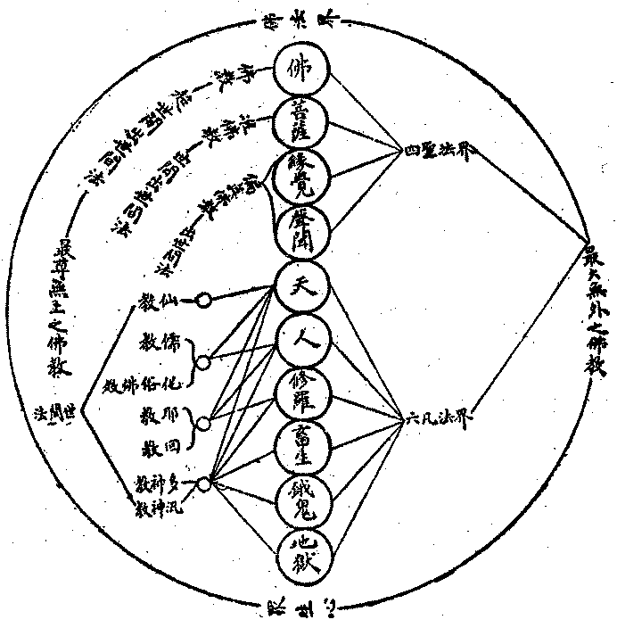
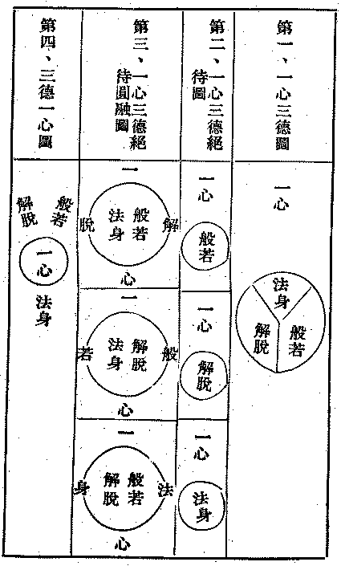

# 太虚大师全书．第十八编　讲演(第60卷-第180卷)



> **藏经**：太虚大师全书（太虚大师全书）　**册次** 第 27 册（TX27）　**编号** TX0018　**卷次** 59 卷　**篇幅** 81,035 字

> **卷／品**：0 卷 · 0 品



---



抉伪披真



——二年正月在延庆观堂宏誓研究会讲——



人之处世，贵真率耳！德莫德於真，贼莫贼於伪。古之圣贤豪杰，无不成於真也。然伪亦即出於古之圣贤豪杰，故老子有：「圣人不死，大盗不止」之说。「窃钩者诛，窃国者侯，侯之门，仁义存」。呜呼！演及今世，人智益开，人伪弥甚。衮衮诸公，集大事而享大名者，察其表，观其言，圣贤豪杰，诚何多让？但茍一揭去其假面目，则黑暗之里幕，丑秽杂肆，殆令人不可向迩！此所以真洁高尚之士，愤之、嫉之不能自己，慨然欲披发入山，抱石沉渊，以谢此五浊恶世也！然而悲天悯人之念，梗於胸次，尝思抉伪披真，必有一根本解决之道，期有以一洗现社会之伪习，促人类黄金时代之实现。太虚不敏，略有一得，请就此以贡陈诸君之前。



一曰、名誉不足惜：太虚尝作名之罪恶论，得数万字，於去年八九月间，刊登於绍兴公报，今不能遍举。试质言之，则名誉者，事行之所著而社会所以酬有功者也。又、名为实之宾，一受此名誉之报酬，则事行之实功，即由代替而消灭，故智者功成而不欲居名也。且名誉一成，即为名誉所累，而惜名之甚者，动止顾忌，言行多讳，当为而不敢为，不当为而亦为，乃无往而不以伪！彼汲汲唯名是求者，将谓名誉既得，可为所欲为；殊不知所欲为者未能为，而已奔疲於名矣！凡若是者，皆终身一名之奴隶而已。纵得名垂万世，既已自丧其真，复以伪熏伪，流伪毒於天壤，亦罪人之尤者耳！况务名而不务实，名又未可必得者哉！故吾人立身行事，莫若以真。真何所凭？亦自凭之良心而已。良心者，万物之端也。纯任良心者，一动、一止、一言、一行，虽举世誉之不加劝，尽人毁之不为沮。心如直弦，无所迁就，活泼泼地，不受污染。维摩曰：「直心是道场」，此也。孟子曰：「浩然之气，至大至刚」，此也。阳明子曰：「但凭良知，即知即行」，此也。庄子曰：「是进於知者」，此也。无恐怖、无沾滞、无趋避、无颠倒，故大真实人即大解脱人；而一是以名誉不足惜为本。二曰、道德无可崇：夫道德者何？乃吾心之寂然不动，感而遂通天下之故者耳。唯其感通天下之故也，故於宗法社会，则有所谓各亲其亲、各子其子；在大同社会，则有所谓自由、平等、博爱；在儒教则有所谓仁、义、礼、智、信；至佛教、则对六蔽而有六度，对三毒而有三学，对十恶而有十善，对八万四千烦恼而有八万四千法门，复有所谓四无碍辩、四无量心、四大无畏、四精进行等；凡是、皆道德之迹非道德之所以迹也。徒崇拜古人道德之迹，而不求之自心之所以迹，是为心死之人。庄子曰：「哀莫大於心死，身死次之」。故金刚经谓：「若有菩萨，以无量无数身命布施众生，不如闻此经一四句偈，功德尤大」。大般若经谓：「若复有法，过於涅槃，我亦说是空」。而达摩对梁武曰：「造寺写经，并无功德，净智妙圆，体自空寂」也。盖著道德之迹，则矫揉造作，奸伪百出，非愚即妄，无往而可，万物皆不能各安於真性，而天下嚣然矣！博爱为杀人之本，偃兵为造兵之原，非虚语也。故吾人安心立命，亦莫若以真。真何所在？即空寂之自性是也。百千功德，性自具足，无施不获，安用外求！崇拜道德之迹者，不自知其适与道德背驰也。吁！是亦佛之所深可怜悯者乎！



然名誉不足惜，不足惜亦不足惜；道德无可崇，无可崇亦无可崇。若以太虚不足惜、无可崇之说为足惜可崇，则又适与太虚不足惜、无可崇之说东辕西辙矣！佛之说法，无非与人解粘去缚耳，若於佛语转生执著，则诸佛亦将无从施其辩也。



太虚末学，何足以语道！且未尝习知俗世之礼法，获受圣贤之教化，故出言吐语，大都不经，僻行怪状，不理众口。然随宜示现，不存轨则，如鸟飞空，并无足迹，可无论也。即就事相以论之，发留一寸，本出佛制；服随国俗，自古已然，彼印度之比丘，固未始穿袍著裤、似吾国俗人今所目为和尚者也。虽然、太虚於是，无可不可，茍有机缘凑泊，则随感而应，尚可由圆顶方袍者现为非圆顶方袍者，况由非圆顶方袍者复为圆顶方袍乎！鱼相忘於江湖，人相忘於习俗，彼以太虚为奇怪者，彼亦自奇怪之耳！太虚自抚之良心，奇怪二字，殊未敢承认也。夫随喜赞叹，因利而导，广运方便，不主故常，此入世利生之宏范也。观堂创於四明尊者，道香德馨，被於天下。顾降及近世，几成秽薮，流风餘韵，湮灭无存！今得佛教伟人谛公来为住持，劈头以改观堂为观宗讲寺，以树作新之基，入泥犁而庄严，现净土於弹指，躬逢其盛，曷胜欣羡！而式海、智恒、桂明、玉旺诸师，复有宏誓研究会之设，与太虚夙昔心期，尤为吻合，不自知其言之累累，喜可知矣。今以时间短促，所怀欲吐者，仅以概括之词，出其端绪，他日有暇，当探蕴宣奥，列举而一详述之。人言亦言，太虚无言；正言若反，幸诸君垂思焉！



（见佛教月报一期）



（附注）原题「观宗讲寺宏誓研完会演说词」，今改题。



佛诞纪念会演说



——二年四月为清海讲演作——



「佛身充满于虚空，而恒处此菩提座」，佛果有生灭乎哉？「如来者，无所从来，亦无所去」，佛果有去来乎哉？众生有生灭去来之情，斯佛现生灭去来之迹；众生之情尽，如来之迹亡；净法界身，固未尝有出没也。然佛既循众生之机，示生灭之迹，吾亦安能遽破人类之执见，而衡於般若之真理哉！



顾幻娑婆世界中，幻阎浮提之幻众生，以幻演幻，幻幻不同，而今古俗殊，东西时异，於世尊诞生示灭之迹，遂传说纷歧，莫衷一是。或谓佛生於此方夏桀时，商末武乙时，西周昭王时、穆王时，东周平王时、桓王时、庄王时，二十九主贞定王亮时。佛灭或以穆王壬申，敬王庚申；西藏则以灵王乙卯；锡兰则以景王丁已。甚至有谓佛生於汉文帝时者，上下相差之数，不下千载；各信其说，共有七十餘家之多，可谓极支离奇幻之大观也。由是观之，可见众生迷昧之情，无所不至。天地人物，无非幻之表示，历数文言，无非幻之现象，益可晓然也。但由於异方殊俗，历学未能统一；洪荒草昧，史学未能完善，亦一大原因也。然茍无一定之说，不足以起人之信仰。宗教以得人信仰为妙用，於前诸说孰是孰非，将乌乎定之？是诚一最有研究价值之问题也。



虽然、佛既以循众生之情，示现生灭之迹，今亦惟循众生之情，以人类最多数所信仰之说而定之耳。佛教之流行，以中国为最完全。法琳法师既尝攷定周昭甲寅诞生，周穆壬申示灭；今复依琳师推定者，开佛诞二千九百四十年纪念会於中华民国首善之区，大多数人亦已奉之无异说，则佛诞之纪年，不定於是而又将谁定哉？但古今历数，沿革实多，震旦建正，三代有异，而西竺则以寅月十六为岁首，寅月十五为岁终，欲断定佛生於何月何日，盖亦未易措辞也。唯民间既以四月八日为佛诞节，已成不可转移之俗尚，则非四月八日是定又复谁定哉？顾兹者民国成立，改用阳历，至阴历四月八日，阳历已五月二十日也，何适何从，将谁是决？须知民国之所以改用阳历者，乃迫於世界而不得不然者也。中华民国既迫於世界之趋势而不得不然，则佛教亦处此趋势之中而有不得不然者，特阳历改用伊始，民间未能普及。窃谓自今年以往，当遵用阳历四月八日为佛诞日；而乡曲僻壤未能遍知者，不妨循用阴历。庶於世界之趋势，国民之风尚，两得允当。此徵之日本，有前事之可鉴者也。



呜呼！吾今为斯说，吾知自是其是食古而不化者，必将以吾说为大不韪；然余亦无暇与之辩也。当更进其论曰：佛既应机示迹，众生之机感无常，佛之示迹亦复不一。故释迦实成佛於无量无数劫前，仍不碍於三阿僧祇中，现比丘身、现居士身、现农工身、现帝皇身、现六欲天身、现四禅天身、现声闻身、现菩萨身，乃至现龙神修罗身、外道梵志身、羽毛鳞甲身、饿鬼地狱身、及夫现丈六金身，现千丈卢舍那身；或示寿千劫万劫，或住寿刹那一念。法华云：「三千大千世界，无芥子许不是释迦舍身命处」；即可知三千大千世界，无处不是释迦示生处；即可知自有三千大千世界以来，无年无月无日无时不是释迦降诞示灭之期，又安知今日之人类中，无释迦示现乎？又安知今日之畜类中，无释迦之示现乎？夫释迦固常作是好梦，而年年月月日日时时刻刻念念刹那刹那降生、出家、成道、转法轮、入涅槃也。吾人果欲纪念之乎？则亦必日日时时刻刻念念纪念之乃可。吾人果能刻刻念念为佛诞纪念，则吾人方且念念皆佛，念念即佛。佛身充满於虚空，佛身亦充满於吾人念念也。佛身充满於吾人念念间，吾人之念念亦充满於佛身。念念乎，佛身乎，吾人乎，心佛众生，三无差别，尽法界皆成一大光明藏，於是乎吾中华民国二年佛诞二千九百四十年四月八日。灿烂庄严之纪念大会，斯真成其为佛诞纪念会矣！



（见佛教月报第二期）



佛教两大要素



——六年九月在台湾灵泉寺讲——



集东西南北之人，成法喜禅悦之会，有大因缘，良非等闲！而不佞由海天万里，云水百城，今得与诸君晤谈一室，庆幸何如！法华经云：『诸佛如来皆以一大事因缘故出现於世』。夫此一大事因缘，物物具足，诚能究尽其义，则凡出现於世者，皆有一大事因缘在也。又云：『佛种从缘起』。古德则曰：『识得佛性义，当观时节因缘』。今既值善慧禅师提挈此大因缘网之宏网，使诸君与不佞之心光，重重交映於眉月灵泉之间，能不相率一证佛法之大义，而忍令虚掷此大好之时节因缘乎？



佛法大旨，要唯真俗二谛：以真谛故，超出世间；以俗谛故，普度众生。二义同时而无前后，二法一体而非对待。在佛菩萨之行，祇是一事，故又曰：唯一实谛；所谓以大智故，念念证觉，以大悲故，念念同尘；大智大悲，恒现一心是也。顺众生机，随宜说法，遂由一实谛演为五乘，会归其极，不外令人人超出世间而普度众生耳。不超出世间，则堕於凡夫法而非佛菩萨法；不普度众生，则堕於小乘法而亦非佛菩萨法。抑非超出世间则不能普度众生，非普度众生则亦不能超出世间；故梵天犹有邪见，而小圣未免偏执也。昔释迦世尊示人修行佛法之榜样，壮岁出家，独入深山，超世出世，成最正觉。菩提既证，涅槃不住，转大法轮，广度众生，呜呼盛矣！大丈夫不当如是耶？然所谓超出世间，所谓普度众生，容易模糊影响，流入岐途，今应略显其义，令人无疑。



一、超出世间义：何谓世间？文字语言法是世间，依群众起故，由习俗成故，古今变迁故，国土离异故。复次、数量时方法是世间，可推测故，落边际故，假施设故，非决定故。复次、和合法是世间，无体性故，趣离教故。复次、因果法是世间，无根极故，起追求故。举要言之：五蕴、七大、八识、十八界、十二因缘．二十五有等一切有为法，以有生老病死故，以有生住异灭故，以有成住坏空故，以有对治破除故，皆世间法也。然则吾人起心动念，殆未有不落於世间法者，果将如何而可超越出离乎世间耶？此所当回光返照，深参力究，而不可草草放过者也。即如金刚经云：『应无所住而生其心』。则欲发心修行，不可不先将所谓无所住者悟得。从外观之，人物依地轮住，地轮依水气轮住，水气轮依风轮住，风轮依虚空住，虚空无所依，故无所住。从内究之，五蕴幻体从烦恼业缘生，烦恼业缘从无明妄想生，无明妄想从觉心转动生，而本觉真心无所从生，故无所依住。彻悟本心之无所依住，净除诸念，犹如虚空。虚空无依无住，亦无虚空可为餘法依住，亦无少法能依虚空而住，则风轮亦以无所依故无所住，风轮且无所住，况水气轮、地轮、人物之辗转依风轮而住者乎？由是一切诸法，皆无所依住，以无所依住故，无住生心，生心无住；所谓一切法不生而般若生，般若生而一切法不生也。言至於此，逗露不少，然非亲见本不生本无住真心者，终是空谈白话，了无交涉。



二、普度众生义：心、佛、众生，三无差别。众生即佛，佛即众生，胎卵湿化之四生，天人鬼畜之六趣，无不皆具如来智慧功德之相，直示真心，普令成佛，岂不痛快直捷！无如众生业力差别无量，妄想执著种种不同，非有无量不同之法门以应之，不足成普度众生之益。故於未有出世善根之三恶众生，且令闻三皈名，受五戒法，近载人乘而度三恶，远作三乘出世之种。又於未有出世善根之人道众生，令知佛法僧义而起正信，教以十善法及世间禅定法，近增福德而生天道，远亦作出世之因。又於已种出世三乘善根之众生，亦随宜成熟而度脱之，所谓声闻以四谛法，缘觉以十二因缘法，菩萨以六度万行法是也。我等今幸在人道，欣闻佛法，纵未能即成佛道，亦当依佛法修行，俾生生世世不失人身，乃可随力以进趣佛道，宏扬佛法，即超出世间普度众生是也。昔裴丞相序圆觉经曰：『诸天耽乐，修罗方瞋，禽兽怀狖獝之悲，地狱有幽沉之苦，可以端心虑、趋菩提者，惟人道为能耳』。端心虑，趋菩提，既入宝山，勿空手回，此则不佞与诸君共勉之者也！



（出东瀛釆真录）



（附注）觉书题作「台湾基隆灵泉寺之说法」，今依自传改题。



我之佛教观



——六年十月在台湾佛教讲演会讲——



一　佛教与吾人之关系



茫茫宇宙，譬如一大逆旅，吾人与万物并生此逆旅之中，要皆过客而已。逆旅未至销毁，即过客不绝来往。然逆旅依然存在，悠悠千古，一代一代之过客竟不知其何所归往？祇少数所谓帝王、将相、圣贤、豪杰、名士、美人者，稍稍留其痕迹，供吾人之浏览凭吊。嗟夫！古人之迹在此，古人之真何往耶？虽然、吾人自幼而壮，自壮而老，剽劫於无常急驶之流，犹落花之堕湍水，不容停驻，数十年之光阴，一瞥即逝，又将有后来之过客，以已往之客哀吾人矣。嗟夫！吾人自哀不暇，尚奚暇为古人哀乎！吾人在世，度一日即趋近死限一日，如牵赴屠场之豕，步步行近死地；生而不得不死，死又不得不生，随业流转，生死无已。夫生死之变亦大矣！吾浪死虚生，虚生浪死，竟不能稍稍自觉，稍稍自由，可不哀乎！不宁惟是，即在有生之域，数十年间，其本心谁不欲勉为善行以邀天福，亲悟真理以成圣智，达美满优胜之地位，获常住周遍之安乐者，故曰「一切众生皆具如来智慧德相」。顾牵摄於事势，颠倒於感倩，驰逐於名利，奔走於衣食，又鲜不丧失其本心，始诚实而卒流虚伪，始高尚而终就苟且，忘己而役乎物，昧因而骛乎果，甚乃习非胜是，积妄成性，亦何尝稍稍能自由能自觉乎？嗟夫！吾人於此逆旅之宇宙，既如盲人摸象，曾不能一睹其真相；即反之小己之志行，亦不能自主自遂，冥冥焉莫自知其所来，伥伥焉莫自知其所往，既无异乎禽兽之盲动，又宁免草木以同腐乎？嗟夫！人为万物之灵长，人为有理性之动物，人为有目的之动物，其真意义果安在乎？若竟不求吾人之真意义，而安於禽兽之盲动，草木之同腐，则谓之心死之人。「哀莫大於心死」，身虽未死，亦仅行尸走肉，而所谓人者，则早已失却矣。夫佛教者，即救度吾人之本心而活之者也。令人人发自心之智慧，悟自心之常乐，故吾人之自心，即光明无量、寿命无量之阿弥陀佛也。令人人充自心之慈悲，致自心之宁静，故吾人之自心，即能仁寂默之释迦牟尼佛也。盖吾人固非不能遍知遍觉自由自主者，祇以未得无上真正之道，安定其心志，立定其性命，故常为物欲所诱而生诸苦恼，常为环境所惑而生诸妄想；苦恼障碍，妄想流转，是以不能证如来智慧德相。夫吾人虽欲专一学，欲精一义，亦必心安志定，而后能有所成就。故曰：「道也者，不可须臾离也，可离非道也」，此宗教与吾人之关系，所以甚深甚重，更无第二事能与相等也。然欲令吾人安信志之心，定慧性之命，必求佛教之无上真正之道，非其餘人天之邪宗，小教所致也。而宗教者，即皈依之义；皈依者，即皈向其心依止无上真正之道，心与道一之谓。无上真正之道，即是佛教，佛教即是佛、法、僧三宝。佛是能觉悟开示无上真正之道之人，佛法是佛觉悟开示之无上真正之道，佛法僧是信解行证无上真正之道之人。三宝之德，不可言量！吾人在茫茫苦海中，三宝为舟航；漫漫黑夜中，三宝为明灯；悠悠险道中，三宝为导师；冥冥旷野中，三宝为真宅；举要言之，三宝是吾人第一可依恃者，第一可崇拜者，亦是第一能觉悟吾人者，能救护吾人者！故吾人凡有心知灵觉者，皆有佛性，皆是佛子，皆应了解无上真正之佛道，信仰无上真正之佛教，皈依三宝以为安身立命之地。从之於哲理上转迷成悟，於伦理上转恶成善，於身心上转苦成乐，於世界上转凡成圣也。令更从宗教上、哲学上、科学上、伦理上、政治上、教育上等种种方面，与佛教皆比较而分别观察，令知究竟唯一佛教，为无上真正之道，故吾人皆应信解受持也！



二　宗教上之佛教观



甲、分别观　1.宗教上之缘起，三：一、人人皆有离苦恼而得安乐，免死亡而获常存，转浊恶而成净善，了诸法而明真性之本怀。二、众生自无始以来，有二种障：一、无明障；二、烦恼障。吾人既有前之本怀，复为二障所障，不能通达，遂生妄见而执妄法。三、有释迦牟尼佛大觉圣人出世，断除二障，得遂本怀。本其身之所崇，教示吾人以三界惟心、万法惟识、一切法因缘生之一实相印印定诸法，令吾人了悟无常、苦、空、无我，得达其常乐我净之目的，遂有「心佛众生三无差别」之佛教——唯一正教起。



2.宗教上之要素，五：一曰信仰，他教有三：一、如信有天神上帝为宇宙唯一真宰等。二、如信世界万物、皆天上唯一帝主所造等。三、如信善恶苦乐罪福唯由上帝命令所支配等。佛教亦有三：一、实——体——佛，信一切法唯心，心真如觉性即佛。二、德——相——法，信一切法因缘生，诸法实相不可思议。三、能——用——僧，信因果不昧，缘起无尽，十方三世利益有情。



二曰心神，心神之界说者，他教则为鬼神：如世俗传说人之形躯死亡后，其心魂精魄或为鬼为神之类。天神：如婆罗门教、耶稣教、天主教、回回教等，不悟即心自性之真如体用，谓为天上之唯一真性等。灵魂：婆罗门教於三世轮回执灵魂说，耶稣教於人心死后执灵魂说。佛教则为心性：万物唯心，心本觉性，即如来藏妙真如性。心神之理论者，他教之有神者三：多神则拜动物、拜山川草木、拜门堂井灶等。一神则祠天主、祠上帝、祠大梵天、祠摩醯首罗天。神泛则以现存之万有皆神，观宇宙之闳渺悠久生寅畏心，於宇宙之真体生渴慕心等，皆谓之泛神教。无神者，如虚无断灭论等。佛教则宇宙惟心，物我无性，直指人心见性成佛。



三曰因果：因果无谬，罪福不亡，固宗教实践上一重要义。他教或有现在而无过未，或有过未而无现在，或有现在未来而无过去，或虽三世而偏执一端，不识因果之真相，唯佛能圆满证说三世之理。



四曰慈悲：凡宗教各有慈悲救世度人之义。粗观之，孔之仁，墨之兼爱，耶之博爱，似与佛之慈悲无别。然细密察之，佛教之慈悲，有生缘慈悲、法缘慈悲、无缘慈悲之三种，他教唯有生缘慈悲之小部耳。



五曰教主：凡宗教必有现实世界上人格最伟大之教主。佛教以释迦牟尼佛为教主，释迦牟尼佛为五洲万国有历史以来第一伟大人物，其降生尊贵之族、帝王之子，其出家壮盛之年，富乐之人，其修道六年苦行、成最正觉，其救世转大法轮、度无量众，故曰「天上天下无如佛，十方世界亦无比，世间所有我尽见，一切无有如佛者」！



乙、圆融观　上来依分别门观之，佛教如大海，他教如断港；佛教如赫日，他教如爝火；佛教如雪岳，他教如土阜；显然有其浅深胜劣高下之异。昔雅典大哲亚里陀大德曰：「吾虽甚爱吾师柏拉图，然不如吾爱真理」。今吾於各教教主、教义亦如是，虽泛然莫不尊爱，而一经与佛教比较，则真相所存，彰明较著，不容为各教曲掩。虽然、佛教不特其尊无上，抑其大无外也。无外、则无对绝待，无待绝对则离一切相即一切法，而若邪若正若小若大若偏若圆无不融归佛心矣，兹更作一图表示如下。







佛法界者，众生心是宗极，一心教示万法，法法绝待，唯是一心，心心圆融，遍含万法，夫是之谓佛教。牟尼现世，天人之师，轨范行业，迺宣教戒；教戒未足发智故，闻义学以穷理；义学未足证心故，修静虑以体真；静虑未足悟物故，广为无量方便法门以济众。夫至广为无量方便法门以济众，则群众所传诵持续之道术，又宁有不可融归乎佛法者哉？即如耶教崇拜宇宙唯一天主，佛亦称三千大千世界主。又耶教谓上帝创造世界，盖出於婆罗门教崇祀大梵天者之说，佛亦尝自称我即大婆罗门及大梵天。耶教不设形像，此亦佛教中之一种无相法门，金刚经所谓「若见诸相非相，即见如来」是也。举此荦荦数端，餘可类推而知矣。要之、宗教者贵乎上得其真，下能益民。益民之道，贵乎律仪清正，心行慈善。耶教上得其真与否，虽不敢知，然能勤修乎利益生民之业，未离人天之行，异乎回教之多近修罗法，及其餘教淫、教杀、教盗诸不律仪教，以牛戒、自饿、投灰，诸苦行外道近於畜生、饿鬼、地狱者，其盛行乎世宜矣。虽然、地藏常居地狱，观音现身饿鬼，释迦尝为种种畜生以行菩萨道，则三恶趣法亦何尝非佛法乎？是故种种外教之法，入佛法中皆成佛法，但除其执，法本圆融，所谓「千流万派无辞让，始见归墟佛海深」。



三　哲学上之佛教观(另见)



四　种种相之佛教观



余初列题，本於哲学上之佛教观后，尚有科学上之佛教观，伦理上之佛教观，心理上之佛教观，政治上之佛教观，吾人崇信佛教之必要七篇。今以时间短促，故建立人心之三德性，显示佛法大意，演绎十种三法门以浑括说明之。



　　　　┌────────┬───────┬───────┬────────┐  

　　　　│　　　　　　　　│　　┌文　　字│　　┌实　　智│　　┌自　　　性│  

　　　　│一、人心之三性德│般若┤观　　照│解脱┤方　　便│法身┤受　　　用│  

　　　　│　　　　　　　　│　　└实　　相│　　└真　　性│　　└变　　　化│  

　　　　├────────┼───────┼───────┼────────┤  

　　　　│　　　　　　　　│　┌闻　　　　│　┌摄　善　法│　┌凡　　　　夫│  

　　　　│二、佛教之三圣学│慧┤思　　　　│戒┤摄　众　生│定┤圣　　　　人│  

　　　　│　　　　　　　　│　└修　　　　│　└摄　律　仪│　└如　　　　来│  

　　　　├────────┼───────┼───────┼────────┤  

　　　　│　　　　　　　　│　　┌转迷成悟│　　┌转恶成善│　　┌转苦成乐　│  

　　　　│三、三转法轮　　│初转┤　　　　│二转┤　　　　│三转┤　　　　　│  

　　　　│　　　　　　　　│　　└转妄成真│　　└转染成净│　　└转凡成圣　│  

　　　　├────────┼───────┼───────┼────────┤  

　　　　│　　　　　　　　│　　　　　　　│　　　　　　　│人佛┐　　　　　│  

　　　　│四、三不二门　　│心物不二之实体│因果不二之定理│依正├不二之法界│  

　　　　│　　　　　　　　│　　　　　　　│　　　　　　　│生佛┘　　　　　│  

　　　　├────────┼───────┼───────┼────────┤  

　　　　│　　　　　　　　│　　┌科　　学│　　┌法　　理│　　┌政　　　治│  

　　　　│五、人群之要素　│学术┤　　　　│德行┤　　　　│政教┤　　　　　│  

　　　　│　　　　　　　　│　　└哲　　学│　　└伦　　理│　　└宗　　　教│  

　　　　├────────┼───────┼───────┼────────┤  

　　　　│六、科学之三心理│知识　　　　　│感情　　　　　│意志　　　　　　│  

　　　　│七、人性之三同好│真　　　　　　│善　　　　　　│美　　　　　　　│  

　　　　│八、中庸之三达德│智　　　　　　│仁　　　　　　│勇　　　　　　　│  

　　　　│九、学校之三育　│智　　　　　　│德　　　　　　│体　　　　　　　│  

　　　　│十、国家之三权　│立法　　　　　│司法　　　　　│行政　　　　　　│  

　　　　└────────┴───────┴───────┴────────┘



更一心三德，图示如下：







（出东瀛采真录）



（附注）原文无题，今依意加。



论佛教与孤儿院



——七年在宁波孤儿院讲——



今幸宁波佛教孤儿院开成立会矣！太虚尝订定斯名，为发起人之一，兹当略说佛教孤儿院之义，以释回惑而资信行。



一、佛教之本性：心佛众生，三无差别，有佛无佛，性相常住。然道无自相，宏之在人。今吾人所知所信之佛教，溯厥源泉，实流出於释迦牟尼佛大圆觉心。大圆觉心之成分，真智慧与真慈悲也；真慈悲之谓释迦，真智慧之谓牟尼，大圆觉心之谓佛，大圆觉心具众理而成万事之谓佛教。故佛教之本性，即真智慧、与真慈悲，而佛教之本性，又即吾人之本圆觉心也。然云真智慧、真慈悲，当知与世俗之所谓智慧、慈悲者，不唯绝异，且适相反。世俗以科学、哲论为智慧，以伦理、神教为慈悲，盖佛教中之倒想妄见凡情我爱耳。故欲证得吾心真智慧、真慈悲之本性，当别开方便之门；若求之科学、哲论、伦理、神教，则奚啻南其辕而北其辙乎！证真智慧之方便门有三：曰无实、无相、无愿。无实、即无可执取义，亦是空义。姑就挽世科学所依止之唯物哲论以言之，其谓宇宙诸物皆属现象，然有原质为彼实体，或说原质有若干数，或说唯一伊态尔气。今试问彼：所云原质，为尽异乎环境诸现象耶？为不异乎环境诸现象耶？不异乎环境诸现象，则此若干数原质者，此伊态尔者，亦现象中之一现象耳！既同为现象，则不得独指之为实体。盖异乎环境诸现象而绝非吾人之官觉心知所能构接者，则此原质云、实体云，已超出经验之外，自违科学之例，仅凭虚拟立之一空名词耳。彼既认原质为集起宇宙现象之实体，今攷之所云原质，先空无所有，则由原质而集起之现象，譬犹织蛇毛所成之鲛衣，益属空无所有之事，从可知矣。彼科学家、唯物论家所执为实在者，核之乃唯是一无所有之空名词，故曰倒想妄见。推此一端，餘可例知。了其唯是空无所有，则倒想销而妄见除，始稍稍开发真智慧矣。无相、即无可分别义，亦是假义。即就空名所诠空相言之，空若决定有空相者，有此空相，空应是有，空既成有，有亦成空，空之与有，交无定相，是以名相本无，义界假立，以假立故，互遍通彻，以遍故诸法一相，以一相故离相无相，以无相故无可分别，无分别故绝待圆融，入无相门，真智慧乃朗然洞彻矣。无愿、即无可趣作义，亦是中义。即就一相无相绝对圆融言之，随举一法皆得为一切法中心，具一切法，则吾人亦莫不本来具足一切功德，无欠无餘，更何趋求造作之有！入此无愿门者，真智慧赫然圆成矣。



得真慈悲之方便门亦三：曰无贪、曰无瞋、曰无痴。世俗之仁爱，皆从自营私欲中、好摄他属己之念而孳乳。人固有不必以身躯为自我者，然以身躯为我所安危与共之一物，故爱著生存壮佼，顺从其所乐，役役以为之殉而不恤。推此以泛观殉诸所好，乃至殉国、殉教、殉义，虽高下异数，通局殊会，其本质固同为自营私欲也。即父母之爱子女，亦以子女从自身种种勤劳得成，爱子女无异爱自造之功业艺术，且盼其报恩及嗣志於将来耳。由有所贪求而施仁爱，既以自私为本根，则人各有其自私之念，互相扞格，必不能悉如己意，遂其所求，於是嗔恚生矣。贪而遂，则恋著不舍，反之、则由嗔恚而怨慕无已，凡是皆所谓愚痴也。今创办佛教孤儿院诸人，稍有欲藉之以保存或扩充佛教之势力，及欣羡他教之由此暄赫流俗，意将追步其后而与之竞争，甚且逐逐於聋瞽其心者之毁、誉、称、讥、盛、衰、荣、辱之念，不能暂释乎胸次；则佛教本自慈悲，适以孤儿院乃贪、嗔、痴之矣！其为求一己之名闻，或冀所住寺庵赖以安利者，更无论已。盖佛教之真慈悲，须以真智慧为正因，先净尽我爱之根株，空诸所有，后不可思议之真界，观诸如幻众生，本具无边福智，徒以迷惑颠倒执著缠缚，自为障碍，不获现证，於是兴慈与乐，运悲拔苦，济物利人，不由分别，是为清净之善。



二、佛教与世界众生：依佛教当言世界众生，就通俗之名词言之，亦可云佛教施行於社会之利益。夫佛教之施行於社会，即佛教本性之发挥於世界众生也。然世界无边，众生无量，净秽千差，苦乐万殊，故惑业有浅深，而障缘有广狭，佛教随之而为差别，遂有五乘之法。夫众生但是迷情，而世界无非妄相，使之脱迷情而离妄相，悉证乎真觉圆德，遂有出世三乘。闻佛法而悟本唯真觉圆德，迷情妄想体性空寂，世界众生不度而度，名为佛菩萨乘；是佛教之本旨，亦佛教施於社会究竟之益也。其次、虽未能即证元心德性，然以有出世善根故，或因自观察力，或因闻佛法力，得以解脱迷情，超离妄相，是为独觉乘、声闻乘。又其次，以未能具出世善根，贪著迷情妄相为实，虽闻佛法，不能了知，诸佛大慈愍故，就迷情妄相，使之畏罪求福，止恶作善，回动向静，息想归神，是为人乘、天乘。儒为人乘，道为天乘，耶、回、梵、哲诸教，介天、人、杂鬼、神而为人天乘。其所以导民为善、化人入神者，宗教、哲学所大同者也。故佛教流行於社会之利益，上者为餘宗之所无，下者统他教之所有，尽世间一切政教学术之利益乎民生者，不足比佛教利益之万一。



三、孤儿院定义：通俗所知者，幼而无父，或兼无母，或兼无诸姑、伯叔、亲友、戚属为抚养教育者，则为孤儿，若今孤儿院所收养诸孤儿是也。进就佛教之胜义言之，一切众生，皆为佛子，凡未能发菩萨心，生如来家，从般若母，依慈悲父，受法喜禅悦之食，披解脱庄严之衣，获清净功德之财，成善巧自在之用，以之逼迫乎根尘识，驰骤乎贪嗔痴，轮回五趣，颠连九有，生死苦海，沉浮不定，善恶业道，竛竮无归；若我今现前众人暨乎宇宙一切生灵，胡莫非茫冥弱丧之孤魂，贫穷孤露之孤儿哉？



四、佛教与孤儿院：夫救济胜义之孤儿，佛教出世三乘之事也；唯佛教之所能者也。救济通俗之孤儿，佛教人乘、天乘之事也，亦世教所共能者也。今既因吾人惑业深重，未能率九界有情得佛法菩提涅槃之益，隐盖天擎地之大丈夫相，效扶墙摸壁之婴儿行，与孔、墨、耶、回之徒，共营人天善业，以办此通俗孤儿院，则亦姑就通俗孤儿院之所善者言之耳。考通俗所云慈善事业，若赈灾、恤兵、保赤、济贫、施医、养老诸端，则有养无教；若办不收学费之小学校、半日学校、星期学校、夜学校诸端，则有教无养。或遍济以慈悲，未足增其智能；或稍开其智慧，未能尽其扶助；胥未若孤儿院之对於孤儿者，衣之、食之、医之、居之，尽其慈济，俾有以遂生於现在，复授以国民教育，益其智能，俾有以自立於将来也。故孤儿院者，实发挥智悲兼大之佛教本性於世界之最好场合也。



五、孤儿院与社会：广义之社会，小之以言一家庭，大之以言全世界，国群亦社会之一，不言可知。就消极方面言之，社会中何以有游民、流氓、乞丐、马骗、窃贼、强盗、淫娼、罪囚乎？虽由社会种种恶习相缘起，核其总因，则固在乎应受教育之时代，为孤贫所困而未能晋受相当之教育，造成其自立自治之能力，即令社会上减少其有害无利之分子也。抑已由游民乃至堕落为罪囚者，原因不一，且不久将离乎社会，虽救之亦鲜成就！而孤儿之堕落於将来，则纯由他人遗彼之困难迫成之，且其有害於社会者为日方长，吾人坐视彼无告赤子堕落为将来害群之马，实不仁之尤！坐视其害吾群於将来，不先设法以防止之，又不智之甚也！更就积极方面言之，不唯造就一孤儿，即令社会上增一能自立自治之人，且疢疾益智，孤孽者达，自古圣贤豪杰大都出於孤寒，唯其孤寒，故操心苦而虑患深，智术德业，乃日修月进，令儿童之长大於纵逸戏乐之家庭，其不逮育成於整齐严肃之孤儿院审矣！即佛法中之修行人，亦於苦谛为第一大师，则安知将来无德被群生、功垂万世之圣贤豪杰，由此甇甇孤儿中乎？



六、佛教徒与孤儿院：夫佛教徒者，以宏法为家务，利生为事业者也。以言宏法，则孤儿院与佛教之本性，既如此密符，可不力求发挥乎？以言利生，则孤儿院与社会之公益，既如此闳远，可不力求发达乎？今宁波佛教徒，既发心办此佛教孤儿院，当各尽其能力之所及，以维持扩充之，不待论矣！窃愿我东震旦土各省道县之佛教徒，皆发心组立佛教孤儿院，由佛教第一孤儿院乃至第几、第几十、几百、几千、几万亿孤儿院，林林总总，使大地无复孤贫失学之儿童，则社会之公益蒸蒸发达，佛教之本性亦稍稍发挥耳。有此人道以为之基，然后可以端心虑、趋菩提，救济胜义之孤儿，咸成无上正等正觉。



（见觉书一期二期）



（附注）原题「宁波佛教孤儿院之演说」。



佛教与吾人之关系



——八年十月在尚贤堂讲——



佛教与吾人之关系，一者、佛法是人人好觉悟、好平等、好自由、好普济之共通本性故。二者、人人不好迷信邪信，好正信悟信，惟佛教能令人人悟自心之佛而信自心之佛教，绝无一点迷信邪信而得极圆满之正信悟信故。三者、佛教能满足人心之宗教上要求故。四者、佛教能满人心学理上之要求故。五者，人人皆欲於世界人生两问题得究竟之解决，惟佛教能得究竟之解决故。



（见觉社丛书二期）



（附注）本文自「觉社之佛教集讲演会」中节出。



中国人口头上心头上的阿弥陀佛



我中国有眼耳口鼻心思的人，没有一个不知道阿弥陀佛的，也没有一个不曾念过几声阿弥陀佛的；那二万万的妇女们，至少也有一万万的人常念著阿弥陀佛，更不消说得的了。照这样看起来，这一句阿弥陀佛，岂不是我们中国的人连著眼耳口鼻心思同有的一件东西麼？我们既然每日同这阿弥陀佛在一起，这阿弥陀佛到底是个什麼道理？又岂不可考究考究麼？



前几年、有一位学校里做教员的朋友，那日遇著了我，突然向我道：到处看见老太婆们口里喃喃的念著南无阿弥陀佛，恐怕这些老太婆们未必能懂得念这南无阿弥陀佛是什麼意思罢？我当时答他道：这一句阿弥陀佛，原是不很容易懂得的。不曾读书识字明理的老太婆，口里喃喃念著，心里不知道这阿弥陀佛是什麼道理，为什麼念这阿弥陀佛，又何足为奇呢！即在一般号称读书明理的人，又有几个能懂得呢？足下若知道时，这南无阿弥陀佛六字，到底是什麼道理？念这阿弥陀佛，到底是什麼意思？到要请教请教了！那知这位先生竟找不出一句回答的话，便低著头赸赸的去了！我看同这位先生一般的人，恐还不少呢！



有的说：南无阿弥陀佛，是说这个佛单是西方有的，我们南方是没有的意思。有的说：阿弥陀佛，是人人堂上的阿母，是寺院里的大佛，合拢来便是阿母大佛。把音声稍微读别，又接著把字写错了，遂成了个阿弥陀佛。我有时也曾去问问那念佛的老太婆们！你为什麼要念这阿弥陀佛？念了这阿弥陀佛有何用处？他便回答道：念一句阿弥陀佛，是死后做鬼时可当一个钱用的，我们为著死后要钱用，所以念佛的。这种影响模糊的解说，他们也未尝不以为有来有历，很有道理，但未免与南无阿弥陀佛的道理，念阿弥陀佛的意思，相去的太远了！



有人说：你道没有人不念过几声阿弥陀佛，这话恐不对罢！中国人口里头念佛的虽多，也不过斋公斋婆罢了。我答他道：这是因为你没有在我们中国人心头上、口头上、极平常的时节细细体察体察，所以不大觉得；倘能够细细体察，不但能够觉到个个都是念过几声阿弥陀佛的人，而且阿弥陀佛的道理，念阿弥陀佛的意思，也就能够见到几分呢！



有的时候，听见或看见人家杀猪啦，杀羊啦，杀强盗啦，杀鸡、杀鸭啦，杀得怪凶怕的；打贼啦，打丫头啦，打养媳妇啦，打小孩子啦，打得怪凄惨的；骂天啦，骂家里人啦，骂亲眷邻舍啦，骂得怪刻毒的。又见那种种劳苦穷急的人，劳碌辛苦到了不得的时候，饿煞、冻煞的时候，家败人亡的时候，投河、上吊走头没路的时候，救又救弗得，劝又劝弗信，心中一阵难受，堕著洒下几点同情泪，便不知不觉口里念著阿弥陀佛，南无阿弥陀佛！这一种景况，大概在有点天良的人，十有八九是经过了的。就此、可见这阿弥陀佛是慈悲的道理，念这阿弥陀佛是恻隐的意思了。



有的时候，遇著了大水啦，大火啦，兵勇啦，强盗啦，种种的急难；遭著了官司啦，牢狱啦，种种的横祸；又有那身体病痛啦，家产倾败啦，亲爱的生离死别啦，怨憎的对头会面啦，种种的苦恼；兜到心上来躲不脱的时候，心里头便自然不歇气的默念著阿弥陀佛，南无阿弥陀佛！这岂不是拿阿弥陀佛来当做一个能够救苦救难的人，念阿弥陀佛就是恳求他救度的意思吗？



有的时候，看见或听见十恶、五逆没有法子奈何他的恶人遭报应死了；又看见或听见那指天畫地、赌咒罚誓惯冤枉人图赖人的人，这一天忽然统统宣露了出来，当场受万人唾骂；又有时见自己的冤家对头的人，死了或吃了苦，心里头一爽快，又喜又惧，亦往往把一句阿弥陀佛，信口念出。这岂不是把阿弥陀佛当做因果报应？念这阿弥陀佛，就是常常记著因果报应，不敢为非作歹的意思麼？



又有那羡慕别人家富贵荣耀有福气的，或者受了人家极重的恩惠自觉今生不能报答的，便也不知不觉在心里头口里头念著阿弥陀佛，岂非阿弥陀佛是个福最大、恩最深的人，所以念著阿弥陀佛求福报恩吗？



又有那一般普通社会的人，与那些吃洋教的人，学堂里的学生，滑头滑脑、油口油腔的人，逢著了和尚啦，尼姑啦，斋公斋婆啦，朝山进香诵经拜忏的善男信女啦，便口中称著阿弥陀佛以代招呼，或为调笑戏弄；或者如叫化子等，有所求乞。无论出於何种，总是认阿弥陀佛是佛教的符号，称念阿弥陀佛是表示佛教的意思了。



照上面所说的种种事情看起来，慈悲恻隐是阿弥陀佛，所以念阿弥陀佛。救苦救难是阿弥陀佛，所以念阿弥陀佛。因果报应是阿弥陀佛，所以念阿弥陀佛。锡福施恩是阿弥陀佛，所以念阿弥陀佛。佛教的符号是阿弥陀佛，为表示是佛教，所以念阿弥陀佛。岂不是个个人皆念过几声阿弥陀佛的麼？岂不是阿弥陀佛的道理，念阿弥陀佛的意思，就此也便可以明白了几分麼？



但是这阿弥陀佛真正的道理，念这阿弥陀佛真正的意思，究竟还是没有明白呢！我们中国的人，既然个个已经同阿弥陀佛结了深不可解的缘，岂可不快快明白明白他麼？若要明白，听我慢慢道来：



南无阿弥陀佛是一句天竺国里的说话，变成我们中国话：南无就是恭敬、皈依、信仰、服从；阿弥陀、就是没有边际的智光、与没有限量的福寿；佛、就是圣人、神人、天人、全人、至人、有道德的人、觉悟了的人、智慧才能最伟大的人等；合起来就是：「敬从那无边无量智光福寿的圣人」。这阿弥陀佛不是我们这个世界里头的，我们这个世界，唤做忍苦的世界。在二千九百多年前，有一尊释迦牟尼佛出现在我们这个世界，为我们说了阿弥陀佛与那个极乐世界的历史状况。我们遂知道阿弥陀佛在未成佛未有极乐世界以前的时候，本是一个皇帝，当时也有佛住世。这皇帝极其信崇，后来也从佛出家作了僧人，修行不久，便成了罗汉。重发大菩萨心，立愿要在将来由他及同著他发愿修行的人，修成一个极乐世界，思衣得衣，思食得食，想到那里便到那里，想有什麼便有什麼，一切的安宁快乐无不完备，一切的危险苦恼无不离脱，同住的人统是好人，既无恶人，亦无恶事，自然骎骎乎日进於善，直至成佛，更无退转。既修成了这个极乐世界，复要将此极乐世界的名字，十方世界无不闻知，使闻知者皆生欣慕，但念阿弥陀佛的名号，便可於转生的时候，由阿弥陀佛前来接引，生到极乐世界里头去。到后来，果然成了个极乐世界，这世界在我们这世界的西边。成佛名阿弥陀，与许多的菩萨、罗汉同住其中，常常说法聚会，时时到十方苦恼的世界去接引救度众生，使他们生到极乐世界里头去。那释迦牟尼佛，因为见我们这个世界是极其苦恼的，住在里头又是极其危险的，因为虽做了个人，能活几年是没有一定的，一口气不来便死了。就在活的时候，病啦，老啦，冷啦，热啦，种种说不尽的苦痛围绕著身心，无法离脱，所以教我们个个人心里头口里头、常常念著阿弥陀佛，使我们到了临终转世的时候，便可由阿弥陀佛救度到极乐世界去，永远享安宁快乐，更没有一点儿危险苦恼。这才是念阿弥陀佛真正的意思了。



这南无阿弥陀佛的道理，念阿弥陀佛的意思，既然完全明白了，而且我们中国的人，先天上已经有了这个阿弥陀佛，念佛的工夫是很容易做的。大家能时常的念阿弥陀佛，便可与阿弥陀佛的心愿互相感应，犹如无线电机一般，自然常常有超出世间的志量，不致埋没在这个忍苦的世界中了。



有的人说：如此说来，这念阿弥陀佛，实在是件很有意思的事情，我也想时常念阿弥陀佛了。但是我们为人在世，未免都有家庭的、社会的、国家的关系，不能就抛弃了去当和尚，这又如何是好呢？我答他道：你这又错了！当和尚是一件事，念阿弥陀佛是一件事；做事不做事是一个问题，念佛不念佛是一个问题，都是各不相关的。所以念佛与在世做事毫不相妨，且一念佛便能使世间的人做世间的事更做的好了。何故呢？因为这阿弥陀佛就是慈悲恻隐故，就是救苦救难故，就是因果报应故，就是修福报恩故。所以有父母的不能孝养，必不能念阿弥陀佛，能念阿弥陀佛，必能孝养父母；有子女的不能慈育，必不能念阿弥陀佛，能念阿弥陀佛，必能慈育子女；乃至为国民办事的不能忠其所事，必不能念阿弥陀佛，能念阿弥陀佛，必能忠其所事；所以我们中国人只要把心头上、口头上、本来有的阿弥陀佛时时提醒著，自然不愁不一日日的好起来！



（单行本）



世界宗教会成立之希望



五月十二日，世界宗教会在上海新法界宝昌路南吕班路山东会馆大成殿开成立大会，因未预会，以文代讲。



仆忝堕佛教之数，得为世界宗教界中之一份子，请摅所知，略贡微言。窃宗教之名，佛教素有之，凡属於言论者则曰教，属於观行者则曰宗，盖以之区别言行者。又有分佛教之理论为若干部，判之曰某教某教者；而随一倡道者出，於佛理别资一途，信从者继续不替，后世遂颂之为某宗某宗者。复有譬宗为纲，喻教为网者。就此三说，根究其字意，皆各个代表一义，适成一反例。今世通称之宗教二字，必由译述者，取西文意会中文，假定无疑。然通称之曰宗教宗教，连合宗教二字成一名词，其名义果何在乎？如宗教学者，於宗教之内容外观种种方面，皆有研究之心得；独於宗教之名义，殊未睹正当解说。名无定义，将何从徵其命名之意乎？窃谓宗者、信仰也，教者、理行也。能信仰此理行者则为人群，能为人群所信仰者，则此理行。合宗教与人群之关系而言之，则犹云人民所信仰之道理及行为耳。明乎宗教之名义如是，斯可以窥其命意而进求乎实际也。进求其实际之涂术维何？曰研究倡导何等道理，建立何等行为，足以使全世界之人民，永远决心信仰者，即倡何等道理，立何等行为，以副人群大同之趋向焉耳。但世界之宗教亦夥矣，各术其术，各神其神，甚至互相攻诋，互相非毁，真理乃愈离愈远，如江河之一决，而永不能复合，良可痛矣！荏苒荏苒，以至於今日，学说朋兴，横议纷起，知识益进化，道德益退堕，洁士仁人，殷忧莫极！何幸乃有世界宗教会之发起，以治宗教之弊，而救世道之穷！仆尝忝为会员之一，两赴成立大会均以改期而返。访闻今日确开成立大会，窃留他方，未克远赴，故以笔代口，披露区区；且未暇亟进颂词。惟希望我世界各宗教之上士，彼此虚心研究，弃短取长，使各教之真理，离而复合；系人群之信心，久而弥坚，则不惟宗教之幸，抑亦全世界人类之幸也！仆将从之以观微观妙，诸君其毋外仆也！



（见世界宗教会记载第二册）



（附注）原题「释太虚演说稿」，今改题。



对治中国人通病的佛法



佛如一个大医生，能善知一切的方药，遍医一切的病症。又如一个医剂师，能采集一切的药材，配成一切的药品。佛法如一部大医书，种种的病理医方，无不载明。又如一爿大药舖，种种的药材药品无不备蓄。但医药之需要，乃因疾病以生起，在医者虽必完具全备，始足以供病者之所求；而病者则但知病之何在，当用何药以医治之可也。处今之世，居此之国，诸君乃发心以求佛法，殆皆菩萨发心，欲诊知国人病之何在，而以佛法医治之耳。太虚於佛法，既鲜修证之效於国人，尤少诊验之功，亦姑贡其所知以就正诸君而已。



窃国人第一大病，乃在混沌，此徵之代表中国人最高心理之所谓太极，所谓自然者可知也。孔氏书之太极，既系指阴阳未分明时之混沌气象；而老氏书之自然，亦惟窈冥恍惚之是称。因此、中国人於一切心境，皆以不解解不了了之混沌、恍惚、为第一义谛；循是以学佛，遂喜附会无为无分别等名句为玄妙，而不一证其实际。殊不知佛法之无分别，乃无分别之智，非无分别之混沌；乃由观察、研究、思考、审择、分析、判别之极，透彻过心境之对碍，一切法自体洞然明白，了了显现，不假拟议，谓之无分别智，实系无法不彻底分明了别，岂可以混沌恍惚当之哉！此根本之病不袪，故无论遇何宗教，遇何政治，都娈成东牵西扯牛鬼蛇神之怪象。而佛法於中国，除极少数专深者之外，亦仅发生一种糅合中国旧谬思想之罪业报福迷信，於真正佛法，概不起何种关系也。今欲治中国人之通病，非先破除此根本的混沌心理不可，其对治之道，则在实证。必一切事事物物，非从根本上亲讨得一个尽量的彻底真实证明，断不容轻易放过，以让他混沌恍惚过去，则宗教、政治等乱象，庶有澄清之望。不然者，经世利群，出世修道，胥永堕在漫漫黑雾冥冥长夜中，将无一而可也。



中国人第二通病，乃在侥幸。此由根本的心理混沌恍惚之故，不究其所以然之本因，但著其当然之结果，迷为自然，昧由天命，於是祗问运气之如何，不论行业之如何，常乘机取巧以贪便宜，祈福禳祸以工趋避，但冀不为而得，不作而获，以图一旦之侥幸。欲对治此病，则在明因。若能破除混沌心理而得个真实证明，则正因果之理了然自见，必须深察乎长远微奥之因果，有森然秩然不可侵犯之大法，而见决无便宜可贪与趋避可工，庶能不惊浮伪，由敦朴力行以求达所达之地。否则、但望收获而不事耕耘，终无幸得也。



中国人第三通病，乃在懒惰。既专望侥幸而获，则懒惰乃势所必至，种种取名弋利之法，殆无一实事求是，精益求精者。诸业废弛，百工枯窳，惟以坐享游食，端拱无事为高贵，皆懒惰之徵也。现今世界诸国民，无有能及中国人之懒惰者，欲对治此病，则须修佛法之精进行。然若能确知正因果之理，当不期然而自能精进矣。



中国人第四通病，乃在怯懦。懒惰沿习，不惟於德能无所增进，必将损其本能本德而怯懦成性，亦属势所必至。欲对治此病，须修佛法之勇猛行，但若能精进勤行，则怯懦之习不难自除矣。



中国人第五通病，乃在顽傲。由混沌、侥幸、懒惰而至於怯懦成性，纵有胜善，亦不能勤勇求益，改造创作，则势必至於顽劣媕陋，而对於其餘之优越者，强以色厉内荏之虚骄傲气临之，此皆中国人之老病根。佛法来中国数千年，所以不能沾实益者，亦由乎此；当修佛法之惭愧行以对治之。但混沌、侥幸、懒惰、怯懦之病去，则此顽傲之病亦自除矣。



中国人第六通病，乃在昏乱。此为近二三十年来新发生之病，以为强有力之外势所侵压，非复色厉内荏之虚骄傲气所能镇临，既失其藉以自固之圉，而以混沌、侥幸、懒惰、怯懦、顽陋之头脑，大受外来强有力潮流之打击，其安能不头昏眼花手忙脚乱乎！於是昏不知辨，乱起行动，此实为中国人二三十年来之恶现象。欲去此病，当医之以佛法之慧定，由昏而乱，亦须由慧而定。必须以大慧照破一切环境而不为摇惑，乃能泰然安定，择善而行，成真正之进化，而治本之法，仍从破除混沌心理做起也。



中国人第七通病，乃在厌倦。此由昏眩中乱碰、乱撞、乱取，乱舍、乱迎、乱拒之既久，如白云苍狗一般，刻刻变换，不可执捉，徙奋勤劳，空无实效。入世求冶，不胜烦恼之困；出世学道，又为邪见所误。於是吃吃困困，游游荡荡，一切厌倦，毫无远志！此当修佛法之深远心以对治之。所谓甚深心、广大心、长远心、坚久心，处处存深忧远虑之心，而进求常安永善之道，庶可挽救也。然此非先事由慧而定之定慧不为功。



中国人第八通病，乃在贪狠，此由厌倦所生反果。盖人皆厌倦，无复深心远志，一部分流於颓丧，一部分激变为贪狠，只图目前之快意，以遂财色权荣之欲，不管如何害民、害国、害家、害友，甚至不顾体面，不恤名誉，皆能下得狠心以为之，此以近三四年来为最甚。非发平等大慈、同体大悲之心，不足以救矣。然若能稍存深意远志，贪狠之燄自戢，层溯其本，必先治混沌之病乃可。



欲对治上述中国人之通病，择之大乘各宗之佛法，净、密偏重他力，求趁现成，不能对治其病。天台、华严亦好为流宕玄渺之说，易附混沌。三论破除分别，亦分别既极以后之事。今正须向无疑处起疑、有疑处断疑为彻底之研究，故惟「宗门之参究」与「唯识之剖证」为宜。但宗门之办法，仅二三特性之人有效，非可行之众人者；若行之众人，则又转落虚豁故，祇有佛法之唯识学，为能起中国人沉疴而愈之也。唯识前挽阿含、俱舍诸部，后揽瑜伽、华严诸部，而总持大成者，则在於成唯识论；必相辅以行者，则为因明入正理论。此之二书，统世上所有学说，今尚为第一无比之胜义也！若中国人高小或中学学生，皆能熟读此二书而了其精义，则中国人之病庶其有治乎？



（见海刊二卷十一期）



为什麼要修学佛教



——十一年四月在黄陂县自新堂讲——



一　何谓佛教



二　佛教之内容



三　佛教与吾人有何关系



四　吾人因何要研究及修持佛教



佛法的精义甚深难知，不是言语可以说出来的。但他的义理虽然深妙，却又在吾人日用寻常之中，并非离掉吾人日用寻常另外有所谓佛理佛法。只因吾人迷逐幻影不自觉知，将自己本来现成的佛理抛在九霄云外，好像佛是佛人是人，斩然截成两橛，似乎佛法与吾人没甚关涉，一讲到学佛便好像是一件希奇古怪不合人情的事，这就错了！现在分四层来讲：



一　何谓佛教



佛者、梵语佛陀，汉译为觉者。故佛之一字，即指一对於宇宙及人生之迷梦，乃至一切世出世间万法之迷梦，能够澈底打破而得大觉大悟之人。由此大觉悟人说明宇宙万法之真理，并说明此真理人人皆可悟到，又为之创设种种能够悟证真理之方法；由此种种方法是佛所施设之教法，故合称为佛教。吾人若能确信其教法，依教奉行，必有解悟真理实证真理之一日也。



二　佛教之内容



佛是觉悟者之义，其所觉是宇宙万法之真理，而此真理及万法乃人人心中所同具；祗以一向迷却本来，不能调和聚集令其显现了达，故流转生死系於业苦莫能自拔！佛教、即为此一大事而立教者也。其内容，以佛、法、僧三项为主。法者、轨持之义，谓能轨范任持一切事物故。僧者、清净和合众之义，一心照了一切法，一切法集显於一心，相融摄无碍故。又佛者说法化导於僧者也，法者由佛施设於僧者也，僧者依法修行於佛者也。非佛无以有佛教，非法无以成佛教，非僧无以持佛教，故佛教之内容必具佛、法、僧三者。



三　佛教与吾人有何关系



吾人心之自性是灵觉的，若非究竟正觉之佛，无以悟吾人心觉之自性，未免恒为迷失本性之人。又吾人觉性是遍照法界万法的，若非佛法遍明法界一切法，则无以显吾人性觉之相。又觉含法界，万法唯心故。吾人的体用性相，是法界万有调和一如的，若非佛法之僧统理大众一切无碍，则无以全吾人性觉之用。故若非佛教，则吾人便失其为人之真价值，而吾人之体相用一切皆失。以此、可知佛教与吾人关系之深切矣。



四　吾人因何要研究及修持佛教



吾人向来因迷亡其真价值，致体相用一切隐没，不能现前施行自在，而从此迷惑造妄动之业，感牵缚之苦！故吾人欲脱苦须净业，欲净业须破惑，欲破惑须悟得其真价值；明体达相以全其用，此则除佛法莫能为功也。故吾人当研究佛所说之教法而了解其理，由了解其理更进之以修习行持，乃能实现吾人之真价值也。



依此四端，可知学佛为吾人极平常极必要之事。而决非不近人情者也。



（王净元记）（见海刊三卷十一期）



（附注）出「前川听法纪闻」之一，原文无题，今补。



佛教之因果观



——十一年四月在黄陂前川中学讲——



佛法者，明白事理之方法也。宇宙万有不外事理二门，而欲明此事理须用一种方法。然事者指实事言，理指真理言，吾人必先明真理，然后所作方为实事而免於虚伪错误。



凡一件实事之发动成就，不外乎因果律。其发动之种种方面，即因是也；由此各方面所凑合结集，而成就发现为一种事实，即果是也。如宇宙间之山河大地飞潜动植，乃至细微到於一微尘一芥子，皆是果相；此果必有因由，故吾人可据果以推因。



如现前之讲台，亦一众因所成之果，故须有能作木工之人，利用木工之器具——规矩绳墨等，而择取适於作桌子之木料，依此众因而成就桌子之果。



因果之相，同时俱生。如木为因，然已具有可以作桌子之功能，故在因地时即含有果相；迨已作成桌子时，而此桌子乃木桌，并非金铁泥石等桌。由此可知在果已成时，因相仍在；故因果之相虽可分，而是同时俱有也。



谷种入地乃可为结成榖子——果之因，然必其地非是石田，又须水力滋润，日光照临，人工培养，然后至秋季乃能结实。此土壤、水力、日光、人工等即为之缘，至新榖之果乃榖种之亲因与土壤等众缘和合而成。故吾人从果上可以推因，复在因上便可以测果；所谓种瓜得瓜，种豆得豆，未有瓜种生豆、豆种生瓜者。



因种起作用后，中经多相，其体量形状均与原来因相不同。虽不同而其最后结果仍与原来因相相同；此在佛法上谓之异时因果。如春种榖子，中间经过发芽、成稻、开花种种，至秋后始结果。常人不能澈底明白因果，如种榖后未见即刻结果而但见发芽开花等相，遂以为因未必有果，或以为果未必从因来。



因果可互为因果，如旧榖种可结新榖子，而此新榖子又可作明春之旧榖种是。



世人多欲明白因果，然外学等——如科学、哲学——因其推测之方法有错谬，或稍有发现自起执著，故於因果律不能澈底明白，既於因果未透彻，故所发现之事实复成虚伪错误。吾人若能澈底明白因果之真理，遂可选择良好之因，而成就一良好之结果；避去不良之因，而免不良之果。故根本上欲知因果真理，遂有研究佛法之必要。



佛法能说明世出世间万法之本体现象及其因果，一切世间学术宗教亦皆稍明因果，然以说不究竟，遂生错误；惟佛法能彻底说明。



　　　　　　　　　　　　　　　┌───神造  

　　　　　　　┌世界───迷─┼───物质  

　　　　　　　│　└─┬─┘　├───自然  

　　　　真果体┤　迷─│──┐└──┐  

　　　　　　　│　┌─┴─┐└───┤  

　　　　　　　└人生───悟────┴惑……业……真果体



婆罗门、耶、回等谓世界与人生由於神造，如谓为大梵或大自在天或上帝等所造成者，如居城者不知稼穑之状态及经过，遂认米榖为米店之人工所造成，此乃欲求真理而於真理未明，创为臆说。



科学家反对前说，谓世界人生皆由各种物质和合变化而成，及至各物质解散其体遂归於断灭，或仍化为气体。如人於收获新榖时见此新榖由稻秆花叶等缘所成，而不知此花叶等乃由最初之旧榖种而发生，可谓知缘知果而不知因。



自然哲学家谓世界与人生乃是自然之现象，殊不知若系自然，则世界与人生不待因缘和合便应成就，此乃於因果真理不明，而又颟顸不加推求。佛法谓世界与人生皆由吾人一心之不觉而发为迷惑，由迷惑而发动行业，故可知世界人生乃由惑业而有，非是神造，非是自然，亦非仅以物质和合变化而成。吾人现前一念之心，本具智慧光明神通妙用，祇因一念不觉而起惑造业，遂现自身他人山河大地等等现象。此如人於醒觉时本无梦境，而睡熟后梦象宛然，梦中亦有内身外物山河大地，而梦梦相续，惝恍迷离。故世界成住坏空相续，人生生长老死相续，不得解脱，不能出离。欲求解脱出离，还须明了本心，令其念念常觉不昧乃可。此如吾人欲求不作梦，须能常时醒觉令其不睡始得。



一心之本体原是灵知不昧，而又有可觉可迷之妙用，由迷悟不同，故所现境相不同。十法界中由地狱以至菩萨，皆一心所变现，此如各人作梦之心不同，故各人之梦境不同也。因果为一心所造，而万法不出因果律，故吾人若能知此心能造因果，自加取舍择别，乃能断惑止业而避免苦果。此明实事。



若论真理；此真理即吾人一心之本性，此本性本来圆满周遍，德相具足；祇以迷昧不觉，其妙用遂不显现。傥吾人先由信解实事之因果，依教起行，渐至明心见性，了知真理，确实证明，即是成佛之境界。故佛者，即大梦已觉而不复入梦境之人也。



（王净元记）（见海刊三卷十一期）



（附注）出「前川听法纪闻」之二，原文无题。



人生之苦迫及其解脱



——十一年四月在黄陂木兰女学讲——



吾人因何而讲究佛法耶？因吾人既已受得人身，常遇困苦拂逆之境，若欲解脱出离，则有讲求佛法之必要。此不但讲求佛法为然，凡吾人所云为动作，皆因解决现前困境而发动，如饥求食，寒求衣，住求房屋等。又因求食遂连带求榖米而讲农作烹饪等事。



人生之苦多矣！自呱呱堕地后，必有生活之能力乃能求得衣食住，故幼年必须研究种种学问，学习种种技艺；又有老病衰弱等苦，此属於自身者也。又天灾水旱、猛兽毒蛇、瘟疫、饥馑、险巇坎坷等，此种种苦恼属於自然界者也。人生不能单独生活，必赖群众共相维系，乃能共同生活；因此需要，遂又发生种种盗贼战祸、制牵连累、妒嫉毁辱、争夺谋害等等苦恼，此属於人为界者也。



婴儿出胎即哭，可见人生忧苦与生俱来；此一声之哭，即表示其当时所感最为痛苦，且似自知后此之苦方接踵而俱来者，此为生苦。童年时代种种生活皆不能完全自主，故一般童子之心理，多以为迨我成年便觉快乐。及至成年，则由壮而老，遂又感受种种痛苦，如六根渐坏，身体衰弱不能享受人生圆满之幸福，此为老苦。若壮年时四大轻安，环境顺适，似足称为乐矣，乃忽焉疾病发生，身体上感受种种痛苦，而与老年、童年时无异，此为痛苦。吾人有生必有死，此死之一关为人人所不愿到，而又为人人所不能免。及至大命将倾，莫可奈何！最后一棺附身，万事皆已！面对此死魔终无术逃避，此为死苦。



生老病死四苦固为人人所同具而不能免，此外则恩爱者欲求其常聚，乃事实之结果往往而有生离死别等事发生，而演为爱别离苦。又人所爱护之物而终久不能保持存在，当其损坏亡失之时，则对於所爱之物亦感受一种爱别离苦。恩爱之反面为怨憎。吾人对於所怨憎之人，或厌弃之处所事物，常不欲其聚会；乃事实往往不然，如冤家聚头，仇人见面等事，此为怨憎会苦。



前说人生在世因欲维持其生命，及发展其种种乐欲，故有衣食住、名誉、光荣、威势、权利等等要求，人人如是向前驰求，不能无冲突制限，所以往往求而不得；此求而不得之情事，亦能使吾人感受苦恼，是为求不得苦。



求不得之反面尚有所谓舍不得苦者，如人因饥寒而求衣食，傥有人知求食之苦由於饥饿，而欲将此饥饿舍却而卒不可舍，推而至於生老病死等皆欲舍而不得，是为舍不得苦。



总之、吾人既落形气之中，头出头没无往非苦，总前八种痛苦观之，可知吾人之一生无时不沉沦苦海中，故欲求出离解脱此各种苦恼，而须研求佛法。盖纯正之佛法，乃可以指导吾人出脱苦海永得安乐之方法也。何则？前之诸苦非是天造地设，亦非自然化生，且非决不可出离，乃由因缘聚合而成之果。故欲免除苦果，须依佛法上所说苦果之因缘，而不再作此能感苦果之因缘，则可免苦矣。



吾人若能确信万法皆由自心所造，万法又不能超出因果律，故从此一心自造善因则可不感恶果。盖前说种种苦痛乃由自心所造成，非从外来；仍可由自心改造而出脱也。吾人灵明之心以向来未觉故而起贪、瞋、痴等惑，复由此迷惑而起种种行业，行业既起自然而感受苦果，故欲免苦，须先将此一心上所俱起之根本无明及三毒烦恼磨治尽净，方能断惑止业则苦免矣。此贪、瞋、痴之三毒，不但能使吾人生时发生现行之惑业，傥不磨治尽净，虽色身死灭而此心中之三毒，仍能起惑造业而为苦果之因。



三毒既为众苦之因，欲免苦须断三毒。然则何法以对治三毒，断除三毒乎？佛法一大藏教，法门无量皆为演说戒、定、慧三德以治除贪、瞋、痴三毒；即戒以治贪，定以治瞋，慧以治痴。然戒定慧之理，非一二言句所能宣说，佛有方便法门，即以念西方阿弥陀佛名号为方法，念念相续，勤行精进，信愿往生极乐世界，此念佛之念头即是戒、定、慧，即能治除贪、瞋、痴，若念到一心不乱乘愿往生之时，即是真正永久越出苦海之时也。简便易行，愿听众谛信之！



（王净元记）（见海刊三卷十一期）



（附注）出「前川听法纪闻」之三，原文无题。今加。



论佛法为人生之必要



——十一年六月在安徽佛教会讲——



论到佛法大意，本来头头彰显，不待言说，言说不及。若欲方便开演，则尘说刹说，说之终不能尽，今又安从宣扬起耶？夫佛法虽不单为吾人之需要而施设，亦不单为吾人之需要而存在，但吾人欲信解行证於佛法，必先知吾人於佛法有必须之需要，心志乃能坚切；故今且就吾人之需要上一推论之。通常所谓吾人者，实唯指此身命而言。失此身命，即无所谓吾人，故吾人以维持保护此身命之生存安全为第一需要，而衣食住等等资生之具，及营谋此资具之事业尚矣。然此身命资具非突焉而集，盖有从之而出生，而长存，而归著之处。故上之则有宗祖父母，下之则有子孙云礽，更自伯叔兄弟，旁及姻娅戚畹而有此大家族，光前裕后，养生送死之需要矣。以今察之，家族又栖寄於群众之社会，使无秩序安宁之社会，则家族亦不能保其团聚传续之繁荣，故秩序安宁之社会，亦成需要。更进而察之，则社会之安宁秩序，又须有强固严整之国政以保持之，故强固严整之国政为尤要。然使国与国常相战争侵伐，则大地莽莽刀兵之劫至无时，国群家资之为身命所需要者，仍无以保全，则太平大同之世界又尚矣。推至太平大同之世界，庶乎完成保持身命之需要矣；然旱潦不时则饥馑洊至，阴阳失调则疾疫流行，其所以困厄身命者犹在，才可寄其希望於化学、农学、物理学、生理学、医学等等进步以免除之耳。藉令刀兵、饥馑、疾疫之三灾皆灭，而人生身命之安全达於极度，但人身生活之命限殊促，上寿百岁，世不数觏，五十今衰，七十古稀，极全世界人类所传承、所创造之智力用以保持之者，卒不过占空间者数尺，占时间者数十年之身命，老死一至，即归澌灭。尧跖同为腐骨，圣愚尽化黄土，草、木、禽、虫，朽亡无择，不亦大可哀欤！或曰：吾人行孝慈於家族，则祖父孙曾之彝德有恒；立忠信於国群，则社会政治之功业可崇；施仁义於世界，则人道文化之言教垂久，使吾人死而不死以常存者，固有此立德、立功、立言之三不朽在焉。然此三者之所以为人称诵不衰，亦祇以相续相互能维保於身命而已！微论其保持之者，仍皆为一个一个数十寒暑即消灭之身命，都无价值可言。即就其相续以言，子孙相续，无不灭之家族；君民相续，无不灭之国群；人类相续，亦无不灭之人类，及无不坏之世界。家族、国群、人生、世界皆灭坏之时，此三不朽云者，亦尚能保存而不朽乎？故此之不朽云者，亦不过茍延残喘，慰情聊胜。使吾人仅如此者，其最后之结果，卒不免归於断灭虚无而已。欲求所谓不虚此一生者，终无所得，不尤深可哀欤？夫既得此生，当求不虚得此生，若使此生终归断绝，则今亦安用维持？由维持此生命而得不虚之真果，於身命乃有维持之必要；故既能满足维持身命之需要，当以求其不虚此一生为尤大之需要。於是探究生生不生、化化不化之本元，或名之曰天命、天性、天理、天主、自然、自在、大道、大梵、太极、真宰、上帝、神我等等，而崇拜皈命之，以冀保存其最高永久之价值，或乘万化而无极，或登九天而永生，则从凡夫又转成外道，认有漏业果为真常觉性，业尽果坏，依然一场落空。至此、则欲求不落空亡而成实效，惟佛法乃成第一需要矣！



佛法最初浅之说，即在能供给凡夫所希望不虚此一生之需要，而发明从惑起业，由业招报，得报又起惑之正因缘生果义，以破除外道之邪因、无因。使先有以发见惑业果三流转不断之生死苦轮，方知外道所崇拜皈命者，正此生死流转之苦果所依起之惑业而已。既知生死流转之苦轮，及见苦果集起之惑业可断，则苦网可得解脱，而当修戒定慧等种种正道以超出之矣。故欲了脱生死，当先了知生死，知苦、即是了知苦惑业苦之牵率流转，修道以断集、证灭，即是了脱生死。凡外且未能了知生死，又安能了脱生死乎？了知生死则便见一言一行之业皆将展转获果招报以相续无尽，已足使吾人得知前无始、后无终、内无中、外无边之业果恒流，价值不灭矣。此为人天业果之教。然或善、或恶、或罪、或福，浮沉不定，升降无主，非修生空慧以根本解脱之，则常处劳作忧虑之中，难免危怖！故三界不啻火宅，而三乘竟出苦门也，此为三乘解脱之教。虽然、三界之苦，招由妄业，妄业之兴，乃依迷惑，迷惑而有、有非真，有如睡心之梦事，譬眚眼之狂华，故彼业果当体空寂，但能智照现前，本来德性圆成，此为大乘般若之教。设非佛法，吾人终末由捐众累而圆万德，故惟佛法为吾人最切之需要。然佛之法门，方便无量，虽一切皆能得入，而在此邦，则北宋来要以参禅、念佛二门为实践之行。参禅须顿悟本心，直下相应，一切繁兴，常不离此，盖非大力量人一站站住者不能。餘虽觉悟，其力未充，尤不免随无始业习暴流以流转，则非以戒定慧法一门深入，久久修习，以转其现业流识不可，此则念佛一法，亦为具足戒定慧法一念中修之妙门矣。然专念阿弥陀佛以求往生极乐净土者，因此方恶缘充满，众苦逼迫，生命呼吸，尤为危险，长劫修行以转识成智，艰难不易！於是本师释迦佛引同十方诸佛，皆恳切示教吾人：在西方有一极乐世界，乃阿弥陀佛本行净愿所成，专以不可思议愿力摄受十方世界沉没在苦海中之众生，使藉登弥陀愿力大船，先诞登安养之地，然后於纯乐无苦诸佛菩萨常会一处之净土，闻法修行，以令有进无退。欲上此愿船者，一、须深信佛所示净土之教，真实不虚；二、须时时发速出娑婆苦海而往生极乐净土之愿；三、须止恶修善，力念阿弥陀佛，俾与佛之本愿及其净业相感应一致，则平日常为摄护，而临终决承接引，不致随杂业流转矣。斯又为吾头出头没於苦海而无力自拔诸众生所最需要之法门！吾人有感觉於佛法为需要者，即当勉力行之！



（安徽佛教会记）（见海刊三卷八期）



（附注）原题「在安徽佛教会之演说」，今依庐山学改题。



论佛法为救时之必要



虚空无边，世界无量，众生无尽，佛种种救济世界众生之方法的功力，亦无边、无量、无尽；本不能指定一方域、一时代以论之。但应吾人所知之限量而起言说，则今此交通所及之一人间——十数万万人的五洲地面——，实为烦扰恼害困迫苦痛最剧烈之时，若非以佛法救之，则无论用何种方法，其苦恼必将如水益深，如火益热，而永无得救之日。



夫世间种种之宗教、学说，其理论及事行，谁非求致自由平等之乐，冀免强逼高压之苦者？何以皆不能救今此人世之厄，而必佛法乃能救之也！则正以种种之宗教学说——学说包括哲学、科学而言——，其理论皆唯物的因果论也——物，作一个东西解释——；其事行皆敌战的占取行也。基督教以上帝那一个东西为因，而生天地人物之多果，固唯物的因果论也。马克斯学派以「生产」的那一个东西为因，而生人群世变之多果，亦唯物的因果论也。唯物论家以若干原质、或无数原子为因，而生万有之果，固唯物之因果论也。唯心论家以多人格心、或一宇宙心为因，而生万有之果，亦唯物的因果论也。盖彼所说的因及所说的果，要皆认为一个一个的东西故耳。夫一个东西之谓物，既认为一个东西，则不问其所指这个东西之性质德量如何，而皆可归之彼一物或多为因，此一物或多物为果之唯物的因果论也。存此理论於心而发为事行，其必为一个一个东西由对敌战斗而求占据取有，决无疑义！科学家以征服自然而行动，马克斯派以煽令劳工仇敌资本家与战争而占取之为行动，何莫非敌战的占取行者？出此数例，可以概观世间种种之教学，皆唯物的因果论、敌战的占取行矣。今世莽莽之祸乱皆发源於是，唯佛法能除此迷谬，故唯佛法能救之也。



所谓佛法，可以唯识的缘成论，与慈悲的善巧行概括之。缘者、有互相资助的关系，而无独个自有的实体之谓也。明一切皆无个实而但有众缘，虽不无众缘幻成的相用，而非有独个实在的体性，是谓不无非有之中道的缘成义；佛法是全说明此义者。然此所云众缘，太为散漫，欲令得其要以相契应，故明唯识。以众缘虽恢诡莫可穷诘，或即知识，或即随知识而起的情志，或即知识情志所现的境相——质是本识现的，影是转识现的——，或即知识、情志、境相的分位，或即知识、情志、境相、分位的无生灭无差别理性，一切皆不离识，故为唯识的缘成论也。唯识的缘成论中，都无一个一个的东西存在，但有不离於识之互相资助的关系，及此众缘化成的假相幻用，故敌对无从安立，而战斗亦无从发生，且亦毕竟无可占据取有者。於是一切烦扰恼害、罪恶苦痛皆根本消灭，而唯存以众乐为乐而普令得乐为慈，与以众苦为苦而普令离苦为悲，所发为无数的善巧行。善巧行亦曰方便行，或折、或摄、或逆、或顺，或奇、或正、或经、或变，唯化是适，不居故常。到此、则虽世间种种的宗教、哲学、科学，亦未始非药笼中之妙药矣。善巧之行虽复无量，要皆以普令离苦得乐为归，故为慈悲的善巧行也。



今云佛法为救时之要者，以今此人世之所患，无一非唯物的因果论与敌战的占取行所致。唯佛法有澈底疗治之唯识的缘生论，与慈悲的善巧行之妙药，故取佛法为救时之要。



（郑太朴记）（见海刊三卷九期）



应病与药之佛法



——十二年正月在宜昌佛教会讲——



凡事欲穷究竟，必明本源，众生法然，佛法亦然。欲明佛法之为何，当从源头溯起，即是佛因何事而生世？佛法因何事而建立？明斯二者，即识佛法源流，自能融会事理，不生牴牾。原夫诸法实相，本无可说，因真如自性，人人本有，个个不无，在圣不增，在凡不减，所谓离一切相，即一切法，尚无有佛，何况有法！然而我佛住世说法四十九年，权说、实说、横说、竖说、顿说、渐说，传来此土者，不过如大海水之一滴，尚有三藏十二部数千卷之多，则又何故耶？盖佛之一字，即是觉义，法之一字，是轨持义；佛法即是觉——之轨持，以觉法觉众生者曰佛，不觉觉法者曰众生。觉与不觉义相对待，众生与佛义相对待，故佛为众生而出世，佛法因众生法而建立。法华经云：「诸佛为一大事因缘出现於世，为令众生开佛知见、示佛知见、悟佛知见、入佛知见，以一切佛法开示悟入一切众生，使一切众生开示悟入一切佛法，佛法源头，即在於此，佛法究竟，亦在於此」。今以譬喻明之：众生如病者，佛如健全人，亦如医师，佛法如医方亦如医药；因众生有种种病，故佛有种种法，病者得药，疾痼方除，佛法如处方，故佛说有三藏十二部经。世无无病服药之理，故真如自性不可以言说分别，无说而说，盖由此也。



众生因无明而有，无明即病，广说为八万四千尘劳，略说有一百八种烦恼，今约为二类：



一者、凡夫病，二者、外道病。夫依业果报，而有众生法界，是业报有二种：一者、正报，即诸众生等各各感受此身，皆由先世所作善恶等业，因由此身正受其报，故名正报。二者、依报，即世界国土及器用等具，诸众生等入各各随其果报之身，依此而得住持，故名依报。凡夫人等虚妄执著此依业果报之身，於中强立主宰，或计为我，或计我所，贪求驰逐，造业无穷，盖由始计身为我身，我见既立，则必求种种资生之具，一众生如是，各众生皆如是，二贪相逐，竞争斯起，贪求不得，或得不满愿，必起瞋恚，贪、瞋二根，依止痴住，痴即无明，一切烦恼之本根也。凡此种种，欲为之本，欲有五种：一曰财，即财产欲，如贪求田宅货利等。二曰色，即男女等欲。三曰食，即尝味等欲。四曰名，即声誉等欲。五曰睡眠欲，即昧略为业，令心暗劣者。凡此五欲，悉随痴起，原无自立，诸众生等无明梦中不觉本性，乃有种种贪求，不知五阴之身虚妄不实，犹如水上浮沤，水因气而聚沫，人依业而受身，发业润生，无有穷际，从流溯源，以著我故；所谓凡夫病者，概约如此。



二、外道病者，其见较之凡夫稍进一步，亦知五阴之身难可久住，欲求涅槃解脱，惟欲宝爱其身，与凡夫病同，但求住持之道，则逈然大异。然而不出二类：一者、欲即五阴之中择色心质素而控御变化之，以为永住之基，妄计必无失坏，即是涅槃解脱，为神仙家修炼精气神等，是即其类。二者、於五阴外，妄计有造物主主持一切，在一切世间之上，故能不受世间生灭，若以彼为依，一至彼处便脱轮回，是涅槃果，是解脱道；如婆罗门计有大自在天及大梵天等，求生彼天，及基督教求登天堂，皆是其类。斯二种道，虽较胜凡夫，以佛法判之，仍不出虚妄执著。何以言之？六欲、四禅、四空等天，历劫住世，各有短长，然寿命终有穷极，如非想非非想处天寿命八万四千劫，可谓至长，然经此劫已，复归生灭，不过短中稍长，暂中稍久耳：故不出三界因果，不出五趣升沉，无一真实。



我佛世尊为对治诸众生等种种病故，立四圣谛：一者、苦谛，总则、六道生死，别则、二十五有，生死梦中，不识蕴、处、界法，虚妄执著，既依业报之身而著我，不知是身即为众苦之本，饥渴寒热，瞋恚惊怖，忧悲老死，逼迫身心，无所宁息。审谛蕴、处、界法，似有身相，名假施设，实不可得，是为苦谛。二者、集谛，审谛此身皆是过去无量世等烦恼业招集所致之苦报，而现在烦恼业，复为集起当来苦果之因，是为集谛。三者、灭谛，即是涅槃胜果，审谛无为无起诸法，能证涅槃寂灭之理，五钝五利诸烦恼结，皆择令永寂不起，是为灭谛。四者、道谛，正知、正慧，通理无碍，审谛由此道故，能得胜果，为诸有情勤求解脱，若三十七品、四十心位等，是为道谛。苦果集因，是世间因果；灭果道因，是出世间因果。知苦、断集、慕灭、修道，是为佛法。观四谛境，修四谛智，是为学佛。



以上略述佛法源流，至修菩提之行，法门无量，即以言说分别，非匆卒所能尽。而是中念佛一门，即持阿弥陀佛名号求生极乐之法，最为简而易行，普被三根，上则法身大士，下逮十恶凡夫，一念回心，十念相续，便阶圣境，虽有九品次第，同属圆证圆修，真简中之至简，亦圆中之至圆！法海无涯，惟求果腹，志菩提者，应勤斯学！



（王邕记）（见见海潮音四卷六期）



（附注）原题「在宜昌佛教会演说词」，今改题。



为求受皈戒诸官兵说法



——十二年正月在江口东山寺为陆军第八师步兵第三十团讲——



昔释迦世尊为顺应一切执金刚菩萨众之特别机缘故，开法界心殿，示现毗卢遮那佛身，宣说圆满果海、秘密庄严真实言教。今日此法会之众，既无异一切执金刚众，则此江口之东山寺，亦无异法界心殿，而应此特别殊胜之机，亦当为说特别殊胜之法，其各谛听！



法华经中释迦世尊普告大众曰：如来法王，出现世间，王於法界，兴贤圣军，与诸烦恼魔、业魔、生死魔、天魔等战，既获战胜，乃解髻中宝珠以赏诸有殊勋者。故佛法僧三宝无异一大军国；而皈依三宝受戒修行者，亦无异加入於此军国之中，共尽义务，同享权利也。但世间之军国，乃彼疆此域，互相战守，增长烦恼，造业受苦者也。而佛法僧宝之军国，则不离当处，反之自心，以制治降伏剋灭诸烦恼业苦而得大解脱，得永安乐者也。今欲加入佛法僧之军国，以达到解脱一切烦恼业苦，获得自在安稳快乐之目的，当如何发趣，如何究竟，且略为一申说之。



入佛法僧之军国，当首由皈依三宝以为投军入伍。既投入军伍，当发无上菩提心以为主帅，一切身口意等诸行业，皆须依遵此主帅之命令而动作，绝对服从，不得违背；若稍有违抗，则便丧失法身慧命，既知主帅，当知主帅所常驻之大本营，即是平等大慈悲心；凡随从主帅者，衣食必於是，寝兴必於是，乃至登山、入海、轮刀、上阵无不必於是、不可稍离於此，然此一大军国之国土是何？则佛魔、圣凡平等所依之一真法界是也。吾人既投入佛法僧之军国，当遵菩提心主帅之命令，从慈悲心本营而行止，以守护此一真法界之国土，降伏治化一切魔凡等众，务使尽为良民，安居乐业，共享和平，毋令稍有侵害扰乱於此一真法界中者。此上为最先要了知之第一义。



但吾人即心自性之一真法界，无始来久为一切无明、恶见、贪、嗔、妄想等魔贼侵扰，欲得安居乐业於此，非奉主帅依大本营，大兴一番战伐而剋伏之不可。策略既定，当以行布施波罗密为战术；能舍一切贪著，离一切执取，牺牲财物乃至身命，以保安一真法界、救度六道凡夫故。然若非军纪严肃，则战术虽佳，时或不免反增扰害，故当进以持戒波罗密为军纪；能止息杀、盗、淫、妄等坏习惯恶嗜好之一切过失故。外善战斗，内严军纪，更当行忍辱波罗密以为防御；身则坚盔厚铠，营则深沟高垒，能令安固不动，不为一切六尘境界风三毒无明风所摇夺故。既能防御，更当行精进波罗密以为运输；水则舟舰，陆则车马，空则机艇，向前退后，四通八达，往来迅速，进行无滞故。然若非衣食充足，材饷齐备，则军心不能凝固，故当行禅定波罗密以为军需；凡一切工程、锱重皆出於是，能成办诸事，无所劳乏，资悦身心，无所疲倦故。然虽已一切完备，若无利器，仍不足以破烦恼贼之巢穴，断生死魔之命根，故当行甚深般若波罗密多；以妙慧之刀剑，实智之枪炮，照空五蕴，度一切苦厄，乃能杀尽一切魔贼抚辑五分法身功德之良民，安居一真法界。所谓「护生须是杀，杀尽方安居」，至是、乃为究竟成佛也。



若能如是了知，如是修持，则此身便是佛身，此地便是佛地，经行及坐卧，常在於佛中，更不待向他人求法矣。乃说咒曰：揭谛揭谛，波罗揭谛，波罗僧揭谛，菩提萨婆诃。此咒即为佛法僧军中之秘密口号，常持诵此咒，则能安住出入於佛法僧之贤圣军中而无阻滞，切要切要！但於前来所说，以归依佛法僧之三宝，受持杀、盗、婬、妄、酒之五戒，尤为至要。故稍停当为传受三皈五戒，俾能识自本心，明自本性，以善为护持，再不毁犯染污也。



（萧止因、皮剑农合记）（见海刊四卷四期）



（附注）原题「在江口东山寺为陆军第八师步兵第三十团中求受皈戒诸官兵说法记」，今改题。



学佛应先解决三个问题



——十二年正月在沙市佛教会讲——



太虚此次由彝陵经过沙市，承佛会诸居士及地方各界人士邀约来会，得与在座诸君聚处一堂，研究佛法，是非常欣幸的！



但讲到学佛这件事，先要研究；欲研究，先要解决三个问题：一、为甚麼要学佛？二、可以不学佛否？三、拿甚麼去学佛？



对於第一个问题，所以要学佛的原因，就是我们平常的要求。平常有甚麼要求？无非是要安安乐乐，无非是要永久安安乐乐；有此要求，所以要学佛。依佛法说：无非为令世间解脱一切苦、得究竟乐。既要离一切苦、得究竟乐，所以就要学佛。有一种人讲：离一切苦得究竟乐，这种要求，原来人人有的，何必要学佛才能如此？所以第二个问题就发生了。对於第二个问题可以设为问答：假如有人问我们为甚麼要学佛？我答以非学佛不可。照这样说，似乎武断得很！其实并非武断。就眼面前说：比如有饥寒的苦恼，得了衣食，饥寒的苦恼离脱了，就可以得安乐。比如流离失所，漂荡无归，得有住所，流离的苦恼离脱了，就可以得安乐，比如小孩子得成年人抚育，也就可以离苦得乐。照这样说；岂不都可以离苦得乐麼？为甚麼要学佛？为甚麼要提出这问题来研究他？如饥寒时能得饱煖，流离时能得住所，凡衣食住人人所需用的，有自人人供其所求，又有国家保持社会现状，是种种方面都可以离苦得乐的，又何必在佛法上求？但是、在世间上是不能完全离苦得究竟乐的！比如饥寒之苦，有食可以无饥，有衣可以不寒，然不过暂时离苦，而苦根尚在；且因谋衣食必起种种惑、造种种业，所以一切苦又随之而起。比如人生，有情世间不止一人，必有家庭，有家庭要安居乐业，便有负担，因负担又生种种拘束，种种烦恼。稍得安乐，苦又随之而起，所以不能离一切苦、得究竟乐。推而广之，不但家庭如此，即社会亦然。社会上可以互相维持，以我所有通彼之无，但是成了社会，到了社会有益的地方，种种烦恼亦随之而生，由是互相侵扰，互相妨害，互相并吞，生出种种烦恼，发生种种困苦，所以不能离一切苦、得究竟乐。



有种人说：这是可以有救济方法的，只要有强富的国家、良好的政府，这苦就可以免。这话也不甚错，因为有富强国家、良好政府，一国人民得以安居乐业，自然是一种幸福；但因这一点幸福，而痛苦又生。大凡一个地球上，不止一国，国与国相邻，必有交际，因交际而生交涉，因交涉而生战争，因战争又发生种种痛苦，种种义务，可见有国家有政府，亦不能离一切苦、得究竟乐。



就上说概括一下，我们人世上要求离一切苦、得究竟乐，实在无有办法。佛经上说：「以苦欲舍苦，苦终不能出」。然人世上要求离一切苦、得究竟乐，原是正当要求；但虽是正当要求，一切办法都做不到，惟释迦如来才说出种种法来，令众生离一切苦、得究竟乐。对於此种问题，从前我已同人讨论过。有一位儒教老先生，他说为甚麼要学佛？我们读圣贤书，行豪杰事，以扬名显亲为希望，以齐家治国为事业，照这样可以不学佛了。对於此种理由，就人言人，原不失为圣贤君子。但是要求离一切苦、得究竟乐，仍是办不到的。这原因在何处？如儒教所讲的，无非道学、词章、考证三种，这三种、我细细把他推究起来，便知道我的结果。



道学家所讲的重要处，不外民胞物与，万物一气，为天地立心，为万物立命。但自佛学家看起来，所讲都是生生相续，也是有苦恼的。所以老子说：「天地不仁，以万物为刍狗」。暂时勉为救济，也无办法。易经六十四卦既济之后，继以未济，可见暂时能济，终久不济，也是不能离一切苦、得究竟乐。所谓顶上的道学，尚且如是；讲到词章，更不是了。在中国古来词章之高美，莫过诗与离骚，诗所以言性情，国风之作，多半男女淫词，雅颂之篇，无非赞美帝王神武；离骚美人香草，满纸皆是。就此看来，凡词所流露者，无非杀业、淫业，虽有所劝戒而根本业力未除，要想离一切苦、得究竟乐，如何可能！



若夫考证，所以研究经史，因经史而知今古之所以兴、所以废、所以治、所以乱，未尝与国民无益；然欲求达到离苦得乐目的，终不可能的。所以发生离苦得乐之要求者，以天地不完美，故有种种苦恼，要想把他离脱，不惟儒家这三种做不到，即现今世界哲学、科学所研究的，也是做不到。所以要求离苦得乐，非归到这学佛范围内不可。试再进而批评道家。



有一位讲究道家的先生说：像我们学道的人，以精、气、神为三宝，炼精成气，炼气化神，炼神归虚，也可离了这躯壳，更升而为天上神仙，长生不老，岂不就可以离苦得乐吗？何必要学佛呢！况且佛法修性不修命，道家性命双修；依此看来，可不学佛。但是他说的方法，不是无功的，也不是无果的，不过他的功用在精、气、神上，这样精、气、神、如能保持得住，未尝无有好处，无如到了功用一完，仍然堕落！何以故？因为他舍却一四大和合的假身，又修成一五阴和合的报身，较世人的生命虽然多活几百年、或几千年，或几万年、岂知万年一夕，一夕万年，刹那刹那，转眼成空，仍然是苦，以未达离苦之究竟地故。至於讲到命字，命是个甚麼东西？本是虚妄的、不实的、一种业力的继续，离此业力之外，无所谓命；道家不过把他拿来扩充延长，不知其为虚妄不实的。以命是苦之根，故佛法是解脱业力的，所以能究竟常乐；道家是延长业力，所以不能究竟常乐。依此说来，道家既不能得究竟乐，所以不得不学佛。



又世上的人，也有信婆罗门教的、基督教的、回教的，这三种教皆是一神教。一神者、所谓上帝是，以上帝为唯一真神，无论何物皆是他造的，所以主宰万物，支配万物。他的用意，无非说他是可以救众生的。这种教的理论是说世界何以有，万物何以生，他是创造世界万物的，高出世界万物之上的；但使信他唯一真神，朝夕礼拜虔心祈祷，便可到永久安乐的地方；他的用意无非如是。但他讲的唯一真神，也要研究他一下，到底是假设的，是实有的！假定为实有的，他是从何处而来？如说他唯一真神是自然有的，世界万物也可以自然而有，为甚麼要他来造？且造的万物，人是一种，何以有智的、愚的、善的、恶的、富的、贵的、贫的、贱的，种种不公；唯一真神，至公至平，何以所造的人，有如是种种不平？依此推究起来，此唯一真神，还是有的，还是无的？有无不能定，便缥缈不实，直同龟毛兔角，徒有名词而已！可见依此而求究竟安乐，还是不能的。



又有一种新学家，说哲学可以发明真理，科学可以发明实用，依哲学与科学，心思智巧，利用自然因果，一天进化一天，文明也一天发达一天，到了进化之极，自有美满结果，可免困苦，可享安乐。但是这种学说，也还要考究一番。



所言的进化，是否依地球上人来讲的？地球在虚空为行星之一，是有限量的；地球之经成、住、坏、空、不知凡几，地球既有坏的时候，即令进化不已，如到地球坏了之时，也与地球同坏，依然落空，与人生而又死，有何区别！可见科学、哲学也无结果。



依上种种宗教、种种学说、讨论也得其大略，然欲求离一切苦、得究竟乐的目的，仍不可能。大宗教、大学说尚且如此，其餘如某某门、某某社以及一切旁门外道，更不必问了！所以非要学佛不可，既是必要学佛，所以第三问题又因之而起。



讲到佛学，原有次第。其次第为何？不外教、理、行、证、四种。是依佛智慧所证得的真理而说出来的三藏十二部经典；依教研究，明白佛说的真理谓之理；依理做去为之行；行到功行圆满的时候谓之证。教理所讲明的，是说明一切人及一切众生本来真心是圆明清净的，人人如此，一切众生莫不如此。此圆明清净心，即是佛性，诸佛与众生无二无别。禅宗有明心见性之说，无非发明本心，自见本性而已。我们向来因无明不觉，起惑造业，造业固有苦恼，有苦恼故不得安乐。诸佛所说，无非教人离一切苦得究竟乐。其何以离、何以得？不外发明本性。如要过细推求，言之甚长！好在沙市有佛教会，会中诸人对於佛学很有研究，佛经流通处所储经典也不少，尽可来此研究研究。



学佛不是专求佛理的，是要依佛理去修，才是究竟，所以又在行字上再来一讲。有人到此地方，必有疑问：说众生本来是佛，本来清净，何必要学？只为无始无明所以迷妄，因迷妄所以颠倒，因颠倒所以造业，因造业所以流浪生死，轮回六道，受种种苦；学佛是去迷妄颠倒的，所以要实行。如但明教理，不加功用，是不可的。因不明佛性，所以造业受苦，能发明佛性，了了显现，圆明寂照，得大解脱、大自在，才能与佛一样。古德说佛是明悟之众生，众生是未悟之佛，便可以解决此疑问了。然一推其无明所自来，无始无始，不知所自起，以无明妄动故也。曾为天也，曾为人也，曾堕入诸恶道也，不知经过若干的世界成住坏空——，如要离一切苦、得究竟乐，用何种方法下手才能达到目的，又不可不加以讨论。



吾人何以迷妄？由自心悭贪而迷妄也。盖悭贪是迷妄之根，如要去迷妄，须从破悭贪下手！



唯佛法能对治二障



——十二年正月在沙市佛教会讲——



佛法不可说，说有不可，说无不可，说非有非无不可，说亦有亦无亦不可。然佛法随缘应机，说有亦可，说无亦可，说非有非无亦可，说亦有亦无亦可。



佛法根本，是诸佛所证实相。法华经言：『诸法真实相，不可以言宣，而以方便故，普为众生说』。以此看来，佛法是诸佛所证之法，以此所证之法而为众生讲说。我们现在未开智慧，未能了知，何能说法？所以要说，无非是本诸经论，考求十方三世诸佛之所说，才能悟入佛之知见。凡夫得开知见，才能了知佛法。世人及一切众生皆具佛性，以无始以来中了病根，所以成为众生，流转六道，要以佛法治病，才能悟入佛之知见。今天就是讲对治病的方法。



我们不是现在有的，未生之前有前生，前生之前有前生，前生之前又有前生，其来无始，虚空世界亦如此。虚空之前有世界，世界之前有虚空，虚空之前又有世界，世界之前又有虚空，也不知经过若干若干的成住坏空！吾人执有现在的我并我所依的世界，因有二种障蔽故。何谓二障？一曰、烦恼障：烦是烦扰，恼是恼害，以烦扰恼害的力量，於是身心性命被其烦扰恼害而成此障。二曰、所知障：知是知识之知，於所知事事物物而不明事事物物的实相，因之错误颠倒而成所知障。烦恼又是依所知障来的，以所知事事物物不能明了实相故而成错误颠倒，以错误颠倒故而又生出种种烦恼，如求乐得苦，求解脱得束缚，求自在得障碍皆是。此二障、人及一切众生，生来就有的，生来既有二障，因错误颠倒而起营为方法，其所得结果终是苦果。



佛观众生病之所在，在於二障。这二种障可以人类平常所有的来证明，如何证明？所谓宗教思想、学术思想是。



宗教这名词，有了不久，原於日本，由日本传入中国，可概括为信天、信鬼神，分开言之，不外一神教、多神教。一神教者，如耶教、回教、婆罗门教是。多神教者，如中国之墨教、道教、日本之神道教以及旧婆罗门教是。一神教信天能父一切、主一切，多神教则奉事各种禽兽、水火、鬼神等。然无论为信天、信鬼神，皆可总名之曰宗教。推宗教原起，是从所知障、烦恼障来的。何以知其从二障来？因为吾人原来就是不明事事物物的实相，以不明之故，初时本想为善，后来或反违心为恶，初时本求得福，后来或反违情得苦，乃疑此中必有神来主宰裁制我，而神之权力出万物之上，为我们所不可逃脱的，此是天神教的缘起。譬如我们居在深山之中，无见无闻，有一天走到平原之上，看见天地如此高大，日月如此光明，万物如此繁盛，以为奇哉希有！因而生疑：此中必有个全知全能的主宰，才能如是如是；此亦是天神教之缘起。



再就二障推论之，烦恼障中有我执，所知障中有法执。以我之故，对於我有亲爱者，对於他人有与亲爱相反者。如对於亲爱者一旦离别，思念不忘，以思念不忘故，种种形容结在思念之中，而有所谓祖先存在，由祖先存在故疑躯壳之外必有灵魂，死了之后永远存在的所谓神我是，这一种神我，不止祖先教为然，即中国之道教，印度之婆罗门教，也是从此来的。所谓神我，即是常见。又有儒家主张：宇宙中形形色色皆是阴阳二气变化来的；由二气而生五行，气聚则生成为物质，气散则死。物质消灭，即是断见。二见皆由所知障来。以所知障故而成宗教思想，自佛法言，总名之曰外道。



这宗教中，或曰天神，或曰鬼神，由他创造，由他主宰，觉得吉凶、善恶，冥冥之中确有赏罚，於是畏之惧之，而祈祷之心与规避之念，牢不可破。所谓宗教大意，不过如此。



依上来所说，见得种种宗教源於所知障，因此现在有人说宗教在万有之上或在幽冥之中而有大力量，不可观察，是拿来安定人心的，操纵人心的，如俗言神道设教是。宗教思想既源於所知障，以所知迷妄颠倒故而生不平等心，以不平等心故而生人我是非，以人我是非故而生战争，如欧洲之十字军是。以此看来，可见种种宗教都有二障，可以证明佛教所说不虚。



以下讲学术思想以证明二障。一切学说，毋论为东洋的、西洋的，可分为哲学、科学思想。哲学在古时范围甚宽，到了后来，逐渐分析，遂成为科学，而哲学范围甚小。譬如吾人居在宇宙之中，宇宙原来本体是何，也是哲学所要讲明的宇宙本体。本体上种种讲法，有说是精神的，有说是物质的，有说精神、物质合有的，本体不可知，所以发生种种学说。推想如何变化、如何进化，由变化、进化而成种种现象，是为哲学思想，以此哲学思想而成宇宙观。宇宙观中之人，讲明人之问题，而成人生观。西洋人讲哲学的原理，不外人生观、宇宙观，皆不能得真实结果。即以进化论看，这是西洋认为是真实的，文明的，而文明的结果，酿成欧洲此次大战，杀人几千万，流血几万里，文明扑灭，进化何有！推原其故，无非由所知障生。大概古来哲学，皆是如此道理；近来由哲学分析成一科一科学问，合之而成科学的哲学。种种科学，一部分一部分的来讲，就物质方面言，也有好处；但因根本错误之故，现象无不错误，以二障不离故。二障不离，所得无非苦果。以上是以学说思想证明不能离二障。



由此推论结果，宗教思想，哲学思想，皆发生於所知障、烦恼障。若讲到佛学缘起处，则实不同。佛教缘起，是打破二障，超出二障之上而发出来的，故无有二障。所谓佛者，是打破二障，超出二障，圆满觉悟之人。佛所说打破二障，超出二障法门，是曰法。依法打破二障，超出二障是曰僧。佛、法、僧、是曰三宝。



太虚望大家皈依自性三宝，从此打破二障，超出二障，不为宗教思想、学术思想所束缚，才能悟入佛之知见。以悟入佛之知见故，出系迫苦而得自由自在，出疑畏苦而成圆觉圆德。佛法之妙，不可思议，如是如是！



（孙止后、陈石琴合记）（见海刊四卷五期）



（附注）原题「在沙市佛教会第二次讲演录」，今改题。



心地



——十二年正月在荆州佛教会讲——



荆州是历史上有名的地方，太虚此次因到宜昌、沙市，承此地佛教会诸君欢迎，与此地有缘，才能与大家说法。起信论云：依众生心而说一切世出世间法。维摩经云：无法可说，是名说法。法因众生心有，故宜依众生心说。众生心譬如地大，地大之中，含藏了一切动植山川的种子，在地面才有一切动植山川的形状；故惟众生心乃能总摄一切世出世间法。古今所有沧桑陵谷的变迁，都在大地之上，四时之有春、有夏，草木之或荣、或谢，亦都在大地之上；犹之众生为圣、为凡，为智、为愚，皆不离乎一心，所以佛法谓之心地法门。众生心为一切世出世间法所依止，譬如大地为一切山川草木之所依止，所以佛说一切法，即是说明众生心。



不讲大地茫茫，但就荆州说，古今来不知经过多少变迁成败；众生心也是一样，不必说普遍法界众生心经过多少轮回流转，即就个人言，从无始来也不知经过多少轮回流转。现在的荆州，在春秋时为楚国的郢都，到了明朝，辽王开藩於此，历代以来视为重镇，然经过一番战争之后，必呈一种荒凉景象。荆州这个地方，从春秋至今，不知经过多少成败变化。也如我们现在这个人类，有贫富、贵贱、苦乐境遇不同的，皆是从无始来或为天、或为人、或为修罗、畜生、或为地狱、饿鬼，不知经过许多轮转而来，皆在此心地之上，与荆州的变化一样。既能明白心地，就要发明心地！心量本是尽十方、徧虚空、包三世的，无论天堂、地狱，及过去、现在、未来，或南北东西，总不离此一心；能够发明此心，才能了达世出世间一切法门。所以华严经云：『偏观法界性，一切惟心造』。此心不是一人独有的，不是众人共同的，不是佛才有而凡夫没有的，不是人之外另有的，原为自性本有，遍十方，包三世的，既知遍十方，就知不仅限於人界而止；既知通三世，即知过去也是此心，未来也是此心，不过虽是一心，但轮回六道不能保其为人耳。就如荆州地方，虽说古今不变，但不知为荒凉、为繁盛，经过许多变化，以至今日耳。



众生既不离心，有心就能造业，既造种种业以为因，都要随业受报。业有善、有恶，所以、结果就有乐、有苦。善恶因既由心造，苦乐果亦不离心。所以在佛法上说，要发明心地；能发明心地，自己就可作得主宰，不受他所支配了。欲为圣则圣，欲升天则天，欲成佛则佛，欲作祖则祖，这种种因全凭一心所造；如能明心见性，自己即可作主。惟心所造的业，所受的果，虽有种种不同，实则此心内外如一，古今不变，既知此心不变，所以成了佛也是此心。众生与佛，同此一心；依佛法修证，皆可成佛。



未明此心的人，既为眼前境界所障蔽，就不知此境界如何发生了。譬如这个荆州地方，古今盛衰变迁，原不离乎此地。我们只为眼前的境界所障蔽，就不知以前的种种境界了。未明此心的人，不知心量广大长远，只知在眼前的根身器界中讨生活，於是为种种自业所支配，遂受轮转生死之苦；可见我们不可不发明此心。否则、不知心之广大，就迷惑此心，造一切业，受种种报。若明白人人都有这古今不变内外如一的心，又知造善业得乐果，造恶业得苦果，苦乐因果皆由此心而造；学佛与不学佛，即可由此取决。



佛、就是大觉悟者，所谓觉悟，就是觉悟这向来迷著的心，因为此心一觉，就有不觉，对不觉言，就名之为佛。所谓一切法，有因缘法，有果报法。因有清净因、染污因，果有苦果、乐果。十法界都是由心所造，明白此理，就要明此广大长远的心，发此广大长远的愿，不为现前境界束缚障碍。凭此菩提心，用以自觉觉他，使人人皆可成佛。



学佛、不过平平实实发明此心，并不是甚麼秘密巧怪法门。譬如荆州地方，无论想造成如何繁盛，只要凭此地人工，以种种适宜方法，皆可成就。此心亦然，如能发广大长远心，不为眼前境界障蔽，便可以证菩提果。要证菩提果，在根本上，应将上来所讲的道理看得明明白白，将自己的心认得清清楚楚，那就眼前境界皆此广大长远的心中所显现，不至为所障蔽了。然讲到不为眼前境界所障蔽，也不是教人一切眼前的事都不去做，不过应行正业，止一切恶，行一切善，立广大长远的志愿，既能发广大长远的志愿，就不为眼前境界所障蔽，去造恶业，受此轮回，可以自己作主。久而久之，心中以前的恶业就可以空，未来的恶业就可以止，自然能成清净安乐的业因，久之即可成佛证果了。



荆州自民国以来，遭种种变故，不免荒凉！大家不要为这荒凉景象所阻，如能发心往繁盛去做，将来自然可以恢复原状的。就如人能不贪眼前境界，本此广大长远心以求无上菩提，久之自可成佛。



太虚此次来，很辜负众位的属望，但很有所希望於众位：从地方上讲，人人发心把荆州恢复到昔日的繁盛原状！就心地上讲，人人本此光明圆满的心，个个成佛，这就是太虚所希望了。



（李笑云记）（见海刊四卷六期）



（附注）原题「在荆州佛教会讲演」，今改题。



欢迎萧督军致谢词



——十二年三月在武昌佛学院讲——



推原佛学院之发起，固非为各人专作修行自利之计者。观人世之无安，悯众生之在苦，谋一救世救人心之良好方法，克以贯彻始终而实验其真理者，舍佛学外了无别法之可从。诸院董於是乃创立斯院，而办此挽救人心最称完善之佛教事业，所谓从大悲心中之所流出者是也！然佛之无上正觉，亦从大悲心起，即从大悲心发出救人救世之意愿，向上精进，修习不已，至成佛之际遂完具救人救世之资格，其能力可以发挥无尽。故今日各学人之当力体督军之训辞，以救国救世之大悲心为本，坚定其志趣，展发其智能，孜孜用功向学，庶不负督军降临本院之盛意，及院护、院董殷殷垂望之本怀，诸学人宜永志而无忘焉！



（见海刊四卷四期）



（附注）本文自「萧督军莅佛学院记」节出。



纪念佛诞的意义



——十二年四月在中华大学讲——



今天四月初八，是释迦牟尼佛诞期的纪念日，并且是他的二九五〇年的诞期纪念日。我今天所讲的，就是这个题目。我们必须先晓得了什麼是佛，他是如何来的，然后我们方可以晓得今天的纪念是甚麼一回事。



甚麼叫做佛？佛就是觉者的意义；浅言之，就是一个极明白的人，已经大醒了的人。佛字乃简称，梵语佛陀，就是无上正遍觉者的意义。佛的体是甚麼？就是我们各人及一切世界万物所共同的本体，此本体亦即是各人如如常觉的真性。若有人能完全通达此体性者，此人当即是佛，若迷此体性，即名众生。但我们众生虽是迷了我们的体性，然我们的本体真性，仍是现成的、完全的，无有些子的伤损，丝毫的减缺。这个本体真性，佛经中亦称之为如来法身。这个法身，在於佛就谓之法身佛。诸君应知佛体即你我共同之本体真性，我们若能因今天的佛诞纪念唤醒了自己的本性，则今天的佛诞纪念，不但是释尊的纪念，也就是你我自己的纪念了！



上来所说你我与佛同体，不过是说得这法身佛的理。而诸君对於如来法身的真相，实在一点也未有梦见，所以佛经上说：理虽顿悟，事须渐修，诸君虽已悟得此理，如不修证，则诸君虽与佛同体，而诸君仍是众生。诸君应知释尊之所以称为佛者，非天帝所赠封之名，亦非人民所共举共赞之号，乃由他先悟了法身的理，继修六度万行，经三大阿僧祇劫，乃至亲证了这法身的完全真相，得了大觉圆满的果，故名之为佛。虽说他的体是你我所共同的，然而他的这个由修得来的大觉圆满果，则是他与阿弥陀佛等所独有的，你我尚未能有的。这个不共大觉果，佛经上名之为报身佛。



上来虽说佛的体就是我们及一切世界的体性。然而这所谓一切，实在不是你我的见闻觉知可以完全晓得的；因为、一切的世界实在太大，而你我见闻觉知所及的境界实在太狭。虽说在明白了的人，见之无处不是，然在我们这些久迷的人，实在远求之於千里也不可得，不但求之而不可得，且愈求之则愈远。所以、这佛的法身，不是我们的言说所可表诠的，既非言说所可表诠，如何我们今天又能来为他开大会做纪念呢？况且论到佛的报身，那我们更无可纪念，无从纪念了！因为、他那大悲、大愿、大功德所成的大觉果，是不共於我们的，也不是我们的思想所可缘得到的，既然思想尚缘不到，那如何又有我们今天的这佛诞纪念大会呢？诸君应知佛的法身、报身，皆非言说所能诠，思想所能缘的，故於此二者，皆不可纪念，亦无从纪念。而所以有此纪念会者，实因为有释迦牟尼佛的应化身的原故。所谓佛的应化身者，即如所谓二九五〇年前，有一佛降生印度之迦毗罗城，其名曰释迦牟尼，其父名净饭王，其母名摩耶夫人，其幼名悉达多，十九岁出家，三十岁成道，成道后说法四十九年而涅槃。其应化世间之迹，如名人家族等，皆当时人之所目击，於后世亦有传闻可凭，经史可考。所以我说惟应化於人世所示现之生灭身可有纪念。释迦生於四月八日，所以我们今天就为他做诞期的纪念。



上来虽明纪念会之来由，但是诸佛以何因缘而应化於众生中呢？这个因缘有二：一、由诸佛本愿慈悲度生，复见众生之所以升沉於苦海之中者，皆由於不认识其自己的本体法界的实相，而於境界上妄计有人我、苦药、好丑的原故；若得大力者指导之，即可使之自证本体，出离苦海。以是因缘故，诸佛乘其大悲之本愿，运其大智之万能，遂来应化於我们众生类中，所以我们称佛，应称之为大悲救世者。二、由於共业所感。所谓共业所感者，例如现今中国之所以大乱及生民涂炭而不聊生者，皆由於国人肆纵其贪瞋之念，作种种恶业的原故。假使中国人人皆具有道德，皆作善业，亦何至变成现今的中国呢！诸君应知众生之所以有佛应化其中者，实由於大多数众生之共同善业所感，所谓诸佛之报身，犹如月光，众生共同之作业，犹如水波，月虽常照於水，但必随水之清浊有无而隐现其影。诸佛度众生之悲愿，虽恒古不易，刹那常存，但亦必随众生善业之深浅，善根之厚薄，示现隐没。诸君於此若能明暸，即是悟得应化之真理，应化之真理若明，即可由之而悟入法身之实相，证得报身之实果。我於此就敢对大家说：我们於世界上的一切，惟佛乃有真正的价值，足以为吾人之所纪念。因为、那些世间人的种种的救济方法及救济的事实，皆是头痛医头，脚痛医脚，终久是不能使我们出离这苦海，使我们得大自在的。诸君细心想想：梦中人如何能唤醒梦中人！所以我说有真正的价值，足以为吾人所纪念者，惟是已觉大觉的佛。我们今日因纪念此已觉大觉的佛，若能从睡梦中念念自求其醒觉，乃不虚此佛诞纪念之一举。



（陈维东记）（见海刊四卷七期）



（附注）原题「二九五〇年佛诞纪念大会太虚法师在中华大学演讲说词」；演说集作「佛诞纪念会在中华大学之演讲」，今改题



世界佛教联合会开会讲词



——十二年七月在庐山世界佛教联合会讲——



今天是世界佛教联合会成立之第一日，亦即为开讲佛学之第一日，於此庐山牯岭最清凉之所，得与诸公济济一堂，畅谈妙谛，亦实为难得之盛况，大好之胜缘！但常人以研究佛法，实践梵行，专属诸出家之和尚、尼姑两众，於在家之祇求耳闻，未必心念贯通，身体力行者，遂置之不讲；而近今西洋文化盛传时代，又以为东方佛教是古旧的、陈腐的！民国十二年来，学潮澎湃，国人咸惕然兴起，始研究实学，考求真理，乃克知佛学为一簇崭全新之救世大法，不限於古代，不局於东土，尤不拘於出家之僧尼，而确有遍及现代世界各国永久不替之可能性，与现在世界上各色之人众，皆具有密切之关系焉。约其要点言之：擅文章者，广通内典，可益见淹博闳肆。修道学者，全明佛理，可更资策励精进。以故、佛教中人，欲普宣法化，当参照基督传布之方式。耶教中人，欲精益求精，亦当研究三藏十二部之玄理。世间各类人等，若能互相联合以祈共进於至善，方知大觉世尊为一大事因缘故出现於世，所谓如理而证，如证而说，绝非东方古旧之陈腐，而实可以通行世间、宏济群品之至道要术也。盖根本之义既经决定，则世间一切善业，与佛法不相背谬者，均可於佛法中得有相当之利益；若由之深造而自得，又无一非得达彼岸之通涂者。如是、则安得不以一闻佛法为快哉！矧庐山系中外人士暑期避暑之良所，今兹适逢其会，发生此世界佛教联合会，若得中西人士共资探讨，以为佛教传布世界之媒介，何幸如之！现分为十讲以说明之，俾见庐山真面目於佛化世界云。



（程圣功记）（见海刊四卷八期）



（附注）从原题「佛法略释」中别出，为庐山讲学之发端，故今改题。



黄梅在佛教史上之地位及此后地方人士之责任



——十二年七月在黄梅讲——



一、佛教之来由：佛教出自印度，起源於释迦牟尼世尊，在彼土或兴或衰之年代，及分宗裂派之渊源，暂略而不宣。我国佛教之起源，自汉明金人入梦，遂开彼般若之心胸，涤彼无明之烦恼，因是遣使西域，迎佛像、取佛经、而佛教东渡自兹始矣。佛教在中国派别，虽有种种，而黄梅在佛教史上之地位，则专属禅宗。此宗传自达磨，以不立文字、惟传心印为宗旨。来此土之年代，在梁武帝时顷。迨及初唐，方达于禅宗完全隆盛之时代，此与黄梅佛教有莫大之关系，莫大之因缘。考达磨在西天为二十八祖，在东土为第一祖也。达磨传二祖慧可，可传三祖僧粲，粲传四祖道信，信传五祖宏忍，忍传六祖惠能，此即一脉单传之三十三祖也。此六祖师资相传之因缘，有玄中之玄，妙中之妙之真谛。惟初祖至五祖，其道犹未能大昌於世，迨六祖受衣钵而后，始衣止不传，法被天下。不独缁流得法者多，而儒生高足亦多有入於禅宗之室者，此乃佛教一时之盛也！考六祖受法之因缘，东禅寺为传法之场。师到黄梅时，一异乡边地之青年卖柴人耳。尔时一谈之下，五祖即知其有大智慧，堪传大法，令供职米头，苦行以深磨炼。久因书偈壁间，为众惊叹。五祖知传法时至，遂於夜半为其说法，将衣钵传授之。时五祖会中有一上座，名曰神秀，为大众皈仰。众意传五祖之法者必神秀，而不图五祖之竟传于六祖也。然使五祖无巨眼特识，不潜授衣法于六祖，从世俗之见而传秀师，则禅宗之风，又岂能光被中国，而流及高丽、日本乎！盖中国自晚唐、五代以来之佛教，可谓完全是禅宗之佛教；禅风之所播，不惟遍及佛教之各宗，且儒家宋、明理学，道家之性命双修，亦无不受禅宗之酝酿而成者。故禅宗者，中国唐、宋以来道德文化之根源也，而其枢要则在黄梅五祖之能毅然决然以传能大师为六祖耳。此可见黄梅佛教史地位之重要也。



二、现在禅宗衰颓，已达到极点。兹欲重为振兴，当明五祖传六祖之道为根本。自民元迄今，人民稍有回心向佛之思想，但中国之佛教，乃禅宗之佛教也，非由禅宗入手，不能奏改善世道之效。故在不慧之意见，起禅宗于既仆，挽劫运于今时，全赖黄梅僧俗诸公发无上菩提心，重整五祖之规模，大扬五祖之宗旨，以之救全国全世界之人民于水深火热之中，实为诸君惟一责任！



（觉慧记）（见海刊四卷八期）



（附注）本文从「在黄梅讲演之纪载」中节出，依当时讲题改。



佛法之教理行果



——十二年七月在黄梅明伦堂讲——



佛法非一时中所能尽述，故今讲佛法，亦无从讲起。然诸君欲知佛法之妙亦不难，譬如饮茶入口，即知其味，不饮则终不能知也。但是知道有佛之法，必先知有佛，并知佛之所从来。须知佛由人成，非佛成人。凡属有觉性之物，皆有佛性。如万物各有自性，且依四大而言：地性坚、水性湿、火性煖、风性动，而众生之心皆觉为性，故云：一切众生皆有佛性。但我们祇有佛性，而德相功用，未尝发挥，倘能发挥出德相功用，则无往而非佛也，亦无往而非佛法也。



讲到佛法：不出教、理、行、果之四。所谓教者，即三藏圣教也。三藏者：经、律、论是。早此二千九百五十年时，有释迦牟尼世尊，现身说法，实因悲悯大地众生迷惑自性而济渡之也。佛世唯有身教、言教，迨佛涅槃而后，有三上首曰阿难、迦叶、优波离，结集佛住世时所教所行之真理，遂名曰经。经之梵语名修多罗，此经藏之所以由来也。律之梵语毗奈耶，所谓律者，即调伏三业之规律也。佛未示寂以先，即有律法，如行住坐卧、听法、应供，皆须遵守戒律。论有二种：或佛论，或弟子之辨论。佛论者，佛住世时有九十六种外道，邪见纷纭，佛胥以理论之，乃破诸外执。如迦旃延先为外道，后因佛申诸正论，即皈内教。佛弟子论者，即舍利弗诸人及后世佛弟子之论也。但佛弟子论，须以佛之道德为根本。考大藏经、律、论，明代时有八千餘卷，现存者未遑详记。



我们现在知道自己有佛性，及知三藏圣教之来因。但所谓教者，有二种差别：一、记录佛及圣众所示现种种之事迹，二、记录佛及圣众所解说种种之言语。括二种之记录，示现事迹为身教，解说言语为言教。然知有佛、有教、须先起信。究而论之，起信属后，明理为先；理尚不解，信何由起！若不知理之所在，即为盲动。欲解此理，可以二谛概括之：所谓二谛者，即胜义谛、世俗谛，胜义谛又名真谛、或名第一义谛，彰本寂之理，所谓实际理地不受一尘，是非双泯，能所俱亡，指万有为真如，会三乘归实际，谓之第一义谛。明缘起之事，所谓佛事门中不舍一法，如劝臣以忠，劝子以孝，弘善示天堂，治恶显地狱等，谓之世俗谛。此二谛中所包天地人物，蕴处界等，苦集灭道诸法，若以真如实际言之，则此妄有之万物为俗谛，不能通於胜义也。所言蕴处界等，蕴、即五蕴，处、即十二处，界、即十八界，等者、等於七大之地水火风空见识等。欲明此道理，有俱舍论、成唯识论，诸君可研究之。苦、集、灭、道四法，此二谛而言：苦、集、道属俗谛，灭、属真谛耳。苦以集为因，集以苦有果，集惑业而获苦果，依苦果而生惑业，此乃人生流转生死之因也。道者，有四念处、四正勤、四如意足、五根、五力、七觉支，八正道，总之、则为三十七道品。欲离苦得乐、出生死、入涅槃，当修此道也。一真法界以二空为门，二空：即人空、法空；能证二空，则通达一真法界。盖一真法界不可思议，故云能证二空之真理，则谓之一真法界也。



既知此教，不将此理讲明，即知其然而不知其所以然，与天仙鬼神等众无分良莠。此天仙鬼神亦轮回六道，不能超出三界，故必知其所以然，方为了解真理。前谓天地人物等在生死流行中，欲知确实，惟在理之明不明耳。倘真信了教，解了理，必知修行的津梁。但修行须以戒为首：依三藏而言，戒即律藏，戒分五戒、十戒、乃至二百五十戒等，其意义太繁，且略而不详。所谓行者，即三业之所行也。三业者，身口意是：身不行杀、盗、淫，口不行妄语、恶口、两舌、绮语，意不行贪、瞋、痴，此身三、口四、意三不行即十善，反之、即十恶也。然善恶之发现，皆由意三所主动，身口七支则附从耳，所谓一切惟心造也。上面所言二谛真理，谓天地万物皆属虚假，就是人生於世，不知死从何去，生从何来，大抵生死轮流，实缘意之三毒根而起也。上云贪、瞋、痴，即三毒也。贪心起时，应以慈心伏之，瞋心起时，以悲心伏之，痴心起时，以般若之心伏之。般若梵语，华言智慧，常存慈悲智慧之心，则能种诸善行，二六时中不离此善行，即可以了生脱死而达到妙觉佛果之地位也。



（觉慧记）（见海刊四卷十期）



（附注）原题「在黄梅明伦堂之讲演」，今改题



觉悟真我与往生极乐



——十二年九月在汉阳水警厅讲——



佛法不在远求，即依现前世间事，能作得条条是理，事事如法，就是佛法。古之祖师有云：佛法在世间，不离世间觉；谓迷世间法是众生，觉世间法就是佛。若问众生迷的什麼？可答云：就是佛所觉的。问佛所觉的什麼？亦可答云：就是众生所迷的。是故佛与众生，本是一法，更无别法，只有迷悟之分而已。但现今世界上人，往往自命为聪明，不以为迷，孰知此正是其迷处！彼等所作一切事，都为著这一身，执此身为我。若问此我是何状，生从何来，死从何去，则茫然不知！但以为就是这数尺血肉之体、与几十年的生存而已，过了这几十年，血肉之身死灭了，则我亦没有了。如此看来，人生世上没有一点意思！且人人以为死了就完了，遂敢在这世界上胡作乱为，强陵弱的，众暴寡的，无所不为！以为既无善恶报应，死了即无事；但就现前的血肉身认定为我，凡我身所需要的衣食住财产等，专一贪求无厌，若贪求不得，就发愤怒，与人争斗，此皆由於不明白各自的真我，仅执定这个假我为是，所以作事不循道理。若问真我在那里？如何去明白他？则亦不必说远，亦不必说他个特别的名字，但就世人说死了就了的里边，找出一个死而不死的东西来就是。这东西如何找出呢？就显浅说，世人到了死的时侯，其身虽然将死，其心尚罣念父母妻子财产等，不随他死；又如自寻死路的人，大半因为对不住人或受不住苦，就想将此身自杀，离开了他，孰知你纵自杀其身，而此为主要自杀的心，并不同他一起死，此不死的心，就是真我。从无始以来，尽未来际，任你经过几千万亿年，总是不会断灭的；不过、随生前所造的善恶业，轮回於六道中。如生前作事规矩，造善业，死后再变人身，善少的作平常人，善多的作富贵人，善更多的或生在天上作天王天众，享天上的福。若生前作事不规矩，造恶业，死后就不必得人身了，或变畜生，或变饿鬼，或入地狱，都随他恶业的轻重为转移。但人在世上，作善者少，造恶者多，所以佛经上说人身难得，就是这个缘故。



如前所说，既知我们有不死的心，不灭的真我，则知我们平常所执的假我，所谓数尺之身和几十年的生命，都靠不住，势必力求觉悟我们的真我。当知这不死的真我，本来不消为他贪求衣食住功名富贵等，他於这等事全不用著；且彼本来清净圆满，道德品行俱高，才能知识并美，万事俱足，全然不要外求一点。只为世人都迷了他，不知去享福，反以执著现前的假者，事事贪求，造无穷恶业，竟累他时常堕入畜生、饿鬼、地狱等三恶道中，就如奴隶犯法连累主人的一般。由是以谈，我们说学佛，并不是学一种奇怪的法术，只是要觉悟我们平常所迷的真我。真我既明白了，则知不要再为这假我去贪求，於是各人循著世界正当的道理作一切事，自然士、农、工、商各安其业，各得其所，国家也可安宁，世界就此和平。况平日习惯作好事，造善业的到临命终时，这种好习惯仍然现於心上，真我乘这好景象遂去受生为好人。若平日习惯为恶的，到临终时好景象总不会发现，一定只有恶景象，真我乘著恶景象就往三涂受苦去了。由此看来，三世因果，六道轮回，虽是这死而不灭的真我去受，实在都由平时造善恶业成了习惯，到他日受苦乐报，丝毫不能改易了。是故我们要想现在作个好人，将来得好结果，务须先觉悟这不死的真我，照著世间正当的道理，诸恶莫作，众善奉行，造成一种好的习惯才是。



上来所说，照世间法去止恶行善，固然获得福报，后世为好人或上天作神等，但总在三界轮回之中，福尽还堕，罪灭复升，时上时下，头出头没，终是危险！若要真实离苦得乐，求一万全之策，只有一个念佛法门，更没有再好了！此法门是释迦佛的大慈悲心，怜悯众生自力不足，不能一生修行即了生死，一生不了再转一生，容易迷惑，若造恶业，堕落三涂，前功尽弃！於是教人但念阿弥陀佛，求佛力加被，虽自力薄弱，亦可借佛力接引，往生西方极乐世界，一生彼土，永不退转，所以最为安全。盖我们现住的娑婆世界，是此土众生恶业感召的，故现种种苦恼不净；彼之极乐世界，是阿弥陀佛大悲愿力及诸菩萨善根力结成的，故现七宝莲池种种快乐境况。但彼土虽隔此世界十万亿佛土，若求往生，亦不为难。但照前说，平日知道止恶行善，更念阿弥陀佛名号，就可往生。因为阿弥陀佛原来造彼世界，并非专为自己享受快乐，是要接引十方苦恼的众生去同享快乐的。他既有此心愿，我们若又发心求往生，则佛的心与众生心两相感应，就如打电报一样，这边发机，那边就知道了，不费多少时间，又不须走一步路，只要你念他，他就决定来接你去生。以此言之，阿弥陀佛的大愿，譬如大轮船、大火车，不信念佛的人，是不肯上他的船和车，信念佛的人，如上了轮船、火车，无论什麼不中用的人，卧在船车内不作一点事，也就到了。所以念佛这个法门，是千稳万当，不问上中下三等人都能修行的。



就今日所说，总括大略，是说佛法都在世法中，不必去求诸远，但觉悟我们这死而不灭的心，依世上正当道理去作，培其善根，再加念佛，则决能往生净土，了脱生死，成就佛道，这就叫作学佛。所以、我说学佛并不要离了世间法去学。就诸君今日职位言，是在警界，正好就警察中应作之事，一一作得合理如法，与佛法不相违背。更加以念佛，则现前几百警察，就是将来几百尊佛。佛远乎哉？未之思也！夫何远之有！



（唐大圆记）（见海刊四卷九期）



（附注）原题「在汉阳水警厅演讲」，今改题



佛法要在起行



——十二年腊月在武昌佛学院讲——



吾辈学佛，应知三藏十二部一切言教，皆是教人起行之方便。若有虽解教理而不知起行者，即是违背佛意，不得谓之学佛。至后分立宗派，不过方便不同。故吾昔在广州讲佛乘宗要，曾将大乘各宗分为教门派、理门派、行门派、果门派四种。虽有教、理、行、果之分，而皆为起行之门。惟其如是，故佛教各宗如万水朝宗于海，皆当宏扬，不可偏执一是。然则今日学佛者，第一在先发菩提心，次则修菩萨行。以菩提心而修菩萨行，则不求证果而自证菩提之果。故华严经说善财童子自蒙文殊开示南行，处处参访善知识，皆曰：我已先发阿耨多罗三藐三菩提心，而未知菩萨云何行菩萨道，修菩萨行，惟愿大德开示训诲等。夫菩萨行本无穷尽，佛观众生根机，曾开八万四千法门，亦欲众生各随乐欲，信解起行以成妙果。中国在唐时各宗兴盛，各趋行果。唐后、教下各宗渐衰，惟达摩禅宗绵延不息。近日佛法昌明，教下各宗渐次恢复，而密宗尤为绝而复续，其于修行，直依果法为门而起，较显教更为紧切。所愿已发菩提心者，量自根机，若修密教以趋行，亦捷足先登之一殊胜方便也。



（见海刊五卷一期）



（附注）本文自「佛学院行散学礼并欢迎大勇阿阇黎及陈皮两居士」中节出。



孝顺之道是为佛法



——在汉口佛教会讲——



一、孝顺父母，以身命之所从生故。



二、孝顺师长，以德慧之所从起故。



三、孝顺业因，以依正报体之所从成故。



四、孝顺圣教，以真理正智之所从得故。



五、孝顺法性，以世出世间皆依为本元故。



六、孝顺佛心，以世出世间皆依为主导故。



（见海刊五卷三期）



学佛初门由三法入



——在武昌佛教会讲——



一、信入：信有信信、解信、行信，未到解信、行信，须有信信为基，信信之表示即受三皈是。三皈者，皈依佛法僧为师，更不以其餘之天道、魔道、外道、神道、鬼道为师也。



二、解入：闻熏教义，研思经论，法界事理，了解不惑。三、行入：约之为二：一、自力入。二、共力入。自力入多门，约为观心；观心多门，约为反观能思惟心何在为总要。共力入多门，约为念佛；念佛多门，约为专念阿弥陀佛名号为总要。



有信无解行则愚，具之则为智信、深信；有解无信行则狂虚，具之则为正解、实解；有行无信解则杂劣，具之则为净行、胜行。若具智信、深信、正解、实解、净行、胜行，则入学佛初门，否则终在佛门外遶，不能入门。



（见海刊五卷三期）



佛法要略



——在武昌佛教会讲——



佛法广大，约之可分三层：



一、五乘共同佛法：五乘者，人、天、声闻、缘觉、菩萨是也。五乘共同教义，於世出世法无不包罗。世即生死义，在生死界内为世间；能解脱生死为出世间，故人、天为世间，声闻、缘觉、菩萨为出世间。然无论世出世间，皆不能出因果之范围，故明三世因果相续，为五乘共同之教义。盖因果明而后知生死之所以生死，生死了达而后能对症用药，以求解脱生死之方，而达出世之目的。茍其不然，则是不问病情而妄求药方，无异盲人骑瞎马，游行於黑暗世界，不特徙劳无功，且易堕入危途！或更将骋其私欲，妄造恶因，驯至愈趋愈下，即欲保持人天之果而不可得。故曰：因果之理，不但为五乘共同之教理，实为佛法入门之始基也。然因果二字，虽属简单，而圆该法界一切事理无遗，即吾人切近之生死因果，茍欲彻底洞明，真实了知其非常非断之正理，已非易易。凡夫所谓身前无前世，身后无后世，固属断见；即外道所谓灵魂、神我等，亦属常见。断见易除——只须见鬼神轮回之事实——，常见难破，——须明十二因缘诸法实相——。破断者略一偏重，即落於常；破常者略为过量，又似乎断。断常二见，固不合於佛法，其破常破断而昧於因缘真理者，亦非能与佛法相契。盖人之生也，由五蕴和合而成，四大解而五蕴散，即谓之死。五蕴者，色、受、想、行、识也。识蕴中之根本识名阿赖耶，能保持无始来本有新熏有漏无漏一切种子。五蕴和合之相续既分散，其种子中强有力者起而为主，又和合五蕴之身，即谓之生。生而复死，死复又生，生死流转，无有已时。即由因生果，果复为因，因果循环，相续不断之义也。现在之报，由於过去之因，而现在之业，又生将来之果，生生不己，故非断；现在之果不同过去之果，将来之果不同现在之果，随业转变故非常。譬如国家由人民积合而成，人民解散，则无所谓国家，故不可谓常。然自古迄今以至於无穷，虽朝代屡更，新陈代谢，而此和合之国家仍非乌有，故不可谓为断。学佛者宜先信此因果之理，而后可言信佛法；若由信佛法而宏扬佛法，尤宜细心参悟，精深研求，而后能持为利器，以行方便之化导。



二、三乘佛法：三乘者，声闻、缘觉、菩萨也。解脱生死，求证涅槃，为其共同教义。二乘之目的，全在乎是；菩萨虽发心广度众生，亦非不自求解脱，且必自能解脱而后能解脱他人。利他之性愈急，则自身之解脱愈不容缓。故菩萨之出三界与二乘同，其出生死外以提携生死内之有情，所谓为众生而修行者，则与二乘但求自了之因地有间矣。



三、大乘不共佛法：其特点为求无上菩提，乃大乘菩萨所独修，与二乘但求涅槃者不同。其目的在证得大圆镜智，其果位之无量光，固无所不照，其在初心时，即已了知众生皆有佛性，与我同体，故其大悲心发乎自然，不待勉强，所谓众生度尽我愿力乃尽之大愿，皆大悲之所流出，固非二乘者所能几及也。综观地球今日人类，能闻佛法而略生信心者，已居少数；其能由受三皈而守五戒、十善者，又此少数中之一小部分；此一小部分中，能真发出世心，非求世间名利恭敬者，已如凤毛麟角；其非求世间名利恭敬，而又能发度脱世间沉迷之大悲心，直向无上菩提者，更非所常见。故居今日欲佛法普及，不可执人天乘法为浅小而不说，必须以人天乘之佛法，为佛法普及之前提，方能挽狂澜而回世运。今日佛教会同人之宜担此重任，实有责难旁贷者，同人其自勉焉！



（黄慧勤记）（见海刊五卷六期）



（附注）原题「在武昌佛教会之开示」，今改题。



世界佛教联合会宣告开会之宗旨



——十三年六月在庐山大林寺讲——



现在世界说文明史的，要不出东西洋两大系：西洋文明系可以基督教代表之；东洋文明系可以佛教代表之。



然东洋范围很宽，凡属东半球皆是，若印度、暹逻、缅甸、日本、中国乃至波斯等。然则一教何以能代表东方之文明？如印度有婆罗门，中国有孔教、老教及诸子百家等，日本有神道教，其餘诸国各有其习俗的教，多是很古很盛很普遍。佛教以时间论，不及印度婆罗门教之古；以空间论，亦不及婆罗门普遍五印度。中国儒、道亦然。然佛教所以能代表东方之文明者，因其餘诸教，唯通行於本国境内，不得通行境外，例如印度婆罗门、中国儒、道等。唯佛教发源於印度，流布中国，由中国而朝鲜，而日本，其餘暹逻、缅甸、西藏各地均有佛教。东亚之地，佛教几无不遍，此为佛教代表东方文明者一。



至若佛教教理，山重水复，层层叠叠，圆融入妙，无有阻滞；能浅能深，能略能广，白云红霞，卷舒自在。语其浅，有人乘、天乘能涵盖世间一切有漏善法尽；语其深，有菩萨乘、佛乘能括出世间一切无漏无为法尽；语其略，一言包罗或无有言说；语其广，大千世间无非古佛文章，谦下若水，无微不至；虚通如空，无孔不入，此为佛教代表东方文明者二。



今则将进而融摄西方文化，合天下以开全地轴之新文明，此庐山有本会讲演之所由也。然此一大事因缘，为世间有德慧术智之士所共同有分，非一家一国之私事也，愿诸君进而教之！兹先请日本真言宗权田大僧正代表小林僧正讲演；照吾侪以大日如来之密光，俾净严妙心皆得以开显焉！



（象贤记）（见海刊五卷九期）



知识行为能力之三者能否一致



——十三年秋在武昌佛学院讲——



验其知识，察其行为，探其能力，此三者一致与否，然后是圣、是凡可得而分矣。一切有情或知识高超而行为不端，或行为严肃而能力微弱，或知行一致而无能力，或行能俱美而乏智识；人性之不同，各如其面，此亦无可奈何之差别也。唯其性情不同，故求学之趋亦异：或遍重於知识，或注意於行为，或置心於能力。所以、希腊柏拉图以世界一切人民分为三类：一、知识者，即能为哲学之士，不识谋生之术。二、保卫者，即强勇护国之人，而无幽玄理想之心。三、农工等者，即有谋生之技而无正知之流。虽然、真正有志之士，必须知、行、能三者成为一致，始可显其学问之成功。不然、纵有真确之知识而兼勇技之能力，若无增胜之行为，则不能利用其知能於善道，反以此知能助其恶事，滋其罪业，此确知、强能不如无也。纵有端正知行相合一致，若无实用之能力，则成一种空谈虚论，於事何济！纵能行俱美，若无正知，则事理不明！设有所为，徒成迷信。是以要有正知，方有端行，既有正知、端行，方显能力。古圣贤流美於万古，遗泽於千秋，自可想其三者之一致也。



佛法大旨，虽甚繁多，亦此三者之一致而已。何以言之？以世所谓知、行、能，即佛法中之境、行、果也。真正之知识，即是智慧，故佛具大智慧，方能了达诸境，名无上正遍知也。净善之行为，即是道德，故佛依於正、而修净善，名万德具足也。佛法既具无上正知，圆成万德，自然而成美妙能力之果，所谓以无畏力、施设无量善巧方便化导众生是也。但世人多以才艺为天所赋，所谓天才也。佛法不然，而以为新旧熏习所成。例如吾人始生，不成事理，后由学习，亦渐能之。故有宿习之力，则今世易学而能之，无宿习之力，则今世强学而能之。是以知、行、能之三者，由宿习成熟，非天赋也。故多学一次，则多一次之熏习，多一次熏习，即多一次成熟。知识高超，行为完善，能力具足，三者一致之理，岂容歧出乎！故西洋言真、善、美：谓此能知之心，与所知之境，如实相应，谓之真；又以此心调和物我、自他无碍，谓之善；既有真知善行，法尔而有美妙之能力。孔子以智、仁、勇为三达德，此心之明谓之智；此心之公谓之仁；此心之强谓之勇；此三者相与一致，方成达德。佛法大日经云：菩提心为因，大悲为根本，方便为究竟。盖菩提即觉，此觉非菩萨之分觉，乃佛究竟照了诸法、澈底之大觉。佛具此大觉而成同体大悲，为万行之根本，广度无边有情。佛既具此同体大悲，而所起万行，皆为善巧方便随顺世出世间一切有情而行导化，此佛法中一致之言也。由此观之，则知、行、能三者，凡人不能一致，贤哲可能一致，佛乃究竟完成一致也。



（研究员会中记）（见海刊六卷五期）



宣讲佛教对於人生之关系



——在武昌佛教宣讲所讲——



我今天到这宣讲所与诸位接谈、很是欢喜！因我前去武、汉时，就听体空和尚说萧督办有创办佛教宣讲所之举。不料我此次来汉，成立已久，并闻各位均常常来此听讲，而且共同念佛。离开半年之久，又加许多亲信佛法与念佛之人，佛教亦继长增高，世上风俗亦依之迁善，此即如孔教所谓：齐一变至於鲁，鲁一变至於道之说。但是佛教之教化，其目在免吾人轮回大苦。吾人自无始不觉，受六道轮回之苦，若造有善业则上升，造有恶业则下堕，生生世世，了无止期，故生生世世受此轮回之苦不能解脱。非但生生世世有此轮回，即当一念亦有无量轮回。譬如吾人生起一念之善，是即为天；生起一念之恶，是即为鬼为畜：於一念中即忽然而天，忽然而鬼，忽然而畜，而况昼夜六时，不知其几千万万之轮回！所以佛教的教化，即是使人免去现在的轮回与未来的轮回。吾人如欲免种种轮回之苦，则当先依佛教保全人道之法始。傥吾人人道得以保全，再进一步则可升天，再进一步则可超出三界，由超出三界而至菩萨，由菩萨而至成佛。从一步一步之进化，而证至不可思议究竟之佛位。若舍此不图，别无良策也！更进一层讲，佛教不是一方一隅独得沾其恩泽，亦非少数之僧伽与少数信仰人应独受其教化，是由这一个宣讲所的教化法，而推行於世界之上，使世界之上，人人得沾佛教的教化。但此等责任，并非是少数出家人与少数信仰人所能达得到的，是全在听讲诸位，以听讲之力量，进而研究佛经，再由研究佛经之力量去创立许多的佛教宣讲所，以教化全世界的人。若论世界各种宗教，皆可以教化世界的人为完全正当的人格，奚必规规於佛教呢？但欲明白为人的究竟道理，惟佛教为能耳！所以我们大家欲明白做一个究竟的正当人，皆要从佛教上去研究一番；欲研究佛教的道理，现下非从宣讲入门不可。从前的出家人，除念经、礼忏而外，并不知道宣讲佛法，教化世界。今既有人提倡佛法，宣讲佛教的道理，而听讲诸位亦宜发起胜心，一方面将所听的教化他人，一力面将轮回问题常常觉悟，对於世界一切生慈悲心。而慈悲之生起，从何入手呢？譬如吾人日常受用一切资身众具，皆从多人的力量而成，故一人的生活，亦须与世界上人相通无碍而后可。若不生慈悲心，则相争相斗，不惟大家不能安乐，即自己也不能安乐。所以学佛法的人，便是修学这个慈悲心，此心具足，则争斗杀伤不起，大家得其安乐，自己亦得其安乐。若不受佛法的教化，则慈悲心不能具足，不安分之事相继而起，大家既不能安分守己，各各皆逞其欲望以相凌夺，而世界无片时之可安矣！由这样看来，自己不能安分，大家亦不能安分，大家不能安乐，自己亦不能安乐；推其根本，就在未受佛法发慈悲心的熏习之所致。总望大家以生起慈悲心为本，若慈悲心生，则人身可以保持，不致坠失；人身既不坠失，则此人身便是出世的正因，为菩萨的正因，为成佛的正因。可见现下的慈悲心，一经增进，便是大菩提心；进步又进步，便到究竟佛果。今日是就此佛教宣讲所，与诸位略讲这个佛教对於人生的关系。其他甚深之道、非今日暂时所能讲得到的，待有机会，再与诸位接谈。



（妙空记）（见海刊七卷三期）



（附注）原题「在武昌佛教宣讲所之演说」。今改题。



在留沪日侨欢送会答词



——十四年十月在上海日本俱乐部讲——



中、日两国佛教徒与各地佛教徒，国虽有别，佛教是同。一、由教理上立言，一佛法教藏，发原於释迦在菩提场之大觉，中、日佛教理无二致。二、由历史上推论，日本佛教传自吾国；近五十年来，日本佛教同胞忙於对付维新后之摧残，中国僧尼每固执封蔽以自豪。今者、日本之难既除，中国之封蔽已开，中、日佛教同袍应相砥砺。去岁、承贵国同袍之光临，今秋又蒙大会之盛招，以同人之不学无术，实有负诸君厚望！然而谋中、日之亲善者，即所以发扬佛化而救世界，而佛化实有谋中、日亲善及救世界之可能。吾人此行就教贵国，以求推行佛教於世界之方针，冀与贵国佛教徒同负宏扬佛教於世界之责任！



（满智记）（见海刊六卷十二期）



发扬佛化以济现世界之恐慌



——十四年十月在神户欢迎会讲——



同人等此次赴东亚佛教大会，道经贵地，承贵会招待之殷，实深感谢！同人此次以纯粹佛教之资格，赴东亚大会，其宗旨即在与贵国之佛教同胞谋真实之亲善，扬我佛之真光而救世界之战乱，非惟瞻仰贵国之佳山佳水与夫庄严灿烂之庙宇而来。



所谓阐扬佛法真光以救现世界之战乱者，即觉得现世界之人类，都处於极恐慌之状态中；而感受此境况最重者，则惟欧洲各国。其原因即为物质文明发达，生活日高，而天产物亦日以之减少；又以欧战影响，而人民处境愈蹙。年来吾东方人亦感此同等的不安者，实为崇拜西人之物质文明而起。适才鸟尾君谓日本佛教，以西洋文化侵入而佛之古风渐坠，盖所谓西洋文化，换言之即物质的文明，为保存及发扬佛法之古风，救济现世界的恐慌，此吾中日佛教徒应负之责！



吾更推原西洋文化即物质文明之理由：盖西人天性，予智自雄，好勇斗狠，而养成此性者，即学术与地理使然。溯西洋学术，发源希腊，所谓梭、柏、亚之西方三杰，为西方文化之重镇。索其思想，皆偏於智勇，缺乎仁慈。故柏腊图之理想国，把人类分为三级：曰哲学者，勇力者，工作者。由此、吾人可见其侧重智与勇，而忽乎仁与德也。至东方人则重於仁德，而智勇则次之。故东方文化，概言之曰智仁勇，即为儒书之三达德；儒之仁义，与吾佛之大慈大悲等，皆为东方文化之精神所系。而佛教之全体大用，曰大菩提、大慈悲、大权巧、大勤勇，以觉慈为因本，而勇猛勤行其种种善巧方便之菩萨事业，则为有益之勇猛，而非扰害之奋斗。佛法之贵在此、而救今日西人之偏霸者，亦在此。



西洋上古之时，人口较现在减，人智较现在低，故社会尚堪安静。中古以北蛮侵入而人口以之增加，更以繁殖之速，地狭而人众，其时之能安宁，实赖基督教自东方传入，高唱其平等博爱与以维持之力，故西洋得过千多年之太平。近世纪以来，人智渐以进步，科学逐渐发明，粗浅的基督教，顿呈不稳之状。文艺复兴以后，近代之西洋人渐由基督之沉醉中而醒，加以长足的进步，而登物质文明之极顶，人类亦以之转入极不安宁之剧变中。而现世界各国，惟欧化之马首是瞻，故如火如荼之欧化几遍全球，而全世界之竞争纷乱，实西洋之文化有以使然。盖欧化之进步靡已，世界之恐慌愈迫，居今日而欲谋世界的安宁，必先改革西人之文明；而改变西洋文明，非基督教所能为力，故佛法实为救济现世界混乱之良剂也！



现在西洋所充满者，曰科学，而世界人所崇拜者，亦为科学。惟佛法之精密思想，於科学实有过之无不及者。故欲斥伏西洋文化，又必先斥伏科学；科学虽有种种差别，然归纳於一句言之，曰思想精密，有条不紊。而佛法之精密，则驾乎其上也，故斥伏科学，必须佛学，非耶、回、道等所能斥伏。科学斥伏，则好勇斗狠之欧化，亦必转为大慈大悲之美德，而世界和平可望实现。



现在有佛化之国，实为东亚，而能将以传布世界者，则惟中日两国。故能负传布佛教之责任者，即为吾两国之佛徒，同人此次不远千里而来，其惟一之目的，即在作中日两国实行携手，而图传布佛教之真光於欧美，以谋世界之和平！



（满智记）（见海刊六卷十二期）



（附注）原题「在神户欢迎会之讲演辞」，今改题。



应日本关系中华民国之五团体欢迎会致词



——十四年十一月在日本帝国俱乐部讲——



鄙人七年前曾到贵国一次，当时见全国所充满者，皆是物质的文明。前次之震灾，虽然物质奇巧的反感，然亦为同业所招之报应。为冀免将来的灾危，觉有施行佛化之必要，遂有东方精神文化复活之气象。至谋中、日亲善，实为两国国民应有之要事，以同文同种之国，实不应有此互相猜忌之心。今后以佛法谋中、日之亲善，实为得计，切盼两国人士之努力精进！



（满智记）（见海刊六卷十二期）



应少女少年团之欢迎会答词



——十四年十一月在日本东京讲——



二十世纪，为人智极进化之期，又为道德极沦亡之时。当诸君之青年时，有如一年之春，能有良好的培植，将来即能得美满的结果。诸君于此幼年时间，得受最高之佛化教育，而为道德上之养成，将来投身社会，必能从佛教之道德的轨道上进行！今日观诸君之活泼精神，即为将来佛法普被全球之预兆。吾敢武断二十年后的日本佛教，必有更盛于今日者。祝诸君长足进步，前途福利！



（满智记）（见海刊六卷十二期）



谈临济四宾主



——十四年十一月在日本临济大学讲——



赴东亚大会之同人，大都为临济宗，鄙人亦临济宗，今日与诸君讲演，正是家里人说家里话。太虚虽无临济老汉之手段，然亦欲上追遗规，下振群聋。盖佛法之真髓，厥惟禅宗，临济宗为禅宗正统；正统之要，今日且就四宾主略言之。所谓主者，唯是正智不思议法界也。



一、宾中宾：即在取虚妄我法相之五趣、二乘地中，於佛法不了解离言说之实相，妄於名相求真。换言之、即以妄为真。古德有云：「倚门傍户心如醉，出言吐语不惭惶」！



二、宾中主：禅宗之旨，即在离去名言而直下明心，此为禅宗正义。所谓宾中主，即了解文字语言非佛法，而真实之佛法，则在离去名言，真修实证。古德有云：「口念弥陀双拄杖，目瞽瞳人不出头」。



三、主中宾：即是已证得离言不思议法界，深契妙性，亦即已得到祖位。以利人故，於无可言中而假立言说。古德又云：「高提祖印垂方便，利物应知语带悲」。



四、主中主：在教中谓为离言不思议法界，维摩经中以无言说而显不二法门，如文殊问云：「如何是不二法门」？维摩诘默然无言，文殊叹言：「是为真入不二法门」。古德又云：「横按镆邪全正令，太平寰宇斩顽痴」。



由是四宾主义以正之，佛法不可在言说文字中求，而利他故亦不离文字。然第一要识得主中主，偈云：「识得主中主，佛无立足处，一场闲葛籐，付青山流水」。



（满智记）（见海刊六卷十二期）



（附注）原题「在临济大学讲演辞」，今改题。



赞扬法华之特胜



——十四年十一月在东京日莲宗立正大学讲——



今日得到日本最特出之日莲宗的贵大学来演说，极为欢喜！释尊於法华会上，始将出世现身说法之本怀，尽量披露；而三世十方如来转法轮度众生之真意，亦皆晓然大白。未到法华之前，或大、或小、或顿、或渐、或偏、或圆、或权、或实，虽不无大、顿，圆、实之教，然终有与小、渐、偏、权隔碍之形势。一经法华开显，乃知小、渐、偏、权皆是如来不思议方便。对声闻弟子云：『汝等所行，是菩萨道，皆当成佛』，而闻者亦无不承当之者。於是乎无复大、小、顿、渐、偏、圆、权、实之隔，一言一文一行一事皆为如来度生之妙法，亦皆为众生成佛之妙法。然此犹为法华之通意，其尤超特奇胜者，更有开迹显本之本门佛在。迹门为文殊、弥勒等尚可推测；至於本门则纯是佛之自住甚深法界，逈绝思量拟议，然应佛三轮之化与三乘圣众、五趣含识一切心行境路，又谁不一一承此离思绝议之真实本而建设耶？乃日莲上人直从离思绝议之真实本，握定为日莲宗旨，见众生之本佛，佛国土之本净，但须一声大乘妙法莲华经为增上缘，以悟其本佛本净之妙而已。夫国治民安而获人世康乐，十善之行即足以致此；然不达诸法实相，则心易摇惑，摇惑则不能安立於正，而天下骚然矣。故惟日莲能从实际之真本，立定正法，正心而正天下。贵大学秉日莲上人立正安国之宗旨，作育英才，荷担如来家业，鄙人亦惟有随诸君后，宣扬不可思议之妙法莲华，使风云扰攘荼毒生灵之全地球人类，早皆契证於本地之法身净土而已！



（满智记）（见海刊六卷十二期）



（附注）原题「东京日莲宗立正大学演说辞」，今改题。



中日佛法之异点



——十四年十一月在日本京都市政公所讲——



现在将应南禅寺晚斋之请，不能与诸君详谈，谨将中日两国佛教异点，略举数条，并盼诸君指教！



一，日本佛教初由朝鲜传来，旋即消灭。后经圣德太子之经营，渐次派遣贵国高僧留学敝国，而敝国之大乘各宗斯传贵国。中国佛教虽由汉明帝夜梦金人於前，而摩腾、竺法兰以后，传教之梵僧大都自动而来。内求与外来不同，此中日佛教之异点一。



二、日本佛教，起初由圣德太子个人之深信与提倡，后又由大多数贵族之继承维持，并有出家而维持佛法者，在中国则与异也。中国佛教，纯由深山大泽之高僧住持，历朝佛法虽由当朝保护，出家住持佛法者，大都以隐逸为高。朝贵与野逸之不同，此中日两国佛教之异点二。



三、日本佛教经圣德太子提倡之后，国民能领受佛法，并各自努力提倡；而中国由汉时排百家而尊儒，而以神仙惑世之道教亦同时成立。至佛法之到中国，初经五岳道士之排斥，继以三武、一宗之摧残，全国佛法几经绝续，而唐、宋后儒者排佛之风亦盛。在贵国自圣德太子而后，蒸蒸日上，维新初虽经神道教之妒诟，然於佛教之大体无损。承受与排毁之不同，此中日两国佛教之异点三。



四、日本佛教自传来之后，一一皆能保存持久，如天台、真言均发扬光大，至今未衰。在中国、则以朝代之变更，国内之战争，有明德之帝主、则佛法兴，遇横暴之君王、则佛法毁；唐而后各宗之式微以此。保持与流变之不同，此中日两国佛教之异点四。



五、一国有一国之国民性，而国民之性，寄於宗教学术。贵国固有之教为神道教，故贵国国民心理，近於神秘，而佛教密宗之能在贵国特放异彩，此为一大原因。而在敝国则人心趋重性理及自心之修养，古文化之诸子百家，与佛法之大小乘经论皆不甚融洽。逮唐朝慧能大师，直下明心之禅宗始兴。推原佛教之所自，流出於佛陀之大菩提心，禅宗在直下印证自心为与佛无二之觉心，一方既穷佛法之根核，一方又适应华人之心理，遂打入华人之心理深处，发舒为宋、明儒者之理学。故隋、唐后之佛教，当以禅宗为中心。密与禅中心之不同，此中日佛教之异点五。



六、日本现存佛教之各宗派，大率由高祖传来如何，即保存与传受如何，故各宗派皆有独立之精神。此精神之目的，即在尊传来之祖，日本佛教，大都如是。中国佛教，对传来之祖，虽有相当之尊敬，而实际上则尤推重於释迦牟尼为唯一无二之所尊，以祖传之法亦出於释尊故。尊祖与重佛之不同，此中日佛教之异点六。



七、日本佛教之能有进无退之原因，则在圣德太子宪法之制定，而政教一致，故能以佛法施诸朝野，充满全国。至中国治国之责，向为儒家所专有，佛教不但不愿加入，纵加入亦必与儒者冲突，故佛教徒率以闭门自修为职志。化群与修己之不同，此中日佛教之异点七。



八、近代日本佛教，於古代所传保存无缺，适应现代由西洋来之新文化，渐变其古风而期普及民众。至近代中国佛教徒之努力者，在恢复隋、唐间佛教之古风，以隋、唐光明灿烂之古风复，则佛法之胜以彰，故为复古思潮之运动，校勘经论而从教理之整顿。适今与复古之不同，此中日佛教之异点八。



前来八条，不仅说明而已，是希望中日两国之佛教徙，相互了解而取长去短，互谋东亚佛教进一步之发达。前来所举，挂一漏万，盼诸君纠正之！



（满智记）（见海刊六卷十二期）



传教西洋之提议



——十四年十一月在日本京都大谷大学讲——



今日承贵校之招，来与诸君讲演，此是一件最难得之机会。适承贵校长过於奖饰，实深惭赧！近代中国佛教虽有复兴趋势，而私心犹以为如泉始流，恒欲觅一普及佛法之道。此次在上海未首途赴日之前，自心中抱有两种观念，其观念的动机，觉得近世纪世界之混乱，皆为世人的盲目扰动，若无最高无上之佛学为之指导，则永无澄本清源之日。此次参观贵国社会，使鄙人所抱两种观念皆认为满意：



一、中国佛教，向来自蔽，故佛法在中国虽已历二千餘年，而朝野上下人士，能理会而深信者，实寥若晨星。鄙意即在如何使佛法普及，使世界人能知佛法为人生之需；故近年来对於宣传佛法之事业，努力为之。而所办之事业，在贵国十年前已一一具足，甚至净土真宗一派所办者，亦应有尽有，此实使鄙人最满意而羡慕者。此行既抱有以佛法感化世人之观念，到贵国后，对此事极为注意，今番由神户而东京，由东京而名古屋、福井乃至京都，社会之制度上，人民之风俗上，受佛法之影响最深切而信仰最浓厚者，莫如京都。而京都佛教徒所办之社会事业，最多而成绩最有可观者，为净土真宗之东本愿寺。而东本愿寺对於社会事业之侧重者，尤在教育。而教育机关之最有精神者，则为贵大学。故能使京都人民精神上受佛法影响最鉅者，亦为贵大学。今日参观贵大学及京都社会人众之於佛教关系，能与鄙人谋佛法普及当从教育著手之一确证。



二、普及佛法之后，藉以引人入胜者，厥惟像教。鄙人七年前曾到贵国一次，略瞻各处古物，自心中常以为日本是收藏中国文化之宝藏。近年来日本文化，又转而趋於西洋，廓而充之，可谓收藏世界文化之宝藏也。此次赴日本之东亚大会，即为瞻仰世界文化宝藏而来。盖贵国於各文化之能保存永久，即由贵国天皇二千餘年之一统未断，此世界各国所无者。又自圣德太子制宪而后，政教协力，使佛法得由政府护持而放大光明，此亦东亚各佛教国所无。贵国既有此两种特点，故能收藏世界文化。以鄙人观之，日本之收藏世界文化，有如佛法中所谓之阿赖耶识，常相续而恒随转，故於世界文化，能收拾而宝藏之。鄙人此次参观所及，如永平、法隆、东大等院寺所藏古物之多，及贵大学所藏梵文、巴利文、英文、藏文等书籍之富，足以惊人。又中国频年新文化丛书之译本，多取自贵国；近来西洋各国所有之英文佛书，亦去自贵国，由斯鄙人对於贵国佛教有两种希望；



一、日本能为佛教重镇，为世界文化之光明幢。而贵国佛教各大学对於英文、巴利文特为注意，故能负传布佛法於世界之责者，亦为贵国。而贵大学又以欧文最著，将来日本向西洋宏法，亦惟贵大学之马首是瞻。所谓大谷，换言之即大口，吞吐十方，镕世界为佛教之国。



二、前谓世界混乱，为世人之盲目扰动，非最高佛学与以破斥难有澄本清源之日。贵国为佛化新起之秀，亦世界文化宝藏，而贵大学又为净土真宗所办之最高学府，将来不难以佛法真光，化混乱的世界各国为弥陀依正庄严之净土！人能宏道，愿与诸君共勉之！



（满智记）（见海刊第六卷第十二期）



（附注）原题「京都大谷大学讲演词」，今改题。



佛教与吾人之现在未来



——十四年十一月在名古屋市政会讲——



今天得到有名之名古屋市，又得到市议会来与诸君聚谈，荣幸何似！而见诸君之踊跃欢幸，则又徵诸君对於佛法之精进。未讲佛法与吾人之关系以前，且先谈佛法大旨：



佛法是觉悟的而非迷昧的，是平等的而非阶级的，是慈悲的而非暴厉的。以正觉之智慧，与平等之大悲，为佛教根本精神，发而为救世利人之事业，此为学佛者之正当生活。佛法建立於正觉、大悲上，故其施设亦不离正觉、大悲。吾人生於人世，当谋人世幸福，人世的幸福，当於正觉、大悲中求。



夫人之所以为人，即有超过非人之特点，即佛教所谓之大智大悲。故忿争、愚痴之心，非人类所应有。人能本此超非人之特性而行，则不良之行为可以除，人类得以安宁，而人格亦以完备。佛法中首先戒杀，以残杀有失人德，人能不杀，则人世间之战争可弭。然而人生之保持者为衣食住，而人世之攘夺者亦唯衣食住，当知衣食住三，各有分齐，不可以强盗之手段而侵夺之。各安其分，勿事争执，此佛法所以有不盗之戒。以之而行，则人格之安宁，得子孙之继续；盖人伦存於夫妇之道，此我佛之所以戒邪淫也。人各有志、有心、有思想，彼此不知而能表现其志其心其思想者为言论，故所发之言不可虚妄，此佛法谓不两舌、不妄言、不绮语、不恶口，此之四戒，为佛法人乘正宗，此吾人之所当注意，盼诸君实行之，而高尚之人格可以养成。但人以食色为性，若不克除其贪心、瞋忿争斗心，则发必扰乱社会。最先尤应戒除痴邪心，而后方可去种种过恶，恶既除，善斯生，此即佛法与吾人做人之标准，亦佛法与吾人之现在关系也。



人格既成矣，而人生不过百年，纵可一生幸福，亦是转眼空花，所谓幸福，等於痴人说梦。能与吾人以究竟幸福者，唯我佛法。立吾人之真生命，非父母所生，亦非现在而有，所谓前前际，后后际，无始无终，而现在生存之色身，殆业力之暂现耳。若能豁通三际，则人生之大可以证，而真正究竟之幸福以之得。然以心若猿猴之人类，更以外境之牵缠，引发业力，以之而变化流动——所谓眼随色转，耳随声转——，傥无主宰於其中，则危险滋生，而真人生之幸福亦不可得。佛法有救脱此危险之方，曰一句弥陀，染念俱净，能行斯坐斯而念到无所念，与弥陀之愿力相接触，引生万善、脱离众苦、而人生之究竟幸福以之永存！



以此观之，佛法能与吾人以道德之标准，永久之幸福，於过去现在未来获福无量；祝诸君精进，获此无量之福！



（满智记）（见海刊六卷十二期）



从奈良说到佛法之本源



——十四年十一月在日本奈良兴福寺讲——



奈良、为日本古文化之中心点，而在座诸君，都系各宗长老，以太虚之浅学，何敢在诸君前饶舌？盖奈良为日本佛化之发祥地，吾人借境生情，而推徵原始佛教之思想勃生。盖诸佛为何而说经欤？菩萨以何而造论欤？夫原始佛教，曰苦、曰集、曰灭、曰道、斯四圣谛，为根本法轮。经云：『所谓苦，逼迫性。所谓集，招感性。所谓道，可修性。所谓灭，可证性』。苦为逼迫而厌苦欣乐，人之恒情，然倒行逆施之苦恼众生，以苦而为乐。经又云：『此是苦，汝应知。此是集，汝应断。此是道，汝应修。此是灭，汝应证』。盖知苦必断集，慕灭必修道，四圣谛中唯此道为关要，故佛说三十七道品法，而令之离苦断集，人间世始有究竟出苦法门。佛说此四圣谛时，正在波罗奈国之鹿野园；而奈良多鹿，今日与诸君聚谈，不禁联想到我佛昔日之鹿苑法会。鄙人此次到贵国，参观各地，觉得奈良为东亚佛法之源泉。更以法相、三论各宗之根本道场，均在奈良，吾人以大乘佛法之教义推之，所谓境行果三，括之殊尽，为学之始，在明所观境，由境起行，由行证果。大乘各宗，详於境者，不外乎三论、法相，三论宗遮破一切，而法相宗则建设一切，一破一立，不落有无；故谈大乘佛法，必先以三论、法相为根本。明境之后，当继之以行，所修法行，莫尚律宗，如摄律仪戒，摄善法戒，饶益有情戒，自他两利，惟律宗之三聚戒具之。



三宗之根本道场，均在奈良，故奈良是日本佛教之发祥地。然於大乘之无上果法言之，则莫善乎华严，一部华严经，无一字一句不是显佛功德庄严之圆圆果海者。奈良东大寺，为日本华严宗初祖所兴道场，由此种种推徵，则奈良於佛法中位置之重要，更不待言。



由三论、法相以明境，大乘律宗以起行，华严以明果，境行果三法为一佛法藏之大纲，奈良佛教兼而有之，洵大观也。日本佛教，表面上是与中国一致，而於施设上则与中国异。日本佛教是政教一致，神佛一致，然此皆为应用上之方便，剋实的考究，吾望全日本都以奈良之大乘各宗为准绳，则与佛法之真，庶几日近！



（满智记）（见海刊六卷十二期）



（附注）原题「奈良兴福寺之演讲辞」，今改题。



追踪古德的精神



——十四年十一月在日本天台宗大学讲——



同人今天冒雨来山，承诸君不避艰难远迎，实深感谢！今日目睹诸君情形，吾人不禁联想到传教空海等诸前辈之故事。当传教大师等往敝国留学时，海道险阻，交通不便，而诸古德仍破浪乘舟而到中国，将中国之台、贤、禅、密各宗，相继毕业归国，开千年不磨之门庭。而我们回想自身，此次赴东亚大会，处处承贵国同胞之厚待，尚感疲乏，追思古人，实深惭愧！今天诸君不避艰险远迎，想诸君心理，不过由同为佛学之感情，冀中日佛化之发达而已；由此足徵为上追古德之遗风，不啻为第二传教也。更等而上之，则诸佛难行能行之行，诸君亦得之也。大概平常人都把色身看得很重，故处处均感不便，而於诸佛诸祖无边际等虚空自他两利之苦行，遂无从做起。盖学佛之要，在自利利人二法中均以苦行为重。故吾人谈佛学，必先忘身，以身为行之累耳，此佛之所以先破我见也；而鄙人与诸君亦当勉力於此！再、学佛之要，在直截根源，天台中心智𫖮、慧思、慧文三大师所说者，皆由自证离言之不思议法界中流出。故我们学天台，必先要将天台之根源寻出，而后以全力赴之。智者为中国小释迦，吾盼诸君为日本之小释迦也！更进而言之，真实的佛法，非凡情所能了解，而欲求佛法真实，亦非易言，必先要具有超佛越祖之志愿，克苦勤劳，传教诸古德之能在日本佛教为开宗之高祖者以此。盼诸君努力，祝诸君进步无量！



（满智记）（见海刊六卷十二期）



（附注）原题「在天台宗大学讲演辞」，今改题。



菩萨行先从人道做起



——十四年十一月在神户华侨讲学会讲——



今日承我华旅居神户各侨胞之招待，得於此庄严圣洁之讲学会，受诸君欢迎来此讲演佛学，欣幸何如！



然佛学乃真修实证之学，既非口头讲了可以完事；且「舌底无衲子，笔下无禅师」，而佛法直是离言绝思不可说的。换言之、要证明佛法是何，必须亲身去成佛。否则、欲从佛之言语文字中求了知佛法，终是不可能的。依此说来，岂不一切经律论皆成废话？而吾人既未成佛，且不知如何可以成佛，不亦於佛法皆无路可通耶？所以不能不以种种方便譬喻之辞强为之说。



世人营营於一身之衣食住；进之则为一家；有餘力者能兼顾邻里亲友乡党桑梓；广之能为一国；至能天下为家、四海为友，其仁心普及於全球人类者，已同凤毛麟角；况能发尽於未来度尽等虚界一切世界众生之菩提心欤！然所以如此者，则因局执占空间数尺方、占时间数十寒暑之色身为我，而不知迷此为我，实无有我，在浩浩渺渺之真生命海中，此不过一浮沤而已。浮沤起灭靡常，心海固湛圆无际，无始无终，无边无中，循业随量，变现诸有，有皆幻有，妙绝思议。於此恍然大悟，乃知人生自有真，而菩提心盖不待他发，本来现成如是耳。



悟得本菩提心而志求无上菩提者，即为菩萨。菩萨之行，先从做人之道行起。做人之道，首在一归依处，依一切善行之最清净本源的佛法，仗净行善友为辅导，以五常之德纶贯於五伦之间，修持十善、为信满入住之基础。能如是、则现身为人世之贤圣，足以上追孔、颜，将趣圆满之菩提，定可亲近弥勒。同人等赴东亚佛教大会之后，遍游日本各地名胜，明早即须登舟归去。匆匆不能多话，惟举此为临别之赠言。「人身难得，佛法难闻」！冀诸君闻熏思修，能深究於佛法藏海而超然自悟！



（满智记）（见海刊六卷十二期）



（附注）原题「神户华侨讲学会演说」，今改题。



自造



——十四年十二月在苏州自造寺讲——



上下数千年，纵横数万里，人民种族之庞杂，学术思想之纷歧，实不可一概而论！故今抽绎讲述数项于下，以窥一斑。



一、有一类知识活泼之人，不甘枯槁沉闷于一生数十载光阴之下，茫茫以生，昧昧以死，来不可待，往不可追，薾然役役，受形待尽，于是起要求的思想，对人生形成之由来，及宇宙万有之缘起，求其一个明白。但因无研究的利器，凭著意识测度，错觉模仿，其结果于光影门头遽下武断，谓人生由来，宇宙缘起，均是操于一有人格的大神为之主宰，为之支配。然此真宰的大神，又超乎人类万有之上焉。但此等神话，自远古至近今，经世事后先的迁变，人智递邅的发展，其趋势不得不随其所应之潮流以更改其主张，故有多神、一神、泛神等论。其所主所说虽代代不同，其有神之观念一也。此名为神造论。



二、有一类世间学者，不满意神造论，于是生种种的反响，用科学分化方法，搜历史、古物，考证、实验、推究人生之由来，宇宙之缘起。其结果，于种种说明下一假定，谓人生与宇宙，均是物质组织成形。如发现人身或由若干原质，或由无数细胞之结合，而人生则从下等动物进化来也。其发现全宇宙的事物，亦惟是同一方法。故其说明一事一物的成坏，必一个一个、一段一段的剖析，析至于不可析，巧立一名，或原质、或原子、或电子、或爱、或力等，为形成宇宙万有不同之要素，虽时成时坏，其要素不过时显时潜，自成一种物质不灭的观念。虽命名各各不同，其唯物观念一也，此名为物造论。



三、更有一类人，虽亦作种种的研究，解决宇宙万物问题，含有神造、物造之彩色。然不若前二者倾向于两方，各走极端。如推求世界万有未发生以前之本体如何，有以空为本位，从空无中渐渐化生世界万有。如云：「天地万物生于有，有生于无」，此为虚无造论。有以元气为本位，从混沌元气中有阴阳消长不息之变化，于是逐渐形成世界万有，如「一生二、二生三、三生万物」等，此为太极造论。



综合上各种推究的结果，宇宙万有如何发生，如何造作；莫不持之有故，言之成理。以佛法观之，彼所主之神造论、物造论、虚无造论、太极造论，无非梦中说梦，而反自以为觉，固哉其迷也！然其颠倒迷妄之原因，大概可分为二：一、不明真实法相义，二、不明真实因果义。盖彼亦曾推究到法相义、因果义，例如能创宇宙万有之神为因，所创宇宙万有为果，此为因果义。又神者为宇宙万有之实在，恒常不变，宇宙万有者，为神之现象，变化不居，此为法相义。其所明因既非真因，其所明果亦非实果。因果既非真实，则法相亦属颠倒。扼要言之：因发明此等之鼻祖，均是生死凡夫，以无明迷惑心为动机，发其千差万别之思想，造千差万别之事业耳。若夫大块载之以形，劳之以生，佚之以老，息之以死，鼠肝、虫臂、龟毛、兔角，任造化之推移，循宿业之发现者，更无足论矣！



若以佛法言之，无别造作者，唯是自造。何以故？凡真能造作者，与其所造作物，总不离各自活泼灵明运动知觉之心，发动种种因、种种缘，因缘和合、则宇宙万有从之创造。其创造之原始，即迷此真实法相义、真实因果义，莫知起始，无所终穷，因因果果，递邅无间，通达佛法者，即抉破此二种之迷，明生即无生故。迷此二种故，就此活泼泼的心对逆顺的境界，发生种种恶念，作出种种的恶业，造成三恶道的依正二报。若就此活泼泼的心趋向于正义道德上行，所谓持五戒，行十善，修四禅，入八定，造成三善道的依正二报。故此三界——六道——各个众生，依各自活泼灵明心而造作，造何因，得何果，此之谓业报。得此业报之业报总体，名阿赖耶识，亦名业识。归就於各个众生，或三恶道、或三善道之各类范围，就此各类范围，内变身命，外变器界，故人生之由来，宇宙之缘起，各各是自己所造。自造之身命，住自造之世界，自造之世界，还载此自造人身命。各就其各个众生自识所造之善恶差别，所得各个自类身命、世界，美丑、寿夭、净秽不同。能如此澈底了解人生宇宙，识得如此为真因，如此为实果，则若因若果及贯通因果之法，即是真实法相。故要求明白此二种者，不于外求，就于现在刹那间灵明活泼心中求。识得现在受者果，即是过去因，现在作者因，即是未来果。故此因果，皆自造也。造苦因，得苦果，奚怨奚尤！造乐因，得乐果，何幸何欣！乃知现在受苦果者，亦可造乐因得未来之乐果；现受乐果者，若是造苦因，亦可招未来之苦果，善恶轮回，苦乐循环，如春蚕作茧，自缠自缚！如夜蛾赴火，自燋自烂！谁是自痴甘醉此者？



人间世有真慧心者，感此苦乐相仞相靡无穷极之宇宙，欲求脱离，即就此灵明活泼之心，趋于善，去于恶，扩充移植以造圆满善因，减缩铲除以净尽其恶因，得证罗汉、辟支佛、菩萨、佛陀之果位，亡其分段，乃至变易生死，亦不外从此一念灵明活泼的心行去耳！岂从外得，岂事他求哉？亦不过如握手成拳，舒手成掌耳。十法界迷悟染净、因果凡圣，皆自心造。华严经偈云：「应观法界性，一切惟心造」。故凡真能明白因果者，亦必能明白法相，能如此确实真信，洞底了解，即为宇宙之王，于万有之中得其自在。从此之后，凡所修持，都凭自己决定，其中间所经过历程，则与三乘往觉先贤如出一辙，必无疑者。但是、众生无始虚妄习气非常之重，茍能禀教修持，念兹在兹，或暂伏烦恼的现行，智慧暂时开发，贯通因果事相，觉悟真实理性，既而时过境迁，无明又发，智慧隐蔽，不能得其真把握。要得此真把握，亦无他术，宜研究经论，或亲近明眼高德，对於佛祖真如等流的言教，有发愤忘食、乐道忘忧的境界，沦骨浃髓，纯与真理融化，一举一动皆从个中流出，此为有力之觉悟，虽天下非之而不加沮，天下誉之而不加劝，所谓立定脚根，八风吹不动也。从此所起之思想无不纯净，所发之言论无不中肯，所作之事业无不适当，对於向来种种谬误根本净除，到於圆满菩提归无所得也。



然此行证，固不无先后之异，及达到目的地一也。第一、即持戒清净，止息诸恶，调善身心。不有持戒，定无由入，慧无由发。故持戒为定、慧之嚆矢，菩提、涅槃以戒为基础，其重要可知。人能持戒，如新浴之身，得一种非常快愉高洁之人格也。第二、即禅定寂静：使内心精纯，不因外妄动而得安宁。实因持戒之力，遮身口七支之过，得专志於内而获镇定，纵使外物诱衒，亦莫之奈何！故人若能得定，即精神作用和平统一。如一国一土，盗贼潜踪，不事干戈，入其境者，如登春台。入禅定者，一心寂静，轻安快乐，有非局外人可知者。然此定心对於烦恼，惟伏而不能断。第三、智慧圆明：要将无始黑暗恶习烦恼，以极明利之智慧断除净尽，故戒定犹杀散盗贼，社会表面虽现和平，其隐忧方兴未艾；今此智慧，如捣破盗窠，使其无容身之处，杀者杀，投者投，肃清一切，再无锋火之惊，使完全成一郅治国家，良善社会。烦恼根蒂既断除净尽，其灵明活泼的觉心清净无疵，则依此心所变现之色身与器界，皆得其清净，圆成其本具佛性功德，究竟佛果也。



总上所讲，依佛法根本成语，即教、理、行、果，所谓依教明理，依理起行，依行证果。故佛法虽浩瀚无涯，此实为佛法大纲。古今宏扬佛法大德，立宗判教，咸循此为起点，为历程、为结归，此佛法所以是微妙圆通深不可识者也。念佛法门亦然，因闻如来如实之言教，而得觉悟如此五浊恶世众苦充满之世界，都由无始烦恼心所招感变现，於是要求解脱此极苦世界，求生彼极乐世界，於是念念阿弥陀佛，念念厌离娑婆，念念欣生极乐。故知求生西方，依然凭此灵明活泼的心，岂离心外念弥陀，离心外生极乐？实因此心可造弥陀，可造极乐。今既自造，还自生之也。换言之，西方极乐世界亦由弥陀愿力所造成，故我们念佛求生，弥陀与极乐，不过为一种增上的胜缘。切实言之，我们将来所生到的极乐世界，所见到的阿弥陀佛，还是我们各个自心所造成耳。凡是生到极乐世界的众生，同是一种清净的心，同造一种清净国土。凡是处在极苦世界的众生，同是一种恶浊心，同造一种恶浊国土。物以类聚，共业所感，诚非虚语！故真实修净业者，能发清净心，修清净行，即将阿赖耶识所含藏善种子，起善现行，各各为因，互互为缘，恶种子、恶现行灭尽，善种子、善现行充满，自造成一种纯清净的世界，奚假他求哉！



上来惟讲自造二字，善体会者即可以通达诸法实相，即可以明白宇宙万有，即可以明六道、四生，即可以明四圣依正。在会诸公闻之者，亦有动於中而兴起修持乎？虽然、自之为自，究何是自？若云是心，心复何在？心之一名，其实如何？则又非穷参力究一番不为功，愿与诸君共勉之！



（象贤记）（见海刊七卷五期）



（附注）原题「在苏州自造寺念佛社之讲演」，今依太虚丛书哲学集改题。



唯识之名义



——十五年六月在北京弥勒院讲——



唯识之理，广博无量，非略谈所能尽；今但就唯识二字之名义一谈：



云何名识？即今日俗语所云知识。如何名唯？乃单独义。连合唯识二字，可云独有知识而无他物。



但知识有能、所之两方：能知识者有八种识，如眼能知识色，是名眼识。耳能知识声，是名耳识。鼻能知识香，是名鼻识。舌能知识味，是名舌识，身能知识冷热粗细等触，是名身识。然前五识各能知识自变自缘之特别境，不能兼知识他识所知识之境，至第六意，如一阁之总理，则能兼知识前五识所能知识及不能知识之一切诸境。又如吾人睡眠时，眼、耳等前五识皆停止不起作用，傥犹有种种之梦生起，即知是第六意识之作用。至於睡最熟时，梦亦无有，则前六识皆无。但偶有虫咬或蚊剌时，即时身起盲动，用手搔爬，应知是乃尚有第七末那识执著有我故也。末那译云意，与第六意识不同，亦云意根。既有能执我之第七识，亦应有所执我之第八阿赖耶识，此译云藏。藏有三义：一者、含藏一切法之种子，谓之能藏。二者、为一切法之所藏隐者，谓之所藏。三者、为第七识执之为我，谓之我爱执藏。



所知识者，共有六尘境界，谓眼识所知识者名曰色尘，耳识所知识者名曰声尘，鼻识所知识者名曰香尘，舌识所知识者名曰味尘，身识所知识者名曰触尘，意识所知识者名曰法尘。至第七末那识所知识者，即第八赖耶识，但第八是识，而第七妄执为我，是为错谬知识。至第八所知识者，即前七识之种子及根身，世界之本质。又吾人所认为根身、世界者，即色、声、香、味、触、法等六尘。则应知世间万事万物，皆无实体，不过识所知识而已。然有一疑问：谓若外境皆是识所知识，今试於北京欲知识一泰山，何以不能？此则宜知前六识不能独立成其知识，尚须依托别识所变之本质以成其自识之知识；此别识所变之本质，即第八识之相分。凡识皆可略分为二部分：一、能知识之作用，谓之见分。二、所知识之相状，谓之相分。



二十二日午后。



（大圆记）（见海刊七卷八期）



（附注）原题「在弥勒院说法」，今依义改题。



祝南洋佛教之联合



——十五年九月在星洲福州会馆讲——



太虚此次南来，承诸同志殷勤招待，不胜感谢！星洲诸山长老及各大居士，发起讲经会，邀太虚主讲，自问虽於佛学曾事研究，然并未有何切实之成就，殊为抱愧！今天与诸位见面之始，洵为难得之因缘，从欣慰之中，发生无限希望，略言如次：



考星洲为南洋群岛之总口，管欧、亚交通之中枢，能於此地固结团体，议订办法，将我佛大法从事宣扬，自不难敷畅於五洲矣。盖现代学说多有所偏，惟佛圆融，堪救斯世！吾人果以我佛之大慈悲心为根本，发菩提心，猛勇精进，自度度人，则佛法必遍行寰宇，光昌大地也！近年国内各地，兵戈扰攘，天灾人祸挟以俱来，民生困苦，达於极点。有识之士，多提倡佛法以资挽回，现时收效虽微，将来结果必巨，此可预卜也！今我侨胞痛世界之诡变，纷斗难已；念人生之无常，堕落堪虞，因而有斯讲经会之组织，属意甚善，功德无极！惟太虚犹有一言贡献於今日与会之诸山长老及各大居士者，则切须注意於此后「南洋佛教联合会」之筹备是也。现今世界，凡欲举办何事，不可不联合多数人以为之。吾佛教徒处此繁剧竞争之时代，尤应本乎互助之意义，联合进行。一则、可免彼此隔阂之弊，一则、能收互相扶助之益。故南洋佛教联合会之设立，诚为当务之急而不忽视者。愿诸同志努力促成焉！



（宁达蕴记）（见海刊七卷十期）



（附注）原题「与华侨同志见面时之演讲」，今改题。



经商与学佛



——十五年九月在星洲晋江公会讲——



平常人看得学佛是很难，往往听人讲究佛学，以为我未讲究过，不能去研究；实则、佛学并不艰深，而学佛亦并不难。世间无论何事，均可与佛学之理相通，无论何人均可以研究佛学。各位大都是经商者，所以拈此「经商与学佛」一题，略与各位讨论之。



一、经商与学佛之心理　我虽未曾作商，而知凡在本乡或海外经商者，其心理大都是在求得发财，所谓将本求利是也。学佛之心理，亦在求得发财，但非经商者仅图金银财宝、衣食房产等之获得，而在求得功德法财——禅定、神通、福德、智慧等——以为无穷之受用耳。两者之内容虽不同，而其希望在求得发财之心理，则一也。再表以明之：



甲、经商者所求之财——金银财宝等——肉体的一部份有限之财



乙、学佛者所求之财——禅定、神通、福德、智慧等——肉体及非肉体的无限之财



商人求财之用途，或为个人生活，或为家庭生活，或为社会公益，或为世界公益等；学佛者求功德法财之用途，小乘用以自度，大乘用以自度度人，而以佛法度尽众生，齐成佛道为目的，此示两者之大较也。



二、经商与学佛之行法　经商者，是在通有无，利人生；如甲处所无者——指各种货物言——，则以乙处所有者以运济之；反是、若乙处所无者，则以甲处所有者以运济之；于一般人之生活，至有裨益。学佛者，是自利利他，望人成佛，以所得福德智慧之自利，再用以利他；正与经商者之以运济货物流通有无，便利人生相等也。至经商者之行法，大抵可分三种：一、资本丰富者，或作大商业之经营，如设大公司、大工场等。二、资本少者，或用其智识能力而作各种之商业。三、资本无者，或运用其勤俭之劳力，而作小小之商业。学佛者之行法，亦分三种：一、上根人之具有福德智慧者，学佛甚易。二、中根人之具有少分福德智慧者，学佛亦易。三、下根人福德智慧全无者，但能勤恳发心，只要肯学，亦能成功。中国向来有行商坐贾之说，运输货物，流通各地者为行商；固定一地，销售货物者为坐贾。坐贾与佛法中之专一行修，以自悟悟他者相类；行商与佛法中之参访诸方，以自度度人者相类。



大概经商者，自己须有经商之知识经验，与夫高尚道德，而又须能观察社会上之情势，临机应变应付环境，如是商业始有发达之希望。学佛者以自利利他为标准，尤处处以随宜修持及观机设教，化导众生是务。观此、可见经商与学佛之行法，殊无二致也。



三、经商与学佛之关系　吾人在世，凡作何事，若专赖自己有限量之知识能力，而应付茫无依恃之外境，繁无限量之现象，实有所不能。於此、须在精神方面求得安心定志之处以为补助。然能使人得到安心定志者，探之世界各宗教学术，莫若佛法。因餘者均偏，惟佛圆满。经商者茍能学佛，则可得到精神上之安慰，而有一定之把握，其补助作业之功，诚属不鲜。虽然、如何学佛须得方法简便者，以先受三皈依——皈依佛、皈依法、皈依僧——为是。盖皈依佛后，则己之生命已得一种之保障，不致堕落；皈依法后，则因得闻正法，渐起正信精勤进修可至成佛；皈依僧后，则己身即预菩萨、声闻等圣贤之中，所作无不成办矣。



复次、吾人经营商业，不能专恃自己之知识能力而即可得到很大之利益，还须恃有一种道德之标准。果能先受三皈依，以为信仰佛学之始基，继修五戒、十善以为道德之标准，如是、则能作一很有道德信用之商人；由此推广，亦即所以造成很有道德信用之商人社会，岂不甚善！



由上说观之，经商与学佛关系至巨。愿到会诸君，细心探讨佛教之真理，身体力行，达到商人之目的。以所得之资财，办宏扬佛法之世界公益，则经商之道，即与学佛之道相通，可以直趋无上菩提。而本日之所讲，不为虚过矣。



（宁达蕴记）（见海刊七卷十期）



袪世人对於佛法之误会



——十五年九月在星洲中华总商会讲——



今天得与海外侨胞，在星洲之中华民国的总商会欢聚一堂，以佛教之道理相谈叙，是非常欣幸的！趁此良好的机会，且先将世人对於佛教所误会之处，略与各位讨论一下。



依佛法言：本来一切众生均具有佛性，佛之真理不从外得。不过、因世人未明佛教真相之故，致生误会而为障蔽，遂於佛法不能信解。今天到会诸君，大都对佛法是有信仰和了解的，但诸君欲希望一般人皆信解於佛法，尤不可不将其误会之处一为分释之：



一、爱国者以佛教不宜国家兴盛之误会：有一种富爱国心的人，存心爱国民大众，欲使本国兴盛，雄峙世界，得到美满的幸福和荣誉。此种人是极可敬的，但每每不信佛教，因他认佛教虽高深玄妙，但是不能使国家兴盛的。其实此种心理，纯是误会的。他不知佛教是宜於爱国的，很可以帮助国家之兴盛的，并不与爱国行动相妨碍的。例如古来有最信佛之阿育王及戒日王等，曾以信仰佛教而统一兴盛其国家。后旧教复兴——即婆罗门教等——，佛教衰亡，其印度国家亦随之衰亡。又如我国唐太宗及明成祖时代，最兴佛教，而国亦强盛。明末清初，一般人皆毁佛教而竟至衰乱。今日本、暹罗等国，为亚洲最信佛教之国，亦为亚洲仅有之独立国。由此可见能信仰佛教、奉行佛教，实可以兴盛国家，而不信佛教，每致衰亡，故爱国者正须研究了解於佛法也。



二、流俗以习见之僧尼代表佛教者之误会：一般人以佛教虽讲得如何高深圆满，但因习见一般僧尼之行为，并无足以令人可尊崇者，遂以之推测佛教，不过如是，不足信仰！此种人是以所见僧尼代表佛教，实属误会极矣！以未一究佛教内容之真相也。请以佛教内容之成分言之，佛教应分三种：一、佛：人格极高尚，因能抛除富贵，发心救世，以道济人故。二、佛法：佛法置于现世之科学、哲学中，均为无上之真理，实可以利乐人群，并行不悖。此法为释迦牟尼佛所自证而教人的微妙真理，故称佛法。佛法者，自觉、觉他、觉行圆满之法也。三、佛教徒：修学佛法的曰佛教徒。此分二种：甲、超人的佛教徒，如诸天及声闻、缘觉、菩萨等。乙、人的佛教徒，此又分二：一、非部众的，如宰官、长者等；二、部众的，此又分二：一、清信士女，如在家奉佛之优婆塞、优婆夷等；二、出家僧尼，此又分二：一、修证宏化者，二、流俗习见者。



平常一般所见之出家人，不过是佛教僧尼中流俗习见之一小部份，何能以之代表高深广大之佛教，明乎此，则无谓之误会，可完全消释矣，再表於左以清眉目：



　　　　　　┌佛教徒┌超人的佛教徒  

　　　　佛教┤佛　法┤　　　　　┌非部众的──宰官长者  

　　　　　　└佛　　└人的佛教徒┤　　　┌清信士女  

　　　　　　　　　　　　　　　　└部众的┤　　　　┌修证宏化者  

　　　　　　　　　　　　　　　　　　　　└出家僧尼┤  

　　　　　　　　　　　　　　　　　　　　　　　　　└流俗习见者



三、经济学者以佛教徒为分利之误会：现代一般讲经济学者，以为人人能生利，则人类之生活发达，可共享优裕之幸福；因专注重生利方面，遂病佛教徒为人类之赘疣，是分利而不生利的寄生虫，认佛教为不可信仰，茍信仰则有害於人类，是诚极端之误会也！须知信佛是信佛，作事是作事。佛教徒，凡士、农、工、商均可作，不能专诋其是分利的。况且世上之人，均是互相为利的，士、农、工、商，各有其责职，各有其互利之所在，当公平分判之。即以佛教徒中之僧尼言，若能求得佛理，开化世人，使增高道德心，不作害人事，所谓以宏法为家务，利生为事业，如是则佛教僧徒不唯不分利，而间接直接为利於人群，正无量矣！



四、经世者以学佛必须出家之误会：有人心想学佛，而以学佛必须出家，遂致不敢学佛，此亦大误会也！须知学佛不必一定出家，出家仅佛徒中之一种，在家亦可学佛，但能明了佛理，潜心修持，成佛地位，人人可到。参照第二条所释，自然一切无碍也。



五、热心世事者以学佛为消极之误会：有欲挽回世道、拯救社会者，以学佛为消极，不能裨益人群，此亦大误会也！须知佛法中有大小二乘，小乘在自度，当其修行时虽似消极，而实则以小乘为阶梯，仍渐次达到大乘之积极救世；至大乘菩萨，则纯为自度度人之积极行为。故佛法不唯不消极，且是积极中之积极者！



六、懒散者贪山林闲静为佛法清净之误会：有人生性懒散，梦想出家，以为山林闲静，可享清福，如是之人，遂使世人误会佛教徒皆是好懒贪闲，无所事事者。须知真伪当辨，善恶宜分。如上之人，本非真实佛徒。何以故？若是真佛徒，虽处山林，非贪静乐；盖以预备自救救人之材具耳。如读书者之在小、中、大学时之景况，正所以作将来济世利人之用也。至所谓清净二字，佛将世界人群治理得极和好安静之意，非懒散者之贪闲静可当此也。



七、著无者执虚空断灭为佛法寂灭之误会：有人执虚空断灭一切没有为佛法之寂灭，此亦误会，而未知佛经中所谓：『诸法寂灭相，不可以言宣』之意也。浅言之，佛所云寂灭，是人世上各能相安无事，共得清平，内无劫盗之苦，外无侵夺之患，即一切不好的事完全没有曰寂灭。由此可见佛说之寂灭二字，正是世界人类之所共同希望者也。



八、著有者惧佛法说空消灭人世之误会：有人以佛经中说有五蕴皆空，无常、苦、空等，误认为佛法一味说空，若信佛法，则将来人世亦必为之消灭。因生恐惧，不信佛法，是不知我佛当日说法之方便意旨也。佛说法时，对著无者则说有，对著有者则说无，皆破其迷执，务以使一般人澈底知道人生、宇宙之真相耳。



上来所说，乃略释世人对於佛法所生之误会而已，尚未谈到佛法之正题。太虚在星洲尚有时日，改日再与各位详细讨论佛法中之真义。



（宁达蕴记）（见海刊七卷十期）



欲求人类之真幸福须「止恶修善」



——十五年九月在福州会馆讲——



太虚此来头一天，即到贵会馆，共叨扰数天，今日又承各位欢迎，好似旧地重游，格外有一种深厚之意味。而对於各位，又不禁有一种很有情的心理。



讲到佛法，本无可说，即有言说，亦不过随缘而说。今因贵会馆之「福州」两字，遂联想到凡属世界上之人类，无非为求幸福而已；讲佛法亦在使人求得幸福，并希望一州一省一国一世界，均成为有幸福之州省国家世界，人人均成为享幸福之人耳。



中国古来有一名词，曰神州，佛称此土曰南瞻部洲，再大而言之，称曰四大部洲。现今地理家分吾人所居之地球为五大洲，可见国或世界，同可以州名之。我们为国民或世界人类造幸福，均可谓之使国及世界成为有幸福之「福州」。故「福州」实为世界人类之所共同希望和要求的。而西洋有一派人生哲学家之主张，「求最大多数之最大幸福」，为人生目的，亦本乎此意也。



但世人或为家庭、或为社会、或为世界以求幸福，其目的大多相同。不过求幸福之道，往往不能深知，而常因错误而发生许多苦痛。如今日世界之列强，为求己国己族之幸福，而恒不顾他国他族之幸福，压迫之、残杀之、毫无怜惜。又如中国近年来之军阀，为达求私人野心上最大之幸福，彼此残杀，迄无宁岁。彼辈虽欲求幸福，而结果反得其祸，故吾人当明求幸福之正道。



依佛法讲，要求幸福，并不从抢夺残杀而来，乃要人修善求福。所以佛法最注重是要人「止恶修善」。能照此四字作去，世界自可太平无事。盖人类之根本要义，是在保存其生命，故保全生命是人心为善之根本。唯须推己及人，使世界人类均能互相保存生命；凡属损他人生命之事，绝不去作。如此、在儒家谓之为仁心，在佛家谓之为慈悲。以有仁心和慈悲之人，世界人类幸福，始能成就。



诸位都是福州人，可以说都是具有善根福德之人。若将善根福德，推之一省一国一世界，必尽成有幸福之乐土矣。现在诸位，虽在海外经商，而心目中必时时眷念祖国，思将自己之智巧财力尽量以救济。但徒恃智巧财力以救中国，恐不成功；因真要救国救世，必须先有一种根本之道德，以求得人类有了共同相安之生存，然后方有真正之幸福。所以佛法要人「止恶修善」，第一是使世人均知道宇宙含灵，咸同佛性，都与自己是如一的；明乎此，断无有自己愿意杀害自己者，而相杀害之事乃可休止。故佛法之三皈五戒中，第一条即是不杀生。如杀生，则对於仁心有亏，不能止恶。须视众生之苦乐，若自己也苦乐，如是、则与佛说之慈悲相合矣。



平常许多人，一见佛法很高深，便作望洋兴叹之感；而不知佛法即是人生安稳之寄托处，极切实而不空泛，只须守持五戒中之不杀，则人类立刻减少无限纠纷，得到无限幸福。欲救今日乱争之世界，唯在止杀。而止杀之训，佛言最详，人但遵行，便得利益。如此看来，佛法与人生并不疏阔，而随时随地，均有密切之关系。故太虚与诸位最后申言，佛法以「戒杀为首，慈悲为本」！此八字愿诸位努力提倡，则他日之世界，必真成为共享和平幸福之福州矣。



（宁达蕴记）（见海刊七卷十期）



在厦门日光岩讲



现今国内战事，甚为猛烈。当此天气寒冷，负伤兵士及战线内难民，殷殷待救。我等以慈悲为宗旨，须从速组织救护队，前往战线以拯救伤兵，及一切难民。斋姑可作看护妇。出家人无家属之累，牺牲、冒险、耐苦，乃应尽之义务。当实行菩萨救众生之道，方是佛教之真慈悲也！若空谈学理，在寺岩中诵经、拜忏，安受坐享，非真佛教之主旨，请诸君注意！



（见海刊七卷十一期）



（附注）本文自「太虚法师莅厦记」录出。



佛化青年之模范



——十五年十月在厦门鸿山寺为中华中学童子军讲——



太虚此次由星来厦，承各佛教团体及各界领袖，热烈欢迎，殊为感激！而对於贵童子军，尤深欢喜！故特略陈数语，以申谢忱。



自西方物质文明东渐，以鎗砲、战舰、飞机等杀人利器传入中华，国家社会遂深感不安；而东方固有道德文化之精神，亦因之萎靡不振。吾人处兹颠倒狂乱之世，亦应将东方固有之精神文明传播西方。灌输于金发碧眼人脑海之中，以救其弊而解其毒。此等大任，全赖青年。诸君欲胜此任，有二童子可以取法，今为诸君一介绍焉：



二童子者：一日文殊师利童子，一曰善财童子。文殊师利童子，智慧广大，凡世出世间一切诸法，无所不知，无所不能。善财童子，道德最尚，而好学尤切，凡具有学问乃至有一技一能之长者，无不亲从其学。虽年轻小，不嫌其幼；或年老大，不厌其腐；茍有可学，虽蹈汤赴火亦不畏退，其求学之精神如此，可谓大勇无畏者矣。诸君若能取法二童子，则将来不难担荷传播道德文明於西方矣！



此二童子之历史，备详於佛说华严经。诸君欲明其底蕴，可取而读之，诚良好之师友也。时间短促，不能细谈，诸君勉旃勉旃！



（蕙庭记）（见海刊七卷十一期）



（附注）原题「对中华中学童子军之演讲」，今改题。



来厦门之感想



——十五年十月在厦门南普陀寺讲——



太虚此次由星洲返沪，经过厦门，因南普陀为名胜之区，地方信士亦多，故抱参学的观念来此。今承各团体及佛界同胞聚集一堂，得与胜会，非常欣幸！虽是无何可说，但对之顿使发生三种感想，今略提出与诸君一谈：



一、因地感想：厦门、於中国向谓之大厦国，厦门即是大厦之门户也。现在中西交通，中国有两个大门户：一是广东香港，一是福建厦门；而香港自开放以来，为西方生存竞争、物质文明输入中国之大门户，虽未尝不因之使生活丰富，但中国鎗砲、轮船、火车，及种种害人杀人之具，亦无不由香港输入，使我东方民族受种种迫害，得种种不安宁而痛苦的结果。欲去除此种种不安宁之痛苦，须将东方固有的最高尚、最和平的道德文化，从此厦门大门户输出，照破西方的黑暗，方奏神效。然所以能如此者，一为厦门大学新创设国学研究院，一为南普陀寺已成立之闽南佛学院。盖近年来中国的少数学者，渐窥得东方伟大性之文化，如考古发见地下之古迹，或察先民之遗籍，推验到古代伟大民族之精神。然欲重新发皇此精神以应现世之潮流，而唤醒科学万能之迷梦，厦门大学之新建国学研究院应负此重大之责任。且厦大为华侨所设，易由南洋以及西洋也。而南普陀之闽南佛学院，为近时国内各佛学院中之比较良好者，地方信士亦有从之研究者，若能将此佛学精神发扬以渐达南洋，则可普及世界。故厦门为发扬中华国学、提倡道德文化、输入西洋之大门户也。



二、因教感想：南普陀寺是佛教机关，今天来会者，一部分是佛教徒，其餘亦大都与佛教直接间接有因缘关系者。然对於教之感想，盖有二说：一是随宜之教，一是大乘之教。这两种性质，自释迦牟尼时已有之矣。因地方民族希望不同，随宜施设，所谓随顺众生而为说法。或设人天教理，使作人天业果；或设小乘解脱教理，适应印度外道心理，使进一步得证解脱；若依真正无上正遍知者所证诸法实相之教理，即大乘佛法。此就佛教有两种性质而言者。在中华佛教，经过六朝至隋、唐时，佛教大盛，在学理思想多属大乘；然唐后一般信徒往往趋向小乘，对於自己修证切实注意，倡明佛法於社会，则不关心！士大夫信佛者，多出晚年发心，名利心消，但求自身清净，依从佛法为归宿而已！其餘一般无学识者，为求人天福报发心信佛，在当时政治上，确有使人改恶行善之重要关系，而在佛教上，不过一种人天因果而已。以前两种，一为人天，一为小乘，皆非真正大乘佛法也。现在厦门佛教，非畴昔可比，我觉得厦门佛教，很有大乘的气象，许多青年学子，组织佛教团体，能作种种宣传佛事，又能兼行种种教育公益事务，藉此宏扬大乘佛法；出家徒众，除自行修证外，参加宣扬宏化者亦复不少。以此观之，厦门佛教、不惟不是以上人天、小乘之佛法，实为真正大乘佛教之真精神也！



三、因人感想：佛说法的法会大众，自帝王以至苦力之种种人众皆有，且种种灵兽奇鸟及非人类等亦参与其会。中国向来旧习，以佛法但为出家人的，其餘皆非佛法中人，岂不谬甚！原来佛法为一切大众公有，非出家独有，今天来会大众，非惟出家一部，即士、农、工、商，男、女、老、幼，以及其他民族宗教之徒亦欢聚一堂，以此推想当时佛说法时的大众，恍然复现於今日矣。可见佛法已成社会化，而将原有大乘佛法，恢复如初，足为佛法前途之光明也。



上来三种感想，归纳言之，东方道德文化，必有复兴之机会。一面倡明佛理，使人人了解真实意义，然后将佛教大乘真义，普及世界，使佛化成社会化。一面将佛法真正救世利人的事业，实行做出。近来中国内乱，无岁无之，战争相续，兵匪相攘，十五年来仍无休息之希望，天灾、人祸、惨之极矣！故我们须一方面本佛慈悲济世利人之心，认为自己之责任，将灾区难民竭力救济；一方面将大乘佛法真理，发扬光大，普及社会，使一般人民自心觉悟苦痛之根本，从自心根本解决，如此乃真为学佛之人也。



（达如记）（见海刊七卷十一期）



（附注）原题「在南普陀欢迎会讲」，今改题。



欢送日本佛教访华团致词



——十五年十月在上海——



去年我们在贵国时，蒙各方面之欢待，至今铭心不忘！此次诸公来临我国，万事不周，甚为惭愧！太虚当诸公渡华之时，各方面之种种事情冗繁，须说明者，尤以南洋方面之招请为要；出发时，举凡一切，均托王一亭居士办理。凡所不到之处，诸公万勿置於中怀也！诸公至上海时，余遂急欲归来，轮抵福建，又引留数日，昨始归社，未得与诸公久谈，洵为遗憾！今日在此，得欢送诸公，喜为遗憾之中一好因缘也。



语云：有志者事竟成。余三年前，欲联络中、日两国之佛教，发始於庐山，得佐伯僧正、木村博士之来华，引起去年东亚佛教大会。我国二十餘名之佛徒，偕赴贵国，今又得诸师来华考察佛教，今后扩大宣传，使两国之佛教直接结合，研究佛学，宣扬佛法，以期引起世界佛教徒之活跃，教化众生，实利无量矣！



余此次到南洋去，於新嘉坡设立南洋佛教会，第一步工作，使佛教文化，得便流通於南亚细亚，从此能扩大进行，引起教育事业，由是非推行佛教大学与图书馆之建设不可。就两者之前途观之，经营上、在南洋佛教开发上，为何等之必要！希我佛徒



共力为之！照南洋现状考察所见，略叙如此，祝诸公健康，同声呼佛教万岁！



（法舫译自日本佛教徒访华要录）（见海刊十卷三期）



楞伽大意



——十六年春在法苑楞伽祈祷会讲——



法苑同人，以世人昧於业果之理，演成争杀之事，因体我佛慈悲之意，发起上海祈祷息灾会，持诵大乘入楞伽经，於每日下午三时，请余演说楞伽大意。余思此会为时既促，而楞伽妙义重重无尽，既不堪作具体之研究，又未能为抽象之讨论。仅就余持诵时所感觉者，约略言之：



相宗六经，楞伽第一。经谈五法、三自性，明法相义；八识、二无我，明唯识义。相唯识之所变，识为相之能变。能变之识，类别为三：曰异熟、思量、及了别境识。所变之相，虽则无量，赖耶所变者，有漏杂染相、名、分别，是彼诸识之所变缘。正智、真如，唯诸佛自证圣智所缘行相，非诸凡夫、外道境界，故纯善无漏。凡夫、外道所变所缘，皆烦恼有漏之法。世出世间法，漏无漏摄尽。深密经云：「诸识所缘，唯识所现」。盖离识之外，实无餘法，故一切法唯识。



凡夫外道，由不了达身外之境——山河大地动植物等——唯是内识之所变，遂执能知之识以为我，而计被知之境以为法；因计我法为实有故，起惑造业，所以永沦生死苦海。诸佛悲愍众生，故施设名句文身之教法，使觉悟被知之境即能知之识所现；知境唯识，则不复贪恋迷惑，而思自造善法以成就乐境也。



盖识种有二：一为有漏种，一为无漏种。有漏种所生之果，皆杂染法，随顺有漏而受生之有情，其业重者，则所领之境纯苦无乐，其造因轻者，或苦乐参半，然终不能究竟离苦而得乐，故皆为恶果。无漏种所生之果，即诸佛之身土，故为至乐而无苦。吾人自无始以来，法尔有漏恒现；其本具之无漏种，则隐伏於赖耶识中而从未现行也。故修学佛法，其功用即在引发无漏之现行，而伏断有漏之种子。



然现行之有漏法何以能断灭？未起之无漏法何以能发生？能说明其断灭与发生之理由者，则佛菩萨所言关於唯识之经论也。证以本经，则其立名已隐含上述之二义。盖楞伽城为譬喻辞，诸异生类为现行之烦恼所牵动，所以拘碍於生死之中，不能出离，故佛以城喻生死缚；然城所依者为海，亦即喻变现众生根身、器界之集起心也。此心为烦恼法与无漏善之所依止，亦为圣、凡产生之根本，故借海以为喻。以海有容纳万流之能，似阿赖耶识能含藏一切诸法之种子，遇缘而起诸法现行之大用，故经云：「藏识海常住，境界风所动」。楞伽城为夜叉王及其眷属之所居住，喻诸众生，无始时来即为烦恼有漏法所染污，致无漏佛种隐埋不现，所以生死相续，往来於三界之中。夜叉赋性残忍，常行杀害有情，与烦恼相类，故可为喻。佛从龙王宫出，乃至夜叉藉佛神力请佛说法而悟入一切法唯识所变之义，意显众生本有之无漏佛种，须藉佛说清净无漏名句文身以为引发之缘。综观上述，则楞伽经所显示者，应有二义：一为恶，一为善。众生心在未闻佛法以前，皆为烦恼恶法之所集聚；逮佛出世得闻妙法，则本有无漏善法为之引生，而烦恼恶法逐渐以之消灭也。



今者、大地骚然，一球六洲，宛然夜叉食肉之场，而沪滨一隅，尤为产生吾华万恶之大本营，其被祸将更甚於各地！然诸仁者今既回心向善，又得诸师持诵经咒之力，或当因此而消灭也。盖众生之业力虽不可思议，而诸佛神变加持力亦复不可思议，但专一持诵，心无他缘，为众生回向，自可於冥冥之中，转重为轻、转轻为无也。



佛为究竟圆满清净之果觉，能以自证所得之神力，使用於众生八识中，而现起等流之相。如现代催眠术，以能催眠者之心，施於所催眠者，两心连续而和合发生不可思议之现象。此凡夫之心，两人结合，效力犹且如是，今吾人持诵经咒，即是以佛之大智大悲大定力而加持行者，变浊土为极乐，登凡愚於圣道，亦指顾间事也；但视行者之精诚何如耳！



楞伽言加持，即摄密教微妙义。密宗金刚藏菩萨，由佛神力之加持而能说法，盖佛之神通不可限量，不惟有情之凡夫，可由加持力而说法，即无情之草木宫殿皆可以佛之加持力而说法。今诸仁者为沪上将罹战祸，建兹道场，显密双修，亦在藉众人悔罪的同情心，及十方三世诸佛之加被力，而改变其将临之祸而为福；人或疑之，余深信焉。纵沪上人士未能一致的觉悟而将心忏悔，不足以消此将成之业果；但每日在座之净业行者，以自诵经咒力，听闻佛说力，则多闻熏习，如理作意，而增长佛种，顿现净土，殆无可置疑矣！



（唐大定记）（见海刊八卷三期）



（附注）原题「楞伽祈祷会演讲纪要」，今改题。



护法



——十六年三月在福州功德林欢迎会讲——



此来，为佛法际此危急存亡之秋，有以谋团结而图救护，已经贵林代表宣告於先。且诸林友既信行佛法，则於佛理必多研究了解，而能真实修行矣，毋容赘述。但佛法处此危难之空气中，谋如何救护佛法於千钧一发之间，转衰为盛，大行佛事，即余之素志，亦今日所急待讨论者也。所谓护法，非谓佛之法，要藉吾人为护法。金刚经云：「如我说法，如筏喻者，法尚应舍，何况非法」？则可知佛已舍一切法，而一切法皆为普济未度彼岸之众生而设；我们正为自度度他，故而要护法。盖众生之於佛法，犹暗室之明灯，度海之舟筏，为度众生之昏溺，故须体佛本怀，以护持正法耳。当此危难时，今为我佛门四众，对家里人说家里话，但求切实，不事虚套。须知利济众生，非要成佛方能，凡了解佛法而笃信修习之学佛人，皆应随时随地应机设化。故人人须先发菩提心，行菩提道以利济众生也。若能如此，乃谓之真能护法，而众生亦实得其益矣。佛法甚深微妙，不易证知，学佛者难而苦之，所以往往习非为是，作机械式之法门修习，以致大乘正法流於猥鄙，不获普济众生之心，不修大乘菩萨行以济世利生，乃招迷信、消极、自了之讥。发普济众生心者，即为发大慈大悲心；既发此心，而后修行利他，曰菩萨行。楞严经云：「未能自度先度人者，菩萨发心」。盖菩萨以同体大悲，视一切众生之苦犹己身苦，所谓以他为自，而即以普利众生为自利也。学佛者能发心行菩萨道，即可以护持及昌明於佛法，抑亦成佛之第一要著也；否则即为毁灭正法者。法华经云：「三世诸佛，皆以一大事因缘出现於世」。又云：「为令众生开示悟入佛之知见」。则普令众生入佛知见，固为三世诸佛之本怀，以众生本来是佛，徒以迷故妄受生死，妄求涅槃，开示悟入佛之知见，则众生立地成佛，於此能直下承当得起，则宏法利生为分内事，当仁不让，复何所用其推诿耶？诸位久植德本，以三世诸佛之本怀为怀，担当佛法，普利众生，联合四众积极进行，从事护法度生之工作，以期内契真理，外应时机，实所厚望！诸位於佛法门，皆久已修习，余本无甚可说；不过不欲辜负此一会之时节因缘，重为提起，所谓「一回提起一回新」，愿与诸君共勉之！



（寂光记）（见海刊八卷八期）



（附注）原题「在功德林欢迎会之演讲」，今改题。



现代青年与佛教之关系



——在日本佛教青年会讲——



一、过去到现在的人间，是由精神而进到物质的。总观全球，觉过去时代之人类心理，如中国、日本暨欧西各民族，其视为最可宝贵尊重者，则是道德文化。故西洋在中世纪，则以基督教为共主，而中、日则以周、孔、孟、荀之化，贯澈数千年以为治理，杀身成仁，舍生取义，至今犹有遗风。其后、则由道德文化而渐移到於重视政治、法律，如法兰西之革命，其目的则在求立法权、参政权，以能公立约法，参预政事，则可享得平等权利也。到现在、更知经济能左右政治，而所争之点遂亦趋重於争财产经济之平均。依此以观，是由道德时代而变为政治、法律时代，又由政治、法律时代而趋于财产经济时代了。是知现代人类精神思想，通同集注于物质的经济财产方面。因物质为不平之发达，贫者怨愤不平，而富者穷奢极欲，供不应求，千方百计亦不能满其欲望，以是阶级争斗杀机遍伏。流弊至此，无有办法！是由精神生活而进到物质生活之路已穷矣！



二、现在到将来的趋向，是由物质而到精神的：前言人人在物质上均想争得奢侈之享用，而致造成现世之阶级战争，皆是因不能满足其欲望为动机。由是反观之，乃知要想求得身命之安全，当在精神上求而不在物质上求。如近代欧洲大哲倭铿之讲精神生活、及提倡和平弭兵息战之举等，是则精神文化复兴之动机也。人类思想，先既由精神而进到物质，今物质路已走穷，穷则变，变乃通，故又须由物质生活而进到精神生活。然当此交替转换之际，能回翔盘旋其间者，厥惟佛法。



三、佛教为现在到将来之枢纽：考西洋文化，大概多智、勇而少仁慈，东方文化则多仁慈而少智、勇，惟佛法智悲兼大，为东方极慈悲、智巧之文化。又古代西洋虽曾得耶教之博爱，今以其神话不为科学知识相容，为破除迷信者所不齿，威信已失，势难再立！东方之孔、孟虽较完善，而又犯王政之嫌，与今平民主义相违异，是皆不能适应现代人类之思想与欲望。惟佛法慈悲平等，理智圆满，若能由信受佛之理智，容纳佛之慈悲，则人世乃有复生之机。



四、青年应站在时代之前：大凡人类有青年时代、壮年时代、老年时代；老年为休息时代，壮年为服务时代，惟青年为预备时代；如草木之生芽、开花，正是进取增长的时候，故青年不可退在现代之后，或处在现代之中，而当站在现在的时代前面去。因青年是时代前进的领导者，凡青年的人们，不要为现代环境所笼罩，应看现在趋向将来之要点何在，认清方向，就要向此走去，不要停顿。前已讲明，现在到将来的趋向枢纽，在於佛法；诸君既为佛教的青年，那末就要大家充分受佛的教化，以慈悲充足、智慧圆满的精神来转移时代，勿为现时之环境所困！



五、佛化青年乃足为时代前驱者：佛化的青年，就是全世界人类进步之总指挥及先导者。那末、这个要死不活的世界，非有悲智充满之佛化青年为引导，不会有生机的。青年诸君就是破晓之阳光，昏夜之警钟，将来之救世主。今天观贵会成立，我已从无限欢喜中发生无量之希望。



六、今后佛教之青年应走的两条路：甲、现实主义：旧来佛教徒之习惯，大概图清闲而不做事，对於现实社会之文化、教育、政治等事业，一概放弃而不肯为。现在青年的佛教徒，应该反是。我们要充满佛化的慈悲、智慧，加入群众社会活动，加入人类实际生活，此种活动，即是佛法不离世间法之义。要使世间中皆充满了佛之慈悲、智慧，亦即变世法为佛法。



乙、精进主义：学佛的人，无论作甚麼事，皆是为普利人生的。未学佛的人，凡一举动，大概总是为己，或为宗、为族、为一部分而已。学佛人凡所作为，以圆满的智慧、充足的慈悲，观全世界人如一，必为之兴利除弊，使全人类皆得安乐。如此奋勇精进行去，方是佛教的青年。临末、祝诸君为真正之佛化青年，来为世界青年之领导者！



（晤一记）（见海刊八卷四五期合刊）



劳工之道德



——在裕丰纱厂讲——



现代之人界，日新月进，而其增进之原因，确由人力工作之发达，则工作实为世界进步之原素也。试观动物之中，除人以外，若禽若兽，类皆藉天然之功用而存活；如服羽衣毛，茹毛饮血，既无求进之思，亦无上达之念，蠢蠢然消磨其往世之宿业而已。而人则不然，饥之食、渴之饮、寒暖之衣服，凉燠之房屋、每日之需用，一一莫不由人工制作而来，足见劳工者供给於社会之大功也。譬如米饭来之於农，始由下种，继而耕而收而砻而炊，经如许工力方得入口，岂如畜类之自然而饮食乎？观此、则人畜之异点彰，而吾人必当勤於工作，亦可知矣。饮食如是，衣服、器室亦然；若所居之屋，必须经木水泥铁诸匠之工技而后成，更其材料亦必由经若干部份之气力而来，岂如禽兽之穴山架树而居乎？则人之贵於禽兽者，亦即能以手工而处置其衣食住耳。故吾辈今既为人，必宜作工，有工作方称为人，不然则与禽兽无异。世人明乎此理，自然能每日勤力而作其所有之工作矣，而其人亦可称不失为人之资格矣。今贵厂集合多人，共同工作，出其制造品，供给於世界，此实可欣可喜之至！况乎贵厂制纱，可由纱织而成布帛，使社会一般人藉此布帛得以温暖者，非诸君之功欤！而诸君足称社会最尊最贵之人矣！今太虚得能同室交谈，其乐何如耶！今有数语，太虚谨以劝告於诸君：



一、勤：如上说、吾人日之所需，须由工作而来，然工作尤宜於勤，若不勤则一曝十寒，欲求事之成就者罕矣。古云：一夫不耕，天下必有饥者；一女不织，天下必有寒者。一人废工，尚且如是，何况多人？若是、则诸君既入工厂，岂可不以勤其工作为旨乎！切莫闲游放漫，而空费可贵之光阴，但当勤作工业，即为社会之最有价值之人物，此太虚之所深望也。



二、俭：吾人既异於禽兽，则衣食必来自制作之力，而一粥一饭来处不易，半丝半缕物力维艰，况人易老，年老则力衰，力衰则不能工作，无工作则衣食来自何所？故当年轻力壮之时，预先积其粮食，预积即俭之谓也。故云：宜未雨而绸缪，毋临渴而掘井。诸君既勤於工、岂可忽乎俭用之道欤！



三、和：和乃成事之根本，立业之基础。今如诸君同居一厂，上自厂长，下及工员，互亲互爱而相和合，故贵厂之实业日见其发达。若不然，则无论事之大小，各相破坏，所作无成。故兄弟和而家兴，上下和则国强，信哉斯言也！



四、慎：一言兴国、一言丧邦，乃因谨慎与粗忽之关故也。诸君既知工作为最尊贵之事业，则自当自尊之，慎重之，切勿粗言暴气，自取其败。若行之於先、悔之於后者，晚矣！



五、信：信为吾人处世之根本，而在诸君工作者，於信尤宜重视之。所谓信者，乃心口无二，若心有所思，出之於口，切勿口是心非，心是口非，若心口不应则失信，信失尚有谁敢亲近乎！故我释迦世尊，重戒於妄语也。凡人之重用吾，重於信也，既因信而重之，言合道顺，尚畏何事之不成乎？昔者有乞丐行於路上，於草际见一皮箧，乞丐知此必人所遗失，遂守而不取，因恐此物失自穷苦者，若取之将受其罪也。未几、失主觅之而来，盖一银行长。行长见丐者不取非礼之财，重其人，任以事，不数年丐者亦遂发达而为银行主矣。丐之由丐至银行主者，非由信而来乎？



吾人初生，性本纯洁。经云：人之初，性本善。奈何趣世稍久，积习渐深，近朱者赤，近墨者黑，因熏习之不良，成社会之败类，依人度食，其耻胡底！故宜振之奋之而取自立，对诸恶习，远避而湔除之，则何虑不为社会之崇贵乎？若欲尊荣於社会，岂可忽於上列之五字！无如众生苦恼，或迫於饿寒，或困於疾病，致忘其勤俭，失其慎信，此亦势所难免。今也、幸有挽救之机，欲求挽救，莫如求佛。盖我佛大慈大悲，广度有情，凡遇所求，求无不应，若吾人能祷拜而敬信之，我佛必能依吾人之祷者而应焉——此有教理之根据，非迷信语，阅者进而研究之可也——。夫佛通号也，今君等耳所向闻者，则莫若阿弥陀佛及观世音菩萨。然阿弥陀、西方极乐之教主，普遍光明，寿命无量，使众生离苦得乐之慈父也。观世音菩萨、向极灵应，寻声求苦之悲主也。诸君欲得社会之尊贵者，归宗莫如信佛，我佛慈悲，定能摄受，惟愿诸君勉之！



（静记）（见海刊八卷十一二期合刊）



（附注）原题「在裕丰纱厂演讲」，今改题。



在中日佛徒联谊会致词



——十七年一月在上海讲——



频年尽力佛化，实感佛教有与各国联合共进之必要，而东西各国，惟日本能保存各国输入之佛学，又能融贯西洋哲学之所长。深望中、日两国，从事於佛化之共作，俾成为东方最高之文化。现在与玉居士等刱办寰球图书馆，期萃集东西各国之佛教图书，为世界佛理之新结集，现已粗具规模，深盼中外诸君协力扶助！



（见海刊九卷一期）



出国宏化临别之演辞



——十七年八月在上海沧洲别墅讲——



今日承蒙宠召，得与善男信女聚首一堂，颇觉欣慰！兹逢国内五中全会开幕，训政伊始；美国发起废战公约，已由各国签字。先到科学发达的国家，传播东方最优美的文化。或以中国人赴欧、美皆是去学欧、美人者，而太虚今乃去教欧、美，视为创举。其实太虚不惟不敢存去教欧、美人之意，且未敢怀去学欧、美人之见。以去欧、美求学者，大抵皆须有中学以上程度，在太虚则并小学教育而未尝受，何有去学欧、美人之资格？不过现今世界交通，数月可环游地球，电信相传，片刻互达，於任何一市场，无不为各国家、各民族、各宗教、各阶级之人类所群集，实已有超脱各国家、各民族、各宗教、各阶级，而搏合为一全人类之倾向。在此倾向上，盖已具有融化各国家、各民族、各宗教、各阶级种种文化之特长，而鼓铸为世界全人类文化之基础。而回视太虚二十餘年来所食息其中之释迦牟尼佛陀的文化，从释迦牟尼本怀中所流出之大乘文化，确具有超脱种种流别，容镕种种特长而发扬为世界全人类文化之本质；尤其是大乘渐教之文化，完备有发达人生的，组织群众的，及科学的，进化的各条件，足以适应时机而导人生於向上发展之途。然东方各民族多欠承先德遗化，只图现成受用，由懒惰而堕落，致善根浮薄，唯有随他人起倒，一时难期振作。独欧、美民族，以近代之努力精进，有漏福慧日益增胜，庶其有悟入佛陀无漏大法而膏沐人世之可能。蒙庄有言：女偊有圣人之道而无圣人之才，卜梁倚有圣人之才而无圣人之道，使有圣人之才者得闻圣人之道，则太虚之赴欧、美，窃有微愿焉！惟自视歉然，故犹未敢必之，但期亲经一度之游历观察，以为此理想之印证耳。至於国中佛教，在今实居最崩坏不安之际。诊其病之所在，一、由住持佛法之寺院僧众，不能於佛法精进修学宣化，以致颓唐涣散，无复生气。二、由以世界思潮而有中国民族近年之革新，信佛缁素，未能及时以应赴上去，致全国曾受近代教育人士，发生误会，为种种不合理之排斥。欲袪此误会，使成谅解，太虚亦冀从近代思想来源之欧美，稍效绵力。然实际上使中国佛教起衰复兴，非全国佛教缁素，化除成见私见，原本佛陀之遗教，努力修学，努力宣化，适合时宜，服务民众，以规律化、组织化、劳动化不可！新近国中佛教，在首都筹备中国佛学会，而发起全国佛教代表会议，或可为一改善振起之基址。已创立佛化教育会、东方文化研究院等，仍盼努力协作！今日在座诸公，亦有为此会之主要筹办人者，窃望继续而勇猛精进，不懈不退，则太虚远游所至，亦仍当随时贡献愚见，以备采纳。今幸值高会，以一时之欢喜，不禁以河汉无当之言，琐渎清听，并谢诸公之厚饯！



（见海刊九卷八期）



（附注）本文自「太虚法师欧程纪略」中录出。



全南洋佛教组织之希望



——十七年八月在星洲中华佛教会讲——



星洲为太虚旧游之地。昔年之来此，为时虽短，然感星洲各界人士与信佛之热烈；印象深入心脑，永难忘却。此次赴欧，道经星洲，又得与诸公欢聚，欣幸何如！然前此来星洲，尚无佛教团体之组织，今则已有印度与中华之两佛教会，良堪重视。以东方民族本多信佛，但以无组织，而不能有伟大能力表现；星洲为南洋之中心，亦为东西洋往来之枢纽，希望能由此有组织之佛团，发展为全南洋之佛教组织，渐至联络东西洋而为全球之佛教组织，而发挥佛教之光辉於世界，是太虚对於贵会之希望也！惟行期匆促，不能与诸公详叙为憾！好在千里一心，呼吸相通，他日归国，当再与诸君一证佛法与人心世道之关系也。



（八，二七，国民日报）（见海刊九卷九期）



（附注）本文自「星洲鸿爪」中节出。



我之学佛经过与宣传佛学



——十七年冬在伦敦讲——



一、我之学佛经过　我弃家学佛以来二十餘年矣，初参禅未悟，诵阅及听讲小乘大乘各经论，积记闻解释之所知，对於宇宙人生各种之事理，颇能满足理智上之要求，信佛之心亦因之益进。然仍继续禅宗之参究，久之在读般若经的参禅心中，证得实相无相不立文字之正法眼藏，始超脱一切而实现天上天下唯我独尊之意志。故观一沙一草一虫一人以至全个之宇宙，直觉其皆有灵妙神化之无量德相，交遍无碍，全个的人生宇宙遂皆在怡然安乐的情感中；不惟信佛，且自信是佛矣。



自信既立，即欲发表自信之理以信人。然适在有五千年历史文化及受全球各国思潮剧变之中国，深感应付之学识工具缺乏不足，乃一方研究佛陀及历代高僧说教化世之学说及方法，一方则研究中国之古学及由各国译来中国之各种新学，以之构成佛学与东方西方各种学说思想之体系，以为入世应化之工具，於是乃成为可以自觉觉他之大乘佛子。



二、我之宣传佛学　我十年来即专作自觉觉他的大乘佛子生活，将自信之佛学宣传出来，以令世人共信：一方、将中国向来局在寺院僧众之佛学，使之普及到一般民众中去，组为近年来中国一般民众对於佛学之研究的修养的各种团体，并设立佛学院等以广兴僧众教育，谋改善寺院僧众之组织。一方、又联络全球各国之佛教信徒及佛学者，并考察各国之佛教状况及其学说之异同，曾至日本、南洋各处，迄今乃来欧洲，并拟由欧洲而美洲。集合各国各派佛学者，设立一「世界佛学苑」来互相研究，共同昌明佛学於全世界之人类中。在欧洲已得法兰西许多学者赞同发起，成立一通讯处於巴黎之「东方博物院」，犹希望英、德、美诸国佛学者来共同发起！



我所宣传的佛学思想，为适应现代的世界人类之根机起见，约为四项：一、科学的佛学，以最新之科学的方法研究佛典，并以最新之各种科学的发明证明佛学之真理。二、实证的佛学，以禅宗或瑜伽的方法，对於哲学家所讨论的最高问题，予以实际证验之解决。三、人生的佛学，即从完成人生、发达人生的向前进化中，走上自他兼济的大乘觉路。四、世界的佛学，解除佛教向来在各时代各方土各民族所传，为各种文字各种宗派的偏执，以成为世界人类同解同行的佛学。



（出寰游记）



（附注）原题「太虚法师在伦敦之演讲」，今改题。



发扬社会化的佛法



——在西人讲演会讲——



现从欧美宏法经檀，蒙列位盛意欢迎，铭感不已！谈到佛学一层，现在已成为社会化，与前时佛法大不相同。前只系出家的一流人，及达官贵人晚年时与失意无聊之士，始为佛法之研究，於农、工、商各界并未有人注意，此只是贵族式的小乘佛法。现在则须将佛法普及於人类，不论英、俄、德、法、日、美，均须有佛法的宣传，成为社会化与大同化的一种佛法，方能使全人类感受其益。故佛法不是离人群而独立的学术，举凡政治家、法律家、教育家、科学家、哲学家、文学家、农、工、商等等各种人物，均须研究，不必出家然后谓之学佛。盖学佛者，多谓为出世之人，但吾人必须入世乃能救世。试观释迦牟尼之谈经说法，专向人群以宣传其道义，则救世之道，非使人人从事於大乘佛法的工作，何以能普济群品乎？且佛法是从心理的建设，以到国土的建设，假使人人能明佛法，以佛法的大雄大力大无畏的精神来办理世间一切事情，乌有不能举办、不能建设者！故吾人应当研究佛法，应当提倡佛法，使佛法成为普遍的社会化与大同化，斯为当务之急矣！又佛法的经典，各国皆有译本，如英文、法文、德文、梵文、日文、巴利文、藏文等，但终无如中国文为丰富与优美，故中国人应当从中国文以研究佛学。



（见海刊十卷四期）



（附注）从「太虚法师经过檀香山一瞥」文中摘出。



寰游之动机与感想



——十八年五月在世界佛教居士林讲——



去年出国，先到欧洲，再到美洲，为时共历九个月。此次出国的动机，因为觉到近来这世界上种种的事情，都受了欧美的影响；即如今日中国各事，也随著外国的变化，如变成今日如此的中国。不但中国是这样，如东邻的日本，也是在这五六年来，随著西洋各国的变化，而变成今日如此的日本。在这一点意思上，我就觉得现在的全世界，实在是彼此息息相通的；他的变动，如一架机器的转动，又如自鸣钟全部机关的运转，仅由一根发条所致。现在的西洋，正如自鸣钟里的那根发条，能使其他各各的部分，都随著变动了。现在这个世界的局面，虽然比从前大得多，但是因为交通的便利，那世界的各事，就能够息息的相通相关；所以、中国如果想变好，不但单独中国自己能变得好的。那西洋化的一切事物：如政治、经济、宗教、学术、思想、习惯等等，须得他们都变好，我才变得好；如果他们愈变愈不好，中国单独要变好，也是办不到的。这世界上的情形，如全身的血脉一样，万难依著国界，一国一国的把它隔断起来。如果我们想要中国好，同时就要全世界都好；不但要救自己，还要去救全世界。但是不幸得很，今日的中国，只会跟著这世界的潮流跑，一点自主都没有了；不但政治、经济等是这样，乃至思想以及各种平常的见解，都失却自主了。我们必须将中国优美的道德文化发扬起来，使全世界都来领受；佛法就是一方面要使人类种种互相侵害的事减少下去，一方面要使人类良善的德性行为增长起来。虽然佛说这人生世界都是无常的，变化的，但想要人心趋向於善的方面，就必须要明白觉悟，现前一切万法是怎样变化起来的。如果存心时刻都想利益大众，则不但众人可得利益，即自己也可以得到利益。在这一点上，佛法和古今来圣贤所说的，大概都相同，但有广狭深浅的分别而已。倘能如此存心，种种苦恼都能化为安乐，世界就得和平。即远而言之，如西方极乐世界，亦无非由阿弥陀佛的无上善心，劝化多众，由此净因增长才成就净果的。现在这世界上遍布了天灾人祸，佛教必须实际上负起一种救济的责任来才好，非但空想罢了。当今西洋人具有转动这个世界的力量，可是西洋人不但不了解佛法，而且与佛法不相应。如果能到以佛法的力量来转动这世界的时候，这世界便有望了。那麼、今日的西洋，到底有没有可以信受佛法的机缘呢？我看西洋人对於凡百事物，都要先研究清楚了，才肯实行，随即发生了效验；倘能以这种态度来领受佛法，从而实行，便能够很快的将佛法布於全世界。不像中国人，往往不求甚解，敷衍了事的。而且、佛法在中国存在的时期太长久了，心理上似乎疲了，以为也不过是这麼样。假使佛法传布到西洋去，与以一种新鲜的激剌，也许能够因此便实行起来罢！我从这几点意思上著想，所以要到欧、美去观察一下。



这回是先到欧洲，因为欧洲是西洋文化的根源地，美洲的文化也是从欧洲流传过去的。欧、美各国关於佛教的情形，可分三种来说：其一、是各大学和宗教学院里的专门学者，他们所根据的，多是锡兰文和不很完全的梵文；锡兰文的属於小乘，梵文的属於大乘，英、德两国受锡兰文的影响较大。也有由西藏文和日本文来研究的，至於从中文探究的就很少了。他们的态度，如比国有一位佛学者名普善，他是以讲佛学出名的，然而他却是个天主教徒。其二、是个人各自研究，也有因此而起信行的，他们也有因为游历东方，到锡兰、西藏、日本等处，因一时的感动，或译书的关系而兴信仰，但这种人也不多。其三、是结为团体，以共同研究或共同信行的。这三种人之中，有曾游历或住过印度、锡兰、西藏、日本、中国，和一二种东方文字有直接研究原典的，也有仅从译成的英、德、法文来研究的；我在德、在法，都曾遇见过刚才从西藏回来的人，在锡兰和日本，都有几个西洋人因信仰佛法而出家的。英京伦敦，原有佛教会两处，法国最近才成立巴黎佛教会。我因为见到欧陆无论团体的或个人的，对於佛教的关系，彼此几全不通声气，或绝无联络，往往因这种研究传播佛法的中间人死了，佛法便不能长久保留下去。所以我此行除在各处演讲佛法外，予欧、美佛学界的影响有三种：一者、引导欧美与佛学有关系的团体或个人之间，互相联络，为更阔大之组织；二者、引起其对於中国文佛典的兴趣；三者、发起世界佛学苑，在法、英、德、美诸学者名流参加者，已分设通讯处於其本国。按佛法在欧、美流传的情形，大概是由欧及美，在美复受日本的影响，美国西部旧金山有日本人办的佛教布教所数十处，常有美国人去听讲。美国人从前在这里曾经办过一个佛教会，现早不存在了。美国的东部，接近欧洲，如我到过的纽约，倒甚少见有与佛教的关系。



现在欧洲有一部分学者，觉悟到惟有佛教能使这世界进於康庄大道，化除战争，永得安乐；但这也只是少数学者的见解如此，至於各种对佛法具有信行的小团体，在欧洲环境之中，实在感受著有许多的困难。对於无论什麼宗教都不相信的，这尚非多数；惟有原来信天主教、基督教的人很不少，法、意两国更多，这当然由於有悠久的历史所使然，虽然近代有信教自由的规定，而以少数的佛教分子处在这种环境之内，当然要经过许多的困难了。但究竟说来，惟有佛法最适应现今时势的需要；因为从前的欧陆宗教观念，和现代的科学根本不能相容，宗教的宇宙观，和以自然说明万物的科学态度，成了冲突！又因近代工业发达，社会经济组织大异从前的结果，人们都觉得各种力量都在人类自己的身上，那些创世主宰的观念，当然不能再相信的了！如果将佛法和其他宗教同样排斥，便是莫大的误会！倘能明白过来，便知道不但两者并不冲突，并且知道由各种科学以及近代各种经济组织发生出来的许多不安稳的现象和祸害，都能靠佛法来补救消除，使近代的社会更有进步。须知佛法是说明一切法都是因缘和合所成的，非特世界、国家、社会是如此，即小至一微尘亦如此；这个因缘和合所成之理，即可贯通科学之理而无间然。因系因缘和合所成而无自体的，故是空；系因缘和合所成，而时增、时减、时生、时灭的，故是假；即此空假不二，故名中道。那科学的宇宙观，也就是说一切事事物物是因缘和合所成的，但不及佛法说得这般透彻圆满。所以、凡是到了科学发生矛盾现象，或遇到什麼障碍的时候，佛法就都能够在那矛盾处、障碍处、一一为之打通，一一为之活动；足见科学和佛法非特不相反，而且是很需要的。



这回游历观感之所及，和与诸学者名人谈话讨论之所到，都觉得佛法确是现今世界人类最需要的一种新信仰。可是、这不过是很少数的思想家才知道，且这种伟大的事业，也决不是靠少数人的宣传所能成功的，那大多数民众信仰之转移，非各国佛教徒为共同之努力不可。有了一种国际间之组织，才能够成就一种世界的大运动。另一方面，佛教内部的各分子，又必须提高其程度，使成为各国健全的分子，不但独自参修便了，并且要存心济世利人，实际的负起责任来。这样、才能够将佛教的真力量、真功用显出来，否则、只是拿几句慈悲为本、方便为门的话头说说，这不但不能使人信仰，而且以为空话而已。现今各国佛教徒较有组织而稍能显其作用於欧、美者，当推锡兰之於英国，日本之於美国；其次、则暹罗和西藏两处，虽无宣传佛法到国外的力量，却是在本土都能有住持佛教的和合众？而最散漫凌乱无力量者，则实为中国佛教的寺僧！现在必须赶快将这种弊病革除了，才能够振兴起来，担荷宏法利世的大责任。弊病的症结，在於各个寺院已经化成祖传子承的变态家族，早将和合众的真僧义失掉了。流弊所至，现在祇有各为其一寺一院的住持眷属，和游食挂单於各处寺院间的云水僧众，而绝对没有为一县、一省、一国的佛教团体。虽然年来也有时势造成的团体出现，但个中情形非常散漫，绝无整齐划一的管理和组织。所以、虽然全国有许多佛寺和许多人，却不能有一种力量表现出来，危机临头，束手无策！历观各国，无论是佛教非佛教的传持宗教者，都是教团而非家族式的。须知佛教的三原素：是佛、法、僧；佛是教主，法是教典，僧是教团。僧的本义就是和合众，和合众就是崇佛依法而有组织、有纪律的佛教团，可见住持佛法者是在僧。原本的意义，就是住持佛法者须有一定组织纪律的佛教团。且看三藏中律藏所载，大抵是关於传持佛法的僧团组织。只因中国民族是向来以家族制为中心的，以至佛教传入中国住持之教团，也成了变态的家族了！近代国家社会的组织，都在分化减轻去家族的关系，使各个人成为国家社会的健全分子，以组成健全的社会或国家，何况为宗教的传持者无不是教团，而佛教的传持，本来就是和合众佛教团呢？所以、中国佛教寺僧急应革除一寺一院的家族制，化成一县、一省、一国佛教团，凡寺院财产以及各个人的心力身力，都应该供献给教团。须知僧无别职业，专依佛教为职业；僧无别生活，专依佛教为生活，就应当完全为佛教而牺牲一切，而精进修学，这样才成为有力佛教团，足以住持佛法，而且发展佛法於人世。至於由家族的寺僧化成佛教教团之后，那时有寺院财产，都是佛教教团之所有，和合僧伽即为住持佛教的教团；那时、各寺院的财产，应办何种事业，都由佛教教团来支配，各种财产事业的办理掌管人，都由佛教教团来选任。这样、一方面可以造成僧内健全的个人分子，汰除一切偷惰顽劣的败类，使老年的有以修养，青年的有以求学，壮年的得以各尽其才力，办理各种佛教应办的事业；一方面，由这健全分子所组成的有力教团，根据著佛法的真理，广作各种济人利世的事业，改良人群的风俗，促进人类的道德，救度人生的灾难，消弭人世的祸害，将佛法发展为全社会、全国民的佛法。照这样的先将中国的佛教提高以后，中国的佛教团才能出而联合各国的佛教团或佛教徒众，组成全世界的佛教团，共同努力，将现今世界人类所最需要的佛法发扬实行出来，成为全世界人类的新信仰了。简括的说：总要本著佛陀的大慈悲愿力，造成能实行佛陀大慈悲愿力佛教团，有了这种的教团，才能够实现佛法济世利人的力量。否则、我国佛教的情形，但有家族式的各独寺院，和散漫般的云水个人，所依赖以生活的一切，都将不能保存，还有什麼能力来济人利世呢？佛法中的各种好听名词，不都成了空话了麼！所以、如果要佛教在这人世间有事实上的功用，必须有健全的份子，和完善的教团，才能够觉破世人的迷惑，才能够拯救世人的苦恼，才能够有真正的佛教，世界人类也就可以从真佛教中得著普遍的信仰了。



（晦盦记）



记者将讲演录缮写将竣时，适接居士林寄来法师之讲演底稿，兹将原稿中有为讲演所未及者，别列为注，以备参考。



（见海刊十卷四期）



（附注）原题「归国后在上海佛教居士林演讲词」，林刊作「太虚法师在本林讲演词」，今改题。



去欧讲学及经过之一斑



——十八年五月在上海印心精舍讲——



佛法大旨，不外真俗二谛，二谛非二，即一实谛，在观察上及趋向上，可说有二。凡是立体之物，均有两面，虽有两面，实即一体。如吾人虽祇见月球一面，固知仍有反面，然两面即一月，因观察及趋向有二。真俗二谛之融通不二，亦然。



诸君虽未离世俗形事，可说已在从俗入真中进行，因愿行所向者在求真谛。而余则彷佛是从真入俗，因已在许久时间中，概为随俗而宣扬佛法及护持佛法。盖佛法依国土众生而显现，因有众生国土，所以有佛法显现。法华云：「大通智胜佛，十劫坐道场，佛法不现前」。现前，即佛法真谛显现於众生国土。但吾辈首当确定信心，应用从俗入真而得到真谛之亲证，树立自觉自悟之根基；而后自悟悟他，再从真入俗而随顺世间，渐令他人亦从俗而入真，而佛法才可流通。故佛法须合乎众人之心理，古人云：「识得佛性义，当观时节因缘」。即从真入俗。今之有情心理之长短在何处？是应加以观察！然入真之功愈深，从真入俗之效果乃大。余因为人之心重，於从俗入真之功未深，致入於世间，亦未能成有深益。



此次到西洋之旨趣，是想将佛法流布欧、美。佛法本来一切众生同有，因各有烦恼业报障碍，故须有种种言辞、譬喻、方便善巧以开发之，应病施药，去先观察一下。今之人世，在近年能转动世界潮流者，乃在西洋，故西洋各种或好或不好之事业，皆已普遍传布世间。欲宏佛法，亦必藉西洋的转动力去转动世界，以成为佛法的和平人世。因有此意，故余乃往西行，试有否成熟之机感。然此皆是俗谛，乃从俗谛上以导向真谛方面进行。



去欧以来所发生之影响：一、西洋先见锡兰佛教，认为佛教根本，而不知大乘。锡兰佛教为巴利文所传，为小乘三藏；而梵文大乘，於印度多已残灭，因经婆罗门教、回教破坏之也。唯据近来印度一般学者之考察云：「佛生喜马拉亚山脉泥泊尔国」，而此国近颇有残缺之梵文大乘经典发现，如宝积、华严等，但均不完全。西人所知乃锡兰之佛教，其次则梵文及西藏文者，从中国文而知者殊鲜。而日本学者，及中国学者之从西学者，且据西人之说以考中国佛典之误失，中国文佛教遂益不为西人所重。以西人治学，从考据入手，故将华文经典，对於据巴利文、梵文之原文，或当或不当，每加详确探讨。余至西洋后，他们才知中国佛学之重要，引起研究之兴味。二、英伦夙有佛学小团体多处，德国亦有多处，其个人信佛且坐禅、食蔬者亦有之，但向来不互通声气。余去后，才为渠们联络贯通，导之相见讨论。三、余初经巴黎，即发起世界佛学苑，后来法、英、德、美均有人加入发起，觉得有搜集世界各种文字之佛学，联合各国人共同研究之需要。四、余此去又引起日本人向欧洲之布教。从前、日本人只知学西人，不敢向西人讲学，但并非无此能力、人才、经济；今则余从巴黎赴美时，已有日本派僧去传教，且将建寺巴黎矣。



锡兰人云：「我经有者则信，无则弃之」。因此西人学於锡兰者，即根据锡兰；学於西藏者，即根据西藏，各成派别，互相是非。故余之发起世界佛学苑之旨意，有两种：一、应将各国有关佛学的文字，收集在一处，作比对会通之研究。二、应将各国佛学者联合起来，互相讨论切磋。由此期成为一种超脱各时代各民族拘碍之世界佛学，使大地人生皆得饮佛法之甘露。今参加发起者，已有五六百人，内中有学问者，有信行者，尚鲜首作财施以谋建设之人士，但巴黎已有愿捐出地皮者，当时要余接收，余以尚须缓图，故仍搁置。五、一、体参记於沪金神父路花园坊贤因精舍。



（见海刊十卷四期）



佛法在世间不离世间觉



——在上海普济协会讲——



今天应上海普济协会之招，到此与各位谈谈佛学。佛学无所不包，从何讲起？眼前有标语一条云：「佛法在世间，不离世间觉」，且即讲此。



佛所觉悟的法，不是别的东西，即尽世间一切所有事事物物，将他真面目看清，即是佛法；并不是矫揉造作出一个甚麼法来。原来、佛的意思即是觉悟，佛是一个能觉悟的，无所不觉悟的人，所以讲佛在世间觉悟，并不要离世间而求一觉悟的法。通常人都知道「四大本空，五蕴非有」。何谓四大？地、水、火、风是。何谓五蕴？色、受、想、行、识是。四大及色是物质，受想行识是精神。我们求觉悟，就是把这四大、五蕴，分析明白而不迷惑，就不会错误，即没有苦痛。所以佛法不但在世间，即此全世间就是佛法。若说离开他、逃脱他，便是迷，便是痛苦，便是不觉，便背乎佛法。



四大、若照现在科学的话讲，地就是固质，水是流质，火是热力，风是动力。五蕴表现人的身体及动作行为的精神。由固体、流质、热力、动力及五蕴表现人的身体动作行为的精神而结合之之谓人，即此人是地、水、火、风、色、受、想、行、识而已，此所谓本即非有也，不是强将他看作没有。再进一步说：大概人都免不了执著为有，执著一切事物为固定实有，执著为我，由此生贪心、生瞋心，一切人类斗争皆由此发生，动机虽微，而其害则甚大。



人的身体，系由无数细胞和合而成，人生如山中流水一般，时时迁变，而且彼此互柤交换，可见其虚假不实，所以说他是空。如果说：他有个固定的东西，岂不是知识上错误！佛法就是打破知识上错误的。然此不但说是人，就是无机的物件，也是这样的。譬如这个桌子，经过材料、人工、油漆、种种集合而成；当其造时，已具坏相，时时迁变，时时交通。人人如是，物物如是，真可叫他万物一体。在这时时变易时时相通的状态，何能执著为有个实体为我？我们将这些真相看明白，相变相通，无终无始，联络一体，那有我人？更那有贪心、瞋心发生呢？战争的念头，白然会消灭。



慈悲的心，是对残害的心。害他人的结果，则自他俱害；利他人的结果，则自他俱利。因为将人生的真相看明，自然只有利人的心，而没有害人的心。比如一份人家，这人利益一家的人，结果自己也受其利；反之、专害家人，结果自己亦受其害。此一家之小，推之社会、国家，何独不然？存这种心思，就是贵会所谓普济了。济、还容易；普的意思就较难了。比如我热了，他们拿把扇子来，即是救济。本来、济是个比方，如以船只济人过渡一样。我们饥饿、寒冷，要饱、要暖，就是济，不过这是只济一己还小；若将此心扩大，济一家，济一国，济一世界，那就是普遍了。譬如屋内之灯，照耀一室，都是普遍而调和的，傥有一点不普遍不调和，就是不平等。室中一人谈话，室内外人皆能听明。又如无线电传播广阔，皆是表显普遍的道理。所以有句常话，存仁爱心的，万物为一体；存争斗心的，骨肉成敌国。我若不能将这世上的万物息息相通互互相关的看明，若互相障碍，互相冲突，处处执著，就比方人生病一样了。病要医的，我们能觉悟，就是能医这迷悟的病了，所以佛又号大医王，佛法就是医世间心病的。济的意思，也就是医的意思。



世俗有道德不道德这一句话，大概利人是道德。害人即是不道德。佛法是完全以利益人世间为要务，而且以普济为义务的。



济的意思，还有物质上的济，精神上的济，都是我们要照行的。佛本是普遍澈底的大觉悟的人，所以我们一方面要做普遍澈底的救济世间的事，一方面须依佛的用功方法，要普遍澈底的觉悟世间一切万物的真相，才是我们真正普济的目的。



学佛的法门甚多，先须研究佛的遗教，以道德的行为，统一我们的精神，积极以求觉悟的进境。最简单的法门，即是念佛，是集中我们的思想以求普济，及求觉悟的最简单的步骤。



（陈秉良记）（见海刊十卷九期）



对於九华佛教的感想



——十八年中秋日在安徽九华山九华佛教会讲——



九华山是中国有名的四大名山之一，香火的兴盛，僧众的繁多，在中国除了普陀而外，那就要推九华为第一了。太虚三十年前，在俗童年时，曾来进香过一次，而山中的情景，彷佛记得大概，惟有甘露庵和回香阁，尤有深刻的印象，留於脑际中，无或稍失也。然此一回重游，是应两湖佛教教徒请往讲经，兼到各省考察佛教教务工作进行与否，道经大通，特来九华谒礼地藏，参观九华佛教教务。不意全山的各刹长老，和爱太虚的大众，出以热烈的欢迎和种种的优待，实在是感激万分！此次和各位相见，有无限的愉快！然在此愉快之中，还有几种特别的感想，不妨和各位谈一谈：



第一感想：就是信仰佛教者，不能作社会事业和利益社会人群者，因为中国信仰佛教的，完全为消极的迷信，而不能积极的自觉。所以细究之，十之八九所谓信佛者，差不多都是斋公斋婆式，念佛、放生、迷信于神鬼生活了。九华的佛徒则不然，不但全山出家的，从事于社会化的农禅、工禅、商禅，即在家的亦多从事于佛教佛化。然此种种，都是全山长老德化所及，致有此美满的结果！



第二感想：就是住持僧宝者，往往不能精神团结，和衷共济，所以佛教中的团体，往往刚成立还未施行，即袖手旁观，互相排挤，终至于瓦解而后已。九华住持僧宝者则不然，如九华的佛教事业，方兴未艾，这都是全山长老精神团结，一致努力有以致之的。然以考察所得，九华佛教事业，将来是很有希望的。不过此种很好的现象，差不多完全系乎九华山上的四大丛林；若四大丛林百尺竿头更进一步做去，则九华的光誉洋溢乎国内外了。



第三感想：就是作事畏难者，因为中国人向来老脾气，敷衍了事，事情一敷衍，就办不出良好的结果。所以做事不能敷衍了事的，希望四大丛林和山上一切的大众，以地藏菩萨的法缘，和地藏本愿的精神，更本各人的大悲心来感动地藏菩萨，而显各人本地风光。一人努力，一事成就；十人努力，十事成就；百人努力，百事成就；能如此勇猛精进往前做去，不退初心，则九华佛教教务前途光大，诚有不可思议者也！而山上的僧制整理，易如风吹秋叶，炉熔春雪耳！



第四感想：就是人材困难，因为人材困难，国内的教务，尚四分五裂的不能进行发展，更说不到国外了。忆去岁在欧、美的时候，留意于欧、美的佛教输入和来源，得有两种的印象：一、在欧、美北部的佛教，是从日本方面输入，因为日本处于太平洋东岸的，西岸即欧、美也。二、在欧、美南部的佛教，是从南洋输入的，因为南洋和欧、美的南部相接近，且南印度和仰光、缅甸等处又属于英国，故佛教的输入，更属意中事了。然此种佛教输入，都属于小乘教，大乘教则未之见。予去岁游欧、美时，彼邦人士渐稍稍注意于中国的大乘教，盖以前彼邦佛教，完全和中国无关也。希望九华全山长老，热心教育，培植人才，则他日布教国外的人才，皆以九华为发源地也。



第五感想：就是教学有方，中国佛教的教育，十之八九都希望造就讲经法师。然细究讲经法师，尤非两三年间所可造成，必须长时间修养，方可有成。若能在此两三年中，教学者把佛教的大意指导学僧，使有系统的认识，然后再从事专门深究，庶乎有济。更希学僧课餘从事运动服劳以健康身体，免养成中国书生习气，无大作为。忆去岁在欧洲得闻大学教授和大学的学生，往往有暑假时到茶楼菜馆中充当下役，抹桌洗碗以运动身体，盖亦为健康之道也。



第六感想是佛教和社会隔膜：因为佛教和社会隔膜，往往引起社会的反感。思弥补其反感的方法，莫若以感情感化之也。于此次来九华时，途中所见种种的难民，均属无依无靠鳏寡孤独六根不全者；若九华全山的长老为发起人，组织孤老院，乞丐收容所，贫民教养所以救济之，则社会对於佛教的反感，必可以此而消灭於无形中也。此种施设的经费，并不一定困难，祗要有人提倡能实行，即以九华进香的香客，或游客慈善家等来山参观者，特派一善於词令且通佛法者领导之参观，劝其解囊捐助，总可乐为。此种难民，能作工者，亦可以使其自食其力作工焉。



上面的感想，拉杂而谈，挂一漏百，尚祈全山长老指导就正以补不足！



（悟性悟生合记）（见海刊十卷十期）



怎样去作军官



——十八年十一月在长沙第一军官讲习所讲——



一　绪言



二　动於慈悲而止於所宜



三　精於智能而忠於所信



四　勇於为公益牺牲而耻於为私利争斗



五　本於有所不为而后有所为



一　绪言



今日承胡所长的雅意，邀来此与各位说佛法，非常的欣幸！虽然佛法本无可说，然亦不妨随缘而说。贵所题名曰军官讲习所，是中国国民革命军军官之学习所，各位将来都是要为军官的，一言一动，皆於全国国民有莫大之关系。即要养成实行国民革命的精神，有此精神能力，方可以一当万，可将向来一切不良的习惯打破，而建设良好的社会。良好的社会实现，则国家以至世界，无不完美。故中山先生对军人演说，亦专注重革命的精神。有革命的精神，即可牺牲自己，为大众人民谋福利。如是用心，则与佛学一致。大乘佛学，即是要自己茹辛噉劳，为大地众生谋幸福；然又不是盲从而动的，是有主义以为目的的。今可分数项来说：



二　动於慈悲而止於所宜



中国革命军，是为国际的地位不平等，及主权不自由，国内则人民常在军阀之压制中过生活；国民革命，就是改革不平等的为平等，不自由的成自由，使全国从压制中解放出来，得到平均利益，这是国民革命军的出发点。佛学就是要学菩提心，行菩萨行。从大慈悲，求大觉悟的心，名菩提心，亦名大悲心。观见世界众生，具一切悲惨的痛苦，而同在苦中复互相竞争障碍，苦上增苦，很可怜悯！於是而生出一种大慈爱心，要谋一种善巧方法来解脱此世间痛苦，遂了知一切众生之苦，皆由不觉而招。要脱此苦而得乐，即要得大觉悟。欲令众生得大觉悟，须先自得大悟觉，此即是学佛人的责任心。所谓行菩萨道者，广而言之，为令无量世界一切众生得大觉悟；切近言之，即为全世界人类或全中国国民，除痛苦而谋安乐，牺牲自己一切去供献众生，为众人谋利益。可是要实际的去实行，说说是算不了数的。此种精神，与革命精神同一性质。但佛学由全宇宙慈悲所发出的精神，范围极其广大，目的至为深远，非一时可以达得到的，要一步一步的去作实现的革命。如革命军先谋中国共同之利益，而来革命一样。这样的发心，即是发菩提心；如是的工作，即是实行菩萨之行。故说佛学之精神，与革命之精神，是贯通的。由动机上言，为人群谋利益，则同是慈悲心。有了慈悲心而为人群除痛苦、解束缚，打破一切的障碍，即有奋不顾身之精神。如中国国内有种种的障碍，要去铲除他，非恃军人之力不可。国内则所谓帝国主义，用军政经济强力来侵夺中国人民的利益，我们若为中国人民谋利益，亦非排除他不可。欲排除他，则舍了军人，又不能够。如是种种动机，皆是要为大众谋利益，故皆是慈悲心。然此慈悲心的行动发出以后，即要止於所宜！如现在中国国内的障碍，是军阀，我们将军阀打倒了，但自己再不要为军阀才对。国外则为帝国主义侵扰，但我们将他排除，自己能独立以后，也再不要变成帝国主义去侵夺他国，等他国再来打倒我们。恰恰止於所宜之分位上，对内不变成军阀，对外不变成帝国主义，而以应为被压迫民众及弱小民族谋利益，方为止於义之所宜。



三　精於智能而忠於所信



在佛学上言，行菩萨道，应当精於智能，忠於所信。倘无智能，即要有错的或无效的行动。行动若错或无效，则自己虽然牺牲，而为众人谋利益之目的，仍不能达到，甚或反加损害。故要达到目的，就要精於智能。智能即是好的智慧及能力。在佛学上有「无量法门誓愿学」的话，就是要将精巧的智能，预备充足，然后其行动方有好的结果。虽有智能，若不能忠其所信，则漂荡无主，亦不能达到所期之目的。佛学中言菩萨由种种法门而达成佛之目的。但须确知信佛与众生法性平等，但应信仰已成佛者为标准，以佛已能证明全宇宙人生之真性，我现在要达到此目的，即要发心学佛，行菩萨行；摄同志同行者，造成比我现在所住更好的世界。故佛学的无量智能，皆要忠於所信，换句话说，即是要皈依三宝。而革命军亦然，既要精练军事的智识技能，尤要忠实於主义的信仰。今中国所信的，就是三民主义，忠於三民主义，更须忠於能实行三民主义的领袖，及同志的团体。若智能充足，而又忠於所信，就有非常的能力，能实现非常的成功。



四　勇於为公益牺牲而耻於为私利争斗



然更要有大无畏不顾一切的勇猛精神。但要勇於为公益牺牲，而耻於为私利斗争。仲尼云：「知耻近乎勇」。倘若为公益不肯牺牲，为私利而起争斗，即是不知羞耻者，即非有勇者。如此、则革命精神，涣散无存，革命目的亦即不复能达到。而在佛学，亦即失其为菩萨行了。



五　本於有所不为而后有所为



在佛学之修养上，即由戒而定以至於慧。戒者、戒有所不为之事，去作当为之事。定者、以平常之精神是散漫而不一的，常被外面之色香等所引动；要精神统一，要不为万物所转，就要定之能力，方能使精神统一而不散漫。精神统一之后，方能达所要之目的。要达此目的，就要戒要定有所不为。故军人要有谨严之纪律，若无纪律，任意而为，则全体散漫，行动必无所成。尤要有指挥统一之命令，在人类团体之组织，军队为最有纪律之团体，若不能指挥统一，则可成为己与己斗，自与自争的流弊。所以中国国内，近年常有争斗，卫民的反以害民，皆是由无纪律的军队，军令不统一，军纪不严肃所致。军令军纪，即是限制其有所不为，而必为所当为的。故军人须遵守纪律，且服从命令。遵守纪律，即佛学的戒，服从命令，即是佛学的定。故要有实行革命的精神，就有「本於有所不为，而后有所为的」两句话。今日所供献诸位的，就是这一点意思。



（绍奘记）（海刊十一卷五期）



（附注）原题「大师在长沙第一军官讲习所演说辞」，今依当日讲题改。



戒为定慧之根基



——在宝华山慧居寺讲——



宝华山慧居寺是中国宏律的最大道场，太虚今日来此会戴季陶院长商世界佛学苑设在首都事，适逢贵寺传戒，乘此机会，将佛在人世安立教团的律仪，略为一说。在座的僧众，有系住在此寺久经受习律仪的，有系现由他方来此寺受戒新习律仪的。大家都知道佛学的三要：是戒、定、慧，而以戒为定、慧之根基。戒有七种：即比丘戒、比丘尼戒、室叉摩那戒、沙弥戒、沙弥尼戒、优婆塞戒、优婆夷戒，所谓七众律仪戒也。律、即佛所遗留的规律，凡属佛徒应常遵守；譬如国家所定的法律，凡属人民应常遵守。持戒有止持、作持二义：止持即是止恶，凡杀、盗、淫诸恶行，贪、瞋、痴等妄念，以及种种不轨则的行为，能造身、口、意三恶业的，均当禁止。作持即是行善，凡佛律中所规定的种种善行，及日常应作之功课，均应精勤做去！



持戒至於极其严谨而威仪具足的地步，无愧无怍，理得心安，定即由之而成；禅定既成，则慧自生。所以定、慧依戒为基，未有不持戒而能生正定、正慧的。



慧有三种：有闻所成慧，有思所成慧，有修所成慧。闻人说法或自读经论，恍然大悟，即闻所成慧，依佛教律思维而行，至於体验明觉，即思所成慧。此闻所成慧、思所成慧，尚系依他的、有分别的、有漏善慧，由此更进一步，依照佛法由戒生定，潜修精进到圣智自证的地位，即修所成慧，是谓无分别的无漏慧。总之、要圆成无漏的定慧，以持戒为基，要建立佛教於世，以具足律仪为本，望大家努力！



（李子宽记）（见海刊十二卷八期）



（附注）原题「在宝华山之讲演」，今改题。



佛教会是本佛教之慈悲心和智慧心所组成的



——十九年一月在晋江佛教会讲——



今天是晋江佛教会开成立大会的日子，太虚因游览泉城名胜，得参预此会，心里觉得有无量欢喜；秉此无量欢喜的心，来与到会的学佛同志谈谈。



讲到佛教的事情，向来一般人的观念，都以这是寺院僧众的事，与我们社会民众没有交涉的。其实、这观念是错的！佛陀的徒众，本有四众：比丘、比丘尼二众是出家的僧众，优婆塞、优婆夷是在家的信众，在前二众是主要中坚的份子，其数宜少，其质宜精；在后二众是普遍的深入社会里，其数愈多愈好，然须有一致集中重心之信仰。今天看到本会来的人士，出家众不大多，而在家众却很多，而且似都抱著一颗热烈的信心而来，适合我刚才提出的两条件。依此看来，晋江将来之佛教，其前途必有很大希望，深愿来会的学佛同志，扩充此心，为己为人，共同负起这佛教的觉人救世的事业，向前进行！现在把我所要说的话说在下面。



佛、原来是印度译音，具足应称佛陀；用中国的意义来讲，就是觉者；是一个觉悟者。我们平常的人，对於宇宙间之事事物物，不能彻底明白其真相，或纵有很多学者来说明这样那样，不过对於这宇宙的大谜猜猜而已，终是依旧不中的。佛陀是对於这谜不但猜破，而且把这真相一一的揭示出来。所以、吾人尊呼之为佛陀，好像中国人称孔子为圣人；现在称有学问的人为学者。有了佛陀这样伟大崇高的人格，於是就产生佛法、佛教、佛理、佛学等名物，牠的质量，就根本於佛陀对於宇宙中所有一切底事和理完全彻底的觉透，如从黑暗的无底洞里到了青天白日底光明世界上来。但是在他一个人是得解脱，而无底洞里尚不知沉没了若干的众生，他要唤醒这若干众生同出此黑暗而登光明大道，故将自己所亲见到的光明境界——即佛所证悟的宇宙真理，巧妙地表现出来，这就是佛法。经过他的门弟子记录编辑成的三藏十二部，就叫做佛教。我们后人去研究他，就称他为佛学。



佛陀为什麼这样不辞劳倦说那好多的教法，其目的安在，其原因又安在？兹分成两个意义为其总要素：一、慈悲，二、智慧。



慈悲：佛陀说法四十九年，他的动机，就是慈悲。因为他用慈悲眼观见无数迷途众生，在这黑暗之中，不是堕入深坑，就是落在井堑，这在众生自己分上，本是一件最痛苦事情！但多数众生，反不觉其苦痛。在佛呢，他是一个明眼的人，瞧见这样惨剧，如何不伤心啊！假使佛是没慈悲心者，那末、这些佛法、佛教都不会产生流传到现在；他究竟是一位大慈悲者，见到众生的苦恼等於自己的苦恼，换言之、有一众生苦恼未拔除，就是他的责任未圆成，他为这慈悲底责任心所驱使，所以非使众生们同离苦恼，同得快乐不可。也就是使众生离开这黑暗的世界，而进向光明大道，这完全是依慈悲为出发点，而慈悲意义到底如何呢？慈悲并非是深奥玄微不可思议的东西，就是我们平常作一件事，不论大的小的，都要从这慈悲心出来方可。如现在要解除民众的痛苦，这就从悲心中流露出来的。同时、又要使民众得快乐、得人生的真幸福，这就是从慈心中流露出来的。是以古今之大圣、大贤、大教育家、大政治家，无不以民众的痛苦为痛苦，民众的幸福为幸福，皆是慈悲心之所驱使。不过、佛的慈悲心，能穷尽其量，一切众生都受佛的慈悲心平等所荫覆罢了；其他的都是局部的，也没有彻底的，进一步言之，慈悲心是根据发慈悲心者所证悟的理之浅深而不同，佛是彻底证悟宇宙之真理者，彻底证悟人生之真理者，故其所发出的慈悲，乃为彻底，乃为究竟。故慈悲为佛教底第一种要素。



智慧：佛陀所谓觉者，他用什麼去觉悟宇宙人生真理呢？就是智慧。同时、他运用这智慧，为未证真理众生说无数怎样去悟证真理的法门。然此不过指示法门而已，我们未曾证悟真理的人们，依此法门去修行、去悟证，一旦打破黑暗，见到光明殊妙境界时候，那还靠我们自己底智慧。故无论什麼，从外面涂饰上去，或有所授受的，都是不彻底、不真实，唯有从自己心源上抓住的东西，才算真实，才算彻底。智慧是心灵活动的泉源，照彻宇宙，照彻人生，觉悟自己，觉悟他人，无一不是牠微妙的作用！由智慧的意义来讲，平常人因智慧有所缺少，其心量就有限量，往往只注意个人的利害，就变成为自私自利，损人害公，於我与非我上起是非憎爱，……发生种种不道德的行为。这就是智慧缺少的缘故；因为我之心太浓，觉得自我以外都不是我，由这窄狭的心理生出种种的苦恼。佛教的重要关键，就是开人的智慧，把人们窄狭的心理，扩而充之以至於无垠。举一个例来讲：如人与人之间，彼此发生之关系而构成的社会，有了其他的人们，才有自己的个人，倘是失了一切的人们，自己向什麼处安身立命？所以祸福得失，都是全人类共同所招感，共同所承受。佛陀看穿了这原理，虽渺小的个人，也由其他一切人们的缘、和个己业因、众多因缘和合所成，故一举一动，在在与全人类有直接和间接的关系；也即此一举一动，由受全人类直接或间接影响而产生的。故佛陀的大公无私之慈悲心，沛然而生，其一举一动的出发点，都根据著智慧而为谋全人类、乃至全众生界之幸福，故智慧为佛教第二种之要素。



佛教构成的要素，是慈悲和智慧。平常人把佛教看错了，以为佛教是离开人世界，躲到虚无寂灭的洞里去！我们须知道佛教的慈悲，是为民众拔除苦痛，为民众谋幸福；逃空山深谷，独善其身，那里是真正的佛教？所以真、正的佛教，乃是改良社会的事业，创造真美善的世界者。由是、足见中国一般人所想像的佛教，完全错了！其次、还有许多信佛教的民众，与醉生梦死的僧尼们，对於佛教的真理全不明白，竟将佛陀看做牛鬼蛇神一样的东西去奉祀著。佛陀本以真理启悟於人，使人们都开发自己本有的智慧，不是叫人这样糊涂的去迷信。故这样可笑的迷信，不是佛教的本身。因为多数民众和僧尼没有受过相当教育，而是成为糊涂者，将佛教的真相掩遮住了，成为佛教进步的障碍物！真实地讲起来，佛教以智慧为要素，无论在科学、在哲学的理论和实用上，都是博大精深，切近於人生，全无迷信的色彩。故此后我们信佛教的人，应在这方面努力，依著佛陀的智慧去研究，对於人生有了真正的觉悟才好！



佛陀是慈悲和智慧所铸成的一个伟大的思想家和道德家，依其慈悲和智慧心中所流露出来流播於世界的，就有所谓佛法。依佛的教法去实地练习的实行家与其团体，就有所谓出家僧、尼和共同所依住的寺院，并有为后人所纪念的佛像与菩萨、罗汉之像等。此外、还有些虽明佛的真理而信仰佛教，本身不限定出家，兼社会各种的职业者，於是就有在家信佛徒众。由此佛教有了出家二众与在家二众，构成功佛教的团体，如现在之佛教会。佛教会似乎新产生的时代品，其实呢，乃依佛的智慧和慈悲所摄引的四众，早已有了佛教会的组织。现在的佛教会，不过把原有组织的形式，表现在此刻的世界，成其为一个特性的团体罢了。其所以重新组织的原因，不外近世纪中国受世界各国的影响，全社会的组织都有了变动，故我们佛教团体也重新组织一下，以随顺时代的潮流。同时、把佛教的慈悲和智慧，应用到现实的社会上，将佛教的真理昌明到全世界，俾能真的解人类之痛苦，谋人类之利益。



现在讲到佛教会所应办的事业了：一、整顿内部：依佛的慈悲心和智慧心为结合的中心点，出家在家的四众有严密的团结，同时、於出家二僧所依住的寺院，也须有切实的整顿，此即是佛教会本身的事业。二、研究教理：将佛教博大精深的教理，和世间一般的学说，作统盘的研究和刻意的深入，到底佛教和世间一般的学说所讨论的是什麼，并分其高下，此应设立专门研究学术机关，以佛教会力量而设立之。三、方便布教：佛教教理过於精深，非一般普通人民所能了解，我们要想将整个的佛教打入民众心里，使佛教深入於社会，是须将佛教研究所得精深之教理，用方便法门使成浅显的民众化。一般人们见到、闻到，都不觉其困难，都能易知易行，使佛教成为社会中心之运动力，此有赖於多设立佛教宣传所，以实行方便布教。四、慈善事业：佛教内部真能整顿使成有组织、有训练的团体，同时又有深刻教理上的研究，又有深入浅出的向民间布教，应再进一步表现佛教的慈悲力和智慧力，以救济社会中的老幼贫病无告的弱者，此如慈儿院、养老院、平民医院等之设立。



以上四种事业，重要的是内部整理，须先将佛教会组织起来；然此要佛教徒众和信众先有一致和合的精神，然后其他二、三、四项自有办法。如此、不但佛教本身由此得以发展，同时、社会民众所得的利益也就不浅了！太虚今天很热烈的希望，希望今天到会的僧众、信众、和各界诸君，能完全了解佛教和佛教徒所组织之佛教会，是依据佛陀慈悲心和智慧心为出发点而构成的，毫无其他的作用。深希望各界诸君予以好意的扶助！



（芝峰记）（见海刊十二卷四期）



养老慈幼之意义



——十九年一月在泉州妇人养老院讲——



一般社会的人们，不是将佛教看做不足道，就是看作太高深了。其实、佛教的出发点，是叫人日常行为上，身体的活动，口头的活动，和意志的活动，都应本著自己有利益、於人有利益而去活动的；所以做人的最重要的条件，是各安其分，各尽其职。以各安其分故，不去侵掠他人，不求侥幸，不图非分。各以尽其职故，於己分内之职，尽心尽力去做，同时对於他人有互相协助、互相救济之天职。在前者即是自利，在后者即是利他。然我们有了自利就可以了，何必又要利他呢？这理由假使在全盘社会上看起来，年轻力壮的人，似乎有了自利就可以了；但是试问年轻力壮的人是不是由年幼力弱而来，渐向年老力衰而去。这年幼与年老前后两期的人生，一者、正在生长发育、含苞待放期中，一者、已入於衰残暮景。还有一些残疾缠绵长处苦痛，这些都没有独立的能力，都是靠年轻有力强健者，教育他、扶养他、救济他的，而且此教育、扶养、救济，也原是年轻力壮者的应尽的天职。故处在社会的人们，在应有天职方面讲，祇有自利没有利他，是不足以尽社会的原理。在年轻力壮时，一方面扶养老者，同时接受老者老练的思想，因为年老的思想，比较年轻的来得有经验、有把握的缘故；一方面教育幼者，同时将自己所获得的知识以灌输之，使人类的知识日趋於进步。如此承前启后，老者有养，幼者有教，则人类社会安有不发达之理！



佛教里所讲的菩萨，一般未入佛教的人们，就联想到城隍、土地的偶像了，其实佛教所指的菩萨，并不是这些，乃指学佛的有自利利他的人，人能自利利他，就是菩萨，所以、现在希望在座的各位，都发自利利他的菩萨心，做菩萨应做的事，那末、各人都得挂上菩萨的头衔了。学佛本来就是学做菩萨，可是我们中国佛教徒，说起来是很惭愧！菩萨的职志，是在使一切众生离一切苦痛，获得一切快乐。就是有一众生未离苦得乐，菩萨都应负有相当的责任。可是我们佛教徒，不但不能使一切众生离苦得乐，就是这同类的人们，都还在苦恼挣扎之中，而尤其是中国的人民，因天灾人祸的交加，都处在水深火热之中，使壮者尽其职，老者有所养，幼者有所教，现在我们佛教徒尚未能作到，这是何等的惭愧啊！倘是社会上一般的人们，或农、或工、或商、或学，各站在其人生所需要的职业水平线之上，都问心无愧的各安其分，各尽其职，则社会自然安宁，都过著快乐的幸福。社会之所以扰乱，人生之所以苦痛，其原因是因为社会中有不良份子，不安其分，不尽其职，在在去侵掠他人和暴弃自己的职权，於是社会不安的现象发生了！所以、我们要求社会安宁，人生快乐，首须我们实践自己的良心去安分尽职。社会之所以形成，多半靠著中坚份子、年富力强、安分尽职的人，他的心地非常光明，同时、他自己精神也有所安慰，所谓：「君子坦荡荡」。社会都是这样的安分尽职的份子所组成，其社会自然的安宁了。进一步、又能把自己力量去扶养老者，教育幼者，救济贫病及遭意外之祸者，则人生也就快乐了。



现在中国挂佛教会或其他各种团体的招牌也不少了！其真能去办佛教的事业，如整顿内部，研究教理，方便布教，慈善事业等，能设备实地去行者很少！而晋江佛教会将成立，内部整顿，自有莫大的希望；对於慈善事业，如慈儿院、教育无依无怙的孤儿，如养老院、扶养老而无告的贫妇。此后我还希望晋江的信佛民众，对於天灾人祸病贫交逼的人们，应设立救济院、医院等；至於失业的人们，亦须设工艺所等以补救之，一一使成为有系统的慈善事业。



在社会上能自立自治、相助相济的人，在佛法上讲，还是初步的工夫。进一步、尽量的扩充，可以成贤、成圣、作菩萨、作佛了。然都以初步的工夫为基础，倘是能作进一步实行，其意义当更为深长！例如慈儿院、或养老院，在佛法真正意义上讲，都含著很深的道理，不仅仅祇有物质上给养，还要在精神上、道德上去扶植他。如教导孤儿，不但祇教以为人的知识——所谓初步的工夫，同时、开发其本有佛性，使其善根增长，修菩萨行，以至於成佛——所谓很深的道理。如给养老人，也是使其精神与道德有所修养；因为、年老的人暮景无多，身体衰废，而精神生命之欲望无穷，在此应当以佛法的道理去启发她，使其精神无穷的生命导归极乐。由此以言，凡办佛教事业，不能同世俗社会事业同等而视，应当有进一层深的意义才是。平常人说：「人间无一片乾净土」，其实人间不是没有乾净土，倘是我们佛教徒都能努力，建设有意义的事业，这乾净土就可实现於人间了。



临了、我要对贵院的老人说几句话：你们既然同到这儿来，同住在这儿，不必存心自己是一个养老的人，应当觉得这院就是自己家庭，对於同住这儿的人，应当作姊妺亲戚看，如此、一切口角是非的烦恼，都不会发生，而精神方面也都得到畅快安宁了。再加之以每天念经念佛，求生极乐，则这念佛的心与佛的心时时相通相感，而这养老院一天一天与极乐世界接近起来，所谓托质莲华，与诸上善人俱会一处的目的，也就不远了。你们大家都同存著这样心，都作这样想，而精神上感到无限快乐，则念佛与作事——平常能作的事，所谓安分尽职的事，都感著非常的兴趣，非常的有精神了。



（芝峰记）（见海刊十二卷九期）



（附注）原题「泉州妇人养老院之讲演」，今改题。



安海与养正



——十九年一月在安海养正中学讲——



安海、可说是晋江第一交通便利的商埠，贵校——养正——又是安海文化的中心。太虚今天因候车在这里停了一天，乘此机会来贵校参观，得与各位相聚一堂，这觉得是很有殊胜的因缘！现在与各位偶然相遇，没有什麼话可谈，今就将贵地——安海、与贵校——养正作题目，略说几句罢了。



「安海」的海字，平常说是水的总汇，积聚成广大渊深的叫做海。然在海字上加一安字，牠的反面，我们可推测而知了。因为广大渊深的海，有时起了大风，於是波浪掀天就不安宁了。希望这海澄清不波，所以叫做安海。再将海的意义推广来，就是这人世间积聚很多的人，也得叫做「人海」，而人海也要使之平安。人海里也时常发生险恶的风波，如国家与国家强弱的不平等，种族与种族异类的歧视，阶级与阶级之分裂，在在都足以引起斗争风潮，而人海就变成为很危险了。所以、古人有意谓在汪洋海上不大危险，而最危险的算是人海风波。故这人海，应设法使之无惊浪才好。水积成的海，依佛法的分类，是属於「器世间」的，而我们人是属於有情世间的。然无论这是器、是有情，均是结果，而非原因。能够发生这两种结果的原动力是什麼呢？这叫做「业力」。此业力在各个有情分上，有共同的业力与各别的业力之不同：由各别业力故，发生各个有情的自身——有情世间；由共同的业力故，发生有情共同受用的海——器世间之一部分；故此二种之业力，亦是深广无涯，亦名「业海」。此业海由各个有情与共同有情互相冲动激荡，於是成为生存起灭不安定的业海，能使业海安定，这才是根本要图。



推进一步，这洪波浩渺的业海，牠的原动力从什麼地方来呢？这是从各个有情心上发生的。因为每个有情的心，各为其全宇宙的中心——人海业海——，心能统摄全宇宙的因果，故每个人的心，又叫「心海」。心海里藏著种种不同的业的原动力，由现业的力如风一般，击发心海，使生层层的波浪——即种种烦恼与业果，而心海也就不得其湛寂泓澄了！所以、使心海的安宁，也是人生本性上之要求。心海既为每个有情统摄全宇宙一切因果的中心，而这中心不是一个一个固定有实质、互相排拒、互相阻碍的东西，而是互相普遍、互相涉入。故每一个有情心，能融摄融入其他一切有情的心，一切有情的心，能融摄融入这一个有情的心，所谓「一入一切，一切入一」，平等圆遍，自他不二之理性。例如甲有情的心理为宇宙中心时，而乙有情及其他一切有情的心理都为其涉入的助伴；而乙有情的心理为宇宙中心时，而甲有情及其他一切有情的心理、亦都为其涉入的助伴。如是展转相望，主伴重重，竖穷三际，横遍十方，无边无中，无始无终，平等一味，是为「性海」。我们能够发现这本来具足、本来如是的性海时，则一切不平安的现象，都转为平安的胜境了。然此等不平安的现象，并不在性海之外，就在这性海中自相隔碍，自相扰乱，而成心海、业海，与有情的人海，无情的渊海，冲激震荡，不能相融相摄，故不能与一味平等普遍的性海相应。反之、倘能与一味平等普遍的性海相应，那末、这不平安的现象，不但转为平安的现象，且同时於一一现象中，都能表现其普遍平等性海的全体，与性海相应一致，那就不会发生不平安危险的现象了。



此一重一重不安宁的海，要怎样使之与性海相应一致而得安宁呢？其最大前提，就在「养正」。养正者，是求养其正性、与这人人本具各各不无的性海相应一致。倘是真能把这正性静养而不失，都能与正性融合无间，则从性海而起的心海的活动，也随之而正。进言之，则由正心而击发动的业亦得其正，由正业所造成的社会人海，也得平安宁静。又由各个人心海平正故，所感得器世间的海，也会波平浪静，不再发生险恶风波了。推其本源，是在养正性而成为正心，发为正业，由正业所创造而成为全宇宙的正气。归结起来，就是这样：「若欲安海真能安海，须是养正真能养正」。



（芝峰记）（见海刊十二卷十期）



（附注）原题「在安海养正中学校之讲演」，今改题。



纪念释迦牟尼佛



——十九年四月在闽院讲——



今日为纪念佛教教主释迦牟尼佛，以其於二千九百餘年前之今日诞生人世。一般人名今日为浴佛节，以取其诞生时以水沐浴之意也。然中国向来都是以旧历之四月八日为纪念，即在旧历之今日，是否确为释迦牟尼佛之降世日，尚属问题！因佛陀降生於印度，而印度历本与中国旧历不符者。现在中国政府既颁行西历为国历，故在中国之佛诞纪念，亦应改为国历四月八日；然此新例非佛教创始，即如孔子纪念日，亦由国府颁行改旧历而用国历，故吾人纪念释迦牟尼佛，在方便导俗方面、亦不妨法乎此也。然释迦牟尼佛者，究有如何之资格为吾人有价值之纪念欤？兹分言之：



一、释迦牟尼佛为生於人世之一有情，而非所谓神秘之神道类，不过人格伟大，智慧圆满，道德超拔，慈悲深厚之一人，故虽涅槃久远。尚有极深之印象潜刻於吾人心中而不泯，足为有志士之标率也。且从其智慧、道德、慈悲心中所流出之言论及其行为之纪载，於是乎有精深博洽经律论之三藏教法，与同时受佛化及继续相传近三千年而不断之徒众，解脱人生之痛苦，得其真正乐趣者，已非算数之所知。若斯人格在人类历史上，可谓空前绝后，吾人安得不纪念之！



二、释迦牟尼佛能发见宇宙人生之真理，为有知识者所讴歌而羡慕。夫宇宙人生之真理，不过由佛发见而已，非谓未经佛陀发见以前原无真理也。譬如科学家之发见一事一物之定律，而此定律之真理本有。但宇宙间之最可贵者，则为创始发见力耳；世之沉锐之思想者，往往能发见一事已不易易，而况释迦牟尼佛於全宇宙之万事万法之本来如是之真理，悉能一一圆满见之，且以名句文之屈曲音声，而组成有条不紊之教义，显示所诠之一切真境，俾得人人能与佛之智慧、佛之觉悟、佛之所证境之分齐相埒，此又为人之应所纪念者。



三、佛之人格、佛之所明之理，既如是伟大而圆满。在横的方面言、有普遍之空间性，所以释迦牟尼佛本生於印度，而其教非仅限囿乎印度，即如中国、日本、锡兰、暹逻、东亚半球皆有佛教，挽近浸淫而灌输乎欧美，则佛教几遍於全球矣。在竖的方面言、有永久之时间性，故佛相传至今将近三千年之久，其间虽不无变化，到今日依然有怒潮初涨之势。佛教之所以於时间、空间而放现如斯之光彩者，其原因在释迦牟尼佛之人格之伟大与涅而不淄之真理；尤藉其徒众能一心负传播佛法之使命，而以全部佛法打入於全人类之心中，虽不使全社会之人人皆起自心之觉悟，要之其已受、当受、将受佛教之利益，自不待言。故吾人於今日而纪念之，亦属分内之事。



四、释迦牟尼佛伟大人格之产生历史，为有价值之研究。然在此应郑重考虑：譬如一宗教家或其他伟人之产生，则必从其人类文化史上、或所处之地位与时代，以及人种民族、天然环境、家氏血统、生平师友之各种关系而研究之，或有从其个性而考察之。而一般之学者大概依据第一种方法入手，而我以为从其特殊个性下手，较为适当。盖一地方、一时代、或一种境遇及师友等，皆能发生多种差别因缘与关系，至於彻底之原因，则无马迹可觅，从特殊个性而求得之，较为可恃也。譬如中国周代所产生之孔子一伟人，若在其时代以及各种之任何环境上而推其所以成孔子者，未免轶失其真相矣；因孔子虽不无受时代环境之影响，然其天然之特殊个性尤为重要。释迦牟尼佛之产生印度，而能成其为释迦牟尼佛，盖亦因其天然之特殊个性。若明乎此，则能寻到历史上之伟人，较有把握。



申言之、若专从人类历史学上研究，在此人类不外从其遗传学上著手，先推考其父母两系之血统，於种族、於环境各种条件悉圆满而优美，於是才能产生伟大之人物。但人类种族非凭空而有，所以复从人类在历史上推度之，距今五六千年之前野蛮人，而再考察乃至过去一百万年前之初民，知其展转推演而成后世之遗传性。然人类乃由生物演进而成者，复自四五万年前推求生物之原始，然此乃为研究生物史之学者所研究也。盖生物由地球而生成，於是而有研究地质史学者，而地球又不无与天文发生关系，於是有研究天体史学者，因地球为绕太阳系八大行星之一故也。而太阳之体量虽大而广，若从几千万万年而揣度，仍属有限量而穷尽焉，再由是上溯，魍魉逐影，靡所止境。本来目的乃为研究人类伟人之所以成为伟人者之一焦点，因牵涉从其关系之人类，而生物、而地球、而太阳系，然虽穷至，无论如何终不能获其所欲达到之目的，何也？盖所研究之伟人，仍不越乎有生命之一物，寝假而从其各种环境而体察，如地球等；而地球已超乎生物界限之有生命物，又何能知夫成功伟人之所以也？且以此种眼光去考据，非特不能钩引其所以然，抑且唐捐其原来所要讨论之问题，由此可以证明各种科学从别方下手，而研究产生伟大人格之原因，到底不能得其美满之结果。



故余谓研究一时代伟大人格产生之原因，须从其天然之特殊个性而下手，说明世界上之宗教家、哲学家乃至大学悟者之所以产生，则必有赖乎佛学。佛学谓、宇宙之各个有情，即有其各个之特殊个性，同时、亦涵蓄每人所占有之时间性、空间性、同类性、异类性之各种关系，即业之势力。作用是业，即能连络各种条件，时间、同异而与个人发生关系之要素者也。虽各种条件悉能完备，若无特殊个性之本因，亦不能综合而成其个体矣。本因为何？据常人谓之一条生命之流，每一有情各具此一条生命流，亦可谓之业识之流。识、即知识，亦即心理活动也。夫业於识上，而即成其生命之流，此无起原无终结之生命流，乃随业力而与时间之发生关系者，即表现个人之果体矣。此识虽无始终，而念念交换变动，所谓生灭不停如瀑流者是也，佛学谓之阿赖耶识。知夫此、斯可以与之言伟大人格之所以产生矣。为何而成大人欤？盖一切有情虽各具有阿赖耶识，即所谓一条生命之流，而其各各业力之相殊，所以同是人类而智愚贤不肖之个性不齐，皆因各个自分业识之流之阿赖耶在，释迦牟尼佛即发见阿赖耶识之探险家。



释迦牟尼佛之所以获得大觉悟者，亦即由发见此赖耶、转换其伟大人格之一总体。然赖耶究为何物耶？梵语阿赖耶，华言为藏。所谓藏者，内中完备种种功能也。极光明者，至优美者，所谓清净善无漏种，藏而有之。不优美者，有瑕疵者，所谓染污恶有漏种子，亦藏而有之。佛之所以为佛，乃经过自觉心上所起之定慧作用，将恶有漏种子铲除、而引发本有移植新生无漏清净种子，以至於圆满也。然此非经三大阿僧祇劫之长时，与坚固不退之意志，耐劳忍苦之行愿，不能达到目的。释迦牟尼佛之有此伟大之个性与伟大之人格，实为人类有史所未有，此尤为吾人不可不纪念者。



虽然有上面如许理由，释迦牟尼佛应为吾人所纪念者，决非讴歌以往，眷恋古佛尸骸。尤其是启吾人本身之觉悟，铸成个己伟大之人格，与释迦牟尼佛等。因佛陀所发见之生命之流，非佛独具，而各个有情无不具有一条生命之流，亦即每人皆具自觉心，皆有成佛之可能性也。吾人既具本有清净之无尽藏，安可掷弃而不顾？故须趋向於光明大道，将心中之无价宝维持不失，时时而发展而扩充，至无终尽之时期，成办至大之事业，而能与释迦牟尼佛伟大人格相埒，则今日庶乎成其为释迦牟尼佛有意义之纪念会，亦可谓真能认识释迦牟尼佛者矣。



（默如记）（见海刊十一卷五期）



佛学



——十九年九月在重庆佛学社讲——



久慕贵社为长江一带创立最早之佛学团体，且社员踊跃，於佛法有深切研究，将来於佛教历史必深有关系。前数年迭承邀请，无如机缘未熟，不克如约。今由歆慕而能与诸君会集一堂，共同叙谈，甚为庆幸！此来盖有朝峨嵋之愿，必须先了其愿，俟返渝时方可作长时间之研讨。惟今天既与诸君相见，亦不可错过此番胜缘，且提出『佛学』二字略谈。



对於佛学，在许多人大都以为佛教亦不过如耶、回教等的宗教而已，如何没有耶学、回学而独有佛学呢？因耶、回等教，但能提出一种信仰上的目标，引起人感情上的盲从而已，实不能讲明其理由。在佛法、则重讲其事事物物之真相，是由佛陀的圣智所亲证，又能为未证知的人很精巧的讲明出来，并援用种种事实引证无讹。故佛法所说，皆可供人作理智上之研究，皆有真凭确据，合於逻辑，非但空标信仰之目标而已。故佛法可供研讨，可以启发人的知识进步，而不为任何学术思想所摧破的。若其他各宗教，一经科学的知识进步，则根本即被动摇，而佛法适与相反。譬如：佛说虚空无边，世界无量，在科学的进步，实足以证明其确。聊举一端，他可类推。故佛学是知识上、思想上经得起研究的学理，所以不但可叫做佛教，而亦可称为佛学。诸君对於佛学二字，必须顾名思义，根据佛的教典，认真作一番学理的研究，由之而起修行，方为正信正修行之人。佛法上、除禅宗之外，其餘无论何种法门，皆依据研究教理，方可起观行而趋果证。教理既明，正须依理而求修证。但修行须从戒、定、慧三学下手，戒、即增上戒学，在使人身心上有所轨持。然此非仅明戒律之文理，尤贵在力行实习。至於增上定学、慧学，则如云万法唯心，而境每不能唯心，以向来不明事物真相，颠倒错乱，故常被境牵无自由力。在此、必须双修定慧，由定所得之慧，方为修所成慧，故由修定乃可进修增上慧学所成立之真慧，由此真慧始能解脱生死。故欲研究佛学，须先依三藏以明教理，据理修行；次须依三学以事修习，从行趣果，方尽佛学之能事。愿诸君共勉之！



（克全记）（见海刊十一卷十期）



（附注）原题「佛学问题」，今依演说集改。



破妄显真



——十九年九月在重庆旧县议会议场讲——



佛学大纲，可用「破妄显真」四字来说明之：



一、破妄　妄、是从迷谬中出来，因不明了一切事物之真如实相曰迷，由迷遂生出种种之误谬错觉，於所知境上足以引起妄业的危险。若欲破除此种迷谬的妄知妄行，须依佛法解行相应，使事物真相得以显露出来。因为、事物真相本来是如此的，原不用另设何种方法去开显，然以向来有迷谬的妄知妄行为障蔽，真相不能显露出来，致事物之真相亦为种种错觉所覆藏，故不得不用最精深、最正确、能破一切而不为一切所破之佛法以为工具，摧破其根本上之妄见，使由妄见所生之错觉销灭无餘，则事物真相亦即同时显露。故欲显真，必须破妄，而破妄即是显真。然而人们的妄见颇非一致，皆因时、因地、因人、因事所发生。有时以佛为仙——如大觉金仙等；有地以佛为菩萨——为神等统名；有人以佛为人——如基督教尊上帝为唯一天神，名佛为人等；有事以佛为神等之代表者——如人欲求功名子女而不得专司功名子女之神，以佛为代表一切之神者。由有此种种迷谬之妄，致信仰佛教之人，不能得到真实利益，而社会一般人睹此情形，遂认为迷信，攻击摧残，无所不用其极！故今天专从现在中国人对於佛教的迷妄，提出略谈。从前中国知识界的心理上，谬认佛教为对付愚夫愚妇的一种工具，而与神道设教混为一谈，致对於佛、佛教、佛教僧徒，生出许多的误会。



一、对於「佛」的谬见：中国各处有许多地方，以佛为能操纵及祸福人类生活的鬼神，简直以佛为鬼本位的东西。其所以信仰他、供养他、恭敬他者，以他具有充分之权力，而能操纵一切、祸福一切之故，崇拜他乃可获福，触犯他惧必致祸。如此信佛，完全与佛相反；如此的信佛，不特世人欲打破他，即我们尤要打破其邪执以纠正其观念。



至近年有由外国传到中国的一神教，以世界上必有一唯一无二的大神，为宇宙的创造及主宰者，或以佛是人而不足尊，或亦视同主宰及创造者。殊不知佛是亲证，并说明一切众生祸福果报皆由自身所造之业相差殊而所招之果亦各不同，是以根身、器界，佛不许另有一创造主宰者为之创造主宰。既根本上不承认有创造主宰神，如何反自同於此种之神耶？以此种谬见信佛，实非正信！故此特为揭破，使能明信佛之真义而起正信。



佛是人生宇宙真相之亲证者，其所亲证之法，即所谓诸法实相。然所证实相，若不能为未证知者说明，尚不能认为是佛；必须用种种修行方法，而自证入不疑之境，并以大慈悲心，用善巧言辞，普为世界众生说明其真相，破除其妄见，方为自利利他臻於圆满的佛。故欲真学佛，须信佛为人生宇宙真相的亲证者及说明者，是我们尚未证得佛之知见者的导师。以我们现今触处皆迷，故不得不以佛为依，以佛所说之法为依，以依佛法而修行之僧为依，使能明白诏示於我，破我执迷而生正觉。



二、对於「佛教」的谬见：时人以为佛教为反科学的宗教迷信，故应除去之。此由不能认清佛教的真相；岂知佛教即是万有真理的说明，皆根据事实经验而为逻辑的最精审知识，实是破迷显真的有力工具，在深於科学者，必知佛教真正是合乎科学的。故佛法不特不违科学，尤足以助长科学之进步；斥佛法为反科学的，皆是不澈底了知科学者。宗教迷信，不外多神教、一神教，此亦正是佛教所斥破的妄，如何反以加之佛教身上？



至於旧派对於佛教的谬见，则认为是虚无绝灭的，以为佛教专以消灭人生为究竟的，至今尚有斥佛教为非人生、非伦理的，皆受此种观念之影响。此说若真，则世界之人类死尽，便可称为大解脱了！佛法岂是如此荒谬的吗？须知佛法的空，正是空除一切的迷妄，妄空而真显，正是以空而显不空也。



三、对於「佛教僧徒」的谬见：时人多以为从经济上观之，寺院僧徒都是坐食分利的，因此、引出种种纠纷，这也是错误的！据理、若从僧的本质上说，须攷究他是否合乎僧格，合乎佛理。至欲完成一个完美的僧人，颇非短时间所能成就！在修学时期之僧人，亦如在大学、中学之学生一样，但此种学生虽不生利，亦不能认为是应当消灭的坐食分利者，僧之修学者亦然。至於僧之修行，在无佛教学识的人们，颇难认为有功用，但具有佛法知识的人，深信必有可以比之学校的学生者，僧之修行如有所成就，而能贡献佛的真理於社会，解除世人的迷谬，应当认为是一社会教育家、或改良家，是应为社会爱护而不当排斥的。复次、我国向来又视在家的佛教徒但贪清高闲静，而不为社会工作，祇图自身快乐者，遂讥为厌世自私，此原非真佛教徒所应取的态度。若真的佛徒，应修其道德人格为世界模范，而作自觉觉人、自利利人的实行者，表显佛法的真精神，方可称为真的佛徒。



二、显真　一、佛学的宇宙是缘生识现的：据佛的眼光以观宇宙的一切事物，则皆是缘生识现的。事事物物皆为众多因缘所生，以凡一事一物，皆由各各的因缘关系而生起，故此一切皆属时生时灭相续不断，大至国土，小及个人。然在此众多因缘变化中，又皆以心的力量而为转移，相对论上所明的物理现象，皆因於心的观点不同而有差异，故无一现象可不是由心知显现，而且受其转变的。然心知力，亦为众多因缘所生，故佛说宇宙都是缘生识现的。



二、佛学上之人生是革命进化的：缘生识变，刹那无间，若人随之变化，则流转无定，不能继之在善而日进真矣！然心的知识为缘生变化力量中之最重要者，此心为有自觉自主力的，既可左右一切变化，则能自择其美善者而求进步。此种由自觉努力而求得之进步，为革命的进化，而非自然进化所可比。真学佛的人。必须认定此积极向前进化，以诸菩萨行位为过程而至於佛，方为澈底学佛的人生。



三、佛学的究竟是自由平等的：上明佛学的宇宙是缘生识变，佛学的人生是革命进化，至其究竟地位，本不可以名言的，今用名词勉强讲出来，可云：即为平等自由。依平等的义来说，佛亦祗是修学的人所认为导师，而不应昧却自性是佛而专事崇拜；且不特众生与佛平等，即一切法亦无不平等，以一切法皆是缘生识变，在此种理性上是平等的。然此种平等，须达到佛果地位方始实证而已。所谓自由者，谓一切众生皆各具有相当知识，皆能自觉以左右周围的一切变化。而且、一切无情亦无自由，以一切法须为众缘生起。有一中心为之主动，此在常人的境上虽不能明了，然达到佛地则能见得。故佛的於法自在，证知一一法、各各皆以其餘一切法为伴，一一法各能统一切法，法法如是，所以称佛为法王。若真欲证到平等自由的佛境，须先从破妄著手，妄既破而真自显。在此历程中，须依从教典如法而解，如解而行，方可如实而证。



（克全记）（见海刊十二卷十二期）



（附注）演说集作「重庆旧县议会场为各界之讲词」，今改题。



僧教育之宗旨



——十九年九月在重庆报恩寺川东中等佛学传习所讲——



今因来朝蛾嵋，经过此地，与诸君一谈。若论贵所，於佛学及世学皆有教员讲授，用不著我再来饶舌；但既有此机会，且为略述现在办僧教育之宗旨。



僧教育在造就能修学及能宣扬佛法的现代住持僧宝。如国民之普通教育为国民人之所应受的，此僧教育亦为僧中人人所应受的，并不是专学作讲经法师的。须知僧是住持佛法的，故称为僧宝，其价值重在有真实的修学，高尚的道德，无间断的阐扬佛法。其在求学之时，必遵依经律，如法修行以取得本分上的相应；出而应世，能弘法利生，改造社会，方可成为最完全的僧格。至办僧教育者，亦应依此而为目的。如果双方皆能依此讲求，乃不愧为授受僧教育者。至诸君学成之后，当各就因缘所在，随分宏法。即如回至各人本寺，亦可依所学以改善其弊习，对於同住之僧施以教育。一方察其地方情形，择其所宜而教化之。更能兴办社会公益及文化事业，尤与佛法相应。如果一仍旧贯，与未学何殊？须知佛教寺院之所在地，即为一地方之教化机关，盼诸君从此改善其原来之态度，依真的佛法无间进行，方不负诸君所学。更有一言：现在为僧，须要明白时代潮流及社会真相，如再固守陈弊不除，佛教前途何堪设想？幸诸君勉之！



（克全记）（见川东讲演集）



（附注）原题「报恩寺川东中学佛学社之讲词」，今改题。



佛法之原理修学及其建立



——十九年十月在四川遂宁公园讲——



此次因朝峨山，道经贵县，承赵参谋长、马参谋长、臧县长、暨各参谋与诸山长老之挽留，得参观贵县市政之整齐，建设之完备，文化之发达，人民之康乐，觉贵县不特为全川数一数二之县区，虽江、浙等省之县治亦多有未逮者。今与诸君在此园林胜地，讨论学术，甚为畅快！诸君中有於佛学研究有素而具修证之功能者，亦有未明佛理而欲启发正信以资研究者，似未便以一题目概括来讲，应分别数层讲之。



甲、佛法原理　佛法为佛所证明之诸法实相，本不可以言宣，今欲讲明诸法原理，但可从缘起上略明之。诸法者，指宇宙间之事事物物而言，其范围甚广。缘起、即指宇宙万有皆由因缘所生起。缘者、即因缘、所缘缘、等无间缘、增上缘之四缘；凡为一切事物生起之关系者，皆称为缘。诸法皆从此四缘所生起，为佛经中所讲普通之原理。即如园中芭蕉，其种子即因，为人心中认识其为芭蕉，即所缘缘，由芽发干、由干发叶、开花，亦为相似之等无间缘；增上缘则为此芭蕉生起之关系者皆是。缘起者，即宇宙万有皆从四缘而生起，非天神之力所造成，亦非原子、电子所集成，亦非从空突然而有，皆为许多因缘凑合而成，故名缘起。如人因父母及自业识得成为人身，又因教育、艺业等故，有各种之思想知识表现。佛法诸经论，对於事物真理之说明，虽各不同，皆不出乎缘起之义，故知缘起为佛法之普遍原理。佛书中说缘起义可分六种：一、法界缘起，二、六大缘起，三、无明缘起，四、真如缘起，五、如来藏缘起，六、一切种识缘起。兹分别略明如下：



一、法界缘起：一事物依一切事物之关系以成立，故名法界缘起。譬如一支木料，因有全屋之关系而成为梁、为柱，华严宗即广明此义。



二、六大缘起：六大者，即地、水、火、风、空、识。空、即虚空，识、即心识。由地水等物质与心识的精神混合，即能生一切事物。此六大能生起种种之事物，而所表现之物，仍不出此六大。且此六大又能互为缘起，如密宗等广明此义。



三、无明缘起：亦名十二有支缘起，因第一支即无明，无明灭则餘支皆灭。如众生界无处而非苦境，此苦境皆由烦恼迷惑而来，由不明事理，故致触处皆苦。故知种种之苦境，皆由迷惑之无明而生起，故名无明缘起。大小各乘经论多明此理——此上所讲三种缘起，在四缘中属增上缘缘起。



四、真如缘起：真如谓一切事物之真理，为不可以言宣之诸法实相，在四缘中属所缘缘，为知识所观之境。在此缘上而讲缘起，为迷悟依：迷此真如则染法生，悟此真如则善法生；由依此真如或迷、或悟而生起诸法，故名为依。如三论宗以破迷为前导，迷破而真如自显；禅宗以见性为目的，见性即见真如实相，皆从此缘起而明。



五、如来藏缘起：如来、指佛，藏、即凡夫心中皆含藏有如来智慧德相——在悟道时方能显现——，於此藏中而讲缘起，因此藏能生一切菩萨地清净法。但过去劫中尚有惑业未尽，故忽然又能生起各种无明染法。由观察染法而兴善念，忽又因之而生清净法。前念后念连续而生，此善法、染法之生起，皆由此藏，故名如来藏缘起。此缘起在四缘中属等无间缘，天台宗广明此义。



六、一切种识缘起：此识乃阿赖耶识，亦名一切种子缘起，谓一切法皆各有种子不同，因种子不同，故所生出者亦异，其存留之种子含此识中，遇助缘即生起一切法，故名一切种识缘起。唯识宗深明此义。



上来所讲，是佛法万有之最普遍的缘起义，若能会通此六种缘起，即可通达各种佛经之义理。其中以法界缘起为最圆融，谓一法由一切法而成，一法复能成一切法。而最精深者，则为一切种识缘起，谓若一一法既皆由一切法而生起，而一一法之表现复各不同者何也？谓一切法各有种子不同故也。



乙、佛乘要行　学佛之人，其目的在成佛，既欲成佛，须有简要之工行去作，方能到得佛之地位，故名佛乘。其主要之所在，在前禅、净等宗，已不甚适应现代之潮流。据此以观，须认定大乘之行，先发菩提之心，此心即诸佛菩萨入世救人之无我大悲心，亦为成佛之正因。由信三宝而发此菩提心已，即涉世度人以修六度之行，而自觉觉他。若果能如此，在人世即可称为一最完善之人，如圣贤等；在上趋佛果中，即为初步菩萨位，此即由人而进化至於圣贤菩萨乃至佛果之大乘渐教，此为人生世界真正之进化。人人皆能如此，则此世界便可跻大同极乐之境。



丙、佛学研究　如欲学佛，第一、须依教典研究，俾明佛理；其所研究之教典，以释迦佛所说为本，若锡兰、中国、西藏之所流传者，皆源於释迦佛所说。其最古之第一期传留锡兰，第二期传留中国，第三期传留西藏，此皆可取作研究佛学所根据之教典者。第二、须解理，在小乘大乘各派虽各有各的学理不同，然皆由各所在地、因时、因人之文化思想有不同处而有差异，研究者须解其理而贯通之。第三、须修行，须以研究所得之佛理，如法修行，於行事中以不悖佛理为当。第四、为证果，於修行所得之结果为证果，得到此果，便由佛弟子而跻三乘贤圣。



丁、佛教建立　在佛教的建立。须依已明佛理而作佛弟子之人，无论在家出家之佛弟子，皆须负建立之责任，以此等人对於佛教已有真确认识之信仰；其在家之男众、女众，应将佛法传布普及於其他之男女众，故我曾经提倡在家众之佛教正信会。至於出家众，则为住持佛法之僧宝，我曾有出家众佛教住持僧之创议。因在家众虽能依教明理，据理修行，未能表现佛教中之特殊仪式以传持教法，故须有住持僧为之住持表现。若能依此建立，以最多数之在家众，即可将佛法普及於世界；以最少数之出家众，即可住持佛法於不替。



以上所讲四层，首明佛法之原理，便可通达一切，由明理而修行，则理可证、而佛可成，然当从佛学之研究入手，更由在家出家二众，负责建立真正之佛教於世间，则此纷扰不安之社会，庶可渐跻於大同之域也。



（克全真量合记）（见西来讲演集）



（附注）原题「在遂宁公园」；演说集作「佛法原理」，今改题。



僧伽求学之要



——十九年十月在文殊院空林佛学院讲——



近来办佛学院者已有多处，学生虽唯出家众，或兼在家众，总之、应注重佛学。如我办的武昌、闽南佛学院，都本斯旨。以佛学名院，乃是不离本宗之义，如日本之各宗大学，及欧美各国之宗教学院等，大抵皆以其本教本宗之学为主课。由学不离宗，而后宣传亦不离本。然宣传教理，亦当兼通世间一切学识才可，不然、则成为一种拘碍不通之势。今贵院乃专为出家众设，既名佛学院，自然尤应以佛学为重要。今人每说发大心以菩萨法为标准，若以菩萨法而论，则应五明全学，而不应专重内明佛学。不知此乃为大慧大智之人而言，就是菩萨，亦要先明自宗之学，然后才学习外典，所谓本固而后枝荣；然又不可自专而不通世学。若要将佛学宣传于世间，令一切人知道佛学为世间独一无二之学术，亦应该知道世间一切学术，方能因势引入于佛学之中。但仅学世间学问，纵然博学一切，亦名世间学者，不得名为佛法中人。复次、我国从前之学经教者，为一般已信佛法之人讲演，或今已知佛法大义者练习阐扬，或令结缘者作将来之道种而已。



今之开办佛学院，非与旧时相同，是为造成僧伽资格而住持佛法之僧宝的。但此事非一日可成，乃由浅而深，渐渐的前进，期为真实佛子以报佛恩。复次、学佛虽是积渐而成，必须先将一种目标认清楚，乃可不计日期的望著目标而进，异日决定达到其目的。今住佛学院的学僧，弊端百出，错谬不少，由于将学字错解，祗说学生增长知识读书而已，遂将一切苦行工作置之不做，此等皆是教育不良之所致！不知学佛之人，凡粗细工作都应一一切实进行，方具足一个荷担正法有资格的僧伽，方能将佛法宣扬于世间，使三宝永远流传相续不断，也不负今日在学院中夙兴夜寐辛苦一场。希望各人于此认清，努力向前做去。



（大乘记）（见西来讲演集）



（附注）原题「在文殊院空林佛学院演说」，今依演说集改。



比丘尼之责任



——十九年冬在地藏庵尼僧学校讲——



佛法有在自心悟证而得之法，及在世间建立之法。在自心证得之法，於一切事皆无差别。金刚经云：「此法平等，无有高下」。至能证到究竟时即佛，未证到以前即为众生；虽未证得，而此法性仍然平等。然若从世间建立之法上来说，就有差别不同：如法之现相有凡圣、因果之差别，法之类性有染净、善恶之差别。若从修学上，则有四众第子之差别，如出家之比丘、比丘尼二众。对於世间别种事业既全舍离，则应专从佛法上去修证，专宏佛法以度凡情；在家之优婆塞、优婆夷二众，则因尚有世间许多应作之俗事，不克如出家众之专行。故出家之人应从此中去用一番真修实学之工夫，以期显扬佛法、流布佛法，方不愧为出家之佛弟子。不特比丘为然，而比丘尼之责任亦同。



当佛在世时，不许女众出家，其原因以出家之责任繁重，而梵行亦难实修，未便轻许。嗣有出真诚恳切的清净心来出家者，佛遂听许，即以广为化导一切女人。因女教未昌，以致人间多出许多障碍缠缚之重重羁锁。若比丘尼众能证到诸法实性，用平等心善为化导，使女人各各皆得增长善报，消除恶业，改进人群之风化，从事佛法之宏布，则佛教之光燄日炽，而汝等之功德无量矣！汝等若能精进修学，方足以尽其职责，报佛深恩！



现在女界以时世之潮流所趋，为应环境之要求，已注意於各种学问以求进步。而比丘尼众亦应对於一般所应用之知识加以探索，藉资应付。我在各处经过，见尼众学校很少，甚盼汝等对於尼众应学之事，以最坚固之志向，一一达到。对於应持之戒，勿令或犯，应修之行，从实际上去著手，将自信心建立起来，方可以宏扬佛法，流布佛法。将佛教之责任负担起来，愿皆勉之！



（克全记）（见西来讲演集）



（附注）原题「在地藏庵尼众学校演讲」，今依演说集改。



念佛与修菩萨行



——十九年冬在宝慈佛学社讲——



贵社诸居士已於佛法生深信心，故成立此社，且已组念佛会，修念佛之行等。信心之起，非凭空起，当然已闻法看经，得有了解，故生信心而念佛，且由信心生愿而起行。今已有信解行愿，由此精进修习，即能转迷成悟，转染污成清净，转凡成圣、成菩萨、成佛，故应将已有之信解行愿保持不失而求进步，俾能向上精进。



兹从念佛行上，再略言大乘之念佛法：须知念佛之名，非凭空而来，佛之名乃依佛之德而立。若能了解佛之德，即佛之福智，故称佛为两足尊，故所现之身，有三十二相、八十种好；佛之世界，有种种妙宝庄严清净国土。以此而知佛之福业圆满，其智慧亦极圆满，因其能证明诸法实相而讲明因果之理，使人离烦恼痛苦而得大安乐。故知佛之福智均圆满，故称为佛。佛有无量光明相好庄严，故阿弥陀佛一名之中，包含无量功德，故念其名而见其光明相好依正庄严，微妙法义，三昧辩才。



念佛须生极恭敬心，以恭敬心念，始能由增上缘而将自心中之佛德智慧显出。又佛之所以成就功德，以其能在因地中发菩提心，修菩萨行，以此为增上缘，而将自心中之功德种子引出；故须常随佛学而发大慈大悲心。欲发此心，须了解无人无我之理；欲明此理，须知诸法众缘生，而并无人我，使心量广大，而生大慈大悲心；又以此心作种种与人方便、於世有益之事。



居士、均在家者学佛之行，虽来念佛，各须就其现任职业。除来此念佛外，在家中、在社会、在军、商、学、农、工各界，均以无人无我大慈大悲之心而作事。就一家言之：须就全家之公共利益为先，勿存私见，则家庭和睦美满，此即在家修菩萨行。又父母教养子女，子女孝养父母，或作各行职业，均须以公共利益为前提，勿侵害他人，纯以公共利益为目的，作好事业，即修善报，作诸功德，即修福德。若广为修习，久之福德圆满即成佛。故念佛应念佛之功德智慧，修菩萨行，即为念佛。



又念佛种种苦行，而求得佛法之理，修禅定以开发真实智慧。故欲教化一切人，须闻法听讲、读诵经典，修智慧行，待智慧圆满而成佛果。此即修大乘因行，以慈悲方便修佛之福，以研究经典等得佛之智慧，是为由念佛名而及於佛法，而通於佛的因行。故念佛应知佛名，包括佛之果德因行的大乘念法。



（杨智昌记）（见西来讲演集）



（附注）原题「在宝慈佛学社演说」，今改题。



净名即是古佛



——十九年冬在净名佛学社讲——



净名佛学社，是古佛寺原有的道场。今就「净名即是古佛」之义，与各位一讲：净名、就是维摩诘经中的维摩诘，有大神通、大智慧、大辩才、大威力，是助佛教化的在家弟子。梵语维摩诘，此云净名。怎麼叫做名？像种种道德、学说、工商业等，乃至动物、植物等，各有其名；名依相立，有名必有其相，名相不离故。



名之义广：若有色、若无色、若有相、若无相，皆为名所包延；但名由相起，相又依分别生；分别心即不净心，心不净则一切不净也。如净名经云：「心净则佛土净」。分别之心不能成正智，要心净而后所有不净心才转成正智之净心，乃从名相即证真如，如此方成净名。



在家菩萨，本有儿女、眷属，及田园、庐舍、衣服、资具等事，又有百工、技艺、经商、务农诸事。净名既现为在家菩萨，都能够不违佛理随缘而做；加以社会中有千奇百怪的事情，净名菩萨亦能够随类显现，去方便教化。诸位居士能够随净名所作修菩萨行，对於经营家务，井然有序；更能推广愿行，在一乡一县办理公益事业，皆不违背佛理；亦就是像净名居士的行菩萨道了。净名居士是特别给在家菩萨做一个大模范的，不是寻常的在家居士，他本是古佛金粟如来应世。比如今天我们所住的地方原是古佛寺，后来改为净名佛学社；据我看来，净名本是古佛，拿古佛道场来做净名佛学社，就简直是从本显迹的办法了。现在社中各社友，都已能修净名的行了，那也可从迹显本而开显为古佛学社了。



（普超记）（见西来讲演集）



（附注）原题「在净名佛学社讲」，今依当日讲题改。



佛法之理证与事行



——十九年十一月在成都华西大学讲——



贵校能将中西文化集合在华西大学一炉冶之，可以说为一大学府。我前次因赴蛾眉，经过成都，在文殊院讲演时，即遇在美旧友费博士，约到贵校；嗣知贵校教授中颇有相熟之人，今日来与贵校校长教职员等相晤，虽大都未会过，而谈及之下，即知亦素多默契，实为忻幸！说到讲演，我向来无何学问，又安能在此班门弄斧！若佛法则根本上唯是佛的智慧所亲证的不可思议之法，是超越思想言说而非思议言说所能达到的，但欲令一切未明了之人亦得明了，则又应随顺众生运用种种思想言说以作方便引导，此即禅宗不立文字又不舍文字之意。但既云非思想言说所能达到，而又用思想言说以资引导者，盖禅宗之向上一著，惟由智慧亲证。因思想言说之成立，须仗是非反正之两方面比对而显，如此间所摆之花瓶，依其餘非花瓶而显此是花瓶，遂立花瓶之名。花瓶一名之意义，既由反面而显，实为一种概念，而非有其实体。此中之概念是抽象的，凡一切能运用思想言语来表示者，皆属名之概念，不能达到实智所证之实法。佛典中所谓名言有两种：一曰、显境名言，即是思想。一曰、显义名言，即是言语。禅宗不立文字，不但不立显义的言义，而尤不要显境的思想。如白的思想知识，非能得到实际上所觉之白，而但得普遍世间一种白的抽象概念而已。故由思想知识所达到的白的东西，非实际上的东西。至於寻常用显义的言语所可表现得出来者，如学说之种种发挥，皆立足在抽象的概念上，以相辩论而已。故实无可用何等思想知识以达到实法之理，若能超脱一切文字，推翻一切思想，而又不落於愚暗，则圆明了知，诸法之实相乃朗然亲证。若由真智而曾得一度证明真法者，则知诸假相当下即是真法，所谓「佛法在世间，不离世间觉」也。禅宗之不立言语文字，不过要超出言语文字去证真实，而应用则才说不立文字，早已是文字了！所以、佛法不但不废其学说，而且发挥成极广大精微之学说；以思想言说的说明，虽不足以得其实境，亦可使未明了者依此言说思想以为过渡之工具，渐渐达到实证。所以佛经很多，而论尤详细，并且皆依据实事阐发真理，对於各种学术上的问题，皆有相当之解决，置之哲学或科学中，都是很值得研究的。故在於理论方面，佛教是要算得很卓越的了。但宗教及政治主义等，除理论之外，又必有其行事；而行事又有两种：一、提高个人人格之修养，二、服务社会公益之设施。在大乘佛教，原极注重第二项行事，唯小乘则注重第一项而忽略第二项。餘如基督教之礼拜，孔教之诚意、正心、修身等，亦有第一项之修养，而佛教之修养方法最多，故於此亦有其特长。至於第二项行事，则如欧、美之基督教徒，对於社会公益之热心，不特中国之佛教徒不及，而其他各宗教徒亦有所未逮！欧、美之基督教徒，每能现身社会，为众人服务，故其社会事业非常发达；而我中国少数之留学回国者，多以为欧、美已不信仰宗教，其实除少数研究哲学、科学者之外，其国民鲜有不信仰宗教者，此亦基督教徒能力行公益之所致。若佛教徒能依菩萨之六度万行等实行下去，则更能为理论行事俱极圆满之全世界的新信仰。故我近二十年来，对於专提倡大乘教的实行，将此意义勉励徒众，要以群众之利益为利益，方足以代表佛陀之精神，完成本身之职责。质之诸君，以为然否？



（克全记）（见西来讲演集）



（附注）原题「在华西大学」，今改题。



将自己的宝显露出来



——十九年十一月在新都宝光寺讲——



宝光寺是全国著名的丛林，太虚今天得来此瞻仰千年的古刹，是非常欣幸的！我先见宝光寺的碑文，才晓得宝光寺的建立。初因唐僖宗来川，见其地发光而异之，掘得宝函，启之有舍利十三粒，因以造塔曰无垢，建寺曰宝光。从唐朝到现在，不知经过了多少的变化，而宝光寺的历史一直相续至今，这是值得我们称赞的！宝光寺既是从地发光获舍利宝而得名，我们就应该从而研究到吾人各各心地中所藏自性清净的摩尼宝，这原是吾人与一切有情个个皆具足的，不过因为自来没有遇到胜缘，不曾从心地上将所含的宝光发露出来罢了。现在各位同时到了这宝光寺来，当然是胜缘现前；各各於心地上将所藏自性清净摩尼宝的光明发露出来了。虽然这从宝发露的光各有高下大小不同，但总是已经发现了光的。



假如唐僖宗当时得见其地发光的时候，若是不注意他轻易看过去了，不加审察，不去开掘，就决不会有获到宝函中舍利建塔造寺的事。那末、从唐朝继续到现在的宝光寺，就会没有了。所以、现在大众既因同到宝光寺的原故，已经发露了自心的摩尼宝光，就应该认真著眼，莫轻易看过去了！也要像唐僖宗见舍利放光一样的去用心审察，大加注意，把他发掘打开，并且庄严塔寺常住世间，俾能施用在社会上利益群众，成就菩萨的种种功德。



但是应怎样的著手用功呢？头一步、就是要寻究这光发生出来的根源地，就是要用研教理、参话头等明心悟理的工夫，就同唐僖宗寻到发光的所在地一般。其次、就是修三增上学以伏断妄惑，引发真智以证得自性净摩尼性宝，就同掘地开函而睹舍利一般。再其次、依真性真智修集十波罗密等菩萨资粮，福慧圆满，成无上觉，就同因舍利而建塔造寺一般。到了有塔有寺的时候，就能相续常住在世间，令世界众生瞻仰，使世界众生得益，亦是同我们明心见性而到了圆成一切功德的佛果时候，就能现身说法，救度众生，尽未来际、无有穷尽一般。



今天所说的，就是要大家注意来到宝光寺的胜缘，不得轻放，要从此向心地中将自性清净的摩尼宝发掘出来，福慧庄严，使他照天照地去。这是太虚愿与各位共相策勉的一点微意。



（广文记）（见海刊十一卷十一二期合刊）



（附注）原题「在新都宝光寺之讲演」，今依演说集改。



中国今日所需者是何事



——十九年十一月在四川新繁公园讲——



中国国势之衰落，是不可讳言的。一般人推厥原因，大致不出经济之恐慌，教育之欠良，政治之失败，军事之未定，然吾则谓今日欲转乱而入治，须从建立国民思想信仰之共同重心为根本，否则治丝愈棼，徒费勤劳！观今日中国所行之政治学术，多由各国稗贩得来。然此种种法，在外国行之见效，而中国不特民众不能接受，且内部常生破裂，则以无思想上、信仰上、共同之重心所致。余意欲济今日中国之危乱，必须有融化一切、贯通一切之思想信仰为重心，方不致漫散无归。说到此处，就要推重大乘佛法了。因大乘佛法，有融摄各国学术及贯通中国几千年历史文化之能力，专为利益群众、改造社会，且与科学不相违背。若用大乘佛学为基础，方不致有扶东倒西之虞！故我以为中国今日之最需要者，是大乘佛学。



（克全记）（见西来讲演集）



（附注）原题「在新繁公园」，今依当日讲题改正。



佛教之新趋势及其修学方针



——十九年十一月在叙府佛学社讲——



近来学佛之人日多，各处所有之正信会、功德林、居士林、佛学社等，皆为在家二众研究修学佛法之团体。旧来向有念佛会与法会等，不过为念诵礼拜之临时集会，与今有系统有研究之佛学社等相比拟，则大相径庭。至近来渐有之佛学社等，得一般士夫之共同研究，渐能将佛法流通於世。由是以观，佛法似有发达的希望，以对不振作之僧伽日趋衰落，适成一反比例。盖旧时之读书人读孔、孟之书，了知事亲以孝，亲君以忠，乃至事神以敬等，而於佛法则鲜能研究了解及之；因之、信仰佛教者，皆属不读书之农、工、商与妇孺，只知崇拜以祈福、消灾、延生、度亡等，致今日渐被世人诟为迷信！所以致此之由，盖有许多的因缘，识者类能道及，慈不赘说。近来读书人的思想业已开放，对於佛教已渐能自由探讨，由研究以至於流通，遂引入不少知识份子的信仰，於是佛法於社会便日见昌明矣！



复次、近二十年来之社会，正值激变恐慌之时，以致人心不安，咸欲於各种学术思想中寻条出路，故各种宗教、学术蔚然兴起。於比较研究之下，能使多数人满意者，厥惟佛法。故思想高深之人，多来学佛，以致归信者日形踊跃。颇有传流到全人类之趋势。因从各种宗教、学术比较研究所选得的佛学，确为改善社会人心之枢纽，所以旧来固守陈腐之僧人，必渐归於淘汰，其能契机应世之僧人，与由有研究、有愿力之居士新出家者，同负住持之责任，则佛法可更期发达昌明矣！



然在淘汰陈旧而激起许多新发正信之在家信徒后，与其散漫而无一致之修学与教化方针，何如有一名实相符之会社为之摄持，较为妥善，故余尝为佛教正信会之提倡，现今各佛学团体，尚多礼拜、念诵、祈福、求寿等旧式崇仰，其能深明佛理传布佛教以转移人心改良社会者，实不可多得。今各位皆佛学社社员中中坚份子，大抵皆具有学识经验，能深明佛理阐扬佛法者，对於现代社会及宏扬佛法的关系上，负有重大之责任，故须下一番深切的工夫，期与名实相符。因真的佛法，是悲智双修，而与自私自利逈不相侔。其为众生、兴正法、度苦厄之动机，是从无我大悲心之中流露出来，非但求自修自了之小乘法可比。要在悲愍众生，以众生之苦痛为己之苦痛，解脱众生之烦恼苦痛即断除自己之烦恼苦痛，因欲断除自他之烦恼苦痛故发大悲心。然在此心上又应如何建立正法呢？在佛法之正当修学途径，须从教、理、行、果之次第。第一、要重圣教——即佛说之经律与三乘圣贤所造之论——。此圣教为根本所依，即以为量，如邪正、是非、皆以圣数为度量，便能判断是非，辨别邪正。然此圣教为三乘圣贤所共遵守者，非仅诵持礼拜而已！须明此中之理，而理是能诠的名句文中的所诠义，依此理解到明切之时，深思玄悟，惭能贯通以得圆满之理解。而据理修行，应取大小乘所共依之戒、定、慧三增上学；从此推广，则为大乘所不共之六度行。但其中更可有一总持之行，用以贯穿一切散行，修一行即修一切行，修一切行仍不离一行——或禅、或净、或真言等，随其所宜，取其一行而为总持一切之行门——，如天台之一心三观，贤首之法界观等。若依一行而修一切行，由是渐进，是为大乘圆渐之果，至其果证之究竟位即佛。在未证佛果已前之菩萨果，如十信位之菩萨，亦须经十万大劫方始成就，此犹是初发心而尚未决定坚固发心者。若已决定坚固发心者，为初发心住；若修净行，须十信位上之菩萨方真有成就。若依菩提心将一切六度行贯穿起来，即此资粮便可随愿往生。然此种修行法门，远之为佛法之基础，近之则能建立人生道德，而为人中之正人君子；故不特为证佛果之历程上所必需，亦为人生道德所必需，尤为现在中国之不可少者。各位处於现在之时代，对於改造社会，纠正人心，皆负有重大之责任；倘能依此菩提心去修十善六度种种菩萨行，方足振兴佛教、救济人群也。



（克全记）（见川东讲演录）



（附注）原题「在叙府佛学社讲词」，今改题。



对中国禅宗之感想



——在重庆华岩寺讲——



今承本寺和尚邀太虚来讲开示，然佛法本无闭藏，也不用开示，旦与各位谈谈闲天。太虚初出家时，也曾於禅宗门下探索一番，后来以他缘所牵，到如今直弄得通身泥水，遍体葛藤，一向不曾将这一著子提倡提倡。今天在此，因之不禁发生许多感想。大抵宗门须是过量的英豪方有得入之分，因中国由唐、宋以来佛法之骨髓胥在於此，果能直参实悟，握得宗门真旨，方足以阐明教理，及行佛事而施佛化。然中国禅宗在各丛林，降至今日，虽尚有形式犹具者，而精神则已非矣。求其能握得宗门真旨者，实渺不可得！至中国之研究教理，修习止观，及念诵、拜祷等等法门虽然很多，直究根源皆摄在禅宗。所以、宋、元以来通常流行之天台或贤首等，其向上之人，自行仍是禅宗，至以为方便利导之普通教化法门，则为念佛与诵经、礼忏、施食、放生等，以应世人植福、消灾、延生、度亡之要求，其源盖出於净土宗、天台宗、密宗等。已早被社会鄙为市井歌呗之应赴僧，即密宗僧，以为时既久，渐不能诚心如法去作，致为人所厌弃。於是有清以来有所谓禅门之经、佛、忏、燄口——古来僧宗门下专事参究不应外缘——，至今则又为社会人士及於佛教少有研究者之不满矣。考「三昧水」、「梁皇」、「净土」、「大悲」等忏，与「诵经」、「念佛」、「施食」等各种仪轨，皆古德济世利生之方便法门，理义精深，观想详尽，感应道交，时著灵验，应与西藏喇嘛所修各种念诵仪轨事同一例。而末流疲懈，致沦鄙弃。然而要求者仍在要求，於是喇嘛等之密宗修法，近又来出而代之。考喇嘛等之种种念诵仪轨，虽繁简有殊，亦与中国应赴门、禅门之念诵同其性质。比来因中国佛教精神之禅宗不振，致僧伽沦散而不为人尊信，若能复兴禅宗之精神力量，以贯彻於各种应俗之教化，务令求者作者皆激发精诚以赴之，则禅门之念诵经忏安见不如喇嘛耶？我日前游真武山访多杰喇嘛，有一喇嘛信徒谈起从藏文新译出之各种念诵仪轨有百餘种之多，遂谓中国的佛法不过禅宗及天台、贤首、净土各宗，较之西藏密法祗一点滴而已。此虽未知佛法全体大用为何状之狂呓，然亦可见中国禅宗等之为人轻视矣。然吾一考其所译内容，亦授皈、传戒、持咒、作观之各种喇嘛修行仪轨耳。今中国僧徒，於禅教止观不能认真参究修习，而喇嘛有能以最尊严之仪式，与极诚敬之修法以传习之者，遂为世俗要求之所趋仰矣。凡此、皆因宗风不振，以致精神漫无所归极，形成今日疲弊之状。今中国佛教出家人之情形既如此，而社会对之之情形又如彼，现在为中国佛徒的，当如何激发起最胜心，向中国佛教教化根源的宗门讨个分晓！如昔日四川有德山禅师者，初闻湖广一带盛行禅宗，尝负一部「金刚疏钞」拟前往摧破。路过一店，向一老婆子买点心吃，婆子问曰：金刚经三心不可得，点那一心？德山为其所难，遂去参见龙潭禅师，师予以火星送单，行至水潭边，潜为撚灭，於是德山倏然大悟。将金刚疏钞付之一炬曰：「穷诸玄辩，如一毫拟於太虚，竭世枢机，似一滴投於大海」。夫如此广大精深的禅宗胜法，今被人轻视为较之西藏不过其中一点，凡今日犹住在禅林的禅和子，如皮下尚有半点血的人，应如何奋发有为，以求为禅宗一雪斯耻呢！要知禅宗是穷彻人生究竟的法门，并非是求点轻安、求点意解便了事的。如没有要彻悟生从何来、死从何去、生死死生的是甚麼之决心，可说即无参学之资格。近来我们这些老疲参已经没用了的，你们年壮力强的僧伽，应怎样的为悟彻人生究竟，向此中勤加探讨，要在你们去作为了！



近来各处为青年僧伽多有佛学院之设立，察学僧之恶习气日增，甚非佳象！如果欲担当佛法的话，必须立起大志愿，先学律仪勤加检束，将无始习气淘练一番。一方面依佛菩萨传承之经、论，顶戴受持，通达名字言说所诠义。然后更应知道诸法实相非思量分别所能到，进向禅宗去下一番死工夫，得个自证自悟，乃可随缘施设，方便化导，不取一法，不舍一法，方为彻底。非然者，即为戒经所呵为木头无知者。若为佛徒而不知建立正法，利益众生者，深为可愍！甚盼诸君从缘精研教理，发挥正行，与佛法增光，方不愧为出家佛徒！今天遇诸君感想既多，遂不觉话这一络索，幸诸君力起图之！



（见演说集）



（附注）原题「华岩寺讲词」，今改题。



袪世人对於佛教的误解及唤起佛教徒的自醒



——二十年一月在思明县佛教会讲——



各界代表及本会会员！我今日并非代表中国佛教会而来，不过偶尔适逢其会，顺便参加贵会执监委员的受职典礼而已。然我确是中国佛教会的发起人，而组织了中国佛教会，因此，各省、各县也就有系统的组织省佛教会和县佛教会，而今天思明县佛教会也就从这系统上而成立了。在今日的中国，犹有佛教会建立起来的原因，我得负一点解释的责任。因为在许多人对於佛教误会的错觉看起来，不但不要佛教会建立，并且连佛教也早应消灭了。这是中国人千百年来大家眼睛上蒙著一层幻翳，而确实不知佛教的真相，於是说佛教是迷信的、消极的，佛徒是厌世的、分利的。像这样误解的说法，则在今日国民革命的中国，对内要达到全民的自由平等，对外要达到国际的自由平等，佛教这个东西，无利益於人世，应该将牠根本消灭，那里还来开什麼佛教会！可是、佛教和佛教徒的真相，并不如此，所以、应将上面四点的误会来解释一下。



一、有人说佛教是迷信的：大概是以信佛作为信鬼神一样看的缘故。其实、佛教是一问题，鬼神又是一问题，至鬼神究竟存在与否，到现在、在科学哲学上还是一个待解的悬案。可是、最近的科学趋势上，大抵已有虚心去研究这个问题的倾向，即所谓灵学的研究，已不同那十九世纪的科学家武断为没有；而中国的圆光、扶乩等等，也时常发见和研究鬼神的地方。然佛教与鬼神却是没有关系的，如真正于社会学和宗教学有研究的人，他即能够知道世界宗教可以分作三大类：一、是多神教，即鬼神教；二、是一神教，即耶、回等天神教；三、是无神教，即是佛教。然中国一般无知的，却不能知道。我曾在欧、美和许多科学、哲学者谈过，他们知道佛教不是多神教和一神教，而认为是科学的和哲学的宗教；佛教不是鬼神教是无疑了。但佛教也不否定鬼神的存在，因为鬼神这样东西，是值不得人们崇拜的，牠的程度不比人高，还要以佛教去教化他哩。不消说、信佛教的是完全不崇拜鬼神的，而佛教所崇拜的佛、菩萨，与鬼神绝异。那麼、佛菩萨又是什麼？佛、即是觉者。但觉有大小，如中山先生是中国革命的先觉者，佛则是宇宙人生究竟真相的觉悟者。而所谓菩萨，他对於佛所发明的真理也已得到相当的觉悟，了解宇宙万有以至人类、都是从无量无数的因缘合成的，也即是懂得个我以大宇宙为全体的。所以、对於做事不以个人为前提，而根据佛的无我大悲，孜孜然普为众人谋利益，这就叫做菩萨。至於佛教寺中所塑佛和菩萨像，那就是表示纪念的意义，就是世界上崇拜先知先觉者、及於公众有功德的人而立像是一般的。至於平常人当把他认为鬼神去迷信，那是和佛教不相干的！



二、有人说佛教是消极的：这是对於佛教知其一不信其二所生的误会，但这也是佛徒未能昌明佛教的真理之故。拿一句普通话来说：佛、就是最彻底的革命者，不但从人类习惯上下一个彻底的革新，像於崇拜自然的道理、儒教和科学等等，而在佛教上看起来，说他也是一种不彻底的。因为、自然就含有不善不美的根源在中，故对於自然亦决意奋斗而革牠的命。而此对於自然的革命过程，也是与一般革命党须先经过破坏而后才建设是一样的。但有些人就误认佛教只是空的、消极的、破坏的了。其实、一般的革命都是为建设而破坏的，佛教也是要根本上彻底改革宇宙人生而建设成清净法界的。照这样看起来，佛教是消极的吗？



三、有人说佛教徒是厌世的：这种原因、是根据认佛教只是消极的而来；其实、他的积极建设是在后面的。因为、要真能成功大的智慧、大的勇力、深的经验、深的学识，必须先要经过长时间很专精的一番修养，而后才能表现出他的大用来，来为一切众生谋利益，做人类最有价值的模范。但要作一番很深沉的修学，对於社会事业不能不暂时放下，而他所抱的大愿，实在是要为众生作一种最彻底的改善！一般目光短视或盲目无知者，不晓得他到什麼地方去安闲快乐了！譬如一个国民，他心中担著社会国家的责任，但是他的知识很幼稚，能力很薄弱，不能做这麼大的工作，担这麼大的担子。所以、往往要经过长时间去深造他的学问，或到外国去留学，暂时置国家社会於不闻不问；佛徒修养经过的历程上也是如此。而向来为人误认为只是厌世逃空者，亦因为没出息的佛教徒，大抵没落在这种过程中，对於世界少有贡献的缘故。



四、有人说僧伽是分利的：分利的话，要看怎样讲，不能说他不耕而食，不织而衣，就是分利的。因为、一个社会的组织成功，他是有千差万别各种关系上的互助才能如此的。譬如一个国家中，军人能防卫国家，警察能维持治安，党政能办理国民应兴应革的事宜，法律能保障人民的秩序而制止人民的犯乱，教育能发育人民的知识，宗教能培养人民的道德，而佛教在无形中也是极大的一种慈悲感化的社会教育。照这样看起来，佛教对於社会确有相互利益的。所以、佛教徒平常用一点布衣素食，也不为对不起社会，即照经济学上看，也莫有违背其原理的。



前来的四点，在理论上是已经解释过去了，但回到事实上的佛教徒，於此四点却应深深的反省一下：果能真确了解佛教而不落迷信否？果能积极救世而不流消极否？果能修学济人而不逃空厌世否？果能有更大的利益贡献社会而不徒分利否？这是希望思明县佛教会的会员以及全国各级佛教会的会员共同奋励精进的！



（默如记）（见海刊十二卷四期）



从地理上交通的中心说到国家社会佛法的中心



——二十年九月在郑州商会各界欢迎大会讲——



郑州地处中原，四通八达，为平汉、陇海交通的十字中心，因此、亦就不断的变化经过。试观中国连年每经一次的战争变化，郑州亦即随之而生变化；由是郑州也就成为多灾多难之区了。灾难、正是佛法救济的对象，所以佛法并不是关闭在山林中寺院里的，是应当走向交通的十字路口灾难中去的，故我今日就郑州东西南北之地理上的交通中心点，来说到国家的、社会的、佛法的交通中心点上。



一、国家可从兴、衰、治、乱四字来说：中国的衰弱，由来已久，在唐朝之后，即为中国民族渐趋衰弱的时代，一直到了清末以来，更受了欧、美新兴国家的种种侵略，於是就成了今日对外无抵抗能力的状态。但是在这当中，亦未尝无有复兴的希望，如辛亥革命，以及民十五、六年的革命军兴，都是很有民族复兴的趋势。但是时起内讧，不能保持这种精神，所以就不能达到所期之目的。国家的兴衰，就是治乱的结果。所以、要想国家兴盛，必定先达到治，不治即乱。乱之源、就是人各怀其私，上下交征利，而国势未有不危的。际此状态之下，加以学说庞杂，思想混乱，失了道德重心，人们走入歧途，至酿成土匪赤党的人祸，水火瘟疫的天灾，为向来绝无仅有的严重形势！孰意帝国主义者，不惟无同情心，而且幸灾乐祸，乘人之危，就一步紧一步来逼迫，如像万案、鲜案的未了，入寇辽、吉的大祸接踵而来，这虽可说是外侮，而究竟还是自已国内连年内乱，失了自治能力所召来的恶果。在这最危急的时期中，要想抵抗日本，应首先化除私见，止息内争，团结一致。有了致於治的能力，然后方能对外。这化除自私的我见，在佛法上说，就是要人启发大公的「无我」心，无我才能够生起大悲心，作那「拯斯民於水火」的真「为人」的事业。全国上下果都能有此同情心，一心一德，国家自然得治，国际地位也就随之增高，外侮无隙可入；而日本一切暴行，徒损其在国际间的道德信仰，暴露其侵略狰狞的面目。这种帝国侵略主义，在欧洲各国已经是走不通了，日本梦眼未醒，拿来对付中国，一方面致引起非战公约，国际联盟的干涉，一方面反促成中国和平统一去一致对外。在此虽危险万状，国人如果真有觉悟，从大公无我，救国救民的大道上走，未始不是中国民族复兴的转机，是在国人善自为之而已！



二、社会可就善、恶、祸、福上说：在人事上有祸有福，但祸福是善恶的结果，并不是无中生有，或上帝赏罚。应知我们现在所受的祸患，是我们自己造的不善业所成，所以我们遇到大患之来，就要自己负起责任，反躬自省，忏悔所作，不要归罪他人，益加引起纠纷，使社会岌岌不可终日！如像现在有产阶级与无产阶级的相持不下，根本上都是没存悔悟心，各自凭著贪、瞋、痴恶心的冲动，发生身、口的不善，酿成天灾流行，人祸纷起，使现社会成了极不安的病态。要想根本医治，就要大家悔过，悔过即是改恶迁善，能够改恶向善，方能转祸为福而成安宁社会。



三、佛法可就性、相、染、净上说：一切法不外乎性、相、染、净，性即是无为法。相就是有为法，包括凡具有时间性、空间性的一切有生灭变化的事物；大至一地球，小至一原子、一电子，都是时时刻刻在那里迁流不息的变化。我们同时要知道，即此一切事物的当体，就是无为法性。譬如波也就是水，绳也就是麻，因牠离开了水就没有波的体；离开了麻就没有绳的体底缘故。所以、释迦牟尼佛教人就在这现实——相——上去通达宇宙人生的真相——性——，不要在现实背后找任何东西去作本体。但是这无为法性，是竖越时间，横超空间，无限无量，无生无灭的。不过、相是我们有限的知识，随其可见、可拿、可触的一一假相上，生起概念，施设安立一个一个的名字；其实、「缘生性空」，即相显性，性本平等无二。根据此理，凡世间一切事物，乃至诸佛众生都是平等的，经中所谓：「是法平等，无有高下」。故佛法亦叫做同体平等主义。



复次、所谓染，就是杂染不净相，其性虽然是平等，但为吾人的心识不能觉悟，妄情分别，遂有人我、是非、爱憎颠倒，於是造出杀、盗、淫、妄，致成不好的世界。人们在此，受生、老、病、死、忧、悲、苦、恼，不得解脱。要想世界国家人民解此痛苦，必须依释迦牟尼佛的教育，来修习三无漏学，即可反染成净，转苦为乐。净是什麼？净、即是穿出无明黑漆团，打破宇宙之谜，造成真、善、美的大同极乐世界，达到人生实际的无量幸福，这即是佛法救世的本旨。



（净严、化城记）（见海刊十三卷一期）



对於学生救国之商榷



——二十年十月在河南大学讲——



二千年来在中国发挥的佛学，乃是中国民族性所含有之伟大特徵的表现，与救国的三民主义可并行不悖。近来日本残暴的举动，及我国连年的天灾人祸，内忧外患，真是很可忧虑的事体！而佛教以广大的慈悲之心，积极的大无畏精神，亦当於此时集合成救国的力量。然欲使外患不能侵入，内忧渐以消灭，达到全国人民自强自立之目的，其最要之义，即在国民能努力求学。因为现在的世界，非如草昧时代易以立国；现今一切国家的建立，都在专门学术基础之上，例如军备一项，由种种专门学术集合所成，非卤莽可以做到。因此、如要救国，必要努力求学才可。即以佛法救世而言，亦复如是。譬如发伟大之心，要普遍去救世界的众生，必要成就无上菩提，方真能救度众生。而这无上菩提，是由努力修学而来的，并不是空谈幻想可以成功的。又如佛经所言：『菩萨於菩提，当於五明处求』。明、即是明确的知识，即是事事物物的专门学问，西语 Sceuce 一语，亦即是明确的意义。五明处求，即是由五种科学以修成救世的功能之意义。今请先分析五明：



　　　　　　┌声　明────语言文字学  

　　　　　　│因　明────论　理　学  

　　　　　　│　　　┌───医　　　学  

　　　　　　│医药明┤  

　　　　五明┤　　　└───药　　　学  

　　　　　　│　　　┌───数　　　学  

　　　　　　│工巧明┤  

　　　　　　│　　　└───应用科学等  

　　　　　　│　　　┌───原理科学  

　　　　　　└内　明┤  

　　　　　　　　　　└───哲学佛学等



一、声明，即语言文字之学，所以通古今，澈中外，接受前人之道德学问，融纳当世之事理文化，其利器胥在於此。如现今之学校，亦重语言文字之一科，此可见声明的重要。二、因明，系指论理学而言。在中国古代，有墨子等的「辩论学」，不过甚为简单。欧西则自从亚理士多德以后，渐次发达，至现代有所谓「数理的论理学」，确有相当进步。但如拿他来比较几千年前佛学的因明，还是比他不上。所以、佛学的因明，在现在已成了很可尊贵的科学。复次、因明是应用思想去推论事理的共同原理的，即所以推证事理之工具；如果没有因明，则不能得到普遍之定理。如现在所说明确知识，不仅是由听见看见所能成功，必由思想的推究方能成功。换言之，欲成功明确的知识，非要有因明的学问来整治不可。三、医药明，乃为病理的探究与对治，及一切生理之调适而设。广义的说，人生的生理本不充足，故无时不藉营养，则凡日常生活之需要，亦皆在其范围之内了。四、工巧明，乃数学及一切应用科学等等属之。而政治经济之调协，社会制度之妥善，亦为其范围内事。五、内明，为前四明的基本学问。能将实际的知识学问，推至最明之处，即为佛学本身之学问，亦即宇宙人生一切事理最内澈最中坚的学问。世间的物理、生理、心理等自然科学，追究到最后，皆成了内明的学问。例如物理学之原子、电子，既是假设，则犹佛学以色声等皆是感觉到的假相，实际上均无所有，不过是意识随假相而起分别。设立许多假名罢了。又例如近世的生物学，考究所以成立生命之种源是甚麼，或说生命的种源是从无生物变化出来的，但终无确实的证明。其他若上帝创造论等，更不能成立。而此种生物学上的哲学问题，不能推究而解决的，惟佛学的内明可以很确实的说明。就是说：才去研究生命的起源，便是错误了。佛学内明的正知正觉，乃以生命为无有始终，但在条件完备之时方显现而已。又例如心理学，言人身受各种剌激的反应，以成其所谓行为心理，则如记忆力的成立，便无法说明；佛学则说有生死相续的藏识作用，而生命无始相续流转，因此一切生命无始无终所经验的潜藏在中，随缘有现起可能，乃能说明记忆之作用，这便是原理科学通到了佛学的内明中去了。又例如世间一切现象生灭，皆由不同之环境条件而变，非普遍性，非常住性，而世人欲於其底下觅取普遍常住之本体，由是本体论乃为哲学上之问题。然而所推论了知的，仍不过是一种假设，绝非真实之体证。而能证明其实体真性的，惟佛学之「定」、「慧」修法，尽除一切之妄情颠倒，由实证常遍的真性，方能证明非普遍常住的现象毕竟如幻如化。故哲学达到根本深切之处，非修佛学之内明不为功。



今再直从佛学而言。所谓佛，乃觉者之义，具称为无上正遍觉者，谓於恰如真相的「真如」，得到了超绝的、无对的、普遍的正觉，即名之为佛。但以众生未明到，乃常向之开示，遂有所谓佛学。由此可见佛的救人救世之学问，是与俗学不一样。因为、他由力学「持戒」、「禅定」、「般若」，而空却颠倒迷妄，发生内明之光，逮成无上正遍觉者，方有救度众生之实力。所以、人生世界之中，应当怎样去向上发展，怎样去建立国家，调理社会，怎样对於一切人生的所作为方能合理如意，都非由力学去求不可。否则、空谈救国，实际上必做不到，充其量不过是「五分钟热心」而已！必不能达到救国的真实功效！这是有心救国的青年，所急於要知到的。



再说我国近年的外患，及国内的一切天灾人祸，致使国家时时在摇动之中。而欲以救此天灾人祸、内忧外患，都必待吾人发广大之爱国心，致力於缜密之思想学识，方能有济。彼日本以小国少数之人民，敢在中国残暴侵犯，虽是他们恶的动机之所发，其所以能养成他的恶势力，也是由於他学成了一种有组织有准备的为恶能力，方能施展出来。我们如真正发心救国，亦当从努力为学，去得到充足的学识与能力，方能具备救国的真实能力而负其大任。如致力水利，发达农工，开辟交通，国家内乱消灭，则政治可上轨道，人民之品性道德也自然可以进步。由是而表现强盛的国力，则一切外患亦自然不能侵入，方算真正达到救国之目的。所以、救国非力学不可，非有种种的专门学识与技能，及缜密宏通的思想不可。努力求学，这就是今日所要贡献於全国年青学子们的！



（慧轮记）（见海刊十三卷三期）



西安佛教复兴之希望



——二十年十月在西安陜西辛未讲经会欢迎大会讲——



长安是中国古代文化之繁荣地，也是佛教古时最隆盛之场所，实在如康居士所说的一样。太虚早就想来此观光，民十一蒙李桐轩先生至汉迎接，正是很好的机会，但因为有事不能离开，乃先请妙阔法师代表来此。到去年，因为贵省的天灾，朱子桥先生在这边热心施赈，并且想从根本上救灾，恢复古时的文化与佛教的遗迹，与康居士等寄信给我，请我来陜。因此、又燃起我来陜的热情，所以有此一行。也是因为陜西历年的灾厄和佛教的衰落，使我不得不来。今日能与各位相聚一堂，诚是莫大之幸事！所谓佛法，就是众生法——由众生觉悟之法——，并不是另外的东西。但是因为众生不能够觉悟，所以造业受报，名为众生。既此众生法就是佛法，所以佛法应以众生法为根源，应当走向十字街头，到多灾多难的民众中去；故诸佛以苦谛为师，一切菩萨以大悲为本。因为救济众生解脱一切苦，才有佛法，佛法实在不是少数人的消遣品与山林享清福的，更不是单在寺院里供人膜拜的，他完全是以救济众生为本的。就是说明：为什末因缘而成世界人生？能够阐明这诸法真相，才是佛法的要义。然而这是人人本具、各各不无，乃至一花一木都是佛法的全体大用，要是能觉悟，当下即是，也并不是求之於他人或他界所能够的。法界性相虽是本来如此，假使没有无上正遍觉的佛陀来证明、说明，那末、本来的相性就永久沉没於长夜无明之中，举心起念，动身发语，无不是荒谬的业行，无不是杂染的果报，於是、乃成生死的痛苦世界；在恶业极甚的时候，发生极苦的灾难。所以学佛的人，应该知道一切众生法就是佛法。於此认清以后，再向世界的一切众生展转开导，使他们也有同样的觉悟。



我在未来之前，有人谈到西安的古代文化早已扫地，佛教亦衰落不堪，且历经兵灾、匪灾、旱灾、水灾，路途不但难於跋涉，即景象亦必十分凄惨。但是来此观察之后，却发生了三种好的感想：



一、我此次是由北平经河南来的，由洛阳过灵宝的行次，很觉得山河的景色惨淡，目不忍睹！到过了潼关以后，觉得时虽入秋，田野中都还是欣欣向荣，煞是另外一种景象。至临潼与西安的附近，看见青山绿水，尤觉可爱。以为陜西经过大灾以后，从前所有的苦果业报，都是受过了，陜西人也都有悔恶向善的心了，这是我在途中所得的极好之卬象。



二、陜西是周、秦、汉、唐的首都，是古代文化最繁盛之处，佛教虽发源於东汉，但是各宗派都盛宏於长安。所以、我以为无论是中国民族古代的文化精神，或佛教的输入而发展的，在气象万千、光耀世界的时候，都是在长安。到宋朝东迁，文化失去原来的伟大，佛法也一落千丈。因此、我们可以说西安的文化能够兴的时候，就是中国民族振作的时候，也就是佛法发扬光大於全球的时候，这是我於来此后才发生的感想。现时我虽未到各地去考察，但是知道已是中国古文化和佛教复兴的时候了。我不独为陜西抱无限的乐观，实在是全民族的天灾和外患息灭的良机，国家由乱至治的绝好当儿啊！



三、我为了讲演佛法，曾到过中国各地，周游过世界，考察信佛的民众，觉得有些能修福行善的，但同时於其他宗教有同样的信仰，而不能确切的於佛教真实的明了。其能够确切明了真实信仰的，反多不修福行善，大都是政学界的知识份子，不过如研究其他学问一样只有信解罢了。这种修慧不修福，不肯做利生事业的人，和前者修福不修慧的人，都是各走一端。其实、应当如佛两足——福足、慧足——才对的；佛教的大乘菩萨，都是悲智双运、福慧双修的。所以我们学佛的人，能知不行，能行不知，都是偏缺。我每见唯学不行的人都落了遁世的空寂，假如你要教他作事，没有一事不仍落於三毒的，这都是不能具有大乘菩萨真精神的原故。但是到了西安，又使我不期然地发生了很大的欢喜，因为此次救陜西天灾的诸君，都是信佛的，并且都能真实了解佛法，能够本著大悲救世的精神来救灾民的饥寒。同时、能使他们信解佛法，从根本上解脱一切痛苦，这种举动，就是福慧双修、悲智兼运的大乘佛法的真精神，在陜西表现出来了。我因了以上这三种感想，如受法乐，自己精神上非常愉快，对於陜西表示百二十分之谢意。所以、将所感想到的贡献於各位，以酬各位之美意！同时、希望各位今后须更加努力振作，使能在此已具的良好基础上发扬光大！



化城记於双十节之后一日。



（见海刊十二卷十一期）



（附注）原题「在陜西辛未讲经会欢迎大会演讲词」，今改题。



大雄大力大无畏之佛法



——二十年十月在西安各界欢迎会讲——



一　发端



在全国抗日空气极紧张的时候，承各界诸公能约我来此人民会场作公开讲演，使我有说不尽的欢谢！今天的讲题是：「大雄大力大无畏之佛法」。这里应先略略的说明佛学的本身是个什麼东西。



一、佛法以众生世界为地，菩提心为种，大悲为根，智为全体，力为大用。佛陀为适应众生世界的要求，在众生世界中现身说法，才有佛法传播在世间，因此、我们知道佛法是非离开世间空虚的东西，牠是依据人生世界实际的需要才发生的；若比牠是一株树木，那末众生世界就是牠生长所依的园地了。但是牠怎样能生长呢？因为我们各各人都有心的，有心都有向上的志愿，想达到至高无上究竟的真、善、美，这是一切人类的本性如此；譬如流水一样，非流到海里是不止的。这里向上心的究竟完成，即是菩提，菩提就是无上觉的意思。发心求此无上觉的，即是菩提心，也就是佛法之种子。我们虽有此种子，须由闻佛陀说法，如受了春雨日光，才能勃发生长。这种生长，须以大悲为根，以天下人的饥寒为饥寒，一人有痛苦即同我自身有痛苦。再推开说，对於全众生界都起这种同体大悲，才是佛法的根底。每人都是全宇宙、全人类的分子，假使要达到此目的，必须以全人类为前提，以人的苦乐为苦乐，以人之事情为事情，那菩提才有根本，正如树木有根才能生枝叶花果一样。佛法的自体，简单说，就是智证。牠并不是虚妄的假设，她完全是切实了知宇宙人生的真象，知道一切法都是息息相通，而以各各人的内心为主动力。所以有大悲大愿的心，澈始澈终都是智证的，并不是感情的作用。因为牠以菩提心为出发点，大悲为增上，智为体干，发为救人救世的作用，故叫做力为大用。



二、佛法非离现实的，非消极的，非逃世的，非迷信的，非怯弱后退的。牠既依人生世界，即不是离开现实人世的。平常人以为佛法不切於人生的实用，实在是一种错误！牠是出发於向上心，并不是消极的，而且也不是逃世的；因为牠是以大悲心为根本，以人生苦乐为苦乐的。刚才已经说过，他始终祗是明智，更不是迷信的事。人世才是一种迷信的黑漆团，为打破此黑漆团，才有佛法的明智。现在普通的寺院虽或带迷信之色彩，那是随著俗情而变现的，并非佛教本有之真象。佛法由大愿悲智而发生救人救世的精进力用，所以尤其不是怯弱后退的。



三、中华民国今在天灾外患交迫中，须用大力为救济。佛法就是具有如是大力的。今全国民都是在天灾外患交迫之中，所以国人应当共同起来挽救此狂澜；因此我也来略谈力之佛法。我们平常读佛书，常见有「勤」、「勇」、「精进」、「狮子奋迅」、「法门龙象」、「降伏魔怨」等名词，这都是力之表示。今且从「大雄、大力、大无畏」说之。



二　大雄



通常寺院的中殿，都是写作大雄宝殿。大雄、就是大英雄的意思。即如佛的十号中有「无上丈夫调御士」一名，中国的文字上，凡能任大事、建大功、立大业者，称为大丈夫，称佛是无上丈夫，也是这个意思。而称为无上丈夫「调御士」者，因为、中国向以士为上首，能救民於水火，能为国作干城者，都叫做士君子，称佛为调御士者，因为佛对於全人类、全众生界能施种种方便，使由迷转悟，止恶行善，各各都能得大安乐的缘故。在这调御士用的无上丈夫，是谓大雄。又大雄乃是因他的道德高上，智力超人而尊称的，如现在的印度人，亦呼甘地为圣雄——圣雄也就是大雄的意思，——不过用字不同罢了，欲成此大雄，要实行施、戒、忍、进、禅、慧、方、愿、力、智的十波罗密。如我国之伊尹以天下之任为己任，而施救济，孟子说他是：「圣之任者也」，即是施。伯夷、叔齐、恶色不入目，恶言不入耳，是圣之清者也，即是戒。柳下惠之和，即是忍。墨子之摩顶放踵，教人为善，昼夜不息，就是精进。颜回心斋，能坐忘自己，就是禅定。庄子能明是非平等，小大相齐，即是慧。老子的和光同尘，即是方便。孔子知其不可而为之，即是大愿。夏禹能疏九河，使千百年后受他的利益，即是力。周公的多才多艺，即是智。要之、此上的各种圣行，都是大雄所应完备的，要想成为大雄，必具有此诸圣的资格，悲智双运、福慧双修才可以。比方现在的中国，正在天灾外患交迫之中，国人若要救此大难，并不能专呼号叫喊就可以了，必须有共同的中心信仰。这中心信仰的所依，即是中心人物。要有高上的能拯人民於水火，代人受苦的大雄的修养的人物，负此救国救民的重任，领导全国国民，乃可救国难。



三　大力



一、佛十力。佛经上说佛有十力：一、知是处非处智力，即是决断的知道事理的对与不对。二、知业力，即是决知一切众生的业行。三、三昧力，决知诸禅定与八解脱等。四、知根力，决知一切众生之根性。五、知欲力，能知一切众生之希求。六、知性力，能知一切众生之种性。七、至道力，能知修何种善法得至无上菩提。八、宿命力，能知一切众生过去所经之事实。九、天眼力，能见远近一切事物，不为山川所障蔽。十、无漏力，永断一切烦恼习气而无过失。二、菩萨十力：一、发一切智心坚固，即是发菩提心永不退转。二、不舍众生大慈悲，即是大悲为根，度一切众生不愿舍离。三、具足大悲心，即是使大悲心圆满具足。四、信一切佛法精进。五、慧行禅定。六、除二边智，即是以清净智不住有无二边。七、成就众生。八、观法实相，即是以如实智亲见一切法之实相。九、入三解脱门，即是知一切法空、无相、无愿。三、五菩提分力：一、信、信实、德、能，信三宝清净的功德，此并不是一种迷信，正如孙先生所谓由有思想而有信仰，由信仰而后才发生力量是一样的。二、精进，虽然有了信仰，但是要发生力量，所以要有精进行。三、念，念就是明记不忘。四、定，此上三力都要有定力才能够凝固。五、慧，要有慧才能辨别事理。四、五不思议力：一、定，即是集中精神。比方现在的中国，大家真实团结起来即能御敌；我们个人的心力统一起来，也就能够发生非常的作用了。二、神通，神通即超人的一种不思议的力量。三、借识，此种借识力，很难说明；如现在流行的催眠术，也彷佛是其初步。所以、能够借用他力，这都是二人的心力相通发生的作用。四、善法，例如靠诵经、持咒发生的力。五、愿，即是志愿，能够有了志诚的愿力，无有不成的。因为此五种力量能起非常的作用，所以叫做不思议的力。



四　大无畏



一、佛四无畏：一、说一切智无畏，佛说我是一切知者：因为佛实在是一个智者，能知道一切的，所以无畏。二、说漏尽：因为佛实是诸漏已尽、无有过失的。三、说障道：因为佛是一大觉者，所以能够澈底说明世间何者是障道的而不畏惧。四、说苦尽：因为佛已离一切诸苦，且能知一切众生苦，所以他说明苦的离脱法，使大众如他同样的觉悟而得解脱。此外更有说佛有与此不同的四无畏，即「能持」、「知根」、「决疑」、「答问」的四种。二、菩萨五无畏：一、不活，现在的人都是为了怕生活不了，作乱作恶，但是菩萨并无此怖畏，因为菩萨的一切福德具足，没有怕不能生活的畏惧。二、恶名，现在的人都处处顾面子、要虚名，菩萨则不然，因为菩萨的功德完全无缺，所以他不怕恶的名誉。三、死，菩萨深达法相，知道死不过是生的变化，又因为菩萨福慧圆满，知道自己愈变愈好，死就是进化，所以也不畏死。四、恶道，不作恶业，故更不怕堕恶道。五、众威，因为菩萨於佛法中能真实的修养，知道大地众生乃至诸佛与自己皆是一体，所以虽在大众之中，全没有大众威德的怖畏。这种大无畏的精神，乃是由德全智备所成的，不是聋子不怕雷，尤不是小人的无忌惮可比，乃是於佛法中真实修养才有的。



五　结论



现今要救中国，不在气的发泄，而应有力的修养。然一、力应包括身体力、武器力、经济力、知识力、道德力。身体力和武器力，是显而易见的。如社会中没有经济力，那末、前二种力即不能维持。而最紧要的还是智力，能够有了智力，一切器械可以自造，一切实业可以开发，就不至再求於外人。虽然如此，尤其是少不了道德力，假若没有道德力，那末各人就不免自私自利，不能有共同的信仰而涣散了。二、以知识力、道德力、为餘力根本。然则怎样能有此力呢？须有中心的信仰，更要有中心的人物，能够如此，以上的诸力也有了根本了。而今中国民族尤需要者在道德力，中国人的智力并非真实不及欧美各国，实在是因为无有完备道德的中心人物，因此不能建立共同的中心信仰，所以成了「上无道揆，下无法守」了。至於天灾啊，外患啊，都是无有正当的思想和信仰，各人自私自利所造成的，今后若不从道德的根本上建立起来，虽是经济充足，鎗砲坚利，有何用处！所以、非有真实的道德造成中心的信仰，是不能救国救民的。所以、我们对力的准备，应当从「道德力」准备起。若问什麼是中华民国国民应准备的道德力？记得戴季陶先生近来有两句话最好，颇可为国民道德的标的，且用作结束吧：「为国家尽忠，为民族尽孝」。



（化城记）（见海刊十三卷二期）



清凉世界



——二十一年六月应武汉政法学界之请在抱冰堂讲——



今天在此风景幽静的处所，大家又都是能深入佛法而融洽的；因此、到了宾主浑然，心境双忘的不可思议境界，尚有什麼可说呢？但刚听到抱冰堂这几个字，当此六月灾天的时候，一闻著便觉得心意清凉，何况悠悠宴息其间，真不减三禅天之乐！然而想想现在的湖北与现在的中国及现在的地球，佛说：「三界无安，犹如火宅」的情况，又都涌现到心目前了。我们暂时能在此得著人境浑忘的超然之乐，彷佛在「三界火宅中」抱著了一块冰似的，何等的怡快啊！但各位不可沉醉於此，应推此乐以公之一切众生才好！不然，境变情迁，不免依然堕落到苦海中去。所以我们需要发大菩提心，将所有众生的苦恼，成为自己的苦恼，由此同体大悲以兴起平等大慈，就是佛教所修的慈悲观，就是菩提心的根本；从这慈悲心要去做拔苦与乐的事，乃自然非求得成佛果不可了。若无这种慈悲心，纵然永得清凉，亦落於二乘境界，何况自度度人上，皆以慈悲为要？因为、现今人世许多的灾难和苦恼，皆由无慈悲心造成功的，所以、彼此互相斗争，互相杀害，国家、社会、个人、弄到都变成狰狞可畏、爪牙锋利的东西一样。在佛法中多瞋众生应修慈悲观，在这斗争的世界，苦恼的人间，要将瞋恚的火燄息下去，使成了清凉的乐境，那末修慈悲观就不可少了。



我们要救自己，以及世界人类，要先从慈悲观修起，然后才有慈悲心肠去体贴众生的苦乐，深深的感觉到与自己息息相通，则自然能发生大勇大用去救世人。所以、慈悲观之在现今的人世间，真不亚这抱冰堂在炎夏的武汉中，别开一清凉世界啊！



（见正信一卷九期）



世界佛学苑图书馆开幕报告



——二十一年九月在世苑图书馆讲——



一、武昌佛学院之过去情形：以民国十年至十五年为极盛时期，自十五下半年至二十年为衰落时期，本年承各长官之爱护、各苑董之维持得以恢复现状为中兴时期。



二、本馆成立之经过：本人自十七年往欧、美游历，因各国人士之热心研究佛学，遂在巴黎发起世界佛学苑，并设通讯处於伦敦、柏林等处。因当时议定总苑须设在中国，故就本院设筹备处。现值国难期间，总苑虽已规定有地，而不能进行修建。第一步先设图书馆，招集研究员；第二步收集各种文字的经论典籍，整理编译；第三步进行总苑建设，先将总苑办好，然后推及全国，扩充到全世界，以答各国人士愿望；第四步即吾人修持有得，实行我佛救世救人主义，使佛法普及一切，改善社会人心，以期世界大同，造成人间净土。此世界佛学苑之步骤及本馆之所以预先成立也。



三、本馆之组织：馆中以各种大藏经为初期建立，以各佛学院毕业及有相当程度之学僧为专门研究员，用考校、编译两种工作，将佛教故有典籍整理成为不限时代、不限方所而为今后世界共同的用品。馆外附设特约研究部，特约阅览室，均发特约券以便馆外人士之研讨阅览。又有普通阅览室，通俗宣讲所，平民小学校，以便附近居民。研究员除担任馆内外责任外，另有公共礼佛场，私人行持处，每日修持以求实际证悟。此本馆因陋就简成立之大概情形。



（尘空记）（见海刊十三卷十一期）



（附注）本文自「世界佛学苑图书馆开幕纪」录出。



来生净土



——二十一年九月在汉口红十字会助产学校讲——



太虚今天来贵校参加开学典礼，刚才并听到孔先生、叶先生及诸位的高论，觉得非常欣佩。我关於国家社会的事情，一概都不晓得。向来在佛教里面，今日且拿佛教通行的一句话来讲讲：佛教中的人，都晓得的「往生净土」，其意思就是生到极乐世界去；因为我们这世界是极苦的世界。刚才王居士说过生老病死，第一就是生苦，极乐世界则从初生便无有众苦，但受诸乐；且只要能生到那个世界，不但生命永久无量，尤其有美满的环境，所以称为极乐；若是环境不好，就生存也没有快乐了。有了以上的因由，所以释迦牟尼佛劝我们往生那个已经设备了好的极乐世界。但是这种净土，究竟从何设备而来呢？要知道并非外来的，皆从我们众生心身业力创造出来的。我们要能有一种良善的工作，也能够造成功一种美好的世界，所以我们能把现在的人世界改造成为极乐世界。刚才孔先生所讲，从天上从地下到我们这世界来的，便也是生到净土来了。那末、往生净土，便可以改为「来生净土」，而使十方世界的众生都求生到我们这世界来，岂不甚好？而助产学校，就是要从最初产生时候，减少他的痛苦，令他得到安乐。所以、今天助产学校的成立，可以视为刱造极乐世界的第一步工作！



二一、九、十二日上午。



（谈玄记）（见正信二卷十七期）



（附注）原题「在汉口红十字会助产学校讲演」，今改题。



临别开示



——二十一年九月在正信会讲——



近几年在国内以及武汉常常来去，好比这间屋到那间屋，固毋须迎送。不过在常常来去之间，可以与诸位聚谈，亦好机缘。现在武汉近数年，天灾人祸，层见叠出。往往遇见大灾之后，元气不易恢复，所以有佛教等团体之组织以救济之。进来从社会一方面看，信仰佛教的人日见增加，佛会所办理的成绩，亦日见发展。此固办会理事等人努力所致，可以绾长江上游宏扬佛法之中心。武昌佛会近亦继续发起成立，对於社会慈善事业，颇能有普及之希望，此后成绩当继续增高。刚才王森甫居士报告扩充办理佛教旅行社，实为不可缓之图。希望大家合力赞助或财施，俾底於成。汉口为商业中心，急需要有佛教旅行社之设；若办理得法，亦为接引之胜缘。至世界佛学苑，在武昌有世苑图书馆及武昌佛学院附设之各部，在座者或有未到武昌者，可随时去参观并赞助。



在南京设有临时办事处，而有山有水之地基已经确定，维尚待建筑耳。做佛教事业，须从佛法的真精神上做起，使世界的人类，都可以得到佛法真精神，这种事情须要办理的都发菩提心，菩提心即大慈大悲救世救人，能发菩提心，即菩萨行。近有求菩萨者，须明瞭能实地做菩萨行，而菩萨戒为菩萨行的轨范，在家发菩提心者，亦当学习。



现在社会较从前不同，现在须要人人做公共事业，佛法亦不外乎是。佛教徒能从人人的公共事业著手，即是济世利人，但济世利人，如要拿佛法来济世利人，所以先要发菩提心。往往世人虽做济世利人的事业，但无佛法上的大悲心，因其智慧不足，把题目认错，去佛法甚远。凡发大悲心者，当求无上菩提，即是求佛的大智慧大方便以成就之。



我想各位都具有根底，都学发菩提心，都学行菩萨行，所以特别提出这点来说明，明年返汉，拟讲瑜伽菩萨戒，兹望各人可先请一本预为研究研究。并希望在座的各人，将此意转告未到者为要！



（吕慧成记）（见正信一卷十四期）



存心与择法



——二十一年十二月在汕头欢迎会讲——



今天能在汕头中心的市商会与诸位相见，诚为难得！所以不妨乘此好机会，将佛法普通的义理，向诸位谈谈。



一、存心　即普通一般人所谓存心好坏的存心。明显的说，就是各人的精神重心力，注意在什麼地方。依佛理来讲，凡人以自私自利为出发点而去作事，谋构成个己的荣誉利益为前提，置公共的幸福於脖后，则无论做什麼好事、坏事，或施舍、结缘、修桥、补路等，都为这自私自利的心所笼罩、所驱使。以谋个己的利益幸福为目的，这叫做凡夫心。世界上有了这凡夫心，到极坏的时候，就演成枪林弹雨、血肉横飞的种种争斗的惨剧，造出种种不堪设想的痛苦；所以、在佛法中是不取此凡夫心的。还有一种比较前自私自利而造成种种苦恼的凡夫心稍进一步的，就是佛法中所谓小乘心。因为、凡夫完全自私自利，故盲目的造种种业因，致招生死等种种苦果；而小乘是因感觉到世间生死等痛苦，欲脱离了这些苦痛的关系，因之个己不造恶而习善，自修以自度，获得个人的解脱自在。故凡夫是因造业而坠苦，小乘是由不造业而得解脱，较为超胜一层。可是其所站的立场，亦不出为求个人得解脱的自利，故在佛法中名为小乘心。前说的两重心，凡夫固然是自私自利；而小乘求个人的解脱，亦以个人的自利为前提而出发，同是一种不完善的存心。还有一种超越前二种以上，凡所作为，都以利益他人为前提。遇有公众福利的事业，甚至奋不顾身，虽牺牲个己生命亦不足惜，真所谓损己利他，这在佛教叫做大乘心。就是大乘菩萨积极的存心，完全把自己忘了，置诸度外，只管谋公共的利益，大家的幸福，亦即是佛心。所以这大乘心是值得我们人人学习的，大家应当学习的！我们能学习了此种存心，——即把各人的精神的重心力专注在一处，所谓「精诚所到，金石为开」，把心集中力量去做公共道德的事业，那就会渐渐地将自己看轻，容易达到无我的境地。把自私自利心掉转为公众心，这种存心最为完美。倘把这存心扩充范围，普遍而行，即可以成佛。所以、成菩萨、成佛，非向外驰求，是求诸自己，自己能存这大乘心去修习实行，普遍扩大，即是成了佛和菩萨，转凡夫而为圣者了。但这菩萨心和佛心，非灵奇玄妙的，而是「人人本具，各各不无」的，所以人人皆应学习。如一家庭中互相亲爱，尤其是父母爱娇儿，会把全副的精神去教训、养育，忘记了自己的勤劳辛苦，这就是极完善的慈爱心。若个个人把这父母爱儿子的心扩充范围，去爱宗族、乡里、社会、国家，乃至全世界人类，努力实行，那就各人现前的心，即同佛心和菩萨心无二无别。我们能学习菩萨心和佛心去爱护一切，则自然可得到美满的效果。如一家庭中各人皆以他人利益为前提，不怕个己的困苦艰辛，那这家庭中便呈现美满和幸福的现象！再推到社会团体，一团体中的人员，都以公众心去求整个团体的发展光荣，不畏个人的艰苦，这团体便自然地发展腾达。如中国年来极力企图民族的自由平等，谋人民的幸福，固能大家都本大乘的公共心去做到，则人人相爱、努力，中国即可强盛，同时、一切的天灾人祸，亦渐形於消灭，便成了一个无内患和外侵的强健国家，再推至世界，人人都以全世界人类的福利为前提，即世界上一切相斗争杀的恶事，皆可息灭，便成了真正自由平等的乐园！所以、我们欲想家庭好、社会好、国家民族好、乃至国际人类好，需要根据这种大乘心去做；同时、这大乘心做到究竟成功，便成了菩萨或佛。中山先生说：世人仁爱心有三：一、救国的仁爱心，二、救人的仁爱心，三、救世的仁爱心。这三种就是大乘菩萨所发的心，做到圆满，即成佛心。故中山先生谓佛为救世之仁，就是把世界种种博爱事业皆包括在内；而在中山先生，则在实行救国救民的心。所以、我们能把自己忘了而为公众，则便成了菩萨心，再广大扩充，即是佛心。佛心是爱一切众生如一子，如世人有甲乙二子，甲美乙丑，即把全副精神注意於甲，有偏爱心；而佛是博爱众生如一独子，若有众生受苦，比自还苦，众生受乐，还同自乐，如此佛心，人人应学，即菩萨亦学佛心而成佛。所以、现在我们应人人去学习菩萨心而成佛心。既学习菩萨心和佛心，把自私自利的凡夫心和小乘心放弃，即成善良的存心。但存心虽善，要寻择好的方法，使其动机成最善良的存心，而坚固不发生动摇。



二、择法　要把前说的为公忘我的大乘心建立起来，使充实力量，不生动摇，那第一、须要信心，以信心为基础，才能坚固实力。中山先生所谓：「有信仰方有力量」。但我们怎样去建立信心呢？这就要放大眼光去观察世界历史上古今所有的人物，那人格极伟大的，学识极圆满的，道德极高尚的，就可依而立信。如佛是人格、学识、道德最完美者，但并非创造或主宰世界的，而是觉悟到亲证到宇宙万有真相的，从证的境界中而流露出无量的言教，自古迄今，有无量数弟子——僧众——依法修行而证佛所证。所以、我们应依佛、法、僧为凭证，而去建立真正的信心。所谓：「信为道源功德本，长养一切诸善根」。有了信心，则学习佛法中的大乘菩萨心，去为公众利益事业而服务社会，就容易达到无我的境地，所以须从佛法去立信。第二、要行十善规范，就是各人在行为上要有一定的规范。在佛教中最普通的规范，即是十善业道：不杀、不盗、不邪淫、不妄语、不两舌、不恶口、不绮语、不贪、不瞋、不痴。前三是身业，后三是意业，中四是口业。能够在行为做到十善，则得益莫大；如不杀生即成仁爱，乃至不愚痴即得智慧，故人人要依十善业道而规定行为。第三、须修般若智慧：即除去种种的邪见、邪分别、邪思维，依佛理去悟解，便可得到般若真智慧。得到了般若真智，便如杲日当空，破除一切黑暗，无明荡尽，烦恼消除，就同佛一样地去证到万象森罗的真理。



十善业道与般若智慧的义理，广而且深，因此次是来贵地讲十善业道经与般若心经，所以、现在先略略地说其大意，详细还要讲经时再说。



二五五六、一二、九。



（守志记）（见海刊十四卷四期）



庆祝元旦



——二十二年元旦在厦门南普陀讲——



今天是中华民国二十二年的元旦，在这一元旦中，我们於正在讲大乘本生心地观经的法会中来庆祝元旦，因有其特别的意义二种；此二种意义，却合著近几天所讲本生心地观经上的意义。一、此经报恩品中所谓第三国王恩者，这国王二字、不过在君主国的时候，是以「王」来代表国家罢了；切实地说一句，国王恩就是国恩。我们所以能在世界上安居乐业，就是曾在世界中有国的建立之故。对於外来的种种强暴以及侵害人们资生、修道、种种恶势力的破坏，都要靠著「国」去克服之或抵抗之；对内亦有国的建立的必要，以国的建立是依道德规范，使人民都处在相助相利中，而离去残忍痛苦的相扰相害。人类的幸福，乃至种种的事情上，皆仗有国的政治、法律、道德、教化等等来保障，人人才能处於安全的生活上过活。这就是本生心地观经中所谓国恩。我们所以要报答国恩者，也就是在这点的意义上而说的。



且於现在种种的安乐上，而更求其进步，亦要有一种国家正法教化的建立起来。这种正法教化的建立，不但使没有了残害，而且还能使世界进步，乃至使人类向上发达而到於得证出世大菩提果。现在的中华民国，实际上还没有成为良好的安全的国家，但这不过是时势上一种的过程。我们要知道在过去二十一年前元旦的这天，就是中华民国成立之日；所以我们就依据这天为成立中华民国之纪念日。平常都以为「双十节」为国庆之纪念日，其实、那天不过就发动的一日而说，成立的纪念日的确是元旦。依本生心地观经上所谓第三报国恩者，我们是应当在元旦作庆祝的，这是第一点。



第二点、是为弥勒菩萨诞日的纪念。弥勒菩萨降生的日期，本无一定，不过为使人类的信心提高和增上起见，所以不得不有一种共同的纪念日以为依托的境缘；倘使从真正考据起来，那末就难一定了。



在印度所用的古历，是与中国不同的，就是他以十六日为初一，十五日为月底的。律仪上所谓黑月白月为行「布萨日」，其所指黑月，就是中国的三十日，所指白月，就是中国的十五日。印度所谓初一，即中国之十六，印度所谓三十日，在中国即十五日。由此各地各处所定日历不一，所以今就用中国阳历元旦为弥勒菩萨降生的纪念，亦无不可的。近来已有人提倡孔子诞生的纪念日改用阳历，我们佛教中也有议到这一点。这样，今天我们所为纪念的，第一、诚为中华民国成立的纪念，第二、就是为纪念将来弥勒佛龙华初会一种的胜因。



现在所讲的大乘本生心地观经中释迦佛云：『我之弟子付弥勒；龙华三会得解脱』。这就是说：凡是释迦如来遗教中的弟子，与弥勒菩萨都是有大因缘的。不但曾於佛法中具受大戒的如此，就是五戒、三皈、乃至一称「南无佛」的人，也都与此弥勒佛有大因缘。盖释迦如来将遗教中所有的弟子、乃至一切善信人等，都咐嘱弥勒，所以弥勒菩萨与我们是有大大的因缘，於龙华三会皆得解脱。所谓龙华三会者，就是说将来此秽浊的国土，变为净善庄严的净土，而弥勒菩萨就为此严净国土中之教化主，我们同会集在此净善的国土中修行、证果。在这种意义上，我们今於讲本生心地观经的法会中，而来作元旦的庆祝，所以就格外的有意义了。



（雪生记）（见海刊十四卷四期）



在汉口孤儿院讲词



——二十二年六月二十九日——



今天到贵院参观，心中异常愉快！贵院实施党化教育，是非常适宜的。鄙人想到中华民族是世界最优秀的民族，但时常受异族之侵凌，我们自己却有缺点，现在想要补充这缺点，那麼先要有健康的身体，然后才有健康的民族；此为今日所讲之第一点。再照总理所言中国之所患，患在贫穷，使全民族人人均有生产力量，有守法耐劳之精神，则社会上之一切劣绅都可铲除；此今日所讲第二点。凡人能取消自私自利的心，有博爱精神，为公共谋利益，则社会上一切无道德之事就无人做了，此为佛学中之根本精神；现在中国所需要的，就是要有刻苦耐劳、谨守法纪、精诚博爱、礼让道德这四种人，此为今日所讲第三点。再刚才参观贵院工厂、农场及教育等等，能够都做到这样美善。那完全是主其事者，有博爱的精神，才有这样成绩！如童军训练，就是做到守法纪和耐劳之习惯；如内部之组织的养成优秀国民的基础，如学校的一切，能够养成爱公共道德之精神。现在所需要国民教育之四种基本，贵院可以说完全做到了，我觉得现在之孤儿，便是将来国家之主人翁，这孤儿两字应该取消，改为公共儿童。



（见海刊十四卷八期）



（附注）本文自「汉口孤儿院欢迎太虚大师」中节出。



学佛的成果



——二十二年九月在武昌菩提精舍讲——



菩提精舍已第四学期了，从第一期到这第四期，能够继续修学下去，也很难得。如人走路，已竟走上了路，必有到家的日子。修学也是一样，并非学得一点皮毛就生满足心，必需精进勇猛，发长久心，才能够有真实的效果。大凡在佛法发心修学，就是要得到信、戒、定、慧之四种结果。信、戒、定、慧者，谓第一要信心成就，於三宝四谛，有真实的信仰，此须了知三宝的真实功德，及三界六道轮回因果，皆从业烦恼而来。要想解脱烦恼业种的苦因，非有切实的修行不可，并非纸上空谈，就能了事。於是便要持戒，修习禅定，方能体会，成就信心。因信有佛法僧宝，涅槃解脱之道，并随分修习，方能解行透彻，真正成就信果。所以、成就这最低的自信力，亦非容易！若对於三宝、四谛自信力不能健全，佛弟子尚不能做到，何况以后的三种果？宏法利生更谈不到！最低限度，要信果成就，方能去学做出家人。进一步则须持戒，严守毗尼，遵守规则，礼拜、读诵、静坐，都有一定的仪轨，语默动静皆合乎律仪，练成一种良好的习惯，觉得心身都很安乐，与律仪不可须臾离的样子，方称戒果成就。这都不是容易的事，须要经过练习，如从第一学期，乃至五六学期，八年十年，从浅至深，方能成就。依佛法讲起来，成就信果、戒果，方能称普通出家人。在这信、戒的基础上，修习禅定，也就容易成就。譬如念佛、礼拜、持诵，能够心境一如，名曰禅定果。依禅定心，观察诸法真实，无常、苦、空、无我、不净，皆由定中确确实实观察到众生五蕴，诸法无我，证众生空，方成慧果。这种慧果，要在事实上真正证到，与信解相应，是闻所成慧；与戒行相应，是思所成慧；然而修所成慧，是要与禅定相应的，而此所云的慧果，是在第三种慧。第一研究教理，成就信果。第二持守规律，成就戒果。僧宝、有圣僧、贤僧、凡夫僧三种。有慧果，称圣僧，有定果，称贤僧，於佛法正信持戒，方称凡夫僧。从凡夫僧进修定慧成功，就是贤圣僧。若无信、无戒，不但贤僧不能成功，凡夫僧都做不到呢！现在出家中的比丘众，尚难做到，比丘尼众尤其难说！现在菩提精舍恒宝法师想把比丘尼僧宝重新建设起来，提高尼众的程度，这种精神，甚为希有。你们求学的，要勇猛精进，修习信戒成就，方不辜负了创立这个道场。



（见海刊十四卷十一期）



（附注）本文从「武昌菩提精舍秋季开学略纪」中节出。



由诸行无常求合理的进步



——二十三年一月在三北各界欢迎会讲——



我回忆到二十年前曾一度来贵地的金仙寺，因当时贵地有许多人士召集在道士宫开会，议请炳瑞老和尚到五磊山去做方丈；那时我正在上海中华佛教总会服务，也曾来参加那个会议的。时间虽隔了二十年这麼久，对于贵地当时的情形现在虽不能十分清晰的记忆，但回想起来尚留有模糊的影像；二十年前的幻影，如辘轳旋转，深深地浮起来！此地的湖光山色，自然界的优美秀丽，最易怅触前尘；而当时地方的民众们，对於佛教很信仰，而且亦很普遍，人情风尚，都是很敦厚的。依现在的观感所得，贵地和金仙寺都在继续不断中进步了，地方对佛教的信仰非特普遍，而较前此尤为深刻；同时因交通的便利，社会事业的各方面亦迅速的进步了。现在我从过去的回忆和现在的感想看来，正适合佛教中一条极好的原理——「诸行无常」。



佛教说诸行无常，是指明宇宙间的万事万物，无时不在生、住、异、灭的流动、变化、无常；但这种迁流变动，非死板的或机械的，而是极活泼活跃的流动推移。在这事物活泼流动的变幻中，倘不明事物的真相，则觉得世间事物的流行变化，是衰败的、破坏的、没落的现象。若能认得佛法中所谓的流行性质，万物由因缘辐凑而成，变动不常，事物的好歹，都是由各个人自己心力的活动和身力的行为的力所转变的。好的是合理的进步，歹的是悖理的退堕。我们人的天性，是不时在合理的求进步的进程中。那末、其进步的结果，自然一切都成为美的、善的，这是我从二十年的回忆与今日的感想，都可从事实上证明贵地和金仙寺是在美的、善的方面进步了。所以、现前大众，如能认识事物的真相，所有动作，皆适合於事物的真理，向合理的方面求进步，则在「诸行无常」的原则上，而由心力、身力合理的活动，一年自然会较一年进化。正因佛教中说诸行无常，迁流变动，辗转递嬗，非机械的、死板的，是活泼的、生动的，是由各人心身的原动力可以改变的，认识事物的好歹而求合理的改造与建设的；所以、知道佛教说诸行无常，决非消极的或厌世的，而是积极的，是益世的。同时、亦正由诸行无常，可以彻见天地万物的真相，如明镜当台，胡来胡现，汉来汉现，鉴察诸法的好、丑、美、恶，由自心活动的力去改造，我欲其存则存，我欲其止则止；是知其求进步是积极的、益世的；这把握、唯在求诸自我而已！



根据此理，无论其为社会、国家、民族，乃至全人类世界，都能合於事物原理去求进步，则其进步自然趋向于真善、真美的方面；从此不善进於善，不良进於良，其进步臻至登峰造极，最高的表现，在佛法中讲，这个世界就已成为清净之土。故诸位能对这点认识，依而实践躬行，其进步到相当时期，贵地亦可实现人间净土了！这是由于我的回忆与感想上，可以期待将来更大事实的证明。同时、希望诸君更大的努力！



一月五日记於慈北金仙寺



（守志记）（见海刊十五卷三期）



佛教的真宗旨



——二十三年八月在庐山大林寺暑期公开演讲会致词——



今天是大林寺公开佛教演讲会之期，虽然本寺每年暑期，照例总有几次公开演讲会，不过今天却又含有一种特殊的意味，这是与以往不同的。一则、欢迎马秀芳将军佛学与救国，二则、又有德国柏林大学教授博尔士满莅会演讲，都是难得的！向来讲讲佛学，总难免一般人的误会，说佛学是消极的。佛法处处要人铲除「贪」、「嗔」、「痴」、「慢」等种种恶习，固可说是消极；至於好的美德，则皆须积极建成，岂能以消极概之？又有多数人以为佛法出印度而印度亡，中国如果弘扬佛法，将亦不免为印度第二。须知印度之佛教衰亡已久，在唐时婆罗门教复兴，过三四百年后，沦为回教民族统治，又数百年乃亡於英；故印度之亡，与佛教无关，而反证之印度的兴盛时代，正是佛教最昌明的时候；可见佛法决不是亡国的毒剂，并且是谋公众之利益，求人生之解放的无上良药！常言「慈悲为本」、「方便为门」二语，真可包括佛教大旨！盖佛教出发的动机在慈悲；佛教施展的手段在方便。佛教所谓慈悲，并非「煦煦为仁」；方便也并非「孓孓为义」。凡是违反慈悲之心的动机，则汰而去之，适合慈悲之心的法门，则方便行之。大乘菩萨职在救人济世，保国安民，遇著妨碍保国安民救人济世的，则在政治、军事、教育、文化各方面，以慈悲的心肠，而施方便的手段，以切实降伏制止调治之，能牺牲个己的利益，而谋大众的安乐；这都是从慈悲为本、方便为门中流露出来的功德。所以佛教并不是遍於个人修养的；求世界的和平，树人生的公谊，亦皆属分内之事。总之、佛教的真宗旨，在从无缘大慈，同体大悲的性海中，泛溢出来的种种救世济人、保国安民之方便法门的实施；能本此旨践行的，在佛教中就是菩萨。菩萨并非泥塑木雕的偶像，菩萨是真正觉悟的哲人，要能济世保民的才是真菩萨。马将军秀芳对於佛教有真认识，能实行菩萨道，举世咸钦！今天欢迎马将军，就是欢迎活的菩萨，愿大家听活菩萨演讲后，都要发心做菩萨！



（心月记）（见海刊十五卷八期）



（附注）本文从「庐山大林暑期公开演讲会会纪」中节出。



建设现代中国和中国佛教的途径



——二十三年八月在庐山大林暑期公开演讲会致闭会词——



听了今天的讲演，对於建设中国佛教和现代中国得到了一种很好的结论：就是博尔教授说到宗教与民族国家的关系，甚为透澈；而是从物质方面研究入手，此可以见到西洋一切学术文化的出发点是在物质。陈居士谈佛教的精神修养，恰是代表了万法唯心的佛学真义。马李两先生讲救民治国纯以人事为本，亦可以窥见中国文化的全豹。这三种皆为建设中国佛教的要素，佛教虽重在精神修养，而教化的设施，就是以自然界为对象，假使离了世界众生，也就无所谓佛教。所以佛教的流行，即有种种道场建筑以为依止的基础，这便有须於博尔教授从物质出发的西洋科学。中国固有的道德学术皆以人事为本，佛教要与中国文化融合为一，以收整兴的功效。於现在国难严重中，尤须采用马、李两先生以人事为本的中国文化，方能建设中国的佛教。复次、这三种又为建设现代中国的要素，有人谓要复兴中国在复兴中国固有文化，而恢复民族的自信力。又有人以为要成现代国家，须将中国以前所有的皆弃而不顾，惟以欧美化为事。中国的思想界现在确潜伏有这两种冲突的势力，前者重在复兴中国的民族，后者重在造成现代的国家。我以为要成现代中国，必不可忘记了「中国」二字；故复兴中国固有文化，实为必须，但同时亦不可忘记了「现代」二字，故对於欧美的现代科学文化，也要适可的选择采用，方可以造成现代中国。中国固有文化自是人事为本的文化，但要有充实的精神修养，才可以表现出来，故应学习佛教的心理训练。复次、要有充实的物质建设，方能树立起来，故应学习西洋的科学技能。大学言格致诚正修齐治平，这可以说是完善极了！不过中国原有的学术，只详在修齐治平方面，至於格致诚正，向少致力。格物致知是属於科学研究的；诚意正心是属於精神修养的。中国现在如能对这两方面注意，以科学来补充物质方面之不足，以佛教来补充精神方面之不足，融和贯通起来，方可建设现代中国。今日於此三方面都讲到了，所以我说得到了建设现代中国和中国佛教的一个结论。



（心月记）（见海刊十五卷八期）



（附注）本文从「大林暑期公开演讲会纪」中录出。



由人至成佛之路



——二十三年九月在湖北第一模范监狱讲——



今天承赵典狱长招待参观，看到狱内各处清洁整齐，而每一块土都能变作有用之地，每一个人都能习作有用之事，并且大家都知到念阿弥陀佛，虔诚行合十礼；可见典狱长及教职员的教化，已经灌输到各个人的心中，而发为身语上的行动，故有此良善的表现。人生能得到如此优良陶镕之教育，是很难得的机会，这是今天参观所感觉到的。



佛法的道理，就是把身心世界从众生变成佛的。此身心世界生佛不二，即众生亦即佛。然何以有佛与众生之区别呢？众生与佛，虽同此身心世界，但众生的心迷惑颠倒，故由身心向世界所起之行动是错乱扰害的，而结果成为困厄痛苦的身心世界，即所谓劫浊、见浊、烦恼浊、众生浊、命浊之五浊众生的身心世界。亦只佛是身心世界，如禅宗的即心即佛，净土宗的是心作佛，密宗的即身成佛，维摩经所谓心净则佛国土净。世界为身心所依，即就众生之身心世界转变为佛之身心世界；将污秽的转为清洁，乖戾的变成和善，紊乱的整成条理，散漫昏浊的变为严肃清明，从日常生活行为上转变到最深处，即达到心的转变。使此心变为清净光明之心，即时心为佛心，身为佛身，世界为清净安乐之佛世界矣。



转变之功用如何著手？即从吾人身心行动及於家庭社会国家世界。如此处为大家所共住之所，即是大家所依之世界，而表现在此世界上之身心行动，应养成清净的、严肃的、规律的、和善的习惯，使身之行动，口之言语，皆合於理。久之、由此善良习惯改转内心之七情、六欲、三毒等，使心意上也成为清净纯善的，三业都成为清净化。则心身清净一分，即世界清净一分；心如镜子，镜子清明则所照之境物亦清明。佛界是众生所成，只要有修学的机会，将身心世界整理改转一番，即人人皆有成佛之可能，故佛经云一切众生皆可成佛。



今天见到大家都能依照改转身心世界的程序而行，且已经做到头一步，能有这样好的成绩，又能由外而内的受到佛教的教化，这是很难得的。大家在此中不要作烦闷苦恼的观念，应当视为是受陶镕教化的好机会，实在这就是已走上作圣作佛的大路了。佛弟子有在家出家两种，出家弟子，古时初出家时须以五年为期受学佛的戒律；即现今虽没有五年之久，亦要有一二月。在此期中完全是整齐严肃勤苦之团体规律生活，每日不得多睡，或礼拜、或读诵、或学习规矩威仪，出入举动皆有一定之时间和法则。在此期间将我见私欲完全破除尽净，成一清净和合整齐严肃之僧团中的一分子。平常所谓我执法执，但不经过此种时期，尚不能说有法执，本来不知法故；要将身心行动依法改转以后，则转身心之法则不过是治病之药，病去药亦不须要，是名除法执。现在大家在此守法，亦如佛弟子之守戒，由此优良之行为习惯，而达到心地的清净光明；则禅定智慧生而贪嗔痴毒尽，即可成佛。



（尘空记）二三，九，二。



（见正信五卷一期）



应注意蒙藏文化和国防



——二十三年十月在上海某某学院讲——



说到蒙、藏，本来是五族之两族，不过因交通不便，遂由疏远至於隔阂。现在如外蒙之求自治，西藏之趋附於英，这都是不好的现象。如果要使国基巩固，必首先谋民族团结，时刻都要与他们亲近才行。在政府方面，如蒙藏委员会，首都蒙藏学校，关於边疆上之杂志等，都极其要使他们要有很明瞭的民族观念，并需要拿知识去灌输他们。当知蒙藏在今日国防上，是很紧要的。我是一个佛教徒，略将蒙藏的文化——佛教——并近年来国内佛教徒所成立预备到西北去的团体，很简单的叙说一下：民国十三年，释大勇在北平成立藏文学院，它们是预备去研究经典的，有三十餘人，於十四年率众相将赴西康，欲由康转藏。抵打箭炉，因战事阻隔，不获前进；随行者祇六七人，餘均遣散。当时名称为康藏学法团。后大勇病死康地，其徒如超一、法尊，现已学成归来。今仍留学於拉萨者，尚有能海法师一人。十九年、余因事赴川，特於嘉陵江温泉公园之缙云寺创设一汉藏教理院，专以研究藏方教理，经费系由省教育厅月拨洋六百元，学生有六十餘人，僧徒占多数。当招生时，亦曾布告青年有志者都可就学，但来学者很少，可见人民对於边疆问题还很少注意。今贵院规模宏大，各位都是以全副精神贯注到蒙藏，这是很令人赞喜的。但蒙藏的风俗及其他一切，皆与各处不同，西藏人民约可分为两类：一种是出家喇嘛，另一种是在家信徒。蒙古亦如此，因蒙古之佛教，全接受於西藏者，故相传上无他异。我们知道佛教的三大系：第一是小乘佛教，传布於南洋群岛，如暹罗、缅甸、锡兰、爪哇等处。第二是中国、日本的大乘佛教。及至唐末、宋初，印度佛教入於式微时期，全部精粹，皆传於西藏，犹以密宗为甚。当时主持印度文化为婆罗门教，后於宋、元时，又被回教势力所征服，故终至於灭迹。再后数百年，至近世纪，又被英国灭并。佛教发祥地，竟陵夷如此，深令人感喟！如此，则可知西藏的佛教为印度第三系最醇美之佛教。诸位是预备将来到蒙、藏去开发的，而开发的初步，端赖佛教，愿各位於佛教要特别注意研究并加以修习，并将三民主义和其他一切文化尽量地去灌输他们，再把它由印度传来第三系的最醇美之佛教，带回国内供献国人研究，以便作沟通文化团结民族的发轫，全盘的责任，都在诸君身上！



（法周记）（见海刊十五卷十二期）



（附注）本文自「上海通讯」中录出。



佛法无边



——二十三年在镇江红卍字会讲——



太虚今日承蒙诸位邀来此地演讲佛法，当知佛法实相，惟佛与佛乃能究竟，非诸凡夫所能测度，乃至三乘圣人不能究竟；及诸佛证得实相，亦无言可说。法华经云：「诸法寂灭相，不可以言宣，以方便力故，为诸众生说」。今日门口欢迎标语，有「佛法无边」四字，不妨拿来演讲一下：



夫法之一字，义理甚广，可赅括一切万事万理而言，较之儒言物字，尤为博大，如人法、社会法，推而言之，太空、日月星辰，纤芥微尘，人身一毛一窍，无不可以言法；大而天下莫能载，小而微尘莫能喻。然各各法差别不同，各有界限，所谓此法非彼法，以至法法无有涯际。但人类法，以动物草木非人类法为边际。云何人法？如一人有多少斤，相貌好丑，多少年岁，姓甚名谁，如是成为人法；否则、人法即不成就。然则佛说法无边际，岂非错谬？须知事事物物，当下实际理地，不可分别，皆无有边。以相皆俗相，从幻化生，无有实体，执之成碍，故云有边。若以全俗即真，则一一法皆成实相，边际何存？如吾人之现前五蕴、六入、十二处、十八界，一一因缘和合，刹那生灭，无穷无尽，尽虚空、遍法界、无非此色心二法之所充塞。然此刹那生灭之法，推之前前无始，推之后后无终，以云现在，亦无涯量；重重无尽之法，皆由此一刹那而生起也。所以、法法无始无终，云有界限，皆由众生识心分别而割裂也。一切众生苟能回光返照，一念不起，则当下无始终、无生无死、无岁月日时，先天地而非老，后天地而非终。不明此义，所以有六道众生怕生死，二乘求了生死等法也。若能了得刹那无生，得大解脱，得大自在，有何生死之可言，有何边际之可得哉！



万物之生，皆由因缘业力，或好或丑、或高或下、或男或女、或智或愚、种种不同，继续生活，亦赖江河水气，空中养气、日月光明，种种助缘而成就也。佛经所说地、水、火、风、空、识，即此意也。以人身言：痰吐津液谓之水大，身上暖气谓之火大，皮筋毛骨谓之地大，鼻中呼吸谓之风大，此为内四大；如此四大，遍满虚空，谓之外四大。内外相通，变化无际。身上鼻空、耳空，种种窍穴之空，与外虚空，亦无二致。识心触境，分别色、声、香、味、触、法六尘，其大无边，如太阳光遍满虚空，无有分限。六大和合假相，一一周遍含容，无有分际；一人即是一切人，一佛即是一切佛，一人即摄一切法，一切法成此一人。从人生假相，即可以悟得人生真相，无始无终，无限无尽也。一人如此，人人如此，所以说法法无边。但此无边之法，非假造作，乃是各各自然也；并不须离相乃见无边，即相可以见无边，方能证知无得无失、无荣无辱、无生无死、无有边际。不独人法然，即一草、一木、一石，亦各各无边；既各各无边，何以言佛法无边？因一切众生识心分别执著，所以有边，惟佛证无分别智体，故称佛法无边。众生迷此，故称凡夫，诸佛悟此，故号圣人。众生法与诸佛法，本无两个，不过能觉此无边法，与不能觉此无边法耳。一切人皆可成佛，其功能即在能觉此无边法耳。一念觉悟一念佛，念念觉悟念念佛，诸佛见人皆是佛，人能直下承当，莫不是佛耳。所谓密宗即身成佛，禅宗立地成佛，犹属赘言；本来是佛，何必言成乎？



怎样为佛？慈悲为本，方便为门，人能如是修持，即是佛行耳。种种演讲，即是教法。佛教大乘八宗；禅宗、律宗、天台宗、贤首宗、净土宗、三论宗、法相宗、密宗，各各阐扬佛法无边，均谓之教。诸佛三轮不思议化，身轮现通，口轮说法，意轮鉴机；众生受佛教化，即是与诸佛三业相应，感应道交，不可思议，即所谓密。教与密之间，收摄身心，系念为念，即律、净也。净土观佛相好，依正庄严，普摄众生，同登极乐，惟此一门，最为广大。由密而证诸法实相，即是禅宗也。性、相、台、贤，讲明诸法实相，净、密、律、禅，证明诸法实相。佛证实相，名自受用；应机说法，名他受用；由禅而教，三轮现化，令诸众生，得益不等。或律、或密、或净、或禅、所谓从自受用起他受用，回果向因，回自向他也。佛度众生，众生成佛，无非此八宗之道也。



镇江唐末夹山禅师，有两句话，可以作此八宗结束。客问：「如何是夹山境」？答曰：「猿抱子归青嶂里，鸟啣花落碧岩前」。此两句本不可说，不妨方便言说：猿即心猿，子即教法，从闻思修慧，转识成智，证入诸法实相，如猿抱子而归，不遭意外危险也。既到青嶂，无猿相、无子相，不起分别，即是禅也。鸟即是青嶂里鸟，花即是青嶂里花，诸佛从自证法界，现起他受用身，说法度生，三轮应化，即鸟啣花也。诸佛三密，与众生三密相应，证入自他不二，生佛平等。即碧岩一色，无二相也。苟不证得与佛一如，妄生人我圣凡分别，流转生死，岂有穷尽乎！夹山只二句话，言简意赅，可以总摄八宗大意。



（沈性善记）（见正信第五卷六期）



怎样发心报恩



——二十四年在宁波七塔寺报恩佛学院讲——



今天偶然到这里来，与各位说几句话，就是要劝各位发心。发心的根本，就是佛法中救度众生的大悲心，和求成正觉的菩提心。发大悲心者，就是施种种药，应种种病。现在就依据七塔报恩佛学院，报恩二字来与各位讲讲。



报恩，可以为修行的资粮。据心地观经，有四种报恩：一、报父母恩，二、报国家恩，三、报众生恩，四、报三宝恩。四种报恩中，最重要的是报众生恩及报三宝恩。以能够报众生的恩，就是报父母的恩。因为四生六道一切众生通通是我们过去的父母，人未有见父母受苦而不救者。从此发大悲心，是发最深切的悲愍心，去广度一切众生。一切众生都是我们现在过去未来生身的父母；能够度众生，就能报父母的恩了。如此发心，亦就是发菩萨心。如地藏本愿功德经明地藏菩萨所发的大愿，在往昔劫中行孝本事，发愿「众生度尽，方证菩提，地狱未空，誓不成佛」。现今还在地狱代众生受苦。此以大悲心救度众生，就是报父母恩的一个例证。又如目莲尊者，天眼观生身慈母在生作诸恶业，死堕地狱受苦，乃往求释尊开示救母的法要，发起盂兰盆胜会，生母得救升天，并度一切众生离苦。这是以报父母恩而报众生恩的一个例子。既是一切众生通通是我们过去的父母，现今都落在生死轮回，或在地狱里受苦，可悲可愍，於是发心救度一切众生。众生不尽，誓不成佛。那末、报众生恩就是报父母恩，合起来是大悲心的作用。依此大悲心去求学，去修行，我们就是学菩萨道，修菩萨行。菩萨见一切众生都是过去生生的父母，故发起无缘大慈，同体大悲，行菩萨道，利益众生。诸位既已受菩萨戒，理当随顺菩萨发心修学，则所学的皆是菩萨之学，所修的皆是菩萨之行。若不如此发心，所修学的也不能直达无上菩提，楞严经所谓「因地不真，果招迂曲」是也。



既发此大悲心，还要求救度的方法，否则入阱救人，自陷其身。度生的方法，须向三宝中去求，惟三宝中有这种方法，可以救度一切。从佛法僧来讲，佛是大觉能仁，自己早已发明了救脱生死苦恼的办法，证到了无上正等正觉的地位；又能愍一切沉沦受苦的众生，教一切众生依此方法而达到与己同样的无上菩提。然佛所觉悟的一切法，就是众生本来具足的。但众生被三惑烦恼所迷昧，故自己不知。佛不过开示指导，使众生本来具足的一切功德，照佛法去行，得完全开显而已。从凡夫的地位发心，乃至达到部分的觉悟一切，就是真实承佛家业，而能代佛宣化。故既发大悲心救一切众生，而报世世父母之恩，其救度的方法，舍三宝外是得不到究竟办法的。纵有别种相似的方法，也不能真正离苦得乐，结果仍在轮回而已。故惟三宝能救一切众生出轮回而达到究竟离苦得乐的地位。这种办法，凡是要救度众生报父母恩的大心众生，都要修学；诸位就是求这种方法之最力者。然报三宝的恩，就是报国家的恩。因为国家政治，亦以佛法中的人乘正法——五戒十善等——化导人民，而使国家风调雨顺，无诸灾变，所辖之人民相互安生乐业；将来亦可获得人天殊胜的果报。而十善法亦就是佛教信徒修学无上菩提的第一步，故五戒十善为世出世间之基本善法。圣修此善法，三宝恩固可以报，国家的恩亦就包括在三宝恩之中。故四恩只要能报众生恩和三宝恩，则父母恩、国家恩几无不报矣。求学佛法，所有的正闻熏习，都是直接间接为菩提心之增上缘。故发报三宝恩的心，也可以说是发菩提心。若能由发大悲心自度度他，而归敬三宝修学佛法，即能应病施药，就是发菩提心，修菩萨行。若诸位以此为出发点，则凡举修学世出世间之法门，皆是无上菩提行！否则就是讲通经典，皆非绝对正道之门。



（妙静记）（见正信六卷十二期）



人生痛苦之根本解除



——二十四年四月在上海第二特区监狱讲——



今因郁君之介绍，得参观贵监，藉与各位谈佛教建立之大意，无任荣欣！佛——此指释迦牟尼佛——设教之意，因见到我们人类充满苦痛，乃思有以济拔之。



人於万物中比较优胜，故人亦常自诩为「万物之灵」。昔人且将人与天地并称为「三才」，大学所谓「可以赞天地之化育，则可以与天地参矣」是也。人固为万物中之杰出者，而最感受痛苦者当亦首推人类。夫人之痛苦，乃与生以俱来！而佛书分析之种类，略而言之：有苦苦、行苦、坏苦之三种。推而徵之：为生、老、病、死、求不得、爱别离、怨憎会、五阴炽盛等之八苦。再广而分之：有百一十极大苦。再广而极之：所谓无量诸苦是也。兹因佛书名词，诠释费时，不便初学，因摄为三苦，即本身界之苦，自然界之苦，社会界之苦。本身界之苦者，吾人初来此世间，即以呱呱之哭声当先，及其离此世间，亦以哎哟哎哟之哭声随后。夫呱呱哎哟之声，即痛苦强烈之表现也。故为人从初生以至老死，所经历者无非痛苦！试稍加分析：有冷、热、饥、饱、困、病、死亡等苦，故乡间俗语说：「为小孩要经过三灾八难才能算人」！可见做小孩时所受之苦难已经不小了。既长，还得增加许多为儿童时期所没见过的苦难，这也不必细说。总之、人从初堕地，经过饥、寒、饱、热、困、病、老、衰……乃至归结到死，一痛苦之大演习而已矣。人们既见有上述本身界之痛苦，则思有以补救之道，因有衣食之需要焉，医药卫生之营求焉，宅舍道路之建辟焉，凡此、皆保持身体之法，而与外界以相当的抵抗；然非根本解救痛苦之道。如吃饭然，一餐仅能饱腹一时，故真正解决人们痛苦之道，仍别有在也。



其次、自然界之苦者：除本身上冷、热、饥、渴等痛苦外，上而天，下而地，中有万物，人生其中，而自然界亦惠以许多痛苦，如地震也，海水波涛也，飓风袭岸也，洪水泛滥於国中也，猛兽鸷禽迫人於维谷也，——在在均予吾人以抵御不及之痛苦。斯自然界之痛苦，不幸加於吾等之身，其痛苦常得於本身界之痛苦百倍以上。解救预防之法，虽有科学利器，如天文台、飞机、火车、轮船、火砲、刀、斧等等设施，然不过使人暂时安息其中，终非稳固。如最近报载印度奎太之房屋城池终为毁灭！故真正解决痛苦之道，仍另有在。



其次、社会界之苦者：人本来依社会力量而生存，前人遗留之力量，而吾辈承继之。而生存安宁以至於成立，如孩提之童，要依父母、家庭、学校、警察、国家等方能成立焉；既长，亦应有供献於国家以相济为助，本为理之所当然；而此中亦有许多痛苦，立身处世，行为受其相当之制裁，如法力、经济力、武力、团体力种种之制裁是也。因心理之嫌疑而形成为罪犯，乃至此家与彼家、此阶级与彼阶级、甲国与乙国，起种种口舌、斗争、争讼、械斗、战争、冲突、驯至杀人几千百万，流血数千百里者，往往有之！故社会力量给予吾人之痛苦，更较自然界之痛苦为悲惨焉。解救之道，惟有法律、警察、乃至国际联盟、国际法庭等组织，然根本的解救之道，仍远有在也。



佛对以上诸问题——即解救痛苦之问题——，加以极严密的考虑，详确的检讨，他觉得枝末的解救，固不外舟车、道路、住宅、宫殿、指南针、医药、饮食、衣裳，遵守秩序自由於法律范围之内，得其相当的安乐。而根本的救济，主张以根本解脱的方法去解脱之。根本的解脱方法维何？曰「佛法」是。



释迦佛当初设教之意，即教人认清其根本的是痛苦——，虽有食色等乐，然其乐具变灭之成分，在佛法中曰「坏苦」——所谓一切的一切，统以一苦字而结论之也。若问此苦由何而来？我可毫不犹豫的答覆：从「不明」而来。不明、即十二有支中第一支的无明。无明从譬喻得名，所谓暗无日月是也。人们的迷惑错误，颠倒愚痴，的由确与天昏地黑、暗无日月的景况相似。这景况在佛典中又统以一「痴」字而描写之，痴而起非分之贪求心；遇贪求而不得者——或被贪求者，因不胜贪求者之苛扰而生一种反抗——，於是而瞋杀斗争之业起焉；不用相当之努力，而辄思谋夺其权利者曰盗；不经正当之配偶手续而动行野合乱交者曰邪淫；终日昏昏醉梦间者曰无智——从饮酒来——；奸诈欺骗之言论总曰妄语。此总称口业，包括有四类：妄言，无而说有，有而说无之语属之。绮语，淫歌小曲，缱绻缠绵等言情文艺品属之。两舌，向甲说乙，向乙说甲。恶口；如骂人是猪猡属之。若追溯此杀、淫、盗、妄、酒等之非理行为之来源何自？乃不外痴、贪、瞋之三种心理现象，此三种现象，佛法常称为三毒，举一切坏心理现象而尽之。所谓八万四千烦恼，俱以贪、瞋、痴三毒为根本。由此不免不善之行为，於焉积成每人或共同之业感——结果，此结果为若恼的结晶，为因烦恼业所造成之下场。吾人一生之思想，无非为痴、贪、瞋三毒所支配；吾人毕世之行为，亦被杀、盗、淫、妄、酒等之烦恼业行所霸占，故其结果必然的为痛苦耳。佛明确的见到根本改免痛苦的方法，在求「觉悟」——佛就是觉悟者的意思，不过在印度，当日叫佛罢了——。有觉悟而后可以除痴——痴为痛苦的发源地，亦即召致恶行的因子——，痴除而贪、瞋的恶心理亦同时扑灭，由此而杀、盗、邪淫、妄语等恶行亦停止运动，由此而苦果亦自然可以免掉。兹将其循环运动，略为一表於次：



　　　　　　　┌生杂染──痛苦的结果…………………………………苦  

　　　　三杂染┤业杂染──杀、盗、淫之身三业，妄语等口四业之行为……业  

　　　　　　　└烦恼杂染──痴、贪、瞋之意三业等心理……………惑



又惑、业、苦三种，相互为缘而得生起：谓由痴惑不明故造诸业，由诸染业感生诸苦。譬如世间有某人，由贪恚故杀人劫货，由是得罪，囹圄拘禁，斩头抵命；是为一人由痴惑故起业，由业故得苦。又如世间众多人，共起贪、瞋，起贪、瞋故，相夺相争，相争夺故，互耗家财，互丧生命；是为人类共业，由痴惑故起业，由业故受苦。惑、业、苦三，更互相生，如旋大轮，循环无端，这是世间一般的事实，谁都不能加以否认的吧！



佛既见到上述这种循环现象，深起悲悯，誓与拔除。然如何乃令得拔除耶？曰：欲拔除其果，当先求其因之所在。由是观察，知惑、业、苦三种支配了整个的人身全部，而此三种更互相为因：苦果由行业生，业行由烦恼生。又复当知彼烦恼者复从何生耶？以於根身——人们之全部躯体——器界——即大地、山河、国土、房舍、田园等——，不正确认识牠是无常的、无我的、不净的、苦的。此无常、无我、不净、苦四种，为世间人类万物摆在面前的现象，稍有知识者当能省察承认之；而佛法之原始精义，正亦建立在此四种上面。此四种在佛经上曰四法印，或四榅陀南，即总集之意，可见佛法初非特别之法也。由是起贪、起瞋、起愚痴等，而世间永无安息之日矣。释迦如来出现世间，示此娑婆——此云堪忍——世上种种杂染，种种不净，种种苦恼，无足系念，则贪著留恋等痴惑自然不生；惑既不生，业自清净；业清净故，苦亦得除。声闻、缘觉知此理故，行此道故，得漏尽解脱；佛、菩萨知此理故，行此道故，得一切净土庄严。



天人既做到根本除惑的地位，则身、口、意三业自皆清净矣。清净之极为阿罗汉，此是自利的小乘，菩萨则自他俱利为大乘；佛则三觉圆、万德俱为一乘。到了佛、菩萨的境地，纯以慈悲心作一切方便事业，就不同迷时之一切动作皆以贪求爱取为出发点了。吾人迷时，终日驰驱於名利之场合，但求有利於己，常不惜有害於他，所谓为达自利之目的，恒不择手段之恶辣阴险也。若既觉悟，则根本的对名利看得极冷淡，布衣菜根，短垣蓬屋，亦足安吾素位；此时所拳拳焉放不下者，为昏迷之同类，须吾为之唤醒打救之耳。此一念同情之责任心，谓之悲；若同情心扩而充之到整个众生界时，在佛法上即谓之大悲。由是给人之乐曰慈，拔人之苦曰悲。勤修闻、思、修三慧，广行布施、持戒、忍辱、精进、禅定、智慧之六度，求人类之共同利益，使全人类由不仁返之於仁，由十恶返之於十善——十善：即身不杀、盗、邪淫，口不两舌、恶口、妄言、绮语，意不贪、瞋、痴。此时吾之一切动作，无丝毫我见夹杂其中，一切动作和方法，纯以大悲心为出发点。一切既听命於大悲，则成败利钝自非所计。人至此地，不仅理得心安，抑且获大无畏。



虽然、未易言也！第一步求自己觉悟，尚须费几许勤苦，方能稍有几分相应，遑言基於大悲，普利人界欤！君等此时在监，可乘此机会多多念佛；因为、吾等自力太薄弱，须仗过去已修成功的佛菩萨智慧、方便、福德等力，方能收事半功倍之效。诸佛土中，有西方极乐世界，庄严清净，胜此方万万倍，其详见佛说阿弥陀经。彼土有佛，号阿弥陀。未成佛前曰法藏比丘，曾发四十八愿，愿愿皆以救度众生之痛苦为怀，以是常垂手臂，时思接引此界众生到彼国去。吾人倘以慈母视阿弥陀，而时如失乳儿之念慈母者以念阿弥陀，则阿弥陀佛自亦如慈母之念其稚子以时念吾等矣。彼此互念，心理感通，业报尽时，定生彼国。彼国既至，运莲花胎，花开见佛，悟无生忍，又复耳所听者无非清净之声，如阿弥陀经所谓鹦鹉、舍利、白鹤、孔雀、皆唱三宝名号，而山间之树叶，被风吹动时亦然——；目所接者莫非庄严之色——如七宝池等——；所亲近者除彼土主佛外，无非大菩萨、大阿罗汉之敷演妙法。总之、彼国好处，毕生说不能尽，彼国字典中，殆无罪恶、痛苦等名词。吾人虽愆尤极重，祇要临命终时以十念念之，犹得下品莲座往生彼国。四十八愿中，有此一愿，所谓带业往生也。业到彼国，如皓日丽空，冰消冻解，拟之世间近朱者赤，近墨者黑之语，理亦得通。惟既到彼国，犹如留学他邦，学成仍须贡献祖国。往生亦尔，道成仍得倒驾慈航，来此堪忍世界，广度同类，亦生彼国。最后能索性将此五浊恶世转成清净国土，亦如彼方极乐国土等无有异，那更是我们理想中的世界了。



佛与菩萨初非特别，有智志者，当趣证之！菩萨非仅指寺庵里的偶像，吾人倘能自他觉利，当下即是肉身菩萨。君等头一步当学做人之道，渐由人超天而上跻於菩萨佛地位，此为从初发心乃至成佛之历程。第二步靠已修成功之佛力及现修之自力，将无明痴惑予以根本打破之，斯即根本除免痛苦之究竟解决之办法也。人若能相信极乐，而时常称念「南无阿弥陀佛」，正似漫漫长夜中得一火炬，茫茫苦海中得一浮舟，且时有不可思议之感应，而予人们以眼前事实上之证验焉。如贵监典狱长孙雄先生方才告诉我，他的令慈因时常称佛名号之故，而於十九年匪共攻入长沙省城焚杀劫掠烽烟四蔓之时，居然心无恐怖，卒得转危为安，此即念佛之好处也。



人生充满痛苦，解免之道，治标在谋生活技能及道德之增进，以裕衣食住行之供给与社会之需要；治本在穷源竟委，打破无明痴惑等烦恼。诸君今在监中作工自给，即他日治标除苦之法；闲暇时多多念佛，渐将妄念减轻，即异日治本除苦之法，愿君等勉之！



（慧松记）（见二十四年七月十至十三日佛教日报）



持戒与龙华道场



——二十四年四月在上海龙华寺讲——



本日承性空和尚及各位堂师，与全寺僧众欢迎本人来寺，与诸位谈话，实在是很荣幸。说到开示，愧不敢当。不过现因龙华传戒，特来与诸位道贺，略表个人一点意见。佛法以救济众生，去迷舍妄，使共趋正知正见，证悟真常，为究竟目的。而奉行佛法以达此究竟目的者，则为比丘、比丘尼、优婆塞、优婆夷四众弟子。推此四众弟子之所以能奉行佛法，续佛慧命，使大乘教义日趋光明，实惟持戒是赖。盖戒不是一件容易的事，亦非轻忽所能奉持。凡是发心学佛，不论出家在家，俱当以持戒为第一要义，故经云：「如来在世，以佛为师；如来去世，以戒为师」。戒是成佛证道的阶梯，又好像是苦海的慈航，吾人在此生死飘流苦海中，如能依戒行持，则可由此苦海诞登彼岸。更就诸位今日所在龙华受戒地言之，正喻如龙华的塔，已历千百餘年，因其基础建筑稳固，所以仍能保持其巍然矗立的态度，受无数人的登临和瞻仰。诸位奉持戒律，亦当如龙华的塔，巩固基础，将戒筑在坚固深厚的上面，然后方能圆满行持，有成功的希望，故今后望各位以坚固愿力，奉行此清净戒律，那末决定可以直证菩提，不负此今日各位堂师，与老和尚传戒的愿望！



龙华是弥勒菩萨的道场，释迦佛以后将来的佛法，就是要由这位菩萨来演教救济众生。在他所发的龙华三会的誓愿中，一、凡有出家的比丘、比丘尼能持戒者，当先度之。二、虽未出家，而能依戒奉持恭敬供养三宝者，亦当次度之。三、虽未能持戒，而能敬香礼佛，乃至一念称名，少分供养生正信者，亦当最后度之。总上述诸点来说，将来弥勒降生、龙华三会中，当先度比丘，而诸位今日得戒，又适在龙华的道场，那末诸位将来俱是龙华会里人，可以直入菩萨的果位。



戒为出家在家学佛者第一要义，龙华又为将来弥勒摄受的道场，既如上述。故今日所望诸位，与诸位最宜时时刻刻注意者，即为此一行字；如能始终「以坚固心清净戒」，以大无畏精神勇猛直前，祇问耕耘，不问收获，将来必能达到济度众生目的，圆满此弥勒菩萨龙华的道场。这是本人最大的希望，亦是今日对於诸位一点贡献的贺礼。



（见海刊十六卷五期）



（附注）本文自「太虚大师海上宏法纪要」录出。



佛教为中国文化及智慧的宗教



——二十四年五月在首都中国佛学会讲——



此次承朝野名流居觉生、王用宾、焦易堂、彭养光、褚民谊、谢健、仇鳌诸公发起，邀太虚讲「在家菩萨戒经」；今日又在万寿宫设斋欢宴太虚，及首都各界暨新闻界同人，太虚愿在此与诸公略谈：



中国黄帝以来，有道家文化约四千年；孔子以来，有儒家文化约二千五百年；汉明帝以来，有佛家文化约二千年。向来读书的人，以儒书为主，故歧视老、佛、而外之。若深入民间一观察，则知道、佛之为整个中国民族文化之要素，并不下於儒化。今以民族文化为立场，应整理、应发扬、应一律同视，而改变旧来拘执儒化之成见。



二、从现代世界文化来说，在科学发达人类知识进步之今日，对於可作宇宙人生究竟信仰之教；殆仅存佛教，故佛教尤为现代唯一需要之宗教。以佛教为理性的智慧的宗教，公认为哲学的宗教，亦有认为科学的宗教故。



三、佛之教义之所以最合於科学、哲学之理智信仰的，虽有多方面，而最扼要的，则在明「宇宙事物皆因缘所成」，而因缘、又即在宇宙事物中幻变而出，是故一切平等，而无创造的主宰的神。又、此因缘为宇宙人生之实现，故又是现实的、自由的、而不用求之於外。应用此理於世界，则可造成人类和平，应用此理於中国，亦可为民族复兴精神动力。



（见正信六卷十一期）



（附注）原题「在首都中国佛学会欢宴席上之演说」，今改题。



佛法的做人道理



——二十四年六月在江苏第一监狱讲——



今天因谢次长、王司长、钮典狱长介绍，到此与大众见面谈话，甚为有缘！现在依据佛法的做人道理，与大众略谈。



吾人生在世界，不只是要从自然界的万物，得到自身生活之所需，而更要人与人之间的团体——家庭、社会、国家以至世界皆得安宁，盖人类都欲得生存安宁而进步。然此必须人与人共同协和起来，彼此互爱互助不相侵害，方能达到目的。因此、人生在人群做人，通常即有必需具备之条件，必应遵守之规则。若对此种规则有所触犯，即成为过罪或不道德之行为。我近日正讲优婆塞戒经，即以此经中所说人人应具备之条件，分别述说如下：



第一、人类最重要者莫过於求生存。人与人之生存关系中，我所需要於他人者，至少不妨害我之生存，他人亦需要我，至少不妨害他人之生存。若我妨害他人之生存，即为人类大众所不容，在人类之道德上即当加以制裁，国家法律亦即本此要求而定。且损害他人生存以图自己利益，在理性上既有违反，即自己良心亦所难安；此时要求自新，只有痛自忏悔，以免下次再蹈覆辙，所以佛言不应杀生。



第二、人类生活所需之物，不应互相掠夺侵占。如衣服、饮食、住宅及行路所用之舟车等物，为维持生存所必需者，若不以正当劳力工作而获得之，乃用抢夺侵占等方法而非法获得，致使大众不能得安宁之享受，必至互相侵夺彼此不能维持生活，此在理性上、道德上、法律上均有违背，即为人类大众所不许，亦即应予以道德上、法律上之制裁。既犯者应速忏悔，以免再犯，所以佛言不应偷盗。



第三、为延续人类生生不绝，需要男女婚配。但男女配合，必须遵守国家法律，社会礼俗，方可达生生不绝人类繁衍之目的。若违背法律礼俗而乱行邪淫，即与人类之生存延续有妨害，而在道德上、良心上亦不合，故此种行为亦为人类大众所不容而必制裁之、所以佛言不应邪淫。



第四、为维持人类生存进步，则人之言语需要诚信。以人与人之间，无论处家庭、社会、国家、世界，必有共同进行之事业，此事之商量进行，必赖言语表示，若所表示之言语都是诳妄欺诈，必致二人以上之团体不能存在，而所以谋家庭、社会、国家、世界人生幸福之机能全失矣。且不只失去谋幸福之机能，而又妨害一切人类之事业，即为人类大众所不许，所以佛言不应妄语。



照上所说，人类若不相杀伤，不相偷盗，不相邪淫，不相欺诳，则人群安乐，良心愉快，即可以由成好人以成好家庭、好社会、好国家乃至好世界，而不违背做人之理性，故此四种为做人的根本道德。



第五、为贯澈上述四种之善行，尚需禁绝不良之嗜好。如饮酒、赌博及吸食鸦片烟等类毒品时，最易引起杀伤、偷盗、邪淫、欺诳等恶行。且一染此等嗜好，则自身被其束缚，而堕落其高尚之人格，生出许多害己害人之结果，故此一种亦在佛法五戒之列。於是佛教人做人的基本条件，合此第五种，即是五戒。



此五戒虽为佛教人的做人道理，其实亦即人类所必由之正道，适合人生之真理者，不过此种真理，要有高尚智德如佛，才能澈底明了说出。我们能依照上述五戒善法，以禁绝破坏人类之五种恶行，则可由身心安乐，达到家庭、社会、国家之安宁兴盛，繁荣进化，更可进而维持发展人类之和平幸福。此略谈五戒善法为做人应知应行之原理原则，望大众深信实行，则可养成一新的人格。



二四、六、十三日。



（罗曜青记）（见正信六卷十五六期合刊）



佛法



——二四年七月在莫干山讲——



佛、云佛陀、浮屠、浮图、浮头、勃陀、佛陀耶、布达，皆梵音，此译觉者。者、是某种人格的代名词，例如仁者、智者、贤者、学者，指「五蕴和合相续假」之人、或有情而言。觉、是可用以标别此者所特有之法，例如学者所特有的学识，悟觉名有的觉者，例如有学识的名觉者。觉非感觉知觉，觉悟曰觉，无惑非迷曰觉；即梵音菩提。



三菩提、此云正觉。三藐三菩提、此云遍正觉。阿耨多罗三藐三菩提，此云无上遍正觉。



　　　　　　　　┌无情等  

　　　　　┌所觉│  

　　　　觉│　　├无觉──六趣迷情  

　　　　　└能觉│  

　　　　　　　　└有觉┬─五乘觉情  

　　　　　　　　　　　│  

　　　　　　　　　　　├─他觉┌─人天种性  

　　　　　　　　　　　│　　　├─谬觉──外道师徒  

　　　　　　　　　　　└─自觉└─正觉┬─三乘种姓  

　　　　　　　　　　　　　　　　　　　├─分觉┌─声闻缘觉  

　　　　　　　　　　　　　　　　　　　│　　　├─有上觉──菩萨  

　　　　　　　　　　　　　　　　　　　└─遍觉└─无上觉──佛



法、梵音达磨、昙无、达摩耶、达尔摩，此译法。持自体、轨他解、曰法。



　　　　　┌─无法──兔角等  

　　　　法│  

　　　　　│　　　┌─无生法──理性  

　　　　　└─有法│　　　　┌─假法──时空等  

　　　　　　　　　└─有生法│  

　　　　　　　　　　　　　　│　　　┌─色法──物质  

　　　　　　　　　　　　　　└─实法│  

　　　　　　　　　　　　　　　　　　│　　　┌─心所法  

　　　　　　　　　　　　　　　　　　└─心法│  

　　　　　　　　　　　　　　　　　　　　　　└─心法



佛法：依法成佛，由佛明法。



　　　　　　　　　　　　┌─理　　　　　　　　　　　　┌─教法  

　　　　法是佛师──证法│　　　　　　佛为法本──教法│  

　　　　　　　　　　　　└─果　　　　　　　　　　　　└─行法



（见正信六卷十七八期合刊）



佛法与人生之关系



现在流行於人世间之佛法，所以开导人生者最为深切，故先就佛法与人生之关系分别明之。



人身难得，佛法难闻：从佛法出发点言，佛法不独为此地球人类而说，是普为一切而说，所谓普为尽虚空无边世界一切众生之类而说。但现今流传此世界之佛法，为释迦牟尼在此人类中成佛所说，人类固为众生之一类，而在一切众生中却具有特殊之意义。盖释迦牟尼佛现身人类中说法，大部分皆从人类而起，在佛书中有两句话：「人身难得，佛法难闻」，即言得生为人之不易。以佛法观察人类，确有特殊优胜之点，但得到人身者，亦不一定能闻到佛法；如不闻佛法，则不知人生之真价，而一期人生仍是空过！必要闻到佛法，方知无始以来从业受果，一生一生，生生相续，因有善业，方能得到人生，而人生又复无常，假定在人生中为恶为善，或发解脱心，或发菩提心，则可转受恶趣、善趣，或阿罗汉、辟支佛、以至菩萨及佛之果报。此中闻到佛法，乃知人生意义之深广，而佛法与人生关系之密切，亦可见矣。



人道为罪福圣凡户枢：人道在无数众生中为一类，佛法中常分众生为十类：所谓四圣六凡。四圣已超脱生死轮转；其犹在生死中轮回者，则为六凡——天、人、阿修罗、地狱、鬼、畜生。在六凡中，人道上祇有天之一道，在人道下则为阿修罗、地狱、饿鬼、畜生之四道，即四恶趣，系感受恶业之果报。阿修罗意为非天，近似常人之所谓神道，彼有天之威福而无天之德，其性好斗，故亦难免受苦。此下畜生、即飞禽走兽等类，常人谓为动物者，此为人类能见之众生。尚有人类所不能见者，即所谓幽冥世界之众生，则地狱、饿鬼两道也。此两道众生，纯受苦报。大致在十类中，人与天适居中间，但人天虽同处中间，天道则以享受福报为胜，若其身心之活动创造能力，则仍不及於人道。在人道中，造恶业则可受多生多劫之罪报，造善业或值遇三宝，得闻佛法，则可受多生多劫之福报；且从凡位转超入四圣果位者，独以人道为能，此在餘经论中有详论。由异生——即六凡——而生圣道者，唯人中能之，为别道异生所无。以人道而修习布施、持戒、多闻等功德，虽天道亦所不如；此为人道特殊之功用，所以谓人道为转六凡成四圣及是餘五凡之户枢。人生此种意义，唯佛法发挥尽致，非佛法、则不能知人生乃有超凡入圣之希望。



降生人间成佛说法：佛法、是释迦牟尼佛所证所说之法。佛有三身：所谓法性身、受用身、变化身。佛之法性身与自受用身，遍一切处，无相可睹；其所现八相成佛之变化身佛，则为人类等众生所共见之佛，此系最后身菩萨，从兜率天上降生人间，出家修道。或佛说法，就此八相成佛言，乃有佛所说法。而此佛法非仅流行於人世，即天宫、海藏，亦均由是而得有佛法化行。因现身成佛，说法度生，皆在人间，即可见佛法与人生关系尤切。所以唐裴休长者作圆觉经序云：「诸天正乐，修罗方瞋，鬼神沉幽囚之苦，畜生怀獝狖之悲，其能整心虑趣菩提者，唯人道为能」。故知佛法虽普为众生，而就特殊关系言之，人类为佛法所最依据，佛法为人类所最需要，所以人生对於佛法，极应研究了解，依以修行也。



（见二四、七、二四。佛教日报）



佛学之简明意义



——二十四年八月在上海虹口集云佛学会讲——



我前次经过上海往南京讲经之日，接贵会来信，附有出版月刊，即在火车内细阅，详悉贵会之组织与宗旨。抵京后，即作复。南京讲经处是中国佛学会，而贵会名义亦系佛学会，含有相通意义焉。中国佛学会创办於民国十七年，当时参加发起者，有政界多人，经多次变迁，迄於今日。初为广义的，后因有佛教会成立，寺院教务与僧伽改革等属之，而研究佛学则归职於佛学会矣。佛学为适应现代人心之要求与需要计，确有广大范围，扩充组织之必要。观贵会所行，颇合现代一般学佛愿望的，可欣喜者一。且上海市佛教团体，多以自修为重，而於集会研讨与通俗讲演等，则不多见，贵会能行之，可欣喜者二。又贵会所办各种善举，是培植世间福报；一方面再研究佛学，是修出世间智慧，福慧双修，利人利己，可欣喜者三。贵会同志，平时都有职业，以业餘时间研究佛法，颇能广引群众的赞仰与起信，且都系青年优良份子，於研究所得，可以改正社会一般对佛法的误会。普通往往以佛法是老年人消极的，和女人们迷信的举动，现在各位已有正确的研究和认识，所学所得，事实方面自能纠正社会的误解。各位的努力，对佛教前途与社会光明，颇有希望。以上，是我的感想。



论及佛学，由简单的意义来说，也是一种学问；然与世上别种宗教与学问，却有不同之点。现在先说佛学与宗教的不同：佛学的缘起，是佛所说的一切法，虽有似别种宗教以崇拜和信仰为前提，然而各宗教所崇拜与信仰者，乃是神，或是创造万物的主宰者，而一切祸福赏罚之权，都操於神的主宰和主使。论到崇敬佛陀，是先要修学佛法，佛法所讲的主要道理，是因果业报。因果业报，依佛陀所说是身、口、意三业，起乎自心而自造，谓之业因；由业因而造成事实之结果，谓之果报。现前果报，由以前的业因而来，前造的业因，即现受的果报；欲知将来的果报，当观察现前的业因；业因轮流，果报循环，就相续不断。天地万物与一切人事的变化，都是人类及一切有情众生各各所自造和共造而成的结果。所以、欲得将来的佳果，当先起现前的佳因，如诸恶莫作，众善奉行，不宜损人而利己，当以大众为前提；慈善事业之提倡，公益善举之兴办，一切事务当出於正义而合乎真理，如此、则各人各造善业而各得善果，同造善业而同感善果，世界大同的成功，即肇基於此。然目前世界各国的备战，与中国的天灾人祸，内忧外患，全国民众都在忧愁恐怖悲惨之中，皆由乎因果业报酝酿逼迫而来，迷而不信，昏而不觉，遂渐成目前共同业力感召的恶果矣。所谓佛的教法，乃能澈底觉悟宇宙万物的真相，而能自觉觉人者，即为佛；所以、信佛法即信因果业报之理，即以佛为无上导师。佛法由出家修行和教授修学而成为佛学。学理的研究，首贵实践，以戒、定、慧三学为根本，实践、又当以诸恶莫作为起点。戒、有五戒、十戒；不作恶、行诸善，即止恶行善是也。定、如一心念佛等，一心念经也是定，禅静也是定，拜佛不散心也是定。另外、请明法的人讲经，依经理而体研即得慧。戒、定、慧为修学佛法的要素。别种宗教专靠著神，一切由神来主宰，在佛则以自身的因果业报作枢纽，能发心觉悟即是佛，以佛为导师，与宗教的主宰者不同。佛以平等为主，人人都可成佛，而宗教的信徒，则不能与主宰者达平等地位。以上所说，是佛学与宗教的不同最明显的一点。



现在要说到与各种学问的不同了。学问在求知识、明学理、或是练习，如实用技术的练习等，或系知识、或系组织，无非为谋生计上的需要，所以祇是世间上的学问和技能已耳。佛法虽亦有学理知识可研究，然不是为生活所需要的技能，乃是宇宙万有由因缘和合而生，从空假中而通达诸法真实的无上法门。照此法去实习，把身心世界都可以改造，可以超凡入圣，可以断除烦恼，可以了生死。世人若同究佛理，共明佛谛，即可造成人间的净土。西方净土、是阿弥陀佛教化众弟子所成的结果，我们若能人人皆明佛谛，共修净行，则结果可成净土的世界、或清净的佛国。别种学术祇是世间的，佛学能予人以身心世界根本创造的能力。由此观之，可见佛学与其他学术不同的要点了。



再略说与宗教学术之点：由了解学理而起真实的信心，由信心而发生立身处世的慈悲宏誓与菩提行愿，见众生处五浊、受大苦，思设法济渡之，即是菩萨行。这种菩萨行，是积极的，是大无畏的，是自觉觉他而成上求下化的大行的；这种积极救世的精神，颇可以为青年有志者的标准，祇须依佛法的真解和正信去行就可以了。



念佛，因佛是大觉，与佛为一体，同体相求，故能同气相应。真能念佛，则念念即是佛，能返妄归真，背尘合觉。诸位一星期集会念佛二次，求佛感应。佛是福慧双具和能调御一切的人，凡有所求，无不圆愿。祇要一心真实诚恳，放下万缘去念，天天不断的修持，那无有不获得最后圆满之效果的。



（张圆慧记）（见二四、八、二一、佛教日报）



从人心中把佛教复活起来



——二十四年十一月在丹阳海会寺讲——



太虚到丹阳是第一次，这次来为海会寺请讲佛遗教经，乃承各界以及诸山举行这庄严盛大的欢迎会，曷胜欣幸！同时藉此认识了丹阳的佛教有振兴复活的象徵。



我觉得现在中国佛教的复兴，与中国民族有很大的关系。中国佛教的复兴，同时也就是中国民族的复兴。我为什麼有这样的感想呢？我们的本师释迦牟尼佛，他是一个王子，他如在家，可以享受所谓「贵为天子，富有四海」的高贵生活。但是他能舍去他的一切，他的动机是看透了一切众生因著享乐的贪求，便兴起斗争残杀恶剧。同时、他又澈底地明瞭人身是一个苦的积聚者，有所谓生老病死种种痛苦，为了要想解除人生的这些痛苦，於是他舍家苦修，终获了解宇宙人生究竟安乐的真理，证到无上正等正觉。这种觉悟，是正确而很普遍的。凡是宇宙间的一切事理，他都知道，所以又名正遍知。释迦牟尼佛既觉到这种真理，同时他希望一般众生皆能得到这正觉，所以他说了种种教法，要众生依他的指导而获正遍知，以解除种种痛苦，得到究竟的安乐。所以他说了四十九年的法；并有信受奉行其法的僧众，成立了传递二千餘年到现在的佛教，辉煌不灭。这完全是以他的真理和大悲方便的精神，感动了许多人来认识信仰。於是布施供养，而有崇信三宝的寺院存在於世。凡佛教寺产，皆是教徒所公有的，所以佛教因此大昌。可是、后来的教徒忘了这点，往往有误认佛教寺产是少数人私有的遗传，而与佛舍家救世的宗旨违背，所以佛教便逐渐地衰落。今天来海会寺讲经，我感想到海会寺的佛法僧三宝，已经在丹阳各界人士的心里中复活振兴起来了。即此一寺的复兴，推到全县乃至全国的发扬光大，将来一定有振兴的期望。譬如一株活的树苗，得著土地水分的营养，日光空气的温育，将来决定会欣欣地向荣。今天海会寺的佛事，能得地方党政绅商的踊跃参加，推广到大多数的人民中间，建立三宝为民众道德的指南，将来决定有良好的收获。这是我今天感想到的第一点。



第二点，现在世间生存竞争，日甚一日，尤其是人与人之争，国与国之争，此攘彼夺，达於不可收拾境地。类如我们中国现在立於强邻之畔，受著不平等的欺侮；加之国内天灾人祸，内忧外患，交迫而来，所受痛苦已达极点！而强邻为著满足自己欲望，不惜牺牲残害他国；其实他们欲望未满，自身的痛苦早油然而生。害人适足害己，欺他即是自杀。於此，我们若要得一个真正的救济，非真正信仰佛法，依著实行，不能达到目的。就是中山先生用三民主义的政治力量，来解除吾民众於水深火热之中的痛苦，推本溯源，其根据平等互助的原理，也不外释迦牟尼佛所用宇宙人生皆是因缘所成的真谛。因缘所成，就是说众多因缘聚合而成。我们人类及万有的存在，各有种种不同的因缘。而现在人与人之争，国与国之争，就是不能明瞭宇宙万有存在——因缘所成——的真相。往往觉得除我以外，应该都给我支配。可是谁无执我之心，谁又肯放弃自私自利的期图呢？彼此都从自我中发出贪欲心，要由牺牲别人来满足自己的利益，这就不能不相争相杀了。其不明因缘所成的原理，在佛学上就叫做无明。因无明就生出贪嗔，强盗侵杀，造成这个战云密布的恶浊世间。若拿佛法以众缘所成眼光来观察，做事，那末世界人们决定可减少许多痛苦和麻烦。盖此身此国皆众缘所成，则他国他身正是合成此身此国的众缘；若毁灭他身他国，乃至大地一切万物等来利自己，则自己也就不能生存。所以我们要求自身自国的利益，就要利及众生以及其他的国民。从共同利益中求自己的利益，乃符契宇宙万有真相的一切即一、一即一切，实现极乐世界、华藏世界，才是我们的究竟安乐！现在人争国争之惨剧，只有用释迦牟尼佛的真理可去救济。今天贵县已能从人心中把佛教复活起来，若能善巧运用、便可做成解救世人痛苦的佛教。今天没有别的供献，所谈的就是这两种的临时的感想，尚希原谅！



（苇一、楞陀合记）（见正信七卷十三四期合刊）



中佛会实有健全组织之必要



——二十四年十一月在镇江江苏省县佛教会联席会讲——



太虚此次因镇江缁素发起讲演会，应请由丹阳来镇，昨晚遇到主席仁山法师及诸山长老，谈起今天贵会开会，再三要太虚来参加，本来是来随喜参观的。仁法师说欢迎，太虚实不敢当！我觉得江苏是中国文化最发达的地方，镇江是江苏的省会。就佛教而论，镇江也就是出家参学的一个地方。今天太虚与诸山长老会聚一堂，只是赞叹欢喜！太虚向来对於佛教，有许多不量力的主张，因此就发表了许多新议，虽然多属空论，不曾能够实现，可是到现在也并没有成为没有用的东西。谈到中国佛教会，在六七年前，太虚也尽过一点力的。当民国十七年，太虚在南京召开首次代表大会之后，到十八年太虚由欧洲归来，中佛会已经成立，当时也就随缘参加了。我觉得佛教会是必定要使寺院整兴而确能代表佛教与僧众才好。这就深感得要用怎麼样的方法，使中佛会成为一个有组织的佛教会？二十年以后，考察中佛会的组织并未健全，虽有一个中佛会的名目，对於事实与我们向来所主张的，全不能达到。佛教会既然不能成为住持三宝发扬佛法的团体，就已失去了佛教会的精神，所以这四五年来都没有去参加，也摸不著他们的头脑。在佛教基本的意义上，僧伽所住持之寺院，就是住持三宝弘扬佛法的有机体，如果能把有机体的寺院组织好了，才能发扬佛教，利益世间。因此，我们的寺院与僧众所组织的佛教会，实有求其健全组织健全之必要。刚才听到主席报告，对佛教会有进步求健全组织的意思，觉得极有价值！



（见海刊十六卷十一期）



（附注）本文自「江苏省县佛教会联席会纪」中节出。



师生应如何爱护学院



——二十四年十一月在闽南佛学院讲——



谈起办僧教育，惭愧我在中国拥受的虚名！



就以闽院来说，最初是由会泉、常惺诸法师创办。我从民十七至民二十二的六年中，也不过是负些名义的责任，常住与学院的事，都是赖转逢、大醒、芝峰、觉斌诸师共同办理的；我实在很少尽心尽力之处。然以目前中国佛教情形看，闽院是要大家来共同爱护的。何以呢？因中国之有办僧教育的佛学校，始於逊清，一直到了现在，能够继续有十年历史的，实在少之又少！如民十一年我在武昌办的佛学院，现在亦成为图书馆的研究所了；其他或困於经济，或困於人材，断而复续，续而复断，也好像昙华一现的样子。故中国的佛学院，十年来能继续延长生命而比较充实的，还要推到闽院。虽北平的弘慈、宁波的观宗，也有很久的历史，但内容简单，较之闽院不无逊色；故闽院在今日，实处僧教育重要的地位，大家应共同来爱护。不但僧教育的当局要爱护，学僧亦须自行爱护，即在家信徒们，知僧教育前途之危险，亦应发起心来共同爱护。因此、这次我到香港特别经过此地，和常法师及各位相聚一起，从上面这种种的意义上，不期然而然地爱惜这僧教育硕果的闽院！



僧教育在中国虽经过了许久的时间，其实未上轨道！因整个中国都在大变化中，佛教也在青黄不接的过渡时期，佛教的固有团体，各处都是支离破碎，毫无系统和组织，所以所办的佛学院，亦都依稀彷佛，没有法定的程序。因此、来学的学僧，亦没有头绪，到底学到如何程度而升学？升学到什麼地方？罔无所知。而办事者亦老是这样干，中间既没有一定的段落，办长久了，也觉枯燥乏味，学僧自然也感到厌倦；这中间，师生两方面必定有许多时间是浪费了的，这是一种无形的损失！住学院也不过等於住禅堂坐香一样，在彼听此课，在此听彼课，与禅堂到处坐香不是一样吗？但在这里，学者自己要反省明白，不是佛学院本身就是这样的，也不是办教育的人没有全盘计划，而是因为整个中国与整个佛教的本身都没有办法之前，祇能做到如此！



说到这里，感切今后办僧教育者，要设法挽救此弊。办学院不办则已，要办的话，就要办有系统有顺序的学院，应该向这方面尽力设法去做，以图弥补过去的缺撼；同时、学成的学僧出去之后，亦须本著这种宗旨与精神，在可能的环境中，或假固有的佛寺办学，或向社会方面宣传，使佛法在现世的社会中通行无阻，自然可以把佛法建树起来。所以现在各位同学，不应该自己学了一点就算了，是要抱定办僧教育的宗旨，先去移风易俗改造佛教的环境，还要再去改善社会恶劣的环境；这是僧伽应尽的天职。各位在求学时代，应要时时刻刻把这责任放在心里。



过去、在佛教过渡时期中所办的佛学院，既尚无系统和程序，所以奢望学僧有多大的成绩，自然也是不可能的；而不谅解的人，看到这种皮毛上的现象，就容易认定办学院和佛教是无利益的，因此、有许多僧教育机关便不能持久，也是一大原因。殊不知事情不是这样简单的，一播种就问收获，那有这样便利的事呢？虽然，今后欲想把已有的学院如闽院等的生命继续延长下去，使其走上有系统、有程序和步骤的轨道，一天一天的发展，尤须重於效力的表现，引起不谅解的人来谅解信仰，去掉一向由不谅解而仇视的坏念来共同爱护，僧教育前途方有希望。但这种责任，办学者固然负的很重，而学僧所负尤重！如以闽院来说，各位同学中大都是由别的学院转学而来的，有学行比较优胜的，这是很好的；亦有行动比较疏放的，於是出去之后，便不能引起人的同情来信仰，在自己固然感到飘摇不安定的危险，同时还要影响到整个的学院，从这点上说，能真正爱护学院的人，在知识上追求以外，应该还要特别注重律仪的行持，做修学佛法的基础。假使把办僧教育的目的来确定一下，是为造就住持佛教的僧宝，那末、造成僧宝的条件，就要多闻与持戒并重，如鸟两翼，如车两轮，缺一不可，然后方能养成真正住持佛教的僧宝。学僧既认定办僧教育的目的是什麼，在求学时代，就要自期：一面求多闻胜解，一面要以律仪来规范自己的行为；具足了僧德和僧相，办僧教育的目的，才有达到的希望。



我知道有许多学僧未来闽院之前，一向皆风闻闽院在佛教知识和普遍常识上是比别处优胜的，所以来时祇抱这种徼幸的思想，把律仪放在脑后；而我以为现在和未来的同学，应把这种观念反过来，要抱著进丛林一样的观念来进闽院，那麼、多闻胜解之中，自然严持律仪了。各位能把自己造成真正的人材，一举一动，使人们羡慕心和信仰心油然而生，知爱人材，自然也来爱护僧教育机关。这样、各位把自己造就大好的材料，使自己得到真实受用，爱护自己，也即可以爱护学院了。



僧教育的前途，实在还是暗淡得很，而光明的希望，还是全在这一著！今日有机会，特把此意贡献给各位！



（竹摩记）（见海刊十七卷三期）



从香港的感想说到香港的佛教



——二十四年十二月在香港利园佛教联合欢迎会讲——



今天承香港佛学会、及香港各佛教团体的领袖，在利园开了这个盛会，因此得与各位聚集一处谈佛法，是非常欣幸的！不过听了苇庵总代表对本人的奖饰，陈静涛居士述说本人行迹的过誉，王学仁会长的欢迎颂词，这些都是使我不敢当的！我这次到了香港，发生两种的感想：



第一、关於我本人在香港之经过：我来香港连此次已有五次了。第一次在宣统二年，因赴广东，经过此地，虽只逗留一两天，漫游一遭，但对香港那种星光灿烂如仙山一样的印象，至今尚留脑际。宣统三年，从广东去沪过此地，但船未登陆，此可不算。第二次在民国九年，那时因在广东非常国会议员俱乐部讲经圆满后，由觉一法师与陆逢仙、吴子芹等居士发起要我来香港讲经，於是又住了旬日。当时除了在名园公开讲经演讲；并且还有小部人作三论、唯识的研究。第三次是我应星洲僧俗同人发起的星洲讲经会；今在座的苏慧纯居士是其中发起的一人，去时亦未登陆，回来，船在香港停泊一天，与同船之福建教育厅长黄琬等登岸，同游青山寺。寺里正在开坛放戒，人众很多，於是他们便临时集会，要我说法。这次颇有些感想，因为第一次来时，香港纯是西洋文化弥漫的时期，寻不出一些佛化；第二次因来此一番的讲经，作了佛法在香港肇兴的徵象；而到了这第三次，已有青山寺等佛教的寺院成立了；第四次是在民国十七年，我将从中国漫游欧、美，船过此地，乘暇访潘达微居士及证道学会的一位英国先生，时与译话的有今在座的韦达居士，祇担搁了几点钟；笫五次就是现在。深觉佛学的研究和佛教的信行，在香港已较过去时代的现象进步得多，已能於各层社会透彻融贯，故今日乃有香港佛教各团体及对佛法有相当倾信的来宾，以佛法因缘来聚集於一处，由此引起我今昔不同的感想，而我此次所得的印象，确比以前更佳了。



但是於中最有意义的，是第二次在名园讲经，第五次在利园集会。因人类众生所过的生活，莫非在财、色、名、食、睡的五欲中；以中国的习惯名字说，就是名和利而已。五欲中的名，便是名利的名；其餘财、色、食、睡的四种，都可以包括在利中。故谚云：世上所有的人类，不出名与利的两种人，名利二字，实足以包括一切人事而为世间法的代表。前第二次在名园讲经，已於世间法中种下出世间法的种子；现在第五次来利园说法，早形成了一个清净庄严的「佛学会」，已从世间法表现出世间法了。这是吾对于来港各次不同的感想。



第二、从香港是特殊的地位所生的感想：在表面上看，香港是由西洋近代文明所开辟的地方，其实、香港所以繁盛兴旺，多半因为向来是中国人聚居之处，故不但人数百分之九十餘是中国人，即力量上亦出中国的居多。香港所以成为香港，实由中国民族几千年来之文化精神，加以近代几十年来的西洋文明，在这二种交叉点下的产品；故香港也可以说是中西文明的结晶体，含有历史复杂性和世界普遍性的关系。同时，香港的佛学，也可说是在中西文明的交互点中孕育出来的，是含有普遍性和复杂性的佛学。若把这具有复杂普遍性的佛学，研究而发扬流行到全世界，便可从此而建立具有普遍世界性的佛教了。依香港是由中西文明结晶的特殊性质上，说明香港之佛教与佛学，是具有普遍世界性的佛教与佛学；故现在就来讲一点我认为是具有世界性的佛教与佛学。



所谓具有普遍世界性的佛学，其意义是什麼？就是要超脱以前历史上各时代、各方域的佛教「教理」、「教制」的拘缚。盖历史的教理，分大乘、小乘，而大小乘中又各自分宗别派，完整的教法便因此趋于歧异。故现在应把这历史的佛教观念打破，要知世界上所流传的经过各时代、各处所的佛法，都以释迦佛所证悟的诸法性相为源泉；而此大觉妙悟的诸法性相，应闻法者的根机差别，流演出种种殊异的法门，故后代有在各处、各时流传的各种佛法。要之、佛法皆从一大圆觉海中流出，佛为一切法本，为一切法藏，佛在世时则依于佛，佛灭度后则依佛弟子众，所有各时期佛法的结集与传持。其在印度第一时期结集弘传佛法者，以上首迦叶、阿难等为主，故成了声闻乘三藏的盛行。到了四五百年以后，内部已因诤论分裂至十八部或二十部，渐渐失却信仰；时乃有马鸣、龙树、提婆、无著、天亲诸大菩萨兴起，而大乘佛教遂应运弘盛；已在衰微中的声闻乘各派，已失其抗衡之力，乃渐摄归於大乘，此为第二期的菩萨乘佛教。大乘佛教到佛灭后千餘年间，也渐发生大乘性相空有的对抗。后来，因佛教形成一般民众普遍的信仰，切於实际修行的要求，乃有龙智菩萨出而兴立密咒乘；故第三时期的佛教，就是密咒乘兴盛的时期。



印度三时期的佛教展转流传到今世者，其第一期，可以锡兰、暹罗、缅甸代表之，由锡兰、暹、缅之现代佛教，可以考察到古印度第一时期的佛教。第二时期可由中国文字所传经典去研究之，由中国流传於日本、高丽等处。第三期经典中国亦有，但能代表者，是西藏、蒙古等处的佛教。故有印度三时期之佛法，乃成今世锡兰、中国、西藏三系统之佛法，再由三系统还源回复到印度三时期，由印度三时期还源到佛说的法源，整个佛法的总相不难洞明了。



今世科学昌明，交通便利，东西千万里、上下数千年之世界，皆为人迹所至、人文所通之处，故佛教和佛学亦应从此等广阔之意义上去建立和研究。在此种世界性佛学意义之上，与前人所讲佛学的观念不同。譬如说第一期佛教二十部派的分裂和诤论，其时已成了重大的问题；但到了笫二期，大乘起而与小乘对峙，甚而全然摄服了小乘，遂使小乘各派之争全失其意义了。及至第三期密宗兴起，复由大小对抗转变为显密对抗，而到密宗全盛时期，大乘的「空」、「有」分宗亦失其重要了。故传在中国之佛教，已无小乘与大乘之诤；即有代表小乘空有二派的成实与俱舍，也摄属於大乘的性相二宗，而唯以融合性相之「台」、「贤」、「禅」、「净」为重要。时至今日，在佛教的历史上，一切大小、显密、台、贤、禅、净的诤论，亦完全失其意义，应观佛法导源于释迦佛，从三时期现流为三系统，今综合来研究之、贯通之、融摄之、还源于佛之大圆觉海，则向来历史上小大、显密等争长论短的佛学，置诸现代世界普遍性的佛学与佛教中，自然也都失其意义和作用了。



前就学理方面，说明世界性之佛学；但佛法中修行法门方面，依世界性的佛学原理观察之，可有四类：



一、律义行：依戒律与仪轨修行，实为一切修行的基础。今锡兰、暹罗等地，极重修习律仪；其功用即由戒生定，由定发慧，乃超凡入圣。



二、禅观行：一切禅定止观行门，皆包括之。从五停心以至天台之一心三观，华严之十法界观，禅宗之直指入心见性成佛等。



三、真言行：即咒印秘密行，一切密宗的行法属之。托质于本尊三业：意观想、手结印、口诵咒，三业相应，即身成佛。



四、净土行：通常言净土行，只知有弥陀净土，实则广义言之，十方诸佛菩萨各有净土，如药师之琉璃净土，弥勒之兜率净土，维摩之众香净土等是。法华经云：『临命终时，千佛授手』；是知十方诸佛，净土无尽。



修行法门虽无量种，摄归四类，统无不尽，依之修持，皆得证悟，当机者妙，固毋须严别其高下也。



由是世界性之学理与行门，而建立世界性之佛教，则教徒方面：第一、要从正解正信下手，成立一般正解正信的徒众，使之普遍广大於全人类，对于佛教有真实正解正信，方为真正信仰者。第二、是进从律仪建立分部实行持戒的徒众。佛教原分七众团体，简之或可言四众，即比丘、比丘尼的出家二众和优婆塞、夷的在家二众，其基础是同具正解正信者，而因所修之律仪不同，故分四众。但出家二众中之比丘众，是正为主持佛法者，於中宜居领导四众之首位，而佛教之三宝应如是建立。



由前所讲，再转到香港来，则知香港佛学界所研究之学理与佛教徒所信行之法门，和前说的世界性的学理与行门，亦颇相应。但是现在的香港，佛学院既渐普遍於全社会，四部众的弟子，须各依部别的律仪建立各别的教团。如现在出家二众各有主持的寺院和山林，即在家二众亦已成立了许多的教团，这是很好的现象；但若再本于佛法戒律的原义，依四众律仪制度各自分别组织教团，使教团合理化、纪律化、清净化、美满化，那就更好了。因四众律仪各有不相通容之处，如比丘所持之律仪，唯比丘可听讲研究，餘者即不得参预，否则便违戒法；故须四众各立团体。香港既已有四众各别为主的团体，遇有公共的事，大家又能如今日一样临时互相集会，这是再好不过的；若能依於律仪建筑清净的四众团体，然后再来建设一个做四众总集合的中心道场，以比丘主持之，平时各人别居各团体各自修学，遇有公共要事，临时俱会一处，那是再适宜没有了。



综上所说意思：先是建立共同正解正信的基础，次是依律仪制度来建立分部别居的四众团体，再后是建设一个四众总集会的中心道场。今天因在这个大众集合的盛会中，便发生这点感想与希望，各位当不以我的希望为奢侈吧！



（十二月一日在利园。陈慧涛、竹摩合记）（见海刊十七卷三期）



在东普陀同成了观音菩萨



——二十四年十二月在香港荃湾东普陀讲——



今天承茂峰法师招待，到了东普陀。普陀本为观音菩萨应化的道场；观音菩萨的度生悲愿最极深切，所谓『寻声救众苦，无刹不现身』，他——观音菩萨有遍法界身，所以他的道场亦遍於尘刹。然而普陀山所以为观音道场者，因佛记南海之滨有普陀山，为观音菩萨摄化此洲有缘众生处，从不可言说的法门中，开出方便的法门，施设道场，示现说法；那麼、我现在也不妨从无可说中来赞扬几句。



依许多经典说，普陀山大都在南海中。具言普陀落伽，即是小白华山的意思。现在科学的机械发达，交通便利，为人类足迹之所至，知道现在世界上观音菩萨最大的道场，传有三个：一个在南印度海滨；一个在浙江定海；还有一个是在西藏，西藏首都拉萨有一座山，就是普陀山。因此、西藏的人民，都说达赖是观音的应化，因达赖平常是住在拉萨布达拉——即普陀落——的。是知观音菩萨的报身，虽在西方极乐世界做补处大士，而他的法身是遍一切处，同时、他的化身也是遍一切处；故不但南印度、中国的浙江、西藏有三大道场，而小道场分散在世界各国，弥复众多。如我们中国除了南海普陀山的大道场，海宁、厦门、芜湖、无锡等处都有小普陀；可见菩萨随悲愿的应化，恰如忉利天帝的因陀罗网之重重无尽。而现在的东普陀，当然也是茂师等的善根力，机教相叩，感观音菩萨的示迹无疑。



再把这种意义推广言之，我们现在观音菩萨的道场中，应观若山若海，若田园竹树，若草木丛林，以及现前同住的大众，皆由观音的不思议愿力之所显现，都是菩萨从无相无分别中而现种种依正庄严的相状。那末、现在茂峰法师以及各位，都是观音愿力所示现；不但各人的本身是如此，即行住坐卧，咳嗽涕唾，亦是观音功德的表现了。作如是观，我们现在同在东普陀，大家同证了普门法身，和十方诸佛同一鼻孔出气了。这样、人人在观音道场中，人人具足观音功德，大家当体是观音菩萨的化身，所谓『幻化空身即法身』。如此念念相应，继续不断，则於观音功德，一得永得，入不退转；入不退转，利乐无穷！



今日就现前风光，作如是说，聊以供养诸位！



二十四、十二、六。



（竹摩记）（见海刊十七卷三期）



菩提场之念佛胜义



——二十四年十二月在香港菩提场讲——



今日到了菩提场，各位正在举行佛七胜会，至诚念佛；这是学佛修行上必做的工夫。因为、没有天然的弥勒，自然的释迦，佛之所以成为佛，不是在迦毗罗国的王宫里就已成了佛，乃是经过几多年苦行后在菩提场始成佛的。所以、我们现在既同在菩提场，就把佛在菩提场成佛的意义稍为一说。



菩提场、就是成佛的道场，佛在此证成阿耨多罗三藐三菩提的地方。阿耨多罗、此云无上，三藐三菩提、此云遍正觉；合而言之，即无上遍正觉。阿耨多罗三藐三菩提，略言之、则曰菩提。但菩提是通於声闻菩提、缘觉菩提、佛果菩提，而声、缘菩提是遍而未遍；菩萨於菩提虽遍而未满，故是有上；唯佛所证的阿耨多罗三藐三菩提，方是无上遍正觉的菩提。所说菩提场的菩提意义，就是根据如此。再明显的说，菩提场所以成为菩提场，即由于佛得阿耨多罗三藐三菩提於此地；而佛之所以成为佛，也就是成就此阿耨多罗三藐三菩提。若不证菩提，就不成其为佛，也无所谓菩提场了。所以各位现在念佛，应不为一佛的名字而念佛，亦不因佛像庄严相好而念佛，更不因佛有神通奇迹而念佛，若是从这些肤浅的观念为出发点而念佛，皆不得念佛的真义。念佛的真义，是要确知佛是成就阿耨多罗三藐三菩提者，对於菩提有深切的认识，则念佛即念菩提，念念不离菩提，念念与菩提相应，能如此，才可名念佛。



复次、在阿耨多罗三藐三菩提上说成佛，其意义亦有浅深的不同。因佛具有三身，即是法性身、受用身、变化身。法性身就是诸法平等的法性，若观诸法若事若理，若色若心，若假若实，若因若果，皆是无相性空，此空所显之法性，唯佛圆证，故名佛法性身。受用身亦名报身，有自受用报身与他受用报身：自受用报身是佛自所成就的功德庄严，不但凡小众生不能测度，即等觉大士亦如隔云看月，不知底蕴；他受用报身、就是佛及初地菩萨以上乃至等觉大士所现之身，如梵网之千华卢舍那身，华严之毗卢遮那佛等是。至於变化身，则有三类：一、大变化身，即是佛为四加行定中菩萨所现之身；二、小变化身，即如释迦牟尼佛为吾人所现的身相；三、随类变化身，即现大现小，现老现幼，上而菩萨、罗汉，下至飞禽走兽，随於机缘，无所不现，如观音菩萨之现三十二身，都是随类变化身所摄。凡成为佛，必然具足以上所说的法、报、化三身，若缺一身，即不成为佛，因此没有不具三身的佛的。



但是、佛虽然有三身，而佛之所以显其为佛的特殊点，是在於佛的自受用身。因法性身是生佛平等的，众生虽然没有同佛一样究竟证果，而亦是究竟具足的，故在法身言佛，不能显明佛的特点。至於应化身，或大、或小，或随类变化，都是随机化度，方便而现，亦显不出佛的特点；而广义的应化身，亦摄他受用身，因地上所现的他受用身，都是应机设化的性质；同时、他受用身亦通於菩萨所现之身。又广义言变化身，如我们梦中所现之身，在香港而梦见自己身在上海，日间所不能做的事，夜里亦可做到，这亦是属於变化身摄。所以、在变化身，自然见不到佛之真相，佛的真相唯在自受用身。虽然菩萨亦有自受用身，而智力没有佛的自受用身圆满，因佛得成自受用身的要素，就是阿耨多罗三藐三菩提。说一个譬况：我们人类赖这个色身报体，所以能继续维持生命，若这个色身坏了，生命就随之死坏了；佛和自受用身的关系亦是如此，若无自受用身，失了佛之所以为佛的特质，佛即不成其为佛了；而自受用身即是阿耨多罗三藐三菩提，所以我们在菩提场念佛，应该明了此义！



譬如人有人报色身，名之曰人，佛有自受用身，名之为佛。而自受用身，即是阿耨多罗三藐三菩提；再简言之，也就是四智菩提。四智菩提的生起，就是转第六识成妙观察智，转第七识成平等胜智，转第八识成大圆镜智，转前五识成成所作智。由转八识成四智，方成菩提，若缺一智的即未圆成。又就四智说，平等性智和妙观察智，初地以上的菩萨皆能现起；至於五识转智，是随第八识而转，由第八识转成大圆镜智，前五识亦随之转成成所作事智，成就第八识上一切增上的功德；这第八识转智，菩萨不能而唯佛能之，故佛之所以为佛的特点，又在第八识转识成智；由第八识转智，平等性智和妙观察智的功德，才得清净圆满。因此、菩提所以成满的焦点，是在四智中的大圆镜智，大圆镜智显现，一切佛果功德都清净圆满。所以、我们在凡夫位中念佛，念念即转万法所依的第八阿赖识为大圆镜智的究竟佛，如此念佛，念念趣于大圆镜智中，方是最真切的念佛，最殊胜的念佛。



现在和菩提场各位念佛的有缘人相聚，所以来说一点念佛与成菩提的殊胜意义；希望由如此的念佛，去了解、认识、体验到菩提！



二十四、十二、七。



（竹摩记）（见海刊十七卷三期）



禅宗六祖与国民党总理



——二十四年十二月在广州各佛教团体联合欢迎会讲——



我来广东第一次是在民国以前，曾住白云山一年多，故广东有好些地方差不多都是旧游之地。民国九年、因非常国会议员俱乐部请我讲经，於是又来住了数月。在前两次经过中有遗憾的，就是没有到过在中国佛教史上有重大关系、也是广东历史上最负盛名的南华——曹溪。虽然前二次中也曾瞻礼有六祖铜像的六榕寺，和有发塔的光孝寺，而终以未至曹溪参礼六祖肉身为憾。此次能得便瞻礼曹溪，了我游广东的未了之愿，自然是更加欣快了！



广东在中国近六七十年来是处於最重要的地位，因中国自与西洋文明接触，和输入政治、文化、经济、社会风尚、人民生活等等都起了极大的变化；而西洋文明的输入，皆先经过广东而后遍传内地各省，故广东实是中国与西洋文明接触最早的地方。在这种中西文明耳濡目染的环境中，故能产生伟大的孙中山先生创立三民主义，革旧改新，以复兴衰落的中华民族，於是广东就成了国民革命的策源地；同时、三民主义的主旨，是吸收西洋文化的特长和复兴中国固有文化的精华；故广东在中国近代历史上，是非常有意义的。



由前所说，知道广东在中国近代历史上是很重要的，产生了孙先生伟大的人物，其所倡的革命运动不但普遍中国，还兴造了中国。不但现在如此，在时间和空间上说，三民主义的力量，必能继续绵延和扩展下去，成为将来的中国和国际的趋势！但在广东历史上，过去时代有无若孙中山先生一样伟大的人物呢？有之、则不能不推中国佛教禅宗的六祖——慧能大师。



中国佛教有许多宗派，六祖是中国禅宗的第六代祖师，法讳慧能。先从闻金刚经、礼黄梅五祖传心印而后出家，弘扬佛法，在中国佛教史上占有特殊的地位。但禅宗自六祖溯而上之，有五祖黄梅，乃至初祖达摩，此为东土禅祖；再溯之，则有西天二十八祖，初祖即释迦佛。自释迦至六祖，每一时代中祇有一二得心印之士，师资相承，传持佛法的真髓；而禅宗之得为后世一切佛法的源流，甚至代表整个的佛法，而成功中国所普遍盛行的佛教宗派，实有赖于六祖於禅宗的颖悟和弘传。



一、中国佛教以隋、唐时代为最兴盛，所有大小乘佛教的分宗别派，皆从此时代演变出来。禅宗在这时代，亦从酝酿中产生了六祖。自有六祖，则中国一切从梵文译来的经典，向来在文字或思想上有隔膜的，不能体贴消化的，都可以融会贯通；从此、佛法与中国人底心理不发生丝毫的障隔，深深地契合和相应，流演於后世，没有文字语言上的障碍，也没有心理思想上的隔膜。故由六祖，才把佛教的真髓深深地打入中国人的心坎中。不仅于佛教的功绩是如此，即隋、唐以来的中国文化，亦莫不受他那种彻悟思想的影响。故六祖实为中国隋唐以后最伟大的人物。从历史上说，中国佛教曾因唐武宗的毁佛灭僧，许多经典、法器、建筑物等均遭破坏毁灭。虽然佛教是灭不了的，过了二年依然复兴，但除了禅宗以外，其他各宗都受极大的打击，尤其是密宗结坛灌顶最重仪式，故其被破坏亦较他宗特甚。唯有禅宗不重经像，山巅水涯，旷埜林间，随处均可参究禅理，摄心修养，故未受影响。而且禅宗在唐后宋初，极盛一时，贤首、天台等各宗派得以复兴，皆赖禅宗力量的帮助。故中国之有六祖的禅宗，不但佛教深入人心，即各宗派的复兴，亦仰其鼻息，由此可见六祖与唐、宋后佛教关系的重大。



二、讲到宋、明理学，与禅宗实有分不开的关系。中国自宋、元、明、清以来，都是理学相承的时代。由周、程、张、朱诸子及宋明的陆、王，产生了理学，造成中印文化思想上的结晶时代，同时也是道德文化的登峰造极。但现在研究宋、明理学的人，皆知宋、明理学是受了佛教文化的影响。的确、不但受了影响，理学的发展，简直是禅宗文化的发展。因理学的始祖是周濂溪，周濂溪师事东林总禅师，故很显明的昭示我们，理学是渊源於禅宗，理学发达，禅宗乃间接成为中国通行的文化。禅宗在中国得以发扬光大，实不能不归功於六祖，那末穷本探源，理学又不能不说是渊源於六祖的禅宗了。故中国宋、明以来几百年来的文化，亦可以说由六祖的禅宗所造成，故六祖实是中国精神建设的成功者。



说到精神建设，我记得复兴民族运动的中山先生曾说：『中国需要物质建设，也需要精神建设』。今继续国民革命的党国，对於物质建设，已有相当的功绩可观，如我这次所见的广东，在物质上较前几次已有很大的进步。故现在在物质建设外，应有注重精神建设的必需。而六祖既是中国精神建设的完成者，故应推崇信奉，把他的道德精神发扬出来，成为适宜现代中国的精神建设，这是我觉得最合宜而且最切需的。



六祖创开的禅宗，所以能成为中国民族思想文化、道德精神的建设者，是因为他有大革命的精神。因六祖后、禅宗的特点，其下手的工夫，是彻底的先把你心里所著的什麼，或所问的什麼，先给你当头棒，搥得纷碎，然后给你一个自然的答案。如说一切法唯心，或一切法唯物，就先来问你：心是什麼？物是什麼？一点也不留情地将你心里已存著的心或物的情见，加以彻底破坏，扫荡乾乾净净，所谓「净除其心如虚空，令其所向皆无碍」。亦如六祖偈颂所说：『菩提本无树，明镜亦非台，本来无一物，何处惹尘埃』？由此、使你的心扫荡得乾乾净净，一丝不挂，纤尘无染，契证于一切皆空的境界。到了这种一切皆空的心境，便是革命中的破坏到无的破坏；由此、「从无住本立一切法」，便是建设。故六祖又於夜中闻五祖说金刚经到「应无所住而生其心」，便大悟道：『何期自性本自清净，何期自性本不生灭，何期自性本自具足，何期自性本不动摇，何期自性能生万法』！从这一法不立，一切皆空，悟到自性本自具足，能生万法，这便是精神界从彻底的破坏工夫，而到于完成的建设结果。



今日由与各位相聚的因缘，乃一谈六祖在广东历史上的地位，及其遗流在全中国的伟大精神。希望各位继续六祖的伟大精神，而观察现代中国时机的适宜与需要，研究修习之，发扬光大之，使之成为现代中国的精神建设；这也就是我这次所以明日要先去瞻礼六祖大师的意思了！



十二月十五日，在广州民众教育馆。



（竹摩记）（见海刊十七卷三期）



觉苑应为修七觉之苑



——二十四年十二月在广州觉苑欢迎会讲——



蒙觉苑各位佛子，乘太虚在广东之便，以隆重庄严之礼仪，约我来此说法；我见到道场清净，威仪整齐，不禁想到各位的信心充足，善根深厚！



各位居在觉苑，须知觉之一字，乃佛法的全体大用。佛教三乘所证菩提，即是此觉。三乘无学，位登极果，断惑证真，方成此觉。反之、则具缚凡夫，都未觉悟；三乘未证无学，虽有觉悟亦非纯觉；二乘偏而未遍，菩萨遍而未满；真究竟觉，唯是诸佛。故觉为学佛者唯一的目标，亦最后所达之目的也。然欲得究竟之觉，非抱有绝大之志愿和坚卓之行持不为功，若夫小知小见，小心小行，焉能取证无上大觉？故十方三世如来所证无上大觉的果德，都是其本因地中所发的大愿大行的实现。今贵苑既以觉为名，可见各位的志愿是趋向于无上菩提的大觉；为发大心、修大行而成立觉苑，那麼、觉苑的各分子是非常可敬佩的了！



复次、觉苑之名，以广义言之，前面说过是佛法的全体大用，包括一切功德。正如一个花园中，生长无数的奇花、佳卉、珍禽、灵兽，种种的植物和动物；而佛法的大圆觉苑里，广含一切的三乘功德，亦好像花苑中能包藏一切的美妙花果一样。然在分齐上明显确切言之，则正指「七觉分」——菩提分法。维摩经言：『总持之园苑，无漏法树林，觉意净妙华，解脱智慧果』。此中觉意净妙华之觉，即七觉支之觉，此华果即由七觉支所成之华果，恰可解释觉苑的名字。所以现在就把七觉支分的意义，约略申说。



依维摩经所谓七觉妙华来解释觉苑，其定义即是由觉所成之苑。七觉支，是三十七菩提分法中的七觉支分。三十七菩提分法者：四念住、四精勤、四如意足、五根、五力、七觉支、八正道。此三十七菩提分法，同为十方诸佛所成觉悟的觉分。何以七种觉支独得觉名耶？这因为修八正道时已觉，修四念住至五根、五力时未觉，唯修七觉支时正是由未觉而成觉悟。因一向在凡夫位，皆是迷而不觉，而由七觉支分的力量，才从迷入悟，故虽三十七菩提分法皆可名觉，而觉之自体，则在乎七觉支分。由此、更想到贵苑既以觉名，对於觉法，当求深切明彻的了解，然后从解起行，由行而证，悟此觉法。那麼、所谓觉苑，就可以名符其实。



七觉支分法的第一分，为择法觉分。择法、就是智慧，有智慧就有判断力，对於诸法便可抉择其是非、善恶、真妄、染净，而从中舍恶修善，弃妄取真。故择法即是智慧的体用，对於世出世间的诸法，具有拣择决断其是非善恶的能力。但是择法的智慧，并非一修即得，须由第二精进觉分的精进坚持，才使择法觉慧成就，同时、若得精进与觉法互相成就，不但身心适悦自在，而所缘境界亦起微妙的变化，因此、便生第三喜觉分。此喜非同寻常之喜，乃是发现一个从未发现的新境界的大喜。因凡夫众生，向来从迷入迷，蒙昧无知，至此由精进之力，使智慧开发，从迷出悟，能明晰观察诸法的真理，得其真，见其理，好像哥仑布发现新大陆一样，所以生大欢喜。此喜分虽属理解的法喜，也等於证到实际的法身，对於现实世界得到了微妙变化的透视。此为七觉支分的前三分，依此三分修习，就有断惑证真的功能。



由前三分生起殊胜的功用，故有以下的四分。第四除觉分，即是断除一切染污的烦恼。前由精进使觉慧得法喜之乐，今从法喜中更由智慧的强胜之力，把一切染污微劣的烦恼根株拔除，就是除觉分。既伏烦恼之习气，又除烦恼之根株，便起第五舍觉分。舍者、就是在诸法上弃舍染劣，使之善净。说一个比喻，除、如除擦物体上之垢污，舍、则更将所除垢污皆刷洗抛离净尽，使觉体如大圆鉴，晶莹纯洁，光明显现；故此二分，即从慧中生起除染舍垢的特殊的功用。



第六、第七名定觉分和念觉分。定、就是禅定；前由择法而精进，由精进而法喜，而断除烦恼，而弃舍垢污，此中前一分为慧之自体，后四分为慧之妙用，今即从慧得定，定慧相应，均等无碍，便起念觉分。因定慧圆融，自然不假功用，定慧念念相应，念念觉照无间，由此便能引生无漏无分别智，正与平等真如相应，则连觉之名字亦了不可得，所谓能所双亡，入於真觉了。故由此二分成就之后，才可说无始不觉，至此方觉。同时、也可知觉与不觉之关键，即在乎是，即在乎能修习七觉支与不能修习七觉支而判断了。



由此可知七觉分义，就是觉苑的真义。若以修行的行位说，修此七觉支分，正是由四加行位入於真见道位的时候，转凡成圣，转无始不觉而成今之真觉；虽在凡位时亦由教法而少觉悟，然非与平等真如相应的真觉；须修至第七觉念觉分，念念与觉体相应，引生无分别智，从此转愚成智，转妄成真，转凡成圣，方是真证平等真如的真觉。再具体言之，择法觉分如参禅的人精研一切知解，一丝不挂，点埃不著的深参力究；再由精进觉分，专注不懈；行不知行，坐不知坐，所谓『见山不知山，看水不知水』，至依正浑融，内外一如，忽得心空境寂，生大欢喜，即是喜觉分，亦即三关之初破本参也。但若不能以觉心常常觉照，在日用的事行上除舍习气，则依然是不清净觉，故破本参后又须破重关，对於烦恼习气皆须断除与舍离，明真息妄，止恶行善，方能与真觉相应；故破重关，即是除、舍二分。从破重关以后，能观智与所观境，冥合不二，打成一片，此心更无走作，似古井不波，即成定觉分。由此定觉无间，念念定慧均等，便是念觉分。从此百尺竿头，更进一步，能所双亡，心境俱寂，与清净法界平等法身如如相应，便为豁破末后的牢关了。所以修七觉分法由加行智入根本智，亲证一真，比之禅宗行者的直透三关，正是相同。



今日因在觉苑，故为说觉之意义。希望各位从此依解起行，由行而体证真觉，便可与十方诸佛同一鼻孔出气！



十二、三十。



（竹摩记）（见海刊十七卷三期）



如何发菩提心修菩萨行而不退



——二十五年一月在广州菩提林讲——



诸位住在菩提林中，想都是已发了菩提心的人。菩提林、是佛法的大功德聚，总持一切佛法；佛法的本质，即在乎菩提。各位既已发菩提心，我就略说如何不使菩提心退失的意义。



菩提林的「林」，乃是生长在平地上的竹木丛林的林；喻如各位已发菩提心的人聚居一处，如聚众木而成林；故菩提林，即依众人的「菩提」心所成之「林」，亦似聚许多的梅树而成梅林，聚许多的桃树而成桃林一样，此由许多菩提树所聚之菩提林亦然。复次、菩提乃是佛果无量的福德和智慧之所成满庄严；此福智之圆满，正如聚众木而成林。



单就菩提言，是通于声闻菩提、缘觉菩提；然在中国通常所言「发菩提心，行菩萨道」，皆指大乘菩提而言。发菩提心者，即是发大愿、立大志，先把求取无上大乘菩提的志愿确定，方是真正的发菩提心；故此菩提心与二乘菩提心不同，这是发菩提心的人要首先注意的！复次、此菩提心与通常所谓发心亦不同。通常言发心，是指人向善的方面去做善的事业，如修桥补路，布施结缘，由於此心行善事，便可得到种种的功德；但这是世间有漏善的功德，是在三界中有退堕的。若由此进一步言发心，就是二乘超出三界的无漏善的功德，较前为胜了。然这二种发心囿於因地狭小，果报亦不圆满，平常所言「行善事、做功德」的发心，不消说是在三界中，仍旧向轮回循环的流转；即二乘虽出三界，仍未脱变易生死苦。由此、可知二乘虽然在有漏善中发心，成立出世无漏善的菩提心，而因为他的发心唯自利而不利人，所以落於二乘菩提了。那麼、如何是大乘的菩提心呢？即在普通发心和二乘发心的两重基础上更进一步，发起大悲哀愍救济一切众生的利他心，方是大乘菩提心。若无普徧广大的利他心，即无普徧广大的菩提心可言，即佛果上福德和智慧的妙用也没有了；因佛果的功德庄严，全视因地所发之心普遍广大与否为转移的。所以发菩提心的人，又不能不在此点上慎重注意。



从发无上的志愿——菩提心到证得圆满的福智，非是在短时期内所能希几，须要发恒常久远之心，勇猛无畏地、普遍地深入众生的烦恼生死海中，修习对治烦恼生死的法门，然后才有克证无上菩提的一日。因修行得人天善果容易，即得二乘菩提亦容易，唯大乘菩提最极难能，非一生可成，须世世继续而修。然此中间已发的菩提心如何能使之保持不退失呢？又如何能更在来世使之增长呢？这就成了一个很大的问题。解决这个问题，就要已发菩提心而於福智有相当成就的行者，自己凭志愿坚固的力量，就可使菩提心相持不失。无论转生天上人间，皆得闻法听经，以大乘佛法自度度人，使菩提心辗转增上，倍复广大。虽然、若非大根大机，生死流转，势必因无把握而起恐怖；由此因缘，佛乃施设净土法门。净土法门，就是为防退失菩提心而说的，要行者临命终时发愿往生，依托诸佛果德本愿力，得以往生净土和诸佛菩萨俱会一处，既无外界众苦的逼迫和扰乱，内心自然安和，由此专精续修，菩提心和菩萨行也自然增广了。



凭佛力往生，使菩提心相续不失的净土法门，种数甚多，而在中国则以弥陀的极乐净土为最盛行；除此以外，真能使菩提心保持不退者，就是弥勒兜率净土的法门。兜率净土的法门，具如弥勒上生经所说。修此法门，第一要修十善、六度等行，第二要爱敬无上菩提心，第三要发愿为弥勒弟子；这三个条件是修兜率净土的基础。由此基础上修习，达到兜率净土，有三等九品的区别：第一等是修六度行的人，通于四众佛子，但不必修得十分高胜，祇要已发心修习六度，便可往生；若六度齐修，则上品上生；修三、四度则上品中生；修一、二度则上品下生。第二等是四众佛子及天龙八部等，发愿求生兜率，或修持戒行、或闻名欢喜、或礼拜供养；具修四种，即得中品上生；修二、三种或一、二种，即得中品中生或中品下生。若善力不足，现世不能上生，来生亦得生人天善处。至於第三等，是犯戒造恶业的人，由闻弥勒佛名，至心忏悔以发愿往生，本应堕苦，而由愿力，临命终时亦得弥勒佛力接引往生也。



前已略明兜率净土的行者，和行者依因中所修之行而得往生；然其所得之果究竟如何？今再言之：据弥勒上生经所说，修行虽有三等九品的差别，但若一生内院，不论何等何品之人，皆得见佛闻法，证阿鞞跋致，菩提心和菩萨行，祇有增长，永无退失，且於将来贤劫之中，常随千佛下生，说法教化。这是兜率净土比较其他净土殊胜的地方；如往生极乐净土，唯上品生可见佛闻大乘法，中品则证二乘果，若夫下品生，须更修若干劫方得见佛闻法。而兜率净土若得往生，皆可见佛闻法；同时、一见相好，一闻佛法，就可使菩提心永无退失，证阿鞞跋致菩萨位，故所获之果，最为殊胜！



至於修上生内院行的人，就是我们现在生长在释迦佛法中的一班人。因为弥勒佛是候补释迦佛位的，释迦佛曾把自己未完的伟业和未度尽的众生，都付嘱与弥勒佛，为弥勒佛之所护念、之所摄受。所以我们在释迦佛法中的人，不论修习何行，或布施、或持戒、或参禅乃至修习其他净土、真言一切法门，皆在弥勒加护之中；即修求生其他净土法门，或因愿力不足，或因行力未充，不得往生，皆可由弥勒佛之力，以助导往生，是故十方如来虽皆可为我们之皈依处，而弥勒如来实为普遍的总皈依处；如谈弥陀净土的大阿弥陀经，谈药师净土的药师经等里面，都有弥勒如来在内，这也正是表显弥勒如来是总持一切的。因此、我们在释迦佛法中的人，若发愿皈依弥勒如来，无论修习何种法门，自然比较容易得成了。



各位既然发了菩提心和修了菩萨行，若欲保持不失，继续增长，则莫善於皈依弥勒，以弥勒为依止处。或修十善、六度行，或爱敬菩提心，或持戒、或修观、乃至或闻名欢喜，或礼拜恭敬，都可以使菩提心和菩萨行不退而增长的。



今日因在菩提林，故特将如何发菩提心修菩萨行和不退失的要义，概括揭示。盼望大众在菩提林中，勇猛精进，修菩提行，证菩提果。



一月五日。



（竹摩记）（见海刊十七卷三期）



由三种所依显念佛胜义



——二十五年一月在汕头庵埠各界欢迎会讲——



佛法在离言自证，本无可以宣说的文字语言。而佛以方便利人故说法，则法法皆显不思议理，随举一句一偈，皆可总持全体佛法，无欠无缺。现在即举出三句义，对佛法全体作概略的说明：



一　迷悟依——真如



诸佛朗然大觉，明见性真，超九界之苦海，登佛地之彼岸，悟也；众生无明颠倒，背觉合尘，昧万善之净行，逐三途而流转，迷也。然迷之与悟，果何所据而判定耶？心经云：『诸法空相』；法华云：『诸法实相』；诸经云：『真如法性』；或云：『一真法界』；这即是判定迷悟的所在。因真如法性，为迷悟之所依，迷此真如法性，沦为凡夫，悟此真如法性，即成圣者。因此、举一真如，便可以判定迷悟。



复次、迷悟的关键虽同在真如，然迷迷、悟悟，亦各自有其程度的浅深。如同在六道众生的人道，无始以来，和他道众生一样的沉迷不觉，但现前若是闻了佛法，起了一种新的信解，便从迷中有了觉悟；回顾地狱道等的众生，自然超胜；可是与天道众生一比较，悟的程度又觉不如了。迷的程度既有深浅，悟的程度亦有深浅，人的悟非天的悟，乃至菩萨的悟非佛的悟。



严格地说，迷悟的出发点是在人道，由人道而上天道乃至声闻、辟支，都是从迷入悟。再推而上之，由菩萨至佛，亦可谓从悟入悟。若由人道而下之，即是从悟入迷；至於三途辗转，那就从迷入迷了。



明迷悟依，知人类为迷悟的出发点，所以我们人类，应该如何珍重人生，莫令空过！



二　因果依——藏识



藏识、就是通常所谓的本心或本识。因此心识中含藏一切诸法的种子，为一切诸法生起和长成的根本。由种子藏识的因，变成现行诸识的果；复由现行转识的因，熏成种子藏识的果。因因、果果，果果、因因，互相辗转，是亲因缘。故谈真正彻底的因果，即在於此，离此而谈因果，皆非彻底和正确。



又、藏识所以为因果依，因此识无始以来，刹那生灭而连续不断。显明的说，我们现在所作的业因或善或恶，如何能连续保持不失而感受将来或善或恶的业果呢？这就是因藏识中有含藏保持此或善或恶的诸法种子的功能，至将来业力成熟而增盛，便自然地由此识感到异熟果报之体，变现根身、器界。此不但众生所感染的异熟报体是此识，即佛由转识成智所感的妙净报体，亦是此识；同时、还由此变现清净的根身和器界。因此、藏识不但为因之所依，亦为果之所依也。



法界诸法，若依若正，或圣或凡，皆不出因果，而若因若果皆依藏识，故从藏识说明因果，即可总摄若有漏若无漏的世出世间诸法矣。所以、诸经论中阐发唯识教义，亦即由此藏识说明。由此识中现藏善染种子的因，感受未来善染现行的果，所谓『纵经百千劫，所作业不亡，因缘会遇时，果报还自受』。知恶因恶果之可畏，应如何修习善因以求善果！



三　染净依——意根



不净之法谓之染，即为我法二执，烦恼、所知二障所蔽染之诸法；反之破二执，断二障，由摩诃般若大智慧所显所成之诸法，谓之曰净。



所谓二执、二障之染法，本通前六识上所造之业，即破断此执障的功能，亦由於六识闻法修行开发智慧之力也。然染净之总枢，又不能不在笫七之染污意根，由意根之染污，使餘识不能清净，即起清净之法，亦被其染污而不纯净；须转染污意根成平等性智的清净意根，方成为清净般若的智慧，伏断执障。可知染净之权衡，操於意根，意根染则诸法染，意根净则诸法净了。



明染净依，即知众生病源之所在，在於染污意根，二执二障所宅故；而对治之药，即是修习摩诃般若的二空智慧，由二空智慧现起，二执二障次第伏断，菩提涅槃自得圆成矣。



由前三种所依，各自皆能总持佛法，而以三种综合包摄整个佛法，尤为详尽。



复次、亦可由此三种所依阐明念佛之义。一、迷悟依的真如法性，证悟实现时，就是佛的法身；故念此即念佛的法身。二、因果依的藏识，转成四智相应清净八识的无垢庵摩罗识时，就是圆满报身——自受用身佛。三、染净依的第七意根，转成平等性等三智相应前七识时，就现起应化身佛——他受用及变化；故念此亦即可念应化身佛。由三种所依总显佛之三身，则念佛即可於一念之中具念三身佛了。



一月十四日，假座龙溪中学。



（竹摩记）（见海刊十七卷三期）



因果



——二十五年八月在江西第二监狱讲——



今天承刘典狱长之邀，来和各位讲讲佛法。佛法的大要，就是最普遍、最简单的「因果」两字。因果的意义很广泛，无论何事、何物，他的成功叫作「果」，而其成功以前都有「因」。所以、因果不是凭空突然而来，必由积渐而底於成功此事、此物的。从万物、万事、之结果而观他的所以成功，即考察他的因，所谓「观果察因」。由现在之因，可以观察将来之果，所以佛经说：『欲知前世因，现在受者是；欲知将来果，现在作者是』。佛之所以能知过去未来事，也就是从今生受报晓得前世之因；从今生所作晓得来世之果而已！



因果之理，很普遍而且很平等，不限於任何一部分的。非特人类有因果的关系，凡是一切有生命的，乃至於天地万物，都要受因果之支配。我们个人，是从各个之因造成各个之果；即做了不好的因，必要受不好的果。所以我们觉得现在种种皆是以前之因所造成，而欲将来得到好果，现在必须要造好因，此乃佛说之「因果」法则。就是国家大法，治、乱、安、危，也都是要根据他的。一般人眼前所受的苦乐，都是从前所作或善、或恶之所致，能明白此理，即可以离开人世间的一切苦恼。我们要造好因，凡是以前恶的行为，应该觉悟、忏悔、改过、迁善；一方面、能够消灭以前的恶因，一方面、可以造成将来的好果。要『以前种种譬如昨日死，以后种种譬如今日生』，庶可离苦得乐。我们要澈底了解因果的道理，努力为善，其权悉操诸己。论语云：『我欲仁，斯仁至矣』。所以、从善完全要靠自己。假如不明白这个道理，凭一己自私自利之心，去做破坏侵夺的工作，损人利己，这就是违反因果法则。这种行动，必为他人所不容许，即是恶因；亦为群众立法的国家所裁制，结果必受种种之困苦。比如我们走路口渴，遇人持有茶水，因而用强暴的行为将茶水夺取，如对方有力量，势必和我争斗或报复。又若有一物，为他人所急需，被我侵夺，他人因此而丧命，这就是利己为私的行为；良心、天理都不应该，即为世人所不容许。倘遇事商量，剖分食用，则互相调剂，自不至於攘夺、害命，而能和平、共享。所以人人要从心理改善，不要与人争斗，应存共生共存之心，互助互爱之念！则人人能得平安享乐，全世界成一安乐国了！



人们内心之思想，都由行为而表现，看其人之行为，即可以观察其人之善与不善。我们不好的思想、行为，应该要立刻去掉，好的要多多培养。明白了这个道理，应该自作主张，自己的命运，可以自己操持。假使不明白此理，一切不善的意、行，不去改过，那末自己的命运，即受他人之支配，永无自由之日。



佛经里说人的平常行为，大约有三部分：一、为身体的动作，二、为口发的言语，三、为心中的思想。这身、口、意三者，都有好与不好及连贯的关系。身体、语言之表现，皆由於内心，所以身体动作，要有规律、标准。譬如「杀盗淫」伤害他人，此由心之「贪瞋痴」而生，或由自私自利之念而起。世间事物，各有所有权，男女夫妇之间亦各有分际，不能互相混乱侵犯。身体的不好行为，我们应该除掉，非特不去侵害人家，而且要反转来帮助人家，要凭自己力量勤劳生产以救济别人，此即善的行为。夫妇男女之间，非特自己能守范围，并且去劝导别人，叫各人能守法则。其次、囗之言语，为诳语、詈人、播弄是非、绮言，亦为「贪瞋痴」心之表现。我们晓得现在之因即将来之果，一切身语意行动之错误，均要好好消灭，改过觉悟。假使统统能够改好，就由现在的好因，造成将来的好果。以上三种，即佛经所谓身、口、意三业。各位明白因果的道理，那末以前种种不好要赶快改去。而且、要明白现在身居的监狱，乃感化的制度，不是报复的制度；要你们有机会多耐劳、多吃苦，一切行为有规律、有法则，从内心改正以前种种不良的思想，从外身矫除其恶行，叫你们发现好的行为，造成将来的好的结果。所以各位心中，要把监狱看作学校，向来无技能或有恶行的，乘此机会学习改过。佛法因果之理，大略如此。



（刘蕃滋记）（见海刊十七卷第九期）



听讲「现代中国佛教」之后



——二十五年秋在上海中国佛学会分会讲——



今天请本会监事常惺法师来讲演，这是一个很好的难得的机会，故我也来参加听讲。常惺法师在短促的时闻，讲演「现代中国佛教」，虽然语句不多，很能反映出全中国佛教为一般人士切实研究而未能解答的问题。故今天所讲的对於佛教徒所负的任务，甚为重大，关心佛教前途的生存与繁荣，危险与灭亡，整理与溃烂，殊足表示常惺法师对於佛教前途一切问题的注意。



中国古代帝王的政策，是愚民的政策，惟恐人民有革命的爆发，惟恐无法威胁知识界士大夫集中作政治上的活动，唯有采取佛教的消极思想与行为来安定愚夫，和支配知识界优越的心理作用，转移人民的视线，维持帝王位置永久的安全。把佛教禅宗推崇到很高的地位，要他们不涉及政治思想与行动，即是将佛教消极的作用——无用之用，来封锁人民的思想。在中国唐、宋时代有这种封锁人民的思想政策建设。吾人研究中国历史，无论在政治方面，或在佛教方面，都发见到有过这种惊人底思想和行为底转变。



但佛教在另一方面，与上述完全两样，乃千年来不但在一般人无从去知道，即是信佛者或是研究佛教学理的人也没有注意到，其事略说如下：



在中国南北朝时代——梁、陈、隋至盛唐约有两三百年历史，佛教有一种积极救世的宗派，其名称叫做「三阶教」。其所举办的事宜、方法、建设，特采取积极措置，不仅社会事业的建设，亦影响到政治。他们所谓「三阶教」者，认为佛法施设在人间，应该要分作三个时代：



一、以一乘佛法为第一阶，如华严经等顿教一乘佛教属之，盖华严等经专为大乘菩萨说法。



二、以三乘教法为第二阶，故第二阶教则为就三乘别教诸经之佛教。



三、第三阶以末法众生为当机的一乘普法，而与大乘一乘的意义却有共通之点，在教义上取十轮经及法华经里常不轻菩萨等思想，即所谓『我不轻视汝等，汝等皆当作佛』！无论他是男女老幼、或是罪恶众生，都视作佛敬重他。



三阶教创始者，叫做信行禅师。其所以主张创导三阶教的意见和理由：他以为佛在世时说法，应机施化，当佛出世至佛灭后没有好久的时代，这是正法时代。如来善用三乘教法，使正法安住众生得乐。如今呢，已是末法时代了，在末法时代的我们，应该自修谦和忍辱苦行，振作大乘积极救世的精神，不分别的以尊敬一切众生，普皆成佛。无论他是持戒的、毁戒的人，或是出家的、在俗的人，我们都要如同常不轻菩萨一样底恭敬他，供养他，实施救济社会工作，发挥大乘积极救世的精神作用。凡是信仰三阶教的信徒，为佛教积极救世前途的发展著想，把各人的财产都拿出来放在「无尽藏」里，付与三阶教领导者的管理权支配权，作国家社会佛教的公益事业。如果国家社会一旦遇了灾难，有了无尽藏里的财物宝库的救济，不致匮乏。是故三阶教，在当时的国家社会中，有一种显著的地位，占民众信仰之中心，并握著民生之枢纽，殆将驾帝王政治势力而上之。经过了很久的时间，无尽藏里贮藏财物之丰富，不可数计，而转移社会力量亦尤大，在朝野人士，信者甚众。而当时之寺院的组织，僧众的生活，因思想之不同，就不容易融合一体了。於是，在寺院里有一、禅宗院，二、三阶教院，各别的组织。而三阶教院另有律仪的生活，这好像现在寺院里有附设著佛学院的组织一样。



在隋朝及唐朝武则天、唐玄宗时代，因三阶教在社会上积极底自由行动，引起帝王的嫉忌，政府不能容忍，曾有几次以法律措置，没收「无尽藏」，制止三阶教的活动。故在唐朝中叶末叶时代，三阶教积极救世的活动，渐见减退，渐趋消灭。



古代帝王政府，其所以不满意三阶教的积极救世的作用，而摧残三阶教在国家社会方面活动，其理由如次：一、惟恐摇动帝王权力之基础；二、在朝野士大夫之流一般儒家之徒，以为救济国家社会之公益事业，这惟是政府和我们儒家的工作；在这样发生争持时，以强有势力的政府，立即把三阶教的如同银行一样底「无尽藏」完全没收去了。一般的三阶教徒既如此遭难，此后对於国家社会公益事业，乃无从过问，不能不放弃了积极的作用。反之、禅宗消极的作用，身居兰若，依山林水边过生活，悠游岁月，足以消纳国家剩餘才智，不妄冀非分，故为帝王提倡而盛行宋、明、清、间。



所以讲到今后佛教要积极发展救世作用的问题，本人不胜其无穷底感慨。就是说：佛教能否为国家社会容忍其发生大乘积极救世功用，确有很大问题。本人三十年来，对於佛教欲发展积极救世作用之经过，不但不曾得到充分的帮助与同情，而教内教外反发生很多的嫉妒障碍。不但今日如此，往例皆然。有人说：佛教徒是消极的，厌世的，逃空的；然而、不消极，不厌世，不逃空，又怎麼办？纵有少数的佛教徒有积极作用，在恶势力支配了中国佛教的今日局面之下，未必敢轻于一试吧！虽然、中国佛教徒如果没有大慈大悲积极救世底精神，一味的消极，退到绝境，是自沦黑暗底途径。全中国佛教徒将采取何种积极作用，以为挽救佛教危亡的方法，诚为目前值得注意的问题。



（灯霞记）（见海刊十八卷六期）



中国佛学会会员大会开会辞



——二十七年五月在重庆——



党政机关代表，主席团及各会员：本会今荷中央及地方各机关代表莅会，与各会员踊跃出席，得於国难严重抗战激烈之中开会，实为悲痛中一愉快之事。因佛法即从悲痛生灵苦患实施救济而发生，所谓「慈悲为本，方便为门」者是。方便之要素为智慧，由研究得成智慧之胜解乐欲，乃生坚决信仰。而修习德行轨范之戒学，心力安凝之定学，洞明宇宙人生的慧学，此名为佛学。虽有宗教作用而决非迷信，尤不是离绝世人的，故云「佛教在世间，不离世间觉」。然针对今日国际病根之救治，在明「一切皆众缘所成」；针对今日中国苦厄之救脱，在明「一切皆唯心所造」。本会应世界及国民之需要而发扬斯义，故十年来恒在继长增高之进步中。今后自应由全体会员，本此宗旨，更加努力而求发展，是为今日开会之意义。



（见海刊十九卷六期）



（附注）本文自「中国佛学会会员大会」中录出。



佛教之新认识



——二十七年六月在成都文殊院讲——



佛法大海，信为能入，疑为能障。学佛者若对於佛法全体怀疑，实为由闻生信解之障，为断疑生信故，略为剖析之。一般人之疑，约有依法、依师、依己三种。



甲、依法之疑，更分析之，最普遍者，又有四种：



第一、怀疑佛法是违反人生的：一般人怀疑佛法是非人生进化，而是归於虚无消灭的，所以对於佛法不愿听，听了也不愿领受。此疑不先除，则无由信入。应和佛经中之讲明的如何发菩提心，如何修证菩萨行果，正是「佛自住大乘，定慧力庄严」的本位佛法。所以佛为一大事因缘出现於世，令众生开示悟入佛之知见的大乘佛法，不但非消灭人生世界的，正是改善人生世界，使之发达繁荣向上进化而成为最圆满的。如此最高功德的成就，即是菩提。



第二、怀疑佛法不合科学的：因近代科学之进步，一般人思想上惟知赞美近代的科学发明，於佛法则视为不过一种宗教，近於神话。对於佛教信仰者皆归之於迷信，以不可实验故，不可实验即不合科学故；至其幽微深邃之理，则又以为不过玄学、哲学之想像推测，故对于佛法，视为在进步之科学时代已无研究之价值。若对一班宗教而言，如此之批评，诚有相当理由，然不可以评击佛法也。佛法者、就证法而言，为佛智亲证实验所得。就教法而言，是为令人生开示悟入佛所自证之法而说。於科学实验精神，有过之无不及。所说教法，又皆有精密之条理论证，故佛法不仅非不合科学，且为更进一步之科学，此於佛法有深切研究者，多能知之；若不研究者，自无由证验矣。且现今科学发明，每多与佛法中曾言及者相符合，亦有佛法所言、科学尚未证明者，此科学进步之程度尚未至，非佛法不合科学也。且佛法与科学，同由扩充见闻觉知之范围而得；科学恃精密之器械为助，如望远镜、显微镜等，使远者近、隐者显，而其所及之范围仍有限；佛法则以戒定慧为助，去烦恼所知之障，成无上遍正觉，心光普照於诸法实相，亲证亲见，发展见闻知觉能力，使至其最极圆满，无所不知，无所不见。知此、然后能认识佛法非迷信，而是更进一步之实验科学。有近代进步之科学，正可为研究佛学、信解佛法之助。



第三、怀疑佛法是沦亡国族的：有一种人以为现在是国际竞争激烈时代，须使人民富於国家思想，然后能谋民族之自卫；见佛教发生之印度沦於异族，往往以为佛法虽有广大之教义，高深之理论，而不能振兴民族，保卫国家；因佛法所言，为广大之世界主义，佛教之昌明，足致民族主义之衰落而至亡国。其实、从佛法真精神言，大乘菩萨行，所谓庄严国土，守护国土，即以建立国家、保卫人民、为菩萨行之一，亦即是爱国思想，民族精神。大家皆知佛法有阿弥陀佛创造的极乐国土，阿弥陀佛以其愿行，结合同愿、同行者，造成极乐国土；正与结合同志改造国家社会者相同。若此种大乘精神能实现，正可以建立进步的国家，良好的社会。所以、佛法不但非灭亡国家的，而正是发扬民族精神，促进国家兴盛的。不仅理论如此，且可以事实证明：一般人以印度为佛教发祥地而亡国，以印度之亡，归咎佛法，此实是倒果为因的。印度佛法昌明之时，如阿育王时代，及玄奘法师到印度的戒日王时代，即其国家鼎盛之时；后婆罗门教复兴，佛法式微，印度始分崩离析；近七八百年，加以别教侵入，全无佛法，而印度遂亡，中国如唐初佛法最盛，国力亦最强；可见佛法非亡国之因，而佛法灭乃亡国之因，此有志於国家民族者所当深知也。



第四、怀疑佛法无抗战精神的：又一般人以为现在中国需要的是全国一致的趋向抗战救国，佛法以慈悲为本，等视众生，充其戒杀无我之精神，必近於不抵抗，於保卫国家、救护民族之战斗，恐无益有害。不知佛法慈悲为本，更要以方便为门——门者所以通行者也——。若无方便，即有行不通之弊。所以慈悲不仅是不杀，而方便即是适当的办法。若有恶毒有情欲害多数众生命者，为救多数众生及免彼恶毒有情造大恶业，此时若无他法可止彼恶行，菩萨正应以大悲心断彼恶毒有情命。今有少数疯狂恶魔，不惜为祸世界，驱其国内人民与他国人民，互相杀戮；为制止此种疯狂行动，采取抗战方式，正是佛法的方便之门。所以疑佛法违反抗战精神，实为错误。



由上所述，可见佛法不但不是非人生的，而是发达人生的；不但非不合科学，而是进一步的科学；不但非灭亡国家的，而是兴建国家的；不但非违反抗战精神，而且是正合抗战精神的。则依法而起之疑障可除矣。



乙、依师之疑：於佛法根本师之释迦牟尼、及传续师之菩萨、罗汉及历代祖师，其智慧功德，大都为有识者所共尊崇，而无可怀疑。至於现在说法师，如我本人，则世人对之，犹多不能谅解。



第一、因为我二十餘年来提倡改善僧寺制度，适应时代需要，不知者以为有废弃了佛教原有戒律之嫌。殊不知我为建立「住持佛法之僧宝」的改革计划，乃是极端注重律仪的。故僧众的质量必须提高而数量不妨减少；至在家信佛徒众，则应平易普及，使全国民以至全人类同沐三皈、五戒、十善之化，增进人群之道德。第二、前年选举国民大会代表时，曾经有佛教团体请愿争求选举权，有报人访问我对於此事之意见，我当时就答覆他：「此事用不著去争，选举法上并没有限制僧尼的选举，有能为人选出的亦自可当选」。有人即据之抨击为参政运动，甚而造为亲日种种蜚语，这完全是出於嫉忌。



第三、在政府规定僧众须受壮丁训练时，中国佛教会曾请求免除而未得批准，我因以私人资格，与训练总监部一个熟人函商，使僧众但受救护、看护训练，俾尽国民义务而不背佛戒。但误传者竟谓僧众受军训系我主张，并以将练若干万僧军等轰传报纸，真是误会之极！



第四、因为我有一些著作，并且随时作些学术上的演讲，世人即以我为研究学问的学者，或是某一宗派的宗徒，或推崇为佛、为圣人，其实、我都不是，既不是佛，亦不是圣人，不是矜奇眩博之学者，亦不是传承任何宗派的宗徒；不过是总依释迦遗教，普缘法界含识的一个学发菩提心、学修菩萨行者而已。此与现在所讲经的内容：「如何发菩提心，如何修菩萨行」，却是很符顺的。复按之平日一切言行，皆可自信而信人的，所以、也恰宜说此发菩提心、修菩萨行为宏传大乘法的。



丙、依己之疑：就是怀疑自己不能学大乘佛法。



第一、有一类人以研究佛学、修行佛法，必须离开群众，离开人世，在深山长林之中，离群索居；自己现在或有家庭责任，社会责任，或负著国家军政责任，以为我还在世上作事，故不能研究佛学，修行佛法，以此为障，於佛法遂不研究修学。须知佛法并非离开世间的，虚无缥缈的，亦不是违反人性希奇古怪的，不过是平平直直的、人生世界的实事真理，为佛所明白而说示众生的。如禅宗六祖偈云：「佛法在世间，不离世间觉；离世求菩提，犹如求兔角」。佛法就是於世间觉悟得恰恰当当十分圆满的。要求家庭、社会、世间的圆满完善，尤其需要修学佛法。从事社会事业的人，应先明白佛法的实事真理，然后知社会事业为众缘所成，实行大公无我的菩萨事业，近之可以改善社会，远之可以普度无量众生。——能将社会事业，依佛法实行，即是修行；不是一定要拿著木鱼敲，对著佛像拜，闭目静坐，才叫修行——。在语默动静日用行为中，依佛法实行体验，即是修行佛法。



负国家军政责任的人，更不可不明白佛法。小乘佛法也许不是所需要的，但佛法本质是大乘；由大乘法始能了知宇宙万有、人生、世界，无非因缘生法，都无独立自性，无可执为我者。由此不见有我，即不复分别人我，自他平等，故能以大众之痛苦为痛苦，以大众之安乐为安乐，解除大众痛苦而谋全民族全人类安乐。此自他俱利之事业，即是菩萨行。有求建立国家、保卫生民，而谋共同幸福之心者，应由此菩萨心行，始能利益大众，而得自他俱利之结果。如此之人，才是大军事家，大政治家。所以、负国家军政责任的人，必须要研究佛法。这是与一般人所自疑的适得其反。假使你已经是完全无用的朽木，也许你可以不必学佛法；如果你还想做一个有用的人，那就必须要学。



第二、有一类人又这样想：现在中国受人侵略，已陷於次殖民地位、或半殖民地位，加以连年的天灾内乱，真是民不聊生，国将不国；团结砥砺，抵抗外侮，平定内乱，都来不及，那有餘暇学佛法！一般人民因於衣食生活问题，亦决没有功夫来学佛法。这样的人，不但自己认为不能学，并且反对别人学。不知国人现在所受种种苦痛，虽是实际情况，但就佛法最普通的道理来说，不外因果的定律。试看中国古来历史上，也曾有过很好的时代，近数十年陷於外患内乱、天灾人祸、水深火热之中，其远因或伏於数百年前，近因或起於数十年前，皆由已往错误造成之恶因，故受今日痛苦之恶果，以前之因即今日之果，以后之果即在今日之因。故佛所言因果，不是渺茫无稽的，也不是另有天神等为之主宰的，更不是与自己漠不相关的；因果的责任，就在自己。自己造恶因，自己得恶果，自己造善因，自己得乐果。个人如是，国家民族亦如是。若於苦痛之中能生深切觉悟，反省已往之错误，然后能得解除痛苦之道，而收幸福之果。姑无论甚深究竟之解除痛苦，非佛法不能成办；即在现见事实上，若能明白佛法的道理，止息恶因，习积善因，便能转火宅而成乐土。所以、正因为在痛苦逼迫之下，更须研究佛法。



佛法以苦谛为始，即是对现状不满，然后研究其因果，而得解除其痛苦之法。佛法大旨的四谛，即是苦、苦集、苦灭、苦灭之道。所以要解除痛苦，更不可不要佛法。学佛法也并不是不要人谋生活，仍然可以谋衣食住，但是不可用错误的思想去谋生活，以致害人害己；要由正当的思想，利人利己。若用错误的思想，生活问题未必能解决，自己难免受苦。所以要解除内在外在的苦痛，更要学佛法。



第三、又有一类人，对於佛法也有相当的认识和信仰，但是自己反观从前有许多错误，思想也错，行为也错——本来、这种惭愧忏悔心，正是入德之门——，就以为起心即错，动念即乖，我是一个苦恼众生，我的世界也是一个秽浊世界，凡所作为，皆增罪孽，所以疑於发菩提心、修菩萨行等事，皆不能作。这样的人，若真知苦恼秽浊、发心修行，亦可成小乘解脱。但是他以为菩提心我没有资格敢发，如此停顿於回顾既往懊恼追悔的途程上，终不能走上解脱之路！这就是佛法所言五盖之一的恶作盖。须知假使真正知道自己既往的错误，单有懊悔是不能解除罪过的；应当学大乘法，明白罪性本空，善恶因果，无决定性，所谓「罪由心起将心忏，心若灭时罪亦亡」。积修善业，消除恶业，依菩萨行修积资粮，始能解除罪恶，成清净纯善功德。若自以为不能发大乘心，实甚颠倒！



第四、又有一类於佛法虽有认识，然未究竟圆满，但知佛法在了生死；简单的说，他学佛法惟是求了脱「死」。或以为我做了数十年人，觉得人生无意义；或以为世间一切，我皆满足，所不能解决之问题惟「死」；於是惟以佛法为解决的问题之工具，求死时「死」得好，或死了可不再死，达到往生极乐，或是无生。应知佛法固能解决死的问题，但如此惟求了死之心，乃是小乘发心。惟侧重佛法可遮止生死之一点，於圆满无上菩提、利益人世等事，即不能发心勤行，惟求好「死」、或不再死。此恐怖「死」而不安宁之心理，亦是错误颠倒，亦能为障。欲真澈底解决生死，惟有从大乘佛法了知生死本空，了不可得；若觉有生死，是小乘法，虽解脱分段生死，而变易生死仍不能解脱也。心经云：「无无明，亦无无明尽；乃至无老死，亦无老死尽」。可见根本没有「死」。



佛法不但是解决死的问题的，而且是重在解决生的问题的。所谓生、就是缘生性空，活泼泼地法界缘起，人生、世界、宇宙的实相；也就是去尽无明颠倒的佛智上所明见亲证的实相。既知法界实相，一即一切，一切即一，一刹那即无量劫，无量劫即一刹那，无终无始，无有边际，生死如何安立？须知现前事事物物、形形色色，莫非无碍无尽的庄严法界，拈一茎草，即佛法身，一色一香，全彰中道。如此澈底明白无死，始为真解脱死。



疑己的疑很多，难以列举，姑止於此。现在知道：修学大乘法，不是要离开人群社会，而是能利益人群社会的；不是不要人解除痛苦，而正是澈底解除痛苦的；不是有过错就不能学，而正是解除罪恶的；不是惟求解脱分段的死，是澈底解决二种死而得无尽妙用的。如此、就可以去掉自己不能修大乘法的怀疑。



以上对於疑法、疑师、疑己的疑，皆已去除，然后可以进而研究领解学习发菩提心、修菩萨行的大乘法。



（游隆净记）（见海刊十九卷九期）



学佛与佛学



——二十八年二月在贵阳讲——



今天与各位居士在此聚会，又得各法师参加，可算是一种出格的因缘！刚才徐露园居士提问学佛与佛学的区别，我想诸位都是久已发心学佛的，用不著再来细说，但既承提问，只好强为分别。



佛学有广狭二义：广义、即戒、定、慧学，由发心求学到入三乘圣流，名为有学；至三乘圣果圆满，名为无学；戒、定、慧三学之外，别无所学。佛典上称戒名学处，亦称戒增上学、定增上学、慧增上学；如此、三学即佛学，修此三学即是学佛，则佛学与学佛两个名词是分不开的。狭义之佛学，如科学、哲学等，佛学、即指佛教的学理而言。佛法中有教、理、行、果，教、即如来圣教，有言教、有身教，佛的种种威仪言说都是教体，往往有常人意想不到之境界，故须以真诚的信心来接受，但所说三藏十二部教的义理，甚深广大，为求理解，乃成为学理的研究，由听讲、讨论、分别推求而得其胜解，此专指研究佛教的学理名佛学，可说只是学佛应经过的一个阶段。并且也有虽研究佛学，而仍未生起信心，进於修行证果的，如今之学校把佛学当作一种哲学、或人生哲学来研究的。因此、狭义的佛学，就与学佛有了区别。



再就学佛来说，亦有广狭二义：广义者，凡是对於佛法由向慕信仰心而学习者，皆名学佛，如读诵经典，受持皈戒，或礼拜恭敬佛菩萨，或信因果忏悔罪业，或求福报、或求解脱，或求生西方，依佛所说法门修学行持或多或少，皆名学佛。若以严格的狭义而说，或由信一切众生皆有佛性，或由信有大乘种性，了解大乘教理，发起真正菩提心，求得阿耨多罗三藐三菩提，由普度众生的大悲心而生起菩提心，由菩提心修菩提行而至於成佛，即是发成佛心，修成佛行，得成佛果，名为学佛。



学佛是依教、解理、修行、证果，佛学只是依教、解理。但此佛学的广狭义，与学佛的广狭义，皆只就修学的一面说；若依佛的平等意乐来说，如法华经所明：「如来以一大事因缘出现於世，为令众生开示悟入佛之知见」，凡得遇佛法，或解或迷，或信或谤，或发一善心，修一善行，皆是究竟成佛的因缘，则上来种种分别仍无分别。



（尘空记）（见华南觉音八期）



初抵缅京向欢迎群众致词



——二十八年十二月讲——



太虚但知佛教，此外都不曾研习。这次来缅甸，第一、是朝拜仰光大金塔，第二、是送舍利到大金塔供养。其次、是访问佛教的大德，与诸信佛人士，谋中缅佛教之联合发展。今天劳动缅京上千的僧伽大德，缅甸、印度数千的信佛人士，我国侨胞的许多社团的领袖和群众，集成这样盛大的联合迎接，挥汗往还，实在感谢得很！於此联合群众，相信都已在佛光中融化了。由此为出发点，佛教当不难普及到全人类；祝诸公福慧增长。先致谢忱，待有机会时，再为畅谈。



（苇舫记）（出佛教访问团日记）



本团之宗旨与访缅之感想



——二十八年十二月在仰光欢迎会讲——



主席、中缅印各界代表及大众，今天承中缅佛学研究会，仰光等各界代表，开此盛大集会，对本人领导的佛教访问团盛意招待，非常的荣幸！这次领导本团出发之时，曾叙明本团主旨：所要到的地方，如缅甸、印度、锡兰、暹罗，或其他的佛教国家，以见本团是全国佛教国民作后援的有组织之团体，并非个人行动，是得全国支持赞助而来；礼拜佛教胜地，访问佛教领袖，增进各信佛的民族间感情，使互相谅解而愈加亲善；联合发扬佛教真理，把世界所有侵夺斗争等等因素都去掉，这就是本团的宗旨。我以前曾作过几次的国际佛教行动，二十年前曾到过中国东方的日本、朝鲜。十年前又曾到欧洲，而由美国回上海。这次、因近年在抗战后方的重庆、昆明，适因滇缅公路已通，改由滇缅公路的陆路来缅，且比一部由海道来者先到，本团特由此路而来。进入缅甸后，加腊戍、南渡、眉苗等地，到处都有中缅佛教徒彼此招待，更感觉中缅交通便利以后，中缅的僧人民众，互相得到往来切磋的利益。本人未到缅甸之先，曾想到中缅应有一佛教联合的机关；这次中缅佛学研究会，已於我之意想中先行成立，使我真是非常高兴。在古佛教中心的缅京，承几万人的欢迎；拜大佛、金塔等以外，又访掌教达丹那边，从年高德长高僧处，感到中缅亲善，益加深切。又回访青年僧人会领袖，作佛教学理的讨论，感到缅甸青年僧众的活泼思想。又承石阶山邀请渡过奄妈拉富拉江之铁桥，至石阶受当地的人士招待。又与年长的高僧及众僧民相聚一堂，谈论戒律及佛法宏扬世界的途径，并蒙诵经祈祷中国被侵略的战争早得停止，感到缅甸佛教有社会运动的，有山林修学的，与中国佛教极相近。



今天早上抵达访问缅甸的最后目的仰光，遇到更广大的华、印、缅群众，组织健全，招待周到。迨到达久慕的大金塔，伟大庄严，觉得与广大群众同溶化在佛光之中了！故到仰光之后，感到语言说不出的愉快。末了、致谢全仰光的代表群众到车站迎接招待，并在此大厦祝各位佛宝加庇，增长福慧。从此中缅更加亲善，由中缅佛教徒的融洽，使佛教普及，而世界人类都得无量幸福。



（苇舫记）（出佛教访问团日记）



中国佛学与青年



——二十八年十二月在仰光中国佛学会佛学青年会讲——



佛教从印度传入中国，计有小乘三藏、大乘五藏，中国的佛学，即以此为基础，极为丰富灿烂。佛教传入中国已有千餘年的历史。中国的高僧大德，千百人曾到过印度修学；印度亦有高僧大德千百人到中国布教，中国佛学因得在历史上呈出灿烂之光华。至中国所采之戒律，乃大乘及小乘综合的，分配得各有适当的地位，故得有伟大的精密的系统。到了明清时代，中国的佛学渐见衰落；其原因、是一般对於戒律不十分明瞭，信徒各自执著，於佛学不能活泼应用以适应潮流；且对佛学不肯认真研究，以至荒废衰落。



中国的佛学，须由青年振兴起来。对於佛学须加研究，於巴利文、梵文、及藏文的佛理，均须作一系统的研究，将佛法所有的精彩处采集起来，把他发扬起来，贯彻起来，并加理智的批评，而将其应用於实生活上。所谓人生佛教，实与现时生活有极大的关系。青年对於佛学，应有学问及道德作基础，从事社会事业，均须本此精神去做。总之、中国佛学基础极为丰富，其构成之系统极为伟大精密。过去衰落者不必说起，现在要把他复兴起来，这种责任，须要青年负起来！末了，我们呼一口号：「中国佛学要复兴」！「中国佛学青年要努力」！



（苇舫记）（出佛教访问团日记）



因果观念与心理建设



——二十八年十二月在仰光广东公司欢迎会讲——



我知道广东对於佛教向来热烈提倡，尤其在缅甸这种环境之下。我於清季曾在广东一年，民国二十四年又到过广东，故今日与各位见面，这又好像到了广东一样，非常的欢喜！



现在、中国是抗战时期，同时也是建国时期，大家要团结一致！自唐、宋以来，佛教早已成了重要的因素。为了团结人心，精神总动员，唤起全国人民的精神，增加抗战的力量，大家应共同努力。本人此次出来，也是与各位共同作救国的运动。关於建国，有物质建设，心理建设。在这种上面，佛教成了最紧要的原素。



关於国民心理建设，平常有一种最普遍的因果观念，成了最普遍的信仰，所谓积善之家必有餘庆，而作恶之家将来必有不好的结果。由此推之整个国民，如人民都能为国家、为民族发奋上进，整个民族必能光荣。从因果关系上看来，我国的抗战必胜，建国必成，实无疑义。其次、就是佛教慈悲为本、方便为门的精神。中山先生也讲过：因爱人民而革命，这种拯救饥溺的心，就是慈悲心。然要有方便，将事理看清楚，以勇气不断的力行，才可使中国的国家建设完成。再次、我们中国各处有了团体的组织，不问党员、商人、各种都有团体的组织，在开会时都有整齐严肃的精神表现，由对佛法有信仰恭敬，而养成有组织、有纪律、以成为广大的组织；佛法中所谓信仰三宝，即是建立团体及组织的精神。



前头所讲的佛法因果、慈悲为本、方便为门、恭敬严肃等，成为一种有组织的精神，这都是心理建设重要的表现。今天见到贵会都能一致的信仰佛法，所以略说以答各位的盛意。祝各位增加福德智慧，中国前途无量幸福！



（苇舫记）（出佛教访问团日记）



（附注）海刊题为「佛教因果观念与建国道理」。



缅甸青年之佛学方针



——二十八年十二月在仰光大学讲——



仰光大学为缅甸唯一最高学府，得来参观，聚谈，觉得非常的荣幸。



这次我到缅甸，所接触的都是佛教的，故我感觉到缅甸佛教有许多优点：第一、是单纯精粹：因中国佛教是很繁复的，先有儒、道家等学术思想的深远背景，佛教之传入中国，又经过一千多年之久，东汉开始至宋时，尚陆续有所传译，路线由西北陆路或由东南海道，故时代不一，方处不一。在某一时代方所兴盛某等学派，在另一时代方所又此衰彼兴，故不能一致。而缅甸佛教的传入，既没有其他先在的文化糁杂反应，传入的又纯是锡兰系的巴利文三藏，故衣食等律仪均一样，经论的教理亦简单而少分歧，非常的单纯。



第二、感到缅甸佛教很普及：与其他的佛教国家对照，如中国虽然流行很久很普遍，但仍有杂信其他宗教者，而专一於佛教的不多。像缅甸则上至政府官员，下至一般人民，无论长幼男女，贵贱贫富，都是一致的信仰佛教；已将佛教的意义和仪式，渗透到民众日常生活里去，如饮食起居、婚丧庆吊、应接迎送，均以佛教成为一种良好的风俗。沿途见到一般善男信女的迎拜佛塔，在高解协德园又见到许多集团的来歌咏赞叹，均有一致的衣服和音调，这是非常良美的佛教风化。



所说单纯与普及的优点，就我所知见到的，觉得很可於中国佛教有所裨益；以后当回国提倡，使中国也渐渐有这种优点。



其三、觉得到缅甸、暹罗更有特殊优点，是中国不能作到的，即是有声望人家的青年子弟，都要作短期出家僧的训练。受过小学、中学或大学教育的，也有想不需再受出家训练；但我以为，道德不是单在讲堂上、书本上可以做到的，需要从实行中去体察经验的，故仍须有短期出家为僧的训练方好。同时、团体方面，要保持有缅王时代整齐严肃的戒律威仪，以此才能使青年有良好的规范，得到身心实益。我这次到缅甸来，见到僧律仪式，已没有我从前闻到的那样严净；故缅甸僧团，亦仍须恢复过去的和合庄严！



缅甸佛教有单纯的僧众主持，成为一般国民日常生活的良风美俗，青年受短期的僧团训练，已具备了建成佛教国家的基础条件。我想，如能接受中国的大乘佛法，则更能造成完美的佛教王国。大乘佛法的用心，是普为救济宇宙众生，或世界人类、国家民族的，他要大众都能得到永久的安乐，这就是「大慈大悲」。然要能实际做到，非成佛不可。要成佛的果德，又非要修菩萨因行不可。行菩萨道为众生服务，要能忍受人所不能忍受，勤行人所不能勤行，要充实广大的福业和智慧，方能领导群众，创造极乐世界。我想，缅甸已有成立佛教国家的基础，若能再学修此大乘菩萨的净佛国土行，很可成为佛慈充满的国家。由此影响全世界人类，将所有的争夺残杀都消灭了，则整个人间可以成为佛国。故缅甸青年应进一步以接受大乘佛教，建立自由平等的佛教清净国家，溶化全世界都成为佛教国。希望华侨青年能接受缅甸佛教的优点，而缅甸青年则更能接受大乘以建立人间福乐园！



（苇舫记）（出佛教访问团日记）



体念观音菩萨的精神



——二十八年十二月在仰光观音山讲——



各位都有信仰佛法的因缘，在中国所盛行的是大乘佛教，「大慈大悲」，就是「观音菩萨」。信观世音菩萨，凡有所求，都能得到感应。因为观音菩萨，是救苦救难，故大家都信仰观世音菩萨。所以仰光有观音寺、观音山、观音亭、观音堂。



各位今日到观音山，均能消除苦难，增长福报。观世音菩萨的慈悲，救苦救难，如各人所求的，皆能成就。我们每日所念的心经中观自在菩萨，这就是观世音菩萨。因为观世音菩萨有般若的智慧，照见五蕴皆空，所以能救苦救难。平常人执五蕴为世界、为我，就是不能照见五蕴皆空，有自、有他、有人、有我。要能照见五蕴皆空，则人我、是非皆能消除。真正见到无人无我，则能以众人苦难为苦难，这样才能成为无我的大慈大悲，才能成立大公无私的伟大人格，发挥救苦救难的功用。



我们知道观音菩萨大慈大悲、救苦救难，故建立观音道场。但我们要体念观音的智慧，这才真能为观音的弟子。心经中谓「照见五蕴皆空，度一切苦厄」。及「除一切苦，真实不虚」。所以观音能除一切苦，均是以般若力量，因没有人我对待，则身心圆融无碍。各位能来到观音菩萨这里，都要无人无我，这样、各人当体即是观音菩萨了。这就是我今天贡献给大家的。



（苇舫记）（出佛教访问团日记）



（附注）原文无题。



青年修养与佛教



——二十八年十二月在仰光华侨联合欢迎会讲——



今天承华侨联合会约来作亲切的叙谈，得与我国青年侨胞有接近的机会，很为愉快！



现在到了贵会，与到其他的团体，觉得有不同的感想。我这次在仰光对缅甸人、印度人谈话，总要翻译，这不足为奇。然而在我们侨胞的团体里讲演，也都要翻译！我只曾在华侨中学未用翻译。世界上人类，因了语言文字不同，感情就隔膜起来，分成许多国家民族；然中国各地因方言不能相通，也容易各成组织，不相联合。最近因青年教育普及，推行国语，确是联合团结的因素。我起初听到「华侨联合会」，以为是全缅的华侨联合会。听到主席讲，才知道都是华侨青年。因此、感到是青年所以能大联合，根据这种青年的联合，生起国家意识，把乡土观念打破，这是现代中国曾受教育青年的进步。我这次访问各佛教国民，想根据佛教的教义，能用不同的语言，自然也容易联合起来。不过、这要有青年的人才，才可以做到。所以今天到贵会来，就感想到这个问题上面去了。



其次、关於有益身心的修养，使我们人格提高起来，则对於贡献社会国家，可有很大成就。在这种意义上，普通教育之外，对於哲学的研究，宗教的信仰，道德的涵养，体育的锻鍊，都要有青年联合的集团。这次见到仰光的佛教青年会与贵会，觉得均是有益身心的重要设施。对於佛法的研究或修养，其发生的影响，可以使社会国家都得利益。佛法，本是与人生社会有密切互助关系的。



今天承贵会招待，略就青年修养与佛教关系说一点，供各位参考。



（苇舫记）（出佛教访问团日记）



中国前途的希望



——二十八年十二月在仰光乐天社讲——



今天蒙贵社的招待，与诸位在此相叙，对本人及佛教访问团提倡赞助，非常的感激！上楼的时候，就听到很好的音乐；前日在缅人演讲会和昨日印度圣法会，均有音乐，有音乐故能生起和谐的心情。贵社称为乐天，在平时的职业之外，能有高尚的音乐，使精神得有休息的机会，把一切烦恼都消除乾净，如屋子中打扫清洁一样，觉得另是一种好的世界。



中国人口非常多，地非常大，虽然受了古远的文化，但是一般劳农、小工商人，未受到教育，不知以音乐调养心灵。故中国虽礼乐之邦，但仅是士大夫阶级，而一般劳苦的人，在劳苦之外，再没有时间作研究音乐等高尚娱乐，仅是粗劣的快乐，成种种不良的嗜好，如赌博、闹酒、吸食鸦片等。在中国内地这种不良习惯，近已厉行改除，然云、贵等处尚未尽除。这次到仰光，前次到青年佛学会、华侨联合会，今日又来贵社，觉得青年都受教育，成年的都有职业，餘暇的时候，有团体互相切磋学问，锻鍊身体，将不良的嗜好、不良的习惯除去，并能接近向上的佛法，关切国家，这是一种很好的现象！



中国抗战胜利，极有把握，但是建国的成功，尚待青年人不断的努力。这是我对於中国前途的希望，今天特别提出来贡献各位，互相勉励。



（苇舫记）（出佛教访问团日记）



中缅印要在佛教中联合起来



——二十八年十二月在摩儿们培华学校讲——



今天承摩儿们的中国、缅甸、印度各界人士约来讲演，因得与在座各位相叙，非常欣快！我知道今天在座的华侨很多，所以先从华侨应信佛教讲起：



我们到毛淡棉虽然不久，自昨晨就到各乡村游历，知道华侨与缅甸人民，有很多已经结合组织家庭。缅甸与中国的共通点，就是佛教。中国国内虽不尽都信佛教，然而到缅甸的中国人，要与缅甸人同信仰佛教，这样、两个民族才能打成一片。如对於佛教有相当研究的人，在生死苦海之中，知道是因於宇宙真理不能了解，所以流转生死。佛能了脱生死轮回，觉悟到宇宙真理。故我们能依法研究，并依佛法去学习，也可以得佛的觉悟。



能了解佛法，信仰三宝，便可以成为初步的佛教中人。如要再进步，从佛修学，则要从养成很好的人格做起。此在佛法中，有在家五戒：第一、不杀生，第二、不偷盗，第三、不邪淫，第四、不妄语，第五、不饮酒。由此成为具有仁义礼智的一个完善的人。所以、华侨们要是在缅甸与他们同样的信佛教，再能在人格上保持完善，把一切鸦片、赌博等坏嗜好戒除，由此组成家庭，成为良好的家庭，以此养育子女，成为良好的子女。



再从缅甸方面讲：现在缅甸佛教最盛，单纯普及，在这种优点上，必能与华侨、印度人相融洽。不过、华侨还要能知道中国佛教，介绍给缅甸人，令他们也同样的生起信心。令他们知道中国佛教流传的时间很久，很复杂，有许多特点，若能在缅甸也昌明起来，这与佛法宏扬到世界上去，有很大的力量。



缅甸还有一种重要的意义：东面就是中国，西面就是印度，这两个国家文明最久，人民最多。缅甸为两国交通孔道，可为中印文化交通的桥梁。



再从印度来讲：印度有许多的宗教，因此各地的风尚亦不同。印度是佛的诞生地，虽然现在没有寺僧，但佛教的古迹，均尚存在。我们不久就要到印度去拜访。佛教的教理仍流行在印度人的心识中；何况各种宗教都是阐扬真理的，仍有其相通之处。印度与中国一样，有很大的土地，很多的人民，所以有许多宗教。但中国儒、道各教，都能融洽而不冲突。我曾在上海，与基督教、回教的朋友，开过世界宗教的研究会，采集各宗教的优点，希望联合起来，劝人为善，以谋世界的幸福。印度的各宗教，也应该可以融洽。



今天在非常愉快之中，诚恳的把这些意思，贡献各位！



（苇舫记）（出佛教访问团日记）



佛塔的光明



——二十八年十二月在吉桃灵石塔前讲——



中国信仰佛教的人，向来到仰光，只知拜大金塔。这次、我们到缅甸，承当地的菙侨及高僧的领导，差不多见到五处圣地，如吉桃的灵石，海滨的佛塔，勃固的大佛，曼德里的铜佛。中国人向来少知道，我这次都到过了。



中国向来也有四大名山：如南海的普陀山，山西的五台山，四川的蛾嵋山，安徽的九华山。近来，有人提议以我的雪窦山为第五名山；但云南鸡足山造了一个大塔，也有称为第五名山的。到这里来拜访佛塔，觉到最好的是佛塔上均有电灯晃耀，可表佛的光明，照破暗夜。我这次所到的佛塔，差不多都点一夜灯；将来中国的佛塔，也要装起电灯来，使中国的塔灯与缅甸的塔灯，光光相照，融成一片大光明，照破世界黑暗。



佛的慈悲、留了许多神圣的灵迹，如这里留了灵石和发，为众人礼拜，作菩提种子。同时、又留有法宝、僧宝，这三宝的功德，原是我们人人所本有的，所以、我们把自心的宝藏打开来，完成佛的功德，照耀天地，则我们今日来这里人，都是菩萨了。末后、祝中缅亲善，各人都增福慧！



（苇舫记）（出佛教访问团日记）



佛法与世界文化



——二十八年十二月在仰光印度通神社讲——



贵社社员对于神学很有高深之研究，故拟就佛学略提出讨论：查世界人类之思想，大抵西洋方面系注意唯物论，故以科学为研究中心，力图制胜大自然；中国注重伦理，对於大自然同一之人类，均无胜利之必要，故力谋道德之改善，正义之伸扬；至於印度教士，则求制胜自身，制压内在欲念，以求永生。佛学可以兼三者而有之，为人类宗教思想之大成。英国著名历史家威尔斯氏，亦以佛教为人类最深造之宗教思想，深信佛理若布扬至世界各地，人类必能享得和平，各自安居乐业。希望贵社同仁能将佛理布扬至世界各处！



（苇舫记）（出佛教访问团日记）



祝印度佛教的复兴



——二十九年一月在加尔各打摩诃菩提会欢迎会讲——



主席、各位法师、各位先生、各位女士，我昨天刚入大圣释迦牟尼佛的故土，今天就承继承释迦遗志的摩诃菩提会，邀集许多高贵的士女，招侍本人所率佛教访问团，这种盛情，曷胜欣感！



这次从中国出来，经过缅甸，到达印度，好像回到我信仰的佛教老家一样。中国的文化思想，本是天下一家，四海皆兄弟的，所以孙中山先生也常写「天下为公」或「世界大同」的字赠人。何况我向来更以佛陀普救无量众生的大悲愿为依归，所以今天到印度，也并不觉得离开中国已远，而反觉到更深入佛陀的怀抱中了。二千年来印度高僧到中国传教的很多，中国来印度求法的，如法显、玄奘等亦甚夥。虽然近千年来，印度佛教已非复以前的兴盛，但佛教的精神，仍弥满在每个人民的内心中。有孟加拉佛教会、摩诃菩提会等努力重兴佛教，我想印度的佛教，不久当仍可为世界的佛教中心！



我对於摩诃菩提会的发生关系，远在三十年前杨仁山居士和贵会的发起人达摩波罗居士，预备研究英梵文的人材，将中国的佛经翻回印度，那时、我也是参加的一员；所以我对达摩波罗，很久就敬仰的。十年前、我到欧洲时，经过科伦坡，曾去访问，因达摩波罗在病中而未相遇。后来在欧洲和上海，便和现在的秘书长法理性海见过两次。今天来到菩提会，如他乡遇到故人一样的愉快、亲切。我对於摩诃菩提会复兴佛世的鹿野苑、菩提场，并拟设佛教大学等，甚为关心！不过、中国尚在再兴起的当中，力量还有限，无多大帮助，这是很抱歉的！



摩诃菩提会，近数年来仍能积极进展，作复兴印度佛教及传布世界佛教的运动，所以能得一般印度人的赞助，所有的困难，我想决可逐渐减少；而中国佛教徒，自然亦当尽力赞助。中国现在正遭遇非常的国难，中国佛教的复兴，也要在国难解除以后。现在承关心中国的国难，祈祷并希望早得胜利，这是非常感激的！中国佛教，在过去稍受破坏，自国民政府奠都南京以后，热心护持，故现在的中国佛教，渐有光明的希望。中国政府，对於蒙藏佛教的领袖，很为尊敬；去年考试院戴院长亲去西康祭班禅，最近蒙藏委员会的吴委员长，亲至拉萨，主持达赖登位的礼仪；又如这次本团出来访问，承我国最高领袖及各机关种种的赞助；对於中国寺院的整理和僧教育的发展，亦已由各界领袖提倡，发生不少的功效。本团这次到印度，礼拜佛教各圣地，和访各信佛的名人，愿在会的诸君有所帮助，这是我对贵会感激之餘的希望。



我对印度的佛地，怀有无上敬意。今特以中国民族领袖要供奉在菩提场的银塔，奉赠贵会，藉表敬意！



（苇舫记）（出佛教访问团日记）



（附注）海刊作「在印度菩提会欢迎会席上讲词」，今改题。



中国佛教的近况



——二十九年一月在加尔各打华侨欢迎会讲——



在缅甸经过一个多月，前日到印度最繁盛的都市加尔各打，也是我华侨在印度最多的地方。我们到达的时候，就承黄总领事及各侨胞会同印、缅、锡各佛教代表，登船欢迎，晚上又在俱乐部招待，今天又开这样盛大的欢迎会，作种种宣扬和援助，使我非常的愉快和感激！



我从前曾到过南洋和欧洲、菲洲、美洲，觉得有烟火的地方，即有中国人的话，是确实的。如安南、暹罗、马来亚、缅甸，华侨很多，到其地好像到了中国一样。但到了缅甸以西，就与暹罗等不同了，华侨渐渐少了。仰光以西的加尔各打，虽然是华侨集中的地方，但工商业等经营的历史，没有新加坡等处来得长久。而各位仍能热心祖国公益，如联合各团体组织公债会，及此次联合欢迎本团等，我觉到这种爱国的工作，比仰光等地方更加难能可贵，更可敬重；这是我到加尔各打所深切感到的。



本团这次出来，也顺便要明瞭各地侨胞的情形，报告国内；并说明国内佛教和一般社会的现状，使离国很久很远的侨胞，约略的得悉大概。中国的佛教，在清季很是衰落，当时寺院的僧众，不能参加近代的文明事业，成为落后的宗教；受欧风美雨的摇撼，因此发生了种种摧残毁坏，认为僧众只是分利的，且误为佛教只是迷信的遗留。但这并不是中国佛教原是如此，也不是佛教本身有什麼弱点，而是当时寺院僧众，不能适应时机之所致。但从我和中国的知识份子，协力宣扬，组织了很多佛教团体，开办僧教育，参加社会的公益，由此国人渐渐的了解佛教并非迷信，不但认为佛教有很高深的教理，而且与国民道德的改进有密切的关系，故信仰的人渐渐多起来。自国民政府奠都南京以后，对於佛教更加提倡；如对蒙藏佛教的领袖，加以种种尊崇。最近订定中国佛教会会章，对於僧众寺院的改良，企图建立新的中国佛教。因此、中国佛教，已由衰落而走上复兴的轨道了。



抗战以来，蒋委员长屡次昭示精神重於物质，对於在中国有几千年历史的佛教，当然更加重视；所以、这次我们出来，备承政府各机关和社会各团体的帮助。中国佛教已不是从前那样萎靡，而已成为精神总动员的要素，建国的精神基础了。这是中国佛教近年大概的情形，特提出报告给印度侨胞。刚才黄总领事说：这里有几位要发起中国佛学分会，这是应当促其成立的。因中国佛教是现在抗战建国的精神基础，在座的各位，有原来信佛教的，也有因这次本团来印新发生兴趣的。若能成立佛学会，一方面、使侨胞的道德向上，和精神团结的更能进步；一方面、因为印度是佛教的祖国，现在虽然没有僧寺，但佛教的思想，仍弥满在印度每个人的心中。而且、锡兰、缅甸的佛教在印度均有组织，我们也应有相当的组织，成立华侨佛教团体，与印人及各国佛教联络，对国际上也可以增加力量。



今天承加尔各打华侨全体的招待和赠旗，谨代表本团致谢。同时、希望能成立佛学分会，以增加诸位的幸福，增进中印的亲睦，增强我中华民族在国际间的力量！



（苇舫记）（出佛教访问团日记）



在加尔各打孟加拉佛教会欢迎会讲



——二十九年一月讲——



今天承孟加拉佛教会招集锡兰、暹罗、西藏等佛教徒，开会欢迎，觉得孟加拉佛教会做了各国佛教中心。



我们来印度之前，虽然知道佛教思想，仍弥漫在全印度人的心坎中；但以为现时的印度，只有荒凉的佛迹，供人凭吊而已。到加尔各打以后，就发现有孟加拉佛教会，并有几十万佛教徒，这真是像哥伦布发现了新大陆一般的愉快！尤其今天的盛会，就是作了各国佛教的总集会的地方，所到的佛教徒很多，可见印度佛教仍是世界佛教的中心。我希望孟加拉佛教会，不仅是繁盛在孟加拉，而能繁盛到全印度，实现阿育王时代的佛教光荣。前日、我参观孟加拉佛教会时，见到有巴利文、暹罗文、锡兰文、缅甸文，并有孟加拉文的三藏，听说还没有中国文的藏经，这俟中国抗战胜利后，可以赠送贵会。我这次出来，带有我近年的几本著作，今天拿来赠送贵会，略表谢意。



末了、敬祝孟加拉佛教会发达到全印度，使佛陀的慈悲实现在人间，世界人类得到和平的幸福！



（苇舫记）（出佛教访问团日记）



印度文化的复活



——二十九年一月在波尔薄国际大学欢迎会讲——



太先生、各位教师、各位学生、各位女士！今天我和中国访问团到了代表印度文化的太先生办的国际大学，曷胜欣快！印度和中国，如太先生方才所说，有了二千年的文化关系，曾开过光明灿烂的花，到现在还没有枯萎。我今天当然亦踏著前人的足迹，来礼拜佛的圣迹，访求当代高德。只是可惜我自己没有古德的学问和道德，不能代表我国的文化。



在此庄严的集合中，有音乐、古颂，太先生的丰彩和简妙的言词，把印度全民族对於世界人类的伟大贡献，和对中国神圣的同情，都表达出来。使我们心灵上，得到融融泄泄的安慰！我感到从无形的精神中，流露出有形的自然世界，同时、仍溶化在精神中；这就是印度文化本来的真象。在古代某一时，印度偏重在精神，而离开了自然生活；到了释迦牟尼出世，超脱精神而就在自然生活中表现无限精神。由此经千餘年的演化，把古来离自然的精神生活、和释迦牟尼即自然的文化，整个溶化成印度民族文化。后来经过印度西边的回教、基督教侵入，又起了变化，原有的文化基础，多为破坏；最近百餘年来，才渐次复兴起来。在这种复兴的过程中，演变成拉麻克利西那的简单朴素生活，更得太先生消受西洋文化，而成为现代印度文化，所以真能代表现代印度文化的，就是太先生。



十七年前，太先生到中国，我曾在武昌欢迎过；今天到印度，又得晤太先生，及与各位相叙，把印度全民族对於中国的热情接受了带回中国去。末了、敬谢太先生的盛谊招待，及各位对本人与佛教访问团作挚爱的表示。谨代表中国佛教与国民深致谢意！



（苇舫记）（出佛教访问团日记）



初转法轮与摩诃菩提



——二十九年一月在贝勒纳斯摩诃菩提会欢迎会讲——



今天以摩诃菩提会的招集，得与各国的佛徒，在佛初转法轮的座前，共同赞扬三宝；并对太虚及佛教访问团欢迎，曷胜欣快！



我觉得我们能在此集会，远承佛的威光。佛在这里转大法轮，平常看为初转的四谛法轮，不及大乘，其实、四谛就是佛法的总持。不过、佛有时多说苦谛，以为声闻乘；有时多说集谛，以为缘觉乘；有时多说灭道谛，以为大乘。故佛法不出乎初转的四谛法轮之外。



其次、则近承摩诃菩提会创办人达磨波罗的功德。我们现今见到鹿野苑有了摩诃萻提会，有了锡兰僧众，有了中华寺及缅甸寺；当知几十年前是很荒凉的，由达磨波罗居士发摩诃菩提心，才渐渐建设兴复这道场。又有法理性海的继承，各国寺院得以次第成立，各国佛徒得以同来集会，这是印度佛教的重兴，也是佛教宏扬到世界的基础。



我愿今天到会的各国佛教徒，都发起摩诃菩提心，同修摩诃菩萨行，共同推行佛教，使人类都能得佛的光明！



今天敬谢各位，对本人及率领的佛教访问团作盛大的款待，对中国民族和佛教表示神圣的友爱！我们中国的佛教徒，到了佛的圣地，犹如到达中国的佛寺法团一样。因为、我们发了菩提心，同修菩萨行，则心行不二，把世间俗情上的一切隔阂，都溶化了。所以、我们今日已不分是东方西方，是友邦敌邦，都是同一的菩萨，精诚一致的趋向无上菩提。这种对於摩诃菩提会和各位代表的谢意，是非言语所能形容的了！



（苇舫记）（出佛教访问团日记）



阿育王纪念会献词



——二十九年一月在波罗奈讲——



各位沙门、宰官、长者、居士、贵女：今天在释迦世尊初转法轮地的波罗奈，承尼赫鲁先生领导游行全市，并被推为摩诃菩提会所召开的纪念阿育王大会主席，对於本人及佛教访问团受十万市民之欢迎，曷胜感激欣慰！爰献芜词以申赞扬：



释迦佛是从人生宇宙、全自然界中独自改造成功者，由有漏有苦、无常无我的自然界，达到常乐我净的涅槃界，取径于心理改造，再到物理改造，而获得圆满无碍。乃不离现实的人间，开示出全美的法身、法界，以指导全人类及一切众生，同向此改造的修途迈进。伟大人格的佛与佛法，及平等和合的僧团，遗留在世，切近应用之，则可为改善人类社会生活的一条大路。



阿育王是信从佛法、奉行佛法以改善人类社会生活的成功者。阿育王的统一印度，修明政事，有如唐太宗之在中国，而得布佛法于各国，使佛教世界化，其功德尤伟大无比！惜阿育王无善继善述的嗣王，不惟为印度的遗恨，亦为全世界人类的遗憾！



佛陀大智大悲的最高人格成就，诚为印度的荣耀、世界的光明、人生宇宙进化路上永远的导师！我们当以至诚的信心接受，并以深细的智慧去理解，切实的修行去证验。而印度在固有文化的复兴运动中，对於龙树、无著等曾阐发之佛教，当尤为其主要之点。



阿育王所以得其政治教化之伟大成功，在今日尤足为复兴印度之师法者，则为其广博之气度，宽容之心量。阿育王虽自奉佛教，而对于当时国内固有、国外传来所有的宗教学术，均能使互相研究切磋，和平发展，而不发生以武力排斥冲突争斗的纷扰。比如中国所以得成其广大悠远之民族者，亦由能兼容并包，以成儒、道、佛的和合；近代更进为佛、儒、回、耶的调协，绝少因宗教信仰不同而发生纷争。我久仰太戈尔先生、甘地先生、尼赫鲁先生等，宽博容忍，能上追阿育王的宏度。今来印度，见三色国旗到处飘扬，深庆阿育王的精神已复活在全印度。



末了、敬祝阿育王的全盛时代，不久重见於印度！中国与印度，再现玄奘时代文化上的联系！



（苇舫记）（出佛教访问团日记）



（附注）海刊作「在波罗奈阿育王纪念会上献词」，今改略。



中印文化需要交流



——二十九年二月在贝勒纳斯印度大学欢迎会讲——



校长、各位先生！今天能来参观印度规模最大、建筑最新的大学，并承开会欢迎敝团，使我们非常的快愉、感激！刚才校长所说，中印在历史上有过很密切的交往关系，而古代传到中国去的，现时尚继续流行，且由中国传布到朝鲜、日本、安南；这就是千年前印度传到中国的佛教、哲学、文学、美术等文化。



中国古代，从佛教的关系传入了印度文化，但中国周秦间，孔、墨、老、庄等学说，却还少传到印度。最近国际大学中国学院，正在做向印度输入中国学术文化的工作；一方要把印度近代文化传入中国。这样、中印的文化，才可成为交互的合流。中国对印度古代的文化，相当了解。但近千年隔绝，故中国对印度近代文化，尚需要了解、传布。印度古代的佛教流传在各国，中国是最完备的，不同其他的国家，偏在一边。尤其龙树、无著发挥的大乘，实在有再传到印度的需要。



贝勒纳斯是印度文化的中心，今日参观恒河边古代的建筑，现在又参观贵校，可以说已经见到印度到整个的文化。校长刚才说：希望不久有国际佛教大学出现，我想这也是印度大学应作的一件事，能在大学增辟一佛学院，这对於复兴印度古代文化是很有益的。



今天承校长的殷勤引导，又得与诸位见面，实在很感激！敬祝贵校贡献世界，比过去的印度更伟大！这是我的一点谢意。



（苇舫记）（出佛教访问团日记）



谈印度语文的统一



——二十九年二月在贝勒纳斯语文统一学社欢迎会讲——



今天承贵社欢迎，使我感到特别兴趣！我到印度，就知道印度有许多语言不同，觉到印度需要有统一的语言。正在这样想，今天听了报告，才知道诸君已在这里做这种工作，并且有五十年的历史，出版过多种书，相信不久印度就有统一的语言。并且知道兴的文极近巴利文；佛语用巴利文，也是一种统一文字的运动。则在佛时代，已经作过同样运动，而贵社也就是继承这未完之业，故对贵社更加亲切。



法显佛国记与玄奘的西域记，同为印度历史上的主要文献，贵社既已翻译，则中印关系自增密切。亚洲之光，原是根据马鸣最美的佛赞写成的，此由贵社复兴古代文化，而联及佛教的重兴。



文学、是一时代国民心理的反映，也就是启发后代国民的先觉。要有统一的语言文字，才能产生新的文化，使印度民族统一完成。这样印度才真能自由，佛教也因以复兴了。今天承贵社招待，对印度文化得到很深的印象。



（苇舫记）（见佛教访问团日记）



拘尸那与涅槃



——二十九年二月在拘尸那民众欢迎会讲——



这是佛涅槃的地方。当日佛陀涅槃，双树变白，人天悲泣；近千年来更是荒凉！想到这以前情形，不禁悲梗在胸，凄楚之极！但一路来承当地的民众欢迎，到此又蒙僧众、学校、市民及各领袖联合开会招待，由此感到佛实未涅槃；因为、佛的精神复活在印度民众心中了，乃转悲为喜。



在中国的涅槃解释，不是灭尽，而是常、乐、我、净的功德。这种功德，原是人类及一切众生本来具有。但印度是佛降生的地方，应更加亲切。常、乐才是真涅槃；我、就是自由的意义，如失却我就是失却自由。所以、佛教的复活，世界的善化、美化，成为一个清净的人间，就是常、乐、我、净的大乘涅槃。



我前日在鹿野苑，见到佛法已重兴起来了；今天到拘尸那，这种重兴的精神更活泼了！当地的民校，都教诵法句经，并且贝纳先生新建有佛殿，又有缅甸僧寺，已将涅槃的常、乐、我、净功德表现出来。这是我对拘尸那的祝赞，也是对於各位的申谢！



（苇舫记）（出佛教访问团日记）



在锡兰科仑坡麻里卡坎达最高巴利文学院致词



——二十九年二月——



今天承巴利文最高学院的院长与代表，到码头迎接，现在又蒙开会招待，因此敝团同人得与诸位在此相见，觉得非常的欣幸！我到科仑坡已是第二次；第一次是十二年前赴欧洲，经过这里，曾登岸游览了几小时。



锡兰是巴利文佛教的第二祖国。佛教为欧美人注意，使佛教成为世界化，这也由近年锡兰佛教徒的努力。



锡兰和中国，都有由印度很早传入的佛教，但中国佛教，直至一九二八年我到欧美去，才引起欧美人注意。所发起的世界佛学苑，现在还继续发展著。我到伦敦、纽约，都承锡兰人创办的摩诃菩提会分会招待，所以、我与锡兰佛教联合作世界运动，已有十几年的关系。今日还遇见三位在伦敦会见过的，这使我与科仑坡更加感觉亲切。



贵院正在举行著祈祷世界和平法会，因缘非常好，我得能参加今夜祈祷圆满的盛会！这个法会，也是本著佛的慈悲，以佛大悲愿来解除人间苦恼的，这正是世间所需要的。现在欧洲在相斗相杀之中，亚洲也正有一名为信佛的国家，用种种残暴加害另一个信佛国家。希望由法会的祈祷，使东方西方都早得正义和平的幸福，把佛教的慈悲实现在人间！



（苇舫记）（出佛教访问团日记）



锡兰佛教与中国佛教的关系



——二十九年二月在科仑坡市政厅市长杜拉胜芳欢迎茶会致词——



锡兰是佛教的重镇，而科仑坡又是锡兰的首府；今天承市长的招待，得与全市的俊贤见面，实深感谢！



佛教由印度流行世界，以我所知，有三个阶段：第一期的佛教，就传在锡兰，由锡兰再传入缅甸、暹罗。所以锡兰的佛教，是最古最纯的。第二期的佛教，是传在中国，再传入朝鲜、日本等。第三期的佛教，大部份是密宗，传在中国的西藏，再流行蒙古等。所以、我对锡兰的佛教地位是很尊重的。但中国的佛教，翻译的时间，有一千多年，至赵宋尚有印度的高僧到中国译经。据高僧传所载，印度到中国的有一千多高僧，而中国到印度的，也有一千人以上。所以中国的佛教，不仅是梵文的传译，也多有译自巴利文的，故与锡兰佛教本有很深的关系。法显、义净三藏，都在锡兰留过学；而不空三藏亦曾往锡兰数年，虽然他是印度人，但他先在中国很久，后又终在中国。



锡兰现行的宗教，虽也有印度教、回教、耶教，因为这是现代交通中各国各种文化的交流；但因锡兰与佛教有深远的历史，故仍为佛教的国家。并且现在的锡兰佛教，已能应用新的工具，成为进步的佛教。如达摩波罗居士把佛教传入欧美，这也是锡兰佛教的光彩。



我们这次到锡兰，也同古德对锡兰佛教抱一样的敬意，愿与锡兰的高僧硕学，同向世界去宏扬！



（苇舫记）（出佛教访问团日记）



中锡佛教应有密切的联合



——二十九年二月在科仑坡全锡兰佛教徒大会欢迎会讲——



今天承锡兰佛教徒开会，并蒙各派的僧众领袖和首相代表锡兰僧民众欢迎，这是非常荣幸的！



由中国佛教历史上，知道狮子国在阿育王时代，佛教由印度传入，中国也传说有佛教徒在秦始皇时代到中国，但佛教正式传入中国，那是汉明帝时。中国、锡兰，这两个最古的佛教国家，如刚才首相所说，有很长远的关系。所以要想佛教普及世界，中、锡两国的佛教徒，应该密切的联合。



佛教原始有巴利文和梵文的两糸，锡兰的佛教是以巴利文为中心，到现在还能保持佛在世时遗风，不但教理精纯，而僧众戒律亦尚严净。中国佛教由梵文传入的较多，巴利文亦有传入。



就佛教本身来说，要有深造的学习、修证，同时、亦要有宣传的组织工作。世界各国的佛教，有些有一宗一派的组织，而缺乏全国统一的组织。今贵会能有全锡兰统一的组织，把九十餘个佛教团体联合起来，自然力量非常充实，所以对贵会更加钦佩！中国虽然也有佛教会的组织，我也曾到欧美去传教，并曾创办世界佛学苑，但成效不多。前月在印度鹿野苑摩诃菩提会，曾发起复兴印度佛迹国际委员会、和国际佛教大学。这我不过继承锡兰佛教徒参加做世界佛教运动罢了。



印度佛教的复兴，是有待於锡兰佛教徒共同工作的，希望贵会参加努力！今日承各位对於我们的鼓励，令我们增加复兴中国佛教的勇气，相信不久中国可得到荣誉的和平，请诸位到中国去再开世界佛教大会。



（苇舫记）（出佛教访问团日记）



从锡兰佛教的和合说到中国佛教会的整理



——二十九年三月在科仑坡比丘大会欢迎会讲——



今天承锡兰比丘大会、及当地信佛的巿民，对本团作盛大的招待，并对我们民族的抗战建国有热烈的同情，非常愉快而感激！



中国与锡兰，本来有很久的佛教友谊，现在我们不但要恢复，并且要扩大起来。虽然、中、锡两国过去曾被非佛教徒的隔绝，而现在仍能互相了解，诚如金刚智博士说：法显在佛国记曾记锡兰。昨天我们在阿奴拉达坡拉参观，曾到法显大师住的塔。我们在市政厅欢迎会，曾讲希望把古迹复兴起来，这可见我们对锡兰的关切。



我未到锡兰之前，知道锡兰的佛教徒，在印度组织有摩诃菩提会，作世界的佛教运动。在印度和轮船中，曾三接马拉拉舍扣喇博士的欢迎电，知道有锡兰佛教大会。到了科仑坡，又知道有比丘大会。并且在四百年前，因受外人侵略，佛教一度中断；后来又从缅甸、暹罗分别传入，所以现在有暹罗、缅甸两派的区分。我知道锡兰的古代佛教，是上座派的传入。虽然近代又从缅甸、暹罗传入，但暹罗、缅甸的佛教，原是传自锡兰的，故应可不分派别。今天知道已有比丘大会，仍能总合起来，所以不胜欣快。



中国古来，虽然佛教也有很多宗派，到现在则已混合，但各寺院各自独立，最近一二十年，始有全国佛教会的组织。我们政府新修订会章，要将佛教的八十万僧尼，为当然会员，这事不久即可实现。锡兰有数万比丘，希望都能加入贵会，这才有力量，才真成立全锡兰的比丘大会。



（苇舫记）（出佛教访问团日记）



我来锡兰的感想



——二十九年三月在坎地市政厅欢迎会讲——



这次到锡兰所得的，有二种感想：第一、我们到锡兰游历了一个多星期，出席过许多欢迎会，不但都市里的官民僧侣，对我们表示友谊，就是乡村的僧民，也都有很好的表示。尤其今日承市长招待，得有机会与坎地各界领袖见面，从此可以见到锡兰的民族、对中国人民和佛教的美意。



第二、锡兰到处都是山清水秀，并且有许多佛教古迹，新寺，表现著锡兰二千多年的历史文化。



我曾到过贵地的植物园，觉得锡兰整个是一大植物园，而坎地乃是其最精华的所在。



（苇舫记）（出佛教访问团日记）



论中锡女界的关系



——二十九年三月在科仑坡佛教妇女会欢迎会讲——



方才听到关於比丘尼到中国去的历史，非常的欢喜！



中国佛教史上，也请有外国比丘尼传戒的记载，最初是去了少数人，继有第二次、第三次去，才够传戒的额数。锡兰的比丘尼戒，是由阿育王的妹尼传入的；而中国比丘尼戒，又由锡兰传去；因此、中锡两国的妇女友谊，格外古远了。



我前日曾去参观科仑坡的尼寺，但她们都没有受比丘尼戒。现在交通便利，如贵会帮助她们到中国去受戒，这一定容易做到的。然而佛的本意，女子学佛，大多数仍以居士为宜；因为这样、可以教养子女都信佛。如贵会都是在家佛徒，这是最好的办法！



（苇舫记）（出佛教访问团日记）。



欧美需要佛教的明证



——二十九年三月在盘拉都那巿政厅巿民欢迎会讲——



方才听到主席所说，谓此地从前基督教盛行，现在已完全佛教化。我常想：现在欧美需要佛教，因为佛教最可能贯通於科学。由盘拉都那市的证明，世界有变成佛教的可能，将来可以改善国际许多不幸的事件。



（苇舫记）（出佛教访问团日记）



可尊敬的锡兰佛教



——二十九年三月在科仑坡非的雅兰开僧学院讲——



前月抵科仑坡，曾至贵院访问。今日又承开欢迎会，并赠送可纪念的礼物。锡兰佛教的地位，在世界上原是可尊崇的！我这次到锡兰，完全是为考察佛教。现在有三个中国青年僧在贵院修学；并知道王茂林居士从前亦在贵院修学，所以对於贵院倍加亲切。希望中国与锡兰以后多多来往，共同将世界佛教推进！



我在锡兰游观，访问了许多处所，所得的印象很好：如僧众教育、有贵寺和摩诃菩提会对面的巴利文学院等；团体、有比丘大会等；并有通神学会任教育，摩诃菩提会办医院、工厂和国际宣传，青年会员乡村建设及图书馆；更有联合各团体的全锡兰佛教徒大会。锡兰的佛教，确是值得尊敬的！



其次、可为锡兰全国和各国佛徒来礼拜的，有菩提树与佛牙。但以我的观感，楞伽山顶的奇秀，佛陀足迹的圣神，尤可作礼拜的重心！



（苇舫记）（出佛教访问团日记）



所希望於星洲佛教徒者



——二十九年三月在星嘉坡中华佛教会欢迎会讲——



余首次南来，系在民国十五年；二次系在民国十七年。首次在星讲学十餘日，其中有三日、系在此间新成立纪念堂，后在佛教寺院说法。彼时甚欲赴南洋各地，嗣因患病不果行，遂尔返国。余初来此，即有不少对佛教发生信心者。后普陀寺转道和尚及双林寺普亮当家等，共同发起中华佛教会；发起后，余即因事离星，多年不通音讯，其发展情形如何，路远不知。近两年来有黄福美——典娴——女居士曾致书於余，始知此会尚在；不但存在，且发心入会者日多，故余今日赴会，甚觉欢喜无量也。吾当时与诸同人发起此会之用意，以为星洲为南洋文化之中心，意欲联合南洋佛徒，使星洲佛会将来扩为南洋佛教总会。故吾希望各发起人及职员，无论老佛教徒及新佛教徒，能联合一致；如星洲能联合，则可渐推至马来亚，而星洲佛徒可以成为总会中之中坚分子。余现在之希望，亦如此也。



现当此末法世界，我国被倭寇侵略，惨遭劫杀轰炸；不幸欧洲亦有战事，各不安定！吾揣想经此浩劫以后，将来可望渐趋和平，但必须赖佛法救济之。盖倭寇之侵略野心，实受近代西洋影响，将来必须用佛法之慈悲心以救济之；故最要者，必须将佛法真理宣传至欧、美。吾在锡兰曾发起世界佛教联合会，希望星洲佛会为臂助，使佛法宣传至全世界，此余希望於中华佛教会者也！



复次、华侨平素对社会国家事业，向极努力。吾希望星洲同人能发大心，多作社会有益事业，切勿闭门自了！在佛教团体中，如赈灾、施药、创立医院、办中小学校等，皆佛法中之大乘行。此间佛教徒如能努力工作，则对社会事业必大有裨益，社会上亦必重视佛徒。吾今日甚感诸位之欢迎，吾故不得不献数语於诸位也。



（苇舫记）（出佛教访问团日记）



访问团南来之意义及其成就



——二十九年三月在星嘉坡怡和轩讲——



李领事、各位来宾：今晚承李俊臣居士设斋欢迎之便，与各位欢聚一堂，曷胜荣幸！兹略言佛教访问团南来之意义。



佛教访问团出国，凡四阅月，由缅之印，转往锡兰，今安抵马来亚之星洲。十五年前，余曾来是邦讲经多日，此行为第三次。当时曾阐扬佛教精神，获得多数人之同情及正确之认识，故即组立「中华佛教会」。嗣后、各佛教团体，亦先后成立。顷李居士解释佛教真谛，以事实说明一切，较余所言者尤为确切。夫佛教在华，已有二千餘年历史，举凡通都大邑，以及贫乡僻壤，无不供奉佛像；而政治以及风俗习尚，亦均受其影响，力量之大，可以想见。奈自宋、明以还，一般文人对於佛教大肆攻击，不讥之曰消极，即嘲之曰逃世。降及清季，学校创立，对於佛之错误观念，仍未改正，因此、造成一普遍印象；外人亦遂以为华人不信仰佛教，无足轻重矣。



抗战期间，敌人更加恶意宣传，谓我国非佛教，均已成共产党人。南洋远隔祖国万里，诚恐佛教之缅甸、泰国、及国际人士有未尽明瞭者，受其所愚；组团访问，即本此旨。出国经过情形；尚见顺利。在缅甸时，曾将我国抗战情形，详为报告。盖该处为我国抗战命脉，关系至为密切，国际宣传未容或缺。经余解释后，缅即组织一访问团，赴华访问。后至印度时，则从事文化之探讨。吾人已明瞭印度文化，认为佛教即为其古代文化之精华；然一千餘年来，印度文化中途衰落，与我国亦鲜往还，彼此甚为隔膜，即我国孔子及诸家学说，彼均未知之。赴印目的，即为研究印度近今文化及引起其研究吾华文化之兴趣。经锡兰，本团最大工作，为佛教联络。当余抵锡时，首相、市长及各显要均至舟站欢候，且开多处盛大欢迎会。僧长及余坐於中间，其他官民分列两旁，先受三皈依。锡兰为欧、美交通孔道，且为佛国，实为国际宣传最佳地方，乃倡立「国际佛教联合会」，使与我华佛教联络，现已开始筹备。



以上所言，为佛教访问团此次所获效果。在此抗战期间，希望佛教徒大事改革，适合现代需要，为政府后盾。将来抗战胜利，造成一新兴国家；同时、造成一新兴佛教，则对我民族实多裨益。



（苇舫记）（出佛教访问团日记）



怎样增高佛教在国民中的地位



——二十九年三月在星嘉坡天福宫佛教徒欢迎会讲——



我们中国佛教访问团，承星嘉坡的全体佛教徒开欢迎会，觉得非常的荣幸欣快！我对星嘉坡的佛教同人感激之下，特提出「怎样去增高佛教在国民中的地位」一题来讲：



本来、佛教在世界各国的地位，各不相同。在我们中国西藏的地方，政权、教权，都是集中在达赖活佛，故佛徒地位甚高；而暹罗、缅甸、蒙古人民的信仰很普遍，现在虽然稍有变化，仍没有失去原来的地位。锡兰在百年前，佛教曾一度衰落，近四五十年已兴盛起来。至於日本、朝鲜等地佛教，亦保持相当地位。印度佛教曾经衰灭，近年亦在复兴中。



中国的佛教，历史很久，差不多已有二千年，不但都市里有佛教，就是乡村僻野都有寺僧，并且语言风俗，都含有佛教因素。然而佛教在国民中的地位，如香港、广东等处的僧尼走出去，民众见到认为不吉祥；而信佛的体面人，都不敢公然自认为佛教徒。可见佛教及佛徒的地位，甚不为国家社会所尊重！这是什麼原故呢？这种原因有两方面：



第一、是唐、宋以还，一般文人对於佛学无相当的研究，凭其个人之观察，任意攻击！此乃佛教前途之最大障碍物，亦即民众鄙视僧众之所由来。其次、清季末叶，废科举，兴学校，一般提倡教育者，对於佛学缺乏正确之认识，以佛教为多餘者，故视僧众为寄生虫，将佛教尽情排斥！



第二、是僧徒本身不能不负相当责任。良以僧徒或平素隐居山林，自鸣清高，未能作积极有益於社会之善举；或只能作平常之超荐亡魂，於世无多大裨益。清代以来，一般穷途末路之人，便从佛教出家受戒，此种教徒殊非佛教之忠实信徒！盖其对佛教无丝毫之认识也。



中国佛教之衰落原因既在乎此，然则吾人应思有以振作之，使僧众之地位提高。夫佛家既以慈悲和平昭示天下，则佛家是积极的，并非消极；故吾人应以大无畏之精神，对於一般鄙视佛教之人，予以反攻，使彼等对於佛教能有相当之认识。是以今后佛教徒，应知佛教徒之任务，非仅代人超荐亡灵。同时、对於社会有益事业等，如创设医院、提倡教育，亦为佛教徒应尽之责任。此外、佛教徒本身对於学问应有相当修养，及佛学之研究，方可以作佛教徒表率，作国民之模范。



今世之人，能消灭彼此之冲突，国与国之战争，惟有从研究佛学起。盖世人一切之残暴行为，以及侵略之野心，皆为恶因自种。是以吾人对於佛教之希望，甚望其能国际普遍化。若然、则侵略之野心与残暴惨杀之行为，将因而无形消灭。此次访问团抵锡兰时，曾与该地佛团信徒，共同倡起国际佛教会。此会成立后，对於世界之和平，必有相当之帮助与效力。昨晚——二十八晚——李俊臣居士欢䜩访问团时，曾赋一诗，诗中二句：「为问阿师空四相，几时兵劫息阎浮」。



今日蒙各位盛䜩，开会欢迎，隆情雅意，谨此谢谢！



（苇舫记）（出佛教访问团日记）



佛教的德相



——二十九年四月在槟城极乐寺佛教徒欢迎会讲——



槟城是马来亚风景最幽美的地方，华侨商业又很发达，更有很好的佛教道场。佛教贵在能建立三宝清净幢相，有寺塔佛像，有经典，并有人阅览解说，更要有威仪齐整的清净僧宝，才可令人恭敬，发生崇高的信心。佛学是世间最伟大的学说，而是究竟真实的，可以为道德的规范。这样、就能使善的行为渐渐增长，恶的习惯渐渐去除。在这种关系上，无形中把国民道德提高，同时国格也就提高了。



世界上某一民族最优胜，或某一国最进步，武力、财力固属一端，同时、尤要有优美的文化和高尚的道德。基於这种观点上，佛教可令每个人成为良善的个人，社会成为良善的社会，民族成为优胜的民族，国家成为最进步的国家。



我们这次出来访问，就是联络世界佛教国家，一致起来扑灭侵略的恶魔，令世界人类，都沾到佛教的光明。



（苇舫记）（出佛教访问团日记）



为国家与佛教著想应努力实行菩萨行



——二十九年四月在马来亚升旗山双庆寺讲——



华智方丈与我三十年前，就在谛闲法师处听四教仪；当时同我听讲的，还有他的师父、法师父许多人，后来在江浙常常见到。这次到槟城，才知道他在南洋，旧雨相逢，格外亲切！令我忘却双庆寺是在海外。刚才提到的谛闲法师，是近代天台宗的名德，而华智是他一脉相承的法孙。我本人、最初是参究禅宗，同时研究天台、贤首，而后来研究提倡唯识，近来则修菩萨行，不名一宗。



佛法是从大觉海中流出的，法华云：「佛种从缘起，是故说一乘」。又云：「汝等所行，皆菩萨道」。我今在各处宣扬及提倡的，都是菩萨行；菩萨行是从根本智上明一切法皆空，而空性平等，故菩萨种种行门，都是众缘集起的关系，从缘起上而生差别的。只要遇到佛法的缘，一见佛、一闻法、就成了种子，将来均是要成佛的。故经中又说：「十方国土中，唯有一乘法，无二亦无三」。空性平等，缘起差别，所以佛法无定相；机缘所在，即佛法所在。



现在中国正在复兴起来，佛法也就要复兴了。过去中国各种文化衰落，国际地位降低，而佛法也随之衰落。现在中国争取自由独立，并树世界正义的和平，在这种进行中，对於侵略的要去除，故我们也要为国家努力。我们佛教徒，都要共负国家抗战建国之责，促其实现；同时、将佛教也复兴起来。故我们要赶快的上前去。



菩萨行是方便多门，没有一定的限制，所谓「识得佛性义，当观时节因缘」。在此种意义上，最切要的菩萨行，就是救国救民，如布施救济伤兵、难民，作种种利益的事业；不但自己如此，并要教他人同行。我们要将国家和佛教复兴起来，不但是为著我们中国，同时是要救世界人类。我们应一方办佛教专门教育，一方并须努力普通教育，以及种种文化教育事业。



我们这次经过缅甸、印度、锡兰，为他们解除误会，对於我们国家生起同情，并组织世界佛教联合会，国际佛教大学。而锡兰全国上下，都是佛教徒，他们僧众及佛教徒教育很发达，与他们细谈后，才知这是近五六十年复兴起来的。过去五六十年前，他们的佛教情形，与中国现在的差不多。复兴佛教的，就是有两位法师和几位居士。现在锡兰有一巴利文学院，有八九百名学僧，其他数百人的，尚有多处。又有达摩波罗居士做国际佛教宣传事业。另一通神学会，办教育事业，从幼稚园到高中，共有三百多所。



现在中国的民族、国家，正在复兴中；我们为民族著想，为佛教著想，要拿出菩萨的大无畏精神，实行六度、四摄，这才是真正的大乘。



（苇舫记）（出佛教访问团日记）



佛教与中国女学



——二十九年四月在星嘉坡静芳女校讲——



今天承贵校长约来参观，因此得与诸位相见。我知道星洲的学生，非常爱国，对於祖国募捐很为努力；而於国际情形亦均能明瞭，这是不用多说了。现在从佛教与中国的女子关系说一点：



中国人通俗误以为佛教只是和尚或尼姑的，其次、则有斋公斋婆，而一般社会士女是无关的，尤其与青年是不能接触相近的。这种误解，是中国古老的习惯上，将人生在世等等关系划归儒教，而佛教、道教是方外，即世外的人。因为道教在求长生不死，而佛教专在求死后来生的幸福。造成这种风俗思想，是宋明的儒教——读书人造成的。佛教在隋、唐时代很兴盛，那时有三阶教，做的社会公益事业很大，就是国家有时候也须向其借贷，因此、受到国家社会的嫉视，将其禁止。到了宋朝，连三阶教的名字都没有人知道。直到炖煌石室出现，这才发现出来；而当时参加的，都是社会的优秀分子。以后佛教因避免与儒教的政治冲突，退到山林里。由此、中国佛教不是佛时代的佛教，也不是佛教初传到中国的真相，乃是宋朝以后的禅宗家风。



清季以后，学校教育兴起。学校最初是教会办的，后来我国仿效教会学校设立，提倡变法，对中国原有的学说，都被诬毁。如谓佛教是无益的，专是斋公斋婆的迷信。由此、受过小学教育的，即受这种不良的观念，故对佛教认为不是应接近的，更不是青年所需要的。但受过高中以上教育，因研究哲学而生起了解的人很多。近来中国的知识份子，因为研究中国民族文化，认为与佛教分不开的；研究哲学的人，也认佛学是世界一种高深哲学，由此对佛教又有相当了解。故中国佛教已随中国民族的复兴而复兴起来，政府及社会领袖，已有很多信解佛教。对佛教如不了解，即对中国的文化无法认识清楚。中国原有的文化，可分下列的几种：一、周秦子学，二、汉清经学，三、隋唐佛学，四、宋明理学，五、汉唐文学；总合之、才成中国文化。然汉唐文学，是集周秦子学和佛学而成立。至於宋明理学，更是受了佛教的影响，尤其是受了禅宗的暗示。所以研究中国民族文化，不能不研究佛教。在世界学术思想史上，分西洋学术思想、印度学术思想，希腊学术思想、中国学术思想。或把希腊思想包括在西洋思想之内，或为世界三大学术思想。但印度思想的代表，即是佛教。各位都是爱国的，而星洲又是交通的枢纽，如要对中国民族文化有澈底了解，及对世界文化有相当认识，则於佛学也需要研究了。



研究佛学，先要把过去的误解扫除，把观念改变，尤其爱国的青年，更须要对中国的民族文化有澈底的了解。在佛学经典上，并不赞成女子出家，而佛对在家女子说的却很多：如胜鬘经、月上女经、玉耶女经等。有的是为青年妇女说的，有的是为壮年妇女说的，有的是为老年妇女说的。由在家妇女的学佛，建立家庭教育。今天顺便介绍几本经，如有兴趣，可以选出一部分研究参考。



（苇舫记）（出佛教访问团日记）



我们应该做些什麼



——二十九年四月在马六甲青云亭讲——



主席、各位来宾：今天承马六甲青云亭的僧众及各界侨胞的盛大招待，殊深感谢！我知道，马六甲是马来亚文化开发最早的地方，有五六百年的建筑，青云亭也已有三四百年；侨胞来这里多有很长的历史，但仍能关心祖国，并能将祖国故有的文化保存下来，这是很难得的！



现在且将佛教关於华侨的意义来说说：马来亚的华侨，於爱国及教育慈善事业，已做得很有成绩。但中国人普通都知道佛教的「慈悲为本、方便为门」，和「因果的道理」。晓得因果的道理，即知要得好的结果，必要作好的业因，以慈悲心、行方便事，就有幸福。若损人而反害己，就是不好的果。本著慈悲心去行方便，就是救济贫困以及办教育、施医施药等。知道由善因得善果，自然专拣好的事去做，而把无益的坏事消灭。我们侨胞，对救国慈善等办得尽善，如更能知道佛教，则更好了。譬如我们做了不好的事，若信解佛教，即能发起忏悔心，而变成好人；其向做好事的人，则更能心境扩大。金刚经云：「不住相布施，其福德不可思量」；如著相而有了限度，所得福亦就有限。侨胞若能信仰佛教，则在海外所作诸事业，更能进一步而不著相，其事业必更能光大！



再就出家方面讲：出家住在寺庙中，即是佛教代表，应该清洁整齐，令人生起恭敬心。又世人对於人事的需要上：祈祷、避灾、得福、延生、度亡，这都是寺僧已经能做的事；但现今应该再进一步，宏扬佛法，推行事业。第一、寺庙僧众应该对经律论有相当研究，口头宣传或文字宣传等，使世人都明瞭佛教。从研究到教理宣传，有多方面，或可通俗讲演，或赴工厂等宣讲。其次、慈善事业，应自己能实行起来，把佛教的慈悲实行在人间。近年来中国已有做的，像星洲转道师在泉州办孤儿院，和汉口佛教正信会施医药及救护伤兵等。



关於教育事业，我们佛教徒也应该去做。教育有学校教育、社会教育，而做慈善文化事业也可补助国家教育。出家人所办教育，尤其要紧的是对青年僧的教育。因为、要寺庙整齐及能作宣传等事，要出家人本身受过教育，才能去做，所以出家要受佛教相当教育。我近年在国内办过许多学院、僧学院……，故近来青年僧侣，对佛学和普通知识，都能有相当了解，为佛教宣传。我们佛教徒，无论在家出家，要本著慈悲去济世利人，不可以为学佛即一事不做。



如此、世间人都得佛教利益，则均能信仰佛教，现在中国民族，一切都在复兴中，故我们亦应把佛教复兴起来。我们在家出家佛徒，应随时代把他复兴起来，则可增加抗建力量。今天特将佛教可补助国家民族的利益，贡献各位。



（苇舫记）（出佛教访问团日记）



南洋佛教会之展望



——二十九年四月在星嘉坡佛教会英文部讲——



中国人平时所说的南洋，包括安南、暹罗、缅甸、马来亚及英荷属东印度。但就佛教说：以暹罗、缅甸全是佛教，应各成一区。所以我今说的南洋，只包括马来亚、英荷属东印度。我连前二次及这一次，只到过安南及马来亚一部分地方，英荷属东印度全未到过，所以知道不多。但就知道的南洋佛教来推测，也可言其概略。除开暹罗、缅甸的南洋，也有五六百万华侨，算他四分之一是信佛的，加以锡兰人、缅甸人、暹罗人之在南洋者，虽其土人绝鲜信佛，也可有二百餘万佛教徒，爪哇及安南有一部份地方佛教的古迹甚多，可有考古的价值，安南尚有不少信佛教的人。马来亚有华侨的僧寺、尼庵、斋堂四五百所，有规模较大的槟城极乐寺、佛学院，星洲双林寺、光明山等。更有星洲等处之中华佛教会、佛教居士林、及国际性的摩诃菩提社、星洲佛教会、及吉隆坡槟城的佛学进智社等新的组织。



所以、我想南洋佛教基础并不弱，若联合起来作有系统的组织，在星洲设一「南洋佛教会」，其餘各处随其需要各设分会。一方面保持现状，一方面作新的国际宣传，及办佛教教育与普通高中小学校与慈善事业，和修养研究团体等，其前途很有发展的希望。我曾计划组织一「世界佛教联合会」，计以中国、缅甸、锡兰、印度、暹罗、尼泊尔、安南、日本等国，及多数佛教徒的西藏、蒙古、朝鲜、台湾四特区，又少数佛教徒的欧洲，包括檀香山、菲律宾、南洋三联合区，共十四个单位来组成。南洋虽为少数佛徒联合区，而人数上应可胜过欧洲和美洲区。由此、希望「星洲各僧寺、各佛教团体、大联合的佛教徒全体大会」，进一步筹备我所说的「南洋佛教会」，得成为参加世界佛教联合会之一单位。



（苇舫记）（出佛教访问团日记）



南洋华侨与宗教



——二十九年四月在星嘉坡总商会讲——



民十五、我曾到星洲的中华总商会演讲。过了十四年的今日再来演讲，见到南洋华侨种种的进步情形，非常欣幸！



我国从民廿年九一八被敌寇侵入以来，全国国民在蒋委员长领导之下，的确大大的进步了。例如团结一致以同御外侮，忍耐劳苦以努力建设，国内壮丁之普受军训为国出力，海外侨胞之输财辅力为国效忠，都是很难得的。



南侨筹赈总会的组织和工作，更是空前所未有的奇迹。以南洋包括马来亚、英荷属东印度、缅甸、暹罗、安南、菲律宾之广泛区域，散布以上各地之侨胞众多，约一千万以上，居然能在南侨总会组织下，成立普遍之组织。就我在缅甸游行之所见，竟普及了华侨所在的每一村镇，努力推行赈济祖国之工作，此乃空前难得之事！



就上述情形以言，现在中国人民或海外南洋华侨的宗教行为的表现，则中华民国的整个国家、便是一大神殿，中华人民的整个民族、便是一大神像了。中国人在这国家庙、民族神之下，充满了慈爱救护和整肃诚敬的心，所以能发挥出抗战的伟大力量，和担任著建国的艰鉅工作。



中华民族文化，在宋末至清已衰落极了，最近已从新的生活、新的姿态中，复兴了中国民族固有的道德文化。中国人固然有很富活动力的天主教、基督教，和满布中国西北的回教，尤其南洋华侨，以接触天主、基督教国家的文化较早，及马来亚侨生，多受耶、回教文化的影响。但泛言中国文化，则佛教传入中国二千年以来，至汉、晋、隋、唐而入宋朝，早成了儒、释、道三教的混合文化，此从最高的宋明之哲学诗词，和最普遍的小说戏剧上，都容易见到。所以、儒释道的混合信仰，也可称为中国教了。



由进一步的分析，儒家大抵为伦常道德和政治及教育的哲学；而道家除一部份长生术和隐遁哲学外，多荒谬不经；惟中国教中之佛教，既富於最高的宇宙人生哲学，尤其备慈爱救护和整肃诚敬的宗教特质，此乃中国教内容之分析。



从佛教的宇宙人生哲学来说，即是贯澈始终反而无始无终、无边无中的因缘生果法则——即因果法则，使人不得赖人外的神物，同时、尊重他人及一切众生，以互爱互助，创造善因而求福果，抑止恶行而免惨报，指导各人、各民族、或全人类及一切众生，同在因果法则中「自行众善，自求多福」，此乃佛教的宇宙人生哲学。如所谓「佛不能庇国，岂不能庇教」，不责人之不明因果法则以实践实行，反把佛当作拜神的神以责其庇，其思想未免近於流俗。



南洋华侨自然也是中国教占最大多数，对中国教最大成分的佛教，有更加深刻认识的需要。袪除向来的谬误观念，发挥出慈爱救护、诚敬整肃的特有精神，自然可增进充实抗建的力量！



（苇舫记）（出佛教访问团日记）



（附注）海刊改题「中国教与佛教」，今仍依原名。



访问南方佛教国的临别赠言



——二十九年四月在星嘉坡佛教同人欢送会讲——



我们这次到马来亚，本是预备去暹罗的；只预备住三天，即乘国际火车去暹。后来因故迟延，以至决定不去。又到吉隆坡、槟城、马六甲，这样到现在差不多将近一个月。我们来的时候，承侨领、侨胞及佛教同人的欢迎，并予以种种方便，很是感激！本团最初订十一号离星，因为来不及，改十四号，又改至廿号。因为欧战期中，船期没有一定，又改为廿四了。今天再承欢送，并承赠旗，令我们更加兴奋！



佛教虽然发达於印度，但一千年来，佛教早已没有，近来始从土中掘出许多古迹。缅甸等国的佛教，更去而建有庙宇，所以印度佛教已渐渐复兴起来。印度与中国同样的宗教复杂，并且国家很少统一的时间。除开印度、中国以外，如缅甸、锡兰、暹罗，他们国土比较小，全国都是佛教，有两千多年的历史。而他们的佛教也很单纯，并没有大乘小乘等许多派别，律仪都是与佛在世一样。在这种信奉三宝的善因中，我觉得他们人民之享受天然的幸福果报，如天产丰富，每年的生活所餘，都是去修塔庙供养僧众。这样一看，敬奉三宝，洵为得福报的因，不同印度有些贫穷到连饭都不得一饱。这由佛在世所说奇形怪状的种种外道，至今仍存在著，不能同缅甸等处的人民纯信佛教之故。但暹罗等，或者在天然福报中而不自知——在经上也讲过我们「心」先乱了，发出种种不好的行事，以致国家不安。我在缅甸曾提醒他们，教他们不要歆羡欧美，而把原有的佛教信仰摇动。不过、我到锡兰后，见到他们已能从教育及社会公益将佛教基础稳固，而缅、暹佛教则已伏有许多危机，若不及早觉悟，怕将来也要衰落下去。我在锡兰听到讲锡兰的佛教，在五六十年前，也曾经衰落。后来有几位居士和法师，办教育、医院、工厂等，到现在已经把佛教复兴了。而缅甸、暹罗现在的状况，像中国清季末年，离开了孔子而办学校教育。缅甸、暹罗本来凡是在社会上稍有资望人家的青年子弟，都要出过家，与中国以前拜过孔子一样，但现在则不然了。假定没有适当的挽救办法，将来或会渐渐的衰落，这是缅、暹佛教徒所要警觉的！



在座诸位都是佛教徒，所以今天专讲佛教。中国佛教从宋、明以来，高一点是禅宗、净土宗，普通的是应付经忏；不但清末如此，宋、明以来都是如此。所以、我在民国以来，觉得需要把中国佛教徒复兴隋、唐之盛，关於经忏，仅是佛教与民众发生连系的世缘。禅宗、净土宗，需要从整肃律仪和研究教典，把他充实起来。在我国的西藏，对於教理研究很认真，而缅甸、锡兰等是重在律仪。所以我在中国办学院，并送学生到西藏、缅甸、锡兰等留学。这并不是抛弃中国原有佛教，而是要把中国原有佛教充实起来，使中国佛教成民族文化的光辉，发挥出来以增进我们的建国精神。关於这些，我曾发表很多言论，但因本人力量很微，而所得的外来援助也不大，所以没有什麼了不起的事实表现。这次、我们访问马来亚，为我们访问的终结。我曾提到过马来亚从前都是佛教盛行的地方，不知甚麼时候佛教被毁灭了。近来南洋有佛教，十分之九是我们华侨的关系。中国佛教复兴事业都得南洋帮助，希望南洋的佛教徒，能帮助中国的佛教复兴，使佛教与中国民族能同时复兴起来。



今天承欢送我们，非常感激！决将马来亚华侨对祖国的热情，转达政府和社会，以为致谢！



（苇舫记）（出佛教访问团日记）



出国访问经过及世界三大文化之调和



——二十九年五月在云南大学纪念周讲——



今天承贵校长所邀，得参加贵校纪念周，与各位相聚一堂，感觉到非常欣幸！我此次率领佛教访问团出国，差不多有六个月。所经过的国度，有缅、印、锡，暹罗因有意外的缘故，所以未去；我虽未亲去，却先派有团员等慈代访各僧领袖及政府当局，结果也还不错。其他各国，对我目前进行的抗建工作，都表示热烈的同情，且相信我们能获得最后胜利。过去的缅甸，因日本的恶意宣传，对我们发生很大的误会；然自本团到了之后，把从前所有的误会，都扫除净尽！



现在世界各国，为何对我们改变了观念呢？只因我们能统一起来，服从最高领袖，有钱的出钱，有力的出力；加之前线军士，能勇敢牺牲，直向抗战建国的前途迈进。因此、各国对起我国生起好感，而我国的国际地位，也就大大增高了。以前因敌人在国际上大肆宣传，说三个月或半年便可以亡中国，所以他们都以为我国会如阿比西尼亚等国一般，不久就要灭亡了。可是经过我们三年苦战的表现，很明显的，胜利已接近我们；而外人也和我们有著同样的感觉，知道日本不但一个半年，两三个半年，就是一百个半年，也亡不了中国；怕日本反会有自速灭亡的可能。故以前同情日本、相信日本、倾向日本的，现在都反而相信我们，倾向我们了。



日人利用佛教感情，在缅、印、锡等佛教国，加紧虚伪的宣传。例如说：「中国崇信西洋耶稣教及共产主义，摧残佛教，毁灭东方固有的道德文化。我日本为佛教国，不能不负起卫护佛教及东方固有的道德文化之责任，故日本对中国之战，乃为代表佛教对耶稣、共产的圣战；你们——指缅、锡等国——既是佛教的圣徒，就当同情我日本，以惩罚中国」。此於我国紧邻的缅甸，确曾发生了很大的效力，因为缅甸人民，百分之九十九都是佛教徒——大家莫误会！以为佛教徒都是和尚，和尚不过为宣扬佛教及指导教徒的特殊分子；佛教徒乃通指一切信仰佛教的男女、僧俗。如西欧人士，虽大多信仰耶教，然并非人人皆是牧师。佛教的和尚，亦如耶教的牧师一样——；所以他们起来阻止滇缅公路之通行，铁路之修筑接轨等；且召开国会，质问英督，为甚麼未得议会同意，私下允许中国公路等通行缅甸？因缅甸虽为英国殖民地，然已有自治之议会政府。英督对此，亦感到非常不妥。我们的佛教访问团到缅时，华缅等僧俗联合起来组织了盛大的欢迎会，中、西、缅、印记者及佛徒，皆来访间。后来缅人想到，日人说中国佛教都坏灭了，现在怎麼又有了佛教访问团来缅呢？中国佛教既能出国访问，可知其国内佛教已有相当的发达了。这样一来，才把日本的恶意宣传粉碎无餘！佛教原产生於印度，印度的佛教可分为两种文字：一是梵文系；一是巴利文系，后由印传至锡兰，由锡展转传至缅甸、暹罗等地，是谓南传的小乘佛教。锡兰等地佛教的三藏经典，虽不及中国丰富，但组织非常严密纯正，其僧人地位亦高。吾人一入其邦，即觉其人民信仰佛教，非常诚恳而普遍，真有佛国风味！我觉得足为改革中国佛教之参攷。梵文佛教，先由印度传至中国，由中国又传高丽、日本、安南等国；后由印度传西藏、蒙古，此为北方的梵文大乘佛教。到中国的唐末，因印度教——古婆罗门教兴起，印度的佛教即由衰落而灭亡。故千多年来，印度已无佛教了。迨六百年前，印度为回教侵入而亡国；以后西洋又侵入，变为英国殖民地。现在印度宗教，只有回教与印度教，其他如耶教，并无势力可言。最近三四十年来，因锡兰、缅甸等佛教之努力，而印度佛教又有复兴之势，然佛徒终属稀少。我到印度，尼赫鲁亦主持欢迎，甘地、太戈尔都曾访问过，凡印度教徒对我们都表示非常好感。他们说：「佛教也是我们印度教的一部分，我们要欢迎中国的佛教回来」。回教本与印度教反对的，可是回教对我们也非常欢迎，他们说：「回教与佛教，同是主张平等的；而婆罗门教是有阶级的，不平等的，所以和我们的宗旨不同」。到锡兰，则更得全国上下一致欢迎。



现在再来谈谈文化：世界文化，可分三种：一是对外物的，二是对同类的，三是对自身的。但这三种是相互关连不可偏废的。此中、第一是现代的西洋文化，虽有天主教等，然其重心点确在对物，就是对於自然界中的万物，怎样才能把牠拿来应用，以满足人的欲望；所谓「征服自然，厚生利用」是也。第二是中国的文化，他虽不离开物质受用及修身之法，但较偏重在同类之人，就是说明怎样才能使人与人之间相生相存、相资相助、相安相乐是也。第三是印度的文化，即是佛教、印度教。他虽也少不了物质底享用，及同类的相助生存安乐，但他特重自身，就是怎样才能使自己身心品性提高，精神发展，人格正大是也。第一种文化发展至极，则杀人的利器愈增，演成人类的战争残杀。吾人怎样才能以前一种文化，补助后二种文化的不足，使后二种文化克除前一种文化的贪争残杀，而发展后二种文化，以使同类相生存，互助安乐，及由性灵的修养，品性善良，人格向上，精神发展，这才是学问的真价值！此是我对於三种文化认为应该调合的感想。



（等慈记）（见海刊二十一卷八期）



为私立云栖儿童教养院儿童训话



这个教养院，去年在我未出国的时候，也曾参加发起。我出国去差不多半年的时候，这次转来见著各样都就绪了，我是很欢喜的！今天又承院中诸位先生教我对你们讲几句话，你们要知道！是谁使你们离却故乡跑到这块来呢？这就是最狂悖残酷的日本人，来侵占我们中国，用飞机大炮来轰炸我们的城市，来残杀我们的同胞，因此使你们亡家破产、流离奔波、抛亲割爱跑在这里来。若不是有这教养院收容你们，当这百物昂贵之际，你们是无依无靠、无技无能的小孩，跑到那儿去安身呢？岂不都日归於灭亡吗？你们这里来，不但衣食住有了著落，还能使你们安安静静地读书，这是多麼幸福！这固然是各长者善士的捐资成就，同时又是这各位职员先生的栽培，所以你们不要怠惰，务要勤学！应知你们就是将来中国的主人翁。还有你们现在依住的，是普贤寺，普贤寺是佛教的一个场所，同时这寺的地产已捐助一部分供给你们的费用，这你们不能不认清对你们很亲切的佛教。佛是甚麼呢？就是大殿上中间供奉的那尊释迦牟尼佛，就彷佛是中国的圣人——孔子。梵语「佛陀」，翻成中国的语言，就是「觉者」。因为他是彻底觉悟宇宙人生真相的先知先觉者，故称为佛——觉者。他是印度国王的太子，若是不出家的话，他是可以继承王位的。他幼小时，见著印度种种阶级的不平等，所以他抛弃了尊荣贵显的王宫，去在那寂寞荒野的山中，苦修了几年，便觉悟了宇宙人生的真理，也就是成了佛。后来他将成佛经过的种种方法，说了出来，使一切众生照这方法去修，便都可以证到这佛的地步。你们果能认识了佛教的伟大，本著大乘普度的精神作人，那将来不但对於你们自己有益，就是我们的国家也会强盛起来。你们只要能依照我所说的话和各位先生的训导，将来一定个个都可以成为伟大人物！



（见海刊二十一卷九期）



（附注）自「太虚大师参观私立云栖儿童教养院记」中录出。



毕业与休假



——二十九年六月在汉藏院讲——



本院创办以来，已经有八学年、十六学期了，所以今天举行第十六学期休假和普通科第二届毕业的典礼。说到本院的教育编制，普通科是四年毕业。从前因编制尚未整齐，要待四年毕业再招第二班，所以八年来只有二届毕业。自从前年加以调整后，已经改订二年招生一班，所以现在第二届毕业，第三届即进入三年级上学期，第四届亦开始招考了。依著顺序，完全与学年相符合，以后每两年就可有一届毕业。



本院虽随循一般学制，照例休假，不过我想，这里和一般的学校应有不同的地方。在别处世间学校，学生在放假后，回家的回家，旅行的旅行，做他种活动的做他种活动，大部分散了。至於本院的学生，在假期中回「老常住」的很少，大多数仍是住在本院，过这集体的生活。所以不应将这宝贵光阴空过，而应该利用这休假的时间，温习以前所听所学的，加以一番整理和融贯，使之成为有条理有系统的学问。今年我在山上过夏，也许要在暑假期间举行一个暑期特殊的训练。在平常规定的课程，都是专门学理的研究；在这暑假的短期间，作一种适应现时代的中国和佛教情形的事业的实际训练。譬如中国的佛教，在竖的时间上说来，它有将近两千年的历史；在这长久的时间中，它和中国历代的政治、社会、学术、文化，相互关系影响和演变；在横的空间方面说，中国佛教目前是拥有偌大数目的寺院和僧尼，遍布中国的每一角落里。以历史为借镜，在目前这国际佛教互相影响下，中国社会政治的大变迁中，我们中国佛教应该怎样来内整教制，外应时潮，适合时代背景而复兴呢？这种种的知识，都是我们极应研究讨论的。趁这课餘的暑假，对於这些学问，正好来做个短期间的扼要的研究和实习——这是关於休假的话。其次、关於毕业生，本来无论是世间「业」、出世「业」，都是无可毕的日子。在本院的学程讲来，这普通科毕业，不过是进入专修科的一个阶段：在整个佛法的发菩提心、行菩萨道、趣求佛果的过程上说来，这不过只是增上慧学开始的一个小阶级。所以「毕业」不过是学业上告一段落的意思，绝不是学业真已完满毕竟了。在这种意义下，你们毕业后，不论在专修班继续研究，或为母院服务，或出院弘法办学，或入藏求法，都应本著求学的初志做去——近则建立现代佛教，研讨现代佛学，弘扬正法，化导群生，远则自身出烦恼、趣菩提，亦令一切众生离生死、证涅槃，一贯的依著这志愿精进下去，万物懈废！要知道，毕业既是我们学程的一个段落，同时也正是我们实践的一个开始，所以毕业并非了毕，而应该是更作进一步的向上精进！



（演培、德勇合记）（见海刊二十一卷十期）



庆祝胜利年的新的庆祝意义



——三十年元旦在汉藏院庆祝胜利年讲——



今天是中华民国三十年的元旦，在每年的元旦，照例是有热烈的庆祝；但对于今年的元旦，却有一种新的庆祝意义。且从三方面来说：



一、从国家说：中华民国的建立，今日是三十年的开始。这新的中华民国，是由中华民族建立起来的；而中华民族的历史，在世界上却要算最久远的。在这民族悠久的历史过程中，近代为旧势力、旧习惯、旧风俗所熏染；还有国际上几十几百年来的种种复杂的关系，所以到三十年前就起了一个新的变化，从长久的历史中及普遍复杂的国际关系下，产生了新的中国。这新的中国，继承过去的中华民族历史很长，而瞻望将来新的中华民族前途，更加悠久。故新的中国，到了三十年的今天，虽是到了成立期时，这比一个人已由少年的时期而转入壮年的时期。然过去二十九年的历史，没有多大庆祝的意义可言。在民国元年、民国十八年南京政府初成立的时候，是有朝气的，是可热烈庆祝的；但因内部发生争端，外患频来逼迫，人祸之上加以天灾，故使新生的中国常常在内忧外患艰难困苦中，虽每年元旦照例举行庆祝，却没有可庆祝的意义。近三四年来，外患的逼迫已达到了最后关头；可是这最后关头的外患，在这三年多的抗战中，已抵抗了过去。而且、在国际的趋势上，国内状况上，都是现著一种於我有利的条件，故抗战的最后胜利，在今年已决定可以得到！所以中华民国在三十年中，也就可以确定的建立起来了！最后的决定胜利，当然不是平常小胜利，因此、外患的逼迫由斯可以消灭，而种种不平等的条约的束缚也都由此可以解除，得到国际平等；国家民族成为自由独立，国内也可望不再发生斗争，军事政治走上轨道、社会经济能复兴盛。所以我说过去的元旦无可庆祝、今年元旦在我们决定得到最后胜利的希望中，是有一种新的庆祝意义了。



二、从佛教说：中国佛教也有两千年的历史了——在这两千年的历史演变中，最初几百年是输入时问；由六朝於隋、唐这一个期间，则成其中国佛教最兴盛的时代，不但教理昌明，而佛教教化深入民间，佛教成为中国文化重要的因素；后来经过唐武宗的摧残，到了宋朝后，中国佛教就有些偏缺不全了！至清初，佛教也尚有相当繁荣，如成都、广州的许多大寺院，都是在清初建筑起来的。迨清末由於国家的政权颠仆，佛教在这动荡之下，愈趋愈下，败坏到极点！至民国，佛教受著新时代的激动，也曾经过好多次努力建立新的中华佛教，如民元、民十八年的佛教会成立，各地的佛教事业建树，僧教育的创办等，但实际上成绩不多。故我以为二十九年来的佛教，如国家一样，内部有著许多旧习染的阻碍，外有各界对佛教的种种摧残破坏，使中国佛教处在极恶劣、极艰难的环境之下，所以中华民国二十九年来的佛教，也是没有可庆祝的，然佛教经过艰难困苦的奋斗，所以没有新的成绩，由於过去的佛教，祗是少数出家人的佛教，一般愚夫愚妇礼拜的佛教；现在的佛教，其教理已深入各阶层的人们心里去，人民对於佛教，不像已往的那样误会而有一种信解了。由人民信解所建立的佛教，这是有希望的！至於出家的佛教徒，也有许多受了僧教育，各人站在各人的岗位上，做著复兴佛教工作。在此趋势之下，到了今年的胜利中，佛教是有整理振兴的希望的。因为外得政府的护持，人民的信仰，内有发心的出家教徒努力改进，应乘这有利的时期，使佛教向上发展，中国佛教在今年当然也能得到重新振兴起来的希望了！所以今年的元旦，就佛教说、也是有著一种新的庆祝的意义。



三、就本院说：前面说过，民国与佛教，在过去二十九年，都是没有多大庆祝意义的，而从今年才由新希望中得有真正庆祝的意义。然从本院来说，那又不同了。本院自开办到今，刚走上十个年头而未及九个足年，在这九年中所得的成绩，这是真正值得庆祝的。十年前、这里是个荒山破庙，九年来能够创设成汉藏教理院，学习汉藏文化，培植佛教人材，不但对康藏的联络有所贡献，而且还影响四川全省的佛教，以及影响到全国整个的佛教。在现在全国佛教中，有这麼一个研究佛学的学术团体，很能影飨到各社会与国际关系。所以国际的重要人物，并国内的重要人物，到本院来考察或参观后，在外面无不交囗称誉。因此、我认为汉藏教理院在近代的中国和佛教中是很光荣的，是有甚大的庆祝意义的。



本院所管的寺产，和院内的常年经费，虽不怎样充足，艰难困苦，然而在所作的事业上，社会的地位上，这是很可以自慰的，尤其是你们能够安心的修学，这更应深自欣喜的。你们想一下：在全世界笼罩於战争的威胁下，在国家浸没於被侵略的烽火中，在全国佛教教难的逼迫中，而在这里的同学，能在这个很幽静的山林中，有规则的安定生活中，有许多教师慇慇懃懃的教导你们，各院董职员的竭力护持；值此全世界的险难中，来修学救世救人救国救民的佛法，大家也尚能精进努力於学问，日常生活也算有规律，在此五浊恶世的末劫中，有此以佛法的和合意义而同住同学的集团，这是一个希有现象，是很可以大为庆祝的！所以在这里修学的，不要看轻了自己，辜负自己，你们都是有大福报善根的！要发广大心，一面深习修学，一面以自己修学所得的实行实践，在一切行动上表现出来！最后、希望要把本院全体同学已有很可庆祝的意义扩充起来，使中国的整个佛教，都有很可庆祝的意义。再推展开来，使我们的中华民国也达到真可庆祝的意义，使全世界全人类都得到在佛法中很可庆祝的意义！



（演培记）（见海刊二十二卷三期）



欢迎缅甸记者访华团致词



——三十年一月在汉藏教理院讲——



缅甸记者团诸君，各位来宾！今天我们山上得诸位光临，感到非常荣幸！今天联合欢迎的有五个佛教团体：一、世界佛学苑汉藏教理院，二、中国佛学会，三、中国佛教会临时办事处，四、海潮音月刊社，五、汉藏教理院同学会。这五个团体联合起来欢迎贵团诸君，推我作临时主席，个人尤其感到异常的欣幸。山上荒僻，招待不周，很是歉然！但这是嘉陵江上壮美的风景区域，而本院是中国佛教新建设的地方，这天然的美景及中国佛教新事业，若能使诸位感到愉快，我们就安慰了！记者团诸君这次来华访问的所得，希望带回给全缅民众，使中缅两大民族的精神更加联络起来，友谊更加亲善起来！这是我们今天共同欢迎的意思。



（见海刊二十二卷三期）



（附注）本文自「缅甸记者访华团访问汉藏教理院志详」中录出。



为支那堪布翻案



——三十一年夏在汉藏教理院讲——



关於支那和尚在西藏的公案，在民国十四五年前，有藏人从青海写信来问我，对於相传中国有位禅宗和尚曾到西藏被破而回的意旨，当时不知详细，以或许去的和尚不见得於禅宗很高明；也许西藏当时，非禅宗所宜，乃不能建立而回，只作如是的解答。



现在、因法尊法师著的西藏民族政教史的流通，又有多人来信问我，所以今天特提出来公开的讲，归纳各来函意，有四个问题：第一、西藏所传支那和尚，是否可代表中国的禅宗？第二、支那和尚所立的宗，是否当时真是被破？第三、假使不真被破，为什麼自认堕负而归？第四、若中国禅宗曾在西藏被破，此刻西藏的教理流到中国，禅宗是否同样的被破而不能成立？现在依次的审察：



第一、支那和尚是否可代表禅宗：这个问题，稽考史乘，从他的教授辩论考察起来，可以见到这位支那和尚在晚唐禅宗盛行的风气中，的确是禅宗，而且是禅宗里面一位有力的宗师。这个看法，譬如将佛法分为渐、顿二门，与向来禅宗所谓教下、宗下差不多，亦与西藏显、密的分类相彷佛。在他所讲的意思中看来，须经过顿门才能成佛，渐门是佛教的方便。可是他也许可渐门，但经过顿门，即能成佛，他的宗旨所在，即是顿门——顿悟法门。据此主张，在他后来所传上，还造有可灭心理论等，而以一切无所著即能成佛。这种理论，重在止息思慧，同择灭一样，易於得定，非是佛法的完满道理。然而、这种偏激之论，是极扼要的言语，是禅宗盛行之时常有的论调。和尚看见解深密经的道理与他所传的宗旨不合，掷弃於地，并用足踏；像他这样，并非不尊重圣教；这如呵佛骂祖，毁像焚经，也是宗门常有的事。例如云门说：「老僧若见，一棒打杀狗子吃」。赵州云：「佛之一字，吾不喜闻」。德山说：「三藏十二部，都是揩脓血的破纸」。以这种情形，视支那和尚所为，并不足奇。乃当机应用，不存规则，非常活泼粗猛，使人听了，似火烧心！但不能作典要，故当时并不准别人记录。但今从这些扼要的言句，一切妄想分别皆能止息，顿同佛智。其要点，就在要人止息妄想分别，故以言语击人，使之明记不忘，集中注意於顿超法门。可见他的事迹、理论，都是禅宗所有的风气。并且这种说法，在佛法深奥的意义上，也有充实的根据。他承认有渐门，宗旨所在则是顿门，所以极端提倡，也有最深的道理。大概说，从整个佛法看，可以有两方面的看法：第一、一切法皆是佛法，所有世界的有情无情，土沙瓦砾，一切一切，都是佛法。从另一方面看，凡是众生境界，完全不是佛法，而真正的佛法，则是佛自证的清净法界，也就是诸法实相，诸法本来面目，无有一切心言相，没有一切分别相，非但以言语文字不能够说明，亦非以言语文字所能诠表，这就是佛法真实性的清净法界，也就是真正的佛。这一切法，亦是人人本具，个个不无，如华严经说：「一切众生，皆有如来智慧德相，但以妄想执著不能证得」。在此意义上，其扼要点，即能将一切妄想分别息灭乾净，也就是本来真实佛。又如六祖坛经说：「黄梅说法下，倏尔大悟本来自性清净，具足万法」。这正是佛法的清净法界，全依究竟圆满佛果说的，也可叫做法界宗，佛心宗。可以说，一切情与无情，若能证到诸法实性，也就是佛——法身佛，亦即真正的佛。其所说法，如法华经所谓：「开示悟入佛之知见」，不过在开示上说得粗略一点，是阿含经等；而诸部大乘经典，则说得比较深广精奥，但都有应机方便寓於其中。而此应机方便，就是对治妄想执著，所以就有三藏教典乃至大乘各宗法门。在此所说之中，据我的看法，说得广深的大乘法，其中又有空慧宗、唯识宗、佛心宗——真性宗。在这几宗里面，空慧宗、以遍一切法的空性为焦点；唯识宗、以一切法唯识为中心；佛心宗、所讲的理论，皆在说明一切众生本性清净，等同诸佛。虽归元为一，但在对治妄想执著的方法上，又有不同。比如天台教有圆渐之义；贤首在教中主张圆顿；而禅宗特别主张顿悟真悟，故以顿悟为宗旨，其行持理论，当然与餘不同。这样说来，可见他深有根据於佛法之奥义，他是主张顿门，明白他提倡的宗旨所在，就是要能直悟，但亦不废渐门的人天善法，三乘共法，大乘不共法、天台、贤首、密宗、净土……。他们既然提倡顿门，就认为只有顿门能成佛，并使学人跟他学，为要显己独胜，当然要说唯此一门，更无二门，直趋佛果，真正成佛。这种说法，含有抑扬的方便道理，如觉佛法太深，便说愚夫愚妇、白牯黧奴，都能学佛。如提倡净土宗的，便说诸法不易了生死，唯有此门能横超；弘扬密宗的便说修密宗乃能即身成佛，都有抑扬。但顿悟法门所指示的，千指万指，就是直指人心，见性成佛，见本来自性，就是佛自性清净法界，就是佛，也就是心。有人问某祖师：「如何是佛」？祖师说：「你相信不相信」！某云：「和尚是大善知识，岂有不信」？师曰：「汝就是佛」。你悟了当下就是，不悟永远不是。涅槃经说：等觉菩萨不能了了见佛性，还是未究竟；能真正见佛性，就是见自性，也就是佛果清净法界——佛的清净法身，同佛一样。要是最后的一刹那顿悟未达到，顶多不过成个菩萨，乃至等觉地的菩萨要成佛，还是要经金刚后心一刹那的顿悟。如此顿悟法，似只许对等觉菩萨说，不能向一般人道，但法贵当机，有机即可以应，而密宗也有即身成佛，有此根机修此法便能成就。故顿门法亦贵当机，所以经过菩萨地位至最后成佛，这是要顿悟的。



一切众生清净法身本同於佛，不过是妄想执著，有一种根机，直前顿悟，便是当机，密宗是修化身佛，禅宗与之相反而是顿成法身佛。在当机上，可以有禅宗法，也可以有密宗法。在此种种道理上，平常的众生不可能，须有特别的根器，便能信忍悟解。



在我提倡的自行觉他上，近於后面莲花戒所说的法门，遣除妄想执著，由唯识、中观……引发出世智，达到一真法界。但在教理上，可以有三乘，佛心宗主顿门，为佛法之精要最可宝贵的。有主密宗者，将显教法门修学完全，最后还是要经过密宗乃能成佛，这也与禅宗相同。就佛法的扼要点，经过这一刹那即成佛，未经过这一刹那则不是佛。支那和尚说：恶业善业皆不能了生死，还住在业报上，必须经过一刹那顿悟乃能成佛，此理很可根据。向一般人提倡，虽人天法、三乘法、大乘法，都很重要，但於顿门也不可以抹煞它不是佛法，实则还是一种扼要宝贵的法门。



所以支那和尚所说，的确是禅宗，可以代表禅宗的宗师。当时在西藏，请莲花戒来和他辩论，所说所论，适发明其义，并无妨难。



第二、是否真正被破：他们初见面时，便作手势。莲花戒见和尚：「便举杖在头上三绕，意谓何为流转三界之因？和尚即以手捉衣领向地二摔，意谓此由二取无明为因」。未曾答话先用一种表示，这本是禅宗富有的作风。莲花戒的意思是：和尚有无理解，有则可与辩论。上面一段记载，可说是莲花戒片面的意思。不必能代表堪布的本怀；因为在意会中可能各有各的见解。如中国内地一般大丛林的云水僧人，顶喜欢吹壳子，打禅谜，说出来奇奇怪怪的很多。相传一段很滑稽的公案，可以引为证明。苏东坡爱谈禅，一日至黄州，特命使通知某大寺的长老，约某日拜会谈禅。长老得讯，心中忧悒寡欢。恰巧寺中有一皮匠，见老僧愁容满面，请问何故？老僧将详情具告，皮匠曰：我有方法，唯借僧衣披之即可。至谈禅之日，寺中僧人皆避，皮匠著僧衣跏趺山门外，恰似老僧模样。东坡来了，见他默坐蒲团，便用手拍拍头，皮匠——伪僧——以足顿顿地；东坡复摸摸肚皮；皮匠又敲敲屁股，仍然坐下。东坡见此情景，心即钦服回衙，向众人说：「和尚真了不起，禅境甚高！我拍头，指头顶三十三天；他用足顿地，表脚踏十八层地狱；我摸腹肚皮，表饱读五车书；他拍屁股坐下，表坐十方界，这多麼超妙啊」。皮匠回来，老和尚便问来了没有？皮匠道：「他来拍拍头，找我做帽子；我蹬地，表是做鞋的；他摸肚，要腹皮，我拍屁股，表示股皮最好。那家伙不识货，便自去了」。由这笑话看来，莲花戒与支那和尚的机锋，当然在支那和尚另有其他的解说。莲花戒以杖绕三匝，支那和尚意谓是如何解脱三界生死？和尚提衣领二摔，表有顿渐二门，可解脱三界流转。我们可以怎样的猜测。支那和尚不研究法相，一味地住在本分工夫，很可作这样的解释，但不一定是他们的意思。



和尚立宗曰：「行不善业堕诸恶趣，行诸善业往生善趣，故彼二业皆不能出生死，俱障成佛，譬如黑云白云遮蔽晴空。若能都无所思，即能解脱生死；由不作意思，即无所得，故顿悟者与十地齐等」。由这段文意看来，和尚并非拨无因果。所说的黑云白云，皆是虚妄分别，唯许无分别而住，都无所思，即能解脱生死。他说明善恶俱非，离诸妄想分别，直了本来面目。如六祖说：东方人生西方，西方人又生何处？故须经过十地的顿悟，乃能成佛。



莲花戒破曰：「若都无观察慧者，诸瑜伽师由何因缘能住无分别耶」？有种种的观察慧，是就渐门而说；和尚主顿门，所以都无寻思，不可相提并论。又破云：「若谓是不念一切法者，然一切所修，皆不能不念及不作意；若谓不念一切诸法，是则已念一切诸法」。这也可以归於渐门，以渐门许有念，顿门则主无念。非无念为念，又破云：「若谓无念心所即成无分别，则闷绝昏迷之际，亦应是无分别」？此所说的念，非念心所，乃指妄想分别心，所以难的不能成立。又难云：「若无正分别，则无入无分别之方便，仅灭念心不分别诸法，如何能入一切诸法皆无自性耶？既不了达空性，即不能顿断诸障，是故要以正智方便断障及颠倒错乱」。此可答云：究竟涅槃与佛的法界皆是言语道断，心行处灭，无念无作，无有分别，由无分别，则成一切种智。有分别都是渐门，顿门不然。又难云：「又若无念无作意，云何能成宿住念通？一切种智，复云何能断诸烦恼？以是诸瑜伽师，正智现观真义者，是由了达内外三时一切皆空，乃能灭诸分别，断诸恶见也」。此可答云：烦恼即是虚妄分别，无虚妄分别则无烦恼，无烦恼即成佛；与了达诸法皆空，无妄想分别之种种安立，完全相同，不相违背。反之、汝许烦恼当以有分别行对治，如以无我对治有我，此乃渐门之事，顿门之用；又宿住念通及一切种智，只离妄想分别即成就。由此、可见当时莲花戒所出难题，一一可答，而支那堪布在西藏并未被破。



第三、既不是真正被破，为甚麼自认堕负，退出西藏？因顿门真能承受悟入者极少，故当时支那和尚见许多藏人都无澈底的信解而摇动，所以但说诸人自认堕负，并未说支那和尚自认。其次、藏王请莲花戒来，信仰已集中於莲花戒，西藏无禅宗特殊之机，故离藏而回。



第四、有两种不成问题：一、第一第二既未被破，第三是观机逗教，因无机宜，故退出西藏。如谓中国禅宗到西藏，被西藏的教法将其灭掉，而西藏的教法今到中国，则禅宗亦应被灭？但古今机宜不同，目前是禅宗的根器者极少，禅宗本身虽无珍贵，但流衍至今，一般丛林之坐香打七，只存空壳而已。以现在佛教的情势观察，须从人天乘法、三乘共法、大乘不共法去提倡，使一般信仰佛法的人，都可修学。程度极高者，仍需要顿悟法门。二、现在真能代表禅宗的善知识，已不可得，故中国已无禅宗，有何可灭？流传下来的已经是个空壳，所以更无可破，如有大善知识，随机之所宜，宏扬禅宗，为别个宗派所破，决不会有。



总而言之，禅宗顿悟的法门，是佛法中最可宝贵的一宗，是不可灭没的；遇有当机，即能引趣，在现在中国佛教的情势上，是弘扬人乘以趣入大乘的时间，尤与静命、莲花戒、唯识、中观理论融通相契。



（心月记）（见佛化新闻二四八、二四九、二五〇期）



中国文化及佛教於战后与欧洲民族之关系



——三十二年一月在荣昌各界欢迎会讲——



我国六年的抗战，精神真是伟大！人民在此抗战期中，不论任何宗教徒都应当努力，使国家抗建能早日得到胜利。本人自芦沟桥的战幕揭开以来，对国家社会虽略尽微力，确值不得刚才主席的那番过誉称道。不过本人向来研究佛学，故且来说说佛教对於我国的文化贡献和战后佛教对於人类之需要。佛教传入中国，已有了二千年的历史，在中国无论都市乡镇，都有雄壮伟大的寺庙，深山穷谷亦拥有不少的寺庙僧众。所以我国的知识界都知道佛教与中国的历史文化有不能分离的关系。如本人曾说过：中国文化有五大特点：一、周秦的子学，二、汉唐的文学，三、隋唐的佛学，四、宋明的理学，五、汉清的经学。此五特点，最主要的莫过於子学与佛学。因为佛学在中国的民族文化史上占有极重要的一页，所以今后教育普及，人人必须知道民族固有的文化，就必须研究佛学。中山先生也曾说过：「从根救起固有的文化」。这就必要有所整理，把一切残渣去尽，将精华的妙义发扬出来。这是现在国家总动员中精神思想动员的要素，也是所谓心理建设。



本人觉得现在的佛教对於战后世界人类应有所贡献：这须我中国各界学者共同来负担这种伟大的使命！如前次的欧洲大战后，人们都不愿再有此同样的战争发生了，殊不知今还不到三十年的历史，而又发生了这次的大战，更惨过从前。在他们，这种战争发生的原因固然很多，但最主要的就是文化的不完善。近代西方文化的中心思想，就是所谓权利，他们无论做人与立国，唯一目的是争权夺利，为自己谋生存，发展自我的个性，不惜对人们去侵害。如是、即人与人间成了不平等的资本主义的社会，所以生起了阶级的斗争；民族与民族斗争，成了国与国之间大战，并且也非大战不可。所以才二十多年又打起来了。我想，若再这样的长久下去，人类恐怕要灭尽无餘，以至让最野蛮的禽兽来占领地面了。那末、向后我们将如何来建设这永久和平的文化世界呢？大家都知道，中国的文化是极良善的，是益世益人的。尤其是佛教里面随处都充满著这种益世益人的无上之道。中国的佛学经典是异常完备的，我们若能深加研究，将来把我们中国的和平文化与佛学传播到欧洲去，使欧洲人们也得以潜移默化同享永久和平的人间幸福。因欧洲的文化与目前的日本人相似，日本人总欲侵略中国，但结果还是自身受损。佛法是大慈大悲救世济人的无我主义，在济人方面讲，凡是大众有益之事无不努力，如是大众得了利益，自己当然也有好处。要是人人这样，我想世界的永久和平也就不难实现了。



世人现在对於佛法的真理，大多数还未认清。日前有一美国记者来缙云山访我，彼此相谈之下，他问我：『战后西洋地方所需的是什麼』？我回答他说：『最需要的就是佛法。因近代欧洲的科学发达，而向来对於宗教的信仰亦深，不过他们那种宗教信仰与科学有点脱节，似乎不相联贯。他们从事任何职业，都是过的科学的理智生活；但星期日到礼拜堂去，便与科学脱了节。他们的宗不能贯通科学，而科学亦不能充实宗教。因此、欲求宗教、科学俱能一致的，那就莫过於佛法了。如韦尔斯先生也曾说过这样的一句话：「这世界上理智最成功者，只有释迦牟尼佛」！今日的一般科学家所未研究到的，在佛法中早已说明过了；不过佛法中的某些说明，还只可作他们的一种理想罢了』。但他听我这样的说了，觉得有些奇怪，便说：『我以为寺庙、僧人以及所塑畫的神像，就是佛教了，还具有这样高深的理智吗』？我说：『不但是具有高深的理智，并且还有济世济人的博大精神。我们知道这个世界高，但还有世界比这个世界更高的；自以为自己的知识思想高，但也还有人的知识思想比自己更高的哩！所以我们若是以为自己的知识见解就算达到了顶点，这是极不可以的一件事。佛是无上正遍觉的意思，就是宇宙生物中觉悟最早而又极澈底的一位伟大人物。佛并不是世界什麼创造者，也不是主宰者，而只是觉悟者，是实行以理觉人者。所谓觉悟，就是对於宇宙人生的真理，得了透澈的了解。所谓实行，就是我不入地狱，谁入地狱，救拔一切受苦众生的真诚表现。并不是什麼崇拜的一神、多神和宇宙万能的创造者』。



此上是略说明了佛的意思。再所谓佛法的「法」，就是全宇宙人类的因果法则。但这普遍万有的诸法则，唯有释迦佛才是究竟了知者。平常一般科、哲学家所研究到的宇宙人生法则，仅不过一少部分而已。一个人若把这种因果法则能澈底的知道了，那一切的烦恼无明就自然而然的没有了。譬如眼若不明，就难免到处荆棘；眼明则到处坦途。所以释迦佛把他自己证悟到的一切，亲口说将出来，使每个众生都知道。若能够如佛所说而去实践，就可得到同样的光明安乐和解脱了。所以佛法并不带丝毫迷信，只要能明白宇宙人生的真理，就是佛法的最深法义。不过、这种甚深的法义，从形式上看来似乎很难，但实际上只要能依据佛所说的那种法则去实行，久而久之就会达到那个真理的目的。现在有一般人说寺庙中所塑畫的佛菩萨像，皆是迷信，或者说是拜偶像；在我个人认为说此种话的人，他的知识相差的太远。要知道寺庙中所塑畫的佛菩萨像，是表示一种纪念的意思，如现在各处悬挂著总理遗像是一样。佛法也不是什麼术法，能使人升官发财……，佛法只是使人明白正当的因果法则。能遵行者，黑暗的世界便成光明，忧苦的人生可成快乐。



上面所说的三点，确不是片言所能尽的，今天略略的说了，供给各位作一个参考。



（永远记）（见海潮音二十四卷三期）



佛学大意



——三十二年十二月在南岳祝圣寺讲——



太虚来南岳尚属初次。此来因缘，约为二种：一为游览数十年来心中所常慕的南岳胜境，二为访问赵议长及空也法师和各位新旧知识，所以才有今天这种胜缘。我感觉到这是非常难得的机会，所以不得不把向来所研究的佛学大意，略谈一谈。



佛说：「一切众生皆有佛性」，所以人人皆有灵觉的心，即是具足成佛的可能性。把本有的佛性开展出来，充分发达到圆满，就是佛，佛即是最高无上普遍正确的觉悟者。虽然佛是平等的，人人可成的，然因为被无始以来业感所缠缚，与佛的程度相去太远，故必须依照著佛所说的法门去精进修行，净除惑业，方可成佛。



佛所觉悟的法，说名佛法。简单的说：就是一切众生本有的实在理性，一切众生所有的因果法则，合而言之名为佛法。佛法并不是我们身外的另一东西，就是我们现在所见的一切事物，故金刚经说：「一切法皆是佛法」。我们要把本有佛性发达到最高无上普遍正确的觉，应当遵照佛所指示法门去努力修习。



佛在经律论中所指示我们的，都是自己所曾亲证的诸法实相，希望我们尚未觉悟的人，遵照著去研究，以至於同佛一样证得诸法实相，而达到最高无上普遍正确的觉悟境地，即名为先觉觉后觉。但诸法实相是要亲证的，并不是语言文字思想所能及的境界。有了佛法，我们才能依著研究了解而信仰乃至实践力行，达到同佛一样的境地，这便谓之佛果。从基本上说，我们要研究佛法，故又称为佛学。现将整个佛法，粗分为三重：



第一、一切事物刹那生灭变化都是因缘和合而成的，例如粉条的土质是因，而人工、日光、水分等是缘。一切事物，亦可例推。简单的说，又名因果法，亦名为因缘所生法。一生物之事实，皆因缘聚集，灭由因缘分散。例如粉笔在墨板上写字，写完便灭，但是并不是断灭，而是变化流转。一旦因缘聚会，当复出现。聚会生灭亦是前前无始，后后无终，故从因缘和合上只落得自己生灭相续无际；而要寻到实在的我，无法觅得。即眼前所依受的山河大地，人类社会，亦无实在可得。现在我们的一心一念一举一动，就是活泼泼的自己，也就是现前的人生世界。



从因果法则上认识以后，把一切事物认清，并不是死板的而是活泼变化的。其中最主要的，还是人的心，离心以外没有其他主宰的东西，所以要从心上觉悟，务使思想、行为都很正确。但是思正行正，一天天进步向上，便可由众生而成佛。心的力量是充足伟大的，人类行为的改善向上，都是由这个心力。语云：「佛法难闻，人身难得」。现在我们既获人生，从因缘上变了人，那麼就要保持原有的人格不使堕落下去，进而发达至成佛道。人在一切众生中，是比较进步、比较有向上发达的可能性，所以佛法说明五戒、十善为人生道德的标准。



五戒第一戒杀，这就是孔子所说的仁，孙中山先生所说的博爱。第二戒盗，就是不侵夺。例如人与人、家与家、国与国，侵略夺取，这不是人类正当的行为，是违反佛说之戒盗的。所以我们必须要有正轨的生活，绝不能有侵略的行为。如我国之抗战，即为伸张正义，抵抗侵略。第三戒邪淫，男女两性的关系，应从正当的礼义上去配合。由夫妇而父子、兄弟、尊卑、长幼，必须有合理的秩序，不能有混乱的现象。第四戒妄语，例如人与人之间应有诚信，若彼此不诚，互为欺骗猜妄，则不能团结，乃至国家亦复如是。我国因诚信修睦，故得三十餘国的大同盟，而敌国则由三而二，甚至一国都不能存；这都由不从信而向妄上做的原因。第五戒酒，就是铲除一切不良的嗜好，使精神不散漫、不昏乱、不糊涂，要常常保持清明的气象。



由此五种人生道德上去做人，便可由人入天，由贤入圣，乃至菩萨而成佛果。再进至修习十善、修习四禅、八定，以对治昏沉、散乱，及去除杂乱烦恼。化导心成为静心，切实改造。把散乱的心统一起来，由罪恶至纯善、至於真美的境界，使心达到清明平和超人的境地，完成幸福的人生，和平的世界。这是从佛法上说明第一类的意义，这是由人而成贤、生天的佛法。



第二便是解脱法：以上所说人天之法，不是普遍的，永久的，而是不究竟的，有限量的因，有限量的果。故纵由现人生修养而得到百岁健康，然而百岁以外还不能免死，因此要深一层观察永久究竟无老死的境界，亦就是要从无限量的心去造成无限量的果。



对因缘所生法的真实性，要明白内无我，外无物。从观察了知没有离开客观的主观，也没有离开主观的客观，所以事实上没有甚麼界限的。从实性上看，都是空的，只有互互相依的人生世界，一言一动都是无限量的。金刚经云：「应无所住而生其心」。明白这个道理，从无限量的心思而有无限量的行为，由无限量的因行而证无限量的果德，所以把有限量的人我世界，都解脱而证得涅槃的永久平安。这是我们出家修行所谓了生脱死的佛法。



第三种、由无限量的心，非但使自己得解脱，更要使息息相关的世界众生同得解脱。从平等同体上，觉到不可离开众生而独得和平的。由此发心要与一切众生同得安乐，是谓发大乘菩提心，度脱一切众生，达到究竟安乐的佛果。所以要发心与众生同成佛道，将世界庄严成佛土，这是大乘最高的佛法。这就是十波罗密以利益一切众生为前提，离开众生亦无生死可了，亦无佛果可成。由修十波罗密行，必能把无边世界众生变成无尽光明的极乐世界。



我们对这三重佛法，应先从人乘上实践实行，完成人格，使思想行为都合于道德标准，使人类社会达到和平幸福，由人天贤圣而成佛。这是革命先革心的办法，我们要建成革命的三民主义的国家，进而至於世界大同，须从佛法以实行革命做起。



（澄源记）（见海刊二十六卷三期）



欢迎罗达克利西那先生致词



——三十三年五月在汉藏教理院讲——



今天惠临了印度大学的罗达克利西那校长，我们应当很至诚地欢迎！印度大学在佛经上叫做波罗奈的地方，就是鹿野苑的所在地。此地是印度古文化的中心，亦是佛陀初转法轮之所。四五年前，我曾到其地，住一星期，访问许多团体，而印度大学即被访到之一。我访到印度大学时，承该校代理校务的一位工程师领我参观，其规模至为宏大，建设都是新的，非常完备。那天该校开欢迎会请我讲演，听众有五六千人，人的多与校舍的大，都有我们汉藏教理院的百倍。今天我们这里欢迎罗达克利西那校长，觉得太不够了！但是校舍、人众虽不及，而我们欢迎的心情，却是同样地至诚，同样地热烈。因为我们彷佛欢迎从前印度来的高僧古德一样，所以我们欢迎的诚意是很够的。



此次罗达克利西那校长之来中国，是教育部因中印教授交换请来讲学的头一位。大家要知道！罗达克利西那校长，是印度哲学的权威，同时也是世界上讲印度哲学的权威，所以他常到英美各大学去讲印度哲学。现在他拿印度哲学文化来告诉中国，同时也要研究由印度传到中国来二千多年的佛教，并考查中国的儒、道文化，他这工作是有伟大的意义的，因为他来中国讲的是整个印度从古到今哲学文化，来中国所研究考查的也是整个中国从古到今的文化，由交互地研究了解，再把中印综合文化宣扬到欧、美去，使欧、美人了解整个东方文化。现在全世界都在苦相争斗，而有思想者所共同希望的是世界永久的和平。罗达克利西那校长尤其有志於将整个东方文化发扬到欧、美去，使之成为创造世界永久和平的因素。因此、罗达克利西那校长此来，是为中国人尤其是中国佛教徒所特别欢迎的！



中、印文化之关系，从前大概只是将佛教由印度传入中国，印度过中国来的人，最著名如摩腾、罗什等；中国也有去印度留学的，如法显、玄奘等。两方往来，总在千人以上，但这都只是印度佛教文化传到中国来，中国传入印度的却不多，这是中、印文化过去的一段历史。就近代来说，民国十二年印度太戈尔先生来游，他一方把现代印度文化传入中国，一方在他的印度国际大学里设了中国学院，将中国所有的如儒道文化也研究起来了。所谓现代印度文化，就是把印度古今所有各教的文化综合研究之，此即所谓「印度教」是也。印度大学特注重印度各教文化，而罗达克利西那校长，即为此种研究之代表者。所以、兹有欢迎诗一首云：『自昔佛曾华贯注，乃今儒与梵交流，人间共感相争苦，永缔和平祝此游』！这是我们欢迎的诚意！我们现在请罗达克利西那校长给我们讲演！我们在这里研究的汉藏佛教，都是源於古印度的，可说对印度古文化研究已有了基础，所以我们希望罗达克利西那校长把近代「印度教」的综合文化，绐我们一个扼要的指示！



（弘悲记）（见海刊二十五卷九十期合刊）



（附注）本文自「汉藏教理院欢迎达克利西那先生记」录出。



原子能与禅定神通



——三十四年冬在重庆讲——



最近二颗原子弹一投，世界大战结束了，人类和平也实现了。此种原子能的发挥，不仅国际社会起了变化，即整个宇宙都起了变化，这是科学奇迹！由此研究到佛学的关系，佛学与其他宗教不同，就是近代科学进步，往往将一般宗教根本动摇，而佛法则不然。科学愈进步，佛法愈得到真理的证明。所以今亦正可用科学上实验出的原子能来一论禅定神通，兹分三段言之：



一、原子能的说明　科学最基本的，为化学同物理学二种：化学是在求物的质，质是占空间的，有重量的。化学将任何物体加以分化，而求其最后的实质，这在古时候也已经有了，但到近代始能明确成立。第一步分化的为原质，如氢、氧、铁、钠等。经过近代科学分化出的原质，共得到九十二种，人身即占有九十二种原质中十四或十五种，每一样东西所占有的原质种数各不相等。其后、科学更进步，又知道原质也可以分析，经分析后所得到的东西，就叫他为分子。更进步的科学，又将分子加以分析，经分析得到的东西，乃名之为原子，这就是最后的质。原子在三十年前，皆认为一切物质最后不可分析的实质，也就是万物最后的本体。到最近三十几年来，再经过化学的分析，才知道原子仍为阴阳电子之组合，所以原子仍旧是一种结构所成的东西，也是可以分析的。推究原质所以有九十二种的分别，以各原子所有的阴阳电子结合不同而致。盖电子都有一个电核做中心，但外面环绕有若干电子，则多寡不一。所以、原子可以比做太阳系，日是中心，外面则环绕著八大行星等，於是成为整个太阳系。原子的电核，环以电子，也是如此。原子这东西，本是认为最小不可分析的了，但牠由每一电核与许多电子的组成，其空隙也如太阳与行星间空隙之多，所以最实质的原子，也不亚於空了。最简单的原子，如轻原子，其中仅一电核，外绕一粒电子。此外有由一电核、数个数十个电子环绕而成的，遂形成原子不同而分子而原质因有九十二种不同，这种都由电子结构成原子的不同而起。



物理学是研究物的力的，如声、光等等。化学是求质，物理是求力，这是化学与物理学不同的地方。从化学研究到原子，仍是有定体、有重量的质，故系一种实体，可以集组成种种矿植动物。但一研究到原子系电子所结构成的，则原子应可分解成电子了。然阴阳性的电子，乃存在於原子之中而不能独立存在，所以电子仍存在於原子结构中。及原子分解后，则不可再有阴电子、阳电子存在，牠分解所得，只是能力，原子之质已变为非质的力而叫做能子。能子是一种光子，或叫做光波。光系一种力，是对质讲的，非质则亦非力，故推究到光波或光子的能，则物理学与化学合一，或无复化学而但是物理学了。以能子非复物质，物质是占定空间及有重量的，能子没有占空间碍性及重量可得而失其质的意义了。原子由电子构成，推论上当然有可以分解之理，但实验上初无法分解。本此理论，化学上试验进步，才知道牠分解时放射出的能，非常强大，所以才有今日原子弹的产生，也是科学由理论进到实事的证明与发现。能子为物理学与化学不可分别的归结，所有一切物体：人、兽、草、木、金、石，其原质、分子、原子均有阴阳性，如易经所谓「一阴一阳之谓道」。原子分解则无阴阳之分别，而成中性之能子，也就是光子、波子。牠无占有空间窒碍性，亦无轻重量，再没有阴阳性可以分别，这是现代世界所研究到的。与佛法中所说超欲界的色界、无色界同；欲界有阴阳性，色界以上无阴阳性，可与易经的「阴阳不测之谓神」相当。



二、禅定——神通的说明　欲界的众生的心，都是散乱性的，不能有专定一境的定心。因为有五欲，所以有忧苦、瞋忿，於是发生斗争。肉体的生理，离不了食欲、淫欲；推究其肉体所由组织的物理状况，即佛法所说的四大种，就是坚、涩、暖、动，亦名地、水、火、风。欲界组成器世界与有情众生身体的四大，叫做粗四大，又叫重浊四大，皆是有阴阳性的。所以佛法自心理——散乱、忧瞋——、身理——财、色、名、食、睡五欲——物理——粗浊之四大——而言欲界，超欲界乃为色界。此非仅理论，乃有由禅定修证而超过欲界到色界的事实。色界虽然没有欲，但尚有形色，在佛法说是比欲界高一等的。欲界上进色界，要从禅定修证，才可以得到，即身可以实验到的。人身虽有阴阳性，但修禅定可以到超阴阳性之境，这在佛经中是有详细理论的。若在欲界，可由修定而进至色界。「定」、就是心（精神）的集中统一之功用。第一步的定，曰「欲界定」，也就是「未到定」，仍在欲界而尚未到色界，虽是定而未是禅定，禅定必要到色界才有。修禅定必先要有欲界定，然后继续修持，渐至成就。色界禅定，即四禅天定。从定力得到色界之禅定，其心已全娈换，已经没有忧苦、瞋忿，然并非断灭，是把忧瞋等翻伏心底而定心显现，生喜乐、慈悲。再进而身理亦变换，无复食欲、淫欲，其中组织的四大亦都变过，由粗四大变成细四大，即重浊四大变成清净四大，就是非阴阳性的能子。重浊四大同原子以下之阴阳性的，清净四大同光子或能子。由定心、清净四大，自然而然生五神通，即天眼通、天耳通、他心通、宿命通、身境如意通。本人习定时，亦曾偶然发现，但不能操纵自如。故但定心偶现，而未是禅定神通。要操纵自如，必根据禅定而久久观念练习，可以依禅定成五神通。中国道家练精气神之理，亦相近。唯其说为纯阳之气，则仍旧阴阳相对，不如佛法说清净四大之善。依禅定仅可生五神通，仍属有漏色、无色界，依欲界定及诸禅定，修空无我般若慧，乃得成出三界的无漏佛法。



三、原子能与禅定神通之说明　原子、电子都是质力分别的，有阴阳性的，能子则质力不分，这超过易经所谓一阴一阳的道，而为阴阳不测的神。禅定神通，由欲界散乱、忧嗔心理，变成色界定静、喜慈心理；由心理改变而身理改变；到粗重四大改变成清净四大之物理变化。在粗重四大，每发挥一能力，必有一障碍；及成清净四大，则已融化超脱粗重四大所成的障碍，一如原子分解时放射之能，非复其他原子能抵碍，清净四大可随心自在而转。依佛法言，此亦视其禅定浅深，仍有限量。依定修慧，方可以得无漏通，超出三界。但是禅定则根本上仍未能断尽烦恼，故必修般若慧乃臻无漏也。修禅定转清净四大，发神通之理论与事实，佛法早有，今乃得科学所发明原子能，更可确切解说而证明之也。



（程心勉记）（见海刊二十六卷十二期）



胜利归来话佛教



——三十五年四月在首都欢迎大会讲——



今天承中国佛教会、佛学会、市佛教整委会邀集佛教同人、各界人士作此盛大欢迎；并承主席过分誉扬，很不敢当！本人自抗战后常在后方，虽曾到西南各省及缅甸、印度、锡兰等处，但在重庆的时候较多。近年因病的关系，很少出外参加演讲。近来因时势需要，随政府还都，最近才由重庆、经汉口而回到南京。承各位优厚招待，这是今天首先要向首都各位致谢的！兹将近年在后方的情形略为报告：



八一三全面抗战开始的时候，我正在牯岭。二十一年在重庆北碚缙云山所办汉藏教理院，此时正有两班学生毕业，要我主持，於是就到了四川。到冬间、国府林主席等已迁重庆，预备作长期抗战，我亦就在四川住下了。那时、缙云山曾办一特种救护训练班，以备为抗战服务。渐渐影响各地，分办僧侣救护队等。我因未到过西南，二十七年底，遂赴黔、滇。此时、滇缅公路为唯一的国际路线，缅甸等西南邻国均为佛教国，向因我国佛教衰落，缅人不明真相，再加上日阀利用佛教向之作反宣传，谓中国摧残佛教，故对国人来往滇缅公路，常发生误会。国内舆论遂要佛教徒组织访问团，藉以宣扬抗战正义，说明国策。余常有此等文字发表，政府亦感觉有此种需要，乃组织佛教访问团。由中央国际宣传委员会等多数团体策动援助，团员及翻译员办事员共九人，於二十八年冬天出发，由缅甸到印度、锡兰、马来亚群岛，经越南归国。此行先到缅甸，为时较久，对於彼等之误会观念，均能改转，可谓已达到任务。后来虽曾有滇缅路之封锁，但非出於缅人之意，乃英国人迁就日人所致。在访问期间，得各国赠送各种佛教文物珍品作纪念者，约有五百餘件，其中如全部的贝叶巴利原文藏经等，均甚名贵。回国时，社会部曾商开一国际佛教文物展览会，当时因轰炸频繁，遂藏於缙云山。四五年来各界登山参观者数万人。胜利后，已运到重庆、汉口展览数次，现上海亦计划展览中。



近年、重庆方面为应社会需要，曾办佛教医院、大雄中学、及联合各宗教领袖组织宗教联谊会等。现因佛教整委会复员开会的关系，予亦多年不到东南各地，故特来京，今又得与诸位相见，实深庆幸！



二三十年来，世界人类苦於战争，一次比一次厉害。有人曾说：人类不能终止战争，战争将消灭人类！所以我觉得有将各国佛教徒联合起来，阐扬佛教真理以善导人类心理之必要。胜利后，重庆政府中亦有人说：日本虽投降，其侵略野心并未消除，必须运用教育以改转其心理，消灭其野心，方能久安。日本人有少半数是佛教徒，其所信之佛法又是中国所传出的，故须由中国佛教徒发动其教化作用。我乃作一告全世界佛教徒书，由中央广播后，并翻译英文，在国外报上登过。现在政府正在还都复员，我们也在京开第二次整委会，似乎一切都在复兴中。但遍观国内，仍有许多不安的现象。然观希、墨等恶魔之纯以害人求自利，结果得到惨败灭亡，反观美国以助人利人之善因而得善果，所谓善因得善果，恶因得恶果，因果分明，事实显了。然而人类却仍少觉悟，还多想用恶因来求善果的。现在国内外的情势，纵然美国与中国多数人想从好处作，然无奈一部分仍在纵恶，故亟应有阐明佛法中因果真理之需要。我们就中国佛教本身说，应先从自身组织健全；对寺僧应如何组织，对佛教教育应如何兴办，皆佛教同人所当注意的。首都为全国观瞻所系，一切举动作为都可影响全国。国内的佛教组织好了，乃能进而向国际佛教联络，组织国际佛教机构，发扬佛教真理，转移世界人心，完成举世所热望的永久和平！



（尘空记）（见海刊二十七卷六期）



（附注）原题「在首都欢迎大会开示」今改题



原子时代的佛教



——三十五年五月在上海静安寺讲——



中国抗战胜利了，世界和平了，全世界人类一致的希望著同享胜利后的世界永久和平。可是、胜利后的世界怎麼样？人心全非，世风日下；各国人民却又为著国际间的局势又在动荡入於紧急阶段而沉闷、而忧虑，还是渺茫底前途，希望成了泡影！



我觉得：世界战争，像这样一次二次接连的打下去，又有甚麼意义呢？我惊讶！我不解！



一　进步的枓学须配合进步的佛教



这次、世界战争结束很快的原因，由於原子能发展的结果——原子炸弹的威力所致。以发明与使用原子弹的美国科学界，的确是进步了，我们是很羡慕的。然而、原子能发展的前途是怎麼样？这话很难说。这很需要宗教家崇高的道德，负起责任来共谋人类的幸福，国际的安定。不然、原子时代已面临吾人之前，再来一次原子战争将使人类世界整个儿毁灭！故原子能用之於战争，殊为失当。



我以为：今日世界的形势，欲永远防止战争，这正需要各种宗教家一致联起来，共同努力，发大善心，运大智慧，以慈悲博爱的精神来挽救浩劫，控制原子能的运用。其实、原子能的本身不成问题，故吾人期望原子能供用之於交通器具方面的力量使他扩大，领导人类走向幸福而繁荣的世界。如果原子能用於战争，不但破坏了物质建设，并且冲毁了人类道德心理的堤堰。在应用方面要有适宜的配合，这只有向佛教学理去探求。



二　佛教是科学的宗教



世界各宗教，在人类社会中，其活动力是相当普遍；而於科学生活中最适宜的，唯有佛教。故近来欧美人氏说佛教是科学的宗教。因为佛教教义通得过科学的，因为佛法是理智的；其他宗教都是以感情来接受的。



所谓「佛法」者何？佛是觉悟者，其觉悟的法——宇宙间事事物物因果法则，对於宇宙人生如何发生变化，都有周详的指示，故科学所发明的，不出於因果律的范围。功利主义的科学，是佛法中因果之一部门；佛说因有十，果有五。科学是物质现象的一种，他是变动的；而佛教的教理是不变的。故说佛法是理智的，是现在的、将来的原子理论。



前次、在重庆，有美国记者来访谈，他要以佛法的观念来维持人类幸福与和平。就是说：要使人类不毁灭，还要有更伟大的繁荣，无有间断，那惟有阐扬崇高的佛教。



佛教不主张万物有主宰者，万物的转变，原来都是因果关系。佛说众生的生，是有生命的有情众生，根据他的行为、动作、思想、进展之状态，虽演变纷纷，要在其动机如何，都逃不出佛家的因果范围。例如：



一、利他的因，结果自他两利，如同盟国的美国参加领导世界大战，其动机为救世救人而战，为自由博爱而战，为民主而战，故造成最后胜利之果。这就是善因得善果。



二、自利的因，进而侵犯他人，这与利他相反的，如法西斯、纳粹主义者侵略国，他侵犯他国的利益，结果、他国固然受害非浅，而自己则遭遇到更惨底亡国的绝途。这就是恶因得恶果。人类一部演变史，将佛法的善恶因果律，明显的表露出来。



三　胜利后的中国人民痛苦反而加多了



其次、抗战胜利后的中国人民情形，有说不尽底感慨！



本来国家胜利了，人民倍觉光荣而兴奋，以为我国列在四强之一、五强之一，大小都巿歌颂胜利，愉快情绪，口难尽述。大家都在忙著复员和建国的工作，精神格外兴奋。可是、不久之间，这兴奋的情绪消逝了！人民大失所望。看！党派的斗争，把中国的弱点暴露出来了！交通不能恢复，人民不能回家，颠泊流离，生命毫无保障。在抗战期间，各党派勉强的结合，不问有否诚意？於今由局部的冲突而有演成全国内战的趋势，情形非常严重了！



自日本投降之后，收复区的民众一致的想像著，在抗战期间所受的痛苦可以解除了。但是、胜利后的收复区的情形却悲惨异常，政府一再申令免征粮款，但粮款不但没有免除，反而加多了！催粮派款，急如星火，派兵下乡，捉人抵押，这样将占全国十分之八的农民，个个都做了他们的俘虏了！欺骗如聋如哑的无知乡农，奸淫掳掠，无所不为！人民所遭遇的痛苦，且尤甚於日寇侵占之时代。吾人本著道德的精神，不忍坐视，向全国同胞呼吁，向政府诉愿！



四　中国佛教整理工作逐部完成



在重庆，我曾发起组织宗教联谊会，希望世界上各种宗教徒一致联合组织起来，由中国发动，挽救人类之浩劫，特向全世界呼吁。中国佛教！应以民族国家利益为前提，在不损害他人利益原则下，多多服务国家社会，尤为今日所需要。



今日之中国佛教情形太散漫了，以没有组织的僧团，焉能负担此重大责任！就在这个时候，我们有个中国佛教整理委员会的成立，展开整理全国佛教的工作已开始了。由内政部、社会部会同呈请行政院的批准，颁布了整理佛教组织的规程，经过各方面的协助，整理工作逐步完成。这是发扬中国佛教真理最好时机，而世界永久和平得以此奠定其基础，尚有赖於中国佛教徒共同奋斗！希望能健全这一个合法的僧团而能发生力量，完成我们的责任！



（镫霞记）（见海刊二十七卷七期）



佛法要义



——三十五年六月在杭州欢迎大会讲——



佛、在中国虽是一般人拜佛念佛所均知的，但佛之精确意义，实在是无上遍正觉者。平常人虽是有知觉，因没有充分发达到圆满，不免时时错觉不正，所以就感生烦恼，造业受生老病死之苦。二乘圣人了脱生死，方是正觉，还是未普遍；到了大乘菩萨，以正觉遍觉一切众生，但尚要进步向上；一直到圆满了无上之真觉，才得称佛。故佛之意要即「阿耨多罗三藐三菩提」也。故佛非宇宙事物创造者，也非人生祸福主宰者，实在是觉悟了一切事物因果之真相，解除一切苦恼，成就永久安乐，同时又能觉悟一切众生，咸令除苦得乐。因果中，如善因得善果，恶因得恶果。事实极为显了。而人类却仍少觉悟，甚至还想用恶因而求善果，这是最要不得的，务将无上真觉普遍宣扬，一切众生圆满享受永久和平安乐。



吾人信佛，要真正认识佛法！佛法非神奇，乃是佛所觉的一切事物因果法则。科学上的公例，亦属因果法则，惟仅为一部；普遍透澈觉悟的，便是佛法。然从因到果之间，尚有缘的关系。其果皆因缘合成，自性本是空的。譬如草木之生长，有种子、土质、水分及空气、日光等因缘的关系而得其生长存在，究其自性却是空的。心经所谓「色即是空，空即是色」，即是此理。所以吾人一一认识到的，皆是唯识所现的法相，依识上辨别唯识所分别为某事某物，实则皆法性真空。如能转识成智，就入华严法界，理事无碍，事事无碍，一即一切，一切即一，众生世间就是如来圆明法界。现在的地球即是无尽世界，在此世界之中，一国一人或一寺一僧，都是圆满法界普遍无碍的。过去无始，未来无终，即中无边，无边无中。觉悟到这种境界，分别没有了，自然一切烦恼也没有了。人类之斗争，从此宁息，世界民族皆可以得到永久和平。愿今天有缘集会的各位，共同努力！



（程净保记）（见海刊二十七卷八期）



佛是我们的善友



——三十五年十二月在首都监狱讲——



今天到这里来和各位谈话，不惟见到有些故旧朋友，有许多虽不是亲知旧谊，以今日有缘聚谈，也觉到在过去世中必然是做过亲戚朋友的；要证实这个感觉，当以佛法眼光来看。



佛教中名世界人生为有情世间——动物、器世间——物质。器世间随有情世间而转变，以各别之关系，造成有情世间之生命。此生命是前之无始，后之无终，很长很远的，譬如长江中之江流。有情现今之动作行为，影响到将来变化；而现今之结果，又由前行为所产生。有情世间之生命流，曾经种种非常变化，由此可知过去所经历，或为怨亲朋友敌等。在这很广泛复杂的关系上，并显出有情世间中的人，是最富于产生复杂生命的。所以我们同在这世界中，皆是有亲朋或怨仇关系的；由此证明我们现在在一起很亲切地谈话，必都曾有过亲友的关系。



我们透视洞察每个的有情生命，便觉得都是最尊贵的，都可成佛，佛不是宇宙人生的创造者，也不是为祸为福的主宰者；它是一个彻悟宇宙人生的真理者，同时说了许多教人觉悟的法则，即所谓佛法。有情生命，就当下的心身来说，在时间观察是前无始后无终；在空间观察是外无边内无中。这又怎样讲呢？由于过去生命发生之关系观之，无量虚空界，众生界，都是有关系的，所以我们生命变化关系是无边际的；生命的存在，乃由——四大——质力摄集成身，色心的五蕴，更是相遍相通的，摄四大身相五蕴色心相，成为某人或我，物理上、生理上、心理上关系，内无我相，外无物相，既无边，又无中，和合成现在生命四大五蕴变化，觉悟了就是佛陀。佛在未觉之前，是与众生同体的，以觉悟的道理，为众生作善友，为有缘者演述，很亲切的使对于有情世间、器世间有一种正确的觉悟，首先即令得八正道中之正见。演变关系是无尽的，要导令向上以成为更好的变化，向更好变化上进行，这在佛法上谓之正见；作为标准做去，便成恶止善行，庶能造成将来更好的生命。我们现在对于宇宙人生真理未能明瞭，皆因心地散乱不宁，故更应从事定、慧修养，俟得力时，便如明镜一般，照了一切，对于善恶因果种种变化，无不了了分明，再不致演出错误的行为，便进步到成佛之路上去了。



卅五年十二月七日隆信记。



（见觉群廿四期）



（附注）原题「太虚大师监狱说法记」，今改题。

