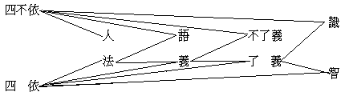
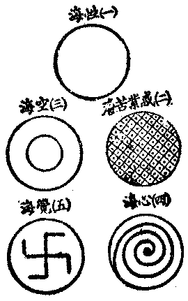
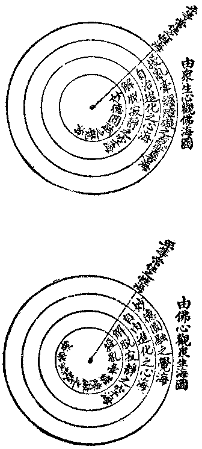

# 太虚大师全书．第十九编　文丛(第137卷-第321卷)



> **藏经**：太虚大师全书（太虚大师全书）　**册次** 第 29 册（TX29）　**编号** TX0019　**卷次** 20 卷　**篇幅** 177,026 字

> **卷／品**：0 卷 · 81 品



---



## 目录



  - [菩萨璎珞经大众受学品第七](#菩萨璎珞经大众受学品第七)

  - [菩萨优婆塞戒经受戒品第十四](#菩萨优婆塞戒经受戒品第十四)

  - [妙法莲华经吴兴法华寺重刻序](#妙法莲华经吴兴法华寺重刻序)

  - [王朔生居士写华严经序](#王朔生居士写华严经序)

  - [维摩诘经序](#维摩诘经序)

  - [维摩诘经纪闻序](#维摩诘经纪闻序)

  - [别行大般若经第七分第十六分序](#别行大般若经第七分第十六分序)

  - [能断金刚般若经释序](#能断金刚般若经释序)

  - [药师如来本愿功德经印送序](#药师如来本愿功德经印送序)

  - [药师如来本愿功德经讲记序](#药师如来本愿功德经讲记序)

  - [弥陀经性乐义味序](#弥陀经性乐义味序)

  - [重刻地藏经序](#重刻地藏经序)

  - [慈宗三要序](#慈宗三要序)

  - [慈宗要藏序](#慈宗要藏序)

  - [现观庄严论序](#现观庄严论序)

  - [慈尊五论颂合刊序](#慈尊五论颂合刊序)

  - [八识规矩颂奘注序](#八识规矩颂奘注序)

  - [菩提道次第广论序](#菩提道次第广论序)

  - [菩提道次第略论序](#菩提道次第略论序)

  - [密宗道次序](#密宗道次序)

  - [大乘起信论研究序](#大乘起信论研究序)

  - [诸佛菩萨殊胜因缘序](#诸佛菩萨殊胜因缘序)

  - [佛舍利经塔秘行钞序](#佛舍利经塔秘行钞序)

  - [美国佛教之中国佛教史观序](#美国佛教之中国佛教史观序)

  - [今日之中国佛教序](#今日之中国佛教序)

  - [略述西藏之佛教序](#略述西藏之佛教序)

  - [大乘教义序](#大乘教义序)

  - [佛教各宗大意序](#佛教各宗大意序)

  - [佛学研究丛书序](#佛学研究丛书序)

  - [嬾石禅师牧牛颂序](#嬾石禅师牧牛颂序)

  - [实用佛学辞典序](#实用佛学辞典序)

  - [佛学浅说序](#佛学浅说序)

  - [淑世宝鉴序](#淑世宝鉴序)

  - [重印入佛问答类编序](#重印入佛问答类编序)

  - [人生观的科学后序](#人生观的科学后序)

  - [新宏明集序](#新宏明集序)

  - [重纂保国寺志序](#重纂保国寺志序)

  - [雪窦小志序](#雪窦小志序)

  - [灵隐寺万年簿序](#灵隐寺万年簿序)

  - [丹徒会音寺同戒录序](#丹徒会音寺同戒录序)

  - [双溪摩诃讲园章程序](#双溪摩诃讲园章程序)

  - [汉口佛教会创始记序](#汉口佛教会创始记序)

  - [阴符经称性直解序](#阴符经称性直解序)

  - [墨子学辨序](#墨子学辨序)

  - [庄子集注序](#庄子集注序)

  - [宋版编年解题目录序](#宋版编年解题目录序)

  - [人生学序](#人生学序)

  - [慧圆居士集序](#慧圆居士集序)

  - [现代西藏序](#现代西藏序)

  - [谛闻尘影集序](#谛闻尘影集序)

  - [化声序](#化声序)

  - [唐诗禅悦集唐僧诗选合序](#唐诗禅悦集唐僧诗选合序)

  - [庚辰重九缙云登高集序](#庚辰重九缙云登高集序)

  - [安特雷朋中华国民同舟录后序](#安特雷朋中华国民同舟录后序)

  - [释慈航救国方案序](#释慈航救国方案序)

  - [中国红十字会汉口分会第(二)(三)(四)届徵信录序](#中国红十字会汉口分会第二三四届徵信录序)

  - [印赠「抵御外侮与复兴民族」序](#印赠抵御外侮与复兴民族序)

  - [缅甸面面观序](#缅甸面面观序)

  - [楞伽义记序](#楞伽义记序)

  - [能断金刚般若波罗密多经释序](#能断金刚般若波罗密多经释序)

  - [般若波罗密多心经述记序](#般若波罗密多心经述记序)

  - [药师本愿经讲记序](#药师本愿经讲记序)

  - [观弥勒上生经讲要序](#观弥勒上生经讲要序)

  - [再印四十二章经讲录序](#再印四十二章经讲录序)

  - [佛说善生经讲录序](#佛说善生经讲录序)

  - [瑜伽师地论菩萨地真实义品亲闻记序](#瑜伽师地论菩萨地真实义品亲闻记序)

  - [王普照序](#王普照序)

  - [自由史观再版序](#自由史观再版序)

  - [大乘宗地图释序](#大乘宗地图释序)

  - [大乘宗地图释后序](#大乘宗地图释后序)

  - [潮音草舍诗存序](#潮音草舍诗存序)

  - [护国言论集序](#护国言论集序)

  - [护国言论集及全缅视察录序](#护国言论集及全缅视察录序)

  - [泰县念佛社序](#泰县念佛社序)

  - [五台精舍序](#五台精舍序)

  - [大林寺募修佛殿法堂序](#大林寺募修佛殿法堂序)

  - [汉口佛教会壁铭并序](#汉口佛教会壁铭并序)

  - [玉泉祖印宗法师塔铭并序](#玉泉祖印宗法师塔铭并序)

  - [竹溪善禅师塔铭并序](#竹溪善禅师塔铭并序)

  - [常惺法师塔铭并序](#常惺法师塔铭并序)

  - [式海法师六旬寿序](#式海法师六旬寿序)



---



中华民国大藏经编纂纲领



接阅编纂大纲草案与编纂体系述意，兹且就草案论之：



编纂纲宗及内容二项所列北传大藏、南传藏经、西藏经典、东土著述，只可说明材料来源，未应用为编纂体类。盖南传、北传、小乘、大乘、原始、发展等名称，乃近代西洋史家或异教徒无意有意间使分裂而不得成为世界一体之佛教者，锡兰学者已多觉悟之；且中国大藏尤为小大俱含、南北合传，如善见律即为锡兰所传者，锡兰在法显、义净、不空等留学时代，亦大小兼具。故不应人云亦云，以北传、南传分藏。今但当编为整个之「中华民国大藏经」。断自民国四十年以前——即终止译藏经前——凡译成中国国文而可采收入藏者，不问其译自印度、锡兰、暹、日、蒙、藏、欧、美或出华文自撰，皆为「中华民国大藏经」。而进论编类相关之大类，则可分为四藏。



一、经藏：从东汉摩腾译的起直到民国四十年译止，凡佛说的经，不问其译自何文——巴利文的，西藏文的都在内——，均按部类编入经藏。编次之序，约分：



甲、三乘经——五乘经只为三乘大乘之附属——：⒈阿含部：凡属四阿含，或重出、或枝流、或新译自巴利文者，概归阿含部。⒉经集部：一切三乘经非阿含部摄，而向传为佛说之经，正法念处经等——若那先比丘等，阿育王等，虽以经名，不入经藏——，均依翻译先后，编入三乘经集部。



乙、大乘经：⒈般若部，凡属般若重出或枝流均入之。⒉法华涅槃部：凡法华、涅槃重出或枝流均属之。⒊华严部：凡重出及枝流均属之。⒋大集十藏部：十藏即地藏、虚空藏等，此为渐近密经者。⒌密经部：凡大日、金刚顶、大孔雀等各种咒经均入之。⒍宝积部：此已为古代一种大乘经集，故次於此，阿弥陀经等均属之。⒎经集部：一切大乘经不属於上六部者，均归此集。



二、律藏：从三国到民国所翻译四本广律及律论等，概编为律藏，其类次如下：



甲、五乘律：在家各部律典。



乙、三乘律：比丘比丘尼律等。



丙、大乘律：梵网及别行瑜伽戒等。



丁、密乘律：密律及密法仪轨等。



三：论藏：六朝以至民国所译自印度、锡兰、西藏、日本及中国所著各论，可入藏者，集成论藏。



甲、三乘论：阿毘昙论，发智、六足、大毘婆娑论，俱舍论、成实论等。



乙、大乘论：⒈宗经论，瑜伽师地论等。⒉释经论，大智度论等。



四、杂藏：不能收入前之三藏而可编入大藏中者，概收入之，详分：



甲、经疏：收入古近各家解经之疏或钞等。



乙、律疏：收入古近各家解律之疏或钞等。



丙、论疏：收入古近各家解论之疏或钞等。



丁、三藏摘要：一、经摘。二、经论摘。三、经律论摘。



戊、禅门语录：⒈通录，⒉专录。



己、仪轨规制。



庚、论著：别成一书而未足升入论藏者。



辛、文集：⒈通集——宏明集等，⒉专集。



上之八种，前三各别依一藏而为释者；四、总依四藏而摘采者，四十二章经亦应入此；五、六、七，各别近经律论；八、又为五六七之综合，故编次如右。



壬、导俗：语义但供导俗，非供研学。



癸、摄异：胜论十句义，中庸直指等融摄异教。



子、史传：此总摄前各部门，故居后。



丑、目录：此总全藏，⒈总录，⒉特录。



他若编例款式流通等仍之，以免纷更。



太虚，卅五，七，九。



（见觉群三卷一期）



慈宗要藏目录



一　经藏



一、佛说观弥勒菩萨上生兜率天经



二、弥勒佛法身咒印(佛说陀尼集经)



三、观上生经要及诸疏摘要



四、弥勒诸经



佛说弥勒大成佛经(罗什译)



佛说弥勒来时经(失名译)



佛说弥勒下生成佛经(义净译)



（以上皆舍利弗问同本异译六译存三）



佛说弥勒下生经——(法护译或否)



佛说弥勒下生经——(罗什译)



（此阿难问与舍利弗问稍异）



弥勒问八法经——(有异译)



弥勒所问经——(有二译)



弥勒菩萨所问本愿经



慈氏菩萨所说缘生稻芊喻经



一切智光明仙人慈心因缘不食肉经



佛说慈氏菩萨誓愿陀罗尼经



佛说慈氏菩萨陀罗尼经



五、诸经摘录



法华经普贤菩萨劝发品



心地观经——四则



大灌顶经——(礼药师亦见弥勒)



七佛所说神咒经——(文殊咒)



佛说陀罗尼集经——(大势至咒)



首楞严三昧经一



（以上诸经皆导归兜率见弥勒者）



首楞严三昧经二



佛本行经



华严经善财见弥勒章



楞严经弥勒圆通章



悲华经



十住断结经



狮子月佛本生经



贤愚因缘经



（以上诸经有关说弥勒行果者）



二　律藏



一、菩萨戒本



二、菩萨戒羯磨仪



三、菩萨戒本讲要及诸疏摘要



四、菩萨戒本旧译



五、菩萨戒诸文摘录



瑜伽菩萨地戒品



菩萨戒决择分



------



### 菩萨璎珞经大众受学品第七



梵网经十重四十八轻戒



------



### 菩萨优婆塞戒经受戒品第十四



受十善戒经



真言受菩提心戒仪及受五戒八戒文



三　论藏



一、真实义品



二、真实义决择分



三、真实义品讲要及诸疏摘录



四、宗释诸论



大乘五蕴论



三十唯识论



二谛章显名辩体门——(义林章)



唯识章出体门——(义林章)



因明学概论



八识规矩颂讲要



佛法总抉择谈



法相唯识学概论



五、诸论摘录



佛地论



发菩提心论



四　杂藏



一、弥勒佛礼赞文四首——奘译



二、慈氏菩萨略修愈誐念诵法



三、应化灵感略



四、上生嘉言略



五、宗祖史传史



宗派源流之慈宗略史



瑜伽师地论叙之慈宗略史



婆薮槃豆法师传



玄奘法师传



窥基法师传（单行本）



华译马鸣菩萨所著书述要



一



马鸣菩萨在佛教史上颇有难以论定之概，或言为佛灭后刱兴大乘第一人而龙极乃其继起者——基督教徒谓即耶稣十二使徒中之多马，而大乘佛教为基督教变成，虽附会可笑，亦因以马鸣刱兴大乘——；或言为小乘人之擅长诗歌文学者，乃参预结集迦湿弥罗三藏之五百罗汉中一人。其别传见鸠摩罗什译马鸣菩萨传，及付法藏因缘传等，大抵虽出家小乘有部，示证阿罗汉果。其实是证大乘第八地菩萨，且为颇著神通事变者，故传有前后马鸣不一。而密部中亦有金刚智所译马鸣菩萨大神力无比验法之修习仪轨。祗以其时大乘久隐，小乘犹盛，故秘其所著大乘宗论。只赞扬佛本行等缘以引发时人对於大乘之歆慕，及善不善业六道轮回等导俗增长善根；或於大乘盛行后传其所论秘本，每腾疑议，然卒莫掩精光之所蕴，而汉文系之华、韩、日佛教受其启发特深也！



二



马鸣菩萨所著书见於华译者，除去重译凡八种，兹序次於左：



大乘起信论  

梁真谛译  

一卷



大乘起信论  

唐实叉难陀译  

二卷



大宗地玄文本论  

陈真谛译  

二十卷



此中唐译起信论虽二卷而文义大同，实乃同本重译。闻玄奘时印度已无此论，曾由奘师据梁译转翻为梵文以传天竺。实叉难陀稍后玄奘三藏，或系据奘译梵本再译来华，亦未可知。而此起信与宗地二论，实为马鸣「大乘总持法门」之所存。起信弘扬最广而宗地尤富奥秘之义，惜尚鲜发挥者。对此二论虽不少疑议，而察其气息沉雄，旨趣深厚，且非龙猛、无著二大士之言所逮，除慈氏诸论莫与伦比者，设非不动地菩萨畴克臻此！



尼乾子问无我义经  

宋日称译  

不及一卷



此以经称，系录经文，然实为经释。所明大旨在空无我性，已开龙猛空宗之先河矣。



事师法五十颂  

宋日称译  

不及一卷



此为属於密续部中专明奉事师长之行轨者。观此及玄文本论，则密咒乘亦萌芽於马鸣菩萨者欤？



佛所行赞经  

北凉昙无谶译  

五卷



大庄严论经  

后秦鸠摩罗什译  

十五卷



佛所行赞，为咏叹释尊一代行迹之一首史诗。由此於印度有以马鸣为大诗人者，译笔亦颇畅润，最好能教少年沙弥常讽诵之，则对於佛陀油然自生信心矣！另有宋凉州沙门释宝云译佛本行经，与此文义同而稍有增广，然称系金刚力士答诸天问说，或为马鸣改作所依之原料欤！大庄严论，则采集佛本行、佛夙生菩萨行及佛弟子行等，以丰丽松爽之笔调，作为种种故事叙陈，兼贤愚因缘、百喻、杂譬喻等众长；而又译自意译之圣鸠摩罗什，设能分篇列题，加以标点，皆朗然可讽诵之绝妙小品或笔记文学。而辩理论事，增养生信，其为用亦滋广，较之选读他种文学引发邪想者，殆有天渊之别。



十不善业道经  

宋日称译  

不及一卷



六趣轮回经  

宋日称译  

一卷



佛说六道伽陀经  

宋法天译  

一卷



佛说六道伽陀为六趣轮回之同本重译，并为五言颂句，乃马鸣菩萨摄经义为偈颂以便讽宣者。十善业道则为简释十不善业经义，结云此十不善业道是地狱因，翻此而修十善业道，则於恶趣永不堕落。则此明善不善业为六趣因，六趣即明十善不善之报，明此世间业报因果，即为总括施论戒论生天之论诸导俗兴善教化。



三



综上华译马鸣菩萨书八种，初三是明大乘根本义者，其中又以前二为总持宗，后一为空性宗；次三是明大乘方便行者，其中又以前一为陀罗尼门，后一为波罗密门，次二是明世间业报以劝善惩恶者。依此辑为马鸣菩萨丛书，亦於本末体用兼赅之矣。兹摄制一表如下：



　　　　　　　　　　　　　　┌大总持义………┐  

　　　　　　　　　　┌根本义┤　　　　　　　：  

　　　　　　　　　　│　　　└空无我义……┐：  

　　　　　　┌出世法┤　　　　　　　　　　：：  

　　　　　　│　　　│　　　　　　　　　　：└…┌陀罗尼行  

　　　　佛法┤　　　└方便行──────────┤  

　　　　　　│　　　　　　　　　　　　　　└……└波密罗行  

　　　　　　└世间法────────────────────善恶业报



（见海刊十九卷二期）



华译提婆菩萨所著书述要



一



提婆菩萨或译题圣天菩萨，盖提婆译天，圣天犹云圣者提婆，乃对此菩萨之尊称也。其本生事迹，见鸠摩罗什所译提婆菩萨传，又付法藏因缘传等；然无不公认为龙猛弟子，故其年代当与圣龙猛同时而稍后。亦有当时与龙猛并化一方为「印度四日之一」说，实为继承及发扬龙猛大乘佛法之嫡裔。中华三论宗或四论宗，既以其百论视同龙猛中观诸论一味；西藏於龙猛，提婆亦以圣父子称，并崇无所轩轾。俊才奇智，折伏其时印度诸外道，至戕害其身以泄忿，洵佛教史上为摧破邪执，昌明正法而牺牲之第一先烈，能使吾人感奋无穷者也。



二



华文大藏中题为提婆或圣天所造论，凡七种，而菩萨本生鬘论则与圣勇等共同集成，兹叙次如下：



百论  

(提婆菩萨造　婆薮开士释)  

姚秦鸠摩罗什译  

二卷



此论於夹注有「修妒路」之句，即为本颂。唯因出什师意译，故句法长短非一，殆与释论呵成一气。释论师婆薮开士，古传即天亲，然亦有谓天亲较后罗什，不应罗什已传译天亲之释。然题鸠摩罗什译之发提菩提心论，亦天亲造，又将何说？故以天亲较前於罗什为宜。但以婆薮名者，印度原甚多，例婆薮仙人等，则说此释论造者为另一婆薮开士，亦非绝不可能也。此译糅合本释，义趣超奇，文笔雄健，使读之者法味资神，倍增逸兴，宜三论师每多讲诵。余昔在武昌亦曾为佛学院生讲之。



广百论本  

圣天菩萨造  

唐三藏玄奘译  

一卷



此提婆百论本颂，至奘师乃照原文直译，字义精深，非对读百论及广百论释论，不易解了。



大乘广百论释论  

(圣天菩萨造　护法菩萨释)  

唐三藏玄奘译  

十卷



此即广百论本之释论，护法论师造此释，颇会通中观、唯识二宗义，然亦犹安慧论师之中观论释，或不为清辨以来之后期中观论师所尊重。闻藏传有月称论师之广百论释论，中间对护法此释论有驳辩处，然西藏亦未传有此释论也。中国虽传，惜鲜研究阐扬者。



百字论  

提婆菩萨造  

后魏菩提流支译  

一卷



此论以一异有无诸义破诸外论，为约广百论义之略论，殆如约中论义为略说之十二门论。然论中有「如智境见一切法空，识无所取故，心识灭，种子灭」。又云：「世谛法皆如梦，梦非实有，又非是无，亦非无因」等句，近唯识论义。或系根本唯识论师，约百论颂义推演所造。以根本中百论师——龙树提婆於唯识义明法空，本不违拒而可容纳；根本唯识论师——无著，世亲别详缘起而辨三性，从唯识观入法空，故提婆亦可原有此论也。



破外道小乘四宗论  

提婆菩萨造  

菩提流支译  

不足一卷



破外道小乘涅槃论  

提婆菩萨造  

同上  

同上



此二论皆有「提婆菩萨破楞伽经中」为题，但皆未明引经文，盖亦宗经义以破当时所流行之外论耳。题中虽兼及小乘，然论文中祗破外道而已。其破法破义亦仍不出百论之枝流餘绪，唯四宗论并列僧佉、卫世师、尼犍子、若提子四派；涅槃论详列外道所说涅槃有二十种：一者、小乘外道论师，二者、方论师，三者、风论师，四者、韦陀论师，五者、伊赊那论师，六者、裸形外道论师，七者、卫世师论师，八者、苦行论师，九者、女人眷属论师，十者、行苦行论师，十一者、净眼论师，十二者、摩陀罗论师，十三者、尼犍子论师，十四者、僧佉论师，十五者、摩醯首罗论师，十六者、无因论师，十七者、时论师，十八者、服水论师，十九者、口力论师，二十者、本生安荼论师，颇可为观察提婆菩萨生在印度时代之学术流派的参考。



大丈夫论  

提婆菩萨造  

北凉沙门道泰译  

二卷



此论从行布施说至发大悲愿，可作为一种劝发菩提心论读，亦可作有实践菩萨所行之表现，而提婆菩萨舍身为法，亦即能实修於此大丈夫行者也。论云：『唯能作福，无智无悲名为丈夫；有福有智名善丈夫，若修福修智修悲，名大丈夫』。即以修集福智具大悲愿者名为大丈夫也。应多讲习，救诸佛弟子贪著清闲怠惰为高之弊。



菩萨本生鬘论  

圣勇圣天等造  

宋绍德等译  

十六卷



此论前四卷，乃集录释尊过去世行菩萨道舍身饲虎等因缘，及佛住世时教化事迹而成。唯第五卷起，段落不明，而有「菩萨施行庄严尊者护国本生义边十一」，至十六卷尽，有「菩萨施行庄严尊者护国本生义边第三十四，是谓菩萨修行胜利」之句。似与前四卷不相连续，乃另一专说「菩萨施行庄严尊者护国本生义边」。第一至三十四之论，前第一至第十遗失，乃将舍身饲虎等因缘录成前四卷耶。且从第五卷起，大意为赞修菩萨行，辞句牵连，义趣空泛，借题圣天等名，似与提婆菩萨无何关系！



三



总观华译提婆菩萨所著书，除菩萨本生鬘论可不计入外，其百论、大乘广百论释，则为婆薮与护法之广百论颂释论；百字论与破外道小乘四宗论、涅槃论，亦为百论枝义。故核之，唯广百论本及大丈夫论之二种耳。然广百论本穷般若智境，大丈夫论满菩提心行，则於智慧方便亦皆具足无餘矣。故从前六论以修慧，后一论以修福，即堪为悲智双运之菩萨，成福慧两足之世尊！



（见海刊十九卷五期）



佛教纪元论



——二十一年六月在南京作——



佛教纪元，有从释尊降生为始，有从释尊入灭为始者。然决定以释尊之降生为起始，当不难得全体之赞同，无何困碍。而所难者，则释尊降生与入灭之确在何年，不惟未有定论，且异说纷歧，竟有六十餘种之多，上下相距离有至一千餘年者。致虽决以释尊降生之年为纪元之始，仍无从以纪之也。



华文系佛教徒众，若中国、日本、朝鲜、安南等所传行者，为周昭甲寅降生，周穆壬申入灭之说，此吾国於民二、民十二、曾大作佛生二九四〇、二九五〇之纪念者也。今转瞬民二十二年又到，然稍留心於佛史者，对於唐法琳法师等所主张之佛生周昭甲寅之说，已多有怀疑之者；民二十二其仍作佛诞二九六〇之纪念大会耶？抑因怀疑而将改从他说以作耶？顷为期已近，不可不先有以论定之。况乎佛教之纪元，亦为齐一佛教徒观感之一要事，不应忽置者哉！



今考佛生於周昭甲寅之说，约定俗成，原不应轻有移易；惟是有违於史实者过多，殆不易强遵矣！而遍观其他异说，亦绝无完全之信史，而比较可依者，厥为下列之两系：



　　　　　　　┌西　藏　所　传┐　　　　　┌六┐  

　　　　第一系┤锡　兰　所　传├西纪前六二┤四├年  

　　　　　　　└佛陀伽耶碑一　┘　　　　　└三┘  

　　　　　　　　　　　　　　　　　　　（依吕澂改）  

　　　　　　　┌众　圣　点　记┐　　　　┌六六┐  

　　　　　　　│（佛碑二）　　│　　　　│　　│  

　　　　第二系┤缅　甸　所　传├西纪前五┤六一├年  

　　　　　　　└善　　见　　律┘　　　　└五九┘



此二说粗观之，价值相等，而且近来考究印度史之西洋学者，多与第二系之年代密迩，且以众圣点记为华文系所传之最有物质凭据者，故日本及中国之佛学界，近来大抵已采用第二系之众圣点记，定佛灭为西纪前四八六年，即民国前二三九七年；佛生为西纪前五六五年，即民国前二四七六年。在今年，即为「佛教纪元二四九七年」也。



然除去西洋近人之说，专就此二系之说之本身考之，则殊觉第一系之价值高出於第二系之上。加以关於华文翻译史之旁证，多与第二系说冲突，而采用第一系说则可得符顺。故在中国、日本等，皆应采用笫一系说。且采用第一系说，则与锡兰及西藏之佛教纪元皆可一致，尤易成为世界统一之佛教纪元。故今再将第一系说之确实性申言之。



第一系中佛陀伽耶碑一，可与第二系中之缅甸所传佛陀伽耶碑二之价值相等，然众圣点记及善见律毘婆娑之二说，虽为印度直接传来中国者，然不及锡兰史与西藏史之确实，以此所传之二律，均系小乘二十部中之昙无德部与有部之律，既系分裂后之律，其传说每出於此部分立之后，故难真确。而锡兰为印度外佛教早流传之地，自阿育王弟摩哂陀传入之后，二千餘年，相承无中断，且少变化，故其所传说最可凭信。加以印度第三五百年后期之佛教，完全传在西藏，而西藏史所传佛年，又祗与锡兰所差二年，弥可凭信。况第一系之三说，西藏史与锡兰史差二年，锡兰史与佛碑一又祗差一年，三说甚为密迩，较之第二系之三说，众圣点记为五六六，善见婆娑为五五九，相差有七年之远；致众圣点记之说，殆成孤立。亦足徵第一系说较第二系说为确也。



况依吕澂依第二系众圣点记所说制年表，援引之史实，则世亲之皈入大乘，已在刘宋之初，较鸠摩罗什在姚秦译经，且后一二十年，如此，则吉藏等所传罗什译之百论释即出世亲者，岂不冲突！纵云释百论之婆薮非世亲，证以梁天监六年来华之菩提流支，译金刚仙论之末尾上有谓：「然弥勒世尊但作长行释，论主天亲，既从无障碍——即无著——比丘边学得，转教金刚仙论师等，此金刚仙转教无尽意，无尽意复转教圣济，圣济转教菩提流支，迭相传据，以至於今，殆二百年许未曾断绝」。梁天监六年，逆推上二百年亦应在西晋之末，而世亲年辈应较早於鸠摩罗什。且依吕表则陈那著论之年代，应后於真谛之来华，而真谛译有陈那之论，殆为不可争之事实。凡此、中国翻译史上之事实，若依第二系说在在冲突，而改依第一系说，推前约六十年，则窒碍皆可免除。此依中国翻译史实为旁证，可徵第一系说之尤为确矣。



今世界现存之佛教，仅锡兰、中国、西藏之三系。中国既无可依之说，而西藏、锡兰说又极相近，若华文系之中国及日本等佛教徒众，皆采取第一系说为纪元，则世界之佛教纪元非即可定於一乎？



然第一系中又何以专采用锡兰之说乎？一、以锡兰之佛教为最早最稳定之佛教，其史传最可凭信。二、以锡兰说在西藏说与佛碑一说之间，最为折衷，因独取之。故今於佛历纪元，应大书特书曰：「中华民国二十一年，佛教历二五五六年」。并应於佛历二五六〇年之佛诞日——即民国二十五年，在中国或锡兰，召开一世界佛教徒大会，而以议定万国佛教纪元之统一为第一事。



佛历二五五六、六、二十、在南京。



（见海刊十三卷八期）



震旦佛教衰落之原因论



——民国三年作——



一　化成



二　政轭



三　戒弛



四　儒溷



五　义丧



六　流窳



震旦佛教，非始於汉明，周穆王时既有之。穆天子传洎列子，皆称西极有化人来；详所纪神变言辩，盖是大阿罗汉、大自在菩萨之流。老子西涉流沙，曰：吾将从师古皇先生游。孔子动容对商大宰曰：西方有大圣人。庄子叙女偊，有圣人之道。庄、列皆谈生死流转义，列子又有毁訾杀噉禽兽文，莫不概乎有所闻者也。游於华严法界，则之数子者，亦善财所参知识耳。要之、释尊声教之及震旦者，当在佛寂百年后、印度无忧王布教之时。由东印度至北印度，经卫、藏诸国，转辗而至。偶有一二人，若康僧会之行道吴野，唯体道如老聃，博闻如孔丘，始获间逢而默识；凡俗者，则非所知也。穆王时，则圣者化现偶露端倪而已。始皇帝时，有室利防等十八西域人来传佛之教，轭於虐政，遯去。此事尤与僧会师相似，且必尝繙有经典。故刘向校经，称往往见有佛经。其序列仙传，又称已有七十三人曾读佛经。所云佛经，当是修禅法要等经，故得近於神仙，即东汉时所出佛经，亦皆禅法居多，此其证也。然古今皆称震旦佛教始於汉明永平七年者，则以帝王崇信，三宝初具，既显著乎一时，后世因之流传昌大，不复断绝耳。但从汉平以暨唐武宗之世，其流变虽繁，要皆日趋於隆盛。今欲原其衰落之因，则当托始於李唐末叶。夫履霜而坚冰至，其由来者渐矣！兹试论之。



一　化成



有为世相无常住者，生异灭三，有则俱有，乃不可逃避之大例也。不观夫园植乎？始焉勾萌坼甲，勃然怒生；逮乎葱郁华茂，则萧寥之象，旋踵而至。夫园植则小者、近者耳，然天下事之大者、远者可推知矣。迹出乎履，化形乎道，故圣人履道而不拘化迹。然吾人就其化迹而察之，则化之大成，固即渐衰之始也。佛教化被震旦，历一汉、两晋、以讫陈、隋，所谓勾萌坼甲勃然怒生之期也；由隋以讫会昌大难之前，所谓葱郁华茂之期也；又后、则萧寥之象继之矣。故震旦佛教化成乎隋唐，唐季以来，不宁无所增益，即能传述者，亦难乎其人！然化成乎隋唐有徵乎？太虚曰：有。



一、徵繙译：繙译佛书，虽宋、元犹有之，然检之龙藏，殆无百分之一；且其所译，初无讲诵者。而隋、唐诸师译出者，则占译本十之五六，除姚秦罗什三藏、元魏流支三藏所译者外，其文理密察、道俗宏通者，亦皆出於隋唐之时。而天竺大小乘经未至者犹夥；厥后亦非无交相往来於两土者，译经之业遂绝，亦以玄奘、不空诸师，光辉盛烈，来者难继耳。



二、徵宗法：陈、隋之前，都未能笼罩全藏，黜陟升降，成立一家之宗法。道安、慧远二师，稍稍能条理经论，然译笔既拙，又未能备，得其一门而自修则可，豁然贯通则未能。罗什三藏始卓然有所树立，亦祗中、百、成实而已；华严、法相、涅槃诸部，既未全备，何能集其大成乎！故嘉祥师讲三论，又迥不同前也。其后或讲涅槃，或讲摄论，或讲地论，规规於一经一论而名其宗；要之、未能囊括无遗者。至陈、隋间，天台大师起，契悟既大，经教亦富，乃能抉择华严、般若、法华、涅槃诸大部，尽破斥前师之封蔽，成立一家之发观；然当时义学大盛，讲习互诤，未获一致焉。故玄奘三藏，慨旧译讹谬，无从取决，欲穷其根源而整理之，其学殖益闳肆深密；虽未能尽出所归梵本，而所出者义例精严，皆能驾轶前古，故慈恩师得其少分，已足成立一家之宗法。清凉师尤为后起，既专华严，复遍学於慈恩、天台、曹溪诸宗，建一极而破摄餘宗。天台禅师，时宗未盛，故不论及；清凉师则禅宗亦收於顿教矣。不空师之成真言宗，空海继之，殆与清凉师同时。真言则不仅教义而进於神秘者也，然亦不废教义，其以十门拣别凡愚小大，虽华严亦未臻圆极，故足专人敬信。南山宣律师，尝游奘公之门，彼时律师虽有三家，无出其右者。律贵行持，而又为出家部众之本，诸宗共重，因得并存。然义净三藏谓天竺诸部戒条简明易持，中国则科而又科，释而又释，终身治之，犹难娴悉，亦足徵彼时讲律之细密，不亚今时世俗法律学之牛毛茧丝已。盖天台后大乘师，非究贯全藏，遍善诸宗，破餘立一，厘然允当，决不足独辟蹊径，成一新宗，故慈恩、南山立八门，真言、清凉立十门，辨别拣择綦严也。若曹溪、净土二宗，则以教、律、神秘大兴之下，学者伥伥乎穷於探索，反博为约，进之修证，而示以归宿，平实简易，足当应病之药。故善导、曹溪持佛悟心之门，不唯大盛於唐，至今日犹为佛教大国，教、律、密无力与抗也。震旦古称十三宗，实则地论归於华严，摄论归於唯识，而涅槃虽不同法华部，天台之后亦鲜专治者，故实祗大乘八宗为止。所述小乘二宗，曰俱舍、曰成实。之十宗者，则皆全成隋、唐之世者也。后代唯曹溪、净土二宗，颇能恢扩，小乘二宗全绝，其餘时浮时沉，欲复故观，已属难得！宋、明来宏楞严者最多，然或依文解义，或傍禅教诸宗注释，无能自树。要之、唐季以来诸师，但依旧辙而已。盖以诸宗祖师建立者，精微广大，更难超胜；且经论繁多，莫能尽致，虽有怀疑，无敢深求，所以末由别开生面；然佛教於以替矣！



三、徵竞论：考唐代之前，共缁衣竞者，皆黄冠者流，崔皓、傅奕虽为太史令，亦黄冠也。儒者则依违二者，间为排解调和，多党佛者。若何承天、范缜等诤离形之神灭不灭义，此非佛教要义也。唐后、则仅宋徽宗有惑於黄冠林灵素之事，其他若韩、欧、程、朱之争，则儒与佛竞之大者。儒教宗孔，孔所述、皆先王成法，盖震旦旧来沿习之礼制。佛教、道教，皆方外摄，不希执政临民之权，故与儒者无竞。隋、唐之间，经智者、玄奘、贤首、善导、不空、慧忠诸大师，震大法雷，雨大法雨，化洽朝野，道涒中外，颇有移风易俗之势，将令震旦之成俗国习一变，夺儒者所守，儒乃岌岌自危，起与佛竞，此亦因佛化旁魄充斥乎震旦故也。竞於方内，则不得因循世俗，随顺国习；真理胜义，反不若世论常文之事省而功多，故教体於是乎寖卑！略徵三事，足见佛化莫盛乎隋、唐。盛则成，成则老，老则衰，削痟顉趛，寖衰寖微，遂寖有今日。替极而转盛，窃有望於来兹，未敢必耳！



二　政轭



震旦佛教厄於政权者，传称三武一宗。然魏武、周武，皆偏据一方，此蹶彼踊，非能芟灭。且佛典翻译讲习未备，诸宗皆在后起，故为祸不烈。徽宗仅改佛教名称形制同道教，未尝灭佛也。独唐武宇内统一，佛教全盛，彼时荡灭虽未及二载，旋即兴复，而不久继於五代之乱，教典失逸，徒众遁散，精神、形式，丧亡极矣！唐末以讫五代，革命如梭，律众教部无依归，实唯禅宗诸师，水边、树下，延佛一线慧命，其后诸宗之复起，一皆赖之。而教典之散逸者，或於五代时，或於南北宋时。或於今时渐次由高丽、曰本还归，或迄今犹未还归。或未尝流入日本、高丽竟遗失不传者，徵之开元释教录，亦累累皆是。然亦有於元季之乱而逸者，若法相宗诸部等。此则震旦佛教关於政变而衰落者也。



三　戒弛



天竺大乘，律无定相，大略同於梵网，开遮持犯，则又随其当时之大师，转移轻重。其出家大士，依声闻众住，仅随顺声闻各部之定制耳。在家者，更无论也。盖大乘之士，智证为首，服戒持法，非所殷重。小乘则戒律为首，其分部别居，多半起於戒律上之争执。故二十部，部部有各别之戒本，细分之则有五百部律，然壹以优波离所集、大迦叶所传戒本为共主，故部部皆原本於佛制也。震旦译此者，祗天竺二十部中之四部；而隋、唐来盛弘者，则唯天竺昙无德部之四分律；唐代砺、宣、素三家，皆属此部，而后代以宣律师为正宗，以其行相备足，大小通和，实集声闻、菩萨律藏之大成也。然戒律之起，本起於教徒及世俗之交涉，除波罗夷、僧残之外，或避世俗嫌疑，或因时地风习，佛随事增制，本难一定。如天竺五月至九月为雨时，不便行乞，故制安居之条；天竺出家道人，向习乞食，故制关於乞食游行时诸戒；震旦俗尚，风习既异，势难一一照行。且在天竺，因其风俗习惯而节文之，故一览便知，简明易持；此土俗习迥殊，译义隐略，又不得不科分段析而讲之，记疏纷繁，学者益昧，虽终身学戒，犹难详悉，禅、教、密、净诸宗皆苦之；然唐代之前，莫不依律寺而住也。逮曹溪之风大行，禅者疏放，不便律居，且格於习俗难行乞食，山中林下，信施莫恃，必须力耕火种，自食其力；於是百丈倡制禅宗清规，不居律寺，禅众所依，名曰禅寺，讲宗、净宗效之，则曰讲寺、净寺。宋、元时，曹溪之裔，欲张其宗，坏律居为禅寺，尤汲汲焉。由是律学废弛，律义沉晦！有谨谨持律者，即以定共、道共嗤之。其受戒者，不过练习形仪，奉行故事而已。范众者，转在各寺之清规。其不依众住者，益摇荡恣睢为高，律条之威用失，则徒侣鲜摄齐庄敬严肃者，而贻讥世俗寖多矣！明季诸大师深忧之，若云栖、灵峰二师，皆勤修戒学，为学徒勉力，矫宋、元禅侣之弊，恢复律居，严重持受。灵峰师尤痛诋当时禅众恣放，誓返佛律之本；然矫枉过半，不胜积习，其效果盖鲜矣。后有明哲者起，庶几斟酌佛律国俗之间，酌定善制，使佛律国俗并行不悖，起佛教之衰，无重大於此者也。教理无论如何高尚，茍律仪不备，终莫免徒众涣散，世人憎嫌。而今则犹赖丛林清规，淘汰名字比丘之俗气，藩篱僧伽，足徵百丈因地制宜之巧，禅宗亦托之弥畅也！



四　儒溷



宋、元、明诸儒，非孔、非佛、非老，亦孔、亦佛、亦老。何以非孔？以其偏取孔教之少分，而遗其多分也。何以亦佛、亦老？以其亦取佛与老之少分也。何以非佛非老？以其趋功利，希政权，重荣名也。何以亦孔？以其尊孔圣，入孔庙，口仁义，谈纲常也。割孔、佛、老之少分义理，嫥嫥以训讲论、孟、学、庸，肩孔、孟为旗帜，内距左、荀，外排佛、老，嚣嚣然谓承千百年既绝之道统。然竞为华辞，则又泛滥於迁、韩之奇文，江、鲍之骈辞，及汉、唐各体诗歌，而五经传记、先秦诸子反委弃尘埃矣！其於佛书，祗窥禅家之语录，则以彼时诸宗销歇，唯禅风大行，可代表佛教也。夫禅宗不立文教，祗贵智证，其流传之片言只语，本非实法，都无经界。儒者依语寻义，玩弄於光影门头，迷惘失情之状，殊可嗤笑！妄肆批评曰：其语近理乱真，其语大谬非法，阴受之而阳拒之，卒之拒非所拒，受非所受，颠倒溷乱，诬众欺愚而已！彼时禅宗虽盛，兼善自他教义、娴於破立者，亦鲜其人。且儒者粗暴，往往凭恃政权，蛮行逆施，禅德但欲柔服潜化，故亦不能简别而挥斥之。初唐之先，学者共知儒为治世之宗，佛为出世之教，儒为方内之行，佛为方外之道，儒为刑政之本，佛为心性之统，各安其是，不相伐害，庐山、圭峰诸师，区别綦严，约定俗成，从不许凌乱也。自夫宋儒，始窃佛家性理归儒，仗儒家伦理拒佛，效为聚徒说法，效为建宗传道，效为语录、效为苦行，逐功名，徇利禄，守妻子，甘醴豢，则复以伦常自卫，於是儒佛交困，儒佛交敝。然亦未始非教律丧失，僧侣空疏，不学无术，但诵偈语，荡然於名守义闲所致耳！



五　义丧



道安师而后，义学渐盛。隋唐间诸师集厥大成，建立教宗，擅长门学，皆行解相应，禅慧双运，从无住本，张声教纲。即达摩、慧可、道信、嬾融、宏忍诸师专提向上者，亦皆善宏楞伽、涅槃、般若、金刚诸部，不废讲说；曹溪则尤精而兼之者也。但曹溪、神秀，同出五祖而有南北宗之分；道听之流，乃谓曹溪目不识丁，扫除教义。殊不知自证圣智，绝言思故，文字相离，故唯贵悟；若其出世为人，固未尝不三藏十二分教，波涌云兴乎口颊也。文殊院师谓：「既到这里来，祗与本分草料，经有经师，论有论师，又争怪得老僧」！则正以盛唐之后，教律蔚兴，但接闻思资粮圆满者，令入三摩地，得自受用三昧，故单唱宗旨耳。若夹山、德山之辈，则其选也。此固达摩西来之正旨，抑亦诸宗大师之极诣。从闻思修，入三摩地，寂灭现前，忽然超越，楞严既明言之矣。然自唐武宗灭法，教典荡失，义学尽绝，禅宗诸师，殷懃采集，若天台韶师，永明寿师，长水璇师等，教家皆凭之复兴，心殊苦矣！孰谓禅宗一向废斥教义哉？当义学盛时，难普贤瓶泻，文殊钵化，正不妨趁向白牯黧奴队去。苟学绝世暗，虽释迦犹须哆哆啝啝现下劣相，亦曰时节因缘为之而已。寒山、懒残、玄奘、道宣，亦何异之有？昔某显者欲从某禅师剃染，禅师曰：以公淡泊，可得沙门，但犹须培植福智资粮，多从经教闻熏，此道则未能遽相应矣。后世不知此意，於教律扫地之日，尚一味教人废学绝思，是欲生龙蛇於枯井浅草，栽莲花於焦土石田也，岂可得乎？况闲邪简妄，俾魔外无从溷滥，而向众生无明有爱田中，暗布般若种子，生之、熟之，渐与法界清净等流相接，尤不可阙略者哉？考之震旦佛教教义，实衰歇於会昌之难，宋代诸师才成中兴之业，而经历宋季、元代、初明之数百年，善知识专务死坐，斥教诃律，谓曰向上；小乘二宗，无人讲习固矣，即三论、法相、天台、贤首诸宗，奥义微旨，亦极沉晦。然晚明之世，儒者讲学大盛，佛教亦并时兴起，教有雪浪、交光、云栖、幽溪、明昱诸师，禅有紫柏、憨山、博山、永觉、三峰诸师，复有周海门、袁中郎、曾凤仪、钱牧斋诸居士，皆宗说两通，道观双流，各就所得著书立说，法运之盛，唐以来未有也。逮灵峰蕅益师，尤在后起，所托既高，契悟深远，生平勤於著作，其说深入显出，明白精审，凡一百餘种，灿然成一家言；禅、教、律、净、密，无不赅括，教义宜可复唐代之盛矣！然非天资绝特，不能承传其全，其门弟敏行者多而博学者少，故临没叹曰：「名字位中真佛眼，不知今后付何人」！其道今虽盛宏，依文解义，执其一端。而嗣经国变，清代诸帝皆重喇嘛、旁及禅宗，雍正尤喜专提向上，稍涉经教者，若觉范、紫柏、憨山、三峰等，皆被诃摈，云栖、蕅益亦在所议，故义学之风，又为斩绝。此后，除替人诵忏者外，但以老实坐香念佛为高耳！



然雍正实有契佛教、期大振兴之者，以欲禁绝儒者之讲学，故兼恶僧徒之交游士大夫耳。且其发愿，於十年中专心治国，十年后则专宏佛教。其诃禅者但攻文字经教，不真参实悟，亦是宗家正旨，特偏於一门，未见佛法之全耳。然观其撮录涅槃等经、僧肇等论，整理龙藏，序赞佛祖，使得永其位，不遽殂落，则由宗通而说通，其提倡者固有待哉？惜乎早夭，而佛教竟未受其益，且愈害之矣！高宗则阴恶佛徒，至逼死世宗所尊显者，亦由彼时僧德卑陋，鲜能自贵，逐逐於帝王之荣辱，遂成此恶果。高宗后、则禅宗亦敝，丛林但依样葫芦而已！可称述者，江浙间三四道场，清规谨严，衲子尤能食苦甘淡泊焉耳。



六　流窳



佛教在今日，其衰落斯极矣！无他可述矣！但有末流之窳习矣！可略别为四流：一、清高流：颇能不慕利誉，清白行业，或依深山，或依丛林，或以静室，或修净土，或览经论，或习禅定，但既无善知识开示，散漫昏暗者多，明达专精者少，优游度日，但希清闲，此流则所谓凤毛麟角，已属最难得者矣。二、坐香流：自长老、班首、职事、清众，群居三二百人，讲究威仪，练磨苦行，但能死坐五六载，经得敲骂，略知丛林规矩者，便称老参，由职事而班首，由班首而长老，即是一生希望。其下者，则趁逐粥饭而已。三、讲经流：此流则学为讲经法师者也，其徒众与坐香流无甚别，师家则授以天台四教仪、贤首五教仪、相宗八要——此数书亦无人兼善者——，使由之能略通楞严、法华、弥陀疏钞三四种，在讲座上能照古人注解背讲不谬者，便可称法师矣。下者、则或听记经中一二则因缘，向人夸述而已。四、忏燄流：则学习歌唱，拍击鼓钹，代人拜忏诵经，放燄设斋，创种种名色，裨贩佛法，效同俳优，贪图利养者也。元代天台宗沙门志磐，作佛祖统纪，已谓「真言宗徒，流於歌呗」，则其由来久矣。然在彼时，但真言宗徒耳。禅、教、律、净宗徒，鄙夷之曰应赴僧，今则殆为出家者流之专业，人人皆是矣。



右四流，摄近世佛教徒略尽。而前之三流，其众寡不逮后之一流之什一；而除第一流外，餘之三流，人虽高下，真伪犹有辨，其积财利、争家业，藉佛教为方便，而以资生为鹄的则一也。而第四之流，其弊恶腐败，尚有非余所忍言者。此四流之外，尚有一种守产业者，美衣丰食，一无所事，亦不受戒，亦不读经，凡佛教中事，一切不知，或能粗知文字书畫，与俗士游，则光头秃顶，虽居塔庙，不与佛教徒数者也。顷十数年来，感於世变，鹜趋於世俗学艺、世俗善业者，寖见繁盛。以本不知佛教学，故多有拾人𨱎石而弃己衣珠者，将谓佛法在彼而不在此，则又新起之一流也！孔子曰：「饱食终日，游谈无艺，不有博奕者乎」？则此流虽非佛教之真，亦稍贤於一无所事者已。然斯盖乡妇街士所优为，何待於至真、至善、至高之佛教徒哉！



（见海刊二卷三期）



三十年来之中国佛教



——二十六年作——



一



距今三十年——光绪三十四年——，金陵刻经处杨仁山居士，得锡兰摩诃菩提会会长达磨波罗居士来书，约共同复兴印度之佛教，以为传布佛教於全球之基本。杨居士因就刻经处设立祗洹精舍，招集缁素青年十餘人，研究佛学及汉文，兼习英文以为进探梵文、巴利文之依据。后虽以经费支绌，不二年即停止；然摩诃菩提会则仍继续进行，近年已有释迦牟尼佛初转法轮之鹿野苑设立国际佛教大学，并设分会於哥仑布、加尔各答、伦敦、纽约诸地，由法理性海氏继达磨波罗后，迄今扩充未已。且参预祗洹精舍诸缁素，若欧阳渐、梅光羲、释仁山、智光等，多为现今佛教中重要分子，而笔者亦其中之一人也。



先是、杨居士曾随使节出赴英、日广交各国佛学人士，与曾译汉文大藏经目成英文之日人南条文雄，交尤莫逆。后居金陵，专事刻印流通佛经，乃从日本搜回我隋、唐古德多数遗著弘布之，故为当时国内外佛学界所宗奉。英人李提摩太，亦尝就居土以大乘起信论译英。稍后，上海哈同夫人以乌目山僧宗仰之引导，就日本弘教书院藏经排印发行。至民十二，商务印书馆有日本所编续藏之影印。民二十，朱庆澜、叶恭绰、释范成等又影印碛砂版宋藏。而合金陵、扬州、常州、北平、天津各刻经处所刻木板经典既渐臻完备，新式之佛学书局亦分设於各大都市。以藏文佛典译汉文者，则有汉藏教理院法尊及菩提学会汤住心等；以汉文佛典译英文者，则有黄茂林、吕碧城等。此为三十年来中国佛教文献翻译传播於国内外之概况。



二



中国在三十年前，因感外侮有变政兴学之举，所办新学新政往往占用寺宇，拨取寺产，激起僧众反抗，由联日僧以保护引起外交；乃有使僧界自动兴学，自护寺产，另立僧教育会之明令。浙江之寄禅、松风、华山，江苏之月霞，北京之觉先等，南北呼应，为当时组设僧教育会而办学堂之僧领袖。笔者亦适於距今三十年之秋，随寄禅长老参预宁波及江苏各僧教育会之成立。时所办学堂，大抵为国民小学一所及僧徒小学一所，例如普陀僧教育会在定海县治立国民小学曰慈云，今犹续办，并於普陀立僧小学曰化雨，初由华山及笔者相继主持，延续至民二十，改为普陀佛学苑，不二年停止。然江苏僧教育会独在南京开办一所僧师范学校，月霞、谛闲等相续主持，约经二年，至辛亥革命军达到南京而停办。此於后来所办之僧教育，亦稍有关系。



入民国后，由寄禅长老领导全国僧教育改组成中华佛教总会於上海。寄老虽因护教於民元示寂北京，而此会则民二已於各省县设支分会三四百起，实为中国佛教团体有全国系统组织之始。在南京临时政府初成立，笔者与释仁山等先於南京及镇江，有佛教协进会之设，以教理、僧制、寺产三种革命为号召，曾引起极强烈之保守与改进的斗争，后因寄老及亚髡之调解，协进会自动解散，共同加入於中华佛教总会，由笔者任佛教月报编辑，从此中国佛教会乃并含一种改革僧寺制度之因素。盖自僧教育会演变之佛教会，初不过为护持寺产而已。逮民四、中华佛教总会为袁政府颁布管理寺庙条例所取销，北京觉先等虽断断续续先后反对，至民九、曾将条例一度修改，民十四、笔者且曾发起中国佛教联合会之组织，亦散漫未著效力；故此十餘年间，遂又为全国僧寺无有系统组织之时代。



民十五、六间，社会起大变动，河南省等有毁灭僧寺之案，全国僧寺岌岌危殆。至十七年，在庙产兴学呼声下，有内政部新订管理寺庙条例公布，颇能激起全国寺僧保护寺产之热情。时笔者在南京筹设中国佛学会，开办僧众训练班，并定次年召开全国佛教徒会议。上海另有江、浙佛教联合会之设，亦提出整理僧伽方案。然改革或整理僧寺，为笔者民初首先启发之运动，民四著整理僧伽制度论，曾订详细之办法，后於海潮音月刊等亦屡有关於改善僧制、寺制之论述。至民十七、八间，遂颇有成熟之势。故民十八组中国佛教会及分设各省县佛教会，以成全国系统之组织，笔者於其时一二年间实主持之。迨管理寺庙条例改成监督寺庙条例后，寺产渐有保障，而佛教会又为保守分子占优势，虽於逐渐改进之办法亦难施行，笔者因於民二十后不再参加中国佛教会。但民十六后，於海潮音、佛教评论、现代僧伽、现代佛教各刊物上，时有新兴作者著论攻击保守而鼓吹改进，渐能影响一部分党政当局。且因中国佛教会办理不当，为各省会控告反对，乃於民二十五由中央民众训练部，忽有对於僧寺积极组织及整理之「修正中国佛教会章程草案」提出，主张改进者赞成鼓吹或讨论研究，极形热烈；而保守之中国佛教会主持者，则大起恐慌，极力阻止破坏，一时形成极尖锐之对立斗争，卒致修正草案流产，迄今仍陷於不生不死情状。要之、如有寺院僧尼之存在，即为代表佛教之主体，若不能适合此时此地之社会需要以发扬佛教精神，即失其存在之意义！於此如不谋改善，必归淘汰，而现今中国之寺制僧制，必待整理，乃堪表扬佛教，否则、反为使人误解佛教之魔障，殆已为佛教徒非佛教徒之有识人士所公认。而代表佛教之僧寺，未能赶上现代国家社会之建设，则僧徒顽固者实莫辞其咎！



三



祗洹精舍虽居士所设，而就学者比丘为多，故为高等僧教育之嚆矢。与之相先后者，则有依日人水野梅晓在长沙所设之僧师范学堂，亚髡在扬州天宁寺所设之普通僧学堂，及江苏僧教育会在南京所设之僧师范学堂，然皆不久停办。民三、有月霞法师依上海哈同花园所设之华严大学，转辗迁移杭州海潮、常熟兴福，得持松等继承，复有了尘、慈舟等分枝武汉，在僧中颇形成为一学派。稍迟、有谛闲法师在宁波所设之观宗学舍，今演变为观宗寺弘法研究社，及分为高邮之天台宗学院，及天台之国清寺研究社等，亦在僧中形成为一学派。



至民十一、笔者在武昌以李开侁等之援助，设立佛学院，遂於僧教育开一新局面。不惟影响於青年僧甚大，且於学术、文化及政治、社会各方面，均有相当影响。迄今演续为世界佛学苑图书馆及研究院，则由法舫等代主持；而直属分设者，尚有法尊代主持之汉藏教理院。其仿设者，若常惺於厦门之闽南佛学院，民十六后、曾由笔者与芝峰、会觉、大醒、寄尘等持续之；他若大醒、心道於福州之鼓山佛学院，大醒、寄尘於潮州之岭东佛学院，寄尘、容虚於九华山之江南佛学院，慈航於安庆之迎江佛学院，常惺、台源、法舫、容也、量源在北平之柏林寺、法源寺、拈花寺学院，慕西、净严之河南佛学苑，宽融之普陀佛学苑，妙阔在陕西之慈恩学院，昌圆、广文之四川佛学院，永昌之贵州佛学院，静严之焦山佛学院，大醒在江北之觉津学院，谈玄在奉化之雪窦学寺，芝峰、亦幻在宁波之白湖讲舍等；或昙花一现，或独在持续，皆出於佛学院直接间接之关系。其他若竹林佛学院、玉山佛学院、法界学院、光孝学院、栖霞学院，北平之弘慈学院，湖南之祝圣学院各僧教育机关，均有以上各学院之学僧参预施教，然各学院迄今未能有一系统之学制，而世界佛学苑亦尚无使佛学世界化之效能，殊可遗憾！



关於女众教育，则有武昌之佛学女众院，及尼恒宝主办之菩提精舍，汉口尼德融主办之八敬学院；而女居士尤以创立香港东莲觉苑之张莲觉，主办奉化法昌学院之张圣慧，主持无锡佛学会过圣严为杰出。



四



在昔虽亦有在寺院宣讲经论之法师，而听众限於僧徒或少数善信男女，鲜能影响学界及一般社会人士者。迨杨仁山居士在金陵设佛学研究会，而章太炎等邀月霞法师赴日本为留学生讲经，蒯若木等在北平邀道阶法师讲研佛学，实开学界、政界之学佛风气。入民初、李证刚等七人筹设佛教会，发布文告，欲一举而灭寺僧，代以居士佛教，旋以遭反对而自停止。时有狄楚卿等在沪出佛学丛报，范古农等亦於杭嘉设会研究佛学。至民国四年，因日本要求来中国传布佛教，北京政局中人发起请谛闲、月霞二法师，开讲经会，影响渐广。民七、笔者与蒋作宾、陈元白、章太炎、张季直等在沪设觉社，公开演讲佛学，并出觉社季刊——后改为海潮音月刊——；自是汉口、北京、杭州、武昌、广州各地，时有公开之讲经法会；由各界学佛居士为主体所组成之佛学会、佛学社、佛教正信会、佛教居士林等团体渐多。若靳云鹏领导天津居士林，胡瑞霖领导华北居士林，皆负时望；而以谢健、梅光羲等之南京中国佛学会，为有全国性质之组织。



在家学佛团体之有特殊性质者，一、为南京欧阳竟无、吕秋逸等之支那内学院，虽亦有学僧出入其中，然於僧教育无何影响，而学界颇有由之研究唯识，讲佛学於各大学者。二、为北平韩德清、徐森玉等之三时学会，专讲奘、基学并设办医院等。三、为上海段芝泉、汤住心等之菩提学会，则以西藏佛教为中心，从事翻译，亦兼作弘化慈善之事。其他更有专修密宗各团体、专修净土各团体等，不遑枚举。



各居士团体除研究修持弘布佛法，更能举办诸事业，则以王一亭居士等之上海居士林，办佛学书局及佛教公墓，香港东莲觉苑亦办佛教公墓，上海净业社叶恭绰居士等办法宝图书馆，武汉正信会李子宽、鍾益亭居士等资助男女佛学苑及广施医药，而正信会之周刊，佛学书局之半月刊，沙巿居士林之佛海灯，天津解行佛学社之佛教月报，星洲转道学院之佛教与佛学，厦门市佛学会之人间觉半月刊，香港东莲觉苑佛学会曾办人海灯、香海月刊，菩提学会接办微妙声月刊；而上海之佛教日报，虽由佛教各方面缁素同人共所维持，然继续至今，实以张静江、朱子桥、邓慧载、胡厚甫、范古农各居士之力为较多。



各大学於文学院哲学系中列印度哲学而讲佛学，应始於北京大学之张克诚、邓伯诚、梁漱溟等，今有熊十力、周叔迦等尚在讲授；他若笔者及唐大圆、张化声、陈维东等，曾讲於中华大学；李证纲、景昌极等，讲於东北及中央大学；刘洙源、王恩洋曾讲於成都大学，其他各大学之短期讲授者尚多。



五



中国佛教，近年渐从「寺僧佛教」解放成「社会各阶层民众佛教」，新兴居士及青年学僧，极易吸收各方输入之异质。关乎佛教者，有探古源於锡兰、西藏，而趋现势於日本、西洋之两方向，今有极端学西藏而欲一举易华夏之旧者。而近年留学锡兰、暹罗、缅甸之风气亦在开展，尤其日本继承中国旧有之全部，其探源锡兰、西藏亦占先著，而以国家社会皆已现代西洋化，故对於西洋之佛教新研究思想，尤能充分领用，随明治维新而成为适应新日本之新佛教，在在皆足引起中国佛徒之亦步亦趋。



日本於明治维新之初，佛教寺僧亦曾受摧残打击。未几、因有不少日僧留学西洋，极力将佛教适应现代思想。又先於数百年前，已有通俗化之净土真宗为榜样，且其寺僧除极少数律宗僧，其他各宗僧本不受比丘戒，故明治政令皆使姓氏饮食男女同俗，所谓僧侣——僧侣非比丘——唯在有佛教学识及依佛教为职业，不关特殊律仪及修养，此日本现代佛教，植根三十年前，而三十年来则正为收其成果之时代。例如佛教所立大学有六所之多，各宗皆成严密系统之组织，有宗务院以执行宗派行政，在编印大藏经及续藏又续藏后，大正年间又编印成大正新修一切经，又有译汉文佛经成日文之国译大藏经，更将锡兰巴利文南传大藏中未经汉译者补译成日文，其他专门中等以下之教育及社会慈善公益之发达，更不待言。



然日本佛教至近年已由发展之极而入於烂熟时代，因适应「工业革命所成资本主义社会」以兴起之佛教，亦必随资本主义之病态而现其病态，故中国佛教之革新，不能专以仿从日本佛教为能事。应本实际之中国佛教，吸收东西古今一切特长，以成为中国的或世界的现在到将来之新佛教。



六



佛教虽源出印度，而印度早无佛教。然印度初五百年者，可徵之锡、缅、暹罗所传；次五百年者，可徵之中华、日本所传；后五百年者，可徵之藏、蒙等处所传。原有之佛教限於亚洲此三区域，而近百年，则已渐及欧、美而遍达寰球，尤其是在三十年来或欧战后传播极其迅速。以英国殖民地若印度、锡兰等关系，及英文与梵文、巴利文、藏文较易通译关系，首由巴利文、次及梵文、藏文将佛典译成英文，输入欧洲，依梵文或间接依英文转译为德文、法文、意文者亦多，梵文佛学尤以德国之研究为盛，而锡兰僧徒今有居伦敦、巴黎、柏林、纽约以传佛教者。佛教在美洲东部由英国传入，接近锡兰佛教，而西部太平洋沿海，若加里福尼亚州之旧金山各处及夏威夷岛等，皆为日本佛教传布之地带，然日本佛教除美洲西部一带，於欧美其餘各处无何影响。



西洋因与中国之文字隔膜太甚，且中国或西洋学者又大抵习儒道诸家学说，鲜有佛教研究，故佛经由华文以译入西洋欧、美者，绝无仅有，所有亦远出由巴、梵、藏文转译者之下，因此，欧、美人皆不重视中国佛教之研究。然中国佛教近年渐为欧、美佛学者或佛教徒之所崇重，一、由笔者於民十七、八间之游历欧、美，宣传佛教，当时曾在巴黎发起世界佛学苑及设通讯处於巴黎、伦敦、福朗福特、芝加哥诸处，并与德国福朗福特中国文化学院院长卫礼贤，有大规模译华文佛典为德英文之约，惜因筹款无著及卫礼贤之病逝，未能有成。然在巴黎所刱设之佛友会，犹继续著与伦敦亨佛利士主持之佛学会，同为欧洲佛教较广阔之组织。二、由照空来华出家受比丘戒，返欧大事宣传，率男女徒众十二人再来中国受戒为僧尼，其半数已回欧洲宣传中国佛教。三、由杭州邵福宸等佛化欧美推行社，及上海胡厚甫等法明学会，颇与在中国及在各地之欧、美佛徒相联络而通声气。



七



关於世界的或国际的佛教徒联合会议，始於民十三、由笔者在庐山大林寺之召开第一次世界佛教联合会，到会者除中国外，有日本及英、德等佛教徒代表，当决议次年在日本开东亚佛教大会。届期，中国去三十名之代表，开会三日后，游历日本各地，受其佛教徒盛大之招待。其时，到会者更有锡兰、暹罗、缅甸代表及英、美来宾。近年由日本主持所开者，有太平洋佛教青年会，在夏威夷岛及东京各处举行会议，中国佛徒因其有伪满参加，未派代表出席。



民二四，由中国受戒回欧洲之德僧照空等，曾在伦敦召开欧洲各国佛教徒会议，因决议去年仍在伦敦开第一次国际佛教会议，吾国未有代表参加。本年於巴黎开二次国际佛教会议前，笔者因得通知，遂以中国佛学会理事长名义，推我国驻巴黎总领事林实代表出席。顷得皈依弟子巴黎佛友会会长龙舒贝勒来函报告，兹录入以为兹题之结束：



第二次国际佛教会议，因有亚洲代表之出席，获益特多。中国、锡兰、日本等国之代表，曾将该国等佛教工作状况，向大会报告。同时，法、英、德等国，宣示彼等社会中佛教工作之中心思想，需要与鼓励。



巴黎佛友会，为太虚法师与其信徒舒龙贝勒女士等所刱设，应请诸君记念勿忘。



依据太虚法师来函，本会请林君代表中国出席。林君报告中有云：「中国国民革命成功，言论思想已获得自由，故研究佛学之活动兴盛，如戴季陶、张静江、朱庆澜诸氏，现皆为佛教之信徒」。



於最后一次会议，林君提议设立中央基金，以资助佛学之研究。此种基金拟由佛教国捐助而成，专用於：一、交换学生，二、刊印佛学书籍，三、交换讲师。请将此意转达中国民众，或足增进世界和平。再者，巴黎大学教授等之参加，对於本会亦增光不少云。



（见海刊二十一卷一期）



我的佛教革命失败史



偶然的关系，我与许多种的革命人物思想接近了，遂於佛教燃起了革命热情，在辛亥革命的侠情朝气中，提出了教理（那时叫学理）革命，僧制（那时叫组织）革命，寺产（那时叫财产）革命的口号——这三句口号，曾为当时佛学丛报所批驳，我又作「敢问佛学丛报」的反驳——；与若干曾受新教育的僧青年为中心，设立了佛教协进会。我虽为理论的启导，而在镇江金山寺等处的实行者，则另有一群。因实际的行动太轻率散乱了，未几招来巨大的反击，即归夭折。然我的佛教革命名声，从此被传开，受著人们的或尊敬、或惊惧、或厌恶、或怜惜。



后来退藏潜修了几年，对於教理，作了佛法导论，又批评了教育、哲学、进化论、一神教、周易、墨子、荀子等，成为「从佛教中心，以采择古今东西学术文化而顺应现代思想的新佛教」。对於僧制寺产，作了整理僧伽制度论，成为「从中国汉族的佛教本位，而适合时代需要的新佛教」。民七，偶然得若干信从者，遂组觉社，以著书讲学的又一姿态出现；创办佛学院，将以养成「僧教育师范人才」。僧教育则在训练一般僧众，改革僧制寺制而建立新佛教。然第二步未能顺序进行，故亦终无第三步的效果。



民十五六七的大革命激变中，全国寺僧普遍摇动，佛徒都发生了整理僧寺的醒觉，又偶然导设了中国佛教会，欲将所有僧寺组织起来，训练僧众逐渐的改善制度，演进为适应时代的佛教。不几年，乃因旧僧制寺制渐安定而失却组织佛教会的原意。去年、忽然为中央党部民众训练部注意到，订了一个「修正中国佛教会章程草案」，硬要牵我与「近年把持佛教会而作改进障碍的人」，携手改革僧寺，卒亦失败。



我的失败，固然也由於反对方面障碍力的深广，而本身的弱点，大抵因为我理论有餘而实行不足，启导虽巧而统率无能，故遇到实行便统率不住了。然我终自信我的理论和启导确有特长，如得实行和统率力充足的人，必可建立适应现代中国之佛教的学理和制度。



我失败弱点的由来，出於个人的性情气质固多，而由境遇使然亦非少。例如第一期以偶然而燃起了佛教革命热情，第二期以偶然而开了讲学办学的风气，第三期以偶然而组织主导过中国佛教会，大抵皆出於偶然幸致，未经过熟谋深虑，劳力苦行，所以往往出於随缘应付的态度，轻易散漫，不能坚牢强毅，抱持固执。



我现今虽仍尽力於所志所行，然早衰的身心只可随缘消旧业，再不能有何新贡献。后起的人应知我的弱点及弱点的由来而自矫自勉，勿徒盼望我而苛责我，则我对於佛教的理论和启导，或犹不失其相当作用，以我的失败为来者的成功之母。



（见宇宙风）



佛学院院董会略史



一、十一年春间，太虚讲圆觉经於汉阳归元寺，集听者有武汉荆宜各居士，述及今欲弘法利生，应设佛学院，广培师范人才；草佛学院缘起及订佛学院章程，得李隐尘、王森甫、胡子笏、汤铸新、皮剑农、陈元白、萧止因、熊云程、萧觉天、赵子中、孙自平、王韵香，及长沙正信会周可均等三十餘人，每年任经费四百元，自认为创办人。四月初，觅得黎君少屏住宅，可让为院址，遂於四月八日在汉口佛教会(即今正信会)具隆仪礼请太虚为院长。



二、院址既定，四月中旬由创办人於院内先立筹备处，李隐尘为处长，皮剑农为会计，赵南山等为庶务，王幼农(即后出家名大刚者)等为文牍。彼时由创办人须年捐四百元，故王幼农等但办事员而非创办人。而太虚所聘来之智信监院，董理修造工务。同时由创办人以章程呈请湖北军民长官及内教两部备案。发布招生通告，定於七月中旬开学。



三、七月初，由筹备处长邀集创办人至院报告，撤销筹备处，照章成立院董会。原创办人皆改称院董。适武昌中华大学请梁任公及太虚等作暑期讲演，梁公至院，欢喜加入，遂由各院董推为第一期院董长，辞之不获；委托陈元白代理之。并推李隐尘为院护，协护一切。而太虚亦聘教职员等按照预期，於七月十六在院开学。(初印章程及二年回顾等待寻检)



四、十一年至十四年，院董多从年捐四百元而继续加入者。以任公期满，改推汤铸新为院董长。院生亦於第一期毕业后，续办第二期。迨十五年秋围城后，院中员生星散，院屋十九为军占，仅由大敬、法舫等数人住守餘屋，院董会亦无形停顿。至十八年，太虚欧美游归，议就院中设世界佛学苑研究部，遂由原院董王森甫、赵子中、熊云程、萧觉天等议院董年捐为二百元或一百元，徵得鍾益亭、王达五、罗奉僧、李子宽加入院董，遂再成立新院董会，推王森甫为院董长，及李子宽为院护。



五、由院员院护院董等历往交涉，至二十一年夏，院中驻军全部迁去，乃议就院中原有图书及将太虚藏书与暹罗、日本捐藏等，成立世苑图书馆，而集研究员於中研究。秋初开馆，各院董俱集，王森甫遂辞院董长，而推新加入之方院董为长。近年陆续有黄文植、王述曾、贺衡夫、陈经畬、刘觉生、张振远、萧怀先、张功九等加入院董。图书之赠购，院舍之修理，馆员之研究，乃日有起色！



（海刊十五卷九期）



我的佛教改进运动略史



——二十九年七月在汉藏教理院暑期训𦈌班讲——



第一期



甲　思想的来源



乙　进行的前奏



丙　运动的实施



第二期



甲　理论的集成



乙　运动的复活



丙　学院的创建



第三期



甲　世苑的创设



乙　教会的演变



丙　僧制的新议



第四期



甲　旧会的整理



乙　大学的改建



丙　新制的开制



我对於佛教三十多年来改进运动的经过，可从好几方面去观察，而以关於僧众寺院制度在理论上和事实上的改进为最重要。在民国十六、七年间，全国都充满了国民革命的朝气，我们僧众也有起来作佛教革命行动的。当时我对之有篇训辞，内中有几句话，可作我改进佛教略史的提纲：「中国向来代表佛教的僧寺，应革除以前在帝制环境中所养成流传下来的染习，建设原本释迦佛遗教，且适合现时中国环境的新佛教」！我历来的主张，是要在寺院僧众制度的改进上做起；这几句扼要的提示，可以把我三十多年来佛教改革的宗旨都说明了。至於我改进佛教的经过，可以分作四个时期来讲：



第一期



甲　思想的来源



我改进佛教的第一个时期，是从十九岁至二十六岁的七年间——光绪三十四年至民国三年。在民国十六年曾作有告徒众书，内中曾提到我这个时期思想来源的概论：



余在民国纪元前四年起，受康有为大同书，谭嗣同仁学，严复天演论、群学肆言、孙中山、章太炎民报，及章之告佛子书、告白衣书，梁启超新民丛报之佛教与群治关系，又吴稚晖、张继等在巴黎所出新世纪上托尔斯泰、克鲁泡特金之学说等各种影响，及本其得於禅与般若、天台之佛学，尝有一期作激昂之佛教革新运动。



在光绪三十四年以前，我那时专门在佛学及古书上用功夫：或作禅宗的参究，或於天台教义及大藏经论的研讨。后来受了中西新思想的熏习，把从前得於禅宗般若的领悟，和天台宗等教义的理解，适应这个时代思潮，而建立了我改进佛教的思想。其实、从当时佛教环境趋势上说来，也不得不发生这种思想。因为在光绪的庚子年后，有所谓变法维新的新政，国家对於一切都实行改革，尤以办学校为急进；教育当局往往藉经费无出为名，不特占庙宇作校址，且有提僧产充经费的举动。这种占僧寺、提僧产、逐僧人的趋势，曾为一般教育家热烈地进行著；故当时章太炎先生有告佛子书之作，一方面叫僧众们认清时代，快些起来自己办学；一方面劝告士大夫们，不应该有这种不当的妄举，应该对佛教加以发扬。



乙　进行的前奏



当时国人去日本留学的很多——因觉得日本经过明治维新以后，已成为一个强国，所以值得我们去就近学习——，而日人到中国来的也不少。日本盛行的真宗和曹洞宗底布教师也跟著来华了，故有曹洞宗的水野梅晓，在长沙与湖南僧界长老办僧师范学校；而扬州天宁寺文希办普通僧学校，亦因此而起。我国僧众因受了国家社会对佛教摧残，和日僧来华传教影响，便起了依赖日僧保护寺产的心愿；日人眼见我国佛教受摧残，也就效法西洋耶稣教来华传教的办法，引诱中国的僧寺受其保护，故杭州就有三十多寺投入了日本真宗的怀抱。那时、日本真宗来华代表为伊籐贤道。杭州各寺在真宗保护之下，如遇提僧产、占僧寺等情，就由日本领事出面保护。因了这些瓜葛而闹出很大风潮，连地方长官如浙江巡抚也不敢作主判断，把这种情形呈报中央政府——那时应该说是入奏皇上——。结果、一方面向日本交涉，把投入真宗的事情取消；一方面由政府下诏保护佛教，并令僧众自办教育，故有僧教育会的产生。於是全国各省各县，纷起组织教育会，与普通教育会成了对立的形势。



僧教育会组织的性质，一方面是办幼年僧徒小学，培育僧众的人材；一方面是办普通小学，以补助国民教育。但大都是各省各县各自为政的设立，谈不上有系统的组织。僧教育会的组织成功，虽然是由各寺院长老的联合，但僧教育会的会长却有两个：一是当地德高望重的出家长老，一是地方上有名望而热心教育的绅士，而绅士也不一定是佛教的信徒。这是受政府明令所成的教育组织，又有绅士在中协助，故能与当地的官厅发生密切的联系。经费由各寺院分担，如有不愿捐款或不送幼僧入学的行为，得由政府差人催索或强迫入学。这些僧教育会，组织健全，办理完善的固然是有，但徒拥虚名，实际由绅士主持，或随新潮流趋向，失却佛教立场的亦不少；甚或俗化成饮酒、吃肉、聚赌等违反僧制的腐败勾当。这种组织不健全，办理不完善的僧教育会，和当地非佛教徒的乡绅会长，任用私人操纵会务以图中饱分肥，有著莫大的关系。我在当时也曾参加过几处的僧教育会。



宁波在八指头陀——寄禅老和尚领导之下，在光绪三十四年也把僧教育会组织起来，该会管辖的范围包括宁波府——除定海县——所属各县。在光绪末年，我因为上来所说种种关系，也就热心参加这种活动。入冬、在江苏有个比较有系统的省僧教育会的组织，在镇江金山寺开成立会，八指头陀与我代表宁波去列席参加。江苏因为有全省组织的缘故，力量比较雄厚，除各县办有僧徒和民众小学外，并筹办全省僧师范学校。同年、南京杨仁山居士就金陵刻经处创办祗洹精舍，该舍与锡兰达磨波罗居士取得密切的联系，同抱有复兴印度佛教的意志，欲使佛教传到各国去。我因参加江苏僧教育会底关系，听到有这种作世界佛教运动的组织，於是次年也到南京去加入。该舍的主要科为国文、佛学、英文。祗洹精舍只有一年的历史，因经济不继而停办。初办的上半年我未参加，我是第二期才进去的。我在祗洹精舍的时候，已有普陀山定海县教育会的成立，该会办有：在定海县城的慈云小学——国民小学，至今尚存；在普陀山上纯沙弥的化雨小学，下半年因华山法师辞职，遂请我去当佛学教员。这就是我参加僧教育会、佛教学校、祗洹精舍的经过。



宣统二年，我二十一岁，广东新辟一家丛林，有创办全省僧教会的建议。有人来请我去相助办理，於是我就去广州。后来、因为该寺的主持者是外省人，与当地僧众语言和风俗习惯种种隔膜的关系，结果没有组织成功。在广东时，我曾专门作宣传佛学的工作，引起一般社会知名之士，对佛学研究的兴趣，如中山大学校长——中委邹海滨（鲁）先生，曾经替我翻译；因此在广州组织佛学精舍，如现在纯为研究佛学的佛学会一样的组织，并与当地的官绅及学界、报界结了不少文字缘，遂开广东研究佛学的风气；下半年，被推为那个新开丛林的住持。我在广东住了一年多，广东是革命的策源地，当时遂多与革命党人往来；后来因了富有历史意义的黄花岗事件，清廷严拿革命党人，我也受其影响，结束了广东的佛教事业，回到上海。



在那个时候，我对於佛教改进的思想，就是要怎样根据佛教的真理，适应现代的国家和社会，使衰颓的佛教复兴起来。由於此种思想的影响，随著中国维新和革命趋势，与革命党人自然而然的接近，在思想上也受了社会主义、三民主义很大的影响，这是我在广东所经过的大概情形。



我由广东回到上海、浙江，正是清廷预备立宪的时期，各地佛教寺产，多发生被占提以办自治事业的风潮。江苏和浙江等省的僧徒，在上海召开联合会议，推举八指头陀入京请愿：请政府保护寺产，并呈递振兴佛教计划书。该书是由我和上海神州日报主笔汪德渊先生起草的，筹备到八月间，适革命发动，遂未果举行。



丙　运动的实施



革命进展得很快，辛亥年末，就进占江、浙；不久，孙中山先生回南京就临时大总统职，宣布废除农历改用阳历，於元旦成立中华民国。南京政府成立后，佛教徒曾分头发起组织各种事业，如李政纲、欧阳竟无等人发起组织佛教会，佛教会上并无中国或某省等范围，曾拟有章程，主张政教分离，呈请总统承认，得到总统表示赞同的覆函。同时、谢无量亦发起组织佛教大同会。我在辛亥之冬的民国元年，也到了南京，发起组织佛教协进会，在毗卢寺设立筹备处。当时僧师范学校学生领袖仁山法师，也是我在祗洹精舍时的同学，因欲以镇江金山寺办学校，亦来京请愿。我遇见仁山法师后，对他这种举动，认为只是应办的一件事业；我就把我的佛教协进会向他说明，希望他参加发起。他很乐意地接受我的意见，并主张会所虽设南京，成立大会则在金山寺举行。我们就积极地草了宣言和章程；我曾请了一位广东朋友介绍，谒见了临时总统——那时的政府是很平民化的，每日规定了时间，会见民众，接纳民意——，我报告佛教协进会的计划，孙总统指定马君武先生和我接谈。这佛教协进会，就是我对改进佛教具体的实际的表现。



先时，我既接受了仁山法师底意见，就履行佛教协进会成立会在金山寺举行的诺言，到金山寺上仁山法师剃度的观音阁，进行筹备开会的工作。在开会前，有反对的，也有赞成的。会中主要的人物，除了我同去数人之外，就是仁山领导的僧师范同学们——他们从前在僧师范学校时，曾与扬、镇诸山长老发生过很大的磨擦——。金山的僧众，虽不愿意此会在寺内举行，惟处於当时革命浓厚的气氛中，亦无可如何，唯有暗中勾结诸山长老，作非公开的抵抗。开会时，到有会员和各界代表诸山长老约六七百人。我以和平态度报告筹备之经过，并宣读通过章程。接著，仁山法师就作了一番演说。当时即有扬州的寂山和尚起立，拿出长老的资格，以老和尚训诲小和尚的态度，对这位新进的仁山法师，加以严厉的驳斥。由此引起了血气方刚的僧师范同学们底剧烈反抗，全场空气极度紧张，从唇枪舌剑式的辩战，几演成「全武行」的惨剧。幸得赴会各界代表底排解和制止，把章程上负责的人提出通过后，草草散会。



会期终结后，我仍回南京策划全国会务的进行。仁山法师和同学们，仍留金山，依照会中计划，在寺内划出一部分房子来作会所及开办学校，积极进行。讵料在辛亥十二月二十外，金山寺暗中进行破坏的工作成熟，由库房、客堂的职事为领导，率著三四十个工役，在半夜里打进了佛教协进会会所；人少的僧师范同学，大半受了伤，仁山法师就是受重伤的一个。这场风波闹得不算小，监院、知客、副寺和许多工役都被法院逮捕拘押。我事前毫无所闻，后来在报章上看到这种消息，佛教协进会受了这个打击，无形中陷於停顿了。



我对於佛教协进会所定的章程及宣言，虽极和平，然有一次演说，曾对佛教提出了三种革命：一、教理的革命；二、教制的革命；三、教产的革命。第一、关於教理的革命，当时的佛学丛报曾加反对。我认为今后佛教应多注意现生的问题，不应专向死后的问题上探讨。过去佛教曾被帝王以鬼神祸福作愚民的工具，今后则应该用为研究宇宙人生真相以指导世界人类向上发达而进步。总之、佛教的教理，是应该有适合现阶段思潮底新形态，不能执死方以医变症。第二、是关於佛教的组织，尤其是僧制应须改善。第三、是关於佛教的寺院财产，要使成为十方僧众公有——十方僧物，打破剃派、法派继承遗产的私有私占恶习，以为供养有德长老，培育青年僧材，及兴办佛教各种教务之用。这些主张，在章程上都没有明显规定，但实含有此种趋向，可待时议决施行，惜该会不久即遽行夭折！



经过金山风潮后，江、浙诸山长老於上海发起组织中华佛教总会，由八指头陀商量将佛教协进会并入中华佛教总会，因此中华佛教总会成了全国统一的佛教最高机关，辖有省支会二十多个，县分会四百多个，佛教会、大同会等组织亦自行解散。总会办有佛教月报，由我负责主编。元年冬天，八指头陀为保护寺产入北京请愿，事未竟而圆寂，会长由冶开挂名，静波、应乾等办事不力，佛教月报仅出至四期便即停刊。佛教总会於民国三年被静波改为中华佛教会，自任会长，会务无形陷於停顿。我於佛教月报停刊，早不预闻会务。到民三欧战起后，遂至普陀闭关，我的佛教改进运动，在此暂告一段落。至民四，由预备帝制自为的袁世凯公布内务部所制寺庙管理条例三十一条，明令取销了佛教会，全国便没有佛教改进运动可言。



第二期



甲　理论的集成



我的佛教改进运动的第二个时期，是从民国三年至十七年间——二十六岁至四十一岁。民国三年秋起，在普陀闭关的三年中，一方面著重在个人身心——戒定慧——的修养工夫，同时对於律藏和小乘的经论，大乘曼殊、龙树的一系经论，弥勒、天亲一系的经论，以及台、贤、净、密、禅诸部，都一一作有系统的研究。我国固有的诸子百家底学说，和从西洋译来的新文化，亦时加浏览。由此种身心学术的修养而感发出来的思想，便演成了当时的各种著述。



从民国三年至六年间，把我从前研究佛法的基础，更扩大而深造了。过去我仅於禅宗、般若及天台教理深有领悟，贤首、慈恩稍有涉猎；这时我却把唯识、三论精刻研究，在整个的大藏典籍中，对大小乘各宗加以比较和综合。我经过这番钻研的工夫后，所构成佛学整个体系思想，就和从前逈然不同了。



民国五年，我著有首楞严经摄论，佛学导言，这可以说是对於佛教大小乘的教义，有个大体的判定。中国原有的十三宗，我把其中的小乘成实和俱舍归附於大乘，并并合涅槃、摄论、地论总为大乘八宗。在八宗的教理和历史，作分别的综合研究之后，在佛学的基本的宗旨上，一方面看到各宗的殊胜方便，一方面看到各宗都是究竟平等。对於中西古今的学术，亦多有说明，如著有古学的周易及荀、墨诸论，今学的破神执、订天演、辨严译与教育新见、哲学正观各篇。



为欲根据教理、教史以树立佛教改进运动的理论，我又著「僧伽制度论」和较简略的「人乘正法论」。僧伽制度论是对出家僧伽的集团生活，加以严密的修整，使其适应时势所宜，成为合理化的现代组织；建立真正住持佛教的僧团。这论所拟的整理计划，全是根据原有住持三宝的僧律仪演绎出来的，可以说是现代僧伽的规律。因为、佛在世时制定的比丘律等，就是僧伽制度；故古代丛林创设的清规，也从佛陀所制的规律沿革而来，不过因为风尚俗习不同的关系，古德根据佛陀制律的根本原则，另创适应当时当地环境需要的规矩。佛教从印度传至锡兰、缅甸等地，因锡兰与印境毘连的原故，直至现在，尚多分保守佛陀原始所制的律仪；惟传至西藏、中国、日本等地，就因气候风俗等环境全然差异，佛制的律仪——除了根本——和僧伽生活的方式，不得不随著而改变。由此可以证明佛教律仪每因其所流传的地域而迁易，如中国的隋、唐间，僧伽律仪就演变到丛林和小庙的僧制，这也是说明当时须要这样的僧团，方能住持当时的佛教。但这种制度，是只适宜於中国帝制时代的，一入民国，即不能不有所更改。



在整理僧伽制度论中，并附有佛教正信会的纲要。僧伽制度的整理，是在改组出家佛徒；而正信会纲要，是在组织在家佛徒。这纲要的提示，为依著人乘正法的理论去实行，目的是使在家佛徒对佛法由真正的理解，而起正确的信仰——对三宝起清净的信德，明因果业报，实行五戒十善。这不仅应用於个人，而且应用於家庭乃至社会国家之间，建立人与人间的道德能力，以这道德能力改造社会国家——，构成佛化的伦理、政治、经济的新社会。这就是以极普遍极广泛的人群为对象，依著大乘菩萨精神的组织——佛教正信会。



佛教在中国历史上，曾有不少的演变。自从隋、唐一度的隆盛后，宋、元以降，渐渐就消沉下去；至清朝末年，更是佛教最衰颓的时期，也就是佛教兴亡的一个重要关节。这也是由於国家政治底变革，致形成这种情况。辛亥革命成功，中国既成立了共和立宪的国家，僧伽制度也不得不依据佛制加以适时的改变，使成为今此中国社会需要的佛教僧寺，这就是我作僧伽制度论的动机。在僧伽制度论，我一方面想对在家佛徒作个极普泛的大联系，一方面致力於提高僧伽地位，这是我在当时对於佛教改进运动所发生的理论。关於住持佛教僧伽，要经过一个严格的长期训练，养成高尚、优美、完善的德学，以佛法为修学实习的中心；旁参以近代的思想学说，准备作宏扬佛法的僧伽，真正代表佛教的精神去救世救人。而住持僧的数量不必多，但求质的提高，然亦以为无减少当时僧数的必要；我的计划是要全国的僧众，每个都真正有住持佛教的资格。正信会是以摄化在家信众为目的，重在将佛法普遍深入民间，使全世界的人类，都变为佛陀的信徒。这和僧团组织大不相同，僧团是住持佛法，这是专为佛教普及人类。我国古来的佛教制度，全以出家人为代表，在家佛徒没有独立组织，要实行佛法即须出家，在家是不能的；而且素有学佛要待年老和摆脱家庭环境的思想，故在家众没有离开出家众的制度。我觉得这是一种错误，故有在家与出家分别组织的制度；出家佛徒要提高其僧格和地位，能真正住持弘扬佛法，使人们崇仰为导师；在家佛徒则使其由研究信解佛法的学理，行为则以社会道德为基本，实行五戒十善之人间道德，改良社会、政治、文化、教育、风俗、习惯。这种平易近人的道德规律，最易於实行和普及人间，使人人都可以学佛，都可以做一个佛教徒。当时我对於改进佛教制度，有这样理论建立，我虽在闭关的时期没有作其他的活动，却集成了我对於改进佛教的理论。



民国六年出关后，下半年有人请我到台湾讲学，我顺便往日本考察佛教，大概一个多月。所到的地方，只有神户、大阪、和京都——京都是日本的西京，明治维新前的京城——，虽然没有去到新都的东京，但佛教的中心仍在西京，故考察的结果，觉得日本佛教很多与我的僧伽制度论吻合之处。日本佛教各宗都有一个严密系统的组织，一宗有一宗的宗务院，管理全宗的行政；寺院分成大小等级，某种事应该是某种人去办理，都能「人尽其材」去分配工作。各宗同样办有佛教教育，小学、中学是普通的，大学则专属某宗，是某宗所办；社会的文化慈善等事业，皆有多方活动。这些都和我的僧伽制度论所拟的计划不谋而合。



但日本虽有各宗系统严密的组织，而没有全国佛教最高的整个管辖机关。那时有一个佛教联合会，可是在草创时期，且有几个专尊自宗的宗寺反对参加。因为、日本佛教是各宗各自为政的，故力量分布在各宗的身上，形成了宗派的信仰，没有整个佛教的信仰可言。关於分宗，各宗有各宗的宗寺等，我在僧伽制度论中亦有论及，但我主张有行教院和持教院及佛法僧园的总团体；且在家组织的正信会，对佛教要有统一的信仰，绝不能和僧寺一般的分宗，应以三宝为唯一信仰的对象。日本虽有佛教联合会的组织，但甚松懈，未见健全，实不及我计划的佛法僧园组织的严密。故觉得我的僧伽制度论，有其分宗的长处，无其分散信仰力量的短处。关於日本佛教教育，我亦作了一番的考察，备作回国后办佛学院的参考。这就是我理论的建立，和从日本考察证明了我的理论底结果。



乙　运动的复活



从日本回国后，民国七年我在普陀山宣讲佛学，由黄葆苍——大慈、蒋作宾、陈裕时等听讲之结果，到上海联合王一亭、章太炎、刘笠青、史裕如、张季直等，创办觉社，刊刻关於我的著作，如楞严经摄论等；并编发觉社季刊，作文字的宣传；一方面又随时开会，演讲佛学。而我的改进佛教运动，也就从此复活起来了。



当时欧战未停，很多人都感到科学愈昌明，物质愈进步，侵略者屠杀人类的利器亦愈猖獗，世界人类真正的和平幸福更得不到保障。觉社是以佛法来作救人救世的和平运动为宗旨；这样以佛法作口头和文字的宣传后，各地设会讲经或讲学的，盛极一时。民国七、八、九年，我在武汉、北平、上海、广州等地讲经讲佛学。在这种风气和提倡之下，各地都有佛教讲学会和讲经会的设立，而许多佛教团体的组织，如上海佛教居土林等，亦乘时出现。



在过去讲经的法会，局在寺院一隅，祗讲给出家的僧众、和少数的在家信徒听。但自觉社风气一开之后，社会群众对於佛学起了研究的兴趣。我提倡这种讲学的目的，是想以佛法真正应用到救人救世上，即我所说的由正信佛教以实行「人乘正法」；但仍不忘另一方面的重要作用——僧寺制度改革，使僧寺真成为弘法利生的机关，养成真能住持佛法的僧材。整理僧伽制度论，曾在民国九年的海潮音印行。但仍不过是一种理论的公布，尚无任何根据地去实行。那时、全国既无一个有系统组织的佛教机关，连各地方的僧众团体也没有，有的只是「各家打扫门前雪」的寺院而已。政府对於僧寺，也祗有寺庙管理条例的具文。因此、我对於僧寺的改进，当时只想就原有的一个僧寺而先行著手整理。



民国十年春初，我接管净慈寺，这是杭州有名的古刹。虽是一个丛林，但内里情形非常腐败。我接管此寺的动机，是深想以此为实行著手改革僧制的根据地。在初到的数月间，即竭力著手内部的整理，费了不少的力，才稍为有点头绪。因净慈寺是永明寿禅师的道场，我把禅堂改为禅净双修的角虎堂，并筹设永明精舍，以作研究佛学，栽培弘法人材的地方。当时的风气不比现在，因为整理净慈寺的关系，引起杭州诸山僧的忌嫉，他们怕我把净慈寺整理好了，使他们相形见绌。而寺中囿於恶习不甘拘束的退居与老班首等，勾结了诸山寺僧及豪绅军人，到六月间，便假借名目，向我大肆攻击。但当地的官绅，也多对我同情而拥护的。秋天、我到北京讲经，京人士亦多遥为声援，大有相持不下之概。在这种恶势力之下争持，我觉得有点徒耗精神力量；次年就让出净慈寺，这是我著手实际改革僧寺得到的障碍。



又我曾以「人工与佛学」一文发表在海潮音，内容是说僧众对於资生事业，在不违背佛法原则上，都可以工作，不妨仿效半工半读的性质，并引百丈禅师「一日不作，一日不食」的劳作精神，证明我们要以自己的劳力取得工资，把剩餘的时间来研究实行高深的佛学。当时因苏俄革命成功，共产党的思想很流行中国，如果自己不有生产工作就等於灭亡，故僧众都感到有工作的需要。由於我这样的提倡，遂生了后来所谓农禅、工禅的流行语。在另一个时候，我又发了「职业与志业」一文，说明分开职业与志业的重要性。这是专对一般广泛的佛教徒而言的，要他们不要存学了佛不做事的念头，要一方面勤於职业，一方面研究佛法。这篇文章也发生了很大的作用，当时有过一班职业青年组织了佛教利济会，曾作过热烈的运动。



依照当时各行有各行的行会设立，我又提倡「僧自治会」。意思是说：僧众应该实行独立自治，自己管理自己，不受地方豪绅的压迫。当时地方人士，往往利用「十方」二字发生干涉，连法院的法官也弄不清，都以为「十方」僧寺是指地方人民而言，故时有自称「十方」驱僧提产的事件发生。他们实不知道「十方」是指的十方常住僧伽，故我针对他们的误解而有组织「僧自治会」的提议，但这理论始终未见实行。



民国十二年，我著有「志行自述」，讲我作改进佛教运动，著重整理僧伽制度和大乘菩萨行。这篇文章的内容，就是后来常为人引用的「志在整理僧伽制度，行在瑜伽菩萨戒本」这两句话。



民国十二、三年，同时有实际行动的，就是在庐山建设大林寺的讲堂。初时的组织极简单，在一间木屋里，陈了一些桌椅，不特没有举行什麼佛教仪式，就是连佛像也没有；但干起事来却极有精神，因为那里是国际避暑区，中外人士大都信仰基督教，差不多是耶教徒的势力范围。我们在庐山演讲佛学，无异走进了基督教区宣传佛法；当时来听讲的，也有外国洋人的耶教牧师。於是我就很想联合世界佛徒，作国际佛教的运动，使各国人士都能信受佛法，就创组世界佛教联合会。十三年，不特日本派代表来参加讲演，就是德、美及芬兰等也有佛学家来加入，这是一种广泛轻松的运动，不能说是佛教国际的组织，只可说是国际佛教徒的聚集。



日本参加了世界佛教联合会后，要求第二年在日本开会。后来经过双方——中、日——讨论，把范围缩小了，改为东亚佛教大会。为著要派代表去日本出席，觉得全国无一个代表佛教的最高组织，我国代表实无从派遣。故民国十四年上半年，我在北平讲经时，提倡组织中华佛教联合会，即进行章程备案，江、浙、赣、鄂、川、湘等省，亦起而组织省联合会，但未能每省都有，故不能全国整齐划一。由此，下半年出席日本的东亚佛教大会代表，推派了二十八个。



民国十五年，国民革命军从广东打到湘、鄂而至赣、皖、江、浙。因为那时国民党容共的关系，故共党宣传社会革命的工作非常活跃，大有实行共产的危险，所以僧众大起恐慌。同时、开封有破坏僧寺的举动，当时很多受过僧教育及未受过僧教育的人，纷纷来问我有何对付之策，故我有「僧制新论」之作，因觉得前著僧伽制度论已有些不能适应那时的环境。新论说明中国只有二十万僧众，以当时趋势而论，若不注重生产事业，光受别人供养自己，那是靠不住的；故就二十万僧众中，以十六万或十八万作生产事业，选出二万或四万作修学及弘扬佛法的住持僧，这是适应当时环境而发的理论。及民国十六年，国共分裂后，国家社会对於佛教情形渐好，寺产亦渐可保障，僧众不像以前那样惊慌了。但在国民革命的趋势上说来，主张革命民权，不革命者无权，革命空气仍极浓厚，大有不革命不能生存之概！故僧众亦觉得有革命的需要，曾受过僧教育的僧众，咸以为：佛教不革命就不能适存，非来个佛教革命不可。可是只有空论而无系统的组织行动，甚至有离开了佛教立场，成为俗化以革掉佛教整个生命的；也有以佛教没有办法，随著旧势力而意志消沉的。当时我就作了一篇革命僧的训辞：



「中国的佛教革命，决不能抛弃有二千年历史为背景的僧寺，若抛弃了僧寺以言广泛的学术化、社会化的佛教革命，则如抛弃了民族主义而言世界革命一样危险」！



我举出了他们的弊病和佛教革命俗化的危险后，就指出一个佛教革命的根本办法：



最根本者，为革命僧团之能有健全的组织。其宗旨为：⒈革除：甲、君相利用神道设教的迷信；乙、家族化剃派、法派的私传产制。⒉革改：甲、遯隐改精进修习，化导社会；乙、度死奉事鬼神，改资生服务人群。⒊建设：甲、依三民主义文化建由人而菩萨、而佛的人生佛教；乙、以人生佛教建中国僧寺制；丙、收新化旧成中国大乘人生的信众制；丁、以人生佛教成十善风化的国俗及人世。



这其中，关於佛教革命的僧制，则为佛僧主义；至於佛教普及到民间的，则为佛化主义，佛国主义；文虽简略，义甚扼要。僧制论、正信会理论的精要，都含摄其中。当时唯一希求，是要有主干的组织去依次进行。



我作这篇训辞的本旨，不是公开发表，是给与从事改进佛教运动的现代僧伽社去作实际运动。可惜大醒、芝峰在现代僧伽发表了我的训辞，以致成为文字上的东西。而现代僧伽社亦仅改为一个月刊社，不能组织成革命僧团。那时、我因预备好欧、美之行，故对於此事亦未能顾及，而十八年冬演为会觉、慈航等在安庆迎江寺昙华一现的失败行动。而我发表人工与佛学，志行的自述，僧自治会等言论，与提倡世界的中华的佛教联合会之组织，亦为此期运动的波澜。



丙　学院的刱建



十一年春，我到武汉讲经，商量改进佛教，须有基本干部人材的养成。得著李开侁居士等援助，平空产生了武昌佛学院。课程参取日本佛教大学，而管理参取丛林规制，学生在家出家兼收。第一期是造就师范人材，毕业后，出家的实行整理僧伽制度，分赴各地去做改进僧寺及办理僧教育的工作；在家的依著人乘正法论去组织佛教正信会，推动佛教到人间去。这就是改进佛教理论底进一步的实施，也就是改进僧制过程中一个重要的关键。



武昌佛学院以前，虽有观宗寺的宏法社及月霞法师华严大学的设立，但这不过是养成讲说天台宗或华严宗的讲经法师而已！乾脆说一句：就是讲经法师的养成所，与我造就改进整个佛教的人材相差得很远。后来各地创办仿效武院的佛学院渐渐多了，如常惺法师在安徽、闽南、杭州、北平等地办的佛学院等，都受了武院风气宗旨的影响。从我造就出去的人材中，办开封、九华、岭东、普陀等佛学院，和武院有连带的关系，更不待言了。



在我办佛学院的本意，是想第一届在二年中速成了一班师范人材后，优秀者留院深造研究，而第二届专招出家众以律仪为训练，俾佛学院成为新的僧寺。民国十三年，我把宗旨提出之后，院董多未赞成，希望仍照第一届作广泛的佛教徒教育。第二届新生开始上课后，我因前期讲学操劳过度，得了胃病，又因未全照我的办法去行，故托善因法师代理了我的职务，回到浙江休养。在这休养数月中，著成人生观的科学，大乘与人间两般文化，大乘起信论唯识释等书。次春回过武院，一切仍继续办去，但因我不长驻院讲学的关系，精神比前松懈得多。又因民国十五年国民革命军进抵武昌，武院受战事的影响而陷於停顿，至民国十七、八年，方渐渐恢复起来。但从我十六年主持南普陀后，重心反移在闽南佛学院了。



第三期



甲　世苑的刱设



民国十七年至二十七年——四十一岁到五十一岁，是我佛教改进运动的第三个时期。这个时期的发动，应该从世界佛教运动说起。世界佛教运动，即是佛法救世运动。这种运动，是我佛教运动中一贯的宗旨，在前二期中早就有这种趋势，不过当时我想先把中国的佛教复兴起来，用作世界佛教运动的中心和基础。



到了民国十三、十四之后，我的思想上有点转动，觉得中国革命了十多年，政局一点也不能安定下来，因此政治没有一定的轨道，社会没有一点的趋向；中国的佛教之设立团体，也不过做些应付当时环境的事情，没有确定实际办法可以建树；所以民国三四年间造的僧伽制度论，已经不适用於当时了。



由於国家没有一定的政治和社会制度可依据，想复兴中国佛教，整理中国僧寺，是不可能的。中国各派政治的兴仆，都是受了国际思潮的迁动，故我当时有应先著手世界佛教运动的理想，先使欧西各国优秀人士信解於佛法，把他们做人立国的思想和方法都有所改变，中国的政治和社会才可安定，中国的民众亦因欧美的信仰佛法而信仰。如果这个从大处著手的运动成功，那麼建立中国的佛教就有办法了。



在民国初年，中国随世界各国走上了民主立宪的阵线，所以中国大众都共认为要建立一个民治的国家，就可马上复兴起来，什麼问题都解决了！但到了民国七、八年至十三、四年间就不然了，新的主义纷纷抬头，如苏联则为共产主义国家，义大利则有法西斯主义的产生，德国、日本也走上了法西斯主义的趋势，中国则被各种不同的政见牵动了，有主张改采共产主义的，有主张仍行民主主义的，也有主张采取法西斯主义的，中国政治既然随著世界各国政治的趋向而飘摇不稳，想改进佛教，自然也找不著一个适应的办法。



在各种不同主义中，孙中山先生的三民主义不但能够适应中国的环境、风土和民情，同时能采各主义的长处，舍去他的短处，民权主义采有民主主义的优点，民族主义采有国族主义的长处，民生主义采有社会主义的思想。可惜因当时局面的纷乱，三民主义的范围仅局於广东一隅，未能在中国普遍实行，而其他各党各派的纷歧思想，形成了互相仇视、互相倾轧争夺的趋势。



当时、我觉得无论那种思想也好，不外乎社会主义——共产、全体主义——法西斯、个人主义——民主。在主义虽各有不同，但都各有一共通点，无论做人立国，自个人阶级至民族国家，总为一种斗争，发展自己而统制他人，以自己的阶级获得了政权而统治其他一切阶级；以发展自己的国家民族而统制别的国家民族；以个人或团体的资本，压迫剥削他人而获取自己的利益。无论做人立国，都以自己利益为前提而竭力侵略他人，结果只有走上战争一途。如果这种国际趋势不改变，中国想实行三民主义是很难的；在世界这样的纷扰不定中，中国想得到安宁也是不可能的。如果把佛教传到世界各国，能够从做人立国的思想根本改造，使他们知道万有皆从众缘所成，没有孤立存在的个体，想得到个人的利益，要从大众的利益做起，大家得到利益则个人自然亦得利益；不特人与人间要相资相成，阶级与阶级、国家与国家、民族与民族间，也要相助相益，不应有你死我活的争斗。要是以这种真理去感化世界人心，感化有思想学问的领袖，改变他们做人立国之道路，从这做人立国的思想，解除了世界纷乱的因素，取得真正的世界和平，中国才可以安宁，佛教才有昌明的日子。



在这种意义之下，我就准备到欧、美去一趟，一方面实地考察欧美的政治、经济、宗教等状况，一方面向思想界的领袖学者们宣讲佛学。故当时曾集有几个人研习英文，打算组织一个团体同去，后来因为机缘不就，故改为设法以我个人先去出国。民十四年间，我就作著这种准备；民国十五年到南洋，就有由南洋以赴西洋的企图，后来得了热病回沪。国民革命军已到了长江流域，在时局动荡之下，仍作赴欧美之准备。十六年，曾得胡子笏、杨性诚居士赞助；秋间蒋委员长短期下野，回到奉化休养，约我到雪窦寺住了几日，我顺便把出国的意思告诉他，承他力予资助。十七年春，我就把住持不久的厦门南普陀寺与闽南佛学院交由芝峰、大醒代理，到夏间就放洋去外国了。在那时候，国内经国民革命之后，佛教时在风雨飘摇中。出国前，蒋委员长约我到南京会见，由他介绍的关系，访过党国当局多人，我觉得全国应该有个佛教会之类的组织。但当时的蔡元培先生等，认为民初的信教自由，此时已失其效，对於宗教不便提倡，以先设佛学会为宜，因为佛学会是研究学术的机关。我在南京许多要人提倡中，讲了三天佛陀学纲，乃发起成立中国佛学会，并设立佛教办事人员训练班，预备我第二年返国后，应发表次年召开全国佛教代表大会，把中国佛教会组织起来。



把佛学会的会务办得有点头绪之后，即回上海作欧、美之游。我此行重在考察与宣传，这在海潮音及寰游记中已说得很清楚。在法国巴黎时，发起世界佛学苑，发表宣言书及组织计划，在英、德、义各地都设有通讯处。法国朝野人士颇热心赞助，在德国柏林时，法国电邀我回到巴黎，商议在巴黎送一地皮与我作世苑的苑址，建筑和开办费等由我担任筹集。当时因经济尚无把握，声明待返国后再作接收与否之决定，遂由法而渡美。



民国十八年回国后，曾为世苑筹备经费之规划，因机缘相左，经过数年，尚无头绪。於是把巴黎的捐地辞却，想先在中国建立世苑的中心，将来慢慢才推广欧、美去；但最大的困难，还是经济问题。



民国二十年在南京接管佛国寺，打算以该寺为世苑的地址，曾和戴院长等商及，极蒙赞成；曾与在坐的李子宽居士等，印布筹集基金捐册，进行稍有头绪。不幸长江大水灾发生，又继以「九一八」的事件，国内情形骤然起了很大的变化，政局因之分裂动摇，蒋委员长又作短时下野，世苑经费的筹备亦无形中就陷於停顿了。从此，历年都在暴力侵略之下，更加无从建立，决意先为局部的筹设。整个世苑底目的，在综合世界的佛教，研究成世界的佛学，实现为世界的新佛教，故有依教、理、行、果四门的计划：



一、教：从佛陀所遗留下来的佛寺塔像及文字经典，向东西各国搜集，设立法物馆、图书馆，作为研究所根据的教。二、理：如南方的小乘教理，西藏的大乘教理，中国的综合教理，欧美以新方法研究的佛学，都一一加以分类的、比较的研究。三、行：包括律、禅、密、净诸修行的法门。四、果：果是依教理而修行所得的结果，如信果的信众，和戒果的僧众，以及定慧果的贤圣众。故世苑是把世界凡足以为研究根据的教理，依之修行证果，而树立世界的佛教为目的。从这整个计划为局部进行，曾在冠以世界佛学院的名称下，拟以雪窦寺为禅观林，北平柏林佛学院为中英文系，闽南佛学院为华日文系以资联络；而实属世苑系统的，惟专为研究汉藏文佛学的汉藏教理院，及武昌佛学院改设之世苑图书馆。



汉藏院的发起，系十九年我来朝峨眉的时候，刘军长有派僧入藏留学之议，我主张与其派僧入藏，不如就地设立汉藏文佛学院招僧学习为宜。至二十年，就正式提出世界佛学苑汉藏教理院名义，积极筹备。至二十一年秋季来举行第一班开学礼，同时、武昌佛学院改为世苑的图书馆，亦在是秋开幕。这就是我关於世界佛学苑的世界佛教运动。



乙　教会的演变



前面我已经说过，在民十七出国之前，我先在南京设立佛学会，并发表在次年开全国佛教代表会议，组织中国佛教会。那晓得在我未回国前，内政部长薛笃弼，订立了管理寺庙条例二十一条，对於佛教有如日本对中国所提出的二十一条的苛刻，有把庙产全部充办社会公益的趋势。故由代我经办南京之中国佛学会的谢健、黄忏华等居士，会同上海的江浙佛教联合会，商议火速把中国佛教会组织起来。当时在佛教存亡的生死关头之下，全国僧众都感到有整兴佛教的需要，如印光法师等也拟出整理僧伽制度的方案。



在我未返国前，已在上海草草开了一个佛教代表会议，到有十七省代表，都由在上海的各省佛徒集合而成，拟定章程，呈请党部及内政部备案。但在当时的情形，很难有批准的希望，故以王一亭居士和我的联名函，由王一亭居士亲见蒋主席，批交行政院谭延闿院长，命令内政部准予备案，但仍未得党部批准；中国佛教会起初是如此勉强成立的。成立会虽然开过，我回国后开执监会议，被推为九个常委中的一人。



从十八年下半年至二十年上半年，为我参加中佛会的时期。中佛会成立后，呈请把内政部的管理寺庙条例，改由立法院另议条例；当时立法院法制委员长焦易堂氏，曾徵询我的意见，我主张以佛教会为整理振兴佛教的机关，草有「佛寺管理条例」，作为立法院的参考。可惜立法委员中明瞭佛法及我的佛教改进建议者甚少，经过几次开会的结果，大都认为佛教是封建迷信的遗物，以暂让他自生自灭的意思，而制定为寺庙监督条例，经立法院三读通过，於十九年公布，取销了内政部的管理条例。此监督条例的内容，一方面将佛教原有的习惯保存，一方面责令兴办社会慈善事业。我初时看到法制委员会的条例草案，每条中都有教会二字，逮议决时，都把教会二字眼取消了；后来公布的不知怎样又有一条留著教会二字，中国佛教会方有了一点根据。



监督条例公布后，庙产兴学仍热烈进行著，中央大学的教授们，有组织庙产兴学委员会的，发表宣言作公开活动。全国僧众在监督条例保障之下，仍惶恐不安，故十九年冬，我在中国佛教会决议，二十年夏召开扩大的代表大会，不特包括各省区代表，且蒙藏佛教领袖，及四大名山、佛教学院等都派代表出席。这次盛大会议的结果，我有几个重要提案得到通过，即席筹定经费。办事处由我与仁山法师、王一亭、谢健居士等接管，搬去南京，并筹备佛教办事人员训练班，我就在南京常驻会办事，一方面宣讲佛学，一方面进行向党部立案及保护与改革的运动，办理二个月，已有相当的基础。当时首都开国民大会，我拟就了保护寺产的提议，由班禅所派代表在会中提出，获得通过，送由国府蒋主席公布施行。内中有云：『凡寺产任何机关团体不得侵占，如有侵占，即以法律制裁』。



因此、庙产兴学即无形打消。可是一般的寺僧都以为有了政府的明令保护，对於佛教会的事业，大可不必进行，中佛会的内部遂发生障碍，以前承认的经费亦不肯缴，仍主张佛会移沪。我因宣布辞职，从此不愿预闻会务，会中虽仍列我的名字，但我始终未出席任何的会议。



到了二十三年，少数人把中佛会三级制改为两级制，各省群起反对，投诉内政部及中央党部。廿四年，中央党部之民众训练部觉得中佛会须加整理，指导处张处长商心梵居士，修改佛教会章程，主张僧众居士分别组织。草案未发表前，曾抄一份徵询我的意见；我觉得如果分别组织，「中国佛教会」名称太泛，应改为佛教僧寺会和另设佛教居士会，章程要改简单。如不分别组织，居士名额少一些亦可。我的意见未蒙接纳，即行发表，民训部责成中佛会在京开理监会，并约我必须赴会，谓中国在国难中，不同的政见已统一起来，佛徒更应舍除我见，真诚合作。要由中佛会在南京开的理监事会，召开全国代表大会，而代表的产生，主张由我和圆瑛各介绍一百名代表，呈部圈定半数作为出席的代表人数。可是圆瑛阳奉阴违，回沪后即不履行部令，一方面设法阻挠，一方面仍在沪开了少数人操纵的代表会，另订修正章程呈民训部、内政部批核，直到去年方叠经核改批下，故这几年的中佛会，已失了办事的凭藉。加以京、沪沦陷，势成停顿。去年内政部公布的章程，容纳二十四年的修正点甚多，大致可用，惜沪办事处已失作用，而我在渝设立临时办事处，亦不过便於后方通讯而已，虽有修正章程，亦无从发动。



又我於二十年，根据寺庙监督条例，曾提议过组织「僧寺联合会」，而「佛教僧寺会」的名称亦是我提出的，但这些皆未曾实行组织过。



二十二年春间，曾提出「佛教青年护国团」办法，以赴救严重之国难，即提及出家僧众办救护看护等事。后来请训练总监部，免僧普通兵役，另受救护等训练，即为现今各地僧众救护队的滥觞。



丙　僧制的新议



僧制新义的提出，大概是民国二十年在闽南佛学院的时候，原题为「建设现代中国僧制大纲」，简称「建僧大纲」。因为、当时感於立法院所定、所公布的寺庙监督条例，其用意似在让佛教自生自灭，政府采不管不理的态度，而以一般佛教徒组合的佛教会来改进佛教亦办不到。因多数是要被整理的旧势力，以被整理者作整理的工作当然不可能，故只可根据教理，重新另建僧制，而订与僧伽制度论依据原有僧寺者不同的「建僧大纲」。其要义大概是这样：



一、以现代中国为范围：现代：僧制为僧伽所依据的法制，大至弘宣教化，小至个人行为，悉皆以此僧制为准绳。现代的僧，当然要依现代的时势所宜，而不必泥用古代僧制的；原来制度这样东西，是有时代性的。中国：以现代二字还很普遍，这里加上中国者，只是限於中国而言，而且连蒙、藏亦未包括在内。



二、僧之定义：僧既为佛教中出家和合众之专称，则僧即须对於佛法能真诚信仰，切实了解，并实行佛法，住持佛法，宣传佛法，使世间上之佛教日臻发达，以达到利人济世之目的。



三、僧格之产生及养成：甲、以三宝之信产生僧格：⒈信法，⒉信佛法，⒊信佛法僧。乙、以六度之学养成僧格：⒈僧格成就首须舍俗，须将一切世间俗乐舍离，即为之施；复能将一切俗乐之习洗净，即为之戒；由学此施、戒，方可以发生僧格。⒉佛法中说能修行出家法者，即可为「出尘上士」，行出家法，要不为世间一切恶法所摇动，这样须学忍辱。真实的要具足僧德，又须精进修习戒定慧等，才能够增长僧格。⒊僧格发生增长；继之以修定而得禅悦之乐，由修慧——闻思熏习——而得法喜之乐，於是信心坚固，僧格养成。



四、前议改建僧制之评判：对旧时僧伽制度论、僧制今论、佛寺管理条例、支那内学院及大勇等主张返归佛世的律仪，都一一加以评判，因为这些办法，均思根据原有的僧寺制度而改设者，其中虽都有具体的理论办法，但在事实上、环境上，皆难以通行。



五、今议刱设之现代僧制：第一、即须精取慎选少数有高尚僧格的，制成以下的僧制：



甲、学僧制，亦名比丘僧制，约一万人，分四个学级，修学十二年，为具足学僧之资格。表列如下：



刱设处所  

修学年限  

机关人数  

应得学位



律仪院  

沙弥半年比丘年半  

每省一所约四千人  

上士位



普通教理院  

四年  

每三省一所约五千人  

学士位



高等教理院  

三年  

全国一所八百人  

博士位



观行参学处  

三年  

二百人  

大士位



乙、职僧制，亦名菩萨僧制，就是修菩萨行之僧，全国约二万五千人之数，以五种机关摄之：甲、布教所，乙、病院、慈幼院、养老院、残废院、赈济会等，丙、律仪院、教理院、及文化事业等，丁、教务机关，戊、专修杂修林。



丙、德僧制，亦名长老僧制，这种制度，宜行于山林茅蓬，可以合许多茅蓬为一处，成立专修林或杂修林。兹更将以上三种僧制学级会次列一表以明之：



　　　　　　　　（下中级职僧三十年）  

　　　　　　　┌上士………………………………………………………………┐  

　　　　　　　│　　　　　　（下中上级职僧二十六年）　　　　　　　　│  

　　　　　　　│上士……………学士……………………………………………│  

　　　　学　僧┤　　　　　　　　　　（中上级职僧二十三年）　　　　　├德僧  

　　　　　　　│上士……………学士……………博士…………………………│  

　　　　　　　│　　　　　　　　　　　（上级职僧二十年）　　　　　　│  

　　　　　　　└上士……………学士……………博士………………大士……┘



上表乃以三级僧制而立，由学僧以至德僧须经四学级或三学级方至德僧位。但有博士、大士学级，可以不经下中职僧而至德僧位者。兹以德僧上中下三级复各分三级成九品，上下级职僧限於得学士位二十年以上者，上中级职僧限於得博士位十五年以上者，上上级职僧限於得大士位十年以上者，其中任林长之资格，须得大士位满二十年以上者，方得充任。



我当时对於学级的编制，以现在中学生底学年做标准，十八岁即高中毕业，亦即成年时期，已有自主的抉择力，对於佛法如有认识，由认识起信仰而自由出家，出家后即受沙弥戒，依戒实行，二十岁可受比丘戒，这两年的期间，专门研习戒律及僧徒应有的普通常识。这阶段毕业后，即称上士，如不再求深造者，即可停学办事。求高深学识者，则进一步入普通教理院四年——如本院一般——，其程度等於大学，毕业后可称学士，成为一中等僧众，作布教等工作。再求深造，可入研究院三年，如大学之研究院，毕业后则为博士，成为高等僧众。过此三年，再作三年的修习——如西藏考得格西后，再经三年茅蓬静修一般——。初二年学戒，次七年学教是闻思慧，次三年修行是思修慧，如是修学十二年，闻思修三慧，戒定慧三学才完备。在这十二年修行的期间，都叫做学僧；比丘戒是学僧共守的规则，故要完全实行比丘戒，过著比丘戒的生活。



十二年的教程学满后，即得大士学位，应受菩萨戒，进入职僧位——职僧即职务僧，一名菩萨僧。前面说的学僧，即比丘僧。职僧以「弘法是家务，利生为事业」——布教及办理慈善文化教育等事业。



由职僧到年老时为德僧，即道德成就的长老僧，可受僧俗信徒的供养，自己专做修证工夫，以为修习僧之依止，及起人民的信心。以上所说的僧众数量不必多，全国能有一万学僧，二万五千菩萨僧，数千德僧就够了。能如此把僧伽地位提高，佛法就可以普及民间。



民二十年，我於佛教会提议的教育方案，多与「建僧大纲」中的学僧制相符。后来内政部训令佛教会办理僧教育，佛会曾拟办法呈部，被×××斥为不合法，而宣布其所订办法，与我的提议亦颇符合。曾作有评论，大意云：『正规的建立新的僧制，佛教教育即照我的建僧大纲的办法，由政府协助，就原有僧众中，考取可入律仪院修学。若德学兼优者，可推选为菩萨僧，受世人推重的长老，选作德僧。若原有僧众中，既不能作学僧，也不能当职僧者，则使之受补习教育半年或二年，以求获得与律仪院相等的程度。倘连补习院亦不能考上者，索性将他淘汰，提出一部分寺产，分养老院、残废院，俾安置一切年老及残废者。其餘无信心、无戒、无行者，即迫令还俗，设工厂、农场收容之』。×××的办法，复经过内政部等数度会议，都感不到兴趣，就无形中停顿下来，始终未见实行。



第四期



甲　旧会的整理



我的佛教改进运动，最近进入了第四时期。因为去年组织佛教访问团到南方各佛教国访问，虽出政府的关系，但亦为我原有的心愿。因为我未到过印、缅等地，乘此可以考察南方的佛教，和瞻礼佛陀的遗迹。出国前，曾从昆明飞回重庆一趟，社会部等曾谈及健全佛教会组织及迁渝诸问题，使佛教会成为推动佛教事业的总机关，曾约待我回国后著手进行。今年回国，各有关方面又曾谈过几次，社会部近提出整理佛教会的意见书，内容说明中佛会演变的历史，及政府整理的经过，沪办事处停顿后应采的设施，对国家社会事业要有所贡献。这意见书是徵求政府及佛教中人的意见而定其办法。因为、佛教会无形解体，故先组织一个整理委员会，将旧有佛教会全部停止活动，以待整理而实行。去年公布之修正章程，整理委员由政府聘请德学兼优的僧众担任，整理委员会可聘请与佛教有关的长者居士任设计委员。此书曾寄了两份给我和李子宽居士，李居士曾回信补充意见，可加请章嘉、印光诸师及戴、朱诸公作名誉指导，这就是关於我回国后对於旧会整理的趋势。



乙　大学的改建



我这次到缅、印、锡等地考察后，觉到以前的世界佛学苑虽然可用——该苑是包罗一切，新创一世界佛教，将世界所有各种文字的佛教遗产，收罗为综合比较研究的根据，将研究所得的学理，树立长久普遍的正规佛教——，但用诸改进中国佛教，尚不能作切实的根据，因这计划太为广泛。而在印度的摩诃菩提会等佛教团体，曾发起一佛教国际大学，与我世苑教、理、行、果四阶段中的教理二阶段甚相符。他们请我参加发起，我告以从前曾有世苑的组织，在中国已奠下点基础，对於组织佛教国际大学甚赞同，惟嫌与世苑重复，不若将「世苑」、「佛大」合并成世界佛教大学。其院址不限定设在什末地方，为纪念佛陀和复兴印度佛教起见，总办事处可设在印度，欧、美、亚洲诸国，都可以遍设学院，如汉藏教理院，即可为世界佛教大学院之一，所研究的是佛教底高深学理，不须再学普通常识，依照近代大学制度，毕业后即授学士位。有一次、我和佛教国际大学的筹备员详细谈了两个钟头，他们已把拟就的英文章程给我带回，我现在也预备把世苑的章程寄去，以便互相交换意见，这就是最近世苑与佛教国际大学合并的计划。



丙　新制的开建



新制的开建，这和从前僧制新论有著密切的联络关系。世界佛学苑，完全以研究世界的佛学，建立世界的佛教为目的的。世苑既有与佛教国际大学合并的计划，使我更感到有复兴中国佛教，以中国佛教作他的基础和中心的必要。此对中国佛教的振兴，虽有广泛普遍的改进功用，但不能迅速的成为有效有力量的表规出来；因为、以中国佛教会为整理机关，仅能使全国的僧寺稍有适当的规制，不能存著过分的奢望。



所以、我们真正的要改进中国佛教，把重兴中国佛教的力量发挥出来，我觉得是要有一个模范道场出现。训练一班中坚的干部人材，建立适合今时今地的佛教集团机构，使社会人士改善对佛教的观念，使其他的寺院仿效学习。这种道场，无论选择在那个山城都可以建立，这是前次所讲「从巴利语系佛教说到今菩萨行」的今菩萨行之实验，故和此次出国考察所得的观感有关。就是说：「中国佛教所说的是大乘理论，但不曾把他实践，不能把大乘的精神表现在行为上；故中国所说的虽是大乘行，但所行的只是小乘行。锡兰虽是传的小乘教理，而他们都能化民成俗，使人民普学三皈五戒，人天善法，举国信行，佛教成为人民的宗教；并广作社会慈善、文化、教育等事业，以利益国家社会乃至人群，表现佛教慈悲博济的精神；所以他们所说虽是小乘教，但所修的却是大乘行」。故我当日曾谈到要实行今菩萨行，而大小乘的判别，应该从行为表现区分，光是把「众生无边誓愿度」放在嘴巴上，这不能表现大乘佛教的真精神！



在佛教戒律中，有所谓苾刍学处，我现在很想来建立一菩萨学处，位分六级：一、结缘三皈：这是些虽皈依於三宝，对三宝尚无正信和正见的徒众。二、正信三皈：这都是些智识份子，对佛教已有正当的了解和信仰，由正信而皈佛教者，年龄学识约当十九岁以上及曾受中等教育的程度。三、五戒信众——五戒上可受短期的八关斋戒，但不另成一阶级——：受五戒后，有两条路线：一条是由五戒后直接发起菩提心，受菩萨戒，成为在家菩萨。一条是受五戒、习八戒后，转进入出家阶级，作沙弥、比丘，受十二年的教育而成为出家菩萨；这和前说的学僧制有著联络的——在家菩萨经过二十年以上来出家，可适用宝华山般的传戒仪式，五十三天中受完沙弥、比丘、菩萨的三坛大戒，顿成出家菩萨，因为、已有二十年在家菩萨的实验。前年铎民居士与梅光羲居士谈五十岁以上方可出家，可与此制相当。四、出家菩萨，自有其集团制度。更有已具德行、已成菩萨者，统理菩萨学处，在家菩萨、出家菩萨之事业，直称菩萨行，这是在组织的阶位上说。从正信三皈，到五年出家菩萨的初阶，应有干部人材的训练，以养成菩萨学处的干部人材。在家菩萨下至结缘三皈，都可为菩萨学处摄化的大众。菩萨学处的出家菩萨，要经过十二年戒定慧的修学，或经过在家菩萨二十年而出家，但终身作在家菩萨亦宜，以在实行上，同为六度四摄，即是实行瑜伽戒法。六度、四摄是一个纲领，从具体表现上来说，出家的可作文化、教育、慈善、布教等事业，在家的成为有组织的结缘三皈、正信三皈及至五戒居士在家菩萨，农、工、商、学、军、政……各部门，都是应该做的工作，领导社会作利益人群的事业；六度、四摄的精神，就在个人的行为，和为人类服务中表现出来。学处内设立出家菩萨养成所，经过沙弥二年、比丘十年的时间。在学僧的过程中，更设出家菩萨训练班，使能涉俗利生。另设在家菩萨训练班，因为、他们对社会事业虽然有经验，但参加佛教的干部工作，应更加短期训练。在三皈至五戒间，则有信众训练班，在总组织则有佛教会。干部人材都可作佛教会发动机。



在摄化大众的广泛事业上，在家菩萨什麼工作都可以做，出家菩萨则做文化、教育、慈善。文化方面的，如图书馆、书报等，教育方面，如小、中、大各级学校，慈善方面，为医院、慈幼院、养老院等。资生方面，如工厂、农场、商店等，都可以佛教个人或团体名义去办，移转一般只谈佛教消极不办事的观念；即在个人行历中，亦处处现出信仰佛教。向来社会上作事的佛徒，大都不肯承认自己信仰佛教，所以社会人士，就说学了佛不再做人、做事。在家菩萨能够在每一事业上，都表现出佛教徒精神，社会人士自然对佛教生信仰，僧众的地位也因此提高，恭敬尚且来不及，那里还会来摧残佛教？真正的大乘佛教实行到民间去，使佛教成为国家民族、世界人类需要的精神养料，佛教当然就可以复兴。不过、这里所说的，最要紧是实行表现出来，不仅是空口说白话，或以笔墨写成的文字。



把最近新制的开建讲完，「我的佛教改进运动略史」，在此暂告一段落。现在把菩萨学处的系统表格列出，以作这次演讲的结束吧：



　　　　　　　　　　　　　　　　　　　　　（学戒定慧）  

　　　　　　　　　　　　　　　　　　┌─比丘─沙弥─八戒─┐  

　　　　　　　　　　　　　　　　　　│　　　　　　╱　　╲│  

　　　　　┌位──菩萨───出家菩萨┤……在家菩萨────五戒─┬正信─┬结缘  

　　　　菩│　　　　　　　　　　　││　　　　　　　　　　　│　│三皈　│三皈  

　　　　　│　　　　　　　　　　　│└──────┬────┼─┘　　　│  

　　　　萨│　　　　　　　　　　　│　　　　　　　干　　　　└────┬┘  

　　　　　│　　　　　　　　　　　│　　　　　　　部　　　　　　　　　大  

　　　　学│　　　　　　　　　　　│　　　　　　　训　　　　　　　　　众  

　　　　　│　　　　　　　　　　　│　　　　　　　练　　　　　　　　　摄  

　　　　处│　┌六度┐　　　　　　│　　　　　　　　　　　　　　　　　化  

　　　　　└行┤　　├─文化教育慈善──政军学农工商  

　　　　　　　└四摄┘



　　　　　　　　　┌─出家菩萨养成所──比丘十年，沙弥二年。  

　　　　干部┬──┤　出家菩萨训练班──三月至半年。  

　　　　训练│　　│　在家菩萨教务训练班──一月至三月。  

　　　　　　│　　└─信众教务训练班──半月至一月。  

　　　　　　├────佛教会──各级会务  

　　　　　　│　　┌─文化事业──图书馆、报馆、书局、宣讲所、研究会等。  

　　　　大众┴──┤　教育事业──幼稚园、小学、中学、大学、研究院等。  

　　　　摄化　　　│　慈善事业──慈幼院、养老院、救苦院、济病院等。  

　　　　　　　　　└─资生事业──农场、工厂、合作社等。



（演培、妙钦、达居合记）（见海刊二十一卷十一、二期）



中兴佛教寄禅安和尚传



——民国三年春作——



第一章　集起



第二章　来历



第三章　道基



第四章　行解



第五章　师学



第六章　诗文



第七章　法轮



第八章　爱国



第九章　卫教



第十章　圆寂



第十一章　友嗣



第十二章　摭遗



第一章　集起



粤维我文物之邦，自锁国关键为欧风美雨冲决，迫乎世界大势，漂焉摇焉堕入於国竞漩涡中。潮流激荡所及，四千餘载之政教学术，皆为黯然无光。道德之信条隳裂，国家之根本掀动，秉国钧者，复姑息茍安，胥存一我躬、不阅遑恤我后之想，乃汲汲乎不可终日！草茅有志者，慴於国亡种奴之说，惄焉忧之！未几、而震古烁今之大革命起，帝制踣，人权立，烂灿庄严之中华民国，於以涌现。然欧美近代之文明，论者佥谓胚胎於十六世纪之宗教革命，而日本勃兴实佛教为之原动力，顾可以素称文物之邦，政治革新之际，独阒无宗教关系为历史之光荣乎？夫世界无宗教，唯佛教为完全之宗教。佛教广大，他国皆传其一端，我支那有佛既早，尤能宣其蕴而大其绪，上中下乘，萃焉毕备；故濡涵人心，右左民俗，为俊彦通士所乐称道，举国肸向，千百年如一日。佛教於支那之位置既如是，则尤不可无述焉，中兴佛教寄禅安和尚於是乎传。



第二章　来历



晴雪映窗，作明月珠色，屋角老梅，芳苞乍舒，时时送其幽香，愉人臭觉，枝头有雀三四，唶唶声忽与呱呱声相乱，时前清咸丰元年十二月三日，中兴佛教寄禅安和尚，已出世为湖南湘潭黄氏子也。和尚生而魁伟，无事试啼，一望便知为人间英物。龆龀之岁，即吐弃腥味，喜闻人谈仙佛事。母胡氏，素奉施无畏者，以梦兰而孕和尚，德本夙植，殆呼图克图之流亚欤？七岁丧母，十二岁丧父。父宣杏，业农，敦厚人也。和尚尝就塾师受论语未卒业，至是与弟子成俱废学，为田家执牧牛役。暇则携书自课，黄陵石上，绿树阴中，往往独坐冥想，似有所悟。未疢疾益智，孤孽者达，处境苦则虑患自深，出尘弃俗之思，迺由是生焉。「三界火宅不可住，我生不辰泪如雨」，此和尚自哀其身世者；藐余小子，盖有同慨，诵之每不胜其凄惋也！



第三章　道基



万事无物，皆助道之缘，一芥一尘，亦唯心之境，闻香以为佛事，击竹而悟心空，夫固性所大顺，理之真至者也。同治七年春，和尚驱牛出郊，睹篱间白桃花为风雨摧落，恍闻佛说苦、空、无常、无我之法，遂感而大哭，投湘阴法华寺从东林师落䰂焉。荒林弃剑，虽无匿勒衔悲，昏夜逾城，岂必天人警觉哉！旋徙至南岳，受具足戒於贤楷律师，终身之德业，乃基乎此。



第四章　行解



雪山六载，行人万古之宏规，咄地一声，佛祖单传之秘旨。和尚受具已，闻岐山恒志禅师门庭高峻，龙象麇集，乃冒雪往参。志禅师命司行堂兼执饲犬役，一时号为苦行，如是数年无所得。嗣因饲犬食未尽，志禅师适至，恐见谴，取其餘自食之。俄见犬厕中出，心胸作恶，呕吐不止。忽念根身、器界、四大、六尘，因缘所生，都无自性，垢净好恶，皆意识妄生分别耳，决计与之交战，窃如厕下。一动念间，便臆膈欲裂，遂悟入心地法门。复以释迦有千疮求半偈之说，然顶四十有八，自项至腹百有八，两臂殆无完肤。寻至明州阿育王寺，供洒扫於佛舍利前，剜臂肉如钱者数四，注油於中以代灯。已而、又燃去左手两指，真法供养。和尚初讳敬安，寄禅其字，迨是、又自号八指头陀焉。阿育王寺、古之名刹也，大觉琏、大慧杲、皆尝开堂於是。毁於洪杨兵燹，颓垣败址，仅可辨识。自和尚行道其中，四方衲子，始稍稍集，门庭日有起色。今则玉几山畔，殿阁连云汉，钟鼓声闻三四里矣。斯固释尊设利罗光明所致，和尚亦与有功焉！和尚曾发誓修法华忏法，尽十八日，遍身寒作，如瘗冰雪中，舌根麻木不得转，惟默诵经文，万言立尽。心大骇，静坐数日，始复常态。由是世智顿开，以其事语同参默庵法师，谓此即台宗所云寒触，舌根既转，当证法华三昧。和尚不以自足，益精进不已，定慧兼修，咸臻上乘，乃成佛教一代之传人。呜呼！精诚之极，金石为开，苦行至而菩提成，夫讵偶然哉？余忝为和尚戒弟子，猥蒙慈爱，尝召之丈室，端容霁颜，缕告以生平所经历事，并述孟轲氏「故天将降大任於是人也」一章，勉余习劳苦而耐枯冷。夫佛言苦为道人第一大师，余今病未能奉事也，余不能无愧於和尚之言也。「相随学道白云层，棒喝当头领受曾，从此更无师我者，小窗垂泣涕如绳」！余哭和尚诗也。非徒言哀，亦纪其实，每一念及，未尝不神酸意楚，泪涔涔下！



第五章　师学



达磨东来，钵衣有自，善财南访，烟水无穷，和尚既奉贤楷禅师为本师，又以笠云圃学行超妙，亦事以师礼。自是遍参江，浙名宿，道誉日隆；然生死心切，常以禅那般若为业，往往入深山坐盘石上，冥然入定，深证一心，以期八识窠臼根本掀翻，一生成无上正等正觉。卒以龙天推出，为法为人。晚年亦兼修净业，回向安养云。



第六章　诗文



道无言而藉言以显，德非文而得文益彰。禅者妄自况卢祖，摈弃文字，何异世之慕英雄豪杰者，仅学其不拘小节耶！然获证文字三昧因缘之奇，古今无逾和尚者。初在岐山，维那精一好作诗自炫，因诃为不究本分。精一曰：「汝灰头土面，祗合参枯木禅，焉知慧业文人别有怀抱耶」？无何，省舅氏於巴陵，登岳楼阳，俯视水天一碧，得「洞庭波送一僧来」句，归述於郭菊荪先生，谓有神助。授以通行唐诗，爰是乃邃深诗学。所作诗，清穆之中，往往奇气盘礡，文仿六朝，亦骎骎乎入其堂奥。尝刊有八指头陀诗集十卷、白梅诗一卷行世，日僧已为编入续藏。八指头陀之诗名，遂远播海外。其未刻者，有诗集八卷，文集二卷，续集二卷，先后经郭伯琛、王壬秋诸老选定。和尚曾语予曰：「传杜之神，取陶之意，得贾孟之气体，此吾为诗之宗法焉。昔壬秋嘲以能为岛瘦，不能为郊寒，故挽近诸作，多效东体」云。乌虖！万般无常，会归消灭，证穷於常净我乐，度尽法界众生，与真如法性同其不生不灭，其至矣！次则发明真理，建立休业，使天下万世食其福利而讴其功德。复次、则我生不辰，怀才莫达，以高厚凄婉之情，为名山寿世之文，后之读者，哀其志，悯其遇，想见其为人，亦足随大地人类以终古。和尚道全业隆，更能出其绪餘，为宇宙间增一不可磨灭之精彩，洵人杰哉！八指名成寿无极，千载之下，应犹有为和尚咏者。然和尚幼岁失学，既出家、则成佛心切，无意世谛文字，卒以能诗名，斯则余所谓奇已。



第七章　法轮



和尚之东游焉，住宁波最久。光绪十年，始还湘中。凡七主法席：曰衡阳罗汉，衡山上封、大善，宁乡沩山，长沙神鼎、上林，鄞县天童。和尚本非天童法系，然同出於密云悟。光绪二十八年，天童阙席，首座幻人，以明州净域，太白名山，非得高僧主持其间，不足宣鬯宗风，化夷道俗，率两序头首往迎。和尚以旧游胜地，遂辞上林至天童，任贤用能，百废俱举，夏讲冬禅，一无虚岁。勉学者参父母未生前本来面目，尝举古德三关语，勘验门下衲子。某禅者方充行堂於天童，以其机语敏妙，见地缜密，即举之班首，并亲书正法眼藏赠之。其郑重佛法，激励学人，苦心孤诣有如是者！抚恤老病愚苦之辈，尤为周至，缁素咸德之。故屡辞天童席，即为遮留不果，凡经十一年而终其身也。先是和尚主沩山，以其为沩仰宗初祖道场，法门颓败，宗风垂绝，甚惜之！乃刻意经营，冀规复寺宇千餘间，僧众数千人之旧观。驻锡三年，鼓螺为之一振，有沩山水牯牛重来之称。自初转法轮始，共集有语录四卷，今乃将为之锓梨枣云。



第八章　爱国



和尚又血性人也，有大慧杲、紫柏可、忠义菩提风。中法一役，败於鸡笼。时和尚寓甬，闻电、虑舰砲之坚利，惧国权之衰削，奋然思有以御之，数日眠不成梦，食不知味，精神凝结，郁无所获而热病发焉，愤不欲生者再！为友人挟之返湘，始渐忘之。就兹一事，已足见其爱国之热度矣。故不必言立宪，不必言革命，不必挂名党籍，不必献策当道，不必如明姚广孝之身列朝班。不必如日僧月照之侈谈国事，而与言立宪、言革命以救国拯民之志士遇，自然议论风生，心气吻合；盖出之天性之真，至诚之感人自多也！



第九章　卫教



和尚於捍卫佛教，尤能以圣天、法琳为职志。事变之来，辄置生命度外，据理力争不稍屈。刀锯在前，鼎镬在后，胸次湛然不挠也。衡山上封寺，据南岳祝融峰下，为衡州大刹。山后有田数千亩，皆供众之产，被夺於农人者且半，历讼当道不能决。及和尚住持，誓恢复之，卒如愿以偿，得巡抚吴清卿为护法焉。其他：若湘、若鄂、若江、若浙，藉和尚之力，祖风绝而重振，教产失而复得，殆不胜枚举。庚子役后，清廷罢科举，兴学校，南省大吏，以资无所出，有提取寺产之议。僧徒群焉震恐，莫知为计，顾依赖性成，至有欲托庇外人者。和尚慨国政之棼乱，悯佛教之凌夷，力排众议，以兴学卫教倡，登高一呼，翕然响应。由学部颁行僧教育会章程，於是僧人皆自办僧学，设立僧教育会，浙省之有佛教学校自此始。时和尚以羁於天童住持，为宁波分会长者凡三年，效果较各处独优焉。会武昌义师起，大江下游，先后光复，新募军人，率多驻扎寺观，乡里豪猾，勒令僧人出资或迫胁为兵。和尚患之，正愁急无策，俄南京新政府成立，确定共和国体，喜曰：民主政治以自由、平等、博爱为精神，我佛弘恉，最为适宜，政教并进，斯其时矣！乃至上海联合十七布政司旧辖地僧侣，创中华佛教总会，亲谒孙总统，许之。民国元年四月，开成立会於上海留云寺，众推和尚为之长，乃以静安寺为本部，改原有布政司辖地僧教育会支部，设机关部於北京，电告国务院内务部，请著为令。国人对於佛教之心理，斯为之一变。余挽和尚云：三十年佛教历史，与师皆有关系，自信非诬也。先是余愤僧众之委靡顽陋，拟用金刚怒目霹雳轰顶之精神，撼摇而惊觉之，与十数同志，创佛教协进会於金山，亦推和尚为会长。和尚以余辈举动激烈，进行之程序过峻急，谗者复谮之，遂与余益扞格不相入！及佛教总会成立，余即善刀而藏。盖彼时嫉余者既众，又以佛教团体宜合一不宜歧异，理应服从多数之公意，牺牲一部分之主张也。而和尚竟以卫教终其生，天下悲之，余益不胜其痛也。然和尚之必为佛教史中一伟大人物者，尤在乎末后一段光明。其生也荣，其死也哀，尚何为而缱绻哉？后死者第则之、效之、步之、趋之，协力以大其基而宏其绪可耳！惟环顾僧界，魄力之雄厚，志愿之坚毅，未有能髣佛和尚者！大人僧界复谁是？北望神京涕泪频！於戏！吾不宁为和尚哀也！



第十章　圆寂



民国初成，多有以陷於暴民专制为虑者。余虽不绝对承认其说，而下级社会被虐於上级社会，实所不免。有权诈智能者，稍足以自树，戢戢者氓，则鲜不受其鱼肉矣；而以佛教者尤甚！盖弱门自居，非今日始，召侮於人者久矣，和尚乃於是为教殉焉。按和尚辛亥秋曾为余言：「吾生平不可至北京，今为教当一行耳」。彼时适革命起，未果行。逮兹湘省宝庆等处，有攘夺僧产消毁佛像之举，湘佛联名状内务部求回复，民政司长抗不行。咸奔告於和尚，而他处若滇、若皖，皆有毁像夺产事，遂决计北征，图从根本解决之。处理天童寺诸事完毕已，若示人以不返者。十月中首途，十一月一日抵京，寓法源寺。法源旧署悯忠，寺主即和尚法嗣道阶法师也。越九日，偕道阶见礼俗司长杜某，而杜某方下令调查僧产，分别官公私诸目，既见、据约法诘难之。又以令中有布施为公、募化为私语，和尚谓在檀那为布施，在僧人即为募化，界说不明，龂龂与辩。杜某语塞无以对，词色转厉，意在恫吓，乃愤而辞出。和尚垂老之年，竟见穷於儇薄无行之小丑，岂真定业不可逭，如释迦之莫免金鎗、马麦难乎？和尚年来为法劳瘁，病已不支，归途中念各省之毁夺案，未能一理，礼俗司之分别调查僧产令，不前不后，偏发生抵京之时，悒甚！甫下车，即胸膈作痛，乃不能不以法源寺为跋提河岸而现涅槃相矣！时道阶为通袁总统、赵总理，戒期往谒，冀收回礼俗司乱令，并以各省毁夺案为请，又劝之赴文䜩以自解。然和尚慨世道人心之日隳，冀辞此五浊恶世以长往，非伊朝夕，至是益不欲延其生而重其患矣！夜半、既就榻，侍者归寝。明日昧爽往视，已作吉祥卧示寂。呜呼！如来室之梁栋倾矣！生死河之舟楫沉矣！斯日何日？则支那旧历玄[黑*戈]之岁十二月二日也。察其神情，圆寂时必甚安恬，群扰斯息，脱然化去，未尝有些微痛楚。按和尚足迹遍东南，而此次初游燕都，识与不识，皆以一见为快。净名丈室，狮座八万，户外屦满，门限为穿，以礼接待日不暇，欢喜赞叹，倾动一时。凡政宦、军长、寓公、道侣，方谋开会欢迎，而和尚遽挥手人天。於是各界代表七十三人，创议易为追悼，届时到者达数千人，自总统以下致词哀挽者，更仆难数。京沪各报，皆传其生平事，力攻杜某，因之官私公产令无形消灭，毁夺案既得转机，新改定佛教总会章程，亦经国务院审定，以大总统命令颁行各省。一年来佛教得以稍安者，食和尚一死之赐也。其法嗣道阶，奉龛南旋，再开追悼会於沪佛教总会本部，於宁波分部，於太白山天童寺。各地佛教支分均感激，各为开会追悼，不一而足。初、和尚营塔院於天童青龙冈，环植梅花，自为序铭及诗，有「青龙冈作涅槃城」之句。并自撰塔联曰：「传心一明月，埋骨万梅花」。示寂之明春一月，遂启塔痤真，以语录、墨迹及交游尺牍、图书，藏之天童，以谂来者。夫和尚梦兰而生，睹桃而悟，伴梅而终，一生尤爱白梅，寄之吟咏者独多。幽静馨逸，兰之德也生有自；桃花容易飘零，示世相无常住也；其情高纯，其志贞白，斯其托於梅而终於梅也。赅而言之，则无生、无住、无异、无灭之义存焉。以花为因缘，以花为觉悟，以花为寄托，以花为庄严，和尚其法华会上乘愿而来者欤？抑华严海中无缘而应者欤？其过去悲华因地，曾与释迦、弥陀同发菩提心者欤！抑当来龙华三转法轮，辅佐弥勒，弘赞大乘者欤？诚非余所能蠡而测者！



第十一章　友嗣



和尚开堂二十年有六，及门者不下万餘，得戒者数亦称是，传明月之心灯者若干人，小师及再传若干人，惜余不甚详焉。而当代耆宿通人，如郭伯琛、彭雪岑、王壬秋、王益吾、樊樊山、陈伯严、庄醒庵、郑苏龛、易哭庵、李梅庵、俞恪士、喻艮麓、陆镇亭、张简硕、饶智元、狄楚卿、陈天婴、洪佛矢、冯汲蒙、冯君木、萧荣爵、吴雁舟、汪德渊，皆其知游最稔，唱和独多者也。他若知慕有素，获交易箦者，则有徐花浓、罗惇融、严又陵、梁任公、杨皙子、雷西楞、刘少少辈。俞恪士赠和尚诗云：「交空四海公垂老」，盖非虚语！



第十二章　摭遗



项羽重瞳，史公有舜裔之称，鸠摩幼德，译师来童寿之号，诚中形外，胸正眸瞭，既堕器数，必兼精粗。和尚生禀奇相，天挺英姿，壮伟过於恒人，而音若洪钟。顾口吃不良於谈，然登般若台，作狮子吼，则瓶泻云兴，无少留滞。有时振声一喝，足以威辟万夫，耳聋三日。性伉爽，胸怀坦白，情无所嗜，惟癖好诗文，老而弥笃。具有慈悲喜舍之四德，毁辱之来，痛自责而不尤人。雨旸不时，辄率众祈祷，每多异验。壮岁登天台华顶峰，长啸惊睡虎，暮行遇巨蟒，皆不为害。晚专菩萨行，徒眷后学被诃斥，愈亲近之，其精诚道力，可以格龙天感众庶者类如此。书法奇拙，顾能无俗气，自喻以畫篆倒薤，湘绮嘲之为仓颉前人。圆寂日初晓，闻鸦噪辄自知兆，吟诗见意。暮临别罗惇融，罗曰：「和尚去，和尚禅如何」？遽拱手曰：「行矣」！识者多谓有示寂之意，此皆遗闻之信而有徵者。嗟夫！余传和尚，将终於是矣。余有修续高僧传志，姑诠叙和尚生平於兹，用俟异日简择。



论曰：和尚德业炳焕，道行纯备。持戒者，习禅者，净业者，苦行者，爱国者，护教者，利生者，慈善者；迦旃延之文饰，须菩提之解空，例之诸科，盖非一端。然和尚心切单传，道参向上，出世为人，始终持临济纲宗，无已、其禅宗乎！而余则於和尚之盛业，尤以值欧、亚文明沟通之交，随时势之要求，迎机宜而设施，其昌明佛教，匡正人心，其有形於过去者，未若无形於将来者为大也。设天假之年，所建白当未可限，为宗教学术界辟一新壁垒，放一异光彩，不亦快哉！余於此又不禁鹃鹃而悲也。乃系之歌曰：莽莽神州兮，蜗蛮嚣喧；沉沉法鼓兮，天声谁宣？哲人云逝兮，我泪泫然！何以写哀兮？斯传其传！



（癸丑，戒弟子释太虚谨撰）



（见海刊二卷四期）



南岳道阶法师小传



——五年九月在普陀山作——



南岳自慧思大师以来，称为僧海，教宗诸祖，历朝光阐其间，道香芬馥播天下，山中人亦弥重乎实学真修，首出之硕僧，往往为一代师，万世法，我心仪之者多矣。想见流风遗韵，千古宛然，孰谓今末法之时哉！而顷年则我阶公当推僧海一人矣！公名常践，生平服膺灵峰，故自号八不头陀。国中士夫咸颂之曰晓钟，谓公之说法，如破晓霜钟能惊觉人之甜梦也。二九三一年，天童安传冬戒，我预受焉，而公实为我七尊证师。尝忆佛成道日然顶，公与我奘翁同为维护。次日、我奘翁率之丈室礼公，始了了亲瞻道貌，近聆法音；然闻根鲜通，未甚领会！二九三三年，重至天童听公说妙法莲华经，时公已世寿三十九，戒猎二十矣。次夏、又听公说大佛顶首楞严经，我之研佛教义，盖权舆於此。由是与公浸稔，尝昕夕侍从数月，公每称我有玄奘、窥基之资，诲之独勤，而获闻公之本事亦详。



公家世衡山许氏，幼以喜阅神仙传，怀出世志渐深。亲族以不孝有三无后为大等语责难，迫之娶妇，遂逃家断发。明春辄得戒於师碧崖老人，老人亦湘中巍巍一大师也，禅行清超，道俗肸向，公依之数载，佛法之正见斯植。已而执经从默庵法师受学。默庵法师乃湘僧近百年来最有学行者，尤善天台、慈恩宗义，慈恩宗义重光震旦，公与默庵法师为力亦多也。默庵师范南岳祝圣寺，从学者常数百人，今湘中法师大都出其门下。公独倾心法林道人，法林道人亦最公善，同参一室，获益在师友之间，公尝誉我谓能似之云。惜龙象之才，盛年化去，言之每嗟叹不已！按护法、僧肇论师，其殂落亦在方壮之岁。我尝见法林道人手钞普门品，齐捷圆润，固我所敻不能逮；使春秋稍富，安见无护法、僧肇之造诣哉！公既深入默庵之堂奥，复遍览大藏，咨参寄禅安诸名宿，道誉隆起。所至请分席教授学者，公欿然不自足，遁迹闭关於岐山，寄禅安和尚为封关。狮吼声下，百法门千性相等碍膺之物，涣然冰释，畅快无以名状；回视文字，一一空寂灵动，了然自知佛法真有不思议事也。自是禅教双融，日进深邃。公以教授新戒多，故谙悉律仪，持律仪亦精严。二九二八年，住持金钱山报恩寺。公追溯源流，迺奉碧崖老人、默庵法师、寄禅安和尚为得法师。讲经参禅，开戒兴福，种种佛事，无不举行，人天耳目为涣然一新。



次年、因募请龙藏，杖锡东游。时寄禅安住持天童，爰请公开讲阿弥陀经疏钞、听众常三四百人。公益人心切，虑学者不得其门而入，暇辄聚有志者为说相宗八要、教观纲宗、性相通说诸典，恣学者为疑问，务令了解。每次讲期中率以为常，投公学慈恩、天台宗义者，若圆瑛、会泉等乃遍於浙、闽间。次夏、讲成唯识论七塔寺，重兴七塔寺慈运老人，化隆德厚，公亦事以师礼云。又次夏，天童讲法华，则我参听之第一年也。公是时常往返湘、浙，说教授戒无停岁。



二九三四年秋，南游星州槟榔屿，朝仰光大金塔，遂晋礼南东天竺诸佛迹。赉玉佛像六，红白黄舍利无数，并贝叶梵书，佛教各种名迹图，天竺、缅甸僧伽之法物凡若干事，至次年春回国，江、浙、湘、鄂间道俗，咸踊跃欢喜而生敬仰。夫公以孑然一身，言语不通，援侣遥绝，旅钵又甚清苦，顾能运是累累者以出入数万里风波中而归，不得不谓之坚诚卓越，有玄奘三藏之冒险精神者也。



二九三六年春，迎清帝所颁龙藏自燕归奉金钱山。时京中法源寺主，慕公道行，欲延为法嗣，光显祖庭，公亦悯北方僧俗沦晦，思有以宣扬佛化，慨然允之。而金钱山众又坚留之，公遂以一身而主南北二刹，且分受诸方讲经之请，劳瘁宏法，不敢自逸也。



法源寺为都城首刹，文海聚公所建之皇戒坛在焉。庶俗瞻风，万流仰镜，公为主持，乃相得益彰。士夫之通洽渊懿者，若蒯若木、梅撷芸、雷道衡、严几道、徐花浓、王书衡辈，莫不推公为宗主，提倡学佛，京人士心理为一大变化，公因是亦稍疏南行矣。



民国成立，天童安长南省诸僧众，先设立佛教总会於上海；公闻风应之，爰立佛教总会驻京机关部於法源寺，教会遂普及二十二省。是岁冬，天童安为教务抵京，公迎居法源寺，访之者户限为穿，未几圆寂，政府非常感动，佛教会势因之一张，亦公预为之地也。公扶龛至天童，次春奉入冷香塔。旋回京发起佛诞二千九百四十年纪念大会，救亡济存，福国利民，时民国二年也。首先得孙少侯赞助，王书冲为文播散中外，诸士夫争先恐后，称扬尽致。缘是大总统以至南北名士，新旧政客，二十二省苾刍、苾刍尼、沙弥、沙弥尼，蒙藏呼图克图、喇嘛、王公，洎在京诸外邦寓公，罔不入会。辟法源寺为会场，会场执事者皆沙门居士之眉目，始四月一日至八日，连日开会，观光来会者雾堆云集，群叹为未曾有事！神州华民之心地中，乃各各永留一释迦牟尼佛之印文，此为公第一大功德，亦佛教史一最大光荣也。我适以事系沪，未预斯盛，然其事固尝详纪之佛教月报。



自公宏教都中，北省僧伽蓝受学界、政界、军界占夺者，多得保全。公护持三宝，意而有勇，傀然无畏。前年、调集入民国来二十省僧伽蓝之被民贼寇掠者，状内务部求回复。内务部长朱启钤难之，呈大总统袁世凯，批下令寝其事。未几，日本之交涉起，有要求至中国传布佛教一条，政府商请公在京大宏经教，令各部总长以下，咸列席听讲，并调查全国僧产，切实保护。默察斯时，政府之当局者鲜有诚意，不欲我优越闳洁之佛教，为彼阘茸翦劣之政府，以利诱作一时之用，故坚不之允。政府因别请谛闲、月霞二师，而公则与梅撷芸等独立一法师养成所，以专造就说教人才，是时已开办岁餘矣。先是公返湘，祝圣寺适虚丈室，缁素遮留公为主席。公方以金钱山未能退居为累，苦辞再四，不获已而允之。幸祝圣寺职守井然，各事其事，主持者端拱无为，故公依然得至京中，竟法师养成所之业也。



公今夏受四明报恩七塔寺主道亨请，说大佛顶经，法筵既罢，遂过我普陀锡麟庵禅关，抵掌剧谈两日夜，舌不停掉，古今东西胜世黑白诸事义，意之所到，无不淋漓痛畅；行业之隐微者，亦倾囊倒箧而出，我固甚喜披露之以待公检点也。公告我智胜寺有家乘，每三十年纂修一次，今值纂修之期，公为之主持，谓当属知我者叙我之事以入之。我因之自任为公作传，公亦笑颔而不我拒。公我同系智胜寺，按谱寻之，公为我派世祖也。公又告我今冬须至南岳开戒，盖诸弟子为公预祝五秩者，闻之益令我养然憾未能即随公杖履，出没衡峰七二间，观僧海之澜，纪昙华之瑞也。公离普陀弥月，殆已在岳云深处。秋水一涯，惟公道重！佛历二九四三年九月一日，太虚谨作於普陀锡麟禅院万绿轩。



按：此为民五之作。梵月律师钞寄请续后念年事成全传。余以今昔文思不类，难以呵为一气。又因邵述、陈铭之珠玉在前，追攀莫逮，不如就前作存之，留一泥爪，爰覆阅以归之。



民二六、七、五，太虚识於庐山大林寺。



（见海刊十八卷九期）



灵隐慧明照和尚行述



——十九年五月在灵隐作——



师讳圆照，字慧明，汀州温氏子也。民国十九年二月二十三日——即废历正月二十三日——，寂於灵隐方丈，享寿七十一岁，得僧腊六十有三。师九岁出家，执劳役於无量寺。至十八岁，是冬赴天台山，次春具戒国清寺，住禅堂二年，勤参有省。二十一朝普陀，度夏秋，住金山过冬。遂由宝华至九华，充百岁宫维那；转入天童，任悦众引礼诸职。已而於宁波、上海、育王、普陀，从妙智、大海、卍莲三法师听讲，并代讲弥陀、楞严、法华各经，精研教理，兼演习瑜伽梵呗、水陆仪轨，历充僧值、维那，乃卓然为诸方推重之老参饱学矣！



师三十二岁，应普陀化闻和尚请，讲法华於法雨寺，是师开座讲经之始。自是讲无虚岁，法缘甚盛。师於杭州、湖州、宁波、绍兴、上海、扬州、苏州、宜兴，以及福建、江西、湖北诸大刹，先后开讲四十餘座，计法华十六，楞严十四，金刚五，弥陀、圆觉各二十六，观经、鼓音王经、地藏经、净土十疑论、大乘起信论、大般涅槃经、彻悟语录各一。而讲於普陀山、天童寺、灵隐寺三处者最多，又以阿育王寺之大般涅槃经讲期为长。师不滞文句，发挥玄悟，杂以因缘譬喻，若将表演而出之者，使人饶有兴趣而不感枯燥，有时拈一字触类引伸滔滔不竭。余谓师深得法华之旨，而师则自谓於大涅槃尤有心契。得师启迪之学，何虑千百！顾师廓然超脱，不以名分缀徒侣，唯肇安法师依师最久，遂传以法云。



师淡泊萧洒，三十三岁置一寮於回龙真寂寺，除赴各方讲经及充戒期教授等之外，即归居，若将终老焉者。其应请而至诸刹，往往一衲一笠，杂居云水中，使迎迓者觅乃得之。四十四岁，以杭州香积寺为挂搭要区，而苦极殆将断炊，始允众举出为住持，任劳耐俭以接游方衲僧，讲经信施悉充常住，数年间四缘渐备，遂付法徒肇安，退归回龙老堂。除受请弘法不轻出，如是者十餘载，而师已年届花甲矣。被求之灵隐维护，因急人之急，乃勉从真寂高卧中而起。



师住持灵隐十一年有餘，其清简不异住回龙之日。每年在本寺或至他方讲经不辍，归则躬率寺中苦行僧，於碎瓦荒址间，开圃艺蔬以供僧食，而寺务则任贤用能，端拱无为以受成。初灵隐颇多亏欠，师住持后，善信归仰，住僧常二三百众，数年间将债款偿清，圆成大殿，刱修海岛诸天及十二圆觉。又曾将飞来峰及天官墓之寺址被人盗卖而诉官争回，仍归寺有。并渐次新造地藏殿、钟楼、报本堂、如意寮、联灯阁、梵香阁、听涛轩等；去春开建天王殿，工程浩大，犹未完竣，师举所积香敬悉以充用。入冬、示疾寝床，遂以不起。而灵隐在洪杨劫后，至师始有中兴气象。佐之者、监院却非等。师示寂前，预将常住一切交却非掌管，今杭巿诸刹举却非和尚继师任，亦师之志云。余近师之日浅，不足以知师。惟师志行纯备，宗说兼通；不愧为一代高德，乃诠次所闻以谂来者。



中华民国十九年五月，灵隐寺座元释太虚述。



（见海刊十一卷五期）



华山法师辞世记



华山法师、亦近顷佛门中有数人物也。顺世时遗嘱白鹤寺净源和尚，要余作行述并题其象。乃述曰：师乐清陈姓，年十二出家於本邑静济寺，礼某某为师。貌奇古，资性明敏，翌年就寺中听大海法师讲经，即能依所闻义，当众敷演，时人咸惊为弥天释道安再世焉。嗣具戒於某某寺某某律师，泛历讲习，所至道誉隆然，靡不以佛门龙象期之。顾操行刻厉，不以辩慧自喜。闭关静济寺，结茅天台山深处，开讲麈嘉兴之某某寺，又闭关於某某寺，而师之春秋盖三十有奇矣。以其学养之深而藏修之邃也，是以中年后应时势之繁变，开风气之先声，而神明湛湛，终无所采夺焉。逊清光绪之末叶，州县设教育会以广兴学堂，往往提倡僧产充学费，假僧居为学舍，全国缁刹骚然，而浙江尤甚，於是群谋抵制之法。先因日本僧传教交涉，得学部准予建设僧教育会，就僧界集款自办僧学、民学，使中国僧徒亦能自卫，不致启外人觊觎，而浙省僧教育会首先成立，师与有力焉，遂为僧学主持。嘉兴、普陀诸处之开办僧学，皆师为总其成。光绪三十四年，予始识师於慈谿西方寺。彼时、余冥心内典，不知餘物，师持天演论、仁学诸书，浸以熏闻，予再三持辩，往返累数万言，卒水乳交融而成莫逆。同阅藏经三月，又偕赴七塔寺听谛闲法师讲天台四教义。次春、予遂赴金陵就学祗洹精舍，盖师有以策发之也。宣统年间，师又主讲杭州灵隐寺。迨民国二年夏，予方在沪任编纂佛教月报事，遇师告以谋重兴乐清白鹤寺，约为他日休老地，予笑颔之。自是迄师之终凡六年，尝讲经华顶，往五台礼文殊，而兴法界胜会於都中。今日白鹤寺之荒烟蔓草，已幻成一大僧坊，佛光道声，与东南诸名刹相辉映，而师忽坐化乎是。在师诚功圆果满，萧然善逝，而期乎师方靡有涯若予者，闻之能不奭然悲乎？秋间、游杭之西湖，遇师返自都中，与予商量题冷泉诸胜，尝殷殷邀予於来岁偕往北方。谓南方软暖，祗成疲顽，必投之苦寒，乃能玉成坚刚粹美之道人风格。不图别未数月，奄尔顺无常世相，哀哉！师生同治庚午年月日，卒民国戊午年月日，世寿四十有九，僧腊如干，得法者如干人，得戒者如干人，得度者如干人，著有诗如干首，笔语如干首，均未成编次。白鹤寺住持净源，走告予於明州佛教孤儿院，乃摭予得之闻见者，述师生平如左，以告慕师者。



（见觉书三期）



吉堂禅师传



焦山定慧寺吉堂禅师，名迦泰，籍江苏兴化县。父朱士衢，母孙氏，皆有德泽。昆季五人，禅师行第三。初生时、绝而复苏，异香满室。幼不与群儿为伍，喜作佛事。至十三岁，闻人述出家事，生大欢喜，遂走东台古佛堂求薙度。未几、归依师逝，持诵法华，精进不怠，时人甚嘉之。



年十七，至宝华山依浩净律师受具足戒，后即在山严持律行，阅十有五载。旋趣金山参究向上一著，颇得由戒而定之旨。后因焦山峰屏、德峻二公之召，佐定慧寺开堂授戒，心心相契，乃为法嗣，时民国二年，禅师三十三岁也。性爽直，每有训斥，人咸不以为侮；为焦山监院数年，众皆敬畏焉！



民十一年，禅师继任住持，四方学子，争相依止。曾请霞山法师、仁山法师讲楞严、法华数次。尤喜庄严佛像，凡焦山殿宇，莫不修治整洁，而於己身则力求简朴。诸山开坛传戒，聘为开堂或羯磨、教授者，不下数十处，因是缁素皈仰者殆以万计。



晚鉴世风日非，非培植僧学、养成行解相应之宏扬佛法人才不可，故授法智光、静严，助宣法化。民国二十年春，因积劳婴乾（？）气症，遂退席於法弟慧莲，专办了生死事，数年如一日。虽以精神萎颓，犹令二人扶持礼佛，毫无倦怠！



今秋预知时至，八月二十四日晨，结跏趺坐，於念佛声中而逝，享年五十有四。余藉其剃徒苇舫获悉生平，以为处兹末世，而克行如此，足振颓风，乃诠次以谂来者。



雪窦山人太虚。二三，一一，二一。



（见净土宗月刊第三期）



泉州开元寺转道上人传



——民国十五年秋客星洲作——



释海清，一字转道，福建晋江县桐林乡人氏。俗姓黄，父依汲公，母吕氏。师年十一时，父病甚笃，辄思兄弟六人，吾居其季，倘父亲有何不测，将何所倚！遂默祷菩萨垂佑，感於梦中指示云：汝能持斋，父病可痊，因即发愿持斋，旋父病愈。异日父令吃肉，不答，又怒责，乃跪白父以前因，愿许此后不食肉。父闻而感动，使全家同素食焉。十三岁，闻人演六祖坛经，心喜甚，即往南安仙迹岩充当饭头。明年，赴海澄大岩听佛化、喜敏二大德法要。十八岁除日，闻母赞出家好，乘机请命。次年正月，同父并众善友赴漳州南山寺披剃，礼喜修大师为本师，二月十九薙发。五月母逝，回家奔母丧。旋父病，八月方瘥。同喜敏上人往雪峰亲近化公和尚，路至岭兜石室岩，患吐泻甚剧。梦中见弥陀示现金色身，伸手则摩其头，惊醒遍身汗出，病虽少安，不果雪峰之行，回家休养。十一月往南山寺，求得大戒。明年四月廿五日，本师西归，乃往雪峰听化公讲经，至「见见非见，见非是见，见犹离见，见不能及」，觉省悟。旋回家视父病，六月十五日父殁。由是往外参学，住镇江金山禅堂，忍耐不退。更往高旻寺，行之三叉河边，雪月皎皓，妄心顿歇。次春因胃疾，发愿朝四大名山，在五台乞食，被狗伤足，至三朝五台。至七月、往朝峨嵋。回天童后，逢喜参和尚开戒於厦门南普陀，为请高德八人，往厦随喜。戒期毕，引住漳州万松关瑞竹岩，厦门金鸡亭，心甚不安。旋往金山、高旻坐香，因喜参和尚闭关，催回厦门，初建南普陀放生池，功成退住养真宫。昔住金山禅堂，有鸡足山虚云和尚者，与大顶老和尚联单，未常共语。宣统二年，虚公来厦，欲往北京请藏，以无熟人，邀之同往，请藏回滇，虚公感甚。民国二年，拟往云南静修，过星州之金兰庙，因徒侄与刘金楞争地，戏言汝二人不必争，可将地给我建造寺宇供佛。二人应允，遂同瑞等、转岸二师，商建殿堂，至五月成功。以逐年俭积钵资，期建一大丛林。圆瑛法师南来时，述及泉州开元寺为闽中一大道场，嗣与转物师朝南海，晤瑛法师於接待寺，主誓共兴开元。旋回星州，而与瑛法师於九月十二进院。十五日桃开红莲，见闻者皆诧为千年来未有之祥。夫年正月一日，所住星州之天福宫，亦嘉禾献瑞，开元中兴，此非先兆乎？今开元寺由师罄出其所积，焕然一新，请圆瑛法师宏法其中，并设慈儿院以广行佛化。此上人自度度人之德行，洵足以继往传来者也。太虚去夏遇师於天童，顷闻其上首瑞范述其生平如右，亟为识之以告遐迩！



（见海刊七卷四期）



江西龙泉寺古禅德肉身攷



右所图体顇骨刚结跏趺坐之像，即日本大正博览会，陈於木乃伊坐禅馆者，所云二千餘年不坏之肉身也。近改称曰佛体乾肢，颂以世界无比珍宝云。据说实获之我国江西龙泉寺，为禅宗初祖达摩菩提高弟。余按传灯录载达摩面壁少林者九年，得弟子四人：曰慧可、曰道育、曰道副、曰尼总持。慧可被害筦城县，道育等三人不书所终，故莫知其为谁。抑江西庐山自东晋慧远禅师来习禅者众，其云达摩，或出附会。江西龙泉寺，余亦未经探考，虽探考当亦不能得其详耳。又按：廉惠卿君记其所见，谓全体筋骨遒劲完满，两臂则乾红如紫檀，惟脑后盖骨略有搕损，屹然挺特，神观飒爽，与埃及所云木乃伊之药浸腐尸实不相侔，故吾人必须与木乃伊分别观之。考近世所称印度六大哲学，有禅那教一派，此非佛教之禅宗也；盖释迦牟尼前先有之。传称悉达太子出家，先从阿逻逻仙人习初禅乃至非想之定，盖即四色四空之次第禅，但名禅而不名波罗蜜，亦名之曰世间禅，犹佛律有五常十善之世间戒也。即彼修世间禅者，亦志在解脱麤身，超越色笼，复婆罗门大梵之泥洹，与震旦练精气神而冀长生久视之神仙异趣，故肉身之常存与否，非彼所重。然禅定既证，亦有能发天眼等五通，住寿千万岁者，故涅槃经谓世间五通之仙，亦能延寿一劫二劫，岂况如来？曾有梵志师立一论义，恐后世昧其宗趣，欲坚固其身，潜化为石，命弟子若有诘难，其义不能解者，可置简石上，当自答之。历数千载，逢佛教十五祖提婆破斥其宗，化石不能复答，经数日其石亦竟腐朽云。又摩诃迦叶传释迦僧伽黎以待弥勒，入鸡足山，叱开严石，立身入灭受想定，崖石即合。又寒山、拾得，亦缩身入天台石壁，则皆肉身而与金石冥者。然迦叶等皆以悉檀因缘有所为，非用此眩其神异也。梵语伽耶，义翻积聚，梵语陀那，义翻依持，而内典所通称谓身者，实具此二义。故经书为众多积聚之名句文所依持者，亦曰名句文身。而佛经之名句，亦义称如来法身。华严开佛身为十，无间依报、正报、有形、无形。楞伽等经约之三身：一曰法性身，则是万法实性，亦曰真如，亦曰如来藏，此但以依持称身者。二曰受用身，亦曰实报身，亦曰功德身，有无量无数无漏福智积聚依持，受用法乐，强名曰身。三曰应化身，则随机异见，示同世俗，或如融金，或如聚墨，或但丈六，或称千丈，若释迦牟尼之现於迦毗罗者是也。故法性身如虚空，受用身如日光。自受用身都无自他，他受用身虽有自他而自他圆融。应化身如水中、镜中之日影，随气之广狭、长短、明暗、清浊、隐现、起灭，千差万别。今吾人所得拟议者，此则应化身耳。然应化身唯贵逗机，人世幻化，悉顺俗见。故释迦牟尼住寿八十，即亦无常，火化其身，但留舍利为世供养，亦无非慎终追远之人情。或有因缘示奇特相化导之迹，盖不一致，亦令见闻者仰德知归随顺法性耳。佛法岂有生灭妄见，欲固持色影而不灭哉！至夫禅宗，则唯贵妙悟，本来不立一法，起成佛念，亦同妄想，尚何禅定之足云？一切施为，无非以楔出楔之方便别峰相见耳。然自达摩东来，此宗僧徒，或增全身而不坏，若曹溪、憨山等，或收舍利而火化，若云庵、妙喜等，佛史所志，累累皆是。要之、若雁度长云，无心而影落寒潭耳。而达摩只履西归，唯存空廓，而印度卒亦不复出现，当是入定深山矣。若晋代慧远弟子某禅师，在宋时见於蜀郡老树中，此其证也。然世人著相，目睹为真，此金刚肉身由震旦而度扶桑，已唤起无量众生之注意，实足於身心问题上大放光明，引人心超出自然物之科学界，揆之悉檀因缘，倘所谓现威仪神通而说法者欤？则余不妨姑妄言之，以助大界众生之欢善。



一、此身决定出於震旦：因其餘佛教徒一例火化，震旦则多有塔瘗全身者，故震旦禅僧肉身不坏者甚多，余所闻者无虑数十，而曾目睹者则为九华山百岁宫百岁禅师，慈溪普济寺法华菩萨，但皆衣服严身，非若此身之赤露也。按廉惠卿君谓此身膝间粘有布帛，则在震旦时当亦有被服；日人云得诸江西龙泉寺语，必不谬。二、遗此身者决定是佛教徒：印度禅那教既未传震旦，必属佛教徒无疑；而震旦古德众多之不坏全身皆可为证。三、遗此身者当是六朝时禅师：因佛教初来震旦，皆习禅法，梁隋后讲说大盛，戒定之行反衰。彼云达摩高弟，虽不可必其时代，当距达摩不远。四、佛教徒肉身不坏者有二种：一、是入灭受想定者，虽离呼吸感觉，七识皆灭而本识不离，故身如生，爪发仍长，虽千万年犹可出定，与生人无异。二、是已入涅槃者，此身乾枯，爪发皆脱。决定属第二种。五、依佛法修行者，火化则有舍利，龛奉则全身不坏者，皆由严持淫戒，斩绝情欲，深修禅定，澄息神思，为戒定功德力之气分所任持。故其舍利等，久之皆入金刚际与金刚同其坚固，故亦名金刚身云。其质离诸染漏，纯一无杂，虽大地毁灭，其质不变。



（见海刊一卷七期）



太虚自传



——二十八年初稿三十四年秋修正——



弁言



一　生长



二　出家与受戒读经



三　学教参禅与阅藏



四　新学及革命思想的侵入



五　学生教员与法师方丈



六　我与辛亥革命时的佛教



七　民初间思想行动的不安定



八　普陀山的闭关



九　出关与游台湾日本



一〇　觉社之佛教新运动



一一　先后依我剃度的几个徒弟



一二　南通与北京的讲经



一三　住弥勒院与讲经武昌广州



一四　住净慈寺与讲经北京



一五　归元寺讲经与佛学院的开办



一六　佛学院第一期的经过



一七　庐山大林寺的复兴



一八　光孝寺讲经与佛学院第二期生



一九　北京天童等处讲学与赴东亚佛教大会



二〇　佛化教育社与北京南洋讲学



二一　法苑与南普陀寺闽南佛学院



二二　欧美游化的经历



弁言



五十岁的时候，尝试写过五十以前自传，序云：『文友、学生、信徒要我写自传，早已是多年多人的事了。或因法务鲜暇，或有经书可看，而每一回顾生平，又觉千疮百瘢，已强半模糊不能了了，所以、终鼓不起兴致来写。到得昆明后，移寓碧鸡山栖云寺匝月，徜徉山水而外，心境闲甚，偶然高兴写了几天日记。事怕起头，一起头便想从己卯元旦一直写将下去，有事写几笔，亦不定每日要写。又因为五十岁起有了日记，联想到把五十以前的，凭记忆追写些出来，亦为消遣闲空日脚的好法子；於是乎我五十以前的自传便从此开始。二八，三，十九，在碧鸡大悲阁』。



去秋病废以来，不能用脑看书，多说多动，已阅十个月。今手足虽渐轻便，犹须从事休息，昼长雨凉。乃发旧稿删补重抄。但己卯的日记，写到组织佛教访问团，就从有了苇舫的访问团日记那一天停写。访问团终了后，我的日记亦未续写，而忽忽又度过六七个年头了。所以、现在直截了当的称做太虚自传，不复限於五十以前。三四，七，五，在缙云深处。



一　生长在农工到商读的乡镇



——庚辰佛教访问国於印度菩提场谭院长祝生日书示——



『我生不辰罹百忧，哀愤所激多愆尤，舍家已久亲族绝，所难忘者恩未酬！每逢母难思我母，我母之母德罕俦！出家入僧缘更广，师友徒属麻竹稠。经历教难图救济，欲整僧制途何修！况今国土遭残破，戮辱民胞血泪流！举世魔燄互煎迫，纷纷灾祸增烦愁，曾宣佛法走全国，亦曾游化寰地球；国难世难纷交错，率诸佛子佛国游，佛子心力俱勇锐，能轻富贵如云浮。恂恂儒雅谭居士，中印文化融合谋；遇我生日祝我寿，我寿如海腾一沤，愿令一沤撄众苦，宗亲国族咸遂求，世人亦皆止争杀，慈眼相向凶器丢。沤灭海净普安乐，佛光常照寰宇周』。



释迦出身於印度刹帝利族的国王家，初生与幼年的时候，复多有神异的事迹著闻；因此历代的僧家，每好叙及其出於世家贵胄，生时有何等的灵兆瑞徵之类。我生为乡镇贫子，幼时孤苦羞怯，身弱多病，毫无一点异禀可称述——特先声明於此，以免后来的人为我造谣——，殊不类佛徒，而反有些近似「少也贱多能鄙事」的孔仲尼。这也或者是我适宜於开刱反贵族的人民佛教，和反鬼神的人生佛教的一个因素。



我在五岁以前，完全混沌未凿，不识不知。似乎仅有一点四五岁时犹立在母亲膝前，捧著母乳，吮吸的模糊记忆，那时连母亲的容貌形段也不甚清楚。我五岁以前的事，都是数年后零零碎碎听外婆所告知的。



我到五岁那一年夏天，不能不离开母亲而跟外婆在修道庵中住。后来听外婆说；我的父亲吕骏发，是石门县——民国改崇德——乡下土名范山坟村内的农家子。村内姓吕的同族虽不止一家，我父亲却无嫡亲的兄弟伯叔，十几岁时已孑然一身，乃将不多的房屋田地托一堂兄代为经管，自己来海宁州——民国后改海宁县——的长安镇，从我外公学习泥水工，外公张其仁，为长安镇泥水作头的巨擘，已以工起家，自置房屋桑地，颇有声誉。我父亲聪敏勤练，从学十餘年，於所有粗细工作，如绘畫墙壁技艺，色色能干精巧。光绪十五年的春初，外公外婆乃将刚才十六岁的幼女纳为赘婿，以期继承其泥水工业。到年底，我母亲生了我。但第二年父亲——廿八岁——就遗下我才生八个月的孤儿死去！我外公没有了我父亲，以年老多病，停歇工业，自去依靠其胞妹和外甥陈再兴的面馆，过著安闲日子，但每日仍回到家住宿。我外婆专好修道念佛，不久也移住到离长安镇的家中约三里远的大隐庵里。大娘舅张祖纲曾自设米行，不多几年也亏折停闭，再做米店店夥。小娘舅张子纲读书赴过童子试，但因吐血病染了鸦片烟癖，已颓废而不求功名的进取，只在乡下教一个蒙馆糊口。处於这外公的家业中落氛围里，我母亲又从来未去过父亲的故乡，我父亲在的时候，虽每年去扫祖坟，并将田地上的收成取来，待到死后，族里的堂兄弟把棺材抬去埋葬了，再也不问不闻，不相往来。我母子两口，既不能回到父亲的家乡去生活，遂由外婆作主，凭媒妁将我母亲改嫁於石门县洲全镇上开水果店的李某。外婆最鍾爱我，乃预先断了我吃著母亲的奶，领我到大隐庵内依著她住。



我母亲去洲全镇后，似乎只回过长安镇一次。我虽去洲全镇李家做过三四次客，那时候感觉依母亲远不如依外婆来得亲热，所以最多一两个月，少则不过一二天，便回到外婆这边来。记得在洲全镇上过过一个年，直到正月间看完了灯才还。长安镇上虽看过更多更好的灯，不过看一晚仍回到离市三里的大隐庵住，所以、不如这一年在洲全镇过年的热闹。长安到洲全，先趁船航十二里到石门县城，再趁航船十八里到洲全，总共三十里；但在我亦非有人陪伴不单独往来。我母亲后又生了二女一男，夫妇及小女男一家五口，家况也不甚舒服。但其时、我於母亲已能够认识得很清楚；她聪秀端美，娇婉怯弱，裁剪缝纫描绣烹调等色色俱能，为邻居妇女们不时求教而尊敬。口中虽每每吟唱些外婆所教熟的唐人诗句，但不识字义，所以不能看书写信。性常郁郁，因幼时外婆管教甚严，初婚未二年夫死，转嫁仍未能过著畅快的生活！到我十三岁那一年的夏天，便由多愁多病，也只廿八岁而夭逝了！我闻信，在死后第二日，从长安镇赶到洲全镇，捧著她的头入殓，默默的落泪，竟不曾大声嚎啕的哭。



我从五岁有知识起，惟一依恋的就是外婆，而又不在平常的家庭，而是住在一个修道的庵堂里。我最早的意识和想像，是庵内观音龛前的琉璃灯；有一次看著外婆把灯放下来，添了油，燃了火，又扯上去，注视得非常明晰深刻。同时、并想像屋梁下悬有一个什麼灵活的东西在牵动著，而各种知识记忆乃从此萌芽了。外婆真是一个值得我永远敬仰的人：她本姓周，道名周理修，出身是江苏吴江的富家。吴江女子大多是不曾缠脚的天足，从小读过书，不但看得懂平常的书册文件，且能写能算，记得的经典、宝卷、小说、诗偈、传奇、故事甚多，经验丰富，识见广博，处事又能刚断明决，往往为人讲解谈论，鲜不乐听敬服。早年出嫁过，后来似在洪杨的乱中遭了难，家属零散，不知如何的只带了一个四五岁的儿子，流离转徙的逃命到浙江海宁的长安镇。这是我从听她讲当年逃难的苦楚，略略推知的。其时、又不知如何经媒妁的说合，嫁给外公续了弦，只生了我的母亲一人。所以、大娘舅是我外公前妻生的，小娘舅是我外婆前夫生的。但外婆很帮著外公兴了家，外婆晚年修道，外公也相当尊敬。外婆信奉道教，到杭州玉皇山受过道戒。大隐庵有道士一师一徒，连一照料厨房园地的工人，住了一边；小娘舅即在庵中又一边设著蒙馆，连外婆带我同住。正殿上当中供著三清、玉皇、斗母、灵官等，左供观音，右供杂神。道士靠著有些桑地菜园及募化斋粮度日，不常念经，而外婆则早晚做玄门日诵的功课甚虔。但日间定期或不定期来庵中，或到其他庵堂去念诵的，大抵为念阿弥陀佛的念佛会。外婆又每年轮流著到杭州天竺、玉皇，及到普陀山、九华山进香。道佛兼奉，不大分得清道与佛的信仰。



我知识初开的时候，记得外婆已五十多岁，外公将近七旬，外婆偶尔回家遇著外公，真个相敬如宾。大娘舅在店中甚少回家，偶来亦晚归早出，我很少遇见。小娘舅还家的日子更加稀少，都只顾自身过活，难有钱拿回家里。那时、我大舅母带三个表兄弟，我小舅母带了两个表妹，都靠著家宅旁边有些桑地，养养蚕，种种棉，常年纺纱织布，过著勤苦的生活。我有时也回去帮著表兄妹们采桑采棉，我的小朋友也只有这几个表兄妹。蒙馆中虽有小道士及十几个村童，舅家邻居也有些顽童，刁凶横蛮，我生来体弱心怯，对之均畏缩不敢相狎。到我十几岁的冬天，外公以七十餘岁的高龄逝世，丧期间外婆带我在舅家住了二三月，外公灵柩停楼下堂屋中，楼上全给了大舅家住，小舅家搬下以前外公住的披屋中住。又二三年后，大娘舅以好嫖患了瘫症，睡在家中，病了年把才死，两个表兄都到硖石镇去习工商，只留三表弟在家。小舅母也病故了，两个表妹都被亲戚家领去。这种情况，真够凄凉！那时、外婆也更少带著我回到舅家了。



外婆带我与小娘舅住在大隐庵，外婆茹素多年，故伙食都是寄在庵中食的，庵中的素菜也每由外婆烹调；不过小娘舅时有学童送些鱼肉他吃，我也随著同吃。因为我住在馆中，即从小娘舅读书。那时读的书，都是以百家姓、三字经、神童诗、千家诗、大学、中庸、论语、孟子、诗经等为程序；也有读过孟子后要去学生意的，读读幼学琼林，外加学学算盘，不再读诗经等。先生也为几个十三四岁的学生，讲讲论语、孟子、诗经。我上学时，听觉与记忆力便非常发达，每日听外婆念玄门日诵等，渐已背诵得出。这时、若百家姓、神童诗、千家诗、三字经之类，或听先生教读两三遍，或听先生教别个同学，甚至只听同学们读著，便能强记了背诵出来。因此、先生以我五六岁就读大学、中庸，嫌其过早，另外加读些「松下问童子，言师采药去」的唐诗选本。但我的强记力好，忘记亦容易。我五岁起，常患四日两头发的疟疾，一年发起来往往缠绵数月，因此又时病夜遗；我又恃著外婆的爱怜，要跟著她走东走西，稍为有点病就不读书，所以读会了的书，每因停读了数月半年，又忘得乾乾净净，要重新读起。初两三年，简直等於不曾读。但八岁的一年，小娘舅另外应了离长安镇十多里的钱塘江边一家的教馆，除教其家的二三子弟外，尚有三五个村童附学。小娘舅带我去随读，这一年我算整读了一年的书。当小娘舅正月间带我走上了海塘的时候，头一次看见江水连天，我的心灵大为震荡。后来与诸小同学常看江潮涨落，潮退时又到海塘下去拾贝壳浮木等。饮食的营养亦佳，身心变化，疟疾也很少发了。所以、这一年读完四书，读到诗经。最有趣的，晚间蹲在小娘舅鸦片榻前，一灯荧然，听讲三字经等，越听越要听，有时也听讲些论语、孟子，有懂有不懂。小娘舅高了兴，另外添讲些今古奇观或聊斋志异之类，理解思想亦渐渐萌发，有时也对得上二三个字四五个字的对子。乡间人的口中，竟流出了神童的不虞之誉。我小娘舅真也算得绝顶聪明，多才多艺了！不但教书、教珠算，音乐、图畫等也能玩弄，糊扎灯会用的狮灯、龙灯、亭台楼阁灯，亦多巧制。他也精习词讼，只要有钱能多吸鸦片，即可应任何人的请求撰作，然亦因而惹人憎厌。第二年的教馆被辞退了，落得仍回到大隐庵去设蒙馆。烟癖越大，钱越不够用，不惟不能够养家孝亲，甚至有时把外婆储蓄著念佛晋香的钱，也骗索些去，越来越潦倒不堪了！我因此深知鸦片烟的害处，恶见吃鸦片烟的人，不敢相近。



九岁那年七月初，送上了外婆到九华山的香船，竟赖在船中要与外婆同去，死也不肯下船回家。外婆向来溺爱惯了，没法可想，又因为香头杨老太也带著与我年龄相若的小孙女同去，遂只得允许带了我去。初系小船，到嘉兴后换乘大船，从运河而入长江，过平望小九华、镇江金山寺等，皆停船入寺晋香。同船七八十人，有僧、有尼、有老阿爹，最多的为老阿太。船中每日作朝暮课诵及念佛三炷香，我在此时即随同念熟了各种常诵的经咒。暇时、听一二老僧与外婆讲讲一路的古迹，及菩萨、罗汉、神仙的遗闻轶事，甚觉优游快乐。船经月餘，始泊大通，过钱家渡上九华山，这为我登大山的头一遭。到山上在各寺庙烧香，约七八天始下山，仍坐原船由原路抵长安，往返有两三个月光景，这是我最初亦印像最深的一游。所以民十八重登九华，有：「初登依外姥，曾忆卅年前」之句。次年正月，外婆以既经携我去过较远的九华，乃自动的更携我去朝南海普陀山，香头仍是杨老太。先用小船转上钱塘江中的大海船，冲潮破浪而行。有十天半月不能到普陀的，这一回恰好风顺，四五天便登了山。记得住的是天华堂，在梵音洞并看见过似天帝的幻现形像。下普陀山，顺便到宁波的天童、育王及灵峰晋香，去回不过月餘。从此、我对於寺院僧众更深歆慕。



我乳名淦森，顺口呼做阿淦。上学时，小娘舅为取学名吕沛林，均以五行缺金木水故名。九岁到十二岁，因病并随外婆游散，故读书的日子殊少，往往到馆中才把旧书理熟，又停读了。但随著外婆的爱护恩覆，深受了她的熏习陶冶，后来的出家固种因於她，而对於蚕桑、农牧、烹调、缝纫、洒扫、应对等鄙事，都能习知其粗略，亦是受她的影响为多。并养成了不畏大山大海，而好冒险、好远游的性情，故云「我母之母德罕俦」也。



我十三岁，由外婆荐入长安镇上沈震泰百货商店做学徒。这一年的春天，大隐庵老道士死了，我外婆被念佛的同人另请到较远一乡村小庵去住，小娘舅亦随著去设蒙馆，故很少见到。过了年，我因疟疾时发——这些病到出家后二年始全好——，店中辞退出时，由外婆来领到庵中养息，温读四书，学习作文。我前听过讲三字经等，亦听外婆讲香山、刘香等宝卷，及忠孝节烈若苏武牧羊、昭君出塞、孟姜女、赵五娘等传奇故事；在洲全镇上茶肆，又听过柳树春、白蛇传、双珠凤、文武香球等说书；於震泰店友们所看的粉粧楼、三门街、绿牲丹、万年青、七剑十三侠、包公案、彭公案、施公案等小说，也看了不少；故十四岁时已有了一些文思。外婆早年想小娘舅读书考取功名的念头未能达到，她一生好高好胜的希望，这时又转到我的身上，想我去走读书赴考的路，计划著将大表妹给我做妻子，传宗接代，她母子俩也有了晚年的依靠。但为我读书的膏火计，冬天领我到范家坟上了父亲的坟，想从父亲所遗的房屋田地变出些资金或每年收获些租息，作我读书的用途，那知会见我的堂伯叔兄弟们后，房子我可以回去住，不能出售、亦租不到钱；田地竟说安葬我父亲并修理袓坟，已变卖乾净。外婆怂恿我出与争论，但我向来怕见生人，面红耳热，心甚羞怯，讷讷不能出一词，外婆恨恨率归。开春、外婆乃决计改送我到长安镇朱万裕百货商店续作学徒。



朱万裕店东三兄弟，大老板住在离镇十餘里乡下老家，管理田产，一年也来三老板店中住些时；二老板在三老板的百货商店对街，开一南货店，也名朱万裕，两店联同一个灶头开伙食；只有三老板的三师母住在店中。我在百货店当学徒，夜间睡在南货店里，伙食归三师母经办。她有一个十来岁养女，一个二三岁小孩，学徒时被呼唤著到卧房、灶房及上街等。我不欢喜学习店中商务，尤怠於作繁琐家事，竟连小九归的算盘也无心练熟。但念及外婆的老境不佳，也不敢再回去增加她的忧愁，所以忍耐著混了一年多；而不时憧憬著普陀山出家人的清闲快乐，逍遥自在。乃私自储蓄著盘缠钱，作为到普陀山去出家的准备。店中大老板好看小说，我也常常就他所乱堆著的平妖传、七侠五义、水浒传、今古奇观、聊斋志异、镜花缘、儒林外史、绿野仙踪、野叟曝言、红楼梦等等，偷暇看著消遣愁闷。到次年，我十六岁的四月初，看的书越多，我的心越忍不住苦闷了，而钱也积得七八元了，乃决计去普陀山出家。在一个晴天的下午，把衣履穿整齐后，借故离开了长安镇。但抛弃年逾六旬的外婆与衰慵的小娘舅母子俩，后来结果的可悲，至今想起来心有餘疚！



二　出家与受戒读经



我单身一个人出长安镇以外去飘流，那还是头一遭。我步行到了石门县城外，当晚趁了赴嘉兴的夜航船，船中的乘客并不多，有两三个人挤眉弄眼，似为流氓赌棍之类，我颇怀戒心。但次晨一早到达府城，亦竟没有什麼事。当即走进戴生昌轮船公司，要买到上海的轮船票，再由上海到普陀。公司的经理见我为一个衣服楚楚的少年，孑然孤身买票往上海，颇生研问。我以逃亡，未实告姓名里居，但微露要转到普陀山出家的意思。经理妻听了深怜坚阻，告以她们住家上海，暂在嘉兴留居数日，可带我同他的女儿到上海同入学堂读书。她的女儿那时也立在一旁，与我年纪不相上下，长的老练，容貌妍丽，亦笑容可掬的随著她母亲劝留。我的心里一时踌躇莫决，惘惘然含糊在公司中住下。经理夫妇只此一女儿，甚乐我谈笑相聚，并常常同出街上或城外游览。起初我犹偭倎忸怩，数日混熟了，不再羞怯，见者多啧啧称羡，女亦忻然不忤，如此经过了二十几天，经理妻突因要事率女回沪，我遂不再留连，仍实行我去普陀山的计划。



翌早、我为避免局中人的留阻，匆乱中上错了去苏州的轮船。行到中途知道了，乃於平望登岸，仍图次日改乘赴沪的轮船。在平望散步到了莺豆湖边的小九华寺，猛然想起九岁那年的秋天，随外婆朝九华山，曾经入寺烧香，遂思何不就在此寺拜求一师父出家。入寺中把来意告知监院士达师，师当即允许收留剃度，乃在师房中暂为寄住。见有济公传、醉菩提、西游记、封神榜、三国志等书可看，并见有万宝全书一部，尤奉为可以学习神通的秘宝，遂益加安心一意的守著做小沙弥。小九华亦系十方丛林，当时由散兵游勇出家的莽流僧，往来於宁波、绍兴、杭州、嘉兴、及小九华寺的甚多。看到他们与寺外的无赖们联成一气，酗酒、聚赌、犯奸、打架等等，向来所不曾见过的社会恶劣方面，觉得僧中也不都是良善的。师以十方丛林中不能剃度徒弟，住过十多天后，携带我到苏州木渎灵岩山明镜和尚所兼管的浒墅乡下一小庵中，由师为我剃度，把我全身换上了僧衣，将我寄托於明镜和尚，师仍回小九华去。我往来灵岩山和浒墅乡下，极优游自适，常以练习万宝全书中若隐身法等为事。练得没有效验，闹出了不少笑话。直至九十月间，师来灵岩山，领我到宁波奘年师公所住持的镇海团桥头玉皇殿。我初剃发时虽已从临济派下取名唯心，尚未立表字，在玉皇殿师及奘老连我自己，杂起了：太虚、玄冲等等好几个名字，在韦天像前占签，得签语有：「此身已在太虚间」句，因决用太虚为表字。师住了几日仍返平望，我乃依奘老住。奘老道心甚好，又极其忠厚谦和，待我尤极慈爱。见我有疟疾等病，携我至镇海城就医吃药，医了一二月，身渐健康，始陪我往天童寺求戒。



天童原是我十岁朝普陀山后晋香到过的；那时的印象宛然，到今犹记得一个很早的五更天进寺，佛殿上数百僧众正在严肃地做朝课。我这一年去进堂受戒，是在十一月二十前，传戒和尚就是讳敬安字寄禅的八指头陀。初见他奇伟的形貌，听他洪亮的言音，便起敬畏。接著有开堂的净心大师傅，雍容和霭的指挥教导威仪进止，亦增真诚快感，而丝毫不感觉劳疲。本来比丘戒是要年满二十方可受，那时我才十六个年头，未满十五岁。受戒前问年满二十否？教令答云已满，明明打诳语，心中虽不谓然，亦祗可随教答应。所以我虽受过比丘戒，始终不敢自称比丘。那一年首堂的同戒兄弟一百二十餘人，未满二十岁的也不过四五个。记得排在东边末尾上第二人，只有一人比我还小。坐桌正对面的东单头上第二人，就是昱山，故我认识昱山最清楚，昱山已二十八岁。又有志圆时时走来就东单沙弥头冲壳子，所以也认得，其餘大都模糊了。羯磨与许多尊证、引礼的印象，也不甚明白，唯教授了餘阿阇黎的态度从容，语音清晰，当时即对他感想颇佳，纠察师圆瑛亦留一纠纠的影像。头上烧香疤的时候，道阶尊证与奘老专来护持我。过后、奘老领我去拜谢道老，道老即温语开导，意甚殷勤。因为我在戒堂中，对於课诵唱念早经听熟，要背诵的毗尼日用及沙弥、四分、梵网戒本，以及各种问答，我以强记力特别高，都背诵应答如流。有一次演习问答，答得完全的，只有我一人，所以戒和尚及教授、开堂与道阶尊证，都深切注意我为非常的法器。将出堂前去拜辞的时候，了餘教授极加夸奖，而八指头陀尤以唐玄奘的资质许我，嘱奘老加意维护，并作书介绍我到水月法师处读经学习文字。人的有缘没有缘，在人众中或经意不经意，即可看出。我上述受戒时彼此注意到的几个人，后来都与我颇有关系，亦可见都有夙缘而非偶然的了。



就在这一年的腊月，即由奘老备了一席斋，请八指头陀同送我到宁波江东永丰禅院，我从此乃在永丰禅院依止水月法师读经。次年十七岁，即将法华经读诵得滚瓜烂熟，水月法师也特别器重我，让我住在内库房，给我极安闲的方便。院中经书以语录等类为多，我随便翻阅，指月录、高僧传、凤洲纲鉴，尤所喜看。看不懂的也随时问问，及将禅录中话头默自参究。到下半年，我常能每日默诵法华经二三部；我诵到极熟时，大约一点三刻钟便能将七卷法华经诵完。次年、即开始受读楞严经，并买了诗韵，习作诗文。其时宁波的佛教僧中，上等的文字自然是八指头陀，一般应酬的若书笺、缘起、疏启等文事，大都请求水月法师做。法师名岐昌，初以表唱水陆忏文名於时。其后以佐慈运长老兴建七塔寺，品行端正，且善属文，为全宁波僧界所尊敬；而圆瑛其时在宁波亦渐以擅长文字见称，亦时访岐昌法师。我於这个初学诗文的时候，遂与圆瑛由诗文发生友谊。我因经义而及禅录，时有些领悟与怀疑交战胸中，是夏闻天童讲法华经，遂向水月法师请假入天童禅堂，并听讲经。秋初、仍回永丰院读完楞严。这年冬天，奘老朝峨眉山回甬，买了好些滋补的参药来给我吃，我多年的疾病全愈了，色身也更加发育长成，获臻健康。由冬及春，仍练习诗文及阅览四书、五经、历史、古文学等，处僧众中矫然有鹤立鸡群之概。岐昌法师在年底集院众茶话，评各人的性情，亦说我骄傲一点。亲近水月法师，其所给予我的启导，在知识方面不如其德性方面，两年多从不见其有疾言遽色，怡怡谈笑，常使人如感春风的温煦，至今叹为不能及。



三　学教参禅与阅藏



那时的听经也叫做学教，因为讲的经大抵是法华、楞严与弥陀疏钞，不是遵依天台四教仪讲，便是遵依贤首五教仪讲，学讲经的必须先学会天台四教或贤首五教的架子。道阶法师承南岳默庵法师的传，专天台而能兼通贤首与慈恩的相宗八要，且曾依蕅益的唯识心要讲过成唯识论，亦於禅宗能达其要旨，在当时的法师中也已放一异彩。我十八岁的夏初，去听道阶法师讲法华经。以学教的关系，进天童寺禅堂中住，并学习了住禅堂的禅和子团体生活，坐香、跑香以及吃放参、敲叫香、当值、出坡等等；也时常听到和尚及班首讲开示，而八指和尚所讲的开示，每甚精警。偶然在狭路相遇，亦曾提示话头以促令起疑参究。我本曾看过指月录及许多语录，有时也胡乱答几转语。有一天黑夜，我闯入方丈室中，问八指和尚：「什麼是露地白牛」？和尚下座来扭住我的鼻孔大声斥问是谁？我摆脱了礼拜退出。又道阶法师有一次於讲小座前升座次，在法座上云：「法华经本文没有带来，那一个把本文送上来看」！及有一人送上去时，便云：「你这是注解，不是本文」，下去。我空手走到座前拜了一拜，法师云：「你却将本文来」，即下座归寮。由此都以为我参禅有省，其实、不过是依通似解罢了。此年的冬季，天童圆瑛知客、明心维那等，以八指举三关语勘验学人，打禅七皆猛著精彩，屡函催赴天童禅七，但我卒因他事而未及前去参加。



我初住在禅堂听讲，起头因口音差异，没有看得注解，听时强半不懂。过了五六日，口音听懂了，又借阅了几种注解，使用我特别强盛的记闻力，把讲的完全听记下来。并知道法师是大概依据法华会义讲的，将会义的释文也完全记忆在肚中。有老听经的在法师前交口誉之，法师遂选一座最难讲的「十如是」句，抽我的签讲小座。经文没多几句，有些人两三分钟便没得讲了。我升了座，把听到、看到、记得的贯串起来，大讲特讲，讲了差不多两小时，听者无不惊异！其实、我这不过是背讲，等於鹦鹉学人语。然未几，法师著人来要我到法师寮住，以司检查经书的专职。我因得多阅览法师所携各种经书，尤以阅弘明集、广弘明集及法琳传、明教嵩文集等一类与儒道辨论的护教文字，感发并影响我后来弘护教法的心理为多。是期、遇到小座没有人讲，便由我来讲，一期中总共讲过七次；其他老听经的，最多也不过讲三四次。那年、会泉、圆瑛也住在书记寮听经，圆瑛曾约我在御书楼上关圣像前订盟换帖为兄弟，异常亲热，因此时有些诗句唱和，我诗集中呈八指头陀诗，听道阶法师讲经诗等，亦於是夏开始。并由法师於大小座外，另於晚饭后讲讲教观纲宗、相宗八要，与圆瑛、会泉等也学立立因明的三支比量，但皆不过一知半解。



次夏、再到天童听道阶法师讲楞严，圆瑛已升任头单知客。我与能达等住在经单上听，除听经外，一切优游自在。能达为老听天台教者，携有楞严经注解多种，我甚爱借看其蒙钞及宗通。另外、更从法师听听相宗八要兼及贤首五教仪等，总算於听经学教有了些基础。那时、闻道阶法师曾阅全藏及称赞阅藏经利益，圆瑛尤力任介绍我到汶溪西方寺阅藏。经期毕了，到宁波拜辞水月法师，遂於永丰院携出衣单，由圆瑛引见西方寺净果和尚，乃安居在藏经楼阅藏寮中阅藏。圆瑛介绍我到西方寺阅藏，大有造於我的一生，故后来他与我虽不无牴牾，我想到西方寺的阅藏因缘，终不忘他的友谊。



西方寺阅藏寮总共只有八间，在藏经阁另开饭一桌，上殿、过堂、做经忏，尽皆不用去。住阅藏寮者皆称法师，也的确都是法师：内中有一七十多岁者，咸呼以老法师；其他最少也三十岁以上，如净宽——后金山方丈——、本一——后章华方丈——、昱山等，以刚刚十九岁的我羼在其间，遂多以小法师呼我。首先欢迎我及帮助我铺设寮房的，就是同戒的昱山兄。昱山原籍常州，读书出身，似曾办些公务。到三十相近，偶然听闻佛法，深感人世多罪多苦，非出家不能解脱，因到普陀剃度。与我同在天童受戒后，不久即来西方寺阅藏经。起初一两个月中，我专在大藏中，找梦游集；紫柏集、云栖法汇以及各种经论等，没系统的抽来乱看，且时与昱山以诗唱和，忆数日间曾和过西斋净土诗各百零八首。一日、同住藏经阁的老法师，喟然谓曰：「你这东扯西拉的看，不是看藏经法，应从大般若经天字第一函，依次第每日规定几多卷的看去，由经而律、而论、而杂部，如此方能把大藏全看一遍」。我耸然敬听之，从此乃规定就目力所能及，端身摄心看去。依次日尽一二函，积月餘大般若经垂尽，身心渐渐凝定。一日、阅经次，忽然失却身心世界，泯然空寂中灵光湛湛，无数尘刹焕然炳现如凌空影像，明照无边。座经数小时如弹指顷，历好多日身心犹在轻清安悦中。数日间、阅尽所餘般若部，旋取阅华严经，恍然皆自心中现量境界。伸纸飞笔，以似歌非歌、似偈非偈的诗句随意抒发，日数十纸，累千万字。昱山、净宽等洒然惊异，恐同憨山所曾发禅病，我微笑相慰，示以平常态度，遂仍一般饥吃困眠的安静下来。从此、我以前禅录上的疑团一概冰释，心智透脱无滞，曾学过的台、贤、相宗以及世间文字，亦随心活用，悟解非凡。然以前的记忆力，却锐减了。又前一月中，眼睛不知不觉的也变成近视了，此为我蜕脱尘俗而获得佛法新生命的开始。



看经到了次年夏初，华山、净宽等约去宁波七塔寺听谛闲法师讲天台四教仪。晚饭后、法师偃坐籐榻上，听讲的老宿，如楚泉、华山、净宽、摩尘、静修、持律等，每环绕申问，法师随问随答。一日、我亦在众内，一人问：「七识八识如何区别」？法师答：「七识无体，八识有体为别」。问者不再问，我忽然忍俊不禁，插一问云：「七识无体，唤什麼做七识」？答云：「七识依八识为体」。进问「七识无体，谁依八识」？答云：「七识本皆无体，都依八识为体的」。进问：「然则不惟第七无体，前六亦应无体」。这却有些触恼法师了！斥云：「你说前六亦无体，是断见」。我话到口边更不相让，即云：「然则第七亦应有体」！转斥云：「这又是常见」。我捷声大呼云：「一切法本来是常住的」。满房的人无不震惊，法师亦为之𥈭眙半晌，乃微笑云「一切法本来常住，但恐你不会」！我亦一笑以罢。听众中有非议不应冲犯法师者，然法师初不以为忤。未几、我为圆瑛被鄞县知县官因故拘押，致函八指头陀，颇怪其不为解救。八指头陀到七塔寺来呵责，我因此未获将四教仪听完，避到平望小九华；入秋仍返甬。至次年腊底，及辛亥年的秋间，又回西方寺阅经月餘，三入三出，总计不过一年有零，所以终不能按次第遍阅大藏一周。而昱山住藏经阁六七年不动，可见於我的诗存中与他赠答的诗篇。昱山并曾屡屡鞭辟向里的督策我用本分上工夫，我卒随逐境风以飘荡，不能依其所教，辜负此良友实多。后时赠诗中有：「也知今日事，有负古人心」句，然亦根性与机缘各有差别使然，所谓同条生不同条死，古人已先有之。同看藏经的人，永留在记忆中的莫过昱山；但昱山与我的影响犹不止此，还有华山，亦须另为叙述。



四　新学和革命思想的侵入



循我出家修学的路线以前进，至於阅藏经而有契乎般若、华严，已造於超俗入真的阶段，由是而精纯不已，殆可通神彻妙，由长养圣胎以优游圣域，而缘会所趋乃有大不然者。当我正在禅悦为食、法喜充溢的时候，乃有温州僧华山别号云泉者，与净果、净宽为故友，亦慕藏经阁闲适，翩然暂来栖息，日翻阅禅录以资谈柄。华山在少年时，已蜚名讲肆，文字口辩俱所擅长。其诗、书、畫，亦颇堪酬应；而疏放潇洒，敏感过人，在当时的僧众中，开新学风气的先导。已於杭州与僧松风等设办僧学，交游所及，多一时言维新办学校人士。每向我力陈世界和中国大势所趋，佛教亦非速改革流弊、振兴僧学不为功。我乍闻其说，甚不以为然，且心精勇锐，目空一切，乃濡笔为文与辩；泛从天文、地理，杂及理化、政教等，积十餘日，累十数万言。净宽等见相争莫决，出为调解。我亦觉其所言多为向来的中国学术思想不曾详者，好奇心骤发，因表示愿一借观各种新学书籍。就其所携者，有康有为大同书，梁启超新民说，章炳麟告佛弟子书，严复译天演论，谭嗣同仁学，及五洲各国地图，中等学校各科教科书等。读后，於谭嗣同仁学尤爱不忍释手，陡然激发以佛学入世救世的弘愿热心，势将不复能自遏，遂急转直下的改趋回真向俗的途径，由此乃与华山深相契好。华山往来杭州、宁波、普陀，而时复出入西方寺者历半年之久，相见往往深谈累日。次年夏间，七塔寺请谛闲法师讲四教仪，江浙的禅讲名僧多来集听。华山欲於中有所鼓吹宣导，因与净宽力邀我亦去参加听讲。我其时在禅慧融彻中，侠情喷涌，不可一世，故因圆瑛被拘县衙，竟不顾触怒八指；但因此而暂避平望，乃又遇栖云而深入一层的俗尘。



栖云姓李，湖南人，似闻曾赴考中秀才。弱冠出家，尝从八指头陀等参学，历五六年，又舍而去日本留学速成师范，加盟孙中山先生的同盟会，与徐锡麟、秋瑾等回国潜图革命。曾充教员於秋瑾在绍兴所设学校，时以僧装隐僧寺，亦时短发、西装、革履、招致人猜忌。我初遇於平望小九华，而大受其革命思想的掀动。传阅民报与新民丛报的辩论，及孙先生所讲三民主义，邹容革命军等。但我初不稍移我以佛法救世的立场，只觉中国政治革命后，中国的佛教亦须经过革命而已。入秋后，我因圆瑛已得八指头陀救释，八指对我亦已谅解，即仍回甬上。而栖云已於此时被捕吴江县，转解苏抚，苏抚湘人，与八指头陀为诗友，我因力请八指向苏抚保释栖云。先数年，以各地的占寺产、兴学校，日本僧伊籐贤道等，乘机来中国以保护佛教为名，诱三十餘僧寺归投本愿寺，兴办僧学。案发，清廷准各省县设僧教育会，自办学校，保护佛教，而解除与日僧所订条款。宁波推八指头陀为会长，圆瑛、栖云及我，亦均在宁波有所襄赞。华山在普陀亦继之以兴，计划宁波与普陀各设人民小学一所，僧徒小学一所。入冬，江苏僧教育会邀八指头陀去参加成立大会，我与栖云等随往，各有演说。遇昔同住天童诗友惠敏、开悟，时已在杨仁山居士所设祇洹精舍肄业，亦同来赴会，弥增爱好新学的热烈情感。



次年——宣统元年，在南京祇洹精舍做学生半年，又在普陀化雨小学做教员半年，年底方退回西方寺续阅藏经。乃未及一月，栖云忽来力邀往游广州。因去夏栖云曾至香港、广东，值广州白云山双溪寺请其友僧月宾开十方丛林，栖云以祝八指五十九寿期返宁波，月宾托由宁波约僧人同去，栖云以我长文字宣传，欲邀去办广东僧教育会，我乃偕同过上海，访狄楚卿、陈鹤柴等於时报馆，投诗晤谈，乘舟南行，有「幻海飘蓬餘结习，乱云笼月见精神」句，意兴甚豪。过香港，旅居数日。栖云与革命党人往还，谈革命殊为激烈。旋赴广州，在白云山安住下来，时我一方面住居僧寺，以宣扬佛学及发表诗文，与官绅学界士大夫交游；复以栖云移寓省城浮印寺，所交党人粗豪放浪、横蛮诡怪者无所不有，我既与之往返甚密，亦时与俱化。而各种秘密集会已时参预。令我煆炼成敢以入魔、敢以涉险的勇气豪胆者，皆由於此；使我变为𧿇不羁、失去原来的纯洁循谨者，亦由於此。栖云短小精悍，胆大辩捷，光复后、隶陈炯明部下为团长，又曾任清乡司令及兵站司令等。



粤友中交有潘达微、莫纪彭、梁尚同等，大抵皆新闻记者，但其思想以社会主义或无政府主义为近，以是纷纷以托尔斯泰、巴枮宁、蒲鲁东、克鲁泡特金、马克斯、幸德、秋水等译著投阅；张继等数人在巴黎编出的新世纪，亦时送来寓目。我的政治社会思想，乃由君宪而国民革命、而社会主义、而无政府主义。并得读章太炎建立宗教论、五无论、俱分进化论等，意将以无政府主义与佛教为邻近，而可由民主社会主义以渐阶进。次年、广州黄花冈一役后，官厅与革命党的相争益迫。栖云等有由越南输入枪枝的密函，为官方查获。从三四处逮捕得李栖云等多人，又於李栖云处检得我吊黄花冈七古一首；此诗被认为有革命党嫌疑，曾揭载粤、港、沪各新闻纸，有以「阿弥陀佛的革命」标题者。我已从白云山双溪寺退居城内江西会馆，粤吏犹以我为双溪寺住持，发兵两营上山围捕，我在城得友人通报，匿居潘达微平民报馆中。在山寺既人证都无所获，我又祗有一首诗的嫌疑，别无其他物证。清乡督办江孔殷曾与我以诗相契，力为我向粤督张鸣岐开脱，其他汪萃伯、盛季莹等官绅为疏解者甚多，遂令速即自离广州，可以不究问；并得诗友、文友的资助，我乃从容的安然返沪。时沪上报纸已载江亢虎所讲社会主义，迨上海入革命军手，江亢虎即以中国社会党党纲宣布报端，我即与响应，民国二年后，师复等反对江亢虎，专鼓吹无政府主义，亦时与我通消息。民十八，在旧金山犹有师复友人彼岸，招待甚殷；其后始不复闻无政府党的声气。但我的思想终不离佛教本位，其系统的说明，可见於我十七年出版的自由史观。



五　学生教员与法师方丈



我的师友关系，性情兴趣，并不是单纯的，往往有多方面牵扯著；所以我的演变进展，也不是直线的，每每是曲线复线的。二十岁那年的冬天，我赴江苏僧教育会，回甬过年。次春、奘老与圆瑛主张我去金山住禅堂，但我那时的思想已倾向新学，加以栖云的怂恿，遂暗约同赴南京入杨仁山先生所主办的祇洹精舍，与我同进去的，有栖云、了悟、善亮，共四人。上年开办时，已先有仁山、惠敏、开悟、邱虚明、智光、观同等，先后约十餘学生。栖云、了悟不久即他去。其时的佛教学堂，除水野梅晓在长沙，文希在扬州所设者不及详知以外，据我所知，当时佛教或僧徒的办学，全系借办学以保持寺产，并无教育佛教人才以昌明佛法的意图，所以办的学校亦是模仿普通的学校。但杨老居士的设祗洹精舍，则与摩诃菩提会达摩波罗相约以复兴印度佛教及传佛典於西洋为宗旨，内容的学科是佛学、汉文、英文，我一生做半新式学堂的学生只是这半年。佛学，杨居士自讲楞严，后来也去毗卢寺听谛闲法师讲梵网经；英文教员换过苏曼殊等三个；教汉文及文法的李、陈两教员，也颇认真。但我那时记忆力已衰，学英文全没有成绩；后来为到日本及南洋到欧洲的关系，曾几次试再读日、英、法、德等文，也不曾一次学起兴趣、学出成绩来，这可见我於外国文的没缘了。那半年进益的，在读作古文，我好读管、老、庄、列诸子，及左传、楚骚、文选、李杜诗等。惜下半年精舍即因费绌停办。同学中的仁山，在家曾进过学堂，出家后又曾进过文希的扬州僧学堂，但皆不长久，其在祗洹精舍亦比我先学半年。精舍虽寥寥数人，与三十年来的佛教，颇有不少的关系。



下半年，普陀山小学因华山他去，荐我自代，我遂充当了化雨小学中半年的佛学教员。教的都是山中的小沙弥，无多兴趣，同事的有教国文及普通科学的两个教员。那半年，在普陀山于了餘和尚及印光法师，略有亲近的机会。年假后，我从普陀到天童祝八指头陀的五十九寿期毕，仍回西方寺阅藏过年。



二十二岁春初，到了广州后，广东的僧教育会并不曾运动组织成立。但粤僧志光及罗少皞、邹鲁、潘达微等发起在华林寺迎月宾、栖云及我讲佛学。旋就志光的狮子禅林组设佛学精舍，我每星期从白云山到城内讲二三次，并编佛教史略、教观诠要等，所讲大约为天台宗、禅宗的学理。邓尔雅、林君复等，都因研究佛学相往还。时梅光羲为司法研究馆监督，全省候补知县等皆为学生——记得龙积之那时亦梅之学生——；梅与欧阳渐同系杨仁老佛学学生，在广州甚提倡佛学。又有夏同和为法政学堂监督，教员向君曾著书谈论佛学，邹海滨、叶夏声皆其中教员。所以都与佛学精舍相呼应，我遂为广州知名的讲佛学法师。次春、并在白云山上讲维摩经等。



二十岁那年的夏天，在七塔寺听讲，八指诗友易实甫来游，同席作诗，激赏我的诗意清超。我到广州那年，易任肇庆兵备道，仲秋偕张通典、盛季莹、汪莘伯、金明轩等诗人名宦同游白云山，遇我双溪寺，集安期岩，留连作诗竟日。我有：「白云迎客掩，丹桂傍岩开，铸此灵奇境，应穷造化才」；及「太虚如太虚，那怕白云掩」句。盛、汪等大为称许，每向人吟诵，我因得与广州大诗绅梁节庵、江霞公等游。时月宾要卸寺事回湘，寺中监院僧磻溪等，以我得粤中贵官大绅的推重，乃商请我担任方丈。我接任后，并邀开悟、善亮同学等来山，冬月、与粤中诗僧秋澄偕至肇庆访易道台，过羚羊峡，有「两岸芙蓉青绰约，一江缃绮碧参差，看山要有看山眼，彻骨还须不损皮」等句。又遍游七星岩、鼎湖山诸胜。至次年，我因栖云往来的人太杂，招磻溪等疑忌，开悟、善亮等亦不乐在粤，陆续离去，作「翩翩散去怜飞乌，落落相看惜晓星」之句，意绪萧索。值三月廿九日广州事变后，急推磻溪继任方丈，盛季莹太守以江西会馆迎我，乃退居城内，颇有泉石花木之胜，曾讽咏「数级石通仙馆阁，一泓泉拟小蓬瀛」等句。这是我作白云山住持的经过。



六　我与辛亥革命时的佛教



辛亥年夏天，我从粤回沪，在哈同花园住了几天。乌目山僧宗仰，别号小隐，在园经印频伽藏。又遇温州僧白慧亦寓园，颇作诗唱和。至宁波，得诗友冯君木、章巨摩、穆穆斋等。转赴普陀山度夏，印光法师阅我的诗文，深为赞许，和我的掩字韵以勗勉，每深谈数小时不肯分手。从此、印光法师也与我有了较深的感情。时各省以办地方自治的新政，占夺寺宇寺产益急。江浙等省僧徒在上海会商，拟请八指头陀赴北京向清廷请愿。我为八指邀至天童，拟具请愿保护及改革振兴佛教计畫书稿，并请上海神州报主笔汪德渊以为裁定。我赠八指头陀，有「携将太白山头月，要续元黄佛性灯」句。旋因入秋后，川汉铁路风潮日紧，八指头陀未果行。我以昱山招，又回汶溪阅藏经，遇楚诗僧豁宣，以诗文雅相爱重，后亦成为与我友谊深厚的一人。不久、辛亥的大革命，便从武昌爆发，蔓延到上海、宁波。相继光复后，我即出甬，漫游沪、杭以至江淮各处。以思想言论的相近，最先声应气求者，为各地中国社会党人。



那时、各地僧众亦有组织僧军参加革命军的。上海的一支，且曾实际参加攻南京的联军，率领者即为现在灵隐的玉皇方丈。绍兴亦编成数百人，以谛闲法师为统领，开元寺僧铁岩副之。而我则从佛教本身改革以建立新佛教为事，乃在南京临时政府成立后，即赴南京发起佛教协进会，就毗卢寺设筹备处。时毗卢寺方丈溥常开澡堂暂维生活，中国社会党支部等社团林立其中。我拟会章宣言等，具呈临时政府立案。有社会党员粤人某，系孙总理乡亲，时出入总统府会孙大总统，迳偕我造总统办公室谒孙，孙总统令在同座的马君武与我谈话，我与谈佛教协进会的内容，颇荷赞许，回毗卢寺正进行间，遇仁山亦到京。仁山出祗洹精舍后，值江苏僧教育会就南京三藏殿开办江苏僧师范学堂，由月霞、谛闲先后充监督，学僧戒定慧三班约百人，以仁山为翘楚。但仁山剃度於金山寺房头观音阁，房头僧时受寺僧凌压，仁山在学堂时亦因以受其排挤。革命军攻南京，僧师范停办，至是仁山因拟上书教育部以金山寺改办僧学堂。我因告以佛教协会的方针，及此时非办一学堂的事，须谋新中国的新佛教建设，若能照协进会的会章进行，则办僧学亦自为其中的一事。仁山大喜，谓有同学数十人在镇江，亟邀我同往就金山寺开成立会。我以会址在南京为宜，但成立会可就金山寺召开，遂同到镇江住观音阁，与寺中方丈青权、监院荫屏、知客霜亭等，筹设开会会场，印发会章宣言，通告镇江、扬州、南京、上海的各处僧众，及镇江军、政、商、学各界。青权等对仁山深抱疑忌，约扬州僧寂山等来寺阴为戒备。我的会章虽含有以佛教财产办佛教公共事业的社会革命意味，但系取和平步骤，故坦然未以为虑。



开会时、到二三百僧众，而各界来宾亦到三四百人，以镇江社会党员占多数。发起人推我为主席，讲明设会宗旨，宣读会章，尚称顺利。但仁山演说后，即有扬州僧寂山登台演说批驳。激动仁山怒气，再登台历述青权、寂山等向来的专制，提议即以金山寺办学堂，全部寺产充为学费，来宾大为鼓掌。寂山向僧众高声呼打，群众骚动动。来宾即有以手杖击寂山头者，寂山、青权等慑伏，遂通过仁山的提议，并推举我与仁山负责接收金山寺为会所，筹备开办僧学。我以当日的会场秩序已乱，乃依会章推定职员而散会。当晚、仁山率二十餘同学入寺划定会所房屋，次晨即开始办公，入库房查点账簿及向禅堂宣布开学。但青权、荫屏、霜亭、寂山等已避居寺外，登报及分呈官厅以图反对推倒。我以仁山等只埋头在金山或镇江进行，我非再回南京去不足以稳定基础，开展全局，遂以镇江事概付仁山主持，自去南京。始知各报舆论及官厅态度，对本会已有不利。方计辨正挽回，而霜亭等已於某夜率工役数十人，打入会所，仁山等数人受刀棍伤，遂起诉法院，经月餘判青权、霜亭等首从五六人数年或数月的徒刑，而会务及金山寺务均因以停顿，纷不可理。时八指头陀在上海集商发起中华佛教总会，金山乃推为方丈，并邀我同到金山。八指因商我停止佛教协进会进的行，共同一致的去办中华佛教总会。我与之偕回上海，在留云寺开会，到谛闲、静波、铁岩、圆瑛、应乾、及陆军部代表王虚亭——后出家名大严——等百餘人，但以筹助陆军部军饷，请临时政府保护佛教为题，我遂暂置不问。未几、南北统一，议和成立，政府颁大赦令，青权等释出，仍回金山原职，佛教协进会亦告结束。



南京临时政府的时代，除我领导的佛教协进会及八指头陀领导的中华佛教总会外，另有谢无量发起的佛教大同会，及李政纲、桂伯华、黎端甫等七人所发起的佛教会。大同会曾来与我洽商，未几即灭。佛教会初起，布告、会章、及孙大总统复函，声势张甚。逮发第二布告，以斥骂僧尼四众，有一举摧灭之而另建李政纲等新佛教企图，大受全国佛教徒的抨击。反之、其时中华佛教总会，则依各省县原有的僧教育会改组为分支部，已有成为全国佛教团体的趋势，李政纲等乃自动将其佛教会宣布取销。然各省占寺夺产之风仍炽，而中华佛教总会尚未得北京政府批准，认为法团。时道阶为北京法源寺主，文希亦在北京，乃邀八指赴北京以奠总会基础。值内政部礼俗司杜某，方分别寺产以议提拨，八指力与争论后，归法源寺而殁。诗友熊希龄等以其事闻袁大总统，遂用教令公布中华佛教总会章程，会章始生效力，然趋重保守而无多改进的希望。上海开八指头陀追悼会於静安寺，我撮佛教协进会的要旨，演说佛教的学理革命、财产革命、组织革命以抒所悲愤。佛学丛报为文抨击，我作「敢问佛学丛报」以驳难，亦为辛亥革命中佛教波澜的尾声。



七　民初间思想行动的不安定



民国初年，我二十四岁，以所办佛教协进会的失败，继以八指头陀的逝世，对於佛教的前途颇抱悲观。加以种种世缘的牵扯，於佛教大有离心的趋势。遂又泛滥於各种新旧译著的小说文学书以自消遣；所以民国元、二、三间各书坊所出或优、或劣、或古文、或白话——如林纾、李涵秋等——的文学作品，鲜有不披览者。每悲歌慷慨的藉诗文以抒其抑郁，化名在一般报纸杂志上投稿，习为文人名士的落拓疏放，对於佛教已若即若离；然终不与佛教绝缘者，则道谊上有八指头陀曾唤我入其丈室，诵孟子「天将降大任」一章以勗，及豁宣、昱山的时相慰勉，而奘老的待我始终温和护惜，亦为一种深厚的关系。然有两件事可言者：则为谛闲法师的接任宁波观堂——后改观宗寺——，及中华佛教总会的请我主编佛教月报。



清末民初间，宁波的延庆观堂，是僧众中最恶劣的马流僧巢穴。民元冬，观堂以寺僧的腐败不良，被地方官厅封闭，所有的僧众尽皆驱逐离寺，令中华佛教总会鄞县分部另选妥僧住持。时主持鄞县分部的是七塔寺岐昌和尚——即水月法师——，被推举为住持的，有心恺、谛闲等四人，心恺等皆辞绝不来，而谛闲法师亦逡巡未敢接任。时式海法师在平湖报恩寺，领导著佛教弘誓会的桂明、志恒、英修、静安等一班人，闻观堂事，深以可据为弘誓会会众道场；静安等走叩谛闲於上海，极力怂恿他去担任方丈的名义，关於实际、则不论财力上、人力上，概由会众负责，以免谛闲法师的顾虑。谛闲因此乃於民二的正月接任观堂住持，式海、静安等以从前被逐的马流僧常来骚扰，乃请曾率僧军的玉皇坐镇客堂，又邀我为计划弘誓会的一切进行事宜，我因与谛闲法师及式海、静安、玉皇等在观堂同住了一个多月，为撰定佛教弘誓会的缘起及章程，而我与玉皇的友谊亦从此深缔。不久、观堂改称观宗寺，基础稳固，谛闲法师的法徒等，不愿有弘誓会全权独揽的支配其中，与式海、静安、桂明等势不相容。旋式海等相让退出，我则已先离去，而玉皇未几亦因与谛闲法师大起冲突，脱离观宗寺来依我住，我时住在奘老所住持的宁波西河沿观音寺。



民国二年三月间，中华佛教总会以会章经大总统教令颁布，於上海静安寺开正式成立会，到各省代表有江西大桩、云南虚云等，举冶开、熊希龄为会长，静波为副会长，道阶为驻北京办事处长，水希为总务主任，我为佛教月报总编辑，仁山、宣天磐等皆住会办事，而应乾、圆瑛、陈醇伯等不常驻会，并邀玉皇亦来会任庶务之职。我因此住在办事处的清凉寺，主编月报。起初的一期，正值道阶法师在北京法源寺开佛诞二千九百四十年的大会，盛况空前，是佛教月报上可纪念的一大事。我除编辑以外，也在第一期上特撰了佛诞纪念的文字。第三期起，以在黄中央——即宗仰——所开的印刷局去印的缘故，我又改在他那印刷局住了两三个月。第三四期似已延期了；第五期稿编好了，因欠了印刷费而没有印出，我亦即离职他去。我在佛教月报上，大概撰了无神论、致私篇、宇宙真相等理论的文章，文希、天磐、仁山也为报上撰文的要角。起初的两三期颇有些精彩，在当时的佛教团体中有此也算不容易了！暇时、我与文希、仁山、玉皇、宣天磐等优游雅叙，以纵横其上下古今的谈论，亦颇得朋友之乐。不久、因与静波等龃龉，仁山与善亮、少青等先赴江西，他们三人后来在二次革命间受了一番牢狱之灾。文希、天磐等亦次第离去，我与玉皇遂亦各自奔前程了。当时的佛教总会，确为中国空前所未有的全国统一团体。除了北京一隅另有一北京本地和尚所组的中央佛教会对抗著，其省支部有了二十餘省，县分部有了四百餘起，也可算中国当时一庞大的人民团体了。本来大可以有为，乃冶开、熊希龄的挂名会长既全然不问，实权及经济全操持和仰赖於静波——即清海、应乾二人。中枢没有领导计划的人才，加以民三后袁政府以摧残解散各种民众团体为能事，故入民三由静波改为「中华佛教会」后，仅留存得清凉寺门口一铜招牌了。



除在观宗寺月餘，及在佛教总会四五个月之外，从民国元年的春天到民国三年的夏天，这两个半年头中，我似不曾做过关於佛教的其他事业。但为僧俗的友人所邀，闲游於上海、宁波、杭州、绍兴间的时候较多。铁岩——即民五反袁时在杭州被杀的许铁岩——在民初邀我在绍兴开元寺住了两三个月，所以在绍兴结交了不少的朋友，如杨一放、王子餘、王芝如、杨小楼、金大白——即刘大白、陈诵洛等。在上海曾有吕重远等办良心印刷所、邀编良心杂志。民三、杨一放、王子餘等邀住绍兴徐社，专为绍兴的禹域新闻撰作论文，也混了四五个月，曾游绍兴的兰亭、禹陵、南镇、石屋诸胜。但我内心中善根佛种的时时唤醒我，终不能安处於一般的尘俗生活。到了民三的五六月间，再不耐和光混俗的下去了，乃於秋间入普陀闭关，以「大陆龙蛇莽飞动，故山猿鹤满清怨，三年化碧书生血。千里成虹侠士魂，一渡莲洋浑不忆，炉香钟梵自晨昏」；结束了这一期的梦痕。



八　普陀山的闭关



我於六月间先到普陀一次，向了餘老商定闭关的办法及看定闭关的房子，住了十餘天。时昱山已闭关在山上般若精舍，志圆则在山中的悦岭庵闭关，豁宣亦寓般若精舍中度夏。我或访昱山与志圆外，或阶豁宣访印光法师於后寺藏经阁，每每清谈竟日，身意泰然。闻了老谈昔年在当时於我将闭关的屋中修念佛三昧的一段亲证心境，为纪以诗，乃益决定了在普陀山闭关的心愿。回抵宁波，以奘老的关系，有信心居士赠了我一部频伽藏，并至沪购买了当时所有严又陵所译各书，及心理学、论理学、伦理学、哲学等译著，新出的民国经世文编、章氏丛书、饮冰室全集、辞源等，二十八子及韩愈、柳宗元、苏轼、王安石、王阳明、顾亭林、黄黎洲、龚定盦、曾国藩等全集，又定了东方杂志、教育杂志等定期刊物，冯汲蒙居士并赠与十三经注解及二十四史、宋元明儒学案等木板书，加以原有的陶潜、李太白、杜甫、陈白沙等各种诗文集及佛书。我八月间到普陀的时候，箱笼携带了十餘件，不知者以闭关为何要用这许多东西，其实、我只是预备要看的经书而已。



我到普陀，带了一个专服侍我的工役，我用专人服侍亦从此时起。这侍役的工资，与我在闭关期中零星的需用，皆由奘老关系的信心居士供给；房屋、书架的装置，及器用什物与日常茶饭，则概由了老布施。了老从我二十岁在普陀化雨学校当教员后，十餘年间亦常常资助我，我有所需求时亦鲜不如愿，也要算我了生平受惠较多的一人。我后来仅在他作前寺方丈的时候，稍稍帮助了他一些力。到了山，又预备了旬日，大约在八月下旬进关。关房在锡麟禅院楼上，房屋轩敞新洁，一大间供佛座蒲团及经书的陈阅，另一间为卧室，一间为会客室，起居饮食尚称安适。我规定早起坐禅、礼佛，午阅佛典，下午写作看书报，并观各种新旧学书，夜礼佛毕，坐禅寂息，大致亦不甚紊此秩序，故住了两年多也不曾有何大病及深感不快处。除了民四夏夜的狂风吹倒楼旁大树几压关房外，可算平安极了！进关那一天，了老请印光法师来封关。豁宣时从扬州来送我，厚意可感！我成了七律四首，以述闭关的意趣，豁宣、志圆等传布赓和者甚多。



在闭关时期，外间的佛教关系有堪纪者；才过两三个月，仁山即专到普陀来访，以文希时已接任扬州天宁寺方丈，要办僧学及编发月刊，使仁山专来邀请。我以决心要自修数年，力辞不出。后文希在扬州未及一年，又被人驱走，卒致还俗失踪。而上海哈同花园请月霞法师主办华严大学，是秋亦已开学，要算得佛教的一件盛事，后来的持松、常惺、戒尘、慈舟、了尘、慧西等皆出其中。然未及三月，因哈同夫人要全体学僧向其顶礼，闹得学僧全体离去，改迁於杭州海潮寺继续开办；有学僧散来普陀就我求学者，因告以详情。我在关中，印光法师、了餘和尚时过谈，后志圆、玉皇亦时至，尤以民五道阶法师来，剧谈数日为酣畅，见所作道阶法师略传。



民四春，了老接任普陀前寺方丈，遂时有关於普陀山的文件来托我办。记得内中最重要者，为普陀山的田地向免粮税，此时政府要令登记缴地价完税，否则充公，招人民购领。以浙省长屈映光到普陀曾与了餘相识，乃由我主办文稿，一方面以了餘个人函托屈映光；一方面由普陀全山公呈省署转呈中央国务院：山以外所管已开垦、未开垦的田地，准予登记完税，不另纳价；普陀山以内的全岛，则完全划归僧有，不与人民杂居，仍照向例免徵地税。此事在当时幸达完全目的，但后来有无变化，迄今未有所知。这一年，日本向中国提出二十一条，内有日僧来中国布教条款，有人作「中国的阿弥陀佛」一书为驳斥，辞义精辟——获读后，於密宗始发心探讨——。因此、孙毓筠、杨度、严复等，请谛闲、月霞、道阶就北京讲经，表示中国亦信崇佛教，无待日僧的传入，但筹安会帝制议兴，孙毓筠等名列六君子，故道阶虽在北京而未允其请；月霞到京讲数日称病南归；独谛闲兴高采烈的留讲於宣武门外江西会馆，且传袁克定亦来皈依听讲。未几、有明令取销佛道会教，公布内政部制定的管理寺庙条例三十一条，其条例付地方官以限制僧徒及侵害教产的伟大权力。北京僧觉先，首即揭谓系出谛闲请求，列举要害，呼吁全国僧众咸起反对；我响应觉先，曾有论文发表。次年、袁皇帝虽死，但此条例直至民国九年，由程德全面请徐总统，始撤销或修改，已记不清楚。民五夏，孙中山先生莅游普陀，时道阶法师适在山，了餘方丈等招待极为周到。我在关房中，曾托了老请孙题昧盦诗录的封面。晚间孙去后，了老来告我：孙登佛顶山时，忽睹一奇境，回至前寺记写一文甚详。送孙登舟返寺，此文已失去为惜。但此文系为当时一侍者所窃藏，后二十年始发现公布於佛教日报。民六七间，又发生陆军部要将德国俘虏收容在普陀山之事，了老商我呈部恳免，幸未成事实。



我未闭关前，欧战已发生，闭关后，日趋扩大，各报章杂志的文友，仍有函徵撰论评的，初时亦尚间一应酬。但我民元以来在各报章杂志上撰述底文字，大抵临时化用笔名，早已鲜有保存的了。其他、应文艺刊物徵求的，则如潘达微所编的天荒集，及艺文函授部倪壮青所编的翼社等，而诗词的赠答则时出不断。民四、志圆出关，豁宣闭关扬州。民五、昱山出关，皆尝有赠答之什。民四、南岳山樵来访，亦有唱和。入秋后，却非——即玉皇——自福建来普陀山任前寺纠察，更时时袖诗访谈。而民五间，方稼孙偕其姑母方瘦梅女士等到山晋香，稼孙以旧识时时访我关外，瘦梅间一偕至，亦有所唱和，坚要我以所留诗稿钞付去刊印，我乃略加删节，自题曰昧盦诗录，有江五民等作序。至秋间，遂有昧盦诗录的刊布。我的诗词，民五前大约收存於昧盦诗录；民五至民七间的遗失最多，连冯君木、刘骧逵等的诗序也遗失了，最为可惜！民七后的，大致可见於觉社丛书及海潮音上。我并从汉、晋到明、清间，为佛教文醇、佛教诗醇之选辑，惜其稿后皆遗佚。



我虽闭关，亦仍不绝俗离世，所咏「幽居原与困砖磨，呼吸常通万里波」，可想见其风度。所以申报是每日不断看的，新闻报等亦时或借看。关於有诬谤佛教的言论，即不稍假借的报以批驳。友人多知我喜作此种文字，每见书报上有妨碍佛教的文件，即转相寄阅。闭关前，粤友寄来香港某日报，载有以「一神教」徒抨击佛教并驳我佛教月报上的「无神论」一长篇，我因作破神执论，自为刊布。又曾记有一次，志圆以新闻报上一篇毁诋佛僧的论文携阅，当即引纸伸笔，草了六七千字的一文，半日间志圆等二人分抄也来不及，仍投到新闻报去，倒也登了出来。这天、我本有点寒热不舒服，但竟因作这一篇文，把病作好了。我那时常常能一口气作数千字或万餘字的辩论文，每每因作文把小病驱除掉，那时的作文精力，真不知那里来的？迨出关后，便觉不如了。我在此类的文字中，不但对付近人的言论，且上及胡致堂等史论，韩、欧等古文，宋明儒等理学，凡有涉及毁损佛法僧的，无不据理严斥；并曾为续弘明集、新弘明集选辑。然以或不曾保留或叠经遗失，现在祇「破神执论」及「非韩愈的断篇」尚存。



我午前专看的佛书，以频伽版藏经字小行长不便看，仅备参考之用。除自有的木版经论外，以前寺有明版、清版二部大藏经，故随时借阅，我初、於台、贤、禅、净的撰集亦颇温习，如法华玄义、文句、摩诃止观、十不二门指要钞、佛祖统纪、灵峰宗论、及华严玄谈、疏钞、五灯会元、碧岩集、从容录、中峰广录、净土十要、十六观经妙宗钞、弥陀疏钞等，尤於会合台、贤、禅的起信、楞严著述，加以融通决择。是冬、每夜坐禅，专提昔在西方寺阅藏时悟境作体空观，渐能成片。一夜、在闻前寺开大静的一声钟下，忽然心断。心再觉，则音光明圆无际，从泯无内外能所中，渐现能所、内外、远近、久暂，回复根身座舍的原状，则心断后已坐过一长夜，心再觉系再闻前寺之晨钟矣。心空际断，心再觉而渐现身器，符起信、楞严所说。乃从楞严提唐以后的中国佛学纲要，而楞严摄论即成於此时。从兹有一净裸明觉的重心为本，逈不同以前但是空明幻影矣。民四春，致力於嘉祥关於三论的各种玄疏，尤於百论疏契其妙辩的神用，故遇破斥、竟有无不可纵横如意之势。拟作「一切可破论」，曾刱端绪。民四夏间起，则聚精会神於楞伽、深密、瑜伽、摄大乘、成唯识，尤以慈恩的法苑义林章与唯识述记用功最多，於此将及二年之久。民五、曾於阅述记至释「假智诠不得自相」一章，朗然玄悟，宴会诸法虽言自相，真觉无量情器、一一尘根识法，皆别别彻见始终条理，精微严密，森然秩然，有万非昔悟的空灵幻化，及从不觉而觉心渐现身器堪及者。从此后，真不离俗，俗皆彻真，就我所表现於理论的风格，为之一变，亦可按察。此期中的幽思风发，妙义泉涌，我的言辩文笔虽甚捷，而万非逞辩纵笔之所可追捉，因此遂有许多肇端而不克终绪的论片，曾发表过的如成大乘论、法界论、三明论、王阳明格竹衍论等，不过其一微份。尝有关於镕冶印度因明、西洋逻辑、中国名辩於一炉的论理学，以及心理学、文理学等刱作，皆曾写出构思的系统纲领。此诸稿件，大约皆在从杭州净慈寺搬运我的书物到武昌时遗逸了。民四的夏间，我又分出时间以涉览诸部广律、律论及唐、宋、明人关於戒律的疏述，整理僧伽制度论亦由此开始。我於民四秋间，已有探究各密部经疏的企图。至民六冬，始就频伽藏为一度之披阅，以伽频藏於密部本系另编成一聚，容易繙检，然不曾有所深究。



我既分配有时间阅览各新旧学书，先阅的、忆是民国经世文编，对於当时各种教育思潮的论说，颇生兴趣；继於严译的各书，重阅天演论、群学肄言及原富、法意、穆勒名学、耶芳思论理学等，泛及其他哲学纲要、伦理学、心理学诸译著；因阅饮冰室文集而及墨子，阅章氏丛书而及荀子、韩非子，阅宋明儒学案而及阳明全集，其他於易经、日知录、黄黎洲集、龚定盦集，亦深多兴趣；所餘经、史、子、集等则不过略游心目。最为餍心的，在章太炎的各文，除其文始以外，殆莫不经过重读、精读。故我的文章，在民三以前，多受谭、梁的影响；而民三以后，则受章、严的影响较深；此后、则说不上更受甚麼的影响。但章等亦仅为增上缘，其本因仍在从佛学的心枢，自运机杼，随时变化，不拘故常以适应所宜，巧用文字而不为文字粘缚，原不著脚在文字中讨生活。



我预定的述作时间，除应付点临时发生的诗文以外，其完成的，忆系先作佛学导言，而继以教育新见及哲学正观，次辨严译各书及订天演宗等，继即至冬初作成整理僧伽制度论。我此论，内根中国佛教教宗、教制、教史的推演，外适当时民主国民的机宜，为一精心经意的结撰。惜其后国内因帝制变成军阀分争，国际因俄国革命胜利成共产与法西斯的对峙；此论致失经济、政治的基础。后作墨子平议、周易蠡测、荀子论、百法明门论的宇宙观等。辨严译各书，在民四夏初，以许良弼来访，欲取以印送，集题曰严译小辨，夏间出版流布，引生不少人的震惊，来书表示称叹。佛学导言、在民四秋间亦曾由了老印成小册以送人阅览。昱山在普陀闭关后，日惟端坐，以前阅过的经书及抄录等尽束高阁，专从宗门心地工夫以上上升进。印光法师对其时号称禅师如冶开等，每加訾议，对杨仁老、谛闲法师亦不无间言，唯以折服人归崇净土为事，独昱山曾与大交论锋数次，卒心折而反叹昱山为当世仅见的宗通。昱山对我，亦时时以这一著子提撕，屡施毒语逼拶，不曾轻许。后阅及这一小册，他不禁曰：「还是老兄较些子」！



九　出关与游台湾日本



我於民国三年的秋天闭关，满足三年、应该要到民六的秋季。但我到了民国六年的立春早晨，忽然动念要出关了，即著人请了老来开关。了老原希望我早点出关好帮他的忙，故当下极欣喜的就为我举行开关仪式，我坐了籐轿、就前后寺、佛顶山以及志圆、昱山等处走了一转，初见莫不愕然，旋即欢然有到锡麟院来叙谈的。我剃了发，但从此便留了唇上的须。我仍住在开了关的房子内，了老要我入寺任职，我因动游兴，在普陀山游息了十餘日，去宁波看奘老，就住在观音寺。奘老在数年前，已把观音寺交妙和住持，那时妙和死了，如惠接手，与妙和徒弟闹了几个月的官司，我因此也被留在宁波过了数月。至观宗寺访谛闲法师，谈叶誉虎等任经费，请就观宗寺主办观宗学舍，请仁山当副讲，来学者有常惺等。并去天童访净心和尚及育王访宗亮、源巃等。又去上海锡麟分院住了一回，有王一亭居士相往还。一亭民四夏进香普陀，访我关中，曾以诗投赠，因相契重。玉皇去秋至慈谿普济寺闭关，曾往相访，至是破关来甬。时奘老已接住鄞西宝岩寺，遂共往过夏。秋间、曾偕刘骧逵道尹、汪旭初秘书、王（原稿不明）县长，过圆瑛接待寺，访梁山伯庙。又在宁波观音寺与陆镇亭太史、圆瑛、王吟雪等，结木犀香诗社，颇有唱和。



时台湾基隆月眉山灵泉寺寺主善慧，请圆瑛去讲演佛学，并托代请水陆正表及头单香灯。水月法师及他的法徒灵意，已应担任水陆之事；圆瑛以宁波接待寺、福建会馆等事忙，转请我去。我久图往游日本，遂要圆瑛先与善慧函约，若能台湾事毕陪我去日本一游，方允前去；善慧函复，意甚殷恳，愿陪游台湾、日本诸处。以从沪直往台湾的人，须护照等手续较繁，故宜由沪乘日本邮船到门司，由门司再转基隆。附来上海、门司的日本旅馆介绍信两函，托一路照料。我乃与水月法师及灵意赴沪候船，慈谿保国寺主一斋等饯行於禅悦斋，由上海某日本旅馆照料上船。经两昼夜抵门司时，善慧预托之旅馆已有人来迎接，虽言语相隔膜而写字可通，尚未甚感不便。下女招呼入浴，水月法师等颇诧异风殊俗。经一宿，次日下午即上船，开抵基隆，则月眉山已有人来接，善慧门迎至客室安居。寺参用福建、日本形式，疏豁清旷，因新造落成，柬邀全台湾僧俗佛徒及当地檀越护法官商来山作法会一星期，设讲演台，我及日本布教师三人轮流讲演佛学。日僧由善慧剃徒德融翻译；我的言语也非台湾人能懂，由善慧亲自翻译。先印「人生」及「佛教两大要素」等讲义传布。而水陆内坛因会泉未到，临时请我兼水月法师助表。灵泉法会毕，游息基隆数日，应许梓桑等绅商宴会，写字多帧。游台北，寓曹洞宗中学林，则系日僧、台僧合办。基隆为商埠，而台北为都会。乃台湾精华所萃的现代都市，有公园、游泳池等。基隆的水族馆及台北的温泉浴，深留美感。善慧回送水月法师师徒到基隆，上船归沪。



我住中学林，由德融陪游数日。善慧再来台北，筹划台湾的旅行，告以台中将开全台展览会，当地佛徒来请我与善慧主佛教讲台。然以尚有旬日餘暇，先应彰化昙华堂请，讲演一次。台湾的斋堂，大抵龙华教徒，即两湖等地所谓大乘门或清净门是。在台湾已从日僧或台僧的指导，改称佛教龙华派。彰化是台湾旧时的府城，尚多汉文学者。一日、彰化厅长日本人势山，及台人新闻记者施省庵等宴集，我与唱和极盛。继应台湾著名巨族林家的邀请，与善慧偕访林献堂等於阿罩雾，园宅闳丽，具旧家雍容气度。盘桓二日，至台中，则展览会已经开幕，巡游一周，见士番来参观者颇多。以距阿罩雾百餘里的台湾中部山林地带，有生番区域，犹未同化，日人时进伐，亦时出杀日人，此来参观者则为已同化之熟番。我寓台中十餘日，凡讲演六七回，仍善慧翻译；并有日僧轮讲。曾接鹿港某遗老来信，不胜沦亡感慨，思慕祖国之心甚切，约游鹿港，未果行，我曾以诗赠答。然台南为郑成功治台湾旧都，鹿港亦昔日盛地，为凭吊古迹名胜者所当至；善慧与我皆拟早了游日本之愿，遂未前往。台中会毕，已十月下旬，乃返基隆待船赴日。



此次由基隆赴日，首先到达者为神户，寓台湾商人庄樱痴家。庄君系神户鉅商，广交游，信佛而喜吟诗，所友多文士骚客，系善慧故友，招待我甚殷勤，集诸诗友唱和谈䜩，导游神户密宗的东大寺及名胜风景，留连数日。谈曾捐资助修到高野山道路，拟同往高野山未果。我以西京——即京都——为日本旧都，佛刹多在其地，遂由善慧导向此目的地而前进。闻广岛风景极佳，顺游一宿，风物颇为妍丽。又经福冈一宿，有公园亦名后乐园，一路皆纪以诗。抵京都，寓善慧相识一佛衣商店，约一星期，访净土宗的圆山，天台宗的三十三间及金阁寺、银阁寺，临济宗的天龙寺，真宗的东本愿寺、西本愿寺，又游各处市场。至某大旧书庄，购古本佛书如唯识枢要、唯识了义灯、唯识演秘、观心觉梦钞等，就佛衣商店购九莲袈裟一袭为纪念。善慧因受寒及以事须早日回台，乃於奈良、名古屋、东京等均未及游。归抵神户，仍寓庄宅。善慧待船返台，先送我上直回上海船而别。船上遇吴希真，倾谈甚乐。船泊长崎，同登岸略游，风浪虽大，幸未呕吐，即平安返沪。抵甬后，编集诗文游记等成一册，题曰东瀛采真录。以徒弟乘戒赴台湾中学林留学之便，携去由灵泉寺印行，记载颇详，现在已但忆大概。此游的成果，即证明了我所作的整理僧伽制度论，如分宗组织等确与维新以来之日本佛教堪相印合。而本原佛义、联成一体，则犹较胜日本一筹。使中国能成为欧战前的近代民主国家者，应可见之实施。



一〇　觉社之佛教新运动



从日本归，暂留上海锡麟分院，有陈完及王与楫来访。陈完四川人，清候补道，时作沪上寓公，好谈禅而喜扶乩，习近三教混同之说；访我投诗，有「狮王踞顶笑如雷」句，甚推崇沈子培。又约王聘三、刘洙源等叙禅悦斋。刘洙源治华严、唯识，后开讲成都佛学社，曾有功佛学、今能海比丘等亦从刘起信。王与楫曾引沈惺叔等相见，谈将发起佛教居士林，而十年后上海的世界佛教居士林，此即为其滥觞。我由沪归甬过年，因了老邀请，遂至普陀前寺任知众，办理全山对外交涉及管束全山僧俗事宜。玉皇再至前寺任纠察，颇资臂助。但维持旧状，香会外无多事，夏初并游杭州等处，与华山、善亮相晤叙。宁波的佛教孤儿院亦於那年改组成立，我与圆瑛等皆任院董。



六月初，陈元白——裕时——来寓前寺。元白系辛亥会攻南京的桂军司令，民二与赵恒惕同为第八师旅长。二次革命失败，亡命日本数年，曾研哲学。归国后，入同善社，方习静坐，奉为至道。我与谈佛学并略破同善社所执非究竟，意大感动。因昔日曾引蒋雨岩——作宾、黄葆苍——元恺入同善社，乃回上海邀以同至普陀，请我为讲佛学纲要，取圭峰原人论及八识规矩颂等为解说，任问难辩答。相依一月，俱舍前所奉道而一意归佛。我出关中所著书与阅，生大欢喜，谓今全世界争杀纷斗，佛法中有如此至宝，岂可不宣扬出去救世救人？适中华书局总经理陆费逵亦来普陀，即商量刊布我所著书，我乃编纂哲学正观、教育新见、订天演宗、破神执论、译著略辨、佛学导言六种，曰道学论衡，为以佛法对一般学说思想的评论集；另大佛顶首楞严经摄论，则专明佛学，先付印行。



三人以元白为谋主；雨岩曾任陆军次长，声望可资号召；而葆苍之兄梅生，在沪、汉、沙、渝经商甚盛，财用亦有所从出，因拟於上海组织一宣扬佛学的团体，由我住沪主持。一、出版专著，二、编发丛刊，三、讲演佛学，四、实习修行。我以甚契佛法救世的素愿，乃决定名为觉社；楞严摄论等出版，亦用觉社名义。秋初、偕昱山、玉皇及元白等三人出普陀，游宁波天童，至阿育王拜观舍利，葆苍见白，元白见黄，雨岩见红，当时有人贺雨岩可做大官。果然后来葆苍出家，元白以居士名，而雨岩入广东后，官位转隆，亦称奇验。并同至宝岩寺访奘老，玉皇留宝岩，昱山回普陀，我与元白等同到上海。



我寓长滨路圣仙寺，距葆苍家甚近，元白借住葆苍家，因即计划每季出一期觉社丛刊。我即订立觉社的章程宣言，著手编辑。华山自五台、北平归，谈近年兴复乐清白鹤寺事，劳倦后思返归自然，已无复昔日前进朝气。时葆苍以须去经理重庆商号，元白亦同回汉口，我为作「念阿弥陀佛往生安乐土法门略说」赠之。行前约晤梅生任支付经费，托中华书局俞仲还印刷并代为发行，雨岩负对外接洽名义。雨岩时住神洲女学隔壁，其夫人即为神洲女学校长张默君之妹，我至雨岩家，因识默君校长。一日、偕雨岩过哈同花园，雨岩欲入访姬觉弥，我亦素识，乃偕以同入。姬觉弥藉哈同夫人势，阳崇佛而阴破坏，宗仰的翻印频伽藏，月霞的开办华严大学，皆遭迫辱。姬与雨岩谈次，又大言谤僧，谓某僧某僧如何污浊，我忽成怒目金刚，斥云「汝全身日在污浊，何不自知污浊，竟敢来说僧污浊！大概因僧如白纸，染了一点墨，即触人人注目，大叫污浊污浊！而汝辈如揩桌布，虽秽汁淋漓，视为固然，乃不复自觉」！姬局促辩云：「我说此也意在敬僧，不是骂僧」。我大笑曰：「所以我现在不是在骂你，是在赞仰你」。姬气折。后为其仓圣、明智学校请出佛学题等，遂备至礼敬。我遇此类毁谤，立致辩斥，不惟在笔端，而在舌底亦每每如此。雄辩所及，敌锋鲜有不摧！时刘灵华——仁航——在沪提倡法华的本师净土，与曾入华严大学的黄覕子等人亦时时过访。道学论衡订成两册，楞严摄论为一厚册，八月间印成出版，线装形式，甚为精雅！取赠数百册外，即交中华书局代发行，赓即以丛刊的第一期付印。



元白到汉口之后，约有李隐尘——开侁、王诚斋、全敬存、王韵香、陈性白等六七人，请我到汉口讲大乘起信论。现在长江的大通以上，尚属初游，溯江西上，一路颇快心目。抵汉口，与元白同寓性白家，讲座设在诚斋家，常听者七人。有时王香荪、陈自闻、豁宣、——豁宣时已回武昌住武郡公所——荣妙等来参听，最多达二十餘人。我随讲随编成起信论略释，诚斋手自精抄，隐尘、性白、敬存、韵香皆发生笃信。元白以所印之论衡、摄论分赠，隐尘叹为「纵遇六祖未必能度我，非得如是文字三昧，不能令我辈降伏」。讲毕，陪游武汉三镇的洪山、龙华、归元、圆照诸大刹，览黄鹤楼、晴川阁等名胜。时有疑元白等假借讲佛学为名，阴结革命团体的，传我系民党某要人的化装，亦因当时的武汉尚未开讲佛学的风气之故。九月底，陈自闻陪同回沪，隐尘上船有诗赠别。我次晨舟过九江，雾中望庐山，遂和其韵。



回沪后，十月初、觉社丛刊第一期出版。更由雨岩借尚贤堂，请我并邀章太炎、王与楫、陈完等公开讲演佛学，集听者甚众。后闻李子宽言亦在那一次听讲初生信心。章太炎在民二曾晤於哈同花园，此时亦居长滨路，因时走访。记得次年五四运动初起的时候，我曾去访他，有张溥泉、宗仰等在同座。时沈惺叔、王与楫等的佛教居士林，亦借锡金公所开始筹备。论衡、摄论、丛刊的发行甚畅。我那年复因鄞、慈、镇、奉、象佛教会，举为宁波南门外归源庵住持，返甬接任。但因此庵，后来与谛闲法师发生了许多纠葛。此冬、华山已於乐清逝世，享年四十九，其法徒成圆等寄像来请我为题赞。次年正月、四月、七月，仍如期出版了觉社丛刊第二、三、四期，我因往返於甬、沪间。先是欧战初罢，雨岩由陆军部派往欧洲参观战迹，而觉社在二三月间得刘笠青、史裕如等多人发心维护，租屋设社址於恺自迩路，我为讲唯识二十颂等，二人——合名靖如——为纪录。此上海的觉社，直支持到十一月间乃收束。



一一　先后依我剃度的几个徒弟



民八的三月底，我在宁波归源庵，黄葆苍偕四川的董慕舒、李锦章三人，忽然来要求我为他剃度。因去秋黄葆苍至重庆，值佛源法师在重庆讲佛学，董慕舒、李锦章、孙道修等先后皈依，葆苍亦从听讲，遂成法友。后慕舒、锦章阅我的论衡、摄论及觉社丛刊，倾仰日深，与葆苍商量非出家专修数年，不足以担荷佛法救世的大责任。葆苍又得王耕心——或魏默深——所著念佛专修法、及叙扬州某师持大悲咒得开智慧一书，决意出家依法专修，出家又非求我为剃度师不可。而葆苍的出家，又万万非其兄梅生及家庭妻儿所能通过，遂严守秘密而至。各人自作出家发愿文，意极恳切，为我万万所不能拒绝。乃只从其所求，携至鄞西天王寺，由玉皇陪同礼忏数日，先授菩萨戒，举行剃度。令与玉皇偕住在天王寺，潜修度夏。夏间、独大勇曾住上海代主持觉社三四月，以俟秋间赴金山受戒。葆苍年最长，慕舒次之，锦章又次之，从临济宗派，依次名以传心、传佛、传众，字以大慈、大觉、大勇。



在先、已有几个从我出家的徒弟：在普陀闭关时期中的民国四年，曾剃度两个安徽人，其时我本不愿收徒，以奘老介绍来而勉为剃度。所取的派名已不忆了，外名乘悲、乘智。剃度后，仍遣回宁波依奘老住。乘智较年轻，似於次年即还俗，在上海干点小差使，后再不闻其踪迹。乘悲历在宝岩寺、归源庵派管事务。葆苍等三人来归源后，我与玉皇率同到天王寺去，携带来的皮箱等存归源庵。乃乘悲竟打开了箱子，把数百元钞票及值钱的衣物，偷窃逃走。临行还留了似乎惊喜失常的一张字条。后二年，据大觉谓曾遇於天目山的路上，从此再不闻消息，想早已死了。



民国六年，又有一曾受过中等以上教育的江西学生，到宁波观音寺恳求剃度。派名也不忆了，外字乘戒，相貌、品格、作文、写字均不错，似为一殷实家庭子弟。剃度后送在观宗寺受戒；受戒毕，曾引住在观宗寺的象贤——即芝峰——来拜我。那时、象贤才十六岁。我时正从台湾日本游归，乃资送乘戒往台北曹洞宗中学林留学。乃次年夏间，即从台湾逃回到普陀，我斥不收留，在外流浪了数月，冬间曾再到宁波观音寺来见一次，即去不复返。十多年后，忆曾接到他从江西寄来的一封信，大约报告系由他的家长把他找回去了，他在报馆当新闻记者，对於佛教仍旧信仰。此人除懒惰外，无其他劣点。



还有一个绍兴姓王的，出家时已中年，曾任小中学教员，信佛多年。未出家数年前，已来普陀访过我，约系民国七年在普陀求我剃度，就在普陀受戒，派名亦不忆了，外字大安。从他起，我徒弟的外名用大字，系嫌乘字太会乘走了的缘故。他以身弱多病，只在故乡或浙江地方的小庵自修。民国十年间，似到杭州拜见，闻在常山县住了些时，颇得人信仰。全县只二三僧人，寺庙多归荒废，要想多找些人去住，卒无人肯去，不久，闻病故了。民国九年的夏天，又有沙市邓家的一人——湖北民政厅长邓振玑堂弟，似因老大无成，在家中没趣，由隐尘等介绍来杭州兜率寺出家。察其说话多而於事理不清，字以大默，派名也已忘却。受戒后至次年，亦即病亡。



民国十一年秋间，王虚亭自北京来武昌佛学院求为剃度。他是个很能干的人，系保定军官学校段芝泉的学生。辛亥南京初下时，充安徽代表，举孙中山先生为大总统，后在陆军部供职，直至出家前始辞职。把家庭处理清妥，先度他的丈人与妻子都在北京出了家，把钱与丈人，就北京大佛寺办一佛经流通处流通佛书，他自己遂到武昌来——法舫、或法尊、或天然，似系他介绍来的学生——。在院住了十餘日，为举行剃度，派名传慧，外字大严。他即转往宝华受戒。到宝华后，他的人缘太好了，从浩净和尚至德宽以下、两三代的人都以他为宝贝，立刻把他做了浩净以下第四代，管理寺务，他的确也为宝华山效了不少的劳。但后来只民国十三年在镇江重见过我一面，似为亲信宝华山不能不避开我，与我去远了，我也不复置问。可惜民十五也病亡了，不然、宝华山也许还要有声色些。



民国十二年，为湖北测量局一湖南籍职员唐畏三剃度，未出家前已与李慧空常到佛学院旁听，剃度的派名传忠，外字大敬。后来、他的儿子也依大勇出了家，外名密吽。十三年后，他从大勇学密宗，仍在佛学院任职多年。民十六、七、八间，佛学院多亏他守住。十九年后，便到长沙专传密宗去了，二十四年死在长沙。



十二年冬初突生的变故，即为大愚的出家。他真也算得佛门中的怪杰，本名李宗唐，号时谙，是湖北省议员。似乎竞选过议长，与韩达哉——大载——等为极富活动力的政客。民八、听我在北京讲维摩、起信而信佛。民九、在武昌皈依我。那时、他的夫人——后即能空比丘尼——力阻他，终被他说服也来皈依我。汉口佛教正信会的前身初名武汉佛教会，即由他先借滋善堂筹办起；民国十年，造成了前栋殿宇；十二年，又造成了后栋殿宇，都是他一手经办；十二年四月开佛诞会，真也算轰轰烈烈了！到冬初，他秘密的换了僧装，到宝华山称系我的徒弟，以大愚为名求受出家戒。但他不知出家是有派名的，宝华山问到他的派名，还报不出，知道不曾经我剃度，未许进堂，并来函通知弄穿了。他去的时候，严少孚、邓天明二人略知去向。至是、他的妻儿及佛教会众，都责成严、邓二人去把他找回，他的夫人也同去。那知到了宝华山，不但没有把他找回，严邓二人连他的夫人都被他劝出家了，就在山上邓拜了一镇江和尚作剃度师，他的夫人拜了一泰州比丘尼作剃度师，严遥依原皈依的汉口古德寺昌弘和尚为剃度师，另约同安徽人浮光，外名便取了大愚、大智、大悲、大愿，同来信恳求我赐大愚的派名。我也不得不勉从所请，名以传信，乃同在宝华山受戒。所以、大智等皆是另有剃度师的，不过大悲在家时原系我的皈依徒弟。大愚受了戒，即到泰州光孝寺闭关念佛。十三年下半年，转到庐山海会寺闭关念佛。他原是专修念佛法门的，但他的悲心愿力极充盛，常诵普贤行愿品，并深信念佛得三昧即可成就神通济世。到十五年上半年，他来信报告得念佛的定心净界，我教他多看经论勘验。但据他后来告诉我，至十五年冬天，以共军在赣、鄂大混乱间，悲极求速得神通救人救世，定中见普贤菩萨现身，授以心中心咒，检藏经得咒，依照修习，至十七年已皆明验，乃到沪宏传。也由陈元白首先信奉，力为鼓吹。我十八年从美洲回沪时，他已哄动全国，不可一世。由沪去北平，闹到二十年始归寂隐，后即不再知他的踪迹。但由他传布的影响，至今犹未尽泯没。



民十三的春天，又有隐尘的外甥王又农出家，他也在军政界多年，那时仍是督署秘书。但从佛学院初开，即住在院中兼管董事会文书，听讲佛学，至是出家，派名传震，外字大刚。受戒后，一向从大勇学密，办藏文学院，以至入西康。十八年，大勇死后，仍继续在西康，今在康定为大勇活佛的保傅，已算西康著名的大喇嘛，而实从我剃度的徒弟，现在亦只大刚硕果仅存了！因为、大慈十一年於杭州，大觉十四年於重庆，大勇十八年於西康，先后都过世了。诸徒弟中最殊胜的，要算大慈、大勇，大勇修学及功业已有成就；尤可惜的为大慈，受戒未满三年即逝，他的病根种於未闻佛法前的同善社静坐。起初他不说，及至病深，已无从挽救，迄今思之叹息不置！幸有他的第二个儿子出家为他的徒弟，外名恒演，现在拉萨学法，尚能继他的遗志。



还有不少要从我剃度出家的，或未达剃度，或剃度未受戒，已死已退，今皆不用提了。但有一人应一提的，便是朱谦之。民国十年的夏初，京沪报纸传朱谦之到杭州从我出家了。但事是有的，剃度却未。朱到杭州，住在我的兜率寺中十餘日，特与他谈了一回话。我问他出家底目的是什麼，他说要将所有的佛书批评一过，从新整理建设起来。我告诉他：若为此便不须出家，且以不出家为较宜，我可介绍你到欧阳竟无那边去；若真要出家，最少要连书报也不看，去持戒、坐禅四五年。两条路你走那一条？你可细想想再回报我。过了两天，他说愿到欧阳那边去，我写信与他去了。过半年后，我在到天津的船遇到他，那时他已把学佛的心打断，另做别的学问去了。



一二　南通与北京的讲经



刘灵华以静坐法为人医病，揭橥曰乐天修养馆。前南通中学校长安徽江谦，时寓沪上，亦因刘信佛。江曾请我至其家相谈甚惬，乃函告南通张季直殿撰。此时、南通的教育和建设称全国模范。按张先生与武进蒋维乔等，在清季毁寺提产兴学校甚多，至是渐信佛教，对南通古刹稍有修复。值重修观音院落成，因请我前往讲普门品，由费范九迎侯。安榻设座於观音院，虽只讲三日，以张殿撰率当地缁素数百人日来听讲，影响颇大。院供唐以来观音大士的名绘名绣百餘帧，华妙绚烂，可称洋洋大观！费君陪游狼山诸刹，参观学校、公园、剧场、工厂等新事业；应张先生约至其家中宴叙，赠诗有「安排丈室讲维摩」句，竟为我赴北京讲维摩经的先兆。



北京觉先、因寺庙条例反对谛闲法师，而鄞、慈五邑佛教会等亦与谛闲龃龉日深，我以鄞佛教会举住归源庵，致谛闲法师亦存芥蒂。宁波各县佛教会推天封寺住持竹溪为代表，赴北京呈请政府，撤销三十一条，抵沪约我同行。我自南通返沪，乃於六月底与竹溪抵北京，寓道阶法师所住持法源寺。竹溪以觉先、现明等援助，奔走月餘，无结果回甬。我因觉社丛刊及论衡、摄论等发行到北京，如林宰平、梁漱溟、毕惠康、殷人庵、梁家义、范任卿、黎锦熙等，都来法源寺相访，胡适之亦曾约谈。他购华严经阅，认为是一种想像文学；谈及宋明儒语录亦白话文，我告以宋明儒语录文体刱自唐朝禅宗语录，胡因此遂及六祖坛经并搜览各种禅录。有湖北留日生陈君，因有西藏喇嘛被日僧携去日本为号召，回国邀觉先、道阶及我等发起中国五族佛教联合会，请张思缄、汤铸新、张仲仁、张仲膺、胡瑞霖等出面提倡，在象坊桥观音寺开会多次，并约我赴京同谒黎前总统。时穆穆斋为浙江旅津中学校长，偕我访严范孙及黄膺白两先生，我与膺白的友谊从此而起。然佛教会因格于三十一条，卒未成立，改为已未讲经会，请我於观音寺讲维摩所说经。以观音寺住持范成及范任卿、毕惠康、殷人庵等办讲经会事，讲经缘起出殷人庵手笔，我并编讲义临时印发——即维摩经释——，文义新颖，言辞畅达，每座讲一时，休息十分再讲一时。休息时、许人书面提出问题，待开讲即为解答。北京各界人士因以发心学佛者盛极一时，王虚亭、杨荦哉、马冀平、陶冶公、倪谱香、胡子笏等，皆从此生信；旧时诸学佛者，如陈正有、邓伯诚等，翕然从听。然亦有因受冶开、谛闲等先入之言为成见，谓我为反对谛闲等者；或谓我在上海与章太炎称为二太，实系革命党者。所谓佛教的新派旧派，亦隐然从此而起。



维摩经讲约月餘，至八月初，元白、隐尘、韵香等，亦自湖北来京听讲。元白去秋回宜昌自宅，曾发起请祖印法师在宜昌药王殿讲法华经，并受三皈；至是闻我在北京讲经甚盛，乃相约而至。维摩经讲毕，由李隐尘、吴璧华、刘崧生、蒲伯英、夏寿康、熊希龄等，续发起讲大乘起信论。去年在汉口编的起信论略释，已於觉社丛刊印出，即作讲义发售；而听众有加无已，始终在二三百人以上，较以前任何讲经法会之成绩为高。



北京雍和宫、嵩祝寺各喇嘛庙，拈花寺、柏林寺、龙泉寺、广济寺、大佛寺、大钟寺等各名刹，中央公园、城南公园、万牲园、颐和园等各园苑，初到北京时已遍游览，尤以中央公园、十刹海、农坛为数数常到。那时、三海、三大殿、景山等尚未开放，在维摩经讲毕、起信论未开讲间，隐尘、元白等陪游西山戒坛山寺、檀柘寺、碧云寺诸胜。那年中秋节，似忆在戒坛寺白皮松间赏月。又高桐岗一日蔬宴，请徐大总统令弟徐世章及陈元白等相陪。世章贵倨，以和尚不得食肉资嬉笑。我笑谓：「如以遍食一切肉为食肉，你也不曾能食肉，你亦必尚有未食的肉故；如以能食一分肉即为食肉，则我现在也在食肉，席上现列有荳肉花生肉故」。以滑稽的诡辩相应付，世章为歛容而不复敢骄肆。



起信论讲完的时候，渐入冬寒天气，遂于九、十月间乘车南返。此时似尚无通车，抵津换车，穆斋上车送一站方别。车达浦口，渡江至下关，停了一天，曾入延龄庵礼杨仁老塔，访欧阳竟无居士，遇吕秋逸等，随即上车回沪。我在北京时，曾编第五期觉社丛刊稿，邮寄上海中华书局付印。十月初、亦即如期出版。时奘老已将归源庵代为交卸，而大慈等赴金山受戒出堂，大觉、大勇暂留金山禅堂参学，大慈其时已宣布通过家族，妻儿等皆返宜昌家中去住，大慈仍由家中供给资用，以玉皇介绍接杭州西湖南山石屋洞相近之净梵院，筹备闭关，由玉皇管理院务。其第二子恭佐——即恒演——随侍护关，议定我亦去净梵院住，结束上海觉社，每季的丛刊，自庚申年改海潮音月刊。我於杭州编辑，每期编成，邮上海仍托中华书局印刷发行。十一月间，我遂收拾所有书物等，皆运杭州定住下来，在阿弥陀佛诞辰为大慈封了关。此时接得了欧阳渐等刱办支那内学院的章程缘起，内有「非养成出家自利为宗旨」语，代表出家人在第一期海潮音上兴起了争论。石屋洞住持定慧与玉皇为故友，有其徒体空及体空同学朗禅时来问学，并因邻近藉资照应。次年的正月，海潮音即如期出版，是为海潮音的开始。



一三　住弥勒院与讲经武昌广州



先有温州僧心融，为灵隐寺住持兼管弥勒院，藉同乡军官势力，甚是骄横，且劣迹累累，遂为僧俗群起列举其罪恶，控告於地方官署。王吉檀为杭县县长，先撤去其灵隐住持。寺僧在八年腊月底、改请慧明法师接任住持。心融此时尚想一方面保持弥勒院，一方面仍可以慧明法师为傀儡，再把持灵隐事。寺中知客慧果、隆修等，怕他再回灵隐，联合绅僧多人同呈请严惩心融，把他兼管的弥勒院亦另举住持。结果、心融立脚不住了，逃往他处，杭县王县长并予通缉。而弥勒院或因畏心融餘势，或因有人欲图占住，遂由慧果等呈县署推举我为住持。我大约在庚申——民国九年——正月间接收，初进去多仗灵隐寺派人代为照料，至二三月间渐有头绪。我与玉皇等仍住净梵院时多，奘老与士老、玄义、大默、大觉等，次第曾为管理。我时泛一叶扁舟往来於湖南净梵院与湖北弥勒院间。弥勒院与大佛寺原一气相连。考西湖志、即为宋时兜率寺。康有为先生方卜居西湖丁家山，时一来游，因请书兜率寺匾，悬大佛寺山门，窒弥勒院门以一出入。先后来院寓居者，有佛乘、空也、开悟、善亮、罗杰、邓继佺等，而净梵院以大慈关系，章陶严——章士钊弟、王永宫、胡子笏等，亦曾至居住。我的海潮音编辑室，亦仍在净梵院中。



民九三四月间，武昌与广州都来请我前往讲经。武昌已由隐尘、元白邀李馥庭等百餘人发起为扩大的公开讲演，为我设榻龙华寺，即借龙华寺佛殿为讲堂，可容听众三四百人，派陈性白到杭迎接。而广州则由去秋在北平听讲维摩经时发心信佛的国会议员陕人李观初，南去广州加入为非常国会议员，在东堤有一议员俱乐部，系百餘议员组成，李观初隶属其中，与诸议员及财政厅龚厅长等百餘人，发起庚申讲经会，亦函电来请。我乃转推开悟同学往广州为讲大乘起信论，我则与性白同赴武昌，亦在龙华寺讲起信论。我另编起信论别说，临时印布，听众甚盛。讲座两旁设黑板，我在当中或坐或立以讲演式宣讲，故人皆易解。据后来罗奉僧所说，彼亦因当时藉看黑板帮助而生解信。因此、民十八后我在武汉讲经，他必来演黑板，而此种演黑板的讲经式，亦即由我开始；后来、常惺、持松等亦皆仿学。因汉口人觉得过江来听不大方便，坚求在汉口讲数天，忆由隐尘等借他们黄冈会馆的帝主宫，曾讲演了三日，王民仆等亦由此听讲发心。



在武昌时，因接广州函电，除已请开悟讲起信论外，仍必须请我往讲以慰渴望，并由李观初亲至上海迎候偕往。武汉人众本再欲续讲楞严经，至是咸认为非先一去广州不可，乃将楞严约於秋间到武昌再讲。我至上海，观初已先到相迓，蔬宴邀康寄遥等陪席，康寄遥之信佛从此始。旋即乘船同往广州，即往东堤俱乐部，法会办事员系觉一、龙积之、式如等。我於六月讲二十餘日，依佛学导言为大纲，分析为针对时代思潮的讲论，但列举每天要讲的章节科目及各要点与名辞，先油印分布，由胡任支担任翻译，任支与其弟赓支同任纪录。讲录成后、即当年出版的佛乘宗要论是。讲的时候，正值北方皖直战争的段、徐——树铮——倒、而曹、吴上的时后。讲后、龙积之等有陆续皈依者。闻盛季莹已死；访了江孔殷，而江叔颖亦在此时初遇。待到七月初，南方的陈炯明军亦自漳州攻近广州来了，乃由觉一等送我与开悟同赴香港，香港陆蓬山居士等发起在名园讲演三日，开启了香港未有的讲佛学风气，优游了十餘日。以蓬山系中美轮船公司董事长，请我与开悟同乘他们公司的中国号邮船返沪，同船的有梁士诒等。抵沪后，开悟回长沙，我回杭州。



回杭州休息和编辑海潮音的时候，有一日、曾子唯由沪到杭，问到了净梵院，送来羊肚菌等几包礼物，及滇督唐蓂赓——继尧信。信中说派人专诚请我到滇省讲演佛经，我以一、因先已答应了秋间到武昌讲楞严；二、因肩负著每月编辑一期海潮音的责任，滇省路途修远，非广州、武昌可比；三、因问知唐督同时并请的尚有谛闲、冶开、印光、欧阳渐四位，有一两位去亦便足讲演了，乃委婉告以不克去。以后、因恰有一位佛乘法师在杭州广化寺闲住，拟约曾君同往一商，看能够去否。曾君遂偕访佛乘，而佛乘以病辞，曾君只可返沪函复。后闻谛闲法师等均辞未去，只欧阳居士至滇讲了唯识。我去冬到滇，昆明人士犹多引述昔年的期望。



我於九月初，应约到了武昌，住皮剑农新在武昌涵三宫购置的公馆，而讲座则设在湖北省教育会的会议厅。武昌所印行的楞严研究，就是那一次编的讲义。暇时、另与少数人在皮公馆讨论研究，孙尧卿等亦时至讨论。听众中有一奇迹，为一识字不多的女居士，听我读了楞严咒文一遍，即完全能背诵了。此必因前生有持诵过此咒的夙根，现在闻读而引发，所以顿时能忆诵，讲完的时候，已冬月底，隐尘等发起求受三皈，恰满三十二人，如李隐尘及王森甫、李时谙、满心如、陈性白、赵南山、皮剑农、萧觉天、杨显卿、孙文楼、刘东青等，皆武汉军政商学界一时名士，学佛风气之盛，为空前所未有。又由王森甫等请在汉口安徽会馆讲了三天经，由上海来听讲的史一如纪录，即已翻印多版的心经述记。当下发起武汉佛教会，推李隐尘为会长，李时谙担任於汉口负责筹备，另於武昌陈性白家设佛乘修学会，注重修持研究。湖南周振寰、仇亦山及赵炎午省长等，闻风兴起，派人以专车来接我及元白、隐尘同往说法，在长沙讲演三四次，隐尘、元白等亦曾讲演，当即发起了长沙佛教正信会，是为正信会的开始。并游了长沙的岳麓山等名胜，晤湘中吴嘉（？）、萧荣爵诸名宿。再经汉口返杭，时已十二月初十以外了。



这一年，本拟在净梵院安住下来，专事编辑海潮音，乃初以接收弥勒院，继以往返武汉、广东、鄂湘，海潮音的编辑往往在车轼舟舷以工作。并写作了新的唯识论，及批评了胡适之中国史大纲，与新青年上陈独秀论自杀等，甚感困难。先作的整理僧伽制度论及王宏愿曼陀罗解，皆在这一年的海潮音发表。并介绍流通王弘愿所译密宗纲要，我对密宗的兴趣，及国人对密宗的注意，亦因此而引起。但觉得海潮音急须另有一人负专责编辑的需要，先在觉社丛刊的时候，已有释善因时投以同调的文字；讲楞严时，又由湘至鄂。介绍陈、李等，亦与殷勤款洽，乃商请担任编辑，并决定次年起移汉口编发。



一四　住净慈寺与讲经北京



辛酉——民国十年——正月，海潮音第二卷第一期出版，社董王韵香等来函不满，善因亦觉得有藉我指导的需要。乃商量从第二期或第三期起，善因来杭州兜率寺编辑，仍由沪中华书局印刷发行。至二月初，净慈寺住持鸿定因负债及他种关系，无法维持，由寺中闭关的因原——华山徒姪、及副寺如惺——华山徒孙，提醒鸿定请我接任净慈寺住持，与鸿定、因原、如惺几经磋商以后，决定於二月间进院，继承已故住持雪舟老和尚法统，与鸿定为法兄弟。进院时，由慧明法师代宣法卷，邑绅汪曼锋及诸山住持等到寺证明，担负移交债务一万五千数百元。在进院时付还者四五千元，系由奘老及大慈等代为挪借而来，其餘转改存据由常住陆续清还。库房请如惺为监院，智信为副寺，组织各属职办理，所有常住收支悉归库房，我但督察监查；客堂请玉皇为知众。因原等为知客、纠察、书纪，一切皆称顺利。



进院前、先有杭州测量局职员如如居士等，与各界信佛人士，发起请我在幽冀会馆讲演唯识三十颂。所定开讲期，即在进院之第二日。我初到则忙于接收支配寺中事务，旋又劳劳讲演，遂对於俗习所重的回拜诸山不无疏略。白衣寺的慧安等，传闻有因此挑眼者，为后发生纠纷的远因。唯识三十颂本为佛学中最专深艰奥的，我尽量以通用明显的言语为解释，收得初听底人也能达义的成效，引生杭州各界多数人信仰。如如居士所录的唯识三十论讲记，后来亦有单行本流通。



我如此费事的接主净慈寺，原抱有先从此处整理成一模范僧寺的奢望，故与一般人以做方丈为达到收获名利目的者大异其趣。所以我安排稍定，即著手为内部僧规的严肃及寺弊等的清除，寺中吸鸦片的有五个人，皆使搬永明塔院或寺外他处住，限期戒除；如不能戒除的，遗单出寺。先各处寮口多有私造荤腥的小灶，尽皆拆除，只留斋堂后的大厨房及库房边的小厨房，禁止寺僧私营饮食。积极方面，则修理运木井的济公殿，陈列普通佛学书报作通俗宣化，专派人司理其事。各处招待斋主、香客、来宾的房屋，亦加整饰，以清洁卫生为主。并将大殿佛像装金庄严，改安住僧众的禅堂为角虎堂，坐香三枝及朝暮课诵二时，以标提净慈寺开祖永明寿师的禅净双修宗旨。道风初振，法誉渐隆，是年春、夏间的香火经忏，几将追踪灵隐而并驾齐驱。盐商周湘舲来寺作水陆后，发起修建钟楼，常住的收入已能偿去旧债十分的三四。我乃定期於夏间在斋堂公开宣讲华严净行品，办永明学舍，置黑板桌几等，筹备秋季开学。乃道高一尺魔高一丈，我开讲净行品才二日，即发生杭州某小报破坏名誉的诬蔑文字，并有慧安等一部份所谓诸山住持的，摭为呈控官署的根据。我一方面镇定的继续讲净行品，一方面遂不得不分劳身心以应付此种魔障。



白衣寺的慧安，以清季就在浙江僧教育会鬼混的缘故，有杭州僧界地头恶霸的身分。我鄙他的为人，不稍假颜色，他因妒生忌，早有伺隙而动的阴谋。加以有一温州僧又度，从民国六年即来来去去跟了我四五年；我因其无聊不上进，使去灵隐寺等处参学。几次来要求我入净慈寺充一职司，我拒斥未许，竟衔恨肆为刁唆。适鸿定亦由鸦片未能如期戒除；虽有净慈寺退居寮小洋房三间，亦不便回寺安享。又度挑拨以偕向同乡的浙江第一师长潘国纲哭诉，而第二师长张载阳，为同善社奉为首领，以我批评同善社的关系，亦甚嫉忌；由此种种背景，以又度的牵线怂恿，因有慧安的出头控告。慧安劣迹昭彰，虽不为正信佛教缁素及地方正直官绅所齿，但警察厅长夏超的部下，有与他亲密的人，可仗为有恃无恐的护符，魔势张甚。我因非摧折魔势不足建树法幢，所以亦不稍示退让以求妥协和息，乃堂堂正正的与若辈周旋。从杭州的报纸辩论到上海的报纸，从杭县的公署上诉到省长公署。而立在我一方面为有力援助的，则为杭县王蔼南——吉檀县长及杭绅汪曼锋等，在上海新闻界则康寄遥等，在北京则为汪大燮、夏仲膺等，在内则玉皇、智信、大觉，亦皆忠心耿耿的维护。言论是战胜了，官署则搁滞于省长公署，相持不下。到秋初、北京政军商学发起盛大的辛酉讲经会，安置讲座於广济寺，请我前去讲法华经，我乃乘机将永明学舍暂停开办，赴京讲经。过上海时，史一如曾引关䌹之来拜见，关已皈依楚泉，初发心信佛。



讲经会的办事人，即为现明、胡瑞霖、马冀平、王虚亭、周少如等。我从上海偕史一如趁天津轮船前往，过烟台曾登岸游览，到天津换车入京。车上有包承志——寿引——投刺晤谈，谓去年圆瑛进京讲经，从者如云，以我只偕史一如带些少的行李，大出意外。到京有排列车站的四众佛徒数百人迎接，即乘预备的汽车抵广济寺休息。隐尘、元白等亦仍由湖北来听讲，大勇去春由金山到五台住，此时也来听讲，常听的为释远参、庄思缄、夏仲膺、蒋维乔、胡瑞霖、马冀平、林宰平、龚辑熙——即能海、朱芾煌等，熊秉三、张仲仁、叶恭绰等，亦同来听。周少如记录成的法华讲演录，亦当年就在北京出版。那年、有的时候我每日讲七八小时：蒋竹庄等一小团体，请讲因明；元白领导的一个女众团体，为讲大弥陀经；远参、另为讲梵网经；又为大勇、王虚亭等一小团体，讲金刚经，有大勇记录的金刚义线。平政院长夏寿康等数百人，亦就在那一年求授三皈。



有一在北京传密宗的日本觉随阿阇黎，已得梅斐漪等的信崇，亦时来笔谈。他的意思，是来中国访一可以传密宗的，要把中国唐时传入日本的密宗，再完全传回中国，他寻得只有我堪膺此选，所以再三劝请我到日本去学密宗。元白等以他是日本人，深抱疑怪，我亦未有去意。而大勇发心一试，遂决由大勇从觉随东渡。中秋节、隐尘等陪在圆明园赏月。王虚亭曾约我率大勇访段芝泉，大勇屡去与深谈佛理，段芝老亦从此始决心信佛。民九来，北五省旱灾甚剧，冶开代表上海的佛徒到过天津放赈，庄思缄、马冀平等，乘讲经会发起佛教金卍字会，以我领衔，列全国著名佛教缁素百餘人组织成立，由马冀平主办数年，道阶法师及庆圆亦殊努力，教养灾童至三四千人，甚著成效。十月初讲毕，并由讲经会呈徐大总统赠南屏正觉一匾，公推倪谱香陪送回杭。车上遇张仲仁先生以梁漱溟新出版的东西文化及其哲学借阅，后来作了一篇评论登在海潮音上。



趁我离开杭州的时候，浙江省长沈金鉴，以潘国纲等面子关系，竟推翻杭县的原判，撤退我净慈寺的住持。我在北京闻及，即声明不服，上诉於平政院。平政院亦即行文浙江省长公署，要将全案提京审理，乃仍归搁滞。我回杭时，倪谱香邀集康南海等名流及杭地信徒，大吹大擂的抬徐总统匾额送我回净慈寺，并发起在西湖省教育会公开讲演心经三日，曾另有倪谱香的心经讲录在海潮音发表。杭州的魔众，竟亦无如之何！但此时净慈寺感困难的，则寺中如惺，因原等受同乡恐吓，已怀首鼠两端。而影响所及，经济来源大为枯竭。隐尘等闻悉，借二千元，推性白携杭以便维持，并邀我同去武汉度年。我乃决将如惺、因原的职务解除，以库房交智信、客堂交玉皇共同保守。与陈性白在轮船上过了年，正月初一泊汉皋。直至次年夏初，我决于武昌办佛学院，乃将净慈寺交还鸿定，兜率寺亦同交卸。以得陈性白、陈鲸量、倪谱香、普照、大勇、奘老、瑶峰、玉皇、智信办理交代，并段芝老的遥电声援，幸未吃亏！这一年的海潮音变故亦多，善因在杭州，至五六月又迁上海租屋编辑，以便校对；于十月间、病剧，力求返湘，几致停顿，遂定于十一期起，迁北京由史一如编辑，大佛寺流通处发行。但投稿方面有新的开展者，在春间已有唐大圆的文章，入冬后张化声亦有新颖的论文投寄，更有张希声以俱舍论著述、刘洙源以唯识论著述长期续载。并因张希声、朱芾煌，悉有韩德清——即清净居士——从道德学社回心信佛，研究俱舍、唯识，已有专精的成就。



一五　归元寺讲经与佛学院的开办



民国九年，鄂督已易萧耀南。到冬天，隐尘接任湖北堤工督办。十一年又兼任陕鄂禁烟督办，与萧督有黄冈同邑之雅，故十一年在武昌有佛学院的成立，由元白的奔走联络，隐尘的提倡号召，亦得萧督的间接维护。辛酉年底，我由杭至鄂时，武汉佛教会前栋已经造成，楼下中为大门甬道，左为职员办公室，右为接引佛殿附设通俗讲演堂。楼上左为一讲经堂，右为会客室及寮舍。我即住於会客室后的寮房，时谙主会务，侍奉昕夕，隐尘等时过聚谈。鉴于我接管净慈寺的叠生故障，主张纯凭理想，于武汉新刱立一养成佛教基本人才的学校，我乃提出佛学院的办法及学科纲领，并於汉口及武昌分别传了数次三皈，如李馥庭的全家皈依等，又增加了不少男女信徒。隐尘、元白与武汉信徒杨显卿、王森甫等，集议数次，虽院址未能觅得，已决定照我的佛学院计划，积极筹备开办，故对于净慈寺亦即为交卸的预谋。



壬戌正月，我接受了汉阳归元寺讲圆觉经之请，大约是於二月初进寺开讲，讲到三月初圆满，编印了一本圆觉随顺释科目，并在海潮音上发表了对大乘空宗应以唯识圆觉为一系的论文。集听的除寺僧及湘、鄂各地来听的僧众三四百人外，陈元白等男居士数十人，李德本等女居士百餘人，亦皆住寺随听。而隐尘、剑农、时谙、森甫、萧觉天、陈仲喈等，暇即到归元听讲，仍不断为筹办佛学院的谈议。此一期的讲经，博得川、鄂、湘、赣各省寺院僧众的翕然赞仰，消除了向来不少的隔膜。讲经将毕时，并推定了陈性白律师专赴杭州去办理净慈寺的交代。



讲经完毕了，我移居武昌皮公馆以暂休息。因汉口过于烦嚣，所以专在汉阳、武昌两处探寻适宜的院址；亦曾到过现在建筑武汉大学的东湖等处，拟置地建屋。然以秋季即须开学，为时不及，卒乃於武昌通湘门内、觅得堪用的空宅。此宅系清季川汉铁路总办黎大钧所建，黎总办是黎大总统的族叔，黎总统在那个时候是湖北的陆军协统，驻军的地点与这个屋地邻近，所以建造的时候，亦曾经黎总统监督工程，造后即由黎劭平继为宅主。但因民国后，劭平於汉口租界另置房屋居住，所以此屋一向空著。劭平与佛学院发起人李隐尘、王芗荪等原为至好，且赞成办佛学院的宗旨，乃愿将此宅出让为院址。隐尘等约我看后，我观此宅四围空旷，门前甚堂皇壮丽，宅中兼有林沼花圃，加以添造修理后，足可适用，遂议缴价一万五千元以取得斯屋。就在皮公馆开了发起人会，成立了筹备处，隐尘为处长，剑农经办院屋的修造及器物的置办，限於六月初完竣。根据了我的佛学院大纲，推胡瑞霖、皮剑农等起草章程，王又农拟具呈文，呈请湖北省长公署及教育厅批准，并转教育部备案。议定院董每年须担任四百元经费，时已徵得院董三十人以上；托黄季刚撰了礼请院长疏，由汤芗铭院董率院董二十餘人，在四月八日浴佛节，于武汉佛教会举行隆重的礼请仪式，礼请我出任院长，并由我撰了佛学院缘起置章程前印发。预定于阴历七月二十开学，七月初一起到院投考，刊布了招生通告。



我以开办佛学院的事已经决定，陈性白回武昌，知道杭州净慈寺与兜率寺的交替，至四月亦次第办妥，我乃函嘱玉皇、智信、大觉携带了我存放杭州的书籍物件及各人行李，即到武昌佛学院来照顾工程及从事设备。我趁此时的闲空，乃重到宁波访奘老及陈屺怀、金梦麟等许多故友，并邀聘竹林去武昌任佛学院中会计。转回上海，于一斋设在爱而近路的古灵山分院，住了一晌。那时、大勇亦正在沪再筹备东渡。大勇去冬抵东京后，元白之子陈济博适在留学，因与大勇同从了觉随要去高野山学密宗。乃觉随在到高野山途中变了态度，对二人竟施出种种欺凌手段，抵高野山后不能安住。济博仍回学校，而大勇访得有金山穆韶阿阇黎堪从学习，须筹学密二年应备的经费，乃于春间回抵杭州。此时各种皆预备停当，遂来沪候船，住三五日即行东渡。



志圆以得关炯之作檀越，在古灵山又闭了关，乃时一与他叙谈。他有一次谈及沪上佛徒，大抵以谛闲、印光和我为中国现在三大派，冶开等已说不上，而圆瑛等皆声望未著。然此就信徒众多各成派别以言，若就新旧分派，则我为新派，而旧派以谛闲为首，附从以印光、冶开等。但我直心而行，对谛闲法师仍尊以前辈，初未尝意识及此种的分派。唯从民国八年起，我与欧阳渐突起为佛学界的双峰，则於九年唐继尧的邀请赴滇亦可见之，此难免为向来追踪谛闲、印光、冶开等僧徒居士们生大惊异。因此、如隐尘闻冶开信徒狄楚卿，元白闻谛闲学徒可端等种种风说，隐尘、元白等答以：「我们亲近了太虚法师数年，从不闻谈及谛闲法师等是非长短」，每令彼辈爽然若失！但世人于此种分派观念一直持续著。十七年后，似乎谛闲隐退了，由印光与我来对峙；二十年后，似乎印光隐退了，由圆瑛与我来对峙。到二十年后，我的学徒们皆意识著此种的对峙，因此渐渐的尖锐了。此时、我相近的人，如善因、常惺、大愚、元白等已多合离转化；而老的如净心、岐昌、慧明、佛源、道阶、朗月等，却始终与我甚为相洽，都是公平的道谊投契。其实、全不成派，只是世人模模糊糊的猜测著、传说著罢了。



那时、大有「无事一身轻」的风趣。于上海赴汉口的途次，闻观同已作了南京毘卢寺方丈，到南京毘卢寺访他，盘桓数天。他的法弟古昙，陪我畅游了燕子矶沿山十二洞等各种名胜。曼殊揭谛亦寓毘卢寺，谈话间初闻欧阳等反对起信论的传说。并访问了教育厅长蒋维乔等。我又久闻安庆迎江寺，遂乘溯江而上之便，又登岸往游。则马冀平已长安徽财政厅与竹安监院请常惺来主办佛教学校，常惺引蕙庭、觉三等相见，并略为改订了学校的学科。地藏庵的慧命法师，也设斋邀见，似忆曾为安庆的居士们讲演一次。与竹安谈及拟一览匡庐胜景，他力任导游。安庆盘桓数日，乃偕赴九江，畅游庐山约一星期；游踪所至，皆见于诗集的题咏。更有须另篇追记者，则为大林寺的复兴，即从此而起。此游曾访德安，宿白石寺，见老虎行五老峰下。又宿东林寺，晓起礼远公塔，皆有较深的印象。回九江，竹安返安庆，我乃进抵汉口。



到汉口已六月底了，佛学院修理完竣，购置设备亦大致就绪，故我即进佛学院住。并已聘定了空也与史一如来任佛学教员，杜汉三任国文教员，而海潮音亦即由史一如来武昌编辑。其时、印刷发行已由隐尘等合资办了一正信印书馆，以孙文楼为经理，预备大规模印刷流通经典和佛学院的讲义。七月初，各省学生已有陆续投考来院的，以大觉任学监，管理率领。中华大学陈叔澄校长亦为院董之一，举办中华大学暑期讲学会，请梁任公、高一涵、傅铜等各名流学者分任讲演，我担任讲因明学，已刊行的因明大纲，即是那时的讲义。我与梁任公亦在那个时候才晤面。另由隐尘等以武汉佛教会名义，在中华大学大礼堂，请我及梁任公、傅铜作了一次佛学公开讲演，听的大学师生与各界人士、佛教缁素、在千人以上，有严黻蕙的记录，登载于海潮音。时佛学院学生已到四五十人，并招待任公等到院中为学僧讲了一次，任公亦担任为院董。於七月初十外、由筹备处在汉口一江春设素西餐，宴集院董及本院新聘职教员，成立佛学院院董会，举任公为院董长，孙文楼为会计，王又农为文牍，并推举隐尘为院护——副院长——，作院董会与院长间的联络。又与任公、隐尘等同游黄冈赤壁，访汤化龙墓。迨任公分别后，筹备处于七月十六日结束，交代于院职——智信监院，竹林会计，玉皇庶务。至七月二十，正取备取的学生已足六十名，遂如期举行开学礼，地方长官及院董济济一堂。萧督亦莅院致词。那时、武汉的佛化，真堪称盛极一时！



一六　佛学院第一期的经过



佛学院成立之第一期，我所定的学制，在依禅林规范施学校功课，故每日於上六点钟或五点钟讲堂、及三点钟或四点钟自习之外，有早诵坐禅一时与晚诵一时，晚诵系弥勒上生经及念弥勒菩萨，回向兜率；三餐亦用丛林斋堂制。讲的功课，本订三年毕业，旨在养成佛教的师范人才，等於高等师范学校。第一二学期悉照原订课程讲授。第一学期系令起佛法基本信心及授佛学常识：空也讲楞严经；我讲世亲发菩提心论与瑜伽真实义品——此二代起信论——；史一如讲小乘佛学——译日文小乘佛学概论及俱舍颂讲话；历史则我讲佛教各宗派源流——此书即此时随编随讲以成，史一如译讲印度佛教史；另授以研究佛学的基础知识，则我讲八啭声义、六离合释等，史一如译讲因明入正理论讲义；另外关於哲学，则史一如译讲印度六派哲学；国文教员轮换了杜汉三等好几个人，且因程度不齐，另分低浅一班，以学生程圣功加授国文；日文、英文亦分班教学，但英文全无成绩，而日文虽由史一如、陈济博等继续了两年，亦才六七人稍能学上。此期僧学生，如漱芳、能守、默庵、会觉、观空、严定、法尊、法舫、量源等，居士学生如程圣功、净严——那时尚未出家，俗名陈善胜——、张宗载、宁达蕴等，王又农、陈维东等亦住院旁听；学生最多时达百餘人。教学方面精神尚好，其稍有烦恼者，则为事务处办理未臻健全，与学监、教员、学生、时有摩擦。冬天、智信因病亡故，竹林、玉皇亦辞职。玉皇就在那一冬去灵隐寺，由知客而监院、而方丈、以到现今。大慈亦在这年的冬初，以病重出关，入医院已医治不及而死，噩耗到鄂，大为哀悼！



那一学期院外有堪记忆者，则为中华大学曾请我授印度哲学，每星期去讲一时。且李时谙主持的汉口佛教会——此时武昌佛教会与汉口佛教会已分设，亦时请过江讲演、授三皈等。冬初、湘省缁素推刘某来武院，公请去担任复兴大沩山的主持。武昌佛教会推刘东青陪往，我携严定为侍者，到长沙讲学三天，与仇亦山、赵炎午等，商定了恢复沩仰宗及沩山产业等进行计划。到宁乡佛学会，补蕉会长及罘月理事，同到回龙山，会了惠敏同学，相偕入沩山共住三日，将各事宣布安定，返抵长沙，与晓观等刱办佛教孤儿院，即回武昌——次年，以性修回湘任沩山监院，性修一直到死乃交与岫云，历十五年宝生始接住持——。迨年假后，元白、剑农等邀赴宜昌。那一冬，长江上游水浅，轮船搁浅，行甚迟缓，在舟中过阴历年。经沙市等，觉得一路都无风景，但到宜都后山水渐佳。抵宜昌恰正月初一，说了几天法，授了几次三皈，有王容子、鍾宜民、黄恭任等皈依；后来的宜昌居士林，即由此而辗转缘起。暇时、游了药王宫等僧寺及三游洞等名胜。至初七八，枝江院董皮剑农，沙市院董萧止因等来接，共游元白与全敬存等合置的那惹坪维摩精舍。乃连敬存、韵香等十餘人，同赴枝江。在剑农的故乡说法授三皈，皈依的有县佐陈石琴及某连长所率的全连官兵。那时、剑农等已请我昔年同看藏经的本一，在三江口弥陀寺充住持，亦曾来晤叙。在枝江住了三日，即由沙市水警局长徐国瑞派专轮来接至沙市，说法三天，授了一次皈依，皈依的如邓振玑、徐国瑞、陈妄清、王理丞等数百人。章华寺朗月和尚等邀往斋叙。又渡江去荆州游访名迹，在荆州亦说法一天，对於一片瓦砾场的承天寺等，颇多感慨。尚拟游当阳玉泉寺、关壮缪、智者大师遗迹，访祖印法师，乃以开学期迫，遄返武昌。这一游，使佛化弥漫了汉口到宜昌的一段长江流域；杜汉三有「我们也要改行做和尚」的叹语。



我回到武昌，於原定的癸亥——民国十二年——正月二十日开了学。但我沿途劳累，病了伤风十餘日，病愈时已二月初了。原订这一学期以三论为中心，添聘了张化声来讲中论，我自授三论玄要及十二门论、百论，百论有陈维东的记录载海潮音。史一如续授前课，空也讲大般若曼殊室利分，张化声兼授国文，能守亦助讲佛学兼办附属小学，以默庵、程圣功、陈维东授课。夏间、唐大圆也来了，加授中国哲学。芝峰、超一等，於那年夏初始来学——超一不久改充庶务——。开学前，改任大觉为监院，由元白介绍祖印法师一个学人松林来任学监。这一学期不幸的，则为夏初有一部学生对空也闹了些风波，把他闹走了。暑假前，史一如亦因病离职去沪医治，就在这年下半年病故了！海潮音遂交张化声续编。又这一学期，对支那内学院欧阳竟无等，起了不少的论辩。对梁任公、王恩洋所提出的起信论真伪问题，对景昌极的相分同种别种问题，对吕秋逸的佛诞纪元问题，对欧阳渐的唯识抉择谈，似乎都在这年的上半年或下半年。院中执笔的，则为我与史一如、唐大圆、陈维东等，卓然表现了佛学院的特殊学风。



这上半年的院外活动有可言者：张宗载、宁达蕴等，曾在北京发起新佛教青年会，我为改称佛化新青年会。在武、汉增多了陈维东、周浩云等分子，令张、宁专在汉口佛教会内作青年运动。又汉口九莲寺了尘、戒尘、慈舟、妙阔等办了华严学校，曾邀我去讲了数回。夏初、西安康寄遥等请往讲经，转推了妙阔前去。春间、黄陂县知事谢铸陈初发心信佛，联合邑绅赵南山、陈叔澄等邀我及隐尘等去宣扬佛教。入县境时，谢知事率卫队洋鼓吹打相迎，一路入县署，哄动了空村、空镇、空巷、空城的数万民众来聚观，为我所经集群动众的第一次奇景。寓在前川中学，讲了数天，传了一次三皈，皈依的官绅男女数百人，与陈叔澄以诗唱和，并为谢知事收集战时白骨所造的白骨塔作了塔铭。后来、谢知事邀了张宗载、宁达蕴去宣讲青年佛化，办过一个佛化小学。那年的夏天，印度诗哲太戈尔也来到武昌，陈维东等以佛化新青年去参加武昌的太戈尔欢迎会，我与太戈尔、徐志摩等作了一席谈话。汉口佛教会已改选了胡瑞霖为会长，其媳汤佩琳以全部粧奁捐赠，完成了后栋的佛殿及两厢楼房。又为举行盛大的佛诞二千九百五十年——依中国旧传佛生於周昭甲寅四月八计算——大会，孙厚在等并打通了西壁栖隐寺遗址，——为后汉口尼众林的前身——添盖了斋堂等。武院师生全体出动去参加讲演，三日间、武汉来参加大会的十餘万人。那时、曾授一次三皈，亦千人以上。於暑假后，与隐尘、森甫去庐山大林寺开始了暑期讲演。秋初、因曾在武汉皈依的黄梅县绅黄季蘅等到牯岭邀接，去黄梅讲演三天，传了一次皈依。时在大水灾后，游五祖山、老祖山等，一一详纪以诗。



从黄梅返武昌，即举行秋季开学礼。我那时，一、因感觉禅林的管理训练难达预期的成效。学监尤不易得适当的人。二、因学生的程度不一，淘汰了些，自动的退学了些，那一学期连转学新来的现月等也才近六十名。乃决将这一期学生提前毕业，另定改善的办法；开学时，宣布把第二三年的学程缩短入第二学年，改三年毕业为两年毕业。原订的课程是：第二学年以法相唯识学为中心，第三学年的课程以法华、华严等台、贤、禅、净、密、律为中心的。这时、遂从第三学期起，把台、贤、禅、净、密、律的学课大为减少，配合在唯识学年中讲授。这一学年以我所讲的成唯识论为主课，全院员生及院外的人来听的，常百人以外。此外、关於天台宗者，仅讲了教观纲宗；关於禅宗的，编讲了一本古潭空月。妙阔由陕回鄂，加聘以讲贤首五教仪；张化声授西洋哲学及未完的中论；唐大圆续授中国哲学，并代我续讲解深密经；国文则已由张化声介绍来了某君专教；陈济博教日文，并译讲未了的印度六派哲学与中国佛教史。第四学期，我续讲成唯识论外，并讲了关於净土的弥勒上生经及弥陀经，慈宗三要即是这甲子年——民国十三年——元旦所编的。关於戒律的，只讲瑜伽菩萨戒；妙阔专讲楞伽经；我参合陈济博所译，编了各地佛教史；张化声、唐大圆及国文仍续前课；并由大勇来院传密及讲密宗纲要。这一年任能守为学监，第四学期任大勇为监院，但实属大敬代理。到暑假前举行毕业，毕业者凡六十餘名，先与院董会商定了改制续招的办法，留二十名在院继续研究，其餘皆各自回去了。



这一年院外的事，除武汉两佛教会的法会不时参加而外，洪山宝通寺住持因故被撤，商隐尘等以归元寺某副寺继承，恢复并增加田产，大加整理。十月间，曾在武昌涵三宫的佛教会讲了一部金刚经，由国文教员某记录，即是单行本发行的金刚述记。传授三皈时，陈元白袭用李时谙——时谙出家名大愚——慧融一名，亦受皈依。因为这一年，祖印法师已西逝，并曾请我为作塔铭。逮冬天，大勇於高野山学成回国，本拟闭关专修数年，乃才抵上海，即有沪、杭佛徒江味农、吴璧华等邀在沪、杭传法。上海略传结缘灌顶，到杭州则传了十八道一尊修法，潘国纲、王吉檀——已升实业厅长——等皈依甚盛。武、汉佛徒多盼即来武、汉传修，初去一函，以杭州挽留未允即来，我亦盼其即来武汉，遂重寄限期来鄂的严切手书。大勇於腊月间到武昌，即住武院，值放年假，为院生讲密宗大意。武、汉佛徒多请传修十八道一尊法，我於武院本不许女众来住宿，此时以李德本等十餘女居士的要求，借西偏小学部屋，专辟女众修密坛，而隐尘、元白等十餘男居士及院生观空、法尊、严定等十餘人，则设坛院中议事厅楼上，同住在院中修法，过旧历年。我曾向男女各坛巡视一周，极为庄肃严净！至正月初十外圆满，曾摄影登海潮音上。开学后，大勇即留在院讲授密宗纲要。时宝通寺的新住持忽然死了，武、汉诸居士已引动学密之兴趣，有的要大勇去继任，有的闻持松亦已从高野山学密回常熟兴福寺，乃去接持松来任住持，到夏初，大勇因要去从白喇嘛进究藏密，遂赴北京。是年李德本等又发起佛学女众院，在鼓架坡租正觉寺地修造院屋及胜鬘精舍。



这时、我在海潮音发表的言论，亦每能发生或正或反的很多影响。例如说了「志在整理僧伽制度，行在瑜伽菩萨戒本」；后来常被人引称著。又作过一篇「职业与志业」，竟有一些职业少年，因此组设了佛教利济会。借「新僧」两个字为题，以说明从社会到万有都是和合众，后来竟有以「新僧运动」作口号的。这一年四月八，上海的中华新报要出一张佛诞专刊，托康寄遥来信请我作过一篇关於佛诞的文字；而赵南公的泰东图书局要出版王阳明全集，也捐资海潮音，以函求我作序文。这都是我的学说已影响到一般的思想界、言论界，而不限於佛教信徒的明证。



一七　庐山大林寺的复兴



庐阜从东晋惠远法师以来，久为佛教著名道场。唐、宋盛时，曾有过大小三百餘寺庵；清代山南归宗、秀峰、万杉、栖贤、海会五大刹、规模尚存，而山北从黄龙、天池以至东西二林，则已衰𡉏不堪。自牯牛岭开辟避暑区之后，周围十里间只有耶稣教堂林立，退处偏远的僧侣佛徒，久已无立足的餘地。民国十一年夏，我与竹安登牯岭，寓大观楼，先一漫游附近诸胜，临春、有天池寺客僧坦山等数人来访，叹息匡庐佛地，乃今只盛传耶教，不闻佛声！我询以就近有无佛刹遗址？则告大林寺近在一二里间，即偕以策仗寻觅，经大林冲至划界桥，夕阳垂尽，新月已升，荒烟蔓草中牧童叱牛群归去，见有碑矗立桥旁，扪石辨字而读，知桥北菜佣澣妇茅屋草坪错落间，即为上大林寺原扯。庐山十八高贤内有远公的弟子昙说，从庐山北麓的东林，越拜经台大林峰抵此约二十餘里，杂莳花木，蔚成大林，创建了下大林、中大林、上大林三寺。唐白乐天曾游上大林题咏，明人亦有游记，兹已沦为牧地，可胜浩叹！遂拟依寺基修建一讲堂，作暑期讲演佛学的场所。归汉口，於佛学院院董会席上乘机提议，得梁启超、李开侁等的赞同，担任筹畫进行，是为大林寺复兴的起因。



到得秋天，隐尘、时谙等筹款，推严少孚往牯岭调查，则大林寺基地已都由庐山清丈局出售於人民了。遂一面由隐尘等函托江西军政长官，要清丈局拨地恢复名胜；一面由严少孚与清丈局长面商。结果、遂於寺殿原基划领了四十方地，前面临大路，而左右后三方的地界并未划清。第一步建筑计划，前面留了一块空地，靠后填高阶石，起了木板屋的讲堂，两旁用板隔作寮房及会客室、办事室。在板屋右旁，为我另造了两小间石室。他若木板的小厨房及厕所，都极简陋。到次年——民国十二年——五月都完成了，连置器具总计用不到三千元，钱是武汉筹去的，在山上监修的只是严少孚。暑假时，隐尘在大林冲己另租住宅，我与王森甫及学生陈维东、程圣功六七人同到大林寺，遂为暑期讲演的筹备，并电约梁任公、张仲如——纯一、章太炎、黄季刚——侃、来山讲学；结果，章、梁虽不来而黄、张来了。



讲演开始，自然我讲的次数最多，汤用彤讲了一次，黄季刚讲了一次，张仲如亦讲多次。山中向来潜散不见的佛徒，及游山或避暑的游人，也常有数十人或百餘人集听。华洋的基督徒，尤大生惊异，讲时每结群来伺察，平时多有提问难的。头一二年，讲堂上也没装塑佛像，完全是黑板讲台的一个新式讲堂。但有一天，讲桌上供了一尊数寸高的佛像，有一洋人见了，便说「你们是偶像，不是真神」！我说：「你们的真神照自己样子造你们这些人，所以你们这些人的自身，便是你们的真神偶像！若不把你们的自身灭掉，便灭不了偶像」。一些洋教徒为瞪目不能答！如此一类的问答，不时发生。一天、我与森甫等游山去了，留张仲如一人讲演，讲到基督教为天神教，不及佛教究竟，竟有青年会的基督徒十数人，群起哄堂质难。然也有虚衷研求的，渐渐改变态度。



我原意不想把古式寺院恢复，只须作一讲演堂及造些办事人房子，临路造一古大林寺门坊便可。但我未上山时，严少孚已在讲堂前作了一块「世界佛教联合会」的大招牌。我上山后，也未便撤除以扫他们的豪兴。那知弄假成真，竟因这块招牌引起斜对面的日本旅馆及九江日本领事、银行等避暑人员的注意，尤其那领事江户是个日本的佛教徒，竟来以日本的佛教名义，加入世界佛教联合会，并电日本以次年推派佛教代表来讲演，并参加世界佛教联合会。这样一来，便不得不著手为明夏召开第一次「世界佛教联合会」的筹备。遂将世界佛教联合会呈地方长官转呈中央备案，又由孙厚在等集资加造了石楼十间为宿舍，并函邀暹罗、缅甸、锡兰等都派代表来，以符世界佛教联合会的名实。到十三年暑假，我偕武汉僧俗佛徒数十人上山，筹备六月十一到十七开联合会七天，大引起洋教徒妒忌。一天、有一地位很高的洋教师率教徒数人到寺，自云到中国已二十八年，确见中国的佛、儒、道教都是死的，只有基督是活的，所以你们应改信基督，不可信佛。寺中职员虽据理种种辩论，但他一概不听，只将中国都是死的一句来抹煞。我见他蛮不讲理，乃出众突问道：「你怎样知道中国都是死的」？他仍说：「我在中国已二十八年，所以知道都是死的」。我大笑道：「你只二十八年，那里能够知道！我在中国三万年了，尚不知道哩」。他跳起来道：「怎麼？你在中国三万年了」！我笑道：「不错，你们的上帝没有造世界，我就在中国了！但你们的耶稣早钉死在十字架，我仍在中国，你看是谁死谁活」？他惊愕得起身出门，一路说你们不讲理而去。我笑应著，请你自己想想到底谁先不讲理。但从此，便没有洋教徒敢来噜苏了。庐山的佛化，就这样披荆斩棘的开辟出来。



在未开联合会前，日本佛徒热心来讲演的，已有稻叶圆成等两三起。在暹罗等国并没代表来，而到山避暑游历的，有曾在锡兰、印度的英国人，曾在安南的法国人，及一德国人、一芬兰人，来会自称是信佛的人，乃皆邀请讲演，并出席联合会。到开会期近，日本佛教联合会派来正式代表：为法相宗长佐伯定胤，及帝国大学梵文学博士木村泰贤，专请来翻译的是现充立法委员的史维焕。好在外国人都自有他们的招待处，而我国各省如湖北了尘、湖南性修、江苏常惺、安徽竺庵、江西李政纲、四川王肃方等，也来十餘代表，皆招待在会中住。开了五天公开讲演，日本人讲两天，西洋人讲一天，中国人讲两天，常惺、黄季刚、木村泰贤、李政纲等各有颇为精彩的演词，听众中外各国人极为踊跃。另开了二天会议，出席的日、德、英、法、芬九人，中国代表十餘人，讨论了些中日如何交换教授学生，及如何对暹罗等唤起联合，并向欧、美宣传佛教等议题。议决的，则为第二年在日本开会，定名「东亚佛教大会」。这个弄假成真的世界佛教联合会，总算开得已有了一个雏形。



这一年添造的新屋，以侵用了一个蒋姓回教徒曾从清丈局买定的地基，几乎引起了大交涉。后来、经了鍾益亭以乡谊、陈经畬以教谊的多年情商，到民国廿二年始让归了大林寺。迨民国十四年的夏天，我因为预备游历欧、美宣传佛教，以汤铸新、胡子笏等的援助，在大林寺设庐山学宭——宭字有人在外间写误作窘字，因有益学益穷的嘲笑——，有燕京大学毕业生熊东明从研佛学，教读英文，我自授佛学，从武院招来了会觉、满智、大醒、迦林四个学生，搬来了我的频伽藏——这部经现在尚留在大林寺——及一部分经书，以克全办理事务。海潮音曾由张化声改唐大圆编辑，此时亦移到庐山，由会觉编辑成、交我审查后付稿，克全经理发行，而托上海泰东图书局印刷代发。以我是年夏秋间所讲、和前二年在庐山所讲的，合编成一本庐山学，亦付上海泰东图书局出版。并由王森甫把右边张姓的地基三百餘方亦买了过来，地址始渐渐扩充了。但到九月间，苏州报恩寺昭三与张仲仁、李印泉等发起请我讲仁王护国经，而中国出席日本东亚佛教大会代表三十人，亦推定我和道阶为团长，可各带一个侍者。时熊东明、大醒以病而离去，我乃携满智为侍者，先去苏州讲经，而大林寺由会觉、克全留守以编发海潮音。到十二月，我上山只留一宿，将应用书物携往上海去，克全不久亦去松江超果寺继任住持，留在大林寺看守的只会觉一人。十五年夏天，李隐尘、孙厚在等请多杰格西、白喇嘛上庐山大林寺作了几天法会。我直至十八年的冬天始再上山一宿；那三四年的大林寺又顿现衰落！所以黄季刚十六年重游大林，有「一自名僧去」、「大林餘板屋」的诗句。



一八　光孝寺讲经与佛学院第二期生



十三年暑期，在庐山开毕了世界佛教联合会的时候，距武昌佛学院的开学，犹有一个多月的空闲，已久允江苏泰县光孝寺预先邀请前往为讲维摩经。此时、常惺已嗣光孝寺住持培安的法，来庐山顺便出席联合会，实系迎接我去泰县的专使。故联合会毕，即偕之从九江趁轮船赴镇江，在轮船上有一滑稽的事。即次晨过安庆后，在我们住的头等舱新添了两个乘客。见我同在厅上坐，即窃窃私议我为日本人，引起多人以目光注我，我因自白确系浙江的某人。但这位乘客坚不信我的自白，定要说我必系日本人，我因亦与开顽笑道：「你先生的贵国是否匈牙利呢」？他急说：「我们都系安徽人」。但我仍坚说：「他必定是匈牙利人」，急得他力辨非是，始将众人的目光移注他的身上，弄成一场的哄堂大笑。船到镇江，起住超岸寺。民国元年后久别的镇江，虽车船常常经过，迄未停留一宿。当晚超岸住持晴峰，请了当地的信佛居士卢润洲等，与退居守培、焦山监院智光、观音阁仁山来宴叙。此时仁山亦已为镇、扬间僧界尊为长老，守培以宗说俱通自负。次日、同抵扬州，寓万寿寺，住持寂山招待殷挚，与民元敌视仁山大异，陪游扬州瘦西湖、平山堂诸胜，我曾有诗纪之。遂偕寂山、仁山、让之——天宁寺监院，即大醒剃度师，大醒这年才出家，也同到光孝寺听经，后始去武昌佛学院——、守培、智光、晴峰、常惺、芝峰、大醒等十餘人，同乘光孝寺自备的木船而抵泰州。



光孝寺之请讲经，以寺产甚富，历年常为讼累，同县绅学界人亦多与为难。住持培安因智光介绍，延常惺为法嗣，常惺建议办觉海学院，并请我讲经以先开通风气。其时托我名下出家的大愚与其同戒浮光、大愿，亦先闭关在寺。我到光孝，培安率寺众礼敬甚隆，请邑中各界英耆、诸山长老一堂宴叙。寺中已先印行昔年在北京的维摩经讲义。开讲那一天，除僧尼女信徒三四百人外，绅学界凝神静听者亦百人以上。既看讲义，并听口说，遂由了解而起信。二三日后，皆展转欢喜称叹，全城顿改向来鄙视僧众轻蔑佛教的空气。我除讲经外，逐日应各寺庵宴请及游览风景，时有题咏。中间小病，请常惺、智光各为代讲一座。讲十餘日将毕，绅学界二三十人，请受三皈。为首的卢敬侯等严选资格，对於未足「与绅士之列」的，皆摈不令同受皈依。我为他们结一念佛社，并礼培安为领导师，领导念佛，即为后来泰县佛教居士林的前身。对於为光孝寺挽回风气的希望，可算已达到了。但培安认为已可苟安，后对觉海学院竟不复办。时普通请受皈依的男女信徒甚多，要求不已，乃於讲毕普授百餘人。此时泰县既将我传同神佛，又来环求皈依者几近千人，但为集佛殿方便开示，各各欢喜，散播四乡，我於翌晨即行，而四乡入城求皈依者数千人，已追慕无及，大生「所过者化、所存者神」的感叹！



离泰县，由范成、默庵等迎至姜堰西方寺停讲一日。再应如皋定慧寺绍三等请，转往如皋。此时如皋已有一群绅学商少年，因读我「职业与志业」一文而组成的佛教利济会，更为热烈欢迎。在如皋留讲二三日，从南通趁轮船再到镇江。卢润洲陪往金山等处游了一日，重晤青权退居等。智光等又陪游了焦山，大严自宝华山来拜。拟赴华山、南京一游，但江、浙间风鹤频惊，旅行不便，且武昌的开学期已近，遂由镇江迳回汉口。



武昌佛学院的第二期学生，我的改革计划，除留第一期毕业优材生二十人设研究部外，只招受过比丘戒的大学部学僧四十名，连寄宿舍亦改为仿禅堂的广单制，先注重律仪训练，严格施以生活管理，以为实行整理僧制的基本。但此时院董会已改举汤芗铭为董事长，隐尘对我亦渐持异议，佥要仍照第一期的课程，兼收在家学生，未能通过我的革新办法。故所招的第二期四十名，仍有少数在家学生，今所忆的、只有大醒、寄尘、亦幻、墨禅、虞佛心、迦林、恒惭、枕山、苏秋涛等数人。课程三年，略同第一期所订。因此、我请了善因来任都讲——等於教务主任。秋季开学后，把第二期生的功课交与善因、化声、大圆等教，我唯担任指导研究生的研究，二个月间的研究，亦尚有成绩。鼓架坡的佛学女众院，亦在这个秋季开学，李德本为董事长，李隐尘为院长，李德瑛为学监，尼及女学生约二十餘名，功课大抵由男院教师及研究生兼授。十三年春起，我已得了胃病，入夏渐剧，食饭呕吐，改食面包，将三四个月，拟作短期完全休息。又因第二期系随他意办，亦减少了热心及松懈了责任。我实为此两因离去，不知者曾别作与某人有何意见冲突的推测，完全误解！到秋杪，乃将院务分别布置停当，留一致院董会函，把要随身带的一两件行李收拾好。临行前半小时，突然召集院中教职——学生仍在上课——，宣布院长职务暂交由善因代行，其餘各教职一切照常。在院董、院生不及知道挽回的瞬间，即租车上了立时开行下水的轮船。这个行动，使院董、院生有点惊讶不安，所以萌生了些不相干的揣想；但我只因不如此不易得数月的休息而已。



舟到南京下关有半日停泊，登岸洗了澡，欲上狮子山一游。那时、齐卢之战将作，乃因守兵的拦阻，退归船上。有一诗人来同舱住，谈论得颇忘寂寞。抵上海，暂休息数日。以奘老适来沪，访了士老。又因朗清邀过雪窦分院——后来过沪多在雪窦分院住——，与朗清的交谊亦从此始。我因欲休息，故都未使上海一般佛教徒知悉，只访了赵南公，取了些「人生观的论战」、「科学与哲学」等新出版书籍，即偕奘老去宁波鄞江桥一个荒僻的岩洞隐居，过宁波亦不曾停留访问。奘老仍住宁波观音寺的时候多。岩洞中原只一烧饭媪、一种菜翁看管，我专雇了一小使以供服侍差役。住了一个半月，住得非常安逸，饮食调和得宜；遇天晴的日子，便在山林中席地而坐，枕石而卧，俯仰天地，放浪形骸，十分的松爽舒适，胃病也便好了十之七八，差不多恢复了健康。但后来每一疲劳过甚，胃病即发，所以知道只好了七八成，并未断根；而从此亦自觉不复能过劳，对於事业，不敢无限制的创兴荷担了。



病愈、无复久住岩洞的需要。往岁曾闻方粹年盛誉奉化雪窦寺的山水，胜甲四明，乃邀奘老同往一游。第一天趁小火轮到了江口，由白雀寺悟净留宿，略觇塔山形胜。次晨雇竹舆以登雪窦，久旱不雨，山田现枯状。入山亭以上，一路风景渐佳，而云黑风紧，已有山雨欲来之势。才入寺至天王殿，雨已骤下，朗云方丈——此时尚是朗云，次年始由朗清接任——即迎居法堂的西厢房内。然一雨三日，竟不及出门纵观。翻阅山志，哦诗遣闷，所题八景诗，皆卧游所成。三宿未晴，乃於晨餐后雨雾蒙蒙中唤舆下山。过入山亭，天气放晴，但兴阑不再返登。或系山灵故为阻尼，留不尽餘兴以待日后来游，亦未可知。还抵宁波小住，慈谿保国寺住持一斋邀往游憩。寺系汉骠骑张将军舍宅开建，我亦久慕胜概，乃偕至该寺，居以新落成静室，供设甚备。策杖探览就近的寺庵古迹而外，住月餘殊喜闲静。先在岩洞，曾因评判当时关於人生观论战的思潮，撰就人生观的科学一书；此时於保国寺日居无事，又作成大乘与人间两般文化，及起信论唯识释二书。大抵皆针对时论而发，但都在没有参考书的山居中所作，故徵引的文句不无差脱。



迨腊月间，似由「齐卢之战」引生「奉直之战」的战事已经收束，由粤孙、津段、奉张的三角同盟成立，拥段入京为执政，粤孙传将北上。那时、武院院董会派孙文楼，至宁波观音寺奘老处，询知我的居处，即寻到了保国寺来，持院董会函、院职、院生函，暨隐尘、森甫等武汉众弟子函，催我回鄂；我送孙文楼到宁波，又接得大勇与汤铸新、胡子笏等来函，云与许静仁、马冀平等发起护国仁王法会，请赴北京讲经。我回信准於正月底、二月初到京，并嘱孙文楼先归武昌报告，我决於年底回武汉，但只住一月，即由汉口转赴北平。我在宁波稍事勾留后，赴沪将所著人生观的科学和大乘与人间两般文化两书，赠泰东图书局出版；另大乘起信论唯识释，亦由人捐资印送。我於腊尽至武汉应酬了多日，归住武院，将院事逐加处理。隐尘等闻於武院春季开学后即赴北京，为占北京的先声，约萧衡珊巡使、何韵珊省长、陈叔澄校长等，发起就武昌中华大学大礼堂，先於正月初十外开讲仁王护国经。开讲日、萧使等亦亲至。那年、以仁护二字取男女皈依者的法名，鍾益亭的仁益，汪奉持的仁宏，是这个时候皈依的。但我只讲了四五座，即由善因代讲。於武昌的佛学院及女众院举行开学礼，对学生训话之后，即由王森甫、董宪章等乘京汉车随行赴京。直至十五年夏初，在汉口佛教会讲无量寿经，始又返武院住了数日，对於第二期生略有开示。但此时研究部生已离尽，只存第二期学生约三十人，无复我在院时的兴隆气象，逮秋初，国民革命军围攻武昌，顿告散歇。故第二期生除大醒、亦幻、寄尘、墨禅、虞愚、后来随我学习而外，其餘大抵少曾受我的亲教。



一九　北京天童等处讲学与赴东亚佛教大会



十三年夏初，大勇赴北京从白普仁喇嘛习藏密，发起入藏研求密法的决心，计划召集一班学僧先学习藏文，待藏文稍有根柢，再进西藏研习。遂得汤铸新、胡子笏、但怒刚、刘亚休、陶初白等的皈依赞助，在北京慈因寺创设佛教藏文学院，在是年冬间开始成立。武院的职员大刚——出家后的王又农——、超一、及研究员法尊、观空、严定、会中、法舫等，皆随以去。师资虽不满二十人，精神甚好，汤、胡、刘等护持亦殷切。及段执政，有许静仁、马冀平等与政府甚通声气，因发起护国仁王法会，公请我入京讲演此经。我於正月底到京，大勇、子笏等率众由车站迎住慈因寺。大约是於二月初间开讲。讲坛向内政部借设於中央公园社稷坛，地点的适中，殿宇的弘敞，迥非向来讲经的讲坛可比。开讲头几天，听众达二三千人，后亦常有六七百人。我的言语以犹有多数人不能全懂，乃由法尊、法舫二人轮流译语并记录，即当年在北京印行的仁王护国经讲录。在此讲期中特有可纪者，为讲经不多日，即值孙中山先生逝世，治丧处亦向政府指定要社稷坛为公众祭吊场。政府函复已借与讲经会，可由治丧处自向讲经会洽商。讲经会干事刘亚休等亦为治丧处职员，乃商定治丧处捐资讲经会，在中央公园空地上另搭一棚作讲堂，让社稷坛为开吊场七日，开吊后讲堂仍迁回社稷坛。开吊时，来的人众更多，皆自讲经堂前走过，因此来听讲的人也更多了。我也曾到孙先生的灵堂内瞻吊，故后於吊时哲诗中，有「补陀山上题诗录，社稷坛中谒哲魂」之句。讲经圆满日，如英国佛徒克兰佩，美国教育家卫西琴，雍和宫堪布贡觉仲尼，西藏格西多杰觉拔等，皆参预听讲并摄影；多杰格西在升座前，出众中顶礼，并登台献哈达请为摩顶，尤属藏僧对汉僧未有的尊敬。



在这年的讲经期内应特记的：一、曾与白普仁、庄思缄、马冀平等发起中华佛教联合会，设筹备处於广济寺，为后来东亚佛教大会代表团的产生机关，亦为江浙佛教联合会、湖南佛教联合会等的策源。二、胡妙观——子笏——把我作的一篇谈教育的文字，登在晨报上，徵求有人来讨论。在太原办大同学校以试验理想教育的卫中——西琴——博士见了，特地到北京来访我。我与谈佛的教育方法，他似乎最注意怎样能测知学生的心理，深以他心通的未易获得为憾事。三、燕京大学的邀为讲演，因有熊明等发心学佛。四、多杰觉拔系拉萨考得格西后，又曾专修密法，在西藏有疯子喇嘛的名闻，又游化蒙古多年。此时为礼班禅大师到北京，大勇闻白普仁言其德学，访问未值。有一天，他忽然自到藏文学院来了，大勇引以见我，意甚殷勤，即留院同住。我赠以黄布海青及黄风兜，他亦随喜穿戴。我的眼睛被风沙所吹致病，他为我诵咒吹口沫两次而愈。他又为大勇请护法神保护进藏，但所请的西藏护法神未降，却把在广济寺护法的狐仙请来了，降在天然及超一等身上，当下即有能知他心及发人阴私等灵验。力阻大勇赴藏，劝留在北京，愿为护法。他现在愿舍去广济寺来护持大勇，但他过不了黄河，所以如大勇要去西藏，他不但不能护法，且当力作阻挠；后来多杰诵驱遣咒，始将他遣走。这是我於五台山回京时，闻大勇等传说的。多杰在内地的弘传藏密，及藏密的弘传内地，亦由此而起。



我讲经后，与妙观居士等朝五台山，从北京到定州，坐火车一天，当晚雇好上山的骡轿，走了四天始到山。到山的那一天，章嘉喇嘛的大队人马亦正进山，大雪纷飞——我为於四月初四文殊诞前赶到，这时大约是在四月初头——。我们住宿在碧山寺的广济茅蓬。那时、广济茅蓬的住持名恒修，请性莲和尚在蓬率众修持；性莲与我谈甚投契。我们在山住了七八天，因风雪的关系，我於五个台顶只到了最高的北台顶，访了菩萨顶及达赖庙的喇嘛，又到过显通寺及塔院寺、五郎沟等。另从五台县一路出山；第二天在五台县午餐，县长某君招待甚殷。当晚、宿阎督百川的河边村，与村长等询谈山西模范省的村政之类，稍知梗概。次日、乘长途汽车到太原；入城时，守城门的军警要了名片。我们进旅馆休息，未及两个钟头，已有阎督派来招待员，招待去文庙居住。时赵戴文不在太原，由徐一清、力弘等䜩谈，陪游晋祠等名胜，阎约期相晤，我同妙观与纵谈两小时，意趣不尽惬洽。邀在洗心社之自省堂讲演一次，全城各界首领都来集听，由佛化新青年会会员刘仁宣为记录。在太原约住了三四日，乘火车而石家庄，游览一宿，次日换车抵北京。这个时候，大勇已决定收束藏文学院，率学僧从川、康入藏。我亦因天童寺讲楞伽经的预请，购了通济公司由北京到上海的头等通车票，离北京南下。



通车票是可以沿途分站下车的，我的行李交火车直携上海，我只提一只手提皮夹。先在济南下车一宿，略窥山东省会的风物。常州、无锡亦是我向来火车屡经而未停留过的，此次晨过常州，游访了天宁寺、清凉寺，就清凉寺午餐后，上车至无锡饭店留宿。次晨游惠泉山、梅园诸胜，一路皆纪以诗。又停访了久别的苏州，於北塔报恩寺受昭三的招待，遂缘起下半年的苏州讲经，晚车抵上海，居留数日，曾由居士林欢迎讲演，与禅定访程雪楼谈发起江苏佛教联合会事。又因杭州佛教会吴璧华等的迎接，重到自民十冬阔别了四个年头的西湖，游访了灵隐、昭庆、弥陀各寺庵，在功德林讲学三天，收了百餘男女的皈依弟子。再回沪而赴甬，先到育王寺礼拜舍利三天。就於这个时间，上海发生五卅惨案，亦就於这五卅惨案发展中，到天童开讲楞伽，由随听的陈秉良居士为记录，净心老和尚作序印行，即是流通的楞伽义记。是时、天童已重新罗汉寮及添辟玲珑岩以上观音亭诸景，放羊山净老的塔院亦已落成，所至皆有题咏。这一年，天童文质方丈期满，已改推圆瑛继任，乃圆瑛因接泉州开元寺办佛教孤儿院之请，派人来函辞退。寺众咸欲推我为继任方丈，我力辞，乃改举了恰恰来寺的禅定。这个讲期中，云岩亦於座下听讲，并代讲大座一次；他就在这一年回到重庆，刱立了狮子山慈云寺。会泉率领许多香客，从普陀进香来天童寺，亦听讲数日。



天童的经讲完，大约是在六月半了，我到上海，由当差的先把行李上了轮船，我乘火车到南京参观欧阳竟无等新开办的法相大学。我有好多学生也都在听讲，竟无恰赴讲堂，就请我即席讲演，并与王恩洋、吕秋逸等晤谈。我於下关上了轮船，到九江至大林寺，开办庐山学宭。那年的秋杪，苏州北塔寺昭三与张仲仁、李根源、陈哲民等，发起讲经会，邀至苏州讲仁王护国经；又为少数研究的人，作楞伽经的研究；并因苏州的基督教青年会及东吴大学等，邀请往作临时讲演。那时、我已有世界佛学苑的提议，昭三愿将北塔寺供献作苑址。我那时要去出席日本的东亚佛教大会，乃约回国后再来接收。



东亚佛教大会的开会期，大约是十月底吧。我们是在十月中旬齐集在上海动身，我与道阶法师为团长，团员为持松、弘伞、曼殊、觉初、王一亭、胡瑞霖、韩清净，徐森玉、杨鹤庆、张宗载、宁达蕴、刘仁宣等二十六人，侍者二人，翻译二人，共三十个人。系由中华佛教联合会，呈请政府，领了六千元的经费，推定人选，代表中国前去出席。来回的船费及零星杂费，都在六千元内，每人分取二百元支用。到神户，一登岸后，所有一切的车旅膳宿，概归日本佛教招待。我们抵神户，即有日本的总招待水野梅晓、大西良庆，及我的在日本留学的学生恒惭等多人上船迎接。在神户，至预设招待处停留一宿，次晨即乘车赴东京。抵东京车站，日本佛教联合会主事洼川，法相宗管长佐伯定胤、帝大教授木村泰贤，各宗僧正僧侣，佛教青年会，佛教男女学校学生，列队欢迎者在万人以上，我代表中国佛教致答谢词，即率全团到芝公园增上寺会所招待处住。招待处有暹罗佛徒一人，又朝鲜、台湾佛徒十数人。寺中虽设有「日本佛教联合会」，但日本之佛教只有各宗自成一系统的全国组织，而此整个佛教的各宗联合组织，由净土宗发起而设在净土宗的增上寺内，然甚松懈而无多效用。最强大的真宗——本愿寺各派——，且落落羞与各宗联合。故於此东亚佛教大会，乃独无真宗领袖的参加。



东亚佛教大会开会的议程七日。第一日、举行开会式，日本的文部省、中国的公使馆均派来代表，英国、德国、美国的欧美来宾亦有多人。日本各宗派的代表，多为宗派领袖，约三四十人；朝鲜七八人，台湾四五人，暹罗一人，中国二十六人，而缅甸仍无人出席。先佛前设供上香作祷诵，次推定佐伯定胤为正会长，中国方面的道阶法师为副会长，摄影休息。第二日、开全体会，分为法义、教育、慈善、文化四组。第三至第六日，开分组会议。第七日开全体会，宣布通过以阳历四月八日为佛教纪念日而闭会。会举，由梅晓等陪赴日本全国各处参访游观，历时二十餘日。总往还日期，一月有餘，返上海时已十一月中旬，详载日本所印的东亚佛教大会记，及海潮音第六卷的东亚佛教大会专号。日本并制有东亚佛教大会及中国代表团游历参观的影片，可以演考。



但开会及游访中特堪回忆的，第二天的大会几乎未开成！因为以中国代表排列在日本之下，朝鲜之上。胡子笏、韩清净等，均以朝鲜、台湾应附於日本，而中国、暹罗则为其他国家代表。争持数刻钟，始变更序次以开会。又举为东亚佛教大会副会长的虽是道阶，然我以担任中国代表团团长的缘故，从神户登岸起至神户送行止，我於欢迎会致答词三十餘次，及受少年少女的献花等亦十餘次。特约的讲演，则为帝国大学、佛教青年会、高野山大学等。盛宴、如文部大臣的邀请。第一流中俄通后籐子爵等，皆来晤叙。名教授的访谈，如南条文雄、井上圆了、村上专精、大内青峦、高楠顺次郎、铃木大拙、渡边海旭、常盘大定、木村泰贤、金山穆韶等。於大会之法义研究组，我因力主日本应注重持律，引生律宗管长专来叙话。因悉日本律宗本末只三寺数十僧，所餘皆不受沙弥、比丘戒的。又於西京有一次集数十佛学专家开研究会，我曾力主以释迦内证为教源。后有临济宗等禅师特来访谈，深致钦敬。他若德国大使索尔夫与参事熙尔——后为驻中国公使——，德教授俾友沙之约晤，为我游化欧美一助缘。而我国驻神户领事周玨，招集神户华侨的殷勤接待，亦殊可感！最奇者，则为大本教的教主派曾充吴子玉顾问的田中，专车来西京迎邀，以胡子笏坚持必须彼教主亲自来晤，遂未往见。



二〇　佛化教育社与北京南洋讲学



十四年冬杪日本游毕，张宗载、宁达蕴等游台湾、归厦门，韩德清、胡瑞霖等游朝鲜、归北京，余与刘仁宣等由日回沪。旋赴苏州，拟接收北寺，但因债务繁重，而武汉之佛教会、佛学院又派严少孚——大智——至苏专迓；刘仁宣等多人，则求在沪组设佛化教育社，作佛化教育的运动。遂决定放弃北寺，先作武汉之行，再回沪主持佛化教育之新运动。抵汉口已是腊月。返武院住了数日，於汉口佛教会讲经授皈，筹集了维持海潮音出版的经费，约於腊月二十边离汉口过浔，又上庐山大林寺收拾餘物，将海潮音全迁上海编发。回上海已将年底，息居一静室中，修弥勒七过年。丙寅元旦——十五年——作的「居家士女学佛之程序」，即是十餘年来已翻印数十版而流行最广的一个小册。



十五年春间，租屋於虹口设佛化教育社，由陈秉良、刘仁宣住社，海潮音委陈编辑，仍由泰东图书局代印发行。刘另编心灯旬刊发行，专作佛化教育宣传。我则寓居雪窦分院或育王分院的息庐，就近指导。息庐有园林之胜，虽在上海而饶静趣。四月间，汉口佛教会迎讲无量寿经，多杰格西亦同时在武昌传密法。讲毕，皈依者甚多；以光寿分名男女居士。至武昌，略处理院务仍回上海。迨夏天，则北京与南洋新加坡均迎请讲学，北京亦欲利用暑期便学生听讲，遂决先赴北京，并回信新加坡，准予秋初前往。



其时、蒋竹庄任东南大学校长，唐大圆亦任东南教授，过南京之因，一则访东大正在作暑期讲学，遇王隆中，邀以偕谒五省联帅孙馨远，倾谈颇洽。唐大圆愿随我以行，遂偕去北京。是年、在北京取学术讲演方式，寓某某家，就其家设讲座，讲演佛学概论。听者张怡荪、罗膺中、罗培常等大学教授及各大学男女学生为多，由罗膺中笔记成书，即十餘年来再版多次流传甚广的佛学概论是。并曾请唐大圆在某大学举行佛学公开演讲。我以即须前往南洋，因积极为赴欧、美宣传佛法筹畫。英国女佛徒克兰佩，曾在旧金山宣传佛教的林肯——后即照空——，皆愿为我函介欧、美的佛学友人；我并接收北京万寿寺以为世界佛教联合会筹备处，作宏化世界的后方根据。并由胡子笏约其亲戚杨明尘、杨性尘兄弟，捐助出洋旅费，我遂於六月底回抵淞滨，作赴星洲之准备。



星洲讲经会，系由蒋剑一、黄天行、苏鹤松——即慧纯——等少壮商人与转道诸僧长共同发起。天行乃中南银行董事长黄奕柱之子，故皆托上海中南银行为我预备护照及邮船舱位等。讲经会规模颇大，希望甚远，要我携带侍役并邀一英文繙译同去。但英文译人殊不易得，转展由人介绍一东北留法学生杨雪庵愿从以去，后始知其不过要从至南洋自谋生活，不惟不能为佛学之英语翻译，且普通应酬英语亦说不多。於是益见留学生的往往虚有其名，毫无实学！抵新嘉坡后，遇宁达蕴亦在，宴游数日，即在星洲的英国皇家新落成大礼堂演讲三日，听者多为闽侨，英国人只有少数参加，故祗繙译闽南语；所带英语译人，因其无能，故未敢试译。此外则应各寺庵、各社团、各学校、各佛侣的设斋请法，煮茗谈禅，不一而足，曾别印行有星洲讲集。星洲华商以陈嘉庚、胡文虎为巨擘，各有一日报以自鼓吹，两家对我皆曾殷勤招待。陈嘉庚亲引参观橡园、工厂、商店，而胡文虎则接至其凉屋居留数日。又有陈文烈、杨云溪两居士亦各接往其凉屋游息。蒋、苏等又陪往柔佛国等游览。原拟在星洲稍久，与陈、胡等商议往欧美传教及刱建世界佛学苑之事，并至英属南洋各岛及荷属爪哇等地，游历宣化，乃因不惯热带的起居，忽得热病，缠绵多日，转加沉重，医言回至温寒地带，不药自愈，否则殊无速痊之把握。我不得已，乃决定即日返国。



杨雪庵自行他去谋生，携去的侍役江贵生——后来出家名善归——得仰光一居士的扶助，愿去缅甸剃度，从缅僧学巴利文佛教，我亦随喜赞成，故只一人独回。所乘系由印度航日本经十三个码头的英国邮船。同船的有一曾任厦门大学校长的闽人黄琬，博闻健谈，一路颇不寂寞。抵香港时，我的病已全愈，偕黄琬登岛游览。至青山寺，适值开戒，寺僧多有熟人，新戒顶礼求法，大众尊重兴供，黄琬亦不禁对我肃然生敬。抵厦门，则因南普陀先得转道师电告，已组成盛大的欢迎会，常惺、会泉、转道、王拯邦等数十人一涌上船，不管三七二十一，把我的行李什物收检搬取，劝我即刻偕同上岸，在厦门最少居留三五日。我的船票本是买到上海登岸的，至是亦祗可牺牲了，曲从众意，随到鼓浪屿日光岩暂息。日光岩为昔日郑成功操练军队的将台，凭巅俯视，全屿与隔海厦市胥入望中。次晨、渡鼓浪屿从厦市登岸起至南普陀寺止，集全厦缁素佛徒，沿途以洋鼓鞭砲欢迎以行，尤以少年信佛学生居多数。有二少年学生，一路散花不绝，掀动全厦男女，随行入南普陀者以数千人计，则出常惺、王拯邦之设计，藉以耸群众之视听也。



抵南普陀寺后，先赴闽南佛学院的欢迎会。院生仿武昌，亦僧俗兼收，更有一附设小学。由一最小的小学僧厚道，代表全体的学生致欢迎词，口齿伶俐，亦殊别饶风趣。我於演说后，赴寺中邀集绅学商僧领袖之盛宴。我同席的，都为厦大教授，如林文庆、周树人——鲁迅、孙贵定、张颐——真如、沈士远、庄泽宣、顾颉刚、陈定谟、罗培常、缪子才等。林校长当商定次日由厦门大学欢迎参观讲演，翌日、偕常惺蕙庭等同至厦门大学，先共进茶点，参观生物院等各学院，遂於大礼堂开始讲演，讲「缘起性空的宇宙观」，历一小时餘，有常惺纪录；而厦门学界对於佛教及僧众轻视的风气，始为之一变。复因厦门虎溪岩、白鹿洞、太平岩、妙释寺等的邀请，又周旋盘桓了两日，所经间有题咏。南普陀题石的「南海普陀崇佛刹，虎溪白鹿拟匡庐」诗，即作於此时。但因日本佛教团的到上海，王一亭、刘仁宣等叠电催归，遂乘船赴沪。



抵沪时，则日本佛教团已赴杭州及天台、天目、天童等处去参拜。刘仁宣等报告了上海佛教团体对於日本佛教团的招待经过，并由佛化教育社名义，招集上海新闻界戈公振等，请我发表南洋游化的谈话。此时、国民革命军围攻武昌未下，已在湘、鄂、赣间展开大争斗，沪上的人心预觉时有大变动的时代到临，不安定中颇多活泼的生气。上海尚贤堂的李佳白，向有各宗教联合的组织，延请各教名人讲演。此时闻我回沪，亲到佛化教育社邀我到尚贤堂居住，每星期开各宗教联合会，欢迎讲演，我因在尚贤堂住了三五日，作了一次讲演。其时日本佛教团因我国战事不便旅行，还集沪上准备回国，我向梅晓、梅谷等送别后，亦因事转往宁波。



当日的尚贤堂讲演，有二事可特纪：一、因尚贤堂各宗教联合会的讲演，原是耶、回、道、孔教徒都有的，不过那一回请我讲演曾先期登报，故来听的以佛教徒占多数。我讲时略辨佛教高出於耶教等之特点，亦稍连带及回教。听众中不少的耶教徒，却休休有容；而内中有二三回教徒，当时以人少敢怒而不敢言！李佳白宣布下星期仍请我续为讲演，他们却存了心，在下星期日竟约了百餘个回教徒同来，预备即向我质问动武。但幸而那一星期日我因事到宁波去了，他们遂扑了一个空。这是过了数年后鍾益亭听到一个回教朋友告诉他的。类似这些的危险事，例仁山在金山受险而我则已在南京等，我生平殆不下二三十次，皆在无意中化凶为吉。殆因我向来和平乐易，而信徒们则谓有佛菩萨及诸天善神的阴为护佑。二、因这一日看见报载我讲演，来听讲的也不少，内中即有原籍昆明、生长朝鲜、时在上海为药商的玉观彬，观彬对耶、回、佛教都有相当研究，听我讲后大感动，决心皈依佛教。次日专诚叩谒，即请我为授三皈，作佛弟子，法名慧观，对我的信心非常忠实，后来帮助我作了许多佛事。



二一　法苑与南普陀寺闽南佛学院



民国十五年冬，我仍住在上海的息庐。国民革命已席卷湘、鄂，侵人赣、闽。樊鍾秀焚毁少林寺，冯玉祥没收相国寺，在河南既有不少的关於佛教惊人消息。而湖南有顾净缘者，以唐生智老师的资格，如鎗毙武昌佛学院学僧素禅，捕鞫新去长沙的张宗载等，亦多非常举动。江浙佛徒处此政潮教难的狂涛骇浪中，不胜周慞惶布！青年的显教、大醒、悦安等，集询应付方法，我因有僧制今论的宣布。



就在这时候，玉慧观表示：如我在上海作何佛教新运动，愿为经济上的援助。我因思宜从适应上海商市情况，先立一经济基础，以作新僧运动，乃根据昔年的整理僧制论，办一法苑，从改良各种佛教法事，以应时俗所需；改制简洁的冠服，仿用日本方便袈裟为常礼服，一新世人对於僧徒的观感。所诵的经及所修的忏，并注重有一时讲解；又扩充法事范围，应用到小儿满月、周岁，成人结婚、祝寿各种人生喜庆方面。在腊月间，租定了大华饭店对面之一大厦，招集默庵、悦安、幻生等从事筹备，遂於十六年旧历元旦举行正式开幕礼。是日、章太炎、王一亭、谢铸陈、王森甫、陈维东等咸临讲演。日常在苑中布施医药，设备蔬食，流通经书，并随时举行讲经会、演说会、念佛七会、祈祷和平会等，哄传全市，影响甚弘。特殊者、为张歆海借大华饭店举行结婚，由蒋维乔介绍请我为主婚；而王森甫之续娶，则来院完全依照苑定佛式婚仪举行，申、新各报皆争载其事。延至二月初，革命军已由杭趋沪。湖北之陈元白、汤芗铭、李开侁，湖南之欧阳起华、刘滇生等，亦均集沪，时来苑兴修法事。但施省之等所设觉园、佛教净业社，亦於此时成立，与上海之玉佛寺等，对於法苑同深嫉忌，谣为共产党机关，隐图加害於我。



适其时，常惺、转逢等以厦门、福州入国民革命军后，寺产甚危，专请我赴闽南普陀寺住持兼闽南佛学院院长；并约先赴福州晤方声涛等，以定护持福建僧寺之基本。我遂商玉慧观结束上海之法苑，离沪赴闽。转逢等先回厦门布置，我偕常惺初到福州。然我到福州亦始终只这一回，福州的大刹鼓山、怡山等分别招待，信佛居士颇多，且有青年的佛学团体，开会欢迎我与常惺讲演。访了陈石遗及方韵松等，请方致函厦门林司令，维护南普陀寺及闽南佛学院。时鼓山等僧产亦岌岌惊恐，巧遇胡任支在财政特派员李基鸿处充秘书。李昔年曾在上海尚贤堂听讲佛学，后被拘诵金刚经获释，作金刚经白话解，深信佛教；因托进言福建驻军谭总指挥、张师长出示保护，全省僧寺遂获稍安。余与常惺在省垣事毕，乃同赴厦门。



去秋我曾经厦门一次，各界对我之印象甚佳，故由南普陀寺前住持会泉法师交我接任，各界宴贺甚盛。关於闽南佛学院，改由转逢、会泉为院董，我与常惺为正副院长，继续办理；并分办小学於漳州南山寺，由觉三、达如等主办。我因事须回上海，遂商定事务由转逢、会泉、转岸、觉斌代为主持，学院由常惺代理；但夏间，常惺法师应滇省之招而往昆明，由蕙庭教务主任与会觉、满智等维持。我回沪将法苑结束完毕，赴杭州灵隐休夏。因慧明方丈及玉皇监院等深留久住，秋初再赴厦门，将寺务、院务安置后，遂归灵隐潜心著述。



这一年的海潮音，由悦安就在玉慧观三德洋行编发。我因要出洋远游，并感维持困难，宣言如没有人接办即停版，因有泰县居士林王诚普、钱诚善发心继承编发。我遂撰成足敷二年之现实主义，寄交陆续登载。次春、蕙庭法师抵灵隐迓赴闽院，拟勉为一行。乃春杪，忽发生半身不遂神经痛症，寓沪医治。闽院以蕙庭返江苏，仅由会觉、满智等维持。夏初遂发生学潮，学僧中有慈航、谈玄、慧云、传戒、伊陀等。以一部分之过激行动，南寺闽院均陷危乱，乃派芝峰、大醒前往收拾。一方面调走为首滋闹的二人，一方面或遣或听离散，留院者已寥寥无几，遂重新招考新生续办。这学期僧中，有心道、宝忍、默如、戒德、岫庐、又信、智严、竺摩、智藏、曼陀、灯霞、德超、等慈、普钦等。后来、由芝峰主教务，大醒主事务，把闽院稳定下来，亦幻、寄尘、陈定谟、虞愚等，亦曾任教学。院中并编发现代僧伽、现代佛教、人海灯等月刊。余十八年至二十一年，冬间皆到南普陀度岁，对闽院加以整理充实，蔚成一时学风。鼓山佛学院、岭东佛学院，亦望风兴起。但余留闽时少，学院与代主寺务之转逢、转岸、觉斌等，不时发生摩擦，会泉、蔡吉堂、苏慧纯颇调停其间。余返厦时，即为一度和洽。至二十年夏，由圆瑛、转岸、性愿联成一气，挑唆争斗，裂痕遂深。二十一年冬，余以将满六年连任期，芝峰、大醒亦不愿再留闽院，遂推定次春请常惺法师继任。详见余住持南普陀六年之纪载。



在闽南有须附记者：一、与会泉法师、陈定谟教授偕游漳州及名胜，颇有吟咏。二、十八年冬到泉州小雪峰度岁，同行者：弘一、转逢、芝峰、苏慧纯等。正初在泉州寓开元寺，参观转道和尚与叶青眼居士主办之开元孤儿院；游承天寺及铁罗汉的某寺；在泉州民众欢迎会说法，泉州佛徒迎送殊盛。三、十九年冬由闽院之潮州学僧澄弘，与汕头根宽和尚等，发起迎往潮汕说法，与会泉法师携竺摩为侍录，历时虽仅一星期有餘，法化甚盛，详见竺摩所记；而岭东佛学院由此而起。四、某年，会泉法师陪游厦岛最高峰，曾记以七律一诗。他若大士阁十七年火焚重修，二十年落成；转逢和尚在后山开阿耨达池，建兜率陀院、须摩提国，了空居士李子宽造太虚台，皆其大端之可记者。



二二　欧美游化的经历



欧美之游化，十四年的集团出游筹备停顿后，十五年个人抵星洲，亦因病折回。虽刱办上海之法苑，又接管南普陀寺佛学院，但十六年仍为个人出洋之预备。夏间、已收得杨性尘居士捐助五千元，南普陀寺诵经移助二千元。中秋前，蒋总司令暂回故里，以闻黄膺白先生称述，电杭州公安局长某，邀我赴奉化晤谈。我抵溪口公馆，由何君翼龙之招待，登雪窦山与蒋公初次相会见。翌日、长谈，蒋公拟邀我同去日本住一些时，把阳明学和佛学作一番研究。偕我及吴礼卿、张文白两君同游千丈崖下，与寺僧规划建桥筑路和修理飞雪亭、妙高台等工程，兴致甚高。当晚、有一美国人来谒；谈后，蒋公趣向上似有了迁变。中秋的早晨，美国人辞去后，我亦辞行；但蒋公约我同到溪口过节，下午乃偕吴张二君等下山，路经蒋母墓庵暂停，转至溪口文昌阁。阁上蒋公藏书颇富，山水尤占形胜。晚餐毕，团坐赏月。蒋公集亲友，请我为讲心经大意。我次日返甬，致函申谢，并告以欲赴欧美考察游历。蒋公旋过沪、东渡扶桑。过沪时，嘱陈君果夫以三千元赠余，作欧、美游费。其时、德国福朗福特大学卫礼贤教授组设中国学院，亦来函聘余为院董，请往讲学。余遂著自由史观并撰其他讲稿，请人翻译成英文。十七年春间，蒋公莅杭访余於灵隐寺，同摄影多帧，蒋公订出洋前再一晤谈。但余所约随行的译人，屡有改变。夏初、住沪医病时，始决定郑太朴，并有赵君寿人及郑君之女学生邓名芳，附伴同行。遂筹办护照签字，购定农历六月二十外之法邮安特雷明舱位。时余风痛虽未全愈，已可行动如常。六月初，蒋公暂由北伐前线返京，余电告行期。承函托周枕琹先生亲至余所寓普陀山报本堂下院，邀去南京晤叙。报本堂莹照和尚陪余抵京，寓毗卢寺，蒋公派张希骞副官长来寺招待，遂谒於总司令部，蒋夫人宋美龄女士亦出相见。蒋公数日后，又招游汤山。旋再出发前线，派张副官长送余旅京费三百元，余移捐作中国佛学会筹备处的经费。将国内的后援，布置妥当，回沪招郑太朴等同寓沧洲饭站，筹备上船。



十四年冬，在东京晤德国大使李尔夫与德国教授俾支沙，已向德方宣达我将游欧洲消息。十五年夏，在北京，英国女佛徒克兰柔等，奥国佛徒林肯——后出家即照空，分别为作书介绍欧美佛徒或佛学研究者。蔡孑民先生为介绍英法时哲罗素、柏格森，张君劢先生为介绍德国杜里舒及倭铿学会，胡适之先生亦为邀上对东方文化有兴趣的英德友人，蔬食谈学，有所介绍；而程演生先生方自巴黎返，曾在巴黎组东方学会，并拟发起亚细亚大学，约余为会员及大学筹备委员，函巴黎各会员对余力任招待。又因郑君太朴晤同济大学德国某教授，介绍柏林民族文化馆莱辛博士等。动程前，张君劢、王一亭、黄警顽诸先生在沧洲饭店邀宴沪上中西士女数百人，开盛大欢送会，并在时报出特刊宣扬其事。凡是、皆深可感铭者！出国后之经过，略见寰游计所载。



东瀛采真录



——六年秋冬记——



一　绪言



二　发明州至日本门司



三　由门司至台湾基隆



四　真常之人生



五　基隆月眉山灵泉寺之题咏



六　月眉山灵泉寺之法会



七　与熊古泰寿之一夕谈



八　台湾之游方



九　昙华堂之击钵吟会



十　佛教中学林之盘桓



十一　台中展览会之佛教讲演



十二　台中佛教讲演辞



十三　由基隆发日本神户



十四　神户之雅叙



十五　京都寺院之参谒



十六　由神户归宁波



一　绪言



尝闻道业学术之成就，资於才性、师法、游历，三者无轩轾，古人於游历尤尚。盖才性内蕴，激扬之要待乎众缘，游历所至，不徒博识其川陆都野、方土名物，将经练夫人情世事，裁异风殊俗，莹之寸心，则所以发展才性者至深，而师法亦具乎是矣。华夏九州，广陨万里，西北之民，多刚果坚悫，东南之滨，人尚柔佚明慧；故历代国权所树，多在西北，而文学则优於东南。孔、墨、孟、荀，赴义任侠，皆以勇为达德；老聃顾浚戒为天下先。然欲以扬榷空有，究论道真，则老、庄精湛之思、微渺之言，又非孔、墨得几！徵之古既然，即今亦未能尽泯其迹也。然少长乎此，壮而皆染乎彼，则亦往往足以易其惯性。予宅生乎浙，所游未逾闽、粤、江、皖，遂宛宛成一东南偏性之人；今乃趋而益东，不知又将益若！第闻扶桑之俗，廉察强悍，得力於我佛金刚般若之旨甚多，或可藉以少变吾之人格欤！予年未冠，友生之游学东邻者，尝历历为之称诵，即服事佛学，窃抱宏愿，幻身於言论界，以阐扬佛法昌明佛教为惟之一责任。后叠经变乱，扃关补怛荒岛绝迹之地，虔修净业，远隔绝乎世缘，未尝一步外游。虽知日本颇有关於佛教，常欲一觇吾教与欧学调剂之方法，卒卒十年，未逮斯志。顾玆以孤岛肥遯之身，万虑冰释，三界轩超，忽因缘台湾之行，顺道以赴日本。动成止机，静为躁根，抑何奇迕参错之甚欤！



二　发明州至日本门司



先是、台北观音山凌云寺觉净上人，谒予洛伽禅室，邀游台湾，予闷然未有以应。嗣锡山宝严寺欲设讲社，过明州与名士陆镇亭、名僧释圆瑛等，结木犀香诗社，则闻有台湾基隆月眉山灵泉寺善慧和尚，宏宣佛义，特迓圆法师与予赴彼土演讲，并迎七塔寺前住持岐昌老人，主建水陆法会。瑛师既允其请，以事不克践约，谋予偕岐师行，予不能却。迨中华民国六年十月四日，与岐师商定，以从我国直达台湾，须持有当地外交官吏护照，遂由岐师先率灵意师，至上海采听舟期，予则留甬谒领护照。宁波海关监督兼交涉使孙仲玙君，自署退山居士，雅好佛法，与观宗佛学社谛闲法师交厚。予经谛师介绍，七日即得护照。八日、遇日商中村兼吉，承绍介京都真宗大学教授上杉师，住田师、稻叶师，及东京万隆寺来马琢道师，东本愿寺别院广陵了贤师、水野梅晓师。遂从普陀普济寺住持了餘附江天舟赴沪。时送予登舟者，有木犀香诗社玉皇、苦佛、又渡等诸友。赠诗颇多，予泻笔和之。



予和苦佛、玉皇诗中有「文字业缘翻恨影」句者，因苦佛曾著哀情小说，名为恨影而索予品评题跋。予是夜既脱稿「真常之人生」一书，辗转无眠，检得章希夷君漫成四律，乃和韵其后。



九日晓抵沪，遇岐师於日商所设胜田馆，询知直赴台湾，须十九日始有船。遂决计附十一日船，由门司港转基隆。将乘舟手续托胜田馆主田中喜平办妥。田中出纸索字，岐师与予各书数行与之。次晨、探岐师於报国寺别院，正在自题其新摄之小影。影共十片，以备东游时赠人者。适尚餘一片，嘱予题之。



是日为双十节，乃中华民国国庆日，报国寺主一斋饯岐师与予於禅悦斋。遇六一头陀星悟，与之语旧，不禁感慨系之。夜间九时许，从胜田馆人导入汇山公司之春日丸。次晨七时启行，十三日驶抵门司，恰两昼夜。风和日晴，微有掀波，舟中一无所事，惟夜习禅而已。予禅定工夫，颇有常习，十年来未尝一日少离也。修禅之暇，亦漫吟遣怀，得杂诗四首。



询知必十六日始有船开赴基隆，寓茶庄馆守候之。门司为一海港，属福冈县，三面皆山，山陂陀迤逦而无危峰锐岑，市场狭长，道路不甚整洁。拟一察佛寺僧徒之容状，由馆人导至长久寺，则大谷派、京都东本愿寺之门户说教场也。有宫崎政吉者，为言门司无大寺名僧，惟去此三哩——日本每哩约中国六里——餘之小仓市，为旧城迹名地；又有广寿古寺，其开祖为中国人，可乘电车往访之。夜间、予席地静坐，漫吮毫濡墨，追记数日来如右枋：



十四日，游行至甲宗八幡宫，乃门司之武神庙也。午后、赴小仓市，市有福冈县立高等女学校，外观稍佳。以广寿山尚有哩餘，遂改谒於日莲宗之直净寺。殿中仪象，与闻之传述者符。次日、往八幡宫观祭，有良家小女数队，饰古代宫女装，弦歌舞蹈以侑神灵。时天忽寒雨，遂归坐禅。先是、予以「宝严风韵」及「真常之人生」各一册赠宫崎政吉，而请予赠税关官及福冈日日新闻、门司新闻等五新闻社各一分。至是、乃谓今日各新闻社社员集议，翌晨当来访予。予询以何时可登船？答必午后一时云。



三　由门司至台湾基隆



衣湿如浆，人密如织，身无立锥，面有难色，则已於风雨声中登亚米利加丸矣。久之、购得一榻，差堪坐卧。乃稍稍部署，偷闲观忙。连日泯心绝虑，深入禅定，间尝登船楼散步，颇为心旷神远。



十九晓，即泊基隆港。误庆安宫德专堂主为鸣祀宫德寿堂之主人，屡举询人不得。嗣水上警吏问及，出护照与视，而灵泉寺德专堂主亦寻至。先将行李携去，予三人偕警吏赴水警支厅换领身分证明书。时德专师与久宝寺住职兼基隆布教师水野电幢，偕某师重来接引，同往庆安宫。小停、由德专知客偕乘肩舆登月眉山。



四　真常之人生



真常之人生一题，予初命笔时，祗作唯人生无世界一章，久搁未就。陈君鸡鸣见之，劝续成付石印，谓可携作东游法施，遂潦草与之。



五　基隆月眉山灵泉寺之题咏



二十日，灵泉寺主善慧师自台北回。次晨、偕观造塔，塔共三座：中曰开山，左曰报恩，右曰普同。外形隔别，内实融通。进观其中，层叠盘曲，具见巧思。塔前二山，象左伏而狮右腾，殊有形势。要予为题一联，拈「师性驯时先师灵骨在；象王行处万象法身融」。十八字应之，岐师有诗赞之。



山有茅庵三处，阻雨未往。二十四日，为我国旧历之重阳。忆中秋咏木犀香社犀韵，有「重九糕从何处题」句。旬日来影事奔凑笔底，得五古六十九韵。



居士黄淡梅在寺教读，敦构有古君子风；研钻般若，亦有心得。



重九后三日，予尝独行山之深处，经大水窟而至寒翠居，得句。



六　月眉山灵泉寺之法会



按灵泉寺因三塔落成，故建大法会，二十八日起——即阴历九月十三日——来山者恒盈千人。其会首有许迺兰、颜云年、张清汉、魏水昌诸君。偕台湾名绅巨商，逐日所修法事：一、迎圣讽经，二、秋季祭典，三、石塔开幕，四、祝厘万寿，五、祠堂回向，六、设放水灯，七、大施饿鬼，八、追荐国殇。台湾总督府以下诸官厅，时派员莅会，华和文诸新闻，莫不称扬赞叹。岐师与予主持水陆坛，末日同日本在台湾各宗布教师数人，轮流说教。



岐师尝有诗以纪灵泉法会。



台北佛教中学林，由日本曹洞宗两大本山与台湾曹洞宗众僧及诸佛教信徒协同建设，於今年四月开学，每年收学生二十五名，分本科、研究科二级。学林诸职，皆由曹洞宗管长命令；林长即大本山台湾别院大石坚童师，善慧师为学监。学生出家僧众与在家信徒分占其半，教授八人，曹洞宗日僧与台湾僧俗亦分占其半。十三日，由日本四教授率全体学生亦来赴灵泉法会，善慧师绍介予三人行见面礼於佛殿，与教师交换名刺：领袖教授曰斋籐道痴，一曰熊谷泰寿，一曰井上俊英，一曰新美俊逸。时坚童师回国，中学林事皆由道痴师代理，凝重和易，有禅德风格。语予：支那佛教为日本佛教之母，宗祖道元禅师之法系，出自天童，憾未能一游耳。



予携至台湾者，有昧盦诗录等书，善慧师请分赠台湾日日新报、台湾新闻社、台南新报社，予闻附投论著。兹检得台南新闻记者连雅棠君来书云：「昨接大著，并觏清照，如亲龙象，如证菩提。惜笔墨多忙，未能远依莲座以闻胜义尔！「驳人性论」，鞭辟精微，已刊於三十一日之报，尚望续寄下段！承天为全台首辟之地，如蒙卓锡而来，自当合十以待」！



二十日，法会圆满，举行讨伐生番战死之战士祈祷礼，官吏及日本布教师到者颇多。与天台宗布教师中泽慈愍，日莲宗布教师堀部行省，曹洞宗台湾别院布教师富田禅宏等相叙。



行祈祷礼时，善慧师要岐师与予各说一偈，拈四句应之：「战胜群魔佛大雄，慈心勇德两圆融，佛魔悟入一如地，涌出东方旭日红」。是日、虽有微雨，而阴晴相间，故午后得同至新落成之三塔前摄影而散云。



二十一日（阳历十一月六日）下午，予与岐师及丽山寺主灵意告辞出山，计在山已十七日矣。



七　与熊谷泰寿之一夕谈



在灵泉寺一夕，尝与熊谷泰寿笔谈。予询以日本自明治来之佛教情状，答谓：「日本佛教於明治十年间衰落甚，一由内失政府之保护，二由外交耶稣之侵入也。然排佛之说虽盛，只表面少数人耳。究之各宗皆有无量信徒，足为依隐。嗣僧中英杰蔚起，曹洞宗出坦出和尚，及奕堂、啄宗、悟由诸宗师，皆为一代名僧；真宗出点雷，净土宗出行诫；真言宗出云尚律师。历十餘年，蹶而复兴，皇家与民间，对於佛之信心，岁滋月长，遂有今日之盛。在此时虽离去国家之保护，亦可依有力之信徒，破坏政制之佛教，树立个人平民主义之佛教。故日本之佛教，今传布已遍於世界，即耶苏教亦不能当佛教之英锋，而佛教制胜之道，在乎教祖释迦之人格伟大，教理深妙，远非耶稣所能及也。然耶稣教富於金钱，其势力亦殊未可侮耳」！彼转询我国佛教现状，予答以：「清之季年，东南数省颇有设僧教育会者。入民国，蜕演为佛教总会，形制少具。今又有人组织中华佛教会」。彼询予：「中华佛教会内容专限僧侣，抑普摄一切信佛人民者」？予答以：「闻中华佛教会，以有中华民国国籍之佛教徒组织之，虽不限僧侣，实以僧侣为本；其宗旨在乎宏宣佛教，增进人民之道德福利。其事业约分六项：甲、关於昌明佛学者，乙、关於教育僧徒者，丙、关於布教演说者，丁、关於整顿教规者，戊、关於推行慈善者，己、关於官署諮询者」。予又询以日本佛教徒在欧、美布教之成绩，彼作一日佛教外国布教图如左：



布哇……………………真宗最优势



北美加奈太……………真宗最优势



南美智利………………曹洞宗功绩稍扬



英国之学界……………佛教学者多数



露国之学界……………昨年翻译佛典而大考究



独逸之学界……………多研究印度大乘佛教



又谓：「欧、美人甚喜佛教学理，多有来留学者，且曾照会日本传大乘佛教於欧、美」。予又问：「日本各宗研究之佛学及其著名人物」，答谓：「日本佛教各宗分门研究，书籍宏富，各宗学者大概兼学他宗，应用欧、美新研究法，义甚精致。大别为龙树系之佛教，无著系之佛教，即原始佛教是也。曹洞宗开祖道元禅师亲撰之正法眼藏，雄大幽远，为未曾有之名著，学界称扬啧啧，盖曹洞宗乘学之圭臬也！真宗纯取他力，极净土宗之精要。次之真言、天台亦盛行：真言宗支那所无，乃日本僧空海之创说；天台宗一心三观、一念三千之理想，由支那度来，日本倍益发达，有本觉无作三身之义，亦支那所无也。又日本佛教徒於印度哲学之研究，不依支那佛典，直讨究梵文之佛教原典，亦不劣欧、美，高楠顺次郎、木村泰贤、宇井伯寿、南条文雄、井上圆了，皆斯学之泰斗也。各宗之著名人物列左：



甲　日本佛教之各宗宗长



净土宗  

堀尾贯亮



曹洞宗  

日置默仙  

石川素童



临济宗  

释宗演



真　宗  

大谷光演  

大谷光瑞



日莲宗  

本田日生



乙　日本各宗之佛教学者



一　属真宗者



(非僧)高楠顺次郎(文学博士帝国大学教授兼曹洞宗大学讲师)  

印度哲学者



(僧)　井上圆了(文学博士京都帝国大学教授)  

印度哲学者



(僧)　南条文雄(文学博士真宗大学学长)  

欧美驰名之梵文学者



(僧)　前田慧云(文学博士帝国大学教授兼曹洞宗大学教授)  

天台宗学泰斗



(僧)　村上专精(文学博士帝国大学教授兼曹洞宗大学教授)  

八宗兼学特长俱舍



二　曹洞宗之名僧



大内青峦(东洋大学学长)  

八宗兼学特长华严



忽快谷快夫(曹洞宗大学教授)  

英学者禅学者西洋哲学者



山田孝道(曹洞宗大学教头)  

礼学者



境野黄洋(东洋大学教授兼学监)  

佛教史之泰斗



新井石禅(曹洞宗敕命布教师)  

曹洞宗宗乘学者



木村泰贤(帝国大学哲学教授曹洞宗大学教授)  

第一流印度学者



宇井伯寿(曹洞宗大学教授兼留学英国大学)  

印度哲学者兼龙树系佛学者



秋野孝道(曹洞宗大学长)  

正法眼藏专讲师



冈宗泽(曹洞宗正师家)  

正法眼藏专讲师



三　属日莲宗者



(非僧)姊崎正治(文学博士帝国大学教授)  

宗教学者



四　属净土宗者



椎尾博士(帝国大学讲师宗教大学教授)  

八宗兼学



五　无宗派之佛学者



(非僧)松本文三郎(京都帝国大学文科大学长)



(僧)　岛地大等(京都东京各大学之讲师)  

天台、华严、真言、唯识、三论、真宗，皆极精研几，声闻天下，乃佛教界之俊才也。



此上略举一部，游於学界者，殆无不攻究佛学，故佛学者多居俗之士也」。予谓：「龙树为般若宗祖，无著为瑜伽宗祖，此印度大乘之二宗，即支那三论与唯识二论之所本。禅宗称教外别传，在支那向以天台、贤首、慈恩为教下三家，而以禅宗之临济宗等为五派。真言宗唐时支那之传最盛，有金刚智、善无畏、不空，称开元三大士，唯唐后失传耳。空海为真言宗开祖，真言宗於师承最严，其传亦当传自支那」。彼谓：「真言宗传自支那，历史上实如此，但日本之真言宗有二派：一、台密，以天台传教大师为开祖，传教大师集支那真言大成，传来日本，二祖慈觉，三祖智证，四祖安然，相承不失。然真言宗之完全确立，实创自空海也」。



予谓：「日本各宗僧侣，不去俗姓，带妻食肉，与信佛之在家二众无异，鄙意甚有不满。又日本佛教，今於佛学之研究诚盛，唯各宗自为部勒，不能融合成一大佛教团，亦有未善」。彼答：「日本之称姓带妻，略说理由有四：一、日本宗教特徵，二、时代产物，三、信徒要求，四、寺制」。予询「所谓寺制，是遗传来之制度？抑由政府特定之制度」？则云：「明治间政府所定之制度也」。予日：「闻真宗向来带妻食肉，餘宗则否；故前时真宗僧侣，无过在俗二众耳。今各宗皆同化於真宗，不得不谓各宗僧侣之坠落。夫僧侣当以佛祖之伟大人格为师法，战胜国俗时势政权等等，以保持其清净律仪，始能拔俗而不为俗溺」。答谓：「僧不带妻，奈檀家多乞僧带妻；良家处女，皆乐许字於僧侣，故非僧侣之坠落，乃随缘利他所不得不然耳。盖僧侣不带妻，殊难入俗化导，故带妻食肉，随同世俗，亦是发展佛教之方便。且日本之佛教徒，除真宗外，餘宗僧侣因皆以无妻为意志，而无妻者亦甚多也」。予谓：「随俗固发展佛教之一方便，然带妻不应是僧侣，以佛法僧宝系指出家人者。出家之本义，在无家室，故不带妻，即所以表示其为僧之特徵也。抑离俗出家，关乎自心之志行，不应以他人之信从多寡而易其操守，故鄙意若真宗者，不得称为僧侣，当属之佛教徒之在家众，犹台湾之龙华派佛教耳」。



熊谷师更问予支那僧界之生活现状，予谓：「所行不外传戒、修禅、讲经、念佛、诵经、拜忏，其生计则依寺产，募化，及代人礼诵之所出耳」。



八　台湾之游方



六日薄暮，抵基隆区，住庆安宫。区长许梓桑君，张设素筵，著人迓至其家。岐师与予之随行者，为释灵意、释贤道、德专等，有颜云年等陪席。许、颜二君出素缣十餘，要岐师与予作诗以留纪念，并分赠台北官绅。予固不能作字，然不得不涂鸦献拙焉。



七日午前，冒雨由德专师导游基隆公园及水族馆。



善慧和尚措理寺中事毕，午后特来基隆陪予三人赴台北；予到台湾，此尚为第一次乘车也。自基隆至台北，约日本十八哩，须一时始达。基隆拱山环海，无日不雨，台北则否。车近台北，天现暮晴色，回视月眉，则正在雾气弥漫中也。



暮投宿佛教中学林，地在旧台北城之东门外，不离城市而即山林，颇称幽胜；内有佛殿，略如寺院，中学林之右，即为曹洞宗大本山台北别院。晚间、由善慧学监导游台北街，整齐宏洁，洵为台北首善之区！



次晨微雨，发中学林，乘淡水行车赴新北投温泉浴，浴室有悬横额，即前民政长官手书：「尘事有穷达，灵泉无古今」。新北投山水俱佳，清雅闲静。浴后、经松涛桥赴启明堂午斋。启明堂堂主，系善慧学监之优婆夷弟子。斋毕，归历士林，经过台北神社、公园、动物园，遥望月眉山，则云深不知处矣。



回至中学林，已日暮矣。由教头道痴师等及别院禅宏师等，邀过别院，开日本僧食之晚斋会。予於壁间见日本太虚道人所书心经一纸，乃戏作一绝示熊谷师云：「日本支那两太虚，未逢先见壁间书，他时如有相逢日，面目须眉如不如」？



饭食毕，收衣钵，善慧和尚要予留一纸书以为纪念，乃书云：「佛祖相传，表以衣钵，故知佛法原不出衣、食二事也。予既於月眉山灵泉寺从露堂和尚参学日本僧用衣法，今又从诸公之后参学日本僧用食法，可谓不虚此行矣！写此用志吾感。时佛历二千九百四十四年秋杪」。



是夜、善公曾约定偕送一玉佛赴嘉义义德佛堂，已先期以人前往，今彼用仪仗至车站迓接。十时开车，次晨七时到达。



次日、以岐师灵意师有事急欲回国，且善慧师亦有彰化之约，遂未至台南，折回至彰化昙华佛堂。该佛堂修道场七日，堂主林普联请予三人与善慧师及台中诸日本布教师，赴彼说教。予同行四人，到时日尚未午。堂主林柱求字，岐师与予各成即事诗一绝。书一横幅与之。



午后、散步公园，在旧时东门外之八卦山，闻为彰化八景之一。



彰化密迩鹿港，闻有施锦玉名香，归途托许普树居士为代购之。至昙花堂晚餐毕，则许居士已将香购至矣，定欲赠予三人，辞不获，受焉。许居士为龙华派佛教徒中之硕望耆德，尝朝参江、浙诸名山大刹，研究内典，覃精神理。初任佛教中学林讲师，以病辞去。与诸龙华派信徒，和光同尘，随缘化导。予告以台湾斋友颇多，信心亦足，甚望有智德之士结一佛学社，发心研究佛教大乘诸经典，互相讲说，开导未知，令了解佛法之精义，皆真正皈依三宝而造成一完满无间之佛教团，以发扬佛教之精神。则答谓：「台湾佛教有名无实，然我派人多用黄叶止啼之方接引之。大法之布施，不得信受。今承下教，尚恐有负热心耳」！观此可以知其苦心也。是夜、来访予者络绎不绝，有白沙教育会会长李振鹏，彰化区长杨吉臣及甘得中、施尔锡、施至善、黄卧松、林天爵诸君。林君留学东京多年，尝识太炎居士。闻谈佛学，谓「欲使人精研佛学，当先昌明汉学，故拟以佛学同提倡之」，予颇嘉其说。黄君则谓：「耶教既兴，儒佛应同心御侮，不可更分门户。儒於人伦道德，固为粹美；然下之未能使蚩蚩者氓知敬畏，上之间亦未足以餍学者之推求心。唯佛教彻上彻下，能备儒教之未逮，然非孚合儒教，则佛教或未足以利其行」。所言亦善。盖彰化鹿港、亦台湾旧时名地，故中华思想较优也。



次日、偕赴台中，於慎斋堂受午斋。堂主张清火，予於灵泉寺曾会见之。午后、岐师、灵意师由德林师陪之先返台北，整顿行李。予与善慧师及张清火君重往彰化，有灵泉寺信徒蔡椪狮约受晚斋毕，至昙花堂为说教。与台中台中寺住职曹洞宗布教师大野凤洲，及本愿寺布教师道后保城相会。是夜、听众济济，予为说「佛教为东洋文明之代表，今代表西洋文明之耶教，已失其宗教功用於欧、美，欧、美人皆失其安身立命之地，故发生今日之大战局。吾辈当扬我东洋之和平德音，使佛教普及世界，以易彼之杀伐戾气，救脱众生同业相倾之浩劫」云云。听者颇为感动。



次日、由善慧师、张清火偕至柑子井善德佛堂，堂主系优蒲夷，亦善师弟子也。课仪从中国寺庵通行之制，以予所见，诸佛堂建筑，此最为完美。



午后、回至昙花堂。是日三时，为祝厘皇寿之期，到会之官绅善信十分拥挤。其行礼秩序：先主行法事台中寺大野师，次予与善慧和尚，递次诸布教师，次堂主林国柱、林国梁，次彰化支厅长，递次诸官绅，又递次各善堂代表。次支厅长演说，次堂主答辞，次摄影，次晚餐散会。是夕十二时，乘火车回基隆。



二十八日八时，遇岐师、灵意师於台北车中，遂同至基隆。善慧师及多数信者，必留予过台中展览会演讲佛教，予三人乃不能同归，而先与岐师、灵意师饯行。岐师有诗辞别善慧大和尚及灵泉寺诸大德。



九　昙华堂之击钵吟会



丁已秋季二十七日，彰化昙华堂开晚斋餐，厅长势山倡议开击钵吟会。浑脱流利，诗臻化境，有随手拈来皆成妙谛之乐，固推施寄庵，寄庵实为某诗之词宗也。然势山之二十八字，出之若不费气力，非曾饮曹溪水一滴水者，亦未易道得耳。



十　佛教中学林之盘桓



台南有开元寺，系郑延平王所建，为台湾最古之佛寺。其寺监院郑成圆，春夏间尝与台北观音山凌云寺住职沈本圆，及临济宗台湾布教师兼镇南学林林长谷慈圆，同至普陀访予未遇。且连雅堂君等，亦来函相邀。在初、善师本约予同往台南，逮既送别岐师、灵意师，善师以灵泉寺有要事，不克抽身，遂未成行。时佛教中学林教授沈德融师，邀予至中学林盘桓数日。德融师为善师大弟子，出家后曾留学日本五年，又随善师遍游南洋、印度、江、浙、闽、粤各地，现为曹洞宗台湾布教师补，待人最殷勤恳摰。予乐从探问日本佛教情形。是夜八时，乃与之同乘赴台北车行。车中、君购一台湾名所册赠予；至中学林，夜深矣。次日、由德林师赠予台湾所出版之国语捷径，从之少研究日本文语。德林亦善师弟子，虽出家未久，而华文颇有根柢，现为中学林学生，勤学不倦。时实地练习说教，将来进境，未可涯量！善师之出家弟子，予所知者约有十餘人，在中学林者有四人。其餘有若德专师者，曾至江、浙大丛林参学，为一粹美之禅者。亦有分住台湾各地寺院如德茂师等者。予所谓「佼佼善大师，股肱多贤良」也。德融师以曹洞宗所出「雄辨达摩禅」、「宗报」等杂志见示。宗报仿髴政府公报，由东京曹洞宗宗务院发行，记载一宗之告示，及寺院住职、各学校各教所之职员任免，与永平寺、总持寺两大本山管长明鉴道机禅师、大圆玄致禅师之行事，间亦附载名人之说教。其告示由宗务院总务、或各部长署名。其任免各职，闻德融师言：「系两管长教令，由宗务、总务副署；即台湾中学林各职，亦出两管长之任命也」。又告予：「日本曹洞宗大小寺院，共有一万五千餘所，以庵称者甚少，乃尼僧所住，总有十餘万人。寺院大别为丛林、兰若。丛林又分三等：最大者曰圆觉地，其次者曰等觉地，其次曰法云地。兰若则分五等，曰：一等法地，乃至五等法地」。予询以分等级以何为标准？谓「系依寺院之信徒多寡，誉望隆杀，财产厚薄，屋宇大小等事者。盖各宗信徒，曹洞宗有三百餘万，真宗有四百餘万，皆有分属之寺院，对於所属之寺院，谓之本寺院，凡关於佛教之事，悉从本寺院之住职为之，不相杂乱。除丛林、兰若及各教所之外，为僧即无居处，无信人而不能生活。而兰若之第一二等者，其岁计有万圆左右，而住僧之多寡，悉由住职主权，虽不住一人可也。至丛林数十人、百数人不等，亦结制学禅，设坛传戒。传戒为传大乘菩萨戒，小乘苾刍戒仅律宗传之。其传大乘戒也，大概皆请当代有道望之师家传之，慕名德而受戒者，不拘一次多次也。近今曹洞宗定制：一等二等法地，必大学卒业生可任住职；三等以下法地，或中学卒业，或曾住丛林八年以上者可任住职。至丛林之住职，必大学卒业，且曾住丛林之禅堂二年以上者始得任之。故各寺院虽亦师徒继续住持，然师故而无合格之徒弟，则不能有继续权。在东京则有曹洞议会及宗务院，由各寺院住职选出议员，由议员又选举两大本山管长，及宗务院各部长等。管长住职等皆终身职。管长之资格，限制甚严，其年龄必五十以上。一经选出，须由天皇封为某某禅师，其尊严等於王公。谓当明治定制之时，以真宗、曹洞宗最为发达，曾封赠真宗东本愿寺、西本愿寺，及西本愿寺之东大谷派、西大谷派四法主为世袭之伯爵；於曹洞宗两大本山管长亦封赠伯爵，而曹洞宗之两管长，以爵位同俗，非僧侣所应有，辞而不受，乃封赠为某某禅师，相沿已数十年矣。故今真宗有四伯爵，而曹洞宗有两国师，皆为他宗所无也。宗务院所开支之教育费，及朝鲜、台湾、欧、美等地之布教费，每岁约二十万元，则皆各寺院住职及信徒所捐助」云。



次日、与井上师谈话。出曹洞宗大学第六十几次卒业之纪念写真册展观，摄有曹洞宗大学之全影，职员、讲师、教授共五十餘人，其同级卒业者则四十餘人。予始知熊谷师、井上师皆今春新自大学卒业而来台湾者。「曹洞宗大学设自东京，并谓东京有佛教青年会，近甚发达。初因基督教有青年会在日本渐有势力，乃由曹洞宗发起佛教青年会，今已有各宗派各社会之会员数十万人。其说教场，有种种引人入胜之美艺。予仅至西京，究竟未知何如耳」。予询以自小学至大学之学年及学费，谓「小学六年，中学五年，大学五年，另大学研究科三年，增加小学年限，今尚未议定。欲造成一大学卒业者，殆非万圆不能。故寺院住职之贫寒者，无力令徒弟入学校，多送入丛林学习。丛林除坐禅及充诸苦行职事外，每日亦授佛学普通学四小时，学课亦略备。从初出家住丛林八年者，亦准中学卒业。在丛林学习，仅须有确实之证明及保证，一切不须用费。然禅林规制严厉，异常清苦！故有资财者，皆愿入学林也」。予又询以大学卒业者之称号？则谓：「帝国大学等卒业，则称学士，佛教各宗专门大学卒业，则称学师。学师更参学於禅林数年，则称师家。佛教小学与普通小学皆同，至中学则有宗乘及餘乘之佛学专科。中学不限何种人，但程度相及皆得考入，大学则为限定本宗中学卒业之僧学生，始得考选。中学卒业者，实地练习布教，能有成绩，数年后得授为布教师补，而进为布教师。若大学卒业者，则即得授为布教师补。今曹洞宗僧侣，大学卒业之存在者，不下三四千人也」。



予於斋籐师座间，见有岛地默雷所著之和文三国佛教史，告以「此书支那今已有译本」，则谓：「此书在吾国今已非完全之佛教史矣。近所用者、皆系佛史大家境野哲黄洋最新之著」。遂出印度佛教史，支那佛教史，日本佛教史等令观。予阅和文书籍，其大致皆能领会。於是伏案泛览加籐咄堂氏等所作之大死生观、人之心等新著。



一日熊谷师以村上专精所著佛教统一论见示，谓是日本佛教界近出之一大著。论凡五编：第一编、大纲论，第二编、原理论，第三编、佛陀论，第四编、教系论，第五编、实践论。现只出版至第三编，第四以下尚未撰述。谓「村上氏年近古稀，现方著真宗全史，已将此事搁置，而有数人谋继成其事」云。予询以「佛教之统一，系指各国之佛教统一，抑指各宗之佛教统一」？则谓：「兼含两意，以推原各国各宗之佛教，皆本乎释迦牟尼佛陀所大悟之真理及其言教故也。村上氏本真宗僧，当此论初出之时，真宗之僧侣信徒，谓其不忠於真宗之教义，群肆攻击，除其真宗僧籍，故村上氏现为无一宗派之佛教宗徒矣」。予闻之，深叹日本之各宗佛教封固门户之已甚。询以「昨阅宗报，知东京近有佛教联合会，系由各宗派领袖协同组织而成，将来能否统一各宗派成一佛教团体」？则云「此会亦祗各宗派之联合而未以统一为然也；其所以联合之故，则欲发展欧美之布教业耳」。



一夕、德融师偕予至台北图书馆参阅。图书之富，浩如烟海，和文者最多，其次洋文，其次华文，每月恒出新著若干种。予检得华文之刘子政说苑，及和文之支那哲学史，略为披览。出游各书坊，德融师购三大宗教一书赠予。所谓三大宗教者，第一佛教，第二日本之神道教，第三耶稣教，盖专就日本现行之宗教而论也。



十一月十七日（夏历十月初八日），善慧上人自基隆灵泉寺来，盖翌日即为展览会开会之期，偕予至台中也。午后、至新北投，邂逅观音山觉净师，邀予游观音山。询知尚有二十餘里，遂不果往。是夕、台北有灵泉寺信徒周永福者及令子周祖要君，请予及善慧师晚斋，随行者为妙元师、德茂师，及侍者普文。祖要君之夫人芬兰女士，才敏能诗。时同席者，除周丈父子外，有吴君天送、乌君金、林君湘沅。林君前为台南新闻记者，现充台北某学校教授。



既回至中学林，则斋藤教头与德融、德林二师已先赴台中矣。翌日、予与善慧师及随行之妙元、德茂二师，亦乘车以赴台中。



十一　台中展览会之佛教讲演



十八日，抵台中慎斋堂等所设之佛教讲演师寓所。晚饭罢，赴讲演场。遥见电光晃耀之长额一方，书为台中展览会佛教讲演所。壁间悬列日间夜间之演题与讲师氏名，讲台上供观世音像一，点缀颇佳。时讲演者为斋藤道痴师，德融通译。入内、有长谷慈圆师、沈本圆师、岩田宜纯帅、及许普树、林普崇、曾道舟等相聚。岩田系西京临济宗大学卒业，秋间与同学龟田师来台湾时，与予同舟。转至基督教讲演处，略坐片时，即归安禅。



次日、慎斋堂主邀为作字，为书四句，冠以慎斋清史云：「慎独知几道自尊，斋心义出孔颜论，清虚悟彻龙泉水，火性融空法界温」。



十九日，同善慧师、林柱君等参观展览会。会场能容万餘人观览，每日团体及个人来观者，恒有十餘万人。所陈列之展览品，要唯关於教育、卫生者居多数，意存教导劝诫。



二十晚，予始讲演，共讲演两夜，由善慧师通译。台湾信仰善师者多，其说教既为人所乐闻；予所撰演词，又由林柱君等印刷分送，益之以报纸之鼓吹，会场之张扬，听者遂常占满席。而台湾斋友许普树等，台湾教师德融师，日本教师龟田师等，其说教成绩皆良。



一日、善师得台湾银行吴时英氏一书，内有梁启超等题愧恬先生墨泪诗多篇，盖为其友蔡章慎氏托善师转求予题词者，予依某氏韵作一律。



一夕、有台台新闻记者某君，及黄君子清、林君峻山过访。



台中林氏，为台湾第一大望族。所居地日罩雾，近台湾最高之新山。林君纪堂邀予与善师及德融、德林、妙元、德茂等同往其家。纪堂、为前清林刚愍公大公子，兄弟五人，本宅皆在台中，其别宅有在东京等处者。饭后、由纪堂之少君魁梧，陪游其家莱园，花木楼馆，过眼皆迷。



是夕、三君献堂及该区区长幼春君，集该区士女，请於献堂君家说教。善慧师说毕，予略为说：「佛法之实践，不外大小乘两种道德：小乘道德，即人生道德，所以造成各个人完善粹美之人格，如孔门所云人人有士君子之行者是也。大乘道德，即世界道德，因了知万法互为缘起，个人不仅个人，乃法界无量因缘所缘成而无个人相，家庭不仅家庭，国家不仅国家，世界不仅世界，亦皆法界无量因缘所缘成，而无家庭国家世界相，故自他不二，物我无间，孳孳然恒以摄化家人，开导社会，严净国土，使咸进於善，即为自修之福德智慧。然二种道德，实相成而不相悖者。而小乘道德，尤为道德之根本，譬之分子不良，即不能有良团体。故欲修大乘道德，必先以小乘道德为方便也」。是夕相谈者，更有林燕卿君、林梅堂君等。次晨、善师告予：二君烈堂，最热心教育事业，创办台中中学校及高等女学校等。



午后遂回台中。



洪君月樵，名𦈡，别署弃生，台湾之遗老也。尝遣其门人某君以所著寄鹤斋诗脔二集赠予，并有书云：



「太虚上人禅座慧鉴：仆处荒海，心在中原久矣，而方外名流，尤仆所千里神交者也。闻上人本吾儒一脉，有托而逃，殆亦如明末王翰、万寿祺，感愤沧桑，弃冠带而披缁，一称愿云师，一称万道人者欤？顷稔上人飞锡台中，吐广长舌，现菩提身，说莲花法。仆闻之不觉神往心驰，恨不得皈依玉尘，听生公讲偈耳。爰特寄上近刷小诗二部，聊结香火之缘。昔白香山托诗集如满禅师，仆非欲谬希前贤，特以仆在此间，郁郁不乐，潜夫虽未遂九洲之行，少文终怀五岳之志。他日者表上通台，帕出函关，拟由吴淞口而溯钱塘潮，游明圣湖而谒普陀山，则与上人拈花握笑，将藉此诗为宾介之方。惟望上人携归武林胜地，置诸花木禅房，不效徐陵凉德，沈魏收之书於江中；不作世翼诡行，投信明之诗於水底，则幸甚！此请禅安梵福不一！台中鹿港街洪月樵再膜拜」。



予即答以真常之人生篇一，佛教与吾人之关系篇一，及昧盦诗录一，并告以一集分赠灵泉寺主。数日、乃又以诗脔一集，书一函至，读其书云：



「太虚法师梵座慧鉴：昨日蒙惠示佛书、禅语二卷、昧盦诗一卷，针芥相投，仆深幸托诗之得人。仆早岁慕楞严、法华二经，因多方求得一览，觉其茫无涯涘，不免望洋兴阻。乃昨偶味上人说法，顿见彼岸有筏，不必让达摩一苇渡江也。昧盦之诗，戛戛生新，无蔬笋气。又视上人志在远公、支公一流，而诗已兼释惠休、释齐己，释皎然一流矣！诗端有镇海方稼孙君四言序，此序亦有钟磬音；此人既为上人知己，亦即文字知己。昨日托上人之诗，既为江上人分去，则不可无一部以赠此君，兹再付上一部，祈勿他赠。台地如有向求者，可嘱来敝乡取也！上海商务印书馆，因见拙作小引及跋，本日亦来徵取拙集。仆深喜与艺苑诸公结翰墨因缘，恰与上人结香火因缘同时，颇不寂寞。愿上人飞锡鹿港，作广大教主，则仆益幸甚！另者、易翁实甫，才气亦仆所素仰，公如知其住址，幸乞指示去介。又敝同学蔡君子昭亦工诗，欲乞昧盦诗一卷，幸赐珠玉！此请梵安！台湾鹿港大有口三六八，洪月樵膜拜」。



其诗予初未读，归台北时，始於车中读之，觉其故国之思，流露行间，殆谢皋羽、张苍水之流亚欤！而其自序及跋语，尤瑰丽沉痛。四明诗宿冯君木观其诗，亦云在台湾洵为难得之才。予抵基隆后，尝和其集中感怀二律，作书却寄云：「珠碎南崖，槎浮东海。变入沧桑，注破冬青之引；迸来哀愤，幻成春艳之歌。闻夏声而如在，知汉泽之犹存，爰和鹤唳，用达莺鸣」。



台中厅参事林烈堂君，一日尝邀予及善慧师等过台中中学校筹备处相叙。君注重社会公益，诸基督教徒时有周旋，因渐倾向耶教，以佛徒少提倡群德、发展群功者。闻予在台中说法，来听数夕，心大欢喜。予告以：「佛教与他教异者，以其至道要德，穷幽体玄，笼有诸学而超出诸书之上。故他教每以近世科学、哲学之发达进步，致教理上根本摧动，几不能自固其壁垒，仅借民群共通行业，辅益社会以存教命。若佛教则人智益进化，而佛之教理益得其证明，故欲佛教之昌明，确乎必先谋人民教育程度之增高。徵之在昔，遇儒学昌明之时，佛学亦因之昌明，此非以人道通常之学为初基，而佛教得因之施设其上之证乎！夫然，则君历来所尽心乎提倡教育者，虽谓之间接提倡佛教可也。今台湾佛教中学林，规模未宏，亟须扩充，愿君有以推进之耳」。君极称赞助，殆真所谓有心人者欤！



台中博爱医院张灥生、张叒生、张清火之同族，亦热心传布佛教事。而张焱生、张吉臣、王敏川、林天爵、林峻山诸君，亦时过谈。天爵、峻山诸君，谓欲在台中建造一精舍，请予居之，以集合诸信佛者以研究佛学；并要予定一名称，作一文以为缘起。予告以今即须回国，他日若有机缘，当期重来。又以其意难却，乃强为命名曰五台精舍，并为序。



予虽处讲演忙碌之际，每日夜必修禅三四小时，盖十年来未尝一日有间，几如寝与食不可缺之事焉。暇亦与善慧、龟田、德融、妙元、德林、德茂诸师，散步公园。



一日、同善师，龟田师等至慎斋堂，堂主张清火君之祖母等，议办佛教女子学校；慎斋堂友集会，亦请予为讲说佛法。



三十日，行佛教讲演会闭会礼，摄影而散。张清火君邀予及善慧师更摄影纪念。予尝至台中寺探望大野师，知予次日将行，晚间前来叙别。



次晨、林普联以龙华派罗祖之五部著作，及其早暮课诵见赠。



至车中送予者，有大野、凤洲、张清火、林柱诸君，同行者为善慧师及德融、德林、德茂、妙元。抵台北，於中学林一宿，又承学林及别院诸师祖饯。次日、道痴师等诸教师、德林师等诸学生，均送至开车。抵基隆，善师回灵泉寺摒挡事物。予晚间与德专师同住於庆安宫。



十二　台中佛教讲演辞



十三　由基隆发日本神户



初二日，善慧和尚来基隆，承灵泉寺监院德馨师、庆安宫德专师，许君梓桑、颜君云年、黄君淡梅等惠赆设饯，遂叠魂韵示别。



三时餘登舟，适又是亚米利加丸，亦可谓有船缘矣。舟开时，与云年君等、德融师等一一肃别。舟中面壁观心，静坐数日，两月间法事奔驰，稍为修养。



五日晓，抵门司下关，改舟登车。是夕、宿於小郡汤田温泉旅馆之飞鸿楼，幽静雅洁，颇修禅定。



七日午前达三尻驿，善慧学监导往曹洞宗第四中学林，林长佐川玄彝公出；教头水上兴基，学监横山雪洲，引之参观全校。校舍依隐山林，前有净土宗某某古寺，俱占形势。有教室七，学生寝室十餘，五级、约三百人。教师及校职室又仪器室、理化室等，颇称完备。另有礼场一，乃早暮拜佛或开讲演用者，惟予已不能忆其详矣。临行，赠予学林一览一册而别。



午后微雪，车中风景殊好。是晚、至广岛县宫岛郡，有严岛神社，为日本三大名胜之一，善师邀予欲一观之，乃宿於严岛之龟福馆。次晓时有阴雨，遂不果往，其地避暑，则真绝佳之境也。



八日晚，抵冈山县，闻有后乐园，为日本三大公园之一，乃冒晓风踏冰霜游之。内有禁屋，闻明治皇曾驻此七日。园中多鹤，草木皆贞青葆翠，入冬不凋。



车过金神玉岛，善上人纪以诗。



九日午后抵神户，由善师偕访庄君樱痴於华商会馆，即寓庄君家。



十四　神户之雅叙



庄樱痴君，名玉波，由福建而台湾，又全眷迁居神户，经商已二十餘年矣。乐善好施，而酷爱风雅。予与善师既至其家，即电邀诗友黄鸿汀君来叙。黄君名家宾，闽人，读书而隐於商，常往返日本及南洋之间。既至，出所作偕庄公登摩耶山八绝见示，内纪庄君於摩耶山修筑一路，行者感之。庄君之深心，则尤在令人无世道不平之叹也。



时天气严冷，予既未备冬衣，善师尤畏寒，遂决意草草一游，便行回国，而欲於次日即赴西京，庄君坚留再盘桓一日。次晨、并邀前台湾新闻记者谢君石秋相会。



午后、由庄君、黄君导予及善师游森木山祥福寺，寺后有塔，隐现松柏间。左侧为天门山，前望为大仓山。转至二君友人某某之小趣园，园甚幽秀，内有岩洞，标名鬼谷，森寒有阴气。茗坐移时，游於诹访之神户公园，登金星台，则神户全景皆在望中矣。时已临暮，遂偕归习静。



十五　京都寺院之参谒



次日、同善慧学监发京都，庄君送至车中而别。至京都，寓於曹洞宗法衣商店，由商主丹波屋茂三郎导谒西本愿寺。闻西本愿寺曾遭焚如，现为十年间新造者。凡门楼一，大殿二，左殿较大，内无像设，仅见殿额大书见真二字，殆即其开祖见真殿也。右殿则供阿弥陀佛，不立释迦文佛；且见真之殿，犹大於佛殿，是可异也，礼毕，至三十三间堂，乃天台宗寺院。内有大准提像一，小准提像一千，十六明王像各一，咸标以国宝之名。已有朽𡉏者，现正募修葺，入内者收捐金如干。参拜后，游博览馆，陈列诸古物，多京都各寺院寄存者。闻京都大小寺院共有五千餘所，虽东京不及也。嗣又谒於音羽山之清水寺，购磁器少许。夜间、赴其中堂书店，购得唯识宗唐著逸书十餘种。又於某书局，购日本近出关於佛学之名著十餘种。日本名引导曰案内，京都有专以引导人游诸名胜为业者。归来得廉南湖东游草读之。



翌晨、先谒万隆寺而游岚山，枫叶蒸红，纱溪澂碧，惜匆匆不及深入！折回至天龙寺，寺名天龙者，以佛殿之顶，此寺之开祖某某国师畫有墨龙。殿前有石砚一方，传是磨墨畫龙之遗物云。天龙寺为临济宗大本山之一。闻临济宗有四五处大本山，以妙心寺为第一，是初由中国传临济宗是日本之开祖千光荣西大师所创建也。妙心寺现设有临济宗大学，予欲一参观，然尚有十餘里路，乃不克果往。转谒於天台宗弘济大师所开建之五台山清凉寺，则日已斜矣。乃返而参观於真宗之佛教大学，真宗有二大学：一在东京，一在西京，此即在西京者。闻系大谷派所私立者，其来甚远，明末时已有之，然至明治三十餘年，始臻完备。规模闳阔，气象庄严，有学生五百餘名。内更有图书馆，藏书甚富。学长园田慧云之代表某某，赠予佛教一览一册，内载豫科二年，本科三年，研究院三年；本科限豫科卒业者考选，研究科限本科卒业者升人，兹录其本科之学科课程表如下：



　　　　┌─────┬─────┬──┬───────┬──┬─────┬──┐  

　　　　│╲＿＿学年│第一学年　│每周│第二学年　　　│每周│第三学年　│每周│  

　　　　│学科　╲＿│　　　　　│时数│　　　　　　　│时数│　　　　　│时数│  

　　　　├─────┼─────┼──┼───────┼──┼─────┼──┤  

　　　　│宗　　　乘│七祖释义　│八　│七祖释义　　　│九　│高宗释义　│一〇│  

　　　　│　　　　　│宗学史　　│　　│高祖释义宗学史│　　│　　　　　│一〇│  

　　　　├─────┼─────┼──┼───────┼──┼─────┼──┤  

　　　　│餘　　　乘│唯识教义　│七　│华严教义　　　│七　│天台教义　│九　│  

　　　　│　　　　　│唯识教理史│　　│华严教理史　　│　　│天台教理史│　　│  

　　　　├─────┼─────┼──┼───────┼──┼─────┼──┤  

　　　　│佛　教　史│印度佛教史│二　│支那佛教史　　│二　│日本佛教史│二　│  

　　　　├─────┼─────┼──┼───────┼──┼─────┼──┤  

　　　　│宗　教　史│宗教史　　│三　│宗教学　　　　│二　│研究　　　│二　│  

　　　　├─────┼─────┼──┼───────┼──┼─────┼──┤  

　　　　│哲　　　学│印度哲学　│四　│支那哲学　　　│四　│研究　　　│二　│  

　　　　│　　　　　│西洋哲学　│　　│西洋哲学　　　│　　│　　　　　│　　│  

　　　　├─────┼─────┼──┼───────┼──┼─────┼──┤  

　　　　│教　育　学│　　　　　│　　│　　　　　　　│　　│　　　　　│二　│  

　　　　├─────┼─────┼──┼───────┼──┼─────┼──┤  

　　　　│社　会　学│　　　　　│　　│　　　　　　　│二　│　　　　　│　　│  

　　　　├─────┼─────┼──┼───────┼──┼─────┼──┤  

　　　　│史　　　学│　　　　　│二　│　　　　　　　│　　│　　　　　│　　│  

　　　　├─────┼─────┼──┼───────┼──┼─────┼──┤  

　　　　│英　　　语│　　　　　│二　│　　　　　　　│二　│　　　　　│二　│  

　　　　├─────┼─────┼──┼───────┼──┼─────┼──┤  

　　　　│独　逸　语│　　　　　│㈡　│　　　　　　　│㈡　│　　　　　│　　│  

　　　　├─────┼─────┼──┼───────┼──┼─────┼──┤  

　　　　│梵　　　语│　　　　　│㈡　│　　　　　　　│㈡　│　　　　　│　　│  

　　　　├─────┼─────┼──┼───────┼──┼─────┼──┤  

　　　　│　　计　　│　　　　　│三〇│　　　　　　　│三〇│　　　　　│二九│  

　　　　└─────┴─────┴──┴───────┴──┴─────┴──┘



次从东本愿寺往谒真言宗空海大师所开山之智积院，内有劝学院，闻明代来为各宗派僧侣公学之所。近时各宗皆独立分设大学，此院遂为真言宗之大学，改设才五六年，现亦有学生百餘人云。次又参观净土宗知恩院之尼众学校，知恩院境最幽雅深广，以予所见，京都各寺院，当以知恩院为第一。惜为时已暮，不及入大殿礼佛。而智积院之大殿，是日不知何事禁人进谒，亦未获入也。知恩院之旁，即圆山公园，光景冠京都，暮色茫茫，仅约略游目而已。是夕、法衣商店强邀观剧，屡辞不获，同善师一行。剧名连锁，乃一节人演，一节电影者也。



次晨、善师购置法衣等物。前在灵泉寺，既以日本式之黄褊衫织金五衣赠予，兹又为定制一金绣九衣。岐师所谓「多多纪念情难捐」，予亦咏之矣。午后、返至大阪，寓某旅馆。大阪之天王寺，亦日本有名之大寺院也。其山门分东西南北四门，仿髴一小县城也。由逆旅中人陪往参拜。次日还至神户。



十六　由神户归宁波



十四日，归抵神户，知翌日四时有八幡丸开赴上海，归期遂定。是夜来会者，有山北幸一许望等十数人。予应庄君之请，泛为书字。



承庄君赠物累累，有漆器一种，闻系前此赈济水灾，天皇所赐奖品。更承同善师送予入船。



次晓、又泊门司，薄晓出港，闻人谈中国及欧乱事，噪噪聒耳。



次晓、泊在长崎，予以初到，试登岸一览。吴君希真，陕西人，为研究佛学，居杭州西湖有年。此次为探望其在日本留学之女弟，与予同舟回沪，窃喜得一谈友也。



出帆后，风浪险恶，於十九薄暮始达上海。



上海寓普陀山锡麟禅林别院。次日、报国寺主一斋代理人净龙师来邀，净师告予报国寺欲修佛殿，求予为撰一缘起文，予得其寺志阅之，乃为草缘起与之。



王仙舟、陈俊怀、沈映泉诸君，请为说因明论大意。闻玉佛寺方结莲社念佛，偕仙舟往观，遇程雪楼，应季中、狄楚卿诸居士。有陈完居士者，自署了飞，又号雪山了了和尚。一日、予初见於仙舟处，知禅健谈，予因方自倭旋，以一绝送予归甬。



闻吕君散木，久病未愈，往一访之。二十六日临登舟返甬时，故友穆穆斋忽来相访。穆斋自去天津充浙江旅津公学校长，予不见几三载矣。



二十七晓抵甬，虽经变故，风景依稀。唯宦海波澜，殆已翻然改观矣。会稽道尹刘观察骧逵将行，即占一律以送吟旌。



遣乘戒赴东瀛参学。



（附注）本录中诗文，已删存编入别处。



寰游记



——十八年作——



第一章　缘起



第二章　从上海抵巴黎



第三章　从法国至英国



第四章　从英京至比京



第五章　德国



第六章　由柏林至纽约



第七章　芝加哥至三藩市



第八章　由美国回上海



第一章　缘起



余乐游览，然所至仅观概略，未遑详究深奥。中国境内曾寓居或经历者十三省，西陲滇、黔、川、陜、甘五省，与新疆、东三省及诸特区，均犹未一涉藩；然於日本、台湾及星洲等，则尝周履其境，纪之以诗文。余之历游中外，大抵因说法讲学机会，藉以一扩眼界。兹者之寰涉亚、非、欧、美，其缘起亦在宣扬佛化；但以之探自然之伟观，察人事之蕃变，固亦衷心所喜焉！



民国十四年春暮，讲经宛平，胡君子笏、汤君铸新等谓：佛法非宣传欧、美，则不能宏於今俗，非采究藏、梵，则不能穷其古真。时已由苾刍大勇等为入藏预备，议余作赴欧、美之筹畫。遂决是年秋季起，余择武昌之佛学院高材生显教、满智等数人，静居牯岭之大林寺，邀熊东明习修英语，其经费则由汤君任之；逮入秋如约开刱，未几因故停辍。是年冬、余与胡君等出席日本之东亚佛教大会，德人有在锡兰作苾刍者，曰尼牙那嘎尔哇，亦来赴会。德国驻日大使索尔夫，东京帝国大学德教授毗诸莫莎，皆习闻佛法，锐意钻研，分别邀予过其处。余旋与胡君等偕往，於德使馆更遇卜尔熙君等，卜君即今任德国驻华公使也。索君谓柏林兹有达尔梗博士等刱立佛学院，各城亦多佛学研究者，然尚鲜知华文大乘佛典之重要；谓予若能往德演讲大乘者，彼当函告德国驻华公使及柏林友人招待；余诺於一二年中游德而别。逮次年、索君邮送三函至，一介予谒驻华德使，其二则介予谒柏林大学莱辛教授及外部密勿逊君者。夏间讲学宛平，访驻华德使，以他去未相值。与胡君等设世界佛教联合会中国办事处於万寿寺，并为世界佛学苑之筹设。时星洲组讲经会，请予说法，应之，拟募资作世界佛学苑图书馆及欧、美宏法之用。秋间在星洲月餘，旋因病回沪，捐款事虽略有提及，但犹无著落。次年夏、厦门大学教授陈君廷谟，愿偕游欧、美，而高阳杨氏父子兄弟，以胡君之劝导，慨赠五千元，嘱先出席美洲加拿大之世界教育会议，然后再游美历欧而返。六月濒行矣，陈君以家人之病促归，兼感旅资未充，行遂中止。秋间、蒋君介石电约余至雪窦谈佛学，间说本年未能赴美之经过。别后、蒋君过沪，资助三千元。次年春、德国佛郎府中国学院院长卫礼贤博士，推余为董事，盼往讲学。而五月间又收得南普陀寺协助二千元——从王君芗荪之功德金中划出者——，余遂积极为出游欧、美筹备。郑君松堂，曾究佛学於德国，专研数理，时任同济大学教授，谙德、英语，由予供给其川资及旅居费，相约同往。赵君寿人，亦潜究数理及佛学有年，与郑君谈甚相契，乃自资愿同伴出游。事前、王君儒堂为函致中国驻法、英、意、德、美公使，蔡君孑民、张君君劢及英人佛学者罗君等，赠余介绍函多件。程君演生预嘱巴黎之东方文化学会为招待。上海特派交涉员金君纯儒，为致电中国驻法使馆。余遂於中华民国十七年八月十一日晨，与赵、郑二君，附法国邮船安特雷朋离沪。先一日，王君一亭、程君演生、张君君劢、李君国杰、黄君警顽等，饯别余三人於沧洲别墅，至会士女六七十。席间演说者，程君演生、张君君劢、王君一亭、孙君厚在、沈君嗣庄、程琪瑛女士等，余及赵君亦有答辞。宴毕摄影，曾印有特刊。兹者握笔回思，滋愧有负於赞助诸君之属望焉！



第二章　从上海抵巴黎



十一晨上船，送者孙君厚在、赵君充和、黄君警顽、黄君忏华、谢君铸陈、苾刍大醒、苾刍墨禅、宁君达蕴等数十人，立雨中有俟至十时解缆始归者。王君一亭则餽以畫册畫箑。同日、郑君之学生邓名方女士，亦乘船赴德留学，报载随余往欧，则传闻之误也。同船华人二三四等均有，除香港、西贡、星洲登岸者，尚五十餘，大抵皆赴欧洲各国留学者。余与赵、郑二君及路君式导同室。路君东吴法科学士，今留学比利时鲁文大学。他若杭州章君正范、及阮君、胡君、张君等八人，上海工专朱君等二十餘人，何君锐滨、孙君世杰、张君作人等，亦时就余谈叙。余又不病风浪，故虽处舟中月餘，亦未觉苦。



十四晨抵香港，偕赵、郑二君等登岸访潘君达微。潘君留饭，并由潘女士导游环岛，购置什物，即晚开船。



越三日至西贡，以是法国属地，停舟三日。有招君乔梓者，以程演生之介绍，导余等游堤岸，寓於大观园一夕。次日、参观华人之报馆、商会及公园等。晚回船、有中法学校教务长并华人所办南圻日报总编辑，陈君肇琪来访，谓该报将为余出一附刊，嘱题佛光二字。陈君粤人，然国语娴熟，文笔清畅，曾研究佛学，尤热心予之此行。翌日、陈君又偕其校董李君仲卓，邀至李家午餐。李君曾旅法多年，善法国语，尤乐吟咏，座间赠诗二绝，余与赵君、陈君同和之。饭后、参观中法学校，晤校长法人罗珀 Robert，欧战时曾任法军一队之司令者。抵安南研究佛学有年，赠佛学讲集，为介绍巴黎一友人，且言当告之安南总督，对予宏法之事有所赞助。后安南总督至巴黎，於世界佛学苑署名赞成人，或不无关系也。旋李君等送余返船，是夕舟即开行。



时赵寿人在舟中发见英人翰密登，美人希尔筏，精研佛学，将在星洲登岸，赴暹罗剃度。次夕、由郑君翻译，余与深谈。据云：前岁有一德人在美国金门市传佛教，信从者颇多，当组成一佛教会，彼二人亦为会员，遂从研究五蕴、十二缘起、三十七觉分之法义，深生信仰。旋德人他去，会众被压迫於天主教徒，会即解散，仅餘三四人坚信不渝。彼二人乃欲赴暹罗等纯佛教国，专意修证，期现身获四沙门果，再回美洲教化。并写示其对於佛学见解之概略，及曾读之佛书各一纸。余告以大乘佛学，彼亦领受，谓他日当至中国参访云。



舟行三日抵星洲，余本拟访星洲故旧，及一游槟城、仰光等处，曾先致函电，故抵埠时星洲之中华及印度两佛教会代表胡治安、黄锡权、陈敬庭、陈禹言等，与普陀寺、龙山寺转道、瑞于等诸师已鹄候矣。惜所乘法邮不经英领槟城等处，即所经之星洲、哥伦布亦祗停十小时。余遂与赵、郑诸君及希尔筏、韩密登等，上岸与欢迎诸君摄影，旋赴杨云溪家午餐。午前、郑君等出游，余则与缁素诸友谈话。午后、赴中华佛教会演说摄影，复至龙山寺。遂别英、美人翰、希二君，由星埠诸友送返舟，旋即开船。



此行海程颇长，约五日而抵哥伦布，访杨云庵，云已他去。拟访尼牙那嘎尔哇，以路远不及。摩诃菩提会会长达磨波罗，未知其住处，亦不暇访。遂参观卧佛寺及佛教大学，以飞车驰览一周。绿荫黏天，碧波环地，至足令人憧憬！闻有人指锡兰曰东方瑞士，请英政府允其为永久中立地，以佛法自守，与世无争，英虽未能有兹义举，窃意他日必能实现清净佛土於此焉！



由此开船经印度洋至亚丁停泊，为程九日。亚丁为沙漠中一英领海港，亦登岸一周览，动植俱无，殆非人境，然亦有欧式之衣食住行以点缀其间。次日、停泊齐菩其，似为法领，其地较有生气。由是启椗入驶於红海者三日。红海位於亚洲之阿剌伯及非洲间，两岸为大沙漠，故异常乾热。已而停泊於苏彝士运河南口，为亚、非两洲与欧洲之分界处，出此河北口即入欧洲之地中海，故欧人於此特检验船客之身体，冀防止疾疫之传入。



余与赵、郑二君登陆游埃及首都开罗，期一观历史上所传之金字形塔及回教国民之风俗。此一昼夜，船公司以八镑一人之代价，包办舟车食宿游览之一切。同行者四西人，一印度王子，合余等共为八人。初分乘二汽车，约四小时经三百餘里之沙漠，备尝风热饥渴之苦。至开罗则固一繁植群动之近代都市也，人口百万，为非洲第一大城。先赴旅舍饮食休息，旋由每汽车一引路者，导游全市及参观回教堂之古建筑。教堂中大抵为古近帝王之坟墓，除回教外、不复见古埃及之痕迹。已而飞渡横驾尼罗河两岸之大桥，至古开罗，乃遥见金字形塔，至其下，换乘骆驼而上。盖塔大小有五，乃在沙邱上叠土砖砌成者。塔旁有一狮身人面之石刻，游者皆摄影留纪念。余等与印度人合组，亦在驼上摄一影。旋换汽车归旅舍，暮色昏黄，万家灯火矣。晚餐毕，随意至街行走，其繁盛者如上海之南京路，充满英国商场之品式。论者谓欧人所云近东诸民族，无亚、欧二洲之善德而备其恶德，证之埃及人之欺诈等，洵不诬也。次晨即乘火车，车轨有时旁河岸，田畴如畫，河景宛然，河身狭隘，似仅容一大船通行耳。抵运河北口，入地中海而登船，已将十二时矣。



船旋开行，在地中海经意大利及法国南部，岛屿错落，风物佳丽，且气候亦变炎热为凉爽，心目皆为一畅。先在未入红海前，曾发起华人同舟会，至是遂开会并摄影焉。



舟中更有堪纪者，安南赴法留学生二十餘人，内多贵族，稍知华文，颇存故国之思，对於中国之国民革命，热望成功，能进而解放其压迫。又印人五六，亦时叙谈，皆印度教徒，不食牛肉。内有加尔各答大学教授达塔君，赴英研究史学，会谈最多，彼亦为印度教徒，信释迦亦为一圣人，但对於佛学殊不了了。言印度三万万餘人口，婆罗门族一万五千万，达罗毗陀族约八千万，回族七千餘万，达罗毗陀族盖为原始土人，另有其文字、宗教。印度之不能统一，殆皆以宗教、文字之分隔使然欤！



九月十五晨抵马赛起岸，舟行已三十五日矣。在地中海时，赵君曾致电东方文化学会赵君冠五，时冠五已至船迎接。行李等运至车站，距开车有数时之暇，先同进午餐，餐毕环游，略观全岸形势。乘车至里昂小停，晚餐，并参观中法学校，遇单君粹民、周君天球、熊君光楚等。即晚十一时上车，次晨七时遂抵巴黎。



第三章　从法国至英国



余决计在巴黎暂住，或往瑞士、意大利一转，再赴英伦比利时至德。越二日、郑君送邓名方往德留学，以余在法有东方文化学会诸君之陪译，且郑君不谙法文也。余在巴黎住三十餘日，初与赵君同住，后陈济博君来亦同住。旅馆曾迁居一次，均在第五区所谓学校区者，以易於至中国饭店，且与中国留学生晤谈也。常相聚者，为华人丁君雄东、赵君冠五、杨君震华、张君忠道、陈君继烈、章君盈五、余君乃仁、王君伯修、杨君娄峰、胡君咏麟，他若陈君伯早、周君逸云、徐君公肃、王君一之、陈君行叔、朱君浩元及同船之寓巴黎诸君等，亦间过谈。又有英诗人昆仑君，意大利畫家石龙君，俄马古烈博士及卜丽都女士，亦时顾访。国中熟人若徐君志摩及武昌中华大学韦君卓民，亦在巴黎晤见，以此颇不寂寞。丁雄东、胡咏麟、杨娄峰三君，时至余寓为任译语之劳。余乃仁、赵冠五、昆仑、马古烈四君，时导余游各名胜及访人等。昆仑君、杨娄峰君，并为余编译书集，曾出版之英文讲演，则昆仑君取金仲文君为余译备之英文讲稿编成者。将在巴黎埃而刚书店出版之「佛教」一书，则杨君为余编集者也，故余对以上诸君俱深感谢！



在巴黎首访中国驻法公使馆，同往者为丁君雄东等。齐云卿代办赴日内瓦未回，由秘书张君兆、陈君天逸等延见。余致外交部介绍书，并以蔡孑民与柏格森介绍书、及罗珀与凯烈尔介绍书，托为转缴。柏格森以衰病在海滨颐养，遂未及晤。旋凯烈尔回信约相会，陈君天逸同往。凯君在庚子年拳乱时曾至中国，遍游亚东各邦，与日本似尤亲密，现充视学员及世界旅行社干事，对余表示欢迎意，当约下星期在世界旅行社集东西名人茶会而别。余君乃仁首於某将军家设蔬宴，招致华、法友人相陪，席间尝略发表余至欧洲宣传佛学之意见。时东方文化学会马古烈、丁雄东、赵冠五、章盈五诸君联合华、法各界人士，筹开讲演会於哲人厅。马君为东方语言学校之教授，又告之法京政界、学界诸东方学者，设茶会於东方博物院，由院长阿甘、外交部公使衔维席叶、中法友谊会主任白鼎业、及东方语言学校华语教授陈伯早等招待，俱会者法、印、日、华士女三四十人。维席叶二十年前曾在中国任法使馆参赞，北京语极娴熟，谈话最多。院长阿甘为东方古美术考鉴家，亦为佛学之梵文、藏文学者，约於数日后再至院参观古物而别。齐代办由日内瓦回巴黎后，至余寓相访，订三日后於使馆设筵，招法国诸研究中学者，陪余一谈。



其日、余赴哲人厅讲演，听者二百餘人，以中国留学生居多，巴黎总领事赵君等皆在座。余之讲辞，有周、徐二君纪录，胡咏麟繙译。丁雄东、赵寿人、马古烈、章盈五皆演说，讲时曾摄影。而卜丽都女士由听讲发心，次日来寓相访，欲至中国专修佛学，乞受三皈，遂名以信源。更有日人友松圆谛、藤冈正隆、山口益、大谷馨、浅野研真、冈本贯莹等来访，皆净土真宗僧徒、信徒之在法留学者，友松则研究梵文佛学於德国之汉台堡大学，其时适以旅行至巴黎者也。



赴凯烈尔茗约，华、法、日士女二十餘相会於世界旅行社，齐云卿代办、陈天逸秘书等皆至。社设巴黎近郊之哈根花园，社长即哈根，是日因事未临。园舍宽豁，花木幽雅，有仿日本之建筑，布置多东方式，可比之上海哈同花园。与会士女，云有曾著佛学书者，惜忘其名矣。已而偕赵寿人、胡咏麟赴使馆之宴，遇刘君文岛，谈重译卢梭民约论，颇多新意。法国人则巴黎大学教授葛拉乃，东方语言学校校长卜也，里昂中法大学校长某。法国之中国学者，首推伯希和，其次为葛拉乃，伯既赴美国，即以葛为巨擘，能看中国书，能听中国话而不能说。遂由传译中颇谈学理，自云喜研究老、庄及道教之学，余告以佛法与道教不同之义，颇引起其倾听之兴味。卜也云：法国天主教之大主教，闻余至法欲一相晤，拟由彼在校招待双方会见，并导之参观东方语言学校所藏之中国书籍，余允其请。次日、遂由使馆张秘书及马古烈、丁雄东二君同至东方语言学校。其大主教询中国革命排斥宗教，天主教等今后能否仍流行中国？余告以入民国后，基督教较天主教为兴盛，佛教亦渐为一般曾受教育者所研究。至排斥宗教，乃出於共产党之所为，今已为国民党斥除，国民党仍主信仰自由，唯对於各宗教似须加以适合国情之整理，然非不兼容天主教等并行於中国也。余问共产主义乃因欧洲近代之社会组织而起，且尤排斥宗教，法国天主教对之作何应付？彼谓希望天主教多有青年信仰，能阐明真理，挽救时弊。彼又询佛教能否兼容天主教之信仰？余告以天主亦为佛说容许，但非最高且唯一者耳。又询余此来为讲佛学抑传佛教？余告以乃游历观察，顺便讲演佛学。但讲学结果有起信者，即将进为实行。天主教亦能容其信行自由否？彼谓罗马教皇之学院，对於佛学亦加研究。相谈历一时餘，即至全校参观，中国书收藏极富，未能穷其究竟而别。



次日、参观东方博物院，内藏关於石刻佛像者最多，印度者、波斯者、阿富汗者、爪哇者，大都残缺不完，掘从地中，可资为佛教之史料。中国之古器名畫珍玩之类，亦多所希觏。他若埃及、阿剌伯、日本诸国，皆有陈列，难以详述。由院长阿甘及维席叶君等引观说明，殆历二小时。旋至院长室休息，商定二星期后之十月十四日，由法国各界人士之公意，请余在东方博物院大讲堂演说，遂订讲题为「佛学源流及其新运动」而别。余次日将讲稿艸成，付陈伯早持与阿甘共同翻译，而在巴黎已半月之时光矣。



初旬日间颇闲暇，巴黎之罗浮博物院、铁塔、凯旋门、巴士梯、先贤祠、大学院、巴黎大学、法国图书馆、蜡人馆、魔术宫，与市内外各公园及凡尔赛皇宫等，皆遍经游览矣。余一到巴黎，即曾通知留比陈君济博。陈君数日前来信云：比京东方学会普善会长及瑞士伯伦大学加门教授等，以闻余至欧，皆请探问能否前往游历并讲演。余此时遂嘱陈君即至巴黎，以备乘法国十四日之讲演期尚有二星期之暇，即一游瑞士及意大利之胜。乃陈君回信，以事未能即来，逮初九至巴黎，则因讲演期近，且二十一日又有灵智学会讲演预约，二十六日复曾与英伦之佛教会及三真社等约，致瑞士、意大利竟未果往，殊为一遗憾！



此期内有东方文化学会章君盈五等宴请於中华饭店，齐代办等作陪。又曾赴昆仑所居玉园午餐。昆仑复因美国音乐家马来及美国女士龙舒贝勒之请求，介绍余赴其家茶会。石龙亦邀至其家观赏图畫，胡咏麟则特为开茶点会於某大旅社，因得与中国法律顾问爱斯嘉拉相见。次日来寓相访，余与谈将发起世界佛学会以设立世界佛学苑之事，彼极赞成世界佛学苑设於巴黎。告葛拉乃，葛复邀至其家商议。



双十节，中国驻法公使馆招待外宾，余被邀参预，除以上各熟人相见外，晤露存女士赠所著心文二集；又法国新出「我为什麼信佛教」一书之马格尔，彼约於次日至寓相访。是夕、更应国民党驻欧总支部招，参预双十节之庆，观戏剧、跳舞、音乐及男女交际舞等，在予盖犹为创见也。



次日、马格尔同来者，更有里维也及妇女数人，据云皆佛教信徒，余嘱其组一巴黎佛教会。后更发见在巴黎之英籍佛教徒马浪，皆以余而使联络。时法国第一印度学者希尔筏勒肥，新从日本经泥泊尔、印度回法，以阿甘、葛拉乃等谈余创议世界佛学苑事，先约胡咏麟询余事历，以彼为日本法兰西学院之院长，久居日本，且携有东南亚佛教大会文集，因知余为中国佛教代表团团长，遂托胡君先赠其所著之佛教人文主义已译日文者，约予十五日至其家茗叙。



十四日余讲演於东方博物院，院长阿甘任翻译，听者五百餘人，皆各国知名之士。欧战时极著名之某将军等，听毕亦争前握手，称赞佛学之新运动，次日於各报亦得好评。日人则以穿中国衣、说中国话，敢到欧洲文化中心之巴黎来讲佛学，叹中国人之勇为不可及，而招日僧来巴黎传教之动机，亦起於是矣。



次日、访希尔筏勒肥，谈二时餘，出示其新得自泥泊尔之梵文佛经等。彼主张於大学院或巴黎大学设一印度学院。余告以单往印度不足以研究佛学，例中国之成唯识论，主要成分为护法之释论，而原论在印初未流传，不能不说为中国文所有之学。故不如设世界佛学苑，联合各种文字以研究为善。希之本领在梵文而注意於联日，然对余说无可反驳，因之对於发起世界佛学苑，先设通讯处於巴黎之东方博物院，亦为较大体之议定。约二十日，邀集发起人同至东方博物院商办法。而此数日中，有外交部员德礼克来访。德君曾在法国驻华使馆供职，其夫人善图畫，皆能说北京语，要求余至家为畫一像，留法兰西畫苑，余因此两至其舍。



巴黎之国家音乐剧场，为法兰西全国音乐戏剧之学院，总秘书腊尔华君，亦为东方学者，请丁雄东介绍来访。次日、被邀至剧场内部参观，闳伟虽不逮纽约、伦敦，名贵精美乃推全球第一。又曾至马古烈家访问，晤其尊人等。又有曾作美驻巴黎领事，现年老闲居在巴黎曰柯克思者，来寓相访，据云信佛多年，若余往美国愿为赞助。其实彼所知者，乃印度教而非佛教，因彼介绍之人乃传印度教师也；但其诚恳之意，亦殊可嘉耳！



二十日，於东方博物院商发起世界佛学苑事，发起人名单为余及希尔筏勒肥、阿甘、葛拉乃、胡雪、爱斯嘉拉、马古烈、及腊尔华、伯希和、马格尔、龙舒贝勒女士等二十餘人。到十餘人，议决即设通讯处於东方博物院，由阿甘派院中职员任其事，先筹集临时经费，余当缴付五千法郎，对於此事才有一基础。二十一日，讲演於灵智学会，听者三四百人，会员居多数，翻译者信源女士及胡咏麟。次日、余请茶点於某大旅社，答谢曾匡助及宴迓余之中外人士，对赵领事、张秘书、希尔筏勒肥夫妇、胡雪夫妇等士女五十餘人，余遂致告别之辞。是晚、石龙夫妇邀中外友人二十餘，设筵饯别。次晨与马古烈、陈济博二君赴英国，至车站送别者，为中外人士昆仑等十餘人，余等遂由一车载离巴黎矣。



第四章　从英京至比京



自巴黎车行约三小时，即抵渡往英国之法国某海岸。海中历三小时，风浪殊寒峻，抵埠即为英国之某某海岸。途中发觉余所携护照，在离法时未经英领馆签字，恐不能入英境。然入口时，检查吏与陈君谈余历史，竟未细阅，即盖印发放，亦幸遇矣。续乘火车约三点钟，即到伦敦，有三真社等来接，昏黄中惜均未值。先至马君寓所，旋余与陈君移居旅馆，馆值奇昂。次日、迁寓於廉大敦街一私家宿舍，颇清静安适。



二十五日，访中国驻英使馆陈秩三代办，并以蔡君孑民之介绍书托寄罗素。



是晚、赴三真社印人达斯果菩塔之招，为简短之讲演，由于焌博士翻译，同往者有曾宪孚君等。更有四五人讲演回教、基督教、吠檀陀教、佛教及女子新运动等，讲者、听者各国人皆有，颇呈各宗教、各民族杂遝一堂之伟观。盖斯社即作世界各宗教、各民族联合亲善之运动者。



次日、应东方文字学校校长戴立身爵士之招，前往参观，戴君及教华语之英人某君亲任招待，余与马古烈、陈济博同行。参观所藏中国之图畫、书籍，历一时餘。而伦敦中国学会预约於二十八日之讲演，讲堂即在该校，可容七八百人。是日更游凡尔登公园等处。伦敦地广人众，今尚为世界第一都市。五大公园，每公园皆占地十餘里，余仅游三处。某公园中之动物，较巴黎及各处皆繁夥。



次日、于君请午餐於上海楼，有章士钊君及英人士女等十数人，章君约於初二日至寓访余。是日应大英博物馆东方文书部贾尔士君等之招，与马、陈二君参观所藏书畫及游观全馆，闳富堪称第一！是夕马君邀观电影，演欧战时法、英战胜德国之情形，多摄从实地，颇称逼真，不啻参观欧战也。



次日、贺雪夫人托陈秩三博士邀余先赴美以美会之纪念大会，余至时为大主教及内阁总理鲍尔温次第演说，招待相见。旋由牛津大学苏息尔教授、及贺雪夫人、陈秩三代办等偕赴中国学会四时讲演之约，听讲者各国士女三百餘人，韦卓民君等又遇於此。主席苏息尔教授，翻译于焌博士，更由苏教授及戴立身校长申述余所讲之意，闻者皆大欢喜。讲毕同进茶点。有曾在中国任领事之贝纳尔等相晤谈，及牛津、剑桥两大学之教授陶穆士等邀往参观，余约再订期前往而别。



魏士特敏士特寺长福克士立乐立士博士，约於次日招待至其寺，由其夫妇女儿等陪进茶点，导观全寺内容。英国历代帝后皆葬於此寺，皇帝加冕亦於此举行，寺中有加冕时特设之坛场及宝座等。是晚讲演於某社之佛教公开讲演，讲者为余及伦敦佛教会长亨佛利士，讲毕有听众问佛教必须蔬食否等问题。更有天主教、印度教徒出而辩难，亨佛利士一一答之。是夕、亨佛利士约定於初五晚在伦敦佛教会开会欢迎，请余讲演并商设立佛教学院之英国通讯处事。



次日、摩诃菩提会伦敦分会秘书达耶海瓦维塔恩，及华人度航来访，约於初四日於菩提寺开会欢迎，请往演说。更有英籍菩灵克利者，其母为日本人，居日本多年，信仰佛教，为摩诃菩提会及伦敦佛教会会员。来寓述前者闻中国革命军破坏佛寺，曾联合伦敦佛教会及摩诃菩提会，致电国民政府请护持，未知现状何若？余告以此为一地一时之现象，并非国民之公意，故无大妨碍。余复於两会之欢迎会，乃申谢之。



初一日、章士钊君来访，纵谈中西文化。君谓方著一中、英、法、德文合本之书，阐扬中国基本农业而乐天安分之道德，以为西方工业文明将陷落时之救济，今冬即须移家德国，以补习德文，并主张余稍习英文；余甚感其意，惜未遑照行耳。时罗素回电招於初三日往其所住海滨山舍。



初二日、陈代办宴请晚餐。而是数日中，伦敦各报各杂志之访员摄影师等，来寓访问并摄影，日必数起，概由陈济博君招待翻译，像片与新闻等载於各报各杂志者七十餘种，以保守党机关报记者某君、及某杂志主任米德君询记最详。米德於印度教及佛教皆为热心之研究，主张如业果相续生死轮回等理论，须有天眼、宿命、他心等神通以为实验，否则难生西方科学头脑者之确信云。



初三日、赴罗素之约，距伦敦约三时火车，一路风和日丽，因得窥英国乡村景物。至站、由罗氏著人以汽车来接，复行山林中约半小时，苍翠扑人，至为惬意。所谈有陈济博君之记录。次日、赴摩诃菩提会讲演，正会长锡兰著名居士达磨波罗在哥仑布，由副会长英人卜鲁东主席，会众二三百人，印度、锡兰、英国皆有。锡僧三人，曰璠地戴西加大菩潘那萨罗，曰璠地黑各塔南陀萨罗色罗，曰阿稣利耶波罗瓦黑罗代折罗那那色罗，乃兹会专请来传教者。现尚为租借之屋，每年开支为二千镑，皆锡兰筹出，由达磨波罗之甥达耶海瓦维塔恩、与学生戴代菩如假瓦西利加任秘书、会计，办理会务。余告以联合各派佛教徒成一世界联合之组织，彼等皆云须请示达磨波罗决定，而请予为永久会员，余遂照章缴会金十镑。



次日、曾宪孚君等设斋饯别，而牛津与剑桥大学来电，又有灵智学会芬渠君等来函，招待前往，然因已有他约，皆不果行。当晚赴伦敦佛教会，会员四十餘人，除讨论佛学，并议定以会中所出佛学月刊，担任译传中文佛学，余即捐刊金廿镑。及由会长亨佛利士担任联络英国各派之佛学团体与个人，筹设世界佛学苑伦敦通讯处，以其时发觉除锡兰及英国两佛教会，更有学生佛教联合会等也。余以英国所事完毕，而比京有中比友谊会等电邀，遂於次日由陈君同赴比国，陈代办及马、于、曾诸君，皆至车站送别。



由英赴比，从车而舟，又从舟而车，所经与由法赴英略等，惟舟渡时间稍长。是日天气清朗，舟行颇适。且入比国，华人不须护照。抵比京时，以英国陈代办曾致电致驻比王景岐公使，派有罗秘书来站迎接，当同至陈济博君先为预备之居屋。



次日、趋访王公使，聚谈片刻，即同赴中比友谊会之聚餐会，同会者百餘人，除中国人十餘人外，更有各国学者十餘人，餘皆比国政商学界中人，而以王公使及余为首席尊客。由中比友谊会总秘书毕德等招待，演说者为会长泰士及王公使与比国驻华公使华洛斯，余亦略谈佛学。宴毕、余与华洽斯公使、王景岐公使及会长泰士，合摄一影。当有比国最高学院教授齐尔，约於次晚至其家茶会。是夕赴公使馆之晚餐会，同席者王公使及夫人与子女四人，又馆员罗君等四人。其女公子等皆在比留学，习图畫或音乐，先在国中曾从林畏庐学，畫参中西之妙，诗文亦佳。王公使与夫人郑𬙋蕙女士，对於佛学亦热心研究，是晚蔬食皆出夫人手制，清洁鲜美，为离国后难得之味。食毕、欣赏所作诗畫，案头有楞严正脉，更为谈楞严大旨片时。而王公使复赠以法人所印中国名胜集，内有天童八指头陀之摄影，殊可铭感！



次日、罗秘书以公使馆汽车来寓，邀游比京各名胜，如公园与皇宫改充之非洲博物馆及仿建华人之庙宇等。晚赴齐尔教授之约，相见者为齐尔夫人及梵文教授杜门，波多大学哲学教授锐生，希腊文学教授格列古尔，及中国留学生兼星洲新国民报记者胡君鉴民。与齐尔教授所谈，略见於为作之自由哲学跋。



又锐生教授乃法人之宗柏格森哲学者，因与谈柏格森哲学。据云：柏格森是由其内心证验中发表出来之哲学，不过应用生物等心理为说明而已。余谓其近於中国禅宗之初步经验，但犹未可即认为真，更须为进一步之看破，故禅宗更有破重关、末后关之事。彼深以柏格森因年衰病重，不能与余一相见为惜。杜门教授从梵文研究佛学，亦颇有见解，而格列古尔教授订期邀至其家茶会而别。



次日、东方学会秘书司确满君以汽车来接赴其会，与会长普善及俄文学教授若德尔，意大利教授福米基，荷兰文学博士兼佛学者费式尔等相会。普善精梵文、巴利文，亦略知西藏文、华文，为欧洲著名之佛学研究者。然信仰仍在天主教，性情躁急，以伊余语言不通，极示怅惘！



次日、遂应格列古尔之招，来聚者、除齐尔等，以妇女居多数，大抵为文学家、音乐家，余不甚忆之矣。



十一日、赴王公使夫人发起之海外拒毒后援会成立会之约，到者留学界数十人，王公使及余演说。旋经讨论章程等，公举王夫人为会长，以王公使前出席国际联盟，对於中国烟禁深受激刺，故力提倡也。



十二日、余与陈君访滑铁卢之拿破仑古战场，观战场实地写真之油畫，凝视之情景逼肖，洵为鉅制！虽风雪载途，亦饶兴趣。归时、知路君式导曾自鲁文来访，未能相值，殊憾！



十三日、又赴东方学会之茶会，费式尔赠余菩萨地经梵文、法文、华文会译之刊本，盖因得梵文残片而集印，故不完全。约於十五日至余寓询佛学。



十四日、郑君松堂自德国佛郎府中国学院持卫礼贤院长书来接，余遂定十五晚赴德。是日有王公使及胡君鉴民与留学生王君等来寓晤谈。



次日、费式尔至寓，谈数小时，郑、陈二君翻译，余为略说成唯识论之大概，谓前二十四颂明唯识相，乃说明相对真实，包一切科学而为科学之所未逮；第二十五颂明唯识性，乃说明绝对真实，超一切哲学而为哲学之所要求；后五颂明唯识位，则说明其人生如何转变而进化至佛陀之真进化论；彼听之深感兴味。盖唯识三十颂已有藏文之西文译本，但殊少能解其义者，余以科学、哲学、进化论比类旁通，遂恍然如有所喻。费君於去冬即赴日本研究佛学，余告其日本佛学皆由中国文出，若能至中国研究，尤较为直捷。然彼似惑於中国污秽蚊蚋疾疫之渊薮，颇有难色云。是夕八时，遂偕郑君乘火车赴德，王公使及罗秘书与陈君等均送至车开而别。



第五章　德国



半夜经比、德边界，检查护照等，至佛郎府天犹未明也，遂先於车站一旅馆休息。午后、郑君先访卫礼贤教授，旋派中国学院华语教授丁君文渊来招待，言卫君明日邀余至其家晤谈，并为觅定阿恩幔隐街之雷博尔脱私家宿舍。於次晨迁往，幽静安稳，旁有清旷温丽之植物园，余遂有於此暂息征尘之思。午前赴卫君之约，请余於是月二十九日在佛郎府大学公开讲演；十二月十四日於中国学院公开讲演；另为中国学院之卫君等知中国语者，一星期作数次佛学之研究。并谓敏兴有专出佛书之店，劝编译一德文佛书出版。遂商定郑君居柏林专为余译华成德，编辑一书，讲演之翻译，亲由卫君担任，日常交游等事，则派中国学院华员詹君显哲为译语。当日遂同至中国学院参观。卫君时赴各城讲中国哲学，每月祇二三日在佛朗府大学及中国学院授课，极为忙迫，谈次每以不及在中国时有闲趣为憾。詹君、丁君及郑君之友郭君恕之，时过寓中谈叙，并各曾邀至其寓中，自作中国式蔬食，请余宴叙。丁君於德人某友家作晚餐会，请来陪余者，除詹、郭二君，更有德人士女十餘，示余以音乐跳舞等德人习尚。詹君陪余访诗人歌德遗屋等，可窥测欧人百餘年前之日常生活。又曾请余观德人戏剧，亦可为采风问俗之一斑。居佛郎府月餘，殆为余游历中身心最舒适之一期也。



是时余曾以张君君劢致开在林柏爵之介绍书，及德佛学家罗君致葛立姆博士之介绍书投寄前往。旋得回信，开君邀游达姆斯达德，葛君邀游敏兴。佛郎府为德国一金融大城，银行家聚居於是，且多犹太人，人口计四十餘万。达姆斯达德为一十餘万人以上之城市，距佛郎府约一时餘火车。詹君陪余前往，先访开君於住宅，晤开君及其夫人等。开君曾游历中国及亚洲各处，所著游记风行一时，深赞东方之精神文化，对於佛学亦有卓特之见解。谓佛学为古时人智所不易明瞭，今得近代科学为之基础，乃知实为人类思想之最高表现；然德国真知者祗达而梗博士一人，惜已物故！达而梗亦仅知锡兰之小乘佛学，彼则知中国及西藏有更深博之大乘佛学。然此须各人实行实证，非可徒求於文字言语之末，因佛学於精神界实际证到之特点，犹为欧洲向来未曾有过之一事，故此时不欲与一般人集会讲论，但深愿得与余互相研究耳。赠余哲学之近著，并谓后将出版一英文之东方哲学论著，内有论佛教之作，当寄余评正。此君长身美髯，丰姿绝伦，有矫然出尘之概。余觉其为寺门根器，与之谈禅旨，彼殊欣快，惜语言不易传译，殊有隔膜耳。达姆斯达德大学，中国留学生较佛郎府大学为多，由詹君介绍与王君等八人相见。后时来佛郎府大学及中国学院听讲，又曾重晤。



二十九日、讲演於佛郎府大学，主席者校长某博士，卫礼贤博士翻译，听者六七百人，以校中教授、学生居多数。听至欢喜时以足擂地，此德国之异於鼓掌之他国者。德国驻华公使卜尔熙，为余旧识，时返德，所居距佛郎府约一时餘火车，是日亦专来听讲。讲毕、卜公使及校长等会谈片时，卜公使约余下月十二日游莱茵河之胜，余并以英文讲集数十册赠学生教授。其后至卫君处索英文讲集，及对於此次讲演来函赞成或讨论者，日有数起，且以自然科学之物理学、心理学教授为多，殊见德人之对於学问切於研究也。



初一日、卫君、詹君同赴敏兴，以敏兴之中国学院分院请卫君及余讲演，余并欲赴葛立姆君之约也。惜葛之来书交由卫君失去，至敏兴后竟忘其地址而不获见。后龙柏君特由不勒司老至柏林访予，始知葛君曾任敏兴司法厅长，今退任专讲佛学，曾著有佛学论一巨册，不主一派，会通锡兰、西藏、中华之佛学，阐发无我之义，极为精透。对於达而梗之学，评为狭隘。奉其学说者，德、瑞、奥、匈、荷数百人，蔚然为德国佛学之一巨派，龙柏亦其学者之一。余乃深憾在敏兴多日，竟相失交臂也！



敏兴距佛郎府七小时火车，为德国南方巴威略邦首都，人口二百餘万。余等至敏兴后，次日偕卫君、詹君先参观博物院，是日开东方图畫展览会，与敏兴大学诸教授会见者甚多。关於中国及佛教之古物写真，美不胜收。观摩移时，余与詹君先驰游全市一周。晚间、讲演於中国学院，由院长某男爵夫妇招待；卫君讲中国之道教、儒教。余之佛教，亦由卫君代讲之，听者二三百人，妇女居多。



次日、某男爵夫妇导观敏兴之天文与农业、工业、商业、军事、交通等博物学院及王宫，王宫之壮丽不减法之罗浮及凡尔赛，盖巴威略前为德意志联邦中之一王国也。天文院系周天星象，环转历陈如指掌，殊足启人知识。晚间赴某男爵夫妇之茶会，座中建筑学教授谈中国之建筑，配合布置，富於美术思想，迥非欧洲之所及。余则谓适用及坚精不逮欧洲也。



初四、有敏兴大学之中国留学生十数人来寓，有研究哲学及心理学者，欢谈甚久。据闻在德研哲学之华人殊少云。



初五、回抵佛郎府，中国学院有中国书及佛藏，余占一室常以诵经。



十二晨、余披袈裟诵经，卜尔熙公使偕照相者来至，就室中为余摄影多帧，并与卜公使、卫院长共摄一帧。



九时、即与卫君共乘卜使汽车，作莱茵河之远游，经颜料工厂及遍植葡萄树之各名区。卜既通华语，所谈遂多。抵莱茵河岸渡至洲上，访施侯爵夫人，乃为德国著名之大实业家，卜居别墅於此者。茶点后、参观及题名册，遂重返河岸乘汽车至河山深处，仿髴长江上游之宜昌风景，为夏间游人之胜地。时正冬季，各旅游之馆舍停止营业，於一饭店晋餐后，回抵卜公使居住之某市，余与卫君乃改乘火车回佛郎市。



十四日、公开讲演於中国学院，听者二三百人，皆热心於东方文化及哲学、佛学之研究者。讲毕、一高年晋前谓：曾居锡兰习佛学廿餘年，今返家修养，久不出外，以余讲佛学乃特来听。今听余说法，始知小乘大乘为一贯之佛学，向来拘於锡兰佛教之偏见，为之一放，殊足欣快。余遂更赠以英文讲集。卫博士本约余为维也纳及匈牙利、瑞士之游，但此时莱勃齐大学东方学院海里士教授及华语教授万灿之君等函迎讲演，余遂改变於十七日赴莱，顺路而赴柏林。并与卫礼贤院长商定数事：一、即於中国学院为世界佛学苑之德国通讯处，由卫君将缘起简章译德文以先招集发起人若干。二、即於中国学院之月刊中辟一栏译载中文佛经，由余先捐二千马克以资倡导。三、郑君译余之佛学论著，已编成一书，即请作一序并交敏兴雪洛斯书店出版。按此书店曾赠予去年所出之佛学杂志，皆鉅制宏篇，并赠目录，其出版之佛书已三千种矣。卫君一一承允，约正月间至柏林再为报告。卫君以十六日须赴维也纳等处，遂於十五日於佛郎府一蔬餐馆为余饯别。德国近年以节俭及卫生观念，极力提倡蔬食，大小各城皆有蔬食馆甚多，即平时饭店亦多能作蔬食。法、英等虽亦有蔬食之处，然不及德国之廉美也。



十七夜车，詹君陪余赴莱勃齐。十八、万君灿之来寓。本订十六讲演，以期已过，而次日即放年假，改定讲期於次年一月。时余以张君君劢介绍书寄耶纳倭伊铿夫人，亦约於次年一月讲演，余遂订一月十外赴耶纳并再至莱勃齐。同时以蔡君孑民、张君君劢介绍书投杜里舒教授，约於下午至其家茶点。遂以海里士教授之邀，先往参观东方学院，由助教某某博士招待，与海里士及魏勒教授晤叙。海里士为汉文及蒙古文学者，新自蒙古回德，谙中国话。魏勒为藏文、梵文学者，略能看中国书，精於佛学，谈甚相契。旋赴杜里舒之约，杜氏及夫人出而相见，詹君译语，谈哲学一时餘。余询其所主张之隐德来希，原始唯一而且终究归一耶？抑始终皆各生物各有其一耶？杜氏承认前说，而以始终之间承认各生物各有其一。据云与美国詹美士所云经验之流及法国柏格森所云生命之流，其义相近，亦可云隐德来希之流。余谓佛学可云阿赖耶识之流，然主张「有情生物」无始无终各有其一而又互相交遍。杜君认佛学深妙，谓当从事研究。并请余讲演，詹君告以海里士等已约於次年一月。余又询杜君对於罗素哲学之意见，则谓罗素之说甚精细，但将生物视同非生物，未说明生物之特点，殊无以辨别生物非生物之界耳。次晨、游莱城全市，车站宏广称全德第一。郊外有昔年战胜比国之纪念塔，壮伟特甚。下午应爱吉士教授之邀，与其夫妇晤谈。爱氏为极崇拜中国文化之学者，谓次年当再至中国研究道教之学说。对於佛学亦相当了解，谓在科学思想上能建立为世界新宗教者，唯有佛教而已。晚间有中国留学生四五人来寓谈论。



次日、抵於柏林，郑君至车站未相值，先寓康德旅馆。次晨、郑君寻至，移寓一私家宿舍，遂与詹君别，时詹君已受国民政府立法院编修之职，不日回国。拟邀郑君至中国学院继其任，郑君亦乐就之。然次年卫院长来邀郑君，以郑君忽遭父丧，遂回家不就。詹君陪余月餘，余甚铭感！



余在柏林后，由郑君代余将索尔夫日使致民族博物院莱辛教授介绍书，卫礼贤博士致远东协会总秘书林待博士介绍书等，分别投寄。然以年假后停止办公，且多旅行他处，十餘日间颇闲逸无事。访之中国公使馆，以蒋代办已卸职，梁颖文秘书出见。旋梁秘书偕夫人赵女士至寓相访，并邀至其家晚餐，约留德学生总会俞君大维及毛君等相陪。俞君於各国文学及哲学、佛学皆深有根柢，赵懋华女士亦於柏林大学研究哲学，约余於一月三日赴学生总会共庆新年，再请讲演，余在柏林各事亦多得梁君之助。柏林郊外有达而梗博士所建之佛寺，余与郑君访之，小山疏林，寺宇仿锡兰式，屋不大而地空旷。但达氏故后，继起无人，其家族将变售其屋地，殊为可惜！余购达氏所著之佛教之世界观一册，此书有日文译本。又曾得寺之摄影十餘片，惜已失去。连日游览柏林各公园及皇宫与博物院。柏林较巴黎大数倍，略比伦敦为小，人口五百餘万，为世界第三大市，亦曾至其影戏场与万国俱乐部等参观。郑君之同济学生在德留学者，若周自新、钱子宁、李祖冰、邓名方诸君，亦时至晤谈。韦君卓民转游至德。又有江西某军官与余同寓，亦时相叙，常在天津饭店与上海饭店晋餐。万君灿之亦来柏林度年，与中国留学生晤谈甚多，并曾遇邓君演达、黄君祺翔等谈论数次，嘉兴沈君相过尤殷。一日、第二集团军留德学生之监督任君右民、及海军司令部航空处长巴君玉藻来访。任君昔年余在北平讲经时曾通讯，与张君仲如善，对於佛学留心研究，后遂时至余寓谈佛。出年后、巴君他去，余以彼寓较为安静，遂续租其屋移往焉。



林待来信约初四日往远东协会相见，届期余与郑君前往，会长叩尔纳贵族，总秘书林待，秘书哈敢猛等招待。叩尔纳表示初八日由远东协会与德国外交部及大学院、柏林大学并新闻界联合欢迎晚餐。旋外交部东方司长亦来函约初六日至部相见。



初五日、至民族博物院访晤莱辛教授，莱旅华甚久，精熟华语，为德人第一，且曾从梅君光羲研究佛学。回德后，曾在柏林大学讲半年佛学，因故停辍，现任柏林大学东方学院教授及民族博物院东方部主任，深以不能专研讲佛学为憾。次日、赴外交部，由课长密歇尔逊先出招待，密君昔年曾遇於日本之大使馆中者，颇善华语。次东方司长脱老乎脱孟出见，密君译其语云：前次欧战非必不可避免者，而终至不能避免，亦由欧洲各国当局者，於道德之修养，尤有欠缺之所致。闻佛法最注重於道德之修养，故今极欢迎来传佛法。余谓：欧洲以前本亦有宗教以为道德涵养，但因欧洲近代科学知识之进步，以前所信之神教，在科学上已难成立其信仰，故应有从科学理智以上达於最高最圆满之佛法，以为现代欧洲之新信仰，促进於道德之修养。今既懔前车，尤惕来轸，若能早建树此新信仰以养成真道德，则未来之人世和乐庶其可保！脱表示卫礼贤教授已函告余之世界佛学苑提议，极愿赞助实现。



初八日之晚餐会，设於某俱乐部，由远东协会派哈敢猛博士以汽车来接。余与郑君至时，德国大学院佛朗凯教授，柏林大学教授哈勒及莱辛，外交部课长密勿尔逊，柏林新闻界司德维博士，远东协会会长叩尔纳与总秘书林待，同延入席。席间叩尔纳会长致欢迎辞，余致答辞由郑君翻译。餐毕更聚谈移时，佛学苑之事，告余驻日大使索尔夫一月二十外可返德，劝余在柏林稍候，遂公定於一月廿五日请余公开讲演，地址在民族博物院之大讲堂，推莱辛教授为余翻译。



是数日间，更叠应哈勒教授等私人茶会之约。莱辛教授约余至其家晚餐，商量讲题及翻译之事。而耶纳与索莱勃齐亦电约於十六、十七两夕为讲演，留德学生总会则约於二十六日为讲演。柏林佛学者司泰恩凯，得伦敦亨佛利士之通告，来寓访余未值，余答访之，乃知为达而梗之友，专注重禅定修习，於禅定颇有经验。新成立一柏林佛学会，会员数十人，亦邀余於二十五晚为讲演。汉台堡大学华来姗教授，与索尔夫日使相呼应，提倡大乘佛学，来函并附章程等件，前在巴黎会过之日僧友松圆谛，亦从彼研究梵文佛学者，余致函劝其同参加世界佛学苑之运动。又葛立姆之学生龙柏博士，从不勒司老来信，请余前往，如不能去，则彼於二十五日来柏林访余，余覆函嘱来柏林把晤。柏林研究佛学之青年那儿耶四等，亦来寓相访，是时全德之佛学者，皆已闻风兴起矣。



十三日、卫礼贤来访，时柏林开中国古物展览会，谓卜尔熙等次日亦至参观，与司德维同来，邀余於十四日前往。所陈古物自商彝、周鼎以至唐、宋之名畫等，琳瑯满目，盖不惟德国之所藏，亦有从英、法等运来陈列者，洵大观也！



十六日、余偕郑君赴耶纳，由耶纳大学中国留学生某君至站以汽车来接，即寓於倭伊铿纪念屋。先与倭伊铿夫人及令媛相见，询问张君君劢甚详，深望张君能重至德讲中国哲学。倭夫人与叩尔纳君，皆致慨於近代之欧化，以慕中国古文化之热忱，询及中国现时变迁之情势，均谓中国不可急於模仿欧洲，毁亡中国固有之美德，变成日本一般之国家。晚间聚餐，有耶纳大学教授三人相陪。九时开会演讲，郑君翻译，听者以倭伊铿哲学会会员居多数，其餘则为大学学生，高丽、日本、印度人皆有。神学教授某君等，为宗教及哲学之讨论历一时餘，极热心研究，至十二时始散会归寝。



次晨、由某君陪游全境，参观大学并击剑会，有城市山林之胜。归屋午餐后，遂乘火车赴莱勃齐之约。抵莱时、东方学院海里士教授及日文教授某君与华文教授某君同来迓接，即於车站某旅馆休息晚餐。餐毕转访神学教授某君，旋同至莱大讲堂讲演，听众近千人。校长及杜里舒教授、爱吉士教授、魏勒教授等皆在座，海里士主席，仍由郑君翻译。讲毕，魏勒教授赠余新自华文译成德文之阿含经一节。而杜里舒教授、爱吉士教授、海里士教授及华文教授某君，同送余归寓，设茶点更作长谈。余询杜教授与倭伊铿哲学之同异，据云：归结之点同在精神生活，然出发之点不同：倭之哲学从基督教之神转化成泛神哲学，而杜之哲学则从科学之生物学而出，故一为宗教的，而一为科学的。杜氏近尤注意灵学之实验，故对於佛学深感兴趣。



次晨、余与郑君重回抵柏林。



十九日、莱辛、哈勒二教授至寓相访，谓普鲁士教育部伯克总长，告施德惟君，约余二十二日赴部晤谈。德联邦教育各邦独立，故无全德之教育部，而普鲁士教育部即为联邦中各邦之首部。次日、有维德海伯爵来访，由郑君翻译，谈数小时。维对於精神修养极为注重，问有关禅定及神通等事至详细，谓得卫礼贤之函告，将援助卫君先成立德国之佛学院。以自乘汽车邀余移住其别墅，并陪游各处名胜，余因事逊谢之。



廿一日、博尔士满教授约至其家茶点，出观其历游中国各处著名建筑及山林胜景之影片，藏八千餘种，所刊行者仅百分之几，英法诸国皆有译本。前王景岐公使赠余者，即法文之译本也。



廿二日、莱辛教授陪赴教育部长之约，即由莱君译语，谈一时餘。伯克有设立佛学院意，余告以佛学之内容及应分设教理与行果之二部，嘱由莱君译成德文，以备研究讨论。其意谓：当由私人团体设立而政府补助之，而彼以私人资格，已允卫礼贤之请为发起人矣。



二十三日、博尔士满来访，赠余所著中国名胜集。闻中国驻德蒋雨岩公使已来柏林，廿四日遂偕万君灿之趋访。蒋公使昔在国中曾从余研究佛学，阔别多年，在异邦相遇，不觉倾谈移晷。



廿五日、龙柏来访，谈佛学一时餘。君谓胡瑞霖二女公子，致书欲来德习德文，深望能成事实，他日可将葛立姆所著之佛学论译传中国。当赠余葛君所著之一巨册，彼深信此论於世界佛学有非常贡献，惜予不知德文，尚未能评判之也。而彼对世界佛学苑，亦深致赞成之意。余是日七时讲於民族博物院，叩尔纳主席，莱辛翻译，听众六七百人，以柏林大学学生教授居多数。他若佛朗凯司德维及梁颖文君等，亦皆在座。九时、赴司泰恩凯之柏林佛学会讲演，由其干事某某二君以汽车迎余及郑君至会，郑君翻译。讲毕，更加讨论，百餘人皆信佛之士女，与大学生又不同也。次晚、毛君、沈君等接余及任君右民至留德学生总会，来集者为一部热心佛学研究之中国学生。余讲毕，由任君更谈西北政治情形，回寓已深夜矣。



次日、司泰恩凯来寓，赠柏林佛学会月刊数册，请余为名誉会员，言一年后将偕四五人至中国参学。余告以可至中国禅宗习禅及律宗受戒，彼深欣仰。是日、卫君以贺蒋公使，重访余寓，谓徵求世界佛学苑德、奥、匈、瑞、荷、捷等发起人，发九十餘函，已得六十餘人回信承允。余更告以司泰恩凯及龙柏等，请补函加入，及余至美国后之通讯处而别。



余时已接纽约华美协进社郭君秉文及三藩市伏仑贝格君来信，又三真社达斯君及哈佛大学卜克教授来电，欢迎赴美。本拟从柏林直航美洲，乃巴黎有法国外交部电约於二月初三日开欢迎会於东方博物院，议商要事。又龙舒贝勒女士与昆仑、马格尔、马浪、里维也诸君及信源女士等，为成立巴黎佛学会，亦函请重经巴黎指导。乃定於廿九乘夜车赴法，并向柏林诸友辞别。



廿八日、蒋公使偕秘书陈君一柱等来寓送行，且为余致电纽约总领事及华盛顿伍公使。时郑君以奔父丧，急须从西比利亚归国。次晚、由郑君等照料登车，余遂孑身至法。



第六章　由柏林至纽约



由柏林通车直至巴黎，约二十小时，中间於德、比边界及比、法边界，且停顿二时，检查护照等。车中与一俄籍意大利畫家同室，语言上颇蒙照料。抵巴黎后，且为余写像一帧以作纪念。次日、下午四时餘抵巴，胡咏麟君、杨柳风君、余乃仁君及信源女士等来接，即偕赴为余预定之旅馆休息。次晨、赵寿人、赵冠五等来访，旋马古烈与昆仑皆至。



初一日、访公使馆齐代办、陈秘书等，托办赴美手续。晚间、应希尔筏勒肥之约，至其家谈话。时日本已来日僧数人至欧洲传教，希素与日亲善，欲设法日佛教学院，余亦随喜赞成。而希颇病在法华工之不德，谓中国之政治及宗教，应予以援救。



次日、应巴黎佛学会之邀请，会设龙舒女士之别室，余携佛畫二帧及藏佛即赠张供，颇为严净。会员合法、英、俄、华各国人尚祗二十餘名，就余商订章程等件，约於初十日开成立会。



初三日、至东方博物院，赴法国外交部欢迎会，由外交部代表公使衔比勒君与院长阿甘等，先招待参观院中新由阿富汗王送陈之古物，关於佛教之雕像者颇多。旋开会，到法国大学院伯希和教授夫妇及巴黎大学葛拉乃教授，与东方各国士女等九十餘人，比勒主席，述全法人士对余欢迎之意，并表示由法政府令巴黎市厅，即捐世界佛学苑地基，俾早成立。余请胡咏麟君译语，答辞致谢。并告以世界佛学苑应设何处，捐地如何承领，须法、英、德、华诸发起人与其他各地之加入者，共同商决，非余所能专断。惟当以法政府之盛意，分告诸国通讯处耳。会毕，余与伯希和犹属初见，互致企慕。伯君精熟华语，治炖煌石室之所藏，为欧美研究中国文化之第一学者，对於佛学亦颇有心得，谈甚欢洽。时日本新派至法传佛教僧之翻译武藤叟君，亦至欢迎会相见。余询日本佛教至欧传布之办法，邀之合作，惟所答意不明了，隐含有竞争之观念，其失佛法之无我精神远矣！阿甘告余巴黎通讯处成绩，发书五百餘份，今得回信认为发起人者，已三百餘士女，皆法国名人或研修佛学者。谓法兰西之佛教，以余为开创之人，对日僧来传教之态度，颇致不满，惟冀中国能与之联合，共昌佛学。院中供佛像独多，即不啻一佛寺矣。辞意诚摰，殊为可感。



次日、巴黎各报登载余像片，及将余至欧经过大事宣传，数日间摄影访事之新闻记者，络绎不绝。



次日、周逸云、徐公肃二君至余寓，谓前者余离巴黎后，曾有法国南部某城之大维特乃尔夫人，专至巴黎访余。夫人至西藏学佛多年，前岁偕一喇嘛回法，迄今犹住在其家，为法国著名之佛教信徒，曾加入为世界佛学苑发起人，顷闻余再至巴黎，惜因事末能来谒，托代陈一函及所著之佛书以致殷勤。余阅来书，则云：现方於法南部营建一禅室，专事三密之修证。余前晤英国之卜鲁东君，亦修习真言宗法，故知密乘亦同流欧洲矣。余覆函谓：世界佛学苑分教、理、行、证四科，行科内有真言一系，勉与阿甘等共同努力。余君乃仁逐日招待余饭食。



初七晚、邀余及丁君雄东等观戏，布景之佳，得未曾有。



初八日、旭佛乃尔夫人邀请午斋，龙舒女士及议员某某二君相陪。夫人乃巴黎第一女交际家，兼任国际联盟会议之要职，其夫为上议院议员。席间余为谈佛法精义，大发信心，谓将提倡使法国之学校中皆设佛学一门，并将世界佛学苑之计畫提出国际联盟会议，担任於法国筹世界佛学苑之捐款。



初九日、中法友谊会白鼎业君来寓，赠以登载余之像片及论文之会刊廿本。初九、石龙等来访。



初十日、开巴黎佛学会成立会，除会员外，到参观者数十人。余以是日为夏历元旦，诵弥勒上生经及导众人唱皈依毕，为讲此经大意。时龙舒女士与旭佛乃尔夫人乞皈依佛教，余名以德贞、德亨，并嘱每月月圆夕开会一次，此为布萨之制，英、法诸佛教会皆遵行也。余以所辑慈宗三要一书，嘱巴黎佛学会译成法、英等文，流通欧洲。当由昆仑、马浪里维、马古烈诸会员担任翻译。



十一日、巴黎佛学会及世界佛学会巴黎通信处诸君，络绎来访，请余在巴黎再住旬日。余以已定妥十三日赴美船期，且公使馆曾致电纽约总领事，坚以辞谢。十二日、德贞、德亨女士及柯克思，赠余美国名人若哥伦比亚校长某某等介绍函多件，德贞女士并赆以美金三百元。十三晨、遂由胡君咏麟陪余至血部耳海岸登船，离巴黎时有德贞女士等十餘人送至火车而别。



血部耳为一海港，距巴黎约四小时火车，余等所乘者为赴船之专车。抵埠时犹早，须七时乃可登舟，故胡君必宿此一宵，次日方可回巴。遂先於旅馆休息，作函或发电分别致谢巴黎诸友，乘汽车环游全埠一周。余此次所乘轮船为亚美利加号，先是巴黎诸美国友人，曾托公司职员某君为余照料，并介绍船长某君。六时餘上渡轮，公司某君招待，介绍同赴美国之来维丁女士，船上为余照料。来女士美国人，此次游欧回国者。余与胡君登亚美利加之后，即由公司某君导余等至船长室，由船长招事务长至，使为余照料蔬食并船中之一切事宜，胡君遂别余而去。胡君为前驻意大利胡德望公使之公子，英敏勤学，精娴法语，尤长於交际，为法国人士之所推重。余在巴黎，得其相助者最多，殊堪感纫！八时、船即开行，即至膳堂晋餐。一等船客八九十人，二等船客四五十人，然一二等隔绝不通。二等之船客，抵纽时至一等交际室检查护照，余始见之。全船华籍者袛余一人，职员大抵为美国人，而男女司事则德国人居多。诸一等船客，亦多为美、德二国人，而女子居其半，每日恒歌酣舞，作诸游戏事，颇不寂寞。各人皆乐就余谈，但余虽略知英、德语，殊隔膜难达其意，惟有香在港充美孚公司经理某君之夫妇，稍解华语耳。德人至美国充律师者曰克来毛等，知余曾讲学於德，尤与余善。美国之地质学家贾尔女士，询我国之丁文江博士，且为余绘像一帧。来维丁女士等摄余影多片，均堪纪念，然以语言不通，鲜可称述。舟行九日而抵纽约，惟一二日风浪较大，餘均平稳。



二十二晨抵纽约，总领事馆副领事屠君汝梅，中美协进会沈君有乾，前交通部学生监督黄君恩孚，民气报司徒一平，已登船来接，并有美国某报之摄影师，特来船摄影。办妥离船各手续之后，即由沈君等偕余乘海底火车，顷刻达纽市，寓於郭君秉文为预定之勃来斯冷旅馆。抵馆时，已有纽约宗教学院教授之休谟博士，函请次日陪至某基督教堂听福斯登牧师讲演，并赴宗教学院午餐及参观。屠君、司徒君先归。旋郭秉文来旅馆，介绍与同寓之中国赴美运动队诸君相见。沈君以事他去，郭君、黄君同至就近之中国饭店蔬餐，当经商定每日由黄君陪余，而讲演则由沈君担任翻译。是夕、郭君设筵於木兰饭店，同席者郭君、沈君、黄君外。更有张君伯苓、朱君继生、孟君治、及通讯社梅君等。梅君谓余抵美已通电全美诸报。孟君在美国治宗教学，张君乃天津南开大学校长，向闻名而未相见，兹者以由美赴欧，环游世界，遂逢於纽约市。席间郭、张、孟三君对於佛教及佛教与中国之关系，讨论颇详。



次晨九时，休谟以汽车来接，黄君陪余译语，偕赴某大教堂。休谟曾游印度习梵文，虽奉基督教而对於佛教有相当信解。福斯登之演讲，黄君告余亦参谈佛教。休谟谓美国各教堂讲道，听者寥落，惟福氏博学兼知佛教，有知识之士女，皆乐听其讲。今以信从者多，别建新教堂计美金数千万，但犹未落成耳。旋与福君相晤，招待参观。遂偕休君、黄君赴宗教学院，先至休谟教授家休息，以休全家皆住院中也。旋即至会食堂晋餐，与诸教授及学生相见。全院三百餘学生，内有中国学生四名，据云须普通大学卒业乃能入宗教学院。入院九年，始得宗教学博士之位。此院开创今九十餘年，李佳白博士亦从此院出身。所云宗教以基督为主，然亦比较研究各宗教之学。休君等请余订期讲演，余嘱与郭君接洽后，附加在哥伦比亚大学听讲云。食毕，参观全院。休谟又陪余赴一家茶宴，此为一医学校长某君家，招待者为其家夫妇及休谟夫人与一曾至中国之夫妇等。休谟请余略述游历欧美之旨趣，余为说今世人类所需者为国际和平，而佛法无我缘成之义，积极能勉人互助，自业感果之义，消极能止人相争，为实现人类和平之路，此即余所欲贡献欧美人者，闻者热烈赞成。曾至中国之夫妇，谓前年在北平曾受张作霖招至大元帅府，亲陪晚餐，深引为荣幸云。余与黄君旋赴万国学生公寓之招待，此寓为一美国富豪所建，专供各国留美学生居住者。各人之房间不大，然音乐室、游艺场、会客厅、聚餐所、讲演堂等，设备殊为壮丽。住学生六七百人，五洲各国皆有，中国男女学生四十餘。郭、沈二君先在寓相候，中国留学生会会长薛君及公寓总干事艾德蒙，陪同参观，商订於三月十日请余讲演。



次日、黄君陪赴总领事馆会总领事某君。下午、因某杂志记者在中美协进社请余谈话，前往，由郭君翻译，谈一小时。复与郭、沈、黄三君商定讲演、参观、宴会、游览等时期。郭君得各处函电：一、哈佛大学约於三月二十六日讲演，并请於四月初四日参加中国学院之成立会，余以日期过迟辞却。二、华盛顿国会图书馆约於初一日讲演，初三日参观荷佛总统就任，议由黄君陪余同往，讲演由江君亢虎翻译。三、初四日耶鲁大学，初五日哈脱福特宗教学院，初九日万国公寓，初十日哥伦比亚大学，四回讲演皆由沈君陪译。其他各处招待之聚餐会茶宴等，则由郭君、黄君分别陪译。是日、华侨林松柏等来寓，邀赴唐人街游览，并设午餐，林君赠余所著英文诗一本。纽约华侨二三万人，大抵开饭店及洗衣作，唐人街各华货店则专售饭店之需用品而矣。饭店之大者，资本数十万元，近年状况衰落。且唐人街亦别现一种不洁之状，无怪美人之看不起华人也！晚间某总领事设筵，邀陪者屠副领事及华侨领袖某君等数人。当托屠君调查及预定由美回国船位。



次晨、印度人达斯来访，约初四午赴午餐会。旋由华人在美国铁路公司办事之汤君德华，因领事馆之嘱，来寓相访。余在法购有回国联票，托汤君换取由纽约转芝加哥赴三藩市车票，并为预定四月初五在三藩市开行之范朋总统号船位。先是、余抵纽约时，曾以德贞、德亨、克兰柔女士及柯克思君、李佳白君、罗君等介绍函投寄，至是纷得回信，而里特夫妇招余是日茶宴，望在尔夫人约余二十七日四时茶宴，又克兰夫人与郭君亦订於二十七日四时茶宴。望家约有经济学教授萨立门博士等，克家约有杜威博士等，时间冲突互不相让。后由郭君商定先至望家，於四时半转至克家。他若阿尔立夫人及进德会主任爱拉博士，摩诃菩提会主任锡兰人体拉君，与美国佛徒孙鲍恩君等，均约二十九来访。而里特原籍法国，其夫人美产，为纽约之交际家，约来相会者皆新闻界，计日报记者二人，杂志女记者三人，皆以余谈话分载於各报。而里特夫人并为译法文之世界佛学苑通告书等成美文，印送各友。



廿六日，余与黄君漫游纽约全市及公园、博物院等。纽约令余特殊感觉者，为人民团体事业之发达与房屋之高大。黄君导余至一纽市最高之大屋，计五十九层，上之四层专供游览，顶层可瞩纽约全市，下五十五层设办公室商店等数千家。晚间陪至纽约最大剧场参观，闳丽无比，所演为电影、戏剧、唱歌、跳舞、戏法等之联络，有声电影余尚为创见。十一时回寓。郭君留字谓下午哥仑比亚大学白脱勒校长曾约相见，惜其时遍处觅余无著，而白校长次日即须远行，其后亦竟未相会。



二十七日，郭君陪赴望在尔夫人家，来客十餘士女，萨立门博士闻为中国政府之经济顾问，有久居中国之古玩商某君，说苏语甚圆熟，自称与苏州费君仲琛善，更有数女士亦曾游中国者。某有声电影公司女士，要求古玩商某君陪余至其公司摄一有声之电影，以留美国人之纪念，余允之。延至五点时始至克兰夫人舍，客已散去大半，唯主人及五六新闻记者相会晤，而杜威博士亦终未见，以旋赴南部也。



二十九日，孙鲍恩先至，为一著作家，请予供给材料，俾对於佛学有所宣扬。孙去而爱拉博士来，邀余订期参观进德会。谓宗教信仰无裨人类之道德，如昔年大战各国大抵皆信基督教，然不免於战争，故唯注重人类道德之实行，余告以佛法并不用一笼统对象强人之信仰，但使人了解人生宇宙之真相，以进於道德之实行耳。爱甚然之。阿尔立夫人订於初九日午餐，体拉订於初十上午开欢迎会并午餐。是日、并有纽约日报记者福尔女士等来访。



初一日、黄君偕赴美京华盛顿，汤君已先为备车位，约四小时抵京，江君亢虎来车站相接，同至为余等预定之旅馆。美京清洁优美，较纽约别有安静气象。惟是时以参观总统就任者集十餘万人，顿形热闹。江君为余十数年老友，握谈甚欢，卜居华府，在国会图书馆著书，已三四年矣。当晚至江宅晚餐，餐毕与江夫人等先至国会图书馆参观，即偕赴公会堂讲演，听众百餘人，由国会图书馆东方部主任恒慕义博士主席。恒博士曾旅华十餘载，谙北平语，颇歆羡中国恬静生活。余讲演及与答问二小时，由江君亢虎、王君文山、王君世富、黄君恩孚分别为翻译，别有活泼气象。



次晨、王君文山以汽车接游华府全市，观参众两院及总统府与纪念表等。十一时、同谒伍梯云公使，请余开佛书多种以备研究，顾去而伍犹未履新也。下午、因某女士之邀，与恒博士、江博士等共观涅槃造像。晚间、江博士携赠所著省宪、国宪艸案及天宪筦窥与鸣鹤记。天宪筦窥於哲学上之宇宙论、人生论及社会观、伦理观等皆有相当之解决，自云今后当以劳动神圣、生活简单为标的，别为个人自由联合之运动，改变以前舍己从人之办法。余赠与自由史观，君读之极为称许，暇当为余译就英文，在美流通。



次晨、随意游览。下午、江君、王君等偕观美总统之就职礼，礼场在两议院前。礼毕，军民团体游全市，虽大雨淋漓，观众仍挤拥。当日余偕黄君即回纽约，江君等送至车站而别，抵约时已夜深矣。



次日、郭君来寓陪赴达斯之午餐会，士女百餘人，陈君焕章亦被邀在座，主宾演说者六七人，余演说后未终席而退，以即须预备赴耶鲁大学之约也。回至旅馆，沈君即偕余乘火车赴耶鲁，约二时餘，抵站时，拉多勒教授等来接，同至大学俱乐部，即为下榻於是。休息后，入晚餐席，校长及某教授等陪座。旋赴讲堂讲演，拉多勒君主席，沈君翻译，听众学生及当地之士女数百人，讲毕未有问答。



次晨、雷君岐山、严君文祥等，陪同参观全校，若图书馆、宿舍、食堂、讲堂、戏剧场等，规模壮丽，不愧为美国著名大学之一。十时、白朗洪夫人以汽车自哈福来接，遂与拉教授等握别。十二时有餘，即至哈福学院，何乐益教授、路思义教授等迎见。院接山林，风景佳妙，即为设榻其中，旋陪同午餐。何君、严君久居中国，皆善华语，何君对佛学颇有研究，且兼任哥仑比亚教授。稍休息后，学生会公赠花束，颇热心讨论宗教问题。旋韩穆敦教授来见，韩君曾任金陵大学之哲学教授，余向曾会於牯岭，此时回美二年矣。谓曾在内学院为佛学研究，今在院专教佛学。当赠美文佛学讲义请评正，又出其翻译未成之二十唯识论，故余略为讲明。韩君谓：欧美虽亦有唯心哲学等主张，然鲜有能如此论之为证明者，故译成必将有大影响於欧、美思想。余告以若能晋研成唯识论，当更见深博精审。六时晚餐会，全座净蔬，由中国学生李君清濂、徐君腾辉、金君武周、胡君均爵等亲制。同席者、为院长某君及何乐益夫妇、韩穆敦夫妇、白朗洪夫人、薛思立夫人、薛世和教授与某某二教授等，大半皆能说华语。八时至讲堂讲演，何教授主席，沈君翻译，听者四五百人，据云为向来未有之盛会。讲毕，听众热心讨论，历一小时餘。



次晨、何教授等来作长谈，十时在院前摄影言别，遂由金君武周、李君清濂陪游全市。哈福亦为一州之省会，然无纽约等之尘嚣气。金君等请於中国饭店午餐，旋趁车回纽。金、李二君陪送一站，殊可感。归寓，暮色苍茫矣。



初七日、应爱拉博士及开爱博士之招，参观进德会及其所设之学校。晚间、以陈君焕章、晏君阳初欲与余晤谈，郭秉文博士设筵木兰。席次、陈君谈孔教会及去年赴世界宗教大会之经过。晏君阳初专作平民教育之运动，谓已於河北某县作模范教育区，研究及试验适宜中国人民及世界人类之教育，请余至区中讲学。余与谈佛学与共和国民及未来人世之关系，君极倾心听受。窃意中国三十年来所施，皆破坏之教育，而建设之教育或将以是为动机。



初八、赴阿立尔夫人午餐之约，到者为勃能动博士等十餘人。席间、法国人某老天主教师，颇有辩诘，余折服其未知佛学为何义，赠英文讲演令之研阅。



次晨、十时赴摩诃菩提会纽约分会之欢迎会，开会於体拉所开之饭店楼上，设有佛像，达斯致欢迎辞，余向佛行礼讲演，黄君恩孚翻译，来会者二百餘人，有犹太教戈士登博士及美国罗诗博士、魏西女士、福特夫人、杰勿逊夫人等，皆握余谈话。福特夫人自云：前者美国某富豪欲借款日本以经营满洲铁路，拟其极力之所破坏，表示其亲爱中国之意。会散，於饭店午餐，达斯及美国某君某女士等同席。达斯言不久至中国，希望佛教能与印度教为联合之运动，以促人世和平实现。四时、应万国公寓之约，旋入堂讲演，中国学生会长薛君主席，听者中国学生数十，各国学生数百，来宾亦百餘，沈有乾博士翻译。讲毕，讨论半时，发问者皆各国学生。讲毕，薛君邀余及沈、黄二君在门前摄影，即於寓中聚餐，会餐者五六百人，餐毕，戏台奏琴，听艾德蒙及日本某博士之讲演。当夜更赴庆祝中国诗人会，乃由美国某女诗人，译成中国李白诗一首，招集各国人士共同庆祝。是日被特邀之中国人，余以外、为郭秉文博士、陈焕章博士及留学界三人。余与沈君及林君松柏同往，余及郭、陈二君演说，一人吹笙，一人唱京曲，一人读中国诗，林君亦读英文诗，皆大欢喜，散会将十二时矣。



次日午餐后，黄君及美古玩商同赴某电影公司，偕余摄有声电影，试摄五六次，未知成绩何若？并参观公司内试演之影片多种。四时、至中美协进会。以门罗博士之约，沈君即陪余赴哥仑比亚大学。门罗博士为一教育家，数游中国，此时方自中国归，乃邀余谈一小时。余告以古来宗派教育及近来之国民教育，皆利用教育以达其经济、政治目的，而视教育为工具，殊失教育之真意。社会以经济而生存，以政治而安宁，以教育而进化，今后教育当以导全人类进化为主旨，始得其当。博士深表同情，指示其室中之地图，谓彼之教育，即主张不分宗教、学派、阶级、国家、人种、民族而同受平等教育，以发挥各人之才性而获完成各人自由之人格者。门博士自开汽车陪余等赴校外游览，送至余等晚餐会之处而别。是晚聚餐会，乃哥仑比亚大学哲学系施乃德教授等欢迎余者，同席者为同校之富路特、薛维林、芳春熙、戴闻达四教授，及宗教学院休谟教授、与黄君、沈君、富、芳、戴三君皆善华语，戴荷兰人，本为莱丁大学教授，乃一著名中国学者，余在欧亦曾闻其名也。八时赴讲堂讲演，施君主席，听者为哲学系及宗教学院学生，另来宾数十，中国某总领事及屠副领事等皆至，并交余介绍三藩市龚总领事函。余讲演由沈博士翻译毕，讨论关於佛学与哲学及宗教之问题，历一小时，所问皆得其要，听余讲者，当以此夕之听众程度为整齐。讲毕，来宾班马可君及甘夫人等，以曾至中国及晤班禅，与余握谈。



次晨、郭博士仍设斋木兰，邀各熟人为余饯别，因郭博士处以芝加哥请余讲演，已约定十五日矣。余回寓整理行装，更有新闻记者数人来访问，至五时餘，遂由沈君有乾、黄君恩孚、林君松柏、汤君德华等，送余至车开而别。在纽时、郭君、黄君不惟耗时费神以助余，且縻其经济，殊堪感激。



第七章　芝加哥至三藩市



十二日下午六时，抵芝加哥，恰一昼夜。郭博士先为致电西北大学赵君之远。出站时，赵君与芝加哥大学林君我将来接，即同至为预定之旅馆，极为安静。与赵、林二君略谈，赵君浙江绍兴人，本年即可得博士回国，曾赠余摄影。林君生於南洋，曾学於印度之加尔各答大学，热心佛学之研究。商定赵君陪余译语，林君亦时过照料。



次晨、至密西根湖滨散步，此湖为美国五大湖之一，闻较洞庭湖尤大。午餐后，赵君偕访费尔特博物院长罗佛博士，能阅十餘种文字，亦知中国文语。谓卫礼贤博士曾寄与余之英文讲集，并世界佛学苑文件；与余长谈后，愿於美国设委员会以筹畫佛学苑之事，遂商定由其设立世界佛学苑美国通讯处。陪余参观全院，私人博物院之宏富，洵称难得！内关於中国之佛教，及儒家、道家与通俗之古物或模样甚多。余在德、法，曾见中国之古弥勒像，院中亦陈多个，余择取较完之一摄影。罗博士约余十五日午餐而别。赵君陪余同游芝市全境。芝市为美国次於纽约之商城，且为全国交通中心，二三十层之屋亦触目皆是。虽并不由地域之狭窄，殆为美国人欢喜高屋使然。



次晨、有曾为广州之意大利总领事佛弼执礼君来访，佛长身白髯，老而矍铄，亦能中国语，谓中国当自设完备之大学，将中国原有之学术整理成各科科学，使欧美人来学，不当多派留学生向欧、美留学；极力主张世界佛学苑当设中国。谈二小时，所论涉之方面殊广。午餐后，芝大林君我将、林君毓德等约往参观，不惟总图书馆各科图书馆之图书甚富，且男女学生之宿舍等亦甚严整，校屋之建筑合於形胜，恐算芝大为最。两旁为二大公园，空气鲜洁，尤属难得！赵、林二君请余至某中国餐馆晚餐，余与谈佛法之宇宙观、人生观，及余此游所感之社会观等，赵君尤留意倾听，深有心契。



次晨、还访佛弼君於某旅馆，出示其在华时纪其事迹各华报，曾以小舟由个人撑粤至湘，洵亦奇人奇事。且藏有中山先生致其之亲笔英文信，尤堪宝贵。昨曾索余像片，此时欲还赠余一帧，一时觅个人之照相不能得，即坚以共岑君春暄、陆君荣廷合摄之影遗赠。旋与赵君同赴罗佛博士之午餐。——晨间、适得纽约转来之佛郎府卫礼贤与英伦享佛利士二函。卫君述已开世界佛学苑之德语各国发起人会，即组德国分院筹备会，推索尔夫博士为会长，柏林某银行经理为会计，卫君任书记。亨君述已开在伦敦之各国佛教徒、各佛团联合委员会，赞助於世界佛学苑之进行。余当将二函及英、德、法通讯处与美国曾接洽世界佛学苑事宜之姓名，钞付罗佛，请由联络进行。来陪者为佛弼君等。归寓休息。午后、匈牙利佛意博士来访，博士为佛学专家，兹者应请讲演於美国各州。昨来芝市，遂谒余谈话，提出关於佛教之问题五种。余为解答之后，君告余五月间赴日本东京演讲，并拟一游中国。余谓至中国亦当欢迎讲演。次赴三时半之讲演会，会设於西北大学商科之某讲堂，先晋茶点，由凯露司教授、可克女士等招待。凯君赠余中国书译成英文者三四种，并有曾任沂州长老会牧师之巴堪璞君，及中美亲善会主席布许夫人、与西大中国留学生顾君宪章等与余谈话。旋入堂开讲，凯教授主席。赵君略述余游历欧美之旨趣。余讲，由克利尔君翻译，听者大抵为芝大、西大之教授、学生及知识阶级之研究东方文化或热心佛学者，皆极倾神注意。讲毕，由佛弼、罗佛稍为推演。旋有芝大哲学系某主任教授，请订期再赴芝大为哲学系学生专讲一次，余以已定十九日抵三藩市而辞却。更有佛教朋友会某君及可克女士等询佛学苑之事，余嘱与罗佛博士商议，遂回寓晚餐。



次晨、有芝加哥一九三三世界展览会筹备主任狄克逊君来访，狄为美国之鉅富，谓希望余一九三三能再来芝市，参加展览之大会，对於佛学苑尤盼能於芝市分设。余答谢之，关於佛学苑请协助罗佛。君偕来者，书记及女新闻记者各一人，又摄影师一人，当请余同摄一影。



是日五时，赵君等送余至车站，车中设备完美，历四夜三日有半，而至三藩市——即旧金山——对海之柯克兰。同车有回国之浙江留学生邵君纯熙。车上杂货商马君本良，亦广东人，据云其妻某女士亦於另一车为女同事，夫妇二人每月可收入二百餘美金，约中国五百元，赁屋於三藩市，每旬可回家二日，华人在火车者计二十餘人。余抵柯克兰站，有嘉州大学华文教授，由大学生那文君驶其汽车来接，遂偕之连同汽车渡海至三藩市，龚总领事与秘书某君及日本临济宗佛徒千崎如幻，美国佛徒伏伦贝格，同至迎接，遂先赴总领事馆休息。关於换船票等手续，当托龚总领事代为措置，旋由领事馆介绍住中国街之大观楼旅馆。周君及那文君回卜技利嘉州大学。如幻师在三藩市布教廿餘年，娴熟英语，颇得美士女信仰，与其餘日僧仅能布教日人者不同。当邀余至其东渐禅窟，与伏伦贝格等谈，盖此二人皆寓北平之德人罗君介绍，余至是始知希尔筏韩密登所云前在三藩市设佛学会者，即是罗君；而希尔筏韩密登今出家锡兰，依泥牙那嘎尔哇住，已另更法名矣。



廿一日、如幻师邀余至日本菜馆午餐。餐毕，如幻陪余访本愿寺僧不遇，至华侨於美产生之同源会，会长林华耀与总干事冯汝逵、顾问沙志培招待。沙君乃在美留学之天津人也。林君曾返中国，知普通语。会中出金山日报，请余述游历之经过，分日登载。当以汽车由沙君陪游全市，至海狗山、水族馆及妇女俱乐部等参观。车中与沙君谈佛学。深以倾慕，因逐日来谈。晚间闲步中国街，大抵为华人所开之华货店及旅馆、饭店、书坊、报馆、银行、社庙、商会、基督教青年会等。余入世界日报，遇康长素族人康君及伍君宪子，伍君现为世界日报总编辑，主张以道德救国，以律治国。逐日以报送阅，谈悉：华人在市有日报五：最老者世界日报，他若中西报为基督教机关，金山报为同源会机关，对於政党持超然态度；民国报为国民党左派机关，少年中国为国民党右派机关。余以后皆略曾购阅，对余皆有同情之纪载。全市华人二万餘，较之纽约整齐兴盛。然闻近年华货之商业被夺於日商，渐形不竞，唯中国医药颇得美国人信仰，作中医者近多发迹。后遇阮岐山、刘日初二君，亦以行医兴家者也。



廿二晨、高副领事来访。午间、如幻、伏伦贝格来寓同午餐。午后、嘉大美学生华轲及那文分以自用汽车载周君铭三、萧君孝荣、高君翰来寓，商定廿五日三时卜技利费尔朴博士请茶点，廿七日上午十时卜技利宗教学院山达须教授邀讲演，同午、赴卜技利某俱乐部之嘉州大学公宴，四时至嘉大讲演，六时赴柯克兰某饭店之学生名誉会公宴。萧君与高君及赵君东明等皆究心理学，萧君对心理学有新发明，作论文数篇为美国学界所钦佩，得嘉大及科学会等援助经济，以资其新试验之成功。萧君且知佛学之心理学极深细，愿有研究之机会，因百忙中为余担任嘉大讲演之翻译。余询以今在中国流行之瓦特孙行为派心理学，近来在美发达如何？据云：瓦特孙之心理学，今已无人重视。且瓦特孙已退出心理学界，今已为某大公司之广告师矣。萧君后录示近之心理学派，今附此：客观行为派，即瓦特孙派也。



美国现时之心理学派



动之心理学派 School of Dynamite Psyshology——Woodwrth  

行为心理学派 School of Behavioristic Psyshology⑴客观行为派——Watson  

⑵目的行为派——Tolman  

⑶生理行为派——Laohley  

⑷物化行为派——Weiss



结构心理学派 School of Structural Psyshology——Titchsner 已故 Bentley.  

目的心理学派 School of Purposive Psyshology——Medongall, Prince.  

格式塔心理学派 School of Testrel Psyshology——Coffks, Kohler.  

心理分析派 School of Psychoanalysis⑴维也纳派——Frend  

⑵瑞士派——Gung  

⑶阿得勒梁派——Od'er  

⑷英国——Rivers



华轲君及那文君皆学华语，那文曾随其父居广州，其父那文博士今在中国为顾问；华轲则华语学生会之会长。二君邀余等同游金山之顶，并转至斯丹福大学参观。金山之气候温和，四季常如初夏，且林泉清丽，山海空阔，至令余神醉心恋！综余环游所经，觉天然之乐土，无过於美国嘉里福尼州之各邑，而三藩市为嘉州之一商港，与柯克兰卜技利毗连，唯须渡过一海湾耳。归寓已黄昏矣，周君等遂辞归。



次日、广东银行经理刘君展伯，接梁西铭介绍函，来寓访余。刘君与谈华侨之商务甚详，将发起一华侨欢迎讲演会，对於世界佛学苑表示赞成；如幻师及沙君志培亦来寓，余嘱刘君、沙君与林君华耀等发起三藩市华人佛学会，如幻师与刘君赞助佛学苑与芝加哥罗佛联合进行。是日七时，如幻师信徒美国人苏顿请於东渐禅窟晚餐。苏顿夫人犹太籍，亲作犹太蔬食。同席者为如幻与美人沙罗奈夫妇、卡司脱女士及日人神田夫妇、朝田城子等。苏顿与二三友人从如幻习阿含经，沙罗奈夫妇深信佛教，欲从事修证。其夫人已定期四月间至日本习禅定，并游中国、西藏、印度，三年后，回美换其丈夫出游；与昔年在北平会过之克兰柔夫人善，赠余所著书并摄影。席间、当约定廿五日六时至沙罗奈家晚餐，廿六日六时赴神田家之弘法大师奉赞会，廿八日二时卡司脱女士邀游湾外海文司夫人别墅，廿九日六时禅窟晚餐，八时讲演，三十日卡司脱女士邀於灵智学会讲演。



次日、刘展伯君邀午餐，沙君志培及斯丹福华语教授林君承芬、与华侨学校某校长等相陪。刘君等约定於三十一日八时，借基督教青年会为华侨讲演。沙君谓美籍某君夫妇托代邀余是晚八时赴其茶点。是日下午，有金山报编辑赵澄波偕关可贵、毛衡伯、严继光及彼岸诸君来访。赵、关、毛三君已定十二日之披尔丝总统船回国，邀余同行；余电讯领事馆已为定妥初五日范朋总统船位，遂辞改期。彼岸君与师复等为友，与余互相闻名已久，在三藩市教华侨学生已十餘年，邀余廿六日午餐。是日七时餘，沙君偕妇女参政会会长及妇女俱乐部干事同赴某君夫妇家，来宾二十餘人，沙君翻译，与余讨论佛学及宗教等，历二小时，回寓已夜深矣。



次日、如幻师来寓午餐后，同赴费尔朴之约，渡海乘电车至某站，费君已驾其汽车候接，遂同乘穿林越山经半小时至山达须寓，载同山教授同至费家，来客十餘人，华人高翰君等三四，费之父母及夫人同出招待。费君能华语，曾任成都之华西大学教授，今回美二年，不久将重至华，方著一菩提达磨论，曾举数条以问，余为解答。山教授英人，曾游印度，颇知梵文，於佛学热心研究，谓曾为泰戈尔译一书，坚请余之著作，亦选若干交其翻译，余辞谢之。五时、费君以汽车直送余与如幻至柯克兰，赴沙罗奈之约。沙夫人询中国之佛教情形甚详，以将至中国参访也。



廿六日上午，彼岸、真如二君由自如君驾其汽车来接，先至真如家及彼岸之学校与彼岸家略坐，遂至某中国馆午餐。餐毕，乘车三游金山之全市。回寓后，如幻师来接至神田家内，先开奉赞会，由如幻诵经及讲弘法大师历史，某君唱高野山歌，会众卅餘，皆日本男女，然亦有三四美国士女参预，一人且为嘉大之教授神田君，索余书字，后并赠余银杯一个。



廿七晨、约沙君志培及如幻师来寓，同渡海至某电车站。费尔朴君以汽车接至山达须教授之宗教学院，沙君翻译，为院中学生讲演，听者百餘人，亦有中国学生五六人。学生及山达须、费尔朴等讨论颇久。会毕，同至某教堂参观布教，遂赴某饭店之嘉大公宴，遇李佳白博士之公子约翰君，赠其先君故后之尚贤堂纪事，颇增故人之思。时日本佛教青年会之常光浩然君，与本愿寺僧锄野光藏，亦来谈话。先是、常光浩然曾至寓邀余出席在弗来斯老所开之嘉州日本佛教联合会，盖兹会将议决本年秋季在夏威夷岛开太平洋沿岸佛教青年大会之事件，请余邀中国佛教青年团体派代表参加。余以弗来斯老在三藩市与罗桑之间，如赴罗桑则可过弗来斯老，顺便赴会，以罗桑之美国佛教徒某女士、意大利佛教徒某君，及印度教师郁哥达，曾邀请前往也。然后时以事竟未往罗桑，故亦回却常光师等之邀请。然常光等后时电檀香山及神户以余经过时欢迎登岸，亦足感也！旋入座午餐，费尔朴主席，以华语、美语申欢迎意，余答辞请高翰君翻译。同席美、华、日人四十餘，餐毕游览卜技利湖景诸胜。四时、至大学某讲堂讲演，著名之东方学者盖乐博士主席，萧孝荣博士翻译，听者近千人。萧君讲时神情活泼，使全堂士女无不倾注，闻为向来讲演难得之盛况云。会毕，那文君等邀至其家茶点休息。六时华轲君等赴柯克兰某饭店之学生名誉会晚餐，华君主席，同席那文夫人、那文女士、山下进君、林同济君、邝吉利君、华轲女士等卅餘人。余有讲演，由周铭三教授翻译。仍由华轲、那文二君以汽车渡海直送余回寓。



次日、如幻同渡海湾经某电车站，卡司脱女士汽车接赴海文司夫人别墅，精舍佳山，林泉幽静，一洗尘市之气。繁陈佛像及中国古玩，颇信佛教。其丈夫乃一富豪，新故而族人方与争产，律师戒其加入任何社团，故於佛学苑未能有所资助。



二十九晨，彼岸君偕真如、自如来寓，赠予一昔年购自日本之梵汉辞典。下午、如幻师来同赴禅窟，六时聚餐，八时讲演，到百餘人，日、美各半，日本领事馆副领事亦来听讲，曾住中国，能略知华语。是时余已定不去罗桑，到会之西尔司夫妇与华尔司女士、及花而白克女士等，遂分别订期聚餐讲演。



三十日、有沙君志培及萧君孝荣等来晤。下午、阮君岐山等请为书字。八时、赴卡司脱女士等之灵智学会讲演。柯克兰日僧波多泰严订於初三日开会欢迎讲演。



三十一日下午二时，花而白克女士请茶点，亦如幻之信徒也。刘君展伯邀如幻等同晚餐，餐毕至基督教青年会为华侨讲演，中西报主笔崔君约伯等皆在座，听者除如幻皆属华侨，约三四百人，刘君为译成华语，讲辞、次日由金山报次第登载。会中平时讲基督教听者极寥寥，余讲佛教乃非常拥挤，一般基督教徒皆相讶异。留学生莫锡五君、赵柄林君、赵俊祉君等，各公司经理朱璧笙君、刘日初君、张天宠君、周伦卿君等，皆晋求谈话。



初一日五时，西尔司夫妇以车来接予与如幻师同往晚餐，其儿女与华尔司女士等相见。忆昔年上海某报曾载美国旧金山某夫妇因信佛教，改用佛教仪式重行结婚礼，询即西尔司夫妇。唯彼当时所信为印度教，乃改行印度教仪结婚，非佛教仪也；今则已由印度教而转信於佛教。起初一般人或误印度教为佛教，今则已渐明瞭矣，华尔司女士英籍而久居德，今寓於美，博学善辩，昔曾为德皇所友。近年研究佛学，夏间亦将至日本并游中国，闻中国僧之戒律较日本僧为善，愿久居中国云。



初二日、沙君志培来同午餐，周君铭三等来访。



初三日上午与如幻师赴波多泰严约渡海外，泰严之信徒某君以汽舟接至泰严之布教堂。先晋午餐，旋陪之遍游柯克兰之全境，若美洲土人博物院及某诗人之山舍等。归堂晚餐，为写字多帧。八时讲演，听者皆日本人，有青年留学生数人，询问中国近来有否青年佛教之运动等，渡海回寓深夜矣。



四日摒挡回国之事，彼岸君等又设斋饯别。



次日、林君华耀、沙君志培、赵君澄波等来寓午餐，拟於金山购一地建佛精舍，兼与刘君展伯等组佛学会，余为艸简章缘起等。二时、彼岸君、真如君、自如君及周君铭三、萧君孝荣、那文君亦至，遂同送余登船。华轲君、费尔朴君等托那文君代送。至船后，龚总领事、高副领事、高翰君、馆员某君及伏伦贝格皆到，领事馆赠余苹果一箱，真如君等赠以鲜花，高翰君等赠以风景册，并在船与赵、林、沙诸君及彼岸诸君摄影多帧而别。四时船遂开行离美。



第八章　由美国回上海



余在纽约及三藩市时，得克兰柔夫人介绍之加拿大威廉君夫妇、赫德生夫人、爱金士夫妇与恰腊君等，函请往加拿大。余游兴渐阑，因循久之，终未前往。遂於四月初五日乘大来公司之范朋总统船回国，此船乃环行世界者，约三月餘一周，周而复始，常作自东向西之旋转。船中侍者皆属宁波人，故同船船客虽皆西人，华籍祗二三语言不通之粤人，亦无何不便。



舟行七日而至檀香山，先有风浪，已而渐行渐热，以檀岛近於热带而船向西南行也。六时即泊檀岛，下午五时即开，然以常光师致电於檀岛之佛教青年会，又龚总领事致电於檀岛之领事馆，已宣登各报，迎余讲演。故抵岸时本愿寺开教使今村惠猛、佛教青年会干事植田政市、美国佛教徒代表海脱三君，偕能说华语之中岛裁之君，已登舟来接。中岛裁之余昔年曾於牯岭及东京相熟，遂即握手道故，知其赴南美调查数年，亦初至檀岛矣。君等说明来意之后，遂即偕之登岸，而曹恭翊领事与夏威夷大学汉文科李绍昌教授及商会黄霖代表，则以来迟一步，未能相值。余等乘汽车至本愿寺之后，余以须先一访中国领事馆，由植田及中岛二君同往。李君等以接余未遇，正回馆踌躇，见余等来大喜。曹领事及夫人、李教授及夫人、黄君霖另与某某两夫人等，同迎入馆中休息。初植田等本约余午餐，至是相商，以檀香山十字架教会十时讲演，十二时中华会馆商会讲演，一时华侨公宴，已先登报宣布，故植田君等即商於二时至佛教青年会演说，九时餘，访福斯脱夫人，夫人乃捐鉅资建筑印度菩提场精舍者，年已八十餘，老迈龙鍾，且家产被夺族人，今依族人生活，迥不如前矣！惟语言间时提及达磨波罗而已。九时餘，遂赴檀香山十字架教会之讲演会，李绍昌博士为余翻译，威化牧师主席。讲毕，出而讨论者甚多，要求余以世界佛学苑文件一份存图书馆参考。并有曾游住中国稍谙华语之葛本宜夫人、葛丽英女士等多人，与余谈话。旋李君陪同参观夏威夷大学及图书馆，博物院等，内有精妙之唐雕观音像二尊，李君深惜国宝流於异邦，谓国中当提倡保护。余以一般新少年方在国中大肆摧毁，言下同深慨叹。余以民国十年自香港回沪，李君则乘船至美，适以同舟，故曾有数日之交谊，他乡遇故知，倍形亲热，请余回国后赠佛书与夏威夷大学。美籍华侨某君，为创立夏威夷大学者之一，时亦陪同游览。十二时、遂至中华会馆即商会演说，到华侨二三百人，杨棣棠君亦来相见。杨君力倡佛学，上海居士林曾刊行其论佛书稿者，为国中佛学界所知名，与余亦屡曾通信，惜语言隔膜，不能畅谈。开会，黄霖主席，李绍昌译为粤语，更加中岛裁之演说。将近一时，乃赴华侨公宴，曹领事、李教授、杨君、黄君等相陪。曹君苏人，亦热心佛学研究，请余开佛学书数种。宴毕，植田中岛及杨君陪余赴檀岛佛教联合会，日本、英、美、印度佛教徒五六十人，余略述游历经过，中岛翻译。英国人某君述伦敦佛教会曾来信谈余在欧之行略，颇商论世界佛学苑之事。印度人某某博士犹热心担任联络印人共同发起。旋共同摄影，赠余杂刊多种，导观本愿寺讲堂及佛教青年会等。日本曹洞宗别院监督驹形善教等，亦皆在堂也。三时、由植田君驾汽车载余与杨君驰游全市，遂同送登船。时有太平洋沿岸国民联合会代表某君，亦来欢迎，并赠杂志四册。未几船开，植田君等犹在岸欢送。檀岛虽祗一日，而演说三次，且游览略周，何能不感谢日、华、美诸友之盛情耶？



此日船开后直驶神户，约经二星期始停泊，二三日后天气又回凉，各船客初时不相闻问，久之渐稔，虽语言不甚通利，其中若华西大学德约翰牧师夫妇、与上海美孚行赫紫尔君夫妇等亦知华语，他若德国人由美回德之亨刺君，与美国人赴新加坡之克拉克此夫妇，尤与余善。曾为摄影多幅。他若克龙君、德拉君、葛朗此君、来洪特君、来勃尔斯君等，皆逐日谈叙。风浪时有时息，无足追记，惟行至太平洋之美亚中心界线，於地理上则东为远西之西极、而西为远东之东极，盖出於欧洲人为主之强为分划者也。而天时上以前逐日减时，至是乃减去一日，以十七日作十八日，而减后适与日本、中国之日期符合。盖上海经印度洋、大西洋至纽约差十二时，纽约经太平洋至上海亦差十二时，恰恰一日夜也。



廿五五时抵神户，神户法隆寺性柏室田村至棠师登船来见，谓法隆寺管长即东南亚佛教大会会长佐伯定胤僧正，接檀岛来电，知余道经神户，先使其先至欢迎。明日佐伯师与日本佛教联合会大西良庆师，亦当来船也。余深致谢，辞以次晨登岸。次晨、田村师来船陪余乘汽车先访中国之领事馆，周玨总领事亦旧交也；然周君适赴东京，仅由随习领事耿君善𩘑接见。旋与田中师至一百货公司购物，并啜茗闲坐，即出游古刹名胜多处，同午餐。回船稍坐，二时后，佐伯僧正与侍者四村至道来船，殷勤道故，知此时刱刊法相宗圣典，持赠缘起章程数册，余告以回国向人提倡。余谓与日本佛教联合会同作世界佛学苑之世界佛教新运动，然君等则注意中日佛徒之亲善，以期再开中日佛教徒大会，并请余致候王君一亭等；旋由四村至道为余等摄影以留纪念。四时后船即开动，佐伯师登岸后遥立相送，旧谊新情，均足令余感怀也。



廿九晨抵於上海，六时即泊大来码头，乃孙君厚在已派程仲英君、印心精舍已派体参苾刍至船埠迎接。七时后，共乘渡轮至海关新码头，则中国佛教会王君一亭，中国佛学会墨禅苾刍，徐君醒忱，普陀佛教会莹照和尚，苏州佛学会闻道苾刍，世界佛教居士林沈君桂秋等，皆在岸欢迎。余与同舟诸士女一一握手言别，遂与欢迎诸君至旅舍休息。余之游记乃於是乎终。



然尚有数人须特别铭感者，在法则余君乃仁之逐日追陪，用钱不少；胡君咏麟、丁君肇青、杨君娄峰与信源女士及公使馆齐代办、陈秘书等，为之嘘拂翻译；德贞女士之餽赠旅资。在英、比则陈济博君之耗时费财，扶助月餘；陈代办、王公使之曲尽招待；于焌君之为翻译。在德则卫礼贤教授与詹君显哲、丁君月波及公使馆梁君颖文等，兼尽招待翻译等之劳。在美则黄君恩孚、郭君秉文、沈君有乾、江君亢虎、沙君志培、周君铭三、刘君展伯、如幻师、彼岸君等，皆以十二分热忱为之照应扶助。余以是乃获寰游法、英、比、德、美，将中国之佛教稍引起世人注意。抑餘者尚难胜述，兹仅略及而已。海天万里，於是并祝康健！



（附注）「太虚大师寰游记」，大东书局出版。其「佛学」、「杂观」、「诗录」、「投赠集」四章，已分别编入他处；此惟「缘起」「游记」二章。今分为八章，简名曰寰游记。



由上海至西贡一瞥



八月十一日，余从上海登法邮安特雷朋赴欧。同行者五人，郑君松堂任余翻译，赵君畴人以发表其新数理观为目的，而何世杰、邓名方则至法、德留学者也。船客华人占十之六七，然强半至香港、西贡、星洲；直航马赛者，有浙江游学团张君等八人，国民政府派留比、法学工业者朱君等二十餘人，他若四川派往考察蚕桑之周君等，研究法律、理化、艺术者有何君滨荪、罗居子先等，每邀余谈佛学，故船中颇不寂寞。过香港访潘达微居士，承其女公子陪游香岛，招待午餐，并遍登各报。盖潘君为余二十年老友，昔在广州办平民日报者也。惜船仅停八小时，乃匆匆而别。十二三及十五颇有风浪，晕船者不少，余与郑、赵诸君皆健饭如常。十七下午抵西贡，以程演生君之介绍，由堤岸精华商店招壮志、招佐羲贤乔梓招待，先至乐园俱乐部休憩，与前第一中山大学教授李昉荪君晤谈，出示前数日欢迎王亮畴之摄影。据言：安南分南圻、中圻、北圻、南圻为富庶之区，直属法国；北圻、中圻为法之保护国。安南王阮氏现留法，由其叔摄政，然亦虚有名位而已。安南全境，华侨约七十万，而南圻占四十餘万，在西贡圻岸者十万人，大抵经商，分潮汕、广肇、海南、福州、漳泉五帮，以广东三帮占多数，各有会馆；统一之组织，则有南圻之中华总商会。商务以运米为大宗。安南之国民党支部有党员千餘人，然在此有资产者，畏当局干涉，大抵不敢入党。华侨教育惟初高小学，近来始有高中及大学预科之程度之中法学校。南圻有华字报二：一曰、华侨日报，一曰、群报，以须受警察之检阅，故言论殊不自由云。是夕、同船十餘人皆寓大观园，余独居园中之芍药圃，作即景诗以见其情况：「旅居名拟大观园，直欲胡卢照样存，树树明灯呈幻境，窗窗凉雨写秋痕，院亭花尽叶犹绿，弦管声沉雷更喧，闭户高眠都不问，阴深芍圃妥吟魂」。次日晨起，游西贡公园，池林颇佳，动物尤夥。下午、招佐羲君乘汽车陪游堤岸及西贡各街道，参观总商会及报馆，穗城学校等。薄暮回船，中法学校教务长兼华侨日报总经理陈肇琪君来访，赠以其校长法人李立新著法文佛学书二种，并出示明日之新闻样张，请余题佛光二字，云将出一特刊以宣传佛学；并约明日九时偕李立君再来访余，拟於后日开一盛大之欢迎会请余演讲，余以后日一早须开船谢之，赠以所携佛书数种而别。



太虚寄自西贡。



（见海刊九卷八期）



己卯日记



正月



元旦——国历二月十九日——：寓碧鸡山云栖寺方丈。晓起，於法座前整威仪礼佛。寺中有自方丈以至百工，陆续来贺年。余去岁除夕前二日，与转逢老、苏慧纯同抵山，乃转等被诬在拘未出，郁坐不乐。案有林㟈屺居士求书，写：『从来第一义谛，心言都所不及；岂唯观无可观，亦复说无可说』一偈试笔。徐平轩居士来访。午，同应赵家在丈室所设斋。



初二：催定安方丈赴昆明保释转、苏等。午应徐昭武居士所请斋；席间为徐照武、金仲陶、李献延及赵家诸居士谈楞严心要，颇能契会。



初五：定和尚偕转、苏及尘空等回寺；王竹村居士亦同来山。余适於午饭后散步林间，跌伤面手，腰膝亦隐然作痛，喜哀参半。王竹老以滇三七食之良愈。晚闻谈已故哲嗣夙慧事，颇异之。



初六：定和尚以汽车邀余及转、苏、尘并妙乘赴浴安宁温泉；访李印泉先生，并遇王述曾居士。泉有明杨升庵题「天下第一汤」额，及陈大宾诗碑，乃成『天下第一汤泉，华清差可比拟；大宾池上留题，老僧亭间延伫』，一六言绝以记之。



初八：太华寺请斋，并邀王、李、苏诸居士及转、尘、妙诸师同往。定和尚商请於寺讲经结缘，遂定十七日开讲心经。



初九：王竹老下山，返昆明自宅。别前，细谈滇省佛教及鸡足山事，洎对余此来希有以弘振之。



初十：漫游普贤寺，至碧鸡关、下高峣，遇董雨苍居士，邀过其别业茗谈。



十一——三月一日：鍾衡平率眷及友来山敬礼。午饭毕，率之参观，至寺后大悲阁，告以将略事修葺移居之。



十二：追念常惺法师，成：『识面今廿三载，知心亦十八年；方喜责可君贷，那堪逝占我先』一偈。



十三：下山乘船过大观楼，登岸环游一周，至胜因寺。午饭后，由慈济导游金马山昙华寺。晚由月沧引观昆明夜市，宿翠湖佛教会。



十四：上午薙沐毕，参观孔庙改设之民众教育馆。



下午，应龙主席志舟约，由定和尚陪赴五华山省府。其副官主任李华鹏甚信佛，招待颇殷。晤龙主席谈佛教诸事，尤极融洽。并遇川滇铁路公司沈总经理，及中国银行宋经理等同在座。



十五：月沧邀余及鍾冲平、苏慧纯并定妙慈诸师，赏月於翠湖海心亭畔柳堤上。某居士携奏音乐机片，怡然遂成一绝。



十六：定和尚备汽车邀游笻竹寺、海源寺；於寺旁灵源别墅访周惺甫先生。去年，与先生在国府及考试院曾相邂逅，晤谈移时。偕至正觉寺午斋，同席更有何筱泉、方国瑜等有志馆编修四五人，畅论佛教，款洽殊殷。别，乘原车返云栖寺，归识所感



云：『雪庵遗植笻竹，龙洞开濬海源，叹息钟沉正觉，凭谁唤起佛魂』？



十七：在云栖寺法堂（即戒坛）开讲心经。先由方丈礼迎至佛殿拈香，唱佛，入法堂升座开讲。听众寺僧及诸山僧众百餘人，来宾与男女居士百餘人。余讲，由尘空记录。午，苏慧纯设如意斋供众。



十九：午饭时，转、苏等又传去被拘。初以为一询可了，次日闻事态益严重，心忧之，多方以为营救。



二十一：心经原拟再讲多日，为转、苏事，定和尚等皆营营不安，入经文遂略释，才两座而毕。讲录整理后，将由云栖寺付印流通。



二十二：江民之君率母弟嫂姪等七人来敬礼；其母张氏在重庆曾皈依，法名心升。



二十三：重修鸡足山志馆总编辑彭寄甫，谈鸡足山事，涉及王阳明学禅宗，及昌明佛教，改造中国文化等问题。



二十四：徐昭武居士列举「若无我谁受业报」及「佛生一体众生何须成佛」等疑问，余随问为释，欢喜作礼而去。



二十六：云栖寺闻是日龙主席将来寺宴请翁部长，朱、王二秘书长，及中央研究院评议诸君，寺中整洁筹迎。而实则为陆财厅长、张建厅长、禄路局长主请，龙及翁、朱、王均未到。到任可澄、黄衡秋等数十人。张厅长、禄局长就余谈颇久。张以须训练寺僧，能贡献国家，服务社会为言。余谓：僧寺系适应以前国民而立，未能赴现代需要，亦与一般齐民同耳。其根本还在政府能扶助僧中先觉者，施行现代僧教育，建成现代僧制，乃能应付现代环境也。方丈前牡丹是日初开一朵，游者皆留连欣赏。滇正月之物候天气，殆同江浙之初夏。



二十七：定和尚赴省，嘱为转、苏等访李印泉、周惺甫、王竹村诸公，谋保释。



二十八：正午微雷暂雨。来云栖后，一晴将匝月矣。闻云南春冬常晴，惟夏季多雨。



二十九：移居大悲阁方毕。郑太朴以任中山大学教授入滇，偕工兵署二二厂周自新厂长夫妇来访。郑为昔年陪游法、比、德诸国者；周亦在法时故友，话旧甚乐。郑告余次日即赴澂江县中大，周在昆明可常晤。旋绥署军医处周明齐处长，偕葛清品、周泽民、徐中尚三君莅谈。周兼军医校长及云南省佛教会常委，於佛法提倡护持颇力，请余星期六赴医校为学生讲演，以开拓青年研究佛学风气；余佩其热诚而许之。



三十：金仲陶居士偕张愚若翰林顾访。张、金信佛多年，曾皈依常惺法师。张年七十，神清体健。谓昔年曾晤余於北平柏林寺，殷殷问常惺病故之状。是日得渝函，邀同发起护国息灾法会；佛化新闻载法会成立甚详。当复戴季陶院长等一航空代电赞叹之。



二月



初一——三月二十一日——：云栖寺传戒，请讲梵网戒本等，转推尘空法师讲之。余才听开讲，即有军医学校周明斋校长派来赵训育主任及杨副官持函云：星期六所邀各界人士甚多，请先布讲稿，余乃拟总题并别目与之。是日，撰成常惺法师塔铭；并开始写五十以前的自传，述其缘起云：



『文友，学生，信徒，要我写自传，早已是多年的事了。或因法务鲜暇，或有经书可看，而一自回顾生平，又觉千疮百瘢。已强半糢糊不甚了了，所以终鼓不起兴致来写。移寓碧鸡山云栖寺匝月，徜徉山水以外；心境闲甚。偶然高兴，写了几天日记。事怕起头，一起头颇想从己卯元旦一直写将下去，有事写几笔，亦不定每日要写。又因为五十以后有了日记，联想到把五十以前的凭记忆追写些出来，亦为消遣闲空日脚的好法子；於是我五十以前的自传，便从此开始』。



初四：与妙乘赴昆明，至省佛教会。午饭后，偕月沧访王竹村居士，订星期日（初六）开常惺法师追悼会。又访黄中委衡秋及拓鲁生居士，谈重庆护国法会诸事；并过鍾衡平居士家略坐。回佛教会，则杨太空主笔（益世晚报）已坐候良久。多年不晤，叙旧情并谈时事。周校长亦来接洽次日讲演事宜。



初五：午后，鍾衡平偕宋一痕参议来，谈及过去曾主持扫荡报。军医学校王兴、周何昌两教官莅访，皆信佛多年。王送所编佛化家族及军医校刊。四钟，至军医校，则当地官绅已经满座。周校长及教职员等分任招待。源源而来者，如李慰亭省长、王裴章军长、各学校校长、教师等多人。旋同到讲堂开讲。周校长说明请讲宗旨后，余按照「万有皆因缘所生」讲题，讲一小时半，遂由周校长邀同叙餐。回佛会已七时餘矣。



初六：上午，月沧、妙乘等等开常惺法师追悼会。下午二时，举行追悼，定安和尚领众拈香。王竹村报告常师行历。会众临时坚请余讲大乘空有宗义。拈龙树『因缘所生法，我说即是空，亦名为假名，亦名中道义』一偈及余临时造『因缘所生法，一切依识有，所执自性空，即显圆成实』一偈。讲一小时餘。



初七：游金马碧鸡坊，过汪锦纶略坐。下午，闻王竹老谈鸡足山往事。鍾衡平设素斋甚丰，有上海银行某经理及太平保险公司方副理等同座。夜间，周校长闻余次晨返山，送来礼品。



初八：以马车回云栖寺，沿途风景绝佳。惜久不雨，风猛尘坌。



初十：佛学书局沈彬翰经理来函云：向佛学半月刊探问余者颇多，请告以近状；乃抄从渝到筑、从筑到滇诗录寄复之。



十一：幻碧后堂师住鸡足山二十年，以山菌携赠，谈鸡足山及曾到过之丽江、巴塘、里塘之僧寺、喇嘛寺移时。接亦幻来书，陈报雪山事外，述关於今后复兴中国佛教途径，颇涉及思想的根本问题。



十二：为救释转、苏等，偕定和尚及苏之亲友陈、杨二君，至灵源访周惺老未值，与何筱泉居士长谈，请为转达。再至温泉访李印老，当蒙嘱王述曾律师起稿致函龙主席；并浴温泉乃归。



十三：陈古逸居士到大悲阁，坐谈昔年与常惺法师办四众佛教会事，并悉清季曾出使欧美。又德人李华德，曾任北京大学教员，前年在卢山住月餘，顷偕法国女佛徒二人，并一英国红十字会员来访，谈欧美佛教情状。香港陈静涛居士，托人带来印度香、纪念章、专刊等。



十四：复书陈伯年先生，讨论因明学。又复书亦幻，论革新僧制，复兴佛教，须从坚定佛法之根本信念做起。



十五：雷雨破晓而至，屋漏而天气骤寒。有杨隋氏等五人求授三皈。晚晴后，初夜经行水池边看月上，得句。



十六：初至云栖时，由黄子衡居士之少君等，以汽车送抵山门，摄影二帧；是日承函赠。



十八：连日雨雪寒沍，大似隆冬。据闻每年二、八月，有三天冻节云。



十九：观音诞，有至大悲阁晋香者。午后，广西省政府顾问林竞偕盛紫庄来访，谈一小时而别。忽见国机多架自东向西飞去，山居距市较远，不闻警报，疑有空袭。已而果有敌机三架，自西向东经头上而过，旋闻高射砲及轰炸声，而未卜轰战结果如何，以笔墨已预备，当时写赠定安方丈一联云：「定静无双地，安宁第一汤」。并跋云：『己卯春，挂单滇海云栖寺，居大悲阁，饶山水之趣，定静之乐。并承定安方丈导浴安宁第一汤，值寺开坛传戒，乃书此赠之，藉志雪泥鸿爪』。



二十、二十一：皆有空袭警报，见国机升空翔察者十餘架，自东过碧鸡关西去。后闻因气候关系，敌机未至。



二十二：陈履吉居士来访，送柳叶银红茶花变莲花形状，摄影一帧。并引窦应昌、窦朱淑卿伉俪求授三皈；法名密应、心淑。并接陈古逸居士函赠湖月集续集二册。



二十三：晓闻转、苏等保释，昨夜回山。即往方丈室晤叙，并同午餐，为之悲喜交集。送余归大悲阁，坐谈移时，冀能早日去鸡足山，大有『入山不厌深』之概。阅报，知张仲仁先生至滇，函告李印老以转、苏事，并候仲老。



二十四：昆明近年佛教衰乱，在净土宗与新流行西藏密宗之互相歧视，两宗信徒时有向余申诉者。余告净土宗徒曰：佛法广大，净宗与密宗各适一类机宜。笃修净土者，应以律仪范身，教理启心，勿执净宗为独胜为唯一，而轻蔑而排斥其餘法门；亦勿因非独胜非唯一而移易其信愿。一方面决志勤行，随喜一切世出世间之福智善根，以广集为得生净土的资粮。告西藏信徒曰：西藏元、明间佛法衰乱，不亚此时汉地之禅、净，而得以复兴且保持隆盛迄今者，仗宗克巴之改建。西藏各派之佛法，皆以密宗为质，而宗克巴派之特长，在依律仪分七众以区别密宗之混融，及依教理分三士以阶渐密宗之躐等。餘派亦藉以观摩激励，并振坠绪。非是，则西藏佛教早沦尼泊尔之末运，尚有今日之兴盛乎？晚唐以来，汉地佛法以禅、净为质；今末流之弊，亦因混融躐等而致。救而起之，补而充之，当师宗克巴之意而善学之，勿应囫囵移殖，尤勿宜煽宗克巴所革之弊！



午后，建厅林务处黄日光处长，及王竹村居士相继来访，谈甚久。



二十五：中国佛教前途之隐忧，在僧众之较高者，中年以上者，或有道念操修，而无适应时代需要以发扬佛教之智能；中年以下者，或有知识能力，而连佛法根本信念亦已抛弃，更谈不上苦行修持；至泛泛者，唯藉经忏以混俗偷活，更下流而不足言矣！



二十六：彭寄甫编修赠七律四诗，才肆而意充，是曾寝馈庄、禅者。薄暮，闲步庭阶，尘空侍次，颇论及中国佛教前途之戒律问题。



二十七：应董雨苍居士午斋请，至碧峣，先访陈古逸居士，谈移时，偕赴董君别墅，则前省长田夔举、转、定、尘、妙诸师，及王、袁、黄诸居士，皆集一堂矣。



二十八：余自二十四年夏间在京讲经，因牙痛拔去右颚一盘牙后，即不时有牙痛发生。但以前不过数日医治，即可痊愈，痊后左颚上下牙仍可嚼食较硬之物。乃今春痛痊后，两颚上下牙皆已不能复原。各种老相渐迫，愈增人生无常之实感！



二十九：闻太华后气象台，为西山亦为昆明最高峰，上午乘兴登探。滑竿由寺后小径蜿延曲折造其巅，得台员引至第三层台顶。三望豁然；而正南滇池最宽处，犹有较高一峰将眼遮住。据云：晨曦升台，人立处，往往有五色圆光环项间。时乱云渐厚，风猛，气亦稍寒，不克久立，即归云栖午餐。



三十：今日於报纸，阅美国罗总统向德、义建议和平方式全文，及我国蒋总裁国民精神总动员之广播。觉近年来国际之大贡献，无过罗氏前数年泛美会议之演说，及次，此和平方式之建议。国内之大贡献，无过蒋氏前数年之「抵御外侮与复兴民族」，及昨日之精神总动员演说。近年当得起大政治家者，亦唯罗、蒋二氏而已。欧洲各国政治家之作风庸劣，日本更卑琐而无足道。意者，大西洋之文明已将没落，将由太平洋东西两岸两伟大民主国首领，共建太平洋文明，以重造人类之太平世界欤！我不禁馨香祷之！



三月



初一——四月二十日——：接张默君中委哭邵公翼如哀愤十二篇，缠绵悱恻，不忍卒读，忆二十五年夏，曾请翼公与张女士同在庐山大林寺讲学，乃题六言二韵云：『今我忆贤伉俪，匡庐讲学一堂；今读连篇哀愤，真欲城崩孟姜』。



晚饭前，定安方丈邀与张愚若、李献亭、金仲陶、王竹村居士，及转逢、妙乘、尘空诸师，商改组云南省佛教会事，略有决定。因余昨接蒋委员长函请为国民精神总动员会设计委员，及渝办事处函告，中央社会部派员商扩大组织中国佛教会，故对於滇省佛教，亦先拟有所策动。



初二：下午张、金、李、龙四居士来叙，谈国际大局。片时，又有财政部贵州盐务处钮建霞处长，以乡谊眷来访。坐谈次，张仲仁先生与交通银行彭恺丞、庄叔豪、张正冠、陆玉贻四君亦至。仲老自言已无罣碍，无恐怖。书示今日在安宁温泉曹溪寺，见杨升庵两碑，忆去年於普贤寺晤升庵塑像一绝，云：『人言我相似升庵，四百餘年共一龛；来向优昙花下立，摩诃萨果傥同参』。当答赠六言二韵云：『化为长存浩气，还现矍铄老翁，已无罣碍恐怖，照见五蕴皆空』。



初三：逢老虔为设斋者转请上堂说法。



（拈杖云）诸法空无性，欲说何所从？



以从缘起故，缘会即成宗！



诸上座！一切法从本以来，空无自性，常寂常妙，出过思量拟议道，语言文字道；所以释尊掩室於摩竭，净名杜口於毗耶，三世诸佛到此，口挂壁上，历代祖师到此，退欲下边，尽皆卖弄伎俩不得。然从上佛祖，所以尘说刹说，行捧行喝，打不尽诸般的葛籐，要不过应机赴缘，策发当人向上精进的方便。所以云：『识得佛性义，当观时节因缘』。今在「国家至上」，「民族至上」的全国精神总动员，南洋华侨尤为献身国家服务，民族的热忱洋溢中，乃有星洲华侨林妙喜信女，不远万里，以多生善根、福业所感资财，寄至昆明碧鸡山云栖禅寺饭僧请法。老僧适因挂单在山，亦被推挽上台，来为众饶舌。对於今日这一席的盛斋，又如何发付呢？（卓杖云）



净福回向全国民，与全国民同胜利！



初四：吴润野偕一合肥张居士来谈。闻明教寺三根和尚，去年二月间被炸片伤足身故。寄尘在离城七十里，依梦东和尚住，甚安。



初八：为住云栖寺青年僧众，提倡日习佛学常识一小时，由定安和尚召集寺众为训话，令各自签名求学，当有三四十人，即请尘空每晚於斋堂讲授之。



初九：周百朋居士率子来礼敬，云从重庆与张仲老同车至滇，将赴香港领取振委会购置之小型纺机器。回抵昆明后，如不易运川陕，或将在滇省觅地开设工厂云。



初十：黄斐章居士访谈，关於阐明佛学建设中国文化，及改善僧寺等问题，历一时餘。



十一：晨间，定安、转逢，陪王中委茂如、王特派员禹枚莅访，坐谈久之。同赴方丈午斋。下午，性空至，略闻贵阳近状。



十二：观黄二南舌畫。稽古有秦弘始时梵僧，迁绞烈义，墨吐云龙；及五代僧了然，挥舌成畫。今居士独奋千载之下，亲睹口粲莲花，因有斯赠：『秦代墨喷烈义，唐季畫吐了然；居土独传衣钵，亲见口吐妙莲』。



丈室坐次，王茂如居士询自性有无，为略剖缘生无自性义与中国台、贤、禅所云自性义之差别，颇得首肯。归大悲阁，朱少滨、赵子艺、陈善初三君访谈。赵君举问大局趋势，余为纵论因果，侧重应多造善因，方堪挽救。



十三：近人习用名词，有极不合理者，例如「国术」一名，实系武术或体育。岂因我国唯此术故名国术耶？抑因此术唯我国有故名国术耶？殊不可解！又专以男女名「性」，如所谓「性爱」「性生活」等。其实男女性不过类性之一部分，性非限男女，男女亦不唯性，以性为男女代名，理何可通？再如「文学」一名，例如：数学是明数之学，法学是明法之学，则文学亦自应是遍明一切有关文字、文辞、文章之学，以章太炎之文学定义为较当。乃近人则专以「诗」「小说」「剧本」名文学，以我观之，此但应名为「美术文」耳。艺术之艺，亦通工艺，故应正名「美术」。美术之畫，美术之文，均为美之一份，何得以「美术文」冒「文学」全称！凡是习非成是、积谬流传者，何可胜数！



十四：今日得某君书，上海有人推余为佛教医院院长，与对方各请律师登报互相攻讦。实则余并所谓佛教医院亦尚无所知，殊堪诧叹！



十五：曾国藩谓：『凡事皆有其极困难时，能打通者，便是好汉』。佛门受戒参禅，昔皆引处极困难中，俾自去打通。但此种学风，已为近来青年所不曾经历，故忍辱、耐烦、刻苦、习劳，佛学院学僧往往不如老禅和子。



十六：昨夜偕定安、转逢、尘空、妙乘、黄二南、李献廷、赵子艺、苏慧纯等，放舟滇海，看新月初上，红如落日。忽闻警笛一声，有疑空袭者。其实心境虚明，风浪静恬。玩至月高，始弃舟山上，归即安寝。晓起忆志一绝：『山畫碧欲天连，月出红如日落，扁舟划破空明，何处一声孤鹤』！二南取为畫题，作滇池泛月图，余为题之。拟售兹畫，建碧鸡亭为纪念。阅昨今两日新闻纸，惊悉渝市被轰烧，当致电并飞函询渝市诸友。



十七：在慧纯处，与尘空、妙乘同午餐。告妙乘：待时平可在六和塔，作佛教新生活运动。



十八：杨餘庆、曾师鲁、高启智来访。曾系文正曾孙，杨为一放之弟。闻一放已於去年身故，不禁怃然！忆绍兴二十年前诸故友，询及王子餘、王芝如、骆季和，皆在故乡；而郁九龄、沈仲九，则在闽依陈公侠云。余昔曾举「俭朴」「勤劳」「诚实」「公正」之四德，为国民常德。兹阅梁任公以「同情」「诚实」「勤劳」「刚强」为道德公准，意亦甚近。以「同情」「刚强」可纳公正，「俭朴」可附「勤劳」也。



十九：今晨得观宗电，士老和尚前日在沪西逝；复电观宗为主持后事，详函近况，并在云栖寺普佛追荐。回思初在鹦鹉湖拜见，今三十四年矣。历历前尘，深深永感！拟函奘老，於新修塔院，分一穴奉安。



二十：苏居士购「法相唯识学」至，始知商务印书馆已印成两厚册发行；惟定价每部四元，似觉稍贵。



廿一：张愚若、李献亭两居士来谈，鍾衡平与汪民之亦至，为疏散戚属，在山借屋两间。衡平定日内率眷回沪，并悉鍾、李、谢诸居士及苇舫等，均在渝无恙，为慰。



廿二：得马如云居士、苇舫师函，悉渝息灾会化整为零近况，及潮音二期印成者，及四期排印者，均被炸毁，在渝已无法编发，因计划在滇暂续。



廿三：徐昭武居士来，问唯识疑义数条，为释之。



廿五：王茂如居士来久谈，对心经讲录有所研讨。出李卓吾焚书，因略繙阅。



廿八：连日阴雨，定安、妙乘自昆明归，告云南省佛教会，议决於四月初八起，请余讲普门品三日。



廿九：中国以孔子为文圣甚当，且今得孙中山可继之。而武圣昔崇关、岳，乃前代君主，使人效死愚忠者；今以民族立场，应改奉朱洪武为武圣。盖中华民族能攘外安内者，功莫盛於洪武；汉高、唐太均不过安内，秦始、隋文攘外安内而旋即分崩，宋太力绌攘外，故无有及洪武者。继起民族英雄，当以洪武为法。关羽、岳飞、文天祥、史可法，皆死难无功，不宜步趋。至洪武称帝传子，自系当时趋势，在今日则必然以领袖而传贤也。



四月



初一——五月十九日——住昆明碧鸡山，三月有餘矣。自冬末徂夏初，气候无多变化，草皆八节长春，花亦四时不谢，真仙境也！但晴雨昼夜间之寒暑升降，每每有一二十度，衣服之调剂，殊为不易。



初三：接苇舫寄来海潮音稿，及忏华函。渝市暂无法续刊，遂定於昆明编出第三四五六期合刊。



初四：将海潮音有关时间性各文理出，交尘空携去昆市，请王茂如居士先为接洽，拟托朝报馆临时代印。



初五：定安晨趋谈入城筹备讲经事，余与约明晨下山到胜因寺午餐。下午，妙乘偕振济委员会驻滇专员陈君毅、及祁善卿夫妇来访。而金仲陶居士，以接云南省佛会通知，明午开改选筹备会，约於晨间一同入城。



初六：胜因寺午餐，所备时蔬六七，极为甘美。有一英国佛徒访安定，据云：来昆明已四十年，久闻我名，深致钦敬，遂同进食。食毕，余赴南门剃沐。抵省佛会，悉王茂如、周明斋曾来访，因答访之。在茂如处，遇朝报总经理王公弢，对印潮音事略与商定。



初七：余至昆明，於当地宰官多有会晤者，但除龙主席，均未一谒。是日，安定以请余讲经，设蔬广宴官绅，陪余一访问之。接谈者，为张建厅长、裴巿长、董县长等。而晚间同席者，则为张莼鸥、何友生、禄介卿、黄衡秋、王茂如、王禹枝、王申五等，欢谈甚洽。



初八：晨间，与妙乘散步翠园，过翠湖饭店，曾养甫尚未起身。下午，曾偕王厅长回访，盛谈将督办滇缅路，极望余去整兴鸡足山。情高语挚，大被感动。六时餘，按时开讲，听者如军政部某厂长、联大、济大、云大哲学系学生，张愚若、王茂如、徐昭武等男女居士，共三四百人。而王竹村亦适於是晚从重庆飞返昆明，可谓缘深矣。



初九：是晨，月沧、妙乘、尘空、体法、妙禅，陪游黑龙潭金殿，遇中国银行、华安公司二君，以汽车送归。



初十：云南省佛教会，在整理委员整理后，开第四届改选会。省党部推王茂如、黄衡秋两中委指导，民政厅亦派许秘书监督，余亦代表中国佛教会参加，到代表八十餘人。由主席定安、党派整委张友仁报告，王、黄两中委，许秘书及余训词后，即投票选举。乃选票结果，竟以余为当选理事之最多数者，实出意外。当晚，续讲普门品毕，立委张默君莅访，谈邵翼如先生殉国事，同深悲感！



十一：上午，云南大学哲学研究会代表：李思齐、程国勋、吴光华三君，请订期拟题该会演讲，遂定於次日下午一时，题为「唯物唯心唯生与佛学」。晚七时，续讲普门品完。



十二：下午一时，由云大代表等迎至云大。随行者，有妙乘、月沧、尘空、性空等。先在大客厅茗谈，旋赴第二教室开讲。听讲者：为云大学生，及联大学生、教授等，共百餘人。据云：为云大学术讲演未有之盛。讲一时半而毕。晚赴黄斐章、王愉厅席。同席者，黄衡秋、王茂如、王竹村、定安、平光等。曾便赴周宅贺新任内政部周部长，及访张愚若、金仲陶居士。



十三：开省佛教会笫四届第一次执监联席会议。出席者：定安、平光、王申五、王兴周等十餘人，推平光临时主席。提议应先推定理事长，当即一致推余，余声明不能久在云南，改推平光或定安，推辞莫决。平光率众顶礼，务要余担任。余遂提议：先推各股主任，互推久之，结果：定安担总务主任；王申五担交际主任；而教务主任推平光担任，平光坚要余兼任，余愿担教务主任，而以平光任理事长为交换，平光遂宣布余为理事长已议决，不可更动，教务主任保留下次理事会推定。余不得已，乃声明暂行担任。当先从会中整理，如一月中能整理出头绪，当在未离云南以前担任下去；如连本会都不能整理，则於一月后仍即辞退。众皆表示愿尽力拥护余之主张进行，当决定於十五日下午二时举行就职宣誓，及十五日下午七时开第一次理事会。



十四：约月沧、定安、妙乘，对会中过去现在及将来事势，作一详谈。遂决定对於会务应兴应革应整理之方针，以备提出次日理事会议决施行。当日偕定安答访张默君，并访贺新任临参议会李仪廷（鸿祥）议长。出其世父丛冈先生遗墨嘱题，已先有陈古逸、周惺甫诸老题记，乃题四句云：『留得吉光片羽，发扬潜德幽辉；静观人间墨妙，弥畅物外禅机』。



十五：下午二时，举行就职宣誓。理监、候补理监廿四席，共到十九席，省党部仍请王茂如、黄衡秋中委监誓。遂与商订一教党合一之宣誓仪式：余居主位，王、黄中委陪位，餘理监事在后分两排均向佛立，诸山四众会员两旁唱香赞，余先拈香，二中委次拈香，理监推二人再次拈香。礼毕，宣誓；誓毕，唱赞念佛发愿，摄影散会。晚七时，开理事会，皆准时到齐，祗徐理事昭武因不在城内，请金理事仲陶代签。乃将各案次第提议，均经圆满解决。定将议决各案，於十九日、二十日次第执行，历三小时精神不懈。十时散会，余即归寝。



十六：晨八时，偕定安、妙乘、性空等回云栖寺休息。下午一时，余返抵大悲阁，计恰离山十日。



二十：连日雨多晴少，据闻系已入雨季使然。



廿一：为省佛教会及海潮音事，冒雨下山。



廿二：海潮音印刷尚未接洽清妥；省佛教会诸事，亦犹在渐上轨道间。



廿四：晚七时，佛学研究社开第一次研究会，到社员五十餘人：周明斋理事报告筹办经过，推余为指导师。余就会提出王兆熊居士关於吕碧城女士普门品华英译文对照三问题，有陈履吉居士等起立讨论，认真研究，精神甚好。八时，开省佛教会第二次理事会，报告整理会内各务已渐就绪。月沧、王申五理事、王兆熊监事所拟通俗演讲简章，当即通过。



廿五：海潮音移昆明出版，委托朝报印刷，佛学书局发行，略有端倪。



廿九：连日阴雨，会内修理工程迟滞，顷始就绪。下午，董雨苍居士、定安和尚来商谈维护原有云南佛学院基地——时防疫处徵用——，院董会交涉，稍有眉目。



五月



初一——六月十八日——云南省佛教会，开始实行改良朔望斋会，举行通俗宣讲，成绩尚佳。黄中委衡秋来访，盼将楞严之七处徵心，及从闻思修二文，摘出为浅显说明，以起人研究与修证之趋向。



初二：应禄介卿司令约，会谈鸡足山佛教之整理建设事宜。王中委茂如亦来，坐谈佛理移时。七时，开第二次研究会，申乃勋提出：「佛教是正信非迷信」问题，无多讨论，王兴周就圆泽三生石公案，提出：一、三年间，其母腹内胎有无第八识问题；二、修行是否应专净土宗问题；三、圆泽巳证何果位问题，颇费研究。



初四：早晨，返西山休息。阅报载：「现今国家，已分为侵略反侵略两大阵线」之说。余以今所谓侵略，即古所谓攻；今所谓反侵略，即古所谓非攻。则吾国墨子之非攻，实为反侵略之祖，而非攻尤要在其有能破坏及抵御攻具之实力。如墨子之事，先与公输子对演，因使之寝攻息兵，方为善策。



初五：彭嘉霖君赠云南备徵志，系清王乐山著，都二十一卷，自史记西南夷列传，至明黔宁沐氏世袭事，都六十种。其中以清冯苏撰滇考上下卷为最精雅，而传闻互异之辞，亦当参综诸著以见其错杂之源流也。



初六：阅古滇说虽讹芜，但所传『前哀牢王兵阻其道，阿育王三子不复返矣，遂归滇各主其山。后值楚庄王遣将庄𫏋，总兵循江上略巴蜀黔中以西。𫏋至滇池，见池方三百里，旁平地肥饶数千里，以兵威定，滇民服焉。欲归报，会秦并六国，击楚夺巴中郡，道塞不通，还以其众王滇。其阿育王三子，并神明四舅甥之遗众，与𫏋兵诸夷杂处。𫏋为滇王，崇信佛教，不忍杀生，迁居白崖、鹤拓、浪穹。后众推仁果者张姓新君之王滇，𫏋传世卒矣。仁果肇基白崖，尚刱业之祥於兹，遂以地号国曰白。操存五常之固有，不昧一真之虚灵，坚守三纲，修明六艺，本戒法於天竺，枝姓文於汉唐，言从善简於诸语，服随世俗於时宜，号年法古，正朔从夏，采摭诸家之善，自集成於一支，而为白氏国也』。颇能探汉唐以前滇民之渊源。大抵滇土著诸夷，哀牢实为首出；周秦间天竺阿育王部众传入佛教，而楚庄𫏋亦以兵众威临，由梵汉及哀牢诸夷糅合成之云南民族文化，殆为唐宋以来南诏国、大理国之所基欤！



初七：云南之山，兼云岭、怒山、高黎共山之横断山脉。高黎共山来自藏印主山之喜马拉雅山，与怒山同入缅甸。云岭山脉出昆仑南支，其正干由鸟蒙山、六诏山入黔桂，为湘粤赣闽浙诸山；其旁支哀牢山、蒙乐山脉，入安南。而水之金沙江为长江源，南北盘江为珠江源；其富良江、澜沧江则入安南，怒江、龙川江、大盈江则入缅甸，出印度洋。稽云南之山水脉络，宜其能糅合中印两民族文化，为中国佛教之奥枢，世界佛教之弘纽也。



初八：按现在中国版图，旧时五岳，今应改置。当以昆仑中支之终南太白山为中岳（见于右任先生歌，有万二千尺高）：泰山仍为东岳，出昆仑北支；南岳仍衡山，或以勾漏都阳当之，皆出昆仑南支；而昆仑山即为西岳；北岳可由阿尔泰山系之杭爱山充任。昆仑系则本山及三支共得其四，阿尔泰山系亦居其一，天山系、喜马拉雅系境殊短，自宜不入五岳之列。或以西藏境内喜马拉雅山为西岳，东北境内之长白山为东岳，则汉得中岳，满得东岳，蒙回得北岳，藏得西岳，汉苖得南岳，亦分配略均矣。



初九：到佛教会，七时开研究会。是日临时提出问题者，有陈履吉、徐昭武等。讨论者，有王兴周、李思齐等，以李思齐所说饶有深意。九时，开理事会，通过办医务所，及僧侣救护队简章。推定安和尚为队长，就胜因寺办之。



初十：请转逢和尚於会中演讲华严字母，王茂如每日来听习，甚有兴趣。偕定安访李西屏参议、易颂皋军法处长、李希尧警务处长，款谈甚洽。关转、苏被诬案，已有消释之希望。



十一：云南佛学院开第一次院董会议，到陈荫生、董雨苍、王申五、周明斋、王茂如、徐昭武、定安、王禹枝等。关於各要事皆经解决，并推定余为院长，与定安、董雨苍、王申五、金仲陶负责筹备云。



十二：关于海潮音出版，与朝报印刷厂数次交涉，未能於六月内如期出版，为憾！李思齐来述对於佛学发心缘起，及拟以佛法原理构成政治哲学之意趣；同坐有王茂如居士及帅居士等，与讨论甚久。



十三：偕月沧出席省党部七七纪念筹备会，由书记长陇体要主席，到各机关团体学校五十餘人，推定龙主席为大会主席，张伯苓与余演讲。陇系初晤，临别与余握手致钦。



十四：真现实论中华书局出版，昨已校就，寄到稿样。



十五：接缙云山法尊来书，有开建佛化新村条约，若能成为事实，亦一胜业。是日，徐茂森等五人求授皈依。



十六：十时，禄介卿司令来晤，约同访民政厅李子厚厅长，谈鸡足山事一时餘。李厅长原籍宾川，故对於山事，甚为谙悉，但犹未能有何具体之决定。午，应徐昭武居士斋，时蔬珍丰，同席有田霁云、张西屏等。七时，佛学研究社照例讨论。八时半，开理事会，所商皆关於七七纪念之事。



十九：郑太朴偕中山哲学教授潘怀素来访，商借居山寺，专研佛学。约星期一偕往西山，拟成云南佛学院，邀为教授。



廿一：会中举行祈祷追荐法会，到圆通寺体明等。下午三时，出席云南各界七七二周年大会。龙主席报告后，即请余讲演，说明七七纪念之革命价值与宗教意义之二点。继听黄衡秋中委演说，中国民族以前之贫、病、愚、弱，与抗战后之转弱为强。今陷为汉奸者，大抵因私生活之奢佚，理不胜欲所致，语多精警。返会，闻陈定谟博士由渝乘飞机来昆。晚间，段宗洛、董雨苍两居士莅谈片时。



廿四：转逢、潘怀素、卢爱知等，偕往西山休息。阅朝报天虚我生病榻寄怀诗，答以四句：『丈室唯留一榻，十方佛土亦虚；无病而病摩诘，不来而来文殊』。



廿五：定安方丈寿辰，到云栖庆祝者纷纷，余与李献廷等同席。幻碧来大悲阁，出旧作大观楼浪淘沙，及鸡足山绝顶歌，点苍白云歌，声意苍远。



廿六：钱穆之国史漫话，虽未周阅，然大抵阐绎中国民族重实际生活，及文字传持，以此文化同化力，成为绵延五千载统一四万万五千万之大民族，亦颇能探得国族之精髓。唯此其长处，亦其弱点。因太重实际生活，苟求存活生殖：一、虽有高尚之哲学宗教如佛法者，亦不能遍发超越信行，而流杂延寿度亡等猥琐之要求。二、不能发达探究自然界，以充实改进人功之科学。三、於广土众民，不积极为普周之教化，贯澈之训练，严密之组织。因侧重文字传持，祗贵囗耳诵习，故除书籍及文字有连带关系之图畫碑铭等，他若建筑、音乐、雕刻、仪器均不宝爱，易致摧毁，於技巧艺能，尤被轻视，即图书历经变乱而损失之数量，亦超过残存者多倍。坐前三因，遂积为虚憍文弱之庞然大族，坐言不能起行，安享不思刱作。殆如病浮肿痴肥者，运动维艰，昏沉懈废。故今殊不应翘其优点有骄，当知其短处以亟图挽回耳！



廿七：李荣兰、康应贤、顾琼英、金妙德、李莲玉等，求授三皈。



廿九：刘子杰夫妇等三人，求授三皈。



三十：连日夜雨昼晴。晨九时，入城主持会务。



六月



初一——七月十七——：佛教会由尘空等作通俗讲演，听者甚众。但海潮音三至六期合刊，为朝报印刷所耽误，迄今无印出希望！



初三：张愚若、金仲陶邀请蔬食，同座有陈古逸等。



初四：李协和先生到昆明，晚间访王愉园，并晤李印泉先生，拟邀临省佛会餐鈙。



初七：於省佛教会蔬宴李协和、李印泉、王茂如、黄斐章诸公，及佛会理监事徐昭武、周明斋、王禹枚相陪，欢谈畅洽。曾在沪汉率领救护队之西竟是日适来，亦邀同席。晚开研究会，成立佛学研究社主干团。九时，与王申五、平光理事等开理事会，归寝稍感疲困。



初八：晓起因夜后受寒，已感不适；复以李思齐来长谈，述其治学从政及倾诚佛法之经历，旋即不能午餐而病作。



初十：连病三日，得王兴周、王愉如两医士调治渐愈。晚阅李印泉先生赠近刊曲石诗录，中有赠太炎先生：「平生风义兼师友，万古云霄一羽毛」句。忆前五年余挽以「佛门自昔尊开士，国学於今失大师」句，因并志之。



十一：晓阅完曲石诗录，题四句偈云：「早岁绾军揆政，频年耽隐习禅，险难吟成健在，伫看剑扫烽烟」。薄暮，张学智、欧阳暄、朱瘦梅等来问病。



十二：九时餘，李协和、李印泉两公车临佛会，邀同游西山华亭寺，路经普平山，参观李印老别业，及张仲老所题「万笏飞来刻石」，成一偈赠李协老云：「京国倡谈佛学，匡庐雪窦优游，更从黔山滇水，心心印接法流」。二公更游太华返城，余归留大悲阁养疴。



十五：小病缠绵未愈，得国际反侵略大会中国分会函纸嘱题，题云：「古所谓攻非攻，即侵略反侵略；墨耶兼爱为宗，佛孔爰其先觉」。



十六：中央军校教官孙浙苍，偕友眷来访。



十七：慧坚、法舫来书，述关於中国佛学会被推为欢迎尼赫鲁大会招待组主任，及推余为顾问，盼亲撰一欢迎词。顷病稍可，乃勉强命笔草一稿寄去。



十八：联合大学教授毛子水、田伯苍、江泽涵、姚崇吾、郑华炽，及学生林宗基、陈举乾等七人来访。又、曾养甫督办之介弟宪立，及滇缅铁路工程局丁守基、白启予等，谈欲在西山僦屋以居；周明斋处长之少君某某偕至，询及周处长，飞渝尚未返滇。



十九：倡设之尼众训练班，得报告今已成立开学。



二十：重庆来信，各界欢迎印度国民党领袖尼赫鲁先生大会，寄来推余为顾问函。



廿一：周晋熙处长自渝返滇，来探余病，当为处方送来药水。



廿二：潘怀素偕余建勋之妻女来访。余君昔在柏林学生会曾招待吾讲演，其夫人为德人之已入华籍者，名施荣兰。



廿三：妙乘陪西竟来游西山诸胜，对於佛教会会务有所商谈。大觉居士许公武，以大隐庐诗草寄赠，题云：「泪弹东南战痕，吟抒川康边策，献向灵山佛前，都化金刚般若」。



廿四：李荣兰询求静坐，授童蒙止观及六妙门，为讲大意。



廿五；天气阴寒，体仍未全复康健。



廿六：连日调养渐佳，定安和尚烧鸡踪菌，邀至方丈午餐。赠云南顺宁红茶，试饮甚美。联合大学学生吕信昌持手册来求书字。



廿九：偕转逢和尚由西山赴省垣，彼拟先赴鸡足。



七月



初一——国历八月十五——：王兴周医士早临诊处病后调养方，服渐复健。晚，潘怀素来谈。



初二：晨，王茂如莅谈，外间对余主办会务，颇有非议者。余亦感觉到会以来，虽有不少革除整理兴办之事业，但因主干得力人缺乏，仅成将就敷衍之局，不能有切实推进希望。



初三：逢老突病，今昨两日均承王兴周居士走治，热诚可感！



初四：晚，袁安邻偕谢侠逊来访，袁曾在京皈依名清安，谢以棋艺游南洋宣传抗战归国。茗谈之后，并由袁君及会中职员与谢棋王对著三局，均谢胜，余赠心经释义而别。



初五：李公印泉以五言一绝书赠云：「宗风扬雪窦，飞锡到南中，定静无双地，云天一笑空」。



午后，於朝报馆前遇谢侠逊棋师，入室闲话移时，同坐有屠石鸣、夏江等。承赠南洋象棋专集三册，并南游杂录。转至欧美同学会访李华德、潘怀素二君。归会又有欧阳暄、朱瘦梅来晤鈙。晚开佛学研究社主干团会议，到周明斋、胡一贯、王兴周、李思齐等，尚称圆满。



初六：苏慧纯约吴翼翚及高某来同午餐。吴善拳术，昔於沪曾入佛学会听余讲演。晚间佛学研究会，讨论王兴周关於楞严及起信论提问，并赠谢棋王一绝；「事同借箸运筹，意深教战明耻，携象舞向炎疆，遍将国魂唤起」！



初七：海潮音七八期托中央报社印，已先出版，乃三四五六合刊托朝报印者尚未能出，殊以怅然！



初八：定安和尚来言：此间李西平、王竹村居士等，已集捐款将分各名山道场修建护国息灾法会，云栖寺先於初十日起楞严七坛云。



初九：闲访周明斋处长、黄斐章军长，而往探李公协和未值！晚，陈履吉引杨极中居士专诚叩见。



初十：午前有谭云山在星洲介绍之庄为琉君来谒。连日因空袭警报，下午公园散步，李协公莅会，余亦失迎。



十一：李协公偕其夫人及儿女等五人来会礼佛，叙谈良久；闻余欲赴鸡足、仰光，意极赞助。晚，潘怀素来谈习禅经验，洵为有修定宿根者。



十二：莫斯科真理报记者朱煌来访问，与之纵谈佛教之因果法则甚详。



十三：法国音乐师吉人古，由时佩琼女士陪同来会参加念佛，闻唱诵梵音，深为赞美。拟持录音机再来会制成音片，以广流传云。



十四：昆明绅商李西平发起护国息灾法会，本日起於会念佛三日，超荐死难军民，并讲仁王护国经，祈祷息灾。



十五：於佛教会设盂兰盆供，讲盂兰盆经。下午七时，续讲仁王经，并方便授郭明新、范定璋五戒。



十六：陈履吉引张春林来皈依。又前在广州皈依之罗慧宪（中大学生），引教授朱子范进谈移时。六时，应龙主席在省党部晚餐之约。七时，讲完仁王护国经。



十七：暹罗华侨国扬药局总经理，兼佛慈大药厂暹罗总理马澄秋，以等持介绍，偕马天翼、马快冬、陈展慧、马灿远、沈伟良来访，询知华侨在暹罗现状；到滇参观，盖含有迁地谋生之意。午后，因联大教授袁昌——鸿寿——、林文铮久坐，长谈其拟作中国佛教史记之计划。



十八：为佛教访问团，国府林主席题来「巨海南针」，省府龙主席题来「大法西还」。但接苇函，以外汇未下，在渝甚焦急。



十九：欧阳暄伉俪在会设蔬请余及定和尚。是日得蒋总裁题来「悲悯为怀」四字。



二十：午前九时，法国吉人古音乐师，应约来会制华严字母音片五张，系转逢和尚、王茂如居士合唱，李公协和亦与夫人公子莅听。制毕，偕赴时南楼家午餐，时蔬皆其夫人时佩琼手制，珍美逾常，儿媳婿女一家清穆，为佛化家庭之好模范。晚开佛学研究会，兴周居士讲毕，讨论颇久，有新参加者数人发言。



廿一：协和先生书赠一绝云：「廿载闻师法，弥天一道安，今将西竺去，海水吸应乾」。午为转逢、谛闻、妙乘、杨瑞田，赴鸡足饯行，邀谢侠逊、潘怀素同席，观奕象围棋数局。



廿二：协和於寓中筹设佛堂，偕茂如同莅会，商供陈像品及修净坛法事，因赠佛像、蒲团等。



廿三：转逢老和杨瑞田是晨先赴大理下关。



廿四：接国宣函聘，诸事俱定，因拟发函电等；而经费仍未拨交。



廿五：谛闻、妙乘晨赴鸡足山，九时偕茂如、定安、竹村，及净业社五众应协和邀，至其寓中为举行设立佛堂典礼，并同回省佛会午斋。



廿六：竟日大雨，天气骤寒如冬月。



廿七：云南通讯社杨蔚来访问赴缅之行。晚开理事会，到徐昭武、周明斋、平光等，因妙乘去鸡足山，议决调整会内职员。



廿九：月小，本日作地藏菩萨法会，心圆讲演。谢侠逊邀参加廿四号象棋比赛，以已定赴鸡山未允。郑太朴到晤。汪民之送来弥陀绣像，及桌围二。



八月



初一——九月十三日——：比以前朔望来会人少，亦见疏散者已多矣。



初二：得军法处来信，转、苏等已批一并开释。



初三：王小徐居士来晤，赠其近著批判马克思主义，以佛法是澈底的辨证法，击破哲学科学以至马克思所执，颇中要害。因请次日提大纲为佛学研究会讲之。



初四：是晚开研究会，王小徐居士临讲，来听讲者特多。讲毕、陈履吉居士等稍有讨论。



初五：定安和尚中午在会召开云栖慈幼院发起人会，成立筹备处，即席捐三千餘元，结果圆满。晚，王竹村居士就会宴陈伯南、林翼中、区芳蒲中委等，畅谈苏俄等国际之新剧变，对於佛教访问团深表同情。



初六：尘空与杨静安将海潮音在昆明编发手续结清，即寄缙云山法舫代为主持出版。



初七：陈定谟已来数日，为安家未能即偕去鸡足，余与苏等亦决展期。



初八：偕尘空、苏慧纯等返云栖寺。晚，陈荫生居士偕张相时、刘梓然来大悲阁。



初九：晨，陈荫生再至大悲阁，谈叙其於佛法信解之经历及进修之趣向，洵为根性猛利行愿精纯者。午，设斋并约陈古逸、董雨苍、金仲陶来陪，金以病未上山。



初十：尘空告辞下山，定於后日附滇缅车朝鸡足。昨陈古逸持滇海九莲图嘱题，乃题云：「叶洲九莲西发，花池一鸟东游，丹蕊翠羽交映，法音心香合流」。



十一：阅汉魏两晋南北朝佛教史，载菩提达摩不惟见续僧传，且先见同时人杨衒之洛阳伽蓝记，则其人不可疑为乌有。而其理入壁观，与行入之报怨、随缘、无所求、称法四行，亦简要，允为中国禅宗之初祖云。



十二：汤用彤佛教史，仅为说明汉、魏依方术流行，魏、晋藉玄学推阐，入南北朝后，南统循玄学而进展，北统沿方术而演变。此虽有所开显於适应汉地之因革一方面，然於佛教自发自主而化畅中国之一方面，则反被掩没不彰。他若以真谛所传之摄论、俱舍，与衡、台之圆教等均归北统，亦多牵强。但破除近人佛教始来於汉末之说，承认汉明为中国帝皇之留意佛教最初者，不无可取之处。



十三：中国佛教之自主自发方面，吾意东汉以至隋、唐，道安前为西域灌输中土承接之时代；道安起为中国进求西竺应付之时代，从道安为始，即奠中国佛法之基。中国佛法者何？净、台、禅、贤是也。皆以苦行——戒——、禅诵——定——为本，宣化敷讲为末。与之相对者，则为朝廷贵显之传学者，自成学宗，亦以资发苦行、禅诵者之进益。贵显之传学，首推罗什之创兴三论——或四论——宗系，引其前者有毗昙，附其后者有成实。次为流支、勒那之地论，与真谛之摄论、俱舍，大成於玄奘之唯识，而义净之律，不空之密，亦为传入显学之殿。然晚唐之后，不唯毗昙——或俱舍——、成实、性——三论——、相——唯识——衰歇，且律行南洋、密盛西藏、而华夏均若亡者，则因中国不能为整个外学承守而次第收吸消化为净、台、禅、贤之中国佛法也。道安重禅教而崇兜率，沿至慧远，遂萌净土宗，亦因时尚以念佛观三昧为最高禅行也。承习苦行禅诵，至慧文吸四论精髓为空假中三观之禅，传至慧思、智𫖮成归崇法华——涅槃、佛性诸家异说，尚不成宗，可附归天台，犹地论、摄论可附归唯识。——之天台教观，吸涅槃佛性，三论中道，天台一心，楞伽宗通之精髓。至弘忍、慧能，蔚为禅宗，承上禅风，吸收地论、摄论以逮唯识、律、密之精髓。由杜顺始崇华严，传智俨、法藏，至澄观成华严教观。兹后解则天、华，行则禅、净，即台贤止观亦不复行！诚以或专禅——空——、或专净——假——、或通禅净——中——，已能握得止观之宗要，斯所以著宗镜录之永明大师，以有禅有净土，犹如带角虎称欤？



十五：连日大雨，不惟气候如隆冬，而昆明东郊与附近安宁县等已洪水为灾，云栖寺亦举行祈晴法事三日矣。今午雨停，有放晴意。孙乐斋居士来访，携赠所印琴禅居士书畫集。晚间，颇有月出以应佳节之希望，定安和尚邀供月茶点，入中夜后，月光微露。



十六：天仍阴寒，定安邀至方丈午餐，十大盘时蔬皆作宁波调制，丰美异常，略商谈慈幼院事。



十七：大悲阁香灯仁慈，供设面点，请定安方丈及寺中班首职事等来陪。食毕，定和尚赴城。晚，苏慧纯返山，携来报函等，知孙茂柏、胡蒙子、谭毅起曾到会相访。苇舫在重庆尚须半月滞留，乃决仍居山，暂不入市。并接民政厅通知省佛会之中国佛教会廿六年修正章则。



十八：晨间，苏慧纯至，谈下午四时开慈幼院筹备会；余告以暂不下山，将提议一函及捐款拾元托为带交。



十九：天渐晴好，出至寺前寺中散步，临暮始归。



二十：遣永良入城投置邮件，赴方丈午餐。适协和先生至，对时局颇抱忧念。与话别后，在寺前荷池观鱼，遇余建勋君偕昔曾在柏林旧识之汤腾汉教授，立谈片时，知将往重庆为中药西制之设计，亦时所急需也。



廿三：鸡足山志馆彭总编辑，幻碧编辑，闻余将赴鸡足，有诗投赠，答以二十四字云：「圣地名山重志，遗禅轶闻细搜，我欲门叩华首，携手迦叶西游」。



廿四：赴高尧——山傍——途次，遇董雨苍居士。抵高尧后，在金仲陶居士家坐谈，出示陈古逸居士近作常惺法师弘法说。旋董居士来，邀至其家，承以滑竿送回山阁。



廿五：午后警报大作，山上亦闻甚清晰，见起飞之机有廿餘架之多。



廿七：潘怀素闻余有赴渝一行之讯，到山同进午餐。



九月



初一——十月十三日：因潘怀素向欧亚航空公司昆明站站长为商得初三日——十月十五日——飞渝机票，遂决定赴渝。适李协公伉俪来晤，约於十五晨以汽车送达机场。是日，并代定安理事等留尘空缓去鸡足，暂在云南省佛教会，代管会务，并担任余后方之通信联络。



初二：王茂如、黄衡秋二公先后来访，对於访问团深致赞助之意。晚，定安方丈自西山赶来相送，赠琥珀珠串、鸡鬃菌坛。并因传闻昆明市小学会议有发动提庙产之事，嘱谒内政部长，商求制止。



初三：早四时半，李协公派汽车抵会，遂由定安、尘空、苏慧纯、永良，陪送至巫家坝飞机场。到后稍坐，机场职员及乘客渐次纷至办理过磅手续毕，即升车於六时起飞。回见定安等犹在挥手。起飞既高，忽见东山吐吞红日，其美不减泰山观日出。以机震耳隆隆，乃塞棉花，揭窗幕观赏之。



九时，抵重庆沙平坝，则钟益亭、苇舫、虞愚、翟伯士伉俪、息灾法会安、萧诸君、佛学社居士卢厚德昆仲等十数人，及中宣部代表魏科长，已趋机迎接。入机场时，中宣部董副部长亦握手来迎。即同至佛学社，而李子宽居士由长生乡浩屋赶到相晤。同进午餐后，沐浴休息。



初四：晨七时，王晓西社董自乡居特来。谈次，知近日颇留意参究禅录。八时，韩梓材、廖源清、陈洪居士等代表佛学社设斋洗尘。而星洲日报特派员李冰人访谈赴南洋事。旋罗汉寺方丈昌仙、狮子山监院觉通、昭觉寺代表慈云，及佛学会王邵深、宁达蕴等来晤。十时，应中宣部约，因叶部长养疴北碚，由潘公展副部长、曾虚白处长细谈邀余到渝一行意趣。订於次晨八时，出席国际宣传委员会而别。转至曾家岩，应虞德元午饭之约，有黄君凌霜等同席。悉蒋公派凌霜赴美洲，不日亦将起行。饭后，至陶园访戴院长，知赴蓉未归。在许公武秘书长处坐谈良久。转谒于院长，谈西安太白山歌，谓中国新五岳应以太白山为中岳云。晚由了空宴请，同席蒋雨岩先生、欧阳德三居士等；而法尊师亦已从缙云至渝，对於汉藏教理院近事有所询谈。



初五：七时半，所借蒋雨岩车至，与苇舫同去出席中央国际宣传委员会。到军委会、外交部等代表约十餘人，由潘副部长主席。先议访问团事，经一小时餘，大致一切决定。并由曾处长言外汇一二日必可取到，即可回昆明出发，惟叶部长尚须与余一面谈耳。归路顺访张君劢先生、吴礼卿委员长。而朱骝先秘书长、张公权部长、王亮畴部长、周惺甫部长，则均公出未遇。回社午餐后，反侵略中国分会章骏锜来谈反侵略分会事。陈真如先生莅访，出示游金佛山各诗及南川佛学会讲词，均先读为快！晚，鍾益亭宴请，同席郭本道君等，谈涉复性书院事。



初六：午，应罗汉寺宴，同座狮子山成意、觉通、贺德云等，颇讨论云岩法师故后，关於狮子山继承事。下午，陈真如再莅谈，而社会部代表杨琪亦适来访。以陈部长赴蓉，嘱先函商量整理中国佛教会各问题，返渝尚欲一为面谈。去后，邵力子先生莅谈良久，旋张岳军秘书长所托陈志赓秘书来约次日下午三时，赴大溪别墅，陈秘书出西山追慕图乞题。晚，周仲良局长来谈。



初七：法尊师早六时回缙云。原约十时过江到狮子山午餐，即购飞机票返昆，乃九时宣传部潘约克君来，谓财部所发外汇，与原预算相差甚鉅。乃一方向交通银行商请暂缓签发，一方再请财政部更改。有此周折，不惟赴昆明延期，而狮子山亦辞未去。午二时后，陈秘书派车来接，造张副院长寓，谈访问团及精神总动员事甚详。旋转访孔院长、邵力子先生，均未值。返会，应翟伯士等公宴。



初八：早晨，得孔院长来邀下午四点钟往晤。三点餘，陈秘书派车来接，遂准四时到达孔院长官邸，晤谈甚洽，当蒙改更外汇。返社，应周仲良局长、欧阳德三科长公宴，并由苇舫当晚购定下星期中航票二位，行期始决。



初九：函告昆明星期五飞行日期。并因委员长昨已由蓉返渝，张文白主任著军委会交际副官李国华存问何日离渝；而反侵略会来约于星期日开会欢迎，另有诸少甫、陆士寅二君莅访。



初十：黄君凌霜午前来社设宴欢饯，以新编出中国青年季刊送阅，内容极为精美丰富。并悉不日将赴美洲，遂互祝旅途平安。三时，赴反侵略会茶会，到鍾可托、阎宝航、朱世民等数十人。由邵力子、陈真如主席，分别致词毕，余略说此次访问团赴缅、暹等夙具因缘，及佛教慈悲为本方便为门，与维持和平之反侵略宗旨相符义。并由鍾可托、郭本道诸君继续发言，极为欢洽。归社已暮色苍茫矣。李朴生处长并订次午陈委员长之宴约。



十一：晨九时，张文白主任於国府党政军联合纪念周毕，莅访佛学社，谈数十分钟，因即约定於星期三谒蒋委员长。十一时，赴青年会海外部部长兼侨务委员陈委员长宴，同席皆海外部及侨委会重要人员。除惠告海外侨胞情状及商通讯联络外，并谈悉陈委员长近来亦颇留意佛经，自称江南一畫师。谓待时平，即辞官，畅游名山胜地，专从事绘畫之艺术，意致诚挚而清逸。归社后，外交部王部长派员来约定次日晤谈。



十二：早间，侨委员陈曙清君商谈通讯联络。昆社振济难民总站何崇杰主任来，谈昆明救济难童事。午间，郭本道先生就社设蔬饯行，同席刘百闵先生，及振济会鍾委员、戏剧学院王院长等。席间纵谈戏剧文艺，颇有珍闻。下午，如约访王部长，对余赴缅暹极表愉快，并为英文使电香港、昆明英领，早将护照签发。而晚八时至次晨一时，在避空袭中度过。



十三：早晨，由国宣处潘约克君与苇舫向中央银行将外汇手续办成，当即函托香港陈静涛居士，并分别函告慈航、惟幻等。为李国华、潘约克授三皈依。三时餘，李国华君以汽车来，遂于四时达蒋委员长官邸，当荷延见。别来数年，转欣神采逾昔，精光奕奕。除谈访问团及佛教会之事外，偶及民生史观之社会哲学，应更有唯生论之宇宙哲学为根据。因蒙询大乘佛学之体系，须若干时日可以讲明。并问归期，当告以约须五个月可还，遂致珍重而别。出，访张主任文白，云委员长托带致佛教圣地礼品，当於次日送交。遂转赴陈部长五时之约于教育部。除访问团外，谈整理佛教僧寺及设佛教研究所等。原拟访陈布雷主任、许静仁委员长，以时不及而归。



十四：晨起，将求写之字了清。午分，应中宣部及刘百闵先生宴。叶部长养病北碚，仍未回渝，由潘、董两副部长及曾虚白处长主席。董显光副部长偕外国记者从湘北战地视察才归，闻谈此次湘北胜利实际情况，颇多未见报纸珍闻。下午，钟益亭、北海、止安，帮周苇舫购物品等准备明晨起身。晚，欧阳德三、翟伯士、虞德元来谈，而马如云居士，亦自乡来送。



十五：晨起、以昨闻欧阳居士说陈蔼士先生六旬寿期将届，乃书一四句偈为贺云：『文釆夙著英誉，德望咸仰勋旧；方便般若相庄，庆徵无量光寿』。



九时，到达机场，昌仙、北海、马如云、翟伯士、李浩泽等均至相送。得李国华照料，省除检查诸手续。至十时，遂与相送者别，偕苇舫升飞。机中邻座有财部郭葆东、出口商苏值生、艺专校长滕若渠，略相接谈。十二时，达昆明机场，承外交部王特派员，以汽车相迎；慧纯、永良亦随来接，乃同至佛教会。进餐后，谢别王特派员。有陈定谟、潘怀素、周百朋等晤谈。清理搁积函件毕，休息。初夜月色甚佳，与潘怀素、胡蒙子步月翠湖，蒙子得诗三绝。



十六：苇舫以飞机受凉而病。因托周百朋、苏慧纯二君，去西南运输处，与滇缅公路局接洽车辆。下午，王茂如居士来，坐谈良久。余出剃头，值定安和尚来未遇。旋有运输处吴副主任琢之莅访，与谈商赴腊戌汽车。晚间，王茂如介绍之运输处周君玉麟莅谈，关於车辆接洽，稍有头绪。闻潘怀素言，知陈定谟曾与谈及拟办鸡足山学院事。



十七：周百朋商拟同赴仰光，定谟亦来细谈筹办学院之事；并函谭云山，约由缅甸同赴印度。下午平光和尚来访。又中央记者陈叔同，询佛教访问团出发日期。



十八：苏慧纯、周百朋送致公函与运输处，再度商订汽车之事，仍未完全决定。关於陈定谟之同赴仰光，则大略商定。



十九：苇舫病愈。是日观音菩萨之纪念，来会仕女甚多，皈依者十餘人。李协和、王茂如居士等来同午餐。见报载圆瑛解往南京，殊以忧念！晤董雨苍，商谈云南佛学院之加速筹备。



二十：墨禅在十八卷第五期上所发表「我们应该怎样去研究佛教」，大致不逾余世界佛学苑之研究计划，而分析详细地方，更多可以参考。晚，接静涛居士函，知外汇犹未抵港，且领汇费事。而午后，苇舫、周百朋与运输处接洽车辆完妥。晚，谭毅起来，谈及萧佛成先生三公子松琴在昆，大堪为入暹介绍。



廿一：早，由尘空陪苇舫去游西山云栖来。下午，陈定谟、携示缪子才去年出版中国固有之道德一书，始悉缪已去世。晚，潘怀素、苏慧纯亦来，曾会谈大学之明德义。并闻黄凌霜已到昆明。徐昭武、胡一贯亦来晤谈。又接王君芃生电告华缅佛徒联合准备在缅甸佛教中心之曼德礼（瓦城），对余盛大欢迎，殊为可感！



廿二：晚，接静涛因汇款未到自香港来电，当致函重庆中央分行查询。并复静涛或慈航、惟幻由港来滇转缅。午，谢侠逊至会，同进餐后，偕谢及苏慧纯、王民兴，同赴翠园茗谈。未几，永良陪陈定谟至。闻报告所饲小犬元宝，被汽车碾毙。此犬甚灵，前数月余物被窃，曾藉其狂吠，使偷儿惊走，闻悉殊为惋惜！晚，应王特派员禹枚与苏慧纯设在佛会之蔬宴，座客皆熟人，唯一常州会计师袁某为新识。定安和尚赠送心经释义百册，铜佛一尊。



廿三：李协和、王茂如、时南楼诸公，请在时宅午餐，系时夫人佩琼亲调鲜蔬。李夫人华世琦女士亦偕至。归会，得国宣会送来中国英文年鉴等多册。



廿四：谭毅起居士邀至冠生园午餐，同座萧松琴先生，谈暹罗事甚洽，并允为介绍泰国亲友。餐毕，李协公以车送归。晚，平光和尚送来铜质长寿佛一尊，又约同赴文明街参观夜市，请得古铜释迦佛藏像一尊。入徐昭武居士宅，小坐，再出观夜市，有铜像数尊未请成而回，已八点半矣。



廿五：赴汪民之家午餐之邀，其兄子翼亦已来滇，其母与李姓女居士及其房东某居士同进食，意皆恳至。下午，平光老和尚又送来释迦佛铜像一尊。



廿六：佛教会住众公设时蔬供养，潘怀素、周百朋等同席。接静涛香港函告，汇款仍未到，为念！下午，定谟偕北平研究院宓君贤璋莅谈，系十餘年前在厦门大学曾相遇者。谭毅起居士送来萧松琴先生介绍泰国𠮨长函。晚，定安和尚、苏慧纯、谢侠逊相谈甚久。谢君出示所积棋赛摄影，并昨在朝报发表赠余诗二绝，特制闲云出岫一局，纪念余出国。



廿七：得静涛居士信，托在香港之汇款齐妥，但慈航、惟幻之仰光护照仍未办成。晚，佛教会同人定安、平光、徐昭武、金仲陶等蔬宴，到李协和、李仪廷、王茂如、黄衡秋、陈荫生诸公廿餘人，谈别甚欢。徐昭武居士赠藏像绿度母一尊。



廿八：拟定初一日由昆明出发，因即发招待昆明市新闻记者帖。但与西南运输处接洽车辆之结果，连日无车，恐尚须耽搁多日。蒙委会秘书主任曹𬙋蘅先生因赴拉萨，亦道出昆明，莅谈赴藏之事，因以拉萨游学诸学僧恒演、碧松等事相托。



廿九：晨，答访曹秘书主任，谈去秋长安寺雅集，分均作诗，并出示何叙甫绘赠云槎图唱和诸什。赴周明斋处长午餐约，同席团员苇舫、译员陈定谟，并邀有黄裴章居士等作陪。晚，招待昆明市新闻记者，共到中央日报、云南日报、益世报、朝报、中央通讯社、云南通讯社，共十三人。余即席报告佛教访问团及数月来整理云南省佛教会之现况。当得周百朋居士回报，车辆已定矣，十四晨先乘滇缅公路局车赴下关。以后起居，入苇舫之访问团日记，余日记暂行停止。



（见觉音十、十一、十二、十四、十六各期）



佛教访问团日记



我们全中国的佛教徒，在太虚大师领导下，组织成立佛教访问团行将出发了！事情的缘起是这样的：「太虚等顷因国中文化界之启发，佛学人士之赞助，及海外各地佛教徒之吁请，爰组织成立本团，将赴缅甸、印度、锡兰、暹罗等处，朝拜佛教诸圣地，访问各地佛教领袖……」



这不但是中国佛教的一件大事，同时也是世界佛教的一件大事。不过，这所谓文化界的启发，如王礼锡君在大公报上的论文，参政员谢健等的提议，皆不过其近因；而组织佛教访问团的理想，其实并不是现在的偶然的发动，远在十餘年前，大师寰游世界归国的时候，那时就把世界联系的基石奠定了！所以先后派遣学僧赴缅甸、印度、锡兰、暹罗等地留学，以备广播世界人类正义的和平福音！而这回组成份子的团员，如慈航为闽南佛学院学僧之曾在仰光刱立中国佛学会者，苇舫为世界佛学苑学僧之服务世苑者，等慈为留学暹罗学僧，惟幻为曾留学锡兰学僧。



这次、佛教访问团出国宣传，可算是大师十数年世界佛教运动的部分的收获；同时，也就是大师应了全世界人类的普遍要求，故才有这种组织的出现。所以佛教访问团，是应运而生的，这一定能得到全世界人士的赞助啊！



复次、现在的世界，不仅是中国受著侵略战争的祸害，而整个的欧洲，亦已弥漫了烽火！这时，我们全世界的佛教徒，若不趁著星星之火尚未燎原的时候，运用著佛教的慈悲救世的清凉水，来泼灭这把野火，怕要烧毁全世界了！所以、佛教访问团访问缅、暹等地佛教的领袖，也就是加紧我们佛教徒的联系，交换意见，好使侵略战争早些消弭，使侵略者有所警惕、反省，自拔於泥淖之中，自救救人！



不过、这种工作，甚为艰鉅，希望全世界的佛教徒，全世界的善良人类，共同的来帮助我们，令我们的工作能顺利的进行，这不但本团之幸，抑亦全人类之幸！



本团今后所有工作，将按日记之，兹特书数语於前，藉知本团之主旨云尔！



十月二十二日



导师应中宣部电邀，飞渝已一周矣。连日接洽应酬甚繁。是日、国际反侵略协会中国分会，约於下午三时设茶会欢送佛教访问团，会设枣子岚垩漱庐。导师於二时乘轿先往；我与正安法师及罗汉寺昌仙和尚乘汽车前往。到会有邵力子、陈真如、朱世明、曾虚白、李朴生、姚雨平、彭子冈、鍾可托、郭本道等百餘人。首由邵主席致欢迎辞，大意谓：「反侵略协会与佛教大慈大悲的精神相合，此次太虚大师等出国的意旨，也是本会理想中所应作的，但为了人才不易，终未能组成。所以今日欣逢大师等出国，本会同人实不胜庆慰」。继由真如先生补充，并介绍大师二十餘年来不断为佛教改进，创办僧教育，如武昌佛学院、北碚汉藏教理院等，皆成绩斐然！末了，谓以大师的德望，这次出国，必定能得良好的收获云云。次由大师起立致辞，叙述此次访问团所以能成行，以五六年前已有学僧等派往缅、暹、锡、印留学之种种因缘。并申佛教与反侵略宗旨相合的意义，例如「大悲为本，方便为究竟」。方便之成分即为智勇，藉以完成大慈悲之实行云。末由邵主席答辞，并祝访问团成功。至六时，宾主方尽欢而散。



二十三日



张治中主任九时来访导师，话及数年前在庐山别后的离怀。张主任精神益健，想见当年在淞沪指挥大军之英姿。叙谈约一小时，遂商定导师与委座一晤谈。



午、随导师赴陈树人先生饯行之约，到宴者有李朴生、方之桢、陈曙清等诸先生。



二十四日



郭本道教授设午斋饯行，有刘百闵先生等作陪。



外汇手续仍未办妥，邀潘约克先生明晨同赴中行接洽。



昨日约定钱厚之先生等来谈，适余——苇舫——往中行接洽外汇，未遇。晚七时有警报。



二十五日



晨接委座通知，改下午邀导师晤谈。旋李国华君来，九时、为李君与潘约克君举行皈依仪式。余即偕潘约克君赴中行办外汇手续。



午、导师赴罗汉寺、狮子山午斋，俄闻警报，鍾益亭会长乃邀赴青年会便餐。吾俟午斋毕，赴中行取兑条。



李国华三时半开来汽车，陪导师赴某处谒委座。委座为导师老友，相谈甚欢，并询佛教大乘纲要几日可讲完，盖甚有心一探秘藏也。五时、导师赴教育部陈部长之约，并商及刱办宗教研究院云。



二十六日



叶楚伧、潘公展、董显光诸先生，约本日午餐，遂赴叶、潘、董诸先生宴。适董先生昨晚由前线陪同各国记者参观战迹回渝，席间报道不少的湘北胜利实况，及军民合作情形，甚为兴奋。旋即告辞赴百闵先生约，席间谈及宗教研究院及文化问题甚详。午后、委座送来银塔等礼品，托带仰光供养。



二十七日



早餐后赴飞机场，到机场送行者，有鍾益亭、李国华、萧俊民、安孝伯、熊晓峰、翟伯仕、李浩泽等二十餘人。十时起飞，同机者有徐熙绩、郭泰祯等。起飞半小时后，机在海拔四千公尺以上飞行，四顾茫茫，白云在下，恍若置身海洋中。将抵昆明时，空气波荡，机身时上时下，颠簸特甚！抵机场，外交部王占祺特派员、苏慧纯居士、王永良先生等，已在机埸迎候，遂乘王特派员汽车赴佛教会。



二十八日



王茂如先生午后来晤谈。少顷，龙主席送来银鼎，托带仰光供养，甚为庄严。



二十九日



李协和先生、定安和尚、及王兴周、徐昭武、陈履长诸居士来晤谈。



三十日



持函赴西南运输处与吴琢之副主任接洽车辆。旋吴副主任亲来佛教会与导师晤谈。



十一月一日



上午与周百朋先生赴西南运输处访吴主任，期将车辆之事先为决定，吴主任开会未遇。午后三时再往，与周视察交涉，渠云：「业经办好函件等，送至王茂如先生处」。遂往晤茂如先生，谈甚欢洽，即将函件交我，一为本团乘车特别证，其次即吴主任两介绍函。



二日



接王芃生先生来电：「密请译送海子边佛教会太虚法师道鉴：接仰光曾克念君等来电，以法驾出国阐扬佛乘，中缅双方经筹备盛大欢迎，嘱转恳敬乞电示行期，以便转告为幸！王芃生叩东」。



今日与尘空兄赴西山华亭寺参观，适该寺水陆圆满，观众甚多。并游览诸名胜，夜留宿寺中。



三日



午餐后返昆明市。晚间、王占祺外交部特派员和苏慧纯居士，合宴饯行。



四日



随导师、定安和尚至先生坡时宅，赴李协和、王茂如、王占祺、华世琦、时亮诸先生午宴。蔬菜出时太太手制，有昆明第一之称。时先生为山东济南人，信佛甚笃，家中设有佛堂，布置精雅，大师有「室雅何须大」及「佛化家庭」之赞词。



五日



今日华侨工业会，昆明工艺社社长谭毅起先生请午餐，席设护国路口冠生园梅厅，同席有萧松琴先生、李协和先生等。萧先生为佛成先生公子，谈在暹佛教及华侨情形，并述及日人在暹之种种谬举。又言暹人以华侨在暹不下二百餘万，如不趁此时将华侨同化，则将来更无机会；当为本团赴暹作函介绍云。



六日



南京锦纶礼品厂主人汪民之，约导师及我赴公馆午餐。汪先生母亲为导师之归依弟子。该厂所织各种风景片，尤以西湖风景为特色。本团购置十餘帧，以备分赠缅、暹等佛教道场。



七日



昆明市党部派员来见导师，谓中国国民党驻缅甸总支部执行委员会常务委员广金保、陈觉彦先生等，来电询本团启程日期，以便发动欢迎。



九时、谭毅起先生送来萧松琴先生介绍泰国宣传局长𠮨威力先生函。



今日两次持陈静涛居士函，赴本市联泰号交涉兑款事。后与周百朋先生往圆通公园参观，并至接引殿访平光和尚。谢侠逊、胡蒙子两君，以诗赠本团。



八日



云南省佛教会理监事，今晚公宴为导师等饯行。到有李协和、王茂如、李仪廷、王小徐、陈荫生、徐昭武先生等二十餘人。宴后、导师召集有关佛学院董事及佛教会理事，将佛学院卷宗移交。



九日



李子文杂货号，今日向本团兑港汇五百元。



蒙藏委员会秘书主任曹𬙋蘅来访。



午后、与百朋、慧纯两君，赴西南运输处商量赴缅汽车，未得要领而回，接香港陈静涛居士来电，询联记兑款事，及报告慈航、惟幻两团员护照签字手续。



十日



今日、偕同百朋、苏慧纯两先生赴滇缅公路局交涉车辆事，定妥本月十四日往下关车。谭伯英局长并允用小汽车送游大理及沿途招待。



午、周晋熙校长设宴饯行。晚、本团招待昆明市新闻界，计到有中央日报记者袁业裕、关嵋如，民国日报记者杨秀峰、李济五、刘君武，云南日报记者何力诚，朝报记者谢侠逊、屠石鸣，益世报记者李绍铎、杨太空，中央通讯社编辑陈叔同，云南通讯社记者丁伯𬳽、刘先策诸先生。席间，导师说明本团此次出国意义，并请新闻界协助。



十一日



今日为旧历十月朔，有李协和、李印泉、王茂如、王惕三、刘梦庵诸先生来访导师。



昆明市，计有五大报，除益世报外，今日均大题登载本团出发消息。



李协和、李印泉两先生，有诗送导师出国。录如下：协和先生诗题为「送太虚大师赴西竺」：『廿载闻师法，弥天一道安，今将西竺去，海水吸应乾』。印泉先生诗题为「送太虚大师南洋宣化」：『宗风扬雪窦，飞锡到南中，定静无双地，云天一啸空』。



香港陈静涛居士来信，报告慈航、惟幻两团员出国事。苏慧纯居士发电大理转逢老和尚，报告动身确息。本团亦飞函曾处长与仰光中国会、外交部等，报告一切。



十二日



今日收检行李，除携带外，所餘均寄存鍾益记。午后、定安和尚等来访导师，商佛教会事。俊安电器行来会购兑本团港币两百元。陈静涛居士来信，托联记段绍武设法港汇。晚将本团笔记复写三份，除本团留存一份，餘二份分寄香港、缙云保存。



十三日



王惕三居士写诗一帧以赠。午后、导师与李协和先生话别。黄斐章、曾慕韩（琦）两先生，送来和协、印二公送别诗各二绝。导师旋转访黄斐章军长，围棋一局；再偕访曾慕韩参政员。曾君出示近作诸诗，并以所著藏云室诗集及荫远堂诗存相赠。晚、杨太空君至，云于斌主教约六点钟来访导师。五时、导师与定安和尚、周百朋居士，赴何崇杰振委晚餐之邀。



六时、于主教翩然来访，长身玉立，气度清穆！谈约半小时餘，互致景慕，述在美筹赈之经过颇详。对导师之南询诸佛国土，赞为创举，祝成就圆满功德；并希望时有详纪送益世报披露。末与导师相珍重而别。



晚、周明斋、平光、定安等筹办昆明蔬食处，与导师同函龙主席。本团购妥明日滇缅公路车票赴下关。



十四日



侵晨微雨，六时即起床，收检行李；七时、李协和先生与王特派员等来为导师送行。导师有留别昆明诸友诗。八时、趁汽车赴滇缅公路局，到站送行者，有李协和、王占祺、周晋熙、潘怀素、胡蒙子、谭毅起诸先生，定安、平光和尚及佛教救护队队员。王茂如先生无雨具，不能来，乃来函云：「法驾将启，即霖雨苍生，洵可兆颂也！今晨满拟走送於碧鸡金马大道，奈雨具未备，有愿莫偿，歉怅奚如！惟有恭祝顺风，平安宣化，预期来春风光明媚中，接凯旋之驾」。



九时半车开，乃与昆明诸友合掌注目而别。同行者为导师及余与陈定谟、周百朋、苏慧纯三先生，并王永良君共六人。车至碧鸡关，导师顾余等云：「此处与滇池别矣」！十一时至安宁，一时至禄丰午餐。六时抵楚雄，宿滇缅公路局招待所。沿途见滇缅铁路工程正在积极筑土方，建桥梁、凿山洞等，工程甚为艰鉅！新中国在抗战建国中，日渐长成矣。



晚宿楚雄，蒙藏委员会西藏视察团领团周彦龙秘书来访，谈西藏佛教颇详。导师在途中作有昆明楚雄道中诗。



十五日



早餐后，赴车站。夜中雨未息，道路泥泞。车行约两小时，至镇南县山坝，见蒙藏视察团专车翻倒，周彦龙秘书重伤，所餘随员受伤轻重不等。周秘书乃乘客车赴云南驿诊治。二时、抵云南驿午餐。车过水磨山，云雾弥漫，几於道路莫辨。车抵山麓，天渐黑，过凤仪到下关时，已七点三十分，而下关与大理各界已在车站迎候矣。晚宿招待所。



十六日



晨发航函，向中央国宣会报告，并分别电重庆、昆明中央通讯社发新闻。七时、与周百朋君至西南运输处访吴裔仲先生，接洽赴腊戍车。吴先生和蔼可亲，允竭力协助。旋赴弥陀寺净业社所邀早餐。谭伯英局长送来名片致候。



八时半，乘滇缅公路局工程车至大理，抵司令部门前，适阎旦夫团长拟赴公园欢迎，乃邀导师至部晤杨竹君司令，与谈甚欢，并约在圣麓公园午餐。阎团长陪导师在巿区参观，并购大理石、风景片数块，仍乘汽车至圣麓公园午斋。少顷、教育局长杨庆熙、财政局长端木利锟、党部书记长张嘉霖、高一分院代表杨春霖、大理县秘书董君集、中央政治学校分校余朝海、大理警察局长杨丽生、第一区区长邓伯民、及董干臣、王应元等诸居士来。午后、杨司令来访导师，并商请明日午前十时在省中讲演，午后二时各界欢送茶会，四时过洱海转鸡足山。



导师今日有登大理五华楼、赠杨竹君司令及圣麓公园一宿诗。四时，导师为阎旦夫团长等七人举行皈依礼。晚发昆明中央社电。大理风景绝佳，前临洱海，后倚苍山，洵胜区也。唐、宋时代，佛教极盛，惟自红羊乱时遭杜文秀破坏，至今已大不如前矣！



十七日



晨、导师应各界请，写对联数十付。十时赴大理各界联合会讲演，会址在省中，到会听讲者，学生以外，多为各界领袖。杨司令致欢迎辞，并介绍导师宏法历史。



十二时，赵仁万请午斋。二时、导师赴省中，应竹君司令茶会。吾等及转逢和尚、杨瑞田、赵仁寿，即由赵家赴海边渡海。适遇张君劢先生在海边视察其所创办之「民族文化学院」院舍墙基。随参观地基，计三十亩，预定建院舍一百餘间，三月后即竣工。少顷、阎团长送导师来码头，与张先生谈及缅甸情形。四时过海，风浪甚大，人多昏吐者。七时抵挖色镇，宿第三区警察分局中。



十八日



晨、区长张仁山来见，并派保安队护送。所经路线，为山水冲成，崎岖艰险，颇不易行。沿途风景尚佳，惟地多荒芜，人民稀少。一时至夏昌街午餐，居民十分之七，颈下生瘤及患沙眼。七时抵山，宿大士阁。



十九日



八时、佛教会干事古德师及慈济师来大士阁欢迎。九时、导师乘滑竿上山赴祝圣寺。至半山，性空法师亦来迎。此段山路虽陡，尚平坦易行。至祝圣寺时，怀空和尚已率同僧众，在山门外迎接。并张贴有欢迎标语，如「欢迎佛教会理事长太虚大师，欢迎复兴佛教的领袖太虚大师」。导师至大殿礼佛后，随欢迎人众赴丈室。旋鸡山佛教会义周理事长，与金山寺住持来欢迎。祝圣寺为虚云和尚兴建，昆明西山华亭寺，即仿该寺式样，现为鸡山七大寺之一。怀空和尚敦厚有为，与吾系法眷，谈甚欢洽。



午后、赴石钟山参观，门前挂有鸡山佛学院牌子，佛教会即设在内。旋赴大智庵，该庵为万历乙卯僧如显建，庵宇尚整齐。三时至悉檀寺，殿宇修建甚坚，为明时遗物。头殿供有仿旃檀佛铜铸像。大殿有一柱，传说为鲁班以锯末作成；凡病者多以指挖末少许，食之即愈。现为保护起见，用洋铁包好，以免损坏。该寺为丽江土知府木家修造，出观木氏家谱、世像。六时、始还祝圣寺。



二十日



七时、赴金顶，导师乘滑竿，吾等或骑马，或乘滑竿，或步行。沿途过传灯庵、弥勒庵。十时抵迦叶殿，大殿供有迦叶大像，进香瞻礼，倍生敬仰。再上至铜佛殿，马不易骑，拾级而上，汗流浃背。西行数十步至华首门，石壁峻峭，形如圆门。相传迦叶尊者入定石中，每至夜深，有钟鼓念诵声云。傍有药眼泉，大理志云：『迦叶门俗呼为华首门，此迦叶入定之地，在鸡足山顶。唐南诏永真间，有僧小沈与二僧同结茅鸡足，一日自城归，见二僧问食，二僧曰：『汝从城来，反索食於我耶』？小沈遂走叩迦叶，石门訇然中开。二僧追呼，则石门闭矣。或谓小沈乃迦叶化迹』。十二时至金顶，塔为龙主席新修，庄丽可观！在顶午餐，二时循后山而下。导师赴华严寺；吾与陈定谟、苏慧纯两君赴寂光寺、大觉寺参观，回祝圣已万家灯火矣。



二十一日



早餐后，导师应各寺僧众请求，写对联等数十件。并应大理杨竹君司令请，写「佛都」二大字。九时、陈定谟、苏慧纯两居士往塔盘寺、尊胜院参观。十二时，随导师赴石钟寺鸡足山佛教会邀宴。午、金山僧众请导师训话，导师语多规勉，殷殷以「敬三宝，信业果，持戒律，保僧仪」为言。旋开鸡足山佛教会，当场议决三项：一、充实佛教会理监事；二、推选寂光寺住持、监院；三、成立鸡足山学院筹备处，由导师任主任，推陈定谟、释义周任副主任，释怀空、释苇舫、李净尘等任筹备员。



二十二日



早餐后，导师乘滑竿由传衣寺下山，吾等仍由原路南行。午后一时半抵清明洞、玉佛寺，因行李迟到，乃留宿寺中。



二十三日



今日因赶赴下关，天未明即起行。沿途山径曲折，怪石嶙峋，有「行不得」之叹！一时抵上登村午餐，晚八时，始安达下关。



二十四日



天将明，导师即起床，灯下写发香港等处信，并作成大理赴鸡山道中三十二韵。昨日、周百朋居士在离下关四公里处，由马上跌下，手指微伤，今已健康如故，洵属幸事！午后检带回昆明行李，将日记复写三份寄出保存。赵仁万往还大理，将大理各界欢迎导师摄影携至，至十时半始休息。



二十五日



八时、赴西南运输处，分乘运输车赴保山。同行者，苏慧纯居士因筹备孤儿院事返昆明，故为周百朋、杨瑞田居士、转逢和尚，及本团导师、陈定谟、王永良与余共七人。



车行二十分钟，过诸葛亮擒孟获处，有诸葛亮碑记。沿路高崖急湍，风景甚佳！十一时，至漾濞小停，午餐。二时过永平，原拟今日息此间招待所，曾托下关招待所发电知照；司机者因时尚早，更前进至功果桥。此段山路崎岖，颠簸特甚。



漾濞、功果两铁索桥，颇为雄壮，导师有漾濞永平道中诗。晚宿功果桥旅店中。



二十六日



夜中风甚大，旅店简陋，窗纸均破，同行者多未成寝，转逢和尚禅坐待旦。



七时车开，沿江西行，湾曲险陡之极！功果至保山，凡七十餘公里，计上午十一时可达。余车至离保山六公里处失灵，乃改乘他车，抵保山时已下午三时，导师等已午餐休息矣。四时、偕周百朋居士等赴白夷庙及武侯祠参观。晚、保山佛教净业社赵星五、段筱垣、闵鸿儒、李如堂居士等来见导师，恳留小住一二日，方便开示。



保山出产丰富，人民较健康，生瘤者已少。晚宿招待所。



二十七日



七时、吾与周百朋、陈定谟两君赴西南运输处保山分处交涉。适马处长未在，乃与张秘书接洽，并补发乘车证一张，九时开车。今日沿途较前更险，三时、过惠通铁索桥渡怒江，经拔海千餘尺之高黎贡山巅。将抵龙陵时，约二十公里，为山地平原，并有温泉，车行甚速。五时半抵龙陵。王永良君车八时未至，询某分站长，始悉所乘车由保山开出不久，因箱漏油仍开还保山修理。晚、宿万东兴旅店。导师因王永良未到，颇为悬念。次晨、函龙陵站，托为通知，告以「吾等赴遮放相候」。



二十八日



今日、仍各自分乘原车前往遮放。吾与陈定谟君所乘车，因杀平器失灵，修理至十时四十分始开。



我在中华咖啡馆候车，与该馆主人谈，始悉城中汉人，多为两湖、江西籍，并有两湖江西会馆。四乡均为白夷，白夷男子装束与汉人无异，女子下半身围黑裙，头围黑布；与安南人同嗜槟榔，牙齿均黑。



一时、抵芒市午餐，遇送蒙藏视察团由腊戍回芒市者，悉缅甸已组织欢迎本团大会。西行四时抵遮放。西南运输处分处，设在土司衙署；沈景初处长，招待本团即宿於处内。导师作有龙陵至遮放诗。龙陵至遮放，沿途渐平坦。过芒巿约一公里，先后见两佛塔，式样与缅甸塔同。晚间、王永良君未到，因无被盖，乃和衣而卧。



二十九日



今晨微雨，七时放晴。午后、偕周百朋先生访问白夷庙。全遮放白夷庙有三座，内均供释迦牟尼佛像，庙作四方形，顶为塔式，与缅甸寺略同，山麓与东北两廊均有白夷僧。在庙中遇一白夷居士赵子同君，赵能汉文汉话，与谈白夷的社会情形，及语言文字。据谈：他们均信佛教，「僧人」由他们分日供养；「僧人」亦呼为佛爷，先由土司送往暹罗或缅甸留学，他们读书即由夷僧教授，故「僧人」为白夷社会中心指导者。僧人派别亦多，有日中一食者，有早午两食并许吸香烟者。供佛以花、水、果或猪油等，而烧香者甚少。



白夷文字母与西藏文字母读法略同。他们从前不与汉人通婚，现时这种观念已打破，然仍少有随汉人至内地者。



白夷对滇缅公路甚热心，并盼望政府多为他们办小学，使他们有机会读汉字，改进生产卫生等技术，解除他们的痛苦云。



沈景初处长今晚设斋欢宴本团。斋后、由沈处长介绍多土司来见导师。多土司约三十餘岁，原籍为四川人，态度甚和霭。「八一三」上海抗战未勃发时，曾游上海、南京。据云：遮放有白夷七百餘户，约五千数百餘人。散在山头有「爷爷」等族，称为野人，不归土司治理；下山「赶集」时，身带长刀，惟极贫，除所住草蓬外餘无长物。



三十日



今日侵晨因月色甚明，四时即起整行装。八时半，沈处长送导师上车，并陪往参观巿场。卖物者多为妇女，异装杂服，甚有可观。十一时过畹町，此为中缅交界处，过桥即为缅界，有英国兵营。



畹町西南运输处分站站长请本团至站茶点，旋即南行入缅甸界。三时抵贵概，商店多为印人所开，缅语称印人为「戛拉」，沿途见印人甚多。八时抵腊戍，西南运输处杨华波科长来迎，至新车站休息，并闻仰光曼德里已筹备欢迎，并派有代表来腊戍欢迎。旋严寿康处长及徐瑶庭科长、林炳章视察亦来，谈二十分钟后，即用自备汽车亲送吾等至中国旅行社安寝；而转逢和尚与周百朋、杨瑞田两君，则至永茂和借住。



十二月一日



八时、仰光欢迎代表萧剑川、王世安、宇挨貌三居士来，谓仰光曼德里华印缅联合欢迎，在仰光并租定林振宗大厦为导师住锡处；并商谈到达时间。十时、发仰光、曼德礼欢迎会两电，重庆中央国际宣传委员会航函报告本团抵腊戍。十一时三十分，随导师至永茂和午斋。一时、导师答访严寿康处长。旋腊戍佛教各界约定下午开会欢迎。四时半，由宇达项（县政府秘书）、宇达尚（卫生局长）、宇坦培（阅报社长）、宇地（商人）等代表并汽车来迎。车至欢迎会，其主席宇炳那沙美已在门前迎接，吾等均将鞋子脱去，乃进会门。



欢迎会设在佛殿，殿中满铺细竹席，近佛处铺有花毛毯。主席那沙美引导至佛前焚香，导师礼佛，吾等次第随礼坐下，由那沙美与大师互致问答，并论中缅佛教互相弘法留学事，导师赠以杭州六和塔织锦，由那沙美接收，供於佛前。乃献上果汁、汽水。这幕中缅佛教联欢的盛会，在欢笑声中闭幕了。我们回到中国旅行社时，心中犹有餘欢，认为中缅的佛教徒，因了滇缅公路的通车，得以弟兄一样的携手，导师纪有腊戍住宿诗。



二日



八时、仰光新光报记者宇罗兴来访。九时、英文晨报记者而爱姆亦来访，由陈定谟君译谈甚详。十时、导师至巿区参观，旋南渡华侨梁金山驱车来迎导师去参观炼银厂，吾等即整行李前往，四时半抵南渡，在梁君家略息，即乘车至厂参观。厂址设在半山，规模宏大，闻每年可出银九十餘吨。吾等至厂时，见炼银炉火正熊熊然，另一钢管则如银河下泻，盖此即出白银处，旁有一英人管理。梁君更导引参观配合好的矿料，谓须银矿两百吨，铁沙二十吨，红石四吨，磨成细末，糁合后始可镕化。该厂各部共有工人一万五千餘。时因天晚，遂同返梁君之招待室。旋有缅甸工商界来迎导师前往欢叙。会址为一佛教礼拜堂，甚为庄严。并恳请导师留宿堂中。导师致词，婉辞而别。



梁君为南渡巨子，云南保山籍，热心爱国，曾独资建造滇缅惠通铁桥，为抗战国际路线一大贡献。梁君诚朴强健，富有创造事业精力。导师曾勉其更多多为国效忠，倡办白夷教育，沟通边疆文化云。



三日



晨六时，梁君来招待所，送我们至知模，搭火车往眉苖。七时开车，八时一刻到知模，改搭火车。车行甚慢。爬过三千五百尺之山顶。沿途所见佛寺甚多，二时、车抵眉苖，张岑达、黄心贤、陈逸天、伍炳欢、龙子英诸先生已在车站迎候。乃随欢迎人众，赴陈逸天住宅休息。



逸天先生为广东台县华侨，勤俭好学，来眉苗经商有年。暇餘研究种树等自然科学，曾在德国养鸡耑科学校毕业。住宅为三十餘亩之花园，四周围以铁丝网，种有花木果树多种；分隔鸡栏，每栏中有鸡房，设备甚好。计有美国鸡六百餘只，均系白色，每只鸡年可生二百餘蛋，色白且大。饲以牛乳、牛肉、大蒜数种，病时并为打针。



四时、曼德里杨立成来电，谓五日为缅甸国耻纪念，禁止集会游行，请本团改六日前往。张岑达代表乃先返接洽。少顷、邱思聪先生代表芒巿方裕之土司官来访，谓「方土司官因来眉苗休养，贵团过芒市时未能招待，派本人代表致歉」云。导师出名片，托邱先生问候方土司官，并拟明日奉访。



五时、黄心贤、伍炳欢两君邀我们游眉苗湖，该湖为三角形，倚山筑成，工人为仰光等处囚犯。四时、由市区经过，据黄君云：「眉苗为英人避暑地，气候甚凉爽，华侨仅有百餘人；在瓦城、仰光则有十餘万。我有一次在乡村乘木船旅行七日，沿途人烟稀少，唯遇一华侨。英人谓有太阳处即有英国旗。我谓没有烟火处，即没有华侨」。所言甚壮！



四日



早餐后，方裕之土司偕邱思聪秘书来访。方土司官西装革履，曾在南京等处游历；八一三抗战爆发时，始由汉口至香港，转道返芒市。态度雍容，年约四十上下，谈白夷情形甚详。导师因白夷区僧侣，大多赴缅、暹留学，影响边防，拟发起滇西特区佛教会，倡办佛教教育，令滇西白夷僧侣入校受教，毕业后再转教白夷，提高其文化水准，使其内向。方土司官甚赞同其说，并约本团五时晚餐。



十一时，赴黄心贤、伍炳欢两君欢迎会。到缅僧宇阿新那、宇沙盖耶，及眉苗士绅宇路亭、宇喜万沙等。先由伍炳欢君致欢迎词。次缅僧宇炳那雪哈与导师问答中国戒律情形。散会后，仍返陈宅午餐。



晚五时半，方土司官派车来接，我们即偕陈逸天、宇挨貌两君赴方土司官约会。方土司官住宅甚清雅，晚餐为西式，菜可口丰富。席间谈及白夷语言、文字、组织甚详。方土司原籍为江西省，明代始来云南云。七时、我们始兴辞而别。



五日



今日为英人允许缅甸自治纪念日，全缅甸人均於是日游行狂欢。九时、陈逸天先生邀我们至门前马路参观，游行者均著红绿色裙子，并化装缅王、缅后、太子、公主等，酷似中国演戏。一般小学生，举手狂呼，其情甚热烈。



午后、黄心贤、伍炳欢先生等，开来汽车，陪我们参观佛教名胜。眉苗计有三大佛寺，佛像均为玉石造成。最先参观的为眉苗历史最久之大佛寺，并遇宇炳那雪哈比丘，谈论中缅佛教各种不同的情形。所餘两佛寺规模较大，巡礼后即匆匆辞别。内有一佛殿，僧舍多至十九家，与我国普陀山等房头制度相似。礼佛时，导师之山水竹手杖，遗落宇炳那雪哈僧舍。晚、黄心贤先生往取，据云业为人携去。四时、寄发海潮音社航信。晚、收检行李，准明日清晨赴瓦城。



六日



仰光的大金塔，虽然闻名世界，但缅甸的佛教中心，则仍旧是在缅京。所以我们要访缅甸的佛教，不得不先到缅京了！



今晨、由黄心贤、何若稽君等，汽车送我们乘火车前往。陈逸天先生昨晚陪定谟君往看缅甸电影，至十一时始返。今晨一时又为预备早餐，竟夜未睡，盛情可感！



十一时抵缅京，遥见佛塔高峙，金光四射，而铁路两旁僧舍林立。世谓缅甸为「塔」与「佛僧」之国家，至此益信。抵车站，在华印缅欢迎之人众中，导师手捧佛舍利塔，徐徐下车。由古缅王装之少女献花，及迎请佛舍利塔，坐於大象上前导，二千多缅僧及万餘之印、缅人士与侨胞随行。万人空巷，全京震动。阅一时，始达云南会馆。稍息，导师即到讲台向欢迎群众致词。



缅甸佛教的僧王，据说其实权已不如缅王时代，不过名义上仍保持尊重。午后一时，苏知觉、杜瑞太诸先生，陪同往访达到那边僧王。僧王住锡所在，为一古老的僧舍。我们抵达时，即跣足至楼上礼佛，而僧王已在坐迎候。僧王年龄甚高，方面大口，与导师互相慰问。



中缅佛教的两领袖，在汽车的轧轧声中，相珍重而别。



缅甸佛教为单纯的小乘教，著重比丘律仪，保存佛住世时乞食的遗制，与中国佛教丛林等组织不同。我们要知道缅甸寺僧的内部情形，故於下午四时半，即往僧人青年会去参观。该会的会址，为长方形的洋房，分上下两层，楼上正中为讲室，楼下用布围隔成僧众寝室。该会为青年僧众组织而成，采用委员制，委员三人，每四月轮流主席。现任主席为宇禅得卡，副主席宇克那诺。吾等到会时，由宇禅得卡、宇克那诺招待，宇禅得卡主席问佛教传到中国的历史，及中国戒律情形，导师均详为解答。并赠以六和塔织锦一帧。临别时，宇禅得卡盼望再能得导师的教言，导师答以有机会亦甚愿再相研究。



七日



缅京佛教最大的佛寺，为朴鸦己，及大光塔。早餐后，我们先赴朴鸦己（华语大佛寺）礼佛。朴鸦己为一大佛殿，殿顶塔形，高耸插云。佛殿有东西南北四门，每门到佛前深约二十餘丈。两旁有缅妇揽售鲜花、香、洋烛及象牙玩具等。佛身贴有金叶甚厚，据传像系缅王战胜邻国请回供养者，故与缅甸其他佛像不同。我们依缅人习惯，跣足，献花，烧香，然后礼拜，并购金叶贴像供养。



旋转往恩多垩（华语大光塔）巡礼，该塔廊房塑有生老病死像，意寓警世，为缅甸佛寺的特色。据云：此塔与仰光大金塔色样相同。塔内供有丈餘之大玉佛像，右边有鹿野苑说法假山景，塔前瓶中满插礼拜者所供鲜花，唯地下不甚清洁。缅青年僧公开吸食香烟，已染有威仪不整等俗习。



十时、至小弥山麓瞻礼，遥见山上佛塔甚多，并巡观缅王故宫一周。宫殿墙壁均系木制，饰以金色。十一时，返云南会馆午饭。



下午四时，中印缅代表联合开欢迎茶会，到各界代表七百餘人。首由某女士献花，次由中缅佛学会代表杨立成致欢迎辞，陈定谟教授翻译，导师将这次来缅访问的意旨以及佛教世界运动，中国抗战等情形，详为解释。缅人欢迎词，由世界佛教会秘书长诵读后，装以圆银盒，由导师接收。



晚间、前缅王时某内阁之孙来访，祝导师佛教世界运动成功，中国抗战胜利。导师亦祝彼福慧增长，缅甸前途光明。



八日



石阶山为缅甸僧尼的中心区域。今晨、本团应该山各寺的邀请，前往访问，同行者有何若稽、谢兆丰、王复炳等。半途、遇安那宇和尚等来迎。九时半，过阿华铁桥（亦名石阶桥，长一英里半），抵石阶镇，即有各界代表学校及童子军等欢迎。会场外挂有缅文欢迎太虚大师横匾，由安那宇和尚引导至会埸。首由安那宇和尚及下议院议员直爱那女士等致欢迎词，次请导师演讲，然后即至会埸楼上午餐。



十二时，赴石阶山参观，该山离镇约四英里，有僧尼二千餘人。今日为全山各寺住持联合欢迎，会场设在山下尼寺，门窗均挂有淡红绸幕。由招待导至楼上佛堂，楼板上有细席，僧众均坐椅上，居士及比丘尼俱席地而坐。先由某缅校长及缅僧用缅文分别读欢迎词，次请导师演讲。导师以「佛法普及全世界，要佛教国家高僧大德共同努力，而中缅佛教应先联合为其基础」云。末后，缅僧诵经祝中国被侵略之战争早得停止。安那宇和尚更邀吾等参观禅窟，导师有缅京礼大佛金塔小须弥山诗。



三时、赴缅甸最大佛塔瞻礼，塔为缅王时所造，已有四百餘年的历史，甚为壮观。四时、至观音寺参观，寺为中国普通寺院式样，殿前供有关帝像。最后一进，正中为观音像，两边供真武、文昌，富有中国三教调和的色彩。五时返云南会馆，并访杨、苏二君告辞。



我们到仰光的火车，是许百富居士为导师挂的一辆专车，所以晚上八时即到车上休息。同行者，除本团外，尚有仰光欢迎代表邝金保、朱拙亚、许百富、陈洪富、陈步墀君等。舍利塔因缅僧请去供养，礼拜者不绝，至九时始请回车上。至此，我们久想访问的缅京佛教，在此三日中便匆匆的告终了！我们因时间匆促，对於摩怜大师没有能见面，仅请中缅佛学会代表，送去雷峰塔织锦及致问的信。



九日



清晨四点钟，杨立成、苏知光居士等，来站为我们送行。五时十五分钟，於汽笛声中，与缅京告别。



八点钟，车停居脉站，站中挤满欢迎的群众，争上车来礼见，导师均为慰问，给以狮吼龙啸等书。车箱外，华缅印的男男女女，老老少少，抢著献花、拜舍利塔。那种真诚，我们只有钦佩，没有话可以形容得出。沿途经过各站，均有缅僧及华侨欢迎，或献花、献旗、赠水果，整夜的不能安睡。尤其到彬文那、束吁、彪关、彬直查四站，欢迎的人更为热闹，并设有军乐、茶果等招待。



十日



清晨四时，车抵仰光近郊车站，有缅文报记者上车来访。他说：「今天先拜访大师，甚为荣幸」！并问中国的佛牙，导师告以中国佛牙因年代久远，现在不知藏於何处？他说：「大师带来的舍利，恐怕就是佛牙的一部份吧」！



六点三十分钟，车抵仰光总站，车站挤满了欢迎的群众。导师捧著舍利塔，我捧著香炉，在欢迎群众中下了车。走出车站，在预备的花车上坐定。觉民日报所载详情如下：



「太虚法师今天要到啦，这是昨晨本坡全体华侨最感兴奋的和注意的事情！欢迎筹委会通知各欢迎者，须於五时齐集车站，以便依照秩序排列队伍；印、缅人方面也同样忙著。从晨四时起，每条街道都是嘈杂的人声，每一个团体都是忙著招集队伍，老少男女都起来，向车站进发。中华学校及共和学校的军笛队，更把华人区的空气弄得紧张了，尖锐的军笛声音，吹进睡眠惺忪者的耳朵。六时许，所有队伍都已到车站齐集了，负责人忙著编排预定的秩序，把广大的车站前的旷场，变成人海，一队队向著指定的地点排著。华印缅混合著，这是东方民族融汇的一种表现，这是三大民族的精神团结！成千成万的人群，每一个人，每一队伍，都有一个目标——「欢迎太虚法师」。



站内月台上也有几百人，圣约翰的救护队动员了八十人，帮同维持秩序。曾外次长亦於五十分到场，荣总领事亦到了，和华印缅领袖忙著握手道晨安。由车站当局传出来的消息，「火车停於第一号月台，太虚法师专车是挂在最后之一辆」。於是预定迎接的五七人，内有曾外次长、荣总领事、李文珍、林闹外、林世义、石和尚……，缅人方面有都咯盛、妈素阵、宇顶貌、宇坡莱、宇容阵、宇旺坡、宇山周、宇瑞堠………，印人方面有彦牙申、那尔、礁礁干枝……等，向著车站东方移动。由圣约翰救护队，手挽手围起了大圈子，让迎接者不致被群众挤散。专车终於在六时卅分抵达。是时、群众更加拥挤，陈步墀与林世义上车，将沿途赠献的花篮携上，法师便於万人企望中下车，手捧舍利佛塔，由曾次长与荣总领事趋前迎接。华侨战地记者，於是时摄取活动影片。法师下车后，与各欢迎者点头为礼。与大师同来者，有苇舫（秘书）、陈定谟（翻译）、周百明，并有到瓦城欢迎之许百富、朱瑞石、陈洪富、邝金保等四人。法师与各欢迎者，由救护队的引导，由月台转出车站。预备为法师及放置舍利佛塔之花车，停在站外，该花车乃用新汽车装置，上结以青白花朵，前面装一美丽佛龛。法师等出车站，登车即坐於正中之沙发椅上，将舍利塔置於佛龛。大师身穿淡黄袈裟，颈挂念珠，满面春风，向站外之欢迎群众频频点首。



大师上花车后，由宇蚋敏宣读长篇欢迎词，词为缅文，凡数千言。各报记者纷纷趋前摄取影片。时有目汉寺府华僧道悟，上车献花，并对法师朝拜。群众中之缅人，亦有跪地朝拜者。宣读欢迎词毕，花车开始移动，仍由圣约翰救护队，在车后随行，并有马警在前为导。



所有游行队伍，一面编排，一面开拔，引导车，已至向塔，而后方队伍尚在编排中。总共华人队伍有八十多队，印人有七队，缅人有五队。缅僧汽车有三四十辆，大师花车之后，尚有数目极多之私人汽车队。队伍之长，延及二英里，人数约在二三万人。引导车前挂青天白日中孔雀旗，表示华缅亲善之意。并有一丛竹叶，扎於旗之上端。车中坐有苏德隆、何金星、宇埃貌等。引导游行路线，由车站、白塔路、广东大街、南勃陀至大金塔西门。缅人救护队，排在引导车之后，服装整齐，别有精神。其餘缅人及印人队伍，亦均穿一色制服，严整可观。队伍本定到南勃陶第一部和尚寺前分散，但游行队伍却一直随行至大金塔西门。



当游行队伍经过本坡各街时，万人空巷，两边挤得水泄不通，楼上窗户，亦塞满观众，有许多人沿途朝拜大师。市区内之交通，暂时停止。华人住区，有升旗结彩者。全市约有十万群众，在瞻仰法师之容颜，法师於花车上，对街道左右之群众点头。九时许，法师始达大金塔之西门，而先头抵达之队伍，有分散於大金塔西方之旷地，数目繁多之汽车沿途边停留。追随上塔之群众约千人，抵达金塔顶层，法师以香花神香朝拜四方佛像，由西而北而东而南，再转西方由原路下塔。



法师下塔后，复登花车，战地记者又在摄取新闻片，后由引导车导至备为大师卓锡之协德园，随行之汽车有数十辆。法师抵达协德园，即至二楼之休息室，负责人亦跟随而至。室内置一办公桌，上置电话等物，舍利佛塔置於椅子上。法师对欢迎者表示谢意，并请各自休息；由陈定谟译成英语，华、印、缅各界领袖，遂退出。是时尚有缅妇趋前朝拜舍利佛塔，其敬佛心之切，可以想见。缅华佛教研究会，於是晨布施缅僧三百於协德园。现在协德园已有缅人开设之茶店及其他小贩，以应每日前往该园者之需求。



昨日下午三时，协德园又开始热闹了！楼下大礼堂中央，於三时二十分开始演缅剧，围观者有缅人僧俗及华人等。礼堂中、布有欢迎法师茶会桌子七十餘，上盖以白布。四时、茶会开始，青年社音乐队，到场奏乐助兴。出席者、有曾外次长，荣总领事、缅首相宇勃、森林部长宇素、市长宇容温、前市长宇实、缅商会主席鲁温、大学教授鲁氏、检事官宇镇貌、彦牙申、中缅佛教研究会主席都唅盛等中外闻人四百多人。法师入席，全体肃立迎接，法师坐於席之南边，旁有苇舫法师及陈定谟教授。首由主席都宇盛致词，略谓：「此次法师抵达缅甸，我们表示万分欢迎！大师一八八九年於浙江省，弱冠即努力研究佛教，传播佛教，为佛教最出色之人物！一九一六到一九一七年，曾至日本、台湾宣传佛教，一九二六年，再度至日本。一九二七年，曾至德、法、英、美各地演讲，建立佛教於欧、美国家。此次到缅甸后，再转印度、锡兰、暹罗等佛教国访问，联络一切佛教国家，建立世界性佛教组织。本会表示万分欢迎，并希望能将佛教传播於世界」云。继即由法师致答词，由陈定谟译英语（略）」



法师致答词后，即退席，全体肃立恭送散会，时已六时。昨晚协德园灯火辉煌，点缀盛景，小贩亦沿边排摊，整个协德园由无人而变成热闹区矣。三点钟，曾镕甫次长、荣总领事等来访，适我们出席欢迎会，未遇。



十一日



到仰光的第二日，我与定谟教授，分别整理文稿及发各方函电。上午九时有缅僧来访。十时，导师访曾镕甫次长，运输处陈处长亦同时晤见。曾次长全家信佛，夫人小姐均出礼，并同摄一影。次访荣室礼总领事，邝金保党支部执委员，及办理至印度护照签字手续。



午后一时，有於巴利文佛学有相当研究的缅僧，偕一翻译来访导师，讨论中国佛教小乘七论与巴利文七论，及佛教从印度传入中国的历史。另有英国缅装僧人来访，渠与导师游伦敦时曾见过。彼时未出家，今已在缅甸为比丘，足见英人信佛已有甚深切者。二时、缅甸名流赴华亲聘团宇巴伦、杜咯盛女士、宇峇笑、直接卿、颜牙申来访，本团为设茶点，并赠旗欢迎。与本团同摄一影而别。我们并电重庆中国佛教界欢迎。



四时、赴市政厅印度美术展览会参观，同行有许百富、朱拙亚、陈洪富，及筹委会邱林陈宇诸君。适该会行开幕礼，邀本团及缅僧坐於主席台。缅甸风俗，极尊重僧，虽内阁总理亦必让坐。旋由仰光市长致开会辞，继由印美术家致词介绍各种古畫。畫中有婆罗门所供像数帧，与西藏密宗度亡、施食等像相同，并有牛头人身等像，由此可知西藏密宗各种怪像的由来。



晚间、林葆华居士与我谈仰光佛教情形甚详。葆华居士福建籍，仰光土生（中缅男女结合所生，名土生子），通华、印、缅三种语文。对导师久深信仰，这次欢迎本团，颇为出力。



十二日



今日预备休息，不出去拜访。早八点钟，丘贻厥主任提出两点请示导师：一、每日缅印人士来会礼拜大师者甚众，不能一一接见，然彼等对大师有深切之信仰又不能失望，故请大师定一时间出坐大厅，并受彼等礼拜。二、各报发表文稿多未一致，以后指定一人发稿。上两点，导师均认为可行，指定每日午后一至二时接见信众，由吾上午十一时接见各报记者。



导师赠丘主任纪念章及磁佛像。丘主任福建籍，缅甸土生，为仰光华侨鉅子。建德堂董事长，此次担任欢迎本团筹备会主任。



午后、托许百富居士代取香港兑来款项，顺请导师到其写字楼小坐。



四时、印人美蚋先生来访，代表仰光印人联合会欢迎导师前往讲演，并代表其叔父摩诃菩提会会员敬候。美蚋君虽为印度教徒，以叔父为佛教徒，美蚋君亦相当信佛。渠谓：印度教典谓上帝降世十二次，释迦牟尼为第九世。询以上帝降世十二次的名字，美蚋因一时记不出，谓一二日写好送来。



缅甸前教会部长仑英博士来访，谈以佛教消灭世界战争，及将佛法贯输到日本军人的脑中，早日停止侵略，并应去电感化日本军阀，令早日觉悟！导师告以「日本人民，多数信神道教，摧残佛法，强迫僧人取妻当兵，破坏戒律。当七七事变时，曾去电日本佛教徒，请其维护和平。得其回信，全不明事实。最好由中立国家的佛教徒，联合通电日本，或可收效」。谈至此，仑英博士亦以为然。又有仰光大学学生七人来见导师，请示中国佛教新运动，导师详为开示。



六时、曾曼华先生代表华侨记者团欢迎前往参观这次本团抵仰所设制的欢迎影片。曾君等均系热心爱国有为青年，导师甚为赞美，因事忙不能前往，嘱请代为转致谢意。



十三日



上午九点半钟，赴十方观音寺参观。观音寺在大金塔东面，为石候和尚募建。现仅建有缅甸式佛殿一所，住客僧二十餘人，著中国僧装，唯均系黄色。少顷、万慧法师来。导师和我与万师系初次见面。万师於宣统二年即南来，从未回国。石候和尚邀我们摄影作纪念。今日午斋，曾镕甫次长、荣宝礼总领事等均到。



午后、仰光大金塔东门仑汗大僧院主持束部宫僧长，大金塔西门仑汗温僧院主持宇连令沓，及仰光僧院住持来访。束部宫现年七十七岁，宇连令沓年龄亦在七十上下，二人均得政府特许宣传佛法，并推定束部宫为主席，连令沓为副主席，宇那迎达为秘书长。谓僧众议定，法师在仰光时，当竭力欢迎以尽宾主之礼。并由宇连令沓与导师互致问答。



临别时，宇连令沓表示，今天见到大师的人，都很满意、愉快！



导师自今日起，每天一时至二时，在供舍利塔的前面，接见来访人众。



十四日



仰光气候很热，现在虽是冬季，早起温度已达华氏表七十五度，夜中仅盖薄单被，与长江一带五月间的气候相彷佛。早上用冷水洗面，午间冲凉，渐成习惯，不冲反觉脑胀。上午八点，林葆华居士来会，托其兑往印度与锡兰本团办事人费用。



阿兰陀耶是全缅甸共同承认的第一位长老大法师，这次我们来缅甸，他非常的欢喜。他的高龄已八十八岁，行动甚难，前天特请大金塔两院的僧代表来访。故我们於本日上午九时，答访阿兰陀耶。该寺与普通僧寺一样。当我们下了汽车，长老已由两人扶持走出欢迎，首先由导师致慰问辞，次由长老互相问答。



十一点钟返会，应中国佛学会午宴。仰光的菜、面，均与粤闽的色味相同。石候和尚同时请缅甸僧人午斋，他们说：「素菜的味比荤菜好得多」。缅僧都是肉食，施主也是预备饭和肉供养他们，食素菜的机会很少。这次偶然吃了一顿素菜，故特别感到兴味。本来、缅甸菜就没有中国菜烹调得法。



午后、仍接见礼拜人士。



三点钟，有大金塔峇汉区三层寺主宇威独礁，顶支寺宇威蚋及摩尼大师的弟子宇各禅达来访。



四时、赴仰光佛学会和佛学青年会联合讲演。会场设在庆福宫前庭，空中交织著万国旗及佛教卍字旗，旗杆升著两面佛旗。当汽车开抵会场时，听众非常拥挤。我们由欢迎人众引到佛学会会堂休息。旋开欢迎会，讲台前设有播音机。



十五日



早餐后，林葆华居士送来印度谭云山先生电报。渠因国际大学事忙，不能来缅参加，在加尔各打筹备欢迎，上午八时，观音山瑞义师来访，约我们本月二十一日上午九时前往参观，十一时在园中供斋。九时、赴胡茂庶君邀约。胡君为福建永定人，缅甸土生，能讲英语及厦门语，现为缅甸政府上议院立法委员。胡君信佛甚笃，家中设有佛堂，并常年供养缅僧宇释加巴拉。我们在其家时，曾镕甫次长已在门前相候。胡君礼拜后，即请我们参观佛堂，佛堂供有仿造中国唐代磁佛像，及最近缅甸高僧像。导师赠释迦牟尼像及照片，胡君均供置佛堂中。斋后，有前任内阁总理答茂博士、税务部长宇峇宇、缅议员宇吞旺、宇滚来访，由胡君介绍，答茂博士等均席地跪礼。随后、胡茂庶居士的太太、公子及其亲戚十餘人，均著缅装出来礼拜，并请开示。导师谓：「各位都有很好信心，对中国的佛教僧人，能恭敬供养，这种心与佛的平等心一样，这是有很大的善根的」。



丘贻厥主任等，请我们访胡君所供养的宇迦巴拉。宇释所住的是一所长三间的茅舍，吾等至时，正在咀啮槟榔，满口鲜红。眼眶上架一付眼镜，看来大约有六十多岁。另两位面色很黑。



我们和宇释师见面后，相为问答。末后谈中国受戒的情形，宇师谓与缅甸一样。但说到中国大众佛法，宇师很不了解。且翻译又不能将两方意思译出，颇形隔膜。因此想到中国佛教，对於缅甸、暹罗等处，过去做的工作太少，缅僧对於中国佛教隔膜，这种责任，是不能辞其咎的。



午后一时，导师接见来会礼拜人士。四时、赴华侨中学讲演。华侨中学为仰光文学最高学府，有学生二百餘人。我们在会客室稍休息后，即由吴铁民校长，陪至操场演说台，首由吴校长介绍，次请导师演讲，讲题为「三增上学与三育」。讲毕，与教职员同摄影而返。



自今晚起，宇那迎达演订演傀儡戏三夜。晚间九点钟起，至翌日早五点钟止，竟夜锣鼓宣天。看戏的人，均席地坐看达旦，他们有说有笑，非常感到兴趣。晚间、丘贻厥主任请我们去看，我们整理文稿未去。陈定谟翻译换上中国的长衫出去看，招待会的蒋先生说：「你这样的装束，怕他们（缅人）要误会你穿旗袍呢」！听的人都哄堂大笑。



十六日



今日礼拜仰光各佛塔。上午九点，丘贻厥主任陪往目汉区雅达基（华语大师）礼拜。雅达基（大佛）高六十餘英尺，全身系用水泥造成，已有六十多年的历史，看起来像玉石凿成的。导师和我们到佛前献花，礼拜，祝愿中国胜利，世界和平，佛法常住！绕佛后，我们往访僧寺中主持宇诺底拉，由陈定谟教授译英语，丘贻厥先生译缅语，互相问答。



兴明达样的大卧佛，是依山凿成的，相当伟大。我们礼拜后，即返协德园应陈清韵居士的午供。



午后一点钟，接见礼拜的人士。



二点钟，到华商总会参观。是日出席者甚众，会中有救灾总会十四个团体设在一处，为变相的集体办公。旋赴兴商总会参观，由曾顺续、曾晏生等招待，并请题字。导师题「建国必成」。



五点半，有已告老的警长字顶、缅耆老字爱貌、青军宇峇汉来访，导师命坐不敢坐，缅人尊敬三宝，故仍跪席上问答。



十七日



上午九时，到勃生堂良光寺，吊圆寂不久之宇屋达马。宇师为缅甸独立运动的主要人物，为各党各派所拥戴，与我国中山先生有点相像。



良光寺在仰光市区，当我们到达的时候，大门前站立了许多人。宇师的灵塔，供在一所四方形的僧殿中央。灵塔系纸扎的，外面饰以银色。我们献了花，并在灵前诵心经一卷，祝宇屋大师早日圆成圣果！



他的继承人宇额卡达，请我们到前面的讲台上，下面坐满了听众。导师至讲台上坐定后，即发表谈话。



我们随便吃了几样缅甸的点心，合摄一影，返协德园应高聪敏居士午供。



午后一时，导师接见拜访人士。



晚、赴印度沙巴欢迎会。会场设在白塔路甘珍那大餐室，到有中外要人——缅甸内阁总经理宇勃、上议院议员，及我国曾镕甫次长、荣宝礼总领事等六百餘人。首由主席致词，次由该会会长恭读欢迎辞，读毕封入金色长盒内，请缅甸首相奉献导师。后由导师讲演，继由首相讲演，其热烈情绪，觉得中印缅三民族，均已溶化成一体了。



十八日



今日往勃固礼拜大佛，该处离仰光五十四英里。八时、由丘贻厥主任同往，十时抵勃固，有华侨各团体联合欢迎，沿途放鞭炮。随由欢迎人众引至救灾会开茶会。



十一时，我们到王耑茂都大塔拜塔。塔基很大，塔身在民国二十年五月间大地震时倒塌。我们并在塔的台阶前，合摄影为纪念。



一时、到鸳鸯山拜塔。相传勃固原为海岛，有海鸟在岛上休息，另有一鸟即栖在前一鸟背上。后来在此处建塔，故有二鸟木像。礼拜后，即至大卧佛寺拜佛，佛身为卧像，庄严悦目，为卧佛中为最大者，其说明如下：「勃卧坡瑞达隆佛塔，建於缅历六百六十三年，其他各历厦仑山，佛头发高五尺，颈阔五尺，由肩到膝，又膝至足，各有三十一尺六寸，全身共有一百二十英尺，耳十一尺，眼睛二尺，鼻五尺，口五尺，手指七尺，由手腕到手指共三十尺」。其伟大可以想见了。



二时、赴某僧寺参观戒律考试，场内坐满待考试的僧众，场外围满了男男女女的观众。吾等至时，由总长招待我们，旋即告别。返仰光的途中，并参观丘贻厥主任所供养的僧寺。



四时、导师赴观音亭应福建公司讲演，题为「佛教徒的正常生活」，由雷太声译成厦门语。今日听众很多。备有播音机，故声浪甚为清晰。



十九日



今天参观摩直塘塔，九文台高塔。九点钟，由丘贻厥主任陪同前往，我们最初参观的是摩直塘塔，巡视一周，即往九文台高塔。途中、丘主任并邀我们参观他的造冰厂，他说请导师加持他，令他的事业发达！高塔的地下，是铺方形白玉石，甚光滑细腻。但我们见到鸡子到佛座上面，地下到处是鸡粪。这过於矛盾，白玉石是怎样的清净，而让鸡子糟蹋，这未免太可惜了！我们礼拜后，右绕一周，即往白塔去礼拜。白塔与大金塔的式样相彷佛，唯不及其大。我们因为时间已到吃午饭的时候，即往曾宅应曾镕甫次长、荣总领事宝礼、西南运输公司经理陈质平、副经理陈湘涛、中国银行经理王正序、副经理张镜辉供斋。席后，曾次长亲自为我们照活动电影及照片作纪念。



午后一时，接见拜访人众。



二时、赴广东公司的欢迎茶会，计到会有李遐礼、欧阳锦秘等数十人。由该公司代表李遐礼、陈社光、邝金保、梅南富迎入礼佛后，乃导至欢迎会中就坐，首由主席欧阳锦松致欢迎辞，请太师讲演。



四时、赴仰光大学讲演，到有该校教职学生等二百餘人，由该校副校长貌舌博士为主席，并致欢迎词。嗣请大师开示，题为「缅甸青年之佛学方针」，由陈定谟教授译为英语。



二十日



我们到仰光，仅是初到的时候，在欢迎的群众中，匆匆的瞻仰礼拜大金塔一次。所以必须更去细细的看一下，不过大金塔的信托部要我们三天前通知他，好准备招待。导师说不要招待，他们说如他们不招待，要受民众的责难。这样一来，导师的行动，反要受拘束了。



我们在十七日，就与大金塔信托部接洽，约定今日前去参观。所以早餐后，丘贻厥主任、李文珍会长等都到这里，陪同我们前往。当我们抵大金塔南门时，信托部全体委员已在门前迎候，并摄一影作纪念。



我们走进大金塔的时候，两旁卖花的缅女，均纷纷献花；佛前并铺地毡，给我们礼拜。上议员宇顶，亲携其子，领导参观，并加说明。绕塔后，到信托部休息。信托部办公厅中间，供有宝石舍利塔，价值十万缅币。顶端有舍利数十粒，外面用铁条栏格锁闭。并约定我们带来的舍利塔，本月三十一日午后二时，送塔供养。我们在返协德园的途中，顺至新修的藏经楼去参观，楼上下均供有玉佛像，唯藏经尚未搬入。十点钟，应杨长庆居士午供。十二点钟，宇顶貌等又来访导师，商议送塔及晚上点灯。并有印度美术家三人来访。



午后二点钟，导师赴中国国民党缅甸总支部之欢迎茶会，到会者有陈东平、黄天照、朱伟民、陈觉生、邱荣光、陈耀棠、何若稽、周全欢、李居炎、赵译汉、曹畴五、陈仲谱、鍾宪之、袁中和、陈春山、伍炳培、邝金保、曹鼎彝、陈孝奇、黄志大、李堪尧、朱乾汉、总支部代表许百富、朱拙亚等。全体向大师等合掌致敬，乃由陈觉彦致欢迎词，大意谓：「大师此次莅仰，不但增进印缅佛教徒同情，知我国抗战是为自卫而抗战，同时更可将印缅佛教徒联合起来，把日本杀人的佛教徒赶出我佛门。孙总理说：我们要联合世界上弱小民族共同奋斗。现在最好把佛法发扬而光大之，来维护世界的和平正义，驱出这残杀的日本佛教徒，这是大家所企望的」。次请大师开示佛法，大师初报告佛教国际访问团组织的动机，及成立后经过情形，言之甚详。经述到缅后、受各界华侨印缅人士热烈招待之盛意，更觉十二分愉怏！继述出国宣传之使命，并谓「此次来缅，更觉得佛教的救人救国救世界，与孙中山先生三民主义博爱信义和平以臻於世界之大同，若合符节。现在我们要求世界的和平，也只有把这佛教极力来倡行」。四时许，始散会。



四点钟，胡茂庶居士陪同宇释加巴拉来访。十四日与宇释师见面时，彼此语言颇形隔碍。今日宇释师来，他一见面就说：「我今天到仰光大学读大乘经，又与华侨到中国大乘经处研究大乘经，都是与我们缅甸的佛教一样，所以我对中国佛法的疑点，现在全都明白了」。后来宇释师与导师谈了不少的话。他已受戒四十三年，以后愿与导师合作，如有需要他帮忙的地方，很愿意帮忙。并祝导师前途无量，祝导师一百岁，把佛教宏扬到全世界。



末后、宇释师说：「他通巴利文、梵文等语言」。导师说：「将来彼此研究，可以把中缅佛教打通」，并约他替中缅佛学会帮忙。宇释师走后，胡茂庶居士告诉我们：「宇释师是全缅甸最有学问的大德，所以我们不要再把这个机会错过。要替中缅佛教合作打一点基础，这实在是中缅两民族永久的幸福枢纽」！



二十一日



缅甸女子佛教会长林鲁及兄蒙挨号，与仰光大学学生，组织一小集团，专讲实行，委员共有三十五人，不限宗教种族，男女老幼。据说这种集团，缅甸有二十个，每一集团，人数在十三四名不等。他们的宗旨，是实行慈悲喜舍的四无量心，互相勉励，每日晚间自我检讨过失。



今天、上午八时，他们来拜访导师，意思是对於缅甸佛教的现状不满，关心中国佛教是否也与缅甸一样。所以他们见到导师时，就提出问题，请为解答。



九点钟，观音山派汽车来接。观音山为广东华侨修建，现在当家为瑞义师。我们到时，瑞义率同护法居士出迎，并设有茶点。导师略为开示。



导师讲过后，并摄一影纪念。我们乃返协德园应他们的午供。



午后两点钟，中缅佛学会开会，我们均参加。到会者、有副主席李文珍、丘贻厥、林葆华、陈生源、宇挨貌等。会长杜咯盛女士，因赴中国亲聘未到。由陈德源报告：中缅佛教会十月二十八日晚上开成立会，今天来会的都是执行委员和职员。从那天起，我们对缅甸佛教，就采取联络，而最大的第一事就是欢迎大师，所以由中缅佛学会产生欢迎大师的筹备会。这次缅甸访华的几位，也多数是本会的委员。本会以后想做的，如中国佛学研究，及佛教学课加入学校等，请大师指导。导师希望能举办佛学讲演，及办一中缅文的杂志，并筹办一巴利文学院。



四点钟，应缅甸佛教会、崇圣会、佛学青年会，在市政厅公开讲演，听众非常拥挤。由缅甸政府检察官宇顶貌主席，缅甸教育会长译成缅语，讲题为「佛教的国际运动」。并有缅甸音乐，在讲演前后奏演助兴。回协德园时，已六点钟了。晚七时，得印度谭云山院长来函，报告印度筹备欢迎的情形。



二十二日



今日上午未出门，整理笔记。十一时，广东公司请在园中午供。下午四点钟，赴满勃陶路华侨联合会之欢迎会，到会者有陈德源、雷太声、陈建国、林春生等五六十人，会场内外均悬挂万国旗，场中并置播音机。由主席陈德源起立致开会词，次由雷太声恭读欢迎词，读毕，将其封入金色长筒，而由主席奉献大师收存纪念。继肃大师开示。



是晚、导师除以像片分赠该会各会员外，又赠以海潮音，并书一条幅纪念：「如果发愿成佛，先须立志做人，三皈四维淑世，五常十善严身」。



二十三日



今日、印度圣法会开会，避请本团参加。闻日僧丸山大三郎由加利各打赶来参加，对本团有破坏阴谋。因此今日的会场，好像是战场一样，处处都感觉到紧张！我们在事前，不得不充分的预防一下。日人在缅甸做过几年的破坏中缅利益的工作，如贿赂一部分缅僧、报纸、政党，公然的为之张目，反对中缅公路。我们这次进入缅甸之后，把日人过去欺骗宣传完全打消，受到缅僧俗极大的欢迎，尤其在缅京和仰光两处，中缅印联合欢迎的群众，在十万人以上。



我们这几日在仰光，每天都有印缅的欢迎和高僧及朝野党政人员往来访问，那种热情，日本间谍见了，怎麼不著急呢？所以赶快把加利各打日僧丸山大三郎找回仰光来，做破坏的运动。这样一来，使我们对於日人更加深一层的认识。我们这次访问各国，完全是基於佛教的立场，从佛教的慈悲关系上联络世界佛教国家，进求世界和平，人类幸福；而日人偏来作破坏的魔业，真不知他们是何居心了。



上午九点钟，金保、许百富、朱拙亚先生等请导师及吾等参观八瑞佛堂。八瑞佛堂甚清净幽雅，为私人静养的地方，导师至时略开示，谓在海外能素食，行大乘佛法，甚为难得！设茶点供养，并摄一影为纪念。



十点、赴度贤佛堂，该堂已有三十一年之历史，刻正修理前殿。参观后，返协德园应福建公司午供。



十二点钟，曾镕甫次长来访。午后、赴豹兔参观大藏经，藏经为释明宽进送大玉佛与慈禧太后，由太后赐给的。明宽死后，由英政府保管。后释隐西商得英政府同意，请出供养，由骆有朦、何金钟、甘宜烈等为董事，骆松芳、郭瑞宜、曾双堂等为经理。藏经处为上两层洋房，四围栽有桂元树和波罗，门前有中英缅文写的中华藏经处。



陈德源居士与宇那迎达，一点钟已先赴圣法会。两点钟、我们前去，心里感觉到一种与平常不同的勇气，因为我们是为佛教，为人类正义，什麼危险都不在乎！当我们到达会场的时候，会长及许多代表出门外欢迎，主席台上奏印度乐。我们走进会场时，两旁听众都起立致敬。欢迎人众请导师坐在主席台上，并由会长在群众掌声中，把花圈套在导师的头上，然后致开会词。未几、请导师演说。导师演说非常的简要。谓：「今天以佛教关系，得与许多的信佛民族同叙一堂。希望以佛的慈悲，把国际间的矛盾争斗、侵略、都消除了，使全人类得享和平幸福。我今天谢谢贵会的邀请，令我得在不同的民族中说这几句话。并祝贵会的成功」！在寥寥的数语之中，已将侵略者的阴谋完全粉碎，我们胜利的凯旋了。



明日、团员慈航、惟幻，及俨然，上午十二点钟抵仰光，导师嘱周百朋居士按时去接。



二十四日



早餐后，觉圆师来商建茅蓬事，导师勉以努力修学。十时、有印度某君率全家来访导师，并问世界如何可以得和平。导师告以须明瞭真理，知道人生世界的苦患来源。



十一点钟，曾和忠居士来请赴午供，宾客有荣总领事、陈湘涛副经理、张镜辉副经理，及缅甸政府上议员宇顶、前警察总监等。入席后，宇顶说：「如华侨有赌博、吸食鸦片，及水果摊等情形，应设法改善」。导师答以得便当转告华侨团体。



午后二点钟，赴乐天社欢迎会。



当我们回到导师的静室时，慈航、惟幻、俨然三师已平安的抵园了。相见之下，都非常的欢喜。随草一航函至曾虚白处长，报告本团团员已集合仰光。慈航、惟幻、俨然三师，都壮健如昔，均著缅装。晚间、林葆华居士对我说：「惟幻法师的英文很好，大家都欢喜」。



二十五日



今天、我们的事情比较少。不过慈航团员因为离开仰光有四五年，所以他早餐后就出外了。



二十六日



早餐后，觉园师来，他准备到缅僧宇释加巴拉处受学。我说：能如此甚好，埋头研究数年，必有成就。但九点钟时，林葆华居士来，谓衣钵和供缅僧的斋，都预备好，决定一点钟举行仪式。觉园突然不愿前去，且逃避不见。请好的二十多位缅僧，又在那里等候。言下似甚为难，谓最好能有一人代往。慈航团员乃发心代往，这个难题才告解决。



十点钟，我们赴龙山望，应丘贻厥、丘新样、丘思道三先生午供。斋后、林葆华居士伴慈航团员往释加巴拉处受戒学，惟幻团员亦同往参观。



四点钟，慈航团员等返园，甚为欢喜。称受学时由二十二位缅甸高僧举行仪式，新名阿难陀。礼拜导师时，导师亦祝其多闻成就。



缅甸最著的圣地有五处：缅京大铜佛勃固的大卧佛，和仰光的大金塔，我们都巡礼过；没有到过的，就是吉桃的灵石佛塔，和毛淡棉的吉坎未海边佛塔。吉桃的灵石佛塔，缅甸人认为最神奇。所以、丘贻厥主任多次建议要我们去一趟，他并且愿意陪同我们去。这样，我们就决定今天晚上出发。



同去的，本团计有导师、惟幻团员、陈定谟教授、王永良君和我，我和惟幻著的缅甸僧装，导师仍著中国僧装，以代表中国佛教。其餘有丘贻厥主任、缅高僧宇那迎达、巴亨、巴达、唐西沙耶度、缅语翻译傅若弼及一印人，并有四女居士，一沙弥尼。



慈航团员在佛教会讲演。



二十七日



上午六时，抵一小车站，丘贻厥主任令人送来咖啡面包等早点。九时抵马达曼，遥见毛淡棉（亦译为慕尔鸣江）白浪滔天，另有一种感觉，我们好久未见到江海了。



车站上有人迎候，并有寺院的长老。我们下车后，即随欢迎群众，赴预订的专轮渡江。



毛淡棉江边，挤满了群众，备有欢迎的花车。我们上了花车后，即到欢迎会，欢迎会场是印度人的电影院，楼上楼下都非常拥挤。由主席致欢迎词后，即由导师开示。



欢迎的代表请我们游行。见我们的华侨，均悬国旗致敬。



十二点钟，往预定的休息所午斋。我与惟幻团员，因为著了缅装，午餐亦依缅俗用手抓食。



三点钟，我们乘汽车赴吉坎未水边佛发塔，五时始到。



佛塔在海边，佛殿宽大，地下铺云南大理石，和青岛黑石。我们礼佛后，绕塔数匝。导师在塔中，因印人的请问，开示关於信仰三宝和涅槃的意义。



晚上、住在右边的休息所。



二十八日



今晨八时，有当地官绅及民众来访。早餐后，丘贻厥主任请我们在海边观日出。我们走到沙滩上，看到汪洋的海水，美丽的塔山，导师一边走，一边对丘主任说：「这里很像中国普陀山的千步沙」。导师约丘主任抗战胜利后，到中国去游历，并且到导师茅蓬去住。



我们到发塔上，又礼拜了一回。惟幻摄了几张影片，我们就与佛发塔告别了。



在佛发塔附近一座塔，我们也去巡礼一回，地下的沙石很多，别无所见。



九点钟，至山瓢西驿。车刚停下，就听到鞭砲的欢迎声。吃茶点的时候，缅甸人都赤著脚在旁边礼拜。缅甸的风俗，不但礼佛拜塔要赤脚，就是有了什麼大的宴会，也要赤脚，这与中国的风俗刚刚相反。



十一点钟，车抵南宫，在苏普七先生宅午餐。苏先生为福建华侨，母亲是缅甸人。斋后，摄影而别。



十二点钟，抵木洞，由华侨救灾分会、培华学校，联合缅甸、印人士，作盛大欢迎。欢迎会设在印人电影院，门前有欢迎太虚大师的横布标语。由主席致欢迎辞，并请导师开示。



下午一点钟，至佛塔。塔殿内用方条白磁砖铺成，甚庄严清洁。我们并购白磁砖铺地，为中国人民祝福。二点钟，至大卧佛塔，塔殿内亦以白磁砖铺成，中间供佛涅槃对比丘说法像。相好光明，令人追思双林当时的情景。



三点钟，至某印人花园中参观。该印人为印度鉅商，信印度教，并在其花园前面山上造一佛塔。我们参观时，他亲自招待，现年有七十上下。



三点半钟，我们至毛淡棉的金塔，塔的形式，与仰光大金塔大致相同，我们礼拜后，到前面的佛塔参观，佛殿门前的柱子为玻璃砌成。地下铺白磁畫砖，佛像仿造缅京朴阿己大佛，格外有一种庄严气象。因此、我感觉到中国的寺庙有很多缺点，第一房子过多，其次是佛殿与僧寺不分，不能清洁整齐，使信仰集中。



四点钟，我们仍回到欢迎会招待处休息。五时半，有渴马拉马达尼寺师生三十餘人来见。年龄均二十上下，披著淡黄色的缦衣，内面衬的短袖衫。虽然她们剃光了头，但只受过八戒，依旧不能算是出家。所以严格的讲，缅甸、暹罗、锡兰等，都是没有比丘尼。



导师问他们的学校课程，她们说分四班，第一班、课程为日常所读的经典，第二班、为巴利文法，第三班、阿毗达摩，第四班、经律的注解。



末了，他们唱赞导师的歌，然后退出。



晚七时，华、印、缅欢迎人士，请导师在培华学校公开讲演，听众很多，门前窗外都是挤满了。尤其是缅甸、印度人多。



二十九日



四点钟，我们就起身，用早点，即往江边过江乘火车到吉桃去。送行的华、缅人很多，并有很多印度人。七点钟开车，与毛淡棉的欢送群众告别。



未到吉桃前，有各站华、缅人献花迎送。十一点钟抵吉桃，车站上挤满了欢迎的群众。我们一下车，就有人来献花。我和惟幻团员及宇那迎达和导师坐在花车中，由欢迎的音乐车导游全市，在车上，听到一阵一阵的抗战歌。



我们抵枚也枝的毓英学校时，是下午一点钟了。他们所预备的茶点、午斋，我们都不能吃。缅甸的佛教，甚重过午不食，我们随顺他们的习惯，所以只好饿一天肚皮了。导师说：「我们拜访佛教圣地，饿一天才有功德。我们要把拜访佛教圣地功德，回向到我们的国家民族乃至全人类，令全世界都能早得和平幸福」！



吉桃华缅印各界联合在毓英学校开欢迎会，请导师演讲，导师略谓：「今天我们来吉桃访问，因为久闻吉桃是佛教的圣地。这次承当地的华侨、缅甸、印度人士联合欢迎，很为感激。谨以我这次朝山的功德，回向各位」。讲演后，我们乘车至山脚下，改骑「象」上山。象走起来，尚不十分慢，不过上下不容易，要有高的石台，才得上去。



由山脚下至山顶，计有七英里半，我们三点钟起行，晚上九点半钟才到。



塔上的保管委员会，预备了音乐队欢迎我们。晚上风很大，宿舍、遮不住风，觉得很冷。



三十日



山上相当冷，用冷水洗面时，寒气袭人。七点钟，我们到塔上去礼拜。灵石塔，是一块三角的斜石，立在山岩上，石上建有小塔，树枝插在下面。一个人用力推时，可以见到石头摇动，缅甸人认为这是神圣的灵迹。



灵石塔近前数方丈，女子是不能走入的，只可到铁栏杆前立著。当我们走向塔上时，惟幻团员摄制活动影片。



我们巡礼后，仍回到宿舍早餐，塔上保管委员会秘书长等来拜访，并请为大家开示。导师即告以今日晚全山电水，由本团供施；议定在塔前建一石碑，以为纪念。



九点钟，导师到塔上向大众开示。



讲毕，仍乘象下山。我们走后山小路，非常危险，所以只好下来步行，至半山时始能乘象。十二点钟，至浙东欢迎会招待处午斋。二时、改乘牛车往浙东，牛车较象快，沿途登山涉水，颇觉有趣。六点钟改乘汽车，七点钟抵浙东时，有华侨联合会、缅甸青年团、救火大队等千餘人。欢迎会设在中华会馆，布置得很为庄严。八点钟、开欢迎会，由缅甸人代表致欢迎词后，即请导师开示。



十二点钟，我们坐车返仰光。车临开的时候，送行人呼太虚大师万岁，佛教访问团胜利。导师答以旅缅华侨万岁，中缅亲善成功。



三十一日



早上五点钟，导师催我们起来收检行李。行李收检好，车已抵仰光车站，而李遐礼、陈德元、许百富、邝金保居士等都在车边迎候。我们回到休息处，电灯未息。



九点钟，赴印度通神社讲演。到会者五十餘人，英籍比丘菩拉干南打主席，由菩氏代表该社献花一簇，读欢迎词，介绍大师於社员，并请导师讲演。



十一时，度贤佛堂在协德园供斋。十二时，送舍利塔至大金塔，举行两国送迎礼。我们先在舍利塔前礼拜，然后将塔移入花车，由慈航法师随车守护，大师与缅僧那银达同乘一车，经过广东观音亭及福建观音亭，与本坡华侨各社团学校等齐集，恭送大金塔，由中国佛学会为前导，沿海滨街折入南勃咤，转出广东大街，经唐人坡，直迳大金塔路，塔路、运输路而至大金塔之东门，已是下午一时半。该塔信托部委员宇敦、宇顶貌、于良、于颇东、于答助、于盛谋、于颇苏等，及缅高僧暨缅男女佛教徒数百人，在该门前迎接，并吹号击鼓鸣钟跳缅舞以表欢迎。当舍利塔车到时，由太虚大师双手捧下，由六名穿白长衫，戴银高冠，手执仙拂之缅人前导，大师等暨各缅高僧、信托部委员、及华缅领袖等，随后而行，同上大金塔，并有一日本和尚，左手执单面皮鼓，上书「大日本山妙法寺」字样，右手击鼓，亦参如游行，全体绕塔三匝后，乃入该塔之大佛亭休息。当时、许百富居士将所印大师之照片数千张，分赠各界人士，以资纪念。旋全体在该亭内开会，由缅高僧于那银达主席致欢迎词，并报告舍利塔历史，大金塔信托部委员于敦等及缅高僧等接收舍利银塔，次大师及苇舫、慈航、惟幻、俨然诸法师，在舍利塔前行参拜礼，并诵经。至此，大师捧塔，由八十餘岁之缅高僧双手接受，并致谢词，略谓：「太虚大师带来之中国赠与仰光大金塔之舍利银塔，欲与全缅人士敬拜，盛情可嘉。兹谨代表全缅僧恭敬接收，并致谢忱，愿贵大师及诸团员，一路康健，布道成功，佛教兴盛」！缅高僧十餘人亦合诵缅经，最后仍由信托部领袖于敦捧持舍利宝塔交信托部收存而告散会，时已二时半了。大师等亦由侨领陪同乘车返协德园。是晚、大师供施大金塔，通夜电火。



至此，本团访问缅甸佛教圆满了，预定下月六号，往印度继续访问。



二十九年一月一日



今日是民国二十九年的元旦，我们这远适异国的征人，有无限的感想。



十一点钟，李遐礼先生供斋，斋后、有一印人来要求随导师赴印度转中国出家。导师以其诚恳，命俟慈航法师返仰光时，受其出家。



导师今日写字很多，并写「灵石佛心」四字，以备在吉桃佛塔立碑。



二日



今晨、周百朋居士赴印度考察纺纱业。十一点钟，八端佛堂供斋，荣总领事等亦来参加。午后一点钟，在中国佛学会说皈依，皈依人数很多，约有四百餘名，末后并摄影纪念。二点钟，中缅佛学会开会，商讨本团赴印度事。



原定六日赴印度，午后接公司电话，六日无船，故改至九日。托许百富君代发电至谭云山院长，告以改订船期。



三日



上午九时，百富居士来，请导师至其家参观，我与陈定谟教授亦被邀同出。许君有兄弟姊妹六人，子侄二十二人，其慈母已七十餘岁。



我们在返协德园时，便道至动物园参观，该园规模宏大，有狮子、虎、麒麟、猩猩、鳄鱼等动物。



十一点钟，赴兴商总会午斋，到有宇峇伦、杜唅亚辛、宇峇笑、曾次长、荣总领事等，斋后、大师至观音亭参如旅缅华侨佛教妇女促进会成立大会。下午五时，导师应印度俱乐部邀请公开讲演，题为「国际和平」，听讲者四百餘人。



四日



上午十时半，康明全居士邀请本团至其私家供斋。税务部长宇浦吞、新任交通部长宇沙瓦利貌、市长宇峇温、曾次长、荣总领事等中外闻人三十餘人。



与来宾见面后导师即与前代理总督貌技爵士谈话。导师谓「很久就听到爵士为中缅两民族的邦交努力，所以对爵士非常的钦仰」。康先生请我们用斋，并将我们带来的英文「佛法」，分赠各人。



午斋后，大家又开始谈话。因为我们不久要到印度，欢迎的信众，自今晚起唱两日夜戏以表虔敬。



五日



今天许百富居士供斋。



十一点钟，荣总领事送来慈航、惟幻两团员护照。称到印度、暹罗已签字，唯锡兰须待回电方能签字；如不及待，到加尔各打签字亦妥。



本日午宴来客甚多。斋后、我与惟幻团员、李煁尧先生赴大金塔，购图畫等。返园时，路遇许百富君，邀至书斋参观，许君出示宝石，为玻璃翡翠，值价三十餘万元。旋至其锯木厂参观，规模宏大，木料为柚木，销行欧、美一带。



三点钟，至李煁尧君家，休息片刻，即至龙华寺参观。龙华寺原为华僧募建，后因不善守护，为人逐出，现住缅僧三四人。



四点钟，接谭云山院长来函。



六日



今日上午，曹凤美居士供斋。我没有看请帖，以为与往日同样是十一时，所以我就和惟幻、宇那迎达，往巴利文学院去参观。巴利文学院，为仰光缅僧的最高学府，但设备甚陋，仅是三间空木房子，摆著四五框子的巴利文藏经。房子里的斜角上，坐著一位三十上下的中年僧人，架著一付近视眼镜。宇那迎达替我们介绍，始知他就是这里的教务主任。这样，巴利文学院算是参观了。



十点钟，到林葆华居士的南洋书局参观，买了几本贴影片的簿子。惟幻又在一家医院看病，回协德园时，已经十一点钟了。十几席客都坐满，导师问我们「到什麼地方去」的，我们回答是「参观巴利文学院」。我很懊悔，觉得误了时间，不合团体的行动。



下午、发电致国际宣传处社会部，报告本团九日由仰光起程赴印度。



七日



上午九时赴崇竺圣会午斋，该会为仰光土生华侨礼佛会所，类似国内的佛教正信会，势力甚大，会长为胡茂庶居士。



崇圣会赠本团银塔一座，导师当谓带回中国名胜的地方，供人参观礼拜。



下午、领事馆转来社会部电：「真代电敬悉。导师与贵团员，浮槎海外，宣传教义暨中枢意旨，於沟通文化，敦睦邦交，关系至大，中央所期望於贵团者亦至殷，希随时努力为荷！谷正纲、王秉钧、洪兰友印铣」。



八日



今日整理行李，并做好木箱，将各处所赠送的佛像、塔、欢迎辞等装好，托西南运输处带回祖国。



上午十一时，云南会馆供斋，为本团及曾次长送行。



九时、导师至巴利文学院参观。



十一点钟，导师返园午斋，并接谭云山教授函，接洽赴印度事。午后、胡茂庶居士等来为本团送行。



五时、大佛巴利文学院，以贝叶书之巴利文三藏，全藏共九捆赠送本团，遂不装箱，托西南运输社处运带回国。



九日



八点钟，胡茂庶、李文珍、丘贻厥、李遐礼、荣总领事、丘思道、许百富、邝金保、郭科长等百餘人来送行。



九点钟，我们在佛前齐集礼拜后，即至门前合摄一影为纪念。至此，我们遂乘车出发。



抵码头时，见中缅佛学会的会长杜咯亚辛及许多团体等鹄候送行，同时佛学青年会的女子班学生，在那里唱导师歌。



许百富居士告诉我说：有日僧与我们同船，教我们谨慎。林世义居士给我一纸条，也是说日人与我们同船，怕有甚麼歹意。



九点半钟，轮船的汽笛鸣了，我们椅在栏杆上大家都不忍相别。直待公司的管理员要送客的人退出，他们才回去。由此可见中华儿女不管在什麼地方，都是酷爱祖国的。导师坐的头等舱，我和慈航、惟幻团员同是二等，并在一个房间中。



船很平稳，一点风浪也没有。午后四点钟，我们去看导师。导师说：你们有什麼问题，都可提出来问。慈航团员提出几个因明上的问题；惟幻则把他的思想，陈白大师，请求印证。



同船有访华亲聘团副团员师觉月，他曾到过中日两国，现在加尔各答大学担任教授；和国民大会派到中国去的医生英克华先生。英克华先生去年随医药救护队和尼赫鲁先生到重庆时，我曾两次代表中国佛学会欢迎过，所以一见面就很熟了。



十日



上午九点钟，我们在二等舱客室聚谈。因为轮船上的规则，头等舱的客容易到二等舱，而二等舱的客不能到头等舱，这是欧洲底资本主义的文化。



师觉月教授，是在加尔各打大学教古代宗教历史的，对於印度宗教很有研究。谈论时曾涉及小乘一切有部的教义，及大乘三身义。导师曾约他将来到中国教学，他说很愿意到中国的。



海水已由蓝色变成深黑色了。遥远的望去，只见海水与天相连，小丘似的波涛，奔驰起伏著，有时激起一大片白玉色的浪花，又壮观，又雄伟。



我们在仰光，只吃过一两次的缅甸菜；这回到加尔各打，在船上就开始吃起印度菜来。印度比中国菜滋味来得浓厚一点，我和惟幻都能吃，不过不惯吃辣椒的人，怕是没办法，因为印度每样菜差不多离不开辣椒。



十一日



早晨醒来时，看到窗外的晓色，与海水辉映成锦霞。



海水已由深蓝色变成绿色。十一点钟进了印度的海口，隐隐的望见两岸一排一排的树，和稀疏的村落。



这三天的海程，一点风浪都没有，船是平稳著前进，我们预备的海病药，也没有用得著它。



过了一会，慈航团员来对我们说：导师已在二层楼上等候我们去，我想今天导师决定有很好的开示。果然，导师为我们抉择种子义，我们非常的高兴！一位英国人来请我们照相，这才把话打断了。



五点半钟抵加尔各打。轮船将近码头时，我们就见到谭云山院长、岫庐兄等站在趸船上，其详情如印度华文报所载：



太虚法师偕慈航、苇舫、惟幻等一行五人，於昨日下午五时由仰乘轮抵加。是日到码头欢迎者，外人方面，计有菩提学会秘书长法理性海，沙舍那释里和尚，国际佛教大学秘书长戈云达，旅印缅甸佛教会长半地沙，孟加拉佛教代表，及英印各大报记者摄影师等。我国方面，计有总领事黄朝琴、领事薛寿衡，中央侨委员王志远、中国学院谭云山院长等，明新支部应嘉会馆梅光学校代表李渭滨等，公债会张朝宗，华联会培梅学校代表陈赞新，四邑会馆、会宁会馆、南顺会馆、东安会馆等代表，协成互助社廖汉梁，总工会李志果，民众学校、振华学校、中山学校等代表，醒侨支部李嵩浦，青年团叶天麟，醒世剧社冯汝根，中华同业公会李伯寅，本报李虎等，及侨胞约两百餘人。码头上万颈胥延，争欲瞻仰法相！大师身披袈裟，精神弈弈，船靠码头时，大师频向欢迎者颔首。旋由黄总领事领导欢迎代表登轮，首由谭夫人及李金桃女士献花，继由黄总领事向大师介绍参拜，即偕黄总领事等下轮，直赴预定交通旅社休息。闻大师在印度宣化一月，并拟在本埠挂锡一周云。又、本埠华侨各团体於昨八时在华侨俱乐部供斋招待大师。



印度领袖甘地、尼赫鲁、波史诸氏，得悉本团来印消息，函电中国学院谭云山先生，表示欢迎。尼赫鲁先生拟请大师便中于鹿野苑方面会晤，波史定日内来加欢迎。



十二日



到达印度的第二日，我们感觉印度的风俗、习惯等，都与缅甸不同。尤其佛教徒很少，塔和僧寺，更不轻易看到。



岫庐和陈忠士等来，说他们今天回国际大学预备。



九点钟，法理性海和缅甸僧来访，并约晚间出席欢迎会演讲。



十点钟，我们赴领事馆访黄朝琴总领事。惟幻团员分访各华侨团体。



晚五点钟，赴摩诃菩提学会欢迎会。与会者，计我国方面有黄朝琴、薛寿衡、谭云山、王志远、李渭滨、倪人伟、李志果、冯汝根、李虎、陈琳妹女士等。英印方面，有本市市长恩晒孙，哲学博士卡礼达斯纳基、比罗古马萨卡，前任市长兼孟加拉省印度国民大会秘书长萨纳古马菜将达，国民大会全印印度教大会代表巴得马那记将，本市法院院长比霞瓦斯，哲学博士马哈鲁纳巴斯，律师达斯，锡兰岛代表那甲里鲁木汗等二百餘人。时届六点，首由比丘等领导祈祷三皈课诵。次由大菩提会秘书长法理性海读欢迎词，肃请大师开示。



大师讲演后，即将蒋委员长赠送大菩提场之特制金色银宝塔一座，赠於法理性海，法氏当场致谢，力言决保存此神圣纪念品於永久。继由德籍和尚将该塔持至佛殿供奉，我们乃登殿参礼，始散会。



十三日



加尔各打的华侨，闻有五六千人，大多经营小商业和做工，大资本的不多。并且很复杂，有广州的，客家的，湖北的，山东的等等。



十点钟出席华侨欢迎会。欢迎会的会址，是假的影戏院，盛况如报纸所载：



我国佛教访问团此次来加尔各打，深得我旅印侨胞热烈之欢迎。除该团十一日抵步时，各侨团代表团到码头欢迎，及是晚设斋款待外，犹未能表示侨胞对该团欢迎之热忱。爰於本月十三日上午十时半，再假座民兴戏院欢迎。座无虚席，各校学生则林立四周，可谓极一时之盛！十时一刻，太虚大师偕该团团员，及黄总领事、谭云山、王志远诸氏抵会场签名后，便在全体到会侨胞肃立中入席，在肃穆声中正式举行开会。由黄总领事主席，李渭滨司仪，张朝宗纪录。行礼如仪毕，首由黄主席致欢迎词，并代表全体华侨向大师献旗。继请大师训话，训话毕，再由黄总领事用粤语重述一遍。后由王志远及李嵩浦相继演说。至十二时正，始在热烈声中散会。



午后一点钟，我们赴植物公园看莲花。因为黄总领事告诉我说：印度的莲花很大，差不多可以坐个小孩子，所以佛经中常说莲花宝座，这很值得去看一下。我们为了这种好奇心所驱使，所以都兴奋地抱了希望前去，到底莲花怎样？探个究竟。可是、结果使我们失望了！在公园中虽然找到两处水池，见到很多莲花，但是并没有那样大；与中国的莲花没有什麼不同。后来有人说：莲花的叶子很大，上面可以坐一个孩子，这样，总算可以自慰了。



我们继续去参观动物园。加尔各打动物园，是世界闻名的。有老虎、狮子、猩猩，并且这里有雄狮，这是仰光所无的。我们参观时，正遇著狮子吼，声音震耳。导师说：这可以了解佛经上「狮吼群兽皆怖」底譬喻了。这里还有我未见过的河马、大龟、犀牛。河马身躯硕大，在水中很灵活，张开口来非常令人可怕！大龟行动迟缓，像雍容自得与物无争的隐士。其他的动物很多，我们为时间所限，只好走马观花的过去了。



晚上赴拉麻克利西拿教总会欢迎会。该教为印度教的新兴宗派，在全世界共有分会一百餘所，在美国有几十万信徒。参加欢迎会的，计二百餘众，英、美、锡兰、缅甸、华、印等人士都有。该会代表献花后，即由加尔大学教授贝诺贻煞卡主席致欢迎词。继请导师演说，讲「国际和平问题」。



十四日



上午九时，参观孟加拉佛教会。凡朝佛的人，不分国籍，均可在该会寄宿；我们并见到几位西藏人住在里面。会中附设僧学校，有学僧二十名。并赠送本团孟加拉文藏经全部。



我们继续去参观缅甸庙，该庙佛像为缅甸式。慈航前几年来朝佛，曾在这里寄宿过。



我们赴印度教庙参观，印度教庙规模较大。我们进门时，守门者问我们是甚麼教？基督和回教徒，都不许从正门进内。我们说是佛教，这才通过了。



中间分两重殿：一殿供男女二像，说是保护神；一殿供女像，说是生育神。各有一人在像前修法，供花、水、米、灯，手中摇铃，口内喃喃念咒，与密宗的仪式相彷佛。另一排有十二殿，每殿中间供一圆形的铁器，也有一人对著修法，说是象徵生殖器的，不知这有何意思！



我再到门旁边，参观拉麻克利西拿生前的住室，所有的床、被等用物，均与生前铺设无异。旋至门外参观一株大树，拉麻克利西拿曾在树下修过几十年定。并见有一老者正在那里念经，可见他们对这株树看得很神圣了。



临行时，我购了几张印度教的神像和石牛像，带回作纪念。



午后二点钟，我去参观植物园的大榕树。这是世界驰名的，所占的面积计有一千一百八十一尺，树身有六百九十一枝干。原来榕树种植很易，由枝干垂下生根，便可另长成一树。这样连结长成，像一条龙形。其他地方的榕树虽然也相当的大，像这样茂盛是不曾见过的。



四时、便道参观维多利亚纪念堂。该堂全系大理石——意大利石与大理石相似——建筑而成，颇为富丽堂皇！绘的维多利亚女王的一生历史。维多利亚是开拓英国领土且享位最长者，其功业可与中国乾隆相比美。



三点钟赴总领事馆茶会。是日到会者，中国方面有黄总领事、薛领事、叶主事，中国学院谭院长，侨务委员王志远，及廖彩辉、梁子质、陈业兴、李渭滨、李志果、陈赞新、张朝宗、章导、李虎等。英印方面，有本市市长恩晒孙，国民大会领袖苏那将达波史，加尔各打大学教授奔达卡基萨、卡洽马瓦尼、富冈毕那，印度教大会前任秘书长巴特马谈，孟加拉省议员那萨古木墨克基，芬历学院教授比那亚，印度国际佛教大学秘书长戈云达，大菩提学会秘书长法理性海，联合社记者那汗达，政治报记者达斯戈巴尔，前进报记者乔达里，拔萃报记者毕霞瓦斯，印度教会秘书长巴鲁用，维多利亚皇后纪念堂总管英人布郎等，计共百餘人。黄、叶、薛等亲自接待来宾，黄、谭两氏并向导师介绍外宾姓名，导师一一握手为礼，并各赠近著护国言论文集、颠海心韵等英译书籍用作纪念。席间畅谈甚欢，直至五时半始尽欢而散。



十五日



九时、法理性海及拉麻克利西那秘书陪我们去参观拉麻克利西那总会的大庙。



拉麻克利西那庙，傍恒河边，风景绝佳。三年前有美人出资所建，建筑费为七十五万罗比。该庙为长形，殿内铺青岛黑石，中供拉麻克利西那像，可容千餘人礼拜。殿旁另设有僧人住室。导师说：「中国寺庙僧房与佛殿连合一体，颇欠庄严；但亦因中国气候阴雨不定，不像印度有一定的雨季」。



该会秘书邀我们到僧房的客室，秘书长及总管出来招待我们，并谈到拉麻克利西那的历史，及其教僧徒之规律。拉麻克利西那为一不识字之苦行者，与中国禅宗的六祖相类似。僧徒无一定戒条，但出家，禁食肉。其教系由他的弟子维维开南打宏扬到各地。该秘书长又引我们去参观维维开南打的纪念室。



纪念室在楼上，房中摆了三张床，中间的一张，说是他在美国传教时所睡的，美国人特地把它送到印度来作纪念品。复引我们到隔壁教主的房中去参观，教主为继承拉麻克利西那的第三代，大眼美髯，精神奕奕，和蔼的招待我们，同摄一影作纪念。教主陪我们参观花园，临行时并送花和点心给我们。导师说：「这位教主相貌，很像菩提达磨」。



十一点钟，我们到耆那教庙去参观。这座庙是近年新盖的，是一位耆那教信徒独资捐建。庙全部用白磁彩砖砌成，非常的庄严绮丽！中间供尼乾子像——摩诃毗勒（大雄）。



午后二点钟，导师偕慈航、惟幻、谭院长等，应鉅商贝纳欢迎茶会；我和庆昌先生赴汇丰银行办理兑换款项手续。



五点钟到博物馆参观。加尔各打的博物馆，是世界上有名的第四大博物馆，收藏很丰。最令我们感兴趣的，就是古代的各种佛像。并见著阿育王所藏的佛舍利。博物馆的董事长，是孟加拉摩诃拉甲（大王）太戈尔。除派人引导我们参观外，并设茶会招待，席间来宾十餘人，并有一暹罗僧。至天色昏暗时，始返。



十六日



九点钟，缅僧宇地沙和菩提学会法理性海来旅社，邀往参观缅僧寺。当我们到达缅寺时，那位住持的缅僧，刚巧外出；听说他等了我们两天，这实在是缘悭了！



我们礼佛后，即乘车到印度教庙参观。我们的车刚停下，就见到一大群的印人，挤进拥出，地下到处是血水。当时、我的心灵上感到一种恐怖，不知到了什麼所在？



我们下车，随群众走进庙里，看到正殿上挤得更利害！我们就在天井中站了一下，门旁边有祠火婆罗门在那里修法，与密宗烧护摩的仪式相类似，并有许多人由婆罗门给以米、水、钱投入水中祈福。我们转到正殿对面，见地下摆了五只血淋淋的羊头。至此，我们把至正殿参观的计划打消，迅即出庙。向我们讨钱的人很多，汽车旁挤满了衣服褴褛的穷孩，由此也就可想见印度平民的经济状况了。



我们明日即要离开加尔各打，往印度的内部访问。十点钟，丘庆昌先生来，陪我们和谭院长去购置沿途的用具，因为途中有些地方很荒僻，吃的东西需要著自己预备。



下午一点钟，慧松法师由锡兰来加，精神萎颓，说他尚欠火车站的行李费。导师即令人和他前往取回。



二点钟，我和丘庆昌先生至领事馆接洽。四点钟，本团出席印度文化协会欢迎会，由该会的会长与导师互相问答。主席给我们献花，并报告该会成立的经过，该会的组织计分十二组等。导师为表示联络，照该会的章程，加入为永久会员，缴费印币一百卢比。该会赠以新出版的书籍，即兴辞返寓。



五点钟，我们赴印度教某君的欢迎茶会。我们到会时，场中已坐满了听众。由主席献花致欢迎词，并有某教授演讲，谓：「从前玄奘法师到印度来，把印度教的许多教义都传到中国，所以现在的印度教包括了很多的佛教教义」。导师因略为辨正。



六点钟，我们出席孟加拉佛教会欢迎会，到有锡兰、西藏、暹罗等佛教徒。由该会代表献花，并请加尔各打法院首席检察官英人威廉姆主席致欢迎词。



我们因为要到播音台去，所以就在歌声中与群众告别了。到播音台后，导师与惟幻由播音台的主事人引去播音，我与慈航、法理性海两君，至播音室参观播印度歌曲。印度歌曲音调，初听起来好像佛教丛林里唱香赞。不过他们系用丝弦等乐器，不同中国用铃铛。七点钟，导师与惟幻团员出来，问到什麼时候播音，才知方才是制留音片，明日才能播出。



我们回旅馆时，波史先生已经派了两辆汽车来接我们去吃晚餐。



波史先生是印度国民党继尼赫鲁先生后的领袖，尤其在孟加拉省的力量很大。我们抵加尔各打时，就预备去访问他，听说他不在加尔各打。今天下午三点钟，我和丘庆昌先生，送去本团赠波史先生的织锦风景片，才知道波史先生今早回来。这位民族领袖，我们是很久就闻名了。



我们的车一到，波史先生已在门前欢迎我们。我起初以为是一位招待员，问起来才知道他就是名闻世界复兴印度的领袖。波史先生看起来比尼赫鲁先生年纪青，精神也饱满些。这两位民族领袖，尼赫鲁先生像是久经风霜的菊花，愈冷愈劲；而波史先生则像盛开的牡丹一样的欣欣向荣。



导师坐定后，即与波史先生互致问答。



波史先生继谓今天他的姪儿结婚，请我们去参观。举行结婚的礼堂，扎满了彩，宾客盈门。由波史先生为我们介绍新娘、新郎的父亲。新郎坐在花台上，两旁有十一二岁的四五少年相陪。波史先生告诉我们说：印度婚礼，是男子先到女家，第二日方去男家。婚礼完全依照印度教的仪式，今天举行结婚礼的时间，是午夜为吉时，所以大家都在这里等候。



波史先生引我们参观宴客的筵席，谓印度举行婚礼，宴客必须在家里，今天因为有客千餘，所以搭了很多席蓬。席是长条桌，每人一份饭菜，与中国佛教丛林的斋堂一样。可知中国佛教的过堂制度，也是依照印度式的。



又引我们参观新房，房中陈设很多礼品，并有一印度教礼师，席地而坐，前面用白粉畫了符，并点有一盏清油灯。谓送给新娘的礼品，均须陈设房中，由礼师念咒，再给新娘。



参观后，请我们用斋。波史先生亲自给我们各人献花圈，并有人在照像。临别，我们致谢意。波史先生谓：今天幸得大师光临！明晨当赴车站欢送。返抵旅馆，已十点钟了。



十七日



六点钟，起来收检行李，预备到国际大学访太戈尔先生。



七点钟，我们赴火车站，送行者有薛寿衡、周百朋、李渭滨、黎南兴、秦董方、雷三、丘庆昌、李虎、及摩诃菩提会法理性海，孟加拉佛教会及拉摩克利斯那代表及某土王等。法理性海携赠前日照相，并给我们献花圈。



在车中吃咖啡茶，杯子是黄土烧的，吃过后就废弃。这与玄奘法师西域记所记载的，完全相同。



十二点钟抵波而薄车站，国际大学的副校长恩觉士，大学部主任谦达，中国学院师生穆克己、汪谛、锐谛、岫庐、法周、陈忠士，均已在站迎候。并由谭院长夫人向导师献花。



我们即乘欢迎的太戈尔车到大学，大学离车站仅一英里半。进大门，即达中国学院，宽阔清净！这里是乡村，房子很散，真是读书最好的环境！



三点钟，国大举行欢迎会，由太戈尔先生亲自主席。太先生今年已八十高龄，须发皓然，唯精神矍铄，凝重若神，令人一见肃然起敬。欢迎会场设在露天树林内，有四方黄土坛，用白粉畫成花纹，中央及四围置花钵，烧名香。太先生虽然起动甚艰，我们到时，仍起立合掌抚手为敬。导师与太先生及我们团员四人，共设六高座，餘皆席地而坐。先由会中女生代表向六高座献花圈，并在额上点以沉香水、涂香。先奏印度歌乐，次诵印度教吠陀经，然后由太戈尔先生致欢迎词。谓：「能在这里举行欢迎会招待大师，觉得非常的愉快！由此想到千餘年前，中印两国往来的高僧，是怎样的圣洁，曾给予世界人类甚多幸福。不过今日的印度，已不是往昔自由印度了。我负责的告诉大师，印度对中国的诚意同情，胜过一切，请转告中国为幸」！太先生讲过后，由导师答词。



这个庄严的盛会，在歌声中散会。这种精神，将永留在中印民族的心坎中。五点钟，我们去访太先生。太先生最爱中国杭州西湖，所以我们把西湖雷峰塔的织锦片，赠给太先生。



太先生的一所西式房子，并不怎样大。听说大的一所，已分给他的儿子。太先生与我们招呼后，与导师谈了些关於复兴佛教的话，他并希望中国抗战胜利后，还要到中国游一趟。导师说：「我们盼望早日成行，好在中国欢迎」。



晚间晚餐时，晤到徐悲鸿先生。徐先生的畫，在报纸杂志上看过很多，但见面这是初次。他约我们明晨去参观他的杰作展览会。



接加尔各打黄朝琴总领事转来海外部函：「太虚大师暨佛教访问团各团员玄鉴：真电敬悉。大师率领贵团出国访问，卓锡所至，藉梵音之高妙，阐抗战之精神，激发侨情，摧毁敌燄，天南引领，钦迟无限！铁臣等此次谬膺新命，汲长绠短，深虞陨越，乃承藻饰，益增惭惕。尚祈不弃在远，时赐教言，以匡不逮。专此奉覆，并申谢忱。即颂尘安！吴铁臣、周启刚、萧吉珊拜启。十二、二」。



黄总领事因为没有赶上送我们，亦来信说：「未及恭送，至为抱叹」！随覆一函致黄总领事，催将慈航、惟幻两团员护照转来。



十八日



上午九时，谭云山院长陪我们去各处参观，见到小学、中学、大学，均是一堆一堆的在树下露天上课。学生围坐成圆形，教师在一面讲授，旁边挂一小黑板，以备随时写示。



我说：「像这样简单的学校，中国没有见过」。导师说：「从前在武昌，我曾叫陈维东办过。但时间只有三四个月就停了。原因是中国晴雨不定，地下潮湿大，不同印度有一定的雨期，地下没有潮湿，所以在中国不易行开」。



我们首先参观的是图书馆：楼上的研究室，计有回教、耆那教、拜火教、孟加拉文、贝叶经等各室。每室均有专门研究学者，据研究院的院长告诉我们：研究孟加拉文的那位学者，在国大已三十五年，由此可见印度人研究学术的精神了。我们到楼下参观普通图书馆，藏书相当多；见到有很多学生，正在那里借书。我们又在各处游观一下，回到中国学院午餐。



午后四点钟，慧松师赴加尔各打，转路朝佛圣地，由仰光回国。谭云山院长陪我们去访问国大副校长恩觉士。恩觉士先生为英人，系耶教牧师，须发均白。与恩觉士先生见面后，导师即和恩先生相互谈话。



我们辞别了出来，门口见到太先生的哲嗣若听达罗斯太戈尔，谈了几句话，我们就到大学部主任谦达先生那里坐了一下。谦达先生和夫人引我们参观他的花园，和太先生的花园。



据谭院长说：国大占地约一千多英亩，计有研究院、印度学院、中国学院、美术学院、音乐学院、大学部、中学部、小学部、实业部，每班学生至多十五名，全校共有学生五百多名。



晚间七点钟请导师在讲厅作学术讲演，题为四现实观。由研究院长克什梯摩罕沈主席，法周译英语。听众约一百餘人，均为教职员和研究员、大学生。沈先生十七年前，与太先生到过中国。导师讲演后，他把导师在武昌与太先生谈话的笔记，讲给大家听；并讲到洛阳白马寺的故事，引得大家都鼓掌欢笑。



接波史先生电：「十七晨送行不及，深致歉意」。



十九日



九点钟，我们到实业部去参观。实业部有农场、木工场、纺织工场等。谭院长购了坐垫等，分赠我们作纪念。



午后三点钟，徐悲鸿先生为导师素描半身坐像，甚庄严静穆。四点钟，谭院长设茶会欢迎本团，计到太戈尔先生各院教授等百餘人，相叙一堂，至为亲热。中国学院学生，全体出动招待，感到中印民族的情感，在和悦中溶化了。



今天发电致中央宣传部：「重庆国际宣传处鉴：本团抵加尔各打，备承摩诃菩提会、旅印全侨欢迎会、总领事馆茶会、孟加拉全省佛教会、孟加拉王摩诃纳甲太戈尔欢迎会、鉅商贝纳欢迎会、印度文化协会欢迎会，及国民大会领袖波史先生等欢宴。昨日由加来国际大学，承太戈尔先生在校举行盛大欢迎会，曾与波史、太戈尔两先生畅谈，均谓印度全民族对中国有深切之同情，嘱为转达国人。今本团准於二十日赴佛教圣地，及分访尼赫鲁、甘地诸氏，待再电闻。前电询赴暹罗问题，希即由领馆电复！佛教访问团叩效」。



二十日



上午九点钟，导师招集我们商讨改良中国僧服，这在中国现代佛教上，实在是一件大事。现在中国僧服的式样，根本不是佛制，而是中国古代的汉装。既然中国社会都改变为现有的国服，则僧民服装亦应改良。商讨结果，导师规定为：暗黄色圆领对襟，长至膝下二寸。岫庐、法周以后在国大，即著此制服。十点钟，导师加入中印学会为永久会员，我们加入为普通会员。



晚间、导师邀国大研究院院长克什梯摩罕沈，和印度哲学教授作宗教哲学讨论。



报载印度大乘佛教会将有访华日之举；本团悉系摩诃沙巴之误传，乃发一函致该会：「印度摩诃沙巴公鉴：前过加尔各打，匆匆未及趋访为歉！兹闻太戈尔先生谈及：贵会於各国佛徒情殷联络；而报载复有将组访问团赴华日调停之举，高谊曷胜仰止！如期有定，即盼示知，以便通知敝国佛教徒预备欢迎。尤盼复兴菩提场以为各国所宗归也！专此，顺颂公绥」。



二十一日



早上起来，听说惟幻团员病了！我去看他，见他面上烧的通红。我们原定今日下午赴菩提场，不得不改期了。



四点钟，克什梯摩罕沈院长来送行，我们告诉他，因为有人生病，今天不能启行了。



二十二日



早晨起来，我和永良都不舒服，肚痛，接连泻了四五次，全身发寒发热。我疑心昨天的甘露吃坏了；把带来的救济药水吃了两瓶，到午后仍未见好。昨天未走成，今天我和永良又病了，惟幻病虽然稍退，尚没有起床。并且、今天是回教的纪念日，电报局、邮政局全都放假。这样一来，我们发致菩提场电，无从发出。谭院长请示导师说：最好再住一天。因此又留了一天。



午后二点钟，我身上烧得很，忽然想起民国二十年的秋天，我在北平生病，后来住协和医院，因为身上烧得很，日夜用冰洗浴三次，热才渐渐的减了。我想到这里，就起来到洗澡间去冲凉。当我走向洗澡间时，感觉外面的风吹在身上很冷。可是我用水冲过后，什麼也没有了，心中像去了一块铅石一样；我走回的时间，风吹在身上，却变为和暖了。



晚餐后，导师到门前看月，我和岫庐、陈忠仕相随，因为月尚没有圆。导师说：「大概今天是中国农历的腊月十三日吧」？我问印度的时间与中国相差多少？岫庐答道：「这里晚上七点钟，中国是十点了」。导师说：「世界上是东面早西面迟。德国的冬天，日间只有八小时。不过他们日夜用电灯，也不觉得什麼」。又说：「从前到欧洲游历，有一次由巴黎到伦敦，已经上了渡轮，想起护照没有签字。回巴黎已来不及，只好听之。后来、英国登岸验照员验照时，见导师的丰采，服装又不同，一面同翻译谈话，翻译的护照是签过字的；一面眼睛不住的看导师，手里翻护照，就这样把这个难关轻轻打过。否则、必须回到巴黎签字，方准登岸」。我们听了，都不禁笑起来。



二十三日



上午九点钟，托陈忠仕为本团发至伽雅电报，请为预备房间。今日、我们精神都恢复了，唯导师和谭先生身上觉得不安适，这又令我们放心不下！



岫庐同学见我们快要离别，他依依不舍的说：「以后什麼时候方可以见面」？我答道：「在南京相见，那时是我们中华民族抗战大功告成的时候」。他说：「那时，我们不知又作何感想」！



四点钟，我们赴波而薄车站乘车，同行有本团全体和谭院长夫妇子女，及陈君忠仕。研究院院长沈赴加尔各打，亦同车。五点钟抵巴窦闻换车，遇见法理性海赴鹿苑。导师在候车室没有吐得出，精神不安。



二十四日



在巴窦闻换车的时间太迫，我和惟幻的行李，都摆在谭先生车箱中，没有来得及取。幸亏慈航团员分给我们各人一条毯子盖，不然怕要受寒了。



早上、五点抵伽雅，天尚未明，我们即雇汽车赴菩提伽雅。路上看到太阳刚要出来的天空，红色的霞云，非常可爱！谭先生说：「今日的晨景很好」。又指前面的黑影说：「那是前正觉山；远远树影下面是尼连河」。伽雅河是佛度三迦叶的地方；尼连河是佛成道前入浴的所在。更想到玄奘记载的金刚座：「成劫之初，与天俱起，据三千大千之中，下极金轮，上离地际，金刚所成，周百餘步」；「今欲降魔成道，必居於此」。心中充满庄严的虔敬，虽在朝露寒风中旅行，也就不觉冷了。



在快到金刚塔的道中，有缅僧寺设香花案在马路上欢迎，并备有茶点。我们入内稍休息后，即继续向金刚塔前进。见低凹处矗树一四方大塔，四面围了许多小塔，很多西藏人正在那里走来走去。谭先生说：「现在到了金刚塔」。



我们到当地政府所设的寄宿舍寄住，因为摩诃菩提会的宿舍楼上下住满西藏人。蒙藏委员会的阿旺委员，亦住在这里。我们到时，他们尚没有起床。七点钟，阿旺委员来访，说他这次是陪西藏某王公来朝佛，不久仍回西藏。导师告诉他，吴忠信委员长已抵拉萨的消息。阿旺虽是藏人，却讲得一口国语。他曾经在南京做过达赖办事处的处长。



少顷、缅甸僧人和西藏喇嘛都送来牛奶茶、饼乾、水果等食物。



我们收拾东西到金刚塔礼拜，永良和罗桑喇嘛在寓烧午饭。因为这里只有住的，饮食要自己办。



金刚塔是一座四方的大石塔，约来二百多丈高，塔四周雕刻的佛像，非常的精致。不过、十分之八是断头缺足，摧毁得几乎令人不敢仰视。



我们到塔内进香，献花，礼拜，更到塔上绕塔；然后到菩提树下金刚座上静坐，导师在中间，我和慈航坐在两旁。首先唱「天上天下无如佛」的赞佛偈；次诵佛号一百声；再次、慈航唱三宝歌和太虚大师歌、革命僧歌。唱后、为民族国家祈祷，早获自由平等，国难解除。我们又静坐一回，这时心中安静，另有一种法乐。



午餐后，我们参观印度教庙，和密宗的大威德坛；大威德坛，现在仅剩一块方石板，什麼也看不到。



我们去访尼连河佛入水洗浴处，和牧女献乳糜的地方。尼连河的水现已乾涸，据说：夏秋季水很大。我们从沙上走过去，在靠岸的低处，有少许的水在流著。我和慈航把沙掘开，连水带沙的洗了浴。牧女献乳处，塔基仅剩一个土堆，我们到上面凭吊了一番，想佛当日在这里受供时，是何等情景？不禁长叹者再！



回时、我们在沙中检了些黑石子，所谓「黑舍利」，以作纪念。



二十五日



今晨四时，导师到菩提树下坐禅。七点钟归宿舍早餐，出示己卯腊月圆后夜菩提树下独坐经行赞佛诗。



八点钟，有西藏男女七八人来跳舞，为阿旺送行。今日适农历腊月十七日，次晨为导师五十满寿之辰。晚上、我和慈航在金刚塔请二十个喇嘛念药师经，点一千盏酥油灯，为导师庆祝。谭院长夫妇在寓设斋供，献香花为祝。我们虽然是远适异国，但觉得为大师祝寿，虽没有国内那样热闹，然而在圣地的菩提场，这也值得庆祝了。



二十六日



早餐后，我们雇到一辆大汽车，赴灵鹫山，路上经过的村庄，很像中国的乡间，不过没有江南那样丰美。



今天至灵鹫山是走的后山路，沙土很大。车在沙中前进，拥起的沙土，与海浪鼓动一样。



十一点钟，抵灵鹫山前的缅僧寺，我们就借住寺内。



午餐后，就出去游观。谭先生说：「前面有围墙基的是古王舍城，即西域记中所说的新城」。谈著走著，决定先去看佛教史上有名的最初结集的七叶窟。七叶窟在山的右面，斜对著竹林精舍。我们看窟并不大，不知当日迦叶尊者领著五百罗汉在这里怎样结集？有人说：不一定要在窟内；窟前的平埧相当大，必定曾建僧舍。这话也有道理。但窟内现尚有石门封闭著，究竟多大，尚不可知！



我们看过后，到温泉去洗澡。相传佛和罗汉们，当日都是在这里洗浴的。现在印度教徒把他修为浴池。门前挂有「回教、基督教徒不许入内」的禁牌。但回教也另有浴池，我们也不能去。洗浴的人很多，男女都有。先用水冲过，然后男的进男浴池，女的进女浴池。我们洗的时间，感觉非常舒服，把一切尘劳都洗去了。并且冷暖适宜，又没有硫黄气。导师说：「只有西安华清池安宁第一场可以相比」。洗的时间太久了，我们就黑暗中摸索的回缅僧寺。



二十七日



昨天定好马车，预备今日去游几处山峰。八点钟有日僧行辽来欢迎我们去参观。



九点钟，我们到竹林精舍，这是佛当日说法最多的地方。但现在只有败瓦颓垣的痕迹，还是从土中掘出来的，真令人不胜今昔之感！



说也奇怪！王舍城不但没有一间房子，连一株大点的树也没有，反而遍地荆棘，沙土飞舞。慈航因为到过，就在竹林诵法华经，不再前进。



我们续向鸡足峰前进。或云佛说法华经就在那里。马车只能到山麓，我们於是下车步行。山并不高，斜坡大约一英里，上山的马路才新修好，并有英政府保护古迹的牌告。



鸡足峰不甚大——或说此系五峰中另一鹫头峰——相传听众是在峰台下面的山坡。我走台前向空礼拜，默想当日世尊说法华时，人天百万围绕，何等盛况！现在寂无一人，唯见到许多顽石呆站著。



我又到台底下，看阿难、迦叶、舍利弗的石洞，可以想见前哲的刻苦精神！



谭先生在山坡上大声说：「老法师上来了」。我这才赶快的走下山。导师说：「山顶不大，不是说法华的鹫峰，一定是鸡足峰」。我们把来的水果和香，供在罗汉洞外，作为上山来访问的一点敬意。至是，就回到缅甸庙烧饭吃。



午后、导师雇到一乘轿子，坐到鹫峰，他们都没有去，只有我和达磨揭谛，鼓足了勇气同去，但结果轿子还没有步行得快。半山有印度教庙，内供「喜瓦」——女生殖器，他们崇拜为万有的本源。山顶上有一塔基，约一丈多高，相传为说法堂。我们在塔上极目四顾，觉得灵鹫山虽不怎样雄伟，但在没有多山的印度中部，亦诚足以自豪了。



四时、我又到温泉洗浴，这才慢慢的走回缅寺。



二十八日



九时钟，我借到当地摩诃拉甲（大王）的一辆大汽车，赴那烂陀转贝勒纳斯。十一点钟抵那烂陀车站，福金喇嘛在此拟建一那烂陀寺。门前扎有欢迎的彩牌，导师说：「我们到那烂陀寺遗址参观后，再来吃饭」。这样，我们又继续向那烂陀进发。十二时抵那烂陀，我们很远的看到一大片断垣，这就是新从土中掘发出来的那烂陀寺遗迹。我们买了门票进内参观。大门好似中国的城门，又厚又大，内面有很多的大塔、小塔、佛殿、僧房，并有佛和观音等石像，雕工非常精致。



博物馆的馆长，又请我们去参观博物馆，看到掘出的铜像、铜器、并少许古米。



我想：恐怕因婆罗门教复兴或回教侵入，到处破坏，当时那烂陀的僧侣未及逃出，所以许多佛像铜器，都埋藏在内。否则、必已他移或为人毁了。



我们到福金喇嘛庙中吃过午饭，三点钟即乘大车赴巴克梯亚坡。十点钟转车赴鹿野苑。



我们本想在巴克梯亚坡车站候车室过夜，明日直到鹿野苑。但因为候车室设备太差，我们这才赶赴鹿野苑。



二十九日



早上二点，车抵贝勒纳斯车站。因为时间尚早，到候车室待天明去鹿野苑。



七点钟，雇到一辆大汽车，到鹿野苑摩诃菩提会的宿舍。汽车穿过贝勒那斯市区，市容整洁，景物超然明丽，人民也很清秀，不像东印度地方，黑得炭一样。



我们的车经过佛度五比丘的纪念塔，有两个喇嘛正在塔上下来。一会、车抵摩诃菩提会。房子是长形西式洋房，约有三十餘间，上下两层，是鉅商贝纳前年捐建的。左面为佛初转法轮的大塔，及从土中掘出的佛塔，僧寺的遗址。右面是摩诃菩提会发起新建的佛殿。



我们刚进摩诃菩提会宿舍，首先就有德国僧高文大出来欢迎，随后法理性海秘书长，中华佛寺德玉和尚，都出来了。法理秘书长说：「这里有当地的各团体代表，已预备下午到车站欢迎大师」。



我们住在楼上，各人一间房，安置舒适。德玉和尚随即为我们预备早餐，稀饭、面包、牛乳、菜饭都很可口。今日上午休息，我们吃过早餐，就到佛殿去礼拜。佛殿顶为塔形，系用石砌成，殿内铺著大理石，很为光滑，系民国二十年建成，导师代表中国亦曾募捐有千盾。我们由缅甸到印度来，所看到的佛殿，当以此殿为最新最庄严了，佛殿中间供释尊像，后墙壁附有达磨波罗居士骨灰小石塔。佛殿内面，畫有佛一代事迹壁畫。我们礼拜后，即到左边初转法轮塔礼拜。塔已倒𡉏，仅餘下塔的座基，塔上有几处花纹尚存。我在下礼拜了一回，转到后面去看掘出的遗址。据说：中间一处，是佛住的精舍；右首有阿难说法台；后面有阿育王石柱，已折断成四节，每节约长八九尺，虽是两千年前的遗物，还是光滑可观，不知是怎样磨成的？这种艺术可惜失传！



我又看了几处塔址，并许多佛像，都觉得非常的精美！回想玄奘法师来时是怎样的兴盛！如西域记云：『鹿苑伽蓝，台观连云，长廊四合。僧徒一千五百人，学小乘正量部，大院内有精舍，高百餘尺。石阶砖龛，层级百数，皆隐起黄金佛像。室有石佛像，量等如来身，作转法轮状。精舍东南有石窣堵波，无忧王所建，高百餘尺。前有石柱，高七十餘尺，是佛初转法轮处』。而今祇剩保存的基址供人凭吊罢了。



我们继去参观中华寺。该寺尚未完工，为中国普通佛寺式样。对面是菩提会办的中学、小学，整简朴素，颇有太戈尔先生国际大学的风味。



午后赴车站，各团体欢迎的代表，已集有百餘人之多，高举著印度国旗，大呼口号。导师致词申谢意，欢迎的代表纷纷献花，并专备花车一辆，送我们赴寓。途经市政府所办的学校，全体员生集会欢迎。据他们说：知道大师这时要到，特地把马路上洒了一次水。导师再致谢意。



市校的欢迎会，会址设在露天。我们到达后，先由学生用花香薰了一下，在前面绕了三匝，再献花圈。学生分成六队献技：第一队是两学生联合起来作各种技术表现，先以一人站在另一人腿上，或两人合四腿走路等。第二队执铁圈作种种操式，唱印度歌，音声柔雅。第三队击棍。第四队歌咏。第五队执假枪操练。第六队合操。贝勒纳斯市府教育局长兼任校长，告诉大师，说今日的欢迎礼，在印度是最尊敬的了。



我们回宿舍时，顺便参观五比丘纪念塔。法理性海秘书长说：「塔基是佛塔；但上面这一层，是异教徒毁佛塔后，另建以纪念他们的」。



我们回到佛殿，把刚才献给我们的花圈，转献给达摩波罗居士的塔，导师并祝愿他早生人间。重兴佛教。抵宿舍时，已五点钟了。



三十日



早餐后，参观大菩提社的图书馆等，图书馆藏有各种文藏经。当地国民党的领袖来访，约下午三点钟茶会欢迎，说尼赫鲁先生亦来参加。并谈及：大师曾说回教徒印度教徒应和洽勿争，甚为钦佩。



法理性海秘书长引我们去参观博物馆，馆内藏的均是鹿野苑的遗物。馆中间陈设的阿育王石柱狮子顶，雕得异常精致。这里的石像，大都是佛与观世音菩萨的造像。工作都很精美，可以想见印度古代文化的发达。



缅甸庙建筑得颇庄严，庙内仅有一印僧看守。我们礼拜后，即赴大菩提会的学校欢迎会。唱歌献花后，由两人表演辩论消极抵抗主义之胜利。继由学生献击棍等技艺，并参观医药室。



午后二点钟，摩诃菩提会集合鹿野苑各部分，在佛殿开欢迎大会。当我们走向会场时，一路欢呼中国万岁！参加欢迎的，有印度、锡兰、德国、泰国、尼泊尔、英国、及西藏等佛教代表。首由法理性海致欢迎辞，次由各国代表分别致欢迎辞。导师答谢。末了，法理性海秘书长，代表菩提会赠送该会历年出版的书给我们，就这样在欢笑声中散会了。



我们继赴贝勒纳斯国民党主席普拉卞沙先生欢迎会，至会场时，尼赫鲁先生等起立迎候，由主人给我们和尼先生及来宾一一介绍。



尼先生、我是在重庆见过的，所以一见面就很熟悉。尼先生的精神，不及到中国时候的丰满，这或者是因尼先生对於印度困难问题苦思焦虑所致。尼先生与导师谈话。



很多男女来宾以纪念册要我们签字。一直到六点钟，我们才得告辞回寓。



三十一日



上午八点钟，尼赫鲁先生偕其妹婿及其甥女等五人来访，谈一小时，导师赠以织锦西湖风景片及福建茶。



尼先生邀我至门前合摄一影，便同至摩诃菩提会对尼先生的欢迎会。欢迎会的群众，狂呼欢迎尼先生，尼先生万岁的口号。尼先生至佛殿，细观殿中的壁畫。然后至欢迎会的席上坐定，由法理性海致欢迎词，并赠以摩诃菩提会出版的佛书。次由尼先生对群众发表演说。



尼先生临行时，约在下午再见。



午餐后，法理性海秘书长陪我们赴卞西学院的欢迎会，由市参会主席致欢迎词：「今天欢迎大师及贵团。回想我们印度在一千年前曾欢迎过法显、玄奘、义净，那是印度光荣的时候。但今天大师光临，而印度的地位，在这样情形之下，我们以什麼承受大师的光辉呢？可惜佛教的圣迹都消沉了，没有东西来贡献大师，这是非常抱歉的！我们都觉得很苦痛，中国受残暴的侵略，我们想帮助，有心而力量不及。昔欧西在暗昧时代，我们中、印两国都很文明了。今欧西各国仍是好斗争，只有中印可以把和平贡献世界，所以中印两国是不可分的，这就是欢迎大师及贵团的意义」。



继有律师公会致欢迎词，略谓：「现在不比法显、玄奘来时的自由印度了！好在印度已有甘地、尼赫鲁民族领袖，希望不久能复兴，再来欢迎大师」。



导师演讲后，我们至印度地图庙去参观。庙为印度古代建筑式样，全部工程均用石砌成。房子中间用石雕刻印度地图，按照地形高低，层级瞭然。据说：这是甘地、尼赫鲁先生改良的新庙。因为印度的宗教观念太深，印度教的庙，回教徒不能去，回教的庙印度教徒亦不能到。现在改为巡礼地图，这于印度教回教徒均没有阻碍了。庙的四壁畫的印度各时代的历史、地理和天文。楼上则集全世界的文字，书之四壁。



我们稍为休息，尼赫鲁先生来了，我们即从市民欢迎的游行中，赴阿育王纪念会。我们的车刚进市区，欢迎的民众，人山人海，拥挤不堪。旋换乘马车，我与惟幻随导师、尼赫鲁先生同乘一车。沿途献花圈和献香、献槟榔等，不计其数。我们坐的马车上，花圈堆满了。由此可见印度人民对尼赫鲁先生的爱戴，并对於我们中国佛教徒的热情。



欢迎会设在空场上，欢迎的群众，约在十万人以上，呼口号声，鼓掌声，交响震耳！我们至主席台上坐定，旋由代表献花，女校的女生唱歌，再有十一二岁的男生唱歌，博得全体掌声不少。



由法理性海及团体代表致欢迎词，次请导师演说，然后由尼赫鲁先生发表演说。尼先生英气勃勃，大有印度顷刻间独立的雄势。我相信，印度自由的光明不远了。



散会时，因为过於拥挤，我们被群众冲散，俟群众散会后，才找到了车，同回宿舍。



二月一日



今天预备参观贝勒纳斯全市，这在我们未到鹿野苑前，法理性海替我们预定好的。上午九点钟，喇嘛克利斯那医院派来汽车，欢迎我们去参观。



同去的有法理性海、德僧高文大、印僧阿难陀、中华寺德玉和尚、于工程师夫妇等。



我们抵克利斯那医院，首先参观的是办公室，即由主办人引导我们参观剖解室、病室、残废院等。医院内附设有克利斯那礼拜堂，供有克利斯那石像，并见有一人正在那里供花，供水。我们匆匆的参观了一周，见到规模很大，办事人都穿克利斯那教的僧服。他们为社会服务的精神，已经驾乎基督教徒之上了。



我们回到办公室时，该院的主任向我们各人献花，并赠给我们克利斯那教的许多书籍，临别时又送一篮子水果。种种热情，深为可感！



车开到恒河边，换乘贝纳先生的汽轮游览恒河。这里的水非常清，据说：每年到这里浴圣水的，在两百万人以上。河边的房子，都是古代的大建筑，如印度教的庙，摩诃拉甲的宫殿，耆那教的庙等。河的对岸，则是荒地一片，传说那边是不吉祥的，所以毫无建筑。在轮开行不远的码头傍边，都有人举行火葬。仪式非常简单，将死尸架在木柴上烧了，尸灰即推到河里。我并见到一堆熊熊的火正在那里冒著火燄，旁边摆一死尸，用红布包裹，直挺挺的绑在两根竹竿上，预备抬到火上去葬。据说：印度人死后当日即火葬，不像中国把死尸当作宝贝，要留在家里一两年。



船上的机轮忽然停住，说是机轮坏了。这样，我们换乘游览艇继续前游。在水边一只小艇中，坐著一个赤条条的耆那教徒，胡子长满了颈子。额上擦著许多灰痕，皮肤晒得像紫铜一样，但身体却很肥胖。谭先生指著对我们说：「这是耆那教有名的瑜伽师」。但我看他那种斯文的神气，必定有一种蛮劲，认为这是无上的道行。本来、印度是一个宗教性极强的国家，崇拜苦行，能不能达到目的，那是不管的。回想当日释迦牟尼的苦口破斥，就可概知了。不过裸形的耆那教，尚能留传到今日，这实在是奇迹。



十二点钟，我们到普拉沙地先生寓所午斋。普拉沙地先生，为贝勒纳斯富绅，地图庙也是他捐造。曾到过上海、汉口、洛阳等处。他爱国的心很深。我们请他签名时，他说外国纸不签。我们说：这是中国造的，这样他才欣然的签名。吃饭时，特为我们新制筷子，但我已经习会以手抓食，有了筷子则更方便了。他说：「这筷子留著作永久纪念」。临行时，赠我们很多的书。并给各人献花而别。内中有一位来宾，郑重的以阿育王古钱赠导师。



一点钟，我们赴拉妹什瓦里女校欢迎会。该校系私立，创办人已故，现在是他的女儿继承为校长，年龄尚青，特亲自绣成荷花锦片赠送我们。欢迎辞中，有：「印度妇女能够生育释迦牟尼，这是很光荣的！印度的妇女，现在为自由而挣扎：我们想到中国的妇女，一定也在为自由而挣扎」！导师演说后，顺便到猴子庙去参观。刚进猴子庙的门，就见到大小不同的许多猴子，在廊簷上跳来跳去。及到殿内，见所供的神像亦是猴子，很像中国戏剧中的孙悟空，头上插了两根山鸡毛，两眼向上竖，这真是十足的猴子庙了。



中国人一提到西游记，必定联想到孙行者、猪八戒和沙僧；但其他的小说，虽然讲神讲鬼，并没有像西游记里猴儿、猪子、沙鱼变化为人的奇谈。这种思想决定有他的来源，可以推想西游记的著者，对於印度文化必然有关系。因为猪头人等这一类怪像，在印度文化中，才找得到例子。这不过是我一点的想像。



二点钟，我们到印度大学参观，由代理副校长达士先生引导我们参观。学校范围很大，有五千多学生，这是印度人民自己新办的，闻政府每年亦有津贴。大学校长宪法中规定总督自兼，学校职权由副校长执行。我们参观女子部后，回到达士先生寓所休息一会，就赴印大的欢迎会。



欢迎会设在露天，人众有三四千。我们到达主席台上，由代表献花唱歌，然后达士先生致欢迎辞，导师有讲辞。



我们又去看病著的副校长马拉维那先生，因为印度大学是他一手创造的。同时、他也是国民党的领袖之一，所以印度大学乃是灌输革命种子的源泉。马拉维那先生正在病中，我们看他时，他勉强起床，并与我们一一握手，作简单的谈话。



五点钟，我们赴语文统一学社欢迎会。印度的语文复杂，现在普通人相见，都是讲英语；他们想以印度文作国语来代替英文。我们到达该社，又是献花，致欢迎辞，并赠我们英文的法显佛国记、亚洲之光。



我们去参观艺术院，该院藏的图书相当多。因为天晚了，我们匆匆看过，到楼上应某摩诃拉甲的茶会。抵宿舍时，已是黄昏了。



二日



上午八点钟，导师去参观印大工学院，我因整理文件未去。导师回来说：「刚才参观印大工学院及各系实习工作：首先到发电力机场；进观造机器厂，已能制造各铜铁机器；次观所造的汽车、电扇、飞机的机械。又观造玻璃厂、磁器厂、化学品厂、人造丝厂。尚有两厂因时间匆促，未及参观。并到图书馆参观藏书、壁畫。觉得印大为规模最大的、建设最新的大学，并具备现代工业之机械，前途不可限量」！



十一点，到通神学会欢迎会。



在欢迎会讲演后，我们就到贝纳拉甲宫中午餐。贝纳的王宫很大，贝纳本来是鉅商，现在英国人见他做的慈善事业很多，特给他父亲拉甲（王）的封号。贝纳本人现在加尔各打，这里是他父亲巴而得阿达士贝纳拉甲的静养所在。我们在加尔各打到各处去参观，汽车也是他供给的。这次来贝勒纳斯，又是他的汽车，贝纳要算是我们的一位施主。巴而得阿达士贝纳已是八十以上的高龄，生得大耳、高鼻、长面，他的夫人也与他一样的健康。他说：「大师慈悲的光临，觉得很荣幸」。导师说：「在仰光听到拉甲对於中国的同情，就想来奉访；今天又承招待，觉得格外的欣感」！继又谈了关於梵文学校的许多话，乃令他的少君陪我们去参观梵文学校。该校是大学以上之研究院性质，导师告诉他们说：「中国由梵文翻译的经律论有五千卷，将来可以译回印度」。至此，就辞别回菩提会宿舍休息。



午后四点钟，陈忠仕、谭太太返圣地尼克坦国际大学。七点钟，我们赴贝勒纳斯，乘火车，赴德阿利耶朝拘尸那佛涅槃处。同行有德僧高文大，锡僧达摩揭谛。而法理性海、德玉和尚等送我们到车中，直至车开到鹿苑时始回。



三日



我们的车，夜中停在车站，我从窗中望外看，天尚未亮，而我们乘的这一节车，已经挂在最后面，以为是到了拘尸那车站。因为昨天听到谭先生说：我们乘的车，是特别办过交涉的。今天即停在站中，晚上还要载我们到蓝毗尼的。这样，我们可以安逸睡到天亮下车不迟了。



可是当我们起来洗脸时，车忽然向回开了，这一来，我和谭先生、锡兰和尚等都著了急，以为是弄错了。毕竟车已是开了，著急也没有什麼办法。不久、车即开进了另一车站，见有很多人在站上迎候，方知道已到塌席尔、德阿利耶车站。有一印装的和尚，问「太虚大师」。我以为这位印度和尚懂得中国话，极为难得！因为他身上黑的程度，已经与印度人没有什麼分别了。后来谭先生告诉我：他就是所谓鸟窠和尚善修，才恍然大悟。



雨淅沥底不住在下，地面都泥泞了。可是欢迎的人，都站著不走，直对我们上了欢迎车，他们才慢慢的散开。



我们先到国民党部招待所洗面，吃早餐，然后到县党部、区党部及市民代表联合欢迎会。讲演后，县党部的主席，即邀我们旅行。沿途每隔一二里，即有许多学生、民众欢迎，献花，呼甘地、尼赫鲁、太虚大师万岁的口号。情况至为热烈！县党部的主席告诉我们：「如果不是下雨，有几千学生集合欢迎」。



至迦叶村，有学校民众联合欢迎，并请我们为他们新建筑的朝山寄宿舍，举行开幕礼。房子并不大，但往来朝山的人，有这样一所房子休息，也算是幸福了。



半途、县党部的主席说：「前面有回教的学校，他们也一样的感到兴趣，都很诚恳的欢迎大师」。我们到党部的乡村办公室午餐，这是国民党部替我们预备的。



一点钟抵拘尸那，遥远的就看到像坟堆的大塔。我们先到贝纳先生新修的佛殿，礼拜、献花。次到缅甸庙，再次为学校主持奠基，然后我们到塔去礼拜。塔四面有许多塔基，均系新近出土。



塔前有佛殿，内供佛临涅槃时睡像，相好庄严，不禁令我们追想当日双树变白，人天悲泣的凄楚情景！我们绕了塔，在塔前合照一影。



拘尸那民众在塔前开欢迎会，先由二小学生唱三宝歌，次唱印度国歌，次三女生唱欢迎歌。然后、学校及民众代表致欢迎辞，由导师致辞。



我们回到佛殿休息一会，就到所谓八王分佛舍利处。路极不平，虽然不远，却费了很久时间。



我们到达后，看到这原是佛塔被毁，为尘土所封，成了一座土山，上面并长了一株大榕树。「鸟窠和尚善修」，就在这树上坐修。善修和尚在这株树上，已足足十六年。我们看他上树时，走得很快，如履平地。又说：树上蛇很多，都已皈依他。我们回到佛殿中，导师与当地的民众代表谈了许多话。并捐了百盾与拘尸那学校。



晚间、回到某车站，赴蓝毗尼。



四日



蓝毗尼是佛降生的地方，我们访问拘尸那后，就晚车赴蓝毗尼。天尚未明，车已停在诺伽站上。见外面下著很大的雨，耽心今天不易到蓝毗尼。



谭先生和锡兰和尚，到车站上与站长交涉，说已定好两辆汽车，不过要到六七英里外去买汽油。这样，我们就把烧饭的用具等，搬到站上候车室内，预备早饭。吃过早饭，又预备午饭带到蓝毗尼。看表已到十一点三十分钟，汽车尚未来。导师说：「这不如先把午饭吃了再去，免得带起来麻烦」。直等到一点钟，汽车终是来了，不过只有一辆，要走两次。我与导师、慈航、惟幻、谭云山先一次去。



汽车迅速的前进，广漠的原野，翠绿的树林，都在我们眼前飞奔过去。汽车伕指著涂满白灰的石界柱说：这是印度与尼泊尔的分界处。尼泊尔虽然与印度一界之隔，但我们进了尼泊尔的境内，两旁边都是荒地，没有开发，觉得与印度境内异样。



我们在尼泊尔境内，汽车计行二十分钟，在将到蓝毗尼不久的时候，有尼泊尔警察到来，站在车外面，跟我们到蓝毗尼。据说：再前一英里，就要用护照。



车停在尼泊尔政府修的招待所门前，这是专招待往来朝拜的人。我们稍休息了一下，即到佛诞生的「无忧树」下去巡礼。谭先生说：「这里从前是荒地，现在多已垦成熟田了」。看到很多新出土的塔庙，现在只賸了一些遗址，更不敢追想当日的蓝毗尼园盛况！法显、玄奘都曾到过这里，据记载：此园林为释迦外祖母所有，蓝毗尼即释尊外祖母之名。摩耶夫人怀妊释尊时，到此园林游散，手攀「无忧树」从右胁诞生。



前面是较大的塔基，上面有一所小房子。我们走上去，看见一个涂灰外道，正在席地坐著念外道经。前面烧著半截树柴，周身都是涂满了灰。我们走进塔基里面，见摩耶夫人攀无忧树诞生的石像，依旧存在。不过、面孔都为人打坏，依稀彷佛尚可看得出。



后面是阿梭迦王建的石柱，已历二千餘年，尚完好独峙。我们在树下面合照一影为纪念。右面有一水池，相传是佛初生时，九龙吐水的地方。



我们回到诺伽，他们第二次去的人，才得前去巡礼。晚上、我们乘十一点钟车往巴仑坡，访舍卫国。



五日



六点钟，车抵巴仑坡，这是一个藩邦。印度除去英印十一省之外，尚有五百六十二个藩邦，占有全印三分之一的土地。各邦有其自己的行政机构，英国派有理事官任监督。他们除对英王效忠外，仍保守历史上的传统封建地位。昨天谭先生已电告这里的摩诃拉甲秘书韦克拉摩心海，因为他前几天有信给谭先生，约我们到巴仑坡时，受他的招待。我们到巴仑坡，他已派了两辆汽车在站上迎候。



我们到达摩诃拉甲的招待所，房子相当清洁，地下铺著绒地毯，并招待饮食。使我疲劳的身心，得到暂时的苏息。



午后、我们至舍卫国访问。舍卫国与巴仑坡相距七英里，沿途猿猴成群结队跳跃著。



我们先到祇树给孤独园，这里遗留很多的殿基，中间一处，说是佛说金刚经、弥陀经的殿，并且这是佛的住殿。右面是旃檀佛像殿，传说佛升兜率为母说法，波斯匿王思佛心切，乃为佛造旃檀香像供养。佛从兜率下来，旃檀像亦起立迎佛。佛说：「你仍居住原处」。所以佛殿就让给旃檀像住。右边有菩提树一大株，相传是阿难亲手所栽。我们在树下摄影纪念。



舍卫国与祇陀林相去约二华里，城墙基尚存在，唯城中尽是荆莽，大一点的树都没有。回想佛住世时是怎样的繁华，而今日只剩残砖破瓦，发人感慨！城中有掘出的很大屋基，或说王宫，或说须达宅。我们穿行一回，还到缅甸庙中去访问，庙里有缅僧一人，中国僧人两名。回寓时，已六点钟。



六日



早六时，导师招集了我们，为我们说自己过去的宗教体验。



八点钟，我首先参观缅甸庙。这所缅甸庙，修得相当庄严清净。我说：「到处有缅甸庙，却没有看见中国庙」？导师说：「现在鹿野苑不是在修中华寺吗」！谭云山先生说：「缅甸人有钱的，都盖庙子」。



佛像供在楼上，我们上楼去拜佛，佛像是用水泥塑成的，工巧差一点。我们匆匆的巡礼后，即驱车至动物园去参观。



动物园听说是摩诃拉甲私人所有，规模并不大，但里面的狮子、老虎很多。我们参观时，适巧是喂食的时候。当饲夫把牛肉送到铁栏前，只见狮子张大了口，把牛肉拖进去，口中不住呼吼。惟幻说：「摩诃拉甲是与民同乐」！因为进内参观很自由，不需买票。我看见两只小狮子和三只小老虎，都天真的跳跃著在抢夺食物，牠们已忘却了世间的痛苦。水池里养著几头水獭，这是我们在仰光等动物园中没有看过的。据说：这里前几年有一只白毛獭，可惜已经死了。



我们又驱车到摩诃拉甲的祖庙去参观，庙内有八九尺高站在台上的铜像，这是现在摩诃拉甲的祖父，乃巴仑坡的人民纪念他的。在回招待所的路上，我又经过摩诃拉甲的花园和祖庙。



午餐后，我们去访问摩诃拉甲，车抵王宫的大门，就见到有警察守卫，由秘书出迎，邀我们入内坐定。王宫很清洁整齐，地下铺的绒毯甚厚，左面台上陈设有中国的白磁盘子，中间摆著大盆花。不一会，由房内走出一年约三十岁左右的青年，经过秘书介绍后，始知这就是我们要访问的普拉沙啻心哈摩诃拉甲。



首先，摩诃拉甲向我们致敬意，谓「今天得招待贵团，非常的愉快！大师住的地方还安逸吗」？导师答道：「这次本团到贵地拜访祇园佛迹承拉甲的招待，很为感谢」！又继续谈了关於佛迹的事情。拉甲赠给我们礼物，我们就欣辞了。



晚上、我们八点钟到车站，乘夜车到老克诺。



七日



五点三十分钟老克诺，天尚未明，国民党大会的代表已来站迎候。我们乘了欢迎车，到国民党预备的招待处。



招待处是新修的洋房，房主人名拉脱郎拉斯陀基，为本地鉅商。



八点钟，我们去参观动物园，动物园范围很大，都是堆成的假山，外面掘成濠沟，深宽都有两三丈。狮子、老虎们在里面，非常的自由了。导师说：「这与伦敦的海德公园的设备是相彷佛的」。



我们继续去参观一八五六年印度大暴动时，被破坏的印度总督府，墙围现在尚完好，顶上挂了一面英国旗。我们进内和地下室参观一周，见到几个尼泊尔人也同在参观。据领导我们参观的人说：当时英国想破除印人固有习惯，把新发鎗弹壳，涂上猪牛脂，触犯了回教徒和印度教徒的禁忌，於是酿成狂烈的反英运动。从加尔各打传遍恒河流域，特里印度兵也响应，各地大肆屠杀英人。单是逃到这地下室避难的英国妇孺，就有千多人，但结果都在这里被残杀。这场悲剧，我们觉到一面是悲惨，一面是被压迫者的怒吼。如果世界上一日不能合理化，像这样的悲剧，是不会停止的。中国两年来的抗战，何尝不是如此！



我们又驱车到艺术学院去参观，该院规模很大，有绘畫、雕刻、造像、木银铜器等组，工作非常精致。不同中国的艺学院，仅是绘畫、造像，而把人民需用品搁置了。该院院长并赠给我们佛转法轮像。



午后、参观了回教的几所墓庙，规模都很伟大，另成一种建筑的作风。庙内有水池、水井。水井很深，据说有地道通哥来啻河。回教的妇女，即由此乘船至河内洗澡。回教的妇女，出门时从脚至头都用白布蒙起来，仅眼睛有两洞，看见外面。午后五时，国民党请我们合摄一影，然后至三层楼上开欢迎会。



八日



晨八点，由老克诺乘车赴阿克那。今日为农历元旦，在堪波儿车站换车时，我们向导师庆祝。惟幻并向导师讨压岁钱，导师说到孟买请我们吃年饭，我们都笑起来。晚上七点，抵阿克那，国民大会主席怕利瓦尔已在车站迎候，并有许多学生欢呼献花。招待我们住在鸠哈里先生家里。鸠哈里先生夫人，也是国民党员，曾参加甘地运动，为印度最初被捕入狱的女党员。



九日



上午我们参观太吉马哈陵墓，此为蒙古莫卧儿帝国马哈王葬其爱后先加汗所造，为世界八大奇迹之一。墓殿为四方式，高二百餘英尺，四面有四塔柱。殿中为先加汗墓，旁为王墓，均系大理石砌成，嵌以各色宝石花纹，非常精致。闻全部工程费时三十年，世界陵墓建筑之伟大，斯墓当算第一。据说：马哈王造此墓后，即为其子禁闭宫内。其原因不得其详。我们参观了陵墓，继去参观王宫。王宫亦系用石筑成，其中有一印度后宫，奉印度教神。据说：此宫系王娶印女为后而造。引我们参观的人，又引去看王的住室、跳舞室、浴室，都非常华美。墙外的低深的园囿，说是狮子、老虎、和象的斗场，王和后等看以取乐。



午后、因导师身体不适，在宿舍休息，我们又去看了几处回教的墓庙，都没有太吉马哈伟大。



晚上、赴文学纪念会的欢迎，参加者俱是文化人，约五百餘人，情况甚为热烈。导师仍扶病出席讲演。



十日



导师的病虽然退了热，但仍须在宿舍休养。我们上午到马图拉和布宁达问，参观印度教的建筑。这两处是印度教的最大圣地，尤其是布宁达问，他们认为是最神圣的。



阿克诺到马图拉、布宁达问，有三十五英里。我们的车抵马图拉。马图拉为一乡镇，房子都是矮小的、街市也很窄，汽车通过的时候，几乎把街塞满了。



庙并不大，却布置得很精致。殿顶上畫喜瓦故事壁畫，笔墨非常生动，大概来参观的目标，就是为壁畫吧！我们走马看花似的看过，即去参观古城基。此古城是纪元前八九世纪的，城的堞堡尚彷佛可辨。



十二点钟抵布宁达问。我们的车停在印度教庙前，这座庙好像一座县城，就我们所见到的印度教庙，这算最大的了。最内一层，有金柱，高两三丈。据说：并有金狮、金象、金马等，每种重五六百斤。我们仅在外围看了一下，没有能进去看，这是很可惜的！门前并有人守卫，墙上挂著长刀和鸟枪一类的武器。



我们又到古物馆去参观，馆内藏的尽是佛教、耆那教、印度教的石刻。耆那教的像，男女全是裸体的，曲线雕得很细致，连男女器都刻划出，这在中国是少见的。



我们参观后，馆长并赠送该馆的照相；我们自己又买了些就回来了。在阿克那的市郊，顺便参观正在建筑中的一所墓庙，工程师为荷兰人，所用的材料为大理石，每月仅工资即需三千罗比，材料价值之鉅，更可想而知。这样为死人装饰，似乎太不值得了。



午后四点钟，接甘地先生电，约本月十四日在瓦而达会面。晚六点钟，我们乃乘车赴波保尔。



十一日



清晨抵波保尔。我们乘波保尔王派来的汽车，到招待所作王的上宾。招待所在城外的山坡上，后面即是三角形的湖沼，风景非常的好。招待所的房子，亦相当整洁。



午后、由侍臣兼教育部长阔利喜先生，陪往三祇——舍脂——巡礼佛舍利塔。波保尔到三祇为四十五英里。先在山下休息了一会，并备有象一头，可骑上山。山并不高，至顶不及一华里，导师和我是步行的，慈航、谭先生等乘象。



塔为一圆形，右旁有一半大塔，塔四面有石牌坊，刻有佛本生经故事。据考塔为西元前一世纪遗物，牌坊则西纪初所建。南面石牌坊旁，有阿育王石柱，现存丈餘。上半截已倒地分为三段，字迹尚隐隐可辨。



三祇塔古物院的比斯屈老姆先生，他对塔的每块石头都知道很清楚，经过他一解释，好像都有了生命。他不能行步，由人抬到山上来，为我们说明，这种热情，实在可感！塔外围有石栏杆，为阿育王所建，栏杆上刻有布施人的姓名。可上至塔腰绕行，这要算印度佛迹最完整的了。



我们到古物馆参观，并购了些相片，这才回波保尔。五点钟，赴阔利喜部长的茶会，与会的有现任财政部长、前内阁总理等。导师以杭州西湖织景片赠阔利喜部长。闲谈中，前内阁总理问导师佛教与儒教、道教不同的地方，俱一一为之解释。导师并说波保尔很似杭州西湖的风景，可惜杭州西湖已沦陷了两年！至此，大众都感动，把导师适才赠阔利喜部长的织景片打开来细看。导师约他们等中国抗战胜利后，请他们到中国西湖游览。一直到七点钟，才散会。



波保尔虽然是回教王邦，却没有一点宗教隔碍，这不能不说是波保尔王邦的进步了。



十二日



清晨即起，六点钟即要乘火车赴瓦而达，阔利喜部长冒著晨露到车站送行，直至车开时，才与我们握手相别，他是我们访问印度可纪念的一位好友！



车在荒山中向前爬，两旁的植物，叶子都乾黄了，虽然「冬天」在热带的印度没有多大威力，但软弱的绿树，柔嫩的小草，还是经不起的。午后、车由山地进到广阔的平原，身上顿时感到热，这说明车已进行到印度的南部。我们打开手提箱中的寒暑表看，温度已由清晨的五十八度增至八十度了。



沿路从车窗看出去，不时见到深绿的鹦哥，美丽的孔雀，牠们很自由的飞来飞去。并在田野中看到长尾的猴子，唯不及巴仑坡一带的成群戏舞罢了。



午后六点钟，车抵瓦而达，甘地先生派他的秘书麻哈得瓦得晒和瓦而达当地国民大会主席，已在站迎候。晚间、我们住在甘地先生的招待所，并约好明天午后赴西恭与甘地先生会谈。



十三日



甘地先生，不单是印度的伟人，同时也是全世界的伟人，他所领导的非武力运动，的确以道德精神的力量，战胜了飞机大炮。因为用道德精神的坚忍力去和恶浊的环境奋斗，得到了全人类的共鸣，甘地先生这种不用武力以制胜的运动，相信在酷爱正义和平的人类中，必能获得最后的成功！我们这次到印度，曾访问过青年领袖波史，政治领袖尼赫鲁，而甘地先生是印度整个民族最高领袖，更不能不访了。先由谭院长为我们去信徵求甘地先生的同意，接到他表示欢迎的回信。可是我们到了印度圣地尼克坦，报载甘地先生赴德里开会；但当我们的电报打至德里不久，报上又载甘地先生离开德里，回瓦而达了。直到十日，我们在阿克那，才接到老克诺转来回电，约我们十四日在瓦而达会面，这才把行程决定下来，放弃了北方的德里和南方的麻德拉斯之游，向瓦而达以赴孟买。



昨晚、甘地先生秘书又通知我们，提早在今日下午三时相会。午餐后，我们分乘汽车，先去参观甘地先生办的农村改进学院。农村改进学院，设有图案、纺纱、木工、铜器等工作场，另有出品陈列所，乡村手工艺应有尽有。



参观后，我们驱车赴西恭。瓦而达到西恭为四英里，车行二十分钟即达。西恭是甘地先生的乡村试验场，来往均是限用牛车的，但我们特别用了汽车。



我们车抵西恭，甘地先生的秘书即出来招呼我们，我们先坐在廊簷下休息，并送来冷水给我们解渴。西恭仅有五六栋房子，大概是三间一栋的乡下矮瓦房；有一所房子，正在那里盖瓦。想不到举世崇敬的圣雄，就住在这简陋的地方。谭先生指著在那里走路的一位老婆婆说：「那就是甘地夫人」。又指中间一栋房子说：「这就是甘地先生所住的」。这时、忽来一位日本和尚，给导师敬礼。稍停、其秘书即引我们去见甘地先生。我们一进门，见甘地先生与二三个英女秘书等已站起来欢迎，互相合掌为礼。我们与甘地先生都坐在地毯上。甘地先生与我们一面谈话，一面仍纺纱不停。



我们辞别了回到招待所时，甘地先生给我们的印像，还深深的留在脑里。谭先生说：「今天甘地先生很客气，往日与人谈话，只是数分钟；今天时间谈得久，并且起来接送，从这可以见对中国人的好感了」。又说：甘地先生有些像中国明太祖的相貌，下颚很大。我说：不大像，明太祖的面部很长。



惟幻团员说：「甘地先生感人的力量很大，在宇宙风刊载了一段笑话：甘地先生那年到伦敦开圆桌会议，有些人不知道甘地先生，便说：怎麼把叫化子请到皇宫里来？开会发言的时候，虽首相都站起来，而甘地生先却坐在上面不动」。西风上又说：有一位英国人对他的夫人讲：「今天赴会的时间，把首饰藏起来，因为甘地看到要化缘」！夫人说：「你也把钱藏好了，明天要付房租」。但结果，两人的钱和首饰，都被甘地先生化去了。



现在甘地先生不论到那里，遇有欢迎的群众，还是接受他们送铜元与银元。这并非他自己要，而是为著他的救济贫民运动。



晚间、乘火车赴节拉冈车站，转阿赞达参观石窟。



十四日



早九点钟，雇到大汽车赴阿赞达石窟。由车站到阿赞达为六十五英里。十一点钟，我们到离阿赞达四英里的王邦招待所午餐。休息到两点钟，始赴石窟参观。



阿赞达石窟，系在半山穿銮岩壁而成，前面有山有水，幽静曲折，景物天然。计有石窟二十六所，每窟都很宽畅！壁畫雕刻又很精致，实可称为奇迹！



第一窟、两壁各有五僧室，前一排顺列六大石柱。



第二窟、两壁各有五僧室，有千佛壁畫，左右有送子观音和财神像。



第三窟、更大，四面每围有八大石柱，顶上有类似中国山水石刻。窟内回音甚大，咳嗽经五分钟不散。洞内两壁各有十僧室。中有佛转法轮像，门前有六尊高丈餘的大佛，柱脚有四乐神手执琴等乐器。



第四窟、未凿成。观其建筑法，先将顶凿好，然后始及柱子，再加雕刻，壁畫，记年月日，唯无人名。



第五窟、傍门有水井，甚清冽。窟内有石柱，每排四根，佛像可匝绕。上有楼屋五大间，佛像左手全损，右手损指。



第六窟、较浅，内供佛转法轮像，左手已损，洞内两旁有六尊佛像。



第七窟、窟前为两层，洞内较大，内有佛塔，两旁各有石柱。



第八窟（原号为第十）、顶为圆形，类现代建筑，中供大塔，每面有十八石柱，窟内有壁畫，石柱可辨识，壁畫用玻璃架保护。



第九窟、为三大间，内有什物，门锁闭。



第十窟、窟内三方式，每方有四小间，似为僧之静室。



第十一窟、内有七僧室，每间有石床二。



第十二窟（原号十五）、内为四方式，中有佛像，左右手均损。



第十三窟、此为阿赞达最大佛窟，内四面有石柱四排，每排为六，佛像唯左肩稍损。



第十四窟、亦大，壁畫较完整，佛像手指稍损。



第十五窟、开凿未成。



第十六窟、为两层，门前四石柱，与现代西式门楼相同，规模很大。窟内洞前有四柱，均有精致石刻。



第十八窟、亦为五大间，有佛转法轮像。此窟最为完整，窟内四面均有小排楼。



第十九窟、在二十一、二十三中间较高，规模较小，有佛双足垂坐像。



第二十窟、为五重，计五大间，佛像未雕成。中有四方排柱，每排为四，刻工甚精。



第二十一窟、亦未完工，可考知当时有百餘人工作，并已雕成一柱。



第二十二窟、佛像已雕成，上有楼。



第二十三窟、供有佛塔，右面为佛涅槃像，长五丈餘，有二十四石柱，四周有二十六尊单像，连小像约有千尊。



第二十四窟、亦有两层，门左右有佛像，窟内尚为泥土所封闭。



我们参观后，觉得这真是古代伟大工程，并且是西洋现代大建筑的模型。考此为西纪五世纪开凿，至七世纪为止，中间经过一两百年；有许多洞尚未凿成者，那时已是佛教在印度的逐渐衰落了。



因为时候不早，我们即驱车至奥兰格巴得。阿赞达至奥兰格巴得，计有七十五英里，至黄昏时才到，住在一波斯人旅馆。沿路经过三次检查，因为这是王邦的领土。



十五日



早餐后、我们驱车访爱罗拉的石窟，到这里只有十五英里。爱罗拉的石窟，没有阿赞达石窟的山景幽美。并且，印度教、耆那教石窟都有。



第一窟、前有二柱，内有八僧室，壁上有挂钵石洞。



第二窟、前有两金刚神，腿已损，四周有十二柱，中供佛转法轮像，手指微损，两壁有十二尊转法轮像，柱上半为圆鼓形。



第三窟、有石柱十二，刻工不及前窟精致，佛像手损，两壁各有四僧室。



第四窟、略浅，供有佛像，手指及腿损坏。前有三柱，上有楼。



第五窟、甚深，门前至内有十六柱，为僧众食堂，有四条石桌，内两条就柱凿成，中供佛转法轮像，两壁有大小僧房十六间。



第六窟、亦浅，内有佛坐像，窟外有两金刚像。



第七窟、为僧室，计有十二间。



第八窟、为长条形，中供佛像，指缺；有僧室九间，供有佛像。



第九窟、深仅丈餘，佛像手损。



第十窟、此为正殿，上有楼，雕刻甚精。中有大塔，塔前有佛坐像，高八九尺，两旁有金刚站像。窟顶为圆形，每面有十四石柱，楼上有走廊，可看楼下。两旁楼上俱有僧室，门前左边有水井。其精巧闳伟，为石窟之极乘！



第十一窟、为九大间阔门面，计有上下三层：第一层甚浅，有佛转法轮像。第二层分为三佛殿，左边有僧室较小，第三层较大，佛像指损，门前有栏杆。



第十二窟、亦九大间，有上下三楼：由门进内，有九大石柱，中供佛转法轮像，内门前有坐像四尊。第二层有佛降魔像。第三层有七像，及不同佛像四尊，并有绿度母像等。



我们所见到的密宗石刻，以此窟为第一次。以上十二窟为佛教。



印度教窟，十三至二十八，计十六窟。我们因为时间不够，略看即去耆那教石窟。



耆那教石窟第二十九至三十四，计六窟，窟顶上有莲花，所供裸体像最多。



回到旅馆，已两点钟。晚上七点钟，赴车站乘车至孟买。



十六日



夜中换车。早上起来，才知道这段铁路，已用电气开驶。孟买附近的风景很好，有山有水，交通亦便利。七点钟抵孟买车站，中国方面，有领事馆的陈副领事及华侨团体，印度方面有国民大会主席，及妇女部，孟买佛陀社秘书，均在车站迎候。我们下车后，与欢迎人众一一为礼。我们到佛陀社礼了佛，转赴领事馆，以候觅定旅馆。陈领事将代收存的许多报纸函件交付。十一点钟，我们赴旅馆休息。晚间、至海滨散步，身心为之畅适。



十七日



孟买市颇整齐，房子都是六七层的现代建筑，比之加尔各打欧化得多了。市面上的人，大多是著西装，很少穿印度服的，男女俱是如此。孟买好像中国的上海，加尔各打则似天津了。



今日大家都休息著。检阅信函报纸，内有孔院长、王部长、国际宣传处、社会部等致本团函电。



十八日



午后、陈领事陪我们参观孟买全市，同去的尚有回教的艾沙、马维良两先生。首先参观波斯教天葬场，场在孟买的最高山上，参观时有一波斯人为我们说明。



天葬场为一圆形的围墙，直径约有五六丈，内分三级：第一为男人，第二女人，第三小孩。就是人死了，按照上面的级序，给红眼鹰啄食，遗骨经日晒夜露而碎，至雨时由雨水冲洗分化。水与地是神圣的，故人死了，只有喂鹰的一法；并认为这是最卫生且最经济的。



本来人死了，躯壳没有多大意义，火葬、天葬、水葬、地葬都可以，然总要不过於拂逆人情方妥！我们出来时，正遇见送葬的。隔了一会，红眼鹰都先后飞去饱食了。



陈领事又陪我们游公园和海滨：公园并不大，但修理得还清洁。海滨的高处，可以看孟买全市市景，风景极好！陈领事照了几张像片。七点钟，赴华侨欢迎会。



十九日



早上、我与惟幻到暹罗领事馆办赴暹罗的手续。并访国民大会主席。午后、我和谭云山先生去看博物馆，门前有中国的观音、孔子、老子的铜像。馆内有印度古代的石刻，并见陈列的塑像内，有中国神庙中的十殿阎王。晚间佛陀社的欢迎会，改为明日午后七点钟。



二十日



上午九点钟，我们去种牛痘，我和惟幻、慈航团员坐的一辆车，走落了后，车伕又不知道医院的地方，后来到领事找陈领事亲自陪我们到医院去，这才解决了。



午后三点钟，到照像馆，看放我们自己摄的活动电影，可惜中间有几段坏了！



七点钟，赴佛陀社欢迎会。到时、人都散了，说是订的六点钟。幸亏会中的主要人尚有十餘位，仍由会长致欢迎辞，导师演讲，总算圆满了。我们回来后，觉得该会原订在昨晚，后来又改今天，并没有将时间订好，不免有点疏忽！



二十一日



今天、我们购好赴锡兰的轮船票，准定晚上十二点钟离孟买。午后二点钟，陈领事请我们去看爱里耶沙岛的石窟，说是孟买有名的名胜。



我们租了一只汽轮，由孟买至爱里耶沙岛，约有二十多海里，汽轮足走了二个多钟头。沿途的海景很好！我们到达岛上，见石窟中刻著毘湿奴、喜瓦等像，始知是印度教的。窟相当大，约有五大间，石窟多毁坏，现在孟买政府正在修理，看过后，到左边凉台上休息，陈领事带有许多点心、水果，马维良先生并照了几张像。我们又到前面看了两处没有凿成的石窟，就乘汽轮还孟买。晚上月色非常好！一苇孤舟，在月色下乘风破浪的向前进。



九点钟，我们到轮船码头，华侨的团体代表来送行。我们在候轮室里，坐了一个多钟点。十一点医生来了，这才鱼贯的受医生检验上轮。陈领事与艾沙、马维良两先生，等我们的船开动时，他们才回去，深谊隆情，这是值得感念的！



二十二日



今日是农历的元宵节，晚上、导师约我们茶会。因为舱中看不到月，於是到轮头凉台上去。导师说：「今天不是元宵，月光不圆了，想是十六吧」？茶会中，导师谈及印度近代的历史，与印度后期的佛教史。



二十三日



我们乘的是意国康特罗梭邮船，载重一万多吨，设备相当好，游泳池、网球场、台球都有。三等舱里，有五百多中国海员，由德返国，他们在一家德国轮船公司作洗衣服等工作，现在因欧战德轮不能行驶，所以由公司送他们回国。



二等舱里，中国人也有十来位。遇见一位由德国回来的陈式君，谈过几次关於德国内部的情形。他说：「德国自己宣传很利害，多数人都相信希特勒有秘密的武器，可以战胜英国。不过这种宣传，也许不是兑现的支票！并且现在的战争，不单靠武器，而经济力量是决定胜负的最大因素」。



二十四日



上午八点钟抵科仑坡，我们即至头等舱验护照。医生检查牛痘证，手续很简单，但护照有点麻烦。因为导师和我的两份，签的是过境照：只能住一星期。交涉的结果，要我们找保，或交五百罗比的保证金。恰好摩诃菩提会、锡兰佛教徒大会、巴利文学院、全锡兰僧教育监督等僧俗数十人，及华侨代表八九人来轮欢迎，这才解决了。热心的新闻记者，不但要谈话，并纷纷要我们照像。达摩揭谛说：「请快点上岸，岸边有很多要人在等候著」。



下轮乘渡船到码头，登岸即有各机关的代表争来握手；锡兰首相，科仑坡的市长，亦亲自代表国民、市民来欢迎。锡兰真是佛教国，这是他处所不及的！



我们随欢迎的代表到爱额斯额夫为戒勒拉特曩培雪涉色耳斯勒默的供僧静室安住。静室进门为三间客室，兼作图书室，楼上是佛殿，后面当中是天井，两旁各有八九间僧房，听说才修好三个月，是专供养巴利文学院远来学僧的。每人只能住五年，食住均由主人供给。由一年高僧为管理员，静室很清洁。导师住一房，我们则两人分住一房。房屋的主人率子女来见，其女主人每日来供斋。他说：「你们有什麼需要，都可供给」。



午后、我们休息，唯觉得天气很热，现在虽是春季，却与中国农历五六月间气候差不多。所以、我们仅穿一件黄布的南方僧服，而汗仍涔涔的下。



晚八点钟，赴麻里卡坎达最高巴利文学院所召集的僧俗欢迎会，参加的僧俗有一万多人。在电灯光下，一排一排的黄僧服，显得格外庄严！惟幻说：「释迦牟尼在世的时间，阿难等二千五百人，还不是像这样每人披一块黄布吗」！讲台在楼上，听众在楼下面席地而坐。学院之毘耶诺特那院长，代表锡兰僧众致欢迎词，大意谓：「今日能欢迎另一个有久远佛教历史国家的大师，这是非常的荣幸」！导师接著答词，由惟幻译成英语，再由比丘金刚智博士译为锡兰语。金刚智博士曾在伦敦与导师见过，现任锡兰政府佛教学校监督，每月有六百罗比薪金，并由政府供给以住宅、汽车。



讲台对面塔上的五色电灯法轮，在不住的旋转；佛前的电灯，也不住的换映红绿不同的彩色。又庄严，又伟大，这真是佛的光明到人间了。讲演终了，我们到前面的僧室休息，那里挤满僧众，都像自家人，没有什麼隔膜。



回宿舍时，我觉得锡兰的佛教徒很活泼，并且有世界眼光，这是在其他国土所尚未见到的。



二十五日



今天预备拜观科仑坡佛教的塔庙。上午十点钟，佛教大会马拉拉舍扣喇主席开来汽车陪我们去参观开拉尼亚寺，乌帕利开兰雅义寺，非的雅兰开拉僧学院。下午四点钟，又去瞻仰依什帕塔那寺，阿梭迦拉吗寺，伐吉拉寺。



我们参观的几处寺院，建筑都很新，式样都相同。这因为锡兰沿海的佛教，在四百年前几乎全被葡萄牙人毁坏，最近两三百年中，才慢慢的建筑起来。今日我们参观的几处，历史久的不过两百餘年，近的只四五年。锡兰的佛像，亦与其他的佛教国家稍有不同。佛像的顶上，都有「从肉髻中，涌百宝光」的光燄。并有弥勒菩萨和舍利弗、目犍连像，这是在缅甸所没有见过的。



缅甸祇有佛像，或佛涅槃的卧像，下面多几个弟子。而锡兰则不然，不但有舍利弗、目犍连和弥勒菩萨像，我们在开拉尼耶寺，并见到毘湿奴的像。据住持说：毘湿奴是佛教的护法神，这等於中国供的韦驮天。起初、婆罗门教与佛教的区别森严；不过佛教也容纳诸天作护法神，后来就彼此混合起来。如近代的印度教，认释迦牟尼是上帝的第九次化身。



锡兰的僧众，不管老年青年都很活泼，有礼仪。关於这一点，缅甸和中国僧众，都不能及。



金刚寺（即伐吉拉寺）访拉那达的师父金刚寺长。到金刚寺时，天已昏黑。金刚寺长为慈和之高德，年约六十餘岁。据说：拉那达在锡兰，也因是金刚寺长的徒弟，所以能常在外边布教；他在本派里，尚没有什麼崇高的地位。这也许因为锡兰学富德高的长老太多了吧！金刚寺长以扇杖等赠导师，导师赠一诗答之。



二十六日



上午九点钟，我们到卫生署检验。锡兰的法律，凡入境的外人，每隔一日须赴医院检验，经过两星期后，始可自由。今日去检验时，医生没有给我们留难，特许三日一次，看三次完毕，不过跑来跑去也够麻烦了。



午后一点钟，我们去护照馆里验护照。慈航、惟幻两团员的护照，须补签新嘉坡的字。所以又化去一个多钟头。



五点钟赴科仑坡市政厅市长杜拉胜芳的茶话会。差不多科仑坡的名人都被邀请，所以参加的人很多。杜拉胜芳市长，穿英国市长制服，亲自主席，代表市民致欢迎词。导师讲演后，入茶点席。市长一一给导师介绍政府官员及当地名流，至七点钟始尽兴而散。



二十七日



今日预定参观佛教学院。上午九点钟出去，首到阿难陀学校。我们去的时候，他们正在上课。校长因为要我们讲演，全校幼稚园到中学的八九百学生，都动员搬椅子，这样一来，把全校都扰乱了。我们觉得很对不起这班小朋友。



我们在欢呼声中，离开阿难陀学校，去参观吠陀卡女校。校长是一位美国女子，并有美国女教员多人。校长引导我们参观，见到教室、寝室很清洁整齐，都是现代化了。据说：校内有六百多女生，从幼稚园到高中，各级班次均有。校长并说：「美国很有接受佛教的可能」。并欢迎我们演讲。



我们又去摩诃菩提会学校参观。路上遇见拉那达法师，遂与我们同车到校。惟幻给我介绍，这位陌生的拉师，曾一度作过中国的上宾，不意在此邂逅。



我们在摩诃菩提学校参观后，继赴达磨波罗纪念学校，该校规模很大，有学生九百人，并有织科、木工科等，校长是留学日本的，说这是锡兰最早的纺织学校，并赠给我们各人大浴巾。



校中开欢迎会，先由校生唱歌，献花，致欢迎词，导师演讲。



时间已经十一点钟，我们就赴锡兰国民大会秘书伽耶瓦尔达拉先生家午斋。伽耶瓦尔达拉先生为科仑坡鉅富，其祖母为一大慈善家，现在病中。我们吃饭前，曾用椅子推出来见导师，导师赠以佛珠一串。



斋后、我们到拉甲先生家休息。拉甲先生是达摩波罗侄子，现为国会议员。我们坐了一会，转至摩诃菩提会及印刷所参观。该会会址规模颇大。闻拉甲先生之叔父，曾捐资五十万，专作印藏经之用。该会所发行之锡文大报，及出版之定期英文刊物，均在此印刷，故印刷所为该会宣传之最大利器。



我们继到摩诃菩提会创修的麻里甘坎达寺，寺内即设最高巴利文学院处，有出家学生八百餘人，均系青年。我们参观时，他们正一班一班的围坐著在受课，这是多麼有意义呢！反观我国的出家僧众，知识低劣，而丛林亦失去参究的精神。结果、养成一群文盲，贻害佛教。兴念及此，不胜叹息！



我们参观后，到塔上去礼拜。就乘车到护照局去签护照。因为慈航、惟幻两团员要签到新嘉坡的护照，谭云山先生签返印度的护照。护照局验过护照，允许签字，把要签的三个护照交出，这才返寄宿舍休息。



五点钟，出席全锡兰佛教徒大会欢迎会，参加人众一万餘人。首先唱歌，次由主席和几位僧众领袖及首相致欢迎词，导师答词。



八点钟，到华侨欢迎会，锡兰的首相，科仑坡市长等来参加。虽然会场不大，但在华侨很少的科仑坡，已是难能可贵了！锡兰的首相系佛教青年会会长，导师昔年在伦敦曾与同席。



二十八日



上午八点，由科仑坡乘汽车赴阿奴拉达坡拉，这是锡兰古代文化的中心；在八百年前，锡兰王才由此迁都到波罗拉鱼瓦。



十一点钟抵估鲁内咖拉，至马尼耶待巴居士家中午餐。一点钟，在僧寺中开欢迎会，参加市民千餘人，由该寺长老致欢迎词，导师答词。



我们继续前进，至三点钟抵阿奴拉达坡拉。我们到宿舍休息；由希尔伐律师陪我们到米兴特尔参观。五点钟，抵米兴特尔，尚有一里多路斜坡，须要步行。当地的绅士，本来预备了一乘轿子给导师坐，但因没有人会抬，故结果亦系步行。



米兴特尔，系佛教最初由印度传到锡兰的佛迹。这是一坐很高的山，长著许多古树，风景非常的幽美。上面有两座古塔，左边的塔尚完整，并有佛殿。我和谭先生到上面，正看到落日，红红的云彩，辉映在很远的树梢中，像要把世界上的荆棘都焚去一样。这与海中的落日，别有一番胜景！



前面有一佛塔，后面是僧房，有僧侣三人。塔外面有一石山，高十餘丈。相传阿育王太子出家成阿罗汉，名马盈达，偕同四僧来锡兰，即住於此。后来锡兰王打猎，因赶一鹿至山，始知五僧远来布教，王遂接受佛法。



山顶削立，有铁栏杆可绕至顶，上面可以修定，而风景亦绝佳。我在山顶坐了几分钟，下来随导师去看马盈达的山洞。山洞在山的后面，地下石子很多，我们都是光脚，行到半路上，实在痛得很，只好把鞋子拿来穿上走。在近山洞的上面，有七八只灰白花的猴子跳著欢迎；等到我们走近的时候，牠们反而远走了。



山洞在山崖上，两面穿通，中间有凿平的长石，仅容一人。说这是当日马盈达住的石洞。我们看过后，仍循原路下山。我和谭先生并绕至左角参观水池，水池在石崖足下，为半月形，岸壁似扁颈蛇立在水面，满池的绿水，非常清澈，这在山崖上洵为奇观！



我们到崖下，天已昏黑。听导师在前面半山间新从土中掘出的塔上讲话。我们也赶到塔上，隐隐见塔的上半截已毁去，只剩馒头似的大土堆，上面满长著绿色的蔓草。我们摸索中绕了塔，导师指著塔基周围刻的石碑说：这里已有了石刻。因为锡兰古代的石刻很少，故特别觉著可贵。



我们趁著当地送来汽油灯的光，走到山下。他们并在山脚下露地里设有欢迎会。欢迎的代表中，有邮局的局长、镇长、绅士等。由惟幻代说皈依，导师讲了几句感谢的话，我们就在回到阿奴拉达坡拉。



七点钟抵阿奴拉达坡拉，先去瞻礼从印度分来的最古菩提树。据说：这株树已有二千三百年。现在建了一座庙，锡兰的佛教徒，认为这是最神圣的。全庙装有五百盏电灯。我们本来预备明天去，他们说晚上好，理由是在电光下格外见到庄严神奇。菩提树王寺，修得很庄严。我们进了寺门，见院落宽敞，心中为之一畅！我们与该寺主事人交涉，今晚由我们供灯。



我们在佛殿礼佛后，就由石阶到菩提树的石台上去，台上有铁栏杆，俗人只能在栏杆外礼拜参观。据说：从前有一天主教徒，到树边，把树割断一枝。由此，凡没有出家的人，都不许上去；而我们同来的谭云山教授，遂也被挡驾。我们走到石台最高的一层上去看，见菩提树并不甚大，有一枝上面包著铜。寺中的老和尚告诉我们说：「那就是从前被天主教徒折断的，幸而经医生治好」。我们在树下检了很多的树叶，带回来作纪念。我觉得这株树，不但在佛教中是有历史的，也是世界有数的老树了。



这里的寄宿舍很大，我们每人分住一间。



二十九日



今天参观阿奴拉达坡拉的古迹。八点钟，希尔筏律师亲开汽车，引导我们游观。首先参观的是伊树牟尼耶庙，庙是依山崖修成的。据庙中的和尚说：这里供的石佛像，是锡兰最早的石刻。两边的两尊站像，说是檀香木的。左边的庙，名为摩登庙，像系卧佛，和佛降生、出家、降魔等像，精致动人，尚没有开光。



希尔筏律师又引导我们去参观朗克拉马塔、提沙水塘、美尼沙维耶塔，阿奴瓦维里捺耶塔，这座塔是锡兰最早的塔。法显法师曾住此，现时正在修理。据说：缅甸价值百万罗比的翡翠，即送此作塔顶。



耶特瓦拉维哈那塔，也在修理。据说：佛当日用过的钟，即存在塔内。有石佛在露天，已有两千年的历史。去年有位英国女子，坐在佛手上照像，闹了很大的风潮，结果被罚款了事。



我们又去看了一处古代建筑，墙有四五尺厚，大部系用砖砌成。至此，我们就回到宿舍午斋。



午后二点钟，市欢迎会邀我们出去游行，前面有锡兰古装跳舞二十餘人，参加游行的有三四千人，他们很热心，在炎日下奔走，非常可感！



三点钟，至菩提树王庙佛教徒欢迎会，庙中集有僧众百餘人，在佛前致欢迎词。那种庄严的气象，我们整个的身心，都被佛光溶化了。寺中长老，双手奉赠我们的贝叶经，这部经中，充满了锡兰民族对中国的同情。



至此，我们的车，由跳舞和游行的群众，导引至市政厅欢迎会。我们至市政厅，见壁上的挂钟刚敲四点，会场中坐满男女的来宾千餘人，门外尚挤著二千多人，他们都来看这外国来的佛教访问团。锡兰民族，小孩子都知道中国的法显。他们的脑筋中，对中国佛徒有相当好感，因此他们都争先恐后的欢迎。市政厅是刚修好的，所以很是壮丽。市政厅长致词后，由导师答词。散会的时候，已是五点三刻，希尔筏律师又引导在湖边上巡行一周，仍回到寄宿舍休息。



三月一日



早餐后，我们驱车回科仑坡，前日来时是走的中路，今日回去是由西路。这样一来，我们在锡兰的内部，绕了一个圈子，参观的地方更多了。



希尔筏律师亲自驾车送我们，并引导访锡兰王的故宫遗址。故宫仅剩地基，并几根半断的石柱，立在凄凉的衰草中。墙基所占的面积不多，如果不是希尔筏律师告诉我们，万想不到这是四百年前统制锡兰的王宫殿，怕要误认为一所平民的房基了。倒是后面厕所的石刻值得一看，颇类现代的卫生设备。



希尔筏律师又送了我们一程，这才回去。我们感谢他这两日的引导，觉得他信仰佛教的热诚，太可宝贵了。



十一点，抵莲垠堡，至某博士寓午斋。斋后、我们到菩提树王庙休息。一点钟，开欢迎会，参加民众两百餘人，欢迎辞中说到：「在这世界大混乱的时候，大师来锡兰，特别有意义」。寺内长老赠铜佛像一尊。并称他们这里有图书馆，希望导师能送一部中国大藏经给他们。



我们赴附近的尔拍取舍克拉麼牙寺欢迎会。寺中赠转法轮经一部，另有居士供养小铜佛像。



我们继续前进，三点钟抵科仑坡，接等慈团员自曼谷来信，报告本团到暹罗的手续，说大致都已办好。并注意不可带没有邮戳的信，以免检查麻烦。



五点钟，赴比丘大会欢迎会，本团导师、团员，都加入该会为会员。比丘大会的会场，布置与普通不同：导师和毘耶诺特那主席坐在中间，我们分坐在两边，都是席地而坐，格外有一种清净庄严的气象。



今天到会的比丘有六七百人，参加的信徒千餘人。开会的程序：一、说三皈五戒，二、主席致欢迎词，三、会长金刚智博士致词，四、读欢迎词。欢迎词是巴利文，大意谓：「一千多年前，我们曾欢迎法显法师，时间是过去了。今日我们欢迎大师，则一千年后读历史的人，大师未尝不与法显一样。本会正在想把锡兰的佛教传播出去，同时设法把已失去的追回来。本会的历史才有二年，会员有二千餘人。根据佛陀的法律，现在正计划，建一容五百比丘的庙，过那烂陀寺当日的生活，希望大师合作，并祝中国自由幸福」！



晚间八点钟，佛教徒大会的主席马拉拉舍扣喇博士、摩诃菩提会拉甲、佛教监督金刚智博士来宿舍，与导师商量中锡佛教联络的办法。



二日



早六时，拉甲先生送我们到火车站，乘车赴坎地访问，这是佛教徒大会替我订好的行程。



坎地是锡兰近古的文化中心，在一百五十六年前，犹为锡兰的王都，同时也是各国佛教徒到锡兰来礼拜佛牙的圣地。火车由平地爬上三千多尺的高山，路途很是艰险，所以前后均有车头。工程很多是依崖壁、桥梁、山洞穿过的，风景是非常壮美！正走到山巅时，见到山下一丛一丛的椰子树，像大地铺的绿草一样。有时看到远远的湖泊，似一片团圆的玻镜，光芒四射，后来、谭云山先生告诉我说：锡兰的铁路，费了三十年的长时才修成。工程之难，由此可想了。



十一点钟抵坎地车站，已有许多人在欢迎。我们乘欢迎的汽车，赴法王学校校长米塔难陀先生寓中休息。



三点钟，值法王学校的校舍落成，请锡兰总督凯尔的阔谛举行开幕礼，并请总督夫人发给毕业奖品，我们亦被邀参加。来会参加的人很多，总督并检阅坎地百多个警察。开会时，总督特与导师为礼，导师赠以英文书及像片，惟幻团员又请他签了名。锡兰的佛教，真正深入到民间，他们无论开什麼会，都先说三皈五戒，然后唱赞佛歌，授皈赞佛时总督夫妇亦均肃立，这在其他的地方是难见到的。



六点钟赴打勒达（佛牙）马立加华（寺）礼拜佛牙。佛牙寺的门禁森严，墙壁像城墙样的厚。我们在灯光下，见到许多信佛的男女，手上捧著花，正立在簷下，想乘我们礼拜的机会，去瞻仰佛牙。同时，音乐队也正在跳著，吹著，敲唱著。



我们由保管委员会引导至楼上，铁门随即关起来。旋进至一小殿，中间铁纱内，摆著三四尺高藏佛牙的金塔，顶上镶饰有各种不同的宝石，门是用火漆封锁著。我们至塔前，供花、礼拜。这时心中有说不出的虔敬！因为佛牙，全世界仅是中国和锡兰有，在中国的佛牙，藏的地方尚没有查出，则锡兰佛牙是世界仅有的了。守塔的四位中年僧人，腰中扎著红布，把锡兰王供养佛牙的装槟榔金盒，和四个金钵、金水壶等，一一给我们看。而我们要瞻仰的佛牙，反没有见到，这未免有点歉然。



晚上、我们慈航团员、达摩揭谛、谭云山先生，宿在校长住宅后面的僧房内。



三日



今天、我们预定去波罗拿鱼瓦，参观锡兰中古文化中心。上午六点半钟，由坎地分乘汽车出发，由摩诃菩提会古拉秘书陪我们同去。



九点钟，至阿非奴加尔寺，访觉音写定巴利文藏经遗迹。寺在路旁石堡上，石堡原是整块，因地震破裂为六开。石堡中有石窟，当日觉音写经，即住宿窟中。再上、有菩提树一株，枝干甚小，旁有觉音写经台，并有足迹。石堡后的平地上，有僧房三四间，虽不甚大，也还整洁。闻有僧五六人，并以椰水供我们止渴。僧房门前悬一罗汉像，据传此罗汉乞食最易得，故供之。



十一点钟，抵邓不拿石岩寺，寺在山上。见寺僧领导当地的学校民众，手执小旗在欢迎。我们就随欢迎的群众，步行至山脚下的瓦拿根把学校休息。即举行欢迎会，由全大均校长主席致欢迎辞，导师答辞中有：「不但恢复过去的友谊，并更增加新的友谊」。



午斋毕，步行至邓不拿寺参观石窟。路约半里，石阶稍陡，山中猴子甚多。闻寺僧说：猴子时常到寺内偷物，故门窗要关好。石岩是依山凿成的，已有一千二百年的历史，窟内黑暗，装有发电机供给电光。



第一岩有卧佛，二十七尺长，并供有毘湿奴的檀木像。



第二岩甚大，有佛像四十餘尊及佛塔等。



第三岩略小，亦有佛像四十餘尊。



第四岩为小岩，有佛像三十多尊。



第五岩供一卧佛。



参观后，我们驱车继续前进。



中途去看西格利邪石堡。石堡颇为陡峻，高有五六十丈。堡下有锡兰王会议场，亦是就石凿成的平台。据说：锡兰卡索巴王弑父自立，后来其弟为父报仇，王战败退至堡上，以为无人能到，然卒为其弟所灭。石堡削壁处，有十四位古装女像壁畫，现修有悬螺铁梯，可上去参观，要算锡兰最大的艺术作品。



我和谭云山先生参观壁畫后，继到石堡的绝顶。这一段，真是悬崖陡壁，虽然有铁栏杆扶手，但因过於陡削了，害得我们心惊胆战，四肢无力。到了顶上一看，什麼东西也没有，且下来时更加为难。稍为大意，即有堕岩危险！谭先生说：这个卡索巴王是天下最蠢者，虽然不易登堡，如被兵围起来，饿也饿死了。



我们到招待所内休息一会，就向波罗拿鱼瓦进发，至六点钟才到达。晚、由当地财政员招待膳宿。



四日



上午八点钟，招待我们的卡拉尼牙特财政员，陪我们出去参观。卡拉先生甚和霭可亲。



起首参观的，为加那维哈耳拉石佛。这里计有坐像二尊，站像一尊，卧像一尊。刻工都精致，闻已有八百年的历史。据云：在锡兰的石像，这要算第一。卡拉尼牙特先生说：「他常到此处坐禅」，即邀我们到前面石坡上坐一下。这里风景委实幽美，修禅观佛极相宜。卡拉先生以额亲导师足，请为祝福。



左面有乳白塔，现已修好。继至郎卡铁拉卡砖殿，墙壁尚完整。据说：这是锡兰古代最好的建筑，为南印度人所破坏的。殿前有法堂，左面数十步有戒台，石柱尚存，彷佛可以辨识。再前金塔，昔曾饰以金叶，亦已被毁，唯塔形大致完整。



导师一面走一面说：「这里从前是佛教很兴盛的地方，而现在仅剩著败瓦颓垣，供人凭吊」，言下不胜无常之感！我们又至三四里远的地方，参观莲花浴池，池为莲花形，入池洗浴，如坐莲花中。



再前一里路，为侧你婉卡砖殿，与卡铁拉上砖殿遥遥相对，式样也大致相同，有许多工人正在修理著。



回招待所的途中，又参观帕波罗维哈拉塔，塔尚完整，闻为锡兰王后所建。



又前为哈特打皆等塔，圆墙内有佛殿，殿中有塔，四面均有石佛。此处为波罗拿鱼瓦佛教最大建筑，昔佛牙即藏此处。



大约锡兰王都八百年前在爱奴拉达坡拉，八百年时则移波罗拿鱼瓦，四百年时又移坎地；前两处似皆经破坏。



左面为王宫，宫基甚大，尚剩有残壁。宫形为四方式，墙厚五六尺，宫前有加冕台，再前为浴池，池尚完整，唯水已无。



午后、我们去看锡兰王的石像，像系刻在石上。至此，我们仍循原路回坎地。我们在锡兰，最北到爱奴达拉坡拉，最东到波罗拿鱼瓦。



五点钟时，赴马特里欢迎会，欢迎的群众，僧俗四五百人，由长老致欢迎辞，导师演讲关於中锡民族联合等意义。



六点钟抵坎地，导师由坎地市长诺多瓦特先生邀入家中小坐。



五日



上午八点钟，米塔难陀校长欢迎我们到学校参观，该校有学生六百人，二十七班，教员三十一人。



米塔难陀校长的欢迎辞，讲得非常好，他鼓励学生对中国生起好感说：「中国与锡兰，不但有二千年的友谊，中国人对锡兰的观念也非常的好，如法显法师的佛国记，称锡兰为佛国，所以中国都称锡兰为佛国，不像西洋人仅视锡兰为茶园」。



十一点钟，赴某医生家午斋。



午后二点钟，赴马勒特寺和尔斯拘寺的欢迎会。这两寺，都是暹罗派首刹，半年一轮管佛牙。闻说两寺都有一百多僧众。



四点钟，出席坎地市政厅欢迎会，由诺多瓦特市长主席，到会参加的男女来宾，都由市长请来。会毕，到右边的花园中茶点，市长亲为各界代表与导师介绍。约经过半点钟，遂辞出赴佛教徒欢迎会。



佛教徒欢迎会预备好，使我们由市政厅游行到会场，前面有五十多个古装音乐跳舞，经过几条街市，商店均放鞭炮，并有警察在前后维持秩序。六点二十分至欢迎大会，参加的人约二千以上。由一暹派长老主席，致欢迎辞，继导师演说，提倡暹缅派合一，及每年有一次取出佛牙以供众人瞻礼。



我们回米塔难陀寓时，已八点钟了。



六日



上午六点钟，乘火车赴赫顿，转楞伽山礼拜。我们在坎地，来去一共住了五天，都承坎地佛教徒欢迎会的招待。而拉那他拉秘书，陪导我们各处参观；尤其是米塔难陀校长的种种厚意盛情，我们是永远记在心中的。



十一点钟抵赫顿，他们的表示格外热情，由火车站到欢迎会，地下都铺著白布，鞭炮不绝；我们在一路欢呼的群众中，来到欢迎会。导师对群众讲演。



一点钟，我们分乘汽车赴楞伽山。途中经过笛卡立娲等三处的僧俗欢迎。半途，又有檀波卡拿医生以汽车来接。四时至楞伽山，沿山均为茶园，这一带是锡兰的产茶区域，茶园都经营得非常好。据说：茶种是一百年前由中国传来的，而现在锡兰的茶，早代替中国的市场了。



楞伽山非常的奇秀，在下面看起来，群山在下，一峰独高，云雾起伏其间，常与天连，景像万千！无怪西洋人要说是亚当的降天处。从山下至山顶有四英里，导师坐的轿子，我们都是步行。上面火伞高张，两旁衬著矮矮的茶树，所以格外觉得热。初行一英里，路尚平坦。再前都是上坡路。天上忽然积有黑云，一会儿暴雨滂沱，雷声隆隆，大家虽弄得拖泥带水，但是进了另一清凉的世界。看看山下，仍是晴天酷日，没有丝毫的雨态，未尝不是山神为我们冲凉了。



我们到休息的房子内，避了一会雨，即继续著前进。路是越走越陡，有几处是仗著铁栏杆和铁梯子上去的。导师说：「楞伽、中国译为不可往，我们今日能上山，这都是靠著诸佛菩萨的慈力了」。



今天我走在前面，有一段路，全在黑暗中摸索。树林中阴气沉沉，感到特别神秘，有时见到一块石头，竟会疑心到是何野兽。七点二十分钟至山巅，山顶上装有发电机，这才又从黑暗中进到光明的世界。我随即到佛足迹处，默默的伏在石上，遥想当日佛说楞伽经，大慧菩萨请问的情境！



八点钟，导师等抵山顶，到佛迹处献花、诵经、祈祷，然后我们为导师祝福，与佛同样的福慧双足。



夜间、导师宿一房，我们同住一房。山上的风相当大，冷气刺人。我们不知道山顶的气候，都是披著很薄的毯子，所以只是半睡半醒的把这一夜过了。



七日



早上起得很早，但是不敢出门，虽然身上裹著毯子，毕竟抵不住寒威。等到天微明时，才又至佛迹祈祷。



楞伽山的早景很好，云海与曦霞并辉，导师於佛迹旁写有楞伽顶诗。日初升时，楞伽的山影，反射到对面云山里，好像楞伽的真模型。这种胜景，他处从未见过，所以导师说：「楞伽兼有峨眉、五台之胜」。



七点钟，寺僧和保管委员会，在佛迹岩下开欢迎会，并请说法，导师略讲楞伽大意。



我们就循原路下山，沿途遇到十几个印度人，他们也是上山礼拜的。听说山附近的印度人很多，种茶的工人，多半是来自南印度的。但他们面上，或是涂灰，或是额上畫著红的、黄的，表示是印度教徒。



十一点钟至檀波卡拿医生家午斋。一点钟赴赫顿，途中并承陆峨僧俗欢迎。



三点钟，由赫顿乘车返科仑坡。晚十点钟，抵科仑坡车站，拉甲居士已在站迎候。并接仰光许富百居士回电。



八日



九点钟，赴方舍卡医生寓谈话。十一点钟，佛教妇女会、佛教青年会联合在妇女会长宅供斋，斋后开会欢迎。欢迎辞中有：「在纪元四百二十八年，锡兰就有比丘尼被请到中国。很不幸的，现时锡兰的比丘尼已经绝迹了。听说中国的比丘尼，现在尚依然健存著，我们想到中国，请几位比丘尼来锡兰，把比丘尼的戒法继续起来。同时，中锡两国妇女的友谊，也就恢复了。我们代表全锡兰的妇女向大师致敬！在这危险的时候，大师能冒险来锡兰，使中锡两国的友谊，从新恢复」。



午后到卫生署，缴验医证。至此，我们的手续，才算办完。



九日



我们到锡兰游历两个多星期，对於锡北上古的文化，锡东中古的文化、近古的文化，都参观过。所以今天到南面去看锡兰现代的文化。科仑布沿西海到麻特拉二百餘华里，表现著新兴的佛教。



上午六点半钟，拉甲和马拉博士及阿难陀校长来舍，陪我们踏上游程去参观。汽车是沿著海边前进，海涛声不时从车窗送进耳鼓。独木的小渔舟，随著波浪起伏，危险到极点，他们却泰然处之。



九点钟，抵庵把龙古达大塔寺，欢迎会中有僧众两百餘人，信佛的民众五六百人，并有音乐队、跳舞，地下铺以白布。我们至佛殿礼佛，把献给我们的一盘塔花供在佛前。佛殿塑有过去四佛的成道像。都坐在树下，树形各不同。这次是一缅传派之年高长老致欢迎辞，导师演讲。



十点钟，抵庵把龙古达市政厅的欢迎会，参加僧众百餘人，市民两千餘人，由市政厅长主席，致欢迎辞，献银制佛牙。次由某长老致辞，并赠经书。



十点四十分，赴佛教徒欢迎会，会场设在学校内。主席台上，交叉著中锡的国旗，由校长主席致欢迎辞。



十一点钟，抵金顶寺午斋。斋后开欢迎会，亦赠送贝叶经等。



三点钟，抵高尔市政厅欢迎会，由市长主席致欢迎辞。



三点二十分钟，至马寅达学校欢迎会，参加僧俗五百餘人。



六点钟，抵麻特拉市政厅欢迎会，会场在体育场，悬有英锡国旗，置有很多五色电灯。会场布置为一圆形，参加的市民有二千餘人，僧伽七八十人。



导师讲演后，我们赴马哈满丁得毘尼外勒寺休息。八点三十分，寺内开马特拉欢迎会，参加僧众二百餘人，信佛士女五百餘人。



夜间、我们留宿寺中。



十日



早餐、由马哈满丁得毘尼外勒寺的一位施主供养的。锡兰佛教的风俗，僧众都是由信施供养，自己是不起火的。而寺庙的东西，虽是一草一木一花一果之微，只要是属於僧众所有的，在俗人不敢窃取。僧伽是福田，信众只有种福报，断没有反而侵损之理。而供僧的时候，男女都必恭必敬，亲自送汤送饭。在俗人，无论何时不能与僧伽一桌同食，因为僧伽是代表佛的。反观我国佛教现在的情形，则不胜慨叹了！



八点钟，到达摩波罗的佛殿中礼拜。即到罗睺罗学校的麻特拉佛教徒欢迎会，到有僧众二百餘人，信众五百餘人。开会时，有一彩衣的人，敲鼓唱歌。由校长致欢迎辞，继有七人讲演。导师答辞中，把中锡佛教的过去友谊，及现在中国政府社会的情形，发挥得很详。



会毕，离麻特拉，十一点二十分至维里加马，市长和市政会的会员都到郊外相接。沿途挂彩悬旗，至悉达多学校开会欢迎，并在校中由佛教徒会供午斋。



午后三点十分，至庵把龙古达僧王寺，这是锡兰缅甸派的僧王。僧寺并不大，寺内陈列著很多僧王的证书、文件。开会时、分赠我们书籍，并赠送蒋总裁舍利金塔，祝中国早得自由！



导师演讲时，在致谢之后，将本团这次出来联合亚洲的佛教，谋佛教世界化，经过缅甸、印度，已得良好的影响，到锡兰更承热烈的赞助，尤足为达到本团使命的阶梯。



五点钟，至加罗答辣寺欢迎会，路上并经过二处学校与寺院的欢迎会，因为时间不够，到达时略讲几句话就离开了。



加罗答辣的欢迎会，有僧众七八十人，市民千餘人。他们欢迎非常热烈，沿途都扎起彩子来，并赠本团贝叶经。



六点钟，至盘拉都那市，先至锡兰国会的副议长说上打地半舍卡先生家休息。旋即赴市政厅的市民欢迎会，参加群众七八千人。先到月台外面，与群众见面，然后入内开会。由副议长主席致辞，及市长、僧长等致辞，赠黄绸的欢迎旗。



七点钟，续到莫拉都市一佛教大学校的欢迎会，参加的僧众三百多人，市民八九千人，为近几日人数最多的盛会。有僧俗五人致欢迎辞，并由一女校董赠书。会场为很新的建筑。导师祝该校速变为锡兰的完全大学。



八点钟，至科仑坡古佛寺提灯欢迎会，先提灯游行半小时，然后至寺中开会。参加的人众，亦有七八千人。并有英国的提跋多达麻拉马比丘参加欢迎，他是在日本出家的。古佛寺的僧众，在欢迎辞中说：「对大师的世界佛教运动，他们愿尽力帮助」。



九点半钟回至宿舍。这两日的欢迎会太多了，精神很觉得接应不暇。



十一日



锡兰的访问工作，大致可以作一段落。不过供斋的应酬，还是免不了，这也可见锡兰的佛教普遍化，和人民信仰的恳挚。



我对锡兰的佛教感想很多，觉得他们一面在研究教义，同时能把握时代，不住的求进步。所以锡兰的出家僧众，每个人都要受过相当的教育，并且有很多到学校去教书，把佛法深入到教育里。这样，僧众与社会的关系，自然会密切了。锡兰的佛寺、僧房并不大，但都很精致严净，佛像、壁畫，以佛降生、出家、降魔、成道、升兜率为母说法、涅盘等故事为背景，生动感人；并且予人们佛的一代教化整个概念，这种艺术是值得仿傚的。



午后、和谭云山院长、华侨马泽民去参观宝石陈列所和博物馆。宝石陈列所是锡兰某鉅商私人陈列的，有各种不同的宝石，最出名的名为猫眼。博物馆内陈列许多海中的生物。在后面陈列的石刻室中，有郑和明永乐七年（一四〇九）二月朔日的石碑，半面中国文，半面波斯文，是记载供养佛事的。下面写著英文说明，说这块碑是纪念中国侵略锡兰，把锡兰王捉到中国去的，碑上的字迹糢糊，看不清楚。但中间有「供养佛寺」的话，并且下面是「郑和谨施」。这块碑，不但不是郑和侵略的纪念品，而是郑和供养锡兰佛教的纪念品了。



七点钟，谭云山教授乘火车返印度。我们同游了两个多月，觉得不忍相释，有依依惜别之感！



十二日



午后、购定本月二十三日意轮赴新加坡，转暹罗；我们的行程决定了。



印度报载有印度国民党与英督决裂消息。国民党大会，已通过反抗英政府的议决案，要求完全独立，准备第二步采取市民反抗。印度从此恐将多事，此固非印度人之幸，而欧战方酣，英人将更感辣手了！然从事实而论，世界上如有真理，则印度三万五千万人的国家，自不能俯首长为人奴隶。我们默祷佛菩萨，令英人觉悟，使印度问题得到合理的解决。



今日写信至中央国际宣传委员会。



十三日



九点钟，拉甲居士来舍，请我们参观摩诃菩提会的医院。医院设在摩诃菩提会小学的左面，房子不大，并有病室一间。



我们参观时，正有许多病人在待诊治。他们的医法，与中国的国医相彷佛，也是切脉，看舌头，药也是用的草药。导师告诉他们说：「中国上海的佛慈药厂，将国药用科学方法提制，功效非常好」。



医院内有僧人常住在内，并有几位在内养病。拉甲说：每日看病的有二三百人，医生有六位是义务，他们每星期来看一次。有一位常驻，是聘请的，按月给薪。美国福斯特夫人，曾派人来调查。他见到成绩好，曾自动捐助五万美金。导师说：「这好像我们汉口佛教正信会的施医施药处」。



我们到僧人养病室前休息片刻，仍回到宿舍午斋。



十四日



上午、我问导师，关於缅甸、锡兰、中国佛教所有的塔、庙、佛像之所以不同。



十一点钟，马拉拉舍扣喇博士来舍，陪同赴阿难陀女校午斋，该校有学生三百五十人。我们到该校，由校长英得拉尼女士引导参观，并请导师讲演。



校长引导我们到职员住室午斋。职员住室为三间西式洋房，布置相当精致，如在中国的话，大学教授的住室，也少有能及的。



刚吃过午斋，阿难陀中学的校长也赶来了。据说：「这所女校，起初是他夫人创办的」。阿难陀中学有学生一千四百人，日夜二班上课，以英文为主。



马拉拉舍扣喇博士，又告诉我们关於锡兰佛教办的教育情形：「佛教通神学会，办有学校三百餘所，学生七万人，占锡兰学生五分之一。该会已有六十年历史，创办人为美国奥尔克先生。起初原为印度分会，后来才独立」。此会未办教育之前，佛教徒在社会上地位很低，与现在香港的情形相彷佛。中间有很困难的时期，现在已可维持了。



『其次就是摩诃菩提会，有学校三十餘所，欧美都有分会设置，所以在国际宣传上很活跃。现在联合起来分工合作，由通神学会纯办教育，摩诃菩提会办医院、工厂和国际宣传，佛教青年会办乡村建设和图书馆』。



导师又问锡兰佛教大会的情形，据说：「大会是由九十几个团体的参加组成，是佛教各团体联合组织的」。英得拉尼校长告诉我们：「关於锡兰的教育制度，和中国稍有不同。热带人发育较早，三四岁的孩子，比中国五六岁的还要长的高大。他们从三岁或四岁进幼稚园，到六岁进小学，四年小学后进中学，三年中学后进专门学校，三年专门学校后，可升英国大学。锡兰没有完全的大学，只有一所锡兰学院；所以专门学校读完，多至伦敦进大学」。



十五日



午餐时，导师说通神学会之创办者事绩。



三点钟，爱额斯额夫为戒勒拉特曩夫妇来舍，陪我们出去参观。我以为是到法显洞的，因为前几天曾约过，所以满怀著兴奋，想看看这位世界仰慕底古德的足迹。经过二十分钟，车停在内有一天主教堂的门前，挤著许多人，说是到了。地下铺著白布，上面有遮太阳的长伞。我们下车后，有人为我们介绍，说这几位是医生。在火炮的五色纸缤纷之下，我向两旁一看，见有两个患疯的人；等到进了会场，才知道欢迎的六百多人，都是些不幸的麻疯病患者，而今日的欢迎会，就是麻疯医院。



致欢迎辞和歌唱后，导师讲辞中，说了很多安慰他们的话。导师末了，替他们念诵药师咒百零八遍，祝愿他们早愈。医生及病人都欢喜礼谢。



十六日



今天午斋，是达磨波罗居士外甥媳供养的。午后五点钟，至非的雅兰开拉僧学院——译为智严——的欢迎会。车经过伊瓦拉底江的铁桥。汽车刚停，伽铁拉卡首相已前来相迎。来会参加的僧众有三百多人，信徒四五百人，由该院院长主席，致欢迎词，次由首相代表施主会致词，并双手供赠佛像、经、衣、钵。由导师接受，仪式殊为庄严。



导师讲演后，与首相及院长合照了几张照片。回宿舍途中，被李僧伽律师邀至其家休息。李僧伽律师，十七岁时曾出家两年。锡兰佛教的风尚与缅、暹不同，对返俗的人颇轻视，所以僧众中尝有人讥嫌他。他欢喜坐禅，研究大乘法；三个中国沙弥在锡兰求学，亦由他照应。家中并挂著很多佛像的油畫，并把他自己畫的油畫佛像，送一幅给我们。他的自信力很强。



十七日



上午十点钟，马拉博士请导师至博物馆参观。



午后、拉那达师来访，他说：「锡兰人热烈欢迎大师，我很欢喜」！并代其师金刚智，约定二十日午后七点钟，在金刚寺欢迎我们。



夜七点钟，华侨开会请本团去为讲演，邀宿舍管理师同去。导师讲毕；由管理师为说三皈五戒，再由慈航团员为连讲三夜。



十八日



午后三点钟，拉加海瓦维打诺拿居士，来舍陪我们赴巴利文学院学生会欢迎会。该院的院长和学僧，都在讲堂前迎候。先在外面合摄一影，后同到楼上大讲堂开会，由毘耶诺特那院长主席，代表学僧致欢迎辞。并报告该院从创办以至到现在的历史。该院创办已六十多年，现有学僧七百餘人。课程为八年毕业，毘耶长老为第四任院长。并将四任院长的照片赠给本团。第一任院长系与达磨波罗合作同兴锡兰佛教者。



毘耶长老讲演很能感人，我虽然不能直接懂他们的话，但听到他的音声，和庄严慈和的态度，即非常的感动。并有一学僧私人赠给文具，该院对我们的热情，由此可想。



上午、发至曾次长电，商锡兰文化协会事。



十九日



十一点钟，马拉博士请我们至其寓所午斋。我们这次到锡兰各处访问参观，得到种种便利，这都是马拉博士和拉加居士的赞助。我们到各处参观的程序，就是马拉博士订的。我们所到的地方，佛教大会，全都通知他们欢迎。马拉博士的寓所很清洁，藏书很多。斋后、我们参观藏书，及他自己的著作。



二十日



上午六点钟，爱陀拉末得尼律师陪我们去拜访法显洞，据说有四十英里的路程，中间并渡过楞伽河。车行了两个多钟点，才到山下，并有一里的山路，须要步行。



爱陀先生指著山的岩壁说：那里即是法显洞。我看山不甚奇，然而能够出名，就是法显法师的高德。



我们走过独木桥，见到桥旁的一株大树，苍郁丰隆，青翠欲滴，在这满开著众花、春光烂熳的清晨，格外觉得可爱了。导师问这株树的名字，始知是那伽里树。将来弥菩萨成佛，就在这种树下。那伽译为龙或象，印度是龙象不分的。所谓龙华，即是那伽树开著花。



我们走至半山的僧寺中休息，欢迎的人预备椅轿供养导师，我们仍是步行。跟著我们上山的群众，有两百多人，尤其是一班小学生特别热心。



洞在岩壁下，与杭州的烟霞洞有一点类似，唯人工较差。洞外正在塑著大卧佛，保管会兴工把洞内岩上崩下来的石块，忙著清理，将来的法显洞，该是很可观的了。



导师写好法显洞三个大字，交保管会刻在门前。洞旁有小佛殿，我们礼拜后，寺内的住持沙堂木巴纳师，向我们致欢迎词，谓法显大师以后，导师是第二人到此洞来。



导师向群众发表简单演说后，即下山到尔格拉瓦得镇的普拉退拉甲毘尼也勤学校午斋，途中曾到布特卡包寺稍息。这所学校是寺僧办的，斋后休息一会，到法堂上接见欢迎的群众。据住持的长老讲，他们因为要礼拜大师，都还没有吃饭。这种热情，甚为可感！导师讲辞中，在感谢他们后，并为众人祝福。寺僧赠贝叶经，某居士供养佛像一尊。



在回科仑坡的途中，至爱陀先生家中稍息，即到前面的佛塔礼拜。三点钟返抵科仑坡。



四点钟，锡兰首相借铁拉卞先生来访，与导师谈到中锡两国的文化关系，以后要彼此能多多访问联络；并谓大师要做的事，都愿意帮助。



晚七时，至伐吉拉（金刚）寺欢迎会。先由金刚智长老致欢迎辞，次由拉那达师致介绍辞。导师把在缅京青年会谈过的二层学佛目标，重为分析申述。



二十一日



上午九点钟，到加有舍克拉拉末寺参观，该寺有一百一十四年历史。我们礼佛塔时，听说佛涅槃时嘱毘湿奴保护锡兰佛教，故锡兰皆奉为护法神，但不知出何经何典？



十点钟，马拉博士陪我们去参观佛教妇女会的孤儿院，该院有孤儿四十人，学生四百人，分师范、小学、幼稚园三系，有十二班，教师三十餘人。负责人为卫生部长夫人，得不留爱的辛勤瓦女士。我们参观后，即赴孤儿院欢迎会，先由孤儿唱歌，导师略为训勉。次至锡兰大学院参观，该院为一千九百二十八年成立，有文学、理化两院，学生六百人。我们至拉甲海瓦维打诺那居士家中午餐。



午后三点钟，赴爱额斯额夫维戒果勒拉特勒先生的茶会，由爱额斯夫人主席，来宾均是科仑坡的著名男女佛徒。我们先念中国文佛经，为其祝福。然后由爱额斯夫人献精美的银塔，致欢迎辞。并说：供养的塔，是坎地佛牙塔模型。



二十二日



我们上午收拾东西。



二点钟，乘卞罗得拉欢迎会的车子前往。三时、又在音乐的欢呼声中，抵欢迎会。据说：我们到马特拉时，他们没有来得及欢迎，市民都对之表示不满，所以不得不设法欢迎。由此可见锡兰的欢迎我们，成了一时的风尚了。



今天欢迎会，有附近的学校及僧寺六七处联合欢迎。都印有很精美的欢迎辞。寺中的主席，并赠给我们贝叶经一部。



五点钟，我们回抵科仑坡。导师和马拉博士去播音台广播，我们迳回至宿舍。



七点钟，寄宿舍的寺长、僧众及主人，在佛前为我们路上平安作祈祷，约有一小时，非常的诚敬安静，另有一种感人的气象。祝毕，即举行导师赠与宿舍主人供奉舍利的仪式。而佛教妇女会的主人亦来参加，并送我们每人佛珠一串作纪念。



二十三日



清晨五点钟，我们就起来整理行李。九点钟，爱额斯额夫先生伉俪都来为我们送行。佛教妇女会的代表说：「大师在锡兰虽然住了一个月，但我们感觉时间很快，希望大师将来再到锡兰长住，我们好亲近就教」。



九点钟，马拉博士来送我们上轮，华侨公会的林百全、马泽民、林益北先生也来了。我们在到轮船码头前，并过通神学会总会参观。该会的会址为三层楼洋房，并附设有报馆及楼上的佛殿。我们匆匆的看过，至轮船码头时，其会长及卫生部长、以所著巴利文、英文书送我们；其学校总经理亦以锡兰精刻乌木象一只为赠。



锡兰的教育部长康郎克拉先生与比丘大会代表、华侨代表，都已来码头送行。停一会，巴利文学院院长毘耶诺特拉长老，和锡兰的首相借铁拉卞先生等，也赶来欢送。马拉博士等陪我们到了船上，尤其马泽民先生候到一点多钟，轮将开时他才上岸，他连饭都没曾吃。这种热情，是永志不忘的。



二十四日



我们乘的意国轮船，名为康德华丽，与上次由印度到锡兰的康德罗梭，是姊妹轮。构造形式都相同。昨晚风浪较大，午后、导师由庄巽行先生为我们介绍从德国回来的十多个留学生谈话。导师把本团这次访问印度、缅甸、锡兰的经过，及各国对我国抗战的同情告诉他们，都非常的欢喜。导师并将中国的抗战情形，及全国不分宗教、党派都团结一致，为民族争自由，为人类争正义的意义勉励他们。据庄巽行先生说：「德国近来研究梵文的人很多，德国的信仰佛教者，已渐增多」。导师因为同船的机缘难得，每人赠送像片一张作纪念，同船各华人签名如下：庄巽行、陈善棠、沈家贞、向儶、孔敏中、王泽隆、吕则仁、孟继贞、杨保淑、廖振中、袁炳章、苏知签、邱锦淇、王序等。这十几人都是优秀青年，学化学、电器机械、医药的均有。他们俱预备献身祖国，这无异又是添了一枝生力军。



二十五日



导师在二等舱尚好；而我们的票是经济二等，房间下面就是洗衣间，所以很热，整日都在楼上凉椅上生活。夜中一两点钟，才回房中睡一下。



今天是耶稣复活节，吃饭的蔬菜比往日多；晚上放映野王的电影，大家忘却是在海洋中的孤舟上了。



二十六日



早上去二等舱看导师，导师说如要写稿子，拿到他这写。但夜中没有好好的安眠，脑子都是糊涂的，虽说没有大风浪，总不十分安定，所以有许多想写的，也只好缓几天再说。



二十七日



七点钟至餐室早餐，新嘉坡白色的油池，已印入眼帘了。八点钟，船已开进港口，港口的形势非常险要，很狭隘，可是却非常的深峻。码头是由海里用水泥钢骨做成圆柱，上面再用水泥铺平的。我们的轮船渐渐靠岸，见岸上许多华侨团体代表及佛教徒，已在迎候。并捧著鲜花。我们到舱中验过护照，就有中外的新闻记者来谈话和照像。我们下轮与欢迎的代表一一为礼，七十高龄的转道老和尚，也亲自到码头相迎。



我们随欢迎的人众，到龙山寺住宿。午后、到过总商会和赈灾总会，就到领事馆。李领事把仰光荣领事的公函交给我们。大意是这样：迭接代理驻暹商务委员陈立彬函告，接洽一切就绪。惟最近於三月十三日函称：「泰国政府本月初搜捕华侨，前代理中华总商会主席冯尔和亦被逮捕，情势骤变。在此恶劣环境之下，访问赴泰，殊非所宜。务请速行转达，暂行停止来泰」。



本来、佛教访问团最初出发时，就顾虑到暹罗能不能去的问题。暹罗久受日本的麻醉宣传，受日本顾问的唆使，现在发动盲目的排华运动，我们非常担心暹罗的国运，同时关心无辜受难的华侨。



事前、由等慈团员及中华佛学研究社等向暹罗各方疏通，说明我们这次访问的目的。我们在缅甸、印度、锡兰，已经得到等慈及佛学社报告，间接得知泰国政府欢迎的表示。后又得我国驻暹商务委员陈立彬先生筹备欢迎就绪通电，满以为这次到暹罗是不会再有问题了。我们来新嘉坡，只是路过，预备住三天，即赴槟城转暹罗。但是读了这封来信，觉得非常的碍难。



我们立即拟好两电，托领事馆代发，致重庆电云：「重庆中央国际宣传委员会公鉴：抵星拟即转泰，但接仰光领事馆转告泰况，以不去为宜。除已电泰询问外，并盼电示，以决行止」。又致泰电文云：「曼谷中国商务委员陈立彬先生鉴：太虚等今抵星洲，此时究宜赴泰访问否？盼电覆」。



晚、龙山寺端于和尚设斋为本团洗尘。



二十八日



今日、总汇报有欢迎本团社论。星洲报、南洋商报、及英文报等，均详载本团抵星消息。九点钟，至普陀寺参观，转道和尚设斋招待。他把导师十五年前来星洲的欢迎照片给我们看，转道和尚已消瘦了许多。



十点钟，至中华佛教会欢迎会，这是十五年前导师来星嘉坡讲经，一班信心的居士组织的。该会的副会长黄福美女居士，就是当时皈依导师的一员。我们抵该会时，会长普亮法师用闽语致欢迎辞。辞毕，由姚忡璜医生用粤语翻译。



我们到黄福美居士家中午斋，导师为两位居士授皈依。



下午七时，赴怡和轩星华筹账会、代理主席李俊臣居士欢宴，李居士并邀本坡侨界闻人及各报记者作陪。计到有李代总领事等百餘人。席间曾由李君致欢迎辞，导师致答辞，由庄笃明译成闽语。



二十九日



上午九点钟，至华侨中学讲演。该校有学生七八百名，校舍相当闳整。今日适逢黄花岗七十二烈士纪念，导师讲佛教能打破侵略的迷信甚详。



午后二点钟，赴天福宫佛教徒欢迎会。参加者千餘人，中山大学战地服务团部梁定慧女士等亦到会。由转道和尚主席致欢迎词，张明慈居士读颂词。导师演讲毕，相继演说者，有慈航法师、张明慧、庄奎章诸君。



晚七点钟，中华佛教会普亮和尚、黄福美女士，假龙山寺设席欢䜩本团，参加者有林文庆博士，摩诃菩提会星洲分会威里君医生等。席间由黄福美女士致词，杨瑞初女士翻译，并由导师讲演。导师并报告其在印度所发起之复兴印度佛迹国际委员会，已徵得李俊臣居士之同意，愿参加为该会之发起人；而黄福美女士等，复愿为彼在锡兰所创设「世界佛教联合会」之发起人云。



最后，威里君以英语致词，略谓：「此次中国佛教访问团负重大之使命，将爱护人类之伟大精神，与中国佛教徒之诚意，宣达敝邦——锡兰——，且访问锡兰当局，使中国与锡兰两民族之间，感情愈洽。以本人所知，在中国之大乘教，实属我佛教中之一部分。本人所希望者，为此后中国与锡兰两民族将因大师及访问团之成功，而能充分合作」云。



三十日



上午、转道和尚来，陪我们到虎豹别墅，应胡文虎先生的邀叙。胡先生为导师之故友，因不在星洲，乃由其弟文豹招待。我与惟植师同到领事馆，交涉护照事；因为我们到星嘉坡的护照，是过境性质，至多能住两星期，所以要向移民厅展期，或领居留证。



李领事把暹罗陈商务委员转来外交部给本团的电报交我。电报的意义，是转告本团中止访暹。这样、我们访暹罗的工作，将不能不停止了。



我和惟植师赶回虎豹别墅，参加茶会，导师等也是才到。文豹先生因腿子不大方便，坐在沙发上与导师谈话。他的国语不大流利，由惟幻团员以英语翻译。



这所别墅，真像一座王宫。四面的假山、水池，布置得非常玲珑、曲折。水池中有水泥作的大荷花，比车轮还大。假山上的树、花，也都是人工的，可是看起来，青翠欲滴，比真的还生动。



我们回到龙山寺后，十一点钟，应陈延谦居士之请，至其家茶叙。陈先生现任华侨银行经理及赈灾总会代主席，和霭可亲，对祖国爱护甚热烈。家中设有佛堂，并藏四库珍本多种。



三十一日



今天、我们预备去参观光明山。上午八点钟，转道和尚来陪我们去。先至胡文虎先生住宅参观，四周亦砌有假山，室内陈列玉石、琥珀等玩器，俨如一所玉石博物馆。胡文虎夫人亲自出来招待我们，并介绍其化槟城之妹，导师赠以锡兰佛像一尊供养。



我们继驱车到光明山，这是郑雨生居士创立，由转道和尚经营管理。此寺有五间西式的两层洋房，前后就是胶树园，非常幽静，是一所清修的所在。



我们用过点心后，到胡文虎先生捐资建筑中的大殿去参观，然后赴虎豹别墅，应文豹先生的午斋。午斋时，文豹先生说：「今天的菜，中国和缅甸的都有」。导师说：「这是中缅文化的亲善象徵」。斋后、文豹先生邀我们参观他的佛堂，并赠我们佛像一尊。文豹先生说：「这是缅甸造像，是用菩提树灰做成的，故力量极大，迎回中国供养，决可战胜日本，得到最后的胜利」！



我们在花园中看了一下，就告别至双林寺参观。双林寺的规模甚为壮观，我在海外见到的中国寺庙，这算是第一了。普亮和尚备了茶点招待我们，出示导师十五年前病中照的睡像。听说当时病重，要回国调养。大家请求照相，导师因双林是佛涅槃的地方，所以照一睡像。但现在看起来，非常有趣！



晚间、导师招集我们，商量本团今后方针。因为外交部已来电中止访问暹罗，则本团的任务就可结束了。马来亚虽不是纯粹信佛教的地方，而各埠信仰佛教华侨及锡缅人数并不少。且吉隆坡、槟城等已来迎迓，各埠佛教寺庙在四五百以上。外传敌伪利用佛教徒来南洋宣慰，虽然未能徵实，也大有可能，我们决定明日起至吉隆坡等处宣传。



四月一日



上午八点钟，黄福美居士与其谊子雷江岩居士，送我们至火车站，乘车赴吉隆坡。惟幻以准备英文译稿，亦送至车站而回。九点钟开车，遂与星洲小别了。沿路风景甚佳，火车渡海入柔佛界，一簇一簇的胶树园从车箱中印入眼帘，这是侨胞的血汗积成的，也是大英帝国藉以征服弱小的无尽宝藏啊！



新嘉坡虽然是属於英国的，但我们踏上这块土地，像到了广州、厦门一样。所有的商店、十之八九都是悬著华字招牌的华侨；相反的，西洋人和马来亚人，则不易见到。不但新嘉坡这样，马来亚的市乡，差不多都是这样的情形。



下午五点多钟，车抵吉隆坡，陈肇祺先生、惟植师及观音亭、千佛寺、佛教居士林、中华佛教讲经会等代表，与华侨领袖等僧俗百餘人，都已在车站欢迎。欢迎代表献花后，我们即乘欢迎车赴观音亭茶会。肇祺先生介绍陈占梅、朱植生、司徒乔先生，与飞将军黄君等。陈占梅、朱植生两先生，是吉隆坡华侨的领袖，筹赈会的常委，国民党的元老——据说：从前中山先生到吉隆坡，就是住在占梅先生家中。



茶会时，由中华佛教讲经会吴玉赐居士致欢迎辞，导师答辞。又有锡兰僧差那读英文欢迎辞，陈肇祺为翻译，倾谈甚洽。晚上、我们到陈占梅先生别墅安宿。



陈占梅先生书赠导师诗，导师当和原韵，书赠锡兰僧。



二日



上午八点钟，导师为乞书者书字。司徒乔先生为导师畫像，费了两个钟点，累得周身汗流，畫得极好，左手执杖，右手持锡兰的蕉扇，似乎正在为群众说法。



司徒先生为粤省著名艺术家，他的夫人冯伊湄亦能畫，善诗词。他说：现在正收集材料，预备到美国展览，替祖国难民筹款。今日为导师畫的像，俟至美国展览后，寄赠导师。



时间已十一点钟了，我们即赴居士林午斋。途中并至莲花庵、千佛寺参观。



十二时抵居士林，门前扎有花彩，横著「欢迎祖国佛教访问团太虚导师」额。参加欢迎的，有二百多人，大家都担心祖国抗战建国的情形。导师告诉他们，最后的胜利，一定属於中国的，希望他们多多捐款献给祖国，俾抗战建国的胜利早临。



二点钟，我们仍回到陈占梅先生占利锡矿山的别墅中休息。陈肇祺先生是中央党史馆编修，皈依导师已十餘年。他告诉我们关於马来亚的情形。



午后七点钟，至锡兰人佛教进智社欢迎茶会，佛殿全部依照锡兰建筑。社员中、除锡兰人外，有我国华侨参加，大抵能说英语而不懂华语。据说：进智社的组织，类於人寿保险公司。入社的社员，每年缴费若干，死后可以领回善后费。该社的社长为锡兰人，欢迎辞谓：对太虚大师及其领导出国访问世界各地佛教访问团，表示深挚之敬意！中国现时正与侵略者作战。吾人应联合一致，共同奋斗，援助中国抗战早日得胜。希望全马之佛徒，能组织团体、捐济中国之伤难云。



导师约陈肇祺居士、惟植师同去槟城，遂於九点钟登车，与欢送者别。



三日



车上苦热，整夜都是挥汗。早上五点钟，车抵海滨，再渡海到槟城。在岸欢迎者，有会宗、真果、华智师等，菩提学会代表，及槟华筹赈会代表梅英荣、毕俊辉女士等。我们与欢迎者为礼，即乘欢迎汽车，往车水路之观音寺休息。



十二点钟，赴菩提苑午斋，这是槟城独一无二的素食馆，地方不大，仅容三四席，但相当清洁。



一点钟，赴极乐寺的槟城佛教徒欢迎会。极乐寺为中国海外佛教的著名丛林，建筑可观，凡经过槟城的人，少有不去参观的，成为游览的胜地了。寺房在斜山坡上，坡台和两边的布置，都恰到好处。我们走进外山门，会泉法师也出来了。志昆和尚已率领全寺僧众出来迎接，邀至客厅进茶点。与当地侨领林耀东、谢永嘉、何如群等晤谈。



二点钟，在法堂开槟城佛教徒欢迎会，参加僧俗约有四百餘人，由志昆和尚主席，会泉法师代致欢迎词。陈肇祺及筹赈会主席何如群，相继演说。拟请导师多留数日，集全体开欢迎会云。



晚餐后，回观音寺。



四日



上午、到槟城佛学院参观。我们到达时，永虔主讲和同住的几十位，已在门前相接。槟城佛学院全盘欧化，建筑得非常庄严，不但在国内没有这种建筑，就是缅甸、锡兰、印度、佛教盛行的地方，我也没有见过。



佛像是意大利石雕成的，工作殊为精致，比玉琢铜铸都要美观。地下铺白石方砖，饰有红色莲花纹。讲堂也很宽大，图书馆有中文、西文两部，藏书相当的多。不过、院舍和设备虽好，但没有充实的讲研佛学工作，不符佛学院的名义，殊为可惜！



闻该院的院长是谢永嘉，司理林清江，财政方金龙，男女议员各十二人。我们曾与谢永嘉谈过几次，谢先生对佛教信心很好，据说该院由少数人把持，渠亦极为不满。



茶会后，我们继到菩提学院午斋，这是女众静修的地方。午斋后，导师开示她们关於六度、四摄的修持行门。



一点钟，我们到升旗山参观。升旗山高约拔海三千尺，有电车上山，气候比山下凉爽得多；英政府的办公室，一到热季，就迁到山上。升旗山本来是荒凉的，然而经过英人的建筑，却成了庄严美丽的山城了，这不能不钦佩英人的伟大！在山顶上，可以饱览全槟城的风景，远远的见到一簇一簇的柳树，夹著现代的矫小建筑。



慧宗和尚指著一岛说：「这是到槟城因病不能登岸的旅客，被拘留的地方」。我不禁感到旅行的困难！



我们到山巅茶社中休息一点多钟，就到山脚的天公坛参观、冲凉。



五点钟，回至广福宫晚斋，七点赴双庆寺讲演。



槟城已三月不雨，酷热异常；今晚大雨，气候乃稍稍转凉。



五日



十一点钟，赴三星巷虎豹楼，应胡文豹夫人郑亚兰女士午斋之约。作陪有胡让芳、鍾建民、曾晓峰先生等，斋后并摄影。



回观音寺时，慧宗和尚又陪我和陈肇祺先生至蛇庙参观。庙中畜有很多青蛇，真是怪难看的！



今日导师应人请求写对联甚夥，莫不爱为至宝。



六日



七点钟，会宗和尚、会泉法师、极乐寺当家师、佛学院永虔法师、双庆寺华智法师、菩提学院陈宽宗居士都来送行；永虔法师并以舍利塔相赠。



慧宗、华智两和尚，渡海送我们上车。火车不住向前爬著。今天因昨夜下过雨，没有前天来时热的难受。



二点钟抵怡保，清心和尚、和宗鉴法师，与许多欢迎的人，已在站迎候，送了很多饮食上车来。



五点钟，车至吉隆坡，陈肇祺先生邀我们到朱植生先生写字间休息。



九点钟，乘夜车回星洲。



七日



接领事馆转来曼谷陈委员详函，及中央国际宣传委员会覆电：「转太虚法师鉴：俭电悉。访暹事决定中止，前已电驻暹陈委员转知。中央国际宣传委员会冬」。我们中止赴暹访问，就这样决定了。



是晚、导师在中华佛教会，讲在家学佛次第：三皈、五戒、十善、六度，由庄笃明、杨瑞和两居士译闽语。



八日



上午八点钟，中正中学庄竹林校长驱车迎导师前往讲演，并有中华女校学生参加，讲题为「菩萨行与新生活运动」。听讲者，有两校师生五六百人。



十二点钟，赴黄福美居士家午斋。斋前、我与惟植法师赴市购丝织风景片礼品。结果、不但风景片没有购到，而我们带去的样品，反被汽车夫偷去了。



这两晚，慈航团员均在中华佛教会演讲。



九日



上午、惟幻团员决定返香港，购定十三日的荷兰船票。下午六点钟赴维多利亚纪念堂讲演，系中华佛教会、摩诃菩提会、佛教居士林、星洲佛教会英文部、暨新哈部等五团体联合敦请，其讲题为「八正道与改善人群生活」。来听讲者，有英、印籍士女等三百餘人。先由爱华音乐队奏乐，次由主席林文庆博士致欢迎词，然后开始讲演，由其弟子惟幻翻译英语。七时半方毕，新哈佛教会会长菲尼坤医生致词，最后由黄典娴女士献两花篮，分赠太虚法师及林文庆博士，旋即乐声大作，宣告散会。



十日



上午八点钟，赴静芳女校讲演。题为「佛教与中国女学」。该校校舍尚系租用，正谋建筑中。全校有女生二百餘人。抵该校后，由该校校长迎入礼堂，杨校长瑞初女士致词，继请导师讲演。



午后三点钟，马六甲及清云亭僧俗代表金明、吴志渊等来星洲欢迎本团前往讲演，本团乃订於明晨赴马六甲。



十一日



上午八点钟，玄玅法师受欢迎会委托，陪我们赴马六甲。途中渡过两次海湾，至一点钟始达。释上弘、金星、及卜全忠、吴志渊居士等僧俗二百餘人，已在郊外清华宫前迎接，并献花、献偈。当即换乘欢迎彩车游行，随行汽车共有十餘辆，均插有欢迎佛教访问团小旗。游行毕，即到青云亭茶会，商决这两日的开会程序后，至海滨中孚别墅休息。别墅临海，甚宽敞，幽静凉爽，主人为颜鸣祜君。导师为江启明及金明讲佛学问题，并书字多幅。午后五点钟，在青云亭公宴。八点钟，开欢迎大会，会场为一剧台，参加听讲的三千多人。



十二日



我们因为今晚约在星洲佛教会英文部讲演，所以不能在马六甲多耽搁。但以他们的热情相请，乃留慈航团员和惟植法师在马六甲住一日，我和导师在早晨七点钟乘汽车返星洲。



晚七点钟，赴星洲英文部演讲。该部虽不大，但很整洁，会员多锡兰人和华侨，不通国语。大师讲「南洋佛教会之展望」，听讲者男女二百人左右，主席为前厦大校长林文庆博士。最后，由该会司理戴长传君致谢词。



十三日



上午十二点钟，参观永安堂。胡文豹先生以其兄弟相片三份，一赠导师，其二托转赠林主席、蒋委员长。后引导我们到楼上参观工厂，见工人正在包八卦丹、万金油，并有装好的大木箱，预备运往上海等处销售。



我们又去参观星洲日报馆，该馆规模甚大，机器为最新式的，每小时可印三万份。



下午、等慈团员由暹罗来星洲，而惟幻团员则乘轮返港，遂摄影以作纪念。



十四日



今日为本团访问终止日，特缮一报告化电云：「中央国际宣传委员会公鉴：本团由锡兰转星洲赴泰访问，前曾电告。迨三月二十七晨抵星，即至总领事馆办理赴泰手续，当由李代总领事出示仰光荣总领事转来曼谷陈商务委员函称：「泰国政府本月初搜捕华侨，前代理中华总商会主席冯尔和亦被逮捕，情势骤变；在此恶劣环境之下，访问赴泰，殊非所宜，务请迅行转达暂停止来泰」。遂分电大会及陈委员以询究竟。星洲有中华佛教会、佛教居士林、万国佛教会、摩诃菩提会分会、双林寺、普觉寺、龙山寺、普陀寺等，曾组织欢迎本团之星洲佛教徒大会。原订参十乘车赴泰，旋得曼谷陈委员来电，停止前往。时有马来亚各埠来电迎接，决改访马来亚：一日赴吉隆坡、三日到槟榔屿、六日经怡保、七日回星洲，应维多利亚纪念堂讲演之约。得陈委员以详情函覆，谓：「叠奉手教，藉悉大师领导佛教访问团不日莅泰宣扬佛法，利益众生，侨胞闻讯，不胜忭喜，所有欢迎事宜，本处与中华佛学社，会商就绪，贵团住宿房屋亦经预为租定。岂意近来泰政府叠次搜捕华侨，前代理中华总商会主席冯尔和君等亦被逮捕，情势骤变，在此恶劣环境之下，贵团来泰殊非所宜。本部经即电报外交部，旋奉外交部电令著为转达大师中止访泰」。暨大会复电云：「转太虚法师鉴：俭电悉、访暹事经决定中止」。遂一方电招原留学泰京现在泰京接洽之等慈团员来星返国，一方决定本团以访问马来亚事毕为结束。十三日等慈团员到星，商决惟幻团员先返香港，慈航团员留住槟榔屿，太虚、苇舫、等慈率随员王永良共四人，由安南返滇，并摄影纪念，以十四晚应星洲总商会演讲毕，为团务终止。太虚等筹备返国，以船期关系，须候二十日以外离星赴西贡转滇，由滇回渝，当在五月半前后。仍祈分告各机关、各社团为荷！佛教访问团导师太虚，团员慈航、苇舫、等慈、惟幻叩」。



午后七点钟，赴中华总商会讲演，题为「南洋华侨与宗教」。到会有南侨总会代主席陈延谦、星华筹赈会代主席李俊臣、中华佛教会副会长黄福美，以及姚楚英、林达坚、庄笃明等男女侨领百餘人。导师讲毕，由慈航法师讲怎样可以成佛，亘一小时之久。岭南分校校长高冠天先生赠导师七言诗一首，写装镜框，颇为美观；导师留赠中华佛教会，作为纪念。



十五日



本来订好十四日赴安南的法国轮船，为了等慈团员的签护照等关系，乃改乘二十二日满江公司开赴西贡的爱闻利轮。



午后、黄福美居士邀我们到亚拉柏花园去乘凉，亚拉柏花园很僻静，来游的人，非有自备汽车者不可。花园不甚大，有水池，有假山，在绿荫深处，并有几间茅屋出租。但室中空所有，连床凳都须自备，因此导师把到这里小息两日的计划打消了。我参观一周，就到土山下面席草地围坐。我和慈航团员，请问几个佛教的问题，导师一一为我们解答。黄福美居士等听得都非常入神！



十九日



导师发表「告日本佛教徒书」，作本团对日本佛教徒的最后劝告，尽我们国际佛教友人的一分责任，希望他们一致起来，打倒军阀，救日本人民、救中国、救世界！



二十日



司徒乔先生在黄福美居士家为导师绘像。午后、我和惟植师到中国旅行社接洽轮票，方知二十二日的船期改为二十四日了。



二十一日



今天、在星洲报上，突然见到槟榔屿黄领事藉故——涉及黄公度事——质问我们，当时即公开答覆。这次本团出来访问，早就想到出国的责任重大，难免不与恶势力抟斗；然万想不到在华侨许多的马来亚，这真是出乎我们始料所不及了！



二十二日



午后五点钟，星洲佛教同人假龙山寺开欢送本团大会，到会者庄笃明、黄福美等男女百餘人，主席黄福美致词，略称：「此次访问团来星，於国於教，功绩甚大。今贵团行将返国，同人等特开会欢送，藉表敬意，并希望访问团导师临别之开示」！导师答词毕，继请慈航团员演讲：「佛教先锋」。后由主席致谢词，并聚餐，至四时许始尽欢而散。



二十五日



我们在星洲的三个多星期中，承星洲华侨领袖和佛教同人的热烈招待，给我们许多便利，表示对祖国的忠心；临行时，我们发出别星洲佛教徒的谢函。



上午九点钟，黄福美、李俊臣、杨瑞初、雷江岩、瑞于、步森、庄汉民、则英、仲琦、司徒乔、庄竹林、吴朝枢先生等，都相继来送行，转老和尚也来了。我们领谢过，就乘车赴码头。大家都依依不舍的，又送到码头，给导师献花，直到我们登轮的汽船驶得很远，犹隐隐的见到他们在挥著手巾！



为著欧战的影响，到下午三点钟才开船；开了不久，却又停泊，至晚上才悄悄的启锭，向著汪洋的海程前进。



二十七日



今日下午三点钟，抵康道尔岛，这已进入安南的领海。这是安南拘留犯人的孤岛，我们照了几张照片作纪念。



二十八日



侵晨、见轮正驶入滨贡河，两岸风景绝佳，颇似我国上海的黄浦江。



八点钟，遥见西贡的高大建筑物。九点钟抵码头，中国旅行社某君已在迎候。我们验过护照登岸，乘马车拟赴旅馆休息。但海关检查颇严，今日适逢星期，我们的几箱书籍——各国赠送的——和欢迎词等，都留在海关，警察厅到明天才能检查。



我们在找旅馆时，恰巧遇到朱继兴帮长——潮州帮——。邀我们午饭，并亲自送我们到堤岸合声鱼业公会。公会建筑精致，使我们的疲劳身心，得到休息。午后、有远东日报主编蔡削天先生，及民报、中国日报、全民日报、华南日报记者来访。旋有华侨领袖蔡子南、林梓棠、陈离非君等，亦来谈甚欢。



二十九日



上午、我代表本团导师，赴我国驻西贡领事馆访问，由尹领事招待，本团出境护照签字等手续，均请领事馆代办。



午后、王永良君把存在海关的法物检查手续办完。我们经过的地方，要算西贡的情形最坏。检查时，这一箱子尚没检好，那一箱子又翻得满地。并且撬手多，防不胜防。法国人治理安南五十多年，成绩就是这样！



四点钟，蔡子南、陈离非、林梓棠先生等，陪我们去访问西贡的佛教寺僧。今日访问的，计有嘉定省罢治驸马庙，和郊外福寿村的觉玄寺。前者是神庙，后者是佛寺。所有文字、建筑、塑像、风习，均与中国无异。我想：安南应该是中国的！



三十日



上午八点钟，朱继兴帮长伉俪及蔡子南先生，先后来会，皈依导师。他们对於佛教，都有一种信仰和兴趣。朱帮长四十外年纪，对於公益和祖国的抗战，努力赞助，新近被推任西贡华商会会长。我们这次到西贡，给我们很多的帮助，并赠送我们一尊安南的铜佛像做纪念。



蔡子南先生是中国国民外交协会越南西贡分会的筹备处主任，在西贡政府作事。他们联合各界欢迎我们。



十点钟，民报主笔王之五先生，送来欢迎佛教访问团特刊。王先生为陈肇琪先生高足，肇琪先生曾给我们介绍。



十二点钟，蔡子南先生来会，陪同我们到欢迎大会。会场假大罗天酒楼，布置庄严洁净。子南主任给我们介绍与西贡华侨各界领袖见面，大家非常亲热！到会的，每人一份茶点，大家有说有笑；却巧今天为朱继兴帮长就西贡商会会长职，格外有兴趣了。一点钟开会，由蔡子南先生主席，报告欢迎本团意义，次由导师答词。



领事馆的沈副领事，希望我们在安南多留些日子，到柬埔寨、老挝去访问。这两处是纯粹的佛教区域，与暹罗、缅甸、锡兰，同是南传的小乘教。



五点钟，朱继兴会长派来大卡车，替我们运行李赴车站。



六点钟，蔡子南、王之五、蔡削天、陈离非、林梓棠先生等，都来送我们上车。九点钟，车开动了，我们这才与送行的诸君握手道别。



五月二日



上午十二点钟，抵河内，我国驻河内的领事和中国旅行社章朝树先生等，已在车站相候。旅行社与车站很近，领事馆已先为我们订好了房间。



三点钟，我们至领事馆拜访黄克纶总领事。黄领事因公回国，由驻河内领事接待我们。领事馆的馆地宽大，房子是中国式，据说以前是华侨的住宅。



领事馆派了翻译，陪我们去访问北圻佛教会。我们一进门，见到该会正在大事修造。我们走进不甚大的办公室，有四五人正在谈论著，见了我们，都站立起来，知道是本团，均有喜色。说正在讨论预备欢迎我们！旋有一青年僧出来，乃前年安南派赴中国留学的学僧——智海。与这异国的佛教学友相见之下，非常快慰！该会会长为阮能国，副会长释清乙、陈文玑，名誉会长黄仲敷等。智海请我们到该会住，我们因为急於返国，参观后就辞别了。



我们继续参观市区。这里华侨不多，据说华侨多数是在南圻一带；抗战军兴，华侨在数量上增加的很快。



安南到现在，仍著中国古装的圆领道袍，束发包巾，假如对於中国的历史不清楚，几乎要疑心中国的道教盛行於安南了，不然，何道士之多啊！



晚六点钟，赴领事馆宴会，席设旅行社内，主人为我国河内领事。同席有章朝树、朱垭章、魏光道先生等。



七点钟，北圻佛教会代表八九人来旅行社，代表该会向本团致敬，约明日开欢迎大会。后来、我们商定，我们先乘车返国，导师多勾留一日，搭航机飞昆明。这样，对於河内的佛教徒，可作一次公开演讲，把佛法和中国抗战的真义，灌输他们，使他们瞭解，与我们携手，共同反对强暴的侵略者。



三日



今晨二点钟，我们即起身整理行装，托中国旅行社代购了火车票。导师送我们到车站。乘车的人很多，这是由上海到战时首都重庆的唯一交通线。我们乘的是通车，因为头二三等车，限制带行李，交车站代运，不是失落，至少也要一两星期才可以运到。安南的撬手是世界上有名的，往往行李运到，箱子中的衣物均不翼而飞，因此凡带行李的，只有乘通车一途。车上窗门俱无，风和日光烟煤。都自由自在的攒进来和乘客为难。



四点钟抵劳开，法兰西警察上车来把护照收去查验，领事馆驻劳开的交际员孙振华先生，已在车站迎候。下了车，我们即与孙先生至护照局去取护照，当面验过了护照，到海关上验行李。化了五块钱越币的小费，检查人便卖了人情，略略的动一下即算了事。



我们把行李搬过铁桥河口站，这是我国与越南交界的地方。我们踏进祖国的国土，身心都爽快些！自去年十月离开祖国。至今已整整七个多个月了！



自河口至昆明，是滇越路最艰难的工程：路长二百九十公里，要经过隧道一百五十个，人工走廊八个，铁桥和水沟三千四百二十二个。这种险要，能加以军事上的配备，是绝好的国防线，是保证中华民族抗战胜利的堡垒。不禁为我国国防得天独厚庆！



（苇舫记）



（附注）访问团日记，由团员苇舫记。除将其讲演、谈话、诗文别录外，存此以见大师访问南洋佛教国之化迹。



------



### 妙法莲华经吴兴法华寺重刻序



大乘妙法莲华经者，盖本师文佛一代教化之本怀，亦十方三世如来教海之都序也。帝统群经，君临众典。探厥玄旨奥宗之所在，海印光中，朗然照见一切众生皆具有如来智慧慈悲之德相，徒因蔽於妄想，不自现证；欲开发众生心中佛之知见，示以自证法界，令皆悟入。当先渐之以袪除妄想执著，妄执重重，方便种种，遣之遣之，至无可遣，垂教设化之初愿遂圆满披露。权为实施，因实妙之融权；显实有权，不废权而唯实。故未达斯经，则佛法有一乘、二乘、三乘、四乘、五乘等凡圣、小大、偏圆、粗妙之别异，一入斯经，则瓶盘钗钏举体皆金，而江河淮汉咸会於海；岂唯声闻、缘觉、菩萨之法，无一不是令众生开示悟入佛之知见之妙法，乃至恭敬三宝、孝顺父母、尊重师长、戒论、施论、生天之论之一切人天有漏因果，与夫散心游戏、毁谤损害於佛法僧者，靡不为缘起佛种之妙法。故斯经之妙，非建妙以拣麤，盖无麤而不妙者也。度入真丹，流传益广。自汉、唐以来，经以千数，受持盛者，无出斯经之右；先德由之登圣跻贤者，未遑枚举也。菩萨苾刍尼总持禅师，受心印於少室，持经王於吴兴，著有青莲白雀之灵瑞。梁大同间，敕建法华寺，历千有餘年矣。虽复兴废不常，崇奉观音大士，受持法华，则古今一揆焉。寺中藏有精刻之经版，岁久朽坏，方丈宝峰上人，千里转挽孙自平居士请予为序。予惟以经之威德，总禅师之高行，斯寺历年奉普门持妙莲之神功，加之以宝峰方丈精诚贯注之力，则兹刻之成，其必为十方诸佛菩萨之所恭敬供养护念护持，而能作大利益於娑婆之国必矣！遂欢喜赞叹而为之序。



本师应世二九四七年十月二十九夕，西湖兜率寺释太虚作於武昌讲经会。



（见海刊二卷一期）



法华讲演录弁言



辛酉秋月，予受北京法华讲演会之请，敷座於弘慈广济寺。有请撰讲义者，余以古近人法华疏解已不下数十百种，不欲更为畫蛇添足，而古逸法华玄赞新自日本取回刻成，乃曰此即法华之讲义也，科判一切依之。然予信口而讲，既不能悉中玄赞绳检，且基师名理微密，文笔深隐，学者苦不易入。周净性居士日录予之口说，送经披阅，播之报章，人皆喜其条畅。而居士用志之勤，历久不懈，卒成全录。有发心刊布者，予亦不能不为随喜也。惟讲者取便一时，必多疏漏淆讹之处，十方善知识考正为幸！



十月八日讲毕故序，太虚。



------



### 王朔生居士写华严经序



法华列写经为五种法师之一，诚能心一于手，手一于笔，笔一于楮墨，楮墨一于字畫，从无分别中，笔畫字义灿然毕彰，纤微无隐，则自开无分别慧；施他人转读，以启择法正眼，二利庄严，直圆无上菩提，其不可思议，岂仅笔端舍利如注而下哉！王居士朔生，早岁长学校，议省政，掌县治，固尝励其精锐，著于事功。而近年探究佛乘，优游觉海，一以护持三宝为职志；寝馈内典，写弥陀、金刚诸经，今且进而写成佛华严全部，其功德成就，当已与善财携手深入法界，同炳现于海印三昧中矣！



民国己卯孟冬，太虚叙于赴鸡足山圣麓公园寓次。



（出访问日记）



------



### 维摩诘经序



维摩诘所说经者，开示不可思议解脱者也。其不可思议之处，乃在其即俗事而真理，镕融不二；盖非如是，则舍离尘之出家众，其在家士女将无得预圣流之分。且中华民族宗在人伦文化，注重现世，非示以人事之常即达佛理之极，则僢驰而不能入。故此经向为中国士夫所崇，而比年华人之优秀者与此经不无关系。余尝一讲於粤，再讲於平，三讲於泰；今者汉口佛教正信会会众，因会长王慧力五秩之庆，印送此经，并请余略讲其要；以饶益有情、久住正法之功德为寿，洵亦不可思议解脱法门中之一不可思议解脱胜缘也！乃书其意，弁诸于首，俾获读是经者，同游不可思议解脱之境界！



民国十九年十二月二十二日，太虚。



------



### 维摩诘经纪闻序



己未夏月，行脚宛平，适都中喇嘛、苾刍、暨学佛诸士夫，谋佛教会之建设，邀以共图进行，事未果遂。忽焉入秋，太虚动杭湖之思，兴言南旋；张仲仁居士等数十人，建立己未讲经会，坚以讲维摩诘经请。予不能却，嗣且续讲大乘起信论，留京又经两月，迨兹秋亦垂尽矣。太虚於佛经麤知概略，未尝有精密之思解，迫以众意，仓卒间草为讲义，固难周浃；所宣诸口说，虽不瞻切，自多讲义之未详者。王居士尚菩、黎居士邵西，用心独勤，摭而纪之，且褎然成卷，欲太虚为之序，以证其所闻之有由也。太虚惟佛经者，是吾人心镜之影，鉴乎影，得乎心，圆照靡遗，觅一文一句一名一言之不可得，而三千大千世界经典，灿然毕备乎是。世尊既四十九年未说一字，维摩诘亦祇有默然息喙之分，缘闻闻经，缘经闻闻，闻闻者闻犹非闻，方且无维摩诘经之可得，何有乎维摩诘经讲义？更何有乎维摩诘经纪闻？知乎此义，进乎此知，则不妨与维摩诘掉臂同游乎不可思议解脱。匪然者，但益妄念，令心起灭而已。虽然，经亦有言：「无离文字说解脱相，文字性空，即是解脱」。维摩诘固无往而不与诸说者，闻者、纪闻者俱尔。



佛二九四六年九秋之望，释太虚作於南通。



维摩诘所说不可思议解脱经释跋



诸布施中，以法施之功德为最大。凡印送流通大乘经论者，尤足启发人之大悲菩提心，开豁人之实相般若眼，成无尽之慧命，证无上之法身，故为万福之所会、众善之所归也。鍾仁益居士信佛有年，其长子普平居士，见义勇为，饶有父风。今以值三十初度，印送维摩诘经释及金刚经讲录，为其令慈资荐冥福，洵可谓能以无限孝为孝、无量寿为寿者也！乃书数语为见闻随喜者告。



民国二十年一月杪，太虚在南普陀。



（见维摩诘所说不可思议经释）



------



### 别行大般若经第七分第十六分序



般若经来支那颇早，盖三国、西晋间已有翻译之者。然至唐玄奘三藏译成十六分、六百卷，号大般若经，始告完竣。其十六分中第一分至第五分，所诠法义略同，但能诠文句有多寡耳。第一分四百卷，第二分七十八卷，第三分五十九卷，第四分十八卷，第五分十卷，可与古译之放光、摩诃、道行、光赞等诸部般若参阅。然至第五分略为十卷、已极其删繁就简之能事矣。第六分八卷，即古译胜天王般若。第七分二卷，即古译文殊般若。第八分一卷，即古译濡首般若。第九分一卷，即古译金刚般若。惟仁王般若、般若心经、实相般若属密部，而十六分中仅收实相般若为第十理趣分而已。大般若经浩瀚汪洋，令人有海若之叹。然至第六最胜天王分，已忽改清俊奇拔之观；入第七分，其锋乃不可当，妙吉祥之智，诚杀人之刀、活人之剑，而为斩万念冥一心之功首，宜龙树系显教奉之为始祖也。第八分为旁附第七分所突起之一奇峰。第九分能寂善现，父唱子和，截甚深疑，生坚固信，诚所谓善护念诸菩萨、善付嘱诸菩萨者矣！第十分由显而密，会般若智，归密严心，是大般若最后之果。而以下之六分，则分说六种般若密多行耳。第十一分五卷说施波罗密，第十二分五卷说戒波罗密，第十三分一卷说忍波罗密，第十四分一卷说进波罗密，第十五分二卷说静虑波罗密，而以第十六分八卷说般若波罗密，要其终焉。第十六分为全经精神会归之处，故今特与第七分刊出别行於世。此两分虽有迦叶波、善现、舍利、庆喜诸声闻上首唱和其间，而惟取佛与妙吉祥、善勇猛二大士问答者为主，斯大乘不共之大般若，学者宜究心焉！



壬戌冬月，在佛学院付刊故序。释太虚。



题普庵祖师书金刚经



初见禅门日诵普庵咒，并闻禅和传说其神异事，辄中心慕之！后闻老修行盛称江西普庵祖师道场之伟大，益令神往！今得杨尧羽圆通居士携示普祖加颂手书金刚及验记，并宜春县志永乐加封制语录序，邹元标南泉山志序，乃知普祖为南宋政和间人，其道场即宜春南泉山之慈化寺。特此南泉是否唐普愿禅师之南泉耶？又谢君济沂序，洎圆通居士均述宜春沦共匪有年，佛刹尽毁，独金经及万历皇后制袈裟，彭和尚断臂，以袁君庆寿智取保存，得无亏损。兹圆通居士将影印金经，因细检读全册，不独金字灿然，笔致超妙，而所加注颂，亦皆概括经义，揭示心宗。以知普祖不惟以灵通著，其由牧庵忠上承江西祖印，亦类超然象外之古南泉也。宜其愿力坚固，金刚不坏，永为照世之慧灯，利生之福田，而慈化寺其亦将随民族以复兴欤！是在当世大心之士！



民国二十四年六月一日，於首都讲在家菩萨戒经沙门释太虚敬题。



（见海刊十六卷七期）



------



### 能断金刚般若经释序



应城李子宽居士，尝自号了空。民国七年在沪尚贤堂闻余演说，即心归佛法。至十八年秋，余讲经於汉口，居士时任湖北财政厅长，昕夕从听，遂随众依仪皈佛法僧，仍以了空名之。以居士诵金刚般若曾得明验，了知内外法皆毕竟空，在持躬涉世间，能澹泊名利，凡遇於国於民有益之事，辄埋头去作，任劳怨，忘毁誉，以行其志，自云颇得金刚之益，是洵能善取甚深空义而成就无量功德者！与恶取於空，反以招狂荡之愆者有间也。因语以「了了了时无所了，空空空处不真空」，进悟即空而不空之中实焉。年来进德弥猛利，弘法济世之事皆不倦随喜。顷自普陀山来简云：本年废历八月二十九日，为先母太夫人七十冥寿之期，亦即弟子五十初度之日，除静居山中诵经外，请印吾师所讲之金刚般若，布施大众，资荐先灵，并乞余书数语以为证。余以般若之无寿者相，正以刹那无住，相续无尽。明其寿，别无有此寿之者。了寿者空，则法寿无量，靡间存没，不隔自他，皆妙真如性矣！



二十年八月十日，在北平世界佛学苑设备处，太虚。



出生菩提心经讲记跋



出生菩提心经，二十二年春讲於雪窦。宝忍於闽南毕业，从至雪山司会计，精成唯识，而回向兜率。余开讲后而命代讲，故仅记首讲。宝次年离雪返鄂，闻曾住持宜昌某寺，抗战起逝世。今印布此经，以其记录附之，专祝遂生睹史！



太虚志於缙云。三十二，十，十二。



------



### 药师如来本愿功德经印送序



释迦本师说其以十二本愿所成东方功德净土，摄十方有缘众生，随愿往生，大致同於阿弥陀佛西方净土，而特殊之处在供养礼拜药师如来及称诵其名号经典者，现在能免除病难、灾横、增福、延寿，与弥陀之专接往生者异。故吾国佛殿，皆供设释迦、药师、弥陀三像，释迦为主，右弥陀度亡而左药师延生也。延生为群情之所欲乐，故上寿为世间之所荣贵，寿而健康，寿而多福多子息，则尤为盛事，殆非久积阴功，深培厚德不能致。计国桢居士之祖母张太夫人，癸酉六月二十三日九旬荣庆，子、孙、曾、玄、一本生存者将及百人，合家富乐，洵人瑞也哉！国桢居士冀益增其祖太夫人之寿康，印赠药师功德经，闻之不胜欣赞，乃书此以为见闻随喜此经者告。



民国二十二年癸酉闰月二十三日，太虚序於武昌之世界佛学苑图书馆。



药师法会愿文衍义叙



药师法会者，乃戴公季陶等朝野耆硕，以天灾迭降，国难纷乘，皆众业所积成，冀民心之改善，敦请护国宣化广慧班禅大师，在首都宝华山隆昌寺，率领净众，依药师七佛本愿功德经之所修建。诸耆硕不惟欲仗佛正法洎僧伽果德，销祸培福；而尤重随学诸佛所修愿行，劝导全国人士，齐心止恶，协力行善，从业因上以转移振拔之。於是既依国民现状，分别确陈前十一愿，俾各安其心而进其德，复依药师世尊之大愿为本，适切时代之所需，摄为第十二愿，依药师之所以成净琉璃刹者，造成中华以及万邦之康乐。其用心之仁且溥，固将有以感三宝加被，获众情向从，由不思议之熏，起不思议变，利周一时，泽流万代！然以文约义丰，犹未足家喻而户晓。去岁，余讲是经於明州阿育王寺，虽捃摭愿文，资发经义；亦未遑演畅以尽其致。今得罗居士奉僧，乘深达真理之慧，运切符实事之思，施宜雅宜俗之文，作契时契机之释，名曰愿文衍义。乃使愿文如摩尼宝，置於高显幢，有目咸瞻，靡求不遂，其裨益天下后世者，何可穷极！先曾逐渐发布於正信周刊，戴公阅之而喜，将汇编为一册以印行，因略彰本文及释义之功德相，叙之卷端云尔！



民国二十四年二月十五日，撰於武昌之世界佛学苑图书馆，太虚。



------



### 药师如来本愿功德经讲记序



鍾居士益亭，原籍江宁，经商汉口，分业於上海、南京、长沙、重庆诸市。民十四，皈依佛教，法名仁益，自是专诚於佛法之修持，佛化之弘扬，学菩萨之慈悲救济：历任汉口佛教正信会副理事长，主办慈济团施诊施药救灾救难之事；并任世界佛教学苑苑董，武昌佛学女众院及汉口八敬学院董事长，赞助僧众之佛学研究，众善奉行，不遗餘力，今十数年於是矣。由此武汉人士无不知有鍾会长或鍾菩萨者。去夏、吾国被寇迫全面抗战以来，居士更率导会众，设佛教救护队，并佛徒避难暂居所。而顷年拟办之佛教正信医院，亦将乘时成立，则其寿世寿人以融成无量之光寿者，即为实行。药师琉璃光如来本愿功德之明效。兹值六旬寿辰，印赠此经讲记，将使释尊所说及余所讲之文义，藉徵之居士行事而弥见其深切著明，因不胜欢喜赞叹以为之序。



太虚，戊寅佛诞，在中国佛学会。



（见海刊十九卷六期）



------



### 弥陀经性乐义味序



佛说阿弥陀经，为中国近数百年来、最握持多数学佛四众之心理者。不惟每日持诵及种种延生度亡之法事，皆不离此经，且普通讲会，亦以此经为多！而云栖疏钞与灵峰要解，则为讲说此经者奉为圭臬。瑞光根慧禅师，乃禅参临济、教习天台者也，向亦宗本灵峰。今夏因镇海伴云居士请讲此经，细研要解，至灵峰出此经以实相为体，忽发明应以弥陀依正之常乐我净果德为体，遂别为性乐义味之谈，讲录成，坚乞余为序之。余夏间讲此经，亦曾说弥陀依正为体，往生不退为宗，信愿持名为用。盖实相固为诸法通体，然此经无实相明文，不足标示其特体；根公此说，可为要解之补充，想灵峰在乐邦中，亦当微笑而首肯也。



丙子冬，雪山太虚。



（见海刊十八卷五期）



------



### 重刻地藏经序



地藏菩萨本愿经，乃释尊在忉利天所说。考菩萨夙生之愿行及现住之功德，其悲怀之所注，在济拔至苦之地狱有情。夫处兹五浊炽盛之末劫，若僧若俗，触途成阿鼻之业！非仗菩萨之哀救，其不永沦，盖非易易！此於自拯既然，而於发普度众生之大菩提心者，则尤有然！闻西藏所传龙猛发菩提心法，先依子母天性之爱，观母沦於地狱，痛切赴救，然后廓充此心於一切含识，悲愿乃不期然而深广，非成佛莫由竟此悲愿，而誓成正觉之大菩提志，遂确乎其不可摇夺矣。此非即经中所昭示之菩萨本愿功德欤！故诚能於此经读诵研思，则自度度他之道胥备焉。是经流通虽广，而佳刻精印之本，不数数觏。今奘年老和尚为欲广诱人览诵斯经，求良书而重刻之，其功洵不亚於驾苦海之慈航，燃昏衢之电炬也！因略述经意以赞之。



甲戌腊八，雪山太虚敬序。



（见海刊十六卷三期）



(佛说观弥勒菩萨上生兜率天经　妙法莲华经普贤菩萨劝发品)合刊序



前叙慈宗三要，曾明观弥勒菩萨上生兜率陀天经，是令阎浮提人一生不退无上菩提之秘要。而上生兜率六行中，第六即为持诵大乘。故法华经普贤菩萨品云：『若有人受持读诵，解其义趣，是人命终为千佛授手，令不恐怖，不堕恶趣，即生兜率天上弥勒菩萨所。弥勒菩萨有三十二相，大菩萨众所共围绕，有千万亿天女眷属而於中生』。普贤於华严导归极乐，世习知之；而於法华经王中导归兜率，往往熟视不睹！乃特因谢慧坚居士合刊上生经及劝发品一拈出之，以弥勒净土为所祈之妙果，以普贤、法华为能趣之妙行，由妙行而克妙果，是在智者。



释尊应世二千九百五十一年降诞日，释太虚。



（单行本）



------



### 慈宗三要序



远稽乾竺，仰慈氏之德风；迩徵大唐，续慈恩之芳燄：归宗有在，故曰慈宗。三要者：谓瑜之真实义品，及菩萨戒本，与观弥勒上生兜率经也。义品、戒本，慈氏之说；经则释尊谈慈氏者，故皆宗在慈氏，如次为慈宗境行果之三要也。



夫世亲大师尝集境行果为三十颂，回施有情；护法诸师解之，大义微言灿然矣！是曰成唯识论。第明境繁细难了；而制行期果，又非急切能致，慧麤者畏焉！或耽玩其名句味，乐以忘疲，不觉老至，造修趣证者卒鲜！今易以解此真实义，持此菩萨戒，祈此内院生，既简且要，洵为人人之所易能。然真实义诠境之要，菩萨戒范行之要，闻者殆无间然；至观上生为获果之要，必犹难首肯，兹申论之：



夫知有无上菩提，又知有已得垂得此无上菩提者，复知自他有情皆有能得此无上菩提之因性，且尝自期於必得之者。顾人命在呼吸间，一旦无常，即成隔世；若於生死犹未自在，非藉佛菩萨摄持之力，则於所志之事，诸趣流转昧忘可虞，故须急欣净土、亲上圣之务；否则上无以圆大觉，下无以济含识，近无以净一心，远无以事诸佛，不亦唐功寡效乎？然十方诸佛刹，虽有缘者皆得生，而凡在蒙蔽，罔知择趋；惟补处菩萨，法尔须成熟当界有情，故於释尊遗教中曾持五戒受三皈称一名者，即为已与慈尊有缘，可求生内院以亲近之矣！况乎慈尊应居睹史，与吾人同界同土，而三品、九等之生因，行之匪艰，宁不较往生他土倍易乎？一经上生，皆即闻法不退大菩提；与往生他土犹滞相凡小者，殊胜逈然矣！故斯经实为一生成就不退佛果之秘要，曾发无上菩提心者，不可不奉持以靳向焉！



甲子元旦之旦，释太虚敬叙。



（见海刊五卷一期）



------



### 慈宗要藏序



民十三元旦之旦，作慈宗三要叙，集刊慈宗三要，奉以周旋，造次颠沛未尝离乎是，弹指十年矣！而亦有随以习行者。



比年住持厦门南普陀寺，凿阿耨达池，构兜率陀院，将以为退静之地。适转逢长老自小雪峰携古铜弥勒菩萨像至，乃就兜率陀院设慈宗坛以奉之。民二十一、二十二之交，旦夕禅诵其中，皈依者浸多，有慈宗学会之组。持三要而请益，乃恢而廓之，辑兹慈宗要藏。



曩集三要以解理、修行、证果为序，故先义、次戒、而后经；今者遵藏例以编，乃依经、律、论、杂为四，俾研习此宗者，可获其要而息他骛焉！



然慈氏慈恩之道，斯特千里之初步耳！慈氏宗释诸论，及无著、世亲、护法、戒贤、慈恩师弟所崇弘者，能结集为慈宗略藏乎？奘译全典并异译，有关慈氏、无著、世亲学诸籍，暨慈恩以来所流衍者，能结集为慈宗本藏乎？释尊遗教之付嘱在慈氏，宜宗本慈氏以贯持一切之经、律、论、杂，为慈宗大藏之纂。况慈宗普为发趣一切乘者，故菩萨於菩提当於五明处求——大藏为内明，而各种宗教与哲学附之；一切语言文字学为声明；一切思辩论理学为因明；一切卫生医药学为医药明；而数学以至其餘一切理论科学实用科学均属工巧明——，则根极慈宗，融摄一切开物成务，利用厚生，进德修业之说，更应为慈宗广藏之辑矣。斯待学者之扩充又扩充欤！



然要藏至广藏，皆所依之教而己；解理、修行、证果之事，则终在当人之超然自得，慈宗学会诸子勉乎哉！



民国二十二年一月十八日，太虚在南普陀慈宗坛。



------



### 现观庄严论序



闻西藏所传慈氏五论，以现观庄严为必习，因亟劝法尊译师出其颂并略释之。乍观一切相智中菩提心二十二喻，二十大乘僧，四加行分上中下，染净所能分别三十六，十三修行法性，八出生正行。道智中大乘见道十六刹那。遍智中远近道能所治差别及加行十差别四自性。一切相加行中三智差别相与加行德失相，三智相及胜相各十六，作用十一，自性相十六，见修顶各能所取分别三十六，无间顶加行破邪执十六种。刹那加行四种。四身差别及智身二十一聚与二十七事业等。玄旨稠叠，惊叹得未曾有。已而取大般若第一会第二会第四会对照之，则灿焉秩焉，皆经文固有之义层也。然直阅般若经者，易以繁复生厌！大智度宗实相以推辩诸法无不尽，虽汪洋恣肆哉，亦曾莫得其统诸。自非补处深智，安能以三智境、四加行行、一法身果，次第纶贯经义，若网之在纲，有条而不紊耶？运瑜伽巧分别相，彰般若无分别性，得斯论而般若之眉目朗，瑜伽之精髓充矣！颂本八品，离前后文增序摄成十，并间为莹润文句，快妙论之先睹，辄叙其所感於简耑。



民国二十六年十一月，太虚时住汉藏教理院那伽窟。



（见海刊十九卷二期）



------



### 慈尊五论颂合刊序



华文古译慈尊之论本，曰辨中边颂，曰大乘庄严经颂，曰释金刚般若颂。广论则为瑜伽师地；而地持、决定藏、王法正理皆此中一分，且菩萨地亦摄大乘经庄严。至诸教名义决定论，释唵吽等字，别属密部。奘三藏曾传分别瑜伽未译，虽有究竟一乘宝性论，乃题坚慧菩萨造，故与今据西藏所传之慈氏五论，大相迳庭。盖藏文瑜伽师地系无著菩萨作，非出慈尊所说，亦不闻有释金刚颂，而宝性论颂则传是慈氏造。今得法尊苾刍译出现观庄严及办法法性，而考辨法法性似即分别瑜伽。於是藏传五论，华文大备。然慈尊唯造颂而释文皆出论师，故义颇不一。今合刊五论颂为一本以存其朴。条贯而编次之，表提其纲领如左：



现观庄严………通明大乘法——多说平等性



辨法法性………特明境唯识——兼说平等性差别相



辨中边…………特明三自性——兼说平等性差别相



大乘庄严经……特明七八识——多说差别相



一乘宝性………特明如来藏——多说佛功德



然此亦略据其偏胜相以言耳，其实皆一味大乘也。但如来藏义，幽玄难晓，又为隋、唐以来台、贤、禅共所崇最，此除如来藏经、宝性论专说外，亦见楞伽、厚严及法界无差别诸经论——起信、楞严多诤，兹姑不列——，而与「佛性」义同，於异熟身中示有如来体性，遂有此「如来藏」一名，分剖而透视之，内苞多义。



　　　　　　　　　　　┌根本智证真如────────────┐　（或不空）  

　　　　　　　　　　　│　　　　　　　┌变相真如　　┐───空┐  

　　　　（就地上智明）│　　　　　　　│（无漏善种）│　　　　│（界限唯除佛）  

　　　　地　上　菩　萨┤　　　┌内缘境┤本识自体　　├空不空─┼如来藏  

　　　　　　　　　　　│　　　│　　　│（相应遍行）│　　　　│  

　　　　　　　　　　　└后得智┤　　　└赖耶异熟　　┘──不空┘  

　　　　　　　　　　　　　　　│　　　　　　　　　　　　　│  

　　　　　　　　　　　　　　　└遍缘境──自他五蕴────┘（或空）



此表释义，且俟异日。由是如来藏义宽故，是以宗空者明即空性，唯识者说为识元。若依华夏所尊，应取空不空圆中义，所谓随缘不变不变随缘者，其庶几哉！



民国第一丁丑冬月，太虚叙於汉藏教理院那伽室。



（见海刊十九卷二期）



唯识三十论讲录赘言



余昔者尝谓大乘八宗各有特胜之义，而亦互摄无餘。辛酉仲春，讲唯识三十论於杭之幽冀会馆，遂举之以为例曰：若兹论第二十三、二十四、二十五之三颂，可摄三论宗；第二十七、二十八之二颂，可摄禅宗；第二十六至三十之五颂，可摄律宗、华严宗、法华宗；第三十颂，可摄净土宗、真言宗。至广明三能变识以成立一切法唯识之遍依圆三性，则为此宗特胜之义。故斯论不仅唯识宗之宏纲，实佛法藏之宝钥也。如如居士示以所成之讲录，弃粗就精，语多典要。而余之所讲，则时用通俗语，务求明显，得之足以相发明矣！因赘为互摄特胜之言，以弘其传。



释尊应世二九四八年春暮，释太虚。



（见海刊二卷七期）



------



### 八识规矩颂奘注序



玄奘大师之八识规矩颂，曾否自为颂注，未见著录。丁卯夏，小住云林灵隐，有谈玄堂主者，湘人也，博闻笃学，藏有明刻八识规矩增钞本，载唐三藏法师玄奘颂注，明鲁庵法师普泰补注，明紫柏禅师达观详解，菩萨戒弟子李驭芳增钞，同戒友谢璠、林有树参订。补注、详解，淆讹叠见，显系明人之作。惟奘注审名检实，句义老到，决非唐以后人能假托；虽不定为奘师自注，其出奘门诸贤必矣，得兹至足为宝！然增钞者於奘注、泰注，间杂相乱，而字句亦时讹误，爰细核一过，嘱玄师誊清以实潮音云。



十六、八、八、太虚。



（见海刊八卷九期）



------



### 菩提道次第广论序



比因西藏学者法尊译出黄衣士宗克巴祖师所造菩提道次第广论，教授世苑汉藏院学僧，将梓行而问世。余为参订其译文，阅至『如是以诸共道净相续已，决定应须趣入密咒，以能速满二资粮故。设逾共道，非所堪能。或由种性功能羸劣不乐趣密咒者，则唯应将此之次第加以推广』。其为特尚密宗之理论，甚为显然。例之贤首以别教一乘特尚华严，天台以纯圆独妙特尚法华，固将无别。然中国尚禅宗者，斥除一切经律论义，虽若宗镜录遍录经论，亦但扬厥宗，鄙餘法为中下；尚净土者，亦劝人不参禅学教，专守一句弥陀，贤、台、虽可以小始终顿藏通别圆位摄所餘佛言，然既为劣机而设，非胜根所必须，纵曰圆人无不可用为圆法，亦唯俟不获已时始一援用之，而学者又谁肯劣根自居！於是亦皆被弃。此风至日本而加厉，横判显密教、竖判十住心之东密，则除秘密尽排为浅显；高唱经题之日莲，则於法华亦舍迹门而仅崇本门。今日本虽经明治维新复兴，然亦只有各宗而无整全之佛教。中国至清季除参话头、念弥陀外，时一讲习者亦禅之楞严、净之弥陀疏钞、及天台法华与四教仪、或贤首五教仪、附相宗八要而已。经律论古疏早多散失，保之大藏者亦徒资供奉，或翻阅以种善根耳。空疏媕陋之既极，唯仗沿习风俗以支持。学校兴而一呼迷信，几溃颓无以复存，迄今欲扶掖以经论律仪，尚无以树立其基础。而借观西藏四五百年来之黄衣士风教，独能卓然安住，内充外弘，遐被康、青、藏、满而不匮，为之胜缘者虽非一，而此论力阐上士道必经中下士道；俾趣密之士，亦须取一切经律论所诠戒定慧遍为教授，实为最主要原因。论云：



如道炬释：「未修止观，学习律仪学处以前，是为戒学。奢摩他者，是为定学。毗钵舍那，是为慧学。复次、奢摩他前，是方便分福德资粮，依世俗谛广大道次；发起三种殊胜慧者，是般若分智慧资粮，依胜义谛甚深道次」。若於此次第决定、数量决定之智慧方便中仅取一分者，当决定知不成菩提。



福德资粮则人天俱摄，智慧资粮则声缘相协，律及经论皆所依止，仅取一分不成菩提。虽未尝不别有最胜之归趣，而确定皆摄入次第之过程。於是不没自宗，不离餘法，而巧能安立一切言教，皆趣修证。故从天竺相、性各判三时，以致华、日诸宗之判摄时教，皆逊此论独具之优点。余昔於佛学概论，明因缘所生法为五乘共法，三法印为三乘共法，一切法实相至无障碍法界为大乘不共法；后於大乘本生心地观经，又增说共不共通法为总要，粗引端绪，语焉不彰。今虽未能独崇密宗，欣睹三士道总建立之典要，乃特提出以申论之。



（见海刊十六卷三号）



（附注）海刊原题「菩提道次第广论较中日各宗判教之优点」，以此代序，故今改之。



------



### 菩提道次第略论序



华夏密乘中兴暨西藏佛法内流，大勇实为前矛。勇原籍四川巴县，姓李名锦章。民国八年夏，与大慈、大觉同日从余落发，方二十七龄尔。受戒参禅江天寺及住静五台山。迨十年秋，余讲法华於北平，来依座下，时有日本东密老宿觉随者，屡以唐代传日本真言大法还奉华土，聒余赴日承受，余闷然未应。勇喜跃往，卒於十二年冬，领高野金山穆韶阿阇黎两界大法归，为东密畅传中国始。十三年夏，勇学雍和宫白普仁喇嘛金光明法，起求法西藏意。刱藏文学校，余武昌佛学院毕业僧法尊等转平随学，而白喇嘛法会遂风行南北。翌春、余在平讲经，班禅国师初自后藏至，通汉藏蒙僧之邮者，则白与勇也。春杪、多杰觉拔格西突来藏校，余赠汉僧衣帽披戴之，不久格西之名大噪，藏中显密法亦因盛传内地。而勇组西藏学法团，率大刚、法尊、恒演、观空、严定、超一、密悟等，亦於是秋抵康，然阻滞康定，刻苦修学。勇竟於十八年冬，遽顺无常，才盈苾刍戒十夏而已。怀达之拉萨，渴求之悉底，势必期之再世。次年、转身康地，顷已成求寂，由大刚导学哲邦，庶夙愿可满欤！勇出家十载中所遗文笔，略有散见，成书者仅译讲之菩提道次第略论。近年继志精勤者，显学密修，固迈进未已！而此筚路褴褛之创译，尤适机要。惜阙止观章，今得法尊补足之，并由严定阅校藏籍，尘空整治笔录，并加以条晰，勒成六卷；不惟学院可资为讲册，而诸欲探究西藏宗喀巴大师之学者，亦堪获一简易门径。兹由汉藏教理院锓板流布，因叙大勇往行以谂后昆。至论义则略广如文，寻览者当自得之。



中华民国三十一年六月八日，缙云老人太虚。



------



### 密宗道次序



密宗道次第，原名续部总建立广释，西藏克主大师造，世苑汉藏院法尊教授译。闻此译尚为略论，别有广论，亦如菩提道次之分略广。虽略去广辩及细析各端，而事理之纲要固已完具也。译师出稿本属为序之，乃察阅一过，就随感所及笔述於下：



密宗之判教不详於梵、汉，由汉传日后，东密始为十住心论及显密二教论以竖判横判。台密初依天台教判，后因东密之影响，遂为法华理密真言理事俱密之高判。今西藏此论尤为晚出，盖承菩提道次之后，乃黄衣士之密咒道次第观也。



东密勇为化身释迦显教、法身大日密教之建立；而台密则谓遮那即释迦；今此论乃先为成佛之建立。初出声闻之成佛义，略同台、贤之藏教、小教佛；次出大乘一显二密，显同法相大乘。而密又分三：一、作行两部同法相大乘，二、瑜伽部二说：一以净饭王子入第四静虑时，诸佛来集，引意生身往色究竟，五相成身，降须弥顶说瑜伽续，还来人间示现成佛。二以最后身菩萨於色究竟天入遍空定，诸佛来集，五相成佛，往须弥顶说瑜伽续，乃生人间现十二相。其与显不同处，唯其诸佛灌顶五相成身而已。至一依人间色身引成天上报身，二成天上报身化降人间生身，不过报化先后之次第。初释即化是报近台密义，次释从报起化符法相义。三、无上部亦同法相，唯於「最后有」承诸佛第三第四灌顶，成双运金刚持报身，为此部之特义。由此知成佛及佛身，可以法相大乘为决定义。声闻但是於法相见未完备，密续但於最后有至成佛间加入其特义。推之大乘各种成佛及佛身说，皆不过法相大乘义中加其特义或详略开合之殊尔。故台、贤分四教五教各别之成佛与佛身说，及东密之法身密教说，皆应废止。东密於说真实摄等根本经之大日如来为法身佛，复因本地及加持之争而分古义新义，阅此所传印度三论师同判此是住须弥顶说经之变化身——可是胜应身或随类化身——，不唯非法身，且非报身，殊足拔除东密之立义根本。



密续之分作、行、瑜伽、无上四层，殆为红衣士以来所共许之说。无上部之特异瑜伽部者，在双身之特殊修法，亦为红黄之所共承。其不同者，除黄衣派之依律、依菩提道次之外，此中所破「於无上续分父、母、无二三续」义，及以「欢喜金刚为无二最胜密」之义，应即红衣派密——闻别有金刚道次。然红衣派自居最高无上，而判黄衣派犹有一间之不及，则如台、贤各标自胜，未足折服。中立旁观，黄派胜在律及次第，优长世间建立，近於教下；红派胜在直截顿超，更能得力修证，近於宗下。而同取双身和合为最上密，乃承印度末期所传。



於佛所转法轮，既采深密三时说，又以第二时为最上，显违经教，似有未妥。然曰：第一四谛法轮，第二无相法轮，第三善辨法轮，立名颇当，以楞伽、华严等入第二法轮，尚应抉择。



密续之作部、行部，可统於瑜伽部，瑜伽部亦有其统，略同东密、台密之两界。然无上部对瑜伽等三部有如何统属关系？且五金刚并立，虽可以集密统大威德、欢喜、胜乐，但时轮又如何关摄？故似多头而缺统一之组织！此论乃谓「曼陀罗诸尊，若广分别虽无边际，然彼一切或於五部或於身语意三密金刚，或於三密不离一切部主金刚持第六部，罄无不摄」，则应於五大金刚上以「金刚持」总统之。太虚，二五，七，一七，在庐山。



顷阅莲菩提译之西藏白衣派——西藏有红、黄、白、黑四派，传除黑派为外道，餘皆佛教——，明行道六成就法，自称乃特出於密宗道次无上部以上之秘传。核之，亦为无上部中所含之行法，但就其所侧重点特殊发挥，自标其胜——红衣派应更别有自标其胜之处——，其实则大同小异而已。中以「灵热成就」为特要基本，餘五皆依据之。幻观、梦观甚平平，净光中阴为最上成就，然亦为红、黄派所共，转识成就同作密之弥陀法，不过易弥陀为金刚大持耳。观於意变胜慧女身段，颇能说明藏密无上部皆修欲乐定之秘密。要之、以美妙及丑怪奋起贪惧之热力，於此心得安定，则烦恼性空即菩提矣。



太虚二五，八，六，在庐山再记。



（见海刊十七卷九期）



叙观心觉梦钞



观心觉梦钞，一册三卷，民国六年，余游日本西京，购之旧书肆者。查此书，日本续藏亦未收入，殆为孤本。据江户沙门典寿校刊引，已不知撰者名，相传是良遍治师或中观法师作。尝反复观玩，所言虽不无偏至之处，要为日本传慈恩学者之一大师所撰，确然可无疑矣。钞中以「其境守性，不随心故名性境」，可谓文从字顺！以熏习道理、转教道理说唯识，尤为扼要。其种子熏习章、十二缘起章、二谛相依章、二重中道章、摄在刹那章、胜义重重，盖难殚述！难辩之辞，亦多精卓。玄奘大师八识规矩与窥基大师唯识章之后，此为高建慈恩法幢有数之杰作！上海方设立佛学书局，借与原本，抄副付印，用广流传。至其中字句脱剩讹讹者，间仍有之。虽未遑一一治定，但由阅者细心观览，亦不难贯通前后文而得其义也。



民国十八年八月，四洲传教沙门太虚，识於灵隐。



------



### 大乘起信论研究序



予去年对欧阳竟无先生之抉择谈，尝作佛法总抉择谈，载在海潮音，於大乘起信论曾涉言及之。嗣梁任公先生有大乘起信论考证之作，而王君恩洋复著大乘起信论料简。以国内佛学者多数习大乘起信论之故，遂嚣嚣然驳难纷出；而武昌印经处同人，更搜集近人有关於大乘起信论之说，汇为是编，曰：大乘起信论研究，坚要予一言为序。予曰：世之啧有烦言於欧阳、梁、王三君者，其未知三君权巧之意者乎！夫梁君特以比来昌言学佛，渐流为时髦之风尚，而实则於先觉遗留之三藏至教，鲜有曾用精审博考之研究，由砉然悬解佛法谛理，然后信受奉行者，大都人云亦云，就流通之一二经论，约略涉览，辄糢糊影响以谈修证！夫於教理既未有深造自诣之信解，遂遽事行果而欲求其无所迷谬，其何可得乎？此梁君所以撷录日人疑辩之餘绪，取今时学佛者所通依之起信论以深锥而痛劄之！纵笔所至，且牵及一切大小乘之三藏，使囫囵吞枣之学佛者流，从无疑以生疑，因疑深究，庶几高阁之宝藏至教，皆浸入学佛者之心海，乃能确解而坚信耳！至於欧阳君、王君，其意亦同，加以古德据起信而将唯识判为大乘权教，遂致千年来之学佛者，对於唯识无复造极之研究；今欲导之壹志专究，须先将蔽在人人目前之起信辟除，亦势之必然者也。谓予不信，请观欧阳居士复唐大圆之书云：『今时之最可怜者，无知之佛教徒，好奇之哲学徒，名虽好听，实则沉沦，不得已而抑起信，或於二者有稍益欤？起信是由小入大过渡之作，有摄大乘论读，不必读之可也』。又请观王君之料简云：『夫斯论（起信）之作，固出於梁陈小儿，无知偏计，亦何深罪！特当有唐之世，大法盛行，唯识法相因明之理，广博精严甚深抉择，而此论乃无人料简；灵泰、智周之徒，虽略斥责而不深讨，贻诸后世习尚风行，遂致肤浅模棱刬尽慧命，似教既兴，正法以坠，而法相唯识千餘年来遂鲜人道及矣』！由此观之，则三君之说，皆菩萨之方便，盖可知矣。待他日『开权』之时节因缘一到，在三君必自有其『显实』之谈，今何用遽兴诤辩哉！然武昌印经处之刊此，其亦犹三君之意乎？则於『为实施权』之佛事，亦不为无功已。



佛二九五〇年夏月，释太虚。



民国重修大藏经叙



一切都是因缘和合生灭相续而存在，自性本空，唯识所现，大圆满觉明证中莫非因果重重，遍融无碍之法界，故曰一切法皆为佛法。有情然，器界然，无事无物不然，浩浩有情器界中之人间亦自无不然；人间之在佛法，其如一尘之处太空乎！



人间之特徵曰文化，人能刱造而运用文化，人间在法界中遂握转变丑恶为美善之枢纽，而大圆满觉者亦骎骎出现亦教利导；盖唯人间有文化集成之思想理智，乃缘生大觉，如实而证，如证而说，如说而行，有持说行者始为佛法住世，则佛法之在人间，又殆如嘉植之依沃壤欤！



人文之要素唯三：经济以满足生活，农工商业等属之。政治以维护安和，政法军事等属之。教学以促成进化，宗教、艺术、哲学、科学等属之。非经济不能生存，非政治不能安固，然非教学则无以承前启后，日进高明，故教学尤为人文之主导。最先之主导为宗教，艺术、哲学、科学辅之。近代科学起为主导，而哲学、艺术、宗教为附矣。



人间文化今全在自然科学、社会科学主导之下，宗教遇之黯然无色。佛教为世界公认三大宗教之一，虽曾有光荣之时代，今已衰消残退，似无复兴为导进人文之功用矣。但科学虽能制御自然物而充人间厚生利用之具，於人事之进善尚无显效，故生产之益未能均享，而国家民族与社会阶级之斗争弥烈。战后人间所蕲向者，转在净化人间，一方保持国族之安全发展，同时赢得国际之永久和平。宗教之为物，大抵为由净化个人进而净化人间，不妨碍国家民族繁荣而力求世界人类之共同幸福者，则宗教又为斯世急切之需要矣！



然在科学极发达之时，必须通得过科学理论之批判，透出为科学思想之率导，同时能吸收科学成果，综理哲学、艺术之宗教，方足膺此时代之要求，斯则又唯佛学堪当其选矣！谓予不信，则有结集一切佛法之大藏在，明智人士一研究之，自知余言之不谬。



佛法藏之结集，始於佛寂后七叶窟之结集，口传手抄，递代有增显，亦有减隐。自中国宋初蜀藏、高丽藏之刻行，始有增而无减，历元、明、清而至东邻大正之新修，集收日富，蔚成人间文化之一大结晶。民国交通益便，各地学人之往返，各种文字之迻译，南海之所传，西藏之所蕴，亦皆披沙出金，耀然人目。且中华民国又非力求世界和平不能建立，世界和平亦非安定中国不能保障，为保持国族与国际之安和，为率导人间文化之飞跃前进，则大藏经之重修，又乌容已！藏经会发起同人固当竭力务底於成，而国族之贤达、世界之仁人志士，皆应赞襄此导进人间净化之盛业，俱会於大圆满觉之普光明法界！



（见海刊二十七卷六期）



------



### 诸佛菩萨殊胜因缘序



诸佛及诸大菩萨，体真如而不住，运神化以无方，乘不可思议方便愿力智轮，随顺一切众生，示土示身，现生现灭，虽月映秋潭，不落仙蟾之魄，而雷震春谷，能花香象之牙，所谓未种善根者使种善根，已种善根者使之增长，已增长者使之成熟，已成熟者使之解脱，已解脱者使之圆满无上果觉。故吾人之获见闻了知诸佛菩萨之名迹者，皆诸佛菩萨殊胜因所应吾人之殊胜缘，亦吾人殊胜因所感诸佛菩萨之殊胜缘也。诸佛菩萨悲愿平等，以有情类感应之赊切，显为差异。阎浮提人想念势盛，造善造恶有大力用，而境纷心杂，不易正定，遂著其垂化之年月日时，以导之注想系念於出世之大法。今慧融居士，向诸佛菩萨平等悲愿海中，窥见斯意，集录本师释迦牟尼佛等示生成道现灭日期，编定礼拜持诵之仪轨，题之曰诸佛菩萨殊胜因缘，布施阎浮提人，洵深契诸佛菩萨之本怀，必能作大利益於阎浮提者！盖此中所录诸佛菩萨，皆与吾阎浮提人有殊胜因缘，其示生、成道、现灭日期，亦皆引发吾人正念之殊胜因缘也。故不胜欢喜赞叹，而举以劝告人人之信受奉行焉。



佛二九四八年，释太虚敬序。



（见海刊二卷五期）



跋说诸佛世尊菩萨尊者名称歌曲



说者，为胡适、罗庸、罗培诸先生高弟，治元、明、清文学史，尤擅长元、明曲调之研究。顷任印度国际大学中国文学教授，并攻究梵文戏剧，因缘曲学而探寻佛藏，成此眇论，将数百年沉秘藏海之瑰宝，钩出而贡献之佛学文学界，意义甚大！由是而想及瑜伽施食、水陆供仪诸调，暨禅诵所载六句、八句、大祝延诸赞，有用「唵嘛呢叭咪吽」等全咒者。明初分僧寺为禅、讲、律、净、教五宗，教专应赴，尤习为管弦歌咏，渊源梵呗，或犹存汉、唐、宋、明餘韵。得音乐专家听而写成音谱，似於清季平调及近传洋歌外，亦可为复兴国乐之一助欤！



太虚跋。三二，三，二二，在渝狮山。



（见海刊二十四卷五期）



------



### 佛舍利经塔秘行钞序



佛法之大原，出佛智自证法界，等觉菩萨而下有难测知者，况可以凡人之见闻为限欤？故唯有根据经律圣教以为准绳，强信而不加穿凿，庶其无误！王居士普照，既撰集佛舍利经塔秘行钞成，柬祈序其耑，曰：『问塔之因果究竟，鲜有能澈底明瞭者！执相之辈则昧於理，执理者又昧於事，欲求事理通达、深解义趣者，殊难得其人！弟子於讲学之餘，略集经论之有关於塔事者，都成十三章，命曰「佛舍利经塔秘行钞」，拟付印流通。俾施造者功不唐捐，得生正见，而利根辈则直悟六尘境界，无非佛舍利经塔，以契我释尊为一大事因缘出现於世之本怀。谨将原稿寄呈，乞更正，并赐序焉』！余览所抄，三叹善哉！乃录来书所云以为序，归之。



民国三十三年二月十三日，太虚老人序於渝。



（见海刊二十五卷四期）



------



### 美国佛教之中国佛教史观序



欧美人於佛教之研究，其动机不一：有为人类史家作各种民族文化之研究而及之者，有为宗教学家作宗教之比较研究而及之者，有为哲学家而研究关於佛学之哲学者。三者之观察不同，三者之了知亦殊。大抵史学家泥於进化之说，宗教学家拘於基督教之成训，哲学家范以西洋哲学或某派哲学之见解，於佛之教义皆难洞彻，然亦有因之而赞叹钦仰且崇信修持者。据吾所闻：欧、美士女之受戒以为僧传教者，已数十人，大抵出於锡兰岛，近亦有出於日本者。今年美国大学生且有多人至日本佛教大学留学，可知佛教西行之时机将熟矣！然我国至今不能成立一佛教大学以供欧、美人之来留学，且僧徒不振，国人或从而摧毁之，观欧、美人叙述吾国过去光荣之历史，真不知当作何情感也！宣博士为卜技利宗教专门学校讲师，虽未为纯正之佛教信徒，而其所研究者，似於前所述史学、宗教学、哲学三方都有关涉，积十几年亲赴佛教流行各地之考究，参以各国民族於佛教所生之特殊关系，若於四十二章则论其接近儒训，於净土宗则涉及古帝皇山岳封禅思想，於盂兰盆会则言中国民族之重孝思，皆可见欧美人研究之特长。对於唐、宋来中国佛教核心之禅宗，语之较详，亦为得体。虽於史实，稽核未精，而佛教在中国之发展与衰落之故尚有未悉，然亦可谓难能矣！唯著者於中国佛教，似从日本间接知之，故对於整理经典，则列天台、禅宗、密宗三家，不及华严宗。据实、密宗十住心论出於日本空海，乃从中国之华严宗一转手而成。故言中国佛教，当注重华严宗而非密宗也。李一超居士译此颇郑重，间加辨正。今稿成，索予一序，然闻尚有印度、缅甸等篇，窃愿李君精进以完成之也！



民国十七年二月，释太虚。



（见海刊九卷三期）



------



### 今日之中国佛教序



佛法之本身，即为万有群生之实相实性，亘古今，彻边中，无时劫方域之可言，然著为人间之教化，则缘会斯在，宗趣以彰。蒲君乐道，籍出近代文化中枢之英峤，由少之壮，尝不断往来於中、英两国间。本其英国文学哲学之所长，习夫中国之语文学术，亦多谙练，尤精於佛理之研究，通其解，笃其行，粹然为佛教信徒。兹告我近著「今日之中国佛教」一书，将返伦敦印布，期以此时此方之佛教，传入彼方。余稔君潜修日久，顷自号竹风，虚心若竹，妙悟冷然，劲节凌风，高怀卓尔，必能确徵中、英文化交感之嘉果，乃忻焉不辞而为之序。



中华民国三十四年十二月二日，在渝寓，太虚。



（见海刊二十七卷一期）



------



### 略述西藏之佛教序



西藏之佛教，虽知为宗喀巴派而未究其详也。民八有黄葆苍、董慕舒、李锦章三子自川抵甬，乞予剃度，名以传心、传佛、传众，字之曰大慈、大觉、大勇。受戒江天寺后，大慈即闭关杭州净梵院，而昕夕侍奉在前者，则其次子恭佐也。恭佐年未弱冠，即能以父志为志，近事三宝，可谓善根深厚！已而大慈逝世，恭佐依大勇为沙弥，名法宗而字恒演。随学佛教藏文学院，从之入藏求法，滞止西康者数年。今大觉、大勇虽先后殂落，而大刚、朗禅、法尊、恒演等皆能继大勇之愿，孜孜不倦。恒演以事暂回汉土，暇尝陈白康藏佛教内容。兹阅所编西藏之佛教，乃知昔宗喀巴大师整饬西藏之佛教，与吾在中国提倡者，有相同之三义焉：



一关於教理行果方面者，以三士摄五乘，下士才止人天，中士则由人天而止声缘，上士则以人天声缘为自行阶梯，化他方便，经菩萨行而至佛。纶贯以善知识之教授教诫，则皆为开示悟入佛之知见之善巧法门。此义尝著之佛乘导言等，而菩提道次第，则备极精详者也。二、关於律仪方面者，根据七众律仪戒，以为建立人间佛教团标准，虽梗於世俗所云红教之旧制，未能全藏一致，而十之七八已成为世俗所云之黄教——按红黄之分，系由俗人就其帽区别名之而已——。十餘年前，吾察中国僧制之窳败，尝作整理僧伽制度论，虽容纳唯关支那之不少特殊事实，而亦大抵以七众之律仪为本者也。三、关於密宗方面者，民十四春间，吾鉴於如醉如痴之学密潮流，作今日佛教中显密僧俗男女问题一篇。即主张学密宗者，思想必以教理为轨，行为必以律仪为范，然后密宗之方便功用，方不失为佛教之方便功用。而黄教鉴於红教之弊所兴革黄教之密宗者，其意亦正如此。乌虖！时相去者五六百年，地相隔者数万餘里，竟有如是之形契神合者，信足增吾人之勇气与决心矣！乃宗师以行修果证，与宗继有人之故，久成胜业，流风未坠；吾乃徒托空言，不惟为世所嘲侮，而从吾起信入佛门之弟子，亦有违越而不听受者，则又不禁悲惭塞心而俛仰无以自安者也！



虽然，地与时之关系亦大矣！以宗师之时而居西藏之地，俗庞民朴，且沿承以莲花生后密宗独尊之史势，斯所以获成其改进之事功，亦其改进之所以仍限於密宗也。若支那则雅所尊尚者曰禅宗，而伏流萌俗之密宗念诵仪轨，则谓之应赴而已。沟通雅俗之间者，则为净土法门。他若天台、华严、慈恩各宗派，莫不各组成完密之系统，足以独自树立。故使支那密宗得以重建，虽必取法黄教，然以仅足重建支那之密宗而已。按之支那之佛教史则如是；加以今日之中国为古近西东无量复杂思潮所竞长争雄之地，一事一义皆有斯世异国殊族种种文化交相涉入以为缘起，故寰游以归，所标示为世界佛法大纲者，又视畴昔廓其量而更其趣，西藏固益为所崇重之一系，然不愿学於西藏学於锡兰，以至学於日本学於暹罗者，各存一独据其所学以易中国佛教之奢望。但当深求得所学者之特长，贡献为振兴中国以至全球佛教之资粮，交光互映，不拘一途，唯以不越释迦牟尼佛至教量为范围，乃有大益不然者，转增其激荡之声而已。



由此今日中国佛教之所兴革者，其艰难倍蓰於宗师昔在西藏之所为。然其成就则为六洲百国之文化冠冕，亦非黄教在藏、蒙、青海所能望其项背。斯愿吾求学西藏或锡兰等处者，所当益恢其志量而开拓其目光者也。今於释迦、龙树、无著、玄奘外，所崇极者莫逾宗喀巴上师；且重建中国之密宗，更视为非一遵黄教之途辙不为功。加以西藏之小乘三藏，虽不逮锡兰完备，而经律论为华文所未迻译者亦不在少数。虽律仪教理犹多相资者哉！斯又愿求学西藏者，不因吾言稍懈其志，且益增其努力精进也！虚空有尽，我愿无穷，惟大地之佛子共勉旃！



释尊降世某年，太虚叙於上海觉园。



（见海刊十一卷七期）



------



### 大乘教义序



佛法难言矣！以本非言之所能构也。虽经律论疏所传越二万卷，渺如一尘之寄太空，无以相喻。顷年世变弥剧，人之思力才智益奋出若不可竭，顾放滥平流，寻厥归墟之未得，吾国际兹繁会，发愤以求其志者，经种种尝试，彼既行潦，此亦断港，辗转得佛法大海，而后乃今望之兴叹，以为真得吾知无涯之归墟！观迩者佛书流通之广，抑可觇其趋向已。夫得诚得之矣，而与未尝得无以异。何者？未见本真心性，未履贤圣道迹，而按之佛祖言说，且茫然罔措。经亦有言：虽蒙天王锡之华屋，无门径终末由入。故皇皇以求一能通佛法之书为急务。予尝有佛乘导言之作，简略已甚。坊间刊行之佛学大纲与佛学易解，皆取材邻译，前者浮休寡要，后者又浅率易尽。继此引以益进，俾知天竺、中华、日本於佛教传承之要领兼其系统，由之得读诸乘诸宗之书，瞭然有途可程，则刘笠青、史裕如二居士之作此书，独当其选矣！佛学易解与此书，皆出净土家言，故佛学易解可为读此书之阶。此书由佛教而小乘、大乘，由大乘而相对大乘、绝对大乘，於绝对大乘而显教、密教，而教门、禅门，而圣道门、净土门，次其高下，应倒置如左：



　　　　　　　　　　　　　　　　　　　　　　　　　　　　　华严　　　　唯识  

　　　　　　　┌─净土门　┌─禅门　┌─密教　┌─绝对大乘　　┌─大乘  

　　　　　　　│　　　　　│　　　　│　　　　│　　　　　天台│　　　三论  

　　　　佛教─┤　　　　　│　　　　│　　　　│　　　　　　　│  

　　　　　　　└──圣道门┴──教门┴──显教┴──相对大乘─┴───小乘



虽标指终极於净土门，然於绝对大乘以上，显、密教与禅、净门，许相融贯；独至相对大乘而下，则厘然若有所区别焉。予意今且不然，第因斯矩矱以通诸宗堂奥，而发见大乘诸古德方便之妙用，了知大乘诸宗皆应病与药，随机设化，同一佛乘，实无优劣，而又各有其特胜之一点。於平等佛乘，随摅其特胜之一点，以是上悟下化，应施无方，则他日当更进之以佛乘宗要尔



。佛二九四六年秋尽之日，释太虚。



（见海刊一卷一期）



------



### 佛教各宗大意序



佛教各宗大意，黄君忏华之所著也。君於民国十五年夏，访余上海寓园，余始识之。然於未面前，固尝见君关於佛学之论述矣。曾涉及各宗判教之得失，一谈之下，辄相莫逆於心。自是以后，於京组中国佛学会，於沪办中国佛教会，皆历经相与研讨商略者也。君於从政之暇，恒时时为佛学之精究，近年乃有佛教各宗大意之编。每成一种，即出求校订，但余来去新京，每匆匆未获终卷。顷全书纂竣，计共分四辑：一辑为俱舍、唯识、律宗三种，二辑为成实、三论、禅宗三种，三辑为天台、华严二种，四辑为密宗、净土二种。前加佛传史纲为序辑，而冠之以导言，条理井然矣！此各宗为梵华二土佛教之所汇，然各系方俗时化，在今殆将成历史之陈迹；故各宗学之研究，无异佛学史之研究耳。第笃行之士，得其一宗，厘然有当於意，亦未尝非起信趣修之一种方便。其能遍探异文以究其教原，综观各宗以通化演者，则尤为时机之所尚。此书敷义明澈，属辞精简，其将大有益於学者之解行，盖不待语矣。其尤善者，不囿於台、贤、密尊自卑他之教判，亦不涉乎性、相、禅是此非彼之论调，而又能辑归其类，有其统绪，此可见君之学无常师，与辩才慧业之闳肆也欤！惜余又溯江赴汉，不及尽读，而君坚请序之，乃勉题数语云耳。



民国二十一年六月二十一日，书於南京之世界佛学苑设备处。



（见海刊十四卷三期）



------



### 佛学研究丛书序



楞严经与大乘起信论，比年来流通最广，诸学佛者大都因之发心，洵可谓於末世中放大光明者也！吾於楞严经曾造摄论，嗣为人敷说，又演而为研究；起信论则初为略释，继作别说，近因法相唯识学者颇排摈此论，又著唯识释，先后於沪、鄂刊布。然非博览深思者，不易知之也。今佛学既形为时代思潮之一，且将澎湃为世界最大之思潮，则当有以应普通学者之所要求，演为晓畅之文字，表现精确之理解，庶易收事半功倍之效，此吾对於李荣祥居士编述之起信论指要科会表解合刊、与楞严经指要科会表解合刊，深为赞同者也！抑李君於此一经一论，特为其佛学研究丛书之发端耳。李君年富力强，其将续续於佛法藏中，开阐无遮，盖可预卜！



（见居士林林刊第九期）



------



### 嬾石禅师牧牛颂序



牧牛喻修道，大小乘经律中数见之，意指颇参差不一致。祖师东度，佛法西来，亦往往寓言象於牧牛。然牛之牧之者，噩然大异。尝读宋慈明禅师牧牛歌而好之。又从嬾石禅师处获观古德所著牧牛图颂，图者、赞者、颂者非一人。有手手此，有目目此，吹万不同，变不离宗。嬾石之言曰：『牧牛图颂本有二，此本其未完者。有始乎寻牛终乎入廛者，完本也』。荦𮇢聆览，仅志彷佛。顷示自制牧牛颂九首，意约而尽。嬾石九折肱於斯道，足为谈牧牛者殿。



文佛二九四五，四月，望日，太虚。



（见觉书二期）



辑定毘陵集跋后



毘陵慧月大师，予同戒中一人也。宿缘充足，又得共探大藏汶溪西方寺，居彼时笔研颇勤，采录经论，不懈制作。复约予同和西斋净土诗百八首，法喜之乐，一时无两！居无何，予去白下，继之五羊，遂与君阔别。辛亥夏月，始重遇补怛般若精舍，抵掌谈故，互展新作以读。集中之明微篇，盖君当日所成也，今计之又三载奇矣。君弥皎皎，余亦汶汶，君虽时以片语相慰藉，而予心终不释然。顷者、拟禁足锡麟禅院，去君般若精舍不及半里，遂又得昕夕过谈。顾君已逈不犹昔也，焚弃竹帛，高阁典籍，空其室内，大有净名示病之风。检讨旧作，零落殆尽，乃遽取其火存者，为之辑次，都凡十篇，颜曰毘陵集，盖取仿永嘉集也。君之见地践履，亦略似永嘉，祇以世无曹溪为印证耳，集中所次第者，悉出予意，未尝按年月先后，且间为变动篇目焉。如缘起篇，系君自序明微论者；达本篇，原题方外缁流宜务知本论，余节取「识心达本源，故号为沙门」之意，改定今名；而立说一篇，则君昔居西方寺时，与同阅大藏诸师创结学社者也；袪见、融言、顺俗、警世等篇，大率皆作於当时者。此举仅发端而不竟委，惜夫！君潜光韬彩，历久弥坚，殆志在实地修证，身率天下，故土苴文字，铲芟之唯恐不绝。然赃证具在，已不啻倒持太阿而授之余手，尚能藏身处没踪迹乎？直须没踪迹处莫藏身耳！



释尊出世二千九百四十一年八月六日，法王子太虚跋。



（见海刊二卷四期）



------



### 实用佛学辞典序



佛理渊微，加以名辞多系专门或译音，遂使仰钻者弥觉高坚，由艰生畏，每致望望然而退。故从古即需有翻译名义及法数等之编集焉。比年研究佛书者日繁，佛学辞典之需要亦弥甚，虽已有丁氏印行之佛学大小辞典，而详简适中之切宜实用者，尚无以供学者之求。今佛学书局有兹典之辑，足以弥补斯憾，其有功於研究佛学者为何如哉！



四洲传教沙门太虚。二三年四月十五日。



整理僧伽制度论跋



余作整理僧伽制度论，今屈指十四年矣。近年来渐为多人认有整理僧伽之需要，以其可供参考之一助，故一而再，再而三，兹又有四版之翻印。然现时世界国家之环境，历生变更，在十年前初版时，已认为须有删改矣，况时至今日乎？故民国十五年三版之际，曾附有僧制今论。以今察之，就现存僧寺，因势制宜，应如下表：



　　　　　　　┌僧──沙门┬─苾刍僧────苾刍僧  

　　　　　　　││　　　　└─菩萨僧──┐  

　　　　佛教徒┤│　　　　　　　　　　　├─菩萨僧  

　　　　　　　│└──优蒲──菩萨僧──┘  

　　　　　　　└非　僧



整理僧伽制度论，可为沙门菩萨僧之制度，但当大减其数耳。僧制今论　颇为优蒲菩萨僧之含义。而本年第五期海潮音发表之劝请如律护持三宝书，可为沙门苾刍僧之要旨。合此三者而观之，庶可为整理僧制之指南矣。



十八年八月太虚。



------



### 佛学浅说序



仁砺居士王君为砺，一诚笃勤毅之君子也！忠所当信，勇所当行，不畏流俗之讥，不随时趋而变，故皈佛以来，历居军职，戒杀持蔬，力践靡懈。且时时著为论说，警告世人，俾同觉悟。其所言者，要皆有之於身而无亏，准之於道而无惑者。今又成佛学浅说，因同愿之请求，将及时而刊布，千里索予一言。予以佛学之理，即人人本心之理，理应无人不知，然世人物欲蒙蔽，久昧其本，茍非浅为之说，因机启导，必末由信人。故佛学而诚能浅说得当，实为宏法利人之要务，乃乐为读是书者告焉。



佛二九五四，五，三。



（见海刊九卷一期）



------



### 淑世宝鉴序



淑世之言，必须意挚而语婉，深入而显出，乃能使雅俗欣赏，感化多人。慧空居士李润生，任湖北监狱教师有年，讲稿成巨帙，皆原本佛说对治烦恼之法，深取其意而出以明白晓畅之通俗言语者。余阅而善之，乃嘱删改，为普劝世人止恶行善之籍，颜曰淑世宝鉴，将由佛教正信会为之梓行。其有裨於人心风化者，必非浅鲜，因题数语於简端，以期广为流布，辗转依以自行化他也！



二十二年九月日，太虚。



（见正信一卷十六期）



------



### 重印入佛问答类编序



问桥居士之入佛问答一书，予向未之见，民国庚申始见於沪上丁福保君翻刻本，喜其分剖明晰，抉择精当，从国人之混沌思想中揭出佛法之真相，颇能激发读书士夫之愤悱使起正信。而惜其随问随答，录之未分门类，阅之难得条贯，乃为编次其说。立十章之名以系别之。邮告丁氏，丁氏不以为谬，再付剞劂，已行世有年矣。民国乙丑春，予应护国般若法会之请，讲经北京。仁华居士来访，谓将重印此书以广流传，乞予序之。予以此书大意，题辞既深切著明矣，不须更赘，乃述类编之缘起归之。



佛历纪元二九五二年浴佛后十日，释太虚。



（附）入佛问答类编目次



第一章　警发(三则)



第二章　业识轮回(三则)



第三章　世相变幻(七则)



第四章　辨世教(十四则)



第五章　融世教(十则)



第六章　断餘疑(廿五则)



第七章　抉流伪(五则)



第八章　显大意(九则)



第九章　崇专修(十四则)



第十章　旨归(十则)



------



### 人生观的科学后序



予著此书既将出版，在中华书局购第三十五期学衡，得读景君昌极评郭任远人类的行为，有足与予诠释科学之义相发明者，录之以当后序。



今世科学方法之特色，厥为实验。实验之义有二：一者、根据现前经验，是如何便还他如何，丝毫不加玄想，此即所谓相应或如如之义也。二者、恐经验之不足恃也，则以人力改进之，如目不能见甚微与甚远之物，则制显微镜、望远镜以验之。热带不能见冰雪，则於实验室内用人造冰雪以验之。玉石在寻常气候中不能化为液体，则加高压力热度化为液体以验之。凡兹种种，皆所以补通常经验之不足。佛家之修行亦犹是耳：知烦恼扰心之令人昏眩也，则修戒以袪之；知心念杂乱之迷惑真相也，则习定以一之；知成见塞心之谬执重重也，则运慧以破之。戒定慧三，谓之三学，皆所以改进通常之经验者也——即予所谓广义的科学之瑜伽方法——。特科学家之改进经验——即予所谓广义的科学之瑜伽方法——。特科学家之改进经验——即予所谓狭义的科学——，重在客观之物件，佛学家之改进经验，重在主观之心识。如人患目眩，不能辨物，科学家则多方移置其物以求一辨，佛学家则努力医治其目以求其明，其为实验虽同，而治标、治本又有异焉。



复次、适谓佛家改造经验，重在主观，即在无病之目，实亦有然。俗人凝视以练目，及其至也，可一望而辨屋上之瓦数；佛家禅定以练心——即予所谓瑜伽方法——，及其至也，可一悟而通宇宙之大道。是亦一实验，安在其非实验也。讲实验者，幸勿於自己未曾实验之事，遽谓他人之无验。



又予日者与章君太炎说人生观的科学中人乘直接大乘之关系，顷来函极蒙赞同，并录以为之殿。



太虚上人侍者：昨日快聆清论，所发明起信大义，洞若观火，拜服拜服！更论人乘、大乘关系，尤有益於世教。昔人云：「俗昧远理，僧滞近教」。宋、明理学诸师，所以不肯直趣佛法者，祇以其道玄远，学之者多遗民义，故为此调停补苴之术。然茍识其情，厉行六度，亦与儒术相依，唯有漏无漏为异。若拨弃人乘之义，非独不益世法，亦於六度有亏矣。大抵六度本自平等，十善乃其细者，在家出家皆不能离十善，东圣西圣亦并依於六度。以此倡说——按予於人生观的科学，则既倡说之矣——，自然殊涂同归，未知上人以为有当否？此颂禅悦！章炳麟和南。



中华民国十三年十二月二十日，太虚识于沪堧。



跋佛法之科学的说明



今思想界有亟须打通之一障碍，厥为佛法与科学。但治佛法者往往不精科学，治科学者亦大抵不明佛法，致徒有攻讦不下之势，而绝少能互相砉然理解者。曩读王君一文而好之，然与王君未相识也。李君荣祥承王君嘱，寄阅此文，俾获先读为快，真足令距跃三百！盖王君以科学耆宿，复能善读因明、唯识论，圆彻无翳，说来又豁露明了，将使观者无不意解疑释，洵现在思想界中之一大贡献，曷胜欢喜赞叹！



一八、七、十九、太虚读於灵隐。



（见海刊十卷七期）



------



### 新宏明集序



梁僧祐律师揽汉、魏、晋、宋、齐、梁间人所崇扬佛教之名著，汇成十四卷曰宏明集，不惟於法义多所光阐，而彼时孔、佛、老三家互相关涉之形势，亦能廉得其情实。且辞旨渊胜，尤臻文学上乘，诚佛藏中支那撰述之精华已！唐道宣律师增辑得三十卷，曰广宏明集，颇录歌诗，辞胜者亦间入之，要不失为先唐诸子宏教明理之文尔。宣律师后，遂无继之者。予往者蛰居补陀，尝欲承祐、宣二师之业，纂续宏明、新宏明二集。续与新之分界；自盛唐至清同、光间，历时虽久，其实质无何大异，概归续集；迨清季而民国，与海西之政俗教学有相涉者，别为新集。盖时变之鉅，莫逾乎此，且为佛化穷通之一大转枢也。若夫缵述经论，脱然於世运无关者，不入此选；而诗歌文辞，亦别纂佛藏文粹、佛藏诗粹收之。兹续、新之二集，必宏明佛教而有关於二时代文化，且文学与佛理俱胜者，斯择取焉。此予修续、新二集之大例，亦祐师宏明之原恉也。昔曾叙其义类，小有据摭。去秋播迁藏书至鄂，积藁荡逸以尽今岁、佛学院请张居士化声，任国文教授。居士博观时化，固文与佛兼胜者，尚论为文之道，颇与予向者所持新宏明集之例合，因劝之选编此集，付武昌印经处版印流通；而佛学院国文教材，即取之於是，予亦藉偿未竟之心愿焉。



癸亥春月，释太虚序於佛学院。



（见海刊四卷五期）



------



### 重纂保国寺志序



保国寺志，刻於嘉庆十年，住持敏庵禅师所纂。寺在慈谿县东骠骑山之麓，而灵山、马鞍山、象鼻峰、狮子岩，则皆骠骑山之属也。以汉骠骑将军张意父子隐居此山，乃以之得名。今之寺址，盖其故宅。唐会昌以前，无可稽考，仅知其原名灵山寺耳。而保国寺之得名，昉於唐僖宗之敕赐，然由可恭尊者弘化长安，感动人天之所致，故奉尊者为始祖焉。宋时有德贤尊者，为寺中兴之祖，造大雄殿，特具工巧，迄今历九百餘载，岿然为中国古建筑之仅存物，殊堪宝也。尊者为法智大师入室之高足，故从是遂属天台之法系。然至明季豫庵禅师后，始有源流可寻。师庵则弟斋，师斋则弟庵，师弟斋庵迭称。以至於今住持一斋禅师，乃锤岩拓基，宏建精宇，全寺焕然，又入一新时代，而寺志因以重纂焉。先是、邑人钱君三照，以保国寺古迹入咏唱，海内缁素和之，既裒然成集；住持复参校原志，搜讨佚闻，为书都十一卷：曰山水，曰建置，曰古迹，曰遗珍，曰先觉，曰法语，曰碑碣，曰艺文一，曰艺文二，曰辖院，曰附卷。附卷载寺先德枕善、梅苑逸诗。益以卷首之山寺全图及序文、凡例等，灿然毕备，其用心可谓勤已！民国十四年冬，余寓寺经月。放览其山林之美，辄为之流连不忍去。兹以逭暑重来，住持出新志属为序之。按阅一过，乃述吾心之感想者为告焉：



昔张骠骑之隐山也，藉释昙噩骠骑山赋而传。昙噩虽莫详所自，玩其赋笔，无疑为魏晋间人，其殆即灵山寺刱设之人欤！由此可恭虽为保国寺得名之始，而更当远奉昙噩为开山之祖，此一义也。天台之教源於观，明季来天台家末裔，大抵修易行道，求生极乐，去观而谈教，已不无买椟还珠遗憾。今保国犹承德贤法统，宜辟观堂，专修习一心、次第、体空、析空之观，以濬天台教源，庶无负林壑幽静院舍精妙之胜地，此又一义也。比因世变繁剧，每诟佛寺为迷信，斥僧徒以分利。盖由寺僧囿於故习，无适应时势之设施，化导人心，致令有国民常识者，渐失信仰，而数现毁夺之举。虽犹藉往日遗化，暂勉支持，若无以改弦更张，使僧寺成为地方民众之佛教教化机关，则如植物不根於地，终难免日即枯萎。故寺僧应从事社会教育，民生救济，以移转人民之观感，斯固菩萨四摄之行，尤契佛心者。逮乎民情肸向，僧寺斯自趣安荣。保国寺之农村环境，向称淳朴，能及今以图之，尚不为迟也。综兹三义，曰崇始，曰修本，曰弘护。崇始不难，而弘护亦具端绪，惟修本必得其人乃可。今住持之徒曰慎庵，慎庵之徒曰性斋，资之博諮贤硕，深究观旨。他日学成以归，重耀天台之法灯，庶乎其有望欤！庶乎其有望欤！则重纂寺志之功为不虚矣！



民国十九年七月，释太虚序於古灵山舍。



（见海刊十一卷七期）



------



### 雪窦小志序



雪窦山为浙东名山之一，其寺则为天下十禅刹之一，虽与天童太白齐名，而山水之灵秀，岩壑之雄奇，盖远过之。智觉延寿、明觉重显诸大师，既禅高海内；而清初重兴雪窦之石奇云禅师，意尤清远。其时、寺田千三百亩沦失已久，邑尊顾侯欲力为追复，师致书谢之，谓：『古之所以置法产者，瞻众而修法；后之所以废法产者，忘法而徇产，故兹祖席三百年来无主法者，产所害也。即迩年酿变，岂不因徒有产而无法欤！故斟酌常住，必少产为美。且贫衲始承诸檀见召而来，独不忍千百年祖席竟为榛莽！今幸茅堂竹户，几辈禅侣於此修持，少延佛祖慧命，此外更何他营！贫衲之初志，门下必相炤之。蒙尊翁再三面谕，法产理合并归，但产多累多，总不若两宜之为便也。矧贫衲病懒习常，若为产役，则将来扰扰，事无宁日，贫衲即不为产累，产不能不为寺累也。惟寺中自左至右柴竹两山，及寺前香灯田，如古碑数关系祖席者，特仰藉台慈，早为断定耳』！是以天童、育王、金山等处，皆有房头子孙，独雪窦无之。诸方长老今役役为产累，而雪窦则孤穷自守，惟藉众缘以成事，未尝有所挟恃而启世争也。且寺为产累，几成各刹通病，忘法徇产，尤为此时痼疾，安得持石祖斯语，一一晓喻之哉！寺在清季衰甚，得七塔寺开山皈依慈运老和尚来为住持，澹禅、果如和尚继之，历光、宣末造而入民国，辛勤一二十年，请大藏经，重建法堂藏经阁，始有中兴之兆。惜澹公逝世，又渐颓落！民十四，朗清和尚住持，六七年间，翻造库房、客舍，赎回抵押山田，重修佛殿，添置法器，乃又气象一振。予以朗公率全体寺僧、暨诸山长老、当地士绅之公请，於废历重九登高进寺，缁素名德送入山者数百人。当升座之际，即说偈曰：『禅门艳称雪窦颂，海外犹传碧岩集，今日当场拈出时，清风匝地起何极』！施号於众曰：『雪窦以清苦澹泊、朴实宁静为本，量入为出，就寺了寺，凡百兴建，悉随世缘。太虚如太虚，本来无一物，无可资济常住，然决不侵捐常住，除住寺食用而外，涓滴归公，是可宣告於龙天圣凡者也』。昔宋仁宗尝梦游雪窦，理宗因御书应梦名山四字赐之，刻石犹存御书亭。自蒋奉化於民十六，易寺门应梦名山旧额为四明第一山，不惟名实核符，且因以交通利便，风景培养，妙高台、飞雪亭、千丈崖、观瀑桥诸胜迹亦重修刱建，大增林泉之美。昔时野衲山农而外，文章之士，贵显之人仅托之梦游者，今则上海夕发而朝至，杭州朝发而夕至，上下舟车，如履庭户，而复得极幽邃探奇閟之乐，则不能不为未一游是山者告。乃命寺职，摭略山夫禅师寺志，编兹小志，聊助游兴云尔。



民国二十一年十月十三日，雪窦山人太虚。



（见海刊十四卷三期）



------



### 灵隐寺万年簿序



记言记事，造耑结绳，孔子删书，断自神尧，马迁作史，托始黄帝，用备来者稽考，藉为准绳，意至美也。而十方僧寺，宛然一小民国，主权领地及人众之三要素，莫不毕具。故往往有山志寺乘，广传世之文事；复有万年簿以为继体之宗法，道风赖之不坠，慧命因而久延。然据集编次，亦须有心人不时留意，乃能适如其实，不溢不漏。丁卯之夏，小寓虎林灵隐寺，主人慧明尊宿，海内僧望也。监院玉皇、知众德明等辅之，雍雍穆穆，一时称盛！遂修订万年簿，蒇往谂来，承前启后，以永垂典型。嘱赘一言，乃书此以应之。



十六年八月日释太虚。



------



### 丹徒会音寺同戒录序



丹徒会音寺，即明季海潮庵，乃华山见月律师受具之道场也。历经废兴，而时一弘传戒法，清道光间，曾有德真静律师阐扬甚盛，后毁於红羊之劫。复於智慧德律师中兴之，民国之四年开坛传戒，犹有同戒录可稽。照如和尚继之，得松涛和尚、法莲和尚、光泽和尚，嗣而辅之，住持不替，续有兴建。今乃举而传之法性和尚，使负光前裕后，继往开来之责任，因於今秋再开戒坛，余亦以之造游其地，为略示瑜伽菩萨戒法纲要。将有同戒录之刊，遂述其所闻以为之序。



中华民国二十三年十月十九日，雪窦山人太虚。



------



### 双溪摩诃讲园章程序



凡学问必须讲论，凡讲论必须团聚，凡团聚必须处所，三者相为因缘，不可偏废。故我佛出世，必有鹿苑、祇园等道场，而后有文殊、舍利弗等际会；有文殊、舍利弗等际会，而后有阿含、般若等说法；有阿含、般若等说法，而后乃有所谓佛学者流通於世。然则可见道场之设、伽蓝之建，本为团聚而讲论学问也审矣。余窃据斯义，复考伽蓝之译意，因改双溪寺之名称，而有摩诃讲园之设。盖园宜生植，取之以喻生植道本圣果也。原丛林之设，始於唐代，要皆以说法利生，开示学者为务耳。至夫修习禅定，乃个人自觉境界，宜远离不宜亲近，故古人类皆高蹈绝俗，独居别行，水边林下，不与人偕；不如是，不成其为习禅也。虽然，佛教者，自利而兼利天下之教也，此乌足以尽其量哉？度尽一切众生，而实无众生可度，实无众生可度而炽然度之；广修一切法门，而实无法门可修，实无法门可修而炽然修之。知乎此者，庶几可以论道矣。虽然，佛教者，又至精纯而至庞杂之教也。何言其精纯？所谓归源无二性是也。何言其庞杂？所谓方便有多门是也。窃谓禅、教、律、净，实须各殊其途；直指旁通，方能普同其归。惟各尽其分，乃各成其用；惟各成其用，乃各全其性；全其性则无乎不具，而实未尝离乎此；故曰：一即一切，一切即一。明乎此者，庶几可以行道矣。若然者，则余今此之改良，谓之并未能改良可也，谓之始未尝改良可也。改良者，即非改良，是名改良。世之明眼大人，尚其教之！能深进一层，别开一解，更改良而改良之，则固余所香花祝而薰沐祷者也！是为序。



（见佛教月报第一期）



------



### 汉口佛教会创始记序



一事之成莫非果也，而果必有因，但因远而缘众，即其发端之简且微者，乌知不先有极赜之因，至繁之缘在乎其中哉！法华经有无数菩萨发心於末劫中宏宣正法，观於汉口佛教会成立之速，信徒之众，洵乎灵山乘愿而来者欤？忆予民国七年应李隐尘、陈元白居士请来汉口开讲起信论，常听者仅七人耳。至九年，讲楞严於武昌，曾至汉口讲演三日，时有信心者三四十人。遂即发起佛教会，因主持得人，继续从事於建设，乃有今日之结果。但因果重重，化行无尽，愿不懈精进，俾有以维持其已成者；而广修万行，圆成万德，与法界众生同证无上菩提也！



佛历二千九百五十年春月，释太虚。



（见海刊四卷五期）



跋佛学苑女学员论义会记



禅宗上堂时的问答，亦即是古代论义的遗风，不过与根据教义的辩论不同而已。此会提倡根据教义的辩论，那是极有意义的；各处佛学苑学生最好每星期都有这样的一次。



此中问答各义，都还通顺，只是以靠自力、仗他力来分别显教密教，因之以净土法门归属密教，这是大错误的！应知教唯佛教，乘分小大，大乘境或侧重相性，行或侧重自力他力，他力行中又分密宗、净宗而已。设非被迷乱於空海的显密二教论、十住心论等邪说的，决没有从根本上将佛教分为显教密教的邪分别。教理极於大乘性相，西藏亦但以陀罗尼仪轨为行法，而不别谈教理。自力之行为戒定慧自法增上行，可别为律仪行、禅观行，他力之行为佛圣神他德增上行，可别为密咒行、净土行，密净可同为他力。但净宗不摄属密宗，若以净宗仗他力故摄属密宗，何不以密宗仗他力故摄属净宗耶？何况自力他力之分，亦不过就其行有侧重处言之而已，非有截然离绝之区别。自力之极为中国之禅宗，然须仗本师以及从上祖师推至灵山拈花微笑，仗他力不已多乎？他力之极为日本之净土真宗，然亦须仗自心自身得安乐以显，皆出弥陀之恩德，仗自力者亦不已多乎？始於皈依三宝，终於圆满三身。——东密所谓等流身乃随类化身，不出三身，化身应众生善根机力而现，即不离他力——，皆不离自力他力，唯在行门上不妨有侧重自力或他力的方便用而已。诸习密咒行者，不自安其分，於行门中一方便用上，妄欲於佛法中翘举为密教、密乘而加一切之上，徒表现其愚蠢诬妄而已！



（见海刊十四卷十二期）



救世军绪言



太虚曰：吾不禁有悲夫今世界所谓文明、所谓进化也！穷机械之巧，竭原泽之藏，黜天行，节人力，开物成务，厚生利用。谅哉！工业之文明进化，非胼胝手足、栉沐风雨者所能也。裁抑君权，辑和民意，使独夫莫逞其淫威，众庶咸知乎切爱。谅哉！政治之文明进化，非专权压制，群怨胥嗟之比也。邮声传光，发宇宙之秘，析质穷数，极微积之奥；地转天虚，恒行游卫之星无量，审名检实，生机动植之类递分。谅哉！学术之文明进化，非二仪、五行、三才、七政得几也。航太空，横瀛渤，穿山隘，绝边徼，比邻万邦，断港四海，财货集焉，文言译焉，智识贸焉，风俗易焉。谅哉！交通之文明进化，非扃关锁国、滞迹封域堪及也。



然人情由兽性扩充而来，进化云者，徒炽盛私欲而已。世相本妄想坚固所现，文明云者，徒增益恶慧而已。故工业良而生活弥艰，政治美而政役弥苛，学术优而战器弥精，交通便而狙诈弥深！虽有和平真理之谈，终不敌荣誉权利之好；虽有人道慈善之说，卒难治恃强凌弱之习。观欧陆近岁之惨剧，可以瞿然惊、恻然哀已。乌乎！东西二万里，一夜叉之杀场耳！上下六千年，一罗刹之血史耳！而天演之论，意宗之学，爱国之谈，造物之教，斯并逐块之獹，无异争幕之燕！且群智既高，人心益侈，始多葛、孔尼父、摩西、墨翟之辈，其遗训德型，亦才足补救社会，弥隙补罅焉耳。欲援大界异生转依乐土，减损交感同业，超越浊劫，虽地狱变相未足以恐，华严庄丽未足以欣也。非涌金刚之宝燄，兴般若之圣军，将和合我身完全解散，坚牢世相根本取消，直悟无生，深通幻喻，殆未有能济者也！



第今之学者，亦往往能探究佛藏已。顾度以劣意，测以狭情，不曰寓言，即云理想；或独喜其广大圆融之说，猖狂而妄行之，自讶成佛，强勉支撑，诬己欺人，亦终成顺世外道，附入杀害为正法之朋党耳！殊不知实报土、法性身之大人境界，万非杂毒凡夫所能模拟思议也。固欲证明之者，当由其道，不能躐等而致，尤不可妄计以通。古师曰：不修四念处观，不得四念处慧，虽复坐禅，犹如枯木，虽复解悟，祇成恶觉，虽复悲施，但益流转，虽复持戒，不免鸡犬，故四念处真一切净德之根原也。何谓四念处乎？一、观身无质——本曰观身不净，然净即近人所谓原质。二、观受无乐。三、观世无常——本曰观心无常，因近多固执人间，横生染著，虽知浮生仅数十寒暑，而坚认功业名言，可传不朽，此盖欲望心所也，特揭出以对破之，亦不违观心。四、观意无我——本曰观法无我，因近世特嘉尔创立意宗，执意不妄，谓意是我；盖即印度胜论师思即是我之说。以特氏之说，现时颇占势力，故对破之。意即意识，法是所缘，法即法尘，意为能缘。特氏以尊疑为学，后疑前意，疑仍意疑，非有非意，能疑乎意，故以意为我，标曰意宗。然以后意疑前一意，前意既为后意之法。及知后疑，亦即是意，非有非意，认意为真，则又待乎第三意，而第二意亦降为法尘矣。故虽曰意宗，仍是法尘耳。



又念处前矛，须呵五欲，今择厥要，标目四条：一、观功利如土苴。二、观家国如牢狱——如处牢狱者，既被拘禁，则亦无可奈何，姑事铺设，冀足坐起食息，若於中作久长计，非大愚乎？三、观财色如疮痈——如身生疮痈，必期治愈。然既已生起，势难即灭，若横决之，患将益增，暂忍受之，非可爱也。四、观荣誉如谷响。习此四观，极令明了，则四念处慧，可渐次发现矣。



然此观高远，此行艰奥，当以责专修佛乘者耳，持语普通学人，乌可哉？太虚曰：硁硁自守之民，或无需乎此，若以救人、救群、救天下、救众生自任者，则此观此智，未获念念现前，夹离以恶觉私意，又安保救之不为病之耶？吾以之博采古今人观四念处、呵五欲境之说，取其深入浅出，剀切明白者，成此一书，名曰救世军。所以为发愿救世者，俾以幻攻幻，以我除我，烹爱辕慢，弃圣黜巧，先造於湛明平溥之境也。若夫布仁义、兴礼乐、行四摄、宏三施，明德天下，止民至善，则又当以大悲为根本，以方便为究竟耳。读吾书者，能甚深观察，精义入神，持四无四如之法印，随事炼磨，应念炳现；久之我见空而情见枯，开生死苦乐关头，自然如如不动，入焚溺犹安衽席，解纷盭如理索绹，不唯无利害观念，亦无是非成心，但思如何可以饶益有情，如何可以严净器界，精神抉择勇猛进行而已，所谓舍救人外无一事者是也。茍不然者，虽共产而无政府，犹不过扩充其我爱；大悲等众生界，尚不免颠倒於梦想，况其散焉者乎？呜呼！椭颅方跖之伦，有不欲以屠椿之家、絷柱之犬自肖者，可以兴矣！



（见觉社丛书第三期）



佛化旬报绪言



吾国佛教之有月刊，始於民国元年濮君一乘、狄君楚青之佛学丛报。然光、宣以来，予於是盖筹之久矣，特以时机未熟，未能有成。至民二，予於上海佛教总会遂创办佛教月报，第佛教月报仅出四期，而佛学丛报亦於十二期停版。从民国三年至七年，国中无复有言佛之书报者。民七之秋，陈君元白、黄君葆苍、李君隐尘等始与予谋出季刊，曰觉社丛书，共出五期。逮八年冬，众议於九年为始改为月刊，即今之海潮音也。海潮音虽展转迁徒，由杭而鄂，由鄂而杭，由杭而沪，由沪而京，由京而又鄂，幸一线生机续而未绝，今已历四年之久，蔚为海内谈佛之书之鲁灵光矣！然近二三年内言佛之书报，颇为层见叠出，於月刊尝有北京之佛报与佛心丛刊，皆仅出一期而止；今尚有佛化新青年一种，已出五册。而旬刊则沪上曾出佛化旬刊五册。先是、宁波有新佛教一种，则由旬刊而变半月刊，由半月刊而变月刊，曾出十餘册。去春、成都龚君缉熙编佛学旬刊，则出过数十册者也。日刊唯北京之觉世报，历半年而停顿；汉口时事新报附刊智慧灯一纸，略同佛化日刊。今年宁波扬州有佛光月报之出，上海之世界佛教居士林亦季出林刊，已各见二本矣。又闻无锡有佛学月报之出，然未之见也。予抵庐山牯岭大林寺世界佛教讲演会主讲之期内，复闻汉口佛教会有佛化旬刊之出版，为之喜而不寐！然窃望其能继历长时，或进而为佛化之日刊也；乃历举十餘年来佛化书报所前兴后仆之数，用为绪言以策进之。



（见海刊四卷八期）



世界佛学苑图书馆馆刊发刊词



世界佛学苑，盖为重建世界佛法而设立。佛法一味，皆策源於释尊觉海。始流於印度，继而展转流遍全亚，比年由亚洲泛流欧美，且周地球矣。然经一方国，即因某一方国之文教而呈特色；历一时代，即依某一时代之风化而易本相。故於印度约有三时代不同；而源於印度者，亦约有锡兰系、中国系、西藏系之异。其他直接或间接推流所及，盛衰沿革，断续兴废，殆不易偻指数。而近岁欧、美、亚三系之末流，且每探及荒墟古都之遗迹残简，掘发伏藏，淬励新光，则波澜益壮奇已！然往往为某种文字语言及某种风俗习尚之所拘限，不相通贯融彻，犹海水分注谿涧湖渎，匪惟形处离隔，而色味气性亦复差异。则惟有某时某地之佛法，无复世界一味之佛法。然佛法之终不失其一味，亦犹百川之终不失其为水，疏而濬之，导而达之，则源於觉海者，皆可趋汇於觉海。而世界佛学苑，盖欲为佛法尽此疏导之功，使成世界一味之佛法，以为世界人类之所共尊信者也。



此一工作诚艰鉅矣！然既睹其利益之所存，亦不能畏其艰鉅而不为。乃其工作之进程，依佛法教、理、行、果之次序，则教尚已！教为释尊以来之遗教，而教之遗留及今者，要惟法物与图书之二馆。故以图书、法物二馆为建立之基本。法物别美术与史料，或启情意之庄敬，或供知识之推证也。图书分考校与编译，所以释碍疑，融隔异，统部类，会文语也。本兹教基，才有学理之可研究，行事之可修习，果德之可获成。而法物与图书二馆，又以图书馆之需要为尤亟，且亦因缘时会之较易，乃於民二十一之秋，就武昌佛学院址创立焉。



创立以来，得方耀庭、李子宽、王森甫等诸董事之维护，法舫等诸职事之精进，若图书之搜集，编校之成就，皆有迅捷之发展；虽距理想中之世苑图书馆犹未逮十之一二，能本兹朝气而蒸蒸日上，则亦何难於五六年间睹其实现哉！今以将届创立二周之纪念，法舫、大醒诸子谋就海潮音特出馆刊，既以编目陈报，且索余为作一文。爰将世界佛学苑之宗旨暨世苑图书馆之重要，作简明之叙述，冀已发心者勤勇无间，未发心者闻而踊跃参加，匡吾人所未逮，而弗吝指教之也！



佛教日报发刊题辞



佛教起源於印度，遍播於东半球。印度佛教早沦衰亡，今所仅存者，唯残留过去佛教史上之废墟，以为吾人凭吊之场耳；中国佛教之传入，已近二千年之历史，集成东方学术思想之总汇；今者渐寖及於西半球。信仰教徒，虽无精密统计，大概占全人类三分之二；世界三大宗教，佛教居一。至於佛教学术思想，精深透辟，固非任何宗教或其他学术思想所能及；此於佛教稍有认识者不能否认，非「卖盐人说自己盐咸」之自夸语也。



昔者中国以孔子学说治世，而佛教被目为方外。虽国人之思想受佛教之深大影响，大多为谋个人之解脱，至於治世为政，一贯以孔子之学，所谓「儒以修身，佛以明心」。时至今日，不仅因受西洋坚舰大砲之威胁，使整个中国之门户开放，即国内之政治学术思想，亦根本动摇，不能自守。先觉之士，心所谓危，竞起谋吾国固有文化道德之新运动，为民族复兴之要图，风起云涌，如火如荼，此亦奠定国本生存之新转机欤！然而一国民之思想，古今中外错综经纬而成，观於昔日之偏狭，今日之泛滥，亦可知矣。况现时代之趋势，必不能复置於秦汉之上，唯有奠定自身不动之基，以吸收有资益自身健康者，尽量容纳之；於自身有损无益之物，虽固有者，亦不惜排泄遗弃之也。



佛教之在中国，裨益於中国学术思想之自身至大。然以今日佛教情形而论，住持佛教之僧伽，多数成为无识而散漫，不知自身所崇奉之佛教为何物，致代表佛教之寺僧，渐将不足以代表佛教。近年新起的教团组织，仍非多数僧伽所主持，且与佛教之法规相矛盾。在家的信徒，也多数的不明白佛教的真相，甚且越出信徒的地位，非法涉权，於住持佛教有越俎代庖之趋势。再加以社会各种团体之摧残，佛教便成为千疮百孔的创伤濒亡者。故年来整个中国虽在内忧外患人祸天灾中，尚有负政治及全国热心之志士，救亡图存，各种团体的意识，社会意识，民族意识，在日渐发达中；惟佛教虽经过极少数有识的佛教徒，力竭声嘶，从事兴复佛教运动外，但多数之若僧若俗之教徒，仍多沉醉不悟，不知有所奋发，此为今日中国佛教最大之危机！现在虽处在兴复民族，建设固有文化道德之巨大运动中，而世界文化最高深之佛教、与世界各国荣誉为第二祖国之中国佛教，反日见萎缩，此中最大原因，即在佛教徒无自觉心，与一般社会不明瞭佛教真相，甚且过於误解之故。



今欲振兴佛教，予中国国家之前途以及全人类将来之莫大幸福，当有普通之宣传，揭示佛教真相。一方使佛教徒认识自身，尽住持佛教护持佛教之责任；一方纠正一般社会人士之误解，未起信者使起正信，於全世界人生途上，开一光明之大道。



盖佛教徒之无自觉，在僧伽方面，由佛教制度之不良与教团之腐败；取弃僧伽，无资格之标准而流於滥；入僧伽后，无规范之教学而流於愚；况受中国宗法社会之影响，寺院组织成为变相之家庭而流於俗，长养於此种制度习惯之下，欲使其自觉，难矣！本报当尽力此方面之责任，唤起僧伽之自觉，改革僧制，去滥，去愚，去俗，以恢复佛教僧伽之本来面目，住持佛教。在在家信徒方面，示其佛教信徒所应守之范围，於佛教、於社会，应如何行自利利他之护持佛教事业。至於一般社会人士之误解佛教，不外由无知僧伽与越规僧寺所作习俗之行为，与神怪奸盗之说部戏剧等所给予以非正当之印象；佛报当力予纠正，使知何者是真正之佛教与非真正之佛教，於佛教真相有所认识，此为佛报发刊最纯正之宗旨与巨大之责任。



溯中国佛教各种刊物宣传佛教者，首推民国元年之佛教丛报；而历史最悠久者，为已有十六年之海潮音月刊，此外之年刊、季刊、月刊、半月刊、周刊，皆屡起屡仆。唯日报，在民国十二年时，北平有觉世报一小张出现，惜未及一年即停。十三年汉口有佛化报，不久亦停。去年有上海市民报附刊之佛教特刊，现亦停止。而能以大篇幅成立为日报者，当自佛报始，故希望住持僧伽、正信居士，以及关怀社会政治宗教文化事业之先觉者，予以多量之援助，使佛报与日俱长，佛报当尽忠於佛教、於国家、於全人类，以负其所应负之责任也。



（见佛教日报第三号）



------



### 阴符经称性直解序



——宣统二年四月作——



庚戌三月，太虚游广东，寓白云山双溪寺。长老月宾上人，当兹郢匠也，宗说两通，治道綦笃，日从之亲炙道妙，熙熙然犹坐春风中焉。久之、出所著阴符经称性直解曰：为我序之。太虚披览一周，思想晶莹，意趣玲珑，非深於禅者不能！不觉舞蹈而起曰：初太虚於金陵，获杨文会居士阴符经发隐，见其翻破千百年丹诀，兵术之陈案，特开新想，释以佛理，尝读而好之。今又获睹此解，真有如在山阴道上行，愈进而愈胜，弗知当用何等笔墨，何等语辞，始能摅出胸中之欢喜欣羡也！



虽然，太虚浅学人也，圣经子书，所窥几何？虽寝食佛教已历年岁，谫陋之见得，抑又可想，乌足以序此？但天性人也，人人实同具之，就吾所知，姑妄试论，庶几亦无咎乎？请尝言之：夫道大无外，小无内，前无始，后无终，愚夫愚妇与能之，岂东西之固间，而古今或异耶？然其极也，维圣哲亦有所不能尽，故高明於道者，精微於道者，广大於道者，湛深於道者，随时随地恒有之。而穷乎道者，统古今、一东西，实唯佛陀而已矣。



抑吾人之崇拜佛，皈命佛，非皈命其偶像，崇拜其神异也；乃崇拜其悲智之兼大，皈命其道理之独妙也。夫佛之悲智，造化不能与之并，大地不能与之参，固矣！若其言道理，则若孔子、若庄子、若列子、若老子、若墨子，以及古今东西之圣哲贤豪，著书立训，相为出入者，果枚举所不胜也。然而通此则壅彼，浅得则深失，求其能契纯合全者，未始暂见也。今不意於文烟字海中，乃有此之阴符经，与佛理表里相彻，始终相贯，且直登智悲同一无尽之床而噬其胾，不亦大奇欤！



然法华不云乎？治世语言，资生事业，皆与实相不相违背，窃恐与佛理相贯彻者，正不仅阴符经为然也。今而后我知研究佛学者，以佛理融会古今东西之学说，将层见叠出，弗复有底止耳。盖昔人用内典解外书，虽亦甚多，而说到水乳交融，天衣无缝，复能山还他山，水还他水，不离宗旨，无矫揉割裂之病，良唯此解为最！开后世无限灵趣，得不以首功属之乎？



上人性高洁，行事不茍，惟言及宏法，则汲汲若不遑。於阴符经称性直解之外，更有觉道歌一，广东自治会心经讲录一，皆理丰文茂，简括清亮，其才智之天纵，诚非寻常可及者！呜呼！倘亦所谓荷如来使命者欤！庚戌四月，佛子太虚谨序於双溪之幻住室。



（见佛教月报第二期）



国学钩玄叙



他国称我国为支那，支那是文物义，厥文明物化宜美冠诸土矣！然数千载之国学，其书浩如烟海，游陟者漫不知所归。极须一钩提玄要之作，俾浅者识其大凡，而深研者得其指针。本院之治佛学，取佛之经论为主，然以佛法依世间有情施设，施设於今此之人间世者，则必知现代思想之大凡以为所依；施设於今此之中华民国者，尤必知此国文化之大凡以为所依，故曾列孔、老诸子，与汉、唐玄学，及宋、明理学之课，会唐居士大圆，赞扬佛事，来院同住。尝与尚论古今，谓国学始於伏羲畫卦，后王系易，周公继之，未分玄箸，学胥汇焉。孔子删连山，归藏而存周易，其言始玄远。孔又尝删书，断自唐、虞，虽书政事，实谈心法。虞箴云：「人心惟危，道心惟微，惟精惟一，允执厥中」，言极微渺！然书言理而易言数，故国学之玄者二：曰理与数，皆定於孔子，复应谓之孔学。然孔子圣之时，删易、书为适时宜，欲广搜国学之幽致，不得不求之孔外诸子。老、荀自说，庄、墨有弟子附益，吕氏春秋之群聚纂集，皆包有孔删外之故言者。此秦火前之诸子，所以为国学之天枢也！秦火而后，汉尚训诂，然亦有杨雄、王充诸贤，思想精湛。三国、两晋间，王弼、何晏、嵇康、阮籍辈，倡为易、老、庄三玄之说，风靡六代，有遁、远、什、肇、及刘程之、颜之推、谢灵运、沈休文等。时后盛谈般若，范缜作神灭论以反之，内外构会，思辩绵远。隋、唐间王通颇开宋、明理学之耑，入唐承汉诂，晋玄餘韵，已无足观，独奘、基诸师之大乘，如日中天，而韩、柳、李、杜，则文与诗而已。宋周茂叔浸援禅与老入儒，倡为理学；程、张、朱、陆，言益恢旷，然上皆祖易言理、祧书言政者。独汉之京房、宋之邵雍等，则宗易言数。邵之於数，玄之又玄，殆几大乘矣！明吴康齐承宋学之风，至王阳明良知之说，大畅於世，白沙、整庵尤近禅。晚有颜、李矫其末流，反质地官。有清逃隐训诂，或游文艺，幽思未抽；第戴东原氏孟子字义疏证，虽反程、朱，诣理殊精。迨欧化入华，融贯东西，兼撢内典，学说又炽，而褒然成家者，则厥推章氏太炎。其文上承老、孔、荀、庄，下接晋、宋、汉、清，复时酌奘、基之理，故能卓然独胜！予闻而善之，乃商取古今专篇，时附按语，糅为此编，既令本院学人略知国学，亦藉饷世之治国学者以佛理，一举而二益兼云。



民国第一癸亥冬月，释太虚。



（见海刊四卷十一期）



------



### 墨子学辨序



墨子为印度人之说，虽出胡君刱见，发前人所未发，颇骇听闻！然细按墨子之思想，若天志、明鬼之神教，伦理、物理之科学，皆中国学术思想系统上所无，则说为外来之学术，亦深有由致。盖名家始若邓析之流，亦辨析伦礼政教刑之名义，类儒家孔孟之所谓正名、知言。尔后之儒家、名家，皆受墨学之影响，於是公孙龙、惠施，近乎名数质力之学；而荀子亦有其论理学。且以为肤黑之外国人，乃称其师资为墨翟，亦殊通允！然是否为印度人，及佛教徒，则犹待论定。佛教初盛行小乘之学，为绝对之无神教，除佛陀外无所崇拜，与墨之根本思想不相容，应可断其非佛教徒。故窃意墨家为印度婆罗门教之一派，兼传印度哲学、科学；或犹太摩西教之一派，兼传希腊科学、哲学者欤！墨之根本思想，以人类同出於天帝，故应以天之志为志，而上同天志，博爱全世界人类。天与人之交通，则寄於鬼神。而保傅人类以实现其兼爱，则须牺牲自己而刻苦为众，尤有藉於论辨、技艺之巧，以为觉济之工具。就近取譬，则如明季入中国之天主教徒，国人概称曰红毛，其徒亦於传拜神、爱人之教外，兼授天、算等，可为墨家之一比例。至於历史与交通之关系，在彼时之犹太或印度人能否入中国，则应俟治古代人文交通史者之研讨，非吾所能知也。吾前月寰游返国，遇胡君於沪上居士林，尝告语斯意。今君整理前说，将有墨子学辨之刊发，投书索序，因撮略所曾谈论者，陈是正焉！



民国十八年七月十二日，四洲传教沙门释太虚。



（见海刊十卷七期）



------



### 庄子集注序



曩者读庄子，以其文章华妙，而未求其甚解焉，故窥注疏不多，解全书或数篇者，才六七家耳。然已感识其字者或未言其理，论其文言其理者，或未论其文，识其字；论其文者或未识其字、言其理。使有人焉，集各家之所识字、所言理、所论文，撷采精华，汇成一编，裨益於读庄子者当不浅。今阮居士次扶之庄子集注，乃适符斯选，能不以先睹为快乎！阮居士往者从吾研究佛学，今不晤七年矣。顷间、闻吾抵汉皋，月夜走访，目击其静气盎然，光泽胜前，敻乎与遭值世乱形神憔悴之众人异。讶询其所由，则以治庄注对，并请为序之。览其自序，则云：「当沧海横流之会，兽蹄鸟迹之道交于中国，磨牙吮血，杀人如麻，知必有道焉，足以韬光晦迹，善以全其生，虽燕砻人间，亦得与海上冥鸿同其超脱。因而思老、庄之风，人皆取先，已独取后，人皆取实，已独取虚，盖善下而不与人争，自相忘而不为人忌者也」。又曰：「予既师其说以期免於难，窃欲求其一以渐底於通也」。又曰：「因虚其心以为物外之遨游，即后其身以远人间之菑害」。盖皆验诸身而后著诸言者，故洒然於剧变繁感之上，居市廛而气通山泽。然则居士此注之作，更进则化民成俗，使人熏其德而良善焉者也。逮得己利，推以利人，亦菩萨之用心欤！时座间有諮佛经者，居士随问宣答而核要咸中，则知别后虽究庄子，而以佛学为主，尤精进焉！顾於庄注中间抒己意之处，亦鲜援用佛言。吾每叹不知佛者，於孔、老、庄所语莫测其边底，而游目佛藏稍多者，亦不能如其分齐以言，辄喜傅一二名句，将佛义尽量移袭，而忘孔、老、庄此名此句，在其所属前后文或通篇全书中，本无其义，竟恣为敷演！如近人有割取「天下莫大於秋毫之末而泰山为小」之语，大谈破相显性，累万言不休者，则借其名句用为题目，以发挥自胸中之佛学，与孔、老、庄何涉？惟适以糅乱佛说而已！此古今爱好孔、老、庄之佛者往往不免，而居士独慎出之，弥堪尚已！



民国十八年十月十八日，太虚序於武昌千家街之世界佛学院筹备处。



（见海刊十卷十二期）



------



### 宋版编年解题目录序



中国锓木印图书，虽唐已有之，然著於官史者，则冯道为始，此人文史上所艳称之一大发明也。惟五代戎马倥惚，刻书之事，迨宋乃精且盛，故海东西所藏之中国书，推宋本为珍，以其不徒可资校勘，亦为有价值之古物也。因此板本之考查，得成目录学之一门。然古不古系乎时，同一宋也，前后相距者三百餘岁，而宋末元初则成衔接。昔人仅断代为别，不纪其年，抑何为术之疏漏欤！张君涤瞻有慨乎是，发奋为宋板作编年史，以年编次先后，月日亦往往附见，缀之以解题，则藏者转移之迹，书之现存与否，皆可按图索骥而得。细至刻工姓名，亦间入纪录。起于开宝五年，迄祥兴二年，都四万有餘卷。更益以索引，兼纪事本末之长，以弥编年史之缺憾，其用力可谓勤已！当此思潮激荡，政事剧烈之际，乃张君独孜孜矻矻，惟日不足，埋首图书馆，治此朴学，其立心尤迥异夸俗已！张君以此录所编入者，佛书几占其半，因嘱余序之。盖嘉熙三年，安吉州思溪法宝资福禅寺刊大藏五千七百四十卷，政和至绍兴间，福州开元寺刊毘卢大藏五百餘函，函十卷；元丰三年，福州东禅寺等学院，刊大藏五千餘卷；他若开宝五年至熙宁四年，蜀刻之十三万板；宋末祥兴元年，开雕杭州南山普宁寺大藏；以及其餘单镌之本，故应二万卷而有奇也。且三种大藏，日本皆存，而嘉熙本我国杨守敬君曾在日本购一残部，才散失六百卷而已。顾余於佛书虽涉览较多，然未尝留意於目录之稽核，而板本则更非所厝心；今以此而获知现存宋刻佛书之夥，滋足乐焉！



民国十九年三月末日，厦门南普陀太虚。



（见海刊十一卷四期）



------



### 人生学序



——按劳分配之哲学问题——



阎百川先生之在山西，关於国民党训政时期所要做未能做之地方自治，似乎在十六七年前早就做过了，然未有稳固基础及显著成绩，则因国际及国内潮流的牵荡，亦因所施多未切於人民生活所需要——例受小学教育的，过后仍种田数年，即完全忘却了，等於浪费——，故不能同於有根的植物一般自趋生长。今以讲求防共方法而研究出「按劳分配」及「物产证券」「土地村有」等要义，然其学说皆从按劳分配而演出，故今就是略论之。



近世对於社会经济，有「各尽所能各取所需」，与「各尽所能各取所值」之两派学说。取所需，是共产党及无政府的主张；取所值，即阎氏所谓按劳分配，亦谓之「资——生产的资本——公有」、「产——消费的物产——私有」。阎氏以此制最合公道人情。所谓公道者，即劳动与享受相当之谓，劳动少者少享受，劳动多者多享受，以劳动定享受，以享受励劳动，是即合乎公道也。人情者，人心之所同然也。如劳动上之「好逸恶劳」，享受上之「好多恶少，好美恶劣」；处事定制，以其所好之多与美，以励其所恶之劳，即合乎人情也。其谓『「按需分配」——即主各取所需之共产党等——是以生产工具给劳动者，固然十分不喜欢；「按劳分配」，使劳动者十分喜欢处同，而劳动结果全归劳动者所有，无一分不喜欢』，可为其攻击共产制之最有力处。



但其哲理之精粹处，乃在『人生非劳动不能达享受之目的，制度为限制欲享受而不欲劳动者，应使享受与劳动合一。故按劳分配属於政治范围，而分配制度之极则，只是按劳分配。若按需分配，便使享受与劳动分离，则劳动之目的，非为享受而生产，非「不藏己不为己」者，不能是超乎本能人情之上而为公为人的。为公为人是理的表现，为己为私是欲的表现，在人行为上有公私，在内心上必有理欲，社会上可行的是公道，不可任的是私，人心上可启的是理，不可纵的是欲，用本身的理以擒本身的欲是德行，用大家的理以擒大家的欲是政治。定制度只能收政治的效果，不能收道德的效果，纵令人人人情优化，事实上竟可按需分配，而定制度亦只能定按劳分配，而以优化人情属教学德行，不属政制』。



其说先分为公为人之理与为私为己之欲，於理又分顺成环境的子理——后天而奉天时——，与改造环境的母理——先天而天不违——。子理是人与物关系上表现的，是什麼能什麼、就要什麼，如饿了该吃饭。母理是人与人关系上表现的，该什麼能什麼、才可什麼，如「蹴尔而予之，乞人勿屑」。似乎子理是顺成欲的，母理是节制欲的。据此、自应比以「环境决定意志」之唯物史观高一筹。



然阎氏对於「用本身的理以擒本身的欲」之德行教学，似稍欠注重。盖「人与物」、「人与人」之事上，更有「人与自」之一事。人生大事，莫过於将自身人格优化，非此则仍未发展人类高等的精神，不过可平平庸庸的混度一生而已。吾意人以经济生存，政治平安，教化进善，必能进善而后有人生之价值。阎氏谓「知行合一的政治教学与政治制度不可分开，优化人情的教学必与政治分开」，亦甚有理。故政制中所施之学校家庭社会教育，大抵为资生学术，是与政治应合一者。由此应将「优化人情」之职能付之宗教，而与政治平等提倡。



宗教之独能适今后人类的理智而最有优化人情的力量者，莫过儒之与佛；以儒而切近优化人生，极至乎不藏己不为己之大同社会；以佛而深圆优化人情，极至乎证无我而契一切法缘生实相，其精义略备王君恩洋所著人生学。近之当道者，虽高至阎氏，亦犹未能重视此优化人情之要旨，故今特为表而出之——王君属序人生学，拟即以此篇充之。



（见海刊十七卷五期）



（附注）原题「按劳分配之哲学问题」。



------



### 慧圆居士集序



因明、晚唐后久成绝学；比年重光於华土者，功莫慧圆居士若！居士初在沪、汉、京从余听受纲略，即湛心於是。取藏中关於因明诸经论，及遗在日本诸古疏暨近人新著，穷搜冥讨，融会贯通，遂慨然有发明斯学之志。旋应中国大学授论理学聘，乃论论理学有西洋形式者，与佛教因明者，著为佛教论理学。嗣余招至武昌任佛学院讲师，授因明及俱舍等，修正其佛教论理学为因明入正理论讲义，即今佛学院印行者也。除讲学外，并从余研习唯识。正精进深造而疾作，发心病愈后出家专宏慈恩学；而辗转缠绵，由鄂迁沪，犹为人说起信等，卒以不起。悲夫！佛学院同人致挽辞云：『唯识海空归觉海，大光明放在因明』，盖纪实也。鄂中新兴之佛化，得宏毅笃实之大慈以执其事，缜密精察之大彻以持其学，庶乎其可！乃皆为死魔攫之而去，吾恸深矣！其子史玨善严，集其散见之遗著，欲以问世，因为序其颠末。居士姓史，名锡绰，字裕如，后改一如，拟出家名大彻云。



民国乙丑夏太虚识于天童。



（见海刊六卷十一期）



叙东方大同学案



予往者闭关普陀，刘君仁航赠报恩学社丛著，及观音福田院缘起、诗歌等，读之深爱其博综东西诸学，归尚乎佛，达以显豁，足悟浊世，遂与之缔交。嗣予寓沪编觉社季刊，往还益频。顷年虽形迹似疏，而神理固吻然无间也。今秋赴东亚佛教大会，刘君凤鸣代君东渡，致君之手书，述东方大同学案纲旨，乞予序之。予虽未获读其文，而览其标目，揆其意趣，亦可粗识其端倪也。盖君之所学，以明道为体，以济人为用。尝序某君原学：谓☯、卍、＋为华、印、欧三土文化之符瑞。☯则阴阳消息而用其中，卍则福慧圆满而大其归，＋则偏执两端而致其极，道之所蕴，无外乎是。今作东方大同学案，其发挥此道蕴者欤！孔孟大同小康学案，老庄自然学案，杨朱兼利学案，墨翟兼爱学案，则☯符也。耶苏爱人学案，则＋之符也。佛之福慧圆满学案，则卍之符也。夫充足人心之愿望，无过於福慧圆满，故希冀福慧圆满，乃人心之本性如是。称性发舒，百家之学争鸣，皆以是为的，如万川之竞流，不达於海不能止。然非照空偏执两端之分别，寂灭阴阳消长之流转，福慧圆满之域终末由至；此所以非佛不能充足吾人福慧圆满之本愿，而佛之为佛，不在标此福慧圆满之鹄的，在已能圆满乎福慧。其所以能圆满乎福慧者，照而寂，寂而照，分别空，流转灭，於是乎为集福王，为大乘光，持以贤守，运以健行，福慧因以圆满。期果而不明因，果岂能获？故应曰：佛陀寂照圆成福慧学案。质之读刘君书者，以为何如？



乙丑冬月，太虚。



（见海刊七卷一期）



叙𪾢言



东阜先生，十餘年之文学道义交也。吾顷者归自欧、美，萧然偃息湖畔。一日、与先生邂逅云林，偕游者促之，未遑剧谈。越数日，吾欲之甬，过先生塔山精舍，清话移晷。读其所为之词之诗，气弥沉而锋益敛，知先生之感概深矣！己而出其𪾢言曰「为我序之」。开卷，爱其语意幽隽，未及卒阅，乃阖之携以行。次日、凭轸而览之，则「越厉」、探人事之隐机，「颠当」、徵物情之微变，罕譬喻指，婉刺讽俗，此因明之破也。「之野」、示政教之准，「叙生」、明天人之故，殿以「用渐」，则明体而达用，此因明之立也。夫以生物之长善成化，远探天道而近立人德，亦达尔文进化论之所从出。然彼谓生以竞而存，以争而进，促一世人皆入於相斫之死涂。此则谓生以不悖其程而全其性，不失其遂而尽其仁；导一世人有相得之生趣，则又所诣绝异，且尤有贵乎渐。吾治佛陀之学垂二十餘年，知往者释尊兴於乾竺，以其民急近功而求速效，大乘因蔽於小乘；传至华夏，其民好高大自嬉，躐等相尚，群骛於禅密之顿超，净土之横超，致虚诞媮媠，不能切从人地，按程徐进於佛地。乃指归大乘渐教，由十善、六度之积行，先阶菩提萨埵之位，世出世间皆用乎渐，渐之时义大矣哉！



十八、六、三、於甬江。



（见海刊十卷六期）



（附注）原题「叙东阜先生𪾢言」，今略。



跋寰游记



记中述欧洲情形之处，大抵系前年在欧时随所观感而写者。但风云瞬息千变，去年以来之欧洲局势，已与前年大不同矣。最大关键，则在英易工党，亲美疏法，法之压迫德遂亦松懈，且欲联全欧以抗美之经济势力。欧洲之联邦果成，世界当又改观。



十九年一月十九日，太虚在鹭岛。



------



### 现代西藏序



法尊格什，以新著的现代西藏，寄我校阅。我涉览一遍，发生两层感想：其一、西藏民众信受佛法之教化，不惟普及，而亦有相当的醇正深入。然一般妇女性少羞耻，曾不稍戢淫乱——此於无上密宗皆双身法或亦有关——；一般政商则习为巧诈，失於诚实；且廓罗一带游牧人，多有以劫杀为生活者；杀、盗、淫、妄，竟分别蔚成风尚，此何故耶？其二、西藏僧众实为西藏民族的重心，不惟掌教化崇仰，而一般的教育及政治权力亦出於是，此又何故耶？则因前者无安稳的经济基础，且无系统组织的政制治理，而后者则有之也。由此可知淑群之道，非但柔善的教化能奏全功，必扶以刚强的政治，尤必基以资养的经济。而世之佛徒，欲期住持佛教，有优良僧众，乃惟冀以德化达之，轻拒僧制与寺产之整理，盖未知纯由教化而臻净善，实惟少数贤哲，而大多数人则皆须恒以生产，齐以律制，而后能导勉於善也。故西藏的僧众，使无宗克巴改制，率各大寺严遵僧律，并管理其传续之集团财产，则将涣散颓堕而类尼泊尔；然使西藏掌教政之当局，更能督率民众，研求富庶之技术，轨纳於公正严明之政刑，则四根本戒之善行，不难表现为佛化民族之特性。故人之所贵，佛之所教，虽在导进於增上生与决定胜之行果，然适人间所宜而渐化，端在先以合理经济使咸足存活，加以公严政治俾各获平安，而后有暇满之环境，可受行於至教。否则、虽羡慕且信仰之，卒无以改正其茍偷放僻，亦令徒有渐悔心耳！兹则余对己有胜善教化之西藏民族，欲为其当局进献一筹者也，因即书於简端。



民国二十六年四月八日，在雪山丈室，太虚。



（见海刊十八卷五期）



------



### 谛闻尘影集序



中国之社会，顷在古今东西一切文化之蜕变期内。而建立其间之僧寺，自是无能例外，故亦时有过渡之纷遽情状，非复畴昔之悠闲暇游，获享山林清福。谛闻法师乃深有学问之素养，兼具禅和之风度者也。尝在云南有改进寺制僧制之举，顾格於先习，所志未遂什一。近年应宁波七塔寺报恩佛学院主讲之聘，循循善诱，既深得学众之敬爱，而与全寺之耆旧，亦能水乳交融，翕然靡间，殆庶几僧伽和合之模范欤！近集其积年之读经感言、议论、书札、法语、演词等七十餘首，颜曰「谛闻尘影集」，将以付欹劂。余阅其所为文，乃恰似其人，读之可使躁者少安而顽者渐化，诚有裨於今之佛门，因识数语弁其端。



民国二十六年四月十五日，雪窦丈室太虚。



（见海刊十八卷七期）



------



### 化声序



甲戌夏季，张居士化声登庐阜访予於大林，出其化声自叙，索予一言以为证。契阔九年，晤谈一室，复获新文饷阅，其喜可知已！曩读居士文，觉其佛学科学相阐发，彻禅宗而不疏，必於身心修养有过人者；今观自叙，乃知由仙入佛，早得於练气之术。



透空观而发真智，自证圣果，为缺短戒基定阶之像末所难。济以真言之假想，下流贪妄，往往不克上达。由是宋、元以还，震旦佛徒惟遁亡净土，招学仙者流以修性不修命之讥。独卫、藏喇嘛，能徵自在转生之效，探厥秘传之所蕴，在乎气功，与道家之命功，几有同工异曲之妙，殆欲界中修习禅定之前方便欤？



比年唱持律仪，渐有端倪，且扬戒善以充实人伦常德，亦蔚成风尚。唯是禅定，仍乏梯航。今居士有且待五年出其仙学问世之预言，既喜天乘可资圣慧，而尤有进者，唯炁或唯生之理，乃中国文化之大原，自德行、文学、教化、政治以至医、卜、星、相、拳、剑之术，皆从此本源所发舒之枝流。今欲起中国民族，火胹合万邦，协和庶类，必振中国之元气，以复兴中国文化始。而居士之所自期於今后者，非即此探本溯源之事耶？任重道远，惟自珍焉！



太虚。二三，七，三〇。



（见海刊十五卷八期）



跋齐尔博士所著自由哲学



民国十七年秋杪，余漫游至比京，在中比大学友谊会上，遇比京最高学院哲学教授齐尔先生，嘱陈君济博传译，邀次日至其家相叙。嗣又约於北京大学希腊文教授 Gregoire 家中，晤谈二次。并得与北京大学梵文教授 Dumont，及法国波多大学哲学教授 Duyssen 先生等，讨论关於哲学、文学、佛学诸问题。而胡君鉴民译齐尔先生所著之自由哲学，将寄中国印行，余喜获先读，乃将予对於齐先生此著有所论及者，跋其书末。



齐先生检示自由哲学，余以其与所著之自由史观颇相近，因问及其内容，谈至自由之宇宙性，觉得与余之自由史观从三种活动系，以说明人类及有情之自由本性，多不谋而合之处。且其目的在完成其人类之尊严；而达到此目的之途径，则由人类之自治，发挥其社会性，归到於人类正义之善行。余因问曰：中国近有人译克鲁泡特金之人生善行学，其说人类之善行，乃由动物之社会生活进化而来。换言之，即以自然进化，为人类善行之源泉，而反对基督教等谓人类善行起源於上帝之说，先生於此其与同调乎？齐先生曰：克鲁泡特金为吾之至友，吾固亦反对人类善行起源於上帝之基督教说，然亦不同克鲁泡特金之以唯物论为自然进化之根据，吾乃从个人之心理状态与社会环境等关系，以说明人类善行之发生与演进者。余曰：先生与克鲁泡特金主张人类善行，即由自然演化而来者盖同，但克鲁泡特金稍偏重於自然之物理方面，先生则多注意於自然心理方面；所不同者，其即在於此矣。佛说诸法法尔如是，则人类善行，亦无自然以外另一物若上帝等以为其起因，而又说自心造因，自心造果，自心众心互为增上，则先生之说，尤为密迩。他日、胡君携译文以示，得读其绪言及上编之前二节，并据胡君提揭内容之纲要，弥见符合，其打倒一切绝对主义，及命定论和因果说，即佛学之破我法执及邪因论也。其复杂相对的无限宇宙论，即佛学之一切法因缘生义也。其精神力的理性人生观，即佛学之直指人心见性成佛也。其自由互动的社会观，建议人类尊严，亦同余自由史观之结论；惟余则认人类犹在进化之过程中，可由人类进化至超人，而发达成佛耳。由此可知上编第一节中，说佛教为悲观之命定论，实为对於佛学之误解。又第一、第二节中，均有反对东方的轮回论或循环说之说，此在东方通俗的轮回论或循环论，诚应如所反对，惟佛法之诸法聚散流转说，实与不同，余在自由史观中，尝辨别之；然亦不说为轮回循环论者，以此可引其一误解：即谓循一定轨道而复其旧也。然实不循其旧，而有微异突异之变化新样者，故但应谓之流动恒转，而不可谓之循环轮回，可略知其义矣。质之读齐先生之书者，以为何如？



（见海刊九卷十一期）



昧盦诗录跋



予不知学问为何事，凡书一观辄置，未尝能诵文一篇诗一章也。顾呓语谰言，随败笔破纸而飞，往往流落人间。顷年伏居山室，追踪空石，不独胸中无字，抑且目中无物矣。日者、方君稼孙，来游补怛洛伽山，寓磐陀庵，与予锡麟禅关相邻，乃昕夕垂访，谈诗终日，亹亹不倦，固私识为佳士也。君盖日寝瞆於当世才人骚客之文字者，谓尝睹予诗，坚欲得全豹以归，予无以却之。然余最嬾钞写，短笛无腔，信口而吹，所作又无一足录，故遗失者十六七矣。搜之故箧，检取其弃餘，自乙已至乙卯，集得古今体诗若干首，覆而视之，鼻为之棘，然姑以贻君，固知君携归一览，将作三日呕矣！



丙辰季夏下浣八日，昧盦太虚识。



（见昧盦诗录）



跋簷葡集



慧心居士诗境清俊，上追太白；书法尤劲秀，深得北海神髓。为人作书，每喜书己诗，故获之者莫不叹为双绝。民七之秋，陈君元白等邀余至汉皋说法，居士自是专意学佛，不复为酬应之作。然是年余留鄂月餘，次年秋讲经故都，居士又相随二三月。九年、余在武昌讲起信於龙华寺，讲楞严於省教育会，冬赴长沙讲学，居士皆与俱。十年冬、讲经汉口，刱议设佛学院；十一年、讲圆觉於归元寺，夏间成立佛学院，并议建庐山大林寺，皆居士提倡最力。今秋以讲经重游武汉，居士已顺世示无常。严士采君辑居士自题簷葡集，嘱跋数语。阅之，皆十二年随予至庐山后之作。而前此五年间，有关佛教之吟咏，散见不少，有与予唱和者，犹不难寻得。窃愿严君更勤搜辑，别为一集以广之。净名室中天女，谓入此室者唯闻簷葡花香，不闻餘香。世之读居士集者，其亦有斯感欤？



十八年秋杪跋於汉口佛会。



（见海刊十卷十期）



------



### 唐诗禅悦集唐僧诗选合序



中国诗以唐为盛；唐以前格律未完密，唐以后则流为诗餘词曲，故言诗之正宗必以唐。而僧中以诗名者，亦无出皎然、贯休、齐己等之右也。余往者欲纂佛门诗藻，不分缁素，不别朝代，凡好诗之有关佛化者，尝稍稍捃集，以播迁而遗失；顷年遂无暇措心及此。慧密居士皮剑农，枝江积学之士，壮岁营事业，治政事，亦懋著声誉；中年后感家国多故，与鄂中李隐尘、陈元白诸名士皈心佛乘。时武汉佛教新运动震中外，而居士亦为有力之一人焉。比以乡园蛰居，自号勌公，示无复出问世事之意。持佛课外，辄披览诗文为乐，因有唐诗禅悦集、唐僧诗选之辑，寄余乞为序之。喜其足了余未竟之愿；而周治谨严处，尤非余所逮。化佛为诗，摄诗入佛，窃愿居士之精进靡懈，再成唐以前者及唐以后者之二辑，则缁素古近皆备，可为佛事门中添一殊胜方便，亦可为文学界中放一特异光彩也欤！



癸酉孟冬，四洲传教沙门太虚，书於四明第一山之雪窦丈室。



（见海刊十五卷二期）



颠海心韵自叙



民国戊寅除夕，抵昆明碧鸡山宿华亭寺，次晨已卯元旦试笔，书『从来第一义谛』一六言偈，自是徜徉滇海金碧间者九月有奇，所缘情触境而发抒，均为六言，至越畹町而出滇入缅，都得六言绝三十六首，六言古二首，六言律一首，六言排律一首，於六言之诗礼觕备。顷率佛教访问团来仰光，仰光中国佛学会诸君，以余五十岁满之期将届，谋刊布之以为纪念，余因此四十首大抵居滇海时所吟咏，古滇志谓滇者颠也，其水从山颠倒流而来，故名滇海。余诗亦从未著文采中自然流露以成，乃颜曰颠海心韵以予之。



中华民国二十八年十二月十四日。寓仰光协德园。



------



### 庚辰重九缙云登高集序



庚辰重九，在渝州嘉陵江小三峡上缙云山，倡议作登高诗会。以王摩诘九日忆山东兄弟：「独在异乡为异客，每逢佳节倍思亲；遥知兄弟登高处，遍插茱萸少一人」分韵。由冶公、了空设蔬，集山中缁素能诗者。宴毕，同跻缙云九峰最雄杰之狮子台，各拈一字。不足者，由了空、冶公代为拈寄知友。今已缴齐二十八之数，遂由冶公按韵字次序编印之，或亦未尝非避灾中之一纪念欤。



二十九年十二月十九日，太虚。



------



### 安特雷朋中华国民同舟录后序



自海舟陆车交通便利，前古未经人知之地，日以开阔，万里环游，如履户庭，无复崎岖波涛之险，於是世界人类皆乐以互相往来，所有名都鉅埠，辄为种种邦国民族之所聚居。而我文化统一，人口占全球四分一之中华国民，遂亦随日月所照而无不至，惟散漫乏组织能力，现犹落他人之后。中华人民建国之十七年八月十一日，法兰西有邮船曰安特雷朋，经上海驶行马赛；而我国士女之乘是船者，除香港、西贡、星洲、锡兰登岸不计，直赴欧洲者，犹有五十餘人，可谓盛矣！有中法工专留比学生二十餘人，为舟中有组织之华人最大团体；其次有八人，或四五人，或二三人各成之小组，而亦有一人独行者。虽登船之先，强半未尝谋面，然或求学，或讲学，十九皆是为学而来，心志既同，声气易迩，朝夕相处，历二十餘日而至红海，颇有依依惜别之情。路君式导等，先徵得若干人之同意，嘱为辞发起同舟会，拟刊印同舟录以为纪念。旋由江君镜如、张君作人、路君式导担任筹备。九月十一日，船入地中海，遂集同舟华人之全体，悬党国旗，行开会礼，公举江君主席，而以谢君、陈君任编印同舟录之事。开会后，二君商予推广是会发起之起原，以为同舟录序。予以此同舟一会，始终秩序井然，所议亦皆得相当结果，足以表现我中华国民之组织力，而为今后雄飞於世界国际之嚆矢；乃再书此以应谢、陈二干事之嘱。至开会经过，已见会议纪录，兹不赘。



十七，九，十三，释太虚。



（见海刊九卷九期）



------



### 释慈航救国方案序



慈航盖一热肠古道魁奇磊落之人也！昔尝从余问学闽南院，旋就任安庆迎江寺方丈，以精进遭俗忌，去而至南洋印度，於仰光大得人信仰。此其讲辞也；其稿虽未获一观，大致为从佛教立场以言救国之义欤！



太虚，二三，一，十六。



（见慈航畫报第三十一期）



------



### 中国红十字会汉口分会第(二)(三)(四)届徵信录序



慈善事业，所以弥天地之遗憾，济人生之厄灾者也。而蔚成世界之组织，系统之设施者，厥惟红十字会。吾国除上海而外，当以汉口所办为最。此观之徵信录，固昭昭然矣！始终其事者，为王森甫、王民仆居士。先培慈善根力而进入佛乘，继乘佛乘而益勤慈善之行，菩萨之道，如是如是！



中华民国二十二年四月十七日，太虚识于雪窦。



------



### 印赠「抵御外侮与复兴民族」序



吾徒蔡慧诚，平日见义勇为，乐善好施，严是非真伪之辨，崇是黜非，护真拒伪，不稍假借。顷从各报读　蒋委员长抵御外侮与复兴民族训辞，衷心景佩其言言药石，字字金玉，不惟抗战时期之兴奋剂，而实为全国军民所应人手一册。苦各报所印易致散失，乃发心印成小册，尽量赠送。吾徒黄慧灯欣任校发之劳，不远数千里飞函重庆，乞予序之，因述此以嘉其诚。



民国二十七年二月廿二日在重庆空袭警报解除后。



------



### 缅甸面面观序



秦、汉间印度阿育王时代，佛教传入缅甸、云南，华缅已发生密切关系。后虽叠经变化离合，终不失其亲睦，故近年乃有华缅联抗倭寇之举。顷缅邦虽不幸沦敌，而惩前毖后，对於将来之规复与兴建，亟应未雨绸缪，藉免前此仓卒不备之覆辙，则曾克念先生近著之缅甸面面观，殊觉其意义深长也！余二十八年率佛教团访缅之先，行次昆明，即得曾君电告，为计划行程路线日期。迨抵仰光，复蒙协助。君旋引缅甸访华团至我陪都，遂成立中缅文化协会，任秘书长。二十九年，引缅甸记者团来华，又访余缙云山。去冬、太平洋突起战争后，君在缅工作，弥极劳瘁！兹回重庆，特至山中相晤，谓抗战五年来为国事奔走，未尝一日休息，无异战士之在前线，洵非虚语也！君前年所著锦绣缅甸，读之已深叹赏，闻新著面面观之内容，益加闳富精审，其有裨於抗战建国亲仁善邻者，何可涯量！重以芃生主任之嘱，爰述其怀想为国人告！



（见海刊二十三卷八九期合刊）



书镜月梦——书曰巫山恨吾谓名镜月梦佳



稿木乎？死灰乎？我何人乎？今何世乎？新秋万树，夕阳一山，方子稼孙悠然以奇文十百种邮赠华子，华子随拈得一书，书曰镜月梦。嘻！镜月而梦，镜月而情，镜月而艳情，镜月而诡梦；镜月而吾，镜月而吾香，镜月以吾香而恨成；镜月而痴，镜月而痴兰，镜月以痴兰而恨化；於是灿然而永留镜痕、月痕、梦痕、情痕、吾痕、香痕、恨痕、痴痕、兰痕乎！大宇长宙，一波一浪之鸴，笑痕亦与之俱永，锐焉而耒凿浑沌之窍。稿木死灰之华子，於是亦现其影皎然圆月冷然古镜之中，光影重重，摇一片一片光明之影。



善哉！有情必有恨之言乎！然犹有说。曷谓情？情曰我，假名曰我，我实唯情，众生性空，唯有情耳！情在我之全体，非我所有之一物也，故情之至者可以无我，而有我则必有情。顾有情则有恨，将奈何？华子曰：夫情大矣！恨者，情之一端耳。情现其一端，则其又一端必与之偕，苦也、乐也、忧也、喜也、悲也、欢也、哀也、欣也、怨也、亲也、欲也、恶也、快也、恨也，不可以偻指数也，皆情之两端也。情、喻磁也，情我、则磁尺也，而是种种，则磁尺阴极阳极之电也，无发现而不偕行者也。情至无情，同乎土木，非无情也。辟之磁方，一注凝而两端尽，则电之功能泯藏焉，虽无生机而蠢然哉！犹得之以成体也。情至无我，同乎虚空，非无情也。辟之磁微，众相离而一体如，则电之德用寂灭焉。然而磁微神矣！可以一，可以多，可以总，可以别，可以大，可以小，可以圆，可以方，可以长，可以短；唯无不可以，故不可以一形名焉。积磁微乎两端之透明体而动荡之，则秩序井然，两极之电力又弥纶矣。未尝失抵吸之用，故常磁体；未尝局固定之物，故常磁微，非向者固定为两端、一端之磁石比也。是以佛陀如如性德身，持以大悲之日藏，运以大愿之风轮，理以妙观察智，现以成所作智，而众生之善机叩之，感应道交，弥纶法界，恒兴一雨之教，普润万卉之机，常寂常用，常为不可形之精，亦常为不可围之垺也。然局我之有情又何如？我不自我，亦无非我能我，有我乃有苦乐种种，而痴、见、爱、慢为之根本。有情不自知唯有情而无我，不自知曰痴，痴故执有我，执有我曰见，见我而深保著曰爱，爱故介然恃其有我而求胜则谓之慢。此四情本，由之而生，与之俱生，浑然而未发谓之意根；意识发为现行，痴故种种驰鹜，见故种种分别，爱故种种贪取，慢故种种竞争。驰鹜分别之深浅，智愚之校也；推爱及人而仁，施慢加物而暴，善恶之殊也。痴、见同条，爱、慢共贯，有生有我之域，此四情者，未有不同瀑并流者也，亦有其品量之微著轻重而已。故苦乐以至快恨种种，亦必相倚伏焉。欲界有情，正性命乎淫欲，其得生也，媒乎男女之爱情，故群生於男女之爱情独深挚也。其用男女之爱情也，一若畅遂而快焉，一若缺陷而恨焉，盖无足怪也。抑是之快或即彼之恨焉，是之恨或即彼之快焉。镜吾之暂得乎月香，月香、镜吾之快也，然非金虎之恨耶？月香之见夺乎金虎，镜吾、月香之恨也，然非金虎之快耶？然而有异，是则一欢双好，彼则一死两恨，奈之何有是且必有彼乎？庄生曰：物无非是，物无非彼，彼出於是，是亦因彼，自彼则不见，自知则知之，知之则两解。唯其不知，爱必摄为我有，慢不拒使人有，爱慢相乘而恨成，爱慢相夺而恨化，恨化者索镜月之痕於梦中，梦中未始无也。华子请以是为言情进一解，恨窝中痴虫见之，倘莫逆於心而大乐！



虽然、华子更请为恨窝主人添一恨痴虫之例言曰：不知情为何物者，不许读吾书。今未能禁，不知情为何物而稿木死灰之华子竟读是书，宁非恨窝中人一大恨乎？此恨之滋味为何如？痴虫他日傥有以语我。顾华子尝曰：深言无情者，正深情乎无情者也。而痴虫亦曰：唯极有情者为能极无情，痴虫或可援之自解，谓华子者固尝知无情之情。读吾书者卒不能不知情为何物也，则华子之笔可掷，而方子稼孙当为抚掌一笑！是时也，丙辰孟秋望夕，碧空湛寂，镜月团𪢮。



（见昧盦诗录）



书魂游记



新小说魂游记，称是意大利人格梅恩作，震旦人傲骨译。自认为厌世主义，而言得其思想於佛学，得其实验於电学。此其人事，要为愤世嫉俗者流所托。其笔墨颇可喜，其幻想所根据者，未脱流俗见解，寡学无识，剽窃为词，固当如是耳。其曰：见佛家书有所谓灵魂者，死后则舍躯壳而行动自由。又曰：若有伟人焉，能使灵魂自由行动，而己操其生死之权；欲死、则附灵魂以去而遗其躯壳；欲生、即驱灵魂入躯壳而人即复生，宁非快事！又曰：研究电学，忽有所触，觉佛氏之言，大可见诸事实。即欲致灵魂自由，超过佛氏之言，亦不难达。又曰：电学发达之后，地球之上，将成为神鬼之世界。吾谓佛未尝言灵魂，未尝言灵魂死后自由行动；而灵魂自操生死之权，则略近数论外道之细身轮转，尚未是佛所谓意成身变易生死，焉得超过乎佛！盖俗所云灵魂，近似中有身，或化生之鬼神身，亦有情众生身之一类也，同为五蕴和合之聚，随十二因缘生死流转。彼所谓电，所谓伊太，则细四大耳。中有身、化神身其色蕴为细四大，与人身灵蠢粗细有殊，其有躯命则同，亦循业发现，无常变幻者也。世俗学行浅薄，理智拘墟，遇难解者，辄谓之电，谓之伊太，正与神甫谓之上帝同；不知皆「自心取自心，非幻成幻法」耳。神经本生理学上名词，为人之父母生身中一物，彼谓挈其神经而游，则应同粗四大之脑质而人可抟取，尤为大谬！且中有身则自成中有身之世界，健达缚，亦中有身类也，何尝能厌离世界？世界本不专属人类，谓出人类世界入异类世界者可，谓之脱离世界，未可也，有我见我爱存在，无往而不成世界。彼若非托言而诚有其事者，则必见其无数之同类，而非独行太空也。且中有身五根通利，人间粗色不能为障，而能察人心虑念与之梦游，鬼神道众生亦然。彼谓面巾之障，即不能见人之目，且言分其神经之一部分以入母耳，足见其为略治科学者之假想耳。世人均相见以伪，固矣！然其因贪名誉、威权、淫乐、资财而辛苦作伪者，则迫於我，生邪见、我爱之诚也。辄格梅恩闻其遗尸将剖解，则大惊惧，此之我怖，亦迫於我见、我爱耳，至是亦能用伪乎？故能伪於世，而不能欺己以伪也。虽然、有我之惑，正众伪所由起之根也，此惑在，则无往而不成奴隶世界，亦无往而不相见以伪。「我惑」解，始真得世界寂灭而空空常如，真成自在世界而法法灵妙，其道则在自胜其不能伪者。



（见昧盦诗录）



法华讲演录弁言



已未冬、太虚法师讲维摩诘经及大乘起信论於北京象坊桥观音寺，余闻说法，心大欢喜，叹未曾有，遂求为弟子师事焉。嗣后、每奉函训，片语只字，尽作南针。辛酉秋、法师讲妙法莲华经於广济寺，余往听法之第一日，王虚亭、杨友三、陈子承等诸居士传法师语，命与同参笔记讲词。余维听法本应记录，以备温习时之考忆，况奉师命，遂心许弗敢辞。每日记录，立加校缮，集成一品，即送法师删润。计自敷座开讲以迄圆经，余幸未因疾病缺一日席，卒获全录告成，亦始愿不及也！惟法师以通达无碍之辩，演甚深微妙之理，余新学钝根，且闻且记，舛漏实多。幸经法师阅定，已无大舛，然愧於法师原讲之圆音妙义，阙而弗及记录者多矣！同参诸子，促付排印，敢述颠末，用志惭惶！



佛历二千九百四十八年辛酉十月，周秉清。



维摩诘经纪闻叙



民国八年九月，我在北京观音寺听太虚法师讲维摩诘经。於讲义外，还有许多口说，我都随手记在讲义上。毕斗山先生看见了，便介绍我同王尚菩先生相会，约定同编这部书。后来、王先生将他所记的编好，我还没有动手；只得将我的笔记作一种材料，供献王先生，请他参取。他便重编一番，我也没有工夫细看，就付印了。卷首同编人，列了我的名字，实在是不敢当的！



我对於这部经，颇有点特别的意见，不揣冒昧，写在后面：



一、创造的净土　我常觉得世间修习净土法门的人，不免过於沾滞事相，倚赖他力。虽也有得了念佛三昧——实证唯心——的，但初初的发心，大都与贪图人天福报没有差别。惟有此经所说的净佛国土，专从本因上著眼，所以是自力创造的；并且随时随地都可以创造。不靠接引，不在西方。一个人觉悟了，净土便在他的眼前；所以经中说：『若人心净，便见此土功德严净』。然而个人觉悟，还是不彀；所以直心——诚实心、向上心——、深心——研究心、修习心——之外，还要有大悲心——同情心及群性——，就是发愿要使世界上人人都觉悟。因为无论甚麼世界，都是众生「共同分业力」所造成的，所以净土不是别的东西，就是已经觉悟的社会。经中说：『众生之类，是菩萨佛土，菩萨随所众生而取佛土』。凡已经觉悟的人，若要宣传一种合理的主义，便须如维摩诘之随处开导、方便饶益；不择净秽，不计苦乐，才能彀使这世界『不离娑婆而入众香』。所以、新生活、新社会，即刻便要创造，不一定等到种种条件的完成；当处便可构成，不一定远到乡村去组织——这是依世法举的例——。不要选择，不要等候，随时随地用自力创造的，便是真净土。



二、实验的不可思议　关於此点，法师於『解经题』中，约成六事，说得已十分精确。我还觉得此经所说的不可思议，处处是可以实验的。因为不可思议，是不可思量，不可拟议，非但语言文字不可用，并且连观念都不能有；所以除开实验，除开亲证，再没有别的方法可以证明。有一位讲科学的朋友对我说：「维摩诘所示现的种种神通，你说他是实验不可思议，那麼现在我们要实验这个不可思议，只有学催眠术最好」。我说这话，正是孟子所说的「道在迩而求诸远，事在易而求诸难」了。第一、要知道维摩诘经中所说的，都是假相——所谓真不二法门，是无有文字语言的——，既是假相，任凭你说他是催眠术，乃至说他是荒古时代的神话，都可以的。但是他所证明所归纳的不可思议这一个原则，我们现在还是可以实验——读佛书的方法，切不可「有所住而生其心」。要晓得佛经所载如来及诸菩萨一切应化事迹，都是随顺当时的文化程度与社会情况。若在今日科学发达的时代，自然是一例改观。然而第一义谛，却是越经久越新鲜的。试举一最浅的例，我们但就寻常日用的事情，如吃饭、穿衣、睡觉等，从当然推到所以然——从现象推到实体——，只须问到第三个「为什麼」Why？便要归结到不可思议。譬如问你「为什麼要吃饭呢」？你必答道：「吃饭是要维持我的生命」。若再问道：「你为什麼要维持这个生命呢」？恐怕能彀作答案的就很少了。我记得近日从报上看见一篇反对自杀的文章，说「生命是一种事实，我不是向人家要求一个生命才生出来，是我已经有了生命，我就不能不去维持他」。这几句话，总可以算是正确的答案。但接著第三问题就出来了：「你既然没有要求生命，为什麼你忽然又有了生命呢？是谁将生命给你的呢？他既将生命给了你，为甚麼又要你自己去维持——找饭吃——呢？你自己拚命的去维持，为甚麼终究维持不住，要老、病、死呢」？虽则从生物学、进化论、以及种种科学、哲学上的学说，推论起来，可以解答得一部分。但所说的，终是当然的法则，并没有说到所以然的原理。所以这个「吃饭问题」，就归结到「不可思议」了。其餘一切日常经验的事物，都是如此；无论如何研究，结果总不外一个「不可思议」，无论唯心、唯物各派的哲学家，他最后所归纳的原则，但以不武断为限，都要说到这一点。即如唯物派鉅子斯宾塞 Spencer，他所著的第一原理第二篇，说到万有的原始，就完全是证明不可思议了。因之、哲学上发生一种智识论。从前的哲学问题，都属於本体论与宇宙论的范围，都是客观的——属相分——。近代学者，自洛克、休谟、康德以来，渐渐知道这些问题解决不了，便对於人类自己的智慧怀疑起来，要考究他究竟是一样甚麼东西，所以才有知识论——属见分——。智识论中最要紧的问题，就是「我们的知识是否有限度」？主张有限度的，也就有一派不可思议论，但是这种不可思议论，是专就第六识——推理——以下说的。宇宙的究竟，万有的本体，靠我们的智力，到底不能推究明白。那麼、就算了吧！照这样的不可思议，是似是而非的。须知单单的靠著第六识中的比量——比量就是思想的方法，就是逻辑——去寻求，虽不可得，然而第八识中的现量——现量近乎直觉，但直觉不尽是现量；有时倒发生直接的妙悟——，前五识——感觉——的净色根，是第八识的亲相分。他依根所发的作用——观察实验——，只要不为第六识所起的虚妄分别——就是武断的谬误的推理——所蒙蔽，倒容易得事物的真相，这就是现代科学精神之所在。所以说到这里，前五识应该合第八识为一组。所以进一步的不可思议，必须经过柏格逊的直觉主义，就是「止观双修」。看明白这个「恒转如暴流」，「能持种又能受熏」的「阿赖耶识」——柏氏也是用「直觉」的方法，直接体验吾人意识界的「绵延」、「创化」，这就是他哲学的中心——，看明白了，便觉得这个物事，具有一种超越的、普遍的不可思议性，这才是第二步的不可思议境界。再进一步，便要打破知识论——见分——的范围——因为柏氏的直觉主义，还是就智识论一边说的，不过他根据意识界的绵延、创化，推断生物现象同宇宙全体，发见其真象都是绵延、创化；便也支配到本体论和宇宙论了，这是很不可及的——；到了这个地步，见相二分不分别了；能所二相都泯绝了；色法心法合而为一了。「智慧」上的不可思议，就是「宇宙」「本体」的不可思议。不可思议，就是宇宙万有及智识的实性。不能离开不可思议再寻实性；也就不能离开日常经验的事物与生活来说不可思议。所以此经中散花的天女，对舍利弗说道：『言语文字皆解脱相，无离文字说解脱也，一切诸法是解脱相』。因为离开「依他起」，便无法显出「圆成实」。社会虽是虚伪的，但要实现真理，也就不能不尽力从事於改造。而此真理，当体也就是虚空性；一切平等，到处自在，随顺迁流，不可执著（当知此经中佛及维摩诘所现胜相，所说妙法，都不外发明此义）。到此、才是「真俗如如」、「事理无碍」。推之一切吃饭、穿衣、睡觉等事，都要作如是观……这种不可思议性，在日常生活中，是零零碎碎的存在。若要凭藉一种平常的东西，具体的表示出来，就是「美」、庄严清净的法相——这就是第三步究竟的不可思议境界；就是我所说的「实验的不可思议」。第一步的不可思议，是「知识论」上所立的限度，所谓「似而未是」。第二步认明第八识的体相，所谓「是而未真」。第三步亲证不变随缘的真如，才是真不可思议。这三步虽不如法师所约六事的细密，却也可以互相发挥。



三、绝对的解脱　在世法中说解脱，总是相对的；即令将人类社会的风俗制度上所有种种束缚完全解放，也算不得绝对的解脱。那麼、绝对的解脱岂不是出世麼？不对！出世还是没有解脱，何以故？著了「解脱相」故，著相便是不解脱故。你看维摩诘何尝出世呢？出世的诸大弟子、菩萨等，都曾被他奚落一番；就是要解脱他们的「解脱相」。所以解脱也可以分作三层说：第一层、是世法的解脱，就是随顺时机解放人类、国家、社会上种种不合理的束缚——此层似与佛法无关，不知小乘的出家，就是因为不满意於现社会，极端厌世，只求自度，便决意摆脱了。大乘却不然，他要将污浊的世界，变成庄严的佛土，所以行六度法：布施、忍辱（就是牺牲）、持戒、精进（就是奋斗）、禅定、般若（就是澈底的觉悟）——。第二层、是自心的解脱。托尔斯泰说：「青年应该猛省啊！不要就权势武力及其他一切残忍行为方面著想，应该从自己最可尊贵的灵性，及善良真实的生活方面著想。若要求善良、真实，应该从不自欺做起。虚荣心，名誉心，嫉妒心，同一切自私自利的欲望，须先摈除；时时作省察矫正的工夫。我们一念及社会的生活，首先当对於国民，自己承认是一个有罪恶的人」（一九〇六年告俄罗斯人书）。又说：「自由、就是解脱性灵的束缚。惟有能彀自己战胜自己，才算是使性灵完全解脱束缚。自由不是他人给我的，是内发的，是自然的；不是外来的，不是强制的。求自由的方法，应该以个人心内的变化为第一著，由此扩充起来，至於外部社会的变化，就得了真正的自由」（一九〇五年世纪之终）。就佛法说来，内心的束缚，如贪、瞋、痴、恶见等根本烦恼，必须拿自己的智识，照察了悟。只要真正觉悟了，自然可以解脱——顿教——。但是习气太深的，须要修持，才能彀真正解脱——渐教——。解脱到俱生的——与生俱来的——细微习气都净尽了，并且连这个「解脱相」都解脱了，便是第三层绝对的解脱了。到了这地步，就和维摩诘一般。他的宇宙观、人生观，是已经澈底的。他知道世界无尽，众生无尽，他的悲愿亦无尽。所以认定不断的改造社会——就是度尽无数无量无边的众生，连自己也算在内——，是入世后唯一的事业。便随时随处指导救助，示行方便。有时同一般劳动家度这平淡劳碌的生活，有时也和种种阶级的社会委蛇周旋。却是他另有一种意义与精神，在他「常惺惺」的意识内，所以看来一切都没有解脱，却一切都是绝对的解脱——不染一切，亦不舍一切——，这就叫做「不可思议解脱」。



我说完以上三义——不过是略说。即如近来德国的哲学的思想，已经直接受了佛学的影响。倭铿的新理想主义，说永久性即存於变化中；个人生活，应归结於圆满的大精神生活；承黑格儿的思想，调和一切矛盾的观念。这些学说，都可作此经的注脚。若要广说，「穷劫不尽」。有人驳道：「你拿佛法附会西洋哲学，并且牵涉到社会问题上去；这全然是法执」！我说：「你这是妄生分别，你且将维摩诘经从头至尾细读一遍，再看我的话对不对」。本来「心佛众生，三无差别」；「东海西海，心同理同」。你若一定要将佛法和现代的学术，截然分作两起，不许人家权巧方便，应机说法，这叫做垄断把持！简直是「我执」，还不配说「法执」！



最后、我还要附陈一个意思：我做这篇跋，是用的语体文，总想多少破除一点文字障。从第一义说来，语言文字都是障。文字不过是语言的符号，所以这两个障还只算是一重障。现在却觉不然了，说法讲道用的是语言，解经造论用的是一种与语言不相干的文字——其实晋、唐两代译经，本近口语，不过时代久了，语言变迁，现在就化为古语古文了——。一般人发愿求佛学，经论的文字多半是看不懂的，听讲才能够得一点开悟。语言障之外，另加一个文字障，一重障变作两重障——甚至读佛书，是喜欢他的文章古雅，是想於行文时、清谈时，搬运几个佛典——，我看这就是佛法不能普及，不能使人得正知解的一个大原因。所以必须用现代的语言，规复唐、宋间禅门的语录体——再加一番科学方法的组织，定一个研究修习的程序——。那麼弘法度生，方不至流於形式的，空谈的。这层若办不到，我敢断定，就是东土佛法的末日到了！



八年十二月十八日。黎锦熙



（见海刊一卷一期）



维摩诘经纪闻答客问言



客有问於我曰：汝之纪闻维摩诘经，由何因缘而起？为过去耶，为现在耶？若谓起於释尊能印可，维摩诘能说，为重人故，则为过去；过去者，慈颜虽渺，法典灿然，无庸纪此闻也！若谓起於太虚法师所讲述，为重法故，则为现在；现在者，资望正富，弘法愿殷，亦无庸纪此闻也！我应之曰：否否，我之因缘，依大悲起，专为觉悟未来众生闻此纪闻。而纪闻是经也。窃谓释尊印可此维摩诘所说经，维摩诘说此不可思议解脱经，太虚法师讲此维摩诘经，我今纪闻此所讲维摩诘经，及未来众生闻此所纪闻维摩诘经，原属三宝同具，三法齐彰：在能印可之释尊与能说之维摩诘，皆佛也；能讲之太虚法师固僧也；所印可、所说、所讲、所纪闻、所闻闻此不可思议解脱皆法也；至能纪闻之我，能闻闻之未来众生，皆皈依三宝之人也，正以纪此闻、闻此闻为皈依者也。在不可思议解脱境界，唯心也；能印可、能说、能讲此唯心境界者，唯佛也；复於所印可、所说、所讲而能纪闻及闻闻者，皆众生也。其实三宝同体，皆归弥陀自性；三法一味，惟是平等真如。但释尊以大悲因缘印可是经，维摩诘以大悲因缘而说是经，皆为过去众生故。太虚法师以大悲因缘讲述是经，为现在众生故。而我安能不以大悲因缘纪闻是经，而为未来众生闻所纪闻，任其觉悟哉！如上所明，是大悲者又为自性真如之总持门也。何以故？无大悲，则自性不显，三宝亦不足尊；无大悲，则真如不明，三法亦无由立。即是无过去能印可是经之释尊，能说是经之维摩诘；无现在能讲是经之太虚法师，能纪闻是经之我；亦无未来能闻是纪闻之众生。乃至无所印可、所说、所讲之维摩诘经，又安有所谓维摩诘经纪闻乎，闻闻乎？客默然不答而去。书成，志诸简末，聊作叙辞云尔。



释迦文佛应世二千九百四十六年十一月，恭逢阿弥陀佛圣诞日，古齐安郡皈依三宝弟子法名净行王黻彝谨撰。



（见海刊一卷三期）



------



### 楞伽义记序



楞伽经为教中之顿悟大乘，直指人心，见性成佛，故初祖尊为可以印心之典；其时学者诵习成风。惜性贤译笔艰晦，语顺西竺，回文未尽，读之每不能句，遑论识义；於是复有唐译七卷以明畅其旨。然宋译为初祖印证之文，久行於世，至今仍之，唯讲演者莫不藉唐译为指南耳。唐季之宋，禅宗大振，传佛心者不尚注解，致古疏久湮。迨明代禅风渐衰，世主崇教，渐多注疏传世。至逊清中叶，讲斯经者寂焉无闻。粤有太虚法师者，宿慧生知，学通内外，宏论第一，无让肇、融！久蕴演讲之心，虑无适当之地。今夏本寺请法师为讲主，因缘凑合，机感相投。法师以天童久宏禅宗，至今古规犹在，当必有赏音者。由是驰无碍辩，阐幽析微，滔滔然若悬河之不竭！其居士弟子陈慧秉，随所闻义，集记成篇，名曰楞伽义记。主人文质兄见而悦之，发心商由常住付刊，广结胜缘。余遇兹法喜，忘其固陋，爰略志其颠末如此。至经中奥义，有义记在，兹不复赘一辞。



佛历二九五二年乙丑夏，天童退隐叟净心识。



（见海刊六卷七期）



------



### 能断金刚般若波罗密多经释序



二十年六月，华北居士林设暑期佛学讲习会，迎请太虚法师主讲，主课则大乘入道次第章也。先是、柏林寺退居昌云老和尚圆寂，居士林同人以老人志在兴宗，又以注金刚经者，望文曲解，多失正义，乃以玄奘法师所译能断金刚般若波罗密多经与罗什法师所译者，属余序而会刊之，以为老人之纪念。洎法师莅平，佥以新译金刚经，东土古德，尚无疏者。因请法师先讲此经，而由小女继罗等逐日笔记，次第付印，名之曰能断金刚般若波罗密多经释。将竣事矣，忽法师皈依弟子李子宽居士以书来，请附印三千部，广为流通，以其功德为太夫人回向。李居士善种福田，固堪随喜。至法师般若行深，一字一句无不直自性海流出，将来宗风重振，必有赖於斯编！然则居士林讲习会之设，岂仅限於北平一地一时而已哉！喜因缘之殊胜，故书其事於简端。



妙观识於华北居士林。



------



### 般若波罗密多心经述记序



本性不生灭，自心生灭。所谓本性，真实心是；所谓生灭，虚妄心是。释迦文佛二十二年说般若，开之为七百餘卷，括之只二百餘字，而实不说一字；以本性无生，无说可说也。或者判般若为空宗，夫诸法空相真空不空者，说为顽空断空不得，故曰：真实不虚。我师太虚，当代之龙象也！夏正庚申秋，於武昌讲楞严。既竟，再讲心经於夏口，一时环锡听者数百人。圆音一演，四众叹未曾有！一如居士，以最明了之文，述非有非空之真相，厘然悉当於心，殆所谓相得益彰者欤？依此参究，可悟退之原人之非，并可悟原道、原性之非。依此受持，可证常乐我净究竟彼岸，何必三藏十二部，何必般若七百餘卷！佛远乎哉？人自不发心耳！余披读者再，懽喜无量，合十书此，以告世之乐诵是经者。



佛生二千九百四十八年仲春月，慧音居士陈康。



跋般若波罗密多心经释义



亲教太虚大师为佛教新运动之领袖，二十年来倡办僧教育不遗餘力，若武昌、闽南等佛学院，皆大师一手造成。大师并以文字般若会通科哲诸学，发为刊物，作宣传佛化之工具，海内外学佛徒众，因此皈心佛乘者不可以算数计。今竖大法幢，宏化四方之法匠，大多是直接间接经大师之陶冶而成者。当战事未启以前，穷乡僻壤欲得大师法旌莅止，布施法雨，为事势之甚不易得。忆民国九年，唐公冥赓执滇政时，函电交驰，延聘大师来滇宏法，大师固已允行，而一时又以他方宏化事急，不果成行，乃仅欧阳竟无居士应之，可见当时滇人得沾法雨机缘之难也。此次暴日侵华，大师退避蜀渝，同人以大师夙有滇游之愿，乃迎请来滇宏化。大师得讯，惠然命驾，是滇人之殊胜因缘良非偶然耳。抵滇后，学兄定安和尚即迎赴西山云栖寺宣讲般若心经，作大众法利；学人亦趋座听讲，凡五日而蒇事。敷文释义，深入浅出，脱尽前人窠臼。在座听众无不踊跃欢喜，类醍醐之灌顶，遍体清凉，得未曾有！复得尘空法师任记录，逐字逐句未之或遗。定兄亦以胜缘难遘，谋将讲录刊出，留为大师云栖宏法纪念。月沧以大师法恩难酬，定兄请法功德无量，并得先读为快，乃馨香而跋其后。



中华民国二十八年春三月廿八日，学人月沧谨跋。



------



### 药师本愿经讲记序



释迦世尊，於娑婆秽土刚强难化之众生中，诞生成道，垂范四生，度脱九界，其无畏勇猛之精神，诚为不可思议者矣！故当时所摄化之大小乘弟子，无不具慈悲喜舍，四摄教化，狮吼象步，超然死生，游戏神通，净佛国土。法华经云：『众生见劫尽，大火所烧时，我净土不毁』，此为释迦世尊及其化众，即於娑婆秽土以建立其净土者；犹弥陀之极乐净土，药师之琉璃光土。盖十方诸佛，无不本其因中所发之无畏大愿，所修之勇猛妙行，行圆愿满，果上之主伴功德备，依正庄严成，而清净国土由之建立。



中国之有佛教，二千餘年，於言教知见上，有历代古德之阐扬，微言大义，得以不坠；唯於身教行为上，渐失伟大雄壮魄力，内枯无畏之精神，外鲜有力之德行，缺乏自主，依傍他家。不能修诸佛自力之行愿，荐去净佛国土。故求生极乐之净土宗，於中国特殊发达，速死之心，切於延生，佛教至此，全成为消极颓废，失其活泼生机之天趣！如半身不活之人，非依墙靠壁，不能自立，虽有高深玄妙之教理，不能启发人生之愚昧，履霜坚冰，由来渐矣！



唯我亲教太虚大师，秉释迦世尊之行愿，现弥勒菩萨之化身，於此风雨凄迷，人心堕落之际，高踞狮座，发行正令，提示平展佛教教理为纲宗，创唱建立人间净土为归趣，二十餘年来，靡间一日，作此深大行愿之运动。兹者、受四明育王寺之请，讲药师本愿经。师述讲此经三因缘中，谓：释迦世尊，『将济生之事，付与东方之药师；度死之事，付与西方之弥陀』。又谓：『然此资生之佛教，即为释迦付托与药师之法门，而说明在此经中者；此於过去专重度亡之佛教，有补偏救弊之功能，尤合於现代人类生活相资相养之关系』。又谓：『故今日之学佛者，应将药师如来如何发愿修行之方法，牢记於心，孤掌难鸣，众擎易举，集众人之力量，方可转此污浊恶世娑婆为清净琉璃也』。亲教大师将个己之扶颠救危之一片婆心，缩写於此数语中；将十方诸佛自觉觉他之行愿，亦揭示於此数语中；久为一般佛弟子所遗忘之「资养现实人生之佛教」，亦活跃於此数语中。至於师之妙无碍辩，海翻波腾，作如理如量之说法，自有本讲记为证，无须赘述。将见此后佛弟子之教行，药师与弥陀并重，资生与度亡齐修，而人间净土即以本讲记立其基础焉。



芝峰愚钝，曾承亲教大师之命，於「药师加被益」之「闻名得益」一文，代讲三天，深惭意未融真，义未显理，白圭之玷也！



四明延庆寺弟子芝峰谨序。



药师本愿经讲记校后跋



佛法平等，原无高下，得其门而入，处处皆通，背其道而驰，头头障碍。佛陀说法，原以人类众生为其中心对象，随众生八万四千之病症，施治以八万四千之法药，法法悉能疗病，门门皆可入道，所谓归源无二路，方便有多门也。中国佛教，自唐、宋以降，偏重念佛往生，弥陀法门，如春风偃草，天下披靡；而药师法门，虽间亦不无高士提倡，行人获益，然终不及弥陀法门之普遍弘盛。实则东西法门虽殊，净土理性一也，故本经云：『然彼佛土，亦如西方极乐世界功德庄严，等无差别』，信非虚也！唯本经所注重者，不特往生净土，而尤特重於现实人生之应用。如药师所发之十二大愿，若推演其义而仿行之，则於政治之建设，社会之改良，民生问题之解决，胥可获补偏救弊之功效。近年戴院长等建立药师法会，发愿倡导，亦本此义也。又如消灾周与延寿周等文，皆极重於现生需要，设以种种仪轨方法；惜此义为古来所忽略耳！今夏、太虚大师应源巃长老之邀，宣讲此经於育王寺，竭力发挥此义以为倡导，嘱余笔受讲义。余以力难胜任却之，不许。大师得无碍辩，妙义重重，泻如悬河，黾勉作记，挂一漏万，深自畏惧！既付佛局印成，复经余重校一过，更正不少。间有数处字句存疑者，恐系誊者之误。因大师飞锡他处，不便諮询，然亦无关大体也。本经注疏，自唐迄清，不下十数家，或存或亡，鲜人顾问。今年佛局何子培氏，曾集各家注疏要义，作成旁解；今复得大师阐其精微，妙义翻新；一可读诵，一可参阅，堪称双璧！吾知是二书行世，药师法门必家喻户晓由衰替转趋弘盛焉！



竺摩，廿三年中秋日，校后跋於慈豁金仙寺白湖讲舍。



------



### 观弥勒上生经讲要序



弥勒在释迦教系中，为发起妙有之上首，与文殊遥相应答。最奇者，以菩萨而现比丘相，为释迦弟子，此则以在此界补处当来，故不同於他方之化现菩萨也。其所宣说之唯识法相教义，在李唐曾盛宏一时。有宋以降，禅、净大兴，佛徒几不知有弥勒教义及兜率往生之说；甚或依弥勒示化之布袋和尚，而创为种种邪说。



太虚大师深研弥勒教义，广说弥勒上生经，使佛徒知西方净土外尚有此同界同业之人天净土，功德殊胜，匪可思议！近更住持弥勒示化之奉化雪窦寺，故惺客岁在闽院与大师清谈之际，曾主张以雪窦为弥勒纪念道场，列为五大名山之一，而申其说如左：



案教中文殊大智、普贤大行、弥勒大慈、观音大悲，皆有对待相成之密意，不可或分。我国向列之四大名山，以地水火风四大为标帜：五台之文殊表智属风大，峨眉之普贤表行属火大，普陀之观音表悲属水大，九华之地藏表愿属地大，至历劫以慈心三昧著称之弥勒识大独付缺如，此缺陷者一也。



密宗曼荼罗中，以普、文、观、弥四菩萨表四智化身而成四佛，合为中台八叶。使我国佛迹只具四大名山，不立弥勒之道场，是中台八叶中缺北方成就佛，四智中无成事智，亦显国人慈心不足，弥勒不化，此缺陷者二也。



参以中国五行生剋之说，普陀在南方属火，峨眉在西方属金，五台在北方属水，九华在中央属土，惟东方木位空虚无物。春木不动，万象皆滞，若离慈心，所有一切皆成魔业，此缺陷者三也。



基於上述理由，若以奉化雪窦为弥勒道场，列为五大名山之一，以九华表中央无障碍智，依地藏大愿执持一切，如是四方四智一切圆成，不独可以贯通中印之思想学说，且可预兆弥勒教义之重兴。千载之秘，待时而兴，因缘殊胜，不可思议！盖太虚大师以不世之人，精研弥勒教义，而复住持邻近弥勒应化之道场，天造地设，可以补我地理历史上之缺陷，谓非千载之韵事可乎！



此说、颇得大师之印可，故今春特在雪窦宣说观弥勒上生兜率陀天经以发其端，特来书欲惺序其梗概。窃以法身真常无所不在，固无所用其纪念；若夫化身示现，形同人事，俨有去来生灭之迹，则其因缘感发，启人至深。是则弥勒之示现布袋和尚於奉化，今得太虚大师而住持之，香火因缘良非偶然！故於大师宣说弥勒上生经之际，特唱雪窦为五大名山之议。并愿大师於雪窦中，依华严教义建一弥勒楼阁，俾由兜率内院而即入华严法界，摄九世於一念，现龙华於今日。法界有情，有愿弹指即入弥勒楼阁者乎？请自朝礼奉化雪窦始。



癸酉之春，常惺序於海陵光孝寺之碧云丈室



------



### 再印四十二章经讲录序



民国十五年夏历六月十九日，北京佛学界同人，公请太虚法师讲四十二章经於中央公园社稷坛，听众签名者二千餘人，其未签名者倍之，不可谓非盛会也！



是会之缘起有三义焉：欧战以后，西方之学术不足以应觉悟者之要求，佛典繙译，盛於欧美，吾国学子研究者益众。顾佛籍之多，远过他学，汗牛充栋，望者叹焉！此经文字无多而义摄三藏，诵读一过，足知佛学之大概，此其一。佛法者，心法也；众生皆有心，故皆可以作佛。然以不觉故，舍大海而认一沤，其心之用愈小，故视佛之法愈大；其心之趋愈下，故视佛之法愈高，此经平易浅显，尽人能明，诵读一过，足知成佛为本分事，此其二。人心愈坏则福报愈薄，非勤动无以得衣食，无暇之难已将遍於寰中；以故大部佛典人难竟读，或读之而不得其要。此经各章独立，诵读一过，足获多少之益，此其三。



顾学者曾有以考据而目此经为伪者矣！不知佛经之真伪，当以法印为衡，此佛所自定也。若不问经之义理如何，而但以文字断之，其不足据，无俟深辩！窃以攷据之学，不适用於佛典，非一端也。人类为众生之一，众生与佛本来同体，故欲言人之现象，则不能不联及於众生；欲言人之本体，则不能不联及於佛；此我佛说法，所以必遍举十法界也。又以听法者之圣凡不同，故说法时之身土亦异；或以法身说，或以报身说，或以应身说；或於净土说，或於秽土说；此法界之事实，并非故示人以神秘。今考据家专依此土，专依人类，专依劣应身以为标准；其不合者，则目为神话，或判为伪经，何如其得当也！在西人以掘地得佛迹，始信有释迦其人，故不得不经攷据之过程；若吾国人固已涵濡於佛法者二千年，尤而效之，毋乃下乔木而入幽谷！自障菩提，并障他人之菩提，是亦不可以己乎？



讲录初版千部，顷刻而尽，仁华居士募赀谋再版。既属罗君膺中为文字之修改，复亲任校雠。将成，以余为发起是会之一人，属序之，因略识缘起，并述其所见，以质世之治佛学者。至虚师之讲此经，珠联绳贯，源契佛心，读者当能自会之，故不赘言。



民国十六年佛诞日，胡瑞霖序於北京。



------



### 佛说善生经讲录序



善生经者，佛为善生长者子所说，亦犹楞严经佛为阿难所说之意也。善生长者子，受父遗嘱，敬礼六方，佛念其孝思，随机施教，爰就敬礼六方为喻，说此人群善法，盖人伦道德之藩篱，亦即世出世间之菩提柱础也。



经义大旨，依世说法，在阐明家庭教育；因而推及社会教育。以家庭教育，培植人生之根本；以社会教育，长养人生之道德。如何而父慈、子孝、兄友、弟恭、夫、妇、朋、友、物、我各尽其道？如何而自利利他，普济众生，诞登觉岸？随事设解，触理旁通，因果相乘，循环不绝。大之举六合而无外，小之即一室而可行。其要胥基於一念善生；更由善生善，以至善生不灭，因善止恶，以至恶灭不生。此释迦世尊开示众生以因缘悟人，由信起行之方便法门也。



太虚大师初秋来鄂，应武昌佛教正信会同人讲经之请，以现世界人类，正五浊增盛，诸恶丛生之会，尤其中国民族，日在恐怖灾荒中度生活，劫难万千，无法得解，迺以善生经应讲。盖欲为全人类培养善根，增长福德，借人伦道德之演绎，蕲世界和平之感应。故於人乘法之中品十善——身不杀、盗、淫，口不妄言、绮语、两舌、恶口，意不贪、嗔、痴——，言之綦详。更以经中六方，证诸儒家五伦，反复推论，三致意焉！



盖谓学佛须从做人学起，为善须自己身善生；由个人而家庭，由家庭而社会，由社会而国家而世界。果能悉以善生恶止为宗，不难共奏转灾成祥之效。读此而世界大同，人类共存共荣之念，有不油然而生者乎？师其佛再世以善生化人矣！谨因本会刊行讲录，用弁其端如此。



民国二十三年国庆后三日，了空敬序於汉口佛教正信会。



------



### 瑜伽师地论菩萨地真实义品亲闻记序



原夫菩萨极地，该三藏之遗文；如来后心，畅五乘之奥旨。瑜伽之微妙，不可得而思议也！爰有太虚法师者，巧飞妙辩，发海潮音於简编，志振颓风，握佛学院之纲领。更於禅餘击节，课外分芳，阐大乘论，宣真实义。学者之於瑜伽也，始在武林闻其名，继在琴川睹其册，今来汉皋佛学院，幸获亲炙法师，饫闻其义，使神游其间，以增益其所不知，殆如长者诸子，得出火宅，住大白牛车，非本所望矣！乃录厥心得，集而存之。虽大海之一勺，亦未尝不可藉以知其全味焉！是为序。



佛示生二千九百四十九年药师诞日，嘿庵谨识。



（见海刊三卷十一期）



大乘起信论略释缘起



大乘起信论略释者，太虚法师讲授於汉上，以少文显示所说要义也。念琛沉迷世苦四十餘年，回向自心，实自本论始。忆癸丑春，有友赠以本论疏记会本，教令修习，自得安乐；少阅不审，叹无缘而已！久之、睹世事纷拏，感人情翻覆，反究心地，求所归依。杂观学案，旁搜丹经，纵谈名情，不离我见。一日、偶检案头，得本论裂网疏，已忘何时所置，细意寻绎，此中实有无上妙义。因而购求经典多种，不问性相，随喜披读；奈尘垢已重，指授无师，未了牵缠，终难悟入！然於自性本体，生灭因缘，似亦少分得知。今春、晤陈子元白於汉皋，与谈佛理，顿发信心。随偕李隐尘、陈杏伯、黄葆苍、蒋雨岩诸君，往游匡庐、浙杭、普陀各古刹，始识沙门，尽有高贤。闻太虚名，惜未遇！迨元白归自沪，亟赞太虚法师理趣圆融，功行深妙；组立觉社，发弘教大愿。乃相约礼延来汉，讲授兹论，权设讲坛於杨子街寄庐，自九月四日起，十九日讲讫；虽为略说，参之先德各疏，已无賸义；提挈纲要，别有发明，令人善解易入，不论曾习初闻，皆得顿醒尘梦，善根增长。因更请编订所讲大义，待公同好，广利群迷。琛既为写稿竟，特书其缘起如此。终讲与俱者，黄冈李开侁、宜昌陈裕时、全敬存、王道芸、马中骥，黄安阮毓崧、松滋王国琛，共七人。慕法来听者，尚有比丘四五人，居士六七人。他日广以上因缘，复请普济大众说法於安徽会馆，得接法缘者，更五六百人焉。



戊午十月朔，白妙山人王国琛诚斋甫，记於汉上之无我庐。



（见觉书第二期）



佛乘宗要论序(三篇)



一



佛乘宗要论，为太虚法师应庚申讲经会之请而说。法师童年剃度，精研经典，力持戒行，已近二十稔。今春来粤，任支昆仲从之游，因记其说为书，凡十四章，七十六节，都三万餘言。稿成，以示偈盦。偈心仪法师，俗缠不果承教，方叹无缘；及睹此，似又觉无缘而有缘也！唐、宋以来，言佛学者多矣，或执小乘，或囿一宗，莫详统系。此论钩玄提要，竟委穷源，文显义幽，幻海浮生得此光明，来去可瞭；诚由是放下屠刀，纵未必立地成佛，而忏恶殖善，足挽浩劫。惜夫学者锢蔽於形下，怀疑於形上，示以真如，鲜不讪为我未之见！任支尝谓破此理障，必神通与言说相辅而行，始能唤发信心，昌圣教。有心哉，言乎！识之以告同具因缘者。



佛历二千九百四十七年八月，偈盦居士拜识。



二



太虚法师应广东庚申讲经会之请而说斯论，命余记录之。法师善说法要，义宗契经，语随世俗，提纲挈领，言生智了，使闻者於佛学之系统瞭若指掌；以故信心成就而起解行者，已不乏人。惜余未参释典，听受力弱，领会者十不八九；不谙速记，忘失者十又二三；兼之拙於属文，则是书之所述，恐於法师所说不得其半。尚赖逊弟之助，勉强成书，而法师转印之曰：可。且命抄稿付登海潮音，或以其大致尚无错谬欤！法师又云：倘得详说详记，此论当不下十万言，今则十不及四耳。广东佛学社社友议以付梓，用弁数言，以志其因缘於右。



佛历二千九百四十七年八月望日，灵川胡杰任支并识。



三



民三一之秋，予於成都旅次，有友曾君普仁来访，谈及太虚大师，实为当今佛门泰斗，僧中领袖，著述等身，传法五洲，以致朝野尊崇，中外信仰，诚为数千年来佛门中第一的革新大师。於庚申应广东讲经会之请，说佛乘宗要论，胡君任支昆仲记录。此论提纲挈领，语随世俗，义宗契经，辨论科哲迷误，大显无上佛乘。虽说各教的迷悟，都是平心以佛理而论，非偏执雌黄，随便拨斥。其论佛法与国家民族之互资藉助处，尤有彻底的明判。论至此，彼此咸觉有幸，均愿流通。继后复有惟一比丘，亦言及佛学院现讲此论，而以油印，糢糊不清，讲时甚觉不便。顷又闻某校，亦讲此论，但无多本，同时均感得此书的困难。予度此情形，此书诚有翻印之必要，是以慨然担当代募，并得昌圆法师等，随喜赞襄，乃旋即付印。更喜曾君多番往返，殷勤校对。将告竣，属予序之。复详阅一过，就随所感及，乃笔述之於下：



佛法者，救世救人之弘规，离苦得乐之宝炬也。实乃即世法而为出世法，非离人群而独居，及与国家民族断绝关系者也。诚以我佛立教，广大无碍，既不以一国家一民族为范围，即能适应任何国家，任何民族，悉皆随顺人心变迁，以大慈大悲而显其功用。国家民族各各不同，亦不妨碍其普遍圆融之乐利，与乎究竟之离苦得乐也。



佛法自汉明帝入中国来，迄今二千年矣。虽历朝不乏大德，阐发微言，开显妙义，如日丽中天，有目共睹。然总是从佛法一面，辨其了义及行修之事立言，而未及其与人世间关系之点，与乎各宗各学之比较研究，指其归趣。值此世风日下，人心浇漓，世界人类遭此空前灾劫之际，若非我太虚大师，体如来慈旨，应运而生，以大智慧，建树法幢，何能矫正世人对於佛法国家民族之误会处？又谁能於须臾间，以方便善巧揭出无上佛法之究竟的完全系统？是以大师实为中国佛教划时代之巍巍大德也！



窃以佛法修证事，在乎随时随地，适应时机，安住正知正见，心行相应，以离执为上，感应道交，自可大彻大悟也。大觉世尊，方便善巧，圆融无碍，於五浊恶世，证无上果，即所谓适应时机，修证佛法也。楞严经二十五圆通大士，尽皆是随人随地，随时随业，而得入观，而得证位焉。又付法藏因缘经，四祖优波毱多尊者时，有一木工，厌离尘世而求出家，尊者示以法要，教他不可弃此工业，即可得道。嗣后与人修造，新营基地，正牵索丈量时，即证无学果位；此正所谓水边林下，无不是道场，究竟方便，头头是道。故佛法者，不论时间空间，皆可修学；不分入世出世，俱可明心。能如此体会佛法，方不失佛法本旨也。



普照不敏，谨据我佛一乘之旨，略抒管见，就正海内。但本论从观察国际情形，与近代科哲思想，而发扬全系佛法的真义，实有广为宣达之必要也。世人每以片面理想，妄为判断，诬谤大教，割断众生之慧命，实属非是。当知佛法，有积极与消极，都是信因信果，修福修慧，一是皆以止恶修善为准则，离苦得乐为究竟。本论根据无上佛法，总以积极为是，消极次之，这都是大彻大悟，圆圆佛果的谈判，非是拟想所可比类也。是以我师大智大悲，期望国家民族，及世界众生，都要以佛法为依归，与佛法发生因缘联系。若人人信解佛法，奉行佛法，则极庄严的人间净土，即在眼前矣。



------



### 王普照序



（见海刊二十五卷三期）



居士学佛之程序弁言(三篇)



一



丙寅春初，同学蒋君特生应聘来潼，托主屯务。蒋君邃於内典，公餘揅究，深获教益。近以太虚法师所著居士学佛之程序抄本见示，於学佛次第指示明瞭，循涂按辙，由浅入深，诚迷梦之霜钟，昏疆之宝炬也！民国刱建十有五年，战伐相寻，迄无宁日。委心厌世之辈，每谓众生业力所造，无法挽回，岂知杀运之开胥由人事！执魁柄者，醉心权利，恣逞其一念无明，由此因果牵连，酿成浩劫。明乎三界唯心，万法唯识之旨，乃可以论世变矣。大地搏搏，众生攘攘，家喻户晓，虽圣铎亦有时而穷。惟择取佛经之精粹简要者，广为刊布，俾群众熏习受持，无明种子一时顿尽，流水不腐，圆镜无尘，劫运宁有存在之理耶？虚师此书适当其选，特生商之於尧，印送万本以广流传。所愿同志各发信心，共趣三昧，入旃檀之谷，竟体皆香；沐功德之泉，无身不润，是则颂尧尽其悁悁之私，而不敢诩为悲愿者也！



简阳田颂尧，序於三台，时中华民国十五年岁次丙寅七月圣诞日



（见海刊七卷九期）



二



嗟我人类，林林总总，异途奔竞，惛惛梦梦，坚甲利兵，血战激冲，伤亡流离，莫知西东！蒿目时危，忧心忡忡！眷言学术，以济其穷，纷披众说，无所折衷，原始要终，惟我大雄！无上甚深，微妙正法，有情无情，乐与苦拔！缅追汉、晋，代有贤达；隋、唐而降，法运渐杀；迄清末叶，泄泄沓沓；建国以还，欣睹萌芽。大江南北，缁素崛起，法幢高张，皆大欢喜！道徂且长，东西寖被，天府佛国，斯有朝气！喁喁向化，靡知起止，问道於盲，苦多居士，不敢告劳，何惜唇齿！屡思撰述学佛大旨，戎马仓皇，无暇及此。先得我心，大德虚师，狮音怒发，程序直指。人手一编，学佛是基，勇猛精进，往生可期，阿弥陀佛，念兹在兹。



时佛历二千九百五十三年七月圣诞日，简阳蒋特生，识於三台佛学社。



三



世界人类，莫不欲得安宁幸福，卒之适得其反者，盖有故焉。於是忧时之士，急图补救。日言救正人心也，而人心愈坏；日言谋幸福也，而受祸愈烈。不得已，而又归之於天意，更乞灵於鬼神，深堪悲愍，无过此辈！不有大觉，其谁醒之！此十方诸佛之所以出现於世，解决一切众生之生死问题。然浩浩三藏，苦不易入，茫茫孽海，其何能出！何期三藏法师太虚上人，音发海潮，船撑大愿，居士学佛得其程序，果能依教奉行，不难离苦得乐。特生入世，慨三十有七矣！自束发受书以来，即笃至佛乘，认利生为事业，宏法是家务；奈业重福轻，障深慧浅，每念及「是日已过，命亦随减，如少水鱼，斯有何乐」之偈，痛悔弗胜！今得虚师之稿，募印广送，非借以邀福报於诸佛，实欲以销罪业於少分。愿得是书者，踏实做去！更愿翻印辗转传播，俾无量无边之众生，共得解脱之道，咸享安养之乐。虚空有尽，我愿无穷，情与无情，同圆种智！



时中华人民建国十五年八月，蒋特生再识。



跋太虚法师文钞



佛法颠危，由内腐外侮以招感。此三年前予在某旬刊上已略有贡献。顾全国梦多醒少，卒无澈底扶持，仅缁素几辈，大声疾呼，虽言之谆谆，而听者藐藐。夫外患之来，不离内忧，何者内忧？足值研讨。大概旁观之监察及本身之错认，可长太息者有下数事：



一、清修习静，独善其身，此本年高德劭，曾经作过一番宏利大业者退隐之所宜。而年富力强者，亦以学佛唯住庙修行，而未肯深究佛学真理，广发宏利大愿；或只谈佛学而不学佛，不修行，视为一种世间学问，亦不弘法，不利生。



二、於世间法出世间法不能融通，入世出世，均多障碍，不知佛法原赅括世出世法，随时随处，皆宜适用，皆可显现。



三、或陈义说理，过於高深，而不能权巧随俗，或只取信妇孺下愚，而不能发挥真实义理。



四、正道迷晦，正信不彰，致使佛法流为邪诞骇俗之迷信，而隐没其有关世道人心之功能。



五、未探究古今中外各异教典籍及各新旧科哲种种学术，致世辩无从应付，立破难以澈底，卒之佛法宏明，转为阻困。



六、学佛者当以戒定慧三无漏学为先要，今之佛子除少数有名之大德耆宿，或山林幽隐，及真正新发菩提心者外，於第一戒字能注重实行者，殊难能可贵矣。夫戒不具足，虽得定慧，亦是邪狂，取侮之因，自弃之象。



七、以修庙舍享清福，或攀缘法系尘欲为急，甚至视佛法为一种遁世之逍遥，或应赴之职业，是其简单之观念。



八、不作现前一切世间利济群众公益事业。



九、把持权利，阻抑后学，趋荣赴势，事不公开。



十、危而不持，颠而不扶，精神涣散，毫无团结。



上述各端，随所见所闻而略标众知众晓无庸忌讳之现相，虽不能穷尽佛学界之弱点，然亦足以致忧患感腐侮而有餘。所以我法师一往以慈悲愍念，远虑深谋，早有如是我闻之「整理僧伽制度」及「佛教联合会」之两大雄见，两大宏愿。而缁素同志之赞成叹美，欢喜信行者，无不希望此二事之早日实现，亦曾各就各个所在地位，本此主旨，竭力鼓吹。顾全国仍梦多醒少，同心之言，卒尠采用！师及各人，只得暂行搁置，以待时缘，然虽不能见之於事实，而文字般若尤尽量传播不辍。盖深悉夫外熏之功候未臻至极，则内种之萌芽，艰於孕生。以是师及群子，数年中更发振聋瞆，条列兴革，中外学术，较取融通，使墨守者渐知改良，勿狃故步而自封，浅妄者虔求忏悔，尊重己灵而上达。虽善巧方便，降契众情，而道德文章，不违圣量。盖法师口笔之不惮辛劳，当已随舟车之所至，人力之所通，凡有血气者，莫不尊亲之矣！



慧坚谢子等，惧法师十数年来之雄文卓见，法语宏纲之散佚乏系、之不见宝重於世，觉师之文钞有整理汇通之必要。近与诸同辈爰最录可传可法可习可行之著作，先为初集，厘归三编：集其以佛法为随俗雅化之言，皆有关世道人心之作者，曰雅言。简其以佛法评论世间种种学术，於古今中外无所不包，而一一绳以佛法之真理，使治世间学者可以之通达佛法者，曰世论。汇其纯粹谈佛法之学理，而可供欲於佛学作专门研究之指导者，曰佛学。体例之要，略为揭明。至於本钞之行文则条畅详明，雅俗共赏；说理则论断精严，浅深并透；其为学也，则中西博通，内外融贯；其明佛也，则智悲双运，解行俱重。洋洋乎！涣涣乎！本钞之出世，篇篇皆阿伽陀药。有功於世道人心不浅，有功於垂秋之佛法更不浅！何以故？以其能摧邪显正，去弊补偏故，以其能宏扬绝学，扶持颠危故，可以发挥大乘救世之精神故，可以了解佛徒本身之责任故。处今之世，应今之俗，如法师之融摄中西内外异同学术，宣演真俗胜义微妙谛，其人其文者，岂可少哉！岂可少哉！故予於谢子等编是钞成，嘱为一读时，谨记取历来及今兹所闻所见所经过之种种因缘，聊志数言，置之书后，愈见著者编者之慈悲愿力，不得已，不容缓，而如是净伟德业之有所在也！



中华民国十六年，即释尊应世二九五四年丁卯夏日，无誩居士谨跋於海上之观无量义室。



------



### 自由史观再版序



果有法有界乎？不可思议。有佛有生乎？不可思议。果有佛可成有生可度乎？不可思议。虽然、纯乎以不可思议谈法者，抑堕不思议边见。文殊神变会经，於不可思议中广为演说，不可思议之众生中，善巧度脱，是为大神变也。慨自正法日遥，魔外云兴，一孔之士，哑羊之僧，扪烛谈日，戴盆望天，咸称宝筏，莫衷胜义。横目之伦，两足之生，如海失针，如暗乏炬，微乎危矣！太虚法师者，后六祖千餘年而出震旦，览娑婆百国书而弘法雨，口说手写，纵说横说。近察众生爱谈自由，著为自由史观。微自业惑心数，大至人天界苦，琐至政教经济，博赅科哲文史，一一具论，字字易晓，著著可行。外若纯谈法性之幽玄，乃至针对有情之良药；其衡量世法诸教诸学，解析人道诸惑诸业，深切简明。知以彼造因应得果报，欲求自由，适得其反；而提示归宿方法，须创真自由觉性之世界人道共和教育，以一切科哲艺文经济等，咸由觉性为出发点，则人道乃得真自由，而渐进於脱苦向乐之途。虽区区小册，而世法尽被裁判，正法处处昌明；且其办法清朗，条理剀切。吾常与各界人士公言之，当译数十种文言，以广其传。即此一册，足致世界实现大同而证圣果。惜乎世之大心者少，而余实力亦弱，末由致之，诚可悯叹！抑余曩自虚师闭关精进之时，即共商觉世报恩办法。师当於法会公布，当今弘化，师自任释迦，而余任观音，因余将倡观音化世界大同联治也。同是救世方便，法师从觉性上出发，示众生以求真自由之觉路。予从行为上出发，令众生先禁杀业，发慈悲母性，悲智双运，其义一也。嗟乎！业海弥漫，象教沉沦，二足之伦，方仰天自唾，拥火求凉，何自由之云？安得真晓自由者广释亿本，以洒下土之甘霖耶！师且安居，我来乘风鼓浪，以观音莲花相，引诱穷子，使出火宅入化城矣。自由史观第二版付印期是序。



中华民国十八年，妙法观音行者灵花居士。



（见海刊十卷七期）



------



### 大乘宗地图释序



我国盛唐十宗竞彩，各宗大德，多能会观其通，故虽立说互异，殊少门庭之诤。会昌变后，继以五季之乱，颠沛流离，义学不兴；有宋以后，禅宗特盛，各宗多成附庸，於中独具只眼不为门庭所囿蔽，而能如理如量等观诸宗者，惟永明大师一人而已！自逊清末叶石埭杨仁山居士刻经流通以来，迫於时势之要求，法运转胜，各宗遗籍，相次宏通，而门庭之争，亦以渐起！惟太虚大师，盱衡中外，俯仰古今，独唱大乘八宗平均发展之说，不偏主於一宗；且以适应现社会故，主张重整僧制，发挥大乘救世之精神；故在理解方面，实为永明后之一人！大乘宗地图释，即大师对大乘佛法整个思想之结晶也。其说虽未能使各宗专门学者完全同意，然对大乘佛法全体之观察，目光如炬，实为今后中华佛教应有之产物也。读者疑吾言乎？请拭目静观今后发展之佛教。



中华民国廿年十二月二日，常惺书於北平柏林寺。



------



### 大乘宗地图释后序



民国二十年夏，大师应北平华北居士林之请，演能断金刚般若波罗密多经及大乘入道次第章。先是柏林寺主人台源法师，去岁依大师计划，改柏林佛学社为教理研究院，而余则办世界佛学苑设备处事於寺中。



大师莅平后，即请定每星期日星期一两日之休息时间，来院讲大乘宗地图，发扬整个的圆满的中国大乘佛学思想，进而作世界佛学思想的总基础之研究，命余记之。自七月五日起，至八月二十日止，共讲三十小时，虽炎日溽暑，固未尝一日稍息也。



按大师此图之作，始於民国十二年，前后虽修改数次，而大旨未变。十八年秋，莅武昌，余请讲释，仅八小时，未记成书。今年正月，又在闽南佛学院讲之，由宝忍师笔记，芝峰法师校阅，名大乘宗地图讲记。此次所讲，盖为第三次矣。



每周讲毕，将所录之记稿，呈请改正。及书成，适芝峰法师由闽院将讲记寄师修正，爰命余将其释八宗者，选注於各宗宗义之后以资参照。并附录佛法总抉择谈、佛法之分宗判教、缘起抉择论、佛法大系、大乘位与大乘各宗、唯识法相等四宗修学程序，总名曰大乘宗地图释。是为本图释成之颠末因缘耳。



且尤有言者，大师尝以中国及其个人对於佛学之立场，摄餘乘於大乘，虽大乘八宗差别，而总以其同证实相菩提，平等殊胜，无有高下之一贯宗旨，欲造大乘宗地、大乘经释二书以发挥之。大乘经释取本楞伽，已有义记行世，据云「发端未竟其绪」。又云「大乘宗地有引论、本论、餘论」，其引论十七年已於海上之光华书局出版矣。今此释成，或当本论，则三者之中惟缺餘论矣。然在其人生观的科学、大乘与人间文化、自由史观及海潮音所发表之诸作中，亦能寻其梗概也。



观夫大师之思想，乃融贯真俗，而通达内外之学术，博大精深，而圆演空有之妙谛。至於摧邪破外，降伏异说，整理僧制，宏护正法，作有纪律有组织之运动，令诸有情，出不善处安立善处，盖又为吾师应机施化之善巧方便耳。故今后中国佛学思想界能走上有系统有组织之途径，屏除门户知见之内哄，大乘八宗，平等光大，在世界学术界中，现其庄严灿烂之势态，此书殿其基矣。进一步作无限量无穷尽之宣扬，则赖於同人之努力焉。本书将出版于佛学书局，故书因缘於篇后以资纪念。



民国二十年十二月五日，时在北平柏林寺，法舫。



法相唯识学概论序(十一篇)



一



西方近代学说思想，并国势以勃兴。科学、哲学，风起云涌，气盖全球，可谓盛矣！而哲学穷究宇宙之本体，示导人生之归趣，尤异於科学之但究枝叶，仅求实用。是故博大精深，特在哲学。哲学之派别繁多，而旗鼓对立，厥为唯心、唯物之两系。



主张唯心者，以为宇宙万象皆唯心变，所谓外物，都非实有。盖云有者，不越所知；诸所知者，不越眼、耳、鼻、舌、身五官之感相，色、声、香、味、坚、煖、重、轻等是也。如是感相，随觉官而变，随时空而变，初无定性为实外境。所谓物者，又不越色、声、香、味、坚、煖、重、轻等相；意识於此聚集之诸相，分析之，综合之，而赋以别别客观独立之观念，由是觉其为外物焉，如是而已矣。故唯心论亦称为意象论，观念论也。若尔、则心未起时，宇宙万有应尽空无。然心虽不生，物自相续，故知唯心义难安立。为答斯难，巴克莱乃有上帝之说以济其穷；新康德派有宇宙大心之说以广其量。由是唯心之心，乃入玄漠。



唯物论者，以为宇宙之初，唯有云气。质点凝聚，渐成地球。物质化合化分，渐成生物。生物进化，渐有人类。人类进化，智慧以生，智情之用，厥号心识。所谓心者，既后物质以生，藉身体以存，缘外境而起，云何可说离物有心？所谓心者，不过物质凝合所起之用耳。以是故说，宇宙本体，体唯是物。虽然、生物进化之论，今之学者既每谓其不通。无心独存之星云世界，又非有心之人类所能实证。若谓心意必丽夫身体以见闻，则固有离耳目而视听者。必谓心意必缘外境而后起，则固有离外境而思虑者。如梦，如思，及诸变态心理，又如神鬼等事，彼所凭藉所缘虑何物欤？若谓此皆幻觉错觉，则当知所以成此幻觉错觉者乃大有其因。若谓是皆迷信妄想，则当知所以生此迷信妄想者实别有其故。理由不充，疑惑不解，而徒斥他人为迷为妄，此甚非科学哲学家说理求真之态度也。是故唯物之言，祇为武断。



由前之说，唯心不成。由后之说，唯物不成。自餘调停两家，有中立一元之说，有相对二元之论，乃至其他多元论等，要皆徒增诤论，非能实证本体者也。宇宙之本体既终未明，则人生之正道亦终无由定。故西方学说，虽极繁昌，而扪象索空，概未有见於道也。然则人生宇宙，固终若是其芒乎？盖凡情俗智，无以测至理之高深耳。必有大圣，断尽无明，德智圆融，超然出世，然后乃能反照世间，达其性相，安立圣教，昭发愚蒙，是则我佛如来应正等觉之教是也。其教谓何？曰唯识教。所云唯识者，识谓认识，能识即心，所识即境，一切所识不离能识，一切境界皆即心故。是故佛言：「我说识所缘，唯识所现故」。又言：「无有少法能取少法，然即此心如是生时，即有如是影像显现」。即以斯义，建立唯识。若尔、佛说何以异於西方唯心论耶？曰：虽说识所缘，但唯识所现於所缘缘中，别立疏所缘缘，不拨本质故。虽不拨本质，而谓本质山河大地器界根身，仍即第八阿赖耶识之所变故。虽说阿赖耶识内变根身、外变器界，而说此识随业招感，转识本识互为缘生，不同上帝唯一独尊创造万物故。又说：「有情各有八识，六位心所，所变相见，分位差别」，不同主观唯心论者推论所极成唯我论，又亦不同客观唯心论者执一大心为诸有情共所依故。如斯种种，不同彼说。胜义葳蕤，如诸经论。是故西洋唯心诸家之说皆不极成，独佛唯识义理极成。唯识之理成，本体之义著。既证本体，方达人生。人生者，心识之流转耳。如斯心识，随业报以循环，随善恶业而差别。由诸恶业，长堕三途，由诸善业，报感人天。生命相续，无始无穷。既有业报之世间，乃有出世之解脱。断惑证真，不造彼业，彼果自尽故。理斯二乘解脱生死，诸大菩萨得大菩提。世出世间，又唯心识之转依耳。是故唯识之教，既证宇宙之本体，复示人生之正道，无上甚深，至极究竟。诚迷津之宝筏，黑夜之明灯也。茫茫世间，舍此焉怙？



去圣日远，正法渐衰，千餘年来人习茍简，微言胜义暗而不彰。西化东来，国人频频感於彼方哲学、科学之昌明，渐乃警觉而返求义理之佛典。於是唯识法相之教，乃渐渐显著於世。西方之大有功於佛法，盖如此也。若夫宣昭胜义，宏昌至理，袪唯物论之蔽执，救观念论之穷蹙，使百家异说息其嚣讼，五洲有情同趋正道，平人世之纷争，开圣域之广大，如斯伟业，非吾东方人崇信佛教多闻正法者之责而谁责欤？洋自从师受学，即早有志於斯，而愧微力之弗逮也。爰有太虚法师，法门人杰，学贯东西，大愿精勤，说法无倦。近讲法相唯识学概论，详稽内外，义尽始终，明辩玄思，缜密无比。而於西洋唯心诸论所以不能成立，及法相唯识学至极成立之故，言之弥为郑重周详，都无遗义。诚足以引摄群机，咸归正道，显扬圣教，克宏伟业也。书成嘱洋为序，洋以浅学，奚赞幽深？祇以景慕欣喜之餘，用书所怀，以祝大法之由是宏通云尔！



甲戌年十二月二十四日，南充白衣王恩洋序於龟山书房。



二



人生宇宙问题，粗浅之有所实验，是为科学。迷谬之有所信仰，是为宗教。虚玄之有所讨论，是为哲学。



科学家由感觉与知觉，以经营统制世界之形形色色，视宇宙为一大机械。人类者，大机械中之一分子，天演而进化，即趋机械以动；享受之幸福，即添机械之力。极其弊，以万类为刍狗，认血光为文明，此其主义，号称唯物。



宗教家不慊於现世之状态，由感情之冲动，崇拜一尊，以说明万事万物之本源，而遐想於将来之安慰。是以鬼怪龙天，皆足以应救世之主，而民族悲惨之背景，愈以显现，此其威权，演为唯神。



哲学家用想像之力虚悬一的，而以理论供其庄严，或摭拾一二事实，用内籀法以推其结论。治学之方法各别，所得之原理亦异；群盲摸象，或曰唯物，或曰唯神，或曰唯心，而人生与宇宙，遂成为学术上之大谜。



佛法者，非科学而科学，非宗教而宗教，非哲学而哲学，其精义乃在法相唯识。盖识体变似二分，见分为能究之知识，相分为所研之对象，已摄科学之全。世界有情，各以自识显现根身器界，则宗教已失其立足之点。且也大地山河，华藏世界，乃各识共变，则不同於哲学之主观唯心论。聪明愚鲁，贫富寿夭，乃各识自变，则不同於哲学之客观唯心论。前六识外，成立七八两识，六识同时与八识变，则现象与本质不生问题。能缘二分与所缘三分转，则内心与外境不成角立，尤非意志唯心、经验唯心、直觉唯心等所能梦见。



是以人生者，即一类相续识种所变现之成绩品耳。宇宙者，即此识幻影之分位差别耳。无所谓神，更无所谓物。所以解之则为唯识境，形色质点之散聚，品类事物之繁赜，各得其条理与因素，初不必高唱创造，恣谈文化。修之则为唯识行，六度万行，不过圆满自心之菩提，而非乞灵于道德，政治与法制。证之则为唯识果，变修罗为菩萨，化地狱为净土，无不从此法界流，无不还归此法界，初非有所奋斗，有所进化。



昔者、弥勒、无著，承文佛遗规，狮音一吼，魔外潜踪。今之世变急矣，人心之陷溺极矣，死光误作明星，鸩毒甘于醍醐，呼号惨痛之声，震於耳鼓，憔瘁悲伤之形，映於眼帘。古人有言：作易者其有忧患乎？余於太虚法师之法相唯识学亦云。是为叙。



甲戌除夕，张化声叙于武昌佛学院。



三



说文手持戈为我。以手持戈，成世界无边之战争，皆由有我。故我之一字，细析之，则手可名我执，戈名我所之法执，执我执法，为世界一切有情生存竞争之起点。今世界第二次大战将开始矣，吾侪悲天愍人，将何以救之乎？是唯依佛说一切法无我之理，实证一切法相皆唯识变，毫无实我实法存在於其间。无实我，则问尔有情之争，为谁争耶？无实法，则问尔有情之所争，果何物耶？既无能争之我，则我空；复无所争之物，则法空。我法二空，而犹有所谓生存竞争耶？无乃空与空争，或虚空粉碎，吾不得而知耶？以是胜义，由空门入，告思简乐略者，则有成实、三论、禅、净、密等宗，及中国之道，或儒明大义之宋学。由有门入，告思繁乐广者，则有俱舍、唯识、贤首、天台、律等宗，及中国之儒，或儒阐微言之汉学。如是由空有二门，入不可思议法界，微尘刹海，帝网重重，然皆破我执，除烦恼障，证生空智；破法执，除所知障，证法空智也。乃至修六波罗密，历十菩萨地，得无上正等正觉，亦惟成就此一切法无我与一切法唯识之义而已。其渐修也，必经三大阿僧祇劫，行菩萨道，是真菩萨，亦必勇猛精进，得大无畏。一念万年，万年一念，不问劫之短长，究竟圆满菩提，归无所得。虽佛为怯弱畏退众生，开方便门，说带业往生，见性成佛，即身成佛等。而其破我法执，证唯识性，则决非见小欲速者之所能焉。若自反我法执未破而谈成佛，则当悟是魔。若自省我法执已破，则佛且不言成，何迟速之与有！观音、地藏之未肯成佛，弥勒之待将来，吾侪应知惭媿，应如是学！慎勿欲超观音、地藏，而过弥勒，所谓若云有一法超过菩提者，应是魔说，过犹不及故。是故今日谈世法，则一切法无我而已，谈出世法，则一切法唯识而已。无我唯识，摄世出世间一切法尽。今世三藏法师太虚上人，兼娴世典，囊括万有，所著法相唯识学，是欲以一切法摄世出世间，如中国诸子百家，欧美哲学，融会贯通，皆归唯识，而无实我亦无实法。戏论永息，正智朗耀，庶几消泯全世界以手持戈起大战争之我，而作止戈为武之大法王，吹大法螺，击大法鼓，转大法轮焉！吾籀读深思，欢喜踊跃，遂合掌恭敬而为赞曰：「世界第二次大战，皆起於我法二执，今证唯识破我法，能争所争毕竟无」。



民国乙亥春，弟子大圆沐手叙赞。



四



法相唯识，寓理幽玄，含义深远，今欲平易说之，简明述之，岂寻常之业哉？谚云：『习俱舍於此世，修唯识於来世』。纵虽二世三世相次学之，凡愚仍不能通晓焉。经曰：『阿陀那识甚深细，习气种子如瀑流，我於凡愚不开演，恐彼分别执为我』。盖是菩萨圣者之道，而非凡夫二乘之教也！释太虚法师，能究性相蕴奥，夙建法幢，恒演法施，以大菩萨行为已任，曾应厦门大学文哲学会之聘，讲法相唯识学概论，门人笔记成册子，简易详明，叙述井然。或说万有本因体质；或论吾人自我及价值而摈外典小乘之偏浅；又泛举泰西唯心论而指摘其缺陷，最后阐述法相唯识学之长，示可遵之故。余一读至比较批判唯物唯心处，坐使联想成唯识论广破外小，起信论对治邪执，叹同工异曲，平易简明。世有往往试讲述斯学者，率多拮屈艰涩，未是如是之详明！若夫志大乘者，精读玩味，则得入斯道之门也。余受其惠赐，随喜难禁，乃摅所怀，是为序。



昭和十年乙亥二月上浣，日本沙门彦明。



五



法相一宗，在印度则有无著、天亲、护法；在中土则有玄奘、窥基、慧沼、智周，次第相继为之宏扬。惜乎为时未久，印度有回教之侵入，中土又遇会昌之难，此宗教义摧残殆尽！宋之永明，元之云峰，诠释此宗，以去古未远，尚能於残编断简中，寻得若干根据；迨至明、清两代，明昱、智旭、通润、普泰、广承、大真、智素、大惠乃至王肯堂、吴树虚诸贤，虽各有著述，然於精义则未能发挥，盖唐疏久失，无可依据故也。清未、先师杨仁山先生，由日本取回唐疏多种，致向之流失千年者，一旦从此获得，诚可谓殊胜因缘！宣统初元，余与太虚法师遇於广州时，唯识述记虽已由金陵刻经处镌板，然丛林中尚少流通，余以此持赠法师，法师大欢喜，叹为得未曾有！去秋，法师讲此宗大义於厦门大学，听众踊跃皈依，并录其讲义，公之於世，名之曰法相唯识学概论。法师夙具智慧，且有无碍之辩才。研究此宗，又二十餘载，宜其析义精当，为人所倾倒若此也！其中徵引欧洲近代哲学家之说，一一加以纠正，俾世之学者，不至堕於无因、邪因、断、常等等诸见，其功德尤为无量。法师以此书示余，并嘱余为序，余仰法师之佛学精深，足以引导群伦，故叙述往事，以为赞叹云尔。



中华民国二十四年三月，南昌梅光羲序。



六



宇宙现象何因而起，其本质若何，复如何由本质而变现此宇宙万殊之形象？且人生应趋向之鹄的若何，其达此鹄的之方法又安在？此皆世间学者之所急欲与闻，而为哲学、宗教、科学之所探测研求尚待解决者；能解决此诸问题得其究竟者，厥唯佛法乎？佛法之为宗教、为科学、为哲学，非宗教非科学非哲学，且勿具论。要其所解决者，则固与哲学、宗教、科学之目的无以异也。然哲学、宗教、科学之所解答，已自有正谬浅深之分；而置之佛法大智海中，则尤有正谬浅深之判。佛法之视哲学、宗教、科学，虽不无谬之浅之之慨，而其流派宗尚，又自有偏圆隐显之别。然则对於上文所述诸问题，欲得究竟之解决者，固舍至正至深至圆至显之法相唯识学无能为役矣！虽然、从事於哲学、宗教、科学及法相唯识者夥矣，而未必皆兼及焉，兼及矣又未必皆兼善焉。此法相唯识学之所以未能大行於时，而慈悲方便之大愿菩萨，所由机感相应以弘扬之者欤！太虚大师能涵融抉择夫哲学、宗教、科学而深入法相唯识之理，复具慈悲方便，辩解无碍，固世人所同钦崇，今读大师法相唯识学概论而益信。兹论於明法相唯识之要义，则楷定斯学之范畴，确立不拔之基础；明法相唯识学之由起，则抉择夫哲学、宗教、科学及小乘偏空之执见，销尽疑滞；明其餘唯心论不能成立之故，则破其谬似偏浅，坚无不摧；明法相唯识学能成立之故，则显其正确深圆，理无不极；复树立人生应趋向之鹄的，在转染成净，得大般涅槃而起四智妙用；其致此之方法，则为改变心理、改变生理、改变物理之四寻思引四如实智与五重唯识观；终之以明法相唯识学之利益，在成就破谬断障、证真显如，享永久之安乐，得无碍之清净。佛法之教理行果，摄说无餘；异论之迷谬偏浅，扫荡以尽。俾夫拘囿於哲学、宗教、科学一孔之域者，闻之足以销僻执、开正见，而向之所迷惘难决者，胥砉然解释而无餘蕴。将见由是入法藏，启实行，证大觉，以净化乎宇宙万类矣。世有智人请试究之！



民国二十四年三月，普悟罗灿谨叙於首都旅次。



七



今人侈谈现实，然则言现实者，宜无若法相唯识之深切详明矣。而举世犹纷纷淆乱，似皆不知二千年前已有此博大精微之法门者，何也？岂阐扬宣说者之乏其人耶？抑名句幽隐，篇什汗漫领解之匪易耶？或溺於邪见偏执，阻其慧路而不能进修耶？离斯数者，更或曰舍法相唯识学可以得乎现实究竟者，吾敢断其说之妄也。茍有人焉，成就总持，具足方便，采法相唯识之精要，发为简易明畅之文辞，其为时俗所谬尊之学而假定为达乎现实之域者，亦择其说之不背於法相唯识，亦即不背於现实者折衷而裁量之，集为一编，庶乎契当世之机而诱其研习之兴也。今幸其人已於太虚法师见之，其书亦幸於法师所著之法相唯识学概论见之矣。今而后欲证得现实而尚不知习法相唯识者，是弃本逐末之流，乌足与语於现实之道哉！



甲戌暮冬，师奘沙门密林谨叙。



八



窃以色尘有见有对，智者犹难窥其边；况夫心识无形无像，凡愚何能达其际？至若万有之本原，宇宙之组织，去来之迁流，断证之行果，现象虚实，本质空有，自变共变，染识净识，唯属大觉之亲证，遍智之独境也。若以凡心臆度，分别猜拟，或谓神造，或曰虚无，或计唯物元子而无心，或执唯心主观而拨物，理性谓共同之心，直觉曰生命之流，莫知之物如，存疑之感事，詹姆士之广大经验，叔本华之盲目意志，邪执纷竞，固亦宜然。至於举其执，破其谬，解其疑，明其理，此论盖详尽矣。惟法相之与唯识，法谓万有，相乃体相，其中或有为无为，有漏无漏，广六百餘，次摄为百，瑜伽、集论等决择已极。然综其所说，无非为诠明全宇宙人生之本相，以作修证取舍之所缘而已矣。唯简离心之外境，亦即破法我执之所执也；识明能变之内因，亦即立真空智之所依也。良以凡情於无计有，迷其能变，执为境实，在唯识学名曰法执，依之而有人执烦恼，造业流转，如幻如化之苦，於无所受中而无不受也。若能达乎万法皆不离识，依多闻熏习，缘法义为境，以四种寻思，四如实智，渐修止观，殄除法执，加以三练磨心，断四处所，六度成熟佛法，四摄饶益有情，经历资粮、加行、见修、究竟，摄大乘、成唯识等论之至矣。然总其所说，重在明理、修行、断障、证果，故为法相之所宗，亦即佛法之旨归也。狮子贤论师尝论之曰：『其造论也，必有所诠，或明境、或谈行、或述果，若单明境而离行果，则不知何修何证？斯乃无义之谈也』。造论既尔，宗亦宜然。若离唯识而专以述法相为宗，且不知何为法我执之所执，如何而能破？况云修行及证果哉？故大师云：『法相示唯识之所现，而唯识所现即一切法相；唯识立法相之所宗，故法相必宗唯识』。然於佛法之总纲，或一宗之大义，未得整个之概念及断章取义者，固不足以悟斯语，亦无望其能悟；唯我大师之后学，愿当三复斯言！



民国二十三年释迦如来成道日，弟子法尊序於缙云山双柏精舍。



九



余别虚公四年矣。二十三年冬至，虚公招游雪窦，攀览既归，出法相唯识学概论相示。余昔闻时贤分法相、唯识学为二，心有未安；今读是论，乃叹定名之允当。吾国译经至唐，极盛一时，学者群趋於文字。禅宗崛起，直指自心，遂束之藏於高阁，於是法相唯识，成绝学者数百年。清末得佚书，正可一救空疏儱侗之弊，乃学者探讨愈深，心量愈狭，甚至谓唯识教外，唯小乘与般若，其餘皆非佛说。虽违犯菩萨戒，亦不之惜。甚矣，国人之不善学也！故有人谓唯识学昌明，则佛法之绝灭不远。盖其繁细之说，是非至不易辨，既足以破人对他宗之信仰，而本宗则独详於境，学之既久，不得身心之受用，徒起坚固之斗诤，则人将厌弃之。正法不振，极浅至近之邪说外道，反得以倡行。印度前车，可为殷鉴！吁！是岂唯识学之咎哉？独虚公本慈悲之心，运广大之愿，见学者多趋於法相唯识之学，则以之融佛法之全部，且举世出世法而决择之，使能缘境起行，由行得果，不终困说食数宝之途。如是法相唯识之学，乃诚哉其为妙法矣！夫佛法者，药也，众生之病既变，则药亦随之而变。所不变者，原则而已。故奘师之论，密於慈氏，慈氏之说，详於释尊。今科哲繁兴，又非奘师之时，虚公此论，不啻将旧有药方加以整理，又从而发明之，较之专持古方以医时症者，不可同日语也。余此行得观千丈岩之瀑布，因会孔子逝者如斯之言。又於妙高台，礼石奇禅师之塔，且读其碑。因跏坐石上，默诵般若，「以无我无人无众生无寿者，修一切善法，即得阿耨多罗三藐三菩提」句而供养之，自以为一时之快。归读此论，感虚公之利乐有情，不禁随喜，又觉前之所谓快者，不足道也。爰书简端，以领雪山之棒。



五台行者妙观胡瑞霖。



一〇



依义净法师底南海寄归内法传：大乘佛法，有中观、瑜伽两系。而这两系，是从空有两方面，阐明宇宙人生底真实相的。中观一系，从诸部般若流出；用空慧扫荡一切相对的观念，差别的认识；说有为空，无为空，毕竟空，诸法空不可得；彰显言语道断，寻思路绝，非有非空底中道。实在博大宏深！然而一超直入，空诸所有，和世间尤其是现代人一味执著实在有法、实在有我底成见，相去太远，不是一般人所能够了解，因而不容易得一般人底信仰。



瑜伽一系，从深密等经流出，说万法唯识。虽然说万法唯识，和说诸法皆空，一样宏深，一样不容易了解。然而瑜伽师先把万法，就是宇宙间所有万事万物底体性相状缕陈；然后才结归唯识所变。而这个所谓识，是心底别名，就是人类以及其他一切有情各自具有底心识。万法唯识底真理，固然必须修瑜伽行才能够亲切的体验。然而所谓识，既然人人皆有，假如稍微作一点内省底功夫，就也不难印证他底一麟一爪。况且唯识家底治学方法，和科学相近；而他底理论，又往往和科学哲学相发明；义蕴底精深，更有时超过科学、哲学很远，足以满足现代人理智底需要。所以要想在现代建立佛教，必须先弘阐唯识。



我曾经说过：释迦觉者一代底教法，拿一切法因缘生唯识现做他底中心。其餘的学说，都是从这个中心放射底光芒所绮互。所以从事佛学研究的，无论如何，总应当懂一点唯识学。其次、对於宇宙人生底解释，以唯识学为最详尽，也以唯识学为最精确；所以就连作世间学问的，也应当懂一点。



但是、唯识学以离僻处中为鹄的，一方面高建唯识中道底法幢，一方面摧破外道小乘乃至恶取空底大执，广包众义，总摄大乘。其次、自从释迦觉者，在华严、深密等六部大乘经中，说唯识中道真实了义之后；弥勒论师，接著说瑜伽、中边等五部论藏。过后、又有无著、世亲、护法、戒贤等论师，玄奘、窥基、慧沼、智周等学匠，发扬光大。而且世亲有千部论师之称，窥基有百部疏主之号，关於唯识底论著，几於汗牛充栋。经典既极其夥多，文辞又极其古奥，名句文身更极其繁赜。又所谓万法唯识底真理，是修瑜伽行底先觉圣者定中所得，定力有深浅，定境有广狭；因而定中所见有出入，有异同；而出定后所造论，也就不无多少的相违。



唯识学有以上种种的特点，所以要弘阐唯识，必须於唯识学曾经极深研几，尤须於瑜伽行曾经躬行实践；然后才能够批却导窾，提要钩玄，而不流於支离曼衍。然后才能够叫一般人心领神会，起大乘正信。



像这样的论著，唐代唯识师以后，差不多继起无人——憨山蕅益当然说不上——，然而现在却有了一本像这样的论著了，那就是太虚大师法相唯识学概论。



中华民国二十五年六月，黄忏华序。



一一



法相唯识，为佛学中最精粹之学问。其构畫之严密，尽万有之本然，皆源源有自。惟其精粹，故亦难言，一般瞒盰佛性之流，固勿论矣。即标为佛学专家，其所诠释之文字，亦多屈曲艰深，不便初学；宜其非理说理，非义说义，非法说法，种种计执也。惟我太虚大师，才通三藏，学融古今，能将艰深之学理，以通俗方便之法出之。近数十年来，佛学有由隐晦而臻光明，蔚成学术上之一大主流，此运动促成之最有力，无论知与不知，莫不归之大师。盖大师殚志内典，历时二十餘年；内典之外，又能贯通科、哲、社会诸学故也。余好法相唯识多年，间尝参互中西哲学作为比度，知法相唯识学，确有不可磨灭之理者在。唯时节因缘皆未成熟，不能作一番澈底研究，然耿耿此心，未曾稍忽。适本校文哲学会敦请大师讲演法相唯识学概论，俾闻胜义，喜可知也！大师嘱笔记，爰是自忘谫陋，遂以耳识所闻执笔辑成，公诸同好。中间凡有忽略未达之处，唯大师及明悬智镜者，幸留心匡正矣！



德元附识。



西来演说集弁言



概夫黄杨运厄，中原板荡，而蜀境未康，人尤憔悴！忧时之士，悲愿莫抒，困极思感，因歆予乐之求而丐救於释尊；於是数百年衰歇之佛学，始稍稍讲明於成都，渐及於全川；成都佛学社其矫矢也。然病需医，津需梁，况泛叶舟於怒涛骇浪中，不有良柁师，彼岸曷登乎？太虚法师者，乘愿再来，当世龙象，匪特博通内典，抑且贯穿西学，传法国内既久，复游欧美讲学，多所感化。论者谓有唐玄奘法师撷佛学之菁华以东来，而虚公则西度以发皇佛化，为唐代千载下一人。观华西大学教授西人费尔朴前预佛社欢迎会，引论语仪封人章：「天将以夫子为木铎」，则其推崇从可见矣！庚午秋，应省佛教会之请，惠然肯来，卓锡莅蜀。盖省城大德诸师七众，数年来所相谋奉迓而不果者，至是乃如旱慰云霓，渴得甘露焉！师以八月中经渝，彼都佛徒，拟维师驾，顾以觐礼峨眉普贤道场为重，径西上，赴教会、佛社欢迎会后，遂往峨山。比返，则於文殊院开座讲瑜伽菩萨戒品，起夏历九月初八，讫十五。翌日、迁成都佛学社，则开普贤行愿品法会，二十五而讫。越二日东下，期以十月初八开讲心经於渝社。将南归，计驻锡於此不过一月耳，然午前辄日应大学校诸讲席，及三军长之无遮会，次第讲演，无疲厌。他如文殊佛学院、地藏僧尼两学校、爱道堂、宝慈、净名二社，临时执法处，亦靡不躬至开示。中间、又有新都宝光寺、新繁龙藏寺之行。且传皈戒一次，菩萨戒一次；而峨眉诸山之说法，路经遂州、嘉州之演说，又无论矣！故菩萨戒品、行愿品法会虽二，而讲演之处，则无虑十倍！或相勗结合以振兴佛教，或发明性相而提钩唯识，或以科学与哲学相比较，而阐佛学之真理，或以佛化及社会相关系，而蕲实现夫和平。大抵对机说法，直指病源，真谛俗谛，圆融无碍，而归本以大乘渐教，示学人之蹊径。更於普贤道场圆满之日，勉励同人，精勤普贤行愿，由信解行而起闻思修，以入华严海会而证毘卢遮那境界为究竟。圆音妙谛，慈训谆谆，恍如灌顶醍醐，身心开朗。本经云：『於暗夜中为作光明，於失道者示其正路』，其师之谓欤！惟与会听讲者，固皆欢喜踊跃，叹未曾有；窃恐法味虽饫，久而或淡，且讲演限於一时一地，不能法雨遍施，向隅兴感，人有同情。幻住上人皮怀白居士惧之，爰汇历处讲演速记，依次编辑；而讲餘游览赠答之诗，亦附及之；都为若干篇、若干首。适刘肇乾师长，愿任经费，遂亟付排印，并於册端弁师肖像以公诸世。题曰：西来演说集，纪实也。其菩萨戒品、普贤行愿品两部讲录，则别印单行本，所以示专修也。夫师抱世界思想，佛学新运动之伟见，座争迎恐后，席不暇煖！来蜀说法虽至暂，所谓难得难闻，诚能人执一编，则已听讲者，开卷瞻仰慈容，䌷绎法义，固不啻法会常存。即未听者，观法相而起敬信，读法要而获指南，亦何殊亲聆法螺，同坐春风夏雨之中！由是而种诸善根，则共业感召之浩劫，安见不能潜消而默化。庶几上契我佛垂教救世之慈怀，而不负吾师传法度人之宏愿也夫！



时在民国十九年孟冬，随学菩萨戒弟子来隆富谨譔。



昧盦诗录序(七篇)



一



日过午线，暑气如蒸，挥以竹箑，汗犹涔涔。方君稼孙，忽触热过我，神弈弈，饶谈兴，盖新自普陀避暑回。於是称述灵鹫之形胜，僧太虚之禅慧，津津为予乐道之。凉风亦解人意，乍入北窗，袭人襟袖，刹那间变恶浊为庄严，恍然游神海岛，息影祇林，不复知此身之在人间世矣！太虚在普陀习静，不知已入第几禅？稼孙契其人，屡与隔户相问答。因索观其所作昧盦诗录，归后即代付印刷，以结佛氏因缘；并问序於予，且谓亦太虚意也。予於太虚，耳其名，面其人，聆其语言，观其文字，实未与一通款曲，意其诗才殆天赋也！尝记其小诗有云：「贮苦停辛成帝业，是留戏出后人看」！是不特当涂之计划，典午之经营，不值一吷；即汉祖唐宗之赫奕，可视为一重业障，是固能空诸所有矣。乃一诵其：「何似阴阳未分处，天无明月树无花」之句，则又似菩萨有情，未能摆脱一切！何也？要之、第以诗论，固已超轶尘壒。虽所谓昧盦诗录者，未经快睹，而以所见推之，视吾辈之嘲风弄月，流连光景者，当有仙凡之别，宜稼孙之喜为问世也。虽然、吾闻佛氏之学，明心见性，不以文字语言为重；太虚在定中必更有所得，是录不过梦幻泡影，如露如电，奚足把玩？稼孙乃曰：佛门高弟，阿难多闻，西来经文，半参偈语，方今佛学衰颓，忧及国际，太虚将来拟出其所得，大阐宗风以挽潮流，诗录殆亦宣扬之一体也。予闻此复为冁然。稼孙出，小憩藤床，回忆所谈，尚留胸次，遂倾吐之以当诗序。太虚见之，未知以为何如也？



中华民国五年旧祀地藏日，奉化江五民序於镇海方氏培玉学校。



二



故纸钻蝇，竟日短簷，鸜凹失润，兔颖脱尖。老友太虚，乃远道寄示其诗录，而乞余小言之詹詹。既卒业，轶池作而叹曰：诗虽小道，方量弥宏，或以高古，或以浑雄，幽秀生峭，异曲同工。末流论旨，乃拘格律，斧凿留痕，咿唔呫哔，刻划逾工，精神逾失！矫斯弊者，神韵是先。香山衣砵，纯任自然，腔油调滑，卒乃连篇。门户见深，辙辕遽谬，两宋三唐，聚讼纷凑；诗道晦茫，是用心疚！予生也晚，嗜好人殊，但求真伪，不尚步趋；思惟韵学，渺其难乎！老友太虚，言诗同志，夜雨连床，春风把臂，分韵斗叉，十年游记。我来海角，君去山居，𫝮姗心绪，此乐遂疏，峨茧不足，蛛丝无餘。独我太虚，未忘积习，大雅轮扶，长城屹立，好风南来，裒然成集。回环讽诵，眼界为新，聪明天纵，澹远取神！昧盦不昧，得诗之真！



民国五年八月，镇海轶池倪承灿序於海上轶庐。



三



方君稼孙，亦浊世一翩翩佳公子也。生平不喜声色狗马，而吟风弄月，亦颇关心；故一时文人学士，咸乐与之游，有穆郎者，亦风雅士也，能诗，与方君友善。穆郎以方君之好诗也，恒以其友太虚之诗见惠。方君读太虚之诗，急欲见太虚其人。无如太虚如孤云埜鹤，无所定处，觅之数年而不得，方君每引以为恨！今年六月，方君方避暑普陀，少住磐陀庵。一日、造锡麟堂，偶经禅关，见一僧参禅，貌颇不俗；且案上堆积诗稿甚夥。方君知为风雅士也，因与寒暄，始知穆郎所谓太虚者，即其人也。嗟乎！数年求之而不得，而得之於无心之间，岂偶然哉？於是促膝谈心，相见恨晚！方君遂得遍阅太虚之诗艸。方君持归后，拟付梓劂，此亦方君逢人说项之至意焉，余故略叙其梗概。是为序。



丙辰八月，古堇戴章撰。



四



长日无事，读昧盦诗稿，觉朴茂渊懿，尽扫纂组雕镂之习，以视蝇声蛙唱，效蚍蜉之撼大树者，真刍狗不灵也。呜呼尚矣！夫诗者，性情之和也。蕴之于性，诗为无声；发之于情，诗为有声。閟于无声，诗之精；得诗之精，即知其人之志。宣于有声，诗之迹；得诗之迹，即知其人之行。盖诗之为义，情感於八埏，化动于六合，茍非会吾心於一贯，必不能收天地於一掬也。自世之衰，六义尽弃，大雅不作，识者悲之！独太虚以涉大道之餘，毅然为诗。性之所藏，既奥而赜，情之所寄，更畅而和。虽其瑰奇之姿，殆不欲以风流自见；然质而不野，宛而不直，如春草怒生於雨后，如秋月孤明於空山，古趣盎然，横溢纸外！是则其为人也，谓非为古诗人得乎？犹忆三年前，与太虚把臂越中，纵酒高吟，每醉、予辄仰天而歌曰：「我醉自眠君自颠，路人往往指作仙，此辈何曾识此乐，识与不识俱可怜」。言已，相视而笑。今太虚已诗盈寸矣，而予则仍并进步而无之。握笔之下，头岑岑然矣！或曰：太虚之诗，於古孰为近？则应之曰：是天赋清才，而又参以韩之排奡，苏之纵宕者也。



中华民国五年七月，古会稽陈诵洛谨序。



五



诗自三百篇，嗣两晋以迄唐、宋、元、明，其中虽有升降绝续之交，然必以世运与好尚以为衡。即如前清乾、嘉间，诗教大行，家诵三唐，人工四始，凡士有不能诗者，辄为通才所鄙。至同、光，则凡读书力学之士，皆殚心制举业，以诗赋文词雄者，百不过一二；餘皆埋头八股，为干禄计，诗歌於此，殆一发千钧之时欤！至近今专尚新学，而四声八韵，视为已陈之刍狗。至吾释氏，虽随世有拔萃之秀，而诗文鲜传者，何哉？大都以诗歌为绮语，且以法尚应舍，故纵有佳句，悉湮没於深山穷谷间而莫之显。同戒太虚，少年出家，湛精佛学，旁及儒氏书。其为文也，捉笔数千言，纵横雄悍，如天马行空，莫能控御；子长、眉山，不是过也。诗亦似之。然太虚不好诗，谓受其束缚，不得畅所欲言。有时或兴之所至，或有怀莫白之时，每托之於吟咏，自抒精灵，自鸣天籁，非若墨客骚人，只赏心适兴，怡魂悦魄而已也。集之得三百首，曰昧盦诗艸。圆不文，诗学尤为门外汉，虽略解推敲，大半付焚如、资覆瓿耳。太虚不仅以诗传，而尤不欲传此诗，然圆见而怂恿付手民者屡矣。今闻为方子稼孙取去，将刊之以公同好，可谓先得我心也。是为序。



民国五年丙辰秋，同戒普陀憨头陀志圆。



六



诗歌至近今，岌岌焉殆一发千钧之时乎？观晚近学界之新少年，诩诩然以硕学自鸣，而人亦莫不以硕学奉之；若语以诗学，爽然失，废然返矣！方谓当时国步多艰，宜求实学，奚暇务此学问外之餘事哉？於以知四声八韵，至今日实为已陈之刍狗耳！或间有二三骚人韵士，放浪於形骸之外，徜佯於山水之间者，不过赏心适兴，抒襟写怀，无补国计民生也。殊不知三百篇中，半国俗民风、盛衰兴亡之所系。孔氏曰：「不学诗，无以言」。又曰：「兴於诗」。是诗，非徒赏心适兴，抒襟写怀已也。方外友太虚，童子出家，人肃穆，无少年傲岸气。於佛学外，好读大千世界之不同文书，经史典籍，诸子百家，靡不浏览；故发为文章，纵横浩瀚，司马子长复作，不知谁为伯仲也！其为诗也，雄豪骀宕，自抒精灵，不屑依傍门户。太虚具有夙慧哉！然闻诗歌为佛律所戒，况法尚应舍，文字云乎哉？然世尊相好妙音，应机示现，亦尝供人赞仰，生人信向也。今夏、余避暑普陀，日诣太虚处谈文，太虚出平时所吟咏者三百餘首，衔曰昧盦诗草，而丐序於余。夫余於方外交夥矣，方外而具文学者，亦不乏矣，如太虚者，敏而好学，人皆以硕学奉之，而己抑抑然不以硕学自鸣，洵不数数觏！百尺竿头，透进一步，其学术未可涯量也，余故乐为之序。



民国五年岁次丙辰孟秋中浣，蛟川恨生郑卓。



七



予俗人也！每於钝闷苦寂，学雅人登山临水，聊拓胸襟；凡值一邱一壑，固不敢轻轻放过，即荒山破寺，亦必徘徊瞻顾而后返。盖以山林为荒凉岑寂之地，其中必有清虚高旷达道之真人也。美哉！普陀山水之清丽，冠苏而甲浙，中有安禅著书籍吟哦以救世，如寒山、拾得其人者，昧盦是也。昧盦精於佛，而其诗故说理精确而闳肆，律虽不工，而其辞自雅，此所谓能得清空自然之韵，而不同粉饰谄人者也。予本不识昧盦，因读其诗而想其为人，乃叹天下名山，多为不知风雅工於周旋之僧所占，如昧盦者，庶对名山之灵无媿矣！



丙辰秋七月，丹清梁鸿草。



（见昧盦诗录）



------



### 潮音草舍诗存序



余喜读方外诗，取其平澹自然，不事雕琢，而信手拈来，都成妙语，能使读者易契禅理也。太虚吾师博通三藏，彻悟二空，融会古今中外之学说，适应时代机宜，宣鬯佛法真理，为今佛学界之泰斗，固不以诗鸣者也。惟早岁亲近八指头陀与陆镇亭、易哭庵、梁节庵、陈散原、陈石遗、冯君木、陈天婴诸诗人游，曾刻行昧盦诗录。比二十年，则专力於教理之阐扬，僧徒之作育，过化存神，其足迹遍国内外名山大川，遐及欧美，而短句长歌，往往於舟舷车轼发之；或通都，或僻壤，或林泉，或瀛峤，皆抒写其所至止之真情实景。尝曰：吾之诗，盖聊以志游耳，故不复缀辑。余从散见於海潮音者读之，每觉精义洋溢，奇气磅礡，辄为之低咏高吟而不能自已。昔海潮音十五周，余既於武昌世界佛学苑建潮音草舍，为师纪念，即从事搜集师之诗偈，渐已褎然成卷。今腊月，值师五十初度，谋刊布之以为师寿。师亦以可助其生平数十年之回忆，不我固拒。复因此集十之六五皆钞自海潮音，乃命名曰潮音草舍诗存云。



中华民国二十七年双十节后，李基鸿序於渝州客次。



书太虚大师遗墨后



大师俗姓吕，浙江崇德人。相传为晚村后裔，出家后讳言其身世。顾大师以建立现代僧伽自命，言行颇异乎其他长老大德，如与他教举办宗教联谊会，牵涉科学谈佛法，要求参政权之类，时为舆论所讥。惟大师天资颖异，文学根底甚厚。在蜀时，常以诗揭载民族诗坛中。旅岁出峡，在京寓卧佛寺。诗人曹𬙋蘅之丧，大师以挽章寄泱泱，因未及刊入特辑，留置箧中。曹氏系在毗卢寺领帖，前日大师之追悼会亦在毗卢寺举行。检箧得大师挽曹氏之遗墨，用揭报端，即持以向大师回向可也！



白丁。



（见中央日报泱泱栏）



------



### 护国言论集序



以大和尚，具大智慧，用大勇猛，对煽动世界大战之大恶魔，作慈悲之大棒喝，其为震旦之太虚大师乎！大师学该显密，名满寰宇，其硕德鸿篇，经天行地，海潮狮吼，佛徒震之如雷霆，群流仰之如日月；其弼教之功，奋业之伟，方之儒教，不啻宋之有横渠，明之有阳明。夫荡刀山火宅而跻诸净土，释迦之徒之任也；拨据乱而臻於太平，仲尼之徒之任也。以是我太虚大师於甘泉烽火、巴渝鼙笳中，所作救国救亡诸言论，余同学陈静涛居士，为大师法门龙象，顷悯三涂六道之众生，欲念所播，顿成浩劫，杀业相报，将无已时，乃与觉音社诸上人，为大师刊布最近降魔救世与抗战救国，及新中国建设与新佛教，成佛救世与革命救国，并日伪亦觉悟否等篇，汇为一集，名之为护国言论；冀我国之僧伽，摩顶放踵，起而为救国之运动。今大师又担经裹茧，率其徒众，西赴天竺，南游暹罗，进而为救世之运动。大哉大师！震旦佛教，将由大师而中兴乎！何则？昔佛图澄驰驱刘石之间，冒锋镝，践胔骼，欲泯战争之祸，以拯水火之民，志虽未逮，而释迦之教，则遍被於兜鍪甲胄之士，十六国宗门之盛，未尝非发端於是。今戎马凭凌，黎元涂炭，尤甚五胡，我大师之德之学，且远迈乎佛图澄之上；吾信虚老此行，纵不必果能息世界燕雀之争，亦必起群众象教之信矣！



罗落花。



护国言论集跋



静涛亲教於太虚大师三十年，深知其自来具新世界之眼光，挟大无畏之精神，振起上下数千载救国与救世之佛教，以学识发为著作，以修行表诸言论；由是而布道遍各省，讲学历全球，志在对於公平正义之政府，独立生存之民族，有所阐明贡献，谋成大团结也。大师近应海外各佛教徒吁请，特领导佛教访问团，而有缅甸、锡兰、印度等处之行，联络感情，宣扬法化，并为建设新中国与新佛教之胜利前途计，努力奋斗！静涛虽未身厕斯役，神与俱驰。爰与觉音社诸上人，汇辑大师抗战以来以教义救亡之著论十三篇，刊布中外，尊称为『太虚大师护国言论集』，使大众咸觉悟於大师立论宏实之宗旨，因而获收远近一致合力护国之结果。我佛慈悲，想亦拈花微笑矣！



中华民国二十八年十一月，弟子陈静涛谨跋。



护国言论集校后



在一般人心眼中的佛教，总是脱不了消极遁世，虚无缥渺，不涉现实的幻影；实则佛教的真理，是教人们从消极著手，渐渐趋向积极之途。「灰身泯智」那些小乘行，这不过是学佛经过的途程，并不是究竟的佛教；究竟的佛教，是大乘积极利世的精神的表现。所以误认佛教为消极遁世，为虚无不实，那是绝大的错谬；犹如认小学生摹「上大人」「孔乙己」字帖是没有用处一样的错谬。



中国的僧侣，素喜高隐山林，闭关自守，所以便养成了离群索居的习惯，把佛陀的遗教，冷清清地放在藏经楼里；致令以一切众生为对象的佛教，一天一天和社会众生分了家似的。试问这样与现实社会相背，走上空洞的路子，自然难怪人们说我们是消极遁世虚无缥渺了。其实呢，佛陀训示我们的，佛法是不离世间而超出世间，从出世间而入於世间，世间法即出世间法，出世间法即世间法；若故意离了世间法而别求出世间法，抛弃了众生，抛弃了一切，要想体验得大乘佛教的真精神，那是不可能的。



由於僧侣的一向漠视服务社会的工作，於是纵使有些比较前进的同袍，去参加护国工作，也是很容易被人发生误解的。他们以为僧侣的工作，只是参禅、念佛、赶经忏，除此之外别无工作可言了。孰不知参禅、念佛，这不过是私人进修的分内事，而大乘菩萨的精神注重利他，试思「不入地狱」何能救地狱苦？「不入虎穴，焉得虎子」？我们不走进众生群里，怎能度脱众生？亦有人以为佛徒是不应有人我相的，护国便落了此国土他国土的分别。其实这也是一种错误，因为佛理虽是普遍平等，而站在所住的国土的立场上说，还是要爱护这国土的；佛说仁王护国经，就是一个明证。



申言之，佛教的最高原理是破除我法二执，而获得我法二空，二执若破，当然把国家民族底界限破除。但我们在未成佛的博地凡夫，能够离却国家社会而生存吗？且国家是依人民土地文物等许多因缘条件所构成，这些条件是缺一不可的，国家依人民而有，人民依国家而立，国无人民，则国将不国，人民离开国家，则民无所从立；我们试观犹太以及其他灭亡的国家，人民流离失所的惨痛，就知道人民需要国家的逼切了。故国家有保护国民的责任，国民有效劳国家的义务；那麼我们僧侣既是国民的一份子，又岂能例外呢！



上面虽然拉杂地说了许多话，其实这些道理，在太虚大师这本护国言论集里，已有种种精到的发挥了。



太虚大师，是现代中国佛教的领袖，佛学的泰斗，他的思想和学说，中外人士，大多明了，恕不在这里有所论列。自抗战以还，他站在人道正义的立场上，从文字三昧发出的正义感和同情心，尤博得一般人士的称颂！为使教内人士欲明瞭自己本身的责任，及给予外界对於佛教的正确认识起见，本社特把大师这两年来发表在各报章杂志的护国言论，辑成一册，单本发行，俾为关怀此问题——佛教护国——者的参考。那末、虽然化了些精神和时间，祇要读者能得到需要的读物，觉得也是很值得的。



本集出版的日子，正当大师率领佛教访问团到印度、锡兰等地朝礼圣迹之期，谨将此册，虔诚奉献大师座前，惟愿他日海外归来，带返了世界人士的正义感，同情心，得到一切众生同沐佛化，共发菩提的效果。



承江孔殷太史给我们题字，罗落花先生替我们作序，和陈静涛居士、白慧、妙钦二法师底力助，这册子能於短促期间印成，特附此敬伸谢忱！



满慈。



------



### 护国言论集及全缅视察录序



庚辰仲秋，予以受南渡救国支会之重托，来仰参加救国总会及抵制仇货总会之全缅代表大会。邂逅沙专员儒承先生於兴文银行。旧雨重逢，联床夜话，承先生以其十一月来所视察宣慰而撰述成之全缅视察录，及护国言论集示予，且曰：将由救国总会刊出为义卖品，以其所得为救灾之需，并嘱为之序。予夙敬先生，尤高此举，奚敢以不文坚辞！



我国自「七七」发动神圣抗战以求自力更生，以保全人类福祉，世界文化，几三年有半矣！幸赖朝野上下精诚团结，以广土众民，丰富资源，在我英明神武之　蒋委员长领导下，以椎心泣血之哀愤，咬牙切齿之耐忍，誓死奋斗，前仆后继，愈战而兵力愈强，愈抗而人心愈固；敌焰虽凶，敌械虽利，而泥足愈陷愈深，愈莫克自拔，固已奠定「最后胜利必属於我」之基础。惟现代战争不仅武力与经济之决赛，同时亦应致全力於外交战，与国愈多，助力愈大，则胜利之卜更不待蓍龟。在昔各友邦虽同情於我，援助於我，惟尚觉过小过薄，因而祸延欧洲，法亡英危，世无宁日，地无净土，谁谓为之？孰令致之？际斯国难严重如今日之中国，政府外交，国民外交，实有通力合作日愈加紧之必要。外交之方式多端，而利用宗教信仰之势力，实属终南捷径。宗教莫大於佛、耶、回，其信徒分布全球；其舆论有时足以左右其政府，则其潜势力之伟大，不言可喻。于主教之迭航欧美，为寻求基督教徒之普遍深刻同情，使其大有助於我之抗战也！太虚导师之仆仆南邦，为寻求佛教徒之普遍深刻同情，使其大有助於我之抗战也！今沙儒承先生奉中央之命为海外第三区视察专员，咸知其为视察党务，宣慰侨胞，实则其使命尚有重於斯者。盖先生为回教徒，能回语，善英文，尤长於演说；随时随地，并寻求各民族中之回教友之普遍深刻同情，亦欲使其大有助於我之抗战也！抑更有进者，先生之进行，兹举远在「九一八」后，於埃及、阿剌伯及近东各国，多所努力；且有相当收获。其英谋卓识，有足多者！当于主教、太虚导师、沙专员异地同时上紧工作之际，识者谓三军突起，足以当百万雄师，而寒暴敌之胆！傥我不及时先著手获取此三大宗教信徒之普遍深刻同情心，俾其利属於我，则一旦为敌人深谋所算，必取而压迫我，利害相悬若是。其有裨於国家前途，顾不大欤？



护国言论集中诸伟作，创意精湛，引证有力，发扬三民主义之真谛，指示救国之途径，其爱护祖国，关怀侨胞，语重心长，溢於言表；深盼读者身体力行！全缅视察录於缅地之文物、政治之记载，尤其对於我国历代之关系，钩玄提要，足供关心我国国际路线者之浏览，可以识锦绣缅甸——余友曾克念君曾著此书尚未出版——之为如何情形矣！



中华民国二十九年国庆纪念日前二日，李种德序於仰光寓庐。



（见海刊二十二卷六期）



维持佛教同盟会宣言



——民国二年春作——



国体更张，忻民权之已得，人生福利，普天下而均沾。吾佛教徒固同为共和国民之份子也，顾有为社会所摈弃而屡遭不幸者，其咎盖不能不自承也。然吾思之，吾重思之，转弱为强，策亦良多，请为我同胞言其略焉。



吾人之生於天地，身虽六尺，实备万物而互为之用，缺一不足以相存也。故曰：「万物皆备於我」。换言之，则我亦皆备於万物，况人类好群之动物也哉？迄乎近世，天演深，竞争烈，尤非合群策群力，不能有所树立於进化之途。繄我僧伽，本称和合，维心理沿革，渐变其真，致团体涣散，不相援救，以弱门自居，为俗凌侮，而公理莫彰，任人诋诬，此皆无群策群力之团体故也。然今固有佛教总会为佛教团体也，但佛教总会，非由个人意志结合。凡集会结社，贵有一定之宗旨，起人自由之信仰，方能以亲爱之感情相联络，一致之精神相贯注。窃取斯义，因有本会之组织，非欲表示其抵抗力，与佛教总会对垒也。维持佛教，不可无自由组合之团体，此其一也。



寝矣微哉！我佛大雄大力大威猛大精进之义乎！唯佛无贪，唯佛能大贪；佛之贪，将贪度一切众生皆成佛也。唯佛无瞋，唯佛能大瞋；佛之瞋，盖瞋一切魔恶皆归无也。唯大贪故能利人，唯大瞋故能利己，而一以大勇猛大精进之精神贯澈之。直理所存，万夫吾往，无所畏焉，无所沮焉，日本之所谓武士道、大和魂者，即本乎此也。今敢与吾同胞要约曰：庵寺财产，固吾教之形式也，然吾教之精神亦於以附焉。苟有藉端占据我庵寺，假公侵略我财产，吾同胞为保教起见，虽牺牲生命财产作孤注一掷以争之，当亦莫之遑恤！维持佛教，不可无勇猛牺牲之精神，此其二也。



人固莫不好自由，好平等也，然吾同胞不可不知自由平等之代价。代价维何？即自治、自达、自立是也；而壹是皆以教育为本。教育者，先觉觉后觉也。在先觉则曰教育，在后觉则曰学问。教育乎，学问乎，盖所以养成人类之道德、知识、能力者也。有道德足以自治，有知识足以自达，有能力足以自立，而后乃可云自由，而后乃可云平等。吾佛教徒一日未能达到自由平等之境域，即一日未能脱离劣败受侮之地位。出代价以购之，是在同胞之热心。维持佛教，不可无受教求学之志愿，此其三也。



然自由者义也，平等者恕也。於己不放弃而各守其宜之谓义，於人不侵犯而互均其势之谓恕。但於未得自由平等之世，犹未足利天下而不匮；即於既得自由平等之时，亦不能证物我之同根也，是以更有博爱以济之。博爱云何？孔子之所谓仁，墨子之所谓兼爱，佛之所谓大慈悲，均是也。佛唯以大慈悲故，视众生苦如己之苦，视众生迷如己之迷，往来三界，日不遑给，地狱未空，誓不成佛，而普度有情，尤以布施为第一法门。今夫幼而待教者，老而待养者，病而待医者，饥而待食者，寒而待衣者，茫茫苦海中正不知其凡几也！虽曰博施济众，尧舜犹病，吾同胞不可不量力度能思有以拯也！吾教固能以慈善为怀，济人救世，社会将欢迎之、信仰之不暇，又何凌侮诋诬之有乎？维持佛教，不可无实行博爱之筹备，此其四也。



抑犹有进焉，凡上所述，皆现象世界之行事，而非实体世界之修养也。现象世界，吾人躯魄之所依托也；实体世界，吾人心灵之所安立也。有躯魄必有心灵，有现象世界之行事，亦必有实体世界之修养。以言夫实体世界之修养，则陈义之高深，设法之完备，殆莫尚於佛矣。直证心源，尤推禅宗为最；而净土禅观诸法，要亦优胜於其他宗教及各种哲派万万也。吾人既称佛子，不可不於佛法中自觅安心立命之地，以绍佛之心灯於不绝。信能有得於此，则示身乎现象世界，为官吏、为议员、为将校、为兵警、为农、为工、为商、为士、为僧、为俗，极而至於为贩夫、为仆役、为盗贼、为娼妓，皆足以怡然自得，虽举世誉之不为喜，虽尽人非之不为惧，且世人亦将无从而誉之、非之也。誉之与非尚所不及，又何惮乎悠谬之口肆其诬谤哉？维持佛教，不可无安心立命之修证，此其五也。



呜呼！吾佛教徒固能以是五者为祈向，而定为一致之方针以步趋焉，则佛教不独可维持其现状，固将日即昌明光大於无穷也。愿我佛教同胞𬬸心肝以共图度之，出手眼以共经营之！谨顶礼以祷，馨香以祝！



（见佛教月报一期）



佛教行愿俱进会发趣文



——民国二年夏作——



善男子！善女人！汝试飞身至喜马拉耶山顶，架一最精最良摄远镜，微细微细以遍观此黑铁围内之众生，翔於空者，走於陆者，穴於土者，泳於水者，有不皇皇然，汲汲然，若有所迫、若不自遑者乎？汝再试闭目以思之：彼万物之若有所迫、若不自遑者，胥何以故乎？思之重思之，则「三界众生贪欲为本」八个字，将放大光明，不期而涌现於脑海。呜呼！彼芸芸众生，殆皆为贪欲所驱而不能自已者欤！夫贪欲又何物乎？换言之，则即愿望是已。



大哉愿望！至哉愿望！可以令生者死、死者生，可以令成者毁、毁者成，可以令有情者无情、无情者有情，可以易心虑、通幽明、出天地、入鬼神。善男子！善女人！汝将毋疑斯言乎！请证之於我佛。夫佛於过去无量无边劫中，固与吾人同是黑铁围内之一物也，然竟能成佛於二千九百年前者，曰唯愿望故。佛於无量劫中，弃富贵、舍肢体，忍所难忍，行所难行者，曰唯愿望故。佛既菩提成就，而涅槃不居，往来三界觉悟众生者，曰唯愿望故。大哉愿望！至哉愿望！



善男子！善女人！先不尝言乎？三界众生皆为贪欲所驱，不能自已。贪欲非他，即愿望是。信然，则佛与众生所以迹者未尝异，而异者特其迹耳。但所以迹者未尝异，而於迹未尝同者，则趋向有异也。端其趋向，即以众生所皇皇然、汲汲然者，为佛所皇皇然、汲汲然者，则迹迹者犹是，而迹自迥别乎前矣。就道归家，即心是佛，亦宁有其他玄妙哉？明乎此，则人欲之中，无往而不见天理之流行，左右逢源，扑落非他，所谓狗子皆具佛性也。



端趋向将奈何？质言之，则在乎善用其贪欲心，使大而不遗，远而有恒，无上佛道虽甚幽邃，誓必达之；无量法门虽甚繁奥，誓必学之；无尽烦恼虽甚牢固，誓必破之；无边众生虽甚迷倒，誓必度之。愿立而行随，行成而愿达，行与愿俱进而不已；五百由延，不觉轻轻经过，而宝所忽涌於目前，岂不大可庆快耶！善男子！善女人！不当如是乎？勉旃勉旃！



或谓有愿无行，愿成空愿；有行无愿，行乃狂行。今日行愿俱进，盖在行愿并重。夫此，但老生常谈耳！不知行固无无愿之行，而愿亦无无行之愿也。彼愿立而谓不能行者，皆愿之不真切耳！不睹夫好色者乎？遇一姝者於途，目注神移之不已，浸假而钻穴逾墙也，浸假而桑间濮上也，乃至尽牺牲身命、名誉、权利、眷属等等而不恤，罹法网，实弹药，勇猛直行，进不少沮！有愿而不能行乎？无有也。谓愿而不能行者，特好德不如好色耳！故行愿俱进者，乃藉行以见愿之真切而已。倘犹有未明斯义者，请为举王阳明之言以解之曰：「即知即行」，是谓行愿俱进。



（见佛教月报第四期）



觉社宣言



——民国九年一月作——



世人皆知觉社为研究佛学之讲经团体，宣传佛法之出版机关耳。究其元旨，乃在乎哀人世之困厄，求根本之解决，故於社员规约，尤注重乎身体力行也。第其所欲设施者，则又在乎佛教八宗专修丛林，佛教七众模范丛林，佛教国内国外传播团，佛教国内国外救济团；以非一蹴能几，则先之以佛教大学院与佛教孤儿院；而其事亦须凭藉多数同志之力始能成办，乃更先之以佛经阅览部，佛法讲演部，佛书出版部。佛书出版部，分为两类：一、售品，二、赠品。於赠品除去社员规约、意趣概要、及各种章程之外，曾印送觉社第一布告、第二布告、第三布告、念佛法门略说、大乘总持、劝世人行布施波罗密文、觉世新声第一、觉世新声第二、觉世新声第三，共九种。而售品之赠送者，亦过半焉。於售品，除北京己未讲经会所出之维摩诘经讲义、大乘起信论讲义、维摩诘经纪闻之外，曾发行大佛顶首楞严经摄论、道学论衡、觉书一期、觉书二期、觉书三期、觉书四期、觉书五期，共七种。佛法讲演部，除太虚法师受北京己未讲经会请讲维摩诘经、大乘起信论、及南通张啬公请讲普门经之外，曾由太虚法师讲成唯识论於普陀，讲大乘起信论於汉口，讲二十唯识论、因明入正理论、八识规矩颂、般若波罗密多心经於上海，讲百法明门论、八识规矩颂、心经於北京，讲心经、百法明门论、八识规矩颂於西湖；并曾请章太炎居士等开讲演会於上海，请祖印法师讲首楞严经於汉口，讲妙法莲经於宜昌。佛经阅览部，亦尝设置大藏经及搜集古今中外关於佛教之各种图书，而供沪人士之博观焉。



然释范成等既尝与太虚法师筹设佛教图书馆於北京而附设有佛学研究部，且上海之佛学会，重庆、成都之佛学社，於佛法皆能与觉社之阅览部、讲演部沆瀣一气者也。北京龙泉寺之孤儿院，亦商同太虚法师修改旧章；与宁波佛教孤儿院，同为纯粹佛教宗旨之孤儿院。南京金陵刻经处欧阳竟无居士等，亦有设立支那内学院之筹备，则觉社所欲先之者，皆有之矣。独至佛书出版部之一事，虽除旧有之刻经处、流通处，如金陵、常州、扬州等之外，从去年来所发生者，如北京、潮安、重庆等刻经处，如宜昌、香港、西安、汉口等流通处，相为影响。然卒无一专属於佛教商榷学理、讨论问题之丛刊，以为全国研究佛学、宣传佛法者精神上团结联合融会通贯之机关焉。觉社遂承其乏，改所出季刊觉书为海潮音月刊，而恍束觉社之全身为海潮音月刊社焉。



觉社以自觉觉他为义，今虽因观察时势之所需，并随顺太虚法师韬隐湖山之志，觉他之事业暂聚精会神於海潮音月刊之一种，将沪社废除；实缘沪社乏人主持，且无设立之要耳。而各地社员之各务其真修实证，或掩室专修，或誓期亲证，或参学於禅林，或深入於经藏，或和光同尘而宏摄受，或精勤尽瘁而事开建，或随顺逆缘而应机施法，或出凡圣躔而绝迹销声，要之、各个独立向上发展，以践行觉社社员规约之实而已矣。兹将重订觉社规章宣布於下：



一、本社取自觉觉他觉行圆满之义，定名觉社。



二、本社宗旨如左：



发明大乘佛法之真义，使谤者悔悟，疑者信解，信解者行，解行者证；转狂狷凡愚之人，成贤圣天佛。



宣扬大乘佛法之真义，使暴恶者仁，贪争者义，智者乐道，力者尚德；化战乱困苦之世，成和平安乐。



三、凡赞同本社宗旨，具志愿书入本社为社员者，须履行左列各款之社员规约：



一、各社员自修者：



甲、必要行：



⑴：皈三宝尊，发四宏誓以确定信愿。



⑵：受持梵网之十善戒为根本戒，如未能全持者，先持一戒二戒，渐求增进，令得完善，以轨持行业。



⑶：参善知识，究本心体，研佛法藏，习菩萨行，以修证身智。



乙、专恒行：



⑴：专参禅宗。



⑵：专持真言。



⑶：专诵摩诃衍经。



⑷：专念阿弥陀佛。



⑸：专修一种止观。



⑹：或专定数门兼修之。



丙、随宜行：礼拜忏悔，供养布施。值诸时处，随宜行之。



二、众社员共修者，待有相当因缘时节，当随处集社员举行下列三项加行：



甲、每年夏正四月初八日，随处集社员开佛诞纪念会一日，持斋修忏，放生行施，作诸功德。



乙、每年夏正十一月十一晚起至十七日，随处集社员开念佛会七日，剋期以求念成一心不乱。



丙、每年夏正十二月初一晚起，至初八日，随处集社员开参禅会七日，剋期以求悟证本元心地。



四、本社经费，听社员非社员随喜捐助，须得确实经募人之收捐据为证。



五、本社事业如下：



现在举办之事业：编发海潮音月刊，研究佛学，宣传佛法。



将来希望之事业：详见於整理僧伽制度论。



六、本社通信处，杭州南山净梵院。



（见海刊一卷一期）



觉社意趣之概要



——民国七年秋作——



人者生於盲动，先昧其圆常成就真实之觉性，迷惑驰逐於诸境界，故其心不能安宁满足，而恒有种种希求，试条举之：



一、於个人之希求——饮食、男女、富贵、寿考、威权、名闻、安闲、逸乐及死后之存在与安乐等。



二、於家族之希求——富贵大而久，子孙多且贤。



三、於国家之希求——富庶强盛、安固整齐、善良尊荣、及博大悠久等。



四、於世界之希求——大一统、永和平。



会归此种种希求而成一大公例，则人生共同唯一之目的，要不外求幸福而已矣。然非大自由、真平等，则幸福之目的不得达到。为达到此共同唯一之目的，故随其性习之不同，成各种之主张，如下：



　　　　一、宗教家之主张──儒、道、耶、回、梵，及其餘邪教。  

　　　　二、哲学家之主张──西洋、印度、及中国之诸子。  

　　　　三、科学家之主张┐  

　　　　四、伦理家之主张│  

　　　　五、教育家之主张├大概均限於物质范围  

　　　　六、法律家之主张│  

　　　　七、政治家之主张┘



因人心自然之要求，依上各家之主张者实行之，未尝不能得效果於一时一处。且通而计之，其增进乎人群之幸福者，亦非浅鲜。然皆未能究本穷源也！是以一治一乱，愈演愈烈，循是纠缠之迹，终无解决之期。以佛理衡之，长此以往，人类惨祸，将有百倍於今日者。揆厥由来，全属吾人迷於妄情，不悟真理之所致。真理维何？觉性而已。求证觉性之道，舍佛谁归？



梵语佛陀，华言觉者。何名觉者，谓有全德全能之大智，圆通圆明之大慧，安人利物之大慈，救世度生之大悲也。本此四大，乃流为世间出世间之五乘佛法：最近者曰世间乘，世间乘者，人乘、天乘也。发明由一切众生之自业力、共业力，相牵相缠，遂成万有生灭之流转，与六趣升沉之轮回，天、人、鬼、畜，皆不能不听命於因果之支配。夫流转轮回之理，古今东西圣哲所公认，中外古书所载因果报应之事，累累不绝，今以西洋之心灵学派、灵魂学派，及今中国之圆光、扶乩等得其证明者，益成坚确。故欲求人类之幸福，非依佛法真正之因果律，力行止恶修善之道不为功。而於个人、家族、国家、世界诸问题，亦非明佛法自业与共业所成之因果，必无究竟解决之道。然世间乘乃佛法权宜之教，未罄悲救众生之本怀也。盖众生流浪於人天界内，一旦因迷入迷，又将堕入陷阱而不可拔，故进之以出世乘。



出世乘者，声闻乘、独觉乘也。其义别详。然以世间乘对治完全不知自觉之众生，令知业果相续，获人天果而免三途之苦。又以出世乘对治世间，使超凡入圣而获涅槃之果，皆未臻其究竟，乃进之以圆满乘。



圆满乘者，菩萨乘、如来乘也。菩萨乃如来之因，如来是菩萨之果，因该果海，果彻因源，谓之一乘常住因果，即佛之大智、大慧、大慈、大悲也，亦即吾人圆常成就真实之觉性也。



故佛学为向上之学，为积极之学，为救世之学，为进化之学。学佛者，即学佛之大智、大慧、大慈、大悲也；即令人心得实遂其种种希求而各臻乎究竟圆满之域者也。故学佛可以安身，可以立命，可以修己，可以利人，可以齐家，可以治国，可以平天下，可以救众生，可以超生死，可以出轮回，可以成贤，可以成圣，可以成仙，可以成佛；吾无以名之，名之曰法界如意宝藏。大求大获，小求小获，不求不失，求必得之。茫茫大地，芸芸众生，其心不能一日无求，而终古无所归宿，苟一旦悟至高、至美、至精、至深、至广、至大、至博、至厚之道莫如佛，则知真归依处端在乎佛，学佛之心必沛然莫能御耳。



夫学佛者，学佛之自觉，学佛之觉他，学佛之觉行圆满。然方便门多，学者可随自机宜而择其一，即得以之自修亦以之度人焉。约中华所传承者言之：



　　　　一、南山宗之法门──律宗──────────────基  

　　　　二、少林宗之法门──禅宗────────────证┐  

　　　　三、开元宗之法门──密宗──────────密┐　├道  

　　　　四、庐山宗之法门──净土────────信┐　├教┘  

　　　　五、慈恩宗之法门──唯识──────相┐　├显┘  

　　　　六、嘉祥宗之法门──三论────慧┐　├法┘  

　　　　七、清凉宗之法门──华严──始┐　├性┘  

　　　　　　　　　　　　　　　　　　　├智┘  

　　　　八、天台宗之法门──法华──终┘



修学八宗，深入其一，皆可会归玄极，返本还源，而成就不可思议之神功妙用，遂人心种种之所求，使得安宁满足，从有求以入无求，得大自由，获真平等。佛法有如此种种功德，种种能力，种种方便，种种利益，故无论何人皆应学佛。而吾人既知学佛之利益，尤不得不推所知以及未知，使皆知学佛之利益而学佛，此觉社之所由缘起也。敢持斯义，告之天下之人，不我遐弃，盍兴乎来！



（见觉社丛书第一期）



太虚宣言



世有流变，方有殊尚，匪唯政制，亦该教仪。今者、远不徵五天，近不徵各地，专就我中华佛教观之，固非大加整理，不足应时势之所趋，而适机缘之所宜也。然自逊清末叶，辄有僧教育会之设；迨入民国，改组佛教总会，顾皆外缘激成，内无根极，凭虚结构，实不应名，是因未彰功效，旋即消歇。抑课其意指之所存，亦暂涂饰形表，相吹以息，相嘘以沫，殊未能正本清源而条畅其枝流也。太虚怀抱微尚，身历繁变，研之积化，识厥真柢，端在整理僧伽制度。依我国习惯者言之，乃在改善丛林制度而已。昔者马祖立禅林，百丈制清规，盖亦察乎时趋，审乎机宜，有不得不变通者存。虽草创一家，风行千古矣！今议开建佛法僧园——见整理僧伽制度论——，固将示各地丛林以模范，作全国僧徒之纲纪者。第可与乐成，难与虑始，遵故蹈常，庸众原尔。故必应见之效果，任其取法，不得悬拟条章，虚相笼罩也。虽然、道不孤行，德必有邻，陈刍议於众人，布金园兮谁者！此太虚於民国戊午之夏，欲集资南洋群岛，以开建中国佛法僧园之缘起也。



太虚幼鲜读书，初不知佛。嗣凝心佛藏，研虑经阁，久之如家珍乍失复获！放观世间言说文字，炳然明镜之焕影，以之於世变亦颇了了。清光绪之末，辄兴悲愿，欲将佛法融摄古近东西之学术，率全球百国，胥循牟尼之化。十数年来，或处之以顺，或出之以逆，或摧之以奇，或建之以正，或漫游千里，或潜居一室，或混迹尘廛，或吊影空石，造次未尝离乎斯志斯物焉。至欧战初起，内哀鱼烂，外慑兽斗，知人祸方鉅，杯水无力救车薪之火。既时节因缘有待，且天清月朗，正好修行，遂闭关普陀，期以三载。后尝赴台湾、日本，考镜所至，亦足以发。次年、有邀游南洋群岛者，遂议建中国佛法僧园。予意国内僧林，顽蔽陈腐，症习胶固，无堪与之更张者；能从海外得布金长者其人，当回国以创造之。不获如愿，则予藉之翛焉善逝，就锡兰依佛塔以乞食终其身尔。



时在普陀，值陈元白、蒋雨岩、黄葆苍居士等，请为讲成唯识论，稍稍与言及整理僧伽制度及将赴南洋之计畫。复睹予所著道学论衡、大佛顶首楞严经摄论，心好之，坚请刊布，不欲以名示人，遂议用觉社为印行者。又佥谓欧战犹酣，南洋群岛华商亦蒙其害，不如从沪上组一研究佛学宣传佛法之团体，提出所希望建议之业，以为徵集同志之地，然后渐图进行，此觉社之所由立焉。历八九月，倾向者渐多，有刘笠青、史裕如居士等，商设阅经、讲学诸部。又倡议先立佛教大学院与佛教孤儿院，而树模范丛林、专修丛林、传布团、救济团之基础。予亦韪其议，遂订章草，以徵求各同社洎知名长者居士之意见；多虑规模之大，恐无以相继，踌躇不决，事因停寝。第其后、尝面商张啬庵长者，改简单之办法，仿照昔金陵杨仁山居士之祇洹精舍，加蒙、藏、梵文，期以五年，计用银二万圆，更以万圆资派往蒙、藏、欧、美传译经教。既承深允就南通为相地筹设矣，不久获观欧阳竟无居士等所筹备之支那内学院一览表及简章，夫使支那内学院能速成立，则所行既同，分不如合，亦何必骈母枝指之是尚！但予对彼之简章，亦犹有商榷究论之处也。



逮居杭州净梵院，湖山僻寂，禅悦易耽，倦然有栖息之意。而觉社同人应现代人心之需要，谋出版海潮音月刊，托为纂辑。予谓苟无夺林泉之趣，斯本予志，夫奚辞哉！虽然、予仅能一年为限，此一年中予必断除缘务，以专事编辑海潮音；过一年而往，非可预知。释尊万年末法，终将有出为住持之者，宣播於大地有情，在予则可以稍休已！



二九四六年十一月二十日



（见海刊一卷一期）



佛教正信会缘起



万物唯心，一心元觉；但常觉而不迷，便即心而是佛。何况人生难得，生性最灵，禀亲证一真如之妙明，具遍造十法界之威力！反性而究极之，自觉之道不胜其用焉；推物而普及之，觉他之道不胜其用焉；发挥之为万行，充足之为万德，觉行圆满之道不胜其用焉。忍令佛顶之心宝，垢蔽情尘；愿燃心底之佛灯，光吞宇宙，此佛教正信会第一义之缘起也。



佛性真身，充体用於空有；释尊应世，宏摄济於教乘。示形化者弱八十年，转音轮者餘三百会。由是道迹恒留，法仪遐被，历久弥显，流远愈通。集经律论藏之全，字靡间乎半满；提戒定慧学之纲，教总持乎显密。渐修不碍顿超，因果交彻：方便皆为究竟，权实互融。尽人非人万有之量，极世出世万事之理，儒、道、耶、回诸教，若细流之会瀛海；哲、科、神、鬼诸学，等微尘之飏虚空。其书可诵，其义可思，其行可践，其实可向。迷离者惑夜之梦魔莫醒，业海之苦缚难脱；悟入者真常之自由顿获，圆觉之净乐立成。谁遇华屋妙餐，犹乞路旁之食！窃期大心上智，同探怀中之珠！此佛教正信会第二义之缘起也。



昔释尊之应世也，色心胜妙，机智淳熟，圆音一演，异类等解；凡异教异学之头角徒党，靡不稽首皈命围绕狮座之下，巍巍荡荡，济济洋洋，佛法僧之威灵宝贵，固无得而加也！迨乎正法住世之日，犹多圣位果地之人，善超诸有，宏范三界。即像法以来，亦不乏四依之大士应化人间，故正教东传，行解相应，为一代之宗仰者，尝往往有之矣。道高则信隆，德溥则化广，无待乎形名之集结，其神理自凝和而不涣，足以承先启后。今则不然，人世同分之业果，转益恶浊！我见日凿，物欲日滋。杂教杂学，小道小术，亦各各标举独尊，竞新斗奇，偏邪蔽正，枝歧乱心，统一世之人不流逐於欲境，必且缚入邪见网中。自非禀严明之教法，建清净之教会，以为任持宏护之具，则慧日不蔽於魔云者几希？此佛教正信会第三义之缘起也。



今佛教正信会之设，都摄正信佛教之在俗士女，期与出家众相辅而行者也。盖出家众为住持三宝之本，谓之住持僧，其所由来者久；自有其僧伽诸部之律仪，丛林清众之规范以为式凭。虽有扶助整理之谊，须是出家众之自淑耳。然正信佛教之在俗士女，所以不可无会者，凡教化之行，皆期普及，出家僧但住持佛教之一种特殊徒众，欲期普及之化，必都摄乎正信佛教之在俗士女而后圆满。故佛教本有四众，中国沿习上祇知出家二众为佛教徒，盖由国习障碍之使然。今国习既经化除，而异信异见者又环伺其旁，以阴肆其侵凌假饰之行为，则凡曾宣誓以佛法僧为师，不复皈依天神鬼外之道术及其徒众之士女，皆应称之为佛教正信士佛教正信女，认为佛教徒众；建会以都摄此佛教之正信徒众，庶足以正佛教徒之名而明信佛者之系统。不然者，佛教徒仅寥寥之出家众，其何以见佛化之大，复何以任佛化之重哉？



然则佛教正信会之设，其利益可得而言矣：杜异道之凌乱，持正信之系统，一也。广佛教之徒众，大佛化之事业，二也。互相资助以收研究切磋发明光大之益，三也。拥卫僧仪，护持佛宇，辅进净德，屏蔽凶邪，四也。和光同尘，遍住於种种流俗之内，宣传正法，讲演真理，以醒世人之迷梦而减人世之恶业，五也。合群策之力，藉众擎之势，以之体正觉之慈悲，行大士之方便，世间现苦，广为救济，六也。昔马鸣大士云：『为欲令众生，除疑舍邪执，起大乘正信，佛种不断故』，此佛教正信会第四义之缘起也。



（见正信三卷二期）



世界佛学苑汉藏教理院缘起



汉藏民族血统文化之亲密，自唐以来已然。而最重要之关系，则系於佛教之崇奉。藏族全部为出家喇嘛与在家信徒，而汉族亦四分之三皆信佛，且西藏佛教之兴，基於唐文成公主之入藏，故藏文有一部分经典系由汉文译成，此可知佛教与汉藏民族文化之深切矣。



四五百年来汉族之佛教日益衰，而藏族佛教则以宗克巴之振颓复兴，光化满蒙，迄今犹保隆盛，故重昌汉佛教之有资於藏佛教，殆为现时所必须。况乎藏佛教久为藏、蒙、满民族文化，与夫藏族之奠居西藏，遍布於康、青、宁诸省，实为构成大中华民族而建立大中华民国之柱石哉！夫佛教与汉、藏民族文化之密切既如彼，而汉、藏佛教与中华国族建成重要又如此，乌可不沟通阐发之耶？



但人情每蔽近而忽远，故鲜注意於此。惟四川邻接康、藏、青、宁，川人往康、藏、青、宁与藏族相习者固多，而康、藏、青、宁之藏人出入於川省者尤夥。因此、对於藏族文化之关系於佛教者，知之较详，而去年重庆刘甫澄督办有派僧游学康藏之事也。太虚曩赴欧美，尝有设世界佛学苑之刱议。而关於汉、藏佛教教理研究院，须亟筹设。去秋以川省缁素邀请作巴蜀游，闻刘督办之举而壮之，谓与其派往游学，不如就川省设学院，聘请汉、藏讲师，招汉、藏青年研习之。潘仲三、潘昌猷、何北衡、王旭东、王晓西诸公韪其议，申请於刘督办，遂筹定院址，指划经费而有本院之成立。



然从佛学以言，犹有伟大之意义存焉。当此古今中外镕冶一炉之时代，非创造世界性之新文化，不能总承过去而普发未来。然足为创造世界性新文化之因素者，则佛学尚矣。溯佛学之源流，发於印度，历千五百年而斩。每五百年之间，改易一风会：初五百年之传，可徵之锡兰；次五百年之传，可徵之汉土；而后五百年之传，则必徵之西藏。要之、非於锡、华、藏所传为综合之研究，则不能集过往佛教之大成，即无以展将来佛教之全化。此汉藏教理院所以为世界佛学苑之一院，而有关於佛教之弘布寰球者綦重也！今者将於释尊之正觉生日，举行开学，因撮叙颠末，昭告十方，尚祈缁素耆德加以指正焉！



民国二十年十二月，日，释太虚谨撰。



（见海刊十三卷一期）



觉社丛书出版之宣言



人间何世？非亚、美、欧洲诸强国，皆已卷入战祸，各出其全力以苦相抵抗之世乎？民国何日？非南北争斗，北与北争，南与南斗，愈争愈狭，愈斗愈烈，惟一派团体为旗帜，惟个人权利为标准之日乎？铁弹纷射，火燄横飞，赤血成海，白骨参天；加之以水旱之灾，疫疠之祲，所餘锋镝疾苦之残生，农泣於野，商困於廛，士无立达之图，工隳精勤之业。哀哀四民，芸芸亿丑，遂相率而流入乎苟生偷活，穷滥无耻之途；不然则醇酒妇人，嬉笑怒骂，聊以卒岁，聊以纾死；又不然则远游肥遁，海蹈山埋，广朱穆绝交之篇，著稽康养生之论；又不然则疑神见鬼，惑己迷人，妖祥杂兴，怪异纷乘。持世者阿修罗，生存者地狱、饿鬼、畜生，其高者则弃人厌世而独进乎天。嗟嗟！人道几希乎息矣！吾侪何心？乃独皈三宝尊，发四誓愿，以自觉、觉他、觉行圆满之道倡乎？盖将以示如来藏清人心之源，宏菩萨乘正人道之本也。



自欧洲物种进化之学昌，物质文明之功盛，胥失定性安心之本真，尽成将形逐影之狂走。惟务严地球，而反弃任持受用及贪求爱著此地球严饰之主体，果为谁奋勇而为此乎？将以为未来之人类而为此耶？则未来之人类，一代一代相续而从事君等之所为，亦一代一代相续失其本真成其狂走而已。将以供养造物之天神耶？无论造物之神即众生之心，求之物界，但有空名；抑造物主者，自有其造物主之全知全能，君等空自勤劳，彼造物主者果不屑受此供养也。世人颠倒之情，言之可悯，思之可笑！然当此事变繁剧思潮复杂之世，徵之西洋耶、回遗言，理乖趣谬，既不足应人智之要求，轨范人事；徵之东洋李、孔诸论，亦无力制裁摄持乎人类之心行矣！於是互偏标榜，竞从宗尚，挺荆榛於大道，宝瓦砾为奇珍。挽近更由物质文明之反动，见异思迁，出水入火，播弄精魂，繁兴鬼怪，要皆未改转其颠倒迷妄之想也。乌乎！菩提所缘，缘苦众生，诸佛菩萨，悲愿同切，惟宏佛法，能顺佛心。非一推我佛无上正等正觉之教、平等流入大地人类之心中，转大法轮，咸令自觉，立人之极，建佛之因，则人间世既胥化为修罗、畜生、饿鬼、地狱之界，人道不存，佛法亦无从进修矣！虽然、令人感此劫浊、见浊、众生浊、烦恼浊、命浊之苦果，盖由一切杀、盗、淫、妄邪非之恶业所招，恶业由痴、爱、瞋、慢之惑情而起，惑情系属乎心；心真觉性，妙寂圆明，佛法才闻，灵光顿耀，则心空惑解，业销苦亡，亦弹指间耳！故未可自卑而退屈也。且今人感受此有生之剧苦，现观乎无常之乱象，父母妻孥不能相顾，则家族不足为真归依处；师友徒党不能相信，则社会不足为真归依处；君臣官民不能相恤，则国群不足为真归依处；自他国种不能相安，则人世不足为真归依处；物我天人不能相得，则天神不足为真归依处。虽徜徉岐路，躅踯迷途，神物交战，蠢灵遝呈，才兴即灭，无得久留，终当反求之身，反求之心，反求之轮回转化之业果，反求之常乐我净之法性，不三宝尊之是依将谁归依乎？由是观之，斯人斯世，不惟诸佛菩萨悲愿外熏之缘甚厚，即各人觉性善根内熏之缘亦甚强也。乘是机缘，建斯觉社，固将宏纲异道，普悟群情，非以徒厌世间独求解脱也。故本社当修自觉行以回向真如，修觉他行以回向法界一切众生。总之、则回向觉行圆满之佛果，而悟般若之十喻，持梵网之十戒，行宝积之十度，圆华严之十身也。至觉他利人之行，则当遵从释尊法施方便之仪式，有以缘觉乘、声闻乘得度者，则修缘觉乘、声闻乘而为说法；有以天乘、人乘得度者，则修天乘、人乘而为说法。除断执则说续有情；除人执则说惟诸法；除法执则说唯一心；乃至业障深重虽人乘正法亦不能信行者，亦为减轻其罪恶，使应堕饿鬼者转畜生，应堕地狱者转鬼、畜；藉令三途业成，不复能免，亦施佛乘真法，令遥种善根，得为超生人天、悟修佛法之远因。故能空万法而无住，体万法而不遗也。



惟是登高自卑，行遐自迩，婆心虽切，道力未充，故先从每季出觉社丛书一册，以为传布佛教之先声，兼为宇内研究佛学者之商榷机关也。然茫茫人海之中，定多先觉古佛、大心凡夫，同抱宏愿，力逾百倍，能惠然我好，携手以共行此自觉、觉他、觉行圆满之道者，不胜馨香顶礼以祝之，欢欣鼓舞以迎之！



（见觉社丛书第一期）



海潮音月刊出现世间的宣言



来历　觉社从戊午夏历十月十日为始，曾发行一种季刊，名为「觉书」；至己未夏历十月十日，已发行了五期。但读者终嫌下气不接上气，来函请改为旬刊、月刊的纷纷不已。嗣北京有几位研究佛学的，欲随顺那时代的人心思潮，发行两种佛学的月刊、旬刊，亦未见事实。觉社的季刊，遂决定改做月刊，定名曰「海潮音」，这便是海潮音月刊出现世间的来历了。



名义　或问「海潮音」一名是何涵义？有一个社友简单的答他道：海潮音非他，就是人海思潮中的觉音。若依这句话分析起来，便可知道那「海」是宇宙间人类公共的；那「潮」是人海中一个一个时代所产生的，更有些属於现今这个时代的意思；那「音」是人海思潮中能觉悟的，更有些属於佛法、属於觉社的意思。因此、便用两句话定下一个宗旨：



发扬大乘佛法真义，  

应导现代人心正思。



宗旨　人心超时代而本存。时代附人心而变著，谓之现代人心；虽未尝无空间普遍性，然绝不有时间的常住性，换言之，即现在周遍人世的新思潮是也。思潮的起灭相续，刹那不停。客观的境，遍显於过未，故将谓之新而所新者已旧。主观的心，恒转於现在，故将谓之旧而能旧者方新。今世俗所谓新思潮者，要亦所新之已旧，而非能旧之方新也。然此本是随俗所起的言说，则亦姑以世俗所谓新思潮者，名之曰现代人心耳。『至现代人心』的内容为何，今不详论，第以新思潮之生起，动不由自，唯是随环境牵动而动——由境界风而动——因不得不动而动——由无明风而动——跟著了环境牵动的趋势、不得不动的趋势，推来推去，旋进旋退，或升或坠，忽上忽落，山崖石峡，土岸沙滩，不是冲倒了挟之俱逝，便是激分了让之前奔。既没有自觉自主的力，也没有善的标准与真的轨持，不过是糊涂杂乱、混沌龌龊的一代人心的表现罢了。故必须寻出个善的标准与真的轨持，发生出自觉自主的力量来，乃能顺引著这现代的人心，使不平者平，不安者安，而咸得其思想之正。然世之纷纷讲论研究各种学说者，皆欲应导那现代人心，得一善的标准与真的轨持，使成为正确的思想力、创造力者也。我们亦窃欲加其上而顺应之，处其中而适应之，超其前而导引之，从其旁而导救之，为此研究讲论那大乘佛法。能生世间出世间善因果的，谓之大乘佛法。能生出世间善因果的，即是声闻、独觉、菩萨、佛陀的善法。能生世间善因果的，即是人天的善法。故一言大乘佛法，不但已将出世间的三乘法包括俱尽，即世间凡有一丝一毫能创造善因、获得善果的方法，亦皆融摄靡遗了。但大乘佛法的本身，究竟是何呢？马鸣曰：「大乘总说有二：一者法，二者义，所言法者，谓众生心」。故大乘佛法的本身，即众生心是。就宇宙万法泛言之，曰众生心，即是能具能造那迷悟、真妄、染净、圣凡十种情世间、器世间的。就我们人类切言之，亦可曰人生心，即是能具能造人生世界种种事物的。虽知道这个众生心或人生心就是大乘佛法的本身，傥若不能确确切切知道这本身的真实义，是依旧不能算做大乘佛法的。何故呢？因为不确切知道他的真实义，便是迷惑故，迷惑则颠倒虚妄故，则杂乱染污故，则造恶因受苦果故，便不是专能生世间、出世间善因果的大乘佛法了。所以必显出了他的真义，乃能得到大乘佛法的妙用。但而他的真义又是何呢？第一要晓得他有一身不离的两义：一者、是本来无时间空间而不变不异的如如实理，这是没有体相可举、作用可得的。二者、是范围在时间空时而恒变恒异的自自幻事，这便是迷悟、真妄、染净、圣凡的十种情世间、器世间了。第二要晓得依著他的自自幻事能显示的三义：一者、即依幻事而显实理，所谓大乘自体，自即自自幻事，体即如如实理。离自自幻事则无处能显如如实理，譬如依人生世界说有人生世界的本体，若离人生世界则亦无人生世界的本体可说。二者、由显实理而证性智，所谓大乘自体相，自即人人自心，体相即是契证如如实理的真净觉心。人人自心必须有了这契证如如实理的真净觉心，乃能专发生世出世的善因果，不复发生迷惑、倒妄、杂染的恶因果，故大乘佛法最重要的真义，便是这大乘自体相了。三者、由证性智而成妙事，所谓大乘自体相用，即是能创造世出世种种善因的德业，享受世出世种种善果的幸福了。发扬的发，有发明、发生的两义：即如这大乘佛法的真义，原是人人自心中所本有的，今不过将他揭发说明，并不曾生出了那一样来。又如这些诠大乘佛法真义的言论，也是佛教的大藏经中原来有的，今不过将他开发阐明，并不曾生出了那一样来，故谓之发明。然而、吾人因为揭发说明了他，便发生了一个觉悟大乘佛法真义的人生心。因为开发阐明了诠他的经教，便发生了一个发扬大乘佛法真义的海潮音，故又谓之发生。发扬的扬，也有称扬、宣扬的两义：将这大乘佛法的真义，称举到人海思潮的最高性上去，为现代人心作正思惟的标准，故谓之称扬。将这大乘佛法的真义，宣布到人海思潮的最大性上去，为现代人心作正思惟的轨持，故又谓之宣扬。



门类　称扬宣扬的工具，不用说便是那文字言语了。於此却分了四种门类：



一、建言：是建立主义的。



二、平议：是批评客义的。



三、商论：是主客公开的商榷讨论机关，凡反对佛法、怀疑佛法、批评佛法、研究佛法、信解佛法、修证佛法所发生的问答辩驳，皆得发表於此，供世界智者的考虑。



四、杂记：此如四缘中的增上缘，凡不入前三门的，皆收入此门。约言之，有笔记、小说、史志、译著、神教、哲学等类。如大乘用大能生世出世间善因果的量，凡世出世间的善法无不容纳之。



每季的第一月，更附出增刊一种。第一季增刊的是佛教年鉴，第二季增刊的是法海文澜，第三季增刊的是禅苑诗藻，第四季增刊的是觉社星讯。至佛教原来是经书与图像并重的，但海潮音月刊上图像是有无不定的，故不能列为一门。此外、除登载些广告，便无他项了。



希望　有一句话要先声明的，即庚申年十二期的海潮音月刊是决定出了，是百事齐备只等陆续印刷发行了。傥无出人意外的变故发生，是绝对不会中止的。阅者请一册一册接续著看过去，看了请照著自己或反对、或怀疑、或批评、或研究、或信解、或修证的种种意思，用言论发表了出来赐教，海潮音月刊便感谢不尽了！



（见海刊一卷一期）



海潮音第二期宣言



本月刊这二期草草出版，很多不完善、不纯洁的地方，同人等亦觉殊鲜惬意。但原意祗是个要适应现在这人间世的时机，以发挥圆成实的真理——即大乘佛法，来解决那立需解决的种种重要问题：或有把现在人间世的需要看错的地方，或有把现代流行的种种思想学术看错的地方，或有把佛法说错的地方，统祈海内有思想学术之士，认本刊为研究宣传佛学的公开机关，俯赐指教，不胜欣祝！本刊对於近代思潮，虽间或加以评判，并非先持有何种成见，取反对态度者。如能以其实理宣示，或能用最近最新之思想方法，来说明大乘佛法的真义，迳向这旧思想学术——欧战前的——已破产，新思想学术未成功的人世，再造文明，使在最近思潮的新趋势、新倾向下，弄出一个标准来，轨持来，那是尤极欢迎的了！



（见海刊一卷二期）



第八年海潮音之新希望



佛所说法，普为有情，在人言人，普为人类，不是为少数学人作娱乐品者，亦不是离开人类以弄玄虚者，故佛法之意思，即海潮音之意思也。海潮音、本社尝释为「人海思潮之觉音」。海是深广无际之意，须普周於人世；潮是应时而发之意，即是时代思想；音是声教文物之意，乃是宣扬法化：故海潮音须为应人海时代潮流而宣发之觉音。此虽为八年来海潮音一贯之意思，但今已更入一人海潮流剧变之新时代，则海潮音应之亦发生一种新希望。



佛法须为化善人世实际生活而设，须为解救现时人世困难而设，虽与世间种种教学、政业无异，但世间种种教学、政业，皆在枝末上施为，暂收小効，即伏隐患，佛法则直从根本上以谋解救，効迟而大，永除后患。有深远眼光者，应审从事！现时之人海，实为一烦苦战争之海！为解救此烦苦战争，化人世为平安福乐，随世人所用方法之不同，可有四层，分述如左：



今人世烦苦现之於表者，莫过战争。战争之事有二：一曰、地盘战争，欲侵占他人地盘而战争者是，小之若吾国近年之内哄，大之若侵掠的帝国主义者之欧战。二曰、阶级战争，欲推倒他人阶级而战争者是，小之若劳工与资本之争，大之若赤俄与白俄之战。战争所至，民不聊生，民众皆烦苦於战争，而代表战争者在乎军阀，於是希望去除军阀而息战争；由愤怒心出发，以谓非仍用武力解决之不可，乃又生一种战争。而在各方皆以战争为达目的之唯一手段，以战止战，以杀止杀，无论不能以一方之武力征服他方而统一之，藉使能之，以一方之势力专制，亦难久安，此乃军事家欲用战争息除战争烦恼苦者，为最拙劣之第一层。



其次、则以战争不息，由法律丧其威信，政治失其轨道之所致，主张用政治方法，去各方之隔碍，剂各方情势之所平，由会议以求和平之统一或和平之分治。缔立法本，渐纳政轨，若国际之同盟会等，与国内之和平会议，及恢复法统、运动自治等。此乃政治家欲用政治解除战争烦苦者，为较高明之第二层。



附录现在欧洲的反动政象，我们随处可以看到，这实在是近来欧洲时局一个奇特的现象。我们先就英国来说：英国本是工党最占势力的一个国家，所以总罢工的事情，居然能首先行於英国。但是现时英国政府对於煤矿工潮的处置，是完全迎合矿主的意思的。麦唐纳谓：「英国现在的内阁，实不啻为矿主竭忠尽力的委员，股东有所建白，无不纳从」。这确是实在的情形，英国自麦唐纳工党内阁倒后，继任的保守党人，便已回复其维护资本主义的趋势。英国本为资本主义的策源地，政治的中心，向来建筑在煤铁纺织各业的势力上，那麼政府拥护资本主义的趋势，自无足怪。不过以工党内阁得势后，而又回复到极端拥护资本主义的政府，不能不算反动政象又在盛行了。



再就其他各国来看，更可看出欧洲政潮中有一最大的逆流，便是独裁（Dictatorship）政治业已盛行。意大利是不消说，已经成为慕沙里尼的世界了。波兰的披尔苏斯基，也已成为唯一的狄克推多。法兰西因历任内阁不能解决财政问题，颇有人归咎於内阁总理之优柔无能，和议会党人之专门捣乱，因想找出敢作敢为的人，拿快刀斩乱麻的手段来处置一切的；现在的朴荫凯雷（Poncjre）能不能够适符所望，固然是另一回事，但是法国国民希望独裁政府之试行，却是一种不可掩的反动现象。至於德国，当去年选举兴登堡为总统时，便有人怀疑含有帝制思想复活的意味。初不料最近又有德国政府主张前帝国国旗和共和国国旗并挂驻外使馆以表国威发扬的事，以及保皇党之复辟运动，这更可以证明德国现在随时有国体倾覆的危险。其实帝制思想，岂仅德国政府中人为然，便是人民方面，因困於现在的苦恼，而回想当日之尊荣，也有不期然而发生反动思想的。我们只要看六月间德国国民复决退还旧皇室财产案而无结果，便可想见德国国民心理之一斑了。



就上所述，一般反动政象的发生，大半由於人民对现状不满，和政治无法遵轨道进行所致。这种现象，对於国内和国际的利害关系，究竟如何，一时很难断定。大抵对於国内，容或为一时治标之对症良药，但对於国际，总不免要引起若干危险。我们只看意大利的政略，在南欧诸国已有人当作新帝国主义之胁迫，便可概见。



再进而探察军争、政失之所原，乃由各阶级民众多数由物质生活不安，而影响及精神生活不宁，各人皆倾向其心於分外，妄希非分，尽力侵夺，以致当道才德不称，仕途名位杂滥，遂积成政失军争之乱象。故欲救军争、政失之纷乱，当从调剂各阶级民众之生活，使能勤业安分，始可宁人息事，政举兵销，此乃经济家欲从生活宁息战争烦苦者，为更高明之第三层。



附录近来欧洲发生的种种事变，概括来说，差不多都是为的财政经济问题。因为财政经济问题不得相当解决，政治方面便愈呈纷乱状况；政治方面一不安定，国民经济上所受的影响也就更大。举其著者言之，如英国总罢工事件，虽然完全失败，但是煤矿业的罢工，仍还在坚持著，政府里调停尽管调停，结果到现在仍没有什麼効力可说，如果长此相持，没有根本解决，英国的产业一衰颓，恐怕便要失掉他的立国根本要素了。其次、法国佛郎的低落，也是法国人民腐心焦虑的一件事。最近历任内阁的政潮变化，也就是为的财政没有办法，佛朗不能维持安定，以致国计民生都趋於危险的地位。其餘如意大利、比利时诸国，对外汇率之低落，虽不若法国佛郎之甚，但是他们的影响也就不小。意大利的利拉，平常对英汇率，总归在美金4 Cents之谱，从本年五月半间，银便低落到 3.112 Cents。近来虽以慕沙里尼的极端采取财政上的中央集权政策，也还不能恢复到平价的地位。国内的经济界，已因此纷呈不安状况了。比国的佛郎，在数月前已呈疲象，政府中人满想从美国借款一亿五千万元成功以后，便可从事救济。讵知美国的资本家，坚持要将比国铁路改作私人企业，由债权者管理，这当然非比国所能同意。借款既已失败，佛郎的价值也就逐步低落，财政总长坚生 Janseen 已因此而辞职了。更谈到德、俄、波兰诸国吧，德国现在受道斯计划的统制，经济方面，国富所增无论增到甚麼地位，都无非「为他人作嫁衣裳」，徒供给赔款之用。这种痛心的事，此后还得忍耐下去。苏俄从前本主张废弃货币的，自改用新经济政策后，新创本位币「切萝南兹」（Ohevronetz），现在也慢慢失掉了他的安定性，因之物价又逐渐增高起来，政府的国营贸易，固然无利可图，人民的生活，也就日趋於困难状况中。波兰由披尔苏斯基（Pilsubski）将军於本年五月中旬，以武力推翻政府以后，便由他自己独揽大权，可是他自己又一点不负做狄克推多的责任，因之政治、经济两方面，都还没有整理出什麼头绪，将来仍恐不免供德、俄两国的剥削咧！总而言之，现在欧洲的主要国家，差不多都发生了关系，他们国家命脉的经济危机，因之政潮起伏，也脱不了拿解决经济问题为前提。但是解决的方法曾经试过多次，都没有多大的効验，这一来便成为欧洲反动政象发生之根本原因了。



更从而穷索乱源战端之根本，则由偏激之思想学说流行为时代群众之文化思想，鼓动其竞争权利之欲，浸失其仁义礼让之风。依国权出发而竞争权利，则成帝国主义之侵略；依私财出发而竞争权利，则成资本阶级之垄断；依此为反抗之竞争权利，则被压迫之民族与劳工斗争乃弥烈，而莫不导源於近代西洋化「竞争权利」之思想。今欲救之，唯复东洋仁义礼让之文化，将世人竞争权利思想，改为「推崇道德」思想，乃可脱胎换骨改造成和平福乐之人世。此始及於宗教哲学家平息战乱之根本方法。



更从此决择之，各尊一帝神之基、回教等，虽谈博爱，有专制侵略之本质，亦不相宜；道家偏重上古自然而轻弃现实人为，如荀子所谓「有见乎天而无见乎人」，亦成偏执；真儒家时中之中及发而皆中节之和，颇得方便之用，然未能洞澈宇宙人生究竟之真相，不餍人心。虽使定志中和，不趋偏激，必须取法乎上，庶能仅得其中，唯佛法无上正觉洞澈宇宙人生真相之究竟，可为依归之处；而又自无所执，随各时各地所宜而施设方便，究竟不离方便，方便通达究竟，足为东方道德文化之领袖，以之拔济西洋近代权利文化所造成之苦难，使人生得享平安之福乐，此乃教学家以道援天下苦海之溺最圆满之第四层。



平安福乐，为世人迫切之要求，而本社则希望世人皆了解於佛法，从佛法而得救免战争烦苦，共享平安福乐，是为海潮音之新希望！



（见海刊八卷一期）



第九年海潮音继续出版之希望



海潮音月刊，於过去八年中继续出版，从未中辍，遂为中国佛教界唯一之言论机关。所以能维持如此之久远者，以悉本公开态度之所致。虽有一贯之宗旨以为摄持，然关於佛学之任何歧异思想，皆可容纳讨论，故材料不虞缺乏。而历来之收支用途，逐月公布，从不差误，故各热心佛教者，亦乐予赞助，得以维持迄今。



去冬曾以困难宣布欲停刊之意，旋沪上僧界同志、居士同志及泰县佛教居士林等，多处函商维持办法。嗣因泰县佛教居士林，较有维持把握，且云一经接办，二三年内，决无停止之虞。乃由钱诚善居士接收上海经理处之编发事宜，完全由泰县佛教居士林负责编发，此所以有第九年海潮音之继续出版也。



泰县即旧扬州府属之泰州，江苏僧界大半皆出於此县，地方士女亦多信佛。吾於民国十三年夏间，在泰县讲维摩经之结果，皈依者达千餘人，四乡来听经者达万人，殆为泰县佛教空前之盛况，则光孝寺培安、常惺诸师，与今辨泰县佛教居士林诸居士热心提倡之功也！而泰县佛教君士林诸居士，亦大抵从听吾讲发心信佛者，初由小数士绅办一念佛会，继乃扩充为今之居士林，今又发心接办海潮音月刊，前途实未可限量！



然吾对泰县佛教居士林之接办海潮音有厚望者，则海潮音实为中国全国或普及国外之佛学宣传刊物，勿以限於一区域、一团体、一宗派之态度出之，当以佛教之广大精神，同化全江苏之僧俗佛徒，进而同化全中国、全世界之僧俗佛徒。而最要者，则在持续「言论」及「经济」之公开态度，愿诸君勉之！



（见海刊九卷一期）



佛心会宣言书



何谓佛？佛者、觉也，谓自觉、觉他、觉行圆满者也。有十种号，有十种身，有十种最，有十种胜，有十种业，有十种遍，有四种智，有四种无碍。何谓十种号？曰如来，曰应供，曰正遍知，曰明行足，曰善逝，曰世间解，曰无上士调御丈夫，曰天人师，曰觉者，曰世尊，是为十种号。何谓十种身？曰菩提身，曰愿身，曰化身，曰力持身，曰庄严身，曰威势身，曰意生身，曰福德身，曰法身，曰智身，是为十种身。何谓十种最？曰超过最，曰出离最，曰对治最，曰厌患最，曰离爱最，曰威德最，曰兵众最，曰智慧剑最，曰解脱最，曰勇猛最，是为十种最。何谓十种胜？曰力胜，曰无畏胜，曰不共胜，曰道品胜，曰变化胜，曰言音胜，曰端严胜，曰吉祥胜，曰难得胜，曰住处胜，是为十种胜。何谓十种业？曰自然业，曰平等业，曰相应业，曰具足业，曰无尽业，曰同生业，曰无著业，曰依止业，曰无厌业，曰通达业，是为十种业。何谓十种遍？曰根遍，曰识遍，曰境界遍，曰寿命遍，曰眷属遍，曰功德遍，曰慈悲遍，曰言说遍，曰证遍，曰无等遍，是为十种遍。何谓四种智？曰光明无尽藏智，曰一味一相智，曰大悲无边智，曰无为寂灭智，是为四种智。何谓四种无碍？曰法无碍，曰义无碍，曰辞无碍，曰乐说无碍，是为四种无碍。如是广说，无量无边！



何谓佛心？佛心者，谓觉其本心也。有本心体，有本心相，有本心用。其心体十，其心相十，其心用十，其心数五十，其心王一。何谓心体十？所言心体者，即如来藏心：曰大总持如来藏心，曰远转远缚如来藏心，曰与行与相如来藏心，曰真如真如如来藏心，曰生灭真如如来藏心，曰空如来藏心，曰不空如来藏心，曰能摄如来藏心，曰所摄如来藏心，曰隐覆如来藏心，是为心体十。何谓心相十？所言心相者，即真如真心：曰如来藏心，曰不二平等心，曰一道清净心，曰不起不动心，曰无断无转心，曰无去无来心，曰出世间心，曰寂灭寂静心，曰大总相心，曰真如心，是为心相十。何谓心用十？所言心用者，即生灭妄心：曰藏识心，曰如来藏心，曰起动心，曰有断有缚心，曰有去有来心，曰多相多异心，曰世间心，曰流转还灭心，曰相待俱成心，曰生灭心，是为心用十。何谓心数五十？所谓十种爱乐心，十种识智心，十种修道心，十种不退心，十种真金刚心，是为心数五十。何谓十种爱乐心？曰必叉多心，曰阿摩诃尸心，曰谛度毗梨耶心，曰和罗只度心，曰奢磨陀提尸心，曰摩诃阿毗跋致多心，曰阿罗婆诃尼心，曰婆弥多阿梨罗诃谛心，曰尸罗俱尸阿尸罗心，曰摩诃毗呵阿僧耶心，是为十种爱乐心。何谓十种识智心？曰留伽度心，曰留谛迦度心，曰留罗伽心，曰留摩诃心，曰安婆娑心，曰毗跋致心，曰阿毗跋致心，曰必叉伽心，曰必阿罗心，曰留山迦心，是为十种识智心。何谓十种修道心？曰度伽呵心，曰度安尔心，曰度只罗心，曰度和差心，曰度利他心，曰度生婆谛心，曰度沙必心，曰度阿诃心，曰度佛阿心，曰度叉一婆心，是为十种修道心。何谓十种不退心？曰罗谛流沙心，曰罗昙沙心，曰必自伽心，曰法必他心，曰佛度陀心，曰罗叉必心，曰师罗文伽心，曰婆诃谛心，曰婆罗提佛陀心，曰达摩边伽心，是为十种不退心。何谓十种真金刚心？曰鸠摩罗伽心，曰须何伽一婆心，曰须那伽心，曰须陀洹心，曰斯陀含心，曰阿那含心，曰阿罗汉心，曰阿尼罗汉心，曰阿那诃诃心，曰阿诃罗弗心，是为十种真金刚心。何谓心王一？曰婆伽婆佛陀心，是为心王一。如是广说，无量无边！



何谓佛心会？佛心会者，谓集合多数佛心，为一团体者也。其义有六：一者、心数与心数相印曰佛心会，二者、心数与心数相网曰佛心会，三者、心数与心数相辅曰佛心会，四者、心数与心数相成曰佛心会，五者、心数与心数相摄曰佛心会，六者、心数与心数相转曰佛心会。其会法有五：一者、一一心会一切心，曰无超次第渐转会；二者、随会一心即一切心，曰无餘究竟总持会；三者、一时一切心会一切心，曰周遍圆满广大会；四者、无心心会无心心，曰一切诸法俱非会；五者、会一一心皆究竟心，曰一切诸法俱是会。此五会每各於五：一者、自心与自心会，二者、自心与他心会，三者、他心与他心会，四者、他心与自心会，五者、自心他心不一不异会。此五会复各有五；一者、理佛心会，二者、事佛心会，三者、理事无碍佛心会，四者、理理无碍佛心会，五者、事事无碍佛心会。如是广说，无量无边！



有何因缘建立佛心会？略说因缘，有三十种。何谓三十？一者、为欲救正一切众生之心行故建立佛心会，二者、为欲催伏一切魔王之军势故建立佛心会，三者、为欲破除一切外道之邪见故建立佛心会，四者、为欲挽回水旱刀兵等刼故建立佛心会，五者、为欲护持国家人民之安乐故建立佛心会，六者、为欲保全世界永久之和平故建立佛心会，七者、为欲拔除一切众生之苦本故建立佛心会，八者、为欲消融一切众生之虚妄烦恼习气故建立佛心会，九者、为欲对治一切众生贪、瞋、痴等病故建立佛心会，十者、为欲休息一切恶道之苦痛故建立佛心会，十一者、为欲使一切众生解甚深法界故建立佛心会，十二者、为欲使一切众生趣唯一佛乘故建立佛心会，十三者、为欲使一切诸佛种性永续不断故建立佛心会，十四者、为欲使一切诸佛正法永住世间故建立佛心会，十五者、为欲使世界具足庄严故建立佛心会，十六者、为欲使世界具足平等故建立佛心会，十七者、为欲悉知世界自性清净故建立佛心会，十八者、为欲悉知世界劫数成坏故建立佛心会，十九者、为欲悉知一切众生诸根方便故建立佛心会，二十者、为欲悉知一切众生种种欲乐故建立佛心会，二十一者、为欲悉知一切众生心所系念故建立佛心会，二十二者、为欲悉知一切众生死此生彼故建立佛心会，二十三者、为欲悉知诸佛平等境界故建立佛心会，二十四者、为欲悉知诸佛具足功德故建立佛心会，二十五者、为欲悉知诸佛无量神变故建立佛心会，二十七者、为欲与一切众生共修佛道故建立佛心会，二十八者、为欲与一切众生共证菩提故建立佛心会，二十九者、为欲与一切诸佛共受法乐故建立佛心会，三十者、为欲与一切诸佛共兴大慈、大悲、大智、大愿、普照十方无欠无餘故建立佛心会，是为因缘三十。如是广说，无量无边！



佛心会为何表示！表示有四：一者、学法表示，二者、修行表示，三者、建设表示，四者、此会大兴，有不可思议境界表示。何谓学法表示？略说有六：一者、音言导无碍自在法，二者、所依本地平等一种离诸虚妄法，三者、生长庄严一一有力法，四者、究竟圆满无餘尽摄法，五者、非名非相非体非用无造无作法，六者、自然现前常住不变无所诠了究竟净满法。如是六种，总摄十亿七万三千五十法门；乃至广说，无量无边！何谓修行表示？略说有六：一者、檀那波罗密，二者、尸罗波罗密，三者、羼提波罗密，四者、毗梨耶波罗密，五者、禅那波罗密，六者、般若波罗密。如是六种，总摄八万四千行门；乃至广说，无量无边！何谓建设表示？略说有六：一者、杂志以广学说，二者、学校以造人才，三者、行持院以徵实用，四者、流通处以扬正法，五者、译经场以大厥成，六者、慈善所以救诸苦，如是六种，总摄一切建设；乃至广说，无量无边！何谓不可思议境界表示？略说有十：一者、尊胜不可思议，二者、心量不可思议，三者、智慧不可思议，四者、福德不可思议，五者、妙用不可思议，六者、国土不可思议，七者、众生不可思议，八者、威力不可思议，九者、声名不可思议，十者、果报不可思议。如是十种，总摄一切不可思议境界。乃至广说，无量无边！



乃为誓曰：十方三宝，此说不妄！中华佛心会，旋而为全球佛心会，旋而为一四天下佛心会，旋而为三千大千世界佛心会，旋而为华藏庄严世界佛心会。



（见海刊二卷十期）



------



### 泰县念佛社序



佛者何？由与五趣有情同一悲仰所集成之普度众生全智全能也。阿弥陀者何？谓无量光明、无量寿命乃至依正主伴一切严净皆无量，换言之，即十方三世诸佛功德之总相，亦吾人心知所止之至善标的也。念佛者何？谓统率身语意之业，向兹至善标的以进趋也。而往生极乐，则行人清净信愿行，与阿弥陀佛本愿相契应，达到其至善标的之地，获无量光寿严净之体现也。夫此诚为上求觉果之唯一指针，而下摄群有之方便，亦皆完具乎是！故古今中外贤哲之士，皆笃行斯法，以之自度度人。昔者文潞公於杭州设净行社，入社念佛者以万计也。今泰县有卢诚德、王诚妙、王诚勇、潘诚性、张诚达、钱诚善、王诚普、萧诚法、英诚本、吴诚明、葛诚净、吴诚慧、吴诚智等诸居士，在光孝寺听讲经时，即效维摩诘所行，既发心率同诸善信士女以皈依佛法僧宝，复发起泰县念佛社，将由信心导之以行愿，俾各各於阿耨多罗三藐三菩提得不退转，询盛事也！惟莲池之海众虽广，而接引者恒在弥陀、观音、势至之三圣，故斯社社员当亦增加无限，而入社应由发起之人之介绍，更得光孝和尚以为之依止开导，则杭州净行社之盛，其不难重现海陵欤！民国甲子秋，释太虚书于光孝寺讲经会。



（见海刊五卷九期）



徵集大林寺四十八愿文启



昔有远公，晋代高僧，匡庐遁迹，肇兴东林，殿曰神运，猛虎司阍，不拜王者，厥论宏深。卢桓虽横，犹仰高风，一时大法，如日初东！首创莲社，念佛为宗，刘、陶、宗、雷，景然相从。嗣是以来，代有高贤，追怀芳躅，辉映后先，永明、云栖，流风来迁，讫今末法，二千餘年，沧海横流，百怪宣阗，兵燹盗贼，天灾蔓延，众生同业，嘘以慨焉！舍我佛法，孰解此悬？回头是岸，泥淖生莲。火宅匪安，极乐非遥，发愿往生，弥陀见招。兹有竹庵老和尚来居大林，开榛举废，作苦辛劳，建筑莲社，远慕昔僧，冀招净侣，住舍持名，四十八愿。各宜兴起，追踪古人，分财布施，乐观厥成！



（大林寺录寄）



西来讲佛学之意趣



——十七年九月在巴黎发表——



一、欧人所知之佛学之偏谬



甲、仅知小乘上座部巴利文一派之偏狭



乙、用欧人历史眼光考证之谬误



丙、译大乘经典一二鳞爪之偏谬



二、欧人未知真正佛学



甲、梵文大乘沦没不全，藏文亦偏蔽於混杂婆罗门行法之密教。



乙、真正佛学，今仅存於华文及华人之实证者。



丙、欧人鲜能畅达中国文语，精研佛学，及虚怀访问於佛学有实证之华人。



三、欧人今有闻真正佛学以实行修证之根基



甲、以哲学之批评与科学之发明，已渐摧神教及空想之迷执，而接近佛学所显示之宇宙人生真相。



乙、牺牲一切以专心试验，求证真实，及向变化中前进，以期造成美善之果。



丙、习於有组织有规律之社会生活，能轻身家以为国群民族人世之公益。



四、对欧人信受佛学后之期望



甲、以坚忍勤勇之精神，於佛学得成实行实证之效果。



乙、以哲学的科学的方法，洗除佛教流行各时代方土所附杂之伪习，而显出佛学真相。



丙、以有组织有规律，轻身家重社会之德，能阐扬佛学真理，以普及世界人类，造成正觉和乐之人世。



五、在欧讲佛学之态度



甲、当仁不让，以攻破偏谬而显示真正。



乙、及时无间，以应赴根机而实现期望。



丙、开诚布公，以待求真正佛学者之访问。



欧人今富圣人之才而缺圣人之道，吾人今有圣人之道而乏圣人之才，有道乏才，则不足以证其道；富才缺道，则不足以尽其才。得圣人之才以授圣人之道，是为吾人至欧讲佛学之总意趣。



（见海刊九卷九期）



（附注）本文自「巴黎法雨」中录出。



本社对於今年佛诞纪念会之宣言



比年来佛教、佛学、佛法、佛化之声浪，弥漫洋溢於全国，全世界僧俗朝野之间，真有一日千里之概！故本年佛诞二九五〇之纪念，各处纷纷开纪念会，气势蓬勃，亦较之民二之佛诞二九四〇纪念，迥然不同。此固是极可喜之现象。而且本月刊发行於中国，历年较久，流传较广，对於比年来佛化之盛行，关系尤大！故本社与武汉佛教同人等，初欲於全国中心之汉口，发起一全世界佛教联合之佛诞纪念大会，作宣传佛化之大规模运动，以开佛化之新中国、佛化之新亚洲、佛化之新全球之新纪元。旋见民二创办佛诞纪念会之北京法源寺，今年已发起联合国内外缁素共同举行之佛诞纪念大会，而民二佛教总会所在地之上海静安寺，近亦继北京法源寺而发起，故本社与武汉诸佛教同人姑退就当地举行纪念，而联合全国、全世界之大会，则让之北京与上海，唯从事於刊物之印赠。故本社与佛学院、武昌汉口各佛教会，及佛化新青年等，当各各有刊物之发行也。然对於北京、上海佛诞纪念会所举行之事，间有向本刊函陈意见，以其或专重超度鬼魂，或专重禳免灾劫，虽亦不无裨益，而未足以表扬我佛全体大用之真精神者；或指为僧众囿蔽於旧形式，未能适应时机以光阐如来大法之证者。於是本刊不得不稍尽言论上之责任，对於今年各处举行之佛诞纪念会，略有贡献，用备采择。



一、北京应改名佛诞二九五〇全国佛教徒联合纪念会，上海应改名佛诞二九五〇全世界佛教徒联合纪念会，应互相联络以策进行。并发出释尊及其教法过去现在与世界人群之关系，及佛教徒今后对全世界人群应负之责任，与进行之方法及标准之宣言，通电全球各国。



二、除北京、上海之外，各寺院、各村镇、各县、各省，应各组织当地之佛诞纪念会，以举行各项应行之事务。



三、北京应举行全国佛教教务会议，以决定佛教於今后十年内之应改革、应建兴之施行方针，而各省联会、各县联会，亦应各开全省及全县之教务会议，以决定各该省、各该县十年内应兴应革之教务进行办法。



四、对於晚清以入民国前二十年十年间之佛教变迁状况，与晚清僧教育会，民元佛教会、佛教总会，并今此各省佛教会，及本社从觉社丛书（本刊第一年第十一期专讨论整顿佛教制度）以至本刊历年所出关於建议商论佛教制度之兴革增损等件，凡僧俗佛教徒皆当预先回顾参究，以为教务会议议案提出之准备。



五、趁此时机，成立一全国若缁、若素、若蒙、藏、满、汉喇嘛等一切佛教徒之佛教统一会，而蒙、藏等各特别区与二十二行省，亦各各成立各该区省之佛教统一会，使民国之统一，从佛教之统一而实现。



六、各处各招待各地之新闻界戏剧等，於是日皆作提倡佛化之言论与戏剧等类。



七、时至今日，既有顽蔽锢陋，祗知自图一身一寺之名利恭敬、偷安好闲之僧徒，而湖南、河南等省亦尚多步晚清借端提夺僧产之后尘者，凡此皆全不知今日之全国民、全人类已归到须佛法为唯一救济之路上，犹作晚清时之沉沉痴梦，以酝酿人世之灾祸惨乱於无既，亟应与以严重之警告，大声疾呼而使醒觉。



八、全国各省各县，同日应举行向全社会一般人民之普遍游行讲演，将佛法变成功一种普及之文化，注射到全国民之精神深处，从人心根底上施用此消除贪、瞋、痴毒之最有效药剂，弭杀、弭盗、弭兵、弭匪、弭邪、弭淫、弭妄语、弭奢侈、弭争斗、弭烟酒、弭赌博，举凡一切坏风俗恶习惯莫不洗除乾净，使人人洁白灵明之本性，立时开显出来，同发大悲，齐成正觉！



略言如是，其有未尽未当之处，尚望热心佛化之救世者，加以讨论指示。而已见於北京、上海两会所举行者，概表赞同，兹不重赘。



（见海刊四卷三期）



佛学院二千九百五十年圣诞纪念大会缘起



盖闻鹫峰垂迹，本应化以无方；鹿苑度生，迺随机而设教。四十九年之妙旨，金口何宣？百千亿劫之密严，铁案有据。梵典驮来白马，中华之声望犹隆；契经传去碧流，欧美之宏法有待。凛予小子，任重难肩；惕彼教徒，执深孰化！唯心、唯物，悉学人之网见；念佛念法，当僧侣之棒头。粲舌莲以无碍，秃羽翰兮弥坚。不翼而飞，法轮之机缄已转；有情共仰，圣诞之庆祝宜虔！粤维文佛成正觉於尘点劫前，言念众生示化身於娑婆国里，劣儿驯伏，煞费心机；慈父振威，好肃纲纪，皇宫出世，洵上天下地之独尊！祗树宏经，实往古来今之胜举！所惜正教早沉，鹿牛沦劫以莫挽；魔道渐炽，龙象出没而无常。值此良辰，念鸿恩之当报；丁兹佳景，悟大事之宜修。爰约同人，发起胜会，乘休假之清闲，足筹备而布置。一春过去，转眼芳迹全非；长夏再来，弹指好书重整。钻教乘於故纸，孰鸣无弦之琴！述悲语於新编，谁解有生之系？但期囊出青蚨，放鱼龙以入海；箧传紫贝，引民族而知归！金莲涌处，遍满三天；狱火息时，齐证十地。半饭供佛，王轮之报应何速？一果施僧，仙龄之感应无已。共效绵薄，悉竭荩忱，赞此盛事，宣彼法音。洞庭芳草，遥祝乎灵山；阎浮苦海，齐臻夫寿域。是为启。



（见海刊四卷三期）



杭州佛诞纪念之放蝇会宣言



蝇诘灭蝇会曰：吾侪与君等同为大自然中之生命，得生以后，各发挥其生活本能，以求个体之生存与族类之繁殖。逮生机既尽，个体死亡，情非得已，亦与君等同之。君等与吾侪宜有同情，何以君等乃昌言欲扑灭吾侪而后快耶？灭蝇会曰：唯唯，否否，不然。我人为保卫我人之生命，故不能不扑灭尔曹。以尔曹之生殖，实大有妨害於我人之生存，不灭尔曹，其何以卫我人之生耶？我人岂但昌言扑灭尔曹哉，且早曾下动员令而实行勦灭尔曹矣！公理乃强权者之公理，么麼微弱之尔曹，有何权利能主张尔曹之生存繁殖来要求我人之同情耶！尔曹休矣！亦唯有听命我人之勦灭尔而已矣。蝇曰；吾侪欲卫吾侪之生命，亦与君等欲卫君等之生命其心理同也。今君等抹煞公理，主张强权，则吾侪与君等不可情感而理喻，吾侪为求自卫其生之故，亦惟倡灭人会与君等并个死活存亡於大自然中耳。吾侪与君等较，诚么麼微弱，然今之弱小民族，能联合多数抵抗强者，强者亦无法以遽制其死命。故吾侪亦当联合蚊、蚋、蚤、虱、毒菌、毒蛇、蜈蚣、虎、狼等之能为君等害者，共同剋灭君等，蜂虿有毒，毋谓吾侪之易侮耶！



蝇与灭蝇会两趋极端，势不并立，杀气弥空，大战以作。佛子乃悯而劝之曰：诸佛子等！且听吾调解。灭蝇会卫生之主张未尝非，而蝇类生存之公理主张亦有是。虽然、汝蝇等不可不先知其过也。以汝等生活繁殖与人同处，使汝等生殖无害人生，则灭蝇会人诚违公理；而汝等既有害人生，亦何怪人之欲自卫其生而排除汝等耶！唯灭蝇会亦过矣，卫自身之生，衡自类之生，卫同有生命者之生，其卫生之义均也。人类、同类也，而置之生物类中，则蝇与人亦同类也，类与非类相与为类，切於近类之人而疏於远类之蝇，固亦情理之所有，然非有必不得已之势。不可为卫自身之生故，以害他人之生。今蝇与人，既非有必不能并生存於大自然中之势，何不在不妨害人之生存健康范围内，为蝇类设一生存地乎！故今拟请灭蝇会改为收蝇会，各处广设玻璃收蝇器，请蝇先入器中，同时由放蝇会在空旷之草地，用铁纱片建设放蝇场，每日各处收玻璃器中之蝇，送放场中，俾不到处发行传染毒菌以妨害人生。而飞息於特定之范围内，呼吸风露，饮啄水草，以获尽其天年。则蝇遂生存之情，人获卫生之实，虽有屈於蝇，幸免害於人，虽有劳於人，幸济生於蝇，今以此请愿人之与蝇幸同谅之也。



於是重有感焉：蝇类之生，托缘污秽，使吾人能注意清洁，勤除污秽，则蝇之生缘绝，而蝇类可以不生。不生则无死灭，蝇之恶报因以解脱，则自无为害吾人之蝇，更何有减蝇、收蝇、放蝇之事哉！夫大自然不与圣人同忧患，但生生不息而生之；既生之后，则任其自生自活，而不与调和其生活，故其得生之后，竞生竞存，每出於灭亡他人生存自我之相残相害一途。圣人乃夙夜忧患，期有以胜残去杀而调和之。上至於大雄氏，遂有粪除三界众生心中之烦恼污秽，绝人天等五趣流转苦报之生缘，得大解脱，而成常乐我净法身之佛法。故窃愿求卫生者，须绝蝇之生缘於未生之先，勿灭蝇之生命於争生竞存之后也！



犹有进者，蝇之解脱，非其生命之断绝，乃其生命之转变耳。转舍其污秽恶报之身命，转变为净妙善报之生命，修净业者之舍娑婆而生净土，三界众生之解脱而转变为常乐我净之佛身，皆发达乎生非断绝乎生也。故佛法是积极非消极，亦唯佛法真能积极，究竟积极，唯积极故主生不主杀，主超脱污秽下劣生而得清净胜妙生，诸有智者其辨之！



（见海刊七卷四期）



沩山僧农村设学通告



现在一般讲经济学者，以为人人能生利，则人类之生活发达，可享优裕之幸福，因专注重生利方面，遂病佛教徒为人类之赘疣，是分利而不是生利的寄生虫，此余数年来欲积极进行改革僧伽之弊端处。尝闻我佛所制，乞食资生，求法资慧。亦依时地转移，我国自唐以来，江西百丈禅师，有向镢头边觅生活，一日不作，一日不食之语；而湖南南岳让师，沩山祐师为禅风最昌之地，尤当有一赓续先哲之遗烈，适应时机以导全国僧众之前路。兹就沩山祐祖道场，建设规模，实行农僧制，凡我僧侣，不能从事学业而愿从事农作者，由寺职员，验其技能，出资招集，长年植林种田，以为佛教僧众之生产，用作修道资生之基本，则太虚有厚望焉！



告沩山职员应即进行筹备之事开列於后：



一、予於南洋，已曾与信徒接洽，可募捐以谋修建，但须俟明年再前往耳。



二、招集能务农、种田、开山、植树之僧众，实行僧田僧种，先设一僧农村，再推广各沩山田地区内。



三、就僧农村设立夜读学校，以补充农僧及各农人之补充教育。



四、就寺内设僧众补习学校，每日上一点钟课，餘时出坡工作。



五、就各校内时集当地僧民，为佛教之讲说。



六、劝各山民信佛教，及由性监院代吾说三皈五戒。今委任性修监院师为予驻沩代表执行代理住持事务，遇事随时报告，及便宜处决。并传知合寺大众与各护法皆悉，其慎重行之！



沩山密印寺住持太虚白



（见海刊八卷三期）



佛教中医慈济院缘起



世间诸苦，莫苦於病，救济之功，医药为大。佛称医王，菩萨名药王，药王虽在以法药医烦恼病而根本救济，然人身现前之病苦，尤为迫切，本佛教慈悲施诊施药为医治，岂非四众佛子当务之急哉！民国十四年，余讲楞伽於宁波天童寺，听众中识云岩法师。十九年入川抵渝，法师首接余至慈云寺，则方在营构伊始也。二十六年重至，已轮奂一新，雄峙江上，偶生一大医院之想像。二十八年，佛殿完工，惜法师遽谢尘世，其法子澄一、觉通继任方丈监院，维持不替，蔚然为陪都唯一可供瞻仰之佛刹。二十九年，又得沈乙夫居士以大众慈善医院名，延国医送诊施药於寺，适应一般贫病之需要，德莫大也！顷鍾益亭居士、觉监院、雷心佛医士等，念斯事应共持续，渐图扩充，就諮於余。余忆振济委员会曾设中医救济医院，今可先名佛教中医慈济院，以符佛教徒就佛教寺院延中医施国药而救济贫病之实。他日渐备医院规模，再进名佛教中医慈济医院。闻皆喜跃，乃广徵仁人善士，同襄盛举。慈云寺之为佛教一大医院，终将实现於未来际欤？则助云岩创寺以至今后续扩医院诸大德，与渝水巴山同会法身性海而无尽矣！



（见海刊二十三卷七期）



香港登九莲华山佛教公墓弁言



十方佛土，亦复皆空，觅身心世界都不可得，何生养死葬之有！然理性常寂，而事缘恒差别无尽，现通自出神火而化，佛与阿罗诃尚矣。舍利建塔，以作人天福田，本异乎世俗之墓，隋信行禅师，高唱第三阶普法；寂后，其徒多依附师塔而葬，不期形成佛教公墓，然后世莫得而考。特禅林今尚遗有普同塔制，荼毗者虽可以骨灰入，其瘗全身者仿同俗葬，占地渐广，况近岁佛教普及，优蒲塞夷甚众，亟应导以土葬之改良，故今适应繁盛都巿以兴起之公墓制，佛教徒亦有其需要。且佛教徒之聚葬於佛教公墓，不惟葬时可依佛仪，身入安土，尤以可常闻法音佛号，超拔心识以上升，形神两济，莫善於是！上海倡之，今何张莲觉居士等又应之於香港，有登九莲花山佛教公墓之发起，诚现代佛教事业之新建设哉！顷承发起诸德嘱一言为弁，更进一议；除略仿上海之佛教公墓外，可添设一焚化电炉，并於公墓中心建三宝塔，六方环以比丘，比丘尼，沙弥，沙弥尼，优蒲塞，优婆夷六普同塔，六众佛徒之愿荼毗入普同塔者，可分别各入其部众之塔，塔中空而层列骨坛，各书姓名其上，眷属亦可进塔展敬。原佛制以荼毗为善，故应有是为倡导，俾渐变以阶进，发起诸德，其亦首肯乎？则香港之佛教公墓，更特出一头地矣。



民国二十六年三月二十日，太虚叙于雪山丈室。



（见海刊十八卷七期）



------



### 五台精舍序



丁已秋季，应善慧禅师之请，予随岐昌老人自明州来赴灵泉法会。己而岐师言旋，予因台湾及日本之佛教考察，参观台中卫生教育展览会，而佛教讲演会更以讲演事相属，遂得与诸君标谈胜义，同结法缘，优游者盖不觉四旬。兹者、偕善师将赴日本，俶装有期，诸君子留予不获，坚要再来之约。峻山居士乃谓诸同人拟在台中建一佛宇，为予游台湾纪念，并为予重游台湾左券；请於寺院庵堂之外颜定一名。询以建之之故，曰：台湾佛教今颇多青年子弟，俾得受适当之教育，能从事生业，传布佛宗，一也。台中为南北往来要道，顾无一较大之佛宇，可供布教访道者之食住，欲令庆得其所，且藉以联络全台佛教徒之声气，以为改善及增长佛教事业之基础，二也。集各佛教中有志之士，洎各社会之热心佛学者，延聘教师，内以研究汉文佛学，外以文字语言宣布教义，使佛教普及人民，三也。予曰：然则可名曰五台精舍。予抵台之初，曾购一台湾舆图，见有台北、台南、台中、台东、台西之五大区。尝笑谓岐师：此行可作朝五台观之。故纪灵泉寺法会，歧师既有「五台同志建祠堂」之句。予亦曰：「五台俱会出寻常」也。今台中为台湾之中心地，全台佛教之振兴，将以此举枢纽焉。抑大乘佛法，以智为基，五台是文殊师利真应之宅；文殊师利者即吾人之根本智也。华严会上以童子称，一切佛法皆从流出，故曰：可名为五台精舍。曰：斯意良碻，当即募集兴建，以符厥名实，乞一言坚人之信施心。予不获以不敏辞，然以台中士女信心人具，必能闻风而兴，慕义而起，迺铨次其义，录以予之。



时释尊应世二千九百四十四年冬月，震旦沙门太虚谨序。



（见东瀛釆真录）



报国寺募修大殿缘起



微尘鉅宇，皆无量因缘所成；胜地名蓝，盖有情功德之相。是以大郧峰前，寺崇保国，古灵山畔，庙祝张侯。溯厥本原，托始乎汉骠骑之舍宅；号兹徽美，迺由夫唐僖宗之赐名。赵宋有法智高足德赞尊者主持斯刹，恢彍旧观，别出心裁，构成佛殿，形式为四明诸刹之冠，制作有神工鬼斧之奇，维道力之坚精，得龙天之呵护，创古一时，传今千载，历加修葺，曾未毁伤，则不惟山林之胜迹，抑亦国家之艺文也！然自嘉庆重修，迄今百有餘年矣，渐有临风倾欹之势，当为未雨绸缪之计。窃为达士通人固怀保存国宝，善男信女当愿蕃殖福田，敢劝布施，用申缘起。



（出东瀛釆真录）



庐山牯岭刱设佛教讲演所募捐启



庐山为晋慧远法师刱设莲社之地，历六朝、唐、宋、元、明、清，禅讲各宗，寺院林立，乃吾国佛化最昌盛之区也。比数十年来，钟梵寥落，刹幢残废，而入兹山者，辄不胜今普之感！况牯岭辟为中外人士避暑之场，每当炎夏，东西士女之游止者，年数十万人，心旷神怡，正堪熏习胜义，资发元悟，竟於其中无一宣扬佛法之讲堂，是诚吾佛教四众之责也。查牯岭旧有大林、中林、下林之三大寺，大林寺开建於昙无诜农僧，为山中最古之刹，亦白居易所题咏为山中之最胜之境者。今其旧址已保存未失，业向当地官厅申请恢复大林寺，将寺址承领，先划地四十方，以建佛教讲演所入手。惟入手伊始，非有财施莫办；即就一讲堂计，亦需二三千金。故特叙其原起，敬希诸上善人共发大心，襄成胜业，则此庐山之讲演所，可为宏传佛法於全球之嚆矢，其功德宁可思议欤！



（见海刊四卷四期）



------



### 大林寺募修佛殿法堂序



明嘉靖间，桑乔始志庐山，称：『大林峰者，晋慧远时，昙诜法师於讲经台东南，杂植花木，郁然成林，故名大林』。此为大林得名之所自。沿大林峰创下中上大林寺者三：桑志『上大林晋昙诜建，后兵毁。明宣德中，僧慧究复建。成化中、僧圆泰修山巅诸刹，此为最古』。今建大林寺之地，即上大林之原址也。寺之文献可徵者，首推白香山游大林寺序云：『大林穷远，人迹罕到，环寺多清流苍石，短松瘦竹，山高地深，时节绝晚，於时孟夏如正二月天，山桃始花，涧草犹短，人物风候与平地聚落不同，初到、恍然别造一世界者』。宛然绘摹出一清凉胜境。而明代题咏者独多，则知其毁於唐后，尝复盛於明也。然民国十一年夏，余与竺庵长老偕造庐阜，见仅存荒址而已，殆重毁於洪杨之劫欤？惟桥侧有碑，志其为大林故基。余时默察牯牛岭，已成中外人士逭暑胜区，应置一佛教暑期讲学之所。环顾各寺庵，均距离稍远，惟此密迩巿居。旋赴武昌开佛学院，遂倡议复修大林寺，为暑季庐山讲场。李隐尘、王森甫诸居士力助之，推严少孚居士上山主其事。得庐山清丈局长允於原址划四十方先建讲堂，旁构一小室。次夏、落成，余偕武汉诸缁素登山，开暑期讲会。旋发起次年开世界佛教联合会，乃由孙厚在居士等更筹建楼屋五间。民十三夏开会时，到有日本及各国、各省信佛士女，讲学极盛，而大林寺遂名闻寰宇矣。民十四秋，购入张炳记地二百餘方，於是与古莲花池复合为一。至民十八，邀竺庵长老住持经理，乃集鍾益亭、罗奉僧、彭绵城居士等建大林莲社其上。但讲堂左后，其址仍属蒋春晖管有。顷余至寺休夏，贺筱卿居士方筑放生池於寺之右前，李协和、李子宽二公复有商蒋氏让地归寺之说，乃提议中建层楼，作佛殿法堂，移故讲堂於右侧，改充客厅。后依雪顶，前临溪流，沿大路东起石桥西接泳池，悉围以短垣，内依天然形势，疏泉石，植花木，竹榻茅亭，供游人憩息，稍恢复大林旧观，然已非贰万金不能蒇事矣。值兹物力难屯之际，岂一二人之力所能举，必仗高人硕学，将军宰官，长者居士，善信男女，广行离相之布施，咸作随喜之功德，庶其良缘毕集，胜事圆成耳！疏厥缘起，招告十方大德共垂察焉！



民国二十一年七月，释太虚谨序。



（见海刊十三卷十二期）



灵隐寺募化重建罗汉堂启



灵隐乃东南一大名刹，古称绝胜觉场，不惟山水灵秀，而殿宇亦甚宏恢，故为士女瞻礼之所集，中外游观之所萃。曩者、毁於红羊之劫，虽次第修复，唯罗汉堂犹为清初所建，所塑五百餘尊罗汉像，匠心妙手，各具神态，冠绝全国诸刹之罗汉。且其逾三百年之建筑物，亦为不可多得，故至灵隐无不以一游罗汉堂为快。不幸去年十一月十四日下午三时，以香烛遗火，遽兆焚如，灌救既熄，罗汉全堂已可怜焦土，暇迩闻者无不叹惜！然成住坏空，是有为无常之公例；新陈代谢，乃前消后长之化工。且阿罗汉此云应供，谓应受人天供养，为世间之植福良田，则安知非故示荼毗，予有缘人以重新建塑集福延祥之机会乎？窃愿乐善之士，竞为净施之行，则福田常住，灵山一会，俨然妙相庄严，胜地千年犹昔矣。是为序。



民国二十六年三月。



（见海刊十八卷五期）



海潮音月刊募集基金启



阎浮提人，香味光明不作佛事，赖以依止，厥维言教。然方言未融，声浪有限，竖穷横绝，文字尚焉。我佛说法三百餘会，铁围结集横塞鹿苑，震旦著述充满龙藏；人寿几何？算沙徒叹！后有作者，得无蛇足！虽然、人海者机，网目者教，归元无二，方便多门：四论、十支，发扬性相；三部、五教，无碍台贤，文事佛事，不一不二。隋、唐而降，圣道陵夷，著词章者溺於支离，薄名相者陷入颟顸，枯寂於禅禅坏其禅，迷信於净净染其净，儱侗於教教失其教；释迦已去，弥勒未来。嗟我群伦，聋盲谁悲！加以天演噩梦，迷闷神洲，社会怒潮，飘摇冰海，群儿舞火，四面俱焚，恶鬼吮血，十方同慨。是非高张法幢，横磨慧剑，何以摧邪显正度世救生？觉社同人自忘谫陋，民国七年季出丛书，五期满足易为月刊，名海潮音，作暗室灯。议论公开，思想互助，上承绝学，下应潮流，惨淡经营，於兹六载。在杭、在沪，迁汉、迁京，来鸿去燕，候煖谋生，其迹可笑，於情堪哀！暇哉洞庭，法流天接！开佛学院，培养人材；刱正信局，刊行经典；建佛教会，固结团体，敝刊编辑印刷发行爰有定所。经费收支，虽应桴鼓，基本虚悬，难免昙花！会议结果，募集万金，存储生息，藉资周转。夫以五洲之大，物质之雄，人心之须，佛化之贵，此一线慧命不能滋养之，虽为敝刊之咎，宁非世界之羞！所冀大力宰官、多金长者，共出身手，广施法财。心灯一照，光光无穷，我佛有灵，拈花微笑！此启。



（见海刊）



放洋寰游启事



近曾以开全国佛教会议及筹设中国佛学会方案，贡献全国缁素，至成效若何，须待先进耆硕，同辈贤俊，后起英髦为共同之努力。在太虚个人，仅能掬示此对於中国佛教之忠诚耳！兹因须践赴德讲学之宿诺，并经缅甸、锡兰商来岁在仰光，后年在印度菩提场开万国佛教会之事。准於一月间放洋。顺便游观欧、美诸国文化及宣扬佛法，深愿留心佛学与世界文化者，锡之教言！并谢高阳杨公、奉化蒋公之资助！



宣布退出中国佛教会通告



余以近世中国佛教之沉晦，其原因在僧制之窳败，故欲从整理僧制入手，进而昌明佛法，利济人群。二十年来，此志未敢稍懈！民国十六七年间，因学界一部份有摧灭宗教之议，爰发起中国佛学会，藉欲保教。迨十八年夏，余自欧、美游历归，则已由中国佛学会蜕为中国佛教会，并已推余为执委、常委之一。当时察知仅为保持寺产之集团，本不愿就职，然尚冀由维护而渐规兴革；委顺曲协，挈携偕进。荏苒两年餘，以至今日，乃知此保持寺产集团，不惟无整理僧制、振兴佛教之望，且有最近暴露其实以整理僧制、振兴佛教为雠敌者，则余不应再空耗其精力於中国佛教会，故特郑重声明退出，以明今后之责！



（见黄钟第一期）



中国佛教会(临时办事处整理委员会预备处)结束通告



顷因中国佛教会整理委员会在延搁中，太虚又别有要务他去，乃将北碚缙云山之中国佛教会临时办事处，暨南岸狮子山之中国佛教会整理委员会预备处，於十月底概行收束。历办上下行公文函电三百餘件，用款二千餘元，除收魏隆慧居士捐五百元、酆都悟惑寺捐五百元，安顺县佛教会捐三百元，及赣县佛教会四十六元八角外，概由太虚垫用；并由重庆罗汉寺及缙云山、狮子山供给办公人员之膳宿等。兹以文件及收支帐单暂交中国佛学会保存，待中国佛教会整理委员会或办事处成立，再行交待。特此通告。



中华民国三十年十一月十日，太虚。



（见三十年十一月二十日佛化新闻）



海潮音要言



由觉社季刊改为本月刊后，赖同志维持，已能继续八年，良用欣幸！今以财力两穷，除八年仍由太虚勉力完成外，从第九年起，甚望有大德之士，能肩任此刊，以延垂绝之命！否则、惟有宣告停办。至本刊收支，月有报告，虽曾募基金三四千元，垫用已罄；然流通处欠本社者，亦近三四千元耳。先此预闻，伏祈公鉴！



（见海刊八卷十期）



觉群紧要启事



本报止方发行主任，已辞去玉佛寺住持职；福善编辑主任又因病逝世，关於人事乃不能不有所调整。兹以玉佛寺苇一新住持为副社长，撤销两部主任，由月耀编辑，法源升发行，直接受社长、副社长指挥监督。又因物价增高一倍以上，才财两感艰窘，暂出两周合刊。俟情况改善，再恢复一周一刊，敬希订阅诸善友原谅。



觉群周报社社长太虚谨启



（觉群二卷三十五期）



佛教月报徵文



木石同坛，山之所以高也；河潦并纳，海之所以深也；世出世、人非人，无乎不贯彻，无乎不莞络，无乎不摄受，佛教之所以广大也。佛法、心法、众生法，同一不思议境也！於毕竟同中不妨炽然为异，六合内外，万形上下，种种相、种种性、种种体力作用、种种因果诡怪，莫不从而穷极之，此方便所以多门欤！然虚空之不拒诸相发挥者，以诸相之本同於虚空耳！一相无相，殆又异而未尝异也。本报欲被佛教之声光於世界，夫岂隙水滴尘所能尽其致，一手一笔所能成其烈哉！为是，仰博识居士，多闻沙门，共出手眼，同宣圆音！尘说刹说炽然说，俾华严一会之境界，重现於纸光墨痕之间，幻幻真真，同归性海，不胜企予望之！



（见佛教月报）



续修高僧传徵文



中国高僧传及佛教史，皆於明代而止，有清一代，未经编纂，致都无徵考。今本社拟续修高僧传，陆续登刊於本报，仰全国士僧以所藏明季及清代高僧之行述、塔铭、语录、诗文见贶，以便采择，无任企盼之至！



（见佛教月报）



「佛教性质之确定」徵文



本报今拟有一论题，曰「佛教性质之确定」。因有谓佛教是多神教者，有谓佛教是一神教者，有谓佛教是无神非教者，有谓佛教是哲学非宗教者，有谓佛教非宗教非哲学而与人世所云一切迥别者，有谓佛教非非宗教非非哲学该括群教群学而复超过之者，此论、与群学群治群教皆有极大之关系，本报自惭谫陋，未敢造次命笔，当世博雅君子，能依此题构鸿者饷本报者，一经登载，当酬以重价，愈长愈妙！



（见佛教月报四期）



海内留心佛教文化者鉴之



近顷佛化运动，已渐占世界文化运动之重要位置。唯在我中国，颇现为两重佛教危机，而昏生梦死之当方丈做法师者犹不与焉。一者、太为拘执经疏之文字，固守形式之规制，而失佛法巧契时机之妙用。二者、略从日本新出佛书，浅尝肤受，皮毛亦未窥及，随便拿来学时髦、出风头、乱破坏、乱建立，以博流俗无知者之誉，而失佛法常契真理之正体。前者佛教而不时新，后者时新而不佛教，皆足阏绝契理契机之真佛法，使不得宏昌於人世，致人世不获受佛法之真利益者也。本刊对於研究及宣传之各种方法，力求能巧合时代之化，一方面又务求将佛教所蕴之真理皆普遍发挥，而不令愚俗埋没佛之真理，庶几有以转时俗而不为时俗所转。如蒙阅者赐教以匡本刊之不逮，无任企望！



（见海刊一卷八期）



海潮音社启事



北京大学出版部所出第二卷第三号及第五号新潮杂志，及第七期北京大学月刊，又佛乘涅槃教诫经的研究，又建设第二卷第六号，都有江绍原君的佛学著作，都是应用西洋进化论的历史眼光来考据佛书的，颇与日本境野哲所著佛教史纲同意。这种言论，我虽尚有许多要纠正他的地方，但不久於佛教的精神、形式，必发生重大变化，故深望以佛教为生活的和尚、尼姑，及学教的居士，都将他研究一下子！



（见海刊一卷九期）



请国内谙西文之佛学家速纠正西译佛书之谬



迳启者：顷接赵子仪君自广东来函谓：过沪时，购英国李提摩太翻译之「大乘起信论」，与「致世界释家书」读之，荒谬之处，不可胜言。其书内有一段捏称：「多马遇一印度教徒名马鸣者，学问渊博，道行高深，多马即与畅论救世与至上上帝，谓其已攻破死户，大开永生与生命之门，自救之道已不适用。马鸣受新教之感化，遂著起信论，其道不独自救，而且救人」云云。所言多马，似指耶教徒，而其意则谓马鸣菩萨受多马之耶教感化，乃改变思想以著大乘起信论也。此类谬说，与六朝间道士造「老子化胡经」无异。虽明眼人皆知为基督徒之李提摩太因欲将该教高攀援附於佛教而伪造之辞，然大多数无深识之士，则必受其欺蒙也。是诚佛法传布西洋之大害，而凡基督徒所翻佛经及论佛教之西文书，望吾国中善西文而兼精佛学者，一一为之深切纠正，使可怜在昏暗中之西人，得豁除基督教之欺伪蒙蔽，不胜厚望之至！



佛二九四九年五月十二日，释太虚和南。



（见海刊三卷五期）



徵求佛生年考



兹接中国佛教会公函云：「迳启者：查释尊降生之年，各家考据不同，迄今未曾确定。以是现在国内所用佛历均不一致，竟有距至数百年之久者。兹由本会议决，推定大德暨谛闲、印光、圆瑛等诸法师，许止净居士，负责考定，以便通告全国一律遵用」等语。查释尊生年未定，在中国已悬为一大问题，尚祈海内闳达，不吝赐教，将关於佛历之考证及史料惠寄前来，俾兹参照为幸！



（见海刊十卷八期）



徵求华文佛学分科研究编辑启



佛书之结集，初为梵文、裴立文等。而梵文既残缺不全，则今世研究佛学之依据，要唯锡兰之裴立文者，中国、日本等之华文者，西藏之藏文者而已。经典之考证，虽以裴立文者为最可贵，然仅保存小乘三藏；藏文之所译，质直或过於华文，而其译本或互为有无，若华文之成唯识论等即非藏文所有，虽不能谓华文佛籍之价值高出於藏文，然亦可相为伯仲。近中国人之作佛学研究者，有好为骛外之习，见西人仅从事裴立文、藏文、梵文之研究也，轻视华文所传，殆将谓佛学必须从裴、藏、梵文以研究者，吾窃以为不然。



盖华文之佛藏，乃为汉季至宋初七八百年间，华、梵以及诸土古德传译之精英所萃。偏缺之裴、梵原典，与异译之藏文，虽可资参证，亦应出於十分慎重之态度；而且必对於华文大藏，已周览无餘而精研有获者，始能有此资格。若身为华人，於华文佛书初未窥阅，或仅涉猎一二，辄摭西人或日本人牙慧，轻议华译，则殊为不伦！故今有矫正此种风气，提倡博究精研华译佛藏之需要。



中国之古书，大抵皆同希腊古哲学家之著述，包有各种科学或科学材料，而未尝分门别类以组成各科之科学。然最富有各科科学与各家哲学之精蕴者，莫过於佛藏。但在西洋近代，则论理学、数学、物理学、化学，以及生理学、心理学、生物学、社会学等，皆已离哲学而成独立科学；哲学之保留者，仅为玄学之部、认识论之部、与价值论之部，故以今世学者之眼光而观察佛学书等，终嫌囫囵而缺乏明晰之条理。致不能将佛学分流入各科科学，以多开方便法门；亦不能吸收各科科学之新材料，以充实佛学内容。论云：「菩萨於佛法，当於何求？当於五明处求」。明者何？明确知识之谓也，科学之谓也。除内明为佛学之哲学而外，因明、工巧明等，要皆为理论科学、实用科学之科学也。今欲将佛学普遍注入现代思想中，更咀嚼现代思想界中各科学之成果以消化为佛学，使得成现代思想中之活佛学，盖非复解释古佛学书，或作为概括之论所能奏功。必也依大藏佛典为原料，从各种科学之立场，分门别类以为采集之研究，更凭其研究之所得而组成各科科学，乃可提供现代思想界中各科学学者之参考。又使研究各科科学者，皆得分途进入於佛学，於是乎佛学乃成科学之哲学，佛教乃得成科学之宗教，以之综合现代之思想而建立现代人类之新信仰。



然兹事体大思精，必须由多数学者，於各科科学有专门研究，及同时於佛学有精博研究者，分途以从事方可。乃公布其所拟各学科及研究编辑之方法，请国中各科学专门学者，向佛藏分别以研究编辑；若夫出版之事，则佛学书局当任其责焉！



一、学科



　　　　甲种　　　　　　　　│乙种  

　　　　　　佛学与数学　　　│　　中国佛学  

　　　　　　佛学与理化学　　│　　　　禅宗、天台学、贤首学及其他  

　　　　　　佛学与生物学　　│　　佛教通史  

　　　　　　佛学与心理学　　│　　佛教圣典  

　　　　　　佛学与论理学　　│　　　　经要、律要、论要、杂要、备於一  

　　　　　　佛学与伦理学　　│　　　　册，例如耶教圣经  

　　　　　　佛学与社会学　　│　　佛学与中国文学  

　　　　　　佛学与教育学　　│　　佛学与中国文化思想史  

　　　　　　佛学与经济学　　│　　佛学与妇女问题  

　　　　　　佛学与政治学　　│　　佛学与美术等  

　　　　　　佛学与法律学  

　　　　　　佛学与宗教学  

　　　　　　佛学与哲学



一、方法



认定一二种学科专注以为研究，博览全部佛书，搜集以求材料，整理所获成绩，编辑以成学说。



民国十九年四月释太虚拟



（见海刊十一卷五期）



敬请全国僧寺努力救灾启



此次洪水为灾，遍十六省；而其餘乾旱、刀兵、盗匪、瘟疫等灾，犹不可胜计，殆数十年共同恶业所成之恶果！而默察全国人民，犹多未悔祸、未厌乱之心理。设非全国各寺院住持率领四众佛徒，集财施以资其生，布法施以启其善，则已招之苦既难解除，而新作之孽又将成熟。菩提所缘，缘苦众生，斯诚我全国僧寺住持所应群策群力救灾行化之好时机也！太虚虽抱微尚，奈无福缘，遯世缄默，期永潜晦；然国灾深广，难以自安，乃敦劝诸方寺长，全国僧英，速为联合之组织，实行财法之布施！以拯国民，以兴佛法，胥在乎此，愿垂察焉！



民国二十年九月一日，在北平。



（见海刊十二卷九期）



祝蒋委员长寿辰请全国各寺庵诵药师经启



中国今值多难兴邦之际会，而应运复兴中华民族者，实惟　蒋委员长为领袖，自当与国同寿。敬案药师琉璃光如来本愿功德经云；「若刹帝利灌顶王等灾难起时，所谓人众疾疫难，他国侵逼难，自界叛逆难，星宿变怪难，日月薄蚀难，非时风雨难，过时不雨难。彼刹帝利灌顶王等，尔时应於一切有情起慈悲心，赦诸系闭，依前所说供养之法，供养彼世尊药师琉璃光如来。由此善根及彼如来本愿力故，一切有情无病欢乐，於其国中，无有暴恶药叉等神恼有情者，一切恶相皆即隐没，而刹帝利灌顶王等寿命、色、力、无病、自在，皆得增益」。国历十月二十九日，恭逢　蒋公五秩诞辰，本寺於二十七日起，设坛供药师如来诵经三日，并启请全国一切比丘、比丘尼所住持寺庵，及在家佛徒之团体等，均於二十九日供药师如来诵经一日，祝延　蒋公之寿康，禳消民国之灾难，普祈国泰民安，咸庆消灾延寿。



中华民国二十五年九月、日，奉化雪窦寺住持释太虚启



（见二十五、十、十、佛教日报）



辟诬罔启事



大愚信纯、愿弘、心猛、根胜、明理事，勤戒定，乃吾所素知。初本专修念佛三昧，俟普贤行愿。今所传心中心法，据云：十五年冬，感普贤传授，仍以藏中圣教为凭。核之、颇得密净禅之要，传习有缘，自是无咎。特外间传述，多重其预言世事，谈人夙命，以神相骇异，遂屡书戒之，亦所以不令江湖术士借之惑世人也。与大愚及大圆、法舫、森甫、仲喈各书，皆教诫徒属者，不知何人好事，取之播腾报章。爰有所谓觉贤、相文者，竟假之招摇，以肆簧鼓。按相文仅持准提咒，我国中常持诵者，僧俗何虑千万？衲僧曾行印度、南洋、康、藏者，亦随处有之，何足据此耸人听闻！乃流俗不察，竟亦有受其欺，殊堪悯叹。故特声明，以杜诬罔！



（见海刊十卷九期）



太虚启事(五则)



一



大兴教论：如火如荼大计划，旋乾转坤大经略，生死存亡大关键，椎心泣血大呼吁，一劳永逸大建设，有志竟成大誓愿，时乎时乎不可失，吾人其发奋图之！



（见佛教月报四期）



二



「佛法徵实以神通为宗，能显现事相故，喻如科学」。此依因明宗因喻三段论法所立量也。当著专论，即题曰「佛法徵实」，阐明其理，揭载於本报第六期，谨先披露。



（见佛教月报四期）



三



宏愿杂志，太虚所发起也，亦尝拟定阴历四月初八日出版。今佛教月报邀太虚担任编辑，宗旨既属相同，理宜合并办理，即此声明，以告同志。



（见佛教月报一期）



四



顷因在雪窦山持修律禅，从夏历十月二十日起，至次年正月十九日止，结界禁足一百二十日。所有扬州、厦门、汕头、潮州等处迎请讲经，暂难如命，务祈勿派人来接，以免徒劳往返为幸！



五



读申报等，载有佛教徒有将参加日本侮辱我国之佛青会者，并言多系虚门徒，殊堪诧异！盖中国佛徒以闻该会列有「满洲国」，凡接得其函邀者，莫不严词拒绝。今各报所云，非出日人片面宣传，必系有人造谣诬害，除澈查外，特此声明！



重建汉阳归元寺藏经阁碑



汉阳与武昌、夏口，鼎峙而三，大江浩淼，实为雄镇！凄凄芳草，历历晴川，昔人雅歌，流风未替。中有归元寺者，左带大别，右挹汉水，诚要津之幽栖也。清初有白光明、主峰昆者，以昆季解绂戾止，诛茅开山，道风所播，蔚为丛林，旋又请颁龙藏，建阁庋之，大法阐扬，於是为盛！迨洪杨之乱，厄於兵燹，经阁为烬。嗣有住持云岩禧发心募修，恩普济再请藏经，旧日规模，俨然恢复。民国纪元，南北搆兵，鏖战汉阳，寺既被毁，阁亦俄空。幸今大总统黎，时方督鄂，惄然兴忧，施钱千缗为倡，因缘募化，始渐修复殿堂寮舍，而经阁犹未暇及。既而因武汉各外护，联络商会，转呈省署咨内务部，有退闲心耀、住持达善、监院达定、副寺昌慧等，共赴京请经回山，暂供别室。庚申之秋，达定续任住持，更谋募造经阁，经营两载，克告成功。大总统黎、湖北督军萧，皆赠匾以为庆。太虚欣逢盛举，遂记其崖略，后系之以伽陀曰：



肇始姬周，䈚萌虹贯，入梦金人，来仪炎汉；秘籥既闿，法流震旦。曰经律论，蕴大宝藏，精骛三际，奥衍十方。皇皇般若，烨烨灵篇，津逮六趣，泽润人天。江汉匉匐，云胜水涌，法运方兴，达人接踵。葱葱郁郁气佳哉！龙天呵护闟以辟，绍隆佛种尽未来！



佛诞二九五〇——中华民国癸亥年孟夏，释太虚撰文。



（见海刊四卷六期）



上天竺观音大士殿重建碑



杭州西子湖之佛刹，以天竺为最著名，每年特至朝拜观世音菩萨者，无虑数十万人，香火因缘之盛，世无其匹。於默化潜移中，培养国民仁厚诚敬之心德者，至深且鉅！故在昔君相士夫，视为辅治要术，历千百载而崇奉有加。考天竺之得名，因於晋梵僧慧理尊者，证此为灵鹫一峰；而以观音道场著灵应於世，则由石晋时道翊禅师，睹山中夜光得奇水，刻大士像以崇奉始。钱忠懿旋建天竺看经院；宋仁宗时辨才法师主之，赐名灵隐观音院；淳熙二年改院为寺，即今上天竺是。元、明、清历有废兴，入民国后，交通益便，善男信女之来礼拜祈求者弥众，遂一转而为平民信仰重心。然大士殿年久失修，民十九住持西园虑无以隆万众崇敬之情，藉陈复康信士商请张啸林、杜月笙、黄金荣、陈彰圭、金庭荪等诸善士，发起撒而新之，人天肸响，雅俗输诚，至民国二十二落成。於是室宇庄严，又辉映於乳窦狮子诸峰间矣。值民力艰屯，国灾殷重之际，而有此吉羊盛事，盖多难兴邦之兆欤？则不惟灵山佛地永为国民植福胜田，即捐资建造诸檀越，其兼善天下之功德，亦将与衣养万物而不为主者，同厥广大悠久！住持真源谋勒诸施主姓名於石，彰善而劝世，乃为记其原委如此。



民国二十二年十一月二十日，四洲传教沙门太虚记於灵隐。



（见海刊十五卷二期）



灵隐寺弥勒殿碑



灵隐为震旦一大禅窟，古称绝胜觉场，刱於东晋慧理尊者。迨康熙易额云林，又将三百年矣。邱壑泉石，美尽自然，游之者共睹，记之者已详。兹以寺之弥勒殿继大雄殿落成，试一言佛宇兴废，僧德隆污，与夫国运盛衰，世道消长之关系焉。志载明季以来，寺已废败，清初具德禅师重兴之。殿堂楼阁，轮奂交错，佛之宗风大振，而升平之治亦至。及洪羊一炬，劫餘孑遗，仅三五残僧株守颓垣賸础！历数十年，由逊清入民国之间，始有息存禅师，惨淡经营，从事修茸。旋得毗陵盛氏乐施，高十三丈又五尺之大雄殿，遂庀材重建。慧明禅师以劭年硕德承其后，民国十二年，工程乃竣。任贤用能，缁素皈向，十载精勤，百废俱举，渐规复丛林气象，而鉅功之未集者，犹有弥勒殿焉。今住持却非时任监院，擘畫以钢骨水泥为质，畫栋飞簷，则遵前型，而拓大原址，加高七丈为八丈，亟兴工作。未几、慧公示寂，却非禅师继之，不二年、即告完成，材坚式胜，开殿宇建筑一新纪录，四方游观者，诧叹为一时盛事，意亦民国由据乱小康而进太平之嘉兆耶？虽曰佛祖之垂荫，龙天所呵护，而当此物力艰困之际，诸檀施之慷慨，与却非之勇猛，厥功均不可不有以彰之也。但吾闻资生事业，可深达乎实相，物质升华，则焕发为精神文化。今佛土之庄严渐备，而充佛之行，扬佛之言，以之淑已淑群，致斯世於隆治，殆尤为吾侪佛子职责所存而勿容或懈者欤？弥勒殿旧云天王殿，然殿之主位本居弥勒，易以今名，既符其实，抑亦慧师之遗议云。



时民国二十年四月，灵隐寺座元太虚谨撰。



（见海刊十二卷五期）



鸟巢禅师塔院重建碑



杭州西湖凤林寺，唐鸟巢禅师道场也。志称唐元和时，名定业院，又名喜鹊寺，至明太祖乃赐名凤林。寺之山名石甑，后改虎头岩，然五灯会元则云：「秦望山有长松，枝叶繁茂，盘屈如盖，遂栖止其上，故时人谓之鸟巢禅师。复有鹊巢於其侧，自然驯狎，人亦目为鹊巢和尚」。审是、则其山应名秦望欤？惟寺址为禅师巢居处，确无疑义。师名道林，谥圆修，出富阳潘氏，生於瑞徵。九岁剃度，二十一岁具戒荆州果愿寺。入陜，初谒复礼法师，旋得法国一禅师。南归，在孤山永福寺与韬光法师曾相问答。师真侍者会通，久之欲辞去，问以何往？曰：「往诸方学佛法」。曰：「若是佛法，吾此间亦有些子」。乃拈起身上布毛吹之，会通遂悟玄旨。此公案古锥多拈颂者。而白乐天太守谒师巢下，曰：「禅师住处甚险」。曰：「太守危险尤甚」。曰：「下官坐镇河山，何险之有」？曰：「薪火相交，识性不停，得非险乎」？白乃諮请佛法大意。曰：「诸恶莫作，众善奉行」。曰：「三岁孩童也解恁麼道」。曰：「三岁孩童虽道得，八十老翁行不得」。白深佩之。其逸格高风，大率类是，故千载下犹使人敬仰弗衰。顷因住持本莲，於寺宇整洁之暇，将构塔院祀师，以供思慕师德者之瞻拜。属为文记之，乃稽所闻，述其颠末如此。



民国二十四年双十节，雪山丈室太虚。



（见海刊十六卷十一期）



汉藏教理院重建大讲堂功德碑



缙云寺之改设汉藏教理院，经始于民国二十年，迨二十一年秋季开学，均见院碑。院之大讲堂，系就旧观音殿略加整饰而备用。至三十二年，顷欹日甚，岌岌欲圯。代院长法尊暨教职苇舫、尘空、海定、慧明等，佥议拆建重阁，上庋图书，下设讲座。开始采材募财，冒寒暑两赴蓉城，获集鉅资，法尊辛勤独至。而鸠料工程，则院职超明之劳亦著。教职皆率导员生齐赴事功，余因得坐观厥成，记乐施诸功德主姓名于后，永资纪念。



焦山佛学院碑志



金、焦二山，同占长江形胜，亦同以佛刹著名；然高德如佛印禅师辈见僧传者，则金峤为夥。焦屿至中华民族建国二十三年，始有智光法师刱立佛学院，雪烦、东初继持其事。中历倭变，讲学不辍，可谓难能矣！顷岁，余领导中国佛教会整理委员会，决议办会务僧员训练班，聘芝峰讲哲就焦院主办之，全寺长幼翕然协力，因之得集九省市百二十餘僧英，陶铸其间，开国中教史未有之盛，系中国佛教将兴之望，余以主持毕业仪来焦，遂志之以备僧史参考。



中华民国三十五年八月八日，太虚。



（见觉群七期）



南普陀寺重建大悲殿记



南普陀寺之兴起，近数十年事耳。然南普陀之得名，盖由奉观世音菩萨，故斯殿之建筑殆有百年矣。迨大雄殿落成，继之又造天王殿，规模渐备。自开设闽南佛学院后，南普陀寺遂成蜚声海内外之名刹；顾斯殿乃反形短小而不相称。十七年夏历九月二十三日之夕，殿中忽然起火，殿乃被毁，岂菩萨之灵，特诿之以除旧布新之责耶？时余尚游化欧土，旋由本寺邀集厦门各界名流，如洪晓春、陈少梧诸绅耆，组筹募重建委员会，别设会计，经营建筑，不敷时由库房支济。八角三层之式仍旧贯，而放大加高，俾可与前之二殿相称。历时四年有餘始成，计用银约五万元，而库房支济者亦达六七千元。经办者为都监转逢、会泉、监院觉斌、大醒、芝峰、副寺智普、宏聪、瑞立等，而转逢、觉斌二师，尤始终其事，余则坐享其成而已。今定名曰大悲殿，乃叙其重建缘起，并将捐款各施主姓名列后，以志功德，勒碑永垂不朽。



民国二十二年二月一日住持太虚谨记。



（见海刊十四卷九期）



南普陀寺水池区建筑记



南普陀寺自改十方丛林制，设闽南佛学院，住僧渐多。旧在山左接水，时不敷用。民十八、於山右新获一水源，由寺筑水池以蓄之，甘美清冷，分布皆足其用，乃命名「阿耨达池」。民十九、为护池建屋其上，曰兜率陀院。久之、又开洞室，曰须摩提国。转逢退居，及林镜秋、苏慧纯居士，曾协款以助其成。民二十一年，又於洞后辟建禅室，曰阿兰若处，则由陈敬贤、王真觉、苏慧纯居士施资之所造，其工事则均出逢退居督理。今总名之曰「水池区」。议订规则十一条管理之，因记其功德云。



民国二十二年二月一日，本寺住持太虚谨记。



（见海刊十四卷九期）



南普陀寺林园记



南普陀寺旧管之附近山地，本甚辽阔。而比年以来，厦门市场之发达，一日千里。先是自来水公司设水池於寺右鼓山之下，已侵用本寺山地若干；至漳厦警备司令部堤工处路政办事处成立以来，开山辟路，数年间顿令厦门全岛改观。本寺之附近山地，亦由华侨组织兴业公司，及杨德从先生向路政处购辟为新区，其势逼近本寺肘腋间，且有将本寺全部山地充为南普陀公园之议，寺基岌岌可危！乃由本寺历与路政处等洽商，历时数月，几经曲折，至本年——二十二年——一月十八日，始由路政处给予证明书并附图，划定界址，解决为本寺林园地区。而此事之成，多出路政处周醒南会办之鼎力维持。他若省府蒋璟然主席为致书会办，张澜溪、陈李梁二先生为疏通兴业公司，曾国明先生为接洽杨德从先生；及苏慧纯、蔡吉堂、黄秋声居士，并本寺转逢、会泉都监，觉斌、大醒、芝峰、寄尘监院，先后奔走各方，皆与有力焉。今本寺己次第植树造林，以期为厦市培成一名胜、形胜之山林区域。欲使后之住居游览於是者，皆纪念功德之所自，爰志其经过如此。



民国二十二年二月一日南普陀寺住持太虚谨记。



（见海刊十四卷九期）



佛学院置院舍记



佛学院之名，未前闻也。民国第一辛酉冬，始在汉口刱议，翌秋即开学於武昌。人或诧其出现於世之突兀，而不知机凑缘会，实非偶然。今就置院舍一端言之，亦大有可纪者在也。先是、诸发起人分任常费，於武汉三镇，数数觅赁屋不得，旋成立筹备处，举李慧心居士为院护，述其事於院舍原主人黎君少屏，黎君慨然愿让售其旧宅。诸院董虞款难骤齐，黎允先典先用，议遂定。四月十五日进舍，亟从事修整，改造讲堂、行持处、斋堂、寝室，添建厨房、浴室、厕所，剋期取办，遂於七月开院。顷者、缴清原价，由典成购，而院中学人济济，且修业一期有餘矣。凡购屋及地，用银一万五千元，修改添置又用银九千餘元，得地基屋宇如测量所制图，总计将二万五千元矣。昔给孤独长者欲置精舍，请释尊率众弟子常驻说法，访得祇陀太子园，罄出其库金铺地而不惜，乃感祇陀太子施园内树林，同供佛僧，称给孤独园、祇树林，二名双彰，千古专美。今佛学院之设，未有官家佽助，亦无僧寺凭藉，仅由大心同信之士，抒其悲愿而迈往，卒以收此鸿果；其猛鸷沉毅之气概，亦何让於给孤独！况林篁池鸟，荫韵常存，则斯院可遥遥映辉乾竺矣。惟供事虽觕备於是，而应供之佛及僧则犹茫乎未睹！予之被推为主持，才可负殳以充前驱耳。故兹不能不劝请乎教於斯、学於斯者，当共勤夫大悲正觉，精进靡懈，俾未来际应供之佛及憎，早日现世，庶其无负此时节因缘欤？



佛二九五十年即中华人民建国第十二年癸亥春月，释太虚记。



（见海刊五卷五期）



汉藏教理院记



汉藏教理院之设缙云山，创始于民十九之秋。先是、予弘化欧、美，曾有世界佛学苑之发起，於教理研究概分汉藏、华日、华梵、华欧四院。是秋、入川礼普贤，刘公甫澄治渝州军次，高瞩康藏政俗，胥依佛教，方有选汉僧赴藏留学之议。予语以不如就川设学，招汉藏青年授以藏汉佛教为便，公韪之。蓉垣刘自公亦分任倡导，复得渝蓉诸大心居士协力期成。适缙云以僧垂绝，由二十一军拨为院址，属予遥为之制，遂系於世苑名汉藏教理院焉。旋命职从事修缮，迨民二一秋成立开学。此年以有西藏学者法尊等归主其事，渐能贯澈初旨，虽历经支绌而增进有加者，盖皆院董院护诸公搘持之力。世传此山狮子峰顶，曾留迦叶佛跌坐之迹，故题迦叶道场；释应持初建寺於刘宋景平元年，距今千五百载有奇，中更盛衰非一。兹院宇遗制，则清初被毁张献忠后，破空禅师之所重建者也。追念前德，缅怀来哲，冀教于斯者，近融汉藏，远绍迦释，不唐捐此因缘时节，迺撮记其颠末如是。



中华民国二十七年一月二十日，沙门释太虚撰。



记成阅报，惊悉本院名誉院长刘司令长官甫澄先生病故汉皋之噩耗，敬以开设本院之功德，回向上生内院，并藉表哀感。



二七，一，二一晨，太虚附志。



（见海刊十九卷四期）



续沩仰宗派记



沩仰宗派，可稽考者裁五代而止。民国十一年，余接沩山於瓦砾堆中，辞谢临济五房，决复沩仰一脉，宝生、潜影继之。二十餘载来修建渐备，法众渐增，住持潜影与两序了炤等，均殷殷以传法字成派请。乃依祐祖至邃祖之五传，承以余与宝、潜，各摘上一字成前二句，再加六句，都三十六字，世世单传，每世续承一字，传至三十二字尽，则后贤自能续燄无穷，不烦预计焉。



　　　　　　　　　┌仰山慧寂─┬西塔光穆──资福如宝──资福真邃─┐  

　　　　　　　　　│　　　　　│　　　　　┌───────────┘  

　　　　　　　　　│香严智闲　│霍山景通　└太虚惟心──宝生利法─┐  

　　　　沩山灵祐─┤　　　　　│　　　　　┌───────────┘  

　　　　　　　　　│径山洪𬤇　│龙泉文喜　└潜影善修  

　　　　　　　　　│　　　　　│  

　　　　　　　　　└定山神瑛等└西塔光涌─┬清化全付  

　　　　　　　　　　　　　　　　　　　　　└芭蕉慧清─┬兴阳清让  

　　　　　　　　　　　　　　　　　　　　　　　　　　　└幽谷法满



灵慧光如，真惟法善，德圆智深，理顺性健。  

悟澈心源，言契经典，禅续祖灯，旨超玄辩。



中华民国甲申岁释尊诞辰，沩仰第六世太虚心谨识。



（见海刊二十五卷五六期合刊）



骨佛塔记



谢铸陈宰官，禅那般若，培根有素，民国十年，重知黄陂县事。以其夫人邓氏病故，日研读佛经，悟造益深。化哀悼之情为大慈悲，愍众生迷其本佛，枉沦苦海，毅然以昌明佛法、济度迷情为事。春间、率邑中人士，尝邀予辈会讲佛乘，成立黄陂佛学研究会。已而、於邑中之双凤亭后，见白骨粲然盈地，恻焉意伤，亟建塔以收之；盖有因白骨得度者，即以白骨而为佛事也。或曰塔、梵语也，具云塔婆，正云窣堵波。经曰佛塔七级，辟支佛、阿罗汉塔五级，转轮圣王塔三级。以佛为世出世善之宗极，辟支佛、阿罗汉为出世善之宗极，转轮圣王为世善之宗极，故经又曰：「佛正觉、佛说法等处，皆当起塔」。则塔者，所以彰功德而树崇敬，非第为安藏其所遗身分而建筑，若此方坟墓冢之类也。今聚瘗野弃之骨，又乌得袭名为塔哉！但吾人无始生死以来，其舍身受身，孰不白骨山积，此累累者，虽不知何姓之遗，要且人人有分。生则尧跖，死则骨枯，使人之生竟若是其芒，夫宁不可悲！然五蕴四大幻不离真，有情无情体性平等，又安能不敬之同佛乎？观人生终为白骨，藐然自哀，则心心归佛矣。观白骨不异佛身，浩然普敬，则尘尘见佛矣。斯则能就骨观便成佛智，白骨即发生佛智之本，不唯当塔之，且当以骨佛名之耳。塔在邑城双凤亭之后，自亭至塔之路，为四邑交通要道，垂将坍圯，遂并加修整焉。共费钱五百数十千文，悉取其夫人遗衣变价施用，以言福田，则掩人暴骨，悲也；因塔观佛，敬也；以言公益，则建塔既利死者，修路复便生人，悲敬双修，死生兼济，洵所谓一举而数善备者，予故为文以记之。



中日辽沪战事双方战死者供养塔铭(并序)



中日千三百载之历史，喻以兄弟，实为至当。处欧美怒潮震撼东亚之世，固将声应气求，相济相助，奈何弟以骄横，兄以疲玩，竟时演阋墙？推诸佛悲天悯人之心，思众生循业受报之例，盱衡此彼，岂胜恻然！日本山形县饱海郡东光寺主伊籐原宗师，有弟兄数人，曩战殁於中日、日俄诸役。痛佳兵之不祥，悟怨亲之平等，因造中日辽沪战事双方战死者供养塔，以寄哀敬之情。丏吾华驻日蒋公使来书请为文雕塔上，余感其意，乃为之铭曰：



真觉平等　业形本空　无始迷蔽　或扶或攻  

悟理达幻　冰释水融　供养如佛　一塔普同



中华民国二十四年五月七日释太虚



------



### 汉口佛教会壁铭并序



今世变乱，非秉宣佛法无以正之，又非中国人不能胜任之，而武汉则华夏之心也。民七秋，予始来汉皋。民九之春、之冬、第二、第三於武昌讲起信、大佛顶。是冬、在汉讲演三日，汉口乃有佛教会刱设。自是日新月异而岁不同，遂成今日之盛，且继长增高，方兴未艾！王森甫会长，谢铸陈理事等，念缔造之维艰，期持续之能久，请为辞以铭其壁，即说偈曰：



户枢南北　筦钥西东　四民超敏　物阜德丰  

道声一树　天下响风　觉济今世　唯佛大雄  

慧日破暗　法雷振聋　建佛教会　拯灾恤窘  

书报刊布　经像流通　亦修净业　亦习禅功  

增高继长　岁有不同　爰发文采　焕烂虚空　云蒸霞蔚　垂之无穷！



（见海刊七卷二期）



------



### 玉泉祖印宗法师塔铭并序



师讳定宗，字祖印，家世汉阳李姓，父讳兴镮，母张氏，生於咸丰壬子七月十七日午时。幼沉静，读书甚颖悟。年十七，以祖父母去世辍学，泛览偶及佛典，潸有超世志。十九岁，西遯寻师巴蜀，感观音梦示，入玉泉山，得度於圆通阁无烦鼎公。旋具戒於仙居寺清凡瑾公，往来玉泉、鹿苑、仙居者三载。遂出山，历参章华朗明、金山混融、大定、圣心、宝悟、天宁青光诸宗匠，每有启发。已而学教於敏曦广是法师，听敏师讲法华至：开示悟入佛之知见，廓尔大彻，呈偈云：「佛之知见本成现，无奈当人不自荐！瞥尔回光契妙明，原来不隔一条线」。於是宗说融通，无复留碍。尝与清远、松涛、冤禅、𬇕香、法船、道端、怀本、亮月、咸达、本茂、永森、用荷、炳瑾、瑞芳诸德为友，而寄公尤称莫逆。有诗赠师云：「百花丛里一逢君，杖履飘飘迥出群，不改山中真面目，衲衣犹补岭头云」。可想见其风度之凝远也。三十岁回玉泉，无何，受心印于香山老人。如是十有年，宏禅教律净於荆、宜间。四十二岁，住持玉泉常住，三载谈经，九翻授戒，种种吉祥殊胜，难以枚举！己亥重作南游，遍访赣、皖、江、浙诸胜，频年讲经於南京毗卢、汉口圆照、四明天童及荆、宜诸寺，广作佛事，周济群品，则岿然已年满花甲矣。由是息影山中，虽法施无倦，而不出汉、宜之间。至七十一岁，於玉泉书偈而寂。偈一：「虚生浪死几千秋，祗为当初不肯修，今日回光归去也，莲台上品乐优游」。二：「浪迹婆娑不计秋，谁人肯把己躬修？一朝顿悟娘生面，此界他方任我游」。三：「来亦无所碍，去亦无所碍，脱下臭皮囊，真得大自在」！师戒行精严，禅心澄澈，教理圆明，闻熏闻思，耄而弥笃，临寂犹使人朗唱大藏经题。尝论往生净土，不专藉持名，若戒定慧具足，随愿可生。今按师偈言，不信而有徵乎！其后裔佛慈和尚，塔法师全身於玉泉，请予序而铭之。铭曰：



十九出家　三十成道　说法四十一年　普润二木三草　乘鹫山之夙愿　其智者之再来　纵玉泉之可竭　必斯塔之无颓。



（见海刊四卷五期）



大觉苾刍塔铭并叙



苾刍垫江董氏，名慕舒，母梦仙人送蟠桃而生，小字蟠仙。性慈祥敏慧，曾毕业陆军速成学校，充滇军教练长，任东三省陆军队官。中华人民建国之际，颇著勋劳，历任军政府执法、参军、参谋、及云阳、合江知事。旋闻龚缉熙——即今能海苾刍——称谈佛法，遂偕谒佛源法师於天宝寺，数言之下，顿获本心，觉往事皆如梦幻，即戒杀念佛，不复为名利恩爱所萦。与黄恺元、李锦章为友，悯世人之沉迷不悟，议出家肩宏法利世之任。乃连袂由川抵甬，立出家志愿书，求予剃度。予审其情志真切，解行坚定，念每当国步更新之世，辄有辞世荣以重兴吾教者，今佛化陵迟己极，彼其乘运以来者耶？乃为之鬀落。黄名传心、字大慈，苾刍名传佛、字大觉，李名传众、字大勇，寄明心佛众生三无差别之体性，冀成就慈觉勇三德之用，能於末世高建法幢也。出家后，同受戒江天寺。苾刍与大勇参禅金山，又曾独参天目，后与大慈同闭关西湖之净梵院。时大慈得病已深，而苾刍之咯血旧疾亦时作。予办佛学院於武昌，招至充监院一年，以病回川休养。孰知重庆佛学社同人，举之办佛学院与专修林，时复为人讲说，转加劳瘁。遂又闭关渝城外之归元寺，专持密咒，以勤心过急，乙丑二月十七日，疾竟不起，时予正讲经北京也。临寂前，笔示渝佛学社同人曰：此去当努力，勿退初心，勿为名利所败，勿为欲爱所缠，勿为宴安所毒！若肯舍时，诸法齐休；若不肯舍，未有了期。侍者曰：阿弥陀佛极乐国土，师其归乎？点首含笑念佛而逝。在家弟孝达及子如陵，遵遗嘱荼毗於归元寺。渝佛学社暨军政界旧同事为之建塔。孝达来书述其状，并乞铭之。呜呼！大慈死未三年，苾刍又以无常告。此三年内，门下之道器，丧亡累累，法末魔强，於以堪见，予尚何心以为文字哉！然苾刍与大慈，为国而生，从佛而殁，一来人世，应未亏折，在己诚伶俐聪明矣，其如智灯不续、愿轮未周何！铭曰：



此非汝躲跟处　亦非汝舍命场　直须身奉尘刹　洞然海印发光。



乙丑夏，释太虚时讲经天童寺。



（见海刊七卷六期）



是岸禅师塔铭并叙



曹洞正宗第三十九世是岸禅师，讳空相，永州东安刘氏子。年十九几——民国二年——，出家于耒阳望云山。秋、谒南岳大善寺大智律师圆具，习学于南台祝圣有年。继朝普陀；随道阶法师至北平，供职于法源寺；后被公推为湖南佛果寺方丈。时僧产摇动，受中国佛教联合会委为湖南全省调查，维持有功。众请为耒阳十方紫霞山方丈。民国十四冬，宏传戒法，得戒者千四百八十指。赵省长赠「弘范三界」额，南岳全体僧伽赠「雄飞震旦」额，彬、永、耒诸山，远近称盛，不意因此而招外怨，陷监狱数月！继游天台、九华诸名山，归锡于衡州花药寺，创慈儿院及僧学。复举为永州高山寺方丈，随宝生长老招待宇内英贤于上封寺，忘餐废寝，毫无倦色。二十三年春，继任衡州乘云寺——即回雁峰——住持。历年以事繁心劳而成疾，延至今春，示寂丈室。徒眷等预集念佛旬日，侍听付嘱。复修七期法会，作诸功德，遂奉灵骨于南岳七祖磨镜台左，建塔安居，洵不愧为佛门一代之护教魁杰！其徒：法舫、止瞋、止毒、止愚、止思、止慢、止凡。徒孙：观藏、观法、观僧、观清、观乘、观心、出尘、有愿等，以状来乞余铭之。余昔曾识师于北平，厥徒法舫且从余学，佐余事十有餘载，义不可却，乃为铭其塔曰：



妥师之骨　于磨镜台　摧邪扶正　师其再来



（见海刊十八卷十期）



心忠长老尼塔铭并叙



祥瑞法师，丁丑同度夏庐阜，出母心忠长老行状，乞铭其塔。余再三辞，不获、因按状叙之。长老姓杜，籍扬州江都，年十九归吴氏，於二十一岁育祥师之前后，亦每持斋念佛。迨年二十五，目击劙鱼之惨，遂弃吴家，入庵专意净修。数年后，抚其子在庵读，子亦未几茹素。逮三十五，受优蒲夷戒，子礼性莲禅师剃度，诫苦行勿习应赴。至民国元年，亦从性师落发为尼，发愿募修长生寺，日课佛号七万，且行且念，城乡人咸生敬信。如是八阅寒暑，寺舍完竣，力诫其子勿为住持。乃安居德胜庵，以历年道途受暑，头生毒疮，每剃甚痛楚，而信心淳净无悔意。民二十，痛极而睡，闻声诵阿弥陀佛、观世音菩萨，及醒、竟获疮愈而渐生新发，厥精勤感应类如此。岁癸酉，值周花甲，赵公次陇赠文及宋版藏为寿；而长老忽病，翌日西游。祥师永怀母德，以其在家孝慈诚笃，为族党戚友所称；其出家后之道行坚卓，尤世所希觏；不惟为色身母，而亦为法身之母。兹将建塔德胜庵傍，奉安灵骨。余忆民十四尝与性莲禅师，盘桓五台，深相契悦，殊庆长老之有子而又得师。乃为之铭曰：



此土缘深　弥陀观音　长老承化　善净其心  

母慈子孝　资贤师明　信愿行备　极乐永生



（见海刊十八卷十期）



------



### 竹溪善禅师塔铭并序



——二十三年四月二十一日作——



传临济正宗四十世中兴宁波天封寺竹溪禅师，寂於甲戌元月之望。其寺嗣住持醒悟，顷将为塔全身於鄞东同岙之廋山岭，以状来乞为铭之。按禅师讳惟善，系出湘衡阳萧氏，光绪十年生。八岁、母刘氏故；十五岁、父云卿亦逝，依祖母长成，读书乡塾。年十七、礼南岳湘南寺海众林师得度，旋具戒於岳麓山破疑禅师，并受记莂焉。已而历参碧岩、默庵、寄禅诸长老，因朝南海，挂钵宁波七塔寺，慈运长老留襄寺职，荏苒多年。至民元，鄞佛教会寄禅、岐昌、冯汲蒙会长，举之任天封寺住持，阖郡缁素翕然称得人。寺宇久废，且所存佛殿两庑及塔各基地，亦沦为市贩场矣。阅三四年，用三千餘金，始能渐次赎归，筑垣以保全现址。由是经之营之，迁浮厝二百餘具，构大悲阁暨东西楼舍，焕然一新。而急公为众，尤得同教推重；声闻政府，尝以缮修天封塔发交浙江省长筹备，虽因政变停寖，亦异数矣。民十、因重建佛殿，选材瓯海，溺江受伤，病根以植。未几、佛殿兼两廊东首诸屋落成。以濒岁兴建，起宵小之觊觎，意诬陷图害，靡所不至。为护持寺誉计，呈平政院，得段执政以教令回复天封寺住持。旅北京时，道阶法师延继天宁寺住持，亦重修佛殿而退。民十九，以衡阳大罗汉寺主席期满传戒。迨翌年，竟以劳瘁而病渐深，延至二十三年二月，卒以不起。得世寿五十有一，戒腊三十三，法腊如之。得度、得戒、得法如干人云。余清季已识禅师於七塔寺，民八偕赴北京，吁改管理寺庙条例，遂深相契善。宁波佛教公立事业之鉅者，为佛教孤儿院及三宝经房，亦多藉维持之力。命终遗嘱天封寺嗣住持者，唯在完成金刚殿，言不及他。吁！亦可风矣！乃为之铭曰：



> 有大龙象崛起湘衡空所依傍特立独行  

> 因礼南海遂留甬东机辐缘凑中兴天封  

> 为法为众任劳任怨大廋岭上真风卓然



民国二十三年四月二十一日，雪窦山人太虚撰。



（见海刊十五卷八期）



------



### 常惺法师塔铭并序



常惺法师名寂祥，族如皋朱氏。母贤且慈，五岁亲为授学；以其颖慧而端静，才九龄送福成寺依自诚长老落发为弟子。长者独具只眼，当清末佛门多难，识其为僧中弘护才，乃使入学校读；旋升学如皋省立师范，试辄列前茅，既卒业，转上海月霞法师所设华严大学，复随学於杭州海潮寺及常熟兴福寺。时具戒宝华，习禅常州天宁，又从四明观宗寺谛闲法师究天台教观，於各宗学理靡不有所研求而奠定其佛学基础焉。由是慨然以昌明佛法为已任，民国八年，与同学持松讲教虞山，十一年，应安庆马冀平厅长及迎江寺竺庵长老聘，主办佛教学校。法师民国六年会识余观宗，至是重遇迎江，殷勤諮请，乃益蒙倾诚契重。十四年，南普陀寺延办僧学，仿余设之武昌者刱闽南佛学院，此二佛学院遂为国内僧教育圭臬。先是十三年，法师受法泰州光孝寺，夏赴余庐山所召开世界佛教联合会毕，迓余至寺讲维摩经，苏北士女皈佛者极一时盛。后海潮音月刊得王、钱二君继持三年以不断，亦肇於此。十五年、余讲学闽院、厦门大学；十六年、余主南普陀及长闽院，胥出法师谋畫。余接闽院后，法师应王竹村总长邀，入滇讲经，并组四众佛教会往战地救护，承化归佛者以千计，昆明信佛人士至今钦慕弗衰。十八九年间，又先后在杭州、北平主持浙江僧学院及柏林教理院，复与余历共事中国佛教会，缁素同志咸以整理僧制复兴佛教相属望。二十年、长江水灾，於泰县收容难民千餘，尽瘁振济。旋主持光孝，值荒歉亏乏之餘，力任艰鉅，仍设学社，不忘作育，藉法师德威，卒起危败中兴之。近年国难严重，教难愈迫切，法师苦心搘撑光孝寺与中佛会间，病作不获自逸。前二月，方以肺疾闻，而噩耗旋至，为之恸叹累日，莫能戢！法师生民国前十六年，终民国二十八年一月十四日，得世寿四十有四，戒腊二十有四。其遗著有佛学概论、圆觉经讲义、起信论亲闻记、因明要解、忏悔主义等。貌英伟而性和霭，六度齐修，智悲兼大，求之古德，彷佛圭峰密。未竟其才美而盛年遽逝，在法师解行立而功德充，虽可无憾，然为教为众悼惜哀伤殊不容已！厥门人昙光、昙影、昙华等自沪迎全身塔於泰，寄法师行状至乞铭，铭曰：



> 懿惟法师佛门神骏雉水鍾灵诞玆贤俊  

> 德慧天然雄伟和慎智探觉源悲垂济振  

> 应化适机法雨周润释难析疑辩雷迅震  

> 荷担如来作育后进众望方隆无常忽顺  

> 哀我僧伽丧此重镇归骨光孝塔耸千仞  

> 式仰高风泰山俱峻



民国二十八年五月二十日，太虚时在碧鸡山大悲阁。



（见海刊二十卷三四五六期合刊）



倪端方墓志



倪公端方，讳金淡，上虞倪文正元璐公之后裔也。生而勤慎谦和，历数十年如一日，人咸重之，弱冠时，习商杭垣，其外舅沈公芳荣，任汉口怡和洋行会计，既以长女嫔於公，乃挈之来汉。公佐沈公至继沈公任，对内对外，人无间言。治事谨恪，动循规矩，见机而进，知难而退，故无论与人合资或独资，皆能利操左券。无嫌於己，亦无忤於人。其彰明较著者：如经营公信米厂，恒有盈餘；盘承长源酱园，蒸蒸日上。且投资石家庄之大兴纱厂，汉口之既济公司及立丰搾油公司，皆足见公实业识验之过人也。公自奉俭约，及遇公益事，虽捐千金无吝色。其尤为人所盛称者，如修襄河等处各码头，及汉口之隄上路与汉阳之五显庙路等；而於上虞五车堰之故里，创办十字港义冢，及修造百福桥、川芝桥，皆独输已赀。对曹江义渡、钱江义渡，出资尤夥，至今其里人称颂弗衰。汉口向有绍兴会馆，汉阳又有广善庵厝屋，公既倡修，复促成同乡会创设小学；并在故乡办经锄小学。其他善举，亦无不随喜。晚年持诵金刚经、大悲咒为常课，信佛颇笃；逝年六十有三。病重时，夏致贤居士持大悲水饮之，有旃檀香气。命终后，得证禅师为之念佛，徵身软如绵往生西方之效；复祈为宽师为授冥戒，法名慕西；盖所谓生有自来而逝有所归者欤！公世代书香，其父始习商业，兄弟六人，公行四。子二：鸣鸾、鸣起。女五、孙三、孙女一，皆嶷然能承先启后，余盖闻之证禅师云。铭曰：



> 天生哲人好善成性一生善举屈指罔尽  

> 滔滔江汉南国之纪赖公版筑方便行李  

> 维桑与梓必恭敬止弦诵声闻济济髦士  

> 为善最乐慷慨挥金至公自奉辞甘就辛  

> 晚崇净业兆徵生莲妥兹灵宅亿万斯年



民国甲戌年九月十八日，雪窦山人太虚撰。



（见海刊十五卷十期）



佛法大意



——九年五月在武昌龙华寺说——



水流山崎，草绿花红，云腾鸟飞，蜂游蚁聚，极目之所能目，极指之所能指，极言之所能陈，极心之所能思，那一些不是佛法者？又那一些是佛法者？头头圆显，物物全彰，弥满清净中不容他佛法二字且无处安著，佛法大意又将从何说起？才说著佛法，早是将人人本来清净心地染污了矣！那堪更说什麼佛法大意，况复一芥、一尘无非法界，一色、一香皆是中道，要说佛法大意，又那一些不是佛法大意者？原来没有一些些搏得合劈得开的可以翘示之曰：此为佛法，此为佛法大意。今漫欲於广众之中，说什麼佛法大意，不等於撮捉空华，捞摝水月耶？虽然、水月道扬，空华佛事，彼亦一空华、水月，此亦一空华、水月，今正不妨以空华、水月之人，临空华、水月之地，为空华、水月之众，说空华、水月之法。愿诸君先将心中所蓄积的一切空却，了知毕竟无有能说法者，亦毕竟无有所说法，亦毕竟无有能闻法者，则自然与佛法相应，自然契会佛法大意，自然言言句句皆佛法大意。胸中若稍稍存留一佛法或佛法大意的字脚，则今日为之毒上加毒，便罪过不少！声明在前，要且怪不得了！



一、众生所以识念之奋发，业行之冲动而流注而不绝者，以烦恼与无知为之障也。以烦恼障故有宗教，以无知障故有哲学，以烦恼障故有种种人群之事业，以无知障故有种种自然之学理，或出於反动的，或出於顺动的，耍皆如犬系於二柱中间，不问东旋西转，西旋东转，要不过是个打之遶此二柱而已。举心措心，悉成流转动念息念，皆归迷闷。是以若不闻佛法，不思修佛法毕竟没有得一毛头许真实利益的效果者。



二、有佛有佛法，乃始为生无慧目无明所盲之众生启蔽除覆，去障离碍，使渐就开放解脱自在通达之途，由近及远，层叠以升，类为五，谓之五乘佛法，略摄一切世间出世间善法俱尽。是故若有一毛头许是善法者，当知无不从佛法界流出，亦复无不还归佛法界者。



三、人乘



四、天乘



五、声闻乘



六、独觉乘



七、大乘（最上乘、普为乘、无量乘、菩萨乘、一乘、胜乘、佛乘、圆乘）



八、悟大乘体、大乘自体相用



九、从大乘境起大乘行、历大乘行获大乘果



十、修习保持大乘初发心信根



十一、止观防过



十二、殊胜方便专念阿弥陀佛防退堕



其详见大乘起信论



（见海刊一卷六期）



（附注）此乃「大乘起信论别说」法会开始时之说法。



在泰县净业寺开示



——十三年八月——



人生於世，不问政、学、军、商各界，为家庭、为社会、为国家、为世界，终日鱼鱼鹿鹿，无非曰衣食住而已。夫求衣以遮羞，求食以充饥，求住以蔽寒，求之於外或多或少，毕究结局毫无受用，生不带来，死不带去，徒然辛苦！呜呼！老病死矣，斯有何乐？所以佛法者，即於老病死间求个不老不病不死之灵妙活泼的真常，而不为三界牢狱之所困，妻妾枷锁之所缚，必得解脱生老病死种种苦楚，得究竟快乐境界，方不负吾佛之叮咛，训诲于灵山，不迷自己之清净妙心于法界。若欲於今生为圣为贤，渐至出世，背尘合觉，净极光通，寂照含虚，即须先从举足、动步、扬眉、瞬目，诸恶莫作，众善奉行；或为修身，或为齐家，或为治国，或为平天下，总以真诚慈心，切实平等，普及一切远近黎庶，此国土、他国土、此世界、他世界，尽虚空，遍法界，同一大悲而为一已，岂可分人相、分我相哉！希诸位各自勉旃！



（嘿庵记）（见海刊五卷九期）



为军政当局开示



——十六年四月在福州功德林说——



『诸善信於佛法有何讨论』？



众等问言：『我等投身党国，为民谋福，心不自安，愿闻法以安之』。



答言：『安心为学佛之大事，昔达摩面壁九年，有神光者请益安心，达摩答言：「将心来与汝安」！神光云：「觅心了无可得」！达摩云：「与汝安心竟」！当知此心如虚空，无声无色，无是无非，无爱无怨，无安不安，无有分别，无分别心，即为安心。彼世间法，皆为假合，本来面目，当体即空，法无有法，心何所心？於此悟得，无明便破。复次、心相亦有为法，缘生相生，缘灭相灭，变幻无常，不可必得。以无可得，佛生何别？无分彼此，亦无始终，上下内外，心境皆空！心境空故，心何不安？如此安心，即观自在菩萨之照见五蕴皆空；度一切苦厄，得阿耨多罗三藐三菩提也。复次、佛生之别，唯在此心。迷惑颠倒，妄想分别，烦恼不安之心，为众生心；普遍平等自在正觉大慈大悲之心乃为佛心。以此佛心，发菩萨行，勇猛精进，方便度生，如是救国！如是利民！我为饶益有情，降魔除敌，何所不安？但当确证此心，为慈悲之佛心，则天下归仁。如此心稍涉利己之私，分别不定，则一举一动皆无可安。若能正觉慈悲，则方便勇猛，爱国救民，即真佛法。今有三句以为总持：一、真如而正觉，二、正觉而慈悲，三、慈悲而方便』。



众复问言：『先总理为国救民，行此三民主义，如彼民族似不相同，如何契於佛旨』？



答言：『佛法方便，本无定相，应时应机，随顺设化。倘佛生斯世，亦必由今之道变今之俗，孙总理之民族主义，亦佛菩萨权巧方便，皆自其大慈悲大勇猛心中之所流出。故民族主义，容有平等互助之精义，为进入大同之门径，为压迫而说民族，为求平等而说解放。如果解放，一切平等，世界大同，复何民族？故是民族，非攻击性，侵略性；大慈大悲，平等自在。佛为众生方便济度，倘此众生尽已得度，与佛平等，佛复何所行其方便？但此民族方便，亦当以慈悲道德为本耳』。



众再问言：『我於敌人，视之为魔，可乎』？



答言：『仁者无敌，敌慈悲者，自成魔类！佛不魔视，失慈悲心，自心不魔，诸魔自伏』！



众闻已，欢喜信受。齐言：『我心安矣』！



（耀南记）（见海刊八卷八期）



在泉州小雪峰寺开示



——十九年一月——



各位都是雪峰义存祖师狮子窟中的狮儿，所谓「狮子窟中无野兽，象王行处绝行纵」；既然共入此门来，还有什麼可说呢！所以我说无可说，在座的各位，亦复听无可听。今天与各位相见，皆是相喻不言中，更用不著头上安头，说三话四了！不过、既经在此相聚，且来说说家常话，正所谓：「大家团圆坐，共说无生话」。



现在拈出雪峰门下一件公案来，与各位谈谈。雪峰下后出云门、法眼，而云门尤为卓绝。云门在学地，当参学的时侯，有一次经过一个山岭，这岭上有一个茅庵，庵主是一个德隆道重、孤高绝俗的老宿，诸方学者虽有许多去参见他，都不容易见他的一面、和闻他的謦欬。因此，诸方学者仰慕的心，更来的深切。云门自然也是仰慕者之一，他具了最诚恳的心，来参这位善知识，但这位善知识，终年把大门关起来，是不易叩开的。当云门祖师去叩他的门时，他就说：「此中无有人，不用来叩门」。这样、云门祖师就被他关在门外了。然而云门祖师并不因此就灰心的回去了，而且求见的心格外来的恳切，终至於这位善知识把门开了。但刚开半扇的时候，云门祖师便把左足伸进去，这位知识真是古怪，依旧把云门祖师的足夹住不肯放松了。当那时，云门祖师退既不能，进亦不得，正在这痛彻心脾的时候，竟忽然悟得达摩西来大意。以上的话，是说明云门祖师悟入的因缘，云门是云峰的嫡骨儿孙，藉此也可以进窥雪峰所悟的道了。现在在座各位，都居在雪峰祖庭之下，就可把云门祖师所悟的道来仔细参究，究竟云门祖师当年所悟的是什麼？悟了所得的是什麼？他所建立的门庭，运用什麼法子来诱掖学者？各位能够在这儿下一点澈底的工夫，澈底的悟入，那才可以同云门一样，作雪峰祖师嫡亲的儿孙，也就能亲见他的真面目了。今天我们有缘，同在云峰祖庭重提这旧案，给各位做一个参考的楔子，究竟雪峰所悟到的是什麼东西呢？



在此、各位要深切知道的，就是云门祖师所参那一位善知识，当时并没有说什麼话；云门悟后也没有听得另外得了什麼东西。在这无得无话中，怎麼会觉悟？可见觉悟这件事，固然不离言说文字，但不必在言说文字中求。如各位居在这山中，自然作山中应作的事，只要时时刻刻抱定这个心、去参究祖师当时怎样去开悟，悟个什麼。这里要知道：参究并不是把身子坐在那里，同木偶一样不动，叫做参究！当知穿衣、吃饭、拾薪、采茶、乃至屙屎、撒尿，日用行为之中，不忘却这个心去体会、去参究，有了为道的心，就是这耳闻目见的。



（芝峰记）（见海刊十一卷七期）



斋餘法语



一



今天这个聚餐会，是就这饭食之食，而成聚会之会，要知饭食之法相，为众缘所生，唯识所现，自性本空，本不生灭的——自性即真实性，普遍平等，本无差别——，今日能悟饭食如是，推之宇宙万有，亦复如是，一即一切，一切即一，各个自证，圆融无碍。



二



你们都是受了三皈或五戒，才有今日这一供斋，而这一斋，又设在佛教正信会。汉口十餘年来，宏扬佛法，供养三宝，自度度人，而为在家学佛的居士之团体，仅仅只有一个正信会。此一供斋，可以说上供三宝，下济众生，凡是今日吃了这个斋的，都是具有极大功德的。有病痛的人，吃了这个斋，可以消除病患，有愁闷的人，有烦恼的人，吃了这个斋，愁闷烦恼悉皆消除，凡百种种，无不如愿，如欲脱离生死轮回之苦者，吃了此斋，就可以脱离苦海，生彼极乐。但是、大家须要记得诸佛菩萨，须要常常把心收在佛法上，收在三宝上，则所有无明烦恼，就可以一天一天的减少了。今日大家得了这个功德，就要常常到佛教正信会来，并要到佛教正信会来做个会员。



（普慧成记）（见海刊十四卷九期）



（附注）上二从「太虚导师到汉宣化」中录出。



训语鳞爪



一



今日学僧即他日之佛教主人翁，必须养成一种忍苦耐劳之精神，勤俭勇为之习惯，如行路不要坐车，住屋不要考究，穿衣不要漂亮，吃饭不厌粗恶等等，然后可称完全之学僧。



二



学以致用，学而无用，等於不学。汝等学佛，纵能精通三藏，亦免不了说食数宝之诮，终属无用。徒为人说，与人固然有益；然说而不行，于已恐无实益，是故学佛贵在能说能行。



三



世界上最野蛮者莫过于×教徒；最不讲理者即今日中国之共产党。以野蛮故，则具慈悲之佛教不免被其欺侮；以不讲理故，则佛教虽学理精深，不能使彼相信。是故佛教徒之于此二者，非以方便之法施，并无良好之办法……教徒须有神通实证，虽一二人亦可谋佛教於安全。



（道屏记）（见海刊十四卷八期）



（附注）从「数月来亲炙院长之回忆」中节出。



归依开示



——二十五年十月在雪窦寺说——



请求授三皈者，即皈依佛法僧三宝是也。皈依三宝是一个初步信仰佛教的表示，一个人是不是佛教徒，即以是否皈过三宝以为断；所以我们要做个佛教徒，首先要皈依三宝的。



佛、不是创造宇宙万物之主宰，也不是赏善罚恶的神，而是觉悟诸法实相，缘生缘灭，因果相续，修菩提因、得菩提果的无上圣人。我们凡夫众生不但没有佛的觉悟，而且还是贪著世间物欲，造出许多生死烦恼业障不能解脱。如果稍植过菩提因的人欲想求佛的智慧，那末就要皈依佛。



法、是佛所觉到万事万物的性相，开示后来众生的，即名为法。然而、我们所住阎浮提，是不轻易有佛出世的，只有依著佛说的法去学佛，所以我们要皈依法。



佛说的法微妙甚深，非一般人所能学到的。要靠跟著佛出家修行证果的菩萨僧、罗汉僧、三乘贤圣僧，以及现前如法受持的僧，来传授我们的佛法不可，因此、我们要皈依僧。



上来关于三皈意义已说过，现在你心中须观想面前有佛、菩萨、罗汉、天、龙、八部等众，皆放大光明照耀於你身心、乃至周身毛孔之中无不光明透彻，将你无始以来的所有一切罪过通统忏悔去了，犹如大海的水洗过一样，空无所有，只有整个的身命寄托於佛，以求佛的慈光如被。



现在你先称自己法名，所有三皈之法，随我语来：「尽形寿皈依佛，尽形寿皈依法，尽形寿皈依僧」。尽形寿皈依佛、法、僧、连称三遍，就是你对佛发露一种决定信仰的表示，尽一生之身命都是皈依三宝的。



刚才你诚恳的皈依了三宝，就产生了和以前不同的新人格，这种人格就是佛子。以后凡一举一动都要常常记得你是皈依过三宝的，要本佛的教化去做世间事业，除佛法以外的邪法，再不可去崇奉！



佛教教义是自利利他的。就是说：你今天皈依了三宝，好似茫茫苦海里得到一个宝筏，虽然自己已经渡上彼岸，但是回转头来看看同我以前一样受苦的众生，仍在巨浪惊骇之际，我就要发济度之心去救他，免他有沉溺的危险！这就是佛子教化众生之行，亦即是说你今天皈依过了，以后遇有相当机缘，辗转教化他人亦来皈依三宝，奉行佛法。



复次、这种利他之行，即是要发四宏愿，现在你再称自己法名！发四宏愿之义，再随我语来：「众生无边誓愿度，烦恼无尽誓愿断，法门无量誓愿学，佛道无上誓愿成」。这样从三皈为体，发四宏愿为用，从体起用，即得完完全全从佛口生，从法化生的佛弟子，以后以佛为师，以法修持，以僧为亲近师友，不可懈怠！当知欲度众生，非断除烦恼不可，断烦恼非学法门不可，欲学法门非成佛不可，从此精进向上当证菩提。



（远亮记）（见正信九卷二十三期）



（附注）本文从「随侍大师日记中」节出。



佛七开示录



——二十四年十月在上海雪窦寺讲——



第一日、大师开示云：念佛七以弥陀经中有：「闻说阿弥陀佛，执持名号，若一日、若二日、若三日、若四日、若五日、若六日、若七日、一心不乱」，乃至「即得往生阿弥陀佛极乐国土」之说为根据。但人之念佛，先要信彼极乐国土，无有众苦，於种种依正功德庄严，起信心而发欣愿。念佛非泛泛於口称，要以心念佛，如执珍宝於手，不可少忽。如是一日乃至七日，心念相续，苟有妄念萌生，即摄归念佛而顿使妄念息灭。以不可思议功德，渐令心地清净空明；则他日或遇烦恼恐怖贪、痴、瞋怒，一经念佛，如宿露之遇日光，即行消灭。念佛一日二日均可，何故必以七日为期耶？盖七日为度数之周而复始，故中国人以七日为一来复，而西洋亦习以七日为一星期，今弥陀经文亦以念佛一日至七日为期，乃在一心不乱之剋期成就也。而禅七、观音七、法华七、药师七、弥勒七等，亦均於此七日宝贵之光阴中，而圆满其功德。当至诚一心一意执持阿弥陀佛以求由定而慧，勿令空过！



第二日之开示：昨日已讲念佛七根据弥陀经之大要，然佛法中何故要有净土念佛法门？诸经论说明甚多，且如大乘起信论末云：「众生初学大法，虽起正信，其心怯弱，以住於此娑婆世界，自畏不能常值诸佛亲承供养，谓惧信心虽可成就意欲退者」，以至「常见佛故，终无有退」。盖吾人处此娑婆世界五浊恶世，既感人生之无常，复有种种恶缘之缠绕，虽闻大乘而起信心，如未能随愿自在，则寿命尽时，罪福业报或堕恶道，或生人天，转世都忘。故世间凡夫，或以现在恶缘退信心，或以转世忘失退信心。为保持信心，得免如此退堕危险，於是佛说有念佛往生净土法门。依佛功德，成就不退，由念佛得往生净土，所以能护持信心不退者，以净土与人世不同，无难舍难离恶缘逼迫，有无量无边善因增上缘，可於中勤加精进，永远修行，有进无退。况佛愿言：闻阿弥陀佛名号而念阿弥陀佛，『其人临命终时，阿弥陀佛与诸圣众现在其前，是人终时心不颠倒，即得往生阿弥陀佛极乐国土』。而念佛方法，尤贵专一，最少每晨能专意恳切念佛十口气者，亦得蒙佛接引往生西方极乐世界，以常见佛故，终无有退。而念佛七即在七日期内实习专念阿弥陀佛，所以应念念无间以达专一。



第三日之开示：前日已从弥陀经中指出念佛七之缘起，昨日又依大乘起信论讲明净土法门之意义，今天再讲念佛净土法门之建立。通常讲十方净土，无量无边，如东方药师琉璃净土，上方香积众香净土，兜率弥勒净土，乃至十方诸佛菩萨净土，皆由菩萨功德所成，往生者俱得不退。现在中国於净土法门最普遍之唯一代表，即是念阿弥陀佛，往生极乐净土。因阿弥陀佛净土，在释迦牟尼佛佛法之中，讲得最为详尽。有许多经论，均劝人专念阿弥陀佛，发愿往生极乐。其专建立弥陀净土者，则有三经一论：三经者，释迦牟尼佛说阿弥陀经，告舍利弗以极乐世界种种庄严，执持佛号，可得往生彼土，二、无量寿经：阿弥陀是梵音，此译无量寿，故亦曰大阿弥陀经，较常念之阿弥陀经要多数倍。广说弥陀因地愿行及果上如何成佛，如何接引众生，及娑婆世界之种种苦恼，彼土之种种安乐，重重伸说，最为详细。从因至果，为成立念佛往生极乐之最大经典。三、观无量寿佛经：乃佛因阿阇世王母后韦提希之请而说，从落日观至三品往生观，共十六观，故亦名十六观经。一论者，即天亲菩萨宗经所造之往生净土论也。由此三经一论所建立之弥陀净土法门，古今中外圣贤依之习修，得往生极乐之明验者，不可胜计，如净土圣贤录等所明，故吾人今当勤念南无阿弥陀佛。



第四日之开示：昨讲建立弥陀净土之三经一论，然念阿弥陀佛得往生极乐净土之法门，布在经论，种类甚多：若华严中，有普贤十大愿导归极乐，法华经中亦有往生极乐净土之说。他若鼓音王经、般舟三昧经、悲华经等，均讲到阿弥陀佛；而楞严经大势至菩萨，亦明以念佛法门来此土度人往生极乐。且众经而外，各种之论，除曾讲之大乘起信论、往生净土论，尚有十住毘婆沙论明易难二道，以念阿弥陀佛为易行道。又若摄大乘论等，亦曾论及念阿弥陀生极乐之事。又若中国之莲宗祖师，自初祖至十一祖，固皆为弘修弥陀净土行者，而天台宗之智者大师，慈恩宗之窥基大师，律宗之灵芝律师等，皆广事阐扬；至禅宗之永明，且兼为净土宗之六祖，均以念阿弥陀佛往生极乐为不退转法。经论既称颂赞叹，列祖亦弘扬修持，无不以念阿弥陀佛为学佛之遍行必修法门，故释迦牟尼佛虽为此土之教主，而普通人竟有不知其名者；而於阿弥陀佛则无人不知！足见阿弥陀佛之普及中国，几可为佛教代表。由此净宗大德，乃说十方诸佛无此念阿弥陀佛法，不能成普度十方众生，无此念阿弥陀佛法，不能究竟成佛。从五逆凡夫至等觉菩萨，三根普被，万类齐收，佛以此法度众生，众生以此法成佛，因此我等当专心勤念南无阿弥陀佛。



第五日之开示；前四日已将阿弥陀佛往生极乐法门之全体大用约略讲明，惟念佛修行往生净土之义，在世俗及佛教之中，尚多疑难，今再行解释以固信心。如古今文学家，以文学眼光鉴赏弥陀经等所说极乐世界依正庄严，谓如艺术家凭空构造之想像，与题诗作畫一般，聊为精神之寄托而已。其实不然，如今之科学界，已证明天空中有无数世界，既有无数之世界，即有苦乐好坏之区别，而或苦或乐，均为各别因缘所成之结果，以阿弥陀佛之愿力及无量清净功德，所成极乐世界，从因至果，乃确为事实而非想像也。复次、哲学家则以弥陀净土视为所悬想之目的，但从释迦牟尼佛大智慧光中，如实见到无数世界中有此弥陀净土，故各种经论重重详说，而哲学家以为说极乐世界之各种安全，唯在造成人生将来之趋向目标，亦其实不然。故弥陀经说：『阿弥陀佛成佛以来於今十劫，今现在说法』。然则文学家、哲学家之误谬观念，应当除掉，以坚固念阿弥陀佛之信心。且佛教之中，除净土宗外，尚有各宗之说，亦间有动摇念佛往生之信心者。苟遇习禅宗者问曰：汝今念佛者为谁耶？命终往生者又为谁耶？於此种难关不能透过，即可落在疑惑中而被阻止念佛之信心。若知世界一切唯心所造，是心作佛，是心是佛，现前以即佛之心，念即心之弥陀，命终亦以即土之心，生即心之极乐，则念佛求生净土之信心，可以益加坚固。



第六日之开示：昨日已将世间科哲学及禅宗对念佛净土法门之疑难，略为解释；而法性宗之金刚经又云：『不可以三十二相得见如来』；又云：『若以色见我，以音声求我，是人行邪道，不能见如来』，与弥陀经等所说极乐世界种种庄严相好，初观之似乎同是佛经，意义自相违背，或因之发生疑阻而退信心。但深究之，则知金刚经等专明法性，乃佛依真谛而说；弥陀经等明染净因果，乃佛依俗谛而说。然法性即染净因果法之无相真性，故金刚经所明，不惟与弥陀经等无所违碍，而且更显明弥陀净土依正因果之法性，而於念佛更加深切。复次、唯识宗初学之人，以为诸法唯识，弥陀极乐，亦唯心识所现之境而非实有者。然净土之为实在有，乃以从因所成之果而说，凡因果皆不离识，故唯识正显净土之实有。又、唯识宗以弥陀净土为报身佛土，故云要初地菩萨方能往生极乐，劝凡夫念佛发愿往生，不过令种善根以作因，非命终即能往生。然按十六观经所说九品往生等，确兼通变化身土，故二乘凡夫可往生。如此种种疑难，若皆能消释，则於一切经论无不可融会贯通，而念佛之信心，更坚固相续。



圆满开示：前於念佛往生净土法门，宗要既明，疑难亦释，则吾人於此但应精进修习，更不须多说矣。然於此法门，实行修习，有信、愿、行三字诀。信者、信释迦如来与六方诸佛决无虚言，并信阿弥陀佛能接引往生。依信发愿，乃愿临命终时决生极乐。依愿修行，如读诵经典，广修福田，尤在专心念佛。念佛虽有实相念佛、观想念佛、持名念佛之别，其切要者、端在执持名号。由此可知七日中，专念弥陀圣号，功不唐捐。惟愿同行念佛者，从此精修净业，更不懈怠退堕，个个於此生中，达到出离六道，超越三界了生脱死之目的。修建念佛七道场者，亦可以念佛之功德获福无疆，一切灾障无不消除，一切吉祥无不成就，发菩萨心，修菩萨行，自度度人，同登彼岸！



（黄清渠记）（见弥陀净土法门集）



主席南普陀寺法语



山门授拂  

拂去浮云，青天白日，不二门开，凡圣同入。



弥勒殿  

一笑相逢皆旧识，龙华三会莫蹉跎。



韦驮殿  

戡天缩地逢今世，护法安僧仗将军！



佛殿授如意  

色见声求行邪道，分明现前复何物？



大士殿  

尽虚空界是南海，是故此中常现身。



法堂授柱  

深居不露，谁是法中王！接物应人，还他木上座。



方丈授印  

临济家有云：「三要印开朱点窄」，如何是南海普陀山观世音菩萨？



（满智记）（见海刊八卷五期）



主席雪窦寺法语



——二十一年重阳日记——



步抵山门下，说法语云：



八字打开，  

一尘不立，  

四明第一山，  

中道从容入。



暨向弥勒佛又说法语云：



摄化阎浮，  

应居兜率，  

时时示时人，  

时人自不识。



复又转入弥勒佛龛后，向韦驮菩萨说法语云：



戡天缩地逢今日，  

护法安僧仗将军！



后至大雄宝殿，参礼释迦牟尼及诸佛菩萨，又说法语云：



巍巍堂堂，  

众圣中王，  

现身雪窦，  

不离华藏。



继行至方丈，即升座云：



禅门艳称雪窦颂，  

海外犹傅碧岩集，  

今日当场拈出时，  

清风匝地起何极。



（玉慧观记）（见海刊十四卷二期）



（附注）本文自「浙东名山雪窦寺纪游」中录出。



岐山入院法语



——三十二年十二月三日——



山门：刹海无边，不离岐山当处；人天普会，同入不二法门。（举杖指门云）：入。



关帝：好凭忠烈气，永护法王城。



韦天：驱天役海逢今日，护法安僧仗将军。



佛殿礼佛：虚空消殒，何处睹后夜明星？华藏庄严，即今是寂场端坐。



祖堂：一从山辟寺开后，殃及儿孙何日休。



方丈升座拈香云：一祝佛法昌明；二祝中国胜利，世界和平；三祝寺众安和，道业增胜。锥古云：透出金刚圈，吞却棘栗蓬，铜头铁额尽在我山中。歧山自放祖开创，至清季得志祖中兴，而座下龙象济济，八指头陀亦彻悟於苦行队里，分灯尘刹，久为湘南禅窟。山僧今日升座，更说何话呢？（卓杖云）：岐岭恒禅一代宗，曾留八指苦吟纵，到来我也无餘说，抛与人人棘栗蓬。（环顾左右），当筵龙象！还识新岐山之棘栗蓬吗？（良久云）：去私戒懒，为公服勤。（下座入室）



次晚班职茶话：众请开示棘栗蓬，乃云：这是思量言说不到，也是思量言说莫穷的，必须人人自参自悟。今且曲垂方便，略开一线，即为前日所开示：「去私戒懒，为公服勤」八个字之实践。乃与众约：本寺佛学院即日复课，未满十八岁者，咸须听课二时，劳作一时。十九岁至四十五岁者，每日劳作三时，殿堂、坐香均随众。四十六岁至六十岁者，亦须殿堂、坐香随众，并轻便劳作。其农林生产劳作办法，由库、客二寮职事议定实施。六十一岁以上者，念佛堂念佛。七十岁以上者，悉听自在。



（见海刊二十五卷四期）



日灾祈安道场说法



迩来世界各国，疫疠、刀兵、水火等种种灾祸，无处不有。自欧洲大战以来，天怒人怨，举世惶惶，几乎无日不在恐怖之中。吾中国连岁干戈，匪盗蜂起，饥馑、瘟疫等为祸尤烈，自救不暇，遑言救人！惟日本国富民殷，似觉安乐，不意此次亦遭地震海啸等绝大之奇祸，是则全世界几无一安乐土矣！然寻此等祸原，实由众生同业所感，此业云何？即起於一种我执分别。如人凡对我身务求尊荣。我国务求强富，我群务求发达，对於他身则无不排斥，他国无不欺侮，他群无不摧残。由此我执，则有彼此人我等种种分别，遂生贪、瞋、痴、慢一切烦恼，乃至造十恶、五逆等业。恶业集积，待时而发，故有今日之恶果。是故今日若论救灾免祸，非发广大心普救全世界一切国土众生不可。何以故呢？以此等灾祸，原为全世界的众生恶业所感召，若专就一身一家一国施救，则决然不能，然则、今日论救灾的方法，究竟云何呢？



不於国际起分别，是故世界大吉祥。



（见海刊四卷八期）



法苑成立日说法



第一义谛，离言绝义，直观诸法，无不头头即是，故此第一义，即不可说。如佛之真义原不可说，是名佛之第一义谛；穿衣吃饭亦各有真义不可说，是名穿衣吃饭之第一义谛。惟人人不能於此第一义谛明白了知，故有求知之欲望，乃有教育以应其求，此为普通教育之第一义谛。其能适合社会环境，随时趋势，无论何种事业，而能行大工作，利益人群，及能得其适当之境，斯乃圆妙第一义谛。故前所谓龙象众，此龙象众、即为有大志大能大力者。故教育家以此能达适当之境，即为教育之第一义谛，乃至实业家、政治家之佛法，莫不如是。惟欲觅此第一义谛，即三世十方皆不可得。但须明白佛心根本原理，又能适从因缘时节，则为皆圆满第一义谛。故今日法苑成立，说此第一义法。然平常之人，往往视佛法为离绝一切，徒成想象。而六祖大师则曰：「佛法在世间，不离世间觉」。惟当处究竟即第一义，若不如此，不啻求角於兔。故不明因缘方便者，即为如是，且佛法不可执一式一语一理以为佛法，以佛本离执，是故第一义谛了不可得，而佛法妙用亦尽在此！非必隔绝一切方称为法。是以能悟佛者，则处处是佛，否则处处烦恼。况种种皆为因缘成就，故不可祗知有己，不知有人常相乖隔。金刚经云：「无我相、无人相」，是以必须离去。



（见海刊八卷二期）



（附注）原题「法苑游化大会之说法」，今改。



在光孝寺上堂法语



卓杖云：咦！大地平沉矣，虚空粉身矣，须弥纳在芥子矣，毛空吞却大海矣。诸仁者！要会第一义谛麼？会则直下会，不会且滥打葛籐去也，落七落八，要且怪不得野僧无礼。经云：文殊师利既入其舍，见其室空无诸所有，独寝一床，真空不空也。众相历然，一心宛尔，要知人人有个独床维摩诘，普天普地，无名无形，为一切世间法所不能埋没，亦为一切出世法所不能罗笼，昧之尘劫沉沦，悟之顿同诸佛；回光一照，本来现成，即当前大众便不异文殊师利众咸会维摩诘室也。虽作如许分别，要且都没有交涉。只今本寺护法某某居士设斋请法、植福延龄，当机一句，毕竟如何？递杖云：无量福光无量寿，持取自性阿弥陀。



（象贤记）（见海刊五卷九期）



主席南普陀寺是日有信士弟子请上人上堂



卓杖云：若论第一义谛，未进山门，早已落二落三了，何况来此摇唇鼓舌？然既有今此一会的时节因缘，也不可教令空过，且来与大众闲话一场。常云：供养佛法僧三宝，佛法且置，如何是僧？若云和合众，一一国家，一一民族，一一社会，一一世界，孰非和合众！且一有情也为无数细胞之和合众，一粒米、一茎菜、一滴水，也为无数分子、原子、电子之和合众，此非和合众，孰是和合众？此是和合众，孰非和合众？於中云何有供养者、受供养者，及供养物之可得耶？则今日信女刘粉姑、张染姑、黄鸾姑、黄琼姑、树兰姑、细花姑洎合会善信人等，饭僧请法，事又如何？须知正因无往而非和合众，所以三轮体空，其福德不可思议！僧僧不乱之谓法，觉此僧法之谓佛，未曾举箸动碗，已供十方常住三宝竟。此虽一场闲话，要亦有个出典，所谓「坐微尘里转大法轮，於一毫端现宝王刹」。卓杖，下座。



（满智记）（见海刊八卷五期）



时轮法会设千僧斋上堂



——二十三年在灵隐寺说——



法筵龙象众，当观第一义！义不可得，说甚麼一？试问大众，当云何观？



「如来所有性，即是世间性；如来无有性，世间亦无性」；「涅槃与世间，无有少分别；世间与涅槃，亦无少分别」。以无性故，无少分别，觅毫厘世间法不可得，亦觅毫厘佛法不可得。一向浩浩地说甚麼发心学佛，弘法利生，而尤以禅祖西来，直指见性，密宗灌顶，即身成佛，最为人所欣慕。殊不知才云直指，早曲了矣；性且不有，怎样可见？何况六大本空，身不可得，说什麼即不即；五智非有，佛不可得，说什麼成不成？所以直指见性，即身成佛，都不过空拳引儿笑，黄叶止婴啼。然不存佛法，非立人情；若留人情，便须佛法。例如提倡科学，而科学即建在因果律上，必明即空而假说，乃非迷信。故若怀救国济世之愿，即应於时轮坛中，虔诚顶祝。如起植福消障之心，尤须於金刚座下，至心拜求。今日时轮金刚法会设斋供僧，以无所住之方便，行不取相之布施，广结众缘，普摄群机，功德无量，作何赞扬？



国民康乐世安泰，都在佛恩普济中！



（见正信四卷一期）



为震华法师封龛



诸法刹那生，诸法刹那灭，  

刹那生灭中，无生亦无灭。



兹维：震华法师，乘如实愿，兴化人间。具戒宝华，参学超岸。一坐道场於京口竹林，作育僧才而勤讲述；再转法轮於沪滨玉佛，弘布圣教而著史文。处声华能澹泊，历纷扰常宁静，卓然僧家师表，信乎佛门龙象！老朽心识其人於十年前所刊之僧伽护国史，去年受礼请来玉佛讲经，始知法师已积劳成疾，退休养息。间曾频来晤对，谈其兴化僧志及编佛教人名大辞典等，拟刊老朽所讲中国佛学，并计划将访问缅印携归文物运沪展览，皆事关宣教弘法，言不及他。方冀盛年康复，终能大展其兴教济世宏抱，何期去秋以来，忧患屡经，病情反覆，延至丁亥年二月十八日酉初，卒以不起，才得世寿三十九岁尔，殊不能不为众生福薄，至教莫昌哀矣！然法师佛心早印，妙契真常，遍法界是沙门身，云何有灭？尽虚空为沙门龛，复何可封？（卓杖云）：



震开三德秘藏，华落一实全彰。



三十六年三月十二日，在玉佛寺般若丈室。



（觉群二卷三十七期）



为福善法师封缸法语



福善法师：你之一生行履，你应自知，无待老僧饶舌。惜乎盛年遽逝，壮志未酬！然闻你於临终前五六小时，屡呼要出去了，要出去了，可徵预知时至，定能一灵不昧。积年学教明理，当返观本真如性，了无生死去来之可得；但从缘幻化，则兜率内院十方净土随愿往生，再来人世弘法，亦本分内事。今为暂置遗骸，举行封缸。（递封条云）：



十方无壁落，当处得安闲。



民三十六年二月二十一日。



（见觉群二卷三十五期）



为王慧力无常说法



法语



依有力慧，运即慧力，十五年前，顿入佛律；  

十五年来，广布法益。正信长留，江汉无竭！



祝愿



方冀药师延留东方，何期弥陀已接西方！  

唵、哑、吽、慧力！愿无往而不吉羊！



（见正信四卷十期）



诔词



岳岳居士　江汉之英　家敦孝友　商著贤声  

在群在国　义勇成名　及其皈佛　既智且仁  

慧树正信　三宝昌明　力拯灾难　普度众生  

勤奋精进　菩萨之行　一十五载　契以至诚  

化缘方永　何忽舍身　追念功谊　实恸余情  

虚空有尽　悲愿长存　觉灵不昧　应同此心



起龛法语



王森甫理事长慧力居士：



其生也直　其逝也善　直性不生　善德常湛  

常湛不生　何去何住　不生之生　无逝而逝  

逝八七餘　佛声相续　今日起龛　功行满足



起



举火法语



王森甫理事长慧力居士：



五蕴非有　四大本空　通身般若　法界常融  

般若火聚　脑后神光　四边莫触　一性圆常  

一性无性　中边绝待　大火聚中　得大解脱



火



（见海刊十五卷九期）



悼罗奉僧院长法语



悲智充足，年力富强，方期久现宰官身，广行菩萨道，何乃遽舍阎浮，忽升兜率？惟冀亲承不退法轮，速现再来人瑞，南无当来下生弥勒佛！罗奉僧院长慧安居士之灵！丙子春季，太虚书於雪山。



（见正信八卷五六期合刊）



宁波七塔寺歧昌老和尚八十冥寿启



宁波七塔报恩崇寿寺歧昌老和尚，为太虚之授经师。本年夏初，展礼授经故居永丰寺，距师圆寂垂十年矣。寺由师再传法徒妙安住持，已焕然一新，求师之手迹遗文而不可得，为怅然久之！顷师之法子七塔寺方丈本舟和尚等，以本年十二月二日——即古历十月十五日——为师八十冥寿之辰，将於七塔寺礼佛称庆，嘱为文以彰先德。顾太虚虽以八指头陀之介，亲炙於师者几二年；亦祗识得师无疾言，无遽色，温文尔雅，恭穆渊懿之品德而已。於师生平事迹，殆茫然其未有知。无已，姑摭采所传闻者以述之：



师鄞县江东钱氏子，幼作沙弥於永丰寺，读书塾中，与故邑绅董淡生等同窗，咸叹为弗如。诗文学六朝而能端庄，书法赵松雪而姿媚中有苍劲气，故甬中文学士靡不推重。具戒后，与八指头陀、谛闲法师等为友，乃於宗禅、教理亦深入玄奥。尤擅音声佛事，逊清光绪间，川、湘、苏、皖遥及晋、冀之修建水陆道场者，皆礼聘师为内坛正表，师以之遍游长江、黄河流域，朝四峨、五台，登览衡、匡、金焦诸胜。若夫普陀、雪窦、天台、天竺、天目、天童之近在浙东西者，更不待言。因此遐迩识与不识，皆慕水月法师名，水月乃师之别号也。全国知名佛教缁素之诣四明者，必造访师居。师乃能潜隐斗室中，遍参当代之善知识，德望亦以日隆。



师一生功业之荦荦大端：首为辅佐且继承慈运老人之中兴七塔：旧名栖心，明时分南海之灯，曰补陀寺；至清季颓废已久，师既嗣法慈老，以慈老自天童、雪窦退而住持七塔，新立丛林规制，僧众云集，饔餐维艰，师既慨然斥永丰寺所有田充七塔斋粮，於是七塔寺始稍有恒产，渐蔚成与天童、育王鼎足而三之一大刹。宣统二年，慈老示寂，顾其时内既绌财而外又多故，慈老嗣法数十人，咸以为非师不足继承慈老，以竟中兴鸿业。师不获辞，搘拄其间者数年，遂安奠七塔之基石，迄今蒸蒸日上而未已。次为辅佐且继承八指头陀护弘佛教：光、宣至民初间，八指住持天童，适值全国提僧产兴学校之风起，时各地设僧教育会为护持教产弘扬佛化之图。八指身任全甬、全浙以至全国之重，而根据地之宁波则多藉师臂助。民元、八指辞世，宁波之僧教育会改组为中华佛教会分部，既举师为之长，凡七八年，今甬中佛寺僧业之盛冠全国者，师与其力。而宁波之佛教孤儿院及三宝经房，亦师之手刱而垂续迄今者也。师诗笔俱富，而书札尤精妙，身后竟荡然无存，使今日已无可徵录以传后者，斯则最堪遗憾者也！第师之学行粹美，德业俊玮，固昭然照耀丹山赤水间，当与如来寂光同其金刚不坏，岂惟足以寿世而已哉！



民国二十二年十月二十五日，受经学人太虚拜譔。



（见海刊十四卷十二期）



------



### 式海法师六旬寿序



近今世变繁剧，而佛门亦时在惊涛骇浪中；非有真修实行之士，自立立人为之砥柱，则法轮之转几乎息已！



回忆癸丑春，予初识法师於宁波观堂，仪肃神泰，不愧天人师表！时设佛教宏誓会，从之者皆一时龙象，兹弹指十五年矣。虽则渺隔河山，不复一面，而道貌天情，深印吾心，未尝不跃如也！



今岁、法师六旬大庆，弘誓、会友、静安、谛闲等，发起在五狮山明因讲寺，为法师传放寿戒，藉结法缘。语予以法师生平德业，予因得铨次，以称庆焉。



法师籍温岭，族姓蒋。髫龄敏而好学，弱冠遭父丧，怀出世心，为母氏阻之未果。荏苒数载，始投常乐寺静师剃落。又二年、具戒於长庆寺静安和尚，返常乐寺习禅。嗣以云泉法师策发，研心经教，至是於戒定慧三学已坚筑其基也。



嗣后、出任常乐僧主，请文权法师讲弥陀疏钞。已而从同环、成莲、慧明诸法师游，研习法华、楞严、弥陀诸经，及天台法华玄义、摩诃止观等，遂入成莲老人之室，卓然为台家宗匠矣。



年三十七，开讲法华於五峰流庆寺。自时历应诸方之请，讲经无虚岁，以法华为最多，次为楞严、净土诸经，及天台教与维摩、起信论诸部。所至法缘肸响，为学人所钦佩。曾住持流庆、明因两寺，恒节衣缩食，兴建以隆三宝。延庆诸刹之延为寺主，皆辞不赴，唯志切宏化，孜孜以作育僧才为务。清季、任江苏僧师范学校教授，历办佛学研究社於平湖报本，宁波观堂，而以明因为最久。迄今岿然为浙中法幢，求学之僧，闻风归趣，人称一时之盛。惟法师恬退有庐山慧远风，学者皆不事哗竞，故时人多有未知者。其笃实坚贞，勤修净业，盖非二三掠浮誉於尘俗者所能跂望也！



於戏法师！可谓续佛慧命，即身成就无量光寿者。至师为诗古文辞，浑雄深厚，书法清遒，特其绪餘耳，不足为法师寿也！诸友之欲为法师寿者，庶其不以予言为谬欤？



民国十七年春月，后学太虚和南谨撰。



（见海刊九卷一期）



万定禅师寿言



万定禅师，法讳先禅，浙江乐清人。年二十六，觉悟世相无常而出家。慕迦叶风，习头陀行，居山熏修。且曾二度掩关。为则愿法师入室弟子，於天台教观，颇明宗趣。师之德学，为浙东缁林所推崇。於兴造寺庙，得方便慧。乐清之白鹤寺，永嘉之妙智寺、护国寺，皆藉师之力创新重建。而护国寺之片瓦寸柱，无不是师一手所经营者。近且规划杭州净慈寺，建其水月道场焉。师性洒落，行径无碍，得失不萦於怀，毁誉无动於中。故能独往独来，气吞宇宙；非行深般若，密达解脱者不能。今年夏，适逢师六十寿辰，其法徒东量，主席护国寺；其剃徒象贤，服务於余所主持之闽南佛学院。本其於佛事门中不舍一法之意，就护国寺讲维摩经，以此功德，用庆师寿。此亦所谓不舍有为法，而起无相者欤！系之以颂曰：



如来设教　方便多门　庄严梵刹　净土净心  

水月道场　空华佛事　智悲交融　所行无滞  

建胜幢於处处　映帝网於重重　量同法界　寿等虚空



民国壬申孟秋浙西弟太虚合十谨撰。



（见佛学半月刊第四十九期）



心忠尼六旬寿言



心忠大德，祥瑞法师之母也。以今值六旬，其数十年之苦行，不可湮没无闻，因述事略来曰：『母出江都杜氏，年十六持观音斋念佛。十九归同邑吴氏，乡里以孝敬称。翌秋孕瑞，吐荤腥不能食。逮二十五岁，因睹杀鱼而永断血肉。脱离吴氏，入庵静修，时瑞才五龄，依继母痴若哑。九岁投母庵读孝经、神仙传，意慕神仙，闻母谈素食念佛志学之。母怜其稚不之许，祷观音前誓之而验，自兹侍母修持。已而母受优婆夷于福缘寺。瑞年十五，亦辞母依同邑长生寺性莲老人剃度。母诫之曰：「余一生不嫌粗粝，汝为僧不得应赴谋衣食」。入民国，母亦披剃性师座下，受比丘尼戒。长生寺旋由普师住持。兵毁后，母发愿募修，奔走城乡，日持七万佛号为恒课，人益敬仰之。瑞年十九，普师授以记莂，母坚诫勿继任住持，使十方成剃派，退人信心。瑞乃於民四步礼五台。迨长生寺修建工竣，民八普师交退，瑞奉母再朝五台。及长生寺易人住持，得扬州刘、吴、杨三善士，为母葺德胜庵居之；瑞因获参学诸方。母募缘道途受热，致头患疮疡，每剃发无完肤，人以作善无好报为母惜。母曰：「此夙业也，安知非重报为轻受耶」？如是历十餘年无悔意。民二十疮甚，闻虔诵弥陀、观音而睡熟，及醒，头病若失。瑞时在淮安办楞严学院，视疾抵扬，见母已头生新发，佛菩萨加被，迄今康强弗衰，母之精进亦数十年如一日云』。余以大德真不愧出家之大丈夫，而瑞师亦善养其志，足为近时或夫妇或母女或父子或母子俱出家者法，且足令有始无终者愧诫，乃铨次所闻，为当世贤哲告。



雪窦山人太虚。二三，三，二四。



（见海刊十五卷十一期）



京都南禅寺祭一山国师文



时民国十四年十一月十六日，赴东亚佛教大会中华代表释太虚等，供具清香净水，鲜果新蔬，仰白於一山国师之觉灵曰：维应真之有自，诞天台之圣乡。由教麟而宗凤，传佛灯为国光。主净慈之名刹，坐宝陀之法堂。受时皇之别请，策玄驾於扶桑。得倾国之归敬，辟南禅之道场。隆三顾於帝眷，流千载之德芳！我华夏之释裔，会法友於东邦；钦风烈兮犹在，陈芜词以赞扬。愿寂灵兮垂照，张圣教於八荒！稽首顿首，再拜具疏。



（见海刊六卷十二期）



追荐班禅大师疏文



容颜甚奇妙，光明照四方，我适曾供养，今复还瞻仰。



兹有婆婆世界一四天下南赡部洲东震旦土，中华民国国民政府及所属蒙藏委员会等各机关，为追荐护国宣化广慧圆觉大师班禅额尔德尼，由主荐考试院院长戴传贤，率同与荐人国府印铸局局长周仲良，蒙藏委员会参事赵镇，追荐会筹备干事叶树三等，恭诣重庆北碚缙云山汉藏教理院，奉持释迦如来遗教，设坛修建追荐法会。特选於三月八日开启，至十日圆满，讽诵金刚经二百四十卷，阿弥陀经七百二十卷，弥勒菩萨上生经下生经各二百四十卷，敬具香花蔬果缯盖幢幡，虔诚恭敬，以此功德而为之祷祝曰：



弘誓持正法，护世济民生，兹值灾难剧，舍众忽归真。  

敬修释尊教，愿见速转生，德化敷遐迩，国泰天下宁。



中华民国二十七年三月八日，主坛沙门太虚等谨疏。



（见正信十一卷六期）



木村泰贤逝世之悼言



日本东京帝国大学木村泰贤教授，盖近年杰出之梵文佛学学者也！努力为原始佛教之研究，颇著成绩；而试为佛教哲学及心理学等之刱作，亦斐然可观！且其年龄未高，前程正远，吾人方注以无限之热情希望，不图於本年五月间乃以逝世闻，於世寿才得五十而已，不其大可悲悼哉！且前田慧云博士逝世於本年三月间，村上专精博士逝世於去年八月间，予先曾读其著述，对于村上之佛教统一论，尤有心契；而民十四出席东亚佛教大会，又得与二博士晤谈，闻其逝世，为之怃然！今乃又闻木村亦逝，尤加悼痛！以村上、前田春秋已高，其为学术之贡献，垂尽其蕴，而木村尚在发展之途也。余为世界佛学苑之设，正有需若木村博士者相与资成，今乃不获再与博士相述也！回忆庐山、东京之抵掌剧谈，能不怆然欲涕耶！



（见海刊十一卷五期）



悼德瑛尼



先辅办佛化之女学，为主持尼学而剃度，十数年为佛教女学而牺牲之精神，示为全中国佛学女界之先导而不朽！



悼玉慧观居士并勉正信会员



应勤勇精进佛教之新事业，以继续慧观居士之愿行，证法身无量寿，当处净土。



追悼熊秉三张仲仁两先生



熊、张两先生之道德文章，政治慈善，已皆为世人之所共知，兹不赘述，而比因国势危迫，熊先生方以忧伤暴卒闻；而张先生又突来被辱殉节之噩耗，张先生之乾坤正气，尤使全国人心震悼为中外之崇正义公理者所同钦仰，亦实中华民国可歌可泣之一页荣哀历史！余自民国八年讲维摩於故都，与两先生相识以来，叨有十八年之友谊，悲感不能自已。试就两先生於佛教之关系略言之：



秉三先生民元至民二间任国务总理之时，正值国事未定，全国佛教僧徒寺产大遭豪猾摧残掠夺，八指头陀寄禅老人奋起率全国佛徒为护持及振兴佛教之运动，组设中华佛教总会，全国佛徒公举寄禅老人为会长，并得先生欣然担任为副会长，於是民二后佛寺僧产始奠保障基础。已而先生谢绝政治生涯，办香山慈幼院等，二十餘年来专从事救济生民之慈善事业，对於南北各方之弘护佛教法事，靡不随喜参加。民八、故都人士发起讲经会，请余讲维摩诘经，因是时与先生往还。前冬在沪上与先生晤别，适周二年，而先生忧国心重，并因所办平沪之慈幼等公益概沦敌区，竟於香港身故，能不追念护持佛僧之功德，告吾全国佛徒以同声一哭也哉！



仲仁先生蔼然仁者，民八故都讲经会，盖尝与庄思缄先生等共同倡导。旋隐居吴门故里，民十四曾发起於苏州北塔寺请余讲仁王、楞伽诸经，有李印泉先生等昕夕晤谈者历三月餘。自是先生潜心诵佛，虽未始出为号召宣扬，而在吴县在苏省每关於拯济人民疾苦，保全地方名胜，护持僧寺，解救危难，固无不本菩提心菩萨行以行之者，则先生乃佛心而儒行者也。宜乎有此高风亮节之末后光明，以彪炳宇宙，照耀人寰，植立中华民族复兴之元气！



呜呼！两先生逝矣！余尤有深感者，则吾全国全世界之佛教徒，幸毋空谈自逸，当持般若禅定，学两先生之救人济众，则世间乃得佛教之真益。



（见海刊十九卷一期）



追念王一亭长者



一亭长者关於革命之历史，社会之贡献，慈善之济人，书畫之名世，从政府以及各报纸言之已详，不再赘述。余颂致一联云：「慈善救人，佛门护法；书畫传世，海国飞声」。今日专就其信佛因缘护教功德一申论之：



长者於民二革命失败后，即专致力商务及慈善公益。初以历经危难，皆仗持诵观世音菩萨获救，故对於大士之救苦难信崇甚虔。每年到杭州天竺，并数年一到南海普陀以进香朝拜。平常畫赠人者，亦以题：「南无大慈大悲救苦救难观世音菩萨」之大士像为多。民三至民六，余闭关普陀山锡麟禅院。民四夏、长者以朝山访予禅室，相谈甚契，题七绝二诗赠余，为余与长者晤交之始。民六、余出关后赴台湾、日本经沪，长者饯之，自是於沪杭各地往还甚密，二十餘年如一日。超山访梅，庐阜逭暑之同游，以诗唱和，以畫投赠，犹为赏心乐事。



民六、上海有组设中国济生会者，以所谓济公活佛主坛扶乩，颇施医药及推行赈灾等慈善事业，长者亦於坛皈依济佛，法名觉器，由是称佛弟子。而济生会推长者为会长，每年筹赈南北灾难，恒集资数十万数百万元，而长者遂为上海乃至全国慈善家之巨擘。沪上之各善堂与诸慈济事业，鲜有不藉长者以为之号召者。靳君云鹏，历长军政，近年甚深佛学，其抱负甚高。民廿四抵沪，独下拜曰：三年一总统，而数十年数百年才有一菩萨，称长者为当今之一活菩萨，其善行为并世人士之倾倒如此。



余与长者道谊之情，则尤深在佛教之弘护。民七、沪上初有居士林之发起，推长者为副林长，与余所组觉社同为沪上最初之居士讲修团体，而居士林发展为世界佛教居士林，自建大厦，并办图书馆、学校、医舍、书局等。民十六后均长者任林长。民十三四年另有觉园、净业社之设，长者亦重要分子。后起之中国佛教会，迄今借设办事处於其中。



民十四、日本开东亚佛教大会，中国去代表团三十人，余为团长，长者偕往，犹多助力。在民九至十六间，各地时有毁夺寺产之事发生，藉以呼吁营救者，时仗上海十数寓公所立佛教维持会之名义，而领衔则程雪楼、冯梦华、施省之及长者等也。故一时为各省寺僧所共仰为大护法。至民十七，内政部订管理寺庙条例，邰爽秋等又有庙产兴学之运动，抗救者余於南京设中国佛学会筹备处，以筹开全国佛教徒会议，长者等在上海觉园亦立江浙佛教联合会，遂於民十八以十七省代表成立中国佛教会，用非常手续得将会章请中央党政机关备案，盖全出长者与余之关系。至民二十，改成立法院通过之监督寺庙条例，於是全国寺产稍堪保障。余以国教会不能兴僧教育以整僧寺制而辞退，长者力倡多办慈善事为护教要图，亦鲜施行！故始终支持国佛会，对余仍每多同情而期有以调协其间也。



呜呼！长者逝矣！能以菩萨慈善心行维护佛教者更谁望耶？此则令余低徊思念而不能自已於心者也！



（见海刊十九卷十一期）



恸福善



福善：我在宁波因得了本光和松月的信，说你十二晚突然得病沉重，所以十七日虽大雪缤纷，春寒陡峭，多人挽劝缓行，我卒决然登了江亚轮船，于翌晨在苇一方丈等码头迎接的汽车中，回到了相别将两月的玉佛寺。一进寺门，苇一等要我先归自寮，但我不遑休息，即从库房上楼入你的卧室，一看卧著的病容，顿令惊恻万分，面皮发黑，口目肿不能开。你听到了我的唤声，两手抓住了我抚你的手，惨不能言。我终於说了几句安慰话，幸你的神志尚清，启导正念，默默祈佛菩萨加被。



归寮，苇一与远尘退居及寺中各职事等来晤告，震华退居虽卧病亦差僧致问。察全寺上下人等，皆对福善极爱护关切，并请有名医二人诊察调治，予心稍慰。余复为访得名医二人，有当日及次日先后诊治，断定为痘疹，颗粒不分，元气不能抵抗，难发浓浆结疤，病势临危，而汤药已不能饮下，祗有仗佛力感应。余遂于佛前默诵咒水半杯，持令服饮，乃神志独清，竟能自行坐起，完全饮下。看护人相告，似有起色。原看二医，仍为打针诊救。至翌晨二十日，时晕时醒，开口屡呼要出去，并云要到大师的地方去。寺中为集众佛殿，念药师普佛，忏悔业障，祈消灾延寿，余亦诣佛殿拈香礼祷，又亲持咒水至床，医生在续为打针间，仍能饮尽，并能开眼视余。而佛学院师生全体续为诵大悲咒观音菩萨，延至下午，余仍为持诵药师咒间，有人报云气已渐微，院僧已为至床前念佛，及三时乃告气息寂然，竟舍暖寿。呜呼！要出去，要出去，其已预知时至。要到余的地方去，要到余的地方去，今竟何去？兜率内院与十方净土，其随愿往生去。你之遗体，寺中主职自能善处；余已身意萧索，疲不能作矣，恸哉！



回忆汝初见我，乃民国二十六年秋。全面抗战初起，我由庐山入川，过武昌停留数日，视察世界佛学院图书馆，时汝为馆中研究部研究员，以研究论文呈阅，略致问答，有英挺聪俊矫然不群印象。但汝名则我于厦门的现实等刊物，早知道了。二十七年汝由武昌先迁入湘，后转来北碚缙云山研究。但二十八年一月余应请赴贵州昆明，曾未相习。不久，汝为助讲汉藏教理院新生学课，从此教学相长，教理之研究，弥加猛进。迨二十九年，我访问缅甸、印度归国，在缙云休夏，遂加深策发。于暑期训练班，命汝讲「怎样由凡夫学成菩萨」一题，汝于我亦时时入室叩求开示，冀为我诸弟子一不共之弟子。继至三十年夏，热烈之诚，有加无已，我于诸弟子平等护惜，分别教导，每每特抑止汝的躁进。默察汝于友生间不甚相得，遂应汝要求，命独居渝罗汉寺，编发海潮音月刊。自是奉海潮音迁成都，迁衡阳，迁贵阳，迁渝太寓，于胜利后迁汉口，终还首都。汝与海潮音生命联合者，凡五阅寒暑，中间尤于衡阳迁贵阳，贵阳还重庆，备历艰危，汝均能运其才智，终免于难。这五年，汝对于我的热诚益见坚强，我虽时亦嘉慰，但恐汝由憍矜致流夸诞，谆属厚其德以培福，涵其性以增寿，以期养成刚健弘毅之全才，故对于汝偶有过愆，立痛诫斥，不稍予纵容。然汝虽或一时忿发，旋即忏悔，倍加礼敬。尤于复居太寓一年间，汝为校印人生佛教，并代周旋诸文化团体等，极尽辛劳。而我益切其磨砺，使汝青年之狂热末由展舒，汝亦终无怨色。去春，汝转任玉佛寺监院，并主持寺内佛学院院务。我因受玉佛寺请住寺讲经，复因汝在寺兼办觉群周报、佛学分会等关系，我留沪时，遂常于玉佛寺居住。观汝心行渐臻平实，方喜汝学成而可任事，何期衰慵的我未死，汝方年富力强而先死，恸哉！



汝到闽南佛学院时，余已退交常惺法师为院长。汝之尊敬常法师，仅次于余。余乍见汝时，即有英俊不下常惺之感；今以汝之死，又不禁哀及常法师之早死，思及常法师而倍加哀汝之更早死。以常法师死时已四十四岁，生平怀抱，已略见展敷；今汝学才成，而自主之事一未开始，身心俱健，医生检验亦除痘疹无他病。竟以偶然卒罹天花而遽死，秀矣而竟不能实，为住持佛教，为弘扬佛法，余何能不哀？恸哉！



福善！你亦是一幻想家！你不时流露今后要怎样孝顺供养我，想像我活到八九十岁，你那时仍顽健如少年，服侍著老病以送我的终。现在、风烛残命的我，仍风中烛似的残存著；倒转来我来送汝的终，为汝封了缸。恸哉！卅六年二月廿一日灯下，在沪玉佛寺直指轩。



（见觉群三十四卅五期合刊）



幻住室随笔(十六则)



一



或阅弘明集，至南朝宋文帝与侍中何尚之，赞扬佛教之美，极尽玄致。时吏部郎羊弘保亦适在座，进曰：「此谈盖天人之际，岂臣所宜预！窃恐秦、楚论强兵之术，孙、吴进吞并之计，将无取於此耶」？帝曰：「此非战国之具，良如卿言」。尚之曰：「夫礼隐逸则战士怠，贵仁德则兵气衰，若以孙、吴为志，苟在吞并，亦无取尧、舜之道，岂惟佛教而已」。帝悦曰：「佛门有卿，亦犹孔子之有季路，所谓恶言不入於耳」云云。



语余曰：夫术无专尚，合时者善，处今国竞之世，谁不右孙吴强兵之术，左尧舜仁义之谈哉？信如斯说，则佛教殆将不容於今之世乎？余曰：唯唯！否否！不然！详佛之设教，虽毗重仁慈。而亦不废勇猛，故灭恶务尽，如鹰鹯之逐燕雀，有魔必降，喻狮象之伏群兽，其显於用者。可略见矣！抑强兵非嗜杀贪功之谓，乃除暴克敌以安国卫民者也。故仁慈实为强兵之元素，不仁之师，非暴则虐，虽暂强而败弥速，飘风不终朝，斯之谓也。苟慈且仁，则视国犹身，视民如己，身首有虞，手足自捍，是所以中庸言智勇而必首之以仁，佛称大雄而必本之以慈也。若抱定暴虐主义，以贪功嗜杀为唯一法门，则亦善者自善，余未敢苟为附和，而祗始终坚持曰：断断乎不可而已矣。



二



常人健时，想念纷驰，暴流急湍，最难截断。独至病时，精神恍惚，意识糢糊，恍惚中，力作一念，或观身空，或观佛相，犹人处暗室都无所睹，微光忽露，便见诸物。而其观既成，不惟糢糊恍惚之境当即息灭，且身病亦将霍然，或由此得入佛法。故云：「疢疾益智」，良有以也。



三



古今之营建骨塔，乞碑铭於当代显者，或文人，或平生知识，冀留一名於后世。然名之留否，不能必矣！若夫其人为举世所不闻不知，而能以一碑一铭之力昭名奕世而不可磨灭者，余殆未之见；今乃於传灯录中得之。其说曰：匾担山晓了禅师，世无知者。既寂，得留澄禅师为撰塔碑，禅门宝之，竞相诵习，於是乎乃莫不知有匾担山晓了禅师。余细玩其文，洵自有塔碑以来，未有如是之超脱雄放者。晓了之藉此留名，夫岂偶然哉！亟录之以娱同嗜：



师往匾担山，法号晓了，陆祖之嫡嗣也。师得无心之心，了无相之相；无相者森罗眩目，无心者分别炽然，绝一言一响，响莫可传，传之行矣；言莫可穷，穷之非矣。师自得无无之无，不无於无也；吾今以有有之有，不有於有也。不有之有，去来非增；不无之无，涅槃非减。呜呼！师住世兮曹谿明，师寐灭兮法舟倾，师谈无说兮寰宇盈，师示迷徒兮了义乘，匾担山色垂兹色，空谷犹留晓了名。



四



史称梁武帝生有异姿，孩时能离地而步，神光奕奕，一望便知其为非常人。又称侯景执剑将犯帝，帝声色不动，而景之心自然枯竭无餘，逡巡而退。总此数端观之，武帝真不思议人矣！余尝涉览其解般若经义、二谛论、戒僧尼断酒肉文等，皆为当时义学沙门之圭臬，万世仁哲圣贤之用心也。至其自奉廉洁，清约成风，民俗为之一变；而诸王诸子及在朝诸臣，莫不受其感化，驯至宫帏之间，徵声逐色之处，咸转为清净道场，殆又大乘经所谓应以帝王身得度者，现帝王身而为说法者欤！而无识儒生，眼光如豆，此种大人境界，本所不知，妄施诋諆，理原可恕。顾历来学佛法者，亦往往不一详其行实，祇依傍不契达摩公案一端，高挥大抹，或目为愚信，或谓其平生所为过不敌善，故致身囚国破，不数传而亡。专以刻舟求剑、胶柱鼓瑟之管见，横加论断，以为能明因果之理，可谢儒者之讥，谬何甚哉！尝试议之：梁武之身囚国破，不数传而亡，安知非大菩萨权巧示现，俾悟世相无常，不可贪著，虽帝王之尊荣富贵，必归败坏，苦多乐少，不足怀乎？嗟夫！株守之流，盍一反思净饭王种被杀於琉璃，如来往世寿止八十；曾谓以佛之神力，能足指按地，变娑婆同极乐，有一众生婴於疾苦，尚思救济，岂独不能彼拯迦维卫国之数十万人民，而自延一劫二劫之寿命耶？此其故可以深长思矣！



五



佛经以牧牛喻修行工夫，屡见不一见。其立义亦不一向尽同，唯禅宗诸祖所云云，则大致无不彷佛。慈明禅师尝作牧牛歌，颇说得亲切著明，且录入随笔，以代书绅。歌曰：



牧牛童，实快活，跣足披衣双角阔，横眠牛上向天歌，人问如何牛未渴。回首看，家田阔，四方放去休拦遏，八面无拘任意游，要收只在锁头拨。小牛儿，顺摩捋，角力未完难推掇，且从放在小平坡，虑上高峰四蹄脱。日已高，休吃草，捏定鼻头无少老，一时牵向圈中眠，和泥看伊东西倒。笑呵呵，好不好，又将横笛顺风吹，震动五湖山海岛。倒骑牛，脱布袄，知音休向途中讨！若问牧童何处居？鞭指东西无一所。



六



中峰明本禅师，妙悟心宗，辩才天擅，博通群学，语必彻法源底，一字一句，海内奉为瑰宝，识与不识，皆尊之曰大和尚。誉倾朝野，化被荒外，而一笠一钵，放浪江湖，所至道缘盻蚃，未尝自居，高古清约，尤足为后世风欤！兹采其语理浅而发省深者，杂著两篇，虽糟粕餘绪，不足窥师堂奥，亦可见师之慧见妙辩，无乎不造其极，而莫不从大悲胸襟流出耳。



一曰「观虾蟆记」：夏坐皖山，偶立簷下，忽虾蟆超伏踵间，惊畏喘息，似依人者。方疑其为异，俄而蛇至，遇人而返。虾蟆惊喘犹未定，有小虫至其前，亟起吞噬，略不少贷！於戏！方畏蛇之吃己也，其惊惧若此！能推己畏死之心而及物，安肯肆其吞噬如是耶？於此洞见众生迷昧之情，晓如黑白。嗟夫！人之逐妄，处心积虑，有甚虾蟆之不能推己者，遂述观虾蟆。



一曰「善人李生传」：余偶游异乡、有佣工李生者，咸称之为善人。因怪而问之曰：「彼庸工耳，能博涉古今圣贤之事乎」？曰：「不能也」。「彼必起居饮食有以异於人乎」？曰：「未见其异也」。「彼必有才术智巧精於世乎」？曰：「无是也」。「彼之言行必有以利物乎」？曰：俱非也。「然则称其为善人何耶」？乃曰：「若李生者，虽受人辱而气平，与人作而工倍，似不识世间是非憎爱之习。凡父母妻子亲友闾巷间，以猥媟无状之事，杂然交迫，皆泛应之无难色。人或不平以止之，则曰：惟恐不见役耳！虽死亦何所惮哉？由是里中无老稚，无贵贱，知与不知，见之皆称为善人」。余慨之曰：彼一佣力耳！人尚不敢隐其德而称之。嗟今之居圣贤之广居，服圣贤之上服者，乃不思修身慎行，而反责人不己称，较李生宁无慊於中乎？



七



杨文会居士，潜心佛理，数十年如一日，所造甚邃，尤殷殷以流通教典，奖进后学为心。余与仁山君，尝同肄业於居士所设之祗洹精舍，今居士圆寂一年矣，仁山君以居士遗著二篇见示，吉光片羽，不可多得，亟录入随笔以代书绅。



一曰「鸦片说」：世人修善，名曰白业，世人造恶，名曰黑业。鸦片者，黑业之所感也。不观夫云栖施食仪乎？观饿鬼身中所有罪业，犹如墨汁，以神咒之力，令其墨汁从足心流出，下入金刚际。今时黑业强盛，汲引此汁，从地涌出，化作罂粟花，鲜研可爱；及其浆满，剖而出之，初见灰白，俄而变色，煮之熬之，则纯黑矣，岂非饿鬼足下流出之墨汁乎？所最奇者，吸烟之筒，名之曰鎗，不知命名者何所取义也。静言思之，乃恍然曰：鎗者，杀人之具也；举鎗欲杀人，必以口对人，而火门对己。乃吸烟则反是，诚举鎗以自杀也。尝观世人终日营营，百计千方，莫非损人利己；惟吸鸦片一事，则专以害己，此所谓天壤间至公之道也。往者、与英人讲论刱之巧，英人曰：「熬烟之法，吸烟之具，皆造自华人」。益信业力招感，非凡心所能思议者矣！大凡世间毒物，人皆畏而远之，鸦片之毒甚於他物，生者为土，熟者为膏，少许入口，即时毙命。而嗜之者，一见此物，喜形於色，诚不解其何谓故也！忽忆经中以世人贪、瞋、痴为三毒，始知内心之毒与外物之毒，同类相摄，其力最大，断无他力足以胜之。虽父母挞楚，妻拏诟厉，至死不改。或问吸鸦片人应得何报？观现在形状，便可知矣。口鼻之间，臭烟出入，面目焦枯，殆无生气；命终以后，必堕饿鬼中。焰口经中所救饿鬼，即此类也。待其墨汁从足流出，又为后人所吸，展转相引，无有已时！非遇佛法教导，往生净土，其能脱此苦海乎？



（以上见佛学月报第一期）



一曰：观未来世间治乱，莫能预知，然自具眼人观之，则有可以逆料者。且就目前世界论之，支那之衰坏极矣！有志之士热肠百转，痛其江河日下，不能振兴！然揣度形势，不出百年，必与欧、美诸国并驾齐驱。何则？人心之趋向可为左券也。不变法不能自存，既变法矣，人人争竞，始而效法他国，既而求胜他国，日新月盛，年复一年，不至登峰造极不止也。或问：全球无衰坏之国，可与增劫时世媲美乎？答曰：迥不相侔也。增劫时世，人心纯善，金玉弃而不取；今日号为文明之国者，全仗法律钳制人心，始能贴然。牟利之徒，机巧百出，非极天下之豪富，不能满其所欲也。又问：坏极而兴，既闻命矣，至於兴之极能永久不坏乎？答曰：不能也。或谓：何以知之？答曰：地球各国全胜之日，兵戈不起，生齿日繁。谚云：一人生两人，十世一千丁。以三十年为一世，至十世而添人千倍矣！其中不无饥馑疾疫，耗折人口；减半计之，亦不下五百倍也。历三百年而添人口五百倍，地不加大，何能容之？彼时先坏商务，继坏工务。盖各国齐兴，货物充溢，皆欲阻止他国货物不令输入，而轮船无用矣；货物既不运售他国，则制造日减，而工人赋闲矣；工商以外，无生业者，不计其数，啼饥号寒，哀声遍野，岂有不乱者乎？先兴者先坏，后兴者后坏。统地球各国，坏至不可收拾，所有文学、格致、历算、工艺、一切尽废，仍变为野蛮。向之人民五百倍者，减而賸一分，如现在之数；乱犹不止，必再减半，而乱事方了。尔时、人民敦朴如洪荒之世，此为乱之极治之始也。久之又久之，而礼乐文章渐次兴起，治乱循环，如是而已。哀哉众生！营营扰扰，果何谓也？或晓之曰：此梦境也，举世皆梦也。然则亦有觉者乎？曰：释迦、弥陀皆觉者也；十方三世一切诸佛皆觉者也。菩萨、罗汉、高僧、上士，觉而未至究竟者也。欲醒此梦，非学佛不为功。三藏教典具在，苟能用心，无不得入，而要以净土为归，方可醒此大梦也。



八



禅宗自雪窦开举古之风，后代效习，日浸月淫，殆不可纪极。然能利用世间文字相，将般若光明，显露得活活泼，如盘走珠，如珠走盘者，盖难多得！雪窦以降，圆悟、妙喜、雪岩、高峰、楚石等数人而已。余最爱雪岩举风穴云：『若立一尘，家国兴盛，野老颦蹙，山河大地，不碍眼光。不立一尘，家国丧亡，野老安帖，尽大地要觅纤尘不可得。於此明得，阇黎无分，全是老僧，三世佛祖，齐立下风。於此不明，老僧即是阇黎，尽大地人仰望不及。老僧与阇黎，亦能悟却天下人，亦能迷却天下人。人贫志短，马瘦毛长，要识阇黎麼』？这里是：『四五百条花柳巷，二三千处管弦楼。要识老僧麼？这里是：有意气时添意气，不风流处也风流』。洵可谓有平地陷人，堕坑落堑之手段者也！



九



余阅宗炳明佛论，至或问神本自虚，何故沾受万有而与之为缘乎？又本虚既均，何以又分愚圣乎？既曰心作万有，未有万有之时，复何以累心使感而生万有乎？浏览其答，未能详尽。因思此为最有价值之问题，苟不能解决，则明佛论虚设也。持此义以语友人震明，且告以将代拟一答。震师固湛深佛学兼长于文者，即振颖答曰：『澄圆觉性，本属虚灵不昧，元妙无伦。因不守自性，致妄生觉照之念，妄念既兴，能所从起，能所既起，觉性乃渐次隐没，觉性既隐，则识想为事，想相为尘，识情为垢，蕴界分立，万有斯兴，遂贪爱沾受，相与为缘。故识想盛而觉性隐，则下为愚冥；觉性显而识想尽，则上为佛圣。圣愚之别，盖基乎此』。余颔之，遂不复命笔。



一〇



禅宗初来，祗以言句接人。至江西一，始变为机用；至大慧杲，则又变机用为话头，而以机用为勘验；降此则陷阱日密，窠臼日深，故其旨渐晦而其风亦寝微矣。故人既穷实相，复深文字般若者，其所垂言句，玲珑活泼，真有能焕发众生之性灵於千载下者。兹缀录盘山宝积禅师示众一则，以供同好者鉴赏。



心若无事，万象不生，意绝玄机，纤尘何立？道本无体，因道而立名；道本无名，因名而得号。若言即心即佛，今时未入玄微；若言非心非佛，犹是指踪之极。则向上一路，千圣不传，学者劳形，如猿捉影。夫大道无中，复谁先后？长空绝际，何用称量？空既如斯，道复何说？夫心月孤圆，光天万象，光非照境，境亦非存；光境俱亡，复是何物？禅德！譬如掷剑挥空，莫论及之不及，斯乃空轮无迹，剑刃无亏。若能如是，心心无知，全心即佛，全佛即人，人佛无异，始为道矣。禅德！可中学道，以地擎山，不知山之孤峻；如石含玉，不知玉之无瑕；若如此者，是名出家。故导师云：「法本不相碍，三际亦复然，无为无事人，犹是金锁难」。所以灵源独耀，道绝无生，大智非明，真空无际，真如凡圣，皆是梦言，佛及涅槃，并为增语。禅德！且须自看，无人替代！三界无法，何处求心？四大本空，佛依何住？璇玑不动，寂尔无言，觌面相呈，更无餘事。珍重！



一一



浮玉山池莲尊宿云：近六十年，江天长老唯性禅师工夫精到，见地透辟，餘则皆碌碌不足称矣！因诵其临终偈曰：『七日忘疲三叉口，经行踏杀赵州狗，原来却是死猫头，弄活反成狮子吼』。余拍掌称善，遂和其韵曰：忽然失却娘生口，囫囵吃尽天下狗，凡圣从此没奈何，活龙舞兮活虎吼。



一二



震明法师，余尝与同阅藏经於聚圣阁。一日、偶行途次，闻无知者以贼秃见呼。迨归，乃申论之曰：贼秃之为言，有借字显义者，有於实定名者。依实定名，儒门之行人；借字显义，释氏之达者。其名虽同，而实则异。今先以儒门之贼言之：嫉贤害民，国家之贼也。扰乱治安，生灵之贼也。卖主求荣，朝庭之贼也。变产陶情，家庭之贼也。鼠窃狗偷，乡党之贼也。假公图私，社会之贼也。誉恶毁善，天地之贼也。秃也者，无发之称，即今腊梨是也。原先制秃字之由，据王育曰：「昔仓颉氏因事经野，见有无发人伏处禾中，遂取其义而制秃字，意取无发人在禾之下也」。第吾教借字显义，贼秃之说，则又大反乎是。盖吾教以妄想识情为贼，落尽无餘为秃。故梵语罗汉，此义杀贼，诸贼杀尽，乃名贼秃。非出世四圣不能与此嘉号，俗人不知，妄以赞美之词，习为笑骂之称，愚何甚也！余览之，亦不觉莞尔。



（以上见佛教月报第二期）



一三



黄蘗和尚、初曾与一异僧同游天台。至一处，忽逢溪流暴涨，僧顾蘗曰：「渡乎渡乎」！蘗曰：「汝要渡即渡」。僧即掷顶笠於水，乘之而过。既济彼岸，用手招蘗曰：「来哉来哉」！蘗斥之曰：「这自了汉，却会诓人，须诓我不得」。僧叹曰：「真是大乘根器，非我所及」！徜徉间，林岚杳霭，不知所至。论者谓此异僧者，殆方广五百罗汉之一也，犹嗟讶如是，则黄蘗之为人，抑可知已。故其生平所说法，凌轹豪迈，震耀千古，如涂毒鼓，闻之即死，如大火聚，触之即烧，直使人识情思想，无凑泊处，无遁避处，当下同银墙铁壁一般，无半点可容渗漏，信截断天下人命根之利刃也。特录一二指牛为马、证龙作蛇之誵讹言语，以为磨砖作镜者之一助。背后有捏著鼻子笑者，不妨出头来检点。



蘗曰：『但欲求明，不欲问暗，但欲求悟，不受无明烦恼，便道佛是觉，众生是妄，若作如是见解，百劫千生，轮回六道，更是断绝。何以故？为谤诸佛本源性故。他分明向尔道：佛且不明，众生且不暗；法无明暗故。佛且不强，众生且不弱；法无强弱故。佛且不智，众生且不愚；法无智愚故。又曰：虚空无内外，法性自尔；虚空无中间，法性自尔。故众生即佛，佛即众生，众生与佛，元同一体。言同者，名相亦空，有亦空，无亦空，尽恒河沙世界，元是一空。若如此，何处有佛度众生，何处有众生受佛度』？太虚曰：佛法众生法，元来如是！好善男子、善女人！大家且醒醒著，切不可瓶中坐，囊中藏，尘埃当中滚，故纸堆中钻，终日恍恍惚惚、糢糢糊糊，被佛热瞒过，被祖师热瞒过，被太虚热瞒过。复曰：佛是动的，法是不动的，此二言非揸破黄面瞿昙面孔，在毘卢老子顶上掉臂行者，不足以信解之。不见他分明向汝道：法无明暗故，法无强弱故，法无智愚故。又不见他分明向汝道：法性自尔，法性自尔。复曰：阶级之悬绝者，宜无如佛与众生。方士之敻隔者，宜无如恒沙世界。道理之相反者，宜无如有无名相。今日元是一空，元是一体，须知此是大同之真骨髓，须知此是平等之大根本。



蘗曰：『他一切法且本不有，今亦不无，缘起不有，缘灭不无，本亦不有，本非本故，心亦不有，心非心故，相亦不有，相非相故。所以道：无法本无心，始解心心法。法即非法，非法即法，故是心心法。忽然瞥起一念，了知如幻如化，即流入过去佛，过去佛且不有；未来佛且不无，又且不唤作未来佛；现在念念不住，不唤作现在佛。佛若起时，即不拟他是觉是迷、是恶是善，辄不得执滞他、断绝他。如一念瞥起，千重关锁锁不得，万丈绳索索不住。既若如是，争合便拟灭他止他。分明向汝道：尔燄识，汝作麼生拟断他？喻如阳燄，你道近，十方世界求不可得；你道远，看时只在目前。你拟趁他，他又转远去，你如避他，他又来逐你。取又不得，舍又不得，既若如此，故知一切法性自尔，即不用虑他愁他。此意大难知，祗教你莫觅，觅便失却。如痴人山上叫一声，响从谷出，便走下趁及，寻觅不得；又叫一声，山上响又应，亦走上山趁及，寻觅不得。如是千生万劫，只是寻声逐响人，虚生浪死汉』。太虚曰：若有一个半个无目道人，无手阿师，能向此处睹面见得，擘胸搊得，犹较些子。是谓不离五欲，便出三界，不断烦恼，常住涅槃，即维摩老子亦将无奈汝何！不然者，见五欲便当欲离，见三界便当三界出，见烦恼便当烦恼断，见涅槃便当涅槃入。祗是寻声逐响人，虚生浪死汉。



蘗曰：『终日吃饭，未曾咬著一粒米；终日行路，未曾踏著一片土。与麼时无人我等相，终日不离一切事，不被诸境惑，方名自在人』。太虚曰：终日不离一切事，不被诸境惑，方名自在人。诚哉其为自在人！修行人须造到与麼田地，不到不休。切勿坐向死水里，便装无事汉去！更不可硬作主宰，遣排将去，谓能不被诸境惑！殊不知才举念作主宰遣排，早是被惑矣。虽然、黄蘗和尚如此辣棒痛喝，太虚又从之如此冷嘲热笑，不怕灵利男女，闻之作三日呕耶？但饶能如是，已不免咬著米、踏著土矣。若要会佛法，再过三生六十劫，也未梦见在。黄金自有黄金价，终不和沙卖与人。



一四



顷有署名张生者，以小块小传见投，小小结构，颇饶佳趣。



传曰：小块、方外人，年七十餘岁，住通州之狼山，以善畫梅花鸣。每观落笔时，花香雪影，纵横满纸，不觉小块之身在何处也。小块与雉皋隐士顾金门善，春朝秋夕，与金门策杖游五山，命小僧携笔砚相随。或於断崖之下，或於古刹之中，兴之所至，辄以笔濡墨，畫老梅数干；金门必题诗於后。故荒山破壁间，有小块畫者，从无无金门诗。小块摄一背立看山图，索余题。余搜索枯肠，穷三日力，未得一字。因背立意，下笔甚难。偶於春夜闻风筝一声，忽得二十八字，声之感人有如是夫！吮笔濡墨，题以赠之：「万梅花里住闲身，竹杖芒鞋六十春，掩却庐山真面目，只看山水不看人」。



一五



余方为宇宙真相篇时，尝有极大之思潮，涌现於脑海。乃因事搁笔者三四日，迨握管重作，累数时不能著一字。勉强续成，不唯大失初意，且茫不知初意究何如也。金圣叹云：「作文须如捉贼一般，意想所及，即纵笔疾书，稍滞则风驰电掣而逝矣」！曾国藩云：「作文须一气作成，每因精力不逮，屡搁屡续之，殊无佳意！安得饱睡数十日，将精神养足，作一篇畅快文章」！今余作宇宙真相，双犯此病。又兼之学识寡陋，思想杂乱，无怪其枯索芜秽，阅之使人欲呕也。本拟摧烧之，但日来都无好意，毁之重作，未必能佳，姑留之，志数语以谢吾眚。



一六



溯夫二教源流，皆系累朝崇奉。然道家玄妙，仅丹室之驰名；而释氏神通，乃宝坊之遍地。昔日勒充校舍，已曾波及鱼池；者番屯驻民军，能不深危幕燕！年年香火，从此销沉；寂寂僧房，转增扰攘！深讶大千世界无地可容，忍看丈六伽蓝立时见没！或则袖而观望，或则扫而真空。翻将法海波澜，倒投苦海；辟却妙门管键，权作军门。细柳扬威，几若登场而选佛；伊蒲回首，那堪托钵而沿途！况宗教保存，明文久经遍布；即众生普度，须弥且欲包罗。凡夫僻壤荒陬，尚尔沐王师之时雨；虽在琳宫梵宇，亦应荫新造之慈云。而乃驱逐僧徒，盘居佛殿，手段如斯强迫，政令未免偏苛！观三百多寺於南朝，莫不邀居民之尊敬；来二千餘年於西国，从无虑风雨之飘摇。虽曰世运不齐，然而禅门何罪？依山背水，阵可出奇；筑堡堑沟，垒成不日；何反鹊巢谋占，安享其成？竟同蜗角蛮争，聊从其便！处此共和时代，肆其攘夺行为，窃有所不甘也！



此释氏诉民军占庙宇文也，不知作于谁何？余与象先、大壑，于姑苏回春医院，录之璧间，文颇可观，亦一共和时代佛教之野史也。



（以上见佛教月报第四期）



编阅附言(五十七则)



一　亚髡和尚小传(人菊作)



按：此小传，曾揭载於客岁五月间太平洋报。一载以来，亚师主持总会事务，多所建设，众论翕然。尚未插入此段，容俟他日补记。



编者谨识。



（见佛教月报一期）



二　说龙华之经营(天罄)



顷有署名沪滨渔隐者，以印刷物一件，曰「保存龙华寺古迹平议」者，投寄本报。其言殆发於二年前者，於今日时势虽不尽当，然至理名论亦多可有采者；附录於此，以资考镜。并乞渔隐先生以姓名住址见示焉。



太虚识。



（见佛教月报二期）



三　诗篇



桂林梁君自北京来函，见教之语深，佩热心！上期诗篇，仓卒付之手民，未暇抉择，甚以为歉！此后投稿诸君，纵有佳什而於本报宗旨不合者，概谢弗登，幸加谅原！



编者识。



（见佛教月报三期）



四　黄金与粪土同价(轶池译自德国哲学丛报)



呜呼！天下攘攘，皆以利往，天下熙熙，皆以利来；无古无今，无东无西，凡在人类，孰不颠倒於金钱魔王势力之下，深中金钱万能之迷信毒，日欲谋得多金，夸妻子、眩流俗乎！饮此一杯迷金洞之闭门羹，其亦可以返矣！



太虚附识。



（见佛教月报三期）



五　梦世界(显勤)



予昔於太白山，长夏永昼，间寻午梦。一日欹枕片时，恍经数载，所诣至为奇异。梦中自知在梦，顾无术出梦，随梦所趋，飘飘忽忽，不自知将何托也！久之，忽憬然寤，境界了了，自谓从梦觉矣；巳而复现糢糊状，察知犹在梦中。如是五次，始乃真醒。云横青嶂，蝉噪绿杨，彼时反不敢自断谓已从梦觉抑尤在梦。不唯彼时，迄今尚然疑之。藏鹿於隍，覆之於蕉，虚耶实耶，吾不敢必。蘧蘧则庄，栩栩则蝶，一耶二耶，吾不敢必。大三界梦乡，众生梦魂，能语之者众矣，然试各反身自省，吾其参入此梦场者，抑此梦场乃从吾现者？思之，思之，则法界唯心之理，恍然自得。但寻好梦以自娱，更不必求觉也！盖梦者梦也，非实有也，梦既非有，何有於觉哉！



（见佛教月报四期）



六　申唯识宗义(章太炎)



按：章居士此篇，所申唯识宗义，至为亮彻！故知法相法性之别，仅言教上所偏据者及建立名言方法上有其殊分，会其理极，实无二致。阅者当注意者，即「所立之义虽是，能立之语尚非」二语耳。盖圭峰大师华严原人论，彼既先标华严为宗，就华严宗之自法门而说，其义自无过也。故阅原人论者，亦不以此而有障碍。至原人论破唯识宗之语，但以「梦时在自心外所取之境，绝无非有，故醒时更不能持以示人；梦时即自心中相见之识，幻有非无，故醒时非不能忆之於己」。此则原人论破唯识宗者，即可转以成立唯识宗矣。小乘、道、儒之说，则当别论。



释太虚识。



（见觉社丛书二期）



七　呐公语业(陈玄婴)



慈谿陈屺怀先生，深识玄鉴，思精语妙，予识之十餘年矣。顷因君长宁波佛教孤儿院事，晤聚之日遂多。日前以呐公语业之一切有篇投我，并附以短简云：『昧公玄览：日间得闻法，谈唯心起境之说，忽触二十年前，初度日本，偶与一佛者强口答辩，妄有所述；少年气盛，心执为是，遂不废稿。今发视一过，不觉汗颜。公当痛绳其谬妄，敢奉交爱，何如，何如？（戊午十月）玄婴合十』。予寻览其文，则昔年尝见於报纸而认为小乘萨婆多宗之说者也。小乘以色法及分位法为有实，遂成法执。此宗有俱舍一论，义甚优长。欲知其异於大乘唯识之义者，核阅成唯识论前之二卷，便当了然耳。用谈佛理，既可见一宗之绪论；进研唯识，亦足为餘乘之难端，亟录之以助攻错。



（见觉社丛书二期）



八　支那内学院叙(欧阳渐)



释太虚曰：予方有佛教大学院之创议，忽获读此支那内学院叙，其声应气求者如是！意虽未能成就光显於即时，大振那不久之必能有此，可预决也！迩来佛教之缁素，往往有播扬佛法以应时者，然讲一经立一社，鲜有能统计其全为之规划者。余五年前，尝作整顿僧伽制度论，於本书一、四期曾载端绪，未穷由委，当亟刊布，为世之发意住持正法者告。览此叙颇得概略，所不同者，此说祖宗支派、祖一宗三而支派之学开合不同。吾则上不徵五天，下不徵各地，断於隋唐之大乘，教一宗八：教一者，释迦文佛之教也；宗八者，天台、清凉、嘉祥、慈恩、庐山、开元、少室、南山是也，故主有八宗专学丛林也。然此虽取义有殊，而各能统计无遗则同。其更有同者，中学、大学、研究部之义同也：魔外内资，凡小佛阶之义同也；在摄小乘於大乘不别立小乘之义同也；兴事兴学，意亦大致合一。窃冀其速得成立，故为转载以告遐迩。



（见觉社丛书五期）



九　相宗二种浅说(步际桐)



释太虚曰：此书余得自京师法源寺僧海莲，有用儒言以诠发者，其语意都指归宗门。虽间有未尽符唯识家处，儒者、禅者可由之得唯识家门径，故略加评阅以刊之。然涂中草草，未能详审也。



己未九月望日，识於金陵旅次。



（见觉社丛书五期）



一〇　法幢传与南询草



释太虚曰：予於京师吴璧华居士处，尝读法幢语录及马僧摩居士南询草全文，一宿觉之后，此洵永嘉禅之白眉也！亟选录传一、序一、书二，以扬潜德。



（见海刊一卷五期）



一一　意识浅说(刘子通)



刘居士此篇意识浅说，其发明宣达到十分确切精审者，实是不少，而可议之点亦多。刘君先依唯识宗八个识中除去其餘七个识，专取意识；次於意识又除其细分，所划定之范围，至为明晰。虽刘君於意识及其餘七个识，意识粗分与意识细分，原未有何种明确分界，而所说意识之变性不变性一节，似乎已越出所划定之粗分意识范围外，且亦越出所说意识及所宗唯识之范围外；而反之於粗分意识之范围内，则所说者又嫌疏漏而不能详尽，此欲请刘君更审思者一。其次、第六意识有不有色根为俱有依，此尚为一未易解决之大问题，此愿与刘君另究论者二。以涅槃之常德，附会耶稣教所云永生之道，大谬不然！从通达佛法的人观之，耶稣所云永生之道，不过是转生在一种天界，其寿命较长，为庸众知识所难测算，如蚍蜉、蟪咕之不能知人之生死，而妄念人为永生而已。又谓耶稣教祷告，与念佛有同等功效，此亦知同者之少分而未知不同者之多分也。所云同者，人之意识收集起来，专注念一物，渐渐便能凝定；而所念之物，不问其为瓦片、为兔角、为草木、为禽兽、为天帝、为佛陀也。而不同者，念佛则终引出世之果，念餘物则终不离生死流转，若念阿弥陀佛则更有本愿摄受往生之特点，此希望刘君将此种谬误的附会删却者一。又如云「那相宗一心八识之说，毕竟是权宜方便之词」，未知唯识宗各经论，原是依世俗谛说为八识的，故曰：『俗故相有别，真故相无别』。且示真如即是唯识之实性，岂非即是真心、佛性！第唯识宗书，说有次第，不如他宗言无伦次耳！何得蔑视相宗为权宜方便之词，而别抬高他宗，疑误后学！此希望刘君将唯识宗书再详审研究者一。复次、唯识之理，虽皆根据证验而立，在吾人於现在稍稍用功之时，略有证验，殊不应即据之以判教理之是非诚妄，转应依教理以裁断修正吾心功验之真伪邪正；否则、如用祷告天帝、凝聚精气等功夫时，亦未尝不有心身变化之功效以随其后，岂可即因此而疑及教理之不然乎？此愿刘君谨慎者一。承刘君赐教，并嘱开示，余既读兹篇卒业，乃略言其所欲言，请刘居士高裁！



（见海刊一卷八期）



一二　笠居众生来信(善因)



吾友笠居以此书寄予广州，因予方应广州佛会同人讲演佛学之请也。然寄到时，予已旋浙。嗣由粤中展转寄予，盖时机过去久矣。兹有佛化号之刊，专以整顿僧制相商榷，乃取而编入之。虽有违笠居秘密实行之意，然现之政府、国会、官厅中人，亦大多是酒肉和尚嫖赌之流，要完全想他帮著实行，也终是不能的。倒不如发表了出来，以便吾僧中有热心的同志，自去联合实行，反有一线希望耳！



太虚手记。



（见海刊一卷十一期）



一三　论释尊应世说法之善用因明(涤尘)



随俗明真，破迷使悟，颇能揭出因明之要旨。於释尊说法之善能运用因明处，亦言之历历。后用陈那吼石为结以点出主题，行文亦妙！



（见海刊三卷五期）



一四　江西洪州无名氏来函



按：本社尝访闻李翊灼之为人，清季民初从杨仁山游，於佛学研究敷讲无虚日。民元，与欧阳竟无等七人，发起佛教会，倡政教并峙之说，欲设世界佛教会总会，与各国政府对抗，诟厉僧徒，意势甚盛，俨若以佛教主自任。会袁世凯当国，专尚政权，格不得逞。逮袁氏帝图渐隆，李以重张儒说可迎合袁意，遂舍佛教主不图而改图儒教奴。又以其未婚妻桂伯华之妹，以学佛守不嫁主意，使之久不能遂室家之好，由此求遂婚宦之情欲冲动於内，乃悍然一反其十餘年所学，假讲佛学之名，毁佛誉儒。迹其所为，乃一急功名、恣情欲，而外假博大豁达之旨以自文饰，盖伪君子真小人之流也！此其人诚不云也！惟其才慧亦殊可喜，窃冀其不远而后，早发悔悟以涤前愆也！



至於欧阳竟无则不然，昔者尝师杨仁山「教宗贤首」之说，研习华严疏钞，其书往往须通唯识法相乃明者，乃转究法相唯识诸书。久之，入唯识愈深而弃贤首益轻；又久之，则专宗法相唯识矣。然此正其探源溯本之功绩，未可厚非。观其最近出之唯识抉择谈，於楞严、起信、贤首、天台批评处未免过当，而对於貌似之净土及宗门，虽有批驳，亦注云『指不到家之净土宗门言耳，若真净土宗门，与唯识是一贯之学』，立言未失其正。要之，欧阳不过於佛法大体中稍有小节出入，而李则已完全反佛而投降顺世外道者也。予恐世人将李及欧阳二人并论，黑白混淆，乃藉洪州无名氏来函略附及之。



（见海刊三卷十二期）



一五　心无性论(大圆)



太虚曰：审观一周，大畅二谛，参阅所记「性释」及予旧作之荀子论，可相发明。



又曰：大开圆悟，故名大圆，应不亚於六祖夜半於五祖言下之悟！



（见海刊四卷十二期）



一六　佛出家日感言(佛隐)



依照住持僧宝之义，应以比丘、比丘尼、沙弥、室叉摩那尼、沙弥尼之五众仪制；而住持佛化於人世者，为佛教出家众。从消极一方面言曰出家，从积极一方面言曰为僧。故以僧言，虽佛亦可收在僧数中也；小乘某部中有此义。然释尊当时出家与后世之为僧异，以非在仪制故。而此感言，却能抉发其旨。大慈将出家，吾尝为言之，惜入山苦行未满而夭矣！



太虚阅。



（见海刊五卷四期）



一七　与严定书(了意)



太虚曰：尔师叔之意甚善，是真能重兴湘中佛教之僧宝也。但湘事须湘僧界自行团结以振兴之，余虽不能至湘，尔等分二三回湘佐之进行可也。



（见海刊五卷六期）



一八　唯识大旨(唐大圆)



唯识家言：「心意识了，名之差别」，故心与识，或言差别，或无差别，皆同性相，其理体——性——皆无为，事用——相——皆有为。故旧云：言唯心则一如泯寂，言唯识则万法森罗，分为性相二宗，此后人之望文生解，非唯识家之典训也。



太虚阅记。



（见海刊五卷八期）



一九　一个由耶教归佛教之留美学生的呼吁(赵慧纶)



按：赵君子仪，本粤中富商子。先在岭南大学，因阅海潮音，来鄂访余，听讲圆觉经。其父召归，令赴美留学。旋以家遭大故，佣工苦学，颇受合比扶助，力劝归耶教不从。岭南耶教徒，复加诬毁，忧愤频绝。今改入蜜根斯大学，以血书誓文来，乃录之以告有弘法西洋大愿之仁人长者，傥哀其志以成之！盖慧纶、实一笃信佛教之好青年也！



释太虚附言。



（见海刊五卷九期）



二〇　法界学院学生上太虚法师书



称凡云圣，名太相滥；依律成僧，实获我心。



太虚白。



（见海刊七卷一期）



二一　大乘种姓辨(会觉)



此论具见精心结撰，确能持之有故，言之成理！於余向所言者，能引圣教多方成立。其关要处，乃在对於「法尔」作「有胜势用」解，对於「始起」作「现一刹那才熏生」解。然实顺於「唯熏生」义，但将久远来熏生增长有势用者名为法尔，现才熏起无胜力者名新熏生；与唯识论以无始本有名法尔，诸熏习生皆名始起——有熏习生起之始期者皆名为始起——，义解有别，故无毕竟不般涅槃法性。



复次、诸难无尽：未来际皆成佛，无生可度，佛不出世，亦成无三宝谤。餘难亦可例推。



又都不许种现无始本有——犹自然有——，初无种故，谁种生现及种生种？初无现故，谁持於种及熏生种？故推理上必须种现皆无始有，如难陀言：能熏所熏皆无始有，由此种子无始成就。此无始有，乃推理法应尔，故名法尔。否则、无法可言，无假说可安立。故一切法假说自性，但是假说，执实起难，广如中、百遮破。知不可说，为悟他故顺理假说，虽说无说。故诸法相唯分别识，诸法唯识，其义如是。离言智证，无可安立。



太虚评阅。



（见海刊七卷三期）



二二　答大定居士论性具善恶书(象贤)



此中根本解决，应知仍在审定名义。以真如一名之诠义不同，以致纷争莫了。阅予佛法总抉择谈，起信论唯识释及释疑诸篇，当可知矣！



太虚。



（见海刊八卷二期）



二三　唯识性之研究(满智)



本刊第八年第三期，有满智所撰之唯识性研究一篇，名相纰缪甚多，不惟未能称题发挥，且往往文不对题，阅者勿遽以其言为确也。又予以忙，未遑纠正，如有谛知其所误之处，为文指出，俾不致盲盲相引，尤企望之！



（见海刊八卷四五期合刊）



二四　海潮音停刊(大醒)



热心诸君最好组一海潮音学社，本吾所发表对於佛法僧之宗旨，为一贯精神之继续，则改为半月刊或半年刊均无不可。



太虚识。



（见海刊八卷十一十二期合刊）



二五　今日僧伽应持之态度(唐大圆)



唐大圆居士於第五期本刊上，有「今日僧伽应有之态度」一文，对於释尊在此土之律仪建立，犹未善研究，致於优婆塞夷之外别言居士，摄於僧内。阅者应究览余去年与欧阳居士论作师一篇，乃知各有应安之分宜。且若云正名，则居士一名乃居家士女通称，尤不及优婆塞之必为信佛之徒也。



太虚附启。



（见海刊九卷七期）



二六　佛教与远东民族(罗珀 G. ROBERT)



八月十九日，由西贡之中法学校校董李立、教务长陈肇琪二君介绍，会罗珀先生於中法学校，出示关於佛学之著作二种。罗君在欧战时，曾任法国军一方面之司令，战后深悟战争之非理，居南洋以校长自隐，专研佛学。其所谈虽未尽大乘玄致，然能得三乘共教理之精粹，足以飏落神教，而於科学、哲学之上，建设人生最高之信仰矣！罗君深怪中国人有此精深佛学，乃弃而不顾，不能发挥以觉世人。乃取其短篇之已译华文者，寄登海潮音以饷国人。



太虚志。



（见海刊九卷九期）



二七　劝请全国居士如律的护持三宝书(藏文学院)



佛教非有此严正崇高之苾刍僧，为人天之所瞻仰尊敬以立其体不可。然适应现代及中国之环境，随顺有情，亦当更有菩萨众以宏其用。愿天下明达更详审之！



太虚阅毕附言。



（见海刊十卷七期）



二八　禅宗与密宗(谈玄)



禅宗即心成佛，虽通天台之观行即佛乃至究竟即佛，而以观行即及分证即为多。密宗之三种成佛，理具成佛是天台之理即、名字即而理即为多；加持成佛是天台之观行即、相似即而相似为多；显德成佛是天台之分证即、究竟即而分证为多。至於生佛一如，此在名字即已能悟到；握皇玉玺，亦名字即能得诸佛秘藏义也。



二二，九，三〇，太虚阅。



（见海刊十四卷十一期）



二九　暹罗留学团抵暹第一次报告(悲观等)



按：悲观、等慈等四苾刍，学法暹罗，太虚负有指导之责。前蒙国内外缁素诸公热心赞助，俾获成行。於其到达后详细情形，必蒙垂注，乃将其来信，托佛教日报代为发表，以纾关念。而就所报告详情，此后应策令如何力学，尚祈缁素诸公更赐教言！



太虚附识。二五，二，一九。



（见海刊十七卷三期）



三〇　仁王护国般若波罗密多经颂(戴季陶)



不空居士戴季陶院长，发愿於中国周孔儒化基本上以弘昌大乘佛法，与太虚曾屡言之。而此次书赠罗曜青居士之护国般若颂，即阐明斯义者也。



太虚敬阅。



（见海刊十七卷九期）



三一　佛教之性质及其历史(惟幻译)



译者为一在锡兰留学之僧学生。此所述虽为国内稍习佛学者恒知之义，然可藉以见一般欧美人所了解於佛教教义之见地，及译者试译之成功，故为发表於本刊。



太虚识。二七，十一，二七。



（见海刊十九卷十二期）



三二　业报论(广文)



有功佛法，有功世道之杰作！我曾拟作成业报论，得此暂可不作。



太虚阅。二九，七，七。



（见海刊二十一卷八期）



三三　我的以佛法改造自己计划(雨堃)



解大乘理、发菩提愿，先修人乘行，即为十信位菩萨行；故此即初步菩萨行，亦即今菩萨行所重。不可抛开大乘理解，及成佛作菩萨弘愿，把人乘与大乘割绝开，乃能以人乘作为进入大乘阶梯。



太虚阅



（见海刊二十一卷十一期）



三四　我怎样信解佛法(力严)



我昔於大乘宗地图解，曾说佛世之教法，无大小显密区别。佛灭后，以时代地域等环境及传持僧团之关系，尤其是传持僧团指导人之不同风格，乃从佛法中偏发挥其中一分，遂成大小显密等差别。此文颇能从迦叶上以说明了佛灭后小行大隐的初五百年佛教形势。但其刻畫迦叶处不宜过甚，取其足以提明初期先盛行小乘之一因子足矣！



太虚阅。三十，一，二十六。



（见海刊二十二卷四期）



三五　佛在人间(力严)



依无量世界一切众生为出发点，不但依此世人类为出发点，为佛法一殊胜点。弃此而局小之，易同人天小教。故佛出人间，以人间为重心可，局此人间而不存餘众生界，则失佛法特质，不可不慎！



太虚阅。



（见海刊二十二卷六期）



三六　从中国史籍中考见的缅甸佛教起源(鲁斯)



太虚按：鲁斯教授是仰光大学以华文史料研究历史的专家。看这篇文字，他似乎关於云南的史料尚涉猎不多。但由云南经缅甸的一条古路是一个要点，若能考得清楚，则昆明所传金马碧鸡的阿育王子故事，及阿育王派人传教金地的传说，与释迦初成道时献供的二商人为缅甸人，都可贯穿起来。还有第五世纪的巴利文文化中心，是南印度或锡兰，也是一个要点，因为他是发展成千餘年来锡、缅、暹佛教的根据。



三十年六月二十九日，在缙云山。



（见海刊二十二卷九期）



三七　四依新扶择谈(雨堃)



四种四依及法四依的分析，也相当详尽了。在法四依，我曾为不同次序的新的表解，兹附於下：







禅、般若，亦祗是依实相般若智而已。



太虚阅。



（见海刊二十二卷九期）



三八　法海探珍(力严)



法海探珍，於「我的判摄一切佛法」，有很精巧的推演。三法印的三角形，也与我昔於「大乘的革命」中所畫者义同。但有几点意义，要再说一说。



一、我的三期教法，开始於佛灭后的流变，而以佛世的一味为源。此文於佛世一味，似稍疏忽。二、以缘起三法印中某一法印的偏重，来推判三期教法及大乘教理的三宗，虽都可以，但缘起三法印的缘起一实相，三法印相即的一实相，尤应注重。三、无著、世亲特阐藏识及真有，举出其转入真常论之势，固甚有理；然印度二期大乘教理，应以马鸣加入，其次序乃先真心论、次性空论、后唯识论者。从六七纪间到十一二纪间，包括马鸣、龙树、无著三系。大乘原从弘阐菩萨行佛果殊胜，进而发挥所依之教理，故马鸣由佛本行赞而开展真有妄空的起信论，正可为兴起大乘之开始。四、行与教不定同时，少数阐教者独唱胜理，所行每仍随众。马鸣至世亲，皆住小乘僧团；那兰陀玄奘前后始萌大乘僧团，故佛世时奠定依声闻行，直逾千年，入印度第三期教法之密教，乃转依天乘行。其教理，中国台、贤、禅、密、净重真心，印、藏密真有而显性空或唯识，各出批判以分别用之，故不能谓依天乘行之教理专属真常论。五、三期教法与第二期大乘三宗，亦不一致：初期隔历的三法印，从无常经无我以向涅槃；中期一实的三法印，虽侧重一印，各成一宗，然俱重一实而融贯餘二；后期别行的三法印，各据一法印即一实，速趋行证。六、二期教法贯大乘三宗之理，乃华文系特长所在，不须强调空宗……。三宗当机各尽其妙，理皆圆故；不当机可各成其弊，解成滞故。七、行上，末期人乘趋大乘菩萨行，从佛世经历代，虽皆有人，但从未升居主位而成集体行践，故应创今而非仿古。教理，应在强调缘起——因缘生活——，以三法印各阐明一方面：无常是当相故，无我是通性故，寂静是依归故，不偏不废。八、三依行各成幼壮老：依声闻行，未分部派为幼，部派竞兴为壮，大乘理昌为老。依天乘行，印唐密净为幼，印藏日密为壮，藏密、日净为老；此时锡、缅、暹亦成塔像教。依人乘行，华禅、——宋明儒——、日净、藏密、锡利他行，均孕育中，诞生期近。应以印度二期传华教法为主，提摄锡、藏所传精粹为辅，发挥缘起染净相性之理，实践善化人生，进成菩萨之行。



中国重人事，是好地方；现代重人力，是好时节；世界不争乱，也渴望营救。应祝人乘趣大乘之菩萨佛教，早日诞生！



太虚阅。三十，五，九。



（见海刊二十二卷十一二期合刊）



三九　王廷贵遗著



王廷贵居士，系西康人，在汉藏教理院求学五年，刻苦耐劳，孜孜不倦！去年，毕业普通班后，进专修班，并为普通一年级助教藏文，不惟藏文为众冠，且性行纯淑，对於佛法信解尤笃，汉文亦已能说理通畅。惟体弱多病，今春竟病殁北碚中医救济医院，识者莫不痛惜！检其遗著二篇，编入本刊以志永念！



编者志。



（见海刊二十三卷一二期合刊）



四〇　东西物我思想之唯识批判(福善)



此文的思理颇为清晰，略删润提前於五期发表。但「没有不通过最后消灭的阶段的」一句，非唯物论者都可承认；而「第七缘於第八的相分」，亦非唯识论者都承认，都是犹待斟酌的。



编者，三十一，三，十二。



（见海刊二十三卷五六期合刊）



四一　关於护法韦驮的考证(谈玄、法尊、印顺)



关於中国佛殿前所供韦驮天神，经过如上之讨究，其真相已可大明矣。一、得名於昙无谶所译之涅槃、大云、金光明经：梁武帝时已认为护法善神之一，梵文是否「私建陀」，华文是否译误，为另一问题。二、传奇於道宣律师天人感通录：其录系宣律师亲笔，或其友道世、孙思邈辈记录，乃至同时同事二三人异录各行，亦无大关要。仿用中国姓名，亦犹李佳白、卫礼贤之类耳。麟德元年与乾封二年本，各为一卷，而道世法苑珠林采录较详，则知尚别有其较详本。奘传亦摭入，则知此事当时已为盛传之奇事矣。三、充义於密迹金刚，密迹金刚，为小大乘经同曾说及之唯一护佛护僧大神，说为菩萨化身及贤劫千佛之一，均由此而出。然与护伽蓝神及绘门二像，可无关系，以执金刚神别有甚多也。四、具像於北宋南宋间：据法云翻译名义集，不须更引万松从容录矣。然二十诸天传中，则金刚密迹与韦驮天神又非一。至於道教多仿佛教，佛教鲜仿道教；王灵官之更为后起，亦是事实。盔甲斧钺等像，关帝等神，系混地方色采通例。密教诸武装像，亦为印度佛教及民族衰替时之振卫象徵耳！宋明来为三教混合之中国，亦无可疑，但佛教自身较为充实，不应以其带有地方色采，便自抹煞！但当洗鍊出更本真、更适应现代中国之佛教精神而已！



太虚。三十，十一，二。



（见海刊二十三卷十期）



四三　林藜光君病逝法京(自强社讯)



太虚按：林藜光与虞愚，同在厦大念文学、哲学、心理学，并来闽南佛学院助教几点钟普通学科，而从我研究佛学。不过虞愚三年先武昌佛学院学过，林藜光在厦大，却比虞愚先毕业。两人并学绩甚好，某教授云：厦门以前只有石头，自从有一林藜光，厦门也有了学者了。其为师友所重如此。顷闻逝世，曷胜怆悼！



（见海刊二十六卷十期）



四四　楞伽与瑜伽系唯识学之比较研究(子戆)



太虚评：佛法以真常为目标（除世间善），小大空中都同的，而所以异者，在理论出发的根据。以泛常众生心境的经验为出发的，是二乘及空宗。深一层，以菩萨智所见持业受报的藏识为出发的，是唯识论。再深一层，以佛智所见即众生心内的真性为出发的，是佛性论。如观一株树，博物学家则直观其为一类植物，而与一切物类同为生灭变化，终归於空而已。但生物学家，则从生命观为一种生殖传种而不断的生命流上一聚一段的形相。而在理化学家，则将看为原素、分子、原子、电子，乃至一种莫可名状的物如的现象。前一种是常识哲学的，较易说的；后两种是科学的哲学，哲学的哲学，较难说的。但对有科学哲学基本的，则说科学的、哲学的哲学反易。故应机不执一门，三皆哲学故皆达真常。



（见海刊二十七卷一期）



四五　追怀胡五台长者(杨木)



胡妙观长者逝世后，久思为一文以志余感，未能著笔。今得杨木居士此篇，识言重刊海潮音，藉表吾意。



三十五年三月，渝寓，太虚。



（见海刊二十七卷六期）



四六　为僧伽问政而不干治进一解(今觉)



本文略加删节，仍存原意。对於不干治之一治字，乃取孙先生政权治权分开而说之治字，故不干治即不作官。僧为一传扬佛教之职业团体，官为另一种执行国治职团，非谓在僧团中的人不能离僧返俗而作官作律师等等，乃谓在僧则以僧职为范围，犹之在律师则执行律师职务，不得同时作官。此「作僧则不作官」，乃职业之当然也。问政则除官以外，任何职业之民均所当问，故云「僧伽问政而不干治」。



太虚阅志。



（见觉群十期）



四七　对议政而不干治的我见(块然)



惠琳、法献、法畅，究不如刘秉忠、姚广孝为宜，然亦与惠超略同议政员耳。今乃为多数的僧伽定制，非可据一二高僧事为例。然细按「议政不干治」一词，语义有不晰处。以今之代表人民参议政权者谓之参政，参预政府五种治权者谓之参治，则曰僧伽参政不参治可也。



太虚阅注。



（见觉群十期）



四八　黄袍与袈裟(佛武)



太虚按：整善僧伽自身，是三十年来不知耗了多少言行的，但今日谁能「勒」、「给」，还是问题。



（见觉群十期）



四九　三十唯识之研究(吟雪)



编者曰：吟雪此篇之作，盖於我国历来研究成唯识论的著作，都是很有根据的。至於分析之详审，编次之明白，於日本近代研究此论者的学说，尤能尽量采取，充分发挥。得兹为研究此论的开导，其裨益实非浅鲜！第於此编说唯识三十颂於佛学中的资格之第四章，稍有辨正。所有「天台智者大师等意见，一大佛教分做藏、通、别圆四大段，这论是属第二通教，不及那别教和圆教的高尚幽深」云云，其说不然。智者大师时尚未有成唯识论，故智者大师初未尝於此论有所评判。而据后代的天台宗学者——若蕅益等，则大概判华严为圆兼别，唯识为别兼圆，实为不共大乘，而通教则正指三乘之共般若耳——参观本刊第五期悲华的「读梁漱溟的唯识学与佛教」。至於贤首等五教之判为相始教。日本弘教、见真等承之，皆判唯识为权大乘，实非公允之说。余他日当作「唯识新料简」，对於华严宗的真宗的、密宗的评判，再彻底的一评判之。余对於唯识宗的见解，盖须将玄奘后支那、日本之餘宗所下评判，皆为之一翻案也，兹不评述。又按此一部三十颂论之组织，分析为唯识相、唯识性、唯识位，自是极符顺的。而余则常按照佛教各宗共通的境——教理——行果三种次第，以判摄此论之三十颂本，兹表举如下：



　　　　　　　　　┌─唯识相…………前二十四颂  

　　　　唯识境──┤  

　　　　　　　　　└─唯识性…………第二十五颂  

　　　　唯识行┬─────────第二十六二十七颂  

　　　　　　　└────────┐  

　　　　　　　　　　　　　　　　├第二十八二十九颂  

　　　　　　　┌────────┘  

　　　　唯识果┴─────────第三十颂



余所以必举出唯识果者，使知华严、法华、真言、净土皆不越乎此，而成唯识论之一论实能总持大乘无遗义也。



（见海刊一卷八期）



五〇　唯性论(善因)



释太虚曰：一切法自在平等之本体，以真如为主，故曰唯性。一切法缘起差别之事实，以心意识为主，故曰唯心。一切法常乐我净之妙德，以般若为主，故亦应曰唯智。此一切法三唯之胜义，虽各有所主，而亦互摄无餘。为例於左：



　　　　　　　　　　　┌迷……染……苦……凡……生……──唯心│  

　　　　（心）唯性论─┤　（无二平等）　　　　　　　　　　　　│三  

　　　　　　　　　　　└悟……净……乐……圣……佛……──唯智│  

　　　　　　　　　　　　　　　　　　　　　　　　　　　　　　　│  

　　　　　　　　　　　┌体────────────────唯性│无  

　　　　（众生）唯心论┤　　　　　　　　　　　　　　　　　　　│  

　　　　　　　　　　　└用────────────────唯智│  

　　　　　　　　　　　　　　　　　　　　　　　　　　　　　　　│差  

　　　　　　　　　　　┌性────────────────唯性│  

　　　　（佛）唯智论─┤（中边圆融）　　　　　　　　　　　　　│别  

　　　　　　　　　　　└相────────────────唯心│



此一切法三唯之胜义，虽互摄无餘，而方便各有殊胜之处。若夫顿剿情识，真发佛智，则唯性之论为功宏矣。余与善因法师相慕之久矣，今相见於鄂渚，首出兹论，求为印证，乃书此以宏其传。



释尊应世二九四七年十月二十一日晚记於武昌讲经处



（见海刊二卷二期）



五一　伍博士演讲通神学



按：伍博士所讲道德通神会之学说，其能用人物证明「有情众生」死而不灭，使人知果慎因，亦为善言。若以论佛教解脱之法，殊未殊未！即谈「众生世界业果相续轮回流转」之理，亦不能圆到，且不离谬妄之执。故望阅此者，既信死而不死，当从佛法追求死而不死者是何？以何因缘而起？如何轮回流转？如何酬业受报？如何解脱？庶几不虚闻此耳。



（见海刊二卷三期）



五二　录日本权田雷斧大僧正函件



言论公开，是非善恶不妨尽量发露，以除覆藏而显真实，前者悲华等所登函件，本无成见，不过演华再三说之，而外观彼方通俗之况，内悲此土律仪之弛，深惧住持佛法之僧宝，益由是而堕，乃请倡者审言察行，不致重受类同演华之欺罔而已。今得雷斧大僧正之答辨，幸使人略能想见松原山头一碗苦茗一盏甘果之清高风度，皎然皭然，显出於彼方通俗之上，真有莲花挺淤泥之概，弥使人钦仰矣！但千闻不如一见，恨未能亲承德教耳。乃由演华之蜚语流布，反使雷斧僧正清超拔俗之真行实德，得以显明於华国缁素之心目间，发生其肫切之敬慕，则演华亦逆行善知识之流，想雷斧僧正必能扩其广大心量，不为介介；且能应世界佛教会之请，惠临庐山大林寺，俾佛教人士获瞻德仪，随缘请受诸印明也。雷斧僧正既为一律行精严之高龄大德，应不须有何隐讳之处，而答辨内所引父子为隐，及餘大乘经论，殆由大悲为彼方之通俗僧覆护耳。然不说僧过，为护俗信；检整僧过，为策僧善，同一方便，应不偏拘。而此乃应慎重申明者，则带妻妾学佛者，决只可谓之菩萨优婆塞，而不得谓之菩萨比丘僧。其为密教之传法阿阇黎者，决只可菩萨比丘僧为之，而餘众不得窃据其位。使违此义，则仍当本其大悲，用其方便，以力为检举绳正，不稍宽假也。



（见海刊五卷五期）



五三　致吴稚晖先生书(太虚)



按：吴稚晖先生之思想，大约由赫凯尔万物有生论及孔德、斯宾塞之社会学而成，注重器艺是一特点，加以理论则又一特点。其理论之一特点，如论物理世界之不可思议云：『宗教妄言造物，说诳无疑，诳造之说，岂可让其存立！或有人谓然则攻宗教者，每言宗教之上帝为无，岂非即言造物为无？曰：此乃否定宗教家之所有而已；无之云者，即言彼之所有实为诳也，与断言不可思议中若无「有」「无」之无自别。曰：如此，明知不可思议之中，不能断言为「无」，即无异认之为「有」？曰：不然，止认之为不可思议，认之为有，认之为无，皆为说诳，惟遇宗教家妄造为有，可随即斥之为无。此等无字，因有而起，乃为妄造之有之取消物耳』。又如新信仰中的宇宙观云：『照论理是但有万有世界及没有世界，更无一个存在，必要有到绝对，无所谓万有，更以外无「无」，止有一个不大不小不长不短不硬不软不黑不白的东西』——按：也可找足几句曰：不质不力不……等东西——。又曰：『万有皆活，有质——根身、器界——、有力、——一切种——、并无亦活、——阿赖耶识——有质有力』。又在人生观中曰：『既不曾有天，何来天理？亦不曾有地，何来地位——空观——？不过无量数假设，假设成理，谓出自然，名曰天理，亦名词而已，本无乎不可。假设有我，谓灵万物，灵之而已，相对亦足容许——假观——。本来无有，如何有空？本来无空，如何非有——中观——？文明文明，演进别名，何产可破』——众缘所生即空假中——？又说：『宇宙是个大生命，他的质——异熟识及根身器界——、同时含有力——一切种及意意识等——。在适用别的名词时，亦可称其力曰权力；由於权力，乃生意志——末那识——、其意是欲永远流动，而为人分得机械之生命；本乎生命之权力，进造意志：从而接触外物，则造感觉；迎拒感觉，则造感情；恐怕感情有误，乃造思想而为理智——比量理智——；经理智再三审查，便有特种情感，恰像自然的常如适当——真如正觉——；或更反纠正理智之弊，是造直觉——现量直觉——；有些因其适於心体，而且无需审检，故留遗而为本能，本能到不适当时，要审检改造』。凡此皆打开中论、成唯识论等来一看，即可得到的理论；虽不能谓吴先生的理论，是从佛书中窃取来的，然谓之古今东西人思想的偶合，却是确实而非附会的。



然吴先生对於佛学误会的缘故，一、因执定近代西洋人的进化思想，谓古人不及今人，东方人不及西洋人。此以全民族通计，原为定论；然欲以全民族通计，必其全民族曾教育普及政权或经济平等过乃可。而古代或东方的民族，是教育从未普及而政权从未平等过的，一般处在特殊地位的——若孔家所云士君子——与庶民殆全然处另一世界的；故虽至今日，尽可以有能知无量恒河沙数的恒星系及三千年后的无政府主义之少数吴先生，亦尽可以有虔诚送灶君、上天奏玉皇的多数庶民。故他国或他日的人，谓统观中国人是迷信送灶君、上天奏玉皇的，故断没有若吴稚晖等的思想者，实为违事理而不可通！由此可知胡适之等一流考古者，不承认中国古代可以有尧、舜、禹等，甚至如先生的断然不信释迦、孔、老等思想，可等今人或更有超过今人处——不及今人处自然也多，若今人於三千年后的无政府思想，可超过二千年后实行的一般人类思想：然其思想的疏略地方，必仍有许多不及后人——，亦同一违反事实而不衷於理！若吴先生谓我们都从西洋学来，然今之送灶君的人同在这一块地上何以不去学来？可知士君子周游大地上下古今的知识与齐民不等，今既如此，古亦如是。然即使大学皆已普及，亦必仍有少数富天才而勤理智的，其思想出於齐民万万倍上，此实导齐民而趋进化的导师，若无此则宇宙之进步停顿而一成不变矣。以后例前，则古之曾有超过当时齐民万万倍的思想者，乃至今人犹有不及，亦何不可？



二、因以上来一种之误会，对於中国古书既投毛厕，自然对佛书也不肯一观，祗取小说上流行的「四大皆空」等，或一二偏见学者若梁漱溟辈所说之寂灭等，当为佛学，拿来批评。此无异初见孙汶两个字，当为一个红眉绿眼睛的强盗，误会得一样可笑！殊不知佛说的五蕴——四大亦在内——皆空等，一、在可思议的物理世界内解说，以只是「无量数变动及无数假设，假设成理，谓出自然」。若必若宗教家等固执实有个天帝或灵魂等，则否定之曰空或无耳。二、以超物理的不可思议，没有可说的，说有说无种种都是打诳话，否定之曰空耳。除否定外，绝没有别的肯定意思，这是佛学上用这空的一名的本意。故曰「但空迷执之有，莫认除执之空」？宋儒等也用「清净寂灭」来论断佛学，至今胡适之等亦谓佛学不是人生的，不知从积极方面肯定「真美善」，曰清净，亦曰真如、正觉；从消极方面否定「伪丑恶」，曰寂灭，亦曰真如、涅槃。换言之，不过「纯善无恶」的四个字而已。



我今与吴先生噜苏这许多话，并非要拉吴先生或一班科学的哲学先生来做佛的主义信徒，不过介绍那佛学先生与吴先生等会个面，也如中山先生访吴先生於伦敦，让吴先生认识孙文却是孙文，并不是红眉绿眼睛的孙汶而已。佛学是依理智情志不依非量情志的，吴先生如有更高明的赐教，不但我可承认，也可代表我的好朋友释迦牟尼承认的，我相信吴先生不是专逞非量情志谩骂的，故不妨尽理而谈。若对送灶君奏玉皇的朋友，是不敢谈的，请吴先生恕我罢！



（见海刊九卷一期）



五四　达磨波罗居士的死(寂颖)



达磨波罗居士於清季曾致书杨仁山居士，请派青年佛徒赴印度共同复兴策源地之佛教，杨居士因之乃设祇洹精舍；彼时余曾与通信。至民国元年，居士来沪，曾有讲演，载於佛学丛报。比年来，以余游欧、美及赞助初转法轮寺，居士曾屡与余通讯；余亦数函互致钦勉。方冀一二年内赴印度共策五天佛教之复兴，不图居士已於今夏遽示无常。且余以播迁道途，席不暇暖，今阅此文，始闻其噩耗，吁可悲矣！因亟附数行，以申感怆！



民国二十二年九月十一日，在武昌佛学院之世苑图书馆，太虚。



（海刊十四卷十期）



五五　儒佛会勘(融空)



性源不二，心契或殊，等觉妙觉，亦不无浅深之异。仅言大量者用之则同，则以佛用之，虽梵、老、耶、回乃至禽虫草石亦无不同佛，岂独于儒？



你一念未起处，还有老佛或回佛或虫佛否？



性戒、遮戒之性遮两字，原义不如是，此中可改理戒、事戒，免相混淆。



用天台圆位，而立、不惑、知命，可如所说；耳顺及从心所欲不逾矩，言未通彻。圆通意生，初住应得，岂待后位？不如云前重自觉，耳顺则觉他；前重工夫，从心所欲不逾矩则任运。



用天台圆教位说，初住亦已成佛，故初住以上已无可示，故不如谓孔子为登住菩萨较当。



「用一则话头起大疑情」的是甚麼？犹谓不用意识，恰是被意识用。



梵、老、耶、回皆曰若能真崇佛便是崇梵乃至崇回，又何如？或曰：若能真崇佛，便无所崇。



尘隐居士悟融禅密，前在本刊发表禅密问答，以禅融密，执密之人虽或不为然，而在此禅宗沉寂时能一揭扬，实称希有！比来尊孔崇儒成一时风尚，此文以禅摄儒，实应机妙品。然恐诸自封於孔、於老、於耶等者，将谓未悟禅宗亦得有是自在，故於筋节处随阅随点数语。



太虚在武昌世馆。二四，二，一一。



（见海刊十六卷二号）



五六　整理僧伽制度论(太虚)



按：此论予於民国四年，管理寺庙条例初公布，袁氏帝制问题将发生之际，依据时势斟酌情形而作。内有须注意之两特点：祗限就中国旧部之十八省而立论，一也。须得精察强毅之国力为援助，二也。嗣因变故纷乘，遂未发表。由今观之：既不能不联合蒙藏佛教以为整顿，且精察强毅之国力亦无可希赖，固多未尽符洽之处。然前岁尝游攷日本佛教现行制度，与吾四年前理想之僧伽制度，若各宗分立之统属，住持僧与正信徒之判别，教徒籍证之有数量可稽，初入僧者须受若干年之强迫教育等类，往往冥合。第日本於宗派分离太甚，有将佛教裂为十数宗教之弊。今此总别兼顾，较为有利无弊。使中国佛教尚有昌明之一日，则中国之僧伽制度必将有整理之一期，而吾此论亦未尝非参攷之资料也。尤愿为之嚆矢，引起一般人对於整理僧制之注意而研究之，加以商榷讨论，渐得多数人之谅解，俾他日得机会以实行焉。乃就言论为发表之。论凡四品：第一僧依品，曾发表有觉社丛书第一期；第二宗依品，曾发表於觉社丛书第四期。依指原来所有之可为依据者，僧者人也，宗者法也，佛教不外三宝，三宝不出人法。有人法以为之依据，则僧伽制度乃可得而整理焉。然制度之整理，非能一蹴而几，故更须豫之以筹备进行，於是有整理制度品，与筹备进行品，此书本在讨论何为整理僧伽制度，如何整理僧伽制度，故尤集中於整理制度之一品。今特陆续发表於海潮音月刊，并望阅者参观一期、四期觉社丛书，而有所评订焉！



己未冬月十日著者识。



（见海刊一卷一期）



编者曰：此论系民国四年冬，应时势而作。论凡四品，曰僧依品，曰宗依品，已次第发表於觉社丛书。曰整理制度品，於第一期海潮音上，仅发表「教所」一节，尚有教团、教籍、教产、教规四节。曰筹备进行品，按察现势，不能适符，遂置未发表。而於第三期徵求海内留心佛化者发抒其意，於十一期发行一佛化专号。无如醉梦沉沉之佛教徒众，毫无一点意思发表前来。除二三友人寻常通信偶有可为讨论佛化之资料者外，其应声而发者，乃才得青年初发心之二尼耳。余以是知现存之僧众，於佛教中，不惟不逮居士，其不逮苾刍尼远甚。则吾此数年前以骨董，犹是为有志於一新佛教而应时适化者之喤引也；乃发表以实佛化号。施之实行，是在上士！



（见海刊一卷十一期）



五七　从中等教育说到儿童教育(寂英)



按：作者此中所云一般学生或教员的散漫疏懒，的确说破了教育破产的病症一部分。而余以十五年来办僧教育的经过，到今对於先后受学过学僧，亦深感其有大多数中了斯病。昔洪觉范禅师已有「懒惰自放似了达，始於二浙」之叹；今上者懈怠放逸鸣高，中下改业谋生，甚至反教徇欲。而对於师友缺诚敬和协，对所信行乏忍辱精进，亦何莫非坐斯病，因转录以自警警人！



太虚志。



人物志忆(十三则)



一　忆普陀山所遇两个怪人



民国纪元前三年秋季，普陀僧教育会已办有慈云民小学一所，在定海县城，这个小学闻现今尚续办著；另办僧小学一所，在普陀山上，学生是全山各庵小沙弥。国文和体操新学两教师外，有一佛学教师，上半年是华山法师，下半年乃聘我去充任。到了冬天，有一天来了一个湖北青年僧造访，他的名字好像是叫天慧——不是现在充复旦教授的释天慧——，态度诚挚，精悍而活泼，谈论爽利，自信挂单在前山某小庵，乃专来邀余入革命党者。余告以志在佛法救世，不欲加入政治革命。所谈虽契，而以不知其人底蕴，未与作任何决定而别。二三日间，著人送来了长函五六封，所言仍不外曾面谈之意，但文笔亦甚条畅。三日后，访之其所云前山某小庵，则飘然已去，兹后亦再无踪影，然在余心中已永留下一颇可疑怪的人影了。



民三年秋、余闭关习禅於普陀山锡麟堂。至四年夏，有一高丽人金君叩关求见，则岸然一唐衣冠古须发之老儒也。言语不通，遂用笔谈。态度恳切，笔亦锐利，所力劝余者为弃释归儒，因知其为一服膺宋明儒学者。余民初已颇著文名；兼少年倜傥，时有面致「隐於僧」之叹惜者。余与略谈儒佛相关之理，感其诚而不忍坚拒；乃金君亦於二三日间续致长函五六通，反复谆劝，余置而未答，旋闻悄然而去，余遂志其愚忱而莫忘。尝集此二人之来信及相谈大略，付普陀一学生名庆圆者保存，顷不知已如何矣！



二　忆章太炎先生



我最初知太炎先生的名，是在民国前五年，读到先生以「白衣章炳麟」署名的「告四众佛子书」，此未尝不是我次年随八指头陀办僧教育会之一动机。续读其「訄书」、「俱分进化论」、「五无论」等，遂益慕之。而初次见面，则系民国二年，在上海哈同花园。这时、正临二次革命将爆发之际，座中月霞法师，乌目山僧等，每询时局，而先生则乐谈佛学，对时事雅不欲言。民七之秋，余於沪爱多亚路办觉社，而出季刊，与先生所居也是庐甚近，遂时过访。觉社由蒋作宾先生主席，数假尚贤堂开讲演会，邀先生与余不时莅讲，而季刊上亦间载先生文字，於是北京政学界人有称先生与余为海上二太者，北京政府疑为阳谈佛学而阴宣革命——数日前，晤张一麐先生犹言及此，张先生赠余诗，亦有「太炎学说太虚偈，并世曾传二妙词」之句——。因此、秋杪余应李开侁居士等请，讲大乘起信论於汉皋，鄂督王占元诧为宣传革命。竟阴派侦探踪察。民九后、余居杭州及武昌，过沪辄一访先生，谈每移时。我出海潮音，先生亦出华国，文字每互相转载。十五年后，余居沪之日复多，晤谈益频。有一次谓陈白沙有赠太虚上人诗，以诗中一联书赠余，则「性空彼此无差别，力大乾坤可跌交」也。迨先生迁居苏州新构后，二十四年双十节上午，余访之，谈移晷，章夫人留午饭而别，然不图竟成永诀。次夏、余讲经首都，得先生噩耗，亟书挽联寄苏，则「佛门自昔尊开士，国学於今失大师」也。



三　忆三个异僧



民国前二年春，李栖云约余赴粤，住广州白云山，历游华林、大佛、海幢诸刹。海幢有湘僧紫林者，有豪侠气，胆壮力健，为寺众之所惮。紫林与栖云习，每痛谈革命排满，余因亦识之。辛亥、温生才所刺死满将军孚琦，未死先数日，有游海幢寺讯，紫林挟利刃拟乘招待刺之；已而来寺者系孚琦宅眷非本人，紫林乃废然而罢。当日孚琦如至寺，则死於紫林而不死於温生才矣。



紫林后不知所终。辛亥夏，余以吊黄花岗诗被粤吏所侦，乃离粤返沪，寓於哈同花园，识瓯僧白慧——非今留学印度国际大学之释白慧——，年四十餘，似为革命党之隐於僧者。擅诗文，与余有诗唱和，见潮音草舍诗存。后访余甬上，谓须觅一粗健者，去行刺一满官，行刺时由粗健者抵住追捕，俾自身得逸，且因此成名，可受革党尊敬。此种牺牲他人图己名利之取巧行为，余颇鄙之，然厥后亦再不闻此人生死存亡之消息矣。



民元、余创佛教协进会於镇江金山寺，已而八指头陀发起佛教总会谋合并，约余俱会於上海留云寺。到会浙江诸僧界领袖綦众，谛闲法师亦以绍兴革命僧军统领而与会；会中有黄克强代表筹军饷之王虚亭——即后从余出家之大严。余演说：「政府保护僧寺系当然责任，僧献军饷乃人民当然义务，僧不须以捐饷求政府保护，政府亦不应以保护僧寺要僧筹饷」，一众震惊。起而大赞成余说者，则为俗人服装之一瘦长子。会毕、与余寒暄，备致倾慕，乃询悉原为绍兴开元寺住持名铁岩，尽捐寺田数百亩为军饷以成立绍兴革命僧军，推谛闲为统领，而自隶其下为营长者，与黄金发、何悲夫辈同有功於绍兴光复。后僧军解散，仍主开元寺，邀余至绍兴盘桓数月，为余与越中刘大白、王子餘、杨一放、王芝如等相习之始。铁岩於民二革命失败后，不能立脚绍兴。开元寺既另换住持，铁岩复其俗姓以许铁岩名，隐於革命党中。至民五、反袁称帝，谋浙江独立，被杀杭州；后其党友为葬於西湖玉泉寺畔，题「许烈士铁岩之墓」。二十二年，王芝如访余灵隐，同往吊之，有七绝纪其事云：「越州故友王芝如，得得云林访我居，忽忆铁岩许烈士，玉泉亭畔一长嘘」。



（以上三则，见宇宙风一百三十三期）



四　忆白云山蟠溪



广州白云山双溪寺，在民国前二年曾开设丛林，发起人寺主蟠溪，身瘦长而性情伉爽诚挚，请湘僧月宾为方丈。栖云与月宾善，力邀余往助彼。自春徂秋，月宾弃之返湘，蟠溪力恳余继方丈，余才廿一龄耳。次年、余遂推蟠溪自继方丈，首座度元佐之。惜民元后、无人继续，双溪禅林仅昙花一现。民九、余重游广州，欲登山访旧，闻匪炽而未果。当时有一青年从蟠溪剃度名西航者，似亦为革命学生之隐於僧者。梁君尚同来访西航，余遂相识，但西航后亦不悉其踪迹。余任双溪方丈时，新戒觉一为侍者，民初参学浙江，归粤后颇端僧品，渐为信佛缁素推重；余民九讲经东堤，办理讲会事务者，即为觉一与龙老居士积之。又陪赴香港，由陆君蓬山等请余在名园说法。然二十四年余至香港，则觉一老和尚之名已大著，而其剃徒亦以××法师著名矣。民前、粤中僧友尚有狮子林志光师，曾借林屋设佛学精舍；华林寺有式如师亦相赞助。余九年、二十五年在广州，皆重晤叙。六榕寺铁禅长老，初虽识而不稔，但二十五年则受邀住六榕者兼旬，以诗赠答，并手绘一畫相贻，厚意殷虔。犹忆偕游萝冈官桥探梅，次其韵云：「超山十里冷香宽，雪里春光二月寒，今日萝冈冬未尽，繁枝已向陇头看。新桃源里老僧家，待得花开似绛霞，更愿湖边建兰若，白沙堤上会无遮」。昔年与易哭庵同游双溪之金芝轩先生，时闻余寓六榕，特自澳门来访，遂又偕之与铁禅、江叔颖等，登白云山访双溪故迹。蟠溪久逝，寺宇残存无几，不胜慨然！下山憩能仁寺，乃和金芝老诗志感：「别白云山廿四年，万峰重见接青天；依稀迹认双溪旧，变幻多端古刹前！俗化混言归大道，灵源孰悟到真禅！能仁共向深稽首，待看当空月朗然」。



五　忆慈溪冯君木



君木居士名并，清季民初以诗文蜚声当世，与洪樵舲、佛矢，及助办宁波僧教育会佛教会之陈屺怀、冯汲蒙二公，皆与八指头陀以诗相唱和。辛亥夏，余自五羊归甬，从八指头陀识居士，亟承以诗赠余云：「阿师长不满五尺，光气陇罩千缁流，语言郁郁有至性，眉额苍苍横大忧。……………………仇，夜深出定忽拊掌，射杀天狼四十头」。余至普陀怀之，乃次韵云：「平生弈弈飞动意，欲决沧海回横流，忽逢慷慨悲歌士，各有沉沦破碎忧。力弱难援天下溺，心孤遑恤众人仇！别来思子不可见，望尽苍茫云尽头」。遂成诗中至契。入冬、又次前韵云：「吾喙三尺天难诉，零涕空益寒江流，幽抱不关谢尘水，苦茶无力解奇忧！腐骨何妨齐舜跖，文心容易铸恩仇，丈夫存想能空阔，那许青丝坐络头」！次年又怀故云：「最怜乍相见，深谈不觉多，热情溢颜色，奇语入诗歌。论世餘忧愤，交人慎涅磨；迢迢一问讯，消息近如何」？复作逃空图自题七古於上，索余和之，乃次其韵云：「众生不至尽成佛，三毒未可连根拔，色声纷为增上缘，哭罢泪花哀秋蝉。一间之隔亦何远，可怜旷劫空追伴，狂心只爱镜中头，与世茫茫貉一邱！夫子乃以一遁了，嗒焉若丧更无求；嗥豏不嗄能儿子，因其固然顺其理。琉璃天笼芙蓉山，别有意境非人间，蹴踏尧舜追务许，不管大陆走狼虎」。民六、尝为余诗作序文，为文学界称赏，乃后并余民六、民七诗稿，及刘道尹骧逵等序俱逸失，殆堪痛惜！居士有学子章訚号巨摩，力学居士诗文书法皆神似，主笔四明报，亦交稔。余曾贻以一绝云：「结交三载几离合，入世两人咸烦忧，便欲千山万山去，嗒焉坐忘高峰头」。君与其师君木及冯汲蒙、洪佛矢两居士，皆逝十餘年矣。佛矢研习楞严，顾乏面话。十二年、余主武昌佛学院，曾数度函余研讨。汲蒙长佛教会，过从时颇多，每以一枰围棋相对，娓娓清谈终日。独陈公屺怀，民十以来，在西子湖上时一相叙，曾长杭州市及浙江省民政厅。诗文古邃而晚尤好词。尝赠余论文一首，余亦为序东阜𪾢言，今长浙江参议会。去年七十，曾寄诗寿之：「契僧兴学溯光宣，英采犹然印象鲜。文喻射工尊巧中。道观渐化黜争先。清吟几度怀湖上，狂寇频年阻海边，何日烟霾能扫尽，鄮山青映两华颠」！



（以上二则见宇宙风一百三十五、六期）



六　忆四大国杰



四大国杰，谓孙中山、黎黄陂、康南海、梁新会四先生也。兹就吾与四杰所能忆及之关系言，又依四杰逝世之先后叙之：



孙先生在民国元年一月一日，在南京就任临时大总统之后，余不久即到南京寓毘卢寺筹备「佛教协进会」。毘卢寺距总统府殊近，有一孙总统同乡戚君，亦寓毘卢寺，余与谈及组设佛教协进会之事，彼深赞同，力任携章程及呈文亲交总统批准，盖彼固日日至总统府者。一日、邀余直造总统办公室，为余获见总统之始。总统当令秘书长马君武先生与余接谈，同在座者还有景耀月先生等。故佛教协进会后虽因他故未成，而当时则固已蒙口头允准者也。民国五年，余闭关静修普陀山前寺之侧。孙先生在袁逝黎继之民国恢复后，偕胡汉民先生等游普陀，暂憩前寺。住持了餘及道阶法师等陪游佛顶山，先生睹奇景，曾留有一记文；并为余手题「昧盦诗录」四字，署姓名於左。此诗录是年冬印行，犹有保存者。十四年、公病逝北京，开吊於中央公园社稷坛。社稷坛由内政部先借与讲经会，请余讲经已旬日矣。因治丧处商讲经会，在园内另搭一蓬厂讲经若干日，以社稷坛借孙公开吊一星期。讲经约月餘，故开吊毕余仍在社稷坛讲旬餘始圆满。而开吊时，余因讲经同在公园内，故曾至社稷坛谒公遗体瞻敬，并书一联以挽云：「但知爱国利民，革命历艰危，屡仆屡兴成大业；不忘悟人觉世，舍身示群众，即空即假入中观」。十八年、在美国之报纸上获悉梁新会之病逝，乃於芝加哥赴旧金山车次，成吊时哲诗四律，首律吊孙公云：「普陀山上题诗录，社稷坛中谒哲魂。华族勋高洪武帝，英年秀发翠亨村。权分治政三民贯，学阐行知一说存。身仆党兴能建国，同呼不死有精神」！一二句之本事，可见於前也。



「两度津门佛理论，世呼菩萨岂无根！中原首叹归人望，北海高眠系国魂。先后顺时开总府，去来因势泯争痕。临终一电称朝野，犹见人心直道存」。此余吊黎黄陂诗也。第一句亦有本事：民国八年，有二喇嘛被日人挟弄；留日学生陈定远愤携返国，至北京筹设全国佛教联合会，以期蒙、藏喇嘛内向。余亦以事至北平，遂被陈君邀与觉先、道阶、王家襄、张一麐、庄蕴宽、夏寿康、汤芗铭、胡瑞霖诸公共促成其事。时黎公居天津，余与陈君被推赴津谒公，请提倡号召。由陈君预洽后。黎公遂约余晤谈，论佛理虽甚契，而对倡导佛教联合会，未蒙遽允，故陈君运动之事未成。十四年夏，余又以讲经赴京，汤芗铭居士等迓於津，黎公设蔬宴余及汤居士等於津宅。对余拟赴欧、美弘法，表示赞助。而世之以菩萨称公者，虽以公慈和不争而非因公学佛，然公与佛法亦曾实有此因缘也。



康南海在杭州西湖蕉石鸣琴筑天游山庄，民八至民十，余居西湖南山净梵院、净慈寺、及北山大佛寺、弥勒院者亦将两年，余屡访先生於蕉石，而先生亦时放舟净慈、弥勒，茗谈往往移晷。余并大佛、弥勒，复古兜率寺，先生为书寺额。民十冬、徐菊人大总统派由倪谱香君等送余「南屏正觉」之匾至净慈，公亦来贺。谈及戊戌徐东海佐袁项城幕，康与袁有所商事皆徐传递，意气甚豪。十一年、公游洛阳祝吴子玉之寿，讲学陕豫，抵武昌，当局邀讲中华大学，余为佛学院长亦被邀与公叙旧，自是迨十六年闻公逝青岛，不复再聚。公自言早年於佛法有深契，但因好色故未能修证，而最自负者为书字。光绪间，余读公大同书，迄今犹觉不能不推为清季开救国风气之一伟大思想家。亦曾吊以诗云：「琴鸣蕉石证天游，曾向西湖共一舟。万木堂间多士集，公车书上大名留。未成君宪长遗恨，已变民风勇补修。青岛忽闻归物化，怒潮时正撼神州」！



梁新会之饮冰室文集，在光、宣间余即喜与谭嗣同仁学及庄子间杂读之。而民九十间公治佛学颇勤，余出海潮音月刊亦已为公注意。十一年、武昌中华大学办暑期讲演会，公与余均被邀请，始获晤叙。时李开侁、汤芗铭请诸居士方组佛学院董事会，请余为院长，公亦加入为董事之一，遂被推为第一任董事长。邀讲佛学院外，并於中华大学特开一大会，请公及余并傅佩青讲佛学，集听者千人以上。旋又同游黄冈赤壁，谒汤公化龙墓，盘桓旬日间，乐谈佛学无倦，觉其晚年专从讲学贡献於青年殊盛，甚哀其误被庸医致死，因痛悼公遂并吊孙、黎、康三杰，诗云：「汉水江城忆旧游，黄冈赤璧赋同舟。文章早岁声华溢，政事中年感慨悠！好学更能敦晚节，高行自足继前修。彻观无我空生死，留有心光照九州」！



（见宇宙风一百三十七期）



七　忆昱山豁宣



昱山，初识於天童戒堂，一桌对面二十日，长余十餘岁，常州人也。颇曾读书从政，面微麻而身瘦颀，傲然百餘受戒僧中，落落寡语笑，有鸡群鹤立之概。余亦未与谈话，然对其印象颇深。后三年，入慈邑汶溪西方寺阅藏经，同住藏经阁中。初至时，助余安置寮房，热诚勗勉。昕夕晤对，研究唱和者，间续历二三载，真挚高纯，为第一生平益友。一日兴发，曾各和西齐净土诗百零八首，稿均未存；然见潮音草舍诗存者犹夥，如和其岩居韵云：「深宵定起欲三更，独坐蒲团对月明，最爱石窗虚不掩，清光寒映佛前灯」。秋雨与昱同作云：「凋寥九月秋，惆怅霏霏雨，萧瑟暮林寒，蓬茸荒草腐，伤将佛日蒙，思揭魔重睹，聆彼滴无停，恼人心最苦」。同住者，犹有池莲——后为金山方丈名净宽——，重九与之偕昱山同登高云：「识得苍狗幻，浮生诚如寄，忽忽光阴几，童年耄易至。春冬秋夏四，时时物景异，重阳今已莅，佳节宁忍弃！且为引朋类，蹑𫏋被寘翠，霏霏寒叶坠，群山为醉睡，搜寻穷幽邃，空谷惊魑魅，行行岩岫次，各契烟霞志，嗟彼役名利，辜负逍遥地」。宣统二年秋，重至汶溪，赠昱山云：「往返何憧憧，离合何匆匆！等闲一为别，等闲又相逢。忆曾与子此阅经，联吟夜守孤灯青，那堪南北东西后，钵囊书箧仍飘零！几年嬴得发种种，胸翅腹刺惭且悚，德未加修业未进，此外宁足较轻重！坐破蒲团浪费草，研穷三藏空数宝，肮脏人寰瞭倒频，人心何心犹羡早！惟君爵然出尘滓，物外逍遥轻且奇，碧梧玉溪高士魂，寒松瘦竹幽人姿！相向话旧两缱绻，不觉夕阳红一线，枫林遥映疑桃花，疑及桃花羞人面。吁嗟乎！虚空奚故有天地？天地生人复何意？孰主张是敦纲维？颠之倒之毋乃戏」！盖是时余已历游苏、杭、南京、广州，而君则一度至普陀外，端居经阁未他出也。



君於民国前一年，曾与湛庵度夏普陀山般若精舍，相距余所寓锡麟堂才半里，过从甚密。湛庵、昱山与余曾唱和云：「不入尘劳境不融，圣贤仙佛一般空，高天广地微茫里，万古千今梦幻中。心镜虚明非推物，耳根圆澈不妨聋，欲凭海水为喉舌，吐抱倾怀一折衷」。「功到洪炉点雪融，矫然鸾凤翅摩空，青山不逐浮云变，群象虚涵碧海中。如此波涛喧宇宙，要凭霹历震顽聋，慧光不返娑婆照，谁慰殷殷古佛衷」！又续昱山同游千步沙七韵云：「夏日携知己，行行千步沙，凉飔动衣角，人影落涛花。此乐真无极，山高水更赊，奇峰疑叠浪，松老布重杈。境胜浑忘俗，泉清可煮茶。梵宫凝远翠，绿树映流霞。遥指浓阴处，疏钟古佛家。日临波似锦，风到水如纱。丛柏参天立，林楸夹道遮（昱）。忘情狎沤鸟，杜口拟毘耶，不识青牛气，羞乘白鹿车。为天忧老大，与海斗豪奢。神理薪传火，玄机兔脱𦊨。江山恣游眺，缾钵足生涯。漫索枯肠句，当弹却手琶。迟迟一来去，归路夕阳斜」。



君在民元后，一向静居普陀般若精舍，十餘年不稍移。余民二怀之云：「孤光瞩玄闷，高蹈自奇矜，爱我意偏挚，真理期共寻。也怜今日事，有负故人心，那得清溪上，同披明月襟」！然君居普陀数年后，超教入禅，将昔时抄综经论之稿，概付以火。民三再访之，笔砚尘封，日唯孤坐，偶语寥寥，意益警辟，爰摭其零篇断章曰「昆陵集」，并为之序，至民十为刊入海潮音内。民五又赠一绝云：「人在永嘉天目间，点红尘亦不相关，三年牧得牛纯白，清笛一声芳草闲」。民七、得来诗，又和赠云：「万六灵桩夜吐芬，闲田地上独耕耘，木鸡啼出寥天月，蕉鹿眠深空却云。白浪红尘全大用，鸟纱黑汁露真文。归家漫道无长物，四海升平总属君」！民十七春，君拟养老杭州回龙寺，过杭州灵隐，盘桓三日，曾和诗三首：「春满湖山花满林，连朝阴雨阻探寻，老天不解如人意，何日方能慰此心！傥得狂风腾虎啸，尽教枯木作龙吟。浮云扫尽晴空现、涌出红曦换绿霖」。又、「朝辞南海云，暮饮西湖水，刹那发真照，十方虚空坠，化为春雨声，不露日月面，无二无二分，何处更相见」？又：「不从山上见，即向海边逢，恰是红初瘦，悠然绿正浓。深怀明太祖，来吊宋高宗；吸尽西江水，回龙去作龙」。乃君一去回龙，仍返普陀。民十九、二十，虽偕了空居士叠於普陀谈叙，迄未成诗。二十二年春至灵隐，闻方丈却非告余，昱山信徒在杭州花坞为造一精舍，邀住怡养；乃至杭偶跌一交，未几病逝。余闻之惊悼，偕却非亟往访之，则踪寂庵荒矣！嗟喟无已！而昱山虽未开堂说法，其深彻禅宗，为民国独步！武林高子白、桂林范少石等均深慕之。印光法师不轻许人，尤不轻许禅，亦於君独许得禅宗髓。君晚慨禅林寥落，亦愿重振宗风，惜忽顺无常，诚宗门之不幸哉！



普陀般若精舍所遇之湛庵，名豁宣，号黄鹄山人，楚麻城人也，亦为与余诗谊之最深者。初见时，即赠予七律四首，乃和诗云：「数载愁颜一旦开，千年重见远公才！堂皇几坐菩提树，谈笑曾登般若台。高蹈还殷入廛愿，前身应是净居来！自惭羽弱飞无力，洙泗颓波挽未回」。「入尘垂手几秋春，阅世双眸久更新，诸佛不离生死际，满街都是圣贤人。六传正法祗衣钵，百丈清规及米薪，应是莲花淤泥里，在尘不染倍坚真」。「未能相喻不言言，默尔潜消万劫冤，举世方随云变幻，几人深见道根源！微茫浅雾笼新月，黯澹斜阳照古原。祸亟天心犹未悔，沈沈大陆待谁援」！「中原破碎复支离，不幸人间值此时！灵运中年感哀乐，东坡老笔杂欢悲。阴成绿叶嗟无及，丝尽春蚕不自知，猿鹤沙虫凭变化，伴君黄鹤且吟诗」。同至汶溪，赠归普陀云：「又泛轻舟去水汀，秋风聚散怅浮萍！林峦薄暮烟微紫，蟋蟀征宵草尚青。海国应怜人窈窕，天涯怕看月娉婷。此行遮莫增离思，珍重黄花晚节馨」！民初、在甬江相别云：「漫从离合动欢悲，境变情真兴未阑。独抱孤怀不求诉，经多奇险转忘难。聊将怆恻缠绵意，强作疏闲放达观。他日入山重有约，与君同当梦痕看」。於别后又怀寄云：「去年於此日，白华一笑逢，狂名昔曾识，道谊便相浓。肝胆犹如镜，合离无定踪，颇能略形迹，令我想俞鍾」！民三之秋，君自邗江特至普陀送余入关。迨别归，乃赠四言二首云：「秋雨潇潇，沽履及袍，彼上人者，来自江皋。一杯沧海，千里迢遥，亦裹糇粮，亦狎惊涛，天涯良觌，道谊孔昭！欣添丰韵，长髯飘摇，作十日醉，苦无醇醪！何以兴只，新诗一瓢」。「秋风怒号，行色摇摇，彼上人者，归乘浙潮。一声珍重，万木刁调，离愁渺渺，别绪忉忉！波兼月涌，浪拍山高，明星疏逖，碧天寂寥，我心如结，师形其劳！何以慰只，歌此长谣」。次春、闻返楚乡，再以诗送之：「得得重飘沧海舟，去秋曾共咏东楼，一山旧雨联新雨，千里乡游继客游，不可教应怜孺子，再相逢约在扬州。黄鹂叫得人心碎，别有奇愁胜别愁」。又和春日出瓜洲口云：「春波鳞鳞摇圆湛，扁舟如登蜀山栈。闻道吴市吹箫客，渡江曾此逃楚难，徬徨一疑脱龙泉，翻教渔父投深渊，芦中人兮芦中人，呼不出兮今几年」。又和过汉阳归元寺吊云岩云：「剔灯曾共展奇文，今日重来倍忆君！一挺孤身忠佛国，几经浩劫战魔群。已留壮节心应慰，无后知音琴可焚！小系扁舟又东渡，何时重吊汉江云」？又和五十初度云：「昔昔今今两不迁，故人非故独君怜，芒鞋蓑笠三千里，楚尾吴头五十年。旧雨尊前祝生日，小晴江上养花天，倾怀放抱形骸外，携手飘然总欲仙」。「江楼阅尽古今人，添得空王一素臣，黄鹤杳然餘故址，白鸥聊尔豁愁颦。侠边肝胆冷不热，笔底云烟幻亦真。兴到应忘吾老矣，及时欢赏趁芳辰」。又和闭关扬州云：「璠玙古玉净无瑕，爱我偏将燕石嘉。楚北诗名倾耳早，海南禅影未肩差。寄书每署忘年字，对镜曾经较鬓华。不肯一关同此筑，料来只是怕多蛇」！「德邻曾缔记谿清，几度经窗话月明，聚首且留来岁约，寸心难忘去秋情。业多枉自遯山泽，隐大何妨在市城！千里诗筒远相寄，祝平安更报安平」。「诗禅处处常安乐，早是双修福慧兼，准备一生超十地，岂从四果滞三贤！微尘剖出经千卷，片念圆融劫万年。江汉炳灵无障碍，潮音应共法音宣」。「混迹沙门滥吹竽，形声狼藉我谁如！原知道谊同山重，犹恐交情共岁除。况未介眉黄鹄寿，又难飞梦绿杨居。闭关今得真消息，何幸天涯展尺书」！君长余二十餘岁，来书每自署忘年弟。然民五奔其师丧於武昌公所，奠居不复他出。民八、余初至武汉讲经，遂再访晤。后於武汉虽常见，乃诗兴阑珊，迄鲜唱和。君诗稿盈寸，日记笔录亦夥。居武都公所后，尤好购藏古书，长日一编，铅椠殆遍。民十六、避兵返其麻城故乡，遂鲜音问。后闻孔雯掀参政告，始知曾以所藏书万餘卷捐赠麻城图书馆。晚年潦倒不堪，奄忽化去。询所积诗文稿，亦无复知者。回忆之，曷胜黯然！



八　忆沙淦吕大任



民初、余本平等普济之佛法，一方拟改造僧团制度，一方究谈空想的科学的各种社会主义。江亢虎的社会党，刘师复的无政府党，均相接近。相习之知名士女，如殷仁、张天放、徐安镇、陈冀龙、张克恭、林宗素、蔡汉侠，傅文郁等，其不满江亢虎而别组新社会党之沙淦，对余尤备致殷恳。所编「社会世界」，拉作文独多，而给沙淦经济之援助者为吕大任。大任皖颖志士，名荫南，亦名重远，别署重忧；意极高远。沙淦二次革命时，返南通故乡被害，新社会党乃散。然重远佩余文章，自办印刷所，请余主编「良心月刊」。虽未半年停办，其风义至足嘉也！民二夏、偕游西湖，车中口占一绝赠之：「一片难寻乾净土，同车幸托好良心！养疴賸有西湖好，山秀波明古到今」。又、同游湖心亭云：「湖心亭外翠烟浮，千里何曾负此游！四面青山凭眺里，料应解尽重忧忧」。重忧现为安徽省参议员，并信佛护教甚笃。由志士而名士，由名士而居士，此中国人生之三部曲，在君一以贯之。去冬、曾托某君特函垂问，厚意殷虔，并述余昔年赠诗一联，盖见志士暮年，犹有壮烈之概焉！



（以上见宇宙风一百三十九期）



九　忆盛季莹汪莘伯



民国前二年，易哭庵诗老与张伯纯、汪莘伯、盛季莹、金芝轩、张检斋、于明若诸诗人，游广州白云山安期岩，访余双溪寺，以诗唱和。别后，汪莘伯与盛季莹，时有诗笥往返。莘伯字笃甫，号澹宁，杭海宁州人。余原籍属石门（崇德）而生长海宁州之长安镇，故与有小同乡之谊。时以候补道居粤垣。余次春以诗代柬再邀游双溪云：「桂香犹记染衣巾，又见寒梅照眼新，高士倦抛青史卧，野人闲与白云亲。乾坤梦里惊棋局，涕泪樽前洒曲尘，溪上好花开恰半，且来同赏早迟春」！五月间，余以吊黄花岗诗，为官吏所侦，不安於粤，又寄诗二律云：「雨时犹带一分寒，炎夏方长未易残，远客偏多愁里感，故乡只在梦中看。年来却为嘤咛误（指作诗），此际真成去住难，别有忧思眠不稳，非关月影上阑干」。「人间溽暑又严寒，易葛移裘总觉难，剑作龙吟亦徒尔，梦如螺旋未能残。一天星斗明明见，满地胭脂默默看（三月二十九日诸烈士流血），万种愁怀谁遣得，晓猿啼彻大江干」！承为向粤吏开解，并助资俾还浙。余归甬，秋后闻已弃官入罗浮，有怀澹宁道丈一律云：「寂历幽扉镇日扃，天痕薄暮压簷青，三杯白酒忘身世，一卷黄庭养性灵。秋月满轩吟橘颂，春风半席检茶经（借），料应太息人间世，自鼓瑶琴祗自听」。盖身曜须清，真有仙风道骨之概。民元又怀之云：「吟髭清可数，仙骨几生修，异地隆乡谊，珠江厌宦游。忘情参太上，有梦入罗浮，应与梅庵李，同为第一流」！然自后竟莫闻其踪息矣。



季莹又字艾舲，号濠隐，江西人，故又号丰城剑人。居粤候补知府，家素封，交游甚广，尤好诗文友，遂相和独多，并书赠橘颂、茶经。后辛亥春以哭弟诗寄白云，乃和韵慰之云：「不堪交臂已非故，可奈回头岁又新，容易光阴客中过，最难兄弟老相亲。寻常啼笑纷哀乐，渐觉悲欢隔梦尘，且共忘情游物外，眼前惜取白云春」。又赠七律五古各一首云：「溪声落落无今古，山色悠悠自旧新。蒙叟道穷天地秘，坡公心与物民亲。精魂各有三生石，世界谁怜一聚尘，独抱杞忧濠上隐，浑忘花月满帘春」。「粤山绕珠江，碧螺缠银练，映作琉璃色，畫出芙蓉面。玲珑安期岩，莽苍越王甸，鹤舒昔曾登，双溪乍相见，分明旧精魂，重向石上现。吟心与禅心，浑然成一片，秋高又春深，往来愿忘倦」！余退双溪后，延住江西别墅，有诗纪之云：「数级石通仙馆阁，一泓泉拟小蓬瀛，斜风急雨新晴后，坐纳新凉水上亭」。「笑似鹪鹩占一枝，大难身世费支持，祗怜得共神仙住（内祀许真人），苦雨凄风也有宜」。粤大诗人梁节庵（鼎芬），亦新自鄂省归，濠隐以余诗数诵节庵，节庵谓有宋九僧遗韵，题宋九僧诗集及书联一持送双溪寺，余归浙后遂隔音问。民元怀之云：「诗心秋水澹，剑气暮虹飞，元咏冥神理，高怀慕采薇。书藏星宿海，香染芰荷衣，忆昔凭将护，温恭意入微」。



（以上见宇宙风一百四十一期）



九　忆许地山先生的一面



十五年七月我到了星洲，成了星洲各报上天天登载著讲演或起居的名人。那时本有一游南洋各地或从此放游印度或欧、美的遐想，但因热病生起了，星洲的缁素友人，感觉得有转回温寒的国内需要，淹留月餘，便折回而香港、而厦门、而上海，已在中秋后了。一离热带到香港，病已全愈。



在星洲的短期里，在未生病以前，报上也登载著许地山博士从英国牛津大学研究梵文、佛学，并曾往印度考研佛教。并说他十年前在漳州受基督教洗礼，后入燕京大学得神学士，由燕大助资赴美、英研究宗教学，这次学成归国任燕京教授。在星州小住，基督教某学会请他公开讲演，但他比较宗教，却说佛教胜於耶教，世界将来的宗教应是佛教而非耶教。耶教人士闻之，殊不满，然亦无奈他何！



一天，蒋剑一、苏慧纯——当时我在星洲发起中华佛教联合会星洲分会的中坚人物——来告诉我，说明天他们请我午斋，并约许地山先生同饭，我才於第二天与他同席。席间谈了些关於梵本的法华经等语，大概他只听我谈，不甚多说。以后终於不曾再会，然一个沉静寡言的学者，已留在我记忆中；而见到他关於文学或史学的书，也时欢喜看看。



二十四年冬，我到香港，那时他已是香港大学之文学院长。东莲觉苑开会欢迎我，据何东夫人莲觉居士说：已约他并得他答应来会。我也很欢喜多年阔别后可得重叙，但概临时因事没有来，所以终只一面的缘。



（见海刊二十四卷七期）



一〇　忆鲁迅先生的一面



十八年夏天，我从欧美游归。那时、我因为是厦门南普陀寺主持兼闽南佛学院院长，经过数月后，於秋际回到了厦门。寺中设盛筵与我洗尘，邀了十多位厦大的名教授来作陪，有顾颉刚、庄泽宣、沈尹默、孙贵定、缪子才、罗培常、陈定谟诸先生，而鲁迅先生也为其中一位。我也有旧识的，也有新会面的。入席时，推林校长和鲁迅先生坐在我的邻座，那时我的学生芝峰、大醒、亦幻等，已在看鲁迅先生的书，学生已受了他的文学影响，但我却未见过他的书。所以当时寒喧一二语外，只林校长与我谈话。然有一沈默无言、傲然自得的人的面影，迄今仍留脑海。



（见海刊二十四卷七期）



一一　忆陆费伯鸿先生



民七之夏，陈元白、蒋雨岩、黄葆苍三将军，初从余闻佛法於普陀。发心勇锐，将刊行余集著之道学论衡，及大佛顶首楞严经摄论。适中华书局总经理陆费伯鸿——时沪上有两陆伯鸿，君名费逵，因加费字以别之——先生亦浣暑至山，陈将军等与相识，以余稿交托并引与余相晤，畅谈移晷。陆先生是时乍习扶乩，颇谈扶乩事。后余至沪，出觉社季刊，又访先生於中华书局，商委托印刷发行事，当蒙介与俞仲还先生接洽，后遂不复再叙。时中华书局设灵学馆，编录乩语及时人论著，印行灵学杂志。有人邀过其坛。余告以乩之二伪：一、人伪，乃纯出扶乩之作伪，觇写字、鬼照像等，往往而然。二、鬼灵精魅伪，虽不出扶乩人而确有潜灵运之，然要为游鬼老精，假称佛仙或古圣先贤，藉得人歆供而噉饮食精气，所称某菩萨、某神圣鲜有非伪者。所登偶多奇验，亦山鬼所知不出一年之类，若倾信之每使人迷误，故拒不往。但灵学杂志，则尝取余之二无我论等转载云。



（见海刊二十四卷八期）



一二　忆张季直先生



民七秋，余编觉社季刊，赁屋居沪之日较多，民八、复为刘笠青、史裕如等社友讲唯识论，乐天修养馆主刘灵华居士亦时过从。灵华持法华，与江谦先生善。江居士初研佛学，邀谈颇契。江曾长南通中学，为张季直先生高弟，累函张先生称道余。张先生在清季，与蒋维乔先生等办新政、新学，颇毁夺寺产。蒋已皈依佛教，而张先生以夫人祷子观音岩，晚年得子，亦由是崇佛。其兄张三先生，既修复南通诸刹；张四先生亦集唐吴道子以至明、清名人畫观音像，添以沈绣诸像，建阁供陈。复於观音岩旧宇，撤而新之。遂邀余赴通讲普门品经，派门生费范九君至沪专迓。费君亦通名士，自沪登舟，暮发而晨至，偕造四先生舍，接待殊殷。集南通政学胜流设蔬聚谈，费君又导之畅游南通诸刹，及当时奉为模范之工厂、学校、公园、剧场、博物院、美术馆等南通新建设。翌日、费君陪览狼山诸胜迹，而寓余观音岩新构。第三日开讲，讲凡三日，南通各寺庵僧尼及信佛士女集听者盈座。讲餘应各寺斋供无虚午。第二日、张先生邀邑中士绅临听，再度倾谈，手写七言一律为赠，曾影印觉社季刊。张先生不获大展经纶於国，退而建其乡，中外人士争至参观，而先生自谦为村落主义云。是秋、余应北京人士请讲维摩诘经，殷仁庵居士撰缘起，引张元诗中「师傥能为龙象蹴，安排丈室讲维摩」句，谓有预兆，京人士争传为佳话。然十三年，余由泰县、如皋过南通，亦不曾再晤先生云。



（见海刊二十四卷十一期）



一三　忆庄思缄蕴宽先生



庄思缄先生，武进人，清季任广西龙州兵备道，节练新军，故陈元白、赵恒惕、李晓园、黄葆苍诸新将在广西者，皆与之有旧。民国南京临时政府成立，即任为江苏都督，亦是之故。后由袁世凯任为肃政史，风骨清峻，文武官吏严惮之。而与熊秉三、张季直诸名流相善。民八、北京缁素发起讲经会，请余讲维摩经於象房桥观音寺，发起人推先生与平政院长寿康院长为会长。先生时所任为类於现今监察院之某某院长，每日听讲无虚席。由是余民十、民十四诸讲经会，先生无不领导。民十讲经次，组设金卍字会，赈北五省旱灾，救济难童数千，亦先生为之长；而总办其事者，为马冀平居士。十四年，先生以自备马车邀余同行次，谈及并世人才，最佩张季直先生。民十五，余至北京，先生似已退老江苏，自是不复再晤。三十年、偶於重庆南岸汪山放牛坡避空袭，邂逅庄先生之夫人，余在北京虽屡见而未之识。庄夫人颇熟识余，因言及昔在北京事，乃知先生已捐馆，庄夫人顷依婿女居汪山云。



（见海刊二十四卷十一期）



（附注）九至十三，系自「杂忆和杂感」中分出，编入此中。



唯物的宗教观观不到佛教



亚东图书馆发行之唯物的宗教观一书，为马克思主义的宣传品，一览可知。其批判及断定「宗教」在不久的将来必致灭亡，虽亦将佛教牵连在内，实际毫不能触及於佛教。例云：



宗教是民众幻想的幸福，是民众的鸦片。他把世界意识颠倒起来，把自然和人类自己产生的世界和社会认为神造的。把人产生神的事实颠倒为神产生宇宙与人类，否定了人类能创造他的历史和前途，而要人坐待神之赏赐，要人类不自己去解放自己，求得他的幸福，而把幸福与解放推到天上和来世。这就是叫人承受现实的痛苦，屈服在一切支配势力之下不要动弹，阻障著社会的进步。所以、民众必要消灭这种幻想的幸福之宗教，才能够有真正的幸福出现。宗教的批判，就在要打破这种幻想，竖立新的世界观。



就此文观察之，除来世两个字稍触及佛教之外，其餘全不曾动弹佛教；而且与佛教之批判其他一切宗教者，同一理论。所以马克思主义者，并不能用理论来反对佛教。其实、社会主义的社会真正实现，佛教不唯不应随其他一般宗教灭亡，而且还应为其时唯一信仰的宗教。所以、著者自称其书为「照见宗教原形的显微镜」，而不知佛教并未为之照见；由此虽自称为「推算宗教命运的课命术」，亦不曾能推算到佛教前途的命运。而更显微更知命的佛教，反有照见马克思主义粗谬的原形，而算定其灭亡命运的可能。如曰不信，试一读余所著自由史观、真现实论及旧新思想的变迁与佛教的关系，自知所言之确当。



（见海刊十五卷八期）



佛教戒杀与弭战



主张全国皆僧



上海不愧先进，不论国内任何事故发生，上海必首先倡议对付。其专司此项对付事宜的，不消说只有著名的几个团体，这几个团体也好像专为对付需要而设立的。管他对付得有无效果，好在只消发一派议论电达各国就得了。最近如湘、鄂构兵，上海就也有和平运动。怎样运动呢？偌！四商联合会主张联络东南五省商业团体，共图弭患之方。我说这样隔靴搔痒的办法，那里能收效果，还不如佛教和平会紧急会议所提主张，来得切合实用。他们宣言说：我佛以杀生为五戒之首，异类众生尚不忍杀，何况同类同胞？欲求战祸停息，务使人人不杀，方能共享和平。要请各处佛教团体介绍同志前来，共图进行。他们所谓同志，简单说一句，就是劝人皈依佛教做和尚，倘使各处佛教团体真的能把各处一切人类都介绍来做同志，就是军队弟兄也不妨运莲花妙舌只得去劝化。只要劝他们醒，能够信仰你，自也会放下枪砲立地成为未来之佛，暂做现在之僧。此种办法苟能普及全国，不难变成全国皆僧。大家不肯杀生，和平不是就可实现了吗？所以我十分赞成这种主张。



近由友人将上列一则报纸剪来寄我，虽未知为那一年的那家报，其滑稽的微讽，似乎已有「幽默」的作风。但在此短文中也犯著了一般国民对於佛教的一种误解，故先略为解释。如云：「他们所谓同志，简单说一句，就是劝人皈依佛教做和尚」。以为皈依佛教就是做和尚，这是国人对於佛教一种普通的误解！殊不知所谓戒杀生於五戒之首的五戒，尚为佛教在家信徒所受戒，并未出家为和尚，何况仅受三皈的也可谓之皈依佛教的信徒？则连五戒也可未受，何况是做和尚？



要之、佛教劝化全国乃至全世界的人皆受三皈、持五戒、行十善，是有此愿望的。劝化皆做和尚，如所谓：「此种办法苟能普及全国，不难变成全国皆僧」。乃全出不知佛教制度之错误思想。盖佛教之僧——即通俗所称和尚——，犹基督教之牧师与天主教之神甫。例如比利时全国人民皆为皈依天主教的教徒，岂皆为「神甫」也哉？然此亦中国「僧格低滥」，使一般国民已不复认识「僧」在佛教中的地位，致积成此种迷谬，故余力主减少僧数、提高僧格也。



然佛教和平会宣言所云：『我佛以杀生为五戒之首，异类众生尚不忍杀，何况同类同胞？欲求战祸停息，务使人人不杀，方能共享和平』，固确为名言至理！五戒、十善，皆以不杀为首，不杀以充养仁慈恻隐之心，亦犹五常以仁居先也。同胞不杀，则全国和平；同类不杀，则全世界和平；充类至尽以至於异类不杀，则万物各遂其生，而天地之大德始全。鬼畜减少，人天兴盛，即人间世可转变为极乐安养之佛土。今欲医好同胞之伤害，恢复民族之亲爱，亦必涵养其不杀的仁心乃能致之。奈何掉以轻心，竟以劝化皆做和尚主张全国皆僧的滑稽语讥之！



（见海刊十六卷二期）



论四川至诚学社文件



四川有至诚学社社员，与凤箎张先生为友，张先生则四川佛学社社员也。行文婉妙，说理精圆，然不能割儒生爱习，好援佛附会儒书。刘子充居士常讥其因见佛能有益於儒故学佛，非真能学佛而尊重三宝者。张先生自为之解曰：吾非敢不信佛敬僧，特尊孔耳。吾始虽因佛能有益乎儒而学佛，卒之则以儒亦能有益乎佛，故不弃儒耳。余统观张先生之言论，则其所自解，洵非诬也。今先生已归道山，其友投寄以至诚学社大纲中国政治系统图序，学术邪正辨。余披阅一过，意为「中国政教系统图序」，「学术邪正辨」，颇存纯粹之儒家面目。「至诚学社大纲」，以援佛附儒，使儒失其醇，佛晦其真，而复无益乎施用。继而切思之，觉有勿然者：夫处今而言佛，但将佛海中世间出世间之善法尽量发挥之，用为融摄，则尽东西古近之一切宗教学术靡不可融摄者；用为拣除，则尽东西古近之一切宗教学术靡不可拣除者，不应附依一家一派之说而障蔽之也。然处今之世，欲嫥嫥言儒术而冀有以易天下之势，戛戛乎其难矣！若「中国政教系统图序」，虽未尝非儒术之正，而不唯不能施行五洲诸国，且断难用之以维系中国今后之民心矣。余昔批评近代人生观，谓儒家为人生观中之侧重家为本位的人伦者，今既侧重人群人道，若热时之不适冬衣矣，故其言虽美，亦述往者一民族一时代之政教耳，必执为百世无惑、四海皆准，难已！



（见海刊二卷一期）



万有文库



万有文库有以时人杂著充数者，每多谬妄。若陈捷著义和团运动史，谓：『义和团盖发源於白莲教，白莲教又发源於白莲社。相传晋代高僧慧远，开净土宗佛教，集社念佛，掘净池以种白莲，因号白莲社。其后念佛者，多沿莲社之名，年湮代远，派别繁多，中有所谓白莲会者，即白莲教也』。按即白莲教之白莲会，乃指元代栾城韩山童祖父所创之白莲会，其假托以号召者为弥勒，与远公白莲社时隔千年，绝无关系。仅以偶同「白莲」二字，即牵连及之，殆犹以孔明为孔丘子孙一般可笑，此可见陈捷之毫无史识也！



（见海刊十四卷十一期）



读宗镜录随感



宗镜录是禅宗发达到极点后——禅宗发达到最后成立之法眼宗，已渐与贤首宗的顿圆教接近——应运而生的一位延寿禅师，以禅宗融摄许多经论及台、贤前后诸家教义而成。以一心为宗，即举禅宗宗旨，照万法名镜，乃总揽所餘经教。为成立三界唯心、万法唯识之义，援引唯识宗经论注疏者尤多。元、明后，慈恩诸疏隐没，幸藉斯录犹可略窥其义趣。然考核兹录所宗重者，实为楞严等经与起信等论，故於唯识家义，例则非所依循，故真正支配唐季以来中国佛、儒、道之思想界者——此时之佛以「禅」为代表，而儒之理学及道之性修则皆自禅源而出——，楞严第一而起信次之。此宗镜录一书，乃依当时禅宗极盛之佛法立场，上承前数百年之遗产，而下开后数百年之流风；直至佛学院与内学院之兴建，暨日密、藏密之传入，其风气一大移转，斯可以见兹录在中国佛学思想史上之重要也。



寿禅师初住雪窦山，后在杭州西湖永明院——即净慈寺——甚久，故世称永明寿，时主赠号智觉禅师，故即雪窦山之智觉国师是。相传宗镜录始创於雪窦山，后於永明院续成之，而最盛行於高丽。今高丽以一心念佛为顿门之禅，殆禅师有禅有净土之风所致欤？



全录百卷，自分为标宗章，问答章，引证章之三。然标宗章前有六页餘总序，而引证章后有大半卷总结，故可加总序章与总结章而为五。又标宗章亦祗十餘页，略明建立心宗之意；引证章六卷餘，所谓共引大乘经一百二十本恰为三卷，诸祖语一百二十本恰为二卷，圣贤集——指大智度论等论释章疏——六十本则一卷有餘，其大段条理皆甚明显。唯问答章多至九十二卷有餘，乃随设问端，随答又随生问，绵蕞不断若远山之云，似无统绪可寻。然细按之，亦不无条段之可分判，例初卷乃答「标宗已明何须问答开释」之问，以生起此问答章。二卷则以生佛本空为问端，答问辗转以明佛教及斯录缘起并斯录自他权实属何教，被何机等。后问所宗、历三四五卷，广辨真心妄心及唯识义，则明宗心也。惜今尚无暇为条分缕析，而纶贯之耳！



（见海刊十六卷五期）



评九江地方法院贺方仁之真我论



后天固伪，先天亦妄；先天若真，伪从何起？真可起伪，则纵复真，仍可起伪，伪何能止？直须向所谓先天自然处一觉觉破，从世界平沉身心粉碎中大死而复苏，乃得初步相应。



太虚阅志。二十五年八月二十一日，在赴京舟次。



那伽室遮眼偶评



连日秋雨淅沥，山雾倾蒙，阻攀跻峰峦之兴，失探浴林泉之趣。伏处那伽室，乃随摭楼藏新故书籍，聊以遮眼；间亦偶录一二语，藉破昼睡。



蒋维乔著中国近三百年哲学史，叙公羊派及会通儒释的彭、汪、罗与译述西哲的严、王，爽朗可喜，颇有卓见！然或有不须入而入者，或有应入而未及入者，或详略失宜，或派分欠当。例如：王夫之宜隶属程朱学派，不用另开关洛闽派；曾国藩应不入或与姚鼐辈另成一派等，故此书祗可当中国近三百年哲学之一部分史料看，未足云近三百年哲学史。



王治心著中国宗教思想史大纲，对於中国的宗教史料，亦尚搜罗的相当周到。但在我们了解佛教的人看来，著者似乎对於佛教了解得太过肤浅，只把佛、道教混说一起，如佛教不同道教的地方很少说得出来。尤其以基督教到中国来的不拜祖先、偶像，谓是破除迷信，而不知基督教本身是更大迷信，不能不使人疑心他是阴为基督教辩护而作的！



许地山著道教史上编，是一本好书！对於道教史前的道家思想，分析得颇为清楚；对於佛教与道教不同点，著眼尤高！惜乎才有上编而看不到他的下编！



张君劢著的明日之中国文化，对於西洋的、中国的文化，述评得相当扼要，但不无偏缺之处。对於述评印度的文化，所摭采各说，其了解处似犹欠通彻！而所诊察现在中国民族的病情，与复兴中国民族之未来的文化主张，颇为精采，但似乎无统括为「独立的自由精神」一个名词的需要！



方东美著的科学、哲学与人生，洋溢著一种深於中西文学修养的精神，与一般冷酷乾枯的哲学、科学书大异其趣。其短处在未能叙出西洋的科学与哲学完整之体系，而长处则在能以诗篇、剧本的文学作品，活跃的点示出人生的科学、哲学的心境。有些近於叔本华后的尼采倾向，是能不被压倒於近代唯物的理障的。予人以应刱造未来之中国的或世界的新人生文化之启示，是一首清新俊逸的佳作！



（见海刊二十卷一期）



阅东方杂志漫感



本刊（海潮音）二十四卷未间断，今年东方杂志三十九卷又在重庆复刊了。



复刊号上的「耶律楚材逝世七百年纪念」：『公文集卷十二为子铸作诗三十首，句云：「十二学诗书，二十应制策，禅理穷究竟，方年二十七」，是公至二十七岁始穷究佛理也。后奉万松为师，文集卷八有万松老人评唱天童觉和尚颂古从容庵录序曰：「前复九书，间断七年，才蒙见寄」。公学佛可谓诚矣』。按禅录上亦许湛然居士——即耶律——为得法人也。又云：『元初、天下甫定，杀戮甚众，公请禁之。汴京将破时，或欲屠之，公劝阻得全者一百四十万户』。汴京之免屠，是一显明之事实，人所易知：而「杀戮甚众，公请禁之」，实为救了整个中华民族，其同湛然居士为佛友之刘秉忠实同救之。秉忠原为某禅师沙弥弟子，携见元祖，赏其才，乃还俗做官，渐至宰相，与耶律最相得。元初、欲尽杀农业汉人，化中国成游牧草原，湛然与秉忠力劝，才阻止其杀戮。此诚佛子入地狱而救苦之实行者，其为中华民族救脱大难的恩人，方古佛图澄之於石勒，道安之於符坚，其功更伟！儒史仅知嫉排佛徒，若著民族史，则当用另眼看之。



第二号「峨眉山与中国文化」云：『晋以后之中国文化在四大名山，峨眉、五台、普陀、九华是也。尤以峨眉为普贤道场，五台为文殊道场，於是佛教始在中国立定脚跟。佛教盛行而中国之文化始复杂，中国人之哲学思想亦大改观；其中释、道之融和，尤为不可思议，凡此奇迹可求之於峨眉而见其大概』，亦为妙文。以此而观中国文化，则知继承之、整理之、振兴之者，非可局宋、元、明、清儒学，而当从隋、唐以来儒、释、道文化统筹之也。



第五卷「明末清初旅华西人与士大夫之晋接」一文，载利玛窦与虞淳熙铨部书，辞义优雅，『惟淳熙之友莲池和尚则颇疑之。莲池与淳熙书曰：「利玛窦回柬，灼然是京城一士大夫代作！向实义、畴人二书，共语雷堆、艰涩，今柬条达明利，推敲藻绘，与前不同。知雅说入人，有深信而为之羽翼者」』。又『原书尚有利先生复莲池大和尚竹窗天说四端』。吾昔阅云栖法汇之竹窗随笔，有办「外道罗祖」及「西洋天说」等，得今人从西国所藏文献译回对照，亦足观当时西教与中国原有佛教文化发生交涉情形的一斑。



（见海刊二十四卷十期）



记阅书遣闲



有些阅书是要靠闲极无事再加以忍耐心的。我在郑山过年，十多日闲甚，借看的书，仅有尼赫鲁自传与斯太林传。以尼传的纯是极度艰苦的爱国生活，与力争印度独立的革命行动，又是个科学者社会主义者的非宗教者，设非闲得无书可看并持以极大忍耐，已难看完。至以斯传，作者的过分夸张，与所传之人之事义之素非契洽，苟非至闲宽耐，实难看下，能看完否，确尚难料。顷已看了不多页，如有一段云：『这类的人，应该有一种经得起种种危难，拿得出绝大精力的健康身体；要能够无限度地做事，应该变成通夜不睡地工作的好汉；要能够依照指定的时间变换工作；要能够忍饥耐冷；要能够避免缉捕，假如被捉住了，要能够设法脱逃；要能够即使被烧红的炙著皮肤，或者被打落了牙齿，也不供出一个姓名或一个地址来；要把整个的心，奉献给认定的宗旨，决不分心於别的事情，决不离开自己的立场，决不偷懒，决不贪钱；这样还不够，还该有坚强的希望，即使最黑暗时代，遭逢了极大的失败，也毫不自馁而失去胜利的希望；但这样还是不够，还有顶紧要的，是应该把事情看明白，而且清楚地知道各种人的需要』。看完这一段话，真同看到瑜伽师地论察验菩萨种姓应具的六度善根一样，令人肃然起敬地感觉著如遇到了菩萨，但缺少一些慈悲仁爱。



（见觉群二卷三十三期）



中国之民间教化何在



陈东原君云：「吾人常说中国为文明最古的国家，但一看现在社会污秽、浪漫、虚伪、自私、不讲礼貌、无同情心，每使人怀疑「是不是礼教之邦」！嘴里虽然不说，心中如此怀疑的实在很多」。



梁漱溟君则云：「俗常以为孔子的教化实支配了二三千年的中国人生，其实孔子的教化久已不得而见，现在所留的不过是孔子的语言道理，其影响人生的势力是很勉强的。必将全部生活事实安排妥当而美化，如儒家礼乐者，才得直接影响到整个生命，而澈底换一新人生。真正中国人生之开辟，其必前乎孔子，而周公当为其有力的成功者。周公并没有道理给人，而给人以整个人生，自非礼乐，谁能以道理代替宗教？自非礼乐，谁能以道理扭转过那古代野蛮的人生？孔子祗是对於周公及其以前的制作大有所悟之人，於是这一分遗产就由他承受了。而礼之崩、乐之亡，便已於此时渐渐开始」！



陈、梁二君的话，同明周公的礼乐，并没留存到现在的中国社会；梁君更明留存的仅孔子的语言道理。但周公的礼是否本惟语言道理，并未成为整个人生，仍是问题。纵会实施，然礼不下庶人，刑不上大夫，所施礼乐亦祗行於大夫以上的贵族，并未成为整个庶民教化。纵曾由贵族身教已感化及士庶的全社会，亦祗及周、畿、鲁邦而已，未足云中国整个人生！孔子时周已东迁，早礼崩乐坏矣！鲁存遗风，故欲齐一变至於鲁，鲁一变至於道；道、或即孔子常梦见的周公礼乐。然则一二千年来中国之民间教化何在？



如不是仅为孔子语言道理封蔽的所谓儒者，而是能深察中国民间实况的中国人，则知中国数千年来的社会，大抵可分为士大夫以上的少数上层，与商、工、农的多数下层，商、工、农尤以农民占多数。多数「老百姓们，遇事声言凭良心，遇问题吃茶讲理，尊老恤苦，济生哀死，虽法律有所不周，教育多有未及，灾祸时感侵逼，生活水准低劣，而仍能忍耐著繁衍著勤勤恳恳乐天安命」，其根本盖在农业社会之家法宗族。在此家法法、宗族法上周孔遗化为之节文者，则敬祖、孝亲、尊长老、重妇节、尚友义而已。其能亹亹不倦，耐苦为善，则多藉佛教前因后果、善恶报应的劝诫，道教奉天事神、积功受封的诱化之力。



设能深入农、工、商民间而谛察之，则知其有扶生助葬，养老济病，拯天灾人祸之难，救鳏寡孤独之苦，加以修桥补路、义渡侠行等社会慈善公益，都出於庙会善堂。此等庙堂，大抵崇奉观音、玉皇、关帝等，策动以因果报应、观音灵感之佛化，助成以内外功行、受天封神之道教，此民间教化主重於释、道，而儒则惟在支持家族宗法。



士大夫以上读书人，更加臣属於君上之忠节，乃侧重儒教。然僧、道及一分读书士女，仍专崇释、道。其十之七八，又儒、释、道混合化，纯儒在士夫中什一耳，为数亦不过数百万人。今有四百万天主教徒，数百万基督教徒，二千数百万回教徒，而蒙、藏及内地僧尼及在家男女之佛教徒至少五千万，其餘三万数千则大概为儒、释、道混合化中之汉人。而今日之新生活运动，则以西洋近代工业社会新生活为本质，纳入管子、道、法、儒合化礼义廉耻之四维，张为国民活动新型式，然要须分析提炼出中国整个民间教化——儒、释、道和合化——的精神，去其渣滓以充实於新生活运动，乃可成为普遍的新颖的民间教化，有中国的整个新人生出现，使已堕落为污秽、浪漫、虚伪、自私、没有礼貌、无同情心的国民，变成整洁、朴实、热诚、服勤、尚公、健美之新国民。



此非仅执孔子的语言道理，梦想周公礼乐，欲以替换宗教扭转近代堕落的人生者所能为力；尤非一笔抹煞民间教化为迷信的人能办得通。要须深察民间教化而分析提炼以出之，方能实现出中国整个的新人生！



（见海刊二十四卷五期）



佛教影响华族思想之最大者



佛教未传人中国以前，中华民族对於人死后之观念，大抵不出配天为神及入地为鬼之二途。如孝经文王配天，及左传郑庄公黄泉相见，及越绝新书夫差羞见先王於地下，勾践赐剑死文种令先至地下为前驱等等，书不胜书。晋、隋、唐、宋以来，於佛教传入之后，则「前世修来的」，「前世不修修来生」，「变牛变马去还」，「不要欠来生债」，「二十年后又是一条好汉」，这种流行於文学或俗语的前世来生思想，不知多少，确是汉以前没有的。直至最近民族英雄的方先觉将军，在衡阳不守前夜的一电，有「来生再见」一语，脍炙人口。



这种思想的好不好，似乎在各人的观点或立场，有种种看法不同。近人大抵以为这种思想的流行，有容易使人归之前世或望之来生，而逃避现实不求积极解决的嫌疑；然使人负起自食其果、自造其因的责任，对当前所受则还前因而安之若素，对今后所期则望后果而持之有恒，毕竟是有益的！



（见海刊二十六卷十二期）



论知行难易



知行难易，因所对之事不同，应分四句论之，各有所当，未可一概。



一、对人生物质环境而言：行易知难，孙文学说举十证证之已详，可勿待更议矣。



二、对自己修身进德而言：则古书「知之匪艰，行之唯艰」，知易行难说，盖甚确切。此非於各自对身心本能习惯改恶令善曾痛下修治工夫者，不易明其甘苦，明明知瞋忿偾事而容忍宽和多益，存养有年，而一遇拂逆仍率然暴发。明明知贪吝为恶而舍己利众为善，终不易净除私欲而尽顺公义。王阳明知行合一，亦勉力於此耳。举例阐明，虽万言十万言百万言亦难罄也。



三、对人群政俗演变而言：则行不易而知亦难。严几道译群学肄言，既极论知之不易；而一事刱行，其效果往往见之数十年、数百年后，可见行之难也。



四、对个人生活经验而言：则行易知亦易。婴儿以一次吮乳之除饥得饱，俟饥即知索乳求饱，举例亦多，稍思可得。



（见海刊二十七卷十期）



有情生命的竖穷横遍



无情——情爱情识——的草木等也有生命，但其生命与有情生命不同。有情生命的情则竖穷三世、横遍十方，而无情的生命仅托形类传衍。每根草所占的空间有限，每一树所传时间亦有限，依地生长的，极於地球毁灭时必随毁灭；而有情生命的情则不然。



溯情的来源则无始，察情的递续则无终，反究情之内涵则无中坚，推测情之外延则无边际。而此一有情与彼一一有情长时遍处，互为父母、子女、亲友、怨敌、同族、异类的演变关系，繁颐复杂，难可思议；而又为当下可认识的喜、怒、哀、乐等等的情实，时时灿然呈露而无待探求的。



所以全宇宙之可宝的，莫过於情，而人又为有情的最聪明最能认识情者。人而不自认识本有的情，甘与草木同腐，不惟可惜，亦甚可耻！人而苟识其情，则当下即得竖穷横遍的生命，不复为形类拘限，其乐何可胜言！



（见海刊二十七卷十一期）



文艺的时代风气



有论乐府诙谐性异古诗之雅人事者，不知秦汉来道家神仙说已风靡民俗，故乐府多奇怪荒唐语。如唐人文学传冀国夫人任氏，幼奉佛，浣僧衣，莲花应手出，因名百花潭。又传红线云：前身为医，以误杀孕妇，堕今身为女，则佛教已风行民间故也。今则文人辄喜著「上帝」、「洗礼」等笔，可见耶教风盛。



（见宇宙风一四一期）



论中国应努力产生世界新文化



法国某君，谓现时世界文化祗欧洲与中国两大集团。美国虽强，而文化则附属欧洲，苏俄亦然，非於欧洲集团外另有文化。印度虽有文化，而国族犹非独立，且其发展最高之佛教文化，已为中国吸收而更增胜，故中国文化实已陶冶印度的、亚剌伯的为一集团。尤以中国佛教大乘文化，镕融儒道，遍传蒙、藏、日、鲜、为欧洲文化集团外之特色光彩。惟此两大文化集团，由多相接触，互深了解，乃能产生世界新文化。



某君之言甚善！中国在今日之世界文化，既有此优越地位，对於迫切需要之世界新文化，实肩负其产生之任务，何可妄自非薄，不努力与欧洲文化相竞进，以期缔造人类之文明幸福耶？



中国文化又以佛教文化为品质精良，且早流行亚东、亚南，处於接触欧洲文化之最前线，足为使世界两大集团文化，互相了解之最好媒介。为提高中国文化在世界文化中之地位计，及缔造世界新文化计，国人於此其可不深深注意乎！



五强之世界文教会议，苏联放弃了，美、英、法居压倒之优势，中国虽出席而相形见绌，殊不足抗衡欧洲文化集团。尤於佛教文化方面毫无注意，不唯对於世界，未能负起产生新文化之使命，即对於中国文化，亦未能尽推行之职。愿吾文教当局，亟须增派副代表，以充实阵容急起直追也！



（见正信十二卷九期）



一足显



呢喃声，乒乓声，惊骇惶怖声，欢笑喧哗声，于此种种殽乱声浪中，复杂以如蝴蝶之翩[這-言+(翲-示+(大/巳))]，如黑云之舒卷者，飞舞缭绕于广殿长梁间，斯何事？斯何处？咳！说起来却要笑杀人！原来这个缘故，就是道士陆修静率其徒众，与诸和尚在北齐王殿上斗法！但古来僧道斗法，也不止一次了，为何这一回却斗得这样好看，有这许多怪现象呢？



呵呵！那里晓得这个陆修静道士，是回异常流的；不但他自己已经名列天仙，即其所部徒众，亦皆法术超群，符咒灵验！何以见得呢？陆修静有一徒弟，名唤于清，生得极其潇洒风流，尝与一妇人有私，一日正在情浓之际，忽逢其夫归来，于清回避不及，被其夫捉住。于清不慌不忙，口中喃喃把咒一念，喝声急急如律令，将其夫霎时变做了一个大乌龟，伏於床下。重复与妇人行合气消灾之秘术，直至淋漓尽致而后已。而妇人之夫，虽就在床前，无如身已变做乌龟，昂头怒目，竟无如之何！后来称妻女有外遇的，便把他丈夫叫乌龟，只怕就是这个出典哩！



闲话少讲，却说陆修静及其徒众，既个个皆有法术，故而一斗法，便现出这许多怪现象、怪声音来，使我到今想起，犹觉得好笑得狠。但陆修静既已成了仙，做他的仙翁、仙丈人、仙老爷便好了，这些和尚又不去抢他的仙翁、仙丈人、仙老爷来做，无缘无故，定要同这些和尚斗法做什麼呢？不晓得这里头原有大大的一个缘故，讲起来觉得很长很长，比扬子江还长哩！且喜昨日在朋友处借得一把并州剪刀在这里，且剪取一段又要紧又好笑的，拿来做个话柄。



却说释教在我中国，到汉朝东汉初头的时侯，方从印度传来的，道教却略早百把年。在西汉初头的时侯，就有一个叫做什麼河上公的，会讲什麼太上老君的道德经，连皇帝也都相信伊，因而就有许多好奇怪的人，跟著这河上公学。当时尚不称为教，但叫做道流。到后来，道流当中有一个叫做张道陵的，即是三国志里头所谓黄巾贼张角的老祖宗，自称太上老君诏其到鹤鸣山，亲封其做天师，排布出三十六变、七十二化、种种牛鬼蛇神的法术来，信从的人因而渐多，改道流作道教。传到南北朝的时侯，释道两教，皆一日兴旺一日，道教嫉妒释教，每构衅端，都屈於释教，愤不能泄，但犹可旗鼓相抵，未形大败。独到梁武帝的时侯，释教乃大占优胜，陆修静即是此时的人。陆修静先本在南朝的，后因梁武帝单信佛教，下旨废弃道教，陆修静始率其徒众，窜至北齐。不料北齐王亦最信释教的，陆修静不胜其恨，乃上表奏明北齐王，誓与和尚斗法，决两教胜负。意在若道教斗胜，也要北齐王废弃释教，北齐王准之。聚诸和尚、道士到金銮殿，亲看其斗法，种种怪声异象，遂如潮涌至。



要知佛教当时得占优胜之势，原是在理不在术的，道士则每每以术取胜。况陆道士之徒，皆法术无穷的，故一到之时，不管三七二十一，道理不道理，且慢慢讲，先施一个下马威，吓吓和尚。乃各各扣牙击齿，舞手畫空，即呢呢喃喃念起咒来，当时即咒得这些和尚，手中的钵，身上的衣，皆在殿中乱飞，或上或下，或东或西，一撞一击，乒乓作响，纷纷堕落，又悠悠飏上。这些和尚，不觉个个惊惶失色，而道士遂莫不手舞足蹈，欢笑雷动。即在南面殿上头坐起的北齐王，见此古怪，亦舌咋发竖，中心忐忑，不知是欢喜好、忧愁好、惊恐好！道士乃高声大呼，扬其得意之音声曰：「和尚现一，我们现二，谅你们这班菜桶饭囊的和尚，没有一个能彀同我们斗法」！



北齐王到了此时，也看不过了，叫为首的和尚僧统曰：「道士如此猖狂，你为和尚之首，为何亦默如哑羊，慌如丧犬？岂当真皆是菜桶饭囊，如道士所骂的吗」？僧统和尚听得北齐王对他这样说，他却也奇怪，并不露一毫慌张的颜色，反哈哈大笑曰：「我们这班和尚，实在没有一个不是菜桶饭袋的，但他们道士，古来原叫祭酒，通是些酒瓶酒罐，醉气薰人的，我们实在不屑同其相斗。今既出於不得已，我寺里也有一个酒瓶酒罐酒醰酒缸的坏和尚。名叫昙显，今且去叫他来同道士一斗」。僧统和尚因叫道士少等一等，即差数人，令去唤昙显来。



且说昙显这个时侯，已经吃得大醉，人事不知，浑身倒在厨房后门外烂泥沟里打滚。差去这几个人，一见之时，且不问他醉与不醉，拖起来扛头的扛头，抬脚的抬脚，跌跌奔奔，一时即弄到了斗法的地方。在前这班道士，心想差人去叫来这个和尚，一定是本事高强的，及至到面前一看，却像一个泥牛，不觉又哄然大笑！



那晓得这一笑不打紧，把个酒醉和尚的酒，皆笑到瓜洼国去了。当即醒眼一张，托地跳将起来，半痴半憨地向道士们问道：「我先在寺里吃醉了，好像听得你们说和尚现一，道士现二，到底有没有」？道士齐声曰：「有的，你便怎样」？昙显乃翘起一只脚立在地上曰：「我已现一，你们且现二与我看」！诸道士遭这一问，好似在他们头上打一个大霹雳一样，当时吓得屎滚屁流，不但没有一句话能彀回答，连念咒畫符等法术也拢总弗灵了！即从前成了仙的，到此时也全不能腾云驾雾，弄法作术了。道士好比一树麻雀，闻铳声一响，一哄四散飞去！



北齐王经一翻僧道斗法，乃愈信释教，也将道教废弃，道教徒当时几绝踪迹。而醉僧昙显之名，遂因翘一足大躁，故后皆呼之为一足显云。



（见佛教月报第一期）



云南漫谈



云南备徵志，系清王乐山著，都二十一卷。自史记西南夷传，至明黔宁沐氏世袭事，都六十种，其中以清冯苏撰滇考上下卷为最精雅；而传闻互异之辞，亦当参综诸著以见其错杂之源流也。



古滇说虽讹芜，但所传「前哀牢王兵阻其道，阿育王三子不复反矣，遂归滇各主其山。后值楚庄王遣将庄𫏋，总兵循江上略巴蜀黔中以西。𫏋至滇池，见池方三百里，旁平地肥饶数千里，以兵威定，滇民服焉。欲归报，会秦并六国，击楚夺巴中郡，道塞不通，还以其众王滇。其阿育王三子，并神明四甥舅之遗众，与𫏋兵、诸夷杂处。𫏋为滇王，崇信佛教，不忍杀生，迁居白崖鹤拓浪穷；后众推仁果者张姓新君之王须𫏋传世卒矣。仁果肇基白崖，尚创业之祥於兹，遂以地号国曰白。操存五常之固有，不昧一真之虚灵，坚守三皈，修明六艺，本戒法於天竺，枝姓文於汉唐，言从善简於诸语，服随世俗於时宜，号年法古，正朔从夏。采摭诸家之善，自集成於一枝，而为白氏国也」。颇能探汉唐以前滇民之渊源。大抵滇土著诸夷，哀牢实为首出。后阿育王部众传入佛教，而楚庄𫏋亦以兵众威临，由梵汉及哀牢诸夷糅合成之云南民族文化，殆为唐、宋以来南诏国、大理国之所基欤！



云南之山，兼云岭、怒山、高黎共山之横断脉。高黎共山来自藏、印主山之喜马拉雅山，与怒山同入缅甸；云岭山脉出昆仑南支，其正干由乌蒙山、六诏山入黔、桂，为湘、粤、赣、闽、浙诸山，旁支哀牢山、蒙乐山脉入安南。而水之金沙江为长江之源，南北盘江为珠江源，其富良江、澜浪江则入安南，怒江、龙川江、大盈江则入缅甸出印度洋。稽云南之山水脉络，宜可糅合中、印两民族文化，为中国佛教之奥枢，世界佛教之弘纽。但天然之条件虽备，人士之工力未臻，故犹待云南之佛教四众，能应机适时以勤勇精进也。九月，在昆明。



（见海刊二十卷十二期）



谈中印古代关系之偶感



中印学会、国联同志会、国民外交协会，在中央图书馆欢迎新近返国之文化教育访印团顾一樵、吴俊升、吴文藻，沈宗濂氏，朱骝先氏主席。邀顾、吴、沈四氏一一演讲后，徐悲鸿氏以印度趣闻佐餘兴。今国人谈中、印古代关系，似乎於佛教外无餘事。偶忆洛阳伽蓝记载北魏某皇帝曾派钦使团历访印度诸国，其时中国南北分立，而印度尤其分立小国，无统一之政府；所去钦使团虽亦因佛教关系，然固历访印度诸国王并国情民俗，为一政治文化之访问也。又唐太宗朝玄奘在印度前后，曾派特使王玄策率副使等三访印度诸邦。当印度戒日王在世，较为安定，与吾国国交亦笃。乃王玄策於玄奘返国后，第三次去印度时，值戒日王薨，政权为叛臣所篡，国内大乱；王玄策借得吾友国与印度邻某国——似为西藏——之军数万，代为平乱诛叛，则不惟政治的而且为军事的矣。遂起述之，以明中、印古代亦尝有政治、军事关系，并感中印古代关於佛教外之政治、军事及文艺、学术、经济等关系，必不止此，惜乎湮没不彰者多！而尤感印度军备虚弱，故王玄策能以客使借军平其叛，无怪其历受蒙、英征服，迄今无以自立国防也！



（见海刊二十五卷二期）



阿底峡祖师故事



——戴季陶院长述班禅大师所谈——



阿底峡祖师为建立西藏佛教之第一大师，宗克巴祖师之菩提道次第，即依据阿底峡菩提道炬论而著作者，班禅大师曰：『阿底峡祖师由印度入西藏后，周游全藏处处讲说，阅三四十年；所讲说者，惟是皈依三宝。后有一处，与会皆缁素高德，而阿底峡所讲者，仍惟皈依三宝。座中颇多不欲闻者，乃请益曰：「闻上师说皈依三宝者，屡矣，此义已知，祈更示深要」！阿底峡曰：「吾系从印度来之佛弟子，只知皈依佛法僧，故亦惟说皈依佛法僧，不知除佛法僧外更有佛法；尔西藏若於佛法僧外更有深玄要妙，非吾所知也」』云云。记者按：由此可知西藏之皈依上师，亦谓由上师得依三宝耳，并非三皈至为四依者。故知学藏密者说四皈依，学东密者说五弘愿，皆不免矜奇立异之小家子气！



（见正信四卷三期）



记归舟过香港时之所感



乘德加大自星洲返沪，在香港须停一晚。到时适值重九，遂偕黄孟珪君登太平山绝顶。即晚、多有请书字者，次日、由曾星湖等陪游青山寺，寺主显奇及罗浮僧相空等极尽款待。寺中适开戒，缁白济济，宛然一大丛林，而岭南佛教联合会亦设其中。大众请为说法，随机开导以务农，以持戒、习禅、广学、方便之意，皆大欢喜。临暮，乘汽车返船埠，购报读之：一曰、取缔买女为尼之省令；二曰、息争之希望。颇有所感，录之於下：



「取缔买女为尼之省令」：广东省政府昨十一日通令所属云：『为令饬事：现接国民党南路代表大会主席团函开：「南路党务代表大会，经于九月五日开会，代表团提议请严禁各属庵庙寺观师姑买女为尼一案。当经敝会提出讨论，照原案决议通过，转请政府饬属严禁。其年幼者，归还其父母，年长者，任其自由择配。庵租、庙产，悉照中央党部明令拨办农村教育经费，业经议决在案。查师姑盘据庵产，安坐而食，假素食清修之名，行敛财卖淫之术，迷信神权，大伤风化！其尤甚者，而收买女孩以为续嗣，使女子终身无解放之望，尤为惨无人道！为此相应请贵政府照案饬属明令严禁，实纫党谊」！等由前来，当经省务会议议决照准。除函复外，合行令仰即便转饬所属一体遵照严禁，切切此令』！



「息争之希望」；海内苦兵争久矣，一般人民之心理，每以息争为惟一之希望，颇若与拥兵者之心理相背驰，是则人民虽希望息争，殊未易达息争之目的乎！然余默察各方之心理，非好争也。无地盘者，每乐有地盘者之互争，以冀攫取地盘；有地盘者，每乐其他有地盘者之互争，以冀巩固己之地盘，或扩充己之地盘；至既入於互争之漩涡，非一胜一败即两败俱伤，均之无所利也。故余以为息争之法，第一步、先在有地盘者各守其固有之界限，但可巩固其地盘，而不思扩充其地盘。第二步、各就其界限之内，修明政治，与民休养生息，争人心之向背，而勿争兵力之强弱。第三步、相互参观其政治优点，各效其所长，各自改革其所短，以渐趋於同化。其目光专注重於国际，至毋徒计较於小范围以内之利害，如是则共和二字可名副其实，非徒息争，并可永无内争矣！



（见海刊七卷十期）



参观陈嘉庚工厂之所感



华人经营实业於国内外者，其资或雄於陈君也，其事或大於陈君也，然或属奢侈游戏而不切人生日用，或属投机居奇而漫无系统组识，且大都只图私利，鲜顾公益，故起仆靡恒，而世人对之亦若漠不相关也。陈君不然，乃有三端：



一曰、择业之正当　陈君之工厂为树胶厂、鞋厂、车轮厂、毡帽厂、饼乾厂等，皆关於人类衣、食、交通等生活必需之品。其制造虽亦有用手工者，而太半皆藉机器。今世间多以机器制造人杀人之战具，或制造奢侈淫巧嗜好之物，此世人所以多受机器之害而鲜得利；使一切机器皆如陈君利用之以造人生日用之品，则不惟人类皆可得享丰富之生活，而贪争不作，世界亦於以平安，不亦善哉！



二曰、组织之完备　其工厂之机器，皆由电机厂之电力而发动；且别有一修造机器部，於各机器皆能自为修理，又进而自造机器焉。其制造原料，以树胶为大宗，而树胶则皆出於陈君之自植。其销售出品，又设总商店及广布分店於各埠。要之、自原料之农产，经工作之机器，至运销之商场，皆有系统之组织及联络之设备，而无不由陈君一人之精神贯注其间，其心智才力殊为不可及也！



三曰、宅心之公溥　世之有钱者，虽或亦出其餘沥作消极之善举，以博荣誉，然鲜有远大之眼光与积极之思想，能振兴教育，提倡文化，以谋人心之改善，社会之进步，国家之安宁，世界之和平者。乃陈君於其所经营之实业及已办之教育，歉然不以为足，谓仅其发端，而所规尤有其宏远者！所有财产，未尝作及身享受或传之子孙想，而唯福国济世之公益是为焉！



观此三者，则陈君为今日华侨中之杰出人物，可知其非偶然也！



（宁达蕴记）（见海刊七卷十期）



记关於佛学之演说



余於佛学宣传之译成各国文字者，英文有：巴黎佛学会初版及伦敦佛教会再版之讲演集，有英国诗人摆乃能之序；在美国有山达须教授等为编译的太虚佛学。在法文有：巴黎之埃而刚大书店编译之佛教，内分历史及学理之两部。在德文有：敏兴雪洛斯书店出版之讲演集，有卫礼贤博士之序。其他短篇小论之散载於：法、英、德、美诸杂志者，难可胜纪！然华文乃极少保留。



（出寰游记）



佛教月报创刊纪念



天下固有以霹雳一声，震醒大多数人之耳目，复为大多数人所嫉视，而退居於反动之地位，昙花泡影，转瞬即灭，造其因而不必获其果，至其功又毕世不可磨灭者，则佛教协进会是也。夫今日佛教总会所以得为佛教之统一机关，支分部林立全国，发达之速，为举世人所骇异者，未始非协进会为之反动力原动力之所致也。兹者创办协进会诸子已与佛教总会合同而化，故并志之於本报以作纪念焉。



（见佛教月报第一期）



保护龙华古刹



沪上龙华寺，创建於吴赤乌年间。今之一塔巍然矗立云表者，即康僧会令吴主权供舍利处也。江南佛迹，首推斯刹，规模宏远，建筑巨丽！今则僧林岑寂，佛殿荒凉，每一游览，辄令人有不胜今昔之感！光复之后，几经军队出入蹂躏，遂益复不堪。地方人士，三四年来又时欲攫取之以办他项公业；住持斯寺者，乃喘喘不可终日。兹者曾恳请佛教总会力为维持，佛教总会亦以责任所在，义无旁贷，拟即就龙华开办佛教师范学校及慈儿院、实业公司，不知有志保存名迹、提倡佛教者，将如何护持之，使钟沉鼓寂之龙华寺，重现灿烂庄严之相，以起人天之景仰耳！



（见佛教月报一期）



论如皋广福寺产权有感



如皋广福寺，即万寿宫。地方豪猾，以其名万寿宫也，遂强指为地方公产，封其门。逐其僧。细按之实不然，盖在前清时，皆就各州县固有之寺庵供设万寿牌，因名之曰万寿宫；今广福寺之名万寿宫，亦此类耳。广福寺为主体，万寿宫於客体，不能因客体侵及主体，其理明甚，本无争论之餘地。顾豪猾之徒，仗势欺凌，务遂其攘夺之野心而后已，以致久久未能解决。今内务部谓当以所设偶像为据，断主体之何在。广福寺固素供佛像者，其不能因附设万寿牌，将佛教公产占为地方公产，已可悬揣。但现社会攘夺之风，日浸月长，不以侮寡凌弱为不仁，而以逞蛮恃强为当然，视法律如髦弁，纲纪荡然，殆去禽兽世界不远矣！呜呼！吾殊为此世道人心忧！



太虚识。



（见佛教月报二期）



世法与佛法



南岳某尊宿，固一时之深於禅理而达於世事者。一日上堂，有学者出问：『如何是和尚世法』？曰：『拍马』。『如何是和尚佛法』？曰：『吹牛』。妙语解颐，妙解若环，是询有截断天下人舌头之大本领者也！窃知当日两序大众破颜微笑者，应不止如灵山会上祗迦叶一人而已！



佛法、吾且不论。以言今日之世法，舍拍马其有他道哉！统地球上圆颅方趾含齿戴发之人类计之，其有能不以拍马而生活者乎！无有也。世之仅知吹牛而不能拍马者，方且不容於今之世界，况欲求富贵显达乎！况并吹牛而不能乎！呜呼！吾佛教徒之仅明佛法或并佛法不明者，处今之世，殆岌岌乎危哉！



（见佛教月报三期）



佛教偶感



昆明曾经虚云、常惺、戒尘等禅教诸德之游化，佛教原有相当之开展，乃近年转益衰乱，过在净土争与新流行之西藏密宗互相歧视，两宗信徒时有向余申诉者。余告净宗徒曰：「佛法广大，净宗与密宗各适一类机宜，笃修净宗者，应以律仪范身，教理启心，勿执净宗为独胜而轻蔑排斥其餘法门，亦勿因非独胜而移易其信愿，决志勤行，随喜一切世出世间之福智善根，以增长往生净土之资粮」。告藏密信徒曰：「西藏元、明间佛法衰乱，不亚此时汉地之禅、净，而得以复兴且保持隆盛迄今者，仗宗克巴之改建。西藏各宗之佛法皆以密宗为质，而宗克巴之特长，在依律仪分七众以区别密宗之混融，及依教理分三士以阶渐密宗之躐等，餘派亦藉以观摩激励，并振坠绪，非是则西藏佛教早沦尼泊尔之末运，尚有今日之兴盛乎？晚唐以来，汉地佛法以禅、净为质，今末流之弊亦因混融、躐等而致。救而起之，补而充之，当师宗克巴之意而善举之，勿应囫囵移植，尤勿宜煽宗克巴所已革之弊」！



中国佛教前途之隐忧，在僧众之较高者，中年以上或有道念操修，而无适应时代需要以发扬佛教之智能；中年以下，或有知识能力而连佛法根本信念亦以抛弃，更谈不上苦行操持；至泛泛者，唯藉经忏以混俗偷生；更下不足言矣！



曾国藩谓凡事皆有其极困难时，能打得通便为好汉。佛门受戒、参禅，昔皆引处极困难中，俾自去打通。但此种学风，已为近来青年僧众所不曾经历，故忍辱耐烦，刻苦习劳，佛学院学生往往不如老禅和子。



二八，八，在昆明。



（见海刊二十卷、十一期合刊）



僧众参加竞选的途径



僧众于自由职业资格得被选为县参议、省参议及国大代表外，尚应注意竞选区域代表。



应知以佛教的各县支会各省分会为据点，参加区域的选举，先以个人在所属县区域或省治的声望、地位、财产，及联络运动力取得候选人资格，竞选为县参议员或省市参议员，大有可能。今已知湖北有僧被选为县参议，安徽更有僧被选省参议，各省市县僧可闻风兴起竞选矣！



且闻共军占领区，每县区僧有被选一参议员或两参议员的额数，国民政府地岂可反落后！



（见觉群八期）



专门为造就僧才设的学



已言办普通的小学、中学、大学，不是专为造就僧才矣。而专为造就僧才的教育，则除等於教会大学内神学院的佛学院外，应尚有两学制：一、等於佛学院程度而横分的佛学英美文系，——或法文、德文、俄文等随加——，佛学藏蒙文系，佛学梵巴文系，用以通古播今。二、不及佛学院程度，为一般年龄已逾学龄而无小中学基础亦无佛学常识者，施以一年的二年的三年的三种僧补习学校。



（见觉群八期）



洪武时代的僧律



明太祖对兵燹之后的中国僧寺，颇多整理，其情状有符现实可举而施之者，录之以备有心人之注意。



洪武二十四年令：『今天下之僧多与俗混淆，尤不如俗者甚多，是入其教而败其行，理当清其事而成其宗。令出后，禅者禅，讲者讲，瑜珈者瑜珈，各承宗派，集众为寺。有妻室愿还俗者听，愿弃离者听。



『一令之后，敢有不入丛林，仍前私有眷属，潜住民间，被人告发到官或官拿住，必「枭首」以示众；容隐窝藏者，流三千里』！



洪武二十七年令：『凡僧之处於市者，务要三十人以上聚成一寺，二十僧以下者悉令归并；其寺宇听僧拆改，并入大寺，如所在官司有将寺没官及改充别用者，以赃论。



『僧带妻室者，许诸论捶辱之，更索取钞五十锭；如无钞者，打死勿论。带妻室僧人愿还俗者听，愿弃离修行处者亦听，若不还俗又不弃离，许里中邻人擒拿赴官；循私容隐不拿者，发边远充军。



『今后，秀才并诸邑人等，无故入寺院坐食僧人粥饭者，以罪罪之。今后僧寺不许收养儿童！……令出后，敢有收留儿童为僧者，首僧凌迟处死；其儿童之父母，迁发化外。若有出家者，务要本人二十三十者情愿为僧』。



接金陵梵刹志载：金陵灵谷、天界、报恩三大寺，直属僧录司。一、灵谷寺隶次大刹栖霞寺，中刹铜井院至草堂寺等十刹。二、天界寺隶次大刹鸡鸣寺、静海寺，中刹清凉寺至接待寺等十二刹。三、报恩寺隶次大刹能仁寺、弘觉寺，中刹高座寺至幽栖寺十一刹。而铜井院等中刹，又隶吉禅庵等小刹或八九或五六或一二不等。诚如葛寅亮序所云：「以三大寺为纲，而次大中刹丽之，小刹又丽於中刹，棋布星罗，联络不涣」。今中国佛教会章程之修订草案，分寺於三等，虽不能如明制之整齐，要亦有所本而能略近之矣。



（见觉群九期）



混沌一气分天地



佛教徒大致可分为信众僧众。男女饮食等不改俗习的为信众，男女饮食等改俗习而遵僧律的为僧众，不但以住僧寺、穿僧衣为僧众——包括尼众等女僧众——。不遵僧律，则失僧众的本质，便无所谓僧众。清季入民国以来，叠经荒乱，僧众不以僧律为纲纪，僧众乃成不分天地的混沌一气状况。今要得佛教重被世人认识而尊仰，必令僧众与信众有明划的分别。使由认识僧众而尊崇佛教，应如由混沌一气而轻清者上升为天，重浊者下沉为地。人皆知尊仰日月星辰所丽的天，故混沌僧众亦应由有志遵僧律的严遵僧律，起码要守淫杀盗妄戒，尤要守淫戒为僧；无志遵僧律尤其是犯淫的迅舍僧戒，出僧——出僧寺、去僧衣——还俗去为军政商学农工等。则人人可从遵僧律的僧众尊仰佛教，还俗的亦可各从其俗业而遂其俗欲，仍不失为佛教不改俗欲之信众，免致混迹僧衣僧寺内朦污僧众，为佛教的大罪人，为世间的大骗子，使僧众陷人混沌，佛教亦沦於被人践踏之境。所以希望难遵僧律染趋俗欲混迹僧内的，速速舍戒舍僧寺僧衣还俗去营俗业以遂俗欲。



（见觉群周报十四期）



碧鸡山居随笔(三则)



一



近今习用名词有极不合理者　例如「国术」一名，实系武术或体育，岂因我国唯此术名国术耶？抑因此术唯我国有名国术耶！殊不可解。又专以男女名「性」，如所谓性爱、性生活等，其实男女性不过类性之一部份，性非限於男女；男女亦不唯性别，以性为男女代名，理何可通？再如「文学」一名，例以数学是明数之学，法学是明法之学，则文学亦应是通明一切有关文字、文辞、文笔之学，以章太炎之「文学」定义为较当。乃近人则专以诗、小说、剧本名文学，以我观之，此但应名为「美术文」耳。艺术之艺亦通工艺，故应正名美术。美术之文、美术之畫等，均为美术之一分，何得以「美术文」冒「文学」全称？凡是习非成是，积谬流传者，何可胜数！



二



稽古有秦始时梵僧迁绞、义烈墨喷云龙，及五代僧了然挥舌成畫。今独在二千载之下，亲睹二南居士口粲莲花，因颂六言一绝云：「秦代墨喷义烈，唐季畫吐了然，居士独传衣钵，亲见口粲妙莲」！



三



三月既望，偕定安、转逢、尘空、妙乘、黄二南、李献廷、赵子艺、苏慧纯等，放舟滇海，看新月初上，红如落日。忽闻警笛一声，有疑空袭者。其实心境虚明，风恬浪静。玩至月高，始弃舟上山，归即安寝。晓起，忆志一绝：「山尽碧欲天连，月出红如日落，扁舟划破空明，何处一声孤鹤」？二南取作畫题，作滇池泛月图，余为题之，拟售兹畫作碧鸡亭为纪念。



（见海刊二十一卷九期）



耶诞节正名



近来圣诞节一名，渐渐盛名了。耶稣是圣人，名圣诞自无不宜，但回教的穆圣，佛教的释迦大圣等，莫非是圣，均以圣诞称，反不知那一圣诞。按中国原来是以大成至圣称孔子的，吾以为除去孔子诞，直称圣诞节，或亦称孔诞节外，其餘的则以称佛诞节，耶诞节，穆诞节等为宜，此亦名之须正者。



（见觉群二十二期）



感阳历阴历不如气历



民国虽采用阳历，十六年后且称为国历，励力倡行，然阴历仍并行称农历。诚以国民十之八九为农人，而阴历便於农事，故终难废绝。由此少数人只知阳历，多数人只知阴历，往往言日月而误事，遂每须国历、农历并书，而反增不少麻烦。宋沈存中谓：「置闰之法，见於经传者唯尧典，太古以前未知如何。今乃专以朔定十二月，而气反不得主月之政；或时虽已春犹是冬气，或岁犹未尽已得新春，莫若用二十四气为一年，立春之日为孟春之一日，餘准此。大尽三十一日，小尽三十日，岁岁齐尽，永无闰餘，千载之后，必有用余说者」。每年十二月，岁岁齐尽，永无闰餘，此阳历之利也。然与吾国农事之节气不符，而阴历闰餘，使三年中必有一年为十三月，亦甚不便。今两历并行，无不载某日立春、某日雨水等者，故二十四气既为国民所习知，尤便农事，复兼阳历之利。今年适逢农历正月一日子时立春，若因而改之，洵千载一时之机会也！



（见海刊二四卷八期）



略评外道唐焕章



四川为近今流行全国种种外道之发源地。除济生会发起於上海，悟善社发起於北京，道院发起於山东——案此三者，皆除信扶乩所录之说外别无秘传，且亦有四川人於中引端也——之外，他若同善社、道德学社等，其所奉之祖师及最初传道之人，皆四川人也。此种种外道，在昔无不言三教合一者，今则渐有言五教、六教、万教合一者。其来源、约之不过二端：一、起於元时者，以道家守窍鍊精气神工夫为主，即明、清时之白莲教、八卦教。今其秘密者，即先天门、瑶池门、无生门、无为门等是。其公开者，即同善社等是——案同善社即瑶池门之略改其外形者，其内容所传尽同。四川旧有龙门、刘门、唐门等，道德学社出於刘门，要亦白莲教之支流也——。一、起於明末之山东人罗某，为依附佛教之外道，即今密传之大乘门、清凉门、龙华派等，以诵罗某之五部六册为主者。此一支今不盛行，所盛行者则白莲、八卦遗孽之主於道家修炼术者是也。



尝考日本自信教自由之后，其所谓神道教者，若天理教，金光教等支派有七八十派之多。一派之起，往往哄动数十万人，传遍全国。而中国今后之外道，亦将有如彼趋势。盖东方人有好向内界——内身内心——修验探素之遗传性，皆属於禅定之修鍊，禅定有外道者、鬼神者、精灵者、凡夫者，故层出不穷也。继道德学社、同善社而由最近二三年新起者，则为四川夹江县人唐焕章，所称上帝亲传授彼之真道，自云是统一摩西教、耶苏教、回教、道教、儒教、释教之六教为一之新宗教。予於去年始见俞庶宗所编哲报登载及批驳其说，嗣又闻汉口之四川人刘某时函向史君裕如宣传其说，然笑置之而不欲窥也。后於旅行宜昌舟次，同行有携彼所作陈独秀人生真义之驳正，及其弟子罗天文答刘子如书，遂聊一阅之。则知其人读书，比同善社之彭某、雷某、与道德学社之段某为多。对於犹太教、基督教、回教、道教、儒教等人天小教徒众，亦真有些罗打擒纵手段。唯对於佛法，则完全为梦呓不著一语之门外汉。而综其全部为概略之评判，要亦白莲教遗孽之另一支流耳。



然其人必曾修凡夫道之禅定——凡夫外道禅定，皆从执身修入，唐某或由自己执身修入，或由瑶池等传窍修入——，其言「灵魂是一团黑气，灵性是一团白光」，当是亲验之言。盖彼所云「灵魂」，是修静所现「色阴区宇」；「灵性」是修静所现「受阴区宇」。彼取受阴静境为圣境，因此感染邪悟，有所谓上帝传以真道。而所传守人身上之上帝宝座圣灵感动之功，不食之功，活水之功，及所传造化枢纽，所传性体——即指所云白光的灵性——，并有医病、逐魔、斩妖、祷天、著书等种种异能，皆从其所感染之邪悟中流出。更传为种种休咎灾祥。然外道乃确有其所修得之神怪之道者，其所发邪悟亦有迥非徒数习文史传说、或向外观测事物形表之凡夫学者所能及者。崇西洋科学哲学之陈独秀辈，乃完全是凡夫情爱之论，内心中无何亲证之见者，外道恰恰能破凡夫之情深，故唐焕章亦恰恰能破陈独秀之人生真义。吾今虽破唐焕章之外道论，而陈独秀之凡夫论，则仍为唐焕章摧破而不能存立也。由外道破凡夫，由小乘破外道，由大乘破小乘，乃能发生正智了达佛法，故佛法终非凡夫所知也。



（见海刊四卷五期）



时事短言



於报纸读美国罗总统向德义建议和平方式全文，我国蒋总裁国民精神总动员之广播，觉近年来国际之大贡献，无过罗氏前数年泛美洲会议之演说，及此次和平方式之建议；国内之贡献，无过蒋氏前数年之抵御外侮与复兴民族，及此次精神总动员之演说。近年当得起大政治家者，亦唯罗、蒋二氏而已！欧洲各国政治家之作风庸劣，而日本更卑琐无足道！意者，将由太平洋东西两岸两伟大民主国家共建太平洋文明，以重造人类之太平世界欤！我不禁馨香祷之。



中国以孔子为文圣甚当，且今得中山先生出而继之。而武圣、昔崇关、岳，乃前代君主使武人效死愚忠者。今以民族立场，应改奉朱洪武为武圣，盖中华民族能攘外安内者，功莫盛於洪武，汉高、唐太均不过安内，秦始隋炀开攘外安内而旋即分崩，宋太力绌攘外，故无有及洪武者。继起民族英雄当以洪武为法，关羽、岳飞、文天祥、史可法皆死难无功，不宜步趋！至洪武称帝传子，系当时趋势，在今日必然以领袖而传贤也。



按现行之中国版图，旧时五岳，今应改置：当以昆仑中支终南之太白山为中岳（见于右任先生歌有一万二千尺高），泰山仍为东岳，出昆仑北支；『南岳仍衡山或以勾漏，都阳当之、皆出昆仑南支：而昆仑山即为西岳』；北岳由阿尔泰山系之杭爱山充之。昆仑系於本山及三支同得其四，阿尔泰山亦居其一。天山系、喜马拉雅山系入国境殊短，自宜不入五岳之列。或以西藏境内喜马拉雅山为西岳，东北境内之长白山为东岳，则汉得中岳，满得东岳，蒙得北岳，藏得西岳，汉苗得南岳，亦分配略均矣。



（见海刊二十卷九期）



感愚昧之害他自害



日德之悍侵中、苏，自恃其知己知彼之明智也。然所知於彼者，即军备亦不能确；其他若士气、民心等，大抵所遇坚强抵抗，皆出意料之外，卒归於失败，则仍由愚昧也。愚昧即无明，佛说无明妄动为烦恼业苦之本，日、德无明妄动，残害他人，终致灾及其身，岂非佛说之明验欤！



（见海刊二十四卷十期）



根本的止息战乱



中国经了不少年代的战乱，世界亦饱经战乱的痛苦，止息战乱，遂成为全世界人类普遍的希望，尤其是中国人民所迫切需求。同时、此国彼国，东方西方，安全不安全都已成为集体，中国的安全可牵连到世界任何一处，世界那一角落的不安全也可影响到中国。自从原子弹结束了侵略国，和平乍现曙光，然隐伏的战机，仍潜滋暗长，未能澈底澄清；中国亦仍在乱云东伏西起，断断续续，时有牵一发而动全身之势，止息战乱，止息战乱，呼声响彻六洲，安全理事会也，和会也，停止军事冲突小组也，政治协商会议也，方法尽多，大抵为一种临时妥洽的治标办法。以言怎样从根本上止息战乱，我以为还在人心悔悟，还在全世界风云人物、领导人物的心理改善。



应知一切存在，众缘所成，无我外之物，并无物外之我，物与我皆分别识上假立的名相，贪无所贪，则有何争夺？瞋无所瞋，则何来战斗？如是则贪化施济，瞋化慈悲，一切众缘所生，平等同体，心理上一悔从前之枉为，一悟当下之如是，则天旋地转，痴暗渐变光明，我空物化，战乱亦归和平矣。



语云：「惟仁者能爱人亦能恶人」，不怕有爱有恶，只惧不能依仁为准。仁字之义，惟一众生平等大慈、同体大悲始足明之。能发见一切众生平等同体之智慧，则能起一切众生平等同体之慈悲，爱之则德无不圆，恶之则过无不寂，是谓由慈悲行方便，由方便达究竟，必如是，战乱乃能止息，和平乃能永久。



（见觉群第四期）



鉴古叹今



论者说明之亡于流寇与满州，实由于朝野上下之腐败招之：



官府坏於胥吏；地方坏于乡绅；兵不教练而肆抢；将无学术而欺诈；贪鄙奢淫者，相望于社会；所谓清流名士者，亦惟树党相攻，别立门户。



寥寥数语，对照今日之时局，隐忧曷胜！



（见觉群七期）



看军人尚有军纪否



上海各报载：淞沪警备司令顷接最高当局自牯岭来电称：



凡军人之非法占领敌产房屋，统限于九月底前出清。该电中并令上海区海陆空军及后勤司令部等，自动澈查报告，知有隐匿等情，以军法从事；其主管长官则连带惩处。



这个最高当局电令，淞沪警备司令部能执行与否，便可看出中国的军人尚有军纪可言与否。如军人尚有军纪，而这个电能见实行，则如「中国佛学会」所请，以敌产寺院之上海东西本愿，划交佛教以办佛学会、佛教青年会、佛教文化馆等，屡经陆军总部行政院转下京沪区敌伪产业处理局、市政府、社会局的，当可见之以佛教寺产，办理佛教文化等最合宜之事实。



（见觉群十二期）



缵日宗



古之言天文者，在支那有周天仪、浑天仪，印度、大秦所谈者，略与周天仪近，其义虽不无出入，谓日月环地行则佥同，固以目击所存，莫不如是也。自法兰西人歌白尼出，始唱行星绕日，而地居行星之一；月又绕地，曰卫星，迄今宗之，共称日宗。古天文家言，乃寖无人道及矣！夫衡以现观，则古为确。术乎勾股测算，使变相之行，不差粟黍，足以拨巫谶而利人事，则后起者胜，第非今所欲极论也。吾之有取於日宗者，盖藉众知之端，俾离乎著而即乎[一/ㄠ/〡]，以融观佛功德耳。佛功德无量，可以福智尽之，华严称如来无障碍不动智光，一切众生之明见，皆佛智光；而太阳光明最烈，世间一切光明，皆以太阳有。福智者威赫富盛，慈育恩覆也；而宇宙万有，莫不待太阳开显生长，无太阳则天地冥槁，此佛德日德之大较也。楞严曰：『心能转物，即同如来』。徵之奈端力例，所谓万物亲地，八纬亲日，则力能转物者固莫日若，故虽曰日即如来可也。约翰侯失勒，日宗学者渠率也！尝云：太阳全体神热，暄赫照耀，决非人间一切电火可方拟。核以圆觉经如来神通大光明藏及如来光明，非诸菩萨、声闻、天、人、魔、梵可比，尤密符焉。其称惟日能自发光，星月咸以日所映射者为光明，则惟佛及入大地菩萨，乃能建立圣善之法，诸声闻缘觉、天神、士夫，所有善法，悉从佛菩提流出之说已。夫此尤德义之相似者耳，显教曰毘卢遮那，译云遍一切处光明，而密教化名曰大日，则不唯德同而名亦同也。质力学家谓大始原点曰涅善刺斯，布濩六合，通力收吸，爰成太阳；然则毘卢遮那其本乎，大日其著乎！密教又称大日如来，即阿弥陀佛，据十六观经，欲生阿弥陀佛国者，亦先修日观。抑日宗谓八纬及月，始亦由日体离距，大日为密教法身如来，而以观月为初方便，则殆由月轮系大日分出，使藉化身证法身乎！刺日宗之术语，衍密教之禅观，不亦快妙哉！佛为三千大千世界主，而日者亦曰万力𩐒旋，惟日总持，非日则乾坤轧轹。考释迦三姓，一曰日种，有以也夫！有以也夫！



（见海刊一卷二期）



禅兵



禅与兵缀为一辞，其言吊诡，故未有也，然不足骇异。太虚曰：吾昔读庄子说剑篇而奇焉。程伊川睹临济、德山师道影，矍然曰：若非这个，定然作个渠魁！呜呼！此必有说也。作禅兵。



昔荀卿子议兵，本之儒术。吾宗明教师尝答问兵，其词甚美，曰：「发乎仁而止乎义，故相正而不相乱」，意犹荀卿也。而唐、宋宗乘师，则往往引兵说禅，廓落微淖，可神会不可思拟。然孙武子十三篇，真天下言兵之至精者。曰：「守如处女，出如脱兔」。曰：「出其不意，攻其不备」。能此者兵之圣也。盖赴机先，人人虽有长技将失其用。然必养乎己者，至其量充塞与物为一而其效乃著。史称候景持剑逼梁武帝，自然心志枯竭，此其验者也。然凝矣未至乎化也。尽其妙者，非禅宗老古锥莫属。昔某王公诵普门品毕，问一禅师曰：「如何是漂堕罗刹鬼国」？禅师呵曰：「这奴才」！某怒形於面，禅师遽指云：「此之谓漂堕罗刹鬼国」。因其堕而堕之，可谓十步一人千里不留行也。故五通仙问佛，我五通，汝六通，如何那一通？佛呼仙人，仙人曰诺。佛曰：「汝问我那一通」。此皆先机以赴，得攻其不备之上乘者。一喝三日耳聋，岂欺人语哉？昔越女论剑曰：「妾非有所习，而忽然得之」。太虚曰：乌知此忽然得之者，乃至不忽然乎！禅宗喻之箭锋相值，非人巧所预。东坡曰：「钝根犹落箭锋机」，此机也。梵志问佛：「不问有言，不问无言」，佛默然。梵志雀跃而去曰：「世尊大慈，开我迷云」。阿难问佛：「梵志得何道理」？佛曰：「如世良马见鞭影而疾驰」，后有鸟巢乃吹布毛以悟侍者。故疾视、作色、瞬目、扬眉，无往非杀机所寓，千载之下有闻之而丧身失命者，此也！「护生须是杀，杀尽方安居」。宗家活用在善用杀，浅尝而误施者，则有姚广孝、清世宗，而旁见於王介甫、王守仁。密宗亦密符禅机，楞严曰：「心持印咒，顾盼雄毅」。云门气宇如王、盖麻三斤、乾屎橛、花药栏等句，即大明咒、无上咒、无等等咒也。是以发思巴佐成吉思汗，而兵力震欧亚。夫禅密之为功同，同乎一诚。中庸曰：「不诚无物」，此语足贞金石矣。饥而食，渴而饮，百姓由之而不觉，虽有微言妙语，不能使之忘食废饮。斯其故无他，亦诚乎饥渴而已矣。诚乎涅槃妙心者亦然，诚则凝，凝则一，一则化，臻乎化者，白云出谷，听物卷舒，古镜当台，随形好丑，是谓诚而明。惟其诚且明，故异饥渴饮食不觉也。而禅宗得之，称曰大机大用。其距斥罢软由心而相应乎身，乃有达磨之易筋经。龚定盦不知也，曰「授村童牧竖以禅语，俾讽诵谐熟无脱节，三日禅师满街矣」。斯语也，可以评六步禅、穿珠禅耳。设以拟古禅德，犹曰以胡孙冠尧舜之冠，服尧舜之服，即是为尧舜也。夫赵括非能读父书，马谡非不熟诵孙武子，然临之兵则何如乎？故曰：微言妙语，不能使人饥不食渴不饮。而禅宗喻之神庙泥马，叶公畫龙。觉范见讥於灵源，汉月被诋於圆明，未尝尽枉也。或曰：姚广孝、雍正帝其至乎？曰：是亦不然，麒麟不伤虫蚁而好杀狮子，则以狮子为敌也。若夫勇之至者，天下无敌，俯视万物，犹麒麟於虫蚁也。然为我敌者，乃转在淫湎忧苦我者，於是反而自克也。自克而胜，则失其相待而万物与我为一，故释迦以大雄大力始，大慈大悲终。如若姚少师之忍鸷，清世宗之残刻，禅宗喻之镆耶斫土，明珠弹雀，腾笑於大方也久矣！其大机而现大用者，临济、德山而外，前有马祖、黄蘗、赵洲，后有云门、大慧、紫柏。紫柏於己则得也，而以临济玄要比天台时教：谓魏无忌椎杀壬龁，能代领其十万之众者在乎兵符，而禅宗之纲宗则犹兵符也，其语不尽然。夫魏无忌能帅王龁之众者，尤在平日之威信；其能用之以救赵者，亦以其能兵。而兵符者，特临机一瞬之功耳。曰其效乃尽於此，则三峰派之末流，从此开已。禅书载有屠一日正游刃间，忽舍刀大笑，投僧伽蓝作沙门。嗣有款以日用事，即作持刀屠豕势，太虚曰：此其机括，与越女忽然得剑者无异。可以禅而兵，可以兵而禅，世有孙武子，其迎下风而拜曰俞。



（见海刊一卷七期）



王师愈诤潮中的闲话



或问：近年潮州人王师愈——即王弘愿所传弘东密，要不失为佛教之一法门，故其人亦即为佛教徒中之一份子，乃自民国十三年以来，佛教中缁素何对彼纷纷斥责之多欤？



答曰：此王师愈狂妄憍慢之所自招也。夫以一师愈而辟佛之陋儒，一旦因从日文繙出两本东密新义派僧权田雷斧所著书，获雷斧青眼，破佛律祖制，授以传法灌顶，遂自以为奇货可居，妄思翘举雷斧所传，以压倒中外一切佛教法门；并以优婆塞居比丘等六众之上，统率七众，由此致招佛教缁素之训诫。乃王师愈不知反省，不识惭愧忏悔为何字，与人续兴斗诤而不已，遂招来四面八方之诃斥矣。



或问：王师愈先与密林持松兴诤，继而与曼殊揭谛角斗，又继而曼殊徒姚陶馥、周圆性与王徒刘歛峰、陈存玄、黄系西等对骂，而丑诋恶詈，竟至无以复加。近曼殊被捕，世亦疑出王徒所为，然此皆所谓传日本空海密之法者，何斗诤狠毒如此之甚耶？



答曰：日僧空海之东密本成立於狠诤之上者，观空海妄传金殿现通压倒诸宗之谰言，可见其如何自赞毁他而一切排斥矣。二教论、十住心论等，皆建筑於此狠气戾气之上，受其传者、自亦分沾其气分，故相残相争，竟如是其烈欤！其实空海仅来华八月，所遇惠果，亦为其时名德不著闻於世之密宗僧，故空海所学，远不逮台密之传教。而空海以悍挚凌夺，末流曼衍中国，乃发生如斯怪剧！



或问：王师愈及其徒所据之与全国缁素兴诤者，要惟「密教有发髻同居士，故居士为传法阿阇黎反胜比丘」，及「密教之教主教义等，迥出其餘之上而独胜」二事。且前一事，王师愈及其徒固援引苏悉地羯罗经而振振有词，亦将何以折之欤？



答曰：此依曼殊揭谛所云：



密教诸尊影像，图绘雕塑，皆有顶髻、天冠、天衣、璎珞等庄严，是以法性身现本地庄严报身，受用法乐，利乐有情之影像，万不可武断其为俗士者也。夫既号如来，无一不由八相成道之中现出家相而登法王位，汝以如来之有顶髻，至竟武断其为俗人，是真荒谬绝伦之极矣！夫如来顶髻，为三十二相八十随形好之一。发绀色，作螺髻形，顶心高髻，如春山吐日，稍览佛典者靡不知之。如来顶相异於声闻弟子之现出家相须发自落，及中国之光顶僧有异者，良以此耳。汝以发髻之有无，继定其僧俗，诚愚妄也！



周圆性又申其义曰：



佛现庄严影像，有无天冠，均有发髻，乃是如来神通游戏随顺众生意乐所现之幻相也。如大日经中佛告秘密主偈曰：『法离於分别，及一切妄想，心思诸起作，我成最正觉，究净如虚空。愚凡所不知，邪执妄境界，时方相貌等，乐欲无明覆，度脱彼等故，随顺方便说』。又云：『於当来世时，劣慧诸众生，以痴爱自蔽，唯依於有相，恒乐诸断常，时方所造业，善不善诸相，盲冥乐求果，不知解此道，为度彼等故，随顺说是法』。此密宗彻底正义也，是故经中处处以十缘生句昭示学者。王弘愿不知此义，执著幻相而生邪见，流弊所及，不可救药矣！兹姑俯就王宏愿所举总持发髻冠等说，而论其事实曰：『诸佛顶相，皆有发髻』。依观佛三昧海经说：『如来顶发，引长则丈有三尺，敛之，成旋螺文髻』。且越城出家，雪山苦行，焉有理发师为之剃发？况发髻为如来三十二相之一，畫曼荼罗者，不过中佛加绘天冠，而随方佛不绘天冠，其松髻固一律在顶也，又安得以天冠之有无而分僧俗乎？即如中国僧人之闭关精修及山林岩栖者，常有发长数尺披拂两肩者，因无理发匠及无暇剃发，故其入市募缘也，则以铜环束发，游行廛市，各处名山，及南北各省都会，常见此类披发之苦行高僧，不知凡几。至於西天声闻弟子，有因佛以神力加持，须发自落，袈裟著身，应时即得阿罗汉果者。应化事迹所载，亦间有之。万不能一律武断其为在家有发，出家无发，与事实相违也。且今日中国僧俗，均有发髻，彼王弘愿欲学摩醯首罗，仍是光顶，是则既非僧人又非俗人，而王宏愿成一「三不像」之怪物矣！余尝见净土曼荼罗绘一佛二菩萨者，有居中之弥陀不绘天冠，左右二菩萨绘有天冠，将谓二菩萨是主是师，弥陀是臣仆是弟子乎？又见有三绘俱有天冠，则三圣均是俗人乎？质之稍览佛典者，此种穿凿附会，可不烦言而决其妄诞矣。夫十方三世一切如来，无一不经八相成道之出家相，而十号具足。是故维摩诘智齐如佛，但称居士，不名如来；慈氏尊兜率补处，亦号菩萨，不名如来；以其未现八相成道故。如是则王弘愿心目中所有之真言教主大日尊者，唯可称毘卢遮那居士，或大日俗士，万不可以佛如来之名号加之矣。何以故？以吾人所奉之真言教主是佛如来，而王宏愿所奉之魔王教主，非佛如来故。



此二文将其驳斥无餘矣，乃其徒尚奉为金科玉律以数引称者，非颜厚则心盲耳。



或问：赵士觐与海潮音社书，引善财参善知识，舍利弗听维摩诘，玄奘学胜军，乃至支那



内学院释师训各条，以证成居士可为传法师者又如何？



答曰：此於昔年海潮音上太虚大师之与欧阳居士论作师一文及十四卷第十一期上印顺法师普陀读经随笔之第六则，破之已详，如有人再引称者，抑亦非颜厚即心盲耳。



或问：然则冯宝瑛所谓『传密祗重实际，不论缁素』，及引五字陀罗尼颂：『依法不依人，野干罗刹形，为法故应受』之说，又如何？



答曰：重实际，至於择师二十二相中果德门悉地成者，可如菩萨入地之为胜义僧，不别缁素男女，降此以下，则必七众上首之比丘方可。然纵入胜义僧之俗形士女，犹必为保持佛教在世间建立之僧制及防现后流弊，或如六祖之舍俗形而现僧相，或如庞居士之不领众为师——吴殷等亦然，以通真俗，惟执不论缁素，犹担板汉耳。至依法不依人，乃四依之一。扩充此义，则诸咒印皆可自习，而传法阿阇黎可废！逮至僧相不存，佛法亦灭，则虽畜鬼中有能授佛一偈一咒者，亦将敬礼受之，『然此为无复僧尼，亦无复所谓传法阿阇黎之时矣』。今乃僧制犹存，并立传法阿阇黎名位，遽欲引同鬼畜而以俗士当之，抑何傎欤？观冯宝瑛答何不劝其亦现比丘身之相，虽悍然谓『一乘教中无此不了义，何必强人削迹适履为』？而一则曰：『僧能弘密，不劳居士；僧乏，居士辞劳不得』。再则曰：『同一程度比丘居士各有其人，则随俗尊重，推举比丘』。亦明知传密之僧现存，至王师愈以居士攘夺其间之为非理矣。但其罪实责在雷斧，按冯宝瑛设问：『吾华何不竟效东邻之不劳居士』？及曼殊揭谛谓：『犹忆民十四年，愚在日本多闻院修法时，日本密宗各流，於吾师权田大僧正到中国传法，与居士授传法灌顶事，攻击甚烈』。即可知雷斧不但破坏七众以比丘为上首之佛律，且亦破坏日本上承中华印度之祖制，其罪案乃铁铸不移也！然王师愈若能学吴殷辈，不作师传法，亦可轻雷斧之罪耳。



或问：关第一事王师愈之徒所持者，诚已足摧破无剩矣。然其所持第二事，乃大抵根据空海之显密二教论、十住心论及密宗诸经疏者，斯岂亦皆不足成立乎？



答曰：此王师愈解行特刊序之十殊胜，福慧读海潮音密宗问题谓法舫师之论有三十一不能立，所由奋其笔也。然其说虽曼衍支离至莫从究诘，若循其本，无不从「显密教主绝然为二」之一观念而来。然此种孤陋寡闻或诬世欺俗之谬说，不待详破。即王净心敬告海内之疑谤真言宗者一文中：『三、真言宗所崇之大日即释迦，唯法应不同，无须争论者』；寥寥数语，已足令王师愈十胜之争论，及福海三十一不能立之争论成齑粉，而法舫师之论则无不成立矣。——按：答海潮音密宗问题专号中列名者十五六人，唯此王净心居士理智尚清，及杜腾英居士中毒未深耳。



或问：空海绝然分教主及教为二，其说亦有何过乎？



答曰：凡褊量狭见之毗於异道者，每好另据一教主以显其特胜，例如龙华派即大乘门之诵五部六册外道，则谓释迦系小乘教，而彼则为燃灯之大乘教；又如先天派即瑶池门之外道，则谓从六祖道归居士，故唯居士相传千千万，不复传僧家半个人。空海以大日为密教教主，谓与显教教主释迦绝然不同，以是由教主二而教二，剖割为两个对待角立之教，俾整个之佛教破裂而为二。在昔於一佛教亦分乘分部分宗耳，天台贤首等判四教五教，亦谓於一佛教因机见有浅深耳。天台虽说藏通等四教菩萨各有断证及果佛之相不同，然佛唯一佛，不过藏通唯见应化，别圆乃见三身，且至圆斯究竟耳。——按：天台四教菩萨各有断证及果佛说，渐启割裂佛教为数教之端，盖三乘各有境行果不同，乃因二乘之极果於佛果未全耳。若大乘佛果仍有高下，则成佛亦非究竟之果矣。然则成佛亦尚有何意义乎？但天台之妙意，乃在开藏通别之皆为「权」设，而显一切唯圆之「实」耳。既唯圆实，则皆唯一佛之说矣。乃明清间之贤首教师，亦努力仿为五教各有断证及果佛说，何其弃妙意而取麤迹欤？——自空海兴此破教为二之始，以投日本人局执好异之机，由此日莲乃截取后二卷半法华经为久远实成之释迦教，与佛之其餘一切教法离绝为二；亲鸾乃截取净土三经为弥陀教，指其餘为释迦教而离绝为二；其去奉燃灯为大乘之外道，不可以寸；而王师愈今乃欲煽其餘烬於中国，亦益增空海之罪过耳。



或问：诸经叙说主说处之胜劣不同，非唯真言之经为然，即其餘诸大乘经若华严、深密等，亦多显示殊胜庄严者，岂皆无所区别乎？



答曰：非概无别。於此应善达三身之义，即法性身、受用身，变化身，亦称法、报、应，或法、报、化。三身惟「一佛身」，例法华明即丈六为法报身。或只开真、应二身，乃合法性、受用为真身，或合法性自受用为真，他受用应化为应耳。密宗加等流身为四，乃将变化身中之「随类化身」，别开为「等流身」也。华严十身，亦於受用、变化身别开出之。贯通论大乘教以三身为准，然受用分自他之二，变化分大（胜应）小（劣应）随类之三，则为六重，於此六重中说二身三身，多有执名而不知义者。曼殊揭谛尝研法相，故知『法性身者，二空所显清净真如，於五智中号法界体性智。经云：譬如虚空，虽遍诸色种种相中，而不可说有种种相体唯一味。……是故此法性身者，十方三世诸佛之所同证，一切菩萨摩诃萨之所分证』。诸佛满证法性曰法身佛，菩萨分证法性曰法身大士，然四圣六凡，有情无情，於法性或证非证，无量种类，无不依法性为本，故亦得云种种色相皆其等流。——然小乘论师，或仅知丈六（劣应）为真身，所现化人等（随类化）为化身，而空海、王师愈等以所奉『持发髻冠、璎珞天衣示同摩醯首罗天王之大日如来』为法身，则系认胜应身（大化身）为法身。而以丈六小化为应身，以言法应之别，此才胜小乘论师一筹，且未知他受用身，况自受用身与法性身乎？如所现为『摩醯首罗天主身』而非佛身，则仅为随天类之随类变化身，若倒认之为法身，则犹倒认如来或现「药叉身」或现「执金刚身」为法身，且并小乘论师亦不如矣。诸经有仅劣应身土者，有依由胜进而示胜应身土者，有更胜进而示他受用身土者，有直示胜应身土及他受用身土者，有直示他受用身土者，有从他受用（千华台上卢舍那毗遮那）而胜应（千释迦）而劣应（千百亿释迦）若梵网者，有他受用（华藏世界）胜应（天上）劣应（人间）而混融无间若华严者；要之、凡以某某佛称者，上不至自受用、法性，以无相可立名故，下不至随类化，以所现非佛相故。然此非研穷教理者不能详辨，王师愈辈持咒印徒，疏於解理，自非所知也。



或问：冯宝瑛谓禅密共证点为一味平等之理境，密宗特证点为六大瑜伽之智境：又密宗人每谓他宗以超绝事相之理体为极则，密宗即事而真，当相即道，事相即为究竟真实，此义如何？



答曰：依起信论，其所谓共证点同真如如实空义，特证点同真如如实不空义。如实不空，则或说为六大瑜伽，或说为理事三千，或说为六相十玄，或说为五法三性，各成其善巧方便。以超绝事相之理体为极则，三论近之，唯识、台、贤皆不然，特台、贤等空假中俱圆，未若禅宗专主假中皆空之圆空，密宗专主空中皆假之圆假，（假即幻即妙即密）为显然相对耳。密宗专主假想观，一切无不假想观化，依五佛观为佛果五法——谓清净法界及四智菩提，清净法界密宗名法界体性智——，依莲华月轮等观有本有理性、新生智相等，乃至依男女和合观为福智和合等，无一非假想观之观境也。从空出假，原可云假胜於空，密典中有所谓不持咒印不成佛者，据此令从空而出假也。然若未透过空之假，则又空胜於假，文殊为圆空般若之代表，普贤为妙假真言之代表。如得意於圆空圆假，则随一皆妙满而自无优劣之辨。若空海、雷斧、王师愈辈，坚执假相为胜而兴诤，不悟为假想观之假相，则唯长见取、戒禁取之烦恼耳？



或问：华严宗谓因分可说，果分不可说，而密宗人则谓密宗正说果分，且胜华严，况餘大胜经典，此说又如何？



答曰：密宗人不明教理，有如聋子之不怕雷，既可执胜应身或随类化身为法身，又何不可妄取「为从空出假菩萨或末法初发心菩萨所说假相观法」，谓是说不可说之果分乎？殊不知华严所谓果分不可说者，非可说而不说，乃真实不可说不须说故。佛佛皆正遍知故不须说，法法皆无分别故不可说，即如密典真实摄大教王经，依普贤及毘卢遮那等名相，为释迦成佛时心境之假想观耳。谓以普贤代表诸佛成正觉所共由之金刚后心位，以毘卢遮那代表诸佛共证之究竟妙觉位，而假想释迦如何从金刚位入妙觉位，与入妙觉位时之内证心境，或言说为陀罗尼，或绘畫为曼荼罗耳。此若是说果分，则诸经中说果分者固甚多，且华严所说尤莫非始成正觉时之果分心境也。然此岂知果分不可说之真义哉？若知全部密法之皆为假想观法，则虚灵活妙而不妄争胜矣。



或问：依上来所言，则王师愈辈据以兴讼之二事，诚可根本打销也！但福慧谓王师愈辈『亦自弘其密宗以标高竞秀耳』，且责芝峰师等『不向外推行，而向内压迫摧残践踏同教之最上乘以为得意，徒令人齿冷耳』。又奉陈四事，谓『佛法非一二人私物，以薄地凡夫菲薄古圣贤所立为不自量』，其所言似公且当也。



答曰：王师愈辈所谓标高竞秀，其实即践踏同教他宗向内压迫摧残以争胜，遍观彼辈所为文，有一篇不自赞毁他而令同教他宗或同宗他人平心乎？即此三四语间亦自尊为「最上乘」，夫自尊为最上，非即已卑他为等而下之以至於最下乎？况妄分一味佛法为显教密教，自居密教，而谓令密教兴显教当灭，又於密宗排斥台密、藏密，而同学东密又皆斥之为叛、为逃、为夭，非直欲据佛法为彼一二人私物乎？於七众以比丘为首长之佛制，且敢以非毁悍然破弃而不恤，尚何有於古圣先贤之所立？所言虽似公当，惜乎王师愈辈皆一一身违犯之！芝峰辈之所施者，皆众怒之反响，乃犹不知自反而哓哓责人，抑何耻之甚耶？



或问：王师愈辈答海潮音密宗问题专号中，至於王智依所作之一文，诚如疯狗发狂乱咬之极点，不唯无复人理，且无复畜生理矣，诚不须置辩。但所云共和四年，欧战方酣，而欧战终止於民国八年，大僧正来华，是在何年，尔知之否？盖共和十三年也。而牵强附合，其奈不合事实何？此其事实果如何乎？



答曰：在海潮音文库查得太虚大师原文中密宗复兴之动机一则云：



凡事之兴，必有因缘。就言密宗，中国自唐迄今，绝响殆千餘年，其复兴也，奈何不前不后而潮涌於斯时耶？兹且一言其动机：日本为密宗中心之佛教，其宗义亦异开元之旧，杂於国俗私见。而我国清季留日人士，往往传闻其说，李证刚既译日文之西藏佛教史，侈谈密宗；桂伯华且留学焉。共和四年，欧战方酣，泰西各邦无暇东顾之时，日人乘机暴发其素蓄谋我之野心，以二十一条胁迫我政府，其第五条即要求日人在华有布教自由权。冀以传教之名，而行其帝国主义之实，其含有政治色彩，路入皆知也。故当时华人缁俗，无不痛斥其非。诚以日本佛法，实取诸中土，云何复来传布？是不异子哺母乳，理何可通？而日人则藉口谓日本佛法，虽传承支那，而今日日之密教，极为发达，中土则成绝学。职是之故，我华缁俗，虽明知其为政治利用文化侵略之计策，然以中土密宗诚绝，固亦未如之何也。以故尔时缁素，受此重大剌激，对於密教问题，渐渐注意。有陈某著中国之阿弥陀佛，历言日本密宗之宗义，予於是年著整理僧伽制度论，亦主派人留日、留藏习密，以重兴我国之密宗。至民国七年，潮州王弘愿将日文之密宗纲要，译华传布，余时在沪纂觉社丛书，得之广为流播，极力提倡，冀中国密教早日恢复。未久，而密教、密教之声，竟遍中国矣。



此中仅从清季言到民国七八年为止，原尚未言及十三年雷斧来华事，盖雷斧来华之时势，尚在其后也。何牵会不符事实之有？特此言民四以前事，不惟所谓王智依者尚未闻三宝名字，恐王弘愿亦尚在师愈以辟佛时代，故对於其时日人欲借传密宗为对华政治侵略工具，及华人著书力言密宗亦中国所固有以相拒之事，犹非彼所及留意，故反诬他人牵强附会耳。其徒不知事实，不达文义，或割裂曲解，或谬妄混言，览其说者，若能取所对原文核阅之，庶不为其所迷误也！



或问：海潮音商论向取主客公开态度，且声明『本刊的立场在整个佛教、是站在第三者地位，但有时看得另一方超过某一种意义太远了，略加以纠正，而扶其入於正轨而已』。又『对於密宗视为整个佛教中之一重要部分，决没有反对或轻视的态度』。并曾出过密宗专号，所载材料多出王弘愿，因之宅×讥为『前后矛盾，进退失据，苟非嫉忌之魔入据其心，未有靡旗乱辙若斯之甚者』，此关於海潮音对密宗之态度，亦有可言乎？



答曰：据公正眼光观之，海潮音始终立於整个佛教之公正地位，平均提倡，无所偏倚，至多不过履行「另一方超过太远了，略加纠正而扶入正轨」之义务而已。昔密宗久湮，而王弘愿能译其书，因为宣扬之；今王弘愿舞弄密宗以坏佛教法，乃加以纠正，何矛盾之有？夫以王宏愿辈狂慢而引起反对之报章文字，殆不可以偻指计。十三卷十二期海潮音之转登一二，正是「住慈悲心教化恶人辈」耳。乃王宏愿辈不知自反愧悔，请律师投函也，背法律条文责人也，读菩萨戒相责人也，岂有只王宏愿辈超法律戒相，而可日毁他宗，日毁他人，且能御用法律戒相以箝制他人，而他人则皆该死而当为箝制也耶？夫海潮音叠载密宗教义一斑，不动明王法应化之需要，时轮金刚法会殿言，乃至王宏愿解行特刊序等，对法对人，曷尝稍有不公正之容心乎？乃不知从自心稍息其贪嗔慢邪以平众怒，而竟迁恚及悉任人公开辩论之海潮音，不亦谬哉？不亦谬哉？



或问：公等以密宗革兴揭橥革兴之径途，亦能略示其梗概乎？



答曰：革去东密之荒谬部分，摄其精要，融合台密、藏密及被轻实重之所云杂密，继印度超岩寺重建系统之组织，以小大戒律绳其行，以性相教理轨其解——台贤不过性相教理之融会，亦须以性相绳之故，不足依——则密宗乃可重兴！今此闲话，亦革谬工作之一斑耳。



（见海刊十五卷三期）



论学佛者须止恶行善



闻道阶法师言：梅撷云君常举问曰：谛中之灭谛，是对治烦恼所得之择灭果，道谛则正是能对治烦恼者，何以灭道二谛亦有十使诸烦恼，依以发生？予意此正古今人学佛法而转生诸烦恼病之理由也。夫佛法岂非能对治烦恼及解脱烦恼者乎？学之者间有旧病或瘥不瘥而转新病者，盖因无始烦恼业种未能伏断，数习渐熟，即缘附之以现行，此其理既可得而言，其事亦可得而徵也。古之缁素学佛法变而成外道，及今依佛法出家僧众，滋生种种流弊，姑置不提，以徵新近之在家学佛人士。



夫「诸恶莫作，众善奉行，自净其意，是诸佛教」。乃今有扶佛人士，其未学佛之前，或急公好义，或恤贫喜施，或扶危济困，或崇善持正，虽未能契真性之妙净，而心意不觉常不自期於净也。逮其既闻佛法之后，劣先时之善行为有漏；不屑复道，於佛法中亦初不进修何胜行，但标榜学佛为名高。除二三潜共图其私欲之人外，对於其餘佛法中之缁素，肆行毁诋以显特异，竟成与诸佛教绝对违反之众善禁行，诸恶潜作，自污其意，此为第一类。



或者才气迈人，权衡在我，而骛荣好胜之心，藉闻佛法，相得弥炽。欲凭此博大精深之教理，发扬其笼罩凌驾之威势，乘时崛起，呼召群众，隐然以救群济世之佛教主自居。外抗流俗之谓，内纠教徒之弊，扬己抑人，毁他赞自。及其愿不能偿，则出而奴此，别主异说，以显其訾骛不羁，颠倒播弄，圆转自如。又久之若仍不能死心蹋地束身依佛，则必致流遁无归，嗒焉丧志，此为第二类。



或者狷介傲慢，妄称先进，自其所初奉之二三知识而外，辄不肯下人；而对於其餘佛法之人，苟不承其意趣，附为徒党，即遭排斥为旁歧邪外，而唯以自党为正宗。使或久、或远、或南、或北之同学佛法者，纷起党派之诤，此为第三类。



或者藉图名利恭敬，囿其一隅之见，偏执为是，但以伸张自所崇尚之徒党为能事；对於异系之徒党，尽力攻击，任情倾陷。若去年杭州有学净土宗者，诬谤学禅宗者，致使轻身自杀；而学禅宗者愤图报复，传播所谓『马子毒邪术』之说。互逞阴险，互为仇敌，此为第四类。



更有在昔时为官为商，虽贪意时或现行，而外惭清议，内疚神明，即抑令不敢肆行，且矫之以廉洁诚信自居。逮既学佛法，因欲作种种佛事，以为宏扬佛法，须多有财力方可举行，遂觉得有理可恃，胆为之壮，行种种非法贪取财物之事，以宏法为护符，不复忌惮。殊不知获沾其惠以建设佛事者，为益至微，而千人所指，方且举以为学佛使人人格堕落之徵验，因之使乍信者退，将信未信者不敢信，而不信者大引为口实以肆毁谤。宏扬之效未睹，而影响於败坏者已多矣，此为第五类。



兹略举其五类，吾已为佛法前途隐忧惸惸而不能止，况乘此将层出不穷乎？噫！佛法佛法，多少人假汝之名以行其罪恶，汝其奈之何哉！汝其奈之何哉！世人以贪、瞋、痴、慢等为生命，正其贪、瞋、痴、慢则流入枯寂，百事不能有为；才有愿意宏法之事，而贪、瞋、痴、慢毒又完全缘附纵发；能不堕此二边而精进於大乘中道之行者，盖寥寥也。所冀今而后在家学佛之士，能深察乎此以自警惕，尊重优婆塞戒经及玄奘法师译菩萨戒本所示戒行，作三业之轨范，遵循不犯，使世人皎皎然共见凡学佛法之人，在官即能为良官，在商即能为良商，在士即能为良士，在工即能为良工，在农即能为良农，以示学佛法者，真能从道德根本之人心上改过迁善，除世间一般人之讥嫌，起世间一般人之信仰，则真荷担佛法，利济世人之如来真子矣！有智之士，伏乞矜纳愚言！



（见海刊四卷五期）



佛教当把民间的信仰组织起来



中国人的普通心理，於生人则求「多福、多寿、多子孙而无疾病」；对亡灵则求「超升安乐」，依此演成民间种种通俗的信仰。在昔乃由儒、释、道三教中的释、道两教混合应付著，而僧尼、道冠寺观庵院亦即依此而存活，近今则除昔日儒者变为科学者及信仰耶教、回教者以外，大多数民俗依然流行著这一般习惯心理的信仰。近见申报月刊上所载郢生君的一篇小品文字云：



今年夏间，铮子内姑母病殁。当热作昏沉的时侯，对她的姪女口述四语道：「凄风苦雨，是我归程。蓬莱不远，到处飞行」。



科学的说起来，所谓精神是有机体发达到了一定阶段所产生出来的，牠是某一些有机体特有的生理上的属性或一种机能；换言之，牠是有机体的神经系统所发生的一种作用；有机体破坏，精神作用也就跟著消灭。但是、就一般人情说，死如果等於「从此消灭」，把以前曾经存在的账一笔畫断，那是非常寂寞的事。受不住这种寂寞，便来了死后依然存在的想头。依然存在，自当有所居的境界和相与的伴侣。这各依自己的信仰和想像来决定；在已经走近了生死的界线的当儿，往往会造成一些「奇迹」，供后死者传说无休。如信鬼者临死，会有祖先或亡故的亲属到来，导往冥土；基督徒便遇见生著鸟翅膀的天使，迎归天国；佛门弟子则由佛来接引，往生净土。试翻净土圣贤录，这类故事不可胜数。基督徒何以不会遇见祖先或亡故的亲属呢？蒙佛接引的又何以祇限於信佛念佛的人？这其间的缘故，原是一想便可以明白的。



最受不住这种寂寞的，应该是修持净土的人了。他们把死看做往生净土与堕入地狱的岐路口。其设想净土与地狱，都源於死后依然存在这一念；而净土悦乐，地狱痛苦，所以临到岐路口必须趋此舍彼。於是一心念佛，平生用尽工夫，指望临命终时，此心不乱，仍能称诵佛号，蒙佛引归净土。还恐怕自力不够，便豫先告诫亲属后辈，当已临终，慎勿啼哭，啼哭则此心散乱，便将堕入地狱苦趣；惟有助念佛号，最为功德无量。曾读当代某大师的文钞，厚厚的四本，差不多全讲这一些；教人对於死这一件大事怎样去做豫备工夫，他们的不甘寂寞，也就可想而知了。



「蓬莱不远」的蓬莱，正无异於基督徒的天堂，和佛门弟子的净土。



更从送死者这一方面说，断了气的一个人，如果就此灵爽无存，斩绝了曾与世间发生过的一切关系，那也是非常寂寞的事。承认他存在於另一个世界里吧；惟有这样才好比宝物虽不在手头，而存放在外库里，并非就此失掉，便也足以自慰。从这一念，於是来了种种送死的花样。



这个因铮子内姑母的丧事，把久已忘怀了的故乡种种送死的花样温理一过。逢七，不请和尚唪经，便延羽士礼忏。教死者受佛门的戒，由和尚给与法名；另一方面，羽士起「给箓」的法场，派定死者在瑶池会上当一份小差使，也别有道号。佛教徒呢？道教徒呢？只好说「兼收并蓄」。逢七前一天，到各个城隍庙里去烧「七香」。城隍是冥土的地方官，到他们那里去烧香，无非希望他们对於新隶治下的鬼囚高抬贵手，不要十分难为；老实说，这是去行贿赂。既已是佛门的戒徒，瑶池会上的职仙，何以又成为城隍治下的鬼囚呢？这其间的矛盾，谁也不去想。总之、多方打点，只求於死者死后的生活有利。



纸制的服用器物，凡想得到的都特制起来焚化。细针凿花的是纱衣，纸背黏一点薄棉的是法兰绒，折成凹凸纹的是绒绳衫，灰纸剪细贴在衣里的是小毛，黄纸剪细贴在衣里的是大毛。桌椅、箱栊、镜奁、盘盒、乃至自鸣钟，热水瓶，色色俱备，而且都是「摩登」的款式。因为死者生时爱打马将，便付与一副马将牌，加上三道花，还有财神和元宝。死者使用著这些器物，死后的生活，大概很舒齐的了。只是还没有自已的房子，租赁人家的房子终非久计。据说在最近的将来，就有一所纸房子为她建筑起来了。



死者每天进食三次，中午用饭，早晚用点。食毕便焚化纸锭。逢食拿钱，这是阳世生活所没有的。唪经礼忏的日子，则焚化得特别地多。统计七七中所焚化的纸锭，至少可以堆满半间房子。普通纸锭是用一张锡箔折成的；还有用几张锡箔凑合折成的中空的正方体，名之曰「库」，中间容纳一只菱形的小锭。这东西非常贵重，据说只须有极少的几个，便可以在冥土开一爿典当。这回焚化这样的库也不少，在冥土新开的典当，像上海四马路的书局一样，一家一家连接起来了吧。教死者去剥削穷鬼究非佳事，这一层当然不去想了；想到的只是从此死者将成为冥土的巨大的财主。



灵座旁安置一件铜器，名之曰罄，却是碗形圆底的东西。每天须敲这东西四十九下，恐怕少敲或多敲，便用四十九个铜钱来记数。说死者一直在那里趱行冥土的路程，而冥土是黑暗的，须待磬声一响，才有一段光明照见前路。如果少敲了，光明不继，那就有迷路的危险；多敲了呢，光明太强，耀得趱行者眼花，也许会累她跌交。这样说起来，死者并不住佛土；也不在瑶池；也不作城隍治下的鬼囚；也不安居冥土的寓所享受丰美的起居饮食；也不当许多爿典当的大老板，吮吸穷鬼们的鬼脂鬼膏，却在那里作踽踽独行的「旅鬼」。



承认死者存在於另一个世界里，可是终於不能确定死者的境况，这因为这种种矛盾荒唐的花样，原来由送死者想像出来的。送死者忙著这种种的花样，彷佛得到了抚慰，强烈的悲感便渐渐地轻淡了。



这篇文字，以粗疏的文人眼光，描写民俗间关於死亡一面的模糊信仰，亦能恰如其分。然佛法的行门，大致可分为四类：一、戒律门：这是人的或超人的伦理道德。二、禅观门：这是人的或超人的内心修养。这二门皆只有数德慧之士所能及，而无涉於民俗之信仰。三、密咒门：这是具备适应种种关於人之生存要求的，应将道教的民俗的各种信仰神皆收入密宗来而编列於适当位置，俾这种关於生存要求的信仰有个系统。四、净土门：这是最能适应关於人之死亡要求的，应将民俗间关於亡灵超升安乐的祈求皆收入净土来，而编列为生天佛国等。俾这种关於死亡要求的信仰有个系统，使民俗间散漫凌乱的信仰心理有系统条理，亦为心理建设中下层工作的要务。



（见海刊十四卷十一期）



佛教之中国民族英雄史



少壮的我，曾有拨一代之乱而致全世界於治的雄图，期以人的菩萨心行——无我大悲六度十善——造成人间净土。这是民十以前的事，被庄蕴宽先生等称为佛门霸才。迄今垂垂老矣，於佛教、於国族、於人世一无所成，徒以些空论招来了些毁誉，豪怀已逐韶华逝，濯足沧浪万里流。而少年僧中尚鲜见有后起的人，能缩而小之以兴建新中国之新佛教为志者。僧才消沉，殊可忧闷！念中年学僧不少能执笔为文者，应合著一部「佛教之中国民族英雄史」，以唤醒溺於剩山残寺中者而鼓舞振起之！



隋文、明太，均由小沙弥蹶起，开一代之治者尚矣！他若刘秉忠、姚光孝等，亦曾以佛子而建宰辅事功。梁武、钱忠懿等，虽终於败亡而被儒生曲笔讥笑者，数十年民生偏安，实亦为菩萨精神之恩覆。而刘勰之文学，一行之天算，怀素之书法，皎然之诗式，赞宁之史识，契嵩之议论，及以诗歌、音乐、绘畫、拳技等照耀天壤、贡献於民族文化者，更指不胜屈。尤伟大者，则为道安、慧远、僧肇、道生、智𫖮、法藏等之於思想，法显、玄奘、义净之於求学传学，惠能、道一、怀海、义玄、宣鉴、延寿、宗杲、紫柏等之於禅风，若能一一从儒者史籍之掩抑下披揭而出之，不亦中国二千年来佛教英雄之洋洋大观，而在民族历史炳耀著万丈光芒者哉！



若就中国民族英雄以言，则朱元龙在五千年历史上更为首出。蒙古在今日，固已融化为中华民族之一宗族，而在宋代则实为中国民族之异族强敌，尤其是侵略蹂躏遍欧、亚两洲之元鞑子，虽合现今之纳粹、倭寇，殆犹不免小巫之见大巫。而朱元龙以一皇觉寺小沙弥，独能跃起而混一国内群雄，挥逐之漠北之北，遂奠定大明一统天下，复兴汉族，追隆唐治，其治化历明、清而流风遗韵未绝，不亦奇伟雄俊也哉！故吾尝谓中华民族之文圣为孔子，而武圣则为朱洪武。世人崇拜关、岳、文、史，此仅为愚忠一姓之失败英雄，不足为建国成功之民族英雄，我全国青年佛教徒回顾此光荣历史，当若何奋兴乎！



（见海刊二十四卷六期）



人与傍生之取舍



傍生一名，著於佛典，是横行傍行的生物之义，所以区异於人天等之竖身直行而立名者也。多处亦名畜生，是为人畜养的生物之义；其义过狭，不足以尽摄水陆空行之一切傍生。而通俗名为动物，殆与名为众生相等，其义过宽，则并人、天等亦包举在中，不足以示人与旁生之区别，故今正名傍生。



近世之生物演化论者，有二大派：一、达尔文派，说明人从「旁生」——旁生彼名动物、下例此——演化以来，而窥见一切傍生皆从营已蕃类之私欲，起与他物他类争杀，乃获保生存而进优胜。人从傍生而来，且仍为动物之一，不可不师法傍生之争杀，保生存以进优胜，於是创为生存竞争之说，成今日器物炽盛、争杀相寻之人世。一、克鲁巴金派，亦说明人从傍生演化以来，而窥见一切旁生皆从同情互助之公德，起与同居同类和爱，乃获保生存而进优胜。人从傍生而来，亦仍为动物之一，不可不师法旁生之和爱，保生存以进优胜，於是创为生存互助之说，冀改为器物炽盛和爱相安之人世。二派之所行所期虽异，以皆治生物演化论故，而师法旁生则同。



独孔、孟与佛家异是。孔子谓鸟兽不可与同群，而孟子则谓人之所以异於禽兽者几希；此几希之性，惟君子能保存之。而以能保存此异於禽兽之几希性，始得谓之人，始得完成其人格。故后儒谓莫漫争儒、释异同，直下辨人禽两路。此可见儒家之宗旨，专在保存人类异於傍生之人性，扩充以完其人性为目的；能完此异於禽兽之人性者谓之圣人，故曰人伦之至，谓之圣人。而欲存人性，欲为圣人，则绝然须矫异旁生，而不可师法旁生。他若「人为万物灵长」，「天地之性人为贵」等，要皆发明此义。虽亦有师法万物自然之象徵，以成种种人文人事之义，及马忠、羊孝、虎节、犬义之劝，要惟取其一长以为人之辅，及借以愧不能保存人性之坏人而已。



今以佛法衡之，生物演化论之二派，虽一则师法傍生争杀而为恶，一则师法傍生和爱而为善，要皆为偏蔽不正之义。何者？旁生以争杀而求生活，此为旁生由恶业所得罪报中不获已之生活。吾人既由善业而得人之福报，对於旁生之争杀惨痛生活，当怜悯慈悲而为之谋救济减免之道，何可反引旁生争杀惨痛生活以为善，而使人自忘其是由善业感得福报之人类，颠倒欲以由恶业感得罪报之傍生为师法乎！此为吾侪於今日欲大声疾呼以唤醒一世人之痴迷者也！然克鲁巴金之欲人反竞争之恶为互助之善，乃不知引人中圣贤之皇道——转轮圣王——帝道、王道、伯道、或超人之天道、菩萨道以为劝，徒引傍生道以为劝，则「傍生」与「地狱」「饿鬼」同为三不善道，称为血涂，互相残害吞噉，此实际情状，大都如是，虽皆不能无佛性，亦未尝无一善一长之可取。然就全个之人比较之，则傍生固不如人远甚，故人为三善道之一，而儒家主张之超异禽兽，及地上之物以人性为贵，实为得当！佛经处处称说人身难得，则吾人既得人身，自应以保存超异傍生之人性为始基也。然集各类各种傍生之一长一善，亦足激发人类堕落之羞耻，劝之反恶为善；况众生皆有佛性，及佛法僧——僧性即和合性——性，从此根本之平等性观之，皆见其为佛或佛法僧，而不见善恶罪福业报之差异，则克氏之说，亦堪劝人为善，且可上通於佛道，而视达尔文之说为大优矣！



然儒家之说，亦有未至！以其下不知一切旁生皆具佛性，太为抹煞；上不知在人尚有皇道；超人尚有天道、菩萨道、佛道，而局脊於帝道（大同）、王道（小康）之人性也。且佛言人身难得，即继之言佛法难闻，故人之所贵，虽以保存人性为始基，而不可以保存人性为限。而佛法之意，则以人道与菩萨道最相邻近，以人为最能行菩萨道以进於佛为可贵耳，故裴休曰：『修罗方瞋，诸天正乐，傍生怀獝狨之悲，鬼狱有幽沉之苦，其可端心虑趣菩提者，惟人道为能也』。盖菩萨之道，上求大觉成极乐，下发大悲济众苦，不能保存人道而下堕四恶趣——四恶趣於地狱、饿鬼、畜生加一夷狄或修罗——，则罪苦太甚而不能上求大觉；孑然越出人道而上跻诸天二乘，则隔膜欲界五趣杂居地之众苦，不易下发大悲。惟人道善恶参半，苦乐互见，固能持五戒除恶以保人性——从除恶著眼，是荀子——，行十善充善以进人性，——从充善著眼是孟子——，扩而大之，众苦苦不过於一身苦，独乐乐不如众乐乐，则上求大觉、下发大悲之菩萨心自起，此佛所由现人道而教化，亦吾佛所由独贵乎人道者也。



虽然、佛言人报由持五戒之善业而获，故亦须由持五戒而得保存。五戒之行善一面，等於儒家之仁、义、礼、智、信，故佛化中之人道，最少须行儒家王道，人人皆为君子，乃足为善业福报之人类。或谓若然者，则今世之人类，无论佛道、菩萨道、皇道、帝道、王道彀不上也，即霸道亦彀不上——霸道、夷狄近修罗——，其强权专制之军阀，则夷狄道也。其资本压制之富阀，则傍生道也——若虎狼之噉他动物以自肥——。至多数之平民，在强权专制下，则地狱道也。在资本压制下，则饿鬼道也。地狱、饿鬼更下於旁生、夷狄，固为佛法之定评。彼达氏克氏为多数在地狱道、饿鬼道之平民说法，故从生物演化论师法旁生、夷狄，令皆先争为旁生夷狄，固亦进趋人道、菩萨道之一阶段耳。呜呼！今此人世之可惨痛乃如是乎！今人类乃犹彀不上为旁生乎！则吾以圆通普化之佛化摄之，虽达氏之旁生行，亦通佛道，况其上焉者乎！



（见东方文化）



佛教不食肉之真理



挽近海西诸民族，浸受东方文明之感化，已渐能改变其从兽性遗传来食肉饮血之习惯，遂间有哲人若杜尔斯泰等，倡导不食肉主义，信行日见其多。我国学者之在欧、美者，展转传闻其说，归以诧国人？不知我国中信从佛教之数万万众，行之既千百年矣。顾欲示异佛教而自翘其美，乃又从而为之说曰：吾辈今奉行欧、美人所主张之不食肉主义，盖根据乎科学之真理，而唯属乎卫生问题、进德问题者也，故与佛教之不食肉者绝异！殊不知佛教不食肉之真正理由，固已包括乎卫生问题、进德问题，彼欧、美人所谓根据科学真理之不食肉主义，仅得佛教不食肉真正理由之少分耳。



详彼所谓根据科学之不食肉真理曰：常人之肉食品，经医者考验，知其中含毒质至多，感动脑筋，污染血液，脑筋肠胃血络诸病，往往为肉食所致。其中又有传染病种子，为患尤烈！惟不食肉者乃能免之，此对於卫生当不食肉者，一也。常人所食肉，皆从残杀动物之生命而得来。以物类言，人亦动物之一，人之食肉，实无异虎狼之食羊鹿，或肉食兽之自残其类。故推人类食肉之量至充分，必至人食人而后已。以心理言，则好生乃人类之公性，此增进本来之良德，又安可容留此从食肉兽遗传来之恶习，不亟湔除之耶？此对於进德当不食肉者，二也。推进一层以为论，则卫生者不徒自卫其生，因不食肉而不杀害动物之生命，亦即以之卫他物之生也。进德者不徒自进其德，因不食肉而损减残杀之兽性，增高仁爱之人格，亦即以之进他人之德也。其说如是，请绳以佛言。



佛教主张不食肉之辞，散见大藏经论，不胜枚举，今姑引大乘楞伽经伽陀为证：



悉曾为亲属，众秽所成长，恐怖诸含生，是故不应食。一切肉与葱、韭、蒜及诸酒，如是不净物，修行者远离。亦常离麻油，及诸穿孔床，以彼诸细虫，於中大惊怖。饮食生放逸，放逸生邪觉，从觉生於贪，是故不应食。邪觉生贪故，心为贪所醉，心醉长爱欲，生死不解脱。为利杀众生，以财取诸肉，二俱是恶业，死堕叫唤狱。不想、不教、求，此三种名净，世无如是肉，食者我诃责！更互相食噉，死堕恶兽中，臭秽而颠狂，是故不应食。猎师旃荼罗，屠儿罗刹婆，此等种中生，斯皆食肉报。食已无惭愧，生生常颠狂，诸佛及菩萨、声闻所嫌恶。象胁与大云，涅槃央掘摩，及此楞伽经、我皆制断肉。先说见、闻、疑，已断一切肉，以其恶习故，愚者妄分别。如贪障解脱，食等亦复然，若有食之者，不能入圣道。未来世众生，於肉愚痴说：言此净无罪，佛听我等食。净食尚如药，犹如子肉想，是故修行者，知量而行乞。食肉背解脱，及违圣表相，令众生生怖，是故不应食。安住慈心者，我说常厌离。狮子及虎狼，应共同游止。若於酒肉等，一切皆不食，必生贤圣中，丰财具智慧。



依是伽陀，分别其义，不食肉之真理，有其八焉。人与禽兽，同属有情，随业生死，流转无定，故从无始劫来，皆曾互为父子、母女、兄弟、姊妹、夫妇、朋友，骨肉至戚，天性攸关，夙生恩爱，恍同目前，奈之何睹其宛转而就死不救，反忍心取其肉以为食哉？彼猪羊等，身分污浊，内贮屎尿，外依泥滓，犹如粪窖，亦同脓聚，奈何号称人类，性好清洁，竟效蛆狗惟秽是耽！且今人类所食肉食，气质粗臊，含毒尤多，令人血污身重，神昏志颓，亦同葱、蒜，增恚助婬，恶臭熏蒸，染成疫疠！既生为人，当具人性。人性者何？仁慈智勇，恒起悲悯，救众生苦，净法布施，使之觉悟。哀彼愚痴，应常护念，不稍违逆，致怀疑忌。奈何杀害生命取食其肉，令彼众生恐怖逃避，视为杀者不敢亲近，怨毒衔结乘隙思报！有情肉身皆婬欲生，全身血肉皆淫欲种，人若食之增长婬欲，因婬欲故欲贪食肉，因食肉故愈贪婬欲，遂令人身变成畜身！愈婬愈杀，愈杀愈婬，妄杀妄死，乱婬乱生，生死死生，不获解脱。人所食肉，皆从杀来，杀习沿传，杀机时动，遂令杀念不去人心，由微而著，从物及人。砲火弥天，刀光蔽地，人之与人，杀以继杀，尸积千里，血流百川！由人杀人，供禽兽食，杀生食肉，因果如是。因有食肉之人，遂有渔猎、屠刽之者，使人类中有此一类专以杀生害命而图利谋财者，皆食肉之人致之也。夫图利杀生谋财害命者，杀人之强盗也。彼得微少财利而甘陷於强盗杀人之罪，固属不智，而食肉者，间接使人类之一部分为杀人强盗，非惟不智，且不仁之尤也！能不食肉，杀念乃除，能除杀念，慈心斯成，能成慈心，祥和可致，能致祥和，灾厉自无。於是人生仁寿，皆可期於贤圣，世界清净，永能保其安乐。综合此八义以观之，亦可略知佛教之不食肉之理矣。



或者说曰：不食肉者，仅不杀害动物之生命以食之耳；然植物亦有生命之物类，不食动物而食植物，亦未能圆满好生之性也！答曰：动物与植物虽同有生命，然动物能将吾人所同有贪生畏死之情，恐怖呼号以动吾心，令吾心感之恻然而不安，而植物无如此情状，故食植物尚无伤吾人之修慈心也。抑此说可以为不食肉未能全不害於生命，当更进求完全不害生命之法，而不可以之为食肉之理由也。且吾人能修习禅定，久之禅悦为食，则虽植物亦可不食者乎？



或者又谓：现世人类被种种强权之压迫，其痛苦视禽兽之被杀为尤甚，吾人救人不遑，何暇计及不杀害禽兽而食其肉乎？不知不食肉者，非爱禽兽不爱人也。人之苦痛近在切肤，救人固不可一刻缓，然不食肉者既绝无不能救人之义，又安能谓为救人故当食肉哉？



或有土木无异之神教徒，谓禽兽等血肉，本是天帝生以为人食者，不食肉者特无福以享此美食故耳！夫物之生，既以为他物食为义，则人者为何物食而生乎？彼天帝者，又为何物食而生乎？人之生既非为他物之食而生，又安能谓其餘动物之生为人食而生哉？言之悖理，无逾此者？人以禽兽等血肉为美食，不知彼蚊蚋吮人身之血，虎狼等啖人身之肉，固亦以人身之血肉为美食也。然则人之生，亦专为供蚊蚋虎狼之食乎？



或谓虎狼蚊蚋等皆害人之物，人不害彼生命，其如彼之将害人何？然此属戒杀问题，而与不食肉主义稍远。盖人之杀其生命而食者，皆非能害人者，其害人如虎狼等类，人原未尝以为肉食品也。第专就戒杀以言之，此亦非不能者。慈心成就，暴戾俱化，虽蚊蚋与蝗蝻俱不生起，而虎狼亦驯如犬马可也。近人有主张素食者，辞义严正，兹录其一以为殿焉。



或谓人之嗜肉，根於天性，为人类之自由，不宜有所限制。不失既名嗜欲，何得谓之自由？若如所云，则世之嗜赌、嗜嫖、嗜鸦片、嗜杀人者亦多矣！岂亦谓赌、嫖、吹烟、杀人皆人之自由而不必戒乎？凡事只当问其是否合於真理，不能计人之嗜好也。肉食之有碍卫生，既如医学家言。而人与禽兽，固同为动物，其间非有贵贱之殊，生理之组织亦未尝有异，所差者特智虑之进化略逊人耳。今世山番野蛮尚多，其智慧有不及猿者，设有人杀山番、野蛮啖之，吾辈当必以为大怪？然试问杀禽兽而啖之者，相去又几何耶？食肉之不合於真理，既无疑义，即嗜好亦当为所诎？抑嗜肉为人类天性，此亦不然。人之饮食，其目的在供机体之需费，人之机体不过由十数化学原质所合成，故苟有其物，能供吾人体中各原质之需要者，即已达饮食之目的，不必问其为肉与否。譬之注油於灯，但求能供燃火之料，不必问其为何种油。昔人不明科学，故有饮食、男女人之大欲存焉之语，而不知二者皆生理作用，本无所谓大欲，亦无所谓嗜好，其成为嗜好，乃由於习惯。凡机体愈习用则愈发展，习於食肉乃觉肉之可嗜，久之遂谓非肉食不足以为甘，而以为出於天性；犹之男女之交合，本出乎生理作用之不得不然，及其为之既多，遂习为好婬而以为出於天性，此实不知科学之谬见也！证之素食同志之不食肉，有行之已十数年者，固皆居之若素，不特不觉其苦，且觉其甘。行之未久，即已厌恶肉食，激烈之食欲亦自然消灭，而体力未尝少弱，精神则日见增进，更何天性之足言耶？



（见觉社丛书第四期）



佛教与素食



原夫素食为中国佛教徒特殊之美德，然仅指汉人而言。盖世界佛教徒因生活环境之各殊，亦有肉食者，特皆重在杀生耳。例如蒙、藏之喇嘛，禁止畋猎渔网，而不禁食羊𫗦牛酪。暹罗、缅甸之僧众，以沿门托钵而资生，故亦不择荤素。印度佛教式微，现今流传系婆罗门教；一般佛徒，只重戒杀放生，不禁肉食。惟我中国汉人佛教信徒，戒杀放生，长斋念佛，成为必然之清规，而终身修持。此种美德，已成良善风尚，应发挥而光大之！



夫佛教素食之启示，见於大乘涅槃经与楞伽经。经典传入中国，至六朝时梁武帝终身奉行。即逢启告宗庙、天地、社稷、农坛之大典，亦以面制象形祭品，代替太牢三牲血食。於今素菜馆之象形食谱，盖创始於梁武帝。



复次、说素食之利益，依科学之观察，约有三种：



一、就动物学之进化论：由下等动物进化至高等动物，由高等动物进化至动物最灵之人类，则此人类与动物原属一体，大自然之胞与，物我同仁，当然不忍加害残杀。故宗教家之言博爱，政治家之言仁政，「亲亲而仁民，仁民而爱物」；「泛爱众，而亲仁」。此固谓王道仁政，天地大德，要亦我人与动物归原同体也。



二、就卫生学之原理：常人皆以动物之滋养较植物为丰富，实则不然。盖植物受日光雨露而滋长，所含维他命之质素，远胜於动物。而动物之脂肪层多霉菌，且当屠宰临终悲鸣，万重悲呜仇恨哀怨伤感之气质，充溢周身血液脉胳纤维细胞中，食之易致精神肉体之病态。盖乖气愤召，有伤中和之气。惟素食可以却病延年，消除邪念。



三、就经济学之统计：素食发生，乃战时各国被经济封锁，国内粮食大起恐慌。自此经验，当全国休养生息时，积极提倡素食，足见素食之利益於国家经济。



上述三项，皆就普通常识而言。至於佛教之素食，含义尤深。佛说慈悲，起发於大悲之心。盖一切众生皆系同体，一切群情皆系过去未来之眷属。生命大流，六道轮回，生生死死，因果相续。一切胎、卵、湿、化之动物，或於过去无量劫中是吾父母兄弟妻子，或於未来世为吾六亲眷属。明此因缘，所见众生，当然发亲怜爱愍之心，不忍加以杀害。故戒杀为大乘之根本，素食为修行之必要。归纳而言，则今世之素食者，未必皆佛徒，佛徒未必皆素食。



吾人既证诸科学，瞭解素食之利益，更应从我佛大悲心流露，提倡素食，终身修持，不仅获得却病健康之幸福，补充国家之经济，且断绝杀机，消弭战祸。「欲知世上刀兵劫，但听屠门半夜声」！怨恨厉气所结，乃现悲残之世界。提倡素食，大可以挽救世道人心也。



（见正信六卷十四期）



论火葬与国民之福利



一



生养死葬，为处理人身一世之原始要终大事。兹专就人身死后之葬事言之，其措置之办法，约为四端：一曰露葬——天葬，由子孙亲友於死后裸弃之深林旷野，能在数日间得鸟兽虫蚁等食至仅存白骨为善，否则认为罪孽深重。亲子等当为忏悔祈祷，俾获殚尽而止。此殆为适於游猎民族地多林野之遗俗。吾国哲人庄子，尝依此示其达观：



庄子将死，弟子欲厚葬之。庄子曰：「吾以天地为棺椁，日月为连璧，星辰为珠玑，万物为斋送；吾葬具岂不备邪，何以加此」！弟子曰：「吾恐鸟鸢食夫子也」。庄子曰：「在上为鸟鸢食，在下为蝼蚁食，夺彼与此，何其偏也」！



二曰水葬，死后由亲故以兽皮等裹而弃之河海长流，飘没而不返，而不问其是否为鱼蛇龟鳖之所吞噉。此或出於滨水以居之渔民惯习。文明之世，与前述露葬，均已鲜有行者也。三曰土葬——地葬，有先为衣衾棺椁而后痤埋入土，且封石植树成坟者，中西国俗，大抵皆然。有裹以白布或祼尸以坑埋者，似闻回、犹二教行之。此以农牧民俗，安土重迁者为最适。四曰火葬，此或发端於工商民俗，而佛教首倡行之——自佛陀与诸阿罗汉皆火化其身，留坚骨或舍利，贻信徒供奉——，顷颇为文明国族仿行而未能普遍，然为此后人类所最宜通行之葬制，可预卜也。他若埃及等药浸不腐之木乃伊，古禅德坐脱——不坏之肉身供，则由少数特殊富贵、特殊修养者偶尔有之，不为一般人式。



二



今於死葬之成为问题而犹待解决者，盖惟土葬火葬之孰善而已。土葬於慎终追远民德归厚较优，以为子女者皆得身於父母，对父母遗身，衣衾棺椁入深土寝安之，可稍慰其孝慕之情。然实依凭於农业家族，宗法封建社会，进至工商国族之社会，已有「德其所德而非兹所谓德」之感。况因缘土葬而致久丧、厚葬丛弊，古时墨子已非之。近世则更缘此而滋众害，已不胜偻指为计。试略言之：一、今世人群之所重，近则为国家民族之公利，远则为世界人类之共益，家族已非复社会重心，而宗法封建，且为现代国民应化除之障碍。而近就国利言之，国防交通之建设，如军港、兵营、要塞、飞机场、铁路、公路等，占地已广；又於教育之体育场、学校；民众娱乐之公园、运动场；煤铁等开发之矿山等，在在皆需用大量土地，即深山邃林亦将更无荒旷餘裕，设犹年增月加作占建坟墓之用，必将妨害於国利。二、今世国力之强，胥基於民力之富；而民力之富，则由生产之皆工业机械化；由农矿而商市，一切工业机械化，则皆以火力电力为中心，农业非复生产力唯一基本，而在火电威力开发之所至，非唯不容有芜废之地存留，即山林田土亦浸化为集体农场，难以分据割守为永享安寝之所。若犹将山丘土地扩占无已以充墓冢，则必致为痤死尸而妨害国家建设所基、人民生活所资之生产力。三、况因於土葬，世人每多建筑高坟大庄，以耀观乡里，互相效羡，踵事增华。或本人预为身后名，或子孙追为父祖荣，恒汲汲竭财力废生业而为之。近年各地方政府往往拆除民墓，而以国葬、公葬酬庸，又蔚成风气，未革奢习，转增侈糜，不但消耗民财物用，其藉死尸占夺生人之山场田地者益日以广，则新工事无以兴，而旧农业亦将不容存矣。四、由土葬而沿习为中国千百年来最大之陋弊者，更有阴阳风水之说。此作始晋郭璞，而谬种流传，迷风广扇，积世而伪执弥坚。有为争风水坟地而械斗构讼积仇数代者；有因利长房不利幼房，利此房不利彼房，或刻意觅佳风水不得，致稽葬至数年数十年者；有於一父尸或一母尸，诸弟兄析骨而分造数坟以各事避趋者；有惑於此年利此方向，彼年利彼方向，或此一风水者说此佳、彼一风水者说彼佳，而一年或数年或数十年，将父辈或祖辈等坟屡迁葬者。种种迷妄颠倒，利用先人尸骨为本身或子孙避祸邀福之工具。则入土为安，藉妥先灵而慰孝情之本意，亦胥忘失也。此举荦荦大者，他若血肉溃腐，毒气蒸发，致生人疾疫；及狐掘狼攒，盗发兵掠，每反招骸骨暴露诸患，不获尽述。



三



惟近代都市所行公墓之制，虽亦为土葬，而已能大减上述土葬诸弊，足为葬事之改良，应先提倡。闻政府今后於国葬、公葬，亦将采公墓制，差可为民楷式。然究未若火葬之为善：一、火葬焚餘之骨质坚白，仍可留作亲友之纪念。二、聚贮方尺骨坛，可绝不多占地面空间。三、经电火毁炼而秽滓随烟气俱尽，不惟更无蕴毒流播，且亦令重浊皆化、轻清上升。四、化以电火热力，亦符形质分合变化之物理科学。五、於今电火为生产力中心之社会，尤契时代机势。六、牵於荣耀之念，风水之说，所起侵地糜时诸陋弊，更可皆一扫而空。故真有心於葬事之改善者，决唯火葬之提倡与实行而已矣。然不破千百年来固结人心之风水迷执，则难息觅葬佳地以求福之妄想。而无锡有极精风水之尤、翁二君，既著其祸福徵验者以告人，结论则谓：最好能火葬而废土葬。因一葬於土即为时方所制，二十年或六十年佳者，必变为不佳；则家运人事反受制於外，曷若火而空之，而壹可操权在己，自求多福。此其就风水以言祸福，在深信风水之说者，当益可启发深省！况世之自然生化，於佛说皆因缘业报，器世间为有情类共同业感，主变之力在於有情。祖父子孙於身虽有较密切关系，然所遗尸体已仅藉共变餘势而暂存，虽未尝非影响人生好恶之增上缘所缘缘一份。但按之并生同时一切有情无情众缘关系，亲尸葬地亦才为无量众缘中微劣关系之少缘耳，遽执之以云为子若孙者之人事盛衰家运兴败皆出於是，实陷执偏概全倒果为因之大谬！凡有理智者，皆应决然舍之而不为惑。则於葬事，亦求死者生者两俱利益，为理得而心安已。



四



居今世以言契理契机而存殁俱益之葬事，固莫火葬若。然犹有待论决者，则人子不忍睹所亲遗体焚化之情也。惟火葬之先，敛以衣棺既同，则於棺内遗体已皆无所睹。若推想其入土而溃烂，亦何异置火而焚化？故专就处理尸体以言，土葬火葬，实无轩轾，举之火不安，闭之土独能安乎？亦同为无可奈何不获已之事而已！然火化上升轻清、而土朽下沉重浊，於气质已分升坠；况火餘之骨，坚洁可观，如有某一身分不坏及成舍利珠等，弥可珍异，岂同一弃於土，终古长瞑！而此犹限形质以言，若进谈心识，於惑业报之死生相续，转生他报，固已舍前体如遗矢。然据灌顶经卷六云：『若人生平无善无恶，命终不现他异熟业，於自墓中藉骨骸餘气报为鬼。有祭祀者，亦得享受。骸骨既朽，则失所依，别求未朽无主骸骨附之』。则冢中尸骨可牵堕自识为守尸鬼，沦於鬼趣；亦易招致其他守尸鬼以为祟。岂若焚化，更无餘恋，诸趣十方，乘业往生为便易哉！要之、执惟形气死即散灭，则亦无人情安不安可论。若推不安之情而认有不断之心识，可乘业而转生，则更当深信死生业报相续之佛教，行佛教之火化及修佛教之法事，以资益乎先灵矣。



五



中国民族福利系於改用火葬者殊大，已如前述。而推进实施之有藉於佛教，不惟火葬原出於佛教，亦以中国民族为文化深而情感厚之民族，非佛教质谢识迁之义理，不足以破惑坚信；非佛教修福资冥之法事，不足以慰情尽孝。况今每县之僧林佛寺，大抵皆有通行甚久之「僧火化窑」，因势利导而改进为「民族火葬场」，既免庸俗惊骇阻挠，且费轻而举易！尤便就寺僧修超荐之法事，诚吾国有志国利民福人士及佛教缁素所同应力倡实行者。乃拟简明办法如下：



一、每市县择一较大佛寺，或改设或新设民众火葬场一所，附寺由僧管理。



二、每火葬场，或用新式电炉，或用改良火窑，就财力所及酌行。



三、死后或唯敛衣衾，或入棺，或装龛，均可送火葬场施行火葬。在其时可就寺作度亡法事，并会亲友殡祭。



四、就寺当更设藏骨塔，中空而多级，每级皆可环置骨坛数百，则火餘之骨，各置一坛供设塔中，亲友仍可常去巡礼。



五、当制定举行火葬及拾骨入塔等法事仪轨，务令庄严诚重，有以达哀敬而尽孝思。



二十六年十月，在重庆。



（见海刊十九卷一期）



论甘地



通一君译 Bernard Sexton 原著曰：世变之亟，未有如现代之甚者也！惊天动地之事相继迭乘，绵延数世纪之各种组识，可推倒於顷刻之间，其所留之影像，可於一年之内消灭於人群之脑际。欧战未终，俄起革命，毅勇之士，拟在内法河——neva 在俄国——畔创设共产党政府矣。爱尔兰故邦，忽自惊醒，高原遗族遂复为军队之中、阁议之上之大问题矣。新芬作难，英竟与之言和矣。吾人睹此种种重大事变，正惊愕莫名间，忽闻东方之亚利安——即印度欧罗巴——人亦奋袂以起作反抗运动矣。唯闻印人之争自由，为道与他民族异，不施武力，不需刀枪，不飞血肉，而惟藉灵性之感化力，以仁爱动英之执政者为务，为之首者乃甘地氏。甘地作战，不用枪砲之炸击力，而用灵性之潜化力，名之为大将军，宁称之为麦哈麦——大魂灵——。甘地发难以来，从未杀一人，伤一畜，屠戮骚扰，皆被其悬为厉禁。然而英政府对之，亦以震惊不已矣！



甘地之历史　甘地之英文全名为 Mohandas Karamchaand Gandhi，以一八六九年十月二日生於印度之 Porbnadar。其先代为贵胄，祖尝为国务总理。少时，平庸如常孩。年十九，赴伦敦习法律，始得见宇宙之大。此当为神经质之少年，忽投入欧西文化之陶铸器中，初时颇有局促不安之状，然后即习之。终其在校之年，除习法律外，复能广交时俊，潜心研究耶教及欧西文化。一八九三年归印度，旋即赴南非洲营律师业务。非欧洲人虐待印侨，几无人道可言。甘地思维护之，遂备受讥嘲辱骂鞭打之苦。彼为世胄之后，并受过高等教育，在他地或可得人良善之待遇，在南非洲则凡属印人皆被目之为苦力。甘地因受辱而濒於死者数次，被禁锢於狱亦数次。当其初至南非洲时，印侨较现在尚为自由。后英人箝制印人之手段日形严厉，甘地乃倡消极抵抗运动以应付之。



在南非战争中，甘地大显其忍耐容恕功夫。组织印地救伤队，率同志奔驰於战线之中，力尽救护之职，冀英政府念其忠诚而解放印人也。於一九〇六年树罗之变中，复率其同志组织义勇队，尽救护之职，甘地等虽尽力矢忠於英，然英人虐待印人，反变本加厉。一八九六年甘地尝在印度麻打拉萨作演辞曰：南非之印侨，最受凌虐之苦。铁路职员待吾人如畜类，吾人不能安然行於街衢之上；吾人被视之为亚洲之污物，处处受人诟骂吾人为发臭之苦力，害人之动物。白人谓吾生殖若兔子，据彼之意当捕杀之若兔子云云，诚慨乎其言之矣！后印度人所处地位益见恶劣，忍无可忍，乃於一九〇六年九月间集同志开大会，同行宣誓，决意实行消极抵抗运动。



消极抵抗运动　甘地尝对其友人某曰：余小时在学校中，读一诗不禁深有所感。是诗之大意，谓人若以一杯水惠汝，而汝以一杯水报之，两相抵销无足称述；苟能以德报怨则美矣云云。后阅耶教新约，至「勿拒恶人，彼若打汝右颊，汝当再以左颊向之」。爱尔仇敌，为迫害汝者祈祷，汝乃可为上帝之子。不觉我胸中所怀之意念，耶稣已先我言之。后读托尔斯太「天国在汝心中」一书，益觉我素抱主张之正确矣。余嫌消极反抗一语不能为吾主张全部适宜之名辞，而祗足表示吾计划一部份之意义。以德报怨一语，似更为确切。然余仍用消极反抗为余运动之名词者，盖此已为尽人所知，易得人之了解也云。



灵性潜力　甘地为消极抵抗，为无坚不破之利器。施行此项运动者，可得幸福，而受之者可无流血之苦。此法可历万世而不旧，公诸大众而无宣泄之患。作消极抵抗运动者，苟相争胜，其能力可愈争而愈强，永不衰灭。消极抵抗无须刀刃，而其坚强人力不能破之。其主动力，於英文称之曰真理，托尔斯泰名之曰灵性、潜力或爱力。最纯粹之消极抵抗，可无须金钱或其他物质的之济助。然在初期中难免用武力而发生骚动，无论男女老幼皆可参与此项运动，或谓祗弱不足为之人民，不能以武力抵抗武力者，方用此法，此论殊属不确。盖自认为弱不足为者，即不能作消极抵抗。凡属除所具一种人类公有之禽兽式的奋争力外，复有一种较高之潜力者，方足作此运动而收成效。



发展个人之灵性、潜力或爱力以施抵抗者，第一须能安贫，不求丰衣美食而常以修淡泊工夫为怀者，方足言此。此心苟常纯洁无瑕，潜力自生，而世间无不可为之事矣。故欲实行消极抵抗者，先须有长时期之灵性修养工夫，能作纯粹之消极抵抗者，每为完人。愈得消极抵抗确切之了解而能穷行之者，其人格完美之程度亦愈高。世人苟咸喻吾旨而从吾以行，则全世之社会思潮将改易其途径，政治权威，兵备实力将不消而自灭。无论东西民族之政治社会，从兹将无呻吟叹息之气矣！由此观之，消极抵抗实为世间最高尚最优美之教育。人受初等教育之后，即当以此教之，使其知何为灵性、真理、仁爱。人生在世，无非为一种勤奋，然须知仁爱可胜憎恶，真理可胜虚势，克己耐苦可胜强权也。



牢狱经验　甘地在南非因提倡消极抵抗而被拘入狱者数次，彼尝自述曰：牢狱生涯，惠我匪浅。我历受肉体之痛苦，而我灵性上之能力转见加强，自信力较前更伟。经此磨练后，已不知艰苦为何物矣云云。甘地在南非消极抵抗之成绩甚佳，法律上对印人不公平之待遇已一一消除。今南非印侨祗受非法律能力所及社会上、工业上之歧视矣。甘地於大战爆发后，至伦敦组织印度战地救济队，为英政府效力，以期达到完全解放印度之目的。



意见之变迁　数年之前，甘地竭力主张联络英帝国政府以博其欢心。彼於大战中，劝印人牺牲金钱人力以表示爱护政府之殷情。然大战告终之后，印人所受羁绊箝制，一如往昔。故甘地与其同志尊皇之念，较前大为减杀。一九一五年，彼尝曰：大不烈颠帝国有数种主义足以动我爱情者，其一为凡人民皆有最广阔最自由之范围，使其发展能力光荣及为彼良心上一切愿为之事。此种民权，祗大不列颠之人民赋有之云云。於一九二一年十一月间，甘地曰：吾之智慧已因经验而增加，今余以为大不列颠之政制实极不良，亟须改革，盖以其不为人民自由改进留餘地也。余尝为大不列颠政府效力於树罗之变，南非之役，与此届大战，然於今思之：吾之作为，皆为罪过也云云。观此前后两段言论，可知甘地对英之态度已大变矣。彼对於印度之司法界，又尝作评论曰：人若破坏其自己所立之规则，则已犯刑事罪案。盖彼破坏行为之影响，非祗对己而亦足侵害他人，非但有规避责罚之罪——立法者每无法以治其违法之罪——，且有规避他人守法时所有种种不便之罪也。一人如是，一国亦如是。今英政府在印所立处罚法案及审察法案，莫不为其官吏所滥用。实行消极抵抗者，对於政府命令，往往逆来顺受，故司法者益见漫无顾忌矣。利庭爵士 Lord Reading 尝严重声明曰：若消极抵抗者苟无暴横行为，政府当不加阻遏。此项诺言，今皆被弃之矣。可知甘地对英抱怨实深也！然彼於一九二〇年十一月间尝曰：余为实行消极抵抗者，故仍承认乔治为余之君主。余对於乔治个人毫无恶感，所疾视者乃其治制耳。



印度社会素以阶级著，上级人民之奴视下级人民，一若英之奴视印人，此於印人之自己大罪恶。然甘地谓印度素无阶级，印度人在昔皆可藉其个人之能力以增高其社会之地位。彼所恨者，乃虐待下级人民之法律耳。甘地旅行常搭三等车以窥下等人民之疾苦。



提倡守法反对　甘地反对政府，非但为印度人民之权利，而亦即其义务所在不容辞者也。然因反对而起暴动，则非其所愿闻。近来印度时有因抗英而发生骚扰之事，皆违背甘地之意旨者也。甘地闻之，必深为太息曰：吾道失败以此也。甘地寡欲而恳切若婴孩，信道既明而自知益笃，勇往直前毫无馁气。彼为印度现用消极抵抗方法以先造成一精神之自治政府，而后再图建设政治上之自治政府，故其实行工夫之第一步为个人自治，个人自治之要点为守法，能守法而又能为抵抗，斯足尚矣！



孟买骚动　一九二一年十一月威尔司太子游印度，孟买忽有大骚动。甘地之同志，奔走呼号於市，劝民众四散归家，被暴民殴击而受伤者数人。甘地闻信，亲至孟买，劝民息乱。民众不为之动，骚扰如故，甘地乃不食以谏之。饿四日，暴动者为其所感化，自愿息乱，并允此后不再出此。事平后，甘地致书於孟买人民，略曰：自决行动不可以暴乱出之，印度无须过激主义，更不须采无政府政策，自决者即个人保全其身体之自由以行其所欲之谓也，不暴动，弃组合，修养各个人最自由之思想，於是自决可能矣。人世间祇有一主宰，真理仁爱是也。除笃信真理，实行仁爱，我生别无他志，我万不能恨英人。余尝再三诋英人之政治组织，吾身苟存在於世，此恨当无终止之期。然吾所恨者为制度，非个人也。由吾之主义而言，我爱英人如爱我自己，我苟在此千钧一发之时而叛此志，即为违背真宰，我不为也。



劝用土货及戒伤杀　一九一五年，甘地竭力劝其人民购用土货，英货在印销场颇受其影响。彼尝作演辞曰：印度之穷，其最大原因为购用外货。若印度人民自开海禁以来，不用一件外来货物，则其今日富庶之象，恐难以言语形容之矣。我祗用土货之主张，非抵制外货之谓也。余以此为主义上之原则，整顿社会，治理国家，当自治身治家始。治身当以自食其力为先，所谓自食其力无须仰给於人之谓也。凡能自为之者，切勿藉人之力以成之。我苟能依此道以自养，则我家亦可因此而自立。集家室而成社会，集社会而成国家，集国家而成世界，是则自食其力，自用其货，实为救个人救社会国家世界最良之策。我故曰：吾之提倡用土货，乃主义上之原则也。



甘地之倡消极抵抗，犹有一要义焉，曰：不杀人。彼曰：不杀人，即无所有犯於人之谓也。凡属人类，皆当以仁爱待之。在我之心目中无仇敌，人即或自认彼为余之敌，然在余视之犹为爱友。人类有相仇之念，於是纷争起而安乐亡矣。余若视人如仇，则侵犯之念油然而生。然被我侵犯之人，必施报复，於是杀戮相乘，强弱相争，人类永堕於末世不拔之劫矣！然人若有犯於汝，而汝不还侵之，其怨气至於汝身而消灭，彼亦无所施其技矣。苟人人能如是，人类永久之平安可期矣。若以此义推行之於国际，则一切战争可以免除矣。甘地思想之高超，类皆如此。



昧然曰：某君尝谓今大地人文有三大系，以三符号表之：西洋系人文以十字表其残渴，中华系人文以三字表其温和，印度系人文以卍字表其圆满，亦粗得其情矣。西洋人之性质，可以英国代表之。今於此文所实写之英国人观之，岂非诚然残虐渴血之族哉！非有践真理之士若甘地者，久久随顺不舍以德熏化之，殆以惑业障厚，其本具之灵通德性，殊不易开发也。印度人有一特胜之性，若认为真理，必拚却世财身命以实行实现之。不同西洋人，或以天帝为信仰上之一安慰，或以哲学为智识上之一游玩，亦不同中国人常苟且调和以求安逸。故能臻德性之圆满者，独在印度；而人世若有统一和平安乐之日，亦必由印度人成之也。



若甘地所持之义，亦不过以德报怨则怨尤胥化耳。文中所引耶稣之勿拒恶人，爱尔仇敌等语，固西洋人所常诵者。然斯宾塞尝讥英国人仅礼拜日到教堂称述之耳，一出教堂，则所行固完全不符也。盖西洋人但以此为人而上一仰望之玄境，实不以为人之真行义所在。而一为印度人甘地得之，便成实践之行。然后知佛典上所叙古先种种忍辱之行皆实有之事，而菩萨六度、四摄皆笃切之践履，并非玄虚之理论也。



甘地所行，颇近於天台宗所云藏教之事六度菩萨。惜其未闻佛法，故犹囿於人世耳！若扩充其心量，知虚空世界，众生无边，无边之众生中，乃至狼虎虫蛇等无始来皆曾互为父母子女友朋仇敌，而根本同以一真如心为体，则怨亲平等之观行愈真切，同体相感之慈悲愈深普也。



然正唯若甘地之笃行者，进之以佛理乃为有益。在中国人则存为玄渺之虚想，其实行者则求一人一家之福报及个人之解脱耳。故非纵恣贪嗔，则便耽守虚寂，求如甘地之既能极端消极以止恶务尽，又能极端积极以见善勇为，勉行兼济之菩萨行者，卒不可得也。



今世颇言自治自决，然凌驾空言，羌无本根。甘地独指出自治之根本，在个人自治。又曰不暴动，弃组合，修习各个人最自由之理观，则自决可能矣。余十数年前一日，於火车上偶思及若各个人皆弃群众组合，单独自治，则一切人群上之隔碍阶差皆灭，而真成平等自由大同郅治之人世也。一时幻思，不图甘地已实行之矣！



纯德之化，往往能感及禽兽鱼虫而於人反不能感化之者，则以嗜欲弥深，而天机弥浅故也。然闻此次甘地又被判二年监禁，被判时甘地对法官曰：敬谢法官！余自知有罪，所判诚得其当。法官亦赧然曰：「余亦知汝为道德甚高之士，但余以法律之责任，不得不然耳」，然则虽冷刻之法官，亦不禁为甘地感化，而承认法律竟为与道德不相容之物矣。



（见海刊三卷四期）



（附注）「论印度行德化主义甘地之言行」，今依文钞改题。



论塔果尔



塔果尔或译太戈儿、泰莪尔、太谷尔，是现时飞声世界的一个印度诗人及哲学者。质言之，则是印度吠檀陀派中一个文学的人，哲学的人，修静虑的人，热心济世的人。然塔果尔之略历，已见於冯飞君塔果尔哲学之第一章、第二章，而吠檀陀之实况，华人尚鲜知者，故今当先论吠檀陀派，再进论塔果尔。



一　吠檀陀派之概论



吠檀陀派者，「吠陀了义」之意。吠陀译明，是婆罗门徒所称为「由梵天启示」之书，即有名之「四吠陀经」是也。吠陀之森林书后，附有乌波尼煞昙书，近译云奥义书。大致吠陀重在祭式之行法，而奥义书重在哲学之说明。然奥义书仍以吠陀为所属之本典，弥曼萨派——古婆罗门派——不甚重之，此吠檀陀派——新婆罗门派——则视较本典尤重，而就奥义书以发挥或研究者，皆得名吠檀陀派。然有古、新之别，枝流极夥，兹先列古奥义书各枝派如下：



　　　　古奥义名枝派  

　　　　　　　　本　　典　　　　　　　奥义书　　　所属枝派  

　　　　　　　　　　　　　　　　　　　爱塔利耶　　爱塔利耶派  

　　　　　　　　黎俱吠陀  

　　　　　　　　　　　　　　　　　　　高希塔基　　高希塔基派  

　　　　　　　　　　　　　　　　　　　强多具耶　　山灰丁派  

　　　　　　　　沙摩吠陀  

　　　　　　　　　　　　　　　　　　　客　　耶　　撒意弥尼派  

　　　　　　　　　　　　　　　　　┌─胎　　梯　　利　　　耶＼  

　　　　　　　　　　　　　　　　　│　　　　　　　　　　　　　胎梯利耶派  

　　　　　　　　　　　　　　　　　│　摩　诃　那　罗　耶　那／  

　　　　　　　　　　　　　　　　　│  

　　　　　　　　　　　　┌─黑夜柔┤　迦塔耶　　　　　　　　　塔耶派  

　　　　　　　　　　　　│　　　　│  

　　　　　　　　　　　　│　　　　│　因唯塔周瓦塔罢　　　　　缺  

　　　　　　　　夜柔吠陀┤　　　　│  

　　　　　　　　　　　　│　　　　└─每托罗耶那  

　　　　　　　　　　　　│  

　　　　　　　　　　　　│　　　　　　不利哈多咍　兰　耶　迎＼  

　　　　　　　　　　　　└─白夜柔　　　　　　　　　　　　　　婆撒差尼耶  

　　　　　　　　　　　　　　　　　　　夜　　　　　　　　　舍／



自德人叔本华称奥义书为世界最高尚之智慧，西洋学者探索者日多。然今称为印度六派哲学之一之吠檀陀，殆指婆达罗耶那之吠檀陀经与商羯罗之注以言，此虽足为吠檀陀派之代表，犹未足穷其变也。今略分述以评判之。



甲、婆达罗耶那之吠檀陀经　此书大约成立於千三四百年前，以四章十六节五百五十五颂成立为一部有组织有系统之哲学书者。核之，尚不离婆罗门之质。其第一章为「梵」之说明，谓「梵」为宇宙万有之作者及原质，而与吾人之真我同性。故吾人自见其真我时，即能合梵为一。第二章为成立其「梵」而辨驳数论、佛教、耆那教、兽主派、薄迦梵派等，以明真理之独在吠檀陀。第三章说轮回与解脱，第四章正说解脱门。其立轮回之义，谓有情各有一与梵同性之极小我体，此我体随善恶而升沉，恶者入地狱道，恶尽再出，善者上至月界，再落为此世之人畜或草木。解脱须修婆罗门之行：一、求学，二、居家，三、森林——修禅观——，四、游行——教化——，则命终经十二界而至第十三之最高梵界，与梵合一而解脱焉。其视「梵」为唯一常住之实体，宇宙人生皆从此实体发展而出，解脱则还归此实体焉耳。



乙、乌达婆达之满多俱耶颂　此颂成立於千二三百年前，乃大致采用佛教之中观论、唯识论之说明，对於古奥义书之本意，乃迥乎不同者也。其大致以佛教之「真如」或「涅槃」或「法身」为梵，而以此「梵」为即「吾人之真我」，离「吾人之真我」绝无他有。而世界人生则众缘所生，无性即空，唯识所变，无实如幻。吾人但能自除无明幻惑，则即能达真我之梵境而解脱焉。后商羯罗引用其说以注吠檀陀经，吠檀陀派乃卓然成立。使婆罗门新教大兴於印度，而佛教因之日就衰落焉。



丙、商羯罗之吠檀陀学说　商羯罗为我国盛唐时之印度婆罗门教吠檀陀派之大师，当印度戒日王薨后，佛教就衰之时也。商羯罗著书颇多，但能代表其思想之全体者，则为吠檀陀之注，亦即今所谓吠檀陀哲学之正宗也。吠檀陀经能结集诸奥义书之古义，倚数论以为说明；而满多具耶颂则利用大乘佛学以发挥其高玄之义；至商羯罗时此二颇相违异，乃力谋贯合之法，采用满多具耶颂以注吠檀陀经，其不能吻同处，则假大乘之二谛说或真言之秘密开显说，以为弥缝。於是不失婆罗门吠陀之质，而奄有大乘显密教之长。从此婆罗门重兴印度，印民十分六七皆信奉之，迄今尚然，而佛教日趋衰落矣。



西历十一二世纪间之罗马奴撒，傍毘纽天派，著作狭义的一元论。十二世纪之差达难陀，傍回教，著作二元论。今虽亦各成一派，兹不述之。



丁、吠檀陀派评判　诸古奥义书之吠檀陀旧义，不外事梵天或事大自在天之神教，与弥曼萨无甚区别。而示别弥曼萨派特立为一吠檀陀派者，端在商羯罗以来之奥义书新派。但其引以注释吠陀经之满多俱耶颂，既由假借佛教大乘之中观学、唯识学而成立，其本人尤利用佛教真俗二谛、显密二教之说以融释诸奥义书，得以秩然贯通鬯明於世。则唐以来之印度，其名式上虽佛教衰歇而吠檀陀派之新婆罗门教复兴，实际上则虽谓佛法已藉吠檀陀名而普及全印可也。今若据实而正其名，应名之曰「佛教之吠檀陀宗」。将其所缘附之吠檀陀名式，收归为佛教一宗派标帜，如今日本佛教徒将台湾之吃斋、供观音、诵罗某五部六册之龙华教，改称为「佛教龙华派」者，是其例也。推此例以广之，则宋明儒理学，可称为「佛教之宋明儒派」；种种兼修性功之道家流类——若诸三教合一以修道为中心之各社等——，可称为「佛教之道流派」。故余昔谈佛史，尝言中国自宋明来，就表面言之，佛教日落；而就儒、道窃禅宗为底质，成理学，丹道而弥布朝野——理学及上等社会，丹道及中下社会——，则应谓佛化已遍行全民耳。去年闻英国牛津大学某教授言：佛教今已大有传入欧美之趋势，基督教可更见兴盛云云。今艾香德牧师既仿佛教丛林设基督教丛林於南京道风山，而张纯一牧师之改造基督教讨论，亦极言非精通佛教不足以为真基督，则今后将更有「佛教之基督宗」兴世，亦事势所必至者也。愿世人据实定名，一一收归为「佛教之某某宗」，去其偏谬之点，要皆佛教之人天乘法。而此吠檀陀义，在西洋之哲学中，大近海格尔之泛神哲学——或称泛神教，万有皆神之意——。至塔果尔之特为推重者，盖别由他种关系云。



二　塔果尔学说略议



余於塔果尔之学说，仅窥及冯飞君所译塔果尔及其森林哲学而已。森林哲学之名，大约一、由奥义书本附於吠陀之森林篇后者，二、由婆罗门徒第三期修静虑曰森林期，三、由塔果尔屡言欧洲文明出於保垒，印度文明出於森林，故即名其书曰森林哲学。所译内容分二篇：上篇曰塔果尔哲学研究，下篇曰生命之实现大意。今撷其要旨如下：



一、自然宇宙和人类，皆由梵之发展而来。梵是美、是爱、是喜、是新、是真、是善、是永生、是完全、是调和，故自然和人类，亦是美、是爱、是喜、是新、是真、是善、是永生、是完全、是调和。



二、自然和人类之有死、有丑、有恶、有假等等者，皆梵中一部分之表现。虽有此一部分之表现，而在其完全调和中，仍唯美、善、爱、喜等等，绝无一点死、丑、恶、假之踪影可得，且即为趋归唯美、唯爱等等完全调和之梵之经过。



三、自然和人类既为完美之梵，且吾人之真生命——大我——即是梵之全体，故吾人不须向外追求占造——西洋人是向外追求占造——，但须将此梵实现出来便可。欲实现此梵，须用自然和人类浑然一体完美之爱、之欢喜去实感得之。一旦实感得之，即能合梵为一，而实现其完美之梵。



四、其实感实现之方法，大约须修「静虑」以握得宇宙之中心真理，及不绝的牺牲其私己之小我。但西洋人不能实感实现之者，即由其唯以私己之占有为归著，故不能与自然融洽。且迷惑於盲目的冲动及肉体的热感，不能抑伏之以握得中心真理，故不绝的被环境诱动，要求创造，要求占有，要求进化，不得生之安定。



上来既略述塔氏哲学之要旨，兹据佛学评议之如下：梵是「净」义，修梵行即是禁止肉体的色欲及热情的冲动，修得离生喜乐的禅定。离生喜乐的禅定，有觉、观、喜、乐、一心之五支功德，充满喜乐，无有忧苦。要得梵天主之果，须加修慈、悲、喜、舍四无量心。塔果尔所云握得中心真理，即禅定。谓梵是完全的美，即净义。谓梵是欢喜是爱，即喜乐义。自然和人类无限的爱，即慈无量心；完全的善，即悲无量心。无限的欢喜，即喜无量心。不断的新，即舍无量心。然则塔果尔固全为一修初禅及修四无量心者，彼既以「与梵合一」，「即生梵天」为究竟，故特有梵即佛之涅槃之意。据实观之，则仅以离生喜乐之初禅梵界为靳向者耳。固能照之而行，亦为佛法中之天乘正行，可作出世三乘正行之前方便者；而塔氏意在联合印度现行之佛、耶、回、吠檀陀、弥曼萨之各教，故於佛法之与相近者，亦特称述云。



至塔氏为欧、美人所倾倒者，一、由塔氏能将其梵学使用西洋流行之语言以传出之。二、由其长於艺术、美术的诗歌戏剧兴趣丰富之文学，至为欧、美人所传颂为现代诗圣。三、由塔氏有实感实现梵之梵行，及四无量心等修持——按传说以每晨三点入禅定两时，和梵灵感通，遇好风景处往往静坐终日——，使人目击道存，不言而化，故迥非海格尔辈空谈泛神哲学之比云。故吾人观其哲学，不过尔尔，而重其所修梵行；望其更进一步，以通达大乘佛法，发扬印度之无上光明於世也。



（见太虚不师文钞世论）



希望老诗人的泰戈尔变为佛化的新青年



我国男女老幼的人，尤其是青年的人，震於泰戈尔世界诗哲的大名，抬著头盼望泰戈尔来游者已久；今泰戈尔一来我国，所经过的地方，莫不大受群众的欢迎，请为讲演，而泰氏却处处表示其祗一诗人，不是一演讲的学者。遂凭其当下的情感，运其和平的爱神，发为词句美丽、音节和谐的心声，以沁入听的群众意识深处，作一种精神上礼物的赠送，此诚吾人所极愿接受以申其感谢之情者。但投我琼瑶，不可无木瓜之报。吾人持报的木瓜维何？即泰氏在佛化新青年会欢迎席上所讲的『数千年前从印度传来的佛化结成的好果子』。泰氏并且赞美这果子为和平美满的果子，而有带去传播遍种於全世界的热望与勇气。我希望泰氏真能领尝消受了这果子的形色香味及其气质，带去播种於全地球，故希望泰氏一到了中国之后，将此潜藏在中国人心底的和平美满的佛化果子，涌现到全世界人心的思潮上，譬如五色的莲花霎时开遍了太平洋、大西洋、印度洋一般。而泰戈尔立刻一变其老诗哲的人格，化为从佛化大光明中新产生的一个大雄大力大慈悲的新青年。必如是，乃真得了这个佛化结成的和平果子，必如是乃真能带得去传播遍种於全世界！



泰戈尔乎！汝既曾有热望，鼓此勇气，切不可同我们中国无行的文人，当一首诗作过就完了！亦不可同我们中国无聊的政客，当一句话讲过就完了！我深仰印度古圣杰求道传道的真诚，真有舍身命血肉等於鸿毛的大勇，希望泰氏亦能从自身实现此求道传道的真诚大勇出来，使世人同化於此大精神中，乃足以成就世界和平的宏愿！切勿倚老卖老，但装著诗人的幌子，幌来幌去，幌过了之后，使人耳目间不过经过了一阵风一般；自己入宝山而空空的来去一番，他人亦看希望奇而空空的迎送一番，宾主之间，毫无所益，岂不大大的可惜麼？



千年前从印度传来在中国结成的好果子是什麼呢？近言之，则用中国唐、宋来佛化中心的禅宗为要素，将中国尧、舜、禹、汤、文、武、周公、孔子的精奥所化成程明道、王阳明的宋、明儒学。溯而上之，更有最富於含容调和的中国性的贤首宗、天台宗佛化，及易简莫测的禅宗佛化。溯而更上之，则有纯印度送来古礼物中最宝贵的大乘三论、唯识。凡是等等，真是足以致人世和平美满的好果子，真是只有在中国有之，他处绝然求不到的。日本呢？日本是一个神道教的国家，未免将佛教装上神道的形式，故不曾能结成出这一种好果子来。印度呢？印度只残存得一些的小乘佛化，大乘佛化的精神久已枯涸。虽然太氏所依的吠檀陀，有同中国的宋明学，乃用大乘佛化将旧婆罗门改化而成；而到了今日，亦已同中国的宋明学，成了已陈的刍狗了；若仍欲用此以为造今日世界和平之具，何异令痨病鬼举千斤鼎呢？故惟有将潜藏在中国的世界人类真原的大乘佛化精神掘宣出来，乃能肉物质的白骨，活世界的死人，如春日的太阳一般，使之大地回春，万象昭苏。而能负此掘宣出来之责任的人选，舍泰氏更无他属。泰氏乎！泰氏乎！此大责任已临君身，此好机会已集此时，稍纵即逝，一逝不可再得，世界和平所系，人类幸福所赖，勿交臂失之！



佛化者何？受佛之道而自化为佛，亦化他人为佛者。佛之道为何？『无上正遍觉』是。无上正遍觉为何？乃吾人全宇宙身心所达到的至善，亦即是能普救全法界众生的全智全能。佛化新青年者何？今日已濒危亡的人世，唯佛化能起死回生而赋与新生命，故亦唯受了佛道而自化为佛的人，乃为今日能造新世界生命的新青年。泰戈尔乎？君已得此无上正遍觉乎？则当为一真诚大勇的传道者，将中国的人来化成佛化的青年，勿仅为一个好鸟唱歌般的老诗人。君未得此无上正遍觉乎？则当为一个真诚大勇的求道者，来中国将自身化成佛化的新青年，勿仅为一好鸟唱歌般的老诗人。泰戈尔乎！泰戈尔乎！我祝君丢却老诗人的虚幌子，全露出佛化新青年的真面目，亲身结成佛化的和平美满好果子，以之传遍全世界，使成为和平美果的佳园，佛化青年的乐国！



（见海刊五卷四期）



中国人用中国法之自救



中国人向来自成为一天地，中国之外则胥为蛮夷戎狄；虽由佛教尝认印度为大国，然除佛教外既鲜他种之政治、经济等关系，亦夷之狄之而置於不见不闻耳。虽明季以来，乾、嘉以前，曾有传教、经商之欧人来往，其等蛮戎犹昔也。故中国与今欧、美、亚各国，成为国际往来之一国，盖始於清道光十六年之鸦片战争。在鸦片战争前，中国人对外国人，则轻之、笑之而已。鸦片战争之后，忌之、排之之心渐炽，积数十年为拳匪之乱。然鸦片战争后，同时亦即有羡之效之之心，其羡之效之者，则在乎鎗砲、兵舰，以为强国之道唯在乎此耳。其结果、则中、日战争之失败。由是其羡之效之者，更进一步，而及军政法律农工商业。庚子之后，既舍中国本有政教重心，将谓立国之道胥赖乎彼，遂进行益力，其结果，由清末之立宪，而成政柄迭更军阀割据之民国。民国八年，新文化运动之思潮起，其羡之效之者更进一步，而及学术思想之文化根本，同时更以俄国式之革命相号召。宗教、政治、经济、权力等，皆入於混乱剧变之中，乃成现在全体糜烂之时局。一变、二变、三变而至於今日，则知列强各国之种种民族战团办法，皆不能准之以援救中国；而此外则列强各国亦更无他法矣。有之、则唯甘地等之印度自救法，而亦非救中国之法。故救中国，非中国人自寻出一种救中国之法不可。



庚子之后，中国岌岌不可终日，以国危有救之之必要，而国人救国之心亦日热切。观日本之中兴也，有取法於邻意。未几而日本胜俄，遂以唯一能救中国者为日本人，其时亲日之热度可谓极甚！未几而日本夺据朝鲜，又稍稍由亲而畏；至民四迫订二十一条约，乃对於日本之救中国，完全绝望，而大多人民皆仇敌视之矣。清末民初时，觇德之强，颇有仿效，且希望德国之能救中国者。至欧战加入协约，则此希望亦告终矣。民初以来，多有希望美国之援助及拯救中国者，迨临城劫车案起，乃美国首倡共管中国之说，於是国人之有识者，渐知美国亦不能援救中国。而近年来一部分亲俄者，则专欲仿俄国式，以望苏俄之能救中国；但至今彼苏俄但用空言宣诱，与中国稍有利益者，皆无实际之进行。头脑略清醒之国人，亦皆窥破俄之毫无诚意，祗藉之宣传其不宜於中国之共产主义，冀扰乱中国以遂其侵掠耳。至於今年五卅案起，尤足令吾人恍然了知英、法等列强诸国，皆不能扶救中国；而中国人之欲救中国，唯在中国人之努力自救而已！



既明唯中国人自用中国法乃可以自救中国，则欲赖外国人及外国法之妄念，可以止矣。妄念止息，而内察中国之现状及内省中国之往情，将何从得其自救之法耶！



（见海刊六卷十期）



（附注）此下编入「怎样建设现代中国之文化」，今略之。



德音孔昭之邹校长教育谈



邹海滨先生为余二十七年之老友。忆逊清宣统二年，余在广州宣讲佛学，曾荷邹先生为译成粤语。去冬参观所长中山大学，初惊其物质建设之弘伟；而本年赴欧出席大学会议，其发表之教育哲学谈，真拯救今日全人类之福音也！此其精神建设之弘伟，奚啻什伯倍於大学校舍之建设，乃亟采登以助宣扬。



教育之使命，不仅为现社会供给智识，须要为人类创造福利。仅为现社会供给智识，则目前弱肉强食之世界，而各级教育及一切科学，均不外增其灵牙利齿之凶恶。举事实言之，目前各国均准备战争，直接者为军备之增加及改良，间接者则一切粮食、交通、工业等，均莫不为其战争之预备。而为战争促其权威者，则为教育，是无异政治家、军事家欲杀人，教育家则为之预备良好刽子手与良好杀人刀。似此情形，世界再有大战发生，人类莫不死於教育家所预备之刽子手、杀人刀。教育之得此结果，实由教育哲学基础之错误，驱人类於战争之一途。倘不将哲学基础思想，由教育上负责改善而创造之，则人食人之世界，必更见於今后。故目前教育家之责任，须超出现在社会范围，而为将来人类谋幸福。其进行之途，拟综合以前各种宗教，及各学者爱护人类之要义，以科学方法融合而整理之，以世界大同为目的，而树立推己及人、仁民爱物之哲学基础，以替代现世界之竞争互斗哲学思想，庶利用教育哲学之残酷战祸可灭。而人类在此仁爱哲学基础中，更得最进步之科学，为生产，为分配，以生以长，以教以养，则教育对人类始有福利，亦始有意义。是教育为福人类，为祸人类，悉在教育主旨之一转移间。



按余於二十二年在庐山暑期讲演会，曾泛论近代欧州文明「纵我制物」的做人立国之道，必迫趋於相争杀之死途，故亟须融合古近东西宗教与哲学中仁爱之旨，改为「克己崇仁」的做人立国之道，乃能导世界人类出死而入生，与邹先生所言颇相近。特邹先生以教育家在教育会议中从教育为出发点而言，更觉深切著明，朗然若有其轨辙可循，则虽誉邹先生为现世界第一流之第一教育家不为过也！窃愿邹先生奋其大仁大勇，速从事改造中国之教育并为万国教育家领导，以共同努力於刱造大同仁寿之世！



（见海刊十七卷十期）



保天下者匹夫之贱与有责焉



顾亭林尝以魏晋清谈为亡天下，其所谓天下，盖指人类社会，其所谓亡天下，盖指道德消亡，风俗浇伪，将致社会於崩溃，同陷溺为禽兽之相食也。



又谓「知保天下然后知保其国，保国者其君其臣，肉食者谋之；保天下者，匹夫之贱与有责焉」。今求民族复兴、国家独立，大抵犹为政府或政党主持之责任，所谓保国者其君其臣肉食者谋之者也。至於道德沦丧，风俗糜烂，则人人可从自正心身，以言行影响他人为拯救，小中大学教师、及新闻杂志记者、编者、文艺作家、宗教师等，尤有其重大之责任，所谓保天下者，匹夫之贱与有责焉也。



吾尝居都市，接触军、政、商学之群；又尝游乡镇、接触士、绅、农、佃之众。二三自好之流，大抵困窘愁叹，虽有良法善政，不能行之实际，得其实益；而操纵其间肥身发家者，尽为横恶欺诈之徒，多一法一政皆为增设一舞弊之具。然后知人群道德风俗之既坏，政事胥已无从实施，顾先生保天下先於保国之为笃论。至今日假各种美名，弄兵据地，以行害国害民之实，尤有不忍言者！



新生活运动，固以励行道德改善风俗为主旨，然仅由官方少数人号召奉行其事，效力绝少。直须学校教师、新闻记者、文艺作家、宗教师等，多数从自正心身做起，参加此新生活之保天下运动，庶可获济！吾佛徒虽匹夫之贱哉，其各勉尽斯责！



（见海刊三十七卷一期）



答武昌佛学院请为院长书



诸仁者兴此深广之心，建兹闳远之业，洵希有殊胜，赞叹莫穷者也！第菩萨之愿易发难恒，菩萨之行难修易退，故契经有鱼子庵罗华之喻，言有志者多而竟成者鲜也。虽然、菩萨之愿行非有他也，亦宏护正法、饶益有情而已，斯乃常德率由之涂，夫岂甚高莫几之事！若坚其志，不溃於成。诸仁者固能协厥初衷，永矢精进，恢其极量，不懈引摄，则今此兆耑於武昌之佛学院，廓而为中华之佛学院，廓而为阎浮提之佛学院，廓而为须弥卢之佛学院，廓而为大千界之佛学院，廓而为华藏海之佛学院，廓而为尽虚空遍法界之佛学院，夫亦何奇之有！太虚谬承礼请为院长，自抚丛过之身，敢当大德之称！徒以夙期有在，今获观成，值诸仁者创办伊始，何能不勉尽棉薄，以分任艰巨而略效微劳耶？惟冀仰荷圣贤之加被，广藉缁素之匡扶，众缘成事，继起得人，则佛种不断，大乘之正信常隆，法门有光，同仁之本怀咸畅已！



（见海刊三卷五期）



（附注）一名「答佛学院创办人辞」。



赴东亚佛教大会中华代表团留别日本诸佛教同袍文



盖闻心不孤起，托事现行，教不虚张，因机施设。以欧、美偏霸之动，遂孔、释中和之探；启西方之哲人，慕东化乎儒佛。又闻火烧燎原，发星火於片石；洪流沃野，出岷源之滥觞。由去夏庐阜推轮，来今日蓬瀛大辂。空成规乎既往，旷进化兮将来！於是增上净缘，开唯一无二高会；观音浅草，留历劫不坏真身！缁素俱集，研究宣传於法义；士女交参，议教育社会之事业。应后藤主席茗谈，为帝大学生演说。活泼少年，欢呼雷振；庄严古佛，晏坐花飞。四座之听咸倾，三日之功斯毕。



总持访洞上高禅，本门立日莲正法。植物园张文部之宴，被服厂叩灾骨之钟。由是名古屋宿觉王山，焕然新制；福井县参永平寺，卓尔古风！见皆堪学，十年胜过读书；迎即有辞，一路欢声入洛。



南禅刱於一山，东化纽乎两国。探古、正仓，隆性相之大法；博物、帝馆，谒东西之本愿。两谷学府，灿梵、藏、缅、暹之文；一心妙明，超名句言思之表。湖泛琵琶。经延历而黄蘗；山游信贵，赏深秋以丹枫。再会奈良之群麋，综揽京都之诸胜。



高野为秘密之玄都，辉腾觉海；大阪蔚工商之大国，寺丽天王。吞佛刹於毛孔，隐显无方；历神仙之乐邦，出入以户。一语半言，线脉之心光互映；千珍百品，重重之纪念无穷！



喜马拉兮高何极！太平洋兮深莫测！森罗万有兮昭一心，华夏扶桑兮融大日。赋同袍兮天地宽，转法轮兮欧美入，话别情兮聊赠言，申谢忱兮欲奚说！



（见居士林林刊十一期）



告别星洲讲经会辞



此回星洲缁素诸仁者，发大菩萨心，为宏法利人起见，耗数阅月之光阴，费千百人之心力，邀太虚南来演讲，而太虚来兹亦月餘矣。虽处处开会，皆为佛事；日日谈说，不离佛法，究之舌轮所及，能有几何？加以口音不同，尤多隔碍。犹幸文字宣传，较能流播，报章登载，颇动观听。诸仁之本怀，藉可稍达其二三欤！今将远别，对于诸仁之隆情厚谊，未暇一一走谢，握管摅词，聊申感忱！而尚有殷殷属望者，则已在筹备中之南洋佛教联合会，冀缁素同仁之能协力进行，由星洲而周各埠，使皆现佛土之庄严也！任重道远，伏维珍重！



佛二九五三年九月三日。



（见海刊七卷十期）



释海潮音



海潮音第一年第一期出版，我便要作一篇释海潮音，因没有工夫，搁到今日，而第二年第一期又要催著付印矣。但依旧没有工夫能详详细细解释，故祗可笼统将大概意思略为表示，求阅者为我原谅。



一、释海　豁通无住之谓海，深广无际之谓海，含容无量之谓海，出生无尽之谓海，图示名相如下：











二、释潮　从缘起息之谓潮：因水、因地、因月、因风、因空等众缘而兴起而平息故。应时往还之谓潮：按年、按月、按次、按日、按时皆适应而流往而漩还故。有大势力之谓潮：金石、土木、人兽、鱼鸟等皆莫能抵逆、莫能禁御、莫能停止故。能为变化之谓潮：桑田、沙渚、堤岸、洲岛等每可被吞於东而吐之西，朝运南而夕移北故。



三、释音　声能感心者之谓音：若各种人造之音乐，及天地时物外激内发，自然流露之种种音声，能感通有血气知觉之类，使之欣、使之哀、使之慕、使之愤、使之下涕、使之忘形者是也。声能诠义者之谓音：若各种人类民族讲话之语音，及一切依音义而形之名句文书诗歌等是也。声能表情者之谓音：若人类或其餘有知觉之类之种种叹声、种种呼声是也。声能显性者之谓音；若临济之喝、云门之咦、网明之弹指、云岩之击竹等是也。



四、释海潮　海有不潮者，如二乘之空海。潮有非海者，如三界之有漏。海无永断潮者，潮无不通海者。是直接从海流出旋流归海之潮，谓之海潮，依主释也。是海中所有之潮，谓之海潮，有财释也。有潮之海，然即是潮，谓之海潮，持业释也。



五、释潮音　本无成见，从缘而发之音谓潮音，随顺当机，应时而施之音谓潮音，冲破现前环境，突开时下趋势之言论谓潮音，独造适宜环境，自成优先趋势之言论谓潮音。是潮之音，或音之潮，皆依士释。有此潮义之音，或有此音用之潮，皆有财释。有潮之音故音即潮，有音之潮，故潮即音，皆持业释。



六、释海潮音



一、依主释：甲、海之潮音：是从惑业苦海而转向性海、空海、心海、觉海所发生之潮音。是从觉海、心海、空海、性海而摄化惑业苦海所发生之潮音。乙、海潮之音：是契实性、应时机、所宣流之有力用、能破立的言论，非玄远迂阔笃时拘墟之说。



二、持业释：甲、海即潮音：海是潮音之体，潮音是海之用，用依於体，体持於用，海不二故潮音亦不二，不二故谓之一音，海即潮音。乙、海潮即音：海潮是音之质，音是海潮之力，力依於质，质持於力，海潮周遍故音亦周遍，周遍故谓之圆音，海潮即音。



三、有财释：甲、海所有之潮音：任何现势实用理想言论，总是性海、业海、空海、心海、觉海之所有故。乙、海潮所有之音：是法界海会人生潮流中所有之觉生音，救世音。



四、相违释：甲、海非潮，乙、海非音，丙、海非潮音，丁、潮非音，戊、潮非海，己、潮非音海，庚、音非海，辛、音非潮，壬、音非海潮。海唯是海，潮唯是潮，音唯是音故，字字不相到故，义义不相涉故，一一圆成实故，一一绝对待故，「是法住法位，世间相常住」。



（见海刊二卷一期）



南北东西的海潮音



自海潮音月刊呱呱出世以来，今已将满十九年矣。加以其前一载零三月的觉社丛刊之怀胎期，今正满二十周岁，乃因寇迫由武汉迁渝，亦间可为本刊历程中之一大阶段也。



本刊最初编於杭而印发於沪，由余一手所支持。次年请善因法师编辑，已而编亦迁沪。入冬善因病，编印发皆托史一如居士而迁北京。第三卷秋，武昌之佛学院及正信印书馆成立，遂由一如迁武院编辑，而印发则正馆任之。最收精力集中之功效。如是三年，得张化声、唐大圆次第次编之。迨第六卷秋，移庐山委员会觉编辑，寄沪泰东图书局印发。第七卷编亦迁沪，托陈秉良任之。第八卷由一雁编辑而玉慧观任发行。卷终余宣言招人接办，遂由泰州佛教居士林钱诚善、王诚普居士接任在泰州编发。如是三年，复因佛学书局愿负印发之责，十二卷起委满智住局编辑，并汇编前十卷为海潮音文库焉。



十三卷改由法舫於武院编之，历一年由芝峰改任编辑，而发行则仍上海佛学书局任之。十五卷大醒编辑，止安发行，而编印发再集中武汉。十六卷起再由法舫编辑，如是三载。十九卷改由苇舫编辑，周观仁发行，迄今九阅月而迁重庆。十三卷以来定居武汉，喻之以人，斯亦一将入成年时代者也。



去秋以遭倭劫，虽缩减篇幅，百计求存，卒不能不溯江西上，其可悲愤者为何如欤！



按本刊诞生於华东之沪杭，一迁北平，三度迁沪，而两移於华中之武汉居最久。今始西迁入川，夏间曾议移香港而未果，故独未迁住南服，然不知今后之命运究将奚若，其将益西耶？其将转南耶？其可遄返武汉、京、杭耶？是诚随大局转移而非本刊所能自决，惟使适应人海思潮而宣佛觉音之精神意旨，弥益发皇而始终不逾，则本刊同人之责，堪为赞助爱护及读者诸君告也！



（见海刊十九卷十期）



正信刊应取之态度



於佛法应普遍提倡，平均发展；而纵有抑扬，不过补偏救弊。除非非佛法之绝对违害佛法者，乃施破斥。故於佛法之不知者，或不宗尚者，至多存而不论，方裨正信而不坏方便。本刊当以此为率！



（见正信二卷十一期）



现代佛教周刊之路向



现代佛教月刊，由现代僧伽嬗蜕而来。现代僧伽先为半月刊，作改良僧制之运动，而注重采载佛教之时事要闻，加以深刻敏锐之评议，此亦今日中国佛教所不可少之一事。然改为月刊后，渐偏重学理研究，而变失原有之功用。兹再改办为周刊，应益注重改善僧制之运动，而尚论佛教之时事，收惩恶劝善之效，开拨乱反正之路，建立现代僧伽以住持现代佛教，庶乎其有希望耳！



二二，五，五，在上海。



（见现代佛教六卷一期）



净行皈依篇



王黻彝居士，号尚菩子。此次在京师受三皈，余为命名曰净行，遂成净行皈依一篇云：观净行菩萨，行深皈依时，照见三宝皆空，度一切苦厄。尚菩子！佛不异空，空不异佛；佛即是空，空即是佛；以至法、僧，亦复如是。尚菩子！是一切皈依空相：无生无灭，非垢非净，不增不减，是故空中无佛无法无僧；无五阴、界、入；无十二因缘；无四念处，无十波罗密，无三解脱门，无戒定慧、十住、十行、十回向、十地；无常乐我净；无修亦无证；以无所证故。菩提萨埵，依皈依故，行无罣碍，无罣碍故，无有毁禁，远离贪瞋痴，满足净法。三世诸佛，依皈依故，证阿耨多罗三藐三菩提。故知皈依，是大明行咒，是大神行咒，是无上行咒，是无等等行咒，能除一切苦，真实不虚！故说皈依咒，即说咒曰：南无佛陀耶，南无阿耨多罗三藐三菩提耶，南无僧伽耶，菩提娑婆诃！



（见海刊一卷一期）



刘东青居士汉慧常字说



自姬周之先世以来，刘氏累王汉族，始以汉名。克己而复先王之礼，国族归仁，其宏济兼善之种姓，盖有由来也。壮岁孳字东青，恢而潢之，卓然冠东亚青年之首！性德引以益进，浸习通达出世间法，圆遍妙常，虽未能至，其慧已能及之。一慧永慧，般若清净，故无二无二分，斯之谓慧常居士，敬旃勉旃！



（见海刊二卷四期）



中国佛学会会名说明



余初提议发起全国代表会议，以成立一中国佛教会。嗣张静江、蔡孑民诸公，主张改称中国佛学会，遂提出与旅京各发起人商决，先成立中国佛学会筹备处，再召集全国佛教代表会议。佛教之教字，本指「言教」，与今语「学说」同义；以学代教，理无不可，而能较顺时代之心理。至先设中国佛学会筹备处，然中国佛学会会章，仍待全国佛教代表会议议订，亦不违原议也。



（见海刊九卷五期）



同情沦陷区佛教徒的呼吁



——二十七年秋月在重庆——



顷读常惺法师复书：『内地佛教徒应谋振作及团结，自属需要。沦陷区内佛教徒，皆知自爱，实为国家好现象。中佛会八一三后，即缩小范围，从未停止工作；报章所载，未足凭信。现尚有一部份救济事业在办理中；内地如组织健全，卷宗移交，自可商议办理』。虽仅寥寥数语，而沦陷区内佛教徒皆能洁身自爱；且甚望内地佛教徒能由组织健全以参加抗战建国工作，跃然纸外！吾内地佛教徒，对此沦陷区内佛教徒的正义呼吁，当为若何深切之同情欤？



由此、我们已知厦门复兴社汉奸张鸣，在全闽报上所宣布僧觉斌等如何宣誓效日僧之食肉带妻等，皆为奸人妄托的反宣传。而前者报载杭州僧却非等，如何联合日僧组织东亚佛教会等，当亦出无据的讹传。我深信稍有知识能自好的僧徒，必皆能不为倭寇利用而与汉奸同流合污也。



然我等则更深望在各沦陷区地之有资望者，勿被寇奸假借名义强迫利用而污辱。最好能出离沦陷区到内地来，以增加救国工作之力量。如限於经济力或其他关系而不获出离者，亦冀能隐迹没踪，使倭寇汉奸无从绑架，庶其永保我全国佛教徒之清洁，不蒙不洁之羞，倘亦为沦陷区的同胞所首肯乎！



（见海刊十九卷十期）



慰问沦陷区四众同人



——二十七年十月作——



比因粤东骤陷，影响武汉亦急自动撤退，虽战略上之必胜可期，而沦陷之区日广，我同胞被难之惨痛亦愈增，死者长已矣，生者其何以堪！尤关切我同胞中信仰佛教之四众，平居凛信因果之念，行动持止作之戒，坐由国人共业、邻寇积恶之牵连，咸受魔燄灼天、妖毒痛地之苦逼；不惟佛刹禅林，多为毁占，且闻僧侣尼众时遭杀辱，在家清信士女，以无特殊标志，其被残害蹂躏者更难计量。不几疑善恶报应之无凭，而如来大法不足为奉身率心之准绳乎？



然业果深远，成熟异时，通三世而周万类，自非佛陀圆智，固难彻了其事相。惟善行善果，恶业恶报，自作自受，共作共受，前作后受，不作不受，则为普遍决定之公例，理不倾动。吾人达其理於心，安其心於理，有善不善，亦义而已，无祥不祥，何必曰利？则虽处生离死别忧恼颠沛之间，亦上通三宝之慈护，下同众生之悲仰，而浩浩渊渊，高明博厚，曾不撄扰其心君之泰然矣！



惟我四众佛侣，尤有可深切悲痛者，应不在个人而在佛教。佛之教法为世间众生唯一光明之路，无佛法则胥沦长夜冥阇中矣。在兹离乱之际，使精神稍得慰安而留一线希望者，尤惟佛法。佛法寄於僧寺，近来所蔚为新兴学会教团，其精神亦萃於京、平、沪、杭、甬、汉、粤、川、诸处。去秋北平先陷，沪、杭、京继之，今粤、汉又告沦胥，而上海、镇江、汉口、广州之青年僧侣及在家二众，均曾组织救护队、看护队等，武汉、广州尤多佛教之新兴事业。兹突然陷落，不惟物力之损失，人力之星散，且诸救伤济世之佛事亦皆因夭折！仅存浙东、川西较为完盛区域，又不能急切有何施展。吾侪幸已先到西南后方或向居西南后方者，对之当如何感奋耶！



且吾沦陷区佛教四众同人，其未能避出寇伪之箝制者，除含辛茹痛以暂求生存外，当时之更有被侮辱之苦，诸不谅者或加以种种揣测之讥谤，则心灵上所受之刺激，将有甚於身体之伤害者；吾虽欲慰之问之，亦将何词以慰之问之耶？惟冀转移安全地带，或隐居僻静山林，不为威胁所及，不受利诱以污，并时与港、沪等海口，川、湘等后方诸佛教四众知识，多通讯问，藉音书而相慰勉，并益精进於禅诵自修，以留作将来复兴佛教之一线生机耳。



（见海刊十九卷十一期）



为武昌难民呼吁



——十五年秋在星洲作——



吾此次回国，将本我佛慈悲之宗旨於国内之息战和平，对於各方之首领，力为劝请。而於战地杀伤逃亡之灾难，尤当联合佛教徒以为积极之救济。更须向海外内外呼吁者，即武昌被围之十数万难民，应如何救脱於危地也。吾居武昌久，所营佛教之事业，亦多在於武昌。对於双方将领，欲为之进言以脱其难；愿仁人君子，皆乐为援助之也！



（录星洲叻报）（见海刊七卷十期）



为欲由上海往峨嵋者告



在中国佛教徒之传说上，称安徽之九华，浙江之普陀，四川之峨嵋，山西之五台，为四大名山。以寺僧之众多，香市之繁盛言，诚哉其为四大名山也！唯在今轮船火车交通便利之时，中国东南北人士欲往九华、普陀、五台皆极其易。以上海为出发点言，一夕可达普陀，二日可达九华，六日可达五台。而以言至峨嵋，则大抵犹存蜀道难难於上青天之观念。且向来皆以四川为多匪之区，遂视游川为至艰之事。然以川省山水之佳与夫峨嵋之秀甲天下，闻者又莫不养养然欲一身临其地，顾梗於行路之阻危，宁不引以为恨！



然我今欲为之告者，则旧时之所险，今十之六七已化为夷。而峨嵋兼备雄奇尊秀诸美，据余生平所曾见之山岳言，殆无其匹！且由宜昌一转而入三峡，即呈一转进转胜、重重无尽之奇境。而陟涉之所至，无往非蜿蜒陂陀之川山，亦无往非明媚幽倩之园苑。锦官城畔之沃野千里，堪比苏、杭；青衣江上之奇峰两点，远胜金、焦；若往峨嵋，则皆可历观无隐。故峨嵋万灯朝普贤，三光聚金顶，不惟佛教信徒为必须往之圣域，而凡有山水之好、诗歌之趣、绘畫之兴者，皆不可不一游览其间也。



至於川地虽向传多匪，而至近年则皆已化而为兵。除偶然有一二处有匪警之外——不过遍地营垒森严，军区割据而已——，不惟较匪共蹂躏之湘、鄂、赣、闽为安静，就其大体言之，即较江、浙亦宁静多矣。而且川中农畴整洁，向为各省之冠，而比年各地驻军，又皆竞为路政市政之修治，虽山邑、溪镇，亦十之八九已有公园及汽车手车之公路。不惟江、浙等省之通常县市不能企及，即宁波、绍兴等皆不能与之比。其内地之治安交通如此，而由上海又有轮船可直通重庆，故迄今犹执川路难行之说者，直谓之瞽论焉耳！然上峨嵋必登其顶，而峨嵋四月、九月皆雪，故登之宜在五六七月时间。况宜宾——叙府——以上之汽轮，亦须其时方可驶行，故游者又不可不依而往也。



四月至七月间，时有轮船由上海直航重庆。但船无定期，故须预为探听——如行李简单，则至汉口至宜昌换船，尤便——，约十一天或十二天可达巴县——即重庆。经汉口、宜昌必停，可登岸游览。宜昌以上，日行夜停。停夔、万等处，皆宜登眺。抵重庆后，宜由合川至潼川趁汽车到成都，再换汽车以至峨嵋县。不担搁，五天可到——成渝路成后，则三天可到矣。如在成都游览二三天，亦七八天可到山矣。上山有三条路，由龙门洞上金顶，百里，极快一日可到。由伏虎寺经万年寺上金顶，百二十里，则可作二日。若由伏虎经二坪、大坪、九老洞以上金顶，则百八十里，极快二日，可作三日。如从容，则取此路作四五日上山。取华严顶、出龙门洞，作二三日下山尤好。至於能於五月初上山至中秋下山，则为最佳。如急则上下三四五六七日均可。下山可至嘉定憩游一日，揽乌尤大佛之胜。沿江而下，经叙、泸，约三日或四日可到重庆。或由此路上山，彼路下山亦可，但上水须较慢一二天耳。最速四十天可由上海往返峨嵋，如能有二月工夫，则从容不迫矣！



（见海刊十二卷六期）



结婚证书



夫妇为人伦之大本，婚姻乃姓氏之原始，继祖先之血胤，垂后昆之嫡嗣，则其典礼之重，当敬慎之至矣！兹有张君歆海、韩君湘玟新成唱随之礼，永誓偕老之契，是固多生因缘之所感，亦由诸佛善友之所导。惟冀端身正心，和乐康寿，全敬爱修齐之德，践忠信治平之道；更遵如来因行时之故事，共誓必求无为道之大愿！学七枝花之供献，请十方佛以证明。



法苑住持太虚



（广义法师藏）



论文



太虚以为：文章者载道之器，其恉博，其行远，其辞衍而不为侈，约而不为窘，不可以句节行裁，抑昂乎辞气之间，务为高世。见时所为古之文者，其於辞也，以寡为洁，以竭为远，严其程法，倜乎若无俦。及窥其所至，非有乎理之殚而意之尽也。夫一桮之水而加以噫气，未始无猗回委折之姿，然而观於海，则漭漭者固渊且广矣！



（录自玄婴与太虚上人书）



介绍名医



医王药王，同是如来嘉号；治身治心，莫非我佛慈悲。上海南市贫民习艺所宗月洞天君，精於歧黄，尤能窥东西各国医药学之窔奥，见之实用；宁波柳亭庵谛融君，亦一时之名医也，谨介绍於我国人之前。却病延年，幸自求之。



太虚启。



（见佛教月报一期）



和合粉与蔬食



纯以增美百味为目的之工制品，流行吾国者，先有日本之味之素，而近年则日之味素绝迹於吾国市场，不惟国内已皆用自制之品，且骎骎推及欧美者，以中国出品精良，确能远超其上也。余七载前曾考察日味之素厂与沪之根泰和合粉厂，业证明其为纯系麦造之蔬质，可为提倡蔬食之助，然犹未辨其优劣，顷得和合粉监制人李泉深君，托庄惠泉、包鞠庭二君，邀入厂中，陪同观察，详加说明，并列国内外各美味粉，比较品核，乃知和合粉非第为中国首制之调味品，亦十二年来日新月异，可推为全世界最进步之品矣！色之白，质之细，入水纯清为味醇正，此皆立时可验知者。更经万国商业化验师窦尔登之证实，绝无五金等之杂质，而水分盐质之少，与美味素之富，实超一切调味品之上。且其最富之美味素，即为最滋养之质，得此而蔬食之美味与滋养，始有确切保证，人人皆可乐行矣。以之减杀生、充仁德、广我佛之慈悲，进人世於安乐，岂云小补也哉！



民国二十一年六月八日释太虚。



题慈氏菩萨像



民十九、度旧历元旦於泉州小雪峰，发现兹古铜像，旋由转逢长老携至南普陀。今考定其确为慈氏菩萨，乃供奉兜率陀院，并印映之以广瞻仰。



民二二，二，二，太虚敬识。



题药师七佛坛城图



民国二十一年春，首都士女请班禅大师启建药师七佛道场於宝华山，爰制此图。



甲戌初夏，虚讲药师经於阿育王寺，戴季陶居士持赠，乃珍藏之雪山。



太虚。



苏州自造寺莲社规章题辞



本醒大德，继视彻师之志，将於自造寺开莲社，持佛名，研佛典。其理详在宣言，其行著在规则，无庸赘述。独以江、浙之寺广僧多，而能成为如此之严净道场者，不易二三得；未免有感於中，乃书数语以勗能闻风兴起者。



（见海刊七卷三期）



题汉藏教理院二期毕业同学录



学程毕业，为实行自悟悟他之开始，诸生勉乎哉！



题反侵略



倭机滥炸中国各城市，毁亡物产民命，摧灭文化宗教，深觉有唤起全世界人类善良威力，共同一致以反抗残暴侵略之必要。



书赠海定



不杀、不盗、不淫、不大妄语、不受酒肉，持此终身，亦足为僧宝。



为续明书



吾人现现成皆各有等同佛陀的觉心，刹那刹那活泼泼底流行著。



题翁经理手册



佛言：以喻如金刚最坚极利之智慧舟，乃能度烦恼生死海而到涅槃菩提之彼岸。余此次从寇机频警之汉皋，得达安澜不惊之渝市；盖所乘民风，乃川沪线航业巨擘民生公司唯一快轮，并由翁经理、杨船长等调御有方所致，遂书之以证经义。



（见正信十卷十二期）



告大雄中学校各同学



求学之道，要求学成为一个知识德行能力都完备的人，在社会中为一能自力能互助份子，在国族中为一能工作能贡献国民，在世界中为一能承先能启后世人；推至其极，则如释迦牟尼佛在宇宙中为一能遍觉能普救之大雄。大雄者，大英雄也；先从在社会中在国族中做起。



校董长太虚写赠。三十二、三、一。

