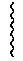

# 中观今论



> **藏经**：印顺法师佛学著作集（印顺法师著作集）　**册次** 第 9 册（Y09）　**编号** Y0009　**卷次** 12 卷　**篇幅** 117,688 字

> **卷／品**：0 卷 · 1 品



---



## 目录



  - [自序](#自序)



---



### 自序



一



在师友中，我是被看作研究三论或空宗的。我曾在〈为性空者辨〉中说到：我不能属於空宗的任何学派，但对於空宗的根本大义，确有广泛的同情！



空宗——圣龙树的论典，对我可说是有缘的。早在民国十六年，我开始阅读佛典的时候，第一部即是《中论》。《中论》的内容，我什麼都不明白，但一种莫名其妙的爱好，使我趋向佛法，终於出了家。出家后，曾一度留意唯识，但不久即回归空宗——嘉祥的三论宗。抗战开始，我西游四川，接触到西藏传的空宗。那时，我对於佛法的理解，发生重大的变革，不再以玄谈为满足，而从初期圣典中，领略到佛法的精神。由於这一番思想的改变，对於空宗，也得到一番新的体认，加深了我对於空宗的赞仰。三十一、二年，时断时续的讲说《中论》，由演培笔记，整理成《中论讲记》的初稿。关於初期——阿含、毘昙——圣典的空观，曾作广泛的考察。三十三年秋，为妙钦、续明等说，由妙钦记出。这可以名为《性空学探源》，与我另一作品——《唯识学探源》同一性质。经这一番考察，对於性空的理解，增明不少，确信性空为佛法的根本教义。三十五年春，曾以「性空导论」为题，开讲於汉藏教理院。原拟定分〈性空的发展史略〉、〈性空的方法论〉、〈性空的实践〉三编。但为了怱促的东归，连〈性空的发展史略〉部分，都没有完成，这是非常可惜的。三十六年冬，在雪窦寺编纂《太虚大师全书》，应海潮音社的稿约，决以「中观今论」为题，随讲随刊；听众能听懂的，仅有续明与星森二人。我本想写（或讲）一「性空思想史」，上编为阿含之空、阿毘昙之空；中编为性空大乘经之空、中观论之空；下编为真常者之空、唯识者之空、中观者之空——共为七章。《性空学探源》，即初编约十万字。后五章，非五、六十万字不可。处在这社会极度动乱的时代，学友时常劝我，要我略谈中观正义，所以先摘取「中观论之空」而讲为《中观今论》。但体裁不同，不免简略得多了！《中观今论》并不代表空宗的某一派，是以龙树《中论》为本，《大智度论》为助，出入诸家而自成一完整的体系。本论完成於社会变动日急的今日，回想《中论》与我的因缘，二十多年来给我的法喜，不觉分外的欢喜！



二



中观学值得称述的精义，莫过於「大小共贯」、「真俗无碍」。龙树论以为：有情的生死，以无明为根源，自性见为戏论的根本。解脱生死的三乘圣者，体悟同一的法性空寂，同观无我无我所而得悟。三法印即是一实相印，三解脱门同缘实相。这样的三乘共空，对於从来的大小相诤，可得一合理的论断。声闻三藏与摩诃衍——大乘，一向被诤论著。一分声闻学者，以《阿含经》等三藏为佛说，斥大乘为非佛说；现在流行於锡兰、暹罗、缅甸的佛教，还是如此。一分大乘学者，自以为不共二乘，斥声闻为小乘，指《阿含经》为小乘经，以为大乘别有法源。如唯识学者，在「爱非爱缘起」外，别立大乘不共的「自性缘起」；以为菩萨所证法性空，是声闻所不能证的。中国的台、贤、禅、净，在大乘法中，还自以为胜他一层，何况乎小乘！这样，对大小的同源异流，由於宗派的偏见，再也不能正确的把握！今依龙树论说：三藏确是多说无我的，但无我与空，并非性质有什麼不同。大乘从空门入，多说不生不灭，但生灭与不生灭，其实是一。「缘起性空」的佛法真义，启示了佛教思想发展的实相。释尊本是多说无常无我的，但依於缘起的无常无我，即体见缘起空寂的。这所以缘起甚深，而缘起的寂灭性更甚深；这所以缘起被称为「空相应缘起」，被赞为「法性、法住、法界」。一分学者重视事相，偏执生灭无常与无我；一分学者特别重视理性，发挥不生不灭的性空，这才互不相谅而尖锐的对立起来。他们同源而异流，应该是共同的教源，有此不即不离的相对性，由於偏重发展而弄到对立。本来，初期的大乘经，如《十地经》以悟无生法忍为同於二乘的；《般若经》以无生法忍能摄二乘智断的，以先尼的因信得解来证明大乘的现观；《金刚经》以「若以色见我」颂明佛身等，都确认三乘圣者成立於同一的理证——法性空寂，那里如执小执大者所说？所以《中论》的抉择《阿含经》义，《大智度论》的引佛为长爪梵志说法、《众义经》偈等来明第一义谛，不是呵斥声闻，不是偏赞大乘，是引导学者复归於释尊本义的运动。唯有从这样的思想中，能看出大小乘的分化由来，能指斥那些畸形发展而遗失释尊本义的乱说！中观学能抉择释尊教义的真相，能有助於佛教思想发展史的理解，这是怎样的值得我们尊重！



三



如果有人说：佛法偏於理性，偏於出世。那佛弟子会一致的出来否认，因为佛法是真俗无碍的。真俗无碍，是生死即涅槃、世间即出世的。独善的、隐遁的，甚至不乐功德、不想说法的学者，沈醉於自净其心的涅槃，忽略自他和乐、依正庄严的一切。在他们，世间与出世间，是那样的隔别！释尊的正觉内容，受到苦行厌离时机的歪曲；一分学者起来贬斥它，揭示佛法真俗无碍的正义。真俗无碍，可从解、行两方面说：解，即俗事与真理，是怎样的即俗而恒真，又真而不碍俗。行，即事行与理证，怎样的依世间福智事行的进修而能悟入真性，契入真性而能不废世间的福智事行。无论是理论、实践，都要贯彻真俗而不相碍。依中观者说：缘起法是相依相成而无自性的，极无自性而又因果宛然的。所以，依即空的缘起有，安立世间事相；也依即有的缘起空，显示出世。得这真俗相依的无碍解，才能起真俗相成的无碍行。所以菩萨入世利生，门门都是解脱门。缘起法是「处中之说」，不偏於事，不偏於理；事相差别而不碍理性平等，理性一如而不碍事相差别。在同一的缘起法中，成立事相与理性，而能不将差别去说理，不将平等去说事，这才能恰合事理的样子而如实知。一般自以为真俗无碍的学者，不知「处中之说」，谈心说性，每不免偏於「相即」、偏於「理同」。这或者忽略事行，或者执理废事，或者破坏事相的差别性、时空的局限性，落入破坏缘起事——是非、善恶、因果等的大混沌！自以为无碍，而不知早是一边。不知缘起法，不能从缘起中去统贯真俗，这也难怪要不偏於事即偏於理了！



近来有人——好像是牟宗三说：辩证法但於本体论有用。这只是说得一边，与唯物论者的辩证法偏於事相一样。须知缘起法近於辩证法，但这是处中而贯彻事理的。从正而反而综合的过程，即顺於世俗假名的缘起法，开展生灭（变）的和合、相续的相对界。即反而正而超越（反的双遮）的开显，即顺於胜义性空的缘起法，契合无生的无常、无我的绝对界。相对的缘起相、绝对的缘起性，不即不离，相依相成而不相夺，这真是能开显事理的无碍。如法则而偏於事相或偏於理性，或事理各有一套，这那里能理会得事理的真相！对於这，中观能抉择释尊的中道，达到完成，使我们相信得这真是一切智者的正觉！



四



智慧与慈悲，为佛法的宗本，而同基於缘起的正觉。从智慧（真）说：一切是缘起的存在，展转相依，刹那流变，即是无我的缘起。无我，即否定实在性及所含摄得的不变性与独存性。宇宙的一切，没有这样的存在，所以否认创造神，也应该否定绝对理性或绝对精神等形而上的任何实在自体。唯神、唯我、唯理、唯心，这些，都根源於错觉——自性见的不同构想，本质并没有差别。缘起无我（空）的中观，彻底否定这些，这才悟了一切是相对的、依存的、流变的存在。相对的存在——假有，为人类所能经验到的，极无自性而宛然现前的不能想像有什麼实体，但也不能抹煞这现实的一切。从德行（善）说：缘起是无我的，人生为身心依存的相续流，也是自他依存的和合众。佛法不否认相对的个性，而一般强烈的自我实在感——含摄得不变、独存、主宰——即神我论者的自由意志，是根本错误，是思想与行为的罪恶根源。否定这样的自我中心的主宰欲，才能体贴得有情的同体平等，於一切行为中，消极的不害他，积极的救护他。自私本质的神我论者，没有为他的德行，什麼都不过为了自己。唯有无我，才有慈悲；从身心相依、自他共存、物我互资的缘起正觉中，涌出无我的真情。真智慧与真慈悲，即缘起正觉的内容。



五



缘起性空，本於生灭的不有不无、不常不断、不一不异、不来不出。生灭的因果诸行，是性空的缘起，缘起的性空。这在一般有情，是不能正确理解的，一般总是倒觉为自性实有，或由实有而假有的。所以佛说一切从缘有，一切毕竟空，就有人大惊小怪起来。甚至佛法中，也有有宗起来，与空宗对立，反指责空宗为不了义、为恶取空。有宗与空宗，有他认识论的根本不同处，所以对於两宗认识的方法论，《中观今论》特别的给以指出来。中国学者一向是调和空有的，但必须对这一根本不同，经一番深刻的考察，不能再泛泛的和会下去。如根本问题不解决，一切似是而非的和会，终归於徒然。我是同情空宗的，但也主张融会空有。不过所融会的空有，不是空宗与有宗，是从即空而有、即有而空的中观中，使真妄、事理、性相、空有、平等与差别等，能得到相依而不相碍的总贯。本论末后几章，即著重於此。我觉得和会空有，空宗是最能负起这个责任的。即有而空，即空而有，这是怎样的融通无碍！在这根本的特见中，一切学派的契机契理的教说，无不可以一以贯之，这有待於中观者的不断努力！



民国三十八年五月二日，在厦门南普陀寺大觉讲社校读毕，附序。



中观今论



——民国三十六年冬在四明雪窦寺说——



引言



「佛说空缘起，中道为一义；敬礼佛世尊，无比最胜说！」（《回诤论》）



世间的一切事物，都是在相依相缘的关系下存在的；相依相缘的存在与生起，称为「缘起」。凡是缘起的，没有不是受著种种关系的局限与决定；受种种关系条件而决定其形态与作用的缘起法，即不能不是无自性的。「自性」，即自有或自成，有自体存在或自己规定自己的意思。现在说一切都是关系的存在，是依缘所起法，这与自性——自有、自成、自体存在的含义，恰好相反。所以凡是缘起的，即是无自性的；无自性的，即名之为「空」。缘起即空，是中观大乘最基本而最扼要的论题。自性，为人类普遍成见的根本错乱；空，即是超脱了这自性的倒乱错觉，现觉到一切真相。所以空是毕竟空，是超越有无而离一切戏论的空寂，即空相也不复存在，这不是常人所认为与不空相待的空。然而，既称之为空，在言说上即落於相待，也还是假名安立的。空的言外之意，在超越一切分别戏论而内证於寂灭。这唯证相应的境地，如何可以言说？所以说之为空，乃为了度脱众生，不得已即众生固有的名言而巧用之，用以洗荡一切，使达於「萧然无寄」的正觉。《大智度论》曾这样说：「为可度众生故，说是毕竟空相。」《中论》青目释也说：「空亦复空，但为引导众生故以假名说。」缘起无自性而即空，如标月指，豁破有无二边的戏论分别而寂灭，所以空即是「中道」。中道依空而开显，空依缘起而成立。依缘起无自性明空，无自性即是缘起；从空无自性中洞达缘起，就是正见了缘起的中道。所以，缘起、空、中道，在佛的巧便说明上，虽有三语的不同，而三者的内容，都不外用以显明事物的本性。圣龙树在《回诤论》中，既明白地说到三者的同一；在《中论》（〈观四谛品〉）也说：「众因缘生法，我说即是空，亦为是假名，亦是中道义。」缘起、空、中道的同一，为信解佛法所应当先有的正确认识。中观学，就是对此佛陀根本教法，予以深入而严密的阐发者。龙树深刻的把握了这个，窥见了佛陀自觉以及为众生说法的根本心髓；唯有这，才是佛法中究竟的教说。龙树在《中论》（〈观因缘品〉）中，标揭八不——即中即空的缘起说：「不生亦不灭，不常亦不断，不一亦不异，不来亦不出；能说是因缘，善灭诸戏论。我稽首礼佛，诸说中第一！」依於八不的缘起，即能灭除世间的一切戏论而归於寂灭，这是佛法的究极心要。所以说「我稽首礼佛，诸说中第一」；吐露他对於佛陀敬仰赞叹的深意。



龙树学，当然是发扬一切皆空的，但他的论典，即以他的代表作《中论》来说，不名此为空而名之为中，可知龙树揭示缘起、空、中道的同一，而更以不落两边的中道为宗极。在《中论》里，每品都称之为观，如〈观因缘品〉乃至〈观邪见品〉等。观就是观察，正确的观察缘起、空、中道，从论证的观察到体证的现观。所以后来都称龙树学系为中观派或中观宗，称中观的学者为中观师。



龙树的中观学，在西元五百年初，由鸠摩罗什三藏传来中国。在中国旧有佛教和适应时地思潮的发展中，在长江以南曾有过相当的弘扬。其中可看作中观的正统者，就是三论宗。此外，天台宗也是根据缘起即空、即假、即中的要义，发挥它独到的圆宗。龙树系的中观学，给予中国佛法的影响，非常普遍深刻；即使不属於中观的学者，也多表示崇敬，或依附於龙树的教门。因此，传入日本，即有龙树为「八宗共祖」的传说。在西藏，也传有中观学，是西元八百年代由印度传入的。据说：藏传的中观学，有佛护、月称的「应成派」，和静命、清辨的「自续派」。传入西藏的时候，虽各有因缘，然经过长期的流传，佛护、月称的应成系已取得了中观正统的权威。藏传的中观教典，近来始有部分的翻译为汉文。同时，由於《中论》梵本的发现，日人曾从文义的考订中，获得许多新的理解。中观的特质，将来在藏传、汉传和梵本的相互参证中，必将更为正确圆满的发扬起来。



第一章　中道之内容及其意义



第一节　中道之内容



佛法，是对於人生向上发展以至完成的一种实践。众生（以人为本，可称为人生）无始以来，生死死生，生生不已的存在，是人生现实不过、迫切不过的根本问题，也唯是佛法才能彻底处理的问题。佛法对於人生——生生不已的存在，开示它的真相，使我们从人生实相的正见中，知道我们应如何增进此人生、净化此人生，超越一般的人生，达到更圆满、更完成的地步。这一佛法的核心——人生进步、净化以及完成的实践，佛典里称之为道。释尊在波罗奈的鹿野苑中，初为五比丘转法轮，即提示以「中」为道的特质。如《转法轮经》（巴利文本）说：「在此诸欲中耽於欲乐者，乃下劣凡夫，为非圣无意义之事。虽然，以自身所求之苦为苦，亦为非圣无意义之事也。离此二边之中道，方依於如来而能证悟，此即开眼、开知，至於寂静、悟证、正觉、涅槃之道。比丘！於何名为依於如来所悟之中道？即此八支之圣道也。」佛在开宗明义的最初说法，标揭此不苦不乐的中道；中道即八支圣道，这是中道的根本义。这何以称之为中？有以为佛法之所谓中，是不流於极端的纵欲，也不流於过甚的苦行，在此苦乐之间求取折中的态度。但这是断章取义，不能正解八正道的所以为中道。要知道：一般人的人生观，即人生历程的路向，不是纵我的乐行，就是克己的苦行。研考这二端的动机，都是建立於情意的，即是情本的人生观、情本的法门。世人感觉偏於纵我的乐行不可通时，於是就转向到专尚克己的苦行。人生的行为，都不过在这两极端以及彼此移转的过程中。不晓得纵我的乐行，如火上加油；私我的无限扩张，必然是社会没法改善，自己没法得到解脱。或者见到此路不通，於是转向苦行。不知苦行是以石压草的办法；苦行的折服情欲，是不能成功的。叔本华的悲观，甚至以自杀为自我解脱的一法，即是以情意为本的结论。依释尊，纵我的乐行和克己的苦行，二者都根源於情识的妄执。释尊否定了二者，提供一种究竟彻底的中道行，这就是以智为本的新人生观。自我以及世间，唯有以智为前导，才可以改造人生，完成人生的理想。因此，不苦不乐的、智本的新人生观，是佛法唯一的特质。佛说离此二边向中道，中道即八正道。八正道的主导者，即是正见。一切身心的行为，都是以正见为眼目的——《阿含经》以正见为诸行的先导，《般若经》以般若为万行的先导。所以不苦不乐的中道行，不是折中，而是从正见为本的实践中，不落於情本的苦乐二边。由此，佛法是以「以智化情」、「以智导行」为原则的。以智为本的中道行，包括了最初发心乃至向上达到究竟圆满的一切过程。



正见为导的中道，即是从正见人生的实相中，增进、净化此人生，以及解脱、完成。正见人生的实相，佛在处处经中，也即说之为中道或中法。如《杂阿含经》（大正藏编号二六二经）说：「世人颠倒，依於二边，若有、若无。……迦旃延！如实正观世间集者，则不生世间无见；如实正观世间灭，则不生世间有见。迦旃延！如来离於二边，说於中道，所谓此有故彼有，此生故彼生。」此是释尊开示「正见」的教授，说明世人不依於有则依於无，佛离有无二边而说中道法。然所谓离有离无的中道，不是折中於有无而说亦有亦无或半有半无的。释迦所说者，为缘起法；依於缘起的正见，能得不落有无二边的中道。



释迦所说中道，还有不一不异的中道，如《杂含》（二九七经）说：「若见言命即是身，彼梵行者所无有；若复见言命异身异，梵行者所无有。於此二边，心所不随，正向中道。贤圣出世如实不颠倒正见，谓缘生老死，……缘无明故有行。」还有不常不断的中道，如《杂含》（三〇〇经）说：「自作自觉（受），则堕常见；他作他觉，则堕断见。义说、法说，离此二边，处於中道而说法，所谓此有故彼有，此起故彼起。」



不一不异、不常不断，与不有不无一样，都是依於缘起而开显的不落二边的中道。正见缘起的中道，为释迦本教的宗要。不苦不乐是行的中道，不有不无等是理的中道，这仅是相对的区分而已。实则行的中道里，以正见为先导，即包含有悟理的正见中道；唯有如此，才能不落苦乐两边的情本论。同时，悟理即是正行的项目；正见缘起，贯彻自利利他的一切正行，两者是相依相待而不可缺的。依於正见缘起，能离断常、有无等二边的戏论，发为人生的实践，自然是不落苦乐二边的中道。



还有，释尊的开示缘起，缘起的所以是中道，即不能忽略缘起的空相应性，这在经中多有说到。如《杂含》（二九三经）说：「为彼比丘说贤圣出世空相应缘起随顺法。」缘起是与空相应的，空的独到大用，即洗尽一切戏论执见。缘起与空相应，所以能即缘起而正见不落两边的中道。



第二节　中道之意义



中道，当然是不落二边。但不落二边——中道所含的意义，还应该解说。中的本义，可约为二种：一、中实：中即如实；在正见的体悟实践中，一切法的本相如何、应该如何，即还他如何。这是彻底的、究竟的，所以僧叡说「以中为名者，照其实也」（《中论．序》）。二、中正：中即圆正；不偏这边，也不偏於那边，恰得其中。如佛说中道，依缘起法而显示。这缘起法，是事事物物内在的根本法则。在无量无边极其复杂的现象中，把握这普遍而必然的法则，才能正确、恰当的开示人生的真理及人生的正行。中即是正，所以肇公称《中观论》为《正观论》，中道即是八正道。此中实与中正，是相依相成的：中实，所以是中正的；中正，所以是中实的，这可总以「恰到好处」去形容它。



龙树发扬缘起、空、中道的深义，以「中」为宗而造论。他严格地把握那修道中心的立场，对於中道的解说，也不出於中实与中正。中实，本以正观缘起性而远离戏论的寂灭为主。这中实的寂灭，从实践的意义去说，即是不著於名相，不落於对待。一、不取著名相：这如《大智度论》卷六说：「非有亦非无，亦复非有无，此语亦不受，如是名中道。」中道，不但是非有非无，更进一步的说「此语亦不受」。受，即新译的取。凡称之为有、为无、为非有非无，都不过名言的概念。非有非无，本表示观心的不落有无戏论，如以为是非有非无，这不能恰合中实的本意。所以必须即此「非非」的名相，也不再取著。二、不落於对待：我们所认识的、所言说的，都是相对的。凡是相对的，即不契於如实绝待的中道。如《大智度论》卷四三说到种种的二边，都结论说：「离是二边行中道，是名般若。」这里所说的种种二边，如常无常、见无见等，都是二边；进而至於能行能证的人——菩萨、佛是一边，所行、所证的法——六度、大菩提是一边；甚至般若是一边，非般若是一边，要离此二边行中道。这不落对待的中道，即入不二法门，是顺於胜义，依观心的体悟说。



关於中正的意义，龙树也有很好的发挥。依佛陀所正觉的，为众生所巧便言说的，在佛陀，都是圆满而中正的。如缘起是中正的，空也是中正的，至於中道，那更是中正了。但世俗言说的施设，不免片面性的缺陷，所以古德说「理圆言偏」。众生对於佛的教法，不能圆见佛法的中道，闻思或修行，在任何方面有所偏重，就会失却中道。如《大智度论》卷八〇说：「若人但观毕竟空，多堕断灭边；若观有，多堕常边。离是二边故说十二因缘空。……离二边故，假名为中道。」毕竟空与缘起有，那里会堕於一边？这因为学者有所偏重的流弊——世谛流布，什麼都有弊的，所以特说明缘起与空寂不偏的中道。即空的缘起，不落於断边；即缘起的性空，不落於常边。缘起与空，印度佛教确曾有过偏重的发展。到极端，如方广道人偏空，是堕於断灭边；萨婆多部偏於一切法有，即堕於常边。为了挽救这种偏病，所以龙树探《阿含》及《般若》的本意，特明此缘起即空的中道，以拯拔那「心有所著」的偏失者，使之返归於释迦的中道。学者不能巧得佛法的实义，多落於二边，所以特称此综贯性相、空有的为中道。龙树的中道论，不外乎不著名相与对待（宗归一实），综贯性相及空有（教申二谛）。中观大乘的特色，实即是根本教义完满的开展。



第二章　龙树及其论典



第一节　龙树论略说



约在西元一百五十至二百五十年间，龙树出现於印度的佛教界。他本是印度南方的学者，长养於大乘佛教的环境中。据传记上说：他出家后，曾到北方的雪山等处修学。这个环境，造成他综贯南北、空有思想的特质，成就了他的伟大！龙树以前，一味的佛教，向东南方发展的是大众（又分别说）系，向西北方开展的是上座系。拘泥而保守的上座系，被呵斥为小乘；活泼而进取的大众系，渐渐的开拓出大乘佛教。南北、大小，尖锐的对立著。南空北有，各趋一极。北方已完成极端实有的《大毘婆沙论》；南方的偏重理性者，於因果缘起的事相，也不免忽略。这种偏颇的发展，决非佛教之福。龙树出世时，佛教正倾向於从分化而进入交流与综合的新机运，於是综合南北、空有、性相、大小的佛教，再建佛教的中道；但他是以大乘性空为根本的。



龙树造的论典，中国内地以及西藏，译传的很多。主要的部分，可分为两类：一、深观论，二、广行论。深观，如《中论》、《十二门论》等，以探究诸法的实相为中心，为迷悟的关键所在，所以名之为深观。广行，如《大智度论》、《十住毘婆沙论》、《菩提资粮论》等，这是以菩萨的广大行果为主的。这两类，有的以为：菩萨行包含归依、布施、持戒等行法，佛陀自证化他的果德主要为引发信愿以及积集福智的资粮。资粮具足了，成为可能解脱的根机，这再侧重於慧行的深观。这即是说先以广大行的资粮为基础，再进而深入究极彻证的深观。但另有人说：般若为三乘之母，三乘学者都依此深观而证悟与解脱的；广大行才是大乘不共於小乘的特色。如实的说：声闻、缘觉、菩萨的中道行，都以出世的正见为主导的。依正见而后有信解，依正见而后能修行趣证，就是悟证了以后，也还是不能离此正见的摄导。故深观虽共於三乘，在大乘中，仍是彻始彻终的，唯佛所究竟的。本文，即是关於深观的论述。



关於龙树深观的论典，罗什三藏所传，有长达十万颂的《无畏论》。五百颂的《中论》，即出於《无畏论》中。罗什除译有青目释的《中论》外，还有《十二门论》，也是龙树造的；这部论，可以说是《中论》的入门书。《十二门论》引证过《七十空性论》；《七十空性论》近由法尊依藏本译出，确乎是龙树的作品。考西藏所传，也有《无畏论》，但这是《中论》的注解，与什公译的青目释论相近。有人说是龙树作的；也有人说不是龙树作的，因为论中引证到龙树弟子提婆的《四百论》。但传说龙树的年寿极高，也可能有转引提婆论的事情。然这与西元五世纪初传来中国的古说，说《无畏论》有十万颂，《中论》出在其中，仍未能完全相合。这也许藏传的《中论无畏注》，即为青目或某论师摘集龙树《无畏论》意而注释《中论》的，多分根据《无畏论》，因此也名为《无畏》，如《净名经集解关中疏》。但这究不过一种推测而已，不能作为定论。有人依「中论出在其中」，推想《无畏论》为编集的丛书，如真谛所传《无相论》的性质，也无法确定。



关於龙树的深观论，西藏有「诸中论」之称。凡抉择胜义空性的，都可以名为「中论」，中论不是一部的别名。平常流行的「中论」，名为「根本中」。根本论与支论，总有五正理聚：即一、《根本中论》，二、《回诤论》，三、《七十空性论》，四、《六十如理论》，五、《大乘二十论》。这五部论，为印度后期中观师所依据的，认为都是龙树造的。在中国，《根本中论》都随释论译出，有什公译的「青目释」四卷、唐波罗颇密多罗译的清辨释《般若灯论》一五卷、宋惟净译的安慧释《中观释论》一八卷。汉文所没有的，藏方有传为龙树释的《无畏注》、佛护的《中论注》、月称的《明句论》。《七十空性论》，最近依藏文译出。《回诤论》，中国的译本，是元魏毘目智仙译的。《六十如理论》与《大乘二十论》，赵宋时施护所译。施护所译的龙树论，非早期的中观学者所知，而且有「唯识」的倾向。如《大乘二十论》的末二颂说：「此一切唯心，安立幻化相。……若灭於心轮，即灭一切法。」《六十如理论》三十四颂说：「宣说大种等，皆是识所摄。」又施护译的《大乘破有论》说：「由此心为因，即有身生。」印度后期有随瑜伽行的中观师，即引《六十如理论》颂，此下更为解说。



汉藏一致的传说：传龙树中观的正统者，是锡兰的提婆论师。提婆的主要作品，名《四百论》；奘译的《广百论》，即此论后八品的护法「释论」。什公所译的《百论》，婆薮开士释，也即是此论的略本。此外，还有《百字论》。提婆论以「百」为名，不仅是数目的。古人解说为「无邪不摧，无正不显」，即完备的意义；月称从语言学的见地，解说为「遮遣分别邪执」；提婆论确是侧重破邪的。其后，青目释《中论》的八不说：「法虽无量，略说八事，则为总破一切法。」以《中论》的八不，偏重於广破一切，也许是受有提婆论的影响。龙树的《中论》，固然能遮破一切戏论，但《中论》的正意，决非以摧破一切为能，反而是为了成立一切法，显示释迦的缘起中道。



第二节　《中论》为《阿含》通论考



探求龙树缘起、空、中道的深义，主要的当然在《中论》。《中论》的中道说，我有一根本的理解——龙树菩萨本著大乘深邃广博的理论，从缘起性空的正见中，抉发《阿含经》的真义。这是说：缘起、空、中道，固然为一般大乘学者所弘扬，但这不是离了《阿含经》而独有的，这实是《阿含经》的本意，不过一般取相的小乘学者没有悟解罢了。所以，《中论》是《阿含经》的通论，是通论《阿含经》的根本思想，抉择《阿含经》的本意所在。这种说法，不要以为希奇，可从三方面去加以说明：



一、《中论》所引证的佛说，都出於《阿含经》。(一)、〈观本际品〉说「大圣之所说，本际不可得」，这出於《杂阿含经》卷一〇（二六六经等）说：「无始生死……长夜轮回，不知苦之本际。」生死无始的教说，龙树引归「何故而戏论，谓有生老死」的空义。(二)、〈观行品〉说：「如佛经所说，虚诳妄取相。」以有为诸行为由妄取而成的虚诳——即虚妄相，以涅槃为不虚诳，是《阿含经》所说的。但龙树以为虚妄即是空无自性的，所以说：「佛说如是事，欲以示空义。」(三)、〈观有无品〉说：「佛能灭有无，於化迦旃延，经中之所说，离有亦离无。」这出於《杂阿含经》，已经引述过。离有无二边的缘起中道，为《中论》重要的教证。(四)、〈观四谛品〉说：「世尊知是法，甚深微妙相，非钝根所及，是故不欲说。」这如《增一阿含经》卷一〇说：「我今甚深之法，难晓难了，难可觉知！……设吾与人说妙法者，人不信受，亦不奉行。……我今宜可默然，何须说法！」各部广律，在梵天请法前，都有此说。(五)、〈观四谛品〉说：「是故经中说，若见因缘法，则为能见佛，见苦集灭道。」见缘起法即见佛，出於《增一阿含经》卷二八须菩提见佛的教说。见缘起法即见四谛，出於《中阿含经》卷七《象迹喻经》。(六)、〈观涅槃品〉说：「如佛经中说，断有断非有。」这如《杂阿含经》卷九（二四九经）说：「尽、离欲、灭、息、没已，有亦不应说，无亦不应说。……离诸虚伪，得般涅槃，此则佛说。」《阿含经》的本义，一般声闻学者不能深识，专在名相上取执，所以龙树与他们论辨，似乎龙树在极力破斥小乘，而不知是为了成立《阿含经》的真义，成立四谛、三宝、世出世一切法。



二、从《中论》的内容去看，也明白《中论》是以《阿含经》的教义为对象，参考古典的阿毘昙，破斥一般学者的解说，显出瞿昙缘起的中道真义。这不妨略为分析：(一)、〈观因缘品〉，观「缘生」的不生（灭）。〈观去来品〉，观此诸行的「生无所从来，灭亦无所至」。此二品，总观八不的始终——「不生」与「不去」。此下别观四谛。(二)、〈观六情品〉、〈观五阴品〉、〈观六种品〉，即观察六处、五蕴、六界的世间法。这三者的次第，依《中阿含经》卷三四说。古典的《舍利弗阿毘昙》、《法蕴足论》，也都与此相合。〈观六情品〉中说：「见可见无故，识等四法无；四取等诸缘，云何当得有？」从内六处、外六处，引生六识、六触、六受、六爱——六六法门，再说到四取等，这是《杂阿含经．六处诵》中常见的缘起说。这三品，论究世间——苦的中道。(三)、〈观染染者品〉，论烦恼的相应。〈观三相品〉，明有为——烦恼所为的生住灭三相。在蕴、处、界以后，说明相应行与不相应行的三相，本於阿毘昙论的次第；如《阿毘昙心论》。〈观作作者品〉、〈观本住品〉、〈观燃可燃品〉，明作者、受者的不可得，这更是《阿含经》的根本论题了。与上二品合起来，即是论究惑招有为与作即受果的道理。(四)、〈观本际品〉，引经以明生死本际不可得。〈观苦品〉，说明苦非自作、他作、共作、无因作，是依《杂阿含经》卷一二（三〇二经）阿支罗迦叶问等而作的。《十二门论》的〈观作者门〉，也引此经以明空义。(五)、〈观行品〉，明无常诸行的性空，进而空亦不可得。〈观合品〉，明三和合触的无性。〈观有无品〉，从缘起法的非有论到非无，这是依《化迦旃延经》说的。〈观缚解品〉，从生死流转说到还灭，从系缚说到解脱。〈观业品〉，更是生死相续中的要义。从〈观染染者品〉到此，共有十二品，论究世间集的中道。(六)、〈观法品〉，明「知法入法」的现证。无我无我所，为能见法性的观门，这是《阿含经》的要义。所契入的诸法实相，即缘起的寂灭，即声闻与辟支佛所共证的。(七)、〈观时品〉、〈观因果品〉、〈观成坏品〉，分别说明三世因果与得失。这是当时内外学者重视的论题，特别是修行历程中的要题；如要经过多少时间，怎样的从因到果，功德的成就或退坏。(八)、〈观如来品〉，如来为创觉正法的圣者，超越常无常四见、边无边四见、有见与无见，这都是《阿含经》十四不可记的意义。(九)、〈观颠倒品〉，明所破的颠倒，否定三毒、染净、四倒的实性，归结到「如是颠倒灭，无明则亦灭」的缘起还灭。〈观四谛品〉，明所悟的谛理，批评实有论者的破坏四谛、三宝，引证《阿含经》，成立「若见因缘法，则为能见佛，见苦集灭道」的自宗。〈观涅槃品〉，发挥《杂阿含经》卷一二（二九三经）所说「一切取（受）离、爱尽、无欲、寂灭涅槃」，是「无为」法的真义，说明无为、无受的涅槃。「如来灭度后，不言有与无」，「一切法空故，何有边无边」等，扫尽十四不可记的戏论。从〈观法品〉到此，论究世间集灭的中道。(十)、〈观十二因缘品〉，全依《阿含经》义。〈观邪见品〉，即破除我及世间常无常、我及世间边无边的邪见，明我法二空。正观缘起，远离邪见，这二品即论究世间灭道的精义。



三、从《中论》开首的归敬颂来说：缘起，就是八不的中道。《中论》以中为名，即以八不显示中道。不常不断的中道、不一不异的中道，出於《阿含经》，上来都曾引证过。不来不去，在《杂阿含经》的《第一义空经》，也曾说到。在显示缘起的有因有果而无作无受时说：「眼生时无有来处，灭时无有去处。」这即是在缘起的生灭中，指出不来不去的中道。不生不灭，据《阿含经》义，指无为法而说。无为法是不生、不住、不灭的，无为即涅槃寂灭，即缘起的寂灭性。龙树以此八不的缘起说，为止息戏论而寂灭的第一教说：「瞿昙大圣主，怜愍说是法，悉断一切见，我今稽首礼。」归功於瞿昙，这也可见与《阿含经》的关切了！



这样，从引证的圣典看，从本论的内容看，从八不的根据看，都不难看出《中论》的意趣所在。龙树的思想，不仅《中论》如此，《大智度论》也还是如此。他解说八不的第一义悉檀，是三乘所共的。《大智度论》卷一，除了八不而外，又引《众义经》——汉译名《义足经》，即《义品》，巴利藏摄在「小部」里。又如三门中的空门，广引《阿含经》来成立我法皆空（《大智度论》卷一八）。卷三一中，也引七经，证明声闻藏的法空。所以，依龙树的见地，空相应的缘起、中道，虽菩萨与声闻的智慧不同，声闻如毛孔空，菩萨如虚空空（《大智度论》卷三五），但这到底是量的差别，不能说空性寂灭中有什麼质的不同。所以「声闻乘多说众生空，佛乘说众生空、法空」（《大智度论》卷四）；「若了了说，则言一切诸法空；若方便说，则言无我」（《大智度论》卷二六）；这都不过是侧重的不同、详略的不同而已！这样，《中论》确是以大乘学者的立场，确认缘起、空、中道为佛教的根本深义，与声闻学者辨诘论难，并非破除四谛、三宝等法，反而是成立。抉发《阿含经》的缘起深义，将佛法的正见，确树於缘起中道的磐石。



第三章　缘起之生灭与不生不灭



第一节　无生之共证与大乘不共



龙树依空而显示中道，即八不缘起。其中，不常不断、不一不异、不来不去的缘起，即使解说不同，因为《阿含经》有明显的教证，声闻学者还易於接受。唯对於不生不灭的缘起，不免有点难於信受。因此，这就形成了大乘教学的特色，成为不共声闻的地方。不生不灭——八不的缘起，声闻学者中，上座系的萨婆多部是不承认的。进步些的经部师，也有缘起的不生不灭说，但他们是依「唯法因果，实无作用」的见地说，还不是大乘学者说缘起不生不灭的本义。大众部说缘起是无为法，因为缘起是「若佛出世，若不出世，法性法住，法界常住」的。他们说缘起常住、不生不灭，而把缘起作为离开事相的理性看，也与大乘不同。关於这些，清辨的《般若灯论》，曾经说到。依中观者说，缘起不生不灭，是说缘起即是不生不灭的，这缘起寂灭性即是中道。佛陀正觉缘起而成佛，在此；声闻的证入无为无生，也在此。这缘起的不生不灭，本是佛法的根本深义，三乘所共证的；但在佛教教义开展的过程中，成为大乘学者特别发挥的深义，形式上成为大乘的不共之学。一般声闻学者以为缘起是无常生灭的，现在说「不生不灭是无常义」（《维摩经》卷上），这似乎不同，成为一般声闻学者与大乘学者论诤的焦点。然依释迦创开的佛法说，生灭与不生灭，本来一致。



不生不灭，《阿含经》是指涅槃无为而说的。涅槃，决不是死了，也不是死了才证得涅槃。涅槃，玄奘译为圆寂；梵语含有否定与消散的意味，又有安乐自在的意义。



佛所说的涅槃，是指那超脱了纷乱的、烦嚣的、束缚的一切，而到达安宁的、平和的、解放的自在境地。这一解脱自在的境地，是佛教正觉的完成，充满了丰富的内容，即解脱了愚痴为本的生死，而得到智慧为本的解脱。涅槃又称为无为、无生（无住无灭）。因为佛称世俗的一切为有为，即惑业所感成的，动乱、相对、束缚的生灭，是它的根本性质；突破了这种烦扰、差别、束缚的有为生灭，在无可形容、无可名称中，即称之为不生不灭的无为涅槃。这本是中道行的成果，然依此为正觉所觉的法界而说，无为又成为究竟的理性。涅槃——正觉的解脱，不问菩萨、声闻，是一致企图实现的目的。声闻行者达到了此一目的，即以为到达了究竟，「所作已办」，更没有可学可作的，称为「证入实际」。大乘行者到了不动地，也同样的体验此一境地，但名之为「无生法忍」，而认为还没究竟的。如《十地经》第八地中说：菩萨证得无生法忍时，想要证涅槃了。佛告诉他说：「此诸法法性，若佛出世，若不出世，常住不异。诸佛不以得此法故名为如来，一切二乘亦能得此无分别法。」无生法，是三乘所共证的，诸佛并不以得此法而名为如来，即说明了大乘没有把它看作「完成了」，还要更进一步，从大悲大愿中去广行利他。关於这点，《大智度论》卷七五说：「得无生法忍、授记，更无餘事，唯行净佛世界、成就众生。」依於此义，故卷五说：「无生忍是助佛道初门。」这可见大乘在正觉解脱——自利的立场，并不与声闻乘不同。不过一般声闻行者自利心切，到此即以为一切圆满了，不能更精进的起而利他，所以大乘经中多责斥他。大乘是依此声闻极果的正觉境界——涅槃，得无生法忍，不把它看作完成，进而开拓出普度众生的无尽的大悲愿行。



第二节　声闻常道与大乘深论



正觉体悟的无为、不生，是三乘圣者所共证的，已如上述。为了教导声闻弟子证得此无生法，依《阿含经》所成立的教门说，主要是三法印：一、诸行无常，二、诸法无我，三、涅槃寂静。此三者，印定释迦的出世法，开示世出世间的真理。此三者，是可以随说一印，或次第说此三印的。次第三法印，即是以明解因果事实的生灭为出发点，依此而通过诸法无我的实践，到达正觉的涅槃。这如《杂阿含经》（二七〇经）说：「无常想者能建立无我想，圣弟子住无我想，心离我慢，顺得涅槃。」三法印的次第悟入，可看为声闻法的常道。但大乘佛教，本是充满利他悲愿的佛教行者在深证无生的体悟中，阐发释迦本怀而应运光大的。在这无生的深悟中，以佛陀为模范，不以为「所作已办」，而还要进一步的利他无尽。本著此无生无为的悟境去正观一切，即窥见了释迦立教的深义，因之与一般凡庸的声闻学者不同。所以大乘佛教的特色，即「诸法本不生」，即是依缘起本来不生不灭为出发的。《文殊师利净律经》说：「彼土众生了真谛义以为元首，不以缘合为第一也。」这虽在说明彼土与此土的立教方式不同，实即说明了佛教的原有体系——一般声闻学者，是以缘起因果生灭为出发的；应运光大的大乘学，是以本不生灭的寂灭无为（缘起性）为出发的。



从释迦的由证而立教说，本是正觉了无生法性，圆证了法法不出於如如（无生）法性的。他的从证出教，如先从最高峰鸟瞰一切，然后顺从山谷中的迷路者（众生），给以逐步指引，以导登最高峰的。后来的一般声闻学者，在向上的历程中，为路旁的景色所迷，忘却了指导者的真意。大乘学者，即是揭露这鸟瞰一切的意境，使他们归宗有在而直登山顶的。所以，大乘不仅不与释迦的本教相违，而且真能窥见释迦本教的真义，非拘泥名相的一般声闻学者所及。如佛在《阿含经》中，从缘起的生灭相续而说诸行无常；从缘起的因缘和合而说诸法无我；无我我所的执见而悟入无生无灭的涅槃。释迦的方便善巧，使众生从现实经验到的因果生灭相续和合中离执，到达正觉的体悟。实则此涅槃并不在一切现实的以外，不过为了引迷启悟，而相对的称之为无为、无生。



一般声闻学者，为名相章句所迷，将有为生死与无为涅槃的真义误会了。如萨婆多部，把有为与无为看作两种根本不同性质的实体法。这由於缺乏无生无为的深悟，专在名相上转，所以不能正见《阿含经》的教义，不能理解释迦何以依缘起而建立一切。涅槃即是依缘起的「此无故彼无，此灭故彼灭」的法则而显示的，如何离却缘起而另指一物！又如经部师，以无为是无，有为才是实有。那麼佛法竟是教导众生离开真实而归向绝对的虚无了！要知道：生灭相续的是无常，蕴等和合的是无我，依无常无我的事相，说明流转门。能够体悟无我无我所，达到「此无故彼无，此灭故彼灭」的涅槃，这是还灭门。这虽是释尊所教示的，但这不过是从缘起事相的消散过程上说。这「无」与「灭」，实是有与生的否定，还是建立在有为事实上的，这那里能说是涅槃——灭谛？所以古人说：「灭尚非真，三谛焉是？」还有，大众系学者，误会不生不灭的意义，因而成立各式各样的无为，都是离开事相的理性。所以，不是将无为与涅槃看作离事实而别有实体，即是看作没有。尤其生灭无常，被他们局限在缘起事相上说，根本不成其为法印！



大乘学者从无生无为的深悟中，直见正觉内容的——无为的不生不灭。所以说无常，即了知常性不可得；无我，即我性不可得；涅槃，即是生灭自性不可得。这都是立足於空相应缘起的，所以一切法是本性空寂的一切。常性不可得，即现为因果生灭相续相；从生灭相续的无常事相中，即了悟常性的空寂。我性不可得，即现为因缘和合的无我相；在这无我的和合相中，即了悟我性的空寂。生灭性不可得，即生非实生，灭非实灭，所以「此有故彼有，此生故彼生」的缘起相，必然的归结於「此无故彼无，此灭故彼灭」。由此「此无故彼无，此灭故彼灭」的事相，即能彻了生灭的空寂。大乘行者从「一切法本不生」的无生体悟中，揭发诸法本性空寂的真实，直示圣贤悟证的真相。因此，释迦的三法印，在一以贯之的空寂中，即称为一实相印。一实相印即是三法印，真理是不会异样的。《大智度论》卷二二说：「有为法无常，念念生灭故，皆属因缘无有自在；无有自在故无我；无常无我无相故心不著，无相不著故即是寂灭涅槃。」又说：「观无常即是观空因缘（「观心生灭如流水、灯焰，此名入空智门」），如观色念念无常，即知为空。……空即是无生无灭。无生无灭及生灭，其实是一，说有广略。」诸法生灭不住，即是无自性，无自性即无生无灭，所以生灭的本性即是不生不灭的，这即是不生不灭的缘起。这是通过了生灭的现象，深刻把握它的本性与缘起生灭并非彼此不同。依此去了解佛说的三法印，无常等即是空义，三印即是一印。



无常等即是空义，原是《阿含经》的根本思想，大乘学者并没有增加了什麼。如《杂阿含经》（二三二经）说：「眼（等）空，常恒不变易法空，我所空。所以者何？此性自尔。」二七三经也有此说，但作「空诸行」。常恒不变易法空，即是无常，所以无常是常性不可得。我我所空即是无我，所以无我是我性不可得。无常、无我即是空的异名，佛说何等明白！眼等诸行——有为的无常无我空，是本性自尔，实为自性空的根据所在。这样，一切法性空，所以纵观（动的）缘起事相，是生灭无常的；横观（静的）即见为因缘和合的；从一一相而直观它的本性，即是无常、无我、无生无灭、不集不散的无为空寂。因此，无常所以无我，无我我所所以能证得涅槃，这是《阿含经》本有的深义。释迦佛本重於法性空寂的行证，如释尊在《小空经》中说：「阿难！我多行空。」《瑜伽师地论》（卷九〇）解说为：「世尊於昔修习菩萨行位，多修空住，故能速证阿耨多罗三藐三菩提。」这可见佛陀的深见所在，随顺众生——世俗的知解，在相续中说无常，在和合中说无我，这名为以俗说真。释迦的本怀，不仅在乎相续与和合的理解，而是以指指月，是从此事相的相续相、和合相中，要人深入於法性——即无常性、无我性，所以说能证涅槃。可惜如来圣教不为一般声闻学者所知，专在事相上说因果生灭、说因缘和合，偏重事相的建立，而不能与深入本性空寂的无为无生相契合。彻底的说，不能即缘起而知空，不能即生灭而知不生灭；那麼，无常、无我、涅槃，也都不成其为法印！



第三节　三法印之横竖无碍



明白点说，三法印的任何一印，都是直入於正觉自证的，都是究竟的法印。但为听闻某义而不悟的众生，於是更为解说，因而有次第的三法印。在佛教发展的历史中，也是初期重无常行，中期重空无我行，后期重无生行。如「诸行无常」，除了事相的起灭相续相而外，含有更深的意义，即无常与灭的含义是相通的。佛为弟子说无常，即说明一切法皆归於灭；终归无常，与终归於灭、终归於空，并无多大差别。依此无常深义，即了知法法如空中的闪电，刹那生灭不住，而无不归於一切法的平等寂灭。无常灭，如从波浪汹涌看出它的消失，还归於平静寂灭，即意味那波平浪静的境界。波浪的归於平静，即水的本性如此，所以它必归於平静，而且到底能实现平静。佛说无常灭，意在使人依此而悟入寂静，所以说：「若人生百岁，不见生灭法，不如生一日，而能得见之！」所以说：「诸行无常，是生灭法，生灭灭已，寂灭为乐。」使人直从一切法的生而即灭中，证知常性本空而入不生灭的寂静。差别的归於统一，动乱的归於平静，生灭的归於寂灭。所以说：「一切皆归於如。」这样，无常即究竟圆满的法印，专从此入，即依无愿解脱门得道。



然而，在厌离心切而拘泥於事相的，听了无常，不能深解，只能因生灭相续的无常相而起厌离心，不能因常性不可得而深入法性的寂灭；这非更说无我不可——也有直为宣说无我的，由无我离执而证知诸法的空寂性，因之而得解脱。依《般若经》及龙树所宗，诸法本性的空寂即是不生，不生即是涅槃。《心经》「色即是空」的空，即解说为无生的涅槃。空是本性空；空亦不可得，即是无生。如《大智度论》（卷一五）说：「诸法性常空，心亦不著空；如是法能忍，是佛道初相。」这是把空亦复空的毕竟空，与无生等量齐观的。如《解深密经》说：初时教说无常令厌，中时教说「皆无自性，无生无灭，本来寂静，自性涅槃」，也是以空及无生为同一意义的。如从此得证，即依空解脱门得道。



然而，若著於空，即不契佛意，所以说：「大圣说空法，为离诸见故，若复见有空，诸佛所不化。」有所著，即不能体证无所著的涅槃——无生法忍。因之，经中也有以空为不了，而以不生不灭为究竟的。如从不生不灭而证入，即依无相解脱门得道。空与不生，如《大方广宝箧经》说：「如生金与熟金。」龙树也说：「成就者，名为菩提；未成就者，名为空。」又空著重於实践的意义，而无生多用於说明法性寂灭。然在中观的诸部论典中，处处都说空，空即不生，空即是八不缘起的中道。事实上，取著无生，还是一样的错误，所以《大智度论》解说无生，是无生无不生等五句都遣的。空与无生，有何差别！



总之，凡成为世谛流布，或以世俗的见解，依名取义，无常教会引来消极与厌离；空会招来邪见的拨无因果或偏於扫荡；无生会与外道的神我合流。如能藉此无常、无我、无生的教观，彻法性本空，那麼三者都是法印，即是一实相了。依众生的悟解不同，所以有此三门差别；或别别说，或次第说，或具足说，都是即俗示真，使契於正觉的一味。从缘起生灭悟得缘起不生不灭，揭开释迦《阿含经》的真面目。能於空相应缘起中，直探佛法深义而发挥之，即成为后代大乘教学的唯一特色。



第四节　缘起之综贯性



声闻常道以缘起生灭为元首，大乘深义以无生真谛为第一，这多少是近於大乘的解说。如从《阿含经》为佛法根原，以龙树中道去理解，那麼缘起是处中说法，依此而明生灭，也依此而明不生灭。缘起为本的佛法，是综贯生灭与不生灭的。所以，这里再引经来说明。《杂阿含经》二九三经，以缘起与涅槃对论，而说都是甚深的：「此甚深处，所谓缘起。倍复甚深难见，所谓一切取离、爱尽、无欲、寂灭、涅槃。如此二法，谓有为、无为。有为者，若生、若住、若异、若灭。无为者，不生、不住、不异、不灭。」这说明在有为的缘起以外，还有更甚深难见的，即离一切戏论的涅槃寂灭——无为。又《杂阿含经》二九六经，说缘起与缘生。缘起即相依相缘而起的，原语是能动名词。缘生是被动词的过去格，即被生而已生的，所以玄奘译作缘已生法。经文以缘起与缘生对论，而论到内容，却都是「此有故彼有，此生故彼生」的十二支，成为学派间的难题。萨婆多部依缘起是主动、缘已生是被动的差别，说：因名缘起，果名缘生。即从无明缘行，行缘识，乃至生缘老死，凡为缘能起的因，说为缘起；从缘所生的果，说为缘生。缘起、缘生，解说为能生、所生的因果。大众部留意经中说缘起是「若佛出世，若不出世，法性法住法界常住」的特点，所以说：各各因果的事实为缘生，这是个别的、生灭的；因果关系间的必然理性为缘起，是遍通的、不生灭的。



今依龙树开示的《阿含经》中道，应该说：缘起不但是说明现象事相的根本法则，也是说明涅槃实相的根本。有人问佛：所说何法？佛说：「我说缘起。」释迦以「缘起为元首」，缘起法可以说明缘生事相，同时也能从此悟入涅槃。依相依相缘的缘起法而看到世间现象界——生灭，缘起即与缘生相对，缘起即取得「法性法住法界常住」的性质。依缘起而看到出世的实相界——不生灭，缘起即与涅槃相对，而缘起即取得生灭的性质。《阿含经》是以缘起为本而阐述此现象与实相的。依《阿含经》说：佛陀的正觉，即觉悟缘起，即是「法性法住法界常住」的缘起，即当体摄得（自性涅槃）空寂的缘起性。所以正觉的缘起，实为与缘生对论的。反之，如与涅槃对论，即偏就缘起生灭说，即摄得——因果生灭的缘起事相。缘起，相依相缘而本性空寂，所以是生灭，也即是不生灭。释尊直从此迷悟事理的中枢而建立圣教，极其善巧！这样，声闻学者把缘起与缘生，缘起与涅槃，作为完全不同的意义去看，是终不会契证实义的。若能了解缘起的名为空相应缘起；大乘特别发挥空义，亦从此缘起而发挥。以缘起是空相应，所以解悟缘起即悟入法性本空的不生不灭；而缘生的一切事相，也依此缘起而成立。三法印中的无常与涅槃，即可依无我——缘起性空而予以统一。大乘把握了即空的缘起，所以能成立一切法相；同时，因为缘起即空，所以能从此而通达实相。大乘所发挥的空相应缘起，究其实，即是根本佛教的主要论题。缘起法的不生不灭，在《阿含经》中是深刻而含蓄的，特依《大智度论》而略为解说。



第四章　中道之方法论



第一节　中观与中论



悟入缘起中道的方法论，即中观与中论。



先说中观。观即观察，此名可有三种意义：一、指观者说，即能观的主体。约观者的总体说，即是有情；约别体说，即与心心所相应的慧心所。佛典所说的止、观，即是定、慧，故知观体即是慧。二、指观用说，从观慧所起的能观察用，即名为观。用与体，佛法中常是通用的，如说「思量为性相」，「了别为行相」。性即是体性，相即是用相；即是在思量或了境的作用中，显示其体性。今也是依观察、思惟等作用，显示观慧的体性。三、指观察的具体活动说，这包括的内容很多。说到观，即是依所观的对象而起能观，以能观去观察所观，所有的观察方法、观察过程等等，同为相依相待的缘起。这在《般若经》中，曾分为五类：一、观，二、所观，三、观者，四、观所依处，五、观所起时。若离了这些，观就无从成立了。所以，依於缘起的相依相待法则，才有内心的思惟与考察的中观。



再说中论。论有两种：一、语言的文字，依音声的「语表」来论说的。二、「表色」——间接的文字，即一般的文字，依形色的文、句、章、段以论说的。两者都名之为论，都是论述内心的见地，表示而传达於他人的。观与论，同是对於事理的记录。但观是内心的思想活动，不仅是记录正理，而且是以种种方法去发现事理的深密；论是思想活动的方法、过程、结论表现於声色的符号，以传达於他人、将来。虽各有特长，而观察与语文的对象，大体是同一的；因此古德说：「存之於心为观，吐之於口为论。」



中观与中论，同是以中道为对象的。用观察的方法去观察中道，即中观；用论证的方法来论证中道，即中论。中观与中论，同为研求发见中道的方法。然而，无论是观察或论证的方法，都不是离开中道（真理）而凭自己的情见去观察论证的。观察与论证的法则，即为中道诸法最高真理，为中道本有的（法性）、必然的（法住）、普遍的（法界），我们不过顺著中道（最高真理）的常遍法则而观察探求，去发见诸法的真理——中道。所以论证与观察的方法，都是中道的。观、论与中道，是相依相待而非隔别的。离中道，即没有中论与中观；离了观与论，也无法发见中道、体验中道。这点，中观学者必须切实记取！



第二节　因明与中观



中观与中论，是观察中道、论证中道的方法，是体悟中道实相必不可无的方法。所以中观与中论是中道——真理的方法论，用世间的术语说，即是论理学。



一般所说的印度论理学，称为「正理」，渊源很早。梵语尼夜耶，译为正理，正理即是真理；后来，即转用为论究考察真理的方法，成为印度论理学的专称。这和西洋的逻辑从逻格思的术语变化而来一样。印度的正理学派，约成立於西元之初。其后，佛教学者也加以采用，特别是法相唯识学，即发展为著名的因明。正理学派的论理方法，总凡十六句；他的论式，是五分论法。到世亲及弟子陈那，把五分论法加以改善，成为三支论法。因明是佛教所用的术语，因为考察事理真相的三支论法主要是以理由——因支来证明宗义，因支特别重要，故名因明。然也没有忘弃「正理」一词，如陈那师资所著的《因明正理门论》、《因明入正理门论》等是。



现在说中观、中论即是中道的方法论、论理学，这不但事实如此，在名称也是如此的。如正理是真理，在印度早成为论理学的专名，而龙树的《中论》等五部论典，即被称为「五正理聚」，这可见《中论》等即是以论理方法探究真理之学。又如《菩提道次第论》，即每称中道观察为「正理观察」。法相唯识家的因明，与龙树学系的中观虽同为论理方法，而因为中观本源於佛陀的缘起法，因明却仅是正理学派方法（可说是常人的方法论）的修正，所用的方法不同，所以对究竟实相的中道也不免有所不同。这也是空有二宗的根本不同处，所以要特别的揭示出来。中国的古三论师，并未使用因明式的方法。到了唐代的新三论宗，即贤首承日照三藏的学系，也采用了因明（不过，也说它是不究竟的），如《十二门论宗致义记》所说。中观学在印度，龙树论是没有承认正理学系的方法论的。到了清辨，大概是为了争取唯识学者的同情，完全采用因明的论理法，造《般若灯论》及《掌珍论》等。这是没有确见中观的深义所在，难怪为月称所破。为了辨别论理方法的不同，从二方面来说明：



一、中国古三论师教导学人，有入门的「初章义」与「中假义」。初章，譬如读书的先学字母，就是第一课的意思。要学中观，第一步必须明解初章，即破斥外人的立义；然后进一步修学中观家的正义——「中假」。常人、外道、有所得小乘，以至有所得大乘，对於诸法都有一根本的错误；根源於此种错误而影响一切思想学说，无不成为错误的。非将这一根本错误破除，是不能正确的理解中道，进而体悟中道——中观的。初章，为一根本而共同的错误的论证法。今举「生」、「灭」二名而论：「他有生可生，有灭可灭。有生可生，生不由灭；有灭可灭，灭不由生。生不由灭，生非灭生；有灭可灭，灭非生灭。生非灭生，即是自生；灭非生灭，即是自灭。自生即是实生，自灭即是实灭。」他，即是中观者以外的一切。他们认为某一事理的存在，是有它的独立存在性。如生，即不是由於灭、不离灭而有此「生」的，所以说它不由灭而生，不是待灭、不离灭的生。这样，即违反缘起的相依相待而有的真理，而成为反缘起的实有了。在三论师说的实生实灭，即是不合佛法的倒见。实体的生灭，即说明他的生灭反真理而不能成立了。反之，中观的正义，即中假义，论说的方法如此：「今无生可生，无灭可灭。无生可生，由灭故生；无灭可灭，由生故灭。由灭故生，生是灭生；由生故灭，灭是生灭。灭生即非生，生灭即非灭。非生非灭为中道，而生而灭为假名。」今，即是中观者。无生可生，无灭可灭，即本著中观的毕竟空义，否定有「生」、「灭」的自性，也即是不执有实性的生灭。因此，生是由於灭、待於灭、不离灭的，是依於缘起法的相依相待而成立。即生的灭，即灭的生，即否定「生」、「灭」的实性，契入非生非灭的空性——中道，因而成立「生」与「灭」为因缘的假名。初章与中假的要义，在指出外人与中观者，对於一切的一切有著根本上的认识不同，而成为方法与结论的不同。如上所说的生灭，中观宗彻底的确立缘起法是即生即灭的，这是《阿含经》的根本论题——是生也是灭。相对性与内在的矛盾性，为缘起法的根本性质，然这在中观以外的学者看来，是难得理解的。中观以外的佛学者以及一般人，他们以为：生是生起，灭是消灭；生既是生，即不是灭；灭既是灭，即不是生。生与灭，简直是隔别无关的。佛说的「即生即灭」，是怎样的困恼他们！



本来，这是世间普通的思想方式，和西洋三段论法的形式逻辑相同。如生是生，非灭；灭是灭，非生；这近於形式逻辑的同一律与矛盾律。不许生而可灭、灭而即生的，即是排中律。这种含有根本错误的认识及其方法论，西洋的形式逻辑如此，印度的五分作法以及三支论法都如此，都不过是庸俗的浅见。若依中观的论理说：生是生，也可以是灭的；离了灭是不成其为生的。灭是灭，也是生；灭是由於生，离了生是不成其为灭的。这从无自性的缘起法，说明如幻的生灭。这种论理方法，近於辩证的逻辑（自然有它根本的不同点）。古三论师的初章、中假义，是明显地划出二种认识的不同；因认识的不同，所以论理的方式与结论也不能相同。主张有自相的学者，虽也明因果、说缘起，而因他们不能如实的明见缘起与依据缘起法则，故结果不免於反缘起而流於断常二边。所以要如实的体达中道，对於这种反缘起、反中道的认识与论理法，必先加以破斥，才能引生如实的中道。这二种认识方法的不同，也即是空宗与有宗的方法论不同，明显地划出了两宗的根本差别。彻底的说，这种差别，就是圣凡、迷悟的差别。破迷启悟、转凡成圣的根本关键，就在我们认识事物的是否正确。要革新以往含有普遍成见——俱生法执的世俗认识，势非从中观的方法论著手不可。



这可以附带一说空宗与有宗的不同根源。空宗与有宗所诤的，主要为对於空的论法不同。空宗说：一切法是本性空的；因为一切法的自性本空，所以一切法是缘起有的。「空中无色」而「色即是空」，所以空与有不相碍，一切空而可能建立一切因果、罪福，以及凡圣的流转和还灭。这点，中观以外的学者，都难以承认。他们以为空是空的，即不是有的；有是有的，即不是空的。听说「一切皆空」，就以为是毁坏一切的恶见，以为一切因果、罪福，什麼都不能有了，所以至少非有些不空的才对。依这种认识而开展的思想，不但外道、小乘，就是大乘的唯识学——有宗，也不免如此。因之，对於经中的「一切皆空」，不是根本的反对它，就给以非本义的修正：空是不了义的，这是依某种意义说的，其实某些某些是不空的。总之，他们势必寻出一些不空的作根基，才能建立他们的宇宙观与人生观，建立他们的流转论与还灭论。空有二宗的诤论不已，根本即渊源於此种认识以及论理方式的不同。所以假如说中观的论理方法处处合於唯识家的因明，那简直是大外行！



二、由印度传入西藏的中观，也有这一分别。这在月称论师对於清辨批评佛护的反驳上，可以看出中观者与一般学者是怎样不同的。月称曾提出两个名字：(一)、自续——或译自立量；(二)、应成——或译随应破。清辨批评佛护：不能专於破他，要以因明的论理方式建立缘起性空的自宗。这如他的《掌珍论》，曾成立二量：「真性有为空，如幻，缘生故。无为无有实，不起，似空华。」这种自立比量的方法，在月称看来，是根本没有理解佛护的意思，没有理解中观者与一般人的认识方法如何不同。因为因明的三支比量有一基本原则，立敌间要有共同的认识，即宗支的有法及能别必须彼此极成。如立「声是无常」，那麼「所作性故」的因，和「如瓶」的喻，也要彼此有共同了解，这才能以彼此共同的成立彼此不同的自宗。月称在《明句论》里，对清辨用因明量成立自宗的批评，指出「有法」与「法」，以及「因」、「喻」，中观者与外小等什麼都不共，这如何能用自立量呢？这是正确不过的。即如清辨《掌珍论》的「真性有为空，如幻，缘生故。」唯识家就可以说：空不是真性有为的法，真性有为是非空非不空的。「缘生故」的因，不但不能成立中观的空，反而成立唯识的不空。「如幻」，唯识家也不承认如幻是空的。这可见月称批评清辨的自立量，是非常正确的。对於一般非中观者而自立比量，根本不可能；仅可以他人所承认而立他比量，即揭破他本身所含的矛盾，所谓「以子之矛，攻子之盾」，所以月称主张随应破。这虽在与清辨辩论是否可以自立比量，其实即说明了中观者与一般人的认识有根本不同处：即中观学者所信解或悟入的如幻缘起，与常人执著实有的因果法，或者也名为缘起，根本不同。差别的根源，即在於彼此的认识不同，因而论理的方法也不能一致。



因明等形式论理，是不能用以论证中观深义的，不能用为通达究极真理的工具。这在唯识家，也未尝不知「真如无同喻」。如《楞伽》等经，都对五支论法有所批评。但这是说它不能把握究极的真理，在相对的世俗真实上，依旧是有其作用的。这如依地球为中心以观测天象，有它范围内的正确性，若依之扩大观察，它的正确性就渐渐消失了，不能不加以修正。用因明等论理来成立世俗的事象，而不能用来探求究竟真理，也如此。不能依於即空的缘起法的论理法，不能用以论究真理，不能破邪显正，《中论．观五阴品》即早已说过：「若人有问者，离空而欲答；是则不成答，俱同於彼疑。若人有难问，离空说其过；是不成难问，俱同於彼疑。」离了法性本空，即不能理解无性的缘起，这在答覆他宗和难破他宗时，即不能成为正确的答覆和真正的破除。怎样成立自己，他人也照样的可以成立他；用某种方法去破斥他人，他人也可以使用此同一理由来反问自己，也就无法成立了。同一的认识以及大致共同的方法，是会遭遇同一命运的。如佛弟子用无常去破斥外道的常，外道也可以用常来破斥你的无常。你若以理由来成立无常，外道也可以理由来成立他的常，究竟谁是真理？因明中的「相违决定」，康德的「二律背反」，完全暴露了此一论理的缺点。所以，唯有能了达诸法是即空的缘起，本著诸法本性空寂的见地，展开缘起的论法，这才能彻底难破、彻底的答覆别人；才能真正破除他人的错误，真正的显示真理。所以说：「以有空义故，一切法得成。」所以在方法论的立场，通达中道实相，非依於即空的缘起法不可。



第三节　闻量、比量、现量



上来说中道是诸法的如实相，是无作无为本来空寂的，离文字相、离心缘相的。这离一切能所相待、唯证方知的中道实相，如何可以文字去论证、以观慧去观察呢？因明的方法论，不能探究深理；中观的方法论，又焉能观得到真理？依语言文字及观慧去观察离言的实相，这是极重要的问题。现在，就以现量、比量、至教量——也名声量或闻量的三量去说明。



修学佛法以及中观，初步应从亲近善友、听闻正法下手。所听闻的，虽不是诸法的实相，但这名言章句，是佛、菩萨体证实相，为应众生可能了解的机宜而建立的；我们依此方便，可以渐次升进，以到达与佛同样的证悟。佛所说的正法，称为「法界等流」，这并非与中道实相——法界无关，而是中道的影像教，如指月的手指不是月，却确有标指明月的作用。了解法界等流的教法，须具有纯正的信心，以信心去接受古圣先贤的指示。要知道：不单是对於寻求正理需要听闻（此听闻，实不仅是用耳闻的。如说：「般若从三处闻：从佛闻、弟子闻，及经典闻。」所以这是包含听受师友的教授，以及自己从经典中去参研），就是世俗的学识、技能，也没有不需要听闻的。小孩以父母的是非为是非，学生以师长的指示为正鹄。即成年后自己得来的知识、技能，虽不从父母、师长处得来，一部分为自己经验的发见，因而修正父母、师长的意见；然而主要的，还是由於社会共同思想的熏陶得来。所有的知识，十九从听闻得来；听闻得来的正确知识，即是闻量。在佛法，即主要的要从流行於社会中的佛教思想，以及由佛弟子展转传来的教导。我们於佛法以及中观的认识，就必须从听闻正法入手。这在三种般若中，称为文字般若。如信心不具，不能根源於教典的多闻熏习，即不能於甚深的佛法有所了解。离此至教量而专谈现量、比量，是根本不可能的。因为世间的正确知识，虽无不合於现量及比量，然我们所有的一切知识，决非一一经过现量与比量的证明。如对於古代传来以及现代的社会思想，概不轻信而一一要经过自己的现比证成而后信仰，这是怎样违反世间的现实？所以闻量的文字般若，可能有缺点，但永远是修学佛法的始基。



由听闻正法，进而如理思惟、法随法行。即从闻而思，以便从思而到达修证；即以思慧为主而兼摄闻慧、修慧——实际观察的阶段，名为比量。中道的正见，即由比量而来。三种般若中，此即观照般若。观慧的寻思、抉择、审察阶段，如为世俗事相的观察，不净观、慈悲观等，即因明式的论理方式，也是可用的；但在探究究极真理的抉择、观照，那非使用中观的方法不可。中观法，不是从形式的差别去考察，而是从内容的彼此关涉中去考察；是从缘起法——内在相依相待中，更深入到事事物物的本性去观察的。由缘起法以观察无自性的因果事相，即从缘起到缘生，这是随顺世俗的中观法。依缘起法以观察法法无自性的本性，洗净众生的一切错谬成见，即从缘起到寂灭，这是随顺胜义的中观法。随顺世俗的中观法，是基於缘起的相依相待、相凌相夺以观察一切，也不会与因明的方法全同。特别是：依缘起相依相待、相凌相夺的观法，随顺胜义的中道而倾向於胜义——「一切法趣空」的观慧。观慧虽也观察不到离言的中道胜义，而依此缘起观，却能深入本性空寂，成为深入中道的不二法门。中道离一切相，但即为成立缘起的特性，中道即缘起的中道；缘起的因果生灭，当下显示这空寂的真理。譬如江水在峡谷中，反流而激起狂浪，然同时它即反归於平静，而且直趋於大海。在这怒浪狂跃时，虽未能想见海水的一味，但能顺此水势而流，即必有会归大海的可能。从缘起法以观察中道，也即是如此。文字（即总摄一切名相分别）性空即解脱相，趣入离言是不能离弃名言的。所以说：「言不是义，而因言显第一义。」有些人以为：真理离言，什麼也不是，任何观察也观不到中道。於是无闻、无慧，要离一切的论法、观法而直入中道。那里知道这是不能到达中道自证的，这只能陷於无想的定境而已！唯有中观的观法，是随顺缘起性空的中道观，是缘起而性空的方法论，也是随顺胜义的方法论。莲华戒在《中观光明论》里也说「何等名为了义？谓有正量，依於胜义增上而说」；「言胜义无生等，其义通许一切闻思修所成慧，皆名胜义，无倒心故。」《中观庄严论释难》说：「何谓无自性性？谓於真实。言真实者，谓随事势转比量所证真实义性。」中观的教法，即我们的闻思修慧，虽不是离言的，而能顺流趣入离言的中道。



依此深入中道正观，精勤修习，将根本颠倒的自性彻底掀翻，直证真实，此即无漏现量的自证，也即是中道的现观。三种般若中，此为实相般若。此实相般若，才是真般若；前二般若，是达到此实相般若的方便，所以因得果名，也名之为般若、为中观。要到此田地，须依中观的方法论。所以我们应以信顺中观教为本，进而运用中观的方法以观察真理，以趋入中观的现证。闻量、比量、现量三者，在正观真理的过程上，是有著连贯性的、必然的关系性的。忽略此点，纵以为理事圆融，而实际上必然落於两边！



第五章　中观之根本论题



第一节　缘起



《中论》说：「众因缘生（即缘起）法，我说即是空。」「若法众缘生，即是寂灭性」。《十二门论》说：「众缘所生法，是即无自性。」缘起，所以是无自性的；无自性，所以是空的；空，所以是寂灭的。「缘起自性空」，实为中观的根本论题、根本观法、根本的法则。缘起、自性、空，到底是什麼意义呢？



佛法以有情的生死相续及还灭为中心，所以经中说到缘起，总是这样说：「此有故彼有，此生故彼生，谓无明缘行，……乃至纯大苦聚集。」「此无故彼无，此灭故彼灭，谓无明灭则行灭，……乃至纯大苦聚灭。」《阿含经》说缘起，虽多从有情的流转还灭说，实则器世间也还是缘起的。阿毘达磨论中说四种缘起，即通於有情及器世间。《十二门论》也说内缘起与外缘起：内缘起，即无明缘行等十二支；外缘起，即如以泥土、轮绳、陶工等而成瓶。可知：缘起法是通於有情、无情的。依《大智度论》说：不但内外的有为法是缘起的，因待有为而施设无为，无为也是缘起的。这样，凡是存在的因果、事理，一切是缘起的存在；离却缘起，一切无从安立。



「缘起」为佛法最主要的术语。从经义的通贯生灭及不生灭，依学派间的种种异说，今总括为三点来说明：



一、相关的因待性：起是生起，缘是果法生起所因待（apekṣya）的。约从缘所生起的果法说，即缘生；约从果起所因待的因缘说，即缘起。萨婆多部等以缘起为因，也有他的见地。但他们关於缘起的解说，专作事相的辨析，考察无明等的自相、共相、因相、果相等，忽略了「此有故彼有，此生故彼生」的因待性，不免有所偏失！剋实的说：「此有故彼有」二句，是缘起的主要定义；「无明缘行」等，是缘起的必然序列，也是举例以说明其内容。唯有在缘能起果中，把握缘起相关的因待性，才能深入缘起，以及悟入缘起法性的空寂。所以，缘起约因缘的生果作用说，但更重在为一切存在的因待性。若用抽象的公式来说，缘起即是「此故彼」。此与彼，泛指因与果。彼之所以如此，不是自己如此的，是由於此法而如此的，此为彼所以如此的因待性，彼此间即构成因果系。例如推究如何而有触——感觉，即知依於六入——引发心理作用的生理机构而有的；六入对於触，有著此有彼可有，此无彼必无的必然关系，即成因果。但缘起的含义极广，不单是从缘而生起，也还是从缘而灭无，这又可以分为两点说：(一)、如由惑造业，由业感果，这是相顺相生的。如推究如何才能灭苦？这必须断除苦果的因缘——惑，即须修戒定慧的对治道。此对治道能为断惑的因缘，即相违相灭的。如《杂阿含经》（五三经）说：「有因有缘世间集，有因有缘世间灭。」世间集，是由惑感苦，相顺相生；世间灭，是由道断惑，相违相灭的。这相生相灭，都是依於缘起的。(二)、一切法所以能有生，有法的可以无，生法的可以灭，不仅由於外在的违顺因缘，而更由於内在的可有可无、可生可灭；此可有可无、可生可灭的可能性，即由於缘起。存在——有与生起的本身，即含有生者必灭、有必归无的必然性。例如触是依於六入而有而生的，那麼，触即不离六入，没有触的独存性。一旦作为因缘的六入起了变化或失坏了，触也不能不跟著变化及失坏。这即是说：凡是依缘而起的，此生起与存在的即必然要归於灭无。所以佛说缘起，不但说「此有故彼有」的生起，而且说「此无故彼无」的还灭。依他而有而生，必依他而无而灭，这是深刻的指出缘起的内在特性。《阿含经》说：人是地水火风空识——六大和合而成的。但这性能不同的六大一失均衡，即有病、老、死的现象，这即是具体的说明了由此而生，必由此而灭。所以缘起法有此二大定律：即相依相生的流转律，又相反的有相依相灭的还灭律。依於缘起，成立生死，也即依之成立涅槃，佛法是何等善巧！



二、序列的必然性：佛法说缘起，不但说明「此故彼」的因果关系，而且在因果中，抉出因果生灭的序列必然性。如悟入十二有支，这决不止於别别的因果事实，而是从一切众生无限复杂的因果事相中，发见此因果的必然程序。如发见日月运行的轨道，看出社会发展的必然阶段。从前，大众学者特别重视这点，因此说缘起是不变（无为）的因果轨律。佛说「得法住智」；经说「是法住法位，世间相常住」，都是说明缘起序列的必然性。但依中观义来说，缘起的序列必然性决非离事说理，是在缘能起果的作用中现出此必然的理则。生死相续，似乎依照此理则而发展，佛也不过发见此因果事中的理则而已。



三、自性的空寂性：从缘起果的作用，有相关的因待性，有序列的必然性。此因待与必然，不但是如此相生，也如此还灭。如进一层考察，一切法的如此生灭、如此次第，无不由於众缘。那麼，此有无生灭的一切法，即没有自体，即非自己如此的。这即能从如此生灭、次第中，悟入此是即空的诸行，并非是实有实无实生实灭的。彼此因待，前后必然，世间的因果幻网，似乎有迹可寻，而自性空寂，因果幻网即当体绝待，了无踪迹。所以说：缘起是「宛然有而毕竟空，毕竟空而宛然有」。



第二节　自性



缘起是无自性的，什麼是自性呢？自性（svabhāva）是专门术语，如《壹输卢迦论》说：「凡诸法体、性、法、物、事、有，名异义同。是故或言体，或言性，或言法，或言有，或言物，莫不皆是有之差别。正音云私婆婆，或译为自体（的）体，或译为无法有法（的法），或译为无自性（的）性。」所举的名字虽很多，而意义是同一的。所谓体、性、法、物、事，皆即是「有」的别名。但它又说：梵语的私婆婆，或译为体、法、性。依梵语说，婆婆（bhāva）即是「有」。此字，什公每译为法，也或译为物。《般若灯论》也有译作体的。「有」前加 sva，即私婆婆，即自性的原语。或译自体，含有自己有、自己成的意义，是自己规定自己的。凡是法，即有其特殊的形态与作用；其所以有此形态与作用，依自性说，即是自己如此的。此自性的另一特性（prakṛti），什公译为性，意义为本源的性质，即本质或原质。所以，自性是自己如此的，也是本来的性质如此的。如哲学上所说的实在、本体、本元等，皆与此自性的含义相合。



要明瞭「自性」一语的意义，请听萨婆多部所说。如《大毘婆沙论》卷一说：「如说自性，我、物、自体、相、分、本性，应知亦尔。」萨婆多部的学者，把自性、我、物、自体、相、分、本性看成同一意义。尤其所谓「分」，最值得注意。此分，就是事物的最后原素，也即是所谓「点」，即「其小无内」不可再分割的东西。萨婆多部以为一切法不外两种：一、假有，二、实有。假有的，如《顺正理论》卷一三说：「是假有法，宁求自性？」假有法即不能追求其自性的。依他们说，假有的必依於真实的；依於实有，构成前后的相续相、同时的和合相。此和合及相续，即假有的，可以说没有自性。而在相续与和合的现象中，分析到内在不可再分析的点，即是自性实有的。如在色法的和集中，分析至极微，以极微的物质点，为集成粗显色相的实质。对於精神作用，也分析到心心所的单元。此分析出的单元，是自性，也称为我——我即自在义。如《大毘婆沙论》卷九说：「善说法者，唯说实有法我，法性实有，如实见故。」补特伽罗我是五蕴和合有的，所以是假；假的所依是自性实有，所以说：「法性实有，如实见故。」这种思想，即是假定世间事物，有实在的根本的自性物，而后才有世间的一切。他们从「析假见实」的方法，分析到不可再分析的质素——心、物、非心非物，即是事物的实体，也即是所谓自性，自性即万有的本元。如《顺正理论》卷一三说：「未知何法为假所依？非离假依可有假法。」「假必依实」——自性有，是最根本的见解。萨婆多主张有自性的，於是佛说诸行无常，诸法无我，照他们的意见追究诸法的实在，相续与和合假所依的自性法，即是三世常如其性的、不变的，有不能无、无不能有的，甚至可以称为法我了。



假有无自性说，经部师是扩大了，但自性有的基本原则并未改变。三世常如其性的一切法，在经部的现在实有论中，转化为潜在於现在的种子或旧随界。此种子与界，虽不断的从种子而转化为现行，现行转化为种子，但依旧是不变的。这点，唯识学者说得明白，名为「自性缘起」，即色生色，眼生眼，贪生贪，有漏生有漏，无漏生无漏。这样的因缘论，即是从一切有部析假见实得来的自性有，不过从三世常如而使之现在化而已；自性有的原则，完全吻合。依经部师，蕴、处是假的，而十八界是实有的。相续和合的现行，都依於真实的界性。《瑜伽师地论》在批评性空时说：「譬如要有色等诸蕴，方有假立补特伽罗，非无实事而有假立补特伽罗。如是要有色等诸法实有唯事，方可得有色等诸法假说所表，非无唯事而有色等假说所表。若唯有假无有实事，既无依处，假亦无有。」经部与瑜伽论者，禀承那「假必依实」的天经地义，所以不能说一切无自性空而必须说「自性有」的，假有的可空而自性有的不可空。《解深密经》也这样说：「云何诸法遍计所执相？谓一切法名假（假名）安立自性差别，乃至为令随起言说。云何诸法依他起相？谓一切法缘生自性。」在论到有自性与无自性时，即说：「此由假名安立为相，非由自相安立为相，是故说名相无自性性。」这分为假名安立与自相——即自性安立：假名安立的，无自性、空；自相安立的，即是有自性了。追求事物中的根元，看作实在的，依此而成立世出世一切，都是「自性」论者。又如《楞严经》说：「若诸世界一切所有，其中乃至草叶缕结，诘其根元，咸有体性，纵令虚空亦有名貌，何况清净妙净明心性一切心而自无体？」这是自性论者的另一面目。在万化中，终必有一个真实自性而不是假的，这即是「自性」的意义。一般的宗教与哲学，无不从此自性的老路而来！



《中论．观有无品》说：「众缘中有性，是事则不然，性从众缘出，即名为作法。性若是作者，云何有此义？性名为无作，不待异法成。」这是《中观论》对於「自性」的具体说明。佛法说缘起，除了极端者而外，谁都承认，但总觉得是诸法自性有，由众缘的和合关系而发现。若依中观的看法，自性与缘起，是不容并存的。有自性即不是缘起的，缘起的就不能说是自性有的。因为，若法要由众缘和合而现起，即依众缘而存在与生起；承认由众缘现起，即等於承认是作法。「作」，就是「所作性故」的作，有新新非故的意义。若主张有自性的，即不能是所作。因为自性有即自有的、自成的、自己规定著自己的，这如何可说是作法？缘起是所作的、待它的，自性是非作的、不待它的。二者是彻底相反的，说自性有而又说缘起，可说根本不通。佛说无常，即显示缘起是作法，否定了自性的非作性。凡是缘起即是和合的，如补特伽罗是依待五蕴等而假立的，所以佛说诸法无我，即否定了自性的不待它性。无常、无我的缘起论，即说明了诸法的无自性。



但如此的自性，表现於学者的思想体系中，依佛法说，这都是分别的自性执。众生生死根本的自性执，应该是众生所共的、与生俱来的俱生自性执。这是什麼？不论外观内察，我们总有一种原始的、根本的、素朴的，即明知不是而依然顽强存在於心目中的实在感，这即一切自性执的根源。存在的一切，都离不开时间与空间，所以在认识存在时，本来也带有时空性。不过根识——直觉的感性认识，刹那的直观如此如此，不能发见它是时空关系的存在，也即不能了达相续、和合的缘起性。这种直感的实在性，根深蒂固的成为众生普遍的妄执根源。虽经过理性——意识的考察时，也多少看出相续与和合的缘起性，而受了自性妄执的无始熏染，终於归结於自性，而结论到事物根源的不变性、自成性、真实性。因为自性是一切乱相乱识的根源，虽普遍的存在於众生的一切认识中，而众生不能摧破此一错误的成见，反而拥护自性——元、唯、神、我为真理。总之，所谓自性，以实在性为本而含摄得不变性与自成性。西藏学者有说自性的定义为：不从缘生、无变性、不待它，大体相近。自性的含义中，不待它的自成性，是从横的（空间化）方面说明；非作的不变性，是从纵的（时间化）方面说明；而实在性，即竖入（直观）法体的说明。而佛法的缘起观，是与这自性执完全相反。所以，自性即非缘起，缘起即无自性，二者不能并存，《中论》曾反覆的说到。



第三节　空



空，是佛教所共同的，而中观家的观法不尽与他派相同。如《大智度论》卷一二说有三种空：一、分破空，二、观空，三、十八空。「分破空」，即台宗所说的析法空。如举㲲为喻，将㲲析至极微，再分析到无方分相，即现空相，所以极微名为「邻虚」。这是从占有空间的物质上说；若从占有时间者说，分析到刹那——最短的一念，没有前后相，再也显不出时间的特性时，也可以现出空相。由此分破的方法，分析时空中的存在者而达到空。「观空」，这是从观心的作用上说。如观㲲为青，即成青㲲；观㲲为黄，即成黄㲲等。十遍处观等，就是此一方法的具体说明。由观空的方法，知所观的外境是空。这境相空的最好例子，如一女人：冤仇看了生瞋，情人见了起爱，儿女见了起敬，鸟兽望而逃走。所以，好恶、美丑，都是随能观心的不同而转变的，境无实体，故名观空。「十八空」，《般若经》著重在自性空。自性空，就是任何一法的本体，都是不可得而当体即空的。《大智度论》虽说有三种空观，然未分别彻底与不彻底。依龙树论，这三种空观，都可以使人了解空义，虽所了解的有深浅不同，然究不失为明空的方便，所以《大智度论》兼容并包的说有三空。若细考大小乘各派的说法，则：分破空，是阿毘达磨论师所常用的方法。如有部，以观慧析色至邻虚，过此即成为空。然而有部不承认一切法皆空，反认为有自性有的极微。因分析而知某些是假合有的，某些是假有所依的原素——即最后的极微；心法也用此法分析到刹那念。这种方法，并不能达到一切皆空的结论，反而成为实有自性的根据。如分析极微至最后，有说有方分的，有说无方分的，也有说有方而无分的，但无论如何，最后总都是有实在性的极微。如古人说：一尺之木，日取其半，终古不尽。这种分破空法，本即《阿含经》说到的「散空」；不彻底而可以用为方便，所以龙树也把它引用了来。观空，是唯识宗等所使用的空观。这一方法，经部师即大加应用。经部师说十二处——根境非实，即成立了所观的境是非实有的。后来大乘的唯识学者，极端的使用此观空，如说：「鬼、傍生、人、天，各随其所应，等事心异故，许义非真实。」如鱼见水为舍宅，天见为琉璃，鬼见为脓血，人见为清水，这可见水或舍宅等境界，是不实的，是随各自业报的认识不同而转变的。《阿毘达磨大乘经》、瑜伽师，都是依此法以明外境的非有性，成立无分别智体证离言自性的。这参考《摄大乘论》等，即可完全明白。观空与分破空不同：分破空，因分析假实而成立假名者为空的；观空，则在认识论的观点，说明所观境界的无所有。观空，也同样的不能达到一切法毕竟空，因为观空即限定它要用能观的心以观外境不可得的，能观心的本身，即不能再用同一的观空来成其为空，所以应用观空的结果，必然地要达到有心无境的思想。境空心有，固也可以为了达空义的方便，然在某种意义上讲，不但所空的不能彻底，而将不当空的也空掉了。即如分破空的学者，承认有实自性的极微和心心所，而由极微等所合成的现象，或五蕴所和合成的我，以为都是假法。他忽略了假法的缘起性，即是说，他们不承认一切法是缘起的。因此，一方面不能空得彻底，成增益执；另方面，将不该破坏的缘起法，也空掉了，即成损减执。唯识学者把缘起法统统的放在心心所法——依他起性上，不能到达心无自性论；对於六尘——境的缘起性忽略了，所以不能尽契中道。龙树菩萨所发挥的空义，是立足於自性空的，不是某一部分是空而某些不空，也不是境空而心不空。



《大智度论》（卷七四）又说有三种空：一、三昧（心）空，二、所缘（境）空，三、自性空。「三昧空」，与上面三空中的观空不同。这是就修空观——三三昧的时候，在能观的心上所现的空相说的。如十遍处观，在观青的时候，一切法皆青，观黄时一切法皆黄，青、黄等都是观心上的观境。这样，空也是因空观的观想而空的。经上说种种法空，但依能观的观慧而观之为空，於外境上不起执著而离戏论，所以名空，而实此种种法是不空的。这等於说：空是观心想像所成的，不是法的本相。这样，必执有不空的，不能达到也不会承认一切法空的了义教说。「所缘空」，与上说相反，是所缘的境界是空的，能观心这才托所缘空境而观见它是空。此所缘空，即必然是能观不空，这与前三空中的观空相近。不过，观空约境随观心而转移说，所缘空约所缘境无实说。龙树曾评论道：「有人言：三三昧——空、无相、无作，心数法名为空，空故能观诸法空。有人言：外所缘色等诸法皆空，缘外空故名为空三昧。此中，佛说不以空三昧故空，亦不以所缘外色等诸法故空。……离是二边说中道，所谓诸法因缘和合生，是和合法无有一定法故空。」龙树所明此——《般若经》中所说的「无有一定法故空」，即说一切法缘合而成，缘合即无定性，无定性即是空，此空即指无自性的毕竟空说。由此可知，中观的空义，约缘起法的因果说，从缘起而知无自性，因无自性而知一切法毕竟皆空。若偏於三昧空或所缘空，专在认识论上说，不能即缘起知空，即不能达到一切法空的结论。



自空与他空，系两种不同的空观。譬如观花空，自空者说：花的当体就是空的。他空者说：此花上没有某些，所以说是空，但不是花的本身空。如《瑜伽师地论》的〈真实义品〉说：「由彼故空，彼实是无；於此而空，此实是有：由此道理，可说为空。」这即是说：在此法上由於空去彼法，没有彼法，可以说为空，但於此法是有的。唯识学者说空，无论如何巧妙的解说，永不能跳出此他空的圈子。此他空论，也不是唯识学所特创的，它的渊源即远从萨婆多部而来。有名的世友论师曾说：空与无我不同，无我是究竟了义的，空不是究竟了义的。如说五蕴无我，这是彻底的，确乎是无我的；若说五蕴为空，这不是彻底的。由於五蕴无我，所以佛说空，而於此色、受等五蕴却是不可空的。如解经说「空诸行」，也说：诸行中无我我所，所以是空，不是诸行的行空。唯识学者继承此种思想，所以说：由於依他起上远离遍计所执相，名之为空；而依他起是自相有，不能说为空的。这种他空论，早已根深蒂固而必然的与自性有论相结合。说得远一点，他空的思想，早见於《中阿含经》中，如《中阿含经》的《小空经》，就是他空论。这种思想，与西北印度的佛教有关。《小空经》中的他空，即除去某一些而留存某一些——本是禅定次第法，称之为空，而不能一切空的。此经以「鹿子母堂空」为喻，如说鹿子母讲堂空，是说讲堂中没有牛羊等所以说空，非讲堂是空；也不是讲堂里没有比丘，更不是别处没有牛羊，才说为空。这是浮浅的空观，《楞伽经》称之为「彼彼空」，最粗而不应该用的。这种「由彼故空，彼实是无；於此而空，此实是有」的空观，有种种的样式，而根本的方法不变。所以唯识学者的空义，实以西北印的他空论为本，虽接受了大乘的一切法空说，而究竟隔著的。至於自空，也是渊源於《阿含经》的。如《杂阿含经》说：「常空……我我所空，性自尔故。」这即是说常、我、我所的当体即空，不是空外另有常、我、我所等不空。常、我、我所等所以即空，是因为常、我、我所的性自尔故。又如《杂阿含经》的《胜义空经》（三三五经）说：无我我所而有因果业报流转事，但不是胜义谛中有此因果业报流转等，所以说：「俗数法者，谓此有故彼有，此生故彼生，谓无明缘行。」缘起因果的相续有，是世俗的；胜义谛中即无我我所而空。世俗有与胜义空，此经即概略指出了。总之，自空乃即法的当体而明空，他空则在此法上空去彼法而明空的。所以中观所说的世俗假名有、胜义毕竟空，他空论者是不能承认的。他们照著自己的意见而修正说：一切皆空是不了义的。这与自性空者处於相反的立场。后来唯识学者论空，只约遣去遍计所执说；不但不能说缘起即空所显，也不能当下确认诸法皆空，所以自空与他空是根本不同。假使引用《成唯识论》所说「若执唯识真实有者……亦是法执」，以为唯识也说缘起心心所法空，不免附会。



我觉得中观者的一切法空，主要是从缘起因果而显的，而唯识宗是从认识论上说的。唯识者以为从因果缘起上明空，是共小乘的，不彻底的；大乘应从认识上说。如《摄大乘论》说：「自然自体无，自性不坚住，如执取不有，故许无自性。」无自性，不是说自性完全没有。如未来法，在未来而生，必待因缘而决无自然生的，所以名无自然性。过去已灭无体，即颂中的自体无。现在生灭不住，即颂中的自性不坚住。这是约三世因果的流动，说无自性。《阿含经》有这种说法，所以《摄大乘论》以为这是共小乘的。「如执取不有，故许无自性」，这是约遍计无自性讲，於一切法执自相、共相、我相、法相等，都是依名计义、依义计名而假名施设的，不是自相有的；离此遍计的非自相有，即大乘的空无自性说，这是唯识学者自命为不共小乘的地方。然细究这「执取相不有」，《阿含经》也多说到「不可取，不可得」。「如执取不有」，声闻学者确乎也是可以达到的。《杂阿含经》（九二六经）说：迦旃延入真实——胜义禅时，不取一切相而入禅。别译又说：「但以假号因缘和合有种种名，观斯空寂，不见有法及以非法。」〈真实义品〉引此以为离言法性的教证，焉能说声闻法无此？由此可知，认识上不执取种种相的空，也是共小乘的。依缘起因果法以明无自性空，与《摄大乘论》三说不同。缘生即无自性，自性不可得即是空；因为无自性空，所以执有自性戏论为颠倒，而如实正观即不取诸相。入胜义禅时，不取一切相，这当然不离缘起因果而安立。《般若经》曾说：若有一法可得，诸佛菩萨应有罪过——有执著即是杂染不清净法，也是《阿含经》所说过的。依缘起因果法直明一切法空，是空门；不取一切相，是无相门。空门、无相门、无作门，方便不妨不同，而实则一悟一切悟，三解脱门同缘一实相。中观以缘起无性的空门为本，未尝不说无相门。而唯识专从观空以明「不如所取有」，不能即因果而明空，此即是二宗的不同。上明缘起无自性，都是为了说明空的定义。龙树论说到的地方很多，根本与其他的学派不同。所以不能望文生义，见了缘起、自性、空的名词，就以为是同归一致的。



第四节　缘起自性空



现在，把上面讲的缘起、自性、空，总合起来说：缘起与自性是绝对相反的，缘起的即无自性，自性的即非缘起。一般的众生、外道以及佛法中的其他各派，都是以自性为根源而出发的。而佛陀的所以与外道不同，即是「我说缘起」、「论因说因」。所以依中观说，中观可称缘起宗，其他各派可称为自性宗，也即是空有二宗的分别处。若以缘起与空合说，缘起即空，空即缘起，二者不过是同一内容的两种看法、两种说法，也即是经中所说的「色即是空，空即是色」。缘起与空是相顺的，因为缘起是无自性的缘起，缘起必达到毕竟空；若有自性，则不但不空，也不成为缘起了。外人以为空是没有、是无，今说缘起即空，即误以为什麼也没有了。因为在他们，缘起是可以有自性的，缘起与空是不相顺的。而在中观者，因为一切法毕竟空，所以有不碍生死流转以及还灭的缘起法。中观所说的空，不是都无所有，是无自性而已。如水中的月，虽月性本空，而月亦可得见。所以空与缘起是相顺的，如离缘起说空，说缘起不空，那才是恶取空。论到空与自性，一方面，自性是即空的，因为自性是颠倒计执而有的，没有实性所以说自性即是空。然不可说空即自性，以空是一切法本性，一切法的究竟真相，而自性不过是颠倒、妄执。但以究极为自性说，空是真实、是究竟，也可能说空即（究极）自性。如《般若经》说：「一切法自性不可得，自性不可得即一切法之自性。」约毕竟空说，也可以说为实相、实性、真实。因为寻求诸法的究极性，即是毕竟空的，今还其本来之空，无增无减，而不是虚诳颠倒，所以也可说真说实。总结的说，如此：



　　　自性与缘起──相反相夺的──自性非缘起，缘起非自性。  

　　　缘起与空寂──相顺相成的──缘起故空寂，空寂故缘起。  

　　　空寂与自性┬─相顺而相反──自性即空寂，空寂非自性。  

　　　　　　　　└─相反而相成──无自性故空，空故即自性。



第六章　八不



第一节　八事四对之解说



龙树的《根本中论》，开首以八不——不生不灭、不常不断、不一不异、不来不出的缘起开示中道。龙树为何以此缘起八不显示中道？八不究竟含些什麼意义？



要明了八不，先要知道所不的八事。这八者，是两两相对的，即分做四对：生灭、常断、一异、来出。先说生与灭：生灭，在佛法里是重要的术语，三法印的诸行无常，即依生灭而说明的。此生与灭，或说为有为——诸行的四相：生、住、异、灭。本无今有为生，有而相续为住，变化不居为异，有而还无为灭。如人的成胎为生，从成胎到发育完成、健在为住，一天天的衰老为异，临终的死亡为灭。或说为三有为相：生、异、灭。住相含摄在异中，因为一切法都在不息的变化，没有绝对的安住性，不过在生而未灭的当中，称此相对的安定为住。此安住即是变化不定的，所以或称为住异。或说生灭二相：依一般的事物相续看，可有生灭当中的住、异相；若从心识的活动去体察，是「即生即灭」，竟无片刻的安定，只可说生灭。虽有此四种、三种、二种的不同，然基本原则，都是说明诸法从生至灭与生了必归於灭的过程，所以每以这基本的生灭说明无常。



对於无常生灭的一切，细究起来，可有三种：一、一期生灭，这是最现成的，人人可经验而知的。如人由入胎到死去等，有一较长的时期，如上四相所说。如约器界说，即成与坏，或成、住、坏。二、一念——刹那生灭，不论是有情的、无情的，一切都有生灭相，即存在的必归於息灭。推求到所以生者必灭，即发觉变化的并非突然，无时无刻不在潜移密化中。即追求到事物的刹那——短到不可再短的时间，也还是在生灭变化中的。佛法说「一见不可再见」，因为一眨眼间，所见的似乎一样，而早已不是原样了。庄子说「交臂非故」，也是此义。这个刹那生灭，好学深思的哲人们，都多少的推论到；近代的科学者，已证实人们的身体不断的在新陈代谢。三、佛法还说到另一生灭，可称为大期生灭。众生的生死流转，是无始来就生而灭、灭而又生的，生灭灭生，构成一生生不已的生存。我们知道一念——刹那生灭，灭不是没有了，还继续地生灭灭生而形成一期的生灭。从此可知一期一期的生死死生，同样的形成一生生不已的生命之流，都可称之为生。到生死解脱的时候，才名为灭。这如缘起法所说的：「此生故彼生」，即是生死的流转——生；「此灭故彼灭」，即是流转的还灭——灭。刹那生灭是深细的，此大期生灭又是极悠远的，每非一般人所知。



更进一步来说与生灭有关系的有与无。「有」与「无」，依现代的术语说，即存在与不存在。此有无与生灭，彻底的说，有著同一的意义。如缘起法说：「此有故彼有，此生故彼生；此无故彼无，此灭故彼灭。」这可知有与生为一类，无与灭又是一类。外道及一般人，每以为有即是实有，无即实无，即什麼都没有了，这是极浮浅的见解。此一见解，即破坏因果相——和合与相续。佛法彻底反对这样的见解，称之为有见、无见。这有见、无见，佛法以生灭来否定它、代替它。一切法之所以有、所以无，不过是因缘和合与离散的推移；存在与不存在，不外乎诸法缘生缘灭的现象。即一切法为新新非故、息息流变的有为诸行，从不断地生灭无常观，吐弃了有即实有、无即实无，或有者不可无、无者不可有的邪见。一类世间学者，以抽象的思想方法，以为宇宙根本的存在是有，与有相对的不存在是无；从有到无，从无到有，而后成转化的生灭。这是以为先有无而后生灭的。依佛法，凡是有的，必然是生的，离却因缘和合生，即不会是有的。因此，因中有果论者的「有而未生」，为佛法所破。〈观有无品〉说：「有若不成者，无云何可成？因有有法故，有坏名为无。」这是说：依有法的变化趋於灭，灭即是无；离了有法的变异即没有灭，离了灭即没有无。若灭是存在的灭，不是存在的缘散而灭，那就是连无也无从说起。所以〈观六种品〉说：「若使无有有，云何当有无！」这样，有与生，灭与无，是有著同一的内容。生起就是有，灭去即是无。一般人对於有与无，每落於静止的观察，所以都想像有与无约体性说，以生灭为约作用说。其实，体用如何可以割裂？佛法针对这点，以生灭为有无，如〈观三相品〉说。中观者深研生灭到达刹那生灭，所以发挥生灭即有无，确立动的宇宙观。但从念念生灭而观相续的缘起，那麼有与生，无与灭，也不妨说有相对的前后性。如十二缘起支中说的「取缘有，有缘生」，即有在先而生在后；有即潜在，生即实现。灭了而后归於无，也好像灭在先而无在后。但这都约缘起假名相续的意义说，否则会与外道说相混。此生与灭，含摄了哲学上的存在与不存在、发生与消灭等命题。



再说断常：佛法中弹斥外道的有无，多用「生灭」；而此下的断常、一异、来出，为当时外道戏论的焦点，所以多方的破斥它。常，在释迦时代的外道，是约时间变异中的永恒性说的。断，是中断，即不再继续下去。例如外道执有神我，有此常住的神我，所以从前生到后生，从人间到天上，前者即后者，这种有我论者即堕常见。如顺世论者，不信有前世后世，以为现在虽有我，死了即什麼也完了，这即是堕於断见的断灭论者。凡是佛法，决不作如是说。根本佛法以缘起生灭为出发，以无常而破斥此等常见；但无常是常性的否定，而并不是断灭。佛法都说生灭与相续，此常与断是极少引用为正义的。然而不常不断的生灭相续，意义非常深玄；一分学者大谈生灭相续，而又转上了断常之途。举例说：萨婆多部主张三世有，一切法体是永远如此的——法性常如。从未来到现在，从现在到过去，说生灭，说相续，不过在作用上说。他们虽也说诸行无常，然依中观者看来，是落於常见的。如经部师，以种子现行来说明因果。然而从大期生灭的见地去看，「涅槃灭相续，则堕於断灭」（〈观成坏品〉）；从刹那生灭的见地去看，「若法有定性，非无则是常；先有而今无，是则为断灭」（〈观有无品〉）。他即使不落於常见，断见还不免呢！只要是执为自性有、自相有的，是难於避免常断过失的，所以说「若有所受法，即堕於断常」（〈观成坏品〉）。若法执为实有，现在如此，未来也应如此，即堕於常见。若说先有而后无，即是落於断见。〈观有无品〉和〈观成坏品〉，明确的指出这种思想的错误。《六十如理论》也曾说到：「若有许诸法，缘起而实有，彼亦云何能，不生常等过？」故此中所讲的断常，是非常深广的，甚至见有烦恼可断，即断见；有涅槃常住，即常见。而涅槃是「不断亦不常……是说名涅槃」（〈观涅槃品〉）。总之，不见缘起真义，那恒常与变化，变与不变，为此常见、断见所摄。



一异，是极重要的，印度六十二见即以此一见、异见为根本；现代辩证唯物论所说的矛盾、统一等，也不出一异的范围。一即同一，异即别异，且说两种看法：(一)、如茶壶的整体是一（《金刚经》名为一合相），壶上有盖、有嘴、有把等是异；人是一，眼、耳、手、足等即异。或名此一异为有分与分：分即部分，有分即能包摄部分的；换言之，就是全体与部分。全体即是一，全体内的部分即异。然而如分析到不可再分割的部分，又即是「其小无内」的小一，统摄於有分的全体。(二)、如此个体而观察此外的一切屋宇鸟兽鱼虫草木等，此即一，而彼彼即异，所以异又译为种种。而此种种，或又统摄於一，即所谓「其大无外」的大一。此外，如从类性去看，如说人，你、我、他都是人，即是同一；然我是张某，你是李某，乃至智愚强弱各各不同，即是异。在此彼自他间，有共同的类性是一，不同的性质是异。而此一中有异，异中有一，是可以种种观待而施设的。胜论师有同异性句，即以一异为原理，而使万有为一为异，《中论》也有破斥。一异中，包括的意义极多。《华严经》明六相——总、别、同、异、成、坏；总别、同异四相，即是此处所说的一异。缘起幻相，似一似异，而人或偏执一、偏执异，或执有离开事实的一异原理。总之，这是世间重视的两个概念。



来出，出又作去。从此到彼曰去，从彼到此为来。如变更观点，那甲以为从甲到乙的去，而乙却以为从甲到乙为来。来去即是运动，本是一回事，不过看从那方面说罢了！世间的一切，我与法，凡是有生灭动变的，无不可以说为来去。



现在，更进说龙树为何只说这四对？为什麼如此次第？《阿含经》中，如来散说缘起的不常不断等，龙树特地总集的说此八不。依《阿含经》，不妨除去「不生不灭」而换上「不有不无」。《阿含经》的缘起论，是「外顺世俗」，以生灭的正观而遣除有无、常断、一异、来去的。但由於某些学者的未能「内契实性」，浅见地分别名相，而不能如实正观缘起，说生说灭，依旧落入有无的窠臼。所以深入缘起本性者，宣说不生不灭的缘起，遣除生灭——即有无的妄执，重行阐明释迦的真义。大乘的八不缘起，吻合释尊的深义，而从施设教相的方便说，是富有对治的新精神。



这四对，说明法的四相。无论是小到一极微，大到全法界，没有不具备此四相的，此四者是最一般而最主要的概念。我们必须记著，这四者是不能说为前后次第的，是「说有次第，理非前后」的。如顺世间的意见说，不妨说有次第。佛说：世间的学者，不依於有，即依於无。一切无不以「有」为根本的概念，此「有」（bhāva），一般的——自性妄执的见解，即是「法」、「体」、「物」，这是抽象的而又极充实的。如不是这样的有，即是无——什麼也不是的没有。此有与无，是最普遍的概念，抽象的分析起来，是还没有其它性质的。如将此有与无引入时间的观察中，即必然地成为常见或者断见。如有而不可无的即是常，先有而后可无的即是断。常断，即在有无的概念中，加入时间的性质。《杂阿含经》（九六一经）说：「若先来有我，则是常见；於今断灭，则是断见。」如将此有无、常断引入空间的观察，即考察同时的彼此关系时，即转为一见与异见。人类有精神与物质的活动，外道如执有神我常在者，即执身（心色）、命（神我）的别异；如以为身、命是一的，那即执我的断灭而不存在了。此一异为众见的根本，比有无与断常的范围更扩大；它通於有无（法体）、断常（时间），更通於空间的性质。但这还是重於静止的，法体实现於时、空中，即成为来去：或为时间的前后移动，或为空间的位置变化。法体的具体活动即来去，来去即比上三者更有充实内容了。此来去，如完满的说，应为「行、止」，《中论．观去来品》即说到动静二者；在《阿含经》中，外道即执为「去」与「不去」。所以，如以世间学者的次第说，即如此：



有无、断常、一异、来去、法体、时间、空间、运动



如上面所说，中观者是以此四相为一切所必备的，决无先后的。释尊的教说，以生灭为三法印的前提。生（异）灭，被称为「有为之三有为相」，即「有为」所以为有为的通相。原来，kriyā 是力用或作用的意义，kṛta 即是「所作的」。佛说的「有为」与「行」，原文都以此作用（Kṛ）为语根，如行 saṃskāra 是能动名词，意思是（能）作成的，或生成的。而有为的原语，是 saṃskṛta，为受动分词的过去格，意思是为（因）所作成的。这为因所成的有为，以生灭为相，所以生灭为因果诸行——有为的必然的通遍的性质。因果诸行，是必然的新新生灭而流转於发生、安住、变异、灭无的历程。释迦的缘起观，以此生灭观即动观中，否定有见与无见。然佛以此生灭为有为诸行的通遍性，即从无而有、从有还无的流转中正观一切，并非以此为现象或以此为作用，而想像此生灭背后的实体的。但有自性的学者，执生执灭，流为有见无见的同道者。为此，中观者——大乘经义，从缘起本性空的深观中，以此生灭替代有无而否定（除其执而不除其法）它。如从无自性的缘起而观此四者：生灭即如幻如化的变化不居的心色等法，即不离时空的活动者。从特别明显的见地去分别：生灭（法）的时间相，即相似相续，不断而又不常的。生灭（法）的空间相，即相依相缘，不异而不即是一的。此生灭的运动相，即时空中的生灭者，生无所从来而灭无所至的。约如幻的无性缘起说，姑表拟之如下：



无、有、生、灭、来去相、似续相、依缘相、运动、时间、空间



第二节　不



八不所不的八事四对，是一切法最一般的普遍特性。龙树总举此八事四对而各加一「不」字以否定之，虽只是不此八事，实已总不了一切法。八事四对，为一切法的基本通性；八者既皆不可得，即一切法不可得，从此即可通达诸法毕竟空的实相。青目说：论主以此不生亦不灭的「二偈赞佛，则已略说第一义」。第一义是圣者所体证的境界，即一切法的真相、本性。他又说：「法虽无量，略说八事，则为总破一切法。」他以破一切法尽显第一义解说此八不的，然青目的解说八不，分为两段：一、专就破生灭、断常、一异、来去的执著以显第一义，是约理说的。如法的实生既不可得，灭也就不可得了，无生那里会有灭呢？生灭既不可得，断常、一异、来去也就不可得了。二、举事例以说明八不：如谷，离从前的谷种，并没有今谷新生，故不生；而谷从无始来，还有现谷可得，故不灭。虽然谷是不生不灭的，以后后非前前，故不常；年年相续有谷，故不断。由谷生芽、长叶、扬花、结实，即不一；然谷芽、谷叶、谷花、谷实，而非麦芽、麦叶、麦花、麦实，也不可说是完全别异的。谷不自他处而来，亦不从自体而出，即不来不出。这可见青目的八不义，是即俗显真的。古三论师以青目此两段文：前者是依理说的，后者是据事说的。因为八不非仅是抽象的，即在一一的事上以显出八不。青目的举谷为例，即是就世俗谛以明第一义的好例。古代三论师以为二谛皆应说不生不灭等的，那麼青目为何说不生等为明第一义谛呢？古师说：青目所说的第一义，是指中道第一义说的，但此义极为难知！



清辨释也分为二说：一、如说：「彼起灭、一异，第一义遮；彼断常者，世俗中遮；彼来去者，或言俱遮。」这是说：生灭与一异，是约第一义谛而说为不的；断常，即约世俗谛而说不的；来去，二谛中都不可得。这种说法，也有它相当的意义。因为佛说缘起法是不断不常的，缘起法是约世谛安立，所以世俗缘起法是不断不常的，即此而显生死相续的流转，故清辨说不断不常约世俗谛说。二、又说：「或有说言：如是一切第一义遮。」这以为八不都约第一义谛的见地说，因为在第一义空中，生灭、断常、一异、来去都是不可得的。清辨释曾引到此二家的说法，第二说即与青目说同一。



约第一义以说明不生不灭等八不，当然是正确的，然仅此不能圆满的了达八不。中国古三论师，即不许此说为能见龙树的本义，以为此第一义是约中道第一义说的。三论师此说，著眼於中道，即真俗相即不离的立场，但这同基於第一义（圣者境地）的特色而成立。如以般若慧体证法法无自性的毕竟空，这是真谛（即第一义）的第一义；从体见空性而通达一切法是不生不灭的如幻如化，这是世俗的第一义。若二谛并观，此即中道的第一义了。这都从第一义空透出，都是从自性不可得中开显出来的事理实相。依诸法的自性不可得，所以了知诸法是如幻缘生的；也必须依此如幻缘生法，才能通达自性不可得。月称等也这样说：如说空，唯为寻求自性，不能说自性空而可以破缘起诸法，但缘起法不能说不空，缘起即是无自性的缘起，所以也即是空。若说性空为空，而缘起不空，即是未能了解不生不灭等的深义。所以八不的缘起，可简括的说：以胜义自性空为根本，即以第一义而说八不；胜义不离世俗一切法，即一切法而显，所以通达真俗皆是不生不灭的，这才是八不的究竟圆满义。



中国古三论师，如嘉祥大师，於八不的解说，曾提出三种方言，即以三种说明的方式来显示八不。今约取其义（不依其文），略为说明：一、世谛遮性，真谛遮假。如说：世俗谛中，假生不生，假灭不灭；胜义谛中，也假生不生、假灭不灭。世俗与胜义虽都说为假生不生、假灭不灭，而含义不同。世俗谛中为破外道等的自性生灭，胜义谛中即破假生假灭，此即近於「空假名」师的思想。二、世谛遮性，真谛泯假。世谛说不生，这是破性生的。前一方言的破假，依此说：因缘假法如何可破？说破假，不过外人执假为定有，执假成病，所以破斥他，其实假是不破的。那麼，胜义谛中假生不生、假灭不灭，是即於一切法的假生假灭而泯寂无相，不是拨无因缘的生灭。如偏取此解，即是「不空假名」师的思想，和唯识宗的泯相证性、依他起不空也相近。三、世谛以假遮性，真谛即假为如。如说：世俗谛中，不自性生，不自性灭，而成其假生、假灭。胜义谛中，即此无自性生灭的假生假灭，而成第一义的不生不灭。此即显示假生假灭是由於自性生灭的不可得；以自性生灭不可得，所以假生假灭。说此世谛的假生假灭，即是第一义的不生不灭，非是离假生假灭而别有不生不灭。以无自性的，所以假生假灭即为胜义的不生不灭。此第三种方言，能双贯前两种方言而超越它，即「假名空」者的正义。但说此三种方言，以一、二的两种方言，才显出第三种方言的究竟；前二虽不彻底，也是一途的方便。这三种方言：一、双遮性假，二、遮性泯假，三、即假为如，为说明八不的主要方法。总之，古人解此八不义，有专约第一义谛说、通二谛说的不同。这应以说第一义谛者为根本，以通明二谛者为究竟。



更从浅显处说：依佛的本义，缘起生灭，是约世谛安立的；以此空去妄执的断常、一异、去来，即胜义的毕竟空。此为佛与外道对辩，否定外道的断常、一异、去来，而显示佛法出胜外道之说。外道所计执的，即佛法中常说的十四不可记，即是执断、执常、执一、执异等。佛为说缘起的生灭，即洗除断常、一异、去来等的自性执。遮除此等妄执而显示的缘起的生灭，即能随顺空义而契入涅槃的不生不灭。约有为虚妄，遮除妄执而契证无为，与中观师所说的并没有什麼不同，但不须中观师所说的八不。这在《中论》也还保存此古意，如〈观法品〉说：「若法从缘生，不即不异因，是故名实相，不断亦不常。」诸法从因缘生，非是无因生，从此遮除断常、一异等过，即名实相。论又说：「不一亦不异，不常亦不断，是名诸世尊，教化甘露味。」这即是说：世尊的妙法甘露——缘起（生灭），即能遮众生妄执的断常、一异。世尊教化的甘露味，能遮外道的情执，契合於甚深义——《阿含经》即说缘起是甚深的，决非取相的学者所知。佛弟子依自己所体验到的，窥见释尊缘起的根本深义，与适应时代的偏执，所以广说法空。今龙树即总摄为八不，以彰显佛法深义。



八不所不的八不四事，已如上说。不的根据，即依缘起法而通达自性不可得。如生灭，〈观成坏品〉云：「若谓以现见，而有生灭者，则为是痴妄，而见有生灭。」现见，不但是世俗的眼见，更是外道们由定心直觉到的。若以为定中亲证法有生灭，这不是真悟，而反是愚痴妄计。因为诸法的自性不可得，更何可说法生法灭？如〈观业品〉中说：「诸业本不生，以无定性故；诸业亦不灭，以其不生故。」详此，可知诸法的不生不灭等，即因诸法之本无自性而说。龙树论中偏重破生，生破，灭当然也不成立。龙树破生，是从两方面而徵破的：一、推究他如何而生？二、佛说法生，学者不解佛意，以为「法」是一物，另有名为「生」者，以为「生」能生彼法。这如萨婆多部的不相应行的生、灭实法，《中论》的〈观三相品〉即广破此执。



推究法的如何生起？不外有因生与无因生，如论中说：「诸法不自生，亦不从他生，不共不无因，是故知无生。」自生、他生、共生，这是计有因生；无因，即计无因而生。一切法的生起，不出有因无因。这在一般学者，也以为或有循著必然性的，或有偶然性的。必然性的，即由某些关系条件，必然的发生某果。此四生，如说眼识生：计自生者，以为眼识是本有的，生即本有眼识的现起。计他生者，以为眼识依根、境、明等众缘而生，眼识从某种因缘中发生。计共生者，以为本有的眼识与根、境等缘相合，而后生起。这些皆是计有因生；还有计无因生。这四种，可以总括一切自性论者。自生，在论理上根本就不通，因为自即不生，生即不自。说自己是存在的，而又说从自己生，这不是矛盾吗？他生，如眼识生，是根生的呢？还是境生？抑是光等缘生？若根不能生、境不能生，光等也不能生，那还可以说是他生吗？自、他，既各各不能生，自他合的共生，当然也不能成立。无因生又与事实不相符，如一切是偶然的，即世间无因果轨律等可说。这有因生与无因生的四生，既皆不能生，那麼究竟怎麼生呢？佛法称之为因缘生。有些学者以为因缘生与他生、共生无何差别，这是没有懂得缘生的真义。佛说的因缘生，是不属於四生的，因为四生都是计有自性生的，缘生是否定自性。凡执有自性的，即落於四生；缘生即如幻，不堕於四生。所以经中说：「若说缘生即无生，是中无有生自性。」不执有自性，即不犯前四生过，成缘生正义。



萨婆多部等以为眼识是一自性有法，眼识生的「生」，又是一自性有法，各有自性。以此「生」有作用，能生起眼识；眼识之外，另有此能生眼识的「生」。自性论者，在刹那生灭的见地，有为法有生住灭的三有为相，是不免有些困难的。龙树曾以聚散来破斥。聚，是执生住灭三者是同时存在的；散，是执生住灭三者是前后各别的。在执有自性者，不论执聚或执散，论理上都是说不通的。比如时间最短不过的刹那，经部师和上座部他们主张生灭不同时的。这不同时的前生后灭，约刹那心上说。若生时与灭时不同而又同在此一刹那心，则一刹那已可分为前后两时，即不能成立刹那是时间中最短的。而且，一切因果诸行在息息变灭中，决无生（或住）而不灭的，如《中论．观三相品》说：「所有一切法，皆是老死（异灭）相，终不见有法，离老死有住。」所以在最短的时间，经部与上座部即不能成立有三有为相的生住灭，也即是不能在法的当体了知其即生即灭的缘起正理，仅能粗相的在相续上说有生有灭。



萨婆多部是主张生住灭同时的，换句话说：有「生」时，即有「住」，也即有「灭」。但这在自性论者，论理上是矛盾的——自性论者是不能容许矛盾的。生时有住也有灭，则此法究竟是生、是住还是灭？这是一个难题。在此，萨婆多部给以「体同时，用前后」的解说。他们说：「生」起生用的时候，虽已有「住」与「灭」的体，而还没有起住用与灭用。这样，「住」现起住用的时候，「生」与「灭」同在，而生的作用已息，灭的作用未来。等到「灭」现起作用时，同样地，「生」、「住」之体还现在，而作用已息。这样说生住灭同时，而又说生住灭作用不同时，似乎可以避免作用的矛盾，而又可以成立同时有「三有为相」了。但在中观者看来，「体同时，用前后」，是不可能的事。既说有前后的生等作用，为什麼不许生等的体有前后？生等的体既同时，为何不许同时有生等的作用？把体用划分两截，事实上那会有离体之用、离用之体呢？所以，终不免《中论．观成坏品》所说的「若言於生灭，而谓一时者，则於此阴死，即於此阴生」的过失。总之，各部所说的生住灭同时、不同时，困难在执有自性的生住灭。执有自性，此即如此不可彼，彼即如彼不可此，即无法解说如来「即生即灭」的缘起正理。反之，唯有无自性执，了知一切法自性空，而后缘起的即生即灭，无不成立。



常与断，特别是外道的执著。执时间上前后是同一的，即常；执前后非同一的，是断。若常、若断，这在《中论》里是不屑与共论的，因为断与常违反缘起因果的事实。佛法中不问大乘小乘，都是主张不断不常的。可是在法法自性有、自相有的见地上，这些佛法中的部派，虽不愿意承认是常是断，而到底不免於是常或是断。如三世实有者，以为法体是本来如是的「自性恒如」；从未来（此法未起生用时）到现在，从现在到过去，有三世的因果迁流，所以不常；而因果连续，故不断。然而可能没有中断的过失，但这三世恒如的法法自体，又怎能不落於常见？又如现在实有论者，说过未非有，永远的唯是现在刹那刹那的生灭。过去的刹那灭，并非实有过去，而实转化到现在，现在的不就是过去。从现在有可至於未来，名为未来，而实未来未生，即没有实体。这样，三世恒常的过失可避免了，然唯此一念，前后因果的连续不断，又不免成了问题。这些，都是根源於时间观的不同而来。据唯识大乘者说：若不照著唯识者所说，那就会堕於断或堕於常。唯识者主张过未无体，所以不会犯常见，而问题在如何不落於断？他们以为：如前念灭后念生，人中死天上生，这其中非要有一相续而从来没有中断者为所依，这才能担保他不落於断。一切法都是无常生灭灭生的，但某些法，灭已而可以某些时间不生起的，所以必有一为此不能恒时现起的生灭灭生法作依止处，否则一切因果都不能建立，这即是阿赖耶识。一切法的不断不常，由阿赖耶识的「恒」时流「转」，而安立因果的不断，在唯识者看来，这是再恰当不过的。阿赖耶识的受熏持种说，是属於现在实有论——过未无体论的立场，唯是现在，但可假说有过去、未来。例如现在的现行法，是赖耶中的种子所生的，而此所因的种子，曾受从前的熏习，所以说有过去，说从过去因而有现在果。现在的现行，又熏为赖耶的种子，可以成熟而生未来果，所以说有未来，说现在为因而有未来果。谢入过去而实转化到现在，存在现在而可引发於未来，过去、未来都以现在为本位而说明。这虽可约现行说，而约阿赖耶识的种生现、现生种的种现相生，能说明三世的因果不断。然而凭著「恒转」的阿赖耶，果真能成立因果的不断吗？唯识者说：以恒转阿赖耶为摄持，成立因果的三法同时说。如眼识种子生灭生灭的相续流来，起眼识现行时，能生种子与所生现行，是同时的。眼识现行的刹那，同时又熏成眼识种子，能熏所熏也是同时的。从第一者的本种，生第二者的现行；依第二者的现行，又生第三者的新种。如说：「能熏识等从种生时，即能为因复熏成种，三法展转，因果同时。」这样的三法同时，即唯识者的因缘说，而企图以此建立因果不断的。他想以芦束、炬炷的同时因果说，成立他的因果前后相续说。本种即从前而来，意许过去因现在果的可能；新熏又能生后后，意许现在因未来果的可能。然而在这同时因果中，仅能成同时的相依因果，那里能成立前后的相生因果？三法同时，想避免中断的过失，结果是把因果的前后相续性取消了！与此三法同时说相关的，唯识者还有生灭同时说，如说：「前因灭位，后果即生，如称两头，低昂时等。如是因果相续如流，何假去来方成非断！」这到底是约三法同时说呢？约前种后种相续说呢？约三法同时说，因（本种）灭果（现行）生同时，即显露出三法的不同时了。



　　　本种灭──同时──现行生  

　　　　　　　　　　　　　║  

　　　　　　　　　　　　现行灭──同时──新种生



如约前种后种相续说，前种灭时即是后种生时。什麼是灭时？是已灭？还是将灭而未灭？假使将灭而未灭，那麼同时有两种子了。如已灭，灭了将什麼生后种？唯识学者应该知道：离已灭、未灭，并没有灭时存在！所以，即使有阿赖耶为一切依止处，而推究赖耶种子与现行的因果说，如何能不堕断灭！



《中论》里关於破常断的方法很多，这里用不著多讲。总之，断常的过失，是一切自性有者所不可避免的。离却自性见，才能正见缘起法，因果相续的不断不常，才能安立。



《中观论》对於执一执异，特著重破异。一般的说来，佛法破斥外道多重於破一，因外道大抵皆立一其大无外的大一，如大梵、神我等。佛说诸法缘起，生灭不住，使人了知诸法无我。如说五蕴、十二处、十八界、十二支缘起等，重在破一。后因小乘学者不解佛法的善巧，以五蕴等虽求我性不可得，而蕴等诸法不无，每堕於多元实在论。声闻者多执此差别诸法为实，故《中论》特重破异。「青目释」中，评学者不知佛意，故执五蕴、十二处、十八界等有自相，执有自性即自然的而流於执异。缘起法本是有无量差别的，虽有差别而非自性的差别。《中论》为建立中道缘起，故（〈观合品〉）说：「异因异有异，异离异无异，若法所因出，是法不异因。」异，即是差别，但差别不应是自成自有的（自己对自己）差别。如油灯观待电灯而称差别，则油灯的所以差别，是由电灯而有的；离了电灯，此油灯的别相即无从说起。故油灯的别相，不是自性有的，是不离於电灯的关系；既不离所因待的电灯，即不能说绝对异於电灯，而不过是相待的差别。所以，诸法的不同——差别相，不离所观待的诸法；观待诸法相而显诸法的差别，即决没有独存的差别——异相。如果说离所观的差别者而有此差别可得，那离观待尚无异相，要有一离观待的一相，更是非缘起的、非现实的了。在缘起法中了知其性自本空，不执自相，才有不一不异的一异可说。



来去，偏在法的运动方面说。执来去相，如《中论》的〈观去来品〉中广破。此运动相，若深究起来，极不容易了解。如依於空间的位置上说：从甲的那里到乙的这里，此在甲方曰去，在乙则曰来。但如执有自性，那麼从甲到乙的中间距离，从其丈尺寸分乃至追究到空间的点，此运动的性质即消失无餘。在此就在此，在彼就在彼，在这空间点既不能说有动相，积无量的空间点自也不应有运动相，所以自性论者每每把一一法看成静止的。每以为如电影：影片本是一张张的板定——不动物，经电力而似有动相，影片本身虽无有运动，但观众见为活动而非不动的。中观者依此而批评他们，使他们感到来去不可得。不但动不可得，而静止也不可得，这在下章中再为提到。



上来所讲的八不，要在破除众生的自性执。诸法的自性本空，没有自性的生灭、断常、一异、去来；故《中论》约自性不可得义，遍破一切自性生灭的执著。世间一般人以及外道，有所得的声闻行者，菩萨行者，不能体认一切法空，总执有实在性的法——从常识上的实在到形而上的实在，不能超脱自性妄见。此自性见，通过时间性，即有常见、断见；通过空间性，则有一见、异见；在时空的运动上，则有来去执；在法的当体上，则有生灭执。其实八者的根源，同出於自性执。如常见、断见，看来似乎不同，实则妄执的根源是一。如执为前后一样，是常执；执前后别异，为断执。常执是以不变性为根源；断执也还是以不变性为根源，前者是前者，后者是后者，前后即失却联系。又如一异也是这样，执此法是自性有的，不依他而有的，是执一；自法是自性有的，他法也是自性有的，自他间毫无关系，即是执异。执一、执异，可以说是同一错误的两个方式。所以《中论》每以同一理由，而破相对各别的二执，如说：「是法（即此法一）则无异，异法亦无异；如壮不作老，老亦不作老。」所以，知诸法不一，也就知诸法不异；知诸法不常，也就知诸法不断。不生不灭、不来不去，无不由此而得通达，以生灭、常断、一异、来去等的戏论根源，皆源於自性执。自性，即於实有性而显为自有性、不变性、不待他性。此自性不可得，则一切戏论都息。



第七章　有、时、空、动



第一节　有——物、体、法



在〈中道之方法论〉章里，曾经谈到：中观者与一般人，对於「有」的看法，有一根本的不同。一般人以为有，就是自性有或自体有，这由众生的无始自性妄执而来。中观者以为有，决不是自性有；同时，无自性也不是都无，无自性是不碍其为有的。此理，月称论师也曾如此说：即辨明「有与有性、无与无性」的差别。存在的事理，可以说为有，然与有自性不同；无性，是可以有的，与一切法都无的无不同。有与有性，无与无性，初学中观者应该辨别。其实，教典中不一定这样划分的。依中观者说：有是无自性的有，自性即究极自性不可得。而一般人则以为有是必有自性的，自性即是实有可得的。中观者说无，是异灭的无；无性即自性无。而一般人以为无性即是无，以为即是什麼都没有。外人与中观者，名字同而意解不同。月称不过为不了解中观者，方便的分别有与有性、无与无性的界说而已。今此所讲的有，即一般人所说的「东西」、物；什译的龙树论，每译之为法。此「有」，不论是事是理，一般人即以为是实有。中国称之为物，物即代表一切存在或存在的。《易经》说：「方以类聚，物以群分。」就是说：在和合的群聚当中分别，其别别的个体——自相，彼此各别的，即称之为物，此就是一般所了解的东西。《中庸》说「不诚无物」，又说「诚者自成也」。诚即自有自成的自性，诚而后有物。诚是自有的物自体，如不诚，即没有自有自成的实体，物即不成其为物。这种思想，即是中观者所要彻底否定的自性论。总之，一般的常识与学者的知识——不属於净智的神秘直觉也在内，都要求一自有自成的，此无论是素朴的实在论与形而上的实在论，但计为自有自成是一样的。前面曾经指出：有是最普遍的概念，这种有强烈的实在性的感觉，是一般人认识上极为基本的。不说现代文明人，即使未开化的野蛮人，或是智识未开的幼孩，他们凡是感觉认识的，不晓得什麼是假有（非中观者的假有，也不会是正确的），凡所觉触到的，都以为是真实存在的。小孩不知镜里影现的人是假有，於是望之发笑而以手去抓。野蛮人不知梦是虚妄不实，故以梦境为千真万确的。这种认识上极普遍的自性感，从原始的、幼稚的，到宗教者与哲学者的神秘深玄的，一脉相通，真是「源远流长」。依佛法说，不但小孩、野蛮人同有此种实在——自性感，就是虫、鱼、鸟、兽乃至最下的动物，凡是能感受到什麼而有精神的作用时，这种实在性的直感，也都是一样的。当然，没有人类意识上的明晰，更没有形而上的实在论者那样说得深玄！人类，由於知识的增进，从幼年到成人，从野蛮到文明，在日常的经验当中，渐渐的觉察到认识到的不一定是实在的。如面饼可以充饥，而畫饼无论如何活像的，不能有此作用；梦见的人物，知道不是实有的情事。这在人们的认识上，就有了假有和实有的概念。如萨婆多部等，说法有实有的和假有的。实有的，即觉得有充实内容，甚而想像为形而上的实在。但实有，不一定是可靠的，有的在经验丰富、知识扩展后，即知道过去所认为实有的，不一定是实有的了。如青、黄等颜色，似乎是千真万确的，在科学者的探究，知道这是一些光波所假现的。依认识经验的从浅而深，即渐渐的从实有而到达假有。像从前，总以为物质的根源是不可析、不可入的实体，现在才渐渐地知道，即使是电子，也还是太阳系式而不是弹子式的。然而常人为此无始来的实有妄见所迷惑，所以虽不断地了达实在者成为假相，而终於觉得它内在的实有，构成假象与实质、现象与本体等偏执。每以为常识上所认识到的，不过是现象，现象不一定都是实有自体；而现象的背后或者内在，必有实在的本体在。即使说本体是不可知的，也还是要肯定此实在的实体，从素朴的常识的实在，到形而上的本体的实在，永远的死在实有恶见之下。从时间上说，即追求此实在的根元——即是物的本源性，如何从此本源而发现为万有，如数论学者（发展论）的自性说。从空间上说，每分析到事物——甚至事与理的不可分析的质素，以为一切世间的和合相续都是从此实有的质素成的，如胜论学者（组织论）的六句说。即使不从时空去考察，在直对诸法的认识上，也觉得现相内有本体的存在。归根结底，这都是从自性——有的计执而来，都从此一度——从现象直入内在的直感实在性而来。



此实在的直感，本於认识根源的缺陷性，成为人类——众生普遍牢不可破的成见。虽因意识的经验推比而渐渐的理解了些，而终於不能彻底掀翻，终於迷而不觉而想像为「假必依实」，从认识的现象而直觉内在的真实。所以，不必是时间的始终寻求，也不必是空间的中边分别，而不能不是直感内在实有的。唯有佛法，寻求此自性而极於不可得，彻了一切唯假名（也有能依所依的层次）、一切毕竟空，扫尽一切有情所同病的，也被人看作人同此心、心同此理的戏论——根本的自性妄执，彻底体证一切法的实相即无自性而缘有、缘有而无自性的中道。



第二节　时间



时间，普通以为这是顶明白的一桩事，像长江大河般的滔滔流来。然而加以深究，即哲学家也不免焦心苦虑、瞠目结舌，成了不易解答的难题。佛在世的时候，外道提出问题问佛：「我与世间常？我与世间无常？我与世间亦常亦无常？我与世间非常非无常？」此中所谓我与世间，即近代所说的人生与宇宙。外道从时间的观念中去看宇宙、人生，因为不能理解时间，所以执是常住或是无常等。佛对此等妄执戏论，一概置而不答。



从前，印度有时论外道，其中一派，以时间为一切法发生、灭去的根本原因，为一切法的本体。吠师释迦——胜论师在所立的六句义中，实句（九法）中有此时间的实法，看为组成世间的实在因素。考之佛典，佛常说过去、未来、现在的三世说，但时间毕竟是什麼，不大正面的说到。譬喻论者、分别论者，才将时间看成实在的、常住的，如《大毘婆沙论》卷七六（又卷一三五）说：「如譬喻者、分别论师，彼作是说：世体是常，行体无常；行（法）行世时，如器中果，从此器出，转入彼器。」他把时间看成流变诸法——行以外的恒常不变体，一切法的从生而住、从住而灭，都是流转於恒常固定的时间格式中。这种说法，类似西洋哲学者客观存在的绝对时间。把时间实体化，看作诸法活动的根据，「如从此器转入彼器」，不免有失佛意！



依中观的见地来看：时间是不能离开存在——法而有的，离开具体的存在而想像有常住不变的时间实体，是不对的。如《中论．观时品》说：「因物故有时，离物何有时？」故时间不过依诸法活动因果流变所幻现的形态；有法的因果流行，即有时间的现象。时间的特性，即是幻似前后相。一切法不出因果，法之所以有，必有其因；由因生起的，势必又影响於未来。故任何一法，都有承前启后、包含过去引发未来的性质；也就是说，即一一法的因果流行，必然的现为前后延续的时间相。若离开存在的法，而想像常住真实的时间相，那是由於想像而实不可得的。又，时间的特性是有变动相的，因为诸行——一切法都在息息流变的运行著，即在此息息流变的活动中，现出时间的特徵。《中论．观去来品》说：「若离於去法，去时不可得。」去，就是运动的一种，离了运动的去，去的时间也就不可说了。前者是说因存在的——法体而示现时间相，今此依运动而显示时间相。然而这不过是分别的考察，法体与法用是不相离（也是不相即）的，所以也即是依那存在的运动而有时间。



不离存在的运动而有时间相，所以依於法的体、用无限差别，时间相也不是一体的。如我们所说的一天、一月、一年，都是根据某一存在的转动而说的。如依地球绕日一周而说为一年，月球绕地球一周而说为一月，地球自转一周为一日。这种依照存在的运动形相而成的时间，可以说是自然的。而一日分为二十四小时，一小时为六十分等，这都是人类为了计算而假设的。人类假设的时间，可以随时随处因风俗习惯而不同，如现在说一天二十四小时，中国古时只说十二时，印度则说一天有六时。而自然的时间，即随所依存在的运动而安立，在共同的所依（如地球绕日）前，即有一种共同性。但世人每依习惯的方便而有所改动，如佛经说「世间月」为三十日，而以三百六十五日为一年等。佛法中说时间，如大劫、中劫、小劫等，即依世界的灾患与成坏而施设的；短暂的时间，约心行的变动说，所以称为一念、一刹那。



依存在的变动而有时间相，依自心而推论存在变动的极点而说为刹那，但并非有其小无内的刹那量。唯有自性论者，才会想像依刹那刹那的累积而成延续的时间。存在的变动为我们所知道的，即大有延缓或迅速的区别。举例说：假定於（我们所知的）一小时内，瀑流的流速为平流的流速的多少倍，依运动而有时间，所以瀑流的时间必长，平流的时间必短。好在瀑流与平流没有自觉，否则或许会说：平水方七日，瀑流一千年。时间依存在的运动而显现，所以此以为极长，彼不妨以为极短。所以佛法中说：一念与无量劫，相摄相入。



时间，因所依一切法的动变而幻现，所以说为各别的时间。但一切法是缘起的存在，是相关相依的，所以世间每依待於一运动形相较安定而显著者——如日、如地球，依它运动的形态而安立时间，因而可以彼此推算。有了共认的时间标准，即尽管此各各的时间不同，而可以比较，互知长短。有了此共同的时间标准，在世俗事件上，即不应妄说即长即短，否则即是破坏世间。就是佛，也不能不随顺世间而说。然而一切是缘起的，缘起法即不能无所依待的；所以虽概括的说一切一切，而到底没有其大无外的大全，也即不能建立绝对的标准时间。唯有自性论者，还在幻想著！



佛法中，现在实有者说：过去、未来是依现在而安立的。他们是以当下的刹那现在为实有的，依现在的因果诸行，对古名今，对今名古。对现在说过去、未来，离了现在，即无所谓过去、未来。这也有它的相对意义：例如考古学家，因现在掘得出土之物，能考知其多少年代以及从前如何如何，没有此，过去即无从说起。故离了现在，就不能理解过去，并无真实的过去。三世实有论者——萨婆多部，把三世分得清清楚楚：过去是存在的，不是现在、未来；现在不是过去、未来；未来也是存在的，不是过去、现在。唯识家也是现在实有者，所以只知观待现在而说过去、未来，而不知观待过去、未来而说现在。《中论．观去来品》说：「离已去未去，去时亦无去。」去时，即正去的现在，离了已去与未去，是不可得的，此即显示中观与唯识的不同。中观者说：过未是观待现在而有的；同时，现在是观待过未而有的。今试问常人：何者为现在？恐很难得到解答。如说「现在」是上午九点钟；或说现在是求学时代，这现在即可包括一、二十年；若说「现在」是二十世纪，这「现在」可包括更多的年代了！故若没有过去、未来，也就没有现在，所以时间不是现在实有而过未假有。离了现在，过去、未来也就不可说，所以时间也不是三世实有的。



我们觉有时间的前后延续相，以当下的现在而见有前后，即此前后相而说为现在。由於诸法的息息流变，使人发见时间的三世观。在此，更显出缘起的深妙。凡世间的（存在）一切，都是幻现为前后相的；但同时，也可说世间一切，都是没有前后相的。因为，如以前后的延续相为真实有自性，那麼前即应更有前的，前前复前前，永远找不出一个元始的极限来！即使找出原始的边沿，这原始的已不是时间相了！时间必然现为前后相的，今既为原始而更没有前相，那就不成为时间，也必不成其为存在了。有前即是无前；照样的，有后，结果是无后。因此，佛说众生流转生死以来，「本际不可得」。本际，即是原始的时间边限，这边限是不可得的。若说有此本际，即等於取消了时间。一般宗教、哲学者，在此即感到困难，於是推想为上帝创造万物，以为有上帝为一切法的生起因，困难就没有了。但推求到上帝，上帝就成了无始无终的！说上帝创造一切，而上帝则不由他造。印度数论师的自性，又名冥性，即推求万有的本源性质，以为杳杳冥冥不可形状，有此胜性，由此冥性而开展为一切。老子的「杳杳冥冥，其中有精；恍恍惚惚，其中有物」，亦由此意见而来。又如近代的学者，说一切进化而来。如照著由前前进化而来，而推溯到原始物质从何而来，即不能答覆。好在站在科学的立场，无须答覆。要知一切法似现为时间的延续相，而实自性不可得，仅能从相依相待的世俗观去了解它。心与境是相应的——而且是自识他识展转相资的，如函小盖也小，函大盖也大；认识到那里，那里即是一切；观察前后到那里，那里即是始终。缘起法依名言而成立，但并不由此而落入唯心，下面还要说。不应为自性见拘碍，非求出时间的始终不可。无论是执著有始，或推求不到原始而执著无始，都是邪见。佛法，只是即现实而如实知之而已！凡是缘起的存在，必有时间相，有时间相才是缘起的存在。时间是缘起的，是如幻的，是世俗不无的；但若作为实有性而追求时间的究极始终，那就完全错了。



存在法是如幻的，唯其幻现实在相，所以每被人们设想它的内在真实自性即本体。但时间的幻相不同，时间是向两端展开的，也即是前后延续的。虽然，在前的也有被看为在后的，在后的也有被看为在前的，常是错乱的；但在个人的认识上，它的前后延续相极为分明，不能倒乱。因此，无论是把时间看成是直线的——，或曲折形的



，或螺旋形的



，这都是依法的活动样式而想像如此的时间，但同样是露出向前与向后的延续相，而成为时间的矛盾所在。佛悟缘起的虚妄无实，说缘起「如环之无端」，即形容随向两面看都有前后可寻，而到底是始终不可得。从时间的前后幻相看：诸法的生、住、灭，有情的生、老、死，器界的成、住、坏，都是有前后相的。一切在如此的周而复始地无限演变著，不说是旋形的，而说是如环的，问题在似有始终而始终不可得，并不是说后起者即是前者的再现。诸行无常，虽一切不失，而一切是新新不住的流行，不是过去的复活。从如环无端的任何一点去看，都是前后延续的。成、住、坏，生、老、死，生、住、灭，乃至说增劫（进步的时代）、减劫（没落的时代），这都不过是一切存在者在环形无前后中的前后动变不息。世间的漫长，人命的短促，幻相的深微，使我们不能知其如幻，不能适如其量的了解他，因而引起不少的倒见！



第三节　空间



空间，所遭遇的困难，与时间差不多。印度的外道，把空也看成实体的东西，他们将空与地、水、火、风合称为五大，认此五大是组成宇宙万象的五种原质。这在佛法，少有这种见解的。即执诸法实有的犊子、上座等，也没有把空看成是实体的。佛经里也常说到虚空，然所说的虚空，是眼所见的，也是身所触的。这眼见、身触的虚空，其性是无障碍的。唯有萨婆多部，把空分为两种：一、有为有漏的虚空，即上来所说的眼见（身触）的虚空。二、虚空无为，此是不生灭法。如（《俱舍论》卷一）说：「虚空但以无碍为性，由无障故，色於中行。」一切色法——物质的起灭，皆依於虚空无为，虚空无为的无障碍性是遍於一切色法的，一切色法由於无碍的虚空性才能起灭。这样，虚空是普遍、常恒而不变的无碍性了。萨婆多部这种理论，依於眼见身触的现实虚空而抽象化、理性化的。其实，离了眼见、身触的虚空，是不会使吾人得到虚空之概念的。



时间，幻现为延续相，现为从未来到现在，从现在到过去的；或从过去到现在，从现在到未来的息息流变。虚空即不然，虚空的幻相，似乎是拥抱了一切，如器皿一样的含容著一切，一切事物都在这无限扩展的空器中活动。所以，或以虚空为比喻，而称虚空藏、虚空器的。《中论．观六种品》，不许虚空是如此的：一、不许离存在的色法：虚空依色相而现起（心与色相为缘起，虚空相也与心有关），所以说：「因色故有无色处，无色处名虚空相。」这即是说：空相是不离存在而幻现的。如有物在此，等到此物坏而归无，空相即现。又如物与物相待，知有虚空的间距。又如身体（色）的运动，感到无色为碍（色是有碍相的）的虚空。所以离色而有的绝对普遍无相的虚空体，是没有的。二、不许虚空是什麼都没有：空是缘起幻现而有含容无碍的特性的。三、不许空是属於知者心识的什麼：西洋哲学就有把空间看成主观先在的格式，系此主观上本有的空间格式，这才凡是所认识到的，没有不具此空间相的。但依《中论》的见地：「若使无有有，云何当有无？有无既已无，知有无者谁？」这是说：虚空不是离色法而实有别体；既不离色相，虚空也就不是什麼都没有。实有实无都不许，也不能说虚空是属於知空是有是无的知者。不论是有还是无，如境相中毫无此意义，谁（心）知此是虚空呢！由此可知，无相无碍的虚空，是依有相有碍的存在法而幻现的。《中论》也这样说：「空即无相，无相不能离相，离相即非有。」《大智度论》也曾说：「空有集散。」虚空如何会集散？如一垛墙，破墙为洞，空相显现，即是空集；若以物堵塞墙洞，空相不现，即是空散。虚空依於存在的有相而幻现，有集有散，所以空是缘起的，不能抽象的想为绝对不变的遍在！



色法（约世俗共许说）与虚空，不是隔别的，不是一体的；没有有相而能不是无相的，也没有无相而能离开有相的。有相物与无相虚空界，同是缘起相依的幻在。有情，依佛说，即是「士夫六界」，即物、空与心识的缘起。我们以为身体是坚密的，其实到处是无碍的，眼、耳、腠理等空，还是粗显的呢！小到电子，也还是充满空隙，物质是微乎其微。反之，如我们所见的虚空，其实尽多有微细的有相物。所以，有相有碍与无相无碍，相依相成而不离，相隐相显而不即。在我们不同的认识能力（如常眼与天眼）前，幻现为物相，幻现为虚空（这不是空性寂灭）。



这样，不能离开有相有碍的色法，而有无相无碍的虚空——色法的容受者，但空相不即是色相。因色法的有相有分，而拟想虚空为器皿那样的有量，可以区分空间为这里那里的，固然不可通；即以虚空为无限的或不可析的整体，也还是自性见作祟，未能体会缘起的幻相。从前，外道计「我与世间有边，我与世间无边，我与世间亦有边亦无边，我与世间非有边非无边」；此即将宇宙、人生从空间的观念中去推论它的有限与无限，即落戏论而为佛所不答。於此，从空界含容色法而色法占有空间去看：色法是立体的，有三度的。凡是现有体积的，就都有纵的、横的、竖的三度，依佛法说即有六方。此与时间不同，时间现为前后的延续相，空间现为六方的扩展相。由於认识的片面性，每想像为平面的分布。凡有三度或六方相的，即有边的，此色法的边际，依空相而显，而此空即是无相，即是边际不可得。有相有碍的色法是有边，色法的边即是无相的边际不可得。如执无相无碍的空界是无边的，即成戏论，无相有什麼边与无边！经说虚空无边，如无始一样，否则有边无边都是邪见。常人以色相去拟议空相，看成实有自体，於是乎说：笔在桌上，桌在地上，地在空上。把空界实体化，那应请问他们：虚空在何处？故凡有相的存在，即现为无相的虚空；离有相的有边限的事物，则无虚空，故空是存在法的又一特相。不但空是如此，即如色法，每一个体，现为有相有边的，如望於他聚，即从此（假定以此为中心）而扩展到彼，有边还成无边。如认识界的渐次扩大，空间中的存在（向十方）也不断扩大；从前的一切——如古人所说的天下，现在仅是一小部分，极渺小的部分了。缘起色法的幻现六方相，是虚诳似现而不可据为真实的；如以为真实而想推求究竟，那麼有限与无限都不可得。因为，范成定型的限相——如国与国界限，必是待他的；其大无外，不过是神的别名。所以，如以为此是极限，此限即不成其为限。反之，如以为世界无尽，而从色法的形成个体去说，色法是不能无限的。有限与无限，世界在诳惑我们！



空间中的存在者，现为六方相，可以分析的，但最后如以为真实的，希望分析质素而找出有相有碍而不可再分析的究竟原质，即成大错！故极微论者，至此难通！以不可再分析的邻虚尘，若仍可分，即非极微；若不可分，即失去方分相而不成其为物质。存在者如幻如化，现为空间的无相，似乎空界拥抱一切而一切占空间而存在。但从外延而扩展去看，世间非有边与无边的；从内含而分析去看，有分与无分是不可能的。因众生的有见深厚，总是从自性见的妄见拟议，不是以为有小一的原质，即以为有大一的总体。否则，扩而复扩之为无边，析而又析之为有分，永久陷於一与异的倒见中！



第四节　行——变动、运动



佛法讲到运动，都以「行」做代表，「行」是诸法的流行、运动或变动的。现在约来去说，就是运动的一种形相。但说有来有去，常是为佛所呵斥的。外道问佛：「死后去，死后不去，死后亦去亦不去，死后非去非不去？」佛皆不答。《胜义空经》说：「眼生时无有来处，灭时无有去处。」因为，一般人说到来去，即以为有个从此至彼或从前至后的东西。这种观念，就是对诸法缘起的流行，不能如实了知所引起的错误。佛所以不答外道死后去不去者，以其所说的神我尚且不可得，去与不去更无从谈起。但佛也明法的不来不去，如《胜义空经》所说。然佛法并非不可说来去，如说「从无始生死以来」，或说「来王舍城」，不过不如自性执所见的来去，是不来相而来，不去相而去的。佛以生灭说明流行、运动，如观生灭无常时说「观诸法如流水灯焰」；流水与灯焰，是刹那不住的，时时变动的，所以是无常的诸行。



先从粗显的来去，也即是从世俗谛的来去加以考察。有人以为《中论．观去来品》中广破去来，中观者是主张一切法不动的，那是大大的错误！如人的来去、出入、伸臂、举趾、扬眉、瞬目，都是动变的一种。萨婆多部以此为表色，以此为能表显吾人内心的物质形态。正量部学者，即以此等为「动」。唯识者曾破斥曰：「才生即灭，无动义故。」因为，动必是从此至彼、从前至后的，但这在时间的、空间的极点，是不能成其动义的。所以唯识者以为：色相的运动，乃内心中的似现，在心刹那刹那的相续变上，似有从此至彼的相，称之为动，实是唯识所现的。一般学者，每以为在人的感性上一切是动的，此如眼、耳等所见所听到的；但在理性的思惟推比上，即是不动的了。於是，重视感性的，即以为动是对的，不动不过是理性的抽象知识，是错乱的；重视理性的，以为一切的本体确是不动的，变动是感性的错觉。佛法即不同他们所说的：一切法依缘和合而幻现自性乱相，认识即以认识的无始自性执，缘彼自性乱相，於是能所交织，构成错误。在根识——即感性的直观前境，不能理解缘起如幻，取实有自性相。因此，意识的思惟推比虽了解为动的，而由於错误的自性见，到底推论所得的结果也陷於不动的错误。因为一有自性妄见，如运动上的去来，在空间上将空间推析为一点一点的极微点，即不能成立动的去来相；在时间上分析至最短的刹那点，前刹那不是后一刹那，前后各住自性，也无从建立运动。空间的无方极微，时间上的无分刹那，都不过自性妄见的产物。故有以为在时间、空间的每一点即失运动相，是颠倒的；不知无有空间的存在而不在此又在彼的——彼此即方分相，无有时间的存在而没有前后相的——前后即延续相。以缘起如幻而观一切时间中的运动，是无有不能成立的。有的说：从甲到乙的运动，势必先通过甲乙中间的丙；从甲至丙的中间，又须先通过甲丙中间的丁，从甲至丁又须先通过戊。这样，由甲至乙中间实有无量的位数序列，即从甲至乙，永不能到达，即一切的运动不成，所以本体实是不动的，动不过是错乱的现象。这是极端错误的！他为自性见所愚蔽，忽略了从甲至乙的运动者不是抽象的，本身是空间的活动者，是有体积的方分相；是时间的活动者，是有延续前后相的。从甲至乙的运动者，本身即占有时间与空间，本身也是有无限位数序列的。这样，甲与乙间的无限位数序列，与去者自身的无限位数序列相对消，即等於没有。甲乙间的有限长度，与去者的有限长度相比算，则从此至彼，成为有限量的，有限量即可能达到。如我们在宽阔的公路上，远处望去，好像那边的路狭得多，等到过去用尺一量，仍是一样的。路渐远渐小，如把能量的尺放在那边，再远远去看，也似乎狭小得多。但以狭尺量狭路，依旧可得如许宽度。路有错乱的，尺也有错乱相的，以错乱衡错乱，得到的是错乱相的关系法则公例不乱。时空的存在，幻为无限位数的序列，一切是现为在此又在彼的，忽略能动者的时空性与无限位数序列性，这才推论为是不能动的。



有人以《中观论》不来不去，以为是成立诸法不动的，那是错误的。如《中论．观缚解品》说：「诸行往来者，常不应往来，无常亦不应；众生亦复然。」此中所说的往来，是流转（即轮回）的意思。外道执有我轮回诸趣，或执有实法可轮回。今《中论》说这样的诸行无往来、众生无往来，但并不是中观者不许缘起我法的流转。执有自性者，以自性观一切法的来去运动，即不能成立。以我与法若是常，常则永远应如此，即不能成立轮回。若谓无常，不了无常是说常性不可得，而以无常为实生实灭，那麼生不是灭，灭又不是生，前灭后生间中断了，轮回也不成。《中论》的〈观去来品〉，广泛的以去来为例而研究运动相，不单说去，也曾讨论到住。去是动相，住即是不动——静相。静与动，是运动的相对形象。观去约四事广破：(一)、去，(二)、去者，(三)、去时，(四)、去处。去与去者，《中论》以一异的论法而研考之。去异去者，或去者即去，把存在的去者与运动的去看成一体或各别，都不能成立运动。去与去者异，那应该离去者以外而有去了。如去与去者一，即坏体与用的相对差别相。一、异以外（自性论者，不是同一，就是各别），再没有可说的了。又约去时考察去，除了用一异的方法外，又说：「已去无有去，未去亦无去，离已去未去，去时亦无去。」已去、未去、正去的去时，都不能成立自性的运动，外人即转计有发。发，即是动的开始，即从静到动的开始。但有发即落时间相，三世求发也还是不可得。约去者、去时求去既不可得，去处求去亦不可得。去等四法——即本章所辨四义，本是缘起法的幻相，是不相离而不相即的。外人於此四作自性观，即必然落於运动的不可能了！龙树又批评外人的住（即从动到静的止息）：「去未去无住，去时亦无住。」这说明了「所有行止（住）法，皆同於去义」，可以观去的方法去观住的。去与住，依中观义：离去无住，离住无去。即离动没有静，离静也没有动。住与止，只是运动的相对倾向与必至的形相，同时成为运动的前提。缘起法是相反相成、相成而又相反的。



以上约运动的粗显相来说明，如以生灭破去来而显示诸「行」的动相，那更甚深难解了！依缘起法显示诸行的不住，最根本的即是「刹那生灭」。刹那是形容时间的最短者，刹那是即生即灭的，即生即灭为「行」——有为相，即动相。这即说明时相就是最短的，也是运动著的。动，即使极微而至暂的，也是现有时间相的。无有刹那的极量，刹那是即生即灭的时间相；即生即灭是刹那的动相，缘起法是如实如此的，刹那间生而即灭。如依自性见者看来，即不易懂得，总以为刹那是不能生而又即是灭的；如有生有灭，即不能是刹那的。但佛说诸行即生即灭，他们不敢反对，於是有所谓体同时而用前后的，有所谓一刹那而有二时的。不知刹那即生即灭乃缘起的幻相，幻相是那样诳惑人而困恼人的！即缘起而观自性，生灭相即不可得，缘起即空；但如幻的缘起，即生即灭的流行，宛然如此！所以，佛法对宇宙万象的观察，是动的，这是有为的诸行。生是缘起幻现的生，不是有一实在的东西可生，即自性不生；自性不生，则幻相灭也非有实物可灭。若从实有的生灭看，则落断常。



经中说幻相的生灭为不住，喻如流水灯焰，这是约相续而显内在生灭不住的；又喻如石火电光，这形容其至极迅速。於此，可有两个问题来讨论：(一)、诸法刹那生灭，怎麼过去的行业经百千劫而不失？有人以灭为无，无了如何还能感果？因此，有人以为灭后还是有，但有为什麼名为灭？诸行才生即灭，究如何能使业不失？这应该了解：没有未来可离过去、现在而成立的。生是起有相，灭是还无相；此有与无，不是凡外的实有见、实无见。无是依有而幻现的，是有——存在的矛盾性，即相反的幻相；如没有存在——有，无即谈不到，所以说：「若使无有有，云何当有无。」离有则无无，离生则无灭，灭并非灰断的全无。不了解此义，执无常有生有灭，即成邪见。《大智度论》卷一说：「若一切实性无常，则无行业报。何以故？无常名生灭失故。……如是则无行业。……以是故诸法非无常性。」但世俗的一切从因而果报，历然而有，故无常相——生而即灭、有而还无，仅是世俗的。经中依生灭显无常相，即依此言其常性不可得以显示空寂，非有无常的实灭。灭与无，是缘起幻相的一姿态，非是都无、断灭。灭与无，都不是没有。如说：现在没有抗日战争。这确是什麼也没有了。如说：抗日战争已过去，没有了。但历史曾有此抗日战争，此项战争的影响仍在。所以即生而即灭、有而还无，与都无、断灭不同。虽念念生灭、刹那不住如石火电光，过去行业已灭而能不失，予未来以作用。月称论师说灭非无法，故业虽灭而仍感生死，不须阿赖耶持种（是否有赖耶，更当别论），即是此义。有而还无，才生即灭，是如幻缘起流行变动的全貌。无与灭，不是没有，这与自性论者所见，确有不同，但也决非自性的存在於过去。又，此所谓灭，系指无常灭，与性空寂灭不同；无常灭是缘起的、有为的。如误会这点，把它看成性空寂灭，这即会说灭即诸法归於本体寂灭，又自然要说生是从寂灭本体起用，那是倒见了！中观者以无常灭为缘起的幻灭，幻灭非都无——无见，则不失一切行业。这样，从即生即灭的观点说，诸法是彻底的动、彻底的静。从生与有而观之，即是动；从灭与无而观之，即是静。即生即灭，即有即无，即极动而极静，即新新不住而法法不失，此是佛法的诸「行」观、变动（当体即静）观。僧肇的〈物不迁论〉，约三世以观一切，即动而静；流行不断为动，动而不失为静，常与无常，仅是同一的不同看法。以现在不到未来，所以不常；但过去在过去，不到现在、未来，岂非是常？东坡所说「自其变者而观之，则天地曾不能以一瞬；自其不变者而观之，则物与我皆无尽也」，也是此义。但称之为常，且拟为法性常，即会落入从体起用的过失。而且，如不约缘起假名相待义以说生灭——肇公有假名空义，即又会与有部的三世各住自性义混同。望文生义的盲目修证者，有以「见鸟不见飞」为见道的，这误解即动而静的缘起如幻观，以为亲证法性寂灭了。依佛法说：见道乃体见法法寂灭无自性，那里是不见飞（动相）而见鸟。从即般若起方便智，那应了达无自性的——即生即灭的如幻行相，应该即法法不失而见鸟之飞动才对。故见鸟不见飞，不过是从自性妄见中幻起的神秘直觉，称之为见到了神，倒是最恰当的！



(二)、刹那生灭，如何未来能新新生灭、相似相续？这一问题，留待下章再为解说。



第五节　无言之秘



外道问佛「我与世间常，我与世间无常，我与世间亦常亦无常，我与世间非常非无常」等——有边无边、去与不去、一与异等十四不可记事，佛皆默然不答。不但外道所问的神我根本没有，而无从答起；外道兼问法，如所云「世间」，佛何以不答？佛的默然无言，实有甚深的意义！有人谓佛是实际的宗教家，不尚空谈，所以不答。此说固也是有所见的，但佛不答的根本意趣，实因问者异见、异执、异信、异解，自起的分别妄执熏心，不达缘起的我法如幻，所以无从答起，也无用答覆。答覆它，不能信受，或者还要多兴诽谤。佛陀应机说法，缘起性空的意义甚深，问者自性见深，答之不能令其领悟，不答则反可使其自省而自见所执的不当。佛陀默然不应，即於无言中显出缘起空寂的甚深义趣。



一切是缘起如幻的，缘起是绝无自性、相依相待而似现矛盾之特性的。本章所说的有、时、空、行四者，都有此缘起法的共同性。如一切法的存在——有，现似极其充实的样子，众生即执有实在性；即见为虚假，也要从虚假的内在求实在。但实在性终不可得，不可得即是实性，而存在——有不过是缘起如幻的假名有。时间，是缘起法幻现前后相，依众生的自性见执有前后，而有始、无始都不通；以自性见而执有刹那实性，而刹那实性也即失去时间的形相——前后。这可见时相性空，观待而有三世，似有始、终、中，而实是虚诳不实的。空间，即缘起法幻现的六方扩展相。自性见者对此缘起幻现的空间相不能了知，依六方扩展相而或执有边、或执无边，有边、无边都不可能。执有自性见而推想占有空间的极微点，而不知极微的实性——无彼此分，即失去占有空间的特相。缘起幻相的中、边，实是空无所有的虚诳。行，即约存在者於时间、空间中所现起灭来去的动变相，若执有法的自性，此运动相即不能成立。有、时、空、行，为一切法最普遍的基本概念，离此即无从思想、无可论说；而此同有虚诳的自性乱相，在自性见者，一切是不可通的。根本的困难，同源於缘起相依相待而有内在矛盾之特性。众生为无始以来的自性见所蔽，不但不能了达缘起的寂灭性，即於缘起的幻现，亦处处不通。佛告阿难：「缘起甚深！」这如何能为分别自性妄执根深的外道解说呢！外道问佛「苦自作耶」四句，佛一概不答，龙树即解说为「即是说空」；「从众因缘生，即是说空义」（《十二门论．观作者门》）。如来的默然不答，意趣在此，这那里是有所得的大小乘学者所知！



缘起甚深，缘起的本性寂灭甚深更甚深，所以体见毕竟空寂，了达缘起如幻，大不容易！在闻思学习时，即应把握自性空寂不可得而幻现为缘起的相待义，庶可依此深入，不失中道。



第八章　中观之诸法实相



第一节　总说



法相，即诸法的相状、义相与体相。欲於诸法得如实知，即应於诸法相作透彻的观察。阿毘昙，即是以智慧审观诸法的自相、共相。如《阿毘昙心论》发端就说：「能知诸法自相、共相，名为佛。」所以说佛有两种智：一、总相智，是知诸法共相的；二、别相智，是知诸法自相的。佛弟子随佛修学，於诸法作事理的深广观察，其后即成为论藏。所以说：阿毘达磨（论藏）不违法相，顺法相而知其甚深广大。从来学者对於诸法的考察，主要的是自相、共相，此外即诸法的相应不相应、相摄不相摄、因相、缘相、果相，或加上成就不成就，这都是法相。《法华经》说：「唯佛与佛乃能究尽诸法实相，所谓诸法如是相、如是性、如是体、如是力、如是作、如是因、如是缘、如是果、如是报、如是本末究竟等。」就是说：佛才能如实而知诸法的性、相、因、果等法相。这十者，在世亲的《法华经论》和旧译的《正法华经》，都只说有六种。罗什法师的译有十种，可能是根据的梵本不同。这如龙树《大智度论》卷三二说「一一法有九种」，九种是：性、法（即相）、体、力、因、缘、果、限碍、开通方便。卷三三说到业、力、所作、因、缘、果、报，凡七相。卷二七说到性、相、力、因缘、果报、得、失，凡七相。由此比类观察，可知《法华经》的十相，实有所据。在印度，对於法相的观察，就有多少差别的。这里，可以分三类来观察：(一)、性、相，(二)、体、力、作，(三)、因、缘、果、报。三类以外，《法华经》有本末究竟，这是穷源竟委的意思。《大智度论》卷三二有限碍、开通方便，与台宗十法成乘中的「通塞」相近。卷二七又多说得、失二种。无论是说性、说相，乃至因果，都是就某某法而作如是观察的，离开了存在的事实，这些相都无从安立。古代阿毘昙论师，即是侧重一一法上一一相之考察的。然而这九相或十相，所以应作如此观察者，即因为这些是法法所共有的，存在於时空而变动不居者，必然具备这些，所以这些即是诸法共通的法则。现在即从这诸法的法则去说明，当然，佛所了知的，不仅是此共通的法则而已！



第二节　性、相



性、相二名，在佛法中是可以互用的。性可以名为相，相也可以名为性。如《大智度论》卷三一说性有二种：总性、别性；又说相有二种：总相、别相。虽说性说相，而内容是同一的。如《解深密经》说遍计所执相、依他起相、圆成实相，而餘处则称为遍计所执性、依他起性、圆成实性。故性、相不妨互用，如《大智度论》卷三一说：「性、相有何等异？答曰：有人言：其实无异，名有差别。」但若性、相合说在一起，则应该有它的不同含义，所以又「有人言：性、相小有差别，性言其体，相言可识。」性指诸法体性，相指诸法样相。又依论说：体性是内在的，相貌是外现的；又性是久远的、末后的；相是新近的、初起的。「性」、「相」两相，含义极多，这里且略辨四类：



一、约初后（远近）论性相：《大智度论》卷六七说：「是相积习成性，譬如人瞋，日习不已，则成恶性。」我们的思想、行为，起初或善或恶，或贪或瞋，即是相。如不断的起作，久后会积习成性。等到习以成性，常人不了，每以为本性如此。佛说众生有贪性人、瞋性人、痴性人等，这都由久久积习而成性的，并非有定善定恶的本性。《大智度论》卷三一说：「如人喜作诸恶，故名为恶性；好集善事，故名为善性。如《十力经》中说：佛知世间种种性。」佛以种种界（即性）智力，知众生根性等不同。俗谓「江山易改，禀性难移」，这不过是说习久成性，从串习而成为自然而然的，不容易改换而已。人生下来，受父母的教养和师友的熏陶、社会的影响不同，养成多少不同的性格；或是因为宿因善恶的潜力，或生理机能的差别，成为不同的性格、嗜欲等，这些都是积渐而成的。不但人的性格如此，一切法也是如此的。因为一切法无不表现在时间中，依幻论幻，有时间相，即不无前前后后的相续性。前前的对於后后的有影响，即有熏习。相虽不即是性，但由不断的起作，即由相的积习而成性。从微至著，从小到大，都有此由相而成性的意义。所以，性不是固定的、本然如此的。依中观说：人之流转六趣，都因熏习的善恶而定其升降的。凡夫如此，佛、菩萨等圣贤也如此，无不是由积渐而成。有人说佛性人人本具；还有约无漏种子，说某些人有佛性，某些人无佛性，这都是因中有果论者。依中观说：众生没有不可以成佛的，以众生无决定性故。这是说生天、为人都没有定性，都是由行业的积习而成。等到积习到成为必然之势，也可以称之为性，但没有本来如此的定性。所以，遇善习善可升天，遇恶习恶即堕地狱，乃至见佛闻法，积习熏修，可以成佛。《中论．观四谛品》说：「虽复勤精进，修行菩提道，若先非佛性，不应得成佛。」论中的意思是说：如执诸法实有，那就凡性、圣性两不相干。那麼，众生既都是凡夫性——异生性，不是圣性，没有佛性，即使精进修行，也就没有成佛的可能了！其实不然，众生虽是凡夫，以无凡夫的定性故，遇善缘而习善，发菩提心，修菩萨行，就可以久习成佛。《法华经》说「知法常无性，佛种从缘起，是故说一乘」，也是此义。古德为佛性本有的教说所惑，颠倒解说，以为龙树也是主张要先有佛性才可以成佛的。我早就怀疑，后来在北碚访问藏译，才知是古德的错解，论文是龙树评破萨婆多部固执实有性的。善性、恶性，无不从积久成性中来，无天生的弥勒，也没有自然的释迦。性，不过是缘起法中由於久久积习，渐成为强有力的作用，而有非此不可之势。常人不知缘起，偏执自性有，所以将积渐成性为本性，或习性以外另立本性。性虽有自尔的、不变的意思，但不过是相对的，能在未遇特殊情况及未有另一积习成性时，可以维持此必然的性质及其倾向。



二、约内外说性相：《大智度论》卷三一说：「相不定，从身出，性则言其实。」相是从内而现於外的，是不一定符合於内在的，性才是实际的。佛常说「或有生似熟，或有熟似生」，即是说内在的真实性，不一定与外表的形式相同，并且有时是相反的。《大智度论》卷三一举喻说：「如见黄色为金相，而内是铜……。如人恭敬供养时，似是善人，是为相；骂詈毁辱，忿然瞋恚，便是其性。」论中的故事是说：有主妇常常供养恭敬，被人称赞为性情好。女婢为试验她是否真正性善，早上尽睡，主妇虽呼也不起；起后也不作事，到吃饭时，主妇唤来用膳，她还嫌饭菜没有作好。主妇实在忍不得了，大发雷霆，瞋忿斥骂。这时，凶恶的性情完全暴露出来。由此可知，外现的善，可能是表示内在的善，确是「诚於中，形於外」，表里一致，性相一如的，但也可能是假充善人的。如佛呵提婆达多，虽外现忿怒相而内怀慈悲。内性与外相，可能不一致，非审细的考察不知。佛有种种界智力，才能深见他的内性而教导他，如化央掘摩罗等。



三、约通别说性相：佛法中常说为自相、共相；《大智度论》名为总相、别相，总性、别性。此总与别，依《大智度论》卷六七说，即名为相与性，即诸法的共通性为相，不共的名为性。《大智度论》卷三一说：「总相者，如无常等。别相者，诸法虽皆无常而各有别相，如地为坚相，火为热相。」此说无常等，是诸法共相；地坚相、火热相，乃至色变碍相、受领纳相等，即是自相。地以坚为相，这是论师从假有的分析所得到的结论。如析色法为地、水等和合而成，地是极微的存在，无论如何分析，也不会失却（卷六七称之为常法）坚的特性；此坚的特殊性，唯属於地而不属於别的，所以是地的自相。又如眼根以见为性，有见即知有眼，眼以见为特性，此性不通他法，故名自性。这种自相——特性，都被看作自性有的。实则，从极小的到极广大的，一切缘起法各有它特殊的性质或性能，但这是从缘起法中显出他的主要特徵，并非除此以外没有别的性质，也不是此一特殊性质是可以独特存在的。中观者说：眼以见为性，这是可以这样说的。但若说见性为不失自相的，即非中观者所许。《大智度论》卷三一评云：「火能烧，造色能照，二法和合故名为火……，云何言热是火性？复次，热性从众缘生。」此说缘起法不单是一性的，如火不但是以热为性，火发光即能照，烧物即成烧，照与烧都可以说是火的特性，何独执热为火性呢？当知缘起法是依存於众多关系的，它和合似一，而有极其复杂的内容。不过为了记别，在众多的关系性质中，把那主要的、明显的特徵，随从世俗立名，标立为某法的自性，那里可以想像为自性存在的。《中论》在破眼以见为性——自相时说：「见若未见时，则不名为见，而言见能见，是事则不然。」眼之所以能见，必依对象、光线、空间、意识等缘，方成其见事，不能定说见为眼之自性，与众缘无关。如眼定以见为性，闭目时何以无所见？这岂不又应以不见为性吗？因此，可知见非眼之自性，非独存的自性。但中观者在世俗谛中，非不承认有相对的特性。如根、尘、识三法（主要的因缘）合时有见事，缺一则不成为见，见是缘起的作用。然而，从主要的、特胜的观点说：见后而分别，这是识的——其实分别也是缘起的自性；所见所了的山水人物所以如此，可以说是对象——色的自性。能见色而能引起了别，这可以说眼的自性。这样的相对的自性，是缘起的，是极无自性的。自性既指一一法的特性，共相即指一一法上所共通的。如说无常，不仅此灯是无常，一切有为法莫不是无常的，即通於生灭的诸行。无常如是，无我也如是。阿毘昙论师的解说：一一法的特殊性，不失自相的，名为自性；在观察时，可适用而遍通到一切法（或一部分），立名为共相。如可见不可见、有对无对、有漏无漏、有为无为等，皆是共相。《品类足论．辩千问品》中，列有二十个论题，每个论题都以五十种问答，即是共相的观察。论中的诸门分别，也是共相观。在许多共相中，如诸行无常、诸法无我等，尤为佛弟子重视的共相，因为观此才能得解脱。此共相，西人曾有二种说法：有以为共相并没有共相之为物，仅是抽象的、意识上概括的类概念。有以为这是诸法的理型，比具体的确实，具体的即依据此理型而实现的。依佛法说：共相约遍通一切法说，而它即是一一法的，也可说为自性。究极的、遍一切一味的共相，即空相，空是法法如此而平等普遍的，不是可以局限为某一法的。佛弟子真能於一法而悟入此平等空性，即於一一法无不通达，因为是无二无别的。空性即一切法的实相，即一一法的究极真理，并非离别别的诸法而有共通遍在之一体的。无二无别而不碍此无限差别的，所以不妨说为色自性、声自性等。如世间的虚空，遍一切处，既於方器见方空、圆器见圆空，不离开方圆而别有虚空；而虚空无碍无别，也不即是方圆。依此以观共相，即知共相为不离自性而不即是自性的。从世谛法相的立场去观察共相——共通的法则公式等，即是缘起，不可说一、不可说异，不但不是意识概括的抽象产物，也不是隐蔽於诸法之后或超越於诸法之上的什麼东西。



四、约名（相）实说性相：《大智度论》卷五一说：「此性深妙，云何可知？以色（等）相力故可知。」此即藉相以知性，相指能知某之所以是某者，如见了扮角的脸谱和服装，就知道他是谁。性即一切法之自体，本是离名绝相——不但理性绝相，事性也不如名相所表现而即为如此的，非语文意想（符号）所能表达的。但所以知有法性，不能不依语文意识的所了相而显出它的实性。此与认识论有关，为佛法重要论题之一。



此更可分为二层去说：一、即相与可相，约一一事物的藉相知性说。事事物物——性的所以确定他是有，即由於有某种相为我们所知的。相有表示此法自性的作用，是能相，性即是可（所）相。我们藉此相的表示，得以了知此法是有的，而且是不同餘法的。所以，凡是存在的，即不能不是有相的，《中论》说「是无相之法，一切处无有」。



在常人的自性妄见中，於相及可相，不能了解为缘起的，於是有执为是一的，也有执为是异的。执一者，以为相与可相一体；执异者，以为体性、形相各有自性，如胜论师执「实」是体，「德」是相。这在佛法里，批评的地方很多，《中论．观六种品》，和《十二门论》〈观有相无相门〉、〈观一异门〉等，都曾论评过。本来，诸法是离相无可相、离可相无相的。如长颔、两角等为牛相，我们唯从此等相而知有牛，离此角等相外无别牛体，有牛也必定有此等牛相。所以，计执为各别有性的，纯粹是抽象的、割裂的。但相也不即是可相，以可相是缘起幻现的存在合一性，而在缘起和合所有的种种差别即是相。我们的认识：根识（感觉）是依根而别别了知的，如眼见它的色相、形态，身触它的坚软冷暖，耳听它的音声等；是直见现前的，是仅见外表的，是各别的。在意识中，才获得一整体的、有内容的「牛」的认识，於是乎有所谓相与可相。无论在认识上、对象上，常人不能了达缘起，不是把它看成一体，便是相与可相的别立。自性见就是那样的！此上所说因相而知性——可相，即约存在与样相说。佛法中更有所谓「标相」，也是可以藉此而知性的，但这是依於比量的推比而知，相与可相间的关系，绝为松懈。如见招牌知有酒店，但也有酒店而不置此招牌者。又如见烟知火，烟为火相，但无烟还是可以有火的。所以《大智度论》卷六七说：「如见烟知火，烟是火相而非火也。」故约相对而分别说：如以坚相而显地性，可假说坚即是地的；以烟为火相，烟不即是火的。在相与可相的不一不异中，有此似一似异的二者。



二、即事相与理性：《大智度论》卷四六说：「若有为法性，若无为法性，是性非声闻、辟支佛作，非佛所作，亦非餘人所作。」有为法性即无常性，一切有为法法尔如是；无为法性即寂灭性。此有为、无为的常遍法性，也可说藉相而知。凡有为法，有生、住、灭的三种相，此三相是遍通一切有为法的，众生见此生灭的现象，即知一切是有为（行）性的，即依现见的生灭相而知无常性；依不生不灭相而知寂灭性。如依缘起法的相依相待而知无自性，从别别的表面的事相，悟解到遍通的、法尔的、深刻的理性，这是以相知性的又一义。此如《大智度论》卷三一说：「有为性三相：生、住、灭。无为性亦三相：不生、不住、不灭。」关於无为法性，从本性寂灭说，相与性即现相与空性。如《大智度论》卷五一说：「诸佛观色相毕竟清净空……，性自尔故。」佛观一切法毕竟空，即是於缘起的现相上而通达之。所悟入的空性，非由观之使空，是从本以来法尔如此的，所以说「性自尔故」。所以佛所说法性空寂，并非玄学式的本体论，而是从现实事相中去深观而契会的。性之所以是空的，即由相的缘起性，唯有缘起才能显出空寂性，这从别别事相以见事理之法性，由一切现有以达毕竟空性，比之「相与可相」，是更深入了！



此有一大论题，即「此性深妙，以相可知」。於此，有两大派的不同：一、实在论者——如萨婆多部等，以为心识有显了对象的作用；凡是可知者，即是存在者。在识的了境上，总名与总相，即概念的类名与意义，虽不是对象（性）自身，而由此能诠能显以了得客观的法性。名言——名句文、心识，有指向对象、显了对象的作用。他们以为：凡是所知的，皆是有的；如不是有的，即不能成为所知的。佛说六识必由根、境为缘而生，无境即不能成为认识。如萨婆多部说：过去、未来皆是实有。若问何以知是有的，即说：以可知故。有的，才成为可知的。不但一般的是有而可知，连梦中所见的，也以为是有的，不过错乱而已。二、唯心论者说：凡是有的，必是依心识而存在的。一切不过是自心所幻现的，是自心所涵摄的，是自心表象的客观化——物化。我们所知道的，不出於心识名言。这即是必由心识的了相而知性，被解说为并无心外的存在。所以，「若人识得心，大地无寸土」。



中观者从缘起观的立场，即不作此等说。有人引《大智度论》卷一五所说「若诸法实有，不应以心识故知有；若以心识故有，是则非有」，以为空宗所说与唯识者的见解一样。不知原文接著说：「地坚相，以身根、身识知故有。」龙树不但以心识故知有，也以根——生理机构——故知有。即使说依心故知有，也只是三空中的观空，非自性空正宗。应该知道：「以心识故有，是则非有」，这是正确的，但不是唯识的。因为中观者显示诸法的存在，是「因果系」的：依因果缘起以说明它是有，也依因果缘起说明它的自性空。能知所知的「能所系」，也是缘起（所缘缘）的内容之一，但在中观者论及诸法因缘生时，不一定含摄「能所系」在内。《中论》等现在，不难考见。所以，即没有能所关系，它也还是可以存在的，因为除了心识，其餘的无限关系，并未消失。故有一重要意义，即凡是有的，必是可知的；但不知的，并不即是没有，除非是永不能知的。世间许多微细的东西，古人不知，平常人也不知，但由显微镜的助力而知，这不能说是因知而后有的。如遥远的星球，常人不知，以望远镜相助而知。自然是相依相关的运行不息，这决不依心识的了知而有。一切是缘起相依的存在，即一切为因果的幻网；能知所知的关系，即为因果系中的一环。因果系不限於心境——物的系络，所以诸法在没有构成认识的能所系时，在因果系中虽还不知是如何存在的，但不能说是没有的。等到心随境起，境逐心生，构成能所系的知识，则心境幻现，知道它是如何的，而且即此所识相而确定它是有性——存在的。能所系的存在，不像实在论者那样以为仅是显了因果系的如何存在，而是由於能所关涉而现为如此的存在。所以，中观者世俗谛安立——施设诸法为有，不即是客观实在性的如此而有，这与心识、根身有莫大关系，尤其不能离意识的名言而存在。若离开心识名言，即不能知它是如此如此而有的；但依於心识，不即是主观的心识，所以与唯识者所见不同。所认识的是因果、能所相依相涉的幻相，离开能所系即不会如此的，离开因果系也不会如此的，极无自性而为缘起——因果、能所交织的存在。依於能所系（含摄著因果系）的「境相」，此相不即是缘起法性；就是因果系的「事相」，也不即是缘起法性。这都不过缘起幻相，所以经上说：「诸法无所有，如是有，如是无所有，是事不知，名为无明。」妄执为法性即如此如此有，不过自性妄执而已。从如幻的缘起事相而论，都只是相对的现实，而不足为究竟的真实——性。这可以略举二义：一、业果如幻之随类别识相对性。例如人的认识与旁生等的认识不必同，因众生的业力不同，所感果报不同，形成一类一类的众生。从各类业感六根而发识，所幻见而了知的法相，也就不能相同。在各自类中，可以安立为各各的真实；而总论众生所见，即不过是相对的真实。二、心境如幻之随智别识相对性。即使同样是人，由於根识的大体一致，似乎可以发见诸法的真实，但小孩所见者与大人所见不一致，原始人类所知的世界与近代人类所知的世界也大大不同。由於智力的增进，不断的改变，不断的修正，不断的深刻，不断的扩大；过去看为绝对真实的，不是被废弃，便是被修正，什麼也不是绝对的真实性。陷於自性见之中，不能彻底掀翻过来，是再也不能体会究竟法性的。唯有从闻思修中，扫除自性妄执，圣者才能在相对的一一相上，体现诸法绝对的毕竟空性，特别是「唯佛乃能究尽诸法实相」。所以未能彻证真如以前，不能通达诸法的真实性，都不过理解一些相对的现实、相对的真理。必由引发无漏般若，证诸法的如实性，才能与诸佛一鼻孔出气，平等平等，无二无别，究竟究竟。从修学的过程，可以说：藉缘起幻相以悟入法性。但这还是加行观中的二谛观察，由世俗入胜义。真能通达诸法实性，那时无能无所，不因不果，即一切因果能所而离一切因果能所相，不可安立，所以说「凡所有相，皆是虚妄，若见诸相非相，则见如来」——即诸法如义。



第三节　体、作、力



体，对用而说。体与性，中国学者向来看作同一的，但佛法中不尽如此。体与性也有不同，如《俱舍论》说：「许法体恒有，而说性非常。」性可以作性质等说，如说无常性、无我性等，即与法体不同。体与性也有同一的，如萨婆多部说诸法各住自性，自体也即自性的异名。然萨婆多部的自性，指一一法的终极质素说，与说宇宙大全的实体不同。总之，佛法说体，指一一法的自体说，不作真如法性等说；真如十二名中，没有称为体的。现存的龙树论里，也没有以体为本体、本性的。此中，体、作、力三者合起来说，别处也不曾见到。然在《中论．观作作者品》中有大同的词句，有作如是说：「现有作、有作者、有所用作法。」此中所说的作，即佛典常用的「羯磨」（karma），即是业。作者（kāraka），即能起作用的假我或法。如外道以世间一切作业归於神，以神为作者，或以自我为作者等。佛法虽可说有作者，但这不过是顺俗假说，并无真实的作者。如说眼能见，见是眼之用，即假名眼为见者。故此处所说作者，与体义相当。依《顺正理论》卷三解作者有二家：一、约一一法的自性——法性说，二、约因缘和合相续的假名说。依中观说：离众缘和合，无有别存的作者，即别存的作用也没有；作者与作用，皆不过依缘和合的假有。如《华严经》说：「诸法无作用，亦无有体性。」由此，体——作者与作用，都约缘起假名说。《中论》三名中的「作法」，罗什每置一「所」字，如：「诸可有所作」、「无所用作法」，原语为 kriyā，指所有的作用或力用言。作即运动，所以或译为力、用、作用等。这样，今以论的作（业）、作者、作法，配合於体、作、用三者，即是：体即作者，作即是（作）业，力即作用，如将作与作法合名为「用」，即成为体与用。体用与性相不同：相是「形他以显自」的；如说白色，白即不同於黑，有不同於其他的特相，知道此法是什麼。凡所认识的，必有与他不同的特殊形态，依不同他法而知是此法而不是彼法，即因此相而知某法体性，这是性与相的主要意义。体与用即不同，用指法体的活动（此用不同於彼用，也可以称为相的，相广而用狭），也与他法有关，但不同相的以特殊形态而显出自己，用是从此法可与他法以影响，从影响於他而显出此法的作用。所以相是静态，用是动态，用即与因果有关。《中论》说「现有作、有作者、有所用作法，三事和合故有果报」，可知即依法的作用而知有因果。因为，凡是存在的——法体，必有作用；有用，决非自性的，必然地关涉於他法而成立的，即由作用关系於他法，说为因果。对於作用，《顺正理论》卷五二有二种释：一、约正现在的，名为作用；二、约过去、未来——不现在前所有力用，即名为功能。体与用，依佛法说，是不一不异的。如从众缘和合而成的，即是体，指缘起和合性的总体；用即和合性上所起的种种作用。体与用是不可以相离的，但也不即是一。作者与作业，即体与用的关系，如《中论．观作作者品》说：「因业有作者，因作者有业，成业义如是，更无有餘事。」作者的动作，即指事业。常人每引起错觉，以为另有一物名为业，作者是作者，业是业。论颂正破此以作者非业，而成为别於作者之业的。由作者而作业，故应作者不离作业。业义有宽有狭：狭即吾人造善业、恶业，名之为业；宽则举凡眼见、耳闻、鸟飞、花落等无不是业。凡是作者即有业，有业必有作者，作者与业是不一不异的。作、力虽可以总名为用，然作与力别说，到底有什麼意义？约法的现在作用说，二者是无差别的。因为法必有用，用即是力，也即是活动，活动即是业。但作用，专在当前的动作说；业却动词而名词化的，即通於过去、未来。如眼见的见，是一种动作，然见也可能作为一件事情。如说人作善业、恶业，此即依人的身心活动而显业相，业即动作之义。依动作名业，业作了，刹那灭后即应没有，然法法不失，势用仍在。刹那灭入过去，不像现在那样有明显的活动，即动作的潜在——过去化；在名言上，即动词的名词化。所以依作用和业的字义去解说，事业的业与作用的用可以作如是观：对现在当前的法体，名为用或作用，亦可名业；对刹那灭后的法——作者，即特名之为业了。《顺正理论》作用与功能的分别，意义也大概相同。体、用、业，无不如幻，约世俗名言说，可有如是的相对差别。



第四节　因、缘、果、报



先说因与缘，梵语虽是两个字，但在《阿含经》里，常常联用，似乎没有什麼不同。如说「二因二缘，生於正见」，二因二缘，即是多闻熏习与如理思惟二者。由此观之，因与缘不能说定有差别。但从文字使用的习惯去考察，也可以说有一些差别。如处处说为因果，而不说为缘果。又，只见名为缘起法、缘生法，不曾见名为因起法、因生法。由此名字的应用不同，可以看作：缘约法的力用说——古人解说为「有力能生」，凡此法於彼法可有作用，即名之为缘。因则约法的性质说，如世间有种种差别，各有相生相依的关系不同，即成各各的因果系。所以因有显示法体的性质，缘从力用而得名。还有，依梵文的《中论》考察，罗什所译的因缘，原文略有三种不同：(一)、是缘起，(二)、是四缘中的因缘，(三)、是因与缘。因与缘的结合词，在梵文中少有不同。梵文有一言、二言、多言。「因」字多用一言，即表示是单数的；「缘」字用多言，即表示是复数的。可见缘是种种和一般的，因是主要的。一法的成立，必依种种缘而成；在此种种缘中，最主要者名为因，一般者名为缘。这样，因与缘可作这样的分别：一、因显体性而缘明作用；二、因为主要的而缘为一般的。论到果与报，对因而说果，有某种因即得某种果。报也是果，不过是果中的特别果。梵语 vipāka，奘师译为异熟，报即异熟的古译。异熟，即异类而熟，因是善恶，果为无记。但这如大众部说善因感善果，恶因感恶果，即没有异类的意义。所以，异熟的本意，应为异时而熟，即过去的业因感今后善恶的结果。报指果中有善恶性，与一般的因果不同。佛法讲因果，通明一切；约道德与不道德的果说，即名为报。因与缘、果与报，虽不无差别，如通泛的说，可总名因果。



唯识宗的因果说，著重在诸法的「自性缘起」。依唯识义说，眼识的生起，由於眼识的种子；眼识种子对眼识名因，其餘明、空等为缘。这种自性缘起的因果论，主要的根据在一「界」字。界与法的语根 Dhṛ 相同，有持义，有任持自相、不失不变义，所以十八界古译有名为十八持的。持的意义，即保持特性，有决定如此的性质。一切法的差别，都是在这决定特性上去分别的。在《阿含经》里，界是种类的意思，一类一类的法，即是一界一界的。种类，可从两方面说：如眼界，凡具有眼之特性的，皆眼界摄，由此义可类括一切眼。又从眼界异於其他的耳界等，可显示眼界的特殊。所以界义，一在表明类性，一在显示别性。约此意义，《阿含经》中说有无量无边的界，如三界、四界、六界、十八界等。细究界字的意义，即是一类一类的，各自同其所同、异其所异的。从世间的现象说，世间实可以分成无量无边的界。西北印度的一切有部，偏重於此（阿毘达磨以〈界品〉为首），即落入多元实在论。他们以为事物析至不可再分的微质，即是法的自性，即界。各各事物都有此最极的质，故看一切法是各各安住自性的、不失自相的。他们虽也讲因缘生，但觉得法的自性早就存在，生起是使它呈现到现在。经部师及唯识者，不同意这种三世实有论，但将法法的自性，修改为法法各有自种子——潜能，存储於心识或赖耶识中；法的生起，即从潜在的自种子而现行。依经部师，种子即名为界；世亲解释为种类与种族——能生。《恶叉聚经》有「众生从无始来有种种界」句，种子论者就解说为众生无始来有种种的种子，故说：「无始时来界，一切法等依。」界字，本义为种类——同类与别类，由於想像「自性不失」为实有的本来存在，从此本来存在而现行，即引申为因义，所以说界为种族义，即成为眼从眼生、耳从耳生的自性缘起。依中观者说：不失自性，是相对的，法法皆是因缘的存在，离却种种因缘不可得，决非具体而微的潜因的待缘显现而已。又，若看成各自有各自的种子，於是说有无量无边的种子生无量无边现行，这与因缘说的精神也不大恰当。佛为什麼要说因缘生诸法？因为法既从因缘生，则在因缘生法的关系中，什麼不是固定的，可以改善其中的关系，使化恶为善，日进於善而离於恶。若看成自性存在的、已有的，那不是化恶为善，不过消灭一些恶的，另外保存一些善的。唯识学的因果说，是很精细的，但没有脱尽多元实在论的积习。



华严宗的法界缘起说——是增上缘的极端论，达到了一法之生起，其他一切的一切都为此法作缘；所以一法以一切法为缘，一切法亦以此一法为缘。唯识者所明的界，重在最极根本而又极小的；华严者讲界，是极宽泛而又广大的。华严宗高谈圆融，以一法可为一切法的缘，此一法即圆具一切法，一切法都无不遍在一切法中。但佛说因缘，那能这样的宽泛、不著边际！因缘说的主要意义，在指出较主要的切近的因缘来，以便於把握事象的原因所在而予以改善。否则，一切是无量无边，以一切一切为因缘，这使人从何下手而实践呢？故因缘论可不必讲到那样玄妙宽泛，除了某些主要的因缘外，其餘的一切虽间接有关，但在此法存在於此特定时空中，这一切的一切并不是都与此法存在有必然关系，有些简直有等於无。有些学者，赞美圆融，於是主从不分、亲疏不别，弄到一切染净、迷悟、邪正都无法说明。故因缘论必须从何者为生法的主因、何者为生法的疏缘，以明因缘生法。中观者既不同法法各有自性的各从自种、其小无内的缘起，也不同一切法皆入一法，一法待一切法，其大无外的缘起。唯有能知因果缘起的本义，才能於因缘生法中，得有进而改善因果系的下手处。



因、缘、果、报，《增一阿含》里讲到四缘，迦旃延尼子创说六因。各家的说法多不同：像萨婆多部说有六因，《舍利弗毘昙》说十种因，《瑜伽师地论》也说十因，《成实论》说三种因，《楞伽经》说六种因等。关於缘，如通常说的四缘，《舍利弗毘昙》说十缘，南传的论中有明二十四缘的。这些，都是见到因果方式的不同，而安立种种名称的。因果，本来极为宽泛，凡有相互依存关系的，都可说是因果关系。例如母子，母是因，子为果；子出胎后，可离开母体，甚至与之不再发生连系。又如纱为因，布为果；此即不同母子的因果关系，纱织成布，布即不能离纱而有，见布时亦可见纱。又如水是氢氧化合成的，但成了水以后，氢氧的性质形态，就不见了。因果是可以有各式各样不同形态的。



因果的形态很复杂，现在略说二种：一、前后的因果：如修学佛法，渐次增进到成佛，但现在造成佛的因，而佛果要到很长久的未来才能实现；等到果实现时，因又早已过去了。这前后遥隔，怎能构成因果关系呢？《大智度论》卷五四说：「初发意回向与佛心作因缘，而初发意回向时未有佛心，佛心中无初回向心，虽无而能作因缘。」或者以为因果二者非同时现在不能成为因果，回向心与佛心前后既远远的相隔，如何能成为因果？龙树约二义来解答：(一)、约第一义谛说：现在心、未来心，皆无自性，心虽有现在、未来等的缘起相而性自本空，在毕竟空寂中，心心无碍，无有差别。以此，现象虽前后各别，而实无碍於因果的成立。(二)、约世俗谛说：如《大智度论》卷七五说「初心不至后心，后心不在初心，云何增益善根得无上道」？「佛以现事譬喻答：如灯炷，非独初焰燋，亦不离初焰；非独后焰燋，亦不离后焰，而灯炷燋。」此中佛答修行为因，得成佛果，引灯炷作喻：灯炷之燋，非第一念发光时燋，亦非第二、第三……念发光时燋，而结果灯炷确是燋了。由此，炷之燋，不即是第一、第二、第三……念时燋，亦不离第一、第二、第三等念时燋。修行证果亦然，依前后因缘展转增长，自可渐成佛果。一切前后间的关系，皆是不即此也不离此的；念念心刹那灭，而念念的功用力势不失。此虽有类似唯识的熏习，然不许如唯识所说的种子各自存立，而是展转增长、前后相待的业用不失。这样，依佛法讲因果，是前后势用展转增盛的，不可以现在的一点小善小恶而忽之，因为它积渐以久，势用会强大起来而自得其果的。



二、和合的因果：这是各学派所周知的。如房屋是以砖、瓦、木、石、人工等和合而成功，房屋是果，砖、瓦等即是因。在众多的有关屋事的材料中，任何一物都不会现有房屋的形状与作用，合堆在一起也不会有屋的形状与作用；但经过各种材料的适当配合，即可有房屋的形状、作用了。故砖、瓦等对於房屋的因果关系，也是不即不离的。《大智度论》卷七四说「如以泥为瓶，泥非即是瓶，不离泥有瓶，亦不得言无瓶」，即是此义。又《中论．观邪见品》说：「今我不离受（取阴），亦不但是受，非无受，非无，此即决定义。」处处经中都说无我，众生所执之我，不过是五蕴和合的假相而已。於是有人误以我为色等五蕴实法所合成，我是无，而色等法可有。中观者说：五蕴和合，实（自性）我虽无，如幻的假我可有。假，不是什麼都没有，可有假我的作用起灭等。但依五蕴而成立，五蕴变化，我亦随之变化；假我不即五蕴亦不离五蕴。颂文说「非无，此即决定义」，在佛法的缘起因果法里，我与法，虽中无实性可得，然非不可安立因果相，因果是决定如此的。因缘和合生果，与算学的二数相加不同：一加一等於二，二与一和一的量相同，但在具体的因果事实上，就不是这样了。五蕴和合为假我，假我不能视为五蕴的总和而已。此种假我，虽无实体可得，但此用确有与五蕴不同处。这如几条直线，别别的散立，那不过是直线；如合成三角形或方形，即各有特性与作用，不能说三角形或方形即是几条直线，但并不离直线而有。佛法的因缘生果也如此，果不即是因缘，亦不离因缘，这是中观宗的因果特义。不离因缘，所以即因缘求不可得，离因缘求不可得，果的自性是决不可得的。不即因缘，所以如幻的果事用相宛然；甚至可约用相的特色，相对的假名为自性。



前后性的因果，是约异时因果说的；和合性的因果，是约同时因果而说的。萨婆多部讲同时因果、异时因果，经部但说以前引后，不说因果同时。中观者依世俗谛说：凡是存在而可称为因果的，必有能生所生、能起所起义，必有前后性；如同时，即如牛两角，不能成立因果义。反之，凡可称为因果的，因果必有相依关系；待果名因，待因名果，所以又必有和合的同时性。否则，有前因时无后果，有后果时无前因，彼此不相及，也不能成立因果义。所以从如幻因果说，因果本是不能这样异时、同时的割裂开来的；时间必是向前后两端申展而又前后不相离的。此处分别说此同时因果、异时因果，也不过从其相对的显著的形态而加以分别罢了。考佛所说的十二缘起，即统此异时、同时因果而有之。如无明缘行乃至生缘老死，无论说它是三世因果或二世因果，总是有它的前后性。如识缘名色，名色缘识；即是展转为缘，「犹如束芦，相依而转」，即和合性的同时因果。萨婆多部说十二缘起，每支都具有五蕴，即每支为和合聚，不过约显现的特胜，说此是行、此是识等。



佛法所说因果，其义极为深隐。如萨婆多部深究至极微细的原质，而说同时、异时的因果。如五蕴和合为我，以为此是假法，不是真实的因果。唯识者也说假法非因果。这与中观者的因果义，绝然不同。依中观者说：假法才能成立因果，因为凡是因缘所成的法（也即是因果的关系）都是假法，假法即是无自性的，无自性才能安立因果幻相。有实性的因果义，依中观者看，简直是不通的，这如《中论》〈观因缘品〉、〈观因果品〉等所说。《般若经．三假品》说三种假，依此三假可以看出三类不同的因果关系：一、名假。名即名称，凡吾人所觉为如此如此的概念，或是说为什麼的名字，都是名假，此名假是约认识的关系说。因为心识中所现起的相或是说出的名称，虽大家可依此了解对象，然这是依名言观待而假立的，名称与法的体性并不一致。如说「火」，火不即是实火，所以不烧口；故名是假。但若唤「持火来」，而人不持水来，故火名也有世俗之用。二、受假。受，梵文的原义，应译为取；假，依梵文是施设安立义。《中论》「亦为是假名」的假名，即是此「取施设」。取有攫而团拢的意义，如房屋是因种种瓦木所成，此房屋即是取假。常说的和合假，与此取假义同。依龙树菩萨说，此取假中可分多少层。如人是皮骨筋肉等所成，故人是取假。随取一骨、一皮，也各是众缘所成，也是取假。故取假可从粗至细有许多层次。总之，凡以某些法为材质而和合为所成的他法，皆是取假。三、法假，即是法施设义。此中的法，即等於萨婆多部所说各有自性的诸法。他们以为分析至最后，有其最终的实在，彼等指此最终的实在为实有，而以和合有者为假有。依《般若经》说，此实法即是法施设。这也是因缘所显的假相，并非离因缘而存在。受假，如瓶、衣、军、林、人我等，即常识所知的复合体，凡夫执为实有。法假，类於旧科学者分析所得的不可再分析的实质，一分小乘学者执此为实有。中观者悟解为法假，近於近代科学者所知即电子也还是复合的组织的东西。依中观者所见，没有其小无内的小一——自性一，所以缘起法的基础，决非某些实质的堆集。但就现象而分别其相对的特性，《大智度论》曾分为五法：地、水、火、风、识。佛於餘处说四大为能造，色等为所造，这是约物质方面说的。约精神说，则总名识，心所等即心识所有的作用。此精神、物质的五法，可作为万有的基础，但此五者也是假施设的，即是法假。《大智度论》所明的三假，是显示修行次第的，即由名假到受假，破受假而达法假，进破法假而通达毕竟空。依此因果假有义上，有从粗至细的不同安立，故因果可有种种的形态不同。



上章曾提到：一切法刹那灭，何以能一期相续？如「大地劫住」、「人生百岁」，虽知道他刹那不息的在变，而到底是一期相续了。这应加以解说：凡是某一事态的存在与消失，无不由於因缘，确乎是「此有故彼有」，「此无故彼无」的。但因缘与果，有亲疏的差别，有层次的差别。这是说：一法的存在与生起，是由极其复杂，甚至说以一切法为因缘而起，但在极复杂的因缘中，有主因与疏缘，总是由主因（也不是唯一的）限定其特相，由种种疏缘助成他，如引业、满业之类。某法的存在，即由此亲因疏缘和合的假有；只要因缘——实在是主因没有大变动，那疏缘虽有些变动，或有或无，某法的存在，能延续下去。进一步，此主因与疏缘的存在，本身也由於因缘决定的，也是只要主因不变，即使疏缘有些变动，还是能一期相续的。在这层层的因果网中，尽管是缘在变，因也在变，但在主因还能延续以前，果相能延续下去。如主因所依的主因变了；或疏缘的变化过大，影响主因的存在，由於主因的突变，那果相才不能延续原有形态而走上灭无之路。延续不变，是相对的安定，实是刹那变动的。要知道：果事的幻相，依於因缘；因缘是无常的，依因缘而有者，即使是延续，实际也还是刹那变动的。因与缘，即使维持原有的形态，但主因与疏缘所依的主因与疏缘，层层推论，是不能一无所变的。例如：某法以甲因及乙、丙为缘。此甲因又以丁、戊为因，己、庚为缘；乙缘又以辛为因，壬、癸为缘；丙缘又以子、丑为因，寅、卯、辰为缘。假使第二刹那，甲因仍以丁、戊为因，而以己、巳为缘。那甲因虽以主因不变而维持原有的形态，而实则疏缘已渐变，依因缘而成的甲，与前刹那也不尽相同了。假定乙缘的主因变化，丙缘的主因未变，那麼，某法的疏缘，已仅是丙缘及新起的午、未为缘。此第二刹那的某法，甲因未变而实际也不尽同，乙缘消失，丙缘还在而有午缘、未缘的新起。此时，虽主因的甲大体仍旧，而某法能延续原有形态，而依甲因及丙、午、未缘所现的假相，刹那间已早不同前念了。近人说质变与量变，即近於因变与缘变。然在刹那生灭的如幻观中，因不变，或说依主因形成的特质不变，不过相对的假说，实则此因或质，也未尝不在潜移变化中。由於主因疏缘不息的变，不离因缘而有果事，果相也不能不在刹那变化中。由於果相的不即因缘，所以在主因的相对安定下，果相能一期延续。刹那即灭与长时相续，毫无矛盾。也可以说：绝无自性所以刹那灭，不即因缘而幻相宛然所以能相续。



第九章　现象与实性之中道



第一节　太过、不及、中道



缘起是侧重於现象的，性空是侧重於实相的、本性的。依佛法来看，现象与本性的中道，是甚深的。佛法的说明诸法实相，以此相对的二门——缘起与性空为方便。从缘起明性空，依性空明缘起，如不能适中的恰到好处，即有太过与不及的误解。本来，佛法以内的各宗派，对於空有，都自以为见到了中道义；然在把握空有中道义的中观者看来，各宗派所了解的中道，近於中道而多少还是不偏於此即偏於彼，不是太过便是不及。



一、汉传的般若三家：依中土所传，对於二谛空假，有三宗的传说。齐智林法师与隐士周颙倡导此三宗说。此三宗的思想，渊源甚早，如智林与周颙的信中说：「年少见长安耆老，多云：关中高胜，乃旧有此义。」罗什法师来关中时，关中即有此三宗说。不过，传到江东，要迟一些。其中，一是究竟的，二说稍差一点，在佛法属於不了义。周颙的三宗说：(一)、以空假名破不空假名，(二)、以不空假名破空假名，(三)、以假名空双破二者，为中道正义。后来三论宗，即常谈此三宗。



「不空假名」：如《大乘玄论》说：「不空假名者，但无性实，有假世谛，不可全无，如鼠喽栗。」此说：诸法从缘起，缘起无实性，所以名空，而假名是不空的。缘起无性名空是真谛，假名不空是俗谛。此不空假名宗，古人比喻为如鼠喽栗，他虽知无实性空，而犹存假名不空，如鼠食栗中仁尽而壳相还在。这因为他们以为现象界不能什麼都没有，若一切皆无，则堕断见邪见。这本是对的，但以为若说有，即应当是不空，这即不能与空相成而无碍，即不能恰当。主张假名不空，所以对於空义的了解还不够，这是不及派。



「空假名」：不空假名宗，空得不够，此空假名宗又空得太过火了。此宗以为：从缘起法的假有义，以观察因果、事相等，此属俗谛；以真智去观察，则缘起法无不皆空，即是真谛。《大乘玄论》说：「第二空假名，谓此世谛举体不可得。若作假有观，举体世谛；作无观之，举体是真谛，如水中按瓜。」我们用手去按瓜入水，瓜随手沈入水中；然手一出，瓜即浮起来。此空假名者，以为空是连假名也要空掉的；空是能破析假有而不可得的。此宗以为真谛空，能空破因缘假有，即空得太过了，也不能把握空有之中道。他虽承认一切法空，但不能即空而善巧安立於有，成为得此无彼、得彼无此的二谛不相及，这是太过派。



「假名空」：三论宗的正义是假名空，简说为假空。缘起是假有法，假有即非真实性的，非真实有即是空。假名宛然现处，无自性即是空，不是无缘起假名的，此与空假名不同。空是即假名的，非离假名而别观空，即假名非实有名空，故又与不空假名不同。《大乘玄论》说：「假空者，虽空而宛然假，虽假而宛然空，空有无碍。」如此方可说为中道，古三论师取此为正义。此与天台家的即有即空相近。《菩提道次第广论》，西藏传说龙树学於胜义谛有二派：(一)、极无所住，(二)、现空如幻。《菩提道次第广论》可以不承认有此二宗，但不能否认西藏从印度所传，确曾有此说。即现即空、即空即现的现空无碍，实为渊源於龙树学的。中土的三论宗，近於此宗。此种思想，乃循僧肇法师的《不真空论》而来：「欲言其有，有非真生；欲言其无，事象既形。象形不即无，非真非实有，然则不真空义，显於兹矣！故《放光》云：诸法假号不真，譬如幻化人。非无幻化人，幻化人非真人也。」三论宗传此为假名空，说一切法空故非不及；虽空而假有不坏，也不是太过，所以能得现象与实性的中道。



二、藏传的中观三家：《菩提道次第广论》，抉择中观见，先破除太过与不及的两派，然后确立自宗正见。



「太过派」：主张一切法性空，空能破一切法，从色乃至涅槃、菩提，无不能破，此为宗喀巴所不许。破坏缘起法，即是抹煞现象，是不正确的。但所以执空能破除一切法者，理由有四：(一)、一切法不外是自生、他生、共生、无因生；四生既不可得，即一切法不能生。(二)、一切法不出有无等四句，龙树菩萨广破四句都不可得，所以一切法毕竟不可得。这两个理由，由於他不能如实了解一切法空义，致有此种误解。空，本是空却自性的。破四生及四句等，是说假使诸法是有自性的，那麼诸法不是自生，即是他生；不是有，即是无等。但龙树论中破四生，即显假名缘生，缘生是无自性的，故非破自性生的四生所能破。(三)、观察法空时，一切法是否能观察得到？在一切法空观之下，无一法可得，所以能破一切法。(四)、如以为有法不可破的，此不可破的一切法，是不是由量成立的？量，即正确的认识。对於所认识的能恰到好处而得之，此所得的是由量成立，可说为有。但经中说：「眼耳等非量。」非量，即不是正确的认识，即六识所知的一切法，皆为不能由量成立的。此二种理由，约认识论说。中国所传的中观者，向来发明此义的不多。印度后期佛教，认识论特别发达，中观者也重视起来。观一切法空时，不得一切法，即以为能破一切法，这是太过派的误解。一切法空，是因观自性不可得，即由自性不可得而说为空，非一切假名法也不可得。要知观察到观察不到与破不破不同。如以甲为有，观察甲而不得，此观察不得即是破此有。如不观甲而观乙，观乙时虽不见甲，但不能说甲是没有，不能说可破甲是有。所以，观自性不可得而说一切法空，不观缘起假名为有，不能因此说观一切法空，即能破缘起假名。又，观空属於胜义慧，建立缘起属名言识。依胜义智说眼等非量，但世俗缘起假名的一切法，依世俗名言量而假立的，还是可以依有漏的心识量而成立，不能因此而说一切不成立。以一切法空为能破一切法，当然是误解中观义的太过者。但如《菩提道次第广论》的自宗，从自性与缘起、胜义与世俗的差别立论，不得意者，或许会落於不空假名的窠臼！



「不及派」：《菩提道次第广论》中曾引述此派的解说。此派以为无自性空的自性，即所破的自性，含义有三差别：「(一)、非由因缘所生，(二)、时位无变，(三)、不待他立」。观一切法的自性不可得，即是破除於一切法上含此三种错误的自性见。依此观察，可悟证胜义空性，得到解脱。宗喀巴评此为不及者，以为他所说的「非由因缘所生」为不及，即没有彻底破除微细的自性见。佛法中无论是小乘、大乘，无不承认诸法是因缘所生。若观一切法因缘生即可破除自性，那麼小乘各派也应该能破除自性！中观者如何更对破小乘而明无自性？可知观察因缘所生，实并不能彻底的破除自性见、得到解脱。「不待他立」，即不待因缘生，这也是小乘各派所同说的，故此义亦不够。不待他，即独立性；时位不变，即常住性。常住、独立，虽是自性的含义，然破除常住、独立，并不即能通达诸法性空。如破除了外道的常、我，小乘的无方极微等，不就能悟证法空。这分别妄执虽除，然生死的根本——俱生的自性见，并未破除。这样，宗喀巴以此为不及。此宗自性的三义，与我上面所讲的实有、不变、独存的自性三义，大体相近。根本的自性见，即一般认识上所起的，不待推求而直感的实有感，含摄得不变性、独存性。一般所认识的，由於根识的局限，直观事物的实在时，不能知时间前后的似续性（过去与未来）、空间彼此的离合性，因此引生常住、独存等错觉。虽经意识推比而有相当的了解，但每由事物生起的实在感而推论为独存、不变性（分别执）。所以虽破此分别执的独存与不变，未必即能破尽自性见。但若欲了达缘起无自性，在意识的观察中，仍需从三方面去观察。如观察到自性的根源——俱生自性见，三者实是不相离的。这里有需要考虑的，即有自性者不是因缘生，因缘生者即无自性。龙树论中处处在说明，以缘起为破除自性见的唯一理由。今此派说自性为非因缘生，宗喀巴以为不及，这显然是不对的！如未能圆满通达因缘生义，那只能说他所通达的不圆满，不能正见缘起的真义（如有部等虽也会说因缘生，而於内容不能彻底了解，故仍执诸法有自性），决不能说观察缘起不能破除自性、「非因缘生」不足以摄尽自性的全体。佛陀说法，不但有名，也还有义。小乘各部学者，不能把握因缘生法的深义，故虽标缘起之名，但仍执有自性，不能适如其量的破除自性。这仅能说对於缘起的理解还不够，不能说缘起不能破除自性的一切。破除自性，唯有如实了解因缘所生；非因缘所生者，即是实在的、独存的、不变的。俱生的、分别的，法执的、我执的，可以有种种，而非因缘生是同一的。如以此为不及，那麼一般学者说性空，如不能尽得性空的真义，性空也难道不能破执见吗？如某些学者，自以为应成派而不能尽见月称义，那麼应成派也就该不究竟了！佛说：因缘生义为通达无自性的唯一因。此宗三义，宗喀巴何以判之为不及？依我看，若说不及，自续派倒可以充数。如清辨论师以胜义谛中一切法空，而世俗谛中许有自相，即略近中土的不空假名宗。承认因缘所生法有自相，即於空无自性义不甚圆满，需要更进一步去了解。



《菩提道次第广论》中於破太过与不及后，提出自宗的正见，即是月称论师的思想，称为应成派。应成派以为：缘起法即是空的，空是不破坏缘起的。承认一切法空，即假有法也不承认有自相，与自续派的不及不同；虽承认一切法空而不许破缘起，故又与太过派不同。



三、印传之大乘三家：遮太过与不及而显中道，可作多种说明，现在再略说印度的大乘三家。太虚大师分大乘学为三：(一)、法相唯识学，(二)、法性空慧学，(三)、法界圆觉学。我在《印度之佛教》里，称之为虚妄唯识系、性空唯名系、真常唯心系。此大乘三系，可从有空的关系上去分别。



「性空者」所主张的：一切法毕竟空，於毕竟空中能成立缘起有，这是中观宗的特色。这即是「以有空义故，一切法得成」。其他各派，以为若一切皆空了，岂不破坏缘起？故另立不空之有。而不知诸法之所以是毕竟空，就因为他是缘起有；因为诸法是缘起有，所以诸法是毕竟空。若真的了达缘起有，必能通达毕竟空；通达毕竟空，也必能知缘起有。太过派执空，对缘起的应有者不能善巧的知其有；不及派执有，对於应空者又不能如实的知其空。进一步说，对於有而不能善巧的知为有，则对於空也即不能善达其空。反之，对於空不能善巧的知其空，对於有也即不能善达其为有。失空的即失有，失有的即失空。中观者空有善巧，一切空而不碍有，一切有而不碍空，这才是善取空者，也即是能善知有者！



「唯识者」，可说是不空假名论师。《瑜伽师地论》等反对一切法性空，以为如一切法空，即不能成立世出世间的一切法。主张依实立假，以一切法空为不了义。以为一切缘起法是依他而有，是自相安立的，故因缘所生法不空。依他起法不空、有自相，世间、出世间法才可依此而得建立，此是不空假名者的根本见解。



「真常者」，自以为是「空过来的」。对於缘起的毕竟空，他们是承认的。但空了以后，却转出一个不空的，这即我所说的真常论者。他们以为：空是与小乘所共同的，有些人止於观空、以空为究竟，这是不圆满的。顿根利智的大乘学者，从空透出去，能见不空——妙有。《楞伽》、《胜鬘》、《起信》等经论，都是承认妄法无自性，但皆别立妙有的不空，以此为中道。他们所讲的不空，是在真如法性上讲的，是形而上的本体论、神秘的实在论。唯识家所说的有，侧重於经验的现象的，所以与中观者诤依他不空。这从空而悟证的不空——妙有，与中观所说的缘起有不同。中观的安立假名有，是依缘起法而施设的；不空妙有者，本质是破坏缘起法的，他们在形而上的本体上建立一切法。迷真起妄，不变随缘，破相显性，都是此宗的妙论。所以要走此路者，以既承认缘起法空，即不能如唯识者立不空的缘起；以为空是破一切的，也不能如中观者於即空的缘起成立如幻有。但事实上不能不建立，故不能不在自以为「空过来」后，於妙有的真如法性中成立一切法。此派对於空，也还是了解得不够。因为空而不得其中，太过了，以致无法成立一切；这才转过身来，从妙有上安身立命，依旧是真实自性不空。



大乘的三家，法相唯识者是从不及派引发出来的，於诸法性空的了解不够，失空即失有，所以不能不说自相有。真常唯心者是从太过派引发出来的，破坏缘起而另觅出路，是对於缘起有不够了解，结果是失有也失空。这二派都是「依实立假」的，「异法是空，异法不空」的。唯有中观论者依缘起显示性空，即空而不坏缘有，始能善巧中道。中土的天台宗，从龙树的思想而来，受时代思潮的影响，多少有妙有不空的气息；但法法毕竟空、法法宛然有，较之他宗，仍与中观义相近。



第二节　即、离、中道



太过与不及，侧重在从缘起以明空，现在从现象与本性的综贯来说。现象与本性，关涉的方面很广，如外道以及一般哲学上的本体与现象、实在与假相等，都可说与此论题有关。对於现实的宇宙、人生，要能把握到它的究竟真相，无论是说明上、悟证上，都不能不分别，但又不能分成判然的两截。从相对的差别说明中，此现象与本性，或缘起与性空，此两者的关系究竟怎样？现象在本性之外？还是在本性之中？此一问题，在佛教、神教与哲学上，有多种见解的不同。



中观家对现象与本性，发挥其不即不离的中道义。释迦佛在世时，外道的主要者为婆罗门。婆罗门教的基本思想是本体论的、一元论的，以为宇宙与人生是唯一本体——梵或我等的显现，把自我看为真实、常住、不变、妙乐的。佛法为破除此种思想，故特重於分析、否定。如说五蕴、十二入、十八界等，是分析的；说无常、无我、无生等，是否定的。此是初期佛法的特色。佛教的根本教义，是用差别分析以破一，以无我等否定以破真实。后来的佛教学者，有的不得佛意，执有差别之事相，对於世间出世间、生死涅槃等，从差别中求诸法的决定相。到了大乘佛教，特色即从本性的平等一味上，评破小乘的各各自性差别，说明真如法性普遍而平等。因此，大乘佛法又极容易被误解而转计到本体论、唯一实在论去。其实，声闻佛教破除常、一、我、实在，而所证并不落於种种的差别。大乘佛法发挥平等普遍的空性，悟入不二法门，是「破二不著一」的，也并不落於唯一、本体的倒见。这二者，在说明上：前者重在差别的异，后者重在本性的一。确实的说来，说差别，是以此为方便，说明现象不即本体而不可一；说平等一味，是以此为方便，说明现象不离本体而不可异。若能真的把握到佛法实义，则知佛法是「但以假名说」，是说明实相的方便，不可偏执。经中论色、谈空，不应起差别见；经中说色即是空、空即是色，也不应起一体见。缘起与本性，应知为不著於相即相离的中道。此是学佛者应有的基本理解，否则为言辞所拘缚，与世间学者的说即说离一样。



关於现象与本性的即离，天台学者说得明白。台宗判四教：藏、通、别、圆，四教对於世俗相与胜义性的说明，即离不同。三藏教——主要为小乘学者，对於现象与本性、生死与涅槃、世俗与胜义，主张是差别的。通教则主张即色而空、即生死为涅槃，主缘起与本性是相即的。别教进而讲三谛——俗谛、真谛、中谛，也是主张差别的。圆教则即俗、即真、即中，三谛是融即的。由此观之，在佛法说明缘起与本性时，可说是：不是即就是别，不是别就是即。说明的方便，每似乎有所偏重，而实不可执即、执别。但此约安立言教说，若就修行体悟说，这只有二类：(一)、悟真谛，(二)、悟中谛。悟真谛是：体悟第一义谛时，一切差别现象皆不显现，唯有平等一味之理，是名但空、偏真。悟中谛是：悟得理性平等一如，而当下即是差别宛然的现象；现象差别宛然，而当下即是寂灭平等。真理，从智慧的体证说，不外悟偏真与圆中。中，即是统一切法，即假、即空而即中的。台宗的说明，不一定与其他的宗派相同，但确有其意义。悟偏真，现象与本性是不相即的；悟圆中，假与空是相即的。但这是从悟境而方便说明的，在如实的悟证时，决不执取为是即、是离的。



从言教安立上讲，各宗派关於缘起与性空的建立，是否善巧，是否易於使人误会而落於二边，不无可以评论。现举大乘佛教为例：原则的说，凡是大乘佛法，都是谈二谛的，都以二谛为不即不离的。唯识、中观、天台、贤首，都这样说。如细探各宗安立的言教，即知各宗或不免偏重。唯识家重在差别，如欧阳竟无《唯识抉择谈》说：唯识抉择二谛详世俗，抉择二智详后得。侧重是可以的，但因偏重於世俗、后得智，所以在说明上即不免倾向於差别，作出差别的理论。如说圆成实与依他起是不一不异的，而依他起是有生灭的，圆成实是无生灭的；依他起可说种现熏生，圆成实即不能说。在安立染净诸法时，侧重於依他起，圆成实好像与依他起的现象界毫不相关似的。因此，有些学者对唯识家的说法不能满意。依他是无常的，圆成实是常的；依他是差别、生灭的，而圆成实则是无差别、不生灭的。唯识者虽说依他与圆成不离，到底使人觉得他的依他与圆成仅是不相离而已，而实是差别的。从依他起上远离遍计执，即悟圆成实，依他与圆成可说是不离的。但反转来，从圆成实到依他起，则竟然不能看出有任何关系，所以有人觉得唯识不够融即。依唯识家的见道证真说，本侧重於偏真；在言教的安立上，又重於世俗法相，所以结果是不免偏於差别。有人批评它：这是偏以现象的差别观，说明现象与本性。



如贤首家，《起信论》等也主张不即不离——天台宗义也略近於此。但它实是侧重在平等一如无差别的，故说举妄即真，全事即理，一切现象或虚妄事相皆即是本来寂灭的；反过来，从真起妄，全理为事，以一切为真如的发显。从本性现起一切现象，即性起法门，这是唯识学者所不谈的。禅宗六祖也曾说：「何期自性能生万法。」这是说：本性与现象，二者是不可分的，现象是本性所显现、所生起的。这种说法，在一般的哲学界也极为流行。贤首家等侧重於真如平等，故安立的教理，不但真俗是相即的，就是俗谛中的事相也是相即的。即俗而真、即真而俗，在贤首宗还不过是「理事无碍」，还不是融即思想的顶点。究竟的「事事无碍」，不但是理事相即，事相与事相也是相即的。如天台宗的性具法门，以为十法界一一各具十法界。一法界即性具而成为事造时，餘九界不过隐而未现，而九界也即不离此一界。这样，一法摄於一切法中，一切法又摄於一法中，等於在因论与遍因论。贤首家虽说圆融不碍行布、行布不碍圆融，其实是偏於相即。有人说：这不过偏据理性的无别观，而用於二谛关系的说明而已。



以中观宗的见解来批评，唯识偏重於差别事相，多明俗谛；天台、贤首偏重於平等本性，多明真谛。唯识、天台、贤首所建立的理论，高深广大，当然不能看作荒谬不经的，但佛依二谛说法，二谛不即不离而需要完满的善巧二谛，即不能稍有所偏。若能正见二谛无碍的中道，则对於缘起与性空，才有正确了达的可能。如何把握二谛的不即不离，恰到好处？不偏於差别，也不偏於平等，这是修学中观者所应该特别留意处。



中观者的二谛中道观：缘起即是性空，因为诸法空无自性，所以是缘起法，要由众缘而现前，这与唯识家不同。唯识学者不能从圆成空性以指出空性与依他有何关联，中观则说无自性与缘起相即相成，彼此有深切的关系。「以有空义故，一切法得成」，诸法本性空，即是现象之可能成为现象的所以。然而现象之所以有无限差别，不是以此空性为精神或物质而后成为现象的差别。诸法是众因缘相依相待而有的，差别的现象，唯有在因缘法上安立，决不在性上说。这与自性能生万法，一真法界现起一切的思想，根本不同。如此处是空地，才可以造房子；这如法性本来空寂，所以有现象的可能一样。但仅有空地，还不能就有房子出现，必需以砖、瓦、木、石、匠人、设计、工作，才能有事实的房子。所以，「以有空义故，一切法得成」，这是从缘起本相以说明其可以成为现象；而所以成为如此现象，并不以空为能力、材料，不以空为现出一切现象的根源。性空与缘起，如镜的明净与影像一样，不明净，即不能现一切影像；但不能说明净即能有一切影像，影像还需有人、树、花、物的因缘。於明净中能现一切影像，可说影像就是明净的；影像现前时，也未曾不明净。从明净说，这是平等一如的，有影像如此，无影像也如此。但现起人等影像，必需明净，而非但由明净，不需人物等因缘；也决不因镜的明净平等，而所现的人物花草影像也无有差别。人物花草的影像如何，主要还是受人物花草的因缘关系而决定的。这样，缘起与性空，从性空的方面看，是平等平等的，种种差别现象不离此平等；虽不离平等，然差别相宛然不失，并不因空性平等而诸法也就无差别。同时，也不因诸法差别而空性也差别。中观者於性空与缘起的抉择，与唯识家不同，即在「以有空义故，一切法得成」；与天台、贤首不同处，即一切为缘起法，由因缘生，非由空性生起一切或具足一切。然这里要郑重指出的，性空即缘起本相，不应作形而上的实体看，也不应作原理而为诸法的依托看；这是形上形下或理事差别者的拟想，而非缘起性空的实相。



佛法中所说的缘起、本性，与一般宗教及哲学是不同的。佛法的立场是缘起论，是以因果缘起安立世出世间一切法的。依此来说，声闻乘说色心等因果缘起是对的，他并不说因无为本体而有一切现象。中观与唯识，还能保持此种理论。唯识者说依阿赖耶种现相生，是从现象方面说的。中观者说「以有空义故，一切法得成」，这是说明缘起的所以可能生起；要说明现象差别，还在色心诸法的因缘上说。佛法的不同於神学及玄学者，出发点是现象的、经验的。后来，因为有偏重平等无差别的学者，以本性为诸法的真实本体，於是说诸法是本性显现、生起。至此，与一般神学者、玄学者所谈的本体起现象日渐混杂，与佛法的缘起中道日渐相反。大乘说缘起与性空不即不离的，中观与唯识，都不许本性可以生缘起或转变为缘起的。本性，不是有什麼实在的本体或能力。佛法说色等一切法本性寂灭，使人即俗以显真；真如寂灭不是什麼神秘不思议的实体，所以从来不说从体起用。如不能把握这点，则佛法必将与中国的儒道、印度的婆罗门、西洋哲学的本体论、唯心论者合流。



熊十力的《新唯识论》，对佛法的批评是：佛法说一切法即空空寂寂，而不能说空空寂寂即一切法。熊氏的意思，佛法不能说由空空寂寂的本体而发现为一切法，以此为佛法的缺点。其实，佛法何尝不能说、不会说，也还是说空寂即一切法，但含义不同，不许从空寂体而现为一切。向来一般的神教与玄学者对於宇宙人生的说明，有一个极基本的假定，即以为必需从一实在的本体而发现为各式各样的差别现象。如婆罗门教、犹太教、基督教、回教等，都主张在一切现象之上，有一能造的上帝之类。这种思想，一般人极易於接受。因为将一切法的究竟看成是实在性的，而实在性又是一切法的本源性，於是拟人的上帝创造万有说依之而生。后来的玄学者，虽不说上帝为宇宙的根元，而以为有一实在的原理或本体；由此实在的本体，产生一切现象，显现一切现象。他们的根本动机，即要在一切现象外，另找一个本体——或高高地在一切现象以上，或深深地在一切现象之后。他们的基本论题是：本体如何能发现为现象，本体与现象有何关系？某些玄学家觉得本体不应离现象而存在，於是想像一与上帝具有同等性能的本体，以此本体可以生一切法，而本体即在一切法中，成为泛神论的、玄学的、实在论的。熊十力也说：举体即用，全用即体。其实，如扫除本体生现象的根本假定、根本妄想，那必然为即现即空、即空即现；头头上现，法法上明，何必要坚持从本体而发现为现象？如水相与湿性，即水即湿、即湿即水，还谈什麼从湿性而发现为水相？玄学者坐在无明坑中，做著从本体生现象的迷梦！还以为佛法偏（不能说即空空寂寂而生生化化的）而不即，何等可笑？佛法不是寻求万化本源以说明万化如何生起的玄学，佛法是在现实经验界中体悟离却迷乱的本性空寂。空性、真如，都非另有实体，即是现象的当体、真相。因人们认识的错误，所以觉得诸法有实性，甚而想像有一实在的本体而从此现生一切。佛学者如想像从本体而显现为现象，即转而与一般神教、玄学者类似，即不能显出佛法异於外道的特色。



世间也有不承认形而上学的本体者，即经验论派或现象论派。此派以为神教、玄学家的本体，是幻想的产物，是以自己的推论为根据而建立的，他们根本就没有见到什麼本体。这极有理，但又多少偏於一边了！中观的根本义是：一切法的真相、本性，要适如其量的去把握它，不能为错乱、颠倒的认识所蒙蔽。离颠倒错乱正觉得的，名为本性、实相，这即是一切法的本性、实相，而非别体。这不同於偏於经验论者、现象论者的向外奔放，安於偏颇错乱的现实。但本性不是一般所想像的本体，故与神教、玄学等的本体论也不同。总之，依佛法看，他们都是偏重了一方面：重於差别的，本性也随之有差别了，甚至否认本性；重於本性平等的，现象也平等了，甚至抹煞现象。这些，都不能正见中道，不是执事废理，就是执理废事。唯有依中观正义确立缘起与本性的中道观，才能行於中道，到达究竟。



第十章　谈二谛



第一节　总说



二谛，为佛法中极根本的论题。佛法的目的，在乎引导众生转迷启悟，而引导的方法，即以二谛为本，故对二谛应求得确当的了解。嘉祥、窥基都有《二谛章》，其他各派也无不重视。《中论》说：「诸佛依二谛，为众生说法，一以世俗谛，二第一义谛。若人不能知，分别於二谛，则於深佛法，不知真实义。」从教义说，佛以二谛的方式为众生说法，故对於二谛不能确当辨别，即对於佛法也不能了解。《十二门论》说：「若人不知二谛，则不知自利、他利、共利。」修学佛法，不外为了自利、利他、俱利，这可见修学佛法，应该对二谛彻底理解一番！



二谛即世俗谛、胜义谛，或译作世谛、第一义谛，俗谛、真谛。佛依二谛说法，二谛中最主要的，为凡圣二谛——或可名情智二谛、有空二谛。凡夫因迷情妄执，不悟真理，凡情的境界，即常识的世界，是世俗有的，名为世俗谛。世，是迁流义；俗，是浮虚不实义。依梵语，有覆障义，即凡情乱现虚妄不真而障於真相的。胜义谛，是圣人智见体悟诸法本相，而非一般的认识所认识的。这是特胜的真智界，故名胜义，即第一义谛。佛法教化众生使他从迷启悟、从凡入圣，主要以此二谛为立教的根本方式。对二谛虽有各样的解说，然主要是使众生从迷执境界转入到圣觉的境界。众生因无明妄执，计一切法为真实有的，由此引起生死流转。要使众生解脱，即必要了悟诸法是非实有的，悟得法性本空为胜义谛。所以青目《中论释》说：「世俗谛者，一切法性空，而世间颠倒故，生虚妄法，於世间是实。诸贤圣真知颠倒性故，知一切法皆空无生，於圣人是第一义谛，名为实。」



谛，有不颠倒而确实如此的意思。世俗是浮虚不实的，何以也称为谛？世俗虽是虚妄颠倒，但在世俗共许的认识上，仍有其相对的确实性、妥当性。一切世俗法，从世间的立场，也可以分别错误与不错误，世俗谛是世间的真实。究竟的真实，当然是不二的，然因凡夫、圣者的境地不同、观点不同，所以佛随此差别，说有二种真实。如以凡情的立场，说色等法是真实的，空性是理想的、不现实的。空性，不是凡情的认识所及，不是一般所能理解的，也就因此名为第一义的，即特殊的。但不是凡情所能理解的，决不能因此而可以否定它，因为这在圣者也还是真知灼见的，圣者间也还是共证无别的。其实，一般常识所认为如此如此的，在科学界，已每每不以为然；科学的许多事理，也并不是一般人所认为如此的。但科学所证明为如何如何，决非一般的境界所能否认。如科学者说太阳是恒星，不动的；地球是行星，绕太阳而行（或说日与地球是俱动俱静的），这显然与一般所见不合。一般人因目见日有出没，於是说太阳绕地而行。又如常人见桌椅为坚实的、不动的，而在科学界，则以为是电子群的冲激，虽不断的在动，以能维持其原有的均衡，故一般人还以为是坚实的、不动的。当然，一般科学的论证，仅是常识的加工精制，还不是佛法的第一义谛，但也可藉此知道凡常的情境并不即是究竟真实的。由於智慧的浅深，可以有不同的世界观，此各各所见的，在自类的知见上，各有它相当的确实性（《瑜伽师地论》分世间真实、道理真实、烦恼障净智所行真实、所知障净智所行真实，也即此意）。所以，不能以世俗真实为究竟的，应知胜义谛是不能以凡情的见地而论证的。如何显示真胜义谛，如何通达胜义谛而又与世俗谛不相违，这是佛法的重大课题。世俗谛，在世俗界有它的重要意义。如色彩的鲜艳，那样的动人，引发人类的情感，尽管科学家说它只是光波的长短，而人类还是以丰富的情感去接受它。又如善与恶，尽管在物质科学的研究中，不能发现善恶，而善恶在世间并不失去它的重要意义。依佛法说，世俗与胜义，虽有它的不同，但决不是矛盾到底而冲突的。依世俗悟胜义，而胜义是不碍於世俗，成立情智和谐的、真俗相成的人生观，这是佛教的基本立场。



凡圣——有空二谛，为大体而基本的方式。但二谛原是圣者所通达的，在圣者的心境中，也还是可说有二谛的。凡夫的情执，只知（不能如实知）有世俗而不知有胜义，圣者则通达胜义而又善巧世俗。所以从圣者的境界说，具足二谛；从它的浅深上，可分为不同的二谛。



一、「实有真空」二谛：这不是说执世俗实有可以悟胜义真空，这是说：声闻学者中，厌离心切而不观法法性空者，侧重己利而急於悟入无我我所。於悟入我空性时，离执自证，是谓胜义谛。等到从空出有，起世俗心时，於一切境界中依旧有实在性现前，是世俗谛。虽然真悟的声闻学者决不因此固执一切法非实有不可，可是在他们的世俗心境中是有自性相现前的，与一般凡情所现的相差不远，但不执著实有而已。



二、「幻有真空」二谛：此二谛是利根声闻及菩萨，悟入空性时，由观一切法缘起而知法法毕竟空，是胜义谛。从胜义空出，起无漏后得智——或名方便，对现起的一切法，知为无自性的假名，如幻如化。但此为胜义空定的餘力，在当时并不能亲证法性空寂，这是一般大乘学者见道的境地。不但菩萨如此，二乘中的利根，也能如此见。此与前实有真空的二谛不同，此由后得方便智而通达的，是如幻如化的假名。此又可名为事理二谛，理智通达性空为胜义，事智分别幻有为世俗。



三、「妙有真空」二谛（姑作此称）：此无固定名称，乃佛菩萨悟入法法空寂、法法如幻、一念圆了的圣境。即真即俗的二谛并观，是如实智所通达的，不可局限为此为胜义、彼为世俗。但在一念顿了毕竟空而当下即是如幻有，依此而方便立为世俗；如幻有而毕竟性空，依此而方便立为胜义。於无差别中作差别说，与见空不见有、见有不见空的幻有真空二谛不同。中国三论宗和天台宗的圆教，都是从此立场而安立二谛的。此中所说俗谛的妙有，即通达毕竟空而即是缘起幻有的，此与二谛别观时后得智所通达的不同。这是即空的缘起幻有，称为妙有，也不像不空论者把缘起否定了，而又标揭一真实不空的妙有。



上来所说的三类，后者是三论、天台宗所常说的；第二是唯识宗义，龙树论也有此义；第一是钝根的声闻乘者所许的。这三者，依悟证的浅深不同而说，但在缘起性空无碍的正见中，这是可以贯通无碍的。佛法的安立二谛，本为引导众生从凡入圣、转迷为悟的，所以应从凡圣二谛的基础上，一层一层的去深入理解，以达到圆满的境地。否则高谈玄妙，忽略当前的现实，就与玄谈的不切实际相同。



第二节　二谛之安立



从凡圣二谛为本，展转深入，比较容易悟解，但要以究竟的中道二谛融贯前前的二谛。若株守第一种二谛，即执有自性不空的世俗。若定执第二种二谛，即有二谛不能融观的流弊。声闻学者，虽不了究竟无碍的二谛，但菩萨成佛，则必须悟证方可，所以大乘学者无不以见中道为成佛。佛所以为佛，即彻见空有的融贯而得其中道，也即是能见不共声闻的二谛。《般若经》说：「菩萨坐道场时，观十二缘起如虚空不可尽，是菩萨不共中道妙观。」缘起毕竟空，而毕竟空寂不碍缘起有。菩萨能不尽有为、不住无为，悟此即可成佛。学佛者既以佛所悟证为究竟，故应以此为最高的衡量，於前二种二谛，予以融贯抉择。



先说世俗谛义。谛，谛实义。从凡圣二谛说，「无明覆障故世俗」。众生无始以来，有无明故，执一切法有自性，以为一切法都是真实自性有的。依此，世俗有的，於凡夫而称为谛；圣者能通达如幻假名，即世俗而非谛，因为世俗的事相都是颠倒虚妄的，不能称之为谛。此世俗谛，可通於「实有真空」的思想。但谛的真实义，不一定是这样的。《阿含经》说四圣谛，谛即如实不颠倒。若以如实而名谛，那麼「幻有真空」、「妙有真空」的俗有，仍不失其为谛。故约凡情的谛执说，无明实执为谛；约如实知世俗说，圣者世俗也可名为谛。



从凡圣二谛说，世俗谛，谛是不能离幻现的。从差别的观点，虽可说世俗是如幻现的，以凡夫愚痴而执为谛实有；此谛实执为一类，如幻现又是一类。但从凡夫的境界说，凡是谛实的，不能离幻现而存在。凡夫心境的现相与谛实相，不可机械的分开，以为这是幻现、那是实有。在凡夫直感的认识上，有此法现前，即有谛实相现前。一切缘起幻有，於凡夫即成为实有。也就因此，观凡情的谛实相不可得时，如幻现相每是毕竟不起而都无所见。唯识家虽重於依他起及遍计执的差别说，但也有此义，即凡夫位的染依他，即是遍计所执性，谛是不能离开现象而安立的。反之，离谛实相的性空，也须在现象上观察，如色性空、一切法性空，不能离现象而说空（利根见道能即空而有，因此才有可能）。但凡情妄现的谛实性虽不离现相，由於圣者悟入毕竟空，后得智境即不执为实有，了知一切法本为如幻有而非谛实性的，这才是现相而非谛相。谛与现的差别性，才明显地表达出来。凡夫位中，不宜过於为现相与谛相的隔别观察。唯识家说三性，即偏重在遍计执性不是依他起性，由此竟引起不许依他性空的偏执。中观者说二谛，重在世俗於众生而成谛，破除世俗谛而引凡入圣。但不得意者，又每每流於恶取空，即误以为空能破一切法。结果，或类似方广道人的拨无一切，或转为形而上的实在论。



世俗一般的认识，每以为可分二类：一、非真实的，二、真实的。如阳燄，见为水相，而不是真实的水，是假的；见清冷的水，以为是实有的。前者，一般的认识也能了解为不实的，而后者，一般人都以为有实性的。此假实的分别，一般学者也如此。如有部的二谛，即约假有无自性与实有自性而建立：以为青黄色等，是有实在自体的，是胜义有；相续和合的现相，是假的，是世俗有。依中观者看来，此二类中一般所谓不实的，并不全是主观的产物。如远望马路，越远越狭，但路何尝是越远越狭？认识的越远越狭，是错乱的，但并不是主观的错误，因为这还是因缘关系而现为如此的。就是用照相机去照，也是越远越狭的。又如放笔在水杯中现有曲折相，此笔的现为曲相，也决不仅是认识的错误。这些错乱的现相，幻、化、阳燄等等，是假的有，也即是空的，但不是什麼都没有，不过此不是实相，是错乱的幻现罢了。龙树也曾说：「幻相法尔，虽空而可闻可见。」说错乱，说假名，说空无实性，不是什麼都没有。空宗说空不碍幻有，即以此为理论的依据。反过来说，一般人所见为千真万确的，也并不就是实在的。如萨婆多部以青黄赤白色为实有自性的，但依科学者说，这不过光波的深浅强弱所致。如光线起变化时，所见也就不同了。如有人以体积为实有的，实则不可析、不可入的极微不可得，即不会有体积的实性。容积的扩大与收缩，并无固定的实体可得。



这样，一般人以为千真万确的，不见得就实在如此，而一般人以为是虚假的，也不见得全属子虚。世人每以此二类为一假一实的，机械的划为二类，实在不可以。这二者，中观者以为都是如幻假有的，都是错乱而妄现的。如以某些为实有的，即对於缘起无性的真义未能了解。其实，人类一般认识的世俗境，可分为常态的与变态的。常态的，即人类由於引业所感报体——根身的类似性，由此根身——生理触境所引起的认识，有著共同性与必然性。但此中也有二：一、如青黄等色，於正常的眼根、眼识及一定的光线前，大家是有同样认识的。这些，现有谛实性，常人极难了解为虚妄乱现，即名为正世俗。二、如水月、阳燄、空谷传声、云驶月运，如前面说过，这不是根身的病态所成，也不是认识的颠倒所致，这也由於境相现起的诳诈相，也是一般人所同见同闻的，但经世俗意识的考察，可以知道它的虚妄，唯有无知识的童稚，才以为是真实。幻、化、水月、阳燄、谷响等等，人类所共见共闻，易於了解它的虚妄无自性，是「易解空」。经中常以此为喻，以表示蕴、处、界的「难解空」。变态的，或是根的变异：如眼有眚翳、身有顽癣，也有因服药而起变化。根身变异所引起的认识，见为如何如何。凡病态所见，缺乏共同与必然性，常人也知道是错乱的。或是识的变异：或过去曾受邪伪的熏习，或现受社会的、师长的以及宗派的熏陶，或出於个人谬误推理所得的错误结论，或以心不专注而起的恍惚印象，以及见绳为蛇、见杌为人等等，是可以由正确知识而给予纠正，揭破它的错谬。这境相的诳惑、根身的变异、心识的谬误，虽是世俗的，而在世俗中也不是谛实的，即可以世智而了解为虚妄的，这都属於倒世俗。虽有此正世俗与倒世俗的分别，但正世俗经如实的观察，渐渐显露出它的幻现性，即实有定性不可得，无不是待缘而似现的。似有时间相，而始终不可得；似有空间相，而中边不可得；似有生灭相，而来去不可得。即此而悟为虚妄错乱，以易解空比喻难解空。易解空的幻、化、影、响，也还是可见可闻的，宛然现有，心境间有一定的规律。一般以为谛实有的，也还是虚诳的、性空的，但不碍缘起的幻有，不碍因果法则的确立。



这正世俗与倒世俗的分别，即以一般人类的立场而分别。属於根的变异，可由医药等纠正。属於心识的错乱，如执绳为蛇，执世界为上帝所造——错觉、幻觉，可以一般正确的知识来破斥。但仅知这二者的虚妄，是不够的。属於境相的诳惑，如童稚也执为实有，但由於知识的发展，常人即易於了解是空了。色等正世俗，常人也见为真实的，虽难於了解非真，但经胜义的观察，即能了悟为虚妄的性空的。从圣者看凡夫，也等於成人看童稚一样。这二类，仅为知识的浅深不同，即世俗识与胜义智的悟解不同，在极无自性而现有乱相说，是一致的，所以可以缘起的幻化比喻缘起的色声。这也许有人要生起疑问：理解诸法性空，如对於水中月、镜中像了知是虚假、不实，即应通达性空缘起的道理。缘起性空，不是某一法的，是法法皆如此的。而小乘学者以及世间学者们，也有能知水月、镜像是假的，为什麼他们仍不能了达性空缘起的真理？要知一般人与一般学者虽也知水中月的非实，不得缘起性空的正见，原因在他没有真彻的了解中观的假有义、性空义。一般人虽以水月为假有的，但同时仍执另有真实自性的存在，如天上的真月。他们总是以为假与实是相对的，依彼实而有此假的，这即不能正知中观者所明的假有义，不能通达缘起的正义，也就不能悟空性而得到解脱。中观者通达诸法如幻缘起时，决不另外安立什麼真实的，观一切是相依相待的假立，这才通达一法时即能通达一切法。所以在了解诸法的性空缘起时，不是依彼真月而说此水中无月的。必需达一切如幻，理解根、境、识的不实性，进而反观到我我所的非有性，这才彻悟一切法假有而通达性空，也才能由达性空而得到解脱。所以依实立假，从自性妄执而来，障碍空有无碍的中道。



论到胜义谛，胜义即指圣者由般若慧而悟达的境地，此有广义与狭义之分。狭义即指空性：众生於一切现象而执为实有，圣者即於似有的现象中，知道是无自性空。如经说色空、受想行识空，都是藉现法以否定实性而显示空义的，不能离开现法而观空相。在圣者的体验中，知法法的本性空寂，也知诸法的如幻缘生。在圣者的境界——胜义中，是含摄此性空与现有的。这如唯识家的圆成实，含摄得四种清净一样。不过凡夫的境界，是处处执为实有的，现起种种错乱颠倒的；圣者以胜义慧破除凡夫的实有妄执，通达诸法平等一味的空性，即称为胜义。胜义有如实与真实的含义，所以胜义谛也即是真实谛。众生颠倒，於无性法中执有自性，乱相乱执。圣者能见诸法无性，毕竟皆空；以无虚妄颠倒乱相，故性空即称如实、真实。一切本空，今能彻见法性本寂，岂不是如实？约此义说，性空名胜义谛，不是说另有实体可得而名胜义谛。经部师以真实有的为胜义，所以不许无为是胜义谛。某些学者说：既是胜义，即应是妙有不空的，空即不能说是胜义谛。这都是不明胜义谛得名的真意。



胜义谛与世俗谛，是方便相对而安立的。世俗谛，有迁变义，如此而隐覆真实；胜义谛，是本性空寂，离一切戏乱相，待世俗名胜义。胜义有三义：一、究竟而必然如此的，二、本来是如此的，三、遍通一切的；故经中称此为法性、法住、法界。胜义谛不可想像为什麼实在本体，或微妙不思议的实在。虽圣者的觉境，可通名胜义，但佛法安立二谛，是著重於一切法空性。



第三节　二谛之抉择



自他：《十二门论》说「汝今闻说世谛，谓是第一义谛」，这是论主破萨婆多部等偏执实有的。佛说色等一切法，是依世俗名言而假立的，故应了解其为世俗，不应执为实义。萨婆多部以为是胜义有的，有真实的自相，故执有极微等自性。此即於世俗法，不知是世俗而以为是胜义，即成大错。有人也说「餘所许胜义，即他许世俗」，这话是不圆满的。中观者决不以为凡他所许为胜义有的，即中观所许为世俗有的，而中观者则有更高的胜义。佛说色等诸法为世俗，依世俗而成立一切法，於此色等法知其都是假名安立，缘起如幻，此即如世俗而知道它是世俗。佛说一切为世俗有，有部等执为胜义，执为实有自性的，并非有部等所执的胜义有即是佛说的世俗。所以中观所说的世俗，於妄执者为胜义；但妄执者的胜义，并不就是中观者的世俗。有些学者不能确了无性缘起的精义，不能於空中立一切法，以为中观者於胜义说空，即以他宗所说的胜义为自宗的世俗。要知中观宗义与其他各宗，论胜义、论世俗，都是没有共同的。中观安立世俗，是不承认有自相的，与他宗所说的胜义不同。



有空：中观常说世俗假有，胜义性空。但《大智度论》卷一说：「人等，世界故有，第一义故无。如：如、法性、实际，世界故无，第一义故有。」於是有人以为龙树不一定说胜义空，所说的胜义空，是约世俗虚妄的我法说。我法在世俗中是有，第一义中不可得。但真如法性，虽然世俗中无——非世间境，而胜义中是有的。所以三乘圣者所证的真如法性，是妙有，是不空。这是对於中观胜义空者下一最有力的质问！这种思想，在大乘佛法中是有的，但不是中观宗。如唯识学者说：《般若经》中的一切法空，是约遍计执无而说，或约三无性说，依他、圆成是有，经中没有显了说。真常唯心论者与西藏觉曩巴派以为：《般若经》所明的一切法空，是约破除众生的世俗情执，而真如法性或真我，是不可说为空的，是妙有的。龙树论引用此文，到底要怎样去解说？须知《大智度论》的体裁，是广引众说而有所宗极的。叡公叙《大智度论》说：「初辞拟之，必标众异以尽美；卒成之终，则举无执以尽善。」兴皇也说：「领括群妙，申众家之美，使异执冰销，同归一致。」《大智度论》确是广引异义的，或纵许，或直夺，而以归宗毕竟空的奥极为宗。《般若经》说「为初学者作差别说」；「为初学者说生灭如化，不生灭不如化，为久学者说生灭、不生灭一切如化」。这是说：为初学者说法，如生死、涅槃，虚假、真实等，说有差别的二，这是方便而是不了义教。约究竟说，则生灭、不生灭一切如化，一切性空，此是如实了义说。因为从无性的假有看，一切是如幻如化的假名；从假有的无自性看，则一切是毕竟空的。一切法趣有，一切法趣空，决非有判然不同的二者——一有一无的。所以《大智度论》中所说的我等与法性二者，此有彼空，此空彼有，是方便假立此真有与妄有的二类，为引导众生舍迷取悟而说的。若究竟的抉择二谛，即一切是俗有真空是究竟说。不但中观者这样说，《成实论》也如此说：第一重二谛，我法等空，（色等及）涅槃是有；到第二重二谛，涅槃也是世俗假立，性毕竟空。



又古三论宗自摄山以下，有两句话：「有所无，无所有。」此是通释《涅槃经》中的常乐我净的，即有所得者是无的，无所得者是有的。无所得的有，是体悟离执的有，即一般所说的妙有。但依中观宗义，不是不可以说有，也不是说凡是证得空性的即不许生死涅槃等一切；在圣境中，也是可说无生死的迷妄法，有正觉的菩提涅槃。但依言教的正轨，凡可以称为有的，即世俗有，即依名言安立而有的。如依胜义观一切法自性不可得，胜义是毕竟空。於二谛空有的异说，可依此抉择。



横竖单复：古三论学者每说横竖，横是相对的，依彼而有此，依此而有彼的；竖是绝对的，超越而泯绝一切的。佛说世俗有而胜义空，名之为空，空还是世俗的假名，是与「有」相对而安立的。然佛说空教的本义，是使众生於世俗而离一切妄执，泯除一切戏论，因离执而体证泯绝一切的如如。在这个意义上，空的了义与不了义，是可以抉择的。龙树菩萨说：「大圣说空法，为离诸见故。」离一切妄见，即是要学者泯绝一切，就是空相也不可耽著。若有空相现前，执有空相可取，这不是佛陀说「空」的本义。因为所执的空相，是落於相对的，碍於寂灭的。佛说空教的真义，是了义的，但在有空可见可取的根机前，不解空义，空於众生成为不了义了。所以龙树菩萨也有破空的地方，如说：「若复见有空，诸佛所不化。」龙树所弹斥的空，因一般人以为有空可空，而执空为实体的，或执空碍有而都无的，这即不是佛说空的本义了。所以青目说：「空亦复空，但为引导众生，故以假名说。」如落於相对的，执有空体可取，那空即与有无的无相同。所以龙树菩萨说「毕竟空中，有无俱寂」，佛说空是离一切见而超越妄执戏论的，从离一切妄执而不落相对说，一切不可得，这即是了义空。如此，可知空的本义，应是言依假名而意在超越的，即是竖的。若滞於相待的，依言执相的，那「胜义空」即不成其为胜义，空即是横的了。「教申二谛，宗归一实」：即依言说明二谛，而佛意在即俗以入真，不能执真而为俗。於空而有此横竖的差别，这全由於学者的领悟不同。



再说单复：约二谛说，与上面的横竖有关。世俗有、胜义空是二谛。有人不了解胜义空的意义，从相对义去理解空义，不能依空得解，反而因空成病，这需要不同的教说了。如说：有与空都是世俗，非有非空才是胜义，这是复二谛。但非有非空的「非」，也是泯绝超越的意思，也即是空的正义。这不过是说：以空为空的空，是与有相对的，绝待是不落於有、空——非有非空的。说法虽不同，实际仍不出二谛的含义。有人以为於有、空之外，另有一非有非空，不能理解即有空而超越的泯寂妄执，仍从横的去了解，故进而更说：有、空与非有非空，都是世俗，非有、非空、非非有非非空，才是胜义，这是复中之复，也可说圆——具足。其实，这与说有空二谛的「胜义空」，意义还是没有什麼不同。所以三论宗说：凡言语所表诠的，心行所缘虑的，都是世俗，唯有「心行言语断」的，方名为胜义。这样，三论宗所说的四重二谛，实只是一重二谛，不过约众生的根性不同而差别说罢了。



三论宗的横竖说，与辩证法有类同处，也有不同处。依辩证法，有是肯定的——正，空是否定的——反；亦有亦空是综合的——合。他所说的合，实是更高级的正。正反合的辩证过程，都是顺於世俗名言而安立的。换言之，即唯横而无竖的。因为所说的合，它还归於正，不过是更完满的正而已。三论宗所说的横竖单复，都是顺於胜义的。如说有是正，空是反。空义虽含有二种性质：(一)、否定它——错乱的执相，(二)、不碍它——缘起的假名，但不碍有的空与否定戏论的空，还是空观的过程，而不是究极的。因离执而悟得毕竟寂灭，才是空的真意。佛法为引导众生悟入胜义，所以论辩的过程，虽与辩证的过程相近，而说空、说非，却不滞於有、空的总合。众生的根性，是顺於世俗的，即总是顺於正或综合（正）的。如佛说俗有与真空，佛说的空用意是竖的、超越的，但众生从相对的见地去看，以为空是偏於一边的，亦有亦空的综合，才比较圆满。但这是顺俗的，三论宗的第二重二谛，起来否定它，说非有非空。世间的一有、一空，或亦有亦空，都是世俗，而以非有非空否定它。否定亦有亦空，虽不碍於亦有亦空，而意在即有空而泯绝无寄。非有非空，不是孤零的但中，但这决非不圆满而需要更说双遮（非有非空）双照（亦有亦空）同时的。如说双遮双照同时，依然是顺俗的，是二句中的有，四句中的双亦，永远落於世俗的相对中；竖的，即向上一著而意在言外的。在这些上，三论宗的超绝论而不落入圆融论，充分的表现胜义空宗的特色。平常所说的四句或超四句，依言离言等，也可以得到正确的理解。



於教中假：古三论师曾提出於二谛与教二谛的名字；教二谛是说明为如何如何的。於二谛可有二义：(一)、从佛菩萨安立言教说，於二谛即佛智体悟的不二中道——不二是不碍二的，是教二谛所根据的；依於二谛而有言教，即教二谛。《中论》说「诸佛依二谛，为众生说法」，所依即於二谛，为众生说即教二谛。(二)、从众生的修学说，佛所说的是教二谛，教二谛是依名言安立的，名言安立的是相对的，要我们从相对无自性而体悟那离言的、绝对的。所以佛说的教二谛，说有，为令众生了解为非有——有是非实有；说空，令众生了解为非空——空是不真空。从说有说空的名言假立，悟解那非有非空的离言实相。这样，以言教二谛——有空的假名，悟非有非空的中道。传到江东的三论宗，是侧重於第二重二谛的；以二谛为假名，中道为实相的。一般人不知有、空是假名，凡夫闻有即执为实有，小圣闻空即住於但空。这样的有，於凡夫成俗谛；这样的空，於小乘圣者为真谛，悟得离相而证但空。此即名为於二谛，即与佛说二谛义不能完美的吻合。佛说二谛，令众生悟解不二中道，不是令众生闻有著有、闻空滞空的。三论宗以毕竟空为大用，而宗极在圆中。所以说小乘证但空，对凡夫说是对的，对佛菩萨的圆见中道即不对。学佛者应於俗有真空而不执有空，依此而入中道。



这样，三论宗的正义，即中假义，但决不执取中假。如於宗义不能善巧修学的，执中执假，正统的三论师名之为中假师。此等学者对中假起定性见，决定说非有非空是中道，亦有亦空是假名。这是不得中假的真义，所以嘉祥大师呵斥为：「中假师罪重，永不见佛！」要知说非有非空是中道，若从依言相待的说明说，非有非空何尝不是假名？若体悟而有而空，即於有、空而彻见实相，有、空又何尝不是中道？嘉祥大师因此约体用而作如是说：说中道时，非有非空是体中，而有而空是用中；说假名时，非有非空是体假，而有而空是用假。但这也不过为了引导学人作如此说，若肯定执著非有非空为体，而有而空为用，也决非三论者的本意。总之，三论宗是即俗而真，重在超越而远离一切见执的，这应该也就是佛法体证的重心了！



第十一章　中道之实践



第一节　顿渐与偏圆



论到证悟，有偏真与圆中之分。在学习的过程中，论根机，有钝根与利根；论悟证，有顿悟与渐悟。顿渐与偏圆，是有关联性的，今且综合的说明。



向来中国佛教界所称颂的证悟有二：(一)、道生的顿悟，(二)、禅宗的顿悟。道生与禅宗的顿悟是不同的：道生以为证悟到的真理是无差别的，不悟则已，一悟即圆满究竟。所以道生是主张顿悟成佛，也即是主张渐修顿悟的。在平时修集种种资粮，达到究竟时，一悟永悟，一了百了。众生流转生死至成佛的中间，都可说是在梦中，唯有佛才是大觉者。禅宗所说的顿悟，不是渐修顿悟，而是直下顿悟的。主张学者先求自悟本心——本来清净的佛性，一旦廓然大悟的，即参学事毕，也有以为从此应圆修万行。这两种顿悟论，相差极远。道生是约究竟佛位的圆满顿悟说，禅宗是约众生初学的直悟本来说。



依大乘佛法的共义，应该是从渐修到顿悟，再从顿悟到圆修。众生最初发心，亲近善知识，听闻正法，修积功德，以及以大悲心作利他事。菩萨证悟以前，要有长时的渐修。唯识宗说：要於资粮位积集福德智慧无边资粮。龙树说：「若信戒无基，忆想取一空，是为邪空。」若没有福智资粮的积集，即梦想悟入空性，这是不可能的。资粮不足，悲心不足，常会落於小乘的但空偏真。这还算是好的，堕於无想外道、空见外道的也有呢！初期大乘经论，说广积资粮到无生法忍，在七地；唯识家与后期的中观师，说在初地。此时，悟到一切法空性，遍一切一味相。空无相性，不了即不了，一了则一切了，故此也称为顿悟的——中国称之为小顿悟。此顿悟空性，重在离一切相的平等法性之体验，而巨细无碍的缘起事、功德无边的悲智事，此时都没有圆满。更依此顿悟的般若慧，摄导万行，修习上进。这与悟前的事修不同，悟前修可称为缘修，悟后修可称为性修，即与般若——称法性慧相应而修。如达到性修不二，事理无碍，福智具足，方是究竟成佛。这是大乘佛法修行取悟的通规：因事修而起顿悟，依真悟而起广行，顿悟在实践过程的中心。至於道生的直修到成佛而顿悟，是末后的；禅宗的不重事修而先求悟，是最前的，都不是大乘佛法的正轨。



从凡入圣，即先从事修而后入真悟，所悟的理是什麼？这可安立为悟圆中与悟偏真的两种。上面曾说到，西藏传有二宗：(一)、极无戏论，(二)、现空如幻；天台宗也说有偏真与圆中两类。唯识家说真见道证真如而不见缘起，月称论师也不许可见道的悟圆中理，但他们皆以究竟圆悟中道为成佛。中国的三论宗，不承认大乘有偏真悟，悟即是圆中的、二谛并观的。考龙树《大智度论》，是有偏真与圆中二类的，如说：「般若将入毕竟空，绝诸戏论；方便将出毕竟空，严土熟生。」由般若慧泯绝一切而不取相，即是悟真性；方便智从空出有，才能行庄严佛土、成熟众生的广大行。大乘的慧眼，即见道的实相慧，《大智度论》说「慧眼於一切法都无所见」，此即与藏传的「极无戏论」相合。然论中也曾说「慧眼无所见而无所不见」，这即泯绝一切而显了一切，显了一切而泯绝一切，即悟圆中的根据——此处龙树所依的《般若经》，与玄奘译不同。天台宗引《大智度论》说「三智一心中得」，依此说一切智、道种智、一切种智的三智，一念顿了即空、即假、即中，即是圆观圆证。考《大智度论》卷二七原文，不是三智一心中得，是「一切智一心中得」。「道智是行相」，以道智得一切智、一切种智，所以《大智度论》的「一切智」，指二智而非三智。二智如在菩萨位中，即道智、道种智；佛果一心中得，是一切智、一切种智。三智一心中得，或二智一心中得，姑且不谈，总之是圆证的。一心中得，龙树菩萨引述的解释，可有三说：(一)、一心，还是有次第的，如一刹那中有先生后灭；依此，可解说为先般若智证真，后方便智达有。(二)、一念心中得，虽顿得而用不妨前后起，即顿得而渐用。这是说：悟理时，不能说但得般若或但得方便。虽圆满证得，然慧的作用，可以有先侧重此而后侧重彼的不同。如一时得到多少东西，但可以前后使用，不必在同一时用。此有类於萨婆多部的或得而现前、或得而不现前。(三)、一念中得，即可一念心中用。三论宗以为「发心毕竟二不别」的，从最初发心到最后证悟，是相应的、同一的；佛果既一心中得，菩萨也应该是圆观中道的。经中有处说：根本智证真如，后得方便智起化用，这是无差别中作差别说，约偏重说，是约顿得渐用说。所以初修观行，缘起性空是要圆观的；悟证时也必是圆悟的。三论宗否认大乘学者有见偏真的；但证偏真，是小圣的眇目曲见。西藏传有二宗——证偏空与圆中，但宗喀巴继承月称论师的传统，不承认有见道顿证圆中的，与唯识家说的根本智见真如略同。但以为缘起性空的无碍观，是初修行者不可缺少的正见；观空性是不能离开缘起而别观的，要於缘起而观察性空的。同时，性空也是不坏缘起的。这即有而空、空不碍有的中道观，是从初修到实证间的加行观。如实悟证时，必须破除众生的妄执实有性，所以必是离一切戏论的。我觉得：中观的修行者，不必自夸为圆证，或以为唯自宗能离一切戏论。总之，行者的悟证，首先要得空有无碍的正见；这是三论、天台以及藏传中观者所公认的。此时，若功德不足、方便慧不足，即证毕竟空性，极无戏论；若功德深广、方便慧善巧，即能顿悟圆中。二者同依空有无碍的正见，同得性空寂灭的法性，在修行的路径与目标，可说是同一的，不过因众生根性利钝不同，有但证偏真与圆中的差别。月称论师等不承认见道能顿见圆中，此即主但渐无顿。然藏传的宝铠《律生疏》，也分明承认有顿渐二机的。但渐无顿，与龙树《大智度论．释往生品》显然的不合。依龙树意，众生根性有利钝，有发心后久久修行始得无生忍的；有发心即得无生法忍，广化众生的；甚至有发心即得无生忍，现生成佛的。这种思想，见於大乘经的《入定不定印经》，龙树菩萨不过引用经义而已。但此所说的利钝二根，是以未证悟前有无积集福智资粮而分别。未广集福智资粮的，或悲心不充，即须长时修习始得无生法忍。有因过去广修众行，福慧圆具，悲心充沛，故一见佛闻法，即悟无生法忍，甚至有证得圆极的佛果。龙树以为释迦佛是钝根菩萨，七地得无生忍；由此可见，钝根菩萨即普遍而正常的大乘根性。利根是极难得的，是极少数的。故月称约一般说，但承认见道的极无戏论，也就是约大乘正常道说的。反之，天台、贤首家，发挥圆观圆证，不但非一般行者所能，而且也不能不说圆渐的修习。禅宗的祖师禅，本是主张一悟百悟而彻底圆满的，但结果也还是安立三关，次第悟入。故见道的圆证空有无碍是可能的，而事实是不易做到的。玄学家每轻视直证毕竟空寂，大谈理事无碍、体用不二，何曾知道实践的事实如何，不过徒凭幻想的或增上慢的错觉，和人争胜而已！



第二节　缘起空有



体悟中道，要先有缘起空有无碍的正观，这已如上所说。但於缘起正观的修习，从来的佛教界，有两大类：(一)、《阿含经》等，要先於缘起因果、生死还灭的道理，有了深刻的信解，然后从缘起相有而观察性空。如经说：「先得法住智，后得涅槃智」。(二)、大乘佛法以本性空为门，所以发心即观八不，如禅宗有先悟本来的主张。大乘佛法的发心即观八不，观诸法本不生，依中观者说，性空要於生死轮回——缘起因果中去了解，要从即空的缘起中去观察即缘起的空，决非离缘起而谈不生。若於缘起没有深刻的了解，悟解空性是不可能的，也必是不正确的，会发生极大的流弊。我在重庆，曾与太虚大师谈及：一般学佛者谈悟证，每以为悟得清净解脱，於因果事相视为无所谓，陷於「不落因果」的邪见。大师说道：普陀山从前有一田鸡和尚，极用功禅观，而每天必吃田鸡。别人责他不该杀生，他即答以：我一跏趺坐，即一切都空。但田鸡和尚到底是错的，一切皆空，为何吃田鸡的恶习不能空？我说：依《阿含经》意，「先得法住智，后得涅槃智」，修行取证性空解脱，必须依世俗而入於胜义，也即龙树菩萨所说「若不依俗谛，不得第一义」。田鸡和尚对缘起因果缺乏正确的胜解，所以不能即缘起而观空，不能在空中成立因果缘起，堕於邪见。他那里能正见空，不过是落空的邪见。大师以为：确乎如此，但大乘者所以特地先修理观，因为生死轮回的因果道理不容易了解。如有相当禅定的体验，即使不能正确，也可以使之於因果缘起深信不疑。不过，弊从利生，一般从空而入，每每忽略缘起，流弊极大。关於这，佛法的正常道，应先於缘起的因果善恶得善巧，再依缘起而观空；或先观性空不碍缘起，即缘起而观性空。总之，「不依世俗谛，不得第一义」。因此，《中论》的抉择道谛——第二十六品、二十七品，详谈正观缘起、远离邪见。如离缘起而说修说证，必流於外道的窠臼，失去佛教的正宗。



缘起的相有与性空，试为分别的解说；先说缘起相。



泛论缘起，即「此有故彼有，此生故彼生」的相依相待的因果性。在广泛的缘起论中，佛法所主要的，即十二支缘起——依此说明生死流转的因果律与还灭的空寂律。生死的根本是无明，这是学佛者共同承认的。无明，即於缘起的道理——因果、性相等，不能如实了达而起错误的认识。此即十二支中初支的无明，以无明为根本而有生死流转的十二有支。障於实事真理的无明，即生死根本、烦恼的元首，为三乘所共断的烦恼，不是习气、所知障。依中观者说，这即是十二支中的无明。如《七十空性论》说：「因缘所生法，若分别真实，佛说为无明，彼生十二支。见真知法空，无明则不生，此是无明灭，故灭十二支。」此说：执因缘法为实有性，即是无明；由自性的执著——无明为首，引生一切烦恼，由烦恼而造业，故有生死流转。反转来说，不执诸法有自性，悟解我法性空，即无明不生；无明不生，即一切烦恼不起。如是，「无明灭则行灭，行灭则识灭，乃至生老死灭」。众生生死由於无明，破除无明即解脱生死。《中论》的〈观十二因缘品〉，也如此说。所以十二缘起支中的无明，属烦恼摄，即执我执法的无明，不是习气，也不是所知障，佛与声闻都得破除它，方得解脱。有些经中，说萨迦耶见是生死根本。既说无明是生死根本，何以更说萨迦耶见是根本？生死的根本，那里会有差别？要知道，无明不是一般的无知，是专指执著实有我、法自性的无知。分别来说，执法有实自性的，是法我见；执我有实自性的，是人我见，也即是萨迦耶见。无明是通於我、法上的蒙昧，不悟空义而执实自性；萨迦耶见仅於生死流转的主体——人我执上说。凡有法我执的，必有人我执；离却人我执，也就不起法我执。故说无明为生死根本，又说萨迦耶见为生死根本，并不冲突。经论中又说「识」为生死根本，如於观察缘起时，说「齐识而还」。此识，指自体——五蕴的执取识，即无明相应识、萨迦耶见相应识。此义如《广百论》说：「识为诸有种，境是识所行，见境无我时，诸有种皆灭。」三界生死流转的种子——原因，是识。为什麼是识？识以境为所行境界，於境而执为实有自性；此执取识，即为生死根本。如於境而不起自性见，境的实有性灭，即执取识灭，即烦恼灭而生死可得解脱。此识非离无明而别有生死根本识，是识与无明或萨迦耶见相应的。无明相应识的著处，即是自性，佛於《阿含经》中即名此著处——自性为阿赖耶，说：「众生爱阿赖耶，乐阿赖耶，欣阿赖耶，喜阿赖耶。」众生於认识境，心有所著，不了诸法缘起甚深空无自性，执诸法有自性。由此取著诸法识，说识为生死根本，实仍是彻底的缘起论，与唯识家无覆无记的本识不同。《六十如理论》说：「宣说大种等，皆是识所摄。」《大乘二十颂论》也说：「此一切唯心，安立幻化相……若灭於心轮，即灭一切法。」这在后期唯心佛教的潮流中，中观者也常提示此义，每为一般唯心论者所附会。然在中观者的正见中，推寻此项思想的来源，本出於《长阿含经》的《坚固经》。地水火风四大，即五蕴中的色蕴。因识的取著境界，计为实有，起烦恼造业而生死轮回。若想解脱，须与我见相应的分别识不起，此识不起，烦恼即不生，烦恼不生即不造业，不造业即不感生死，由此轮回永脱。所以生死根本识，若约因果说，依无明业感而有生死，即惑业苦的因果论。约见相——能所说，即是执境为实有的识；凡夫不知诸法无自性，起自性执，这即是生死根元。约见相义或约因果义，皆可说识为根本，也即等於说无明是根本。同样的生死，根本也只有一，悟理解脱也必然同一。



唯心论，依龙树说，也不失为入道方便。说境唯心现，这因为众生偏执外境为实有，偏执主观的心识随客观环境而转。为针对此种偏执，使众生了达外境非实，故特地强调主观心识，这只是对治悉檀。若即此执为真实心或真常心，那不过是「梵王旧执」，婆罗门教的旧思想而已！



依缘起法而观空，中观宗说：於一切法中寻求自性不可得为空。空性是一，因观空的所依不同，有人空与法空之分。於有情身中我性不可得为我空，於其他一切法上自性不可得为法空。但我法可有二种：(一)、我即自我，有情直觉自我为主宰者，自我的所依或自我的对象都是法。(二)、经中所说的我与世间，也即是我与法。我指一一有情，有情为精神与物质——名、色和合而相续的存在者，即一般人所说的动物。有情所依的五蕴与青、黄、赤、白，乃至山河大地等无情器界为法。这二种我法，所说的我义极不同。你、我、人、畜，都是有情，缘有情而起实有自性执，是人我见，又名补特伽罗我执。不得我空观的，对这凡是有生命的，都会生起此我执。但此我执不是萨迦耶见，萨迦耶见是专在自己身心中，直感自我的实在。对其他的人畜，虽见为实在的补特伽罗，不会生起自我的执见。故人我见与萨迦耶见，极为不同。佛法中所说的无我，主要在不起萨迦耶见。但有萨迦耶见的，必起补特伽罗我见；起补特伽罗我见的，如缘他补特伽罗，即不起萨迦耶见。萨迦耶见必依补特伽罗我见而起，所以《阿含经》说我空，也即观五蕴而说补特伽罗我不可得，也即能因此而破除萨迦耶见。补特伽罗的我执既无，萨迦耶见即失却依托而不复存在。要离萨迦耶见，必须不起补特伽罗我执。要想不起补特伽罗我执，也要不起法我执，所以经中观六处无我时，即明一一处的无实。大乘法明一切法空，而结归於「一切法尚空，何况我耶」？假名的补特伽罗，依假名的五蕴法而安立，所以悟得法无性，补特伽罗的自性见，即随而不起。依假名的补特伽罗（间接依五蕴）引起取识相应的萨迦耶见，所以悟得补特伽罗无性，补特伽罗我不可得，萨迦耶见的我执也即无从安立。根本佛教注重远离萨迦耶见，与大乘的广明一切法性空，意趣完全一致。



《阿含经》说我空法有，此我，梵语为「阿特曼」，有自在义和真实义。自在，约意识的作用说，即自由的，能任意的支配宰制，自主而不受其他所限的。所以「我」应是与其他无关的，是个体独存的。佛说：一切为因果相依的存在，为息息变异的存在，个体独存的自在——我不可得。从自在义，又得出不变义、真实义的特性，这是自我的定义。佛法说空，即是否定此真实、常住、自在的我。因为众生总是执有真、常、一的自在体——我，在生死中流转，为破众生此种见执，经中说我不可得，只有缘起法的蕴、界、处等。依空宗讲，这话并不错。蕴、处、界一切是虚妄的、无常的、待他的。无我，所以法是无常无我的如幻行；唯依世俗——假名而说业果身心，所以无我。无我我所，即胜义空；有业果缘起，即世俗有。但有些学者——有宗，即以为我无而法是实有；甚至部分的大乘学者，也说我是和合假有，而因缘法有自相，这才与《阿含经》相违反。中观者说：从缘起的幻相上说，诸法固是假有，我也是假有。依五蕴和合相续而有假名我——补特伽罗，人格、个性、因果，都可於此安立。若从执有自性说，那非但补特伽罗我无自性，法也无自性。众生执一切法有自性，故说我无而法有；空宗说自性我法都无，幻现我法皆有，这仅是单复的说明不同。



我与法，即等於我与我所。(一)、我与我所依住：我是依五蕴和合而安立的，我是能依（犊子、一切有部等即依五蕴立我），五蕴即是我所依住，此我即顺於补特伽罗我义。(二)、我与我所缘了：众生每以能认识者为我（经部师、唯识师等即依识立我），即能了的主观是我，主观所缘了的是我所。(三)、我与我所执取：如说这是我的身体、我的茶杯，即以身体或茶杯为属於我的，身体或茶杯是我所，此我即约萨迦耶见的执取说。佛法说「无我无我所」，侧重於萨迦耶见。我与我所必不相离，如有我，即必有我所，有我所才会有我，无我也就不成其为我所了。由此可知，我的定义，不但是真实、不变、独存。从有情的萨迦耶见说，特别是主宰义，主即需要自由，宰即需要支配其他的。自由自主而要统摄其他的，其他即是我所。换言之，依於实在、不变、独存的法我性，引起的绝对自由意志——萨迦耶见，为一切依自我为中心而发展的自爱、自慢、无限私欲的源泉，也即是生死的根源。悟了缘起，知一切为相待的缘起、变异的缘起、无性的缘起，仅为似一、似常、似有的人生宇宙；唯有在相对的、变动的缘起因果中，才有世俗假名的自由。离却实我见，即成无我智。我与我所相关，知我无自性，我所也即不可得。《中论》说：「若无有我者，何得有我所？」这样，我空与法空，本是没有难易可分的。因为不悟依缘假有的性空，我空与法空皆不知；如能悟此理，那麼观我即知我空，观法也能知法空。佛於经中多说无我，依声闻法而进一步的广明菩萨法，故依我空为比喻而明法空。但论中也每每先观法空，由法不可得而观到我也是空。法空，我空，二者的原理是一样的。



上面说过，於一切法上执有自性是法我见，於有情上执有自性是补特伽罗我见，於自身中执有自性实我——主宰性的为萨迦耶见。三者是有相关性的，根本错误在执有自性。如执补特伽罗有自性，由此即有萨迦耶见生；如执法有自性，我执亦不会没有。故龙树说：「乃至有蕴执，尔时有我执。」如真能通达自我不可得，则无我即无我所，法的实有性也就破了。小乘不广观一切法空，直从补特伽罗我知空。虽然是单刀直入，但由於悲愿不深、世俗的智慧不充，所以每滞於实有真空的二谛阶段。但约悟证的胜义慧说，空性是平等的，不执我自性，也决不执法有自性；若执法有自性，那必是未能真知无我的。依《中论》说，初令菩萨广观法空，然后归结到我空，以观无我我所为证入空性的不二门。因为若宽泛的广观法空，不能反求诸己，能所的知见不易泯除，故必须返观自我本空。由此可见《中论》与《阿含经》义，是怎样的相符顺。



观察修习时，不妨我法别观。如何观察无我？经说我依五蕴而有，常人虽种种执我，而假我是不离五蕴假合的身心的。所以观我性空，须在五蕴的和合相续中观察。此可分为总别的两种观察：别观，即是於色受等上各各别观：如观色是我吗？受到识是我吗？总观，即是於五蕴和合上，总观无我。《阿含经》常作三种观：(一)、色（五蕴之一）不即是我，(二)、不离色是我，(三)、色与我不相在。不即观：如说色不是我，以色无分别而我有分别，色不自在而我自在，色是无常而我非无常。不离观：如以我为如何如何，我是不能离色等而有的。不相在观：如观我不在色中、色不在我中，这仍是对治从执离中分出来的。如说我不即是识，也不能离识，但识不是我；或说识在我中，或说我在识中，不即不离，相依而实不即。对治此「相在」执，即作不相在观。此三句，或分为四句：(一)、色不即我，(二)、不离我，(三)、色不在我中，(四)、我不在色中。一是我见；后三是我所见。约五蕴说，即成为二十种我我所见。《中论》多用五求破，即於四句外更加一句：色不属於我。有的众生，执著色——或受乃至识——属於我，也即为我所有的。这不过因众生的执著，建立种种破除我执的观门。月称论师，更增加到以七法观我空，即：一、离、具支、依支、支依、支聚、形别。前五与即、离、相在、相属大同，另加支聚与形别而成七。我，并不是眼等的聚积，聚是假合不实在的，不能说聚是我。聚法有多种，如木、石、砖、瓦等随便聚起来，不见得即成为屋，所以众生於五蕴聚中，也不应执聚为我。於聚执我不成，於是又执形别是我；如说房子须依一定的分量、方式积聚，才成为屋子，故於此房屋的形态，建立为房屋。但眼等和合所成的形态差别，不过是假现，假现的形态如何可以说是我？如以某种特定的形态为我；如失眼、缺足、断手的残废者，岂不我即有所缺？如有实我，我是不应有变异差别的，故不能以形态为我。月称论师的七事观我，是依经中所说的三观、四门、五求推演而来。



月称论师以观车为比喻，说明观蕴无我。在说明无我即无我所时，月称以烧车为喻：如说烧车，不但车不可得，车所依的轮轴等也即不可得。这样，我空，即我所依住的五蕴也空。但这是不很善巧妥当的！试问：何不以拆车为喻？将轮辕等拆开来，车子是不存在了，可是轮、辕、柱等不能说也没有。这样，别观五蕴而我不可得，那里能即此成立我所依的五蕴也空呢？如依假有幻现说，此即非观察自性所能破，假法是不可以破坏的。假有的车相，可以因拆离——因缘离散而不现；但焉能因此而没有假有的轮、轴、辕相？以车为喻而说我不可得，这是约不悟车为因缘的依存假有，所以从车的因缘离散而说车无实体可得。这是无车的实性，有假名的因缘。《阿含经》以法有明我无，应作如此说。不悟补特伽罗我假名有，起人我见，因而引起萨迦耶见，执我我所。如能达补特伽罗我性空，即不起萨迦耶见，也自然不执我所依、我所取的我所。约此意，所以不执我，法执——我所也就不起了。不执我法实有自性，实执破除，即不起烦恼、造业、受果，幻现的生死流转，也即能寂灭。



说到法空，观一切法不可得，《中论》以观察四生不可得为发端。同时，菩萨（声闻若断若智，也是）悟证也名无生法忍。无生，即含得无灭。但大乘重在不生，即观现前的诸法不生，由此可证法空。这也是从涅槃义引生得来，涅槃的寂灭义，生死的后有不起，得尽智、无生智，也即得涅槃。大乘达一切法本来自性涅槃，故通达无生，即知一切法本来不生。大乘重不生，而《中论》亦以四生为主要的观门，如《中论》详说。



观察诸法空无生性，即寻求法的自性不可得。自性以实在性为根本，而含摄得不变性、独存性。所以观察法空无生，也应从无常性、无我性而观非实有性，即能入空无生性。观察自性不可得的下手方法有二：(一)、无常观，知诸法如流水灯焰：一方面观察诸法新新生灭，息息不住；一方面即正观为续续非常。由此无常观，可以悟入空义，通达一切法空性。(二)、无我观，观一切法如束芦、如芭蕉：束芦，此依彼立、彼依此立，彼此相依不离，无独存性。又如芭蕉，层层抽剥，中间竟无实在性。经中每以此等比喻，说观缘起诸法性空。观察法空，即在一切法的相续和合中，观自性了不可得，即能依此离一切妄执而自证。《中论．观法品》说：「若法从缘生，不即不异因，是故名实相，不断亦不常。不一亦不异，不常亦不断，是名诸世尊，教化甘露味。」从相续和合中了解无常（不断不常）、无我（不一不异），即是拔除自性执（真、常、一）的根本观。体证到生无所来、去亦无所至，顺入法空寂灭性，此即释迦教化众生解脱生死的唯一甘露味。要悟证性空——寂灭，必须从缘起的相续和合中观察，故佛说要「先得法住智，后得涅槃智」。后代的某些学者，不知即相续和合以观察体证不常不断、不一不异的无自性空，每堕於静止的、孤立的——即不离自性妄执的观察。结果，不落多元的实在论，即落於玄想的真常论。依《中观论》义，不但广泛的从相续和合中现观一切法空，更应胜解一切法空而反观自我（不但是内心），观无我无我所。如《中论》说：「若无有我者，何得有我所？灭我我所故，名得无我智。」若但观法空，易起理在我外的意念，故必须从法空而反观到我空。以我性不可得，故离法执而离我执，由是萨迦耶见不起，无我无我所。《金刚经》先明法空，也即是此义。生死的根源，即无明，或萨迦耶见，或识；必审观无自性而离此颠倒戏论，始有解脱分。



观慧依於禅定，禅定依於戒律，三学是相依（即增上）而后能得解脱。大乘学者，尤应以菩提愿为依、大悲心为本、真空慧为方便，广行无边大行，积集无量福德智慧资粮，才能圆修止观加行而顿入空性。这些，别当解说。



第十二章　空宗与有宗



现在略谈空宗与有宗，作为本论的结束。



中观宗又称之为空宗，因为他是深刻发挥空性的，以一切法空为究竟了义的，以空有无碍为本宗的特色。称唯识等为有宗。有些学者，以为佛法是一味的，没有空有的差别。有以为佛法虽有空有二宗，而实际是共同的。特别是中国学者，采取调和的姿态，大抵说空宗与有宗是无诤的。论到空与有，我也觉得是无诤的，释尊的教法是一味的，以缘起安立一切法，以解脱为究竟。究竟的真理，当然是一致的。然而，佛虽没有替有宗、空宗下过定义，尽管佛法是一味的、空有是无碍的，而事实上，印度确有空宗与有宗的存在。这不但大乘佛法有空有二宗，即声闻学派中也是空有对立的，如毘昙与成实。二千餘年来的佛法，空有两大系始终是存在的，这是一种事实，任何人也不应该否认它。所以我们不应以佛法是一味的，即抹杀此种事实。二千餘年来的空宗与有宗，虽是互相融摄而终於彼此相拒，这必有它的根本不同处，否则为什麼会有此纠葛不清的对峙现象？空宗与有宗，彼此相互摄取对方的善巧而融贯它，印度如此，传到中国也如此；但无论如何，空宗与有宗的差别是存在的。此空有二宗的根本不同处，应该深刻地去认识它，不应该模棱两可的「将无同」地去融贯它。



佛说有也说空，说事相也说理性，於空有、事理、性相，应该是相应的、协调的、融合的，而不是对立的、脱节的。佛陀以后，佛弟子都融会空有、性相、事理，但因或有所偏重，渐渐现出不同的形态来！佛法既然是一味的，则空有、性相等在此一味的融贯上，是可有相对的侧重而不应该脱节的。若有了彼此不相融贯的现象，则空有、性相等间，必有其脱节处。这如不是两方面都错，那必是其中的一面不对！还有，大小乘佛法，无不说性相、空有、事理的，对於空宗与有宗的分别，不要以为有宗就只说有而不谈空，空宗不谈有而只说空，也不要以为空宗与有宗都谈有空而就没有空宗与有宗的差别。



后世学者以中观的胜义空为空宗；以说胜义一切空为不了义的是有宗。但从全体佛法中的空有相对侧重去看空有二宗，空有之诤，如一般哲学上的唯心、唯物之争一样。如某一唯物论者，有人批评起来，某些地方不能彻底的唯物，还是唯心的。唯心论的哲学家，有些地方也不能彻底的唯心，也有接近於唯物的。佛法中的空有二宗，也有这种的倾向。所以可作如下的解说：一切外道是有宗，佛法是空宗。因为出世的佛法，必是符合於三法印、三解脱门的。外道是有我论的，佛法是无我论的，说一切法归於空寂，这是佛法与外道的不同处。不但大乘法如此，声闻法也如此。所以《法华经》称佛陀为「破有法王」。又佛法有大乘小乘，可以说小乘是有宗，大乘是空宗，此与前一对意义多少不同。凡是大乘，都是说一切法空的，至於说空是了义或不了义，那是大乘学者对於一切法空进一步的抉择。大乘佛法的基本论题，是一切法本来不生，本性空寂，这是遍一切大乘经的。声闻佛法对此说得很少，所说的也不大明显。声闻的常道，是侧重於缘起的事相，多发挥缘起有而说无我的。有一分小乘学者，因此执法为实有。故大体上，可说是小乘谈有，大乘说空。中观者不承认声闻乘执有或决定不了法空，这里不过是依学派的各有偏重而说。唯识学者曾分小乘学派为六宗，从我法俱有宗到第六诸法但名宗，即空义的逐渐增明，渐与大乘空义相邻近。中国地论学者也分为四宗，说到毘昙有与成实空。这可见空有二义，单在小乘学派中也是存在的。此小乘六宗，不是渐次进化到如此的，是古代学者将发展的学派，从空义浅深的观点而组成如此次第的。这样，声闻乘对外道，声闻乘是空宗；若声闻乘对大乘说，则可称为有宗。在声闻佛法中，如法无去来宗对法有我无宗，空义增胜，但望於诸法但名宗，那仍是多说有。这些，都是在相对的比较下，有此空有的阶段不同。在大乘一切空义中，又转出三大系统来：或说遍计执无，依圆是有，如虚妄唯识宗。以妄执是无，事理是有，所破除的一切妄执，比起声闻乘来广大得多。进一步，如真常唯心论者，则说一切事相都是虚妄的，虚妄即是空的，依他起法也空，较之唯识空义又增胜了。但若以中观的空宗来说：世俗谛法，一切皆有；胜义谛中，一切皆空。说假有，则一切无非假有，就是涅槃也如幻如化。胜义说空，则一切法皆空寂。到此，空义才臻於究极，也才算是空到家了。但在胜义空宗中，承认一切皆空而於世俗谛中许是实有的中观者，如清辨论师等，还带有有宗气息。必须说世俗一切假有，这才是彻底的空宗。依此差降层次，相对的安立有空二宗。但真正彻底的空宗，那唯有中观者，唯有确立二谛都无自性的中观者。



有宗，也还是说空的，他所以不是究竟的空义，不合於中观的了义，这可以从各宗派明空的方法去了解，即可以看出他们口口说空，而实在是念念不空的思想。今举例说明：如萨婆多部是法有我无宗，何以我是无而法是有？所以说有或说无的理，是依於认识论而说的。凡是事相与理性（事相方面的因果法；理性方面的如不生不灭的涅槃等法），或心与境，这些都是可知境；凡是可知的，即是实有的，确实如此，任作若何的分析，这些法的自相是不失的。故事理、心境等，一切皆是实有的，即胜义有。依胜义有而相续、和合有的，是世俗的。这都是有的，不能说空。但在认识这有为、无为的一切法时，有因为认识错误，有错乱的行相现起，於此错乱行相的执著为如何如何，这是没有的，是空的。如萨婆多部以色、香、味、触、地、水、火、风等八微和合而有瓶、柱等，以为能成瓶等八微是真实有，八微所现起的瓶、柱等是假有。此假有的瓶、柱，也不应是空，因为假是依实立的，假有是用，用是不离体的，所以胜义是有，世俗也是有。若人不知瓶等是和合相续的，将瓶等看作是整个的、不变的，这是认识的错误——行相错乱，此行相错乱所执的，才是没有的。如说我是五蕴和合而有的，五蕴是胜义有，依胜义的五蕴而建立假有的补特伽罗我。若於补特伽罗的假有法，执为常、一、实在的我，这种错误认识的我，才是应该破除的。这种明空的方法，只能破除小部分的执著。故萨婆多部所说实有、假有，都是不可空的，空的仅是主观认识的错误。这样的空，仅是心理的误觉，而与心境事理无关。



进一步，如唯识宗的空。他信受一切法空性，但此空性是依於依他有法远离遍计所执而显的，此空性是胜义有。唯识者是不同於小乘的。有为法的心、境中，如萨婆多部所说於境上所起的错乱行相，当然是没有的。认识上的境相，如不了解心境的关连，不知道境不是离心而独立的客观存在，有此心生有此境现的，这种现似外境，也是空的。唯识家的意思：不单是有此孤零零的心，境是以虚妄分别心为自性的，这种不离心的境，也是有的，属於缘起的因果，不可说空。若现有离心而外在的境，这是遍计所执，是应该空的。甚至说离境而有实在的心，也是错乱的、空的。唯识者的空义，比起萨婆多部来，范围是更广大了。所空的内容，不但行相的错乱是空，即现起的境界，好像是有安定的、实在的、离心独立的自体不空，而实是惑业熏习的妄现。此现似外境，萨婆多部以此为真实有的，唯识宗即不计为实。护法论师以第七识的执著我法为遍计所执，是空的。其实，心生时似义显现，在心识中有实在境相显现，自然地如此显现，这即是遍计所执，非破除不能解脱。唯识者说境空，或说离心的外境是空，是空有隔别的，说境空即等於没有，而缘起的事实，使他不能不承认不离心的现境为不空。所以他说现似外境空，即同时承认唯心的内境不空；说是遍计执空，即说依他的心识不空。即使说若执著唯识也是可空的，但此心空，是对境而说的心，指别体的能取心，即行相错乱而妄执心为离境的心。这虽是空，而同时即承认虚妄分别有的心识是不可以空的。唯识者尽管说空，终於是此空彼不空，说此空而反显彼不空；由於彼不空，才能成立此为空。即有即空的自性空，唯识学者是从来不曾理解过的。



真常唯心论者，所讲的空更扩大了！执境、现似心外的境，固然是空的，即虚妄分别心也说是空的。虚妄分别心的所以是空，对清净的本体或真心说。真常心不与虚妄相应，即使有虚妄相显现而仍是不为妄心所染的。无为本体不与妄染相应，有时也说它是空。空是离妄染的意义，实则真如法性心是诸法的本体，有一切真实功德，是不可说它是空的。虚妄心是后起的，属於客，是可以没有的，故说妄心是空。虚妄唯识者，不能抹煞境相的缘起性，所以虽说境空而又立唯心的内境不空。照样的，真常唯心者，那里能抹煞缘起的心识事实？所以虽说妄心空而又立真心不空。依他说：随境而转的虚妄心，从随缘而流散边说，虽不离真心，而是可以也是应该空掉的。此心随染而不失自性的，即心与理冥而相应的，是照而常寂、寂而常照的真心，此不可以说空。否则，缘起的心相、境相即无从说起。真常唯心论者与虚妄唯识论者所说虽不同，依此法不空而说彼空，并无差别。



上来所列举的三家，对於空义的解释各有不同：萨婆多部说执境为空。唯识者则不但以行相颠倒的执境为空，即现似所取，好像实有离心的所取境也是空的。真常唯心论者，不但承认执境及似义显现的外境是空，即唯识不以为是空的虚妄杂染心，也说是空的。三家的空义有广狭，但他们总认为此是空而另有不空者在。如萨婆多部说执境是空，而现前的外境不空；唯识说似离识现的境是空，不离於心的内境不空；真常者则说妄心也空而清净本体不空。三家的空义虽逐渐广大，然总觉有一不空者在，依实立假，依不空立空——「执异法是空、异法不空」。他们的立足点、归宿处，是实有、真有，所以这三家称之为有宗。



空宗与有宗不同，在说此空时，即说此是有，并不以为另有什麼不空的存在。这种思想，源於如来的自性空，在小乘学派中早就有了，不过不贯彻、不圆满罢了！如大众部、经部等，说过去、未来法是无——幻化无、影像无等。他们所说的「无」，不是说没有这回事。作梦是一种事实，不能说它没有，但梦中所现的一切事，不是实在的一回事。说梦中没有实在的自性事，不是说梦事也没有。萨婆多部以为假有并不是什麼都没有，无自性的假有还是有的。以为假有法无有自性，但假有必有一实有为依，才有假有的呈现。如胜义有与世俗有，萨婆多部也主张不是截然的两体。因此，他说梦是实有的，如见人首有角，人与牛马等角是真实的，不过行相错乱，以为人首有角而已。经部师等，说梦幻假有无实，即承认此是无实性的假有，如梦中人首有角，那里有有角的人，这是无的。但梦事非都无，不过是无自性的假有罢了！经部师们，在某些事象上，虽也达到无自性而假有的理论，但不能扩充到一切法上去。大乘根本中观宗等，从空相应的缘起义，了知一切法都是无自性的，无自性不是什麼都没有，无自性而缘起法还是可以建立的。无性而可得可见的幻有，彻底的通达了现相与本性的中道。这样的说空，不是另外承认有不空的实在，这是空宗与有宗的差别处。空宗是直观因缘法的现而不实、无实而现的，由此达到一切法空、一切法假。空宗以胜义空为究竟，其归宗所在，是毕竟空。此空，不是有空后的不空存在，也不是都无的顽空。总之，不论小乘大乘，依有宗讲，不论空得如何，最后的归结，还有一个不空的存在，不能即空而说有。所以观察空义，应细察他是如何观空和最后的归宿点何在。空宗与有宗的诤点在此。凡佛法中的诤论，如假实之诤、法有法空之诤、中观与唯识之诤等，诤点无不在此。要融贯空有，必须在此辟出一条通路来，不能盲目的、徒然的作些泛泛的融会，自以为然的无诤。空宗与有宗的主要分歧点，今於本论特地指出来，希望空有同宗的学者，加以深切的思考！

