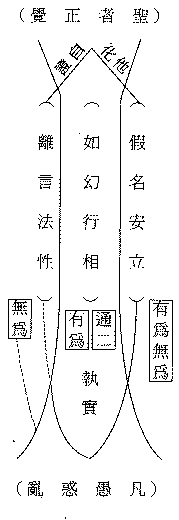
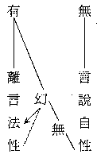
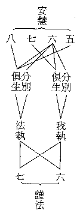
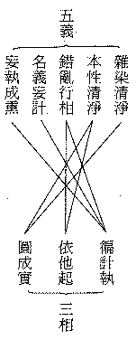
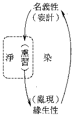

# 解深密经语体释



> **藏经**：演培法师全集

> **卷／品**：0 卷 · 10 品



---



## 目录



  - [中华民国五十八年岁次己酉孟秋上浣　李炳南敬序](#中华民国五十八年岁次己酉孟秋上浣李炳南敬序)

  - [自序](#自序)

  - [序品第一](#序品第一)

  - [胜义谛相品第二](#胜义谛相品第二)

  - [心意识相品第三](#心意识相品第三)

  - [一切法相品第四](#一切法相品第四)

  - [无自性相品第五](#无自性相品第五)

  - [分别瑜伽品第六](#分别瑜伽品第六)

  - [地波罗密多品第七](#地波罗密多品第七)

  - [如来成所作事品第八](#如来成所作事品第八)



---



序一



竺摩



佛法博大精深，浩如烟海，初读佛经，真不知从何读起？这部《解深密经》，原为研究佛法者最好的读品，唯其为印度后期佛教的大乘圣典，后期佛教所诤论的如缘起的有无自性、三乘和一乘孰为究竟、外境到底有没有、阿赖耶识的存在与否、佛智是否常住、真如缘起能否成立等问题，都涉及此经的理论。这在初读佛经者看来，不免感其陈义过高，不宜阅读；但我以为稍能研究过佛学的人，相信来读此经，还是很适当的！因佛法虽然博大精深，浩如烟海，但在说明上，可以性相因果四字来摄括了它；而现在此经，正是把性相之理，因果之事，都分析得很清晰，叙说得很有条理，使人读后，对全部佛法可获得一个明确的概念。所以我想我们不宜把它当做唯识宗的专书读，要把它当作一部「佛法概论」读，亦无不可。太虚大师曾说：『深密一经，木铎沙界，玄奘繙文，独超众师，研究法相，舍斯奚归』（见深密纲要）！本经文理精妙，研究法相唯识，自应奉为依归；因法相唯识所宗的六经十一论，如《华严》、《楞伽》、《密严》等都是义兼他宗的，唯此经从《瑜伽师地论》中别录出来，侈谈法相唯识的教义。唯识学上重要的教义如八识、二谛、三相、三无性、外境非有、三乘究竟等，都依本经的所说而善巧安立的。故研究全部佛法的学者，固然需要阅读此经，而研究法相唯识的学者，欲於唯识教理有深刻的了解和认识，尤非多读此经不可。



此经为研究法相唯识的重要典籍，说研究法相唯识者需要阅读，这是众所共喻的；而我现在要说研究佛法的人都应该读，或当做一部《佛法概论》读，这又是什麼意思呢？因全部佛法是寄存在全体佛经的，全体佛经有一个有组织的共同的说明，是在境、行、果；而此经五卷八品，对於境行果的义理，从首至尾，作有组织的、有系统的、重要的发挥：除第一〈序品〉外；第二〈胜义谛相品〉明般若真空的义理；第三〈心意识相品〉和第四〈一切法相品〉明法相唯识的义理；第五〈无自性相品〉说世俗谛和胜义谛的无二，把空有圆融，会归中道，这些都是说明大乘佛法的理境。第六〈分别瑜伽品〉，凭止观修胜解行；第七〈地波罗密多品〉，依戒度修如实行，都是说的大乘妙行。第八〈如来成所作事品〉，则说佛果上的境界与事业，属於大乘胜果所起的妙用。古来诸师，尝依这所悟境、所修行、所证果来分判本经的各品；今演培法师，则本此义而摄之於教理行果。复据佛说胜义了义、瑜伽了义、地波罗密了义、如来成所作事了义的四教，强调本经所说的七品，都为大乘了义之教，说来更为有力，更为生动。又揭示此经的四个特胜点：一、如来说本经，乃大悲善巧，为劣慧者隐空扬有，化向所不化的有情；二、后期佛教的许多问题，在本经的探讨，可以获得一个大乘佛法的核心；三、会通本经和《智论》的异同点，两者各有破除乐空爱有者的功能，以扫我国一向说般若是龙树的中观学的所依，《深密》是弥勒的瑜伽学所据的偏差；四、衡量各经都有其中心思想之所在，而以龙树根分利钝、理无二致之说，以本经为解释一切无自性空的般若教，使般若与瑜伽，内容尽管相同，而方法何妨异致。这四点中，尤重在从各经自有立场观点，而会通各学派思想的差异，使全体佛法不因割截而更见其圆满的生动和灵活，同时亦显得本经在佛法中的重要位置，而为学佛者所必读的妙品。



本经不但在唯识学上有重要地位，在全部佛法中亦有其重要地位，故古往今来的大德，亦多重视此经，多所讲解。前人已不胜举，近如太虚大师讲「深密纲要」时，亦曾从各经比较上，揭发本经有四个特点，为他经所不及。一、分齐隐显：如《金刚般若》等经，文义囫囵；而本经虽文言幽赜，密义甚深，但条段晰然，如镜眉目。二、叙说事理：如《法华》、《地藏》等经，多述本生本事诸部；此经则属於论议方广，事少而理多。三、土众秽净：诸经所明听众居处，或净或秽，或从秽入净，由净至秽；此经虽不离娑婆，而会众居处皆在出过世间之上。至众机则多属大根，不同他经或小或大。四、诠旨偏均：如来一代时教，应病施药，有偏有均，如《般若》等偏於境，《华严》等偏於行；此经则於境行果三，平等总施，事理双显。这与演师所说的四特胜点，可以后先辉映；於此，更见得本经在佛法中的重要性，而为学佛者所必读的宝典了。



我对於全部佛法，认识甚少；对於本经，尤乏深刻的研究。十年前偶以时缘，曾与东莲觉苑毕业诸生，依文解义，略讲一过，并无心得。且讲时参考书亦感缺乏，真谛和笈多的《摄论释》，佛陀扇多所译《摄论》和本经有关的叙说，都不曾寓目；仅凭圆测疏及无著之注和世亲之释，略资讲说；而圆测疏至〈如来成所作事品〉后半佚去，无从参考，幸有虚大师此品的讲录，以补其缺。但前人注疏，义深言简，学者每苦不易领悟，今得演培法师为学勤恳，手不释卷，本弘法利人的怀抱，以深入浅出的笔法，采撷精英，化为大众，释成语体文字，便利研究本经的学者，悲智功德，叹未曾有！法师远道来书，嘱为一序，因自忘其谫陋，草此聊以赞喜！



中华民国四十一年岁次壬辰腊八佛成道日　序於香港沙田南圃别业之无尽灯杂志社



序二



李炳南



宇宙万法，简言可该之曰：法性真空、名相假有而已。惟其性空，则言语道断，冥蒙湛寂，无由觅其所，以之开示於人，必藉名相以章之。观夫浩浩三藏，旨在法性，而文句不皆为名相乎？欲得鱼，必先筌也。顾其间而有通专，《解深密经》，是其专者，且为法相学之滥觞焉。



经四译，畅流以唐译为广，旨固深密，而文亦聱牙难读。曩见内学院注，三复，不得消文义，遂并注而畏之。世之治法相者，每多趋於《规矩颂》，《二十》、《三十》两颂，《相宗八要》，《成唯识论》等，已云博矣，而少有务此经者，焉得谓之深植本也。求其法缘之障，似有格於文字者矣。



演培上人者，太虚大师之再传法嗣，广额丰颐，气度沉默而温。乘与戒俱急，行与解相应，锡钵徧海内外，舌日讲，笔日述，芒鞋蒲团无完者，佛法际鬭诤之运，上人皆避不与焉。闻之，有德者不必有言，兹虽有言，仍是德也。其师顺公经筵，多其所记，而自讲自著者，几等诸身。释经，迥异乎己所欲言，行语体，自有其孔艰，勉行之，随顺风尚所知也。经无人说不解，亦非说已皆解，况义奥文深者，一闻能即解乎？此经语体之释，罔非悲心之切也。



予壮岁，习法相学，受业於南昌梅撷芸大士，授以《解深密》、《入楞伽》二经，诲之曰：必由是而树焉，若利小径，终恐无根力。唯而拜，久读，以根钝，虽困无得。呜呼，大士杳矣，解惑何人？倘是经释早出，予或不皓首茫然也。



今世崇西学，斥形上之道，纵宿根厚者，不乏向道之士。然必察所习，因其势，方不掖其进，反致其退。彼信者，原子、逻辑、相对律、一元论等，而法相类括无遗，故凡来学者，每是宗之归。果信乎阿赖耶识，能穷之，见性证道，已在其中矣。而摄折权巧，宁能舍文字般若耶？此释也，可谓正应乎时。



上人嘱予为序，谨以闻诸梅大士者，及予所困於经，所畏於注，追而录之，贡之来者，俾知前难於后，今幸於昔也。若夫加我数年，犹将开帙日诵之，时彦俊乂，览是序，见是经释，感如之何？



------



### 中华民国五十八年岁次己酉孟秋上浣　李炳南敬序



### 自序



凡对整个佛法有所体认的学者，大都知道大乘佛法的内容，有不同的三大思想体系的存在，就是古德的判教，也多有见於此的。近代我国的佛学者，其真能对全体佛法作有条理而系统的研究，发见大乘佛法三大思想理路，以自成统贯而不落前人窠臼者，在出家的大德中，不得不推尊我太虚大师及印顺导师。虚公大师从马鸣、龙树、无著的一贯大乘中，将大乘佛法，分为法性空慧、法相唯识、法界圆觉的三大宗，而以真常先於性空的流出。印公导师从印度佛教思想流变的进展中，将大乘佛法，分为性空唯名、虚妄唯识、真常唯心的三大系，而以性空先於真常的流出。二公对於性空、真常两大思想的谁先谁后，虽曾一度展开争辩，但三大思想体系的划分，大体是相同的。这与一分学者，否认印度佛教思想系中，有真常唯心的一系存在，其看法是很不同的。他们站在妄识变现的立场上，观察真常唯心的显现诸法说，觉到与自己的思想、理论不合，於是就竭力的破斥他，说他是违背正法的妄谈。其实，说真常唯心的思想，多少有点离开佛法的正宗，不是佛法正常的开展，固然是可以的；但若根本否认这一思想的存在，那实在是不可以的。因为，从印度佛法思潮的递进方面去看，大乘佛法中，实有这一思想系的存在的。假使有人觉得他不合佛法的正义，尽可以起而抉择他、洗炼他、净化他，使他成为纯正的佛法，这才是道理，如果说是否认，老实不客气的说，那是否认不了的。《解深密经》，是唯识学的根本所依，在三大思想体系中，属於唯识的一系。



我国历来的佛学者，大都认为经是佛陀亲口所说的，不论是小乘经，抑或是大乘经。因从这立场出发以观察一切佛法，所以就把一切佛法局限在如来住世的短短数十年的一时代中。如天台学者开口就说：『我天台智者大师，以五时八教判释如来东流一代时教』。判教，本为对整个佛法的浅深先后之辨别，因为佛陀说法，是有先后次第、浅深差别的。学者对於时教，如不予以抉择判释，将对汪洋似的法海，不特无以知其涯畔，亦将先后失序，浅深倒置。所以我国大乘各派中，属於教下的数家，虽各自的观点有所不同，但以判教的方式，判释如来一代时教，彼此却是一样重视的。不过，我们应当知道：以时教判释一切佛法，并非我国古德所特创，印度空有二宗的学者，早就有了判教之谈了。如空宗所判的方便法轮与究竟法轮；有宗所判的先有、次空、后中道的三时。若再进一步的探讨，不特空有二宗的学者，有判教之说，在后期大乘经的本身，就屡多判教之谈了。《印度之佛教》一书中，举几部最明显的经说：『如《法华》之初令除粪，次教理家（指《般若经》等），后则付业。《陀罗尼自在王经》、《金光明经》、《千钵经》，并判先说有，次说空，后说真常（中）之三教。《理趣经》举三藏、般若、陀罗尼』。此外，如《解深密经》所判的我空法有、我法皆空、中道了义的三教。从佛法的思潮递进方面去看，《法华》等经的判教，是佛法的主流，《解深密经》的判教，是佛法的旁流。虽说是旁流，但在佛法思想的演进中，却占有极重要的一席。虚妄唯识系的判教说，完全是依於《解深密经》而论说的。关於他的三时教说，在经的〈无自性相品〉中，有极详尽的说明。就《解深密经》而言《解深密经》，初二时教是有上有容的不了义教，第三时教是无上无容的真了义教。欲知虚妄唯识者的判教如何，应从本经中去研求。因此，在解释三时教时，特别给予较详细的说明。



三性三无性，也是唯识学上的一个重要课题，讲唯识学而不明三性三无性义，那是不可思议的。以唯识而言唯识，我们知道，唯识是非空非有的中道了义教，但所谓中道，就是在三性上显的。其实，不但中道是以三性显的，就是空有、真妄、染净、迷悟、生死流转、涅槃还灭，无一不可由三性来说明的。所以唯识学者，对於三性三无性义，特别重视。空有二宗的诤论焦点，也就在对三性的不同说明。唯识者从世俗谛出发，认为假名安立的徧计执，固可说是空无自性的，但那自相安立的依他起，却不能说他空无而是实有的。至在依他起上，离去虚妄的徧计执，所显示出来的圆成实，也是因空所显而不空的。中观者不承认这种说法，以为世俗谛中一切唯假名，徧计执固无自性，依他起同样是无自性，胜义谛中毕竟皆空，没有一法是实有而不空的，根本否认有什麼实有的圆成实的存在。於是双方就展开了激烈的论战，一直到今天，两个阵营中的学者，似还没有妥协的餘地。其实，空有是一贯的，问题在於我们怎样去融贯他，融贯得当，自然是即空即有的空有无碍，融贯不当，虽自以为是空有圆融了，而实是空有隔别不融的。这在本经的〈一切法相品〉、〈无自性相品〉中，有详尽的说明，学者可於此中求之。



此外，在〈无自性相品〉中，还谈到三乘一乘究竟的问题；在〈心意识相品〉中，广谈心意识的问题；〈分别瑜伽品〉中，建立唯心无境之理；〈如来成所作事品〉中，详究如来镜智是否常住等。总之，举凡唯识学上的要义，在本经中，差不多都涉及到。唯识所依的六经，就译来我国者说，《华严》、《楞伽》、《密严》，是否不共他宗所依，是值得研究的一个问题，唯有此《解深密经》，我敢说，是唯识学不共他宗所依的一部最根本最重要的经典，也是爱好唯识者所必须研究的唯一宝典。学唯识学，不究《解深密经》，不能得唯识的心要。



最后，一谈本书的写成：民国三十年的夏天，笔者奉虚大师命，随侍印顺法师去合江法王寺创办法王学院。印公为该院最高导师，兼为研究班授《解深密经》一课，讲完〈无自性相品〉为止。时我虽担任教务一职，但亦每日恭聆讲授。随听随记，得其大意而已。三十七年，笔者在上海玉佛寺，为该院的高级班讲《解深密经》，乃将过去所记的笔记，当时所搜集的材料，加以整理，就成了本书。现在我要说明的，就是本书前四品的主要思想，都得自於印公，实不敢据为己所独创。后面的几品，则是由笔者一手所完成的。



四十一年春，来自由宝岛，偶与慈航法师谈及此书，当蒙出资倡议助印，继承李子宽、陈慧复二居士赞成，全力支持，始寄港付印。至於校印工作，则请老友续明法师负责。财施力施，功德无量！统此志谢！



民国四十二年一月十六日　序於新竹灵隐寺



解深密经语体释



一　总叙全经旨意



㈠　梵本与译本



佛经发源於印度，研究一经的真伪，不得不探讨梵本的有无。本经在印度，测师说有二种：「一者广本，有十万颂；二者略本，千五百颂。此经梵本唯一，随译者异乃成四种」。我国流通的几种译本，是依略本翻过来的，广本我国没有翻译。但十万颂的广本传说，是有根据的，在真谛译的世亲《佛性论》中，多处引到《解节经》文，均非本经所有，可见略本外别有广本。



译本，我国有四：一、刘宋元嘉年中，求那跋陀罗（译名功德贤，中印度人），在润州江宁县东安寺，译出《相续解脱经》，后人有分为两卷、有合为一卷的，当唐译《解深密经》的后二品。其实，功德贤三藏也曾译出前几品的，这就是他译的《第一义五相略集经》。嘉祥大师的《法华玄论》中，引《第一义五相略集经》，说明三时教义，实即唐本前数品的异译。第一义就是胜义，五相就是无二相、离言相、超过寻伺性相、超过一异性相、徧一切一味相。从这经题上看，他是《解深密经》的胜义了义的异译，是无可置疑的了。不过，〈分别瑜伽品〉，在他的译本中，是还有所缺的。后人不知《第一义五相略集经》，就是本经〈胜义谛相品〉以至〈法无自相品〉的异译，说是西土所撰述，这是多麼的错误！二、元魏延昌年中，菩提留支（译名觉希，北印度人），在洛阳嵩山少林寺，译出《深密解脱经》，有五卷十一品，为唐本全经的异译。三、陈保定年中，拘那陀罗（译名真谛，西印度优禅那国人），在西京故城内四天王寺，译出《解节经》，有一卷四品，当《解深密经》的〈胜义谛相品〉。真谛翻译目录，说是天嘉二年，於建造寺译《解节经》一卷，《义疏》四卷。两说不同，不知谁正？四、唐贞观年中，玄奘三藏在西京弘福寺，译出此《解深密经》，有五卷八品。四译中，功德贤、真谛二译，比较缺少，觉希、玄奘二本是为全译，尤其奘译最为完善。兹将异译对照表列下：



宋译相续解脱经  

魏译深密解脱经  

陈译解节经  

唐译解深密经



（未详）  

序品



序品



第一义五相略集（佚）  

圣者善问菩萨问品  

不可言无二品  

胜义谛相品



圣者昙无竭菩萨问品  

过觉观品



圣者善清静慧菩萨问品  

过一异品



慧命须菩提问品  

一味品



圣者广慧菩萨问品



心意识相品



圣者功德林菩萨问品  

一切法相品



圣者成就第一义菩萨问品  

无性相品自



圣者弥勒菩萨问品  

分别瑜伽品



地波罗密多了义教  

圣者观世自在菩萨问品  

地波罗密多品



如来成所作随顺处了义教  

文殊师利菩萨问品  

如来成所作事品



研究本经，除四种不同的译本，可作比较的研究外，无著的《摄大乘论》，世亲的《摄论释》，都可作参攷。无著《摄论》的〈所知相章〉，引〈分别瑜伽品〉的心境一异门；世亲释的〈所知依章〉，把本经的〈心意识相品〉全部引进。此外，真谛及笈多的《摄论释》，佛陀扇多译的《摄论》，都是研究本经的重要参攷资料。



㈡　本经的组织



一经一论，都有他一贯的体系，严密的组织；本经自也如此。如能理解本经的组织，就可了解本经的总纲。总观全经，计有七品：〈序品〉因有如下所述的问题，今姑置而不论，且就后七品一谈他的组织。古人有将本经分为境行果的三类，今以教理行果四字来总摄他。本经的要旨，在解释圣教。释尊从前说过的教典，还有不明白或误会的，现在佛再为之重行解释。从解释过去圣教的内容中，分为所悟理（境），所修行（行），所得果三门。这与境行果的三分法，本是差不多的，今之所以不用境行果三的分类，而依佛说的四教——一、胜义了义之教；二、瑜伽了义之教；三、地波罗密了义之教；四、如来成所作事了义之教。——分别者，是因更为合理的缘故。胜义了义教有四品，古人判属於境。有依真（胜义谛相品）俗（心意识相品）有（一切法相品）无（无自性相品）次第分别这四品。真谛、俗谛、有自性、无自性，就是四品的次第与内容。有依二谛说，前一品是真谛，后三品是俗谛。有依三谛说，〈胜义谛相品〉是真谛，〈心意识相品〉是俗谛，后二品是即空而有即有而空的中谛。现说四品都是开显胜义谛，如经说的「名为胜义了义之教」可知。因这四品的要旨，在明圆悟胜义谛理，也是本经的真实意趣所在。佛说心意识相，怎麼是胜义谛呢？这是不解二谛联系所产生的问题。要知真俗二谛，是不一而又不异的，开示真胜义谛，必须从世俗上去说明：如说诸法皆空，不说诸法，怎能明了其空？《中观论》说：『如来依二谛，为众生说法：一以世俗谛，二以第一义；……若不依俗谛，不得第一义』。《涅槃经》说：『说世谛令识第一义，说第一义令识世谛』。《大品经》说：『菩萨住二谛中，为众生说法』。可见佛为众生说二谛，目的在依世俗谛去了解现证胜义谛。〈心意识相品〉，似在说世俗谛，但从佛的意趣上观察，却是显示胜义谛的。如佛对广慧菩萨广谈心意识相后，立即指出这不是「秘密善巧菩萨」，要『如实不见阿陀那，不见阿陀那识，乃至不见意法及意识，……齐此名为於心意识秘密善巧菩萨』，这不是依世俗而显示胜义谛吗？所以这四品都是：初品是依五相显胜义，二品是泯诸识显胜义，后二品约三相显胜义，遣徧计，灭依他，证圆成，圆成是胜义，足见后二品的意趣所在。此二品不同的是：〈一切法相品〉，正申显了教，〈无自性相品〉，追会隐密教。四品都是开显胜义谛，所以佛说「名为胜义了义之教」。所修行的二品，〈分别瑜伽〉，是分别修止修观，这虽是贯澈始终的，但重在胜解行，说明由凡夫的修行程序，怎样修习止观去证悟胜义。〈地波罗密多品〉，是说地上菩萨的事，虽也通於地前，但重在如实行。或说：〈地波罗密多〉是化他事，〈分别瑜伽〉是自利事，菩萨重在化他，为什麼先〈分别瑜伽〉，后〈地波罗密多〉呢？测说：『止观是总，所以先明；十度是别，故在后说。或可止观略故先明，十度是广所以后说』。这是一往之谈，其实不一定是这样的。最后〈如来成所作事品〉，是彰极果，在说明法身、化身，自利、利他的佛果位上的功德。全经组织，列表如下：



　　　　　　　　　　　　　　　　　┌依五相显胜义…………………胜义谛相品  

　　　　　　　┌显理─胜义了义之教┼依诸识显胜义…………………心意识相品  

　　　　　　　│　　　　　　　　　│　　　　　　┌申显了教……一切法相品  

　　　　　　　│　　　　　　　　　└依三相显胜义┤  

　　　解深密教┤　　　　　　　　　　　　　　　　└会深密教……无自性相品  

　　　　　　　│　　┌瑜伽了义知教……………胜解行………………分别瑜伽品  

　　　　　　　│明行┤  

　　　　　　　│　　└地波罗密多了义知教……如实行……………地波罗密多品  

　　　　　　　└彰果─如来成所作事了义之教……………………如来成所作事品



㈢　经题的解释



《解深密经》，梵语是「涅谟折那[利-禾+冉]地素怛缆」，若依梵文的次第，应名《深密解经》，所以，有人译为《深密解脱经》，有人译为《相续解脱经》。名依义立，离义无名。解深密三字，随经义解释，作四种说明：



一、解释深密教：解是解释，如来过去说过的深奥教义，有些弟子还不能正确的了解，所以后来又提出请问，世尊为使他们得著一个明晰的认识，特又为大众重新解说。深是甚深，如大海一样的不见其底。密是秘密，如囊中物不能窥见其内容。甚深秘密又分二类：一是深密义，一是深密意。像本经所说的『心意识秘密』，『深细秘密』，都是指义理的秘密。像本经所说的『一切法无二』，《般若经》所说的『一切法无自性，一切法不生不灭，本来寂静』，『不共外道陀罗尼』，『一乘』等，都是指意趣的秘密说的。密意，是说不能专依文字语言的表面去解说，还有其他的用意。约解释甚深密义说，徧通於全经；约解释甚深密意说，只限经中的一部分。



从佛陀说法及诸法实性上说，是无所谓甚深，亦无所谓秘密的。如来说法，随顺机宜，不浅不深，适如其量，恰到好处。诸法实性，平等一味；在平等一味中，没有什麼浅深可说。能说人、所说法，既都说不上甚深秘密，为何还有甚深秘密之名呢？当知这是建立在众生根机上的。《智度论》说：『诸经於佛，则无甚深，甚深之称，出自凡人；凡人所疑，於佛无碍，凡人所难，佛皆易之』。所以，龙树又作很好的比喻说：如大海水，一般人以为很深，而罗睺罗阿修罗王，变化八万四千由旬的高大身，站在海水的中间，水仅齐膝，海水对他有什麼甚深可说？龙树又举喻说：一个山乡的人，不知盐是什麼，一次偶而走到街坊，尝到有盐味的小菜，觉得这小菜有百般的甘美，就问别人里面放了些什麼，人说里面放了美味的盐，并且拿盐给他看。他听见了，就抓一大把盐向嘴里放，那知放进口后，又咸又苦，几乎呛破了喉咙。盐是美味的，在我们听来，并不难懂；但在他却成为秘密。他不知道盐是要在与菜蔬的适当配合下，才是调味的。盐是美味的，这话在不懂的人才成为秘密。佛法的深密或显了，也是这样；懂得就是显了，不懂就成秘密。



理解了深密，才可说到解深密，这可举〈无自性相品〉为例：佛为众生说『一切诸法皆无自性，无生无灭，本来寂静，自性涅槃』；众生听了，因根机的差别，有种种的意解不同，可以分为四类：㈠、五事具足的众生，听佛说了诸法无自性、不生不灭、本来寂静等，就能如实通达，依之去行，乃至成佛。在这利根众生前，自然没有什麼深密可言，亦不劳如来再为解说。须菩提在《般若经》中曾对舍利弗表示过这样的意见：『我闻般若波罗密多，非甚深，非秘密，非难通达』。㈡、五事不全具的众生，不能了解佛说的话，但能生信心，认为佛说般若性空，甚深难悟，这唯有佛智才能知道，像我这样的智慧短少，怎能了解佛所说的奥妙深法？因此自轻而住，不敢附会妄解。像这样的有情，一切法无自性教，就成为深密了。舍利弗在《般若经》中，曾表示过这样的意见：『般若甚深极甚深，秘密极秘密，难通达极难通达』。㈢、有五事不具的众生，对佛说的一切法无自性等经典，能生信心，自以为理解，其实是误会了！他以为一切法决定无自性，不生不灭，把一切法看成如龟毛兔角一样的常无。龙树论中曾说到这类众生，是方广道人，是拨无因果的恶取空者。所以无自性教，在他成了深密，他还不自知。㈣、另有一类五事不具的众生，由无始来的有见熏习，听了佛说诸法无性等道理，不但不理解空义，且否认这是佛说，以为一切法无自性是断灭而毁谤之。《智度论》说：『佛灭度后后五百年，小乘五百部，闻毕竟空，如刀伤心』，就是指这类有情。一切法无自性教，本不甚深或秘密，但因根机的差别，就有甚深不甚深、秘密不秘密的发生。后三类人，无论是未解误解，或信或毁，都不能因佛所说而得解脱。佛为悲愍这类有情，隐空明有，为之宣说《解深密经》，使他们从三自性，悟入三无自性，通达一切法空。所以经说：『然非无事而有所说』。『若於依他起相及圆成实相，见为无相，……说彼诽拨三相』。说了这话，五事不全具信而未解的有情听了，因是差别显了之谈，就从依他起上，遣除徧计所执，悟入诸法性空。不具五事信而倒解的有情听了，认识了缘起不是没有，常住寂灭性不是不可证，舍恶取空见，灭依他起幻有非无之执。五事不具而又不信不解的有情，听说事理非无，轻毁的心理息灭，就得证悟诸法的圆成实性了。所以，佛对未解性空般若的众生，说《解深密经》的胜义了义教，是极善巧方便的。明白深密不深密，在众生而不在法，就可知道第二时中佛说一切法无自性教，本不深密或不了义，只因众生无智了解他的意义，方才成为深密及不了义。反之，『於初学者作差别说』；《解深密经》在他听来当然是显了的，可是有的众生因为根性太钝，听了《解深密经》仍然不了解，畏空滞有，取舍任情，《解深密经》也就成了深密不显了了！研究佛法，若从众生的根机上著眼，是可减少许多无谓的诤论的。



二、解了深密理：这是从悟理方面讲的。如来说的深密教理，听者能如实通达，就名悟理。所悟的理性，是一味无差别的胜义谛，他是法尔现成的，但又不是寻伺所行境界，所以又说为深密。本经第二卷说：『於我甚深密意言说，如实解了，於如是法深生信解，於如是义，以无倒慧如实通达』。是说於如来的善说法中，能够无颠倒的解了通达，从闻思修的三慧体悟乃至现证诸法无漏的实性，是为解了深密理。胜义了义教，就是依这意义得名《解深密经》的。



三、解脱深密行：解放、解脱，都是这个解字，但不能专从文字的一边作解释的解讲。深密或译作相续，在梵文中，有盘根错节缴绕难解意。众生无始以来，有烦恼习气的缠缚，如藤蔓的滋生缠绞，如荆棘罗网的拘碍系缚，极难解脱。本经第三卷说：『此能解脱二缚为业，所谓相缚及粗重缚』。又说：『永断烦恼及所知障』。『能破如是大愚痴罗网，能越如是大粗重稠林』。无始来缠缚有情的二缚，众生位上不能解决，要到十地菩萨，修止观行，修十波罗密行，才能渐除，惟佛与佛方能断尽，所以是深密的。盘根错节缴绕难解的二缚解决，叫做解深密行。〈分别瑜伽〉及〈地波罗密多〉的了义教，就是依这意义得名解深密的。



四、深密解脱果：解脱深密行，是约修行解脱烦恼的系缚说；深密解脱果，是约离烦恼系缚而得解脱自在说，如热铁离炽然后的铁体。约这说解脱，就是佛果的果德。经说：『声闻、独觉所得转依，名解脱身』。如来所得转依，以『无量功德最胜』相应，名为法身。所以佛的解脱法身，比声闻人的解脱身，是更充实、更深刻、更奥秘、更不可思议的。这解脱法身，其他的经中，或说名大涅槃、无住涅槃、不思议解脱等，《维摩经》中则说为三德秘密藏。佛住甚深的三德秘密藏中，『徧於一切三千大千佛国土中，示现化身，乃至由此言音，所化有情，速得解脱』。具大悲心自脱脱他，到二俱圆满时，就成无上菩提、得大涅槃了。这深密解脱果的意义，在本经的〈如来成所作事品〉中，有详细说明；成所作事的胜义了义教，也就是由这得名的。



㈣　本经的特胜



上面虽以四义解释本经四教七品得名解深密的所以，然细寻经义，要从胜义了义教的解释，或了解深义密意方面，才得名为解深密的。所以后三种的了义教，只从文义邻近上讲，实质是不可说为解深密的。检胜义了义教中，说解深密的地方很多。如〈胜义谛相品〉中：『解甚深义密意菩萨』。『我於如是微细极微细、甚深极甚深胜义谛相现等觉已，为他宣说显示开解』。〈心意识相品〉中：『吾当为汝说心意识秘密之义』。〈无自性相品〉中：『为汝解释所说一切诸法皆无自性……所有密意』。『我依此故，密意说言唯有一乘』。『如来但依如是三种无自性性，由深密意，於所宣说不了义经，以隐密相说诸法要』。『於我甚深密意言说如实解了，於如是法甚深信解，於如是义以无倒慧如实通达』。这些，都是解深密的最好明证。解深密所解释的深密教，是《般若经》。《般若经》明一切法无自性空，不是一般劣慧众生所能领解的，佛说要宿习三多——多供养佛、多事善友、多闻法要——的久行，方可为说《般若经》，而他也要到这程度，才能信解《般若经》。龙树说：『为久习者说无差别，为新学者应作差别说』。提婆说：『於不堪闻无我法者，我无我中，以说前为胜』。执空的方广道人，信戒没有坚固的基础，忆念妄取一空；著有的五百小乘，深入有见的深坑，不爱听般若空法，谤为文颂者说。如是等人，不特恶见熏心，造匮正法业，流转可愍，就是如来辛勤所证所说的般若大法，亦将为之隐覆不彰。佛陀为了拯救这班劣慧有情，及令性空般若教日丽中天，乃善巧方便的隐空说有，让那些执有执空的有情，不障般若而性空解脱门开。《中观论》说：『大圣说空法，为离诸见故，若复见有空，诸佛所不化』。不化的有情，现又化之，这是佛陀的大悲善巧，所以善巧与大悲，是本经的特胜之一。



《解深密经》，是从《瑜伽师地论》别录出来的，一向为瑜伽学者所宗。如唯识学上的心意识、三性、三无性、外境非有、三乘究竟等的主要教义，都是依本经善巧安立的。所以《解深密经》为瑜伽宗所依的最根本的圣典。中观学者对本经有两种看法：一说义同般若，瑜伽师所说是错误的；一说瑜伽师所说义同本经，但不是究竟之谈。印度后期佛教所诤论的：如缘起的有无自性，三乘一乘的究竟，外境的有没有，赖耶的存不存在，乃至佛智是不是常住，真如缘起能不能成立，几无一不涉及本经。研究深密的学者，若在经中玩味而有所得，就可探得大乘的心肝了！这是本经的特胜之二。



中国的佛学者，一向都这样说：《般若经》是龙树的中观学所依；《深密经》是弥勒的瑜伽学所依。其实，这是不正确的！首先我们要认识：《深密经》不是与《般若经》不相关涉的另一教法，而且是《般若经》的解经。就是弥勒的《瑜伽论》，亦往往依《般若经》义，成立非空非有的中道。不过，瑜伽学者，站在《深密经》的立场，看般若的教义，说《般若经》的言教，不怎麼显了，如来的真义，不容易了知，必须要如《解深密经》所说，获得正确理解，才能窥见如来的真义，并不是说《般若》、《深密》的本义有什麼不同。龙树造《智度论》解释般若，於深密不见他有显明的解说，但不能因此就说深密不是中观学者的所依。佛所说经，本为诸家所共依的，只因论师的解说不同，与经的本义，也就不能尽合。《瑜伽论》因有很多的思想，同於《解深密经》，但三乘同见法无我，约法无我说一道清净，离六识外别立深细相续心，本性清净为依他，为钝根劣慧说假名，因缘有不同，都是合乎龙树学，违反瑜伽义的。可见本经不唯是瑜伽所宗，而亦是中观所依的。本经是《般若经》的解经，虽为劣慧初学者说，然非不兼带的谈甚深义；《智论》是《般若经》的释论，虽正就五事具足者作深刻的立论，然也不是不为初学者兼谈差别义。由此可知《智论》与本经：从他的中心点说，两者是差别的；从他的所兼义说，两者是共通的。所以《智论》与本经，同样有破除乐空爱有者的妄计功能，这是本经的特胜之三。



一经有一经的中心思想，研究者从他中心思想去探索他的本义，是最正确的。离开中心另谈一套理论，以作牵强附会，是最没有意义的。唯识学者，站在本经的立场，说般若不了义，《深密》是究竟显了至高无上的。中观学者，根据《无尽意经》的思想，说般若是最澈底最究竟的胜义了义教，《深密经》是够不上说为了义的。他如天台判本经是四教中的通教，贤首判属於五教中的始教，都表示本经是不了义的。三论学者，从《般若》、《深密》同说一切法无自性，一切法不生不灭，本来寂静，自性涅槃等的见地上讲，说二经同是了义的，没有此胜彼劣的差别。虽有几说不同，但对本经有深刻研究的，要算唯识学者。龙树分利钝的二种根机，说利根听一切法无自性教，就能体悟；钝根听了，再加解释，始能了解。本经就是解释一切法无自性空的般若教，所以二者的内容是相同的，方法是异致的。或说：《般若经》是总，《深密经》是别；利根胜慧的从总门入，钝根劣慧的从别门入。虽入门不同，所悟空性则一，这是本经的特胜之四。



二　别释胜义了义



㈠　释胜义



胜义对世俗说，就是世俗胜义的二谛。二谛是如来说法的规则，缺一不可。《中观论》说：『如来依二谛，为众生说法』，就是此意。世俗谛是一般人所感觉的常识境界，胜义谛是圣者特殊智慧所认识的境界。常识的世俗境界是错误的、歪曲的；特殊的胜义境界是正确的、不颠倒的。



胜义有三种的解释：一、持业释：义是所认识的对象，胜是第一殊胜的意思，就是最高级最究竟的境界。这样，胜就是义，故名胜义；或第一就是义，名第一义。宇宙万有的真理，诸法普徧的实性，就是这胜义谛性。二、依主释：胜是圣者能认识的无分别智，义是圣者所认识的特殊妙境，以特殊智观察通达特殊境，叫做胜义。所谓彼胜智所认识之义，名为胜义。三、有财释：这说本身不是胜义，但有彼胜义，亦得名为胜义。如具缚凡夫，没有无分别智，是不能得胜义无性的，然因听闻无垢清净的圣教，如理思惟，观察修习，具有有漏的三慧，三慧虽不就是胜义的智慧，然能顺彼无分别的现证妙慧；因由这三慧，就可引发无漏的无分别慧。本经所说的胜义，是第二种清净智慧所缘的清净境界，如经说：『若是清净所缘境界，我显示彼以为胜义』。世俗，是隐覆粗显的意思；蒙蔽事物的真相，令不见他本来的面目，这是世俗的功用。常人所见的色等五尘，不就是五尘的本身。如眼所见的白色，常人总以为是个单纯的白色，其实他是七种颜色综合成的，这以分光镜一望便可了知。平常说世间是虚妄的、如幻的、不真实的，都是指这世俗说的。



胜义、世俗的二谛，在大小乘的圣典中都曾谈到。《阿含经》解说二谛：真实性是胜义，假名说是世俗。如六根六尘是胜义有，粉笔黑板就是世俗说。这样，小乘的胜义有，就是大乘的三科事。三科的假实，学派各说不同：说一切有及犊子系，计三科皆实；大众系的说假部，以十二处为非实；上座系的说经部，以蕴处为假有，十八界是真实。有说苦集灭道的四圣谛是胜义，如《遗教经》说：『月可令热，日可令冷，佛说四谛不可令异。佛说苦谛实苦不可令乐；集真是因更无异因；苦若灭者即是因灭，因灭故果灭；灭苦之道，实是真道，更无餘道』。有说（大众分别说系）：十二因缘是胜义；《缘起经》分别缘起与缘生，以缘起为『若佛出世，若不出世，法性、法住、法界常住』。所以大众分别说系，以缘起为无为，缘生为有为，无为就是胜义谛。这是从缘起钩锁的因果必然性，推论出一常住不变的理则，说为胜义谛的真实性。大乘经解说二谛，世俗就是常识的境界，胜义或指空性，或指实相，或指真如、法界，或指无相、实际。名虽别异，而同含有恒常、普徧、真实的定义。今且就本经一谈胜义谛。经云：『若是有为即非胜义』。又说：『若是清净所缘境界，我显示彼以为胜义』。意思是：有生有灭的因缘法，不是胜义谛，清净智慧所缘的清净境界，才是胜义谛。所以站在大乘的立场上看：小乘以三科的世俗谛为胜义谛，是错误的。《十二门论》说：『汝闻世谛，谓是第一义谛』。小乘也有主以四谛理为胜义谛的，即苦下的苦、空、无常、无我；集下的集、因、缘、生；灭下的灭、尽、妙、离；道下的道、如、行、出是。这在龙树学中许不许可如此呢？龙树说：无常无我非第一义，实相理中常无常、我无我是不可得的。不过，通过空性的即空无常，即空无我，龙树是又许为胜义真实的。所以说：无常无我只合三法印，要与空性相合，才是胜义谛。不通过空性的无常无我的理性，有时是偏有为，有时又偏无为的。无著说胜义，一如本经说的清净所缘境界，一如小乘说的蕴处界三。《瑜伽论》说：『如其色等想事，缘离言说性，当知此性是实物有、是胜义有』。绘表如下：



　　　　　　┌三科事─┐  

　　　小乘许┤　　　　│  

　　　　　　└四谛理─瑜伽许（实有者）  

　　　　　　　　　┌─┘  

　　　大乘许─一法界─中观许（无性者）



小乘及瑜伽派的胜义谛，是有自性的；大乘中观派的胜义谛，是无自性的。胜义虽是普徧平等一味性的，然由学派思想的不同，大分为有无自性的两类。不过，三科事的因果等，龙树、无著还有诤论的：前者说这是胜义空，后者说这是胜义有。龙树为破瑜伽派的缘起因果胜义有的不澈底，於是就说本经是不了义的，因为本经是谈胜义有的。这是一边之谈，实则本经在胜义了义教中，说胜义为清净所缘时，只是讲通达空无自性，为真胜义谛，根本没有说到什麼缘起因果法是胜义有的问题，所以本经是不是了义，与这毫无关系。



㈡　释了义



了义对不了义说：说理澈底、明瞭、究竟、是了义；反之，是不了义。佛是一切智者，这话是了义的，因是澈底明瞭究竟之谈。说法人可得五种利益，这话是不了义的，因不是澈底明瞭究竟之谈。了不了义在大乘经中有各种说法不同：有说略说不了义，广说是了义；有说广说义多为不了义，略说义少是了义；有说理深是了义，理浅为不了义；有说理浅明白是了义，理深难懂为不了义；有说小乘法不了义，大乘法是了义；有说圣人所知的特殊境界是了义，常人所见的庸俗境界为不了义；有说小乘的四谛法为不了义，大乘的性空法是真了义；有说三德秘藏是了义，非三德秘藏即非了义。虽有多种的解说不同，然综合的看，不外下列两点：



一、约教显明不明白分了不了义，二、约理尽不尽分了不了义。实际此皆各说一边：如说一枝粉笔是由人工水土等做成的，这在教显方面是了义的了，但在理论方面并不怎麼究竟，所以又成不了义了。又如宣说一切法无自性空，这在理论方面是了义的了，可是由於说得不怎麼详细明白，所以在教显方面又成为不了义了！瑜伽学者，就教显分别了不了义，而以《解深密经》作衡量的标准。他说：教显明白是了义，如果依文取义，解说不明，不论理论说得圆不圆满都不得名为了义。所以他引本经说：『世尊於初一时，在婆罗痆斯仙人堕处施鹿林中，惟为发趣声闻乘者，以四谛相转正法轮，虽是甚奇甚为希有，一切世间诸天人等先无有能如法转者。世尊彼时所转法轮，有上有容是未了义，是诸诤论安足处所。世尊在昔第二时中，惟为发趣修大乘者，依一切法皆无自性、无生无灭、本来寂静、自性涅槃，以空性相转正法轮，虽更甚奇甚为希有，而於彼时所转法轮，亦是有上有所容受，犹未了义，是诸诤论安足处所。世尊於今第三时中，普为发趣一切乘者，依一切法皆无自性、无生无灭、本来寂静、自性涅槃、无自性性，以显了相转正法轮，第一甚奇最为希有！於今世尊所转法轮，无上无容是真了义，非诸诤论安足处所』。第一时中说的诸法有自相教，第二时中说的诸法无自相教，第三时中善巧分别有无自相教。善分别的，其义不可更作餘解，是了义的，不善分别的，其义须作另一番解释，是不了义的。中观学者，约理尽不尽分别了不了义，而以《无尽慧经》作为衡量的标准。他说：理论说得究竟，就是了义的，假使理论不澈底，不论教显说得怎样明白易知，都是不了义的。所以他引《无尽慧经》说：『显示世俗者为不了义经，显示胜义者为了义经』。怎样是显示胜义？怎样是显示世俗？《无尽慧经》说：『以种种名言宣说我、有情，於无我中说为有我，此等名不了义经』。『若显示空、无相、无愿及无我等解脱门，此即名了义经』。一切法本来无我，而现在说有我、或有情、命者、养者、士夫、补特伽罗、意生、儒童、作者、受者，这自是不了义的。一切法皆无自性、无我、无有情、无命者、养者等，就如一切法的本相，宣说他无我、无有情等，无相、无愿、无作、无生、不生等，这自然是了义的。《般若经》是显示空、无相、无愿等的真理的，所以《般若经》是了义的；《深密经》显示此理不澈底，所以是不了义的。其实，佛陀曲顺机宜，方便说法，有时为了使诸有情信解受持起见，於诸大乘经中，特别强调说这是究竟了义之教，如《法华经》、《华严经》等，无不说他是经中之王。然而究竟是不是了义，这得抉择他的内容方可予以判断；但听了义之名，那是不可靠的。所谓抉择内容，就是考察经中所诠的意义，是不是合乎某一真理的定义：合即了义，不合即非了义。不以真理的定义，抉择他的内容，那就部部经都是了义，而没有不了义的经名了；如此，那还辨别什麼了不了义呢？有说：辨别了不了义，不以经说为凭，因经中安立的了不了义之法，是多种不同的，所以必须根据诸大论师分辨抉择的了不了义，方能真实探得谁是了义，谁非了义。这是轻经重论的论调，其实不定是如此的。因为，造论的论师，见解有浅深，抉择有差别，他所分辨的了不了义，不见得就全是正确的！至於说论有严密的组织，一贯的条理，对经的抉择，详细明白，使研究论典者，易於通达经的意趣，这是真的；若说论所辨别的了不了义，就属可靠，那倒未必！佛所说的一切胜义了义之教，都是甚深难知难以理解通达的：如《般若经》、《解深密经》的胜义了义教，不特无智慧的读了不能得著他的要义，就是有智慧的读了也不能完全领悟他的意趣！那怎麼办呢？这唯有向诸大论师所造的论典中去求理解：如读弥勒的《瑜伽》、《中边》等论，就可理解《深密经》中所说的胜义了义教；若读龙树的《中观》、《智度》等论，就可理解《般若经》中所说的胜义了义教。所以平常说的学经也要学论，其意就在於此。



㈢　胜义了义



什麼是胜义？什麼是了义？这在前二段中已说得非常明白；现在再将胜义了义合起来，一谈他的深义。中观师说：胜义就是了义，了义就是胜义，没有胜义不是了义，也没有了义不是胜义的。瑜伽师说：了义是胜义的，不了义也有是胜义的，如一切法空，是诸法的胜义，但不是了义，因为教显简单，没有说得明白，必如本经详细的说明三性三无性，方是胜义了义。不过，中观师说的胜义是了义的这话，是有两种解释的：㈠、澈底义：了是完毕结束之意思，如事已做完毕，叫了，没做完毕，叫未了。诸法胜义谛，是空无我性，是澈底究竟之谈，不须再用其他的话加以转变解释，名胜义了义；如果还要引用其他的意义来加以解释说明，就不是究竟的胜义了义教了。㈡、决定义：了是明了决定的意思，如一加一是二，二加二是四，数目决定，明了无疑，名之为了。诸法胜义谛，以能成的正当理论，建立他是真正胜义，已经确定明了，这确定明了的胜义，既不为其他理论所驳倒，也不可转释为另一意义，所以是胜义了义；假使可以转释为一分空，一分不空，或全分不空，那就不得算为胜义了义教了！至瑜伽师说胜义是了义的这话，了是作明了解的。诸法胜义谛，从世俗名言上去显示他时，如果解释详细，说得明白，就是胜义了义；假使说得抽象，解释不明，那他虽是胜义，可不能说为了义。如诸法无自性的这话，本来是不错的，但你却不能如言执义的以为什麼都是空无自性，必须要作另一种的意义去解释，也就是说要如《解深密经》的明了显示：徧计执是无自性的，依他、圆成是有自性的，而依他起上，遣除徧计执所显的空性，是清净圣智之所缘的。如是分别说明，方是究竟的胜义了义。



上面在解释经名中，曾说法的本身没有什麼深密，深密是在众生的根机；现说了不了义，亦以众生的根机来显示，较为妥当无诤。《般若经》说一切法皆无自性，钝根听了不能领会，成不了义；利根听了当下悟解，就成为了义了。所以约钝根需要重行解释说，《深密经》是了义，《般若经》是不了义的；约利根不需重行解释说，《般若经》是了义，《深密经》是不了义的。然若唯就法说，不论是从胜义、空性或教显方面去看，《深密经》都是了义的。中观师从法上批评《深密》不了义，实是错误的；因本经也说空性，若此空性不算了义，要《般若》说的空性方是了义，那这空性实也不可说为了义，因还要约教显示，才能明白的。所以本经决不因空宗说他不了义，就是不了义，他自有他的伟大价值及在佛学上所占的崇高地位！研究佛学者，倘能从根机的利钝著眼，不唯在法上观察，就不会我说你所宗，或你说我所宗的圣典是不了义了！如更进一步把理尽教显统一起来，直探法的本义，就更不会有了不了义的诤论了！



------



### 序品第一



本经的〈序品〉，是值得研究的一个问题。《瑜伽论．抉择分》中，除本经的〈序品〉没有引进外，其餘的七品完全被引用了的。唐译的〈序品〉，以十八圆满的报土，说明法会的缘起（《摄论》说这是百千大乘经的通序；《佛地经》也有）。谛译的《解节经》，说是化身如来在秽土说的，如该经说：『如是我闻一时佛婆伽婆住王舍城耆阇崛山中』。但在他的《解节经记》里，又说佛是在『毘舍离国鬼王法堂，为真尚菩萨说解节经』。世亲的《佛地论》解释《佛地经》的〈序品〉，举出三说不同：有说是变化身在变化土说；有说是受用身在受用土说；有说说法者唯一释迦，而听法者有行位不同，见有差别，解有浅深。疏说：『地前大众见变化身居此秽土为其说法；地上大众见受用身居佛净土为其说法：所闻虽同，所见各别；虽俱欢喜信受奉行，解有浅深，所行各异』。诸说不同，矛盾冲突。而尤特别的，魏译本中，〈序品〉之前，还有『归命释迦牟尼佛』的一句，由此更可证〈序品〉的问题所在。不过，从各方面考察起来，可以作这样的说：略本《深密经》，是从《瑜伽论》录出流通的，前既没有〈序品〉，后也没有流通。弘扬者与翻译者，觉得没有〈序品〉不对，就给他按一通序：或说此处、彼处说，或说净土、秽土说，或说受用身、变化身说，因而彼此所说出入不同。有人不明於此，想以圆满报土说的〈序品〉，来推尊本经在圣典中的价值，是就未免太无谓了！本经确有他的崇高价值，读了本经就会知道，无庸以十八圆满的报土去显示他的殊胜！



解释经文，向以三科分判：初说一经的缘起，次说一经的宗义，末说流通的胜利。古人分判本经，有以「教起因缘」、「圣教正说」的二分判；有以「教起因缘」、「圣教正说」、「依教奉行」的三分判；有以「教起因缘」、「无等境界」、「无等胜行」、「无等妙果」、「依教奉行」的五分判。现以「法会缘起」、「解释深密」的两科，判释本经。法会缘起，等於序分；解释《深密》，等於正宗分。本经没有流通分，所以不另建立。经末尔时曼殊室利下，虽有依教奉行之说，但这是散在诸品中的，只可说是品中的奉行，不是一部的流通。餘经有证信、发起二序，本经唯有证信而无发起；此到解释经文时自知，现在不多说了。



甲一　法会缘起乙一　说闻时节



如是我闻：一时。



每一部经，总以『如是我闻』为开始，『信受奉行』为结束，这是什麼道理？真谛《七事记》说：经首安立如是我闻，是为却除三疑；龙树《智度论》说：这是集经者遵佛所说而如此的。其实，这含有信智的意思在内。如是，是信顺态度的表示：一件事情，信得过，就说如是，信不过，就说不如是。佛法也是这样：能以纯洁无疵的心态，诚挚善意的信念，接受如来的教授教诫，名为如是；反之，即为不如是。如是还有无诤无染的意义，此指不离信顺的正智说的。正智是通达真理的利器，真理没有正智去作正确的认识，就要产生种种的诤论：世间学者，讲唯心，说唯物，你攻我伐，纠缠不清，推其原因，病在缺乏明晰的正智。信受，是信解受持；奉行，是闻思实践；这仍是信智。信与智二者，是听闻或研究佛法的根本，缺一不可：信如两手，智如双目；无手就不能取得佛法的珍宝，无目就不能行上佛法的正道。《智论》说：『佛法大海，信为能入，智为能度』，亦即此意。如是，又可作所指讲，即指这部经。我闻，是集结人的自称。合起来说：谓这部解释甚深密教的经典，是我亲从佛前所听来的。一时，指说听这经的时间。不明白的指定年月日，由於各地的时间不同：如印度的正午十二时，不定是我国的正午十二时，我国的正午十二时，又未必是英美的正午十二时。近代天文学说：欧亚日中，非洲日出，美洲夜半，澳洲日没。因为时间不一，所以混称一时。实则，佛在世时，有时说这法，有时说那法；殆佛灭后，佛弟子们已模糊记不清了。如十万偈的《大般若经》，是佛成道后五年说的，这在经中有著明文记载；但其餘的七部般若，究是何年何月说的，已无法记出，只好总说一时。古德解经，广释一时，无关弘旨，所以这里也就不多说了。



乙二　依正庄严丙一　净土庄严



薄伽梵住最胜光曜七宝庄严，放大光明，普照一切无边世界，无量方所妙饰间列，周圆无际，其量难测，超过三界所行之处，胜出世间善根所起，最极自在净识为相，如来所都，诸大菩萨众所云集，无量天、龙、药叉、健达缚、阿素洛、揭路荼、紧捺洛、牟呼洛伽、人非人等常所翼从，广大法味喜乐所持，现作众生一切义利，蠲除一切烦恼缠垢，远离众魔，过诸庄严，如来庄严之所依处，大念慧行以为游路，大止妙观以为所乘，大空、无相、无愿解脱为所入门，无量功德众所庄严，大宝华王众所建立大宫殿中。



薄伽梵是说法的教主，其他经中或称佛，或佛薄伽梵并称。弘扬者解释经文，大都把他别为独立的一科，测疏就是判为说教正主的。从佛为一经之主说，应有他独立一科的地位。现在把他摄在依正庄严文里，是从文法的观点上讲的。「住大宝华王众所建立大宫殿中」，是显佛说法的道场；「最胜光曜七宝庄严」等，示说法的道场庄严，都是一些修饰语、形容词。若把薄伽梵单独的立为一科，与下文分开来读，那「住大宝华王众所建立大宫殿中」这话，就缺少名词或代名词的主格（或叫主辞），成为不完全的句子了！如说「住大觉讲社读书」而不标明某甲某乙，这话就有了语病，因为人们可以问：是某甲在大觉讲社读书呢？还是某乙？同样的，是菩萨住大宫殿中呢？还是声闻？如不标明的话，人们会发生这样疑问的。现在把薄伽梵连接下文，读为「薄伽梵住大宝华王众所建立大宫殿中」，有了主辞，句子完整了，人们一读，就知是佛，不是声闻、菩萨，也就不会犯上述的毛病！



薄伽梵是印度话，《佛地论》说有六义：㈠、自在义：缠缚身心令不自在的，是烦恼、所知的二障，欲求身心的解放，唯有割断这两条铁索。佛以他的强有力的慧火，焚烧了那葛藤络索，不再受他缠缚，所以就得自由解放。㈡、炽盛义：世间最猛烈的火炎莫过太阳，他离人住的地球一万万五千二百万公里，仍可放出他的火和热，接近他的地方，更是溶化一切而不容固有的存在，所以说他是团炎热的火球。他虽是一团猛烈的火聚，但当地球环绕著他运转时，他还有照不到的地方。佛是一切智者，他的炽然智火，常人虽不觉察，但他作用力量，却超过太阳千万亿倍，因为般若智火，不特能够烁破宇宙黑暗，窥见生命奥秘，且也能够焚烧固体的实物，消溶自性的执见。经说：『般若如大火聚，四边不可触』，即是此意。佛证得了火聚似的般若，所以以炽盛义显示他。㈢、端严义：端是端庄，严是严饰，这是从相好上显示佛德的。世人求相貌美，只是在外表上加以庄严修饰，并不是真的自然美。具诸功德庄严的佛陀，眼如无云的秋空，面如净光的满月，口若日放的莲华，身似赤黄的金色：这一切福业感得的自然美，是任何修饰的美所不能比拟的，所以说是端严。㈣、名称义：人格高尚，行为端庄，为人胜过为己的，不求名而名自得。一般人不理解此，终日求名而名不称。俗说：『名副其实』，实是什麼？即人格、行为、道德、学识是。没有内容的实，纵然博得一时的令誉，一旦被人识破，结果必然是身败名裂。佛是人格的完成者，具有自利利他的胜行，备有纯洁无疵的品德，所以名闻於万亿国中，誉满於三千界内。经说『名称普闻』，确是真实不虚的，所以说名称。㈤、吉祥义：凶横暴恶的魔罗，降灾消福的神魃，魑魅魍魉的鬼怪，残忍毒辣的妖仙，是世间不吉祥的物类，谁碰著了，谁就倒楣，谁接近了，谁就晦气！趋吉避凶的人类，大都是远离这些的。佛是悲智具足的圣者，见到人类的灾难，犹如自己的灾难，见到人类的祸患，犹如自己的祸患，只有时刻的设法解决，不会增加众生的苦难，所以内具悲心、外现慈和的佛陀，是世间的最吉祥者，谁亲近他、忆念他、供养他，都得极大的利益，所以佛具吉祥。㈥、尊贵义：世间最可尊贵的，不是金刚宝、帝王位，而是要具如上五德，常常利益安乐有情的人，才够上称为至尊至贵！谁有这资格呢？唯佛与佛能之。所以佛是世间最尊贵的。



佛的功德无量，以德立号，名亦无量，为什麼经首仅置薄伽梵名呢？以此能总摄诸德，餘名不尔，所以不立。



薄伽梵是能说法者，大宫殿是说法处所。宫殿，是君主时代帝王所居的地方，如天子的居室叫宫，登堂叫殿。殿还含有尊敬的意思，像佛教寺庙供佛菩萨的地方，叫大雄殿、弥勒殿等。世间的宫殿，不论是王居或佛宇，都是依地建筑而极庄严的，同时也比一般房屋来得巍峨、雄伟、高大。佛住的宫殿，是依大宝华王众所建立的，是由无量功德众所庄严的，至大无外，所以叫大宫殿。大宝华王者，王是自在义，华是清净义，宝是尊贵义，大是殊胜义。世出世间，最殊胜、尊贵、清净、自在的，莫过於一念心，所以大宝华王，就是一朵心华。根据经说的『一切唯心造』、『心净国土净』的思想，更可证知唯有心华才能成就净佛国土，唯有心华才能建立大宫宝殿，也唯有具足无量功德的心华，才能庄严众所建立的大宫宝殿。



心华建立的大宫宝殿，是无量功德众所庄严的，亦即最极殊胜的光曜七宝所庄严的，所以能从殿中放出广大光明，普照一切无边世界，无边世界藉这放射过去的广大光明，也就夺目似的明朗起来。庄严宫殿，不特是表面的修饰，就是每一角落、每一方所，无不以种种华文、雕刻、彩畫、微妙间列的粉饰的，所以说无量方所妙饰间列。庄严周到的大宫殿，其周圆量有多大呢？东方、南西北方四维上下，都没有他的分齐，分齐没有，当然就无法以长短去测量他；所以说周圆无际其量难测。三界内的有情，对於住的地方，都生起为己所有的爱著，所谓境界爱，就是指此。佛陀断尽了一切爱缚，超过了三界所行，不再属於三界游履之处，所以住在众德庄严的大宫殿中，不会生起为我所有的执著。世间的依报，从他统一相上看，是有情异熟因所共感的，从各有主权上看，是每一有情的异熟识所自变的，不过同处相似，不相妨碍就是。诸佛的净土，是以出世的无分别智后的后所得智善根为因而生起的。出世的善根，有声闻、缘觉的善根，但最殊胜的是佛的善根，所以佛的净土，是以佛的胜出世间的无漏善根为生起因的。普通建屋，尤其近代建筑新式洋房，先绘一个图样，表明什麼形相，然后才开始兴工建造。佛住的大宫殿，是以什麼为他的体相的呢？最极自在佛无漏心为他的体相。疏说：『此即如来大圆净智相应净识，由昔所修自利无漏净土种子因缘力故，於一切时徧一切处，不待作意任运变现众宝庄严受用佛土，与自受用身作所依止处』。世间每一国土，都有他的首都，座镇首都的，君主时代是帝王或叫天子，民主时代是总统或主席。众德庄严的大宫殿，是净佛国土的首都，为如来所居住的，所以说如来所都。国家不特由一领袖统摄著，必然还有很多翼从，辅助领袖推动政治、军事、经济等各项工作：君主制时，有首相及各部大臣；民主制时，有统帅及各部院长。佛为法王，来都集会助佛宣化的，有诸大菩萨，所以说诸大菩萨众所云集。君主、主席，不是寡头的个人，而还有广大的群众的。佛主净土，不违世俗，所以有无量的天、龙等常所翼从。



天是四王以上的诸天众，净土有天人的存在，如《法华经》说的『我此土安隐，天人常充满』；《本业经》说的『无色诸天来入会故，亦名天众』可知。龙是动物中鳞虫最长者，能兴云致雨滋润万物。药叉是轻捷鬼，或翻暴恶、勇健，亦名可畏，有地下、空中、天上的三类。健达缚，旧名乾闼婆，译名寻香行，他经常的寻香以作乐的。阿素洛就是阿修罗，译名非天，有天人之福，无天人之德。揭路荼，旧名迦楼那，就是金翅鸟；《海龙王经》，说是大身凤凰，以龙为食。紧捺洛，译名歌神，从能歌咏奏乐得名。有说是疑神，体如旁生，形状似人，面貌端正，顶有独角，人见生疑，不知是人、是鬼、是畜，所以名为疑神。牟呼洛伽，译名大腹行，就是蟒神。人非人等，有说八部鬼神，原本非人而现似人形来听正法；有说人即指人，非人即是八部鬼神。常所翼从，是说天龙八部、人非人等，常常的围绕著法王，听佛说法，受佛教化。《摄论》（梁译）说：『净土中实无如此众生，欲令不空，故佛化作如此杂类』。可见超过三界所行的净土，是没有这些杂类的，为了庄严净土，佛才从他的净识中，变现天龙等众！生存在人间国土上的人类生命，是赖饮食以维持的，没有饮食的长养，生命随时会遭崩溃。佛净土中的菩萨、天龙等，是以什麼任持生命令不断绝呢？《法华经》说以法喜禅悦二食为长养的，本经则说以广大法味所生喜乐而任持的。



身为一国之主的，负有全国人民安危祸福的重任，人民的苦乐，端视国主的所行所为。得一贤明领袖，推行全国仁政，是会给人民无量福利的。佛於净国土中，时作利益众生的大事，令诸众生得大快乐。义与利，通常有多种解释，现不一一叙说。烦恼缠垢，是染污心性的罪魁，劫夺功德的盗贼，障修善法的怨敌，不把他澈底摧毁，身心终不得宁静。净国土中的佛陀，是把一切烦恼缠垢，都究竟的蠲除了。蠲除烦恼是破坏，现作义利是建设，非破坏无以建设，非建设无以利生。如人民的革命，一面破坏，一面建设，其道理是一样的。不过，世间的破坏与建设，都在物质方面，至於心理方面，毫无破坏、建设可言。魔是魔罗，含有捣乱性、侵犯性，阻碍人的善行，是他唯一能事，如果行者意志不坚，那他就来进攻你的心城，侵扰你的精神，使你废然而返。向来说有死、天、烦恼、五阴的四魔，实则，凡能障碍人的修学佛法，阻挠人的行其正行，都可名之为魔。悲智具足的勇猛佛陀，究竟的永离了众魔，所以佛的净国土中，也就不受魔的侵扰。如世间的一个强有力的国主，威德慑於四方，就无敌国敢来侵犯了。



佛住的华王宫殿，超过声闻、菩萨的庄严住处，而以如来妙饰庄严为所依处的，所以说过诸庄严如来庄严之所依处。佛菩萨住的庄严净土，是以什麼为游行的道路呢？大念慧行以为游路。这有两说：在菩萨方面，大念慧行，就是闻思修的三慧，以此三慧，趣入净土，往还驰骋；在如来方面，大念是安住真如的无分别智，大慧是分别真俗的后所得智，二智都有造作净土的增上业用，名为大行，行於净土，说名游路。如现代化的国家，有铁路、公路、马路，为全国上下一致游履的道路一样。有了游履的道路，又以什麼为所乘呢？无性《摄论释》说：『以乘止观游三慧路，往所趣国，胜诸声闻、独觉，菩萨所乘止观，故名为大』。如国家有了铁路、公路、马路，就有火车、汽车、马车为所乘了！有了游往净土的道路，必有通入净土的妙门，这就是空、无相、无愿的三解脱。门，是通过义。门外是秽土，门内是净土，从秽土进入净土，必须通过三解脱门。徧计所执的诸法自性空，叫空；观这空性的三摩地，名空解脱门。依他缘起的一切法相不可得，叫无相；观这无相的三摩地，名无相解脱门。愿是希求，就是爱著后有的生命，观三界苦，不求未来人天果报，叫无愿；观这无愿的三摩地，名无愿解脱门。通过了三解脱门，即进入净妙国土，所以说大空、无相、无愿解脱为所入门。



丙二　法身庄严



是薄伽梵最清净觉：不二现行，趣无相法，住於佛住，逮得一切佛平等性，到无障处，不可转法，所行无碍，其所安立不可思议，游於三世平等法性，其身流布一切世界，於一切法智无疑滞，於一切行成就大觉，於诸法智无有疑惑，凡所现身不可分别，一切菩萨正所求智，得佛无二住胜彼岸，不相间杂如来解脱妙智究竟，证无中边佛地平等，极於法界，尽虚空性，穷未来际。



净土是依报，法身是正报；依报既是那样光明灿烂的无比庄严，正报庄严自也是无有可以与之相比的。微妙庄严的净法身，是法性显的一切为无为的功德所成就的。庄严，就是功德，所以下以功德解释经文。



是薄伽梵，指具功德的圣者；最清净觉，是显庄严的胜德。觉是觉悟，就所觉悟的诸法说，生灭有为的，确实见到他的四相迁流性，法性无为的，真实观到他的不生不灭性，是为清净觉境；就能觉悟的二智说，不含丝毫的染污性，不如俗人带著主观的有色眼镜，去体认客观的一切，他是如境怎样，就怎样认识的，是为清净觉智。能觉所觉，境智净妙，说名最清净觉。



不二现行，是所知一向无障转功德。所知，指所认识的客观对象。凡夫由於能知的薄弱，不能透过重重的蔽障，所以对所认识的客观对象，一向没有正确的理解和认识。二乘於所知境，虽在自己认识所能到达的范围内，可以清楚的认识一切，但超出了这范围，就又为障所障无所认识了。佛智圆明，於所知境，无不了了，所以是一向无障转的。



趣无相法，是有无无二相真如最胜清净能入功德。无相法，是清净真如，趣是入的意思。真如体性，不可说为有相、无相。若说无相，他是有自相的，若说有相，他是以诸法无性为相的。这离有无相的清净真如，是由最胜清净智所趣入的，所以说趣无相法。有以无住涅槃为无相法的：凡夫住著生死有生死相，二乘乐住涅槃有涅槃相，悲智双运的佛陀，不住生死，不住涅槃，所以得无相法。



住於佛住，是无功用佛事不休息住功德。住是居处，有天住、梵住、圣住、佛住的四种。住於佛住，显佛不住餘三住处。佛的住处，有说以无住涅槃为住，有说以空性大悲为住。其实，这是二而一的，因为，大悲即不住涅槃，性空即不住生死。佛在这样的住处中，不假藉任何功用，能尽未来际不休不息的利乐有情。



逮得一切佛平等性，是法身中所依意乐作业无差别功德。诸佛的平等功德性，是所依、意乐、作业三者。作业就利他说，凡证无上菩提的佛陀，没有不以利生为要务的，所谓为利众生愿成佛，即此。意乐约大悲心说，凡具大悲心者，起心动念的意乐，都是为利乐有情的，没有是为自己利益作想的。此二是利他德。所依是诸佛共证的清净妙智，属自利德。诸佛的平等功德虽多，总以自利利他的二德，摄尽无遗。



到无障处，是修一切障对治功德。无障处，是自由解脱的地方，即涅槃。未达自由解脱境界前，於一切时中常修觉慧对治诸障——烦恼、所知的二障。修我空觉慧，对治烦恼障，修法空觉慧，对治所知障。二障灭尽，就到一切无障碍的涅槃境地了。



不可转法，是降伏外道功德。佛出世间转正法轮，摧破一切外道邪论，邪论外道，虽以种种方法，动摇佛的正法，但其结果，不特不能动转，且更暴露自己的缺点与空虚，屈膝在真理火炬之前。如外道的神我论，被佛的无我论，击得粉碎，外道的自性见，被佛的无性见，破无完肤。邪论扑灭，法灯高悬，就能照破宇宙的黑暗，指示人生的迷津了。



所行无碍，是生在世间不为世法所碍功德。佛虽超出世间，然为利益众生，仍示生於世间。世间有诸阻碍法的，如利衰毁誉称讥苦乐的八风，凡夫少有不为所动及为所碍的，而世尊却洞见他如幻如化，虽日在世间八法中行，但决不为八法所碍，所以说所行无碍。



其所安立不可思议，是安立正法功德。所安立是对能安立说的：能安立者，是成等正觉的佛陀；所安立的，是清净无垢的正法。清净正法，从大悲心中流露出来，甚深奥妙，非诸愚痴顽夫所能了解，所以说不可思议。



游於三世平等法性，是授记功德。三世中曾转、当转、正转是怎麼样的事，佛以他的普徧觉智，历游在这三世平等法性中，无不亲亲切切的分明了知，记别这是什麼，那是什麼。



其身流布一切世界，是一切世界示现受用变化身功德。一切世界，总摄秽土净土。佛以受用身，普徧的流入净土世界，化度地上的诸大菩萨；以变化身，普徧的流入秽土世界，随类化度六凡有情。地上圣者，地前凡夫，由佛的示现身相而得解脱。



於一切法智无疑滞，是断疑功德。世出世间的诸法，如有一法不能决了，就为这法滞碍不得通过，发生种种疑窦。自己不了，怎能决断他疑？佛是得了决定智的，所以於一切法善能决了，无有疑滞。



於一切行成就大觉，是令入种种行功德。一切行，就是三乘圣者所修的差别行门。佛於一切行成就大觉，随所化众生，应以声闻行得度者，令入声闻行而修正法，应以缘觉行得度者，令入缘觉行而修正法，应以菩萨行得度者，令入菩萨行而修正法。



於诸法智无有疑惑，是当来法身妙智功德。一个众生未来生不生起善法，就看他过去种未种善根；过去那怕只是种过微少善根，未来世中一遇善缘，就可生起善法。佛世时有一乞人请求入道，佛以法智观察他过去在定光佛时，曾起过一念念佛的善根，就允其所请，为其说法，令证初果。所以佛成就了於法无有疑惑的法智。



凡所现身不可分别，是如其胜解示现功德。有情的根机不一，理解力浅深不同，佛随他们的差别，示现种种的身相，因为所现身相，不是由虚妄分别现起的，所以不可分别。再就有情方面说，各个有情所见的是怎样就是怎样，分别不出佛身有什麼不同，所以说不可分别。



一切菩萨正所求智，是无量所依调伏有情加行功德。调伏有情要有智慧，有了智慧，就可分别有情的根性，刚强难化的，用折伏的方法调伏他，柔和易度的，用摄受的方法调伏他，如是调伏各各有情，无不恰到好处！诸佛证得了这调伏有情的妙智，而菩萨尚未证得，所以这就成了一切菩萨正所求得的智慧了。在求这智慧的过程中，要发起勇猛加行，然后才能渐次的证得。



得佛无二住胜彼岸，是平等法身波罗密多成满功德。无二，是佛的法身，法身普徧一味，所以是平等的。依这平等法身，一切波罗密多，就得究竟圆满。波罗密，意为到彼岸，得佛无二住胜彼岸，就是证得平等法身。法身徧满虚空，以此为住，所以是住胜彼岸。



不相间杂如来解脱妙智究竟，是随其胜解示现差别佛土功德。凡所现身，是随众生的胜解差别，示现佛身的不同；不相间杂，是随众生的胜解不同，示现种种的佛土，相摄相融。现起了的种种佛土，以殊胜解无不了知，所以说如来妙智解脱究竟。



证无中边佛地平等，是三种佛身方处无分限功德。中待边立，边因中有，离中无边，离边无中，一切世界以何为中心呢？诸方边际在什麼地方呢？中心点没有，边际不可得，所以世界是无中无边。诸佛证得法性、变化、受用的三身，徧满於无中、边的平等佛地，所以三身也就无中、无边、无有分限的了。



极於法界，是穷生死际，常现利益安乐一切有情功德。最极清净的法界，名为极於法界。诸佛证得清净法界，就从其中『流出正智，由正智故流出后智，由后智故流出大悲，由大悲故流出契经等十二部，由此法界常住故，即於当来世能现利益』。



尽虚空性，是无尽功德。佛陀悲智的无穷无尽，就如虚空无尽无灭的一般，所以佛尽虚空性的徧作众生的诸饶益事，无有休息之期。



穷未来际，是究竟功德。佛的一切功德，穷未来际都没有间断的，所以所化的有情，也永远的没有穷尽。亲光论师合后二功德为一而作这样的说道：『尽虚空性穷未来际者，显示世尊自利利他二德无尽，谓如虚空经成坏劫，性常无尽』。



乙三　贤圣共集丙一　大声闻众



与无量大声闻众俱：一切调顺，皆是佛子，心善解脱，慧善解脱，戒善清净，趣求法乐；多闻、闻持，其闻积集；善思所思，善说所说，善作所作；捷慧、速慧、利慧、出慧、胜慧、抉择慧、大慧、广慧、及无等等慧，慧宝成就；具足三明，逮得一切现法乐住；大净福田，威仪寂静，无不圆满；大忍柔和，成就无减，已善奉行，如来圣教。



每一法会成立，必集多种因缘而成，如说法的教主，听法的信众，以及建立法会的道场等。道场与教主已如上述，现说听法的信众，分为声闻、菩萨的两类：声闻是小乘圣者，菩萨是大乘圣者。此外还有无量的贤众，所以此文科为贤圣共集。



与是共的意思，《智度论》说：『一处、一时、一心、一戒、一见、一道、一解脱』，名为共。无量是显数目的众多。大为数、量、胜的三义：从听法的声闻数目不可计说，是为数大；从听法的声闻质量不可测说，是为量大；从听法的声闻有回小向大的胜德说，是为胜大。佛在七宝庄严的净土中宣说法要，是与这些大声闻众俱会在一处的。



烦恼是𢘙悷的，妄想是活跃的，具有烦恼妄想的世间有情，其性刚强难伏。断除烦恼妄想的出世声闻，其心调柔，不论什麼违逆境界，都激不动他的心弦，其心静得如无波的止水一样，所以说一切调顺。



从佛等视一切众生看，一切众生都是佛子；不过，真正的佛子，要从佛口生、从法化生的。诸大声闻，随佛出家，闻法得道，是佛真子，所以说皆是佛子。



心有贪爱的缠缚，就不得自由，如以生命为所爱的对象，为了扩张、发展、充实、保护自己的生命，於是就为生命所系，不得解脱。诸大声闻，割断世间一切爱索，所以心得极善解脱。



慧有无明的蒙蔽，就不了诸法，如诸行是无常的，不能了知其无常，诸法是无我的，不能通达其无我。诸声闻众，击破了蒙蔽真理的无明，认识了世相的一切，所以慧得极善解脱。



戒是行为的基础，学佛的根本，没有戒谈不上学佛，也谈不上修行；即或有戒，如不清净，那也不行。以解脱为目的的声闻弟子，对於别解脱戒，是全分守持，严防毁犯的。善清净，是说不但根本戒清净无犯，就是小小戒也不破坏的，所以戒得极善清净。其实，证得四不坏信的初果圣者，就任运不再犯戒了，何况证得极果的罗汉？其戒善清净，可说是不成问题的。



诸大声闻，虽已识透世情，放弃欲乐，但在未灰身泯智前，生命体上总得求一种乐趣的慰藉，这就是时刻以求的法乐。法是万有的真理，凡有理智者，莫不以求真为志，得一分真理，就增一分乐趣，所以他们专以求法为无上的乐趣。



大声闻众，是佛的常随众，佛在一代时教中所说的种种教法，他们都曾听闻，所以说多闻；多闻的圣者，於所闻的义理，不如常人一般的闻此而忘彼，听后而失前，而是於每一义理都能保持不忘的，所以说闻持；但凭记取是还不够的，必须还要时刻的温习，使所听闻的文义，坚住不失才行；不然，不论记忆力是如何的强，久了必然是要忘失的，所以说其闻积集。



理智者的一举一动、一言一语、一思一念，都与无智者不同的。愚夫心里所思的是致富、得名、以及欲乐的妄想；口里所说的是货利、绮语、以及种种的戏论；身体所行的，是为实现心里所想而活动著的。沐浴在理智生活中的圣哲，由於明智的指导：心里所想的是怎样的解放身心，如何的摆脱牢笼；口里所说的是怎样的解脱生死，如何的消灭烦恼；身体所行的是清净的戒善，无染的梵行。所以说善思所思，善说所说，善作所作。



凡夫不是没有智慧，而是没有出世圣者的究竟智慧，如下说的几种殊胜的妙慧，就不是世间凡夫所有的：㈠、佛说的法、毘奈耶，圣者听了，很迅速的当下就能契入其中的奥义，是为捷慧。㈡、聪敏的颜回，闻一以知十，世人就说他是智者了，殊不知出世的圣者，契入一义时，立刻的就能从一义中悟入无量义，是为速慧。㈢、闻一以知十的士夫，所知的只是世间的一些浅显道理，悟入无量义的圣者，却能深切的了知出世的奥义妙理，所以说名利慧。㈣、世间学者的智慧，所认识的只是世间的现象，所探讨的只是世间的真理，一切一切，都是在世间法上转。出世圣者的智慧，是以超出生死、跳出世间为目的的，所以说名出慧。㈤、以殊胜妙慧，抉择了知出世的诸离欲法，是为胜抉择慧。㈥、以广大慧，问答抉择无穷妙义，是为大慧。㈦、能够善巧通达无量无边的所行境界，名为广慧。㈧、其慧最高，无有可以与之相等的，名无等慧。慧宝成就，有说是别立的第九慧，有说是完成了上面的八慧，名为慧宝成就。以后说为当。若说是第九慧，应如《智论》名为宝慧，不得说为慧宝。



三明是：宿住随念智证明，死生智证明，漏尽智证明。三明亦即是六通中的三通，是约通的殊胜作用，说名为明的。二者的差别：唯知过去的宿命事，名为宿住随念智证通，若知过去因缘行业，名为宿住随念智证通明；唯知死此生彼的死生事，名为死生智证通，如更了知生死的行业因缘会遇时，果报不失，就名死生智证通明了；唯知结使穷尽，不知更生不生，是漏尽智证通，若更了知我生已尽，梵行已立，不受后有，就名漏尽智证通明了。本经听法的大声闻众，具有这三明，所以说具足三明。



修色界四静虑而得成就的行者，由於定中有极殊胜的喜乐、安乐、舍乐，身心感到无上的快乐，所以说逮得一切现法乐住。《婆沙论》说四静虑的乐住，是乐受及轻安的二种，虽第四静虑没有乐受，但轻安的势用，胜前乐受的。至於近分及无色定，不特没有受乐，轻安乐也是很轻微的。



阿罗汉义译应供，是堪受人天供养的意思。他断尽了烦恼，内心清净无染，谁供养他，谁就得福，所以说大净福田。



威仪，是四威仪；寂静，是不躁动。常人的一切行为动作，是轻浮妄举的，所以动止不安详，威仪不寂静。圣者诸根调和，举动温文，所以威仪寂静，如法如律。圆满是无缺的意思，即四威仪都具足，假使行有威仪，坐无威仪，坐有威仪，卧无威仪，或表面上似现威仪，而实质上没有威仪，就不名为圆满了。



大忍，就是忍辱。自然的缺憾，人事的打击，一切能忍，是为大忍。人事打击的忍受，这是重要的一环；因为生存世间，是不能离群索居的，居在群众中，就不免要发生人事问题，如果不忍，即会感到处处苦痛、人人是敌了，假使能忍，不特没有怨怼，而且与任何人都可同处共住了！柔和，是无愤，不暴躁，不论何人，都以宽弘大量的态度对待他，决不陷害有情，使他吃苦。声闻圣者，对此成就无减，所以说大忍柔和成就无减。



已善奉行如来圣教，如文可知。



丙二　大菩萨众



复有无量菩萨摩诃萨众，从种种佛土而来集会。皆住大乘，游大乘法，於诸众生其心平等，离诸分别及不分别种种分别，摧伏一切众魔怨敌，远离一切声闻、独觉所有作意，广大法味喜乐所持，超五怖畏，一向趣入不退转地，息一切众生一切灾横地，而现在前。其名曰：解甚深义密意菩萨摩诃萨，如理请问菩萨摩诃萨，法涌菩萨摩诃萨，善清净慧菩萨摩诃萨，广慧菩萨摩诃萨，德本菩萨摩诃萨，胜义生菩萨摩诃萨，观自在菩萨摩诃萨，慈氏菩萨摩诃萨，曼殊室利菩萨摩诃萨等而为上首。



声闻众已经说过，现在说菩萨众。无量无边的菩萨众，有的是住本土的，有的是从不同佛土来的。菩萨是菩提萨埵的简称，义译为觉有情。摩诃萨是摩诃萨埵的略说，义译为大有情。发大菩提心，求大菩提果，而行大菩提行的众生，叫菩萨摩诃萨。现以十义解释大菩萨的意思如下：



一、精进大：萨埵，含有热情奔放、刚毅不拔、勇猛无畏的精神。救济有情出离生死，没有火一般的热情，铁一般的毅力，是不能安住在大乘中，救度有情的；同时，自己的趣求无上菩提，也要有刚毅不拔的勇气，百折不回的精神，方能达到自己的目的，不然，无上菩提是无由证得的。深密法会中的诸大菩萨，都是具备了精进力而行二利行的，所以说皆住大乘。



二、因大：佛果，是菩萨行者所求证的，但在未证得之先，必需要以大乘法为所游履，然后方能实现。所谓游大乘法，就是有漏的闻思修慧，无漏的无分别慧，由此诸慧渐次游履十地的行程，最后即得证无上果，所以名为因大。



三、所缘大：菩萨发心，以众生为所缘，因观众生受苦，才发菩提心的。众生无边，与我有恩者有之，与我有怨者有之。普通人恩怨分明，见有恩於我的在受苦，就想法救济他，见有怨於我的在受苦，不特不去救拔他，而且希望他苦痛越多越好。菩萨不然，他观大地众生犹如一子，只要他们有苦，不分什麼恩怨的一律平等的普徧救济，这是同体大悲的表现，所以说所缘大。



四、时大：无上菩提的证得，在行程上要经过五百由旬，在时间上要经过三大阿僧祇劫，与二乘的短时证果，相差得太远了，所以说时大。时，在印度，有长短二时：长时叫劫波，短时叫刹那。劫波译名分别，是分分差别的意思。时劫属有为法摄，有为法的生灭，就是在时劫迁化中分别的。无为法没有生灭相，不能分别他这时怎样，那时怎样，所以名不分别。种种分别，是能分别心，以分别不分别为所缘境而得名的。菩萨行者，如有时劫观念，感到时间久远，就要生退悔心，弃菩萨行了！菩萨摩诃萨，断了劫非劫的分别，不分别时间的久暂，而在三无数劫中行菩萨行，不倦不退！时间的长短，在精进和懈怠者的感觉中是不同的。如读书，用功勤学的，不知不觉间一天过去了，感到时间非常短促；懒惰懈怠的，不说一天的时间觉得很长，就是晚上一二小时的自修，也感到不容易混过。修行也是这样：懈怠的人，虽极少修，认为时间已长，勤勇的人，无量劫中，不断修习，好像只是一刹那顷。可见时间的长短，不在时间的本身，而在人的分别，人以为长就长，以为不长就不长了！



五、无染大：菩萨行者，虽为众生忙，但不忘自己，自己内心中的魔怨仇敌，时时挥起智慧利剑，与之极力格斗，终以摧破扰乱身心的魔怨，降伏侵犯自由的仇敌为目的，所以说摧伏一切众魔怨敌。魔怨虽多，主要是烦恼杂染，无始来我人受这怨敌侵犯而遭遇到的痛苦，真是多得不可胜数；而且每当我人求身心解放时，他总是在捣乱、阻挠，使你不得实现！菩萨以其大悲大智大雄的力量，克服了他们的侵扰，所以身心得到清净无染。



六、作意大：向佛道前进的菩萨，中途最怕的是小乘思想的袭击，一旦小乘思想侵入菩萨的心弦，就很容易退大入小了！但一个真正慈济有情的菩萨，他的菩提愿的堤防，是筑得异常坚固的，小乘思想很不容易袭入。所谓小乘思想：在生死边，观无常苦的过失，在涅槃边，观寂静乐的功德。菩萨思想：在利他方面，观有情苦，而思以救济，在利自方面，观生死苦，而思以解脱。深密会上的诸大菩萨，上求下化的思想，已深深的印入脑海，所以能够远离一切声闻独觉所有意乐。



七、住持大：有情五蕴身的住世，是赖饮食支持的，没有饮食滋养，即无法生存。菩萨五分法身的不断，是以大乘的广大法味所生的喜乐为食，而得相续不断的，所以说广大法味喜乐所持。《法华经》说的『法喜禅悦食，更无餘食想』，亦即此意。



八、清净大：清净是无染的意思，现约超五怖畏，说名清净。怖畏，不是人人有的，三业不净者才有，因为发觉了自己的三业不净，种种怖畏就生起来了。本经略说五种：㈠、畏生命的不能长久住世，因为做了不好的事，随时有生命解决的危险！㈡、畏恶名的播入社会各阶层，影响自己在社会上的立足。㈢、畏死时的众苦交逼，因为生前作了诸恶，临命终时，死不得死，活不得活，恶境现前，众苦煎迫，於是就恐怖得不得了了！㈣、畏恶趣痛苦的难受，造了恶趣的业，必然感受恶趣的果；恶趣的痛苦，不说身受要感到恐怖，就是吾人见了城隍庙里的刀山剑树的情景，也会感到毛骨悚然的！㈤、畏群众的唾弃，一个作恶多端者，必然要受群众的离弃！但是作恶者，必是活动者，一个活动惯了的人，忽受群众的唾弃，不能与群众发生关系，这是多麼的痛苦、难受？所以怖畏得不得了！证得清净喜乐的菩萨，不做不名誉的事，不作三恶趣的业，当然就超脱如上所说的五种怖畏了，所以说超五怖畏。



九、证得大：从种种佛土而来集会的诸大菩萨，都是登地以上而证不退的菩萨，非地前及未证不退的菩萨可比，所以说证得大。这要到八地以上的菩萨，才能真正的证得不退转地。不退转，〈地波罗密多品〉有详细的解说，现在不繁述了。



十、作业大：菩萨的唯一业务，是度众生。众生，内有老病死苦的逼恼，外有一切灾横的压迫；菩萨慈悲，雨大法雨，徧息一切众生一切内外的灾横事，所以说业大。



上面以十大配释经文的十句；而《佛地经论》里，复以十地、十度、十愿的次第，解释这十句经文，文繁义广，此不详述。



从种种佛土来会的无量菩萨，各有他的德号，但为避免文繁，只能列出几个上首的菩萨，其餘的就只好从略了。上首菩萨，经中列出十位，其名义如下诸品中，一一随释。



------



### 胜义谛相品第二



上面已略叙述本经的法会缘起；现在正式解释本经的深密教义。解释深密，大分四段：一、解释胜义了义之教，有四品；二、解释瑜伽了义之教，有一品；三、解释地波罗密多了义之教，有一品；四、解释如来成所作事了义之教，有一品。先讲胜义了义之教，又分三段：㈠、依五相显胜义；㈡、依诸识显胜义；㈢、依三相显胜义。本品是依五相开显真胜义谛的。讲胜义必然的要说到世俗，因为，胜义与世俗的二谛，是佛法的纲要，不论说空说有，都是依此而开显的。真胜义谛，在大小乘的各学派中，是有不同的解说的，本经以五相而开显之，就是：无二相、离言相、超过寻思相、超过一异相、徧一切一味相。其义到经文中，再为一一解说，现在不先去谈他。



甲二　解释深密乙一　胜义了义之教丙一　决了教体丁一　依五相显胜义戊一　无二离言相己一　长行庚一　就所问直答无二



尔时，如理请问菩萨摩诃萨，即於佛前问解甚深义密意菩萨摩诃萨言：『最胜子！言一切法无二，一切法无二者：何等一切法？云何为无二』？解甚深义密意菩萨摩诃萨谓如理请问菩萨曰：『善男子！一切法者，略有二种：所谓有为；无为。是中有为，非有为非无为；无为，亦非无为非有为』。



五相中，先明无二离言的二相。一切法无二的理论，在佛没有说《解深密经》前，诸菩萨中：有理解的，有不理解的。不理解的，乘法会的大众云集而佛将说《解深密经》的机会，特推出代表请问，如理请问菩萨，就是问无二的代表者。解甚深义密意菩萨，则是理解的菩萨集团中一个解答无二的代表人物。菩萨的名号，是以德立称的，有什麼德能，就名什麼菩萨。问法的菩萨，请问的动机，是纯洁无疵的；所问的无二，是如法合理的，所以得名如理请问；假使以不纯洁的动机，问不如法的事理，就不名为如理请问了。或所问的有关佛法，有益众生，叫做如理；反之，名不如理。摩诃萨是摩诃萨埵的简称，摩诃译大，高级的、超胜的菩萨，叫摩诃萨。答法的菩萨，自己固是深刻的理解了无二法的甚深义，且更能为别人详细的解释甚深的秘密意，所以得解甚深义密意菩萨名。即於佛前，指辩论的场所，表非问答者的私下妄议，而是在大众中、法王面前公开讨论的。面对佛陀，公开讨论，有两种利益：㈠、辩论的法义，传布人间，流通未来，可以徵信。㈡、当讨论时，如有不合法不正确的妄谈，佛可立即加以纠正指示；若是如法合理的作理论的探讨，佛就默然印许。所以，佛法不一定全是佛说，佛弟子的谈话、研究、讨论，不论是在佛前与否，只要随后经过佛陀印可，就是佛法。且举《阿含》一例说：有一次，佛在王舍城迦兰陀竹园住，舍利弗与摩诃拘𫄨罗，同在耆阇崛山中坐禅，舍利弗尊者，在午后两三点钟从禅觉起，走到摩诃拘𫄨罗尊者前，两人见面就很庆慰很客气地互相问讯著。随后，舍利弗对摩诃拘𫄨罗说：欲有所问宁有闲暇为我解答否？答曰：仁者且问，知者当答。经过这样一次对话后，两人就一问一答的讨论下去，成为一经，这经，经佛印可，就是佛法，就是佛说。不但佛弟子的讨论是这样，就是诸天、化人说也是如此。



最胜子是佛子的别称。世间人子的生命完成，具五个条件：即父亲的遗体，生命的种子，母亲的怀姙，受生的胎处，乳母的长养。此五缺一，生命就不得出现。佛子也是这样，要以尊胜的诸佛为父，激发的菩提心为种子，明澈的般若为生母，甚深的禅定为胎藏，大悲长养为乳母，方可成为真正的佛子。佛子，不就是佛生的，是从佛口生，从法化生的。最胜子约有二释：㈠、持业释，最胜即子名最胜子。菩萨观察诸法实性，悟达诸法胜义谛性，上与诸佛同一鼻孔出气，下於三乘中殊胜第一，能绍佛位，所以名最胜子。㈡、依主释，最胜之子名最胜子。佛的功德智慧，是世出世间最殊胜的，佛的宗族阶级，是四姓中特等的，佛在天人外道婆罗门中，是立在不败之地而绝对占优势的，所以佛是最胜，为最殊胜的佛子，名最胜子。



如理请问菩萨在佛前对最胜子说：平时我曾听佛或菩萨说过一切法无二的话，试问：什麼是一切法？又何以叫无二呢？得请你为我解释一下！



解甚深义密意菩萨也在佛前回答他说：善男子！一切法广说虽多，但略说只有两种，就是有为无为。善男子是美称。乐於行善，勇於为人，不求他过，不显己德，信解佛法，修习佛法，而三业清净具有善相的人，叫善男子。佛的法会中，有四众弟子，有男子也有女人，为何此地不称善女人呢？这有两个原因：㈠、女人多骄傲，假使称赞她，她就骄横起来，不称赞她，她在丈夫群中就会感到自惭形秽，如此，不特可以压住她的骄逸，且可使之勤求佛法。㈡、称善女人，不信佛法的外道就起讥嫌，说佛重女轻男，有染污意。为避这两种过患，许多经中，只称善男子，不称善女人。这儿称的善男子，是专指如理请问菩萨，不是泛指一切。一切是总括的意思。法，在梵文上解释，含有轨则性，后人说为轨持。每一法有他的自体，要认识一法，必从其他不同的法上去理解，就是有些法相表现不出他的不同，致使我人认识错了，而他的自体并不因我人认识错了有所消失。为，是造作义；凡是从因从缘有所造作才得生起的因缘法，具有生、住、灭流动相的，是有为。《掌珍论》说：『众缘合成有所造作，故名有为』；《集论》说：『有生住异灭是有为』。凡不从因从缘而毋须什麼条件生起的本来如是不生不灭的寂灭性，是无为。《集论》说：『无生住异灭是无为』。



本经说有为、无为，约分两类：㈠、就所知的诸法讲：在主观的认识上，觉得所认识的这法，是可分别取像的，为有为法；不可分别取像的，是无为法。《智论》说：取相是有为，不取相是无为；《般若论》说：无为者是无分别义，准此知有为法是有分别的。㈡、就能知的认识讲：凡夫以虚妄分别心所了知的生灭流动的因缘法，是有为；圣者以殊胜微妙智所了知的寂灭无生的空性，是无为。佛说法，由小乘到大乘，从显教到密教，在外形的量上说，有三藏十二部这麼多，在内容的质上说，实祇说了有为、无为而已。以此配合二谛：凡夫妄识所认识的有为，是世俗谛；圣者真智所认识的无为，是胜义谛。妄识所识的虚妄分别法，是错误的，从错误中，产生烦恼，由烦恼起，造诸恶业，因业感果，於是流转生死，不得出离；如能铲除错误，洞达实相，不取像，不分别，惑寂业灭，显出诸法的真实性，就证无为而涅槃解脱了！如眼睛上有赤眚，所见的月亮，就好似花的（喻有为）；红翳去了，眼病好了，就见到月亮原有的光明体了（喻无为）。



有部说有为是虚妄不实、粗显染污的，无为是真实不虚、微妙清净的；譬喻师说无为是不实在而有为才是真实的，因无为是在有为法上离却错误所显的，并没有他的实在自体。前派从表的差别观点上，视二者为绝对的不同；后者从遮的统一观点上，以明二者的差别。佛陀说法，是在众生现实上，指出虚妄分别的有为法，离此虚妄分别所显的普徧恒常的真实性，说名无为，二者决不是截然不同的。所以，有部的解说，是有违佛意的。



一般说，佛教只讲有为、无为，但有时因了众生的不能理解，佛也说有为、无为的不二。《智论》说：一切法有三：㈠、有为法，㈡、无为法，㈢、不可说法——离言法性。有为是就语言文字及执著边说，无为是就离文字语言不执著边说。理解这个，就无须再谈什麼非有为非无为了，不过为了不能理解的人才说第三不可说法。



是中有为非有为非无为；无为亦非无为非有为者，这是正式遣除有为、无为以开显一切法的无二相。本经如此，诸大乘经也是这样。然在未开显无二相前，先以四义一谈为、无为相：㈠、世俗谛上幻化虚妄错误的诸法，名为有为；在世俗法上离去错误执著，见到诸法恒常普徧真实的寂灭相，名为无为。所谓世俗的如幻行相（有为），胜义的离言法性（无为），就是指此。㈡、同一如幻行相的世俗法，以虚妄分别心去分别时，有生灭的虚幻等相现起，就成有为；假使在分别的意境上，有时生起不生灭的寂灭相来，就又成为无为。以法说，只是一个如幻行相的有为，但因意境上的显现不同，所以就有为、无为的差别了。㈢、凡圣言说上的有为无为：如吾人说具备怎样条件叫有为，反乎有为的条件名无为；圣人为了有情，分别什麼是有为，什麼是无为，虽然如此，但在他的自觉上，明白知这是假名安立的。所以龙树说：『言同世俗，心不违实相』。㈣、随言执实的有为、无为：凡夫自说或听说为、无为相，不但不理解他是假名安立，且随言说执为实有，所以与前三种不同。圣者假名安立有为、无为，目的是令愚夫悟达胜义谛性的寂灭无相，并没有实在的为、无为。愚夫随言执实的有为、无为，只是妄情上的执为实有，实际是没有的。所以经说非有为非无为。绘表如下：







看表可知：正觉的圣者，在如幻行相上，证悟诸法的离言法性，即以这离言法性，立为无为；然使众生了知为、无为相起见，就又从化他方面说出有为、无为。愚夫痴惑颠倒，不解佛意，就在如幻行相上，执有实在的有为、无为，其实，愚夫是只能见到生灭的有为，不生灭的无为是缘不到的，不过有时在虚妄的意识上，可能生起不生不灭的相貌，所以在如幻行相上，也就安立了愚夫的有为无为。从佛说法的本怀看，最初只说一切法，后因众生执有实有的为、无为相，佛才又说一切法无二，说无二法的用意，是令众生悟达离言法性的，惜众生痴迷，仍不能了知，所以佛在本经中，又很慈悲的为他们详细解释、说明。



庚二　以离言释成无二



如理请问菩萨复问解甚深义密意菩萨言：『最胜子！如何有为非有为非无为；无为亦非无为非有为』？



问者听了上述的『有为非有为非无为，无为亦非无为非有为』的话，仍然不懂，所以复问这是什麼意义。



解甚深义密意菩萨谓如理请问菩萨曰：『善男子！言有为者：乃是本师假施设句；若是本师假施设句，即是徧计所集、言辞所说；若是徧计所集、言辞所说，即是究竟种种徧计言辞所说。不成实故，非是有为。善男子！言无为者，亦堕言辞。设离有为、无为少有所说，其相亦尔。然非无事而有所说。何等为事？谓诸圣者以圣智、圣见离名言故，现正等觉；即於如是离言法性，为欲令他现等觉故，假立名相谓之有为。



答者因了问者的再问，乃又不惮厌烦的为他解说。在解说中，先明有为的无二相，后明无为的无二相。於有为无二相中，遣除有为、无为、非有为非无为的三相。



一、遣有为相：这在各家有不同的解释。测师说：有为法是怎样有的？是本师随顺世俗以文字语言假施设的，也就是如来度生的施教方便，众生不知这是佛的方便假设，反而生起坚固执著。《深密解脱经》说：『言有为法者，唯是如来名字说法』。《解节经》说：『若是大师正教言句，即是世间所立言说』。所以就佛所说的法说，不可说为徧计所集，因为度生而假施设的语言辞句，如果就是徧计所集，在理论上是讲不通的。有（韩清净）将本文读为『若是徧计所集言辞所说，即是究竟』。解说为：佛的言说是假施设句，把徧计所集，看成语言施设，这是对的；然众生在所说上执为究竟，所以就成非有为了。



佛的言教，是真实的还是假设的，这可从两方面说：㈠、就摄如来言教入佛自证境界说，是真实而非假设的。《摄论》说：『如来十二分教，为圆成实性摄』。《智论》说：『一切世谛，於如来常是第一义谛』。《涅槃经》说：『一切世谛，若於如来即是第一义谛』。㈡、就摄如来言教入有情身心说，是假设而非真实的。语言文字，是世间相互说明意见、表达思想的唯一工具，在证诸法离言法性的佛陀本身，本无文字语言可说的，但为使令众生认识宇宙人生的真理，才利用世间语文的工具，假施设教，假使没有众生，佛也就无法可说了。



这是什麼，那是什麼的有为诸法，是本师释迦牟尼假名安立的，假名安立的语言文字，就是徧计所集言辞所说的。徧计是意识的作用，集有起的意思，意谓由徧计性而引起的言说，不是如来通达离言法性后的正确所说。言语与思想（分别心）有关，分别心上生起某一影像，就在如幻行相上，以文字语言假立他什麼名，这名，只是假安立而已，除了种种徧计的言辞所说，没有实在的什麼。所以假名安立，是不成实的。成是成就，就是法的本身有存在性；实是真实，是说法的本身非虚幻性。徧计言辞所说的有为，既不存在，亦非真实，所以是非有为。



二、遮无为相：众生执著性大，放弃这头，就又抓住那头，始终认为有个实物的存在，所以听说有为不是有为，就又生起无为的观念而执为实有。其实，佛说无为，也是落於假设的徧计所集言辞所说的，所以说：言无为者，亦堕言辞。例上有为，应说「言无为者，乃是本师假施设句，若是本师假施设句，即是徧计所集言辞所说，若是徧计所集言辞所说，即是究竟种种徧计言辞所说，不成实故，非是无为」。



三、遮非有为非无为相：有的众生，听说有为不是，无为不是，就又以为离此别有实体存在。其实为、无为法都不可得，那里还有第三者的存在？所以遮遣说：假使离假名安立的有为无为，如更少有所说，同样是堕於徧计所集言辞所说，成为假施设句，没有他的实体。这样一层一层的遮遣、破斥，是为割断有情的随言计实的妄执。有说这是遮破犊子系的计执，因他所立的五法藏中，有不可说法藏，是指非有为非无为说的。实际不然，从大乘经皆佛亲口宣说的见地看，佛说《解深密经》时，还没有部执出现，那来犊子系？所以，只可说破随言计执，不可说破那一派系！



有为法假使真的不是有为、无为，那佛说的为、无为不是无义而空谈了吗？不！佛的一言一语，都不是无义无事而空谈的。要知如来假名安立有为、无为，虽无真实的自性，然非无事而有所说的。《深密经》说：『不空说事』。《解节经》说：『大师说教可无义否』？这都表示佛的言教是有所为而说的。为的什麼呢？谓诸圣者以圣智圣见，於离言法性，现正等觉，正等觉已，就以这离言法性，开示众生，令诸众生，也能现等正觉，所以假立一种名相，叫做有为。



圣是正的意思，者字指人，正当的人，就叫圣者。佛教说圣者，是要离去烦恼的系缚，脱诸恶法的熏染，契证诸法的实性，达到无漏的阶段，方够资格。小乘见道，大乘登地，名为圣者，意在於此。诸圣者，表示不是一类，通指三乘说的。智有抉择的意义，见有推求的意义，由抉择而有确定的智慧，由推求而有正当的知见。实际，智见是一而二、二而一的，佛经中所以有智见的不同，是如来的差别说。单说智恐人误为比量智，单说见恐人误为肉眼见，智见合说，为的是以现量智拣别见非肉眼见，以正确见拣别智非比量智，所以经中常常的智见合说：如五分法身的解脱知见，悟入佛之知见等。具正知见的圣者，见到有为法的离言法性，了知诸法本无名言而假施设。觉是觉悟，就是亲切的、正确的、普徧的觉悟到离言法性，名正等觉。通常说：正觉是二乘，正等觉是菩萨，无上正等觉是佛。这里讲正等觉，可知是通三乘的。假立名相，不但指名，还含有义，因名不是空洞的声音，而是有他的意义的，所谓有其名必有其义，名义是相应的。有人不知名义相互的关系，把名看成名，义看成义，离名求义，舍义执名，这是多麼的错误！其实，因名取义，由义知名，有有为法名，必有有为法义，名义相依而不相离，所以名假施设，义不可得。



善男子！言无为者：亦是本师假施设句；若是本师假施设句，即是徧计所集言辞所说；若是徧计所集言辞所说，即是究竟种种徧计言辞所说，不成实故，非是无为。善男子！言有为者，亦堕言辞。设离有为、无为少有所说，其相亦尔。然非无事而有所说。何等为事？谓诸圣者以圣智圣见离名言故现正等觉；即於如是离言法性，为欲令他现等觉故，假立名相谓之无为』。



这段文，是从无为法上，遣除无为、有为、非无为非有为的三相，除了有为改成无为，其义例前可知。从上两节文中，看佛说有为、无为，无一不是依离言法性而假说的；假说的用意和目的，是要众生亲证离言法性的自体。



离言法性，有说有有为的无为的两种；有说只是胜义谛性的一种，胜义谛的离言无二相就是指此。如来说有为、无为的二相，目的在使吾人契证胜义离言的无二相。



庚三　约幻喻离言事有辛一　举喻



尔时，如理请问菩萨摩诃萨复问解甚深义密意菩萨摩诃萨言：『最胜子！如何此事彼诸圣者以圣智、圣见离名言故现正等觉；即於如是离言法性为欲令他现等觉故：假立名相，或谓有为？或谓无为』？



如理请问菩萨，越听越不理解甚深秘密的理趣了，所以复又请为详细说明离言法性的如何证得。



解甚深义密意菩萨谓如理请问菩萨曰：『善男子！如善幻师、或彼弟子，住四衢道，积集草、叶、木、瓦、砾等，现作种种幻化事业：所谓象身、马身、车身、步身、末尼、真珠、瑠璃、螺贝、璧玉、珊瑚、种种财、谷、库藏等身。



答者应问者的请问，再为解释。深密的义理，要作具体的说明，是很难的，所以特举浅明的譬喻显示他。《法华经》说：『诸有智者，应以譬喻而得开解』。



幻是魔术，善玩魔术者叫幻师，学玩魔术而未善巧者，是幻师弟子。衢是通途大道——十字路口，四面八方都可通达的。幻师及其弟子，住在四衢道中，表演他的幻术，在没有表演前，收集大量的草、木、瓦、砾等种种的材料，作为变幻的本质，其后运用幻术，幻出种种幻化的事业来：如象身、马身、车身……现代战争，有海陆空的三军，古代印度，在大陆上作战，有四大队，就是象身等，这是属於有情的。末尼真珠，有译为摩尼珠，就是如意珠。印度传说转轮王有如意宝置竹端上，随众生的所欲，雨种种的宝物。瑠璃是青色宝，为印度的特产，中国没有这东西。螺贝是白色宝，海里生长的，由蚌壳蜕化所成。璧玉是石山中产的白玉。珊瑚是赤色宝，由海里微细动物的骨头变成的。财是金银财宝，谷是五谷粮食，库藏是储存宝物等的屋宇：这些，是属於无情的。身，在梵文中，有聚积的意思，所以象身不是象的身体，是指一队象、一队马等说的。



幻师及弟子，经论中有多种的解释，现就本经解说：幻师喻赖耶，弟子喻转识；或幻师是心王，弟子是心所。四衢道喻四识住，谓有情的心识，於物质的色上，情绪的受上，认识的想上，意志的行上，爱染贪著，说名识住，假使离此四者，不再贪著，就没有依著处，识也就失其存在。综合四识住的能所知，就是五蕴。识缘色等时，不知他是苦、空、无常、无我，所以念念贪著不舍，而生我我所执，起惑造业，流转生死。唯识说：识缘色等，熏成善恶种子，就是积集的草、叶、木、瓦、砾等。若分别说：柔和的草叶，喻善法种子，坚硬的木石，喻恶法的种子。其实，只说种子就是了，毋须这样分别的。《楞伽经》说：『心能积集业，意能广积集』。识与种子融合一味缘色等时，就现起种种的幻化事：幻现象马等身，喻识变起三界有情果报；幻现末尼真珠等，喻识变起三界器世间无情果报。



若诸众生愚痴顽钝恶慧种类无所知晓，於草叶木瓦砾等上诸幻化事，见已闻已作如是念：此所见者，实有象身、实有马身、车身、步身、末尼、真珠、瑠璃、螺贝、璧玉、珊瑚、种种财、谷、库藏等身。如其所见，如其所闻，坚固执著，随起言说：唯此谛实，餘皆愚妄。彼於后时应更观察。



如幻事业，有两类众生认识不同：一、愚者从错误认识上执为实有。种种因缘和合而生，叫众生；在生死中，生了又死，死了又生，生生不已的，叫众生。愚痴众生不是笨伯，不但不笨，而表面上且很聪敏，约他不解缘起，说为愚痴。所以佛令愚痴众生修缘起观。或以缘起甚深，愚痴者怎能修习？当知愚痴不是无知，是约他恶慧邪见说的。顽钝众生是真正的笨人，顽是冥顽无知，钝是迟钝不灵。无所知晓，是指顽钝众生说的；恶慧种类，是指愚痴众生说的。他们对幻化事业的认识，不论是见到或听到，心里都这样想：我所见闻的种种象、马等，是有实在的象身、实在的马身、……实在的库藏等身。



见是直接亲眼看到的，闻是间接展转听来的。直接间接见闻的幻化诸事，他们就如自己所见、所闻的，坚固执著，认为实有其事，并且随所计执的起一种言说，谓唯我所见闻的，是真实不虚的，其餘什麼，都是愚妄不实的。这可以两种人的态度说明：㈠、认为自己见闻的象马等身是确实的，若对他说这是虚幻的，别有实在的实物，他不但不接受，反说其餘的是虚妄。㈡、有人只见幻师幻现的象身，就说某处有实在的象，若对他说还有马身车身等，他是不信而斥为虚妄的；有人只见幻师幻现的马身，就说某处有实在的马，若告诉他还有车身步身等，他又以为虚妄而不信受了！这都是就自己所见的执为实有，自己所不见的执为非有，是太武断、偏执了！实际上，幻师所幻现的诸幻化事，都是虚妄不实的，由於他们现在的不能理解，所以他们对於幻化事业，到后时还应更详细的审慎观察。《解节经》说：『是人则应重更思量』。《深密解脱经》说：『彼人复更须求上上法』，都是此意。



若有众生非愚、非钝、善慧种类，有所知晓，於草、叶、木、瓦、砾等上诸幻化事；见已闻已作如是念：此所见者，无实象身，无实马身、车身、步身、末尼真珠、瑠璃、螺贝、璧玉、珊瑚、种种财、谷、库藏等身；然有幻状迷惑眼事。於中：发起大象身想，或大象身差别之想，乃至发起种种财谷库藏等想，或彼种类差别之想。不如所见，不如所闻，坚固执著，随起言说，唯此谛实，餘皆愚妄。为欲表知如是义故，亦於此中随起言说。彼於后时不须观察。



二、智者从正确认识上了知如幻。有的众生，不愚痴，不顽钝。非愚众生，是善慧种类；非钝众生，是有所知晓。他们对於草叶木瓦砾等上所幻化的诸幻化事，不论是自见或传闻来的，心中就作这样想：我所见闻的诸幻化事，并没有实在的象身、实在的马身、……实在的库藏等身。虽是似有不实在，然有他的幻化状貌，在认识上能生起迷惑作用，如幻象幻马，见后，不知觉的心中就有了这象马的观念。又如茶壶上畫的美人，明知是假的，但能生起倒想。有人把这看为环境的力量，说他能吸引人。幻化的状貌，怎会有惑乱的作用？由过去熏习的潜能发生的。过去生中，时时受这熏习，就有种子存在，现生稍为接触一点外缘，就发生现行作用。《摄论》说的『乱想生乱识』，就是指此。幻化相貌既有这样欺诳作用，在以眼识去认识他时，自然於中发起大象身想，或大象身的差别之想，乃至发起种种财谷库藏等想，或这些种类的差别之想。大象身想是自相，大象身差别之想，是分别黑、白、高、低、大、小的差别相。虽这样想，但一切的一切，并不如自己所见、自己所闻的坚固的把他执为实有的自体，也不随起一种言说，谓我所见闻的是谛实不虚，其餘都是愚妄的。不过，有时为了表示没有实在的象身等的意义，亦在见闻的当中，随起一种假名的言说，如圣者自证离言法性后，为化他而起言说一样。於诸幻事知是幻化的有情，由於他们已经了解，所以到了后时，毋须再作怎样观察了。《深密解脱经》说：『此人不须更观胜法』。《解节经》说：『是人不须重更思惟』，都是此意。



辛二　合法



如是，若有众生是愚夫类，是异生类，未得诸圣出世间慧，於一切法离言法性不能了知；彼於一切有为、无为，见已闻已作如是念：此所得者，决定实有有为、无为；如其所见，如其所闻，坚固执著，随起言说：唯此谛实，餘皆痴妄。彼於后时，应更观察。



龙树说：一切法皆是幻化的；然而常人只知幻术幻化出来的是幻，不知眼见、耳闻的现实一切也是虚幻的，所以以幻化喻之。



愚夫的夫指人，如农夫、渔夫、樵夫、士夫等。愚夫，是不离无明的愚痴人。异生义同凡夫，就是没有体悟离言法性、通达诸法真相的众生。圣是断烦恼、悟真理、证无漏的圣者。出世间对世间说：世间是众生受惑业系缚生死流转的所在；不受生死流转，不为惑业系缚，就得出世间慧。愚夫类、异生类的有情，未得诸圣的出世间慧，所以对一切法的离言法性，完全不知。一切法的离言法性，是离言说的一切法真实性，这是从名言上讲的；无二离言，是从遮方面说的，两者有著不同。凡夫以不知一切法的离言法性，就在一切有为、无为法上，见或听了，就生起这样观念：我所得的这一切一切，决定是实在的有为，实在的无为，并且如所见闻的，起一种坚固执著，随所执著的更起一种言说，谓唯这是谛实的，其他都是痴妄的。生起这样执著，就落在言说自性上了，怎能通达一切法的离言法性？所以这类愚痴众生，到后时应更观察一切法的。



若有众生非愚夫类，已见圣谛，已得诸圣出世间慧，於一切法离言法性如实了知；彼於一切有为、无为，见已闻已作如是念：此所得者，决定无实有为、无为。然有分别所起行相，犹如幻事迷惑觉慧，於中发起为、无为想，或为、无为差别之想。不如所见，不如所闻，坚固执著，随起言说：唯此谛实，餘皆痴妄。为欲表知如是义故，亦於此中随起言说。彼於后时不须观察。



有的众生，不是愚夫一类的，而是已见真圣谛理、已得诸圣出世间慧的圣者。圣谛，小乘法中说是四圣谛，大乘法中说是诸法无我的离言法性。他们的程度高，智慧深，所以对一切法的离言法性，如实了知，而於为、无为法见闻已后，心中生起这样的观念：我见闻所得的一切，决没有实在的有为，实在的无为；所有的，只是分别所起的行相，这分别所起的迷乱行相，犹如幻化诸事一样的有迷惑觉慧的作用。行相有二义：㈠、无常生灭演变流动性的有为诸法。㈡、能知的心识了知所知的对象时，所知的相貌，行於能知的心识上，叫做行相。后一行相，是过去徧计分别熏习所成的种子而现起的。如积集草叶木瓦砾等，现起象马等的幻化行相。唯识说这是心识变现的行相，人们不知，以为是客观环境的存在，未免太不理解心识的作用了！觉慧不是觉悟的智慧，是虚妄分别心与（别境）慧心所相应的觉慧。觉慧被行相迷惑了，於为、无为中就发起有为、无为之想，或有为、无为的差别之想。已见圣谛的圣者，以通达胜义谛性，对依他起的境界，在后得智的观察下，就不生起如己所见、如己所闻的坚固执著，说唯这是谛实的，其餘皆是虚妄的。不过为了表知这非实有的意义，亦於此中随起这样的言说：这所得的一切，决没有实在的有为、实在的无为。有这样透切认识的众生，到后来时，是不须怎样的再作观察了！



辛三　结



如是，善男子！彼诸圣者於此事中：以圣智圣见离名言故现正等觉；即於如是离言法性，为欲令他现等觉故，假立名相：谓之有为，谓之无为』。



结义，如文可知。



一切法的离言法性，再从三方面说明：㈠、幻化行相，㈡、离言法性，㈢、言说自性。离言法性，是求悟达的目标，但须从无言说自性下手。无言说自性，不是什麼没有，幻化行相上的离言法性是有的。现起的如幻行相，不了达他是假，就执为实有，知道他如幻，就不执为真实了。幻化行相与离言法性，是一体的两面：理解离言法性，就知幻化行相的似有实无；不明幻化行相的似有实无，就不能理解离言法性。不过，说一切法如幻，并不就是离言法性，因为这是超过寻思、一异、性相的。简单的说：从如幻行相上，显示离言法性的胜义有，遣除言说自性的世俗谛无，而如幻行相的本身，是似有非实有的，因从胜义谛的诸法空性方面去讲，似有的如幻行相，实在是没有他的实有自体的。现在绘列一表如下：







己二　重颂



尔时，解甚深义密意菩萨摩诃萨，欲重宣此义而说颂曰：『佛说离言无二义甚深，非愚之所行；愚夫於此痴所惑，乐著二依言戏论。彼或不定或邪定，流转极长生死苦；复违如是正智论，当生牛羊等类中』。



证得离言法性的佛陀，说的离言无二的意义，是很甚深奥妙的，不是愚痴顽钝的众生所能通达的境界——行。愚痴凡夫所以不能通达，由於惑乱的无明（痴）烦恼障蔽了离言法性，所以就贪著爱乐有为、无为的二法，生起言说自性的戏论。众生虽多，要分三类：㈠、正见诸法的真理，决可超凡入圣的正定聚。㈡、不修八正道，妄修八邪事，决定断诸善根的邪定聚。㈢、不定断善根、不定具出世善法的不定聚。戏论乐著无二离言的诸法自性，是不定聚及邪定聚的众生。他们由於依言乐著戏论，所以就流转在极长的生死苦海中，不得出离。如更进一步的违背佛陀正智所说的正当理论，不去学习，且生毁谤，那他当来必然的要受生在牛羊等类的三恶趣中！流转极长生死苦，是总约六道说；当生牛羊等类中，是别就三途说：是为二者的差别。



戊二　超过寻思相己一　问



尔时，法涌菩萨摩诃萨白佛言：『世尊！从此东方过七十二殑伽沙等世界，有世界，名具大名称；是中如来，号广大名称。我於先日，从彼国土发来至此。我於彼土曾见一处，有七万七千外道并其师首，同一会坐。为思诸法胜义谛相，彼共思议、称量、观察、徧寻求时，於一切法胜义谛相，竟不能得。唯除种种意解，别异意解，变异意解，互相违害，共兴诤论，口出矛𥎝，更相𥎝刺，恼坏既已，各各离散。世尊！我於尔时窃作是念：如来出世，甚奇！希有！由出世故，乃於如是超过一切寻思所行胜义谛相，亦有通达、作证可得』。说是语已。



胜义谛的无二离言相，由二菩萨的讨论，已辨明白了；胜义谛的超过寻思相，现由法涌菩萨请佛说明他。法涌菩萨在他方世界见到一种事实，回来陈白於佛，於是佛就说明胜义谛的超过寻思相。这段文，没有问的口气，而有问的意义，所以科判为问。



尔时，是二菩萨讨论离言无二义结束之时。法涌是华言，印度叫昙无竭。昙是达磨（法），无竭是涌。他说法，如涌泉一样的滔滔不绝，所以得此名。有译法盛，表菩萨说法非常旺盛。他是法身大士的大菩萨，能到十方世界听佛说法，助佛宣化，这次，就是远从七十二殑伽沙的具大名称的世界来的。来到佛前禀白佛陀说：世尊！从这娑婆世界向东方行去，经过七十二殑伽沙等的世界，有一世界，叫具大名称，在那世界说法宣化的如来，号广大名称。殑伽是恒河，译为天堂来，传说恒河的水，发源於天堂，从天堂流来的。世界叫具大名称，表示十方世界无不知有此世界。世界国土的名称广大，化主的名号也就广大无比。又说：前几天我从那儿来，在没有动身前，於彼佛国土中，曾见一个地方，有七万七千这麼多的外道及领导外道的师首，共同聚集在一处会坐。他们会坐在一处，为的是思维诸法的胜义谛相。胜义谛相，是不可以寻思得的，他们不知，所以就互相的共同思议、称量、观察——这三者的名异义同起来。如分别说：思是思惟，议是拟议，即对某一法思惟想像予以假定。称是秤称，量是测量，即对某一法考虑测量，看能不能决定他的意义。观是审视，察是鉴察，即对某一法的微细分别，审慎研究。合言之，是一个意义，即大家共同商量：这是胜义谛吗？那是胜义谛吗？如此的徧寻胜义谛。但徧寻的结果，什麼是胜义谛，竟不能求得。胜义谛是超过寻思性相的，以分别心去寻求，当然是不可得的。如长爪梵志，寻求佛的真理究不究竟，始终求不能得，可见胜义谛相，以寻思推求，是确实不行的。有人对真理想到无可想时，就说真理不可知；而极端的学者，更否认真理的存在。病由不知真理超过寻思所产生的错误论断。



外道徧寻胜义谛相不得后，就起种种意解，别异意解，变异意解。种种就是别异、变异；别异就是变异、种种；变异就是种种、别异：此三名是分不出什麼不同来的。如《中论颂》的『非一非不异』，就有译为『非一非种种』的。《深密解脱经》就译为『异意、异见、异异执著』的。异意，是意趣的不同；异见，是见解的不同；异异执著，是各执己见己意为是，而以他人的见解、意趣为非。《杂含》一〇五经有同样的译文说：『异意、异忍、异欲、异求』。异忍就是异见，异欲、异求，是乐著追求，义同异异执著。测师说：种种意解，是外道各以己意推度各别不同的诸法，以为胜义谛理，并不是另有什麼真如。别异意解，认为在诸法外，别有胜义谛与诸法差异。变异意解，是说诸法的胜义谛没有变异，而言说有变异。其实，毋须这样分别解释。由内心上的见解意趣不一，於是口头上的语言论说也就不一而大兴诤论了！口出矛𥎝，更相𥎝刺，拿俗语说，就是唇枪舌剑，你攻我伐。在一场面红耳赤的激烈诤辩下，不但不能得到圆满的结论，反各生起烦恼，由烦恼而破坏集会，於是就各自气愤的纷纷离散了！这团体的离散，基於三事的不和：即意见、言语、身体。所以佛组僧团，以六和为本，其中就有身和同住，口和无诤，见和同解的三者。而见和尤为重要；见是见解，亦即思想。一个团体，没有共同的见解，统一的思想，要想维持长久不溃，是绝不可能的；反之，统一共同的思想见解，是巩固团体的唯一基础！



法涌大士陈白了上述事实后，又把自己的观感禀白佛道：世尊！我见了那情形，就生起这样的感想：如来出世是很希奇、希有的，哪，外道们推寻不得的胜义谛，由如来的出世，对於超过一切寻思所行的胜义谛相，就有通达作证可得了！通达是如实了知，约菩萨通达诸法实相说；作证，是亲切体悟，约如来悟证诸法实相说。有说：初解名通达，究竟名作证。



寻思，《深密解脱经》译作觉观——寻伺。寻伺与寻思有著不同：寻伺，是能知心了达所知境的一种作用。小乘对这有两派的看法：㈠、有部说：寻伺是两心所的作用，随有情的地位高低，分别他的作用有无：欲界及初禅，是有寻有伺地，初二禅的中间，是无寻有伺地，二禅以上诸天，就属无寻无伺地了。认识粗显的境是寻，了别微细的境是伺，是为二者的差别。寻伺是语言的动力：有寻伺就有语言，人类是有语言的，所以有寻伺；无寻伺就无语言，二禅以上是无语言的，所以没有寻伺。㈡、经部譬喻师说：寻伺是徧三界的，不局促在二禅以下，因为心徧三界，随心而起活动的寻伺心所，自也徧於三界。此说似与佛说的有寻有伺等的三地圣教，难以会通。㈢、大乘说：三界内的心心所法，总名寻伺。通达胜义，不是三界内的心心所的功能，而是出世间的无漏智的胜用，所以胜义谛相，超过寻伺相。有部把寻伺缩小在二禅以下；经部把他又扩大到徧满三界，大乘则摄为心心所的总称。本来，寻伺徧三界，是与本经思想相合的，不过与有寻有伺等的三地，难以会通而已。《摄论》说：寻伺与寻思不同：超寻伺境不是胜义，超寻思境才是胜义；通达胜义得无分别，是得无寻思的无分别，不是得无寻伺的无分别；得无寻伺的无分别，是不能通达胜义谛的。然而，寻伺与寻思，梵文是同一义，怎可说超寻思是胜义，超寻伺不是胜义呢？综合各说，有二问题：㈠、若超寻伺就是胜义，二禅以上已超寻伺，其天人是否已通达胜义？㈡、若超寻思才是胜义，梵文的寻伺与寻思义同，又如何通？二禅以上没有语言，有时如欲发语，必藉下界舌识。约离言说性说，就又发生如下问题：胜义谛是离言法性，没有语言，是否已通达了胜义？若已通达胜义，二禅以上有情，已离语言，是否已证胜义？二禅以上没有语言，是无表义名言，不是没有显境名言；胜义谛的离言法性，是离此二种名言的，所以二禅以上未证胜义。二禅以上没有寻伺，是无带分别心所起的寻伺，不是没有自然现起的寻伺。超过寻思行相的胜义谛性，是超三界有漏心心所的一切寻思，所以二禅以上，虽离寻伺，未达胜义。



己二　答庚一　长行辛一　印可



尔时，世尊告法涌菩萨摩诃萨曰：『善男子！如是！如是！如汝所说！我於超过一切寻思胜义谛相，现正等觉；现等觉已，为他宣说、显现、开解、施设、照了。



宣说是口讲，对全不理解的，讲给他听，使他了知。显现是以浅显的事实，显示深奥的妙理。开解是解开实相的妙门，令入法性的堂奥，明见诸法的真相。施设是假安立。照了是譬喻，如灯照破暗室，了知室中的一切。虽有多释，主要是将自己证得的超过寻思的胜义谛相，讲给众生听，令众生也证得这胜义谛。



辛二　法说



何以故？我说胜义是诸圣者内自所证；寻思所行是诸异生展转所证。是故，法涌！由此道理，当知胜义超过一切寻思境相。复次，法涌！我说胜义无相所行；寻思但行有相境界。是故，法涌！由此道理，当知胜义超过一切寻思境相。复次，法涌！我说胜义不可言说，寻思但行言说境界。是故，法涌！由此道理，当知胜义超过一切寻思境相。复次，法涌！我说胜义绝诸表示，寻思但行表示境界。是故，法涌！由此道理，当知胜义超过一切寻思境相。复次，法涌！我说胜义绝诸诤论，寻思但行诤论境界。是故，法涌！由此道理，当知胜义超过一切寻思境相。



寻思所行与胜义所行有何不同，现以五义释明：一、约内证说：佛说的胜义谛性，是诸圣者在定慧的实践中，由自内心所证知的，没法说出令人理解。俗说如人饮水冷暖自知，就是此意。不过，水的冷暖，人有经验，说出可有共同的感觉。胜义谛性，愚夫从未经验，不但不能说出，就是能说出，未证的人也是无法觉知的；所以要知他的真相，唯有自证自悟。寻思所行的境界，是一切异生、依他言说、彼此展转互相证知的。如我说的话，写的文章，你能理解，可见寻思是互相为缘而了知的。由这道理，你法涌应当知道：胜义谛相是超过一切寻思境相的，不是寻思所行的境界。



二、约无相说：佛说的胜义谛性，是诸圣者无相所行的。有说无相是能观的无分别智，以这是离能所取相的。意谓无相观智所行的境界，叫做无相所行。有说胜义谛性就是无相，以这是离一切分别相的。意谓无相胜义为智所行，叫做无相所行。实际并不由能观智的无相，所观境亦无相；由所观境的无相，能观智随之无相，而是能观观於所观时，能所一如，境智双泯，自觉自证，是为真正的无相。无著说：智就是智，没有能取相；如就是如，没有所取相，自证觉上无能所相，名为无相。寻思唯是行於有相的境界之上。即内心上有能取相，外境上有所取相，能所取相，互相交接，寻思始行於境上。由这可知：胜义与寻思的所行，是截然不同的。



三、约言说：说佛说的胜义谛相，是不可言说的；而寻思但行於言说的境界上。然而，是不是一切言说皆依寻伺呢？这有多人的解说不同：㈠、亲光说到八地以上，就可不依寻伺而起言说了，因为寻伺是唯属於有漏的。㈡、护法说到十地菩萨，都必须假藉寻伺而起言说的，因为寻伺亦通无漏后得智的。但是，言说与有相的范围，有没有大小呢？若言说境小，有相境大，离言说时，是否已达胜义？如二禅以上有情，不达胜义，已如上说。若说二者没有大小，那末，三界内的有情，有没有离言说的？没有，二禅以上已无言说，这如何通？若有，二禅上有无有相境？有，这不是大过言说境了吗？大乘者说：寻思所行的分别行相，都是言说性，言说性的，定是有相境。言说有二：㈠、口头上的言说，㈡、内心觉得怎样也是言说。《般若经．善现品》说有二假：名假，法假。名是能诠的名，法是所诠的法，名法皆假名，无实法可得。吾人所认识的，不离名言行相，离了就没有认识，所以名言与有相，没有宽狭的。一般都是从人类语言出发的，语言不及处，以为没有法，实际我人所知道的，只是法的少分，而多分法非人类语言所能说的，所以单以人类的言说为言说，是不够的，因为三界有漏心心所所知道的，都不离名言的。约此可说言说与有相境是齐等的。所以通达离言说，也就通达无相境。



四、约表示说：佛说的胜义谛相，是绝诸表示的，而寻思但行於表示境界上。表示，指见闻觉知，即六识认识六境，各有一种表示。有表示，不是以言语表示什麼，也不是要给人一个什麼表示，而是内心认识外境时，觉得怎样罢了。胜义谛是无相智认识的，没有什麼表示，所以说绝诸言说。寻思是分别心的作用，可以表示种种，所以说但行表示境界。如五相显胜义，不是胜义谛上有五相，是约遮除其相说的；如无二的无，离言的离，超寻思的超，无一不是约遮遣说，所以真正的胜义谛相，是没有丝毫表示的。



五、约诤论说：佛说的胜义谛相，是绝诸诤论的，而寻思却行於诤论的境界上。诤论，通常约辩论说，现约所见境界而起诤论说，即是指有为有漏法。缘起法本是如幻如化的，但随所见的不同，而有诤论的兴起，所以诤是烦恼的愚痴相。如来说法：有说从佛的意趣看，是常说无诤论法的。佛说法的目的，是为令众生证得不生灭的寂静涅槃，虽或说施等，其旨仍在通达无诤论的寂静涅槃。愚者不知佛意，就在有诤法上兴起诤论，智者知佛用意，就从有诤法上通达无诤论之理。



如是五义，可与无二离言相文中的幻化喻相配合：幻相，是有相境；见闻已，是表示境；宣说，是言说境；令他现正等觉，是展转所证；坚固执著，是诤论境：前后对照，可以比知。



辛三　喻说



法涌！当知：譬如有人尽其寿量习辛苦味；於蜜、石蜜上妙美味，不能寻思，不能比度，不能信解。或於长夜由欲贪胜解诸欲炽火所烧然故，於内除灭一切色、声、香、味、触相妙远离乐，不能寻思，不能比度，不能信解。或於长夜由言说胜解乐著世间绮言说故；於内寂静圣默然乐，不能寻思，不能比度，不能信解。或於长夜由见闻觉知表示胜解，乐著世间诸表示故，於永除断一切表示，萨迦耶灭，究竟涅槃，不能寻思，不能比度，不能信解。法涌！当知：譬如有人於其长夜由有种种我所摄受、诤论、胜解乐著世间诸戏论故；於北拘卢洲无我所、无摄受、离诤论，不能寻思，不能比度，不能信解。如是，法涌！诸寻思者，於超一切寻思所行胜义谛相，不能寻思，不能比度，不能信解』。



此以法说五义，配合上述五喻；但真谛以出家、远离、寂静、菩提、涅槃五乐解释。於中二、三、四乐与二、三、四喻，虽可相配，但前后二乐、始末二喻，未免太牵强，所以不谈。



佛叫声法涌说：你还得知道：一、如有的人，从生到老，尽其一生的寿命，都是吃的辛酸的、苦辣的东西，习惯了，他的味觉上只有辛苦的滋味，如有人对他谈到口味，他立即生起辛苦的味觉来；至於上妙美好的甜味，他从来没有尝过，所以什麼蜜糖、石蜜（冰糖）这一类的上妙美味，他是不能寻思想像、比度了知的，就是有人比较的告诉他，他也不能相信理解的。因为，以这法比那法，一定要他先曾经验过，否则，是无法信解的。以此喻出家乐说：俗人在世间吃尽忙碌忧郁的苦头，对出家人的清净淡泊、少欲知足的快乐，是不能想像信解的。《涅槃经》说：『居家迫迮犹如牢狱，一切烦恼由之而生；出家宽旷犹如虚空，一切善法因之增长』。喻上虽没有此义，但却是合胜义谛相唯内自所证的。



二、在长夜生死中的众生，由欲贪胜解力的坚强，就被诸欲的猛烈炽火燃烧，逼使身心感受无限的痛苦！胜解二字，餘译没有。贪著五欲，叫做欲贪。欲贪成性，就名胜解。欲是心所，五尘是色，约他能引诱内心贪欲的现起，乃名五欲。欲火中烧的有情，对於内心灭除一切色声香味触相而得的妙远离乐，自是不能寻思、比度、信解的。凡夫贪著五欲以为快乐，如果有人对他说要离去五欲方得真正的妙远离乐，那他是不会相信的。妙远离乐，是初禅的境界，所以初禅名为离生喜乐地。天台家以诃斥五欲为修定的前方便，亦即此意。因五欲退，心静成定，身心轻安，就得妙乐了。此合胜义谛相的无相所行。



三、在长夜流转中的有情，有对说话成为习惯，似觉言说有种快乐，如不说话就感苦闷，所以对於世间绮语言说，就生起乐著。绮语，是逗人爱听的漂亮话，说惯了就专门喜欢说这些。寂静圣默然乐，是二禅天的境界，因二禅离寻思，没有语言，语言不发，得默然乐。经中常说的圣说法乐，圣默然乐，就是见谛圣者，修二禅天的定所得的。常人叫他不说话，比什麼都苦，所以圣默然乐，在他是不能寻思、比度、信解的。此合胜义谛相的不可言说。



四、有的众生於生死长夜中，由见闻觉知的久熏，生起强有力的胜解，乐著世间种种表示境界，所以就对永远灭除一切表示萨迦耶灭的涅槃之乐，不能寻思、比度、信解。小乘经中说见是眼见，闻是耳闻，觉是鼻舌身觉，知是意知：即眼等六根，有见等四用。小乘学派中，有根见、识见的诤论；但在大乘看，根境识三和合发生知识，才有见闻作用，缺一就不得行。见等与言说有关，如见言不见，不见言见，闻言不闻，不闻言闻，……都是出发於见闻觉知的。大乘有以三量合释见等的：见是现量，亲切证见的是现量境，现量证见的是正确知识，所以不会谬误。闻是圣教量，圣教由闻而知的。觉是比量，比量是推论所得的知识，理想的构畫等，都是由推论得来的，所以是比量。萨迦耶灭，就是我见灭；究竟涅槃，是无餘涅槃。灰身泯智的涅槃境界怎样，我人是不能想像的，即或想像，也只有堕入形而上的拟想，决不能体会他的妙境。此合胜义谛相的绝诸表示。



五、有在生死长夜中为种种我所的摄受，如有不能为我摄受时，彼此就起种种的诤论：理论的、政治的、军事的、宗教的、学术的各种斗诤，无一不是由摄受为我的观念而产生的，不斗诤似就无以为生，所以就乐著世间的诤论。北拘卢洲是四大洲的一洲，译作胜处。其处没有妻儿的累赘，你我的分别，有的是衣食充足，一切自如，所以没有摄受为我的观念，诤论也没有。具有我所、摄受、诤论的有情，对无我所、无摄受、无诤论的胜境，当然是不能寻思、比度、信解的。此合胜义谛相的绝诸诤论。结文可知。



庚二　重颂



尔时，世尊欲重宣此义，而说颂曰：『内证、无相之所行，不可言说、绝表示、息诸诤论。胜义谛超过一切寻思相』。



上以长行叙说五相，此以重颂总摄其义。内证，颂第一相；无相所行，颂第二相；不可言说，颂第三相；绝表示，颂第四相；息诸诤论，颂第五相；胜义谛等八字，通颂五相。如文可知。



戊三　超过一异相己一　问



尔时，善清净慧菩萨摩诃萨白佛言：『世尊！甚奇！乃至世尊！善说！谓世尊言：「胜义谛相微细甚深，超过诸法一异性相，难可通达」。世尊！我即於此曾见一处，有众菩萨等正修行胜解行地，同一会坐，皆共思议胜义谛相与诸行相一异性相。於此会中：一类菩萨作如是言：胜义谛相与诸行相都无有异。一类菩萨复作是言：非胜义谛相与诸行相都无有异；然胜义谛相异诸行相。有餘菩萨疑惑犹豫复作是言：是诸菩萨谁言谛实？谁言虚妄？谁如理行？谁不如理？或唱是言：胜义谛相与诸行相都无有异；或唱是言：胜义谛相异诸行相。世尊！我见彼已窃作是念：此诸善男子愚痴顽钝，不明、不善、不如理行，於胜义谛相微细甚深，超过诸行一异性相，不能解了』。说是语已。



听了胜义谛相超过寻思性相后，使人不期然的生起这样的感觉：行相与胜义，是异非一的；然而，究竟是一还是异呢？经了善清净慧的请问，佛说这是非一非异而超过一异的。超过寻思性相，是因法涌在他方见到的事实而谈起的；超过一异性相，则是善清净慧在此土见到的事实，陈白於佛而说起的。



尔时，是佛说了胜义谛性超过寻思行相的时候。善清净慧菩萨，是问一异的人。慧是智慧，菩萨的智慧，善巧而清净，所以得此称号。真谛说他是九地菩萨，善巧答问常转法轮，要到净慧位，方有这功能。其实，说明他没有烦恼戏论就得，无须判别他的地位。世尊甚奇，赞佛的自利德；世尊善说，赞佛的利他德。佛说法义理圆满文句清美，使人易於理解，所以名为善说。



菩萨对世尊说：胜义谛相是微细的、甚深的、难可通达的。有漏慧不知，名微细；不能思惟，名甚深；不能证得，名难通达。有说凡夫不知是微细，二乘不测是甚深；菩萨无以穷底是难通达。其实，是约超过一异行相，说名微细甚深难可通达的。



菩萨将己所见而感发的陈白於佛说：世尊！我在这娑婆世界中，曾经在一个地方，见到很多依法实践而达到胜解行地的菩萨，集合聚会在一块儿坐，共同的思惟、议论、研究、探讨胜义谛相与诸行相一异的问题。胜解行地，标菩萨的位次，即十住、十行、十回向的三十心位。《摄论》说：胜解行地的菩萨，以闻思修的三慧，求能理解佛法及悟达胜义谛相。当他向这目标迈进时，生起胜解、欲乐、信求佛法，就达胜解行地了。如在胜解以前，虽信求佛法，也不能挤入胜解行地之林。十信是从初住开出的，一信一信的别修，是十信位；修一信即修一切信，是初住位，所以有时不谈十信，也不为胜解行地所摄。



在集会的菩萨中，有一类这样说：胜义谛相就是诸法行相，诸法行相就是胜义谛相，二者没有丝毫的差别。又一类持相反的见解说：非胜义谛相与诸行相都无有异，而是胜义谛相异於诸法行相，诸法行相异於胜义谛相的。还有一类对於是一是异的问题，疑惑犹豫不能决定的说：诸菩萨口头所说的，那个说的谛实？那个说的虚妄？而心理所思的，又是那个合理而行？那个不如法合理而行？他们的谁是谁非，我简直不能判定：因为，有的这样说，胜义谛相与诸行相都无有异；有的那样说，胜义谛相异诸行相。世尊！我见他们这样思议，私衷就生起这样的感念：这些善男子，愚痴、顽钝、不明、不善所思所说的，都不如法合理的去行，所以，对於超过一异性相微细甚深的胜义谛相，不能解了、通达。



诸行与胜义的一异，是大小乘所共谈的，但见解上颇有差异：小乘中，有说诸行、胜义皆是真实有，不能说他有什麼不同；有说苦集道三谛是世俗的行相，灭谛是胜义的理性，二者不能说他完全同一。大乘中，有说假名是世俗，性空是胜义，二谛是走的两条不同的路线；假使假名就是空，世俗就是胜义，二谛就又走上同一轨道。如是，说一说异，两俱不可。有以三性分别一异：或以依他与圆成谈，或以徧计与圆成谈，或以徧计、依他与圆成谈。行相是依他起，依他与圆成的一异，是没问题的。徧计与依他，如从分别的观点上去看：圣者位上是可分的，因为菩萨得了后得智后，徧计就脱离了依他；凡夫位上不可分的，因为从种子生起的依他因缘法，如果认识上觉得他是实有，就成徧计执了。所以，由凡夫的见地去理解胜义，徧计、依他是综合而不可分的，本经就站在这一立场以说明他。



己二　答庚一　长行辛一　略答



尔时，世尊告善清净慧菩萨摩诃萨曰：『善男子！如是！如是！如汝所说！彼诸善男子愚痴、顽钝、不明、不善、不如理行，於胜义谛微细甚深，超过诸行一异性相，不能解了。何以故？善清净慧！非於诸行如是行时，名能通达胜义谛相，或於胜义谛而得作证。



如来的印可，如文可知。但是，他们对於诸行作这样的认识，为什麼不能通达胜义谛以及圆满作证呢？因为这样的认识，只是在行相上拟议如何如何，并未真正的理解胜义，所以见诸行相，不能正见胜义谛性，即或见了胜义谛性，也不会见诸行相。



辛二　广答壬一　法说



何以故？善清净慧！若胜义谛相与诸行相都无异者：应於今时一切异生皆已见谛；又诸异生皆应已得无上方便安隐涅槃；或应已证阿耨多罗三藐三菩提。



胜义行相的非一：假使胜义谛相与诸行相真的都无有异的话，就有三种不可避免的过失：㈠、就在现时，未断烦恼的一切异生，於诸行相中，应见真胜义谛，以行相就是胜义，二者没有差别的。㈡、就在现时，未断烦恼的一切异生，应已证得无上方便的安隐涅槃。方便餘译没有，想系指的道谛，意谓由修圣道，证得安隐涅槃。㈢、就在现时，具缚凡夫，亦应都已证得无上正等正觉。正觉简别凡夫的不觉，外道的邪觉；正等简别二乘的觉而不徧；无上简别菩萨的徧觉未达高峰：此唯佛陀所得的究竟果觉。生死中的众生，既未见谛、得涅槃、证无上菩提，可见说胜义谛相与诸行相都无有异，是不合道理的。



若胜义谛相与诸行相一向异者：已见谛者於诸行相应不除遣；若不除遣诸行相者，应於相缚不得解脱；此见谛者於诸相缚不解脱故，於粗重缚亦应不脱；由於二缚不解脱故，已见谛者应不能得无上方便安隐涅槃；或不应证阿耨多罗三藐三菩提。



胜义行相的非异：是一，固有上述的三过；若一向异，就有五种过失：㈠、已见真胜义谛的圣者，对杂染依他的一切行相，应还未曾除遣，因为二者各异，胜义谛相现前而不碍於行相存在的。但事实上，行相不遣，就不能见真胜义谛，见胜义谛，行相必然被遣除的。行相是俗谛，胜义是真谛，五地至八地的菩萨，二谛并观，以根本智通达真胜义谛，以后得智了知如幻的世俗谛，虽二者可以并存；但凡夫位上所执实有的行相，决不能与诸胜义，同时存在，所以见了胜义，一定遣诸行相。《心经》说『空中无色』；《中论》说『若无是法者，云何有是相』：都是约没有惑乱有情的行相说的。㈡、真见胜义谛相的圣者，是不见似实行相的，如果见谛仍未遣除行相，於诸相缚亦应未得解脱。相缚，是由缘诸行相不得自在得名的。确实，惑乱有情令不解脱的是似实行相，现既现前，可见相缚尚未解脱。㈢、见谛的圣者，如於相缚真未解脱的话，於粗重缚同样的是不得解脱。因在断缚的程序上，是先断相缚，后断粗重缚的。㈣、由二缚的未脱，不说不得见谛，即或见了胜义谛，也不能得无上方便的安隐涅槃，因涅槃界中，是没有二缚的。㈤、见谛的圣者，既未得涅槃，当亦不能证得无上菩提，所以说或不应证阿耨多罗三藐三菩提。此五与前三对看，除多相及粗重的二缚外，餘可配合的。



缚是系缚。生死海中的有情不能跳出沉溺的苦海，就因两条绳索的牢固系缚。二缚的意义：有说相缚是行相，粗重缚是烦恼。行相有惑乱的力量，迷惑心识不能理解他的似有非有的幻化相，反而执为真实，为心识行相所缚，所以说名相缚。至於行相粗显的能缚诸惑，就名粗重缚。有说相缚是末那识，粗重缚是二障。四惑相应的末那识，有蒙蔽的势力，使得六识所认识的对象，无法知其幻化无实，所以末那得相缚名。根深蒂固的二障，有雄厚的势力，使诸有漏的五蕴，无堪能性，说为粗重缚。前说合本经说的由行相的系缚，生起内心粗重缚的意思。说相缚是末那，是约六识行相生起，被执有我法的末那所缚说的，实际他本身并不是缚。粗重指烦恼、所知的二障种子说，即一切有漏种子的熏习，都名粗重。至说粗重无堪任性，是约恶性强悍、不堪为善说的。漏无漏法是对立的：无漏引发出世智慧，向二利的解脱大道前进；有漏引生世间惑业，向生死的道上奔跑。经说『然有幻状迷惑眼事』；『犹如幻事迷惑觉慧』：都是指行相的相缚说的。原来我人的赖耶中，潜存著很多过去的有漏熏习，到了现生心中自然的现起非有似有的幻相，由此幻相引发错觉，所以心境相接时，就生起烦恼的粗重缚来了。通达胜义谛，知二缚非有，就得解脱。小乘初果，大乘初地，虽解脱了相缚，但出观时犹起，相缚起时，粗重缚随生；粗重缚尽，相缚必灭。所以真正胜义谛者，行相没有不除遣，二缚没有不解脱的。



善清净慧！由於今时非诸异生皆已见谛；非诸异生已能获得无上方便安隐涅槃；亦非已证阿耨多罗三藐三菩提。是故胜义谛相与诸行相都无异相不应道理！若於此中作如是言：胜义谛相与诸行相都无异者，由此道理，当知一切非如理行不如正理。



前从有三过失中，正显二者的非一，此从无三过失中，反显二者的非一，是故胜义谛相下为综合。正、反、合的三段论法，是最合理的论说方法。哲人黑格尔开始运用三段论法时，不特轰动当时的哲学界，且为后起的哲学者，开辟了一条新的论理道路，岂知这在二千多年前的大智释尊早已运用的了！集会讨论的胜解行地菩萨，假使有说胜义谛相与诸行相都无有异的话，以正、反、合的三段论法去看，可知他们是一切非如理行不如正理的。



善清净慧！由於今时非见谛者於诸行相不能除遣，然能除遣；非见谛者於诸相缚不能解脱，然能解脱；非见谛者於粗重缚不能解脱，然能解脱；以於二障能解脱故，亦能获得无上方便安隐涅槃；或有能证阿耨多罗三藐三菩提。是故胜义谛相与诸行相一向异相，不应道理！若於此中作如是言：胜义谛相与诸行相一向异者，由此道理，当知一切非如理行不如正理。



前从有五过失中，正显二者的非异，此从无五过失中，反显二者的非异，是故胜义谛相下为综合。集会讨论的菩萨，假使有说胜义谛相与诸行相一向异的话，以正、反、合的三段论法去看，可知他们是一切非如理行、不如正理的。



善清净慧！若胜义谛相与诸行相无异者：如诸行相堕诸杂染，此胜义谛亦应如是堕杂染相。善清净慧！若胜义谛相与诸行相一向异者：应非一切行相共相，名胜义谛相。



佛对善清净慧说：假使有主胜义与行相没有丝毫差别的话，一切行相是堕在杂染法中的，胜义谛相也应如诸行相堕在杂染法中。杂染法，即烦恼、业、生的三杂染。经说行相，大都是约有漏缘起法说，不谈无漏清净法的，所以本经约凡夫心体悟诸法胜义说。胜义谛性是清净的，诸法行相是杂染的，二者有著绝对的不同，所以不能说都无有异。



佛又叫善清净慧说：你不要以为非无差别，就一向异了。假使有主胜义与行相是一向异的话，就不应说一切行相的共相，名为胜义谛相。共相对自相说：一切法中，单属於此，不通於彼的是自相，通於诸法而含有普徧平等一味真实性的是共相。如花，不指明什麼花，即是花的共相，因是一切花的通名；指明菊花，且是菊花中的螃蟹菊，并指出螃蟹菊某一类的当体，是为自相。单说共相，不一定就是胜义谛性：如诸行无常，是一切生灭演化流变法的共相，但唯是有漏法的共相，不通无漏。所以要普徧平等一味的真实性，才是胜义谛相的共相。以此，就是在缘起因果法中离言说、除颠倒、息戏论、绝表示、断二缚所显的一切法的本来自体。可见行相与胜义，不是完全脱离关系的对立法，因而不能说是一向异相。



善清净慧！由於今时胜义谛相非堕杂染相；诸行共相名胜义谛相。是故胜义谛相与诸行相都无异相，不应道理；胜义谛相与诸行相一向异相，不应道理！若於此中作如是言：胜义谛相与诸行相都无有异；或胜义谛相与诸行相一向异者，由此道理，当知一切非如理行不如正理。



此从反面、综合显示行相、胜义的非一非异。其义可知。



善清净慧！若胜义谛相与诸行相都无异者：如胜义谛相於诸行相无有差别，一切行相亦应如是无有差别。修观行者於诸行中，如其所见，如其所闻，如其所觉，如其所知，不应后时更求胜义。若胜义谛相与诸行相一向异者：应非诸行唯无我性、唯无自性之所显现，是胜义相。又应俱时别相成立：谓杂染相及清净相。



佛又对善清净慧说：如仍有主胜义与行相没有别异的话，就有如下的过失：行相共相的胜义谛相，在一切行相中，没有什麼差别，假使真的行相就是胜义，一切行相应如胜义谛相，没有什麼差别：五蕴即十二处，十二处即五蕴，眼根即眼识，亦即色尘等。还有，修观的行者，在一切行相中，如其所见、闻、觉、知的，应即是胜义谛性，不应后时还更别求真胜义谛才对。观行，就是慈悲、不净观等。修此观行，只是假想的观察对象，并非真正的通达真胜义谛，亲切的体验真胜义谛，须得进一步的实践。此与前说异生应见谛的意义相同，不过前约凡夫说，此约观行者说而已。



无异既不对，如果有主二者一向是异，同样的不对，因为如此，胜义谛相就不是唯无我性、唯无自性之所显现的了。但事实上，胜义谛确是诸行的无我性、无自性显现所见的，如虚空的远离众色显现所见一样。有说唯无我性，是我空真如；唯无自性，是法空真如。前约无我显胜义，后约无法显胜义。其实，本经特重在法无性上显胜义的，因此是在如幻行相上遣除徧计执所显的诸法无我、无自性的实体。本译虽没有人、法二无我的痕迹，但陈译的《解节经》，很明白的是以二无我显示胜义的。还有，行相与胜义，果真是一向异的话，二者就应同时别相成立，各自存在——杂染的诸行相，清净的胜义相，互相的对立著。事实不然：杂染行相现前的凡夫位上，没有清净的胜义现前；清净胜义现前的圣者位上，没有杂染的行相现前。如果是一向异的话，为什麼不能同时存在？可见主张一向异也是错误的！



善清净慧！由於今时一切行相皆有差别非无差别；修观行者於诸行中，如其所见，如其所闻，如其所觉，如其所知，复於后时更求胜义。又即诸行唯无我性、唯无自性之所显现，名胜义相。又非俱时染净二相别相成立。是故胜义谛相与诸行相都无有异、或一向异，不应道理！若於此中作如是言：胜义谛相与诸行相都无有异、或一向异者，由此道理，当知一切非如理行不如正理。



此从反面、综合显示二者的非一非异；其义，如文可知。



壬二　喻显



善清净慧！如螺贝上鲜白色性，不易施设与彼螺贝一相异相。如螺贝上鲜白色性；金上黄色亦复如是。如箜篌声上美妙曲性，不易施设与箜篌声一相异相。如黑沉上有妙香性，不易施设与彼黑沉一相异相。如胡椒上辛猛利性，不易施设与彼胡椒一相异相。如胡椒上辛猛利性，诃棃湿性亦复如是。如蠹罗绵上有柔软性，不易施设与蠹罗绵一相异相。如熟酥上所有醍醐，不易施设与彼熟酥一相异相。



行相、胜义的不一不异，法说中：虽以三段论法说明他，然恐闻者仍有不明，乃又标举十喻以显示之。所喻不出六境，此为常人日常接触的，说来容易理解。先说五尘，后说法尘。



一、螺贝与白色的一异喻：螺贝是海产的动物，其色鲜白，而鲜白的色性，望於螺贝，是不易施设他的一异相的。螺贝，由能（造四大）所（造四微）八法和合成的：有色，必然有香味触，有所造必然有能造，说他是异，决不可以，因为八法是不相舍离的。假定有执是异，见白色时，不应见贝，以此二者是各异的。又，螺贝不应具有八法，以此二者是各异的。又，色应无依，以与螺贝无关系的。说异不可，说一亦不可，因能造不是所造，色非香味触故。假定有执是一，即应唯色是螺，香味触及地水火风非螺。还有，白色唯是眼所缘的，螺贝即白色，也应是眼所缘。同时，白色通其他的物相，如白雪、白纸、白粉等，都是白色，如白色就是螺贝，螺贝亦应通於其他物相。事实上，螺贝既不通於其他物相，亦非为眼所缘，更非唯色是螺贝，香味触等不是螺贝，所以说他是一，是不合道理的。我国古时的坚白同异之辩，亦此。如白石上的鲜白色性，与石的坚固体，是一？是异？有说是异的，不过不可离；有说白即坚色的白，不是离开坚石另有白色性。佛教的小乘学者，有主是异不离的见解；大乘学者，有说螺是众缘和合，离众缘外无白色性，不可说异，色上有香味触，又不可说一。



二、金与黄色的一异喻：螺贝上的鲜白色性是这样，而黄金上的黄色性，不可施设他的一相、异相，其理亦然。如有分别他的一相、异相，就犯同样的错误，是为金与黄色的一异喻。



三、箜篌与声曲的一异喻：箜篌是印度的一种乐器，等於我国的琵琶。声是箜篌上发出的音响，美妙曲性，就是建在声音前后相续高低抑扬的快慢上的。离了箜篌所发出的音声，没有高低抑扬的美妙曲性，所以不能说异；然而，美妙曲性并不就是箜篌之声，声是总的，曲是别的，所以也不可说一。《深密解脱经》所说略有不同，他在箜篌与声音间辨别非一非异：声是从箜篌发出的，没有箜篌就不会发出音声；但所发出的声音，并不就是箜篌，因为声是众缘和合成的，所以不易施设他的一相、异相。此在具体上谈，较本经所说合理。



四、黑沉与妙香的一异喻：黑沉是沉香。一般的树木放在水中是浮的，沉香由於分量重，放在水中是沉的，所以得此名。沉是具体的一物，从他发出香气，说一说异，都不可以：香是由沉上发出的，离沉就没有香，说异当是不可以的；但沉是沉，香是香，说一自也非理，所以说微妙香性不易施设与彼黑沉一相、异相。



五、胡椒与辛味的一异喻：胡椒是树上生的一种微粒子，含有辛辣性。辛猛利性是从胡椒中发出的，离了胡椒没有辛猛利性，如说二者有何不同，这是不可能的；但辛猛利性不即是胡椒，胡椒亦非辛猛利性，如把二者合一起来，认为是一，自也不合理的。所以说辛猛利性不易施设与彼胡椒一相、异相。



六、诃梨与湿味的一异喻：诃棃是印度特有的一种水菓，其味酸湿。此之一相、异相的不易施设，例第五喻可知。



七、蠹罗绵与柔软性的一异喻：蠹罗绵等於我国的丝绵，其性是柔软的。柔软性是蠹罗绵上所具的，离了蠹罗绵没有柔软性可得；但毕竟柔软性是柔软性，蠹罗绵是蠹罗绵。所以二者难以施设他的一相、异相。



八、熟酥与醍醐的一异喻：醍醐是熟酥熬透了的最上一层，因此二者之间不能说有什麼差异；但是熟酥味不及醍醐味，醍醐味超过熟酥味，因而也不能说他是一：所以所有醍醐不易施设与彼熟酥一相、异相。



又如一切行上无常性，一切有漏法上苦性，一切法上补特伽罗无我性，不易施设与彼行等一相异相。又如贪上不寂静相及杂染相，不易施设此与彼贪一相异相。如於贪上，於瞋、痴上，当知亦尔。如是，善清净慧！胜义谛相不可施设与诸行相一相异相。前说五尘，现说法尘。此中有二喻，即：



九、理性与事相的一异喻：一切有为诸行是刹那生灭的，所谓诸行无常是生灭法。演变不息的无常性，是从一一法的生灭上显示的，离了一一行的生灭，无常性不可得；如有说无常性就是一一行，一一行就是无常性，是绝对错误的。因为，五识所取的诸行，各各不同，而意识所缘的无常性，却是徧通的，所以无常性与一一行，要分别他的一异，是不可能的。苦性是逼迫的。五蕴和合的有情，在生命历程中，时感痛楚，这就是苦。苦是怎样发生的？小乘说无常即苦，如《阿含经》中佛问弟子说：色是无常吗？是的，世尊！无常是苦吗？是的，世尊！如是受想行识亦然。由此证知一切生灭流动的无常法，都是苦的，所谓无常故苦，确是至理名言。以无常苦的见地观一切，苦固是苦，乐、不苦不乐也是苦。无常生灭法，现前觉得是乐，转瞬又感到是苦，且有快乐未得，因无常演变的关系，反得极大的痛苦。无常虽即是苦，但亦稍有不同：凡夫以妄识所感受的生灭无常，固然是苦；圣者以圣智圣见所通达的生灭无常，并不觉得痛苦。此说一切有漏法上苦性，表示有漏的生灭法是苦的，无漏不是苦。逼迫的苦性，是在有漏法上产生的，但不就是有漏，所以不易施设他的一异。一切法的无我性，总说世出世间的漏无漏法。补特伽罗，译数取趣。六趣中的有情，不断的在生死圈里，数数毁灭，数数受生。诸法无我，是说一切法上没有常存不变真实自性的东西。无我性是在一切法上显的，离开一切法，没有无我性可得；然又不能说无我性就是一切法，一切法就是无我性，所以不易施设他的一相、异相。



佛学上有时说诸行无常、诸受是苦、诸法无我、涅槃寂静的四法印；有时把诸受是苦含摄在无常印中，只说其餘的三法印。现说无常、苦、无我的三法印，是从这上面以显示诸法不生不灭本来寂静自性涅槃的。无我性在胜义谛中含有两种，经虽唯说补特伽罗无我，而实包括法无我。补特伽罗无我，不能显示真胜义谛，只能击破外道的即蕴、离蕴之我的妄计，是对治悉檀，不是第一义悉檀。



圣者通达二无我性，中观、唯识解说不同。唯识说：胜义谛中虽具二无我，小乘唯悟补特伽罗无我，大乘才能双通二无我。《中观》说：二无我性，同在一切法上显现，通达了一切法，就通达二无我性，所以三乘是同解法我的。不过，小乘有两类：有的唯得我空，有的也得法空。唯得我空的小乘，不是不能通达法空，只是没有进一步的去观察法空，如果观察，没有不通达的。大乘也有两类：一类见人空时不见法空；一类见我空时也就见法空。所以真见我空的圣者，决不执有实法，若执实法，即显示他没有通达我空。《金刚经》说：『若执有法，即著我、人、众生、寿者』。《宝鬘论》说：『乃至有蕴执，尔时有我执』。以事实说：如一辆人力车，是由两只车轮、两根拉木，以及其他种种零件和合所成。假使有人举火烧了车子，车轮、拉木等，自也随之焚毁，决不会车子烧了，还有完整的车轮、拉木等的存在。车如自我，轮等如法。所以通达我空，必然通达法空。是以本经说的真胜义谛的法无我性，为三乘人之所共证，与龙树主张三乘同见法无我的思想，是吻合无间的。



十、烦恼性相的一异喻：烦恼是贪瞋痴的三毒。贪有戏论扰动性，能使吾人身心不得寂静，而又是杂染不清净的。此不寂静及杂染相，与彼贪的自性，不可说他是一是异。因为，一切有漏法，都是不寂静相及杂染相，而贪的自性，唯局於贪的本身，说他是一，怎麼可以？但离贪外别求不寂静相及杂染相又不可得，所以说他绝对是异，又讲不通。如於贪上如是，於瞋、痴上的不寂静相及杂染相，当知亦复如是。



如是由上十喻看来，善清净慧应该知道：胜义谛相与诸行相，要施设他的一异，绝对不可能的！如有人定要分别他的是一、是异，那我敢断定他，是非如理行、不如正理！



壬三　总结



善清净慧！我於如是微细、极微细；甚深、极甚深；难通达、极难通达，超过诸法一异性相，胜义谛相现正等觉；现等觉已为他宣说、显示、开解、施设、照了』。



这是总结，如文可知。



庚二　重颂



尔时，世尊欲重宣此义，而说颂曰：『行界、胜义相，离一、异、性、相；若分别一、异，彼非如理行。众生为相缚及为粗重缚；要勤修止观，尔乃得解脱』。



初颂明行相、胜义的非一非异；次颂明众生为二缚所缚，要勤修止观，乃可得解脱。行界的行，指迁流的有为诸行，界在本译上看，没有什麼特殊意义。《深密解脱经》译作有为界，意谓行相是属有为法，不通无为。众生具有有为的行相，就被相及粗重所缚，要突破行相，解除系缚，须修习止观，通达胜义，方得解脱。止观的意义及修法，到下〈分别瑜伽品〉中再讲，此处不谈。



戊四　徧一切一味相己一　世尊问



尔时，世尊告尊者善现曰：『汝於有情界中，知几有情怀增上慢为增上慢所执持故记别所解？汝於有情界中，知几有情离增上慢记别所解』？



五相显胜义中：无二及离言相，是菩萨的相互讨论；超过寻思及超过一异性相，是由菩萨的请问，佛陀的解答，说明他的甚深义；现在这徧一切一味相，由佛启问声闻弟子中解空第一的善现尊者，这是什麼道理呢？《智论》说：佛命须菩提说法，有两原因：一、他是修无诤三昧者；二、他深解般若的空法。所以（智度）论说：『须菩提常行空三昧，复断漏尽，众生生信，命令说法』。须菩提是般若会上的当机众，译名有：㈠、善吉，他生时家中所有财宝空无有餘，父母忧虑万分，而相士说此子善吉，因得此名。㈡、空生，约生时财宝空无所有以得名的。㈢、善现，约生后不久而财宝又出现得名的。



世尊对善现说：善现！你在无量无边的有情界中，知道有几个有情是怀增上慢而又为增上慢所执持著以记别自己所解的？同时，你在无数的有情界中，又知有几个有情离了增上慢而不为增上慢所执持以记别自己所解的？佛世时，佛子没事时，各各用功，得到什麼境界或果位，就禀佛求为印证，佛说对或不对，经开示后，又去修行。诸弟子中：有的真实得到境界，不怀增上慢以说出自己的所悟；有的未得境界，怀著增上慢心以说出自己的所悟。未得谓得，未证谓证，是增上慢：如说我得定、得通、见圣谛、断烦恼，都是增上慢的表现。这不是妄说上人法，而是由於愚痴无知。要免这过失，须研究教典，明白教理，决不会犯此毛病。不然，用功得到一点境界，就以为了不得；如得初禅，说得初果，……得四禅，说得四果。这种现象，不说现代根性陋劣者有，即佛世时也免不了，所以佛特别提出来问须菩提。



己二　善现答庚一　略答



尔时，尊者善现白佛言：『世尊！我知有情界中少分有情离增上慢记别所解。世尊！我知有情界中有无量无数不可说有情怀增上慢，为增上慢所执持故记别所解。



慢是恃己凌他高举为性，其类，有说七种，有说九种，增上慢是多种中的一种。一个未澈底根绝烦恼的有情，没有慢或增上慢的，占绝对的少数，怀慢或增上慢的，占绝对的多数。须菩提深知於此，所以回答如上。



庚二　广陈



世尊！我於一时住阿练若大树林中，时有众多苾刍亦於此林依近我住。我见彼诸苾刍於日后分，展转聚集，依有所得现观，各说种种相法，记别所解。



须菩提所说上面的话，不是凭空臆说，而是有事实根据的。现在就举出亲自所见的事实来：世尊！我有一个时候，住在阿练若的大树林中，静坐思惟观察所观的境相，同时另有众多的苾刍，也在这大树林中，靠著我的附近安住静坐。当我从静坐中起来时，见到那些苾刍在日后分，也从四面八方展转聚集的到达一处，依於所修的有所得现观，各各说出不同的相法，记别自己所理解的——种种相法的记别所解，下文就一一的列出。



阿练若译为寂静处。其地约离村庄（聚落）三五里许，没有喧嚣嘈杂的声音。寂静处，不一定是茅蓬、岩洞、水边林下，凡非愦闹的地方都可。日后分，约下午三四点钟。佛世时的苾𫇴生活是这样的：早晨用功修行，中午托钵乞食，饭后各带卧具，到适宜修定的树边林下，修观用功，到三四点钟时，各各出观，集合到一处，讨论自己的心得，然后各自散去。现观，是观心的境界，明白现前，亲切了知的意思。有所得现观，拣别不是无所得现观：如修唯识观，有识相可得，修空观，有空相可得，名有所得现观。现观中有相可得，就不能通达胜义谛相。测疏说此所说的有所得现观，是指他们依佛初转法轮所说的十三种法门修习，不了达他的无所得，而如言执义的以为是有。下列的得蕴、得处等，与《杂含》的一千一百七十五经所说相同，次第也差不多。不过，通常都是界在蕴处之后，现在界在谛后，是很特殊的。其实，佛说法没有一定的次第，现在经中名相程序，是结集者的组织。所以佛说法的次第怎样，固无法得知，即第一次结集的次第怎样，也不能尽知。如《般若经》所说蕴等法门的次第，与本经就不同，他是以蕴、处、界、谛、缘起、食、道支的次第排列的，此读《心经》就知。有把处放在最前面的，如《舍利弗阿毘昙》、《品类足阿毘昙》，都保存著这次第。所以经论中说这七类法的次第，不一定同，因佛法是活泼的，不是呆板的，怎麼说都可以。



於中一类：由得蕴故，得蕴相故，得蕴起故，得蕴尽故，得蕴灭故，得蕴灭作证故，记别所解。如此一类由得蕴故；复有一类由得处故；复有一类得缘起故当知亦尔。



尊者善现对世尊说：诸苾𫇴的当中，第一类的是得蕴等记别所解。得蕴、蕴相等的六句，可说是六人的见解，也可作一人的见解。约前者说：由得蕴故记别所解，乃至得蕴灭作证故记别所解。约后者说：得蕴是总句，蕴相等是别句。《阿含》说：若蕴、若蕴集、若蕴灭、若蕴灭道，亦即是此。以色蕴说：是若色、若色集、若色灭、若色灭道。有说三种、四种、七种的，说法的轨门这样，不得超越於此。蕴相，有说是自相，有说是自性相，或差别相，色以变坏为相，受以领纳为相，想以取像为相，行以造作为相，识以了别为相：是为五蕴的自性相。色有可见不可见、可对不可对、显色、形色等相，受有逼迫、喜悦情绪等相，想有男、女、怨、亲等相，行有善、恶等相，识有不同认识等相：是为五蕴的差别相。起是生起，尽是消灭；起惑造业生起五蕴等法叫蕴起，断惑尽业后，后五蕴不再生起叫蕴尽。切言之，因缘和合是生起，因缘离散是穷尽。蕴灭、蕴尽不同：没有蕴起是蕴尽，得择灭无为的灭谛是蕴灭。蕴尽约有为说，蕴灭约无为说。得蕴灭作证，测师说是道谛，实则灭谛也包含在内，因作证就是灭谛，而灭谛的证得，是由修道的智慧。这六句中，包括了流转、还灭义。



第二类的是得处等记别所解。例蕴所说应该是：得处、得处相、得处起、得处尽、得处灭、得处灭作证记别所解。处在通常虽都是指的十二处，但《杂含》主要的是讲内六处。由内六处说到外六处，内外六处相互接触时，生六思处、六受处、六爱处等。《俱舍》说：『生长门义是处义』。『谓能生长心心所法，故名为处』。生长心心所法，就是生长六识身、六思身、六受身等。



第三类的有情是得缘起等记别所解。例前蕴、处应该是：得缘起、缘起相、缘起起、缘起尽、缘起灭、缘起灭作证记别所解。缘起，即十二因缘，具有『此有故彼有，此生故彼生；此无故彼无，此灭故彼灭』的意义。其义如下说。



复有一类：由得食故，得食相故，得食起故，得食尽故，得食灭故，得食灭作证故，记别所解。



第四类的有情是得食等记别所解。食有维持生命及增长生活力的功能，所以佛经对现实生命的维持，未来生命的延续，说有四食：㈠、段食，以变坏为相，如人吃的饮食，有一段段的可分。如说：『段食者，若粗若细：饭等名粗；酥油、香气及诸饮等，是名为细』。㈡、触食，以触境为相，即根境识三和合相应的触心所。㈢、思食，以希望为相，即与欲心所俱转的意识相应的思心所。㈣、识食，以执持为相，即执持根身令不散坏而维系生命的生存。一切有情的生命相续，都与四食有关。《俱舍》引经说：『世尊自悟一法正觉正说：谓诸有情一切无非由食而住』。食的重要於此可知。《杂含》有七八经讲到食的问题；南传《杂含》也零星讲到他，所以食在诸法中，占有他的一席地位。



复有一类：由得谛故，得谛相故，得谛徧知故，得谛永断故，得谛作证故，得谛修习故，记别所解。



第五类的有情是得谛等记别所解。得谛是总句，得谛相，是四谛的自性相及差别相。逼迫性是苦的自性相，招感性是集的自性相，可证性是灭的自性相，可修性是道的自性相。苦有三苦、八苦、无量诸苦，集有三毒、六根本、无量诸惑，灭有择灭、非择灭等的种种无为，道有三学、三十七道品等的无量法门，是为四谛的差别相。得谛徧知，是徧知诸苦差别的苦谛。佛说：『若於一法未达未知，我说不能作苦边际』。一一法是有漏诸法，『有漏皆苦』，所以应一一通达了知。集谛也在认识中，若有一法不知不达，就不能作苦边际，悟见谛理。说徧知苦不说徧知一一法者，是以现实五蕴和合的生命为对象的。得谛永断，是永断诸品烦恼的集谛。现实的生命，引起各种烦恼，尤其爱欲，必须运用锐利的智慧去消灭他。爱欲是生死的源泉，烦恼是生死的根本，不解决他，就不得解脱。佛说：『若於一法未达未知，我说不能作集边际』。烦恼是随逐有漏法的，《俱舍》说：『与彼漏随增』。『有漏名取蕴，亦说为有诤』。诤就是烦恼。有漏与烦恼，既是一体的异名，所以要永断烦恼，就应徧知有漏法，若有一法不知，就不能作集边际而解脱。至说永断集谛，是以现实生命中所起烦恼为对象的。得谛作证，是现证灭谛的真理。得谛修习，是勤修道品。为绝生死的根源，触证涅槃的真理，必须修道，才能办到。此文，如上得蕴等，可作六人的见解看或一人的见解看。



复有一类：由得界故，得界相故，得界种种性故，得界非一性故，得界灭故，得界灭作证故，记别所解。



第六类的有情是得界等记别所解。界在通常说是十八界，但《杂含》中还说有其他的种种界。本经说六界、十八界的两类。六界的地、水、火、风、空、识，为组织有情生命的要素。界义有二：㈠、类性，就是一类类的，这类不是那类，那类不是这类。约此，事相上是一类类的，理论上即成普徧性。如说法界，就是一切法的普徧真理。㈡、种义，即一切法的所依因性，此法生起以此法为因，彼法生起以彼法为因。约此，就产生种子思想。如法界为三乘的因性，就是指此。



由得界故是总句。得界相故：地是坚相，水是湿相，火是热相，风是动相，空是无碍相，识是了别相：是为六界的自性相。同时，六界也有种种的差别相。得界种种性，是说地界不是水界，乃至空界不是识界。得界非一性，是约六界和合为有情说，即各各有情的六界不同，名非一性。得界灭故，是说证灭谛理。得界灭作证故，是说灭除种种界，就得作证。



复有一类：由得念住故，得念住相故，得念住能治所治故，得念住修故，得念住未生令生故，得念住生已坚住不忘倍修增广故，记别所解。如有一类得念住故；复有一类得正断故；得神足故；得诸根故；得诸力故；得觉支故：当知亦尔。复有一类得八支圣道故，得八支圣道相故，得八支圣道能治所治故，得八支圣道修故，得八支圣道未生令生故，得八支圣道生已坚住不忘倍修增广故，记别所解。



第七类的有情是得念住等记别所解。念住等就是三十七道品，分为七类：一、得念住故，念住、即身受心法的四念处，以明记不忘的念心所安住在境界上思惟观察而得名的，但主要的是在智慧。《顺正理论》说：『何缘於慧立念住名？慧由念力持令住故』。《智度论》说：『随顺智慧缘中止住，是时名念处』。得念住相：是说身以不净为相，受以苦痛为相，心以无常为相，法以无我为相。四念处的观法，有总观、别观：别观即观身不净，观受是苦，观心无常，观法无我。总观是在观身不净时，亦即观受苦，观心无常，观法无我；观餘三时亦然。得念住能治所治，能治是四念住，所治是四颠倒。无常计常倒，以心念住的无常观治之；苦计为乐倒，以受念住的苦相观治之；无我计我倒，以法念住的无我观治之；不净计净倒，以身念住的不净观治之。得念住修，修是观行，依诸教说，约有四种：㈠、得修，未生善法修习令生；㈡、习修，已生善法修令坚住不忘倍修增广；㈢、除去修，已生恶法修令永除；㈣、对治修，未生恶法修令不生。此四，是依四正勤的次第说的。在本经看，只有得修、习修，没有除去修、对治修。得念住修，是总标二修；得念住未生令生，是别显得修，即未生起的四念住观，渐次修习令之生起。得念住生已坚住不忘倍修增广，是别显习修，即已生起的四念住观，还时常的修习使他坚固不忘。观法的修得较易，修得后不失为难，所以须进一步的留心观察，不然，虽偶现起，旋还复失，即非坚住。倍修增广，是加倍的修习，使之增长广大，不以所修得的为满足。所以不谈餘二修，因本经重在说明修善，善法增长，恶自不生。二、如得念住的是这样，一类得正断的亦然。正断有处译名四正勤：㈠、未生的一切善法修习令生；㈡、已生的一切善法修习令住不忘；㈢、未生的恶不善法修令不生；㈣、已生的恶不善法修习令断。勤修二善法，断除二恶法，所以有译为四正勤，有译为四正断。三、如得正断的是这样，一类得神足的亦然。神足有译为四如意足，即欲、勤、心、观的四三摩地。修此四法，能得微妙的神通，腾跃勇健往返如意，所以名四神足或四如意足。四正断重於精进，四神足重於禅定。四、如得神足的是这样，一类得诸根的亦然。诸根，就是信、进、念、定、慧的五根。五、得诸根的是这样，得诸力的亦然。诸力，就是上列的五根。善法生长时，没有雄厚的力量，稍遇违缘即可退失，说名为根；到了善法力量坚强，不为任何恶法动摇时，就名为力。《婆沙》说：『势用增上故名为根，难可摧制故名为力』。《智论》约众生根得自在方便名根，善根增长能破烦恼度令众生得无生法忍名力。六、如得五力的是这样，一类得觉支的亦然。七觉支有译为七菩提分，即念、择法、喜、轻安、定、精进、舍。支是支分或条件或因性，意谓是觉悟的支分，因修七法，能够觉悟诸法的真实，所以名为觉支。八、如前诸类所得是这样，一类得八支圣道的亦然。八支圣道有译为八正道，即正见、正思惟、正语、正业、正命、正勤、正念、正定。小乘修道，不出此八，而以正见为主。因为见正，思惟等才得正，见不正，一切都不得其正。此八称为道支者，由修八法，得入於无为城的缘故。餘文可知，不释。



世尊！我见彼已便作是念：此诸长老依有所得现观，各说种种相法，记别所解；当知彼诸长老，一切皆怀增上慢，为增上慢所执持故，於胜义谛徧一切一味相，不能解了。是故，世尊！甚奇！乃至世尊！善说！谓世尊言：「胜义谛相，微细、最微细；甚深、最甚深；难通达、最难通达；徧一切一味相」。世尊！此圣教中修行苾刍，於胜义谛徧一切一味相尚难通达，况诸外道』？



尊者须菩提报告了该事实后，就吐露自己的感想说：世尊！我在阿练若的大树林中，见到展转聚集的苾𫇴们这样说后，内心中就作是念：这班大德长老们，依有所得现观所得的境界，各各说出种种不同的相法，记别所解。由这可知那些长老们，一切皆怀增上慢，为增上慢所执持，所以於胜义谛的徧一切一味相，不能理解，不能了知。长老是尊称，凡具福慧者都可称之，不在年龄的老大。须菩提所以知道长老们没有解了胜义谛的徧一切一味相，是因自己通达了的关系。自己的通达，由於如来的出世转正法轮。如法涌赞叹佛陀说：『如来出世，甚奇！希有！由出世故，乃於如是超过一切寻思所行胜义谛相，亦有通达作证可得』。须菩提现亦这样称赞道：世尊！甚奇！乃至世尊！善说！乃至是超略的意思，即将法涌所说的中间赞语略了。赞佛甚奇、善说，因佛曾说胜义谛相微细、甚深、难通达的。世尊！在佛法中修行的诸苾𫇴，对於胜义谛的徧一切一味相，尚且难以通达，何况那些不依圣教修行的一切外道？当更不能理解通达。依本经所判三时教说：诸苾𫇴听了初时的我空法有教，不能领会佛意，就以有所得的现观为满足，所以不了胜义谛的徧一切一味相。



己三　佛印可庚一　长行辛一　法说



尔时，世尊告尊者善现曰：『如是！如是！善现！我於微细最微细、甚深最甚深、难通达最难通达，徧一切一味相胜义谛，现正等觉；现等觉已，为他宣说、显示、开解、施设、照了。



我於下至现正等觉，印可自觉胜义谛的徧一切一味相；现等觉已至施设照了，印可为他解说胜义谛的徧一切一味相。



何以故？善现！我已显示於一切蕴中清净所缘，是胜义谛；我已显示於一切处、缘起、食、谛、界、念住、正断、神足、根、力、觉支、道支中清净所缘，是胜义谛。此清净所缘於一切蕴中，是一味相、无别异相；如於蕴中，如是於一切处中，乃至一切道支中，是一味相、无别异相。是故，善现！由此道理，当知胜义谛，是徧一切一味相。



胜义谛的徧一切一味相，是在蕴等的七类法中所显示的，所以世尊对善现说：我在转第二法轮的般若会上，已经显示一切蕴中的清净所缘，是徧一切一味相的胜义谛了。清净所缘有二说：一、净无漏智的所缘境界，是真胜义谛。二、通达胜义谛性，就可生起净无漏智。善现！我不但在一切蕴中曾这样显示过，即在一切处乃至在一切道支中，也曾这样的显示清净所缘是徧一切一味的胜义谛相。善现！此清净所缘的胜义谛相，在一切蕴中，是平等一味相的，是无别异相的。是一味表示不是种种，无别异表示没有差别。名相熏习的一切法，在错误的认识上，似有各各的差别，但一观他的真实性，是一味平等、无别无异的，所以胜义谛相是徧一切一味的。此徧一切一味相的胜义谛，就在一切法中，不是离一切法外别有。从普徧性的差别相说非一，从一一法安立胜义说非异；所以平等是差别中的平等，差别是平等中的差别，二者决不是对立的两法。《智论》说：『破二不著一，破一不著二』，就是此意。如是，像色蕴是一味无别异相，当知受想行识四蕴也是这样；如於五蕴是这样，当知於一切处中，乃至一切道支中，也无不是一味相、无别异相。由此，可见胜义谛相是徧一切一味相的，不是各各差别相的。



善现！修观行苾刍，通达一味真如胜义法无我性已，更不寻求各别餘蕴、诸处、缘起、食、谛、界、念住、正断、神足、根、力、觉支、道支真如胜义法无我性。唯即随此真如胜义无二智为依止，故於徧一切一味相胜义谛，审察趣证。是故，善现！由此道理，当知胜义谛是徧一切一味相。



这从见修二道的观察无差别上，显示胜义谛的徧一切一味相。修观行，是修真如胜义谛观。修此观行的苾刍，在见道时，通达了一蕴的真如胜义法无我性，就不必更去寻求各别餘蕴，乃至各别道支的真如胜义法无我性，因一法即一切法，通达一法即通达一切法的，何必辛勤的一一寻求？如大海水，尝到一滴水味，自能徧知全大海的水味，因一滴水，是全大海的一滴，量上虽有多寡的差别，质上没有毫厘的不同。所以修观行者，悟达一法，就能徧知一切法。



胜义谛的异名很多：有十二种、七种、五种、三种诸说，本经是说三种的：㈠、真如，㈡、胜义，㈢、法无我性。真是真实不虚假，如是一味无变易，他是诸法的真实性，常如诸法的自体，本来怎样，还他怎样，名为真如。胜是特胜，表示不是低级的，义是深玄的妙境，以殊胜的无漏智，观深玄的微妙境，名胜义谛。法无我性，是於一切法上离去自我执著所显示的普徧真理。凡夫以错误的认识看一切法，普徧计执有个固定不变真实独立的自我，所以不能悟达诸法的自体。缘起法中，没有常恒自在固定不变真实独立的自我，名为法无我性。



修观行者，在见道位中，通达法无我性后，进入修道再修习观察时，不是另有高级的胜义谛性可修，即以先前见道所悟达的，为所观察的对象。唯是决定的意思，就是决定随顺真如胜义审察趣证。无二智，是通达真如胜义谛的殊胜妙慧，是徧一切一味的中道妙观，所以名无二。假使见道澈见的是这样，修道所修的是那样，最后趣证的菩提、涅槃又是一样，那就不名徧一切一味相了。虽说见的、修的、证的，没有什麼不同，但在程度上，是有浅深差别的。如一滴水与全海水，质上虽无别异，量上究不能不说有多少不同。又如斗室的虚空，与外界的虚空，虽是无二无别，然室外虚空究竟广大得多。胜义谛相固是徧一切一味的，但也可以展转增胜的。地上菩萨重行观察见所见境，是为消除粗重缚，在他重观下，智慧展转增胜，就可以断除一切粗重了！



善现！如彼诸蕴展转异相，如彼诸处、缘起、食、谛、界、念住、正断、神足、根、力、觉支、道支、展转异相。若一切法真如胜义法无我性亦异相者，是则真如胜义法无我性亦应有因从因所生，若从因生应是有为，若是有为应非胜义，若非胜义应更寻求餘胜义谛。善现！由此真如胜义法无我性，不名有因，非因所生，亦非有为，是胜义谛，得此胜义更不寻求餘胜义谛。唯有常常时、恒恒时、如来出世、若不出世、诸法法性安立，法界安住。是故，善现！由此道理，当知胜义谛是徧一切一味相。



此从差别的行相上，显示胜义谛的徧一切一味相。五蕴的自相，是各各差别的：色蕴的质碍相，不是受蕴的领纳相；乃至行蕴的造作相，不是识蕴的了别相：所以说诸蕴展转异相。如彼五蕴的展转异相，当知诸处，……诸品道支，也是展转异相。展转异相的蕴等诸法，是从因所生的，有四相迁流的，非胜义谛的，所以行者需要舍掉差别的异相，去求得徧一切一味的胜义谛相。假使一切法的真如胜义法无我性，也如行相是展转异相各各差别的，那这真如胜义法无我性，不也是像蕴、处、缘起等是有他的因缘从因所生的了吗？假定真是从因所生的，那不也成为四相迁流的有为法了吗？如说这是有为法，岂不是不应说他是真如胜义法无我性了吗？假定真的不是真如胜义法无我性，要观行者，不是要另外去寻求餘胜义谛吗？事实上，除这徧一切一味相的胜义谛，更无餘胜义谛。可见前面所说的行相是有为，胜义是无为，是不错的。所以佛又对善现说：真如胜义法无我性，不可以说他有因，也不可说他从因所生，不从因生，就不是有为，不是有为，自然就是胜义无为。修观的行者，得到了这胜义法无我性，就达到了自己所进求的目的，毋须更外去寻求什麼真胜义谛了！



有说过去过去都这样，是常常时；未来未来都这样，是恒恒时。其实，说在时间上常恒如此就可以了，不必分别他的过未。胜义谛相，无论如来出世或不出世，总是恒时如此的。诸法法性、安立、法界、安住，是说诸法性，法尔如是，无变无异。佛出世时，没有创出新的胜义谛，只是亲切的体悟而点示出来，以使众生证觉，并未因佛出世，增添了这法。佛灭度后，世间没有佛了，他还是本然的、安定的、普徧的存在著，并不因为无佛，减少了这法。



小乘经中有问佛缘起因何而有？佛就说是法尔有的，既不是我所新创，也不是梵天发明，他是佛出世佛不出世，诸法法性恒时如此的。分别论者立缘起无为，就是据此思想而来。《法华经》说的『是法住法位，世间相常住』，与此思想同。小乘经中有法性、法住、法界三名；本经有法性、安立、法界、安住四名。解释这些名义，颇不一致。《瑜伽论》说：法性是诸法的本性，法住是世谛的名相安立，法界的界是因义，是依离言法性建立言说性的关系上得名的。这是论师的方便解说，其实并不是这样。法性的性，是法尔自然本来如是的意思。安立义近法位，是秩然有序义，这样必然这样，名为法位。法性，没有变异、流动相，说名安立。法界的界，是依止性，即为三乘的无漏圣法所依，而生起三乘的无漏圣法，名为法界。安住是不动，与安立义同，分说有安立、安住，合说只是一个法位。



辛二　举喻



善现！譬如种种非一品类异相色中，虚空无相、无分别、无变异，徧一切一味相。如是，异性、异相一切法中，胜义谛徧一切一味相，当知亦尔』。



这以有差别的色相与无差别的虚空，喻显胜义谛於行相中的徧一切一味。色法在广大的虚空中，是种种不同非一品类的，如山河大地草木丛林等一切法，无不彼此差别而有变异的。如色相，时而这样，时而那样，无时无刻不在迁流不息的演变中。但含包众色的广大虚空，却是无分（差）别、无变异，徧一切行相中为一味相的。所以空、色不能分别他的一异：空徧一切行相中，离诸行相空不可得，所以非异；行相有差别、变异，虚空无差别、变异，所以非一。色喻一切行相，空喻真胜义谛；色、空是这样，行相、胜义，当知亦尔。诸法的各各差别性是异性，诸法的展转变异相是异相。蕴、处、缘起等的一切法，是种不同非一品类的，是没有差别而多变异的；胜义谛是无分（差）别、无变异而徧於一切行相中的：所以说胜义谛徧一切一味相。



庚二　重颂



尔时，世尊欲重宣此义，而说颂曰：『此徧一切一味相胜义，诸佛说无异；若有於中异分别，彼定愚痴依上慢』。



徧一切一味相的胜义谛性，不特释尊如此说，十方诸佛也是如此说的，佛佛所说，无有变异，所以说诸佛说无异。假使有人在一切行相中，妄想分别胜义谛是怎样怎样，那他决定是愚痴无知，怀著增上慢心，而为增上慢之所执持的。依上慢，就是依增上慢，以增上含有依的意思在内的。



五相显胜义中：超过寻思、超过一异、徧一切一味的三相，是以小乘凡夫为对象而说的；至於大乘真空妙有的思想，祇在无二离言相中，论离言法性时，稍为透露一点，并未明白的显示出来！由於本经说的真如、胜义、法无我性，是三乘所共的，不是大乘特有不共的，所以研究本经者对此，应予以密切的注意及加以深刻的理解，不然，就难免要与真常论者混合了！



------



### 心意识相品第三



佛法的宗要在二谛，在依世谛得胜义谛；而依世俗行相显示胜义谛性，尤为初步的主要工作。本经的前四品，即是如此。依五相显胜义，是从所取所知的行相显示；泯诸识显胜义，是从能取能知的行相显示。行相是有为生死法，主要的为十二缘起的惑业苦。发动烦恼，造作行业，感受苦报的根本动力，是心意识。所以，生命历程中的心识认识作用，我人实有理解的必要。经说：『愚夫圣者感得有识之身，内有识身，外有名色，六触入所触』。此说圣凡同以和合的身心为所观的对象，而所以有凡圣的差别，那是在於触的不同：凡夫与无明触相应，於境生起错误认识，所以起惑造业流转生死；圣者与明触相应，於境生起正确认识，不为惑业所动，所以就超生死而得解脱。佛法以有情为中心，讲有情必讲心意识，因为这是流转、还灭的根本。本品以心意识为说明的主要对象，所以名为〈心意识相品〉。



心意识三，大小乘的教典中，虽都讲到，但初二时教，说得都很简略，到了第三时教，才比较说得详细一点。然而，心意识三有何不同？具有什麼特殊意义？作用又是如何？研究认识作用的，必须先要知道的。就同异说，三名可互通用：如五蕴中的识蕴，六界中的识界，十二处中的意处，心心所法的心，都是总括一切识说的，没有什麼差别。但十八界中，於六识界外，别说意界，似又看出二者不同：界是种类义，此界不是彼界，彼界不是此界，识界与意界，既分别建立，可见是有差别。



识的主要意义是了别，凡有了别作用的都可叫识。如眼了别色，乃至意了别法。意的意义虽多，主要是取色根。色根即五色根，有色可取，得色根名。生者与死者，同有五根的存在，但生者的五根有灵活作用，而死者的没有，其关键就在意根的存不存在。意根存在，五根就有产生认识的活泼作用，意根不存在，五根不特没有发识的可能，且一天天的腐化，而终归於磨灭。《阿含经》说：『五根所行境界，意各能受，意为彼依』。有色有情的意根，住五色根中，色根坏了，意根住处立刻发生问题；反之，意根有了障碍，五根也就不能发生作用：二者是相依相存的。所以然者：一因意能徧取五根，即有情的精神活动，不能离开五根，离即不能活动。二因意依色根而住，即色根在什麼地方，意根就随之而住。心识活动的产生，是由於意根，谓根境接触时，意能引发五识；如果根境不遇，五识不起，意就唯生意识作用，所以经说：『依意生识』。心的意义，经说是这样的：『染净种子之所积集，故名为心』。摄受含藏是心的作用，即为三有种，受六尘熏。心受六尘熏习，就有种子积集，有了种子积集，就可现起有情生命。心如田地，熏习如谷麦种；因缘和合感受生死，犹如谷麦得水土日光而生长果实。三有种，是说行为的活动，必有留存的习气，潜伏在心田中，以感受未来的三有果报体，名三有种。本经说的心意识义，不出於此。



识的多少问题：一般小乘只主六识；大众、分别说及龙树大士，主有七识，即在粗显的六识外，更建立一细心；《瑜伽论》、《楞伽经》中，说有八识；还有主张九识、十识的。其实，精神的主体唯一，至於说有六、七、八识的不同，是就心的作用分的。本经说的心意识，合取种习的心及取色根的意为一，而成七识论的，因为经中没有八识的痕迹。不特本经是讲七识，其他许多大乘经，都是如此说的。何以知有七识？认识六境需要六识，而六识的发生必有根本，这就是第七识。讲六识的不一定谈根本，讲根本的必然说七识。同时，在五无心位上，开展了第七识的思想：六识是无常生灭的，五无心位，粗显的六识，停止了活动，但他还是有情，生命并未断绝，生命所以未绝，是由心识支持，可见除已停止活动的粗显六识外，还有其微细的心识在，这就是第七识。此上二者，为建立七识不可动摇的理论所在。不过最初发现这思想的学者，都把他看作意识的细分，经过一个时期的思考与演变，才明确的在六识外别立细心。此在犊子系立为不可说我。《大乘成业论》说：『我体实有，与六识身为所依止』。大众系说此为根本识。《摄大乘论》说：『於大众部阿笈摩中，亦以异门密意说此名根本识，如树依根』。上座分别说系立此为细意识。《成唯识论》说：『有餘部执生死等位，别有一类微细意识，行相、所缘，俱不可了』。餘如化地部的穷生死蕴，铜鍱者的有分识，都是指这细心说的。细心说的思想，由来已久，所以现在也以七识义，解释本品，绘表如左：



　　　　　　　　　┌─┐　　┌五识  

　　　　　　　┌─┤识├──┤  

　　　　　　　│　└─┘　　└意识  

　　　　　　┌┴┐　　　┌徧取色根  

　　　　┌─┤意├───┤  

　　　　│　└─┘　　　└依住色根  

　　　┌┴┐　　　　　　┌为三有种  

　　　│心│（取种习）─┤  

　　　└─┘　　　　　　└受六尘熏



丁二　泯诸识显胜义戊一　请问



尔时，广慧菩萨摩诃萨白佛言：『世尊！如世尊说：於心意识秘密善巧菩萨；於心意识秘密善巧菩萨者：齐何名为於心意识秘密善巧菩萨？如来齐何施设彼为於心意识秘密善巧菩萨』？说此语已。



广慧菩萨是本品发言的代表者，他能普徧的认识佛法及世间法，所以得名广慧。他白佛说：世尊！我对你过去说过的心意识秘密善巧菩萨的那话，发生了两个问题：一、要怎样方可名为於心意识秘密善巧菩萨？——有的译本译作齐何名为菩萨於心意识秘密善巧，就是要具备怎样标准的菩萨才对心意识得著秘密善巧？二、菩萨达到怎样的程度如来方可安立他叫做心意识秘密善巧菩萨？问题虽二，其实是一，所以佛回答时，就专以第一问题作答。心意识秘密善巧菩萨，不是那位菩萨的专名，谁对心意识得著秘密善巧，谁就可得此名。



戊二　解说己一　长行庚一　赞许



尔时，世尊告广慧菩萨摩诃萨曰：『善哉！善哉！汝今乃能请问如来如是深义；汝今为欲利益安乐无量众生，哀愍世间、及诸天、人、阿素洛等；为令获得义利安乐，故发斯问。汝应谛听！吾当为汝说心意识秘密之义。



广慧请问后，世尊赞许说：你说得很好！你说得很好！你现在能请问我这样的甚深妙义，的确是很难得的，因为我知这不是你自己不懂，而是为了利益安乐无量的众生，哀愍世间及诸天人阿素洛等的苦恼，才请问的。问法所以能利益安乐众生，因他问后，佛陀解释给大众听，大众正确的理解心意识秘密，就不再起惑造业轮转苦海了，所以能令众生获得利益安乐！有人说：得世间善是利益，得出世间善是安乐；又有说：现生所得的益处是利益，来生所得的益处叫安乐。世间是总指三界，天人阿素洛是别指六趣中的三善趣。阿素洛就是阿修罗，意译非天。有天人之福，无天人之德，名为非天。本经在五趣外把他别立一趣，餘经论中说他是徧在五趣中的。



庚二　正说辛一　世俗善巧壬一　一切种子心癸一　相



广慧当知：於六趣生死彼彼有情，堕彼彼有情众中：或在卵生，或在胎生，或在湿生，或在化生身分生起。於中最初一切种子心识成熟、展转、和合、增长、广大。依二执受：一者有色诸根及所依执受。二者相名分别言说戏论习气执受。有色界中具二执受；无色界中不具二种。



一切种子心相，是明最初受生到次第增长广大的经过。有情的生命受生在这现实的世间，最初的一念心，就是一切种子心识，唯识学说名阿赖耶，他是去后来先的。六趣是天、人、阿素洛、地狱、饿鬼、畜生。在六趣生死中受生的每一有情，是各各堕在自趣自类的有情众中的。如由身心和合组成有机体有生命的天、人，就堕在天趣、人趣的有情众中。六趣有情的果报差别，是由过去的惑、业不同所致，所以有情的现实生命，过去就决定了的。如缘起支中取缘有的有，就是某一趣的生命动能的完成，不是到受生时，才完成某趣生命的。有，是生命的自体，他堕在欲、色、无色的三有中。切实的说：有天、人的业力，就堕入天、人的二趣；有餘四趣的业力，就堕入餘四趣中。到了因缘和合业力成熟时，业力的动能发生作用，就感受现实生命的果报体。生，就是得蕴、得处、得界。生命生起，由业力的不同，有胎、卵、湿、化的四生差别。胎生如人类；卵生如鸟雀等类；湿生如蚊虻昆虫等，化生是无而忽起的，与平常说的飞蛾，经过几个状态变化成的不同。六趣是约果报身的形态美丑分的，四生是约产生的形式不同分的。《俱舍颂》说：『人、傍生具四，地狱及诸天、中有唯化生，鬼通胎、化二』。颂中虽说明了各趣具生的多少，而现实的人类，实以胎生为多，卵、湿、化的三生，是很少见的；旁生在现世间，亦唯胎、卵二生为多，餘亦少有。



佛教说生，不是从母胎中生出来叫生，在最初托入母胎的一刹那，即名为生，所以说於中最初一切种子心识成熟。一切种子心识，餘译略无识字。种子心，是有情精神活动的主体，虽说他的功用不易发觉，但没有他，精神活动立刻就要宣告停止。依唯识说：一切法生起，各有他的种子，现在不说种子而说一切种子心，是因由他成熟展转和合增长广大的缘故。摄藏心中的一切种子，是由过去熏习所成的习气，所以习气与种子，是一体的异名。其不同者：习气约熏习说，种子约生现说。种子思想的产生，是从世间谷麦等种推论得来。如黄豆，现在可以生芽，将来可以结果，从他生芽结果的功能性上，说名种子，假使没有生长的功能性，虽是一粒黄豆，也不得算为种子。所以，种子的主要意义，在能生的功能性。一切法生起，各有他的功能性，没有就不会生起。生命出现到世间，当然也是从功能性现起的。所以从最初成熟到增长广大，在一贯的生命流中，都含有功能性——种子性。内在具有这麼多的功能性，外在自也不少，所以名为一切种子心。



就有情生命说，一切种子在心识中，是不一不异的：因为，差别的种子与统一的心识融合一味时，既不见有众多的种子，也分辨不出何为种子，何为心识，所以非异；但种子有增减，心识无增减，所以又是非一。通常虽谈种识的不一不异，但多侧重在差别方面。原心功能有二：㈠、持种心，约现行保持种子说；㈡、一切种子心，约种识不一不异的统一性说。虽有二说，而心的特义，在种识的融合一体，这融合一体的一切种子心，在六趣四生中，最初成熟。其所以有此能生的功能性，是由过去在见闻觉知中起惑造业的熏习力量使然。由熏习力，熏增本有种，熏成新有种，就完成新生命的一切，但因其他的助缘未具，所以不能即时发生动力。如眼根生起，一方固须眼根种子，一方还须协助的业缘，由业力触发眼根种子，眼根方起现行。如说桃核可生桃树，但若没有小桃核，固没有生长性，即有小桃核，假使其他的助缘没有成熟，同样是不能生长桃树的。有情生命的成熟亦然：第一要一切种子心识成熟，第二要待父母和合等缘，然后方有活泼泼的新生命的出现！



最初成熟的一切种子心，即十二缘起中的识支，他是住在一切种子中的。父精母血，是完成新生命所仗托的外缘，不是生命的当体，生命体是第一刹那现起而与色法和合组成血肉体的一切种子心。一切种子心识与身根的色香味触及其他心心所法融合一体时，心色就展转和合了！这在缘起支中，是识缘名色的阶段。和合后在三五天或八九天内，生命就继续不断的在增长广大——餘译有圆满二字，圆满是六根完具，时在母胎中还没有诞生出来。以在缘起支中说，是名色缘六入的阶段。由此可知生命的成熟、和合、增长、广大、圆满，都是以一切种子心识为中心的，不过完成生命，还须其他条件而已！



执受，古代译取，含有属己不使分离的意思，所以内心上就生起觉受。一切种子心，依二而又执受於二，所以说依二执受。执受，是以心执持诸根不令失坏，以及说明心与所执受的互相密切的联系。所执受色根，有领受的功能，能执受的心，也间接的可以领受。通常说执受，有摄为自体、持令不坏、能生觉受的三义；现说只有依取的二义：依是心依诸根的存在，取是心取诸根属己，所以执受以心为主。一切种子心识最初现起，随有身根及香味触，乃至五根完具，名为有色诸根。根是微细的物质，肉眼是不见的，可见的眼等，是内净色根所依的浮尘，此二者有相互密切的关系。外在的浮尘坏了，内在的色根，就不能见色，不能发生见闻觉知的作用；内在的色根坏了，外在的浮尘，也就无能为力了！一切种子心识，依於内根外尘而又执受之，所以就发生不可分离的关系！如一切种子心识，离有色诸根及其所依，就无寄托；有色诸根及其所依，赖一切种子心识的执持，如果心识放弃责任，不把他摄为自体，不维持他的生存，他立刻就会崩溃而成无生机的死尸。所以二者是相依为命而存在的。



二者相、名、分别言说戏论习气执受：习气是过去见闻觉知熏习留下的残餘气分，如衣受烟火的熏染而有烟火的气味，叫习气。相、名、分别，是五法中有漏的三类，由此熏习成的习气，名为相、名、分别习气，而这又是言说戏论所熏的。心认识境，有言说相——言说自性，因认识的不正确，就生种种的错误，所以又名言说戏论习气。《瑜伽》说是徧计所执自性习气。若心识分别名时熏成的气分，或心识分别相时熏成的气分，就只有二种习气；若心识分别境时，觉得怎样怎样，就总名为相名分别言说戏论习气了！一切种子心识，是生死的根本，但不能离相名分别言说戏论习气，离即不名一切种子心识，亦非生死根本了！



有情的现实生命，是名色的和合，第一执受是色，第二执受是名。和合的名色，是一切种子心识所缘的对象，而一切种子心识，又为名色所缘的对象。在心识与二执受相互联系下，有情的生命，就和合、增长、广大、圆满。此说一切种子心识的相，就是显示识缘名色、名色缘识的互相密切的关系。



以三界分别二种执受：有色的欲、色二界中具二执受，无色界中不具此之二种。所以然者，因为欲、色二界具有根身，无色有情不具根身的关系。



癸二　异名



广慧！此识亦名阿陀那识。何以故？由此识於身随逐执持故。亦名阿赖耶识。何以故？由此识於身摄受、藏隐、同安危义故。亦名为心。何以故？由此识色声香味触等，积集滋长故。



生死本的一切种子心识，约他不同的意义，本经立有三种异名，名虽有三，而体实一。



阿陀那识，奘师译作执持，谛师译为无解。古代译执，有与执著混滥之嫌。探究他的本义，实在是取。如十二支中的取支，五取蕴的取，烦恼通名为取的取，在梵文中，都名阿波陀那。一切种子心识，所以又名阿陀那者，是因此识对於有色根身有随逐执持的作用的缘故。随逐执持，古译为持，即根身在什麼地方，识就随逐他的所在去执持之。有情能够继续生存，是因阿陀那识执有机体的关系。后人释此，有执持根身、种子、结生相续的三义。其实，执取名色，摄持诸根为生命自体，是阿陀那识的唯一使命。



阿赖耶识，是依住依著的意思，古译经论中，很多译为依处、依住、或依著的，后人才译为藏识的。小乘经中虽有赖耶之名，但与大乘经的解释不同。大乘说一切种子心识有依、住、著的特性，所以藏识具有能藏、所藏、执藏的三义。依本经说明赖耶，只有摄藏一义。一切种子心识，所以又名阿赖耶识者，是因此识於身摄受藏隐同安危的缘故。藏隐是依住义，赖耶隐藏、依住在根身中，离则无所隐藏、依住。大众部说的『心徧於身』，就含有依住根身而存在的意思。此依执受义推论出来的：执受有所执受的根身，能执受的心识。根身要由心识的执取，才能成为生动的有机体，接触外境，才能引起感觉的反应，如触手削足以及无论刺激身体那一部分，都会引起感觉可知。本经说的摄受藏隐，即一方面摄受根身，一方面又隐藏在根身中。小乘经中说：『心远行独行，无身寐於窟』。没有身形的心识而寐於窟中，当知这窟就是身体。因此，身心就发生了共同安危的关系：根身起了变化，心就随之变化，根身崩溃腐烂，识就失去藏所；反之，心识起了变化，根身随亦变化，心识离了根身，根身亦即无法支持。如人身体强健，精神即活泼，精神活泼，身体亦即强健。根身与心识，是怎样的安危相共、休戚相关，於此可见了！



一切种子心识，还有个异名，叫心。为什麼呢？因他是色声香味触法之所熏习积集滋长的。心的本身，不是积集，亦非增长，但由见色闻声而熏成诸法积集、增长时，心也就随之积集、增长。同时，积集的种子，赖心识的保持，而心的存在，由於种子的积集。如众人组织的团体，有主持团体进行的领导人物（心），有组成团体的各个份子（种子）。在团体事业进行的过程中，有新的份子（种子积集）加入，领导人的力量就增强；同样，如果团体没有中心的领导人物（没有心识），组织不健全，份子很复杂，团结力没有，自也没有什麼力量。在有色诸根及所依执受上，安立阿陀那、阿赖耶名，在相名分别言说戏论习气执受上，建立心名。所以一切种子心识，有此三种异名。



本经讲的心意识相，有说以一切种子心识为中心，阿陀那识等，只是异名而已。有说以阿陀那识为中心，一切种子心识等，只是附说而已。后说的有力根据是：一、此识亦名阿陀那识的亦字，餘译没有，似说一切种子心，就名阿陀那，他在异名中是很特殊的。二、经说阿陀那识为依止为建立，没有说一切种子心如此，可见他没有阿陀那的重要。三、胜义善巧中只说不见阿陀那识，……没有说不见一切种子心识，似更显出他的无关重要。四、重颂说阿陀那识甚深细，一切种子如瀑流，一切种子在阿陀那识中，如瀑流水般的相续不断，所以说他微细甚深，而没有说一切种子心识甚深微细。由此，证知本经是以阿陀那识为中心的。文中所以先谈一切种子心，是要从广泛中慢慢指出阿陀那来的。



壬二　依意诸识转癸一　法说



广慧！阿陀那识为依止为建立故，六识身转：谓眼识，耳、鼻、舌、身、意识。此中有识：眼及色为缘生眼识，与眼识俱随行同时、同境，有分别意识转。有识：耳、鼻、舌、身及声、香、味、触为缘，与耳、鼻、舌、身识俱随行同时、同境，有分别意识转。广慧！若於尔时一眼识转，即於此时唯有一分别意识，与眼识同所行转。若於尔时二、三、四、五诸识身转，即於此时唯有一分别意识，与五识身同所行转。



阿陀那识是根本识，依之建立的六识，是了别境识。转是转变现起，身是积聚义，《阿含经》中谈心心所，都有身义，如说六识身、六思身、六受身、六爱身、六想身等。现行的心识，由种子现起，而又展转聚集种子。六识身是以阿陀那为依止为建立而现起的。



本品名〈心意识相品〉，一切种子心是心，六识身是识，意呢？没有明文说到。有没有呢？测疏说：『此中应说末那俱转，而不说者，举初举后准可知故，略而不说』。其实，不是略而不说，只是如唯识家说的染污末那意及无间灭意，本经中没有。唯识家说：末那是第七意，前灭意不同末那。实际，前灭意与第七意同名末那，像十八界中的意界，亦名末那。意的特义是生起六识，为六识依，与五根同时存在。所以意就是阿陀那，上说阿陀那随逐执持根身，就含有意的意思。真谛说阿陀那是末那，就因意是执持根身的关系。阿陀那的作用，亦复如是。奘师以执持义释阿陀那，执取义释意，虽可这样分别，实际同是执取的意思。所以阿陀那就是末那，为最初期的唯识思想，最正确的心识见解。本经的〈心意识相品〉，应以此意讲。理论的建立，可以依阿陀那生六识——依意生识说明他。



《起信论》说心意意识，像奘师说的赖耶义，就含在意的范围里的。一心虽具真如、生灭二门，但在心生灭门说，他同样是生起一切有漏法的总力，如本经说的一切种子心。无明、业相、转相、现相、执取种子等，都是意的作用，可见心狭於意。心偏在种子说，意重在现行说，两者有著相互的关系，不可机械的划分开来。如此，六识是识，根本识现起名色，与名色相互为缘，为六识依，都名意，识与种子融合一体，就名心。



依阿陀那转起六识，叫做依意生识。经中说明五识如何生起，并且说明意识如何与五识同时生起，但没有说明意识如何的单独生起。这，不是说意识无足轻重，实因他通三界有而常时现起的，毋须单独的说他起灭。此中有识眼及色为缘生眼识，是说眼识生起的两个主要的助缘——根境。有识眼对无识眼说，真谛说：死者的眼叫无识眼，活者的眼叫有识眼。眼根之所以能为眼识生起的增上缘，是因有阿陀那识的执持，假定他不执持了，眼就没有生识的功能了！活者的眼叫有识眼，由有阿陀那识的执持，死者的眼叫无识眼，由无阿陀那识的执持。眼根是色法，生命生存时，属有情所摄，生命结束后，就属非情所摄。小乘分别同分与彼同分说：根尘识三相互联系、共同发生作用，叫同分；未来的根尘识三及已离系的法，与现在的法不相联系、不同发生作用，叫彼同分。大乘法相唯约六根分别同分彼同分说：有情执持六根为自体而共同发生作用，名同分；否则，名彼同分。



当眼识生起时，与眼识俱随行同时同境的，有一分别意识转变现起。随行，是你起我起，共发作用；同境，是彼此共缘一法：如眼识是缘色境的，与他同时俱转的意识，也以色为所缘。意识本不能见色境，但因他有通了一切法的功能，所以五俱意识有助五识及令缘境更明了的作用。五识只了境的自相，意识更了境的差别相。有说一刹那现起五识后，随有意识生，五识与意识，是前后异时的。此说与本经的意旨不合，因五俱意识是同时非异时的。餘有识耳及声为缘生耳识，与耳识俱随行同时同境有分别意识转等，当知皆如眼识所说。



一识现起有一分别意识同所行转，五识现起是不是有五分别意识同所行转？佛对广慧说：若於这时有一眼识转起，即有一分别意识与眼识同所行转；假定这时有二识，或三识、四识、五识身俱时转起，即仍唯一分别意识与五识身同所行转，并不因有五识同时现起，就有五个分别意识俱转。



阿陀那识为依止为建立故六识身转，是依一根本现起六识身，成七识论。若说本经是讲八识，不但没有明文，实在也讲不通。唯识者对此应予以深切的注意。如上所说，本经表现七识论的思想，非常明显，据此以释本品，是最确当的。



癸二　举喻



广慧！譬如大暴水流，若有一浪生缘现前，唯一浪转；若二、若多浪生缘现前，有多浪转。然此暴水自类恒流无断无尽。又如善净镜面，若有一影生缘现前，唯一影起；若二、若多影生缘现前，有多影起。非此镜面转变为影，亦无受用灭尽可得。



暴水及净镜喻，《楞伽》以前者喻六识身生起的次第；以后者喻六识身的顿时现起。本经则同喻因缘多少生识多少的关系。大暴水流是从高不可攀的石崖上而向下直冲的大水，没有浪缘现前，他平平的下流，假使有一波浪生缘现前时，就有一波浪的转起；有二或三及多波浪生缘现前，就有二或三及多波浪转起。波浪虽或多或少的现前，而大暴水流的本身是自类恒流无断无尽的。阿陀那识执持根身，取相名分别习气，融合一味，如大暴流，遇诸外缘，就可生起一识、二识、三识、五识的不等。遇缘生识，《楞伽》说缘是境界，所以说『境界风所动』，其实不但指境界，是包括根尘二类的。《成唯识论》以大暴流喻阿赖耶识，暴流水中的鱼虾草物喻作种子。以此说明种子的义理固易，但与本经的意趣不合。餘经论中，有说大暴水流是种子识，种子是以识为自性的。此约种识融合一味，不一不异，摄种归识说的。谓识现起的形态，如大暴流，不是先有阿陀那识而后有种子，确是融合一味的。如波浪与大暴流，不可说他是一是异。浪缘现前，是识中某一类的种子生起作用，而同时存在的，所以不能看为截然各别。以阿陀那识生起现行的六识，本身仍继续的存在，所以非异；六识灭时，阿陀那识不灭，所以又不是一。



又如一面善净的镜子在此，有一影像的生缘现在镜前，就有一影像现起；有二或三及多影像生缘现在镜前，就有二或三及多影像现起。虽有一影、二影、多影的现前，但镜面的本身没有一分转变为影，只是不离镜面而现起的种种影像，所以镜子没有受用灭尽可得。若镜面本身，今天转变一点，明天转变一点，就有受用灭尽可得了。阿陀那现起六识，不是他本身变为六识，是不离本识而现起六识的。他的功能性，不遇缘便罢，遇缘就要现起。六识起时，他没有减少，灭时，他还是那样，所以没有受用灭尽可得。



癸三　合法



如是，广慧！由似暴流阿陀那识为依止为建立故，若於尔时有一眼识生缘现前，即於此时一眼识转；若於尔时乃至有五识身生缘现前，即於此时五识身转。



如文可知。



辛二　胜义善巧



广慧！如是菩萨虽由法住智为依止为建立故，於心意识秘密善巧。然诸如来不齐於此，施设彼为於心意识一切秘密善巧菩萨。广慧！若诸菩萨於内各别：如实不见阿陀那、不见阿陀那识；不见阿赖耶、不见阿赖耶识；不见积集、不见心；不见眼色及眼识；不见耳声及耳识；不见鼻香及鼻识；不见舌味及舌识；不见身触及身识；不见意法及意识：是名胜义善巧菩萨；如来施设彼为胜义善巧菩萨。广慧！齐此名为於心意识一切秘密善巧菩萨；如来齐此施设彼为於心意识一切秘密善巧菩萨』。



就世俗善巧说心意识秘密甚深，说生命无始流转，虽难理解，但还易知，所以佛不齐此施设彼於心意识一切秘密善巧菩萨。法住智对涅槃智说：正见诸法真理所得的无漏妙智，叫涅槃智；在此智前，有法住智。《阿含经》说：无论知不知，先得法住智，后得涅槃智。认识因果缘起，生起闻思修慧，对法关系的种种理解，是法住智的作用。所以世俗善巧，也可叫法住智善巧。於法住智得到善巧的，如来不说他是一切秘密善巧菩萨；要於胜义得著善巧，如来方叫他是於心意识一切秘密善巧菩萨。



要想得胜义善巧，先要得世俗善巧：即以法住智认识一切因果事实的真相，依心意识显明胜义。世俗不得善巧，胜义也不能获得善巧。於内各别，即在内心一一法的自体上，如实通达这是什麼，那是什麼。胜义是一切法的普徧共相，也是一切诸法的真实，如实通达了这个，就不见一切法了！不见阿陀那，是不见他的用；不见阿陀那识，是不见他的体。餘二类知。不见眼色及眼识等，约十八界说，即依阿陀那仗根托境生起的六转识，都不可得。如是通达，方得胜义善巧。



不见有二：一、所破不见，本来没有妄见为有的法，以胜义智观察，不见有真实自性可得，就通达无有了。如黑夜误认绳索为蛇，如以灯光一照，就不见有实蛇可得了。二、泯绝不见，前是击破某一法叫不见，此是离诸戏论习气执著叫不见，不是没有，因为因果律是不能破坏的，破坏因果，成豁达空，是佛法所不取的。如树在阳光的照耀下，有树影可见，树倒即无影子可得。



有说：世俗善巧，是谈的唯识；胜义善巧，是讲的般若。其实，在诸法缘起相上，体达诸法的真实性，是不可机械的划分为两截的。唯识、中观对於不见的观点不同是有的：唯识先破外境，后泯心意；中观说通达一法无自性，即通达法法无自性。餘文义显，毋须再释。



《楞伽》、《密严经》中说到如来藏，本经没有谈到这个。若说如来藏是法空胜义所显的，则本经在文字上虽没有提出这三字，但在意义上是显示了的：〈胜义谛相品〉及本品的胜义善巧，可说都是说的如来藏。有两点可作证明：㈠、《无上依经》说如来藏有无二、离言、超过寻思、超过一异、徧一切一味的五相，与本经说的胜义五相相合。㈡、说如来藏，就谈无明熏习，由无明熏习，生起山河大地及有情世间。如果如法修行，就得转心意识。所以有漏不起、相名戏论习气不起，就不见阿陀那、不见阿陀那识了！……可见本品讲的转心意识，亦即是如来藏。事实是一，说有不同。诸法的真胜义性，与徧计执、依他起，是不一不异的，研究唯识者都知。但说明他，有从不一不异的差别上说，有从不一不异的关系上说。如来藏无始为无明熏习，成阿赖耶，转生六识，这是约不一不异的关系说的。本经先说生死根本的一切种子心，次说起诸识浪，这是约不一不异的差别说的。



佛教学派思想中，有真心、妄心的两大派：无著、世亲以及奘师，是以妄心为主、法相分明的；《楞伽》、《起信》以及真谛，是以真心为主、性相融贯的。明此，唯识者大可不必与起信者诤。依如来藏转起心意识，是就八地以上的菩萨境界说的；说根本智现起真实相时，缘起相就不现前，后得智见缘起相时，真实相就不现前，是约初地体悟真理说的。假使以菩萨并见缘起相与真实性说，即达到性相圆融的阶段了。



己二　重颂



尔时，世尊欲重宣此义，而说颂曰：『阿陀那识甚深细，一切种子如暴流，我於凡、愚不开演，恐彼分别执为我』。



阿陀那识执持名、相、分别言说戏论的习气，与种子融合一味，是甚深微细的：杂染流转的生死本，清净还灭的真实相，无不在此。内心中的微细流注相续生灭相，如大暴流水一样的长时恒流无尽，所以说一切种子如暴流。甚深微细的阿陀那识，我佛是不对凡、愚开演的，因为说了，他们不但不能得到利益，反而增加他们的执著。我有常恒不变自在解脱义，若对凡、愚说阿陀那识是六趣生死的主人，他们就要在这上面生起我想，执为自我，以为有个常恒不变的自我在轮转不息了！



------



### 一切法相品第四



〈心意识相品〉，虽已说明生死解脱的根本，但於佛法的全体，显了究竟的真义，还没有谈到。全体佛法，不出生死流转的杂染法，涅槃还灭的清净法：正确的认识一切法，不起坚固执著，是还灭；错误的认识一切法，生起言说执著，为流转。流转与还灭，可说是建筑在认识论上的。有情的认识，含有错误的成分，认有作无，认无作有，所以就在生死海中流转。三相显了义，即以三相来具体的连贯的说明杂染与清净，真实与虚妄，生死及涅槃，自性之有无：所以这在佛法中是个重要的课题。释尊的一代时教，如来的说法本怀，教理的浅深，空有的诤论，了不了义的辨别，彻不彻底的说明，都在三相中。他是佛法的全体，空有的总枢，治佛学者不可不於此深切注意！



一切法相，微细分析，森罗万象，无量无边，要是一一的予以叙述说明，真是说不能尽。所以《瑜伽师地论》中，摄诸法为六百六十法；后来世亲感到六百六十法，仍不易受持，乃又约为百法；可是本经把一切法，略说为徧计所执相，依他起相，圆成实相的三种。为什麼要把诸法略为三种呢？无性《摄大乘论》说：『略有三种者，谓一切法要有所应知、所应断、所应证差别故』。所应知，是依他起相，所应断，是徧计所执相，所应证，是圆成实相。本经的目的，即在使人遣徧计，了依他，证圆成，所以综一切法相而为三种。



三相，唯识、中观的两家看法不同：龙树从一法上观察三相：一切的缘生法是依他起；在依他的缘生法上认识错误，非有执有，是徧计执；缘生法的实性，即一切法的空性，是圆成实。无著从一切法上观察三相：谓徧计执的一切法，依他起的一切法，圆成实的一切法。从一切法上说三相，佛法中是有的，像本经就是从一切法上显示三相，如下经文说三相时：『谓一切法名假安立自性差别乃至为令随起言说』；『谓一切法缘生自性』；『谓一切法平等真如』。虽然如此，但主要的还是以一法为出发说明三相较好！



丁三　约三相显胜义戊一　直申显了教己一　疑问



尔时，德本菩萨摩诃萨白佛言：『世尊！如世尊说：「於诸法相善巧菩萨」。於诸法相善巧菩萨者：齐何名为於诸法相善巧菩萨？如来齐何施设彼为於诸法相善巧菩萨』？说是语已。



直申显了教的当机众，是德本菩萨。功德的根本，叫德本。什麼功德是功德的根本？人天功德吗？不是！有漏功德吗？不是！要通达胜义谛后，以无漏慧领导所修习的六度万行，才是功德的根本。经说：般若是功德本，大智本行是万行本。德本菩萨这时起来禀白佛陀说：世尊！如你曾经说过的於诸法相善巧菩萨，所说於诸法相善巧菩萨的这话：一、要怎样方可叫做於诸法相善巧菩萨呢？二、如来看他具有怎样的资格才施设他叫做於诸法相善巧菩萨？这我很不明白，请佛为我及诸大众慈悲开示！



诸法相的相是体相或体性，也可约相貌讲，就是诸法的不同形态。性相是一还是异呢？有说是异的，如性相二宗的水火不融；有说是一的，如性相融通论者。从外表的形式及性相的对立看，二者是有差别的；从内在的理性及唯说性说相看，二者是可通用的。如法相，有处就说法性；三相，有处就叫三性；虚妄相或叫虚妄性，可见性相是不可分的。一切法，是蕴、处、食、界及三乘的圣法。分别这一切法的体性相貌，理解这一切法的真实体相，名为善巧诸法相。



己二　佛答庚一　长行辛一　赞许



尔时，世尊告德本菩萨曰：『善哉！德本！汝今乃能请问如来如是深义；汝今为欲利益安乐无量众生，哀愍世间及诸天人阿素洛等；为令获得义利安乐，故发斯问。汝应谛听！吾当为汝说诸法相。



这是如来的赞许。义如〈心意识相品〉赞广慧菩萨所说可知。



辛二　正说壬一　诸法相癸一　法说



谓诸法相略有三种：何等为三？一者、徧计所执相；二者、依他起相；三者、圆成实相。云何诸法徧计所执相？谓一切法名假安立自性差别乃至为令随起言说。云何诸法依他起相？谓一切法缘生自性：则此有故彼有，此生故彼生。谓无明缘行，乃至招集纯大苦蕴。云何诸法圆成实相？谓一切法平等真如。於此真如，诸菩萨众勇猛精进为因缘故，如理作意，无倒思惟为因缘故，乃能通达。於此通达，渐渐修习，乃至无上正等菩提方证圆满。



德本菩萨请问齐何名为於诸法相善巧菩萨；如来答为於诸三种法相善巧者是：所以此下就来说明三种法相。



一者徧计所执相：所执二字，是奘译特有的，餘译只名徧计相。所执二字的有无，在意义上很有出入：只名徧计执，是侧重所徧计境说；名徧计所执相，就侧重能徧计心说了。徧计即徧所计：谓能认识的心识，在所认识的境上，周徧所计，叫徧所计。徧有种种的意思：如意识，有思惟、考察的种种行相，如是周徧的生起计执，名为徧计。如眼识见各式各样的物相，耳识听各式各样的声音，……身识接触各式各样的触相：都含有徧计的作用。《摄论》说到唯有识时，有唯一、唯二、唯种种的不同，唯种种，就是周徧所计。徧计相的相，就所徧计说，是在认识境界时，内心上觉得怎样怎样的相貌，是为徧计的相。



徧计，有能徧计、所徧计：能徧计，是能认识的心心所法；所徧计，是所认识的一切行相。一切行相是所徧计，学者没有异议；心心所法是能徧计，见解就有差别了。有漏心心所，八识论者看来，有八个心王及其相应心所，但诸心心所，是否都可为能徧计呢？安慧说：有漏的八识心心所，都是能徧计，因同以虚妄分别为自性的，同有似能所取现起的，即阿赖耶也以徧计种为所缘的。所以他说：执我执法的是第六识，执我不执法的是第七识，执法不执我的是第八识及前五识，我法俱不执的是无漏清净识。护法说：有漏心心所，能有徧计作用的，唯双执我法的六七二识，无执的前五及第八识，是没有能徧计的作用的。因能周徧计度分别执为我法的识，必定是慧，且与无明相应的。所以他说：六七二识执我执法，五八诸识不执我法。二师异见，表列如左：







二者依他起相：一切有为诸法，仗因托缘，依他而起，叫依他起，相是依他生起的诸法不同相貌，名依他起相。《摄论》说：『从自熏习种子所生依他缘起，故名依他起；生刹那后无有功能自然住故，名依他起』。这意思，是论师的另一解说，本经中看不出这种说法，所以也就不去谈他。



三者圆成实相：圆有普徧的意思，即在一法上是这样，在一切法上亦然。圆字也是奘师加添的，餘译没有。成是成就，谓诸法的体性，本来如此。实是真实，谓诸法的体性，不虚不谬。合言之：一切法的真实性，本来如是，普徧如此，名圆成实性。《摄论》说：没有变异而为清净所缘善法最胜的实性，名圆成实。《成唯识论》说：二空所显的那圆满成就的诸法真实性，叫圆成实性。



平常说的虚妄颠倒，有两个意义：一是似有的，二是非实的。似有，谓本来没有，但在错误的认识上，觉得他好像是有。非实，谓似有的法，究其真实，是没得的。众生根机不同，如来解说即异。般若说一切法是因缘所生，缘所生的诸法现相，是假名不实的，若把他当实在看，就要起惑造业流转生死了。唯识说诸法是因缘生的，缘所生的诸法，不是没有，没有的是内心想像怎样怎样的那颠倒虚妄。所以，因缘现起的依他起相是有的，妄所计执的徧计相是无的。从胜义谛说：龙树主张胜义就是空性，毕竟空性即胜义谛。真常唯心者说：胜义就是空性，是不了义的，因为诸法实性，不但是空，同时也是不空的，像后期大乘的如来藏、佛性等，都是从这空中不空而建立的。从世俗谛上产生的假名有与依他有的思想，是性空者与唯识者两大思想的基本不同点：性空者是自空派，即因缘生的诸法，本身是空的；唯识者是他空派，他把世俗分为两分，一是缘起的，是有；一是假名的，是空。本经属他空派的唯识思想。



什麼叫做徧计所执相呢？谓一切法的名假安立及假名安立的自性、差别，……为令随起言说，叫做一切法的徧计所执相。一个有情，不论是天、是人、是畜生，在他认识上觉得怎样，要以言语说出这是什麼，那是什麼，都各有他的名称。如说这书就是这东西，这东西就是这书。内心上有这想像、感觉，就是假名，不一定要口头说出来，才叫假名。依此起名、假义、假相安立的诸法自性，诸法差别，是徧计所执。自性是自体的意思，自体上有众多的差别义，叫差别。如色法，青黄赤白是他的自性；可见不可见、可对不可对；有形没有形，……是他的差别相。自性、差别，依假名安立，离了名义，自性、差别是不可知的。〈胜义谛相品〉的幻师喻，就是依错误认识的名义假设的，离此，大象身想、大象身的差别想，是都不能存在的。



名假安立，通有漏的心心所，较口说的语言，广泛得多，如二禅天的有情，言说虽不起了，但假名安立还是存在的。又如现见的猪马牛羊，微细的昆虫蚂蚁，言语虽很欠缺，而感觉是有的，有感觉就不离名假安立。外国人同我们说话，不知说的什麼，於是就觉得他说的没有意义，后来瞭解了，方知不是没有意义。又如婴儿，最初什麼也不懂，吚吚唔唔的说东话西不知说的什麼，后来认识丰富，就可明确的说出这是什麼、那是什麼。所以名假安立，主要的是认识问题，不是言说问题。言说只是思想的表面化，是彼此传达意义的工具。实际所说的话与法毫无关系，不过习惯久了生起共同见解，一说什麼，就对那个生起某一种的认识。



什麼叫做诸法依他起相呢？谓一切法的缘生自性。这个有时那个就有，这个生时那个就生：所谓无明缘行，行缘识，……招集纯大苦蕴的十二因缘，是为依他起相。佛教唯一的特质及不共世间的正法，就是缘起。有情的生命相续，也就以这十二缘起而建立的，所以佛教以众生生命为说明的中心。有了有情，自然就有为有情往来的世界；因此，佛教不多谈世间。此有彼有，是说无明有、行就有，……生有、老死就有；此生彼生，是说无明生、行就生，……生生、老死就生。纯大苦蕴，是十二因缘的总句，因为由烦恼业招感五蕴的苦报身，纯粹是苦的，所以名为纯大苦蕴。



此有彼有、此生彼生的「生」「有」二字，有什麼不同？缘起，是因果法的联系：有因决定有果，有果决定有因，因果是相互依存的。有，是存在的意思，有时表面上看似没有，但潜存的势力未失，由此潜力，将来就可感果。此有彼有的宣说，是对治无因论的，他说无因可以有果，佛说无因即无果，要因有果才有。有是存在，为永久不变的存在？还是有变化的存在？很多哲学家说：诸法的生起，各有他的本体，本体是诸法的特定本因性，永久不变的。像常因论的数论外道说：万法从自性出发，由自性与勇尘暗三德发生关系，就现起一切法。所现起的一切果法，是有变化的，能现起的因性，是永恒不变的。佛教说果存在因就存在，因若灭亡果也不存在。所以此生彼生的宣说，是对治常因论的妄执的。由於常因、无因论的不能建立因果的联系，所以佛才以众生的惑业因性，招感五蕴苦果，建立依他起的缘起因果。



什麼叫做诸法圆成实相呢？谓一切法的平等真如是。平等，就是徧一切一味的无差别无高下的胜义谛性。菩萨行者，第一要以勇猛精进的因缘去实践，第二要以如理作意无倒思惟的因缘去观察，然后方可於一切法的平等真如通达、修习、作证。诸法的实相，是凡夫所不知而唯菩萨始能了达的真理，如不精进不退、勇猛不懈、实事求是的实行，固不能通达；若但一味实行而不明白他的道路，亦复不能证得，所以须要无错乱无颠倒如法合理的作意思惟。通过这两步骤，就能通达徧一切一味的平等法性了！通达，是大乘初地见道时的见道位。由此进一步的渐渐修习，入於修道位，即为十地。在修道的过程中，一层深一层的认识诸法的实相。到了最后，就於无上菩提，圆满证得了。本经虽说法无性为三乘同证，但究竟圆证无上菩提，唯佛与佛，非二乘所能。



本经的三相，是在一切法上开显的，所以说一切法名假安立，一切法缘生自性，一切法平等真如。三相既在一切法上开显，那要怎样才能理解他呢？唯识学者说，由徧计执去了知：凡夫认识上觉得怎样，有种种的计执，这是徧计的名义性，因为所认识的是名义性，所以不能证见依他、圆成，虽然如此，但也多少知道依他一点影像。外在的山河大地、内在的精神肉体，他的存在，是不是因认识而存在的？当知有认识时，固有一切法的存在，无认识时，而法还是有的。这存在的一切法，就是依他的缘起性。错误认识的徧计名义性，虽不是实在的，如幻现起的依他缘起性，却是因果相织相成而存在的。由此可知：在依他的缘起性上，能显示徧计的名义性，在徧计的名义性上，能反应依他的缘起性。不过真正了知依他，必待通达真如以后，所以说：『非不见真如，而能了依他』。比方水中的树影，不是树的本质而认为树，自然是错误（徧计）的；但岸上确有真树在，没有，水中不会有树影的。所以见到水中的树影，多少可知真树的本质是怎麼回事。从认识探究一切法，是错误的，不实在的，但实际上要有如是因如是果，才能成为生死流转。若要从生死流转中解脱过来，还灭涅槃，须从依他的缘生性上，正确的理解成实的寂灭性。如此，方知建立三性的所以。不然，就不理解为何要说三相了。



癸二　喻说



善男子！如眩翳人眼中所有眩翳过患；徧计所执相当知亦尔。如眩翳人眩翳众相：或发毛、轮、蜂、蝇、苣蕂，或复青、黄、赤、白等相差别现前；依他起相当知亦尔。如净眼中远离眼中眩翳过患，即此净眼本性所行无乱境界；圆成实相当知亦尔。



喻有二种：一是眼目喻，一是颇胝迦宝喻——《智度论》中也谈到这两喻的。先说眼目喻。眩翳，是障蔽眼睛光芒的红丝白丝，眼睛上有了这种病的人，叫眩翳人。他对事物的观察，有糢糊不清的过患。具有徧计的凡夫，错误的认识一切法，也是这样，所以说徧计所执相当知亦尔。眩翳人的眼睛上，既有眩翳蒙蔽著；所见的一切，自然就有各种不同的相貌现前：如发毛相、旋轮相、蜜蜂、苍蝇、苣蕂、青、黄、赤、白等的差别形相，都是不时现前的，这差别现前的无限形相，就如依他起的一切缘生法，所以说依他起相，当知亦尔。若人眼中无病，清净光明的远离眼中所有的一切眩翳过患，以净眼本性所行所通达的一切无错乱的境界为所缘，自然就没有什麼差别形相现前。这无乱的境界，就如成实的寂灭性，所以说圆成实相当知亦尔。本喻，是以眩翳的当体，譬徧计执的，后二是从认识上分别的：没有眼病，见到什麼是什麼，没有别相现前；若有眼病，见到什麼不是什麼的本体，而是他的乱相，就有无限的乱相现前了！



以三相的定义与所举的譬喻配合看，净眼人所见的无乱境界，如圆成实，病眼人的眩翳众相，如依他起，都是对的，唯以眩翳的当体喻徧计执，似有不合，但在本经全体思想上看，戏论熏习，是属徧计执，不同餘处说是依他起的。徧计、依他的关系，是这样的：戏论熏习的徧计执，是缘生相的因性，见到缘生相的诸法，就知有戏论熏习的存在；如眩翳过患是错乱相的因，见到发毛众相，就知眼中有眩翳。所以此以徧计所执种，譬喻徧计性，不是没有理由的。徧计、依他，表面看似有两法，实际如难兄难弟的分不开：有徧计就能现起依他起，有依他就能生起徧计执。所不同的：种子熏习为因缘生起依他起，是在现行方面说；戏论习气熏成的种子叫徧计执，是在种子方面说。



善男子！譬如清净颇胝迦宝，若与青染色合，则似帝青、大青、末尼宝像；由邪执取帝青、大青、末尼宝故，惑乱有情。若与赤染色合，则似琥珀末尼宝像；由邪执取琥珀摩尼宝故，惑乱有情。若与绿染色合，则似末罗羯多末尼宝像；由邪执取末罗羯多末尼宝故，惑乱有情。若与黄染色合，则似金像；由邪执取真金像故，惑乱有情。



颇胝迦宝，有说是光明宝藏，能现起不同的形形色色，其实就是摩尼宝珠。清净是没有瑕疵的纯白净色。白色的颇胝迦宝，与青的杂染色相合，就现起帝青、大青、末尼宝像来。帝青，是帝释桓因的青色宝，从天人立名的。大青是他的大青色宝。末尼宝是如意珠，能如人意的现出种种财宝。愚人不知这是外面青染色反映到颇胝迦宝上所显现的，於是就邪执取他是真的帝青、大青、摩尼宝珠，并且拿这去惑乱有情，说得这个就可大富大贵。知此，与赤染、绿染、黄染色合，也就比例可知了。末罗羯多末尼宝，中国没有，不知是什麼，不过从他与绿染色合看，可断定他是绿色宝。



喻说中含有四事：一、清净颇胝迦宝，二、青赤绿黄的四色，三、似青赤绿黄的四色，四、执取青赤绿黄的四色。法中还有一杂染清净宝，共有五义，法喻不齐，似为译文有误！杂染的清净宝喻圆成实，本有的清净宝喻依他起，染色是习气，邪执染色是相执喻徧计执，似青色是喻什麼呢？这本与执为青色是连结的一句，而奘师译为两句，似有未妥！求那跋陀罗译为：『清净琉璃置青色中，即因陀罗（帝释名）青色，出大因陀罗摩尼宝光明，因陀罗青色，大因陀罗摩尼之宝光明现前，迷惑众生以为实宝』，这就是约综合的翻译的。原来徧计、依他是展转相关的：依他起的错乱相，错误的认识他是徧计执，所徧计的是依他起。如此，净分依他是依他起，染分依他即为徧计执。



法的五义与三相配合是这样的：第一杂染清净是圆成实性；第二本性清净，一分摄圆成实，一分摄净依他；第三错乱行相，一面是依他起，於此生起妄执熏习成种，又为徧计执；第四名义妄计，第五妄执成熏，此二均属徧计。不过，就眼目喻说，妄执成熏是徧计执，错乱行相是依他起，本清净是圆成实。初喻中说有妄执成熏，未说名义妄计；后喻中合一的说到二者，表如下：







如是，德本！如彼清净颇胝迦上，所有染色相应；依他起相上，徧计所执相言说习气，当知亦尔。如彼清净颇胝迦上，所有帝青、大青、琥珀、末罗羯多、金等邪执；依他起相上，徧计所执相执，当知亦尔。如彼清净颇胝迦宝；依他起相，当知亦尔。如彼清净颇胝迦上，所有帝青、大青、琥珀、末罗羯多、真金等相，於常常时，於恒恒时，无有真实无自性性，即依他起相上，由徧计所执相，於常常时，於恒恒时，无有真实，无自性性，圆成实相，当知亦尔。



法的五义，包括杂染流转、清净还灭，三相亦然。一切法的名假安立自性差别，是徧计执；一切法的此有彼有此生彼生的缘生性，是依他起。安立的名义性是妄计的，因果的缘生性是乱现的。因果缘生性乱现起来，引发吾人的错觉，妄执乱相以为真实，所以就现诸杂染生死流转了！如果不执乱相是真实有，染法就不现起，截断生死流，就证还灭的清净涅槃了！至喻中说的本性清净、离垢清净，是在世俗与胜义的不一不异上说的：清净是杂染诸法的真实性，从熏习和缘生性的表面看，似是杂染的（世俗），从内部去观察，却是清净的（胜义）：所以喻依他起是本性清净，圆成实是离垢清净。一切法本是清净的，由无始来为杂染熏习，就现起生死流转（缘生性），流转生死中的有情，不了缘生如幻，生起坚固执著，而又熏习成种，於是就完成未来的新生命。假使了达缘生如幻，不起妄计，不熏成种，截断未来的生命洪流，就获得解脱。所以欲了生死，必须先击破妄计的名义性。不然，熏习缘生，是无法解决的。一般讲三性者，大都重在有空方面，而忽略流转还灭义，其实三性也是开显此义的。如表：







壬二　诸法相善巧菩萨



复次，德本！相名相应以为缘故，徧计所执相而可了知；依他起相上，徧计所执相执以为缘故，依他起相而可了知；依他起相上，徧计所执相无执以为缘故，圆成实相而可了知。



〈心意识相品〉中说的依法住智通达因果差别的世俗善巧；依如实智通达一切法真如实性的胜义善巧：在本品中虽无明文，而意义上是含有的。前说三相的不同，此说三相的相关。佛对德本说：相名发生相互的关系，以此相关为因缘，就可理解徧计所执相是甚麼了。相与名是因缘生法，所不同的：心里认识怎样是相，口头说出怎样是名。约言语说，能诠是名，所诠是相；约了境说，能取的名言是识，所取的相貌是相：所以六识的认识，都叫名言，唯识学上说的意言，亦即指此。〈胜义谛相品〉中的『迷惑觉慧』，是了境名言；『唯此是实，餘皆痴妄』，是言说名相。心中觉得的这个那个，是假名有，口头说出的这个那个，是澈底无。我们认识的依他缘生法，属能所取相，所以要依以名取相，名相相应的徧计所执相执为缘，方可了知依他起相。徧计是因依他有的，依他又因徧计生的，没有徧计，依他就不能现前，所以要认识依他，必须从徧计所执相执上去求理解。圆成实相是诸法的真性，假使在缘生法上，不以名计义的执为实有，了达他如幻如化，现见诸法的真实，就可证圆成实，所以依他起相上徧计所执相执没有执著为缘，圆成实相就可了知。我们之所以不能认识他，因他不是实有的认为实有，真正的无性，反而不认识，假定在依他起上，不起执著，熏习没有，乱相不现，就可证得清净的圆成实相了！



善男子！若诸菩萨能於诸法依他起相上，如实了知徧计所执相，即能如实了知一切无相之法；若诸菩萨如实了知依他起相，即能如实了知一切杂染相法；若诸菩萨如实了知圆成实相，即能如实了知一切清净相法。



上面虽说了三相差别及相互的关系，但主要的是以依他起为中心。此文，是说徧计的无相，依他的染相，圆成的净相。无相是无，染相是有相，净相是非有非无相——不是缘生的依他起，所以非有相，不是虚妄的徧计执，所以非无相。餘义可知。



龙树说诸法空，无著说一切有，而此空有的差别何在？有说唯识不但讲有且也说空，中观不唯讲空实也讲有。其实空有的诤论点，就在缘生的依他有无：唯识说虚妄徧计执虽是无相，杂染缘生相不能说没有，如果依他的杂染相也无，一切因果就不能建立，而生死流转也就谈不上了；中观说徧计固是无相，缘生也是无相的，假定此非无相，那空只空得一分，没有空得澈底。本经是主缘生有相的，所以是有宗的教典。



空有的问题，从佛灭到现在，学者都在诤论，其实这是观点不同，论法自有差别，根本无须诤论。空宗说的有无相，是自性相，或名自相：吾人认识一切，以为他是实有的不是虚妄的，是整个的不是和合的，是常住的不是生灭的，即或有时觉得这个在变，总是那东西在变，如说某人变老了，而心中认为还是那个人。这就是自性见，有了他，就不能认识缘生如幻。所以缘生与自性，是不两立的：是自性的决不是缘生，是缘生的决不是自性。有宗说因果相生的相貌是自性，如是因生如是果是自相。以名计义的徧计执，不合缘生性，是无相的，因缘生法的依他起，合乎因果律，是有相的。给相所下的定义不同，所以解说也就别异。



善男子！若诸菩萨能於依他起相上，如实了知无相之法，即能断灭杂染相法；若能断灭杂染相法，即能证得清净相法。



要求断灭杂染相法，证得清净相法的菩萨，务先认识三相，三相认识了，就可知道无、染、净的三相，尤其是无相法，须澈底的认识他，因为众生的生死流转，是由执著诸法实有自相的徧计熏习而来；假使理解了诸法无相，不起徧计执著，就断一切杂染相法，而证清净相法了！



如是，德本！由诸菩萨如实了知徧计所执相、依他起相、圆成实相；如实了知诸无相法、杂染相法、清净相法；如实了知无相法故，断灭一切杂染相法，断灭一切染相法故，证得一切清净相法。齐此名为於诸法相善巧菩萨；如来齐此施设彼为於诸法相善巧菩萨』。



如来说诸法相善巧菩萨，不唯使知三相的名相，主要是令认识徧计执相没有，断灭杂染，证得清净，方够资格叫做胜义善巧菩萨，不然，是不够格的。所以本品及前〈心意识相品〉中说的胜义善巧，都是约证悟说的。餘义如文。



庚二　重颂



尔时，世尊欲重宣此义，而说颂曰：『若不了知无相法，杂染相法不能断，不断杂染相法故，坏证微妙净相法。不观诸行众过失，放逸过失害众生，懈怠住法、动法中，无有失坏可怜愍』！



初颂明三相的相互关系，次颂痛惜众生不能证得清净的微妙相法。徧计是无相，依他是染相，圆成是净相。欲离染相，证得净相，须知徧计无相。假定不能了知无相的法，杂染相法就不能断除，由不能断除杂染相法的缘故，微妙的清净相法也就失坏而不能证得了！生死流转的惑业诸行，由於众生不能观察他是众多过失的源泉，所以就放逸不羁的勤求世间的欲乐，做不应做的事，犯众多的过失，结果，不但於人无益，也是害了自己。懈怠与放逸是分不开的，懈怠是精进的反面，对於有益社会人群的善法，不能够努力去做，对於有损社会人群的恶法，不能够勇悍去断，因而就放荡纵逸起来，过那不规律的生活，干那不正当的工作，与不放逸刚刚相反。这两种心理都是要不得的，真正要想断染证净的人，必须铲除这两个不正常的心理。此二的相关性，如餘译所译的『懈怠放逸害』可知。住法，是诸法的真实性，动法，是流转的依他起，众生不知这二者是有法，妄执以为无有，於是就堕入恶趣空的深坑，失坏因果法而不自知，所以我佛对於此辈愚痴众生，叹为可怜愍哉！住法、动法，餘本译为『诸法常不动』，是专指圆成实说，意谓圆成实安住在三世中不动不变，众生因为不能正观诸行的过失，所以就不能证得圆成实，佛陀有鉴於此，乃叹为可怜愍哉！



------



### 无自性相品第五



如来的一代时教，是随机施设的，机有千差万别，教有种种差殊；能诠的言教虽多不同，所诠的义理则无有别，所以不同的教法，能够作融会贯通。融贯，就是判教。古德判三时教，五时八教等，就因大乘经中的差别说法太多，为了显示佛法的真理及佛说法的本怀，所以就以时教判摄他，因不判教，不但不能融贯异说，也见不出佛的本怀及了不了义的所在。如《法华经》中具有判教的思想，设不以判教的方法去加以解释说明，就无法沟通他的前后异说，本经亦然。胜义生为要融贯如来一代所说不同的言教，所以特地代表大众将所疑惑的陈白佛陀，请求解释。



前〈一切法相品〉中，是说的三自性，此〈无自性相品〉中，是说的三无性，三无性是依三自性而建立的，但这在学者间的解释，有著不同的意见，而空有的诤论也就在此，所以现在先来给他一个概括的说明。



唯识学者说：经说一切诸法皆无自性，是约三无性的密意说的，虽三自性都名无性，而所无的自性是不同的：徧计说无性，是无自体相性，名相无自性性；依他说无性，是无自然生性，名生无自性性；圆成说无性，是离徧计所执自性，名胜义无自性性。可见佛说诸法无性，不是真的全无自性，只徧计执是彻底的无性，依他的缘生自性、圆成的真实自性还是有的。徧计是无相法，无有自性，固然不错；依他是染相法，圆成是净相法，如也如言执义的说为无性，那就失坏世出世间的因果，成无相见，落恶趣空了！所以唯识学者想出种种方法，成立依、圆有性，亦即由此说名有宗的。



性空学者中，属於自续派的清辨、莲花戒说：《深密》与《般若经》，同说世俗是假名有，胜义是毕竟空，若如唯识说世俗胜义有，那就违背经义了。因为，缘生的依他起法，在世俗中说为假名有固可，说为真实有是不可的，如果执为真实有，那就不是依他起而成徧计执了，所以依他是假名有、非胜义有。《无热恼龙王请问经》说：『诸依缘生即无生，彼中非有生自性』。凡是因缘所生不是自然现起的法，其自性必然是本空的。若说依他实有，就得承认不是缘生。如一面承认是因缘生，一面又说是真实有，那是绝对矛盾不通的。这样，依他起的因果相，不能说没有，如说没有，中观与瑜伽师，都认为是拨无因果的。所不同者：性空者说，世俗无自相是谤因果，胜义无自相不算谤因果；瑜伽者说，不论世俗、胜义，如果说为无相，即是毁谤因果。又徧计执相，唯识者说是彻底无，性空者说所徧计的虽无，能徧计的名言不能说没得，如此亦无，那就拨无有相而成损减执了！有虽有，是假名有，非真实有，这必须把握住！应成派的佛护、月称说：《解深密经》由三相门，分别有无自性及安立了不了义之理，确如唯识者所说，不过《深密经》教不是了义而是不了义的罢了。因为，《深密经》的中心思想，是唯心。如〈心意识相品〉说：『於中最初一切种子心识成熟』，『阿陀那识为依止为建立故，六识身转』，『阿陀那识甚深细，一切种子如瀑流，我於凡愚不开演，恐彼分别执为我』；〈分别瑜伽品〉说：『我说识所缘，唯识所现故』。这都是唯心经文的明证。佛说唯心，是对所化有情说的，不是佛的本意。《楞伽经》说：『譬如医生，非随自乐於各病者而给诸药，是须随顺病者病相；如是大师宣说唯心，亦非自乐，是随所化意乐增上』。这不是很明显的显示唯心的教典是不了义吗？餘如经中说的究竟种性的决定，外境的非有，徧、依自性的有无，都是不了义的。空有二宗的分水岭，亦即在此。



综合本经三无性的意思，约假名有、因缘有说：徧计是假名安立的为假名有，依他是自相安立的为因缘有：这在大小空有的学者，都曾这样谈到的。主有者说：山河大地是假合有的，但分析后的微小物质，不能说没得。如签筒是由竹子琢磨成的，签筒虽假，而竹子是实，即或进观竹子也假，而和合成竹的能所八法是实，如此微细分子亦无，竹子岂能会有？所以有宗学者说：色法推究到最后，有微细的五根、五尘、无表色的极微分子；心法推究到最后，有实有的六识王所的刹那心识。色心诸法的各别自体是因缘有，色心和合积聚的物相是假名有。前是能依，后是所依，彼此有著能所依的相互关系。徧计为假名安立的，所以是假名有；依他为因缘生起的，所以是因缘有。主空者说：有有三类，即假名有，因缘有，实法有。假名有的法，如龟毛、兔角、石女儿等，根本是不可得的。因缘有的法，虽可说有，但非实有。实法有的法，即根、尘、无表色等。佛说因缘有、假名有，是引诱渐进的小乘根机的，若是直入的大乘根性，佛就说二者不可得了。《般若经》说的名假，就是假名有，法假，就是因缘有。虽说假名是无实的，假法是缘有的，但深一层观察，不但名假，法也假的。经说：『如是名假不在内、不在外、不在中间，但有假名；如是法假亦不在内、不在外、不在中间，但有假法』。假名、假法同是缘生，缘生就是无性。所以空宗的结论：一切法皆假。



依他起相究有没有自性，以下经文说他通二无自性说：依他的生无自性性，是接引初机说的；依他的胜义无自性性，是对利根的有情说的。世亲说生无自性共於小乘，非为大乘的特色，即是此意。现且约胜义无自性性来谈：观察诸法义境的真实智，佛就显示他是胜义；依他起不是胜智所观的境义，所以就说他是胜义无自性性。主有者说此法的没有，是破除执著的，如说「人」字，是一撇一捺成的，去了一撇一捺，人的实自性的谬执，就破除了，假使不看人字，说他无性，不能说是已破除了人的自性，只是没有去看他而已。又如眼不见声，不是破除声的自性，因声非眼所缘境，所以不因眼不见声，声就不存在。依他是杂染的；胜义是清净的，清净的胜智不缘杂染的依他，不能就说依他是无自性，只可说是没有胜义性。主空者说缘生法是因缘有，以清净胜智观察他的真实性，了无所有，可见是假名有，非真实有，如是真实有的，清净智应能观察到他的真实性，既观察不到，可见经说的依他胜义无自性，实在是胜义无的，不是为了破除执著。



如上所述，可知两宗思想的歧异点，在对缘生法的观察不同：空宗作总相观，说缘生法是假名的，缘生相是幻化的，假名虽有，自性实无。因为是无实，所以是假名，因为是假名，所以是无实，二者是相关的。以胜智观察时，自性虽是实无，假名仍是有的。有宗作别相观，说缘生法是有相的，缘生相上那假名安立的，才是无相法。二宗不同，表列如左：



　　　　　　　┌无实──假名──无实（空宗）  

　　　缘生法─┴假名──缘生──有相（有宗）



再以〈胜义谛相品〉的幻师喻，来助明空有二宗对缘生法的不同观点：幻师以幻术的力量，幻作牛马等的种种幻像，而诸幻化的相状，有种迷惑的作用，是为依他的因缘有；若在幻化的像上，生起实象实马的言说，即为徧计的假名有了。以唯识的见解说：言说的牛马是无实的，迷惑的幻马不能说没得；以中观的见解说：言说的牛马固是无实的，迷惑的幻马亦然。言说是因幻化的牛马有的，能诠的言教既是无实，那里还有对象的牛马？如果定执有幻起的牛马，亦应有实有的言说牛马，既不许言说的假名是有，为何要执幻起的牛马是有？经说：『取相无实，现相亦无』，所以实有相的执著破除，实有相也就不可得。《般若．弥勒问品》说：『徧计无体，依他有体，圆成非有体非无体』。接著又说依他的有体是假名有的，可知缘生的依他起，确是无实自性的。



戊二　追会深密教己一　陈疑请释



尔时，胜义生菩萨摩诃萨白佛言：『世尊！我曾独在静处，心生如是寻思：世尊以无量门曾说诸蕴所有自相、生相、灭相、永断、徧知。如说诸蕴、诸处、缘起、诸食亦尔。以无量门曾说诸谛所有自相、徧知、永断、作证、修习。以无量门曾说诸界所有自相、种种界性、非一界性、永断、徧知。以无量门曾说念住所有自相、能治、所治、及以修习、未生令生、生已坚住、不忘、倍修增长、广大。如说念住、正断、神足、根、力、觉支，亦复如是。以无量门曾说八支圣道所有自相、能治、所治、及以修习、未生令生、生已坚住、不忘，倍修增长、广大。世尊复说一切诸法皆无自性、无生、无灭、本来寂静、自性涅槃。未审世尊依何密意作如是说：一切诸法皆无自性、无生、无灭、本来寂静、自性涅槃？我今请问如来斯义，惟愿如来哀愍解释，说一切法皆无自性、无生、无灭、本来寂静、自性涅槃所有密意』。



胜义生菩萨，是本品问法的代表者。有说他是地上的大菩萨，已契证了诸法的胜义谛理，生如来家，为佛陀的真子，所以叫胜义生。有说他是地前的权小菩萨，因对胜义谛理还生生的没有理解，所以叫胜义生。这时，他以代表的资格出席禀白佛陀说：世尊！我曾经单独的在寂静的山林树下，生起这样的感想——寻思，是有漏心心所的总名，虽不通於胜义谛，但正当的寻思还是要的，不正的寻思才要不得——：第一、世尊曾以无量的方式，种种的法门，宣说诸蕴的所有自相、生相、灭相、永断、徧知。此之五相，与前〈胜义谛相品〉中说的蕴相、蕴起、蕴尽、蕴灭、蕴灭作证五句，稍有出入。小乘学者，不接受一切法空的理论，由於他认为世出世间的一切诸法是实有的。他们把一切法分作两类：一是虚假的，一是真实的。如说我是假有的，而组合假我的五蕴法，却是实有的，如实有的五蕴法也没有，试问依於什麼说有假我呢？又如这本书是假的，成这书的纸不能说没得，如无实有的纸，怎会有假的书？又如空花水月是假的，但太空月光不能说没得。所以说『假必依实』。为假所依的实有法，小乘说是真实有的。蕴处界的一切法，各有他的相貌，是为诸法的自相，没有自相，一切法就不得成。生相，是指五蕴的生起。灭相，是指五蕴的消灭。永断，就烦恼说，如在色蕴上生起贪爱，引生后后色法，这是系缚相，断此后，蕴灭尽不起，名为永断。徧知，就认识说，如色，具有什麼功德，含有什麼过失，来是怎样来的，去又如何去法，他的生灭变化，过患出离，确实了知，叫做徧知。如诸蕴是以五相分别，诸处、缘起、诸食，同样可以这五相去分别他。就是其餘的四谛、诸界、念住、正断、神足、根、力、觉支、道支的诸法，佛也曾以无量的方式，种种的法门，宣说他是怎样怎样的，此皆如文可知。



世尊！你不但以五相说过上述的那一切法，而在另一个时期，曾又以五相分别说明一切诸法皆无自性、无生、无灭、本来寂静、自性涅槃。世尊！你初期说一切法是有自相、有生、有灭、要永断烦恼、要徧知於苦；第二期说一切法是无自相、无生、无灭，说本来寂静——烦恼现起，有扰乱骚动的作用，使身心不得安宁寂静，小乘经中所以说要永断烦恼，就因他是精神界的不安定的反动份子，现说他是本来寂静的，还要断个什麼呢？说自性涅槃——有生死的相貌，当然要知他的生来死去，找出他的苦痛根源，诸法本来是不生不灭的，还要徧知个什麼呢？一部《大般若经》，虽说有六百卷之多，实际只是说了这五相。



如上所说，知道初期转的四谛法轮是有相教，二期转的性空法轮是无相教，有无二教，在言说上看，似乎是冲突的、矛盾的，但从内容上去探讨，实有他的密意所在，胜义生不理解这点，所以就发生这样的问题：不知世尊依著什麼秘密的意趣，说了诸法的有相等，又说诸法的无自性等？并且请佛解释这个密意！



胜义生对佛叙述时，双明空有二教，请佛解释时，也应双问空有，为什麼只问依何密意说一切法空？不问依何密意说诸法有？这是有理由的：一、胜义生的观念中，认为说有是对的，说空要不得，而且空义甚深难以理解，所以问空不问有。二、说有是合众生性情的，说空是违众生心理的，违则请问，顺则不问，所以问空不问有。胜义生虽是问空，佛却知其爱有，为了逗其所爱，所以下文解答时，就广谈诸法有自性。



己二　赞许为说庚一　赞许



尔时，世尊告胜义生菩萨曰：『善哉！善哉！胜义生！汝所寻思，甚为如理！善哉！善哉！善男子！汝今乃能请问如来如是深义，汝今为欲利益安乐无量众生，哀愍世间、及诸天、人、阿素洛等，为令获得义利安乐，故发斯问。汝应谛听！吾当为汝解释所说一切诸法皆无自性、无生、无灭、本来寂静、自性涅槃所有密意。



胜义生陈白时，曾说心生如是寻思，佛称许他时，也就赞他所寻思的是对的，是如法合理的。餘如前品所说可知。



庚二　正说辛一　长行壬一　略答当机疑情癸一　依三无性释无自性子一　标



胜义生！当知我依三种无自性性，密意说言一切诸法皆无自性：所谓相无自性性，生无自性性，胜义无自性性。



一切诸法不出徧计、依他、圆成的三性，就在三性上建立三无性，依三无性，说一切法皆无自性。《唯识三十颂》说：『即依此三性，立彼三无性，故佛密意说，一切法无性』。此文总标三无性，下文详释三无性义。



诸法无自性教，是佛在般若会上说的，依龙树的见解看，这是佛所说的最澈底最究竟的胜义了义之教，但依本文的观点看，这又是约密意说的不了义教了！其实诸法无自性教，是无所谓密意不密意的，不过胜义生听了不懂，就以为含有秘密意趣了，佛为随顺他的根性，就说是约密意说。诸法是缘生的，小乘学者也承认，但不承认他没有自性；缘生是无自性的，一分大乘学者，说这是秘密意趣，是佛的方便说，一分大乘学者，说这就是究竟了义之教。佛法贵在契机，如果一味的发挥大乘了义之教，不能适合众生的机宜，不但对众生没有利益，即对佛法亦无好处。本经依三性立三无性，约三无性说诸法无性，是对当机说的；《般若经》说一切法皆无自性，是约综合说的。有说三自性是讲的唯识，三无性是讲的般若，这是错误的。本经说的三无性，是第三时教的见解，不是第二时教的言论，怎可这样分别？若说三性是了义的，三无性是密意的，这倒是可以的！



西藏学者有作是说：《般若经》中佛说一切法皆无自性，是约世俗谛法说的，非胜义法也是无性。这解释，不但违背《解深密经》，也出《般若经》及龙树学之外！因为胜义生问佛依何密意说无自性，同时也问无自性理是怎样的。所以佛约三无性解答时，也就次第的为他解决这两问题。解释第一问题时，说色法、心法、凡夫法、圣人法、杂染法、清净法、世俗法、胜义法、有为法、无为法、乃至无量无边的差别诸法，无不是无自性的，而这一切无自性法，总摄为三无自性，即徧计执的相无自性，依他起的生无自性，圆成实的胜义无自性。解释第二问题时，就说只要是徧计所执的法，决定就是相无自性，只要是依他起相的法，决定就是生无自性，只要是圆成实相的法，决定就是胜义无自性。三无自性，包括了世俗、胜义的一切法，怎可说一切法皆无自性的话，是说的一切世俗谛法而非胜义谛法呢？同时，《般若经》中说到蕴处界的一切法时，一一都说无事、无性、无体；尤其著重说明一切法空性、法界、真如等的胜义，都是无自性，有智慧者，怎可说世俗谛法是无自性而非胜义谛法呢？



子二　释丑一　法说



善男子！云何诸法相无自性性？谓诸法徧计所执相。何以故？此由假名安立为相，非由自相安立为相，是故说名相无自性性。



什麼叫做相无自性性呢？这是在徧计所执相上建立的。为什麼说这是相无自性性呢？诸法的徧计所执相，是以名计义、以义计名的名义相应法，求他的实自性，是不可得的。常人错误认识上所觉得怎样怎样的相貌，是由假名所安立的相，不是由自相所安立的相，所以是相无自性性。诸法的本身是这样，不藉名言假说他怎样，这是自相安立的法，诸法的本身原非这样，而藉名言假说他怎样，这是假名安立的法。自相安立者有自性，假名安立者无自性。〈胜义谛相品〉说：『有为、无为皆是本师假施设句』；〈一切法相品〉说：『如实了知徧计所执相，即能如实了知一切无相之法』：都是说的假名无实义。名假安立一言，唯识与中观应成派的解释不同。应成派说：一切法不论是有体无体的，只要是因缘和合的，都可以名言假安立他，如名假安立的棹子，从外在的形式看，似乎是有的，但一加以分析，并没有实自性的存在；唯识师说：一切法有两类，一是有体的，一是无体的，有体法是自相安立的，无体法是假名安立的。假所安立的是假名有，自相安立的是因缘有，二者极不相同。二家所以有如是差别，由於空宗说的名言安立来得宽，唯识说的名言安立来得狭而已。



云何诸法生无自性性？谓诸法依他起相。何以故？此由依他缘力故有，非自然有，是故说名生无自性性。



什麼叫做生无自性性呢？这是在诸法依他起相上建立的。为什麼说这是生无自性性呢？诸法的依他起相，是依其他因缘的力量有的，不是自然而然的自力有的，约非自然有的意思，所以说是生无自性性。依他缘力而有的法，如无明行的行，是依无明的缘力有的，所以行是依他起。唯识说因缘生法，是依他种子现起的，既仗藉他缘的力量有，当就不是自然而独立有的了。自然生就是无因生，亦即四生中的自生，自生与自然生稍不同者：无因而忽然现起的，是自然生，有因而与果同，自己生起自己的，是自生。〈抉择分〉说：诸行是缘起性的，由因缘力生的，不是自己生起自己，所以是生无自性性。此中意说：因缘力生的依他起是有自性的，现在说他无自性，是无自性生的自然性，不是自相安立的因缘性也没有。



云何诸法胜义无自性性？谓诸法由生无自性性故，说名无自性性；即缘生法，亦名胜义无自性性。何以故？於诸法中：若是清净所缘境界，我显示彼以为胜义（无自性性），依他起相，非是清净所缘境界，是故亦说名为胜义无自性性。复有诸法圆成实相，亦名胜义无自性性。何以故？一切诸法法无我性名为胜义，亦得名为无自性性，是一切法胜义谛故，无自性性之所显故。由此因缘，名为胜义无自性性。



什麼叫做胜义无自性性呢？这有两种：一是依他的胜义无自性，一是圆成的胜义无自性。诸法的依他起相，不是自然生的，由自然生是无自性的，所以说名无自性性。即此无自然生性的缘生法，亦得名为胜义无自性性。为什麼呢？一切诸法中，假定这法是离垢的清净胜智所缘的境界，佛就显示他是胜义，否则即非胜义。缘力所生的依他起相，是世俗智所缘的境界，不是清净胜智所缘的境界，在胜义谛中没有依他的自性，所以说名胜义无自性性。说依他是生无自性，约从因所生建立的，说依他是胜义无自性，约所生法的当体建立的。



「我显示彼以为胜义无自性性」的「无自性性」四字，在文法上看是不通的，如说：是清净所缘的境界，我显示彼以为胜义无自性性，非清净所缘的境界，我亦说为胜义无自性性，这怎麼通呢？只可说：是清净所缘的，显他是胜义，不是清净所缘的，显他是胜义无自性性，这才讲得通：可见这四字是多餘的。



有说：净智所缘能尽诸障的是胜义；缘依他起不能尽障，所以说是胜义无自性性；然徧计执不是清净所缘，亦不能尽诸障，为何不安立他是胜义无自性性？这不可混为一谈：经中如唯约非清净所缘的境界安立，这的确是一问题；然不是唯约非清净所缘说，也约破除邪分别的意义说，所以不立徧计所执是胜义无自性性。破邪分别者，谓缘依他起相上的徧计执空，数数修习净诸染障时，缘到依他的所依事，於是就疑依他起亦是清净所缘，但在徧计所执相上，并没有这样的疑惑。如缘声是无常，无常是清净所缘的，能对治常执的；而声既不是清净所缘，也不能对治常执。当正缘声是无常时，在无常法上不会起疑，在前陈有法的声上有疑，以为没有声就没有无常所缘，观无常时也就观声。其实，要观声是无常，才能遣除计声是常的妄执，若唯观声是不能遣除声常的计执。所以有分别心，虽可同缘依他徧计，但有偏重不同：偏重於观察后陈法的徧计所执空，就可离障证真；偏重於观察前陈有法的依他起，那就不能离染入涅槃了。因此，依他立为胜义无自性性，徧计不立为胜义无自性性。



为什麼说诸法圆成实相是胜义无自性性呢？因一切诸法的法无我性，是诸法的胜义，这诸法的胜义，也可名为无自性性。法无我性，是一切法的清净智所缘，所以是一切法的胜义谛性；法无我性，是离去独立自在的我的自性之所显的，所以是无自性性之所显。由此因缘，所以说他是胜义无自性性，不是胜义本身没有自性，而是约离徧计执后，显了通达说的。〈胜义谛相品〉说：『若胜义谛相与诸行相一向异者，应非诸行唯无我性、唯无自性之所显现是胜义相』。所以圆成实相的胜义无自性，是离徧计执所安立的，不是在徧计执外，另有一法为圆成的胜义无性。西藏有学者说：《解深密经》说真实义是了义的，但不是由於破除所破的诸法我性，叫做诸法胜义无自性，只是心中自然显现的不变圆成实，叫做胜义无自性。这是错误的！因为，唯识说的圆成实，是观待依他起，遣除徧计执所显的圆成实，立为胜义无自性的，不是心中自然显现的不变圆成实，说为胜义无自性的。



唯识学者通常讲三无自性，只注重相、生、胜义的无自性，很少谈到依他的胜义无自性性。其实，三性三无性的关系是：



　　　　　┌徧计──相无自性─┐  

　　　　　│　　　　　　　　　│  

　　　三性┤依他──生无自性　├三无性  

　　　　　│　└──┐　　　　│  

　　　　　└圆成──胜义无自性┘



从三性看，依他是通於二无性的；从三无性看，胜义是通於二自性的；所以依他起不但是生无自性，也是胜义无自性。唯识的研究者，对此不可不深切的注意！



丑二　喻说



善男子！譬如空华，相无自性性，当知亦尔。譬如幻象，生无自性性，当知亦尔。一分胜义无自性性，当知亦尔。譬如虚空，唯是众色无性所显，徧一切处，一分胜义无自性性，当知亦尔；法无我性之所显故，徧一切故。



虚空中的狂华乱坠，是由眼中眩翳所见而有的，实际空中是没有华的；徧计所执的相无自性性，当知也是这样。善幻化师积集草叶木瓦砾等，幻作种种的幻化事业，虽说不是真实的，但由幻术的力量现起的种种幻像，却具有他的客观性，见者也能见到这些，所以不能说他完全没有；依他起的生无自性性，当知也是这样，一分胜义无自性性，也是如此。眩翳喻中以眩翳过患喻徧计执，由眩翳而现起的发毛等喻依他起；颇胝迦宝喻中以清净颇胝迦宝喻依他起，现在又以眼病所见空华喻徧计执，这是不是前后法喻有冲突呢？不然！初喻是约种现说：徧计执相是徧计种，所以喻作眩翳过患，依他起是合能取及所现相，所以是喻所见的众相。次喻是约染净说：本性清净是依他起，现相缘生性、取相名义性，都是徧计执。此喻是约有无说：个人所见餘所不见的空华，喻徧计的名义性，众人同见的幻化诸像，喻依他的缘生性。各约一义，所喻不同，彼此没有什麼矛盾的。虚空徧一切处而无所不在，所以唯是众色无性所显，不是离了无性的众色，另有一个虚空。一分的诸法胜义无自性性，是由诸法的法无我性之所显现，徧一切处而无所不在，当知也是如此。



子三　结



善男子！我依如是三种无自性性，密意说言：一切诸法皆无自性。



结文可知。



癸二　依二无性释无生等



胜义生！当知我依相无自性性，密意说言一切诸法无生、无灭、本来寂静、自性涅槃。何以故？若法自相都无所有；则无有生；若无有生，则无有灭；若无生无灭，则本来寂静；若本来寂静，则自性涅槃。於中都无少分所有，更可令其般涅槃故。是故我依相无自性性，密意说言一切诸法无生、无灭、本来寂静，自性涅槃。



上以三无自性说明一切诸法皆无自性；现以二无自性说明一切诸法无生、无灭、本来寂静、自性涅槃。



一、依相无自性性的密意说：徧计执不是因果所安立的自相，其体如空花水月的无所有。假使诸法自相是无所有的，当就不能说他有生，生是要有这法才得生，没有，何从生起？所以说诸法无生。无生也就无灭，灭是对生说的，生既不生，灭从何灭？所以说诸法无灭。灭与没有不同，没有根本没得，灭要生起以后，的确见到他有，随又从有还无，方名为灭。这里不是说诸法的本体不生不灭，是就无生灭相说的。有生灭的徧计执相，就要生起种种烦恼的戏论，散乱而不安定了。诸法是无生无灭无自相的，那儿还会生起烦恼？烦恼不生，内心自是寂然安静的，所以说诸法本来寂静。本来寂静的没有烦恼，就不造作一切的行业，行业没有，那儿还有生死的流转？所以说诸法自性涅槃。诸法的徧计执中，若有少法可得，后来可说令其入般涅槃；若都无有少法，试问能以什麼令其解脱般涅槃呢？所以如来依这相无自性性密意说诸法无生、无灭、本来寂静、自性涅槃。



善男子！我亦依法无我性所显胜义无自性性，密意说言一切诸法无生、无灭、本来寂静、自性涅槃。何以故？法无我性所显胜义无自性性，於常常时，於恒恒时，诸法法性、安住、无为。一切杂染不相应故，於常常时，於恒恒时，诸法法性安住，故无为，由无为，故无生无灭；一切杂染不相应故，本来寂静、自性涅槃。是故我依法无我性所显胜义无自性性，密意说言一切诸法无生、无灭、本来寂静、自性涅槃。



二、依法无我性所显胜义无自性性的密意说：圆成实性，望前望后，常常时，恒恒时，都是这样的，所以说诸法的法性，不迁不变、不动不摇的安住著。无为对有为说：有为是有因有果，从缘所生的，无为是非因非果，不从缘生，无始以来，法尔如是，自然如此的。有为诸法的生起，无一不是惑业所生的，所以是杂染所相应的；诸法法性的存在，不是惑业所生的，而是清净无染的，所以一切杂染诸法不与相应。相应是随顺的意思，即随顺於他、随他所转，自己不能主宰自己；不相应，就是不顺於他、不随他转，而自己可以把握自己的。如清净颇胝迦宝与杂染法不相合，即或有时有青黄赤白的染色，从外面反映上去，似乎颇胝迦宝变染污了，其实，既没有变，也没有被染污。清净的圆成实与一切杂染的不相应，也是这样。唯识者说：真如法性，不为杂染诸法之缘；虚妄法相，不为真如法性之因。生灭杂染的因果相，纯属依他起，诸法法性的无为安住法，与他毫没有关系。《起信论》说：无明与真如和合，真妄合作，就生起一切法，生灭杂染的因果，不是不以真如为因的。真如为杂染法因，是随染缘，虽随染缘现起一切，而本身始终如此不变不异，所谓不变随缘，随缘不变的。约不变说，就是不合作不相应的意思，所以与本经所说杂染不相应义，并无冲突。佛以常常时恒恒时安住的诸法法性及不由因生的无为，建立诸法的不生不灭；佛以一切杂染不相应的理由，建立诸法的本来寂静，自性涅槃。所以佛的结论说：我依法无我性所显胜义无自性性，密意说言一切诸法无生、无灭、本来寂静、自性涅槃。



《心经》说：『是诸法空相，不生不灭，不垢不净，不增不减』。法空不与杂染相应叫不垢；净对染说，法空既不与杂染相应，当就说不上清净，所以叫不净。有得有失，可说有增有减，法空中无一法可得可失，所以是不增不减的。当知诸法空相，就是本经说的诸法法性胜义谛相。《般若经》说诸法无生无灭等，同本经一样的以二无自性说，所以二经的思想是一致的。约相无自性性说诸法性空，是就遮说；约法空所显的胜义无自性性说诸法性空，是就显说。遮遣的空的确无有，显示的空不是没得。离徧计执，必证圆成实，证圆成实，必离徧计执，徧计与圆成，如光明之与黑暗一样的不能并存。



有闻不生灭等，以为什麼都没有了，这是极大的错误！诸法法性，凡愚虽不能见，但决不能说没有，没有，生死中的有情，又何必修行求证？所以本经依二无性释无生等。如净眼中仰观虚空，虽不见空中狂华，但可见晴明的太空，不能说不见狂华，连太空也不见。所以诸法在空其所空后，必有一不空者在。般若说圆成空，约离错误颠倒，因空所显名为空的，不是圆成的本性也没有，所以二经是同一意趣。



经中为什麼不约依他的生无自性性，说一切诸法的无生等呢？一、依他是因缘生法，有生有灭，不能说是无生无灭；在如幻的依他起上，可以生起贪瞋痴的烦恼，扰乱精神不得寂静，所以不能说本来寂静；依他法上既可起惑造业，当然就要招感生死苦果，所以不能说自性涅槃。二、依他的生无自性，是无自然生性，无自然生，就无自然灭，无自然生灭的反面，有因缘的生灭，所以不说。三、依他的胜义无性，是说无胜义的诸法真实性，无诸法的胜义性，即有生灭等。四、有的众生听了诸法无生无灭，就拨无因果的毁谤一切，佛对这类有情说法，不能说没有生灭，所以不约依他的生无自性，密意说言一切诸法无生灭等。



《集论》说：『於徧计所执自性，由相无性故；於依他起自性，由生无性故；於圆成实自性，由胜义无性故。又於彼说言一切诸法无生、无灭、本来寂静、自性涅槃。依何密意说？如无自性，无生亦尔；如无生，无灭亦尔；如无生无灭，本来寂静亦尔；如本来寂静，自性涅槃亦尔』。此约三无性说无生等，与本经所说不是相冲突了吗？不！他是约依他的无自然生说无生无灭的。无自然生，就无自然灭，无自然生灭，就无自然烦恼，无自然烦恼，就无自然的生死：所以说他也是不生不灭本来寂静自性涅槃。



性空者虽说缘起性空，无生无灭，但幻生幻灭，还是有的。自性有者指责性空者说：若如你说一切法空，不是没有世间法了吗？龙树说：『以有空义故，一切法得成』。世间一切法是缘生的，缘生就是无生，无生而无所不生，所以缘生的幻有相貌是有的。《中论》又说：『诸法不自生，亦不从他生，不共不无因，是故知无生』。破斥了自、他、共、无因的四生，显示诸法的缘生，不是没有四生，就真的一切法不生。



壬二　广显如来教义癸一　总标



复次，胜义生！非有情界中诸有情类，别观徧计所执自性为自性故，亦非由彼别观依他起自性及圆成实自性为自性故，我立三种无自性性，然由有情於依他起自性及圆成实自性上增益徧计所执自性故，我立三种无自性性。



三性三无性，不是割裂分开的，所以佛对胜义生说：非由有情界中各别观待三种自性的次第，遣除三性立三无性，因为不但相无自性能遣除徧计执，就是生无自性、胜义无自性，也能遣除徧计执的；说后二无性，非为遣除依他与圆成，以此二者是不可遣的。既不是各别观待三性立三无性，那是怎样建立的呢？是由诸有情类在依他及圆成上，不能理解因果的缘起相、诸法的寂灭相，生起增益的徧计执，佛才立三种无自性性。缘生的如幻相，诸法的真实性，有情不能正确的理解，所以就执为实有，成为增益的徧计执。一切法，不出有漏的杂染法，无漏的清净法，而众生所执的也就在此；但所执的与生灭的有为，不生灭的无为不相合，所认识的染净与世间的杂染，出世的清净不相同，所以说为徧计的增益执。增益执对损减执说，一般的有情，起增益执的多，生损减执者少。如高山、深水、地球、虚空，谁都说是有的。损减执大抵是学佛法的人走错了路，或哲学者研究不出真理，就拨无一切的说什麼都没有。现就众生在依他生死、圆成涅槃上，起颠倒的错误执著，而说为增益执的。三无自性的建立，是为遣除错误颠倒的徧计执，以显如幻行相的依他起、诸法法性的圆成实的。



癸二　别释子一　起徧计性执故成生死丑一　迷依圆事



由徧计所执自性相故，彼诸有情於依他起性及圆成实自性中，随起言说。



生死流转的动力是徧计执，要解脱生死，必须通达徧计的无性，不能如实了知诸法的无性，生死就不能了，所以无性为解脱的根本。佛说法的目的，是令众生了生死，所以先指出生死的原因，后说明解脱的方法。譬如倒树，根砍伐了，树就倒了，若唯砍枝，不特树不能倒，且因枝叶的砍伐，还会越发茂盛起来。了生死也是如此，所以特取徧计执为说教的对象。



圆成是离言说性，依他在乱相显现能引有情生起言说的这方面讲，是有言说性的，在为圆成的真实性这方面讲，是无言说性的。不过知道幻化行相的如幻，而假起言说，也是可以的，所以就依、圆的不相离性说，又都可说有言说。但众生为徧计所执自性蒙蔽真知的关系，不能了达行相的如幻相，诸法的离言性，所以就迷惑了依、圆，而起如是如是的言说。实际，众生只能迷缘起的依他，不会迷真性的圆成，不过迷了缘起相，真实性也就迷无所知。如在黑夜，误认绳（依他）为蛇，绳的真相固迷惑了，蛇（圆成）的真性也错认了。离言说的真实性，是在缘起的依他法上显的，依他的言说性离了，当下就是诸法离言的真实性。唯识说有依、圆的两种离言说性，即据於此，其实是一离言说性。



丑二　起徧计执



如如随起言说如是如是，由言说熏习心故，由言说随觉故，由言说随眠故，於依他起自性及圆成实自性中，执著徧计所执自性相。



如如是显所说非一，由如是如是的随起种种的言说，所以重言如是如是。由诸不同的言说，就成就了三种因：一、由言说熏习心：能徧计计於所徧计而生起种种的言说，是以意识为主的。六识认识六境起诸言说，就有言说的种子，熏习在阿赖耶识中。一切种子心识里所有的名相分别言说戏论习气，即此所说的徧计执种。徧计种是有漏的，没有徧计，有漏种也就没有。熏习所遗留下来的徧计种，能引未来的能徧计的眼等六识、所徧计的色等六尘的生起。这样，就成熏习、现起、执著，熏习、现起、执著的循环不息。二、由言说随觉：人类以意识了别境时，就随起言说；较人次一等的猪马牛羊等，明白而深刻的认识境时，虽不能很爽快的起诸言说，但因有徧计执存在的关系，不能说他们没有言说，这就是言说随觉。三、由言说随眠：比牛马更次一等的昆虫蚂蚁等，不但不能发言，就是见闻到的一切，也不能认识清楚，然因含有名义性的徧计所执关系，仍是有言说，这就是言说随眠。有说：随眠是种子，随觉是现行，此与本经本义不合。餘译每句下都有一心字，若与下文说的『言说不熏习智故』的三句有三个智字对看，似较本译译得好些。一切众生有言说熏习、随觉、随眠，所以於依圆二自性中，执著徧计所执自性相。



丑三　受生死苦



如如执著如是如是，於依他起自性及圆成实自性上，执著徧计所执自性；由是因缘，生当来世依他起自性；由此因缘，或为烦恼杂染所染，或为业杂染所染，或为生杂染所染。於生死中长时驰骋，长时流转，无有休息。或在那洛迦，或在旁生，或在饿鬼，或在天上，或在阿素洛，或在人中受诸苦恼。



初三句，牒前执著，显生死流转因；后诸句，正明能执，显生死流转果。



由上如是如是执著的因缘，就生起当来的依他起自性——圆成是不生不灭的法，所以生起法中不谈他，而为三杂染所染。杂染是清净的反面，不特恶性是杂染，善及无记的二性也是杂染。杂染中的主体是烦恼，与烦恼相应的杂染法，叫相应缚；缘缘生如幻的行相，增加错误的认识，多生许多的烦恼，叫所缘缚。烦恼活动起来，扰乱身心不安，所以名为杂染。身口意的动作叫业，由动作而有存在的潜力，叫业杂染。业有色无色界的不动业，欲界人天的福业，三恶趣的非福业。苦的结果叫生，生起的苦果是染污的惑业所感，叫生杂染。三杂染，即依他的十二缘起：无明、爱、取是惑杂染，行、有是业杂染，餘支是生杂染。众生为三杂染所染，所以就在生死苦海中，如狂马似的长时驰骋、长时流转，没有片刻的休息！



那洛迦译叫地狱，在地球之下，如人世的牢狱，故名。实际是无乐的意思，所以译做苦器。经说的八寒地狱，在地球的北极；八热地狱，在地球的南极。傍生有译为畜生，我国指家畜的六畜叫畜生，这不能总摄傍生界，译为傍生，就是以他的行相而得名的。鬼有多种，大别为三：一、东狱、关帝、土地、城隍，是有福德的多财鬼；二、有子孙祭祀而次於多财鬼的是少财鬼；三、无人祭祀而常为饥饿所逼的是无财鬼。饿鬼就是指第三的一类。天上是指的天趣，我国对於天的观念，以为有个固定的地方，其实是没有处所的，不过他们的福报，胜於人等的诸趣，所以叫天。天的本意是光明，古代说的闪电，太阳的神秘，光明的显赫，都是此意。阿素洛是阿修罗，印度说素洛、提婆是天，有自在意。阿字译无，所以叫非天。他的福报与天相等，但因好胜心强，憍慢心大，居大海中，不属天摄。有译非端正，因此趣男性丑陋而得此名。人中就是人类，有特殊精神活动的功能，名人。天、人、阿素洛，是三善道；地狱、傍生、鬼，是三恶道。六道有情，各有不同的苦痛，所以说受诸苦恼。



子二　说诸法无性教令解脱丑一　转方便法轮寅一　教所被机



复次，胜义生！若诸有情从本已来：未种善根，未清净障，未成熟相续，未多修胜解，未能积集福德、智慧二种资粮。



佛转法轮，有以显了说，有以隐密说；显了说的是究竟法轮，隐密说的是方便法轮，这里说的，就是转的方便法轮。迷依、圆事，起徧计执，受生死苦，是说的总相，而众生的根性不同，所以又不得不说随顺机宜的法。六趣中的有情，属三恶趣的，苦多乐少，没有解脱的机会；是阿素洛的，疑惑心大，不能信受解脱的方法，自更少得解脱的；在天上的，乐多苦少，忘了世间还有不如意事，所以不求解脱；人间是苦乐参半的，且易受逼恼的激动，勤修妙行，所以人类得解脱者特多，佛也特别赞叹人生，重视人生；美满的人生，是有情中的特胜，诸有求解脱者，应把握住人生，不要让他空过，『空在人间走一遭』，是不值得的；『一失人身，万劫不复』，是很可惜的！方便法轮所被的机宜，是五事未具的有情，现在略述五事於下：



一、未种善根：根有发生增长的作用，就是因，如花草树木的根，有抽枝、发叶、开花、结果的功能性。能生长世出世间的善法因性，叫善根。无贪等的三善根，除造五无间罪的阐提有情不具外，是一切有情所具有的。此说未种善根，是未种出世解脱的因性，若以出世的动机，修习出世的善行，熏成所有的功能性，是为善根。假使不以求解脱的心修诸善行，虽以三千大千世界的七宝，布施有情，也不得名种善根。经说：『以世间心守持二百五十戒，非解脱因；以出世心持戒，虽持五戒或一昼夜之八关斋戒，名种善根』。



种善根是种菩提因：为求个人的解脱，修诸出世的善法，是种声闻菩提的善根；为求自他的解脱，修习六度与万行，是种无上菩提的善根。后期大乘经中说种姓叫种善根，即修声闻法者，是声闻乘的一类人；修菩萨法者，是菩萨乘的一类人，所以有声闻、菩萨的差别。《法华经》的『佛种从缘起』，即是说的由闻法读经的因缘，可以种下成佛的种子。舍利弗、目犍连，过去都曾发过大菩提心，后因忘记自己有佛种姓，才退为声闻。到了法华会上，佛明白的点示他们，说他们具有如来种姓，他们才知自己有成佛的希望。如乞丐的衣内藏有明珠，自不知之，后由亲戚告诉，始知自己具有财宝，未曾受用。唯识说种姓是本有的，有佛种姓就得成佛；是声闻种姓只可成声闻：此与『佛种从缘起』的思想，是不相同的。



二、未清净障：障有惑、业、苦的三障。此本每一有情所具有的，现说为障，是约强有力的烦恼，五无间的罪业，三恶趣的苦报说的。有此，就受限制，不能学佛修行，但主要的在罪业。如荆棘丛中，长不起美丽的花果。所以心不清净的众生，不能积集善根。



三、未成熟相续：相续是有情的身心，没有把他调成出世解脱的，叫未成熟相续。相续未熟的有情，难调难伏，不说没有种善根，就是种了善根，也不能成为解脱的法器。如生牛皮，要想随意的做成各种事物，是很困难的。



四、未多修胜解：胜解，是对如来开显的因果事理，流转还灭的真义，获得坚强不拔的理解，不为任何天魔梵的邪说所动摇、移转。有了这样的胜解，就可勇往直进的修学佛法，不中道而返了；不然，难免为邪见所动摇，而不能获得解脱了！



五、未能积集福德智慧二种资粮：智慧是通达诸法真理的，福德是诸功德的源泉，修行者所求，在此。福智二者，是入佛道的唯一资粮，没有他就不能到达佛果。如从此到彼，须时五天，行者就得充分的准备五天资粮，否则，不特不能到达目的地，且有困毙之虞！有说：智慧是通达真理的，没有固不行，福德有无，有何关系？不然，经说：没有福德，不说不能成佛，就是成佛，亦祇成一寡头佛！大小乘学者，虽都需集二种资粮，但小乘的福智小，菩萨的福智大，二者略为不同。



寅二　应机说法



我为彼故，依生无自性性宣说诸法。



佛对五事未具的有情，不能直接的叫他发菩提心，成等正觉；只好对他依生无自性性的道理，说诸法要，使能理解无明缘行等的因果相生之义，去除无因、常因的执著。这样，可知无性的言教，不唯是二时教中说的，初时教中也曾谈到。所以讲有时讲空，讲空时讲有，空有是不相离的，不是敌对不相融的两法。



寅三　闻法得益



彼闻是已，能於一切缘生行中，随分解了无常、无恒、是不安隐变坏法已；於一切行，心生怖畏，深起厌患，心生怖畏，生厌患已；遮止诸恶，於诸恶法能不造作，於诸善法能勤修习；习善因故，未种善根能种善根，未清净障能令清净，未成熟相续能令成熟，由此因缘，多修胜解，亦多积集福德智慧二种资粮。



五事未具的有情，听佛说了生无自性的教法已后，就能在生灭流动的十二因缘的一切缘生诸行中，随分解了他是无常、无恒、是不安隐、变坏之法。常是不变的意思，恒是永久的意思，二者没有差别。不安隐是苦的意思，变坏法是不坚固的意思。小乘经中还加一句不可保性。无常就是苦，如老苦，就在无常演变中表现的，如永久不变、恒常如是，就没有苦痛可言。三法印中的诸行无常，包含著诸受是苦，就知苦与无常有著怎样连带关系了。由於了解因缘生法是无常败坏的，所以对生死中的缘生诸行，就甚深的感到怖畏，而起厌患之想，不再起贪恋之心。怖畏不能解决现实的苦痛，於是就考虑到怎样解决生死的过患，考虑的结果，认为唯有从遮止诸恶下手：对於一切的恶法不再造作，而於一切的善法能勤修习。由勤修习诸善因故，就渐渐的具足五事，其义如文可知。



丑二　转究竟法轮寅一　为当机利根直示深密教卯一　教所被机



彼虽如是种诸善根，乃至积集福德智慧二种资粮；然於生无自性性中，未能如实了知相无自性性及二种胜义无自性性。於一切行未能正厌、未正离欲，未正解脱、未徧解脱烦恼杂染，未徧解脱诸业杂染，未徧解脱诸生杂染。



此中当机，即闻生无自性教而具五事的有情。彼诸有情虽能具足五事，但还没有获得究竟解脱。依位次说，只是资粮位的菩萨，对於佛法只做到一点闻思工夫，尚未正式的修观破惑。所以在生无自性性中，不能如实的彻底的了知相无自性性及依、圆的二种胜义无自性性。初时教中，没有说遣除徧计执的相无自性性，尤其未曾指出众生共同增益妄计的执著根本，所以他们不解相无自性性是什麼。二种胜义无自性性，是离徧计执的相无自性性之所显的，既未能如实的了知相无自性性，当也就不能理解二种胜义无自性性是什麼。所以这类有情，於一切无常无恒的缘生诸行，虽曾生起怖畏，深为厌患，但未能正式的厌离，因为名义相应的妄计未能击破，二无自性未能彻底理解的关系。离欲，不但是离欲界的烦恼，即色无色界的爱欲也要远离。无常诸行，没有正式厌离，三界贪欲，自也不会正离。没有正离三界的贪欲，业种就未枯乾，生死也没有了，所以未能获得真正的解脱，未能徧得解脱烦恼、业、生的三杂染，只是不起重惑，不造无间罪业，不堕恶趣受生罢了。



卯二　称机说法



如来为彼更说法要：谓相无自性性及胜义无自性性。为欲令其於一切行能正厌故，正离欲故，正解脱故，超过一切烦恼杂染故，超过一切业杂染故，超过一切生杂染故。



佛转究竟法轮中，所以说相、胜义二无自性性，为的是令未正厌离的能正厌离，未正离欲的能正离欲，未正解脱的能正解脱，未徧得解脱三杂染的能究竟的超过一切烦恼、业、生的三杂染。



上面胜义生请问时，似说初时教是有自性，二时教是无自性，但从这段文看，初时教中，佛对五事未具的有情，说生无自性性教，二时教中，佛对五事已具的有情，说相、胜义二无自性性教，并没有说生无自性性，这是什麼道理？无自性教，初二时中都曾谈到，惟范围有广狭而已。所以有主初时说自性有，二时说自性无，是不正确的。真正的般若教，是综合的说诸法无自性，根本没有分开说这是什麼无自性，那是什麼无自性。



《般若经》说的诸法无自性，有遮显的两面：对执有实自性者说诸法无性，是遮；对离徧计执、通达胜义谛者说无自性，是显。这边遮去，那边就显，不遮就不显。观察诸法的真实性，不是破除依他起，只要徧计执遣，圆成实显，依他不起，这就对了。若约徧计、依他二自性说，徧计是所破，破此所破，依他即不生。



卯三　闻法胜利



彼闻如是所说法已，於生无自性性中，能正信解相无自性性及胜义无自性性，拣择思惟，如实通达；於依他起自性中，能不执著徧计所执自性相。由言说不熏习智故，由言说不随觉智故，由言说离随眠智故，能灭依他起相；於现法中智力所持，能永断灭当来世因。由此因缘，於一切行能正厌患，能正离欲，能正解脱，能徧解脱烦恼、业、生三种杂染。



彼诸有情听了佛说这样的法后，就通达真如胜义法无我性，而解脱生死的痛苦了！为什麼呢？因他在如幻行相的依他生无自性性中，对相、胜义的二种无自性性，能够生起正确的信解，而如理的拣择思惟，如实的了知通达，拣择就是抉择，抉择到善的保存，恶的踢出。抉择思惟，在加行位，如实通达，在见道位。有说：煖顶位中修四寻思，是抉择思惟；忍世第一位中修四如实智，是如实通达。於依他起自性上，了知他的行相如幻，迷惑者不真实，就不生起徧计所执自性了。不过初修时，所认识的同前一样，只是心中印定，了知是不真实罢了。如镜中的人影，幼稚的小孩，不知是外相的反映，以为镜中真有个人，后来长大知识开了，虽知不是真人，但在认识上仍与从前一样的把他当作人，不过由智慧了知他是无实罢了。



在行相上起诸言说，是由不知他的无实，若知似有非实，就不会生起执著，执著不生，就不起言说，言说不起，徧计熏习就没有，乃至於名言上不起随觉，离言说随眠。所以说由言说不熏习智故，……能灭依他起相。此所灭者，是指未来，非指现在。所谓仅证有餘依涅槃，未证无餘依涅槃。所以，在现生的依他法中，由智慧力的任持，能永断未来世的徧计执种的因性。因此，彼诸有情，於一切无恒无常的缘生诸行法上，能正厌患、离欲、解脱，也能徧得解脱烦恼、业、生的三种杂染。



初时教重在诸行无常，二时教重在诸法无我。缘生诸法皆无自性，自性与我的意义相似。我有常住的、整个的、真实的、自在的诸义，自性亦然。所以般若说诸法无自性，就是诸法无我义。在一一法上荡除我性，通达诸法无我，就得解脱，若只了解人无我，生死是不能解脱的。般若会上少谈无常、苦，这因初时教中，众生已听了很多，现在只要准备资粮，加功用行的向佛道迈进就可以了，无须再说这些。二时教中，除广谈诸法无我，涅槃寂静也少谈。这因理解了诸行无常，通达了诸法无我，自然就契证寂静涅槃。离了无常、无我，另求诸法的寂灭性，是绝对不可得的。有人误会二时中，只谈徧计空，未说依、圆有，因此就说他是不了义的；其实二时教中，不但遣其所遣（徧计执空），亦复显其所显（圆成实有）。假使唯就遣除徧计执明空，是约分别说的，如果是就遣徧计执、灭依他起、证圆成实说，是又约重要点说的了！



寅二　为传闻钝根再说显了教卯一　约根机利钝於一成三



复次，胜义生！诸声闻乘种姓有情，亦由此道此行迹故，证得无上安隐涅槃；诸独觉种姓有情，诸如来乘种姓有情，亦由此道此行迹故，证得无上安隐涅槃。一切声闻、独觉、菩萨，皆共此一妙清净道，皆同此一究竟清净，更无第二。我依此故，密意说言唯有一乘，非於一切有情界中，无有种种有情种姓：或钝根性、或中根性、或利根性有情差别。



般若会上佛所直示的深密教，当机的利根有情，当下就领会得益；但展转传闻的钝根有情，不能立即理解深密大教，乃使我佛又费一番唇舌，重为他们诠释解说。



这时，佛又叫声胜义生说：诸声闻乘的种姓有情，诸独觉乘的种姓有情，诸如来乘的种姓有情，都是由这一大道、这一行迹，以证得无上安隐的寂静涅槃的，并不是声闻乘走的是一条路，独觉乘走的又一条路，如来乘走的更是一条大道。此道此行迹，是学佛者所悟的真理，悟此就得解脱。真理是由实践力行所悟证的，所以叫此道此行迹。如来观察缘起，体悟诸法真理时，说是发现古仙人道、古仙人迹，可见这不是佛陀的创造，只是释尊的体见发现。我们现在循此道迹而行，也不过是踏古仙人的道迹前进而前进罢了。这是指的甚麼？即前说在依他的缘生法上，离去徧计所执自性，而体悟诸法的寂灭性。声闻、独觉、菩萨三乘所行的大道，是同一妙清净道，因而所到达的目的，也同此一究竟清净，更无第二清净大道，可以了生死得解脱。所以佛就依据法无我性的密意，说是唯有一乘，并不是说一切有情界中，修行的有情，没有种种的有情种姓：如钝根的种姓，中根的种姓，利根的种姓差别。据此可知：所走的路虽同，能行的人有别；约所行的道同，说唯有一乘，约能行的人异，就说有三乘。声闻乘的根性依此道迹通行，叫声闻种姓；独觉乘的根性依此道迹通行，叫独觉种姓；如来乘的根性依此道迹通行，叫如来种姓。如一条大道，人行叫人道，马行叫马路，大王行叫大王路：路虽唯一，由三类有情行，就成三种名称。



一般的说，本经是与唯识思想接近的。不过依三乘同证法无我的文义看，真正的唯识学者，是不承认的，因他们主张：小乘唯证人无我，得我空真如，大乘才双证人法二无我，得我法二空真如的。唯识者认为：离心外境的徧计执，是根本的法我执，依此引生我见，我见依法我见生，萨迦耶见断了，通达无我，脱烦恼障，而得解脱，所以小乘行者，毋须修唯识观。不修此即不能破外境的徧计执，证法无我性。本文虽说同一清净道，同一究竟清净，实际只有大乘才能彻底的破除法我，小乘祇破法我的一分，通达法空的一分而已。



龙树中观学说生死的根本是无明，无明不明缘起如幻，执著诸法真实，所以流转生死无有出期。若破诸法实有的自性执，就可超出生死而获解脱。所以本经说的三乘同得法无我，与中观思想近。不过声闻、独觉破除了名义相应建立的法我，就入安隐寂静的无餘涅槃；菩萨却更修习六度万行，广集福智资粮，圆满无上功德：是为三乘圣者的差别。龙树的思想理论，是由《般若经》来的，本经是解释般若的，所以二经的思想是相合的。《般若经》说：『若依声闻乘而得解脱须学般若，若依独觉乘而得解脱须学般若，若依菩萨乘而得解脱须学般若』。三乘同学般若，可见三乘是同证法无我的。《金刚经》说：『若著法相，即著我、人、众生、寿者』。如说二乘不破法我，敢说他的人我也未破除，若破人我，法我也定破除。譬如烧车，木轭车轮，亦同烧毁。



《法华经》等说一乘究竟三乘方便，《深密经》等说三乘究竟一乘方便；论师们，如龙树是侧重在前者，而无著又侧重在后者。所以这是一个难决的问题，也是学者们诤论的焦点。《般若经》中对此作较活动的说：诸天下降时，帝释称赞般若功德的广大，使未发菩提心者，发菩提心，已入涅槃者不必，不过能发菩提心，我也随喜，所谓上人更求上人法，是最好的。实际，能不能成佛，就看有没有回向心，有回向心就可成佛，无就不得成佛；但当时回向而结果不回向的也有，这就要以般若所说为对了。法华会上，佛陀显示一乘，而增上慢者退席，剩下在座者，都有回小向大的心，所以佛说：『唯有一乘法，无二亦无三』。《深密经》不但谈大乘得益，也说小乘得果，是大小共闻的教典：如他们过去是发了小乘心的，现闻此法就可得小乘果；过去是已证小乘果而欲发菩提心的，现闻此法就可回小向大趣於佛果，所以一乘是佛密意说。如此，一乘究竟也罢，三乘究竟也罢，都是随顺不同的机宜说的，离了众生，说一乘，谈三乘，都很困难！



有发菩提心向坦荡的佛道前进者，有发厌离心向涅槃的解脱道前进者；有可能成佛者，有不可能成佛者。说到这点，就涉及种姓问题：有成佛的种姓就可成佛，无成佛的种姓就不能成佛。《楞伽》、《涅槃经》中，以如来藏说一乘，一切众生有如来藏，所以凡有心者，都可成佛。心是缘起法，缘起法的真实性是佛性，依此佛性，说一切众生平等。有的经典，在缘起上建立佛性，即缘起是空性，即空性是缘起，现空交融，二谛无碍：就空性说，一切是平等，就缘起说，一切有差别。见佛闻法修行证果，莫不有赖於因缘和合，所以平等不平等是一问题，因缘和合不和合，是有千差万别的。如来十力中的知根力，就是了知众生或自力、或他力，或自利、或他利，或悲心薄弱、或悲心坚强的根性差别的。总之，胜义性空中，没有三乘的差别；缘起幻相上，可有三乘的差别。缘起的因缘和合，既可说有三乘，那末，因缘与声闻和合成声闻，与独觉和合成独觉，与如来和合成如来，怎可说声闻、独觉的种姓不能成佛呢？是的！不过，因缘和合到相当时，也有转不过来的可能的，所以虽说成佛的法与成佛的因缘和合，也没办法。发了二乘心的人，在过去就熏成坚强不拔的自求解放的自利心，经多番生死后，非获得解脱不可，任你怎样的对他说大乘法，他总不会转心向大的。所以侧重缘起法上建立成佛的可能性，在理论方面，自然就说到三乘究竟；侧重具有佛性上建立成佛的可能性，在理论方面，自然就走上一乘究竟的大道上去了！



《阿含经》中以正见缘起显八正道，入无餘涅槃叫一乘；或以三乘同修四念处而得道果叫一乘。本经以三乘同遣徧计执、灭依他起、证圆成实，叫做一乘。说虽不同，其义是一。《法华经》约二乘未来能不能成佛说一乘，就是二乘圣者没有完成佛果时，所断的烦恼，所悟的真理，所证的极果，都是不彻底的；要断、悟、证得到圆满究竟，才是一乘。此说与《深密》、《阿含》都不同。



天台、贤首的学者说本经是权教一乘；《法华》、《华严》说的是实教一乘，其实只有所指的名义不同，并无什麼权实差别。《深密经》虽说一乘，重心在三乘，《法华经》说一乘，就注重一乘。约三乘同证法无我，同得一解脱，同断烦恼障，而所知障为二乘所不断说，与龙树中观的思想，完全是吻合的。所以本经判的三时教与餘经所判不同：餘经说第二时教是不了义的，本经说第二时教是究竟了义的。因为，第三时教说的就是第二时教的教法，不过说的方式不同而已。



善男子！若一向趣寂声闻种姓补特伽罗，虽蒙诸佛施设种种勇猛加行方便化导，终不能令当坐道场证得阿耨多罗三藐三菩提。何以故？由彼本来唯有下劣种姓故，一向慈悲薄弱故，一向怖畏众苦故。由彼一向慈悲薄弱，是故一向弃背利益诸众生事；由彼一向怖畏众苦，是故一向弃背发起诸行所作。我终不说一向弃背利益众生事者，一向弃背发起诸行所作者，当坐道场，能得阿耨多罗三藐三菩提，是故说彼名为一向趣寂声闻。若回向菩提声闻种姓补特伽罗，我亦异门说为菩萨。何以故？彼既解脱烦恼障已，若蒙诸佛等觉悟时，於所知障，其心亦可解脱。由彼最初为自利益，修行加行脱烦恼障，是故如来施设彼为声闻种姓。



说一乘，必然就要讨论到声闻能不能回小向大的问题，本文就是明此。声闻的种类很多，有说有四种，有说有三种，有说有的是佛菩萨变化的，如法华会上的小乘：他们为了化导声闻，一切行动、仪式，都同小乘，领导小乘踏上佛菩萨的大道，所谓『内秘菩萨行，外现声闻身』者，即此。变化的声闻，回小向大时，真实的声闻，也就随著转入大乘！本经说有回小向大及不回小向大的两类声闻。



善男子！佛叫声胜义生说：若有一向已来，就一心向自了自度的解脱路上走的趣寂声闻种姓的补特伽罗，后来虽蒙诸佛菩萨利用种种方便感化教导他，劝他发菩提心，行菩萨道，证无上觉，但结果终不能使他坐於道场，证得阿耨多罗三藐三菩提。这是什麼道理？这因他们本来只有下劣的种姓，一向就是慈悲薄弱、怖畏众苦的。下劣种姓，就是钝根种姓，一味的只求自利，不为利他而发心。唯识说这类有情的阿赖耶中，无始来就具有小乘的无漏种子，与菩萨不同。《瑜伽．本地分》约种子的有无，判别是否下劣种姓。趣寂的声闻，唯有二乘的无漏种子，证到二乘的极果，不再求上进，所以不能证得无上菩提。〈抉择分〉约能不能断障，分别是否下劣种姓，若破烦恼障，不断所知障，就是趣寂的声闻种姓，不能悟入唯识性，不能证得圆成实，不能当坐道场。本经约种不种善根，分别是不是声闻种姓，种了菩萨善根的，就可回小向大，否则，就不能证得阿耨多罗三藐三菩提了！



趣寂的声闻种姓，由於一向慈悲薄弱的关系，对於利益众生的事业，就一向弃背，不闻不问，国家民族，社会公益的事，也同样的不理不管，只是一心一意的专求个人的解脱；由於一向怖畏众苦的关系，对於发起大心，作一切利益众生的加行，就一向弃背，提不起劲来去行，只是一味的要求摆脱个人身上的、自然界中的、人事关系的种种痛苦。因为如此，所以佛终不说这类有情，当来能坐道场，能得阿耨多罗三藐三菩提；因为如此，所以佛说彼等叫做一向趣寂的声闻种姓。



印度的民族，到山林树下，修习苦行，自求解脱，不问社会公众事业者很多，为了适合这般人的性情，佛就说小乘法，而在当时确曾极一时之盛的。真正的大乘菩萨，不论听过佛法没有，对於人类、国家、社会的事业，都很注重。龙树说这种人，无量劫中，就积集了大乘功德，他们一面以慈悲心为人群谋福利，一面以厌离心怖畏众苦。如慈悲薄弱，纵说是大乘，但是否菩萨，仍是问题。不错，慈悲薄弱的不能度生，怖畏众苦的唯求解脱；但菩萨度生，也怖畏众苦的，因为自己不切感身心的痛苦，是不会发心度生的。如上说在缘生行中，解了无常无恒是不安隐的变坏法，就在一切行上心生怖畏，深起厌患，可见菩萨也畏苦的。不畏苦，不但不是小乘，且也不是大乘，纵然一向慈悲，只是世间的慈善家而已，与佛教的无缘大慈，同体大悲，相差得很远。不过，悲心不具而一向怖畏众苦的有情，走上消极的小乘道路，也是必然的趋势。世间的一般宗教，也谈到人世的苦痛，要求离开苦痛的人世，上升天国去，是为最好的佐证。所以他们遇到小乘，自然而然的就步入小乘之门了！



佛又对胜义生说：若有一类回向菩提的声闻种姓补特伽罗，我也会以另一种的方式，说他是菩萨。这因他们在证罗汉时，既已解脱了烦恼障，现得佛菩萨为他的增上缘，觉悟他、感化他，於是他对未曾断的所知障，也就可以得到解脱。分别俱生的烦恼，唯识叫做续生烦恼障，是生死相续的动力，解决了他，就截断了流转的苦因。龙树说我法二执都是烦恼障，有此就生死相续，离此就还灭解脱。所知障，唯识说是十地断的二十二种愚及其粗重，龙树说是残餘的习气。



大小乘中，说发心到了某一阶段，种习成性不易变更时，有一位次，叫做性地。未到性地前，声闻种姓，可以转为缘觉种姓，如来种姓；到性地的忍及世第一位后，一刹那入於见道，就再没有时间让他转心向大的了。回小向大，不仅在发一念心，主要是与生死有关的，二乘人虽了生死，但未了润生的惑业，怎能回小向大？但以中观、唯识见说：见道后未入无餘涅槃前，不但初果，即二、三果，都有回心的可能，若灰身泯智入无餘涅槃界中，那就再也没有回心的希望了。《楞伽》等说：声闻种姓的有情，就是入了无餘涅槃，仍可回小向大。以其正入无餘涅槃时，为定力所持，就如吃醉酒一样，不知什麼叫做回心；但一出定，遇到某种特殊因缘，就可回小向大，证无上徧正觉了！



回向的声闻，既可称为菩萨，为何又称他声闻种姓呢？因他在最初时，为求自己利益，勤修种种加行，解决招感生死的烦恼障，佛才施设他叫做声闻种姓。后来他回小向大，是因过去发过菩提心的关系。发菩提心已，又因别种因缘，忘了自己是菩萨，这才退做小乘声闻。到了现生，久闻佛法，把潜在内心隐覆未彰的大乘善根激动起发了，於是就回小向大求无上正觉。



主张三乘究竟一乘方便的唯识学者，到了这时，就答《法华》的责难说：声闻有如上的两类，你说的回心声闻，只是我说的过去发过菩提心的，可以回向菩提的声闻种姓，并不是一向自求解脱的趣寂声闻种姓。主张一乘究竟三乘方便的台贤学者，到了这时，也对唯识者说：深密会上，佛於一乘开说为三，是恐钝根众生不能担当一乘大法而方便说的，你把佛的方便，当作究竟，怎麼可以？所以这两大思想的壁垒，始终是森严的对立著的！



卯二　约意解差别隐空说有辰一　总标



复次，胜义生！如是於我善说善制法毘奈耶，最极清净意乐所说善教法中，诸有情类意解种种差别可得。善男子！如来但依如是三种无自性性，由深密意，於所宣说不了义经，以隐密相说诸法要：谓一切法皆无自性、无生、无灭、本来寂静、自性涅槃。



依法无性说唯一乘，是第二时教的思想；约根性差别说有三乘，是第三时教的思想。然佛为什麼要说第三时教，正是这里所要说明的。



善说善制法毘奈耶，测师读作：善说，善制法，毘奈耶。如此读断，是不通的。法，梵文叫达摩，毘奈耶，中文叫调伏或灭。法、毘奈耶的大义有二：一、人生的一切行为活动，如法合理、顺乎道德律的，叫法。经说的『八正道』，或『法尚应舍，何况非法』等，都是指此。不正当的行为，止息下来不作，这是毘奈耶的作用。可说：法是重在善的行为实践方面；灭是重在恶的行为不作方面。二、体悟诸法缘起的真实性，通达普徧一切的真实相，是法。纠正错误的见解，指导合法的行为，是毘奈耶。有说：法是重在理论方面，灭是重在实践方面，其实是各具上述两义的。佛所说法，不特文义巧妙，能持胜德，且很合乎道理，所以是善说法。佛所制戒，不特不是随便的制立条文，令人难守，而实是人类所当学习的所在，所以说是善制。意乐，是做事的内心动机，含有胜解欲的意义。佛说法的动机，是受利生的悲智所激发，所以是最极清净的意乐。最极清净是对未极清净及不清净说的：凡夫的意乐，含有错误的染污性，所以非清净；三乘圣者的意乐，清净而不究竟，所以非极清净。有说：具寻思说法，是染污意乐，不具寻思说法，是清净意乐。佛是无寻思说法中的胜者，所以是最极清净的意乐。佛陀说法，《瑜伽论》中说要与四种相应，方名善教法：一、这法能令有情趣於寂静，证得有餘依涅槃；二、这法能令有情入般涅槃，证得无餘依涅槃；三、这法能令有情趣向菩提，证得三乘圣者的三种菩提；四、这法是现量所显，分别诸法最极究竟。唯此所说善教法，是指般若无性教言。根性不同的有情，由昔熏习的不同，於是听了无性的般若教法，各各生起差别不同的意解。经说『佛以一音演说法，众生随类各得解』，就是此义。不特意解上有差别，信不信善教法是佛所说，也大有人在。约信不信说，可知有情类中，有是展转传闻的，如皆直接亲从佛闻，决不至於有不信仰的。所以大科判这段文：为传闻钝根再说显了教。



善男子！佛又叫声胜义生说：你当知道我在般若会上说诸法无性，是但依於相、生、胜义的三种无自性性，由甚深的秘密意趣，宣说不了义的《般若经》，而这不了义经，是以隐密相说的诸法法要，所以我说一切诸法皆无自性、无生、无灭、本来寂静、自性涅槃。以三无性说不了义教，实已是本经的见解，般若是综合说一切法无自性的。佛的意趣，是深密的意趣，说的方式，是隐密的方式，钝根有情，当然就不能领会这善教法了！约众生不能领会，说是不了义经，并不是所说的善教法真是不了义。有说：二时教重在说诸法无性，三时教重在说诸法有性；其实，二、三时教的本质和意趣，是相同的，只是说明的方式不同而已。——三时教大谈三性三无性，二时教则总括的说诸无性，是为二者的差别。



辰二　别释巳一　能信能解人午一　辨根机



於是经中：若诸有情已种上品善根，已清净诸障，已成熟相续，已多修胜解，已能积集上品福德智慧资粮。



听佛说法而生差别意解的有情，约有三类：一、能信能解人，二、能信不解人，三、不信不解人。三类人中，先辨明他是怎样的根机，次说明他能不能信解及功德过失。



能信能解的有情，就是五事具足的人，亦正般若会上的当机。佛说法的殊胜法会中，都有正听的正机，旁听的旁机两类。须菩提在般若会上曾问佛说：闻法众生须具怎样资格，方能信解甚深般若？佛说：要宿积三多，多见佛，多闻法，多积善根的众生，才够资格。所以利根众生，从初发心，就能听闻般若；钝根众生，必须久闻佛法，方能信解不疑。五事具足的有情，就是久行佛法的，所以是能信能解人。



午二　明信解及德失



彼若听闻如是法已，於我甚深密意言说，如实解了，於如是法，深生信解，於如是义，以无倒慧，如实通达。於此通达善修习故，速疾能证最极究竟；亦於我所深生净信，知是如来应正等觉，於一切法现正等觉。



彼五事具足的有情，听了甚深般若的善教法后，对於佛的甚深密意言说，当下就能如实的理解了知，所以对於甚深的教法，也就生起极深刻的信解——此是侧重於信，带有闻慧作用，因有闻慧，才能决定信受；对於三无性的意义，也能以无倒的智慧，如实的通达认识——无倒慧通达其义，在最初悟解诸法实相的见道位时，於三无性义通达后，又入修道位中，善加修习，重行观察，在观察的修道位中，展转不断的修习，所以就速疾能够证得最极究竟的无上佛果，入於究竟位了。闻者到达这个程度，不但对佛说的三无自性的教义信解通达，就是对能说教义的佛陀，也生起极深刻的清净信心，认为如来是应正等觉者，於一切法，已亲亲切切的直接了解圆满通达的了。如来、应、正等觉，是佛十种德号的三种。梵语多陀阿伽度，译有三义：一、如说，谓诸法的真实相，就如佛之所说。二、如解，谓如佛陀所说的诸法真实相，生起极深刻的信解。三、如来，谓诸法实相的通达，究竟涅槃的证得，佛佛如是，而今佛如过去诸佛之再来。梵语阿罗诃，译为应，谓佛具足广大功德智慧，应受人天的供养。梵语三藐三佛陀，译为正等觉，就是正确的、普徧的、觉了通达一切法的真实性。他们了解了这个真理，知道了佛佛如是，所以对佛信得过去。佛的教法，在这些有情的面前，就说不上什麼深密不深密了，所以深密是约深密会上的钝根说的。



《般若》的经文有六百卷，《深密》的经文只有五卷，而云《般若》是略说法要，《深密》是广谈诸法者，以广略不在文字的多少，而在义理的详不详细、究不究竟。《深密》在义理方面，说得较为详尽，所以是广谈，《般若》在义理方面，说得较为简要，所以是略说。《阿含经》中有弟子请佛略说法要，佛为他说一句法，他就了知一切法了，这因他是利根的关系；有的弟子请佛略说法要，佛为他广说一切法，他还不能理解，这因他是钝根的关系：所以佛有时说，久学的有情，我尚不对他略说，何况初学的钝根？由此可知《般若》略说法要，是对五事具足能信能解的利根说的；《深密》广谈诸法，是对五事未全具而根性迟钝的有情说的。一般人以为：广说繁博深奥，略说简易明瞭，其实，不是这麼一回事！



巳二　能信不解人午一　劣慧未一　辨根机



若诸有情，已种上品善根，已清净诸障，已成熟相续，已多修胜解；未能积集上品福德智慧资粮。其性质直，是质直类，虽无力能思择废立，而不安住自见取中。



此说具有四事，未能积集上品（下品已积）福智二种资粮的能信不解的劣慧有情。他们的性情，很朴素、爽直，是质直一类的人，不是虚伪雕琢、矫柔造作的伪君子。他们虽无智慧力量，可以思惟抉择，废除不正当的，建立正当的，但也不安住在自见取中，妄测佛意，老实的懂就说懂，不懂就说不懂。如果不问经的本义怎样，只是一味的以自己的主见，去穿凿附会，且认自己的解释是对的，别人的所说要不得，就落於自见取了。般若会上确有信而不解的有情，他们虽不能因听甚深般若而得解脱，但能得到很大的利益。如经叙须菩提说法时，诸天下来听法，有天子说：尊者须菩提，不违实相而说般若，虽说得详细，但我们不解，而那夜叉言音，反而能够了知。这是般若会上的旁机，所以只能信受，不能理解。



未二　明信解



彼若听闻如是法已，於我甚深秘密言说，虽无力能如实解了，然於此法能生胜解，发清净信，信此经典，是如来说，是其甚深，显现甚深，空性相应，难见难悟，不可寻思，非诸寻思所行境界。微细详审，聪明智者之所解了，於此经典所说义中，自轻而住。作如是言：诸佛菩提为最甚深，诸法法性亦最甚深，唯佛如来能善了达，非是我等所能解了。诸佛如来，为彼种种胜解有情，转正法教；诸佛如来无边智见，我等智见犹如牛迹。



那些性情爽直、意志朴素的有情，听了这样的甚深般若的微妙法后，由於没有智慧的关系，所以对於如来的甚深意趣，秘密言说，无法了解，虽无智慧力量如实解了，然对这般若妙法，能生殊胜的胜解，发起清净的信心。胜解净信，就是深生信解。解有多种：如实通达诸法的真理是解，加行位中以四寻思四如实智解了诸法叫解，加行位前，听闻教法，生起相当的认识，坚强的见解，名为胜解。胜解，不唯了解而已，主要是不为其他恶势力所动摇。清净信，唯识说是心净为性，随顺为相，就是印定这法，的确如此，深信不疑。有了清净的信心，就有坚强的胜解与之相应，否则，是不会生起清净的信心来的，两者有著相互关系。



他们的信心，是信甚深的般若经典，的确是佛金口所宣，而且是佛所说的甚深最甚深的妙法，是分明显现的甚深最甚深的义理，是与诸法的甚深空性所相应的教理。佛世时说的种种教典，佛弟子结集时，按其意义相应相似，分门别类的编成各部，像《杂阿含》就有译为相应阿含的，如五蕴相应类、十二处相应类、十八界相应类等。佛陀说法有一类类的相应现象，所以佛子结集时，就以内容相顺相关的，编为一帙。《般若》发挥诸法的空性，凡愚所不能见，二乘所不能悟，所以说难见难悟。同时，诸法空性，不是三界有漏心心所法所能寻思推测的，因他不是寻思所行的境界，所以必须以微细严密的智慧，详加审察，并且要那具有聪明智慧的人，才能解了通达。我对无性教典中所说的甚深法义，自知不能理解，因此我唯自轻而住，信仰如来。同时，他们又这样说：诸佛所有能证菩提的真俗二智，是甚深最甚深的，所证诸法的法性，也是甚深最甚深的，这甚深最甚深的菩提、法性，唯诸佛的一切智智，才能穷尽了达，那里是我这少智少慧的人所能解了？《胜鬘经》说：『若善男子於诸深法不自了知，仰推世尊非我境界，唯佛所知』，与此所说同。



诸法法性，是指一切法的普徧法性，也就是在依他起上遣除徧计执的名言自性所显示的圆成实性。诸佛菩提，通常说是佛的广大智慧，唯识者说是生灭有为法。《般若经》上未谈如来的智慧、功德、妙用。菩提从智得名，说他是佛的智慧，固然不错，但有的大乘经中，说菩提是法性，而此在众生位上，即名心性。心是阿赖耶，赖耶有真妄相，真相阿赖耶，是如来藏性，亦即一一有情所具有的真实不虚的觉性，这心的觉性，叫法性心，依此立为一切众生本具的如来藏性。如来藏没有开显前的心性，为虚妄分别习气所染污，所以就流转生死；若离虚妄分别习气，无漏智的法性心全体开显，就叫菩提了。《圆觉经》中说的大圆觉，就是诸佛的大菩提。所以诸大乘经中说的佛性或法性，都是约众生心开不开显说的：开显了的就叫菩提，未开显的就叫觉性。不是唯识所说生灭有为法，而是诸法平等无有高下普徧一切法的法性。



诸佛如来说此甚深妙法，是为那些具有智慧、有著种种胜解的有情转的正法言教，能说的如来，是有无量无边的智见的。佛的无边智见，如以我们的微小智慧与之相比，真是无异於以牛迹比如大海，怎能了解他所说的正法言教？不懂，这是我的智慧不够，不能因我不懂，就对他失去信心，所以我是相信这大法的。



未三　叙德失



於此经典，虽能恭敬，为他宣说，书写护持，披阅，流布，殷重供养，受诵温习；犹未能以其修相发起加行，是故於我甚深密意所说言辞，不能通达。由此因缘，彼诸有情，亦能增长福德智慧二种资粮，於后相续未成熟者，亦能成熟。



能信不解的有情，对佛说的般若经典，虽不能透澈的理解，但还能恭敬，且能以自所了知的为他宣说，或者书写护持，披阅流布，发起恳切至诚的慇重心，举办香花灯涂的物品供养，而自己又常常的受持读诵温习。行菩萨道的大心有情，诸教都说要修十法行，虽有次第的小异，但其意义无别。现依《般若经》列十法行如下：一、书写，二、供养，三、施他，四、谛听，五、披读，六、受持，七、广说，八、讽诵，九、思惟，十、修习。本文中的宣说是广说，书写护持是书写，披阅是披读，流布是施他，慇重供养是供养，受诵是讽诵，温习是受持，加前听闻，有八法行。此说能信不解的有情，已能做到八种法行，只是思惟、修习的二种法行，尚未做到而已。所以说然犹未能以其修相发起加行，因而就於佛的甚深密意所说的言辞，不能通达。虽然如此，但因修八法行的关系，也能增长上品的福智二种资粮，那没有成熟的后相续，也可成熟。后相续，说远点是未来世的身心，说近点即后一刹那的身心。此说相续成熟，不是一向未有善根的身心相续，而是约得解脱的根性相应名成熟的。



午二　恶慧未一　师申一　辨根机



若诸有情，广说乃至未能积集上品福德智慧资粮，性非质直、非质直类，虽有力能思择废立，而复安住自见取中。



本文只说五事中的最后一事不具，前四事具否没有明文，因此引起两种解说不同：一说五事完全不具，一说具有前四、不具第五。依上文看，是如劣慧有情具有前四的，不过此是具恶慧的有情罢了。恶慧，是自作聪敏，以己见为是，其实违背佛意而堕在自见取中尚不自知。依佛法说，每人都有生得慧，得到读书或善士开导的机缘，他的智慧就开发了。恶慧有情就是这样的：他听了佛法，就将过去熏有的恶慧开发了，於是即以自己的知见为知见，不再求佛的本意是什麼了。这种人的性情，是不朴素、正直的，是不能算为质直根性的一类的，所以他纵有智慧的力能思惟抉择，废除那不善的，建立起善的，可是他是安住在自见取中，以自己的知见为标准的，自己认为对的就对，不对的就不对，并不能得到佛的本意，所以这不是纯良的有情。



申二　明信解



彼若听闻如是法已，於我甚深密意言说不能如实解了。於如是法虽生信解，然於其义随言执著：谓一切法决定皆无自性，决定不生不灭，决定本来寂静，决定自性涅槃。由此因缘，於一切法获得无见及无相见，由得无见无相见故，拨一切相皆是无相：谓诽拨诸法徧计所执相、依他起相、圆成实相。何以故？由依他起相及圆成实相故，徧计所执相方可施设，若於依他起相及圆成实相见为无相，彼亦诽拨徧计所执相；是故说彼诽拨三相。虽於我法起於法想，而非义中起於义想，由於我法起法想故，及非义中起义想故，於是法中持为是法，於非义中持为是义。



性非质直的有情，听了佛说如是一切法无自性、无生、无灭等的法后，对於如来的甚深意趣密意言说，自是不能如实解了通达的。虽於所说的如是大法，生起极坚强的信念，相信这确是佛说的，不为任何邪说所动摇移转；可是他对这样的教法中所诠的意义，是不能正确认识的，因此就随著佛的言说而起执著：佛说一切法皆无自性，他就执著一切法决定是无自性的；佛说一切法不生不灭，他就执著一切法决定是不生不灭的；佛说一切法本来寂静、自性涅槃，他就执著一切法决定是本来寂静、自性涅槃。由他这样执著的因缘，所以於一切法就获得无见无相见了。唯识说：《般若经》是约相及胜义的二种无自性说的，徧计没有自性是可以说的，依、圆没有自性怎麼可以？离徧计执，证圆成实，徧、圆可说是不生灭法，缘生依他的生灭有为法，怎可说是不生不灭？依他起法，是烦恼、业、生的三杂染所生的，说他是本来寂静、自性涅槃，这又怎麼可以？所以只可说徧、圆是本来寂静、自性涅槃的。恶慧有情不知如此分别，坚执三自性的一切法皆无自性、无生、无灭、本来寂静、自性涅槃，怎能理解佛的意趣呢？



由於获得无见无相见故，所以就拨一切相都是无相：诽拨诸法徧计所执相，诽拨诸法依他起相，诽拨诸法圆成实相。无见，是在无的所执著上说的；无相见，是在无有三相的损减上说的，二者略有不同。徧计是无相，说他无自性，这是对的，依、圆是有相，说他无自性，只是拨无二相，怎麼说是诽拨三相呢？徧计所执相的施设，是在因果缘起的依他起、真实寂灭性的圆成实诸法上，生起错误颠倒的认识而有的，假使没有因果缘起的依他起相，诸法寂灭的圆成实相，徧计所执相，就无可施设了！如在黑暗中误绳为蛇，一定要有一条绳子，方会生起蛇的错觉，执著绳子是蛇，假使根本没有绳子，执为蛇的错觉，怎麼会得生起？所以在依他起相及圆成实相上见为无相，也就诽拨徧计所执相了。同时，徧计的无性，是约没有真实性说的，而依名计义，名义相应的假立名相的假名相，并不是没有。辨别不清这些，就诽谤三相，堕入恶取空或断灭见了。《瑜伽．真实义品》破恶取空，也是这样破的：假使没有真实，也就没有假法，因为假法是要依於真实才得建立的，所谓『假必依实』：唯识者说有自性的主要理由在此。所依的真实没有，能依的假法自无，所以他是俱谤了假法与真实的二种，成为全无所有的恶取空者。



诽拨三相的恶取空者，虽对我的教法起於法想，但对法下所诠的意义，本非此义而起是义之想，於是对於是法的法持为是法，於非义的义也持为是义，如是怎麼可以？所以於佛的正法虽生信解，然因随言执著的关系，堕於无见无相见者的深坑中！



依本经说诽谤三相，都是损减执：徧计是损减名义相应的假施设相；依他是损减因缘生灭的分别性相；圆成是损减普徧诸法的真实性相。依世亲《佛性论》说三相，有增益、损减的二执，损减执如本经所说，增益执是：在徧计上执有真实，是增益徧计；在依他上执为胜义，是增益依他；在圆成上执有恒常普徧的不变易性，是增益圆成。依《摄论》说三相，思想又不同：圆成是有真实性的，说他没有自性，自是损减，但说他有自性，并非增益，所以圆成有损减执而无增益执。徧计是无真实性的，说他有自性，自是增益，若说无自性，并非损减，所以徧计有增益而无损减。依他是虚妄不实的，说他没有，不是损减；然又是因缘有的，说他是有，不是增益；所以依他没有增益、损减的二执。



一切诸法皆无自性等，假定诸法真的如此，究竟对不对呢？依唯识思想说，这是绝对不对的，是属恶取空的，因为如来说的诸法毕竟空性，不是这样的，恶取空者，不理解佛的意趣，所以就随如来所说言说，生起坚固执著，认为决定是如此的，因而就堕入了自见取中。诸法的空性，依唯识者的见解，是这样的：『由彼故空，彼实是无，於此而空，此实是有』。意说：徧计执没有真实的自性，说他是空，是真实的空无；在依、圆上空去徧计执说空，而这实在是有的：不特离执所显的圆成实是有，就是幻化缘生的依他起亦有。这样说空，既是善取空，也合乎佛意，而流转还灭的因果，亦由此而得建立了。《辨中边论》开头第一颂说：『虚妄分别（依他起）有，於此（依他）二（能取所取的徧计）都无，此（依他）中唯有空（圆成实性），於彼（圆成实性中）亦有此（依他起）』。依他世俗、圆成胜义的有无，普通都诤论前者，因依他的问题得到解决，圆成也就随之迎刃而解了！



龙树中观派的学者说：一切诸法皆无自性等的正法言教，是佛的澈底究竟了义之谈，上根利智的有情听了，当下就能如实的解了通达，而且能在一切法的无自性中，建立如幻的一切法，决不因诸法无性，就破坏世出世间的因果缘起，所以一切法无自性义，不是随言执著，亦非恶取空见。不过，钝根无智的有情，不能接受信解这最究竟的性空法轮，他才拨一切法无自相，破坏了世出世间的因果，成为随言执义的恶取空者。你说一切法无自性，不能建立一切法，而在我看来，因果相生互相观待的假名诸法，假使有一固定不变的真实自性，才不能建立一切法哩！所以世俗名言的境界，是依名言识建立的，只有因缘，无实自性，缘起即无性，无性即缘起。自性是生死的根本，击破自性的妄执，就显出真实无自性空，不但胜义是无自性空，世俗也不许有实自性的，惟其世俗、胜义都无自性，才能建立一切法。《中论颂》说：『以有空义故，一切法得成』。无奈性非质直的恶慧有情，不能领悟缘起性空的真理，我佛慈悲，才又在深密会上，隐空说有，使钝根有情，在佛法中得益。《般若经》说：对新学菩萨，说生灭如幻，不生灭不如幻；对久学菩萨，说生灭不生灭一切如幻。可见本经说的随言执著诸法无自性等，是约根机迟钝的初学菩萨说的，在利根上智的久学菩萨，不但不是随言执著，而且是最澈底最究竟的了义大教。



申三　叙德失



彼虽於法起信解故，福德增长；然於非义起执著故，退失智慧。智慧退故，退失广大无量善法。



性非质直的恶慧有情，虽因信解如来所说的般若正法，而有福德增长的功德；然又因他在非义中持为是义的执著的缘故，所以也就有了智慧退失的过失！由於智慧的退失，也就退失无量无边的广大善法，因为一切善法，是由胜智所保持的，若与真智隔离，恶见增长起来，广大无量的善法，自然就退失了！



未二　弟子申一　见取人



复有有情，从他听闻，谓法为法，非义为义，若随其见，彼即於法起於法想，於非义中起於义想，执法为法，非义为义。由此因缘，当知同彼退失善法。



性非质直的恶慧种类，上文说的老师，此文说其弟子。不能理解一切法性空的般若言教的人，不特自己有大过失，如果弘扬其法，可使他人同样产生这样的过失！其义如文可知。



申二　疑谤人



若有有情不随其见，从彼欻闻一切诸法皆无自性、无生、无灭、本来寂静、自性涅槃，便生恐怖。生恐怖已，作如是言：此非佛语，是魔所说。作此解已，於是经典，诽谤毁骂。由此因缘，获大衰损，触大业障。



疑谤类的有情，过去生中，有见熏习太深，或学习的是小乘，熏有小乘种姓的存在，所以思想见解都不同於大乘学者。他现在虽随大乘恶慧的有情，听闻般若的大乘教法，但不随他的见解所转，结果，不但不同情他，相信他，反生起极大的恐怖，认为一切法怎可说决定是无自性等，假使真的是无自性的话，那我何苦学佛修行？况且如是前生后生即无著落，这还得了！内心上生起这样的恐怖，言语上就发出这样的呼声：空无所有的教法，决非大智释迦所说的，定是无智天魔外道所说的。佛是叫人了生脱死、求大菩提、证大涅槃的，那里会说诸法皆空呢？他生起这样疑虑见解后，於是就对甚深的经典，诽谤毁骂，由此毁谤因缘，获得极大的衰损，造成极大的业障。《般若经》说谤法的业障，是『匮正法业』，比什麼罪业都重，由此罪业，必堕五无间狱。小乘教说极重罪业，在地狱内受一劫苦，就可出离，造正法业，那就不知什麼时候，才得脱离泥犂了；就是这个世界空了，还要移转他方世界的地狱中去受苦，如是他方世界空了，再迁来此世界的地狱中受苦；从地狱出来，转生旁生中，愚痴得没有一点智慧；就是从畜生中上生人间，仍是愚痴顽钝无所知晓的。所以说：获大衰损，触大业障。



闻无性教而生恐怖的，约有三种人：一、没有菩萨种姓的有情，心性下劣狭小，不能胜解广大甚深的言教，所以生起恐怖。二、有菩萨种姓而没有种大菩提等的诸善根者，在力量上还不够接受这大法，所以生起恐怖。三、虽具菩萨种姓，种了殊胜善根，然因被诽谤大乘的恶师恶友所摄受苦，所以就生起极大的恐怖。恐怖无自性教，充其量不接受他就是了，为什麼会毁谤这甚深的大法呢？《般若经》说有二缘：一由邪魔的煽惑，一由自己的不信解。所以信解是很重要的，有了信解，不但不会生毁谤心，也不会生起什麼恐怖。



由是缘故，我说若有於一切相起无相见，於非义中宣说为义，是起广大业障方便。由彼陷堕无量众生，令其获得大业障故。



这是总结恶慧有情的师资过患，如文可知。



以盲引盲，随他的谬见，固是错误；不随他的谬见，也是错误！所以弘扬佛法，见解正确是很重要的，以不正确的见解弘扬佛法，不但自己遭受极大的损失，且令闻法者同样受此极大损失，真是所谓自害害人，其罪无边！所以弘法者，不可随便说法，因为，说法正确，令人起信、遵行，固能达到弘法的目的；否则，令人起疑、生谤，那就不但不能收到弘法的效果，且有害於整个的佛法！弘法者对此，不可不特别注意，不能不引为警觉！不过已得正见者，应尽自己的力量，随缘度化，不可以自未得度焉能度人的话，来逃避佛子所应当担负的弘法责任！有说：弘扬佛法，要大开圆解后方可，其实不必，因为思修慧未起的人，也可为他说法，只要不说错就是了。如要开悟后方可弘法，佛法怎能普及？为求佛法普及起见，闻慧具有者就可弘法！



巳三　不信不解人午一　辨根机



善男子！若诸有情，未种善根，未清净障，未熟相续，无多胜解，未积福德智慧资粮。性非质直，非质直类，虽有力能思择废立，而常安住自见取中。



此是五事未具的有情，但胜解一事，不是没有，只是无多，如全没有，那就不会称谤了，正因过去熏有少许智慧，才有力能思惟抉择、废弃安立，但因常住自见取中，所以是要不得的！



午二　明信解



彼若听闻如是法已，不能如实解我甚深密意言说，亦於此法不生信解，於是法中起非法想，於是义中起非义想，於是法中执为非法，於是义中执为非义。唱如是言：此非佛语，是魔所说。作此解已，於是经典，诽谤毁骂，拨为虚伪，以无量门，毁灭摧伏如是经典，於诸信解此经典者，起怨家想。



安住自见取中的有情，听了诸法无性的甚深般若教法后，对般若的正义，不能如实理解，对佛甚深秘密意趣所说的言说，也不能正确的了知，所以於正法中起非法想，於是义中起非义想，执正法为非法，执是义为非义，且在大众中宣说这不是佛语，是魔所邪说。大乘非佛说论者，有说这是婆罗门说的，有说这是提婆达多说的，有说这是魔王说的。他以自己的知见，作这样论断后，就对这甚深的经典，或以理论的批评，毁谤诽骂的斥为虚伪，或以其他的种种方法，毁坏摧伏这样的经典，并对信解此经典者，生起怨家之想，作为大敌仇视。佛灭度后的大小乘学者，确敌对到分河饮水的地步，且有相互杀害的行动表现！朱士行求法西域，欲译般若来华弘扬，该地小乘学者，就曾起来极力的反抗，说这不是佛说，请王焚毁，禁止东来！这对佛法是有很大损失的，因自家这样诤论闹意见，别的宗教就乘虚侵入，影响纯洁的佛法了！一切智者的佛陀，预知将来有此现象，所以就说《深密经》，融贯空有，引有见者入於究竟的法无我性中，使利钝两根均得利益，这可说是本经的唯一大方便！研究史学者说：无著世亲阐扬境空心有的唯识学，是为拯救毁谤大乘经典的小乘学者及堕无见的恶取空者的！他们自有他的苦心在，并不是有意与龙树为敌的，实在他们也信龙树所说是对的，不过弟子们未得其意趣，才堕入恶取空，才使小乘不信般若是佛说，我也才明唯识有，斥恶取空。诸法皆空，这是对的，但要在空上建立世出世间的一切法，才能握得空性的宗要，假使不能在空上建立世出世间的一切法，以为什麼都没有了，就落於恶取空见。深密针对这类有情，特说名义相应的徧计执是空，缘生的依他、法性的圆成是有。



午三　叙德失



彼先为诸业障所障，由此因缘，复为如是业障所障，如是业障，初易施设，乃至齐於百千俱胝那庾多劫，无有出期。



五事未具的有情，所以不信解甚深的般若经典，因过去生中，结交了恶朋友，亲近了恶知识，起了不正确的见解，造了不正当的恶行，为一切恶障之所障蔽，毁谤佛法成了他的串习力，所以现生感得等流果报，乃又为这样的业障所障。般若会上有很多听法者中途退席，佛说他们过去生中即这样，不唯现生如此。谤法的罪业，本不能招感人生，现说受生人中，其由有二：一、他因谤法所感苦果已经很多，到现生中罪业已减轻了许多。二、他前生造的谤法罪很轻，现生到人类来，更引发广大的谤法罪障。此谤法业，最初造时，造了多少，还易安立计算，到受果时，他所感得的苦报，就不可以数目计算了，在时间上也不知要经过几久，才得出离：所以说乃至齐於百千俱胝那庾多劫，无有出期。俱胝、那庾多，是印度计算数目的名词，俱胝是六十种数目中的第十种数目，那庾多是第十二种数目。百千俱胝那庾多劫，是表示时间很长的意思。



癸三　总结



善男子！如是於我善说、善制法、毘奈耶，最极清净意乐所说善教法中，有如是等诸有情类意解种种差别可得』。



上面说的各类有情，所得的功德过失有不同，所生的信仰见解有不同，实由他们的根性差别所致。



佛为钝根说三性三无性的显了教，若能对此显了教如实解了，不读下面胜义生领解的文，就知三时教如何分判了！如佛对五事未具的有情，依生无自性性宣说诸法，即为初时教；对五事已具未能正厌离欲解脱的有情，说相、胜义的二种无自性性的正法言教，即为二时教；对意解差别的诸有情类，叙说他们的根机、信解、德失，是为三时教。胜义生领解了这点，才面对佛陀陈述自己所领解的三时教的。



辛二　偈颂



尔时，世尊欲重宣此义而说颂曰：『一切诸法皆无性，无生、无灭、本来寂；诸法自性恒涅槃，谁有智言无密意？相、生、胜义无自性，如是我皆已显示；若不知佛此密意，失坏正道不能往！



此二颂，是重说一切诸法皆无自性等的密意的。徧正觉的智者所说的言教，是针对有情的机宜说的，当有他很深的秘密意趣所在，所以说谁有智言无密意？大智佛陀显示的相、生、胜义的三无自性的密意，若诸有情不能了知，可断定他决是失坏正道不能往趣涅槃的大道的！



依诸净道清净者，惟依此一无第二，故於其中立一乘，非有情性无差别。众生界中无量生，惟度一身趣寂灭，大悲勇猛证涅槃，不舍众生甚难得！微妙难思无漏界，於中解脱等无差，一切义成离惑苦，二种异说谓常乐』。



此三颂，是重说三乘同证究竟法无我性，显示一乘的秘密意趣。依法无我性的大道前进，获得身心清净的三乘圣者，决是唯依此一妙清净道，更无第二妙清净道可走的，所以就在此一妙清净道中，建立一乘，并不是说有情的根性，没有种种的差别。因为，众生界中有无量的众生：有的唯求度脱个人一身趣向寂灭的——或说趣寂的声闻，不去度脱众生界中的无量众生，惟度一身而趣证寂灭。有的回心向大发菩提心的大悲菩萨，勇猛精进的求证涅槃，而又不舍众生界中的无量众生，深入生死的苦海，广度一切有情，这真是很难得的！不与有漏法相应，不为有漏行所缘，离却一切杂染的微妙难思的无漏界，是三乘同证的，在所证的无漏界中所得的解脱，是平等平等而没有差别的。一切义利成就的涅槃，远离一切染惑及诸苦果。一切有漏法，不出苦集二谛，集是烦恼，由烦恼造业，才感生死苦果。若集谛的烦恼断了，诸行的杂染业也就远离，所以颂中不说离业杂染。惑业所生的法是无常的，微妙无漏界，不是惑业所生的，所以是常。众生的感受，有苦乐的差别，苦的感受是苦苦，乐的感受是坏苦，无上微妙的快乐，要证涅槃才有，所以涅槃是乐。离戏论的烦恼，得寂静的真常，离生死的痛苦，得涅槃的妙乐；唯在无漏界中，才有实现的希望，所以说二种异说谓常、乐。



己三　解义叹胜庚一　解深密教义而叹辛一　当机解叹壬一　总叹深密教



尔时，胜义生菩萨复白佛言：『世尊！诸佛如来密意语言，甚奇！希有！乃至微妙最微妙！甚深最甚深！难通达最难通达！



佛为胜义生解答疑问，广谈三性三无性的密意语言后，当机者的胜义生听了，澈底的理解了如来的密意语言，所以现在就把自己所领解的陈白於佛，求佛印证！其义如文可知。



壬二　领解深密义



如是我今领解世尊所说义者：若於分别所行徧计所执相所依行相中，假名安立以为色蕴，或自性相，或差别相；假名安立为色蕴生、为色蕴灭、及为色蕴永断、徧知，或自性相，或差别相：是名徧计所执相。世尊依此施设诸法相无自性性。若即分别所行徧计所执相所依行相，是名依他起相。世尊依此施设诸法生无自性性、及一分胜义无自性性。如是我今领解世尊所说义者：若即於此分别所行徧计所执相所依行相中，由徧计所执相不成实故，即此自性无自性性法无我真如清净所缘，是名圆成实相。世尊依此施设一分胜义无自性性。



这是胜义生菩萨，广陈自己心境上所理解的佛的密意语言。他之所以理解，是因听了第三时的深密显了教而获得的；其实，第二时中佛以密意语言说的秘密教与第三时所说是一样的，由於他的根钝不能理会，佛才慈悲的又为他说深密显了教以接引之。胜义生这时所理解的，是佛以三性说明的一切法。一切法，就是蕴、处、缘起、食、界、谛、道品的七类。先说五蕴中的色蕴：行相是生灭变迁的因缘诸法，缘生诸法，是世俗境界，非清净智所缘，而为有漏分别心所缘虑的，所以叫行相。如人所行道，叫人行道。分别所行是能徧计的依他起，所行行相是所徧计的依他起，由能分别的心行於所分别的行相上，执有实在的自性，是徧计所执相。唯识论说：由能徧计计於所徧计，徧计乃成，即是此义。二者的关系是：初由行相引生分别心，次由分别心去缘行相，到名义相应，觉有一实在的自性，安立他是实自性等，就成徧计所执了！有把这钩锁似的关系，看成三法：能徧计、所徧计、徧计执，其实是在能所接触的关系上，於行相中现真实相，成为徧计执的。所以能分别心行於所缘行相上，就假安立他名为色蕴。色蕴是具体的一法，於此具体法上，安立他的自性相，差别相……是名徧计所执相。〈胜义谛相品〉与本品起头说的蕴句，彼此不同，此处所说蕴句，又与上有别：似有自体而不同他法的，叫自性相，或约总体说名自性相；诸法各有差别不同的作用，叫差别相，或约别体说名差别相。自性、差别的二相，不但色蕴具有，就是蕴生、蕴灭、蕴的永断、蕴的徧知，也具有的。



三自性的思想，以依他起为中心：在分别行相上，起徧计执，就流转生死；通达他无实，见诸法真性，就证圆成实，而还灭涅槃。三无性的思想，以遣除徧计执为中心：在依他起相上，徧计执无性，名为诸法无性，不是依、圆自性亦无，若依、圆自性亦无，无性的意思，就无从说起了。餘义如文可知。



如於色蕴如是，於餘蕴皆应广说；如於诸蕴如是，於十二处，一一处中皆应广说；於十二支有，一一支中皆应广说；於四种食，一一食中皆应广说；於六界、十八界，一一界中皆应广说。



此文准上可知。



如是我今领解世尊所说义者：若於分别所行徧计所执相所依行相中，假名安立以为苦谛，苦谛徧知，或自性相，或差别相，是名徧计所执相。世尊依此施设诸法相无自性性。若即分别所行徧计所执相所依行相，是名依他起相。世尊依此施设诸法生无自性性及一分胜义无自性性。如是我今领解世尊所说义者：若即於此分别所行徧计所执相所依行相中，由徧计所执相不成实故，即此自性无自性性法无我真如清净所缘，是名圆成实相。世尊依此施设一分胜义无自性性。如於苦谛如是，於餘谛皆应广说。



这是领解四真谛上所建立的三性三无性的意趣。



如於圣谛如是，於诸念住、正断、神足、根、力、觉支、道支中，一一皆应广说。如是我今领解世尊所说义者：若於分别所行徧计所执相所依行相中，假名安立以为正定及为正定能治所治，若正修未生令生，生已坚住不忘，倍修增长广大，或自性相，或差别相，是名徧计所执相。世尊依此施设诸法相无自性性。若即分别所行徧计所执相所依行相，是名依他起相。世尊依此施设诸法生无自性性，及一分胜义无自性性。如是我今领解世尊所说义者：若即於此分别所行徧计所执相所依行相中，由徧计所执相不成实故，即此自性无自性性法无我真如清净所缘，是名圆成实相。世尊依此施设诸法一分胜义无自性性。



这是领解三十七道品上所建立的三性三无性的意趣。



壬三　喻叹显了教



世尊！譬如毘湿缚药，一切散药、仙药方中，皆应安处。如是，世尊！依此诸法皆无自性、无生、无灭、本来寂静、自性涅槃，无自性性了义言教，徧於一切不了义经，皆应安处。



了不了义：有在文句方面明不明显分别，有在意义方面究不究竟分别。一切诸法皆无自性的言教，就文句说，是不了义的，就意义说，是了义的，所以不了义言教以了义言教去解释他时，也就成为了义，不是说不了义的完全要不得。约此道理，举四喻说明如下：



一、毗湿缚药喻：毗湿缚药，是印度的一种药名，我国没有此药。以药草磨成细末的药，叫散药，灵丹、仙丹一类的药，叫仙药。散药、仙药都可治病，若在此诸药中，再放一些毗湿缚药，其功效就更大而灵验了！世尊依本经说的无自性性的了义言教，徧於一切不了义经中，皆应安处，因为这样，不但相及胜义的二无自性的般若言教可以了知，就是依生无自性性转的方便法轮，由此也得明瞭了！



世尊！如彩畫地，徧於一切彩畫事业皆同一味，或青、或黄、或赤、或白，复能显发彩畫事业。如是，世尊！依此诸法皆无自性广说乃至自性涅槃，无自性性了义言教，徧於一切不了义经，皆同一味，复能显发彼诸经中所不了义。



二、彩畫地喻：布或纸的本质是彩畫地，以他是徧一切彩畫事业的。彩畫事业，就是青、黄、赤、白、黑五彩畫成的彩畫。彩畫是很明显的，假使彩畫地普徧在一切彩畫上，皆同一味，那就越发使彩畫的事业明显了。彩畫地喻了义经，彩畫事业喻不了义经。法喻相合，如文可知。



世尊！譬如一切成熟珍馐诸饼果内，投之熟酥，更生胜味。如是，世尊！依此诸法皆无自性广说乃至自性涅槃，无自性性了义言教，置於一切不了义经，生胜欢喜。



三、珍馐饼果喻：珍馐，是山珍海味一类的美妙饮食，饼果，是面食做成的蔴饼糖果之类。珍馐的果品，口味虽很鲜美，但如在上面再投一点熟酥，那就一定会更生殊胜的鲜味了！了义言教如熟酥，不了义言教喻珍馐果品。不了义读了，固可生起法味的喜乐，但有时看不出他的意思，读不懂他的义理，也会生起厌倦无欢喜心的，假使以了义的言教去解释说明他，领悟他的甚深妙义，得到他的无上法味，就会生起胜欢喜了！



世尊！譬如虚空徧一切处，皆同一味，不障一切所作事业。如是，世尊！依此诸法皆无自性广说乃至自性涅槃，无自性性了义言教，徧於一切不了义经，皆同一味，不障一切声闻、独觉及诸大乘所修事业』。说是语已。



四、虚空喻：虚空是徧一切处皆同一味的，其中，不论是草木的生长，人物的往来，一切作业的活动，都是无障无碍的。《楞严经》说：『虚空无相，不拒诸相发挥』。不特不障一切的所作事业，且能含受一切，容纳一切。虚空喻了义教，所作事业喻不了义教。读不了义经，知有一乘、二乘、三乘的差别，且有专谈小乘而认佛道难成的。可是在了义的经典中看，是没有什麼诸乘差别的。根本上说，佛法是和合一味的，三乘是同以法无我而获解脱的：所以不障一切声闻、独觉及诸大乘所修事业。



辛二　如来述成



尔时，世尊叹胜义生菩萨曰：『善哉！善哉！善男子！汝今乃能善解如来所说甚深密意言义；复於此义善作譬喻，所谓毘湿缚药，杂彩畫地，熟酥，虚空。胜义生！如是！如是！更无有异！如是！如是！汝应受持』！



这是如来的印可，并以四义赞胜义生：一、总赞善哉，二、赞颂深义，三、赞能作喻，四、赞劝受持。



庚二　解如来教义而叹辛一　解教相次第



尔时，胜义生菩萨复白佛言：『世尊！初於一时在婆罗痆斯仙人堕处，施鹿林中，惟为发趣声闻乘者，以四谛相转正法轮，虽是甚奇，甚为希有，一切世间诸天人等，先无有能如法转者。而於彼时所转法轮，有上、有容，是未了义，是诸诤论安足处所。



如来的一代圣教，以教相说，是有次第的，胜义生在深密会上，听了佛说三无自性的言教，了解了教相的次第，所以现在就将自己所了解的，陈白佛陀，请佛印证！



先明领解初时教。胜义生叫声世尊说：在你成道未久最初说法的那时，是在婆罗痆斯仙人堕处、施鹿林中说的。那时施教的对象，是惟愿发趣声闻乘的有情，以苦集灭道的四谛相，转的正妙法轮。婆罗痆斯，是一大的村庄，在这村庄的近边，有一仙人堕处，其处有大树林，叫做施鹿林。传说过去有五百仙人，在空中飞行，飞到这里，忽闻地下有微妙婉转的女人歌声，心生爱染，失通堕地，所以叫做仙人堕处。传说过去有位国王，施其常为群鹿所游履的树林给予鹿群，永作牠们游止之处，所以叫做施鹿林。



正法是四谛，转正法轮，就是三转四谛十二行法轮。转的反面是还，如世间的车轮，展转往来，有前进意，所以，转是推动如来的大法，宣扬如来的大法，使人人知道佛法，以得佛法的实益。轮的意义，是动转不住，舍此趣彼，降伏怨敌的。圣者见道，行相迅速，一刹那中：舍苦现观趣集现观，舍集现观趣灭现观，舍灭现观趣道现观，降伏四谛所有的烦恼，所以叫做法轮。佛於初时转正法轮所化的对象，与胜义生的见解，稍有出入：佛依生无自性性说诸行无常的不了义教，是以无常为中心的，这不是惟对那一类的有情说，而是普对三乘根性说的，不过稍为偏重二乘而已。天台说显化声闻、密化菩萨，即是此意。胜义生的见解，却专属於小乘了。归结说：依生无自性对五事未具的有情说生灭无常教，生死是不能了，自由是不能获得的。假使惟为发趣声闻乘者说，在声闻乘的立场方面，是可说生死解脱的。



佛初时在施鹿林中转的四谛正法轮，以世法比较，不能说不希奇，也不能说不希有难得，因除大觉的释尊，一切世间的诸天人等，没有那个能转如此四谛正法轮的；虽是这样，但那时转的法轮，还没有臻达上境，比此好的正法还有，还可容受其他的攻难、批评、补充，所以是有上有容的。在意义方面也不究竟，所以又是不了义的。教不圆满，义不究竟，受他攻难，容他批评，自就不免要发生诤论，所以是诸诤论安足处所。



世尊在昔第二时中，惟为发趣修大乘者，依一切法皆无自性、无生、无灭、本来寂静、自性涅槃，以隐密相转正法轮。虽更甚奇、甚为希有，而於彼时所转法轮，亦是有上有所容受，犹未了义，是诸诤论安足处所。



此明领解二时教。胜义生又叫声世尊说：你在过去的第二时中，对一班惟为发趣修大乘的菩萨，依一切法无自性等的性空理论，以隐密相转般若的正法轮，虽较初时转的四谛法轮，已进一步的甚为希奇，甚为希有难得，但那时转的法轮，仍是有上有所容受，乃至为诤论的安足所在。《般若经》的正义，不是如此：唯识说他不了义，是约惟对大乘说的关系；《成实》说他不了义，是约通化三乘说的关系。般若究是专为大乘？抑或通化三乘？很难决定：说他专为大乘，经说『三乘皆应学习般若波罗密多』；说他通化三乘，经说『为发大乘者说，为发最上乘者说』；又说须菩提说法时，会中有人这样的生疑：这是尊者说的呢？还是佛加被说的呢？善现知有人疑，就说这是菩萨境界，非我所能说。所以只好如天台说：但为菩萨，旁化二乘。佛令二乘在座旁听，扩充他的心胸，开阔他的眼界，慢慢引他走上菩萨的大道！



世尊於今第三时中，普为发趣一切乘者，依一切法皆无自性、无生、无灭，本来寂静、自性涅槃，以显了相转正法轮。第一甚奇、最为希有！於今世尊所转法轮无上无容，是真了义，非诸诤论安足处所。



此明领解三时教。胜义生又叫声佛陀说：世尊！你现今在第三时中，普为发趣大小乘心的一切乘者，以显了相转的正妙法轮，不同前二时的有上而是无上，不同前二时的有容而是无容，不同前二时的不了义而是最极究竟的了义：因此，也就不是诤论安足的处所。古人有把发趣一切乘，译做一乘，所以就说初时转的小乘法轮，二时转的大乘法轮，第三时转的一乘法轮，三时教，即显示小乘、大乘、一乘的差别。此与上说三时不顺。可说二三时的教义相同，所不同的：第二时教以隐密相说，说得不甚明白，第三时教以显了相说，说得澈底明白。初时教的不了义，不但不明白，且不完全，他的作用，只能令人生起无常的观念，不能令人得到寂灭的解脱，所以与二时教的不了义不同。



初时说的诸行无常教，不一定在施鹿林说，二时说的诸法无我教，不一定在灵鹫山说，第三时的涅槃寂静教，也不一定在华藏界说。佛在一代时教中，常作如此如彼说的。这儿的三时次第，是约别三时说的。若执别三时为固定不变的次第，那就有很多教典无法讲通了。如《华严经》，判在初时吗？他是究竟了义的，怎麼可以？所以在佛的方面，是常说一切法而没有大、小、偏、圆、顿、渐的差别的，你是什麼根机，就对你说什麼法；不过，为了一类渐进的有情，佛才从浅而深的别说三时次第的。如吾人读书，由小学而中学而大学，说有三个阶段。学的人虽有如是次第的三段过程，但在教的老师却不一定如此；教小学的，有问其高深的学理，他知道的也对人解说；教大学的，有问其浅显的常识，他同样的会对你解释。佛说法亦然：对钝根说初时的不了义教时，同样可为利根者说第二、第三的了义教；对利根说第二、第三了义教时，同样可为钝根者说初时的不了义教。理解三时教的通别，其他什麼问题，自然就不会发生了！



辛二　叹修行功德



世尊！若善男子或善女人，於此如来依一切法皆无自性、无生、无灭、本来寂静、自性涅槃，所说甚深了义言教，闻已信解、书写、护持、供养、流布、受诵、温习、如理思惟，以其修相发起加行，生几所福』？说是语已。



以显了相转的无性法轮，是最极究竟的了义言教，为最微妙最殊胜的大法，假使有善男子或善女人，依这殊胜了义的言教，修习菩萨的十法行，他所得的福德，究是有几多呢？胜义生到此又提出这问题来请示佛陀。闻是听闻，即没有理解意义前，听他人的解释宣说。闻后了解经中的妙义，对此妙义深信不疑，是信解。书写是抄经，佛世时没有刊刻印刷，经典的流通，完全靠抄写。经典所在之处，即是如来法身所在之处，假使有人存心破坏或焚毁，为佛子者应竭力保护，不让他损坏一字一句，是护持。佛经是开智慧的，看经或读经时，应绝对的尊重恭敬，不可生一念轻慢之心，是供养。佛法是利益众生的，佛弟子有弘扬流布的责任，有佛法流通的地方，要使他不断的流通下去，没有佛法流行的地方，要设法使佛法传播过去，叫流布。受诵，就是读诵一页一页的经文。温习，是把已经学的，时记在心，忆念不忘。经中的道理怎样，就如他那样审谛思惟，是如理思惟。依思惟所得的躬行实践，该做的精勤去做，不该做的绝对不做，所以说以其修相发起加行。听闻有听闻的福德，修习有修习的福德，十法行全修，各有他的福德，其福德是很多的，故问生几所福。



尔时，世尊告胜义生菩萨曰：『胜义生！是善男子善女人，其所生福无量无数难可喻知，吾今为汝略说少分：如爪上土比大地土，百分不及一，千分不及一，百千分不及一，数算计喻邬波尼杀昙分亦不及一。或如牛迹中水比四大海水，百分不及一，广说乃至邬波尼杀昙分亦不及一。如是於诸不了义经，闻已信解，广说乃至以其修相发起加行所获功德，比此所说了义经教，闻已信解所集功德，广说乃至以其修相发起加行所集功德，百分不及一，广说乃至邬波尼杀昙分亦不及一』。说是语已。



这是如来的答文。先举二喻辨明胜劣的不同，复举法合喻显示福德的胜劣。胜劣校量有八分：一、百分，二、千分，三、百千分，四、数分，五、算分，六、计分，七、喻分，八、邬波尼杀昙分。前三分可知。数分的梵音叫僧佉，就是一一为二，二二为四，三三为九，四四一十六，依《俱舍》说，数的极点有六十位，过此，数就不及了。算分的梵音叫伽拏那。计分的梵音叫迦罗。喻分的梵音叫乌波拿。邬波尼杀昙，中国话译为极。法喻对照，如文可知。



丙二　奉持教名



尔时，胜义生菩萨复白佛言：『世尊！於是解深密法门中，当何名此教？我当云何奉持』？佛告胜义生菩萨曰：『善男子！此名胜义了义之教；於此胜义了义之教，汝当奉持』！



解深密的法门，佛在前面已详细的说过了；但这法门的能诠教应当叫做什麼？读诵者又应怎样的奉持？当机者还不知道，所以特又提出来请示佛陀。佛陀，一方面告诉他叫做什麼教名，一方面又指示他如何奉持。佛说：「此名胜义了义之教」。所以现在综合上面四品，名为胜义了义，不可因品名的不同，割断这一贯的胜义了义教；若因品名的不同，而把一贯的胜义了义教，支离破碎的划分为胜义、世俗、有相、无相，那就违反佛意了！



丙三　显示教用



说此胜义了义教时，於大会中：有六百千众生发阿耨多罗三藐三菩提心；三百千声闻远离尘垢，於诸法中得法眼净；一百五十千声闻永尽诸漏心得解脱；七十五千菩萨得无生法忍。



在深密法会中，听佛说胜义了义教的，有四种人得到他所能得到的胜利：一、发心胜利，这是众生所得的。约有六十万的众生，听了胜义了义教后，发起上求下化的无上菩提心来。这以菩提愿、真空慧而发心的，只是发心而已，并未断惑见谛，以《智论》五菩提说，是发心、伏心的二种菩提。二、离尘垢益，这是一分声闻得的。约有三十万的声闻，听了胜义了义教后，远尘离垢得法眼净。尘、垢均是烦恼，所不同者：尘约烦恼的现行说，垢约烦恼的种子说；若不谈种现，那就是远烦恼尘，离粗重垢。《婆沙》说远尘是远随眠，离垢是离缠垢。於诸法中得法眼净，诸法是四圣谛，行者在世第一后心，以十六行相观上下四谛，得八忍八智，断八十八使，见四谛理，证得初果，净法眼生，名得法眼净。若分别说：以八忍永断烦恼的尘劳，是远尘，而八智是由断障垢后所生起的，叫离垢。三、得解脱益，这也是一分声闻所得的。约有十五万的声闻，永尽诸漏心得解脱。漏是烦恼的别名，主要的为爱与无明。永离爱漏得心解脱，永尽无明漏得慧解脱。如是，现证阿罗汉果，我生已尽，梵行已立，不受后有。四、得无生忍益，这是菩萨所得的。约有七万五千菩萨，得无生法忍。忍是印可的意思，即以锐利无比的智慧，明见诸法无生的真理，生决定的见解，确信诸法无生，无有丝毫犹豫，名无生法忍。菩萨得无生法忍，有说在初地，有说在七地、八地或九地。《瑜伽论》说无生法忍，是依三自性建立的：徧计执无性，立为本性无生忍，依他起非自然生，立为自然无生忍，圆成实是离徧计执所显，立为烦恼离垢无生忍。通达三自性的无性，就得无生法忍了。四种得益的人：前一是发大乘心的凡夫，后三是得大小乘果的圣者。所以听闻胜义了义教而得胜利的众生，不但是大乘菩萨，也有凡夫、小乘；因此，证知本经是三乘共法，不是什麼独大乘法。这点，研究本经者，务须深切的领会，不然的话，就不能善解本经的真义！



------



### 分别瑜伽品第六



佛法不唯是理论的发挥，且亦重於行为的实践。有解无行，那就偏颇不全，所以理论与实践，须要打成一片。上四品，是开显的胜义了义理；此及下品，是开显的真实了义行。於中，先讲瑜伽的胜解行。胜解，是种强有力的认识，得此认识，不特不会被其他学术思想所动摇；且能循此认识，向所追求的目标，不断的实践前进，名胜解行，这胜解行，就是本品所讲的瑜伽。



瑜伽是梵语的音译，义为相应。相应，须具两个条件：一、要有两法，如唯一法，是说不上相应的。二、两法要相顺不违，假使这法如此，那法如彼，彼此相违，也不名相应的。具备了这两个条件，那些相称、相当、相符、相合、相契等，都是相应的别义。瑜伽，为佛教行门中的一主要法门，不知者，以为这是密宗的专有名词，甚或视为《瑜伽燄口》一书的专有名词，这实太错误了！同时，瑜伽这名词，不是佛教所独有的，印度六派哲学中，就有瑜伽的一派。瑜伽派的学者，固时常运用这名词，就是非瑜伽派的学者，也有用这名词的。佛教与非佛教的学者，虽同用瑜伽一名，但名下所诠的意义，是有很大出入的：瑜伽派说的瑜伽，是梵我合一。梵是大梵，为创造宇宙的主宰者；我是小我，每一小我的生命自体，都是大梵所创造的。大梵是清净的，小我是垢染的，如何离小我的垢染而契入大梵的实体，这是瑜伽派的学者著力点。他们认为：修集中意志的瑜伽，遣除内心的妄念，就能达到真我超越的解脱，契入大梵的实体，进入梵我合一的妙境。佛教说瑜伽，是指禅定或止观的代名词，含有理行统一的意思，就是所修的妙行与悟入的真理，是契合无间的。学者对於诸法的认识，依佛教说，有两大途径：一是亲证，就是亲切的证觉到诸法本有的体性；一是推理，就是以集中意志的瑜伽去体验诸法本有的体性：所以瑜伽在佛教学者修行悟理方面，是占有极重要的地位的！



〈胜义谛相品〉超过一异相的偈文中，曾有过这样的一颂：『众生为相缚，及彼粗重缚，要勤修止观，尔乃得解脱』。由此，可知止观又是解脱二缚了生脱死的重要利器。解脱二缚，就得世出世间的种种果利，而此果利的获得，是修止观的力能，如本品中说：『一切声闻及如来等，所有世间及出世间一切善法，当知皆是此奢摩他、毘钵舍那所得之果』。因而知道修习止观是又有如何的胜利了！不唯如此，他还能总摄诸定无遗，所以大小乘的无边三摩地，以止观为总摄的宗要。定慧行者，如要实行，不应寻求无边的差别定，而应以宗要的止观，为集中意志修学的不二法门。



上面说瑜伽是相应义，若依梵文解说，有五种相应不同，这又不可不知：一、与境的相应，二、与行的相应，三、与理的相应，四、与果的相应，五、与机的相应。所以，就通途说，三乘圣者的境行果教，无一不是瑜伽；就特胜说，唯三乘圣者的观行，方可名为瑜伽。因为，境是瑜伽的对象，果是瑜伽的所证，教是瑜伽的能诠，虽都与瑜伽不无相当的关系，但不是正式的瑜伽；本品的瑜伽，是约止观行说的，所以是真正的瑜伽。依此瑜伽的观行，而作内心的体验，有所契入者，名瑜伽师。若以宗派分别：密教的三密瑜伽，多取行相应的一义，因密宗学者，特重三密相应行的；瑜伽唯识的瑜伽，多取理相应的一义，因唯识学者，特重境随心转的相应理的。本品，广泛的分辨止观的意义，所以名为〈分别瑜伽品〉。



乙二　瑜伽了义之教丙一　决了教体丁一　长行戊一　广辨止观相己一　止观依住门庚一　当机请问



尔时，慈氏菩萨摩诃萨白佛言：『世尊！菩萨何依？何住？於大乘中修奢摩他、毘钵舍那』？



胜解行的问法代表者，是慈氏菩萨。据说他是过去久远弗沙佛时代的释尊同学，由於少与群众接触的关系，结果落在释尊后面成佛，成为释尊法会中绝无仅有的菩萨行者。《智度论》说：佛在三藏中，虽引种种譬喻为声闻行者说法，但从不曾说过菩萨道；可是到了《中阿含》的《本末经》中，佛却替弥勒授记，说他当来当得作佛，号为弥勒。这在一般声闻学者看来，觉得是很惊奇的，因为他在声闻群中，素以『不修禅定，不断烦恼』为名的，怎麼一下就得佛的授记？所以到《佛说弥勒上生经》时，就由持律第一的优波离，提出了这问题，请示佛陀。可见他是不平凡的学修菩萨行的人，与那些力修禅定疾断烦恼的声闻风格，迥异其趣。他是唯识学的创始者，传承及光大他的学说的，是无著其人。现在藏经内存有的《瑜伽师地论》，传说就是弥勒为无著说的。本经名慈氏，是弥勒的异称，向有三种解释：一从姓立名，他的生母，是姓慈氏，从母亲的慈姓，立名慈氏。二、从性立名，他的个性，是很慈爱的，随对什麼人，都很慈悲和蔼，不作任何诤论，所以得名慈氏。三、依愿立名，他在过去做一切智光仙人时，曾遇到慈佛世尊说《三昧经》，听了此经，就发弘誓，愿於未来世中，亦得成为慈佛，所以名为慈氏。他自参预深密法会以来，一直是在听佛对诸菩萨讨论胜义谛理的问题。此一问题，既已讨论明白，若不依之实践，是没有意义的，他为使人进一步的依此真理去行，所以就出来请示佛陀。大乘行者的实践路线，是依平等运转的止观双轨而前进的，但开始实习的菩萨，以何为依、以何为住的在大乘轨道中去修奢摩他、毘钵舍那呢？慈氏提出的这两个问题，是相当重要的：因为，没有所依，就不能修习止观；不知所住，修则无用。



现在且将依、住、奢摩他、毘钵舍那的各个意义，略为解说一下：依是仗托的意思。一切有生有灭的有为诸行，都是仗因托缘而得生起暂住的，离了所仗托的主要和次要的条件，一切都不得生起存在，所以凡是所仗托的，都名为依。止观，在初行者，从未生起过，现来实习他，自非全无凭藉就可生起，所以问在大乘中，依何修奢摩他、毘钵舍那。住是受用居处的意思。世间的有情，各有他的安身之地为受用处，如人类，假使没有安身立命处，生命随时有解决的可能。《瑜伽论》说：从种性住到如来住的十三住，每一住中，都有能为受用居处的意义，因为以此为住，就可普摄一切的菩萨行。所修止观，也是这样：假使此为所受用的居处，当知这就是住，以此为住，就可总摄一切止观的妙道。然菩萨以何为住而修习呢？所以问在大乘中住何修奢摩他、毘钵舍那。奢摩他是梵语，译为止，是止息寂静的意思。其体是定，有令心专注而不散乱的特性。《般若经》说『一心不乱』名止，即是此意。行者如要克制内心上万马奔腾般的妄念，唯有运用集中意志的止力，才能达成任务。《遗教经》说：『制心一处，无事不办』；本经说：『心一境性，是奢摩他相』，都是此意。毘钵舍那，此译为观，是审谛观察的意思。其体是慧，有简别抉择而无错谬的特性。行者要想解决盘根错节缠缚身心的烦恼，必须运用照瞩幽微的观力，方能完成目的。《般若经》说『如实见法』名观，即是此义。修是实践，就是对於止观，要不断的勤勉实践，方可生起，不是随便就可生的。六趣有情，始终陷溺在散乱、颠倒中不能自拔，唯有修习止观，方能对治，此二大病，若一对治，就可渐次证得无上菩提了。但止观二者，观尤重要，因唯运用止力，止息妄念，不能运用观力，照破烦恼，身心是不能达到澈底解放的。止观，有的叫定慧，有的叫寂照，有的叫明静，这些，都是名异而义同的。



真常论者说有低级高级的两种止观：止於谛理而寂然不动，观照通达而契会真如，是低级的止观。法性寂然是止，法性常照是观；真观必是寂然的，所以观就是止，真止必是明静的，所以止就是观：即观而止，即止而观，止观不二，是为高级的止观。《圆觉经》中说菩萨於圆觉门中修习止观，有二十五种清净定轮，有菩萨单修奢摩他，有菩萨单修三摩钵提……，有圆修三种自性的：这都是真常论者的止观修习法，与唯识性空者的修法不同。



庚二　如来解答



佛告慈氏菩萨曰：『善男子！当知菩萨法假安立及不舍阿耨多罗三藐三菩提愿为依、为住，於大乘中修奢摩他、毘钵舍那』。



这是佛给慈氏的一个圆满解答。世出世间的一切诸法，就他的实质说，绝对是离名离相而不可言说的，但诸圣者以圣智圣见证觉到离言法性后，为使未证觉的有情也能证觉，这才以种种方便，假安立各种名相，不消说，这勉强安立的名相，是不能诠表一切法的离言法性底自体的，因这但是随缘假说而已。所以三藏十二分教，是本师的假寄言说，以代表那所指的法体的，并没有实在性可得。佛之所以假说，因为不说，众生不能理会，但所悟的真理，又不能秘而不宣，所以在无言说中假立言说，以期在假说中，为众生畫出真理的轮廓，使之依此轮廓去探索，慢慢也能契入法性之理。本经〈胜义谛相品〉无二文中说：『即於如是离言法性，为欲令他现等觉故，假立名想』。《报恩经》说：『法无言说，如来以妙方便，能以无名相法作名相说』。《法华经》说：『诸法寂灭相，不可以言宣，以方便力故，为五比丘说』。由此诸教，可以看出佛陀假说的意趣所在。菩萨行者，就以佛假安立的教法为所依止，去实践他的止观行：因为多闻熏习，是止观的亲因缘，离此就无可所修。有说：法假安立，不特是所依，且亦是所住，如经中说，诸苾𫇴要安住法，方可说是住法苾𫇴。怎样始可安住於法？以三慧说：行者如唯重於闻思的方便修习而忽略修慧的实践，固不得名为安住於法；然若唯重於修慧的方便勤修而忽略闻思的实践，也不得安住於法：必须三慧俱得方便安住，乃得名为安住於法。



菩萨於大乘法中修习止观，不特要依法假安立的十二部经，还得住於无上大菩提愿中。菩提愿，是上求佛道、下化众生的悲愿。不住此菩提愿中，不足以言修习大乘止观。止观，是成佛的要道，度生的妙门，自利利他，都不能缺少他。《法华经》说：『佛自住大乘，如其所得法，定慧力庄严，以此度众生』。释尊如此，十方诸佛亦然，所以初发心者要想踏上古仙人的道迹前进，决不能违反这一定律。菩提愿是所希求所愿证的标的，止观行是能运转能载荷的双轮，住菩提愿中修习，是向这崇高的目标迈进，如此，就能预入大乘菩萨之林，趣入无上菩提了。不过发心后，不能积极的随著这愿心转，而又退还下来，名之为舍，苟能依此愿心毕竟随转，不再退还，就名不舍阿耨多罗三藐三菩提愿。菩萨的心愿，是以最初发心所起的正愿为最紧要最基本，因他在一切希求世出世间的义利妙善愿中，最为殊胜第一的。当其一念菩提心愿发动时，以希求为其行相。所谓希求，在个己方面，是希求证得最高无上的正等菩提，在利他方面，是希求能作一切有情的毕竟义利。菩萨行者，就以这不舍菩提愿心为所安住，去实践止观行，因为不退，是修止观的最好方便，舍菩提愿，那就不会再修了。有说：不舍愿心，不特是所住，且亦是所依，因他是止观行者的增上依，由此能使所修的止观展转增长，止观增长已，就可证得无上菩提了。



奢摩他、毘钵舍那，在菩萨行中，居於为主、为导、为首的地位，其功用，如车之二轮，鸟之两翼，行者修习，不可有所偏废。止是令心专注一境，使粗显的微细，散乱的平静，昏沉的觉醒，如是达到惺惺寂寂、寂寂惺惺的地步，定境就修成了。定境修成，其相有三：一、无分别，无分别，不是如土块木石般的无知，是说境界现前时，任运晓了，不起主观的心里作意分别。二、明显，是说定境的了了分明，而不入於迷糊的状态。三、喜乐，是指定中所得的身心轻安与快乐。行者得此定境，不可以此自满，须更进而修习悟入实相的毘钵舍那。毘钵舍那，是破无明，了生死，悟实相的妙观，不修此，就不能达这目的。安然不动的定力，虽有增强记忆与了解的能力，但这祇是世间智，不是出世间慧，所以必须要观察实相，审谛真理，引发特殊的智慧，根绝认识错误的无明，方能了生脱死，悟入实相真理。因此，二者不但不可偏缺，就是一强一弱，也不能安稳的运转到理想的目的地！如夜然灯观壁上的畫，灯光明亮无风吹动，就能明见畫相的如何；灯光若暗或虽明而时为风动，畫中的诸像，就不能了了明见。悟入诸法实相也是这样：观慧通达而得定力令住，就能亲切见到诸法实相的怎样，假使没有实相妙慧，或有而为分别风所动，诸法实相的怎样，就难以见到了。《大般涅槃经》说：『声闻不见如来种性，以定力强慧力弱故；菩萨虽见而不明显，以慧力强定力劣故；唯有如来徧见一切，以止观等故。由止力故，如无风烛，诸分别风不动心故；由观力故，永断一切诸恶见网，不为他破』。止观既这样的重要，又这样的不可偏缺，诸有求佛道度众生者，能不安住在菩提愿中著力齐修吗？



己二　所缘差别门庚一　当机请问



慈氏菩萨复白佛言：『如世尊说四种所缘境事：一者有分别影像所缘境事；二者无分别影像所缘境事；三者事边际所缘境事；四者所作成办所缘境事。於此四中，几是奢摩他所缘境事？几是毘钵舍那所缘境事？几是俱所缘境事』？



止观是能缘，凡是能缘，必有所缘的境事；止观所缘的境事，依世尊说约有四种。境是所缘的对象，以色等五尘为眼等五根所取瞩的意义说，通於五根；就所缘带有行相筹虑的意义说，即不通五根而唯属心法，因五根是没有筹量考虑的作用的。事是体事的意思，简别无体的境界。就心识所缘的对象说，是很广泛的，於诸法中，不论是有体法无体法，无一不是所观的对象。所不同的：缘无体的法名无事境，缘有体的法名有事境。慈氏今所问的四种境事，各有他的体性，所以名为四种所缘境事。



一、有分别影像所缘境事：谓如有一止观行者，对於由听闻正法所得来的，或由教授教诫所得来的，或由见闻其他以及分别所得来的所知事的同分影像，在止观的实践中，予以审细的观察拣择，普徧的分别寻求，极普徧的分别伺察；但这所拣择所伺察的同分影像，不是他本身有真实的自相，而是能缘心上所变现的一种状态，所以名为有分别影像所缘境事。



二、无分别影像所缘境事：谓止观的行者，对於如前所取的影像相，虽不再加以观察拣择等，但对所缘的这影像相，却能以奢摩他的实践，来寂静其内心的躁动，使心很安然的稳定下来，不再作其他之缘，所以名为无分别影像所缘境事。



三、事边际所缘境事：此指所缘一切法的尽所有性与如所有性。以尽所有性说，尽其所有的一切所知诸法，虽然很多，但归纳起来，不出蕴、处、界的三科体事。在三科中：五蕴摄尽一切有为诸法，除色蕴外，更没有其他丝毫色法，除受蕴外，更没有其他些许情绪，除想、行、识外，更没有其他一点认识，意志与精神活动。至於一切诸法，把他归纳在十八界、十二处中。还有一切所知事，归纳到四圣谛中去。如是，无有少法所遗漏了。所以尽其精神与物质，有形与无形，有为与无为，有漏与无漏，世间出世间所有诸法体性，名为尽所有性。以如所有性说，诸所缘的真实性、真如性、四道理性——观待、作用、证成、法尔四种道理等，如其所有的体性是这样，的确是这样，不可变为餘性；如诸有为法，是迁流不息、变化不居的无常性，就决不能变为常住性；诸无为法，是如如不动的真实性，也就决不能变为虚妄性：所以名为如所有性。统此尽所有性、如所有性二者，说名事边际所缘境事。



四、所作成办所缘境事：谓修观的行者，对於如上所缘的影像，以修习多修习止观的因缘，就能获得究竟圆满，由究竟圆满的因缘，便得转依，一切粗重的东西，就能予以澈底的解决，由解决粗重而得转依的因缘，就超过所有的分别影像，生起所知事有无分别的现量智见。行者从实践止观，到达这种程度，就名所作成办所缘境事。



如上所说的四种所缘境事，总名为徧满所缘，因为都能徧行一切所缘境中，都能随入一切所缘境中的；且为过去、现在、未来诸佛所同说的；或谓有分别影像所缘境，是徧毘钵舍那品的，无分别影像所缘境，是徧奢摩他品的，事边际所缘境事，是徧一切事真实事的，所作成办所缘境事，是徧因果相属诸事的：所以名为徧满所缘。此四徧满所缘，是佛所曾说过的，但在止观品中如何所缘，这是一个问题，所以慈氏菩萨特别提出来请示佛陀。问意如文可知，不述。



庚二　如来解答



佛告慈氏菩萨曰：『善男子！一是奢摩他所缘境事，谓无分别影像；一是毘钵舍那所缘境事，谓有分别影像；二是俱所缘境事，谓事边际、所作成办』。



佛为慈氏解答说：四种所缘境中，以止观各别所缘及止观平等所缘，可作这样的分别：无分别影像，是奢摩他所缘的境事，因为止的作用，是止息分别散动，令心寂静的。有分别影像，是毘钵舍那所缘的境事，因为观的作用，是对所观的予以拣别抉择，令心分明的。事边际及所作成办二者，为止观二道平等所转的，因止与观，是通缘这二种境界的。若以能得此四所缘境界的行者说：初二是地前胜解行的学者所得的，因他们以所闻教为依止而修习时，不是别有一个什麼所缘，而是即以自所变似的诸法诸义为影像相分，作为所缘的。第三事边际，是地上圣者正观所缘的境界，但要真正的了知诸境的边际，须到十地菩萨方能办到。第四所作成办所缘境事，唯在佛地，因为须得二转依的无上佛陀，方可对於所要作的一切究竟成办，佛陀以下，谁也做不到这种程度的。所以本经下云：『彼於先时已得二种所缘，彼於今时得见道故，更证得事边际所缘；乃至证得阿耨多罗三藐三菩提故，又得所作成满所缘』。其他虽还有多种解释不同，但非所要，故今唯依本经，略述如上。



己三　止观方便门庚一　当机请问



慈氏菩萨复白佛言：『世尊！云何菩萨依是四种奢摩他、毘钵舍那所缘境事，能求奢摩他？能善毘钵舍那』？



此段菩萨问意有二：一、菩萨怎样依此四种止观所缘能求奢摩他？二、菩萨怎样依此四种止观所缘能善毘钵舍那？求是希求的意思，就是对於自己所修的止事，生起一种能得能成的希望。普通一般的有情，向来都是贪著世间的五欲，其心向外奔驰而於止息的工夫，是无所希求的；即或有的众生有时生起求止之心，但因没有一种正确的方便，结果是没有完成的希望；可是上说的四种所缘境事，既能为修止的依止，亦能为修止的正方便，所以他能使令发心希求奢摩他的行者，完成奢摩他行。因此，慈氏特别问到能求的所有行相怎样。善是离过绝非的意思，就是对於所修的观事，能够离去杂染的过失，获得清净的功德。未曾听过正法的有情，大都是一味的安住在个己的知见上，对於所观的境义，不能作正确的思惟抉择；即或有的曾经听过正法的有情，由於不能如法合理的思惟，因而就不能正式的实践实行，由於不能实践实行的关系，所以对於诸法的境相，也就不能善知善了了！可是这儿所说的四种所缘境事，不但能为修观的依止，亦能为修观的正式方便，所以他能使令发心观法观义的毘钵舍那行者，对於所观的诸法诸义获得明净，完成毘钵舍那行。因而，慈氏特别问到能善的行相怎样。



求与善的二者，在止观的实践中，是唯说一还是通说於二，这在各家有不同的解释：有的说：求善都是修的意思，所以用两个不同的字，是就止观分别而言的，实质没有若何差别。有的说：求善通止及观，本经所以分说，那是文字的影略，而意义是通的，如《深密解脱经》即译为『修行止观，善知止观』。也有约初后不同说的：止在前修，所以说求，因初修还没有到达止於至善的地步；观在后修，所以说善，因能求以后必能到达至善的境地。有人依本经的『能求奢摩他，能善毘钵舍那』的明文，肯定的说求唯属於止而不通观，理由求是修义，修唯修於止的；善唯属於观而不通止，理由善是知义，唯毘钵舍那能够善知诸法诸义的。实际，止观二者，是展转初后，更互为依的，因而求善也就通止及观了。此中还有一问题，就是：依四种所缘境事，求止善观，是总依四种还是别别所依？这可以行者的立场不同，作这样的分别说明：地前的行者，依初二种境，能求奢摩他、能善毘钵舍那；地上的行者，依初三种的境界，能求奢摩他、能善毘钵舍那；佛地的大圣，唯依第四种境界，但不说求与善，因最高的极果，是无所谓求，亦无所谓善的。



庚二　如来解答



佛告慈氏菩萨曰：『善男子！如我为诸菩萨所说法假安立：所谓契经、应颂、记别、讽诵、自说、因缘、譬喻、本事、本生、方广、希法、论议。



佛对慈氏所解答的论题中，先告诉他关於所依的言教，所以对他说：善男子！假使有人要知菩萨如何能求奢摩他，如何能善毘钵舍那，就得先知我曾为诸菩萨说过的法假安立的十二分教。一、契经，就是以长行的散文缀辑略说所应说的意义的言教。二、应颂，就是於诸经中，或中或后，以韵文而重颂散文的所说，或对所说的不了义经，应更以颂而重颂的一种文体。三、记别，就是佛弟子中，听了契经重颂而证得圣果者，乃别出而为之记别所得如何，或所说的了义经，名为记别，记别开示深密之义的。四、讽诵，就是说法全以韵文宣说的一种，或以二句，或三句四句，或以五句六句的句字组织成的。五、自说，就是有的经典，为如来悦意时而自动宣说的，并无他人的请问。六、因缘，就是记佛及弟子的事迹、始终、本末等，历然有序，无杂无乱，名为因缘。或佛所制立的种种学处，亦名因缘，如说依这样的因缘，制这样的学处，依那样的事体，制那样的学处等。七、譬喻，就是经中所说的法义，为令听者更得明了起见，往往的取诸譬喻以比况他。其实，不但取譬以说法，就是因事而兴感的，亦属譬喻。八、本事，是说诸圣弟子的过去相应宿行的。九、本生，是说诸菩萨的过去本相应行的。十、方广，是菩萨藏的相应言说，因菩萨藏是宣说的广大甚深的教法，是一切有情利益安乐的所依处所，所以名为方广。十一、希法，是说佛及弟子的不思议的证德奇迹的。十二、论议，是对深简的法义，藉问答而解说他的隐密相，名为论议。



菩萨於此善听、善受，言善通利、意善寻思、见善通达。



这几句，是说的止观前方便，意思是：修善止观的菩萨，倘若对上所说的法假安立的十二分教，能够好好的听闻，善意的接受，并且善巧思惟的话，就可得止观的前方便了。今再将这几个术语，略释如下：善听，是恭敬的听闻正法，於正当闻法时，内心绝对的远离憍慢、轻懱、怯弱、散乱以及种种杂染的过失。善受，是对所听教法中所诠的意义，能够无倒领受，能够受持不忘。言善通利：通是了达，利是无滞，就是对佛所说的名句文等，能够善巧的无碍的通达，并以自己善巧通达的，作随顺正行，随顺解脱的为他宣说，名为言善通利。意善寻思，是对如所听闻的、如所通达的诸法义理，能克意的善巧寻思，不作不正确的别解。见善通利的见字，其体是慧，非见闻的见。所以名见不名慧者，是约他能缘别法的意义说的，如本经下文讲的『若缘总法，修奢摩他、毘钵舍那所有妙慧，是名为智；若缘别法，修奢摩他、毘钵舍那所有妙慧，是名为见』。此见有有漏与无漏的两种不同：对所闻所思的十二分教，在不违法义、不违正法的称量抉择下，得到无滞的通达，是有漏见的功用；对所安立的诸法性相，能无乖诤的通达证得，是无漏见的功用。但真正通达诸法的法义，是地上的圣人不是地前的行者，因见道前的行者，只能随言解义，不能如实了知；见道后的圣者，自内证得诸法的法义，如实解了诸法的法义，到这时候，无漏知见，不但与理相应，且於一切事上畅通无壅，所以是真通达。此所说的善听乃至见善通达，不特是止观的前方便，而且前前是后后的方便，如善听是善受的方便，善受是言善通利的方便，言善通利是意善寻思的方便，意善寻思是见善通达的方便：所以总名为方便。



即於如是善思惟法，独处空闲作意思惟。复即於此能思惟心，内心相续，作意思惟。如是正行多安住故，起身轻安及心轻安，是名奢摩他。如是菩萨能求奢摩他。



得到止观的前方便，就要进一步的正式实践，在实践中，先说如何的修止。行者对於所闻所受持的究竟法义，以无颠倒的正见，作如法合理的思惟，名为善思惟法。独处，拣别不与群众杂居，与群杂居，彼此间就有牵连瓜葛，有了牵连瓜葛，没有见面的希望能得见面，见了面的又不想再别离，一颗内在的心，常常的活跃在欲见不离的妄想中，这样，试问怎能修奢摩他？所以一个修止的行者，需要独处。空闲，表示离诸愦闹，因在高声大叫的喧杂环境中，身心不得安宁，是也不能修奢摩他的。如得个人独处离诸喧哗的环境，就可克意的思惟所闻所持的法义了。作意思惟，是以能思惟的心，思惟於所思惟的法义；由此进而思惟，就对能思惟法义的心，内心相续的作意思惟了。因而知道：前作意思惟的所缘对象，是指所闻的法义，此作意思惟的所缘对象，是能思惟的心意。所以复以能思惟心为所缘者，因修奢摩他的目的，在使前心后心、心心不断的安住在一个境上，所以不得不以心为所缘境。内心，有把能缘的心，收摄在所修的定内，名为内心；有说这是九住心中的第一内住，谓把外界一切的所缘境界，归纳到内心中来，使他不向外奔放，名为内住。待心向内稳定安住后，再对所缘的境界，以相续的澄净的方便，使那最初所系缚的心，其较粗动的，渐渐的微细起来，乃至普徧的摄令安住不动，就成为九住心中的第二等住心相。或有人说：修奢摩他行，以思惟法义为所缘境，怎能令彼能思惟心内住相续？当知心识的生起，是仗托於境，而境为心生起的增上缘的，所以修奢摩他行，第一步如能使所缘的境相无有变异，就得令心专注而不流散了！正行，是内心相续的正加行；安住，是九住心中的第三安住心相。行者在内心相续的过程中，虽能得到内住等住，但因有时失念的关系，一颗活跃的心，还是要向外奔驰，当其向外奔驰时，再度以定力摄录其心，使之安置内境，所以名为安住，由彼修道多修习的关系，乃又名为多安住。到达长时安住的工夫，就可引生身心轻安，由身心的获得轻安，就名为奢摩他了。身轻安，指四大所造的轻安触；心轻安，是指十一善中的轻安心所。轻对粗重说的，离掉粗重就是轻；安是调畅的意思，得到调畅就是安。他有堪任的特性，有对治的功能；对治是对治昏沉，堪任是堪能修止。此轻安相，唯定地有情有，散地众生是不具此相的。如是菩萨能够达到上面的这种程度，就有资格求得奢摩他了。



彼由获得身心轻安为所依故，即於如所善思惟法内三摩地所行影像，观察胜解舍离心相。即於如是三摩地影像所知义中，能正思择，最极思择，周徧寻思，周徧伺察，若忍、若乐、若慧、若见、若观，是名毘钵舍那。如是菩萨能善毘钵舍那』。



前说行者的能求止，此说行者的能善观。修止的行者，求得奢摩他后，为了进一步的修习毘钵舍那，乃复以前所得的身心轻安为修观的所依，因为依此前进，可以发观慧的。如，是相似的意思，就是善所思惟的法，於内三摩地所行的影像中，相似显现的。三摩地译为等持，通定散的两类，现为简别散位的於境专注，所以名为内三摩地。所行，是游历的意思，就是善所思惟的种种境界，皆为内三摩地所游历的天地及所摄取的对象，由於定心在所缘的境界上畅游无阻，於是就有所思惟法相似相生，这相似相生的所思惟法，就是内三摩地的所行影像，以此所行影像为依，毘钵舍那就得而转了。毘钵舍那转起，就能对所行影像，作深深的观察，生起殊胜的理解，而舍离了心相。心相的相是相状，即心是相，名为心相。由这心相是奢摩他所缘的，所以毘钵舍那生起时，就舍去这奢摩他所缘的心相，有说不藉外在因缘而定中现起的相状，名为心相，是有分别的影像境，而为毘钵舍那之所缘的。观察、胜解、舍离三者，是能缘心的三个过程，举实例说：如修不净观，不论是观不净的青瘀相，还是观不净的脓烂相，乃至观不净的骨锁相，当正对诸不净相作深深的观察时，都属於第一观察行相。如在观察行相中，由不断的修习观察，使那能观的观道明净，所观的对象了了，没有一点模糊状态，就进入第二胜解行相的阶段。对所缘的境相，得到了胜解后，如再进一步的对於所缘的行相予以除遣，就达到第三远离心相的阶段。除遣、就是远离，远离、就是除遣。如修不净观的行者，起初观一青瘀行相，在这所观的青瘀行相上，得到胜解已后，随就内略其心，运用方便慢慢的遣除他，而安置其相在不显现中。这样，於一青瘀得到胜解而除遣后，乃至四方、四维所有青瘀，起无量的行相，徧一切处的观察，都能无间获得胜解，甚至一杖端处都不容许存在，如是认识以后，亦复内略其心，运用方便遣除他的行相。观察青瘀的行相是这样，观察脓烂……骨锁的一切行相，也是如此。如不净观是如此，於餘一切所观行相，亦复如是。或有人问：以何因缘得能除遣所缘境相？谓由不念作意得遣除的。不念作意，就是行者开始观察行相时，於所缘境全不系缚其心，唯作这样的想念：我现在在修观了，但怎样才能使我这颗跳跃心不散乱、无相无分别、寂静极寂静、没有任何转动、无有任何希望、离去一切作用、於内得到适悦呢？这样一想，就精勤的观察，而於所生起的一切外相，无所思惟，不念作意。由这不念作意，就得除遣所缘行相。



修观的行者，正式的修观时，就以前所说的内三摩地所行影像为所知的义相。此所知义，就是一切法的若有若无等。如诸有法，於观察中了知他的有相，若诸无法，於观察中了知他的无相：是为内三摩地影像所知义。但当行者正当修此毘钵舍那时，有四种的行相差别：一、正思择的行相，思择是审定解了的意思。此所思择的，就是诸法的尽所有性。依《瑜伽论》说：净行所缘的境界，善巧所缘的境界，净惑所缘的境界，都是正思择的思择对象。净行所缘，是指不净、慈悲、因缘、数息、界差别的五停心观。修此五停心观，能够正确的对治贪等诸行，所以名为净行所缘。善巧所缘，是指蕴、界、处、缘起、处非处的五种善巧。修此五种善巧，能於蕴等法中，获得善巧了达的妙智，所以名为善巧所缘。净惑所缘，以世间道说，观下地的粗性，上地的静性——如欲界对初静虑，初静虑对二静虑……无所有处对非想非非想处——能够制伏诸缠烦恼；以出世道说，是观四圣谛的真理，由观这四圣谛，能令烦恼或伏或断：所以名为净惑所缘。二、最极思择的行相，是指思择如所有性说的，谓即於彼尽所有性的所缘境界，予以详细极详细的思惟抉择，名为最极思择。三、周徧寻思的行相，是於所缘的种种境界中，有慧俱行的有分别作意，取彼所缘的相状，予以普徧的寻求思惟，名为周徧寻思。四、周徧伺察的行相，是於所缘的种种境相，更进一步的加以审慎的推求，谛实的伺察，名为周徧伺察。若忍、若乐、若慧、若见、若观的五个名词，是毘钵舍那的异名。忍是忍可，其体就是胜解。意於所观的行相，获得极坚强的认识，相信所缘的行相，不是魔境，而能忍可於心。乐是欲乐，希望为性，其体就是欲。意於所观的行相，生起好乐的心理，希望能确实的得到。此二是果，因果立名。慧是简择的意思，这依自体而立名的。见是推求的意思。观是思察的意思。实际，见就是观，观就是见，所以立此二名，是由粗细的不同：粗的行相说名见，细的行相说名观。五名的建立，是约所望的义别，实质是一毘钵舍那。如是菩萨修观，能够达到上所说的程度，就有资格善修毘钵舍那了；不然的话，是不行的。



己四　随顺作意门庚一　问答顺止作意



慈氏菩萨复白佛言：『世尊！若诸菩萨缘心为境，内思惟心，乃至未得身心轻安所有作意，当名何等』？佛告慈氏菩萨曰：『善男子！非奢摩他作意，是随顺奢摩他胜解相应作意』。



修奢摩他的行者，唯以内三摩地所行影像为所缘境，此所缘境，不是外在的而是内含的，所以说缘心。缘所缘的能缘心，不向外奔驰，无有散乱，所以说为内思惟心。若约九住心说，这是属於内住心。於此内思惟心，未得寂静，未得等持之前，身心上是没有妙轻安现起的，所以说乃至未得身心轻安。作意，依《瑜伽论》说，有了相、胜解、远离等的七种作意，本经为要显示不是一种，所以说所有作意。当名何等，是依所问的所有作意中，在没有获得身心轻安以前的分齐位上，应当叫做什麼作意？



佛给慈氏解答说：未得身心轻安以前的所有作意，不论他是怎样的作意，都不够条件称为奢摩他的作意，因为真正的奢摩他，是具有轻安相的，没有轻安相，当然不是真正的奢摩他。不是奢摩他的作意又是什麼呢？是七种作意中的胜解作意。由此作意，虽能使令所缘明了现前，但还不能令心得到寂静而转。不过有此胜解作意，如能更进一步的善修善习善多修习的缘去，就能随顺於奢摩他，促使奢摩他的生起，所以说是随顺奢摩他胜解相应作意。



庚二　问答顺观作意



『世尊！若诸菩萨乃至未得身心轻安，於如所思所有诸法内三摩地所缘影像作意思惟，如是作意当名何等』？『善男子！非毘钵舍那作意，是随顺毘钵舍那胜解相应作意』。



顺止的作意明白了，顺观的作意，可以比例而知。所不同者：止是以无分别影像为所缘境，观是以有分别影像为所缘境。可说本质境是一，影像境有别。其次，前说的内思惟心，但有摄持令心相续思惟的功用，而无拣别抉择境相的力能；此说的作意思惟，刚刚相反，有於所缘境相简择的作用，而无令心相续的功能。其餘问答，如文可知。



己五　二道同异门庚一　当机请问



慈氏菩萨复白佛言：『世尊！奢摩他道与毘钵舍那道，当言有异？当言无异』？



止与观二者，都名为道，其义有二：一、是游履的意思，即止观的所缘，为行者的能缘心所游履的处所；二、是依止的意思，即依止观的双轨，勇猛的进趣究竟的佛果。二者既都具有此义，那止道与观道之间，究竟是同一呢？还是异相差别呢？这也是一个重要的问题，所以慈氏提出来请示佛陀。



庚二　如来解答



佛告慈氏菩萨曰：『善男子！当言非有异、非无异。何故非有异？以毘钵舍那所缘境心为所缘故。何故非无异？有分别影像非所缘故』。



佛为慈氏解答说：止与观的二者，不可说他绝对的是同，也不可说他绝对的是异，可说是非有异非无异的。为什麼呢？如前所说，内三摩地的所行影像，是毘钵舍那的所缘境，而由奢摩他所摄护的，当知摄护就是心，因为经中说心是定的。定所摄护的心，是所取相而不是能取心，本经下面说能取义也是所取义的。此中奢摩他道所缘的心，所以又说为毘钵舍那所缘境者，是显示止观相应俱转而不即不离的。就他的不即边说，境心自体不是一个；就他的不离边说，总名为境心。换句话说：毘钵舍那所缘的境，就是奢摩他所摄持的心；奢摩他所摄持的心，就是以毘钵舍那的所缘境为疏影像的。所以这二者，本质境是一个，影像境是相似，依一、相似，说非有异。有分别影像非所缘故者，约亲所缘的影像境说，因止观二道同缘时，虽心心所法的相应境界是相似的，但亲所缘缘的所变影像，是唯以自变影像为所缘而彼此不同的：如毘钵舍那所缘的境事，是有分别影像，奢摩他所缘的境事，是无分别影像。由於有分别无分别影像的差别不同，所以说非无异。



己六　心境一异门庚一　当机请问



慈氏菩萨复白佛言：『世尊！诸毘钵舍那三摩地所行影像，彼与此心，当言有异？当言无异』？



毘钵舍那，准本经下文所说，有有相、寻求、伺察的多种不同，所以说诸毘钵舍那。三摩地的所行影像，可作两种解说：一指毘钵舍那所变的亲所缘境为影像，由此影像为三摩地所摄持，所以叫做三摩地所行影像；一指三摩地俱所行的影像，以此影像与三摩地俱相应的。虽有这两种的说法不同，但此是显三摩地俱毘钵舍那所变的自影，为毘钵舍那亲所缘缘的。既然如此，那末，那个毘钵舍那三摩地俱的所行影像，与这个毘钵舍那的能缘心，应当说他是差异呢？还是说他不异？此中问意，依测疏释，有三不同：一说这是举观问定的所缘，如下经说三摩地所行影像显现；一说这是举定问观的所缘，如诸处说的十一处观，不是定缘；一说这是双问止观的所缘，因为这里是问毘钵舍那三摩地所缘境的。准此三说，以后为正。



庚二　如来解答



佛告慈氏菩萨曰：『善男子！当言无异：何以故？由彼影像唯是识故。善男子！我说识所缘，唯识所现故』。



佛为慈氏解答说：毘钵舍那三摩地俱的所行影像与毘钵舍那的能缘心体，应当说他是没有差别的：为什麼呢？因彼毘钵舍那所缘三摩地所行的影像，不是外在的实境而是内在的唯识。唯有两个意思：一是决定义，说此内在影像，决定唯是心识，不会成为外在的实境；一是简别义，说彼影像，不是外在的实境，而是唯为内心所现，所以名为唯识。为什麼说彼影像唯是内识呢？当知我佛所说识所缘的，唯是识所变现的，并无外在的实体。我说识的识，是能分别的心，是见识，也是指出识的自性。所缘唯识所现的识，是所分别的境，是相识，是依识而现的。能分别的是识，所分别的也是识，所以不可说异。唯识学的特义，在成立有心无境，本文，就是建立唯识无义的。一切的物相，初看好似外在的实境，有别体的能取所取，其实一切物相，都是虚妄分别心所现、所摄的。若说能取的见分是识，所取的相分不是识，那就与唯识的本义相违。



庚三　设难释通



『世尊！若彼所行影像，即与此心无有异者，云何此心还见此心』？『善男子！此中无有少法能见少法；然即此心如是生时，即有如是影像显现。善男子！如依善莹清净镜面，以质为缘还见本质，而谓我今见於影像，及谓离质别有所行影像显现。如是此心生时，相似有异三摩地所行影像显现』。



慈氏听佛说到当言无异，於是接著就又产生这样的问题，难问佛陀：世尊！心是能缘的，境是所缘的，如真如佛刚才所说的三摩地中所行的影像与此能缘的心无有别异，那就不应当有能所的差别，为什麼此心还能缘取此心呢？假使心可缘心的话，理应世间的眼能自见，刀能自割，指能自指；可是事实上，眼是不能自见，刀是不能自割，指是不能自指的：如是，理应心也不能缘心，假使说心能缘心，那就有违犯世间极成的过失。在凡夫的错误的认识上，以为有两法有可说能取所取，一法是无所取的；但在圣者的正确认识上，却不如此。所以佛陀为慈氏解释说：你不要以为一法才不能取，要知不论什麼法，不管是一是异，都是不能取的。因为依胜义说，根本无有少法能够缘取少法的。虽无能取心所取境，然当这能缘心生时，却就有那所取的影像显现，并不是真的离能缘心外，有什麼可为心识所缘的东西！所以没有如你所说的世间极成的相违过。若依无性《摄论》解释这文说：『缘起诸法，威力大故，即一体上有二影生，更互相望，不即不离。诸心心法，由缘起力，其性法尔如是而生』。於一体上有二影生的这话，据唯识四分家的看法，有两派不同：一是难陀、亲胜的看法：一体是指识的自体，二影是指相似有的见相二分。意说当识自体取境时，就其能缘边说，有似能取的见分，就其所缘边说，有似所取的相分。见分是能缘的心，相分是所缘的境。但见分不是离於自体而别说的，所以成为相对的见相二分；这见相分是相似有的，所以又得二影之名。同时，仍须知道的：此之二分虽都属於依他法，而相分是依於识体为识体所变的现象，是虚假的，不同识体的一样真实。假使把相分也认为真实的，那一切法都是唯识的道理，就又不得成立了。所以《成唯识论》第十卷说：『然相分等依识变现，非如识性依他中实。不尔，唯识理应不成』。又卷一说：『或复内识转似外境，我法分别熏习力故，诸识生时变似我法』。《楞伽经》说：『由自心执著，心似外境转，彼所见非有，是故说唯心』。都是约这意思说的。二是护法、安慧的看法：一体是指的识的自体，依这自体，立名自证分，二影是指见相二分，依於能变识的自体所现起的。识体虽是一个，而作用有两种。独一的识体是能变，差别的二用是所变。见分作用，从他有相似的缘虑功能说的，相分作用，从他有相似的质碍功能说的。依安慧说：识体的自证分是依他起，是有的，识用的见相分是徧计执，是无的。如《中边论》的『虚妄分别有，於此二都无』；《庄严大乘经论》的『如彼起幻师，譬说虚分别，如彼诸幻事，譬说二种迷』；《成唯识论》卷八的『有义三界心及心所，由无始来虚妄熏习，虽各体一而似二生，谓见相分即能所取，如是情有理无，此相说为徧计所执……圣教说虚妄分别是依他起，二取名为徧计所执』：都是此意。依护法说：识体的自证分固是依他起，识用的见相分也是依他起，若於此依他的见相二分上，执有实在的能取所取，那才是徧计执无，并不是依他中也没有见相二分。



佛恐慈氏不能理解这个道理，特又举喻为他说明：如依自己的面目等本质为缘，於正直不曲、光明不昧、清净无垢的镜中，还见自己面目的本质——此喻自心还见自心——；不明白的人，以为我今见到影像了，并且以为这是离开自己面目的本质，别有一个所见的影像显现，这真是错误到极顶了！有情的虚妄分别心也是这样：当他如是生起的时候，就自然的现起所取的义相，并且还似乎有异於三摩地所见的影像显现，所以有能取的心，有所取的境。这种别体能所取的观念，根本是含有错误的！要知妄心起时，有所取的影像显现，并不是心识把那实有的东西摄取下来成为影像，而是妄心因名言熏习所映出的影像，似现能取所取的关系罢了。



庚四　散境问答



『世尊！若诸有情自性而住，缘色等心所行影像，彼与此心亦无异耶』？『善男子！亦无有异！而诸愚夫由颠倒觉，於诸影像，不能如实知唯是识，作颠倒解』。



定境中的能取所取，固如世尊上面所说；但散位中的有情，不由功用自性住心所缘的色等诸影像境，与此能缘的心，是不是也没有差别呢？自性住心，可作两说：一说此心通指前六识及第八识。姑以前五识说，他缘色等五尘时，既没有随念分别，也没有计度分别，而是唯依了别自性而了别的，所以名为自性住心。五识如此，同时意识及第八识，亦复如此。一说此心唯指前五识，因前五识作业，是随意识转的，本身并无作业的功能，为了简别意识等，所以说名自性住心。佛回答慈氏的请问，说散心位上的能缘心与所缘境，也是没有别异的。由於一切愚夫，出发於颠倒错误的认识，所以对於缘色等心自所变似的诸影像境，不能如实了知他是唯识所现，这才作种种颠倒的误解，以为离心识外，有别别的真实境界，因为执著心外实有的境界，於是就对实有境界生起贪著而没有舍离的念头了。由於贪著不舍的因缘，即造种种的有漏业力，以此业力，轮转在生死海中，受种种的痛苦！大悲佛陀出现世间，见诸众生由执外境而受痛苦，乃为说三界唯心万法唯识的真理，使之舍弃实有外境的妄执，进而遣除能缘的妄识，境忘心空，就得解脱了！经说：『如世有良医，妙药投众病；诸佛亦如是，为物说唯心』。为物说唯心的目的，在使众生离生死证涅槃，所以唯识是有他的意趣所在的，不是要破唯物才说唯心的。



己七　止观单复门庚一　问答三种所修差别



慈氏菩萨复白佛言：『世尊！齐何当言菩萨一向修毘钵舍那』？佛告慈氏菩萨曰：『善男子！若相续作意唯思惟心相』。『世尊！齐何当言菩萨一向修奢摩他』？『善男子！若相续作意唯思惟无间心』。『世尊！齐何当言菩萨奢摩他、毘钵舍那和合俱转』？『善男子！若正思惟心一境性』。



齐何，是分齐的意思。三摩地中所缘的境相，是很多的，并不是唯指那一种，但当行者去实践此时，齐於那种所缘而修呢？所以说齐何。一向，是一往的意思。三摩地中有两品的修法，一品是毘钵舍那的修法，一品是奢摩他的修法。现在先唯励力修毘钵舍那而暂不修习奢摩他，所以问齐於怎样所缘的境界，方可说是菩萨一向修毘钵舍那？佛告慈氏说：修观的行者，若於定心所摄的相续作意，唯思惟他的有分别影像——心相，就名为一向修毘钵舍那。这所说的思惟，就是上面说的能正思择、最极思择、周徧寻思、周徧伺察的四相。现在不过把这四相总合起来，说为一个思惟罢了。慈氏听佛为他解释一向修毘钵舍那后，接著又问世尊道：行者齐於何种所缘的境界，方可说是菩萨一向修奢摩他？佛告诉他说：修止的行者，若於定心相摄的相续作意，唯思惟他的无分别影像——无间心，就名菩萨一向修奢摩他。无间心，下文还要解释，现作扼要的说，即前无间相续缘法缘义与闻思二慧相应的见分。和合俱转者，就是两法以上，互相随顺、互相涉入，说名和合，如果同时生起，就说名俱转。此之二义，唯心心所法相应起时具有，餘法是没有这种相貌的。如依色根起色识时，虽说根识是同时俱转的，但不可说他和合，因为二者是不相应的。此中所说的奢摩他与毘钵舍那，是属心所法，所以二者能够和合平等俱转。慈氏听佛分别说明止观一向所修以后，特又提出止观如何方可和合俱转的问题，请示佛陀。佛说修止观的行者，能够正确的思惟心一境性，就名奢摩他、毘钵舍那和合俱转。心一境性，不特和合俱转的止观缘此，实际，奢摩他有奢摩他所缘的心一境性，如九住心中的心一境性；毘钵舍那有毘钵舍那所缘的心一境性，如四种慧行中的心一境性。现说若正思惟，表示不是唯奢摩他或唯毘钵舍那所缘的心一境性，而是二品和合俱转所缘的心一境性。



庚二　重释三种所缘境相



『世尊！云何心相』？『善男子！谓三摩地所行有分别影像，毘钵舍那所缘』。『世尊！云何无间心』？『善男子！谓缘彼影像心，奢摩他所缘』。『世尊！云何心一境性』？『善男子！谓通达三摩地所行影像，唯是其识；或通达此已，复思惟如性』。



上来佛虽简单的答覆慈氏所问，但他对佛所答的还不怎样明了，所以再就所答的一一请问：先问什麼是心相？佛答如文可知。次问什麼是无间心？佛说就是对前观品的有分别影像所缘的境界，不再加以观察、简择、周徧寻思，而以奢摩他行寂静其心，使其成为无分别影像所缘。这里说的缘彼影像心，就是缘彼所知事同分三摩地所行的影像心。这影像心，是无分别的，不同观所缘的有分别。正因观所缘的是有分别，所以说为心相，正因止所缘的是无分别，所以但说为心：这是二者的不同点，行者不可不知。后问什麼是心一境性？佛说止观行者，在未开始实践前，先闻通达真如的十二分教，依此所闻如理作意，发三摩地，再依这三摩地的定心，思惟定中所知的影像，了知此所认识的影像，不异於定心，离了定心，没有所取的一境界，所以就通达三摩地所行的影像，唯是其识而无实有的外境。行者得到这深刻的认识后，再进一步的去思惟如性，认为既没有实在境离於能取的识，那里还有实在的能取识离於所取的境呢？因能所取，是相待安立的，所取既无，能取当亦没有。明白了二取无，更进一步的去思惟这内所得的二种自性，观察的结果，能所取的自性，也是无所得的。行者从实践中到达此一阶段，是为思惟诸法真如实性。若能无间深入进去，就可证得二取无所得的智慧了。《辩中边论颂》说：『依识有所得，境无所得生；依境无所得，识无所得生。由识有得性，亦成无所得：故知二有得，无得性平等』。这也是圣教安立唯识道理的意趣所在。



己八　止观种数门庚一　问答观门种别



慈氏菩萨复白佛言：『世尊！毘钵舍那凡有几种』？佛告慈氏菩萨曰：『善男子！略有三种：一者有相毘钵舍那；二者寻求毘钵舍那；三者伺察毘钵舍那。云何有相毘钵舍那？谓纯思惟三摩地所行有分别影像毘钵舍那。云何寻求毘钵舍那？谓由慧故，徧於未善解了一切法中，为善了故，作意思惟毘钵舍那。云何伺察毘钵舍那？谓由慧故，徧於已善解了一切法中，为善证得极解脱故，作意思惟毘钵舍那』。



行者所修的观门，是唯有一种还是有多种，所以慈氏特别提出来请示佛陀。佛答略有三种不同：一者有相毘钵舍那，相是有分别影像境，就是纯粹的唯一的以四种所缘境事中的有分别影像为所缘境。此之所以叫做有相毘钵舍那，是从似法似义的境上立名的。《瑜伽论》中称这为随相行毘钵舍那，谓以散心位中所听闻所受持的正法，或由教授教诫所得的诸法，於等引位中加以作意的思惟，但这思惟是暂时的，并未作深刻的思量考察，所以名为随相行毘钵舍那。二者寻求毘钵舍那，修此观者，以闻思修的三慧，徧於彼法彼义未善解了的一切法中，为求善解彼法，为要了达彼义，再进一步的对彼作意观察，审谛思惟，所以名为寻求毘钵舍那。唯尚须知道者，以三慧寻求时，假使是对於法不理解的，就在观中以闻所成慧的寻伺心，推观那所闻所持的教法，以期对之获得理解。假使是对於义不理解的，就在观中以思修所成的二慧功用，推求那教授教诫，以期对之获得认识。此观，《瑜伽论》中名为随寻思行毘钵舍那，其意义是差不多的。三者伺察毘钵舍那，修此观者，以修所成慧，徧於彼彼诸义已善解了的一切法中，为求於彼善巧证得极解脱的关系，所以更进一步的对彼作意观察审谛思惟，由於作意思惟的能力，解决蒙蔽真理的惑障，便能善巧而得解脱了。这是观行中最深最后的一层，行者不能修到此层，是绝对不能获得解脱的。然此观行当中，为什麼唯说修慧不说闻思二慧呢？这因到此阶段，已超过闻思而唯实践实行了。如法是闻慧所缘的，行者经过寻求毘钵舍那的阶段，对法已获得了解，现在无须再去缘法，所以没有闻慧俱行；义是思慧所缘的，行者为求对义得到胜解，方才需要思惟的思慧，他在寻求毘钵舍那中，对义既已获得胜解，现在还要思慧做什麼？所以没有思慧俱行。前来虽已对法对义得到正确的认识，但还没有证得解脱，现为求得解脱，所以需要修慧以指导行者的实践实行，因而此中唯有修慧而无闻思二慧。



庚二　问答止门种别



慈氏菩萨复白佛言：『世尊！是奢摩他凡有几种』？佛告慈氏菩萨曰：『善男子！即由随彼无间心故，当知此中亦有三种。复有八种：谓初静虑乃至非想非非想处，各有一种奢摩他故。复有四种：谓慈、悲、喜、舍四无量中，各有一种奢摩他故』。



行者所修的止门，是唯有一种还是有多种，所以慈氏又特别提出来请示佛陀。佛答有三类：第一类有三种，第二类有八种，第三类有四种。先解说第一类：随是随逐，表示不相离的意思。彼指前说的三种毘钵舍那，修前三种毘钵舍那，如果内心相续的一直没有间断，就名无间心。此中三种奢摩他，是随前说的三种毘钵舍那而有的。依照止观的次第说：先修止，后修观，观是依止而生的，既有能依的三种观，当然就有所依的三种止：㈠、随有相毘钵舍那的奢摩他；㈡、随寻求毘钵舍那的奢摩他；㈢、随伺察毘钵舍那的奢摩他。



第二类的八种，就是四静虑与四空定。静是寂静，虑是思虑，就是对於所缘的系念一处，恒审思惟，不使躁动，名为寂静。此有四种不同，所以名四静虑。㈠、离生喜乐寂静，谓以欲界的善寻伺法，对治欲界的身语恶行：在有恶行时，常为斗争而生痛苦，恶行除遣时，舍欲界生，得色界生，到这时候，没有人世间的斗争痛苦，而唯有禅定中的禅悦喜乐，所以名为离生喜乐寂静。㈡、定生喜乐寂静，谓於无寻无伺的三摩地相系念安住，舍弃有寻有伺的三摩地相不缘，远离一切怱务所行的境界，安住在不怱务的所行境界中，一心寂静，极寂静转，名为定生。此定生后，初静虑地所有的粗障烦恼，就全离去，离去粗障，身心於是就得到轻安喜乐了，所以名为定生喜乐寂静。㈢、离喜妙乐静虑，谓修此三摩地的行者，对前所得的喜相，已发现了他的过失，於是便不再耽著那种欣喜，且厌离之，由厌离的关系，喜相不再现前，而得寂静最极寂静，在这最极寂静的定境中，身心得到无上的妙乐，所以名为离喜妙乐寂静。㈣、舍念清净寂静，谓从最初静虑起，一直到第三静虑完成，向第四静虑行中行时，所有一切寻、伺、喜、乐、入息、出息的诸灾患，都已离去，所以此中的舍受以及正念，是最极清净鲜白的。由是因缘，正入第四静虑定时，一切动乱就完全离去，而安住於无动之中了。因此，名为舍念清净寂静。乃至非想非非想处，是指的四无色定：㈠、空无边处，此空就是虚空，谓诸行者，厌离色界质碍物的粗障，欣求无碍虚空的静妙，於此虚空生起胜解，除遣有色有对的种种想，断生色界的烦恼障，名为空无边处。㈡、识无边处，谓修三摩地的行者，得前无边空观后，再进一步的厌前所观的外空，舍外空相，内观心识，与无边心识相应，名识无边处。㈢、无所有处，行者得前无边识观后，随又觉得心识仍为一大累赘，於是进而厌其心识，观诸心识都无所有，心与无所有相应，名无所有处。㈣、非想非非想处，识无边处是有想，无所有处为非想，行者经过无所有处的阶段，再进一步的观察，舍前有想，名为非想，复舍无想，名非非想。行者得此境界，无所爱乐，泯然寂绝，清净无为，故名非想非非想处。



第三类的四种，就是四无量心。一、慈无量，谓见众生的痛苦，生起和合的意乐，希望众生能与快乐相应，没有得到快乐的，设法使他得到快乐，这是慈无量相。二、悲无量，谓见众生的痛苦，生起远离的意乐，希望有情能够脱离痛苦，没有脱离的，设法使之脱离，这是悲无量相。三、喜无量，谓见众生得到快乐，内心上得到极大的欣慰，并望众生得此快乐后，永不与此喜乐相离，要能得而不失，保持相当的快乐；或见众生做了有益於自他的事业，以及向解脱的道路乃至向无上菩提的大道迈进时，内心上绝对随喜而不发生嫉妒之情：这是喜无量相。四、舍无量，谓见众生离苦得乐，证无上道，虽生随喜，但不生染著之情，虽解众生苦与众生乐，但不生解苦与乐之意，所谓忘怀平等，是舍无量相。此四奢摩他所以称为四无量者，因行者修此四法时，是以无量有情为所缘的，由所缘的对象是无量，能缘的心识也就无量，所以名为四无量心。



己九　依不依法门庚一　问答依不依法



慈氏菩萨复白佛言：『世尊！如说依法奢摩他、毘钵舍那，复说不依法奢摩他，毘钵舍那：云何名依法奢摩他，毘钵舍那？云何复名不依法奢摩他、毘钵舍那』？佛告慈氏菩萨曰：『善男子！若诸菩萨随先所受所思法相，而於其义得奢摩他、毘钵舍那，名依法奢摩他，毘钵舍那。若诸菩萨不待所受所思法相，但依於他教授教诫，而於其义得奢摩他、毘钵舍那：谓观青瘀及脓烂等，或一切行皆是无常，或诸行苦，或一切法皆无有我，或复涅槃毕竟寂静。如是等类奢摩他、毘钵舍那，名不依法奢摩他、毘钵舍那。由依止法得奢摩他、毘钵舍那，故我施设随法行菩萨，是利根性；由不依法得奢摩他、毘钵舍那，故我施设随信行菩萨，是钝根性』。



此中菩萨举教发问的话，如文可知。佛答所问时，先答依法，后答不依法。所谓依法，就是修行的菩萨，依其修前闻慧所受、思慧所思的名、句、文、总、别的五种法相，且於其相所诠的义理修习而得止观者，名为依法止观。所谓不依法，就是修行的菩萨，由於根性愚钝的关系，不能假藉闻慧所受、思慧所思的五种法相修习，而要依於他人的教授教诫，於其教授教诫的义理中，实践实行，方得止观，名为不依法止观。教授，是知识的指导；教诫，是行为的纠正。愚钝众生，不知自己的行为端正与否，所以需要善知识的教诫；恶慧众生，不知自己的认识错误与否，所以需要善知识的教授。由此教授教诫的力量，行者就能以不净观，观九种的不清净的境了。九种不净，就是：一、青瘀，二、脓烂，三、膨胀，四、变坏，五、血涂，六、噉食，七、散相，八、骨相，九、烧相。行者取此不净相观察时，先观死尸的青瘀相貌，由青瘀而尸身日渐溃烂成脓，由成脓而尸身日渐膨胀，由膨胀而尸身日渐变坏，由变坏而尸身日渐污血涂地，由血涂地，肉体外露，臭气四溢，就有鸟儿前来挑其眼目，兽儿前来分其手足，因此身体就四分五散而唯剩白骨了；或在死尸林中，见诸积集草木焚烧死尸，腹破眼出，皮色燋黑，甚可厌恶，而又很快变为灰烬了。所以说观青瘀脓烂等。佛教令人修此不净观的目的，在对治众生的内在贪心，尤其是在对治男女间的欲贪。据《瑜伽师地论》说，淫欲所相应的贪染，有四种的差别：㈠、显色贪，此观青瘀的不净相，可以对治。㈡、形色贪，此观身体的脓烂，可以对治。㈢、妙触贪，此观其餘的不净相以及观白骨骷髅，可以对治。㈣、承事贪，此观尸身的散坏以及观白骨的与土化合，可以对治此贪。或一切行皆是无常等，这是讲的四法印。印是楷定的意思，谓於一切法的真相，楷定他这样，决定就是这样，不改变，不转易，名为法印。《菩萨藏经》说此为四标相，就是无常为有为法的标相，苦为有漏法的标相，无我为一切法的标相，涅槃寂静为无为法的标相。标定有为法是无常相，决不会变成常住相，标定有漏法是苦相，决不会变成快乐相，标定一切法是无我相，决不会变为我的自性相，标定无为法是涅槃寂静相，决不会变成生死的昏扰扰相：所以说此四法为四标相。关於四法印的意义，前面已经说过，这儿不再赘释。



行者修习止观，所以有依法不依法的差别，是就众生的根性不同说的，这在佛经中，通常分为随法行、随信行的两种根性。所谓随法行的众生，就是如他自己所闻、所受、所究竟、所思惟、所称量、所观察的诸法，自己有种功能，有种势力去随所观的法而实践实行，毋须从他人去请求教授教诫，修行证果，是为随法行众生，这种众生是利根性的，其根所以利，一由他的种性本来是利，一由於他修习诸根的因缘。所谓随信行的众生，就是有类有情，本身没有一种功能势力，依照自己所闻、所受、所究竟、所思惟、所称量、所观察的诸法，随法修行，而必须向他人请求教授教诫，信他人所说的去修行证果，是为随信行众生，这种众生是钝根性的，其根所以钝，一由他的种性本来是钝，一因他没有修习诸根。随法行的利根菩萨，是依止法而得止观的，随信行的钝根菩萨，是不依法而得止观的：所以有依法不依法的两种奢摩他、毘钵舍那。



庚二　问答缘法总别



慈氏菩萨复白佛言：『世尊！如说缘别法奢摩他、毘钵舍那，复说缘总法奢摩他、毘钵舍那：云何名为缘别法奢摩他、毘钵舍那？云何缘总法奢摩他、毘钵舍那』？佛告慈氏菩萨曰：『善男子！若诸菩萨，缘於各别契经等法，於如所受、所思惟法，修奢摩他、毘钵舍那，是名缘别法奢摩他、毘钵舍那。若诸菩萨，即缘一切契经等法，集为一团、一积、一分、一聚作意思惟：此一切法，随顺真如，趣向真如，临入真如，随顺菩提，随顺涅槃，随顺转依，及趣向彼，若临入彼。此一切法，宣说无量无数善法。如是思惟修奢摩他、毘钵舍那，是名缘总法奢摩他、毘钵舍那』。



此中菩萨的问意，如文可知。佛为解答时，先释缘别法，次明缘总法。所谓缘别法，就是对於如来所说的契经、应颂、记别、讽诵、自说、因缘、譬喻、本事、本生、方广、希法、论议诸言教的一一法相，获得正确的认识，由於各别了知诸法的法相，於是就如所受持、如所思惟的修习奢摩他、毘钵舍那。修行的圣者，如能这样的实践，那他在胜解行地中，就能对所知的一切法，生起决定性的行解，再不会生起错误的认识了；在见道位上的时候，就能对所知的一切法，得到如理的通达，再不会有所迷惑了；到了修道位中，再根据前所行解、通达的实践实行，就能对治烦恼、所知的二障；进而进入究竟的佛果位，就得离诸障染达到最极清净的地位了。如是先闻、次思、后修止观，名为缘别法奢摩他、毘钵舍那。



所谓缘总法，就是将如来所说的一切契经等的教法，总集合为一团、一积、一分、一聚的来加以作意思惟，审虑观察，所以名为缘总法。如本经下面说：『云何於彼总合了知？谓由总合所缘作意』。团、积、分、聚四字，都是一切的差别名称。如集是总合的意思，就是把所有的诸法意义，总合起来作为所缘。团是周徧的意思，就是徧一切处而无边际的诸法，作意普缘。积是蕴含的意思，就是有些法的本身，蕴含著许多不同的相貌，现在把这众多的相貌聚集起来，作为所缘。分是齐限的意思，就是有些法本身并未到达圆满，只是具足少分，现在就以这齐限的少分，作为所缘。聚是和杂的意思，谓有诸法，彼此可以互相渗入，互相随顺，同一所作的：所以四者都是一切的差别义。



止观行者，所以要总集合缘契经等的十二分教，因这一切法，都是指导学者悟入宇宙的真理，证得无上的菩提，获得究竟的涅槃的。比方行者听了十二分教，就得闻所成慧，由此闻法如实解了诸法，由於解了诸法的因缘，就对诸法真理的真如，得以随顺而不相违了。但仅不违，其程度还差得很，必须要再进一步的依所听闻的加以思惟，从审谛思惟中获得思所成慧，由此思慧对於所受的教法，予以合法合理的简别抉择，以此简别抉择的功能，就可对诸法真理的真如，得能渐渐趣向而不背於真如之理了，不背真理，就得向真如之门迈进，以期步入真理之宫，所以就依自己思惟抉择的无谬真理，如实修行，由如实修行，就得修所成慧，依此修所成慧，再加功用行的前进，就可临近甚或证入真如之理了。认识真理，随顺、趣向、临入真理的目的，是为求得大菩提与大涅槃，所以临入真理的止观行者，到此也就能够随顺菩提，随顺涅槃了。菩提是觉义，就是大智慧，涅槃是自在义，就是大解脱。菩提与涅槃，虽为行者所寻求的目标，虽也已经得到了随顺，但在未转依前，是还不能证得的。所谓转依，扼要的说，就是转烦恼障，得大涅槃，转所知障，得大菩提。行者到此，虽未完成转依的工作，但已能够随顺转依了。趣向彼，是说不但能随顺菩提、涅槃、转依，且也能趣向菩提、涅槃、转依了；临入彼，是说不但能趣入菩提、涅槃、转依，且已能临入菩提、涅槃、转依了：所以说及趣向彼若临入彼。菩萨缘此十二分教，为什麼能够得到这样的胜果呢？因为菩萨作意思惟的一切法，其中说有无量无数的善法的缘故。这儿所说的善法，不唯是指善性所摄的善法，因一切有为、无为，有漏、无漏的诸法中，不论他是善性、不善性的一切品类，皆此法摄，从善所说，所以都名善法。行者若能这样的思惟修习奢摩他、毘钵舍那，就名缘总法奢摩他、毘钵舍那了。



庚三　释缘总法差别辛一　问答缘小总等差别



慈氏菩萨复白佛言：『世尊！如说缘小总法奢摩他、毘钵舍那，复说缘大总法奢摩他、毘钵舍那，又说缘无量总法奢摩他、毘钵舍那：云何名缘小总法奢摩他、毘钵舍那？云何名缘大总法奢摩他、毘钵舍那？云何复名缘无量总法奢摩他、毘钵舍那』？佛告慈氏菩萨曰：『善男子！若缘各别契经、乃至各别论议，为一团等作意思惟，当知是名缘小总法奢摩他、毘钵舍那。若缘乃至所受所思契经等法，为一团等作意思惟，非缘各别，当知是名缘大总法奢摩他、毘钵舍那。若缘无量如来法教，无量法句文字，无量后后慧所照了，为一团等作意思惟，非缘乃至所受所思，当知是名缘无量总法奢摩他、毘钵舍那』。



当机举教发问的话，如文可知。佛陀解释的时候，先释缘小总法，次释缘大总法，后释缘无量总法。



所谓缘小总法，就是以闻慧的所缘境而实践止观行。闻慧所缘的境界，即佛所说的十二分教，但当缘此十二分教时，不是总合的作一所缘，而是各各别缘的。如缘契经时，就不缘其他的十一分教，乃至缘论议时，又不缘其他的十一分教。可是别缘契经一分教时，是将所有众多的契经，总摄为一团、一积、一分、一聚而作意思惟的，别缘契经是如此，当知别缘应颂乃至别缘论议时，也是如此。由所缘的对象，局限在一隅，其范围不大，所以名为缘小总法。



所谓缘大总法，就是以思慧缘所缘法而实践止观行。思慧所缘的境界，也是佛所说的十二分教，但当缘此十二分教时，不是各各别缘，而是总合的作一所缘的。如缘契经，不特唯缘契经这一分教，而是将应颂乃至论议等的十二分教，总摄为一团、一积、一分、一聚而作意思惟的。甚而至於随其所领受所思惟的一切处，总摄为一团、一积、一分、一聚而作意思惟的。由此所缘的对象，是通而非局在一隅，范围广大，所以名为缘大总法。



所谓缘无量总法，就是以修慧所缘的境界而实践止观行。修慧所缘的境界，可以说他依於闻思的境界而缘，也可说他离於闻思的境界而缘，范围广泛普徧，不为闻思所限，所以名为缘无量总法。这又可以分为三类：一、缘无量如来法教，这在测疏中，有三种解释：㈠、约所说法说，谓以音声所说的教法，是有无量无数这麼多的。㈡、约能说人说，说能说教法的如来，十方世界是有无数无量那麼多的。㈢、双约能所说的人法而名为无量的。虽有三说，但均不怎样合乎本经的文义，因为此中主要是约所诠义说名法教的。如来法教所以说为无量，因於一义中，可现无量义故。二、缘无量法句文字，这是约能诠教说为无量的。文字，即通常所运用的一个个的单字，如天、人、江、海等，是不能诠表什麼的。句，是缀合几个不同的单字，成为一个有意义的完整句字，如说随顺菩提，随顺真如等。名，是字与句之间的每一法的名词，在常识的认识中，可以指示某一法体，如说茶杯、水瓶等。此能诠法的名句文身，每一名句文身，可以现无量的名句文身，所以说缘无量法句文字。三、无量后后慧所照了，这是约能缘的智慧，辨所缘的教法的。后后，依《成唯识论》说，是於言音展转训释的意思。若於展转训释的每一言音中，现起一切言音，是名缘无量后后慧所照了。这无量总法的三类所缘，是义、法、辞三无碍解的所缘对象。如以义无碍解缘彼所诠义时，就将无量所有的如来法教，总合摄为一团、一积、一分、一聚的作意思惟，并不是缘於乃至所受所思的契经等法。义无碍解缘无量如来法教是如此，法无碍解缘无量名句文字，辞无碍解缘无量后后慧所照了，当知也是如此，所以就无须再加以说明了。



辛二　问答缘总名得分齐



慈氏菩萨复白佛言：『世尊！菩萨齐何名得缘总法奢摩他、毘钵舍那』？『善男子！由五缘故当知名得：一者、於思惟时，刹那刹那融销一切粗重所依。二者、离种种想，得乐法乐。三者、解了十方无差别相无量法光。四者、所作成满相应净分无分别相，恒现在前。五者、为令法身得成满故，摄受后后转胜妙因』。



总法止观，有小总法、大总法、无量总法的差别，这在上面已经一一解释过了，但止观行者实践此行门时，要到怎样的地位，方可说他获得总法奢摩他、毘钵舍那呢？这是一个问题，所以慈氏提出来请示佛陀。佛回答他须具备五个条件方可名得：一、集总修，就是集所有的大乘教法，作总相的观察，一法这样，法法都这样。这法法皆然的总相，也就是诸法的真如实性。二、无相修，就是在离名离相的一真法界中，观察一切法不可得，名无相修。所以然者，因上说的集总相，本可通於有相修及无相修的，现为表示唯於集总修上观察空性，不是集总其他而修，所以说此第二无相修。三、无功用修，就是不加作意、不由功用的任运双修止观，名无功用修。所以然者，因上说的无相修，是分有功用及无功用的两种的，不知者以为虽能无相修但仍有功用，非是造极之修，现为表示不但能无相修，且能无功用修，所以说此第三无功用修。四、炽盛修，就是对於所修的无功用行，仍然使之念念不断的增胜，决不因为得到无功用道，就感满足而停滞下来，名炽盛修。所以然者，因上说的无功用修，有殊胜的有微劣的两种，现为表示唯采殊胜的一点，再接再厉的前进，所以说此第四炽盛修。五、无喜足修，就是对上所说的种种修，不论他念念增胜到了什麼程度，但决不以此为满足，而仍著著上进，名无喜足修。所以然者，因有些行者，实践到了相当程度，便以为满足，而退堕小乘路上去，可是菩萨修习止观的目的，为的是要成佛，怎可得少为足、中途退堕下来？所以说此第五无喜足修。



行者由修上说的五种修为因，就可成办五种殊胜的妙果。一者、於思惟时，刹那刹那融销一切粗重所依：所依，是阿赖耶识，粗重，是烦恼、所知的二障，赖耶中所含藏的二障种子，名为粗重所依。行者以上五修，修习止观二行，由止观行的念念增胜炽明，就能熏成闻思修的无漏法身种子，因而也就能够刹那刹那的融解销散二障粗重的潜力，使他不得存在而获得转依。二者、离种种想得乐法乐：离是远离，谓不但要远离颠倒邪见的种种戏论相，就是佛见、法见、乃至涅槃见也要远离，如是远离诸见诸相，就能得乐法乐了。得乐法乐，《摄大乘论》说为得法苑乐。法是法界，离一切戏论通达法界，定心寂静，而得现法乐住，名为法乐。法又可以说是教法，依如来的教法切实修行，得到其乐无穷的法味，名为法乐。苑是譬喻，得法乐，如在花苑中随意游赏，使人喜乐自在。《庄严大乘经论》说这是修定之果，意义也就在此。三者、解了十方无差别相无量法光：修习止观，得无碍慧，能通达十方诸法的平等无差别相，了知法界无限无量，一法徧一切法，一切法即一法，其量周徧，其数无量，没有分齐，没有界限，所谓触处洞明，而得无碍无量的大法光明。《庄严经论》中，把他总摄为圆明二字，可说是言简意尽了。四者、所作成满相应净分无分别相恒现在前：《摄论》说为『顺清净分无所分别无相现行』。清净分，有说是出缠的真实性，有说是当来的佛果位，修习止观能引生彼，故名为顺。本经不言顺清净分而言所作成满相应净分者，所作成满，是事成办的意思，望於当来所得的佛果，得此称谓，虽不言顺，其义是差不多的。五者、为令法身得成满故，摄受后后转胜妙因：菩萨在实践止观的过程中，步步上进，不生喜足，而所希求的唯一目的，就在於使令法身圆满成办。圆满法身在第十地，成办法身在佛地，前前地中的修习，能为圆成后后法身的殊胜因。这前前摄受后后的因，到最后能够成办究竟佛果。



由五相修得五胜果，其因果间的关涉，学者有不同的看法：真谛认为五因是次第配合五果的，就是由修一因而完成一果。《庄严经论》又作这样的说：五果中的前二是修止行所成办的，次二是修观行所成办的，后一是双修止观所成办的。实际说来，地上的菩萨，每地都是定慧圆修的，所以五果都是止观二者所共同成办的；《庄严经论》之所以那样说，那不过是约偏胜而言。



辛三　问答通达与得地位



慈氏菩萨复白佛言：『世尊！此缘总法奢摩他、毘钵舍那，当知从何名为通达？从何名得』？佛告慈氏菩萨曰：『善男子！从初极喜地名为通达；从第三发光地乃名为得。善男子！初业菩萨亦於是中，随学作意，虽未可叹，不应懈废』。



菩萨由修止观而得五种果相，已如上说；但是要到怎样的地位，方能正式的通达以及得此总法止观呢？慈氏到此又提出这问题，请示佛陀。佛告诉他说：从初极喜地乃至佛果，都可名为通达总法奢摩他、毘钵舍那。经中所以未曾标出其他诸地，因极喜是诸地的开始，说此通达，可知已上诸地必然也是通达的，无须再为标明，为什麼要到登地方得通达呢？因到这个时候，断烦恼障悟入见道，以无漏智缘总真如，能所双忘，心境相称，如智合一，平等平等，所以名为通达。《唯识三十颂》说：『若时於所缘，智都无所得，尔时住唯识，离二取相故』。正可作为通达时的素描。从第三发光地乃至佛果，都可名为得总法奢摩他、毘钵舍那。所以要到此时方可名得者，因在初二地中，观行尚未成熟，不可说名为得，第三是定地，从定发观，观行淳熟，所以从此以上诸地，都名为得。登地以上的菩萨，通达及得总法止观，固很难得，但地前初发心的菩萨，如能於总法止观随顺修学作意思惟，虽还不能如地上的通达及得那样的可称叹，但也很难得，所以於是法中，应勤修习，不应懈废。



己十　寻伺等地门庚一　当机请问



慈氏菩萨复白佛言：『世尊！是奢摩他、毘钵舍那：云何名有寻有伺三摩地？云何名无寻唯伺三摩地？云何名无寻无伺三摩地』？



寻伺，是心所法中的属於不定的两个心所。约他的体说，并以思慧的一分为他的自体；约他的用说，俱以安不安住身心分位的所依为他的业用。所以分为两个不同者，是就他对於意言境的观察不同而分的，假使他对意言境，予以深深的推度，细细的伺察，就是伺的相貌，假使他对意言境，不加深刻的分别，只是粗显的寻求，是为寻的相貌。所谓意言境，从他的果上说，意识能生起口业的言说，名为意言，而意识的所取境，名为意言境。这本可以通於能知的一切心所法的，今之所以不说为一切心所法境而唯名为意言境者，因诸心心所中，意为主体，其义特胜，所以偏说。同时要知道的：寻伺是思慧所假合成的，并没有他的实在自体，所以其类虽同，但因粗细差别的关系，二者决定不能互相相应。或有以为：寻伺既不能彼此相应，经中为什麼说有有寻有伺等的三地差别呢？本经又为什麼以寻伺等的三地分别奢摩他、毘钵舍那呢？三地是：一、有寻有伺地，二、无寻唯伺地，三、无寻无伺地。这三地，若以三界九地分别：欲界的五趣杂居地及色界初禅的离生喜乐地，此中不论是定是生，都名有寻有伺地。欲界及初禅的静虑中间，初禅与二禅的静虑中间，不论他是定是生，都名无寻唯伺地。从第二静虑的定生喜乐地、乃至非想非非想处地的七地，都名无寻无伺地。既有有寻有伺的一地，就不可以说他们不相应，既说他们不相应，就不应有有寻有伺的一地。这不然！要知三地的建立，不是依於寻伺种子的有无，或寻伺现行的有无，说有三地的差别，而是依於寻伺离不离染的不同，建立三地差别的；如依有寻有伺的染，建立有寻有伺地，若依无寻染唯有伺染，就立为无寻唯伺地，假使依於寻伺二染都无，就建立为无寻无伺地了。所以虽有三地差别，但不可说寻伺二者的相应。当机的问词，如文可知。



庚二　如来解答辛一　约有漏释辨差别相



佛告慈氏菩萨曰：『善男子！於如所取寻伺法相，若有粗显领受观察诸奢摩他、毘钵舍那，是名有寻有伺三摩地。若於彼相，虽无粗显领受观察，而有微细彼光明念，领受观察诸奢摩他、毘钵舍那，是名无寻唯伺三摩地。若即於彼一切法相，都无作意领受观察诸奢摩他、毘钵舍那，是名无寻无伺三摩地。



三摩地，在欲界的散心位上是没有的，所以这里所说的有寻有伺三摩地，唯约初静虑说。初静虑中，依《俱舍．定品》说，具有寻、伺、喜、乐、心一境性的五支。此定所以具有寻伺二支者，因为要有寻伺，厌彼欲界的过患，方能入於初静虑的。可是他们只知欲界的过患，不知寻伺的过患，所以不能远离寻伺。由此寻伺而取所缘的对象，所以说为所取寻伺法相。如其所取的寻伺法相，看他是粗显的还是微细的，假使是粗显的止观，就名有寻有伺三摩地。此中所说粗显，是通於止观二者的。谓若领受粗显，就属奢摩他的有寻有伺三摩地；谓若观察粗显，就属毘钵舍那的有寻有伺三摩地。怎样名为领受粗显呢？谓於初静虑中，由修奢摩他的因缘，生起身心的轻安，由起身心轻安的因缘，就有喜乐与轻安俱行，行者得此轻安喜乐，不知这个仍是属於粗显的，就一味的领纳享受这个自己认为满意的境界，使心踊跃不已，不能得到真正的寂静，名为领受粗显。怎样名为观察粗显呢？谓所修的毘钵舍那，有寻伺的心所与之相俱，於是对於所取的意言境，迅速的展转寻求伺察，不能使令能观的一念心，很安然的达到极静的地步，所以名为观察粗显。假使行者从修习三摩地的过程中，渐渐的连粗显的领受及观察都没有了，而唯有很微细的那光明念以领受彼相观察彼相，就名无寻唯伺的三摩地了。所谓彼光明念，光明就是法，以此法的光明，能念忆念在一所缘的境界上相续而转，所以名为彼光明念。这无寻唯伺的三摩地，是静虑中间定。在这中间定中，所以能够扬弃粗寻，是因行者在初静虑中，已发现到他的过患，为了解决他，而作进一步的观察，这才克服寻染的活动，达到唯伺无寻的阶段。但伺也不是良善的东西，他的存在，还是静虑的障碍，必须更进一步的根绝他，而於二、三、四静虑地中所有的内等净、舍、念、正知、舍净、念净等的一切法相，要完全的无作意的领受观察诸三摩地毘钵舍那，是名无寻无伺的三摩地。



辛二　约无漏释辨差别相



复次，善男子！若有寻求奢摩他、毘钵舍那，是名有寻有伺三摩地。若有伺察奢摩他、毘钵舍那，是名无寻唯伺三摩地。若缘总法奢摩他、毘钵舍那，是名无寻无伺三摩地』。



寻伺，是通於有漏无漏的：上面就有漏说明三地的差别，此就无漏说明三地的差别。有漏的寻伺，在五法中属於分别，无漏的寻伺，在五法中属於正智。《成唯识论》卷七解释寻伺说：『有义此二亦正智摄。说正思惟是无漏故，彼能令心寻求等故，又说彼是言说因故。未究竟位，於药病等未能徧知。后得智中为他说法，必假寻伺，非如佛地无功用说故』。行者从有漏入於无漏时，开始以他所得的无漏正智，去寻求伺察所思惟的真如，而入於初静虑定，这初静虑定，就名无漏的有寻有伺地。假使进而放弃粗显的寻求，唯以微细的伺察，去伺察所思惟的真如，而入於静虑中间定，这静虑中间定，就名无漏的无寻唯伺三摩地。如更进一步的唯以根本智正观真如，不与寻伺发生一点关系，就名无漏的无寻无伺三摩地。所以此中说的若缘总法，是指根本智观察真如而言的。



己十一　三相差别门庚一　当机请问



慈氏菩萨复白佛言：『世尊！云何止相？云何举相？云何舍相』？



行者在修习止观的过程中，必有种种不同的修习相貌现前，现为了知这些相貌的差别，所以慈氏特又提出三相来请示佛陀。一、什麼叫做止相？不修习三摩地的人，日在散乱的漩涡中旋转，当然没有什麼止相可言，可是一个修习禅定有了工夫的人，就有止相出现了。止的状态，是寂然不动的；如缘境的心向外攀缘而散乱时，他有一种力量可以使他止息下来，仍专注於自己所缘的定境上，不散不乱，是为止相。二、什麼叫做举相？行者在修习三摩地时，不特有散乱心为作违缘，且有惛沉心使行者对於所缘定境没有堪能。为了驱除无堪能性的惛沉，所以就有举相现前。三、什麼叫做舍相？谓行者在三摩地中，不为惛沉所转，不为掉举所动，其心平等正直，不加功用的安住在所缘的定境上，是为舍相。



庚二　如来解答



佛告慈氏菩萨曰：『善男子！若心掉举或恐掉举时，诸可厌法作意及彼无间心作意，是名止相。若心沉没或恐沉没时，诸可欣法作意及彼心相作意，是名举相。若於一向止道，或於一向观道，或於双运转道，二随烦恼所染污时，诸无功用作意、及心任运转中所有作意，是名舍相』。



掉举与惛沉，是修定者的两大敌人，初发心行者，无不与这两大敌人，进行激烈搏斗，谁不能克服这个敌人，谁就不能完成他的定功。然此二者的特性以及策略运用是怎样的呢？先说掉举：掉举的特性，是以可爱的洁净的境界为所缘，而使内心不能寂静的安然的住於所应缘的定境上，且由他的力量更进一步的牵引这颗心不断的向外奔放流散。因此，所以就以他的这种特性，扰乱行者的定功，障碍奢摩他的现起，为他一贯的策略运用。修止行者，为对付这顽强的敌人，就准备了两个步骤去对治他：一、当掉举法正式现前而令心掉举时，即以诸可厌法作意思惟，使之息灭。掉举的生起，是缘净境而有，假使行者这时能够缘诸无常、苦、不净的可厌法，令知没有什麼可爱的净境，那他自然就息灭下去了。所以说：『思惟无常等，息灭掉举心』；又说：『若掉举时，应修无常而令息灭』。二、在掉举法没有现前而恐其掉举时，即以诸厌离法无间作意思惟，使之无法生起活动。谓掉举初生时，为修厌离令其息灭后，恐他再作勇猛的卷土重来，行者这时不妨暂且放弃原来的正修，专心一意的修习厌离，名为彼无间心作意思惟。次说沉没：沉没的特性，是令行者的身心，渐渐的沉重没下，掉然暗昧，不能举拔起来，观其所观的定境，因此，就以障碍轻安现前及障碍毘钵舍那生起，为他唯一的策略运用。修观行者，为对付这顽强的敌人，也以两个步骤去对治他：一、当沉没正式现前而令身心惛昧不能举拔时，即以诸可欣法作意思惟，使之息灭。沉没的生起，是由於自心的太向内摄，失却攀缘的力量所致，假使行者这时能够策举其心，对一切可欣喜的对象加以思惟，就可对治沉没了。所谓欣喜诸法，不是指那可以引生烦恼的诸可欣法，而是指观诸佛的相好，三宝的功德，菩提心的胜利，有暇身的大益，以及一切诸光明想，如灯光明想，大光明想，日月的光明轮等想。所以说：『由勤修观力，退弱而策举』。《集学论》说：『若意退弱，应修可欣而令策举』。二、在沉没法没有现前而恐其沉没时，即以那诸可欣法的心相无间作意思惟，使之无法沉没下去。如沉相微薄，稍振作精神，励心而修就可以了；若沉相沉重，或不断现起，那就不妨暂且放弃原来的正修，如其所应的修各种对治，务必使其不再扰乱，然后再去修自己所要修的行门，名为彼心相作意。一向止道，是约一向以来专修奢摩他说的，如前所说，此唯相续作意的思惟无间心，而完成所修的止道。一向观道，是约一向以来专修毘钵舍那说的，如前所说，此唯相续作意的思惟那心相，而完成所修的观道。双运转道，谓止观二道同时和合俱转，如前所说，这是正思惟那心一境性，而完成的双运转道。二随烦恼所染污时，二随烦恼，指掉举与沉没。修止道时，有掉举烦恼去染污他，使所修止不得完成；修观道时，有沉没烦恼去染污他，使所修观不得完成。修双运转道时，二随烦恼，就去通染止观二者。若在修止观道时，已将二随烦恼解决，其心已能平等运转的话，那就不可再加功用行了，如仍加功用行，这不但不是精进，反而是修定的过失。为对治这过失，就得修习等舍。修次中编说：『若时见心俱无沉掉，於所缘境心正直住，尔时应当放缓功用，修习等舍，如欲而住』。这时若加功用，为什麼就成过失？要知有沉掉时，固须防护修习，没有了，仍那样的策励修习，不特毫无意义，而且会使静如止水的一颗心，因此会再散乱起来。所以这时务须心住於舍，不可再发所有太过精进，是为诸无功用作意及心任运转中所有作意，是名舍相。《瑜伽．声闻地》说：『云何为舍？谓於所缘，心无染污心平等性。於止观品，调柔正直任运转性、及调柔心有堪能性，令心随与任运作用。云何舍相？谓由所缘，令心上舍及於所缘，不发所有太过精进』。



己十二　知法知义门庚一　约所知辨辛一　当机请问



慈氏菩萨复白佛言：『世尊！修奢摩他、毘钵舍那诸菩萨众，知法知义：云何知法？云何知义』？



第十依不依法门中，佛曾说过依法奢摩他、毘钵舍那及缘法有总有别等，为止观行者的知法知义；但怎样方能知法知义，佛在前文并未说明，所以慈氏特再请问。



辛二　如来解答壬一　明所知法



佛告慈氏菩萨曰：『善男子！彼诸菩萨，由五种相了知於法：一者知名，二者知句，三者知文，四者知别，五者知总。云何为名？谓於一切染净法中，所立自性想假施设。云何为句？谓即於彼名聚集中，能随宣说诸染净义，依持建立。云何为文？谓即彼二所依止字。云何於彼各别了知？谓由各别所缘作意。云何於彼总合了知？谓由总合所缘作意。如是一切总略为一，名为知法。如是名为菩萨知法。



佛为解答慈氏的请问，先以五相明诸菩萨所了知法。五相，如文所列的是：名、句、文、别、总。现在分别说明如下：



什麼叫做名呢？诸法的自性，本是无名的法体，现在我们所以叫这什麼，叫那什麼，完全是想假施设的，并不是法的本身，叫这、叫那。诸法虽多，把他分类起来，实不外杂染的一切法及清净的一切法。杂染，就是十义中所说的烦恼、业、生的三杂染；清净，就是十义中所说的一切离系的菩提分法。这诸法的自性，本来没有名称，然经人们的想像构畫，从无名中假安立名，说这是杂染的，说那是清净的；杂染中，说这是烦恼，那是业、生，清净中，说这是世间清净，那是出世清净。因而有种种名言。



什麼叫做句呢？就是在许多名中，把各个独立的相关的名，贯穿联缀起来，成为一个完整的句子，以圆满的显示某一意义，说名为句。如烦恼是个名，杂染也是个名，将此二者联缀起来，名为烦恼杂染，就成完整的一句，显示这是烦恼杂染，不是业、生杂染。又如世间是个名，清净也是个名，将此二者联缀起来，名为世间清净，就成完整的一句，显示这是世间清净，不是出世清净。所以说於彼名聚集中，能随宣说诸染净义，依持建立。换句话说：要依於名句集上，方得建立染净诸义。如说有见无见、有对无对等的差别意义是。依是约句能与所诠为所依说，持是约句能摄持所诠令不散失说。如《瑜伽论》说：『谓契经体略有二种：一文，二义。文是所依，义是能依』。即此所说的依持义。句与名的不同在：名只诠显诸法的自性，句可诠显诸法的差别。如说诸行无常，诸行是诸法，无常是差别，此即在诸法的差别上，增加诸行无常的一语，去诠释他的差别意义。在这诠释中，句为能诠，义为所诠，所以名为建立义。



什麼叫做文呢？文是独立的单字，由这一一的单字，能为上面的名句之所依止，表显了达那所有的事义。所以文有二义：一是能显，谓为名句所依，近则可以显了名句，远则可以显了其义。一是彰表，谓与名句为所依止，能够表彰名句，所以名文。



什麼叫做於彼各别了知呢？谓即前文所说的缘别法奢摩他、毘钵舍那，为此中所说的各别所缘作意。就是修止观的菩萨行者，以修习作意为先，缘於各别契经等法，於所受所思惟法，各别所应知相，在修习的过程中，渐渐的能够了知，是为各别所缘作意。



什麼叫做於彼总合了知呢？谓即前文所说的缘总法奢摩他、毘钵舍那，为此中所说的总合所缘作意。就是修止观的菩萨行者，由修作意为先，以一切契经等法总相所显的真如为所缘境，如是如是的修习，即能普徧了知一切法的法性了，所以名为总合所缘作意。末后总结，如文可知。



壬二　明所知义癸一　约十义明知义子一　举数列名



善男子！彼诸菩萨，由十种相了知於义：一者知尽所有性，二者知如所有性，三者知能取义，四者知所取义，五者知建立义，六者知受用义，七者知颠倒义，八者知无倒义，九者知杂染义，十者知清净义。



上文，佛已解答了云何知法的问题；此下，佛再解答云何知义的问题。此中说由十相了知於义。名如文列，义如下释。



子二　依名别释丑一　尽所有性



善男子！尽所有性者：谓诸杂染清净法中，所有一切品别边际，是名此中尽所有性。如五数蕴、六数内处、六数外处：如是一切。



现实的宇宙界，超现实的理想界，其中所有的一切法，总略为杂染、清净的两大类。杂染法中，尽其所有，不出烦恼、业、生的三杂染；清净法中，尽其所有，不出世出世间的二清净。如是若染若净的一切法中，各各又有他的多种差别及其边际。如以五数蕴说，蕴数唯五，名五数蕴，以此五蕴，总摄一切有为诸法。因诸有为，不出色、心。色蕴摄一切色，离色蕴外，更无餘色；受蕴摄一切受，离受蕴外，更无餘受；想蕴摄一切想，离想蕴外，更无所想；行蕴摄一切行，离行蕴外，更无餘行；识蕴摄一切识，离识蕴外，更无餘识。六数内处，是指眼、耳、鼻、舌、身、意的内六根；六数外处，是指色、声、香、味、触、法的外六尘。一切诸法，皆此内外处摄，离内外处，更无餘法。还有一切所知的事，皆属四圣谛摄，离四圣谛外，再没有其他的所知事。如是一切品别边际，是名此中尽所有性。



丑二　如所有性



如所有性者：谓即一切染净法中，所有真如，是名此中如所有性。此复七种：一者流转真如，谓一切行无先后性。二者相真如，谓一切法补特伽罗无我性。三者了别真如，谓一切行唯是识性。四者安立真如，谓我所说诸苦圣谛。五者邪行真如，谓我所说诸集圣谛。六者清净真如，谓我所说诸灭圣谛。七者正行真如，谓我所说诸道圣谛。当知此中：由流转真如、安立真如、邪行真如故，一切有情平等平等。由相真如、了别真如故，一切诸法平等平等。由清净真如故，一切声闻菩提、独觉菩提、阿耨多罗三藐三菩提，平等平等。由正行真如故，听闻正法，缘总境界胜奢摩他、毘钵舍那所摄受慧，平等平等。



尽其所有的一切染净诸法，各各有他的自性相，如他的自性相怎样，就还给他怎样，因他所有的自体性，就是他的真实相。所以说一切染净法中的所有真如，是名此中如所有性。以三相说：杂染的诸法，名依他起，清净的诸法，名净依他。在这染净的依他法上，毕竟的离却徧计所执相，通达相无自性性，就是此中所说的所有真如，亦即通常所说的圆成实相。〈一切法相品〉中说的『依他起相上徧计所执相无执，以为缘故，圆成实相而可了知』，也是此义。染净诸法的所有自性，既都可以名为真如，其真如当然是很多了，然若把他类别起来，约有七种差别：



一、流转真如，这是指众生的生死流转说的。众生在生死中流转，从他的时间性上去考察，只见他奔放不已，要想寻求他的最初从何而来，最后指向何处，其先后性是不可得的。这无先后的生死流，就是此有彼有、此生彼生的缘起钩锁，所以说一切行无先后性。二、相真如，这是指二无我性说的。讲到相，本有我的种种相、法的种种相两类。法的种种相，谓蕴、处、界有事相等；我的种种相，谓补特伽罗言说相等。无论我相、法相，从他的本身上讲，都没有他的实体性的。以补特伽罗的无实体性说，名为补特伽罗无我性；以诸法的无实体性说，名为法无我性。所以说一切法补特伽罗无我性及法无我性。三、了别真如，这是指唯识实性说的。了别就是识，《成唯识论》说：『识谓了别』。从认识说：认识外境的内识，名能了别，内识所识的外境，名所了别。然所了别的外境，不离能了别的内识，若离内识，即无外境。如是，不特心心所法的自体是识，就是色等诸法，也是识所变的识相。所以说一切行唯是识性。四、安立真如，这是指苦圣谛说的。安立，是施设的异名。约施设的意义说，四圣谛本都可以名为安立的，现在所以唯苦独得安立名者，因他是四圣谛中最初的一谛，所以别得总称。圣谛，意说唯有大圣佛陀，澈证诸法法性，从清净法界等流安立此苦，苦真是苦，没有错误，非诸诤论安足处所，所以说我所说诸苦圣谛。五、邪行真如，这是指集圣谛说的。集谛，通常是指烦恼及烦恼增上所生的诸业说，因由此烦恼、业，才集起生死苦报的。邪行，似唯指十不善道的罪业说，实际是包括烦恼的，以一切邪行的产生，无不由烦恼的冲动而来。所以说我所说诸集圣谛。六、清净真如，这是指灭圣谛说的。灭，是圣者远离一切系缚烦恼而得无累自在的寂灭涅槃，在这寂灭涅槃界中，没有苦痛的逼迫，没有烦恼的缠扰，没有生灭的动乱，没有一异的对立，一切是清净、自在、妙善的，所以说我所说诸灭圣谛。七、正行真如，这是指道圣谛说的。道，是圣者所修的正行，由修正行，一面解决生死的动力因，一面完成涅槃的动力因。如是正行，修到圆满，即得了生死证涅槃了。所以说我所说诸圣道谛。



上述的七种真如，可以配属如下的四种平等：㈠、由第一、第四、第五的三种真如，一切有情是就都是平等平等的了。广义的说，佛也是有情之一，但这里说的有情平等，却不包括佛陀在内。因为流转真如，即是十二缘生，虽通有为法，但唯约有漏，所以佛无此如。安立与邪行的二种真如，即是苦、集二谛，佛已舍弃了生死苦果，解决了感苦的业集，所以佛没有这二种如。除佛而外，其他的有情，没有不是由这三种真如所成立的，所以彼此平等。㈡、由第二、第三的两种真如，一切诸法是就都是平等平等的了。什麼道理？因一切诸法，没有不是用真如唯识的道理为自性的。分别的说：由一切法的都无我法的自性，名为相真如的平等；由一切法的都是识变以识为自性的，名为了别真如平等。㈢、由第六的清净真如，三乘圣者所得的菩提，都是平等平等的了。实际上说，三乘圣者断烦恼障证择灭涅槃，是平等无差别的，如经论中说的『三乘同得一解脱』；『三乘共坐解脱床』是。能证的菩提智慧，三乘圣者是很有浅深差别的。如本经〈如来成所作事品〉说：『由解脱身故，说一切声闻、独觉与诸如来平等平等；由法身故，说有差别。如来法身有差别故，无量功德最胜差别算数譬喻所不能及』。由此，可知此中是举所证的涅槃，以显示能证的菩提，为平等平等的。㈣、由第七的正行真如，止观所证的智慧，也都是平等平等的了。正行，通指三乘的诸道圣谛，别指唯是大乘的十波罗蜜多。听闻正法，是闻慧所摄，约正缘教法说；缘总境界，是思慧所摄，约思惟真如说；胜奢摩他、毘钵舍那所摄受慧，是修慧所摄，约止观所修治说。菩萨行者，以此闻、思、修所成的三种妙慧，不断的作意思惟大乘，名为作意正行。所以说为平等平等者，因闻、思、修的三种妙慧，都是正行真如之所摄的；或说由正行真如的因缘，方得听闻正法等，是从正行真如等所起的，所以名为平等平等。



丑三　知能取义



能取义者，谓内五色处、若心、意、识及诸心所。



一切法有能取所取的两类：能取是能取於所取的，所取为能取之所取的。什麼是能取的法呢？本经说有生命体上的眼、耳、鼻、舌、身的五色根，及内在活动的第八心、第七意、前六识、并诸心法所相应的心所。是等诸法，皆能领取色等为自境界的，所以名为能取。《杂集论》说：『云何能取？几是能取？为何义故观能取耶？谓诸色根及心心法是能取义。三蕴全，色、行蕴一分。根相及相应相，如其次第。十二界、六处全，及法界、法处一分相应自体，是能取』。能取与能缘不同，有筹度思虑的名为能缘，此唯心心所法的功能，而不通於五色根的，因五色根，没有思虑筹度的作用的。



丑四　知所取义



所取义者，谓外六处。又能取义，亦所取义。



可为能取之所取的，就是色、声、香、味、触、法的外六处，其中前五唯是所取的对象，第六法处内，含有能取的一分。另外还有前所说的五色根、心、意、识及诸心法的能取者，也可名为所取，以是同为意识之所缘取的对象。合此所取能取二者，是为所取义。



丑五　知建立义



建立义者，谓器世界於中可得建立一切诸有情界。谓一村田，若百村田、若千村田、若百千村田。或一大地至海边际，此百、此千、若此百千。或一赡部洲，此百、此千、若此百千。或一四大洲，此百、此千、若此百千。或一小千世界，此百、此千、若此百千。或一中千世界，此百、此千、若此百千。或一三千大千世界，此百、此千、若此百千。或此拘胝、此百拘胝、此千拘胝、此百千拘胝。或此无数、此百无数、此千无数、此百千无数。或三千大千世界无数、百千微尘量等。於十方面无量无数诸器世界。



建立，就是施设有情的依处。有情是正报，器界是依报，正报必须要有依报为所依止，若无所依，众生何所安住？所以唯有在器世界中可得建立一切诸有情界。由於有情有三界、五趣、四生等的种种差别，也就有若染、若净的无量器世界的差别相立。因为所居的器界，不是外在实有的，而是有情业力所变的。业力同的，可以共变一个器界，业力不同，是不会同在一个器界上的。所以十方无量器世界中，能够建立一切诸有情界；一切诸有情的不同，可以变现诸差别的器界。器界量的大小，从小说到大，约有五重：㈠、村田量。㈡、大地量，均如文可知。㈢、四洲量，四洲，就是东毘提诃洲，南赡部洲，西瞿陀尼洲，北拘卢洲。㈣、三千界量，於中又可分为百千量、拘胝、无数量的三种。百千量中，是说的三千大千世界：谓一千个日月，乃至一千个梵世，总摄为一，名小千世界；一千个小千世界，总摄为一，名中千世界；一千个中千世界，总摄为一，名大千世界：合此三者，即名三千大千世界。拘胝量，拘胝，中国译为亿。依《俱舍》的十数相乘看：十个一为十，十个十为百，十个百为千，十个千为万，十个万为洛叉，十个洛叉为度洛叉，十个度洛叉为俱胝。准此可知洛叉是亿，度洛叉是十亿，拘胝是百亿。如《智度论》说：『百亿日月乃至百亿大梵，是名三千大千世界』。所以拘胝是百亿数。如是一拘胝的三千大千世界，或至百数，或至千数，或至百千数之多。无数量，无数，是中国话，印度叫阿僧祇。如《俱舍》的数量计算，共有六十数，每数以十相乘，阿僧祇则为最后的一数。如是一无数的三千大千世界，或至百数，或至千数，或至百千数之多。㈤、十方界量，谓从一个三千世界量，说到无数百千三千世界量，更进而以微尘量，量度百千无数三千大千世界，如是乃至於十方面，如是世界，无量无数。所以《显扬论》说：『三千大千世界，乃至无数百千世界，极微尘等，十方无量无数世界』。自最小的村田量到无数的世界量，都是说的器世界，而於这诸器世界中，能够建立一切诸有情界，所以名为建立。



丑六　知受用义



受用义者，谓我所说诸有情类，为受用故，摄受资具。



受是领纳的意思，用是资益的意思，合起来说，就是领纳一切资生之具，以资益自己的身心。有情，是有五趣、四生等的种类差别的，他们各自为了资益长养个己的身体，所以也就各自引摄外器世界的所有资生之具，属之於我，慢慢受用。堪为众生受用的资具虽说很多，然依《瑜伽》归纳起来，不外：一、食，二、饮，三、乘，四、衣，五、庄严具，六、歌笑舞乐，七、香鬘涂末，八、什物之具，九、照明，十、男女受行的十种。其义明显，无须解释。



丑七　知颠倒义



颠倒义者，谓即於彼能取等义，无常计常，想倒、心倒、见倒。苦计为乐，不净计净，无我计我，想倒、心倒、见倒。



颠倒，从不正思惟而来，就是不能正确的如其法相而了知，思考，所以就执著境相；由执著境相，就起忆想分别，由忆想分别，就生颠倒。这从忆想分别所起的颠倒，通常都说为无常计常，苦计为乐，无我计我，不净计净的四种颠倒。此四颠倒，本经说是在如上所说的能取等义上而现起的。世间诸法，不论是从极粗或从至细观察，没有一法不是变动不居无常生灭的，但愚痴无知的众生，从相似相续而转的一方面看，误认他是常，所以就生起常倒。有漏皆苦，这本是世间的实相，可是愚痴无知的众生，偶在某一点点上，感到一些快乐，以为一切都是快乐的了，所以就生起乐倒。生命自体，不论从那一角度去观察，总发现不到一个能支配能主宰的自我，但众生的无知，把能说能行的众缘和合的虚假身体，错认为是生命的主宰者，所以就生起我倒。业感的世间，无论内而自身，外而器界，都是秽污不净的，经中说有情生命究竟不净，无情器界秽恶充满，然而无知的众生，不能理解诸法的不净，偶从某一点点上，发现一点清净，以为一切都是清净的了，所以就生起净倒。想倒、心倒、见倒，是在四颠倒上所起的执著：谓於无常、苦、无我、不净的四种境上，生起常、乐、我、净的妄想分别，以所起的妄想想数为体，是为想倒。若於妄想所执著的境界上，忍可欲乐建立如是执著，名为见倒。若於所执著中除去诸见所餘的贪等烦恼，而能染污自心的，名为心倒。若广分别，如《瑜伽论》等，此不详释。



丑八　知无倒义



无倒义者，与上相违。能对治彼，应知其相。



无倒是对颠倒说的，所以刚刚与上相违。彼指四种所缘的想倒、心倒、见倒，属所对治的对象，能对治彼的就是无倒。所谓无倒，就是有智慧的人，观察一切诸法，以其明达的智慧，洞悉无常的诸行一定是无常，苦的知他一定是苦，无我的了解他无我，不净的知道他不净，一一还他的本来面目。所以在想，想无颠倒；在心，心无颠倒；在见，见无颠倒：是为无倒义。



丑九　知杂染义



杂染义者，谓三界中三种杂染：一者烦恼杂染，二者业杂染，三者生杂染。



杂染是对清净说的，无性《摄论》解释杂染的相貌说：『是浑、是浊、是不净义』。测疏对此加以解释说：『烦恼不净乱心名浑，业性造作令心不澄称之为浊，生死有漏是名不净』。三种杂染，是指有情生死流转的现象：根本烦恼，及随烦恼，总名烦恼杂染；三界所摄的身业、语业、意业，总名业杂染；生命所有的胎脏所迫苦，老病死苦，怨憎会苦，爱别离苦，求不得苦，五阴炽盛苦，总名生杂染。这三杂染，是彼此相关而不相对立的：谓由烦恼为因，而起福、非福、不动的诸业，由此诸业，而感受欲界生、色界生、无色界生的种种生。



丑十　知清净义



清净义者，谓即如是三种杂染，所有离系菩提分法。



清净是对杂染说的，无性《摄论》解释清净的相貌说：『是鲜、是洁、是扫除义』。测疏对此加以解释说：『离惑称鲜，离业名洁，离生死义是谓扫除』。根据《摄论》，说有二种清净：以世间的有漏道，暂时损伏现行烦恼而得的世间清净；以出世的无漏道，毕竟断灭烦恼随烦恼而得的出世清净。本经虽没有明晰的标出二种清净，但能离系的三十七菩提分法，却是含摄彼之二种的。系是系缚，烦恼、业、生的三杂染，都属於系缚法，由他就令有情不得出离，要想解决系缚，出离三界，证得解脱，唯有修习菩提分法方有可能，所以名为离系菩提分法。



子三　结摄诸义



善男子！如是十种，当知普摄一切诸义。



总结十义，能摄诸义，如文可知。



癸二　约五义明知义子一　举数列名



复次，善男子！彼诸菩萨，由能了知五种义故，名为知义。何等五义？一者徧知事，二者徧知义，三者徧知因，四者得徧知果，五者於此觉了。



此中五义：初二是指的所知境，第三是指的能知智，即是因行，后二是指的所证果。总合的说，即显境、行、果三。



子二　依名列释丑一　明徧知事



善男子！此中徧知事者，当知即是一切所知：谓或诸蕴，或诸内处，或诸外处；如是一切。



事谓体事，亦即所知的对象。所知对象，虽是森罗万象的，但经论中常常都以蕴、处、界的三科，总摄一切的所知。诸蕴，就是色、受、想、行、识的五蕴；诸内处，就是眼、耳、鼻、舌、身、意的六根；诸外处，就是色、声、香、味、触、法的六尘；如是一切，是类指根、尘、识的十八界。《显扬论》说：『徧知事者，谓蕴、界、处如是等』。三科的所知与五位的所知，是可配合的：色法，包括色蕴、十色处、及法处所摄的诸色。心法，指识蕴及意处。心所有法，含有受蕴、想蕴、相应行蕴、以及法处的一分。心不相应行法，指不相应的行蕴、及法处中的一分。无为法，则唯法处中的一分。



丑二　明徧知义



徧知义者，乃至所有品类差别所应知境。谓世俗故，或胜义故。或功德故，或过失故。缘故。世故。或生、或住、或坏相故。或如病等故。或苦集等故。或真如、实际、法界等故。或广略故。或一向记故，或分别记故，或反问记故，或置记故。或隐密故，或显了故：如是等类，当知一切名徧知义。



义谓境义，也是所知的对象。这与前事不同者：事只指出境相的自体，义是体上的种种义门，是为二者的差别。



世俗与胜义，是通常所说的二谛：凡夫所认识的常识境界，名为世俗。所认识的本是缘起法，但由认识的不正确，见不到他的真相，犹如带了有色眼镜看东西一样，所以说：『无明隐覆，名世俗』。圣智所认识的特殊境界，名为胜义。所认识的虽也是缘起法，但由正智的正确认识，见到缘起法的真实相，所以名为胜义。



功德与过失，是对待的两法：什麼是功德？本经〈如来成所作事品〉说：『功德者，谓我宣说诸清净法，有无量门差别胜利』。无量清净功德，就是《摄论》所说的：『四无量、解脱、胜处、徧处、无诤、愿智、四无碍解、六神通、三十二大士相、八十随好、四一切相清净、十力、四无畏、三不护、三念住、拔除习气、无忘失法、大悲、十八不共佛法、一切相妙智等功德相应』。如是诸德，《摄论》有很多颂，予以一一解释。什麼是过失？本经〈如来成所作事品〉说：『过失者，谓我宣说诸杂染法，有无量门差别过患』。无量杂染过患，总摄起来，就是上面所说烦恼、业、生的三杂染；或指五逆、十恶、四重、烦恼等，名为过失。



缘故，是指的四种缘：一、因缘，唯识说种子生现行，现行熏种子，名为因缘，以於有为法中，唯这能够亲办自果的。二、等无间缘，体性是一分的心心所法。等是前后的一致，无间是说於前灭后生中，没有第三者的间隔；缘是生起的条件和原因。每一心识的生起，必须前一念的心识灭去，让出一个位来，作为后念心识的生起之缘，於其中间没有任何一法间隔，名为等无间缘。三、所缘缘，这唯是心心所法所有的缘，因每一心心所法的生起，必有他的所缘境的，这所缘境，能为心心所法生起之缘，所以名为所缘缘。四、增上缘，不论那一法，凡有生起他法的胜用，或不妨碍他法的生起，都叫增上缘。所以三缘以外的一切，都可名为增上缘的。



世故，是指的三世。一、过去世，二、现在世，三、未来世。三世是在时间的迁流上建立的：已生已灭是过去，未生未灭是未来，已生未灭是现在；在这已起未起、已灭未灭上，建立三世的时间性。佛教学者对这时间性，是有诤论的：小乘的有部，说三世是实有；大乘的中观，说三世是幻有；小乘的经部、大乘的唯识，则又说过未无体而主张现在实有。这种分别，意义是很多的，姑略而不论。



或生、或住、或坏相故，是指生、住、灭的三相，坏相就是灭相。有於住中开出一个异相，成为四相。凡是惑、业所生的有为法，必然的有生、住、灭的无常形态，所以佛说：『有为有三有为相』。这三有为相，是由一切行的三世所显的：谓从未来世本来没有的，忽而生起这一法了，是为生相；生起了以后不久，忽又落谢过去而没有了，是为坏相；在生起之后、未坏以前，暂时存在的，是为住相；在存在的过程中，时刻的不断的变异，是为异相。如是诸有为法，或简单的以生、灭二相显示他，或详细的以生、住、异、灭四相显示他，或折中的以生、住、灭三相显示他。今但举住不言异者，是略而不谈，实包含於住中的。



或如病等故，是指四厌背想：一、如病，谓於生命体上，任有一种因界的错乱，就使四大不调，而生一种病苦，由於病苦的逼迫，发心修厌背想。二、如痈，谓於现实的生命自体，由过去的一种业力因缘，致使现在生起一种痈疽，由这痈疽的痛苦所迫，所以发心修厌背想。三、如箭，谓有一种因缘，使得怨家发出一枝毒箭，中在自己的生命上，苦不堪言，因而发心修厌背想。四、如恼害，谓於亲财等匮乏中，不知是由过去的没有栽培，现在生起邪妄分别，计执要如何的求得亲属财富，殊不知由此反而产生种种的痛苦，以如是的痛苦逼迫，发心修厌背想。所以说或如病等故。



或苦集故，是指的四谛。一、苦谛，就是世间的苦果，如三苦、八苦、无量诸苦。二、集谛，就是世间的业因，如贪、瞋等的诸烦恼，身、语等的诸业行。三、灭谛，就是出世寂灭的涅槃果，如择灭无为。四、道谛，就是出世清净的解脱因，如三十七菩提分法等。



或真如、实际、法界等故，这是诸法真理的异名。真如，就真理的湛然不虚妄，寂然无变异说；实际，就真理的至极无边际，穷尽不可度说；法界，就能为一切清净法的因性说，因为三乘妙法，都是以此为所依的。亲光释说：『能与一切善法所依，假立法界』。等是等於所餘真如的异名，如空相、无我、无相、胜义等。



或广略故，是约佛的说法说。如先只略略的说为一句，这是略，后依略说以无量文句展转分别的广为显了，这是广。《瑜伽论》说：『略义者，谓宣说诸法同类相应。广义者，谓宣说诸法异类相应』。若以长行、偈颂分别：佛说长行，是文广而义略；佛说偈颂，是义广而文略。佛陀说法，无碍善巧：有时，开始说得很广，最后说得很略；有时，开始说得很略，最后说得很广。前种说法，是为方便听者的易於受持；后种说法，是为方便听者的易於解了；所以有此说法不同。



或一向记故等，是说的四种记。一、一向记，这是对如法合理的人来请问时，为之无倒建立诸法性相的。如有人问：凡是因缘所生的，是不是一定因缘而灭？佛、法、僧的三宝，是不是为世间的真良福田？佛就一向的对他肯定的说：因缘生的，决还由因缘而灭。佛、法、僧三宝，一定是世间的无上福田。二、分别记，这是对有如法合理有不如法合理的来请问时，为之差别建立诸法性相的。若有人问：一切灭者是不是一定都是再生？佛、法、僧宝是不是唯是一体？佛就对他加以分别的解释说：这是不一定的，众生灭了以后，一定还要生的，阿罗汉灭后，却是入於无生了；佛、法、僧宝，在理性上，可说是一体的，在事相上，有三宝的差别。三、反问记，这是以戏论来问的人使其自己自叙己过的。如有问言：菩萨十地是上是下？佛、法、僧宝是胜是劣？佛就反问他道：你是以谁望谁而发生这样的问题？逼他自己解答而显出所问的非是。四、置记，这是对戏论来问者，予以默然不答。如有人问：石女儿的肤色是黑的白的？这种戏问，佛是不予置答的，因为戏论，是不值得也不应当对他解说的。他如印度有些外道，问如来的死后为有？为无？为亦有亦无？为非有非无？或问：如来死后去？如来死后不去？如来死后亦去亦不去？如来死后非去非不去等十四不记？如来不记别这些，可知这些都是属於戏论分别。



或隐密故、或显了故，是指佛说的言教，有隐、显的差别。依本经说：佛在第二时中，般若会上，为诸发趣修大乘者，说的无自性教，是以隐密相转的正法教轮，到了第三时中，深密会上，普为发趣一切乘者，说的三无自性教，是以显了相转的正法教轮。因此，二时教是隐密教，三时教是显了教。这种隐、显的分别，是约了不了义分的，了义的即显了教，不了义的即隐密教。如是像上面所说的义门品类，当知皆是属於所知的义境。



丑三　明徧知因



徧知因者，当知即是能取前二菩提分法，所谓念住或正断等。



前二，指徧知事及徧知义，这二种都是属於所取的，能取这个所取的，就是四念住、四正断、四神足、五根、五力、七菩提分、八圣道分的三十七菩提分法。由这能取的三十七菩提分法，能够证得诸离系果及功德果，望於彼诸果法，说此菩提分法为因，所以名为徧知因。



丑四　得徧知果



得徧知果者，谓贪、恚、痴永断毘奈耶，及贪、恚、痴永断诸沙门果。及我所说声闻、如来若共不共世出世间所有功德。於彼作证。



毘奈耶是印度话，中国译为调伏，就是律仪。行者能够严持律仪，就能调和控御身、语等业，制伏灭除诸恶行了。通常说戒有防非止恶的功能，亦即此意。持律，能永远的降伏现行烦恼的活动，所以说贪、恚、痴永断毘奈耶。此之永断，实是伏断的意思。诸沙门果，就是预流、一来、不还、阿罗汉的四果，证得这四果的，就能永远的断灭贪、恚、痴的一切烦恼种子，反过来说，断灭贪、恚、痴的一切烦恼种子，就证得诸沙门果。除这所得的无为沙门果外，还有诸有为的功德果，如佛所说的声闻、如来所共有的四无量、八解脱、乃至无碍解、六神通的诸功德，及佛所说的如来不共声闻所有的十力、四无所畏、十八不共佛法的诸功德。共功德中的四无量、五神通，世间也有的，名为世间所有功德，其餘的功德，唯是出世的诸圣弟子及诸如来有的，名为出世所有功德。於彼作证，是说无为有为之果，都是所证之法，所以名为得徧知果。



丑五　明觉了义



於此觉了者，谓即於此作证法中，诸解脱智，广为他说、宣扬、开示。



解脱智，就是解脱道。断惑证真，有无间道、解脱道的二种。当证断灭惑种时候的功用，是无间道；无间道后一刹那，证得择灭无为的功用，是解脱道。於此作证，就是约证择灭说。行者以解脱智，於彼无为及有为法，证受已后，自己虽已觉了自己所证的是什麼，但他人并不知道你所证的是什麼，现为使令他人亦能了知的缘故，所以就运用根本智以后所得的后得智，以名、句、文广为众生宣说、开示，使他由此也能渐次证得。



子三　结摄诸义



善男子！如是五义，当知普摄一切诸义。



结文可知。



癸三　约四义明知义



复次，善男子！彼诸菩萨，由能了知四种义故，名为知义。何等四义？一者心执受义，二者领纳义，三者了别义，四者杂染清净义。善男子！如是四义，当知普摄一切诸义。



以四义普摄诸义是：一、心执受义，心指第八阿赖耶识，执是摄持的意思，受是领觉的意思，合起来说：即由阿赖耶识於诸种子摄为自体而领受之，於有根身持令不坏能生觉受，是为此中心执受义。二、领纳义，领纳指第八识相应的受心所，谓由这受心所领纳心所变现的境相，为自所缘，是名此中心领纳义。三、了别义，了别指心识的行相，通於诸识，因每一心识的生起，对自所缘的境相，都有一种了别的作用。四、杂染清净义，《成唯识论》说：『又契经说：心杂染故，有情杂染，心清净故，有情清净。若无此识，彼染净心，不应有故。谓染净法以心为本，因心而生，依心住故，心受彼熏，持彼种故』。如是四义，都约第八识说，是就胜立论的，同时，经说心之一字，是通於四义而非局在执受上的。菩萨行者，对此四义，皆能了知，所以名为知四种义。测疏另举一种意义解释说：心执受义，是身念住，说心而不说身者，举能执受的心以显示所执受的身。领纳义，是受念住。了别义，是心念住。杂染清净义，是法念住。这在《显扬圣教论》中解释四念住时有明文说：『所缘之境有四种事：一、心所执事，二、心领纳事，三、心了别事，四、心染净事』。所以此之四义，是能普摄诸义的。



癸四　约三义明知义子一　标数列名



复次，善男子！彼诸菩萨，由能了知三种义故，名为知义。何等三义？一者文义，二者义义，三者界义。



标、列，如文。



子二　依名别释丑一　文义



善男子！言文义者，谓名身等。



文义，就是名、句、文三，此三各有聚集的意义，所以名为名身、句身、文身。同时，此二皆能彰显所诠之义，所以总名文义。



丑二　义义



义义当知复有十种：一者真实相，二者徧知相，三者永断相，四者作证相，五者修习相，六者即彼真实相等品类差别相，七者所依能依相属相，八者即徧知等障碍法相，九者即彼随顺法相，十者不徧知等及徧知等过患功德相。



十种义义是：一、真实相，即诸法的实相真如。本经〈如来成所作事品〉说：『谛实者，谓诸法真如』。当知彼说谛实，即此所说真实相。二、徧知相，即苦谛，以苦是应徧知的，所以说：『此是苦，汝应知』。三、永断相，即集谛，以集是应断除的，所以说：『此是集，汝应断』。四、作证相，即灭谛，以灭是应亲证的，所以说：『此是灭，汝应证』。五、修习相，即道谛，以道是应修习的，所以说：『此是道，汝应修』。六、即彼真实相等品类差别相，意指前说的五种相，各有多种的义门差别。七、所依能依相属相，一切法都有能所依的，如六根是所依，六识即为能依；能诠是所依，所诠即是能依等：如是能所互相系属，名相属相。依《瑜伽论》说：四谛中的集、道，属於因，为所依；苦、灭，属於果，为能依，如是能所因果互相系属，名相属相。依《杂集论》说：就是前面的真实相等次第相依，名为能依所依，如真实相为徧知相之所依，徧知相为永断相之所依等。如是次第相依，名为能依所依相属相。八、即徧知等障碍法相，是指四谛下所当断的烦恼，为障碍相。依〈如来成所作事品〉说：『彼障碍法相者，谓即於修菩提分法，能随障碍诸染污法，是名彼障碍法相』。九、即彼随顺法相，是指能断徧知相等四谛下烦恼的智慧，为随顺法相。依〈如来成所作事品〉说：『彼随顺法相者，谓即於彼多所作法，是名彼随顺法相』。十、不徧知等及徧知等过患功德相，谓若不能徧知、永断等，即成烦恼过失；若能徧知、永断等，即成智慧功德：是为二者差别相。依〈如来成所作事品〉说：『彼过患相者，当知即彼诸障碍法所有过失，是名彼过患相；彼胜利相者，当知即彼诸随顺法所有功德，是名彼胜利相』。



丑三　界义



言界义者，谓五种界：一者器世界，二者有情界，三者法界，四者所调伏界，五者调伏方便界。



界能摄持一切法差别之义，名为界义。以一切法，於此五界中，能够摄尽无餘。一、器世界，总摄十方染、净、胜、劣、粗、细、远、近等的无量世界。二、有情界，总摄十方无量世界中所有业报差别的：若卵生、若胎生、若湿生、若化生、若有色、若无色、若有想、若无想、若非有想非无想等的一切有情。三、法界，总摄十方无量世界中所有的诸法自相、共相、是色、非色、有见、无见、有对、无对、有漏、无漏、有为、无为等。四、所调伏界，总摄十方无量世界中所化的有情，若声闻种性、若独觉种性、若如来种性、以及一切所当调伏的种性。五、调伏方便界，总摄十方无量世界中调伏有情所当运用的种种方便，如或以秘密法而调伏之，或以显了法而调伏之，或以摄受法方便调伏之，或以折伏法方便调伏等。是为五界总摄一切法差别之义。



子三　结摄诸义



善男子！如是三义，当知普摄一切诸义』。



结文可知。



庚二　约能知辨辛一　三慧差别壬一　当机请问



慈氏菩萨复白佛言：『世尊！若闻所成慧了知其义，若思所成慧了知其义，若奢摩他、毘钵舍那修所成慧了知其义：此何差别』？



前辨所知，有法有义的差别；现辨能知，有闻、思、修慧的差别。问意，如文可知。



壬二　如来解答



佛告慈氏菩萨曰：『善男子！闻所成慧，依止於文，但如其说，未善意趣，未现在前，随顺解脱，未能领受成解脱义。思所成慧，亦依於文，不唯如说，能善意趣，未现在前，转顺解脱，未能领受成解脱义。若诸菩萨修所成慧，亦依於文，亦不依文，亦如其说，亦不如说，能善意趣，所知事同分三摩地所行影像现前，极顺解脱，已能领受成解脱义。善男子！是名三种知义差别』。



佛解答当机者的请问，每慧约六义以辨他的差别。先说闻所成慧：一、依止於文，闻慧的完成，是由於听闻，听闻必须要依名、句、文身，然后方得生起的。二、但如其说，在听闻的过程中，唯依所说的取其所诠的意义，不能依所诠的意义取其能诠的教文。三、未善意趣，虽在如文取义的听闻，但并不能善巧的通达圣教意趣。四、未现在前，谓依所闻的去缘所缘的境，由於尚未得定的因缘，不能获得同分影像显现在前。五、随顺解脱，由听闻圣教的因缘，虽还在散心位上未得入定，但已远能随顺於涅槃解脱了。六、未能领受成解脱义，谓虽远能随顺解脱，但因在散心位上不能解决障碍解脱的烦恼，所以唯以闻慧不能证觉解脱。思所成慧的六义差别：一、亦依於文，此如闻慧所说。二、不唯如说，谓能思惟了不了义的二教差别，不是但如其文而取其义的。三、能善意趣，谓由如理思惟的因缘，能够善巧的通达圣教意趣，如《摄论》说的平等、别时、别义、补特伽罗的四种意趣，均能通达了知的。四、未现在前，此比闻慧虽进一步的思惟所缘的境相，但因仍在散心位上，同样的不能获得同分影像显现在前。五、转顺解脱，转是转胜，因为如理思惟的缘故，随顺解脱的成分，已胜过了闻慧。六、未能领受成解脱义，随顺解脱虽已胜过闻慧，但因烦恼未断的关系，还不能证觉解脱。修所成慧的六义差别：一、亦依於文亦不依文，是说修慧取义，有时缘於总别教法而取其义，即是依文，有时离於言教而取其义，即是不依文。二、亦如其说亦不如说，义如思慧所说。三、能善意趣，其义亦如思慧。四、所知事同分三摩地所行影像现前，谓由修奢摩他、毘钵舍那的因缘，即能得定，由得定故，即有所知事的同分影像现前。若修不净观的，即有不净所知事的同分影像现前，若修缘起观的，即有缘起所知事的同分影像现前。五、极顺解脱，谓由定力伏除现行烦恼的活动，就最极的善顺於解脱了。六、已能领受成解脱义，谓由修慧的力能，解决烦恼的障碍，证得寂灭的涅槃，所以就领受解脱之乐了。如上所说，是为三慧知义的差别。



辛二　智见差别壬一　当机请问



慈氏菩萨复白佛言：『世尊！修奢摩他、毘钵舍那诸菩萨众，知法知义：云何为智？云何为见』？



这是当机者的请问，如文可知。



壬二　如来解答



佛告慈氏菩萨曰：『善男子！我无量门宣说智、见二种差别，今当为汝略说其相：若缘总法修奢摩他、毘钵舍那所有妙慧，是名为智；若缘别法修奢摩他、毘钵舍那所有妙慧，是名为见』。



佛解答说：智与见，就他的体说，同以慧为性，就他的义说，我曾以无量门宣说智、见的二种差别，可是现在不能为你广为分别，只好为你略说其相而已。什麼是智相？依经前说：『若诸菩萨，即缘一切契经等法，集为一团、一积、一分、一聚，作意思惟……如是思惟修奢摩他、毘钵舍那，是名缘总法奢摩他、毘钵舍那』。缘此总法而修的，即名为智。什麼是见相？依经前说：『若诸菩萨缘於各别契经等法，於如所受所思惟法，修奢摩他、毘钵舍那，是名缘别法奢摩他、毘钵舍那』。缘此别法而修的，即名为见。其他诸教分别智、见差别很多，广如测疏所引。



己十三　作意遣相门庚一　分别除遣诸相辛一　当机请问



慈氏菩萨复白佛言：『世尊！修奢摩他、毘钵舍那诸菩萨众，由何作意？何等？云何除遣诸相』？



当机者提出三个问题：一、诸作意中由何作意？二、除遣何等诸相？三、用何方法除遣诸相？



辛二　如来解答



佛告慈氏菩萨曰：『善男子！由真如作意；除遣法相及与义相；若於其名及名自性无所得时，亦不观彼所依之相，如是除遣。如於其名、於句、於文、於一切义，当知亦尔。乃至於界及界自性无所得时，亦不观彼所依之相，如是除遣』。



佛解答说：一、作意分别起来，的确是很多的，如《瑜伽师地论》，说有七种根本作意及餘四十种作意。本经这里说的真如作意，就是《瑜伽》四十作意中的真实作意。真如作意的意思，依《瑜伽》的解释，就是对於自相、共相及真如相，作如法合理的思惟诸法作意；依《显扬》的解释，就是缘於流转、实相、唯识、安立、邪行、清净、正行的七种徧满真如作意。二、止观行者所要除遣的诸相，就是法相与义相。法相，即指知法知义文中的所知法，如前经说：『由五种相了知於法：一者知名，二者知句，三者知文，四者知别，五者知总』。义相，即指知法知义文中的所知义，如前经中说的十义、五义、四义、三义是。此中不论是法是义，在如来的圣教中说起来，都是假名安立而没有他的实自性的，然佛所以还要如是种种宣说者，无非是为了令诸众生的了知。如不了知他的假名安立而以为有实自体，那就成为徧计执了。由是应知此中说所除遣，是遣除徧计执，并不是遣除法义；文中所以说除法相义相而不说遣除徧计者，因为了知法义才起徧计执的，所以说法义相，是所除遣。如下经说：『了知法义故，有种种文字相。此由一切法空，能正除遣』。种种文字相，就是执著实法实义。三、用什麼方法除遣呢？先以知法中的名来说：谓诸菩萨修奢摩他、毘钵舍那而观名时，知彼诸名及名自性，唯是意言为性，并不是离开心识，另有他的实在自体，也没有亲得所诠的作用，如生死、涅槃、烦恼、菩提的一一名称都不过是识上现起的名言相，所以诸名及名自性，都是无所得的。不但观名是无所得，就是观彼所依之相，也是无所得的。观名无所得，是徧计执无所得，观彼所依相无所得，是依他起无所得。如是观无所得，名为除遣名的法相。如观名的无所得，当知观句、观文，亦复如此。名、句、文三，为菩萨的所知法。如观知法的无所得，当知观於一切义，也是如此。一切诸义，为菩萨的所知义。乃至是超略之词，上说义有十义、五义、四义、三义的多种差别，其中，界义说在最后，现单举出最后的界义，即总摄前面的一切义，所以说乃至。菩萨修奢摩他、毘钵舍那观於彼界及界自性时，了知此等也是无自性可得的。不但观界及界自性是无所得，就是观彼所依之相亦不可得。如是观察徧计执无、依他不现，是为除遣法义诸相的方便，离这方便，没有其他的可以除遣，所以说如是除遣。此中主要说明以止观行观察法义境时，怎样才能悟入唯识实性。依於本经，略如上说；而《摄论》中，说由四寻思及四如实徧智，於此似文似义意言，便能悟入唯有识性。可作参考。



辛三　重徵通释



『世尊！诸所了知真如义相，此真如相亦可遣不』？『善男子！於所了知真如义中，都无有相，亦无所得，当何所遣？善男子！我说了知真如义时，能伏一切法义之相，非此了达餘所能伏』。



此中，先是当机者的重徵，次是如来的通释。真如义的义，可约道理讲，也可约境界讲。境界名义，因真如是清净所缘的境界；道理名义，因真如理性非是虚妄颠倒的。当机者问：如前所说真如作意所缘的真如，当如理观察了知这真如义相时，这真如相是不是也可遣除呢？佛为他解释说：行者入真观时，没有能取所取的相貌，能所取相没有，那里还会有所得呢？无得无相，又有什麼可遣？所以说当何所遣。无相，是无能所取的徧计执相；无得，是无依他起的现前可得。因此，佛更进一步的对慈氏说：要知我说一切诸相，是以真如去遣除的，但遣除了诸相后，证得实相真如时，这所证所了知的真如，是没有相貌可得的，所以不可再用其他的法来遣此真如。《摄论讲记》说：『修法观的菩萨……在观心上，达到义不可得，识也就不可得时，这就悟入圆成实性，悟入一切义无分别名的法界。於法界中，亲证现见与法界相应而住。这时候的菩萨，那平等平等的所缘能缘无分别智已得生起。能缘智是无分别的，所缘的真如境也是无分别的，在这如智的无分别中，所取能取的行相，都不可得，能所双亡，所以叫平等平等。由此平等平等的无分别智现前，菩萨名已悟入圆成实性了』。当知《摄论》说的圆成实性，即是本经说的真如异名。



庚二　分别堪任观察辛一　当机请问



『世尊！如世尊说：浊水器喻，不净镜喻，挠泉池喻，不任观察自面影相；若堪任者，与上相违。如是若有不善修心，则不堪任观察所有真如；若善修心，堪任观察。此说何等能观察心？依何真如而作是说』？



当机请问文中，先举喻，次合法，后发问。喻有三：一、浊水器喻，器皿中的净水，本可照面的，但若是混浊不净的水，那就没有这个功能了。二、不净镜喻，镜是照面用的，假使上面布满了不净的尘垢，那就失却这个效能了。三、挠泉池喻，例浊水器喻可知。这是喻没有闻思修的三慧，不能观察诸法真如。若能观察自面影相的话，就成清水器喻，净镜面喻，澄泉池喻了，所以说与上相违。合法是：行者在未得三慧前，是不善修心的，由不善修心，所以就没有力量堪能如实的观察真如之相，如浊水等不能见到自面影相一样。行者若获得三慧，能善巧的修心，由善修心的因缘，就有力量堪能如实的观察真如之相，如清水等能见自面影相一样。若法若喻，都是世尊所曾说过的，但是，能观察心固有多种差别，所观真如也有七种不同，那末，你佛是依於那种能观察心而作如此说的？又是依於那一种的真如而作如此说的？请佛为我指示出来！



辛二　如来解答



『善男子！此说三种能观察心：谓闻所成能观察心，若思所成能观察心，若修所成能观察心。依了别真如作如是说』。



佛解答说：在众多的能观察心中，我依三慧心作如是说。然此名观察心而不名观察慧者，因三慧是属定地所摄的，或心是一切之主，所以说心。在七种的真如相中，我依了别真如作如是说。了别是识，於各各境别，识能了达的。所以诸识名能了别，诸所缘境是所了别，而所了别的境，不离能了别的识，是识体上所现的影像，因此名一切行唯是识性。



庚三　分别难遣诸相辛一　难遣谁遣壬一　当机请问



『世尊！如是了知法义菩萨为遣诸相勤修加行，有几种相难可除遣？谁能除遣』？



当机者问：了知法义的菩萨，为了进一步的遣除诸相，特别精勤勇猛的修诸加行，可见这所要遣除的诸相，是很困难的了！但是：一、於诸相中究有那几种相最为难可除遣呢？二、这难可除遣的几种相，究又有什麼能够除遣他呢？请佛为我指示一下！



壬二　如来解答



『善男子！有十种相，空能除遣。何等为十？一者了知法义故，有种种文字相；此由一切法空，能正除遣。二者了知安立真如义故，有生、灭、住、异性，相续随转相；此由相空及无先后空，能正除遣。三者了知能取义故，有顾恋身相及我慢相；此由内空及无所得空，能正除遣。四者了知所取义故，有顾恋财相；此由外空，能正除遣。五者了知受用义、男女承事资具相应故，有内安乐相、外净妙相；此由内外空及本性空，能正除遣。六者了知建立义故，有无量相；此由大空，能正除遣。七者了知无色故，有内静寂解脱相；此由有为空，能正除遣。八者了知相真如义故，有补特伽罗无我相、法无我相、若唯识相，及胜义相；此由毕竟空、无性空、无性自性空、及胜义空，能正除遣。九者由了知清净真如义故，有无为相、无变异相；此由无为空、无变异空，能正除遣。十者即於彼相对治空性，作意思惟故，有空性相；此由空空，能正除遣』。



佛解答说：难可除遣的相有十种，能够除遣这十种相的是空。照文中说，相有十六，空有十七，为什麼在标数略答中，只说十相呢？从实在说，是有十六相的；从所了义说，只有十种：所以总摄为十相。难遣的相是有相，所以能遣的唯说於空，因为唯空能遣於有的。现将所遣相、能遣空分别说明如下：



一、诸佛离去一切戏论执著而证觉离言法性后，为欲使令众生也能破除迷执现正等觉，所以就为可度的有情，广说种种的法义。众生听了佛所说的法义，就在自己的意识上聚集解生，因而就有种种的文字相现。如本经的〈胜义谛相品〉说：『彼诸圣者於此事中，以圣智圣见离名言故，现正等觉，即於如是离言法性，为欲令他现等觉故，假立名想，谓之有为，谓之无为』。愚夫不了这是佛的假说，就依言执著以为实有有为、无为可得了。众生如在所闻的法义上，生起文字相执，那就唯有一切法空能够正式的遣除他了。依《大般若经》说一切法，是指五蕴、十二处、十八界、若有色无色、有见无见、有漏无漏、有为无为等。如於如是一切法中，不生坚固执著之想，以为他有实自性，是为一切法空。依本经说：『一切法者略有二种，一者有为，二者无为』。如是有为、无为，是本师的假施设句，为徧计所集言辞所说，是没有实在的有为、无为的，所以是一切法空。这空所以能正除遣种种的文字相，因文字相，是在染净诸法上所起的自体想，如诸法一样的没有实在自性的。



二、安立真如，就是四圣谛中的苦圣谛。现知这生命的苦果有二种的相貌：㈠、生、住、异、灭的四相，㈡、相续随转的形相。生、住、异、灭的有为相，如常所说。相续随转相，是指阿赖耶识的生命体。此识从无始时来，都是刹那刹那的果生因灭，因灭果生的相续随转。相续，表示生命苦果的非断，随转，表示生命的苦果非常。非断非常，为生命的实相。同时，阿赖耶识能够执持一切诸法的种子，所以他一方面为未来生命苦果的生因，一方面又为现实生命苦果的自体：如是名为相续随转相。这二相，唯相空及无先后空，能够正式的遣除他。即由相空遣除生、灭、住、异相；由无先后空，遣除相续随转相。生灭等的有为相，是在世俗门头说的，在胜义的理性中，实没有生灭相可得。如生是怎样生的？讲到生，不出有因、无因的两类；有因中，不出从自、从他、从共生的三种，合起来就是四生。然以正理观察时，於此四门而生，都不可能，所以诸法无生，无生那里有灭？无生、无灭，又那里会有中间的异、住？展转推求四相不可得，名为相空。相续不断的流转法，从表面上看，似乎是有先后的，如初生为先，最后灭为后，但从胜义去观察，诸法是刹那即灭的，刹那即灭，还有什麼先后流转的自性？自性的先后相不可得，名为无先后空。无先后空，《般若经》叫做无际空，际是本际，或三际。约时间的元始说，名为本际；约时间的流变说，则有三际。元始的本际不可得，流变的三际也不可得，名无际空。



三、前讲所知义的时候，说到内五色根若心意识及诸心法，为能取义。现在所了知的能取义上，生起两种的执著相：一是顾恋身相，二是我慢相。四大和合的生命体，从其物质面看，有眼等的五色根，从其精神面看，有心意等的诸心法。以五色根取色等境，便以为我能摄取诸法，染著於身，顾恋不舍，名顾恋身相。以诸心法能够认识分别诸法，便恃己凌他的生起我慢，以为我是如何的能得爱不爱境，名为我慢相。此之二相，唯由内空及无所得空，能够正式的遣除他。即由内空遣除顾恋身相，无所得空遣除我慢相。眼等诸根，是佛随俗说的，实则没有他的自性可得。如《般若经》说：『言内空者，内六处空』。根有能取作用，空即显示作用无实。如以眼根见色的功能说：若果眼根不由色识等而自体成就能见性，那在没有见色生识的时候，理应眼根也有所见，这就是自己见到自己，但事实上，他从来只见外境，不见己体的，怎麼可说眼根能见呢？眼根如是，餘根类知。所以名为内空。心识为生命的主宰，故执心为自我，由执自我，而起我慢。现在就来观察我体可不可得。然以种种方法观察我体，是毕竟不可得的，所以名为无所得空。



四、前讲所知义的时候，说到外在的色等六处，为所取义。现在所了知的所取义上，生起一种执著，就是顾恋财相。色、声、香、味、触的五境，为我人之所受用的，由受用色等，就觉得色等如何如何的好，而生顾恋执著了。为了遣除这顾恋财相，就由外空来担任这工作。《般若经》说：『外空者，谓外六处』。境有受用的意义，空即显示受用无实。色等诸法，是从众缘生的，缘生的，只有和合的幻相，从真实的自性去观察，是丝毫没有实体的。色等外境无实自体，所以名为外空。



五、前讲所知义的时候，说到受用义说：『谓我所说诸有情类，为受用故，摄受资具』。现在所了知的受用义上，生起两种执著相。谓於男女承事资具为受用时，依内自身生起安乐相，依外他有情起净妙相。安乐，就互相承事时所得的适悦感而言；净妙，就对方生起的可意感而言。或说：资具相应，是除男女承事外的其餘资具讲，因受用诸资具时，能受所受，是和合相应不离的。这样，即依内能受用的起安乐相，依外所受用的起净妙相。能正除遣这二相的，是内外空及本性空。《般若经》说：『内外空者，谓内外六处』。此说於男女承事资具为受用时，缘他有情的身色为境，而起内外想，想空无有，名内外空。因为他有情数，不是自己的内身，所以不起内；虽非自身，但也不是外器，所以不起外想。假使唯就资具而说内外的二相，那就是约能受所受，假名为内为外了。现说彼假，名内外空。本性空，是观一切法的自性，本来是空的，并不是境空，也不是境不空而观想为空。因为存在的一切是缘起的，缘起的决没有自成、常在、独立的自性，名本性空。诸法既是本性空的，在受用时，那里还会有什麼内安乐相、外净妙相？所以说由内外空及本性空，能正除遣。



六、前讲所知义的时候，说到可得建立一切诸有情界的器世界，於十方面有无量无数的三千大千世界。现在所了知的建立义上，生起这相，名无量相。遣除这相，是大空的任务。《般若经》说：『言大空者，谓十方空』。《智度论》解释说：这空在东西南北四维上下的十方，都是无量无边的；一切处皆有的；徧一切色中的；常常时恒恒时有的；有益於世间的；能令众生不迷闷的：由这种种因缘，所以名大，但这广大的十方，能够破除，所以名为大空。十方既同一空，那里还有无量世界相？



七、无色，指四无色定。亦即八解脱中的空无边处解脱，识无边处解脱，无所有处解脱，非想非非想处解脱。修无色定者，得到内心寂静，不知这不究竟，以为就是解脱，名内寂静解脱相。能够遣除这相的，唯是有为空。《般若经》说：『有为空者，谓三界空』。四无色定，为三界内的定，虽於色想已能解脱，但还不能伏除名想。为了破除名想，所以说有为空。若色若名，都属有为，有为诸法空无自性，无有少法可以说是或生或灭的，因此有为诸行，皆是世俗之所分别假立的，求其体性，本来空寂。如是伏除名想，名有为空。



八、前讲七真如时，说有一切法补特伽罗无我性及法无我性的相真如，并一切行唯是识性的了别真如。现在总於了知相真如的义上，生起四相：即二无我相与唯识相、胜义相。实则就是真俗的二相：二无我相即胜义相，如〈无自性相品〉说：『复有圆成实相，亦名胜义无自性性。何以故？一切诸法法无我性，名为胜义，亦得名为无自性性，是一切法胜义谛故，无自性性之所显故』。唯识相即世俗相，为欲遮去外境实有，说名了别真如，其实不是真胜义谛。文说若唯识相及胜义相，正是显示真俗的差别。这四相，由毕竟空等四空，能正除遣。由毕竟空，遣除补特伽罗无我相。《般若经》说：『毕竟空者，谓诸法毕竟不可得』。补特伽罗，是诸法之一，唯有假名，无实自体，体尚不可得，那里还可说为无相？不可说他相的有无，就是由毕竟不可得的毕竟空，遣除无我相。由无性空，遣除法无我相。《般若经》说：『无性空者，谓无少性可得』。诸法的少性都不可得，何来法无我的相？若有法无我相，此相亦空。所以由无性空，遣除法无我相。由无性自性空，遣除唯识相。无性，无诸法的体性，自性，离法体外，没有能和合性，合此二者，名为无性自性空。〈分别瑜伽品〉略释说：『谓世尊说一切诸行唯是识性，此遮外境实有，故作是说，非谓境无识是实有……此中境无，说彼无性，唯有识故，说名自性，此自性空，名无性自性空』。由胜义空，遣除胜义相。胜义，是最胜清净智所行的境义，名胜义性，不可执著他有胜义相，若认为胜义有相，那就不是真正的胜义，因胜义是无一切相的，如是无相，能空於彼，名胜义空。所以说由胜义空，能正除遣胜义相。



九、清净真如，为七真如之一，亦即佛所说的灭圣谛。现於所了知的清净真如义上，有无为相及无变异相的生起。无生、住、异、灭的四相，名无为相；常住一味相，名无变异相。能遣除这二相的，是无为空及无变异空。无为是对有为说的：有能相的生、住、灭三相，就可成立所相的有为法是有为；但用种种方法推求，并无能相的三相，能相没有，怎会有所相的有为？有为法不可得，那里还有不生不灭的无为法？所以〈胜义谛相品〉说：『决定无实有为、无为』。无为不可得，名无为空。《般若经》说：『无变异者，无放、无弃、无舍可得』。无变异是对有变异说的：一般以为生死是有变有异的，所以生死是无常故苦；涅槃是无变无异的，所以涅槃为常住故乐。殊不知涅槃的常乐，对生死的无常苦说的，实际涅槃界中，离诸性相，永绝一切分别戏论，没有实常实乐可言的，所以不可执有无变异相，此相不可得，名无变异空。



十、即於彼相，指前九相，对治空性，指前十六相。为对治彼相而思惟十六空时，即有十六种的空性相现前，所以说作意思惟故，有空性相。这空性相，唯有空空能正除遣。《般若经》说：『言空空者，谓一切法空，由空空，是名空空』。《中边论》说：『能见此者，谓智能见内处等空。空智空故，说名空空』。由此空空，能正除遣有空性相。如一定认为有空性相的存在，那还是一种妄执，不能见诸法实相的。



辛二　除相解脱壬一　当机请问



『世尊！除遣如是十种相时，除遣何等？从何等相而得解脱』？



当机者提出二问：一、除遣何等心相？如前所说的十种相，於定、於散、於徧计、於依他，心相非一，究是遣除的那种心相？二、从何等相而得解脱？解脱就是离缚，缚有相缚粗重缚二种，究从何等缚而得解脱呢？请佛为我指示！



壬二　如来解答



『善男子！除遣三摩地所行影像相；从杂染缚相而得解脱，彼亦除遣。



佛解释说：由空所遣的诸相，是三摩地的所行影像，不是散心位上所见的境相，所以是定非散。所遣定中的影像，是依他起相，不是徧计执相，所以是依他非徧计。由能遣除三摩地所行的依他影像相，因而就从杂染的相缚而得解脱了。杂染，指一切的有漏法，有了有漏法的存在，就使有情的身心不得自在，所以名缚。如是名缚，有相缚、粗重缚的差别。不能了知依他境相，是缘生如幻、如阳燄等，於是能缘於他的见分，就为所缘的相分拘碍，不能得到自在，名为相缚。假使能缘於他的心与诸染污法相应而起，而为染污法所缚，不能堪任如实的观察所有真如，名粗重缚。彼亦除遣的彼字，指杂染缚。意谓三摩地中的所行影像能够除遣，彼杂染缚也就可以除遣了，因为勤修止观，是能解脱杂染缚的。如〈胜义谛相品〉说：『众生为相缚，及彼粗重缚，要勤修止观，尔乃得解脱』，即此意。



壬三　通外疑难



善男子！当知就胜说如是空治如是相，非不一一治一切相。譬如无明，非不能生乃至老死诸杂染法。就胜但说能生於行，由是诸行亲近缘故。此中道理，当知亦尔』。



有人生这样的疑问说：如上所说的十七空，难道真是如上那样的对治十相吗？岂不一一空皆能对治十相吗？佛为他通释说：上面分别说明以什麼空对治什麼相，是就殊胜的意义说的；若就实际而言，一一空是能遣除一切相的，所以说非不一一治一切相。譬如十二缘起中的最初无明，不但能够生行，实也可以生识、名色、六入、乃至老死的一切杂染法的；通常所以都说无明生行者，那是就胜说的，因他是诸行的亲近缘故。此中道理，当知亦尔，是举法同喻，可知。



辛三　总空性相壬一　当机请问



尔时，慈氏菩萨复白佛言：『世尊！此中何等空是总空性相？若诸菩萨了知是已，无有失坏於空性相、离增上慢』？



依唯识学者说：空与空性，言别而义殊：『执非有故，说之为空；理非无故，说名空性』。这与中观者说的空就是空性，空性就是空，是不同的。现在当机者的问意是：所谓空无彼体之法，究是指的什麼？由彼空所显示的空性，又是何相？这问题非常重要，因为菩萨行者，假使了知了这空与空性的差别：无的如实知他是无而不执为有，有的如实知他是有而不执为无，远离增益损减二边的过失，契会於中道的真理，那就不会失坏於总空性相，同时也就离去增上慢了！执有执空的学者，不特失坏总空性相，且也离不了增上慢。正因为问题的重要，所以慈氏特别提出来请示！



壬二　如来解答



尔时，世尊叹慈氏菩萨曰：『善哉！善哉！善男子！汝今乃能请问如来如是深义，令诸菩萨於空性相无有失坏！何以故？善男子！若诸菩萨於空性相有失坏者，便为失坏一切大乘。是故汝应：谛听！谛听！当为汝说总空性相。善男子！若於依他起相及圆成实相中，一切品类杂染清净徧计所执相，毕竟远离性、及於此中都无所得，如是名为於大乘中总空性相』。



尔时世尊下，赞问有益，如文可知。何以故下，说明有益的所以。是故汝应下，许说正答。现在分别说明如下：



一切大乘，总括的说，是指一切的大乘教法，分别的说，是指教、理、行、果的四者。唯识学者的空有观，是依、圆有，徧计执无，若能了知徧计执无，依、圆是有，即不失坏大乘，如有拨无依他起与圆成实，那就失坏一切大乘了。《瑜伽．真实义品》说：『如有一类闻说难解大乘相应、空性相应、未极显了密意趣义甚深经典，不能如实解所说义，起不如理虚妄分别。由不巧便所引寻思，起如是见，立如是论：一切唯假，是为真实。若作是观，名为正观。彼於虚假所依处所，实有唯事，拨为非有，是则一切虚假皆无，何当得有一切唯假，是为真实？由此道理，彼於真实及以虚假，二种俱谤都无所有。由谤真实及虚假故，当知是名最极无者。如是无者，一切有智同梵行者，不应共语，不应共住。如是无者，能自败坏，亦坏世间随彼见者』。唯识学者认为一切唯假的，是罪大恶极的！罪大恶极的人，不能正确的理解佛法，当然是失坏大乘了！所以《瑜伽论》又说：『於色等法实有唯事起损减执坏诸法者所有过失，由是过失，於佛所说法、毘奈耶，甚为失坏』。对於失坏大乘的广为说明，详如《瑜伽．真实义品》，兹不具释。



失坏大乘有这样的过失，所以我不能不为你解说总空性相，希望你好好的听！好好的听！善男子！一切法相有三，就是我在〈一切法相品〉中说的徧计所执相、依他起相、圆成实相。如此三相：徧计是无的，依、圆是有的，如有颂说：『徧计所执无，依他起性有；妄分别失坏，堕增减二边』。所以此中说於依他起相及圆成实相中，一切品类杂染清净徧计所执相毕竟远离性，就是远离徧计所执相，亦即是於依他起的生无自性性中，如实了知相无自性性及胜义无自性性。及於此中都无所得，是约所了知的空性相中，空有二相皆已除遣说。如前经说：『於所了知真如义中，都无有相，亦无所得』。如是空有都无所得，为大乘中的总空性相。若诸菩萨了知如是大乘总空性相，那就名为善取於空而不失坏空性相，亦复远离增上慢了。



一切唯假，在唯识者看来，是失坏於大乘，而堕入恶取空见了；但在中观者看来，却没有这样的严重过失：因据色即是空的自性空义以理解一切有为法的假名不实，只是理解他的假名不实缘起幻有而已，并没有把这假名不实的缘起法拨之为无。这样，不但不是恶取空者，且是真能善解一切法自性空义者！所以从空宗看恶取空者，那是这样的：一分学空的学者，不了解即缘起而性空，即性空而缘起，误会了即世俗而胜义的性空义，以为即胜义而世俗的缘起因果事相也是无有；同时，又误会了即有而空的自性空，於是就破坏了即空而有的缘起有。由他破坏了因果事相的缘起有，所以称他为恶取空者！性空者没有拨无缘起事相，所以他是不负恶取空的雅号的。因此，什麼是总空性相，中观者与唯识者的看法又不同：若於依他起相及圆成实相中，一切品类杂染清净，徧计所执相，毕竟远离性，是显徧计所执空；及於此中都无所得，是显依他、圆成亦无。如是三性都无所得，名为总空性相。所以《般若经》说：『一切诸法，皆无自性、无生、无灭、本来寂静、自性涅槃』。能够这样的善解总空性相，才不会失坏大乘；不然，是否不失坏大乘，那还是问题哩！



己十四　止观摄定门庚一　当机请问



慈氏菩萨复白佛言：『世尊！此奢摩他、毘钵舍那，能摄几种胜三摩地』？



当机者问：行者所修的三摩地，是很多的，如空、无相、无愿的三三摩地等，但现在所修的这大乘的止观，能够摄几种的三摩地呢？



庚二　如来解答



佛告慈氏菩萨曰：『善男子！如我所说无量声闻、菩萨、如来，有无量胜三摩地，当知一切皆此所摄』。



佛解答说：凡我过去所曾经说过的，不论是声闻所修的、菩萨所修的、如来所修的无量胜三摩地，当知都是止观所摄，没有一种三摩地，不是这止观所摄的。



己十五　因果作业门庚一　辨因果



『世尊！此奢摩他、毘钵舍那以何为因』？『善男子！清净尸罗，清净闻思所成正见，以为其因』。『世尊！此奢摩他、毘钵舍那以何为果』？『善男子！善清净心，善清净慧，以为其果。复次，善男子！一切声闻及如来等，所有世间及出世间，一切善法，当知皆是此奢摩他、毘钵舍那所得之果』。



当机问：以什麼为因方能修这止观呢？佛答说：由二原因：一是清净尸罗，即别解脱戒。谓由严格的守持所受的净戒，内心欢喜而没有什麼愧悔，於是身体便得轻安，身轻安故，内心就寂静，所以戒是定因。经说：『由戒生定』，就是此意。二是清净闻、思二慧所成的正见。出世清净的正见生起，是由两个因缘，即依他言音的多闻正法，与依所闻教法而作如法合理的思惟。以此闻、思，於是通达诸法实相的出世正见便生起了。正见生起，就能求奢摩他，能善毘钵舍那。所以此为定因。



当机问：修这止观所得的果又是什麼呢？佛答说：善清净心，是修奢摩他所得之果。心是显定，所以三增上学中，名为增上心学。善清净慧，是修毘钵舍那所得之果。这是约殊胜的等流果说，若约共有的增上果说，止观各得如上二果的。所得定慧之果，是无漏而不是有漏的，所以名善；是清净而不是杂染的，所以名为清净。除这为正所得果外，其他如无量声闻、菩萨、如来所有的世出世间的一切善法，当知皆是这止观所得之果。有人说：佛所得的一切，都是无漏的，怎可说如来得世间的一切善法？测疏解说：『世间有二种：一体有漏，故名世间；二者体虽无漏，缘世间故，名为世间。谓后得智相应心等，是故世尊有世间法』。



庚二　辨作业



『世尊！此奢摩他、毘钵舍那，能作何业』？『善男子！此能解脱二缚：所谓相缚及粗重缚』。



当机问：所修的奢摩他、毘钵舍那，究有怎样的胜能业用？佛答说：止观二者，有解脱相缚及粗重缚的二种胜能业用。相缚，在印度有两种的解说：一、一切有漏相分，名为相缚。谓以能知的心识去认识所知的诸有漏法时，本应了解他的如幻如化非有似有的，但因有漏的相分力，使能见的见分失却这种力用，且由无明蒙蔽的因缘，不特不能了知有漏的色心等法，是如幻非有，反妄执他有实在的自体。如是，相即是缚，名为相缚。二、第七末那识为相缚体。眼等前六识，对各自所缘的相分，本可了知他的如幻非有的，但因末那识恒时有我痴、我见、我慢、我爱的四惑与他相应的关系，所以就影响到前六识的认识不清，妄执自所缘的境相有实自性。如是，相指相分，缚指末那。相分之缚，名为相缚。粗重缚，向来也有两种的解释：㈠、有漏法上没有一种堪任的功能性，名粗重缚。㈡、烦恼、所知的二障种子，名粗重缚。如是相缚、粗重缚，缚住众生在生死海中不能出离，若要挣脱这两根强有力的绳索系缚，唯有精勤勇猛的修习止观，所以说此能解脱二缚为业。



庚三　辨诸障辛一　五系障



『世尊！如佛所说五种系中：几是奢摩他障？几是毘钵舍那障？几是俱障』？『善男子！顾恋身财，是奢摩他障；於诸圣教不得随欲，是毘钵舍那障；乐相杂住，於少喜足，当知俱障。由第一故，不能造修；由第二故，所修加行，不到究竟』。



佛所说的五种系，就是答文中的：一、顾恋身，二、顾恋财，三、於诸圣教不得随欲，四、乐相杂住，五、於少喜足。当机者的问意是：在这五种系中，几为修止的障碍？几为修观的障碍？几为止观双修的障碍？系为系缚，有了这五者的存在，就能拘碍定慧不能顺利自在的修成，所以名系。佛解答说：五种中的顾恋身与顾恋财，是修奢摩他的大障，为什麼呢？因对自身外财生起顾恋不舍的心，那无始来的贪欲，必然就会炽盛起来，由贪欲的炽盛，就牵引内心向外奔驰，不能寂静安住下来了，所以成为奢摩他的大障。第三种於诸圣教不得随欲，是修毘钵舍那的大障，为什麼呢？因对如来为诸菩萨所说的法假安立的十二分教，不曾能够随顺的『善听善受，言善通利，意善寻思，见善通达』。由於不能做到这步工夫，因而对佛所说的法假安立的十二分教，也就不『能正思择，最极思择，周徧寻思，周徧伺察』，所以成为毘钵舍那的大障。第四乐相杂住，第五於少喜足，是双修止观的大障，为什麼呢？因喜在热闹的地方与广大的群众杂处在一起，多求多务多诸事业，不能安心的修止修观，所以成为二者的大障。或者在修习止观的过程中，稍为得到了一点境界，便生厌足之想，以为自己的工夫到家了，不再更进一步的希求胜上妙法，所以就障碍了止观的圆满成就。分开来说：由第一的乐相杂住，认为世间非常的繁华热闹，生不起厌离之心，所以就不能造修止观。由第二的於少喜足，认为自己所得的已经圆满究竟，无须再畫蛇添足的修习了，所以所修的加行不能到达究竟。



辛二　五盖障



『世尊！於五盖中：几是奢摩他障？几是毘钵舍那障？几是俱障』？『善男子！掉举、恶作，是奢摩他障；惛沉、睡眠、疑，是毘钵舍那障；贪欲、瞋恚，当知俱障』。



五盖，就是答文中的：一、贪欲，二、瞋恚，三、惛沉、睡眠，四、掉举、恶作，五、疑。此五所以名为盖者，《杂集论》说：『能令善品不得显了，是盖义。覆蔽其心，障诸善品令不转故』。《瑜伽论》说：『覆真实义，故名为盖』。当机者的问意是：有情有这五盖的存在，是与所修的止观不相应的，但当正式修习止观时，那几种盖是奢摩他的障碍？那几种盖是毘钵舍那的障碍？那几种盖是止观共有的障碍？佛解答说：掉举、恶作盖，是奢摩他的障碍，因这二者的自性是躁动的。如掉举，是以身心躁动为相的，恶作，是以令心变悔为相的。心悔就不能安定，躁动就不能寂静，而修奢摩他的唯一目的，在求寂静与安定，现既因此二者的捣乱，不能达到目的，当然就成为修止的大障了。惛沉、睡眠、疑盖，是毘钵舍那的障碍，因他们的自性是暗昧不决的。如惛沉，是以身心沉没为相的，睡眠，是令观心昧略为相的，疑，是令心犹豫不决为相的。沉没就不明了，昧略就不清醒，犹豫就不果断，而修毘钵舍那的最大目的，在求惺惺明明，果决不惑，现既因他们的存在，不能达到这一目的，当然就成为修观的大障了。贪欲、瞋恚的二盖，是止观的俱障，因这二盖都有扰乱止观的特性的。如贪欲，是以耽求诸欲为他的自相的，瞋恚，是以瞋恚有情为他的自相的。由耽求诸欲而向外追求，内心就不能寂静，被欲所蒙，内心就不能明了；由瞋恚有情而多所寻伺，内心就不能安定，心生恚怒，内心就不能认识清楚：所以这二盖，俱是止观的障碍。



辛三　明满净



『世尊！齐何名得奢摩他道圆满清净』？『善男子！乃至所有惛沉、睡眠正善除遣，齐是名得奢摩他道圆满清净』。『世尊！齐何名得毘钵舍那道圆满清净』？『善男子！乃至所有掉举、恶作正善除遣，齐是名得毘钵舍那道圆满清净』。



当机问：行者修习奢摩他道，要到达怎样的程度，方算圆满清净呢？佛答说：掉举、恶作盖，说为奢摩他的障碍，是约最初得止说的，假使把这除遣了，获得了奢摩他定，还不能算是已得圆满清净，必须再进一步的遣除所有惛沉、睡眠盖，方能达到清净圆满的地步，因为惛、睡也是奢摩他的障碍的缘故。如《瑜伽》说：『若於修学增上心时，惛沉、睡眠数数现行，能为障碍』。所以需要解决他，才得圆满清净。当机问：行者修习毘钵舍那道，要到达怎样的程度，方算圆满清净呢？佛答说：惛沉、睡眠与疑的二盖，如前所说，是毘钵舍那的障碍，也是约最初得观说的，假使把这遣除了，获得了毘钵舍那，还不能算是已得圆满清净，必须再进一步的遣除所有掉举、恶作盖，方能达到清净圆满的地步，因为这二者也是毘钵舍那的障碍的缘故。如《瑜伽》说：『若於修学增上慧时，简择法故，掉举、恶作数数现行，能为障碍』。所以需要解决他，才得圆满清净。



辛四　五散动



『世尊！若诸菩萨於奢摩他、毘钵舍那现在前时，应知几种心散动法』？『善男子！应知五种：一者作意散动，二者外心散动，三者内心散动，四者相散动，五者粗重散动。善男子！若诸菩萨舍於大乘相应作意，堕在声闻、独觉相应诸作意中，当知是名作意散动。若於其外五种妙欲诸杂乱相，所有寻思随烦恼中，及於其外所缘境中，纵心流散，当知是名外心散动。若由惛沉及以睡眠，或由沉没，或由爱味三摩钵底，或由随一三摩钵底，诸随烦恼之所染污，当知是名内心散动。若於外相，於内等持所行诸相，作意思惟，名相散动。若内作意为缘，生起所有诸受，由粗重身计我起慢，当知是名粗重散动』。



心散动法，就是相应心所中的一类心所，能令其心散乱倾动的意思。这散动法，《摄论》说有十种，本经说有五种。文中先是当机者的请问，次是如来的解答。在解答中，先是标数列名，次是次第别释。现就根据他的次第，别释如下：



一、作意就是用心的意思，有大乘相应的作意，有小乘相应的作意。菩萨行者修学止观，应该运用大乘的作意，不应运用小乘的作意；假使止观行者，舍於大乘相应的作意，而堕在二乘相应的诸作意中，去修学止观，那就名为作意散动了。为什麼呢？因放弃大乘的用心，习二乘作意的缘故。《杂集论》说：『作意散乱者，谓於餘乘、餘定，若依、若入所有流散。谓依餘乘，或入餘定，舍先所习，发起散乱』。这是必然的，你原先修这样的定，忽又放弃了，去修那样的定，其心自然要散乱，所以名为作意散动。



二、外心就是心向外面奔放的意思。修习止观，自心应安住在所观的境上，假使还是向外界的境相去追求，那就违反自己所修的止观了。五种妙欲，即色、声、香、味、触的五欲；诸杂乱相，即贪、瞋、痴、男、女的五相。由五欲、五相的牵引其心，就发生种种不正当的寻思，以及生起诸随烦恼的活动。因为不正寻思及随烦恼，都是缘於五相、五欲而起的，如果没有这些，一心一意的安住在所观境上，那里还会有不正寻思的产生？又那里会有诸随烦恼的现起？及於其外所缘境中的外所缘境，乃是指上说的五欲、五相，而这与上所说不同者：前所举的五欲、五相，意在显示不正寻思及随烦恼的依处，不是显示散心的所缘；此所举的五欲、五相，是约散心的所缘境说，不是就什麼所依讲：这是二者的差别。诸相，有使心向外驰务的效力，寻思，能令心发生思慕躁动的功能，随烦恼，则又有令心恒时不得寂静的作用。合此三者而言，就是纵心流荡驰散，务外而不务内，名为外心散动。《杂集论》说：『外散乱者，正修善时，於五妙欲其心驰散。谓方便修闻等善法，舍彼所缘，心外驰散，处妙欲中』。就是这外心散动的最好说明。



三、内心就是内在的心念或上或下而不得安定的意思。修止观行，其心固须向内而不向外，但向内并不就是显示心的安定，如不善用其心，还是有散动的。此内在的散动因素，就是诸随烦恼的染污心所。惛沉，是大随烦恼的一种，其相瞢重，能障轻安毘钵舍那为他的业用。睡眠，是不定心所的一种，其性昧略，用能障观。沉没，是一种下劣心，由他能使所修的静定退失的。爱味三摩钵底，三摩钵底是梵语，此云等至，由前加行的因缘，平等的离去沉掉至得此定，名为等至。爱味就是贪，谓由欲界的贪爱，爱味染著所得的上定，所以名为爱味三摩钵底。言随一三摩钵底诸随烦恼者，三摩钵底，指八胜处、八徧处、四无色的诸等至；诸随烦恼，指放逸、懈怠等。是诸烦恼在诸定中，不一定俱有，所以说随一。由如是等的诸随烦恼，扰乱所修的禅定，令定退失，名为染污。《杂集论》说：『由沉掉退失静虑』，亦即此意。所以叫做内心散动。



四、外相指先见闻觉知所认识的色等事相。於内等持所行诸相，指内三摩地中所行的影像。定中的影像相，为定的亲所缘缘，所以是内；所知事的本质相，为定的疏所缘缘，所以是外。虽说他是疏远的外相，但修观的行者，在三摩地中，对他却需要加以拣择思察的，由拣择思察的因缘，於是对所缘的所知事相，不能使之明了的现前，也即不能令心得到安住，所以名为相散动。《杂集论》说：『相散乱者，为他归信，矫示修善。谓欲令信己有德，故现此相。由此因缘，所修善法，渐更退失』。此说与本经的讲法不同，他的意思是：本来没有一种德相，而矫现出自己有德的样子，诳惑大众，欺骗大众，而实际於所修的胜定，一点功能都没有，名为相散乱。他与本经的主要差别：《杂集》是约外面的矫示相言，本经是约内面的缘外相言。不论是内缘外相，外现矫相，二者都有一种扰乱内心使心散动的特性，因此都名相散动。



五、内作意，指定中的作意，拣别不是散心的作意；所有受，指定中所起的喜乐情绪，拣别不是从外所得的喜乐。由粗重身计我起慢者，粗重是我见我慢的种子，这种子是在所依的身上有的，所以名粗重身。众生有这粗重身的存在，当他修习止观，於内作意为缘而生起喜乐的情绪时，就由见、慢的种子，计执我我所及我慢，以为我能得定，我能在定中得到喜乐，不知正因如此，不能如实的了知正所缘境，是为粗重散动。《杂集论》明显的说：『粗重散乱者，依我我所执及我慢品粗重力故，修善法时，於已生起所有诸受，起我我所及与我慢、执受、间杂、取相。谓由我执等粗重力故，於已生起乐等受中，或执为我，或执我所，或起我慢。由此所修善品，永不清净。执受者，谓初执著。间杂者，从此以后，由此间杂诸心相续。取相者，谓即於此受数执异相』。读这段文，对本经所说的粗重散动，可以完全明白，可说这是本经这里的最好注脚。



辛五　十一障



『世尊！此奢摩他、毘钵舍那，从初菩萨地乃至如来地，能对治何障』？『善男子！此奢摩他、毘钵舍那：於初地中，对治恶趣烦恼业生杂染障。第二地中，对治微细误犯现行障。第三地中，对治欲贪障。第四地中，对治定爱及法爱障。第五地中，对治生死涅槃一向背趣障。第六地中，对治相多现行障。第七地中，对治细相现行障。第八地中，对治於无相作功用及於有相不得自在障。第九地中，对治於一切种善巧言辞不得自在障。第十地中，对治不得圆满法身证得障。善男子！此奢摩他、毘钵舍那，於如来地，对治极微细最极微细烦恼障及所知障。由能永害如是障故，究竟证得无著无碍一切智见。依於所作成满所缘，建立最极清净法身』。



初菩萨地，指最初的极喜地，如来地，指最后的佛地，乃至二字是超略之词，就是略去初后中间的离垢地、发光地、燄慧地、极难胜地、现前地、远行地、不动地、善慧地、法云地的九地。地有多种的意义，主要的是依持义，种种修行的功德，依之而成立，依之而生起，所谓『能生功德名为地』。地的体性，就是无分别智契证法界实相，种种功德，只是地的眷属庄严。所以建立十一地者，是约对治十一种障而安立的，以菩萨在修行的过程中，渐离十一种所知障的隐覆，也就次第的深入於法界实相。此中：当机请问，如文可知；佛陀解答，略如下释。



㈠、菩萨行者在不断的实践止观的过程中，从加行位世第一的后心，入於见道证得初地时，就对治了恶趣的烦恼、业、生的三杂染的重障。恶趣，通常是指地狱、饿鬼、畜生的三恶趣，实则可以总指五趣说的，因为同是所毁责的。菩萨未见道时，恶趣与三杂染，为入初地之障，修习止观可以对治，所以这能治道现在前时，那能障法就被对治了。㈡、二地的圣者，能够对治微细误犯现行的大障。微细误犯现行，就是於诸众生身误犯身、口、意的三业染行，这染行，在初地中还存在著，所以就障碍了二地的证得。若从初地趣证二地时，运用止观的能治道，对治这微细的烦恼垢，不再依有情身等误犯三业，就证得二地的真如法界了。㈢、三地的圣者，能够对治欲贪的大障。欲贪障，就是在五欲的境界上所起的贪爱。既在五欲上生起贪爱的染著心，当然就时时的住在散乱中，障碍胜定而不得生起了，所以名为欲贪障。若从二地趣证三地时，运用止观的能治道，对治这贪欲障，其心不再向外奔驰，就可证得胜定而发妙慧之光了。㈣、四地的圣者，能够对治定爱及法爱的大障。定爱，是对第三地上所得的胜定，生起贪爱染著之心而不能舍；法爱，是对第三地上所得的大法总持，生起贪爱染著之心而不能舍：由是障碍了四地的证得。若从三地趣证四地时，运用止观的能治道，对治这障，不再於胜定及大法总持上起爱，就可证得最胜菩提分法了。㈤、五地的圣者，能够对治生死涅槃一向背趣的大障。背谓厌背，趣谓趣向。四地菩萨还不能舍弃一向背厌生死、一向趣向涅槃的作意，以为生死是可厌的，涅槃是可欣的，不知生死即是涅槃，所以就违碍了五地的无差别相。若从四地趣证五地时，运用止观的能治道，获得真俗并观，通达法界的生死涅槃无差别性，就远离此障而证得相续无差别的法界了。㈥、六地的圣者，能够对治相多现行的大障。相多现行，就是别观十二缘起的流转门是杂染的，还灭门是清净的。在作观时，观中多时有这染净的差别相现行，所以就障蔽了六地无染无净的妙境。若从五地趣入六地时，修缘起智，观缘起毕竟空，通达染净平等，就证得无染净的法界了。㈦、七地的圣者，能够对治细相现行的大障。细相现行，是说前六地的菩萨，对如来的种种教法，还有微细的取相现行，所以就违碍了第七地的妙无相道。若从六地趣证七地时，运用止观的能治道，对治这微细的现行相，入於纯无相观，就可通达如来一切法门，法法皆是无差别的了。㈧、八地的圣者，能够对治於无相作功用及於有相不得自在的大障。第七地的菩萨，虽已能够做到无相行的地步，但还是有功用行的。同时，对於随所欲乐的现相现土，如现金银等相及大小土，还不能速疾自在的成办所作。因此，障碍了八地的无功用道。若从七地趣证八地时，运用止观的能治道，对治此障，悟入八地，就离有功用行，『证得无生法忍，通达诸法的不增不减，得二种自在依止，能任运的现起身相及国土。八地菩萨得如幻三昧，观一切法无碍，随心所欲现的即能显现，叫相自在依止。能观诸世界，随心所欲变的何种国土即能变现，叫土自在依止。这两者，也是八地所证入法界的义相』。㈨、九地的圣者，能够对治於一切种善巧言辞不得自在的大障。於一切种善巧言辞就是四无碍解。菩萨在八地位上，虽已得到无相的妙乐，但於无相寂灭还有些耽著，还不能无功用行的去利乐一切有情，所以对於异名众相训词差别一切品类宣说法中，不能得到无碍的自在。入九地时，断此大障，成就微妙的四无碍解，徧往十方宣说善法，都能无碍自在，所以就证得智自在依止了。㈩、十地的圣者，能够对治不得圆满法身证得的大障。谓在九地菩萨的位上，对於一切神通作业总持定门，还不能得到确实的自在，所以不能证得圆满法身，因不能证得无量无边妙功德法所庄严的法身所以名障。若能远离此障，就得身、口、意的三业自在，自在的化导一切众生，完成自己的无边妙德，也就证得圆满法身了。[（十一）]、菩萨所修的止观道，不特能对治十地中所有的大障，就是如来地上的极微细最极微细的烦恼、所知的二障，也能对治。《成唯识论》说：『此地於法虽得自在，而有餘障，未名最极。谓有俱生微所知障及有任运烦恼障种。金刚喻定现在前时，彼皆顿断入如来地』。证入如来地，就超过如一切菩萨行菩萨地了。超过菩萨地的如来地，由於永远的解决极微细最极微细的所知障，所以就究竟证得无著的一切智见；由於永远的解决极微细最极微细的烦恼障种，所以就究竟证得无碍的一切智见。智见的差别，如前所说的：缘总法所有的妙慧，是名为智；缘别法所有的妙慧，是名为见。无著，是约如实知说；无碍，是约速徧知说。依於所作成满所缘，是四种所缘境事中的所作成办所缘境事。《瑜伽论》对这有解释说：『云何所作成办？谓修观行者，於奢摩他、毘钵舍那，若修若习若多修习为因缘故，诸缘影像所有作意，皆得圆满，此圆满故，便得转依。一切粗重，悉皆息灭。得转依故，超过影像，即於所知事，有无分别现量智见生』。最极清净法身，是对不极清净法身说的。十地菩萨，都得法身的，但前九地所得法身还未圆满，第十法云地虽已证得圆满法身，然未到达最极清净的阶段，如来由於把一切的烦恼习气，都已永断无餘，所以所证得的法身，也就是最极清净的了。



己十六　能证菩提门庚一　当机请问



慈氏菩萨复白佛言：『世尊！云何菩萨依奢摩他、毘钵舍那勤修行故，证得阿耨多罗三藐三菩提』？



这是当机者的请问：谓行菩萨道的菩萨，从不断的实践中，完成了止观行，又怎样的依这止观的勤修加行，而证无上正等菩提的大利大果呢？



庚二　如来解答辛一　正释壬一　法说癸一　加行位子一　思惟真如



佛告慈氏菩萨曰：『善男子！若诸菩萨已得奢摩他、毘钵舍那，依七真如，於如所闻所思法中，由胜定心，於善审定、於善思量、於善安立真如性中，内正思惟。



菩萨得奢摩他、毘钵舍那，是在加行位中，因在这位中，依四种胜定，修四加行的。在这已前的资粮位上，虽也不断的在修菩萨行，但多住外门而修，是不能得止观的。加行位上已得止观的菩萨，为更进一步的修习，乃依流转等七真如的所观之境，於如过去所听闻所思惟的教法中，由殊胜的奢摩他、毘钵舍那的定心而修。以这止观二者，思惟染净法中的所有真如，有大堪能，有大势用，所以名胜；二道双运和合俱转，总称为一名胜定心。由这定心变缘真如之相，因三慧的不同，所以有三种的心相差别：一、於善审定，这是闻慧的功能。谓由闻慧生起一种胜解，而於所缘的真如，令心审定印持，没有一点犹豫。二、於善思量，这是思慧的功能。思谓思虑，即是思虑发生智慧，而於所缘的真如，善巧思择，令心通达了知，没有一点颠倒。三、於善安立，这是修慧的功用。修谓修习，即是胜定发生智慧，而依真如的言教，善取其相，安置成立，以为所缘，令心安住，使之速证现观的。内正思惟者，内指在定中，简别不是散心，所以言内思惟；正是如理作意，简别不是不如理，所以言正思惟。虽说能够内正思惟，但在加行位上思惟真如，实际祇能见到真如的相貌，并不能真正的见到真如的理性：这不可不知！



子二　弃舍诸相



彼於真如正思惟故，心於一切细相现行，尚能弃舍，何况粗相？善男子！言细相者：谓心所执受相，或领纳相，或了别相，或杂染清净相，或内相，或外相，或内外相，或谓我当修行一切利有情相，或正智相，或真如相，或苦、集、灭、道相，或有为相，或无为相，或有常相，或无常相，或苦有变异性相，或苦无变异性相，或有为异相相，或有为同相相，或知一切是一切已有一切相，或补特伽罗无我相，或法无我相。於彼现行，心能弃舍。



彼加行位上的菩萨，依七真如的正思惟，於是那能观的心上，一切所执受等的细相现行，皆能弃舍，那散心位上所现的一切粗相，或一切染污所现的粗相，或欲界下地所现的一切粗相，能弃舍，当更不成问题。这里说的弃舍粗细诸相，一往而谈，是指的徧计所执，实则依他亦在弃舍之中，因为内正思惟真如时，其依他起相亦不观察的，不观察依他，依他就不显现，约不显现，说之为舍。如前经说：『由真如作意，除遣法相及与义相。若於其名及名自性无所得时，亦不观彼所依之相，如是除遣』。由这可知徧计、依他的二相，都在弃舍之列。现将弃舍的细相，分别的说明如下：



所除的细相，总有二十二种，归纳起来分十一段说：一、所执受等的四相：心所执受相，即四义中的心执受义，或四念处中的身念处，或即执著徧计所执自性相。领纳相，即四义中的领纳义，或四念处中的受念处，或即六受身，而以领纳顺逆俱非境相为性的。了别相，即四义中的了别义，或四念处中的心念处，或即八种识，而以了别别境为其行相的。杂染清净相，即四义中的杂染清净义，或四念处中的法念处，或杂染相为烦恼、业、生的三杂染，清净相，为离系的菩提分法。二、内等的三相：内相，即顾恋身相及我慢相，或指自身名内，或以有情名内，或以六根名内。外相，即顾恋财相，或指他身名外，或以非情名外，或以六境为外。内外相，即男女承事资具相应相，或合自他身名内外，或合情非情名内外，或合根与境名内外。三、利他相，就是以四摄利益一切有情。或说菩萨执有菩提可求，有情可度：为了求得实有的菩提，即修学一切胜行；为了度实有的有情，即作一切有情义利。四、正智、真如的二相：正智，有世出世间的正智，有唯出世间的正智二种。如如，就是真如，为法无性所显圣智之所行的，不是言谈的安足处，亦即是言说之所不及的。五、四谛相：苦是以逼迫为相，有苦、空、无常、无我的四相；集是以生长为相，有因、集、生、缘的四相；灭是以寂灭为相，有灭、尽、妙、离的四相；道是以出离为相，有道、如、行、出的四相。六、为无为相：与生、住、异、灭的四相相应的，名有为相；无生、住、异、灭的四相相应的，名无为相。七、常无常相：常相，约没有变异说，实则就是无为相；无常相，约有变异说，实则就是有为相。八、苦变异等相：有说，苦、乐二受名有变异性相，舍受名为苦无变异性相。有说，处在杂受的有情类中，容或与乐受相应的，名苦有变异性相，捺落迦中的有情，一向是苦，纯苦无乐，名苦无变异性相。九、有为同异相：有为法中有很多品类差别相，如有色、无色，有见、无见，有对、无对，有漏、无漏，若善、不善、无记等，如是名有为异相相，因一一自相不共与他的。若说无常是有为法的共相，苦是有漏法的共相，空、无我是一切法的共相，如是名有为同相相，因徧一切行皆是无常而共与他的。十、知一切相，谓知一切是一切已，是显诸法的自相，有一切相，是显诸法的差别相。或谓知一切是一切已，为尽所有相，有一切相，为如所有性。十一、二无我相：补特伽罗无我，约人无我说。众生是由众缘组织成的，离了一切的缘生诸行，要求别有一个实在的自我，是不可得的，所以名为补特伽罗无我。法无我，是约诸法没有实在的自性说。每一法的存在，都是依於众缘而存在的，离了一切的缘生诸行，要求别有一个实在的自性，是不可得的，所以名为法无我。於彼现行心能弃舍者：谓即於彼如上所说的现行诸相，加行位上的菩萨，依七真如而观心时，有力能够遣除他，使他不再现起的。



子三　善修治心



彼既多住如是行故，於时时间，从其一切系盖散动，善修治心。



菩萨行者，以能如理作意观察思惟真如相故，就能使他一颗跳跃的心，安住在胜定中，不向外驰散，如是久久修习，要怎样的入定就可以怎样的入定，名为多住；既能多住，所以不论在什麼时候，修习止观，都能从五系、五盖、五散动中，善修治心。修是修习，治是对治。能对治道，不是随便的可以自己生起的，而是要多多修习方便生起的。能对治道生起，就能对治所治的诸障了，所以说善修治心。



癸二　见道位



从是已后，於七真如，有七各别自内所证通达智生，名为见道。由得此故，名入菩萨正性离生，生如来家，证得初地，又能受用此地胜德。彼於先时，由得奢摩他、毘钵舍那故，已得二种所缘：谓有分别影像所缘，及无分别影像所缘。彼於今时得见道故，更证得事边际所缘。



见道，是约见先所未见的真理说的，因在加行位后无间的真智生时，就能照会体见真如的。自内所证，是说见道时所证的真如理性，是圣者的圣智圣见，内自所证的，不是寻思所行的境界，寻思所行，是诸异生的俗智俗见，展转所证的。通达智生，就是体见真如的无漏妙智，初从种起的，这初从种起的无漏妙智，有种功能可以契会真如，所以名为通达。前面说过，加行位上的菩萨，只能思惟真如，并不能真实的观察真如，只能见到真如的行相，并不能真正的见到真如的理性，对於所思所见的真如，还没有决定性的体认，所以不是自内所证。就是缘那真如的智慧，也属分别的有漏所摄，并不能现观，所以不能通达真如，不是无漏所摄。可是从加行位入於见道已后，由於不断的思惟真如的缘故，无漏的无分别智任运的生起，顿时的断除一切见所断惑，证得徧一切一味的真如。现说於七真如有七各别自内所证，是从诠而说，并不是说无相真见道位的前后七时而各别内证的，因为真如的自体唯一而非七的。菩萨在见道位中，由於通达智生证得自内所证的真如的缘故，於是就得入菩萨正性离生的殊胜利益了。正性，就是无漏圣道，生，就是二障种子。以无漏的圣道，断除分别的二障种子，使那能生后有的分别烦恼，永不现行，名为正性离生。入，谓趣入。谓菩萨的正性离生，要在初地中初入地心时，方能正式的证得，因此名为入菩萨正性离生。生如来家者，谓登地的菩萨，深入诸佛自证的法界，具有佛慧的气分，由此能令诸佛种姓，无断无绝，名生如来家，为真佛子。证得初地者，谓住极喜地。极喜地，又名欢喜地。因他这时所善巧通达的平等法界，是从来所未得到的境界，於是引生从来未有的大欢喜，所以名极喜地。又能受用此地胜德者，谓此地中所有无量威力神变的胜德，皆得自在受用。同时，菩萨行者在见道位以前——先时，由於获得止观行故，已得四种所缘境事中的前二种的所缘境；因此，彼於今时的见道位上，由於初入现观的关系，更复证得第三事边际所缘境。如是所缘，就是上面说过的诸法如所有性、尽所有性。这些名义差别，如前已说，不再重释。



癸三　修道位



复於后后一切地中，进修修道，即於如是三种所缘作意思惟。



修道，是约亲证真如法界后，仍不断以无分别智数数修习观察说的，因要再进一步的修习，才能渐渐减除俱生二障种子。每入一地，有入、住、出的三心。前见道位，就是在初地初入地心时所建立的。从此初地住及出心以后，乃至一直到金刚无间道那个时候，都名修道位。见道后的十地不是一数，所以重言后后。在这后后的十地位中修学，就是对於如上所说的有分别影像、无分别影像、事边际的三种所缘，加以数数作意思惟，使能缘的观智渐增，所缘的妙境渐显，是为修道的意义。



壬二　喻合



譬如有人，以其细楔出於粗楔。如是菩萨，依此以楔出楔方便，遣内相故，一切随顺杂染分相皆悉除遣。相除遣故，粗重亦遣。永害一切相粗重故，渐次於彼后后地中，如鍊金法陶鍊其心。乃至证得阿耨多罗三藐三菩提，又得所作成满所缘。



以其细楔出於粗楔是譬喻：譬如竹管里有粗的东西——楔壅塞著不能拿出，要把他取出，先得用细的楔打进竹管去，才能把粗的挤出来；粗的一出来，细的也就出来，竹管就打通了，这叫做以其细楔出於粗楔。如是菩萨在定中发出一切法的无分别智，以此出世的无分别智，除遣粗细诸相，也就如这以楔出楔的方便一样，并不是不用这样的方便，可以除遣粗细诸相的。内相，就是三摩地所行影像的诸相。前说以胜定心，内正思惟真如理时，心於一切细相现行尚能弃舍，何况粗相，就是此意。菩萨修习止观，由能遣除内三摩地所行影像的诸相的缘故，一切随顺杂染分相，也就除遣，由除遣杂染分相的缘故，那沈重、刚强、障碍、怯劣、不自在转无堪能性的粗重相，也就被除遣了。若以细楔粗楔与法相合，那是这样的：内三摩地的影像是细楔，自性诸相是粗楔；或说身轻安为细楔，身粗重为粗楔：如其次第以细楔出粗楔。无性《摄论》说：『圣道微妙，故如细楔，所治种子，其性粗重，故如粗楔』。菩萨修习三摩地，以圣道的细楔，遣除二障的粗楔，是为以楔出楔义。因菩萨悟入见道时，於初地位中，永远的断除相及粗重的二缚，所以进入修道以后，就能渐渐的於彼后后的诸地中，如陶鍊生金的方法一样来陶鍊自己的内在的心。《瑜伽论》说：『谓陶鍊生金略有三种：一、除垢陶鍊，二、摄受陶鍊，三、调柔陶鍊。除垢陶鍊者，谓从金性中，渐渐除去粗中细垢，乃至唯有净金沙在。摄受陶鍊者，谓即於彼郑重销煮。调柔陶鍊者，谓销煮已，更细鍊冶瑕隙等秽。如金性内所有生金，种性位中心净行者，当知亦尔』。陶鍊生金者，鍊去一切垢秽，使所陶鍊的金性，调柔随顺，随其所乐的要怎样的转变就怎样的转变，可作种种的庄严具。如是勤修瑜伽行的行者，将内心中的一切粗细垢秽除去，就可随心所欲的：或安立在奢摩他品上，或安立在毗钵舍那品上，於种种义中，如所信解的皆能成办。非但地地这样的陶鍊其心，乃至究竟证得无上正等菩提时，又依此位，於四种的所缘境中，更得第四所作成满所缘。



辛二　总结



善男子！如是菩萨於内止观正修行时，证得阿耨多罗三藐三菩提心』。



这是总结。地前地上的菩萨，对於止观二道，能勤正修行的缘故，所以就证得无上菩提。菩提心言，显与四智相应的。菩提与菩提心的差别：菩提，是约智的功用增上说；菩提心，是显与智相应的心心所法。



己十七　引发威德门庚一　当机请问



慈氏菩萨复白佛言：『世尊！云何修行引发菩萨广大威德』？



菩萨的广大威德，就是六神通的诸功德法，这神通的功德法，有种广大不可思议的威力，所以名为广大威德。六神通，即天眼、天耳、他心、神境、宿命、漏尽的六种。这在大小乘的圣者都有的，不过菩萨有不共於二乘的地方，这就是关於利他方面的。如於无量无数诸有情类，及於无量无数威力方便，如所应作的利益众生的事，在大乘圣者，不特能如实的知道，且能真实的去做；但在小乘圣者，去实践利益众生的事固办不到，其实连知都还不知哩！如是菩萨广大威德，要依勤修止观的妙行，方能引发，但是什麼是引发彼广大威德的方便呢？当机者还不知道，所以特别提出来请示佛陀！



庚二　如来解答辛一　正释壬一　标数列名



『善男子！若诸菩萨善知六处，便能引发菩萨所有广大威德：一者善知心生，二者善知心住，三者善知心出，四者善知心增，五者善知心减，六者善知方便。



处是广大威德的所依处。菩萨若能以善巧智如实了知心生、心住等的六处，就能引发菩萨所有的广大威德了！



壬二　次第别释癸一　善知心生



云何善知心生？谓如实知十六行心生起差别，是名善知心生。十六行心生起差别者：一者不可觉知坚住器识生，谓阿陀那识。二者种种行相所缘识生，谓顿取一切色等境界分别意识，及顿取内外境界觉受，或顿於一念瞬息、须臾现入多定，见多佛土，见多如来，分别意识。三者小相所缘识生，谓欲界系识。四者大相所缘识生，谓色界系识。五者无量相所缘识生，谓空识、无边处系识。六者微细相所缘识生，谓无所有处系识。七者边际相所缘识生，谓非想非非想处系识。八者无相识生，谓出世识及缘灭识。九者苦俱行识生，谓地狱识。十者杂受俱行识生，谓欲行识。十一喜俱行识生，谓初、二静虑识。十二乐俱行识生，谓第三静虑识。十三不苦不乐俱行识生，谓从第四静虑、乃至非想非非想处识。十四染污俱行识生，谓诸烦恼及随烦恼相应识。十五善俱行识生，谓信等相应识。十六无记俱行识生，谓彼俱不相应识。



善知心生，生是生起，即心正在现行活动。善知，指能知智，心生，指所知心。有十六行心的生起差别不同，如能以善巧智如实的了知，是名善知心生。



一、阿陀那识的心生：阿陀那，译为执持，依《摄论》说，有执受色根和执取自体的两个意义。依本经〈心意识相品〉说，有於身随逐执持的意义。不可觉知，是说阿陀那识的能缘行相，所缘的对象，都是难可了知的。因为，能缘的行相，是极微细最极微细的，所以难可了知；所缘的对象，就执受境说，是极微细的，就器世间说，是难测量的，所以难可了知。坚住，是约阿陀那识具有坚住性说。坚是安定稳固的意思，并非没有变化，不过在变化的一类相续中，有相对的固定。凡过於流动性的东西，他没有保持熏习的能力，那功能性就会散失。阿陀那是相续一类、固定一味的，有被熏的可能性，不像那转易间断的转识，不堪受熏，所以说为坚住。器是识所变现的器世间相，亦即外大种及所造色，所以名为器识。又有合坚住器三字解释，谓坚住即器世间相，因为识所变现的外器世间，一定是一劫住的，不同业所感的根身，随其寿命的结束而结束，而是恒时相续的，所以名为坚住。二、种种行相所缘识生，行相是能缘的见分，所缘是所缘的相分；所缘的不是一种，名为种种所缘；行相也非一个，名为种种行相。无性《摄论》说：『於一识中一分变异似所取相，一分变异似能取见。此之二分，各有种种差别行相俱时而起。若有不许一识一时有种种相，应无一时觉种种境』。这具有种种行相种种所缘的识，唯约具有分别的意识说，所以说谓顿取一切色等境界分别意识。色等境界，就是色、声、香、味、触、法的六境。眼识唯取色境，乃至身识唯取触境，而意识可以顿取一切所识的六尘境界。顿取，是说在一刹那中，可以徧缘诸境，不是先缘一境，后又缘一境。及顿取内外境界觉受者，〈分别瑜伽品〉略释中说：「此第二释。义说一切识，名种种行相所缘识也，非唯一意识。何等一切？如摄大乘谓身、身者、受者识、彼所受识、彼能受识、世识、数识、处识、言说识、自他差别识，善趣恶趣死生识」。这是《摄论》所说的十一种识：身识，就是五色根。身者识，是五识所依的意思。受者识，是无灭意，即六识生起的无间灭意根。彼所受识，就是所取的色等六尘。彼能受识，就是能取的眼等六识。世识，是相续不断的时间。数识，是一二三四等的数目。处识，是有情的住处，如聚落、庄园等。言说识，是依见、闻、觉、知而起的言说。自他差别识，是有情间自他的各各差别。善趣恶趣死生识，是在善恶趣中的死生流转。如是十一种识，最初的五种，为觉受体，后面的六种，为前五的差别，亦属觉受所摄。如是诸识，若取内境，若取外境，从上所说可知。一念瞬息须臾乃至分别意识者，这是约无漏识的种种行相所缘识说。地上的菩萨，由於后得无漏自在力的缘故，具有无量的威德神变，所以有时在一念间，能入多定，以净天眼，见多佛土，见多如来，所以说顿於一念瞬息须臾现入多定见多佛土见多如来分别意识。三、小相所缘识生，即欲界所系的第八阿赖耶识。小相，就是欲界的境相。以阿赖耶识在欲界中，唯缘狭小的执受境，了别狭小的执受所缘。四、大相所缘识生，即色界所系的第八阿赖耶识。大相，就是色界的境相。以阿赖耶识在色界中，是缘广大的执受境，了别广大的执受所缘的。五、无量相所缘识生，即无色界中空无边处、识无边处所系的阿赖耶识。无量相，就是空识二处所有的相，是无边无际的。阿赖耶识在这二处中，是缘无量的执受境，了别无量的执受所缘的。六、微细相所缘识生，即无色界中无所有处所系的阿赖耶识。此处中相，超过一切有所有的相，所以是微细的。阿赖耶识在这无所有处中，就缘这微细的执受境，了别这微细的执受所缘的。七、边际相所缘识生，即无色界中非想非非想处所系的阿赖耶识。此处中相，为三界相的最后边，所以名边际相。阿赖耶识在这处中，就缘这最极微细的执受境，了别这最极微细的执受所缘的。八、无相识生，即出世的识及缘灭的识。无相，是约远离有漏的一切戏论相说。出世识，是与出世间智所相应的净识，通於无漏的八种净识，不是唯指那一识说。缘灭识，是与灭谛所相应的识，通於无漏的八识及有漏的意识。九、苦俱行识生，即地狱所有的转识。地狱中的众生，时时在受极苦，认识生起，即与诸苦相应，所以名苦俱行识生。十、杂受俱行识生，即欲界中所有的转识。欲界的七转识，时而与苦受相应，时而与乐受相应，时而与不苦不乐受相应。与这三受相杂俱转，所以名杂受俱行识生。十一、喜俱行识生，即色界初二静虑天所有识。初静虑名离生喜乐地，二静虑名定生喜乐地，所以此二静虑中的识，有喜受与之相应而起。本来，此二地也有乐受的，因本经分五受差别的缘故，且说喜受俱行。十二、乐俱行识生，即色界第三静虑天所有识。三静虑名离喜妙乐地，所以唯有乐受与之相应而起。十三、不苦不乐俱行识生，即色界第四静虑天及无色界空、识、无所有、非想非非想处天所有识。此诸天中，唯有舍受与之相应而起的。十四、染污俱行识生，即与贪等六根本烦恼以及小、中、大的诸随烦恼所相应的有漏七识。本、随烦恼是染污法，与他相应而起的心识，也就名为染污俱行识了。十五、善俱行识生，即与信、惭、愧、无贪、无瞋、无痴、勤、轻安、不放逸、行舍、不害的十一善法相应而起的有漏六识与无漏八识。信等十一是善行法，与之相应而起的识，亦即属於善性，所以名为善俱行识。十六、无记俱行识生，即与染污与善都不相应的有漏六识及第八识。无记，是约在善不善的益损义中，不可以记别他是什麼，名为无记。与之相应而起的识，亦即属於无记性了，所以名为无记俱行识生。



癸二　善知心住



云何善知心住？谓如实知了别真如。



住是安住，不散乱的意思；或住是依住，能为受用居处的意思。了别真如，即经前面说的『谓一切行唯是识性』。识性，就是唯识的真胜义性。以无漏的无分别智，确实的证得这真胜义性，名为如实了知了别真如。到这时候，无漏智与真如理，平等平等的没有丝毫差别，所以亦可名为实住唯识。《三十颂》说：『若时於所缘，智都无所得，尔时住唯识，离二取相故』。



癸三　善知心出



云何善知心出？谓如实知出二种缚：所谓相缚及粗重缚。此能善知，应令其心从如是出。



出谓出离，是出离系缚的意思。相缚及粗重缚，如两根绳子牢固的系缚住众生，使之不得出离。行者从修学中通达真胜义性后，能总观察自内所有的一切杂染，同时并了知自身外为相缚所缚，内为粗重缚所缚。如是如实了知的因缘，应令无分别智相应之心，从这二种系缚中超出，不再为他所缚，名为善知心出。



癸四　善知心增



云何善知心增？谓如实知能治相缚、粗重缚心，彼增长时，彼积集时，亦得增长，亦得积集，名善知增。



增谓增长，即使所修的成为上品法，名为增长。能治相缚及粗重缚心，就是修道当中所有的能治道。这能治道在活动的过程中，势力增盛，名为增长，由於他的增长，所熏识中的本有种子亦得增长，是为彼增长时此亦得增长。若能治道在活动的过程中，摄植习气，名为积集，由於他的积集，所熏识中的新熏种子，亦得积集，是为彼积集时此亦得积集。若增长，若积集，能够以如实慧如实了知，名为善知心增。



癸五　善知心减



云何善知心减？谓如实知彼所对治相及粗重所杂染心，彼衰退时，彼损减时，此亦衰退，此亦损减，名善知减。



减谓损减，就是使所有的杂染，渐次的成为下品，名为损减。所杂染心，就是阿赖耶识。因他一方为杂染法之所熏习，一方又执持所有的杂染种子，所以名为所杂染心。彼相及粗重的二缚，是所对治的杂染，当彼势力羸劣衰退时，或生不增益而损减时，此所杂染的阿赖耶识，也就衰退损减。若约种子与现行对说：二缚的现行衰退、损减时，二缚的种子也就衰退、损减。若衰退，若损减，能够以如实慧如实了知，名为善知心减。



癸六　善知方便



云何善知方便？谓如实知解脱、胜处、及与徧处，或修或遣。



方便，就是加行。解脱，就是八解脱：一、内有色想外观色，二、内无色想外观色，三、净背舍身作证，四、空无边处，五、识无边处，六、无所有处，七、非想非非想处，八、灭受想处。在四禅中修这八解脱，最初从观色自在到离於色相，渐渐舍劣修胜，进到灭受想处。胜处，就是八胜处：一、内有色相外观色少，二、内有色相外观色多，三、内无色相外观色少，四、内无色相外观色多，五、内无色相外观色青，六、外观色黄，七、外观色赤，八、外观色白。於定中观察，最为殊胜，名为胜处。徧处，就是十徧处：一、青，二、黄，三、赤，四、白，五、地，六、水，七、火，八、风，九、空，十、识。於定中观此十者，一一都徧一切处，名十徧处。或修或遣者，谓於所缘的解脱、胜处、徧处而修加行时，即对所缘的境界，生起极坚强的胜解。虽然，但不於此起执，随复将其除遣，除遣后，复在这境界上生起胜解，或在其他的境界上生起胜解。如是这样的一面除遣，一面生起，使后后的胜解，一个比一个明净，乃至究竟显现，是为或修或遣的意思。修此方便加行，引诸功德，如《瑜伽论》说：『八色徧处善清净故，能引贤圣胜解、神通，及於诸事转变神通。如其胜解，随所转变，皆能成就。又能变作金银等物，堪有所用。由识徧处善清净故，便能引发无诤、愿智、无碍解等诸胜功德。由空徧处善清净故，随其所欲，皆转成空』。这似乎是说唯十徧处，能够引发功德，而就本经看，解脱、胜处、徧处，都能引发功德的。



辛二　总结



善男子！如是菩萨，於诸菩萨广大威德，或已引发，或当引发，或现引发』。



如是善知六处的菩萨，由於善巧的如实的了知六处的缘故，对於菩萨的广大的威德神通；或在过去世中已经引发，或在未来世中当能引发，或在现在世中能现引发。不论是过去、未来、现在的菩萨，如不能如实的了知上述的六处，那是不能引发菩萨的广大威德的。



己十八　无餘永灭门庚一　当机请问



慈氏菩萨复白佛言：『世尊！如世尊说：「於无餘依涅槃界中，一切诸受无餘永灭」。何等诸受於此永灭』？



无餘依涅槃，对有餘依涅槃说的：通达一切法的寂灭性，离烦恼而得到内心的解脱，名为涅槃，但由前生惑业所感的果报身还在，尚有所餘，是为有餘依；烦恼断尽而果报身亦灭，不再有物我、自他、身心的拘碍，了无所餘，是为无餘依。涅槃，简单的说，就是众苦永寂的意思。证入无餘依涅槃界中的圣者，一切相应的诸受，无有餘剩的永远灭尽，这是佛在过去曾经说过的。但所谓诸受，究竟是些什麼受，在此涅槃界中永灭呢？当机者还不大了然，所以提出来请示佛陀。



庚二　如来解答



『善男子！以要言之，有二种受无餘永灭。何等为二？一者所依粗重受，二者彼果境界受。所依粗重受，当知有四种：一者有色所依受，二者无色所依受，三者果已成满粗重受，四者果未成满粗重受。果已成满受者，谓现在受。果未成满受者，谓未来因受。彼果境界受，亦有四种：一者依持受，二者资具受，三者受用受，四者顾恋受。於有餘依涅槃界中，果未成满受，一切已灭。领彼对治明触生受，领受共有。或复彼果已成满受。又二种受，一切已灭。惟现领受，明触生受。於无餘依涅槃界中般涅槃时，此亦永灭。是故说言於无餘依涅槃界中，一切诸受无餘永灭』。



佛陀解答：无餘依涅槃界中无餘永灭的诸受，说来虽然很多，但切要而言之不出两种：一是属於内身所有的诸受，即所依粗重受，一是属於外器所有的诸受，即彼果境界受。前者又可分为四种：一、有色所依受，就是五识相应的身受，以别别依於色身而有的。身是色法，名为有色，这有色的身体，为身受的所依，名有色所依受。以五受配属说，身受唯有苦受与乐受，忧、喜、舍的三受是没有的。有说有色所依受，是欲、色二界所有的受，因这二界中是有色的。二、无色所依受，就是意识相应的心受，以唯依於内心而有的。依这无色的心识为所依，而起忧、喜、苦、乐、舍的五受，名为无色所依受。有说无色所依受，是无色界所有的受，因无色界中是无色的。三、果已成满受，谓由过去无明、行所生的现在果受，已与果故，所以名为果已成满受。四、果未成满受，谓由现在的烦恼、业，能感未来的因受，未与果故，所以名为果未成满受。简单的说：前者是现在果受，后者是未来因受。第二彼果境界受，亦有四种：一、依持受，是缘器世界的受，因器世界为一切之所依持的。二、资具受，是缘饮食等的受，因饮食等是资生所需的资具。三、受用受，是缘苦、乐等的受，因依於器界受用资具而有苦、乐等的感受不同的。四、顾恋受，是与贪相应的受，因贪而顾恋已有的财物的。如是四受，能与六根为增上果，依内六根，缘外六境，从境得名，所以叫做彼果境界受。《集论》说：『眼等六根，受用力故，有六境生』，就是此意。



如上所说的诸受，要到什麼时候，才可把他永灭呢？依本经说，於入有餘依涅槃界中时，就可永灭了。果未成满受一切已灭者：谓证阿罗汉的圣者，住在有餘依的涅槃界中，一切烦恼皆已断尽无餘，由烦恼的无餘断尽，不再感受未来的诸苦，是为果未成满受一切已灭。从凡夫到圣者，主要的是要断除无明与贪爱：无明断了，那所缘不如实知的诸无明触所生的诸受，也就断了，所以在现法中，就证得慧解脱。同时，由无明断故，无明触所生诸受相应心中所有的相应贪爱烦恼，也就随之解决，由解决相应的贪爱烦恼，所以在现法中，就证得心解脱。证心、慧解脱的圣者，灭除一切，最好是以缘起诸行来说明：谓於现法中，最先解决无明，无明灭故，无明所相应的触亦灭，无明触灭，从无明触所生的诸受亦灭，无明触所生诸受灭故，爱亦随灭，如是乃至诸行皆灭，一切不生，就得於现法中，就得住於有餘依的涅槃界，而证得现法涅槃了。领彼对治明触生受者：触有无明触、明触的二种，受也有无明触所生受、明触所生受的二种。现说领彼对治明触生受，就是简别无明触所生受，因无明触所生受是明触所生受之所对治的。也可说前者是有漏受，后者是无漏受。领受共有者：谓领受共有的器世间受。器世间不是那个个人独自受用的，而是无数有情所共受用的，所以说领受共有。这在阿罗汉的圣者还是有的，因为共分别所起的相等诸物，虽自己对他不起分别，但为其他有情分别之所任持的关系，并不因圣者的无分别而永灭。或复彼果已成满受者：这是阿罗汉现实所有的身受。因为住在有餘依涅槃界中，虽已断除无明与爱，但由过去业所感得的果报身还在，那些饥渴之苦，时节变苦，以及所有的逼迫等苦，仍然是免不了的，所以说领受彼果已成满受。彼果已成满受，是所依粗重受的第三种受，实际，有色所依受与无色所依受，罗汉是也有的，此中略而未谈。领受共有，是彼果境界受中的第一依持受，至於第二资具受，第三受用受，罗汉亦有，但是略而未谈。然因圣者已灭除贪爱，所以没有第四顾恋受。又二种受一切已灭者：谓所依粗重受与彼果境界受的所有差别诸受，悉皆已灭，名一切灭。惟现领受明触生受者：谓无学身中漏尽所有的诸受，为无漏受，以此诸受都是明触所生的缘故。有餘依涅槃界中所未灭的诸受，如第一释中的明触受，共有受，彼果已成满受，及第二释中的惟现领受明触生受，一入无餘依涅槃界中般涅槃时，就一切永灭了：所以说於无餘依涅槃界中，一切诸受无餘永灭。



戊二　结叹劝修学



尔时，世尊说是语已。复告慈氏菩萨曰：『善哉！善哉！善男子！汝今善能依止圆满最极清净妙瑜伽道，请问如来。汝於瑜伽，已得决定，最极善巧。吾已为汝宣说圆满最极清净妙瑜伽道，所有一切过去、未来正等觉者，已说、当说皆亦如是。诸善男子、若善女人，皆应依此勇猛精进，当正修学』！



圆满最极清净妙瑜伽道，约四义来显示他：圆满是对不圆满说，二乘圣者所修圣道，虽能断烦恼障，但不能断所知障，是以不得名为圆满。最极，是最极无上的意思。所修的止观道，只有超过其他的一切道，而决不会为餘道所超胜，是以说名最极。清净是对杂染说，要得清净，须修无漏道，若以有漏道修习，那就不能离诸杂染获得清净，所以说清净，是简别有漏的。妙是难测的意思，谓菩萨所修的瑜伽道，是微妙甚深难可测度的，所以说妙。合此四义，名为圆满最极清净妙瑜伽道。修此瑜伽道的圣者，证得事边际所缘境界，对此妙道，就能发起最极善巧决定之心，所以说已得决定最极善巧。这是赞叹当机者的请问有益。吾已为汝宣说下，显诸佛同说。意谓我所说的这止观妙道，不特是我一佛是这样的宣说，十方三世一切诸佛，都这样宣说的。诸善男子、若善女人下，是结劝修学，如文可知。



丁二　重颂



尔时，世尊欲重宣此义而说颂曰：『於法假立、瑜伽中，若行放逸失大义；依止此法、及瑜伽，若正修行得大觉。



这一颂是总标失、德。谓佛为诸菩萨所说的法假安立的十二分教，及佛为诸菩萨所说的圆满最极清净妙瑜伽道，若诸菩萨於此教、道之中，行有放逸，那就失去重大的义利。这大义利，就是大涅槃果。若诸菩萨於此教、道，能够依之而正修行，那就可以证得大觉了。这大觉，就是大菩提果。简单的说：修就有功德，不修就有过失。



见有所得求免难。若谓此见为得法，慈氏彼去瑜伽远，譬如大地与虚空。



这一颂是显见有所得的过失。谓修瑜伽行者，如依止观推寻见有所得，而即执著此见为所得法，以为得到什麼了，那你要求解脱，免生死苦，不特很难，且亦无有是处，所以说之为难。同时，与己所修的妙瑜伽道，也相去甚远，其去远的程度，如大地之与虚空的相距一样。



利生坚固而不作，悟已勤修利有情。智者作此穷劫量，便得最上离染喜。



这一颂是显利生、离染的功德。谓修瑜伽行者，虽不断的为自利而修行，但也不断的作利益众生的事业，他之所以能够积极行利他行，是因大悲心的坚固使然。可是从大悲出发而利益众生，内心从不作这样的想：我是能够利益他的，他是为我所利益的，自他能所一切皆泯。悟达了这个真理，於是就更加精进勇猛的修学利益有情的事业，乃至穷劫量的时间，都在做这利生的工作，所以就得最上离染的喜乐了。



若人为欲而说法，彼名舍欲还取欲。愚痴得法无价宝，反更游行而乞丐。



这一颂是显为欲说法的过失。谓利他的菩萨，为了度生，当然就要说法，但说法时，要以悲愿心说，不可为求名闻利养说。说法，是舍欲，求名利，是还取欲。如有为求名闻利养而为人说法，是名舍欲还取欲。舍欲还取欲的人是愚人，可怜愚人已经得到正法的无价宝，他不知道藉此上求无上正等菩提，反而向下求世间的名闻利养，这是多麼的愚蠢呀！如世间的痴人，得到了无价的宝贝，自己不晓得受用，反而向街头去做乞丐，你说他可不可怜呢！



於诤諠杂戏论著，应舍，发起上精进。为度诸天及世间，如此瑜伽汝当学』！



这一颂是显舍著利生的功德。谓利他的行者，对於一切诤论，一切諠杂，及诸戏论的取著，应完全的舍而不执，发起增上的勇猛精进，去修如来所说的妙瑜伽道。为什麼呢？为度世间的诸天人等呀！为了度生，如果不舍一切执著，而於此妙瑜伽道精进勤修，怎能完成自己的功作呢？所以佛陀特别劝告说：於此瑜伽汝当学！



丙二　奉持教名



尔时慈氏菩萨复白佛言：『世尊！於是解深密法门中，当何名此教？我当云何奉持』？佛告慈氏菩萨曰：『善男子！此名瑜伽了义之教，於此瑜伽了义之教汝当奉持』！



佛给慈氏菩萨以十八门详细的辨明止观之相，慈氏听后，虽已明瞭其中所诠的教义，但能诠的教名应当叫做什麼，怎样的奉持这教法，还不明白，所以特又提出来请示佛陀。佛陀一方告诉他叫做什麼教名，一方又指示他如何奉持。如文所指可知。



丙三　显示教用



说此瑜伽了义教时，於大会中：有六百千众生，发阿耨多罗三藐三菩提心；三百千声闻，远尘离垢，於诸法中，得法眼净；一百五十千声闻，诸漏永尽，心得解脱；七十五千菩萨，获得广大瑜伽作意。



在深密法会中，听佛说瑜伽了义教的，有众生，有声闻，有菩萨，他们听了，各得一种胜利，分别说来，有四种的胜利差别：一、发心胜利，这是众生得的。约有六十万的众生，听了瑜伽了义教后，发起上求下化的大菩提心来。二、远尘离垢，这是一分声闻得的利益。约有三十万的声闻，听了瑜伽了义教后，远离现行烦恼的尘，除去烦恼种子的垢，而得法眼净——见四圣谛。三、得解脱益，这也是一分声闻得的。约有十五万的声闻，听了瑜伽了义教后，永尽诸漏心得解脱。漏是烦恼的别名，主要的是爱与无明。永尽爱漏，得心解脱，永尽无明漏，得慧解脱。四、得广大瑜伽作意益，这是菩萨得的。约有七万五千菩萨，听了瑜伽了义教后，得到广大的瑜伽作意。广大，指人法二空说，瑜伽，即止观二道。菩萨获得缘二空性的止观作意，名为广大瑜伽作意。如上所说，都是由听闻瑜伽了义教所得的殊胜利益，所以听闻正法，只要摄心谛听，决不会唐劳无功的！



------



### 地波罗密多品第七



分别瑜伽了义之教，是讲的胜解行；地波罗密多了义之教，是讲的如实行。在菩萨进趣佛果的实践中，此二虽皆通於地前地后，但就其偏胜说，胜解行，重在地前的修习，如实行，重在地上的修习。地前修习的胜解行，著重个己的身心修养，地上修习的如实行，著重化他的善巧运用。菩萨行者，必须先使自己身心调柔纯淑，然后方可做到摄化有情，所以，胜解行说在前，如实行说在后。在前的胜解行，已於分别瑜伽了义教中，详细的说过，在后的如实行，是这地波罗密多了义教中，所要详说的。地有地位、地步之说，经论中所举的诸地，是圣者循序渐进所经历的阶位，有功行差别的菩萨十地，有果德圆满的最高佛地。这各别的阶位，本品给予一一说明，所以名地。波罗密多，中国译为到彼岸，彼岸就是对岸。如生死是此岸，涅槃即彼岸，烦恼是此岸，菩提即彼岸，众生是此岸，佛果即彼岸。所谓到彼岸，就是从生死、烦恼的此岸，到达涅槃、菩提的彼岸之意。惟到彼岸，是依梵文直译的，若依其义翻译，可译为圆满、究竟、成功等义。所以印顺法师的《心经讲记》开头说：『波罗密多，是梵音，译成中文可有两个意思：一、凡事做到了圆满成就的时候，印度人都称做波罗密多；就是「事业成办」的意思。二、凡作一事，从开始向目标前进到完成，中间所经的过程、方法，印度人也称做波罗密多；这就是中文「度」（到彼岸）的意思。其实，这只是同一语词的两种——动、静解释。佛法的目的，在使人生的苦痛得到解决，达到超脱苦痛的境地，能解除这人生苦痛的方法（动的），名之曰波罗密多；依照佛法中的方法做到苦痛的解除（静的），也名为波罗密多』。由这详尽的说明，可知波罗密多在佛法中的重要了。关於这，有六波罗密多、十波罗密多之别。此诸波罗密多，有配十地解说者，有不如此者，随作者意，诸释不同。本品中予以一一的解说，所以名波罗密多。



乙三　地波罗密多了义之教丙一　决了教体丁一　长行戊一　明诸地己一　以四净等分别诸地庚一　当机请问



尔时，观自在菩萨白佛言：『世尊！如佛所说菩萨十地：所谓极喜地、离垢地、发光地、燄慧地、极难胜地、现前地、远行地、不动地、善慧地、法云地；复说佛地为第十一。如是诸地，几种清净？几分所摄』？



如实行问法的代表者，是观世音菩萨，据说他是过去正法明如来的示现：所以，从外在看，他是助佛扬化的大菩萨；从实质讲，他老早就成等正觉坐过法王宝座了。他在深密会上，一向是沉默不言的，但听佛对慈氏说完瑜伽胜解行后，觉到依这去做，解放个己身心固已够了；然而身心解放，悟入实性，踏上地上菩萨的行程，如何利用前所修习的以启迪有情，这是一个重要的课题，所以特代表诸大菩萨提出这问题，请示佛陀。在请问中，先举佛在过去所说的言教，次依所举言教，提出两个问题：一、诸地在四种清净中是那几种所摄？二、诸地在十一分中是那几分所摄？



庚二　如来解答辛一　略答



尔时，世尊告观自在菩萨曰：『善男子！当知诸地：四种清净、十一分摄』。



佛以观自在的请问，就依他的所问分为解答。此是略答，下再广释。



辛二　广释壬一　四清净摄诸地



『云何名为四种清净能摄诸地？谓增上意乐清净摄於初地；增上戒清净摄第二地；增上心清净摄第三地；增上慧清净於后后地转胜妙故，当知能摄从第四地乃至佛地。善男子！当知如是四种清净普摄诸地。



这是解释四种清净普摄诸地的意思。四清净是：一、增上意乐清净：意乐，是内心向上的一种欲求，他的自体，诸经论中，解说不同。陈译《摄论》中说：『乐信即是无分别智』；又说：『无分别智即是清净意行』；接著更说：『於六度正教中，心决无疑，故名为信，如所信法，求欲修行，故名为乐』。《瑜伽论》说：『净信为先，择法为先，於诸佛法所有胜解，印解决定，是名菩萨增上意乐』。世亲《摄论释》说：『意乐自体，谓欲胜解，欲名希求，信名胜解』。总合各说，即是与无分别智相应而具有希求胜解性者，为意乐的自体。所谓希求是乐欲，为信的果，所谓胜解是深忍，为信的因：合此因果二者，就是与欲胜解相应的净信。由此净信与无分别智相应，自觉自证，不从他悟，所以意乐的自体，是清净增上的。此增上意乐清净，在十地中，能摄初极喜地。因以无分别智初证诸法实性时，对无生空理，能深忍信乐，决定无疑的。本经如此，《庄严论》也说清净增上意乐属於初地的；但无著的《摄论》，说从初地到十地，都可称为增上意乐的菩萨的；而真谛又说初地到四地，是清净增上意乐，五地以上就不是了。二、增上戒清净摄第二地者：戒是修行者所最要的道德律，向有性戒遮戒之说。未到二地以前的圣者，对於戒的遵守，虽很严格，但微细戒，在某种情形下，仍不免误犯。到二地的阶段，性戒具足，不特粗戒，就是最极微细的细戒，也不毁犯。由於本身的持戒谨严，人格健全，於是就有自在力量，使其他的有情，止息犯戒，离不善业道，修诸善业道。所以增上戒学的清净，能摄第二离垢地。三、增上心清净摄第三地者：增上心，就是增上定学，定对散乱说的。散位上的有情，由於内心的不断向外奔放，就为一切杂染之所系缚。进入三地的圣者，发起精进求法的热忱，为求正法，以闻为先，为闻正法，不惜身命，从所闻法，如理思惟，以所思惟，法随法行，於是便远离恶不善法，得世俗的四种静虑、四无色定、四无量、五神通等。但他并不耽著这些定境，从静定中观有众生可度时，是可牺牲一切定乐，还来欲界，为诸众生，作诸义利的。本地，是由正法的光明，等持的光明，以及内心的净明所显发的，所以说增上心清净摄第三地。四、增上慧清净……当知能摄从第四地乃至佛地者：三无漏学中的增上慧学，总摄后面的八地，所不同者，就是后后地中的慧门，展转的殊胜於前。依《瑜伽论》的分别解说：第四地是觉分相应增上慧住。到达四地的阶段，具有种种智慧光明，不特外道魔军的智力，不能映夺倾动，就是教内声闻、缘觉的圣者所有智慧光明，也不能映夺毫末。第五地是诸谛相应增上慧住。证得此地的菩萨，对於一地的活动，以慧照了，合於真理的就向前进，违反真理的即予摧毁，并以此智通达有情的所有邪行，邪行众生走在歧途上，是深可怜愍的。於是就摄受广大的福智资粮，激发弘誓的正愿，要求度脱邪行的有情。因此，所有众多的殊胜功德，就不断的增盛，所有一切的不正作意，就完全远离，而以种种方便成熟广大有情。这悟空理度群生的菩萨慧光，能於圣谛抉择正邪，是极难能殊胜的，所以名为诸谛相应增上慧住。第六地是缘起相应增上慧住。行者由五地进入六地中，为度广大的有情，不断的充实内在的悲心，为生求最高的菩提，积极开发内含的智慧。所以以缘起正观，了知世俗谛上所有合散生灭的诸法，都是幻化无实性的，但不因诸法的无性幻化，而忽略身心的防护及有情的救度。所以，虽於寂静见寂静德，而不安住其中，反来世间化度所可化的众生；虽在世间见世间乐，而不为其所染，反更积极断除所应断的惑染：这是行者强有力的悲智表现，不是偶然的。第七地是有加行无相住。悲智具足的菩萨，虽能做到不为世法所染，但因所求的佛智尚未证得，所以就进一步的极力寻求勇猛加行，期能藉此努力前进，入清净住速证菩提。这种无间无缺精勤加行的向佛果直往，是前所未有的，所以说名有加行有功用的无相住。第八地是无加行无相住。这是由前不断的加行而进入的。通常说：第七地名杂清净住，第八地名纯清净住，就因前所行的妙行，为此清净住的前方便，所以步入此地，就能证得菩萨第一最胜极清净忍。舍前所有有加行有功用道，其心升上无加行无功用任运而转的不动胜道，所以名为无加行无相住。第九地是四无碍解住。无功用行的圣者，虽已甚深的安住在不动的胜进道中，但并不以此为满足，而於增上智的殊胜性爱随入，於是於诸法中起加行智，为他宣说一切种法，对所说法皆如实知，一切言音悉皆具足，任於一处坐妙法座，纵横自在无碍辩说，使诸有情利益安乐意乐清净，所以名为无碍解住。第十地是最上成满菩萨住。得无碍解的菩萨，一切行相悉皆清净，就他的资格说，是可得佛受法灌顶的了，所以得大光明往来普照，一切行相一切智智灌洒其顶。在诸菩萨中，得到最高最上的地位，并成就圆满菩萨所行的一切，所以名为最上成满菩萨住。第十一地是如来住。这是约永断一切烦恼习气随眠障碍后，而证得最高无上的佛果，说名如来住的。如上所说，可知四种清净是如何的普摄诸地了。惟须知道的：四清净是真实的功德，所摄地是安立的假名；以清净摄诸地，就是以实摄假之义。



壬二　十一分摄诸地



云何名为十一种分能摄诸地？谓诸菩萨先於胜解行地，依十法行，极善修习胜解忍故，超过彼地，证入菩萨正性离生，彼诸菩萨由是因缘，此分圆满；而未能於微细毁犯误现行中正知而行，由是因缘，於此分中犹未圆满。为令此分得圆满故，精勤修习便能证得，彼诸菩萨由是因缘，此分圆满；而未能得世间圆满、等持、等至及圆满闻持陀罗尼，由是因缘，於此分中犹未圆满。为令此分得圆满故，精勤修习便能证得，彼诸菩萨由是因缘，此分圆满；而未能令随所获得菩提分法，多修习住，心未能舍诸等至爱及与法爱，由是因缘，於此分中犹未圆满。为令此分得圆满故，精勤修习便能证得，彼诸菩萨由是因缘，此分圆满；而未能於诸谛道理如实观察，又未能於生死涅槃弃舍一向背趣作意，又未能修方便所摄菩提分法，由是因缘，於此分中犹未圆满。为令此分得圆满故，精勤修习便能证得，彼诸菩萨由是因缘，此分圆满；而未能於生死流转如实观察，又由於彼多生厌故，未能多住无相作意，由是因缘，於此分中犹未圆满。为令此分得圆满故，精勤修习便能证得，彼诸菩萨由是因缘，此分圆满；而未能令无相作意、无缺、无间、多修习住，由是因缘，於此分中犹未圆满。为令此分得圆满故，精勤修习便能证得，彼诸菩萨由是因缘，此分圆满；而未能於无相住中舍离功用，又未能得於相自在，由是因缘，於此分中犹未圆满。为令此分得圆满故，精勤修习便能证得，彼诸菩萨由是因缘，此分圆满；而未能於异名众相、训辞差别、一切品类宣说法中，得大自在，由是因缘，於此分中犹未圆满。为令此分得圆满故，精勤修习便能证得，彼诸菩萨由是因缘，此分圆满；而未能得圆满法身现前证受，由是因缘，於此分中犹未圆满。为令此分得圆满故，精勤修习便能证得，彼诸菩萨由是因缘，此分圆满；而未能得徧於一切所知境界无著、无碍、妙智、妙见，由是因缘，於此分中犹未圆满。为令此分得圆满故，精勤修习便能证得，由是因缘，此分圆满，此分满故，於一切分皆得圆满。善男子！当知如是十一种分普摄诸地』。



经论中所说的地、住、分，都是位次的分判。依照《瑜伽论》解释地、住的差别：地有摄持的功用，其能摄持菩萨的义理者，说名为地；住有安住的意义，其能为菩萨受用居住者，说名为住。本经说分，是分段各别义，就是按照菩萨的进度浅深，施设为若干分位。实际讲，十一分就是十一地或十一住。现在把诸分摄诸地的关系，一一的配合说明如下：



修行的圣者，从所经过的阶段上说，是有五个位次的，就是：资粮位、加行位、见道位、修道位、究竟位。前二是地前的，向来称为胜解行地；后三是地上的，就所见、所修、所得究竟，分为十一地。菩萨行者，在未走上地上的时候，虽未能亲切的证悟到离言法性的真理，但对佛法已得深刻的殊胜的理解，确信佛所启示的真理，的确是那样，所以称为胜解行地。在此行位的菩萨，所修学的法门，是大乘学者所共修的十法行：一、书写，二、供养，三、转施，四、听闻，五、披读，六、受持，七、开示，八、讽诵，九、思惟，十、修习。以此是菩萨成熟有情及自修的要素。惟对此十法行，不是随便的若无其事的照例做做而已，而是要认真的踏实的不断的作极善巧的修习一种胜解忍。忍是印可的意思，所谓胜解忍，表示不是盲目的无谓的忍受，而是从自己的透澈理解中，对所追求的无分别智，印可於心，不受其他任何论辩所动摇。行者以坚定的意志，经过不断的实践，突破地前后的中间一道封锁线，超过胜解行地，迈进菩萨正性离生的地位。由於这样的一种特殊因缘，所以初地所应具有的一分功德，就圆满完成了。正性离生，《深密经》译为『入於定聚』，《相续经》译为『超升离生』。虽译文不同，而意义无别，就是：得无漏的圣道（正性）离惑业的受生（离生）。因为见道所得的无分别智，是有解决受生的烦恼与行业的功能的，所以名为正性离生。



得到正性离生的圣者，虽对自分所应具的功德已经圆满，但还没有一种力量，了达菩萨戒中所要犯的微细戒行，所以对於微细毁犯误邪行的这分工夫，尚不能到达圆满的阶段。推其原由，实因微细犯过的无明及种种业行的无明，未能澈底解决的原故。现为解决这一分的惑染，令那一分的功德圆成，乃又精勤的修习一种胜行，由这进一步的行动，突破初二地间的一道封锁线，证入菩萨的第二增上戒住，得到性戒具足的工夫，不再误犯微细的戒行。由於这样的一种殊胜因缘，所以二地所应具有的一分功德，也就圆成了。



性戒具足的圣者，虽已能够圆满戒分，但还未能圆成诸定。推其原由，是因跃动的无明及具足闻持陀罗尼的无明，未能排除的原故。等持是我国话，印度叫三摩地。行者观察胜境时，有两个捣乱的心所，使能缘的心不能安住在所缘的境上，这就是惛沉与散乱，如在观察中克服这二心所，持心安住在一个境界上，名为等持。等至在梵文中叫做三摩钵底，是约寂静的工夫做到登峰造极的地步而得名的。这两种定功，虽已到了相当的程度，但还是属於有漏的，在某种情态下，也可破坏的，所以为世间定。陀罗尼是印度话，中国译为能持或能遮。就所积极的种种善法能够持令不散不失说，名为能持；就欲生起的恶不善法能够遮令不生及欲作的罪恶遮之使不得生说，名为能遮。详细的分别，陀罗尼是很多的，这儿仅约耳所听闻的一切语言诸法不忘不失方面，说名闻持陀罗尼。等持、等至，是修慧的因，陀罗尼，是闻、思二慧的因。菩萨行者，在二地的立场上，还不能开发三慧的因，所以对於三地增上心学的一分功德，尚不能达到圆满的阶段。现为解决阻碍三慧开发的动因，使那另一分的功德圆成，乃又精勤的修一种胜行，由这胜行的修习，突破二三地间的封锁线，就得证入菩萨的增上心住，获得等持、等至、闻持陀罗尼，而不再散乱动荡了。由於这样的一种殊胜因缘，所以三地所应具有的一分功德，也就圆成了。



正定具足的圣者，虽已能够圆满定分，但对所得的菩提分法还不能够多修习住，原因在於所有的等至爱染以及一切法的爱染，还不能够舍弃。诸等至爱，就是对於所得的世间定乐，味染爱著；法爱，就是对於现有的世间诸法，爱染贪著。以此因缘，所以对於第四地上的菩提分法，不能获得圆满。现为使令此分功德获得圆满的关系，乃又精勤的修习一种胜行，由这胜行的修习，便突破三四地间的封锁线，解决定、法的二种爱染，证得第四地的菩提觉分。彼诸菩萨，由於这样的一种殊胜因缘，所以四地所应具有的一分功德，也就圆成了。



得到菩提分法的圣者，虽对自地的所有道品已经完成，但还不能得到第五极难胜地的功德。这有三个原因：一、对於四谛的真理，未能如实的观察苦真是苦，集真是因，灭真是灭，道真是道；或於二谛的真理，未能如实的观察世俗如幻、胜义性空的一贯无碍。二、对於生死与涅槃的二者，未能洞达他的无二，以为离生死方得涅槃，所以也就不能放弃一向背离生死、一向进趣涅槃的二种观念——作意。三、虽於四地已得菩提分法，但还未能修习方便所摄的菩提分法。所谓方便所摄的菩提分法，《十地经》说有三种：『一者无厌足助道，善集功德行助道故。二者不休息精进助道，常求智慧行助道故。三者无疲倦助道，集大慈悲行助道故』。以此因缘，所以第五地上的功德未能圆成。现为求得此分功德能获圆满的关系，乃又精勤的修习一种胜行，由这胜行的修习，便突破四五地间的封锁线，解决其中的障碍。彼诸菩萨，由於这样的一种殊胜因缘，所以五地所应具有的一分功德，也就圆成了。



步入五地的圣者，虽对自地所应具有的功德已经完成，但还不能得到第六现前地的功德。推其原由，不出两个原因：一、对於生死流转的道理，未能如实的观察他的缘生无性。生命在三界五趣中生而复死、死而复生的不息流转，在执实有自性者的眼光看来，认为有个实有的生命自体，在死此生彼，在来来去去，其实，生死流转，唯是惑业苦三的缘起钩锁，并没有什麼实体的东西，以感受生死，以流转不息。二、由对苦集二谛的杂染因果，多生厌离的原故，所以不能多多的安住在无相作意中。无相作意对有相作意说，有相作意，即对诸法作有相观，无相作意，即对诸法作无相观。行者这时由多修行厌恶有为相的关系，无暇长时如意的安住在无相思惟中。由此二缘，所以第六地上的功德，未能圆成。现为求得此分功德获得圆满，所以就又精勤勇猛的修习一种胜行，由这胜行的修习，乃突破五六地间的封锁线，解决其中的障碍。彼诸菩萨，由於这样的一种殊胜因缘，所以六地所应具有的一分功德，也就圆成了。



登上六地的圣者，虽对自地所应具的一分功德已经完成，但还不能得到第七远行地的所有功德。推其原因，由於六地菩萨虽已能够多多安住在无相作意中，但还不能使令无相作意无缺无间的多修习住，换句话说，就是没有达到纯粹的无相地步。无间，是说作无相观时，没有有相於中间断；无缺，是说作无相观时，就一味的作无相观察，没有一念缺减无相的观照。由於这样的因缘，所以第七地上的功德，未能圆成。现为求得此分功德的圆满，乃又精勤的修习一种胜行，由此胜行的修习，突破那六七地间的封锁线，解决那中间的所有障碍；於是七地所应具有的一分功德，也就圆成了。



悟入七地的圣者，虽对自地所应具的一分功德已经完成，但还不能得到第八不动地的所有功德。这有两个原因：一、对於无相作意虽已能够长期的无间安住其中，但还是有功用行，未能在无相住中舍弃有加行的功用。二、对於自利利他的两种行相，虽已能够随分随力的去做，但在无相修中，其心未能获得即自利而利他，即利他而自利的无碍自在。由於这样的二种因缘，所以第八地上的功德，未能圆成。现为求得此分功德的圆满，乃又精勤的修习一种胜行，由这胜行的修习，突破那七八地间的封锁线，解决那中间的所有障碍；於是八地所应具有的一分功德，也就圆成了。



契入八地的圣者，虽对自地所应具的一分功德已经完成；但还不能得到第九善慧地的所有功德。推其原因，由於八地的菩萨，耽著无相的寂灭，未能无功用行的去利乐有情；未能无功用行的去饶益有情，就是第九地的大障，所以也就不能对於异名、众相、训词差别、一切品类宣说正法的四无碍辩得大自在。异名，就是法无碍辩；众相，就是义无碍辩；训词差别，就是词无碍辩；一切品类宣说法中得大自在，就是乐说无碍辩。由於四无碍辩未得自在的因缘，所以第九地上的功德，未能圆成。现为求得此分功德的圆满，乃又精勤勇猛的修习一种胜行，由这胜行的修习，突破那八九地间的封锁线，解决那中间的所有障碍；於是第九地所应具有的一分功德，也就圆成了。



证入第九地的圣者，虽对自地所应具有的一分功德已经圆成，但还不能得到第十法云地的所有功德。推其原因，由於九地菩萨虽已获得四无碍智，教化有情，说法自在，但对自利的因行，尚未圆满，所以也就不能现前证受圆满法身。法身，在始入初地的时候，就已证得，不过初得法身，祇得一分，未能圆满证得。所谓断一分无明，证一分法身是。现为求得法身的圆满证得，乃又精勤勇猛的修习一种胜行，由这胜行的修习，突破那九十地间的封锁线，解决那中间的所有阻力；以此殊胜因缘，於是十地所应具有的一分功德，也就圆成了。



位登十地的圣者，虽能证得圆满法身，但还不能普徧的在一切的所知境界上，无著无碍的妙智妙见。一切境界说来虽多，总括不出我法二境。无著，是说对一切法境界，不执著其有实自性，而以妙智妙见洞达他的法性空；无碍，是说对一切我境界，不执著其有实自性，而以妙智妙见洞达他的人性空。这是分别说，其实，无著无碍，都通於人境法境的。妙智妙见通达我法二空的时候，自然不再执著我法的实有，不执实有，当就不为一切境界所碍了。十地菩萨，由於未能得到这个程度的因缘，所以第十一的佛地功德，尚未圆成。现为求得此分功德的圆满，乃又精勤勇猛的修习一种胜行，由这胜行的修习，突破了其间的封锁线，解决了其间所有的阻力；以此因缘，於是佛地所应具有的一分功德，也就圆成了。这分功德圆满了以后，那就一切分的功德，没有不圆满完成的了。所以佛地具足一切功德。结文可知，不释。



己二　广释诸地名义差别庚一　当机请问



观自在菩萨复白佛言：『世尊！何缘最初名极喜地？乃至何缘说名佛地』？



诸地各具他的功德，已如上述；但诸地为什麼名此名彼呢？佛尚未曾说明，所以当机者特别提出来请问佛陀。



庚二　如来解答



佛告观自在菩萨曰：『善男子！成就大义，得未曾得出世间心，生大欢喜，是故最初名极喜地。远离一切微细犯戒，是故第二名离垢地。由彼所得三摩地及闻持陀罗尼，能为无量智光依止，是故第三名发光地。由彼所得菩提分法，烧诸烦恼，智如火燄，是故第四名燄慧地。由即於彼菩提分法，方便修习最极艰难，方得自在，是故第五名极难胜地。现前观察诸行流转，又於无相多修作意方现在前，是故第六名现前地。能远证入无缺无间无相作意，与清净地共相邻接，是故第七名远行地。由於无相得无功用，於诸相中不为现行烦恼所动，是故第八名不动地。於一切种说法自在，获得无碍广大智慧，是故第九名善慧地。粗重之身，广如虚空，法身圆满，譬如大云，皆能徧覆，是故第十名法云地。永断最极微细烦恼及所知障，无著无碍，於一切种所知境界，现正等觉，故第十一说名佛地』。



佛应当机者的请问，就将十地解说如下：一、初地名极喜地者：因为初登地的菩萨，得到两种从来未得到的利益：㈠、成就大义，就是从此获得成就自己及其他有情的两种义利，所以《摄论》说：『由此最初得能成办自他义利胜功能故』。㈡、得未曾得出世间心，就是对於从来未得的出世的无漏心，现在得到了，所以《金光明经》说：『得出世心，未得始得』。由这两种因缘，致初悟入正性离生的圣者，内心中生起无限的欢喜与踊跃，所以最初名极喜地。二、二地名离垢地者：入道的圣者，在初地位上，虽已能够远离粗重的犯戒垢，但微细的毁犯，仍不断的现行。二地菩萨成就性戒，证净尸罗，不再同於初地菩萨思择护戒，自然而然的能够远离一切微细的犯戒垢，圆满尸罗波罗密多，所以第二名离垢地。三、三地名发光地者：此地菩萨证得诸三摩地从三摩地中，克服无明黑暗，发出无边的修慧之光；又以得到闻持陀罗尼的因缘，从陀罗尼中，克服无明黑暗，发出无边的闻思之光：所以说能为无量智光之所依止。由三摩地及闻持陀罗尼能发智光，所以第三名发光地。四、四地名燄慧地者：此地菩萨修习三十七菩提分法，从菩提分法中生起猛烈的智光，烧诸骚扰身心的烦恼，其智燄犹如烧诸柴薪的火燄一般，所以第四名燄慧地。五、五地名极难胜地者：谓此地菩萨对前所修的菩提分法，现再作进一步的方便修习，这方便修习，是很不容易的，要经过最极艰难的工夫，方得自在，於这得自在后，就难为他所胜了，所以第五名极难胜地。若以《摄论》所说：菩萨所修的智慧，有无分别的真谛智，有有分别的世间智，而二智互相相违，不易使之合作起来，所以前四地的菩萨，都不能做到二智并观的地步。入於五地的菩萨，由不断的方便修习，就能使令二智并观二谛，且使二智互相相应而不互相相违了。这是最艰巨的工夫，也最难能可贵，所以第五名极难胜地。六、六地名现前地者：谓此地菩萨即於现前观察十二缘起的诸行流转，了知流转的，祇是缘起诸行，并没有什麼实体的东西。虽能现前观察诸行流转，但还是一种有相观，而未能作无相观，若欲无相观现前，必须要多修作意方可。以此因缘，所以第六名现前地。七、七地名远行地者：此地菩萨，修无相观，能长时的久远的无缺的无间的，使那无相作意恒现在前，不同第六地的行者，只是暂时的偶尔的使无相观现一现前而已。同时，他的无间证入无相观，并不怎样加以强有力的加功用行，可说他的功用已到了最后边，过此步入八地，就是无功用行了，所以他与第八清净地，是共相邻接的，已经远行到与八地相距不远了。以此因缘，所以第七名远行地。八、八地名不动地者：七地菩萨虽也能作无一切相的无相观，但还不能放弃有功用行，仍不得自然而然的任运而转，因而也就不能说是不动。到了八地菩萨，由於已经得到无功用道，所以不特不为有功用行所动，且也不为一切现行烦恼所动，所以第八名不动地。九、九地名善慧地者：此地菩萨获得无碍的广大智慧。无碍智，就是法、义、词、乐说的四无碍辩。得此四无碍辩，就能徧至十方世界，为一切有情种种说法而得自在了。『无碍力说法，成就利他行』。智慧妙善，所以第九名善慧地。十、十地名法云地者：有情的生身，为惑业所生身，没有什麼堪能性，所以是粗重的，以此粗重的生身，徧障二空的真理，所以其相犹如虚空的广大无量。菩萨这时证得圆满法界法身，犹似大云一般的徧覆如空广大的粗重之身，所以十地名法云地。十一、十一地名佛地者：从法云地进入最高的佛地，其间必修一种金刚喻定，由金刚喻定，断除所应断的惑障，证得所应证的功德，就登上极果的佛地了。其间的经过是这样的：入金刚喻定的第一刹那，名为无间道，由这无间道，双断最极微细的烦恼、所知的二障种子。以断微细的烦恼障种，所以就名无著，以断微细的所知障种，所以就名无碍。到了第二刹那，就名解脱道，由这解脱道，就可於一切种所知境界现等正觉了，所以十一说名佛地。若依《佛地经论》五义释佛地的话：永断最极微细烦恼及所知障，是离二障义；无著无碍，是具二空智义；於一切种所知境，是通达真俗境义；现等正觉，是具自他觉义。餘如《佛地经论》说。



己三　二十二愚分别诸地庚一　当机请问



观自在菩萨复白佛言：『世尊！於此诸地有几愚痴、有几粗重为所对治』？



问意可知。



庚二　如来解答



佛告观自在菩萨曰：『善男子！此诸地中有二十二种愚痴、十一种粗重为所对治。谓於初地有二愚痴：一者执著补特伽罗及法愚痴，二者恶趣杂染愚痴；及彼粗重为所对治。於第二地有二愚痴：一者微细误犯愚痴，二者种种业趣愚痴；及彼粗重为所对治。於第三地有二愚痴：一者欲贪愚痴，二者圆满闻持陀罗尼愚痴；及彼粗重为所对治。於第四地有二愚痴：一者等至爱愚痴，二者法爱愚痴；及彼粗重为所对治。於第五地有二愚痴：一者一向作意弃背生死愚痴，二者一向作意趣向涅槃愚痴；及彼粗重为所对治。於第六地有二愚痴：一者现前观察诸行流转愚痴，二者相多现行愚痴；及彼粗重为所对治。於第七地有二愚痴：一者微细相现行愚痴，二者一向无相作意方便愚痴；及彼粗重为所对治。於第八地有二愚痴：一者於无相作功用愚痴，二者於相自在愚痴；及彼粗重为所对治。於第九地有二愚痴：一者於无量说法无量法句文字后后慧辩陀罗尼自在愚痴，二者辩才自在愚痴；及彼粗重为所对治。於第十地有二愚痴：一者大神通愚痴，二者悟入微细秘密愚痴；及彼粗重为所对治。於如来地有二愚痴：一者於一切所知境界极微细著愚痴，二者极微细碍愚痴；及彼粗重为所对治。



佛为当机者解答，说有二十二种的愚痴及十一种的粗重，为诸地所当对治的对象。初地的二种愚痴：一、执著实有我法的愚痴，未见道前的行者，还在异生位上，不知我无主宰、法无自性，所以就执有实我实法，他之所以如此妄执，是因有这二者的愚痴存在的原故。二、恶趣杂染的愚痴，未入正性离生的异生，既还站在凡夫的立场，当就免不了仍要造作三恶趣惑、业、苦的三杂染，所以然者，由於有这愚痴存在，使之不得不然的原故。粗重，是约二愚痴的种子说的，可谓二愚是现行，粗重是种子，因这粗重未断的关系，所以使诸现行法，没有堪任的功能性。这二愚痴及彼粗重，为初地圣者所当对治的对象，一时没有对治，一时就不能证入初地。二地的二种愚痴：一、误犯微细戒行的愚痴，未入二地的圣者，所以还不能绝对的不犯微细戒行，即因有这误犯的愚痴存在，由他存在，所以就在不知不觉间毁犯了微细戒行。二、种种业趣的愚痴，就是误犯微细戒行的三业，三业毁犯了微细戒行，由於愚痴盖覆的关系，自己犯了戒还不知道。这二愚痴及彼粗重，为二地圣者所当对治的对象，一时没有对治得掉，一时就不能证入二地。三地的二种愚痴：一、欲贪愚痴，以於过去多与贪欲相应的因缘，所以名为欲贪愚痴。由这愚痴存在，即障碍胜定及修慧的完成。慧是由定发的，定是由戒成的，但是现为欲贪所缠，内心一味向外奔放，那里还能成就胜定？胜定不成，又怎能开发修慧？所以名为欲贪愚痴。二、圆满闻持陀罗尼愚痴，是障陀罗尼及闻思慧的动力。这二愚痴及彼粗重，为三地圣者所当对治的对象，如不把他对治，就不能证入三地。四地的二种愚痴：一、等至爱的愚痴，行者在三地位上，断除障胜定的愚痴，获得等至妙定以后，本可继续前进的，但因耽著妙胜定乐的关系，为这等至爱的愚痴所障，所以不能上进。二、法爱的愚痴，就是贪爱实有的诸法。这二愚痴及彼粗重，为四地圣者所当对治的对象，如不把他对治，就不能证入四地。一入四地，以菩提分法的智慧力量，就可解决这二愚痴了。《成唯识论》说：『彼定法爱三地尚增，入四地时方能永断，菩提分法特违彼故』。五地的二种愚痴：一、一向作意弃背生死的愚痴，流转中的生死，在实有自性者看来，似有实有生死可得，亦复有实有生死可了，於是就专门的一向的注意如何弃背苦痛的生死。殊不知生死是幻化的，当下就是寂静的涅槃，并无实在生死可得，亦无实在生死可了。行者这时不了此理，作意弃背生死，就成为愚痴大障了。二、一向作意趣向涅槃的愚痴，寂灭的涅槃，在实有自性者看来，也认为是实有的，所以就一向以来专门注意要怎样方能趣向涅槃。殊不知涅槃也是幻化的，即生死就是涅槃，离生死求涅槃，涅槃根本即不可得。行者这时不了此理，作意趣向实有涅槃，就成为愚痴大障了。这二愚痴及彼粗重，为五地圣者所当对治的对象，如不把他对治，就不能证入五地。一入五地，就可解决这二愚痴了。《深密经疏》解释说：『五地依四谛观以为方便，入彼四谛染净因果无差别道，是故能断背趣二愚』。六地的二种愚痴：一、现前观察诸行流转的愚痴，就是妄执十二缘起的诸行流转，以为实有染者於中不息的流转，其实是缘起的钩锁，无实染者的轮回。行者不知，所以是愚痴。二、相多现行的愚痴，就是妄执实有的净相现行，以为实有的净相不断现前，最为可喜的。殊不知执有净相，即不能契入无相妙观。行者不知，所以是愚痴。这二愚痴及彼粗重，为六地圣者所当对治的对象，如不把他对治，就不能证入六地。一入六地，就可解决这二愚痴了。《成唯识论》说：『六、粗相现行障，谓所知障中俱生一分。执有染净粗相现行，彼障六地无染净道，入六地时便能永断』。七地的二种愚痴：一、微细现行的愚痴，谓六地圣者，虽已解决了粗显的缘生生灭的诸行流转相，但仍妄执微细的缘生生灭的诸行流转相。二、一向无相作意方便的愚痴，谓在六地位上，解决了相多现行的愚痴，获得了无相妙观的安住，可是并不能任运自然的住在无相观中，而是需对无相观行一向作意方便勤求加行，方能有把握的住在无相观中。这二愚痴及彼粗重，为七地圣者所当对治的对象，如不把他对治，就不能证入七地。一入七地，就可解决这二愚痴了。八地的二种愚痴：一、於无相作功用的愚痴，七地圣者於无相观一向作意方便勤求有功用行的缘故，因而不能於无相观作无功用的趣证，所以也就不能进入八地的圣阶。二、於相自在的愚痴，相指身相及国土。若观一切法无碍，随心所欲现起什麼即能显现，这叫於相自在。假使观诸世界，随心所欲变现怎样的国土即能显现，这叫於土自在。可是现为愚痴所愚，还不能於相获得自在，是为於相自在愚痴。这二愚痴及彼粗重，为八地圣者所当对治的对象，如不把他对治，就不能证入八地。一入八地，就可解决这二愚痴了。九地的二种愚痴：一、於无量说法无量法句文字后后慧辩陀罗尼自在的愚痴。此中包括三种无碍辩：於无量说法陀罗尼自在，是指的义无碍解，谓於所诠意义总持获得自在，能於一义中现起无量义的。於无量法句文字陀罗尼自在，是指的法无碍解，谓於能诠教法获得总持自在，能於一名句文字中现起一切的名句文字的。於后后慧辩陀罗尼自在，是指的词无碍辩，谓以种种言音展转为诸众生作种种训说解释，使诸众生皆能了解其所说的言音，获得总持自在，能於一音声中现起一切的音声的。可是有种愚痴，障这三种自在，使不能得，所以名为愚痴。二、辩才自在的愚痴，这是指的辩无碍解，谓能善达众生的机宜，作种种的无碍辩说，使诸众生了知其为善说法者。可是有种愚痴，障这自在，使不能得，所以名愚。这二愚痴及彼粗重，为九地圣者所当对治的对象，若不把他对治，就不能证入九地。一入九地，就可解决这二愚痴了。十地的二种愚痴：一、大神通愚痴，十地的菩萨，通达十地位上的法界相，获得广大的神通，以此神通，现起身、口、意的自在三业，自在的做化导众生的事业。可是未入十地前，为一愚痴障碍神通现前，所以名为大神通愚痴。二、悟入微细秘密愚痴，十地的菩萨，通达十地位上的法界相，就是悟入最极微细的秘密境相，因为到此地步，所有因中所悟的境界，唯此微细深密。可是未入十地前，为一愚痴障碍行者的悟入，所以名为悟入微细秘密愚痴。这二愚痴及彼粗重，为十地圣者所当对治的对象，若不把他对治，就不能证入十地。一入十地，就解决这二愚痴了。佛地的二种愚痴：一、於一切所知境界极微细著愚痴，到了第十法云地菩萨的地位，对一切所知的境界所有粗显的执著，都已断除，但还有最极微细的执著，未能泯除，也就是说，尚有最根本最微细的所知障在，因而不能证得如来所证的大菩提。二、极微细碍愚痴，这就是烦恼障种，有这烦恼障种在，就不能证得如来所证的大涅槃。这二愚痴及彼粗重，为佛地所当对治的对象，如不把他对治，就不能圆成佛果。一入佛地，就解决这二愚痴，证得大菩提、大涅槃了。《集论》说：『得菩提时，顿断烦恼及所知障，成阿罗汉及成如来，证大涅槃、大菩提故』。



庚三　结说愚意



善男子！由此二十二种愚痴及十一种粗重故，安立诸地。而阿耨多罗三藐三菩提离彼系缚』。



佛陀所以安立诸地，是因有如上所说的二十二种的愚痴及十一种的粗重的原故。此诸系缚，在开始踏上初地的圣位时，虽已能部分的解决，但澈底的究竟的离彼诸愚及粗重的系缚，唯有证得阿耨多罗三藐三菩提时方能办到，所以说而阿耨多罗三藐三菩提离彼系缚。



庚四　菩萨赞叹



观自在菩萨复白佛言：『世尊！阿耨多罗三藐三菩提甚奇希有，乃至成就大利大果。令诸菩萨能破如是大愚痴罗网，能越如是大粗重稠林，现前证得阿耨多罗三藐三菩提』。



证得无上正等正觉的佛陀，是很稀奇、很为希有的！为什麼呢？以在自利方面说，无上佛陀，已断除了所知障得到菩提的大利，断除了烦恼障得到涅槃的大果了。以在利他方面说，无上佛陀，能使诸大菩萨破除了二十二种的愚痴。此诸愚痴网罗众生在生死中不得出离，名为罗网。又能使诸大菩萨超越了十一种的粗重。此诸粗重难越难断，所以譬如稠林。既使众生破诸愚痴，越诸粗重，当然也就使令众生现前证得阿耨多罗三藐三菩提了。以佛能够自利亦能利他，所以菩萨特在此对伟大的佛陀予以称扬赞叹！



己四　八种殊胜安立诸地庚一　当机请问



观自在菩萨复白佛言：『世尊！如是诸地，几种殊胜之所安立』？



问意可知。



庚二　如来解答辛一　标数列名



佛告观自在菩萨曰：『善男子！略有八种：一者增上意乐清净，二者心清净，三者悲清净，四者到彼岸清净，五者见佛供养承事清净，六者成熟有情清净，七者生清净，八者威德清净。



佛为当机者解释说，诸地是以八种殊胜而安立的：一、增上意乐清净，其义如前四清净中增上意乐清净所说。二、心清净，是指四静虑四无色的八定说的，所以一切圣教中都说定为心学，因此，心清净，也就是增上心清净。三、悲清净是指四无量中的悲无量说的，悲心的发动，在怜愍有情，以见有情为众苦逼迫，而悲心澈骨，希望运用种种方便，去解决众生的痛苦。四、到彼岸清净，是指六波罗密多或十波罗密多说的，波罗密多是印度话，中国译为到彼岸，其义如下说。五、见佛供养承事清净，若依《十地论》说，就是见一切佛无餘，一切供养无餘，一切恭敬无餘。见佛，是约面对佛陀说的；供养，或以衣服卧具等供养，或以香华旛盖等供养，或以实际修行等供养，恭敬，就是本经说的承事，或为诸佛之所遣使，或为迎送诸佛如来，或依诸佛所指示的实行，都可名为恭敬承事。六、成熟有情清净，是指的布施、爱语、同事、利行的四摄事，所以《显扬圣教论》说：『成就有情行，谓四摄事，总摄说为成熟有情行』。七、生清净，生是受生，菩萨受生，不是随业所感，而是为利有情才受种种生的，所以此生，不是生杂染，而是生清净。八、威德清净，就是威力清净。《瑜伽论》说诸佛菩萨的威力有三：『一者圣威力，谓佛菩萨得定自在，依定自在，随其所欲一切事成，心调柔故，善修心故，是名圣威力。二者法威力，谓诸胜法，有广大果，有大胜利，是名法威力……三者俱生威力，谓佛菩萨先集广大福德资粮，证得俱生甚希奇法，是名俱生威力』。



辛二　分别胜劣



善男子！於初地中，所有增上意乐清净，乃至威德清净；后后诸地乃至佛地，所有增上意乐清净，乃至威德清净：当知彼诸清净展转增胜，唯於佛地除生清净。又初地中所有功德，於上诸地平等皆有，当知自地功德殊胜。一切菩萨十地功德皆是有上，佛地功德当知无上』。



如上所说的八种清净，从初地到十地，地地具有，所不同的，就是后后诸地比前前诸地，展转增胜而已。至於佛地，除生清净无有外，其餘的七种清净，都到达最极殊胜的地步。佛地为什麼没有生清净？因佛已澈底的摧毁了烦恼、所知的二障，究竟的断除了分段、变易的二种生死，不再假藉什麼有漏、无漏的波罗密多，为果报因增上缘了，所以不再受生，既不受生，还谈什麼生清净？再以餘德分别说：初地中的所有功德，以上诸地，地地皆有，因为以上诸地，必须经过初地的阶段，方能到达，不是超越初地而可证得二地或三地等的。虽后后诸地能具前前诸地的功德，但就各地的殊胜功德说，当知各各是以自地功德为最殊胜的。举例说：十波罗密多的功德，本是地地具有的，可是初地菩萨，唯以布施波罗密多功德最为殊胜，其餘的诸波罗密多功德就不殊胜了；二地菩萨，唯以持戒波罗密多功德最为殊胜，其餘的诸波罗密多功德也就不殊胜了；乃至十地菩萨，唯以智波罗密多功德最为殊胜，其餘的诸波罗密多功德也就不殊胜了！还有，十地菩萨所具的功德，都是属於有上的，如初地以上更有二地的功德胜过他，乃至十地以上更有佛地的功德胜过他，所以是有上的；若证最高佛位的功德，是最胜最上无有再超过的了，所以是无上的。有上功德非极殊胜，无上功德最极殊胜，是以修学佛法者，应求最极殊胜的无上功德。



己五　约殊胜生分别诸地庚一　当机请问



观自在菩萨复白佛言：『世尊！何因缘故说菩萨生，於诸有情最为殊胜』？



菩萨受生与有情受生，同样的是受生，为什麼缘故要说菩萨生在一切有情中，是最殊胜的受生呢？这是值得研究的问题，所以当机者提出请问。



庚二　如来解答



佛告观自在菩萨曰：『善男子！四因缘故：一者极净善根所集起故，二者故意思择力所取故，三者悲愍济度诸众生故，四者自能无染除他染故』。



佛为当机者解释说，菩萨受生所以胜过有情受生，约有四种因缘：一、有情受生，是求世间欲乐而造杂染诸业所招感的；菩萨则不然，他是求无上菩提而修种种最极清净的善根所集起的：一从杂染的有漏业受生，一从清净的无漏善受生，其间的胜劣，不言可知了。二、有情受生，是随业力所牵的，自己并做不得主；菩萨则不然，他是愿力受生的，因登地的菩萨，已得到自在的愿力，以此自在愿力，随自己的意欲抉择，要在什麼地方受生，就在什麼地方受生，所以是殊胜的。三、有情受生，是随生死而漂沉的，并不是为的那个；菩萨则不然，他是见到众生的痛苦，悲愍众生的可怜，为了济度可怜而苦恼的众生，这才出生入死的受种种生的，为众生而受生，所以是殊胜的。四、有情受生，是由烦恼杂染、业杂染，感受这生杂染的，既不能解决本身的杂染，也不能除却他人的杂染；菩萨则不然，他已部分的断去染污不染污的二种无知，因为自己能够除去烦恼、所知的二障惑染，所以也能使令其他有情除去障染，受生而能断除众生的染惑，所以是殊胜的。



己六　约三大愿分别诸地庚一　当机请问



观自在菩萨复白佛言：『世尊！何因缘故说诸菩萨行广大愿、妙愿、胜愿』？



大愿，是就愿度一切众生说的，以广大众生为所缘对象的；妙愿，是就愿成无上佛道说的，以妙觉极果为所希求的目标的；胜愿，是综合上二愿说的，因为上求佛道、下化众生的弘誓愿力，是超过二乘及地前菩萨而最极殊胜的。最上乘的菩萨发此三愿，是佛曾经说过的，但以什麼因缘说诸菩萨行此三愿呢？当机者还不明白，所以特举出而问佛。



庚二　如来解答



佛告观自在菩萨曰：『善男子！四因缘故：谓诸菩萨，能善了知涅槃乐住，堪能速证；而复弃舍速证乐住；无缘无待发大愿心；为欲利益诸有情故，处多种种长时大苦：是故我说彼诸菩萨行广大愿、妙愿、胜愿』。



佛为当机者解释说，菩萨所以能行三大愿行，约有四种因缘：一、菩萨以其无分别智，善能了知寂静妙乐的涅槃，能很迅速的证得及能安住在涅槃乐中，所以菩萨虽在生死而不住於生死。二、菩萨以其大悲愿力，虽说可以很快的证得寂静涅槃，但为悲心所驱使的关系，并不积极的去求证，而且放弃求证涅槃乐，所以菩萨虽能证涅槃而不住於涅槃。三、菩萨这样的不住生死、不住涅槃的发大愿心，救度一切众生，不是有什麼希求，而是无缘於众生的报恩，更无待於众生报恩的，所以他的悲愿，是纯洁的，不要代价的。四、菩萨既是无代价的无报酬的发大愿心救度众生，那末，众生是各式各样的，为了利益各别不同的有情，就得准备随类受生，长期的接受痛苦，所以说处多种种长时大苦。由於如上的四种殊胜因缘，所以佛说彼诸菩萨行三大愿。



戊二　明诸度己一　度数问答



观自在菩萨复白佛言：『世尊！是诸菩萨凡有几种所应学事』？佛告观自在菩萨曰：『善男子！菩萨学事略有六种：所谓布施、持戒、忍辱、精进、静虑、智慧到彼岸』。



修学佛道的菩萨，在实践的过程中，所当学的事情，大概凡有几种呢？佛回答说，站在菩萨的立场上讲，无量法门，无量事业，都当学的，不过简略的说来，约有六种所应学事，即通常所说的布施、持戒、忍辱、精进、静虑、智慧六到彼岸。印度名檀那，中国译做布施；印度名尸罗，中国译为持戒；印度名羼提，中国译做忍辱；印度名毘梨耶，中国译做精进；印度名禅那，中国译做静虑；印度名般若，中国译做智慧。印度名波罗密多，中国译做到彼岸。六到彼岸是总称，布施等名是别说，总别兼举，所以名为布施、持戒、忍辱、精进、静虑、智慧到彼岸。彼岸是对此岸讲的，一般的说：生死是此岸，涅槃是彼岸。到彼岸，是说由修施等的六度，就可从生死的此岸，到达涅槃的彼岸。或说：悭贪、毁犯、瞋恚、懈怠、散乱、愚痴的六蔽名为此岸，布施、持戒、忍辱、精进、静虑、智慧的六度名到彼岸。若依《摄大乘论》的解释：彼岸不可指说涅槃，因为小乘也可证得涅槃的，但是他们所修的施等，却不能叫做波罗密多。所以不论是世间的凡夫，出世的二乘，其所修的施等善根，都很微劣，不可能到达彼岸，唯菩萨所修的殊胜施等，超过凡夫、二乘，方能到达大乘极果的彼岸，所以名为波罗密多。关於施等的别名，到下品类差别中再为解释，此不繁说。



己二　相摄问答



观自在菩萨复白佛言：『世尊！如是六种所应学事，几是增上戒学所摄？几是增上心学所摄？几是增上慧学所摄』？佛告观自在菩萨曰：『善男子！当知初三，但是增上戒学所摄；静虑一种，但是增上心学所摄；慧是增上慧学所摄；我说精进徧於一切』。



当机者问：菩萨所学的六事与菩萨所行的三学，二者相摄是怎样的相摄法呢？佛解释说：布施、持戒、忍辱的三所学事，属於增上戒学所摄：施是持戒的资粮，行者为要严持禁戒不犯，必须要常常的多行布施，能行布施，就能防护身、口的不犯，所以施是增上戒学所摄。戒是增上戒学的自性，为其所属，当无问题。忍是持戒的眷属，行者为了保持戒行的纯洁，有时纵或遇到了极端暴恶的有情，给予自己的打击，不论是无理的漫骂或任意的殴辱，此时唯有忍辱，才能保持戒行无亏，假使予打击者以打击，予漫骂者以漫骂，予殴辱者以殴辱，那就要毁坏禁戒了，所以忍辱也是增上戒学所摄的。静虑一种，属於增上心学所摄，因为心就是定，以定自性摄定自性，不相违的。智慧一种，属於增上慧学所摄，是以慧自性摄慧自性的。精进一种，徧摄三增上学：因为不论持戒、修定、习慧，都需要大精进力加以鞭策的。犯戒者，大都由於懈怠放逸，如果如擎油钵似的谨慎防护，精进守持，那里还会犯戒呢？散乱者，大都由於不能勤勉的剋制自己的妄念，如果以不休息的无间断的精神，常时修习，那里会不得定呢？智慧的开发，也是由精进来的。所以精进能徧摄三增上学。三增上学，又名三无漏学。所谓增上，是最殊胜的意思。增上戒学，是指菩萨的所有律仪，增上心学，是指菩萨所修的诸三摩地，增上慧学，是指菩萨所求的无分别智。《瑜伽论》说：『唯於圣教独有此三不共外道，如是名为最胜义故，名为增上』。三学、六度，互相相摄，本经所说，约略如上。若依《摄论》所说，那又不同：佛陀说法，不一定每次都将六度讲说一次，有时是唯说施波罗密多，有时是唯说戒波罗密多，乃至有时是唯说慧波罗密多；虽然祇说一度，但实际都具有六度的，因为每修任何一种波罗密多，都有其餘的波罗密多为其助伴，互相助成的。如此，可说三学一一皆摄六度，不一定那几度属於那一学所摄。



己三　资粮问答



观自在菩萨复白佛言：『世尊！如是六种所应学事，几是福德资粮所摄？几是智慧资粮所摄』？佛告观自在菩萨曰：『善男子！若增上戒学所摄者，是名福德资粮所摄；若增上慧学所摄者，是名智慧资粮所摄；我说精进、静虑二种徧於一切』。



当机者问：行菩萨道者，必须圆成福智的二种资粮，方能成办究竟的无上佛道，而此二种资粮，即在六种所应学事中，但这六种学事：那几种是属於福德资粮之所摄的？又那几种是属於智慧资粮之所摄的？佛解答说：增上戒学所摄布施、持戒、忍辱的三度，是属福德资粮所摄；增上慧学所摄的慧度，是属智慧资粮所摄；增上定学所摄的定度及三增上学所摄的精进度，徧於福智二种资粮所摄。修学佛道等於我人出门远行，必须准备充足的资粮，方能到达所要到的目的地。成佛的资粮，不是什麼金钱与食物，而是福德与智慧。福资粮者，谓能生福果而与福为因者是；智资粮者，谓能生智果而与智为因者是。照本经讲，六所学事中，前三是福德，后一是智慧，精进与静虑，通於福智。但《智度论》中，说前三是福德资粮，后三是智慧资粮，如论说：『欲成佛道凡有二门：一者福德，二者智慧。行施、戒、忍是为福德门，知一切诸法实相摩诃般若波罗密是为智慧门，般若波罗密要因禅定门，禅定门必须大精进力』。其他还有多说，兹不繁叙。



己四　修学问答



观自在菩萨复白佛言：『世尊！於此六种所学事中，菩萨云何应当修学』？佛告观自在菩萨曰：『善男子！由五种相应当修学：一者最初於菩萨藏波罗密多，相应微妙正法教中，猛利信解。二者次於十种法行，以闻、思、修所成妙智，精进修行。三者随护菩提之心。四者亲近真善知识。五者世间勤修善品』。



当机者问：菩萨所当学习的六事，已经知道了，但是要怎样的去修学这六事呢？佛解释说：以五种相，修学六波罗密多：一、正确的坚定不移的，信解诸波罗密多，相应甚深微妙的正法言教。诸度相应的甚深圣教，是佛对诸菩萨说的，本不易为一般人所信解、接受，但修学六波罗密多的菩萨，虽知他是广大甚深的，然能相信这是求无上道者所当理解的大法。这信解，是很重要的，因为信解，才能依照去行，假使不信，怎会遵照去行？二、精进勇猛的以闻、思、修所成的妙慧，修习书写、供养、施他、听诵、披读、受持、开演、讽诵、思惟、修习的十种法行。三、行菩萨道者，随时随地，都要保护自己的菩提心，使已发起的上求佛道、下化有情的大菩提心，不得退转，因为菩提心的不失，才能脚踏实地的实践波罗密多，假使菩提心失掉了，那里还会修学六度呢？四、行菩萨道者，要求不走上岔路，不回大向小，必须多多的亲近真正的善知识，因为善知识，能指示行者的迷途，能策发行者的向上，令诸发菩提心者不致退堕下来。善知识对於修学佛法的关系太大了：学者的身心上，不论是增加一点功德，减少一些过失，都是由善知识所赐予的。《菩萨藏经》说：『总之，获得菩萨一切诸行，如是获得圆满一切波罗密多，地、忍、等持、神通总持、辩才回向、愿及佛法，皆赖尊重为本，从尊重出，尊重为生及为其处，以尊重生，以尊重长，依於尊重，尊重为因』。此中所说的尊重，就是指的善知识。所以亲近真善知识，也是菩萨的重要修学之一。五、菩萨於六波罗密多的修行，不是短期的，也不是一时的，是从最初发心，一直到安坐妙菩提座，在这长时间内，要常无间息的精勤不懈的修习六度的善行，方能修学圆满。所以无间勤修善法，亦最重要。



己五　增减问答庚一　六度增减



观自在菩萨复白佛言：『世尊！何因缘故，施设如是所应学事，但有六数』？佛告观自在菩萨曰：『善男子！二因缘故：一者饶益诸有情故，二者对治诸烦恼故。当知前三饶益有情，后三对治一切烦恼。前三饶益诸有情者：谓诸菩萨由布施故，摄受资具饶益有情；由持戒故，不行损害逼迫恼乱饶益有情；由忍辱故，於彼损害逼迫恼乱堪能忍受饶益有情。后三对治诸烦恼者：谓诸菩萨由精进故，虽未永伏一切烦恼，亦未永害一切随眠，而能勇猛修诸善品，彼诸烦恼不能倾动善品加行；由静虑故，永伏烦恼；由般若故，永害随眠』。



当机者问：菩萨所应学事，以什麼因缘不增不减的但说六数呢？佛解答说：有两种因缘，所以不增不减的但说六数。一、为了饶益一切有情，这就是布施、持戒、忍辱的前三度；二、为了对治一切烦恼，这就是精进、静虑、智慧的后三度。何以知道前三是为了饶益有情的呢？因为，布施波罗密多，是以种种资生之具，摄受有情，饶益群生的，所以四摄中的第一，就是布施。衣食财物的施予，是与众生发生关系的唯一媒介物。行菩萨道者，若要接近群众，使群众相信你，依你所指示的去做，首要必须给予物质上的救济，精神上的安慰，所以布施是饶益有情的。接近了群众，与群众发生了密切的关系，为了要与所摄受的群众，达到和乐共处的目的，那就非要不行损害、逼迫、恼乱有情的勾当，方能使群众获得饶益安乐！怎样方能做到呢？这就要行持戒波罗密多。由於菩萨行者的严格遵守不杀、不盗等和乐共处的律法，所以不但能做到与所摄受的有情融洽无间，和谐共存，就是人与人间的纷争，也可以持戒的因缘获得解决，所以持戒也是饶益有情的。群众的相处，虽菩萨行者，做到了不侵犯他人的自由，不妨害他人的行动，但群众中有不遵守共处的轨律，却常常的来逼迫你，恼乱你，使你身心不得安宁，那又怎麼办呢？这唯有实行忍辱波罗密多来克服这个人事纠纷了！因为这样，自己固可少却许多烦恼，就是对方也会因你的忍受而感动得重新做人！假使不是这样，人以什麼态度待你，你也以什麼态度对人，那就只有扩大纠纷，而无以随顺度生了，所以能行忍辱，也是饶益有情的一个最好方便。何以知道后三是对治烦恼的呢？烦恼，是精神界一个最强有力的反动分子，不是随便的可以剋制的，必须要用大精进力的无畏精神，才能使他不去倾动所修的善品加行。所以由精进波罗密多，虽还不能永远的降伏一切烦恼，也还不能永远的害除一切随眠，可是，由於精进勇猛的不休不息的修诸善品的因缘，已使那强有力的反动烦恼，没有力量去倾动所修的加行了。菩萨行者，虽已使烦恼不再反动，但还没有把他降伏，现为进一步的永远降伏烦恼起见，乃又修习静虑波罗密多，由这修习静虑因缘，就能永远的降伏烦恼了。但仅降伏烦恼还不够，因被定力所伏的现行烦恼，如石压草一般，一旦定力松懈，他就又钻隙蠢动了。菩萨行者，为了一劳永逸计，澈底解决计，乃更修习智慧波罗密多，由这修习智慧因缘，就永远的害除随眠种子了！所以精进、静虑、智慧三者，是对治诸烦恼的。



庚二　四度增减



观自在菩萨复白佛言：『世尊！何因缘故，施设所餘波罗密多，但有四数』？佛告观自在菩萨曰：『善男子！与前六种波罗密多为助伴故。谓诸菩萨，於前三种波罗密多所摄有情，以诸摄事，方便善巧而摄受之，安置善品，是故我说方便善巧波罗密多与前三种而为助伴。若诸菩萨，於善法中烦恼多故，於修无间无有堪能、羸劣意乐故，下界胜解故，於内心住无有堪能，於菩萨藏不能闻缘善修习故，所有静虑，不能引发出世间慧。彼便摄受少分狭劣福德资粮，为未来世烦恼轻微，心生正愿，如是名愿波罗密多。由此愿故，烦恼微薄，能修精进，是故我说愿波罗密多与精进波罗密多而为助伴。若诸菩萨，亲近善士，听闻正法，如理作意为因缘故，转劣意乐成胜意乐，亦能获得上界胜解，如是名力波罗密多。由此力故，於内心住有所堪能，是故我说力波罗密多与静虑波罗密多而为助伴。若诸菩萨，於菩萨藏，已能闻缘善修习故，能发静虑，如是名智波罗密多。由此智故，堪能引发出世间慧，是故我说智波罗密多与慧波罗密多而为助伴』。



当机者问：佛所施设的波罗密多，除了上述的六数外，还说有其餘的方便、愿、力、智的四种，但以什麼因缘唯说这四种呢？佛解答说：所以唯说四者，因此是与前面的六种波罗密多做助伴的。换句话说：要想使令六度修学圆满，必须要藉愿等予以助成。所以其餘的波罗密多，不增不减的只说四种。一、方便度助前三度：菩萨行者，为了饶益有情，修学布施、持戒、忍辱的三种波罗密多，以摄受广大的群众，但要完成饶益群众的重大任务，必须要运用种种方便、种种善巧以诸摄事去摄受众生，把被摄受的众生安置在善品法上。诸摄事，本可指凡能摄受有情的种种方便，都得称为摄事的，不过通常总以四摄事说明摄受一切众生的。如梁译的《摄论》说：『於前三度所摄众生，以四摄事安置善品』。所以需此方便波罗密多摄诸有情安置善品者：譬如布施，以财物施诸有情，固能解决有情的物质缺乏，但这只是暂时的救济，并不能永远的解决他的贫困问题，所以等到众生接受菩萨的施予而与菩萨发生关系后，就得运用方便善巧，告诉他现在所以贫穷，是由过去所造的因，若要将来不再受贫穷之苦，你现在就得好好的修诸善法，多多培福。以这样的方便，使诸众生，修诸善业，才是真正的饶益有情。又如持戒，自己守法，不犯他人，固能使众生安隐快乐，但若众生不能因你的守法而守法，且仍做出非礼非法的事情，那怎能使之长久安乐呢？在这情形下，菩萨行者，就得运用方便善巧，使诸众生也能如己一样的不杀、不盗，遵守戒法，不特如此，且更进一步的布施、放生，修诸善事。忍受他人的辱骂谤打，以自己的忍辱行，去感化暴恶的有情，固也可以令生得益，但更需要利用方便善巧，使诸众生，息诸瞋恚，修调柔行，不论在任何场所，皆能与群众和谐共处，相安无事。这就是以方便善巧波罗密多而与前三种波罗密多为助伴的要素所在。二、愿度助精进度：菩萨在修学六波罗密多的过程中，为什麼要发起正愿修学愿波罗密多呢？这有三种因缘：㈠、菩萨於现实的生命体中，骚扰身心的烦恼特别多，由於烦恼众多的缘故，所以对於无间修习诸品善法，就没有力量能够胜任愉快了！烦恼与善法，是敌对的两面：烦恼力强，就阻碍了善法的修习，善法力强，就可剋制烦恼而不障碍所修了。㈡、菩萨在实践的过程中，由於意乐羸劣的不坚强以及下面欲界散心胜解力的坚强，所以要使内心不向外奔放而获得心一境性的安住，就没有力量堪能完成了。因为内心安住，必须要有强有力的意乐及上界的胜解的原故。㈢、对於菩萨藏波罗密多相应微妙的正法言教，不能息心的听闻，不能如法的缘虑，不能善巧的修习，所以所有静虑也就不能引发出世间的无漏圣慧了。正因如此，菩萨行者，乃摄受上面所修的少分布施、持戒、忍辱的微劣福德资粮，生起希求的正愿说：愿以这福德因缘的力量，使我在未来世的时候，烦恼轻微薄弱！不错，烦恼是倔强的，没有不可思议的大愿毅力，不易使其就范，但仅发空愿是不行的，发了愿就得去实行，所谓『愿为行导』，愿海一定要由行山去填补，才得满足。如是名为愿波罗密多，由这弘誓愿力的因缘，扰乱身心的烦恼，就得渐渐的微薄，而能实践精进波罗密多了，所以愿波罗密多是能与精进波罗密多而为助伴的。三、力度助静虑度：菩萨以大愿力助成精进的实践，虽已能使烦恼微薄，但还不能剋制烦恼的活动，因为内心尚未获得安住，现为进一步的求得烦恼的降伏，菩萨行者，就又亲近善士，善士，就是善知识。善知识能识行者的心病，能指导行者的正行，能使行者获得正定。因此，就从善知识听闻正法，依所闻正法而作如法合理的作意思惟，由这三种殊胜因缘，就可使一向微劣的意乐转为最极殊胜的意乐，不特能得欲界的殊胜意乐，且亦能得上界的这种殊胜意乐。如是名为力波罗密多，由这力波罗密多的因缘，於是内心安住就有所堪能了，所以力波罗密多能与静虑波罗密多而为助伴的。四、智度助般若度：当菩萨的内心烦恼炽盛时，对於菩萨藏波罗密多相应微妙的正法言教，是不能听闻、缘虑、修习的，现因以力波罗密多助成静虑波罗密多的修成，所以对於甚深微妙的菩萨藏教，已能多多的听闻，正确的缘虑，如法的修习了。能闻是闻所成慧，能缘是思所成慧，修习是修所成慧，由此三慧，就能引发静虑，所谓从闻、思、修入三摩地，就是此意。如是名为智波罗密多，由这智波罗密多的因缘，即能引发出世间的无漏圣慧了，所以佛说智波罗密多能与慧波罗密多而为助伴。



己六　次第问答



观自在菩萨复白佛言：『世尊！何因缘故，宣说六种波罗密多如是次第』？佛告观自在菩萨曰：『善男子！能为后后引发依故。谓诸菩萨，若於身财无所顾悋，便能受持清净禁戒，为护禁戒，便修忍辱，修忍辱已，能发精进，发精进已，能办静虑，具静虑已，便能获得出世间慧。是故我说波罗密多如是次第』。



当机者问：六波罗密多，最初是布施，最后是智慧，他的前后，诸经论中，都是这样排列著的，但为什麼一定要这样的次第说明他呢？佛解答说：这是有道理的！当知我之所以如是次第说明六波罗密多，是约他前前能为后后引发依止说的，就是依止前一波罗密多能够引发后一波罗密多。谓行菩萨道者，如果能於个己的身命、财产无所顾悋的施於众生，那他也就能够守持清净的禁戒了。试想：一个牺牲自己生命以去救度众生的人，他还会毁犯杀戒吗？一个倾家荡产以去普济贫穷的人，他还会毁犯盗戒吗？所以不悭贪的人，一定是能持戒的人。既持戒了，为了保护自己所守的禁戒永远不犯，那就虽遇横暴万恶的众生，给予自己的凌辱，也不与之计较而忍辱之，所以能持禁戒，也就能修忍辱。修忍辱行的菩萨，在生死海中做利生工作，不论是遇到有情的打击，或遭逢无情的阻力，决不退失自己的菩提心，仍不息的勇往直前，做自己所当做的利生事业。所以能修忍辱，也就能发精进。在精进不已的实践中，折伏了强有力的烦恼，就可使散动不已的心获得安定。所以发精进已，能够成办静虑。静虑成就，就可从定发慧了。所以说具静虑已，便能获得出世间的无漏圣慧。由於六度的前前能为后后引发依止的因缘，所以佛说六波罗密多如是次第排列。真谛译的无性《摄论》中，除了前前生於后后的一种引发次第外，还说有一种依於后后而清净前前的次第：如要布施，就必须持戒；持戒，布施方得清净成就；持戒，就必须忍辱；忍辱，持戒方得清净成就等。如论中说：『前前波罗密多由后后波罗密多所清净故』。因此，确立六波罗密多如是次第。



己七　品类问答



观自在菩萨复白佛言：『世尊！如是六种波罗密多，各有几种品类差别』？佛告观自在菩萨曰：『善男子！各有三种。施三种者：一者法施，二者财施，三者无畏施。戒三种者：一者转舍不善戒，二者转生善戒，三者转生饶益有情戒。忍三种者：一者耐怨害忍，二者安受苦忍，三者谛察法忍。精进三种者：一者被甲精进，二者转生善法加行精进，三者饶益有情加行精进。静虑三种者：一者无分别寂静极寂静无罪故，对治烦恼众苦乐住静虑，二者引发功德静虑，三者引发饶益有情静虑。慧三种者：一者缘世俗谛慧，二者缘胜义谛慧，三者缘饶益有情慧』。



当机者问：菩萨所应行的六波罗密多，一一各有几种的差别品类可得呢？佛解答说：一一各有三种品类差别。一、布施的三种：㈠、法施，谓以不求名闻利养的清净心，为诸希求正法的有情，宣说无垢清净的言教，使诸听闻正法者得到法乐，以此法乐资益增长善根。㈡、财施，谓以不求酬报的清净心，用种种的资生之具，诸施有德或贫穷无依的众生，使其不受饥寒的痛苦，获得身心的安乐。㈢、无畏施，谓诸众生遇到狮子虎狼的威胁，国王匪盗的压迫，水火风雪的灾害，菩萨能以种种方便协助他解决这些困难，安慰他不要以此畏惧，使其内心无怖畏苦。诸经论中所以唯说这三种施，据世亲《摄论释》说：『法、财、无畏，如次益他善根、身、心，以是因缘，故说三种』。二、持戒的三品：㈠、转舍不善戒，即《摄论》所说的律仪戒。如在家二众所受的五戒、八关斋戒，出家五众所受的比丘戒、比丘尼戒、沙弥戒、沙弥尼戒、式叉摩那戒，是七众弟子各别所受持的，属於小乘的律仪戒。他的功用，重在消极的防非止恶，不作一切恶业，离种种的杂染法，所以本经名为转舍不善戒。㈡、转生善戒，即《摄论》所说的摄善法戒。如诸菩萨受了《瑜伽》的大乘通戒，就积极的做种种行善利生的工作。因此，这戒是建立在自己修学一切佛法的功德上的，如诸菩萨所修的波罗密多等，都是属此，所以本经名为转生善戒。㈢、转生饶益有情戒，即《摄论》所说的饶益有情戒。如诸菩萨修学四无量心，实践四摄法门，以及行种种利益众生的事业，毫不做损害众生的工作，所以此戒是建立利益成熟一切有情上的。如此三戒，以律仪戒为基础，摄善法及饶益有情的二戒，要以律仪戒为所依才能建立。因为，自己远离了众恶，才能进一步的修十波罗密多的善法以成熟饶益一切有情。而且不修善法、不利有情，根本就违犯菩萨的律仪。所以自他二利的功德，都是依律仪戒的防非止恶而成立的。三、忍辱的三品：㈠、耐怨害忍，这是忍受众生所给予的痛苦。发菩提心的菩萨，为了救拔苦海中的众生，不惜牺牲个己的利益安乐，长期的深入生死海中，作种种的利生事业，可是众生不了解菩萨的用心，不特不能随顺菩萨的指示去行，反而时时给予菩萨的侮辱、迫害；然菩萨不以无知的众生这种行动为忤，而能一一的忍受下去，且决不以此退失自己利生的事业。㈡、安受苦忍，这是忍受自然界所给予的种种痛苦。发菩提心的菩萨，既愿长期的在生死海中救度众生，而生死界是免不了风霜雨雪寒热交逼的痛苦的，然菩萨能安然的忍受这些痛苦，决不因这种种痛苦的袭击而动摇了自己度生的大志。㈢、谛察法忍，谓诸菩萨以般若智慧审谛观察诸法实相，了达诸法空无自性，於此空无自性的甚深广大教法，能够深信忍可，决定无疑。四、精进的三品：㈠、被甲精进，如守卫国土的战士要到前线与敌人作战时，必须先披起防护身体的铠甲；发心修学的菩萨，为了完成无上的佛道，得先修习六波罗密多，积集福德智慧资粮，以助成精进，所以譬如被甲。㈡、转生善法加行精进，作战的斗士，披起铠甲，一切准备妥当了，向前迈进，这是加行；菩萨开始向菩提大道出发时，更积极更精进的修诸加行，以成办诸波罗密多，所以名为转生善法加行精进。㈢、饶益有情加行精进，向菩提大道出发而行精进，是为了完成自利的事业，现为饶益有情而加行精进，是为了完成利他的事业。谓诸菩萨，为了解决众生的痛苦，为了给予众生的快乐，有时就是为了度脱一个有情，留在生死苦海中，经百千俱胝那由他劫，亦不退屈救度众生的勇悍，所以名为饶益有情加行精进。五、静虑的三品：㈠、离一切的虚妄分别及一切的烦恼粗重，名为无分别寂静，以离一切的分别，就能生起身心轻安的；如果进而远离一切爱味执著，泯除一切差别事相，就名为极寂静了；假使再能远离一切我慢、我爱、我见而得清净，名为无罪；如是由此定力，就能对治烦恼逼迫的痛苦，获得神通自在，现法乐住了。㈡、引发功德静虑，谓由静虑的完成，从此定中引发神通等殊胜功德。㈢、引发饶益有情静虑，谓由静虑的完成，引发各种的神通，以此神通，作种种饶益有情的事业。六、智慧的三品：㈠、缘世俗谛慧，就是缘世俗诸法的智慧。㈡、缘胜义谛慧，就是缘胜义谛理的智慧。㈢、缘饶益有情慧，就是现观边后所起的诸世俗智，而能种种说法利益众生的智慧。



己八　得名问答庚一　当机请问



观自在菩萨复白佛言：『世尊！何因缘故，波罗密多说名波罗密多』？



当机者问：施、戒、忍、进、禅、慧的别名，从上品类差别的解释中已经知道了；但为什麼诸波罗密多得名波罗密多呢？请佛再为解释一下！



庚二　如来解答辛一　标数列释



佛告观自在菩萨曰：『善男子！五因缘故：一者无染著故，二者无顾恋故，三者无罪过故，四者无分别故，五者正回向故。无染著者，谓不染著波罗密多诸相违事。无顾恋者，谓於一切波罗密多诸果异熟及报恩中心无系缚。无罪过者，谓於如是波罗密多无间杂染法，离非方便行。无分别者，谓於如是波罗密多，不如言词执著自相。正回向者，谓以如是所作所集波罗密多，回求无上大菩提果』。



佛解答说：波罗密多之所以名为波罗密多，约有五种因缘。一者无染著故至五者正回向故，是总标五种因缘；无染著者至回求无上大菩提果，是别释五种因缘。一、无染著者，谓对六波罗密多的诸相违事：如於悭悋、毁犯、忿恚、懈怠、散动、恶慧的六障，不生丝毫的染著。六度本即度此六蔽的，如果染著六蔽，就不能行六波罗密，行六波罗密，就不染著六蔽，所以名为无染著。二、无顾恋者，谓行六波罗密多，目的在求对治个己身心的烦恼以及饶益一切的有情。就对治自己的烦恼说，当就不因行六波罗密多而希望得到财富、美色、名称等的诸异熟果了；就利益有情说，当就不因行六波罗密多而希望众生报答自己所给予的恩惠了。所以说心无系缚。三、无罪过者，罪过指下文所说的无悲加行、不如理加行、不常加行、不慇重加行的四种间杂染法，及唯以财物饶益有情而不令出不善处安置善处的非方便行。现谓发心修学的菩萨，实践如是诸波罗密多，没有无悲等四加行的间杂染法及不安置善处的非方便行，所以名为无罪过。四、无分别者，谓行如是六波罗密多的菩萨，不去如他言词所说布施等，而执著实有布施等的自相，因为在修六度时，是为通达一切法性空的无分别智所摄的，所以不执施等的自相，也可以说是三轮体空的意思。如布施时，不见有施者、受者、及所施财物的三相，所以名为无分别。五、正回向者，谓行菩萨道的菩萨，不论是在开始时这样所作的波罗密多，或者是在增长时这样所集的波罗密多，以其由此所得一切功德，悉皆回向求证无上大菩提果，不作其餘人天或小果的资粮，所以名为正回向。



辛二　逐难重释壬一　诸相违事



『世尊！何等名为波罗密多诸相违事』？『善男子！当知此事略有六种：一者於喜乐欲财富自在诸欲乐中，深见功德及与胜利。二者於随所乐纵身、语、意而现行中，深见功德及与胜利。三者於他轻懱不堪忍中，深见功德及与胜利。四者於不勤修著欲乐中，深见功德及与胜利。五者於处愦闹世杂乱行，深见功德及与胜利。六者於见、闻、觉、知、言说戏论，深见功德及与胜利』。



在解释波罗密多之所以为波罗密多的五因缘中，曾经说到不染著波罗密多的诸相违事，但以什麼为波罗密多的诸相违事，前面没有指出，所以当机者又提出来请问。佛解答说：波罗密多的诸相违事，广说起来虽然很多，约略的说可有六种：一、普通凡夫不肯发心行布施行，主要的就在他染著自己已获得的五欲妙境，贪恋自己已拥有的世间财富，舍不得放弃自己的受用自在，从自我出发，欲乐境界，财富享受，摄受为我所，因此所以悭悋众生，在这些上，祇深深的见到他的功德与胜利，不见他的过患与后果。如此，当然就与布施相违而成行施的一大障碍了！佛说布施，正是对治众生这一染著的。二、一般凡夫所以不能守持净戒，主要的就在他随心所欲的想干什麼就干什麼，不愿受任何的阻碍与束缚，因而纵放自己的身、语、意的三业，行杀生、偷盗等的十恶业行，并在这三业十恶行中，深深的见到他的功德与胜利，不见他的过失与后患。如此，当然就与持戒相违而成持戒的一大障碍了！佛说戒度，正是对治众生这一蔽障的。三、生死凡夫所以不行忍辱行，主要的在於生死界中的有情，不能意见相投，不能行动一致，往往为了些微小事，发动瞋恚，轻慢他人，毁辱对方，而对方不堪受此凌辱，予打击者以打击，予漫骂者以漫骂，并认为这样的以牙还牙，不特看不出有什麼不对，而且深深的见到他的功德与胜利。如此，当然就与忍辱相违而成修忍的一大障碍了！佛说忍辱，正是对治众生这一大障的。四、三界众生所以不能以精进行断恶修善，反而恶不善法无限滋生，主要的在於众生的懈怠放逸，可说懈怠放逸是生长恶不善法的动因，恶不善法是懈怠放逸所产生的结果。愚痴众生不知这些过患，反而在不勤修的著欲乐中，深深的见到他的功德与胜利。如此，当然就与精进相违而成精进的一大障碍了！佛说精进，正是对治众生这一大障的。五、散乱众生所以不能修诸禅定，病在不肯远离愦闹的城市，深入寂静的山林，不肯放弃世间的杂乱众事，行自己所当行的禅定事业。所以对愦闹繁华的处所，以及社会种种的杂乱诸事，不特见不到他的过失与后患，反而见到他的功德与胜利。如此，当然就与禅定相违而成禅定的一大障碍了！佛说静虑，正是对治众生这一大障的。六、世间众生所以不能修出世的无分别慧，原因由於在漫漫的长夜中，为见、闻、觉、知、言说戏论的熏习，乐著世间的所有表示，以为所见、所闻、所觉、所知的一切是实，因而也就深深的乐著世间的言说戏论，不能修学出世的无分别慧了！不修无分别慧，就不知离言法性的功德胜利，而祇深深见到见、闻、觉、知、言说戏论的功德与胜利。如此，就与智慧相违而成慧度的一大障碍了！佛说智慧，正是对治众生这一大障的。



壬二　诸果异熟



『世尊！如是一切波罗密多何果异熟』？『善男子！当知此亦略有六种：一者得大财富，二者往生善趣，三者无怨无坏多诸喜乐，四者为众生主，五者身无恼害，六者有大宗叶』。



在解释波罗密多之所以为波罗密多的五因缘中，又曾说到不顾恋波罗密多的诸果异熟，但以什麼为波罗密多的诸果异熟，前面并未指出，所以当机者又提出请问。佛解答说，这也略有六种：一、由施波罗密多，於未来世，能得广大财富的异熟果报。二、由戒波罗密多，於未来世，能往善趣取得可爱的异熟果报。三、由忍波罗密多，於未来世，能得没有怨敌、没有破坏，而在群众中得到多数人的喜乐，彼此融洽无间的异熟果报。四、由进波罗密多，於未来世，能得大尊大贵而为众生之主的异熟果报。五、由定波罗密多，伏除烦恼，於未来世，能得身无恼害的异熟果报。六、由慧波罗密多，广解五明，能得大宗叶的异熟果报。如是次第，名为波罗密多的诸果异熟。



壬三　间杂染法



『世尊！何等名为波罗密多间杂染法』？『善男子！当知略由四种加行：一者无悲加行故，二者不如理加行故，三者不常加行故，四者不殷重加行故。不如理加行者，谓修行餘波罗密多时，於餘波罗密多远离失坏』。



在解释波罗密多之所以为波罗密多的五因缘中，又曾说到无罪波罗密多的无间杂染法，但以什麼为波罗密多的间杂染法，前面也未指出，所以当机者特又提出请问。佛回答说，这有四种的加行：一、无悲加行，这是障长时修的。谓诸菩萨於六波罗密多的修行，从初发心的开始直到安坐妙菩提座，在这三大阿僧祇劫的漫漫长时间中，本应始终如一的修学的，但因缺乏悲心的加行力，於是就不能长时间的修习了。二、不如理加行，这是障无餘修的。谓诸菩萨於六波罗密多的修行，不是先修此度后修彼度，而应於一时中六度齐修的，但由於不如理加行的阻力，因而修一度时就不能通修餘度。三、不常加行，这是障无间修的。谓诸菩萨於六波罗密多的修行，应无间的不断的修习，不应任自己的心意，高兴时就认真的去行，不高兴时就放弃不行，可是发心修行的菩萨，由於放逸懈怠的因缘，就时断时续的不能无间的恒修诸行。四、不殷重加行，这是障殷重修的。谓诸菩萨於六波罗密多的修行，不论是为断烦恼的自利行，或为益有情的利他行说，都应慎重其事的认真的去实践，不应对他有所忽略的，但发心菩萨不了解这一工作的神圣性、伟大性，只是虚应故事的随便修修而已，所以不能殷重修习。如是次第，名为波罗密多的间杂染法。在这当中，经文特将第二不如理加行，再提出来略加解释，其义如文可知。



壬四　非方便行



『世尊！何等名为非方便行』？『善男子！若诸菩萨以波罗密多饶益众生时，但摄财物饶益众生便为喜足，而不令其出不善处安置善处，如是名为非方便行。何以故？善男子！非於众生唯作此事名实饶益。譬如粪秽若多若少，终无有能令成香洁。如是众生由行苦故，其性是苦，无有方便，但以财物暂相饶益，可令成乐，唯有安处妙善法中，方可得名第一饶益』。



在解释波罗密多之所以为波罗密多的五因缘中，又曾说到无罪波罗密多的离非方便行，但以什麼为波罗密多的非方便行，前面并未指出，所以当机者特又提出请问。佛解答说：行菩萨道者所以要学波罗密多，就利他说，是为使令众生获得究竟安乐，不是见到众生贫穷困苦无衣无食，就摄受一些衣食财物去施予众生，使众生在肉体上不受饥寒逼迫的痛苦，便认为很满足，便以为已达到利生的目的；不再进一步的去为众生宣说法要，使之出不善处，将之安置善处，如是就名非方便行，失去度生的真正意义了！什麼道理？要知菩萨度生，不是唯於众生以一点世间的财物施予，使得一点世间的利益安乐，就算真正的饶益了众生。譬如世间的粪秽，多固臭不可闻，就是很少也是臭不可闻的，并不是说多的变少，就可使臭的粪秽成为香洁的物体了。如是生死中的众生，由行苦故（粪秽），其性无不是苦，现在菩萨发心拔除其苦，如没有一种适当的方便，而但以一些财物，暂时的去饶益他，就可得到真正安乐的；若要真正的利益众生，使得永久的安乐，唯有运用法施，针对众生根器，将其安处於菩提、涅槃（香洁）的妙善法中，过其理性的正觉的生活，方可算是真正的第一的究竟的饶益众生。舍此，任何饶益都不是实际的饶益。



己九　净数问答庚一　当机请问



观自在菩萨复白佛言：『世尊！如是一切波罗密多有几清净』？



这是当机者问佛六度各有几种清净相，如文可知。



庚二　如来解答辛一　五相清净



佛告观自在菩萨曰：『善男子！我终不说波罗密多，除上五相有餘清净。



这是佛答当机者问，谓六波罗密多的清净相，除了上面所说的无染著、无顾恋、无罪过、无分别、正回向的五相外，更不说有其餘的清净相，即彼五相，为波罗密多的清净相。



辛二　总别清净壬一　总清净相



然我即依如是诸事总别，当说波罗密多清净之相。总说一切波罗密多清净相者，当知七种。何等为七？一者菩萨於此诸法不求他知，二者於此诸法见已不生执著，三者即於如是诸法不生疑惑，谓为能得大菩提不？四者终不自赞毁他有所轻懱，五者终不憍傲放逸，六者终不少有所得便生喜足，七者终不由此诸法，於他发起嫉妒悭悋。



诸波罗密多的清净相，虽说除上五相更无有餘，然佛即依前之五相，复说总别七种清净之相。本文先总说一切波罗密多的七种清净相：一、菩萨於此六波罗密多，只是一味的依照自己的菩提心、大悲愿去行，决不为了名闻利养而向他人宣布，以求他人知道我是怎样的在实践波罗密行。二、菩萨行此六波罗密多，只是一味的行自己所应行，决不在这诸法上生起执著，认为我是如何的行施，他是怎样的受我施予，我已施出若干的财物，所谓三轮体空的。布施如此，餘一一度，亦复如此。三、菩萨行此六波罗密多，确信由此可以得到大菩提果，决不在这诸法上忽然生起疑惑，以为我这样的一味循此波罗密道前进，将来究竟能不能得到大菩提果？如果可能，我如此行，当有意义，如不可能，我这样做，不是没有什麼意思了吗？像这样的疑惑，信解坚固的菩萨，是不会生起的。四、菩萨行此六波罗密多，决不因为自己如此，就极力的称赞自己是如何的难能可贵，而对那些不行六波罗密多的他人，就加以毁谤或有所轻懱。因在菩萨的心目中，觉得我行我素，并没有什麼可值得称赞的地方，他人不行是他的事，我何必去毁谤他呢？由於菩萨有著这样一个正确认识，所以就不自赞毁他了。五、菩萨行此六波罗密多，决不因而生憍傲，以为我能如此实行，他人不能，也不因此而行放逸，放逸是由懈怠生的，菩萨远离懈怠，当然就不会放逸了。六、菩萨行此六波罗密多，不以少有所得便生喜足，而要广修六度万行的，就是这样的广修诸行，而菩萨犹无厌足之想。七、菩萨行此六波罗密多，决不因为由於自己的如法实行，而见他人悭悋财、法，破戒、瞋恚等，就生起极坚强的嫉妒之心，以为我这样的辛勤修学六波罗密多，你们却懈怠放逸的做些非理非法的世行！菩萨对於这些众生，不特不会发生嫉妒之心，而且要怜愍他们、感化他们，使他们也能走上菩提大道，向崇高的佛果迈进。如是次第，名为波罗密多的总清净相。



壬二　别清净相癸一　施清净相



别说一切波罗密多清净相者，亦有七种。何等为七？谓诸菩萨，如我所说七种布施清净之相，随顺修行。一者由施物清净行清净施，二者由戒清净行清净施，三者由见清净行清净施，四者由心清净行清净施，五者由语清净行清净施，六者由智清净行清净施，七者由垢清净行清净施。是名七种施清净相。



六波罗密多的七种总清净相，已如上说；分别宣说六波罗密多的清净相，亦各有七种。现在先讲布施的七种清净相：一、菩萨行施，是以最极清净色相具足上妙好物而行惠施的，不是以什麼杂秽所污的不净物而自己不需要的施予他人的，己所不欲勿施於人，儒家学者尚且如此，何况佛法的菩萨行者？所以说由施物清净行清净施。二、菩萨行施，是以自己福德所感或劳力所得的财物而行惠施的，不是由杀害、劫夺、巧骗他人的财物来行惠施的，所以说由戒清净行清净施。三、菩萨行施，不论惠施什麼最珍贵的物品，决不计度我能行施，这是施物，他受我施，而以中观正见，洞达这些是无性空寂的，所以说由见清净行清净施。四、菩萨行施，不论在什麼时候或什麼场所，对於所施的对象，皆以慈悲怜爱之心而施予之，决不趾高气扬的含有傲物之态，所以说由心清净行清净施。五、菩萨行施，不论惠施何人，在未开始施舍之前，总是和颜悦色、笑容满面的对待受施者，并不时的以柔和慈爱的语言，询问被施者的家庭状况，生活动态，困难所在，使诸受施者，不特获得可爱的物质，而且得到无上的精神安慰，所以说由语清净行清净施。六、菩萨行施，对於所施的任何物品，都能如实的知道他叫什麼名字，其性质是怎样，给予众生有什麼利益，不是糊里糊涂的一无所知的随便拿一什麼惠施有情，所以说由智清净行清净施。七、菩萨行施，长期的一味的行去，因为受苦的众生太多了，不容许自己懈怠懒散不去施济，而且在行施的过程中，不贪图顺从的众生的酬报，不瞋恚违逆的众生的凌辱，真是远离了懈怠、贪、瞋、痴等的烦恼垢染而行惠施的，所以说由垢清净行清净施。若诸菩萨如是布施，是名七种施清净相。



癸二　戒清净相



又诸菩萨，能善了知制立律仪一切学处，能善了知出离所犯，具常尸罗，坚固尸罗，常作尸罗，常转尸罗，受学一切所有学处。



这是戒波罗密多的七种清净相，在这七相中，初二是约能善了知说，后五是约正式受持说。现在还是依照他的次第解释：一、菩萨行者，对於自己所当修学的增上戒学，不论是属於重在消极防非止恶的七众律仪戒，或者是属於兼有积极行善利生的菩萨律仪戒，以及依此律仪戒而建立的摄善法戒、饶益有情戒，都能善巧的了知佛陀制立律仪一切学处，而且知道自己正受这菩萨律仪后，应该要怎样的去遵守他方能不犯。二、菩萨守持律仪，由於偶而的疏忽不慎，在不知不觉中犯了律仪，能够善巧的了知犯了什麼戒，就运用什麼悔罪法，出离自己所犯的过恶。三、菩萨行者，不论在任何恶劣的环境下，就是牺牲自己的宝贵生命，也不弃舍更宝贵的一切学处，名为具常尸罗。四、菩萨行者，为了坚决的守持净戒，任何利养恭敬现前，或者本随烦恼冲动，都不去毁犯所当严守的一切学处，名为坚固尸罗。五、菩萨行者，既是这样的常守尸罗、坚固尸罗，对於所有学处，当不会有丝毫的毁犯了，所以名为常作尸罗。六、虽说菩萨很认真的很严格的守持尸罗不犯，但若间或在无意中犯了净戒，也能立刻的觉醒，迅即忏悔还复清净，名为常转尸罗。七、菩萨受学律仪，不是受学一个、两个学处，而是普徧受学菩萨所当受的一切所有学处。若诸菩萨如是持戒，是名七种戒清净相。测疏有种解释说：七清净相中的最初两种，是属律仪戒，三四两种，是属摄善法戒，五六两种，是属饶益有情戒，最后一种，通摄三聚净戒，所以七清净相，是包括三聚净戒的。



癸三　忍清净相



若诸菩萨於自所有业果异熟深生依信，一切所有不饶益事现在前时，不生愤发；亦不反骂、不瞋、不打、不恐、不弄、不以种种不饶益事反相加害；不怀怨结；若谏诲时不令恚恼；亦复不待他来谏诲；不由恐怖有染爱心而行忍辱；不以作恩而便放舍。是名七种忍清净相。



这是忍波罗密多的七种清净相：一、行菩萨道的菩萨，在现实世间中，不论遭遇到什麼不如意不称心不饶益的事情，都能深深的忍受，认为现实所感受的一切，都由自己过去所造诸业而招感的，现在若不耐心的忍受，将来会有更多的痛苦现前！由於菩萨的深信因果，所以对违逆的境界现在前时，能够不起瞋恚，不生愤发。此中说的信业，是忍因，不饶益事，是忍境，不生愤发，是忍体，由此三缘，名为第一忍清净相。二、菩萨行者，以无我智，通达我空、法空，了知无能无所，谁为能骂瞋打？谁被所骂瞋打？老实说：在自他俱泯的毕竟空中，是没有能骂所骂，能瞋所瞋，能打所打，能弄所弄的，所以菩萨遇有众生来骂、瞋、打、弄时，决不反骂，亦不反瞋，乃至不打、不恐、不弄，不以种种不饶益的事情反相加害，假使予以一一反报的话，那就失去菩萨的慈和精神了。三、菩萨行者，认识了忍辱的利益所在，对於众生怎样的来损恼他，不特在行动上不对之反相加害，就是在内心上也不对他怀怨结恨，因为菩萨饶益众生，先后是一致的，决不因众生的难以教化，就放弃他而成怨家似的敌对起来，所以说不怀怨结。四、菩萨行者，若遇恼害自己的众生来谏诲时，应当立即接受他的忏谢，不要使他因此而生恚恼，因为他来悔谢，这已表示他承认了自己的错误，假使菩萨这时不接受他的忏谢，他会更加恼恨起来的。五、菩萨行者，被瞋心特重的众生损恼以后，不要专坐家中等待他来认错，而应自己速往他处请求忏谢，解释误会，因为他被瞋火烧昏，发现不到自己的错误，菩萨若果不去，怎能消除彼此间的隔膜？六、菩萨行忍，不是由於他人的势力强大，自己敌不过他，恐惧他，怖畏他，才行忍辱的，也不是由於自己有染爱的心，贪图他人什麼，希求他人什麼，他人给予我的凌辱，我才忍辱的；而实在是为了利益有情，见到众生本性是苦，不忍在本性苦的诸有情上更加其苦，这才实行忍辱的。七、菩萨行者行菩萨道，是常常时恒恒时欲饶益众生的，决不是一度饶益众生以后就以为满足了，更不再以其他的事情去饶益他，便把他放弃舍而不问了。《瑜伽论》说：『非一益已，舍而不益』。若诸菩萨如是修忍，是名七种忍清净相。



癸四　进清净相



若诸菩萨，通达精进平等之性；不由勇猛勤精进故自举凌他；具大势力；具大精进；有所堪能；坚固勇猛；於诸善法终不舍轭。如是名为七种清净之相。



这是精进波罗密多的七种清净相：一、菩萨行者，不论是为断除恶不善法，或为修诸白净善法而行精进，总是那样不急不缓的平等行去，决不是一时精进得太过，一时又精进得太缓。《瑜伽论》说：『若诸菩萨发勤精进，不缓不急平等双运，普於一切应作事中，亦能平等殷重修作，是名菩萨平等精进』。二、菩萨行者，修学六度万行，无一不是为的众生，就是求证无上佛道，也是为众生而求的，所谓为利众生而成佛。既然一切都是为的众生，则在度生的过程中实行精进，是理所当然的了，那里还会因自己的精进而对众生生起憍慢呢？所以说不由勇猛勤精进故自举凌他。三、发心修学的菩萨，在一开始的时候，就这样的自己策励自己说：我当这样依著菩萨道去行，决不受任何恶势力阻挡我的前进，名为具大势力。四、向菩提大道迈进的菩萨，如最初所有的意乐希求，就切实的精进勇猛的勤修种种加行，名为具大精进。五、菩萨向著遥远的菩提道路前进时，不论自己的身心是如何的交疲困苦，都能勇往直前而无惧意，这如战士走上前线，虽遇大敌当前，不生恐怖之情，名为有所堪能。六、菩萨在前进的菩提路上，不特不为个人的身心交苦而生怯弱，就是遇到强有力的魔军，逼恼身心，也要奋其坚固不拔的意志，勇猛无畏的精神，与之作殊死战，不达最后胜利，决不中途退屈，名为坚固勇猛。七、菩萨对於自己所当修的六度万行，乃至其他一切所应行的善品，从发心始一直到安坐妙菩提座，於其中间，常无间息的修习，从不懈废或舍而不学的，名为於诸善法终不舍轭。若诸菩萨如是精进，名为七种清净之相。



癸五　定清净相



若诸菩萨，有善通达相三摩地静虑；有圆满三摩地静虑；有俱分三摩地静虑；有运转三摩地静虑；有无所依三摩地静虑；有善修治三摩地静虑；有於菩萨藏闻缘修习无量三摩地静虑。如是名为七种静虑清净之相。



这是静虑波罗密多的七种清净相。菩萨本有种种无量深定的，现在只举出最重要的七种清净静虑作为代表：一、若此菩萨所修静虑，不是孤独的枯定，而是有慧与之相应的，以此相应慧善巧通达俗谛门头的一切事物的行相，名为通达相静虑。二、若诸菩萨所修静虑，虽说定慧相应而转，然就内证圆满的方面说，而是定特增上的，名为圆满静虑。或说以定相应慧，缘那清净真如的妙境，到达究极圆满，名圆满定。三、谓诸菩萨所修静虑，若是定慧相应均等而转；或是无碍缘於真俗二境，名为俱分静虑。四、有说依定能引发神通的，名为有运转静虑；有说能为作相似无分别观的加行智所依止的禅定，名为有运转静虑，因为未证无漏无分别境的加行智，还是唯在有漏的作意上所运转的。五、若诸菩萨所修静虑，是为根本无分别智所依止的，就名无所依静虑。六、若诸菩萨所修静虑，是为带相观如的后得智所依止的，就名善修治静虑，因为后得智是善修治种种诸行的。七、谓诸菩萨若於大乘菩萨藏波罗密多相应微妙的正法言教，能够听闻、思惟、修习，而且以此三慧，在一定中，修习无量种种的深定，名为无量三摩地静虑。若诸菩萨如是修定，名为七种静虑清净相。



癸六　慧清净相



若诸菩萨，远离增益、损减二边行於中道，是名为慧；由此慧故，如实了知解脱门义，谓空、无愿、无相三解脱门；如实了知有自性义，谓徧计所执，若依他起，若圆成实三种自性；如实了知无自性义，谓相、生、胜义三种无自性性；如实了知世俗谛义，谓於五明处；如实了知胜义谛义，谓七真如；又无分别离诸戏论纯一理趣多所住故，无量总法为所缘故，及毘钵舍那故；能善成办法随法行。是名七种慧清净相』。



这是慧波罗密多的七种清净相：一、中道，是远离增益、损减二边的戏论分别的，但唯有实相妙慧方能契入。本来没有而现在加添起来，名增益边，本来是有而现在拨之为无，名损减边。如徧计执，是没有他的实自性的，假使有人妄执为有，即名增益，所以就徧计执说，只会产生增益执，不会产生损减执，因为要在有的法上执为无有，才会成为损减执的。如依他起，是有他的缘生相的，假使有人妄执为无，即名损减，所以就依他起说，只会产生损减执，不会产生增益执，因为要在无的法上执为是有，才会成为增益执。如有智者，不执无为有，不拨有为无，如是远离增益、损减二边契入中道，名之为慧。二、由这中道观慧，如实的了知解脱门义，谓如实了知诸法自性本空的空解脱门，如实了知一切诸法相不可得的无相解脱门，如实了知不求未来生命的无愿解脱门。三、由此中道观慧，如实的了知三自性义，谓如实了知一切法的名假安立自性差别，乃至为令随起言说的徧计所执自性，如实了知一切法的缘生自性此有彼有此生彼生的依他起自性，如实了知一切法平等真如的圆成实自性。四、由此中道观慧，如实了知三无自性义，谓如实了知由假名安立为相非自相安立为相的相无自性性，如实了知由依他缘力故有非自然有的生无自性性，如实了知一切诸法法无我性的胜义无自性性。五、由此中道观慧，如实的了知世俗谛义，世俗，是指凡情的境界，亦即是常识的世界，是迷情所妄执的，为世俗之所有的，名为世俗谛。五明，就是内明、因明、声明、医方明、工巧明，为印度学术的分类。内明，站在佛教学者的立场说，即指佛陀的教法，若以其他学者的立场说，即指其他自己所宗的学说。佛教的内明，是显示正确的因果性相的。因明，即印度的论理学，学这论理的方法，主要求能建立自己的理论，摧伏他人的学说。声明，即印度的语文学。医方明，即印度的医学。工巧明，即印度的工程学、营造学、建筑学。六、由此中道观慧，如实了知胜义谛义，胜义，是圣者真智所见的特殊境界，亦即诸法的本相，是圣智所体悟的，而非一般认识所认识的，名为胜义谛。七真如，就是流转真如，乃至正行真如。这七真如，是圣者殊胜智慧所认识的境义，所以名为胜义谛。缘於特殊境界的胜智是怎样成就的呢？有三个因缘：㈠、此智远离种种计度分别，超越一切名言戏论，而唯於纯一无杂清净真如的理趣中多分安住的。㈡、此智唯以总法真如为所缘的对象，而不缘於其他种种法的。㈢、此智是由修习毘钵舍那所成的，不是无修而得的。七、由此中道观慧，能够善巧的成办法随法行。法随法行，简单的说，就是如所听闻、如所思惟的正法言教，而去实行。因为，唯有依所闻教法与自心的一一如理观察为因缘，通达诸法实相的中道观慧，才得生起。有说：法指寂静涅槃，随法指八支圣道，行者随顺涅槃而修八支圣道，名为法随法行。若诸菩萨如是修慧，名为七种慧清净相。



己十　五业问答



观自在菩萨复白佛言：『世尊！如是五相各有何业』？佛告观自在菩萨曰：『善男子！当知彼相有五种业：谓菩萨无染著故，於现法中於所修习波罗密多，恒常殷重勤修加行无有放逸。无顾恋故，摄受当来不放逸因。无罪过故，能正修习极善圆满、极善清净、极善鲜白波罗密多。无分别故，方便善巧波罗密多，速得圆满。正回向故，一切生处波罗密多及彼可爱诸果异熟，皆得无尽，乃至无上正等菩提』。



波罗密多之所以为波罗密多的五种因缘，也就是说明波罗密多的五种行相，但彼五相各各能有几种业用呢？在前并未谈到，所以当机者又提出来请问。佛解答说：彼之五相各有一种业用：一、由诸菩萨不染著波罗密多的诸相违事的因缘，所以能够利用现实的不坚牢的这个假的生命自体，恒常无间的慎重其事的不怠不慢的勤修六种波罗密多，不敢有一时的懈怠放逸不去修学。二、由诸菩萨不顾恋波罗密多的诸果异熟及希求众生酬报的因缘，所以不特现在不敢放逸的精进勤修，就是未来也能精进不放逸的修习，使诸波罗密多渐渐增长。三、由诸菩萨在修六波罗密多的过程中，远离了非方便行及没有间杂染法，所以能真正的修习波罗密多，而且对於所修习的达到极善圆满、极善清净、极善鲜白的地步。据测疏说：极善圆满，是显示为断德的因，极善清净，是显示为智德的因，极善鲜白，是显示为恩德的因。这不过是种分别解说罢了。实际就是对於所修的波罗密多，能够使之达到清净、洁白、圆满的地步而已。四、由诸菩萨能不如诸言词分别而去执著波罗密多的自相，所以能够运用一种方便善巧，使所修的六波罗密多，很迅速的达到究竟圆满。假使没有善巧方便，虽不能说修不圆满，但毕竟要迟缓得多。五、由诸菩萨能将所作所集的波罗密多，与诸众生共同回向无上菩提，绝不徇私的将这一切善根拥为己有，所以未来菩萨不论生到何处，而诸波罗密多是无穷无尽的，及由彼波罗密多所得可爱的殊胜诸果异熟也是无穷无尽的，乃至由此回向因缘，证得无上正等菩提。



己十一　广大等门问答



观自在菩萨复白佛言：『世尊！如是所说波罗密多，何者最广大？何者无染污？何者最明盛？何者不可动？何者最清净』？佛告观自在菩萨曰：『善男子！无染著性、无顾恋性、正回向性，最为广大。无罪过性、无分别性，无有染污。思择所作，最为明盛。已入无退转地法者，名不可动。若十地摄、佛地摄者，名最清净』。



当机者听了波罗密多五相业用后，乃又根据五相提出五个问题，请示佛陀。所问如文可知。佛解答说：五相中的第一无染著性，第二无顾恋性，第五正回向性的三种，是最广大的。为什麼呢？因他们的行相，是广大无比的：如正回向，行者将己修集的所有善根，能不自私的共诸众生回向佛道，这是多麼的伟大？又如无顾恋性，行者将己修集所应得的可爱的诸果异熟，能无顾恋的不为所缚，这又是多麼难能可贵？再如无染著性，行者将己所有的财物等，毫不染著的拿出，施给广大的众生，所以也是最为广大的。至五相中的第三无罪过性，第四无分别性的两种，是属无染污的。为什麼呢？因所修的六波罗密多的自性，是清净而不染污的；无分别智是能解脱烦恼、所知的二障，如虚空一般明净无染的。再以十一地的位次，解释后面的三个问题是：八地以前的菩萨，不论是有相行的初地至六地，或是无相行的第七地，都属有功用行的，有功用行的修学菩萨道，必以胜思择而行波罗密多的，所以思择所作最为明盛。八地与九地，是不可动相，因进入八地，得无功用行，不再为有功用行所动，而已入於无退转地法了。十地与佛地，是最清净相，因十地所得究竟清净，是因中最极殊胜的，佛地所得究竟清净，是果中最极殊胜的：所以说若十地摄、佛地摄者，名最清净。



己十二　无尽问答



观自在菩萨复白佛言：『世尊！何因缘故，菩萨所得波罗密多诸可爱果及诸异熟常无有尽？波罗密多亦无有尽』？佛告观自在菩萨曰：『善男子！展转相依生起，修习无间断故』。



当机者问：菩萨由修六波罗密多所得的种种可爱果及诸异熟果，常常都是无穷无尽的，这是什麼道理呢？不特所得的果是如此，就是所修的波罗密多的因也是如此，这又是一种什麼因缘呢？佛回答说：由修波罗密多的因而得诸可爱的异熟果，依此诸可爱的异熟果再修波罗密多的因，如是展转互相相依、互相生起，无间无断的修习，所以所修的因无有穷尽，所得的果也无穷尽。



己十三　爱非爱问答



观自在菩萨复白佛言：『世尊！何因缘故是诸菩萨深信爱乐波罗密多，非於如是波罗密多所得可爱诸果异熟』？佛告观自在菩萨曰：『善男子！五因缘故：一者波罗密多是最增上喜乐因故，二者波罗密多是其究竟饶益一切自他因故，三者波罗密多是当来世彼可爱果异熟因故，四者波罗密多非诸杂染所依事故，五者波罗密多非是毕竟变坏法故』。



当机者问：修习波罗密多的菩萨，对於自己所修的六到彼岸，深心欣乐异常爱重，但对由修波罗密多所得可爱诸果异熟，反而不予欣乐爱重，这是什麼道理呢？佛回答说：菩萨所以如此，有五种的因缘：一、菩萨知道自己所修习的诸波罗密多，不是世间的普通的人天果报的喜乐因素，而是出世的究竟的无上佛果的喜乐因素，如佛果上的受用法乐、他受用智等的功德，无不由修六波罗密多所完成的。既有最大的胜利在未来，何必贪图爱乐现在的度行所得果呢？二、菩萨知道自己所修习的波罗密多，是究竟饶益自己以及其他一切众生的重大因素，唯有实践波罗密多，才能完成自他两利的工作；但由波罗密多所感得的异熟果报，并无这种特殊的功能。三、菩萨知道自己所修习的诸波罗密多，是感得当来世的诸可爱果的异熟因素，只要依照波罗密多去做，必然就会得到殊胜果报，无须爱乐现实所得的度行之果。四、菩萨知道自己所修习的诸波罗密多，是诸清净白法所依的，不是烦恼与业的杂染所依的，而诸可爱的诸异熟果，却正是烦恼与业的杂染所依，如是，菩萨怎能爱乐度行所得之果？五、菩萨知道自己所修的诸波罗密多，不论是在什麼时候，或者到达什麼地方，他总是保存在那儿，绝对不会变坏的；但由波罗密多所感得的异熟果报却不能保持他毕竟不坏，果是由因支持的，一旦业因尽了，果也随之崩溃了，所以他是毕竟可变坏的东西。由诸菩萨有这五种正确认识的因缘，所以爱乐所修的六波罗密多，而不爱乐波罗密多所感得的异熟果报。



己十四　威德问答



观自在菩萨复白佛言：『世尊！一切波罗密多，各有几种最胜威德』？佛告观自在菩萨曰：『善男子！当知一切波罗密多，各有四种最胜威德：一者於此波罗密多正修行时，能舍悭悋、犯戒、心愤、懈怠、散乱、见趣所治。二者於此正修行时，能为无上正等菩提、真实资粮。三者於此正修行时，於现法中能自摄受饶益有情。四者於此正修行时，於未来世能得广大无尽可爱诸果异熟』。



当机者问：菩萨所修学的六波罗密多，各各有几种的胜妙威德之力呢？佛解答说：诸波罗密多，一一有四种的胜妙威德之力：一、菩萨修行布施，能够破裂悭贪贫穷。悭贪是贫穷的因，贫穷是悭贪的果。能行布施，则能舍离。持戒，能灭犯戒及恶趣。犯戒是因，恶趣是果。守持正戒，则能舍之。忍辱，能灭心愤怨怼。心愤由不能忍，是因，怨怼是心愤所引起的结果。你忿恨他人，他人当然与你结成不解的深仇，这唯有忍辱能灭除他。精进，能远离懈怠及一切恶不善法。懈怠是生长恶不善法的因，恶不善法是懈怠所得的结果。唯有修行精进，能够远离懈怠，使诸未生恶不生，已生恶息灭。静虑，能除舍所有一切令心散动的不善法，像五盖、失念、散乱等。智慧，能除遣一切决定见性所摄的见趣，如五见、二十见、六十二见、百八见等。简单的说：六度能舍六蔽，是波罗密多的第一胜妙威德。二、菩萨於此六波罗密多正式修行的时候，一一能为无上正等菩提的真实资粮，所以若要求证无上正等菩提，唯有诸波罗密多的福智资粮充足，方能达到这一目的，所以《杂集论》说：『大菩提是诸波罗密多增上果』。三、菩萨於此六波罗密多正式修行的时候，就利益众生说，不是要到未来，方使众生得益，就在现实的生命体中，即能使诸有情获得真实的利益。如行布施，见众生缺乏某种物质，就以某种物质施给他，使他立刻得到这一物质的享受。若见众生心灵上的空虚，就以法雨滋润他，使他从正法中得到安慰。所以菩萨度生，决不是寄希望於未来，而是极现实的。四、菩萨於此六波罗密多正式修行的时候，於未来世能得广大无尽可爱的诸果异熟。如行布施，能得广大财位的福德资粮。持戒，能取得善趣可爱的果报。忍辱，就自己说，能住於坦然自得的境地，就他人说，也能使他安隐快乐，不致对己生起怨恨的心理。精进，能出生无量善法，令其增长广大。善法出生，是未生善令生；增长，是已生善令增长：这是精进的力用。静虑，能引得内心安住於专一的境界，不向外驰求，令内心得到安隐寂静的喜乐。智慧，能真实知法，真品别诸法。前者是根本无分别智的力能，后者是无分别后得智的功用。如是次第，是为施等波罗密多的可爱的异熟果报。



己十五　因果义利问答



观自在菩萨复白佛言：『世尊！如是一切波罗密多，何因？何果？有何义利』？佛告观自在菩萨曰：『善男子！如是一切波罗密多，大悲为因；微妙可爱诸果异熟，饶益一切有情为果；圆满无上广大菩提为大义利』。



当机者问：如上所说的一切波罗密多，菩萨修学时，是以什麼为他的动力因？修学以后，又以什麼为他所得的结果？究竟的义利又是什麼？佛解答说：大悲心为波罗密多的动因。当知菩萨所以能够实践波罗密多，是由於观见众生的痛苦而激发了内自的悲心，悲心激发，就想应怎样的解决众生的痛苦，结果发现唯有修学六波罗密多，能够拔除众生的痛苦，所以就实行波罗密多了。由波罗密多的实行，就感得广大无尽可欣可爱的诸果异熟，以此异熟果报，更为众生服务，饶益有情，是为修行波罗密多的结果。如是长期的不断的实行下去，就能圆满无上广大菩提，此无上广大菩提，就是一切波罗密多的究竟义利。



己十六　众生贫穷问答



观自在菩萨复白佛言：『世尊！若诸菩萨具足一切无尽财宝成就大悲，何缘世间现有众生贫穷可得』？佛告观自在菩萨曰：『善男子！是诸众生自业过失！若不尔者，菩萨常怀饶益他心，又常具足无尽财宝，若诸众生无自恶业能为障碍何有世间贫穷可得？譬如饿鬼为大热渴逼迫其身，见大海水悉皆涸竭，非大海过，是诸饿鬼自业过耳。如是菩萨所施财宝犹如大海无有过失，是诸众生自业过耳，犹如饿鬼自恶业力令无有水』。



当机者问：行菩萨道的菩萨，成就一切功德，具足无尽财宝，又有济拔有情的大悲心；理应运用他的大悲心，无尽财，施舍众生，使一切众生皆不受贫穷之苦，但为什麼现见世间有诸众生还是困苦流离、匮乏财位、贫穷得不得了呢？这是一般人所容易发生的疑问，所以当机者特为提出来请示佛陀。佛解答说：不错，菩萨的无尽财宝，大悲心念，可使众生於资财爵位得不匮乏的，而现所以见有贫穷众生可得者，这不是菩萨的不对而是众生的自业过失，由於众生有这自业过失，所以菩萨虽然有心想去救济，但是爱莫能助。假定不是众生自业过失的话，菩萨行者时刻的常常的怀著一颗饶益他人的悲心，同时又具足无穷无尽的财宝，怎麼世间还会有贫穷可得呢？譬如大海中的汪洋大水，本是取之不尽用之不竭的，但在为大热渴逼迫其身的饿鬼见了，大海中的水却皆涸竭没有了，能说这是大海的过失吗？不是的，是诸饿鬼自业所蔽的过失呀！又如大目犍连尊者，见他母亲堕在饿鬼道中，持钵盛饭去供老母，不料因她业障太重，见饭便化为脓血，不能得食。又如舍利弗的一个弟子，名叫罗频周比丘，平时持戒非常精严，但有一次出外乞食，一连六天，没有得到一粒米，到了第七天，肚皮饿得不能再支持了，命在旦夕之间，他的一个同道见了，心中感到非常不忍，就去乞食供给他，不料刚要送食给他吃时，却被鸟儿持走，使他不能得食，当时舍利弗见了，就对目犍连说：「你的神通力大，应该守护此食，使他吃进去」！目犍连听了，就持食送给他，那知刚刚要到口时，雪白的米饭，忽变为漆黑的泥团了！舍利弗见了，觉得很奇怪，就又亲自拿饭给他食，可是饭快要到口时，他的嘴巴自然就闭得紧紧的不能张开了！这是谁的过失呢？是他自己的业障呀！由此，可见菩萨是欲满一切众生愿的，但因众生自己的罪障深重，不能获得，所以不能归咎菩萨的不慈悲。如是菩萨下，举法同喻，如文可知。



己十七　取法无性问答



观自在菩萨复白佛言：『世尊！菩萨以何等波罗密多，取一切法无自性性』？佛告观自在菩萨曰：『善男子！以般若波罗密多，能取诸法无自性性』。『世尊！若般若波罗密多，能取诸法无自性性，何故不取有自性性』？『善男子！我终不说以无自性性取无自性性；然无自性性，离诸文字自内所证；不可舍於言说文字而能宣说。是故我说般若波罗密多能取诸法无自性性』。



当机者问：菩萨所修的波罗密多有六，但以那一波罗密多能取诸法的无自性性呢？诸法的无自性性，就是〈无自性相品〉中所说的相、生、胜义的三无自性性；或即指真如无自性性。佛解答说：波罗密多虽然有六，但唯有以慧为性的般若波罗密多，能取诸法的无自性性。什麼道理？般若是智慧，约契会无自性空说，唯有般若无分别智才能洞达，离了般若，是无法契会无自性空的真理的。其餘的波罗密多，是随般若名为波罗密多的，若无般若，根本不成其为波罗密多，怎麼还能取一切法无自性性呢？当机者听了佛的解说，又这样的难问道：世尊！如果般若波罗密多能取诸法的无自性性，为什麼不能取诸法的有自性性呢？这问的意思是：三种无自性性，不是真的全无自性，依〈无自性相品〉说：徧计执为相无自性性，是澈底没有的，依他起为生无自性性，圆成实为胜义无自性性，这二者不是没有他的自性，不过约某一意义说为无性而已。再就真如来说，也是具有有性、无性的二义的。假使般若能取无自性性，为什麼不能取有自性性呢？同时也可这样说：若定说般若是取无自性性的，那就是一种执著，既是执著，应取所执的对象，为什麼不说取有自性性呢？佛为解答说：善男子！你提出这样的难问是很好的，但你要知道：我始终不会说以有执著的无自性性取无自性性的，因而我就说取有自性性了；同时，我始终也不会说以无自性性而取无自性性，因为无自性性是离名字语言的，有何可取？无自性性尚且不取，那里还可说取有自性性呢？所谓无自性性离诸文字是内所证，是约胜义无自性性说的。如〈胜义谛相品〉中说：『我说胜义是诸圣者内自所证；寻思所行，是诸异生展转所证』。又说：『我说胜义不可言说；寻思，但行言说境界』。胜义无性，既是离文字语言，不可宣说，为什麼前面又说般若能取无自性性呢？要知不起假名的言说，就不能为他宣说一切法离言自性的真理，不为宣说，他就不能听闻这一真理，不闻，那就无法了知一切法的胜义无性。现为使诸众生也能明白以及证得这一真理，不得不於无言说中假起言说，所以说不可舍於言说文字而能宣说。〈胜义谛相品〉中说：『彼诸圣者，以圣智圣见离名言故，现正等觉；即於如是离言法性，为欲令他现等觉故，假立名想，或谓有为，或谓无为』，所以佛说般若波罗密多能取诸法无自性性，不说般若能取诸法有自性性。



己十八　三波罗密问答



观自在菩萨复白佛言：『世尊！如佛所说波罗密多，近波罗密多，大波罗密多：云何波罗密多？云何近波罗密多？云何大波罗密多』？佛告观自在菩萨曰：『善男子！若诸菩萨经无量时修行施等成就善法，而诸烦恼犹故现行，未能制伏然为彼伏，谓於胜解行地輭中胜解转时，是名波罗密多。复於无量时修行施等，渐复增上，成就善法，而诸烦恼犹故现行，然能制伏非彼所伏，谓从初地以上，是名近波罗密多。复於无量时修行施等，转复增上，成就善法，一切烦恼皆不现行，谓从八地以上，是名大波罗密多』。



当机者的问意，如文可知。佛的解答，分为三节：一、行菩萨道的菩萨，经过初阿僧祇劫的长时间，修行施等的六波罗密多，成就无量的功德善法，在道理上讲，他的修学的工夫，可算是很不错了，但无始来的所有烦恼，如悭贪、毁犯、瞋恚、懈怠、散乱、愚痴等，仍经常的不断的现行，扰乱身心，妨碍修学。所行的波罗密多，不特不能制伏六蔽等的烦恼，且为六蔽等的烦恼所制伏。这个时期，约菩萨的位次说，是在胜解行地的阶段上。胜解行地，含有十住、十行、十回向的三十心，及煖、顶、忍、世第一的四加行。所谓胜解行地輭中胜解转时，是指四加行中的輭位说的。輭有上、中、下的三品，地前所修未成上品，所以说輭位中品胜解转时。菩萨修行施等，到达这个阶段的时候，就名为波罗密多了。二、行菩萨道的菩萨，从胜解行地，进入初地以及七地，复经过第二阿僧祇劫的长时间，修行施等的六波罗密多，使所修的施等渐复增上，而又成就无量的善法。这时烦恼虽仍经常的不断的现行，但已不起扰乱作用，不特如此，且可运用所修的施等，制伏烦恼的活动，而不为烦恼所制伏了。由此前进，渐渐的接近大菩提果，所以名为近波密罗多。三、行菩萨道的菩萨，从有功用行的七地进入无功用行的八地以上，复经过第三阿僧祇劫的长时间，修行施等的六波罗密多，使所修的施等更加增上，而又成就无量的善法。菩萨到这地步，由於任运无功用行的修一切波罗密多，所以一切烦恼皆不能现行活动，由烦恼的不现行活动，所以能在一行中起无量行，由一行中能起无量行的因缘，所以名为大波罗密多。



戊三　明治障己一　随眠种数庚一　当机请问



观自在菩萨复白佛言：『世尊！此诸地中烦恼随眠可有几种』？



当机者问：如上所说的诸地，烦恼随眠共有几种呢？随眠，照字面上讲：随是随逐，眠是眠伏，合起来说，就是随逐行者眠伏不起，名为随眠。根据小乘的经部、大乘的唯识说，烦恼的种子，叫做随眠。



庚二　如来解答



佛告观自在菩萨曰：『善男子！略有三种：一者害伴随眠，谓於前五地。何以故？善男子！诸不俱生烦恼现行，是俱生烦恼现行助伴，彼於尔时永无复有，是故说名害伴随眠。二者羸劣随眠，谓於第六、第七地中微细现行，若修所伏不现行故。三者微细随眠，谓於第八地已上，从此已去，一切烦恼不复现行，唯有所知障为依止故』。



佛解答说，诸地的烦恼随眠，概略的分别约有三种：一、害伴随眠，这在前五地中澈底解决！怎样呢？依通常的说，一切烦恼约有两种，就是俱生的与分别的。分别烦恼，是由现在的外缘力所生的，不是与生以俱来的，如听了不正的邪教，或妄自分别以后所起的；俱生烦恼，是由无始时来虚妄熏习的内在的因缘力所生而与生以俱来，不是假藉什麼邪教、邪分别的外缘力所起的。后天的分别烦恼，在见道的时候，就可以解决；先天的俱生烦恼，要在修道的过程中，才可渐次解决。本经现在说的诸不俱生现行烦恼，是指见道所断的分别烦恼；俱生烦恼现行，是指的修道所断的俱生烦恼。这分别、俱生的二种烦恼，在见道之前，是展转相伴而得现行的。一旦见道以后，那为俱生烦恼做助伴的分别烦恼，已被见道的无漏圣智所害，所以名为害伴。依测师说：『据实害伴是现行惑，而说随眠名害伴者，是害伴之随眠故名害伴，即六释中依主释也』。彼不俱生烦恼既在前五地中永不复有，那俱生烦恼的助伴，当然就永远的害除了，所以名为害伴随眠。二、羸劣随眠，羸劣，是衰弱无力貌。谓在第六、第七地中所微细现行的烦恼，是羸弱而无力的，没有强有力的反动性能，只要菩萨行者一修观行，就可伏彼烦恼令不现行了，所以名为羸劣随眠。三、微细随眠，这是指其相难知的烦恼种子，所以名为微细者，有两个原因：㈠、八地以上的菩萨，由於任运自然不加功用的常入妙观，在观行中，使得一切烦恼没有再现起的机会，所以说一切烦恼不复现行。㈡、八地以上的菩萨，既再没有烦恼现行，可知就唯有与末那识相俱的所知障为有漏法之所依止，所以说唯有所知障为依止故。由这两种原因，烦恼种子虽还存在，但他的相貌，已很难了知的了，所以名为微细随眠。



己二　断所显示庚一　当机请问



观自在菩萨复白佛言：『世尊！此诸随眠，几种粗重断所显示』？



当机者问：像上所说的三种随眠，由断几种粗重，显示彼诸随眠离粗重义？在未说明佛陀解答这一问题之前，先来谈一谈随眠与粗重的差别。随眠，上面曾经说过，就是种子的异名。烦恼、所知的二障种子，时时随逐行者眠伏不起，所以名为随眠。依唯识学说：烦恼的种子，假使属於分别而应在见道所断的，入初地的时候，就澈底的断除了；假使属於俱生而应在修道所断的，本可在地地中分分断的，但行者却故意的不断，把他一直留到金刚喻定时同时顿断。所知障的种子，假使属於分别而应在见道所断的，入初地的时候，就可断除；假使属於俱生而应在修道所断的，就在地地中别别而断，都是用无间道、解脱道去断除的。粗重也可叫做习气，习气也即是种子的异名，所以名为粗重者，是约二障种子有种强有力的势分，扰乱有漏的五蕴身，使他不论做什麼善的事业，都无所堪能，换句话说，不能胜任愉快。随眠与粗重的差别，主要的是：一约种子的本质说，一约种子的性能说，实际同是种子。随眠有上所说的三种，粗重亦有如下所说的三种，义如下说。



庚二　如来解答



佛告观自在菩萨曰：『善男子！但由二种：谓由在皮粗重断故，显彼初二，复由在肤粗重断故，显彼第三。若在於骨粗重断者，我说永离一切随眠，位在佛地』。



粗重有三种，本经是说的皮、肤、骨；有处说为皮、肉、心；也有处说为皮、肤、肉的。不论诸经论中，如何说得不同，但都是以譬喻显示的。依真谛的《三无性论》说：贪等的修所断惑，名皮粗重，若是见所断惑，名肉粗重，及心烦恼以为心体。依弥勒的《瑜伽论》说：见道所断的烦恼粗重名皮，修道所断的烦恼粗重名肉，见修二道所断的所知障粗重名心。依本经佛对当机者的解说：由断皮、肤的二种粗重，显彼三种随眠的离粗重义，若断在骨的粗重，虽不显示什麼随眠，但却已永断一切随眠而到达佛果位了。约菩萨的行果说：从初欢喜地一直到第七远行地，以种种的观行，能澈底的根绝如皮的烦恼粗重，由断除这一粗重的因缘，就可显示害伴及羸劣的二种随眠，离去了粗重的意义。如从第八不动地以至第十法云地，以无功用的观行，澈底的根绝如肤的烦恼粗重，就可显示八地以上的微细随眠，离去了粗重的意义了。若所知障中如在骨里的最极微细的粗重，运用究竟的解脱道，把他断尽无餘，就登上最高的佛地了。到了佛果位上，永离三种随眠种子，所以无须再显示一切随眠离粗重义了。



己三　粗重断时庚一　当机请问



观自在菩萨复白佛言：『世尊！经几不可数劫能断如是粗重』？



这是当机者的请问，其义如文可知。



庚二　如来解答



佛告观自在菩萨曰：『善男子！经於三大不可数劫、或无量劫，所谓年、月、半月、昼夜、一时、半时、须臾、瞬息、刹那、量劫不可数故』。



佛解答说：断皮、肤、骨的三种粗重，要经三大阿僧祇劫：在初阿僧祇劫的修行中，断如皮的烦恼粗重，在二阿僧祇劫的修行中，断如肤的烦恼粗重，在三阿僧祇劫的修行中，断如骨的所知障粗重。梁《摄论》说：『约除皮、肉、心三烦恼故，立三阿僧祇劫』。《瑜伽论》说：『其最后乘，要经三种无数大劫方可证得，依断三种粗重别故』。若依本经所说，应该是这样的：在前二阿僧祇劫中，断如皮的粗重，在第三阿僧祇劫中，断如肤的粗重，最后证入如来果位的时候，方断如骨的粗重。三大不可数劫，是长时间的说明。时间的久暂，在世人的观察，从粗显的说，是约日的出没，月的圆缺而分，从细密的说，是约人们的心念而分。佛陀学中计算时量，约可分为小时量、中时量、大时量的三种。刹那，是时分最短促的单位。如以时计，一分钟内，有四千五百个刹那。一百二十个刹那，为一怛刹那。一怛刹那，比秒稍为久一点，亦即本经说的瞬息。瞬指眼睛的一霎，息指气息的一出或一入。六十怛刹那，为一腊缚。一腊缚，比分稍为久一点。三十腊缚，为一牟呼栗多。一牟呼栗多，约合现今时计表的一刻钟，亦即本经说的须臾。五个牟呼栗多，为一迦攞。一迦攞，约合现今时计表的四点钟，亦即印度六时中的一时。一时中的半时，名为半时。六个迦攞为一昼夜。平常说的昼夜六时，即指六个迦攞讲的。昼三时，分为上日、中日、下日；夜三时，分为初夜、中夜、后夜。合此昼三时、夜三时，成为昼夜六时。三十个昼夜为一月，每月分为两个半月：一名黑半月，即中国所说的月之十六日至三十日，用月光的初亏以至全晦为纪；一名白半月，即中国所说的月之初一日至十五日，用月光的渐盈以至圆朗为纪。中国与印度，虽同样的用月历，但中国的初一，是印度的十六，中国的十五，是印度的三十，这其间稍有不同的。如此黑月、白月两半分的合成，谓之一月。十二月为一年，一年所以分为十二月，是以月光为十二度的盈亏计算的。依中国的旧历说，虽也以十二月为一年，但每三年中必有一个闰月，印度想也有闰月的，不然，数年之后，季候即不齐等了，不过他的闰月法怎样，现在还不知道，只好缺而不谈。三大不可数劫，就是三大阿僧祇劫。印度说无数的时间，向分为小劫、中劫、大劫的。以人寿的一减一增为一小劫；相传这世界的人类初生，其寿有八万四千岁，过后一百年生，即减寿一岁，如此百年百年递减一岁，以至人寿极为十岁，名为一减。减至十岁以后，复由百年递增一岁，如此百年递增一岁，以至人寿极为八万四千岁，名为一增。如此一减一增所历的年数，为一小劫；二十个小劫为一中劫；四个中劫为一大劫。刹那是时间最短的单位，劫波是时间最长的单位，理应先说刹那后说劫波，为什麼此经先说劫波后说刹那呢？以先说粗后说细，令诸学者渐次得入，故作是说。



己四　惑相失德庚一　当机请问



观自在菩萨复白佛言：『世尊！是诸菩萨於诸地中所生烦恼，当知何相？何失？何德』？



这是当机者的请问，如下所答可知。



庚二　如来解答



佛告观自在菩萨曰：『善男子！无染污相。何以故？是诸菩萨於初地中定於一切诸法界已善通达，由此因缘，菩萨要知方起烦恼非为不知，是故说名无染污相。於自身中不能生苦，故无过失。菩萨生起如是烦恼，於有情界能断苦因，是故彼有无量功德』。



佛解答说：凡夫生起烦恼，其相必是染污的，菩萨生起烦恼，却没有染污相。什麼道理？凡夫愚痴，对一切法，没有正确认识，见到自己所心爱的就生起贪，见到自己所不爱的就生起瞋，若贪、若瞋，都从无知而来，所以是染污的；菩萨觉者，自入初地以后，就决定的对於一切诸法的法界，得到决定的认识，善巧的通达了。既对诸法有了正确的认识，那就不论是善的、恶的，都能分别得出，所以地上的菩萨，在现行中不起烦恼，若是出观生起烦恼，那他也知烦恼的过失所在，而不为他所扰，不是不知而妄生烦恼的，所以名为无染污相。凡夫生起的烦恼是染污的，所以就造种种的恶业，感受种种的苦果，因而烦恼在凡夫的身心中，就成为极大的过失。菩萨所有的烦恼，现起的既不染污，而且还常时的被伏而不动，所以决不由他引生身心的痛苦，无苦就无过失可言。《集论》说：『此诸菩萨虽未永断一切烦恼，然此烦恼犹如咒药所伏诸毒，不起一切烦恼过失，一切地中如阿罗汉已断烦恼』。《摄论》说：『烦恼伏不灭，如毒咒所害，留惑至惑尽，证佛一切智』。颂意是说：菩萨不把烦恼断尽，只是伏而不灭，使其不发生作用。如能害人的毒蛇，为他咒力所害，就不能发生作用了。为什麼只伏而不断呢？因行菩萨道者，不能急断烦恼，否则的话，就堕入小乘的无餘涅槃了。所以未成佛前，必须留惑受生死身，至金刚道才把一切烦恼断尽，证入一切智智。所以菩萨所有的烦恼，是没有过失的。凡夫生起的烦恼是染污而又有过失，当然是罪恶重重的了。因为烦恼一动，不特不能解决自他的痛苦，且会由此引发人类的惨剧，像世界上的无数大小战争，无不是由愚痴凡夫的三毒烦恼所造成的。觉悟的菩萨生起烦恼，不特在自身中能不生苦，且能断除有情界的苦因。这有两种解说：一说菩萨本可不起烦恼的，但为解决众生的痛苦，乃故意的生起烦恼，使众生见到菩萨的烦恼现前，发心修行断除众苦，如此，菩萨的烦恼，即成为断除众生的苦痛因素了。一说由菩萨的说法感化，众生依菩萨所说的而行，渐次断除身心上的烦恼，不再由烦恼而感受痛苦，因为生死苦痛，是由烦恼所招的，如此，断众生的烦恼，名断苦因。所以菩萨现起烦恼，不特没有罪恶，且有无量功德。《瑜伽论》说：『然诸菩萨由自烦恼，能作一切众生利益故』。《摄论》说：『谓诸菩萨由是品类方便善巧行杀生等十种作业，而无有罪生无量福，速证无上正等菩提』。如有众生要作无间大罪，菩萨知道了，若果没有好的方便阻止他，而又不忍眼看他堕落，那就不妨以恶止恶。如释尊为菩萨时，以怜愍心，为救五百商人的性命，宁愿自己堕落无间地狱，把一个恶心商主杀了。《佛法概论》说：『如有人残害人类——有情，有情因此遭受难堪的苦迫。如不杀这恶人，有情会遭受更大的惨运；恶人将造成更大的罪恶，未来会受更大的痛苦。那末宁可杀这恶人，宁可自己堕地狱，不能让他作恶而自害害他。这样，应以慈悲心杀这恶人，这不是杀少数救多，是普救一切，特别是对於作恶者的怜愍。因为怜愍他，所以要杀他。但愿他不作恶业，不堕地狱，即使自己因此落地狱，也毫不犹豫。对於杀害这个人，是道德的，是更高的德行，是自愿牺牲的无限慈悲』。所以菩萨若从悲心出发，方便善巧的生起烦恼，行十恶业，这不但无罪，并能生诸功德，且更由此可以很快的证得阿耨多罗三藐三菩提。



庚三　当机赞叹



观自在菩萨复白佛言：『甚希！世尊！无上菩提乃有如是大功德利。令诸菩萨生起烦恼，尚胜一切有情、声闻、独觉善根，何况其餘无量功德』？



这是当机者赞叹佛陀的功德伟大，所以特对世尊说：很希特很希有的！世尊！我真没有想到最高无上的菩提，会有这样大的功德义利，完成了无上菩提的圣者，能使发无上心的菩萨，不论作何事业，都可超胜他人的所为！不说别的：单以使诸菩萨生起烦恼所得的善根，已经胜过一切有情所修的善根，胜过声闻、独觉所修的善根，何况更能使诸菩萨修习其餘的无量功德呢？当更殊胜难得了！世尊！无上菩提有这样大的功德义利，叫我怎不称扬赞叹呢？原来，一个刚刚发心的凡夫，即已超过了二乘，何况地上的菩萨？《智度论》说：『阿罗汉等虽漏尽，不如初发心菩萨；譬如转轮圣王太子，虽在胎中已胜餘子』。



戊四　明一乘己一　当机请问



观自在菩萨复白佛言：『世尊！如世尊说：若声闻乘、若复大乘，惟是一乘，此何密意』？



当机者问：如你世尊最初在阿含会上唯说声闻乘，次后在般若等会上广说菩萨乘，而最后到了法华会上又说若声闻乘、若菩萨乘，惟是一佛乘，所谓『唯有一乘法，无二亦无三』。这样的前后所说不同，其间究有什麼秘密的意趣所在呢？请佛给我一个明确的指示！



己二　如来解答



佛告观自在菩萨曰：『善男子！如我於彼声闻乘中，宣说种种诸法自性，所谓五蕴、或内六处、或外六处，如是等类；於大乘中，即说彼法同一法界，同一理趣，故我不说乘差别性。於中或有如言於义妄起分别，一类增益，一类损减。又於诸乘差别道理，谓互相违，如是展转递兴诤论。如是名为此中密意』。



佛陀解答：我之所以唯说一乘，其意趣本很多的，现在姑以诸法平等的意趣来说明。如我过去在声闻乘中，常常的宣说种种诸法的自性；如有时说五蕴的诸法自性，有时说内六处的诸法自性，有时说外六处的诸法自性，有时说十八界的诸法自性，有时说十二缘起的诸法自性，有时说四食的诸法自性，有时说四谛的诸法自性，有时说三十七菩提分法的自性。虽说有这种种差别的诸法自性，但我一到大乘法中，就又说这差别的诸法自性，是同一法界的，在同一法界中，还有什麼差别？所以约证悟法性真如说，三乘圣者虽不无浅深偏圆，但是共同趣向的；真如是我法二空所显的圆成实，菩萨以此出离，声闻、缘觉也由此解脱。本经〈无自性相品〉说的『皆共此一妙清净道』；《法华经》说的『三乘同入一法性』：都是约这同一法界、同一理趣说的。以此密意说为一乘，并不是没有诸乘的差别。但不理解我的密意的人，在这其间，就如言执义的妄起这样的分别：有的最初听我说出三乘，就一定执著三乘是真实的，三乘是一向不同的，不承认有什麼不定种姓可以成佛，如是执著，名增益执。有的听我后来说出一乘，就一定执著一乘是真实的，一切众生都可成佛的，并没有什麼不成佛的趣寂声闻，如是执著，名损减执。由於有这样的妄执不同，所以就展转的兴起诤论，认为诸乘的差别道理，是互相相违的：如主张一乘究竟的，就说三乘是如来的方便谈；若主张三乘究竟的，就说一乘是如来的方便谈。各以其自己的主张，为究竟，为真实。殊不知说三乘不违一乘，说一乘不违三乘：三乘一乘，是决不相违的。这个道理，在前〈无自性相品〉的转究竟法轮的文中，已为详释，这儿不再说了。



丁二　偈颂



尔时，世尊欲重宣此义，而说颂曰：『诸地摄、想、所对治，殊胜、生、愿及诸学，由依佛说是大乘，於此善修成大觉。宣说诸法种种性，复说皆同一理趣，谓於下乘或上乘，故我说乘无异性，如言於义妄分别，或有增益或损减，谓此二种互相违，愚痴异解成乖诤』。



这是举颂重颂上面长行所说的诸义：初一颂是颂诸地、诸度，后二颂是颂一乘意趣。诸地摄，颂上四清净及十分，以此二者能总摄诸地的。想，颂上诸地名义，此中说想不说名者，因名是从想而起的，由想才有名的，所谓从因立名，所以名之为想。所对治，颂上诸地所需对治的二十二种愚及十一种粗重，以愚及粗重，是十地菩萨行之所对治的。殊胜，是颂安立诸地的八种清净。生，是颂诸地菩萨的殊胜生。愿，是颂诸地菩萨的大愿、妙愿、胜愿。诸学，是颂诸度的差别诸门。至长行中的随眠等义，含摄在所对治里，所以颂文就不重颂了。末后二句，是劝学佛者，依佛所说的大乘诸义，去实际的修学，以期完成佛果位上的大觉。第二颂，是颂上一乘；第三颂，是颂於乘义上起执、起诤，如文可知。



丙二　奉持教名



尔时，观自在菩萨摩诃萨复白佛言：『世尊！於是解深密法门中，此名何教？我当云何奉持』？佛告观自在菩萨曰：『善男子！此名诸地波罗密多了义之教，於此诸地波罗密多了义之教，汝当奉持』！



佛给观自在菩萨详细的说明了诸地、诸愚、诸度、诸随眠后，观自在菩萨虽已明瞭其中所诠的教义，但能诠的教名应当叫做什麼，以及怎样的去奉持这个教法，还不怎样清楚，所以特又提出来请示佛陀。佛陀，一方面告诉他叫做什麼教名，一方面又告诉他如何奉持：由此可知佛陀的悲心是怎样的了！



丙三　显示教用



说此诸地波罗密多了义教时，於大会中有七十五千菩萨皆得菩萨大乘光明三摩地。



在深密法会中，听佛说了地波罗密多了义教以后，当下得到法益的，有七万五千菩萨。他们所得的胜利是：大乘光明三摩地。三摩地，是所修的定，这定修成功了，能够开发照了大乘教理行果的智慧光明；所以名为大乘光明三摩地。或说从此定中发出无分别慧光，照了真如之理，与佛所证的没有一点差别，所以名为大乘光明三摩地。或也可说从此定中发出智慧之光，破除阐提众生的无明黑暗，使之也能循著佛法的中道行，向最高的佛果迈进，所以名为大乘光明三摩地。十地中的第三地名发光地，所以有人就把这定配前三地。如此，可知听地波罗密多了义教的大众，已获得悟证三地菩萨的胜利了！前几品的说到闻法得益，都有声闻众，本品没有，这是什麼道理呢？因本品是说的菩萨事啊！



------



### 如来成所作事品第八



本经的要旨，在解释过去的圣教，从解释圣教的内容中，分为所悟理、所修行、所得果的三门：上来已将所悟理和所修行的二门解释过了；现来解释最后一门的所得果，也就是说明〈如来成所作事〉的一品。本品在本经中，有其特殊的重要性，因为整个佛法的能诠教与所诠理，都是从最高无上的清净佛果心中所流露出来的：可说由有佛果，方有教理，佛果没有，教理即不可得。是以发心研究佛法教、理者，必须先要认识最高无上的佛果，否则，就无法了解什麼是教，何者为理；教不知，理不明，世出世间的因果律，也就无法认识。不识佛教所说的因果律，怎能扭转流转的生死因果律，趣向还灭的涅槃因果律？整个佛法，不出这两大律，不理解这，怎能认识佛法的真义？因此，我可大胆的说：最高无上的佛果，为佛法中的五乘共法，三乘共法，大乘不共法的教理根本。佛法的研究者，无论怎样，不可不了解佛果。



佛果究竟怎样，这在本品的品题上，可以看出他的一些端倪；现在不妨先将品题，略为解释一下：如来，是佛陀的别号，即十种通名之一。他是中国的译语，在印度叫做多陀阿伽多。含义有三：㈠、是如诸法相怎样，就怎样的把他说出来；㈡、是如诸实相法怎样，就怎样的悟解他；㈢、是证觉到那如实相法的真理而来此三界。《成实论》中说的『乘如实道，来成正觉』，就是如来的解释。如又可以说是如如不变的实相真理，这不变的如如理，唯有如如智方可契证，所以说名为如。如又可以说是真实不虚的意思，以从实相真理方面看，他是本来就这样的，经中所谓『不生不灭，不增不减』的法，就是指这无变迁、无毁坏的如性，所以说名为如。佛陀证觉到这不变不异的如如理，本可安住在这如如理中，过其理性的生活的，但为悲心所激动的关系，乃又从如如理中来到三界内现身说法，所以名为如来。有说：住於如如理中而不能来往三界的是二乘；来往三界而不能契证如如理的是凡夫。佛陀虽证如如理，然能来往三界，所谓即如而来的，所以不同二乘；虽在三界来往度生，但不违於如如理性，所谓即来而如的，所以不同凡夫。这样，即如而来，即来而如，来如自在，方是真正如来。对於如来，不论作何解释，但切不可把他当为实有自性看，因为如来之所以为如来，是由体现诸法的空性而得名的，在空性的实相中，本不可以说有如来，所以必须透过空性，即性空而缘起，方可说有如来生、如来出家、修道、证觉、转法轮、度众生、如来有父母、有老病、入涅槃：也就是性空中不碍人间的正觉如来。《金刚经》说：『凡所有相皆是虚妄，若见诸相非相，即见如来』；又说：『如来者，即非如来，是名如来』；更有经说：『若欲礼如来，应观法性空』。所以要见缘起的空寂性，方可见到如来。《中观颂》引经说：『若见因缘法，则为能见佛』；《阿含经》说：『见缘起即见法，见法即见佛』：都是约缘起空寂的如来说的。如把如来当作诸法的真实微妙的自体看，以为他是流转还灭的联系者，现在流转生死的是他，将来还灭证觉的也是他，那就与外道的神我论的如来合流了，因为外道也说如来这名字的，不过他是把他当作梵我的异名看的。梵我，印度的传统学者，说他是众生的实性，宇宙的本体，所以如如不变来往三界的如来，就成神我的异名了。根本佛法及中期佛法的性空者，都竭力的破斥这真实微妙的如来，显示那缘起幻有的如来。佛学者，对於这，必须正确的把握住他，否则，就要梵佛杂糅、神佛不分了！



成所作事，就是成就如来所要作的一切事业。事业，在世俗法上讲，是很多的：如教学者的教学事业，从政者的政治事业，经商者的办理商业事业，作工者的从事工业事业……。世间事业是如此，证悟诸法性空真理的佛陀所要作的事业是什麼呢？以修学佛法说：一个未完成个己利益者，其所要做的事业，在如何的积极断烦恼，灭苦果，修功德，习智慧等，等到这一切自利的事业都完成了；假定他是自了的小乘学者，那他就要安然的住於无为涅槃界中，享受那寂灭为乐的涅槃妙乐，认为自己再没有其他事业可做了；假定他是自他兼济的大乘学者，那就不同了：他认为个己虽已完成了无上佛果，得无上菩提觉法乐，无上涅槃寂静乐，但是放眼观察广大的有情，都还沉溺在生死苦海中，我怎能弃而不顾？所以仍本在因地行菩萨道时的一贯精神，广泛的做种种度生的事业。所以从佛完成自利证悟法身说，如来是无所为亦无所作的；但从佛为利他而起妙用说，可说有如来转法轮的事业，有如来济度众生的事业。这样，可以说无所为而无所不为，无所作而无所不作，是为真正的以度生为事业。所化的众生，假使能亲近佛陀，多多的听闻教法，从闻而思，从思而修，从修而证，所谓从闻、思、修，入三摩地。达到这境地，就是如来所作事业完成之时。品是品类，因为此品中，全是说的如来所成就的度生事业，所以得名〈如来成所作事品〉。



乙四　如来成所作事了义之教丙一　决了教体丁一　开显宗要戊一　明如来之身相己一　法身不思议庚一　正申佛果



尔时，曼殊室利菩萨摩诃萨白佛言：『世尊！如佛所说如来法身，如来法身有何等相』？佛告曼殊室利菩萨曰：『善男子！若於诸地波罗密多，善修出离，转依成满，是名如来法身之相。当知此相，二因缘故不可思议：无戏论故，无所为故，而诸众生计著戏论，有所为故』。



如来成所作事的问法代表者，是曼殊室利。曼殊室利，有的经中叫做文殊师利，或简称为文殊，中国译为妙德、妙首、妙智、妙吉祥等。相传他生的时候，具有十种祥瑞，或因他具有无边的功德，广大的智慧，所以得此等名。从迹上说，他这次是来娑婆世界助佛转法轮、度众生的；从本上讲，《首楞严经》说他早就成佛了，名叫龙种上尊王佛，也有说他是五十三佛中的欢喜藏摩尼宝积佛的。文殊的特长，在具有般若妙智，般若为诸佛之母，所以经中也就说文殊是无量诸佛之母，《法华经》中更说他是释迦九世的老祖。所以他在广大的菩萨群中，有其特殊的地位与声望，因而在各次的法会中，凡有菩萨参加的，他都忝於上首之列，这次也是十大上首之一。



他在深密法会上，从开始讨论所悟理一直论到所修行，都是在旁静听著，没有参加过己见，可是等到这些问题讨论结束了，他觉到悟理、修行，固很重要，而佛果的认识尤为重要，所以到这时候，他就提出了这个问题，请示佛陀说：世尊！如你佛陀过去所曾说过的如来法身，这法身是你所证得的极果，但这极果的如来法身，究竟有何相貌呢？我们还不大明瞭，请你佛陀再为我们解释一下。



佛陀经他这样一问，当然要为他解答，所以就告诉曼殊室利说：不错，法身是所证得的极果，但果必由因生，你要知道极果的法身相是什麼，先得知道其所修的因是什麼：这因，就是悟见真理以后，在十地中所修的十波罗密多：修前五种波罗密多，就能完成所要成就的福德，修后五种波罗密多，就能完成所要成就的智德。所以行者若能善巧的修这十波罗密多，就能出离烦恼、所知的二障，完成福足、慧足的二德，证得菩提、涅槃的二种转依。这二转依的成满相，就是如来的法身之相，因为如来法身，正是转所依的真如，也就是转显所得的涅槃的原故。从无量清净功德、智慧所生的法身相，是不可以我人的心思，也不可以我人的口议的，为什麼？因为他是无生而无所不生、无形而无所不形的，所谓超三界之表，绝有心之境，是以为五阴、十二入的诸法所不摄，凡夫、圣者的称赞所不及。这样的法身，当然寒暑冷热不能为其所患，生死苦痛无以化其体的。所以法身之为物，微妙无相，不可说他是有，备应万形，不可说他是无；假使说他是小，他却是弥纶八极的，如果说他是大，那他又是细入无间的。如此无形、无相、无大、无小的法身，为二乘圣者所不能议，补处大士所不能覩，何况我们愚痴无智的凡夫？当更不可思议的了！这不可思议的法身，本经略举两个理由来说明他：一、无戏论故：如来所证得的法身，是悲智圆满、如智不二、心色无碍、徧一切处、无在而无所不在的，决不可以凡情、圣解测度他如何如何，假定以自己的知见推想他如何，那就是戏论。所谓戏论，就是虚妄分别，以为确如自己所说所知的，其实如来的法身是超戏论而为戏论所不及的。可是世间的众生，偏要妄自推度，生起种种戏论，分别如来法身的是有相，是无相，是亦有相亦无相，是非有相非无相等。结果被这从自性见出发的戏论，破坏了自己的慧眼，障碍了自己的真智，无法体悟诸法的寂灭性，不能见到佛的法身，假使要见佛的法身，唯有突破自性见，远离种种戏论，开发般若慧眼而后可。所以如来的法身，是超过世间的虚妄境，为戏论之所不及的。正因为他是无诸戏论的，所以是不可思议的。二、无所为故：诸佛证到不可思议的法身，可说一切都已圆满究竟，更无什麼可以所为了。众生不然，他因不能体悟诸法的空寂性，以为什麼都是实有的，所以就颠倒妄执，追求自己所需要的一切，奔波不息，苦恼不已，而他却认为是大有所为，真是颠倒之极了！不过，佛证法身，虽无所为，但这法身也不是槁木死灰，无有作用；有的时候，为了度生，从法身中现起化身，是也无为而无所不为的。正因无为而无所不为，无所不为而实无所为，所以是不可思议的。生死中的一切众生，所以始终都是惑、业所生身，不能得到功德、智慧所生身，其病根就在计著虚妄分别的戏论，及错认实有自性的有所为，所以说而诸众生计著戏论有所为故。



庚二　旁简二乘



『世尊！声闻、独觉所得转依，名法身不』？『善男子！不名法身』！『世尊！当名何身』？『善男子！名解脱身。由解脱身故，说一切声闻、独觉与诸如来平等平等；由法身故，说有差别。如来法身有差别故，无量功德最胜差别，算数譬喻所不能及』。



如来的法身，是由转依成满所得的，但是讲到转依，不唯佛陀而已，就是声闻、独觉的二乘圣者，也是有舍烦恼、弃生死，得菩提、证涅槃的转依相的。所以从三乘圣者的名义上看，声闻、独觉是通常所说的小乘，佛果为通常所说的大乘，似有不同，可是从三乘圣者的转依方面看，彼此同样的有所舍、所得相，似又没有什麼不同。曼殊室利分不清楚，所以就请问佛陀说：世尊！你所得的转依名为法身，固没问题，但声闻、独觉所得的转依，是不是也可名为法身呢？这点还得烦请佛陀为我分别一下！



佛陀回答他说：虽我与诸二乘同样的是得转依，但法身唯佛方可证得，其他的人是不能得的，所以声闻、独觉所得的转依，不得名为法身！不名法身，那他所得的转依，应当名为什麼呢？曼殊室利又提出这个来请问世尊。佛告诉他说：这可名为解脱身。身的意思是聚；因此，凡夫、二乘、佛陀各有其身；所不同的：佛的法身是无量大功德聚，二乘的解脱身是无漏的五分法聚，凡夫的肉身是大苦阴聚。所谓五分法，就是戒、定、慧、解脱、解脱知见。前三是因，后二是果；果上的解脱，就是涅槃，解脱知见，就是菩提。由是可见二乘所得转依，是具有菩提、涅槃二转依果的。他之所以不名法身而名解脱者，从消极方面说，是由於没有大悲愿力，从积极方面说，是由於缺乏无量清净功德。因此，他的转依，只能舍烦恼障，离分段生死，得解脱身；不能舍所知障，离变易生死，得清净法身。



这样，知道佛与二乘，有平等的一面，也有差别的一面：从其平等的一面看，三乘同破人我执，同证我空理，同断烦恼障，同出离生死，同一解脱味，同得解脱身，所以经中常说三乘平等平等，本经也是由这解脱身，而说声闻、独觉与诸如来平等平等无有差别的。甚至根据这平等的意趣，说小乘的四果名阿罗汉，大乘的佛果也名阿罗汉。从其差别的一面看，就是如来具有法身，二乘不具法身，由这法身的有无，说有三乘的差别，所以说如来法身有差别故。其不同的差别点，就在如来具有无量殊胜的功德，二乘不具这些功德。所以，以小乘的解脱身与如来的法身相比，其差别不可以道理计，乃至恒河沙数诸有譬喻之所不能及。解脱身既不及法身，可知解脱身是不圆满、不究竟的，法身是究竟圆满的。发心修学佛法的人，应以如来的法身为趣向的目标，不应以二乘的解脱身为所求的对象！



己二　化身常示现庚一　众德所起



曼殊室利菩萨复白佛言：『世尊！我当云何应知如来生起之相』？佛告曼殊室利菩萨曰：『善男子！一切如来化身作业，如世界起一切种类；如来功德众所庄严，住持为相。当知化身相有生起，法身之相无有生起』。



上面是说如来的法身，这里是说如来的化身。就佛果说，如来是绝诸戏论超越不思议的，根本无所谓此身彼身的，可是从佛的自证化他、能证所证方面，经中有时说有二身，有时说有三身，甚至有说四身、五身、六身、十身的种种不同，而平常学者，大都喜谈三身：所谓法身、报身、化身是。今本经中，不谈三身、四身，唯说法、化二身。法身，是因圆果满、无量功德所成而融然一相无二的，为如如理、如如智总合的法身。化身，是从这样的法身中所现起的，可是当如来的化身现起之时，是由怎样的因缘而得生起的呢？其生起之相又是怎样的呢？所以曼殊室利特又把这问题提出来请示佛陀。佛告诉他说：十方三世一切如来的化身作业的生起，犹如世界起一切种类。这话怎讲呢？可从两方面说明：一、如来的化身作业，是由法身的无量功德合集所现起的，这现起之相，就如现实世界是由三界、五趣无量众生的共业所起一样；世界不是由那一个众生的业力所起，当知如来的化身也不是由那一种的功德所现。二、十方世界无边际，而有染净的不同，一切众生无数量，而有根性的差别，佛的化身生起，也就随著世界的染净不同，众生的根性差别，而有种种不同的化身。化身生起是这样，化身之相又怎样呢？这是由如来的无量无边的清净功德众所庄严，而随顺众生住持世间为化身之相的。因为，若在天上，若在人间，随类示现的化身，都为如来的众多功德之所庄严的，所以说如来功德众所庄严，住持为相。但应当知道的：说有如来生起之相，是约化而起的化身之相说的，若以转依成满的如来法身之相讲，那是常住不变、不可说有生起之相的。所以说化身相有生起，是可以的，说法身相有生起，就落於颠倒戏论的妄见了。这点，必须把他分清，绝对不可混为一谈。



庚二　八相普现



曼殊室利菩萨复白佛言：『世尊！云何应知示现化身方便善巧』？佛告曼殊室利菩萨曰：『善男子！徧於一切三千大千佛国土中，或众推许增上王家，或众推许大福田家，同时入胎诞生、长大受欲、出家、示现苦行、舍苦行已，成等正觉，次第示现，是名如来示现化身方便善巧』。



从法身所现起的化身，如印度的释迦世尊，必有其普现的八相，这所示现的八相，就是如来的一种方便善巧，但方便善巧的示现化身，其次第的状态，吾人怎样方能知道呢？佛告曼殊室利说：徧於一切三千大千佛国土中——三千是小千、中千、大千。如以一个小世界说：以须弥山为中心，以铁围山为外廓，中间有七重金山，八个水海，交互环绕，且有一日、一月、一地球，为一个小世界，也即是近人所说的一个太阳系。合一千个小世界，名为小千世界；合一千个小千世界，名为中千世界；合一千个中千世界，名为大千世界。在大千世界上加上三千两个字，表示大千世界，是从小千、中千、大千三种合成的。综此三千大千世界，为一佛所化的区域。本经在三千大千之上加上一切两个字，是表示所有的三千大千佛国土都包括在里面。今所需要知道的：在每一大千世界中，有一大化身佛；每一大千世界有百亿小世界，在每一小世界中，有一小化身佛。当知这小化身佛，在这小世界中示现时，或在有权有势而超众人之上的人家诞生，如在印度的刹帝利的种族中，所以说或众推许增上王家；或在有道有德而为世间福田的人家诞生，如在印度婆罗门的种族中，所以说或众推许大福田家。在此等的贵族阶级中受生，是为入胎诞生相。出生以后，渐渐长大，享受世间的欲乐，是为示现长大受欲相。从欲乐中体现人生的痛苦，发心出家，夜半逾城，是为示现出家相。出家就往外道的处所去修学种种的苦行，是为示现行苦行相。在苦行中，精进不懈，备尝辛苦，从未退堕，但终无所获，於是觉悟苦行非证道之由，乃舍苦行，往伽耶山毕波罗树下，敷吉祥草，结跏趺坐，以大悲大智大精进力，破魔障，得三明，成等正觉，是为示现成等正觉相。成正觉后，为了出示自己所悟的正法化迪有情，所以就到处转大法轮，是为示现转法轮相。待化缘已毕，入般涅槃，是为示现般涅槃相。如再加上最初从覩史多天示现死没相，是为如来方便善巧的示现化身的八相。



戊二　明如来之言教己一　三藏圣教庚一　总问答



曼殊室利菩萨复白佛言：『世尊！凡有几种，一切如来身所住持言音差别？由此言音所化有情，未成熟者令其成熟，已成熟者缘此为境速得解脱』？佛告曼殊室利曰：『善男子！如来言音略有三种：一者契经，二者调伏，三者本母』。『世尊！云何契经？云何调伏？云何本母』？



如来住世，不但有他的身相，并有他的言教；虽说如来利益众生，有时也以悲怀平等躬行实践的身教，但主要的还是以说法善巧的言教。可是以言教教化众生的时候，一切如来身所住持的言音，究有几种差别不同，方能使诸所化有情，依佛所说的言音，未曾成熟的因而获得成熟，已成熟的缘此言音为所观境而获得解脱呢？以如来的言音为所缘境，所以能得解脱者，因缘如来的圣教，作如法合理的思惟观察，就能藉此正闻清净教法的熏习为因，引生出世的种子性，而获得解脱了。佛陀说这言音，略有三种不同：一是契经，二是调伏，三是本母。什麼是契经呢？梵语修多罗，中国译为契经，或简称经，即三藏中的经藏。契有契理契机的两义，合乎诸法的理体，是契理义，合乎众生的机宜，是契机义。契理就不失体，契机就不失用，体用皆契，名为契经。什麼是调伏呢？梵语毘奈耶，中国译为调伏，或简译灭，即三藏中的律藏。调是调练的意思，即依律仪调练身、口、意的三业；伏是灭除的意思，即依律仪灭除身、口、意的诸非。合言之，就是根据戒律，止一切恶，行一切善，名为调伏。什麼是本母呢？梵语摩怛理迦，中国译为本母，即三藏中的论藏。种种辨别叫做本，产生义理名为母。谓诸佛子所造的论典及诸辨别义理的佛经，其能明是非、辨邪正，指导吾人一个正确理论，而不为其他思想所摧毁的，名为本母。本文只是对於言音的差别相，略为简单的问答说明，下文还要详细的解释，故不多说。



庚二　别解释辛一　契经壬一　总显



『曼殊室利！若於是处，我依摄事显示诸法，是名契经。谓依四事，或依九事，或复依於二十九事。



此文总显契经的差别。是处，是指言音差别的处所。依摄事，是依契经中所摄的诸事。总合起来说：就是於言音差别的处所，依诸摄事显示一切诸法，所以名为契经。所摄诸事，或说四事，或说九事，或说二十九事：这到下面当详释之。



壬二　别详癸一　详四事



云何四事？一者听闻事，二者归趣事，三者修学事，四者菩提事。



契经中所摄的四事：一是听闻事：听闻，就是依如来的言音而多闻出世间最清净的法界等流的正法，由於多多听闻，多多熏习的因缘，就能从所闻的圣典文义中，获得闻所成慧了。多闻熏习，是学佛者的一个重要工作，因为吾人到达这人世间来，最初什麼是都不知不晓的，尤其对於出世的正法，更少有所认识，所以一个初发心的听法者，很少能够领会所闻的奥义，可是闻得多了，不期然的就能理解了。所以《智度论》说：『博学多闻有智慧』，『多闻广智美言语』；又说：『有慧无多闻，是不知实相，譬如大暗中，有目无所见；多闻无智慧，亦不知实义，譬如大明中，有灯而无目；多闻利智慧，是所说应受，无慧亦无明，是名人身牛』。经中又说：『多闻能引乐，多闻摄众善，多闻舍无义，多闻得涅槃』。由此可见多闻是如何的重要了。此中所说的听闻，亦摄由闻而思的思所成慧，因依所闻的教法而作自心内的各别如理思惟，自然就得思惟抉择法义而生的思所成慧了。多闻与思惟的所以重要，因由听闻教法与自心的一一如理观察为因缘，那通达诸法实相的无分别智，就可引生了。二是归趣事：归是归依佛法僧的三宝，三宝为世间的明灯，苦海的舟航，唯有归依三宝，方能得到依怙，跳出苦海。趣是趣向究竟的无餘涅槃，不以涅槃为所趣向，则永无归宿。归依三宝，是信心的功能，因要信仰三宝，方能发心归依。趣向涅槃，是愿心的功能，因要希求解脱，方能迈步趣向。但这信、愿之心，怎样才得生起呢？这完全是由听闻、思惟的力量，即由闻、思三宝的功德，涅槃的安隐，而后生起信、愿之心，由信、愿心的生起，然后方动归依、趣向的念头，所以说为归趣事。三是修学事：仅仅归依三宝，发愿趣向，是不能达到自己所要求的目的的，必须要依佛所指示的路线，认真的去修学，切实的去实行，方能达到所追求的目标。佛子所应当修学的事，依照经中所说是很多的，但根本而扼要的不出戒、定、慧的三学，由戒生定，因定发慧，如是精勤而修，就可得修所成慧了。所谓修所成慧，就是与定心相应观察修习所得的一种智慧，这慧修成，名修学事。四是菩提事：修学佛法者，能够做到上述的三事，具足闻、思、修的三慧，对於菩提分法就能趣修，由趣修菩提分法的因缘，当来就可证得最高无上的佛果，完成福足、慧足，成为两足尊的佛陀了，所以名为菩提事。



癸二　详九事



云何九事？一者施设有情事，二者彼所受用事，三者彼生起事，四者彼生已住事，五者彼染净事，六者彼差别事，七者能宣说事，八者所宣说事，九者诸众会事。



契经所摄的九事：一、施设有情事：现实世间，唯是正报的有情与依报的器界，而有情则又为其本。但有情的生命现象，是以什麼组合成的？应怎样的去施设他？这本是宗教、哲学者，所共同讨论的。佛法施设有情，谓以名色，或五蕴、六处、六界的精神与物质的和合，组成生命的现象，而为一个活泼泼的生命自体。所以佛法所说的有情，是以名色或五蕴等所施设的。二、彼所受用事：彼指有情的生命，有生命，就有能受用的六根，有能受用的六根，自然就有所受用的六尘，这所受用的六尘，《摄论》名为彼所受识，与此所说的所受用事，意义相当。三、彼生起事：由名色的组合，而成现实的生命，但生命是怎样生起的呢？在一般的宗教、哲学者，有认为是由上帝或梵天生的，有认为是无因而自然有的，有认为是由猿猴进化来的；佛法却认为是缘起有的，这缘起，就是无明缘行等的十二因缘，所以经说：『此有故彼有，此生故彼生』。因为生生不已的生命生起现象，是由惑、业、苦的缘起钩锁所成的，所以生命生起，是缘於十二缘起而生起的。四、彼生已住事：生命生起已后，除非他立刻夭亡，否则，他还要在这世间住一时期，方得离去。但是一切有情，依於什麼而得生存世间呢？经说：『一切众生皆依食住』，由食维持生命的活力，生命就得安住世间了。不然的话，生命立刻就要崩溃，不得再住世间。五、彼染净事：染就生死流转边说，就是四谛中的苦、集，因由惑业的杂染，而感受生死流转的苦杂染，所谓惑、业、苦三杂染是。净就涅槃还灭边说，就是四谛中的道、灭，由修无漏的圣道，而证涅槃还灭的清净，所谓种种清净功德是。六、彼差别事：太虚大师说有五种差别：『甲、有情界。乙、器世界。丙、法界，谓蕴等法为有情、器界所依。丁、调伏界，即究竟证得圣果者。戊、调伏方便界，即七贤、三贤、四加行等，能顺向调伏故，言调伏方便界』。七、能宣说事：这指说法的佛陀，因为佛为法本，唯有证到究竟极果的佛陀，方堪称为真正的能宣说者，假使世间无佛出世，根本就没有佛法，所以名为能宣说事。八、所宣说事：这指所宣说出来的教法，所说法虽多，但归纳起来，不外三藏十二分教，了解了三藏十二分教，就知道所宣说的教法是什麼了。九、诸众会事：众是群众，会是聚会，谓佛每开一次法会，都有无量的群众，聚会一处，共同闻法。通常说有比丘、比丘尼、优婆塞、优婆夷的四众，或说发起、当机、影响、结缘的四众，或尚有天龙八部众，诸大声闻众，无量菩萨众等，都来集会，所以说为诸众会事。



癸三　详廿九事



云何名为二十九事？谓依杂染品：有摄诸行事，彼次第随转事，即於是中作补特伽罗想已，於当来世流转因事，作法想已，於当来世流转因事。依清净品：有系念於所缘事，即於是中勤精进事，心安住事，现法乐住事，超一切苦缘方便事，彼徧知事。此复三种：颠倒徧知所依处故，依有情想外有情中，邪行徧知所依处故，内离增上慢徧知所依处故。修依处事，作证事，修习事，令彼坚固事，彼行相事，彼所缘事，已断未断观察善巧事，彼散乱事，不散乱依处事，不弃修习劬劳加行事，修习胜利事，彼坚牢事，摄圣行事，摄圣行眷属事，通达真实事，证得涅槃事，於善说法毘奈耶中，世间正见，超升一切外道所得正见顶事，及即於此不修退事，於善说法毘奈耶中不修习故，说名为退，非见过失，故名为退。



契经所摄的二十九事，约可分为两大类：一是属於杂染的，一是属於清净的。清净类中，又分为世间善品的清净、出世善品的清净。先说杂染的四类：一、组织生命自体的五蕴，能总摄有为法的杂染诸行，所以名为摄诸行事。二、彼之杂染诸行，在生死流中，是次第随转的，这次第随转的现象，就是十二因缘，平常总合十二因缘为烦恼、业、生的三杂染，就是此意，所以名为彼次第随转事。三、於诸杂染行中，假使把摄诸行的五蕴，作为补特伽罗的实在自我看，一切以自我为中心，那就要起惑造业，成为当来世的流转之因了，所以名为即於是中作补特伽罗想已，於当来世流转因事。四、於诸杂染行中，假使把次第随转的十二因缘，作为自性实有的诸法看，一切以实法为中心，也就要起惑造业，成为当来世的流转之因了，所以名为作法想已，於当来世流转因事。



杂染品的四事是如此，清净品的诸事怎样呢？上说有世间的清净善品及出世间的清净善品两类，现在先讲世间清净善品的四事。



一、世间善事，本也很多的，从学佛者的立场说，当以先闻正法为第一要事。学者於听闻正法后，若能以正法为所缘而系念不忘，就可完成闻所成慧，这闻慧的完成，全赖系念所缘正法的力量，所以名为系念於所缘事。二、於先所闻的正法，再作合法合理的思惟考察，精进不懈的推求审度，就可完成思所成慧，这思慧的完成，是由勤加精进推求的功能，所以名为勤精进事。三、行者从闻而思以后，得到欲界的未至定，就能使向外奔放的心意，安然的住於所缘的正法上，不再向外驰骋，名为心安住事。四、行者的内心，既由欲界的未至定而住於所缘的正法上，进而当可得到初禅以及初禅以上的根本禅，於禅定中得到身心轻安，享受禅定中的现法妙乐，所以名为现法乐住事。



上来所说，不论是杂染的诸行，清净的善事，都属世间的诸事，除这世间的八事，餘所有的二十一事，皆为出世间的清净善事，今当一一略为说明如下：



一、世间是有漏的，有漏是苦的，要想超脱有漏世间的诸苦，就必须出世，因为唯有出世，方可超脱一切苦缘。但出世离苦，不是随便所能办到的，必要有种适当而善巧的方便才行。这方便，依小乘说，就是观察四圣谛的真理，唯有知苦、断集、证灭、修道，才是唯一的超诸苦缘的方便，所以说超一切苦缘方便事。二、依四圣谛中的苦谛，徧知三界有漏诸法，无一不是痛苦，名为彼徧知事。如把这分开来说，又有三种不同：㈠、世间是苦的，但无知的众生，不知苦之为苦，反而以苦为乐，这就成为非乐计乐的颠倒了，假使能从颠倒所依的地方了知纯苦无乐，不再为他所惑，就名颠倒徧知所依处了。㈡、三界中的有情生命，本为各自业力所构成的，但印度有很多的外道，说由大梵天或大自在天所生的，大梵或自在是有情的主宰，我人若欲得生梵天，必须持牛戒、狗戒，吃草、吃粪以自苦其身，方能如愿以偿。那里知道这种想法与做法，是错误的不正确的邪行，如果知道那色界是邪行所依止的地方，仍是苦痛的源泉，是决不会这样妄计的，所以名为依有情想外有情中，邪行徧知所依之处。㈢、印度有类外道，修成四无色定，以为是得到了解脱，证到了圣果，殊不知这完全是未得谓得、未证谓证的增上慢，若依佛法修诸禅定，知道四无色处，不是究竟解脱，就不会生起增上慢了。既因无色定而起增上慢，可知无色定，就是慢所依止之处，也就是苦痛的所在：所以名为内离增上慢徧知所依之处。三、三界内的有漏诸苦，不是无因的，是由烦恼业招感的，若要不受诸苦，必须解决苦因，若要解决苦因，必须依止正行，方可渐次断诸烦恼及诸行业，所以名为修依处事。四、惑业断了，痛苦除了，就可证得涅槃解脱，名为作证事。五、断惑证真，要修诸般道品，方可办到，所以名为修习事。此上五事，初一是明总观四谛以为方便，后四是明别行四谛以为方便：所以徧知事是徧知苦谛，修依处事是徧断集谛，作证事是证灭谛，修习事是修道谛。总观、别行四谛，都名方便事者，因为皆是加行位中顺解脱分所修的。六、行者由於修习顺解脱分的因缘，如是小乘，就可因此证得我空位登初果而不退了；如是大乘，就可因此证得我法二空位登初地而不退了。见道以后不再退堕，说名坚固，所以名为坚固事。七、大乘圣者见道，依唯识说，有真见道、相见道之别。所谓真见道，就是以无分别智实证二空所显的真理；所谓相见道，就是以法智遣除輭品及中品的分别随眠，类智遣除一切的分别随眠。此彼行相事，就是相见道。八、相见道中所缘的四谛十六行相，名为彼所缘事。九、见道的圣者，观察自己断除了见惑，固很欣喜庆慰，但见到未曾断除的思惑，并不怎样忧愁，且能进一步的精勤用功，以期渐次的解决他，所以名为彼已断未断观察善巧事。从坚固到观察善巧的四事，不论他行相怎样不同，而都是见道中事，这必须知道。十、从见道进入修道，为了解决前所未断的思惑而更修正道的缘故，不免要使内心散乱，所以名为彼散乱事。十一、在修道的过程中，未入定时固要散乱，若住定中则散乱就无有了，所以名为彼不散乱事。十二、要得真正的不散乱，必须有他的所依处，这就是根本禅定，所以名为不散乱所依处事。十三、在修道中，既要与烦恼贼搏斗，当然就得精进勇猛不畏劳苦的前进，由这样的精进前进，就可二果向、二果、三果向、三果、四果向的这样位位增进了，所以说修习劬劳加行事。这四事虽也行相差别，但同为修道中事，这应要知道的。十四、从修道的不断修习中，就得入於涅槃城中，入涅槃后，不会再退，就得最后的胜利，所以说修习胜利事。十五、既得最后胜利，不再退堕，其涅槃城，当很坚固而不可牢破了，所以说坚牢事。十六、行者得到圣果，不但是证涅槃而已，而且还有菩提智，这菩提智，就是圣者的圣行，所以名为圣行。十七、菩提不是孤独的，他还有他的眷属，这眷属，就是一切福慧，所以名为摄圣行眷属事。十八、由菩提的圣智，通达一切诸法的如实真理，名为通达真实事。十九、上说得涅槃后不退而得胜利，是侧重在胜利方面说，这证得涅槃事，是约究竟证得涅槃方面说。从得胜利至证涅槃的六事，虽说法不同，但同为解脱道中事，这不可不知。二十、佛所说法，可分为二大流：从修善行而悟入真实方面说，是佛的教授或名为法；从能止恶而调伏身心说，是佛的教诫或毘奈耶。佛说此法、律的重心所在，在使世间的众生，得到究竟唯一的正见，由这正见超胜外道的一切邪见，所以本经名为正见顶事。二十一、无缘遇到佛法，不依佛法而行，当然没有问题，假使有缘遇到佛法，而又不能遵照佛法修习，那就不但不能在佛法中得到胜利，而且还要退堕下去，所以得遇佛法的人，不一定要生起种种过患起来方名为退，不依之去实践就名为退了，所以说即於此中不修退事。这最后的二事，前者是简别外道，后者是策进初心。非简别外道，无以显出佛法的特色，非策进初心，无以使学者如说而行：所以这二事也很要紧。



辛二　调伏壬一　直说



曼殊室利！若於是处，我依声闻及诸菩萨，显示别解脱及别解脱相应之法，是名调伏』。



调伏是律仪，也就是个己的道德行为，依此而行，就可调摄折伏内心的跃动及养成高尚的僧格。但这具体的内容是什麼呢？佛说是依声闻及诸菩萨所显示的别解脱戒并别解脱戒的相应之法。所谓别解脱，就是有关比丘的行、住、坐、卧、语、默、动、静、威仪举止等的众多行为的轨律，能够个别个别的解脱其过非，而获得行为活动的自由，名为别解脱戒。所谓别解脱相应之法，就是有关随顺律仪的一切法，他不但不使我们违犯轨律，而且有助於我们解脱律仪的过非，名为别解脱相应之法。合此二者，说名调伏。



壬二　问析



『世尊！菩萨别解脱几相所摄』？『善男子！当知七相：一者宣说受轨则事故，二者宣说随顺他胜事故，三者宣说随顺毁犯事故，四者宣说有犯自性故，五者宣说无犯自性故，六者宣说出所犯故，七者宣说舍律仪故。



佛在上面虽已直接了当的指出了调伏，但其行相还没有说出，所以曼殊室利特又请示佛陀：菩萨的律仪有几种行相。佛说有七种：一、不论是受比丘戒或菩萨戒，都有他法定的轨律与仪式，这如受戒时所行的种种，所以名为宣说受轨则事。二、他胜事，就是四他胜处法，为菩萨戒中最重要最根本的戒律，受者如能坚持不犯，即为胜他，假使受者不守反为他恶法所胜，名为他胜处法。佛有时宣说这根本重戒及宣说随顺这根本重戒，名为宣说随顺他胜事。三、受戒者要想得到完全无犯，这是不容易的，但犯戒的时候，所犯是轻是重，在比丘戒及菩萨戒中，也有极明确的规定的，所以说宣说随顺毁犯事。四、凡未得到圣果的凡夫，虽不一定会个个犯戒，但可说个个都有犯戒的可能性，如要不犯，就得时时的防范，所以说宣说有犯自性事。五、凡已证得圣果的圣戒，由於有定、道的摄持，自然而然的不再毁犯，所以名为宣说无犯自性事。六、犯戒，在凡夫位上既不能免，犯后，就得慇懃的如法忏悔，祈求所犯的罪恶消除，得以还复原有的清净，所以名为宣说出所犯事。七、舍谓舍弃，如发心出家而受比丘戒者，后以特别因缘，舍戒还俗，或有善根薄弱不信三宝转信外道，舍去正见，说名舍律仪。假使是大乘学者，坏菩萨行，失菩提心，也名舍律仪，所以名为宣说舍律仪事。



辛三　本母壬一　总标



曼殊室利！若於是处，我以十一种相决了分别显示诸法，是名本母。何等名为十一种相？一者世俗相，二者胜义相，三者菩提分法所缘相，四者行相，五者自性相，六者彼果相，七者彼领受开示相，八者彼障碍法相，九者彼随顺法相，十者彼过患相，十一者彼胜利相。



本母，就是论藏。母有能生义，因为诸论能够详细的决了分别明确显示诸法的法相，使人认识宇宙万有的现象是什麼，所以名为本母。现在佛陀以十一种相，指出本母的中心所在。此是总标，下文再为一一解释。



壬二　别释癸一　世俗相



世俗相者，当知三种：一者宣说补特伽罗故，二者宣说徧计所执自性故，三者宣说诸法作用事业故。



先说世俗相，这有三种不同：一、补特伽罗是印度话，中国译为数取趣。谓诸有情数数不断的在生死流中取於诸趣的报身，故名数取趣。但说有情在生死海中流转的这话，是在世俗相中说的，假使在胜义门中，就不能说有情生此死彼了，因为胜义谛中，有情是本性空的，既是本性空的，那里还有什麼补特伽罗？补特伽罗不可得，试问以什麼在生死流中数数取诸果报呢？所以宣说补特伽罗事，是世俗相。二、宇宙万有诸法，是众缘和合的，和合的缘生法，就没有他的实在自性，自性不可得，名为诸法本空，所以在胜义门头，不可分别诸法是如何如何的。如果有人在万有诸法上，生起种种计度，分别这是什麼，那是什麼，这是常住，那是无常，这有自性，那无自性，当知那是约世俗相说的，所以宣说徧计所执自性事，是世俗相。三、通常说众生在生死中轮回，有造作诸业的作者，有感受果报的受者，有所造作的诸业，如是这样的因缘生果，名为诸法作用事。但这善恶业果不忘的诸法作用，是世俗的行相，如在胜义谛中，那是无作、无业、无受者的。所以宣说诸法作用事，是世俗相。假使分别这三相的差别，可说前二是徧计我法的世俗相，属徧计执；后一是依他缘生的世俗相，属依他起。



癸二　胜义相



胜义相者，当知宣说七种真如故。



胜义相是什麼？就是一切法空所显的真如。就所显的真如说，原只一个真如，因为真理是一而非众多的；不过，就能显的法说，那就有七种真如的差别了：一、流转真如，二、邪行真如，三、清净真如，四、正行真如，五、唯识真如，六、实相真如，七、安立真如。这七真如的意义，在〈分别瑜伽品〉中，已详细的解说过，这儿不再重释。



癸三　菩提分法所缘相



菩提分法所缘相者，当知宣说徧一切种所知事故。



证得无上正等正觉的圣者，获得圆满的菩提果智，名为菩提分法。以此无分别的菩提果智，徧知真、俗二谛及真、俗不二等事，名为徧一切种所知事。



癸四　行相子一　总引



行相者，当知宣说八行观故。云何名为八行观耶？一者谛实故，二者安住故，三者过失故，四者功德故，五者理趣故，六者流转故，七者道理故，八者总别故。



此中的行相，就是观行，观行有八，名八行观。这是总引，下文解说。



子二　别明丑一　谛实行



谛实者，谓诸法真如。



谛是不虚妄的意思，实是不伪谬的意思。万有诸法，什麼是不虚伪而谛实呢？唯有诸法空性所显的真如。所以平常说：如是不变，真是不妄。不变不妄，当然是谛实的了。同时，真如是徧一切法的，一切法是以如为性的。所谓此如是，彼如是，无处无时不如是的真实义，名为谛实。



丑二　安住行



安住者，谓或安立补特伽罗，或复安立诸法徧计所执自性，或复安立一向、分别、反问、置记，或复安立隐密、显了、记别、差别。



安住，就是安立的意思。谓佛说法，以各种不同的道理，安立所要宣说的诸法，虽所说的诸法很多，但总摄起来约有四种的安住相：一、生命界的一切活动，如往来诸趣，造诸行业，佛即安立为补特伽罗，以此补特伽罗，说明这一切的动态。二、现象界的一切诸法，如精神的活动，物质的行相，以及色心交互的关系等，佛即以蕴、处、界等的种种徧计所执法而安立之，亦即以此所执法，说明蕴、处、界的差别。三、佛陀说法，向有四种方便不同：有时将所要说的意义，直接了当的说出，名为一向。有时将所要说的意义，予以分别的解说，名为分别。有时遇到他人请问，不直接回答他所请问的论题，而反过来问来问的人怎麼说，名为反问。有时在说法的时候，遇到外道提出种种戏论来问，佛以其戏论不值一谈，乃置而不答，名为置记。四、佛陀说法，为适应各种不同的机宜，所以有时就作隐密说，如说一切诸法皆无自性；有时又作显了说，如说三性三无性；有时为当来作佛的众生，记别他在什麼劫中及何国土成佛，佛号什麼，弟子多少，正法住几久等。四、对於某一个重要的论题，如不加以分析，其差别义不能显出，佛就为之作差别说，名为差别。



丑三　过失行



过失者，谓我宣说诸杂染法，有无量门差别过患。



过失是对功德说的，无漏功德是清净的，有漏过失是杂染的，所以过失，就是佛陀所宣说的诸杂染法。杂染法，不但是指恶不善法，善、无记法也是杂染的，因为有漏法中，烦恼未断，不论做什麼，都含有染污性，都含有无量差别的过患性。不过平常说到杂染，要不外烦恼、业、生的三种，义如常释。



丑四　功德行



功德者，谓我宣说诸清净法，有无量门差别胜利。



功德是对过失说的，过失既是杂染的，功德当是清净的，所以功德，就是佛陀所宣说的诸清净法。清净功德，不是一种，而是很多的，以登地的圣者说：每地有每地所证的功德，到佛地的时候，所有功德，方得圆满。但从初得功德以至功德圆满，其间是各各差别而展转增胜的，所以说差别胜利。



丑五　理趣行



理趣者，当知六种：一者真义理趣，二者证得理趣，三者教导理趣，四者远离二边理趣，五者不可思议理趣，六者意趣理趣。



佛陀说法，无论是说什麼，都有他的理趣所在，这所在的理趣，当然是很多的，这儿姑且明佛说法的六种理趣。一、佛陀有时以显诸法的真实意义，为其说法的理趣，名为真义理趣。二、佛陀有时以显真智去证真理，为其说法的理趣，名为证得理趣。三、佛陀有时为化各别不同的众生，显示种种不同的仪轨，为其说法的理趣，名为教导理趣。四、佛陀有时说苦乐、断常、一异、生灭的二边，以使众生远离，为其说法的理趣，名为远离二边理趣。五、佛陀有时显现超过普通的神通，以使众生敬信，有时显示超过寻思的胜义谛真理，以使众生追求，为其说法的理趣；但这超越的神通以及非寻思境的真理，不是凡夫言说所可议、心识所可思量的，所以名为不可思议理趣。六、佛陀说法，有时是随自意所乐意的理趣而说；有时是随他意所乐意的理趣而说。随自意说，就是自己要怎样说就怎样说；随他意说，那就要随众生的所好而说了，所以名为意趣理趣。



丑六　流转行



流转者，所谓三世有为相，及四种缘。



流是流动，如水的息息不停，转是转变，如轮的变动不已，合此二义，名为流转。这有三种不同：一、三世流转：谓从过去流转到现在，由现在再转至未来，如是过、现、未的三世流转不息，名为三世流转。二、三相流转：谓从生相流转到住相，由住相再流转到灭相，如是生、住、灭的三相流转不已，名为三有为相流转。三、四缘流转：谓一切诸法，无不从因缘、增上缘、所缘缘、等无间缘的四缘所生的，就以四缘展转而生说，名为四缘流转。



丑七　道理行寅一　标



道理者，当知四种：一者观待道理，二者作用道理，三者证成道理，四者法尔道理。



道理行，有四种差别。此是标数，下文解说。



寅二　释卯一　观待道理



观待道理者：谓若因若缘，能生诸行，及起随说，如是名为观待道理。



观待，是约两法而言，就是观此待彼之意，这彼此二者，既互相观待，可知二者有相互的关系。如观彼长而知此短，观此短而知彼长。这长短的知识，是由观待彼此而得的，所以名为观待道理。若因若缘能生诸行者：诸行是指的一切有为法，诸有为法，无不仗因托缘而生。如一粒黄豆，他必是从豆种的因，水土的缘，因缘和合所生起的。我们观此黄豆，而知有彼因缘，观彼因缘，而知有此黄豆，名为观待道理。待由因缘生起诸行以后，吾人於诸行上，生起思想言说，见此说彼，见彼说此，如是亦名观待道理。



卯二　作用道理



作用道理者：谓若因若缘，能得诸法，或能成办，或复生已作诸业用，如是名为作用道理。



作用，就是一种功能业用，这功能业用，是从法体所生的；而此能生、所生法体、业用的关系，是这样的：未得的诸法，由於因缘和合的力量，后来就得到了，得了法体以后，那没有成办的，亦可圆满的成办，圆满成办了以后，就可从此法体上生起业用。举个事实的例子说罢：如一个发心修定的人，在他没有得定以前，必然的先求得定的因缘，这得定的因缘得到后，那没有得到的定，就可得到了，由得定而使定圆满，由定圆满而使定成办，由定成办，就从定中生起智慧及诸神通业用了，所以名为作用道理。



卯三　证成道理辰一　略说



证成道理者：谓若因若缘，能令所立、所说、所标，义得成立，令正觉悟，如是名为证成道理。



证成道理，就是以种种的因缘，证成所要成立的道理，名为证成道理。这属於论理学的范围，所以后来的佛弟子，根据佛陀的证成道理，而发展为因明学。因明学的论说方法，就是宗、因、喻的三支，以此三支的规律，确定诸法的真义。后之学者，只知论中的因明学，不知经中的证成道理，殊不知形式的因明学，是原本於佛经的。如此中的所立、所说、所标三者，就是宗、因、喻的三支。所立，谓即所欲成立的宗义；所说，谓即所须陈说宗法的因义；所标，谓即所欲标举事例以喻显所成立的宗义。今不妨举因明上的三支比量来说明此义：声是无常，这是所立的宗义，但仅有这所立的宗义，不能令敌对的对方，接受你的论题，你必得更举出因由以证明声是无常的宗义，所以又说所作性故的因，可是唯有能成立宗义的因由还不够，仍得再标举出事实来以证成因性的不谬，所以又说譬如瓶等。这样，敌对的对方，就可悟解信受你所树立的声是无常的宗义了。因为现见瓶盆瓦钵等，是所造作的，所造作的瓶等，是无常的，当知声也是所造作的，声自也是无常的了。所以所立、所说、所标之义，得以成立，而使不了解者，亦得觉悟了解。令不解者解，这是立量的唯一用意，亦即佛说证成道理的唯一用意。



辰二　广辨巳一　标净不净相



又此道理，略有二种：一者清净，二者不清净。由五种相名为清净；由七种相名不清净。



上是略说证成道理，此下再为广辨。广辨虽可推及一切，但一切不出清净与不清净两种，所以特以此二辨别之。此中先标，下再解释。



巳二　辨净不净相午一　辨净相未一　标



云何由五种相名为清净？一者现见所得相，二者依止现见所得相，三者自类譬喻所引相，四者圆成实相，五者善法清净言教相。



证成道理的清净相，就是所立、所说、所标没有过失的意思。如以因明的三支比量说：因喻具正，宗义圆成，名为正量，亦即此中所说的清净相。古师立论，有现量、比量、譬喻量、圣教量的四量。当知此中的五种清净相，前三及后一，就是古师的四量。其次，前四清净相，为论理的证成，后一清净相，为圣教的证成。立者所说的道理，究竟清不清净，就看他合不合乎正量，合乎正量的，就是清净的道理。所以立论是有一定轨范的，不是随便可以妄立的。



未二　释申一　现见所得相



现见所得相者：谓一切行皆无常性，一切行皆是苦性，一切法皆无我性，此为世间现量所得。如是等类，是名现见所得相。



现见所得，就是现量所得的意思。譬如眼见於色而能分明显现觉了，耳闻於声而能分明显现觉了，以及身缘於触而能分明显现觉了，都是属於现量境界。至现实所见的诸有为法，是演变不息生灭不停的迁化无常性，由无常演变而产生的生老病死的苦痛性，乃至了知众缘和合无常故苦的诸法无我性，都是我人现实的直觉的知识所认识的，所以名为现见所得相。



申二　依止现见所得相



依止现见所得相者：谓一切行皆刹那性，他世有性，净不净业无失坏性。由彼能依粗无常性，见可得故。由诸有情种种差别，依种种业现可得故。由诸有情若乐若苦，净不净业以为依止，现可得故。由此因缘，於不现见可为比度。如是等类，是名依止现见所得相。



依止现见所得相，就是比量所得的意思。比量所得的境界，比较微细，我人不能直接认识，要想认识，必须依止现见所得的粗相，运用内在的意识分别推度，然后方可了知。现在举出三个例子来说明他：一、有为法的诸行，不但具有很粗显的生灭无常性，同时也内含著微细的刹那生灭的无常性。以外在的花草说：当该花草生的时候名生，最后枯死的时候名灭，是为粗显的生灭无常性。可是在这明显的生灭过程中，他之所以走上灭亡的末路，实由於刹那刹那的不息生灭所促成的，如没有微细的刹那生灭，决不会有粗显的一期生灭的出现。因为，初生时若无刹那生灭，理当永远的没有生灭，假使永远的没有生灭，那还谈什麼粗显的生灭？正因初生时有刹那的生灭，才有最后的粗显的生灭，所以一切行的刹那性，是依彼粗无常性推度所知的。二、有情的生命，不是孤立的，而是延续的，现实的生命结束了，还有未来的生命续生。虽这样说，但我人只见现实的生命，不见未来的生命，未来生命之所以有，是依於什麼而了知的呢？这是依於现在有情的种种差别而推知的。现实的生命有各式各样的不同，这不同的生命，是由过去所造的种种不同的业力所招感来的。现在依这不同的生命，造种种不同的业力，当也可以完成未来的种种不同的生命形态！所以由现世有性而推知他世有性。三、生命形态既有各式各样的不同，所接触的外境自也有若苦若乐的差别。现实生命所有的苦乐差别，是由过去所造的净不净业所感，当知现实所造的净不净业，必然的是要留住在阿赖耶识中，为阿赖耶识所摄持，不失不坏，而感受未来的种种苦乐。由这种种因缘，可以知道：那些不克现见的事物，由这可以现见的事物，比量推度，是能得知的，所以名为依止现见所得相。



申三　自类譬喻所引相



自类譬喻所引相者：谓於内外诸行聚中，引诸世间共所了知所得生死以为譬喻，引诸世间共所了知所得生等种种苦相以为譬喻，引诸世间共所了知所得不自在相以为譬喻。又复於外引诸世间共所了知所得衰盛以为譬喻。如是等类，当知是名自类譬喻所引相。



自类譬喻所引相，就是譬喻量所得的意思。自类，即同一类型，同类相引，此彼证成，名为自类譬喻所引相。这可分为内外诸行来讲：就内在的诸行聚说，又可分为三类：一、有情的生命，在适当的条件配合下，就诞生在人间，到相当的时候，生理机构发生变化，活泼泼的生命就又要死亡，这是世间每个具有认识力的人都知道的。现在就以这世间共所了知的生者必死的生命为譬喻，以证明一切有为的诸行，无不具有生灭演化的无常相。二、生者必死的生命，在其不息演变的过程中，时刻都沉溺在老病死的忧悲苦恼中，谁也免不了的，因为有生即有苦，苦是与生以俱来的，这也是世间每个具有认识力的人都知道的。现在就以这世间所共了知的生老病死的忧悲苦恼为譬喻，以证明世间的一切众生，无不具有逼迫的苦痛相。三、生存在世间的每一生命，他之所以能够延续不断的生存人世几十年，完全是赖衣食所维持的，假使没有衣服御寒，没有饮食充饥，那生命就随时有崩溃的可能。这个事实，谁都知道的。现在就以这世间所共了知的不自在相为譬喻，以证明一切的有为诸行不自在相。再就外在的诸行聚说，整个的山河大地，虽较个人的生命长久，但并不是始终不变的而是时刻的在兴废起伏的。这个现实，凡稍注意的人，是都知道的。现在就以这世间所共了知的世事盛衰为譬喻，以证明外器世界，如国家社会等，无不具有兴废盛衰的气象的。如是以内诸行聚及外诸行聚，彼此互相证成，使诸众生了解有情世间及器世间，非常住不变，非清净快乐，是名自类譬喻所引相。



申四　圆成实相



圆成实相者：谓即如是现见所得相，若依止现见所得相，若自类譬喻所引相，於所成立，决定成立，当知是名圆成实相。



圆成实相，就是量善成立的意思。上面说过，因明学上的三支比量，目的在成立所要成立的道理，但所成立的道理是否正确，就看三支上头，欠不欠缺，谬不谬误，若无欠无缺，无谬无误，那你所成立的道理，就是量善成立，也就是这里所说的圆成实相。如上所说，不论是现量所得、比量所得、譬喻量所得，对於所要成立的道理，决定是都能够成立的，所以名圆成实相。



申五　善清净言教相酉一　正辨善清净相



善清净言教相者：谓一切智者之所宣说，如言涅槃究竟寂静，如是等类，当知是名善清净言教相。善男子！是故由此五种相故，名善观察清净道理，由清净故，应可修习』。



善清净言教相，就是圣教量。言教，即以口头的言说，教授於人。凡内蕴理论而外以言说教导於人，都可称为言教。言教之是否善净，就看发言者的智慧如何以定。发言者的智慧，假定是清净无漏的，其所宣说的言教，就具有善清净相；发言者的智慧，假定是杂染有漏的，其所宣说的言教，就是非清净相。所以本经以一切智者之所宣说，为善清净言教相。其所宣说的是什麼呢？谓如所说的涅槃寂静。涅槃是内自所证的境界，灭除世人所感有的热恼，得到世人未所得的清凉，自在安隐，非证莫了。既不能用譬喻来比方他，也不能用比量去推度他，更不可以现量去说明他，所以只好用圣者的言教，略为将他指出。如是宣说涅槃寂静这一类的言教，名为善清净言教相。



如上所说的五种相，是最清净的，依此清净五相，去观察道理，名为最善观察清净道理。由於这些是最清净的关系，诸凡欲求究竟真理的学者，对此圣教量、现量、比量、譬喻量、以及量善成立的圆成实相，应当多多的学习，切实的探讨！



酉二　傍释一切智相



曼殊室利菩萨复白佛言：『世尊！一切智相者，当知有几种』？佛告曼殊室利菩萨曰：『善男子！略有五种：一者若有出现世间一切智声，无不普闻，二者成就三十二种大丈夫相，三者具足十力，能断一切众生一切疑惑，四者具足四无所畏宣说正法，不为一切他论所伏，而能摧伏一切邪论，五者於善说法、毘奈耶中，八支圣道、四沙门等，皆现可得。如是生故、相故；断疑网故；非他所伏能伏他故；圣道、沙门现可得故。如是五种，当知名为一切智相。



善清净言教相，必须是一切智者之所宣说的才是，但怎样方可算为一切智者呢？这也是值得探讨的问题：因为，各宗教各学派的学者，都尊奉他们的老师，为一切智者的，如果没有一个标准，那一切智者就太多了！所以文殊复问一切智者具有几相？佛说须具五个条件，方够资格称为一切智者：一、一个圣者出现世间，在他出现以后不久，而他的一切智的名声，立刻就传播天上人间，使得天上人间悉皆普闻，共同把他尊为一切智者。二、这位智者，不但要名称普闻，且须成就三十二种的大丈夫相。大丈夫，谓能担当大事，普渡众生；三十二相，即顶上的肉髻相乃至足下的千辐轮相。三、这位智者，不特要具此相，亦须具足十种大智慧力，以此大智慧力，断除一切众生的疑惑。所谓十力，就是：是处非处力，知种种业力，知禅定力，知众生根力，知众生好乐力，知众生性力，知修道所至力，宿命智力，天眼力，漏尽力。四、这位智者，不特须具十力，还要具足四无所畏，以此四无所畏的智力，宣说正而不邪的大法。凡此所说，绝对的可以摧伏一切不正的邪论，而自己的论议不为任何他论所摧伏。所谓四无所畏，就是：一切智无畏，诸漏尽无畏，说苦尽道无畏，说障尽道无畏：前二是属自利的无畏，后二是属利他的无畏。五、这位智者，不特要备上述的条件，更须要能够善说法及毘奈耶。在善说法中，要现有正见乃至正定的八正道行；在善制的毘奈耶中，要完成四沙门果，就是诸出家者，依毘奈耶，奉持戒法，由修这清净胜因，证得预流、一来、不还、应供的四果。如是由智声普闻、大丈夫相，名如是生；由十大智力，名断疑网；由四无所畏，名能伏他非他所伏；由法、毘奈耶，名圣道、沙门现皆可得。具此五相，名为一切智者之相。谁具此五，谁就是一切智者。我们从世间宗教的教主、学派的领袖中去寻求，唯我佛完备的具足上述五相，所以唯有我佛是一切智者，因而也就唯佛所说的言教，是善清净的言教相了。



未三　结



善男子！如是证成道理，由现量故，由比量故，由圣教量故。由五种相，名为清净。



四种道理中的第三证成道理，有五种的清净相，上面已把他一一的解说过了，这儿再来把他略为总结一下：由现量故，是结现见所得相的现量证成；由比量故，是结依止现见所得相的比量证成；由圣教量故，是结善清净言教相的圣教证成。照这结文看，只说了三种清净相，第三自类譬喻所引相的譬喻证成，第四圆成实相的量善成立，都没有谈到。有说由比量故的一句，结括第二第三第四的三种清净相，所以不再别说。但在我看，不是这样的：第四圆成实相，并无自体，只是上三量的量善成立，所以结中可以不说；第三自类譬喻所引相的没有，那完全是译者的忽略，因为元魏菩提流支译的《深密解脱经》中是有这句结语的，如该经说：『文殊师利！此依生成相应（即奘译的证成道理），现见相应（即现见所得相），量相应（即依止现见所得相），比智相应（即自类譬喻所引相），圣人说法相应（即善清净言教相）。知五种相，是名清净相』。由此可知梵文原本中是有第三清净相的结语的，奘公把他漏落了！



午二　辨不净相未一　标



云何七种相名不清净？一者此餘同类可得相，二者此餘异类可得相，三者一切同类可得相，四者一切异类可得相，五者异类譬喻所得相，六者非圆成实相，七者非善清净言教相。



证成道理，有无过的清净相，有有过的不清净相；不清净相共有七种，在这七种相中，前五，只是说明比量及譬喻量的有过而不能圆成自宗；后二，一说量的不能善以成立，一说教的非善清净相而已。



未二　释



若一切法意识所识性，是名一切同类可得相。若一切法相性业法因果异相，由随如是一一异相，决定展转各各异相，是名一切异类可得相。善男子！若於此餘同类可得相，及譬喻中有一切异类相者，由此因缘，於所成立非决定故，是名非圆成实相。又於此餘异类可得相，及譬喻中有一切同类相者，由此因缘，於所成立不决定故，是名非圆成实相。非圆成实故，非善观察清净道理，不清净故，不应修习。若异类譬喻所引相，若非善清净言教相，当知体性皆不清净。



标中的七相，释中并未按他次第一一解释，而是先就前五倚互相释，因为相虽有五，实质祇谈比量及譬喻量的有过不成。若一切法意识所识性，是名一切同类可得相，是释前所标的第三一切同类可得相。谓在一切一切的法上，都可看到他们的共同性，名为一切同类可得相。如一切法的意识所识性，是在一切法上都相通的，假使以这通於一切的意识所识性去成立什麼法，无论怎样，是不得成的，是有过而不清净的。如说声是无常，怎麼知道的呢？因为是意识所识的。当知意识不但了知声是无常，而且也能了知常住的无为：所以你说意识所识的这话，就不能决定声是无常还是常了。因为，色、香、味、触是无常，是意识所了知的，虚空无为是常住，也是意识所了知的。如是，你所说的声，为如色、香、味、触是无常呢？还是如虚空无为是常住？因为意识所识性，是徧於色等无常及虚空常住的。所以声的常或无常，在这样的双徵之下，就决定不能成立，而为一切同类可得的不清净相了。若一切法相性业法因果异相，由随如是一一异相，决定展转各各异相，是名一切异类可得相，是释前所标的第四一切异类可得相。宇宙万有的一切法，各有他的体性、业用、法相、生因、结果，而各体性、业用、法相、生因、结果，又是各各不同的，如色是变坏性，受是领纳性，想是构畫性，行是造作性，识是了别性，此不共彼，彼不共此，名为一切异类可得相。假使有人要以别别的异相去成立什麼，不论他成立那一法，是都不得成的，是都有过而不清净的。如说声是无常，怎麼知道的呢？因他是所闻性故。不错，声是属於所闻性，但也唯有声属所闻性，除了声外，再也找不到其他任何一法属所闻性。现在你以所闻性证成声是无常，试问你从什麼地方去找同类法以决定声是无常呢？找不到同类的所闻性，就不能以所闻性去证成声是无常，如以此去证成，就名一切异类所得的不清净相了。善男子至是名非圆成实相，是说以差别成立共同的固不得成，以共同成立差别的亦不得成。若於此餘同类可得相，及譬喻中有一切异类相者，是明以别成同的不成。如说诸行是无常的，什麼道理呢？所闻性故。所闻性是无常的，固然不错，但这所闻性，在诸行中，唯声所有。声是个别的，现以个别的声上所具的所闻性，去成立共同的有为诸行是无常，这怎麼得成呢？所以说由此因缘，於所成立非决定故，是名非圆成实相。又於此餘异类可得相，及譬喻中有一切同类相者，是明以同成别的不成。如说色是可见的，什麼道理呢？无常性故。无常性固通可见的色上，但也通於可闻的声上，可齅的香上等，并不是可见色的专有特性。无常性是共於诸行的，现以共诸行的无常性，去成立个别的可见色，这怎麼得成呢？所以说由此因缘，於所成立不决定故，是名非圆成实相。非圆成实故，非善清净观察道理。这是解释标中的第六非圆成实相。谓前所说的，不论是同类可得相，异类可得相，都不能正确的观察道理，使所要建立的道理，决定得以成立，所以不是清净无谬的，因为不是清净无谬的，所以诸有学习正确理论的不应去学习他，而应追求合法合理的正确理论。若异类譬喻所引相，若非善清净言教相，当知体性皆不清净，这是解释标中的第五及第七相。就第五相说：如立声是无常，无质碍故。这样，你所建立的理论，就唯有异类譬喻中的虚空相可得，而没有其他的事由可以证成你的声是无常的了，同时，你所说的无质碍的因，也就谬误不清净了。上来所说的六相，都是从所建立的理论方面，说明他的错误，所说的理论既然错误，能说的言教自也是错误而不清净的了，能说的言教错误不清净，也就可以证知不是一切智者所说的言论了，所以名为非善清净言教相。能说所说既都不清净，我们也就应当知道一切体性都是不清净的了，不清净，就不值得我们学习！



卯四　法尔道理



法尔道理者：谓如来出世，若不出世，法性、安住，法住、法界，是名法尔道理。



法尔，是本来如此、原来如此的意思。一切法的因、果、性、相、事、理，各各有他的本然性（法性），安定性（安住、法住），普徧性（法界），不是任何人所能使他这样的。如说诸行是无常的，一切法为什麼会无常呢？有什麼人使他这样变化不息吗？不是的！是他本身这样的，原来就这样的，所以名为法尔道理。又如缘起的因果法则，这法决由这法的因生，那法决由那法的因生，因果之间不会有丝毫的错乱。这是什麼道理呢？是不是有人去把因果配合起来的呢？不是的！是他本身这样的原来就这样的，所以名为法尔道理。这本来如此、普徧如此的真理，不但如来出世以后把他说出来是如此，就是如来不出世没有人发见，他还是如此的，决不因如来的出世或不出世而有什麼变动，所以说如来出世、若不出世，法性、安住、法住、法界，是名法尔道理。



丑八　总别行



总别者：谓先总说一句法已，后后诸句差别分别，究竟显了。



总谓先说一句，别谓后以其他的诸句，对先所说的一句，加以差别的解释，分别的说明，使那总句的意义，究竟圆满的显了。如本经〈胜义谛相品〉的开头，先总说『一切法无二』的一句，然后根据这句，说明一切法是什麼，为什麼说为无二，如是次第的解释，使人明了的知道一切法无二这话的内容，说些什麼。又如《百法明门论》开头总说一句『一切法无我』的这话，接著问『何等一切法』？『云何为无我』？如是再顺著所问，一一的说明下去，使人知道一切法是些什麼，无我是什麼意义，名为总别行。



癸五　自性相



自性相者：谓我所说有行有缘，所有能取菩提分法；谓念住等，如是名为彼自性相。



佛所说的法，行者依之去学习时，一方以其为所缘，一方也就以其为所修的观行。如佛说的所有能取彼果的菩提分法，就是行者所缘、所行的。所谓菩提分法，就是四念住、四正勤、四如意足、五根、五力、七菩提分、八圣道分的三十七道品。依这而缘而行，名为彼自性相。



癸六　彼果相



彼果相者：谓若世间若出世间，诸烦恼断；及所引发世出世间诸果功德。如是名为得彼果相。



彼指菩提分法，果有所断果及所得果的两种：意谓由修三十七菩提分法的因缘，能够断除世出世间的一切烦恼，由断诸烦恼而得的果，名为所断果；烦恼断除以后，一切的杂染过失不现前，一切的清净功德现前，约这所证的清净功德说，名为所得果。合这断、得二果，是名彼果相。



癸七　彼领受开示相



彼领受开示相者：谓即於彼，以解脱智而领受之，及广为他宣说开示，如是名为彼领受开示相。



彼指所断、所得的二果，由所断果而得寂灭乐的利益，由所得果而得觉法乐的利益。得此解脱利乐以后，就运用解脱智去领受他、享受他；而且在个己领受之餘，复将这种种功德利益，广为他人宣说开示，使他人也能渐渐的领受这无上无穷的法乐。就自领受说，是自利；约开示他说，是利他。如是自他俱利，名为彼领受开示相。



癸八　彼障碍法相



彼障碍法相者：谓即於修菩提分法，能随障碍诸染污法，是名彼障碍法相。



彼指所修的菩提分法。意谓在修菩提分法的过程中，要没有任何障碍，才能顺利的开展，而使自他得到利益，如果一有障碍现前，进修固已困难，自悟悟他更谈不上。怎样是障碍相呢？如修念住得到定乐，不能突破他而在上头生起贪著，这就是障碍法相。又如修四如意足得到神通，不能了解他是不澈底而以为是究竟的，这也是障碍法相。如是，修四正勤乃至修八正道，亦复如是，所以说能随障碍诸染污法，是名彼障碍法相。



癸九　彼随顺法相



彼随顺法相者：谓即於彼多所作法，是名彼随顺法相。



随顺法，就是资助念住等的法。如修四念住，不论是观身不净、观受是苦、观心无常、观法无我，或在修前，或在修时，更能多多的听闻不净、诸苦、无常、无我的教理，或多多的思惟这些教理，使所修的四念住，更得增进，名随顺法相。修四念住是如此，修四正勤、乃至八正道，亦复如此。



癸十　彼过患相



彼过患相者：当知即彼诸障碍法所有过失，是名彼过患相。



过患，就是种种的过失。谓在修习菩提分法的过程中，由於有前所说的障碍法生起的关系，不特不能使所修的菩提分法得以完成，且使原来所得的戒、定退失，生起颠倒妄想，作种种的罪恶，名为过患相。



癸十一　彼胜利相



彼胜利相者：当知即彼诸随顺法所有功德，是名彼胜利相』。



胜利，就是种种的功德。谓在修习菩提分法的过程中，由於多闻熏习、如理思惟无常、苦、无我、不净的教义，资助所修菩提分法的关系，使所修习的圆满成就，由成就所行而得种种的功德，是名彼胜利相。



己二　总陀罗尼庚一　问



曼殊室利菩萨复白佛言：『惟愿世尊为诸菩萨略说契经、调伏、本母，不共外道陀罗尼义，由此不共陀罗尼义，令诸菩萨得入如来所说诸法甚深密意』。



三藏圣教的言音差别，上面已详细的说明了，这儿当机者再请问关於不共外道的陀罗尼相。陀罗尼是印度话，中国译为总持。所谓总一切法，持无量义的。讲到总持，本来是很多的，通俗的说，凡是可以总持一切法的，都可叫做陀罗尼，如圆觉、法界、实相、法性等，能总持一切法，亦名陀罗尼。甚至一字、一句、一章、一偈，能总持一切法的，也叫陀罗尼：所以教法中，有字陀罗尼、句陀罗尼、章陀罗尼、偈陀罗尼等。现在菩萨所问的，是义陀罗尼，因为总持佛法要义的陀罗尼，印定佛法，简别外道，是甚深最甚深，秘密最秘密的，所以特地提出请问。



庚二　许



佛告曼殊室利菩萨曰：『善男子！汝今谛听！吾当为汝略说不共陀罗尼义，令诸菩萨，於我所说密意言辞能善悟入！



这是佛许文殊宣说的文。所以教他谛听者，因为陀罗尼的意义，是秘密甚深的，如不慎重其事的用心专听，是很难悟入如来所说的密意言辞的！



庚三　说辛一　长行



善男子！若杂染法、若清净法，我说一切皆无作用，亦都无有补特伽罗，以一切种离所为故。非杂染法先染后净，非清净法后净先染。凡夫异生，於粗重身，执著诸法、补特伽罗自性差别，随眠妄见以为缘故，计我我所；由此妄见，谓我见、我闻、我齅、我尝、我触、我知、我食、我作、我染、我净：如是等类邪加行转。若有如实知如是者，便能永断粗重之身，获得一切烦恼不住，最极清净，离诸戏论，无为依止，无有加行。善男子！当知是名略说不共陀罗尼义』。



宣说陀罗尼义，先用散文体的长行叙述，后用韵文体的偈句重颂。全文约可分为三段说明。



一、诸法要可分为杂染清净的两类。在世俗谛中，虽可说有染净法的相对差别，但在胜义空性中，染净法的自体，是都不可得的。由於染净的自体不可得，所以佛说一切皆无实在的作用，亦无实在的补特伽罗。自我、作用都无，可以证知一切法是本来如此而无所为的，所以说一切种离所为故。无为、无我、无用的胜义空性中，既没有染净的自相可得，当不可说谁先谁后；不特在胜义空性中不可说，就是在世俗的如幻缘起上，也不可说的，因为相似相续的因果，是无始无终的缘起钩锁，是如环之无端的，所以说非杂染法先染后净，非清净法后净先染。可是不了世俗如幻胜义性空的学者，以为诸法是先净而后染，由染而还净的。所以他们说：『心性本净，有时客尘烦恼所染』。杂染所染的客尘烦恼除了，就可还复他的本来清净。这种思想，不是佛法的正义。所以吾人应当透视缘起空寂性，不要为此所惑。



二、未能悟解本性空寂的凡夫异生，在漫漫的生死长夜中，感受具有烦恼的粗重身，於是就外而执著诸法的实有自性差别，内而执著补特伽罗的实有自性差别。他之所以这样生起妄执，实由无始潜在的无明妄见因缘，才计执我及我所的。换句话说：由我执的妄见为缘，就计粗重的五蕴身为实在的自我，由法执的妄见为缘，就计执所见的色是我所见的，所闻声是我所闻的，乃至杂染法是我所染的，清净法是我所净的。一切以自我为中心，离了自我，一切似乎都无由活动。殊不知这众多的妄计，都是耶见加行所转的，实质上，根本不是这麼一回事！五蕴身的非我，通常说得很多，无庸再说；就所见言，我人是怎样得见外色的？一般的说是眼见色，也有说眼识见色，更有说我能见色。其实见色、闻声，是由内根、外境及中间所起的心识和合而发生的认识作用，三者中缺了任何一法，都没有见色、闻声的功能！所以若说单根、独识、或以自我运用眼根见色的话，绝对是错误的，是属邪行所转的，正见的学者，不当随其所转！



三、若已悟解本性空寂的菩萨圣者，以他如实慧的力量，勘破了我我所的无明妄见，了知内无实在的自我，外无实在的诸法，於是就能永远的断除一切烦恼的粗重之身，而不再在生死长夜中流转了；同时，由於一切烦恼的寂灭不住，便得一切法的最极清净的空性，远离所有一切的断常、一异、来出、生灭、有无等的戏论，而以无为为所依止，一切无有加行，以如如智照如如境，智境一如，体性空寂，是名不共外道的陀罗尼义。



辛二　重颂



尔时，世尊欲重宣此义，复说颂曰：『一切杂染清净法，皆无作用、数取趣。由我宣说离所为，染污清净非先后。於粗重身随眠见，为缘计我及我所；由此妄谓我见等，我食、我为、我染净。若如实知如是者，乃能永断粗重身，得无染净、无戏论，无为依止无加行』。



不共陀罗尼义，长行中分为三段说明，颂文中亦以三段来重颂他：第一颂是重颂长行的第一段：谓一切法有杂染清净的两类，这染净的两类法，既没有他的实在作用，也没有他的实在补特伽罗——数取趣，因无作用无自我的缘故，所以佛说染净诸法都是离所为的。无所为、无自我、无作用的染净诸法，我们不可说杂染法先染后净，清净法后净先染，因为胜义空性中，是不可说有先后的。第二颂是重颂长行中的第二段：谓未悟解性空的凡夫异生，於所感受的粗重身中，由以潜在的随眠妄见为缘，於是就妄计内身为自我，外境为我所。由这我我所的妄见，便说我见、我闻、我齅、我尝、我触、我知、我食、我作、我染、我净等的邪加行转。第三颂是重颂长行的第三段：谓悟解空性的圣者，以如实慧了知无我无我所，断除一切烦恼，解脱粗重之身，获得无染无净无戏论的空性，并以无为为依止，无诸加行，成办究竟佛果，是为不共外道的陀罗尼义。



戊三　明如来之心行己一　生起心相庚一　法身心寂而常照辛一　直说



尔时，曼殊室利菩萨摩诃萨复白佛言：『世尊！云何应知诸如来心生起之相』？佛告曼殊室利菩萨曰：『善男子！夫如来者，非心意识生起所显，然诸如来有无加行心法生起，当知此事犹如变化』。



本品的开显宗要中，有明如来的身相、言教、心行的三科：身相、言教的两科，前面已说过了，现在是第三科的如来心行。讲到如来的心行，有法身与化身的差别。这里先由当机者请问如来法身心的生起之相，次由佛为曼殊室利解答。佛心与众生心是不同的，所以他们的生起形态也就各别。众生心是虚妄的杂染的，他的生起，是由心、意、识之所显示的，是追求一种目的而忽生忽灭的，是随各种外在的环境转变而变化的；佛心是无分别的清净的，他的生起，既不随什麼环境转变而转变，也不追求什麼目的而忽起忽灭，更不是由心、意、识的生起之所显的！但这不是说如来的心法不生，如来现身说法的大智慧心，是还常常生起的，不过是不由加行而任运的生起罢了。从无加行边看，可知如来的法身心是常寂的；从任运而起边看，可知如来的法身心又是常照的。所以可说：如来心是寂而常照、照而常寂的，不是一味的照或一味的寂。这情形，若举事实说，犹如变化一般。所谓变化，就是似有而无，似无而有，任运而起，不由加行：是为如来法身心生起之相。



辛二　喻显



曼殊室利菩萨复白佛言：『世尊！若诸如来法身，远离一切加行，既无加行，云何而有心法生起』？佛告曼殊室利菩萨曰：『善男子！先所修习方便般若加行力故，有心生起。善男子！譬如正入无心睡眠，非於觉悟而作加行，由先所作加行势力而复觉悟。又如正在灭尽定中，非於起定而作加行，由先所作加行势力，还从定起。如从睡眠及灭尽定心更生起，如是如来，由先修习方便般若加行力故，当知复有心法生起』。



一般的说，心法生起，须由加行，不然，是无法生起的；诸如来的法身，既远离了一切的加行，怎麼还会有心法生起呢？所以文殊特又提出来请问。佛回答他说，证得法身的如来，就法身说，虽没有加行，但未证得法身以前，在加行位中修习方便般若时，曾经加功用行过，由这加功用行的餘势，致使证得法身以后的如来心，能任运而自然的不加功用就可生起！此可举两个譬喻来显示这个道理：一、普通凡夫睡眠，有有心的睡眠，有无心的睡眠。有心睡眠，指在睡眠时仍有梦中的意识活动；无心睡眠，谓在睡眠时连梦中的意识都没有，是一种极重的睡眠。虽在极重睡眠时，意识活动都没有，但从睡眠觉醒时，仍有心法生起。当知这所生起的心法，不是睡眠中有什麼加行力量令其如此，而是在未入睡前所作加行的餘势，令觉醒时的心法生起的。二、圣者入灭尽定，当其正在入灭定的时候，不特前六的心心所法皆不生起活动，就是第七识的一分恒行心心所法，亦已停止活动。虽然如此，但当圣者再从灭定出来的时候，这一切的心心所法又次第生起而开始他的活动作用了。当知这所生起的心心所法，不是灭尽定中有什麼加行力量令其如此，而是在未入定前所作加行的餘势，令出定时的心心所法生起的。如是像无心睡眠以后的觉醒，灭尽定以后的出定，不由加行而有心起；当知诸佛法身，远离一切加行，而由先前修习方便般若的加行力量，令后复有心法生起，亦复如是。



庚二　化身心似有而无



曼殊室利菩萨复白佛言：『世尊！如来化身，当言有心为无心耶』？佛告曼殊室利菩萨曰：『善男子！非是有心，亦非无心。何以故？无自依心故，有依他心故』。



法身心的生起之相，是寂而常照、照而常寂，已如上面所说知道了，然如来的化身，是有心还是无心呢？这也是一个问题，所以文殊大士又提出来请示於佛。佛回答他说：如来的化身，不可说他是有心，也不可说他是无心，什麼道理呢？因为是无自依心而有依他之心的。所谓无自依心，是就佛的法身自性无有心法生起之相说的；所谓有依他心，是就依诸善根成熟众生的因缘而有变化心的生起之相说的。这样，可说如来的化身心，是似有而无似无而有的，不可说他决定是有，也不可说他决定是无。换句话说：机感则有，不感则无，所以说无自依心故，有依他心故。



己二　所行境界



曼殊室利菩萨复白佛言：『世尊！如来所行，如来境界，此之二种，有何差别』？佛告曼殊室利菩萨曰：『善男子！如来所行，谓一切种，如来共有不可思议无量功德，众所庄严清净佛土。如来境界，谓一切种，五界差别。何等为五？一者有情界，二者世界，三者法界，四者调伏界，五者调伏方便界。如是名为二种差别』。



通常说有如来所行及如来境界的二种，但二者的差别在什麼地方呢？一般人还不知道，所以文殊师利在这儿再请问佛陀。如来所行，就是如来所住的意思。住，本为世间衣、食、住、行四大要件的一种，谁也不能无所住的两脚挂空，不过，普通的凡夫异生，是住在三界之内而以三界为所行的，大觉的无上佛陀，所住的地方，是超过了三界所行之处，而是住在一切如来所共有的不可思议功德、众所庄严的清净佛土中的。这种净土，也就是本经〈序品〉中所说的薄伽梵，住在最为殊胜而具光曜的七宝所庄严的大宫殿中。如来境界，就是如来所缘的意思。佛所缘的对象是一切种而无所不缘的，不过从所度化的众生方面讲，总一切种约为五界，就是如来所缘的对象。这五界，在〈分别瑜伽品〉中已说过了，这儿不再释。至於所行、所缘的差别：所行是净土，唯佛所住的；所缘是境界，通於一切的。



丁二　抉择餘义戊一　（身相）示现有无事己一　摄化归法庚一　泯相归寂



曼殊室利菩萨复白佛言：『世尊！如来成等正觉、转正法轮、入大涅槃，如是三种，当知何相』？佛告曼殊室利菩萨曰：『善男子！当知此三皆无二相：谓非成等正觉、非不成等正觉；非转正法轮、非不转正法轮；非入大涅槃、非不入大涅槃。何以故？如来法身究竟净故，如来化身常示现故』。



如来的身相、言教、心行，是本品所开显的宗要，讲到所行、境界的差别，可说此三大事已告完毕，不过其中还有一些餘义没有决了，仍得再行抉择，所以顺上开显宗要的三科，在抉择餘义中，也分为三科来说明。现在，先抉择身相的示现有无。



当机者问：照上佛陀所说，如来的法身是没有差别的，没有差别，就应无相，若无有相，那末，平常所说的如来成等正觉、如来转正法轮、如来入大涅槃的三种，又是什麼相呢？这我还不明白，请佛再开示我一下！佛告诉他说：此之三相是无二相的。所谓无二相，就是即化身的示现而融归於法身的寂灭。所以，从法身的究竟清净方面讲，是非成等正觉、非转正法轮、非入大涅槃的；从化身的数数示现方面讲，是非不成等正觉，非不转正法轮、非不入大涅槃的。如是依如来的法身、化身而说三相的无二，也就是泯相归寂的意思。



庚二　推功归本



曼殊室利菩萨复白佛言：『世尊！诸有情类，但於化身见闻奉事生诸功德，如来於彼有何因缘』？佛告曼殊室利菩萨曰：『善男子！如来是彼增上所缘之因缘故。又彼化身，是如来力所住持故』。



如来的化身相是有生起的，法身相是无生起的，通常说的众生见佛、闻法、恭敬、供养、奉事、礼拜，生诸功德，是依化身说的。这样，诸佛的法身与众生，不是没有什麼因缘了吗？不！当知生起的化身相，不是突然的变现的，是依无相生起的法身所现的，众生虽不能直接的与法身发生关系，但不能说他与法身毫无因缘。其情形是这样的：由法身而现起化身，化身为众生的增上缘，法身又为化身的增上缘，亦即是众生的间接的因缘，所以说如来是彼增上所缘的因缘。同时，现起的化身，不是没有统摄的，是依如来法身所具的功德力所住持的，所以说又彼化身是如来力所住持故。从佛为众生增上缘说，这是推功，从化身之为如来力所住持说，这是归本：所以本文科为推功归本。



己二　即法起化



曼殊室利菩萨复白佛言：『世尊！等无加行，何因缘故如来法身，为诸有情放大智光，及出无量化身影像？声闻、独觉解脱之身，无如是事』？佛告曼殊室利菩萨曰：『善男子！譬如等无加行，从日月轮、水火二种颇胝迦宝放大光明，非餘水火颇胝迦宝，谓大威德有情所住持故，诸有情业增上力故。又如从彼善工业者之所雕饰，末尼宝珠出印文像，不从所餘不雕饰者。如是缘於无量法界方便般若，极善修习磨莹，集成如来法身，从是能放大智光明及出种种化身影像，非惟从彼解脱之身，有如是事』。



佛陀的法身，是不由加行而任运生起的，二乘的解脱身，也是不由加行而任运生起的。法身、解脱身同样的平等的不由加行生起，有什麼因缘惟有如来的法身可以放大智慧光明及能现出无量的化身影像？而声闻、独觉的解脱身不能生起大智光明及现无量的化身影像呢？这是一个问题，所以文殊菩萨特别提出来请示佛陀。佛为使他易於明瞭起见，先举两个譬喻来显示这个道理：一、颇胝迦宝，就是水火所成的宝珠，其体是莹澈晶明的。如世间的日轮，即似热烈的火性颇胝迦宝，月轮，即似清凉的水性颇胝迦宝，除这而外，还有其餘的似水似火的颇胝迦宝。不论他是怎样的颇胝迦宝，均无加行，平等平等的。虽同样的不由加行，可是日月轮火水二种的颇胝迦宝，能够放出种种的光明，其餘那些似水似火的颇胝迦宝，则没有放光的功用。原因是：日月轮中，有具大威德的有情所住持的，如日轮中住有日光天子等，月轮中住有月光天子等。同时，复由世间一切有情殊胜增上业力的因缘，能感得光明。所以虽同样的是颇胝迦宝，虽同样的是没有加行，但有放光不放光的差别。二、譬如摩尼宝珠，假使是经过具有技巧的工匠加以善巧的雕饰，就可从摩尼宝珠上现出印文的像来；假使没有经过具有技巧的工匠加以善巧的雕饰，其摩尼宝珠上自然没有什麼印文的像现出来了！颇胝迦宝及摩尼宝珠是如此，当知如来的法身与二乘的解脱身，虽同样的没有加行，但如来的法身，是从因位中缘於无量法界方便般若福德资粮，经三大阿僧祇劫的时间，极善修习磨莹所集成的，所以能放大智慧光；又是以无量善巧积集福智资粮之所雕饰成的，所以能现出种种的化身化心之相；而二乘的解脱身，没有经过这样的雕饰、磨莹，当然就不会大放智光及现种种化身影像了。



戊二　（言教）随机增损事



曼殊室利菩萨复白佛言：『世尊！如世尊说：如来、菩萨威德住持，令诸众生於欲界中，生刹帝利、婆罗门等大富贵家，人身财宝无不圆满，或欲界天、色、无色界，一切身财圆满可得。世尊！此中有何密意』？佛告曼殊室利菩萨曰：『善男子！如来、菩萨威德住持，若道若行，於一切处，能令众生获得身财皆圆满者，即随所应，为彼宣说此道此行。若有能於此道此行正修行者，於一切处所获身财无不圆满。若有众生於此道行违背轻毁，又於我所起损恼心及瞋恚心，命终已后，於一切处所得身财无不下劣。曼殊室利！由是因缘，当知如来及诸菩萨威德住持，非但能令身财圆满，如来、菩萨住持威德，亦令众生身财下劣』。



世尊曾经这样说过：世间由於有如来及诸菩萨的威德住持，就能使诸众生在三界中得到很大的利益：假使他是生於欲界的人类中的，他就可以生到有权势的刹帝利的大富贵家，或婆罗门的大富贵家，而且在这些富贵大家中所得的肉身及外财，无不具足圆满；假使他是生到欲界天或色、无色界的天中，其各各所得的内身外财也是一切圆满可得的。佛在过去虽曾这样说过，但文殊师利并不怎样了解这个道理，所以问道：世尊！你佛所说的这话，其中具有什麼密意？请把密意揭开，以使我们明显的了解吧！佛告诉他说：如来及诸菩萨住持世间，是以若道若行指导众生的，假使有某类众生能於此道此行相应的话，佛及菩萨即随其所应，为他宣说此道此行，如说世间的十善业道及行此十善业行。若有众生听了此道此行后，能顺著他去作正式的实际修行，那他将来不论是生在欲界人中、天上、乃至色无色界之中，其所获得的正报生命、依报外财，无不具足圆满。假使有的众生听了此道此行后，不但不能依著去行，而且违背轻视毁谤此道此行，甚至对说此道此行的佛陀，生起损害及瞋恚心来，认为佛陀多此一举。由彼瞋佛、谤法的因缘，那他命终以后，不论是生在什麼地方，其所获得的内身外财，都是下劣而不圆满的！如是如来及诸菩萨威德住持世间，不但能令众生获得身、财圆满，也能使众生获得身、财下劣。所得身、财有下劣与圆满的不同，为佛陀说此道此行的密意。



戊三　（行心）佛土净秽事



曼殊室利菩萨复白佛言：『世尊！诸秽土中，何事易得？何事难得？诸净土中，何事易得？何事难得』？佛告曼殊室利菩萨曰：『善男子！诸秽土中，八事易得，二事难得。何等名为八事易得？一者外道，二者有苦众生，三者种姓家世兴衰差别，四者行诸恶行，五者数犯尸罗，六者恶趣，七者下乘，八者下劣意乐加行菩萨。何等名为二事难得？一者增上意乐加行菩萨之所游集，二者如来出现於世。曼殊室利！诸净土中，与上相违：当知八事甚为难得，二事易得』。



所行境界文中，说到如来所行，是不可思议无量功德众所庄严的清净佛土，说到如来境界，有清净及秽恶的两种世界。此中所说的佛土净秽事，就是指如来境界的秽净二土。曼殊室利为要明瞭净秽二土的差别之相，特别提出秽净二土中，何事易得、何事难得的问题，请示佛陀。佛在回答中，先说秽土的难易，谓秽土中，八事殊为易得，二事甚为难得。易得的八事：一、外道：外道是对内道说的，依佛法的道理、道行而得道果，是为内道；不依佛法的道理、道行而得道果，是为外道。外道学者，他们有他们的一套道理、道行、道果，并且认为唯有自己的道理是真实的，道行是正确的，道果是究竟的。他们既以此自立，亦以此化他。像印度的婆罗门教等，都属此类。殊不知他们的一切，是不能令众生得到真正解脱的，可是世间上的这类外道很多，任何人都可以他自己的所见成立一套，所以秽土中的外道是很易得的。二、有苦众生：秽土中的众生，长期的沉溺在老病死的忧悲苦恼中，以及受其他种种痛苦的不断袭击！所以在秽土中，若要寻求无苦的众生，是很难得的，而有苦的众生，却很多很多的！三、种姓家世兴衰差别：世间有贵族的种姓，有贱族的种姓，有帝王的家世，有庶民的家世。一般以为：贵族及帝王家是舒服的、快乐的。住的既是高楼大厦，穿的又是绫罗缎匹，食的更是山珍海味；贱族及庶民家是苦痛的、难过的。一切的一切，都不能如意。可是我们不要羡慕他们，嗟叹自己！世间是无常的，当他家道兴盛时，生活固然过得优裕，一旦家道衰落时，他就又沦於苦痛的深渊了！穷苦的人家，看他这时是很苦的，一旦修福忏罪，那他又可转为大富贵家而享种种福报了！所以种姓与家世，时时都在转换的，不是一成不变的。这在秽土中，随时随处都可见到，其例真是太多了！四、行诸恶行：秽土中的众生，行杀、盗、淫、妄种种恶行的很多，这，一方面固由过去的业力所引，一方面也由现实环境逼迫使然。因为，秽土有种种的不圆满，很易使人趣向恶行，所以行恶行的众生就特别的多了！五、数犯尸罗：尸罗就是戒，含有清凉的意思。生存在秽土中的众生，由於外在的环境所逼，常常的向外奔驰，做出不法的事情，因而内心感到无限的热恼。圣者出世见此惨景，乃定律仪令众遵守，期能消除热恼而得清凉。但诸众生为境所诱，虽有律仪而仍常常的毁犯，所以世间犯戒的众生特别多。六、恶趣：就是地狱、饿鬼、畜生的三恶趣，为不善业力之所招感的。由於秽土众生，犯戒者多，作恶者众，所以有这恶趣存在。七、下乘：下乘是对上乘说的。以三乘说，大乘是上乘，二乘是下乘；以五乘说，三乘是上乘，人天是下乘。秽土众生，不特发菩提心的上乘者少，就是发厌离心的二乘也不多，所有的大都属於人天的下乘，纵或有时有些为苦所逼，发起厌离心来，那也是很少的。所以秽土之中，下乘易得。八、下劣意乐加行菩萨：谓秽土中的众生，发心行菩萨道，本来是很少的，即或有时有人发心行菩萨道，所有的意乐也非常下劣。所谓下劣，就是他的发心不广大，不坚固，稍遇一点违缘，就会退心或堕小乘。这种菩萨，在秽土中是很多的。是为秽土的八事易得。二事难得：㈠、增上意乐加行菩萨之所游集：所谓增上意乐，就是菩萨道者的发心广大，志愿坚固，不论在任何恶劣的环境下，都能难行能行、难忍能忍的为己而集福智资粮，为他而广行菩萨大道，决不因什麼困难事情而退失自己的菩提心，大悲愿，是为增上意乐加行菩萨。这种菩萨，当然是很理想的、难能的，正因为理想、难能，所以在秽土中很不易得到这样的菩萨来游集。㈡、如来出现於世：世间的祥和安定与否，就看有没有大圣佛陀出现於世：有佛出世，世间就和乐；无佛出世，世间就纷扰。所以佛陀出世，是很宝贵的，正因为宝贵，所以在秽土中很不容易得到佛陀的出世。是为秽土的二事难得。



佛陀在解答了秽土的难易以后，又叫声曼殊室利说：净土中的难易，是与秽土恰恰相反的，当知八事甚为难得，二事非常易得。难得的八事把他列出来，就是：一、清净国土中，纯是佛教的信众，没有什麼外道可得。二、清净国土中，在佛化情况下，一切众生都沐浴在法乐之中，没有什麼痛苦可言。三、清净国土中，彼此是平等一味，享受一样的快乐，无所谓种族、家世的兴衰。四、清净国土中的众生，在佛陀的德化之下，都是专心一意的修诸善行，由於外在的环境安定，也无从作恶起，所以在净土中，寻求行诸恶行的众生，是很难得的。五、清净国土中的众生，既以行善为主，对於非法非律的事情，当然不会去做，所以数犯尸罗者也不易见。六、清净国土中，恶趣之名都不可得，那里还有恶趣之实？七、清净国土中的众生，在佛陀的大悲愿力熏陶之下，求人天福报及发小乘心者，是很少有的。八、发小乘心者既然少有，当然都是发大乘菩提心的了。他们不发大乘心则已，一发此心就很坚固，所以下劣意乐加行的菩萨，也不可多得。二事易得者：㈠、发心的菩萨，意乐既不下劣，必然都是一些意乐增上的，游集在清净国土中，所以清净国土中，到处都可见到意乐增上的菩萨。㈡、清净国土，是佛所居的，自然常有佛陀出现在净国土中，所以如来出现於世，也是非常易得的。



净秽二土有著这样的胜劣差别，一个真正发心行菩萨道者，对此应当抱个什麼态度呢？这要以发心者的智慧强弱来决定的：假使是个智慧坚强的菩萨行者，在秽恶充满的世界中，能够战胜外在的恶劣环境，不为任何环境所转，当应留在秽土中，广度一切众生，不特不应离开这秽土，而且应当庄严这秽土，使之转秽成净，所以净佛国土，也是菩萨两大方便行的重要一行。同时，菩萨发心，是为度生，然要完成度生的使命，亦唯有在秽恶世界中方能办到。若生清净国土，就无法达到度生的目的。如行布施，布施的对象，是贫苦大众，净佛国中，没有贫苦众生，你施给谁呢？秽土世界就不同了，有的是贫苦大众，菩萨行者正好对这些贫苦群众广行布施。所以志愿坚强、智慧深广的菩萨，应在秽土中行菩萨道。假使是个智慧薄弱的菩萨，一时还不能突破秽土恶劣环境的包围，因而不能深入广大社会群中去行菩萨道的话，那就不妨先求生净土，在圆满的良好的环境中，与诸上善人一心一意的修行，以增进自己的智慧，充实自己的资粮，然后再进入秽恶世界，一方教化众生，一方净佛国土，以完成大乘菩萨的两大方便行。佛之示现净秽二土，一方在使吾人了解秽土的如何不圆满，净土的如何纯洁，一方也在激发吾人在秽土中发心修行，度诸众生，净佛国土。



丙二　奉持教名



尔时，曼殊室利菩萨摩诃萨白佛言：『世尊！於是解深密法门中，此名何教？我当云何奉持』？佛告曼殊室利菩萨摩诃萨曰：『善男子！此名如来成所作事了义之教，於此如来成所作事了义之教，汝当奉持』！



佛与当机者的一问一答的探讨下，已将本品的教体抉了显出，可是本品的教名应当叫做什麼，以及应当怎样的去奉持此教，当机者还不明瞭，所以再作最后的请示。佛的解答，其文甚明，无须再释。



丙三　显示教用



说是如来成所作事了义教时，於大会中，有七十五千菩萨摩诃萨，皆得圆满法身证觉。



佛在深密会中，说完了如来成所作事了义之教，参加此会听法的大众，除了很多的明了佛果甚深密意之外，当下并有七万五千的大菩萨，获得圆满法身，证觉无上佛果。所以佛说此了义教时，听众是即时得到法益的！



上来已将本经略为讲完，本经的旨意是什麼，当可从经文中得到了解。不过，修学佛法者，不可以了解为满足，必须要从了解中，如诸菩萨一样的得到真正法益。不错，我们现在还是普通的凡夫，不能与已得胜解行或已证无生忍的大菩萨相比；可是要知道：他们在没有得到如此如彼的地位以前，与我们同样是个普通凡夫，并不是生成如此的，而是经过长期修学才得如此的。所以，我们若能从本经中，透澈的了解胜义了义之理，进而依此正理去从事胜解行、如实行，从实践实行中，不特慢慢的可与诸大菩萨，且能如听了如来成所作事了义教的七十五千菩萨摩诃萨一样的获得圆满法身，证觉无上佛果。所以，敬希读诵听闻本经的学者，务要随文作观，如理思惟，随顺修行，并发菩提心，行菩萨道，终得阿耨多罗三藐三菩提，以与如来一样的，成就所要作的种种度生事业！

