# 俱舍论颂讲记（下）(第7卷-第10卷)



> **藏经**：演培法师全集

> **作者（译者）**：颂　佛在世时　　舍利弗造───玄奘译、颂　　　佛在世时　　大目犍连造──玄奘译、颂　　　佛灭百年　　提婆设摩造──玄奘译、颂　　　　佛灭三百年　世友造────玄奘译

> **卷／品**：4 卷 · 10 品



---



## 目录



  - [佛诞二千五百年观世音菩萨成道日　菩萨戒弟子李子宽薰沐谨序](#佛诞二千五百年观世音菩萨成道日菩萨戒弟子李子宽薰沐谨序)

  - [自序](#自序)

  - [分别界品第一](#分别界品第一)

- [┌集异门足论─二十卷一万八千](#集异门足论二十卷一万八千)

- [│法蕴足论──十二卷六千](#法蕴足论十二卷六千)

- [┌六足论┼识身足论──十六卷七千](#六足论识身足论十六卷七千)

- [│　　　└界身足论──三卷六千](#界身足论三卷六千)

  - [分别根品第二](#分别根品第二)

  - [分别世间品第三](#分别世间品第三)

  - [分别业品第四](#分别业品第四)

  - [分别随眠品第五](#分别随眠品第五)

  - [分别贤圣品第六](#分别贤圣品第六)

  - [分别智品第七](#分别智品第七)

  - [分别定品第八](#分别定品第八)



---



序一



默如



一大藏教的内容，大别为经、律、论三种。这三藏，又可分别为根本教、演进教。前者是正觉心中流出的基本教理，如四阿笈摩等；后者是从基本教中源流演变进化的中道教理，如一乘性相等。论藏中，又分做宗经论、释经论；这《阿毘达磨俱舍论》，便是三藏中论藏的宗经论。



有说，三藏是佛说的。也有说，经和律是出於佛的金口；而论藏是些大菩萨或系尊者造的。这两种措词并不同，但都能讲得通。原来，佛说法的动机，由於内在的悲愿冲动，外在的群机愚迷，由於外感内应相互涉入而形成契理契机的言教。佛法的目的在众生上，要众生去妄、去执、去迷、去谬；求悟、求证、求真、求觉。因此，佛说法，急急的求得众生自心的了悟；而佛世的众生又多是上根利智的，所以修多罗中多是散说——语录式。律是释尊为著教团组织的严密，佛子毘尼的遵守而制订的。论藏究竟的出处是怎样？佛在世时，多是随机散说，语多灵活圆贯，没有一点板滞，也没毫厘著色的痕迹。后来的尊者们，很为景仰释尊超绝言思旷纵天聪的高风，但为了完成佛理的紧严的体系化，从温故知新的态度上造成论典。因此说，论藏是佛灭后的尊者造的。然而，佛在世也曾论议过诸法性相，和对法的材料差不多，这样，论藏无疑的也为佛说。这部《俱舍论》，便是佛灭后的尊者——世亲菩萨的聪颖睿智中构造出的一部结晶品。



关於《俱舍论》的著者——世亲尊者的生平史迹，以及他的思想的直接间接的渊源，在这本讲记中已有精详的介绍，很明显的昭示在悬谈内，这里不必多说。佛法在大小二乘佛法中，不外对於空有两方面的阐发，到了佛灭度后的初五百年中，尽管形成二十种的部派不同，到底不外对于空有的思想歧异所致，如对三科假实的见解不同，三世有无的论调悬殊等。后来传到中国来的声闻乘的论典，介绍部派思想的，仅有《异部宗轮论》的简短著述。能在中国树立起宗派来的，有罗什译的《成实论》，在齐梁时弘扬极盛而成宗派，其次，便是真谛译的《俱舍论》，由慧恺等竭力提倡，在陈隋间就树起俱舍宗了。到了唐代玄奘再译成了《俱舍论》，因奘、基阐扬唯识法相，《俱舍》就浸假而归并了法相，不再成宗。虽然，采用了经部学说为主干，而多分又近於大乘空底思想的论典流传到中国来的，好像仅是少数卷帙的《成实论》等。可是，译成华文的一切有宗的思想中逐渐演进而成的论典，却是浩瀚广博，即如六足论、《发智论》、《婆沙论》、《阿毘昙心论》、《杂心论》都是。像《俱舍论》更是采取了部派中最进步的经部思想来融贯有部思想的，也就是依据以上诸阿毘昙论来择长去短而制成诸论中最精要的一部圣典。由上看来，在中国的根本教中，经典是以阿笈摩为代表，论典是以阿毘昙为代表——因其他部派的学术思想传来中国者，多是零星简片的，毘昙论典的译传，却是相当的丰富——而《俱舍》又是阿毘昙的代表，因之要说《俱舍论》，就是中国传来的根本圣教中的论典的代表，或者说是中国唯一的根本圣教，也足以当之无愧！



现在再从《俱舍》这一论的各方面来加以察看，就是作个面面观。《俱舍论》的文字、内容、结构等，莫不有他独特的地方。文字是五言一颂的六百颂，他的制作是煞费心匠。古人做诗，对於只字半句的推敲从不肯稍让；而《俱舍》的成颂，运思或许还要过之。结构方面，是钩锁连环的，脉络相通的，前后联贯，条然有序。而他的内容又是怎样呢？他将出世法和世间法，都能描写刻划的淋漓尽致。就拿人生问题来说吧：在生理机构上，一个人只需一只眼睛就可看到东西，一个鼻孔也能呼吸，为什麼会生成两只眼睛，两个鼻孔的？这在《俱舍》中就有很明白的交代。又，一个人用著怎样不正的心思和动作才会去变牛马偿还欠债，或被打入到极惨痛的地狱去的？一个人又以怎样动态和举措就得生天受乐去的？《俱舍论》中对于这些业果轮回的道理，业已明白的启示出来。他如天体怎样？天上的寿命和环境怎样？地域的区分如何？数学又是怎样的建立？甚至宗教的生活、修养、持戒该怎样？乃至人生心理学等，《俱舍》中都一一的列举得言之綦详。但根本的圣典，还不是把这些有漏因果来做重点的。而他的目的，是叫人修习定慧，希圣希贤的，所以《俱舍》的后段，特别强调著贤圣的位置，以及修习定慧的方法。总之，本论的内容，是详明四谛真理。不过，大家切勿误会这是小乘教，因此我避免这个名词，却把他叫做根本教，比较起来，这确是佛法的根本理论；近人谓阿笈摩多分近乎佛说的，可以证明。要知道：四谛原是根本法轮，一切演进的大乘性相的经论中所诠，任他义理多麼繁赜得玄奥深邃，也不出这个四谛的范围！因此，就说《俱舍》是一大藏教的总汇也不为过。



像这根本法轮的《俱舍偈颂》，他所阐述的至理名言，确有不可磨灭的价值，将是永远的像那日轮光芒般底发射辉耀於人世间的。但有人要问：《俱舍》经过了奘师新译而后，就有附属唯识法相的趋势，随著法相而宏传，在唐时，也曾极一时之盛，可是唐以后的法相堙没了，《俱舍》也随之而敛迹。《俱舍》经过了这多年的不兴而至於今日，想再来发挥他，播扬他，是不是有过时的明日黄花之感？答：不然。在今天来提倡俱舍学，是最中肯綮的（适时，应机，对症），这里可从几端来说明。一、拿论颂的文字和结构来说，他能训练成人们的条理科学化的脑筋。因为他的文字紧严，结构精密，读过了他这论颂后，脑筋自然要清晰些，於事於理，可以增加认识和辨别。二、他的内容中诠显的法相和理论都分划得清清楚楚，有一定的界说，不容在意识上浮游飘荡的而没个判定，一扫向来心地上的模糊浑浊的印迹。近几十年前的讲教法师，多偏重讲理性的圣经，超群拔萃的精通经教者固不乏人；也有些讲者因为发挥理性的伸缩性较宽，他是弹簧式的，就可以自由的发抒他的天才了。甚者，等而下之，就变为颟顸佛性儱侗真如者，其症结，就是由於不明法相之故。现在提倡俱舍学，使他由相而入性，一洗旧有头脑中的空疏之弊，可能成为性相贯通的佛学者。三、学佛的目的，不单在文字和义理方面的研究，而是要在由行而求悟证的，但要证实相般若，需从文字般若著手起——亦有特殊根性的禅宗人，他是可以不立文字的单刀直入，然而恐是少数——文字般若，要以经论为依归。经是佛对上根人说的，言简意赅，不在於琐屑的分别；而论呢？却由祖师融会佛陀的意旨而再自出心裁组成体系化的一种作品——如起信论，传是马鸣尊者宗百部大乘经而造成的。换句话说，《起信论》就是百部大乘经的精髓；也可说，读了这部论，不啻读了百部大乘经所得的一个总结——《俱舍论》，他是一切有系的思想进化的大成，由此看来，读了这部论的收获是多麼大！再者，《起信论》是以浑融的笔调来谈性，《俱舍论》是以精审的态度来总辨性相的，学者如忽视了法相的甄别而能成为佛学的真知者决不可能，我敢说。因此，《俱舍》是学者必修的一课。又者，在一般通常根性的中下等人，单去钻究随机应说的佛经还不能够马上就领悟，最好，要到论典中去研究。如《俱舍论》，他能明白的指示一条修行的途径，对于宇宙人生的真相，揭示得很了然的，很透彻的。修行的人如不了解流转还灭的因果原则，宇宙人生的真理，毕竟无法超脱。因此，今日的中下根人，如以《俱舍论》来作为求入悟证的法门，那末，先行认识了四谛的真理，而后下手用功，自然易於把握得住。



近二十年，一般学者感觉到俱舍学对於人世确有著这切实的利益，而又是研究唯识学的初阶，就生起研究俱舍学的兴趣来。如武昌佛学院的僧俗师生们，都曾作一番深切的研读，从事著作宏扬。其中以法舫法师为研究《俱舍》最有心得之人，曾任武院俱舍讲师，他可算是最近代俱舍学的专家。可惜他的寿命不永，因在锡兰大学的任教过劳而亡，也并没有俱舍学的作品行世。



现在福严精舍的演培法师，他在佛学上用过一二十年的功夫，他是虚大师的高足，也曾追随印顺法师多年。他对於大乘的性相，小乘的教理，都有研究，见地很高；而且，他对于佛学的著述，翻译，成就颇大，用力很勤。现在出版的这本《俱舍颂讲记》，就是他的重要作品之一。他治学的精神，实在令人感佩！听说，这本六十多万字的《俱舍颂讲记》，他不惜勤劳的亲自抄写；甚至觉到不妥的，再改再抄。可见得这本讲记的功夫之勤了！而且，这颂记完全用的现行的语体文，将最艰深的佛理易成最浅近的文字的说明，流通畅达；这真嘉惠初学者不浅。《俱舍》的著疏，还是出於梁陈和唐代人手笔为多；有宋而后，不复再见。这本《俱舍颂讲记》，可算是继唐人而后的唯一学术性的通俗作品，今特介绍於有志研究者！



中华民国四十五年六月十一日　於新店竹林精舍



序二



李子宽



《阿毘达磨俱舍论》，简言《俱舍论》，译云《对法藏论》。《俱舍论颂》，总有六百四颂，初三颂明造论缘起，当序分；中六百颂明所择漏无漏法义，当正宗分；末一颂劝求解脱，当流通分。佛寂九百年至一千年间，世亲菩萨造。颂文文义幽深，浅智者不解，乃作论文解之。世亲於萨婆多部出家，初学彼部所立三藏。后学经量，具述有部谬处，以经部正之，其取舍折衷於十八部，外出一机轴者，摄毘婆沙要义周尽，故曰「摄彼胜义依彼故，此立对法俱舍名」。普光《论记》中云：「俱舍论文同钩鏁，结引万端，义等连环，始终无绝，采六足之纲要，备尽无遗，显八蕴之妙门，如观掌内，虽述一切有义时，以经部正之，据理为宗」。贾曾《释记》有云：世亲菩萨造论千部，标揭义门，训剖名相，文约事广，词微理明，对法藏论为尤工。即此可知是论价值之崇高，故多称为聪明论。真谛初译，玄奘再译，注疏记释者，有真谛、智恺、惠净、道岳、普光、法盈、法宝、圆晖、慧晖、遁麟、神泰诸家，当时师承宏扬者甚盛，号俱舍宗，以世亲为祖。唐以后摄入唯识法相，而专研《俱舍论》者渐少。晚近欧阳渐，唐大圆有讲述而无专著，法舫法师有专著而未梓行。三年前演培法师，主台省佛学讲习会，开讲《俱舍颂》至〈世间品〉，嗣於福严精舍续讲，完成六百颂讲记。纪录者为妙峰、常觉、幻生、惟慈诸师。经二年餘，成六十七万餘言。将作者历史考订，思想渊源，本论与《婆沙》、《杂心》关系，及组织次第，译者释者，条分缕述，极为详明。而六百颂艰文深义，以浅而易明之语体出之，较诸家注释，明显通畅，读而易解，契合现机，法施利普，师其现代法匠欤！



------



### 佛诞二千五百年观世音菩萨成道日　菩萨戒弟子李子宽薰沐谨序



序三



鍾伯毅



世道隆替，人心纯驳，几无不视学术及其思想为转移。即统世出世间之佛法，亦每受思想之驱策，使其反映於时间空间者，为盛为衰，或突盛而潜衰，或此衰而彼盛，影响重重，未之或渝。然每一思想，孕育而滋长，驯至决荡有力，又不可不深勘明辨其相因相缘之迹，此治佛学者所从事，亦笃佛行者不可忽。盖佛学三藏十二部不能尽，佛法八万四千门不足算，乃喻为大海水，正显浩瀚渊深之不易测，又喻为一味，实亦一切即一，综此一味大海水中，所揭有空两义，究为两大主流。虽然有空两大主流，其衍为小乘、大乘、密乘，或五乘、三乘、一乘，则认识空与有之义蕴如何，领悟空与有之分齐又如何，立者固玄之又玄，破者复歧而又歧，即密宗更各重传承，各分位证，其未能全循世俗齐一耳目者，不容讳言矣。然此五花八门，转苦适从，取为佛教诟病，未始不可检讨。殊不知果求真理，愈诤愈显，佛法於时之演进，空之演变，更复万千，虽愈诤愈歧纷，实愈诤愈适应，八万四千病，八万四千药，又何疑焉？顾佛陀根本教义，要重自由，而达於自在，益见思想之不可锢蔽，不可统制，要当启发自由。而所谓自由者，非任其泛滥溃决，天下几多罪恶假行之不可惧也。乃必准於三法印，使之寻求真理，进而自由适应各各根性，实践真理。《俱舍论》问世，或抑自由思想之作之一显例乎？重可考矣。



《阿毘达磨俱舍论》，六百颂，三十卷，世亲菩萨所造。世亲生长婆罗门教显阀，决然脱离，而投佛陀新帜之下。复当迦腻色迦国王极端权威，护持小乘有部，壹悬《婆沙论》，为其统驭教典。仍不甘此使由不使知之愚民教义，潜投异国，学习《婆沙》，积以四年，尽窥得失。归而亟取经部精华，弥本宗缺陷，成此组织谨严义理丰富之巨著，抑即其自由思想递进之勇敢表示，谓为结小开大之转扭可，谓为回小向大之怒芽亦无不可，誉以时代聪敏论，当之诚无愧矣。盖本论所许为进步思想者，非妄逞新奇也，非故创门户也，实鉴自号正统派一切有之不能圆融其义，遂援经部如过未无体，种子熏生，不相应无实，乃至十例，勇加修正。复认一切现象，区分五位七十五法，建立无我缘起说，以足其整体。其秉理长为宗之立场，不违理故，我所宗故，机运如是而已。夫小乘无论出自部派与根本，大旨一宗於四谛。然《婆沙》执有也，《成实》偏空也，或认《俱舍》为折衷之论，未尝不当，究以《俱舍》虽不尽拘《婆沙》范围，实原《婆沙》所改造，对立不成，何取折衷？惟与《成实》旗鼓相当，且具相反相承之真价，毋宁《俱舍》、《成实》，判为兄弟论，更表双林竞挺。故延绵中土，犹并建小乘俱舍、成实两宗，互显有空，人天共鉴。



演培法师赜学善辩青年僧，亦大乘法器，迺取小乘《俱舍论》，积成六十七万餘言之讲记，其故云何？必也悲悯今世集邪见之大成，貌袭一切有，强饰一切物，流布一切恶，铁铸不自由思想，锢蔽世界，扼杀人类，爰举自由思想所激发而具足因果之《俱舍》，应机弘扬，广施无畏，宁非一针见血之妙手乎？复悲佛教近趋，多夸大乘而卑小乘，虚憍成风，弊蚀於利，惟拣小乘论著中潜有大乘嘉种者，悬作参研正鹄，进而诱治小乘为大乘基石，大乘乃小乘前程，使其知所先后，则近道矣。而卷首悬记，已累万言，逐颂详诠，必多新义，破我品署为别论，具徵卓识。书既成，循请印布，属序年有餘学不足於余，祇掬学术自由，思想自由，以求真理，以践真理，达於佛陀胜义，相与质证。然乎？否乎？惟作者及读者幸正之！



中华民国四十五年丙申初秋　慧空居士鍾伯毅叙於台北



------



### 自序



佛法有空有二说，为学佛者所共知，但追溯空有二说的两大思潮从何而来，不得不说早在第一次五百结集时，已经胚胎萌芽，不过其时还不怎麼显著而已。到了佛灭后百餘年，有名的阿输迦王出世，佛教开始达於无比的隆盛，高僧大德乃亦一时辈出，因而与这同时，关於教义的异见，亦陆续的产生，并且彼此互争是非。从历史上去看，这就是传承原始佛教老套的保守思想的一派，与适应时代而施斩新解释的自由思想的一派之争。这不论过去现在，都是如此的。思想自由派的僧众中，有所谓大天其人，长於哲学的思辨考察，尝尝的主张新说，所以思想保守的一派，也就特别的抨击他，说他唱道违反佛陀圣教的邪义，於是两派诤论，不绝如缕。思想保守的一派，就是所谓上座部，思想自由的一派，就是所谓大众部。从来上座部正统之说，即是有说，而大众部之说，却渐渐的倾向空说。在小乘学派，说一切皆空而至其极的，无过於成实宗。此说出於佛灭九百年顷，如从年代上去考察，距离二十部分派的时代，约有四五百年，如从其所说上去考察，有部的教义，是一切皆有，成实的教义，是一切皆空，两者的思想，完全是相反的。再从大乘佛教的关系来考察，大乘佛教最早出现的，是立於龙树思想下的空说，而其起源，则出发於般若部的《大智度论》、《中观论》、《十二门论》等之说，如从思想的联络上加以考察，我认为这是小乘佛教空说更进一步的表现。又在大乘佛教中，最早代表有说一方面的，是马鸣菩萨的《起信论》。有关这年代作者，虽不无多少可疑，然历史上事实，现在姑置不论，而单从思想方面去看，其缘起论的方面，属於大乘中的有说，可谓毫无疑义。然《俱舍论》，在大小二乘、空有二说间，是属那一种呢？就实际说，《俱舍》在大小二乘的中间，似谋有空二说的调和折衷。因著者世亲，不是拘泥有部一家之说的人物，在他的言论中，采取经部所说的不少，自号以理长为宗，取两派的所说而折衷之，所以《俱舍》不是纯然的属於有说，而是在空有二说之间的。虽则如此，但从宗派发达史上来说，《俱舍》是从有部出的，应仍称为有说。同时，由於他的思想，从未逸出小乘范围，所以自古以之为小乘教，亦无异议。不过据向所说，《俱舍论》的思想，是小乘教中最发达者，因而可说他居於将欲步入大乘之域的最重要的地位。



依一般佛教学者说，佛法的研究者，欲从小乘入於大乘，其路线有二，就是《成实论》与《俱舍论》。《俱舍论》属於其中的有说，为大乘有门的初步，《成实论》代表空说，为大乘空门的端绪。这从教义发达的联络上说，固没有什麼不可，但若把他视为历史的事实，那就大大不可了。因为从浅入深的顺序，是以《俱舍》、《成实》、唯识、三论为次第的。若论他们出现的前后，而从历史事实去考察，不用说，三论先於唯识、《成实》而出，《俱舍》是最后出的。《成实》，虽被认为是《俱舍》相反的一论，而实是欲破斥有部实在论所唱道的一种极端的空论，对这极端的空论，始有《俱舍》调和的实在论起。然即同是空论，大乘空论的三论出於前，小乘空论的《成实》出於后。因为是这样的关系，所以向说大乘空有二大思潮，是从小乘空有二派思想演变而来，那不过是就思想发达的联络所示，并不是就历史的事实而论，这点，我们不可不深切的了解！



《俱舍》既居步入大乘之域的地位，那他当然是一部很重要的论典了，所以学者对此不可忽视！民二十九年，余修学汉（藏教理）院，听法舫法师讲《俱舍》，即对其发生莫名其妙的兴趣，所可惜的，就是〈界品〉刚刚讲完，舫公即奉虚大师命，去锡（兰）弘传大乘佛教了。从此祇有自己学习，再无机会听明师讲说。三十二年冬，我印（顺）公领导的法王学院，请某师来为诸僧讲《俱舍颂》，〈根品〉没有讲完，因彼入藏学法，於是我奉印公命，为学僧续讲《俱舍》，但因一学期就毕业，欲将六品多近五百的颂文，全部讲完，事实是不可能的，乃由印公选出二百餘颂来讲，是为余讲《俱舍》之始。其后，又曾两度讲《俱舍论》：一讲於华西佛学院（四川什邡罗汉寺），一讲於莲宗学院（成都十方堂），终因咯血病一再复发，或讲两卷而止，或讲一卷而止。三十八年夏，避赤祸於香江，四十年秋，住青山净业林，同住学友五六人，为求增进法益，除请印公导师为我们讲《胜鬘经》外，彼此则互讲互听，续明法师讲《辨中边论颂》，我则讲《俱舍论颂》，讲至〈根品〉的六因四缘，因来台而止。以是，余讲《俱舍》，或论或颂，先后凡四次，但没有一次能全部讲完，每念及此，总不免感到是件无限的憾事，总希望有个机会让我好好再讲一次。



四十一年春来台，主持台湾佛教讲习会会务，兼习日文，日在忙碌中，虽我慈航老人，常常要我到内院讲次《俱舍》，终因会务缠身，无法实现。待讲会进入第三学年，一因本会学僧的佛学已略植其基，二因内院有三五学友来会旁听佛学，并从关凯图居士学习日文，因缘成熟，乃於此一学年内，讲授《俱舍》。承幻生、妙峰、常觉、惟慈四法师发心笔记，益增我讲解的勇气。不意一学年来，仅讲至〈世间品〉，学僧即行毕业，无法再为续讲。初我以为此次所讲《俱舍》，又将这样不了而了。后我印公导师，应菲岛学佛人士之请，去菲弘法，命回福严精舍自修，并与诸法师共究佛法，因而得以续讲《俱舍》，仍由幻生等四法师续为笔记。可是讲完第五〈随眠品〉，由於我的杂事太多，每周且往来台北新竹间说法，致使舍内讲务，时讲时辍，难以赓续。但为贯彻我的初志，从第六〈贤圣品〉以下的三品，开始亲自解释，以成全部讲记。本讲记的完成，虽后三品，是我自己写的，但前五品，是四法师记的，因此我在这里，不得不向他们首致谢意！



〈界〉、〈根〉二品讲记，刚刚整理就绪，觉生编者来索稿，乃交与该刊发表，南洋怡保胜进老法师看了，觉得很好，来问几时脱稿，是否须要出版，愿代筹印费若干，因而促起我将之早日问世的念头。按我的预计，去年的年底，一定可以脱稿，那知差别因缘太多，不能专心一意讲解，致未如期完成。年终，胜老法师又来信，谓已筹得印费几许，望积极准备出版；嗣得菲岛贤范居士来函，谓亦可以略助印费；宝岛刘亮畴居士，亦发心资助；另得灵峰常住、慈辉居士的助力：众缘所成，乃付手民。因此本书问世，多得力於胜进老法师、优昙法师及刘亮畴、董贤范二居士，谨此特为志谢！



本书忽促付印，或因讲时忽略，或因未再修订，错误在所不免，敬请时贤，多所指正！全稿承仁俊法师校正一遍；复荷默如法师、伯毅、子宽二长者，惠赐佳序；更蒙慧复、怀谦二居士，发心校对：凡此种种，无不是本书问世的胜增上缘，於此一并敬致谢忱！



中华民国四十五年八月一日　序於福严精舍



俱舍论颂讲记（上）



悬论



一　本论作者小史



㈠　作者生年的考订



在大小乘的学术思想史上，都占有光荣一页的世亲论师，是本论的作者。他诞生在北印度犍陀罗国的富娄沙富那（现在的白沙瓦）的村落中，有兄弟三人：长兄无著，幼弟师子觉，在佛教界中，都是享有盛誉的名德。他们诞生年代，学者传说不一：有说在佛元九百年至一千年间，有说在佛元七百年至八百年间，有说还要提早一百年。传说不一，依何为当？从印来华的译师，译出弥勒、世亲的论典考察：佛元八百年中，昙无谶来华创译了弥勒论；八百九十五年时，菩提留支来华又创译了世亲论。从华去印留学奘公所亲近的老师考察：奘师亲承的大德是戒贤，贤生於佛元九百十三年；他的老师是护法，护法的老师是陈那，陈那是世亲的门人，这是一。奘公在印，曾亲见一位九十岁的老僧密多斯那，他是德光的弟子，而德光是世亲的学僧，这是二。随后，奘公又去亲近在家论师胜军，胜军是从安慧学因明的，而安慧是世亲的得意门徒，这是三。从这三点看，自世亲到奘师，只三四传而已，不会有三百餘年的相隔。所以，从译论上考察，知道世亲生於佛元九百年至一千年之说不确；从奘师亲近的名德考察，说世亲生於佛元六世纪至七世纪也不对。据近人考证：弥勒生年为六百五十至七百三十年，无著为六百九十至七百七十年，世亲为七百一十至八百年。因而考订本论的作者，生於佛元七百年至八百年间，大概是没有多大出入的。



㈡　作者出家的研究



作者诞生在特殊阶级的婆罗门种族中，父亲名叫娇尸迦，是当时婆罗门教有名的领袖，不特为一般群众所拥戴，且受当代国君超日王的敬礼。作者兄弟，沐浴在祖传的宗教氛围中，受婆罗门教的文化教育熏陶，且在婆罗门教的思想严密封锁、言论极不自由下，理应为婆罗门教的忠实信徒，怎麼反而出家做了佛的弟子？这在研究作者学术思想的我们，是应有一正确认识的。



考佛教在印度传布的兴衰，约可分为三个时期。一、佛元三世纪前，佛教得阿输迦王的护持，王因弘法心切，为了推广佛陀的伟大教法，特下诏徧遣传教师，到南北东西的各区，宣传佛化。在各传教师努力弘传下，一时佛法徧於五印，而跃登於国教的地位。就在宗教界言，实执当时各宗教的牛耳；就在思想界言，握著当时思想界的权威；就在政治指导言，负有当时的政治指导权；就在社会信众言，拥有广大社会群的热烈崇信。这时期的佛教，可说是印度佛教的黄金时代，值得后代的每个佛弟子所憧憬！二、阿输迦王以后，从三世纪到九世纪初的佛教，因於三世纪中，受了熏迦王朝的摧残，就逐渐的走著下坡路了。从表面看，佛法似还有人在普徧的推动，巍巍然仍不失为大教之一；但实际上，只限於内部的学术研究，思想上的领导权，几乎消失殆尽，而宗教界的第一把交椅，也早已让给别人了！三、佛元九世纪末及十世纪以下，佛教从各个区域慢慢的紧缩，而局处到摩羯陀的一个角落，於是就开始向著灭亡的路上前进！这有多种的原因，从外患说：北印佛教遭遇军事上的破坏，是受入侵的匈奴族所蹂躏；东印佛教遭遇政治上的打击，是受当时执政者设赏迦王所摧残；而使佛教获得致命伤的劲敌，则是印度固有的婆罗门教明攻暗袭！从内部说：佛教徒受唯心、真常、圆融、他力、神秘、欲乐、顿证的思想长期熏陶，一天天的与梵我论合流！论理，喜欢琐屑，高兴谈玄；实行，崇尚迷信，污浊淫秽。所说所行，既无益於个己身心，亦无济於国家民族，假使律於根本佛教，那简直是反佛教的！佛教在这样的情态下，不亡做得到吗？所以从兴衰史上，观察印度的佛教，唯有阿输迦王时，是最极隆盛期！兹姑不论其他佛教化区盛况怎样，且来一谈西北印佛教隆盛的情形。



西北印佛教的传入者，是弘说一切有系的末阐地，他是奉迦王命而首先到达犍陀罗国的。由於机缘的成熟，尊者一踏进国境，就受到举国上下狂也似的欢迎，而佛法真理之花，更为全国人民爱好著！这样，尊者在那儿很快的就筑起巩固的法幢，达到了弘法传教的目的！此后，由於佛弟子的不断弘传，佛教在那儿就高度的发展开来；到迦腻色迦王时代，犍陀罗国在佛弟子的庄严下，俨然成为东西文化的要衢，政治经济的中心了！作者世亲，适於祖国佛教最极隆盛时诞生於世。人类是喜新厌旧的，在佛教高速度的发展、婆罗门教的日趋萎缩下，犍陀罗国的一般哲人硕士，莫不投入佛教的怀抱，接受佛化，尤其普通的老百姓，呼吸到佛教的自由空气，沐浴在佛教的平等真理中，领受了佛教的法味，更是五体投地的崇拜著！世亲论师，是自由的爱好者，真理的追求者，所以虽在家庭教育中，受了婆罗门教的思想熏陶，但终於脱离了传统宗教的羁绊，而接受博大高深的佛法，为佛门弟子！这不是偶然的，有著内在的因与外在的缘：内因，是他具有出家为佛弟子的宿根；外缘，那是受了当时佛化发达的影响。



㈢　作者思想的透视



作者出家於说一切有部，对北方佛教三世有的学说，有精深的研究，独到的认识，可说他是有部宗的有名学者，弘扬有部学不遗餘力。所以他出家后的初期思想，是全部接受一切有的三世实有思想，曾作了不少关於阐发有部思想的论典。到了中年，作者思想有了限度内的变化，不一味的以有部学高於一切，且相反的对说一切有思想，有些表示不满起来。有个时期，他承继《杂心论》的法统，拟采经部思想的特长，去修正《毘婆沙》的偏失，像造作本论，也就有著这样思想的转变。虽对自所宗承的本宗，有了限度内的思想变迁，但总没有放弃小乘学的阵地，转移到大乘学的园地上来，这从他用先轨范师的色心持种，不取上座师资的心心所持种说，可知。因为心心所持种说，是很容易倾向於唯识的。在这时期，作者不特没有转入大乘佛法的倾向，且不时的还作论诽谤大乘，破斥大乘！从他的中年思想看，似乎要以进步的有宗学者自居，不复再求上进了。毕竟他是一真理的探索者，思想的前进者，不久，终於敌不过思想的启发，真理的呼唤，及手足感情的引诱，经无著劝告后，就又欣然的接受大乘思想了！



在作者回小向大的时候，正是印度大乘佛教发扬到最高度而又日趋分化的阶段：真常唯心论的学者，以东印的摩竭陀为发展的大本营；性空唯名论的学者，又开始在南印复活他沉寂一时的中观学；虚妄唯识论的学者，则以西印阿逾陀为弘传虚妄唯识论的中心。作者向大，就是参加在虚妄唯识论的阵营里，而为竞进的健将之一。所以晚年时代的世亲思想，是踏入大乘唯识学的新阶段了。一个人的思想，在不断的演变、前进下，终有凝固停滞的一天，作者到了晚年，思想就陷在虚妄唯识论的窠臼中，不复越出这思想雷池的一步，且高筑起唯识思想的堡垒，与性空、真常的学者，作不妥协的理论斗争，力拒性空、真常思想於唯识的堡垒外。由此，我们知道，作者的思想，是经三期演变的：初则为有部思想的墨守者，次则为有部思想的前进者，终则为大乘唯识思想的热信、爱好者。



㈣　作者作品的一瞥



作者世亲，是一天聪奇悟、思想前进的人物，他的作品丰富，可从印度学者誉为千部论师得知。由诸译师先后译来我国的，约有三十多部：《辨中边论》、《摄大乘论释》、《大乘庄严论释》、《大乘成业论》、《大乘五蕴论》、《大乘百法明门论》、《唯识二十论》、《三十唯识颂》等，这是关於大乘的；小乘的有《阿毘达磨俱舍论》及本颂，《止观门论颂》等。在这大量的作品中，小乘以《俱舍》为代表的杰作；大乘比较精义入神的，要算《大乘庄严论释》、《摄大乘论释》、《十地经论》等。但其作品为后代学者热切研究，及给予大乘唯识学的影响者，当推晚年所作的《唯识三十论颂》。颂虽寥寥的一百二十句五言颂，但博大精深的唯识要义，已含摄无遗！正因过於简要的关系，致使后代学者对他的解释，异说纷然。奘师译的《成唯识论》，列有十大论师论战，可以想见。此外，菩提留支译的《净土论》，传是世亲著，有点靠不住：论中的论义，既与唯识的教义不合，而以作者思想观察，也不会产生这样的作品。他如真谛三藏译的作者作品，还相当的多，有的是与奘公同本异译，有的很少弘传，所以这儿不再一一列举。



二　本论与婆沙的关系



㈠　毘婆沙论的编集



佛元五世纪到六世纪间，西北印的说一切有系，因得国王迦腻色迦的护持，一时达於无比的隆盛。迦腻色迦王的早年，是一杀人无餍的暴君，后得有部宗的名德胁尊者、马鸣的感化，乃归心佛教，实行仁政。王信佛后，对佛教的护持，佛法的弘扬，圣僧的珍重，可说竭尽为佛子的能事。他在佛教美术史上留下的那不可磨灭的胜迹，是在富楼沙补罗建筑高四十餘丈的佛塔，塔的庄严伟大，不特过去是冠於五印，就在现代美术史上，也有他的特殊地位和价值！不过，王贡献佛教最大的一事，莫过於结集，因他是佛理的爱好者，对於佛学的研究，精益求精，解愈求解。据《西域记》说：王为对於佛理的追求，常请有名的高僧大德到宫中供养，开示法要，可是所问愈多，所答愈各差异，因而引起王的致疑。有一天，王以诸僧所答的别义，请示有宗德高望重学博解深的胁尊者，尊者以极悲痛的口吻回答他说：「如来去世，岁月今回，其弟子各以自宗为是，他宗为非，所以致有今日」。国王听了，也觉非常痛惜，於是乃请告以补救的办法，尊者以结集三藏答，王毫不迟疑的应允、赞助、护持。当即召集了五百圣众，公推世友、法救、胁尊者等五人为上座，在迦湿弥罗国的环林寺内，建立隆重广大的法会，时经十二年，集出三十万颂的三藏注释。王见了这样巨帙的三藏典籍，欢喜踊跃的顶戴受持，且以铜叶雕镂，珍藏在石室内，不许随便的传出国外，可见他尊重的一斑！不过，这次所结集的，与其说是佛法三藏的结集，毋宁说是说一切有的一系结集，这可以十万颂《大毘婆沙论》为证。材料丰富的《毘婆沙论》，是迦旃延尼子《发智论》释论。论中以有部的极端思想，裁正众说，就是有部的同系、别系诸师，凡有异说，莫不破斥，至譬喻论者、分别论者，当更是他所弹斥的标的了。《婆沙》问世，说一切有的教义大成后，有宗虽呈一时隆盛的状态，但因有部学者的思想走极端，执小障大，执有碍空，理论趋於机械的分析，自会慢慢不能弘通，可说盛之极就是衰之始，后来有部宗的教权所以不能持久，实由於他专横独尊的结果，并不是无因而如此的。



㈡　本论的应运问世



有部宗的学者，自以为得到国王的护持，及集出庞部巨帙的宝典，就可紧握教权，稳坐法界第一位的宝座了，那里知道《婆沙》的编集，正是他没落的先声：论中不但破斥各派，独尊一家，稍嫌过火；就是理论的机械分析，文字的繁琐缛节，思想的封锁綦严，尤为太过！



当时，堪与有部学说抗衡的，唯经部师。经部学者，弘扬本宗的教义，不遗餘力，一时经部学大盛；经部盛行，说一切有的本宗，就为之摇摇欲坠了！作者的思想是前进的，是以进步的有宗学者自居的，对自所宗仰的说一切有系的学说，固有精深的研究，即对盛行的经部学，也有独到的认识和了解。这时，目见本宗渐渐衰微，复又深感本宗理论的缺点，於是乃欲折衷各派，而挽救本宗的厄运。后来，听说自宗还有高深奥妙的婆沙论典，珍藏在迦湿弥罗国的石室中，为自己所未研究，於是就发心要到那儿去学习，以求得到本宗更究竟的真理，宣传於世。



学习《婆沙》，是件不容易的事，他既没有传出国外，去学思想就得正确。当时在迦湿弥罗国的学者，都曾受过有部思想的特殊训练，而且他的思想统治又极严密，绝不容你少致怀疑！作者在那时，被认为是思想上的危险分子，要想进入他们的学团，学习这样的大法，实在是极困难的。幸迦湿弥罗的诸师，只闻世亲的大名，未见他是怎样一个人物。作者利用这点，改名换姓，扮作一个不解佛法的普通僧伽，到迦湿弥罗学习大法。时经四年，《婆沙》的精义，瞭然於胸，有部的教理，明如指掌。以经部学衡量他的是非，越感本宗的思想错误，教义的乖理。所以每於师友谈论之间，尝以经部的异议，不客气的抨击本宗的不当！



一天，悟入尊者在定中观察，知道他是有名的世亲，并明白他来学习《婆沙》的用意，於是就密告他说：「这儿的出家众，有的还未离欲，他们只讲感情，不尚理智，如知你是世亲，会发生意外的危险；现在他们还不知道，你得赶快离开这儿」！作者得到这样的警告，当然不能再在迦湿弥罗逗留下去，所以即日起程归国。回国后，弥感本宗的缺点太多，师友的情执太深，所以就将冒险学来的《婆沙》，为国内教友敷讲，结果造成《阿毘达磨论本颂》的六百颂。颂成，派人送往迦湿弥罗国，公於佛教界的大众。不知者，以为世亲弘《婆沙》义，将为有宗大放光彩，所以举国上下，凡是佛教信众，莫不狂也似的迎接这法宝。在大众热烈的远迎下，独悟入尊者冷然，且慨叹的告诉大众说：「你们欢喜什麼？认为这是专弘我宗的吗？错误极了！他不但不是专弘我宗的教义，而且有很多地方抨击我宗！颂置『传说』，这不是不信的明证吗？如有认为我说的不对，不妨派人去请世亲加以解释看看」！世亲受请，依颂文一一次第解释，而成今日流行的《阿毘达磨俱舍论》。论成，照样的送到迦湿弥罗去，大众读了，才信悟入所说不虚。



如上所述，我们知道：本论是在《婆沙》初编，有部隆盛而又变化，以及世亲思想正在转变时期，为了祛除人们的偏党观念，发扬佛教至极真理而产生的。



三　本论与杂心的关系



㈠　从组织的次第看



向来讲《俱舍》的，都说他以六足、《发智》、《婆沙》为背景，很少谈到与《杂心》的关系，其实《杂心》与《俱舍》的关涉颇深。印顺法师说：「（俱舍）论承《阿毘昙心论》及《杂心论》之统，虽以《婆沙》为己所宗，而不事盲从。其组织次第，同杂心而少为改作。颂文仍杂心之旧者，亦十之四五，此可勘而知之」。根据这几句话作更深入的观察，可分三点说明如下。现在先从《俱舍》的组织观其与《杂心》的关系说起。



《杂心》，是部论典的名称，具说应为：《杂阿毘昙心论》，为佛灭七百年代法救（达磨多罗）论师的作品。欲明《杂心》与《俱舍》的关系，还得先考察一下《杂心》与《心论》的交涉。《心论》是《阿毘昙心论》的略称，为佛灭六世纪法胜（达磨尸利）论师所作。此论从十品二百五十颂成立，在每一颂之间，都有简单的长行，其形式恰如《俱舍论》。他的最大特长，就是组织严密。所谓十品，就是〈界品〉、〈行品〉、〈业品〉、〈使品〉、〈贤圣品〉、〈智品〉、〈定品〉、〈契经品〉、〈杂品〉、〈论品〉。前七品是全论的主体，后三品可说是附加的。其后约经百年，法救论师出，因「不以譬喻者之离宗为然，亦以婆沙之繁广琐碎为难，乃取婆沙之精义，增补心论而成杂心论，以沟通东西二系，存有部之真。凡六百颂十一品，多心论之旧，而增一择品」。由此可以想像《杂心论》与《心论》关系的密切。彼於〈序品〉中说：「敬礼尊法胜，所说我顶受，我达磨多罗，说彼未曾说」。但《杂心论》一出现，就在教界发生影响力，可说於法胜《心论》以后，世亲《俱舍》以前，成为有部宗最盛行的一部论典。因为此论思想纯粹，议论精当，要而不烦，易为学者所接受，所以问世二三十年后，不特风行於犍陀罗国，并且普及到中印地方。法显三藏於西纪四〇六年，在印度摩竭陀国的华氏城，曾发现此论。徵於这一事实，可为上说佐证。



《心论》与《杂心论》，可说是姊妹论，除文字上的广略稍有不同外，其组织、思想、内容都同。现在就拿《杂心》与《俱舍》来对观一下。《杂心》有十一品，如上所说。《俱舍》只有八品，其〈破我品〉，是否属俱舍，容为别论。《俱舍．界品》与《杂心》同；《杂心．行品》，在《俱舍》叫〈根品〉；〈业品〉彼此也同；《俱舍》的〈随眠品〉，《杂心》叫做〈使品〉，使与随眠，都指烦恼而言；其他〈贤圣〉、〈智〉、〈定〉三品，其名亦同；唯《俱舍》无后四品，而於〈根品〉与〈业品〉间，加一〈世间品〉。现就各品略说其内容，以明两论深切的关系。



第一〈界品〉，叙说十八界及其诸门分别；第二〈行品〉，是说心所及其相生次第，以及六因四缘。这两品的内容，正相当於《俱舍》界、根二品所说，因为〈界品〉明万法体，〈根品〉显诸法用，亦是说的这个。第三〈业品〉，明种种的业相；第四〈使品〉，明九十八使的烦恼。所以正相当於《俱舍》的〈业品〉与〈随眠品〉。若依《杂心》所说，此上四品，就是分别说明关於所谓轮回界因果的次第。但依《俱舍论》说，初二品既是显示万法的体用，则其下明轮回的因果，就不能不於〈业品〉之前加一〈世间品〉，以明轮回界的结果。因为〈业品〉只可说是迷界的亲因；〈随眠品〉只是迷界的疏缘，假定没有〈世间品〉，苦果就无由表现。其次三品，是说解脱界的因果。第五〈贤圣品〉，示修行的次第及圣者的阶级；第六〈智品〉，表断烦恼及种种妙用之力而说明九智或十智；第七〈定品〉，明此智所依的禅定。所以这相当於《俱舍》第六、七、八三品的内容。以上诸品，虽已相当的说明了轮回与解脱的法相，但在法救的意境中，认为还有许多需要加以补充，所以又作后面的四品。世亲论师不以此为然，从世间说到出世间，从有漏说到无漏，从生死说到涅槃，前面诸品已经足够，无须再畫蛇添足，而且从内容看，也不过是前七品的补遗而已。但从他的体裁看，第九〈杂品〉，第八〈契经品〉，相当於南方论部的经分别，第十一〈论品〉，相当於所谓论分别或问答。第十〈择品〉，只是择取诸处之要而已。其论第十说：「虽已说多法，决定众杂义，於彼无量处，当复择其要」，就是此意。



还有，《杂心论》的诸品次第以及其所诠表的意义，如《心论》一样，要不外四圣谛。如焦镜后出之〈阿毘昙心论序〉说：「位次品次依四谛为义：界品直说法相，以拟苦谛；〈行〉、〈业〉、〈使〉三品，多论生死之本，以拟集谛；贤圣所说断结证灭之义，以拟灭谛；〈智〉、〈定〉二品，多说无漏道，以拟道谛。自后诸品，杂明上事，更无别体也」（出三藏记集第十卷）。《心论》如此，《杂心》亦然，反观《俱舍》亦复如是，所以历来讲解或注释《俱舍》的学者，一说到《俱舍》内容，就以四谛来配属：即初二品总明四谛，后六品别明四谛，以此判为全论的次第与组织。所以从组织的次第看，可以看出《俱舍》与《杂心》的深切关系。



㈡　从颂文的对照看



或有人说，《杂心》与《俱舍》，形式的组织容或相同，内容的所诠未必尽同。真正就思想说，《杂心》纯粹是有部的思想，《俱舍》间取经部的理论，当然有所不同。但世亲依《杂心》而造《俱舍》，勘对两论的颂文，实有不可磨灭的痕迹。照世亲看，《杂心》虽有六百颂，但那颂文的作法，是很粗杂而不免冗长的。如有些意义，一颂本就可以表达了的，但法救却用二颂或三颂去说明他；又如有些道理，只须在长行稍带一笔就可以了的，而作者却为他特立一颂；其他如颂文的缺乏严密，而与散文相类似等，在世亲看来，总觉有点不满意。所以虽有六百颂那麼多，但从所含《婆沙》的问题看，言所不及的似还很多。世亲为补充其意义，改正其缺点，於是面对《杂心》而造《俱舍》，亦成六百颂。就中，就照《杂心》颂文那样而采用的固然不少，将其加以大大改造而成为自己的也有，另外全为世亲新作的。如大体分别，可以这样说：将《杂心》的六百颂，紧缩为三百餘颂，自己新作二百多颂，合为六百颂的《俱舍》。



为证明上说，对於两论颂文，一一加以对照，是有其必要的。不过首须了知的：一、《俱舍》与《杂心》的译者不同，纵在梵文是同一颂，但由译者的译笔不同，於是颂文有别，这是自然的道理。二、就是《俱舍》本身，因有两种不同译本，究竟那个比较合於梵文原意，也极难说。三、《俱舍》的某一颂文，是从《杂心》某一颂来的，固易看出，但某颂文或长行，在《俱舍》中固有，而《杂心》中未必有，反之，某颂在《杂心》中虽有，而於《俱舍》无由发现：我们如不细心，那就很难看出两论的关系。颂文很多，一一对照，实难做到，只好择其比较切近的来对观一下，而且唯以奘译的《俱舍》为准。



　　　俱舍论　　　　　　　　　　│　杂心论  

　　　有漏无漏法　　除道餘有为　│　若增诸烦恼　　是圣说有漏  

　　　於彼漏随增　　故说名有漏　│　以彼漏名故　　慧者说烦恼  

　　　地谓显形色　　随世想立名　│　地谓色形处　　坚想说地界  

　　　水火亦复然　　风即界亦尔　│　餘二亦二种　　风即风或异  

　　　牟尼说法蕴　　数有八十千　│　广说诸法阴　　其数有八万  

　　　彼体语或名　　此色行蕴摄　│　戒等及餘阴　　悉是五阴摄



上面略以三颂对照而论。总结的说：《俱舍》八品，除〈世间品〉，是世亲基於《婆沙》、《施设》等论而新造外，其他七品，平均差不多有半数，是从《杂心》脱化而来。关於这点，研究《俱舍》者，不可不深切注意！



㈢　从世亲的学历看



我们知道，《杂心论》的作者，是说一切有部的，其造此论的地点，在犍陀罗国布色羯罗城的附近。如稍回忆，当能想到，犍陀罗国是世亲的故乡，而世亲的出家亦於有部，就不难推定他自始就与《杂心论》发生亲切的关系。因《杂心论》是在犍陀罗国作，而又盛行於当时，有部学者，把他当著一般读物来读的。世亲既出生於犍陀罗国而又出家於一切有部，如说他没有学过《杂心》，那是很难令人置信的。按一般所说：法胜《心论》出世后，有所谓古世亲（为新世亲的师祖，如意论师的老师）者，曾经根据《心论》，造《无依虚空论》，到《杂心论》作者，因不满於空论，所以就作《杂心》。因此我们可以推想：世亲出家后，先学法胜《心论》，继而进学空论，纵未以《杂心》为课本，但至少曾从旁参考，且由此进入《婆沙》之门。世亲为一思想自由的学者，一方痛於自宗思想的固执，一方受了经部思想的感发，深不以己所学为足，为进一步的探究本宗根源，乃立志去迦湿弥罗学法。等到学就归国，觉得《杂心论》，虽为《婆沙》纲要书，但不完全之处尚多，且此论虽是犍陀罗的作品，但太忠於迦湿弥罗《婆沙》之说。富於批判精神的世亲，继承无依虚空论的学统，再加经部思想萦回脑际，於是他就乘著新进锐气，为对抗当时盛行的《杂心》以经部思想为背景，「远欲发挥大毘婆沙之批评精神，近欲发挥所谓无依虚空论宏远玄旷之气魄」，所以就激发了他造《俱舍》的志愿。而他造《俱舍》时，并不如一般所说，讲一日《婆沙》而得一颂，那样机械式的造论，而是以《杂心》为中心，置《婆沙论》於面前，参照所谓《无依虚空论》，及其他种种参考书，而始完成被誉为聪明论的《俱舍》。不过，从形式上看，就说《俱舍论》为《杂心论》的继承者，也未尝不可。这在明《俱舍》与《杂心》的关系方面，是吾人所必须加以理解的！



从上面的三点说来，可以看出两论关系的深切。最后还须一说的：《心论》、《杂心》、《俱舍》，虽说都以有部为宗，而实皆非忠於有部者，如法胜《心论》出，隐然就与迦湿弥罗的发智系，形成对立的状态；《杂心》固「以沟通东西两系，存有部之真」为目的，而实亦非《婆沙》之旧；至於《俱舍》，「宗有部而取经部义以格量之」，则更是佛教学者所共知的事实。所以我们研究《俱舍》，对於其前的《心论》与《杂心》及其后的《显宗》与《正理》，都应作为旁证，方得本论的大旨。



四　本论的思想渊源



㈠　直接的思想



一部伟大的学术作品，必有他伟大的思想体系，为他的根柢，本论在当时，可说是空前而又振动教界的最伟大的作品，自有他思想上的系统和来源。据近人的研究所得，本论思想的源泉，有直接间接的两大类：直接的思想依据，就是部派佛教，间接的思想依据，就是根本佛教。



部派佛教，就是小乘的二十部派。小乘学者的思想纷歧，错综复杂，可算到了无以复加：有的为了一颂之微，分裂为四。学派分裂的动因，是多方面的，而要为思想集团的分化。僧伽本以和合为本：在事以六和为原则，在理以一理为共证，在所宗承以具三德二利的佛陀为同尊，这样在同一信仰下，采取同一行动，趋向同一目标，为什麼还会发生思想上的分化？这似很奇特，其实很平常，因为学者的思想，无论怎样，难以统一，何况佛教重自由而思想尤其开放。所以佛世的一味佛教，到佛灭百年后，由二部而三系，由三系而四派，由四派以至二十部，一时学派争鸣，互以正统自居。以今研究学派思想所见，固各有其所长，亦各有其所短，此中得失，可读《印度之佛教》的〈学派之分裂〉、〈学派思想泛论〉两章。



本论是在各派思想发达到高度，而又逐渐凝固后产生的。所以构成本论思想的主要元素，不仅是上面说的《杂心》、《婆沙》，举凡部派佛教中其他学派思想的所长，论主无不采用，所以本论的思想，为学派思想的总汇，学《俱舍》的，不应以六足、《发智》、《婆沙》、《杂心》做参考，就算满足，而应徧及小乘二十部派的每一学派的学说思想，才能正确的把握本论的思想枢纽，不为一家一派的思想所拘。这不同的思想，论中讲到的时候，可为一一指出，现在不劳先说。



㈡　间接的思想



根本佛教，就是佛说的四阿笈摩及诸部律典。从圣教的依据上说，这是直接中的直接思想，因为要有根本佛教，才有部派佛教，有了部派佛教，而后才有《俱舍》问世。现在说他是间接思想的渊源，这不是否认根本佛教，为后代大小乘一切学派思想的总源泉，而因本论思想的流出，与阿含教及诸部律，隔著一座部派佛教的桥梁，所以就成了本论的间接思想了。学派思想，参杂了主观的执见，不能吻合整个佛教的正确思想，这是谁也不能否认的。作者创作本论，一方面以学派思想为所依，一方面又发现他们思想的错误，为要纠正他们的思想，透视思想的本源，乃不得不上溯於根本佛教，因而《阿含》与《俱舍》，就发生了间接而又深切的关系了！



《阿含》是佛法的根本，是如来住世亲口所宣说，其内容说明的不外是：三科、四谛、十二因缘、三法印、人天因果及出离因果诸法。三科是佛以之说明万有根本的，《阿含》对他有详细的发挥，本论的〈界品〉，也有广泛的解释。四谛是佛以之显示生死流转的苦痛及原因，显示解脱生死的圣境及离苦得乐的正道的。他是佛法的精义所在，《阿含经》中处处说到他，佛弟子也常常的谈到他，而本论的全部，可说都是讲的四谛要义（其所以到下诸品次第中再说）。缘起是佛以之区别佛法与外道差别的：他们说宇宙的本元是大梵，万事万物为大梵所创，亦受其所支配；说到个人的主体是小我，生死流转，就是小我在上游下游。佛法既不承认有大梵，也不赞成有小我，宇宙万有是从缘起，有情流转也只是缘起的钩锁。缘起是佛法的特质，《阿含经》中有广大的开显，本论的〈世品〉也有相当的阐述。三法印是佛以之衡量教法的真伪及邪正的，合乎三法印的法则，就是真正的佛法，反之，就是伪造邪说，不是佛法。有人说：《阿含》中的《长阿含》，偏谈诸行无常印，《杂阿含》偏谈诸法无我印，《增一》及《中含》，偏谈涅槃寂静印。论师作论，都是解释法印的，不过有的偏释一印，有的举一明三：如《五蕴论》，是偏解诸行无常的；《涅槃论》，是偏释涅槃寂静的，本论则是偏明诸行无常与涅槃寂静的。人天因果及出离因果，是佛依之使令有情得到现前增上生及毕竟决定胜的二种胜利的，这只要读了《阿含经》，就会知道。本论说的有漏法，是明人天的因果法，说的无漏法，是明出离的因果法。根本佛教与本论有著这样深而且切的关系，可见本论间接采取《阿含》的思想实在不少，所以研究本论的学者，如能留心《阿含》，当必更能获得《俱舍》的心要！



㈢　思想的革新



本论的作者，以他锐利的眼光，进步的思想，公正的态度，客观的立场，创出这部伟大的作品，实使当时的佛教界，发生空前的变化，尤其使有部的学者，感到极大的恐慌！作者作论的态度，是取不偏不党的主义，所以他虽出家於有部，为有部宗的学者，却站在本宗的立场上，批评本宗的学术思想：论中采用经部的思想尤多，像过未无体、种子熏生、不相应行无实等，无不是用的经部义。欧阳竟无的《俱舍记叙》中，说舍有部而取经部的，计有十义，可检阅参考。在这取舍间，是用的论议方式，到了议论不决时，就说「经部不违理故，婆沙我所宗故」。不但理论上有所取舍，就是师承的固陋偏执，也不轻敢苟同；阿毘达磨在有部学者看，是佛说的，在作者看，这不过是一脉相承的传说，实际是后来学者造的。所以〈归敬序〉说：「因此传佛说对法」；流通颂中说：「迦湿弥罗议理成，我多依彼释对法。少有贬量我为失，判法正理在牟尼」。传统的有部学者，教理的严格，思想的划一，不容稍有歪曲，现在作者这样大胆而公开的纠正了本宗的思想，修改了本宗的教义，不能不说是思想上的一个伟大革新！正统派的有部学者，恐《俱舍》有动《婆沙》的宗本，乃有众贤论师，积十二年的心力，作《俱舍雹论》，大破《俱舍》，以救本宗，凡《俱舍》犹豫取舍的，都为之一一翻破，而更详尽的显示有宗的正义。这样，就展开了自宗思想理论的斗争。传说世亲欲再造论破斥他的《雹论》，因了年纪的老迈，加以《雹论》许多思想比较进步而合理，所以只把他的论名，改为《顺正理》而已。有人说：《俱舍》在当时，是划时代的代表作品，理论上有他崇高的价值，思想上有他无限的权威，的确是不错的！



五　本论的组织次第



㈠　一论的组织



不论是怎样的作品，尤其是具有权威性的代表作品，必然都有他的严密组织，否则的话，就是有丰富的内容，也将大为失色。本论是部划时代的伟大作品，当然不是杂乱无章的，所以关於本论的组织，不可不知，知道了一论的组织，其内容也就得知大概。前面说过，本论的组织，大体同於《杂心》。虽然如此，但以《俱舍》而言《俱舍》，其组织应该是这样的：依照向来所说，本论一部分三十卷而为九品，由四大义门所组织成的；但据我人今日研究，〈破我品〉不属本论，其说法当稍不同。於此首须知道的，本论一部的要领，不出苦等的四谛，因而就其内容以论其目的，如果一言而尽，实不外於观四谛而至涅槃而已。所以本论可分为两大部门，就是理论与实际的两门。理论的部门又分二段，就是最初的〈界〉、〈根〉二品：〈界品〉明宇宙万有的法体，〈根品〉明宇宙万有的法用，如以佛法向来的话说，是总明有漏、无漏的诸法，文有七卷。实际的部门也分二段，就是有漏与无漏：有漏明迷界的结果、亲因、疏缘，亦即别明有漏世间的一切诸法，文有十四卷，是〈世间〉、〈业〉、〈随眠〉的三品：〈世品〉明迷界的结果，〈业品〉明迷界的亲因，〈随眠品〉明迷界的疏缘，可说是属於事实的世界观人生观的一部分。无漏明悟界的结果、亲因、疏缘，亦即别明出世无漏的一切诸法，文有八卷，是〈贤圣〉、〈智〉、〈定〉的三品：〈贤圣品〉明悟界的结果，〈智品〉明悟界的亲因，〈定品〉明悟界的疏缘。换句话说，是说明理想的目标，指示到达理想的途径，如对前半的世界观人生观看，可叫做理想的世界观人生观。总上诸品，是明理论与实际的两大部门。今将一论全部组织，表示如左：



　　　　　　　　　　┌明万法之体…………界　品（二卷）┐总　明　有  

　　　　　　　┌理论┤　　　　　　　　　　　　　　　　├漏　无　漏─┐  

　　　　　　　│　　└明万法之用…………根　品（五卷）┘　　　　　　│  

　　　全论组织┤　　　　　┌明迷之结果…世间品（五卷）┐别明　　　　├名诸法事  

　　　　　　　│　　┌有漏┤明迷之亲因…业　品（六卷）├有漏┐　　　│  

　　　　　　　└实际┤　　└明迷之疏缘…随眠品（三卷）┘　　│　　　│  

　　　　　　　　　　│　　┌明悟之结果…贤圣品（四卷）┐　　├别明有┘  

　　　　　　　　　　└无漏┤明悟之亲因…智　品（二卷）├别明┘漏无漏  

　　　　　　　　　　　　　└明悟之疏缘…定　品（一卷）┘无漏



㈡　诸品的次第



本论的品目次第，从八品的组织中，已可明白看出，但所以然未明，所以有再一说的必要。



佛说契经，论师造论，其所显示的，不外理论与实际的配合，即由理论的阐发，促起实际的行动，再由实际的行动，证成理论的合法。本论是依经论而创造的，当不超出理论与实际的两大部门。观乎八品的次第，可看出先理论而后实际，即初二品多在理论方面发挥，次六品多在实际方面指示，真可所谓次第井然，丝毫不紊。小乘诸经论，以三法印为印证诸法的尺度，合之就是佛法，不合就非佛法。诸经论中，有具明三法印，有唯明一法印。本论的所明，向来有人主张重在诸法无我印，但这是就最后一品说，现在我们既不以〈破我品〉为本论所属，此说当然也就不可靠。依於近人所见，本论双明诸行无常印与涅槃寂静印。依此次第看八品的次第，是这样的：最初两品，总明二印；〈世品〉说器界的成住坏空，有情的生老病死，〈业品〉说诸业的刹那生灭；〈随眠品〉明烦恼的起息不定等，这是别明诸行无常印；〈贤圣品〉说的四向四果，〈智品〉说的断诸烦恼趣证寂灭的诸智，〈定品〉说的降伏内心克制散乱的诸定等，这是别明涅槃寂静印。论中虽未明显的说到诸法无我印，但亦可能隐含其内，因为诸行无常是世间，涅槃寂静是出世间，要想截断世间的生死流，步入出世的涅槃宫，必须通过横贯两端的诸法无我之桥梁的。四谛，是佛法的宗纲，一代时教中心，佛陀，最初在鹿苑以正法教授五比丘的是四谛，最后在双林以大法嘱咐诸比丘的是四谛，中间四十餘年横说竖说的一切教法，也无不是四谛，所以四谛在佛的教法中，实占有最高的地位。《阿含》以「我说缘起」为宗，其实缘起与四谛，是一而二、二而一的：四谛是十二缘起的归纳，十二缘起是四谛的演绎。从四谛的次第看诸品的次第，也是必然如此的：〈界〉、〈根〉二品总标四谛，所以讲解本论的学者，讲到题前总纲时，总以四谛为开端。依总纲而次第解释的，就是以下的六品。〈世品〉包含无边际的器界，无量数的有情，有情与器界，为有漏世间的苦果，是苦谛；苦果不是无因无缘突空结成的，必有他的动力因，协助缘，这就是〈业品〉、〈随眠品〉，是集谛；感到苦果强有力的压迫，生起厌离心要求脱离时，须先解决他的动力因，动力因的业及随眠，可不可以解决？怎样解决？解决了部分，得到怎样的境界？解决了全体，又入於怎样圣地？〈贤圣品〉中有详细的说明，是灭谛；烦恼业的能够解决，这是不成问题的，不过要得其道，得其道，如破竹似的，很快就解决了，否则的话，不特不能解决，还要增长惑业，所以〈智〉、〈定品〉中特明其道，是谓道谛。依四谛的次第，建立八品的次第，可说是最恰当而不容我人动乱前后的。再就初二品说，先〈界品〉后〈根品〉的所以：〈界品〉明万有诸法的本体，〈根品〉明万有诸法的相用，从体起用，用由体显，若先〈根品〉而后〈界品〉，那就成为先用后体，用为无体之用，无体之用就是非用，还有什麼可说？复就后六品的次第说：〈世间〉、〈业〉及〈随眠〉的三品，是说三有世间的生死流转现象，属於有漏的世间法；〈贤圣〉以及〈智〉、〈定〉的三品，是说超三有的涅槃还灭现象，属於无漏的出世法：先有漏而后无漏，先生死而后涅槃，先世间而后出世间，次第先后，秩然有序。至〈世间〉的三品，为什麼先〈世间〉、次〈业〉、后〈随眠〉；出世的三品，为什麼先〈贤圣〉、次〈智〉、后〈定〉，可以推知，毋劳多说。



一论的组织，诸品的次第，学者如能真切的了解，则对全部的要义，也就可以获得相当的认识，进而研究正文，就能眉目清楚，得其头绪，不致如入汪洋大海似的茫无所知。



㈢　破我品别说



中国佛教学者，谁都知道《俱舍》有九品，前八品属於《俱舍》，固无问题，最后〈破我〉一品，是否属於《俱舍》，实值探究的一大问题。过去虽没有人提出讨论，但近来已有人注意到。据日本学者林常所著《俱舍法义》看，我可确定的对大家说：〈破我品〉应名破我论，是另一部书，非《俱舍》一品。略论其理由如左：



一、从长行的生起相说：首应注意的，本论每一颂前，在长行中，都有他的生起相，以生起下面的颂文。如正宗分最初「有漏无漏法」等三颂前的长行说：「何法名为彼所拣择，因此传佛说对法耶」？而〈破我品〉的「大师法眼久已闭」等颂前，却没有长行说明他的生起相，可见「破我」不属《俱舍》。



二、从「颂曰」的形式说：本论的每个颂文，在长行生起相后，都接有「颂曰」二字的形式，而〈破我品〉的序分颂前，却没有「颂曰」两字。如说〈破我品〉是属《俱舍》，为什麼前八品颂有「颂曰」二字而后一品没有呢？岂同一作者在同一论中用不同的方式吗？从一般写作的态度说，这是不应有的现象，所以证明此品不属《俱舍》。



三、从长行与颂文说：本论，不管是最初序分的七言三颂，或中间正宗分的五言六百颂，乃至最后流通分的七言一颂，都是有颂有长行，颂是本颂，长行是解释，即作者世亲，先造本颂，送往迦湿弥罗，然后受请，再作长行释颂；但「大师法眼久已闭」等三颂，单有颂文而无长行，而〈破我品〉文，又唯有长行而无偈颂，彼此不相类如此，怎可说是属於《俱舍》一品？



四、从《显宗》、《正理论》说：谁都知道，世亲《俱舍》出世，震动了教界并摇撼了有部宗义后。那有名的众贤论师，曾针对《俱舍》做了两部不朽的作品：一是《显宗论》，专阐发有部本宗正义；一是《顺正理论》，专对破《俱舍》。而这二论，都依《俱舍》的本颂论说，虽《显宗论》遇到不合本宗的颂文，曾稍加改动，但《顺正理论》对於颂文，并未更动一字。可是二论都祇解释到「迦湿弥罗议理成」的一颂即止，而「大师法眼久已闭」等三颂以及〈破我品〉的长行，都没有解释。如说〈破我品〉是属《俱舍》，为什麼众贤论师不续解释？由这亦可证知此品不属《俱舍》。



五、从前后文组织说：不论著书或作文，大都先绪论，后结论，中间正论，论说自己所要说的义理。本论在劈头第一归敬发起颂中说：「对法藏论我当说」。世亲当说的对法藏论，我们打开《俱舍》一看，就知是指中间的六百颂，在这六百颂中，发挥了全论义理及中心思想后，就又以「我多依彼释对法」的一句，作为全论的总结，也就是总结上文「对法藏论我当说」的一句。综观《俱舍》全论文义以及他的组织，颂文至此，已有结论，不须再与下文连接，而且实也连接不起。如说在结论后，再来一〈破我品〉，就组织说，试问他应属於那一部分？老实说：不管判属正宗或流通，都有点不伦不类，所以〈破我品〉应为别论，於此又可得一证明。



六、从对佛及弟子态度说：世亲是一思想自由的作家，以理长为宗，不落於宗派窠臼。这从他在《俱舍》与《破我》二论中所持的态度可以看出。《俱舍》虽以有部宗义为背景，而实以真理或正理为依归。合於此的，不管那宗那派的教义都采用，不合此的，判别他的是非，唯以佛世尊所说为准，所以总结说：「判法正理在牟尼」。至於宗派学者的见解，不客气的予以痛切而严厉的批判，所以同部异派的许多思想理论，都在他中正不偏的态度下，被破斥了。《破我论》以破一般宗教哲学者所计常一我为中心，只要能破这计我的邪执，以达到无我解脱的目的，谁都可以根据如来正法而加以批判。又《俱舍论》中，虽唯尊重教主释迦牟尼而排众圣弟子，但到《破我论》，对於佛陀的入灭，固非常的悲叹，就是圣弟子的散灭，亦致其深深的痛惜。这就《破我论》开头说的「大师法眼久已闭，堪为证者多散灭」，可以得一明证。如〈破我品〉是《俱舍》的一品，为什麼作者的态度，有这样的前后不同？



由上六点理由，本已足证〈破我品〉非为《俱舍》所有，但理证只可使智者信服，不能使愚者信受，为使尊重教权者，亦能首肯这种论说，所以特再举三点教证如下：



一、从品位的安置说：对观谛译与奘译的〈破我品〉，其地位的安置是不同的：谛译的〈破我品〉，置在「大师法眼久已闭」等的三颂前；而奘译的〈破我品〉，置在「大师法眼久已闭」等的三颂后。就〈破我品〉为别论说，无疑以真谛为是。因从谛译看，〈破我品〉恰好也具三分，即「大师法眼久已闭」等的三颂，是序分；中间的长行，是正宗分；最后「已善说此净因道」等的三颂，是流通分。从文义看，这是一部论的完整组织，所以品题应该放在颂前。且一般流通的《俱舍本颂》，根本就没有〈破我品〉，可以证知不属《俱舍》。



二、从论文的所指说：本论在前后文谈到一个相关的论题，前略则指如后说，后略则指如前说。举例言：〈业品〉中说到杀生断命时，一般以为「既标第六非我而谁」？因这论题不是三言两语所能说尽，所以论主别指说：「破我论中当广思择」。由此可知他在造《俱舍论》时，胸中已有了《破我论》的腹稿，不然，为什麼要这样说？又《俱舍》第二卷中，讨论到生四静虑以自他地眼见自他地色时，论主则指「如后定品当广分别」。还有，第二十八卷〈分别定品〉开头也说：「生静虑体世品已说」。依论中所指看：世亲对前八品都称为品，独对〈破我品〉称为论，证知〈破我品〉是独立的一论。若定说他是《俱舍》的一品，论主为什麼不说〈破我品〉而说为《破我论》？



三、从内典录有《破我论疏》说：稍为注意真谛三藏历史的人都知道，谛师译完《俱舍》后，曾著疏以传《俱舍》的深玄，如慧恺〈俱舍序〉说：「至天嘉五年二月二日，与僧忍等更请法师，重译论文，再释义理。至光大元年十二月二十五日，治定前本，始末究竟」。所以相传真谛三藏述有《俱舍义疏》六十卷（一说五十卷），可惜此疏久已不传。谛既著有《俱舍论疏》，复又著有《破我论疏》，可见此二论的不同。假定同为一论，何必另作《破我论疏》一卷？



这样看来，〈破我品〉属於别论，可谓毫无疑问。虽说〈破我品〉本身，富有极高的价值，但不必隶於《俱舍》，因从《俱舍》组织看，无此并不感到缺陷。既然如此，为什麼自古即将此品附於《俱舍》？当知这是附录的意思。我想：大概在世亲完成《俱舍》后，为欲显示佛教的根本问题，特再造《破我论》以附其后。如有在所著书后，载有附录一样。



六　本论的价值与地位



㈠　伟大的价值



作者的作品，传有「小论千部，大论亦千」。本论是千部小论中的伟大代表作，从时间上讲，他是结小开大的机枢之作，亦为作者思想开发时所产生的杰作。一部作品价值的大小，在看他有无中心思想，有中心思想，就有他的伟大性，否则就无价值可言。本论的一贯思想中心，在彻观迷悟因果真理而达到涅槃的真智，由此可以想像本论的价值是如何伟大了。



本论问世后，佛教内的小乘各派学者，固群起的学习，即外界的哲学者、宗教家，像在思想界负有盛名的胜论、数论师，也都精心的探究。在内外学者风起云涌的一致学习下，不特没有发现本论的缺点，且共誉为时代的聪明论，后虽有众贤论师作《雹论》攻击，但毫未动摇本论在学术思想界的无上权威，因而可见本论伟大价值的一斑！假使没有他的伟大价值性存在，怎会博得一般学者的学习？又怎能维持他的权威不坠？这是铁的事实，谁也不能否认。



修学佛法，有其次第，违越次第，虽有所得，也不踏实。佛教的学派，虽说很多，要不出於大小乘，小乘是大乘的根本，大乘是小乘的发展，小乘之於佛教，犹木之有根本，一切花叶果实，都从此而发源。这，从思想的演变上，从人事的弘扬上去观察，都可明白看出。所以研究佛法，首当研究小乘。小乘在印度，有二十派之多，大体只有空、有二宗的对抗，因而传到中国来，就成为成实、俱舍二宗：成实是代表空的，俱舍是代表有的，谈空不能离有，所以《俱舍》不能不研究，因为他是说有的代表作。同时，本论又是法相大乘的阶梯，大乘法相所谈的五位百法，在《俱舍》的七十五法中，已具体而微的含有，所以学习大乘法相的，不可不研究《俱舍》。欧阳先生说：「学唯识法相学，应学俱舍学，如室有基，树有其本」。如瞭解了俱舍要义，对大乘法相学，也就思过其半。本论的价值如何伟大，於此可以正确的了知。



㈡　崇高的地位



作者，是划时代的大思想家；本论，是划时代的思想代表作；近人研究印度佛教的思想，尤其是探讨小乘佛学的思想，有以世亲思想为中心的。以这样有思想的伟大人物，创作这样有思想的作品，他在佛学界的地位崇高，不言可知。



佛教在印度，自思想的演变，教理的发展说，可划分为三大时期：初期以诸行无常印为中心，无论是理论的阐发，修行的宗要，都是以无常门为出发。在小乘学派中，最足为这期代表的，唯有说一切有部。中期以诸法无我印为中心，无论是就理论的解释说，修行的实践说，都是以一切法性空为本的。大乘佛教开始时，最可为这期代表的，无过於龙树中观学。后期以涅槃寂静印为中心，在理论方面，是发挥真常妙有的一乘学，在修行方面，是以证如来觉性为唯一目的。堪为这期代表的经典，就是《楞伽》、《密严经》等。以三期佛教而观本论的所属，当然是属初期的小乘佛教。初期佛教是小乘，中期与后期是大乘，以大小乘的地位分判，自不能说本论的地位已登峰造极，不过就小乘讲，他却有资格可以高登小乘的法坛，坐小乘的第一位法座，因他是初期佛教最后的产儿，以前人所获得的最高成果，剔除顽迷固陋的偏执，吸取几百年的佛教精华，发扬教法的真理，不偏不党，后来居上，自是必然的道理。《西域记》说：「时有世亲菩萨，一心玄道，求解言外，破毘婆沙师所执，作阿毘达磨俱舍论，辞义善巧，理致清高」。可见本论坐小乘佛教最高的法位，毫无愧色！



七　本论的译者与释者



㈠　译者



中国的佛学，是来自西土，西土的文字，不同於华夏，国人要了解佛法的实义，其间须有善通两国文字的学者，做番沟通传译的工作。因时代的不同，译师的不同，译来中华的佛学，往往同一经论，有几种不同译本，像本论就有两种翻译：一是陈真谛译，一是唐玄奘译。



一、真谛三藏译的叫做《阿毘达磨俱舍释论》。考《释论》的译出：译者是於梁武帝大同十二年间，由水路来到中国，当时适值梁室危殆，国事纷乱时期，师避乱东西，二十有年，不能施展弘法的大志，於是就起返回祖国之念，到达广州时，遇慧恺法师，就请译《摄大乘论》，二年译毕，又想回去，恺及僧忍，乃更请讲《俱舍》，得谛师的慈允，乃於陈文帝天嘉四年正月二十五日，译讲《俱舍》於制止寺，〈惑品〉还未讲完译毕，就又迁到南海续讲，到了十月，才译成论偈一卷，论文二十卷，到天嘉五年二月二日，恺与僧忍，又恳切的要求谛师把论文重译一遍，到光大元年十二月十五日，才治定前本始末究竟，成为现在藏中所藏的论本。这是《俱舍》第一次译来我国。谛师所译经论很多，而无著世亲系的唯识法相学，传入我国，也自真谛三藏始。



二、玄奘在大慈恩寺译的叫做《阿毘达磨俱舍论》，有三十卷，时在唐高宗永徽二年。奘公是翻译界的泰斗，所译经论，计有七十三部，一千三百三十卷。古今翻译界中，无有相与比的。而师对中国佛教贡献之大，亦可说是空前一人！



法师俗姓陈，是洛州地方人，父叫陈惠，有四个儿子，师为最幼的一个。八岁时，父亲教读《孝经》，至曾子避席，忽然起来整襟说：曾子听了师命，尚且知道避席，我奉慈训，怎能坐听？师於年幼就这样的知孝道，当非寻常儿童所可同日而语。十三岁时，政府下度僧令，师往报名，由於年幼不合规定，没有被录取，乃徘徊试场前，试官郑善果见了，觉得很奇怪，就去问道：「你是不是来求度的」？「是的，因我习近业微，未蒙录取」！「你要出家，这当然是很好的，但你出家的目的何在」？「我的目的是：远绍如来，近光遗法」。善果以他的大志可嘉，特别破格录取。我们想，一个十三岁的小孩，怀著这样的大志出家，岂是泛泛人所能做得到的吗？



出家后，从景法师听讲过涅槃，随严法师学习过《摄论》。十七岁时，隋氏失御，天下大乱，与兄避难长安，因京城没有讲席，时局也不怎麼安定，就又同他的哥哥，经子午关，进入汉川，在空景二法师门下受学。后达成都，曾听过道基的毘昙，宝暹的《摄论》，道振的迦延。年满二十时，正当炀帝大业十一年，就在成都大慈恩寺受具。受了戒，至唐高祖武德五年，师年二十七岁，坐夏学律，对律有相当的瞭然。后来讲解《摄论》、毘昙於荆州天皇寺，到赵州谒深法师学《成实论》，入长安止大觉寺，就道岳法师习《俱舍》。当时长安有道振神州，声誉海外的法常、僧辨二大德，法师随之咨询《摄论》、《俱舍》的深义，两大德异口同声的称赞他说：「汝可谓释门千里之驹，其再明慧日，当在尔躬，恨吾辈老朽，恐不见也」。法师印度留学回来，果重明慧日，为一代法将。



唐贞观二年，法师年二十九岁，对《婆沙》、《杂心》、《俱舍》、《摄大乘》的诸论研究，都已有了相当的心得，但他是求真求实的学者，时时觉得自己所学习的没有尽其理解，也就时时从本国的诸大明师询问质疑，而终不能满足自己的心愿，於是就生起远游印度，参访明师，探本寻源的大志。《慈恩传》说：「师既徧谒众师，备餐其说，详考其义，各擅宗途，验之圣典，亦隐显有异，莫知适从，乃誓游西方，以问所惑」。法师以这样的伟大志愿，西去求法，故能获得惊人的成就回来。计师於贞观元年（西元六二七年），由长安首途出发，到贞观十七年（西元六四三年），自钵罗耶伽国，启程东归。经于阗国返抵长安，前后达十七年。在印度历游百三十国，凡释尊所化之地，泥洹坚固之林，降魔菩提之树，迦路崇高之塔，那揭留影之山，莫不至诚礼敬。就中，留居中印摩竭陀国的那烂陀寺五年，精进不懈的修学，为奘公毕生学业最得力的所在！



考奘公留学印度的当儿，正是印度大乘教法最极隆盛的时期，而虚妄唯识论尤昌明於此时。大师戒贤为当时那烂陀寺的首座，也是弘传虚妄唯识学的有力大师。奘公亲从受业，尽传其学，对《瑜伽》、《正理》、《显扬》等对法诸论，精心研究，尽解其义；他如小乘一切有部、经量部以及大乘法性宗的学说，都有独到的造诣。除了佛学，就是印度哲学者的学说，像胜论、数论的宗趣，无不学习了知，而尤难能可贵的，是备通各种语言文字。所以说：「耆山方等之教，鹿苑半字之文，马鸣、龙树诸所著述，十八异执之宗，五部殊途之致，收罗研究悉得其文；虽七例八转之音，三声六释之句，无不尽其微妙」。毕业后，五印的国王，争相恭敬供养。随又徧游诸国，采风问俗，到贞观十七年回国，十九年正月二十四日，安达长安。带回的三藏典籍，凡五百二十夹，六百五十七部，其中各地方各宗派的学说，应有尽有。稍息，从事翻译：自贞观十九年三月开始，到龙朔三年十月结止，计十九年的翻译，译事未尝一日间断，最后到不译时，离师舍弃人世，只不过一月而已。奘公这种为法不惜身，辛勤为大道的无畏精神，永为后人的楷式，永值吾人的学习！



至法师西行时，途中所遇艰窘困苦的状况，在印度时，受国王臣民热烈敬礼的情态，回本国时，得君主人民隆重庄严的欢迎，以及在佛教中所作的佛事，备载《大慈恩寺三藏法师传》，这儿不多叙述。



㈡　释者



《俱舍》是部文简义丰的小乘论结晶。单读他的本文，不能尽解其义，古德为了利益后学，曾作不少关於《俱舍》的注疏。谛师译了《俱舍释论》，著有《俱舍义疏》六十卷，供学者参考；继有陈智恺法师疏八十卷，唐纪国寺惠净法师疏三十卷，普光道岳疏二十二卷。疏释辈出，一时学者群起研究，《旧俱舍》在中国，就极一时之盛。他们不以解释研究为满足，且高竖起毘昙宗旗帜，与成实宗相竞美。随后奘公回来，《俱舍》重译。为新《俱舍》作释者，前后很有数人，如唐之普光法师《俱舍论记》三十卷，又《俱舍论法宗原》一卷，法盈修的《俱舍颂疏记》一卷，法宝法师《俱舍论疏》三十卷，圆晖法师《颂疏》二十九卷，慧晖法师《颂疏抄》六卷，遁麟法师《俱舍颂疏记》二十九卷，神泰法师《俱舍论疏》三十卷。由诸法师不遗餘力的弘传，新《俱舍》在佛教界，又大开其灿烂之花，而《旧俱舍》竟无人问津了。不错，《俱舍》在千餘年的弘传中，曾产生了大量的注疏，现在所保存的也还很有几部，但究竟是散失了不少，尤其《旧俱舍》的注疏，一无仅有，不能不说是俱舍学的重大损失！现存的注疏，深得俱舍本义的，固不能说没有，未得俱舍精要的，也不能说没得，所以研究《俱舍》所依据的参考资料，应以审慎的态度，客观的眼光，细为抉择，不可一味的盲从古人，以为古人说的就是对的。有人说：《俱舍》的著述，可以作为研究参考的，无过於《俱舍光记》、《法宝疏》、《圆晖颂疏》，因这三本书，有本有源，恪如其真，非以己见，强解论义，所以后代讲说、注释本论的，莫不以这三大著述为重要的资料，我们研究《俱舍》，自也不能离开这几部参考书。



八　本论的论题略释



㈠　分别的解释



阿毘达磨俱舍论这七字，是一论的总称，现以四段把他分别解释如下：



阿毘是印度话，中国译做对，有对向对观的两意：能对向於涅槃的是教法，为教法所对向的是涅槃，对向是就约这能对所对说的。能观於四圣谛的是智慧，为智慧所观的是四圣谛，对观是就约这能观所观说的。以对向说，本论的旨趣，在使有情求证寂静的涅槃，以对观说，本论的目的，在开发抉择无漏的真智。其实，真智是求涅槃的指针，涅槃是智慧进趣的标的；没有指针而盲目的乱行，固不能直达涅槃城，没有标的而一味的依著指针所指的路线前进，终不能到达归宿点。所以这两者有著同等的重要性，论题的阿毘，包含这两义，其意也就在此。



达磨是印度的语声，我国译做法。法的定义，小乘教法中，只说任持自性的一义，大乘教法中，更说轨生物解的一义。意说宇宙间的每一法存在，一面能保持他自己的特殊个性，一面也能使人认识这法就是这法，那法就是那法，不会令人以鹿为马，认鱼目为珍珠。这是法之所以为法的必具条件。



《俱舍》也是印度的说法，我国译做藏。有包含和依止的意思：依止，是说本论根据其他经论的思想和理论所创作的；包含，是说本论可以含摄其他经论要义的。



论在佛教中，是与经律并称的，与一般说的论议的论字不同：普通说论，就是发挥自己的理论，这理论有人接受了，就算达到了发表议论的目的，至於错不错误，正不正确，那他是不管的。佛弟子造论不是这样：摆在他面前的一个任务，是怎样使后进的学者，获得正见，使未来的佛弟子，得到解脱，所以他造论时，要在不违法相、不违释尊精神的条件下动手。因此，佛教的论典，有宗经释经的两种，如违越佛说的修多罗，以私见创作，不能以之教诫学徒，也不会有人信受奉行。



㈡　综合的解释



阿毘达磨四字，合译叫做对法，有广略的二义：就广义说，是三藏中的论藏总称，能总摄一切的论典；就略义说，是三门中的毘昙一门，能穷究一一法的根源。说对法是三藏中的一藏，而以无漏慧为体性，这是后人的解释。考《阿含经》中佛说阿毘达磨的用意，是称美法义深玄、广大无比，古人据於此意，或以增上义释阿毘，或以赞叹义、超越义、广大义、无比义释阿毘。有说阿毘的毘字，有明了分别的意思，像声论者说：「毘谓抉择」。明了分别，有直接亲切意，如说「直下领会」，或说「洞然明白」：所以又释为对法、照法、现法。明了分别，又有明晰条理的意思，如说「文理密察」：所以又释为分别法、抉择法。现再根据《婆沙》所说各派不同的解释，简单而择要的介绍如下：



阿毘达磨诸论师说：对一切法的法相，能善巧最极善巧的抉择，就名阿毘达磨。婆沙师说：阿毘达磨是伏法，能降伏一切外道的邪说异论；又叫数法，能详细的分别一切法的自相共相，无有如法的问难於他，使他有丝毫的违背法性真理。法密部说：阿毘达磨是增上法，因为这法是增上的。化地部说是照法，以这能照一切法界性相的，如经中说：「一切照中，我说慧照最为上首」。譬喻师说是次法，一切法中涅槃最上，阿毘达磨仅次於涅槃一等，所以叫次法。正理师说是通法，因为这能通达一切契经，契经不能理解的地方，得此法就能理解。脇尊者说：究竟慧、决断慧、胜义慧、不谬慧，叫阿毘达磨。妙音说：求解脱的人，修习妙行时，以这分别所未了达的意义，如正分别这是苦，是苦因，是苦灭，是趣灭道，是加行道，无间道，解脱道，胜进道，向道，得果，所以说名阿毘达磨。《杂阿毘昙心论》说：「云何名阿毘昙？……答：於牟尼所说等谛第一义谛甚深义味，宣扬显说真实性义，名阿毘昙。又能显现修多罗义，如灯照明，是慧根性，若取自相则觉法……诸论中胜，趣向解脱，是名阿毘昙」。阿毘昙，是阿毘达磨的异译，学者有无比法、向法、大法、胜法的几种不同解释。虽有各种的说法差别，但究其要，不外是胜义法及法相法；胜义法就是出世的涅槃法，法相法就是世间的世俗法。佛陀的一代时教，也不外说这两法，《中论颂》说：「如来以二谛，为众生说法」，就是这道理。本论是抉择胜义的无漏、法相的有漏两大类法，所以名阿毘达磨。



《阿毘达磨俱舍》，依华语说，叫对法藏。对法的意义，在上面说过了，藏是什麼意思，这到论中「摄彼胜义依彼故，此立对法俱舍名」的两句颂时再解释，这里不复多说。



《阿毘达磨俱舍论》，阿毘达磨及论五字，是论题的通名，不特本论可以这样说，其他像六足、《发智》等诸论，都可名为阿毘达磨论的。俱舍两字，是一部的别称，唯有本论叫做《俱舍》，其他不论什麼论，都不得名为《俱舍》。综合通别的名称，根据论中的内涵，用以教授后起的佛子，名为《阿毘达磨俱舍论》。



正释



------



### 分别界品第一



此论共有八品，今讲八品中的第一，即〈分别界品〉。品是品类，就是这一类法与那一类法，彼此相关的，归纳在一处去说明，即叫品。《文句》一说：「品者义类同有，聚在一段，或佛陀自唱，或结集所置，或译者添足」，就是此意。经论中的分品，等於现代人著书分篇、章、节、段一样，主要是把有关的义理结合一处，可说品就是章段义。此论各品的品题，是作者自己安立的。分别，即详细的加以辨别说明，如我们研究任何一个论题，必对他加以审思、考虑、分析、研究，这都是分别义。本品所要分明辨别的，主要是万有诸法的体性，所以说〈界品〉明诸法体，因为界的定义是性，性即体性。不过在明诸法体中，随应配合蕴处界的三科来说明，所以品标界名，旨在通三科以明法体，不是以三科相对立名。《显宗》、《正理》名〈本事品〉不名〈界品〉，即为遣除对於蕴处相对之执。本品既在总明诸法体性，为什麼讲二十二门分别时，专就十八界分别，不约蕴处分别呢？依《光记》说：「界名义广故偏说之，处虽义广名狭不说，蕴名与义俱狭不说」。又须知道的：本品在明诸法体性而以三科随应配合来说时，大体是说蕴处界的三科事，蕴处界的名义六事，见非见等二十二门分别事。明白这三段的意义，对於本品的大意也就了知。关於界义，还有很多，《婆沙》说界有十一义，今暂不讲，到后再说。第一是数目字，就诸品的排列次序说，本品在诸品中属於第一，故名〈分别界品〉第一。



甲一　序论乙一　归敬及发起



> 诸一切种诸冥灭拔众生出生死泥敬礼如是如理师对法藏论我当说



本颂是序论中的归敬及发起。归敬序，明归敬三宝的用意，即前三句；发起序，明造论的动机，即后一句。佛教的经论：经前大都有证信及发起，论前大都有归敬及发起。经是佛说的，有证信以证明他的可信；论是佛弟子造的，有归敬以明他有所依止，也含令人生信意。



说到归敬，其所归敬的对象，当然是三宝，但由造论者的意趣不同，或具归三宝，或唯归一宝，没有一定。如本论就是唯归三德圆具二利完备的佛宝。有说含摄法僧二宝，这是不足取的。二序的有无也是这样：有的单有归敬而无发起，即在归敬后，便开始造论，如《入阿毘达磨论》；有的祇有发起而无归敬；即说明了自己造论的动机，就直接的叙说论意，如《异部宗轮论》；有的双具二序，如《杂心论》、《阿毘昙心论》（光、宝俱说无发起者，但就阅初颂说，没有看到后颂，实际是双具二序的）；有的两序俱无，如有部根本论典的《发智论》。此论在这四种中，属於第三的一种形式。



印度的佛教论师，在创造一部伟大的作品前，必先撰数颂，以明自己对於三宝的归敬，其用意向有多种解释，今综合为四义来说：一、求三宝加被：这示佛弟子的创作论典，不是为求名闻利养，而是为住持正法，利益众生。可是，这是一件艰巨的工作，要完成他是很不容易的，作者为欲达成任务，不致中途遭受意外的阻碍，所以特先祈求三宝威德加被。不然，如在造论的过程中，发生种种魔障或意外，那就不能达到住持正法，利益众生的目的了。二、表不忘三宝：佛弟子的一切活动，不论是言语、思想、行为的方面，都以三宝为所依、为眼目，决不片刻的忘记三宝，所以论前归敬，以三宝为先。三、与三宝相应：佛弟子不论做什麼事，尤其关於思想的阐发，理论的发挥，都要合乎三宝的真谛，与三宝的精神相应，不可脱节、违背，否则就不能算为佛教徒了，所以要行归敬。四、令学者生信：为佛弟子者，对於三宝，大都有著真诚的信心，因三宝所启示我们的，都是正确可靠而不含有欺诳性的，只要我们能信受奉行，一定能踏上人生的正轨，步入解脱的大道。佛弟子造论既为利益众生，众生所最信赖者就是三宝。作者如在论前归敬三宝，学习的人打开第一页，见有三宝在前，知为佛弟子的作品，佛子造论，以佛的思想理论为依归，值得我们学习、崇信，於是此论在世间，就发生了作用；不然的话，读者对该论的信心，无形中就会降低，所以论前要先归敬。



诸　诸在通常解说，是众多义，表示非一。但此中的诸字，向来佛教学者，是指代表佛的。既然如此，直接言佛不更确当些吗？为什麼要用诸字代替？不直言佛而言诸者，一般以为这是作者的极大善巧。因为，当时印度其他宗教哲学者，都认自己所信仰的宗师，是一切智者，假定作者偏以释尊为所归敬，其他宗教哲学者，就认佛弟子有偏见、有朋党之嫌，而要予以批评了。世亲为避这种无谓的讥嫌，所以特别言诸不言佛。意思是说：不管什麼人，我都归敬，以表大公无私。话虽这麼说，但在作者心目中，是有一标准的，这就是要具三德二利，才值得归敬，否则没有被归敬的资格。可是真能具三德二利的，唯佛与佛，所以诸是代表佛的。恐谤隐佛而言诸，老实说，不是正确的解释。如说具三德二利者就归敬，一般宗教哲学者，也以自师具有这些功德，难道世亲也归敬他们吗？要说不，岂非更遭讥毁？所以老老实实的称佛，比较确当。颂文言诸，是指诸佛。意说不但归敬释尊，通归一切诸佛。如论中说：「诸言所表，谓佛世尊」；又说：「今欲造论，为显自师其体尊高，超诸圣众」。《旧俱舍》说：「此偈但依佛世尊说」。其他许多论典，开头就归敬佛。《四分律》也说：「稽首礼诸佛」。佛自宣唱：「天上天下唯我独尊」。佛都不怕别人批评他自高自大，我们称扬佛、归敬佛，又何所忌讳？怕什麼批评？假定恐人指责，所以颂中言诸不言佛，为什麼到论文又明白的指出是佛世尊？难道世亲先有所畏而后无所畏吗？因此颂初诸言，唯通诸佛，不通外道。我们是佛弟子，应勇敢的无惧的直承我们所宗奉的大师，「其体尊高，超诸圣众」。要知论主在论前，所以要归敬佛宝，就因见当时的邪说横行，无智者多，迷惑真理的不可胜数，体达真理的寥若晨星；而自己所信奉的大师，伟大崇高，才归命敬礼的。经说：佛为天中之天，圣者之圣。真的，他在三界众生群中，完备了福足慧足，实堪为人天之尊；在出世圣者林中，具足了智德断德，实超过一切圣众。这样伟大而高超的圣哲，自非人类一般邪师劣慧者所可比拟。佛弟子透彻的认清了这点，理当归敬，有什麼讥嫌可避？



一切种诸冥灭　这六字，一般学者，向来把他读为一切种冥灭，诸冥灭。谓一切种冥，是不染污无知，是习气，或名所知障。到了佛果位上，了知宇宙界的诸法品类，於是就灭除所知障，断不染无知，圆满智德。诸冥，是染污无知，是烦恼，或名烦恼障。到了佛果位上，解决四谛及修道所对五部境上的冥暗，於是就灭除烦恼障，断染污无知，圆满断德。智断二德成就，就圆成了无上菩提，亲证了究竟涅槃，完具了佛的自利。



一向以来的这种解说，虽说似乎可以，但不大吻合颂意。对此六字，我们应读为：一切种、诸冥灭。一切种即一切种智，是显示如来的智德；诸冥统指染污不染污的二种无知，灭此诸冥，是即显示如来的断德。为什麼这样讲？因佛所完成的智德，是约断一切惑所得智而言，既说一切惑，当然包含了染污不染污的二种无知，怎可说断不染无知是如来智德？再者断不染无知，是不是叫做断惑？假定也叫断惑，应属断德所摄，怎可说为智德？况且智德之相，深邃难知，断是属因，智是属果，如断不染无知名为智德，那岂不是因果相滥？至佛所完成的断德，是约断诸烦恼说为断德的，既说诸烦恼，怎可说唯断染污无知是如来断德？依通常说，如来的断德是不共二乘的，假定唯断染污就是如来断德，那岂不是与二乘断德相共了吗？如佛断德共於二乘，不唯有违本论长行所说「为显自师其体尊高超诸圣众」之文，即与《正理》说的「如来成就尊胜不共功德」；《旧俱舍》说的「当令他知大师不共功德」，亦无法通。



或有以为：我们所说，不是无所本的，如《顺正理论》说：「一切种冥皆永灭故，智德圆满；诸境界冥亦永灭故，断德圆满」。这种解说，不是与我们的说法相一致吗？从文字上看，是有点类似，但从内含说，实在不尽同。依照我们的理解，此文意思是说：诸境界冥，包含了染污不染污的二种无知，将这永远解决了，就完成断德；而一切种智，本是什麼人都可获得的，但由障彼种智的二种无知没有断除，所以不能显现，佛之所以得一切种智，是因彻底解决障彼种智的二种无知，而始圆满智德的。



诸冥，通指二种无知。但是，什麼叫做染污无知，什麼叫做不染污无知，还未加以解说。现来略为一谈：染污无知，以烦恼为体，对於客观的诸境，不特不认识，而且常常在上面生起烦恼。如对见修二道所观的种种对象，因为认识不清，不能亲切体验，於是就在所观的境上，发生各式各样的烦恼活动。依《顺正理论》说，即对诸法的自相共相不能认识。不染污无知，以劣慧为体。所谓劣慧，以现代术语说，就是认识的不够，知识的缺乏；以佛法的话说，就是智慧的短少。一个人对宇宙万有了解的程度如何，就看他的智慧大小以为断。因为多一分智慧，就多知一分境界，少一分智慧，就少知一分境界。虽对现前的事物不能认识，但决不於上生起一念贪瞋，所以叫做不染污无知。《顺正理论》说：「若於诸法味（诸法滋味或苦乐味）、势（诸法损益等势力）、熟（诸法至成熟位）、德（德用）、数（一二等数）、量（大小等量）、处（近远等）、时（近远等时）、同（相似）、异（差别）等相，不能如实觉，是不染无知」。这，对法说，只障一切智，不障涅槃；对人说，只障菩萨，不障二乘。



诸冥的冥，是冥顽不灵的意思，就是无知或愚痴，有盖覆障蔽的作用。如清净眼见物，是很清楚的，但眼一有了病，被红翳罩住能见的视线，那他就失却观物的明度。众生心上的痴暗，蒙蔽智慧的光明，不能正见诸法的真相，所以叫冥。灭是消灭，即彻底解决的意思。如洗净眼中的红翳，恢复他的明净视线，就又可以明见一切。众生心上的痴暗破除，也是如此，所以叫灭。众生与佛的差别，就在诸冥的灭与不灭。



拔众生出生死泥　上句明佛自利德，此句明佛利他德。拔是救拔的意思。众生为有情的异名。出是出离的意思。生死即有情的生命业果，在六道轮回中的升沉现象。泥是譬喻，即沟坑里的淤泥。世人跌入沟坑、陷进淤泥时，想从中跳出，是很不容易的。因泥有陷溺的力量：刚拔出右脚，左脚又深深陷入；待提起左脚，而右脚又深溺泥中。欲想两脚同时拔出，实极困难。人喻众生，众生沉溺在生死泥中，生而又死，死而又生，欲出无边生死的苦海，超越淤泥沟坑的三界，同样是极为困难。如刚从三恶道升进人天，转过头来，又堕入了苦痛极深的三恶道。所谓「钻马腹，入驴胎，刚从帝释殿前过，又向阎君锅里来」。这确是有情生命流转的写实。平常说生死不易了，就是这个道理。



众生在流转不息的生死海中，如不觉生死的苦痛可怕，当然不会生起厌离世间的意念；若从现实生活环境的种种感触中，体验到人生充满苦痛时，那厌离世间的意念便油然而生。可是，反观自身的力量薄弱，要想超出，既无能力，又无办法，於是就迫切的渴望他人，给予有力的救济，然什麼人有此能力，使我超出苦痛的世界呢？想到这点，又不免感到失望，正在这时候，悲心彻骨的佛陀，观见众生的苦痛，不忍众生长期挨受这种苦痛，所以就生起悲心，现身说法，把我们从生死泥中救拔出来。但佛的慈悲救拔，不是运用神通威力，将众生从生死泥中拖出，而是以正法之手拔济令出。世间救人於淤泥，必须救者与被救者的两手，紧紧的交握，才能救出；佛陀既伸出了正法之手，众生亦应伸出至诚信心之手，与之相接，方得超越生死；否则，佛陀所说的正法，与我们完全无关。所谓「佛以正法为手，生以信心为手」，感应道交，方可得脱。世人救拔溺泥者，必省察溺者当时的实况，如便於左手则用左手，便於右手则用右手；佛陀救拔生死泥中的有情，授以正法教手也是这样，是随众生的根性而施设的，用那种法门可使众生得度，佛就授以怎样的正法教手。这是如来极大的方便与善巧。



大悲世尊，不特说法善巧，并且有其步骤。世间最苦的，无过於地狱，佛救有情，必先从地狱等大苦难处救出，置於苦难较少的人天善处；但人天还在生死牢狱中，须进一步的救出，安置於永久安乐的涅槃处。从这大悲救度的行动说，佛对众生的恩惠，真是深广无涯！一个崇奉佛教的信徒，特别是舍俗的出家弟子，应时刻的想到如何酬报佛恩。报佛恩的唯一要道，就是弘宣如来的正法。



总结佛的三德二利，列表如下：



　　　　　┌智德──一切种────┬自利┐  

　　　三德┤断德──诸冥灭────┘　　├二利  

　　　　　└恩德──拔众生出生死泥─利他┘



敬礼如是如理师　这是对三德二利的佛陀，表示高度的崇敬。敬是归敬、敬礼、或稽首，即以我们最尊贵的头，接如来极卑下的足，这是最高的礼节，亦即现在人说的最敬礼。如是是指法词，指上说的三德二利。如理师就是大师，有两种意思：一从世尊如实契证无倒真理说；一从世尊以如实无倒的真理化度有情说。因此称为如理师。



无倒的倒，分析起来，约有人、法、时的三倒。



一、人倒：谓对如来的教法，已经明确的认识清楚，但对众生的根机，还未弄得十分明白。如知不净观的法门，是能对治多贪大病的，照理应对多贪众生施设此教，可是他却对他说因缘观；又如知因缘观的法门，是能对治愚痴大病的，照理应对愚痴众生说此法门，可是他却对他说不净观：如是知法不知人，是为人倒。



二、法倒：谓对众生的根机，已经分析清楚，但对如来的教法，还不知他的功用何在。如知这众生是染著於有的，能对治此有执的，唯有如来性空法门，由於不知空能治有，仍为之说有法门，益增他的有执；又如知这众生是贪著於空的，就应对他说有法门，以去除他的著空之执，若仍为之说空法门，益增他的空执。如是知人不知法，是为法倒。



三、时倒：谓虽善能了知如来法门及众生根性，但不能把握适当时机，说法度生。因为众生的根性有成熟未成熟的不同：善根成熟的，应说而不说，善根未熟的，不应说而说。不应说而说，是为逆时（时间未到），应说而不说，是为过时（时间已过）。逆时说法，则失智慧，过时不说，则失慈悲。如是名为时倒。



善能远离上说三倒的，就称如理师。



如理师化导众生的方法，不出教授教诫：教授是理智的指导，思想的改造，教诫是行为的净化，生活的训练；或开示教义方面的是教授，指导规则律仪的是教诫。以此二者，训育弟子，如法合理，正确无倒：就开示教义说，应说大乘的就说大乘，应说小乘的就说小乘；说大乘法时，应说唯识教的就说唯识教，应说中观法的就说中观法。说小乘教时，应说四谛法的就说四谛法，应说十二缘起的就说十二缘起。约指导规则说，学小乘的使他合於小乘律仪，学大乘的使他合於大乘律仪，不让任何一个弟子，有越轨的行为，非礼的活动。为佛弟子者，面对这样一位契证如实真理而又如是无倒化导有情的如理师，怎能不虔诚的敬礼呢？所以说敬礼如是如理师。



对法藏论我当说　上三句是归敬序，这一句是发起序。意说：我这样至诚的敬礼如是有德的大师，是有我的心愿的，那就是我要说对法藏论。对法藏的意思，下面详说。论的定义，是教诫学徒，行一切善，断一切恶。



乙二　释对法名体



> 净慧随行名对法及能得此诸慧论



这两句颂，出对法的名体。上文说「对法藏论我当说」，但对法的意义是什麼呢？还须加以解释。先出对法体，后释对法名。依顺颂文的次第说：一、净慧对法（又名自性对法）；二、随行对法（又名眷属对法）；三、方便对法；四、资粮对法。前二是胜义对法，后二是世俗对法。对法的法字，是中国的译语，在印度叫达磨。达磨不是佛教专有的术语，是印度通常的流行语，但阿毘达磨四字连在一起，即成佛教专有的术语，而不通其他学说的了。阿毘达磨合译成中国话，就是对法。对法的解释，从古以来有种种的不同，现据南方与北方学者的解说，略为一谈：南方学者主要以五世纪的佛音论师为代表，因他是南方佛教界的权威人物；北方主要以《毘婆沙论》为代表。可说这是南北佛教的两大阵营。



依南方佛音论师的解说：阿毘达磨，是胜法或殊胜法的意思，这与中国译的无比法相似。谓凡有增盛、特殊、尊重、最上、详说的特色之法，即可称做阿毘达磨。如归纳起来，可以这样说：增盛等的四种，是从法的内容上表示的，详说，是在方法论上讲的。然这解说，不是佛音独创的特见，而是把古来很多论师的意思加以综合的说明。南方系的论部学者，对於阿毘达磨的正统解说，大略就是如此。



再从北方《毘婆沙论》对阿毘达磨所介绍的种种解释看：在义理方面，谓「於诸法相，能善抉择，能极抉择，故名阿毘达磨」；在字义方面，不管是法密部所说，譬喻者所说，法护尊者说，大概都把阿毘视为殊胜的解释。从这点看，与佛音所介绍的南方论师的解释，可说是一致的。因此，我们对这解释，必须加以特别的注意。又《婆沙论》中的声论者，即文法学者，对此解说是：「阿谓除弃，毘谓抉择，此法能除弃抉择，故名阿毘达磨」。这种解说，骤看好像是很奇特，但实可有这种解释的餘地。



於此须知的：阿毘达磨的产生，其主要的任务，在解释如来的教法，即将如来的教法，加以条理化、组织化。其实，对法的意义，不特对於教法的详说、分别、抉择，就是对於理法的研究自身，亦为阿毘达磨的任务之一。所以我国把阿毘达磨直接译为对法，与其说是在於文字，毋宁认为在於义理。阿毘达磨，虽以经为所依，但渐次的发达，反以论支配经，就是解释经句，也以理法为先，而以文句为次，至不合理法的不了义经不用，其理由亦在此。



除此之外，对法的最后目的，是依之而开发智慧，即在打破无始以来的迷妄，而到达於解脱涅槃的境地。从佛陀说，众生无始来轮回於三界的所以，病在为无明蒙蔽，不能如实的看破法的真相之所使然。现在若能由理法的研究，如实的发见法的真相，是即解脱的正因。因而，阿毘达磨的本质，终於是在真智，即无漏智那东西。至於理法的研究，只可说是到达这个的手段。《婆沙》为明此事，作如次的说：「如是胜义阿毘达磨自性，唯是无漏慧根」，这可说是根本阿毘达磨；依此而起这个闻思修的有漏三慧，则可说是第二次的阿毘达磨；而起有漏三慧的诸论，是又可以名为第三次的阿毘达磨。简单而扼要的说明这个的，就是本颂的这两句。



净慧　从上自性对法看，真实的对法自体，就是净慧。净是清净，表示没有一点染污，慧是智慧，显示他有正确的认识。清净无染的智慧，是出世的无漏慧，不是世间的有漏智。因为他能正确的认识诸法，不为烦恼之所染污，所以名为净慧。其功用为抉择，就是抉择四圣谛的事理诸法。抉择是慧的作用，不是慧的自体，从用显体，名为择法。《正理》说：「慧者择法义」；本论说：「慧谓择法」；论四释慧时又说：「慧谓於法能有简择」。不特无漏净慧，有择法的功用，就是有漏慧也有择法的力能，如论二十六说：「如是所说圣有漏慧，皆择法故」。有说择法是慧的自体，那是错误的。



随行　随是追随、跟随、伴随、随从之义。行是所现起的活动，或是所发生的作用。凡是追随於他、跟随於他、以及随从於他的都不能独自发生活动作用。随行对法，虽有活动的力能，但不是自动生起，要随从无漏清净慧，然后才能发生，净慧犹如主人，随行好似臣仆，主人有所行动，臣仆必定随侍左右，所以名为随行。



净慧，以别境中的慧心所为自体；随行，既是跟随无漏慧的，那他就包含了与慧心所同时发生活动的一分心心所，不相应行法中的得及生、住、异、灭的四相，此外还含摄色法中的无表色。《宝疏》约俱有因义，说随行中不包含得，这是不对的，因为论主立随行名，是约主伴门说的，不是局於俱有因义。为伴者，在时间上说，不管是前、是中、是后，都是跟随不离的；在功用上说，不管是胜、是劣、是亲、是疏，只要性相随顺，毕竟都是他的伴侣。所以《光记》说摄得，是不错的。唯《光记》说随行摄慧，这是很要不得的。如随行与净慧各有慧心所，那究以谁为主体呢？不免有主伴相滥的嫌疑。依我们看，随行祇有跟随净慧相应的一种活动，并没有主体性的作用，因此，不可说随行中俱有慧心所。《婆沙》说：「如是胜义阿毘达磨自性，唯是无漏慧根，一界（法界）、一处（法处）、一蕴（行蕴）所摄，若兼相应及取随转，三界（意界、法界、意识界）、二处（意处、法处）、五蕴（色蕴中的无表色、受蕴、想蕴、行蕴、识蕴中的意识）所摄」。因这两种对法，是无漏的，有义用的，所以叫做胜义对法，又名真实对法，如《旧俱舍》说：「此即真实阿毘达磨」。



诸慧　这是解释方便对法。诸慧表示不是一慧，有闻思修三慧及生得慧的四种。闻慧，是听闻如来无上圣教所得来的智慧；思慧，即将所闻的圣教，再加以细心地寻思探索玩味，而彻底地深刻地了解圣教所得的智慧，即所谓哲学的智慧；修慧，即从思惟观察所得的智慧，再在身心上，加以体验与实践，然后所得的一种真切智慧，这也可以叫做宗教的智慧。生得慧，是与生俱来的智慧，亦即俗说的天生慧。闻等三慧与生得慧，虽同样的具有受持十二分教的性能，但因闻等三慧各有他的特殊任务，所以就将受持十二分教的功用归於生得慧。如读诵经典，有人一读就熟，有人则不行，这就是生得慧的浅深不同。《婆沙》四二说：「若於三藏十二分教，受持转读究竟流布，是生得慧」，就是此意。



诸论　这是解释资粮对法。诸论，是指六足、《发智》等论。六足是：一、《集异门足论》；二、《法蕴足论》；三、《施设足论》；四、《识身足论》；五、《品类足论》；六、《界身足论》。是诸论典，都是获得自性对法的资粮，所以名为资粮对法。因为不是一部两部，而是有著很多论典，所以说诸论。这些论典，都是有部的根本论，就中施设来华未译，如表：



------



## ┌集异门足论─二十卷一万八千



**译者**：颂　佛在世时　　舍利弗造───玄奘译



## │法蕴足论──十二卷六千



**译者**：颂　　　佛在世时　　大目犍连造──玄奘译



## ┌六足论┼识身足论──十六卷七千



**译者**：颂　　　佛灭百年　　提婆设摩造──玄奘译



## │　　　└界身足论──三卷六千



**译者**：颂　　　　佛灭三百年　世友造────玄奘译



诸慧与诸论，是得无漏胜义对法的资粮和方便。没有方便的诸慧，固不能得清净真实的无漏慧，没有资粮的诸论，同样是一无所得。因这两种对法，是有漏的，世间的，所以叫做世俗对法，又名假名对法，如《旧俱舍》说：「若说假名阿毘达磨。偈曰：能得此法诸智论」。



及能得此　及是并及，此指胜义对法，能得对所得讲。意思是说：不特所得的净慧、随行叫做对法，就是能得胜义对法的所有资粮和方便，也叫对法，所以说及能得此。又及是相违义。意说：上句的净慧、随行，是胜义对法，下句的诸慧、诸论，是世俗对法。胜义与世俗，是两个相反的名词，为了显示这两者的差别，所以特用一个及字，作为沟通上下的联词。兹将能得所得的两种对法，列表如下：



　　　　　　　　　　┌自性对法……净慧……慧心所  

　　　　　┌胜义对法┤  

　　　对法┤　　　　└眷属对法……随行……俱行心心所等  

　　　　　│　　　　┌方便对法……诸慧……闻思修生得慧  

　　　　　└世俗对法┤  

　　　　　　　　　　└资粮对法……诸论……六足发智等论



四种对法，说起来好像是很简单，但实包括了佛法的要义及修学佛法的程序和方法，这从表中可以看出的。学佛的最大目标，在求得生死解脱，但没有出世清净慧是不行的，所以佛法特重无漏慧的求得，也可说无漏慧是奉行佛法者所应追求的唯一标的。但净慧的发生活动，不是独一的，独一的慧心所，不能发生作用，所以要有相应的心心所及善所缘法（无漏五蕴在内）与之俱行。不过，真要获得无漏净慧，还须有种正确方法。不但求净慧，就是做什麼，也要有方法。如读书、做事，没有一套方法，则事业不成，学业不就。求智慧的方法虽多，主要的是闻思等慧，如说「从闻思修，入三摩地」，就是此意。闻从什麼地方闻？狭义的说，是听他人的讲解，广义的说，自己阅读也是闻。若阅若闻，都不离文字，所以最初的步骤，应研究佛弟子的论述，因为论师们的论典，有严密的组织，正确的理论，一贯的思想，学者如能悉心探讨，就可开发自己的智慧，所以这是进求无漏净慧的资粮，有了资粮就可起修，能够实修就可获得无漏慧了。反之，如不先从语言文字了解诸论的深义，怎能获得有漏三慧？不得有漏慧，怎能求得清净慧？不得清净慧，怎能达到了生死证涅槃的最后目的？由此可见佛法的修学者，第一步应以研究清净无垢言教为最大急务！



对法　上面讲的胜义与世俗对法，是出对法体；这里说的对法，是正释对法名。法在印度叫做达磨。依小乘说，法是持义，就是能持自性。世间存在的每一事物，各各有能保持自体相不失的特性。如驴马，驴是驴，马是马。马有保持马之自体相的特性，就不失其为马，驴有保持驴之自体相的特性，就不失其为驴。存在的一切，不但能保持自体，并能遵守一定的轨则，使人一见就知他是什麼，所以大乘学者在能持自性一义外，更加一轨义，就是轨生物解的意思。持望於自，轨望於他。如驴与马，保持牠的自相，固是牠的特能，使人生起驴非马、马非驴的认识，也是牠的特能。即或有时认识错了，以驴为马，以马为驴，但驴马的本身，决不因人们认识的错误，而失掉他们的自体相。又如鱼目混珠，其实，鱼目依旧是鱼目，珍珠仍然是珍珠，毫不因人的混乱，而改变了它们的原有性相。由於诸法有著这样的特性，所以佛教统一切万物名为法。这里说的，主要是胜义的涅槃果法，世俗的法相诸法，迷悟的四谛理法。对有对向对观两个意思：对向是因果相对，即以能对的清净无漏慧因，对向所对的出世涅槃妙果，这是胜义对法。对观是心境相对，即主观的能观心与客观的所观境相对，以观察客观的五部境，这是世俗对法。《旧俱舍》说的「此智对一切法（对向义），於法现前（对观义）」，也是这意思。



乙三　释藏之名义



> 摄彼胜义依彼故此立对法俱舍名



本颂立名《阿毘达磨俱舍》，依照他的意思，译成我国话，叫做对法藏。对法的意义，已如前说；藏的意义，现以两句颂来说明。初句是释义，次句是结名。



摄彼胜义　摄是采取，彼指资粮对法，就是六足、《发智》诸论。六足、《发智》诸对法论中所诠的法义，有胜有劣，有正有旁，今作者世亲，舍弃那劣义旁义，择取那胜义正义，做为此论思想理论的中心。换言之，即取精要，重新造论。摄有能摄所摄：能摄取胜义的为《俱舍》，为《俱舍》所摄取的，是彼根本论中的胜义。《旧俱舍》说：「由义对法入此摄」。入是包纳义，摄是摄持义。意谓此论不特能包纳根本论中的胜义，并且将彼胜义，一一摄持起来，使之不散不失，所以说入此摄。《顺正理论》标藏坚实以入摄释，也是此意。坚实，有团摄之义，即将散於根本论中的胜义，一点一滴的团摄起来，不使散失。如树的内在，有种团摄的力量，能使树木的皮叶不离，所以名为树藏。正因具有这样的意义，所以本颂说为摄彼胜义，《旧俱舍》说为入摄。



依彼故　依是根据，彼指六足、《发智》的资粮对法。意思是说：此论虽然创造完成了，但论中的思想、义理以及法相，都不是我世亲所创造的，而是依根本论中的义理为义理的。不过，根本论中的义理，散漫无绪，我从无限错综复杂中，网罗摄取本论的精义，用有系统的方法，加以严密的组织，成为这样一部条理化的论典，而这有组织有条理的论典，如没有彼诸对法藏论为我所依，根本就不会产生，所以说依彼。依有能依所依，所依的是彼诸论，能依的是此《俱舍》。



此立对法俱舍名　这是结藏名。由上所说的两种意义，所以此论立名对法藏。



乙四　意乐及说者



> 若离择法定无餘能灭诸惑胜方便由惑世间漂有海因此传佛说对法



作者摄彼依彼诸论中的胜义，造成这部伟大的对法藏论，其意趣及目的何在？而首说对法藏者又是谁？本颂前三句，解答第一问题；后一句，解答第二问题。说到造论的动机，依全论的文义看，是有四五点的，此颂只是其中的一点，即为断除有情的诸惑。



若离择法定无餘能灭诸惑胜方便由惑世间漂有海　此明作者造论的意乐。择是抉择，法是诸法，能抉择诸法的是智慧，为智慧所抉择的是诸法，所以择法是智慧的异名。诸惑，指一切烦恼。依小乘教典说，即八十八使的见惑，八十一品的思惑。烦恼有种强盛的力量，驱使众生在三有生死海中，漂流沉沦，受诸苦痛，因此可说烦恼是使众生受苦的根源，欲使众生不受生死苦，必先解决众生心中的烦恼，而解决烦恼的唯一利器，无过於智慧，唯有挥动智慧的利剑，才能彻底斩断烦恼的情丝，堵塞生死的源流。假使离了清净无漏的观慧，决定没有其他的殊胜方便，能解决烦恼。佛法以解脱有情生死为目的，所以须使求解脱的每一有情，获得殊胜的无漏慧，以於法相海中，如理抉择，若不能得净慧，抉择诸法行相，就不能认识一切法，不认识诸法，就要起烦恼，众生由惑向外冲动，就造种种恶业，而漂流於三有海中了。作者说对法藏，其意乐及目的，就是使有情获得择法。《法华经》说为令众生开示悟入佛之知见，亦即此意，因为佛之知见，就是无漏慧。



因此传佛说对法　此明对法史上的传承。对法是什麼人创说的？学者间有不同的看法：据正统派的毘婆沙师传说，是佛在各部经中所散说的，后代《发智》、六足的学者，将佛所散说的对法，搜集起来，用番整理工夫，加以组织编辑，成为有系统的论书。《婆沙》卷一说：「谁造此论？佛世尊造此论」。大德迦旃衍尼子等做这工作，等於大德法救集佛说无常颂为〈无常品〉，以及结集《法句譬喻经》、《法集要颂》、《出曜经》等。如有量云：



此论（发智论）定是佛说──宗



餘人结集故────────因



如无常颂等────────喻



因明是佛法的论理规则。婆沙学者运用因明量成立自己的主张，并以无常颂作为事实的例证，其理由似乎是很强有力的。《顺正理论》也说：「舍利子等诸大声闻，亦无有能於诸法相如理简择，是故此论所依根本阿毘达磨定是佛说」。众贤论师抬出佛的直接弟子，以证明佛说对法，好像更加强了他的威势！但实际，这祇是有部学者一脉相承的传说而已。如在其他学派看来，则认对法是佛子造的，不是佛所散说的。论主用传说，就是表示不信任佛说对法。《顺正理》说：「经主称传，显已不信阿毘达磨是佛所说」。



甲二　正论乙一　总标法体



> 有漏无漏法除道餘有为於彼漏随增故说名有漏无漏谓道谛  

> 及三种无为谓虚空二灭此中空无碍择灭谓离系随系事各别  

> 毕竟碍当生别得非择灭



总标法体，即把一切法的自体，在这三颂中标示出来，可说这是全论的大纲。初句，是总标中的总标，也就是总标〈界〉、〈根〉二品；餘十一句，是依标别释。别释中的前三句，释诸有漏法，也就是总标〈世间〉、〈业〉及〈随眠〉的三品；后八句，释诸无漏法，也就是总标〈贤圣〉、〈智〉及〈定〉的三品。释有漏中，初句出体，次句释义，末句结名；释无漏中，无漏二字是标名，谓道谛等十三字是出体，末后的五句释三无为。兹依颂文，列表如下：



　　　　　　　┌总标大纲………………………………………………有漏无漏法  

　　　　　　　│　　　　　　　　　┌出有漏体……………………除道餘有为  

　　　漏无漏法┤　　　　┌释有漏法┤释有漏义……………………於彼漏随增  

　　　　　　　│　　　　│　　　　└结有漏名……………………故说名有漏  

　　　　　　　│　　　　│　　　　┌标无漏名……………………无漏  

　　　　　　　└别别解释┤　　　　│出无漏体……………………谓道谛至虚空二灭  

　　　　　　　　　　　　└释无漏法┤　　　　┌虚空无为释……此中空无碍  

　　　　　　　　　　　　　　　　　└释三无为┤择灭无为释……择灭谓离系等  

　　　　　　　　　　　　　　　　　　　　　　└非择灭无为释…毕竟碍当生等



有漏无漏法　世出世间，不管有形无形、有现象无现象的事事物物，真是多得不可胜数，如要个别的去了解他，那实在是不可能的。虽则是这样，但归纳起来，不外有漏、无漏的两大类法，因这两大类法，摄一切法无遗。或有以为经里有用有为、无为摄一切的法，为什麼世亲不依此呢？这是随著者当时的意趣而立名的，并没有定准；或约所依而立的，因世亲依《杂心论》造论，《杂心论》开头就说有漏无漏，所以此论也以这总摄一切。我们又可这样说：说为无为是站在哲学立场说的，说漏无漏是站在宗教立场说的。说法者如先开显生死苦痛的有漏界，涅槃安乐的无漏界，闻法者就会生起厌苦求乐的意乐，而生死也就可以解脱了，所以说漏无漏，在宗教学上含有求解脱的意义。其次，说漏无漏，能破除吾人情意上的四倒，如《阿毘昙心论》说：「有漏无漏行，离常乐我净」。说为无为，只能对治思想上的断常二执，就是有常执的，说有为以治之，有断执的，说无为以治之：这只是思想的纠正，解脱还谈不上。所以本论用有漏无漏，总标全论纲要。



除道餘有为　有漏、无漏能摄尽一切法固无问题，但一切法的品类无量无边，究有那些法是属有漏的？有漏法的内容到底是指什麼？为佛陀学纲的四圣谛，包含有漏、无漏的两重因果，以此而言：灭谛是无为无漏，道谛是有为无漏，为有为有漏的，是苦集二谛。约漏无漏相对说：苦集是有漏，灭道是无漏；约为无为相对说：苦集道三是有为，灭谛是无为。道虽列於有为之林，但不属於有漏之数。除去有为的道谛不名有漏，其餘的有为（苦集）叫做有漏，表列於左：



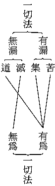



於彼漏随增　彼指苦集二谛，随增是随顺增长的意思。有二种：一、相应随增，谓烦恼与相应的心心所，随顺增长。如眼识生起贪或瞋，与同时意识的心王心所，相互随增。心王及大地法等的心所，本无所谓染污的，但由贪等烦恼的起而鼓动，使无染污的心等变为染污，心既被染污而受蒙蔽，於是对事物就认识不清，而与贪等滚成一团，加强贪等的活动，是为相应随增。如一坑大粪与水土的和合，水土虽原是清净的，但与大粪的混和就成为不净，而粪由於水的增加，其臭气也就更大更浓。粪如烦恼，水土如其他的心心所。二、所缘随增，谓烦恼与诸所缘的境界，随顺增长。如缘客观的美境，就在这境上生起贪爱，由於境界的美，就又诱引潜在的贪心勃起，是为所缘随增。如猪等的住於杂秽之处，眠戏其中，猪身为杂秽所涂成为不净，而其地因猪的居住，屎尿增加，於是更增不净。猪喻所缘的客观境界，杂秽喻贪等的烦恼。苦集二谛所以称为有漏，因为在此二谛之中，不特可以生起烦恼，并且等相随增。缘灭道二谛，虽说也生烦恼，然既与他本身无关，又无随顺增长作用，所以名为无漏，不名有漏。



於彼漏随增这句颂，是从《阿毘昙心论》修改来的。该论说：「若生诸烦恼，是圣说有漏」。后来法救依之造《杂心论》，觉得生有语病，因为说生烦恼就是有漏，灭道二谛也生烦恼，难道也可说他是有漏吗？如不承认灭道是有漏，怎可说生诸烦恼？所以法救把他改为「若增诸烦恼，是圣说有漏」。此论既以杂心思想为背景，因而就说於彼漏随增。然如实说，用随增释有漏，并不自法救始，在《婆沙》中早有人说，如《婆沙》二十二说：「由二事故名有随眠心：一由随眠於此心有随增性，二由随眠於此心有同伴性」。



故说名有漏　此结有漏名。漏是漏泄义，如水杯破了，或有了洞眼，水即从里面慢慢漏出来。这里，狭义说，指烦恼，唯代表集谛；广义说，指五取蕴，可总包苦集。烦恼所以名漏，因他有股巨大的力量，如万马奔腾汹涌澎湃的洪流，我们的身口如止制烦恼洪流泛滥的堤防，内心所茁长的善根，等於堤防下的苗稼。要使善根苗稼在肥沃的土地上生长结实，必须巩固身口的堤防，防止烦恼洪流的溃泛。如身口堤防一旦被烦恼巨流冲破，则善根苗稼就要遭到淹没与毁灭的命运。像河水穿漏土石的堤岸，淹没农夫的禾稼一样。在《婆沙》中对漏的解释，有六义，今取二义：一、留住义：留是稽留，住即安住。意说烦恼有种力量，稽留众生安住於三有生死海中，不得出离。二、流出义：此约六根门头说，即常常从他（六根）流出不净的烦恼，驱使众生在六趣生死中，头出头没，如泉出水一般。有人说：烦恼使人久住在生死中，就名为漏。业也有这种功能，为什麼不名漏呢？这因烦恼的漏义是决定的，业的漏义不决定。有情流转於三界，固由业力之所招感，但若没有烦恼的滋润，其业即枯萎，不能发生招感作用。如证阿罗汉果的圣者，虽尚有过去作的种种业存在，但因没有烦恼的滋润，就不再感后有的生命，而证入无餘涅槃。因此，漏是专指烦恼，不包括业在内。



无漏谓道谛及三种无为谓虚空二灭　此明无漏，约有四种。即有为无漏的道谛，无为无漏的灭谛。道指所修的道，如下〈智〉、〈定〉二品所说的种种道；灭指所证的寂灭无为，有三种类别，即虚空、择灭、非择灭。这四类法所以名为无漏，因他不与诸烦恼随顺增长。无漏就是没有漏落，不稽留有情於三有中漂流轮转。如表：



　　　　　┌道……………有为  

　　　无漏┤　┌虚　空┐  

　　　　　└灭┤择　灭├无为  

　　　　　　　└非择灭┘



无为是佛所说，是佛弟子所论，固无问题，但无为法是多是少，在学派间颇有诤论。然从原始阿含圣典看，佛似祇说一种无为，即离去爱染系缚而得的不生灭自体，就是择灭无为。唯约不生不灭的定义诠说无为，无为是可有众多的，所以后来部派学者就把他展开，如有部讲三种无为，尚属原始之说。其中择灭非择灭，虽为部派学者所共认，但虚空无为，或有所不许。如大众部、化地部（属分别说系）所说不同的九种无为，其中固有有部所说的三种无为，而南方案达罗学派及舍利弗毘昙，於其九种无为中，只讲择灭与非择灭，不讲虚空无为。虚空究竟是否无为，是部派学者所激烈诤论的一大课题，应加深切注意！



此中空无碍　此中，即在三种无为当中。空指虚空无为，无碍显以无障为他的体性。既不障碍一切法，一切法也不障碍他。如色法，是有碍的物质世界，但他生而来、灭而去，来去生灭，自由活动，都从虚空无为而来，如没有这虚空无为，一切的物质就不能活动。宇宙界的森罗万象，所以各自呈现秩然不紊的相用：一面固是各自的因缘力，一面实由无障碍的空所成，所以有无碍性的虚空无为，就能容受宇宙界的万有诸法。《正理论》说：「虚空容受色等有为」；此论说：「由无障故色於中行」，都是此意。然须研究者，这无碍为性的虚空，是不是就是一般眼所见身所触的虚空？不是！通俗说的虚空，虽有相似的无碍性，但他只是现於空界的色法，在现象上观察，不无相当的变化，而且他的无碍性是相对的，虽不障碍其他法的产生，但为他法之所障碍，如桌子一放，空间即不存在。因此，有部学者将虚空分为二种：一是可见的，如六界中的空界，是有为色法；一是不可见的无障碍性，才是虚空无为。但这并不是无所本的：如《中含》四十卷说的「空无所依，但因日月故有」，既因光明得知有虚空，当会引发人们空是色法的见解，又《中含》五十卷说的「此虚空，非色，不可见，无对」，虚空既然是如此的，自可使人生起无为性的观点。所以有部，分虚空为两种，而且都各有其实体。



择灭谓离系　择灭无为以远离系缚为他的体性。系指烦恼，离是远离。烦恼留住有情於生死中受苦，所以要设法远离。远离了系缚的烦恼，跳出了业网的重围，就可获得生命解脱。离系专约有漏说，有为无为及无漏，是无系可离的。择是简择，为智慧的异名。择是慧的力用，慧是择的自体，因为离系是慧简择的功能，所以名为择灭不名慧灭。择灭所抉择的对象，是四圣谛：什麼是有为无为？什麼是有漏无漏？何法该证？何法该断？如是抉择清楚，涤除身心上垢秽，就证得解脱的灭谛，显现诸相寂灭的真理。择灭是略称，具足应名择力所得灭，如牛所驾车，略名为牛车，其理是一样的。此择灭无为性，在有部学者，认为是圣者内证，离言而实有的，如此论第六卷说：「此法自性实有离言，惟诸圣者各别内证，但可方便总相说言：是善是常，别有实物名为择灭，亦名离系」。但经部譬喻师，却主张择灭非实有；而成实论师，更从涅槃离诸相的立场，证明择灭的非实有性。所以这在学派间，也有诤论。



随系事各别　离有漏的系缚，得解脱的择灭，是一是多，学派也有不同的解说。《正理论》说：「有作是言：诸所断法同一择灭；对法者言：随系事别」。对法者，就是有部。依有部说：离一系缚得一择灭，能系缚的有漏法体有多少，所获得的择灭也就有多少。如於贪上离去系缚，就在贪上得一择灭，於瞋痴上亦然。假定能系缚者有八万四千，所得择灭亦八万四千。因行者得择灭，不是一时得的，有在见道位上所得的择灭，有在修道位上所得的择灭，有在无学道位上所得的择灭，假定诸所断法同一择灭，证入苦谛所断烦恼灭时，就应证得一切所断诸烦恼灭，但事实不然，因苦谛烦恼灭时，祇得一苦谛灭，餘者并未证得，否则，就不应再修圣道，以修圣道的目的，就在断惑证灭，可见唯一择灭，是不合理的。「有部学者，不但是有为的多元实在论者，在无为法上还是多元实在论者」。主张择灭是一的学派，《顺正理论》祇说有作是言，并未指定那一派，依《宝疏》及神泰，说是正量部的思想，依印顺导师从理上推测，说是大众分别说系的主张。不管他是何部所属，在学派中，总有这麼一派，站在这派立场说，择灭是一，也有相当的理由。宇宙人生的真理只有一个，如断一烦恼，即证一真理，真理岂不是众多了吗？《性空学探源》说：「主张择灭同，谓是一味的；主张择灭异，谓是差别的。后代大乘以虚空为譬喻来会通一味与差别：虚空，随了器皿的方圆，而有方圆之别，如这空茶杯中的圆空，与空箱子中的方空，此空不是彼空，方圆位置不能说无别。但，空的体性，是浑然同一的，不能说有差别。择灭如果决定只有一个，则一解脱一切解脱，依次的修证是徒劳的了。择灭如果说是众多差别，难道直觉体验下的涅槃性还有差别相吗？这是困难的。大乘虚空喻的会通，就是针对这困难而发的」。



毕竟碍当生别得非择灭　这是解释非择灭无为。毕竟是决定究竟的意思，当生是指未来所要生的法，碍即阻碍或障碍。总合的说：有一种法在当来是有生起可能的，但为另一法做了他的障碍，使他永远的究竟的没有生起的可能，於是就得了一个择灭，唯此所得的择灭，仅由外缘的短阙，非藉抉择的慧力，所以别名为非择灭。得非择灭无为，在三世的时间里，是属那一时得呢？《婆沙》虽有多说，但以未来世得为正义，所以此论说当生，即唯有在未来当生而不生的法上得。《婆沙》三十一说：「择灭於三世有漏法得，非择灭於未来不生有为法得」。别得，据麟师说有二解释：「一、异前择灭，别自起得，名为别得；二、缘缺位中，证非一品，别别而得，名为别得，如前择灭随系事别」。麟说后释为胜，今说前释为是。如有人说：「别得者，异择灭得故云别得，非随不生事其灭各别」。《旧俱舍颂》说：「别有非择灭」；长行解释说：「异於择灭有别灭」；此论长行说：「得灭异前」：都是此意。缘缺得非择灭，其意怎样？如眼识与意识倾其全力共专注於色境时，其餘声香味触的诸境都灭，虽有耳不能闻声，乃至虽有身不能触境，因为眼及意识注色境时，身等诸识住未来世，没有生起的可能，而且永远的不生，即使眼识灭后耳识於第二刹那复生，但已不是前一刹那的耳识。因为一切有为法，都是刹那演变著的，后一刹那当然不是前一刹那，所以被眼识所障的前一刹那耳识，就永远不生而成为非择灭无为，耳闻声时眼不见色，舌尝味时身不觉触等，都可得此非择灭的。有部之所以这样主张：一因五识唯缘现量不缘过未，一因五识是异时起非俱时起。



乙二　别释法体丙一　总明漏无漏体用丁一　明漏无漏体戊一　正明法体己一　总明色等五蕴庚一　有为体名



> 又诸有为法谓色等五蕴亦世路言依有离有事等



三种无为已如上说，而诸有为是以什麼为体？又有什麼不同名称？本颂就是解释这两问题的：初句标有为法名，次句出有为法体，后二句辨有为法的异名。



又诸有为法　又是复义或再义，谓无为法已说，今再讲有为，故说又。诸有为法对三无为法说的。有为，是有所作为的意思。如在同一时空中，创造一种什麼法体，必须众多条件的聚合，然后才可完成一样东西。因此，佛教说宇宙万有的现象，无一是从一因生的，所谓上帝创造万物，完全是无稽之谈，为佛法所不取。有为法，在时间上讲，通於三世的。或有人疑惑说：过去现在的诸法，是假众多条件产生的，固可说是有为，但未来法还未生，怎可亦说有为？论说：「彼同类故，未来无妨」。如牛乳，为人受用时，固名牛乳，即在乳房尚未挤出，亦名牛乳，是牛乳同类的缘故。又如柴薪，正在烧时名薪，而堆著未烧的草木，亦名为薪，没有那个可说烧时叫薪，不烧就不叫薪。未来法也是这样，在时间上虽尚未来，但一来到现在，决有他的作为，相望过现是同类的，所以不妨称为有为。



谓色等五蕴　此明有为法的自体。五蕴有有漏、无漏的两种；能摄一切有为法的，是有漏五蕴，非无漏五蕴，为了简别戒等的无漏五蕴，所以说色等的有漏五蕴。《顺正理论》说：「为别戒等，故言色等」。五蕴为什麼是有为法体？《正理论》说：「老病死等灾横差别，隐积损伏故名为蕴」。这意思是说：有为法有著众多的过患隐伏在里面，不遇缘便罢，一遇缘就活跃起来，如盗贼埋伏在山中一样。所以色等五蕴，为有为法体。



亦世路　以下辨有为的异名。先说世路，有二义：一、世指三世，约时间说；路是道路，是游历义，约法体说。有为诸法行於三世的时间内，以世为所行路，或过去已行，或现在正行，或未来当行，所以名为世路。二、世是可破坏的意思，路为无常法的所依。变动於三世中的有为诸行，由於刹那刹那的迁移变化，结果必为无常性所吞食、消灭、破坏。真谛三藏说：「行行不息能尽万里之路，无常是世，有为是路，与世作路，故名世路」：这确是世路极好的解释。



言依　言是语言，以色蕴中的音声为体；依是所依，有说以名义为依，有说单以义为依，后者如《婆沙》说：「语依名转，名依义转，义是言展转依义」。本来名义是相为表里的，义为名所诠表，名能表诠於义，如俗说有名的意义，有意义的名。每吐一句语言，必含有其意义，所以义为言之所依，但为显示是名相应义，非道理义，所以论说「即名俱义」。人类的语言，如没有义为所依，就无所寄托，亦即不能开口。如说粉笔，其义即是能写，而且有粉笔之名，与义相应。言依，依三世有为法建立：或依过去说曾诸法，或依未来说当诸法，或依现在说今诸法，所以言依是有为的异名。有质问说：有为法依三世说立三言依，无为法亦假言说方可表达，为什麼不立言依？这在《婆沙》有多种的解说，今依《顺正理论》略谈一义。无为法是由有为法灭而建立的，如契经说：「蕴灭名灭。灭非言依，言依是蕴」，因此，无为不立言依。



有离　离是远离，谓永远离去烦恼的系缚，而获得清净自在，即择灭无为。有离者，即在有为的诸法中，有离系的涅槃，表示无为就在有为中，并不是离了有为另有无为。《正理论》说：「此有离故，说名有离，如有财者，名为有财」。诸有为法如同船筏，不特非法为修道者所舍，就是圣道也要舍离，所以经说：「法尚应舍，何况非法」？



有事　事指因义，就是一切有为法的生起，各有他的能生因，无因即不得生。经部师说：事是体义，就是一切有为法，各有他的真实自体，不是虚假而有的。《正理论》说：「此有事故，说名有事」。



等　等在谛译《俱舍》中没有。本论有等，表示有为法的异名，不止这些，另外还有有果、有烦恼、堕三界，有缠、无常、世间、有行等。因为不能一一举出，所以用一等字以概其餘。《杂心》第九说有「从缘生亦因、有因（有事）亦有为、说处（言依）及与道，有果应当知」的七名。



庚二　有漏异名



> 有漏名取蕴亦说为有诤及苦集世间见处三有等



有漏的名义，已如前说，此立取蕴及有漏的异名。有漏异名，本来很多，这里略举七种。先给取蕴，定一范围，然后解释。《正理论》说：「前说一切有为名蕴，今说有漏名为取蕴，义唯无漏但名为蕴」。此明蕴与取蕴的宽狭：但名为蕴，可以包含漏无漏的二种蕴；名为取蕴，就唯指有漏五蕴了。这里建立有漏异名，所以说取蕴不名蕴。《杂心》有与此相似的颂说：「亦名为烦恼，受阴及与诤，烦受诤起故，是诸贤圣说」。



有漏名取蕴　《正理论》说：「何缘取蕴名为有漏？以於彼中漏随增故」。本论举三喻说明取蕴的意义：一、取是烦恼，蕴是五蕴，取蕴就是烦恼蕴，有情的五蕴果报身，是由烦恼所产生的，如无烦恼就不造业，如不造业就不会招感五蕴的苦果。如草糠火，发火的原料是草糠，从草糠中出生火，名草糠火，若火是从煤炭中发出，那就又名为煤炭火了。二、为生命体的五蕴，是属於烦恼的，如人天有情的五蕴身，属於轻微的烦恼所有，三恶趣有情的五蕴身，属於粗重的烦恼所有：蕴属於取，所以名取蕴。如王与臣，那国的大臣，就系属於那国的大王。三、现行的五蕴身，又能产生烦恼。以十二因缘说：从识至受的五支，是现实存活的生命体——五蕴身，受缘爱，爱缘取，爱取就是烦恼支。前五支的蕴体，是能生因，后二支的爱取，是所生果。蕴能生取，所以名取蕴。如花果树，生桃果的是桃树，生杏果的是杏树。《杂心论》说：「彼诸行从漏生故，生漏故，漏处故，是说有漏」，也是此意。



亦说为有诤　有漏不但叫做取蕴，亦可说为有诤。诤就是烦恼，含有相互乖违的意思。如诤论一个论题，彼此之间的思想，就显得异样的乖违。烦恼是不善的，所以他一生起，就与善法乖违，使清净的善法，骚动扰乱，不能继起。《杂心》说：「扰乱心故名诤」，就是此意。诤又有损害自他利乐的意义。一个人的烦恼不起则已，如果翻腾起来，对别人一定是不利的，如瞋心生，不是动武就是漫骂。其初的动机，虽想损人以利己，但结果每每弄得自他俱害。冲动了的烦恼，不特能损害自他，且在有漏的五蕴法中，随顺增长。诤复三种：一、百八烦恼的烦恼诤；二、生命解体的死阴诤；三、各各相违的战斗诤。此中指烦恼诤说。《品类足》二说：「若有漏是有诤，若无漏是无诤」，也就是这意思。确实的，人在烦恼没有冲动时，心境是很宁静的，一旦冲动起来，就被他扰得神魂颠倒，心绪不宁。如一团体中的分子，彼此相处和合无诤，则其团体内，必定充满融洽和谐的空气；如终日吵吵闹闹，诤斗不已，那就不得安宁了。这就是诤的意义。



及苦　及是并及。意说有漏名取蕴、有诤，并及可以叫做苦等。苦指现实的生命自体。生命体所以名苦：一因他为一切苦迫的所依，所谓「有身则苦生，无身则苦灭」，就是此意。一因他的自体就是粗重不安隐的，如八苦中的五蕴炽盛苦，就是显示此意。这样的一个苦报体，我们凡夫虽然不知，但在出世圣者，很能正确的了解他是苦痛的源泉，所以觉得有漏是可厌的，没有一点值得贪恋爱著。如不愿做的，非逼你去做，自己想做的，却又做不到，事事违背内心的要求，处处受到环境的压迫，这不是苦是什麼？所以说有漏是苦。



集　集是集谛，指烦恼说。集以招感为他的体性，谓有烦恼的存在，就可招感生死的苦果。《正理论》说：「即彼种类能为因故，能集成故」。



世间　指有情与器界。世约时间说，间即中间义。不论是有情的生命与无情的事物，都是在三世的时间中之所显现的，所以名为世间。显现於时间中的生命与事物，含有不断的变动性，所以终为生灭无常法所消灭破坏，不能久住於世。因而凡有可破坏和可对治性的，即称世间。《品类足》说：「有漏是世间，无漏是出世」，即显世间为有漏的异名。



见处　见指五见，处是依止义。此说有漏的五蕴身，为五见所依止处。依通常说：烦恼有五利使和五钝使的差别，二者均以生命体为所依处，为什麼只说五利使的见处，不说五钝使的贪等处呢？因为贪等诸烦恼在身心中的增盛，没有五见来得强而有力。有情烦恼所以炽盛，主要由於五见住身心中，随顺增长烦恼的缘故，假使没有不安分的五见，其烦恼必然会减少活动。要知见就是思想，思想复杂的人，烦恼就多，思想单纯的人，烦恼就少，所以说见处。



三有　就是欲有、色有、无色有，为三界的异名。三界中一切有漏法的产生，各有其因，是集谛；依因而生的诸有漏法，各有所依，是苦谛：有因有依的诸有漏法，都属三界所有，所以名为三有。



等　上述七种异名，约不同意义说。即从这面观察有这意义，就立这一名词，若从那面观察有那意义，就立另一名词，实际总名有漏。如是从个别意义立名，还有很多，像烦恼、随眠、受阴、有染、堕界、有味著、非圣法、有求、当取、有取、有胜，都是异名之一，现在用一等字以概括之。



己二　别明蕴辨处界庚一　正示体明处界辛一　明色蕴辨处界



> 色者唯五根五境及无表彼识依净色名眼等五根色二或二十  

> 声唯有八种味六香四种触十一为性乱心无心等随流净不净  

> 大种所造性由此说无表大种谓四界即地水火风能成持等业  

> 坚湿煖动性地谓显形色随世想立名水火亦复然风即界亦尔  

> 此中根与境即说十处界



色等五蕴是有为法，已如上说，现来正式说明有为诸法的本体。如五蕴，怎样叫做色蕴？怎样叫做受想行识？处与界亦须这样说明。先明色蕴辨处界。



色者唯五根五境及无表　此标色蕴的十一种色。《杂心论》以四句说明这个：「十种谓色入，及无作假色，是分别色阴，牟尼之所说」。五根，指眼耳鼻舌身，为组织有情生命的原料；五境，指色声香味触，为宇宙万有的现象；无表，指无形无象无可表示的色法。唯简异计，即简别色蕴唯十一种，既不可增多，又不可减少。学派中，如经部师说无无表，觉天及经部色中，唯立能造四大，不立所造诸色，法救又说无法处所摄色，种种异计不同，所以有部正统派，说唯十一种。



自眼根以至无表，总说为色者，色有二义：一、质碍的意思，即有体积而占有空间的东西，两者一碰面，就互相对碍，如书有书的体积及其所占据的方位，桌有桌的体积及其所占据的方位，所以书碍於桌，桌碍於书，不能并容。二、变坏的意思，「有体积而存在的，受到另一质碍物的冲击，可能而且是终久要归於变坏的」。「有此二义，即名为色，即等於近人所说的物质」。



彼识依净色名眼等五根　此释十一色中的五色根。《杂心》卷一有与此类似的长行说：「彼眼入者眼识所依，四大所造净色，不可见有对，耳鼻舌身亦如是」。初句的五字，非常的简练，缺一不可。彼指根境二物，识指精神动能，表示五识的依根缘境。约依根说，可名根识，即能缘的心识，依於所依的眼根，就叫眼识，乃至能缘的心识，依於所依的身根，就叫身识。约缘境说，可名境识，即能缘的心识，缘於所缘的色境，就叫色识，乃至能缘的心识，缘於所缘的触境，就名触识。不过通常都称为眼识等，很少叫做色识等罢了。其实是可叫做色识等的。如旧《婆沙》五十五引《外入经》说：「缘色生识，是名色识，乃至广说」。既然如此，为什麼一般都叫眼识等呢？关于这问题，到下再为详说。依是增上能生义；净色即净色根，简非扶根尘。这是说能发生认识作用的，是净色根，非扶根尘。



彼识依净色的五字，所以不可缺少者，有人作这样的说：一、如但说彼识依色不用一净字加在其中，扶根尘及色香味触四境，既是色法亦为所依，难道也可名为眼等吗？现用一净字加在上面，即表明识的所依，唯是清净的色根，而非虚浮的扶根尘等。二、如但说彼识净色不用一依字插在里面，就文理言，也患有不显明肯定的语病。如清水池与透明镜，都属於净色，若不用依字作彼识与净色之间的媒介，说明识与净色的属性关系，那清池与明镜的净色，岂不是也应名为眼等了吗？但事实上，他们祇可说为净色，不可名为眼等，因为缺乏为识所依的条件，所以应用依来简明能为识所依的，方可叫做眼等根。三、如但言彼识不用依净色三字，则识与根之能所依的关系就要混乱，换句话说，能依的眼等五识，应名所依的眼等五根。所以必须把这五字连合起来，方可免除上面三种过失。



眼等诸识的精神作用，有相应的物质构造做他的基础，这在佛教说，就是清净的五色根，他分布在有情的肉团里面，为四大种所造，大种为产生净色的元素——本质。此净色根，佛经又名胜义根，为肉眼所不能见，我们所见的，祇是扶助胜义根的四尘，佛法名为扶根尘。五根发生五识，在心理学上说，是有机感觉产生活动，是有机体认识世界的活动。所以佛法说的净色根，就是生理学上说的感觉神经，佛法说的扶根尘，就是生理学上说的感觉器官。感觉神经，为知觉所由获得的途径。假如感觉神经中某一部分坏了，那他某一部分的知觉，必然就失去作用，不管他怎样仍在运动。佛法说：我们之所以能见色闻声，是净色根的唯一功能，如内在的净色根坏了，外在的眼球纵然完好无恙，而终不能发生照物的功用。这样比对的来讲，可见佛法所说的五根机能，与现代生理学所说相近。



我们的眼睛，其眼球的构造，俨如现代的照相机，所以有说，人类的眼睛，是世界上最早而且最巧妙的照相机。不过就作用说，照相机的作用比较单纯，眼睛的作用比较复杂就是了。人类的耳朵，是天赋的电话机，其构造和作用，简直和电话的原理一样。鼻根具有嗅觉的作用。讲到嗅觉，人类嗅觉的机能，已大大的退化。退化了的嗅觉器官，所以仍傲然的高踞於面部中央，实因他不是专负嗅觉一部分任务，他的真实作用，是在呼吸，即现代人说的司理著「生命之源」的呼吸的门户。一个人一天不吃饭可以，若五分钟没有空气呼吸，则生命就将面临死亡的绝境。所以鼻子里头留给嗅觉器官的地盘，只是极小的一部分，那就是附在鼻腔里面上部的黄色粘膜，由两种细胞而成，其一为支柱细胞，其他则为细长的嗅细胞。嗅细胞就是嗅神经，散布在空气中的物质微点，接触到鼻粘膜，刺戟了嗅神经的末梢，他就将这外来的刺戟，传向神经中枢，神经中枢得到报告，立刻就起嗅的知觉，了达传进来的是香是臭。舌根是尝味的，依《婆沙》说，舌根极微住在舌头上，犹如弯弯的半月，唯其中有一部分不属舌根，所以现代生理学说，舌不是味觉器官，味蕾才是味觉器官。舌头有舌尖、舌缘、舌根的三部分：舌尖的作用是尝甜，舌缘是尝酸，舌根是尝苦，三者都能发生感觉的，祇有咸味。味觉的强弱，和物质与粘膜接触面的大小有关，尝味时的舌头转动，就是使物质广布，而多接触於粘膜。身根是觉触的，其极微徧布於整个身体内，次第而住。触觉是皮肤功能的一种器官，即皮肤里面有神经末梢，负著传达触觉、痛觉、温度及压力等等感觉的任务。佛法中说的五根功能，是可与现代感觉神经配合讲的。这里只是举其大要，要知其详，可阅生理学上感觉机能的部门。



色二或二十　此下有一颂明五境，先说色境。色境，大体上分为二种：一是形色，二是显色，所以说色二。然再把这二色加以演绎分析，形色有八种，显色有十二种，所以说或二十。表如下：



　　　　　┌形色─长、短、方、圆、高、下、正、不正───┐  

　　　二色┤　　　　　　　　　　　　　　　　　　　　　　│  

　　　　　│　　┌本显色─青、黄、赤、白　　　　　　　　├二十色  

　　　　　└显色┤　　　　　　　　　　　　　　　　　　　│  

　　　　　　　　└差别色─影、光、明、暗、云、烟、尘、雾┘



形色是物体的状态，如桌子有桌子的形态；显色是显现的颜色，如青黄赤白等。青黄赤白称为本显色，即一切的显色，以这四种为根本。这与现代讲的三原色稍有不同。我们知道，物质是各具有特殊的颜色的，其颜色之所以不同，由於物质对於光线的吸收和反射的各不相同。如红色物质，对於日光反射其红色光而吸收其他各色光，所以望去是红色；蓝色物质，反射日光中的蓝色光而吸收其他各色光，所以望去是蓝色；黄色物质，对於日光反射其黄色光而吸收其他各色光，所以望去是黄色。红（赤）蓝（青）黄（黄）称为三原色，因各种不同的颜色，都是由这三者作适当的配合而产生的。如红与蓝二色配合起来，成为紫色；红与黄配合起来，成为橙色；黄与蓝配合起来，成为绿色；几种颜色的总和，如各色完全吸收，就成黑色，如各色全部反射，就成白色，所以白色在现代，不视为基本色。以颜料的配合为例说：「如黄色颜料和蓝色颜料适量配合，可得绿色。因黄色颜料能反射黄色光和绿色光而吸收其他色光，蓝色颜料能反射蓝色光和绿色光而吸收其他色光，两种颜色混合后，祇能反射绿光，其他色光全被吸收，故成绿色」。影，即在太阳或灯光下，障碍光明生起的餘色。光，就是太阳光，凡是光都是从发光体送出来的，太阳是发光体，所以名光。明，与光不同，论说「月、星、火药、宝珠、电等诸焰名明」。月亮，本无光明，我们所以见到月明，这不过是太阳的反射作用而已，所以佛法称他为明。星、宝珠也是这样。火药，照现在说，也是一种发光体，这里说他是明，不知是指那类火药。暗，即黑暗，如深夜的黑幕重重，一无所见。云与雾的成因是相同的，即地面上的水分，由热度的蒸发，腾升高空，一旦遇到冷空气，就凝成微细的水点，浮游於空中。两者的不同：离开地面高的是云，在地面低的地方是雾。这与科学说的一样。其餘显色以及八种形色，形相易了，不再烦说。二色是二十色的归纳，二十色是二色的演绎。在学派中，还有加一空一显色，说为二十一种的。



声唯有八种　明声境。声是音声，《正理》说，能有呼召的名声，或唯音响的名声，是耳根所取的声波，为大种所造的色性。虽说有八种差别，但最基本的为二。㈠、有执受大种为因：谓有一种音声，从有执受的大种发出来的。大种，指地水火风；有执受，是说心心所法，堕在自体中，执持组织生命自体的大种，而生起一种觉受。合起来说：四大种上有觉受，名有执受大种。从这四大和合的生命肉体中发出音声，所以就名有执受大种声。此有二种：一有情名，谓从口中发出有意义的语言音声，二非有情名，顾名思义，这是不易了解的。既从生命体发出的音声，为什麼称做非有情？当知这种音声，虽从生命体发出，但属无意义的，如两手相击等，所以名非情名。有情名中又有二种：一是令人欢喜的可意声，如歌功颂德的赞美声；二是令人厌恶的不可意声，如诽谤毁骂的咒诅声。非有情名中亦有二种：一是令人兴奋的可意声，如演讲时的鼓掌声；二是令人悲哀的不可意声，如跌倒时的凄惨声。㈡、无执受大种为因：谓有一种声音，从无执受大种发出来的。如河流山溪中的流水声，时钟滴答滴答的摆动声。此种音声，虽也由於大种所造，但无精神之所执持，所以叫做无执受大种声。此有二种：一有情名，依佛法说，是化人发出的音声，现在能表明这种声音的，无过於留声机。留声机虽没有精神的执持，但他能发出有意义的声音，所以叫有情名；二非有情名，如树木相击所发出的音声。有情名中又有二种：一是令人爱听的，如幽雅的留声机声，名可意声；二是令人害怕的，如化人的暴恶音声，名不可意声。非有情名中亦有二种：一如松涛溪水的可意声。二如火山爆炸的不可意声。唯是决定义，即从生命界与自然界所发出的声音，决定有这八种。於中，有执受与无执受，是就发音的因上分的；有情名与非有情名，是就物类分的；可意与不可意，是就声音发出后所得的反应说的。列表如下：



　　　　　　　　　　　　　　　　　　　　　　　　　　┌可意声……如称赞之悦耳音声  

　　　　　　　　　　　　┌有情名……有意义之语言音声┤  

　　　　　　┌有执受大种┤　　　　　　　　　　　　　└不可意声…如毁骂之不悦耳音声  

　　　　　　│　　　　　│　　　　　　　　　　　　　┌可意声……如鼓掌之悦耳音声  

　　　　　　│　　　　　└非有情名…无意义之鼓掌音声┤  

　　　八种声┤　　　　　　　　　　　　　　　　　　　└不可意声…如跌倒之不悦耳音声  

　　　　　　│　　　　　　　　　　　　　　　　　　　┌可意声……如唱片之幽雅音声  

　　　　　　│　　　　　┌有情名……化人留声机之音声┤  

　　　　　　└无执受大种┤　　　　　　　　　　　　　└不可意声…如唱片之暴恶音声  

　　　　　　　　　　　　│　　　　　　　　　　　　　┌可意声……如溪水之悦耳音声  

　　　　　　　　　　　　└非有情名…风雨时钟之吼打声┤  

　　　　　　　　　　　　　　　　　　　　　　　　　　└不可意声…如火山之爆炸音声



味六　明味境。味是所噉可尝的意思，为舌根所取的境界。本论说有六种，就是甘、醋、咸、淡、辛、苦。甘是甜味，如糖及甘蔗等的诸甜质。醋是酸味，即一切的酸料。盐等的咸物是咸。淡而无味者为淡。辛是辣味，如辣椒、葱蒜等的辣物。苦是甜味的反面，如黄连等的苦药。但以现在科学说，味只有甘、酸、咸、苦四种。辛辣，科学者认为是鼻孔和舌被葱蒜辣椒等刺激时的一种痛感，并不是单纯的味觉。淡的自身本是无味，所以科学者也不谈他。还有常人说的涩味，在佛法、在科学，都不折不扣的说是一种触觉，不可说为味。其次，我们的味觉，在食东西时，当滋味浸入口中，最先感觉到的是咸味，其次是甜，再次是酸，最后是苦。这与味觉分部掌理有关：咸味，为舌尖、舌缘、舌根全部所感觉，所以先尝，舌尖管甜味，所以次尝，舌缘管酸味，所以再次尝之，舌根管苦味，当然是最后尝到。



五境的次第，依照通常说，是色、声、香、味、触。讲完色声，应讲香尘，次第方才不乱，为什麼这里先讲味尘？《正理论》说：「越次说者，显彼境识生无定故」。五识缘境，并没有决定的次第，而是看外在的因缘具不具说的。谁识因缘先具，谁识就先生起。如触境的因缘现前，身识虽居最后，但也可以先起。从这意义看，越次说味，是即显示五境生识，没有次第的决定性。



香四种　明香境。香是所齅，为鼻根所取的境界。如通常说，香有好香、恶香、等香、不等香的四种，但实际说，香只有好香与恶香，不过其中都具有等香不等香，成为四种而已。什麼叫做好香？齅了使人感到舒适喜悦、增益内心，长养大种、发育肉体，并能增长自己福业的是好香。什麼叫做恶香？齅了使人感到异常局促紧张，无益身心，不能增长福业的是恶香。等香的等，是均等义，不太强、不太弱，恰到好处，名为等香；若增益，若损减，出於均等之外，名不等香。上说有益身心是好香，无益身心是恶香，只是一往之谈。实际，好香中的等香，固有益於依身，恶香中的等香，亦有益於依身；反之，恶香中的不等香，对於身心固能招致损害，好香中的不等香，也同样的可以损害身心。此四香的分别，不是新说，而有所据，如《旧婆沙》第十说：「香入有四种，有好有恶。好有二种，有等有增减；恶香亦尔」。增是太强，减是太弱，即不等香。《正理论》中解说香尘，但释等不等，不释好与恶，亦即显示好恶各有二种，成四种香。



触十一为性　明触境。触是所触法，不是触心所，为身根所取的境界。有十一种，即地、水、火、风、滑、涩、轻、重、冷、饥、渴。前四为能造触，后七为所造触。能造触，到讲无表色时再说；所造触，前四当体得名，后三从果受称。滑是柔和轻软的意思，如触及什麼而感光滑者是。涩是粗糙强硬的意思，如触及什麼而感粗涩者是。有分量可以用秤称，或能为镇压成办摧伏他的，是重。无分量不可用秤称，或易可转移无伤害於他的，是轻。多人集合在同一空气中，同样感到温暖的需要，名冷，因冷才发生煖的要求，所以说煖欲名冷。有机体内觉得饥饿，需要受用饮食，名饥，因饥才发生食的要求，所以说食欲名饥。口乾是渴，因渴而有饮的要求，所以说饮欲名渴。冷饥渴三，所以就因而立果名者，因这三者，原是欲心所的异名，并非真正是触。因有三触，发此三欲，所以冷饥渴，是触家的果，而非就是触。说得明白一点：由於内身中有触力令欲煖才欲煖，有触力令欲饮才欲饮，有触力令欲食才欲食。现在所以称他为触者，触是因，欲是果，乃於触因上而立果名而已。如思想、信仰、行动、目标一致的僧团，由於彼此的和合，而得身心的安乐，和合是因，安乐是果，安乐之果从和合因来，所以说僧众和合乐。七所造触的差别建立，由所依大种的增盛不同：水火增盛成滑，地风增盛生涩，地水增盛成重，火风增盛生轻，水风增了有冷，风界增了起饥，火界增了发渴。餘如闷力等触，随其所应，摄在十一触中，不再烦说。



乱心无心等　此下一颂明无表相以显其体。这一句，是表示无表色生起的部位。能生起无表色的，依这里说有四位，就是乱心位、不乱心位、无心位、有心位。颂文只标出乱心与无心，有心与不乱心，用一等字概括他。乱是相互混乱，即凡性质不相同的和在一起，就显现出混乱的相貌。这里说的乱心不乱心，是以善恶无记的三性心，望於善恶二无表说的。如善无表住於善心中转，由於两者性质相同，所以善心就名不乱心，如善无表住於恶心无记心中转，由於两者性质乖违，所以恶无记心就名乱心。如恶无表住於恶心中转，因为两者性质是同一的，所以恶心名不乱心；若恶无表住在善无记心中转，因为两者性质相背，所以善无记心就名乱心。如表：



　　　　　　　　　┌乱　心┬恶　心  

　　　　　┌善无表┤　　　└无记心  

　　　无表┤　　　└不乱心─善　心  

　　　　　│　　　┌乱　心┬善　心  

　　　　　└恶无表┤　　　└无记心  

　　　　　　　　　└不乱心─恶　心



无心，指无想、灭尽的二无心定。无心定的功用，在伏灭心心所令不生起。心心所於此定中虽不生，但无表色的色体，仍然随定或起或灭。《正理论》说：「虽更有餘无心果位，而无表色非所随流，故无心言不摄於彼」。有心，指有心定。意说不特无心定有无表活动，就是有心定亦有无表随转。上说四位：乱心不乱心，约散心位说，通善恶无记的三性；有心与无心，约定心位说，唯通善性。



随流　随是随顺，流是流转，长行以相似相续义释之。相似有多说：一、善无表与善表色相似，恶无表与恶表色相似。二、善心为等起因所激发的善无表色与善心相似，恶心为等起因所激发的恶无表色与恶心相似。三、约无表色本身说，前念与后念间，没有异性相续，说名相似。於此三说中，我们可以合取第二第三两说，以明相似。相续，是说无表於乱心无心等的四位中，生灭变动的流转不息，或俱转相续，或前后相续。唯须说明的，无表有多种，别解脱律仪无表，固通四位；静虑及无漏二律仪无表，只在有心位相续；不律仪无表，唯行於乱心不乱心中。



净不净　无表与有表不同：有表通三性，无表无无记性，所以现用净不净来简别他。净是善无表，属善性所摄，不净是恶无表，属不善性所摄。无有无表摄於无记性中，因无表色绝对是有记的或善或恶，没有非善非恶的无记无表。长行以善不善释净不净，正是为此。无覆无记是净，如不以善性释净，则与无覆无记相滥；有覆无记是不净，如不以恶性释不净，则与有覆无记相滥；所以用善不善，简别二无记性。



大种所造性　此明无表色的因性。大种是地水火风，所造对能造说。能造的是大种，所造的是无表。造在《婆沙》百七十三说是因义；《正理论》也说「此中造者，即表因义，云何知然？如契经说：『色造我见』，即是因色起我见义」。可见造是产生无表的动力，而大种的种义亦含其中，因种也是因的意思。



由此说无表　结无表色名。由此者，由於具备上述的四个条件，就可名为无表了。说是传说，表示这是根据婆沙师说的，不是论主的本意。《正理论》说：「说者，显此是餘师意，经主不许如是种类无表色故」。因无表色在诸位中相似相续，是假非实，而婆沙师说有实体，论主不赞成实有之见，所以用一说字。可是正统的有部学者，认为无表是假非实，就失对法宗了。我们应以论主所说为是。



无表色的位次及名虽已知道，但其自体还有一说的必要。无表是以色业为体性的，如有所表示的表业一样，所不同的：表业可以表示於人，使知动身发语的所行所为，是善是恶；无表不可表示出来令他人知，因他是随心转的。《正理论》说：「无表者，由善不善心所等起，诸位随流净不净色，虽如表业，而非表示令他了知，故名无表」；又说：「依止身语表业差别，及善不善心等差别，所生无碍善不善色，是名无表」。《杂心论》说：「无作者（无作就是无表，翻译不同，真谛译为无教），身动灭已，与餘识俱，彼性随生。如善受戒，秽污无记心现在前，善戒随生；如恶戒人，善无记心现在前，恶戒随生」。意思是说：身表业的行动停止后，仍有无形无象的击发因存在。如前一天依善心受了律仪戒，到第二天虽生起恶心，但善心的戒体，仍随恶心流转，名无表色。



大种谓四界即地水火风　五根、五境、无表等十一色，是由其他元素所组合成的一种物质，佛法称之为所造色。但能组合的质料是什麼呢？就是这里说的四大种。种是所依，亦是因义，意谓一切所造色依四大而生，亦以四大为所依，所以名种。种称四种就可，为什麼要称大种？宇宙间的万有诸法现象，如加以分别：有的可以说他是大，但不一定可称为种，如虚空的广大无涯，而不能为一切法因。大德说曰：「虚空虽大而非种，不能生故」。有的种的条件具备，但不可以说之为大，如稻麦等虽有能生性，可是其相不能普徧。大德说：「餘有为法，虽能为种而体非大，相不徧故」。独地水火风四者，不特具有上说的种义，而且还具有大义，因为他是徧於一切色法，一一极微皆有四大的。《正理论》说：「由大及种二言具故」，名为大种。四大种又名四界，界的定义很多，今简说为二义：一、因义，即四大为创造一切色法的主要因素；二、出生义，谓四大种为一切色法的出生处，凡是出生之处，世间就说名界。又有二义：一、能持自相：如地能保持坚硬的自相，水能保持润湿的自相，火能保持温煖的自相，风能保持轻动的自相。二、能持造色：谓四大种创造了形形色色的现象，并不是完成了就算了事，他还有一种潜在的力量，执持所造的色法，使他继续不断的存在；所以名界。



能成持等业　此明大种的业用。四大，按照他的次第，能成持、摄、熟、长的四种功用。持为地大业用。万物皆依地大而存在，而地实亦有任持担当的功能，如地放弃担当的任务，失去任持的力能，地球固然要宣告毁灭，万物也将失去凭藉，不能继续的生存下去。摄为水的业用，含有摄而不散的意思。如粉笔之所以为粉笔，就因有水在其中负著团摄的使命，假定没有摄而不散的水在里面发生活动作用，粉就要分散而不成为粉笔了。熟为火的作用，是成熟的意思。如人类受用的饮食，自从世间发现火能熟食后，谁都愿意吃熟的东西，虽则熟食所用火的原料或方式，容或不同，但总离不开火，如没有火，米就不能成为熟饭，菜就不能成为熟菜。长为风大的功能作用，论文说是「长谓增盛或复流引」。宇宙万有诸法所以能欣欣向荣地生长，由小而大，这完全是风的流引增盛的作用。世间如果没有风，不特不能使每一法的势力加强，也不能引动每一法的生长。由於四大有持摄熟长的四大作用，所以颂说能成持等业。



坚湿煖动性　明大种的自体。其体的安立次第，就是坚、湿、煖、动。坚是坚硬，就是固体，为地大的自性；湿是润湿，就是液体，为水大的自性；温是温煖，就是热体，为火大的自性；动是轻动，就是气体，为风大的自性。此四大性能为任何物质所不可缺的，我们随拈一样什麼物体，无不有这四大性能，没有就不成为物质。但这与现代的说法稍有不同：依物理学说，物有三态，就是固体、液体、气体三者，没有佛法说的热体。他们说：「有一定的形状和体积，称为固体；虽有一定的体积，却无一定的形状，盛之於圆器则圆，盛之於方器则方，这类的物质称为液体；空气、氧等无一定的体积和形状，都随容器的大小而充满之，称为气体」。以水的三态变化说，这是日常所习见的事。「从冰说起，冰遇热则变为水，水遇热则变为水汽；水汽冷却又变为水，而水冷却则又变为冰」。其他物质，如加以适当的处理，都有三态的变化。「如空气加以适当的压力和冷却，则可变为液体与固体」。科学者所以不说热体，因为他们把温度看作使物质有三态变化的动能，物质之所以有三态变化，完全是温度或高或低所致。此外，科学者说物质三态，只是物之形态上的变化不同，其本质及特性并无变更。如液体的水，始终是水，而且其性唯水，并不含有坚性的地等。佛法说一一极微，都具有四大性能，正因为是这样，所以某一性能增盛了，就现为某一状态，假定不具这些特性，在一物上就不应现有不同的形态。



坚等的四性与持等的四用，不可说他相即，也不可说他相离。地等的自相就是坚等，其本身是那样就是那样，无须对观其他什麼，持等的业用，并不是约持自相说为持业，而是要别观他物才能反显出他的作用，光从他的本身看是看不出的。如地以坚为性，他的自体就是坚，不要另外观察别的东西才知是坚；持用就不然，如问怎知地大可以任持？则我们的答案，可以说是由於大地万物的存在。存在的万物是所任持的，既有所持，无疑有能持的地大在任持。地大如此，水火风亦然。《正理论》说：「地界坚相无别所观，别观所持说能持业，水界湿相无别所观，别观所摄说能摄业；火界煖相无别所观，别观所熟说能熟业；风界动相无别所观，别观所长羯剌蓝等或复芽等说能长业」，就是此意。



四大种在法相方面常常谈到，印度古代哲学者探究宇宙的本源，也有以四大为本体的，不特印度的哲人如此，希腊哲学家，西洋古代哲学者，也有此说。如经中告诉我们的地论外道，发现有生命无生命的一切万物依地生长，於是就计地为万有的真因；水论外道，体察水能润生有命无命的诸法，并能毁坏一切万物，於是就计水为万物的根本。西洋古代哲学的创始者泰勒士（纪元前六二四年的人），也认万物的根源是水。水能变动，因而就成液体、固体、气体的形态。万物之所以有各式各样的不同形态，他认为完全源於水的变形。火论外道，说火能产生万物，万物的根源就是火。希腊哲学家赫拉克里特说，永远活著的火，是万物的根源。火先变形为流体的水，再由流体的水变为固体的地。这样，火变为一切，一切又变为火。如商品变为黄金，黄金变为商品那样的在循环著。风能生长万物，摧毁万物，於是风论外道，就执风为万有的本体。希腊哲学者阿那克西美内，以空气为一切的根源，就近风论者所说。他说：空气稀薄化了，就发生火，收缩或浓厚化了，就发生风云水地，所以他是万物的本因。近代科哲学者讲的分子、原子、电子等，仍是离不了四大而别有所说。佛法说宇宙间的万有诸法，没有一样物体，是由独一的地或水所成，不论是有生命或无生命的，都具有四大，而且是不相离的；如固体的石等法中，现见有能摄、生火、增坠的三业可得，可知地中有水火风的不相离；流动的水中，见有持摄、温煖、轻动的三业可得；温煖的火中，见有任持、摄聚、击动的三业可得；飘动的风中，见有能持、生冷、起煖的三业可得：因知四大恒不相离。所以佛法以四大为组织万有的四大要素，大种所造的是万有的现象。一切物质，不出能造所造的两大类，《婆沙》说：「谓所有色总有二种：一四大种，二所造色，除此更无第三色体」。



地谓显形色随世想立名　四大，可分为真实与假立的二种。前颂是显真实四大，此颂是明假立四大。假立四大，即普通人口头上说的，这是地，那是水等，可以明确地指示给我们看的。通常说的地，大都指大地或土地的地而言，以显形色为他的自体。如平常说的，这土是黄色的，那土是红色的，就是以显色建立的地；还有我们说，这地有三五丈长，那地短得只有一二尺，或这地很高，那地太低，就是以形色建立的地。显形二色所显示的地，无疑是眼所见的色境，与上坚性地，为身所触的触境不同。或有人问：地既由显形二色所显示的，就直接叫做色好了，为什麼要叫地呢？当知这是随顺世间俗情假想立名的。因自原始人类以来，世间有情要指示一个地方，都以显形色而相互指示的，如离显形色，就无法指出地的所在。真假地大的不同，《婆沙》很清楚的分别说：「地云何？答：显形色。此是世俗想施设地，谓诸世间於显形色，依共假想施设地名。如世间说青黄地等，长短地等。地界云何？答：坚性触。此是胜义（真实），能造地体」。



水火亦复然　明水与水界、火与火界的差别。例上大地，应说：「水谓显形色，随世想立名；火谓显形色，随世想立名」。论主为避烦琐，所以用「亦复然」三字来省略，意说普通所见的水火，与地一样是随顺世情假想立名。如说海水是碧绿的（海水实没有色，因为深不可测，看来好像是绿），或说黄海水是黄的，就是依显色假想而得名，或有人形容溪水的小水长流，洪水泛滥，就是依形色假想而得名。常人说火是通红的，就是依显色假想立名，或说那是一团火，就是依形色假想立名。所以水火也为有情共同假安立的名称。



风即界亦尔　明风与风界的不同。有两种解说：一、风即界，意说风没有假立的。因风以动为性，动就是风，所以说风即界。《正理论》说：「世间於动立风名故，风与风界无有差别，由此道理言风即界」。二、风亦尔，意说风也是依显形色而假立的。如说黑风起了，就是依显色立名，或说团风来得很大，就是依形色立名。此二说中，《顺正理论》，以前说为胜，但亦有以后说为正的。依我们看，应以《正理》所说为是，因世间於风而起假想，是少分说，但一往说，并非正义。



有人说：假四大是所造色，凡所造色，必具色香味触四尘，为什麼只说显形色为地等，而不说香味触为地等呢？这因：一、地等虽有香味触，但因世人只知显形为地等，而不知由色香味触的四境合成，加以色境的特胜，所以偏以显形色为地等。二、色要离开才能见到，是属离中知，香等要和合才能觉到，是属合中知。世人互相指示彼此，总在离中知中，显示他的形态，不在合中知中，说明他的如何，所以世人唯说色为假四大，不唤香等为假四大，也就因此，说地谓显形色，不说地色香味触。



如上分别，可知真假四大，差别有三：一、真四大是属触境，假四大是属色境；二、为触境的真四大，是身根所取，为色境的假四大，是眼根所取；三、约能所造说，真四大属能造，假四大属所造。如认清这三种的不同，真假四大就不致混乱了。不然，不免以假为真。



从色者唯五根起，至风即界亦尔止，已将能造所造的一切色法讲完，亦即说明了五蕴中的色蕴。



此中根与境即说十处界　此中，即在十一色中，除无表色，餘五根五境，在十二处中，即说为五根处与五境处的十处，在十八界中，即说为五根界与五境界的十界。颂文的「即说」，有的颂本是「许即」。一字不同，意义大有出入。即说，表示没有诤论；许即，是说稍有诤论，表示这是《婆沙》的意思，不是论主的本意。因有部主张三科俱实，经部说蕴处是假，唯界真实，论主出入於有部、经部之间，主唯蕴假，处界皆实，所以认为不可以假的色蕴，建立真实的处界。但这说法仍有问题。一、藏经中的论本，虽多用许即二字，但论文中没有谈及这问题，果属非论主意，长行应有说明，因此一部，凡在颂中，表不信的，必於长行，加以解说，如无表之说，空界传说等。二、据《显宗》与《正理》二论看，都是用的即说二字。《显宗论》，上面说过，凡与自宗宗义不同的《俱舍》颂文，都加修改，这里改了，自没有什麼可异；但《顺正理论》，始终不改一字，独有这儿改用即说，不能不使我们注意。三、《俱舍》每有不信《婆沙》的表示，正理论师必加释显，以救自宗而转破世亲，但在这段文中，没有提出异议。由此，我觉得用即说二字较妥，许即也许是印错了的。



辛二　明三蕴辨处界



> 受领纳随触想取像为体四餘名行蕴如是受等三  

> 及无表无为名法处法界



五蕴中的色蕴已说，此明受想行三蕴。初句明受蕴，次句明想蕴，第三句明行蕴，后三句明三蕴於处界中摄。



受领纳随触　受是领纳的意思，含有领受、承受、受用等义。如把东西领受下来，而予以受用。受是有情的情绪作用。吾人的生命肉体，感受客观的外境，必先有所触，然后才能感到合意不合意，所以说领纳随触。随触所感而有的受，本有种种不同，今姑就苦乐舍的三受说。一、接触到客观的环境，如果是适意的快感，内心起一种适悦的情绪，名为乐受；二、接触到的客观外境，如是不适意的痛感，内心起一种不悦的情绪，就名苦受；三、另有一种中庸的境界，使人起不苦不乐的感觉，即名舍受。但苦乐舍三受，是否各有其体，学者有不同的看法。依有部说，三受各有其体，因有增益、损减诸根大种及俱相违三种不同作用的缘故。依其他学派说，吾人的感受，不是苦就是乐，无苦无乐就是什麼都没有，所以不承认有舍受的实在自体。有部认为此说违教违理，一无可取。经中告诉我们说：「由乐断故及苦断故，此中唯有不苦不乐」。而且从道理上讲：一个人的心识产生，一定不能离受，离受心必不生，所以大乘唯识学说受为五徧行之一，小乘说受是大地法，其理由也就在此。我们有苦有乐时心生，固可说有受，无苦无乐时心生，不能说无受。从这圣教及道理看来，可知第三受决定非无。话虽这麼说，但在事实上，确有商榷的餘地，依不承认有实舍受的学者说：一般所谓无苦无乐，并不是真的没有苦乐，不过其苦乐的程度轻微，粗心凡夫不易感觉到罢了，实际不是苦就是乐，决无第三舍受自体。学派有此两说，姑特略为一谈。然受随於所依的不同，可分为眼触所生受，乃至意触所生受的六受，六受各有三受，成十八受。如表：



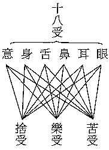



想取像为体　这是解释想蕴的。想为大地法中的心所之一，以取一切事物的现象和义象，为他的体性。拿现代的话说，想就是认识作用。吾人认识客观外在的一切境时，内心即摄取那境相而不期然的现为心象，所以《顺正理论》说：「所缘境中，如相而取，故名为想」。在这无限差别的表象作用上，再加以构思、综合、联想、了解、分析，而成具体的概念，进一步更为所取的境相，安立种种的名言，为想蕴的特别功用。不过现象与义象，是有所不同的：现象，指有物体形态的，如所执取的青黄显色，长短形色，男女等相。义象，指无物体形态的法，如所执取的苦乐冤亲等相，虽有现象与义象的不同，但同为想蕴所取像。如约所依根分别能依想，也有眼所生想等的六想身。



四餘名行蕴　四餘，指除色受想识的四蕴外，其餘四十四心所，十四不相应行的一切有为法，都属行蕴所摄。行是造作义，经说若能造作未来有漏有为的果法，名行取蕴。所谓造作，就是与外境接触时，内心立刻生起一种如何适应、改造等的心理活动，以此执行对於境界的安排与处理，而成为行为，所以行是我人的意志作用。造作的功用，本非限於心所等的五十八法，其餘色等四蕴，也有造作意义，所以不名行蕴者，一因他们已各别得了独立的名称，而独行蕴没有，为显五蕴的名义差别，所以唯此得行蕴名；二因其餘四蕴，祇能代表他们各自的自体，不能含摄多法，而行蕴却能含摄多行，所以特标行蕴之名。《杂心论》说：「五阴虽是行，而一受行名」，就是此意。



其次，经中每以六思身代表行蕴，这是什麼意思？是约特殊超胜不共其他意说的。《正理论》说：「思是业性，为因感果，其力最强」。他不但自身有强有力的活动，并有强胜的力能，推动其他心心所法，发生活动作用，可说他是心所中的原动力，据此佛说六思身名为行蕴。如约所依根分别能依思，也有六思身的差别。



如是受等三及无表无为名法处法界　如是像上说的受想行三蕴，色蕴中的无表色，还有五蕴所不摄的三种无为，在十二处中名为法处，在十八界中名为法界。表如下：



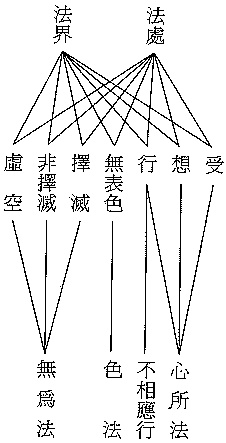



辛三　明识蕴辨处界



> 识谓各了别此即名意处及七界应知六识转为意



已释受想行三蕴，此明最后识蕴。初句出识蕴的自体，后三句建立处界。



识谓各了别　识是心识，在七十五法中，他是心王，亦即精神的主体；了别是主体精神的作用。因所依根有六种差别，能依识也就有眼等六识。虽有六识，而各各以了别为他的体性，所以说各了别。如眼识依眼根机关了别青黄长短的显形色，耳识依耳根机关了别有无执受的内外音声，鼻识依鼻根机关了别好恶诸香，舌识依舌根机关了别甘等诸味，身识依身根机关了别坚等诸触，意识依意根机关了别内外的事理诸法。《正理》说：「各各总取彼彼境相，名各了别，谓彼眼识虽有色等多境现前，然唯取色不取声等」。可说他们唯各站在自己本位上，了别自己所当缘的境界，决不超出范围以外去了别他境。当心心所法了别各自境界时，缘总相抑缘别相，光记虽有四说，但唯第三是正义，其他皆不足取。即心王唯缘境的总相不缘别相，心所可缘总别相，这是大小乘的共义。如缘花，了别这是花，这是心王的作用；如进而了知这是什麼花，花上有些什麼颜色，开得怎麼样，这都是心所的作用。别不离总，所以心所不但缘别，亦能缘总。小乘的《正理》、《显宗》、《入论》都说：「识惟能总取境相，非能取境相差别，若能分别差别，即名心所」。大乘的《中边》、《瑜伽》、《显扬》等诸论，亦皆说：「心唯取总相，心所取总别二」。所以应以此为正义。



此即名意处及七界应知六识转为意　这三句颂，应读为：此即名意处及七界，应知六识转为意。即此所说识蕴，於十二处中立名意处，於十八界中立为七心界。所谓七界，就是眼耳鼻舌身意的六识界及六根中的意根界。



庚二　旁遮疑为决判辛一　遮无十八界疑



> 由即六识身无间灭为意成第六依故十八界应知



这一颂，说明六识如何转为意，以及为何说明十八界的理由。初二句抉择意界自体的有无，后二句遮无十八界疑。



由即六识身无间灭为意　如上所说，知道识蕴即六识身，六识身即识蕴，别无他法，现於六识外建立意界，试问这是指的什麼呢？当知意根是由六识身转变而成的。谓六识身於生灭中，无间隔的转谢过去，而为后识生起所依的那法，名意根界。无间灭已为后念依的，大乘说是等无间缘或开导依。心识的活动，前一念识不灭，后念识决不生。小乘既不立末那识，为意识生起的所依，如再不立无间灭意为意界，作为第六识生起的所依，意识不是没有所依了吗？识无所依，怎能生起？正因前念为后念依，前灭后生，念念相续，展转无穷，所以以无间灭已的六识身，立为意界。意与识的不同有三：一、约时间说，现在生起的叫识，落谢过去的名意，二者只有时间的前后，没有实体的差别。《正理论》说：「时分异故，别立无失」。二、约能所依说：即同一六识身，为所依义名之为意，为能依义名之为识。《正理论》说：「如何已灭名现识依？是现识生邻近缘故」。三、约能所生说：就其从他生的方面说，叫做识，约他能生识的方面说，叫做意。没有能生的意，从他生的识，就无法活动。因有这三点不同，所以别立为意。或有人说：能为后念心识之所依的就名为意，已证阿罗汉果的无学圣者，当其最后灰身泯智入无餘依涅槃时，再也没有后念心识的生起，则此最后一念心，就失掉了所依的意义，岂不是不可叫做意了吗？不然！要知后念心识不生，不是最后念心不能做他的所依，而是由於缺乏其他的条件，在灭入过去的六识身，为所依义是已完成了的。如谷种子，从田中收回，已完成种义，后来所以不再出生新谷，因缺乏水土等的他缘。意亦如是，不是不能为识所依，因缺乏心识生起的因缘，所以识不得生。



成第六依故十八界应知　有人这样责难说：六识即意，意即六识，既无别体，界应唯有十七或十二，不应说有十八界！如将六识摄归一意，界则唯有十二；如将一意摄归六识，界亦唯有十七。果然如此，为什麼建立十八界？这是有道理的！凡是识的生起，必有他的所依，如前五识各有所依，第六意识岂能没有？为了成立第六意识的所依，所以特就六识身转谢过去的立为意界。如是根境识三各六，就建立十八界。《正理论》说：「如前五识，别有眼等五界为依，第六意识无别所依，如离所缘识无起义，离依亦尔，识不得生，为成此依故说意界。如是所依、能依、境界，应知各六，界成十八」。



辛二　决判种种问题壬一　三科总摄



> 总摄一切法由一蕴处界摄自性非餘以离他性故



这是以蕴处界总摄一切有为无为的诸法。初二句正明总摄，后二句辨摄相遮异部。摄诸法相，有总别不同。此颂虽说摄的总相，但别摄亦不可不知，所以先说别相相摄。佛法说的相摄，就是科学上用的归纳法，谓将一切散漫无章的归纳为几类。以三科说：一切有为法，归纳在五蕴中，而取蕴只摄一切有漏法，五蕴又不能摄尽无为。无为在十二处中归纳於法处里，在十八界中收摄於法界里，所以处界能摄尽一切法无遗。现就本颂说的五位七十五法，表示他的相摄差别。



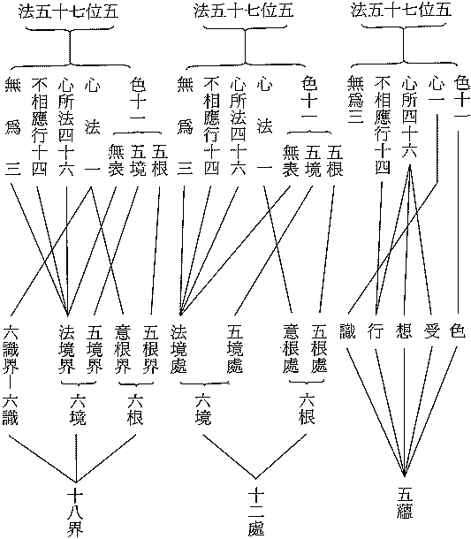



总摄一切法由一蕴处界　三科别摄诸法，就如上表所示，现再说明颂的总摄。一蕴，指色蕴，一处，指意处，一界，指法界。诸法虽多，五位七十五法，摄尽无餘。如一色蕴，总摄十一色法，一意处，总摄一切心法，一法界，总摄心所四十六、心不相应十四、三无为的六十三法。诸法在三科中总摄，就是如此。



　　　　　　　┌色蕴──摄一切色法───心所──┐  

　　　七十五法┤　　　　　　　　　　┌─┘　　　├法  

　　　　　　　│意处──摄一切心法　│┌不相应行┤  

　　　　　　　└法界──摄一切───┴┴无为──┘



摄自性非餘以离他性故　诸法相摄，唯摄自性，异於自性的他性，就不能摄，因他们的体性，常是相离而不相即的。举例说：如色蕴望於眼处眼界，因是同一色法，所以能够相摄，若望无质碍的心法，因为体性差别，所以不能相摄。又如眼根唯摄眼根自性，不摄耳根；耳根唯摄耳根自性，不摄眼根：因为各有自体，所以融洽不起。色蕴唯摄自性，不摄餘蕴，受等四蕴，各摄自性，不摄他蕴，其理亦然。可是，化地部的学者，认为性质相同的诸法，固可相摄，就是异於自性的他性，也可相摄。如契经说：「三蕴摄八支圣道」。三蕴是戒定慧：戒蕴摄正语、正业、正命；定蕴摄正念、正定；慧蕴摄正见、正思惟、正精进。假定唯摄自性，慧蕴应唯摄正见，不应摄正思惟、正精进，既摄此二，可见诸法相摄，不唯摄自性，亦能摄他性。有部学者不以此说为然，因为经说三蕴摄八正道，四摄摄诸徒众，台观中心摄众材等，是约方便招引，暂持不散，假说为摄，并非真能相摄。



壬二　三科开合



> 类境识同故虽二界体一然为令端严眼等各生二



这是决判种种问题的第二科，名三科开合，而实即十八界的开合。前面说过，有情生命体上，具有十八界类，因而便发生这样问题：人的眼睛、耳朵、鼻孔，都是左一只右一只，各各具二的，是则眼耳鼻三根界，就可开为六界，而十八界也应是二十一界，为什麼唯立十八？这是一个很有趣味的问题，所以本颂特别略为说明。上二句明数合义，下二句示数开义。



类境识同故虽二界体一　这应读为：类同故，虽二界体一；境同故，虽二界体一；识同故，虽二界体一。类是体类，约所依根说。为识所依的眼耳鼻三根，虽各有左右二界的不同，但同为根的自体，并没有他的差别性。境是境界，约所缘境说。眼耳鼻三根，虽各各有二，但缘同一境界。如眼根缘粉笔，左右两眼，同以一粉笔为所缘，并不是左眼缘的是一境，右眼缘的为另一境。识是心识，约能依能缘的精神说。眼等虽各有二，但同为一识所依，同发一识。如是界的部分，虽各具二，而体唯一，所以界立十八，非二十一。



然为令端严眼等各生二　如上所说，有人又提出问题道：眼等自体既是同一，我们人类各各唯生一眼、一耳、一鼻就可以了，为何要各各生二？这在《婆沙》以四说释此难，此论长行以二义释端严。一、身相端严，端严即端正庄严。有人以为：有情身上，眼耳鼻三，各各生二，是为庄严身相的，假定各生一处，那就丑陋不端严了。这是《婆沙》的第二说，《宝疏》说是有部义，不很可靠，因《婆沙》中叙说了四家意见后，并未加以评破，说这是正义。二、心识端严，这是《婆沙》第三说，而为论主所采取的。有情身上，眼耳鼻三，各生二处，是为发识端严明了，因为现见世间有情，闭一眼睛，见色就不分明，塞一耳朵，听声就不清楚，堵一鼻孔，就难辨别香臭。《发智论》说：「双开眼时，见分明故」。《正理论》说：「说眼等根为令端严各生二处，此有别义，非为严身，现见世间於诸作用增上圆满，亦说端严，若眼等根各缺一处，见闻齅用皆不明了，各具二者明了用生，是故此言为端严者，正是为令用增上义」。如说为令身相端严，有二事难通：一、性极凶恶的鵄至和那野猫，虽也有两眼、两耳、两鼻，我们见了，不但不觉得有什麼端严，反而感到异常的讨厌。二、从原始出现到这人世间的人类，就唯生一眼、一耳、一鼻，大家看惯了，不特不觉得丑陋，反而以一眼等为最漂亮，如有二眼人的出现，倒认为怪难看的是不吉祥之物了。所以为令端严，不是为的身相，而是为的心识明了。有人或又提出反问：如为发识而生二眼，似乎大可不必，因在初生时，眼稍长大一点，是就可以了，不一定要生二处。解决这问难，最好用《婆沙》第一胁尊者说为当。「胁尊者言：一切生疑，故不应责。谓若增减亦复生疑，云何此三各唯尔所？然各二处不违法性」。意思是说：这不必问，问了祇有自找麻烦。如生来就唯生一眼，则问为什麼不生二眼；若生来就具有三眼，你又可问为什麼不生二生四！须知这是因缘差别，没有追问的价值！



壬三　三科名义癸一　释蕴等名



> 聚生门种族是蕴处界义



蕴处界三科的如何安立，怎样与诸法相摄，都已说过；现来正式解释蕴处界三科的名义。这两句颂文，应拆开读为：聚是蕴义，生门是处义，种族是界义。顺著他的次第，简说如下：



聚是蕴义　聚是积聚。一个单纯的东西，不可称聚，要由很多个体的集合，才可说聚。谓将品类差别的诸有为法，约其同类的和合积聚起来，是为蕴的定义。如色法，不论是过去、现在、未来的，自身以内的，客观外在的，粗如有对的，细如无对的，清净殊胜的，染污微劣的，远非现实的，近如目前的，一切的一切，总略而为一聚，说名色蕴。色蕴如此，受想行识亦然。如表：



　　　　　　　　　　　　　　　　　　　　　　　　　　　　　　　　　　　┌依五根名粗  

　　　　　　　　　┌过─已灭　　　　　　　　　　　　　　　　　　┌所依┤  

　　　　　┌三世门┤现─已生　　　　　　　　　　　　　　　　　　│　　└依意根名细  

　　　　　│　　　└未─未生　　　　　　　　　　　　　　┌粗细门┤　　　　　┌下粗  

　　　　　│　　　┌内─自身或五内处　　　　　　受等四蕴┤　　　└九地───┤  

　　　　　├内外门┤　　　　　　　　　　　　　　　　　　│　　　　　　　　　└上细  

　　　　　│　　　└外─非情或五外处　　　　　　　　　　└餘四门──────如色蕴  

　　　　　│　　　┌粗─有对（有见有对无见有对）  

　　　色蕴┼粗细门┤  

　　　　　│　　　└细─无对（无对无见之无表色）  

　　　　　│　　　┌胜─不染（善无覆无记）  

　　　　　├胜劣门┤  

　　　　　│　　　└劣─染（不善有覆无记）  

　　　　　│　　　┌远─过去未来  

　　　　　└远近门┤  

　　　　　　　　　└近─现在



生门是处义　生即出生、增长，能出生、增长其他法的，即名为处。《婆沙》举喻说：如城市里面，出生种种的东西，可供人们受用，长养人们生命。从所依的六根，所缘的六境，出生种种的心心所法，长养染净的生命体，继续不断的生存，也是此意。如眼根色境和合为缘，引生眼识及其相应心所，乃至意根法境和合为缘，引生意识及其相应心所。《大乘杂集论》第二说：「生者能生，其体六根六境，是能生诸心心所之门，故名生门」。可说与此论同一意趣。



种族是界义　种是种类，族谓族姓，含有差别义。就界的种类说，意显十八界各有他的生长因；就界的族姓说，意显有情的生命体中，有十八类的族姓不同，并且每一族姓，都有严格界限，决不混同。如一山中的金银铜铁矿，就是族的意思。金矿叫金矿界，银矿叫银矿界……。各矿以其族类为他的界限，决不金矿混成银矿，银矿混成铁矿。



上来略解三科名义，今再从名义上推究其假实。蕴处界三，本为佛对宇宙万有分类说明，经里并未讨论他的假实问题，而且从原始圣典看，不但没有说他是假，反而是说一切有，因为这三者，都是现前有情的具体事实。有部和犊子学者，本於圣教所说，主张三科皆实。可是其他学者，从另一观点去探讨，觉得三科有假有实的差别，虽这样说，也不违反圣典。於是三科假实论，就在学派间热烈展开。大体说：经部主张蕴处假有，十八界真实；大众系的说假部也以十二处为非实，是否亦主五蕴是假，未在论典中发现明文，但据其「谓苦非蕴」的文句看，亦可想像他是主张蕴假的。世亲论师出入於有部经部之间，既不同情有部的蕴是实有，亦不同情经部的处是假有，他是主张蕴假处实的。还有一刹那论者，与有部、论主站在同一阵线，说十二处真实，关於这个假实之辨，说来非常麻烦，略而不论。



癸二　明教起因



> 愚根乐三故说蕴处界三



佛陀采用三科法门，说明一切法的真实相，是有他深刻用意的，这就是教起的原因，换句话说，佛为什麼要施设这三科教法？讲到这问题，《婆沙》七十一，说有八种原因，本颂以三义摄尽，就是：愚三故，说蕴处界三；根三故，说蕴处界三；乐三故，说蕴处界三。



愚三故说蕴处界三　愚是愚痴，亦即知识缺乏。谓对所应了知的境界，迷惑不能正确的认识。我们所认识的对象，主要不出心之与色——精神与物质；而迷惑亦即在此，不过有迷心和迷物的偏重不同，所以约此说愚有三。一、有类有情，对於无知的色法，尚能稍有认识，但对精神，特别对随心而起的心所法，迷惑相当严重，简直毫无所知，於是就妄执心所为我。佛为开示这类有情，就说五蕴法门，总摄色为一蕴，识为一蕴，而针对有情所迷，特将心所法剖开详明，使其反迷归悟，不再妄执受等为我。二、有类有情，对於精神界，不论是主体的所属的，迷惑甚轻，独对有质碍的色法，无智了解，迷惑甚重，於是就妄执色法为我。佛为开示这类有情，说十二处法门，总摄心心所法为一处半，详细分析色法，使破色上的迷惑，令知物质的非我。三、有类有情，愚痴太重，智慧太少，不特迷於精神，亦复迷於物质。佛为开示这类众生，所以说十八界法门，广明心色二法，令得正确认识，不再妄生执著。由於三类有情迷惑不同，所以佛说蕴处界的三科差别。



根三故说蕴处界三　根即根机、根性。众生的根性，有上中下三。一、上根利智的，性颖悟，慧力胜，不特略闻即解，且能闻少知多。像这类有情，当然毋须为之详说，所以佛总宇宙万有，为说五蕴。二、中等根机的，智慧不太明利，也不太愚，说略不得要领，说广又觉太繁，为适应这类根机，所以佛说不广不略的十二处，既能使他消化得了，又能使他领悟真谛。三、下等根性的，由於智慧暗劣，思想迟钝，必须对他广为分别解剖，方能领悟，所以对他说十八界，令从十八界，悟入诸法实相。由於有情的根性，有这三品的差别，所以佛说蕴处界的三科不同。



乐三故说蕴处界三　乐是好乐，亦即胜解。有情的好乐，也有三种：一、乐略的有情，胜解力强，广说认为琐屑，佛为巧逗其机，乃直捷了当的，简明扼要的，为说五蕴法门。二、乐中的有情，胜解力平，既不喜广，亦厌太略，在他的意识中，认为广了无用，略了不够明显，为逗此类机宜，佛说十二处法门。三、乐广的有情，胜解力劣，最喜详谈，略固茫然无知，适中亦不完全理解，必须不厌其详的广为开示，方能满足他的需求，所以佛就对他说十八界。由於有情的好乐有三种不同，所以佛说蕴处界的三科差别。



　　　　　┌蕴……愚心所者……利根……乐略说  

　　　三科┤处……愚色法者……中根……乐中说  

　　　　　└界……愚色心者……钝根……乐广说



癸三　叙蕴废立



> 诤根生死因及次第因故於诸心所法受想别为蕴



此颂叙述五蕴的废立。谁都知道：大乘说有五十一心所，小乘说有四十六心所。即以小乘而论，在四十六心所中，为什麼特以受想二心所别立为蕴，餘均摄於行蕴中？有的学者说：受想通於三性、徧於三界、与六识（大乘八识）俱，所以别立为蕴。这不能成为立蕴的正确理由，因为具有这些性能的，不独受想二心所，其他如触、作意、思，也都具这些条件，但并未别立为蕴，可见这未抓到受想之所以立蕴的理由。本论现说三因，才是最基本的。前二句明三种因，后二句明建立蕴。



诤根因　诤是烦恼，有乖违义。烦恼的产生，必有其根源，这就是诸见及诸欲，诸见摄五利使，诸欲摄五钝使。当知诸欲是从受生的，受为一切欲的基本最胜因，诸见是从想生的，想为一切见的基本最胜因；因受领受五欲境界，所以就在境上生起贪心，因想起诸颠倒妄想，所以就从妄想中起诸倒见。《婆沙》七十四说：「受能发起爱诤根本，想能发起见诤根本」。可见烦恼产生的动力，是受想。颂疏说：「烦恼名诤，即诤名根，受想二法，与诤根为因，诤根之因」，名诤根因。以六离合释说，是依主释。有说：在家多欲，出家多见，佛为在家者说法，多呵五欲，为出家者说法，多斥倒见。但这祇可说是偏重，不可说是必然，因在家出家，都有欲、见的。



生死因　生死是轮回的业果，有果必有因，其根本动因就是受想，可说生死是由受想所支配的。众生在三界生死中沉沦，一方面固由躭著男女的欲乐，他方面亦由投胎时的不正妄想。有情在生存时，因为染著色欲，所以欲为生死本，既从欲海中滚来，受胎时自然就随倒想所转。如男的见母生喜，见父起瞋，女的见父生喜，见母起瞋，根本就未把父母当作父母看。佛法主要目标，是将众生从生死的歧途中，拉回头走上解脱的正道。但欲达到这个目的，须先抉择心心所法，看看谁为解脱的劲敌。大乘学者抉择的结果，心王以意识为主脑，心所以受想为顽强。佛亦即发现受想为生死因，才把他特立为蕴，使众生重视他、对治他。对治的方法，佛学上常说二无心定。无想定是外道修的，虽因知见错误，不能由此而得解脱，但以受想为克治的主要对象，希望由此停止意识活动的动机，不能说不对。灭尽定是佛教圣者修的，目的也在灭除受想，所以又名灭受想定。此定修有相当的工夫，确能使受想不起作用，而生死亦可得了。所以这在佛教的修行上，具有他的特殊重要性！



及次第因故於诸心所法受想别为蕴　及并及，次第因，是说受想於五蕴中能作次第的动因，五蕴如没有受想，其次第就无法建立。为次第因的理由有四，到下明五蕴次第时，再为详说。到此，我们可把颂文作这样的读：诤根因故，於诸心所法，受想别为蕴；生死因故，於诸心所法，受想别为蕴；次第因故，於诸心所法，受想别为蕴。



癸四　显不摄法



> 蕴不摄无为义不相应故



前说五蕴只能摄尽有为，不摄无为，但为什麼不能摄诸无为呢？《婆沙》以十义说明他的理由，此论以两句颂摄尽其义。摄在《正理》、《显宗论》中，都说「蕴不说无为」，照长行看也是说字，如论说「三无为法不可说在色等蕴中，与色等义不相应故」。不过，奘公的几种译本，及古人的注释中，都用摄字，所以现仍保存原字，不加改动。其实，用不说、不摄都可，其含义是一样的。



蕴不摄无为义不相应故　要知五蕴不摄无为，先知彼此不同意义。如上所说：色以变碍为义，受以领纳随触为义，想以取像为义，行以造作为义，识以了别为义。无为法的体性，既不是变碍的，当不可摄於色蕴；既不具领纳义，当不可摄为受蕴；既没有取像义，当不可摄於想蕴；既不含造作义，当不可摄於行蕴；既无了别之义，当不可摄於识蕴。五蕴的定义与无为的体义，互不相应，所以不摄。或有人说：义不相应，不摄无为，确有理由，但我以为，在五蕴外，别立第六无为蕴，未尝不可，何以不立第六蕴以摄无为？不可！要知蕴是积聚为义，而无为法却无积聚性，怎可别立一无为蕴？义不相应不摄，这是你所承认的，蕴与无为法体，既然义不相应，你为什麼又要主张别立第六无为蕴？这不是你的自相矛盾吗？还有，取蕴是一切有漏杂染法的所依，蕴为染净诸法的所依。无为非杂染依，不可摄於取蕴，非清净依，不可摄於蕴，既非蕴及取蕴，自更不可别立为蕴。有人以为无为法性能生一切法，是未分清诸法界限的妄言，若明此中意义，就不会再发无为生诸法的谬论了。



癸五　彰名次第子一　五蕴次第



> 随粗染器等界别次第立



五蕴，依照他的次第说，是色受想行识，但为什麼决定他的次第如此呢？把他的次第掉动一下不可吗？不可！这有四种理由，依颂文说：一、随粗次第立，二、随染次第立，三、随器等次第立，四、随界别次第立。今据此分别说明如下：



随粗　约粗细明五蕴次第：粗即粗显，细即微细。以后四蕴与初色蕴对观，色蕴是物质的，十一色中，除了无表，都是有对的，下文说十有色有对，就是指此。他在五蕴中，较之无形无对的餘四蕴，无疑要粗得多，所以说在最初。后四蕴虽同为微细的心理活动，但面对客观境界时，最易为人感受领略到的，无过於苦乐。在精神作用中，因受心所较粗，所以列在第二。后三者对比，想蕴在互相对待上，较为明显，如男女相待，老幼、美恶、大小相待，一见就可想像得出，所以居在第三。行蕴含摄心所很多，而其中贪等烦恼，活动时易於被人发现，行相粗於心识，所以排在第四。识是精神的主体，缘境只取诸法的总相，不取别相，行相最极微细，不易分别抉择，所以殿在末后。



染　约染净明五蕴次第：众生所以沉沦於生死不能自拔，主要动因，是由男女爱乐，在彼此爱乐中，初作容貌颜色的相爱；由於互贪其色，於是就耽著其中的快乐感受；所以对乐受发生耽著，实由各人的颠倒妄想力；妄想力的产生，源於行蕴中的烦恼，烦恼的冲动，是依於心识：色受想行能染污识，所以识蕴说在最后。



器等　约器喻明五蕴次第：器即器皿，可装东西之用。人类受用饮食，装盛饭菜，首先须得准备饭盆、菜碟。我们生命自体，先有一色壳子。色为受依，犹如器为食物依，所以说在第一。有了器皿，进求食物，受能增损吾人的身心，如食物的良否，可以损益肉体，所以说在第二。有了米面小菜，还须油盐酱醋，以调其味，否则不能受用。想是取怨、亲、中平等相的，取怨敌相起苦受，取亲爱相起乐受，取处中相起舍受，想助受生，所以说在第三。饮食助味都具备了，如无烹调的人，仍然不行，所以要请厨师，厨师如行，行造善业感好果报，如好厨师做好饮食；行造恶业感苦果报，如坏厨师做坏饮食。行能造业感报，所以说在第四。饮食做好，必给人们享受，享受者即是识蕴，因为识蕴感受苦果，无异人之享受饮食，所以说在最后。



界别　约三界差别明五蕴次第：欲界有色相显了的五欲妙境，所以色蕴在先。色界有四静虑，初二静虑有殊胜的喜受，第三静虑有殊胜的乐受，第四静虑有殊胜的舍受，因为色界诸受特胜，所以受蕴第二。无色界有四空处，空无边处、识无边处、无所有处，想像力最丰富，所以想蕴第三。非想非非想处，业感八万大劫果报，思惟力最强，思是属於行蕴的，所以说在第四。有了色等四蕴为所住处，识蕴就有活动的场所，因为识以色等为所住的，四蕴如田，识如种子，种必播於田中，识必住於四蕴，所以识最后说。



次第立　这是总结上面的诸义。意说：由粗细、染污、器喻、界别的四义，所以立五蕴的次第，既没有增益的过咎，又没有损减的过失，更没有杂乱无章的过患！



本颂以四义建立五蕴次第，是就流转门说；《杂心》、《正理》更就还灭门，明五蕴的次第。深入佛法的堂奥，有二要门：一是不净观，一是持息念。不净观所观的是所造色，持息念所念的是四大种，大种与所造，都是色法，所以先说色蕴；观力增盛，获得轻安，内心生起乐受，所以次说受蕴；苦乐的感觉，与肉体的接触，不是有损於肉体，就是有益於肉体，但这祇就肉体的说法，并不是损益於我，如是，我想的执著泯除，法想的念头生起，所以次说想蕴；观想纯熟，通达我无法有，烦恼不生现行，所以行蕴在四，烦恼息灭不行，心就调柔有所堪能，所以识蕴说在最后。这约顺的次第说，如约逆的次第说：染净的生起，以心识为主，所以先应以识蕴为所观的对象；集中注意力观察心识，依心识而起的烦恼活动就减轻，烦恼减了，我想渐渐淡忘，唯有法想加强；法想加强，由贪而生的乐受就不生，但欲贪受真正不生，必须观於诸色，所以先色次受想行识。



子二　处界次第



> 前五境唯现四境唯所造餘用远速明或随处次第



前面讲的五蕴次第，这里来说处界次第。科目虽则总说处界次第，而颂文实祇显示内六处的次第。因六境六识的次第，与内六处有著密切的关系，祇要明白了内六处，外六处以及依根缘境的六识，就可比类而知。论说：「处界门中，应先辨说六根次第，由斯境识次第可知」。内六处，就是眼耳鼻舌身意，但为什麼这样排立他的次第？意根或鼻根放在前面不可以吗？本颂就是解决这个问题的：前三句约缘境及作用明诸根次第；后一句约人身的部位说明次第。



前五境唯现　约量非量差别释：吾人以根取境，有现、比、非的三量差别。现量，是对现前境界直接亲切的了解；比量，事物不一定现在眼前，但可用推理方法知道他；非量，不是现比二量的境界，而纯是一种错觉境界。眼等五根取色等五境，唯取现前的现量境，义较殊胜，所以在前。反过来看，意根缘境，在时间上，不但缘现在，且缘过去未来；在三量中，不特缘现量境，亦缘非比二量；在法上说，不独缘有为法，同时还缘无为法，所以意在於后。这样对起来看，五根缘境决定，作用不乱，行相分明；意根缘境不定，作用庞杂，行相不明。因为是这样的关系，所以如此分别他的次第。



四境唯所造　约能所造差别释：眼等五根，就其体说，同属色法，就取境说，同属现量，为什麼眼等四根在前而身根在后？要知眼等五根取境，虽同属於现量，但缘境时有能所造的不同。眼等五根，唯取大种所造色，身根取十一种触，具有能所造的二种，所以身根一面缘所造触，一面缘能造触。这样比较，身根缘境比眼等四根要复杂些，所以把单纯的眼等四根放在前面。



餘用远速明　约远近速明差别释：餘指身根之餘的眼耳鼻舌四根。眼等四根取境，既同是所造色，为什麼这样分别他的先后呢？因此四根作用，眼及耳根，能取远处境界，所以前说，鼻及舌根，唯取近处境界，所以后说。取近境的，是合中知，如阵阵花香扑鼻而来，好像是有距离，其实这是由花香化为气体，透过空间而与鼻根相接才能齅到；舌根尝味，要把有味的东西放在舌头才知其味，既同属合中知，为什麼鼻前舌后？这因速明的关系。就速度说，如对色香美味的饮食，其味是甜是苦，必须进入口中方知，而其香如何，鼻根可先齅到，作用速的在前，作用慢的在后。就明度说，鼻能取味中的细香，舌不能取香中的细味，因此一前一后。取远境的，是离中知，如见远远的景物，听远远的音声。既同属离中知，为什麼眼前耳后？这由於远近迟速的不同。就长度说，如站在高山顶上，远见河水的流动，但不闻流水的潺潺声，远观青葱的树木，但不闻树木的松涛声，所以眼在耳前。就速度说，眼根作用的速度强，耳根作用的速度弱，如先看到撞钟擂鼓，然后才听声音传来。科学者所说，与佛教一样，可见佛法是最科学的。「有时你看到很远的地方有个工人在那里敲石块，你定会注意到他的锤子打下去许久以后，声音才传到你的耳朵里……好比说你站在五百尺以外，那麼你看到枪炮发射的闪光以后，大约半秒钟才能听到他的声音」。闻声比见色迟，所以耳在眼后。



或随处次第　约有情身的部位释：有情的生命骨架，是六根的所依，而六根安布在生命的骨架上，从外表看，他的次第是这样的：眼根居最高位，又显现在面前，所以说之在先，耳根安在眼下，鼻根布在耳下，舌根立在鼻下，身根中央在脐，所以列於舌次，意根别无方所，就他所依说，徧依诸根发生，所以说在最后。《顺正理论》不赞成此说，他认为鼻根极微，住在鼻额当中，并非居於眼下，横观眼耳鼻三，其形状如冠花鬘，没有什麼高下差别。论主的解说，或许是就根依处假说的，约胜义根说决不如此。正理师因不信此说，特采论主的作风，说是「传说」。



癸六　判名废立



> 为差别最胜摄多增上法故一处名色一名为法处



本颂解决两个问题：一、十二处中的五根五境及法处少分色，都名为色，为什麼唯以眼所取境立名色处？二、十二处的每一法体，都能任持自性，通统可叫做法，为什麼唯以意所取境立名法处？颂的第一句及第二句，解答第一问题；初句前三字及第二第四两句，解答第二问题。《杂心论》以颂答前一问题说：「虽有众多色，但说一色入，当知一色入，三眼境界故」。又以一颂答后一问题说：「彼一切诸法，虽尽是法入，法中众多故，一法入非餘」。这首颂文，应读做：为差别故，一处名色，为最胜故，一处名色；为差别故，一名为法处，为摄多故，一名为法处，为增上法故，一名为法处。依此解说如下：



为差别　约差别义明唯眼境为色处：所缘的色等，能缘的眼等，是各各差别的，所以不总说一而差别建立者，为令研究易於了知诸法差别的界限，不致含混紊乱的缘故。如眼所缘的色，不为耳所缘，乃至身所缘的触，不为餘所缘；又眼根的作用，不为耳根用，乃至身根的作用，不为餘根用。假使没有眼等的差别想像，色等的个别名词，五根缘境就无法区别。耳根等所取的境界，就其胜用上既然替他建立了声等的别名，而眼根所取的境界，一因无别名可立，一因他的自体是色，所以就立名为色处，此色处名，是眼等诸名词所简择区别出来的。因此，五根五境的十色处，虽同摄於总的色蕴中，但为对其他九处各别立名，所以特取色的总名，别立为色处之名。



最胜　约最胜义明唯眼境为色处：有人问：假定是为差别，这所有权不独眼根所取境有，其他也可有的，为什麼不将这头衔让给耳根所取境呢？虽五根所取境都可享受这名称，但因其他九处的色义，不及色处的意义殊胜，所以不得通名。色处特胜的意义有二：一是有对碍的，只要以手摩触，就可变坏；二是有所见的，世人可以指示在此在彼：所以在十处中，特立通名。



《杂心论》说这是肉眼、天眼、慧眼的三眼所观境界；《正理论》说诸大论师共立此为色处，非於声上建立色名；此论长行及《正理》又说，世人共於此法立为色名，谁也不会说这是声是香等：由这种种理由，故以色的通名，立为色处别名。



摄多　约摄多法义明唯意境为法处：法处虽是十二处之一，但他能含摄四十六心所、十四不相应行、三种无为及无表色的多法，而其他触处等，任何一处，都没有含摄多法的功能，所以特取通名立为法处。



增上法　约摄增上法义明唯意境为法处：增上法，指殊胜的涅槃，因於一切法中，涅槃是最极增上的。法处能含摄这最高无上的涅槃法，而其他触处等，任何一处，都没有这功能性，所以唯取意根所缘之境，名为法处。



法处所以名为法处，除了上述的理由，还可以差别义成立他，所以第一句颂中的为差别三字，通於色处、法处而言。意思是说：十二处虽都可以叫法，但若不立法处，就不能显出十二处的差别，为显十二处的差别，所以对餘十一处，特取法的总名，立为法处别名。



故一处名色一名为法处　这是总结。意说：由差别、最胜的道理，所以一处叫色处；由摄多法、摄增上法、为差别的道理，所以一处叫法处。



癸七　论摄异名子一　略摄众多法蕴



> 牟尼说法蕴数有八十千彼体语或名此色行蕴摄  

> 有言诸法蕴量如彼论说或随蕴等言如实行对治



上来已略显示三科各别的名称，今再略为论究摄餘异名。我们知道，诸经论中，不特说有蕴处界，并说有其他名称，但是否可摄在这三科当中，实是一大问题。能摄，怎样摄法？不摄，三科即有摄法不尽之失，而前说的「总摄一切法，由一蕴处界」，亦将无法会通。为解决这些难题，所以有此论摄异名一科的产生。依照现在的意思看：餘处所说种种蕴处界的名称，是可为此中所说蕴处界所摄的，不过当摄时，要审慎的观其自相，如其所应而摄：如应摄在那一蕴中的，就应摄於那一蕴；如应摄在那一处中的，就应摄於那一处；如应摄在那一界中的，就应摄於那一界。初颂明餘一切蕴皆可摄於五蕴中，次颂明法蕴的数量多少。於中，前二句明佛说法蕴的数量，第三句明法蕴自体，第四句正明所摄，五六二句约能诠文说法蕴量，第七句约所诠义明法蕴量，第八句约对治用明法蕴量。



牟尼说法蕴数有八十千　《杂心颂》说：「广说诸法阴，其数有八万」，亦即此意。牟尼，中国译做寂默，乃印度用以表徵圣者之德的，就是释迦牟尼世尊。释尊所说的法，虽有无量无边，但类别的积聚起来，就叫法蕴。概略的举其数目，约有八十千之多。十百为一千，十千为一万，八十千，即八万。印度人计数，以十或百为因，乘成多数，在百千以下的以十乘，百千以上的以百乘，所以说八万为八十千，实即平常所说八万四千法门多数的总称。



彼体语或名此色行蕴摄　释尊说的八万法门，以什麼为他的自体？这是关於教体的研究，佛法的各宗派，大都讨论到这问题，现姑举小乘两派不同的说法：一说彼诸法蕴，以语言音声为体，因佛在娑婆世界说法，是运用口头发出音声吐露语言，而使众生信受的，如《楞严经》说：「此方真教体，清净在音闻」，即指此。一说彼诸法蕴，以名句文为体，因要有名才可说教，所以教体是名句文。《正理论》说：「诠义如实，故名佛教，名能诠义，故教是名，由是佛教定名为体，举名为首以摄句文」。如来施设的教法，能如实的表诠法义，法的真相是怎样，就如实的说他是怎样，能诠所诠毫无乖违，即名佛教。而藉以表诠如实义的是名，所以名为教体。如此两说，《婆沙》评以声为体为正。《婆沙》百二十六说…「问：如是佛教以何为体？为是语业？为是名等？答：应作是说语业为体。问：若尔！次后所说当如何通？如说佛教名何法？答：谓名身句身文身，乃至次第连合。答：后文为欲显示佛教作用，不欲显示佛教自体，谓次第行列安布连合，名句文身是佛教用」。如来所说法蕴，若以语言音声为体，声是色法，即属五蕴中的色蕴所摄；若以名句文身为体，名等是不相应行法，即属五蕴中的行蕴所摄。前者可说是约当机听法接受所听的道理讲，后者可说是约能诠法所诠义讲。



有言诸法蕴量如彼论说　此约能诠文明法蕴量。《杂心颂》说：「法阴谓经论，如是一一说」。能诠文，就是一切教典，等於现代人说的文献。佛说一切法蕴的言教，其量究有多少，《婆沙》七十四有六说，此论只取其一二及六的三说。依照第一师意：佛说有一部《法蕴论》，是由六千颂所组织成的，因而佛说的一一法蕴量，如彼《法蕴论》所说，都是由六千颂组织成的。谛译《俱舍》说：「有餘师说：有一分阿毘达磨名法阴，其量有六千偈，八十千中一一法阴，其量皆尔」。奘译《俱舍》说：「有诸师言：八万法蕴，一一量等法蕴足论，谓彼一一有六千颂，如对法中法蕴足说」。依谛译看，是指佛说的《法蕴论》；依奘译看，是指目连造的《法蕴足论》。今说以谛译为正。每一法蕴的能诠文，都具有六千颂，以梵文三十二字为一颂。八万法蕴，即有四亿八千万颂，其数量是相当可观的。



或随蕴等言　此约所诠义明法蕴量。所诠义，就是能诠文中所含的意义。依照第二师的意见：法蕴的数量，唯就所诠的义门，分别他的多少，一个义门，即一法蕴量。如五蕴、十二处、十八界、十二缘起、四食、四谛、四静虑、四无色、四无量、八解脱、八胜处、八徧处、三十七道品、六神通、无诤、愿智、四无碍解，以及其他一切法门，一一皆名法蕴。《旧婆沙》说：「如世尊种种言辞说四念处，是一法阴齐量。四正断、四如意足、五根、五力、七觉、八道种亦如是」。



如实行对治　此约对治用明法蕴量。《杂心颂》说：「及诸对治行，悉名法阴数」。依照第三师的意思：前两种说法，虽各有他的道理，但如切实的说，佛之广演教法，是随所化有情的心性不同，而作种种差别说的。因此法蕴的数量，应约对治的烦恼计算，所治的烦恼数有多少，能治的法蕴量也就有多少。假定所化有情有八万四千尘劳烦恼，佛所说的法蕴也就有八万四千，以一法蕴治一烦恼，否则佛就唐劳而说了。这种说法，虽也可以，但未免太呆板了。



上来虽有三说不同，而同承认如来法蕴有八万数，祇是法蕴之所以有八十千，在说明上，有约能诠、所诠、对治的差异而已。



子二　类摄餘蕴处界



> 如是餘蕴等各随其所应摄在前说中应审观自相



八万四千的法蕴，或摄於色蕴，或摄於行蕴，已於前两颂中说明，此颂再指出诸契经中，说的戒等五蕴、十种徧处、六十二界等，也可为三科所摄之义。



如是餘蕴等　餘蕴，指戒、定、慧、解脱、解脱知见的无漏五蕴；等是等於八胜处、十徧处、六十二界、六界等的诸法。



各随其所应摄在前说中　佛於餘契经中，说的一切蕴、一切处、一切界，各各随他所相应的，应该摄在前说三科中的那一科，就摄在那一科：如应摄於蕴中，就摄在蕴中，如应摄在处中，就摄於处中，如应摄於界中，就摄於界中。



应审观自相　诸蕴处界虽可与此三科相摄，但应审慎观察他的自相，绝对不可随便相摄，因为前说「摄自性非餘」。如八万四千法蕴，以语言音声为体的，就决定摄在色蕴中，以名句文身为体的，就决定摄在行蕴中。所以观察一一自相后相摄，这是必要的，不然，就有相摄不相应的过失了！



摄是一种归纳法，亦即研究法相学的一种最好方法，以此方法研究法相学，使人容易了知他的道理，认清他的体性，明白他的出发点。无漏五蕴中戒蕴，应摄於色蕴，因律仪是以无表色为性的；定等四蕴，应摄於行蕴，因这些是以大地法中的心所为性的。如表：



　　　　　　　┌戒…………道共无表色为体─色┐  

　　　　　　　│定…………定心所为体──┐　│  

　　　无漏五蕴┤慧…………慧心所为体──┤　├蕴  

　　　　　　　│解脱………胜解为体───┼行┘  

　　　　　　　└解脱知见…尽智无生智为体┘



十徧处是：青、黄、赤、白、地、水、火、风、空、识。处是所缘，其体是静虑。前八徧处，在观察时，如以无贪为他的体性，就摄在法处中；如兼以与无贪心所相应的心王助伴说，就通意处、法处摄，因为是以五蕴为性的。空识二处，也属意处、法处摄。其义明显，无须多说，今列一表以示之：



　　　　　　┌青┐  

　　　　　　│黄│┌无贪为体…法处所摄  

　　　　　　│赤├┤  

　　　　　　│白││　　　　┌意  

　　　十徧处┤地│└五蕴为体┤　处所摄  

　　　　　　│水│　　　　　└法  

　　　　　　│火│  

　　　　　　│风┘　　　　　┌意  

　　　　　　│空┬─无色界…┤　处所摄  

　　　　　　└识┘　　　　　└法



界有六界、六十二界的差别，这儿且说地等六界与十八界相摄：前四界是触界所摄，因四大是所触的触境；空界是色界所摄，因空界是以光暗为体的；识界为七心界所摄，因识界是以有漏识为自体的。六十二界与十八界的相摄，《光记》有详细的说明，请参阅。



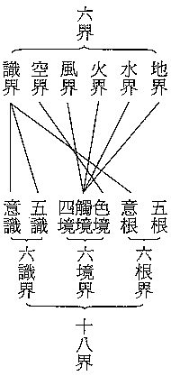



子三　别明空识二界



> 空界谓窍隙传说是光暗识界有漏识有情生所依



上面与十八界相摄的六界，地水火风四界，在前释四大时已明，所以这里特明空识二界。空与识，前面本亦略已谈到，这里所以别明者，是为抉择两大问题：一、空界与虚空无为的虚空，其义是一还是异？二、识有有漏识与无漏识的两类，此中识界是不是包括这两类识？颂初二句，答覆第一问题；后二句，答覆第二问题。



空界谓窍隙　所谓空界，简单说，就是窍隙，有外界内界的类别。就外界说，如门窗等的窍隙；就内界说，如口鼻等的窍隙。这内外的窍隙，叫做空界，并非虚空无为，叫做空界。



传说是光暗　这是点出空界的自体。如前所说，虚空（无为）是以无碍为性的，空界既不同於虚空，当另有他的自体在，那末，内外法上的窍隙，是以什麼为体呢？据有部的传说，是以光暗为体，离了光暗，没有窍隙可得。如门窗上的窍隙，从这边看到那边，视线不受阻碍，就是光，若窍隙细狭，不透光明，看不过去，就是暗。又生命上的窍隙，如五指的合并，其间有靠不拢的缝隙，具有光度与暗度。所以空界就是窍隙，而窍隙必藉光暗以显。传说，表不信任。因经部主张空界是假，而有部却认为是实，论主意同经部，所以置「传说」言。同时须要知道的，此中「光暗」二字，在普通流行的论本中，是作「明暗」，虽也没有什麼不可，但从多数说，应以光暗为正，因《正理》、《显宗》及谛译《俱舍》，都是用的光暗，如旧论说：「无有窍穴，离光暗可见故，是故言空界，唯光暗为性」。



已依颂文明空界义，再据《婆沙》略辨空与空界的五义差别：一、是色非色的差别：空界以光暗为体，而光暗是显色，所以属色法所摄；虚空以无碍为体，而无碍不是色，所以属非色所摄。二、有见无见的差别：以明暗为体的空界，是眼所见的境界；而无碍为性的虚空，却不是眼所缘见的。三、有对无对的差别：空界是属色法，既有所障碍，亦有所对待；而虚空无为，既无所对待，亦无所障碍。四、有漏无漏的差别：空界不但为烦恼所缘，且随顺增长於烦恼，所以是有漏；虚空虽为烦恼所缘，但不随顺增长，所以是无漏。五、有为无为的差别：空界，有生有灭，有所作为，是有为法；虚空，不生不灭，常住不变，是无为法。由此五种差别，可以明显的看出空与空界的各别。同时要知道的，这里说的虚空，是指虚空无为言，普通说的虚空，乃为空界所摄，二者务必分清，不可含混一点。



识界有漏识有情生所依　识，虽有有漏无漏的两类，而这儿说的识界，是专指有漏识说。有漏识对於有情，有著重要的关系。一个有情的生命组织，不出精神与物质的两大要素，拿六界说：前四界是生命的骨架，属於肉体方面，空是生命体上的窍穴，识是内在的精神活动。前五是物质，后一是精神，总为有情生命主要的所依。一个活泼泼的生命体，其组织恰如机械的机件，各部门，各机关，都有一定的机件，缺少了任何部门机件，其机器就将整个儿停止活动。《正理论》说：六界是有情生存的三大要素：一、出生生命的识界，是生因。新生命的开始，是由识的引生，可说识是前后生命的接续线，在生命论上，有著重要位置；二、为生命依止的大种四界，是养因。业识入胎，与赤白二渧结合而成新生命，新生命就以四大种为所依止，渐渐向完成的阶段进展；三、容受生命生存的空界，是长因。心物和合的生命，所以能生长延续，主要即由此空界的容受，不然，生命就不得延续和生长。六界三因，恰好是构成有情生命的具体内容。一个生命，从开始完成，到最后解体，其中间得以相续生存，全赖六界三因的保持，如六界缺少任何一界，生命立刻就要崩溃！无漏识，不但不能出生、长养生命，为生命的所依，而且还要使我们生命，趋向於散坏与破灭，所以识界唯指有漏识，不取无漏识。



戊二　义门分别己一　有见无见等三门



> 一有见谓色十有色有对此除色声八无记餘三种



本品所明的法体，已於前正明法体的一科中，详细的指示出来，但法体指出后，觉得还有种种义门，须要加以分别料简，所以跟著有义门分别一科来。此科有十九颂，分二十二门，为避繁琐，简括为十四科。本颂有三门：一、有见无见门，论十八界的几界有见，几界无见，颂的第一句，解答这问题。二、有对无对门，辨十八界的何者有对，何者无对，颂的第二句，解答这问题。三、三性差别门，明十八界的那是属善恶性，那是属无记性，颂的后二句，解答这问题。



一有见谓色　这是抉择有见无见义。十八界中，可以称之为有见的，只有六境界中的色境一界，餘十七界都名无见。《婆沙》百二十八，对此问题，举三师的不同解说：一、大德说：色处之所以叫做有见，因眼根是能见，色处是所见，在所见的色境上，有能见的眼根在，所以名为有见。二、世友说：色处之所以叫做有见，因色的形态比较粗显，世人可以相互的指出他在此在彼，所以称之有见。三、胁尊者说：什麼叫做见？见就是影像，但有影像显现出来的，在十八界中，唯是色境界，所以色处名为有见。於此三说中，本论取第二说，因此义比较殊胜、圆满，合乎论主的意见。所谓殊胜，如前颂说：「为差别最胜，故一处名色」；论长行说：「有见故，可示在此在彼差别」。如一棵树，因为有见，所以可指出他是在讲堂门口，或在马路旁边。对这问题，学者向有各种解说，而解说得最好的，要算《光记》，如说：「示现此彼言说，故名有见，此即言说名见」。原来色境得名有见，即因他的自相，可用我们「此」「彼」的言说，明确的把他指示出来，所以即言说而名见。旧论说：「此色易可显，如言此色彼色」，《光记》即据此而来。《杂心颂》说：「界中一可见，又说一切界」，依此看，一切界都可叫有见，不唯色境。不过十八界都名见，是就圣者的慧眼说，凡夫的肉眼，仍唯一色可见，因是慧眼境界，所以他引颂说：「彼一切诸法，慧者见无我」。



十有色有对　这是解释有对无对义。十八界中，唯五根五境的十（有）色界是有对的，餘七心界及法界皆是无对。对是对碍，即在有体积的法与法之间相互对碍，如《正理》说：「此有彼碍，故名有对」。分别的说，对有三种：一、障碍有对，这易明白。如左手碍於右手，右手碍於左手；此石碍於彼石，彼石碍於此石；或手碍石，石碍手等。凡是有体质的东西，必都占有一定的空间，在同一空间内，绝对不容彼此并存。十色界，既是众多极微积聚的，能占空间据点的，可碍可分的，当然是属障碍有对了。二、境界有对，这指六根六识及法界中的一分相应心所。此等诸法，虽各各有他所领取的境界，但各祇能领取自己范围以内的境界，超出即无能为力。如眼根眼识及其同时相应心所，於所观的色境上，有种势力作用，能领取这色境，若越此范围，即为其他境界障碍，无能领取，所以叫做境界有对。三、所缘有对，这指一切心心所法说，谓六识王所，在所缘的客观境界上，虽能发生认识作用，但唯能认识自己的所缘，超出即无法认识。如眼识及其相应心所，在自色境上有所缘，非自所缘的声境上，就无所缘作用。眼识如此，餘识亦然。所以叫做所缘有对。



境界与所缘，在一般人看，是一而二、二而一的，没有什麼差别，现分二种有对，自有他的不同，所以须略辨明：境界有对，是说这法对於那法，有自在力，能支配他，所支配者，就是能支配的境界。如眼根眼识及相应心所，在色境上，有领取功能，随时要取，就可取来受用，所以所取的色境，是根识的境界。所缘有对，唯就心心所说。诸心心所，自体羸劣，要缘境界，方得生起，所谓法不孤起，仗境方生，就是此意。所缘有对，可说是约知识产生的来源言。



论文虽说三种有对，而颂文十有色有对，唯就障碍有对说，若通以后二种有对讲，应如《杂心颂》文说：「十二界有对，一界说少分（此明境界有对，十二界指六根六识，一界少分指法界中心所）；十界（障碍有对）七（七心界）有对，一少分亦然（明所缘有对）；说境界有对，障碍及与缘」。据此，才能清楚的分出三种有对的不同。



此除色声八无记　这是解释三性所属义。此除的「此」，指十有色有对的十色界，於此十色界中，除去色声二界，餘五根及香味触的八界，在三性门中，属非善非恶的无记性，因这八界不可记别是善是恶，所以《杂心颂》说：「无记谓八种」。无记，《婆沙》以多义释，现略谈三点：一、对感果说：有情招感的现实果报体，可爱或不可爱，可以明显记别的，是有记；反之，不能规定他可爱或不可爱，名无记。二、记是可说的意思：所感的果报体，可以说为爱乐或不爱乐的，是有记；反之，不可说为爱乐或不爱乐的，名无记。三、善是善增上法，可赞叹，可爱乐；恶是恶增上法，可诃毁，非爱乐，名有记；反之，如一法上，无善恶增上，无可赞毁，无爱不爱乐，名无记。《杂心》一说：「善者记为善，不善记为不善，不记善不善故说无记」。



餘三种　餘指其餘的七心界、法界、色界、声界的十界。这十界，是通三性的，把他分开来说，色声二界的通三性：如由善心相应思心所力等引生起的身语活动，经思而透过身体表现出来的，是属色界的身表业，经思而由口头以言语吐露出来的，即属声界的语表业，如是色声二界，就是善性；如由恶心相应思心所力等引生起的身语活动，经思而透过身体表现出来的，是属色界的身表业，经思而由口头以言语吐露出来的，是属声界的语表业，如是色声二界，就是恶性；如由无记心相应思心所力等引生起的身语活动，既不是善，又不是恶，如是色声二界，就属无记。再就七心界说：心是心王，必有心所与之相应，视其相应的心所性质如何，然后才能断定他的是善是恶还是无记。如与无贪无瞋等的善心所相应生起的，就是善性；与贪瞋痴慢等的恶心所相应生起的，就是恶性；与餘作意、胜解等心所相应生起的，就是无记。原来心识本身，本无所谓善恶，所以有善有恶，完全是心所力量造成。法界包括世出世间的一切法，说明他的通三性，较为复杂，现略分别如下：善有无贪等的三善根及惭愧的自性善，有与自性善相应的相应善，有善无表、得、四相、二定的等起善，有择灭无为的胜义善；恶有贪瞋痴的三不善根及无惭无愧的自性恶，有与自性恶相应的相应恶，有不善无表、得、四相的等起恶；除善不善，餘皆无记。



己二　欲色无色界系门



> 欲界系十八色界系十四除香味二识无色系后三



本颂分别十八界在三界中的系属。究竟那几界是属欲界所系，那几界是属色界所系，那几界是属无色界所系？颂的初句明欲界所系，中间二句明色界所系，后一句明无色界所系。系是系属，或所有的意思，就是三界有情，被系所缚不得解脱。



欲界系十八　欲界的有情，被系所系的，全具十八界，因为凡是生在欲界的有情，所依的六根，所缘的六境，能依能缘的六识，一一都是无所欠缺的。



色界系十四除香味二识　色界的有情，被系所系的，除去香味二境及鼻舌二识，只有十四界。为什麼除去香味？因香味是属段食所有，色界有情，禅悦为食，不像欲界有情，要以段食维持生命的延续，他们既不需求段食，所以也就没有香味，原来，受用段食的有情，身体极为粗重，而色界天人，身体柔輭，光明具足，足证没有受用段食。《杂心》说：「彼无揣食性，以身微妙故」。为什麼除去鼻舌二识？因此二识是缘香味二境而发生活动的，今色界天既无所缘的香味二境，能缘的鼻舌二识，自然也就没有了。



无色系后三　后三，指意根、法境、意识三界，因这三界是在六根、六境、六识最后的。为无色界所系的，唯这最后的三界，餘五根、五境、五识，都非无色界所系。有情得以上生无色界，必须离有对的色法贪欲，既离色法，当然没有有对的五根五境的十色界；五识的生起，要有所依与所缘，今无色界既缺乏五识生起的因缘，所以无色界亦无五识。



己三　有漏无漏法义门



> 意法意识通所餘唯有漏



依照上面总摄别摄看，十八界是能摄尽一切有漏无漏法的，但那几界是有漏，那几界是无漏，又那几界通於有漏无漏呢？现在来把他加以讨论：上句明有三界通漏无漏；下句明十五界唯通有漏。



意法意识通　徧通有漏无漏的，是意、法、意识的后三界。如意及意识的二界，为无漏道谛所摄，而没有杂染烦恼随顺增长时，就名无漏，反过来不为无漏圣道所摄，而时时随顺增长於贪等烦恼，就名有漏。法界中属有为道谛及三种无为的，是无漏。如择灭无为，纯以净慧为体，慧与烦恼是敌体相对的，有净慧的存在，烦恼自然被克制而无法活动；虚空、非择灭，虽为烦恼所缘，但不随顺增长；道谛虽是有为，但属无漏，所以都是通於无漏的。至法界中有烦恼随增的心所等，当然是就通於有漏的了。



所餘唯有漏　唯名有漏的，是后三界所餘的五根、五境、五识的十五界，因这十五界，都是随顺烦恼而增长的，所以不通无漏。据有部说：不但凡夫身的十五界是有漏，就是无学圣者以及佛身的十五界也属有漏，因具缚有情缘如来身，仍是会起贪瞋的。但照大众部说，佛身是无漏的，如《婆沙》百七十三叙述他们的意见说：「谓分别论者及大众部师，执佛生身是无漏法……佛一切烦恼并习气皆永断故，云何生身当是有漏」？又譬喻者引经说：「离贪瞋痴则离诸漏」，所以他们不但主张佛身无漏，就是阿罗汉身亦是无漏，不但离过身中是无漏的，就是非有情数亦是无漏。如依此诸学者说，那就不能说餘十五界唯是有漏了。颂说所餘唯有漏，完全是据有部宗义说的。



己四　有寻有伺等门



> 五识有寻伺后三三餘无说五无分别由计度随念  

> 以意地散慧意诸念为体



有寻有伺是一品，等即等於无寻唯伺、无寻无伺的二品。这是讨论十八界与寻伺二心所的关系：那几界是有寻有伺，那几界是无寻唯伺，那几界是无寻无伺，这也是一大问题，所以须研究一下。颂文概括地指出：前五识界是有寻有伺的；后三界是通有寻有伺等三品的；餘有十界是无寻伺等的。



未讲颂文前，且阐释一下寻伺的意义。寻是寻求，伺是伺察，都是属於心理活动的一种现象。虽同以分别为自性，但活动状态粗显叫寻，微细叫伺，是为二者的差别。惟寻伺有无实体，学派有不同意见：有部认为离主体的心识，有寻伺的实在自性，因心识之所以有粗有细，实由寻伺的关系，如无寻伺实体，就不能表现心识的粗细。经部的看法不同，我人心识的有粗有细，不是由於寻伺，而是心识本身行相如此，所以离主体心识外，没有助伴的寻伺实在性可得。他们所以有著这样相反的论调，实因有部是王所别体论者，经部是王所一体论者，所以一主别有实体，一主无别自体。



五识有寻伺　眼耳鼻舌身的五识界，与寻伺二心所，是俱生俱灭的，所以有寻伺二心所相应。推其原因，约有两点：一、五识直取境时，行相是很粗显的。二、五识生起，缘外在的客观境界，是向外门转的。论长行说：「以行相粗，外门转故」，即显此意。因此，五识恒与寻伺相应，这是决定了的，不可说五识先起，寻伺后生，因要在同一时间内，才可说相应，异时就说不上相应了。《杂心》说的「有觉（寻）有观（伺）五」，与此意同。



颂中有寻伺的「有」字，《颂疏》改为唯寻伺的「唯」字，这应该比较正确些。现举三文以作佐证：一、论长行说：「显义决定，故说唯言」；二、《旧俱舍》说：「有觉亦有观，定是五识界」；三、《正理显颂》唯字意说：「五识唯於寻伺所随地中有故」：由此可知改用「唯」字较为确当。然有不以此说为然，因在梵文里，「有」字是也含有定义的，所以用「有」也未尝不可，而且颂文用「有」，长行用「唯」，有其互显的意义，就是旧论用「定」也互不相违。



后三三　后三，指意根、法境、意识的三界。此三界徧通有寻有伺等的三品。如意界、意识界、相应法界（简别不相应法界），除寻伺二心所（寻不与寻相应，伺不与伺相应），在欲界五趣杂居地，色界离生喜乐地的有情，不论何时，心识生起，都与粗细的寻伺相应，所以这二地叫做有寻有伺地。不特散心位上如此，就是修静虑等至，入於定心位中，也有寻伺相应，名为有寻有伺相应三摩地。从离生喜乐地向定生喜乐地进修，到达中途，其功行，向上看不及二禅，向下看超过初禅，所以特名静虑中间定地。中间定地的有情，因为静虑功深，起心动念，都极微细，所以他的意根意识及相应心所，没有粗显的寻，唯有微细的伺，以是名为无寻唯伺。自第二静虑以上直至非想非非想处，此七地的有情，后三界皆无寻伺，因他们所修静虑功夫更为高深，其心识活动分不出是粗是细，所以不与寻伺相应。约此三界九地有情心识活动的差别，说后三界通三。



餘无　十八界中，除去五识界及后三界，餘五根五境的十色界，因是色法，谈不到与寻伺相应，所以是无寻无伺。不特十色界如此，就是法界中的一分不相应行，静虑中间所起的伺，也是无寻无伺，因伺不与伺的本身相应，不相应行非心心所，自没有与寻伺相应的道理。



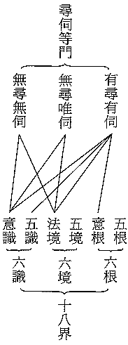



以上两句颂文，本已说明十八界与寻伺的关系，可是因论生论，就又发生另一问题。六识缘境，依大小乘各派学者说：意识是有分别的，五识是无分别的。有无分别，取决两个条件：一、一刹那中，可取很多不同类的境界；二、在一所缘境上，能刹那刹那的多念相续。五识缘境，唯取现实，不取过未，於同一境，前念后念，无取功能。意识不特能缘三世境，并能前后念相续缘。所以意识有分别，五识无分别。可是，寻伺是以分别为自性的，五识既与寻伺相应，怎可说无分别？若无分别，应不与寻伺相应。为解决此问题，所以特又举出下面一颂。



说五无分别由计度随念　这明五识无分别的所以。讲到分别，本有三类：一、自性分别，即法的本身含有分别性；二、随念分别，即随顺於念而起分别；三、计度分别，即由慧而起种种的推求和度量。一般说五识无分别，约无随念、计度二分别说，并非没有自性分别。如一匹马，原有四足，不幸被人割去三脚，仅存一脚，於是人们就说此马无脚，其实并非完全没有。当知自性分别的自体就是寻，可说寻就是自性分别，自性分别就是寻，二者是一体两面。《正理论》说：「五识虽与慧念相应，择记用微，故唯取意」。《婆沙》说：「欲界五识身，唯有一种自性分别，虽亦有念而非随念分别，不能忆念故，虽亦有慧而非推度分别，不能推度故」。这都是说五识无后二种分别的所以。



以意地散慧意诸念为体　这明随念计度二分别的自体。意地指意识，谓计度分别，唯以第六意识相应的散慧为体。散慧简别不是定慧，定是心一境性，与其相应的慧，没有分别计度的作用，不然就不能心一境性，安住於三摩地了。意诸念，指意识相应的定散诸念。谓随念分别，通以第六意识相应的定散诸念为体。念是明记不忘的意思，凡过去曾经缘虑过的，时刻铭记在心，不忘不失，名之为念，散心位上固有此明记不忘的功用，定心位上此功用尤为重要，因欲得定，必须念念不忘，然后才能达其目的，所以以诸念为体。



说明了寻伺与十八界的关系，如再稍加思索，就又可以产生这问题：小乘心所法有四十六，为什麼唯以寻伺与十八界分别？这有两个要点：一、行相相似，二、生起不定（有时同起，有时别起）。憍慢与惭愧，虽有相似义，但无不定义，如憍与慢，憍起慢决不起，慢起憍决不起，二者决不俱起；而惭与愧，有惭决定有愧，有愧决定有惭，决不各别而起。寻伺二心所，不但有行相相似义，而且有生起不定义，所以特取此二心所，与十八界分别。



己五　所缘无所缘等二门



> 七心法界半有所缘餘无前八界及声无执受餘二



科文中的等字，是等於有执受无执受。本颂解答两个问题：前两句解答有所缘无所缘，后两句解答有执受无执受。有人听了十八界中几有寻伺以后，接著产生这样一个疑问：十八界望於所缘无所缘，那几界是有所缘？那几界是无所缘？又望执受无执受，那几界是有执受？那几界是无执受？所以特举此颂解说。



未释颂文之前，先明二门意义。缘有缘虑、攀缘的二义，这里是采用第一缘虑义。能有所缘虑的名有所缘，无有所缘虑的名无所缘。执受，简单的解说，即执持领受。有执受，就是心心所法，一致合作摄持五根身，为自己的生命依止。原来有情的生命体，一定要有精神的执持，才能不会坏烂的存在人间，但精神也一定要有肉体为他活动的处所，假定没有五根，精神就无所寄托，而失其存在了。所以就以这执持摄为依处的意义，名有执受。因此，无形的心心所法与质碍的有色诸根，发生相互安危的密切关系：如所执受的根身，一旦有了极重的危险或损害时，能执受的心心所法，同时也就发生了危险的问题；反之，能执受的心心所法，有了极重的危难或损害，所执受的肉体，随之也就有崩溃毁灭的可能。约危险说是如此，就安乐说亦然。如所执受的肉体，安乐自在，能执受的心心所法，也就随之活跃起来；反之，能执受的心心所法轻松愉快，所执受的肉体，也就随之健壮康乐。《正理论》说：「有执受法略有二种：一者有爱及有身见，执为己有名有执受；二者为因能生苦乐，名有执受」。前者正智生时就断，因见爱烦恼，敌不过智慧光明；后者即使诸漏断尽，也不见得断灭，因证有餘依涅槃的圣者，异熟果的身心还在。所以诸法一旦被执，就到般涅槃，都随转不舍，也就一向叫做有执受。无执受与此相反，可以推知，毋须再加说明。



七心法界半有所缘　七心界就是六识界及意根界。法界半指法界中所含摄的一分相应心所，因全部法界具有四十六心所、十四不相应行、三无为及无表等六十四法，现在只取四十六心所，所以说半。有所缘，是说这七心界及法界中一分心所，各各能取他的所缘境界，所以名有所缘。《正理论》说：「有所缘故，如人有子」；《杂心颂》说：「有缘当知七，法入说少分」，都是此意。



五识有所缘境，是缘实境，抑缘假境，学者是有诤论的。依婆沙师说，五识直接的缘於实有的极微，所以是缘实在的境界；依经部师说，五识只能缘於和合的假物，不能缘於实有的物质，假定五识缘实有境，圣者观彼所缘，就不应说他是虚伪妄失之法。小乘两派，说起来，似乎各有其理，但以大乘的眼光看，都不能成立。如说：「五识上无极微相故，毘婆沙义不成；五识不缘假，彼识上无和合相故，经部师义不成」。



餘无　除了有所缘的七心界及法界一半，其餘五根五境的十色界，并法界中的十四不相应行、三无为及无表色的二十八法，都不能缘虑境界，所以是无所缘。餘无二字，唯奘师的译本有，依谛译《俱舍》看，是没有的，如彼颂说：「七识有缘缘，法界中有半」；《杂心论》也不颂无缘，只是长行中说：「无缘非心法」；如再推究上去，法胜的《心论》，也是如此。因而，梵文可能没有这两字，而为译者所加。



前八界及声无执受　前八界，即前说的七心界及法界，再加一声界，合为九界，都是无执受的，因无执受的功能性故。执受是约为他所执受说，有所执受，名有执受，无所执受，名无执受。七心界是心王，法界（一分）是心所，为五根身的能执持者，所以他们都不受别法所执受。至於法界中的不相应行、无为、无表等法，因为不是积聚的色法，所以亦无执受。及声的及字；有约义不同说，谓前八界是有所缘的，声界是无所缘的，所以说及声；有约体不同说，谓前八界是心法，声界是色法，所以说及声。不管就那种说，我觉得《正理论》的解释最好。如说：「颂中及言，具含二义：一、显总集，谓八及声，总无执受；二、显异门，谓餘师说，不离根声，亦有执受」。约第一总集义说，及是并及的意思，其义明显，无须再说。约第二显异门说，即一种声音的两种看法，自然界的流水、波涛声，是离有情根身之外的音声，所以属无执受，但不离有情根身所发出的音声，是就属於有执受了。这虽是餘师所说，但与本颂前说声有八种，亦非常吻合。



餘二　除去无执受的九界，其餘的五根及色香味触的四境，通有执受无执受的二门。先说五根：有情的五根身，如安住於现实的世间，由有心心所法的执受，而表现生命的一切活动，且在生命的活动中，生起苦乐的感觉，名有执受；假使一期生命结束，解体了的五根入於过去，心心所法就放弃执受的职务，名无执受。还有五根尚在未来，生命体还没有完成，心心所法也不预先负起执受的任务，所以也是无执受。次说四境：色香味触的四境，如安住於有情的现实生命体中，不离有情的根身，就名有执受；外界的花草树木等，虽与吾人的生命体，同样具有四尘，但因是属外界，不为心心所法之所执受，所以名无执受。还有过去未来以及属於现在而离开生命体的四境，因与现实的五官，不发生接触关系，不会有感觉作用，所以也名无执受。再就生命体上的发毛爪齿等说，不离根的才有执受，离於根的就无执受。如离肉体的头发，突出於外的指甲，用刀剪割时，没有疼痛的感觉，就表示他无执受，但连在肉体上的头发或指甲，用刀剪割时，感到非常的痛楚，是就显示有执受。《杂心颂》说：「九不受餘二」，义同本颂。兹将上述二门，列表如下：



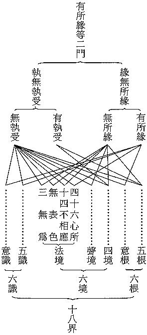



己六　大种所造等二门



> 触界中有二餘九色所造法一分亦然十色可积集



大种所造等的等字，等於可积集不可积集门。十八界在大种性、所造性中，那几界是大种性，那几界是所造性，那几界是非大种非所造性？在可积集不可积集中，那几界属可积集，那几界属不可积集？这首颂就是讨论这两个问题。前三句答初问，后一句答次问。大种性，指四大种，所造性，指一切所造色；可积集，是说有极微的可聚集，与此相反名不可积集。



触界中有二　十八界中，能通大种性，亦通所造性的，唯有身所觉触的触界。触为什麼通二？前说触境有十一种，就中坚湿煖动的能造触，是大种性，餘滑涩等的七种所造触，是所造性。这是有部师的意见，若依经部上座师说：触界唯有大种性，并不通於所造性，所有滑涩诸触，是诸大种的差别形相，亦即大种的次第安布：如於金银颇胝迦宝金刚芭蕉等的和合聚中，说有滑触；在与此相反的和合聚中，说有涩触。不特如此，就是依眼取诸大种形量色相，也能觉了滑涩诸物，可见触是不异大种的。《正理》破他违背圣教，因佛在《阿含》中，曾对弟子这样说过：诸比丘！你们应当知道：触是外处，是四大种及四大种所造色，无见有对。经中既是这样说，所以经部所说有违圣教。



餘九色所造　十种有对色中，除了触界以外，所餘五根及色声香味的九种色界，唯有所造性，而不通大种，因这九界都是大种所创造的。如净色根是四大种所造的清净色，但这只能说为四大所造，不可说所造的就是四大种，所以这九界祇通所造性。《杂心论》说：「九界四大造者，除触界，餘九色界四大造，四大所生故，四大因故，四大与此诸界五因生：生因、依因、建立因、养因、长因」。可是，为有部十大论师之一的觉天尊者，说五根五境的十色界，都是大种性，没有一界可说是所造的。经部譬喻师，也具这思想，如他们说：「诸所造色，非异大种」。为证己义，他们引经说：有情的眼球内部，各别有他的坚性（地）、坚类（与坚相类的法），湿性（水）、湿类（与水相类的法），煖性（火）、煖类（与火相类的法），动性（风）、动类（与风相类的法）。眼根内部如此，餘诸色根亦然。如异大种而别有诸根，经中就不应说诸根中有大种性，既於诸根中说有坚湿煖动，证知诸所造色不异大种，亦足证明十色界唯大种性非所造色。又有经中说：「诸有士夫，皆即六界」。士夫，即有情的异名。地等六界，是有情生命所依的实体，所以知道十色界不异大种，如有所异，经中应明显的指出。这种说法，在有部及论主，绝不同情，所以破斥道：世尊说法，处处唯指坚等四相是大种性，从未在这四相以外，说有第五或第六法的大种。四大种在六境中，唯属触境所摄，必须身体接触到了，手掌抚摩到了，才能觉知对境是坚或是湿，所以触非眼耳鼻舌四者之境，而色声香味又非身根所能觉了。如十色处都是大种性，那眼等四根，应能取坚湿煖动四性，身根亦应取色等四境，事实既非如此，所以唯触界中有大种性，餘九色皆属所造。经说诸根内部有坚湿煖动，是约大种及所造色的不离说，并不是说诸根自体就是大种，因净色根不是离开大种而独存的。《婆沙》说：「彼经说眼根所依大种，不说眼体」（是坚等性）。妙音尊者说：「世於大种立眼根名，以是眼根所依止故」。经中唯说六界，是因有情在最初续生时，生命体未完成，五色根未齐备，这时身根虽具雏形，但仍没有觉冷觉渴等的感触。当知法体有了，作用未起，是不可立於有用品中的。又六界是一切有情有用的本体，因每一有情，自开始完成一新生命起，到最后结束这一生命止，其中间的生命延续，完全是六界的功能，在生命延续的过程中，如支持生命的六大支柱，有一朽毁了，生命立即有崩溃的危险，但是造色可没有这样的严重性，因为某一部门造色坏了，充其量不过使某一部门失却灵活的作用，并不有碍生命的生存。由上看来，大种与造色，其义差别，非常显然，决不可说大种与造色无别。



法一分亦然　法是法界。法界中所含有的一分无表色，亦唯属於所造性，因为是依大种而产生的。除这诸界外，其餘的七心界及法界中的心所、不相应行、无为诸法，都不是有质碍的物质，所以这一切不可说为大种性及所造性。《杂心》说：「法界中身业口业四大造，餘法界非四大造，七心界非四大造」，就是此意。



十色可积集　这句颂是解答可积集不可积集的第二问题。十八界中堪可积集的，唯五根五境的十色界，因这都是极微积聚而成的，如眼根就是由众多极微积集所成。《杂心》说：「十色界是极微聚，有分故（有方分），覆障故（能盖覆障蔽其餘的法），大碍故（是有对碍的），据处所故（能占领空间）」。反之，不是物质的七心界及法界全体，名非积集，因无极微的积集性。《正理》说：「体非极微，不可聚故」。或有人问：法界中的无表，也是色法，为什麼不说他积集呢？当知无表虽属色法，但不是众多极微的积聚，而是透过身口的表色所生之无碍善不善色，因是无碍的色法，所以在积集方面，不可说为积集，也就不可说为「法一分亦然」。兹将上说大种及所造、积集非积集二门，与十八界的关系表示如下：



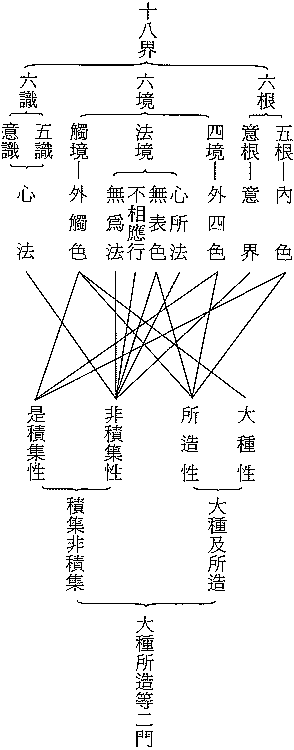



己七　能斫所斫等三门



> 谓唯外四界能斫及所斫亦所烧能称能烧所称诤



此颂所讨论的，包括三个论题：一、那几界是能斫所斫？二、那几界是能烧所烧？三、那几界是能称所称？在未解释前，先说一说本颂的译法。依《旧俱舍》看，他把上二句倒过来，译为「能斫及所斫，谓是外四界」，照梵文次序，这是比较恰当的，因「能斫及所斫」一句，是标其题旨，「谓」是解释或叙述之词，就是解释上面的所标，先标后释，是本颂的一贯风格。如上说：「又诸有为法，谓色等五蕴」；又〈世间品〉说：「前三种入胎，谓轮王二佛」。这都是先标要旨，后加解释。本颂既无所标，怎可开始云谓？所以如照旧译，应该说「能斫及所斫，谓唯外四界」为当。但奘法师这样倒置，是为便通第三句的。因颂的第三句，是承上二句而来，如连贯其意思，就是：外四界，不独是能斫所斫，也是所烧能称等的，所以依倒句法译出。



谓唯外四界能斫及所斫　这是解答能斫所斫的第一问题。外四界，指色香味触，唯是决定的意思。谓为能斫及所斫的，在十八界中，决定只有外四界，其餘诸界不可说为能斫所斫的。要知外四界所以是能斫所斫，必先了解斫字的特殊含义。自然界的薪等色法，都是由众微积聚成的，没有那样色法可以独立延续的，而且每一色法，都要互相资助，才得不断的增长。如树木等的植物，是众微的聚集体，把他种植在土壤中，加以肥料等的色聚，作他的滋养，他就可加速度的增长续生。在他继续生长或存在的过程中，假若以刀斧把他劈成两截或多截，他仍维持其生机，使每一截继续存在增长，名之为斫。色等外四界，积集成为刀斧的，名能斫；积集成为树薪的，名所斫；所以有情生命体外的色等四界，是通能斫及所斫的。



五根所以不可说为能斫所斫，因为有情肉体不可分为二截的，若分二截生命就不能继续，不但整个肉体不能分割，就是生命体上的支分也不能分割，割了就要失去感觉的作用。科学者说：人的神经系统断了，灵活感觉也就随之失去，因为神经系统通於脑髓，坏了就没有反射刺激的作用。还有，支分果真离了肉体，根就不可得，所以非是所斫。同时，诸内色根，是最极清净的微细色，生理学上说，眼睛及耳膜的神经细胞是极净的，所以不可说为能斫。七心界及法、声二界，不是能斫所斫，可以推知，不再繁说。此外，有为法的细无常相，由於物体的刹那生灭，也不可分割的，假使分割的话，当正分割的一刹那自体，已不是前一刹那自体，所以现在不能相续，不可分割，因而也就不能说为能斫所斫。



亦所烧能称能烧所称诤　本来，能烧与所烧是一门，能称与所称又是一门。现在混合来说。先明所烧与能称，后论能烧与所称。色等的外四界，不但是能斫所斫的自体，也是所烧能称的自体。谓由外四界积集起来的柴薪，可作世间的燃料，就成所烧；作为称量谷米等物的秤杆，就成能称。生命体上的五色根，是清净微妙的，生命解体了，根就随之失坏，那老人的耳聋眼瞎，是由神经系统的破坏，根虽坏而肉体仍存，所以不可为所烧能称的自体。七心界及法界，也在简别之内，不言可知。声界虽属色法，但因不能相续存在，所以亦非所烧能称。所烧与能称，唯为外四界，在学派间，已成公认的定案，没有什麼可诤执；但是谈到什麼是能烧所称，学者就有了不同的意见。有的学者说：能烧所称的自体，如前能斫所斫、所烧能称一样，唯以外四界为自体。因凡具有燃烧作用而能焚烧他物的，就必含摄得色香味触的四微；所称，是有分量的，可以称的，如石头木块之类，当然也是四微的结合体。另有学者说：为能烧之自体的，并不是四微的粗色聚，祇是四大种的火界，因为唯有火界，才具有能烧的功能性。至於所称的自体，只可说是触界中的一分重性，不可说是四微的聚集体，因为重的法体，才可说得上称。从表面看，两派主张，似不相同，从内观察，是可会通的。火是色法，凡是色法，决不离香味触；重是物体的，自也不离香等。所以有此不同解说，祇是立场不同而已。



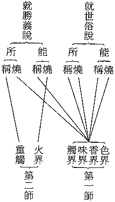



己八　异熟生等五类门



> 内五有熟养声无异熟生八无碍等流亦异熟生性  

> 餘三实唯法刹那唯后三



这一颂半，是解答五类问题的：一、属於异熟生的是那几界？二、属於所长养的是那几界？三、属於等流性的是那几界？四、属於有实体的是那几界？五、属於一刹那性的是那几界？在没有解释颂文前，先略说一说五类法的名义，然后对於颂文，才不会感到困难。



一、异熟生：这如具说，应名异熟因所生，略去「因所」，简名异熟生。异是因，熟是果，有著因果的联系性，亦即异熟因所产生的意思。有变异而熟、异类而熟、异时而熟的三义；吾人所造的善不善业，到达结果时，其性质必经变异，而后才能转为成熟的果体，所以异熟是因，果名异熟生。这可说是事物质量的转变，如谷麦种子，放到土里之后，其形态必须经过变异，才能抽芽、开花、结果，假若种子一成不变，就不能结成谷麦的果实。而种子的转变，从前后看，也有量上的差异，如由一粒谷麦，可以变为数十粒谷麦，所谓由一体变为多体，就是这意思。外界的谷麦等种是这样，当知业种亦然。由业种子的变异，而感得异熟报体，所以叫做变异而熟。大乘唯识学上的种子生现行，也含有这变异义。其次，异熟因所招感的异熟果，因果是类别不同的，如大小乘所说，因是善恶，果唯无记，以无记之果望於善恶之因，其类不同，所以叫做异类而熟。《婆沙》二十卷说：「问：何故名为异熟因？异熟是何义？答：异类而熟是异熟义，谓善不善因，以无记为果，是异熟义」。十九卷中又说：「异熟，熟有二种：一者同类，二者异类。同类熟者，即等流果，谓善生善、不善生不善、无记生无记。异类熟者，即异熟果，谓善不善生无记果，此无记果，从善不善异类因生，故名异熟」。意谓因果的性质类别，名之为异；不同的果由不同因所熟，所以叫熟。再次，能感的业因与所感的熟果，在时间上是不同时的，如过去造业今生受果，或今生造业来生感报，名为异时而熟。《正理》说：「离因而熟，故名异熟，异熟体生，名异熟生」。或因未感果时，就在其上，假立异熟果名，因善恶业因，当来定要感果的。如现生六触处的异熟果，由过去的业因所感。经说：「今六触处，当知即是昔所造业」。古德说：「欲知前世因，今生受者是」。都是此意。



所长养，是说有情的生命所资。有情的肉体，没有资料的长养，是无法维持生存的。可以资养身体的东西虽很多，而论文只概括的指出四种：一、饮食：众生的生命生存，可说全赖饮食之所支持，几时断绝饮食的供给，几时就宣告生命的灭亡。二、资具：即日常生活上的必需品，如房屋、衣服等的一切资身之具，乃至阳光、空气等，就中空气尤为重要，一个人三五天不进饮食不要紧，生命还可残存，如三五分钟没有空气呼吸，那就成为生命上的一大威胁，甚至立刻就要崩溃。三、睡眠：有情的生命肉体，是藉四大组合成的，如一架机器一样，过分使用而不予以相当的休息，不特不能支持下去，且有立即爆发的危险，所以在适当的时间内，必须予以合度的睡眠，才能免除疲劳。可以说：睡眠，是恢复健康的元生素，是免精神疲劳的特效药。四、等持：等持就是禅定。善修禅定的行者，从禅定中获得轻安快乐，能使身心调顺健康。因为定有调伏自体，摄持四大，少生病痛的功能。经说禅悦为食，也就是约保养身体说的。以上四点，是资身的基本最胜因，是有益於有情肉体的，所以有情的肉体叫做所长养。



等流性，是因果相似的意思，亦即平等流类相续义。如前一念心是善，后一念心也是善，前念与后念，相等流类，叫等流性。但这唯就有为法说，不通其他。其详，到下再讲。



真实事，是指无为法说。推究世间的一切事物，无不是无常变幻，假而不实，唯出世间的无为法，是不生不灭不可破坏的坚实性。



刹那性，讲到刹那，本有二种：一是刹那生灭的刹那，一是不由同类徧行因所生，而当见道初一刹那入於无漏时，叫做刹那性。今唯指后者说。



内五有熟养　内五，即有情生命体上的五色根，他在五类门中，属异熟生性及所长养性，因为是由异熟体所生，饮食等之所支持长养的。《增一阿含经》说：「五根为昔造业因所招之果」。现实的生命，要依饮食汤药现在之缘的长养，方可由少而壮、由壮而老，就是一个人的肥瘦，也与资养大有关系。就五根的本性说，前刹那灭，引生后一刹那，原可说为等流性的，但因等流离了异熟、长养无别自体，所以就略而不谈。唯仍须知道的：异熟生的不一定就是长养性，长养性的不一定是异熟生法。异熟是先天的，长养是后天的；先天的异熟生法（色根），怎样使他壮大发展，全靠后天的生活滋养（长养）。如古代的城池，有外廓，有内城，而外廓是内城的保障——喻长养是发展异熟的。所以，长养是对异熟说的，没有异熟，要长养做什麼？又有什麼可长养？因此，唯内五根，有异熟生性，有所长养性；心心所法，虽有异熟性，而无长养性，因无体质的东西，不可长瘦令肥的。外四境，既无异熟生性，当也就不说有长养性。



声无异熟生　五尘境界中的声尘，以五类法分别，只有所长养、等流性，而没有异熟生。约有执受的大种音声说，声是发自有情根身之内的，如身体养得强壮，发出的音声就洪喨，若身体长得消瘦，发音就微弱无力，所以声虽可以锻鍊，但主要还是与滋养有关。其次，声是由同类因所生的，如从男子根身发出的是男声，由女人根身发出的是女声，而各各音声的前念与后念，皆流类相等，所以是等流性。为什麼声无异熟生呢？凡为异熟生的，必由过去业因之所招感，无须待现在缘之所助成；而声是随现在内心的欲乐，然后才吐露出来的，并不是由过去的业力所感得的报体，所以声无异熟生。



八无碍等流亦异熟生性　无碍，是没有体积可以障碍的意思，这在十八界中，唯七心界及法界的八界，是无碍法。无碍的八界，於五类门中，有等流、异熟生的二性，而无所长养。如前一念所生心属於善性，后一念心仍是善性，或前一念所生心属於恶性，后一念心仍是恶性，因为是由同类徧行二因所生的，所以是等流性。诸无碍法，都由过去异熟因所引生的，所以有异熟生性。八无碍法，无形无相，不是极微积集的物质体，不可长养令肥或瘦，所以无长养性。



餘三　餘，指色香味触四界。此四界在五类法中，通於异熟生、所长养、等流性的三种。色等四界，本通情与非情，如有情肉体上的色等，是由过去的善恶业所感得的，为异熟生性；业感得的生命出现后，由生活上的饮食资助，得以增长广大，为长养性；内外一切的色香味触，在他继续存在的时期中，今天看是这样，明天看仍是这样，总是前后均等，流类相似的，是为等流性。还有，香味触是无记性的，因而也有无记等流。所以此四界通於三种性。



实唯法　实即五类法中的真实事，其体坚实而不可毁灭。十八界中含有真实性的，唯法界所摄的一分无为法，所以说唯法。除这一分无为法，其餘十七界以及法界中的心所，不相应行，无表色诸法，因属生灭变异而不坚实的有为，所以不得名实。



刹那唯后三　具有见道第一刹那无漏智性的，於十八界中唯有意界、法界、意识界的后三。在从凡入圣的过程上说，悟入见道是有十六现观的，当最初以苦法智忍的无漏真智，解决苦谛下的一切烦恼，踏进无漏见道时，这就是世第一的最后一刹那心，也就是第一现观的一刹那性，但不可说是等流性。等流，要第一刹那、第二刹那……前后相等流类，才可叫做等流；可是现在说的这一刹那性，是约前所未有的无漏真智说的，在这一刹那前，唯是有漏智，所以见道初无漏智，没有同类徧行因的等流性。不特初证见道的第一刹那，名刹那性，就是与这一刹那相应的无漏五蕴也是刹那性非等流性。所以后三界有此刹那性者，因初无漏智相应的心，是意界、意识界；而与这俱起的心所及得、四相、道共无表，都是法界中的法。如表：



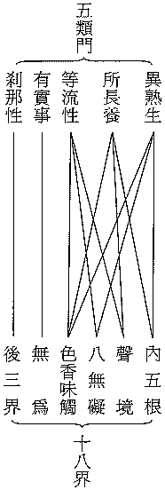



己九　释得及成就义门



> 眼与眼识界独俱得非等



这两句颂，是研究这样一个论题：十八界中，有眼根界，过去没有，现在有了，那眼识界是不是也先未得现在得？又眼识界，先前没有，现在有了，那眼界是不是也先未得现在得？如是，就十八界一一追问，可有三十六问，智者思之可知。



得在根品不相应行法中，有详细的说明，现来简单的一说。有部说一切法实有，凡实有法必有所得，所以在他的思想体系中，得是非常重要的一法。得与成就的定相，稍为不同：若这一法从未来向现在进发，当他刚要到达现在的生相，此时就名为得；既得之后，相续而正流到现在的阶段，虽仍为我所有，因已得故，不名为得，但名成就。得与成就大体相似，但从时间上加以划分，就显出他们的不同。所以得时不叫成就，成就时不叫做得。《婆沙》百六十二说：「问：得与成就何别？有说未得而得名得，已得而得名成就。有说最初得名得，后数数得名成就……」。得的定义是获，现在哲学上叫做所属性。如有一物，原不属於我的，现在属於我了，就名为得。《婆沙》说：「先无系属而有系属名得，先有系属而有系属名成就」，亦即此意。得有能得所得的自体，如眼根的获得，是由能得的得体令得的。尤须知道的：得唯属於有情，自然界是无得的。谓以有情的主观，得客观的无机所得法，能得的得是主动的，所得的法是被动的。



独　眼根与眼识相望，有四句分别。此中独指前二句的单句：一、得眼根不得眼识：谓在有情的生命体上，眼根已慢慢的获得生长，但眼识在眼根继续生长的时期中，还没有获得。如於欲界受生的有情，除了化生，其餘胎、卵、湿生，都是如此。以胎生说：初入母胎的新生命，从名色位向六根位进发时，眼根的细胞，在胞胎内就渐渐的生长，但眼识在胞胎内，决不会发生作用。眼根未生时叫未得，渐渐生长时名为得。还有一说：无色界的有情生命穷尽，下生到色界二、三、四静虑天时，也唯得眼根不得眼识。因二静虑以上的有情，五识是不起作用的。如详细说：初静虑的有情，只有眼耳身的三识活动，无鼻舌二识的作用。到二禅天的有情，不但鼻舌二识的作用停止，就是眼耳身的三识活动亦无。所以《八识规矩颂》说：「眼耳身三二地居」。二、得眼识不得眼根：谓有情的生命体上，眼识作用已经生起，但眼根还没有获得。如无色界的有情，下生色界的二、三、四静虑，或欲界的有情，上生这些地方时，虽在第一刹那已得眼根，但无眼识，有时是诸天中的有情，要看看本地或下地的世界，於是就向初禅天去借眼识，当开始借得眼识，见到初二禅天种种境界时，我们只可说他得眼识，不可说他得眼根，因为当他生到二禅以上时，早已成就了眼根，并不是现在才得。而识原来是没有的，现在才从初静虑中借得眼识，所以名得。此上两句单句，在颂文中叫做独，即单独的得眼根，或单独的得眼识之意。



俱得　此指四句中的第三俱句，得眼根亦得眼识。如无色界的有情，没生欲界，或色界的初禅（梵世）时，根识能同时的获得。界系门说：「无色系后三」，无色界的有情，前五识及五色根，都是没有的，而欲界与初禅，是有根有识的，所以从无色界下生欲界或初禅天时，不论是根或识，都是最初创得，所以名为俱得。



非　此指四句中的第四非句，不得眼根亦不得眼识。如欲界有情上生无色界，无色界是无根无识的，所以由欲界生到此界，根识俱不可得。又如我们现刻正在观色时，眼根与眼识共同的取境，照理是应叫做俱得的，现在却说非得，这是什麼道理？当知正观色时，若根若识俱已成就，不成就决不能观色，成就就不再得，所以说是非得。



等　等是等於成就，得有四句分别，成就亦然，所以说等。其四句者：一、成就眼根不成就眼识：如生色界二、三、四静虑天，因此三地中，唯有眼根而无眼识，所以生到这三天时，唯成就眼根。眼识如不向初静虑借，就无由生起，所以不成就。二、成就眼识不成就眼根：如生欲界的有情，眼根虽渐渐的生长，但还没有成就，或虽成就而又损坏了的。可是，以界地的自性说，生欲界的有情，眼识必定是成就的，但初托胎及生后的盲人，不消说，眼根是不成就的。三、成就眼根亦成就眼识：如生欲界的有情，得到眼根没有失坏，或生色界初静虑以至四静虑，正当观色时，观色，证明了眼识已成就，但没有眼根，识不会起观色作用，所以眼根也成就。四、不成就眼根也不成就眼识：如生无色界的有情，五根、五境、五识俱无。讲到成就，必要先得，然后才可说，无色有情，根识俱不得，何可说成就？所以是俱不成就。



上就眼根对於眼识、眼识对於眼根，分别得与不得，成就与不成就，各有四句。《杂心论》中有与此相似的颂文说：「若彼得眼界，或彼所依识，二俱得不得，亦色及与舍」。以此类推，再拿眼根望於色境，或眼识望於色境，分别得与成就，也各有此四句，如是总计，还有三十四个四句分别。《婆沙》七十三卷有详细说明，可以参考，这儿不繁述了。



己十　内根外境之义门



> 内十二眼等色等六为外



这两句颂，是讨论内外的问题，上句明内，次句明外。讲到内外，《婆沙》有好几处谈到，因而《光记》与《宝疏》，都引《婆沙》说以明内外。《光记》据《婆沙》百三十八明三种内外，《宝疏》依《婆沙》七十四说内外，《婆沙》前后所讲内外，虽各有他的意义，但依之解说本颂，我觉得《宝疏》所引比较符合今文，《光记》似有未妥。七十四分别内外有三种说：「谓内六识身是染净法所依止处，若与六识作所依者，名为内处，作所缘者，名为外处，故依法立内外处名。复次，若法是根立为内处，若法是根义立为外处。复次，若法有境立为内处，若法是境立为外处」。可见此说与本颂是相合的。



内十二眼等　内是内界，十八界中属於内界的，是能缘的眼等六识及识所依的眼等六根，因这十二界是生命体上的根性的缘故。有人提出这样的责难说：约处作为所依止根名内，六识身转为过去，成为意识的所依，固可名内，若六识住於现在位上，还没有转成意根时，是识非根，不为心识依止，怎可名内？如识不应为内，颂说「内十二眼等」，又如何通？要知意根的自体就是六识，於意根位六识无缺，因而六识名之为内。同时，六识即使未到意根位，也不超出意根之相，跳出意根范围以外，所以名依，亦名为内。



色等六为外　这是说色等六境为外界，因这些法都是根识所缘取的外在者，所以《杂心论》说：「当知六界是外」。



己十一　同分彼同分义门



> 法同分餘二作不作自业



这半颂是探讨同分彼同分的问题：上句抉择十八界的同分彼同分；下句解释同分彼同分义。本门讨论这问题，其唯一的意趣，就在阐明十八界作用的互相联系性；宇宙界的万有诸法，为十八界所摄尽，而十八界的所有，为根境识三包括无遗，所以本颂明根境识的相互关系，就是明十八界的相互关系，亦即明宇宙万有的互相作用关系。就物质现象说，明现象的变化，就精神知识说，明知识的来源。关於什麼叫同分？什麼叫彼同分？在颂文「作不作自业」的一句中本要谈到，但现在不妨先来作一扼要的说明，以便讨论那几界是同分，那几界是彼同分。同是共同的意思，分是作用的意思。意谓有关的几类法，在同一时间内，采取同一行动，发挥同一作用，产生同一结果，名为同分。如眼根正在取色，色正为眼根所取，而眼识又正了别色境，如是根境识三，在同一时间内，各自同有一分相互交涉，发展同一分的作用，共同有生触果的功能，名为同分；但当此三共同趋於粉笔或黑牌一境时，其餘眼未观察到的形色，不了别色的眼识，就名彼同分，因他们的作用，还没有发生的关系。《法义》说：「彼同分，彼指有用同分也。分种类义，同是相似义，与彼同分、同见、同一处、同眼等，种类相似，故名彼同分」。



法同分　探讨十八界的同分彼同分，唯有同分而无彼同分的，祇是法界。法界的范围宽广，无时无刻不为意识所缘，而意识亦无时不缘法尘境界，至於意根更是时刻引生意识作用。论长行说：「由诸圣者决定生心观一切法皆为无我，彼除自体及俱有法，餘一切法皆为所缘，如是所除亦第二念心所缘境」。所以识在境中，不论已生、正生、当生，认识其境，其境就名同分。法界既於一切时中，都能产生意识的认识作用，当然无一法界而非同分了。《杂心论》说：「一界说有分者，法界一向是有（同）分，非餘有分，以一切法界，意识境界故」，即是此意。



餘二　餘指其餘的十七界，通於同分彼同分的二种：如眼根见色，正作自业时，就属同分；不见色，不作自业时，就名彼同分。餘十六界，比例可知。《杂心颂》说：「分餘分十七」，亦同此说。



有人说：法界为意识所缘名为同分，餘十七界亦为意识所缘，为什麼不说唯名同分呢？不可比例！要知分别十八界的同分彼同分，是据六根六识各各能取自境说名同分的，不是约为所缘境义说名同分的，餘十七界为境作意识缘，所以不可说唯名同分。



有人说：五境为五识所缘，作自业用，叫做同分，不作自业用，名彼同分，这固不成问题，但五境为意识所缘，应说五境唯是同分，不通彼同分，似乎比较对些。不对！要知说境同分，是就六境各於自识定为所缘说的：如色境定为眼识所缘，乃至法境定为意识所缘，而五境为意识缘是不定的，所以不可以意识缘色等境，就说色等唯是同分。



作不作自业　这是解释同分彼同分义。业是业用，根境识三，各有他的不同业用：如根有发生认识的作用，识有了别境界的作用，境有助生知识的作用。此三者在同一时内，各自发作业用，就名同分，不各自作业，就名彼同分。《光记》说：『云何同分彼同分义者……答：根境识三各起作用，互相随顺，互相交涉，故名为分；同有此交涉分，故名同分。或复分者是已作用，故前说言，若作自业名为同分，根境识三，同有此已作用分，故名同分。或复分者是所生触果，根境识同有此果分，故名同分。与上相违名彼同分。如不见色眼名非同分，见色眼名同分，由非同分不见色眼，与彼见色眼同分，种类分同，名彼同分。言种类分同者，正理解云：云何与彼种类分同？谓此与彼同见等相，同处同界，互为因故，互相属故，互相引故，种类分同。解云：无用与彼有用种类分同，能见义同，同是眼处，眼界互为同类因，互为等流果，相属互相引起，如是种类名分。有用无用同有此分，即以无用与彼有用，同有此分名彼同分』。简单的说：根境识三，各自含有因果的联系性，如能生认识的根境是因，所生的心识是果。三者有著因果的交涉作用，说名同分，反之，名彼同分。



己十二　见修非所断义门



> 十五唯修断后三界通三不染非六生色定非见断



这一颂是研究三种所断的问题。三断是：一、见所断，就是证见道时所断的法；二、修所断，就是入修道时所断的法；三、非所断，就是非见修二道所断的无漏法。十八界中，那几界是属见道所断？那几界是属修道所断？又那几界是属非所断？上二句正明三断，下二句解释外难——有说是破经部。



十五唯修断　十五，指十色界及五识界。唯修断，是说这十五界，唯独属於修道所断，不通见所断及非所断。《杂心》也说：「当知十五界，彼悉修道断」。为什麼？因这十五界的染污法，是迷於法的事相而起的烦恼，不是迷於四谛因果理所生的烦恼。迷四谛因果理所生的烦恼，决不由前十五界，而前十五界，亦决不会产生这烦恼，所以非见道所断。十五界既属有漏的染污法，当不通於非所断。



后三界通三　后三，指根境识最后的意根界、法境界、意识界。通三，是说这最后的三界，通於见断、修断、非所断。《杂心颂》说：「餘界俱三种」。此后三界所有的烦恼，如果是迷四谛因果真理所起的见惑，那就不但见惑是属见道所断，就是与见惑相应的心心所、生住等相、并随行烦恼的得体，一切都在亲见谛理，悟入见道时断尽，统统属於见道所断。餘一切有漏法，如迷於事相而起的十随眠，与十随相应的心心所、生住等相、并随行烦恼的得体，在修道位上渐次断尽，所以是修道所断。后三界中的一分清净无漏法，体非系缚，不属欲、色、无色的三界所有，所以是非所断。



经部师说：修学的行者，由十六现观最后一刹那心，悟入见道，登上圣人阶梯时，见道前的异生性，已决定舍去，为什麼不说他是见道所断？招感三恶趣果报的二种身语表业，在四加行位虽还可以造作，但入见道证得圣者的果位，自再不会创造恶趣的业因，经说更不造新业，就是指在这时，为什麼不说他是见道所断？还有，有漏的染不染色，到达圣者的果位，也不生起，理应说是见道所断，但为什麼不说？论主说：这在事实上不可说为见道所断，其理由如下：



不染　这是第一个理由。不染，指性质非染的有漏善及无覆无记。所谓异生性，是属不染污的无覆无记所摄，非善性或不善性。怎麼知道？因离欲有情，还成就此法，所以不是染污的不善性，假使是染污的，欲界异生，离欲贪已，就不应该再是异生；断善根的有情，也成就此法，所以不是不染的善性，假使是不染的，断善根的，就不应该再是异生。异生性，既不是善、不善性，而是非染污的无覆无记，所以不可说为见道所断。若见所断，应是忍断，若忍所断，忍正起时，犹应成就，是则圣者应该还是异生。



非六生　这是第二个理由。六，指第六意根，由第六意根所生的诸法，可说见断，如从前五根所生的诸法，不可说为见断。招感恶趣的身语表业，既非六生，当非见断。



色　这是第三个理由。色，指有漏的染不染色，亦即身语七支的表业。如前说的招感恶趣的身语表业，不是身体的动作，就是言语的发动，都属於色法的范围，所以非见道所断。



定非见断　这是总结上义。照论文看，还有两个理由，可证上述三者，定非见断。一、迷惑四谛理所直接产生的烦恼，可说见断，不染非六生法，非迷四谛理有，所以不是见断。二、要由见惑亲自发动的，可说见断，色非见惑亲所发动，所以非见所断。



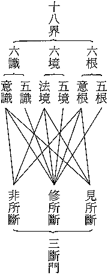



己十三　释见非见义门庚一　正明



> 眼法界一分八种说名见五识俱生慧非见不度故



> 眼见色同分非彼能依识传说不能观被障诸色故



这两颂八句，是讨论十八界中，那几界有能见性，那几界没有能见性的问题。此中，所包含的问题很多，所以须要分开来讲。先释见非见义，后再旁论其他问题。於正明中，初二句正明见体，后六句抉择各家各派对於见的看法。据《婆沙》说：见体是什麼，约有五家的意见：一、世友论师认为能见事物的是眼根，如现在看见粉笔，就是眼根发生的观照功能，所以历来学者把他称为根见家。二、法救论师认为能见事物的，是识的功用，并非是根。三、妙音论师说，能见事物的，既不是根，又不是识，而是与眼识相应的慧心所的功能。四、譬喻论师说，能见事物的，不特根识没有这功能，就是慧心所也无此作用，而是与眼识和合的心心所能见。五、犊子部的主张，略与经部同。后四家，可总名识见家。所以虽有五家的主张不同，但从根本立场的观点去分析，实不外根见家与识见家。论主是同情识见家的，为随顺《婆沙》义，论中以根见家破识见家，而主要的致力破斥妙音的五识俱生慧，因为破了五识相应慧，那眼识相应慧的执著自然就去，既已破除了识能，和合的心心所，怎麼能成？所以和合义也就遣去。



眼法界一分　这是辨定能见属於何界。依根见家义，十八界中，全部具有能见功能性的，唯一眼根。除此，还有法界中的一分是见。餘十六界及法界半，通名非见。眼根在部位上分别，有二依处，全都有见，因见体是一，如前颂说「虽二界体一」，既非一分见，一分不见，所以眼根全分是见。《杂心颂》说：「一界是见性」。法界所含摄的法，本来很多，说一分是见，指属心所之一的八种见，餘则非见，所以《杂心颂》说：「一界（法界）中有见」。凡称为见，须具两个定义，即观照与推度。随具一义，就可名见。依此来看：眼根虽无推度而有观照，八见虽无观照而有推度，所以得名为见：餘十六界半，既无观照之功，又无推度之能，所以不名为见。



八种说名见　法界一分的八种见，在这句颂中来说明他：一、五染污见，就是身边邪见戒的五见。此五所以称为染污，一因其自体就属不净，同时又为其他烦恼染污，如纯洁的白地，添了一些彩色，就成不净。在染污的心所法中，唯这五法是见，餘如贪等、不共无明、俱生染污慧、痴等，都非是见。染污见的见力，如有云的黑夜，黑夜见物，已感困难，再加乌云笼罩，自更糢糊不清容易错误了。这喻世间的染污见，在有漏法中，迷（黑夜）惑事理，拨无因果，已算颠倒，若再与贪等烦恼相应（有云），自更迷上加迷，越发认识不清。二、世间正见，就是意识相应所起的善有漏慧。他的见力，如无云的月夜。一色长空，月轮高照，繁星朗耀的明夜，取境辨色，虽不及白天，但较黑夜要好得多。这喻世间正见，在有漏法（月夜）中，能明因识果，修善断恶，不与烦恼相应（无云）。三、有学正见，就是前三果有学圣者身中所具的诸无漏慧，如见道所得的八智等是见，餘者非见。他的见力，如日间有云，有云的白天见物，不但比黑夜看得清楚，就是比月夜也清楚些，虽然明见，但因还有点昏暗的气氛，所以辨色仍不彻底。这喻有学正见，观法无常，厌离世间，急求出离，断诸烦恼，然仍有残餘的烦恼未尽，所以如云，是无漏法，所以如昼。四、无学正见，就是第四阿罗汉果身中所具的诸无漏慧，除了尽智无生智，餘一切慧都名为见。他的见力，如白天无云，日光明照，见种种色，正确无谬。这喻无学正见，透视诸法，究竟无我，证得涅槃。因为是无漏，所以如白日，因为是惑尽，所以如无云。此八种见，前六是属世间见，后二是属出世间见。



　　　　　　　　　　　　　　夜分┐　　　　　┌有漏故  

　　　　　　　┌五染污见……　　├喻染污见─┤  

　　　　　　　│　　　　　　有云┘　　　　　└烦恼故  

　　　　　　　│　　　　　　夜分┐　　　　　┌有漏故  

　　　　　　　├世间正见……　　├喻世正见─┤  

　　　八种见体┤　　　　　　无云┘　　　　　└非惑故  

　　　　　　　│　　　　　　昼分┐　　　　　┌无漏故  

　　　　　　　├有学正见……　　├喻有学正见┤  

　　　　　　　│　　　　　　有云┘　　　　　└餘惑故  

　　　　　　　│　　　　　　昼分┐　　　　　┌无漏故  

　　　　　　　└无学正见……　　├喻无学正见┤  

　　　　　　　　　　　　　　无云┘　　　　　└惑尽故



五识俱生慧非见不度故　这是问答五识俱生慧的非见。识见家（以妙音论师为代表）问：慧有五识所相应的，有意识所相应的，为什麼唯取意识相应慧为见非五识相应慧呢？眼见家答：够资格名见的，先决条件是：对於所缘的境界，最初要能审虑思察，继而要能抉择推度，五识俱生慧，既无审虑推度的功用，所以不名为见。量曰：



五识俱生慧非见──────宗



不能推度故────────因



如虚空──────────喻



从上所说看来，识见家似已无话可说，但他根据根见家「不能推度故」一因，而又产生这样的问难说：如你根见家说，要具有推度的功能性方可名见，五识俱生慧因无推度的功能性，所以非见，那末，眼根也是没有推度功能的，理应如五识俱生慧非见。量曰：



眼根应非是见───────宗



不能推度故────────因



如五识俱生慧───────喻



眼见家答：此难非理！要知见具三个定义：一、抉度，二、观照，三、明利。《杂心论》说有四义：一、观视，二、决定，三、坚受，四、深入。就此论说，眼根虽没有抉度的功能，但有观照、明利的作用；就《杂心》说，眼根虽没有决定、坚受的作用，但有观视、深入的功能：所以眼根名见，是没有如你所说过失的！兹将二论明见定义列表於后：



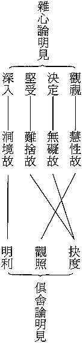



如以《正理》及《显宗论》就一切法明见，则又如下表：



　　　　　　　　　　　　　　　　┌观照性故  

　　　　　　┌有色法─眼根是见─┤用明利故  

　　　　　　│　　　　　　　　　└暗相违故  

　　　一切法┤　　　┌五染污见┐  

　　　　　　│　　　│世间正见│┌行相明利  

　　　　　　└无色法┤有学正见├┤推度境界  

　　　　　　　　　　└无学正见┘└内门转慧



眼见色同分　这是解答识见家的另一难题。识见家问：假定真唯根见非识，那末，当眼识不起时，根应仍见诸境，为什麼眼识不生，根就不见呢？根见家答：你误会了！我说根见，不是如你所说的，而是约同分说的，就是根识同时发生作用时，方有见用，并非一切时眼根都有见的功能！



非彼能依识　识见家又责难说：眼根要与眼识和合方能有见，这岂不是更证明了能见色的是能依的眼识，非所依的眼根了吗？根见家答：不然！根之所以需要与识和合，因根要有识的任持，而后根的胜用才能表现出来。如烧柴薪，有了柴薪去引火，火的胜用就表现出来，若见色用是识，这见色用，离眼根也应可生，但事实上，识只能长益俱生大种，令起殊胜根用，见种种色，所以非彼能依识是见。



传说不能观被障诸色故　这是根见家反诘识见家明识非见。如你所说，能依识是见，那末，识是精神的主体，无有所碍，眼识应如意识一样，如在讲台上，意识可推想房内的种种，不受墙壁的障碍，是则我人在讲堂内，不但能见讲堂内的一切，就是房间内，甚至连大殿上的东西，都应能见，可是事实上，被障的诸色，眼识不能见，所以能依之识非见。识见家说：你的眼根不也是如此吗？根见家说：不错！不过你要知道，眼根本身是障碍有对的，有对眼不见被障诸色，而仍说他有见，这是没有过失的！传说，是示论主不信任的意思。因为上面所说各种辩论，不过是有部一家传说而已，站在识见家的立场，是不承认那样说法的。



庚二　傍论辛一　一眼二眼见



> 或二眼俱时见色分明故



关於见非见的分别，还有餘义未明，所以特再傍论几点。这两句颂，明一眼二眼见。在常识上，我们闭一眼开一眼，仍能见色，已足证明二眼俱能见色，可说无须再为讨论。但在时间上，两眼见色，是前后交替而见，还是一时俱见，学派中，就有了不同的看法。依经部上座师与犊子学者说：见的依处既分隔左右，则见色时唯一非二，设或同时睁开两眼，也是左右互相交替前后而见，最足为此证明的，如木匠绳墨，必须闭起一眼，才能把线拉直，又以一眼观箭等时，始能审知他的曲直之相。有部不同情这种主张，所以颂说：



或二眼俱时见色分明故　意说：我人见色，有时唯一眼见，或时两眼同见，决非前后速疾交替而见。为什麼同时见？因见色分明故。如闭一眼见色糢糊不清，而两眼睁开见就很分明。《正理》说：「以闭一眼於色相续见不分明，开二眼时即於此色见分明故」。若如犊子学者所说前后而见，睁两眼时亦一眼见，一眼见色不很分明，两眼观色亦应糢糊不清，反之，两眼看书明瞭清楚，一眼看书亦应清晰。事实既非如此，所以不特两眼有时俱见，就是百眼千眼也唯生一识。



辛二　至境不至境



> 眼耳意根境不至三相违



本颂讨论至境不至境的问题。所谓至境不至境，是论以根取境时，根境二法是否相到：如根境相到，就是取至境；若根境间有著某些距离而不相到，名取不至境。这问题的产生，由於圣教有不同的说明。佛在阿含经中，有时对弟子说：诸有情眼，为爱非爱色之所拘碍。拘碍，就是根境互相碰到。依据此一圣教看，六根似乎全取至境。有时佛又对弟子说：我以天眼观诸有情……不论是远是近，都能了了明见。依此圣教看，六根似有取不至境的。据《婆沙》十三说：至不至有两种：一、约功能到境名至，可说六根都取至境，因根的作用如不到境，就不知所取者为何。二、约体相无间名至，因根境各别有其实体，於是就有取至境及不至境的差别。本颂辨此，约后义说。



眼耳意根境不至　六根中，眼、耳、意的三根，是取不至境，即根与境必须保持相当的空间距离，然后方能有取，这在大乘，名离中知。如眼取色，在其种限度内，远近皆可得见，但接近根门，如点在眼内的药水，反不能见，所以是取不至境。主眼取至境者说：如明亮的油灯，能至远近两方，照耀一切物象，眼根也应如此。量曰：



眼根应远近二境取至而取──宗



火明性故─────────因



如灯───────────喻



取不至境者说：在理论上，你的量根本不能成立，因火明性故的因，我是绝对不承认的，假若眼是火明性，那我们在黑暗中，就应以火明性的眼见色，不须另求光明，可是事实上，在暗中见色，是要另求光明的，由此证知眼根不是火明性；若说眼中的光明性微小，要另求强大的光明照灼方有所见，那与事实更相违背，因现见世间微小的光明，为强盛的光明所障覆，而消失了他的作用。如在讲堂内先点一盏香油灯，然后再燃亮强烈的电灯，香油灯的光明就显现不出；又在光天化日之下，电灯光亦失其光耀。如是眼根的微光，为强烈的光明所夺，岂不是毕竟不能见色了吗？同时，灯於油炷等的极邻近物能烧能照，而眼於眼药等的极邻近物却不能见，怎可以彼例此？所以你必须接受眼取不至境的意见。识见家说：对的，我承认你的意思，不过，眼根既取不至境，理当普取一切不至诸色，为什麼较远的形色不能见呢？根见家答：你知道吗？磁石是能吸取不至铁的，你能说他普吸一切不至铁吗？彼既不尔，眼何独然？再说，若如你执眼取至境，理应普见一切近色，为什麼接近根门的眼药不能见呢？所以你须了解：眼根虽说是取不至境，但不一定要普见一切。



耳根亦取不至境，如距离很远的音声，或比较近的音声，我们都可听到，但太迫近耳门的音声，反而不能听到。《婆沙论》说：耳根能闻耳穴内的音声，通取至不至境。《正理》七说：「有说耳能取於至境」。真谛说：「声来入耳者，是正量部计」。有说这是成实论义，如彼第四说：「耳识二种，或到故知，或不到而知。耳鸣以到故知，雷声不到而知」。世友论师不同情此说，所以《正理》破道：吾人对於远近音声的听取，有明了不明了的差别，若至根门方听，听近音声明了，听远音声亦应明了，反之，听远音声不明了，听近音声亦应不明了。又听音声，有决了犹豫的差别，如听较近的音声，当下就能决了他是发自人类、畜生、或大自然界，若听较远的音声，即不免犹豫不决，不知他从什麼地方发出的音声。假定声到根门方听，听近音声决了，听远音声不应有所犹豫；反之，听远音声有所犹豫，听近音声亦应无所决了。事实既非如此，可知耳根唯取不至境。



意根是生命内在的精神作用，无形无象，活动力相当强，能自由的缘取过去、未来，或前或后，或远或近，但与他同时俱有的相应法，却不能取，可见是取不至境。



三相违　三指鼻、舌、身的三根。此三根取境，与上相违，唯取至境。大乘称此为合中知。如香气透过空间扑入鼻根，始能辨别他是恶香还是好香；酸咸的滋味，必待送到舌头上尝一尝，才能辨别出是苦还是甜；冷暖的感触，必须密接於身根，然后方能觉知。不过，依《正理论》说：三根虽各缘取至境，但其间不无微细的差别。如一极微分为四分，鼻取香境，相距约有三分；舌取味境，相距约有二分，身取触境，相距约有一分：因三境自体粗细不同，所以有此三种分别。



辛三　根境等不等



> 应知鼻等三唯取等量境



六根各各取自所缘境界，越自所缘即无能为力，在讲所缘与境界有对时，已详细辨别。但当诸根各自缘境时，是唯取等量境呢？抑通取等不等量境？等不等量，以根的极微量为准：能取根的极微量有多大，所取境的极微量也有多大，名等量；若境的极微量，大或小於根的极微量，名不等量。



应知鼻等三唯取等量境　在六根中，鼻舌身的三根，因为是取至境的，所以唯取等量境。明白点说，鼻舌身根的极微量怎样，香味触境的极微量也就怎样，如是根境相称，合生鼻舌身识。颂中的应知二字，是劝示我人，不但应知鼻等唯取等量，而且应更知道眼耳取境不定，意根是无形的心识，没有形状和质量，不可对比辨别等不等量。何以知道眼耳取境不定？如眼根於色，有时取大见诸高山，有时取小见一毛端，若大若小，名不等量；有时取葡萄或与葡萄相等的野枣果等，名等量境。耳根闻声也是这样，如听雷响，超过耳根量，或闻蚊蚋嗡嗡之声，小过耳根量，名不等量。若取与根相等的音声，如琴瑟之音，其声和雅，不大不小，名等量境。



辛四　六识依世摄



> 后依唯过去五识依或俱



六识的生起，要内有所依，外有所缘，但六识的所依，是怎样建立的呢？如前所说，眼等五识，唯缘现量境，属现在世摄，诸识所依之根，是否如同五识属现在世摄？第六意识，通缘三世非世诸境，诸识所依之根，是否如同意识亦通於三世所摄？不然！颂说：



后依唯过去　后，指第六意识，因是在六识中最后的。意识唯以无间灭已的意根为所依，此所依根是属过去世摄，不通现在与未来。



五识依或俱　眼等前五识的所依有二：一、不共依，即眼等五色根，为五识作各别依，属现在摄；二、共依，即无间灭已的意根，为五识作共所依，属过去摄。五识，或依过去的意根，或依现在的五根，所以说或俱。



辛五　眼等得依名



> 随根变识异故眼等名依



引发心识的条件，本来很多，但主要的是根与境，所以经中常说：眼及色为缘生於眼识，乃至意及法为缘生於意识。根境对於生识，既有同等的重要性，为什麼唯以根名所依非境？答曰：



随根变识异故眼等名依　六识的生起，根境的功用，虽说是相等，但根有特殊的意义，即：根有了变异，识也跟著发生变异。如根增长健全，识的认识就敏锐分明；根若损减，识的认识就暗昧不明。至於色等诸境，不论他有著怎样的增损变化，识照旧去了别他，绝不因境的变好变坏，而使识发生什麼变化。《婆沙》七十一说：「复次，根有损益，识随损益，色不尔故」。因为识随根的变异而变异，所以眼等名依。



辛六　识随根立名



> 彼及不共因故随根说识



识是认识，凡为认识，必有能所，能认识的是主观的心识，所认识的为客观的对象。从能所的密切关系上说，能认识的心识，应随所认识的对象，得名色识声识等，为什麼现在反而随根立名？答曰：



彼及不共因故随根说识　六识之所以随根立名，约有两个原因：一、彼所依根的意义殊胜，如前说随根变识异。二、不共因，如自眼根唯为自眼识所依，不共他眼识依，耳根唯为自耳识所依，不共他耳识依，乃至意根唯为自意识所依，不共他意识依；而色境不但为自眼识及意识所取，亦通他身眼识及意识所取，乃至触境不但为自身识及意识所取，亦通他身身识及意识所取，法境虽是不共，但不是所依，五境既非不共，亦非所依，所以随根说识。或说：意根在自身方面，是通六识所依的，怎可说为不共？当知五识有二所依，约各别依，立眼等识，意识唯一意根是依，更无别依，所以虽标总称，仍受别名。《正理》又举两说，明识随根的得名：一、内界性，根与识都属内界，在前分别内外门已说。以内在的眼根，为内在眼识的所依处，这可说是非常合理的解释。二、有情数，根识的十二界，唯属有情所摄；六境界固有属於生命自体的，但亦通於外在的非情数，所以随根说识。



辛七　依地同异别



> 眼不下於身色识非上眼色於识一切二於身亦然  

> 如眼耳亦然次三皆自地身识自下地意不定应知



这是傍论中的最后一科，分别身体、眼根、色境、眼识的四法，是否同在一地所有。先以眼根为例，根据法义，列表如下：



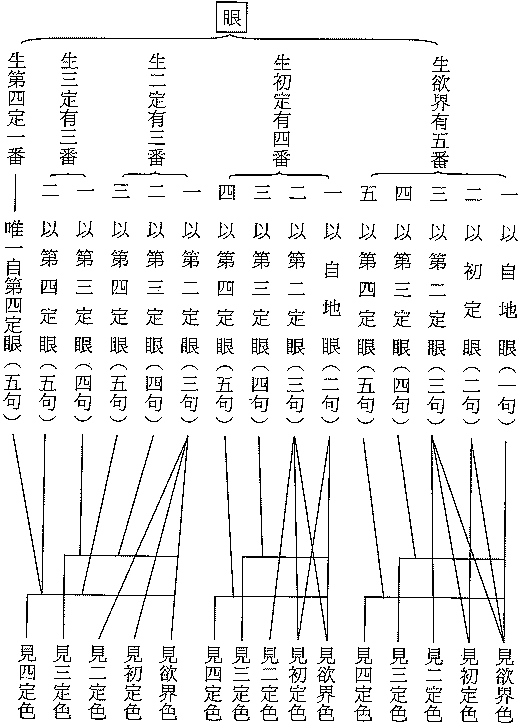



从表的表面看，似乎难懂，但一经说明，就知没有什麼难解。现在且来略说眼生欲界的五番十五句，其他生初禅的四番等，可以比例而知。一、身在欲界，以欲界眼，见欲界色，身眼色识四法，是就同在一五趣杂居地。二、身在欲界，以初禅眼，见欲界色，那身与色就属欲界，眼与识则属初禅。三、身在欲界，以初禅眼，见初禅色，那就身属欲界，眼、色及识属初定有。四、身在欲界，以二禅眼，见欲界色，身与色属欲界，眼根属二禅，眼识属初禅。五、身在欲界，以二禅眼，见初禅色，身属欲界，眼属二禅，色及眼识属於初禅。六、身在欲界，以二禅眼，见二禅色，身属欲界，眼识初禅，眼根及色属於二禅。七、身在欲界，以三禅眼，见欲界色，身与色属欲界，眼属三禅，眼识初禅。八、身在欲界，以三禅眼，见初禅色，身属欲界，眼属三禅，色及眼识属於初禅。九、身在欲界，以三禅眼，见二禅色，身属欲界，眼属三禅，色在二禅，眼识初禅。十、身在欲界，以三禅眼，见三禅色，身属欲界，眼识初禅，色及眼根属於三禅。十一、身在欲界，以四禅眼，见欲界色，身与色属欲界，眼识初禅，眼根四禅。十二、身在欲界，以四禅眼，见初禅色，身属欲界，色及眼识属於初禅，眼在四禅。十三、身在欲界，以四禅眼，见二禅色，身在欲界，识在初禅，色在二禅，眼在四禅。十四、身在欲界，以四禅眼，见三禅色，身在欲界，识在初禅，色在三禅，眼在四禅。十五、身在欲界，以四禅眼，见四禅色，身在欲界，识在初禅，色及眼根在四禅。所以有这种种差别，因为身体、眼根、色境，通於欲界及色界的四禅所有，而眼识则唯欲界及色初禅有，二禅以上就没有了，因而有如是差别。



眼不下於身　眼根望於身体，或相等的同在一地，或差别的在上一地，而决不会在身之下的一地。如以欲界眼见欲界色，眼与身就是同在一地。若身在欲界，而得色界的初禅眼，或二三四禅眼，此眼就是差别的在上一地。设身到达上地，得到殊胜的眼根，就不须再起下地的劣眼，因为下地劣眼，不能见上胜色，所以说眼不下於身。



色识非上眼　色境眼识望於眼根，或相等的同在一地，或差别的在下一地，而决不会在眼之上的一地。如以欲界的眼根，发欲界的眼识，见欲界的色境，此即彼此相等的同在一地。又以初禅的眼根，发初禅的眼识，见初禅的色境，这也是相互平等的同在一地。有时以二禅天的眼根，借初静虑的眼识，观初静虑的色境，这色与识就在眼根的下一地，因下地的粗眼，不见上地的细色，同时，上地的眼识，不依下地的眼根，所以说色识非上眼。



色於识一切　所缘的色境望於能缘的眼识，或相等的同在一地，或差别的在上一地、在下一地，是通於一切的。如以欲界的眼识，了别欲界的色境，色之与识，就是相等的同在一地。若以初禅的眼识，了别欲界的色境，色望於识，就是差别的在下一地；设得二禅的天眼，借初禅的眼识，了别二禅的色境，色望於识，就是差别的在上一地。所以说色於识一切。



二於身亦然　二，指色与眼识。意谓以色境眼识与身体相望，如色望於识，是通一切的，所以说亦然。如身在欲界，以欲界的眼识，了别欲界的色境，三者就是相等的同在一地。初禅也是如此。若身在欲界，生起上界的天眼，以初禅的眼识，了别初禅的色境，色识望於身体，就差别的在上一地。设身在二禅天，借初禅的眼识，了别初禅的色境，色识望於身体，就差别的在下一地了。



如眼耳亦然　上讲眼根，此例耳根，即他的分别，与眼根是一样的。论中准上眼根颂文，说了如下一颂：「耳不下於身，声识非上耳，声於识一切，二於身亦然」。《杂心》也说：「耳界如前说」。明白眼根的道理，耳根的道理自也明白，所以不须再加叙说。



次三皆自地　在眼耳二根之次，就是鼻舌身的三根。这三根，是合中知，取至境，所以根境识身四法相望，都是同在一地。如生命体在欲界，以鼻根齅香境，四法就同在一欲界地。鼻根如此，舌根亦然。《杂心颂》说：「鼻舌界自地」，就是此意。唯须知道的：鼻舌二识唯欲界系，不通上地。身根、触境、身识、身体，就欲界说，虽也同属一地，但因身识通於初禅，於是到了二禅以上，如借初禅的身识，那身识望於身触，就通相等的自地及差别的下地，而与鼻舌二识，稍有不同了。所以说：



身识自下地　自，指欲界与初禅。谓此二地的身识，望於身触，同在一地，所以名自。若生上三定中，借初禅的身识，觉了上地的触境，身识望於身触，在下一地，所以名下。《杂心论》说：「身触即地说者，身识有差别故。生欲界，欲界身，欲界触，欲界身识生；初禅亦如是；生二禅，二禅身触，初禅地身识生，以觉自地触故，非他地生；第三、第四禅亦如是」。



意不定应知　意根望於意识、法境、身体，或相等的同在一地，或差别的在上、在下一地，是不定的。所以《杂心颂》说：「意识则众多」。唯当知道的：身体只通欲色二界，意根、法境、意识，是通三界的。分别他们同地异地，到后〈定品〉有详细说明，现在姑简单的一说。如生命在欲界，以欲界意，观欲界法，引发欲界意识，如是四法，就是同在一地。生命在色界诸天，以自地意，观自地法，引发自地意识，四法也是同在一地。生命到无色界，除身体，餘三法也是同地。若生命在欲界，而於游定时，从初禅中无间生起欲界的意识，了别欲界的法尘，那就意属上地，意识、法境、身体三者，属於下地。游定於初禅是如此，於二三四禅亦然。如是，生初二三禅，从上地意，起下地意识，也是这样。有时，在游定中，有下地意，依上地身，如生上地，先起下地识身化心，就是依下地意受上地身。



己十四　能识所识等三门



> 五外二所识常法界无为法一分是根并内界十二



这是义门分别的最后一科，包含三大问题：一、十八界中，那几界在六识内，是属几识所识的？初句解答这一问题。二、十八界中，那几界是常的？那几界是无常的？次句解答这一问题。三、十八界中，那几界是根性的？那几界是非根性的？后二句解答此一问题。



五外二所识　此明能识所识门。五外，指色等的外五境。这外在的五境，一方面各别为五识所认识，另方面又总为第六意识所认识，所以说五种外境，为六识内的二识所识。《杂心颂》说：「色界二识识，乃至触亦然」。分开来说：色界为眼识及意识的二识所识。所不同的，眼识唯识自相，意识能识自相及共相。色界是这样，当知触界也是如此。五识所以唯识自相，因五识身是缘自相境界，现在境界，唯一念，不思惟，所以不能认识共相。意识所以兼缘共相，因意识是缘自共相境，通缘三世非世诸境，念念相续，思惟分别，所以能认识共相。除外五境为二识所识，餘十三界，一向为唯一第六意识所识，非五识所识，所以《杂心颂》说：「诸餘十三界，一向意识缘」。



常法界无为　此明常无常门。讲到这问题，十八界中，可说无一界全是常住，唯有法界中的一分无为，是属常住性的，除此，餘十七界及法界所餘诸法；都是无常有为法，所以《杂心颂》说：「为无为共一（法界），一向是有为，当知十七界」。



法一分是根并内界十二　此明根非根门。如契经说，根有二十二根。以十八界分别二十二根，是这样的：命根、五受根、五净根的十一根及三无漏的一分——三无漏根，是以意根、乐根、喜根、舍根、信根、进根、念根、定根、慧根的九根为体。其中意根是心王，总摄七心界，不属法界所摄，除去意根的一分，其餘的乐等一分，为法界所摄；至於五色根、男女二根、并以意根为体的一分三无漏根，为六根六识的十二界所摄。五色根，如其自名，属十八界的眼等五根，意根摄七心界，男女二根摄於身根，一分三无漏根，摄於意界、意识界。所以《杂心颂》说：「内界说十二（六根、六识），此即是根性，一界（法界）中有根」。由此可知外五境及法界中少分，是非根性。



上来根据论文，已将本品诸颂，略为解说；现再一说研究本颂的方法，作为结论。一、以哲学的眼光看，本品诸颂，可用概念与具体、精神与物质、归纳与演绎的三种方法去研究。二、以科学的见解看，可分为五官的本质、组织与部位的所在，五官对境的现象界，心理感觉的精神界的三种方法去探讨。三、以部派的异说，抉择论题的错误与否，如择灭的一体多体，三科的假实，心所的有无，以及识见根见等。如能这样的分类研究，然后就可瞭然本品要义及其价值所在了。兹再将最后三门列表於下：



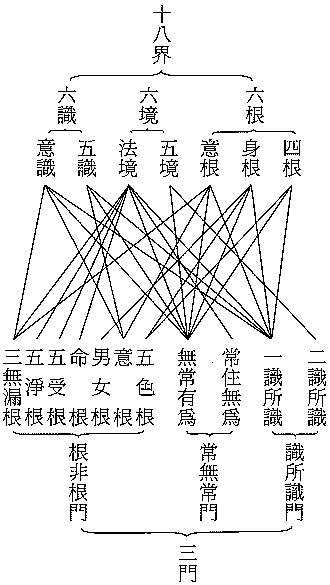



------



### 分别根品第二



总明有漏无漏的体用中，〈界品〉明漏无漏的法体，已如上说；〈根品〉明漏无漏的法用，此中当说。



未解释颂文之前，先明本品的大义。本品所说的内容，不出三大类法：一、明二十二根义，有二十二颂；二、明俱生诸法义，有二十七颂；三、明六因四缘义，有二十五颂：全品总合七十四颂。如是种种，都明有为法的差别作用，所以《正理论》中名〈差别品〉。本论的品次，如上所说，是依《杂心》建立的。但《杂心论》中，唯有〈行品〉，并无〈根品〉一名，而〈行品〉所明的，只是俱有法及因缘，并略说到极微字刹那等的差别。至本品中二十二根的体相，到后〈修多罗品〉中才说到。所以《杂心论》的〈行品〉，是总约有为法的迁流变化，生灭不住的方面说的。论主虽据《杂心》而造《俱舍》，但将他的〈行品〉，分为〈根品〉与〈世间品〉。〈世间品〉主要的是明有情的流转，器界的成坏，而《杂心论》对此问题，则略而未谈。今〈根品〉既明三大类法，可见已含摄了《杂心．行品》与〈修多罗品〉的一分义。



本品的主要内容，既包含三大部门，为什麼以根立为品名呢？这有两个理由：一、本品的三大论题，二十二根说在最前；二、在三大论题中，二十二根有特殊的胜用。因此，名为〈根品〉。既然根义最极殊胜，那末，他的特殊胜用是什麼呢？论说：「最胜、自在、光显名根」。具足这三义，才有资格称根。《光记》对此设有三种解释，今采取其第三义说：最胜义，是约根的自体讲；自在义，是约根的作用讲；光显义，是约根的体用，皆极殊胜讲。旧译《俱舍》二说：「根义云何？最胜自在为义，於自事用中，增上自在故。复次，光饰为义，於身中最明显故：是故以最胜自在光饰为义」。关於根义，历来学者虽作种种不同的解说，但都据《婆沙》百四二卷所说根义而来；《杂心》卷八也有与《婆沙》相同的说明。总略的说：二十二根於诸法中，各有他的最极殊胜的增上作用，所以名根。有人说：如以增上义说明根义，那末，诸法相望，各有他的增上作用，就不应说只有二十二根，而应一切都可立名为根！又有说：若以最胜义说明根义，那末，想的取像，邪见的断善根，涅槃在诸法中的最胜，理亦应都立名为根，怎可说唯有二十二根？答：不然！要知一切法中，二十二根，最极增上，所以别立为根；其他诸法，虽增上用不无，但非最极殊胜，所以不立为根。



丁二　明漏无漏用戊一　明二十二根义己一　略释根义庚一　有部师释



> 传说五於四四根於二种五八染净中各别为增上



这一颂，是有部师解释根义。旧颂译为：「於四义、五根增上；於二二、四根；五及八，於染污、清净」。新旧译的字句，虽略有别，但大义无乖。



传说　这两字，旧译中没有。用传说二字，表示此颂所解说的二十二根义，祇是有部一家的传说而已，论主并不表示同意。因为除了有部这种解说外，其他经部也对这个加以解释，而且比有部更为正确合理，论主是同情后说的，所以《正理》九说：「初传说言，显乐后说」。后说，即指下面经部的解说。



五於四　五指眼耳鼻舌身的五根，四指四事。即五色根於四事上，有各别增上的作用。一、於庄严身有增上用：有情的生命自体，特别是人类有情，必须五根具足，方可说得上相貌庄严。俗说：五官端正，方登人品，就是此意。假使生命体上缺少了某一根，如眼盲、鼻塌，就丑陋难看而不庄严了。二、於导养身有增上用：导即引导，养是保养，五根对於生命的引导保养，是具有增上功用的。我们知道：有情的生命自体，出现在这世间，不论是高级的、低级的，无不要求他的个体，延续不断的生存下去，这可说是有情的本能要求。但世间促成生命灭亡的逆缘很多，随时随地都有解决生命的危险。特别是近代科学昌明以后，毁灭生命的可能性更多！如欲避免不必要的牺牲，就不能不藉助於能为增上的五根。如眼根有能见的作用，耳根有能闻的作用。比方走路，见到前面车辆阻塞，或遇危险地带，就可设法遶道通过，不致遭受危险或惊吓；听到枪炮的音声，或屋宇的倒塌声，就知设法躲避，免遭不测。假使没有眼耳二根，如聋若盲，横冲直撞，势必弄到丧身失命而后已。欲界有情的生命生存，是赖段食的维持，而段食具有香、味、触的特性，能齅香、尝味、觉触的，是鼻、舌、身三根的功能，假使没有这三根受用段食，生命也就难以生存！所以五根对於引导养护自身方面，是有他的增上作用的。三、於生识等有增上用：有情的见色闻声，了别色声等的如何，这是识的功用，然能发生五识及其相应心所的，是五根的力能，没有五根或根坏了，识就无由得生，这是很重要的一种增上作用。四、於不共事有增上用：事指色声香味触的五境，五根取於五境，各别而取，如眼唯取於色，不共於闻声等，乃至身唯觉触，不共於见色等，是为不共义。五根於四事上，有著这样的增上作用，所以《杂心》说：「五根说四种」。



四根於二种　四指女男命意的四根。这四根各於二种事上有增上用。先讲女男二根的二种增上：一、有情的差别：依佛法说，原始的人类（劫初），初从光音天下生，根本没有男女相状的差别，大家原都一样的，但到后来，由於男女根的生起，於是就知有男女的类别。二、分别的差别：有情既有男女的类别不同，那末，他们的相貌等，自也有很大的别异。如身体形态，男的比较高大，女的比较矮小。就声音说，男人的声音洪喨雄壮，女人的声音微细柔和。就乳房说，男子的乳房小，女子的乳房大等。《正理》第九又有一说道：男子的性情勇敢，女人的性情怯弱，是为有情的差别；男子的衣著朴素，女人的服饰华丽，是为分别的差别。此二增上，如实际说：有情的别异，是约生命的总相说；分别的别异，是约生命的别相说：总别不同，说二增上。次明命根的二种增上：一、於前生命能续增上：有情的生命，出现於世间，不管寿命多麼长，终不能永住世间，到了某一阶段，必然要告一结束，但这一生命结束了，并不是就永远的完了，还有后一生命继续而来，这后来的生命於前去的生命，有能续的增上用。二、於现生命能持增上：生命的存在世间，虽不能永久的生存下去，但在生命的业力尚未穷尽的时间内，他是能安定的保持不坏的，这能保持生命不断的，是命根的功用，所以命根有能任持现实生命的增上用。后显意根的二种增上：一、能续后有的增上：后有，就是后一生命。有情的前一生命过去，后一生命跟著就来，但什麼使他这样延续不断的呢？这就是意根的增上力。据有部说，现实生命的结束阶段，是死有；前后生命的延续之间，是中有；由此中有，起爱恚心，生起后一生命，是生有；到了生有位，完成后一生命，是后有。所以，意根有续后有的增上用。二、自在随行的增上：《杂含》三十六说：「心能导世间，心能徧摄受」。经中说的心，就是此中说的意。世间的若善若恶，皆由心力所造成，所以说能导；一切的一切，既为心所导引创造，一切诸法当然就以心为主体，所以说摄受。由於心能导世、摄受，因此於诸法中，唯一心法自在随行。虽说餘法亦可随行，但不自在亦无胜能，所以没有增上力用。《杂心颂》说：「当知餘四根，各有二增上」，也同此说。



五於染中增上　五指忧喜苦乐舍的五受根，此五受根於染污法中有增上用。因贪瞋等的烦恼，於中随顺增长的。如缘适意境而有的喜乐受，就随顺於贪而使贪烦恼增长；缘不适意境而有的苦忧受，就随顺於瞋而使瞋烦恼增长；缘中庸境而有的舍受，就随顺於痴而使痴烦恼增长。有说：五受根，不特於染法中有增上用，就是於净法中也有增上用。如经中说：身安乐的时候，心就得定；能够知苦厌苦，就信有涅槃乐而去追求，忧喜舍三，能与出离为依。本论下文说：「出离依者，谓诸善受」。《杂心颂》说：「受或烦恼分」，亦即表示：五受根，或为烦恼分的增上，或为清净分的增上。



八於净中增上　八指信等五清净根及三无漏根，此八种根，於清净法中有增上的作用。谓有情在世间，若有信等的八根，一切清净的善法，就会一天天的随顺生长起来，以至了脱生死，证入涅槃；反之，如没有这八根，一切清净善法，就无法生长了，所以《杂心颂》说：「信等依清净」。



庚二　经部师释



> 了自境增上总立於六根从身立二根女男性增上於同住杂染  

> 清净增上故应知命五受信等立为根未当知已知具知根亦尔  

> 於得后后道涅槃等增上



略释根义之中，前约有部义释，此约经部义释。经部是主识见的，所以对有部以根释导养身及不共事，不表同情，在他看来，见色闻声，避危就安，受用段食，支持生命，都是识的增上力用，非根功能，因而缘境的不共，也就是识非根了。论主信受经部所说，所以特别引用於此。



了自境增上总立於六根　自境即自己所缘的境界，了是了别。经部的意思，了别六尘境界，六识才有这种功能，因识是以了别为性的。所当分别者，前五识只能了别各自所有的境界，而意识却能徧缘一切境界。了别境界固是识的特能，但识的生起必依於根，所以「眼等五根於能了别各别境识有增上用，第六意根於能了别一切境识有增上用，故眼等六各立为根」。六根只於六识有增上用，其本身并不能了别境界，可见有部说於导养身根有增上用的道理不能成立。以此例彼不共事，当知亦尔。或有人说：眼等为识生起的增上用，立名为根，那末，色等亦为识生起的增上用，理当亦立为根，不然！根於识有两种特能：一为识的通因，如眼识，不论了别青黄赤白的那一种色，眼根都能为之作增上用；但是色无此能，如青色唯与了别青色的识为所缘，不能与了别黄色等的诸识为所缘。二、识依於根而随根转，谓根力强识就明耀，根力弱识就暗昧；但是识缘於境时却不随转，即外色不论有怎样的变化，识决不随他有明昧的不同。由此两种因缘，所以外境不立为根。



从身立二根女男性增上　依有部说，六根有各别的实在自体，男女二根也有各别的实在自体；而经部说，男女二根是依身根建立的，并没有他独立的实在性。世间之所以有女性与男性的不同，全由男女二根为他的增上。因此，可说身根为总，男女二根为别，别不离总，所以男女二根，只是各就其身根的下部，所别立的一分。有情由於男女根的差别，其所表现於身形、言声、作业、志趣的各方面，也就不同。身形、音声如前说。作业，女的喜操烹调、缝纫、刺绣等事，男的则喜治学问、做大官、立功、立德、立言等事。志趣，女的爱好脂粉，喜欢装饰，男的高兴冒险、乐意弓马，所以男女的个性，差得很远。但这只是大体的分别，如从男女平等的立场讲，未必都是如此。



於众同分住中命根有增上用　颂中的同字是众同分，这到后面讲不相应行时有详细解释，如以现代话说，众同分就是生命。有情生命得在一时期内安住，完全是由命根的增上用，因为命根有连持色心，执持寿煖的特殊功能。色心和合具有寿煖的生命，如果到了色心分离、寿尽煖消、命根丧失时，自然就不能保持而崩溃了！



於杂染法中五受根有增上用　此意如前有部师说。未断惑染的凡夫，所以常有烦恼的生起，是由接触外境，起诸不同感受而来的。所以於杂染中，苦乐忧喜舍的五根，有增上用。



於清净中信等五根有增上用　前有部说，信等五根及三无漏根，都於清净法有增上用；今经部说，能为清净法作增上用的，唯信等五根，三无漏根，於得后后道等，方有增上作用。为什麼唯说信等五根於清净法有增上用？因在煖顶位中修诸观行时，由此五根的势力，能暂伏烦恼令不起活动，以使清净法一天天的增长，而引生无漏圣道的缘故。



未知当知根於得已知根道有增上用　未知当知根是见道时所有的，已知根是修道中所有的，由见道而引生修道，这是必然的次第，所以第一无漏根，於得第二无漏根有增上用，因为没有第一无漏根，第二无漏根是不可得的。



已知根於得具知根道有增上用　已知根是修道位中具有的，具知根要到无学位中才能获得，由修道而证无学道，这也是必然的程序，所以第二无漏根，於得第三无漏根有增上用，因为没有第二无漏根，第三无漏根就不能得。



具知根於得涅槃有增上用　学者到达了无学位，成就了具知根，必然就解决了内心上的一切烦恼，烦恼解决了，身心也就得到解脱，身心解脱，就证涅槃，涅槃必是解脱了烦恼已后，方证得的，所以第三无漏根，於得涅槃有增上用。



颂言后后者，因第二已知根是在第一未知当知根后，第三具知根是在已知根后，所以说后后。等言显示无漏三根，还另有一种不同的解说，阅论可知，兹不赘释。



己二　明根废立庚一　自宗解说



> 心所依此别此住此杂染此资粮此净由此量立根



明根废立，就是废除无明、语具等，立此二十二根；有说於七十五法中，废除六十二法不立为根，唯依十三法立为二十二根。关於这问题，也有两方意见的不同。本颂是以有部自宗，说明根的废立。论主先提出内宗、外教的责难：一、约自宗的十二因缘互相引发说：由无明的因引生行的果，乃至由生的因引发老死的果，如是在「此故彼」的因果之间，岂不是各别有他们的增上用吗？如以增上立名为根，则十二因缘也应立名为根。二、约外教的五作业根说：在数论外道所立的二十五谛中，有五作业根的一类：㈠、语具，对於说话有增上用；㈡、手，对於执持东西有增上用；㈢、足，对於行动有增上用；㈣、大便处，对於扬弃肉体内部的粪秽有增上用；㈤、小便处，对於男女方面生起淫乐事有增上用。如是五事，在有情分上，各有他的增上用，如以增上立名为根，这五作业根不也应该立为根吗？不！上来所说，一切不得立名为根，因真正成为根的，要有如本颂所具的条件：



心所依　此约六根说。六根又名内六处，为组织有情的根本，生命要这六根完具，才能完成，如无六根，生命体就不得成。完成生命的六根，又为心心所法的所依，所以说心所依。



此别　此约男女二根说。此指六根组合的生命体。以下四个此字，都作此释。虽说每一众生都由六根以完成其生命，但由女性中的女根增上，男性中的男根增上，因而形成男女相的差别，所以说此别。



此住　此约命根说。由六根组织成的生命体，要使他一期安住不溃，这需赖命根的维持，如果命根断了，为有情本的六根，也就不能住世，所以说此住。



此杂染　此约五受根说。六根受用六境时，本无所谓染与不染，但由所接触的外境不同而生起不同的感受，以此五受为增上，致使有情有种种的杂染，所以说此杂染。



此资粮　此约五净根说。有情的有杂染，固是由於六根；有情的有无漏资粮，也是由於六根。六根之所以得为无漏净法的资粮，由於信等五根为其增上的关系，所以说此资粮。



此净　此约三无漏根说。六根清净，虽非一般凡夫所能做到，但断尽烦恼的出世圣者，确能做到六根清净，因有三无漏根为其增上的缘故，所以说此净。



由此量立根　由此六种定量，所以立为二十二根。至佛教所说的十二缘起，数论所说的五作业根，不在这六种定量之内，所以不可别立为根。此中道理，如论广说。



庚二　异师解说



> 或流转所依及生住受用建立前十四还灭后亦然



这一颂，是以异师的立场说明根的废立。二十二根，本为佛在经中说的，后来的佛弟子，不管那个，只有照著去说，故不可增加一根，又不可减少一根。但为什麼建立二十二根？其数是以什麼意思立的？这在学者之间，就有不同的意见了，所以现在约异师说。依照此师说：全部佛法，不出流转还灭的二大门，而二十二根，就是依此二大门而建立的。谓由前十四根，成立流转门义，由后八根，成立还灭门义。如是二十二根，圆满具足，既不可增，又不可减。什麼叫做流转？《正理》说：「生死相续是流转义」；《婆沙》说：「流转者，谓更受生」。什麼叫做还灭？《正理》说：「生死止息是还灭义」；《婆沙》说：「还灭者，谓趣涅槃」。



或流转所依　或字是对上颂说的。意谓像上以六种定量建立二十二根固可以，或者约流转还灭二门建立二十二根也可以。先说流转门的四义：所依是第一义，这正指的六根。有情在生死中流转，是以识为主体，但心识的生起，必有他的所依，为他所依止的，就是眼等六根，假使没有六根，流转就不得成，所以说流转所依。



及生　生是第二义，指男女二根。流转中的有情，生而又死，死而又生，其所以能得受生的，由於男女二根为他增上的缘故。假使没有男女二根，受生就不得成。但这是约欲界的胎生与卵生说的，至於湿生与化生，那就不在此例，因为湿化二生的有情，不受胞胎，毋须假藉男女根而完成其生命的。



住　住是第三义，指命根说。受生有情，得在现实世间，一期安住，完全是由命根的增上，因为命根是生命相续不断的主因，假使没有命根，生命决不能继续生存。



受用　受用是第四义，指五受根。有情受生后，既延续的生存於世间，必然就要受用世间的境界。如眼取色，色即为眼之所受用。所以经中说：「眼以色为食」。由於六根受用客观的境界，因而就有苦乐等的领受不同。当其领受客观境界时，如发生忧苦的情绪，就有损於生命体，若发生喜乐情绪时，就增益於生命体，所以说受用。



建立前十四　这是结前所说。谓由流转所依的六根，流转受生的男女根，流转安住的命根，流转受用的五受根：总合起来，建立二十二根中的前十四根。



还灭后亦然　前十四根，以流转的四义建立，后八种根，以还灭的四义建立，所以说还灭后亦然。一、信等五根，为还灭的所依，因这五根是出生一切善法的根本动因，依此净法向还灭的道路一步步迈进，终有到达最后目的地的一日。二、未知当知根，为还灭的出生，因从有漏的异生位，不断的向出世的圣者位进行，到十五心入於见道，在见道位上，无漏法初生，名为未知当知根的。三、已知根，为还灭的安住，因从见道进入修道，在修道的过程中，由已知根的力量，常常持此最初所得的无漏法，相续无间的现起，使之安住不失。四、具知根，为还灭的受用，因从修道入於无学道，解决了一切烦恼，度脱了一切苦厄，由具知根的力量，受用现法乐住，所以名受用。



二十二根的建立，固由流转还灭的四义；就是二十二根的次第，也由流转还灭的四义而排列的。所以二十二根的次第：先说内六根，次说女男根，再说命根及五受根，最后才说信等五根及三无漏根。



己三　明根体性



> 身不悦名苦即此悦名乐及三定心悦餘处此名喜  

> 心不悦名忧中舍二无别见修无学道依九立三根



这两颂，是明二十二根的体性。在〈界品〉的最末，举出了根名，在本品的最初，略释了根义，但根的体性，究竟是什麼，还未作具体的说明，所以特再举两颂以显示之。讲到根体，於中：眼等五根，为取外界五境，而生内界五识的机关，其体为有形的色法。意根为过去六识生起后念六识的所依，其体为无形的心王。这在〈界品〉讲蕴处界时已说。男女二根，为身根内的一分，非离身体而有，所以其体也属色法。这在本品的开始，已经讲过。命根，是保持身心和合的生命体的东西，属於非色非心的不相应行法。这到不相应行法中，再为详说。信勤念定慧的五根，信勤二者，其体是心所中的大善地法，念定慧三者，其体是心所中的大地法。这到讲心所的地方再说，所以在这两颂中所要说的，只五受根及三无漏根。五受根以受为体，三无漏根以九根为体。



五受根，是以身心的感受不同而建立的：依身所感受的有苦有乐，就立为苦根、乐根；依心所感受的有忧有喜，就立为忧根、喜根；若身若心所感受的无苦无乐、无忧无喜，同立为舍根。所以诸受总摄为身受、心受。



身不悦名苦　此明身受中的苦根。谓受心所与五识相应，领纳客观的违逆境界，生起不悦的情绪，损伤肉体的康乐，名为苦根。



即此悦名乐　此明身受中的乐根。谓受心所与五识相应，领纳客观的适意境界，生起欢悦的情绪，增进肉体的康乐，名为乐根。



及三定心悦　此明第三禅中的心悦，亦属乐根所摄。照通常说：意识相应的受，不是喜就是忧，无所谓乐的；但第三禅中的心悦，特别例外，亦名为乐，不名为喜。这是什麼道理？一、第三禅中的心悦，其相非常安静，没有任何躁动，而喜相是粗动的，其得之者，身心的雀跃，如海水中的波涛鼓涌一般，三禅有情，离此动态，所以不名为喜，但名为乐。二、第三禅中的有情，前五识的活动，已经完全停止，没有与五识相应的身受，唯有与意识相应的心受，因此，其内心所得的欢悦，但名为乐，不名为喜。《正理》九说：「或复乐根摄益殊胜，喜根摄益则不如是，由此第三静虑地乐，诸圣说为所躭著处」。



餘处此名喜　此明心受中的喜根。餘处，指第三禅以下，所餘的欲界及初二禅的三地之处。在这三处与意识所相应的受，若在内心中感到特别的欢悦，就名喜根。得此喜根的有情，不论在散地的欲界，定地的色界，无不味著於他，所以唯名为喜，不名为乐。同时，得此徧触身心的喜受，就如贫人得宝一样，一旦欢悦过度而又失去时，立刻就又生起忧恼：所以其相粗动，不能长久保持。



心不悦名忧　此明心受中的忧根。谓受心所与意识相应，领纳客观不合己意的境界，生起不愉快的情绪，使精神上遭受打击，以致萎靡不振，名为忧根。



中舍二无别　此明身心二受中的舍根。中谓处中或中庸之意：就是身心与外境接触时，既不引生欢悦的情绪，也不引生不悦的情绪。以五识相应的身受言：既无益於肉体，亦无损於肉体；以意识相应心受言：既无耗於精神，亦无长於精神。他是不苦不乐、不忧不喜的中庸受，所以名为舍根。二指身心的二者，此处中受，在身心的两方面，一样任运而生，其行相的安住，也同样的无别，所以虽通身受心受，但总立一舍根。



见修无学道依九立三根　此明最后的三无漏根。九指意、喜、乐、舍、信、勤、念、定、慧的九根。这九根为三无漏根的自体。三无漏根，是依见、修、无学的三道而建立的，其建立的过程是这样的：向解脱道前进的行者，当其正观四圣谛理时，生起八忍八智的十六心，而於十五心位时，断除迷理的八十八使的见惑，以契入於见道，在此见道位中，虽对四谛理还未透彻的知道，但到次念第十六心时，就可全部理解四圣谛是什麼了，所以在此位中所发的九根，名未知当知根。惠晖说：「八智名知，知四谛境有决断故；八忍非知，未成决断故。彼修行者，正起忍时，作未知苦谛行解，名未知，至后念智位，必当知苦谛，合名未知当知」，可说解释得非常明白。第十六心中，尽知四圣谛的真理后，虽已踏上了修道的阶段，但为进一步断除迷事的八十一品的思惑，仍得继续不断的观察四圣谛理，所以在此位中所发的九根，名已知根。在修道长期修习的过程中，渐次渐次的断尽迷事的惑染，证入最高的无学位，知道自己一切所作皆已完办，既再没有什麼烦恼可断，亦再没有什麼正道可修，所以在此位中所发的九根，名具知根。简单的说：在见道位上，意等九法，为未知当知根体；在修道位上，意等九法，为已知根体；在无学道位上，意等九法，为具知根体。所以说：「见修无学道，依九立三根」。



己四　诸门辨别庚一　有漏无漏门



> 唯无漏后三有色命忧苦当知唯有漏通二餘九根



从此以下，有六个颂，约诸门分别二十二根。这一颂，是以有漏无漏门分别。在二十二根中，有那几根是有漏的？有那几根是无漏的？颂解答说：



唯无漏后三　后三，是指未知当知、已知、具知的三根。这三根，在诸根的最后，所以说后三。二十二根中，唯独属於无漏而不通有漏的，就是这最后的三根。因这三根，是依见、修、无学的无漏三道而建立的，在有漏位上，任何有情，都不可能有此三根。



有色命忧苦当知唯有漏　有色，指眼等五根及男女二根。这七根，是色蕴所摄的，所以名为有色。为色蕴摄的有色根，说他唯是有漏，《宝疏》认为有释义不尽之失，因为色蕴摄的色法，不但有有漏色，还有无漏的无表色，怎可说唯有漏？此实没有了解本颂意趣而起的责难，不足取！《光记》对此立一因明量，我以为是很合理的：



眼等五根女男根七应有色──宗



以色蕴摄故────────因



如五境──────────喻



五境为色蕴摄名色，有色七根为色蕴摄，理当如五境名色。如是有色七根及命根、忧根、苦根，在二十二根中，一向属於有漏，因从无始以来，其性质唯是有漏的，所以不通无漏。



通二餘九根　除了上说的十三根，其餘的意、喜、乐、舍、信、勤、念、定、慧的九根，通於有漏、无漏之二，所以说通二。怎知这九根是通有漏的？因未入无漏圣道前，在加行位所引发的，虽则说是善的，但仍是有漏善，所以是有漏。怎知这九根是通无漏的？因在见、修、无学的三道位中，与三无漏根为体的时候，即成无漏。



庚二　是异熟非异熟门



> 命唯是异熟忧及后八非色意餘四受一一皆通二



这一颂，是讨论二十二根中，那几根是异熟的？那几根是非异熟的？是异熟，谓由善恶业所感的异熟报体；非异熟，谓不是由善恶业所感的异熟报体。於二十二根中，分别这个，大概是这样的：



命唯是异熟　在二十二根中，可以称得上是异熟的，唯一命根。怎知命根决定是属异熟？因他是过去善恶业之所招感的果报，所以唯是异熟性。



忧及后八非　忧是忧根，后八，是指信等五根及无漏三根。如是九根，非异熟性。为什麼？要知凡是异熟性的：其一、必定是非善非恶的无记法；其二、必须是属有漏性摄。若是善是恶的有记法，或出世的无漏法，不得名为异熟。忧根是通善通恶的，信等五根是纯善无恶的，都属有记法，所以非异熟性。最后的三无漏根，既然是属无漏的，当然不是业所感的异熟报体，所以非异熟性。



色意餘四受一一皆通二　色指有色七根，意即意根，餘四受为五受中的苦乐喜舍的四受。如是十二根，一一皆通是异熟及非异熟之二。如有色七根，假使是依过去善恶业之所招感的果报，即是异熟性；假使是依现在饮食睡眠等之所长养的，即非异熟性。意根及餘四受，也是这样：为业之所招感的，就是异熟性；为善性或恶性，或像威仪路、工巧处等的无记，皆非异熟性摄。



庚三　有异熟无异熟门



> 忧定有异熟前八后三无意餘受信等一一皆通二



这一颂，是明二十二根的有异熟无异熟的论题。有异熟，是约能有当来异熟之果说的；无异熟，是约当来无有异熟之果说的。凡是有异熟的，必是有漏及有记法；凡是无异熟的，必是无漏或无记法。前颂以是非论异熟，此颂以有无谈异熟，两者的重心，可说都在业感，所不同的：前约当体而论，此约因果而言。那末，在二十二根中：有那几根是有异熟的？有那几根是无异熟的？颂解答说：



忧定有异熟　定是决定的意思，表示於二十二根中，唯有忧根决定是有异熟的，因他是强思而起的有漏法，又是唯为散地所有的有漏法，所以属於有异熟摄。



前八后三无　前八，指有色七根及命根；后三，指无漏三根。如是前八后三的十一根，决定都是无异熟的。如分开来说明其理由，是这样的：眼等的前八根，唯是无记性法，没有感当来异熟果的可能，所以无异熟。未知当知等的后三根，唯是无漏性法，无漏法，不特没有惑业润生，而且是破坏三有果报的，所以也无异熟。



意餘受信等一一皆通二　意指意根，餘受即苦乐喜舍的四受，信等即信勤念定慧的五根。如是十根，一一皆通有异熟无异熟的二者。分别的说：意根及喜乐舍的三受，假使属於或善或恶的有记法及有漏者，即为有异熟摄，因有当感异熟果义的；假使属於非善非恶的无记性及无漏者，即为无异熟摄，因无当感异熟果义的。苦根一向唯是有漏的，所以唯约有记、无记，分别他的有异熟、无异熟。明言之：是善不善的有记苦根，即有异熟；是非善非不善的无记苦根，即无异熟。信等五根，一向唯是善性的，所以唯约有漏、无漏，分别他的有异熟、无异熟。明言之：属於有漏的信等五根，就有异熟；属於无漏的信等五根，就无异熟。还有喜乐舍的三受根，在有漏边，以三性分别，如同苦根的有无异熟；在无漏边，为三无漏根的自体，即无异熟。所以颂文总结这十根说：「一一皆通二」。



庚四　三性分别门



> 唯善后八根忧通善不善意餘受三种前八唯无记



前二科都与善恶无记的三性有关，若不了解二十二根与三性的关系，对上两颂的意思，就会分不清楚，所以接著以此一颂来分别三性。在二十二根中：有那几根是善性的？有那几根是不善性的？又有那几根是无记性的？颂解答说：



唯善后八根　后八，就是信等五根及无漏三根。如是八根，在三性中，唯属善性。未知当知等的三根，是属无漏法，说他是善性，当没有问题。信等五根，虽通有漏，但以善性为主，所以亦唯善性。有人这样难说：念定慧的三根，是七十五法中的大地法，本皆通於三性的，怎可说他唯是善性所摄？这是有道理的！诸大地法虽说皆通三性，但唯取净品有胜作用的方面建立为根，不取不善及无记法以立为根。因为，染污的念定慧，是断净品的，无记的念定慧，是不顺净品的，所以为净品势用增上的念定慧三根，唯是善性。



忧通善不善　忧根，在三性中，通於有记的善不善性，不通非善非恶的无记性。如忧自己所修的善事不成，此忧就是善性；若忧自己所作的恶事不遂，此忧就成恶性。无记有两种：一是有覆无记，一是无覆无记。忧根的行相是愁戚的，有覆的行相是欢欣的，二者相违，所以不与有覆无记相应。忧根是分别转的，无覆——威仪路、工巧处、异熟生——是任运转的，二者乖异，所以不与无覆无记相应。



意餘受三种　意指意根，餘受就是苦乐喜舍的四受。如是五根，一一皆通善恶无记的三性。



前八唯无记　前八，就是有色七根及命根的八根。如是八根，在三性门中，唯独是属无覆无记，因在他的本身上，是说不上善与不善的。



庚五　界系差别门



> 欲色无色系如次除后三兼女男忧苦并餘色喜乐



这一颂，是辨别二十二根为三界所系。「此中系言，别行本颂如今。颂疏、鲜本及正理、显宗、旧论并作界，并义通。准非得及名句等界系门，界字亦通矣。又准十八界界系门云无色系，今本为善，界系义明了故」。那末，有那几根是欲界所系？有那几根是色界所系？又有那几根是无色界所系？答：



欲色无色系　这是标立三界的名字。欲指欲界，色是色界，无色即无色界。三界之名既标，而后明其所系。



如次除后三　如次，谓如以下三句的次第，配上欲色无色的三界。除后三，是约欲界所系说。谓在欲界中，除去最后的无漏三根不是他所系，其餘的十九根皆为欲界所系。无漏三根所以不为欲界所系者，系是系缚，凡可称为系缚的，必定是有漏法，未知当知等的三根，既然是属无漏的，当不为三界所系，所以应该除去。



兼女男忧苦　此约色界系说。谓在色界中，不但除掉欲界所除的三无漏根，并且兼除女男忧苦的四根，只有十五根，为色界所系。色界为什麼没有女男二根？男女二根是为受用欲乐事而建立的，色界有情离去淫欲，於彼无用所以不系。要知有情生命体上所以有这有那，完全是为有用而安立的，假使无用还要他做什麼，所以除去。或有难说：假使因为无用，就不为其所系，那末，鼻舌二根，於彼亦无有用，无香味境故，理当亦非色界所系？不然！如依有部解释：鼻舌二根，在色界中，虽无齅香尝味的作用，但有令身端严的作用。男女二根就不同了，不但没有受用的功能，且也没有端严的力用。所以，鼻舌二根为色界系，男女二根非色界系。色界为什麼没有忧苦二根？色界中的环境，安定顺适，没有违逆损害不善的事以逼迫有情，所以肉体所接触的境界，不会感受什麼苦痛；同时，苦痛的发生，是从所依的生命体而来，生命体若粗涩，就易生苦，生命体若净妙，就不生苦。色界有情的生命体，是最极净妙的，所以没有苦受。色界中的有情生命体，时常有著奢摩他的定水在滋润著，身心常在轻安愉快中，所以没有忧根。



并餘色喜乐　此约无色界系说。谓无色界中，不特除去三无漏根及女男忧苦的四根，并且还除去其餘的眼等五色根及喜乐二根，只有信等五及命意舍的八根，为无色界所系。眼等五色根，无色界为什麼不具有？因照有部说，无色界是无色的，有情的生命，只有精神，不具物质，所以物质构成的五色根，为无色界所不系。喜乐二根，为什麼为无色界所不系？依一般所说：在三界九地中，到色界第四静虑，不但没有喜，即乐受也不起，色界尚且如此，何况无色界？但依经部所说：苦乐随身，可以一直达於第四静虑，因为有身就有苦乐的；忧喜随心，可以一直达於最高有顶，因为有心即有忧喜的。如照这麼说：「并餘色喜乐」的一句，就大大的成为问题。不过，这里是约有部义说的，所以并无不通之处。



庚六　三断分别门



> 意三受通三忧见修所断九唯修所断五修非三非



这一颂，是分别二十二根的三断。三断是：见所断、修所断、非所断。在二十二根中：有那几根是属见所断的？有那几根是属修所断的？又有那几根是属非所断的？颂解答说：



意三受通三　意即意根，三受指喜乐舍。如是四根，一一皆通三断。为什麼？当知这是约有漏无漏分别的，在有漏位的四根，若与见惑相应而起，就属见道所断，若与其餘的有漏相应而起，就属修道所断；到了无漏位，此四根转成无漏，就属非所断，因无漏法，不可说为断的。



忧见修所断　忧根在三断中，属於见修二道所断，不通非所断。因为忧根不论在什麼场合，都是有漏性而不能成为无漏的，所以非所断。既是有漏的，当有断的可能，所以与迷理的见惑所相应的忧根，就在见道所断，与其餘有漏所相应的忧根，就在修道所断。



九唯修所断　九指有色七根，以及命根苦根。如是九根在三断中，唯属修道所断。上辨有无漏门，曾说「有色命忧苦，当知唯有漏」的话，所以有色七根及命苦二根，都是有漏法，既属有漏，当应断除，但断有见所断和修所断二种，照说九根应如忧根通二所断，为什麼是唯修所断？分开来说：有色七根及命根，是无记法没有染污的作用，因为不染故，所以非见断。至於苦根，唯与五识相应，非从第六识之所生，因为是非六生，所以定非见断。虽不发生染污的作用，但也不是无漏性的，所以又不是非所断法。然九根既是有漏的，有漏的就当断，既非见所断法，自是修所断了，所以说九唯修所断。



五修非　五指信勤念定慧的五根，修指修所断，非指非所断。此五种根，在三断中，通於修所断及非所断而不通於见所断。为什麼？因此五根通於有漏无漏的两界，而在有漏界中，又是非染污性的。约其非染污性说，所以不通见所断；约其是有漏性说，所以为修所断；约其是无漏性说，所以为非所断。



三非　三指无漏三根，非指非所断。意谓无漏三根，在三断中，唯是非所断摄，因为无漏法，是说不上断的。



己五　诸杂分别庚一　受生得异熟根



> 欲胎卵湿生初得二异熟化生六七八色六上唯命



上面诸门辨别的六大门，是就根的当体说，所以一一举出二十二根；此下诸杂分别的六大门，是望他法的差别而说，所以不再举出一一根来讲。杂分别有八颂，是《杂论》二十二根的零碎问题。如发生之初，几根先得，临终之时，几根后灭，得果之时，用根多少等，一一为之分别。诸如此类问题，在诸门辨别中，义不相类，摄不进去，所以另立诸杂分别一科。



这一颂是明三界受生的开始，彼此所得的异熟根，各各有著怎样的不同。所谓异熟根，如前是异熟非异熟门中说，为异熟根的共有十三根。那末，一个有情初受生时，所得的异熟根是部分的先得呢？还是十三根全得呢？这个问题，要约三界分别，就是说：欲界有情最初受生得几异熟根，乃至无色界亦然。三界有情又有胎卵湿化四生的差别，其初受生所得之根，当然也就有所不同，所以又须约四生分别。不过，具有四生的，唯欲界有情，若色无色界，则全系化生。现在依此说明如下：



欲胎卵湿生初得二异熟　欲指欲界。在欲界受生的有情，於四生中，如属胎卵湿三生的最初受生，唯得身与命的二异熟根。什麼道理？因这三生的受生，其根是渐渐生长的，所以不得餘根。如眼等四根及女男二根，依十二缘起的顺序说，要到六处位中，方得生起。至意、舍二根，在受生时，虽亦现有，但在续生之时，其性染污，不可说为异熟。初受生时，虽有苦乐忧喜的诸根，但不是异熟生法，信等五根，又非异熟，所以皆於受生位中无有。



化生六七八　此明欲界化生有情受生时，能得几多异熟根。如颂所示：化生最初受生，有得六根、七根、八根的差别。化生有情，一经变化，整个生命，就可完成，所以有此不同。得六根的，就是眼耳鼻舌身及命根，这是约原始人类没有男女类形说的，因劫初有情，人人同一体态，分不出男女相貌。得七根的，於上六根，再加男女根的一种，这是约天人唯有一形说的。得八根的，於上六根，再加男女二根，这是约地狱有情容有二形说的。



色六　色指色界。在色界最初受生的有情，因为是化生受生的，所以如欲界无形者一样，一开始就得眼耳鼻舌身及命的六根，所以说色六。



上唯命　上指无色界。此界在欲、色二界之上，或胜於欲、色二界，所以名上。胜是约因果超胜於下界说的：无色因胜，是说他所修的定，能感非想非非想的八万大劫的果报，所以其因胜於下界；无色果胜，是说他由胜因所得的八万大劫这样长远的果报，比下界任何一地所得的果报殊胜：若因若果，皆极殊胜，所以称上。在如是超胜的无色界中最初受生，其所得的异熟根，唯一命根，没有其餘的色等诸根，因无色界是无色的。



庚二　正死灭根多少



> 正死灭诸根无色三色八欲顿十九八渐四善增五



上颂约最初受生先得几根说，此颂约正当死时几根后灭说。有情生命将要结束时，他所具有的诸根，必然要慢慢的灭去，而现在所要研究的，有那几根是在最后灭去。这仍须以三界分别：上颂顺三界的正常次第以明，本颂逆三界的次第以明，稍有不同。此中道理，约有四点：一、乘上文所说之便，上从欲界说到最后无色界，现在就顺这无色界说到最初的欲界。二、无色界所灭的命意舍三，必为后后界之所兼灭。三、约灭根的多少，安立他的次第，如灭根少在先，灭根多在后。四、上界唯顿，欲界有顿渐，所以作如此分别。



正死灭诸根　这是总明。此句应该通下读：就是无色界正死时所灭的诸根如何，色界正死时所灭的诸根如何，欲界顿死时所灭的诸根如何，渐死时所灭的诸根又如何。同时，还须了解的：有情之死，除了三界的差别，还有善等不同的死法，而欲界又有顿死与渐死的两种。死法既有种种，最后灭根自不一致。所以此句总标，下别分说。



无色三　三指命意舍的三根。谓无色界的有情将命终时，那命意舍的三根，在最后灭去。无色界中，唯有舍受，无餘诸受；无色界中，无有诸色，不谈有色诸根，所以如是诸根，不论其灭不灭。



色八　色指色界，八指命意舍及眼耳鼻舌身的八根。谓色界有情的灭亡，其最后灭去的，有如是八根。色界有情是化生的，不论生位死位，都有眼等五根，所以命终时，此眼等五根，亦在最后灭去。



欲顿十九八　欲指欲界。欲界有情的生命结束，有顿亡，有渐死的。如遇疾病而顿时暴亡，或被枪击炮轰刀杀而死，或坠飞机而致死，眼等诸根同时顿舍，是为顿死。若因慢病而渐次死去的，是为渐死。这一句是明顿死的灭根不同。具男女二根者的顿时命终，有眼等五根及女男命意舍的十根，在最后灭去；唯具男根或女根之一形的顿时命终，於前十根中，除却男或女的一根，有九根在最后灭去；不具男女二根者的顿时命终，於前十根中，除去男女的二根，其餘的八根在最后灭去。



渐四　这是明欲界渐死灭根的多少。谓欲界有情因病而渐次死去的，唯灭身命意舍的四根。命意舍三根，为一切有情死时最后所灭之根，由上所说可知。身根是有色七根之一，有情渐死时，其他有色根，可先坏灭，唯独身根，与意等根，最后灭去，而告一期生命结束。



善增五　善指善心。前来所说死后灭根多少，是约染污心或无记心说的，假使以善心命终来说，不论他是在三界中的那一界或那一地，也不问他是顿死还是渐死，一一皆具信等五根。如无色界原是三根的，加五就成八根；色界原是八根的，加五就成十三根；欲界顿死具十根的，加五就成十五根；具九根的，加五就成十四根；具八根的，加五就成十三根；渐死具四根的，加五就成九根：所以说善增五。



庚三　得果用根多少



> 九得边二果七八九中二十一阿罗汉依一容有说



这一颂，是明四果圣者，当其正得果时，各各由几根得。说明白点：於二十二根中，由那几根能证得初沙门果？乃至由那几根能证得第四沙门果？颂解答说：



九得边二果　边指最初预流果及最后阿罗汉果。这二果说名为边者，因为：一是居於最初边，一是居於最后边。九指九根，谓不论是初得预流果、后得阿罗汉果，都由九根而得。所不同的：得初果的，是意、舍（唯依未至定，所以唯舍受）、信、勤、念、定、慧、未知当知、已知的九根；得后果的，是意、信、勤、念、定、慧、已知、具知的八根，再加喜、乐、舍三根中的任何一根，名为九根。喜、乐、舍的三根随一不同，是约所依的定不同说的：如依初二静虑得阿罗汉果，就由喜受及前八根证得；如依第三静虑得阿罗汉果，就由乐受及前八根证得；如依未至中间、第四静虑、三无色定得阿罗汉果，就由舍受及前八根证得。因此於八根外，说喜乐舍的随一不同。如表：



　　　┌───┐┌预流─唯依未至定───────受唯舍─未知、已知┐┌────┐  

　　　│九根得├┤　　┌依初二定──────────喜┐　　　　　├┤意信等五│  

　　　└───┘└罗汉┤依第三定──────────乐├已知、具知┘└────┘  

　　　　　　　　　　　└依未至中间第四静虑三无色定─舍┘



七八九中二　中指中间的一来及不还果。证第二、第三果，其所用根的数目，大约有三种不同。有依七根证得，有依八根证得，有依九根证得，所以说七八九中二。先说证一来果，此果圣者，有次第证与超越证的两种不同。而次第证的，又有以有漏世间道得与以无漏出世道得的差别。如以有漏世间道得果的，那就只有意、舍、信、勤、念、定、慧的七根，因为是有漏的，所以没有未知当知根等。若以无漏出世道得果的，那就有了八根，即於前七根外，加一已知根，因为是无漏的。可是於此有一问题：已知根在未知根后，论理有了已知根应有未知根，何以於此不说？因为这是次第证，见道得未知根，修道得已知根，已知根胜於未知根，证二果的圣者，入於修道，既得殊胜的已知根，就将较劣的未知根舍去，所以不具。至於超越预流果（先在凡夫位，断去六品贪，名倍离欲，今入见道至道类智，就超越预流而直证二果，所以名为超越）而直证一来果的圣者，如初果一样的是由九根证得。



其次说不还果，此果圣者，也有次第证与超越证的两种。次第证者，同样有以世间道得果与以出世道得果的差别。以世间道得果的，又有入根本地与不入根本地的两类：如以有漏世间道不入根本地而得三果，那就只有意、舍、信、勤、念、定、慧的七根；若以有漏世间道入於根本地而得三果，那就在前七根上，再加一喜根，成为八根得了。以无漏道得果的，也有入根本地与不入根本地的两类：如以无漏出世道不入根本地而得三果，那就只有意、舍、信、勤、念、定、慧及已知的八根；若以无漏出世道入於根本地而得三果，那就在前八根上，再加一喜地，成为九根了。至於超越（先在凡夫位，断除九品思惑，一入见道至道类智，就超前二果，直证第三不还果）预流、一来果而直证不还果的圣者，则由意、信、勤、念、定、慧、未知当知、已知的八根，再加喜、乐、舍三根中的任何一根，由九根得。喜、乐、舍的三根随一不同，是约所依的定不同说的：如依初二静虑直证不还果，就由喜受及前八根证得；如依第三静虑直证不还果，就由乐受及前八根证得；如依未至中间及第四静虑并下三无色定直证不还果，就由舍受及前八根证得。因此，谓於八根外，喜、乐、舍的三根随一不同。表如下：



　　　　　　　　　　　　　┌世间（七根）──舍──有漏故无未知根等┐  

　　　　　　　　　┌次第证┤　　　　　　　　　　　　　　　　　　　│  

　　　　　　┌一来┤　　　└出世（八根）──舍──已知修道故无未知├─┐  

　　　　　　│　　└超越证───（九根）──舍─────未知、已知┘　│  

　　　┌──┴─┐　　　　　　　┌七──不依根本地───────舍┐　│  

　　　│七八九得│　　　　┌世间┤　　　　　　　　　　　　　　　　│┌┴───┐  

　　　└──┬─┘┌次第证┤　　└八──依根本地者─────舍、喜├┤意信等五│  

　　　　　　│　　│　　　│　　┌八──不依根本地────舍─已知│└┬───┘  

　　　　　　└不还┤　　　└出世┤　　　　　　　　　　　　　　　　│　│  

　　　　　　　　　│　　　　　　└九──依根本地者──舍、喜─已知┘　│  

　　　　　　　　　│　　　　　　　┌依初二静虑─────────喜┬─┘  

　　　　　　　　　└超越证（九根）┤依第三静虑─────────乐│未知、已知  

　　　　　　　　　　　　　　　　　└依未至中间第四静虑三无色定─舍┘



十一阿罗汉　这是解释问难的。问题的产生，从上「九得边二果」来。有人问道：如本颂说阿罗汉是由九根所得，那岂不是与《发智论》所说相违背了吗？因为《发智论》中说由十一根得的。所谓十一根，就是意、喜、乐、舍、信等五根，已知、具知的二根。《俱舍》既依《发智》，为何有这矛盾的说法？现在答覆他这个问难说：



依一容有说　《发智论》中说由十一根得阿罗汉者，这是依於一个有情，容有这种情形说的。谓如有一补特伽罗，证得阿罗汉果后，复从无学位中数数的退堕下来，由喜、乐、舍的三受随一现前，复数数的证得阿罗汉果。如第一次证时，是由喜受现前，其后退堕下来，第二次再证时，就由乐受现前，证后遇缘又退，到第三次证时，则由舍受现前，如是证而复退、退而复证，容有三受於一身中转，所以《发智论》说由十一根得。但是，正式证时，所用的受，只有一种，决无三受於一时俱起，所以本颂说由九根得与《发智》说由十一根得，并无冲突。



庚四　成就诸根定量



> 成就命意舍各定成就三若成就乐身各定成就四成眼等及喜  

> 各定成五根若成就苦根彼定成就七若成女男忧信等各成八  

> 二无漏十一初无漏十三



这三颂，是明二十二根中，当某一根成就时，其餘还有几根决定与之同时成就。定量，是说成就，就决定成就，不成就，就决定不成就，其量决定如此，无所缺少。但每一根所俱成就的定量，各各不同。约一一根自身所成就的定量说，是决定的，约一一根彼此互相比对，其所成就的根量，是差别的。所以现在一一予以分别说明。



成就命意舍各定成就三　这是约命、意、舍三根各各决定成就三根说的。如开始成就命根，就决定有意及舍根与之同时成就；意根成就时，舍与命根必定与之同时成就；舍根成就时，意与命根必定与之同时成就：因这三根是相互关连的，且通於三界九地的，只要他是有情，没有不成就这三根的，所以说定成。



若成就乐身各定成就四　这是约乐、身二根定各成就四根说的。谓乐根成就时，必同时成就命、意、舍，餘十八根，或成就或不成就。身根成就时，亦必同时成就命、意、舍，餘十八根，或成就或不成就。此中是约两类有情成就根的不同说的：一、约生於无色界的圣者说，他们在无色界中，成就下三禅的无漏乐根，但因无色界中无有色身，所以成就乐根不成就身根；二、约生於第四禅的异生说，他们在第四禅中，只有一味平等的舍受，没有下三禅的所谓乐根，因其已断除了乐的缘故，但因色界是有色身的，所以成就身根而不成就乐根。



成眼等及喜各定成五根　这是约眼、耳、鼻、舌、喜的五根，各各必定成就五根说的。谓眼根成就时，必同时成就身、命、意、舍的四者。眼根如此，耳、鼻、舌根亦然。若喜根成就时，必同时成就命、意、舍、乐的四者。或者有人要问：生到第二静虑的有情，一方面舍去初禅所得的眼耳身三识之乐，一方面还未得第三禅的意地善无记乐，那他所成就的乐根是什麼？这是约得第三禅的染污乐说的。



若成就苦根彼定成就七　这是约苦根成就时，必有其餘身、命、意、喜、乐、舍的六根与之同时成就说的。苦根的成就，必是在欲界，上生色无色界，就没有苦可言了。在欲界中有了苦根，所以餘必同有，因为如是七根，是不可缺少的。



若成女男忧信等各成八　这是约女、男、忧、信、勤、念、定、慧的八根，每一根成就时，各各决定成就八根说的。谓女根成就必有八根者，七如苦根所有，再加一女根的本身。男根成就必有八根者，七根亦如苦根所有，再加一男根的本身。忧根成就必有八根者，七根如前苦根所具，再加一忧根的本身。信等五根成就八根者，一一各加命、意、舍的三根，合成八根。如信根成就时，有勤、念、定、慧及命、意、舍的七根与之俱起，如是勤、念、定、慧，亦如信根。



二无漏十一　这是约具知与已知的二无漏根成就时，各各必定成就十一根说的。如具知根成就时，必有命、意、喜、乐、舍、信、勤、念、定、慧及具知根的本身，共为十一根。若已知根成就时，必也有具知根所有的十根，加已知根的本身，共为十一根。



初无漏十三　这是约最初未知当知的无漏根成就时，必同时成就十三根说的。十三根者，即身、命、意、舍、喜、苦、乐、信、勤、念、定、慧的十二根，再加一未知当知根的本身，共为十三根。初无漏的未知当知根成就时，必定是在欲界中，所以有生命体的身根，苦痛感的苦根。后二无漏所以没有此二者，因那是约不还果及罗汉果圣者，上生无色界说的。



庚五　极少成就几根



> 极少八无善成受身命意愚生无色界成善命意舍



这一颂，是明二十二根，在有情身中，最少能够成就几根。依颂文看，少得不可再少的，要成就八根。不过成就八根的，有两类有情不同，所以所成就的八根也就各别。今分说如下：



极少八无善成受身命意　极少八三字是总标，无善下是别释。无善，是指断善根的阐提众生。在此类众生的生命体上，极少具有五受根及身命意的八根。因凡断善根的有情，必然是生在欲界中，所以就有身根，有了身根，必具五受，而命根与意根，是与生命以俱来的，有生命就必有此二者，所以断善根的有情，极少成就八根。由於他们断善的因缘，所以属於善性的信等五根及三无漏根，在他们的生命体上，决不成就；而男女二根、眼耳鼻舌四根，如是六根，在他们的生命体上，或成就或不成就，是不决定的，所以不说。



愚生无色界成善命意舍　这是约生无色界的异生说的。愚是异生的别名，所以《正理》与《显宗》二论，都说「愚谓异生」。异生虽因修善而得上生无色界，但因没有见到四谛的真理，所以不成就三无漏根。无色界中，没有有色七根及苦乐忧喜四受，所以无色有情不成就此。然无色界的异生，极少成就几根呢？八根！就是信等五根及命意舍的三根。信等五根，一向是善的，所以颂文中的善字，总代表这五根。



庚六　极多成就几根



> 极多成十九二形除三净圣者未离欲除二净一形



这一颂，是明二十二根，在有情身中，最多能够成就几根。依颂文看，多得不可再多的，祇成就十九根。



极多成十九　这是总标。谓有情最多所成就的有十九根，而成就十九根的，有两类有情不同。



二形除三净　这是第一类成就十九根的有情。二形，指具男女二形的异生。异生是凡夫，除了圣者所成就的清净三无漏根不具外，其餘的十九根，皆容俱有。二形的有情，必是生在欲界中，所以约得而不失方面讲，具有眼等四根；生在欲界的二形有情，是不离於欲的，所以得能成就五受根；具二形的有情，决不是断善根的，所以有信等五根；身命意的三根，在欲界中，有了生命，就具有此，所以亦定成就：如是连男女二形，共成十九根。



圣者未离欲除二净一形　这是第二类成就十九根的圣者。此中所说的圣者，是指初二果及不还向说的，因为这些圣者，还未完全离去欲染，如断六品思惑的一来果，还要一来欲界的人间可知。除二净，就是除去二无漏根。由於有住见道或住修道的不同，因而所除的二无漏根也就有别：假使是住见道未离欲的圣者，他所除的是已知与具知的二无漏根，因在这时他还没有成就这二根；假使是住修道未离欲的圣者，他所除的是未知与具知的二无漏根，具知根在这时还没有成就，未知根在见道位时虽已成就，但从见道进入修道，由於得到较高级的已知根，其低级的未知根已舍去，所以不成就。除一形者，谓不论是住见道的、修道的，必除去男女根中的一根，因为没有二形人，可以证圣果的。《正理论》说：「言一形者，无有二形及与无形得圣法故」。既没有二形的，又没有无形的，可以证得圣法，证知男女二根中，必有随一成就，所以极多成就十九根。



戊二　明俱生诸法义己一　正明俱起庚一　色法俱起



> 欲微聚无声无根有八事有身根九事十事有餘根



有为法的现起，不论是那一法，必有与之俱生，决非单独而起的，所以现在来讲俱生诸法义。显现於宇宙间的诸法，虽是森罗万象的不可纪极，但总归纳起来，实不外於色法、心法、心所有法、心不相应行法及诸无为法的五种。前四种名有为法，因他是念念生灭，变化不停的；后一种名无为法，因他是无生无灭，常住不变的。无生灭的无为法，既是常住而没有变化的作用，当就说不上与诸法的俱生，所以这里说的俱生诸法义，专约前四种的有为法说。凡说俱生，必是生灭法，凡是生灭法，决非单独生起，一定有其他的诸法同时俱起。



《正理论》中在开始明俱生诸法时，曾提出这样一个问题：「何缘思择诸行俱生？为遣邪宗显正理故」。俱生，确为佛法中一重要论题。因明俱生诸法义，其目的，是为遣除邪宗的妄执，显示佛法的正理。邪宗，指当时印度的其他学派，他们对宇宙万有的生起，各有不同的看法：有的计执诸法是无因无缘自然而起的，有的计执由一因而生诸法的……根据这些妄执，不能说明万有生起的现象，所以必须遣除，而以佛法的俱生义，说明诸法生起的状态。



论有为法的俱生，有四大类法，这一颂，是明色法的俱起。照《正理论》说，有色有两种：一是极微聚的，一非极微聚的。极微聚的，又有欲界系、色界系的差别，而欲界系中，又有无根聚、有根聚的分别。本颂主要在辨别论究极微聚色。



欲微聚无声无根有八事　欲指欲界，简非色界，因色界中没有香味，亦无八事。微聚，照光师的解释，是显色聚中最极细小者，所谓极微是聚，名为微聚，非指极微的本身言。照《正理论》说，在有对的色法中，那最极微细不可再加分析的色的细分，名为极微，如极短时间的一刹那，不可再分析为半刹那，说名刹那。如是众微和合，定不相离，说为微聚。微是极微，众微聚合的最极细小的色法，名极微聚。本论与《正理》，各约一义说，都可通。



在欲界中，那无声无根的外山河等，是由能造的四大，所造的四微，八事俱生的，於此八事中，绝对不可再少一事，但为显示更无比这微细的色法，所以立微聚名。微聚由八事成，是约总相说的，若细细的论究，实由百四十微所成。如所造的四微，各各具有能造的四大，四四就有十六大种，加所造的四微，合为二十。如是二十色法，各各又由七微所成，所以总计有一百四十极微。现在所以但说八事者，是约彼此体类相同说的。



有身根九事十事有餘根　前约非情所摄的色法说，此就有情所摄的肉体言。凡为有情，必有身体，不论是高级的或低级的。内有情界中，如果无声而有身根，此身根聚，就由九事俱生，即能造的四大，所造的四微，加彼身根本身，合为九事。如在身根中，更有其餘的眼耳鼻舌根聚，那就由十事俱生了，即前身根所说的九事，再加眼等四根的任何一根，成为十事。因眼等四根，是依身转而不离於身的。有眼根必有身根，餘三亦然，所以有十。眼等四根所以别说，因眼是眼，不是耳，不可於眼上加耳，说成十一。



上面，不论是非情摄、有情摄的色法，都是约无声说的。外在的色法，假定是有声，即为九事所成，此中所以不说，因声是由大种相击而生，有时有，有时没有，非如色等恒时俱有的。内在的色法，有身根九事的，若有声生，加所生声，就由十事所成；十事有餘根的，若有声生，加所生声，就由十一事所成。这是以有执受大种为因而生的声，虽与诸根不相离起，但因时有时不有，所以颂中略而不说。



庚二　四品俱起



> 心心所必俱诸行相或得



这两句颂，是明四品俱起。四品，就是心、心所、诸行相、得。色法在前已经说过了，所以这儿不再立色一品，虽不别立，但实可以摄在诸行之中。



心心所必俱　这是说心法与心所法必同时俱生。谓若心王生起时，必有心所与之相应而起，反之，心所生起时，心王也一定与之同时俱起。心王缺少了心所就不得生，心所缺少了心王也不得生。约此心王心所互相相望，说他决定俱起，不是说几个心王与几个心所，或一个心王与一切心所同时相应，方得生起，因在性、地、界的诸方面，王所的有无，是没有一定的。《宝疏》说：「王必兼所，所必兼王，非谓心王而与一切种类心所俱也」。《杂心》二说：「若彼心起时，是心必有俱」，也就是这意思。



诸行相　诸行，指色、心、心所、不相应行的一切有为法；相，指生、住、异、灭的四相。凡是有为法，不论是色、是心等，只要他生起，必与有为的四相俱起，决不能离开有为的四相而单独生起，所以说诸行相必俱。《杂心》也说：「一切有为法，生住及异灭，此亦有四相，展转更相为」。



或得　得在有部的思想系中，是个极重要的一法，这到下面讲得时，会详细的谈到。现在所表明的，是约诸行上的得说的。依有部说，得是实有的，不管色法、心法生起，不但俱有四相，同时还有能得的得体。有为诸行，有属外在的非情，有属内在的有情，所谓与得俱生，在情与非情中，唯是有情法，非情的有为行，不与得俱生，所以说或。



己二　广辨差别庚一　心所有法辛一　明五地法壬一　总标名数



> 心所且有五大地法等异



这两句颂，是总标五地法的名数。有为的诸行，照前两句颂看，有色、心、心所、不相应行的四类，为什麼现在只辨心所及不相应行的两类呢？当知色法及心王的两类，在第一〈界品〉中，已详细的说明，所以现在不再重说。



心所且有五大地法等异　慧晖钞说：「且者未尽之言，此论文明五地外，更有八不定地，在五地外故」。五类心所法，就是：一、大地法，有十种；二、大善地法，也有十种；三、大烦恼地法，有六种；四、大不善地法，有二种；五、小烦恼地法，有十种。另外，还有不定地法的八种。所以心所总有四十六个。不过，在下别释名体的颂文中，只依此总标名数的五地法而说。至不定地法的八个心所，在长行中略为谈到，要知其义，可阅论文，此不赘释。



壬二　别释名体癸一　大地法



> 受想思触欲慧念与作意胜解三摩地徧於一切心



这一颂，是明五地法中的第一大地法。大地法者，地是心王，因此心王是彼心所所行之地，所以说名为地。大是受等十心所，因为受等十心所，通於善、恶、无记的三性，其功用是广大的，凡心生起，他必与之相应而起。合言之：心王为功用广大的受等所依之地，名大地法。《婆沙》说：「受等十法徧诸心品，故名为大。心是彼地故名大地，受等即是大地所有，名大地法」。五地中，虽前四地皆名为大，但其意义各别，不可混同。



受　受的特有定义，就是领纳，为有情的情绪作用。凡为有情，必然接触外境，与境接触，自然就有各种不同感受：如所领略是适合自己心意的，就生起快乐或欢喜的情绪，如所领略是违反自己心意的，就生起苦恼或忧愁的情绪，如所领略的无所谓违心或适意，就生起平庸的情绪。如是名之为受。



想　想的特有定义，就是取像，为有情的认识作用。凡为有情，必然要认识客观的境像，当正认识客观境像时，就取境像而现为心象，构成种种概念，安立种种名言。《正理》二说：「所缘境中如相而取，故名为想」。



思　思的特有定义，就是令心造作，为有情的意志作用。吾人面对客观的境界，引生主观的内心，使心於客观的境界上，有运转造作的功用，名之为思。《正理》十说：「由有思故，令心於境有动作用，犹如磁石势力，能令铁有动用」。其实，思不特能令心动，也能令其餘的心所法，发生活动作用，可说他是诸心心所生起动能的原动力。



触　触的特有定义，就是触对前境，为有情的感觉作用。他是根境识三和合而有的，离了根境识三，就没有触的作用。根境识三的和合，触对任何一种境界，必有一种心理的反应，而最主要的是顺生於受，因受不是缘泛尔的境界，要领纳触所缘的境相，才能生起苦乐的情绪。



欲　欲的特有定义，就是於境希求，为有情的顺勤作用。凡为有情，必有他的希望，虽各有情的希望不同。心理学家说：「一个人如对自己所生存的世间，没有了一点希望，那他决不能再生活下去。有希望，这才资益身心，使他振作起来，维持下去」。不特如此，而且由於有欲，更有兴趣的去做自己所要做的事情。《入论》说：「欲谓希求所作事业，随顺精进，谓我当作如是事业」。



慧　慧的特有定义，就是於法简择，为有情的辨别作用。世间的诸法，有善恶、有染净、有德失、有邪正，如无辨别力、抉择力，势必弄到邪正、德失、染净、善恶不分。但能具有辨别力、抉择力的，是此慧的功能。具有慧力的人，就可凭自己的观察力去抉择，而不致随便附和於人了。《正理》十说：「简择所缘邪正等相，说名为慧」。



念　念的特有定义，就是明记不忘，为有情的记忆作用。凡为过去所曾经验过的境界，时时刻刻都有一种清楚的印象，盘旋在自己的脑海中，不忘不失，名之为念。《正理》十说：「於境明记不忘失因，说名为念」。念虽多於过去境上施设，但於现在所缘境上亦有此念。《正理》十说：「非於现境曾无明记，后於过去有忆念生」。



作意　作意特有的功用，就是令心警觉。这是世间所说的留意，心理学上所说的注意。吾人的心识，认取客观境界时，有时为睡眠心所之所沉没，不能注意於所取的境界，作意就开始执行其任务，警觉心念专注到所取的境界上，不可大意，为作意的唯一功用。《正理》说：「引心心所令於所缘有所警觉，说名作意」。



胜解　胜解的特殊作用，就是於境印可。胜是殊胜，解是理解，坚固不拔的殊胜理解，名为胜解。有主义或宗教信仰的人，对自所信的主义或宗教，有了正确而肯定的认识后，如再遇到其他的主义或宗教，不论他们理论说得怎样高妙，都不动摇自己原来所信仰的，是谓胜解。



三摩地　三摩地的特有定义，就是心一境性。吾人心识缘於境界时，必要定力的保持，才能使他安然的住在一个境界上。不然的话，心性不断的掉动，就不能安住一境而缘了。这就是所谓精神集中，也就是思虑统一。能如此，自然就专注一境而不移动了。《正理》十说：「令心无乱，取所缘境不流散因，名三摩地」。



徧於一切心　此显大地法为大地之义。大地法之所以为大地，向来学者，有多种的解释，如有以五义、八义、九义立大地法的，但本颂只以徧一切心的一义，名为大地。这十大地法，依毘婆沙师传说，各有他的自体，而每一心王生起时，必皆同时俱有，所以说徧於一切心。可是，依经部师中室利逻多上座所说，十大地法，只有受想思三，有其实体，餘七祇是分位假立而已。因为经说「俱起受想思故」。论主信受经部所言，所以论中说：「传说如是所列十法，诸心刹那和合徧有」。因为如此，所以《正理》第十至第十一广破上座非理，如欲知其究竟，可阅《正理》。



癸二　大善地法



> 信及不放逸轻安舍惭愧二根及不害勤唯徧善心



这一颂，是明五地法中的第二大善地法。於中：前三句出体，后一句末四字，释大义。怎样是大善地法，到最后一句再解释。颂中的两个及字，依《正理论》说，兼摄欣厌两善心所，所以《婆沙》二八、百四十三、百九十六，以及《入论》，都说有欣厌，本颂所以不说者，一因欣厌二者不能并起，二因欣厌二者不徧善心。《正理》说：「大善地法，性不成故」，就是此意。《法义》说：「喜根厌行俱转，厌欣定不俱行，为显定不俱起，特说二及」。大善地法，在唯识学上，名善心所，有十一个，比此所说的，多一无痴善根。



信　信的特有作用，就是令心澄净，含有热情的、诚挚的意思。谓於诸法的真理，有了热忱的信受，就使自己的内心，不杂不乱，不染污了。《正理》十一说：「为欲所依，能资胜解，说名为信」。信是信仰，对於某一事理，发生了有力的信仰，就欲努力的去追求，从追求中确信有此事理，方能印可，所以信为欲依，信资胜解。



不放逸　不放逸的特有作用，在对治放逸，而勤勉的修诸善业。说明白点，即在日常生活中，不要随便的放荡，生活规律化，行为合理化。一切行善断恶的力量，可说都从不放逸来。《中含》三四《喻经》说：「若有无量善法可得，彼一切以不放逸为本」。《增含》说：「云何为无放逸行？所谓护心也」。护心，就是时刻的防护自己的一念心，不要飞跃到懒散不善的放逸心上去，则所向皆善，无量善法都得成就。所以不放逸，对於断恶法，修善法，是有他特别功用的。



轻安　轻安的特有作用，在使身心堪能。有了轻安，就可对治惛沉，堪能修诸禅定了。身轻安，是约轻触说的，就是四大调适，没有困倦或粗重的感觉；心轻安，是约心所说的，就是内心的轻快安乐，没有一些沉重或烦燥。不论身轻安或心轻安，都要修定才有，没有修定的人，不会有轻安之感的。



舍　舍的特有作用，在使身心平等、身心正直。〈品类足〉三说：「身平等、心平等，身正直、心正直，无警觉寂静住，是名为舍」。有人说：「背於非理，向於正理，是不能舍，如於理及非理，无向无背，平等而住，是名为舍」。舍是善性，由如理心之所引生，所以能调伏心，令不超出日常的所作。



惭　惭是反省自己的自觉能力。能反省到自己一切不如人，为了充实自己的德学，为了要向贤善者看齐，就能常怀虚心而尊重贤善了。所以一个真正具有惭耻之心者，对於戒定慧等的一切功德，绝对会生起极大的恭敬，而对具有戒定慧等一切功德者，也必能生起极大的崇重。如是名之为惭。



愧　愧是表示重视世间的公意。能尊重社会的公意，大家认为这样做是合理的，有益於人群的，合乎道德律的，自己就这样去做，假使社会公共认为这是不道德的，有害於社会的，不合乎道理的，为了尊重社会的公论，避免世间的讥嫌，就轻拒暴恶，决不去做世人所认为不可做的恶事，以免内心时时感到愧疚。由於知道随顺大多数的意愿，所以就能止息恶行而不再去造作了。



二根　二根，就是无贪、无瞋的二善根。大乘加上无痴，称三善根。小乘为何不说无痴？无痴是以慧为体，慧在大地法中已说，所以大善地法中不再重说。《正理论》说：「已得、未得境界，耽著、希求相违，无爱染性名为无贪」。对於已得的财利等，耽著不舍，对於未得的财利等，追求不已，这名为贪。反过来说，对未得的世间名利，毫无爱染心，不去积极的追求，对已得的世间财利，毫无爱染心，不深刻的耽著不舍，名为无贪。《正理论》说：「於情、非情无恚害意，哀愍种子说名无瞋」。人生存在世间，必然要与社会界、自然界发生接触，但所接触的人群和自然，不一定都能满自己的心意，而且有时会有种种的痛苦逼迫而来，如不了解痛苦和痛苦的来源，就要生起瞋恚，假使了解，知道世间原是这麼一回事，那就不会对情与非情生起瞋恚，名为无瞋。



不害　不害，就是不损恼有情。有情在世间，不管是人类，或他类有情，都有无限的痛苦袭击著，我们同情怜愍尚且不暇，那里可以再忍心的去伤害他？一个人能对人类及畜类，生起同情心，不论在任何情况下，都不使有情感受痛苦和威胁，是为不害。



勤　勤是精进，即努力向上的进趣心。依照一向所说是：未生的一切恶法，用力使他永远不起，已起的一切恶法，速即努力使他断除；未修的无量善法，从现在起令速修学，已曾修学的善法，更要继续熏修使他增长。所以佛法讲勤，是专约止恶行善说的。如不作善而反卖劲为非作歹，在佛法说，这不是勤而是懈怠。所以必要：於一切损人利己的事，勇敢的去断除，於人类社会有益的事，勇敢的去做：这才是佛法中讲勤的本义。



唯徧善心　此明大善地法得名的所以。大善地法之所以名为大善地法，约有两个意义：一是显示他唯是属於善性，二是显示他可以徧於一切善心。就第二义说，简别了欣与厌的二心所，因为此二心所，性质虽然唯是善的，但不能徧於一切善心；就第一义说，简别了十大地法，因为十大地法，虽然可以徧於一切善心，但其性质不是唯独善的（通三性），完备的具有唯善与徧善心二义的，祇信等十，所以得名大善地法。



癸三　大烦恼地法



> 痴逸怠不信昏掉恒唯染



这两句颂，是明大烦恼地法。其义与上大地法的解说相同。地指心王，心王为大烦恼所依之地，名大烦恼地。於诸心所法中，假定是大烦恼地家所有的法，就名大烦恼地法。这六个大烦恼地法，如对比后代唯识学上所说的烦恼心所：痴在唯识学上，属於根本烦恼，餘五则属大随烦恼，二者分类，稍有不同。现依次第，解说如下。



痴　痴是愚痴，没有智慧的意思。论文称为无明、无智、无显。明有照瞩的功能，智有审抉的作用，显具彰了的意义。现因愚痴烦恼的潜在，所有照瞩、审抉、彰了的胜能，都已丧失，所以名为无明、无智、无显。《正理论》说：「痴谓愚痴，於所知境，障如理解，无辨了相，说名愚痴」。



逸　逸是放逸，对不放逸言。不放逸是一切善法产生的原动力，放逸则是一切不善法生起的根源。放是放荡，逸是纵逸。放荡纵逸，就是毫无规律的心理行为。有了这种烦恼在心理作祟，对於一切善业就不能修习，而成为修诸善事所对治法。举例说：修学佛法者，应多阅读经论，修诸禅观，可是有人一读经、一静坐，精神就提不起，而看小说、做游戏，却精神百倍，兴味昂然。依佛法说，这即放逸。



怠　怠是懈怠，懒惰的意思，就是不论做什麼善事，都不能勇猛无畏的去做，而为大善地法中的勤所对治。《正理论》说：「怠谓懈怠，於善事业缺减胜能，於恶事业顺成勇悍，无明等流，名为懈怠」。如不务正业，专做坏事者，於月黑风高，深更半夜时，出发去干盗窃偷取的勾当，一般而言，似也非常辛劳，但在佛法，认为仍属懈怠。



不信　不信是信的反面。信是令心澄净，不信当然就是心不澄净。如行施戒，是善法因，由这善因，感乐果，能信得过去的，名之为信，假定对这因果，内心不能印可，名为不信。



昏　昏是昏沉，令心沉醉不明的意思。昏沉虽为人人所具有，但在修定者特别感到他的障难。修定，最主要是要对所观境，观得清清楚楚。如所观境，明了现前，是即有堪能性，假定昏昏沉沉，身心粗重，不能明了观所缘境，是即无堪能性。



掉　掉是掉举，使心高举妄动的意思。掉举，本有身心的两种，这里是指心掉举说，亦即通常讲的打妄想。妄想本是人人有的，不过一向动著的人，不觉得他的活跃就是了。一旦静坐而修定时，不尽妄想滚滚来，所以就成修定的大障碍。因为心念高举，妄想跃动，就不能安定的住於所缘。



恒唯染　此明大烦恼地法得名的所以。大烦恼地法之所以名为大烦恼地法，约有两个意义：一是此六心所性唯染污，二是此六心所恒徧於染。就第二义说，简别了忿等小烦恼地法、贪瞋等、无惭无愧，因为这些烦恼心所，在性质上，虽然唯是染污的，但不能徧於一切染污；就第一义说，简别了十大地法，因为十大地法，虽是徧於一切染的，但由他的通三性，不可说是唯染。完备的具有唯染与徧染二义的，是痴等六法，所以得名大烦恼地法。



癸四　大不善地法



> 唯徧不善心无惭及无愧



这两句颂，是明大不善地法。初句明大不善地法的理由，次句指出大不善地法的自体。



唯徧不善心　此明大不善地法得名的所以。大不善地法之所以名为大不善地法，约有两个意义：一是显示无惭无愧唯属不善性，二是显示无惭无愧徧一切不善心。就第二义说，简别了忿等七（十中除谄诳憍）及瞋心所，因这八个烦恼心所，在性质上，虽然唯是不善性的，但并不是徧於一切不善心的；就第一义说，简别了十大地法，因为十大地法，虽则是徧一切不善心的，但由他的通三性，不可说是唯不善心。完备的具有上述二义的，是无惭无愧，所以得名大不善地法。



无惭及无愧　无惭是惭所对治法，无愧是愧所对治法。关於他的意义，到后「无惭愧不重，於罪不见怖」的两句颂中再说。



癸五　小烦恼地法



> 忿覆悭嫉恼害恨谄诳憍如是类名为小烦恼地法



这一颂，是明小烦恼地法。初二句出体，后二句明得名所由。此十心所，在大乘唯识学上，叫做小随烦恼。现依次解说如下：



忿　忿是忿怒的意思。这唯约现前的境界说。谓对当前不如意的事情，发生一种愤慨的心理，即俗说「发火发怒」。忿怒於心，有时甚至掀动肝火，破口骂人，动手打人。



覆　覆是盖覆、隐覆、覆藏的意思。如我人做了一件不可告人的事，就把他隐瞒起来，不让人知道，深怕因此而有损自己的声誉，於己不利。其实，我人任做一件什麼事，不管怎样，都是隐藏不了的，俗语说得好：「要想人不知，除非己莫为」。即或有时覆藏得了，但一反省起来，内心就会感到深深不安，而起无限的后悔。所以佛教主张人有了罪，就发露忏悔，不然，其罪更加深重。



悭　悭是悭悋、悋惜的意思。悭与贪不同：贪不但对已得的深深染著，对未得的还热烈的追求；悭只是对於已归自己所有的财物或知识，不肯施舍於人，有法不施，名为悋法，有财不施，名为悋财。



嫉　嫉是嫉妒、障碍的意思。就是见到他人有了荣誉或有益的事，心里老是放不下，所谓「不耐他荣」，是此唯一的特能。因为这样的关系，所以就想出种种方法，去打击、破坏、障碍获得荣誉者。这种嫉妒的心理，就是俗说的「妒火蒙心」，如不能达到破坏的目的，则又「忧心如焚」的，做出损人而不利己的勾当！



恼　恼是恼怒、损恼的意思。这种心理是从忿恨的二种心理来的。如对一人忿忿不已，心里就起痛恨，由於长期的怀恨在心，因而一遇机缘，两相见面，恼怒暴发，立即施以报复，或血口喷人，或大打出手，一泄胸中之恨，名之为恼。



害　害是伤害的意思，为不害之所对治。有此害烦恼的心理存在，常常扰害得使他人在精神上、肉体上，感受苦痛。迫害狂者，对於众生，一定是没有悲愍心、同情心的。



恨　恨是痛恨，就是对人结怨，怀恨在心。怀恨的人，大都闷在心里，在外表上是看不出的。虽然不形於色，但实恨之入骨。如果恨意未消，一旦碰到因缘，就起损恼，所以恨是恼的前奏。



谄　谄是谄媚的意思。如一个本来无德无学的人，因为向人有所要求，即对人现出种种的媚态，假献慇懃，人说是就是，人说非就非，自己完全成了一副软骨头，只要获得所求者的欢心，什麼丑态都可表现出来，名之为谄。



诳　诳是欺诳，不真实的意思。就是无德无学的人，为了贪求名闻利养，假装好像很有德学的样子，甚而至於平时不烧香，见人则拜佛，以种种不正当的手段，诳惑世间，博取名利，说之为诳。



憍　憍是憍傲，其义到下再说。



如是类名为小烦恼地法　此明小烦恼地法得名的所以。小烦恼地法之所以名为小烦恼地法，约有四个条件：一、唯修所断，二、唯意识地起，三、唯无明相应，四、各别现行。於诸心所法中对这四个条件，不管是缺四、缺三、乃至缺一，都不够资格，名小烦恼地法。完满的具此四条件的，只有忿等十法，所以说如是类名为小烦恼地法。至於何者缺一义、二义等，阅《宝疏》、《光记》可知，兹不赘说。



辛二　明定俱生壬一　辨欲界俱生



> 欲有寻伺故於善心品中二十二心所有时增恶作於不善不共  

> 见俱唯二十四烦恼忿等恶作二十一有覆有十八无覆许十二  

> 睡眠徧不违若有皆增一



心所的名称及其意义，都已约略说过，现来正式说明他们的俱生义。所谓俱生，就是每一种的心识生起，决不是单独行动的，必有与他同时生起者，祇不过多少不同而已。依三界分别，欲界与上二界的俱生是不同的，今先说欲界。欲明欲界的俱生义，先得了解心的种类有几品。依论文看约有五品，即善心品一，不善心品二——谓唯与不共无明相应以及与餘贪瞋等相应的二种，无记心品二——谓有覆无记与无覆无记。但日人林常说：五品分别不顺文势，应依颂文分为善、不善、无记、睡眠四品。可是依论文看，我认为还是照古德分为五品解说较为确当。



欲有寻伺故　这是总标。欲即欲界。意谓欲界有情的心理活动，不论是善、不善、无记，都必有寻伺心所与他相应，因为上面已经说过，欲界是属有寻有伺地。



於善心品中二十二心所有时增恶作　此明善心品中的心所俱生。意谓一个有情不生起善心便罢，如生起善心，那就一定有二十二心所与之同时生起。那二十二心所呢？谓十大地法、十大善地法，再加寻伺，合为二十二心所。有时如再增加一个恶作心所，那就有二十三个心所同时生起。为什麼要用「有时」而不肯定的说有恶作？因为恶作通於善恶的两方面，在善心品中有无不定，所以说为有时。



在此，不妨给恶作加以解说。恶作，在唯识学上，属不定心所，在小乘学中属不定地法。其体以追悔为性，所以有译为悔。其体既然是悔，何以又称恶作？因於所恶作的事，觉到不怎麼称心，於是就在内心深处，生起深深的懊悔，悔恨自己为什麼做出这样的事？而此追悔的心理，是缘所恶作事而生起的，所以名为恶作。在道理上讲，恶作本来是境并非是悔，现在所以把追悔说为恶作者，这是从境而得名的。如缘空解脱门，本以定为体，今不言定而言空者，因为是以空为所缘境，所以就从境得名。又如不净观，本以无贪为体，今不言无贪而言不净者，因为是以不净为所缘境，所以就从境得名。当知恶作也是如此。但是，怎知恶作通於善恶的呢？依《婆沙》三十七说，恶作总有四句差别，据此四句差别看，可知恶作通於善恶。一、有恶作是善於不善处起：如过去做了打人的错事，现在回想起来，觉得那是实在不应该的，因而无限懊恼，悔不当初，如是追悔，就是於不善处而起的善恶作。二、有恶作是不善於善处起：如过去发心出家、受戒，本是诸佛欢喜、人天赞美的大善事，可是到了后来，由於烦恼冲动，觉得出家有许多不方便，戒行难以遵守，因而后悔，早知如此，不该出家、受戒，如是追悔，就是於善处而起的不善恶作。三、有恶作是善於善处起：如过去曾为某种救灾行动而行了一次布施，但以我的财力言，那只是百千分中的一分，未免杯水车薪，现在想来，觉得当时所施的太少了，我有这样的力量，为什麼只布施那麼一点？如是追悔，就是於善处而起的善恶作。四、有恶作是不善於不善处起：如过去做了一件盗窃的恶事，取了别人很多的金钱，现在回想起来，不特没有悔意，而且悔恨那时拿得太少，早知偷了人的东西不发生问题，为什麼不一次多拿一些？如是追悔，就是於不善处而起的不善恶作。所以恶作是对已做事情而生的追悔心，而且是在善及不善的二处而起，或者是在作与不作的二处而起的。



於不善不共见俱唯二十　在欲界中的有情，如果是不善心品的生起，那就唯有二十个心所与之同时生起。唯不善心品有二类：一是不善心与不共无明俱，二是不善心与不善见俱。所谓不共心品，是说这不善心品，唯有无明，没有所餘贪等本惑，忿等小惑及恶作等，所以名为不共。在此不共心品中，有十大地法，六大烦恼地法，二大不善地法，再加寻伺二者，合为二十心所俱生。所谓不善见，在身、边、邪、见、戒的五见中，纯粹属於不善性的，唯有邪见、见取、戒取的三种见，而身、边二见，是有覆无记。现说不善见，就是简别有覆无记的身、边二见。於不善见相应心品，亦有如前不共无明相应心品所说的二十心所与之同时生起。不善心品与不善见相应，除了二十心所，加不善见的任何一见，应有二十一心所，何以祇有二十？当知见以慧为体，如〈界品〉说的五染污见，就是慧为自性。而大地法中有慧心所，通於三性，假定是恶性慧，即为不善见的自体，所以不另立见。



四烦恼忿等恶作二十一　此两句颂应读为：四烦恼二十一、忿等二十一、恶作二十一。谓不善心品，如与贪烦恼相应，就有二十一个心所同时生起，二十如不共所说，再加贪的本身，合为二十一。如与瞋或慢或疑相应，也是二十一心所同时生起，二十如不共所说，再加瞋或慢或疑的本身，合为二十一。不善心品，如与忿覆悭嫉恼等的十小烦恼地法相应，就有二十一个心所同时生起，二十如不共所说，再加忿等的一一自身，合为二十一。不善心品，如与不善恶作相应，也就有二十一个心所同时生起，二十如不共所说，再加不善恶作的本身，合为二十一。



有覆有十八　此下明无记心品的心所俱生。无记有两种：一是有覆无记，一是无覆无记。这句颂先说有覆无记心品，有十八心所与之同时生起，那就是十大地法、六大烦恼地法，并不定地法的寻伺。



无覆许十二　这句颂明无覆无记心品，有十二心所与之同时生起，那就是十大地法以及不定地法的寻伺。许是承认的意思，意谓十二心所与无覆无记心品俱生，是正统派的有部学者所承认的，假定站在有部异师的立场看，除了上说的十二心所，应该还有恶作与无覆无记相应，所以《顺正理论》说：「有执恶作亦通无记，忧如喜根，非唯有记，此相应品便有十三心所俱起」。正统派的有部学者，不承认这主张，所以《顺正理论》批评他说：「然此恶作通善不善不通无记。随忧行故；离欲贪者不成就故」。随忧行故，谓恶作是随忧心而起的，如过去应行善不行，事后感到懊恼，懊恼就是心理的忧戚现象，可见恶作与忧根有著密切的关系。在上二十二根的三性分别门中，说「忧通善不善」性。今恶作既与忧根有关，应如忧根唯通善不善性，怎可说他通於无记？离欲贪者不成就故，谓在欲界的有情，可说有忧根，如果是离欲贪的上界有情，就没有忧根可言，恶作既是随忧根而起的，所以不通无记。怎知恶作是随忧根有的？《正理论》说：「若离忧根，谁令心戚」？所以正统派的有部学者，只许恶作通善不善不通无记。



睡眠徧不违若有皆增一　睡眠也是心所之一。欲界有情没有说是不睡眠的，不过有的睡眠有梦，有的睡眠无梦。无梦的睡眠唯无记性，有梦的睡眠通於三性。通三性的睡眠，与上所说的五种心品，都不相违，如果是有的话，那就在前五种心品中，一一皆增加一个睡眠。如善心品中，原是二十二心所，加一睡眠，就成二十三，善心品中，有时增恶作，原是二十三心所，加一睡眠，就成二十四。不善不共心品以及不善不见，原是二十心所，加一睡眠，就成二十一，不善心品中，如原是二十一的，加一睡眠，就成二十二。无记心品，如有覆无记，原是十八心所，加一睡眠，就成十九；如无覆无记，原是十二心所，加一睡眠，就成十三：所以说睡眠徧不违，若有皆增一。



壬二　辨上界俱生



> 初定除不善及恶作睡眠中定又除寻上兼除伺等



上来已将欲界俱生辨别说明，现在再来辨明上二界的俱生。



初定除不善及恶作睡眠　初定，就是色界的初静虑定。不善约有十种，就是瞋、无惭、无愧、忿、覆、悭、嫉、恼、害、恨。此十烦恼，就其性质说，唯独是不善的，色界没有不善，所以於色界初定，要把这些恶心所除掉。此外还要除去恶作和睡眠的两种心所。上面说过，恶作是随忧根而起的，初禅天既没有忧根，当然也就没有恶作。睡眠是由段食来的，受用段食的有情，才会发生睡眠，初禅以禅悦为食，既然没有段食，当然也就没有睡眠。除此所除外，其餘一切，如欲界说，所以也就不必多谈了。



中定又除寻　中定，即中间定。从初静虑到二静虑的中间，有一中间静虑定。在这中间定中，不但要除去初禅所当除的，而且还要除去心粗性的寻心所。因以三地分别：欲界及初禅，为有寻有伺地，中间静虑定，为无寻唯伺地，到了这步田地，有情的心性，只有细的没有粗的，所以需要除寻。除此，餘皆具有。



上兼除伺等　上，指二禅以上，直至非想非非想。意说到了二禅以上，不但除去前面所当除的，而且还要除去伺等。等即等於小烦恼地法中的谄、诳、憍的三个心所。二禅以上，名为无寻无伺地，所以不仅无寻、亦复无伺。谄、诳、憍三，在初禅天虽有，到二禅以上即没有。怎知二禅以下的初静虑中，还有谄、诳、憍呢？举例来说：马胜比丘，为欲了知四大种，於何位中灭尽无餘，特入殊胜的等持中，询问诸天，从四王天直问至梵众、梵辅天，都说不知道，乃进而问大梵天，实际他也不知道，但为保持自己的尊严，矫乱而答，梵众天们，见他应答如流，以为梵王真了不起，由此可见他是多麼的欺诳和憍傲！但这一套，只能骗骗诸天，要骗马胜比丘，那是骗不了的，所以后来他把马胜比丘引出众外，悄悄的对他说：「这种境界，我实在是不知道的，然为维持我的颜面，不能不作那样的回答，现在请你原谅，还是去请问世尊吧」！谄言愧谢，这就是表示大梵天仍有谄在。说到四大种的无餘灭尽，或依未至、中间、四根本定的六地，起无漏道断第四静虑烦恼尽时，诸四大种究竟离缚无餘灭位；或依空无边处的近分定，起有漏道断第四静虑烦恼尽时，诸四大种究竟离缚无餘灭位：是为四大种尽灭无餘。



辛三　明相似殊壬一　无惭等



> 无惭愧不重於罪不见怖爱敬谓信惭唯於欲色有



世间有许多法，从表面看，好像是相似的，没有什麼不同，但深一层的分析，其性质作用，多少总有点不同。一般人所不易分别的，而佛法却严格的把他区别出来。似相似而实差别的法，虽说很多，现在姑且提出四对来，略为一谈。本颂是说无惭无愧及爱敬的二对。初二句是一对，后二句又是一对。



无惭於德有德不重　无惭无愧，这是我们常常在口头上说的。如没有道德自觉的人，就不免要骂他一声无惭无愧。将这两个名词联系在一起，一听就好像是一个意义，但实际二者有著绝对不同的性能。现在先说无惭。所谓无惭，是约对於功德及有德者，不生敬重尊崇讲的。功德，简单的说，是指戒定慧等的诸功德法而言；有德，是指具有戒定慧等诸功德的人而言。对於功德及有德者，假定是个正常而有惭耻之心的人，理当生起尊重崇敬的心来，可是无惭耻者，不特对於功德无敬无崇，就是对有德者，也是无所畏惧，不愿作弟子礼。一个人不知「崇重贤善」，那还有什麼办法？简直是无药可医的了！



无愧於罪不见怖畏　无愧不同於无惭的，因为这是约对罪恶不见怖畏说的。我们知道，一个人造了罪恶，将来一定要感不可爱的果报，有如是因必有如是果，因果是丝毫不爽的。假定是个深信因果而又有羞愧的人，见了罪恶之果，必然深感可怖，可是无羞愧者，於罪丝毫不见怖畏，造了弥天大罪，好像若无其事。这样的人，要他不作恶，也就万难了。可是不见怖，为见怖果而不生怖名不见怖？还是因为不见怖果名不见怖？假定见了而不生怖，那就是邪见，邪见是拨无因果的，纵然有时见到三恶道等，但认这不一定是从罪恶中来。假定不见而不生怖，那就是愚痴，愚痴不知什麼因感什麼果，所以自己造了恶，不觉有什麼恐怖。但是这里说的不见怖言，不是显示见与不见，而是显示无愧别有他的体性，不过别有体性的无愧，能为愚痴邪见二者为因，使之或者见而不怖，或者不见彼怖。



明白了无惭无愧，惭愧的意义，也就可知。对起来说：於诸功德及有德者，能生崇敬，有所畏惧，执弟子礼，名之为惭。於所造的一切罪恶，深见他的可怖恶果，就名为愧。惭愧与无惭愧的两种善恶心理，在我人的内心深处，时刻都在搏斗著。一个人的惭愧心多还是无惭愧心多，就看他们的搏斗结果如何。惭愧力强，无惭无愧就被打倒，无惭愧强，惭愧就被压伏，所以二者是互相凌夺、互相起伏的。不过在做人来讲，人之所以为人，就在有惭愧心。经中曾说：人与畜生的不同，就在有此惭愧二种净法，假使世间没有惭愧的二种净法，人与畜生也就难以分别了。如世尊说：「有二黑法能破坏世间，谓无惭无愧」。所以我们要做一个像样的人，必须使道德意向的惭愧心，充分的扩展起来，成为德行的有力策发者，不致做个无惭无愧者！



爱敬谓信惭　这是显示爱敬二者的不同。爱以信为自体，敬以惭为自体，所以说爱敬谓信惭。爱，大体分别，有染污爱与无染污爱的二种：染污爱以贪为体，无染爱以信为体，此中说的信爱，是指的第二种。信，本有多种，主要有信可信乐的不同。信可又名信忍，以忍许为相，即对某一事理，认定他确实如此，可以相信得过，名为信可。信乐又名信求，以愿乐为相，即对某种真理，生起了确定信心，进一步的再去追求，名为信爱。由於信爱范围的宽狭不同，可用四句来分别：一、信是信的但不一定爱，这就是苦集二谛。忍可生命苦果确实是苦，集为招感苦果的动力；但因苦集是有漏的生灭法，没有一点可值得爱乐的，所以无爱。二、爱是爱的但不一定信，这就是一切的染污爱。如缘妻子儿女等，内心生起深深的爱著，觉得他们都是我所爱的对象；但凡从染污爱出发的，以贪为主，没有什麼可信乐的，所以无信。三、信固然信爱亦复爱，这就是灭道二谛。认定灭真是灭，道为到达寂灭的要素，可以确信不疑；然灭道既为出世的清净无漏法，当然是可爱乐的：所以有信有爱。四、既不可信又不可爱，这就是除了上面的三相外，指其他的法。以惭为体的敬，是敬重的意思。论文对此说有两句差别：一、惭是惭的但不敬重，这就是缘苦集二谛而生起的心态。谓当缘於苦集的时候，内心生起无限的惭耻，我为什麼到今天还受这样的苦果，起不如理的烦恼，造不尽情的罪业？虽然生起这样的念头，但因苦集是世间有漏法，没有什麼可值得尊重的，所以无有崇敬。二、不但有惭而且有敬，这就是缘灭道二谛而生起的心态。谓当缘於灭道的时候，内心生起深深的惭耻，寂灭解脱早应该证的，为什麼还没有证？无漏圣道早应该修的，为什麼还没有修？这样一想，因而生大惭耻。灭道既为出世无漏法，当然是可尊可重的，所以又生起崇高的敬意。普通把爱敬联在一起用，以为二者没有什麼分别，但照上面讲来，实在是有很大不同的，这点不可不知。



唯於欲色有　这是约三界分别爱敬的有无。根据颂文看，明显的知道，爱敬在三界中，唯於欲色二界中有，无色界是没有的。或有人说：爱以信为体，敬以惭为体，信惭都是大善地法，凡是大善地法，必然通於三界，为什麼说无色界无有爱敬？讲到爱敬，约有两种：一是对於法的爱敬，一是对於人的爱敬。对法爱敬，可说通於三界，对人爱敬，只可说是唯在欲色。为什麼？因有情的生命体，在欲色界中，具有色身、尊卑、相显的三种特色，彼此相望，可说有爱有敬，而无色界的有情，依有部说，是无色的，无色就没有色身，没有色身也就没有尊卑可别，所以无有爱敬。



壬二　寻伺等



> 寻伺心粗细慢对他心举憍由染自法心高无所顾



本颂是明四对中的后二对。初一句显示寻伺一对的差别，后三句显示憍慢一对的差别。



寻伺心粗细　关於寻伺的意义，在〈界品〉「五识唯寻伺」的一句颂中，曾略谈过。论文并且说：「性自分别体唯是寻，后心所中自当辨释」，就是指此而言。寻谓寻求，伺谓伺察，其性都是分别，所以分为二者，是约粗细不同讲的。照有部说：心的粗性叫做寻，心的细性叫做伺，若寻若伺，都是心所，而且各别有他的实在自体，虽不含摄於五地法中，但属不定心所所收。我们的心识，本无所谓粗细，因有此二心所相应的关系，所以就有了粗细：谓与寻相应，内心活动即粗，与伺相应，内心活动即细。有部说於一心中粗性名寻，细性名伺，经部认为是不可能的。论主赞同经部，所以反对他说：「云何此二一心相应」？经部之所以不同意有部的解说，因为他不承认寻伺是各别有体的心所法，而只是内心上的差别作用而已。内心活动粗时，就名为寻，细时就名为伺，离开内心活动的粗细，根本就没有寻伺的独立自体。《婆沙》四二说：「谓或有执寻伺即心，如譬喻者」，就是指此。有部又作别解以救其实有说：寻伺为语言的动力（行），我们不说话则已，如想要说话，必先有寻伺，没有寻伺为动力，语言是无法宣说的。即此语言的动力，粗的叫做寻，细的叫做伺，而且在一心内，各别有他的自体，於道理上，又有什麼相违？经部回答说：如有各别的体类，在道理上，固没有什麼不对，可是事实上，并没有各别的体类，所以你所说的，就变成违背道理了。因在同一体类中，绝对不容粗细同时俱起的。假定说是体类也有他的差别，那就请你把他不同的别相说给我听听看，如果说不出的话，就可证知没有他的各别体类了。各别体类尚不可得，怎可妄执寻伺一心相应？



慢对他心举　此下三句，解释憍慢的差别。憍慢，在平常人的观念中，是常联在一起的，如说某人很憍慢。从二者表面看，的确非常相似，但深入内层看，二者是有别的。常人只见相似的一面，不见差别的一面，所以就把憍慢混为一谈了。现依颂文说明他们的不同义。慢，是在自他对较下而生起的高举心。如道德、学问、智慧、体力、色相、财富、权势等，将这一切，在自他对比下，总觉自己的道德比他高，学问比他好，智慧比他深，体力比他强，色相比他美，财富比他多，权势比他大。总之，自己的一切，都超过他人。既然一切比人强，一切人就不在自己的眼下，而私心高举，以为自己了不起，当然就没有尊重别人的意向。讲到慢，本有七种，对他而生起的慢，只是慢、过慢、慢过慢、卑慢的前四种，而后增上慢、我慢、邪慢的三种，是不待他人而起的，因这无始来都是依自相续而起的。



憍由染自法心高无所顾　憍是憍傲，看不起人，如说某人的傲态，令人看了就不顺眼。憍与慢不同的最重要的一点，就是憍只由於染著自己的道德、学问、智慧、体力、色相、财富、权势等法，而在内心生起高傲心，毫不顾视他人的长处，所以《婆沙》四三说：「此中憍者，谓不方他但自染著种性，色、力、财、位、智等心傲逸相」。一个人自视高，纵不观於他人的如何，也会看不起别人。可是，不管憍或慢，都是不健康的心理，在做人方面，都是不应有的。我们试想想看，人生在世，本为相依相存的，任你是个怎样万能的人，决不可能独立生存，那还有什麼可憍傲的？又有什麼可值得高慢？所以佛法把这二者称为烦恼，要彻底的摧毁他，不让他残存心中。



辛四　明众名别



> 心意识体一心心所有依有缘有行相相应义有五



什麼是心，在〈界品〉讲识蕴时已经讲过，什麼是心所，在本品讲心所有法时也已讲过；可是心心所，在诸契经中，就其某一种的意义，建立某一种的名称，关於他们的不同名义，也得辨别说明一下。於中第一句，显示心王的众名，后三句，显示心心所的别名。



心意识体一　心的不同名称，本来是很多的，而心意识三者，为大小乘共教，於诸圣教，有时说在一起，有时分说各处。就其说为「此心此意此识」言，心就是意，意就是识，三者只有言声的差别，而义实是无别的。就其在此说心，在彼说意，在别处说识言，也可分别三者不同的意义，虽有不同的意义，但实体还是无别的。《婆沙》七十二，分别心意识的差别，总别共有八种原由。此论说的「集起故名心，思量故名意，了别故名识」，就是《婆沙》第七复次说的「滋长是心业，思量是意业，分别是识业」。心是中国话，印度叫质多，其义为集起，谓由心的力量引诸心所及诸一切所作的事业，如树心能集起树的皮肤及枝叶等。意在梵语叫做末那，其义就是思量，因为心有思量的作用，所以别名为意。识的梵语叫毘若南，是了别义，因为心对境界有种了别的功用，所以别名为识。论文所举异说之「净不净界种种差别故名为心，即此为他作所依止故名为意，作能依止故名为识」，就是《婆沙》第六复次说的「彩畫是心业。如契经说：苾刍当知！诸旁生趣由心彩畫有种种色。归趣是意业。如契经说：苾刍当知！如是五根各别所行各别境界，意根总领受彼所行境界，意归趣彼作诸事业。了别是识业。如契经说：苾刍当知！识能了别种种境事」。有情所以有净善不净恶诸法种族的种种差别，完全是由我人心力之所使然，所以就以种种差别义解说心，《正理》十一说：「或种种义故名为心」。旧论说：「善恶诸界所增长故名心，或能增长彼故名心」。即此种种义的心，约他能作别法所依止说，名之为意，约他可作能依止说，名之为识。由上两种解说看来，可知心意识三，就其名所诠义方面，尽管有所不同，而他们的自体，实在还是一个，并无多体。



心心所有依有缘有行相相应义有五　上明心王的名称差别，此名心心所法的总合异名。这有四种。一、有所依：所依是六根。心心所法能够生起活动，必有他们的所依，没有所依就无法活动，所以名有所依。二、有所缘：所缘是六境。心心所法的生起，不特要内有所依根，而且要外有所缘境，所谓「法不孤起，仗境方生」。因为心心所的发生，必有他们的所缘，所以又名有所缘。三、有行相：行相，就是行解的相貌，如旧论说：「或说有相，是所缘境随类差别能分别故」。相是能缘的心用，亦即名为行解，可说行就是相，都是约能缘的行相说的，所以不必把相解说为现於心心所上的客观境相，因为心心所，别名有行相，完全重在他有能缘行相方面而言。四、相应：相应，论文说是「等和合」。等是平等或相等，即平等和合，其义有五。㈠、所依平等，是说心心所法同依一根而得现行，因为不论心心所法有何多种不同，而所依根必然是同一的。如眼识依眼根，与眼识相应的心所亦必依眼根，方名平等。若心王依於此根，而相应心所依於另一种根，那就不名平等了。㈡、所缘平等，是说心心所同缘一境而得现行，因为心心所法共缘无量百千多法，虽复不同，由於所缘共故，皆名同一所缘。如眼识所缘的境是什麼，与眼识相应的心所亦必缘什麼，决不会眼识缘青，而心所缘黄。不然，那就不名平等了。㈢、行相平等，是说心心所法同一行相而得现行，虽则心所兼取别相稍有不同，但取总相时，心王与心所的行相，是没有不同的，所以名为同一行相。如心王起一青行相时，与心王相应的诸心所，亦必同起这青的行相，名为平等。如心王起青行相，而心所起黄青相，那就不名平等了。㈣、时间平等，是说心心所法於同一刹那中而现行的，王所现起，在时间上，假定有前后的隔别，那就不名平等了。㈤、体事平等，是说心心所法各唯一物和合而起。如生起的心王自体是一，与心相应的心所虽多，但诸心所法的自体亦必各一，决没有两个自体，於一相应心心所中，同时俱起的。如与心王相应的受心所，本有苦乐的不同，但在同一念中，只容有一苦受或乐受的自体，不可说有苦乐不同的感受同时相应。又如恶作心所，有善恶的差别，善性的恶作与心王相应时，恶性的恶作就不能生起；反之，恶性的恶作与心王相应时，善性的恶作就不容生起。如是，名为体事平等。总合上说的五种平等，是为相应义。



庚二　不相应行辛一　总标名数



> 心不相应行得非得同分无想二定命相名身等类



明俱生诸法义中，前明心所有法，此明不相应行。不相应行法，在各论典中，其数多少不同。大乘唯识学的《百法明门论》中，立有二十四个不相应行法，而世亲安慧的两《五蕴论》，却与法救的《杂心论》同，立十四不相应行法，与此论所说的十四小别，即除此论的非得，另加一异生性，在《品类》《法蕴》两论，立有十六，即除此论的非得，另加依得、事得、处得（得所依处名为依得，得於诸蕴名为事得，得内外处名为处得），而妙音尊者的《甘露味论》，虽立十六种，但除去《品类足》中的命，更加凡夫性，全同於此论的，可说只有悟入尊者的《入阿毘达磨论》，至於《顺正理论》，则又於此论所说的十四外，加一和合性，如《正理》十二说：「等者等取句身、文身及和合性」。实际和合性是可含摄在此论的众同分中的，依得等三，就其意义言，为得的差别，可包括在本论的得中。总之，不相应行法，诸论所立，多少不同，这是作论者的意乐有别，既不可说谁对谁不对，也不必妄为沟通。



心不相应行　不相应行法，有总有别，此句是总名，下三句别称。得等十四法，为什麼称为不相应行呢？在未说明他们的理由之前，先要了解不相应行法的总名。这在学者中，有详略的称谓不同：最简单的名不相应，略名不相应行，处中名心不相应行，详细的名心不相应行蕴，或名非色不相应行蕴，最详细的名非色非心不相应行。本颂的心不相应行，就是处中而言。所谓心不相应，简单的说，就是与心不相应的意思。不相应简别心所，因为得等不如心所五义平等而与心相应而起的。《正理》十二说：「诸法不与心相应故，说名为心不相应行，非如心所与心共一所依所缘相应而起」。其次，不相应的自体，既不是色性、无为性，又不是心王性，所以以行简去这些。《正理》十二说：「说心言者，为显此中所说得等是心种类，诸心所法所依所缘皆与心同，亦心种类，为简彼故言不相应，诸无为法亦心种类，无所依缘故亦是不相应，为欲简彼故复言行」。此中所以不简色法与心法者，因为这是比较容易了知，所以略而不谈。



得非得同分无想二定命相名身等类　这是别列十四不相应行的名目：一、得，二、非得，三、众同分，四、无想果，五、无想定，六、灭尽定（即颂文中的二定），七、命根，八、生相，九、住相，十、异相，十一、灭相（即颂文中的相），十二、名身，十三、句身，十四、文身（颂中的等字，就是等於句身、文身）。类，在论文中没有解释；《光记》释为流类，就是得等；《入论》释为义类，如说「等者，此中义类差别，诸行句义齐此应知」。《入论》所说的等，就是此论所说的类，意显此论之外所说种种不相应行，皆是此论的义类差别，更无另外的别体。《正理释颂》中的类说：「类者，显餘所计度法，即前种类，谓有计度离得等有蕴得等性」，与本颂所说略有不同。



辛二　别牒详明壬一　得非得癸一　明自性



> 得谓获成就非得此相违得非得唯於自相续二灭



於十四不相应行法中，先明得非得的自性。在前〈界品〉讲到「眼与眼识界，独俱得非等」时，曾经说到「得」是有部思想中的重要一法。就颂文看，有得、获、成就的三个名词。实际，得就是获及成就，获就是得并成就，成就亦即得与获。从语言中发出音声，虽说有别，而其意义实无有异。如《施设论》说：「问：得云何？谓获、成就；获云何？谓得、成就；成就云何？谓获、得。得、获、成就，声虽有别而义无异」。说虽这样说，但实稍有别，依《婆沙》百六十二看，计有七种差别，本论取其第七说：「初获名得，得已不失名成就」；兼用第三说：「最初得名得，后数数得名成就」。



得谓获成就　什麼叫做得？得有能得所得的不同，如我现在得到一枝自来水笔，得笔的得是能得，笔为所得。得就是获的意思。论文分获为二：一、从来没有得到的，现在开始得到了，名为未得今获。如出家众受比丘戒而得戒体，在未登坛受戒前，名为未得，正当受戒得戒时，名为今获。二、原来曾经得到过的，其后又因他缘失了，虽然说是失了，但现在又得了，名为已失今获。如学佛者的修定，在某一时候，寂然入定而得定，可是后来由於某种因缘，定又失了，名为已失，失虽失，但若稍加功用，就又定境现前，名为今获。什麼叫做成就？得已不失名为成就。如受戒后，在未破戒前不管经过多少时候，戒体始终保持不失，名成就戒。成就不如获分为二者，因为初念今获已去，成就是没有差别的，所以总名为得已不失。其实从意义上去讲，由於获有二种，随获而有的成就，当亦可分二种：「谓未得今获得已不失，已失今获得已不失」。不过，颂疏把得已不失分为二种，说「先未得法今时已得，先已得者今复不失」，以配合上面的未得今获，已失今获，那是不对的，因为得已就是不失，不失就是得已，二者的意义，是没有差别的，假使一定要勉强分的话，那在成就中也就有了初后，就是成就之初叫做得已，成就已后叫做不失，可是事实上，没有这道理，所以不可分二。《光记释》说：「得、获、成就义虽是一，而依异门说差别名，故於此文总言一得，於中义别立获、成就。谓若有法，从来未得及得已失，俱今初得，此法上得，创至生相将成就时名获，若流至现得已不失名成就。获时不名成就，成就时不名获……若於彼法有获定有成就，得至生相决定流入现在世故；自有於法有成就无获，如非想见惑，无始来成无初得故」。



非得此相违　什麼叫做非得？当知与得相违，名为非得。例得也可分为二种：一、如有一法，从来没有失过的，现在开始失掉了，名为未失今不获。二、若有一法，先前失虽失过的，后又重行得到了，重得虽已重得，今又开始失了，名为重得今不获。《光记释》说：「非得与此相违者，谓若有法，先未曾失及重得已，但今初失，此法非得创至生相，将不成时说名不获，若流至现在名不成就。不获时未名不成就，不成就时不名不获……应知若於彼法，说有不获定有不成就，非得至生相，决定流入现在世故；自有於彼法，有不成就无不获，如无生智，以於彼智无初非得故」。



得非得唯於自相续二灭　上明得非得的自性，此明得非得的所依。所谓所依，就是依於什麼而有得非得。据颂文看，很明显的知道，得与非得，唯在自相续及二灭中有。原来一切法不出有为无为的两类，於有为类中，又可大别为有情与非情，而有情界中有自他之别。自相续者，自是自己，简别他人，相续即是身心，简别非相续的自然界。意思是说：吾人不管得戒、得定、得慧、或得什麼，都是在自己的相续不断的身心上得的，决不会在他相续的身心上得，因在人与人之间，无有成就他身之法的，更不会在非相续的自然界得，因在情与非情之间，不可能成就非情法的。假定在我人的生命体上，成就非情之法，那就破坏了诸法的法性，因为这样一来，在同一相续上，就分不出是有情还是无情，或者就成亦有情亦无情了，那还成什麼话？假定在个己的生命体上，成就他身之法，那就有三大过失。一、趣坏：趣是五趣，如我人理当成就人法，假定也成就猪马牛羊等法，则我人的生命体，究竟是人还是畜生？若说亦人亦畜生，是则五趣之理被破坏。二、身坏：身是身体，如男性理当成就男身之法，假定也成就女身之法，则我人的生命体，究竟是男抑或是女？若说亦男亦女，是则有情之身被破坏了。三、业坏：业即事业，如比丘有比丘所应做的事业，将军有将军所应做的事业，若比丘成就将军业，将军成就比丘业，那就分不出是将军还是比丘，岂不是破坏了人类的事业吗？所以於自身心，不得成就他身之法。



於有为法中，唯於自相续有得非得；於无为法中，唯於择灭非择灭的二灭有得非得。为什麼呢？因择灭是所证法，所以有得非得；非择灭是碍法不生，所以有得非得，至於虚空无为，既非证法，亦非碍法，所以不论得与非得。择灭是离系缚而得的，当证得择灭时，就是有得，未证得择灭时，即是非得。如以证未证者分别：於苦法智以上，以无漏道离去系缚的四向四果的圣者，固已成就择灭，就是以有漏道断惑的异生，也已成就择灭。《婆沙》百五十七说：「然择灭得有二种，谓有漏无漏。有漏择灭得，由离欲界染乃至无所有处染故起，是世俗道类……无漏择灭得，由离三界见修所断染故起，是圣道类」。反之，见修二惑全未断的具缚凡夫，固不成就择灭，就是於初刹那苦法忍位的具缚圣者，也还没有成就择灭。不成就择灭就是非得，成就择灭就是得，非择灭是由缘缺不生而得的，当正缘缺而其法不生时，就得一非择灭，是为有得，而且这是一切有情无不成就的，但若缘会而其法正生时，就不得非择灭，是为非得。不过，非择灭得，於有漏无漏中，唯属有漏而不通於无漏的。《婆沙》百五十七说：「非择灭得唯是有漏」。如上所说，可知得非得唯在二灭中有。



得与非得，成就与不成就，有部学者一概认为有实自体，而经部师却说无实成就不成就性，但是观待分别假立。《婆沙》百五十七叙彼意说：「或复有执成就非实有法，如譬喻者作如是论：诸有情类不离彼法说名成就，此无实体，但是观待分别假立，如五指合名之为拳，离即非拳故非实有，如是有情不离彼法说名成就，离即不成就故体非实有。问：彼何故立此论耶？答：依契经故。如契经说：有转轮王成就七宝，若此成就是实有者，应成就他身及非有情数。谓彼轮王，若成就轮宝、神珠宝者，则法坏，亦是有情数法，亦是非有情数法；若成就象宝、马宝者，则趣坏，亦是人趣亦旁生趣；若成就女宝者，则身坏，亦是男身亦是女身；若成就主藏臣宝、兵将宝者，则业坏，亦是王亦是臣。勿有此过！故成就非实有」。因为论主同情经部，所以论问「何缘知有别物名得」？虽然有部举出补特伽罗成就善法及不善法；有学成就八支，无学成就十支；如来应正等觉成就十力等的种种圣教，以证明成就等的是实非假，但总缺乏强有力的正理，以证成成就等的实有。另有一分学者，认为成就是实有的，却不承认不成就性有他的实体。为什麼？诸成就性，各有作用，所以是实；不成就性，既无作用，所以非实。说不成就非实，为有部所不同意，因观不成就而说有成就，假使不成就没有实体的话，观彼而有的成就，亦应没有实体。说成就有实体，为经部所不同意，因观成就而有不成就的，假定成就有实体的话，观彼而有的不成就，亦应有实体。既不承认不成就是实，为何承认成就有体？所以论主破斥说：得非得等定非实有；或者说：汝所执得应无别体。为什麼？因得非得等，不如色等由现量可得，也不如眼根等比量可得。如龟毛等一样，龟毛等不是现比二量智之所得，所以不是实有；得等既如龟毛等，不由现比二量可得，当如龟毛等非实有性。若说得能作所得法的生因，因而也就有了他的作用，从他的作用上讲，可见得体非无。这也不然！苟以作用证明有得，那无为法上就不应该说他有得，因无为法是没有能生作用的。其次，有部说轮王成就七宝，是约摄御自在而假说的，非如补特伽罗成就善不善法等。假使这样，那就可以正确的理论破斥他说：汝宗七宝应有实得得（宗）；契经说有成就言故（因）；如善恶等（喻）。或反过来说：汝善恶法应无实得得（宗）；契经说有成就言故（因）；如七宝等（喻）。或还可说：善恶等法应自在故名成就（宗）；契经说有成就言故（因）；如七宝等（喻）。论中如是种种辨论，成立得等是假非实。而论主的最后结论，却是非常巧妙的。经部师说得等是假非实，有部师说得等是实非假，二派所说敌体相反，究竟那个对呢？可说两派都是对的。因为经部所说不违正理，所以是对的；有部所说是我所宗，所以是对的。一往看来，论主是很公正的，没有倒在那边，实际他是倾向於经部的，何以见得？哪！有部之所以对，由於他是我之所宗，假定不是我所宗的话，那他所说得有实体，是就很成问题了。



癸二　明差别子一　明得差别



> 三世法各三善等唯善等有系自界得无系得通四非学无学三  

> 非所断二种无记得俱起除二通变化有覆色亦俱欲色无前起



明差别中，先明得的差别，次明非得差别。於明得差别中前六句是总说，后四句是简别其中的差别相。总说中，有五门分别。关於这一问题，古今来有多种说，真是难以定准。现在只能就其比较近於论的本义，略为一说。虽有总论别论的两段，实无有法相的差别。今且依得前后而辨其三世。世是时间，依法而立，并无别体。依法而言三世，约有三种类别：一、约生灭辨三世的次第，则以未来现在过去为先后。如是说三世次第，旨在显示生者必灭的道理，以断除凡夫执常的妄执。二、约因果辨三世的次第，则以过去现在未来为先后。如是说三世次第，旨在显示酬恩报答的意义，以劝发众生舍恶行善。三、约生起次第辨三世的次第，则以过去未来现在为先后。如是说三世次第，旨在显示有为法的生起，有其必然的次第。所以然者，因在必灭（过去）与现起（现在）的中间，一定是有一个未生（未来）位的，所以未来在过去现在的中间。今颂说的三世，是先过去，次未来，后现在，乃约生起次第以辨别的。如约得的前后俱说，必依未来现在过去的次第，因为这是生灭义，设不由於法的生灭，那就不能辨别他的前后俱了。颂说三世法各三，是约总相说的，所以判得的前后俱，必须要约未来现在过去的生灭次第以辨。此论、《正理》、《显宗》、《婆沙》、《入论》、《五事论》，虽皆据於过去未来现在的生起次第，但一论到得前后俱，必然就又依於未来现在过去的生灭次第。今依五门略释如下：



三世法各三　这是三世门。意说三世法得各有三种：谓过去法有过去得、有未来得、有现在得；未来法有未来得、有现在得、有过去得；现在法有现在得、有未来得、有过去得。《婆沙》百五十七说：「谓三世法一一各有三世得故」。过去法有过去得者，是约法俱得说的。就是所得的法与能得的得，同在过去，不前不后，名法俱得。《婆沙》喻为如影随形得。如过去的异熟生等，就属此类。过去法有未来得者，或约法前得说，或约法后得说。约法后得说，是约隔越相续而言，如欲界的不善色等，或如过去世的道共戒等，虽已落谢过去，但因隔越现在而仍相续，所以就名法后得。所谓法后得者，因为得在法后的缘故。《婆沙》喻为犊子随后得。约法前得说，是就前后起而言，如已落谢过去的道共戒等，因法前得的种类众多，那起未尽者仍未来得，这未来得不起则已，一起必在过去法前得，而过去与未来，犹如未来与现在，现在与过去，是相邻近的，所以名为法前得。所谓法前得者，因为得在法前的缘故。《婆沙》喻为牛王引前得。过去法有现在得者，是约法后得说的。就是所得的法在过去，能得的得在现在，得在法后，名法后得。如别解脱戒，落谢过去，现在不失，起而得之，就属此类。未来法有未来得者，是约法俱得说的；未来法有现在得者，是约法前得说的；未来法有过去得者，是约法后得说的。现在法有现在得者，是约法俱得说的；现在法有未来得者，是约法后得说的；现在法有过去得者，是约法前得说的。图如下：



　　　　　　　　　　　　　┌───┐  

　　　　┌────────┼─前　│  

　　　　│┌───────┤过　俱│  

　　　　││　　　　　　┌┼┘后　│  

　　　┌┼┴─┐　　　　│└─┼─┘  

　　　││后　│　　　　│　┌┘  

　　　│未　俱│　　　　└─┼┐  

　　　││前　│　　　　　┌┼┼─┐  

　　　└┼┬─┘　　　　　││前　│  

　　　　│└───────┤现　俱│  

　　　　└────────┼─后　│  

　　　　　　　　　　　　　└───┘



此上且就总相方面，约前后俱具足一相说；若论他们的单复，是有三种差别的。一、有三世法各具三世得，如欲界的善不善四蕴等，因为具有法前、法后、法俱的三得的。《婆沙》（百五十七）说：「（欲界）善不善有覆无记四蕴及无覆无记中通果心，俱生品四蕴彼得，世杂、刹那杂，谓在过去未来现在，皆具三世得故」。又说：「威仪路四蕴中善惯习者，如佛、马胜及餘有情所善惯习，并工巧处四蕴中善惯习者，如佛、妙业天子及餘有情所善惯习，彼得亦皆世杂、刹那杂，谓在三世各有三世得故。色界善五蕴，有覆无记及无覆无记中通果心，俱生品四蕴，彼得世杂、刹那杂，谓在三世各有三世得故……无色界善，有覆无记四蕴彼得，世杂、刹那杂，谓在三世各有三世得故……无漏五蕴彼得，亦世杂、刹那杂，谓在三世各有三世得故」。二、有在过去具三世得，在现在唯二世得，在未来唯自未来得，如欲界的善不善色及色界的善色蕴，因为没有法前得，所以唯有法俱得、法后得的二种。《婆沙》说：「欲界善不善色，若在过去有三世得，若在未来唯有未来得，若在现在有二世得，谓未来现在」。又说：「（色界）不定善色蕴，如欲界善不善色蕴说」。三、有唯在三世但有自世得，如欲界的无覆无记色等，因这唯有法俱得，而没有前后起的。《婆沙》说：「（欲界）无覆无记一切色蕴，异熟生四蕴，及威仪路、工巧处多分四蕴彼得，世不杂、刹那不杂，若在过去得亦过去，若在未来得亦未来，若在现在得亦现在……（色界）一切有覆无记、无覆无记色蕴，及威仪路、异熟生四蕴彼得，世不杂、刹那不杂，随在彼世即唯有彼世得故……（无色界）异熟生四蕴彼得，世不杂、刹那不杂，随在彼世即唯有彼世得故」。



上来总说，虽则是那样，但若别说，又略有不同。先引《婆沙》百五十七文说：「诸未曾得无漏五蕴，及未曾得有漏修所成，并未曾得闻思所成，彼最初得，若在未来彼法唯有未来得，若在现在彼法则有未来现在得，若在过去彼法则有三世得。择灭非择灭法，虽非三世摄而有三世得。然择灭得有二种，谓有漏无漏。有漏择灭得，由离欲界染乃至无所有处染故起，是世俗道类。若未离染，彼灭唯有过去未来得；若已离染，彼灭即有三世得。无漏择灭得，由离三界见修所断染故起，是圣道类。欲界见苦所断法择灭，若苦法智未现在前，彼灭唯有未来得；若现在前，彼灭则有未来现在得，若已灭，彼灭则有三世得。如是乃至有顶第九品法择灭，若尽智未现前等，如理应知。非择灭得唯是有漏，彼最初得，若在未来，彼灭唯有未来得；若在现在，彼灭则有未来现在得；若在过去，彼灭则有三世得」。此别说与前总说所不同的：别说是约初得重得的差别说，不同总说依於前后俱三分别。文中的最初二字，就是简别后念的。一到后念，后后相续，三世法就各有三世得了。别说既约最初以辨单复，当不可说三世法各三了。还有一点需要注意的，即别说中的未来现在过去的次第，於《俱舍》中是没有的。大体上说：《婆沙》与《俱舍》的三世分别门是相同的，虽则《婆沙》没有《俱舍》的总说，《俱舍》没有《婆沙》的别说，好像有点差别，但在那意义上，可说毫无差别，关於这点，学者不可不知！



三世法各三的这句话，《光记》、《宝疏》都有他们详细的解说，而且互相论说不同，如依《俱舍法义》作者看，两家解说都未得论意。现我是依法义并参酌《婆沙》讲的。至於各家所说，究有什麼不同，如比对研究，当可发现他们的异同所在，且可了知何者是真得论意的。



善等唯善等　这是三性门。善等的善，是指所得的善法；等是等取所得的不善法及无记法。唯善等的善；是指能得的善得；等是等取能得的不善得及无记得。善恶无记的三性是有为法，凡是有为法得，一定是随所得法的性质不同而不同的：就是所得法的性质是善的，能得的得也是善的，所得法的性质是不善的，能得的得也是不善的，所得法的性质是无记的，能得的得也是无记的。为什麼如此？因有为法是有作用的，从其作用而引发自得。有为法得虽随所得法性类差别，但无为法得却有不同。此又可以分为二类。一、择灭无为得，不是随所得法判别他的性质，而是随能证道判别他的性质，假定能证道是有漏的，那能得择灭的得，也是有漏的，假定能证道是无漏的，那能得择灭的得，也是无漏的。为什麼如此？因诸择灭的本身，没有什麼作用，唯是由於道力求证那择灭时，以引发那能得择灭的得的。二、非择灭无为得，本身既没有什麼作用，也不是由於道力的所求，所以唯依命根及众同分，以显示能得得的性质。《宝疏》说：「由此三性之法各自性得得，虽得择灭不由所得，得非择灭依众同分等，以道与择灭同性，同分与非择灭同性，由此二种虽不由所得，而得与所得必定同性，由此三性必同性得」。



有系自界得无系得通四　这是系不系门。有系，是三界的有漏法；无系，是非三界的无漏法。自界得，是说为三界系的有漏法，如果他是属於欲界所系的有漏法，那能得的得亦唯在欲界，如果他是属於色界所系的有漏法，那能得的得亦唯在色界；如果他是属於无色界所系的有漏法，那能得的得亦唯在无色界。得通四，是说不为三界所系的无漏法，其得通於四方面，就是三界得及无漏得。讲到无漏法，在〈界品〉开头的「有漏无漏法」一句颂中，曾经说有二种：一是有为无漏，就是道谛；一是无为无漏，就是择非择灭。把这分开来说：无为无漏中的择灭得，通於色无色界及无漏，为什麼？上面说过，择灭得是随能证道判其性质的，而能证道有有漏无漏的两种：假定是以有漏道而证择灭，那所引发的能得的得，就属色无色界所系，因为此二界中，是有有漏道可证择灭的，所以证得择灭的得，也就通彼二界。至於欲界所以没有择灭得，因为欲界没有能证道证择灭的关系。假定是以无漏道而证择灭，那证得择灭的得，也就唯属无漏，因为是随能证道而名无漏的。非择灭得，通三界系，不通无漏，为什麼？上面说过，非择灭得，是随命根及众同分，以判其性质的，命根及众同分，既然通於三界所系，那能得非择灭的得，当然也就通於三界所系。说得明白一点：欲界缘缺，得非择灭，其能得得，即欲界系；色界缘缺，得非择灭，其能得得，即色界系；无色界缘缺，得非择灭，其能得得，即无色界系：所以论说「非择灭得通三界系」。有为无漏的道谛得，在四种中，唯是无漏，不通三界，因为道谛得，是随所得判的，所得的道谛是无漏，能得的得自也是无漏的。如上所说无系得通四，是约三类无系法总说的，并非一一无系法皆通四种，这不可不知！



非学无学三　这是三学门。三学，是有学、无学、非学非无学。颂中第一非字，应流至无学上面，称为非学非无学。三指能得的得，意谓非学非无学法，其得通於学、无学、非学非无学的三种。颂文因受字数限制，只标非学非无学，但据论文看，三学的能得得都谈到的。有学法，就是有学身中的有为无漏法，假定所得的是有学法，那能得的得也唯是有学的，因所得的有学法是有为的，所以能得的得随所得者判其性质，自然也是属於有学的。无学法，就是无学身中的有为无漏法，假定所得的是无学法，那能得的得，也唯是无学的，因所得的无学法是有为的，所以能得的得随所得者判其性质，自然也是属於无学的。非学非无学法，就法说是一，而法上得，通於三学。要明白这个，须先知什麼是非学非无学法，据论文说：「一切有漏及三无为，皆名非学非无学法」。诸有漏法不可修学，不是有学无学身中的有为无漏法，所以名为非学非无学。此有漏的非学非无学法，唯有非学非无学得，因为有漏法是随所得判的，所以能得的得必然也是非学非无学。非择灭得，随所依的命根及众同分判，非圣道所引的择灭得，随能证道判，此二种得，因为都是属於有漏的，所以并是非学非无学。假使以有学道所证择灭得，其得也就是有学，因随能证道而是有学的；假使以无学道所证择灭得，其得也就是无学，因随能证道而是无学的。由於所得的非学非无学法，有有漏及无为的两类，所以能得的得也就通於有学、无学、非学非无学的三者。



非所断二种　这是三断门。三断，是见所断、修所断、非所断。见所断法，其能得得，也是见所断；修所断法，其能得得，也是修所断。非所断法，其能得得，通於修所断、非所断的二种。为什麼？当知非所断法，是指无漏法而言。所谓无漏法，主要的是指道谛及择非择灭。如非择灭得及非圣道所证的择灭得，就是属於修所断的，因为一是随所依判，一是随能证道判的缘故。如圣道所证的择灭得及有为无漏的道谛得，就是属於非所断的，因为一是随能证道判，一是随所得判，而不论是能证道或所得道，都是无漏的，所以是非所断。至於见修二道所断法，如其次第，唯是见修二道所断得者，因所断法，一定是有漏的，凡有漏法，必随所得判其性质，所以唯有见修所断得。



无记得俱起　上来六句是总明，此下四句是别说。因为三世法各有三世得，这不过是总括的说，而诸有为法实不一定都是这样的，所以现在要将其中的差别加以简别。无记得俱起的无记，是指无覆无记。如异熟生全以及非数习的威仪路工巧处的少分无记，由於他们的势力微劣，在法前、法后、法俱中，唯有法俱得。即法若在过去，得亦在过去，法若在现在，得亦在现在，法若在未来，得亦在未来。论说唯法俱得，似乎是很简单，而实於中「彰显有前后俱得三世各有三及有法俱法后无法前者，若在未来唯未来得，在现有现未二得，若在过去具三等义」，如前所引《婆沙》百五十七文可知。



除二通变化　所谓无记得俱起，这只是就某一部分说，并非一切无覆无记都如此的，如天眼天耳的二种神通以及能变化心，虽说也是无覆无记性的，可是他却具有法前法后法俱的三得，所以要把他除掉。二通慧及能变化心，所以有三种得，约有两个原因：一因他们的势力强，在有为法中，凡是势力强者，不特有法俱得，而且有法前法后得，次强者，无法前得，有法俱法后得，而力最弱者，就唯有法俱得，无前后得了。二因他们是由加行差别所成办的，所以具三种得。还有极善串习的威仪路及工巧处，也是具有法前法后法俱之三得的。



有覆色亦俱　在无记法中，不特无覆无记，唯有法俱得，就是有覆无记色，也唯法俱得，无法前后得。此中所说有覆无记色，就是色界初禅天的修所断惑所发的身语表色，虽能发的烦恼，通於三得，但所发的身语，唯有法俱，不说是下品的身语如此，就是极上品的身语，也不能发生无表，由此可以想见他的势力微劣，正因势力劣的关系，所以决定没有法前法后得。或有人问：此有覆无记色，为什麼唯在初定？这是有道理的：如欲界的有覆无记身边二见，没有发业的功用，所以欲界没有此色；再如二禅已上，因为没有寻伺，也就没有发业功能，所以亦无此色。有覆无记色，虽唯法俱得，但一切有覆无记四蕴，因为势力强、能发业，却是具有三种得而通三世的。



欲色无前起　上说无记，此说善不善。欲色二字，不是欲界与色界的对称，而是专指欲界中的善不善表无表色言。此善不善色，於三得中，有法俱得及法后得而无法前得，因为此法的势力，不能引发前得的关系。《婆沙》百五十七说：「欲界善不善色，若在过去有三世得，若在未来唯有未来得，若在现在有二世得，谓未来现在」。色界只有善色无不善色，而善色得其得不定，如初静虑的善身语表色，虽有法俱得法后得，然随心戒却有三世得，果欲说的话，比例欲界色可知，《婆沙》百五十七说：「不定善色蕴，如欲界善不善色蕴说」。



子二　明非得差别



> 非得净无记去来世各三三界不系三许圣道非得  

> 说名异生性得法易地舍



如上所说，已明得的差别；非得差别如何，此中当说。得之差别，有五门分别；非得差别，只四门分别。於中第一句是三性门，第二句是三世门，第三句是界系门，四五两句是明非得不通无漏，最后一句是明舍门。今顺其次第，说明如下。可是，於此成为问题的，就是非得差别中，为什麼不论三学门及三断门？比例於得来说，本应有此二门，因从初句非得净无记一看，就知这是非学非无学，并知这是唯属修道所断，所以略而不谈。



非得净无记　这是三性门。非得是总标，净无记正是三性分别。无记有染有净，染的是有覆无记，净的是无覆无记。颂说净无记，就是指无覆无记言。意说一切非得，在三性中，唯是无覆无记性摄。为什麼？要知这道理，当先知非得是随於什麼而显示他的性类差别的。据《婆沙》百五十八说：非得不可说他随於所不得法以显示他的性别，因为两者的性质是相反的。假定非得随於所不得法而成性类差别，那就不免有如下的过失：已经断了善根的有情，应该还成就善法；已经离去欲染的有情，应还成就不善法；已经断诸杂染而获得无学果的，应还成就染污；尚未获得出世三乘圣法的异生，应已成就三乘无漏圣法；乃至择非择灭的非得，应该说是无为。但是事实不然，所以非得不可随所不得法性类差别。非得又不可随能证道以显示他的性类差别，因为他既不是世间的有漏道所求，又非出世的无漏道所求的。然则他依什麼而有性类差别呢？唯依命根及众同分而转。所依的命根众同分是无覆无记的，能依的非得当然也就是无覆无记的。



去来世各三　这是三世门。《法义》说：非得与得对待看，本有很多差别，而大体约有三种：一、得有法前得、法后得、法俱得三；非得只有法前非得、法后非得，而绝对没有法俱非得。所以然者，因为得与所得法，是相互随顺的，非得与所不得法，是相互乖违的，所以《婆沙》百五十八说：「得与所得法，或俱起，或不俱起；非得与所不得法，必不俱起」。《光记》四说：「得有同时得，前后得；若非得有前后非得，无同时非得」。非得所以没有法俱非得，因为法不现前则已，如果现前的话，是所得者，一定有得。二、在三世门方面，得与非得也不全同：如得三世法各有三世得，而非得现在法无现在非得，除了这点，其他大体差不多。三、论三世的能所有，得与非得也是各别的：得谈三世能所有，是据前后俱得的差别说的，非得谈三世能所有，唯依法法互不成就的道理讲的，与前后非得的有无，没有什麼关系，因为其性相违及无俱起。颂说去来世各三，就是过去未来世，一一各有三世非得，反显现在世，唯有过去未来非得，决无现在非得。过去法有过去非得者，就是过去世的诸法中，此法不成就彼法，名为过去法有过去非得。过去法有未来非得者，就是未来法若不成就过去法，名为过去法有未来非得。过去法有现在非得者，就是现在诸法，随其所应不成就过去法，名为过去法有现在非得。未来法有未来非得者，就是未来世的诸法中，此法不成就彼法，名为未来法有未来非得。未来法有过去非得者，就是过去法不成就此未来法，名为未来法有过去非得。未来法有现在非得者，就是现在诸法，随其所应不成就此未来法，名为未来法有现在非得。现在法有过去非得者，就是於过去的诸法中，不成就此现在法，名为现在法有过去非得。现在法有未来非得者，就是於未来法中，不成就此现在法，名为现在法有未来非得。现在法无现在非得者，因为於一法中，成就与不成就，是不能并存的。《婆沙》百五七广为说明，可以参阅。为使明瞭起见，今将非得三世门，图示如下：



　　　　　　　　　　　　　　　　　　　　┌────────────┐  

　　　　┌───────────────┼──未来法不成就此过去法│  

　　　　│┌──────────────┼过去──自法不成就自法　│  

　　　┌┼┼──────────┐　　　│┌┼现在法不成就此过去法│  

　　　││└过去法不成就此过去法│　　　└┼┼──────────┘  

　　　│未来──自法不成就自法　│　　　　││  

　　　││┌现在法不成就此未来法│　　　┌┼┼──────────┐  

　　　└┼┼──────────┘　　　││└过去法不成就此现在法│  

　　　　│└──────────────┼现在──无现在自法非得　│  

　　　　└───────────────┼──未来法不成就此现在法│  

　　　　　　　　　　　　　　　　　　　　└────────────┘



三界不系三　这是界系门。三界不系，是指所不得法，三字一字，是指能得非得。所有三界系的及不系的一一非得，都是通於三界系的。如彼欲界法有三界的非得：欲界有情不得欲界法，非得就属欲界系，色界有情不得欲界法，非得就属色界系，无色界有情不得欲界法，非得就属无色界系。色界法有三界的非得：欲界有情不得色界法，非得就属欲界系，色界有情不得色界法，非得就属色界系，无色界有情不得色界法，非得就属无色界系。无色界法有三界的非得：欲界有情不得无色界法，非得就属欲界系，色界有情不得无色界法，非得就属色界系，无色界有情不得无色界法，非得就属无色界系。因为非得是随所依判别的，所依命根众同分通於三界，能依的非得当然也就通三界系。不系的无漏法，也有三界非得：如欲界不得不系法，非得就属欲界系，色界不得不系法，非得就属色界系，无色界不得不系法，非得就属无色界系。



许圣道非得说名异生性　这是解说非得不通无漏的所以。异生性，简单的说，就是还没有获得无漏圣法的凡夫性。《发智论》说：「云何异生性？答：若於圣法、圣煖、圣见、圣忍、圣欲、圣慧，诸非得、已非得、当非得，是谓异生性」。圣法等的六句，《婆沙》四十五对此解释，有多种的说法。有的说：这都是显示苦法智忍的，不过约总别说有差别，就是初句是总，后五是别。有的说：这都是显示圣法的，所不同的，也只在总别而已。此论取其扼要，说为不获圣法。《婆沙》四十五叙犊子部说：异生性，就是欲界见苦所断的十随眠，其性染污，为欲界系，属於相应行蕴所摄，是见所断。经部师说：异生性，在界方面，通於三界，在断方面，通见修断，在摄方面，属於不相应行蕴所摄，在假实方面，是在未得圣法的有情身上所差别假立的，并没有他的实在自体。世友解说：能令有情生起不同的见解，发生不同的烦恼，造作不同的行业，感受不同的果报，有诸不同的受生，往於不同的界趣，名异生性。有部说：在凡夫位，不获一切三乘圣法非得，名异生性，有实自体，非假安立。今论主同意经部是假非实，所以论说「如经部师所说为善」。还有一点也应知道的，就是不获这句话，只是表示离於获的意思，如果说是有了少分所获，就名圣者而非异生了。这点非常重要，假定不是这样，诸佛世尊也不成就声闻独觉种姓的圣法，那岂不是也就成了异生吗？所以对此须要加以简别。



得法易地舍　这是舍非得门。非得在怎样的情形下舍去呢？这有两个时候可以舍。一、得法时舍，如从来没有得到圣道的，我们说他是异生性，假使现在得到圣道，转异生性而为圣者，以得代替非得，彼非得就舍去了。二、易地时舍，如原生存於欲界五趣杂居地的，一旦上升到色界离生喜乐地时，那他下界地法所未得的非得就舍去了，或原居於上界离生喜乐地的，一旦下坠到欲界五趣杂居地时，那他上界地法所未得的非得就舍去了。因为非得是随所依命根众同分有的，某一界地的生命既已结束，依彼而有的非得当然也就舍了。但这不是由於得的代替非得，而全是由生命转移阵地的关系。



壬二　众同分



同分有情等



这是不相应行法中的第三一种。先引《婆沙》说，次解释颂文。《婆沙》二十七说：「云何众同分？谓有情同分犹如命根体是一物，徧与一切身分为依，是不相应行蕴所摄，惟无覆无记性，惟有漏，通三界，……是异熟及等流，非长养，非色法故。异熟者，谓趣同分等，如地狱趣有情展转相似，乃至天趣等有情亦然；等流者，……如欲界有情展转相似，乃至无色界等有情亦然」。读此，同分是什麼，已一目瞭然。同时，知道同分是实有物，有部学者认为：假定同分不是别有实物的话，而於众生由种种别类更互不同，此也是众生，彼也是众生，像这样的同智及同言说，那就无法成立了。可是经部学者说：不管你举出怎样的理由来说，但总不能证明说是别有实物叫做同分，因为他只是在相似的种类诸行生时，於中假立名为人同分等。



同分有情等　颂中的同分是出名，有情等是正释。同分的名义，有两种解说：一是种类相似义，二是因义。《正理》依因释，所以说「分是因义」；《俱舍》依相似释，所以说「展转类等」。所谓同类相似名为同分者，如在同一趣中受生的诸有情类，身体的形态，诸根的业用，内心的欲乐，异性的相求，饮食的受用，一切的一切，展转互相类似，名为同分。依论文说，这有两种不同，就是有差别与无差别，现在逐渐扩大的说明他们不同：如中华民国的国民，不管是属那一种族、那一阶层，都必然的共同享受信仰、言论、出版、集会、结社等的自由，是为无差别同分；但中国的全体国民，是由各种种族，各个阶层所构成的结合体，所以种族与种族、阶层与阶层之间，仍有他们的不同，虽有不同，但在各种族各阶层中，彼此仍有共同的风俗、习惯、语言、文字、好乐、事业等，是为有差别同分。又如人，不管他是男是女是老是幼，但在人的一点上，大家都是同一的。有差别者，在人类中，男的与男的一类，女的与女的一类，在俗的与在俗的一类，出家的与出家的一类，各类有情相等有的。再如无限生存的欲望，生命自体的染著，饮食等物的资养，这不管是那一种类的有情，又不问是那一界趣的有情，高级的，低级的，为每一有情平等共有的，是为无差别同分；此一种类与彼一种类的有情，此一界趣与彼一界趣的有情，是各各差别的，虽然如此，但在此一种类、此一界趣的有情中，彼此的乐欲事业等，仍是共同的，是为有差别同分。无差别与有差别的同分，正相当於类与种的概念。或说：无差别是总同分，所以论文用「一切」二字显示；有差别是别同分，所以论文用「一类」二字显示。此外，论文还说有法同分，就是蕴处界等的诸法，展转相似；但这为诸论所不说，所以现在也就略而不谈。



壬三　释无想



> 无想无想中心心所法灭异熟居广果



这是不相应行法中的第四一种。无想，是指无想异熟，为无想定之所感。但无想定，是否唯感异熟，或亦感其餘的，论文没有明白的显示，如据《正理论》说，无想有情天中的无想及色，唯是无想定所感的异熟，而无想定绝对没有力量能引众同分以及命根，因为这是有心的第四静虑所感之果。这与《婆沙》百十八第一师所说是一样的。照有部说，无想异熟，因为能遮未来心心所法暂时不起，所以他是有实自体的；但经部说，无想只是在诸餘心心所法暂不转位而假立的，并没有他的实在自体。两说不同，应以后说为善。



无想无想中心心所法灭　颂文第一句的两个无想，前者是指无想异熟，后者是指的无想天。意思是说：在无想天中，有无想异熟，於此无想异熟报体中，诸心心所法，停止了活动，名为心心所法灭。但心心所法不起活动的无想有情，是长远的没有想呢？还是有的时候有想呢？当知所谓无想，只是就其中间五百大劫所受的果报而言，至於初生、将死的两头，还是有想的。换句话说：初生无想天的时候，是有心理活动的；将死要离无想天的时候，也是有心理活动的。所以经中说：「彼诸有情由想起故，从彼处没，然彼有情如久睡觉，还起於想」。还有一说：无想有情所受的果报，在时间上，共有五百大劫，真正入於无想状态的，只有四百九十九劫，其餘有一劫的时间是有想的，那就是初生时的半个大劫与将死时的半个大劫。



异熟居广果　无想有情的报体，一向是异熟的，因为所修的无想定是异熟因，所以所感的无想报是异熟果。然此无想有情所居住的世界是在什麼地方？颂文告诉我们是居住於广果天。广果天是第四静虑的第三重天（第一重为无云天，第二重为福生天），本为有想有情所居住的世界，现说无想有情居广果天，不是居於广果天中，而是在广果天上，另有一个高胜处，为无想有情所居，这如初禅中有高楼阁，是大梵王所居住的，叫做中间禅。居於高胜处的无想有情，报尽死了以后，又将生於何处？就他的业力说，命终必生欲界，因为凡生无想天的有情，一定是有欲界顺后受业的，所以生於欲界不生别处。欲界有五趣别，究生在那一趣，要看他的业力，是没有一定的。《颂疏》说：「谓诸外道，修无想定，於加行时，或起邪见，谤释种涅槃；或起见取，计无想天为真解脱；或起戒取，计无想定以为真道：如是等惑，为恶趣因。既修此定，次复离欲，或起生得，或闻、或思，如是等善，为善趣因。由善恶杂起故，生五趣不定也」。



壬四　明二定癸一　无想定



> 如是无想定后静虑求脱善唯顺生受非圣得一世



这是不相应行法的第五一种。无想定为生无想天之因，将此无想定修好了，一定是生无想天的。有部说这也是有实体的，因为他能遮令心心所法灭而不生；经部说这唯於心不转位假立为定，并没有他的实在自体。两说不同，而以后说为善。



如是　论说：「说如是声，唯显此定灭心心所与无想同」。约灭心心所法一分相同，叫做如是，并不是说大同小异，称为如是，因为五类、三性、别体、数法等，两者都是各别的。



无想定　论文对这有二解说：一是无想者定，就是修无想的人所完成的定；一是或定无想，就是无想本身就是定。无想定本以灭一切心心所法为自性的，为什麼现在唯说无想？因为行者在加行位中修的时候，专心一意的只是厌患於想，所以得无想定名。《正理》十二说：「由厌坏想生此定故，非诸异生能厌坏受，由躭著受而入定故」。



后静虑　这是明所依地修无想定。后静虑，就是第四禅天，因为他在诸静虑中，居於最后的缘故。诸有修无想定者，一定是依第四静虑而修，不依餘处。



求脱　这是明修无想定的作意，亦即是动机。外道学者，修无想定，其唯一动机，是求真解脱。他们认为：无想果是真正的解脱，无想定是确实的出离道，为了证得那无想解脱，就必须修此无想定。



善　这是三性分别。此所修的无想定，在善恶无记的三性中，唯独是属善性，正因为他是善的，所以能招无想天中的五蕴异熟。或有人说：无想定是无想的因，无想是无想定的果，因中分别三性，果上为何不论？前说无想，在颂文中，已以异熟显示，凡是异熟，一定无记性摄，不说已经知道；今无想定，就他为异熟因说，是属善性所摄，原也不说可知，但因颂中未说，所以论文特说一向是善。



唯顺生受　这是明受报时。无想定既是异熟因性，当然一定要感受果报的。可是讲到受报，向来说有顺现、顺生、顺后、及不定受的四种，那末，为善性的无想定，於此四种中，顺於那种受呢？论说「唯顺生受，非顺现、后及不定受」。现实生命是这一生，后一生命是第二生。顺生受，就是於第二生中受生；顺后受，就是於第三生中受生；顺不定受，就是受生的时间没有一定。无想定所以唯顺生受，论说「若起此定，后虽退失，传说现身必还能起，当生无想有情天中。故得此定，必不能入正性离生」。无想定所以不顺餘受者，《婆沙》百五十二说：「非顺现法受者，以於餘处修此定已，生无想天方与果故；非顺后次受者，此定猛利速与果故；非顺不定受者，不可退转故」。



非圣　是明修学的人。凡修无想定者，一定有两个错误的认识：一是误认无想为真正的解脱；一是误认此定为真正的出离。由前一错误而生起见取，由后一错误而生起戒取。单从这两种烦恼活动看，就可证知此定不是圣者所修，因为圣者已解决了这二种烦恼，不特不会产生这两种妄执，而且以明确的智慧，深切了知此无想定所感得的五百劫生死大果，空无所得，那里还盲目的修学此定？所以这唯是智慧短少的外道学人所修的一种定。



得一世　这是明成就。修无想定的人，得到无想定时，其能得的得，初念起时，於三世中，唯得现世，所以说得一世。如所得的无想定在现世，那能得的得也在现世，是为法俱得。但到第二念后，乃至未舍以前，因无想定是有记性，也可成就过去，得在法后，有法后得。唯决没有法前得，因无想定是无心的，无心就不能修於未来，所以无法前得。《婆沙》百五十二说：「问：此无想定亦得过去修未来耶？有说：不然！惟有心定可有是事，非於无心有得修义。若作是说：定初刹那唯成就现在；定餘刹那成就过去现在；出此定已但成就过去」。



癸二　灭尽定



> 灭尽定亦然为静住有顶善二受不定圣由加行得  

> 成佛得非前三十四念故



这是不相应行法的第六一种。灭尽定与无想定，一般称为二无心定。照有部说，无心定的有情，决定是无心的；但经部说，无心定中，并不是完全无心，《顺正理论》叙述他的意见说：「譬喻论者，作如是言：灭尽定中唯灭受想，以定无有无心有情，灭定命终有差别故，经说入灭定识不离身故，又言寿煖识互不相离故」。《婆沙》百五十二也说：「谓譬喻者分别论师，执灭尽定细心不灭。彼说：无有有情而无色者，亦无有定而无心者。若定无心，命根应断，便名为死，非谓在定」。一百五十一卷，又说到无想定有心，理由是同样的。譬喻者说没有无色的有情，没有无心的定，可知譬喻者的本义，与分别论者和大众部是一致的。其次，有部说灭尽定是有实体的，如《顺正理》说：「灭尽定体为假为实？应言此定体实非假，能遮碍心令不生故」。又说：「由此故知，离前心外定有别法，能遮碍心，由此法故，於无心位，虽有心因而心不起，即此别法名灭尽定，体是有为，实而非假」。经部则说分位假立无别自体，所以论文说：「由前定心能遮碍故，谓前定心与所餘心相违而起，由此起故，唯令餘心暂时不转，此能引发违心所依令相续故，唯不转位假立为定，无别实体」。



灭尽定　这又名为灭受想定。灭尽定中，本总灭除一切心心所法的，为什麼唯说名为灭受想定呢？这是约修行的圣者，在加行的时候，特别厌逆此二心所说的。在界品讲受想二蕴时，曾经说到：有情的妄想、倒见，是由想心所而起的；欲乐、贪爱，是由受心所而起的。此二心所，在我人心中，活跃得最厉害，为一切烦恼的根源，所以修定的圣者，特偏厌逆如是二法，正因偏厌受想，所以名灭受想定。



亦然　说亦然声，显此灭尽定的灭除心心所法，与前无想定灭心心所是一样的。就其灭除心心所的立场说，二定大体相同，但他们的不同，除了下面所说者外，在加行位上的厌患，也略不同：无想定的行者，特重於想的厌患，不重於受，所以《正理》说：「非诸异生能厌坏受，由躭著受而入定故」。灭尽定的行者，不特著重於想的灭除，而且对受心所亦同厌患。对观二定，有多差别，今略分别如下：



为静住　这是第一动机不同：修无想定，是以出离为动机，而以求得解脱为目的的；修灭尽定，是以止息想为动机，而以求得寂静安住为目的的。



有顶　这是第二所依不同：修无想定，是依第四静虑而修的；修灭尽定，是依有顶——非想非非想处——天而修的。前修无想定的外道，所以不依下三静虑及欲界地修，因欲界有苦受的激动，下三静虑有喜乐受的动摇，不易入於无想境界。现修灭尽定的圣者，所以不依下八地修，因下诸地，是有想地，行相粗动，欲止息他，是很不容易的。有顶天中，非想非非想，行相微细，欲克制他，比较容易，所以唯依有顶修灭尽定。



善　这是显示灭尽定在三性中，唯独属於善性，不通不善与无记，因为是由善心所等起的。此与无想定同。



二受不定　这是第三顺受不同：无想定在四受中，唯独是顺生受，而灭尽定是通於顺生受、顺后受、顺不定受的。谓修灭尽定的圣者，得非想非非想处天的果报，有在第二生得（即顺生受），有在第三生得（即顺后受），有不一定那一生得（即顺不定受）。这有两种：一、报定时不定，即受果是决定了的，但得果的时间，不一定在那一生。二、时报俱不定，换句话说，就是全不受。《法义》说：「无学圣人更无后有，预流一来不生无色，非此所论；今就那含言之，於中但身证那含有此差别，如乐慧那含，生五那含天不生无色，及於下得此定入涅槃，并全不受有顶异熟」。为什麼没有顺现受？因修灭尽定，决是易地受果，即现生修定，不在现生受果，而在未来受果，所以灭尽定无顺现受。



圣由加行得　这是第四相续不同，亦即修行者的不同：无想定，不但出世的圣者不修，就是普通凡夫也不修习，唯有专信无想天为真解脱的外道才修，而灭尽定，却是佛教的圣者所修的，凡外不能修此定。为什麼？论说三个理由。一、怖畏断灭，无色界是无色的，现在若更灭除心，无智的异生看来，是就归於断灭，因而发生怖畏，《入论》说：「异生於此怖畏断灭，无圣道力故不能起」。二、唯圣道力能起，圣道是无漏道，凡夫没有无漏道，不说也就知道了。三、现法涅槃胜解得入，异生既然对此发生怖畏，当然不会有此胜解。由此三因，所以唯有圣者可修。圣者修习此定，一定要加功用行，勇猛精进才能得，因为他是无心的，不大加行，那是不能得的。但能得此定的得，也与无想定同，就是第一刹那得时，唯得现在得（法俱得），从第二刹那以后，乃至未舍以前，通成过去（法后得）、现在（法俱得），若出了观，就唯成就过去，决不成就未来，所以无法前得。



成佛得非前三十四念故　灭尽定，不特三果、四果圣者得，成佛也得灭尽定的，但佛得此定，非如前说由加行得，而是出离染得的。因为佛在成道时，首由尽智解决一切烦恼，进而得无生智，当以尽智离去诸染时，即得灭尽定，不须加以用功修行而后始得。在佛的立场，非特得灭尽定不由加行，就是得其他的一切功德，也都是由离染得，非由加行得。三十四念故这句，是遮异说的。《婆沙》百五十三说：「外国诸师作如是说：一切菩萨，先起灭尽定，后证无上正等菩提。问：云何名为不起意乐？答：彼说一切菩萨，先离无所有处染，起如是决定意乐，我当不起于座，依第四静虑，入正性离生，得不还果，起灭尽定，证於无上正等菩提，如所思惟，后皆证得，由此故说不起意乐」。外国诸师虽作是说，但为有部之所不许，因为菩萨的得菩提，是由於三十四念，决非先起灭尽定，而后方发生尽智。三十四念者，谛现观中的八忍八智，为十六念，再加断有顶天的九品烦恼所起的九无间、九解脱道的十八念，合为三十四念。《颂疏》说：「菩萨先断无所有处贪，后依第四禅，起三十四念，此三十四念，唯无漏心，故不可说从见道出，起灭尽定，以入灭尽定心，是有漏故，此有漏心望三十四念，名不同类，故不可起」。



以上，说明了二定的不同点有四，相同点有二，而论文更说第五异熟不同：前无想定，是招无想天的五蕴异熟，此灭尽定，唯招有顶天的四蕴异熟。有人把这判为依地差别，那是不对的，论文明所招果，不特问词分明，而且如作此说，与前依地差别，有相滥的过失。



癸三　所依身



> 二定依欲色灭定初人中



这是二定的第六一种不同。前说无想定依后静虑，灭尽定依有顶天，那是约所依地的差别说的；此说依欲色的不同，乃是约所依身的差别说的。现在简单的分别如下：



二定依欲色　二定，就是无想定、灭尽定；依欲色，是说修此二定，唯独依於欲色二界身起，决不依於无色界身。无想定不依无色界身，那是没有疑问的，因他将来所感的报果，最高不过是无想天。修灭尽定，既可招感有顶的四蕴异熟，为什麼不依无色身修？如前所说，无色界中，没有色身，所以不依无色界起灭尽定。



灭定初人中　虽说二定都依欲色身起，但彼此稍有不同：无想定，在生死中流转的有情，无始来曾经修习过的，现在来修很易生起，所以不管在欲界色界，都可最初生起。灭尽定，长处於生死中的有情，从来都没有修习过，现在开始来修，要他生起很难，所以初得灭定，必须在於人中，人中之所以有这可能，因佛出人间宣说此定，加以人类的慧解猛利，因而能够生起现前。在人中修起灭定，如果没有退的因缘，寿终就直生有顶，假定退了，就先生色界，复依色界身，修起灭尽定。可见初起唯在人中，复修亦可依於色界。



壬五　明命根



> 命根体即寿能持煖及识



这是不相应行法的第七一种。初句以异名显示命根的自体，次句从命根的作用以示其体。命根是寿命之义，涉及我人一生生存相续的原理。在这意义之下，此命根，虽被认为似於化地部的穷生死蕴，犊子部的非即非离蕴我，但据有部说，他既不是物的，也不是心的，完全以心身相续的状态，为一种抽象的原理，毫没有灵魂的意义。在这点上，与他们所说不同，那是不可忽略的。如在南方，把他看为物质之一，那更与此所说而异其趣了。



命根体即寿　什麼是命根？其体就是寿，或说寿是命根的异名。《入论》说：「是名命根，亦名为寿」。《品类足》说：「命根云何？谓三界寿」。《发智论》说：「命谓欲界系寿，色界系寿，无色界系寿」。寿既是命根的异名，所以下句举用以示其体，寿体知道了，命体不说自成。寿的作用是什麼？曰：



能持煖及识　一个活泼泼的健全生命，必然具有寿煖识的三者，而这三者且必须的互相依持，生命才得继续不断的存在，如果任何方面，放弃此一任务，肉体立即成为无知的枯木。经说：「寿煖识三更互依持得相续住」。《杂含》第十说：「寿煖及诸识，离此餘身分，永弃丘冢间，如木无识想」。寿能持煖及识，煖能持识及寿，识能持寿及煖，三者本是相互依持的，但今就寿的作用显示其体，所以特说能持煖及识。



壬六　明四相



> 相谓诸有为生住异灭性此有生生等於八一有能  

> 生能生所生非离因缘合



这是不相应行法的四相。於中，初四句正明四相，后二句兼释外难。正明四相中，首两句明四本相，次两句明四随相。相是标相。一切诸法，不出二种，就是有为无为。什麼是有为？什麼是无为？关键就在四相的有无。具有四相的，就是有为，不具四相的，就是无为。此标有为法的四相，经中有时略说为生灭二相，有时处中说为生住灭（或生异灭）三相。一般而言，说三相多，所谓三有为相是。有为法所以有此生等的形态，因为他是无常的关系。但是，佛说「有为有三有为相」，只是表示有为法有这几种不同的形态而已，并没有分析他的假实。到部派佛教时代，学者对此加以探讨，就发生了假实诤论。大体说：有部及犊子，是主实有的，如《正理》说：「此中生者谓有别法」、「住谓别法」、「异谓别法」、「灭谓别法」。经部譬喻师，是主假有的，如论文说：「经部师说：何缘如是分析虚空？非生等相有实法体如所分别，所以者何？无定量故，谓此诸相，非如色等有定现、比或至教量，证体实有」。又说：「经中世尊所说有为之相，略显示者：谓有为法，本无今有，有已还无，及相续住，即此前后相望别异，此中何用生等别物」？两说不同，论主取经部义，如论文说：「故依相续说有为相，不违正理善顺契经」。



相谓诸有为生住异灭性　有为法的四相，在本颂中，有本四相，有随四相，此说本相。上句标章，下句出体。相是能相，诸有为是所相法。《正理论》说：「如是四种是有为相，显彼性故得彼相名」。能相的四相，究竟是指什麼？就是生住异灭。「性是体义」，因有部说四相，是各有实体的。学派对於四相，既有假实的看法不同，因而对他的解说也就有异。如据有部，诸有为法，一一刹那，皆具四相，四相於法，但望用说，非据体论。诸有为法，本来都在未来，他之所以来入现在，是由生相的力量，令之来入现在的，假定没有生相的话，诸有为法，就应如虚空等一样的，根本就不可生。未生法生已来入现在，住相就使令彼用，暂时获得相对的安住，假定没有住相令诸法安住，诸法就应不能引於自果。有为诸行，在安住中，所以不能数引自果，是由异相的力量，衰彼引果的功能，如没有异相败坏其功用，为什麼不能继续不断的引於自果？诸行引果的功能，既被异相渐渐衰损，到了最后必然归於毁灭，毁灭现法功用的，就是灭相的力能，假使没有灭相，诸法作用应不灭入过去。同时应该知道的：有部虽说一一刹那具有四相，但他说生相是在未来起用，住异灭三相是於现世同时起用。可是於此成为问题的：四相所起的作用，既有现在未来二世的差别，怎可说为同一刹那？关於这问题，《婆沙》三九有二说。一说云：「体虽同时用有先后，一法生灭作用究竟名一刹那」。一说云：「或生灭位非一刹那，然一刹那具有三体，故说三相同一刹那」。如据经部，既不承认有实生等，亦不承认刹那四相，四相的差别是这样的：在一期相续的过程中，就他在某一阶段上，假安立为某一相名，如刚刚生起假立名生，到最后尽灭假立名灭，中间相续随转不断假立名住，即此住时刹那刹那前后不同假立住异。所以《婆沙》三九说：「谓或有执三有为相非一刹那，如譬喻者。彼作是说：若一刹那有三相者，则应一法一时亦生、亦老、亦灭！然无此理，互相违故。应说诸法初起名生，后尽名灭，中衰名老」。又三八说：「或复有执：色等五蕴出胎时名生，相续时名住，衰变时名异，命终时名灭，如经部师」。经中有时佛说生异灭的三相而不说住者，约有两个原因：一是免与自相住的无为法相滥，二令有情对迁流变异的无常法深生厌怖。



此有生生等於八一有能　上说本相，此说随相。有为法之所以名为有为法，即因有四种标相，能表示诸有为法是有为。但能相法的四相本身，究竟是有为？还是无为？论到这问题，学者间也有不同的意见。萨婆多部与犊子系，说四相是有为；分别论者说诸有为相皆是无为；法藏部说生住异三相是有为，灭相是无为；相似相续沙门，说相与所相一切相似，如色法的生老住无常，体还是色，乃至识也是这样。《中观论讲记》叙述各家不同的意见说：「分别论者说三相是无为的，因为三相是一切有为法的普徧理性，如无常是诸法的真理一样。有为法在一切处、一切时，总是有生住灭的，生住灭，有他的普徧性、永久性，他是普徧恒常的理性，所以能使一切法流动不息，一切法照著他的理则而生灭。这思想，接近观念论与形而上学。法藏部说灭是无为，一切法终究要归灭无，他是一切有为的最后归宿，能灭一切，有绝对而必然的力量，所以也非无为不可」。其实，说有为，说无为，都不能得到问题的解决。若如分别论者说四相是无为，无为法是不生不灭，没有变化，没有差别，没有作用，没有相貌，怎能为有为法作相，以表现有为法是有为？若如有部说四相是有为，那四相的本身，应该还有四相来表示他。说明白点：生有生住异灭四相；住异灭也各有生住异灭四相。为什麼要这样？因凡有为法，就有这四相，四相本身既是有为，当然也应具有此四相。不然，怎知他是有为？有部说：对的，四相本身还有四相以表示他，我确是就这样主张的，那又有什麼不可？不行！果如你有部所说，四相更有四相，那就犯无穷过：「如甲法是有为，是由生住（异）灭乙为他作表相的；乙法也是有为，就又要生住（异）灭丙为他作表相；丙法仍是有为，那就还要生住（异）灭丁为他作表相了：这样推论下去，不是成了无穷吗」？（中观论颂讲记文）有部说：在你看，似乎有无穷过，但在我，虽承认另有四相为有为法的四相作相，可却没有如你所说的无穷过。要明白此中道理，先得知道：为有为法作相的生住异灭四种是本相，为四本相作相的生生、住住、异异、灭灭四种是随相。「如某一法的生起，有生能使他生起。这生另有能生他的生生；这生生的生起，能生於那个本（相的）生。本生，指能生某一法的。本生从生生而生，这生生是不是也还要另一个生生，去生这生生？不要！因为本生生起的时候，除了他自己以外，有能生其他一切法的力量，所以本生的生起，还可以生於（随相的）生生。这样，本生是有为，是由生生所生的；生生也是有为，是由本生所生的。所以主张生住（异）灭外另有有为相，却不犯无穷的过失」（中观论讲记文）。据有部说，法现起时，有九法共生：谓法、生、住、异、灭、生生、住住、异异、灭灭，是为九法。本相的生住异灭，作用是特别大的：如生，生起时，除了生的自体，能使其餘的八法都生起；住，住时，除了住的自体，能使其餘的八法都住；异，异时，除了异的自体，能使其餘的八法都异；灭，灭时，除了灭的自体，能使其餘的八法都灭。但随相的生生等，却没有这样大的作用：如生生只能生本生，决不能生起其他的八法；住住只能住本住，决不能住其他的八法；异异只能异本异，决不能使其他的八法都异；灭灭只能灭本灭，决不能使其他的八法都灭。法，根本是被动的，不能令餘法生灭。此本相的生，有随相的生生，此本相的住，有随相的住住，此本相的异，有随相的异异，此本相的灭，有随相的灭灭，而所以不致有无穷过者，就因为「四种本相，一一皆於八法有用；四种随相，一一皆於一法有用」。根本生又名大生，生生又名小生，生生生於本生，就是小生生大生，本生生於生生，就是大生生小生。能生有为法的生，须由另一个生生，这是他生派或展转生派的犊子系与说一切有者的见解；但若以自生派或不展转生派的大众系者的观点看，生是自生的，不需要其他的生法生。如他所举的譬喻说：舒放光明的灯光，一面能自己照耀自己，同时又能照其他的东西。灯光是这样，生法也如此：生法生起时，自己能生自己，同时又能生其他的法。这样，生是有为法，却不须生生来生他。这样的思想，完全走上另一系统，与他生派的有部学者截然不同。为免过於烦琐，不再详细论说。



生能生所生非离因缘合　这是解释问难的。经部说：若如我说生是假立，可免未来诸法同时生起之过；若如你有部说生有实体，生在未来生所生法，未来一切法，为什麼不同时生起？有部答：未来诸法的生起，虽有赖於生相之力，但并不是离了其餘的因缘和合，唯靠生相的力量能生所生。某法之所以在这时生，某法之所以在那时生，完全是待其餘的因缘和合协助的缘故。如果因缘尚未和合，其法就不得生，所以未来诸法非皆俱起。经部说：诸法生起既有待於其他因缘和合，那我们所见到的，唯是因缘有生法的功能，有因缘和合的时候，诸法就生起，无因缘和合的时候，诸法就不生，那里需要什麼实自体的生相？所以你说不离所餘因缘和合而生诸法，不特不能证成你的实有生相，反而证成我的生是假立，诸法唯有缘生。



壬七　名身等癸一　名句文身



> 名身等所谓想章字总说



这是不相应行法中的最后三种，所谓名句文身是。论说：「毘婆沙师说有别物为名等身，心不相应行蕴所摄，实而非假，所以者何？非一切法皆是寻思所能了故」。《正理》说：「由教及理知别有故。教谓经言：语力、文力，若文即语，别说何为？……又说：如来获得希有名句文身。又说：彼彼胜解文句甚为希有。由此等教，证知别有能诠诸义名句文身，犹如语声，实而非假。理谓现见：有时得声而不得字，有时得字而不得声，故知体别」。可是，经部及论主，认为此三都是以语为性，不可别立为实有，所以论说：「岂不此三语为性故，用声为体色自性摄，如何乃说为心不相应行」？双方对此有热烈的诤论，阅论可知，此不赘说。



名身等所谓想章字总说　此中，名身等三字是标章，所谓下七字是正释。想章字三字是对释名句文的，就是以想释名，以章释句，以字释文，而总说则是解释身字一字，名身等者，乃是等取句身、文身。以想释名，论文说为「名谓作想」。什麼叫名？名是诸法的名词。他能随我们所发的音声，归赴那所要称谓的对象，趣其自相，所以有人将之释为归义、赴义、随义、趣义。《正理》说：「此中名者，谓随归赴，如如语声之所归赴如是如是，於自性中名皆随逐呼召於彼」。名为呼召，《光记》释为：「谓随音声归赴於境，呼召色等」。什麼叫想？想就是依字於诸法共分别度量而安立的。他与名的关系：想是约能安立说的，名是约所安立说的。所以这里说的想，不是取像的想心所，而是契约的意义，即诸圣者共为契约立色等名。《正理》十三说：「想谓於法分别取著，共（共立契约义）所安立字所发想（作想义），即是眼耳瓶衣车等，如是想身即是名身」。以章释句，论文说为「句者谓章，诠义究竟」。旧论以言释句，不须章字。原来句在古代就是说言，到秦汉以后，儒者训诂，乃有句称。今以章释句，乃约诠义究竟的意思说，不是就篇章之章的意思说，因为在印度，只有以四句成偈，积偈为若干数，根本没有别立篇章的风习。句者，以世俗说，如高山流水等，以佛法说，如诸行无常等，是诠显义理的。以字释文，论文说为「文者谓字」。就是一个一个的字母，如阿、壹、依等字。他的意义，是能彰显，近显名句，远显於义。《显宗论》说：「文者，谓能有所彰显，依此由此，彼彰显故，此即是字，谓令系念无有忘失」。名身等的身，是聚集义，本颂为显三种差别，所以标示名身等，并非欲以此显示名身、多名身的差别。虽然如此，不过依照向来解说，也可略为这样分别：一名是名非名身，二名是名身，如说色、声，三名已上名多名身，如说色声香等。一句是句非句身，二句是句亦句身，三句已上名多句身，如说诸行无常、诸法无我、涅槃寂静。一字是文非文身，二字亦文亦文身，三字已上名多文身，如迦、佉、伽等。但颂文以总说释身，是专约聚集义说，不一定要作如上的分别。



癸二　义门分别



> 欲色有情摄等流无记性



这两句颂，《宝疏》把他科为名句文中的义门分别，《光记》把他判为不相应行的诸门分别，今以《宝疏》为正，所以取之。怎知这是对的？因为颂前问起，只是「此名身等何界所系……」，并非「得非得等何界所系……」。以是证知《光记》所判为非。



欲色　这是界系门。谓名身等，在三界中，唯独是属欲界及色界所系，不属无色界系。因名句文，依声而有，无色界既没有声，当就不会发名等。但就欲色二界系说，又有随身随语的差别：随语而有名句文，那就应该唯属欲界及初禅的二地所系，因为语言是由寻伺为因而发的，而寻伺只有二地有，到二禅以上就没有了。随身而有名句文，身是色法，於欲色二界都有，所以随身判名等所系，也就通於五地。有说亦通无色界系，但《婆沙》认为还是唯属欲色界系为善。



有情摄　这是情非情分别。名句文身，究竟是属有情所摄？还是属於无情所摄？不用说，要能说此名句文者，方能成就，而能说者唯是有情，所以是有情数摄。非情数的外界山河大地等所显义，虽是所说的，但不可说他成就名等，因无成就之理。



等流　这是五类门。谓名身等，在五类中，唯独是属等流性，不通其他。名等是随欲生，不是由业所感，所以不通异熟生；名等是不相应行，非为色法，所以不通长养；名等是有为法，虚假不实，所以不通实性；名等从同类因生，所以非是刹那，而为等流性。



无记性　这是三性门。谓名身等，於三性中，唯独是属无覆无记性摄，不通善及不善。名等原是依於音声而发生的，声既通於三性，名等为什麼不随音声而通三性？这不能比例！由语业所发的音声，是随内心的作意思发起的，所以音声随发语心通於三性，而名等既不是直接由心力亲所发起，当就不通善恶而唯无记了。



辛三　总释餘义



> 同分亦如是并无色异熟得相通三类非得定等流



上两句颂，顺於文势，虽将名身等的义门已加分别，但其他的不相应行，还有餘义所未说的，亦当略为辨别，所以有此颂总释餘义。



同分亦如是并无色异熟　这是释同分的餘义。以同分望於名身等，约通於欲色、有情、等流、无覆无记的这几方面，两者是相同的，所以说亦如是。不过二者，还稍有不同的：一、名身等唯通欲色，而同分并通於无色界，三界都是有同分的。二、名身等唯是等流，而同分并通於异熟性，因为同分是业所感的。为什麼不通实性？因为不是无为。为什麼不通刹那？因为是从同类因生。为什麼不通所长养？因为不是色法。为什麼不通非情？因草木等诸无情物，没有展转业用乐欲互相相似，所以於非情数，不说别有同分。



得相通三类　这是释得及四相的餘义。得及诸相，在五类门中，通於有刹那、等流性、异熟生的三类。因这都是善不善的有漏业之所生的，所以通於异熟；因这都是由同类因有的，所以通於等流；因这都与苦法忍俱的，所以通於刹那。为什麼不通所长养？因为他们不是色法；为什麼不通实性？因为他们不是无为。得唯属於有情所摄不通非情，在前讲得时已经说过，所以这里不再说。一切有为法皆有四相，由此已知相通有情及於非情，所以这里不再说。



非得定等流　这是释非得及二定的餘义。非得、无想定、灭尽定三者，在五类门中，唯独是属等流性，不通其餘的四类。因为是从同类因生的，所以有等流性。为什麼不通实性？因为不是无为。为什麼不通所长养？因为不是色法。为什麼不通有刹那？因为不与苦法忍俱。为什麼不通异熟生？因为不是业所感的。无想定唯异生得，灭尽定唯圣者得，非得唯於有情相续中不成就，由此已知这三者唯有情数不通非情，所以略而不说。



不相应行法共有十四种，前半颂，说名句文三，此一颂，说得、非得、同分、二定、四相，共为九种，两者合计只有十二，尚有其餘的无想、命根二者，在颂中没有说到，论文亦只说「无想命根如前已辨」。现再略为点出：「此法一向是异熟果」，於五类中，唯通异熟。既然是异熟性，在三性中，当然是属无覆无记。此诸有情，「居在广果」，於三界中，唯属色界所系。「由彼有情中间长时想不起故」，於有情数非情数中，不消说，是属有情数摄。其次，命根，在二十二根中，曾说到他唯有漏、唯异熟、唯无记、通三界系、性修断、唯有情数。只要对上面所说的记得，这里当然可以不要再说。



最后再说一说得、四相、非得、二定的餘义：约界分别：得及诸相通三界系及不系；非得通三界系；无想定唯色界系；灭尽定唯无色界系。约性分别：得及诸相通於三性；非得唯是无记；二无心定其性唯善，不通不善及无记。关於这些餘义，在一一说明不相应行时，本都已经显示过了的，所以《正理》说：「餘随所应，义皆已显」。今为使人易於记取起见，所以特再略为一提。



戊三　明六因四缘义己一　明六因庚一　明因体辛一　总标名



> 能作及俱有同类与相应徧行并异熟许因唯六种



诸法的生起，必有待因缘，因缘和合就生，非离因缘得生。因缘的重要性，於此可见。但是所谓因缘，究竟是指何法，不得不略一说，所以在这段大科中，特别明因缘的意义。於中先明六因，次明四缘。现且一谈六因四缘论的起源。在北方阿毘达磨论，以因缘论而被常谈的，大体有两种分类法，就是六因论与四缘论。六因论，是把万有成立的条件，分为六种；四缘论，是把因缘分为四种，由此而成立一切法。六因论，主要是在有部宗发达起来的教理，《发智论》的著者迦旃衍尼子，可说是此说的大成者。尽我人的研究，在《发智论》以前的论书中，不独未发现此说，就是在《婆沙》、《俱舍》，也明白的把这大成归於迦旃衍尼子。据有部学者说，这六因论，原在《增一阿含》六法部的，但因时久而被散佚，后来迦旃衍尼子，由其愿智力的感悟而为诵出。《正理论》说：「如是六因，非佛所说，如何本论（发智论）自立此名？定无大师所不说义，阿毘达磨辄有所说，经中现无，由隐没故。自相可得，决定应有……故有说言：此六因义，说在增一增六经中，时经久远，其文隐没。尊者迦多衍尼子等，於诸法相无间思求，冥感天仙现来授与」。像这样说，要之，不外是欲把一切归於佛说的所谓救释，实际是可说为由迦旃衍尼子想出或大成的。六因论，到后来，专为有部宗内所采用，不为他派所依用的理由，也就在此。在大体上，虽说迦旃衍尼子是这大成者，但究竟是他新想出来的呢？还是前人已有作这样说过的，而现在由他集其大成呢？关於这问题，至少在今天，可说是还无法解答的。要之，六因的分类，从他性质上判别，在有部宗内，由於心所论发达到很复杂，所以就想出了适应这个的因缘论，而在宗义上被确立的，是迦旃衍尼子之力，那是无可疑的。有部教徒，对於此说，即使作怎样的解救，但在迦旃衍尼子以前，无法发现其典据，却是事实。不过我们还得知道的，把因分为六种行於佛教之内的风习，并不自有部始。在南方论部，把因分为贪、瞋、痴、舍、慈悲、智的六种，也就显示了这一思想。那在大乘佛教，十卷《楞伽》卷第三（相当於四卷及七卷楞伽卷第二），分为当因、相续因、相因、作因、了因、相待因的六种，也是此一事实的显然发展。迦旃衍尼子的六因论，毕竟不外是乘此一风潮而起的分类法。其次，关於四缘论的发展经过，到下讲四缘时再说，这里暂且不论。六因就是：



能作及俱有　这是第一能作因与第二俱有因。能作因所以说在最先，因为其体是徧通於一切法的。俱有因所以说在第二，因为其体是徧於诸有为的。



同类与相应　这是第三同类因与第四相应因。同类因所以说在第三，望於俱有因，因除未来，虽然较狭，但能含摄一切心、心所法、色、不相应，因而列在第三。相应因所以说在第四，在时间方面说，他虽通於三世，但因其体唯心心所，狭於同类因，所以列在第四。



徧行并异熟　这是第五徧行因与第六异熟因。徧行因所以说在第五，因他通於染污一切心及心所的。异熟因所以说在最后，因他的自体是最狭的。比较此二因说：在欲界方面，徧行因体狭，异熟因体宽，在上二界中，徧行因体宽，异熟因体狭，所以异熟因在徧行因后。



许因唯六种　如上所说的六因，是对法诸师所共同承认的，既不可增多，又不可减少，所以说唯六种。



辛二　别显体壬一　能作因



除自餘能作



上已举出六因，并略指出他的先后，但六因的一一相怎样，不能不知，所以此下逐一解说。这句颂，明能作因相。



除自餘能作　这是显示能作因的范围宽广。意思就是除去自体的其他一切法的总称。每一法的生起，不论在消极方面，或在积极方面，必有资助他的各种条件，而能作因正是指出这个，与四缘说的增上缘是一样的。消极的资助，就是无力的能作因。所谓无力，是说此因望於那个结果，并未给与他怎样的助力，只是没有妨碍他的生起而已。宇宙间的万有诸法，所以能得各遂其生，不能不归於这消极的资助，因为唯有无所障碍，诸法才得畅其所生。积极的资助，就是有力的能作因。所谓有力，是说此因望於那个结果，虽没有直接而亲密的关系，但能间接的给与助力，使能生起他的结果。这样说来，不管是有力无力的，只要这法对於结果有能作的功用，都名能作因，能作因的唯除自体，而通於有为无为一切法的理由，也就在此。所以必须除去自体者，因在有为法中因果相望，自体决不能为自己作因。《正理论》说：「何故自体非自能作因？以能作因於自体无故。谓无障义是能作因，自於自体恒为障碍。又一切法不待自体，应有恒成损减等故」。《宝疏》释后二句说：「若待即此自体，自体恒有，应恒成；若待第二自体，第二自体恒无，应恒损减」。能作因之所以得名能作因，由於因能作果，能作就是因的缘故。照这麼说，不特这於果无亲密关系的餘因是能作因，就是於果有亲密关系的其他五因也是能作因，为什麼此因独名能作？当知餘五因性，虽则亦能作因，但已各受别名，唯能作因无别称，所以就以总称而受别名，如色处等；总即别名一样。



壬二　俱有因



> 俱有互为果如大相所相心於心随转心所二律仪彼及心诸相  

> 是心随转法由时果善等



上说能作因相，此说俱有因相。於中，初三句正明俱有因，次四句明心随转义。於中，前三句是说随转体，后一句是说随转义。未释颂文前，先谈一谈因果的同时异时。依经部说：因果在时间上，必定是前后的，如世间现见以前种等为因而后生芽等果，从来未见有像有部那样的同时因果，怎可说俱起诸法聚中有因果义？但在有部，不特说有异时因果，就是同时因果，也认为是因果的特徵，如这里说的俱有因，就是真正发挥那个特徵的立论。关於同时因果、异时因果的争辩，在《正理论》中有详细的说明，兹不赘释。



俱有互为果　颂中的初二字是标名，后三字释俱有义。俱表示同时，有显示非无，与俱有法为因，或此法与彼法同时俱有而为因，名俱有因。互为果者，是指相互资助合同成立一法的条件。如主观与客观发生关系时，主观为客观的原因，客观为主观的原因，在两者相俟而成立世间的一点上，说那两者相互为他之因。据有部说，这俱有因，有两种情形：一是所谓同一果俱有因，谓由种种的原因，结合而生一结果，正是相当於所谓协同的原因。例如多人协力组一团体，假定不是多人协同相资，那团体必不能成立。一是所谓互为果俱有因，谓甲乙二个以上之物，自他互为因果，正是相当於所谓互助的原因。例如以三枝枪，交叉而立，其中随一为原因时，餘二就为结果。原来万有诸法，不但在时间上继起续生，有著前因后果的关系，而且在空间上互相资助，有著同时互因互果的关系。现在所说的俱有因，正是在同时上所立的原因法。



如大　上释俱有因的意义，下示俱有因的相状。说到他的相状，本来是很多的，现在姑且举出三类，以例其餘。这是第一类。如大，就是四大。四大更互相望，虽则有时有所偏增，有时无所偏增，但不论怎样，地望於水火风，水火风为地大因，水火风望於地，地为三大的因。此四大种，造所造色，必须互相和集，方有造色功能，所以约互相望名俱有因。



如相所相　这是第二类。相是能相法，就是生住异灭，所相是所相法，就是一切有为。如能相相於所相时，所相为能相果，能相为所相因；若能相因所相而转时，能相为所相果，所相为能相因，如是互为因果，是为俱有因义。



如心於心随转　这是第三类。《旧俱舍》说：「心於随心法，随心法於心」，二者更互为果。谓心与心随转法互相相望，心随转法为心王的果，心王为心随转法的因；反之，心王为心随转法的果，心随转法为心王的因，是即互为果俱有因义。



心所　第三类的互为果，说到心随转法，但什麼是心随转法，上未指出，今略点明。分别言之，约有三类。心所，就是四十六心所有法，为第一类的心随转法。



二律仪　二律仪，就是静虑律仪与无漏律仪，前者又名定共戒，后者又名道共戒。此二律仪，入定就有，出定就无，是随心而转的，为第二类的心随转法。



彼及心诸相　彼指第一类心所与第二类的二律仪，及心是指心王。心所、二律仪、以及心王，各各皆有四相，所以说为诸相。如是诸相，为第三类的心随转法。



是心随转法　这是结名。为什麼这三类法都名心随转呢？约有三个理由，简说如左。



由时　这是约第一理由说。时指生、住、灭、堕一世的四时。此四在形态上虽有不同，但总为时间所摄，所以总名为时。《光记》说等不通於时，那是对的，《宝疏》说等亦通於时，是不对的。堕一世，就是堕在某一世中。说生、住、灭，本已知堕於某一世中，如生是堕未来，住灭是堕现在，为什麼还要说堕一世？虽然如此，可是未来法还未到达生相时，以及法已灭入於过去时，此未至生相法及过去法，为三相之所不摄，若不另说堕一世，那就不知此法与心王，是否也不相离，所以特於生、住、灭外，别说堕一世。诸随转法与此心王，由於在时间上，是同一生、住、灭及堕一世，所以名心随转。



由果等　这是约第二理由说。果是一果，等是等於异熟、等流。意思是说：诸随转法与此心王，同得一果，同感一异熟，同得一等流，所以名心随转。一果，是五果之一，然异熟、等流，亦属一果所摄为什麼要别说？当知这里所说的一果，主要是取士用果及离系果，所以特为别说。



由善等　这是约第三理由说。善是善性，等是等取不善及无记。诸随转法与此心王，由於在三性方面，是同一善性，同一不善性，同一无记性，所以名心随转。



如上所说，时有四种，果等三种，善等三种，总为十因，以此十因名心随转。



壬三　同类因



> 同类因相似自部地前生道展转九地唯等胜为果  

> 加行生亦然闻思所成等



上说俱有因相，此说同类因相。同类，是相似的意思，即因与果同其性质的时候，而说前者是同类因。一切诸法，不独是刹那灭的，同时也以一样的状态而继续的，这不外是此同类因及其等流果的相续。现在顺著颂的次第，将同类因的意义，略为说明。



同类因相似　这是总释同类因。谓万物中同一类者，在时间上前后相望，就其现象的相似，说明他的因果关系。例如前念善心为后念善心之因，前念恶心为后念恶心之因，前念后念其类相似，名同类因。论文举善五蕴与善五蕴、染污（依《婆沙》通不善及有覆）五蕴与染污五蕴、无覆无记五蕴与无覆无记五蕴的例子，说明同类因义。如色蕴能与色为同类因，亦能与餘四蕴为同类因，餘四蕴等望於色等，皆得名为同类因，其义亦然。



自部　相似名同类因，并非泛指一切相似法说的，必须要在自部中，方可说为同类因。部有五部，就是见苦所断、见集所断、见灭所断、见道所断、修所断。前四属於见道所断，后一属於修道所断。如见苦只可与见苦所断为同类因，不可与其餘四部为同类因……修所断只可与修所断为同类因，不可与其餘四部为同类因，如是名为自部。



自地　五部烦恼各为自部同类因，这只是约同在一地说，并不是异地相望，亦可为同类因，因为有漏法，某部属於某地所系，那是一定的，决不可有所迁变。所谓地，是指三界九地而言。欲界有一地，色无色界各有四地。如属欲界五趣杂居地见苦所断，就唯与欲界五趣杂居地见苦所断为同类因，……如属无色界有顶地见苦所断，就唯与无色界有顶地见苦所断为同类因，如是名为自地。



前生　五部烦恼各为自地同类因，这只是约在同一空间说，如在时间方面说，并非三世各自为同类因，唯说前生与后生果为同类因，其义也还没有完全，因为未说与未生法为同类因，必须要说前生与后相似，生未生法皆为同类因，方是圆满的同类因相。所谓前生，拿过去与现在未来相望，过去是前生。拿现在与未来相望，现在是前生。因此，过去不特可与现在为同类因，亦可与未来为同类因，而现在只可与未来为同类因，不可与现在及过去为同类因。未来为什麼没有同类因？因为没有前后次第的意义，所以不说未来有同类因。



道展转九地　前说唯在自地有同类因，是专依有漏法说的，假定就无心圣道说，展转相望，一一都可与九地为同类因，而此九地又与前说不同，是指未至、中间、四静虑、三无色的九地，除此而外，欲界地没有等引，不能引发无漏圣道，有顶地定非猛利，也不能引发无漏圣道。能引发无漏圣道的九地，其所引发的无漏道，展转相望，得以相互为同类因。如依未至地所引生的无漏道，不特可为自地后念同类因，且亦可为餘八地之无漏道的同类因，如是乃至无所有处地所引起的无漏道，不特可为自地后念同类因，且亦可为餘八地之无漏道的同类因。推求他的所以，因无漏道在诸地中，是属客居性质，不为任何一地的爱染执为己有，所以虽地不同，但因是同类的关系，展转得为同类因。



唯等胜为果　无漏圣道，虽一一得与九地为因，然非一切为一切因，那是为谁做因呢？唯与等胜之果为因，因无漏道是由勤修加行而生起的，不可说是祇为劣果之因！且举例说：如八忍八智中的已生苦法智忍，与未来的苦法智忍为同类因，这就是等因；若此已生的苦法智忍，与未来的苦法智为同类因，或与最高的无生智为同类因，那就是胜因，因为智是胜於忍的；如已生的苦法智，与未来的苦法智为同类因，这是等因，与未来的无生智为同类因，这是胜因，但苦法智决不为苦法智忍的同类因，因为智胜於忍，胜者不作劣法因。如是乃至诸无生智，唯与诸无生智为同类因，因为二者胜能是相等的，所以无生智不为劣因，因为胜者不为劣法作因，亦不为胜因，因无生智最极殊胜，更无有法胜於无生智的。其次，已生见道与见道为同类因，这是等因，见道与修道、无学道为同类因，这是胜因，因后二道胜於初见道的。已生修道与修道为同类因，这是等因，修道与无学道为同类因，这是胜因，因无学道是胜於修道的，但修道决不为见道因，因见道是劣於修道的。已生无学道唯与无学道为同类因，决不与见修二道为同类因，因见修二道是劣於无学道的。



加行生亦然　前明无漏道唯与等胜果为同类因，此明有漏加行生法，亦唯与等胜果为同类因，两者是相同的，所以说亦然。



闻思所成等　加行所生善法是指的什麼呢？就是闻慧所成的功德，思慧所成的功德，修慧所成的功德。三慧所成的一切，必须加功用行，然后方可生起，所以名加行善。如欲界闻所成慧为闻慧同类因，这是等因，闻慧为思慧同类因，这是胜因。欲界思所成慧但为思慧同类因，这是等因，思慧不为闻慧同类因，因思所成胜於闻所成的，闻思二慧不为修慧同类因，因欲界散地，无修所成慧。色界闻所成慧为闻慧同类因，这是等因，闻慧为修慧同类因，这是胜因，但色界闻慧不为思慧同类因，因色思定地，无思所成慧。修所成慧唯与修慧为同类因，因为是相等的。色界修慧不为闻慧同类因，因修慧胜於闻慧的；无色界修慧不为闻慧同类因，因无色界是无闻（没有耳根）的；色无色界修慧不为思慧同类因，因二界中无思，举心思时，就已入定。如将此加行善，分为九品来说：「下下品为九品因，下中品与八为因，乃至上上品唯与上上品为因，除前劣故」。加行善固然是这样，而生得善及诸染污，九品相望，却可展转为同类因的。



壬四　相应因



> 相应因决定心心所同依



上明同类因相，此说相应因相。相应因的自体，虽则是俱有因的一部，但俱有因通於宇宙万有，就在物质方面，也是普徧著的，这可说是在特别限於心理活动的法则一点上，而被称为特殊的一因，依照向来所说，二因的宽狭是这样的：相应因唯独局在心心所法方面，俱有因却是通於一切有为法的，所以说：「有相应因即俱有因，心心所是，有俱有因非相应因，餘色不相应法是」。



相应因决定心心所同依　上三字举名，次五字出体，后二字释相应义。决定，是简别俱有因的，因俱有因，在心、心所、色、不相应等各方面，是不决定的，而相应因决定在心心所法方面，不通於其他，所以说决定。阿毘达磨诸论师言：「心与心所，心所与心心所，皆展转力持而得生故，更互相应，一身二心不并起，故无相应义」。所以讲到相应，唯有在心心所，而他所以相应，由於必同所依、同所缘、同行相、同时、同事，五义平等，名为相应。总而言之，吾人内心的现象发生活动时，不论心王心所，都不能单独而起，必须二者的相应资助，互为因果，乃名为相应因。



壬五　徧行因



> 徧行谓前徧为同地染因



上明相应因相，此明徧行因相。此徧行因与前说的同类因，本来是相同的，而稍有差别者，同类因徧於宇宙万有，徧行因唯就心所中十一徧行烦恼，以论其前因后果的关系。有情内心的烦恼，本来是极多的，但此十一种，是诸烦恼中最强烈而为其他一切烦恼的原因，所以叫做徧行因。



徧行　这就是指那十一徧行烦恼及其相应的俱有法。所谓十一徧行者：迷苦谛理的十惑中，取其身见、边见、邪见、见取见、戒取见、疑、无明的七种；迷集谛理的七惑中，取其邪见、见取见、疑、无明的四种。总此十一种烦恼，能为一切烦恼的起因，所以得徧行名。



谓前徧　前指前生，意思是说，唯有过去现在已生的徧行诸法，与后同地染污诸法为因。此中前生，是简未来，因为未来未起，没有做因的资格。



为同地染因　徧行因，在时间方面，固唯前生可以为因，在空间方面，亦唯可为同地染污诸法为因，不可与异地染法为因。兹将十一徧行惑，列表如下，用作参考：



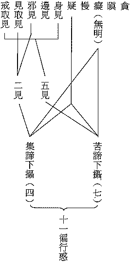



壬六　异熟因



> 异熟因不善及善唯有漏



上明徧行因相，此明异熟因相。这可说正是善恶的异名，是招至将来幸不幸之果的因。在狭义之下的善因善果，恶因恶果，就是指这因果律。把他名为异熟的所以，在《婆沙》虽有种种的异论，但论文举毘婆沙师，把他解说为异类而熟，就是因是善恶，果唯无记，因果其类，不同而熟，是异熟义。如以六因分别：俱有、相应、同类、徧行四因，唯是同类熟，此异熟因，唯是异类熟，兼具同类熟、异类熟之二者的，唯那体最宽广的能作因。但经部说，由因变异而果方熟，是异熟义。要知果得熟名，必须具有二义。一、造业并不立即感果，要待相续、转变（将欲感果）、差别（正感果时），而后果体才得生起。二、异熟果的生起，是看因的胜劣，因的势力殊胜，果就速生，因的势力羸劣，果就迟生。如以六因分别：俱有、相应二因所生的果体，只具有后一条件，而缺少前一条件；能作、同类、徧行三因所生的果体，只具有前一条件，而缺少后一条件；两义具备的，唯异熟因所生的果体，所以经部师说，异熟果不应由餘五因得。



异熟因不善及善唯有漏　简单的说，唯诸不善及善有漏是异熟因。善不善因可招异熟果，所以名为异熟。但无记法为什麼不招异熟？因为他的力量薄弱，如朽败了的种子一样，所以不招异熟。无漏法又为什麼不招异熟？因为他缺乏爱水的滋润，如没有水润的坚实种子一样，所以不招异熟。而不善、善有漏法，具上两种含义，所以得招感异熟果的异熟因名。



辛三　世分别



> 徧行与同类二世三世三



上虽标出六因的名，显示六因的体，但在三世的时间中，还没有分别何因通於何世，所以现在用这两句颂略为分别。



徧行与同类二世　这是说徧行因与同类因，在三世的时间中，唯通於过去与现在的二世，不通於未来，因为未来没有此二因的意义，其中道理在前已经说过了。



三世三　这是说通於过去、现在、未来三世的，有异熟、相应、俱有的三因。还有能作因，颂中未说到。论说：「颂既不说能作因所居，义唯应知通三世非世」。通於非世的能作因，是指无为法说的，因无为法不堕世中。通於三世的能作因，是指有为法说的，因有为法在三世中徧有的。



庚二　明得果辛一　总举果体



> 果有为离系无为无因果



六因的体相以及在三世中的确定，都已如前所辨，但因是对果而建立的，究有那些为因所对的果？此下略明由因得果。这两句颂总举果体。上句显体，下句释疑。



果有为离系　讲到因所得果，略有两种：一、有为果有四，就是异熟、等流、增上、士用四者；二、无为果唯一，就是离系。果之所以分这两类，是约他的不同来源说的：有为果，由彼六因所引生的，是所引果；无为果，由彼圣道所证得的，是所证果。证因与生因不同，所以非六因所摄。



无为无因果　或有人说：既然承认无为是果，那就应该说他从因所生；既然承认无为是因，那就应该说他能生於果！释此难说：无为法体，虽则可说是果，但他只是圣道所证果，并不是六因所引生果，所以说无为无因。诸无为法，虽则是能作因，但他只是就不障碍边，说名为因，并不是有能证或取与的功用，由於没有能证的功用，所以没有离系果，由於没有取与的功用，所以没有有为果。《显宗》九说：「是故择灭，是因无果，是果无因；餘二无为，是因非果，无因无果理极成立」。《正理》十八也说：「有法能为一因性者，谓无为法；无法非因有法非果，所谓虚空及非择灭」。



辛二　对因配果



> 后因果异熟前因增上果同类徧等流俱相应士用



如前所说，果有五果，如是五果，对前六因，那一果是由那一因得的，今当略为配合说明。首须知道的：五果中的离系果，是由圣道所证，非由生因所生，所以在此只论六因得餘四果，不论离系果。



后因果异熟　后因，指异熟因，因他在前六因颂中，是属最后说的。果异熟，倒过头来，就是异熟果。意思是说：异熟果，是依异熟因所得的结果；或者是说：异熟因所感的果是异熟果。异熟因体为善恶业，依那善或恶的业力，所感无记的果体，称异熟果，因为这是异於原因的或善或恶，而成熟的无记性的结果。



前因增上果　前因，指能作因，因他在前六因颂中，是属最初说的。增上果，是五果中的最后一果。意思是说：增上果，是依能作因所得的结果；或者是说：能作因所得的果是增上果。所谓增上，就是能作因，对於所得果，有种增上的能力。增上之果，名增上果。或有人说：能作因主要的功能唯无障住，有什麼增上可说？当知即由无障得增上名，假定因作障碍，彼果就不得生，由於因无障住，而后果方得起，所以得增上名。



同类徧等流　此说同类因与徧行因所得的果，是等流果。所谓等流者，是说果与因同其性质。例如因是善的，果也是善的，因是恶的，果也是恶的。对同类因的果，就是此果。此外，徧行因为一切烦恼的原因，由此因而所起的果也是烦恼的，在这点上是等流果。此二因所得的果，都是於因相似的，所以因性虽二，其果唯一。



俱相应士用　此说俱有因与相应因所得的果，是士用果。所谓士用者，就是士夫的作用，从喻而得名的。如依士夫的作用，能成种种的事业。这主要的，可说是对动力因的果。论文把他的定义说为：「若法因彼势力所生，即说此法名士用果」，不外就是这个意思。所以如将由人因事而产生某种果的情形加以扩大，此果是有极广大的意义的。总之，苟发现那动力因，其果都成为士用果。不过，这里主要的是对俱有因、相应因的果而言。关於士用二字，《正理》有很好的解释，如说：「此中士用、士力、士能、士之势分，义皆无别，诸法功能，如士用故，名为士用，如勇健人，似师子故，名为师子」。士用果的范围，既然极为广大，为什麼此中但说俱有、相应二因得士用果？因为唯此二因，具足能得俱生，无间二士用果；又士用果，俱的意义特强，所以唯俱有、相应二因，独能获得俱士用果；再则俱有、相应二因，决定能得士用果，不如其他皆能定得，由这种种关系，所以此中但说俱有、相应二因得士用果。



辛三　别显果相



> 异熟无记法有情有记生等流似自因离系由慧尽  

> 若因彼力生是果名士用除前有为法有为增上果



因果相对，决定如是，上来已经说过了，但诸果的相状，究竟怎样，现当略为显示。初二句显异熟果相，第三句明等流果相，第四句示离系果相，五六两句辨士用果相，末后两句彰增上果相。



异熟无记法　此说在三性中，唯无覆无记法，有异熟果，绝对不是在於善、染。假定异熟果是善或恶，那所造业就应没有受尽的时期，可是事实不然，有情的生命体，到寿尽的时候，必然要暂告一段落，所以异熟果，唯是无覆无记中摄。



有情　从善恶业生的名为异熟，那非有情数亦应说他是异熟，因为也是从善恶业生的，不可这样比例：要知唯不共业所得之果，方可说为异熟，若是共业所得之果，不得名为异熟。有情的报体，是不共业所感的，唯个己生命独自受用；非有情数法，是共业所感的，餘可於中共同受用，为欲简彼共所受用的非有情数不是异熟，所以异熟果唯局有情。



有记生　若说唯於有情有异熟的话，则在那有情数中的长养、等流，亦应说他是异熟。这也不可！要知此异熟果，其性与因不同，为了简别这些，所以说有记生。记是记别，一切不善及善有漏，能记异熟，名为有记，换句话说，就是善恶业感的意思。异熟果，既然唯是有记生，可见是不通於等流、长养。等流通於三性，不特不是唯有记生，其体亦非唯是无记；长养体虽属於无记，因为通三性生，所以不是唯有记生。如是像上所说，名为异熟果相。



等流似自因　此明等流果相。与自因法相似，说名为等流果，谓似同类、徧行二因：如同类因是善恶无记的，彼等流果相也是善恶无记的；如徧行因唯是染污的，彼等流果相也唯是染污的。有人这样的难说：假定徧行因与同类因所得的等流果，都是相似於因的话，那就总名为同类因好了，何必要分为二因呢？二因虽等相似，但稍有所不同：徧行因的等流果与因相似，是约同地五部烦恼同是染污性说的，不是约五部、三性的种类说的；同类因的等流果与因相似，是约五部、三性的种类说的，随其性类，各望自部，虽则是同类因，若望餘部，就不得做同类因的资格，因为望於他部，如同是染污类，那就属於徧行因。所以徧行因虽得等流果，而不可说他就是同类因。



离系由慧尽　此显离系果相。尽是灭的意思，慧是择的意思，慧尽实即择灭的异名。由慧简择为一种动力，渐渐离去烦恼的系缚，证得诸法的择灭，名离系果，因为择灭又名离系，是由离去系缚所证得的，所以〈界品〉颂说：「择灭谓离系」。《正理论》说：「由择为因，离诸系缚，证此灭故，说名为果」。



若因彼力生是果名士用　此明士用果相。如有这麼一法，因那东西的势力所生，就把这法称名士用果。举例说：如因下地的加行心力，生起上地的有漏无漏定，则此有漏无漏定，就名士用果。还有择灭虽是不生法，但亦可名不生士用果，因为是由无间道所证得的。《正理论》说：「此既不生，如何可说彼力生故名士用果？现见於得亦说生名，如说我财生，是我得财义」。



除前有为法有为增上果　此明增上果相。某类有为法将要生时，其餘的诸法不作他的障碍，此所生法，就是增上果，所以增上果，唯约有为法说。因果相望，有著不同：以果望因，果或与因同时俱有，或果居於因后，绝对没有果在因前：以因望果，因或与果同时俱有，或因居於果前，绝对没有因在果后。今说除前，就是在有为法中，除去以前已生的诸有为法，因为前法不是后法之果。把这除了以后，其他的有为法，或与因俱有的，或在因之后的，都名为增上果。除已生法一切是增上果，这是适应那除自餘一切法皆为能作因说的。在这意义下，其他的四果，虽也可说是增上果，然而这里，特别是指除去四果意义的果，尤其可说是对消极因、间接因的无障果、间接果。这麼说来，那士用果与增上果，岂不是没有差别了吗？不！二果是略有不同的：如做玩具的人，玩具做成功了，对他不但是士用果，同时也是增上果；可是对於欣赏玩具的人，那他只是属於增上果，不可说为士用果，因为欣赏者对於玩具，并没有给予作用。



辛四　因取与时



> 五取果唯现二与果亦然过现与二因一与唯过去



对於六因而立五果，固已如上所说，但於此成为问题的，就是在那因果之间的时间关系怎样？经部，是主张异时因果的；有部，是承认有同时因果的。因果关系，以赛姆斯的话说，就是一切条件的总计。所以在这之间，有明前后、俱时等区别的必要。关於这个，有部立取果与与果的二种区别。取果，正指果体实成的当体，相当於那质料因；与果，是指实现其果的作用，相当於那动力因。凡是因，可说都含有这二种作用。论文，把他的定义解说为：「能为彼种故名取果（种是因义，现在为因，能取后果）；正与彼力故名与果（与是给与，谓果将生，因与力用，令入现在）」。依此说明六因五果的关系，是这样的：



五取果唯现　此说於六因中，除去能作因，其他的五因取果，唯独是在现在，不通过去未来。因为过去已经取果，未来作用还没有生，所以论说：「定非过去，彼已取故，亦非未来，彼无用故」。五因取果，在时间上，虽然都在现在，但是与果有别，其别如下：



二与果亦然　此说相应、俱有二因，与果如前五因取果一样，唯独在於现在，所以说亦然。因此二因，与其果的士用果，绝对是同时的，所以取果与与果，都是属於现在。



过现与二因　此说同类、徧行二因，与果通於过去、现在的二世。此二因所得果，都是等流果，如站在现在的立场看：其等流果，若是由过去因所继承的产物，那他的与果就在过去；其等流果，若是由无间断所继承的产物，那他的与果就在现在，以因与果之间，差不多是无间断的。



一与唯过去　此说最后一个异熟因，与果唯独在於过去，不通现在、未来。为什麼？因这是过去业酬於现在，果既不与因俱有，又不能无间而生，所以其与果必在过去。



所除能作因的取果、与果是怎样的呢？这如从大体上说，能作因的取果，也是在於现在，而初句中所以把他除去者，因为其间含有无为法、未来法等，不可说是都在现在，且无为法及未来法，虽是能作因，但不能取增上果。《正理论》说：「然能作因，能取果者，定唯现在」。至於与果，除了绝对没有变化的无为法，不能与果外，其餘的能作因，如把他视为不障因，过去、现在，可说都有与果的功能。要之，这取果、与果的区别，是就各种因而把他分为质料与动力的二者，以明其时间之规定的。图示如左：



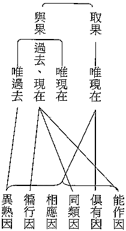



庚三　明法生



> 染污异熟生餘初圣如次除异熟徧二及同类餘生  

> 此谓心心所餘及除相应



因是什麼意义，何因而得何果，此因果的关系，都已如上所说；但在这当中，那一种法由那几种因生，还得说明一下。讲到这问题，首当知道所生法有四类：就是染污法、异熟生法、初无漏法、三所餘法。所谓三所餘法，就是在无记法中，除了异熟生，取其他的工巧处、威仪路、通果心的三种无记；在善法中，除去初无漏法，取其他的一切善法。於此六句颂中，前五句明相应法，后一句明色不相应。



染污异熟生餘初圣　这八字，是标出诸染污法、异熟生法、三所餘法、初无漏法的四大类。



如次　这二字，是辨因多少。意思是说：在此四法的除因门中，於下两句，如其次第，除去某一种因。



除异熟餘生　这是约第一类的染污法说。诸染污法，於六因中，除去异熟因，由其餘的五因生。为什麼要除异熟因？因异熟因所生诸法，不是纯粹染污的。



除徧行餘生　这是约第二类的异熟生法说。异熟生法，於六因中，除去徧行因，由其餘的五因生。为什麼要除徧行因？因徧行因所生诸法，唯独是染污的。



除二因餘生　这是约第三类的三所餘法说。三所餘法，於六因中，除前异熟、徧行二因，由其餘的四因生。为什麼要除这二种因？因所餘法，既不是异熟性的，又不是染污性的，所以不从此二因生。



除二及同类餘生　这是约第四类的初无漏圣法说。初无漏法，於六因中，不特要除去前面所除的异熟、徧行二因，并及还要除去同类因，只从其餘的三因生。为什麼要除去这三种因？因初无漏圣法，绝对没有前生的同类法，所谓初念无漏无同类因，就是此意，所以须要除去同类因。开始所得的圣法，既然是无漏的，当然纯属善性，所以须要除去异熟、徧行二因。



此谓心心所　所生的四类法中，各有二种：一是相应法，一是不相应法。上来所说四法从因所生，是约心心所的相应法说的，所以说此谓心心所。



餘及除相应　餘指色法及不相应行法。此色及不相应的四类法从因所生，是这样的：如恶律仪的染污色、不相应行，如心心所所除的异熟因外，兼及除去相应因，从其餘的四因生。若眼等五根的异熟生色、不相应行，如心心所所除的徧行因外，兼及除去相应因，从其餘的四因生。设是除初圣外所餘无漏戒及定共戒等，一切善色、兼工巧、威仪、通果色的三所餘色，不相应行，如心心所所除的异熟、徧行二因外，兼及除去相应因，从其餘的三因生。假定是苦法忍上的道共戒初无漏色、不相应行，如心心所所除的徧行、异熟、同类的三因外，兼及除去相应因，从其餘的二因生。诸法之中，决无一因生者。



己二　明四缘庚一　总明四缘义辛一　四缘体



> 说有四种缘因缘五因性等无间非后心心所已生  

> 所缘一切法增上即能作



在前开始讲六因时，曾经这样说过：关於四缘论的发达经过，到下讲四缘时再说。所以现在来观察一下四缘论。四缘论与六因论的不同，不独在小乘论部所用，就在大乘教也依用的，因为因缘论的分类，是一般所承认的。虽然如此，但尽我人研究，不独巴利文圣典，没有明说四缘的经文，就是在汉译阿含中，也没有明说四缘的文献，现在所可发现的四缘说，只在大乘经的《分别缘起初胜法门经》卷下。有部三藏中的四缘分类，望於经说的形态，至少有被整理的痕迹。对此四缘分类的观察，如作发达史的研究：前之六因论，若说是其支流，则此四缘论，就可说是本流。但四缘的分类，是不是开始就被规定为四呢？这在古典经典思想没有弄清楚以前，是很难预为论断的。不过就论部说，在提婆设摩（佛灭百年顷人）的《识身足论》卷第三，已有四缘的名目。此外，关於四缘的议论，在《施设足论》中也有。总之，四缘论的成立，不能提到太早的时代。这不独在论部如此，就是在含有四缘论的契经，也可说是那样，为什麼？因那契经，在巴利文方面，固不用说，就是在汉译，也没有所传。然则四缘成立的经过，应怎样的研究呢？这在汉译的所传中，是有可注意之材料的，那就是《舍利弗阿毘昙论》的十缘说。十缘，就是因缘、无间缘、境界缘（所缘缘）、依缘、业缘、报缘、起缘、异缘、相续缘、增上缘（见舍利弗阿毘昙论卷第二五至卷第二六）。此十缘说与四缘的关系，如卒然的说，是先有四缘说，然后渐次增加，始成为十缘说，这种看法，大体是不错的。然佛教是特别重视因缘论的，那末，他的作用又是怎样的呢？作为其根本精神的，要之，以「此有故彼有，此生故彼生」的原理为基础，从种种的立场，看一切的现象，明其相互关系，同时，如消极的说，由此因缘论，对抗当时流行於世的无因论（偶然论）、一因论（自在神、自性、时）等，以明佛教相对主义的世界观。如将此四缘论与前六因论比较，不管是四缘论或六因论，主要都是著重於心理活动的分类，在这点上，虽则是同样的，但四缘论，主要是认识论的，六因论，却专以生命活动为中心，在这点上，可说又有不同。话越说越远，就此收住，依於颂文，将四缘说，分别如下：



说有四种缘　这是举数标名，显为契经所说。有人说：「前之六因，无经说故，所以言许；今之四缘，有经说故，所以言说」。有经说，意指阿含经中有说。《婆沙》十六也说：「然此六因非契经说，契经但说有四缘性：谓因缘性，广说乃至增上缘性」。根据这些看来，四缘说，似乎是契经有的，可是如上分别，现存阿含经中，并无明文说有四缘性。至在《分别缘起初胜法门经》中，虽有四缘说，但这是大乘所诵，不能以此证於今说。有部学者说契经说，只是有部一家言而已。



因缘五因性　从此以下，有五句颂，正出四缘体。此明因缘性。《婆沙》曾论到这样一个问题：六因与四缘相望，是因摄缘呢？还是缘摄因？这有两说：一说互相随摄其事；一说缘摄於因非因摄缘。本论是依后说，所以初后二缘，以前六因显示其体。第一因缘，於六因中，除能作因，所餘五因，是因缘性。为什麼？因为因缘，总指一切有为法而言，并不含摄无为，所以只以五因为因缘性，然为什麼不把无为立为因缘？因能作因是以无障碍消极的原因为主体，乃其他的五因全体，涉及间接直接的一切原因，变成所谓一切事情的意义。这样，说因说缘，原来是总括现象成立的原因、条件、事情等的一语。《正理》十八说：「为摄五因及三缘性所不摄义，立能作因及增上缘，体俱广故」。所以能作因不包含在因缘性中。於诸缘中，因缘虽有最重大的任务，但他的意义，依论说并没有一定。有论中说：因是贪、瞋、痴、舍、慈悲、智的六种，为主要的心理活动，因而，因缘可说是指由贪等的心理活动而现起种种现象的关系。在《舍利弗阿毘昙论》，虽把他止於心理活动而招其果，但进一步，把物质的四大，也摄於此因缘中。总之，所谓因缘，大体以质料因为主，而更加以动力因。如建房屋，木材固是因缘，人工也是因缘。如缩小推究此说，那极广泛的因缘论，对於某件事的成立，寄与直接间接的一切条件，都可含於此因缘中。



等无间非后心心所已生　此明等无间缘性。等无间缘，要而言之，是在法的存续，明其前后关系。换句话说，是对前念心的作用（心心所）与后念心的作用间关系之规定。据佛教心理学说，我们的心，绝对是生灭的，一刻也不止於同一的心。心的相续，在前后念间，不能没有那相续的规定。明这规定的，就是缘起。如简单说：前念的心，把自己退出，成为引发后念之缘，是为等无间缘。如举喻说：某人占舞台表面的地位，他人就不能出现於舞台，为使他人能占那个地位，前人必须退出那个地位，这可说是理之当然。前者隐居，导出后者，其关系，就是等无间缘。在这意义下，所以等无间缘，也可名开导依。所以名为等无间者，因前念的心心所，同所引出的后念心心所，其性质虽不同，但在量上，至少是同等的。如前念心心所的体一，后念心心所也是同一，而且在那之间，从没有其他的要素间入，因此得名等无间缘。以心心所释等无间缘，是不是一切心心所都名等无间缘呢？不！阿罗汉临入涅槃的最后心心所，是不可以名为等无间缘的，因为刹那灭后，不再引生后念的心心所，所以说非后心心所。除了阿罗汉的最后心心所外，诸餘已生心心所法，一切皆是等无间缘。为什麼说已生言？这是简别未来及无为法，不可名为等无间缘的。为什麼说心心所？这是简别色法及不相应行，不可名为等无间缘的。且如色法，论文及《婆沙》说：物质的相续，在无间而行的一点上，前之物质虽为后之物质的无间缘，但在前后之量未必一定的一点上，那与心心所相续的等无间缘，是不同的。至於世友及大德对此的意见，可参阅论文卷七及《婆沙》卷第一〇便知，於此不再详说。



所缘一切法　此明所缘缘性。所缘缘，是客观的意义，也就是总称所谓主观心识的一切对象。据佛教心理学说：心心所法，其性羸劣，如要发生活动作用，必须托於外境，假定没有外境，那心就不得起，如一个身体非常瘦弱的人，要想走动走动，没有拐杖，是不能起身的。约他作为心起而必要境的一点上，这是很重要的一缘。在《舍利弗阿毘昙论》，把他解说为「的」的意思，谓如射矢之「的」的关系。所谓所缘缘者，所缘，是指心心所法所缘的一切对象，就是客观的别称，而此所缘的对象，能为心心所发生之缘，所以名为所缘缘。



增上即能作　此明增上缘性。这在诸缘中，也是极重要的。所谓增上即能作，意思是说，增上缘就是能作因，能作因就是增上缘，其意义是非常宽广的。如前说能作因，是指除去自体的一切法。只要能使一事情的成就，不问那是积极的、消极的，一切都被摄於此中，所以增上缘的意义，也就不外於此。不过他的意义，与因缘一样，是很暧昧的。据《舍利弗阿毘昙论》说：增上者，毕竟是强烈的精神作用之义。即以欲、以精进、乃至以心、思惟，不管怎麼样，都是以强烈的志向而行事的意思，因而，增上缘者，就是由中心动机而支配我们的行为，可说是相当於亚利斯多德的所谓目的因的概念。虽有说增上是自在之义，犹如王者，但不外是指这动机之力。



辛二　缘作用



> 二因於正灭三因於正生餘二缘相违而兴於作用



上来已将四缘，略为解说，但每一缘，都有他的作用，现应进一步的说明，那一种缘，在什麼果位，而始发生他的与果功用。依《光记》说，四缘的与果用，过去现在，有著众多，须别分别，而取果用，有不同说，《正理》说是唯在现在有取果用，《婆沙》说在过去现在都有取果用。此中但说与果用者，惠晖说：「为因义成，方是取果，是四缘故，不论取果，但言与果用」。其次，颂中没有说到增上缘，这是什麼道理？这如前颂六因三世门，不说能作因，其道理是一样的，唯准其意义，应知是通一切正灭正生时的，所以颂中不说。



二因於正灭　因缘性具有五因，此句先说相应、俱有二因，唯於正灭时，发生他的与果作用。论说：「正灭时言，显法现在，灭现前故，名正灭时」。《光记》说「住异虽亦同时，灭相义当在后，故偏言灭」。这两种因，在灭位上，发生作用，就是使俱生士用果或俱生果有一种作用，趣所缘境及一果等。在现在位，相应、俱有二因，於一时中，本来都可取果、与果的，可是现在专约与果功能这一方面说。



三因於正生　此说因缘性中的其餘同类、徧行、异熟三因，唯於正生的时候，发生他的与果作用。所谓正生，就是未来法到达正生的阶段，那生相现前，名正生时。如分别的说：同类因与徧行因，是发生与等流果的作用；异熟因，是发生与异熟果的作用。



餘二缘相违　餘二缘，就是等无间缘及所缘缘。这两种缘所发生的与果功用，与上所说，刚刚是相违反的。如等无间缘，唯於果法生的阶段，发生与果的作用，因为后念心心所生时，前念心心所让给他的地位的缘故，所以与二因於正灭位有用不同。若所缘缘，唯於能缘果法灭的阶段，发生与果的作用，因为心心所要在现在时，方能取境的缘故，所以与三因於正生位有用不同。



而兴於作用　这是结用，通上三句。谓二因於正灭而兴於作用；三因於正生而兴於作用；餘二缘相违而兴於作用。



辛三　缘生法壬一　总明诸法



> 心心所由四二定但由三餘由二缘生非天次等故



四缘是生诸法的，但所生的诸法，是不是都由四缘生呢？这实有分别之必要。此总明诸法中，前三句正辨缘生法，后一句遮外道宗的妄执。



心心所由四缘生　於诸法中，先说心心所法，是由四缘生的。《显宗》十一说：「此中由言为显故义，谓心心所四缘故生」。缘生二字，本在第三句，因为是通上二句的，所以把他连起来讲。因缘具五因性，这是约总相说，若分开来讲，也有不全具者：如不是异熟果法的生起，就没有异熟因，如不是染污性法的生起，就没有徧行因，如是初念无漏法的生起，就没有同类因，真正可以说是皆有的，唯相应、俱有二因而已。心心所法，前生自类，如不作开避引发，那是不能生起的，所以有等无间缘。所缘缘，唯是生起心心所法的特殊之缘，除了引发心心所外，可说没有其他的作用，所以六识身及其相应法，各有他的所缘缘。心心所法的生起，除了他的自性，餘一切法不障他生，皆是他的增上缘。所以说心心所由四缘生。



二定但由三缘生　此说非色非心的不相应行法中，像无想定、灭尽定，只从因缘、等无间缘、增上缘的三缘生；因为不是心法，所以没有所缘缘。由因缘生，主要是五因中的俱有因与同类因。由俱有因，是指二定上俱有的生等四相；由同类因，是指前已生起的同地所有的善法。如果是无想定，那就属於无想天中同地所有的善法，如果是灭尽定，那就属於有顶天中同地所有的善法。由等无间缘生，是以入二定前的心心所法为等无间缘，而引生二定的现前。由增上缘生，是说二无心定的生起，除了他的自性，餘一切法不障他生，皆是他的增上缘。所以说二定但由三缘生。《正理论》说：「岂不无想亦三缘生，是心心所等无间故，亦应说为心等无间，但非心等加行引生，故於此中废而不说，或此无想但声所显，非如二定相对立故」。二定的生起，虽有等无间缘，但二定本身，却只可说是等无间，而不可说是等无间缘，为什麼？《正理论》说：「然心方便加行引生，故可说为心等无间，与心等起定相违害，故非心等等无间缘。又为此缘理相违故，谓修行者，厌恶现行心心所法，入无心定，若无心定，复为此缘引心心所，则修行者，应於此定无乐起心，为离现行心心所法，入无心定，此复引生心心所法，不应道理」！



餘由二缘生　除了上面所说的缘生法外，其餘的色法及不相应法，都是由於因缘、增上缘的二缘所生。因这两类法，不是能缘的心心所，所以没有所缘缘；又不是心心所法之所引生的，所以没有等无间缘。但决没有一法，是无因或一因生的，所以由二缘生。



非天次等故　这句颂文，旧论译为非自在次故，《顺正理论》作非天次第故，比较而言，《正理》所说为胜，因为非天是立宗，次第故是所由，长行解说，除举出次第因外，并没有更出餘因，可见以次第为然。如欲保存等字，应与次字颠倒一下，成为非天等次故，则等就是等於我、胜性等。如上所说，我们知道，世间诸法，唯从因缘所生，决不会从自在天、我、胜性等一因所起，为什麼？因为现见诸法，是由次第而起的，所以非但一因所生，假定妄执自在天等一因生的话，则无间诸法，就应俱时而起，可是事实不然，因而不得妄计。自在天，就是摩醯首罗天。《西域记》七说：「波罗痆斯国，外道数万人，或断发、或推髻、露形、涂身以灰，求出生死」。从他们所敬事的对象说，名自在天，约他们修道的状态说，亦称涂灰。详如论文所说，不具释。



壬二　随难别解



> 大为大二因为所造五种造为造三种为大唯一因



上说色法是由因缘及增上缘的二缘所生，但是讲到色法不出大种所造两类，此两类色法的关系怎样呢？论说：「大种所造，自他相望，互为因缘」。就是大种望於大种，所造望於所造，大种望於所造，所造望於大种，彼此都可相互为因缘的。现在分别说明如下：



大为大二因　此说四大种望於四大种，但有俱有与同类的二因。俱有因是俱起的，同类因是前生的，二因各别，缺一不生。从大种的更互相望边，说他有俱有因，从大种的更相随顺边，说他有同类因。为什麼没有相应因？因这不是心心所法。为什麼没有异熟因？因这同是无记性的。为什麼没有徧行因？因这不是染污性的。



为所造五种　此说四大种望於所造色，能为生、依、立、持、养的五因，而此五因於六因中，属於能作因摄。诸所造色，是从大种所生起的，如母生子一样，所以说为生因。诸所造色，从诸大种生起以后，仍然随逐大种而转，如弟子之依老师一样，所以说为依因。大种不但能生起造色，而且能任持造色，如大地之能任持万物一样，所以说为立因。诸所造色在某一阶段所以不断不坏，这完全是大种执持的力量，如饮食之能维持生命一样，所以说为持因。大种能够增长造色，犹如水能沃润树根一样，所以说为养因。为什麼没有相应因？因这不是心心所法。为什麼没有徧行因？因这不是染污性法。为什麼没有异熟因？因这同是无记性的。为什麼没有同类因？因这是同时起的。既是同时起的，为什麼又没有俱有因？因大种望於所造色，并不是同为一果，其性类又不一定相同，容许别世而造，容许别为成就，所以非俱有因。



造为造三种　此说所造望於所造，但为俱有、同类、异熟的三因。如随心转的身语二业，七支无表，更互相望，展转为因，是为俱有因。一切前所生起的造色，望於后时生起的同类，皆可为因，是为同类因。谓诸不善及善有漏的身语二业，能招异熟眼根等果，是为异熟因。为什麼没有相应因？因这不是心所法。为什麼没有徧行因？因这不是染污性的。



为大唯一因　此说所造望於大种，唯有一异熟因，为什麼？因由身语二业，能招异熟大种果的。



上来都是就因缘说，并未谈到增上缘，这是什麼道理？当知大种、所造，自他相望，各有增上缘，是平等转的，所以就略而不谈，如要说的话，那就一一加一增上缘。



庚二　别明等无间缘辛一　诸心相生壬一　十二心



> 欲界有四心善恶覆无覆色无色除恶无漏有二心欲界善生九  

> 此复从八生染从十生四餘从五生七色善生十一此复从九生  

> 有复从八生此复生於六无覆从三生此复能生六无色善生九  

> 此复从六生有覆从七生无覆如色辨学从四生五餘从五生四



前在四缘中，讲到等无间缘时，虽曾总说已生诸心心所，除了阿罗汉的最后心心所，一切皆是等无间缘，但还没有决定说，那一种心无间而有几心生起，复从几心有什麼心生起，今当定说心有多种。概略而言，大约有十二种心。於中，初颂列十二心，次四颂正辨生相。正辨生相颂中，初四句辨欲界四心，次六句辨色界三心，再四句辨无色界三心，最后两句辨无漏二心。



欲界有四心善恶覆无覆　此列欲界的四心，就是善心、恶心、有覆无记心、无覆无记心。



色无色除恶　此列色无色界各有三心。色界三心，除去恶心，有其餘的善心、有覆无记心、无覆无记心；无色界亦复如是。



无漏有二心　此列无漏的二心，就是有学无学。



欲界善生九　此说欲界善心，无间容生九心。所谓九心，就是欲界本身四心，色界的二心，无色界一心，再加无漏二心，合为九心。欲界善心所生的色界二心，一指由欲界善心，入色界定，生彼色界善心，一指从欲界善心中死，往生於色界的时候，生彼续生的染污心，因为受生心一定是染污的。欲界善心所生的无色界一心，就是以善心死了以后，上生於无色界的时候，生彼续生的染污心，因为受生心一定是染污的。欲界善心所以不生无色界善心者，因为二者距离得太远的关系。欲界善心所生的无漏二心，是以欲界的加行善心，入於有学、无学观中，是为二心。



此复从八生　此指欲界的加行善心。谓此加行善心，复从八种心生，就是自己欲界的四心，色界二心，无漏二心，合为八心。色界二心生欲界善者，一从色界定出，由彼定心，生起欲界的善心，一从色界染心，生起欲界的善心，这是由於入定者的愿乐，因当他入定的时候，曾经作这样的发愿，愿我从今以后，宁可生起下地的善心，不要生起上地的染污，由他事前发过这样的愿，所以被初静虑的染污定所逼恼时，於是就从那染污定，生起了下地的善心，他之所以这样求依下善，目的是在预防有所退失。无漏二心生欲界善者，是指出了学无学观，生起欲界的善心。



染从十生四　染指不善、有覆无记的二种染心，这二种染心，是从欲界的四心，色界的三心，无色界三心的十心所生的，因於此十心中，无论那一种心，都可於命终时，生起欲界的二染，所以说从十生。欲界二染所以不从学无学生起者，因为绝对没有无漏生起染污心的。能生四者，是说此二染心，各各能生自己欲界的四心，除此必无生起之理，因为绝对没有下地染心，无间能生上地及无漏心的。



餘从五生七　欲界四心，除了上面说的善、恶、有覆无记的三心，所餘的自然是指无覆无记了。此无覆无记是从自界四及色界善的五心所生的。从色界善定生起欲界的无覆无记，主要是指通果心，因通果无记，是从色界善定生的。从五心生的无覆无记，无间能生七种心，那就是自己欲界的四心，色界的善及染污二心，无色界的染污一心。生色界善心者，因欲界的通果无记，唯独是与定心相出入的，所以从彼定心所生的通果无记，还能生起彼色界的善定心。生色界染污心者，约在异熟、威仪、无记心中命终，上生色界，於彼续生位中，生彼染污心说的。生无色界染污心者，这也是约於无记心中命终，生无色界，於彼续生位中，生彼染污心说的。



色善生十一　上来是说欲界四心无间从生能生决定，此下有六句颂，是辨色界三心的从生能生的情形。色界善心，无间容生十一心，即於前十二心中，唯除生无色界的无覆无记心，因为异熟生心，唯属自界所有，不容异地相生，而无色界却又唯有异熟生无记心，所以色界善心不能生彼。



此复从九生　即此色界善心，复从九心无间生起，谓除欲界的二染污心及无色界的无覆无记心，而从其餘的九心生。色界善胜，欲界二染污心劣，胜不从劣生，所以须要除去。色善既不生无色界的无覆无记心，无色界的无覆无记心，当然也就不生色界善心了。



有覆从八生　此说色界的有覆无记心，是从八心无间生起的，即於十二心中，除去欲界的二种染心及学无学的二无漏心。



此复生於六　即此色界有覆无记心，复能生起自己色界的三心，欲界的善、不善、有覆无记的三心。生欲界善，是约从染污定，生起欲界的善心说；生欲界的染污二心，约在色界染心命终，下生欲界，於续生位，生欲界二种染心说。



无覆从三生　此说色界的无覆无记心，是从自界的善、有覆无记、无覆无记的三心生的，除此，其餘的九心，无生无覆无记心之理。



此复能生六　即此无覆无记心，复能生起六心，那就是自界的三心，欲界的二染污心，无色界的一染污心。生餘二界的三心，都是约续生位的染污心说的。



无色善生九　色界的三心相生，也已如上所辨，此下有四句颂，明无色界的三心相生。无色界的善心，无间容生九心，即於十二心中，除去欲界善心及欲色二界各一无覆无记心，能生其餘的九心。



此复从六生　即此无色界的善心，复从自界的三心、色界的善心、学无学二心的六心所生。



有覆从七生　此说无色界的有覆无记心，无间能生自界的三心，色界的善、染二心，欲界的不善、有覆无记二心的七心。即此无色界的有覆无记心，又是从七心无间而生起的，那就是於十二心中，除去欲界的不善、有覆无记的二染污心，色界的有覆无记的一染污心，并及有学无学的二无漏心，从其餘的自界三心、色界善及无覆无记的二心、欲界善及无覆无记二心的七心生。



无覆如色辨　此说无色界的无覆无记心，如色界的无覆无记心之所辨别，就是从三心生、能生六心。所谓能生六心，就是能生自界的三心，色界有覆无记的一染污心，欲界不善、有覆无记的二染污心。所谓从三心生，就是从自界的善、有覆、无覆的三心生。



学从四生五　此说有学心，从三界善心及有学心的四心所生，而又能生起三界善心及学无学心的五心。



餘从五生四　餘指无学心。此说无学心，从三界善心及学无学心的五心所生，而又能生三界善心及无学心的四心。所以不生有学二者，因这不是其果。



壬二　二十心



> 十二为二十谓三界善心分加行生得欲无覆分四  

> 异熟威仪路工巧处通果色界除工巧餘数如前说



十二心的相生，已如前说，即此十二心，分为二十心，是怎样的呢？即欲界有八种心，色界有六种心，无色界有四种心，无漏有二种心：总合为二十种心。



十二为二十　这是总说，就是将前十二种心，再为仔细分别，总合而成二十种心。



谓三界善心分加行生得　前说三界各有善心，即此三界善心，一一分为加行所得善、生得所得善二种，就成六种心。



欲无覆分四　属於欲界的无覆无记心，再分四种，那四种呢？



异熟威仪路工巧处通果　这两句颂，就是指出欲界的四种无记：一、异熟生，二、威仪路，三、工巧处，四、通果心。威仪，就是行住坐卧的四大威仪，以色香味触的四尘为体，因为是以威仪心之所缘的，所以名为威仪路，而缘威仪路的心，就名为威仪路心。如别分别，约有三种。一、起威仪路心，谓能起彼意法二处为体，唯独是属於意识的。二、缘威仪路心，这虽通於眼鼻舌身四识以及意识，但眼等四识只能缘威仪路，不能缘起威仪路，而意识不特能缘威仪路，亦能缘起威仪路。三、似威仪路心，就是泛泛然的缘於客观外在的色等，所以这是通於六识的。工巧处，就是艺术、技艺，这有两种：一是身工巧，就是雕刻、绘缕等；一是语工巧，就是歌咏、唱呗等。前身工巧，是以色香味触四境为体的，因为身工巧一起，就不能离於四境；后语工巧，是以色等五境为体的，因为语工巧一起，就不能离於五境。工巧所以名之为处者，是约他为心之所缘说的。此工巧心，别为分别，也有三种。㈠、起工巧心，谓能起彼意法二处为体，唯独是属於意识的。㈡、缘工巧心，这虽通於五识以及意识，但眼等五识，只能缘工巧处，不能缘起工巧处，而意识不特能缘工巧处，亦能缘起工巧处。㈢、似工巧心，就是泛泛的缘於客观外在的五境，所以这是通於六识的。通果心，就是能变化心以及天眼、天耳通果。这能变化心，缘於变化的色等四境，有时也缘於声，因有发语通果心的。



色界除工巧　此说色界无覆无记，须要除去工巧处，只有其餘的三种无记，为什麼？因上界中，完全没有造作种种工巧事的。



餘数如前说　此说除了三界善分为加行、生得、欲界无覆分四、色界无覆分三外，其餘无色界的无覆唯一异熟生、色无色界的有覆各一、欲界染污心有不善、有覆的两种、无漏的有学、无学心的二种，一概如前十二心中说，所以说餘数如前说。《颂疏》说：「如是十二为二十心：谓欲界八，二善、二染、四无记心也；色界六种，前八心上，除不善、工巧二也；无色界四，於前六上，更除威仪、通果二心也；兼学无学，故成二十」。如是说来，我们知道十二或二十，只是开合不同：合则为十二，开则为二十。关於二十心的相生，说来非常麻烦，现在姑且简单的表列如下：



　　　　　　　　　　　　　　　　　　　　　　　　┌生十心　：自界七（加行、生得善、不善、有覆、异熟  

　　　　　　　　　　　　　　　　　　　　　　　　│　　　　　、威仪、工巧）、色界一（加行善）、学心  

　　　　　　　　　　　　　　　　　　　┌加行善心┤　　　　　、无学心。  

　　　　　　　　　　　　　　　　　　　│　　　　└从八起　：自界四（加行善、生得善、不善、有覆无记）  

　　　　　　　　　　　　　　　┌善二─┤　　　　　　　　　　、色界二（加行善、有覆）、学心、无学心。  

　　　　　　　　　　　　　　　│　　　│　　　　┌生九心　：自界七（如前）、色一（有覆无记）、无色  

　　　　　　　　　　　　　　　│　　　└生得善心┤　　　　　一（有覆无记）。  

　　　　　　　　　　　　　　　│　　　　　　　　└从十一起：自界七（如前）、色二（加行善、有覆无记）  

　　　　　　　　　　　　　　　│　　　　　　　　　　　　　　、学心、无学心。  

　　　　　　　　　　　　　　　│　　　┌不善心┐┌生七心　：自界七（如前）。  

　　　　　　　　┌欲界八种心─┤染二─┤　　　├┤  

　　　　　　　　│　　　　　　│　　　└有覆心┘└从十四起：自界七（如前）、色界四（生得善、有覆、  

　　　　　　　　│　　　　　　│　　　　　　　　　　　　　　威仪心、异熟心）、无色三（生得善、有覆  

　　　　　　　　│　　　　　　│　　　　　　　　　　　　　　、异熟）。  

　　　　　　　　│　　　　　　│　　　┌异熟心┐┌生八心　：自界六（生得善、不善、有覆、异熟、威仪  

　　　　　　　　│　　　　　　│　　　│　　　├┤　　　　　、工巧）、色界一（有覆）、无色一（有覆  

　　　　　　　　│　　　　　　│　　　│　　　││　　　　　）。  

　　　　　　　　│　　　　　　│　　　│威仪心┘└从七起　：自界七（如前）。  

　　　　　　　　│　　　　　　│　　　│　　　　┌生六心　：自界六（生得善、不善、有覆、异熟生、威  

　　　　　　　　│　　　　　　└无记四┤工巧心─┤　　　　　仪路、工巧处）。  

　　　　　　　　│　　　　　　　　　　│　　　　└从七起　：自界七（如前）。  

　　　　　　　　│　　　　　　　　　　│　　　　┌生二心　：自界通果心、色界加行善。  

　　　　　　　　│　　　　　　　　　　└通果心─┤  

　　　　　　　　│　　　　　　　　　　　　　　　└从二起　：自界通果心、色界加行善。  

　　　　　　　　│　　　　　　　　　　　　　　　┌生十二心：自界六、欲界三（加行、生得、通果）、无  

　　　　　　　　│　　　　　　　　　　┌加行善心┤　　　　　色一（加行善）、学心、无学心。  

　　　　　　　　│　　　　　　　　　　│　　　　└从十起　：自界四（除威仪、异熟）、欲二（加行善、  

　　　　　　　　│　　　　　　┌善二─┤　　　　　　　　　　通果心）、无色二（加行善、有覆）、学心  

　　　　　　　　│　　　　　　│　　　│　　　　　　　　　　、无学心。  

　　　　　　　　│　　　　　　│　　　│　　　　┌生八心　：自界五（除通果心）、欲二（不善、有覆）  

　　　　　　　　│　　　　　　│　　　└生得善心┤　　　　　、无色一（有覆）。  

　　　　　　　　│　　　　　　│　　　　　　　　└从五起　：自界五（除通果心）。  

　　　　　　　　│色界六种心─┤　　　　　　　　┌生九心　：自界五（除通果心）、欲四（生得善、加行  

　　　　　　　　│　　　　　　│染一──有覆心─┤　　　　　善、不善、有覆无记）。  

　　　　　　　　│　　　　　　│　　　　　　　　└从十一起：自界五（除通果心）、欲三（生得善、异熟  

　　　　　　　　│　　　　　　│　　　　　　　　　　　　　　生、威仪路）、无色三（除加行善）。  

　　　二十心相生┤　　　　　　│　　　┌异熟心┐┌生七心　：自界四（生得善、有覆、异熟心、威仪）、  

　　　　　　　　│　　　　　　└无记三┤　　　├┤　　　　　欲二（不善、有覆）、无色一（有覆）。  

　　　　　　　　│　　　　　　　　　　│威仪心┘└从五起　：自界五（除通果心）。  

　　　　　　　　│　　　　　　　　　　│　　　　┌生二心　：自界二──加行善、通果心。  

　　　　　　　　│　　　　　　　　　　└通果心─┤  

　　　　　　　　│　　　　　　　　　　　　　　　└从二起　：自界二──加行善、通果心。  

　　　　　　　　│　　　　　　　　　　　　　　　┌生七心　：自界四（加行善、生得善、有覆、异熟生心  

　　　　　　　　│　　　　　　　　　　┌加行善心┤　　　　　）、色界一（加行善心）、学心、无学心。  

　　　　　　　　│　　　　　　　　　　│　　　　└从六起　：自界三（加行善、生得善、有覆）、色界一  

　　　　　　　　│　　　　　　┌善二─┤　　　　　　　　　　（加行善）、学心、无学心。  

　　　　　　　　│　　　　　　│　　　│　　　　┌生七心　：自界四（加行善、生得善、有覆、异熟生心  

　　　　　　　　│　　　　　　│　　　└生得善心│　　　　　）、色界一（有覆）、欲二（不善、有覆）  

　　　　　　　　│　　　　　　│　　　　　　　　│　　　　　。  

　　　　　　　　│　　　　　　│　　　　　　　　└从四起　：自界四（加行善、生得善、有覆、异熟生心  

　　　　　　　　│　　　　　　│　　　　　　　　　　　　　　）。  

　　　　　　　　│无色界四种心┤　　　　　　　　┌生八心　：自界四（加行善、生得善、有覆、异熟生心  

　　　　　　　　│　　　　　　│染一──有覆心─┤　　　　　）、色界二（加行善、有覆）、欲二（不善  

　　　　　　　　│　　　　　　│　　　　　　　　│　　　　　、有覆）。  

　　　　　　　　│　　　　　　│　　　　　　　　└从十起　：自界四（加行善、生得善、有覆、异熟生心  

　　　　　　　　│　　　　　　│　　　　　　　　　　　　　　）、色界三（生得善、异熟、威仪）、欲界三  

　　　　　　　　│　　　　　　│　　　　　　　　　　　　　　（生得、异熟、威仪）。  

　　　　　　　　│　　　　　　│　　　　　　　　┌生六心　：自界三（生得善、有覆、异熟）、色界一（  

　　　　　　　　│　　　　　　└无记一─异熟生心┤　　　　　有覆）、欲二（不善、有覆）。  

　　　　　　　　│　　　　　　　　　　　　　　　└从四起　：自界四（加行善、生得善、有覆、异熟）。  

　　　　　　　　│　　　　　　　　　　　　　　　┌生六心　：三界加行善、欲界生得善、学心、无学心。  

　　　　　　　　│　　　　　　┌有　　学　　心─┤  

　　　　　　　　└无漏二心──┤　　　　　　　　└从四起　：三界加行善、学心。  

　　　　　　　　　　　　　　　│　　　　　　　　┌生五心　：三界加行善、欲界生得善、无学心。  

　　　　　　　　　　　　　　　└无　　学　　心─┤  

　　　　　　　　　　　　　　　　　　　　　　　　└从五起　：三界加行善、有学心、无学心。



辛二　得心多少



> 三界染心中得六六二种色善三学四餘皆自可得



於前所说的十二心中，当某一种心现前的时候，大约有几种心可得呢？这是没有一定的！分开来说，三界染污心中：欲界染污心得六种心，色界染心亦得六心，无色界染心得二种心，色界善心得三心，有学心得四心，其餘诸心现前，各各都是自得。《顺正理论》，虽释此颂，而据本论，多加别义，所以《显宗论》，老实的将此颂改为：「三界染如次：得七六二种。色善二学三，二无餘自得」。今依颂释如下：



欲界染心得六　此说欲界染心正现在前的时候，可得欲界善、恶、有覆的三心，色无色界各一有覆无记心，再加一有学心，总成六心。以欲界染心得欲界善心说，这有两种可能：一是由疑续善，一是由界退还。疑是疑惑，属於烦恼染心，从疑引发正见，续诸善根，此即欲界染心生欲界善。界是上界，有情从上界退，还来生於欲界，於续生位、必有染心，虽是染心，但正生起染时，欲界善心，亦必於此时，起法前得而得之。以欲界染心得欲界不善、有覆及色界有覆心说，亦在两种情形下：一是由起惑退，一是由界退还。前者是据离子色界烦恼，后时生起欲染而退，当正生起欲惑退染心时，即能总得欲界不善及有覆心并色界有覆心。后者是约从无色界退，还来生於欲界，於续生位，必是染心，所以得欲界二染及色界染心。以欲界染心得无色有覆及有学心说，那就是由阿罗汉果，起欲界惑退，当正起欲染心，得无色有覆及有学心。是为欲界染心得六种心。



色界染心得六　此说色界染心正现在前的时候，可得其自界的善、有覆、无覆的三心、欲界的无覆无记心、无色界的有覆无记心，再加一有学心，总成六心。以色界染心得色界三心及欲界无覆无记心说，那是据在无色界命终，还未生於色界，於续生位，必是染心，当正生起色界续生染时，即能总得自界三心，欲界一通果心。色界染心得无色有覆无记心及有学心，那是据阿罗汉果，起色界惑退而言的。



无色界染心得二　此说无色界染心正现在前的时候，於十二心中，唯得二心，那就是由阿罗汉果，起无色界惑而退，当正起染污心时，得自无色界的有覆染心及有学心的二心。



色善三　此说色界善心正现在前的时候，於十二心中，能得自界的善心，欲色二界各一通果无记，合为三心。所以得此三心，论说由於升进。如从欲界入未至定，得色界善心，这就是从欲界而入色界的升进。如断欲界惑尽，以第九解脱道入根本地，得欲色二界的各一通果心，这就是从加行而入根本地的升进。因为升进，所以就得心。



学四　此说有学心正现在前的时候，於十二心中，可得有学心、欲色二界的各一通果心、无色界的善心，总成四心。得有学心，在初证入正性离生，於苦法忍位，尔时名得。得欲色二界的各一通果心，在以圣道离欲界染心，入根本地位，尔时名得。得无色界的善心，是在以圣道离色界染时。



餘皆自可得　餘指前说染等心餘，就是三界的各一无覆无记心、欲及无色界的各一善心，再加一无学心，总合而为六心。此之六心正现在前的时候，一一唯可自得，不成就他，如无记唯无记，善唯是善，无学心唯无学心。



上来所说，是依论主所说的得心多少，若依《杂心》所说的得心多少，与此稍有不同：如论主说染心现起，三界总有十四心，而《杂心》说染心现起，三界总共只有九心。此之不同，在於彼论约单得说，此论约重得说。如色界染心，一在欲界染时得，一在色界染时得，这就是重得；而《杂心》於中除去一心。又无色界染心及有学心，一在欲界染时得，一在色界染时得，一在无色界染时得，三度而得，亦即重得；而杂心各各除去二心，加前所除一心，总除五心，所以得九。《杂心》说善心得欲界无覆、色界善及无覆、无色界善、学及无学的六心；此论约重得，说得色界善三及有学四。杂心於此七中，除欲色界无覆各两度得（一、色善时得，二、学心时得）的一心，取餘五心兼无学一，所以是就唯有六心。《杂心颂》说：「若得九种法，当知秽污心，善心得六种，无记即无记」。论文说：「有餘於此总说。颂曰：慧者说染心，现起时得九，善心中得六，无记唯无记」，都是说的此意。



俱舍论颂讲记（中）



------



### 分别世间品第三



别释法体中，前二品，总明有漏无漏的体用，下六品，别明有漏无漏的体用。於中，先明有漏的因果，就是世间、业、随眠的三品。此分别世间品，是说的有漏果，为众生指出其果，然后再叙说质料因及动力因，使众生明确了知苦果之所由来。讲到世间，佛法向来把他分为有情世间与器世间的两大类。器世间，是说这世间的形态，，但在观察的便利上，将他分为二类，可说是佛教教学的通例。所以此品所说的世间有情的住处；有情世间，是指住於这器世间的生物总体。从来两者，虽则是不可分的，也就有这两大部门。不过，讲到佛教的世间观，是以有情世间的观察为主，因而在论器世间中，也自含有有情论。从这意义而看佛陀对於世界观的态度，虽以所谓世间为观察的对象，但对物理的世界，生物现象的自身，可说未多注意，如有以为佛陀是从天文、地理到动物、植物，论究种种的事象，不用说，那是非常错误的。然我们必须承认的，就是世间虽唯有情与器界，而有情却为世间之本。因有有情在这现实世间的往返，而后始知有器界，有有情在这现实世间的延续，而后始知有时劫。假定离了有情，所谓器界，所谓时劫，那就不必论，且实无可论。所以不谈世间则已，要谈世间，必以有情为本。《佛法概论》第三章说：「佛法以有情为中心、为根本的，如不从有情著眼，而从宇宙或社会说起，从物质或精神说起，都不能把握佛法的真义」。有情与器界，何以称为世间？世是迁流无常的意思，是虚伪无实的意思，是可对付制伏、可破除断灭的意思。凡有堕在这世法中的，都可叫做世间。因为世间是无常无实的，所以就有情世间说，其数虽则是无量无边，但总在生老死的圈中打转，就器世间说，其量虽则是无穷无尽，但总在成住坏的圈中翻滚。本品详细分别有情世间的动态，器世间的形状，所以名分别世间品。



丙二　别明漏无漏体用丁一　明有漏之因果戊一　明有漏果己一　有情世间庚一　总辨有情辛一　明有情生壬一　明三界



> 地狱傍生鬼人及六欲天名欲界二十由地狱洲异  

> 此上十七处名色界於中三静虑各三第四静虑八  

> 无色界无处由生有四种依同分及命令心等相续



在上根品之末，已依三界，辨明诸心相生及得心多少等，但什麼叫做三界？在三界中处别有几？都还没有谈到，所以现在首当说明三界。如前所说，佛教世界观的基础，是人生观；因而佛教虽如婆罗门教把这世界分为三界，但那三界说，正不外於从这人生观计算出来的结果。即从我人精神状态算出禅定修行的阶段，适应这个，才把有情界，分为欲界、色界、无色界的三态，所以三界的划分，大体可说是为有情的分类。欲界，就是欲盛的地方，五欲虽都为欲界所有，而最主要的是食欲色欲，但如实说，五欲妙境，并非真欲，真正可以说为欲的，是诸妙境所引发的贪，所以佛有颂说：「世诸妙境非真欲，真欲谓人分别贪，妙境如本住世间，智者於中已除欲」。色界，欲虽不盛，但还没有完全脱离物质的束缚，是色所属的界，所以名为色界。无色界，全离物质的束缚，而全然是精神的当体，真正是我们精神修养的阶梯，是无色所属的界，所以说名无色界。三界名义已略解说，当依颂文分别如下：初颂明欲界，次颂明色界，后颂明无色界。



地狱傍生鬼人及六欲天名欲界　此中，前十字列五趣名，后三字结名欲界。地狱，是依梵语那落迦的意义译的，因为地下有狱，似於世间牢狱，所以得地狱名。这在三恶趣中，是属最苦之处，所以正翻叫做苦器或苦具。有人又作这样分别说：捺落迦译为苦器，就是有情受苦之处，而正式受彼苦的叫那落迦。《光记》也这样说：捺落迦是所依的地狱，那落迦是能居的人。依惠琳应音说：「那落迦此译有四义：一、不可乐，二、不可救济，三、暗冥，四、地狱。经中言地狱者，一义也」。总之，受苦有情所居受苦之处，名为地狱。傍生，就是畜生，约他傍行者多，所以叫做傍生。如人类有情是直立的，而畜类有情是横行的。《正理》二一说：「言傍生者，彼趣多分身横住故，或彼趣中，容有少分傍行者故，又类多故，多愚痴故，名曰傍生」。所谓类多，如空中的飞鸟，水中的鱼龙，地上的走兽。有无足的，两足的，四足的，多足的。有一栖的，两栖的，三栖的种种。就是一切禽兽、虫鱼的总称。鬼，依《正理论》说，是由在餘生中，喜盗他人财物所感得的生命报体。这在一般人，虽不易见到，但确是住在世间的。「人类对於鬼的确信，或由於梦见死亡的眷属，或由於疫病及病人的所见所闻，或由於跳神扶乩等神秘现象。其中最主要的，为见到死亡者的孤苦饥渴，如易所说的『游魂为变』。这虽有无财、少财、多财——如血食之神的差别，从饥渴苦迫得名，常称之为饿鬼。传说：唯有生在饿鬼中，才会享受儿孙的祭祀。这是有情的一类，与中国『人死为鬼』的思想不同」。人是有思想的动物，所以《正理》说：「或多思虑，故名为人」。「古来讲做一个人要有理性的道德，即现在所讲做人要有人格，就是从理性中发挥道德以完成人格的人。这种人格是尊重的，是异於禽兽的。此内具的理性道德发现於人伦的群众；即为礼法政治等。然后以儒家所说的『仁』，最足表明人之性德，故孟子说：『仁者，人也』。子思说：『人者，仁也』。孔子也说：『克己复礼为仁』。此仁乃指人之性德，亦指为君子或成人的意思……所以人是应保持人之理性道德，乃能永久不失去人之所以为人的德性」。佛法中又说人是忍的意思，就是这人世间苦痛充满，而我们人类却能忍受得了，好像不在乎的样子。但若发挥忍的精神，忍人之所不能忍，为众生而实行忍辱波罗蜜，那就成为坚忍精进的德性了。及六欲天，就是天界，天界为光明的世界，就是天国，为我们肉眼之所不见的。可以说：「比人高一级的是天，天中也有高级与低级的。低级的天，是鬼、畜中有大福报者。如四王天中的毘楼博叉，是龙王、是畜生；毘沙门是夜叉、是鬼。四王天以上的帝释天，才是人身的；但为帝释守卫的，也还是鬼、畜之类」。《正理》解释说：「天谓光明、威德、炽盛，游戏谈论，勇悍相凌，或复尊高，神用自在，众所祈告，故名为天」。此天有欲，名为欲天，欲天有六，言六欲天。此上所说，从最苦的地狱，到最乐的天国，不论是器界或有情，总属欲界所摄，所以名为欲界。



二十由地狱洲异　二十，显示欲界中的处所，有二十个不同，而此是由上五趣的地狱差别及人趣的四洲差别所成的。地狱差别有八，洲的差别有四，今列一表如下：



　　　　　　　　　┌一、等活地狱……等苏如本故  

　　　　　　　　　│二、黑绳地狱……黑绳秤量斩锯故  

　　　　　　　　　│三、众合地狱……众具相残故  

　　　　　┌地狱八┤四、号叫地狱……发号叫声故  

　　　　　│　　　│五、大号叫地狱…发大号叫声故  

　　　　　│　　　│六、炎热地狱……炎苦难忍故  

　　　　　│　　　│七、极热地狱……自他身出火烧害故  

　　　　　│　　　└八、无间地狱……受苦无间故  

　　　　　├饿鬼  

　　　　　├傍生  

　　　欲界┤　　　┌一、南瞻部洲……有瞻部树从树立名  

　　　　　│　　　│二、东胜身洲……身形胜故  

　　　　　├人处─┤三、西牛货洲……以牛货易故  

　　　　　│　　　└四、北俱卢洲……译云胜处四洲中最胜故  

　　　　　│　　　┌一、四王天………东治国天、南增长天、西广目天、北多闻天  

　　　　　│　　　│二、忉利天………四方各八天、中央帝释宫，合名三十三天  

　　　　　│　　　│三、夜摩天………译云时分时时唱快乐故  

　　　　　└天处─┤四、都史陀天……译云知足於五欲境知止息故  

　　　　　　　　　│五、乐变化天……自他妙欲境自在转故  

　　　　　　　　　└六、他化自在天…他化妙境自在转故



此上十七处名色界　在此欲界之上，有十七处，名为色界。但此所说的十七处，有部异师有两说不同：一说初禅唯二，大梵摄於梵辅中，而於第四禅立为九，谓开无想天。《婆沙》百五十四讲到无想天时曾说：「外国师说：第四静虑处别有九，此是一处，迦湿弥罗国诸论师言，即广果天摄，然以高胜寂静故别立名，犹如村边阿练若处」。一说初禅有三，而於第四禅立八，这如《今论》所说。若正统的有部学者，只说十六处，即初禅中唯二，谓梵辅天处有高楼阁，名大梵天一生所居，非有别地。经部於色界立十八天，不是十七天，《颂疏》说此十七处，是经部师立，那是错误的。《正理》二一说：「上座色界立十八天，故作是言：修诸静虑，各有三品，谓上中下，随三品因，生三天处。第一静虑，大梵天王，自类相望，得有同分，与梵辅处，胜劣有殊，如聚落边阿练若处，虽相邻近而处不同。无想有情於第四定，为第四处，与广果天，有差别故，处成十八」。当知正理论主心目中的上座，就是经部，把他误认为二，当然是不对的。



於中三静虑各三第四静虑八　此正指出色界的十七处。於中初、二、三三静虑，一一各有三处，而第四静虑独有八处，如是总合有十七处，而此所说的十七处，诸器世间并诸有情，总名色界。初静虑的三处，就是梵众天、梵辅天、大梵天；二静虑的三处，就是少光天、无量光天、极净光天；三静虑的三处，就是少净天、无量净天、徧净天；第四静虑的八天，就是凡夫的三天，圣者的五天。凡夫的三天，为无云天、福生天、广果天；圣者的五天，为无烦天、无热天、善现天、善见天、色究竟天。今依其次第，表列如下：



　　　　　　　　　┌梵众天……………大梵所有所化所领故名梵众  

　　　　　┌初禅─┤梵辅天……………於大梵前行列侍卫辅梵王故  

　　　　　│　　　└大梵天……………广善所生名梵威德等胜名大  

　　　　　│　　　┌少光天……………自地天内光明最小故名少光  

　　　　　├二禅─┤无量光天…………光明转胜量难测故名无量光  

　　　　　│　　　└极净光天…………净光徧照自地处故名极光净  

　　　　　│　　　┌少净天……………意地受乐名净此最劣名少净  

　　　色界┼三禅─┤无量净天…………此净转增量难测故名无量净  

　　　　　│　　　└徧净天……………此净周普更无能过故名徧净  

　　　　　│　　　┌无云天……………此上诸天无云在无云首故名  

　　　　　│　　　│福生天……………更有异生胜福所生说名福生  

　　　　　│　　　│广果天……………异生果中此最殊胜故名广果  

　　　　　└四禅─┤无烦天……………烦谓烦杂於无烦中此最初故  

　　　　　　　　　│无热天……………意乐调柔离诸热恼故名无热  

　　　　　　　　　│善现天……………已得上品杂修静虑果易彰故  

　　　　　　　　　│善见天……………离修定障餘品至微见清澈故  

　　　　　　　　　└色究竟天…………无处於有色中过此名色究竟



无色界无处由生有四种　已说色界并处不同。无色界中都无处所，因此界中没有色法，无有方所可为指示，虽然没有处所可指，但由异熟生的胜劣差别，说有四空处的不同：一、空无边处，二、识无边处，三、无所有处，四、非想非非想处。如是四种，名无色界。但这四种，绝对不是由於处的上下不同，纯是由於受生的胜劣有殊。今且表释如下：



　　　　　　　┌空无边处天……………厌有色身思无边空作空无边解故  

　　　无色界─┤识无边处天……………厌前外空思惟内识作识无边解故  

　　　　　　　│无所有处天……………厌无边识思无所有作无所有解故  

　　　　　　　└非非想处天……………非前粗想名非想有细思名非非想



依同分及命令心等相续　此明无色界的所依。有色界中，一切有情，心心所法的相续而转，必是依於色身，无色受生的有情，既然没有色身，那他的心心所法，岂不是没有相续而转的可能了吗？不然！当知他虽没有色身，但有同分以及命根，即依此命根及同分，心心所法得以相续，并不是说无依而相续的。在根品不相应中，讲到命根、众同分时，都说到他们通三界，无色界的有情，既然依此使令心心所法相续而转，为什麼不说有色界的有情，也是依此而心心所转呢？据有部学者说：欲色界中的有情，从他们的身同分等恒时相续看，虽则也可为依，但因身相粗显，所以偏说依於色身而转。



壬二　明五趣



> 於中地狱等自名说五趣唯无覆无记有情非中有



在佛经中，三界五趣，常常连结在一起讲，上面既已说了三界，五趣又是怎样的呢？如以三界分别，那界全具五趣？那界不具五趣？关於这两问题，在此一颂中明。初两句，列五趣名；后两句，诸门分别。趣是所往的意思，就是诸有情所应往、所应生、所结生处，说名为趣。在未释颂文前，先略辨五趣六趣的差别。五趣，就是上面说的地狱、饿鬼、畜生、人、天，这是上座及有部等所采用的分类；六趣，就是在傍生后，加一阿修罗，这是犊子部或案达罗派等所采用的说法。阿修罗，从吠陀时代，已被认为对抗天部，佛教，大体承受婆罗门教的思想，所以以之住於海底，主要认为是对抗帝释天的。在《长含》二十二，特说阿修罗品，因而在有情的分类中，以之为别类而摄，实也不足为怪。而且在阿修罗中，也有种种的种类。就以善恶分别，也可说有六趣：善有上中下的三品，所以有天、人、阿修罗的三趣；恶有上中下的三品，所以有地狱、傍生、饿鬼的三趣。假定不是这样，那就恶的三品，可有三种果报，善的三品，就只有二种果报了，这在道理上，似有说不通。不过，《俱舍》、《正理》、《显宗》、《杂心》诸小乘论，都是说五趣的。以五趣言，阿修罗，或有说是属於天趣所摄，或有说是属於鬼趣所摄，或有说是属於鬼畜二趣所摄，或有说是属於鬼畜天三趣所摄。异说纷纭，难以定准。



於中地狱等自名说五趣　在三界中，随其所应，说有五趣，各如自名所显，就是前面所说的地狱、傍生、鬼、人、天，是名五趣。以三界分别：欲界总有五趣，天趣一分，餘四趣全，色无色界，各有天趣一分。



唯无覆无记　此以三性分别，於三性中，五趣自体，唯属无覆无记性摄，不通善及不善，因这是过去业所招感的，所以唯异熟生无记是五趣体，趣体假定通於善染，於一趣中，具有五趣的业及烦恼，那五趣岂不是就变成杂乱了吗？所以不可说通善染。



有情　此以情非情数分别，趣体唯独属於有情所摄，不通外器非情，因非情中无异熟生，且通五趣共所受用。



非中有　此说中有非趣，因为趣是所往的，中有是能往的。「施设足论作如是说：四生摄五趣，非五趣摄四生，不摄者何？所谓中有」。中有在四生中，是属化生，所以不是趣摄。《正理》二一说：「犹如中有，是趣因故，趣谓所往，中有不应是所往处，由此能往正所生处，故非趣摄」。



壬三　明七识住



> 身异及想异身异同一想翻此身想一并无色下三  

> 故识住有七餘非有损坏



上说三界五趣，五趣狭於三界，今说七识住，则又狭於五趣，因於五趣中，唯取人天二趣的少分为七识住。所谓七识住，就是有七生处为识住体。就是欲界的人天为一识住，色界的前三静虑为三识住，无色界的下三无色为三识住，总合为七识住。何以叫做识住？识所乐住，叫做识住。《光记》说：「若欲色所系五蕴为体，若无色所系四蕴为体。如其所应，有情数法，识於其中，乐住著故，是名识住」。《正理》二二说：「有餘师说：唯有情数得识住名，契经说故，为显诸识所住著事，故契经说七识住名」。如《长含》第八《众集经》、第十《增一经》同《大缘方便经》；《中含》二四《大因经》；《增一阿含》三十三及四十二，都说到七识住这问题，所以这是契经所有的。



身异及想异　这是第一识住。身异，是指有情的色身，不论在显色形色的那一方面，其状貌都有种种的不同；想异，是指有情的感受，有苦乐舍想的种种差别。此识住有情，主要是指人类的全体，天趣的一分。「一分天者，谓欲界天及初静虑，除劫初起」。所以要除劫初起者，因那是属第二识住。



身异同一想　这是第二识住。此说有类具有色身的有情，状貌是不同的，但心想是同一的。「如梵众天，谓劫初起，是第二识住」。此中说的梵众天，祇是指初静虑的一处，实则是包含梵辅、大梵二处的。怎知他们是同为一想？论说：「以劫初起，彼诸梵众，起如是想：我等皆是大梵所生；大梵尔时亦起此想：是诸梵众皆我所生。同想一因，故名想一」。怎知他们的身相不同？论说：「大梵王身，其量高广，容貌威德，言语光明，衣冠等事，一一皆与梵众不同，故名身异」。这祇是就大梵、梵众说明身的不同，其实梵辅、梵众，当处相望，其身也是有别的。



翻此　这是第三识住。前说身异想一，今则翻转过来，说为身一想异，所以说翻此。如二禅三天的有情，不论就显色形色看，其状貌没有什麼不同，所以是身一。此静虑的有情，喜（乐）舍二想，杂乱现前，有时现起喜想，有时现起舍想，所以说想异。但这是有部学者说的，论主认为此天中的二想交杂，是由缘於劫火，有怖不怖，并不是由於喜舍二想的交杂，所以论中称为传说。



身想一　这是第四识住。此约第三静虑有情说的。三禅诸天的身相，不论就显色形色看，其相貌没有什麼不同，所以是身一。但三禅名为离喜妙乐地，唯有乐想，所以说想一。《正理》二二说：「徧净天乐，寂静微妙，常生欣乐，无起厌时，是故无由近分交杂，故唯依此立想一名」。



初静虑想一，二静虑想异，三静虑想一，三者的不同，《显宗论》十二，有很明白的分别，如说：「初静虑中由染污想故言想一，以於非因起戒禁取执为因故。第二静虑由二善想故言想异，由等至力二受交参而现前故。第三静虑由无记想故言想一，纯一寂静异熟乐受而现前故」。



并无色下三　此除最高的有顶天，指其餘的下三无色，就是空无边处为第五识住，识无边处为第六识住，无所有处为第七识住。《集异门足》十七引经说：「无色有情，超一切色想（超一切眼识身相应想），灭有对想（灭四识身相应想），不思惟种种想（无五识身所引意识相应缘色等种种障碍定想），入无边空，空无边处具足住，如空无边处天，是名第五识住。无色有情，超一切空无边处入无边识，识无边处具足住，如识无边处天，是名第六识住。无色有情，超一切识无边处入无所有，无所有处具足住，如无所有处天，是名第七识住」。



故识住有七　这是总结。由上所说，所以知道，识住计有七种。为什麼餘处不名识住呢？这是有道理的，如说：



餘非有损坏　其餘的三恶趣、第四静虑、非想非非想处天，所以都不是识住者，因为是有损坏的缘故。《正理》二二说：「云何於中识有损坏？损坏识法於彼有故」。如诸恶趣，有极重的苦受，能损於识，使令心识不乐於中安住。第四静虑有无想定及无想事，能坏於识令相续断，所以不是识住。有顶天中有灭尽定，能坏於识令相续断，所以不是识住。同时须知：假定有这麼一个地方，清净、安乐、美满，其他地方的有情，对此向往、仰慕、追求，希望到这个地方来安住，到了以后，觉得确属不错，不想再求出离，始可说为识住。三恶趣既是极为苦痛、极不理想的所在，那个有情愿生於彼？即或由於业力，堕入三恶趣去，恨不得立刻就能出离，谁也不愿在那儿多逗留一刻，所以不得说为识住。入第四静虑的有情，不管是在无云、福生、广果的那一天，如他是异生性，时时要求出离，想进一步的入於无想，如他是圣者性，也不愿於中久住，时刻想跳出来，乐慧圣者，求入五净居天，乐定圣者，求生无色界中，而即在净居天的圣者，也不以此为满足，仍想进一步的求证寂灭，所以第四静虑不是识住。最高的有顶天，其性昧劣，所以不是识住。



壬四　九有情居



> 应知兼有顶及无想有情是九有情居餘非不乐住



七识住，已如上分别，九有情居，今略说明。这九有情居，在《杂含》十七、《长含．众集经》第八及《十上经》、第九《增支部》、《集异门足论》第十九、《增一．九众生居品》第四十都有说到，所以这不是论师们的创说。且举《增一》第四十说：「有九众生居处，是众生所居之处」。《集异门足论》十九说：「时舍利子复告众言：具寿当知！佛於九法自善通达，现等觉已，为诸弟子宣说开示。我等今应和合结集，佛灭度后勿有乖诤，当令随顺梵行，法律久住，利乐无量有情。……此中略有二种九法，所谓九结、九有情居」。《宝疏》说九有情居，不是经中所说，这是错误的。佛说九有情居，是对破外道想计，因有想计外道以为神我，择善而居，佛为破斥这个，所以显示这是九有情居，不是神我所居。何以称为有情居？《集异门足论》十九说：「谓诸有情所居、所住、所依、所止、所乐生处，即总显示此中所有有漏色受想行识蕴名有情居」。由此可见九有情居，唯独是有情法，不属器界处所。虽唯有情法，但不摄中有，因诸中有，不是久所居住的地方，所以有情不乐安住。此有情居与上识住有何不同？《正理》二二说：「於生死中，为显诸识由爱住著，建立识住；显诸有情於自依止爱乐安住，立有情居：故此二门建立差别」。



应知兼有顶及无想有情是九有情居　说了七识住后，於此应知道的：即在前所说的七识住上，再加最高的有顶天，并及色界的无想有情，如是九处，为诸有情之所欣乐安住，所以立为九有情居。



餘非不乐住　除了上说九处，立为有情居外，其餘如三恶趣及第四静虑，除无想天所餘八天，皆不可立为有情居，因这不是有情之所爱乐安住的。如三恶趣，不是有情乐意住在里面的，而是由於恶业罗刹，逼迫令住，势不得已的，其情况一如世间的牢狱，所以不立有情居。除无想天的第四静虑诸天，虽有乐意来此居住的有情，但住在里面的，不是不乐迁动，其乐动的状态，如前识住所说，兹略不论。



壬五　明四识住



> 四识住当知四蕴唯自地说独识非住有漏四句摄



经中不但常常说到七识住，而且还时时说到四识住，所谓四识住，就是有情的情识，或在色上贪著（住），或在受上贪著，或在想上贪著，或在行上贪著，生起我我所执，於是就被系缚而流转於生死。如离此四而不再贪著，即「识不住东西南北四维上下，除欲、见法、涅槃」。综合此四识住的能住所住，就是五蕴，这就是有情的一切。今列一表如下：



　　　　　　　┌物质……………色  

　　　识所依住┤　　┌情绪……受  

　　　　　　　└精神┤认识……想  

　　　　　　　　　　└意志……行  

　　　识……………………………识



四识住当知　四识住是标名，就是色受想行四者，为能住识之所依住，所以经说「识随色住，识随受住，识随想住，识随行住」。当知是劝勉之词，就是决定应当如是了知，通下三句。



四蕴　这是正式出四识住的自体。当知四识住的自体，於五蕴中，唯是有漏的色受想行的四蕴。假定是无漏的，那就不可说为识住，因他是破坏有漏的。《杂心》八说：「无漏非识住，彼坏染污识故」。



唯自地　这是以自他地分别。谓於有漏的四蕴中，唯取自地的色受想行为识所住，若在他地的色等，那就没有识住的意义了，因为餘地的四蕴，不是识所乐住的。识住之所以得名识住，一定要有喜爱滋润於识，令於色等蕴中增长广大，而后方可说为识住，但在餘地的色等四蕴，并没有喜爱能滋润心识，使其增长广大，所以餘地四蕴，不在识住所摄。还有须知道的：就在同一地中，以自他相望，唯在自相续中有识住义，若在他相续中识随乐住，虽如自相续一样，但他的身心望於我的身心，决不可为我的识住；以情非情相望，唯有情数立为识住，若非情数无识住义。可是这在《婆沙》，有两说不同，如彼百三十七说：「有情数蕴说为识住，此事可尔，非有情数蕴，云何名识住？答：有多种识住，谓相应识住，俱有识住，所依识住，所缘识住，所行识住；非有情数蕴是识所缘，故名识住」。



说独识非住　此说於五蕴中，独有识蕴非是识住，因为识是能住，离能住识，才立所住四蕴，所以不可说识为识住。如人乘车，车是所乘，人是能乘，不可说能乘的人就是所乘的车，其道理是一样的。又如人住屋中，屋是所住，人是能住，不可立能住人为所住屋，也就是这个道理。



有漏四句摄　这是辨别四识住与七识住的同异。从彼此同是属於有漏的一点看，可说二者是相同的；从彼此位体宽狭的不同一点看，可说二者是差别的。如以四识住与七识住互相相望：在位的方面讲，四识住宽，七识住狭，因前者通恶趣等，所以是宽，而后者不通恶趣等，所以是狭。在体的方面讲，七识住宽，四识住狭，因前者通以五蕴为体，所以是宽，而后者唯以四蕴为体，所以是狭。如是两者宽狭不同，四七相摄可为四句，一、是七识住非四识住，这就是七识住中的识，因为是识蕴，所以为七识住摄非四识住摄。二、是四识住非七识住，这就是三恶趣、第四静虑、有顶天、中有的受等四蕴，因为是四蕴，所以是四识住摄，因为是三恶趣等，所以非七识住摄。三、是七识住亦是四识住，这就是七识住中的四蕴，因四、七识住都俱有的。四、非七识住亦非四识住，这就是三恶趣、第四静虑等的识蕴，因为是恶趣等，所以非七识住摄，因为是识蕴，所以非四识住摄。



壬六　明四生



> 於中有四生有情谓卵等人傍生具四地狱及诸天  

> 中有唯化生鬼通胎化二



有情在三界五趣中，生生不已的受生，如分别他们新生长育的形态，有四种不同，那就是胎、卵、湿、化的四生说。这是契经所说的，如《增一阿含》十七说：「尔时世尊告诸比丘：有此四生。云何为四？所谓卵生、胎生、湿生、化生」。生是出生现起的意思，《婆沙》说：「有情现义、起义、出义是生义」。又「问：何故名生？答：诸有情类和合而起故名生。问：三界五趣皆和合起，亦名为生，何独此四？答：此四唯令有情数起，亦徧摄有情数。界趣不尔！以界虽徧有情数，而非但有情数起，通非情数。趣虽但有情起，而不徧有情数，不摄中有故。由此但四说名为生」。



於中有四生有情谓卵等　於中是所依义，就是在三界五趣中有此四生。谓有情类中，有卵生、胎生、湿生、化生的四种。卵生，如鸡、鸭、雀、鸽、鹦鹉、鹅、雁等。生从卵壳，名为卵生。胎生，如象、马、猪、羊、牛、驴以及人等，生从胎脏，名为胎生。湿生，如虫、蚁、鱼、虾、飞蛾、蚊、蚰等，生从湿气，名为湿生。化生，如诸天、地狱、饿鬼、初人、畜生等，生无所托，名为化生。《佛法概论》第五章第二节说：「佛说四生，是约有情的最初出生到成长期间的形态不同而分别的。如胎生，最初的自体，必须保存在母胎中。等到身形完成，才能离母体而出生。出生后，有相当长的幼稚期，不能独立求生，要依赖生母的乳哺抚养。特别是人类，更需要父母师长的教养，才渐渐的学会语言、知识、技能。卵生即不同，离开母体时，还不是完成的身形，仅是一个卵。须经一番保护孵化——现在也有用人工的，才能脱卵壳而出。有的也需要哺养、教导，但为期不长，多有能自动的生存而成长。湿生又不同，母体生下卵以后，就置之不问，或早已死了；种子与母体，早就脱离关系。等到一定时期，自己会从卵而出，或一再蜕变，自谋生存。从有情的出生到长成，胎生与母体关系最密切，幼稚时期也长；卵生次之；湿生除了生卵以外，母子间可说没有多大关系，是最疏远的，幼稚期也极短。胎、卵、湿生的分别，就依这样的意义而成立。化生，不是昆虫化蝴蝶等化生，是说这类有情，不须要父母外缘，凭自己的生存意欲与业力，就会忽然产生出来。从生长的过程说，胎生繁复於卵生，卵生繁复於湿生，湿生繁复於化生。从产生所依的因缘说：胎生与卵生，必依赖二性和合的助缘；湿生中，即有但以自身分裂成为新的生命；化生更不需此肉体的凭藉，即随业发生。依胎、卵、湿、化的次第说，化生应为有情中最低级的。但从来的传说，化生是极高的——天，也是极低的——地狱，而且还徧於鬼、畜、人三趣中」。



人傍生具四　此说人趣及傍生趣，各各具有四生。先说人趣四生的差别。⒈人从卵生。据《婆沙》说：在过去的时候，有一商人入海，在大海中，得一雌鹤，奇丽美观，欢喜非常，带回家中，产生两卵，后来卵开，生二童子，端正聪明，年长出家，得阿罗汉果，大者名世罗，小者名邬婆世罗。⒉人从胎生，这如现在的世人，都是从胎生的。⒊人从湿生，相传过去有顶生王从布杀陀王顶疱而生，是为湿生。⒋人从化生，此唯约劫初生人说的。因为初人在此世界出现，依佛经说，是从化生而有的。据《正理》说，只要你是人，不管是以怎样形态而受生的，都有成为圣者的可能，但是成了圣者以后，再不会受卵湿的二生，因为卵湿生类性多愚痴，而圣者大都是欣求殊胜智见的，所以不受卵湿二生。傍生的四生，关於胎、卵、湿的三生，是大家所共知共见的，不必多加解说，至於化生，如龙、妙翅鸟等都是。



地狱及诸天中有唯化生　此说极苦的地狱有情、极乐的天趣有情、以及中有的有情，於四生中，唯独是属化生，不通其他三生。



鬼通胎化二　此说鬼趣有情，通於胎化二生，不通卵湿二生。鬼有化生，无何诤论，说胎生者，有不同情，所以论引经说：「如饿鬼女白目连曰：我夜生五子，随生皆自食，昼生五亦然，虽尽而无饱」。由此可以证知是有胎生的。



有情界受生，有四类不同，已如上说，但那一生类的有情最多呢？这有两说不同：一说湿生有情最多，因为现见是有很多的；一说化生有情最多，因於五趣中，有二趣全是属於化生的，有三趣也有少分是属化生的，甚而至於中有也是化生的，所以最多。受生既有四种不同，究竟那一种受生是最殊胜呢？这不用说，当然是属化生，《顺正理》说：「应言最胜唯是化生，支分诸根，圆具猛利，身形微妙，故胜餘生」。



壬七　明中有癸一　明中有子一　正明中有



> 死生二有中五蕴名中有未至应至处故中有非生



前说地狱、诸天、中有，唯是化生，但是什麼叫做中有？中有为什麼不可名生？於中，初二句解答第一问题，后二句解答第二问题。吾人由於前世的业力，生到这现实的世间来，多托母胎而起。其生来的次第，有死有、中有、生有、本有的四种。此下即略明四有义。本颂先成立中有。



死生二有中五蕴名中有　死生二有，就是死有与生有。死有，指生命结束的最后一刹那；生有，指生命结生的最初一刹那。中有，就是在死有之后，至正托母胎之前，其间所有的有情五蕴身，即死有与生有之间的一个联系者。如从人间死殁，上往天上受生，在人间的生命自体已经结束，而天上的生命自体尚未完成，於其中间，有五蕴起，为了要至生处，所以现起此身。假定没有这中有，作为前后生命的连系，在有部看来，生命就要断灭，所以建立中有。



未至应至处故中有非生　死有之后，中有生起，生有现前，中有殁去，这可见中有，是有起殁的，既有起殁，为什麼不名为生？还有，此中有身，是从业所感得的？还是由於自体有的？若说是从业所感得的，那就应当说名为生，因为业是生因；假定说是自体有的，那就应当说为无因，是则犯无因过。这样分析起来，所以中有应即名生。不然，要知生之所以为生，是依所至义而建立的，就是当来所应到的地方，说名为生。此中有生，体虽有起有殁，但还没有到达所当到的地方，所以不得名生。《正理》二三说：「此但名起，不说为生，死生有中暂时起故」。又生的意义，是属所起的，而中有是能起，所以不得名生。什麼是所起的呢？要由业力所引的异熟五蕴，方名所起。



子二　证有中有



> 如谷等相续处无间续生像实有不成不等故非譬  

> 一处无二并非相续二生说有健达缚及五七经故



关於中有的有无，在学派中，是有诤论的；一般而言：大众部、分别说部、化地部，是不立中有的；而说一切有部，则坚决的主张中有的实有。据大众部说：如立中有，不特与正理相背，且亦与圣教相违。大众系的学者认为：一个有情的生命结束，无间后一生命就生，於其中间，根本不须假藉什麼中有托生。《正理》二三说：「死有无间，生有即生，其理极成，故无中有」。而且从佛所说的报业看，祇有顺现受报、顺生受报、顺后受报的三种业，并未说有顺中有报业，无业而受中有身，其理岂成？《正理》二三说：「又曾不说中有业故，谓有经说，顺现受等三业不同，曾无契经说有第四顺中有业，不可说中有无业而生，勿一切无因自然生故」。同时，既然承认有死，生有也就应成，因要有生方可有死，无生有死，这在道理上，无论如何是说不过去的。「又取有无俱成失故：谓死无间取中有不若取应生，经所说故，如契经说：若舍此身更取餘身，我记生故。如其不取应般涅槃，既般涅槃何有中有」？再就圣教说：谓世尊说：「预流有情极於七有，若有中有，世尊应言极十四有」。又有经说：「若有一类造作增长五无间业，无间必定生地狱中」。假定死生中间，有个中有相隔，那就与无间义相违背了。「由与如是理教相违，故知定无中有可得」。有部学者当然不肯承认此说的，所以也就举出理证与教证，以证中有的实有。颂中，前六句是依理证，后二句是依教证。



如谷等相续处无间续生　有部依《正理》说：有情从这个地方殁到那个地方受生，必须承认在那中间，有个担任连续的任务者，那就是中有，假定没有中有，那就决定没有从餘处殁餘处受生之理，因为从来没有见到世间的相续转法，处虽有间而仍可以续生的。譬如世间的谷等相续，要於果种的中间有芽茎等的相续，而且在这前后相续的过程中，必然是处无间断。如谷等的相续，既是处无间断，当知有情前后生命的相续，其道理也是如此，刹那续生，处必无间，是故中有实有义成。量说：死生要处无间（宗），以续生故（因），犹如种果（喻）。种果是续生，种果无间绝，死生是续生，当如种果是无间绝。



像实有不成不等故非譬　大众部的学者救说：诸续生法不一定要处无间，因为现见世间有法续生，处虽间断而得续生，如镜等中从质生像，就是这样。当知有情从死至生，中间虽有间断而能续生，亦复如是。大众部出有部续生因的不定过说：死有生有，为如种果的续生而绝无间断呢？为如质像的续生而有间断呢？续生因既有不定过，怎可证成中有的实有？论主破斥此救说：你所立的质像，如果说是实有，那在道理上，是不能成立的，即或退一步说可以成立，但你所说的譬喻，与法是不相等的，所以不能成为譬喻。



一处无二并　这是解释上面像实有不成的理由。从道理上讲，在同一地方不应有二色并生，假定有二色并生，那就显示他的非实有。如镜面像色，由别四大所造，其体相互对碍，怎可一处二得并生？今既於镜面现出色像，可知其像非实。又如在同一有水的地方，两岸一时同有像生，二像既是同时显现，所以知道像非实有。



非相续二生　这是解释上面不等故非譬的理由。非相续，是第一理由。意谓不说像非实有，即或承认你所说的像是实有，但因於法不得相等，所以你要拿他来做譬喻，还是不成的，因镜像与本质，体类各别，非是一物，所以非一相续。同时，镜像与本质，在时间上，是俱时而有的，不是前灭后生的，所以知道非一相续。而死有生有，是一相续，前灭后生，中无间隔。以质像非一相续法，而喻死生一相续法，法喻怎能齐等？二生，是第二理由。意谓大众部学者所立的像喻，其像是托本质及镜二缘生的，而生有现前，唯依一死有为缘而受生的。以二缘所生法，喻一缘所生法，法喻何得齐等？所以你所举的譬喻，不论从那方面说，都不成其譬喻。



说有健达缚及五七经故　上以《正理》证有中有，此以教证中有非无。因为契经说有健达缚，健达缚是中有的别名，所以知道中有决非没有。如契经说：「入母胎者，要由三事俱现在前，一者母身是时调适，二者父母交爱和合，三健达缚正现在前」。除中有身，试问有什麼别的东西，名健达缚正现在前？其次，由经说有五不还故，证知中有决定非无。经说五不还者：一者中般，二者生般，三无行般，四有行般，五上流般。当知中有，就是中般，假使没有中有，以何名为中般？假定说是在欲色二界的中间般於涅槃，所以名为中般的话，那如不生二界而中有又没有，何有有情於中趣般？假定说是於彼有天名之为中，那是绝对不合正理的，因为无有经说中天之名的。再说：中般要有中天，那末，生般应有生天，有行般应有有行天，无行般应有无行天，上流般应有上流天，彼既不尔，岂何独然？又有《七善士趣经》，将前五不还中的中般分为三种，即於欲界生命结束后，受色界中有，往上受生时，由处及时，类别为三：有的还未超出欲界就般涅槃，若处若时，都是很近的，是为第一类中般；有的刚刚到达二界的中间就般涅槃，若处若时，都是处中的，是为第二类中般；有的离欲界后到彼色界未及受生，就般涅槃，若处若时，都是很远的，是为第三类中般。由此《七善士趣经》，亦可证知中有实有。



子三　诸门分别丑一　中有形状



> 此一业引故如当本有形本有谓死前居生刹那后



如主中有者说，中有是实有的，那末，进一步应更思择这中有，当往五趣中的那一趣？所起的中有形态又是怎麼样？与当所趣的生有为同为异？这都是重要的问题，所以在此颂中略为一说。於中，初两句，正释中有的形状；次两句，顺释本有的意义。



此一业引故如当本有形　有情的轮转，是由於业力，业有引业、满业的两类。中有与本有，就其引业说，是同的，就其满业说，是别的。由於死后的中有与当来的本有，为同一引业之所牵引的，所以中有的形状就如当来本有的形状，明白点说，当来本有的状态怎样，现在中有的状态也就怎样。如本有的形态是人的样子，中有的形态也就如人一样；本有的形态如果是天身，中有也成就了天人的形态；乃至本有是畜生、饿鬼的状态，那中有的形态也就显现了畜生等的相状。中有的形态似於本有的形态，本有的意义怎样呢？颂解答说：



本有谓死前居生刹那后　如上所说，中有是在生前死后的中间，负著死生之间的联系工作，可说是死生间的桥梁。本有者，本於过去业力所感的存在之生命——有，名为本有。所以本有在死有前居生有后的一段时间，就是从生命最初一刹那开始，直到生命结束的最后一刹那前为止，在这长时间中，都称本有。本有住世的长短，是随寿命而转的，所以寿命时间的长短，就是本有时间的长短。



丑二　眼等九门



> 同净天眼见业通疾具根无对不可转食香非久住  

> 倒心趣欲境湿化染香处天首上三横地狱头归下



这是诸分别中的第二眼等九门，所谓九门，就是眼境门、行速门、具根门、无碍门、不可转门、所食门、住时门、结生门、行状门。此之九门，都是关於中有的问题，所以须要一一加以分别。



同净天眼见　这是第一眼境门。此句可读为：同眼见，净天眼见。所以如是分别者，表示中有为两类眼所见。一、同眼见：如下具根门说，中有是具有五根的，所以每一中有身的有情，都有眼根，因而属於同类的中有身的有情，彼此可以互相相见，就是这个中有有情，可以看到那个中有有情，那个中有有情，可以看到这个中有有情。但是对此，学者有两种说法不同。㈠、浮游於空中的中有，是有很多很多的，有属於天趣的中有，有属於人趣的中有，有属於三恶趣的中有，所谓同类相见，是说天趣与天趣的中有，可以互相相见，人趣与人趣的中有，可以互相相见，三恶趣与三恶趣的中有，可以互相相见，叫做同眼见。㈡、只要是中有，不管他属於那一趣的，都叫同类，虽是同类，但有胜劣的差别，因此有说：天趣中有，不仅可以见到天趣的中有，而且可以见到人、鬼、畜生、地狱的餘四趣中有。人趣中有，不仅可以见到人趣的中有，而且可以见到鬼、畜、地狱餘三趣的中有，但不能见天趣的中有，因为天趣中有胜於人趣中有的。如是类推，鬼趣中有，祇能见三趣的中有，不能见人天二趣的中有；畜生中有，祇能见二趣的中有，不能见鬼人天的三趣中有；地狱中有，祇能见自趣同类的中有，不能见餘趣的中有。所见虽有多少不同，但也叫做同眼见。二、净天眼见：天眼对肉眼说的，中有身的有情，以我们人类的肉眼，无论如何是不能见到的，唯有天眼才能看见，但天眼又有生得与修得的区别，生而报得的天眼，仍然不能见到中有有情，必须修得的清净天眼，才能有所见，为什麼？因中有身的生命，是最极微细的，所以要净天眼见。



业通疾　这是第二行速门。中有漂游在高空中，时东时西，忽南忽北，行动极其迅速，当他正在行进的当儿，任何力量，甚而至於诸佛，也无法可以阻止住他。为什麼会这样？这是由於业通的力量。通是无碍自在的意思，但这通不是由修所得的，而是由业所得的，所以说为业通。有情从死有位跃进中有阶段，必然得此业通，因为业力的殊胜不可思议，所以中有成就了这最疾业通，一切加行就快速得令人可惊了。此通势用速故，所以名为业通疾。《正理》二四说：「中有具此最疾业通，诸通速行无能胜者，依此故说业力最强」。



具根　这是第三具根门。根即眼等的五根。祇要是中有身，不管是那一界趣的，一结束了前生命体而跃上中有的阶段，必然完整的具有诸根，绝对不会缺少任何一根。不特五根如此，就是男女根也这样：如是男的中有身，决定具有男根，如是女的中有身，决定具有女根，因无中有，是非女非男的。为什麼必具诸根？《正理》二四说：「虽言中有如本有形，而初异熟，最胜妙故，又求有故，无不具根」。



无对　这是第四无碍门。对是对碍，无对，即没有对碍之义。这是显示速疾而行的中有，在空中的行动，那怕是铜墙铁壁，甚至坚实如金刚山，也阻碍不了他。《正理》二四说：「曾闻㭊破燄赤铁团，见於其中有虫居止，故知中有无对义成」。所以中有要去受生时，受生之处，尽管距离十万八千里，尽管有著万重的高山，也阻碍不了他那敏捷无碍的行动，所以说无对。



不可转　这是第五不可转门。转是转变，如这形态变成那样形态，就是可转。受引业所引的中有形态，却是绝对不可转变的。如天趣中有的现起，就祇有趣向於天趣，人趣中有的现起，就祇有趣向於人趣，要说在中有位上，将人趣的灭了，转变为天趣或餘趣，将天趣的灭了，转变为人趣或餘趣，那无论如何是做不到的。这主要的原因，是由业力决定了他们如此。所以同以引业所引的本有，也是这样，如已成为某一趣类的本有，就不得再为转变。比方直立的人类形态，怎样也不能改成横行的畜类。《正理》二四说：「此与生有一业引文，应知趣处不转亦然」。



食香　这是第六所食门。经说：「一切有情皆依食住」。中有，既是有情的一类，当也以食维持他的生命，但以什麼为食呢？且以欲界中有说，那是以香为食的，正因为他是食香的，所以得健达缚名。说到香，有好恶的两种。中有食那种香，就看他的福报。福报大的受用好香，福报小的受用恶香。



非久住　这是第七住时门。中有身的有情，住在中有的阶段，大概要经几时呢？据婆沙师说，中有在其本位逗留的时间，是没有好久的，很快就去受生。为什麼？「一切中有乐求生故，速往受生必不久住」。论主随顺此意，所以说非久住。但在《婆沙》，有餘师说：在中有所经的时间，最长为七七四十九日，在这时间内，虽不论什麼时候，都可受生，但期限绝不会超出四十九天之外，到七七满的时候，无论如何是要受生的。此外，依世友尊者说，最多七天，七天期限到的时候，非去受生不可。而大德法救说，时无定限，什麼时候受生的因缘成熟，什麼时候就去受生，如果受生因缘一年未熟，中有就住一年。《颂疏》说：「故轮王中有，要至人寿八万岁时，方顿与果，以世尊说业力不思议故」。我人认为此说比较合理，因为受生是受业力因缘之所支配的，不能硬性规定他的时限。



倒心趣欲境湿化染香处　这是第八结生门。结生，就是最初受生。中有有情，不论他在本位所住的时间，是久是暂，但最后必然要去受生，可说是不变的定律。然而中有去受生的最初刹那，究是怎样的一种心境？因为受生必是染污心，所以住中有中往受生处，必先生起颠倒错乱的染心，以奔赴於欲境。就是由於过去的业力，当他受生因缘成熟时，在中有位上所起的眼根，能见远远受生之处的父母交会，因而生起倒心：假定中有身是男性的，见到父亲就起瞋心，见到母亲就生爱心；假定中有身是女性的，见到母亲生起瞋心，见到父亲生起爱心。《施设论》说：「时健达缚，於二心中随一现行，谓爱或恚。彼由起此二种倒心，便谓己身与所爱合，所憎（应是遗字）不净泄至胎时，谓是己有，便生喜慰，当生喜位，名入母胎。取最后时所遗精血二三滴许，成羯剌蓝，精血相依，无间而住，中有蕴灭，生有蕴生」。到了这个时候，中有的任务宣告结束，一期的生命由此开始。



以上所说，是专约胎卵二生受生的有情说的，若是湿化二生受生的有情，那又是这样的：以染污心受生，这是一切有情所共的，湿化二生既无胞胎，那他依於什麼而起染心呢？颂文告诉我们：湿生有情染香而生，因为这类有情，齅觉特别锐利，远远齅到所应受生的香气，就在那上面生起染著心，立刻奔向那儿去受生。由於业的胜劣，所著香有好恶。业力胜的染著好香受生，业力劣的，染著恶香受生。化生有情染处而生，因为这类有情，视觉特别灵敏，远远见到所应受生的处所，就起一种强烈的染著心，而投奔过去受生。如业力殊胜，就染托净处受生，如业力卑劣，就染托秽处受生。这是湿化二生受生情形的不同。地狱虽是化生。但为极苦之处，怎会对他生染著心？《正理》二四说：「生地狱者，亦由业力。或见身遇冷雨寒风，或见身遭热风猛焰，冷侵热逼，酷毒难忍，希遇温凉，冀除所厄，见热地狱热焰炽然，寒地狱中寒风飘皷，便生爱染，驰躬投赴」。



天首上三横地狱头归下　这是第九行状门。从中有迈向於生有时，那一趣的中有，是以那一种的形态，奔赴受生之处的呢？说到这个，大体是这样的：天趣中有，趣向於天受生时，头是向上的，其形态，就如人从坐站起那样的头向於上。三横，是指人、鬼、畜三趣有情受生时的形态，都是横形的，就如飞鸟掠过天空那样的姿势一样。地狱头归下，显示中有到地狱趣受生时，其形态，恰与天趣相反，是头向下脚朝天的，有的相似於游泳者从高台跳入水中的姿势。但这所说，专约人类死后往生餘趣说，如果是餘趣中有的受生，其形态，却不一定是这样的。《婆沙》七十说：「且依人中命终者说。若地狱死还生地狱，不必头下足上而行；若天中死还生天趣，不必足下头上而行；若地狱死生於人趣，应首上升；若天中死生於人趣，应头归下。鬼及傍生二趣中有，随所往处如应当知」。



丑三　入胎差别



> 一於入正知二三兼住出四於一切位及卵恒无知  

> 前三种入胎谓轮王二佛业智俱胜故如次四餘生



此说入胎的差别，是从上面「倒心趣欲境」来的，中有入胎，起颠倒心，是不是一切入胎都是如此，这当然是个问题，所以现在特地提出来讨论一下。依此两颂所说，很显然的知道：诸有入胎，并不是都起颠倒心的，为什麼？因入胎有四类差别的不同，现在根据他的次第，逐一简单的说明如下：



一於入正知　有情受生，有入胎、住胎、出胎的三个阶段。此说第一类入胎的有情，在第一入胎的阶段，因过去曾少修福慧，由於念力的所持，所以能心想分明，正知无乱的入胎，但亦唯於入胎不迷乱而已，到了住胎、出胎的两个阶段时，就又迷糊而毫无所知了。



二兼住　此说第二类入胎的有情，由於过去多修福慧的因缘，到了现在的时候，不独入胎时，清楚的知道自己是在入胎，且兼带的知道自己是怎样的安住在母胎中，所以说兼住。



三兼出　此说第三类入胎的有情，由於过去广修福德的因缘，以念力的所持，入胎固能心想分明，正知无乱，住胎固能明白了知，不颠不倒，就是出胎也仍清清楚楚的分明不昧，所以说兼出。



四於一切位恒无知　这是胎生有情的第四一类。意说此类有情福慧俱少，因而在入胎、住胎、出胎的一切位中，都是懵然无所了知，所以说於一切位恒无知。



及卵恒无知　胎生有情的入胎，有四类的差别，如上所说可知，但是须更知者，不特第四一类有情，於一切位是恒无知，而且还有卵生有情，在入、住、出的一切位，也是常常时恒恒时，都是无所知的，所以说及卵恒无知。有人这样问道：卵生明明是从卵出的，怎可说是入胎藏？当知卵生有情，虽则是从卵出，但他未成卵前，必须先入胎的。入胎以后，完成卵形，再从卵出，现在所以说胎名卵，是约当来之名而言。如米下锅时，最初所煮的，明明是生米，但依惯例，一般都是说煮饭，当知这也是据当来而立名的。



前三种入胎谓轮王二佛　胎生有情的入胎，在四类中，有三类是具正知的，但这是指怎样有情说的？第一类於入正知者，是指转轮圣王说的；第二类於兼住正知者，是指独胜觉的圣者说的；第三类於兼出正知者，是指无上觉的佛陀说的。颂中二佛，就是指独觉与大觉，亦即向来所说的辟支佛与佛。



业智俱胜故如次　前三类的入胎，所以具有正知，如其次第是这样的：第一正知入胎的转轮圣王，是由於业胜的力量，因为他在过去生中，曾经修了广大无边的福德关系。第二类於入胎住胎都得正知的独胜觉，是由於智胜的力量，因为他在久远已来，就已修习多闻胜思择的关系。第三类於入住出都得正知的无上觉，由於业与智二者俱极殊胜的力量，因为佛在旷劫当中，积集无边胜福慧的缘故。



四餘生　四指第四类入胎的有情。意思是说：除了前面的三类，是由正知的受生，其餘的胎生以及卵生，由於福智俱劣的因缘，不特入位、住位不得正知，就是出位也不得正知。总合而为第四入胎位摄，所以说餘生。



癸二　遮外计



> 无我唯诸蕴烦恼业所为由中有相续入胎如灯焰  

> 如引次第增相续由惑业更趣於餘世故有轮无初



明中有中，前是正明中有，此是遮除外计。佛陀时代前后的印度思想界，除了极少数的顺世外道，不承认生死轮回，大多数的学者，都承认轮回这一事实的。不过他们谈及生死前后的连续，每认为要建立一个常恒不变的实在自我，有了实在性的常我，而后才可从此世至他世，而后才可在生死中不断地流转，否则是无法建立轮回的。自我的由此世转於他世，就如一个人，从东边房子走进西边房子一样，房子虽然转换了，而人仍然是那个人，并没有改变。至於时而在天上人间享乐，时而在三恶趣中受苦，苦乐虽有不同，自我仍是一个，即受苦的是这自我，享乐的也是这自我，其情形，就像唱戏的艺人，有时装扮为富乐的帝王，有时装扮为贫穷的乞丐，帝王与乞丐的身份虽不同，事实是由一个人改装的。总之，有情的三世轮回，五趣流转，都以常恒的自我为中心的，没有了这个，一切就无从说起。可是佛法的思想不是这样：佛法，一面承认轮回是有，一面否定有实自我，无实自我而可建立轮回，所以就使一般人，难以信受，无法理解。其实唯有如此，才能显出佛法的特色，才可发现佛法与一般思想的不同。



无我唯诸蕴　无我，是正式遣除一般执我者的我执。执我者说，轮回於生死中的有情，此一生命结束，我就离此生命而去，彼一生命开始，我就到彼生命续生，所以有情生生不已的流转无穷。佛法不承认此说，所以用无我二字，彻底的否定他。如客观的色等境界，我们可以现量而知，潜在的眼等五根，我们可以比量而知，但是执我学者所说的自我，既不能如眼等比量而知，又不能如色等现量而知，怎可说他有实自体？依佛法说，有情的生死流转，并不是什麼实在自我，而只是诸蕴的生灭变动。在有部学者看来，「诸法的业用，虽是刹那生灭的，身心的相续，虽是没有自我的，但和合相续无常演变的生灭用上，有假名的补特伽罗在，依这假名的补特伽罗，可说有从前世转到后世去的生命联系者」。《杂含》第十三说：「诸比丘！眼生时无有来处，灭时无有去处，如是眼不实而生，生已尽灭，有业报而无作者，此阴灭已异阴相续，除俗数法。耳鼻舌身意亦如是说。除俗数法，俗数法者，谓此有故彼有，此起故彼起，如无明缘行，行缘识，广说乃至纯大苦聚集起」。亦即显示唯有假我，於生死中轮转。



烦恼业所为由中有相续　有人以为：佛法既否定实有自我，而唯承认生灭诸蕴，那就是诸蕴，在此处灭，在彼处生，依此诸蕴的生灭，就可建立从此世转至他世的轮回，何必还要什麼中有身？为了解答这一问难，所以举此两句颂来说明。首先我们须要了知，五蕴是刹那生灭的无常法，根本就不可能从前世转至后世。我们所以得在生死中前后相续，这完全是由烦恼业力的推动，即由烦恼创造业力，由业力牵引中有，由此中有担任死生二有间的联系任务，所以得入母胎而构成新生命。



入胎如灯焰如引次第增　由烦恼业的推动，中有入於母胎，新生命於焉开始，而此新生命体，虽时刻的变动不居，但仍无间的延续，且能渐次的增长。如世灯焰一样，虽然刹那生灭，前焰不是后焰，但其光焰，却能相续不断的，展转照至餘方。所以虽无实在的自我，但唯诸蕴刹那生灭，由於烦恼业的推动，转至餘世其义得成。即此诸蕴，如先惑业势力所引，次第渐增。有情从入胎后到出胎前，在母胎中渐次增长，共经五个位次。㈠、羯剌蓝，此译和合，或杂秽、凝滑，即业识与父精母血和合的最初阶段，其所经历的时间，据说约一七日。㈡、頞部昙，此译疱，三事和合的新生命，经过七日的长养，逐渐形成疱的状态，所以叫做疱，其所经历的时间，据说也是七日。㈢、闭尸，此云血肉，成为疱形的生命，经过七日的长养，就又转为嫩肉，并且含有血球，所以叫做血肉，其所经过的时间，据说也是七日。㈣、健南，此云坚肉，在前一阶段，生命体上，虽已有了血肉，但还嫩弱得很，可是经过七日的长养，已长成为坚实的肉体，可以摩触了，所以叫做坚肉，其所经过的时间，传说也是七日。㈤、钵罗奢佉，此云支节，就是到了这一阶段，生命体上的一切支节，以及发毛爪指，种种色根形态，均已圆满具备，此后如不胎死腹中，生命就逐渐长大，以至於出胎。如据化地部说，发毛等已下，是属第六位，如据《瑜伽》说，胎内共有八位，五位如上所说，第六为发毛爪等位，第七为色根位，第八为形相位。其实，这只是开合不同而已。以《入胎经》说，新生命在母胎中，经三十八个七日，复经四日乃出，总合为二百七十日。是为胎中五位经过的情形。



相续由惑业更趣於餘世　有情初由惑业牵引中有，如幻相续往所生处，於母胎中继续增长，一直到了出胎，在一期生命的过程中，展转相续，又复於生命体上，起惑造业，待先世惑业所引现实生命的寿量等法至穷尽时，又在新的烦恼业力指引之下，转趣餘世感受新的生命，有情的生命之流，就是这样生生不已的相续著的。



故有轮无初　众生在生死海中，起惑造业，由业受生，生而再起惑、造业，由惑业再受生，是即显示了三世轮回，祇为惑业苦的相互增上，并不需要建立什麼实在自我。无实自我而受生死，那末，众生的生命，最初受生，是怎样的呢？这就是求个生死的起始。依佛法说，生死是无始的。有情在生死中，尽管生死死生，生生不已的流转，但如追求他的初际，那实在是不可得的，如果定要寻求他的初际，那就必然走上无因论的邪途。《正理》二四说：「若执有始，始应无因，始既无因，餘应自起，无异因故，现见相违，由此定无无因起法」。然则如何？《正理》二四有说：「谓惑为因，能造诸业，业为因故，力能引生，生复为因，起於惑业，从此惑业，更复有生，故知有轮旋环无始」。



壬八　明缘起义癸一　广明十二子一　总辨丑一　总判支位



> 如是诸缘起十二支三际前后际各二中八据圆满



在这外计中，论文说到：「唯除法假，法假谓何？依此有彼有，此生故彼生，广说缘起」。显示生死唯是惑业苦的缘起钩锁，并无实我主宰其间。但是缘起何义，从此以下广明。本颂先将缘起的支位来个总判。於中，初二句牒法标支际，次二句以支配三世。



如是诸缘起十二支三际　《俱舍法义》第九说：「初中如是者指上之辞，诸缘起者，犹言相续诸蕴，故旧论曰如此缘生法」。意谓：众生由於惑业的牵引而流转於生死，如从另方面说，就是受缘起法则的支配。诸缘起，表示为缘能起的缘起法，不是一个，是有很多的，但归纳来说，就是无明缘行，乃至生缘老死的十二支。支是因义、分义，谓将世间极苦的生死问题，分为十二个范畴说明以得名的。际是分际的意思，三际，就是前际、后际、中际。前际，约过去说，后际，约未来说，中际，约现在说，所以三际就是三世的时间分际。以十二支缘起配以三际，是这样的：



前后际各二中八据圆满　前际与后际各有二支，中际则有八支。前际二支，为无明行，是说的过去生，后际二支，即生老死，是说的未来生，中际八支，为识、名色、六入、触、受、爱、取、有，是说的现在生。论文颂前的说三生为位，就是指这三生。唯当知道的，就是中际所属的八支，并非一切有情全都具有，乃是专据生命圆满的有情说的。怎样才算八支圆具？要从识支到有支，一一经历，完备不缺，方可说是圆满。如有有情，由识入胎至名色位，生命尚未完成，就在母胎夭亡；或有众生，经过名色的阶段，踏上六入的分位，虽已粗具形态，但因业力因缘，亦复胎死腹中：像这些有情，仅具二支或三支而已。其次，八支圆满者，专约欲界有情说，若色无色界的有情，并不完具八支，据《婆沙》二四说：色界有情，於中际中，只具七支，无名色支，因名色要在母胎中渐次完成，而色界有情纯系化生，一时顿得六根，不须经过名色，由识支直趋六入，所以可说为识缘六入。无色有情，因为无色的关系，於中际中，要除名色、六入，只具六支，所以他们受生时，由识直趋於触，而应说为识缘触。但以评家而言，三界有情，一一皆具十二有支的。他的理由是：「色界五根虽定顿起，而生未久根不猛利，尔时但是名色支摄。无色界虽无色及五根，而有名及意根。彼应作是说：识缘名，名缘意处，意处缘触。是故三界皆具十二」。《今论》同於前说，不同评家，所以说中八据圆满。三际摄十二支如此，若以二际摄十二支如何？这是这样的：从无明乃至於受的前七支，属於前际所摄；从爱乃至於老死的后五支，属於后际所摄。所以如此分摄，由於前后因果不同：前一分因果，以无明行的二支为因，以识等的五支为果；后一分因果，以爱取有的三支为因，以生老死的二支为果。前后虽有不同，而为因果则一，所以总括起来，但说二分缘起。



丑二　别显体性



> 宿惑位无明宿诸业名行识正结生蕴六处前名色  

> 从生眼等根三和前六处於三受因异未了知名触  

> 在淫爱前受贪资具淫爱为得诸境界徧驰求名取  

> 有谓正能造牵当有果业结当有名生至当受老死



上来虽已标出十二有支的一一名称，但一一支的个别体性怎样，还未指出，所以现以四颂十六句，解释他们的各自体性。但此刻板式的划分十二个阶段说明，把某一支限定在某一阶段上，这是形式缘起论者的作风，真正说来，可以不必这样机械的。



宿惑位无明　缘起的第一支是无明。无明，这里说是在过去生中所起的烦恼，叫做宿惑位。我们知道，无明的活动，不是突空的，他还是寄托在过去的五蕴生命体上动的，所以宿惑位上的五蕴，至於今之果熟，总名无明。在此阶段，既然具有五蕴，为什麼独标无明？这因他与牵引后有的业行，决定为因性的关系。有情的造作诸业，是由烦恼所发动的，其业如无惑的滋润，就不能牵引后有，能牵后有的业，决定是由烦恼滋发的。但牵后有的诸行生时，并不是说贪等诸惑於中都发生作用，虽然如此，但不能不有赖於无明，所以说无明，就是总说烦恼。为什麼唯以过去生中的烦恼叫做无明，而现生活动的烦恼不叫无明呢？这因过去的烦恼似於无明，所以作如此说。比方贪等的烦恼，在还没有得果之前，其势力非常明利，无明不然。《正理》二五说：「无明势力，设未亏损，亦非明利，彼现行时，亦难知故；前生诸惑，至於今生，已得果故，势力亏损，其相不明，似无明品，故唯前世惑，可说无明声」。总之，在此阶段，无明力强，其义殊胜，所以总名无明。



宿诸业名行　此为第二行支。行，就是有情在过去生中所造作的福、非福、不动的诸业行，此位五蕴，至今果熟，总名为行。十二支的一一支，皆有位字，所以第一句的位字，应该一直通到老死，如此句，就应说名宿诸业位名行。为什麼宿生如是类业独名为行？因为「宿生中业果今熟者，行相圆满，独立行名」。



识正结生蕴　此为第三识支。识，是依过去的行业而为现实生命最初入胎的第一位。依论文说：「於母胎等正结生时，一刹那位五蕴名识」。一切有部所说的识支，唯约此最初一念入胎识说。具有五蕴而独名识者，因此刹那位中，识受生的功用，是最殊胜的缘故。唯这所说的识，专约意识而言，至於五识，生缘未具，不含摄在此中。



六处前名色　此为第四名色支。名色，是在母胎中渐渐完成生命的阶段。依论文说：「结生识后，六处生前，中间诸位，总称名色」。中间诸位，是指羯剌蓝以至钵罗奢佉的胎内五位。



从生眼等根三和前六处　此为第五六处支。六处，是指生命已经完成，六根已经具备而即将出胎的第三位。依论文说：「眼等已生，至根境识，未和合位，得六处名」。意显在名色后，六处虽已生起，但在根境识三未具和合的阶段，下中上品，次第渐增，於此位中，总名六处。说三未具和合，难道在这阶段，诸识都不生吗？实际说来，没有那一位中，意识不生作用的，到了名色阶位，身识尚可生起，何况到六处位，还说无三和合？所以如此说者，因为在这位中，此六处胜，所以特约六处，以标位别。



於三受因异未了知名触　此为第六触支。触支，是指从母胎中出生后，在婴儿的三两岁之间，虽经常的与外在的环境相接触，但对於苦乐舍三受之因的差别，还不能了知，说名为触。三受因，就是三受境，境之所以名因，因他能生於受。如苦受，是以所接触的违逆境界为因所生的；乐受，是以所接触的顺意境界为因所生的；舍受，是以所接触的中庸境界为因所生的。但在这阶段的有情，对於三受境，还未能了知，所以只名为触，不名为受。



在淫爱前受　此为第七受支。受，是领纳感受意。人生到了六七岁的儿童时代，对一切客观环境的感受，已发生一种领纳的了知作用。如感受到苦的境遇，了知为苦，乐的了知为乐，人之所以有此苦乐的感觉，这完全是受的作用。受在人生历程的阶段上说，是在人们发生淫爱之心的前一段过程中，在这阶段上，虽具有五蕴但因感受作用特别明显，所以独标受名。



贪资具淫爱　此为第八爱支。爱，就是贪爱。人生在前一阶段，虽已有了苦乐的辨别，但还没有强盛的欲乐，可是到了十五六岁的少年时代，情形就不同了，不特对客观环境有所感觉，且发生厌逆与爱好的心理。如对苦痛、恶劣不理想的感受，生起厌逆心，希望能摆脱他，虽说是厌逆，实际为爱的变态，因不如所爱，才生厌逆。如对美满、快乐的理想境遇，就生起爱好心，希望能永远的属於我，为我所有。人类的贪爱生起，主要不外物质与精神的两类：如贪资具，就是属於物质爱的方面。资具，就是支持生命延续存在的一切资生之具，如衣食住等，一般而言，是对五欲境界的贪爱，以物质的五欲，资养生命的活动。如贪淫爱，就是属於精神爱的方面。淫爱，以世俗的眼光看，似乎是侧重肉体方面，实际应以男女间的精神爱为主。这种精神上的爱情，在生理发育健全的成年人中，没有不渴求的，而且非常旺盛炽烈的，虽然如此，但还没有广为追求，所以说名为爱。



为得诸境界徧驰求名取　此为第九取支。取是执取，亦即将付诸行动的表现。在少年时，男女之间，於互相爱慕的过程中，虽然彼此都有了爱意，但还潜在意识之内，由於胆小害羞，尚不敢付诸热情奔放的行动，可是到了青年、壮年时期，因为爱欲转趋旺盛，於是就进一步，对於自己认为所喜爱的对象，就不惜生命、时间、金钱的牺牲，向四面八方的驰取追求。不特男女间的相互追逐是如此，就是对五欲境界的追求亦然，所以此位五蕴，总名为取。



有谓正能造牵当有果业　此为第十有支。什麼叫有？在因方面，是指业，在果方面，也可指报体。现约一般所说的业说。谓由爱取烦恼的冲动，促使身心向外发展，於是就造作种种业，以决定将来是怎样的报体，所以业，是指正在造作而能牵引当来三有果报者说，业之所以名有，就因为他能有当来之果。我人不造业则已，造了业一定要感果。有就是有因有果之意。此有从取而来，因为驰取追求，必要动身发语，由是造诸业行，牵引当来生命果报，所以此位五蕴，总名为有，因为业用是特别殊胜的。



结当有名生　此为第十一生支。生，是约正在结为当来新生命的果报而言。结生，就是结合父精母血及识三者而完成新生命体，即现生命结束，而新生命接续的开始，如说明白些，就是现在受生之识，指结生时一刹那的当体。然为什麼现在受生叫识、未来名生呢？这因当来受生时，生相较为明显，而现在受生时，识的意义特强，其实未来之生，就是现在之识，不过各就其特殊点立名而已。《正理》二七说：「如此生中行为缘故，初结生位名为识支；如是来生有为缘故，初结生位名为生支。此位此名正所须故，谓於现世识用分明，未来世中生用最显，随自用显以立支名」。



至当受老死　此为第十二老死支。老死，依一般说，人到七八十岁时，老态现前名之为老，结束此段生之旅程名死，因为老后紧接著就是死，所以合为老死支。但就佛法说，在受生后，一直到当来的受支，中间诸位，总名老死。因在第一刹那完成生的状态，从第二刹那开始，直至最后生命结束，这一大段的人生旅程，便是老死的过程。依此义说，所谓老死，实指现阶段人生的名色、六处、触、受四支，由这四支的进行，就是老死。如是四位总说为老死者，是为使令有情，厌舍欣求当有之心，所以以老死名，显未来的过患。



以上是别显十二有支的个别体性并略为解说。



丑三　说意遣惑



> 传许约位说从胜立支名於前后中际为遣他愚惑



此中有二：一、正明说意，就是初二句；二、遣他愚惑，就是后二句。缘起，经中说有四类，就是刹那缘起、远续缘起、连缚缘起、分位缘起。可是在这四类中，世尊意所说的是那一种呢？这是我们所要解决的第一问题。缘起，本是通於有情非情的，但是佛说缘起，特别侧重有情，这是什麼道理？这是我们所要解决的第二问题。现在分别说明如下：



传许约位说　这是解答第一问题。缘起虽有四类，但依有部一向传说承认的，佛说缘起，是约分位说的，不是据刹那等说的。《正理》二七说：「对法诸师咸作是说，佛依分位说诸缘起。经主不信，说传许言」。原来分位缘起之说，为经部学者所不赞同，论主同意经部，不同意有部，所以说为毘婆沙师相传共许。事实，讲到生命缘起，应从「彼此关涉的和合中，前后相续的演变中」去观察，才能窥见缘起的真意，如只机械的割裂为各个独立的地位，是不能算是善知缘起者。如说识，照分位缘起说，只是限於受生时的一刹那叫识，过此以后好像就没有识的作用，其实在人生的一期生命中，何曾有个时候离开过识？怎能把他唯独的限於受生一刹那？又如名色，据分位缘起说，好像只是精血识结合后的一段过程，实际有情生命就是由精神与物质组成的混合体，从未离开过名色而有生命存在，怎能把他规定在一个极短暂的过程中？由於分位缘起说过於呆板，所以我们称他为机械的缘起观。《正理》二七曾叙述到上座学者对於分位缘起的弹斥，可以参阅。



从胜立支名　有人这样责难说：如你所说的分位缘起，依照上面别显体性看来，一一支中皆具五蕴，既然皆具五蕴，为什麼单立无明等名？为通此难，所以说从胜立支名。关於这个，论文有明白的说明：「以诸位中无明等胜故，就胜立无明等名：谓若位中无明最胜，此位五蕴总名无明，乃至位中老死最胜，此位五蕴总名老死」。何以第一阶段无明最胜？何以最后阶段老死最胜？参考《光记》可知。



於前后中际为遣他愚惑　这是解答第二问题。佛之所以唯约有情说诸缘起，是为遣除众生在三际中所有的愚惑，令其洞悉生命唯是缘起的钩锁，并没有一个实在的自我主宰其间。三际愚者：有类众生，以现生命为中心，向前推究过去，对於我在过去，有种种的疑惑，不知在过去世中，是否有我的存在，如过去世中是没有我的，那就不谈，假定有我，那是怎样的我？为即蕴我？为离蕴我？再以五蕴分开来说，为色是我？为受是我……？如果随执一种为我，则此过去中我，是以怎样的姿态有的？为不变的常有？抑演化无常而有？为是男性的我有？还是女性的我有？如是种种愚惑，妄想分别前际之我。佛对这类迷执过去有实我的众生说：你们不要这样愚惑过去，过去那儿有我呢？过去所有的，祇是无明与行而已。有类众生，认为过去已经过去，不用再为追究，但人生祇有短暂的数十寒暑，这一生过去，未来怎样呢？有我没有我？如没有我，那就不说，假使有我，那是怎样的我？为即蕴我？为离蕴我？……佛对这类迷执未来有实我的众生说：你们不要这样愚想未来，未来那儿有我呢？未来所有的，祇是生老死而已。还有一类众生，是现实主义者，不问过去，不求未来，只说现在，即此现实生命的内在，其我是怎样的我？为即蕴我？为离蕴我？不论是那一类的我，为常住的？为无常的？同时又以现在推想过去与未来，即现前的我，是由过去什麼因所有的？当来又可得到什麼果？如是种种妄想推求。佛陀开示这类迷执现在有实自我的有情说：你们太愚痴了，现实生命刹那刹那在生灭，内在那有实我？要知现在所有的，不过祇是识、名色、六处、触、受、爱、取、有的八支缘起而已。为除如是三际愚惑，所以经唯宣说有情缘起。反过来，如能洞观缘起，则於三际必不愚惑。如契经说：「若有苾刍，於诸缘起、反缘生法，能以如实正慧观见，彼必不於三际愚惑，谓我於过去世，为曾有非有等」。



丑四　以略摄广



> 三烦恼二业七事亦名果略果及略因由中可比二



依有情而说的缘起义，虽有十二支，而实以三、二为性。三指惑业事，以三之略摄十二之广。二指果与因，以二之略摄十二之广。话虽这麼说，但如何相摄，还不知道，所以现在特为说明。前二句正明相摄，后二句解释妨难。



三烦恼二业七事亦名果　为前际因的无明及后际因的爱取，如是三支，以烦恼为性，属惑所摄；为前际因的行及后际因的有，如是二支，以业为性，属业所摄；除此五支，其餘的识、名色、六处、触、受、生、老死的七支，因为是惑业的所依，属事所摄。即此七支，亦可名之为果，其餘五支，则说为因，因为是以烦恼业为他们的自性的。如分别说：无明与行为因，识等五支为果；爱取有三为因，生老死就为果。就十二支为三所摄言，中国古来有首偈说：「无明爱取三烦恼，行有二支属业道，从识至受并生死，七事同名一苦道」，也就是如此相摄的。



略果及略因由中可比二　这是解释妨难。以三际的因果说，中际广说因果，后际略说果性，前际略说因性，这是什麼道理？所谓略果，就是将中际的五果，合为后际的生老死二果；所谓略因，就是将中际的爱取二惑，合为前际的无明一因；所谓广说因果，就是将过去的无明一因，开为现在的爱取二惑，将未来的生老死二事，开为现在的识等五果。但为什麼要有这样广略的不同？这因中际相显，所以广说果因，前后二际难了，所以各为略说，而且由於中际的广说，比度前后二际，他的广义已成，所以无须再为别说，就是说了也没有什麼用。



丑五　释通疑难



> 从惑生惑业从业生於事从事事惑生有支理唯此



对於十二因缘的详细说明，到此本已告一段落。但外人从无明与老死的二支，却又发生这样的疑难：照你们说，无明缘行，无明祇可为他法因，而不从餘因生，也就不能作果，假定真是这样，有情的生死，岂不是有了起点——从无明开始？因无明的前面，没有能生无明的东西，所以无明就成了第一因。其次，缘起最后的老死支，是从他法生的，不能生於他法，所以老死祇能为果，不可作因，既不作因而更有果，生死岂不就有终了吗？依佛法说：出世圣者的生死，是无始有终的，世间凡夫的生死，是无始无终的，站在凡夫的立场讲，老死如不作因而有其果，生死之流就为截断，怎可说为无终？假定说无明更有因，就应在无明的前面，加上能生无明的东西；假定说老死更有果，就应在老死的后面，再加老死所生的果法，如是，前复有前，后复有后，犯无穷过。为了通释此难，须要确切说明：既不更立餘支，亦无前说诸过。



从惑生惑业　这句颂，应读为：从惑生惑，从惑生业。从惑生惑者，是说的爱与取的二支。爱与取，都是有情生命内在的极重烦恼。有情在爱烦恼的推动下，生起驰求的取惑，所以因爱而取，就是从惑生惑之义。从惑生业者，是约无明缘行、取缘有的四支说的。无明与取同样是染污的烦恼，而行与有则同为烦恼冲动所造作出来的业行，所以说从惑生业。



从业生於事　这是约行缘识、有缘生的四支说的。生与识的二支事，是行与有的业力引生，这行生识、有生生，就叫做从业生事。



从事事惑生　这句颂，应读为：从事生事，从事生惑。从事生事者，如识生名色，名色生六处，六处生触，触生受，及生生老死。从事生惑者，这是约受生爱说的。受是属於事，爱是属於惑，爱从受生，所以说从事生惑。



有支理唯此　十二有支的缘起理的建立，唯此十二，无明前固不用别立餘支，老死后亦不用别立餘支，而无始终的生死流，同样可以建立。其理由怎样呢？缘起，本是甚深极甚深的，外人祇看到他的次第生起，却没有透视他前后次第的相关性，所以见无明的前面无能生法，即说无明唯能作因不可为果，见老死的后面无所生法，即说老死唯是他生的果法不可为因，因而就以为生死有终始的，其实那里是这样？现在的名色生六处，六处生触，触生受，不就显示了老死为因而有果了吗？从十二有支的次第看，老死似乎唯从生生，但现在的名色、六处、触、受四支，是未来的老死，却被外人忽略了。承认名色是老死的一分，名色为六处因，六处为名色果，这不就是老死有因有果吗？如说「名色生於六处，就是显示老死为事因，事为老死果」。对此如有明确的了解，就不会发生生死有终的谬论了。再进一步看，不但了解老死为事之因，亦可知其为烦恼之因。因受是老死的一分，从受生爱，这就显示了老死为惑因，惑为老死果。所以说「受生於爱，就是显示老死为惑因，惑为老死果」。由此可见老死不止为果且也作因。其次，再说无明不但为因而且有因为果之义。我们知道：爱取二支同是烦恼，无明亦即烦恼的别称，所以古说「无明爱取三烦恼」。十二支中的爱生取，就是显示无明为惑果，谓爱为因，取为果，那里可说无明唯因？同时，无明不仅可为惑果，且也可为事果，这从前面的受生爱，可以明显的看出。老死为因有果，不可说是生死有终，无明有因为果，不可说是生死有始，所以佛法说生死是无始无终的。假使不明这道理，要在无明前立能生法，老死后立所生法，这不特不能解决问题，而且简直是畫蛇添足。所以缘起唯此十二支，不能增多，不可减少。



丑六　会释经文



> 此中意正说因起果已生



上面是从多方面说明缘起的意义，现在再来融会解释经文中的缘起别义。缘起，是佛法中的重要术语，但有时也说为缘生，如有经中佛说：「吾当为汝说缘起法、缘已生法」。接著解说此二定义与内容时，同样说为：「此有故彼有，此生故彼生；谓无明缘行，乃至招集纯大苦蕴」。后来的学者，研究这论题，发生极大的困恼，就是这二者，究竟是同呢？还是不同？如说同，说一就可，何必说二？如不同，为什麼又是同一内容？经学者种种的推究，所得结论很不一致，本颂且据有部说明缘起与缘生的不同内涵。



此中意正说因起果已生　此中即指经中。经中的意思，正是说的：诸支的因分为缘起，因为有缘能起果的；诸支的果分为缘已生，因为果法皆从缘所生的。所以这缘起与缘生，显然的显示了有为法的因与果。以十二因缘说：一一支中都具缘起与缘生的因果义，如无明缘行，无明为缘起，行为缘已生法，若行缘识时，行就是缘起，而识为缘已生法，如是至於生缘老死，生是缘起，老死为缘已生法，至於无明为缘已生法，老死为缘起，由上爱缘取，名色缘六处可知，这是有部宗的正义。另有一分学者说：中间十支可说有因有果，前面的无明，祇可说为缘起，不可说为缘生；后面的老死，祇可说为缘生，不可说为缘起。有人就此责问说：诸支既可为因，亦可为果，因果体性无别，怎可安立缘起缘已生法？有部解释：这是约所望不同而安立的。如无明缘行、行缘识，其行向前无明看，常常叫做缘已生法，是果，向后识看，常常叫做缘起，是因。其体虽是一个，可成因果二义。举例来说，如世间为子为父者，向上望於父亲，自己就称为子，向下望於儿子，自己就称为父，虽属同为一人，不妨为子为父。关於缘起缘生，其他还有种种异说，兹不详述。



子二　别明丑一　别明四法寅一　明无明



> 明所治无明如非亲实等说为结等故非恶慧见故  

> 与见相应故说能染慧故



上是总辨缘起，此是别明四法。所谓别明四法，就是将十二支中的无明、名色、触、受四支，再特别提出来，加以详细说明。这一颂半，是明无明。初二句释无明义，后四句引经证成。无明本是我们所熟习的名词，但他的意义究竟如何，了解的人恐还不多。如有人说：什麼叫做无明？其体不是智明，名为无明。另有人说：什麼叫做无明？就是没有明的地方，叫做无明。不容否认，这两种说法，都没有真正了解无明之所以为无明。为什麼？若如第一说，体性非明名为无明，那六根六境的十二处，其体亦非智明，岂不是也可叫做无明？若如第二说，明无之处名为无明，那岂不是宣告了无明无体？这是不可以的！现在，一方面为要显示无明有他的实在自体，一方面使无明之义不与其他相滥，所以须加说明。



明所治无明　此中所治二字，是主要的眼目，由此就可遣除上述的两种误解，以显示无明有实自体。无明之所以叫做无明，主要是由於他不能了达四谛的真理，与明相违叫做无明，明所对治叫做无明，并不是说离明之外都是无明，也不是说明无之处叫做无明。



如非亲实等　这是举喻证成。颂文应读为非亲、非实、等。等是等取非法、非义、非事、非天、非白、非爱等。非亲友，论文的解释是这样的：「非异亲友，非亲友无」。不管什麼人，生存在世间，总有他的关系人，这关系人，不是亲戚，就是朋友，简称曰亲友。亲友的反面，就是非亲友，为非亲友者，一般的解说，不是冤家，就是仇敌，并不是异於亲友的一切人，都叫做非亲友，因为亲友以外的他人，虽则与我没有什麼关系，但并不是我的冤家对头，所以非亲友，非异亲友之义。这是比喻与明慧相违的无明，是明所对治的对象，不可与眼等十二处相滥，因为眼等不是明所对治的对象，所以不得称为无明。若说凡与明相异的都是无明，那无明就多得不可胜数了。非亲友无者，首须知道，一说非亲友，必然就有仇敌的对象在，假定根本没有仇敌的对象，说非亲友是无从说起的，所以一般说的非亲友，绝对不是亲友无处名非亲友，因为亲友无处，就是一无所有，一无所有，还说什麼非亲友？这是比喻无明有实自体，不是明无叫做无明，因在明无之处，根本什麼都不可得，怎麼还可说有无明？



非实　论文的解释，是「非异於实，亦非实无」。这里说的实，主要是约语言讲的，如说真语、实语、谛语名实，此所对治虚诳妄语，叫做非实。可见非异於实的其他一切，皆名非实，亦不是实所无处，名为非实，而是约那虚诳不实的妄言，说名非实的。其他不善的法叫非法，不正的义叫非义，一切的恶事叫非事等，都可依此类推解说，因意义差不多，为避烦琐，不再赘说。



说为结等故　上面是显示无明本身确有其独立的自体，现在是引圣教以证其体非无。说，是契经说。结，是指九结。等，是等取三缚等。意思是说；佛在契经中，有的地方说九结，有的地方说三缚，有的地方说七随眠、三漏、四瀑流等。九结中有无明结，三缚中有无明缚，乃至四瀑流中有无明瀑流，足徵无明有其实体，假定确无实体存在，经中佛为什麼说有无明结、乃至无明瀑流？在此须加一说的，就是随眠有七种、十种的差别，七种是经说的，所以〈随眠品〉说：「故经说七」。十随眠，是后代对法诸师所说，非契经说，所以论十九说：「上六随眠，於本论（发智）复分为十」。然《光记》、《宝疏》、《颂疏》，都说是契经说，这是不可靠的。



非恶慧见故　此下三句，是破餘师。有餘师说：无明有实自体，这是不成问题的，但他的自体，不是别的，就是恶慧。为什麼？要知无明就是无知之意，但所谓无知，并不是如木石一样的，实在说来，他确是能知的心用，不过因他所见不正确，障碍真知，不能洞达人生的真谛，而被说为无明的，所以他以恶慧为体。如人娶了一个妻子，但一点不贤慧，不善自处理家务，敬爱丈夫，只是一味泼辣、恶毒、懒惰、懈怠，毫无为妻之德，所以有人问到他：你的妻子怎样？他总是摇摇头回答说：我无妻子！我无妻子！其实那里真的没有妻子？不过因妻子不贤慧，无妻子德，说为无妻子而已。又如入家生了一个忤逆不孝的儿子，别人说他有儿子好福气，他自己却说无儿子，这也不是说真的没有儿子，而是说儿子不孝，有儿等如无儿罢了。今无明的原理，也是如此。不是糊里糊涂的一无所知叫无明，是说对於客观的事理，没有正确的判断，合理的认识，因而对此恶慧说为无明。论主不承认这意见，所以破斥他说：非恶慧！即无明有无明的实体，不可以恶慧称为无明。为什麼？见故。恶慧是什麼？就是染污慧。於恶慧中有见，所以不是无明。如身边邪见戒的五见，就是属於恶见慧，慧中既然有见，怎可称为无明？当知见是见，无明是无明，现於恶慧中有见，即显示不是无明。



与见相应故　此破转救：餘师听说有染污见的恶慧，不能称为无明，於是就改换论调说：恶慧不一定都是有见的，如与贪等相应的恶慧，就是没有染污见的，那末，含有见的恶慧，固然不可称为无明，不含见的贪等相应慧叫做无明，这应没有问题了。不然！不说无明则已，如一讲到无明，必与见相应，既与见相应，知无明非慧，假定无明是慧，那岂不是有二慧相应了吗？事实不是这样，所以不可说无明是慧。



说能染慧故　说，即契经说。据契经说：「贪欲染心，令不解脱；无明染慧，令不清净」。经中既说无明能染於慧，可见慧体不是无明。假定无明就是慧，怎可慧体还染於慧？依经的意思说：吾人原都可以解脱的，但因贪惑把内心染污蒙蔽了，所以不得解脱。同样，吾人原都可以明确了知四谛、三宝、因果、事理的，但因无知的无明，封闭了我们的明慧，使了知的性能消失，於是就形成一种愚痴的状态。能染是对所染说的，所染是慧，能染是无明，既有能所染的区别，可知各有其自体的存在。我们从契经所说看来，证知无明别有实体。



寅二　明名色



名无色四蕴



这是别明名色。名色，本包括两部分，以五蕴说，色蕴就是代表色，受想行识四蕴，就是代表名。此中科文，虽明名色，但主要的是明名，色在颂中并未谈到，这因色蕴已在〈界品〉详说，所以这里不再重说，单明无色的四蕴。



名无色四蕴　什麼叫名？就是无色的受想行识四蕴。无色是对有色说。五蕴中的第一蕴，是属物质方面的，所以叫色；受想行识的四蕴，是属精神方面的，所以叫无色。无色四蕴为什麼都叫名？依《正理》二九说：「能表召故，谓能表召种种所缘」。或有人说：名是属於不相应行法中的一种，受等四蕴，各有他的独立性格，怎可都称为名？这在论文中，有四种解释：一、於义转变：名有诠表自性的作用，如钟表、粉笔等的一个个不同的名称，能诠表一个个不同形态的事物。所以从世界有人类以来，古人就对各种事物，安立各种名称，我们随著古人所立名的势力，名此名彼，方得於义转变诠表，或诠这个，或诠那个，诠表诸境，名为转变。依此而言，受等四蕴，也有转变义，因为情绪等的精神作用，随於所依根所缘境的势力，或缘於此境，或缘於彼境，转变而缘。由於四蕴的转变义，与名的转变义相同，所以标以名称。二、类似於名：宇宙间的万有诸法，虽说多得不可胜数，但总归纳起来，实不外於两类：一是色法的一类，一是非色的一类。四蕴与名，同为非色法的流类，类似於名，所以得受名称。《婆沙》十五解说四蕴得名为名的所以说：「佛於有为总立二分，谓色、非色。色是色蕴，非色即是受等四蕴。非色聚中有能显了一切法名，故非色聚总说为名」。三、随名所显：显是显示，即能显示境界的，称之为名。色法虽也以名显示，但因其相粗显，有的不用名显，但以眼见也可了知。如说菊花，一听就懂，这就是以名显的，但有一种新奇东西，有人从未听过他的名称，不知他叫什麼，但只要指给他看，一见就可了知其内涵。而非色法却不然，由於他的行相潜隐幽微，难以了知，亦无法指给他看，所以须用一种专有名称去显示他，方能获得彻底的了解，否则，是无法知其底蕴的。四、转变名名：吾人的现实生命，在现世结束了，组合生命的肉体——色蕴，唯有丢在这个世间，绝对不能带到来世去受生，这是谁都可以知道的，但受等四蕴就不同了，此一生命告一段落，立刻就转他世受生，可说是毫无问题的，因而就约转变如名义，标以名称。第一与第四说，虽同以转变名名，但彼此所指的内容不同：前者是约在境界上转变而缘的意义说，后者是约生命的舍身趣生的转变受生的意义说。於此四种说中，论主只承认前三者，不以后说为然，所以论文特说「有餘师说」。四蕴之所以得名为名，就是由上所说的理由。



寅三　明诸触



> 触六三和生五相应有对第六俱增语明无明非二  

> 无漏染污餘爱恚二相应乐等顺三受



这是别明触支。触为认识过程中的要素。经部与有部，对此有不同的看法：依有部说，识与触二者，各有不同的自体，是离三和外而别有的，虽为别有，但识与触，同时相应，所以触从三和生，又为令三和合的心所。但在经部，认为触即是识，即触境时的识。《杂含》一三有明显的文说：「眼色二种缘，生於心心法，识触及俱生，受想（思）等有因」。所以和合的识，即名为触而成认识，并没有触的独立自体。这在论文，双方辩论得很热烈，可以参阅，兹不详叙。



触六三和生　先说六种触。触六，就是六触。谓眼所生触，乃至意所生触。三和，就是根境识三者的和合。意思是说：能有触对的触，是由根境识的三事和合而产生的。三和是能生，触是所生，有能所的差别，所以触有实体。有人说：根境识三，同在一世，如眼等五，都在现在，和合生触，尚属有理；但若意所生触，也是三和所生，那就有问题了。因为；意根是属过去的，意识是在现在的，法境或在未来的（意识本来通缘三世，现在且据缘未来说），三者各居一世，彼此有著距离，怎能叫做和合？当知和合不一定要同时俱有，只要因果义成，就可名为和合。如意法为缘生於意识，能生的意法为因，所生的意识为果，如是有因有果，即名和合。或者这样说也可：根境识三同一触果，由於果是同一的，所以就名和合。从上两种解释看来，可见不一定是要同世的方名和合。



五相应有对第六俱增语　这是将前六触，综合而为二触：一、有对触，二、增语触。有对触，是约眼等五识相应触说的。触，本属心所，心所那有所对？现在说为有对者，《婆沙》百四十九有二说：一约有对境说，因为五尘境界，都是有所对碍的；二约有对根境说，因为所依所缘，都是有所对碍的。法胜《毘昙》、众贤《正理》，同於《婆沙》第二说；《杂心》与《俱舍》，同约所依根说。所依五根是有对碍的，能依的触也就随之叫做有对。增语触，是约与第六意识相应触说的。增语，各有说法不同。《光记》有四释，唯初释近似。如说：「语是音声而无诠表，名有诠表，增胜於语，故名增语」。《法义》说：「增，增积，语是声字，声字积集是名，故名称增语」。原来我人发出的语言音声，只是一个个的单字，外文的拚音字，一定要把一个个的单字（字母）拚起来，构成名词，才有诠表，所以由音声吐露出来的字，积集为名，因为名是依於声字的。《正理》更举一说：「意识名为增语，於发语中为增上故」。我人的出言吐语，假定没有意识操纵其间，口头就不能说话，所以一定要以意识为其增上，但此说为论主所不取，所以称「有说」。



明无明非二无漏染污餘　此下说八种触。此中，初句明三触，次句释其义。三触者：一、明触，二、无明触，三、非明非无明触，就是颂文说的非二。释其义者，谓与无漏相应触，名为明触；与有漏染污（不善、有覆无记）相应触，名无明触；与其餘的有漏善及无覆无记相应触，名非明非无明触。



爱恚二相应　这是八触中的第四、第五两种触：一是与贪相应的爱触，一是与瞋相应的恚触。或有人说：烦恼的种类很多，为什麼这里只提出爱恚二相应的二种触呢？因这二种烦恼活动得最频繁，所以特於无明触外，依此数数现起的一分烦恼复立二触。



乐等顺三受　这是八触中的最后三触：一、与乐受相应的，叫做顺乐受触；二、与苦受相应的，叫做顺苦受触；三、与舍受相应的，叫做顺不苦不乐受触。此之三触所以名为顺受者，论文说有三个理由：一、由於三触能够引生三受，从能引顺所引说；二、由於三触为乐等三受之所领的，受领於触，触名顺受，约所领顺能领说；三、由於三触为三受的行相所依，受之行相，依触而生，名为顺受，此据所依顺能依说。具上三个条件，所以触名顺受。



寅四　明受别卯一　六受十八受别



> 从此生六受五属身餘心此复成十八由意近行异



这是别明第四受支。先说六受、十八受。受，原是从触生的，在十二有支中，名为触缘受，即触是因，受是果，於是形成能生所生的因果差别。但谈到能所生的因果问题，经部与有部也有不同的看法：有部认为触生受是同时的，因他承认有同时因果；可是在经部，以为既承认有能所生的因果关系，即不能说是同时存在，在时间上一定要有前后，才能建立能所生的因果系，如在同一刹那，因果就无法建立，所以然者，因他只承认有异时因果。由於因果时间观的不同，所以产生同时、异时的因果差别，这在论中有详细的辨别，可以参阅。



从此生六受五属身餘心　此中，初句六受，随能生因说，后句二受，随所依法说。此，指上所说的触，即专约六触说。受从触生，所以从六触所生受，也就有六种：谓眼触为缘所生诸受，耳触为缘所生诸受，鼻触为缘所生诸受，舌触为缘所生诸受，身触为缘所生诸受，意触为缘所生诸受：如是名为六受。将此六受归纳起来，有二种受：一、身受，二、心受。六受中，那几种属身受？那几种属心受？谓眼触所生受，乃至身触所生受的前五受，名为身受，因为是依色根而有的，色根就名为身，为什麼？以是集聚所成的。受依身起，所以名为身受。餘心的餘，是指五受之餘的意触所生受，此受名为心受，因为意触所生受，是以意根为所依，而意属於心根，能依随所依得名，所以名为心受。



此复成十八由意近行异　此，指前二受中的心受，意说即此心受，如再加以分别，就可成为十八种受，我们知道，平时讲受，有苦乐忧喜舍的五受。舍受通於身心的两方面，苦乐二受属於身受，忧喜二受属於心受，现在所要说的十八受，就是专约属於心受所有的忧喜舍三受而分别的。然而由於什麼而有如此差别呢？这是由於意近行的差别，才形成十八种受的。意，指意识，近，即接近，行，即分别作用。这在论文中，有二种解释：一、忧喜舍三受，以意为他的近缘，而后不断地游履於境界上，分别境界的如何。二、忧喜舍三受，为意识的近缘，促使意识不断地生起，在客观境上游履分别。《正理》以后说破前说，似取后说，但在论主，不以此二说为然，所以初言「传说」；旧论称为「彼说」。论主的意思，似乎是这样的：忧喜舍受，亲依於意，名为意近，近是依义，行分别义，简无分别，所以《婆沙》说：「数分别故名行」；《中含》四二说：「分别六喜，分别六忧，分别六舍，总说十八意行」。也就因为如此，身受不得称意近行：一因他依色心二根，对於意的关系，不怎麼密切亲近，所以没有近义；二因他是属於色法，没有分别作用，所以就又失去了行的意义。



明白了意近行，现在再来说由意近行，为什麼会成十八受的差别？这因忧喜舍的三受，各缘六种境起，三六近行，所以成为十八。分开来说：喜缘六尘境，有六喜近行，忧缘六尘境，有六忧近行，舍缘六尘境，有六舍近行。从受的自性说，本应但有三种，就是忧喜舍三的自性差别；从受的相应说，本应唯有一种，因为诸受皆与意识所相应的；从受的所缘说，本应只有六种，因为是以色等为所缘的。现在所以说为十八受，是约自性、相应、所缘三义具足说的。於此还要知道的：前十五近行，各各缘他自己的境界，是很单纯的，所以名不杂缘；后三法近行，一一皆通二种，因为法是二的，一是五境之外的法，叫做别法，一是五境本身也名法，叫做通法，与意相应的忧喜舍三，假定唯缘别法，不缘通法，名不杂缘；如在缘别法时，兼缘色等通法，或唯合缘色等五境，名为杂缘。其次，有人提出这样的疑问：第三静虑的妙乐，不独唯依意根，而且也有分别，如以有分别、唯依意为近行的条件，第三静虑的妙乐，既然具备了这两个条件，为什麼不叫做近行呢？关於这个问题，首先应当知道：在欲界的意识，根本没有乐受，由於缘初欲界无乐近行，所以第三静虑乐也就不立为近行。同时，凡讲到意近行，必须两物对立，如心受有忧喜的对立，所以可各立为近行；第三静虑，虽有意乐，但无意苦，既无意苦与之相对，所以不得单独立为近行。



卯二　缘系漏无漏别



> 欲缘欲十八色十二上三二缘欲十二八自二无色  

> 后二缘欲六四自一上缘初无色近分缘色四自一  

> 四本及三边唯一缘自境十八唯有漏



这是义门分别，有两大门：一、系缘分别门；二、漏无漏分别门。系缘分别者，系就十八近行，在三界中各系多少说，缘就十八近行，在三界中各有几种为某一界缘。漏无漏分别者，是分别十八近行，为唯有漏抑通无漏？现在依颂解释如下：



欲缘欲十八色十二上三　这两句颂，是明欲界的所系及所缘。初句颂文应读为：欲系十八，缘欲十八。意思就是说：属於欲界所系的，圆满具足十八近行，以此所系缘欲界境亦十八种。颂文次句，专约缘的方面说。站在欲界的立场，缘於色界的境界，於十八中，唯缘十二，即忧所缘的色声触法，喜所缘的色声触法，舍所缘的色声触法，三四共为十二。为什麼不缘香味？因色界中无有，所以不缘。三受各除二种，合共除六。上三的上，指无色界，因其位於欲色二界之上。站在欲界的立场，缘无色界的境界，於十八中，唯缘后三，即忧喜舍三，各自缘彼法境。由无色界中无色等五，所以祇缘三种法境。



二缘欲十二八自二无色　色界有四禅，这两句颂，先明初二禅。颂中的二字，就是指初禅和二禅。十八近行，属於初二禅之所系的，唯十二种，就是六喜近行，六舍近行，除去六忧近行，因为到了色界，属於心受的，只有喜，没有忧的关系。站在色界的立场，下缘欲界的境界，除六忧所缘境，也祇缘六喜、六舍的十二种境。八自，自是自地，即初二禅的有情，各自缘於自地的境界有八。如初静虑缘自地境，喜缘色声触法，舍缘色声触法，二者合为八种。初静虑如此，二静虑比例可知。二无色，是说在初二禅天缘无色界境，只能缘二境，即喜所缘的法境与舍所缘的法境。



后二缘欲六四自一上缘　后二，是指色界的第三禅及第四禅。十八近行，属於三四静虑之所系的，唯有六种，就是六舍近行，因为到了此二静虑，不但没有忧，就是喜也没有，所以须更除去六喜近行。立於三四禅天，下缘欲界的境界，也只缘色等的六境。四自，意说第三第四静虑，各自缘於自地的境界有四，即以舍缘於色声触法的四种，因无香味，所以除香味二。一上缘，意说此二静虑缘上无色界境，唯有一种，就是以舍受缘彼法境。



初无色近分缘色四自一　四无色界，有近分定和根本定之分。如空无边初定为根本定，要入而还未入此根本定时，在这一阶段，就叫近分定，因为这时，虽还没有进入根本定，但已接近了。由此为阶或以此为门，进一步就可入於根本定，所以名为近分。初无色近分，就是无色界最初空无边处定的近分定，为此近分定之所系的，唯有四种，缘於色界境的也有四种，即於近分起有漏道，能缘色界第四静虑的色声触法四种，由於所缘由此四种，所以所系也具这四种。至於缘自近分定本身的境界，祇有一种，就是舍受所缘的法境，所以说自一。



四本及三边唯一缘自境　四本，就是无色界空无边处等的四根本定；三边，就是识无边处等的三近分定，因初近分定，在前已说，所以现在不谈。边是边缘，就是近分定，已到达了根本定的边缘，所以叫边。四根本定及三近分定，共有七地，为此七地所系的唯一，就是舍受的法进行，因为所系的只有一种，所以为各自地之所缘的，亦唯舍受所缘的法境。不特无色根本定不缘色界境，就是无色上三近分也不缘色界境。为什麼不缘？这说来话长，到后〈定品〉再为详明。



十八唯有漏　这是有漏无漏分别门。颂文明白的告诉我们说：由意近行差别的十八受，唯独是属有漏，不通无漏，因十八近行，都是三界所系的法，无漏法是不系於三界的。



丑二　餘指八支



餘已说当说



上来已经个别说明无明等的四支。但是我们要问：为什麼只提出这四支来说，而不一一说明其餘的八支？现在答覆他说：



餘已说当说　餘，指其餘的识、六处等的八支。如识及六处，在前〈界品〉已经说过。前颂说的「识谓各了别」，就是显示的识支；说的「彼识依净色，名眼等五根」，就是显示的六处支。行有二支属业，到下〈业品〉再说；爱取二支属惑，到下〈随眠品〉当明；至於生老死二支，未来的生，就是现在的识，识已讲过，未来的老死，就是现在的名色、六处、触、受，都已一一说过，更无可指，所以不论。



癸二　略摄喻显



> 此中说烦恼如种复如龙如草根树茎及如糠裹米  

> 业如有糠米如草药如华诸异熟果事如成熟饮食



这是明缘起义中的第二科，即在详细的说明缘起支后，再将十二有支归纳为烦恼业异熟果事，各以不同的譬喻，显示他们的特殊功能。於中，前四句喻显烦恼，次两句喻显业因，后两句喻显果事。



此中说烦恼　此中，指在惑业事的三者中。於此三者之中，现在先说烦恼。烦恼，即平常所说「昏烦之法，恼乱心神」的意思。有情的生命内在，由於烦恼的缠扰，而使心境不能获得清凉与安宁。他在生命体上所发生的扰乱作用，现藉五喻来说明他：



如种　这是第一喻。种子，就是通常所说的麦种、豆种、稻种等。不管是那一类的植物种子，只要他的功能性没有坏，都可从他生起芽茎等。有情的烦恼，也是这样。只要身心有著烦恼的存在，一定会从惑生惑，支配我们去造业，感受生死的苦果。



复如龙　这是第二喻。复是又的意思。龙是一种神奇性的动物。据说有一种龙可以致水，有某处有一水池，不管天时是怎样的乾旱，若问那池中的水会不会枯涸，就看那池中是否有龙潜在，有龙潜在，不论天气如何乾燥，池水是不会涸竭的。这喻有情的生死之流，是不是会截断，全视烦恼的存在与否，如有烦恼存在，以此滋润於业，生死之流就会永远不绝地延续下去。



如草根　这是第三喻。除草，一定要连根拔掉，才能使他不生长，若单除草叶而不除根，那他终归是要复活的。所以俗说：「野火烧不尽，春风吹又生」。有情要解决生死之流，必须先除去滋润生死流的烦恼根。所谓断烦恼，并不是克制现前介尔之心的活动，而是要彻底的铲除潜在内心的根深蒂固的烦恼。如烦恼根没有拔除，此一趣的生命体虽灭，彼一趣的生命体，紧接著又产生起来。



如树茎　这是第四喻。树茎，现约树干说。一棵树如有树干在，一定会抽枝、发叶、开花、结果。此喻有情有烦恼在，必然会不断的起惑、造业，受生死的苦果。



及如糠裹米　这是第五喻。我们现在吃的米，是已除去糠皮的米，再也没有生长的功能性。糠裹米，顾名思义，是还有糠裹在米上，换句话说，就是稻，仍有他的生长之功能性在。这喻烦恼包裹著业，能感受其餘的生命自体。



业如有糠米　这是业的第一喻。有糠米与糠裹米的意义，本来是差不多的，所不同者，乃在他们的著重点。糠裹米，是以烦恼为中心而言的，即烦恼包裹业；有糠米，是以业为中心而言的，即业有烦恼。米还有糠存在，表示他还能生芽等；业有烦恼的支持，表示他仍能招感生死的苦果。



如草药　这是业的第二喻。如有一类草药，以此为因，果熟为最后边，等到果成熟了以后，就不再生果了。这是喻一业一生的意思。如感受某一果报的业力成熟，以此成熟之业，招感了某一果报，彼业的作用就算完了，不再招其餘的果报。



如华　这是业的第三喻。有花必要结果，可说花是生果的近因。此喻有业必招异熟，业是感招异熟的最近因，所以说如华。



诸异熟果事如成熟饮食　这是说明苦（事）的譬喻。诸异熟果，是显示有情的异熟果，有苦乐的种种不同。所有诸异熟果，就如煮熟了的饭菜一样，除了供给人们受用外，是不能再转成其餘饮食的。有情感受的异熟果也是如此。苦的祇好受苦，乐的唯有享乐，异熟果事既然成熟了，如此就决定如此，绝对不能更招餘生异熟。假定说诸异熟，更感餘生，如是餘复生餘，就应永无解脱之期！



壬九　明四有



> 於四种有中生有唯染污由自地烦恼餘三无色三



有情在惑业苦的缘起法则支配下，於生死中生死死生的生生不已的相续不断，实不外於四有的轮转。关於四有的名义，在前已解释过了。现在来分别四有，主要是分别三性及於三界的系不系。三性分别，即在善恶无记的三性中，分别四有属於何性所摄；系不系分别，即在欲色无色的三界中，分别四有在三界的有无。



於四种有中生有唯染污由自地烦恼　在四种有中，先说生有的属性，颂文明白的告诉我们，生有在三性中，唯独是属染污性，绝对不通善性及无记性。染污，不用说，是由烦恼所染的，但是不是一切烦恼皆能染污生有？不然！要由自地烦恼，生有才成染污。就是生命生到那一地中，就唯由那一地中的烦恼染之。虽然如此，但在诸烦恼中，无一烦恼於结生位无润功能。不特生有如此，就是初受中有，也如生有那样的唯是染污，这点我们不可不知。



餘三　餘，指生有之餘的死、中、本三有。三，指善、恶、无记三性。意思是说：其餘的死、中、本三有，一一皆通於三性。如以死有说：有以善心死的，如通常说的善死善终者，有以恶心死的，如所谓凶死者；有以无记心死的，这如一般人死的情形。



无色三　这是分别三界的有无。无色，就是无色界；三，指死、本、生三有。意思是说：在无色界中，唯有这三有，没有中有。为什麼？《婆沙》六九说有两个理由：一、中有要在前趣的死有已去，后趣的生有未来时，方现起来为死生间担任连续工作，无色界没有方所的差别，生时新的生命立即出现，中间无须什麼做他的桥梁，所以无色界无有中有。二、中有的现起，要有色法做他的田器，无色界没有色法，以什麼做他的田器？所以没有中有。无色界无中有，反显欲色二界有中有，所以就略而不谈。



从明三界起到明四有止，一共有三十八颂，都是说的有情生，以下明有情住及有情没。



辛二　明有情住



> 有情由食住段欲体唯三非色不能益自根解脱故  

> 触思识三食有漏通三界意成及求生食香中有起  

> 前二益此世所依及能依后二於当有引及起如次



有情出现在这世间，虽说生命是无常的，但总得延续下去，所以现在明有情住。住即安住，亦即生存的意思。有情生存在世间，必有他的生存条件，这主要的就是饮食，有饮食的维持，才能使生命生存於世间。生命的延续生存，如点长明灯一样，要得灯不息灭，必须常常加油添炷，才能保持灯的继续放射光明，若油尽炷枯，灯光必然息灭。生命的生存，必须不断地加进新的动力，也是如此。「食是资益增长的意思，等於平常说的营养，能使有情维持延长其生命，而且扩展长大」。讲到食的含义，与因缘一样，是极宽泛的，因为不管什麼，凡有资益增长的作用，都可称为食。不过约资益有情的作用强盛说，佛陀特别把他总括为四食。如《杂含》一五说：「有四食资益众生，令得住世摄受长养。何等为四？谓一、粗抟食，二、细触食，三、意思食，四、识食」。现在依颂说明如下：



有情由食住　只要是有生命的有情，不管是高级的或低级的，其要求饮食以维持生存，可说是一样的，所以佛在经中说：「一切有情皆依食住」。「此一论题，有针对外道的重要意义。当时的苦行者，要求生死的解脱，而没有适当的方法，仅能一味的刻苦自己，甚至一天食一麻一麦，或但服水，或专食气，苦苦的支持生命，以求得解脱物欲的拘累，而达心灵的自由。释尊在苦行时，也曾精苦到如此。等到觉悟了苦行的徒然，於是受牧女乳糜的供养，资养身心，才能於菩提树下完成正觉的解脱。苦行者讥嫌释尊的受食乳糜，怀疑释尊的正觉，所以特地说此一切有情依食而住的四食。这不但肯定了饮食的重要性，而且指出了生死延续的动力何在，怎样才能完成解脱」（《佛法概论》第五章第一节说）。所以学佛不能忽略这四食说。



段欲体唯三　四食中，第一是段食。段食在三界中，唯属欲界，色无色界无有。至於为段食的自体，只是香味触的三境，即受用香味触的段食，以资益有情的生命。段食，即我们日常所吃的饮食，因为这所食的，是属於物质的，可分为多少餐次段落的，所以叫段食。《佛法概论》说：「要能资益增长於身心，才合於食的定义。所以服食毒品等，不能资益而反损害身心，佛法中即不称为食。有情一期生存的延续，必要有段食，特别是这欲界的人间。没有这，虽有别的资益——食，也难於生存。如入定过久，由於缺乏段食，出定时即不能支持而死亡，这可见段食对於人类的重要。以定慧的修持来说，如营养不足，身心过於衰弱，定慧也不能成就。苦行者不知适宜的段食，对於生存及修养的重要性，所以会惊奇释尊的受食而得到正觉。要知道，段食不但直接的资益营养了肉体，有健康的肉体，能发生健康的精神，所以也间接资益了精神」。依论文说，段有二种：一、细段食，二、粗段食。如中有所食的香，天人及人类劫初所食的饮食，都称为细食。不同於细食的，就名粗食，如现在一般所受用的饮食。其次，有些虽不用口鼻分分受之，但能资益於身，也属细段食摄，如影光炎凉涂洗等都是。比方一个人感到冷，走进太阳光中取煖，夏天热的时候，走到树荫下去纳凉，或者遇到一阵凉风，都可有益於我们的身体。但段食自体，为什麼唯以三境为体而非是色呢？答：



非色不能益自根解脱故　色境所以不是段食的自体，约有两个原因：一、其色不能益於自根：自根，就是眼根，因为色是眼所对的。眼根见色境时，不能资益眼根，自根尚不能益，那里还能资益生命体？如一桌饭菜，我们只用眼去看看，不但不能有益於整个肉体，就对自根及大种也无益。经说：「段食非在手中器中可成食事，要入鼻口、牙齿咀嚼、津液浸润、进度喉咙、堕生藏中、渐渐消化、味势熟德、流诸脉中、摄益诸虫、乃名为食，尔时方得成食事故」。二、其色不能益解脱者：解脱者，是指四果圣者中的第三、第四果。因初二果还没有彻底的离欲界贪，所以不约彼说；三四果已究竟的离欲界贪，对於饮食的贪爱，自然也远离了，因远离了食贪，所以虽见种种美妙饮食，由於内心并不生起怎样喜爱，并无益於肉体，但如欲噉了食上的香味触时，对於生命的肉体，还是有所补益的。由此可见：三四果的圣者，在色香味触的四境上，虽都不起贪染，然因见色无益，受用餘三有益，所以色境非食。



触思识三食　有情的生命流，所以不断地住於世间，食，可说是主要的因缘。前说食有四种，第一段食，已如上说，现讲后三种食。触食者，触是心所法的一种，有情的六根与六境相对，发生六识而有认识的触，所以最初一刹那的认识，可说就是触的动力。触对境界，生起合於己意的感觉，名可意触，生起不合己意的感觉，名不可意触。但作为触食的，是指可意触说。我们平常触对外境，如觉所触对的境界，很合自己的意欲，内心就生起喜乐的快感，由此快感而资益生命肉体，使身心健康活泼。如人过於忧愁苦闷，深深陷入悲观领域，身体就会渐渐消瘦下去；若心境舒畅宽达，无有愁苦，时时都在喜悦中过活，身体自会慢慢强壮起来。俗说：「人逢喜事精神爽」。平时精神萎靡者，一旦逢到喜事临门，精神就会爽适轻快起来，这就是喜悦的情绪支持了精神，所以触食也是维持有情生命生存的重要因素。近代卫生学上说的乐观的心情，是身体健康不可缺的条件，也就是这意思。《佛法概论》说：「又如修定的人，得到定中的喜乐内触，出定后身心轻安，虽饮食减少，睡眠减少，而身心还是一样的健康。又如按摩，可以促进身体的健康，也是触食的作用。《中含．伽弥尼经》说：『身粗色四大之种，从父母生；衣食长养、坐卧、按摩、澡浴、强忍……』。这坐卧、按摩、澡浴、强忍等，说明了触对於有情资养的功用。即使是不可意触，如运动的感受疲劳等，也可以为食的。所以《杂含》（一五、三七三）说：『触食断知者，三受则断』」。举例来说：如沐浴使身心起顺适的感觉，即驱走了积累的疲劳。这都是与触相应而有益於生命体的，所以名为触食。



思食者，思是意欲思愿，即思心所相应的意欲，这对有情的生命延续，有著极强大的作用。原来，我人生存在这苦痛充满的恶浊世间，不管是上智下愚，不论是贫富贵贱，无一没有他的意欲，意欲给予我们生存的勇气，人如没有希望支持与鼓励，就不能在这艰苦的世间活下去。人生在向前进的旅程中，因对未来抱有无穷的希望，所以能振奋精神，创造事业，克服万难，任劳任怨的活下去，不但活下去，而且因他充实了生命，不断地上进，使生命活跃於世间。假使悲观失望，那就没有生存的勇气了。一般自杀者流，大都是对前途绝望而出此下策的，如有一线希望，总会挨下去的。希望能使生命在时间流中延续，所以意思也成为有情的食。但据论文说：「思谓意业」，就是由於意志的活动，造作种种的行业，引续未来的生命。



识食者　识为精神的主体，唯识学说是第八识，小乘学者说是意识，阿含称之为有取识。取是执取，即执取身心的，与染爱相应的识。有情的一期生命，从开始到结束，中间所以不坏不溃，而延续的活跃於世间，就是由於识力的执持，所以识有维持生命延续、帮助身心发展的力量。如有情最初入胎，固是识的作用，即入胎后的生命，也是识力的支持。识，没有一刻放弃他执持的责任，否则，生命随时宣告灭亡。《佛法概论》说：「识缘名色，为佛法中重要的教义，如《长含．大缘方便经》所说。经中佛对阿难说：人在最初托胎的时候，有『有取识』。父母和合时，有取识即摄赤白二渧，成为有机体的生命而展开。『若识不入母胎者，有名色否？答曰：无也』。『名色』，指有情的身心自体。这个自体，由於识的执取资益，才在胎中渐次增长起来，而出胎，而长大成人。所以经说：『若识出胎，婴孩坏败，名色得增长否？答曰：无也』。此识的执取，直到死亡的前刹那，还不能暂离。假使一旦停止其执取的作用，一期生命即宣告结束，肉体即成为死尸。所以佛说：『阿难！我以是缘，知名色由识，缘识有名色』。有取识对於有情资益延续的力用，是何等的重要」！



有漏　这是漏无漏的分别。资益有情生命的四食，在漏无漏中，本来都是属於有漏的，而现在所以唯对后三食说有漏言，因在〈界品〉说十五界唯是有漏，已显示段食唯独属於有漏，所以不须重行再说。无漏触等为什麼不可说他是食？要知食是能牵能资诸有的，是可厌可断而为爱所生长之处，无漏虽资助於他所牵诸有，但他本身却没有牵有的功能，也不是可厌可断爱所生长的地方，既无益於生命而反摧毁生命的存在，所以不可建立为食。



通三界　这是三界有无的分别。通於三界皆有的，在四食中，唯触、思、识的三食。至於段食，从上「段欲体唯三」看来，已可证知他唯属欲界所有，所以现在不再别说。



意成及求生食香中有起　这是从上无漏非食来的。论文引经说：「食有四种，能令部多有情安住，及能资益诸求生者」。部多有情，是指已经受生的有情，就是本有；所以旧论直捷了当的说为已生，不说部多。资益诸求生者，不消说，求生，是指的中有。论说：「言部多者，显已生义，诸趣生已，皆谓已生，复说求生，为何所目？此目中有。由佛世尊以五种名说中有故」。五种名者：一、意成，是说从意所生，由牵引业所引果，而不是揽於外在的父母精血之缘以成身的。二、求生，在死后生前过程中的中有生命，决不作长期安住的打算，只是暂时经过的历程，在这短暂的时期中，他没有一刻不观察寻求他的受生处，所以名为求生。三、食香，求生有情，在过程中，也以食维持他的生命，不过不是吃人间的烟火食，而是以香为食的，所以名为食香。四、中有，这就是死生二有中间的五蕴名为中有，其意义已如前述，不再说。五、起，这有两种说法：第一、死有无间，支体无缺，其身顿起名起；第二、对向当来受生，那是决定了的，现在不过暂时现起名起。经说：「有坏自体起，有坏世间生」。起，就是中有，生，就是生有。自体，表示中有不是虚无缥缈的幽灵，而有他的实在自体，虽有自体，但在生灭无常的迁流过程中，终为时间大流之所破坏，不会永久住在这个中间阶段的。世间以过患为义，受生的生命体，就算是福尽而死，也不过数十寒暑，终必归於灭亡的，何必乐求这生而又灭的无常身？为恐众生不知生有的过患，而妄执为常住不灭，所以以世间显示他的过患。前面说过，世间可以作为食的很多，但为什麼唯说四食？为了解决这个问题，所以颂说：



前二益此世所依及能依后二於当有引及起如次　资益生命的食，所以不多不少的唯说四种，因为前面的段触二食，能够资益现世生命体的所依及能依。所依，是有情的根身，亦即生命的肉体，受用段食，能资益彼，因有根身，由於段食，得住於世。能依，是有情的心心所，亦即生命的精神，可意触食，能资益彼，因心心所，由於触食，而得活跃。总之，段触二食，是长养现实身心的必需品，其功能最为殊胜，所以说为食。后面的思识二食，能够资助当来生命体的引发与现起。能引当有，是思食的作用，能起当有，是识食的作用。生命在现实世间中，由於对无限欲望的追求，因而就不断地进取，造作种种的行业，由业熏识，便招未来的生命，未来生命的最初受生，虽说是有取识的作用，但识要由思业的熏习，才能引发未来的生命报体，假定没有思业的牵引与熏发，未来生命能不能现起，那是很成问题的。如是二食，於未来的生有，引起功能最为殊胜，所以说为食。论文更举喻说：「前二如养母，养已生故；后二如生母，生未生故」。由这种种关系，所以唯说此四种食。



辛三　明死生受识等



> 断善根与续离染退死生许唯意识中死生唯舍受非定无心二  

> 二无记涅槃渐死足脐心最后意识灭下人天不生断末摩水等



有情从初受生始，生命就进入新的阶段，但出现世间的新生命，虽希望永久地生存下去，可是事实上，随著业力的支配，生命有著限期，业力一尽，生命必归毁灭，所以《光记》将此科为明有情没。但仔细探究此颂的意趣，不但明死，亦复说生，不唯说明死生，且亦论识受等，所以《宝疏》将此科为明死生受识等。现据彼说。《正理》三〇於颂前，广列六问，如说：「今应思择：於前所说中等四有，生死二有唯一刹那，於此时中何识现起？此识复与何受相应？定心无心得死生不？住何性识得入涅槃？於命终时识何处灭？断末摩者其体是何」？颂文就是一一解答这些问题的，可见不是唯明死生。



断善根与续离染退死生许唯意识中　这是解答「何识现起」的第一问题。问中，本来只问死生二位的识起，现在乘便，列出六位，就是：一、断善根位，二、续善根位，三、离界染位，四、从离染退，五、命终位，六、受生位。於此六位中，法尔唯许意识现起，非餘五识，因餘五识，在这六阶段，是没有生起功能性的。初结中有位，唯也是意识，因在所说「生」的这个字中，已包含了他，所以不说。



死生唯舍受　这是解答「何受相应」的第二问题。在死与生的两个位置上，与意识相应的受，唯是中庸的舍受，没有喜乐的觉受。为什麼？因喜乐受，其性非常猛利，使人可以明白的感受到，对於死生的状态，不相随顺，所以说「非明利识有死生义」。要知生时与死时的心境，极为暗昧，唯有暗昧的状态，才能顺於生死，而不喜不乐的舍受，恰好性不明利，糢糊不清，所以说死生唯舍受。根据此义，《婆沙》、《正理》，说下三静虑，唯近分心，有死生理，因为根本地中是没有舍受的。



非定无心二　这是解答「定心无心得死生不」的第三问题。颂中的「二」字，依《光记》及《颂疏》说，指死及生，据《俱舍法义》说，就是指的定心无心二种。意思是说：虽在意识得有死生，但在定心及无心二位之中，却没有死生之理可说。为什麼定心不可说有死生？这有三个理由：一、由界地别无有死生：如在欲界等入上界地定等，不可异地心而命终受生，因为死生心必定起於当地的。二、由胜加行之所引发：此说就是界地是同，因为其性极为明利，不顺死生的暗昧状态，而且死生心是任运现起，入定心是胜加行发，二者绝对不同。三、定心对於生命有所摄益，至於死要由损害方得命终，同时我们知道，凡是在定的心，必然是善而非染污，可是受生必由染污，所以定心亦不能受生。为什麼无心不可说有死生？无心与命终，其理是相违的，所以不可说有死。因为说到死，大概有二种：一是由於他人的残害，一是由於任运的命终。无心位中，由有殊胜法的任持，他人残害不到，由於无心的活动，不得任运命终，假定说是所依身要变坏的时候，必定要先生起属於自地所有的所依心，然后才得命终，所以经说：「无想有情，由想起已，从彼处殁」。至於无心不受生，因在无心位中，没有润生的烦恼，离了起惑因，怎能去受生？所以有的经也曾说到无心不受生的道理，为避烦琐，略而不论。



二无记涅槃　这是解答「住何性识得入涅槃」的第四问题。死有位上的心识，虽则说通於三性，但得罗汉的圣者，因为没有染污心，当不会由染心入涅槃，虽则说有善心及工巧通果的二无记，但因明利强盛，不顺於入涅槃，所以无学圣者的入涅槃心，唯由异熟生与威仪路的二种无记，因为其性微弱，顺於昧劣相续断心，所以彼入涅槃唯二无记。



渐死足脐心最后意识灭下人天不生　这是解答「於命终时识何处灭」的第五问题。死，是生命最后崩溃的阶段，严格的说，是最后的一刹那。他是生命的存在，不可误解为死了就没有。但是说到死，有顿渐不同；顿死，大多是意外的横死，意识身根一时顿灭，不可分别识何处灭。渐死，就是平常人的病死，那他的识灭，就表现不同。如这有情生前是造恶的，将来要下堕於三恶道，则他的意识，最后从足底灭；若这有情是行的人趣的业，将来还到这人间来受生，则他的意识，最后从肚脐灭；设这有情在做人的时候，是修的天趣业，将来上生天堂，感受天趣的果报，则他的意识，最后从心处灭；至於出世的证得不生的罗汉圣者，最后舍报入灭，有说意识从心灭，有说意识从顶灭。这是据小乘说的，若依大乘稍有不同：谓「有情的生命将告结束的死殁时，因造善造恶而有或下或上的所依渐冷的不同。若这有情生前是造善的，他所依的身体，就从下渐渐的冷到心；若生前是造恶的，就从上渐渐的冷到心：到了心窝，才彻底的全身冷透了」。所以《瑜伽》第一说：「又将终时，作恶业者，识於所依从上分舍，即从上分冷触随起，如此渐舍乃至心处；造善业者，识於所依从下分舍，即从下分冷触随起，如此渐舍乃至心处；当知后识唯心处舍，从此冷触徧满所依」。《演秘》三据《三界经》说：「临终时，将生地狱，神识从足出，生畜生者从膝出，堕饿鬼者从腹出，生人者从心出，生天者从眼出，作圣人者从顶出」。古代相传，一直是如此的。但除《三界经》，没有其他的经文可证，而《三界经》是伪妄不可信的。



断末摩水等　这是解答「断末摩者其体是何」的第六问题。末摩是印度话，我国译为支节。据印度的医方家说：在我人的舌根当中，约有毛端那样细的容量，是没有舌根的，即此无舌根处，是为末摩支节，不可用针刺的，针一刺到这个地方，那人立刻就会致死。但据阿毘达磨师说，众生的生命体上，约有百处叫做末摩的，任何一个末摩，碰都碰不得，一碰就会致人於死地，所以《正理》三〇举颂说：「身中有别处，触便令命终，如青莲花须，微尘等所触」。水等的等，是等於火风。意思是说：水火风的三大，任随一大增盛，就如锋利的刀刃，斩到生命的肉体一样，触动那个支节，立刻就告命灭，名为断末摩。《光记》说：「此言断者，非如斩薪令成二分说名为断，水等增时断此末摩，犹如有人被断头已无觉知故，故得断名，非成二分说名为断」。有情的生命肉体，是由四大组织成的，为什麼但由三大触彼末摩说名为断而地大不名断末摩呢？这有两个原因：一、有情肉身有风热痰的三大灾患，即水大增盛有痰病起，火大增盛有热病生，风大增盛有风病发，因无地大所患的灾病，所以不说地大断末摩。二、无情外器有水火风的三大灾难，生命内在的水火风似外三灾，由於外器的地界非灾，所以内身的地大也就没有断用。有情的真实死，就是断末摩。但触及末摩，有的固立刻即死，有的稍经一时才死，最长的大概要经过一昼夜，所以《婆沙》百九十说：「末摩断已，或经昼夜，方命终故」。由断末摩而结束生命，这是专约人类说的，假使天人死亡，其状态就有所不同。如欲界天死，是由於五衰相现，而这又有大五衰与小五衰的差别。小五衰相的现起，不一定就命终，如遇殊胜的善缘，还可挽回死亡的恶运，大五衰相的现前，就非死不可了，不说不能遇到善缘，就是遇到强有力的善缘，也不能使生命再延续下去！何为小五衰？㈠、天人的服装与妙庄严具，本可自然的发出微妙的音声，但到衰相现前时，微妙之音一转而为不可爱声了。㈡、天人的身相原来是有光明的，但衰相一现时，光便暗昧而隐没了。㈢、天人平常沐浴，水一点不著身，而衰相现前时，就有水滴著身不去。㈣、天人的本性原极活泼奔驰，可是衰相现时，就失去了本有的活泼，而滞於一境了。㈤、天人的眼睛本是凝寂的，但到临要死时，两眼就不断的转动起来。何为大五衰？㈠、天人的服装，本很洁净庄严，一尘不染，可是大衰相现，尘埃就染於衣。㈡、天人的花鬘，时时新鲜艳丽，但是衰相现前，花鬘便枯萎了。㈢、天人的两腋，本不流汗的，今衰相现而有汗出。㈣、天人的身体，时有香气远扬，到衰相现时，外来的臭气，也浸入身体了。㈤、天人坐於天座，本来很安然的，可是大衰相现，再也不能泰然的乐於本座了。有此大五衰相，虽然一定要死，但并不是要完具五相才死，任何一相现前，都有死的可能。



庚二　判聚差别



> 正邪不定聚圣造无间餘



有情世间，有两大科，一是总辨有情，一是判聚差别。在总辨有情中，有生住殁的三段不同，不论那类有情，都逃不出这三大范畴的。所以释尊据此，建立三聚有情的差别。聚是类聚，即将有情归纳为三大类。上句标名，下句解释。



正邪不定聚　此标三聚：一、正性定聚，二、邪性定聚，三、不定性聚。什麼叫做正性？契经中说：「贪无餘断，瞋无餘断，痴无餘断，一切烦恼皆无餘断，是名正性」。当知此中所说的断就是涅槃，因为断诸烦恼，就能证得涅槃，所以择灭说名正性。定的意思是圣，就是圣者，因无漏道生起的圣者，决定能够获得断尽烦恼，毕竟能够获得离系涅槃，於正性中定，所以名正定。什麼叫做邪性？依《正理》说，约有三种：「一、趣邪性，二、业邪性，三、见邪性：即是恶趣、五无间业、五不正见，如次为体」。定的意思是五无间定，因在有情位中，不造此业则已，造了此业，就必定堕地狱，由五逆业於邪中定，所以名为邪定。造餘恶业，虽然也有堕三恶趣者，但因并不决定，不得名为邪定。什麼叫做不定性？就是有类有情，其性不定，遇到善缘，可以为圣，遇到恶缘，可以为邪，说名不定。



圣造无间餘　这是解释上句的。圣，指正性定聚，成就上面说的学无学法，就名正性定聚。《正理》说：「正脱已脱烦恼缚故，说名为圣，圣是自在离系缚义；或远众恶故名为圣，获得毕竟离系得故；或善所趣，故名为圣」。造无间，指邪性定聚，成就上面说的三种邪性，就名邪性定聚。《正理》说：「中无间隔，故名无间；好为此因，故名为造」。餘，指不定性聚。《正理》说：「正邪定餘，名不定性，彼待二缘，可成二故，非定属一，得不定名」。



己二　明器世间庚一　明所居器辛一　别明小器壬一　明三轮



> 安立器世间风轮最居下其量广无数厚十六洛叉  

> 次上水轮深十一亿二万下八洛叉水餘凝结成金  

> 此水金轮广径十二洛叉三千四百半周围此三倍



本品所要分别的中心论题，不出两大部门：一、有情世间，二、器世间。前者可说属於人生观的说明，后者可说属於世界观的说明。不过，佛教不谈世界观则已，一谈到世界观，就关涉到人生观，也就是说：佛教的世界观，不是孤立的，离不开人生观的。人生与宇宙，器界与有情，有著息息不离的相互关系，所以讲到世界观，必然要从有情的业力去说明。世界，佛教与婆罗门教，都把他分为三界，这可说没有什麼不同的。稍为有别的：婆罗门教所称的三界，是天界、空界、地界，而视为纯物理的；佛教所称的三界，是欲界、色界、无色界，乃从禅定的修行阶梯推究出来，认为是精神的境界。到部派佛教时代，阿毘达磨的学者，由於与当时神话的物理的世界相呼应，虽将三界修整到某种程度的物理存在的形态，但结果仍是欲从伦理的唯心的立场解释宇宙，佛教与婆罗门教，在这点上，是大大不同。原来，婆罗门教，认为世界的成立与毁灭，为神的觉醒与睡；而佛教却说世界是由於有情的业力增上，万有的成立也好，世界的坏空也好，终归是依我们意志而如此的，这在理解佛教世界观上，是很重要的一点，所以我们须要首先理解。拿印度的教派对於世界观的看法说：佛教的世界观，与耆那教大体相似，与婆罗门教的世界起源说大不同，因在佛教的世界观中，根本没有世界起源论的这一题目的。



立於阿毘达磨的立场，从物理方面观此三界，那是这样的：无色界完全脱离物质的束缚，在世界现象论中，根本没有什麼可说，而色界虽多少还未脱离物质的约束，但因他的境界较为殊胜，也不是现象世界所要说的，所以作为这器世界的题目来讨论的，唯是我们欲界。概略的说：於中，以须弥山为中心，下从地狱，上至三十三天，又以铁围山为外围，以须弥山为中心，即九山、八海、四洲、日月等，那就是了。然有一点，还须知道的：佛教，不光是说一个世界，类似於此的世界，是无量无边的。《佛法概论》说：「佛陀不像神教者那样浅狭，专以渺小的区域为天下，以为神但创造这个天地。佛陀从无限时空的体验中，知道世界是多得难以计算的。这在过去，每被人责为悬想。由於近代科学的成就，证实了世界无数这论题，像我们所住的那样世界（星球），确是非常的多。利用望远镜的精制等，宇宙在不断的扩大发现中」。虽然如此，现在先从我们所住的世界说起。因为一一世界，大体上是同的，所以如理解一个世界，就可理解全部世界，无须一一予以说明。



安立器世间　这是总标。我们所住的这世界，是怎样安立的？或者说是怎样构成的？依佛法说：「许此三千大千世界，如是安立形量不同」：



风轮最居下其量广无数厚十六洛叉　世界的成立，依照此中颂说，是由於三轮，在未开始成立世界前，世间唯有特定的空间，佛法称之为空轮，虽说是空间，但其中充满构成世界的物质因素，不过还没有形成而已。依此空轮，由於业力的增上缘，就构成风轮，所以风轮在水轮金轮之下。「从空轮起风轮，即物质与空间相对分化，即在特定的空间中，有速疾流动的物质形态出现。活动旋转於空间中的物质，是气体的，所以称为风轮，说风轮依空轮」。莱波拉斯的星云说，大体与此相近，他说：「当初的宇宙间，充满著高热的气体，当他们到处集成团的时候，便开始旋转，於是在这个时候，天空中充满著无数旋转的气体」。空中有气体旋转，不是依空轮有风轮吗？最初成立的风轮，如说其量，那广度简直大到无法说明，所以说其量广无数。如说其厚，有十六洛叉由旬。洛叉是印度话，中国译为亿，与现在所讲的亿不同，现在以一万万为一亿，印度以十万为一亿，十六亿，就是一百六十万。由旬，有十六里、三十里、四十里的不同，这到后面再为详说。



次上水轮深十一亿二万下八洛叉水　风轮完成之后，由於有情的业增上力，使气体逐渐凝结，而形成水轮，水轮位於风轮之上，所以说次上水轮。《概论》说：「风轮——气体的久久旋转，发现水轮，这即是气体的凝成液体，气体与液体分化。运动中的液体，在大气包围中，所以说水轮依风轮」。新微行星说的学者说：「当初，天空中布满著小行星，后来这些小行星逐渐密集，便成为一团，大部分聚於中央，这就是太阳；其他散在中央四周的，便是各个行星……不过较大的行星，例如木星和土星等，仍是液体」。在旋转不息中，气体中有液体，这不就是依风轮而有水轮吗？如是水轮，在未整个凝结时，其深度原有十一亿二万由旬的，后来由於其他业风的抟集，使其深度减少，唯厚八洛叉了。



餘凝结成金　水轮所减去的其餘三亿二万由旬，再由有情的业力增上，逐渐凝结起来，於是就成为金轮，因而此金轮的厚度，恰好是三亿二万由旬。《概论》说：「液体的不断运动，渐凝为固体——经中说风吹水而结成沫，即金轮。那时，水气发散於金轮的四周，所以说金轮依水轮。由於运动，地面有凹凸而成为海洋，雨水淹没了大地的大部分。《起世经》卷九说：『阿那毘罗大风吹掘大地，渐渐深入，乃於其中置大水聚，湛然停积；以此因缘於世间中复有大海』。可见海在地面，所说的金轮依水轮，不能解说为大地在海中」。莱波拉斯说：「后来，环形的气体在浓厚的部分，逐渐团聚成为球形，仍环绕中央的气团旋转。中央的气团，便是太阳；四周由环状气体旋成的球形，便是各行星。至於卫星，也和行星的组织相同，不过他是从行星四周的环状气体所凝成的」。照琼斯说：「宇宙之中，当初是满布著无数微星，在会集得比较密些的地方，便并成太阳或行星。这些微星，本来是温度很低，光也没有的，后来密集的时候，因为互相冲突，便产生高热度而互相溶合了，变成放光的球形；我们的地球，也是这样构成的」。据新微行星说的学者意见：在四周的行星，因为体积较小，所以有些已经由液体凝成固体了……例如地球等，便已凝成固体了。由液体凝成固体，这不就是依水轮有金轮的明证吗？此最后成为固体的金轮，就是我们这个地球的成立，地球上的种种现象，就是这金轮上的各别形态。



此水金轮广径十二洛叉三千四百半　上来虽已分别说明水金二轮的深度厚度的不同，但还没有说明他们广度的差别。照颂文说：水金二轮的广度直径，同为十二亿（洛叉）三千四百五十由旬。



周围此三倍　这是说明两者的周围量，以上广度的三倍计算，即等於三十六亿一万三百五十由旬（这是古人的计算，其实这是不够准确的；依世界公认的周围率的 3.1416 公式计算，其结论为：387826.5200 才较正确）。



上来所说三轮的深、厚、广的数量，纯粹是依本颂说的，在其他的经论，不一定完全是这样的，为避麻烦起见，姑列一表如下：



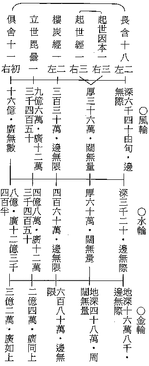



我们这个世界最初的成立，佛法说是由於空、风、水、金的次第完成，而把这些都称之为轮，可见佛法说明世界的成立，是取圆形而旋转的运动。所以地球成立的过程，由风轮而水轮，由水轮而金轮，以及在金轮的四周有水——水汽——，水的四周有风——没有水汽的空气，风的四周有空，为一圈圈的轮形世界，与现代莱波拉斯和琼斯所说地球的凝结，由气体变成液体，又由液体变成固体；当变成固体以后，他的表面，有的时候，也被溶岩所陷没，等到温度逐渐下降，水蒸气凝结成水，降至地球表面，那时就有海的发生。如是对照起来看，佛法与近代的解说，不特没有什麼严重的矛盾，而且简直一致。



壬二　明九山



> 苏迷卢处中次逾健达罗伊沙驮罗山朅地洛迦山  

> 苏达梨舍那頞湿缚羯拏毘那怛迦山尼民达罗山  

> 於大洲等外有铁轮围山前七金所成苏迷卢四宝  

> 入水皆八万妙高出亦然餘八半半下广皆等高量



我们所处的世界，依向来所说，以须弥山为中心，而须弥山在大海的中央。山的四面有四洲（四洲下面再说），四洲在咸水海中。此外有七重山，八重海，一层层的围绕；最外有铁围山，为一世界（横）的边沿。此四颂，就是说明九山情形的，至於八海四洲到后再说。



苏迷卢处中　苏迷卢是印度话，中国义译为妙高，就是一般所知的须弥山，他居於世界的最中央，所以说处中。



次逾健达罗　逾健达罗也是印度话，依照他的意义，中国译为持双，因此山顶有两个双迹，山能力为任持，所以名持双山。



伊沙驮罗山　伊沙驮罗，中国译为持轴，因此山的最高峰，耸入云霄，就如一支车轴竖立在那儿一样，所以名持轴山。



朅地洛迦山　朅地洛迦，我国译为檐木，这本是印度一种树的名称，在我国的南方，相传也有此树，山的形态似彼檐木，所以得名檐木山。



苏达梨舍那　苏达梨舍那，中国译为善见，相传此山壮丽美观，不管什麼人见了，没有不称善的，所以名善见山。



頞湿缚羯拏　頞湿缚羯拏，义译为马耳，相传此山的状貌，就如一般所见马的耳朵一样，所以名为马耳山。



毘那怛迦山　毘那怛迦，我国译为象鼻，相传此山的状貌，就如一般所见象的鼻子一样，所以名为象鼻山。



尼民达罗山　尼民达罗，此译为持，本是一种鱼的名称，这鱼的嘴巴特别尖削，相传此山的形状似彼，所以名为持山。



於大洲等外有铁轮围山　这是九山中的最外一层山。在这山内，须弥山外，有四洲、七山、八海，所以铁围山为此世界最大的范围，一切都笼罩在这铁围山内。



前七金所成苏迷卢四宝　前两颂半，是举九山的名称；此两句颂，是明九山的体质。关於铁轮围山，其体是铁的，从他的名称已可知道，所以不须再说，但其他的八山，究是泥土的？还是石质的？根据颂文看：从持双山至持山的前七山，其体质完全是由金所构成的，而为世界中心的苏迷卢山，则由金、银、吠瑠璃、颇胝迦的四宝所构成的。如以东西南北分别，东面是银，西面是颇胝迦，南面是吠瑠璃，北面是金。吠瑠璃，是青色宝，所以《楼炭经》，叫做青瑠璃，此宝从山得名，山出此宝，谓远山宝，远山即是苏迷卢山，此宝青色，一切宝皆不可坏，亦非烟焰所能镕铸。颇胝迦，此云白玉，就是白玉宝，外界的什麼颜色与此宝合，他就能反映出什麼颜色来。



入水皆八万妙高出亦然　上来所说的九山，都是住在金轮上的，而他们的入水之深，不管那一种山，都深及八万由旬，但高出水面，九山却各各不同，以妙高山说，出水的高度与入水的深度，是相等的，就是入水的深度为八万由旬，出水的高度也是八万由旬，所以说妙高出亦然。



餘八半半下　除了妙高山的出水八万由旬，其餘的八山，依妙高山的高度，一半一半的往下减：例如持双山的高度，则为四万由旬；到持轴山的高度，就成二万由旬；檐木山的高度，为一万由旬；善见山的高度，为五千由旬；马耳山的高度，为两千五百由旬；象鼻山的高度，为一千二百五十由旬；持山的高度，为六百二十五由旬；到最外围的铁围山，其高度就只有三百十二由旬半了。



广皆等高量　这是显示九山的广度。讲到他们的广量，一一皆与本身的高度相等的。如不惮厌烦的说：妙高山的高度为八万由旬，其广度也是八万由旬；持双山的高度为四万由旬，其广度也是四万由旬；持轴山的高度为二万由旬，其广度也是二万由旬；乃至最后铁围山的高度，为三百十二由旬半，其广度也是三百十二由旬半，所以说广皆等高量。兹将诸山的高度与广度列表如下：



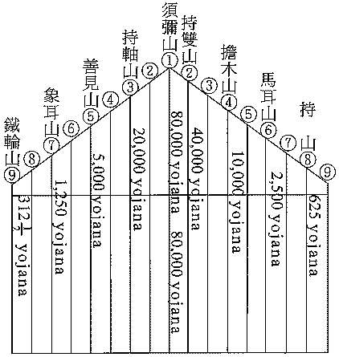



以须弥山为中心的九山，究与我们所处的世界，有著怎样的关系，在过去，是没有人发生这样问题的，到近来，有很多人对此感到关切。在以科学说佛法者看来，认为须弥山就是北极，而克鲁哎鲁氏说，从持双山到持山的七山，关系於日、月、木、火、土、金、水的七星。在以真现实者的观点来说，须弥山系就是一太阳系。然而这些说法，未必确实切合。苏迷卢又名须弥卢，与喜马拉耶的梵语相合，这确是世间唯一的高山。所以我们认为：须弥山就是喜马拉耶山，不必把他想像得离开事实太远，说得多麼神而又奇。其详，到后讲四大洲时再说。



壬三　明八海



> 山间有八海前七名为内最初广八万四边各三倍  

> 餘六半半陿第八名为外三洛叉二万二千逾缮那



依照现代的知识说，起初，在地球的表面，不大有凹凸的现象，所以全体都给海所陷没，后来，地壳发生凹凸，陆地从海面下升起，於是在这地球上，就发生大海与陆地的现象。如果要知海陆各占地球的面积多少，先得了知地球的总面积。地球的总面积，用数学来计算，约有五一〇、一〇〇、八〇〇平方公里，这就是标准椭圆体的面积。海的面积，约占地球总面积的百分之七十二，陆的面积，只占地球总面积的二十八。所以地球的表面，与其说是「陆的世界」，不如说是「海的世界」，较为妥当。佛法说的八海，是否就是现在说的海，很难论定，因此，我们只有照著佛法解说，不能牵强附会。



山间有八海　这是总标。在九山中，以妙高山为最内的一重山，以铁围山为最外的一重山，於此九山之间，每隔一重山，有一香水海，所以共有八海。



前七名为内　在八海中，以前七海，名为内海，而且於每一内海，都具有澄净、清冷、轻和、柔輭、不臭、饮时不损喉、饮已不伤腹的八功德水。



最初广八万四边各三倍　如是七重内海的第一重海，从须弥山的外侧，到持双山的内侧，其广度的直径，约为持双山的内边周围量，计有八万由旬，持双山亦如须弥山的四角，其内侧的四边，各各犹如广度的三倍，即每一边为二亿四万由旬，所以全周总计，为九亿六万由旬。



餘六半半陿　在八重海中，除最初的一重海，其餘的六重海，因为是一重陿似一重的半半陿下去，所以就第二持双山外侧的内海说，从持双山的外侧，到持轴山的内侧，其广度的直径，为四万由旬，比第一重海，刚刚陿了一半。而此内海外侧的各边，持双山的广度四万与海幅的四万，各为二倍，四四一十六万，加前二十四万，合为四十万由旬。因而，总海外岸线，为百六十万由旬。以下顺次，可以进於这个计算。



第八名为外三洛叉二万二千逾缮那　八海中的最后一重海，名为外海，实即铁围山的内海，於中咸水充满，因而亦可名为咸海。从持山到铁围山间，其径为三亿（洛叉）二万二千由旬（逾缮那）。而铁围山，因为是圆体，所以其全长，约於其内侧时，从须弥山的中心计算，为至此的距离之二倍，即直径乘圆周率。如以外侧来说，更加三百十二由旬半计算，那就好了。



壬四　明四洲



> 於中大洲相南赡部如车三边各二千南边有三半  

> 东毘提诃洲其相如半月三边如赡部东边三百半  

> 西瞿陀尼洲其相圆无缺径二千五百周围此三倍  

> 北俱卢畟方面各二千等中洲复有八四洲边各二



以上，是这大地界鸟瞰图的解说。然而，我人住的世界，位於其中的那一种？在以须弥山为中心的外海中，即铁围山内，持双山外，有四洲。此中四颂，就是说明四大洲的形态的。以科学说佛法者说，四大洲，即这地球上的大陆；真现实者说，四大洲，是太阳系中的水、金、地、火的四行星。其实这种解说，并不能祛除人们对於佛法四洲说的疑惑。要知佛法中的世界安立，大抵是引用时代的传说，而且释尊所引述的，在印度古代的须弥山与四洲说，大体是近於事实的。



於中大洲相　这是总标。於中，就是在外海中，对著须弥山的四面：南有南赡部洲，西有西牛货洲，北有北俱卢洲，东有东胜身洲。而此四洲的状态怎样，是现在所要加以说明的。



南赡部如车三边各二千南边有三半　就中，位於南方的，是赡部洲，或名阎浮提洲，是从阎浮提河得名的，约在佛世时的僧伽施到舍卫一带。等到印度人扩大视线到全印，发现海岸，於是或说四洲在海中，南阎浮提即印度全境，可说阎浮提是印度人对於印度的自称，本为印度的专名。佛法传来中国，於是阎浮提扩大到中国来。到近代，由於世界范围的扩大，因而认为我们所住的地球，就是南阎浮提，而阎浮提成为地球的别名了。这真是随著人类知识的发展，以逐渐扩大其范围。那里知道范围越扩大，其与事实距离越远。如依向来所说，此阎浮提洲的形态，就如印度古代车子一样，北广南狭，三边各有二千由旬，南面仅不过三由旬半。如以图显示，那是这样的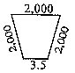



住在此洲的人，其面上广下狭，恰如阎浮提洲一样。



东毘提诃洲其相如半月　位於须弥山之东的，是东胜身洲，其形态如半月体，若以图显示，那是这样的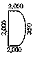



，因而住在此洲的人，其面孔也就像半月一样。毘提诃，以近人的考证，本为摩竭陀王朝兴起以前的有力王朝，在恒河下流，即今巴特那以北地方。又有人说：毘提诃，原是种族名，《奥义书》中曾经说到有王治理其国，佛陀时代，以其地为首都之毘提诃族及以毘舍离为首都之离车族，合并而为跋耆族，成立贵族的共和国。后为阿阇世王所并，阿阇世王的母亲，就是该国人，所以叫做韦提希。



三边如赡部东边三百半　东胜身洲的四周量，南、西、北的三面，如赡部洲的东、西、北的三面一一有二千由旬，但是其东边，只有三百五十由旬，所以如上图示，其形犹如半月。



西瞿陀尼洲其相圆无缺　位於须弥山之西的，是西牛货洲，其形态是圆体，就如圆满无缺的圆月一样。所以住在此洲的人，其面孔如洲一样是圆的。此洲，据近人考证，就是现在的拉支普塔那洲，属於塔尔沙漠，如据《西域记》说，就是婆罗婆私的一块游牧地带，因在沙漠中不能耕种，偶有水草的地方，就为游牧人民据为游牧区。由於是游牧区，所以西瞿陀尼，译为牛货。《起世经》七有说：「所有市易，或以牛羊，或摩尼宝」，这不啻是当时游牧区的实际情形的写照。



径二千五百周围此三倍　西牛货洲的四周量，其直径为二千五百由旬，周围比此大三倍，合为七千五百由旬。



北俱卢畟方面各二千等　位於须弥山之北的，是北俱卢洲，其形态是方的，因为四边各有二千，所以周围在大体上，为八千由旬。住在此洲的人，其面孔如洲那样，是四角形的。俱卢，又名拘罗，译为福地，为婆罗门教的发皇地，在萨特利支河与阎浮提河之间，是雅利安民族由五河向东进展的据点。原来，雅利安人先住於阎牟那河上流拘罗地方，婆罗门所说的中国，就是此地，所以又称为婆罗门国，或雅利安国。后来，渐次南下而至恒河下流地方，渐及於第二三角形的全部。其年代大略自纪元前一千年至五百年顷。当第一期时，他们的眼界，专限於五河地方，尚未与雪山相接，当更不知海是什麼；虽据传闻而知有恒河，但还没有亲目所覩。到了第二期时，发见较印度河更大的恒河，入於丰沃的平原，眼界固已次第扩充，生活状态亦自变动，文明进步遂益显著（见印度哲学宗教史总绪第二节）。由於恒河上流日趋发达，而一向被推重的拘罗，反一天天的没落下去，成为印度人仰望的乐土。拘罗所以受推重，不特是雅利安人发展的据点，婆罗门教的发皇地，且是婆罗门四姓成立的地方，以四吠陀说，除了阿闼婆吠陀，是在摩竭陀国成立者外，夜柔吠陀与沙摩吠陀，都是在拘罗地方作的，至於为最原始的梨俱吠陀，虽说是在五河地方所创的，但实也在拘罗地方所整理的，因此安居在南阎浮提的印度人，时时还在想念著古文明的发祥地。如以现今的印度地理说：在旁遮普的东北、西旁遮普之南的平原，亦即巴提阿拉四周之地。



《佛法概论》说：「释尊以前，印度早有了四洲的传说。当时，以神圣住处的须弥山为中心，山南的恒河上流为南洲，向东为东洲，向西为西洲，而一向推重的拘罗，已经没落，所以传说为山的那边。印度人自称为南阎浮提，可见为拘罗已没落，而发展到恒河上流时代的传说。那时东方王朝毘提诃，还不是印度雅利安人的征服区。四洲与轮王统一四洲说相联系；这是雅利安人到达恒河上流，开始统一全印的企图与自信的预言。这一地图，岂非近於实际？……总之，从古典去考察，佛陀虽采用世俗的须弥四洲说，大致与事实不远」。



中洲复有八四洲边各二　在四大部洲的傍边，各各把附属岛说为自己所有的，在这婆罗门教的世界观，也是有的。在佛教，四洲各各有二中洲，所以说中洲复有八。属於阎浮洲的二洲，是遮末罗洲（猫牛）与筏罗遮末罗洲（胜猫牛），这正是从现今锡兰岛方面发达起来的思想。属於东胜身洲的二洲，是提诃洲（身）与毘提诃洲（胜身）。属於北俱卢洲的二洲，是矩拉婆洲（胜边）与憍拉婆洲（有胜边）。属於西牛货洲的二洲，是舍搋洲（谄）与愠怛罗漫怛里拏洲（上仪）。虽说此诸中洲，都是人所居住的地方，但也有说遮末罗洲或筏罗遮末罗洲，是罗刹所居。此八所以称为中洲者，劣大胜小，居大小中，所以称中。《婆沙》百七十二说：「此八中洲，一一复有五百小洲以为眷属，於中，或有人住，或非人住，或有空者」。



壬五　明黑山等



> 此北九黑山雪香醉山内无热池纵广五十逾缮那



世界有四大洲，已如上说，现在明黑山等。但据《正理》颂前问起看，此中主要的，是显无热恼池，其他只是附带的指出其方位而已。如《正理》三一说：「辨诸洲已，无热恼池，何方几量」？



此北九黑山　此，指南赡部洲。《正理》三一说：「依至教说，此赡部洲，从中印度，渐次向北，三处各有三重黑山」。南赡部洲，是四大洲的一洲，就地理的位置说，不管从那一方面去研究，都可证明他在印度的范围内，这从《顺正理论》说的「此赡部洲，从中印度……」的一段文，也可得到证明。渐次向北的北，是西北的意思，就是由南赡部洲的中印度，向西北印度方面去，中间有九重黑山，这九黑山分为三处，每处有三重黑山。这一重一重的黑山，如站在雪山的最高峰看，其细小就如一个个的蚂蚁点缀其间，所以又名蚁山。如《旧俱舍》说：「此剡浮洲中，向北地有三黑山，度三黑山，复有三黑山，度三黑山，复有三黑山。此山悉下故名蚁山」。



雪香醉山内　在九黑山的北面，就是大雪山，在大雪山的北面，又有香醉山。雪山有二：一是喜马拉耶山，在西北印度的西北面，一是法显所指的雪山，即今兴都库斯山。此中所说的雪山，是指前者的大雪山。香醉山，相传此山有香，人们嗅到了，就如喝醉酒一样的会醉倒，故得此名。如据《起世因本经》说，在这香山之中，还有无量的紧那罗，常常的歌唱出微妙的乐声。



无热池纵广五十逾缮那　在大雪山之北香醉山之南的中间内，有一无热恼池，池中盛藏著八功德水，为龙王所居住。《药师经讲记》说：「关於龙的传说，印度与中国大致相同。据说，龙的形态跟蛇差不多，而鱼和虾蟆也可化为龙。这个世界的下雨、落雪、降冰雹，都与龙有关」。无热恼是中国话，印度名为阿耨达池，相传是阿耨达多龙王所居住的。他之所以名为无热恼，据印度的传说，约有三种原因：一、其他的龙在受快乐的时候，有种滚热的热沙，散布在他的身上，使他热恼得失去龙形而现出蛇形来；二、其他的龙在游戏快乐的时候，忽然会吹来一阵热风，使他热恼得失去龙形而变成蛇形来；三、其餘诸龙在游戏快乐的时候，有大鹏金翅鸟，忽然飞入龙宫，我们知道，金翅鸟是专吃龙的一种动物，所以当牠飞来时，诸龙就生起极大的恐怖，因受惊过度，而失去龙形现出蛇形。可是住在这无热恼池中的龙王，不管在怎样的情况下，都不会受到这些苦痛，而享受著清凉宁静的快乐，所以名为无热恼池。此池的面积，共有五十由旬（逾缮那）大。传说此池为印度四大河流的发源地。㈠、殑伽河，就是恒河，从池子东面流出水，围绕池子一周，而经此河流入东海。旧译名为天堂来，以彼外书云：「本入魔醯首罗天顶，从耳中出，流在池上，以此天化身在雪山顶，故作是说」。由於见到河水是从高处流下来的，所以就名为天堂来。㈡、信度河，译来中国叫做验河，从池子南面流出水，围绕池子一周，而经此河流入南海。㈢、徙多河，中国译为冷河，从池子西面流出水，经过此河流入西海。相传这就是我国长江大河的源流。其实这一传说，是没有根据的，因为长江发源於我国青海省西南境的巴颜喀喇山。如从地理上考察，徙多河，是现在新疆的叶尔羌河，从此河下游至塔里木河流，到罗布诺尔（泊或湖）即止，并未再向东流至我国内地。㈣、缚刍河，此云青河，是从池的北面流出，经过此河而入於北海的。有人说，这有似於我国的黄河，这也不可靠。缚刍河，实际是现今的阿姆河，在西土耳其斯坦境内，其水是流入於咸海的。我国黄河，源出於青海省巴颜喀喇山的噶达素齐老峰，二者地理不同，怎可混为一谈？在这池子的旁边，有一个赡部林，林中有树叫阎浮提，因树立名。此树生於阎浮提地北边，在泥民陀罗河南岸，枝叶茂盛，可爱非常，风雨不侵，久住不凋，其果成熟，甘美可口，所以依此赡部林之名而名为南赡部洲。



壬六　明地狱



> 此下过二万无间深广同上七捺落迦八增皆十六  

> 谓煻煨尸粪锋刃烈河增各住彼四方餘八寒地狱



佛教关於地狱的思想，从原始佛教起，就已被采用了。然其初，专是通俗的伦理论，还没有达到成为世界观的要素。其数及位置，就是到部派佛教时代，在阿毘达磨论书中，也还没有确定。如从大体说，在那初期，地狱的说法，是片断的，且是譬喻的，如说到那一种是对的，则与婆罗门教的地狱思想，有很多连络之点，如以地狱之数为七，就是一个明显的例子。不过，经过相当年代而被次第的整理，则已发挥了佛教的特色，同时，地狱在世界观及有情观的方面，也占了重大的地位，这是我们不可不知道的。住於地狱的有情，比人间是低一级的。《佛法概论》说：「比人间低一级的，是地狱。地狱为各宗教所共同承认的。佛经说主要是八热地狱，基督教也说地狱中是火。佛经与旧约都有『现身入地狱』的记事：大地裂开，人为从地涌出的火燄所笼罩，坠入地心。地狱在地下，即地球中心，地心确是火热的。经上又说有八寒地狱，或与南北极有关」。现在本颂所明的，就是先八热地狱，后八寒地狱。



此下过二万无间深广同　此指南赡部洲。在这南赡部洲之下，经过二万由旬，有一无间地狱。这无间地狱的深度与广度，同於上面一样，各有二万由旬。所谓无间，约有三义：一、无间隔：此指苦乐而言。出现在人世间的有情，时苦时乐，有所间隔，固不用说，就是在餘七地狱中，约其异熟果报身说，虽则是唯苦无乐，但约其等流果说，有时也有少乐间隔於苦的，可是生在无间狱中的有情，那就绝对唯苦无乐，没有一点快乐，可以间隔於苦。二、无间断：此指时间而言。在其他地狱中的有情，受苦的时间，是断断续续的，并不是永远受苦，但生无间狱中的有情，那就没有这样理想，其受苦的时间，是永无间断的。三、无间隙，此指空间而言。谓生於其他地方受果的有情，多少总有些空间，让其自由活动的，但生无间狱中的有情，不管那空间是多麼大，受苦的有情是多或少，每个於中受苦的有情果报身，都恰如其量的与无间狱一样大，毫无一点空隙，可以自由活动。受此苦的有情，是造五逆十恶的极大罪业者所招感的。



上七捺落迦　这在《婆沙》有两说：一说无间地狱，纵广高下二万由旬，次上一万九千由旬中，安立餘七地狱，一一纵广一万由旬；一说无间地狱，纵广高下各二万由旬，次上有三万五千由旬，安立餘七地狱，一一纵广高下各五千由旬。还有一说，无间地狱在於中央，餘七地狱周匝围绕，如今聚落围绕大城。此七捺落迦，就是极热、炎热、大叫、号叫、众合、黑绳、等活。就中，入於等活的有情，虽为狱卒（关於狱卒的身分，在阿毘达磨论师之间，是有议论的。大众部、正量部，把他说为有情；有部及经量部，说不是有情而为恶业所感之大种的变形；南方案达罗学派及后代大乘唯识学，也同於此说）切断於热铁上，但由於冷风所吹，立即又复活过来，再受同样的痛苦，所以得名等活。《正理》三一说：「众苦逼身，数闷如死，寻稣如本，故名等活。谓彼有情，虽遭种种斫刺磨捣，而彼暂遇凉风所吹，寻稣如本，等前活故，立等活名」。黑绳地狱者，恰如木工引黑绳於木材，而后把他切断；亡者也由於狱卒，持铁绳而构成图案，然后根据这图案而被切断，所以得名黑绳。《正理》三一说：「先以黑索，拼量支体，后方斩锯，故名黑绳」。又如众合地狱，罪人被追於狱卒，遁入二山的中央，正是这个时候，前后火灾发生，更有两山相合压搾罪人，所以名为众合。《正理》三一说：「众多苦具，俱来逼身，合党相残，故名众合」。其他极热等四种地狱，各各受火的逼迫或从罪人的号泣状态而得名的。如《正理》三一说：「若外若内，自身他身，皆出猛火，互相烧害，热中极故，名为极热。火随身转，炎炽周围，热苦难任，故名炎热。剧苦所逼，发大酷声，悲叫称怨，故名大叫。众苦所逼，异类悲号，怨发叫声，故名号叫」。



八增皆十六　以上八大地狱各各皆有十六附属地狱，说名为增。在佛教由於某种理由，虽认八大地狱为主位，但一般过去所信的，其他的地狱，是怎样形态，也欲摄取的结果，所以於此立附属地狱。不过关於十六增的名称，经论各各说有不同，据此颂说，八大地狱的四门，各各同有四增，四四合为十六增地狱。四增的名称到下再说，现在先来解释增的意义。增之所以为增，依论文简单说：从本地狱出来的罪人，刚刚才受过很大的苦，不料现在又重遭此苦，所以说名为增。依《正理》解说：在此十六中受苦增剧，超过了本地狱；或在此中所受的种种苦，其苦具的种类之多，真是不可胜数，所以说名为增。四门各有四增，其差别名是什麼？颂曰：



谓煻煨尸粪锋刃烈河增　谓㈠、煻煨增，旧译名为热灰园，所以煻煨就是一种热灰。就人世间说，一个生的东西，放到热灰里去，可以烤熟。此说有情在八热地狱，受够种种的痛苦，拚命的想要逃出，那知刚逃出了那些重围，又陷溺於煻煨地狱中，当脚踏进那如火一般的热灰里，热灰如沙漠一样，煻煨没膝，皮肉焦烂，苦不胜受，但走出那热灰，被焦烂的腿子，又回复到原形。㈡、尸粪增，旧译名为死尸园。从煻煨地狱逃出的有情，又遇著尸粪地狱。於此狱中，尽是堆积的死尸与粪秽，里面有一种名叫娘矩咤的毒虫，口如锋针，身白头黑，当有情来到这里，就为这些毒虫钻入皮肤，吮吸血髓，使人如置身於锋针之上，真是苦痛不堪。㈢、锋刃，这又可以分为三种：①刀刃路，这完全是由锋刃的刀所铺成的一条路，从远远望去，如同一条平坦宽阔的大道，但当罪恶有情走上去时，刚一下足，皮肉与筋骨顿觉断裂，俨如步上刀山，苦不能受；②剑叶林，此树林中的树叶，大体看去，亦如人世间的绿叶，实质全是锋利剑刃所做成的，罪恶有情进入此林，想要在树下休息片刻，忽然一阵狂风吹来，将满树的剑叶，吹落在有情身上，斩刺肢体，骨肉零落，同样的苦痛难当；③铁刺林，此树林中，有高过百人的铁树，在铁树上，有长十六指的铁刺，有情被痛苦所逼，想攀上树或跳下树，一枝枝的铁刺，就上下交织的刺入有情的骨髓，虽则痛苦难忍，但更有铁嘴鸟，从树林中飞出，探啄有情的眼睛心肝，争竞而食。这三种所加於有情的苦痛虽不同，但同样的属於铁杖，所以合为一增所摄。四、烈河：烈河，是说此河中，盈满著热咸烈水。有情久经锋刃苦毒的逼迫，刚刚逃出来，又复溺於此烈河中，被沸腾的热水，烧煮得骨肉糜烂，备经众苦。如上所说的增狱，我们听了，尚觉毛骨悚然，何况亲受其苦？



各住彼四方　此四增狱，各各住彼八大地狱的四方，每一方有四增，四方总计为十六增。



餘八寒地狱　餘，谓於八热地狱之餘，还有八寒地狱。八寒地狱，在铁围山外，为最黑暗的地方，於中常常有凄劲的冷风，在上下冲击著，使住在其中的有情，「寒酷切身，肤皮疱裂，体战僵硬，各出异声」。一、頞部陀，译为疱。住此狱中的有情，被寒风逼切，使身体冻红僵硬发肿成疱。二、尼剌部陀，译为疱裂。住此狱中的有情，受寒气所侵，非但冻僵成疱，且使所冻成的疱裂开。三、頞哳咤，谓住此中的有情，为严寒逼迫时，发出頞哳咤、頞哳咤的叫声。四、臛臛婆，谓住此中的有情，为严寒逼迫时，发出臛臛婆、臛臛婆忍寒的叫声。五、虎虎婆，谓住此中的有情，受不了严寒的逼迫，就发出虎虎婆、虎虎婆的忍寒叫声。六、嗢钵罗，译为青莲华，谓住此中的有情，肉体被冻得如青莲华一样。七、钵特摩，译为红莲华，谓住此中的有情，肉体被冻得如红莲华一样。八、摩诃钵特摩，译为大红莲华，谓住此中的有情，肉体被冻得如大红莲华一样。



上来所说的诸地狱，都在此赡部洲的地下，所以《婆沙》百七十二说：「赡部洲下有大地狱，赡部洲上亦有边地狱及独地狱，或在谷中，或在山上，或在旷野，或在空中，於餘三洲，唯有边地狱与独地狱，无大地狱。所以者何？唯赡部洲人造善猛利，彼作恶业，亦复猛利，非餘洲故」。在其他三洲的人，假定造了恶业，亦来在此洲的下面，受地狱的果报。其他还有傍生及诸鬼的住处，详如论文及《正理》三一所说，此中不再述。



壬七　明日月等



> 日月迷卢半五十一五十夜半日没中日出四洲等  

> 雨际第二月后九夜渐增寒第四亦然夜减昼翻此  

> 昼夜增腊缚行南北路时近日自影覆故见月轮缺



这三颂，是说明照此世界的日月及依之而起的历数。佛教的日月历数比於布拉那的日月历数，可说很有科学的意义。布拉那的日月历数，见於事实的，是极为儱侗，而说明他的，又太过神话；佛教的日月历数，虽则同样是假定的，但结合於事实的探求，其说明法是很精密的。关於日月运行的说明，佛教的文献虽有很多，但那最详细的，无过《立世阿毘昙论》卷第五〈日月行品〉所说，但现在首依此颂解说，兼以《立世论》补充说明。



日月迷卢半五十一五十　以日月的高度说，二者是相等的，即在须弥山的中腹（半）四万由旬的地方，与持双山顶一样高（布拉那以太阳为十万由旬，月为二十万由旬），悬於空中不落而不绝运行者，是由於风力的所持。据《长阿含》卷第二二〈世纪经世本缘品〉说：支持这日月且使之运行的有五风，谓持风、养风、受风、转风、调风；据《起世经》十卷说，是持风、住风、顺风、摄风、行风的五风。其大：太阳，径是五十一由旬的圆体；月，径是五十由旬的圆体。至於其他的星星不等，大的有十六由旬，小的只一俱卢舍。如以此比於阎浮洲的三边，各有二千由旬，那就显示出日月是很小的了。而在这之中，有日月宫殿，其与婆罗门教的说法，是同一的。可是讲到日宫月宫的构成要素：依论文说：日轮是由颇胝迦宝火珠所成，有热度，能照耀；月轮是由颇胝迦宝的水珠所成，是清凉，有照耀。世间的光明，无过於日光和月光：日光是温暖的，富有热力的，一切的一切，在日光朗照下，都能明显地发露出来；月光是清凉的、安宁的、幽静的，他在黑夜中，放出皎洁的光辉，引导人们走上正路，避诸险难：所以两者都有能照的作用。若如《立世阿毘昙论》说：月是瑠璃所成，为白银所覆，水占大部分；日是玻璃所成，为赤金所覆，火占大部分。关於这方面，婆罗门教是没有谈到的。如以现在的天文学说：太阳的形态，似一很大的火球，虽是火球，但不燃烧什麼，也非为要燃烧才有，他只是一个热度非常高的火球而已。至於太阳的大小，约略估量起来，其直径有一百三十九万一千公里。太阳的容积和地球比较，大有一百三十万倍，就是要汇集一百三十万个地球，才能和太阳一般大。说到太阳的重量，如果他的体质，是和地球同样的，也应有地球的一百三十万倍。可是经过学者们的详细研究，知其只当地球的三十三万四千倍，由此可知太阳的体质比地球轻。组成太阳的体质重量，约当地球体质重量的四分之一。现在，虽三尺童子，也知地球是环绕太阳转的，但从前人们，都认为太阳是环绕地球转的，所以佛法随俗，也说日月绕须弥。虽然如此，但我们不能说，太阳是高悬在空中的一颗固定不动的星球，因他实是带著环绕著他旋动的地球，和其他的许多星星，每秒钟大约也要旋动二十公里。最后再说一说月球：浑圆的月球，其形态夜夜不同，所以古人觉得非常奇怪，并且创出许多迷信话来。但经近代天文学家详细观察后，知道他也是天体中的一个，并和地球一样，不能自己发光。月球的直径，只有地球的四分之一弱，面积，只有地球的十三分之一强。所以月世界的广阔，比亚洲或美洲还小，比非洲稍大。从地球上看去，月的轮廓，完全是圆形的。地球虽然也是球形，但因南北极的地方，略带扁平，所以地球不是浑圆的，正像一个橘子一般。可是月体，却的的确确像个浑圆的球。月体看去所以一时变大，一时变小，这是由於他升到地平线上和升到广漠无际的空中的不同，并不是月球的形体真的或大或小。在天朗气清时，现於空际的清冷而皎洁的月光，并不是月球自体所发射出来的，而是反射太阳所射过去的光，这从月光采色带的色素，完全和日光相同，可以获得证明，但月球所反射的，并不是日光的全部，只占十分之一。至於月是代表清凉，这也有理由的，因为太阳虽直射著月球，但他表面上的温度，仍是升不到冰点以上，由此可知月球实是很冷的。



夜半日没中日出四洲等　此明四洲的时间不一，有人问：南洲有日月绕苏迷卢山，其他三洲是另有日月绕苏迷卢山呢？还是与南洲同一日月呢？答：是同一个日月。又问：既是同一日月，那是不是在同一时候於四洲中作其所作呢？答：不是这样的，是有夜半、日没、日中、日出的不同，而且这在四洲是相等的，就是每一洲中，都有夜半、日没、日中、日出的四个过程。如北洲夜半，南洲就是日中，东洲日没，西洲日出。反之，南洲夜半，就是北洲日中，东洲日出，西洲日没。如西洲夜半，东洲是日中，南洲为日没，北洲为日出。反之，东洲为夜半，西洲为日中，南洲为日出，北洲为日没。古人有首偈颂说得好：「东胜身洲日将出，西牛货洲日将没，南赡部洲日当午，北俱卢洲打三鼓」。这无异是四洲时间的写照。但此传说，佛教与婆罗门教，大体也是相同的。不用说，这与现代的天文学，是不大相契的，那主要的一点，就是地动天动说的差别，如把日绕须弥，改为地球绕日，其意义仍然大体相近。地球像陀螺似的旋转，称为「自转」，他的轴，称为「地轴」；地球环绕太阳的旋转，称为「公转」，他所转的路线，称为「轨道」。地球的旋转，初从东北方渐渐地转向西南方，在十二小时以后，几乎完全是在东西两方旋转，此后便从东南旋向西北，在一昼一夜以后，仍旧回向南北两方。我们计算时间，以一日为标准；一日的时间，就是地球自转一次的时间，当他自转时，从太阳射出来的光，便渐渐地移动，恰好把地球表面兜个圈儿，於是射著日光的地方是昼，背向太阳的是夜；日光射著某子午线的是正午；日光尚未射正的时候，称为上午；已经射正的时候，称为下午。每处地方，都以日光射在他的子午线时称为正午，因而由於场所的不同，时刻跟著也就有异。如甲处已至正午，乙处因在甲处之西，日光还没有射在他的子午线上，於是乙处的正午时刻，就较甲处为迟。以我国华中言：汉口的正午，较南京就迟若干分钟。太虚大师在〈真现实论〉说：「例南北线为一直杆，横贯地球，悬在空中，自身从西至东，向日以一定速度而渐转，中国正向日当午时，美国则为半夜子时，非洲为日出时，太平洋则为日没时。餘可例推。南北极永远无正向日时，亦鲜全背日时，故为非昼非夜」。



雨际第二月后九夜渐增寒第四亦然夜减昼翻此　昼夜之所以有长短，其理由，完全是基於太阳的运行如何。日通自洲的内路而行时，通过最长的中路时，是为平分。佛教与婆罗门教，在这点上，所说也是相同的。现据《立世阿毘昙论》，来说明这个。该论大体把他分为外路与内路，从极南路到极北路，其距离为二百九十由旬。



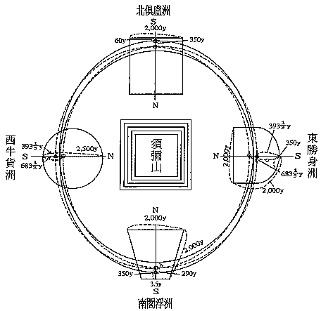



就中，外路先在南阎浮及北俱卢的二洲，从其最南端（各洲常以向须弥山的方面为北），在六十由旬之点定一点，更在东胜身及西牛货的二洲，从南端，定点於三百九十三由旬三分之一的地方，照这四点畫圆，以之为外路。径是四亿八万一千三百八十由旬，周围是十四亿四万四千一百四十由旬。内路，从这各唯二百九十由旬，是通北方的线，即在阎浮洲与北俱卢洲，去南端的三百五十由旬之处；在东胜身洲与西牛货洲，是在六百八十三由旬三分之一的线，直径为四亿八万八百由旬，周围是十四亿四万二千四百由旬。日月，实是在这二线之间，作周期的运行，而二百九十由旬的不同，是使日月历数有种种情形的所以。



因此，以上轨道说为基础，先明太阳的运行，以一年为三百六十日（五年闰一月），太阳的轨道，发生百八十种的不同。就是从外路入於内路，从内路入於外路之间的不同。当然，太阳（月也如此）决不是唯运行於外路或内路，而是跨於外路内路的，但由那跨法的不同，而成为百八十种。但为其基本的跨法，可说只有四种。㈠、在阎浮的与北洲的内路，是贯通东西两洲之中路的一线，此洲的冬至（旧十一月九日？）日，就是在此。㈡、太阳运行在此洲与北洲的中路，是运行於西洲的外路，东洲的内路一线，此洲秋分的中日，相当於那一天。㈢、结合北洲的外路、南洲的内路、东西二洲中路的一线，南洲的夏至，太阳是步此轨道的时候。㈣、结合南北二洲的中路、东洲的外路、西洲的内路一线，此洲春分的中日，就相当於那一天。这样，此四轨道成为标准，其交错是为百八十路。由此而说昼夜的长短，虽则是以一昼夜为三十个牟呼栗多或牟休多，但在增位，昼夜最长，不过十八牟呼栗多，减位，昼夜最短，唯十二牟呼栗多，在这点上，与婆罗门教，仍是相同的。据《立世阿毘昙论》说：一日的不同，是三十分之一的牟呼栗多，等於一腊缚：从夏至，每日减一腊缚的时间，从冬至，每日增一腊缚的时间。然而在此成为问题的：这冬至与夏至，昼夜平分之日，相当於那一天呢？这在实际上，因由纬度的关系，而有多少的不同。在《立世阿毘昙论》，举有两种异说：第一说：五月十五日是夏至，八月十五日是平分；十一月十五日是冬至，二月十五日是平分。第二说：六月九日是夏至，九月九日是平分；十一月九日是冬至，三月九日是平分。在《婆沙》一百三十六中，又这样说：摩伽月的白半第八日（十二月九日）是冬至；室罗筏拏月白半第八日（六月九日）是夏至。在本颂的论文解说：「从雨际第二月后半第九日夜渐增，从寒际第四月后半第九日夜渐减」。然那雨际的第二月与寒际的第四月，是指的那一月呢？因缺乏明瞭说明，所以在《光记》就举出种种的异说。关於这个，我想先来说明印度的季节，印度将一年分为十二个月，这与中国是一样的，唯季节的划分，只有热际、雨际、寒际的三际，每际为四个月，这与中国的四季说不同。就算是三际，从何月到何月为何际的问题，传来我国有五说之多，现在先列一表如下：



　　　　　　　　┌　二月十六日至　六月十五日　第一说  

　　　　　　　　│　正月十六日至　五月十五日　第二说  

　　　　　┌热际┤十二月十六日至　四月十五日　第三说  

　　　　　│　　│十一月十六日至　三月十五日　第四说  

　　　　　│　　└　八月十六日至十二月十五日　第五说  

　　　三际┤　　┌　六月十六日至　十月十五日　第一说  

　　　　　│雨际┤　五月十六日至　九月十五日　第二说  

　　　　　│　　│　四月十六日至　八月十五日　第三说  

　　　　　│　　│　三月十六日至　七月十五日　第四说  

　　　　　│　　└十二月十六日至　四月十五日　第五说  

　　　　　│　　┌　十月十六日至　二月十五日　第一说  

　　　　　│　　│　九月十六日至　正月十五日　第二说  

　　　　　└寒际┤　八月十六日至十二月十五日　第三说  

　　　　　　　　│　七月十六日至十一月十五日　第四说  

　　　　　　　　└　五月十六日至　九月十五日　第五说



第一说是神泰的意思；第二说是真谛的传说；第三说是《光记》所出的有解；第四说是光、宝及玄奘的相传；第五说西域第一说是羯箱那国说。诸说各有根据，不能说谁对谁不对。但就《俱舍》说，因以日之向南向北等，以表示一岁为二，就是六月向南，六月向北，到极长极短后就有增减，所以我们觉得《光记》所说是契合於《俱舍》的。所谓从雨际第二月后半第九日，相当於中国的五月初九日，也就是夏至日，夜间渐渐增长，白天减短。所谓从寒际第四月后半第九日，相当於中国十一月九日，也即是冬至日，夜间渐渐减短，白天增长。这种日夜时间的长短，都是由於日行路道转交的关系。而这在《颂疏》，又把夜增解说为从平分增与夏至以后增的不同。然不管那种说法，把雨际、寒际视为这样的不同，总有一点错误。如更进一步的考察，所谓寒际、雨际，所谓日夜长短，实际是从纬度的不同而不同的，所以在印度一国，也难有一定，何况由印度至中国，而要说他一定，当知这是极为困难的。还有，如据今日的计算，地球绕太阳旋转一周的周期，时间是三百六十五日五小时四十八分四十六秒，因而如以一年为三百六十五日，每隔四年必须闰一日，闰年二月份多一日为二十九日。但实际上，一年之长，不是正三百六十五日又四分之一，而是比这数略小的 365.242216 日。印度用的大阴历，因为是三百六十日，为了处置留下的五日又四分之一，所以有加闰月的必要。在《立世阿毘昙论》，虽以之五年闰一月，但如何的详定其日数，并没有说明，加之不详於历数的结果，以不能详论他为一大遗憾！就现在的天文学说：地球自转的自转轴，不是正垂於他的公转轨道面，而和他的正垂线成约二十三度半的倾角；有如孩童玩的陀螺，陀螺一面旋转，一面在地面疾走，而自转轴常不正垂地面的。换言之，如将地球赤道面拟想扩大到天上去，这个面和黄道面成二十三度半的交角，这是地面各地日子长短和气候变化的一个很重大的因素。所以四季划分是这样的：春季九十二日二〇．二时，夏季九十三日一四．四时，秋季八十九日一八．七时，冬季八十九日〇．五时。总计三百六十五日五时八分，为一年的长度。依我国说有二种：㈠、以立春为春首，立夏为夏首，立秋为秋首，立冬为冬首；㈡、旧历正、二、三月为春，四、五、六月为夏，七、八、九月为秋，十、十一、十二月为冬。在西洋方面，普通以现历之三、四、五月为春，六、七、八月为夏，九、十、十一月为秋，十二、元、二月为冬。佛法是采用当时印度的传说，当不能完全与现代相合，况且佛为理智的道德的宗教家，有他的中心工作，无暇解说天文与地理，而且那时能有这样的说明，也可说是难能可贵了。



昼夜增腊缚行南北路时　不管白天增长也好，夜间增长也好，但增加多少时间呢？只增加一腊缚。腊缚，是印度计算时间的名称。据印度传说：一百二十刹那，为一怛刹那（比秒较久），六十怛刹那，为一腊缚（比分较久）。昼夜增的时分是如此，昼夜减的时分也是这样。所以会有如此增减的不同，是由於太阳在此洲向南向北的运行，所以有夜增昼增，夜减昼减的差别。《颂疏》说：「故知五月，夏至已后，日则向南，说夜增也；十一月，冬至已后，日既向北，说昼增也」。《起世因本》十说：「冬分日宫过六月已渐向南行，每於一日移六俱卢奢，无有差失，是时日宫在阎浮最极南际，地形狭小，日过速疾，是故冬分昼短夜长。复次，春夏时日宫过六月已渐向北行，每一日六俱卢奢，无有差失，是时日宫在阎浮处中而行，地宽行久，是故昼长夜短」。但这只是约南洲的地行说，并不一定都是如此。



近日自影覆故见月轮缺　以上，是太阳运行的概略，现在再就月来说一说。月与太阳一样，也是运行於内外两路之间的，而行经十五路，再还立於元轨道。就是大凡三十日，以尽其轨道的全体，从外路入於内路是十五日，从外路移於内路也是十五日。因而在这意义之下，月的傍行，比太阳还快，一天所行，计算为十九又三分之一的由旬。然而在其周行，月的速力，比太阳慢，大约一日太阳比月快四万八千八十由旬，因而是或合或离的。当其合的时候，其光，一日蔽月的三由旬又一由旬的三分之一，以此方便，所以渐次至於十五日，一切被覆，月光不现，成为黑分；当其离的时候，一日现出三由旬又一由旬的三分之一，以此方便，所以渐次至於十五日，到达了全不受太阳的遮蔽，而成月满月（白分），这就是月之盈亏的原理。如从今日说，那当然是不正确的，但在布拉那，欲由甘露的盈虚，说为月的盈亏，如比於这个，可说又是极科学的了。简单的说：月行到太阳的对面，不受太阳的影子盖覆，所以所见的月就是圆圆的，但当月行近太阳时，自己的光影为太阳光所遮盖，所以所见的月轮就有所减缺。《起世因本经》说：「此月宫殿，於黑月分第十五日，最近日宫，由彼日光所覆翳故，一切不现」。如依近代天文学说，那是这样的：地球像陀螺似的自西向东旋转，月球便环绕他向著同一的方向旋转。在另一方面，太阳便火光灼灼地照耀著。当月球转到和太阳恰成相对方的时候，他向著地球的一面，完全被日光照射著，到了夜间，我们便能看见一个浑圆的月形，这就叫「满月」。后来，月球渐渐移动，黑暗的部分也看见了，等到他在地球的横向时，我们只能看见他照著日光的半部，这就叫「半月」。再过几天，月球出现的时间，愈挨愈迟，当他出现时，不一会，太阳也跟著出现了，所以就看不见。其后，月球的出现时间，恰和太阳同时，他虽然昼间现在空中，但因被太阳光遮盖住，就再也不能见到他，傍晚时，也只见弯弯的像一个钩形，这就叫「新月」。满月以后，每夜现於东方空际的月形，便逐渐缺起来，先在右上方缺时，变成了一半，其形状恰像一张弓，缺的部分是弓弦，因为他是向上的，所以叫做「上弦月」。后来，上弦月升到上空而直立，等到向西没落时，便缺在下面，所以就叫「下弦月」。但因那时太阳已经逐渐升起，空中慢慢明亮起来，谁也不再去注意他了。从来大家都把他叫做上弦月，那是单指看见一部分说的。新月以后，月形渐渐圆满起来，这时正和以前相反：出现时是下弦，沉没时是上弦。当他出现时，因还在昼间，我人不看见他，可是，由於见他将沉时是上弦，所以就叫他是「上弦月」。这末说来，我们知道：月球的转动，是继续不绝地绕著地球旋转的，并没有片刻的休息。



壬八　明天器癸一　明天所居器子一　正明天器丑一　明四天王器



> 妙高层有四相去各十千傍出十六千八四二千量  

> 坚手及持鬘恒憍大王众如次居四级亦住餘七山



上来所说的日宫月宫，是那类有情所居住的？因为他在须弥山腰，所以为四大天王所部天众居住。不过，真正唯住日等宫殿中的，是空居天，至於地居天，是住於妙高山的诸层级的，所以现在要来说明妙高山有几层级，其量云何，那一类天住於那一层级。



妙高层有四相去各十千　须弥山，其高为八万由旬，其顶四角，在面基底，四边至少各各也是八万由旬。其下半分，即从水际至四万由旬之处，有四层级。其第一层，始从水际，一直到第一层的尽头，相去计有一万由旬。其第二层，始从第一层顶，一直到第二层的尽头，相去也是一万由旬，如是从第三层顶，一直到第四层的尽头，相去同样是一万由旬。



傍出十六千八四二千量　如上四层，一一从须弥山的中轴部分傍出，围绕著须弥山而转。此诸层级的厚度：第一层纵广为一万六千由旬，第二层纵广为八千由旬，第三层的纵广为四千由旬，第四层的纵广为二千由旬。如据《起世经》说：「下级纵广六十由旬，中级四十，上级二十」。今依本颂图表如下：



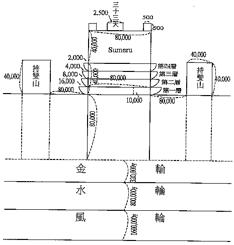



坚手及持鬘恒憍大王众如次居四级　在这四层级中，是些什麼有情居住的呢？是诸神及鬼神的住处。如其次第：第一层级是称为坚手的夜叉神所住的，第二层级是称为持鬘的夜叉神所住的，第三层级是称为恒憍的夜叉神所住的，第四层级正是四天王的住处。前三层级所住的夜叉神，是四天王的眷属。第四层级有四方：东方住持国天王，南方住增长天王，西方住广目天王，北方住多闻天王。最高一层的四天王，统摄著其他三层的鬼部神将，时刻的守护著全世界。这是依於本颂说的，如依《起世因本经》卷第六，《立世阿毘昙论》卷第四，《瑜伽师地论》卷第二，都说四天王是住於持双山顶的，因持双山顶，刚刚与须弥山腰四万由旬处相齐，所以有此传说不同。



亦住餘七山　此说其餘的持双山、持轴山等的七山，也有天人居住其中。因为四天王天所住的是都城，而这些山头，是四大天王所统摄的村庄部落，所以也是诸天所居住的地方。



丑二　明三十三天器



> 妙高顶八万三十三天居四角有四峰金刚手所住  

> 中宫名善见周万逾缮那高一半金城杂饰地柔软  

> 中有殊胜殿周千逾缮那外四苑庄严众车粗杂喜  

> 妙地居四方相去各二十东北圆生树西南善法堂



四天王住於何处已经知道，三十三天的住处又是在於什麼地方呢？现在以此一科来说明三十三天所居住的器界。三十三天，是从吠陀时代把诸天称为三叠十一天等来的，乃表示集团的意思，与三十三的数目，并没有什麼特别关系，这点，我们不可不知。



妙高顶八万三十三天居　妙高山的最高峰，拔海刚好是八万由旬。在这雄伟高耸的妙高峰山顶，就是三十三天所居住的器世间。依照向来的传说，帝释天住在最中央，四面各有八天，如是四八三十二，再加帝释，共为三十三天。四吠陀中的梨俱吠陀与阿闼婆吠陀，常常说到三十三天，但这只是一种泛称，并非表示神的定数。在吠陀神界中，最雄大、最重视、最有名的，且几占有印度国民保护神之地位的，不能不说是因陀罗。拜火教虽认为他是恶神；但到佛教，又把他叫做释提桓因，成为归依佛教的神了；在印度教中，说他是喜见城之主，为豪奢的天部，永远受著人们的崇敬。这在印度的传说中，不单为雷霆之神，且为保护印度民族中武士族的军神。关於忉利天的情形，佛的圣教常常说到，而且以《起世经》为始，在诸经论，都极口赞赏，所以以下诸颂，都是说明其情况的。



四角有四峰金刚手所住　在须弥顶上有四角，因为他的最高峰，四面是四方形的。每角有一山峰，如是四角，就有四个山峰。每个山峰的高度和广度，均为五百由旬，有金刚手药叉神止住其中，是所谓须弥山的门卫及巡视，是为了要保护三十三天的，因此也可说他们是为诸天站岗的守卫神。



中宫名善见周万逾缮那　在三十三天的中央平地，有一宫殿名善见宫（或名妙见，或名喜见）。因此宫殿，非常庄严、华美、富丽、堂皇，任何人见了，无不心生欢喜、赞美、称善，所以名善见。宫殿的面积，以平面说，四边各有二千五百由旬，其周围量，则为一万由旬，所以说周万逾缮那。



高一半金城杂饰地柔软　三十三天中，有为帝释所都的大城，名为金城，是纯用真金所建筑的，其高度为一由旬半。金城中的每一建筑物，都是用百一杂宝所庄饰的，就是平坦的地面，也是用真金所成的。金子虽是坚固体，但其地的体质，却不是硬磞磞的，而是很柔软的，其柔软的程度，就如敷设的毛毡一样，当天人踏在上面的时候，随著脚的高下而高下，毫无坚硬的感觉，现在的沙发椅、弹簧床，有点类似。《正理》三一说：「城有千门，严饰壮丽，门有五百青衣药叉，勇健端严，逾缮那量，各严铠仗，防守城门」。



中有殊胜殿周千逾缮那　在此金城当中，更有毘阇延的殊胜殿，就是帝释的住处。殿之所以称为殊胜，是形容这座宫殿，乃用种种珍宝所庄严起来的，其他任何天宫都所不及，可说是三十三天中的第一座华贵的宫殿，所以说名殊胜。他的面积，四边各有二百五十由旬，周围量是一千由旬。



外四苑庄严众车粗杂喜　以上是说城内的种种理想的事情，这里是说城外的四方更有四个林苑，也是由各种妙宝所庄严起来的。一、众车苑：诸天到此苑中游玩的时候，心里想要什麼美妙宝车，自然就会现出你所喜爱的宝车，给你乘坐游乐。二、粗恶苑：帝释天与阿修罗欲作战时，三十三天的天兵天将，走进此苑，想要什麼类型的锋利武器，就有什麼锋利的武器出现给你使用；武器是杀人的东西，所以称为粗恶。《立世阿毘昙论》解说这个，谓此苑所以取名粗恶，由於有池与树的关系。又诸天入於此苑，互争前后而发生嫉视，依此说名恶口苑。三、杂林苑：诸天入此苑中，想要什麼各式各样的微妙玩具，都能如自己的心意获得，自由玩耍，各生胜喜。四、喜林苑：诸天到此苑中，要求种种五欲之乐，各式各样的杂类欲乐，都能俱臻美满的出现，使你见到听到，没有一点厌足。如是所说四苑，其形态是四方的，每一苑的周围量，是一千逾缮那。在四方四苑的居中，一一有个如意池，池的面积，一一是五十由旬，其中充满了八功德水，想要什麼舟筏，就有什麼妙华宝舟出现，希望听到什麼鸟的音声，就有什麼好鸟奏出美妙的音乐，种种庄严说不能尽。



妙地居四方相去各二十　在四个林苑的四边，各有宽敞的广场，天然的地面，也是柔软而微妙的，不像我们人世间的土地，充满龌龊的尘埃，所以称为妙地。如是四块妙地，中间距离四苑，各有二十由旬，至於其地的四边，一一皆二百逾缮那量。这些微妙之地，都是诸天游戏的地方，有时诸天也在这儿捔胜娱乐。



东北圆生树　在金城外的东北方有树林，其中长的都是圆生树。依诸经论说，此林是三十三天受用欲乐的殊胜地方。树根深入地里五由旬，高百由旬，枝出四方，广百由旬。枝叶扶疏，凉荫如大伞盖。树开艳花，清香扑鼻。其香，如随著顺风散发出去，在百由旬外，都可嗅到其香，假使遇著逆风，其香也可徧熏五十由旬。



西南善法堂　在金城外的西南角，还有一座相当巍峨的大善法堂。相传三十三天众，常於上半月的初八、十四、十五的这三天，来到人间视察人们所行所为的是善还是恶，然后将自己的视察观感所得，再集合诸天到此善法堂中，互相讨论，看看可用什麼方法，能够制止人们的作恶。据《立世阿毘昙论》说：八日巡视天下的，是四大天王的大臣；十四出巡观察世间的，是四大天王的太子；十五这天时间殊胜，四大天王亲自要到人间来巡视一番，看看人间究是行十善者多？还是作十恶者多？这是一种说法。另一种说法是：诸天集合到善法堂中，阐扬出世道法，赞叹三宝功德，分别世间邪正，所以名善法堂。



丑三　明空居天器



> 此上有色天住依空宫殿



欲色二界的诸天，大体可分为两类：一是地居天，一是空居天。地居天，指四天王天与三十三天，因为他们，一个在须弥山腰，一个在须弥山顶，都是有地可居的，上来所说的种种，都是关於地居天的情形。空居天，指夜摩天以上的诸天，现在来说明他们所居的器界。



此上有色天住依空宫殿　此，指忉利天；有色天，指夜摩天至色究竟天。意思是说：在此忉利天以上的有色诸天，不管是那一天，都是以空为宫殿而居住的，因为其器世间体是空，所以就不论大小。《正理》三一说：「有说：空中密云弥布，如地为彼宫殿所依」。讲有情所居住的外器世间，讲到色究竟天就止，再上到无色界天，经论就不再谈，原因是无色界没有物质，无法施设他的器世间相的。



子二　便显餘义丑一　六天行淫



> 六受欲交抱执手笑视淫



以上说明了地居天与空居天的器界，本来已可告一段落，但因还有一点餘义，须要加以说明，所以顺便就此显示出来。这所要显示的有三点，现在先说关於六天行淫的差别。



六受欲交抱执手笑视淫　淫即淫欲。欲界之所以称为欲界，因欲界的有情，一面享受色等的五欲，一面享受男女的淫欲，四洲的人趣有情如此，六天的天趣有情亦然，正因为有此物欲与淫欲，所以称为欲界。《显宗》十六说：「梵众天等由对治力，於诸欲法皆已远离，唯六欲天受妙欲境」。《长含》说到这问题，那是很复杂的：南洲的有情，固有男娶女嫁的婚姻往来，东洲西洲的有情，同样的有此情形，北洲虽没有嫁娶的风俗，但男女的淫欲之事还是有的。其他如金翅鸟、阿修罗、四天王乃至他化自在天，都有婚姻嫁娶的事情。至上诸天，因为没有男女性别，也就不谈什麼婚嫁之事了。现在且来一谈六欲天的天人受淫欲时的情形：一、交，此说四王天、忉利天的天人，要行淫时，就如人类一样的，必须男女互相发生交媾的关系，然后方可完成淫欲之事。二、抱，此说夜摩天的天人行淫时，男女只须互相拥抱一拥抱，就完成性行为。三、执手，此说兜率天的天人行淫时，男女之间，祇要互相的握一握手，就算完毕淫欲之事。四、笑，此说化乐天的天人行淫时，其动作更为简单，只要男女双方互相的笑一笑，其淫欲心就息灭。五、视，此说他化自在天的天人，其淫欲心如果冲动的时候，男女只须相互的看一看就行了。如据《婆沙》，对此有二说：一如现在所说，一说「一切淫事必二形交欲火方息」。《正理》三一赞同此意说：「实并形交，方成淫事」。他们并且作此会通说：所谓拥抱、执手等，并不是真的就这样简单的完成淫事，而是约他们行淫的时量差别，作如此说的。就是夜摩天的二形交媾，如互相拥抱那样长的时间，即成淫事，如是乃至他化自在天，男女形交，如互相看一看那样长的时间，其热恼即除。



丑二　诸天初生



> 初如五至十色圆满有衣



欲天有情，虽有男女婚娶，但诸天的受生，上面说过，都是属於化生，那末，其初生的天人形态，是怎样的呢？《起世经》卷七总说六欲天说：「比丘！彼於天中，或在天子，或在天女，或於坐处，或两膝内，或两股间，忽然而生，初出生时，即如人间十二岁儿。若是天男即在天子坐处膝边，随一处生，若是天女即在天女两股内生。既出生已，彼天即称是我儿女」。还有《长含》说的身量又不同：「四天王初生如此人间一二岁儿，忉利天如二三岁，阎魔如三四岁，化自在如四五岁，他化自在如六七岁」。本颂所说却是这样的：



初如五至十色圆满有衣　初，指四天王天。意说四天王天的天人，初生下来，其身量，如人类的五岁小孩那样大；忉利天的天人，初生下来，其身量，如人类的六岁小孩那样大；夜摩天的天人，初生下来，其身量，如人类的七岁小孩那样大；兜率天的天人，初生下来，其身量，如人类的八岁小孩那样大；化乐天的天人，初生下来，其身量，如人类的九岁儿童那样大；他化自在天的天人，初生下来，其身量，如人类的十岁儿童那样大：而且六欲诸天的天人，一生下来已后，那身体的形态，很快的就可获得圆满。至於色界天的天人化生，一生天上，不特身量圆满，而且具有微妙衣服，缠裹著身体。他们的身量，如后所说，梵众天是半由旬，乃至他化自在天是万六千由旬。还有最奇特的一点，就是不论欲界天人或色界天人所发语言，都与中印度的一样，而且不须学习就可讲说。



丑三　欲生乐生



> 欲生三人天乐生三九处



欲色二界的有情受生，有欲生、乐生的二者差别，但是，什麼叫做欲生？什麼叫做乐生？须要加以分别。依《集异门论》说，欲生，是欲界中受生的意思；依《光记》的解说，欲生，是受欲境而生的意思：两说都可讲得过去。乐生，《集异门论》说是「离苦受乐，故名乐生」。



欲生三人天　欲生三，是说於欲界中受欲境而生的有情，有三类的差别，而此三类，是约欲界人天分别的。第一类的有情，由於宿业的因缘，感得随本所生的现前欲境，而自由自在的享受运用，谁也侵夺不了他的，这就是欲界的人趣以及欲天的兜率以下四天。第二类的有情，虽也能自由的享受种种微妙欲乐的境界，但他要从自己所变化出来的五欲妙乐境界，才能任运的享受，并不是於一切欲境，都能自在而转。这是指第五化乐天的有情说的。第三类有情，由於宿业的因缘，当其要受用境界的时候，不须运用自己的变化，只令比他低一级的天子，化作种种五欲妙境，他就可於中自由自在的受用了。这是指第六他化自在天说的。



乐生三九处　乐生三，是说离苦受乐而生的有情，也有三类的差别，而此三类的不同，是就色界下三静虑分别的。第一类的有情，於初静虑中三处出生，受一种乐，即离生喜乐。第二类的有情，於二静虑中三处受生，受一种乐，即定生喜乐。第三类的有情，於三静虑中三处出生，受一种乐，即离喜妙乐。九处，是说三静虑各有三处。如初静虑有梵众、梵辅、大梵的三处；二静虑有少光、无量、极光的三处；三静虑有少净、无量、徧净的三处。《旧俱舍》说：「是诸天，由离生乐，由定生乐，由离喜生乐」；因为是这样的关系，所以名为乐生。



癸二　明天器近远子一　天器近远



> 如彼去下量去上数亦然



上面已经说明了天人所居住的器界，现在再来说明天人所居住的器界上天下地的距离，究竟有多近多远。这是颇饶趣味的一个问题，所以把他分别如下：



如彼去下量去上数亦然　彼，指居住於须弥山第四层的四天王天。从四天王天所居住的天顶一直到下面水轮的边际（即水平线），其距离是四万由旬。彼天去下的数量如此，当知去上的数量亦然。说得明白一点：从四天王天到下水平线的四万由旬，从四天王天向上到忉利天，其距离也是四万由旬，这是第一重天上下相望的数字。如此类推，则忉利天下望水轮边际上望夜摩天，其距离各为八万由旬。夜摩天下望水轮边际上望兜率天，其距离各十六万由旬。兜率天下望水轮边际上望化乐天，其距离各为三十二万由旬。化乐天下望水轮边际上望他化自在天，其距离各为六十四万由旬。他化自在天下望水轮边际上望梵众天，其距离各为一百二十八万由旬。梵众天下望水际上望梵辅天，其距离各为二百五十六万由旬。梵辅天下望水际上望大梵天，其距离各为五百一十二万由旬。大梵天下望水际上望少光天，其距离各为一千零二十四万由旬。少光天下望水际上望无量光天，其距离各为二千零四十八万由旬。无量光天下望水际上望光音天，其距离各为四千零九十六万由旬。光音天下望水际上望少净天，其距离各为八千一百九十二万由旬。少净天下望水际上望无量净天，其距离各为一万六千三百八十四万由旬。无量净天下望水际上望徧净天，其距离各为三万二千七百六十八万由旬。徧净天下望水际上望无云天，其距离各为六万五千五百三十六万由旬。无云天下望水际上望福生天，其距离各为一亿三万一千零七十二万由旬。福生天下望水际上望广果天，其距离各为二亿六万二千一百四十四万由旬。广果天下望水际上望无烦天，其距离各为五亿二万四千二百八十八万由旬。无烦天下望水际上望无热天，其距离各为十亿零四万八千五百七十六万由旬。无热天下望水际上望善现天，其距离各为二十亿零九万七千一百五十二万由旬。善现天下望水际上望善见天，其距离各为四十一亿九万四千三百零四万由旬。善见天下望水际上望色究竟天，其距离各为八十三亿八万八千六百零八万由旬，色究竟天下望水际，其距离为一百六十七亿七万七千二百十六万由旬。



子二　下天升上



> 离通力依他下无升见上



这是说明从下天升入上天能见上天的情形。以欲界天说：如四天王众能升见三十三天，但三十三天不能升见夜摩天等，唯这是就一般而言，如果获得定所发通等的特殊因缘，那又不同，现在略为分别。



离通力依他下无升见上　下升见上，约有三个因缘：一、下天的天人，自己得神通，运用自己所得的神通，可以从下升上而见於上。二、仰仗他之具有神通力者，使自己得以升见上天。三、依於天人的接引，使自己得以升见上天。此如忉利天的天人，要到夜摩天去，或由自力而去，或仗他力而去，或赖上天的天人接引而去。如果离了这三种因缘，那在下天的天人，是无有见到上天的。还有上天来到下天，仍可见到上天，但由上界地来入下界地，非下化身，下界地眼则不能见，因这不是他所见的境界。如前〈界品〉所说，下界下地眼，不能见上界上地色，因为上界的色境微细，不是下地眼的境界。不过上界地来向下时，如果化作下界地身，那是可以见到的。



辛二　总辨大千



> 四大洲日月苏迷卢欲天梵世各一千名一小千界  

> 此小千千倍说明一中千此千倍大千皆同一成坏



这两首颂，是明大千世界的，一个大千世界，有小千、中千、大千的差别，合名为三千大千世界，但切勿误会，以为一个佛化世界，有三千个大千世界。如我们所居住的娑婆世界，就是一个三千大千世界，也就是一佛所化之区。现在把他分开来，先明小千世界。



四大洲日月苏迷卢欲天梵世各一千名一小千界　我们知道，这个世间，是以须弥山为中心，以铁围山为外廓，中间有七重金山，八个水海，山的四面有四大洲，中腰有日月轮，如是叫做一个世界，像这样的世界，要集合一千个，就是一千个四大洲，一个日与月，一千个苏迷卢山，一千个六欲天，一千个梵世，合起来名一小千世界。



此小千千倍说明一中千　此明中千世界。所谓中千世界，就是将上面的小千世界，从一加到一千，集合起来而得名。所以一个中千世界，等於百万个小千世界。



此千倍大千　此明大千世界。所谓大千世界，就是将上面的中千世界，从一加到一千，集合而成的，所以一个大千世界，等於百亿小千世界。



皆同一成坏　这是说明三千大千世界是否为同一成坏的问题。照上所说，小千世界的顶点，只到达色界的初禅，初禅以上，不属小千世界所有，这是没有诤论的。现在所要讨论的，是中千与大千的问题。有人说：中千通於二禅天，大千通於三禅天，但《俱舍》不同意此说。依《俱舍》说：一个中千世界，是由千个小千世界组合成的；一个大千世界，是由千个中千世界组合成的。不管是中千、大千，其组成的基本单位，都是小千世界，小千世界既只通於初禅，那末，一个小千世界如此，则个个小千世界都如此。换句话说：中千与大千，都只通於初禅。《正理》三一说：「此中小千，唯举至梵世，故少光等非小千界摄；积小千等为中大千，故中大千亦不摄彼」。不特如此，而且这三千界，都是同一所成，同一所坏的。



庚二　明能居量辛一　明身量



> 赡部洲人量三肘半四肘东西北洲人倍倍增如次欲天俱卢舍  

> 四分一一增色天逾缮那初四增半半此上增倍倍唯无云减三



上面是讲的所居的器界，而器界是不离开有情而存在的，但能居器世界的有情，其身量与寿量的情形如何，是须要加以说明的。现在先来说明有情的身量。所谓身量，就是身体的高矮或长短的意思。



赡部洲人量三肘半四肘　南赡部洲人的身量，从多分说，大都是长三肘半，从少分说，也有部分人，长达四肘的。肘是计算长短的一种度量衡。一肘，相当於唐代小尺的一尺八寸，等於现代米达尺的二五二，即比米达尺稍短一点。如以人身三肘半说，则一个人的身量，只有唐代小尺的五尺四寸高。如以四肘计，则人的身体，就有七尺二寸高。



东西北洲人倍倍增如次　东胜身洲人的身量，比南赡部洲的人增加一倍，如以四肘计，就是八肘。西牛货洲人的身量，又比东胜身洲人的身量增加一倍，即十六肘。北俱卢洲人的身量，又比西牛货洲人的身量增加一倍，就成三十二肘（以唐尺计，即五七、六尺）。



欲天俱卢舍四分一一增　欲天，是说欲界六天有情身量的长短。如就最下一层的四天王天说，约有一俱卢舍的四分之一长。俱卢舍也是计算长短的名字。一俱卢舍，有五百弓，则四天王天的有情身量为一百二十五弓，忉利天的有情身量，比四天王天增加四分之一，则为二百五十弓。夜摩天的有情身量，比忉利天又增加四分之一，则为三百七十五弓。兜率天的有情身量，比夜摩天又增加四分之一，则为五百弓。化乐天的有情身量，比兜率天又增加四分之一，则为六百二十五弓。他化自在天的有情身量，比化乐天又增加四分之一，则为七百五十弓。因为是一俱卢舍的四分之一的一一增加，所以到第六他化自在天的身量，为一俱卢舍半。



色天逾缮那初四增半半此上增倍倍唯无云减三　这是说明色界有情身量的长短。色界有情的身量，不是俱卢舍可以计算得出，而是要以由旬来计算的。在色界最前面的四天，是从半由旬开始而各增加半由旬的，但从第五天开始，就各增加一倍了。不过这中间须要说明的，就是无云天要减去三由旬，然后照此所减的再倍倍增。现在依此所说列表如下：



　　　　　　　　　┌梵众天───有情身量半由旬  

　　　　　　　　　│梵辅天───有情身量一由旬  

　　　　　　　　　│大梵天───有情身量一由旬半  

　　　　　　　　　│少光天───有情身量二由旬（以上名「初四增半半」）  

　　　　　　　　　│无量光天──有情身量四由旬（以下名「此上增倍倍」）  

　　　　　　　　　│极光天───有情身量八由旬  

　　　　　　　　　│少净天───有情身量一六由旬  

　　　色界有情身量┤无量净天──有情身量三二由旬  

　　　　　　　　　│极光净天──有情身量六四由旬  

　　　　　　　　　│无云天───有情身量一二五由旬（此名「唯无云减三」）  

　　　　　　　　　│福生天───有情身量二五〇由旬  

　　　　　　　　　│广果天───有情身量五〇〇由旬  

　　　　　　　　　│无烦天───有情身量一〇〇〇由旬  

　　　　　　　　　│无热天───有情身量二〇〇〇由旬  

　　　　　　　　　│善现天───有情身量四〇〇〇由旬  

　　　　　　　　　│善见天───有情身量八〇〇〇由旬  

　　　　　　　　　└色究竟天──有情身量一六〇〇〇由旬



极光净天身长六十四由旬，直倍无云应是百二十八由旬，现在须要减去三由旬，所以就只有百二十五由旬了。但为什麼要减去三由旬呢？依《宝疏》说：「下变易受，以乐欲心胜，由此造业引寿等胜，不变易受引欣心劣，由此造业引寿等减」。变易受，是喜乐受，因为是有转变改易的，不变易受，是属舍受，因为是无转变改易的。有变易受，力量强大，所以寿能倍增；无变易受，力量薄弱，所以不能倍增。



辛二　明寿量壬一　明善趣寿量



> 北洲定千岁西东半半减此洲寿不定后十初叵量人间五十年  

> 下天一昼夜乘斯寿五百上五倍倍增色无昼夜殊劫数等身量  

> 无色初二万后后二二增少光上下天大全半为劫



上已说明有情的身量，现再说明有情的寿量。关於有情的寿量，分三部分来说明，现先说明善趣有情的寿量，其次说明恶趣有情的寿量，最后分别寿命有无中夭。



北洲定千岁西东半半减　北洲，就是北俱卢洲。北俱卢洲的有情寿命，定一千岁，因这是不折不扣、的的确确的一千岁，於其中间决没有死亡夭折的。为什麼？因此洲有情，在人趣中，福力最强，虽享受种种快乐，但没有摄受之过，所以寿定千岁。西牛货洲的有情寿命，比北俱卢洲要减一半，所以只有五百岁。东胜身洲的有情寿命，比西牛货洲又减一半，所以只有二百五十岁。



此洲寿不定后十初叵量　此洲、就是南赡部洲。南赡部洲的有情寿命，是不一定的。《正理》三一说：「南赡部人寿无定限，劫后增减或少或多，少极十年多极八万。於劫初位人寿叵量，非百千等所能计故」。《瑜伽》第四也说：「赡部洲人寿量不定，彼人以三十日夜为一月，十二月为一岁，或於一时寿无量岁，或於一时寿八万岁，或於一时寿量渐减乃至十岁」。



人间五十年下天一昼夜　上说人间寿量长短，此下说明天趣有情的寿量。我们人类计算时间的方法，是以三十昼夜为一月，集十二月为一年。人类的五十年，在一般看起来，是相当悠长的，但把他与下四天王天的天人比较起来，不过是他们的一昼夜而已。



乘斯寿五百上五倍倍增　欲天有情计算时间的方法，和我们人类一样，也以三十个昼夜为一月，集十二月为一年。人间五十年，为四天王天的一昼夜，那末，四天王天的有情寿命，究有多大呢？乘这所说的昼夜，彼天寿命有五百岁，而此五百岁，如以人类的年月计算，则等於人类九百万年。从此以上的五天，按照四天王天五百岁的寿命，一倍一倍的增加上去，那就是了。现在列表如下：



欲界六天寿量表



天名  

天人寿量  

人类年代



四天王天  

五百岁  

九百万年



忉利天  

一千岁  

一千八百万年



夜摩天  

二千岁  

三千六百万年



兜率天  

四千岁  

七千二百万年



化乐天  

八千岁  

一亿四千四百万年



他化天  

一万六千岁  

二亿八千八百万年



这里有人提出问题来问道：上面说日月绕须弥，是在须弥山的半腰，四王天在须弥的半山中，与日月的居地平衡，固可以日月而分昼夜，但在四王天以上的诸天，既没有日月，那以什麼分别昼夜呢？依《俱舍论》说是这样的：或以花的开合为昼夜（花开为昼，花合为夜），或以鸟鸣不鸣为昼夜（鸟鸣为昼，不鸣为夜）；或以寤寐为昼夜（寤为昼，寐为夜）。因为外界的光明，是以内身而成的。



色无昼夜殊劫数等身量　六欲天的有情，是以昼夜的集合为寿命的计算，但到色界天，没有昼夜的差别，那又以什麼计算寿命呢？这是以劫数来计算的，而他的劫数长短，与身量的数量，是相等的。如彼身量是半由旬，则他的寿量就是半劫，如是一直推上去，到色究竟天，有情身量一万六千由旬，则他的寿命就是一万六千劫。表如次：



梵众天────寿量半劫



梵辅天────寿量一劫



大梵天────寿量劫半



少光天────寿量二劫



无量光天───寿量四劫



极光天────寿量八劫



少净天────寿量一六劫



无量净天───寿量三二劫



极光净天───寿量六四劫



无云天────寿量一二五劫



福生天────寿量二五〇劫



广果天────寿量五〇〇劫



无烦天────寿量一〇〇〇劫



无热天────寿量二〇〇〇劫



善现天────寿量四〇〇〇劫



善见天────寿量八〇〇〇劫



色究竟天───寿量一六〇〇〇劫



无色初二万后后二二增　此明无色界四天的寿量。初二万，是说空无边处天的有情寿命，有二万劫这麼样长。其后三天，各以二万增加。如表：



空无边处天──寿量二万劫



识无边处天──寿量四万劫



无所有处天──寿量六万劫



非非想处天──寿量八万劫



少光上下天大全半为劫　上来所说色界诸天寿量的劫数，其劫是依什麼而说的呢？为坏劫抑为成劫？为中劫抑为大劫？关於这问题，须分开解说：在少光天以上的诸天，是以大全为劫，即八十中劫为一劫；在少光天以下的大梵等三天，是以大半为劫，即四十中劫为一劫。正因为是这道理，所以经中有说：「大梵过梵辅天寿一劫半」。谓以成住坏各二十中劫，此六十中劫，为一劫半，所以以大半四十中劫，为下大梵、梵辅、梵众三天所寿劫量。



壬二　明恶趣寿量



> 等活等上六如次以欲天寿为一昼夜寿量亦同彼  

> 极热半中劫无间中劫全傍生极一中鬼月日五百  

> 頞部陀寿量如一婆诃麻百年除一尽后后倍二十



上来已说善趣有情的寿量长短，现在来说恶趣有情的寿量长短。於中，先明八热地狱寿量，次明傍生及鬼寿量，后明八寒地狱寿量。兹当一一分别说明如下：



等活等上六如次以欲天寿为一昼夜寿量亦同彼　此明八热地狱中的后六地狱。地狱有情的寿命极长，长过欲界的六天。如人间五十年，为四天王天一昼夜，四天王天五百岁，才是等活地狱的一昼夜，换言之，亦即人间的九百万岁，才是等活地狱的一昼夜。而等活地狱有情的寿命，有五百岁。如此依年月计算起来，确是人间惊人的数字。等是等於其上的五个地狱，这是从后向前倒数的。如是等活等的六个地狱，依其次第，其寿命与六欲天有情同。上已说了等活地狱，现在来说其他五个。人间百岁为三十三天一昼夜，而三十三天寿一千岁，等於黑绳地狱一昼夜，易言之，亦即人间的三亿六百万岁，才是黑绳地狱的一昼夜。而黑绳地狱有情的寿命，有一千岁。人间二百岁为夜摩天一昼夜，而夜摩天的寿命二千岁，等於众合地狱的一昼夜，亦即人间的十四亿四百万岁，为众合地狱的一昼夜。而众合地狱有情的寿命，有二千岁。人间四百岁为兜率天一昼夜，而兜率天的寿命四千岁，等於号叫地狱一昼夜，亦即人间的五十七亿六百万岁，为号叫地狱的一昼夜，而号叫地狱有情的寿命，有四千岁。人间八百岁为化乐天一昼夜，而化乐天的寿命八千岁，等於大号叫地狱一昼夜，亦即人间的二百三十亿四百万岁，为大号叫地狱的一昼夜，而大号叫地狱有情的寿命，有八千岁。人间千六百万岁，为他化天一昼夜，而他化天的寿命万六千岁，等於炎热地狱一昼夜，亦即人间九百二十一亿六百万岁，为炎热地狱一昼夜，而炎热地狱有情的寿命，有一万六千岁。如将这些一一依年月计算起来，那真是成为天文数字了。



极热半中劫无间中劫全　炎热地狱之上的极热地狱有情的寿命，为半个中劫；极热地狱之上的无间地狱有情的寿命，为中劫全，关於一中劫的解说，古代诸师有种种说法不同，现就其正义说应是这样的：「是二十劫为一劫。何者？前六地狱对六欲天，下极热、无间亦应对梵众、梵辅二天。彼既半劫与一劫，今亦其数等，理必应然。亦复以彼梵众、梵辅半劫、一劫为一日夜，其寿是半劫、一劫，是亦理岂不尔？若不尔，唯约人间二十劫者，应劣於炎热地狱故」。



傍生极一中鬼月日五百　这是说明傍生与鬼趣的寿命。傍生寿命的长短，本来没有一定的，但约牠最长的寿命说，也有一中劫的，如佛所告诉我们的难陀等八大龙王，都是寿命一劫的。鬼趣的寿命，只有五百岁。而鬼趣的年月，是以人间一月为其一日而计算的。



頞部陀寿量如一婆诃麻百年除一尽后后倍二十　这是说明八寒地狱有情的寿命。在经论中，说到此诸地狱的寿命，是无法计算的，祇有用譬喻来显示。頞部陀的寿命，如同一婆诃麻。麻即胡麻，是印度的一种微细植物，比芝蔴还要小。婆诃译为篇，即装谷麻用的器具，等於现在的谷仓、米仓。一婆诃量，可容二十斛，将此二十斛胡麻，放在一婆诃中，派一有力的勇士，经过一百年抛出一粒，如是将二十斛胡麻抛完，方为一頞部陀的寿命。至於其他的七个地狱，以頞部陀计算，每个再加二十倍。所以《起世经》第四解寒地狱说：「诸比丘！如憍萨罗国斛量，高盛不概，而於其间，有一丈夫，满百年已，取一胡麻」。《杂含》四十八说：「当为汝说譬：如拘萨罗国，四斗为一阿罗，四阿罗为一独笼那（即一斛六斗），十六独笼那为一阇摩那（即二十四斛四斗），十六阇摩那为一摩尼（即三百九十斛三斗），二十摩尼为一佉梨（即七千八百八十斛），二十佉梨为一仓（即一万五千六百十六斛），满中芥子，若使有人百年取一芥子，如是乃至满仓芥子都尽，阿浮陀地狱众生寿命，犹故不尽」。要照这样说，那寿命就更长了。



壬三　明中不中夭



> 诸处有中夭除北俱卢洲



上面已讲过四洲、六欲、色无色界、傍生、鬼趣、八寒、八热诸有情的寿命长短，但这长短的寿命，是固定这样呢？还是有中夭呢？这也是一个重要的问题，所以现在特再略为分别。



诸处有中夭除北俱卢洲　约所居止处说，除了北俱卢洲的有情，寿命一定千岁，没有中夭而外，其他的三洲以及天、畜、鬼、地狱中的有情，都有夭亡的现象。如以南洲的有情说：有活二三十岁而夭亡的，有活一二十岁而夭亡的不等。约能居有情说，不一定每个有情都夭亡，也有不夭亡的：如一生所系的菩萨，因只为一次生死所系，所以此菩萨的寿命，决定是四千岁，必没有中夭的可能性，如弥勒、观音等，就是一生所系的菩萨。还有最后有的圣者，因依此身决定证得无学果位，所以也是没有中夭的。除此之外，还有菩萨母怀菩萨时，轮王母怀轮王时，在没有生出菩萨、轮王时，是也不会中夭的。其他如随信行、随法行的行者，在见道十五刹那的时候，也是决定没有中夭的。所以诸处有中夭的这话，是约处所说的，不是约人说的。



庚三　明三分齐辛一　明三极少



> 极微字刹那色名时极少



在说明器世间中共分三科，上面已说明了所居器与能居量，现讲第三科明三分齐，先讲三极少。三极少，是从三方面说明最少的数字。如上讲多，多到无量无边的程度，此讲极少，又是少到什麼程度呢？所以这里用极微、字、刹那来显示。颂文上下句，配合起来讲，那是这样的：极微色极少，字名极少，刹那时极少。



极微色极少　色就是色法，也就是物质。大体上，色法可分做二种：即粗显的色法与微细的色法。凡为我人所能见到的色法，大都属於粗显的，凡为我人所不能见的色法，则是属於微细的。如这支粉笔是完整的，现把他分为七分，在七分中取出一分，再分为七分，如此一直分析下去，分析到最后不可再分时，就叫极微。这极微，就是事物的最后原素，也即是所谓点，即其小无内不可再分割的东西，等於现今科学上说的原子和电子，是物质最小的单元。这最小的单元，如用显微镜透视，或者还可见到，我人肉眼是看不到的，唯有轮王、天眼、最后身的菩萨才能见到。关於极微的假实，诸家所说有不同：「经部十处粗假细实，大乘世俗粗实细假。萨婆多等粗细俱实，一说部等粗细俱假」。《正理》三二说：「然许极微略有二种：一实，二假。其相云何？实谓极成色等自相，於和集位现量所得；假由分析，比量所知，谓聚色中，以慧渐析，至最极位，然后於中辨色声等极微差别。此析所至名假极微，令慧寻思极生喜故。此微即极，故名极微。极谓色中析至究竟，微谓唯是慧眼所行，故极微言，显微极义」。



字名极少　名即名称。前讲名句文时曾说过：名有一字的名，有二字、三字乃至多字集成的名。一字的名为最少，二字或三字以上的名为多字之名。以一字而成的名，在字的数量上说，那是属於最少的，因为不立一名便罢，如立一名，最少要有一字，如说掉名。



刹那时极少　这是约最短的时间说的。时间有过去、现在、未来的三世，这三世，本如一条不断的长流一样，是不可划分的，但为显示时量的长短，只好方便地划分。佛经中计算时间最长的数字，是用劫做代表的。如把时间缩短来计算，有用年、月、日、时、刻、分、秒等。如把时间划分到最后不可再划分时，就称为刹那，所以刹那是时间最后的单元。



辛二　明二量壬一　逾缮那等



> 极微微金水兔羊牛隙尘虮虱麦指节后后增七倍  

> 二十四指肘四肘为弓量五百俱卢舍此八逾缮那



现实世界的构成，其主要的体质，不外色香味触的四尘。此四尘是由所谓极微积集，即物质最小的单元所构成的，所以先说极微，而后论其性质。太虚大师说这为空量的计算，〈真现实论〉说：「点线面积之点，假定为不可以长广厚度量之圆微，线可以量长而未能量广，面可以量长广而未能量厚薄，至积乃为具体形物，须量以长短广狭厚薄之三度。凡度量一形物，必须有此三度，更加时量，则须四五六度，方能得之。若仅有长短广狭之二度，则如三直线相合而成一三角形式。此种三角形式，但为思想言说图畫上之假设，而非事实上具体之形物。今取《俱舍论》说表演如下」。大师既据於《俱舍》，现在就来一说。



极微微金水兔羊牛隙尘虮虱麦指节后后增七倍　构成物质世界的原素，是色等四尘，而这是由细以至粗的，那为物质最少的单位，就是极微。虚大师说：「假定极微为最单点，但是圆量，无长广厚可量，即风界种，风即轻动之力，等於以太」。现在以算学把他计算出来，极微的长度，只有一万万分之一公厘，以此而论，也可说他有长度。集合七个极微为一微量。虚大师说：「即火界种，火即火热之力，等於电子，已有长广厚之可量」。以算学把他算出，一微量，为一万万分之七公厘。积微至七为一金尘。「即地界种，等於原子，金即坚韧之质」。而一金尘量，为一万万分之四七公厘。金尘，《光记》有二解说：一、金是最坚密的，任何东西不容侵入其中活动，而金尘能於中自由往还。二、由七微结合而成的金尘，能於金上安立得住。再把七个金尘结合起来，就成为水尘，一水尘量，为一千万分之三三公厘，可以落在水上。「即水界种，等於分子。水即湿粘之质，由此质成生物质故」。水尘积至七，为一兔毛尘，喻此物质量，已有兔毛的尖端那麼大了。所以一兔毛尘，为一百万分之二三公厘。「七水微为一兔毛尘，即生物之原形质，亦曰生元」。兔毛尘积至七，为一羊毛尘，喻尘有羊毛的尖端大。所以一羊毛尘，为十万分之一六公厘。「七兔毛尘为一羊毛尘，无组织之细菌」。积七羊毛尘，为一牛毛尘，即尘已有牛毛尖端大。所以一牛毛尘，为一千分之一公厘。「七羊毛尘为一牛毛尘，有组织之细菌」。积七牛毛尘，为一隙游尘，如门缝窗窍中的微尘，可以出入，在阳光照耀下，我们能够见到。「七牛毛尘为一隙游尘，隙光中肉眼可见之微尘」。其尘量，为一千分之八公厘。积七隙游尘为一虮，虮为吸吮人体上血液的小虫子，其量为一千分之五七公厘。积七虮为一虱，虱子也是吸人血的小虫子，可为肉眼所见，其量为一百分之三九公厘。积七虱为一麦，喻尘有麦子那样大，其量为二公厘点七。积七麦为一指节，量长一八公厘点九。此以极微为最初单位，以指节为最后单位，其中一一增加七倍，以示微尘量渐次的增大，所以说后后增七倍。



二十四指肘四肘为弓量五百俱卢舍此八逾缮那　关於七七倍增，上面说到指节为止，如将二十四指，作横形排列起来，就为一肘。一肘，以唐小尺计算，等於一尺八寸，以现代公厘算，等於四五四点四公厘。积四肘为一弓量，以唐小尺计算，等於七尺二寸，以现代公尺算，等於一公尺八寸四。积五百弓为一俱卢舍，以唐一尺计算，等於三千六百尺，以现代公尺算，等於九百二十公尺。积八俱卢舍为一逾缮那，以唐小尺计算，等於二万八千八百尺，以现代公里说，约七公里餘。今列一表如下：



一肘……………………………………一．八尺……〇．四六公尺



一弓────四肘……………………七．二尺……一．八四公尺



一俱卢舍──五百弓…………三六〇〇．〇尺………九二〇公尺



一逾缮那──八俱卢舍……二八八〇〇．〇尺……七．三六公里



逾缮那，又作逾阇那、由旬、由延，是印度计里程的数目，等於我国说的驿站。因时代、地方、险易而异，自古所传，颇有异同，即法显、玄奘等所记印度尺度及里程亦甚错综。《大唐西域记》卷二说：「夫数量之称，谓逾缮那。逾缮那者，自古圣王一日军行也。旧传一逾缮那四十里矣，印度国俗乃三十里，圣教所载唯十六里」。列表如下：



> 　由旬唐华里唐小尺公里英里



旧传一逾缮那…四〇里……七二〇〇〇．〇尺……八．一基罗米达……一．二英里



国俗一逾缮那…三〇里……五四〇〇〇．〇尺……三．六基罗米达……八．四英里



圣教一逾缮那…一六里……二八八〇〇．〇尺……七．三基罗米达……四．五英里



由旬，为佛陀学常用的计量语，向来说有小、中、大的三种。一小由旬，有说相当於中国的二十里，有说相当於中国的十六里。一中由旬，有说相当於中国的四十里，有说相当於中国的三十二里。一大由旬，有说相当於中国的八十里，有说相当於中国的六十四里。历来计算，都未一定。所以有如此现象，主要的原因，由於路途难行与易行的关系。大体而言：恒河流域的平原地带，以四十里为一由旬；西北印度的高山地带，以三十里为一由旬；南印略兼山地的地方，以十六里为一由旬。



壬二　年月日等癸一　刹那至年



> 百二十刹那为怛刹那量腊缚此六十此三十须臾  

> 此三十昼夜三十昼夜月十二月为年於中半减夜  

> 寒热雨际中一月半已度於所餘半月智者知夜减



时量的长久或短暂，就其粗显的方面说，乃是寄於日的出没，月的圆缺，就其细密的方面说，乃是寄於我人的心念生灭。所以从来的学者，大抵以空量为物的特质，以时量为心的特性，且认空量与时量，为完全没有交涉的二理，因而心与物，也就成为没有交涉的二事。其实，时量与空量，是相互不离的，既没有离时量的空量，也没有离空量的时量。时量的计算法，中国说有一瞬一霎的小单位，是依肉眼及所见电光的最速度而言。然几瞬几霎为一须臾，我国并无计算法，所以只是泛称而已。已有计算者，则为三十须臾为一时辰，十二时辰为一昼夜，三十昼夜为一月，三月为一时季，四季以为一年，三十年为一世，如此而止。今世所通行的：六十忽为一秒，六十秒为一分，十五分为一刻，四刻为一小时，二十四小时为一昼夜，约三十日以为一月，约三百六十五日，分十二月，为一年，百年为一世纪。佛陀学中，大抵以刹那为计算时量的最小单位，现略分别如下：



百二十刹那为怛刹那量腊缚此六十此三十须臾　印度於时间最短者，叫做刹那。刹那的真量，经论说是除了佛陀，其他的人是不能知的。有说於一念中，有九十刹那，计一分钟为四千五百个刹那，《大毘婆沙论》则说一昼夜有六十四万万六千六百零六万六千六百八十个刹那，今依《俱舍论》说，如壮士一疾弹指顷，六十五刹那，名为一刹那量。将此刹那量，一个一个的积至一百二十，就为一怛刹那量，约一．六秒时。将此怛刹那量，一个一个的积至六十，成一腊缚，约一分三十六秒时。将此腊缚量，一个一个的积至三十，成一牟呼栗多（须臾），为四十八分时。此颂的时量，表如次：



刹那…………〇．〇一三三秒时



怛刹那………一．六秒时



腊缚…………一分三十六秒时



牟呼栗多……四十八分时



此三十昼夜三十昼夜月十二月为年於中半减夜　这是中时量的计算。将上牟呼栗多的时间，一个一个的积至三十，则成为一昼夜，就是二十四小时。二十四小时的一昼夜，在印度说为昼夜六时。昼三时，就是初日分、中日分、后日分；夜三时，就是初夜、中夜、后夜。合昼三时夜三时，为昼夜六时。亦有以昼夜六时，为昼六时夜六时，而一昼夜同中国之十二时者。将此昼夜，一个一个的积至三十，成一个月，则为三十日。於此三十日的一月中，分为两个半月：一个叫做黑半月，乃是中国的十六日至三十日，用月光的初亏，以至全晦为纪；一个叫做白半月，乃是中国的初一日至十五日，用月光的渐盈，以至圆朗为纪。这样说来，印度与中国，虽同用月历，然有不同的，即中国的初一，是印度的十六，中国的十五，是印度的三十。如此黑月白月两半分合成者，谓之一月。集合这十二个月，就为一年。以理推之，也应有闰月法，不然，数年之后，季候即不相齐，可是印度的闰月怎样，现在还不知道，只好略而不论。虽然如此，但《立世阿毘昙论》，似亦略为谈到，现录於此作为参考。彼论〈日月行品〉说：「如是回转具足五年有一游伽，即二闰月，其一从月，其二从日。五年中间十二日，又九日，又六日，又三日，又十五日，此中日夜是其长短。月者分别三用：一者分别月，二分别十五日，三分别圆满。日者，分别夜日，分别夏冬秋节，分别年，是三用。从日得成闰月有两者：一从月，二从日。是闰月者，从月所作，四月日应作两小月，一小月者，是第三半中，第二小月，是第七半中。一年之中应六小月，五年足少三十日，此三十日，应补五年中，若不作小月，则月圆不当时，是小月者从日所作。依世间说，以三十牟休多决定是一日，夜分三十牟休多为六十分，日行疾故五十九分，便周长餘一分。因是事故，二月则长一日，又二月复长一日，乃至一年足长六日，如是五年则长一月，用是一月补五年中，是为日家闰月。若不作闰者，时节及年差坏不当。复次，五年应两闰月：第一者在第三年，第二者在第五年」。由於闰月，所以在一年中，六月减夜，共计减去六夜，作为闰月之用。所以有颂明白的说：



寒热雨际中一月半已度於所餘半月智者知夜减　印度通行的分季法，即每年分为寒季、热季、雨季，此与餘处的分法不同，大抵出於环境的关系，为印度适於实际生活的分法。每季有四个月，每月度过半月以后，到达其餘的半月，就在这餘半月中，减去一夜，如是一年六次，计减去六夜。至於夜增昼减，昼增夜减，在《光记》有两种说法：一、从夏至到冬至，是夜增昼减，从冬至到夏至，是昼增夜减。二、时长名增，时短名减，依此解说，从秋分至春分，是夜增昼减，从春分至秋分，是昼增夜减，而春分秋分，则为昼夜相等。这种说法，与现代历数是不大相合的，为了避免人的误会，《光记》作这样的解说：「论主所以不广明诸历数者，恐人耽著邪命自活」。



癸二　明劫数量子一　正明劫量



> 应知有四劫谓坏成中大坏从狱不生至外器都尽  

> 成劫从风起至地狱初生中劫从无量减至寿唯十  

> 次增减十八后增至八万如是成已住名中二十劫  

> 成坏坏已空时皆等住劫八十中大劫大劫三无数



这是大时量的计算。大时量，就是佛陀学上所常用的劫字。劫是略称，具足的说，应叫劫波，依其意译，叫做大时。而此劫波，大抵又可分为小中大的三种，而本颂则讲坏成中大的四种。现说如下：



应知有四劫谓坏成中大　此中，初句总标，次句列名。应知，是劝许的意思，就是劝我人对於四劫相各各了知。本颂说的四劫相，是坏、成、中、大。但照向来所说，有成、住、坏、空的四劫，此中为什麼光指出坏和成的两种？关於这问题，《光记》有三解说，但唯第一说最好，就是坏劫中含有空劫，中劫中赅有住劫，所以不特别另说住、空。至於此四劫的意义，是这样的：



坏从狱不生至外器都尽　坏劫，就是世界渐渐的入於破坏、毁坏的状态。坏劫所要经过的时间，是二十中劫。然在这个时候的大破坏，是所谓自然运行的破坏，未必是伴於道德的，所以人们从这破坏而不感到苦痛。尤其是在人们精神状态的向上，是世界大破坏的开始。世界的破坏有二种，一是有情的破坏，一是外器的破坏，而把这个称为趣坏与界坏的也有。於此二者之中，先是有情坏，次是器界坏。有情世间破坏时，与成劫刚刚来个相反。成劫的时候，有情由上界上地，向下界下地，渐渐下生；而到坏劫时，有情由下界下地，向上界上地，渐渐上生。所以有情世间开始走上末日的命运，就是地狱的众生，自然的生起悔心，尽其业习而生人中，到再不落於地狱，因而地狱的破坏，同时就是坏劫的开始（有地狱定业的有情，趣於他界的地狱）。如是从地狱趣起，进而饿鬼、傍生等，亦渐次的受生於人间界，而人间界的有情，从南赡部洲起，自发菩提心，修禅定，从初禅进至二禅、三禅，死生於下三禅天。他们初由一个人获得初静虑定，在禅悦的喜乐中，不禁快活得高唱起来：「离生喜乐，甚乐甚静」。这麼一唱，别人听了，也就自然的跟著修学禅定，而命终之后，生於初禅天等。南洲如此，东西二洲亦然，唯北洲有情，因过於享乐，不能修禅定，所以先生於六欲天。这人趣的有情没有了，就是人趣坏了。同样，即使在六欲天，进而，即使在初静虑，渐次进於上界，在二静虑以下，完全没有有情，就叫做有情坏。在这之间，要经十九中劫的时间，到最后一劫，紧接著就是破坏物器世间。物器世界的破坏，有三种的方法，就是三大灾，这到后面再说。



成劫从风起至地狱初生　这二句颂是专解释成劫的。世界毁坏了之后，剩下的，祇是一个一物无存的广大的空界，经过二十中劫之后，由於到此世界的有情共业力的因缘，渐渐的有微细之风吹起，是为成劫的开始。等到风的逐渐增大，就是世界成立（成劫）之相。於此成劫二十劫中，初一劫间成立器世界，就是依报世界，后十九劫间成立有情世界，即有情下生各地。其成立的经过，大概是这样的：首先从上渐次而生第三静虑以下、须弥山以上的所谓空居界，於此有有情生，渐渐更生地居界。而这时候，从下至上，顺次发生的，就是先生大风轮，一面仰周布而为土台，一面仰侧布而为水轮之围。更在这上面生水轮，在水轮之上生金轮，乃至到所见的九山、八海、四洲等的发生。如是器世界的成立，要经一中劫的时间。从此更须费十九劫，以完成有情世界。阿毘达磨论师，这时，对於婆罗门教的信仰，欲给与一种佛教的解释。那就是关於大梵天是世界创造者这种信仰的起源。据论文说：对於成立的世界所住的有情，是从上界而渐次及於下界：先从第二禅天最上位的极光净（光音天），有一有情，下生於初禅的大梵天位。时此梵天，对於初禅以下的最初有情，最少限度，生起如世界创始者的误信。同时，后来更从光音天下生梵众天或梵辅天的有情们，也生起以大梵天为创造者的误信。婆罗门教徒，以梵天为世界主的理由，毕竟也不外於照这误信而传的。总之，生於初禅的有情、从此向下，渐次而为欲天，更生四洲的人界，乃至於从饿鬼、畜生以及到达阿鼻地狱，是为有情世界的完成。也就是成劫的二十中劫的完了。



中劫从无量减至寿唯十　这两句是明中劫中的第一减劫。成劫完成了世界，是就到达了住劫，而此住劫的世界，涉及二十中劫而持立而继续。因为世界初成，出现在这世界的人类寿命，是无量的——上明有情寿量文中，说南洲有情寿量不定，长至无量，短极十岁——，到住劫开始，人类的寿命，渐次衰减，从无量岁，一直减至十岁，名为初一住中劫。



次增减十八　这一句是明中劫中的中间十八劫。於初一中劫中，人寿减至十岁后，再从十岁开始，过百年增一岁，一直增至极顶的人寿八万岁；更从人寿八万岁往下减，经过百年减一岁，一直减至人寿十岁，如是一增一减，为一中劫。接著终而复始的再增再减，直至十八次的增减，计为十八中劫。



后增至八万　这一句是明中劫中的最后增劫。二十中劫的中间十八劫，每劫都有一增一减，前后无别；最初一劫叫减劫，最后一劫叫增劫。增劫，就是从人寿十岁，过百年增一岁，一直增至八万岁，是为增劫。一切的增劫，最多不会超过八万岁，一切的减劫，最少不会短过十岁。虽说初劫有减无增，后劫有增无减，但他们的时间是相等的，并没有多少的差别。



如是成已住名中二十劫　如是像上面所说的最初减劫，中间增减劫，最后增劫，为成已住的二十中劫。



成坏坏已空时皆等住劫　经二十中劫世间成，二十中劫成已住，合名成劫；经二十中劫世间坏，二十中劫坏已空，合名坏劫。如是成坏及坏已空，虽说没有或增或减或增减的二十差别，然而由於他的时量，如同住劫一样，各各皆成二十中劫，所以说时皆等住劫。



八十中大劫　什麼叫做大劫？就是将成、住、坏、空的各二十中劫总和起来，合八十中劫为一大劫。



大劫三无数　经中常说行菩萨道要经三无数劫，然后方得成佛，此三无数劫，是积什麼劫而成的呢？这是将前所说的大劫，从十百千累积成不可统计的劫量，而成为三无数劫的。



子二　明劫中人丑一　佛及独觉



> 减八万至百诸佛现世间独觉增减时麟角喻百劫



这一颂是说明在劫中，有些什麼特殊人物出现世间？那主要的是说明佛、独觉、转轮圣王。本颂先说明佛及独觉的出现。



减八万至百诸佛现世间　佛在什麼时劫出现世间呢？是在南赡部洲的人寿，从八万岁减至百岁的时候，就有佛陀出现到这人世间来了。有人问：佛为什麼只在减劫出世不在增劫出世呢？增劫，正是人类向上的时候，照理应该有佛出世才对呀！关於这个问题，情形是这样的：增劫的时候，有情见到自己寿命一天天的增进延长，於是就耽著自己的寿命，爱好这人世间，加之於人群多修妙行，少有堕入於三恶道的，所以如有佛陀出世，为其说无常、苦的道理，使他厌离这私欲占有的世间，那是很难做到的，与其难以教厌，不如佛不出世，所以於增劫中无佛出现。到了人寿减至百岁的时候，由於有情时常感到生命的危脆和短暂，大悲佛陀如果出现，为诸有情说无常、苦的真理，那他很容易接受佛陀的教化，厌离世间，修学梵行。佛於增劫或减劫出世，窥基大师在《弥勒上生经疏》里，有这样的问答：「问：何故释迦减劫百岁出世，弥勒增劫出世？答：释迦愿於恶世教化，行苦行等，并异弥勒。弥勒愿好时教化，所以不说超劫。又释迦众生遭苦发心，乐即退败；弥勒众生乐即发心，苦即退败。如俱胝耳乐妙乐具故，所以不同。见恶时出厌心深故，乐时出者欣心胜故」。根据此说看来，诸佛也不一定皆在减劫出现，这完全要看佛的愿力以及佛所化的众生如何发心以为断的。



独觉增减时麟角喻百劫　三乘圣者中的独觉圣者，是在什麼时候出世的呢？那是没有一定的，有时在增劫出现，有时在减劫出现，为什麼会如此？因独觉要在个人自了，独自觉悟，什麼时候因缘成熟，就在什麼时候出现，所以在增劫或减劫的出现，都无关系。不过我们要知道的，所谓独觉，是有二类的：一为部行独觉，一为麟角独觉。部行独觉，是有部属随行的，不是孤独的一人。有说这是由前三果人成的，就是他原来是声闻人，因听闻如来正法而证得三果，但到证四果的时候，不须依赖他人的启发，而独自觉悟，所以就转名为独胜觉了。有说这是由凡夫成的，相传古代有五百仙人在深山中修习苦行，时有一猕猴与独觉同住一处，久而久之，受了独觉圣者的威仪感化，不知不觉的也表现了谨严的威仪。当然，猕猴是跳跃不息的，有时在此，有时在彼，一时猕猴到了外仙的住处，於无意中现出了原先所见的独觉圣者的威仪，而五百仙人见到习性好动的猿猴，表现这种严整的威仪，不禁受到极大的感动，并且极度的敬羡这种威仪相，因为如此，所以仙人也就都证到独觉菩提了。这就是由异生类而获证的独觉。假定不是异生，怎会修习苦行？麟角独觉，唯一出世，是从譬喻得名的，因为麟这动物只有一角，所以喻独觉圣者，只有个人的独来独往，绝对没有部属的同行。凡是麟角独觉，一定要经百劫修菩提资粮，然后方成独觉圣果，所以说麟角喻百劫。



丑二　轮王出现



> 轮王八万上金银铜铁轮一二三四洲逆次独如佛  

> 他迎自往伏诤阵胜无害相不正圆明故与佛非等



佛及独觉出现世间是在什麼时候，如上所说已经知道，轮王出现的情形怎样，现在略为说明。依论文的颂前问起看，计有五问：一、什麼时候出现？二、轮王约有几类？三、是否有二轮王出现？四、轮王有何威德？五、轮王具有何相？顺此所问而答：初句答第一问；二、三两句及第四句中的逆次二字答第二问；独如佛三字答第三问；第五第六两句答第四问；第七第八两句答第五问。



轮王八万上　这是解答第一问题。转轮圣王的出现世间，是在减劫的时候，就是在此南赡部洲的人寿，从无量岁一直减至八万岁，时有转轮圣王生於世间。因在人寿八万岁的时候，「有情富乐，寿量损减，非其器故；或顺彼受业，定与彼时，方感果故。如感佛身业，要劫减时方能与果」。此王出现世间，所以得名转轮圣王者，由於他有一种轮宝，随转应导，威伏一切，所以名为转轮圣王。



金银铜铁轮一二三四洲逆次　这是解答第二问题。轮王约有四类的差别，就是金、银、铜、铁的四类。如其次第，胜上中下，从后向前逆数的次第看，铁轮王所能统领的区域，只有一大部洲，铜轮王所可统领的区域，达到二大部洲，银轮王所可统领的区域，更为扩大，可以统领三大部洲，金轮王则能统一四大部洲。轮王出现世间，依契经说是这样的：轮王到这世间来，是生於刹帝利种的，当他到继绍灌顶的时候，於十五日沐浴斋戒，升高台殿，臣僚辅翼，而在东方忽有轮宝现在其前，轮有千辐，光色具足，来应王所，是则名为转轮圣王。此来应的轮宝，《婆沙》三十说，由於王类的不同，来应的轮宝也有不同：「王四洲者有金轮宝，其量正等四俱卢舍；王三洲者有银轮宝，其量正等三俱卢舍；王二洲者有铜轮宝，其量正等二俱卢舍；王一洲者有铁轮宝，其量正等一俱卢舍。如四轮宝有此差别，应知餘宝亦有差别：谓王四洲者餘宝最胜，乃至王一洲者餘宝最劣」。



独如佛　这是解答第三问题。轮王出现，如佛的出现一样，一世界中唯一佛出，当知轮王亦然，绝对没有二王俱生。《中含》四七《多界经》说：「阿难！若世中有二转轮王并治者，终无是处；若世中有一转轮王治者，必有是处。阿难！若世中有二如来者，终无是处；若世中有一如来者，必有是处」。俗说天无二日，人无二王，也就是这意思。



他迎自往伏诤阵胜无害　这是解答第四问题。由於轮王的威德有大有小，所以统一天下的情形也就有别。他迎，是约福威最胜的金轮王说。金轮王统一四洲，根本不用武力，也不须何表示，四洲的诸小国王，一个个的亲自来迎，并作这样的请求：「我等国土，宽广丰饶，安隐富乐，多诸人众，唯愿天尊，亲垂教𠡠，我等皆是天尊翼从」。自往伏，是约威力较差的银轮王说。银轮王的统一三洲，虽也不用武力，但需亲自出马，到自己所要统一的区域走一趟，各小国王，亲见其威德，也就自然的臣伏於他。诤，是约福威又差的铜轮王说，铜轮王统一二洲，光是在诸小国走一趟还不行，必须在各小国向诸国王，宣布自己的仁慈政纲，竞威显德以后，各小国王，才肯心悦诚服的接受他的领导。阵，是约铁轮王说的。铁轮王的威德最差，所以他的统一天下，要调动兵马，到各国边境，摆出威严的阵容，显示铁般的纪律，诸小国王，见其情势，不敢抗命，归其统摄。总之，四大轮王统一天下，其方式虽各不同，但均未动一武器，伤一生灵，都是用的和平手段，令其臣伏。到他们臣伏后，令各安其所居，劝修十善业道。所以轮王死后多得生天。



相不正圆明故与佛非等　这是解答第五问题。轮王出现世间，不特由於具有七宝，与其他的诸王不同，就是轮王所具的三十二大士相，也不是其他小王所有的。轮王具有三十二相，佛也具有三十二相，这麼一来，佛与轮王，岂不是相等而没有差别了吗？假定说是没有差别，祇要有轮王出现世间教化就好了，何必还要佛？或者转轮王就是佛。所以《金刚经》说：「若以三十二相观如来者，转轮圣王即是如来」。实际，轮王与佛，是大有差别的。旧译《俱舍》对此很详细的分别说：「佛三十二相有三德与王相不同，三德者：一、处极正不偏；二、极明了不隐昧；三、极圆满无减缺」。而轮王的三十二相，可说是歪而不正，糢糊而不明朗，缺而不圆，所以轮王与佛，并不完全是一样的。这不过仅约佛的相好说，若以佛的福力、威德、智慧对比，那就更有天渊之别了，何况轮王只是世间之王，而佛却为出世的法王呢！



丑三　劫初有王



> 劫初如色天后渐增贪味由惰贮贼起为防雇守田



这一颂，向来虽则说是论究原始人类有无小王兴起的问题，而实是有关人类社会演进的叙述，所以是很重要的一颂。



劫初如色天　这一世界的最初人类，依照印度的一向传说，是从光音天下生下来的，而且都是化生的，所以原始人类的一切情况，与色界天一模一样。如受生色界天的有情是化生的，是诸根顿具的，是没有男女区别的，劫初的有情也是如此，没有男女的区别，四肢是圆满具足的，而且可以自在的飞扬空中。又如色天有情生来是具有光明的，原始人类出生后也具有光明，因为那时人类刚从光音天下来，「充满喜乐和光明的憧憬，无忧无虑，不识不知，既不知什麼是经济问题，也无所谓家庭男女。社会学者所说，古代蒙昧的原始社会，一切是平等的，与佛经所说的最初人间，恰好相合」。这时的人类，是饮食喜乐，不另外受用段食，而其寿命几乎是无量岁。



后渐增贪味　经过一个相当的时期以后，地面上渐渐的生起一种自然的地味来，又香又甜，叫人尝了大有「五味调和百味香」之感，於是那时人类就受用这些饮食，是为人类受用段食的开始。据经说，劫初的人类，体质细妙轻盈，由於吃了随地所产的食物，体质逐渐粗重，而身上的光明也隐没了。这时，由於有情的业力，天空开始有日月星辰的出现，以代替自身的光明。自身光明既然隐没，於是就「逐渐发现了肤色的不同。这时，体力光彩出众的，开始骄傲起来。印度人对於种族的分别，起初即在於肤色。直到现在，白种人还以为有色人种不及他们优秀呢！由於肤色不同，自然觉得彼此不同，人类就一族一族的分化起来」。等到地味吃光了，地上又另出一种地饼，由於大家贪著竞食，不久地饼又被吃光而隐没了。



由惰贮贼起　随地所产的食物吃完以后，大地又生起一种自然香稻，这种植物的果实，也是很香甜，很可口的，不用费什麼力，可以自由取食。「那时渐发现男女的不同，异性相逐，感到有点不大雅。为了掩蔽两性的媾合，缔结两性的密切关系，开始有家庭的组合，建造起粗陋的房舍。这样，夫妇、父子、兄弟等亲族的关系，都在家庭基础上建立起来。起初，吃的问题还容易解决，自然粳米到处都是。但有了家庭，人口渐多，私心也旺盛起来。大家对於天生的稻谷，争夺而蓄积起来。这样，自然粳米没有了，不得不耕耘而食；这即是从采集经济而进入农业社会的开始」。由於众生的懒惰贪著，分田耕食，对於自己所得的一分田，生爱护心，对於他人所得的一分田，怀侵夺念，劫盗过失的产生，是开始於这个时候。



为防雇守田　世间既有盗贼出现，「接著经济问题严重起来，有的辛苦耕作而反得不到收获；有的游手好闲，到处饱食无忧。大家觉到公共没有法纪，不能安定，於是就公推田主——梵语刹帝利，即是国王来分配，这近於中国古代的均田传说。有了国家组织，制裁权力，多少减少些纷争。国家制的出现，为了经济的不平；国主是大众公举的，所以称为『众许平等王』（王是不用自动耕种的，由民众将所收的六分之一的稻谷，献於众许平等王）。但从国家制——初期还是部落制建立起，人类社会即分为上下，上层即国王——刹帝利族，下层即庶民，庶民有纳税的义务，也就是有了治者与被治者。各成各的家，各作各的事，虽有国家权力，世间还不能太平。做工的能生存，但由於天时人事，收获不一定可靠；积蓄了，也有失亡的危险。人类的私欲更有增无已，所以有些人作出越轨的行为——盗、杀、淫、妄，罪恶蔓延。有些人感觉痛苦、失望，厌世的思想流行，出家去修行。由此政治组织不良，人类自私的罪恶，特殊的宗教阶级产生了。但这种厌世者，不能彻底，感到出家的寂寞，又回家娶妻生子，即是婆罗门族的来源。这即是神教的职业宗教者，他们不是出家者，也不是正常的在家者，专门执掌祭祀，替人作祈祷，靠此生活。佛教虽认为世间是苦，容许厌苦的出家生活，但对於营为世俗生活的婆罗门，根本反对。此时因社会工作繁多，职业分化，专门营农经商的自由民，成为吠奢族。没有土地，作工巧等活命的，成为首陀族。这些种族，佛法以为只是古代同一人类的职业分化」。



子三　明劫中灾丑一　小三灾



> 业道增寿减至十三灾现刀疾饥如次七日月年止



住劫中，器世间虽说是安住无坏，但随有情的果报因缘，并不是完全没有变动。特别在这人间的南赡部洲，有著种种的变化，而那最显著的，是寿命的长短及道德完善与否的循环。到了所谓浇季的时代，由於人心的日趋险恶，於是世间就有种种的灾难出现，而那最主要的，就是现在所要说的小三灾与大三灾。此颂先明小三灾。



业道增寿减至十三灾现　上面说过，人类自从发现男女的不同，男女欲与物质欲，就一天天的滋长，当知这所滋长的欲，就是烦恼，由於烦恼的不断冲动，於是十恶业道就增盛起来，而人寿亦随之逐渐减少，直至人寿减到十岁定命时，世间有小三灾起，这可说是恶业所招感到的必然结果，所以经中常说，有种种的恶业，就有种种不幸的恶果。小三灾，不过是恶业所招感的恶果之一。



刀疾饥如次七日月年止　小三灾，是指的刀兵灾、疾疫灾、饥馑灾的三种。刀兵灾的出现，是在人类寿命十岁的时候，那时人们的瞋心，发达到了极点，那怕大家是很好的友人，只消一句话说不投机，就会拔出刀来杀害他。地下所生出来的草木，随手拿来都成为锋利的刀刃，各逞凶狂，互相残害，那个时候，正是你杀我，我杀你的时代，所以徧地都是刀兵灾。此刀兵灾起，大约要经过七日七夜，才能止息，而在这七日七夜，所杀死的人真是不可胜数。疾疫灾的出现，有说在人寿十岁时，有说在二十岁时。那时有类非人出现，吐出一种毒的东西，人们一碰到了就可送命，绝对没有办法可以救治的，而且根本也不闻有医药之名。此疾疫的流行，大约要经过七月七日，才能止息，而在这七月七日，因疾疫而死的人又不计其数。饥馑灾的出现，有说在人寿十岁时，有说在三十岁时。那时天上的龙，看见世界上的人太恶了，就七年不肯降雨，所以各处地方，都遭旱灾，没有东西可吃，饿死的人真多。此饥馑灾起，大约要经过七年七月七日的时间，才能停止。如简单的解说颂文，那是这样的：小三灾如其次第，刀兵灾唯七日而止，疾疫灾经七月七天而止，饥馑灾经七年七月七日而止。小三灾的出现，《俱舍》但说劫末十岁时，没有分别在那劫中有何灾起；而《婆沙》百十三，说住劫中，最初劫有饥馑灾，次劫有疾疫灾，再次劫有刀兵灾，次第轮转而起。



丑二　大三灾



> 三灾火水风上三定为顶如次内灾等四无不动故  

> 然彼器非常情俱生灭故要七火一水七水火后风



小三灾，是在住劫出现的。世间经过住劫的阶段，就走上坏劫的历程，坏也不是容易的，要坏二十中劫的长久，才能够坏完。起初的十九中劫是破坏有情世间，到最后一劫就开始破坏器世间。器世间经三大灾的破坏，就完全坏了而入於空劫。这两颂，就是说明大三灾的情形。



三灾火水风上三定为顶　大三灾，就是火、水、风。火灾的波及，以第二静虑定为顶，就是平常说的火烧初禅，到第二禅天，大火就烧不到了。火灾起时，世间有七个太阳同时出现，越烧越厉害，从地狱、人间一直烧到初禅天，烧得空空洞洞，一些都没有。平常的火，烧了东西，还有灰在，劫火烧了，连灰也没有。火灾后的水灾，以第三静虑定为顶，就是一般说的水淹二禅，到第三禅天，大水就淹不到了。水灾起时，世间整年整月的，皆下著滂沱大雨，从阿鼻地狱起，一直淹到二禅天，所有二禅天以下的世界天地，都被大水浸坏了，像水浸盐一样，一些儿也不留。水灾后的风灾，以第四静虑定为顶，就是一般说的风击三禅，到第四禅天，大风就吹不到了。风灾起时所发生的破坏作用，比火水二灾更加厉害，一直要吹到三禅天，所有三禅天以下的世界天地，被这大风一齐吹得乾乾净净，一些儿也不留。如是为大三灾的情形。



如次内灾等　火水风三灾，破坏世界时，为什麼火灾焚烧至於初禅、水灾浸溺至於二禅、风灾飘散至於三禅？颂文告诉我们说，如其次第，由於初二三定中的内灾，与彼外灾相等的。外在的三大灾难，由内在的三灾来的，没有内在的三灾，就不会感受外在的三灾。如初静虑为有寻有伺地，就以寻伺为内灾，寻求伺察，分别种种，犹如猛火，烧恼其心，所以与外火灾一样。第二静虑以喜受为内灾，与轻安俱能润身，所以与外水灾一样。第三静虑以动息为内灾，此息就是风，所以与外风灾一样。《正理》三二说：「故初静虑内具三灾，外亦具遭三灾所坏，第二静虑内有二灾，故外亦遭二灾所坏，第三静虑内唯一灾，故外但遭一灾所坏」。外界是由四大所成的，为什麼单说火水风的三灾而不立地为灾呢？这因外在的器世间就是地，地与地不相违，所以不立为灾，火水风与地相违，所以别立为灾。



四无不动故　初二三静虑都曾说到他的灾难，为什麼没有说到第四静虑的灾难呢？这因第四静虑无有外灾，他之所以无有外灾，主要由於无内灾患，所以佛说彼名不动，不动就不坏，因而内外三灾之所不及，而灾难唯三不可说四。



然彼器非常情俱生灭故　第四静虑既然不动不坏，那岂不是永恒而常住了吗？答：不然！彼第四静虑的器界，虽不为三灾所动，但决不是常住的，因为器世间是随有情的业力所感，外器世间不能离开有情而有。特别第四静虑天处，总无地形：譬如众星，居处各别，有情於彼天生时，所住天宫就随著现起，於彼天殁时，所住天宫也就随之而灭，所以彼所住的器界，绝对不是常住而不坏的。



要七火一水七水火后风　上来所说的大三灾，是以怎样为他的次第呢？如上所说，我们知道，世间的大灾初起是火灾，像这样的火灾，一次接著一次，无间的发生七次火灾，然后有一次大水灾起，大水灾过后，又复无间的发生七次火灾，度过七次火灾，乃又发生一次水灾，这样一次水灾，七次火灾，共经七次水灾，再复发生七次火灾，然后就有大风灾起。简单的说：在八七火灾中间，有七水灾，第八七火灾后，方有一风灾。如是八七火灾，七八有五十六次，水灾七次，风灾一次，计数总有六十四灾。为什麼要七火灾后方有一水灾？这是顺极光净天的寿八大劫而说的，因极光净天的寿量极八大劫，到他们寿命势力将要穷尽时，就由第八次的水灾坏彼二禅。为什麼八七火灾后方有一风灾？这是顺徧净天的寿六十四大劫说的，因徧净天的寿量极六十四大劫，到他们寿命势力将要穷尽时，就由第六十四次的风灾坏彼三禅。论文说：「由彼有情所修定因於上渐胜，故感身寿其量渐长，由是所居亦渐久住。由此善释施设足文徧净天寿六十四劫」。不过，我们还得知道的，就是火水风的三灾，不论那一灾起，世界都会归於毁灭。世界上的种种灾难，都是众生的恶业感应来的，若要不受灾难，唯有不造恶业，所以修学佛法者，当从净化自心和乐善生做起，以期达到身心净化及世界庄严。



------



### 分别业品第四



前〈世间品〉，明有漏果，是苦谛，此〈业品〉及后〈随眠品〉，明有漏因与缘，是集谛。〈世间品〉所说的有漏果，主要虽不出有情世间与器世间，但这各有众多的差别，世界不是独一的世界，众生不是唯一的众生。然这差殊的果报体，不是无因如此，而有他的动力因。什麼是动力因？这就是〈业品〉所要说的。世间以有情为本，有情又以业为自体，所以流转在生死中的有情，烦恼固为主要的推动力，而直接招感生死果报的，却是由烦恼而引生的业力。所以经中说：「世间依业而转，有情依业而转，有情为业所缠，如车依轴而行」。又说：「有情以业为自体，为业之相续者，以业为母胎，以业为眷属，以业为所为者。凡此上下之区别，均为业所支配」。一般而言：有情的生命完成，一为五蕴的材料因，一为业力的动力因。虽分二因，实於同一生命，作不同的观察，而为如此说明。事实上，有情的生命，主要在於业，离於业，根本不能存在。所以如据佛陀的真意说，业不仅是依附於生命的一种力，而实可以说为生命营求自己创造时的一种内在的规定。业对生命既有这样重大的关系，那末，业的意义是什麼呢？约他的自体说，就是一种造作。本论四说：「思谓造作，能令心有所作」。《成唯识论》一说：「起身语思，有所造作，说名为业」。本品名为〈业品〉，其所要说明的，就是业的体性，所造业能造大种，表无表中别解脱律仪得戒舍戒事，释经十事，杂明十事。将此予以一一分别抉择，所以名为〈分别业品〉，於八品中位列於四，所以说为第四。



戊二　明有漏因己一　明业体性庚一　正明业体性辛一　明所造业壬一　明二三业



> 世别由业生思及思所作思即是意业所作谓身语



本颂的初句总答问，次句明二种业，后二句明三种业。〈世品〉说完后，有人提出这样的问题来问：如所说的有情世间及器世间，是有各式各样差别的，但这种种的差别，究竟是怎样产生的呢？为大力者之所主使而如此的呢？抑或自然而然就这样的呢？这在印度宗教学说中，有种种说法不同。如婆罗门教说：世间的差别，是由梵天或大自在天生的。数论学派说：由神我要求，与自性合作，产生种种差别的世间。胜论学派说：万有诸法的不同，是由能作者所造作成的。但依佛教眼光看来，这都不是正确因，在佛法的立场上讲，认为是这样的：



世别由业生　就是种种差别的世间，都是由众生差别不同的业力所生起。所谓「业有善恶，果分净秽」。如有一类众生，虽所造业是善，但常为恶业之所凌杂，因此他所感得的内身是不净的，外器是清净的。另有一类众生，所造行业与此相反，所以他所感得的外器是不净的，内身是清净的。复有一类众生，所造内在外在的诸业，都是不清净的，所以所感得的内身外器，也就不清净了。更有一类众生，由於所造内外诸业，都是洁白清净的，因而感得的依正二报，也就极其清净。这样看来，可见世间万有的现象，无不由有情业力使然。我们了解了差别世间是由有情的业力所起，则吾人对於行业，应该加以特别注意。名色之芽的好坏，关键在於善恶业，如种子的不同，其所抽出的芽，自然不同。佛法重视个己行为的活动，原因在此。一些不能察果知因的人们，见到世间乐善好施的人反而贫穷困苦，悭悋不舍的人反而富有逸乐，於是就生起错误的知见，以为世间的一切，都是无因而如此的。由於这一不正认识的产生，即为世间增加无限的罪恶。佛法为纠正此一错误，特别强调自作自受的业力说。既一切由业，那末，业有多少呢？先明二种业，就是：



思及思所作　二种业者，一是思业，二是思所作业。旧论把这译为：一故意业，二故意所造业。《中含》二七《达梵行经》说：「云何知业？谓有二业，思、思已业，是谓知业」。《本事经．一法品》也说：「业自性者，谓或思业，或思已业」。这二业，是佛教各派所共认的，因为是大圣佛陀所宣说的，谁也没有异议。思是心所法，就是意志活动，能推动我们的身体去动作，语言去表达意思。「思是意志的，从思虑到决定去做，所以他是业的动力」。及是并及，意谓不但意志活动的思是业，并及因思心所的发动，而表现於外的身体动作，语言表白，所谓从思所生的，则名为思所作业。次明三种业，就是：



思即是意业所作谓身语　三业是从二业开出来的，谓佛所说的思业，就是通常讲的意业；从思所作的业，就是通常讲的身语二业。所以二业开出来就是三业。思与意相应，说名意业。由分别思虑的意业，发现於外所有的身体动作是身业，语言诠表是语业。《正理》三十三说：「如是三业，随其次第，由所依、自性、等起故建立：谓业依身故名身业，业性即语故名语业，此业依意复与意俱，等起身语故名意业」。三十四又说：「何故语表体即语言、身表意业非即身意？以离语言无别声能表，离身及意有色表思业，故立身业名从所依，语业约自性，意业随等起，由此於中无相违过」。



壬二　明五种业癸一　总明表无表



> 此身语二业俱表无表性



这两句颂，是显示将身语意的三业，再分开而为五业，即三业中的身语二业，各分表无表两类，则成五业。二业、三业、五业的差别，这不过是开合不同而已。



此身语二业俱表无表性　此思所作的身语二业，各各都有表无表业。表是表示，如做一件事情，把他表示於外，使人一见就知，说名为表。以身业说，虔诚礼佛，所表示的，人知为善，执刀杀人，所表示的，人知为恶，所以称为身表业。以语业说，称扬赞叹，表示於外，人知为善，诽谤漫骂，表示於外，人知为恶，所以称为语表业。无表，就是所行所为，所语所言，已经成为过去，但还有一股力量在，而这股力量又无法表示於外，使人知其为善为恶，所以称为无表。或有人说：无表既无表示於人，怎知他是有的呢？这是从表业推论出来的。如我人身体上的种种所作，为身表业，是任何人都可见到的，但当身业活动时，依原因结果的规则，以将来招果的原因，击发於现在的生命体中，潜然存在，不散不失，随心而转，决不是动作完了就完了，一点遗痕没有留下来，可是所留下的潜存业力，无形无象，於此於彼，对他都无表示，名为身无表业。语无表业，例此可知。这无表业，在有部学者看来，是很重要的，假定不承认有无表业，那世间的因果律就无法建立，国家的法律也就无从施行，为此，所以於生灭不住的身语表业之外，特别立身语的二无表业。兹将五业表列於左：



　　　　┌思　业────意业  

　　　业┤　　　　　　┌表  

　　　　│　　　┌身业┤  

　　　　└思已业┤　　└无表  

　　　　　　　　│　　┌表  

　　　　　　　　└语业┤  

　　　　　　　　　　　└无表



然於此成为问题的，就是意业有没有表无表性？依多数的小乘学者说，意业是没有表无表的，因为意业自体是思，无从显示表无表性，所以《正理》三十三说：「复有何缘唯身语业表无表性，意业不然？以意业中无彼相故，谓能表示故名为表，表示自心令他知故，思无是事故不名表，由此但言身语二业能表非意」。《杂心》第三弹斥《成实》说：「意思是思自性。有欲令意业是无作（无表）性，此则不然！意非作性故，非色故，及三种故」。可是《成实论》的学者，不但说身语二业有表无表的差别，就是意业也有表无表的不同。如《成实》卷七〈业相品〉后说：「问曰：但身口有无作，意无无作耶？答曰：不然！所以者何？是中无有因缘，但身口业有无作而意无无作。又经中说：二种业，若思、若思已，思即是意业，思已二种，从思集业及身口业，是意业最重后当说。从重业所集名无作，常相续生，故知意业亦有无作」。接著在〈无作品〉中，又加以详说。若依大乘，对此亦有诤论，然《瑜伽》五十三卷，说意业有表无表，与《成实》所说，大致相同。



癸二　别明身语表



> 身表许别形非行动为体以诸有为法有刹那尽故应无无因故  

> 生因应能灭形亦非实有应二根取故无别极微故语表许言声



这十句颂文，主要是辨别身语表业有无其实体。说一切有部，承认各有实体，而在经部师，则说是假立的。於中，前九句是明身表，后一句是明语表。九句中的初句，是论主据有部的主张以立身表，次五句是破正量部的以行动为身表体，后三句是论主破有部以形色为身表业体的主张。颂中的两个许字，有人说不是表示论主的不信，因为《显宗论》也如这里说许的，但从论文逐一破斥看，我们认为此二许字，都是表示论主不信，因论主是赞同经部主张假立的。《光记》说：「论主朋经部，故破二宗，语表业中准身表业，故不再破」。但在《正理论》，从三十三至三十五卷，广有破立，可以参阅。



身表许别形　身表业，究以什麼为他的自体呢？依有部说，是以形色为自体的。许，是承认义，即有部承认别起的身形为身表业。身为发毛等的总聚，在此身体的内在，由心所的思之所推动，表现为种种的差别形态，以表示内心的活动如何，所以名身表业。为什麼不立显色及大种等为身表呢？因为这些唯独是属无记性的，不如形色之可通於善恶无记的三性。



非行动为体　这是以有部义破斥正量部的。据正量部的学者说：在一切有为法中，心心所法及音声光明等，都属刹那生灭的，由於时间的极为短促，不可说他有所行动，但不相应行及身表业色等，由於多时久住而非刹那灭的，所以可有行动，即此行动名为身表。如裁纸，在裁的动作还未完了，这祇是行动的过程，不是刹那灭，所以身表业是以行动为体的。现在用一「非」字来否定他，意思是说，依我们有部看，身表业不是以行动为体的。为什麼？曰：



以诸有为法有刹那尽故　颂文的故，作两次读，就是有刹那故，尽故。诸有为法，不仅心心所等，是有刹那的，一切的一切，都是有刹那的，既然都有刹那，可见没有长时久住的行动，行动尚且没有，怎可以彼为体？现立一量如下，当可了知其理。量云：



身表业色定无行动──宗



有刹那故──────因



如声光等──────喻



声光等是有为法，因为有刹那故，所以没有行动，身表业色是有为法，如声光等有刹那故，当如声等无有行动。论主这样的破，正量部并不就承认错，所以他挽救说：你所立的有刹那故的因，根本就犯有随一不成过，因我不承认身表业，如声光等是有刹那的。既无刹那，当然就有行动。为了进一步的破其执著，又立量说：



身表定有刹那────宗



以有尽故──────因



如心所等──────喻



首先我得问你：你承不承认心、心所法是有穷尽的？如承认有穷尽，我再问你：为什麼会有穷尽？还不是由於有刹那吗？心所是如此，当知身表亦然。身体的活动，后来之所以得告一段落，原因就在活动的过程中，不断的有刹那灭。既有刹那，怎可说以行动为体？《正理》三十三说：「复如何知诸有为法皆刹那灭必不久住？以诸有为后必尽故」，也就是这道理。



论主又说：诸有为法，决定是刹那灭，因为他的灭，是不待其他条件的，如抛物空中，向空抛去的时候，固须假藉人力，向下坠落的时候，并不须要人力。由此可知：待因而有的，是生起果法，灭无的无法，是不待因的，正因灭不待因，所以生已即灭，生已即灭，岂可久住？正量部听了此说，就抓住这点，再为自己挽救说：我们说的灭，是待因灭的，与你所说不同。从诸法的生灭讲，生是比较困难的，须主客因具足，然后方得生起，灭则不然，他可通於难易的两方面，易灭的，单由主因就可以灭，如心心所法及声光等，难灭的，不特须要主因，而且还要客因，如不相应行及餘色等薪等，虽有难易的不同，但都待因而灭却无二致。世间明白现见的，如柴薪等，要与火合，方致灭无，可见诸法灭时，并不是不待客因也可灭的。论主不以他说为然，乃又破道：



应无无因故　假定如你所说，薪等要待火因而灭，无火烧薪，薪就永远不灭，那末，世间就应无有一法不待因而灭！可是事实并不如此，因为现见心心所法及灯焰等，不待因也可灭的。所以立量说：



薪等法灭定不待因──宗



有为摄故──────因



如觉焰等──────喻



觉指心心所法，焰指灯焰，此两者同属有为法，他们的灭，是前念生后念灭，根本不待什麼因，薪等法既也属於有为，当如觉焰等不待因灭。如你一定坚执薪待因灭，那你亦应承认觉焰等灭亦待客因，为什麼？是有为摄故，犹如薪等。还有，若诸法灭必待客因，不特有违现量的过失，而且更有如下的过失：



生因应能灭　我们知道，以火烧薪，他那熟变现象的生起，有下中上的三个阶段不同，在这三阶段中，初时熟变为黄，则为下品，次时熟变为黑，则为中品，后时熟变全黑，则为上品。假定如你所执薪等灭时以火为因，那就应当其生因体就是灭因，为什麼？如中品熟变黑的现象生起，下品熟变黄的现象就灭，而上品熟变全黑的现象生起，中品熟变黑的现象就灭，如是，生中上熟的因体，岂不就是灭下中熟的因吗？但事实上，生灭相违，生因怎能为灭？所以你所说的灭必待因的道理，是不能成立的。



形亦非实有　上来，论主站在有部的立场，破正量者的行动为身表体；这里，论主又站在经部的立场，破有部有实自体的形为身表之说。有部学者，列举种种理由，破斥了正量部，自以为自宗理论可以成立，但据经部看来，未必如此，因为形的自身，是否有其实体，还是一个问题。色，如〈界品〉说有二，就是显色与形色，有部以为此二种色，皆由极微组合而成，各有他的实在自体，所以就主张身表业以形色为体。经部认为形是没有他的实在自体的，世间所以现见长短方圆等的种种形色，那都不过是在显色聚中假安立的，如一物质性的东西，是具有六方面的，看他在那一方面表现出一种什麼形态，就为他假安立一种什麼名称。论中明白的说：「形非实有！谓显色聚一面多生，即於其中假立长色；待此长色，於餘色聚一面少中，假立短色；於四方面并多生中，假立方色，於一切处徧满生中，假立圆色：所餘形色，随应当知」。举例来说：如粉笔，我们看他是长形的，实有者就以为他是实有的，实际这不过是显色偏向一面伸展而已。论文以很好的譬喻开晓假相说：如人手提火㷮迅速的向一方面无间运行，在旁看的人，就以为他是长；待到那人将火㷮再迅速旋转的时候，远远看去是一圆色，就又以为他是圆：由此可见若长若圆的形色，都是没有别类色体的。有部学者听了此说，当然不会接受，所以《正理》三四救说，假定如你所说，形色唯显一面多生，那我们的认识，於中应无差别，但是事实不然，谓在同一物体上，可以产生两种不同的认识，如一枝粉笔，我们见他是白，就产生显色的认识，了知他的长度，就产生形色的认识，在同一物体上，既可产生显形的两种认识，就应承认二者都有实体，不可说显实形假。如冷暖坚的触境，虽同为一身根所取，但因认识的不同，所以体就有了差别。论主不同意他的这种说法，所以就又破斥说，假如汝定妄执实有别类形色，那该是：



应二根取故　就是同一形色，为二色根所取。论文说：「谓於色聚长等差别，眼根能见，身根能触」。这麼一来，就成二根取的过了。为什麼呢？因在道理上讲，十二处中，无有一种色处，可为二种色根之所取的，所以知道形色，本来没有实体。无实体的假形，依经部的正义说：当我人的身根接触到他时，意识就在这当中，依於身根所触，取假有的长等。这在有部也是不承认的，他们认为所有假有的，都是意识所缘的境界，如种种极微所安布的形色，是无分别的眼识所取，身并不能取於形色，怎可说有二根取过？《正理》虽举种种理由，但不能证形色别有，如《宝疏》破可知。



无别极微故　这是正式显示形假的理由。形色决定不是实有的，假定形为实有，即应有积集成形的极微，可是事实不然。《宝疏》说：「如有对青等析至极微，有别极微犹名青等，形微若实，析至极微，微应名长等。形若别有，应有极微名为长等」。这是说，显色是实有的，形色不是实有的，如青色（白色等亦然），我们把他分析到最后不可再分时，他那微细不可见的极微，仍然是青色的，形色不是这样，因为我们把一长短的东西，分析到最后不可再分时，在那最极微细的极微上，看不出他的长短形态的，如果形是实有，为什麼没有极微名为长等？由这道理看来，可见形是显色的一面多生，只是在显色上假名安立的，绝对没有他的实在自体。



语表许言声　上明身表业，此明语表业。有部以言声为语表业的自体，经部则以发语思为语表业的自体，论主不同意有部，所以说「许」。意思是说，这祇是有部一家之所承认而已。然有部所以以言声为语表者，因在他看来，离了语言，没有别声，可以表达语业的。



癸三　别证无表相



> 说三无漏色增非作等故



这两句颂，是别证无表相。以经部的立场说，不但身语表业没有实体，就是无表业也一样没有实体的，都是在思种子上假名安立的。有部说身语二无表业，以大种所造色为体，各各都是实有的。一者说假，一者说实，於是就展开热烈的争论。有部为了证明他的实有，特又提出很多理由来说。一、说三色证，二、无漏色证，三、福增长证，四、非作成业证，五、法处色证，六、八正道支证，七、别解脱戒证，八、戒为堤塘证。颂文只举前四种，而用一「等」字概括餘四。不过我们首先须知道的：有部列举的八大证明，在他虽以为是非常有力的教证或理证，但在经部看来，并不能证成他的无表实有，所以在下个别解释的时候，将两方比对起来予以说明。



说三色证　经中每说有三种色，即有见有对色，无见有对色，无见无对色。有见有对色最易了解，即十二处中的色境处，他是占有空间性，而为我们眼根之所见的。无见有对色，在十色处中，除了色境处，餘眼等五根及声香味触等九色处，虽为眼根所不能见，但仍属大种所造色，有对碍性。无见无对色，是一种既不可见，而又无所对的色法，为十一处所不摄，乃属於法外入处者。有部据此说为无表，所以他反问经部：假定如你所说，没有实有自体的无表，经里所说无见无对色，该是指的什麼呢？由此可知有无表色的存在。论据经部的意思说：你这不能证明无表色的实有，因依我们所了解的经意，所谓无见无对色，是由定力而生的定境界色，并非指的无表，由於定境界色，不是眼根所取之境，所以说无见，由於定境界色，不障碍处所，所以说无对，如此无见无对色，怎可以之证明无表的存在？



无漏色证　《杂含》二说：「云何无漏法？诸所有色无漏非受彼色，若过去未来现在彼色不生爱恚。如是受想行识无漏非受彼识，若过去未来现在不生爱恚，是名无漏法」。吾人所知的五根五境的诸色，其性质都是有漏的，有漏色外，有无漏色，於是有部就以这成立他的无表色。但经部说，无漏色，也是指的定境界色，色之所以得名无漏，因他是依无漏定而生的，所以不是为有无表色之证。



福增长证　《中含》第二《世间福经》说：「有信族姓男族姓女，已得此七世间福者，若去、若来、若立、若坐、若眠、若觉、若昼、若夜，其福常生，转增转广」。经说的七福业事，与论文所说不同，现依论列举其七：一、施羁旅客，二、施路行人，三、施有疾人，四、施看病人，五、施园林，六、施常乞食，七、随时施。一个人能从这七方面行施，不管是在行住坐卧时，不论有心无心时，他的行施的福业，总是在那儿相续增长的。当知这增长的福业，就是无表色。经部说：这又不对！因为经中说的福增长业，是在思心所的种子上假立的，并非有如你所说的无表色的存在。我们知道，不管什麼人，当其思念施物，那思念的种子，同时就熏存於自身中，后来有时虽会起恶心或无记心，但前熏存的思种子，仍然微细相续，不断不灭，所以渐渐转变，差别生果，名为福业增长。这样增长著的福业，那里可以说为无表色？所以这不是有力的证明。



非作成业证　这是一种不以自身去作而能成就业力的说明。如有这麼一个人，想要杀害他人的生命，但自己不出面，只是指使别人去杀。从表面看，杀人者另有其人，但当杀者完成杀的使命，主谋者也成就了恶业道，尽管他不曾亲手拿刀杀人。这不作而成的恶业，在有部看来，就是无表色，如说没有无表色，非自所作的，怎可成为自身的杀生之业？经部说，这也是以思心所的种子为体的，因为当正教他去杀时，那教杀的一念思种子，已熏存於自己的身中，相续不灭，等到受教者完成杀业，在能教者的生命体上，自然而然的，也就使所熏的种子，细微增长，而成就自身的杀业，所以在思种子外，不须有无表色。



法处色证　《杂含》十三说：眼是内入处，四大所造净色，不可见有对，耳鼻舌身内入处亦如是。意是内入处者，若心意识非色不可见无对。色外入处，四大造可见有对，声香味四大造不可见有对，触外入处者，四大及四大造色，不可见有对，法外入处者，十一入所不摄，不可见无对（此取经意，非引经文）。此经十二处，一一分别论无见无对等，所以《正理》三十五把这称为各别处经。《宝疏》一一对释，最顺契经十二处别说的意趣，可以参阅。经中法处，既然唯说无见无对，不说无色，可见法处不遮无表色的存在。假定法处真的没有无表色，直捷了当的就说为无色好了，何必要说什麼无见无对呢？经部说：这仍是定境界色，不足以证明无表色的实有。



八正道支证　在八正道中，属於色法的有三支，即正语、正业、正命。我人修学圣道，到最后入於正定时，在定中，没有身体的活动，所以没有正业，不发语言，所以没有正语，不乞食以资生命，所以没有正命。定中虽无此三支，但仍说是具八正道者，就因正语等三，是无表色的缘故，由於定中具有正语等的三无表色，所以一出定后，立刻生起三正，不起三邪。假定没有无表色，正语等三，既早停息，出定之后，怎有三正现前？《颂疏》说：「定中说正语等，此於因上立果名故，因即无表色，果即正语等」。经部说：不对！定中的正语、正业、正命，是在所起的思心所上假立的，并没有他的实在自体。要知定中虽无正语等的三表业，但因有思心所，思起三正，依其思念之力，所以出定后起三正，那里须要什麼无表色为因？



别解脱戒证　受别解脱戒的行者，受得别解脱戒后，虽然有时生起恶心或无记心，甚而至於无心，但其戒体，仍然相续，不断不灭，这不灭的戒体，在我有部看来，就是无表色，假定没有无表色，那别解脱的戒体，怎可相续存在？经部说：存在的别解脱戒体，是以思种子为体的，并不是什麼无表色，因思种子上，有防非止恶的功能，所以就建立为别解脱律仪。



戒为堤塘证　塘是池塘。塘水所以不溢於外，主要原因是由於有堤岸。我们的身口七支，如塘水一样的容易向外奔流，如受戒就可以戒为堤，防身口七支的犯戒之过。既以戒为堤塘，可知他有实体，假使没有实体，怎可说为堤塘？当知此戒堤塘，就是无表。经部说：这仍不出思心所。要知我人受戒之前，由誓愿力，思念我从今后，决定不再作这种种罪恶，於是以后，每一念及，惭愧现前，能自制止，不使犯戒，是为堤塘之义。这并不关於无表色的有无，纯粹是依心的持受而如此的。



经部的思种子义，在他的思想系中，是很重要的一著。现在我们不妨再将上面所说的五业，依有部经部两家的意思作一总括说明。业有身口意的三种，大概是佛教徒所一致承认的，问题在於对他的解释如何。依有部说：意业是以思心所为体的，但由思心所所发动引生的形色和语言，名为身表和语表，这都是色法，身表以形色为体，语表以言声为体。进而由身表与语表，刹那引起一种不可表示、没有对碍的色法，名为无表色，亦即无表业，是以大种所造色为体的。所以表无表色皆有实性。经部譬喻师的业力见解，与有部却大不相同。《婆沙》百二十二卷叙述他的意思说：「表无表业，无实体性」。然则他以什麼为业呢？《婆沙》百十三卷说：「譬喻者说，身语意业，皆是一思」。思，分别说，有四类，即审虑思，决定思，动身思，发语思。我们无论做那桩事，必先在内心上审思考虑一番（审虑思），然后决定怎样去做，如何做法（决定思），这都是意业方面的；由意思的审虑和决定，而动身（思）、而发语（思），这是属於身业与语业方面的。由此可知身语二表业的实体非有，完全是由思心所的发动而引生的。「这还在三业方面说，谈到无表业，譬喻论者只说成就；后代的经部，说是因思心所的熏习，而微细相续渐渐转变。简单的说，无表业是微细潜在相续的思种子。它与有部对立起来，有部说是无表色，它却说是种子思」（唯识学探源）。现将两派不同的意见，表示如左：



　　　　　　　　　　　　　┌以思心所为体……………有部  

　　　　┌意　业─────┤  

　　　　│　　　　　　　　└以审虑思决定思为体……经部  

　　　　│　　　　　　　　┌以形色为体………………有部  

　　　　│　　　┌身　表业┤  

　　　　│表　业┤　　　　└以动身思为体……………经部  

　　　业┤　　　│　　　　┌以言声为体………………有部  

　　　　│　　　└语　表业┤  

　　　　│　　　　　　　　└以发语思为体……………经部  

　　　　│　　　　　　　　┌以大种所造色为体………有部  

　　　　│　　　┌身无表业┤  

　　　　└无表业┤　　　　└以思心所种子为体………经部  

　　　　　　　　│　　　　┌以大种所造色为体………有部  

　　　　　　　　└语无表业┤  

　　　　　　　　　　　　　└以思心所种子为体………经部



辛二　明能造大种壬一　表无表大种异



> 此能造大种异於表所依



如上所说，我们知道，表色是大种所造的，无表也是大种所造的，所造者必然是以能造的大种为所依，但表无表所依的大种，是同呢？还是不同？这是个问题，所以现在来分别他。



此能造大种异於表所依　颂中的「此」字，指无表色。意谓此无表色所依的能造大种，望於那表色所依的能造大种，两者是不同的。为什麼呢？因所造的表无表色之果，是不同的，就是表色的果较粗，而无表色的果细，果既有粗细的不同，其能造因当然有别。



壬二　能造时之同异



> 欲后念无表依过大种生



这两句颂，是讨论能造与所造，在时间上，是同是异的问题。一般来说，诸所造色，大多与生因的大种，是同时俱生的，但有特别的，就是现在未来，也有少分是依过去生的，如：



欲后念无表依过大种生　欲是欲界，简别色界的定俱无表，因色界无表，是在定境中，必与大种同时俱生，所以没有后念无表依前念大种的现象。但欲界不同，据《宝疏》说：最初一念是作俱无表，第二念已去是作后无表，属於作俱无表的，是从现在的大种所生，在时间上是同时的，属於作后无表的，是从过去的大种所生，在时间上是异时的，第二念的无表如此，第三念、乃至无数念的无表，都可依其前念大种而起。所谓依过去大种生的这话，并不是说大种在过去世能造现在未来的诸色，而是说作俱大种住现在时，有股强有力的力量，能够悬造未来的诸念无表，使之落谢於过去世，然后现在未来的无表，依他而得生起。所以论中说无表色有二种依：一为所依，就是过去大种，因能亲生第二念已去的无表，所以又名生起依，或叫生因。二但为依，就是现在依身的四大种，因无表色依彼得以相续，所以又名依因，或叫相续依。



壬三　能造依地别异



> 有漏自地依无漏随生处



能造的四大种，就诸地说，通於欲色二界的五地，所作的身语业，当知也是通於五地的，因而论锋一转，就产生这样的问题：那一界地的身语业，是由那一界地的大种所造的呢？关於这一问题，须要从有漏无漏两方面去分别。如说：



有漏自地依无漏随生处　身语二业，如将之略为分别有二种：一是有漏的，一是无漏的。如别解脱律仪及静虑律仪，虽属於欲色二界的，但同是有漏戒，有漏法的系地是决定的，所以凡是有漏的身语业，各各依於自地的大种所造。论说：「欲界所系身语二业，唯欲界系大种所造，如是乃至第四静虑身语二业，唯是彼地大种所造」。若身语业是属无漏的，那就随有情的生命生於何处，令无漏业生起现前，即由彼地的大种所造。如我人的生命生於欲界，有无漏现前的时候，就以欲界的大种所造。虽说欲界的无漏现前，须依色界的六地而起，但不依於色界的六地大种所造。其理由有三：㈠、因无漏法不堕於界的，所以不用彼地大种所造；㈡、因没有大种是属无漏的，所以无有不系的大种所造；㈢、因所依身的力量无漏得生，所以就用那随身大种所造。如是身生初静虑无漏现前，即以彼地大种所造，乃至身生第四静虑无漏现前，即以彼地大种所造，所以说无漏随生处。



辛三　明执受类别



> 无表无执受亦等流情数散依等流性有受异大生  

> 定生依长养无受无异大表唯等流性属身有执受



这八句颂，主要是说明表无表的类别，以及是由那一类的大种所造。类，就是异熟性、长养性、刹那性、等流性的诸类。於中，前六句明无表类及所依大种，后两句明表类及所依大种。



无表无执受　执受者，执是执持，受是觉受，如执持四大种为生命体而於中生起觉受，是为执受义。无表色，不管他是散位的，还是定位的，都是在表业活动时，激发於内心的一种潜力，并没有具体的质碍性，无可执受，所以说无执受。顺便一谈的：无表在是异熟、非异熟中，唯属非异熟，因为无表只有善不善性，绝对没有无记无表的，异熟生既是无记的，所以无表非异熟。五类中的长养性，要极微之所积集的，才可说有所长养，无表既不是极微之所积集的，又是无形无象而无具体性的，所以没有长养性。



亦等流情数　等流，是对同类因说的，无表从同类因生，所以有等流性。亦，另有所指，谓显无表在五类中，不仅通於等流，且亦通刹那性。无表通刹那性，是约初念无漏无表说的。依有部说，行者修十六观行，其初苦法忍现前，与苦法忍俱起的道共无表，就是属於刹那性，不可说为等流，因初无漏没有同类因。颂文虽未直接说明，但「亦」字确含有刹那性的意思。情数，是对非情数说的。佛法将一切法分两大类：一为有情数，一为非情数。无表在此两类中，是属於有情数的，因为他是依自内身起的，所以非情数的外界没有无表。



散依等流性有受异大生　散指欲界，依指无表所依大种，意谓欲界别解脱无表所依大种，在五类法中，属於等流性，因为是从同类因生的。能依的无表虽无执受，所依的大种却有执受，为什麼？因散心位上的果体，有情必依他的爱染心，执为生命自体的。至於其他四类的有无，《光记》说得很明白的：「非异熟因生，故非异熟生；无别胜缘，故非所长养；同类因生，故非刹那；是有为故，非实」。异大生的异，是不同的意思。别解脱无表，虽说是很多，主要的指身口七支。意谓身口七支的无表，一一是由各别大种所生。如不杀生无表，由不杀生的大种所生，不偷盗无表，由不偷盗的大种所生；……反言之，不偷盗的大种，不生不杀生无表，不杀生的大种，不生不偷盗无表。为什麼如此？因七支互相相望，既不是俱有因，又非同一果，所以七支无表的生因，也就各各不同。无表所依的大种，是有情数非有情数，颂文虽未说到，但比知能依的无表，可说他是有情数，因无非情数的大种，可造有情色的。



定生依长养无受无异大　上两句，明散无表所依大种，这两句，明定无表所依大种。定生的无表，有静虑律仪与无漏律仪的两种。凡定所生的无表，在五类中，有长养性。因修静虑的行者，在定中有殊胜心现在前的时候，得定水的滋润，生命体就有所长养。所以与定心俱的必有殊胜长养大种能作生因，造定心俱所有无表。其次，定生无表所依大种，在执无执受类中，属於无执受类，因为这是定心之果，在静定中，没有一般的爱染心，执此大种为内在的生命体，所以所依的四大无执受。《光记》说：「非异熟因生，故非异熟生。凡五类中等流者，异熟、长养不摄名等流，造定大种长养摄尽，故不别立等流大种，同类因生故非刹那，是有为故非实」。无异大者，是说定心位上的静虑、无漏二律仪无表，虽具身口七支，但不是从各别的四大种生，而是从同一大种所生的，因为定中一切都归於统一，身口七支，展转相望，同得一果，所以所依大种，犹如定心，唯一而无差别。



表唯等流性属身有执受　这两句是明诸表业的。无表约类以明，已如上说，表业约类如何，今当分别。表业，有身表与语表的二种，在五类法中，唯独属於等流性，不通其他的四类。首先须要知道的，就是身语的二表，都是从同类因生的，所以有等流性。既是表业，当然是有为的，所以非实性；既是从同类因生的，当然就没有刹那性；无别胜缘为之资助，所以非所长养；不从异熟因生，当然不是异熟生。因为非餘四类，所以颂中用一「唯」字简别。在身语二表中，属於身的，唯是身表，因而，亦唯属身的身表有执受，不属身的语表无执受。同为表业而有此不同者，因身表是与身合的，语表是声，所以有别。至於其他的意义，与散无表是相同的，所以《正理》三十五说：「餘义皆与散无表同，谓有情数及依等流、有执受、别异四大种起」。



庚二　义门分别业辛一　正明性界地



> 无表记餘三不善唯在欲无表徧欲色表唯有伺二  

> 欲无有覆表以无等起故



上明业的体性，已说了二业、三业、五业的差别，现在再从义门方面，以性、界、地等予以分别。性指善等三性，界指欲等三界，地指五趣杂居地等的九地。



无表记餘三　这是三性分别。记是记别，如我人做一件事，不论是善或恶，可以明白记别的，叫做记。无表，如上所说，只有善不善无表，没有无记无表，所以唯通善不善性，不通无记。《正理》三十六，对此有很好的解说：「无表唯通善不善性，无有无记。所以者何？是强力心所等起故，无记心劣，无有功能为因等起引强力业，令於后后餘心位中及无心时亦恒续起」。餘，代表身语二表及思的三业；三，指善恶无记的三性。意谓表业及与意思，一一皆通善等三性。



不善唯在欲　不论身语的表无表业以及意思，都有不善性，但此不善性，就三界分别，唯独在於欲界，不通色无色界。为什麼如此？因不善业，大都是从无惭无愧及三不善根生起的，可是这些唯欲界有，到达上界已经断除，所以上界无有不善。至於善及无记，因颂中没有别遮，可说三界诸地都有的。



无表徧欲色　无表色在三界中，唯徧欲色二界，不通於无色界。关於这个，首先须知；无表是一种色法，凡是色法，一定是由大种所造，欲色二界有大种，所以有所造无表，无色界既无大种，当也没有所造无表。再者，什麼地方有身语的活动，就在什麼地方有身语律仪，欲色二界有身语的活动，所以欲色二界有身语律仪，无色界既无活动的身语，身语律仪自也没有。还有，生於无色界的有情，时刻想伏除色法，厌弃背舍诸色法，所以在无色定中不能生色。



表唯有伺二　这是讨论表业在诸地中的有无。在前〈界品〉讲「五识有寻伺」时，曾分为有寻有伺、无寻唯伺、无寻无伺的三地。在这三地中，表色唯属有寻有伺、无寻唯伺的二地有，换句话说，只在欲界及色界的初禅中有，到二禅以上，就不可说有表色了。因为表色，要有寻或伺的推动，才能引发，没有寻伺，必不能有身语的活动，二禅以上的有情，既常在定中没有寻伺，所以不发表业。有人问：二禅以上，如果真的全无表业，语表当然也就没有了，既然没有语表，怎麼还有声处？声处就是语表的自体啊！不然！要知上地虽无有情的语言发声，但有外界的大种为因可以发声，所以不妨有声处。



欲无有覆表以无等起故　此明有覆无记的表业，唯在初禅。表业通於善恶无记的三性，而无记有有覆无覆的两类。说到有覆无记，在三界中，唯色界初禅有，欲界都无有覆无记，为什麼？因表业生起，须以等起心为因，欲界没有引生有覆无记表业的等起心，自然就没有有覆无记的表业了。有人说：欲界具有的身边二见，不是属於有覆无记性吗？既有生起的等起心，为什麼说没有有覆表？不错，身边二见，确是有覆性的，但他属於见所断的烦恼，唯向内门而转，不能发表业，能发表业的，是属修所断的烦恼。欲无有覆表，我们知道了，怎知色界初禅，独有此表业呢？经中说：有一次马胜比丘，到大梵天中，问大梵天说：此四大种，当於何位尽灭无餘？大梵天王，本不能解答这问题，然为保持自己的体面，不回答则丧失权威，所以就「王顾左右而言他」的乱说一阵，以欺诳梵众，其后又向马胜比丘谄媚似的忏悔。由此可以证知大梵天仍有谄诳心。谄诳是属有覆无记性的烦恼，所以可为等起心，引发有覆无记表业。欲界虽也具有谄诳惑，但是属於不善性，非为有覆无记性，所以为等起心而生起的，亦属不善表业，不可说为有覆无记表。



辛二　因论而生论壬一　明四种善等



> 胜义善解脱自性惭愧根相应彼相应等起色业等  

> 翻此名不善胜无记二常



义门分别中有两科，这是第二因论生论。即讨论到某一论题，从那一论题又产生另一论题。这在本论的长行里，是常有的例子。前说表无表业，皆由等起心所引发。如等起心是善的，所引发的表无表业即善，反之即恶。上文颂说：「欲无有覆表，以无等起故」，可见等起心是很要紧的。然於此成问题的，就是一般说的善等三性，为但从等起心上分别？抑可从其他而得名为善等？现在的答覆是：三性的类别，不一定由等起心有，而是由四种因成的：一、由胜义；二、由自性；三、由相应；四、由等起。



胜义善解脱　第一明胜义善。解脱即是涅槃，涅槃就叫做胜义善。这因涅槃界中，彻底的永远的寂灭了一切苦痛，享受无碍自由的安隐快乐的解脱生活，如身体健壮，无诸病痛者，身心轻快一般。这是把涅槃的安隐说名为善的。《正理论》的第一解释同此，而第二解释是：「或真解脱是胜是义得胜义名：胜谓最尊无与等者，义谓别有真实体性。此显涅槃无等实有，故名胜义。如是胜义安隐名善，如是涅槃是善常故，於一切法其体最尊，是故独标为胜义善」。



自性惭愧根　第二明自性善。这包括了五个心所，就是惭、愧及无贪、无瞋、无痴——三善根。此五心所，小乘列为大善地法，大乘则属於善心所。在一切有为法中，不须相应法与之相应，不须等起因为其等起，而其自体当下即可称为善的，唯惭与愧及无贪等三种善根，所以称为自性善。如世良药，他的本身就可除病健身，无须夹杂别的什麼东西。



相应彼相应　第三明相应善。前相应二字是标，即将相应善的名称标举出来；后三字是释，即解释什麼叫做相应善。彼相应的彼字，指自性善的五心所；与彼自性善的五心所相应而起的心心所，是为相应善。原来，心心所法当中，除自性善等及烦恼心所，其餘心心所本身，无所谓善的，有时因与惭愧及三善根相应，方成善性，假定不与彼惭等相应，那是不成其为善性的。如杂药水，水本不是药，但因杂了药的关系，亦名为药。



等起色业等　第四明等起善，这专指色业等法。色业，即身语二表。如上曾说，凡身语二表都要依等起心为因才得生起，假定是以自性善及相应善为所等起，则色业就名等起善。等是等於生、住、异、灭四相，得、二无心定，这些，如以自性善及相应善为所等起，也就名为等起善了。此善，论文喻「如良药汁所引生乳」。



翻此名不善　此明四不善。即将上面所说的四种善翻转来，就名为四不善。第一胜义不善者，是指生死而言。沉沦在生死中，虽说有无边苦痛，但真正使我们痛苦的，无过於生死，可说生死即苦，苦即生死，於生死中，一切诸法皆以苦为自性的，纵然有时感到一点不是快乐的快乐，但在生死没有解脱之前，苦痛始终是潜在的。如有痼疾的人，为病魔所缠，呻吟床笫，苦不堪言。此约苦义，显示不善。第二自性不善者，是指无惭无愧及三不善根。因在有为有漏法中，不须相应法与之相应，不须等起因为其等起，而其自体当下即可称为不善的，唯无惭无愧及贪等三不善根，所以称为自性不善。如世毒药，他的本身就可毒害於人，无须夹杂别的什麼东西。第三相应不善者，如与自性不善的无惭等相应的诸餘心心所法，即为相应不善。第四等起不善者，指身语二色业及得并四相等，但不包括二无心定，因这二定是属善性的。身语业等所以称为不善，以是自性、相应不善所等起的，如毒药汁所引生乳。



有人於此提出这样一个难题，若生死法名为胜义不善，则在一切有漏法中，就不应该说是还有善及无记，因为这都是属於生死所摄的。对的，据胜义讲，确实是这样的，不过约异熟说，诸有漏法，如不能记别他为异熟果的，就立为无记，如能记别为爱乐的异熟果的，就立为善，这样说善说无记，又有什麼不可呢？



胜无记二常　本科颂文，前四句是个别明四种善，第五句总明四种不善，今第六句明无记。无记性，照颂文看，只有一种胜义无记。什麼是胜义无记？就是三无为中的虚空无为及非择灭无为的二常法。择灭无为，由修圣道所证，属善性，所以非胜义无记；虚空及非择灭，一由无碍为性，一由缘缺，不是圣道之所证的，而体是常的，所以称为胜义无记。此外，在道理上讲，有为无记，可名为自性无记，所以《顺正理论》曾经说此。如（三六）说：「由是无记唯有二种：一者胜义，二者自性。有为无记是自性摄，不待别因成无记故；无为无记是胜义摄，以性是常无异门故」。为何没有相应、等起二种无记？因在诸心所中，非善即恶，无一心所可以说是唯属无记性的，既然如此，当然也就没有与之相应而成为相应无记，或由其为等起心而成为等起无记了。



壬二　明二种等起



> 等起有二种因及彼刹那如次第应知名转名随转  

> 见断识唯转唯随转五识修断意通二无漏异熟非  

> 於转善等性随转各容三牟尼善必同无记随或善



如上所说，身语二业，由等起力，成善不善，但是等起究有几种？那一种的等起力量，能令身语成善不善？等起与等起之间，又有什麼关系？差别又在什麼地方？此三颂中：第一颂正明二等起；第二颂约六识明差别；第三颂约三性辨同异。



等起有二种因及彼刹那　初句总标有二等起，次句列举二种等起。等起，名能等起。《法义》说：「谓审决思等齐为缘起业，故名等起，由此旧论曰『缘起』」。第一种叫做因等起，即在将作业而尚未作业时，先在内心，作这样的思惟考虑，我今当作如是如是所应作业，能引业故所以称因。照这样说，审虑、决定、发动三思，都是因等起。第二种叫做彼刹那等起，彼即业的代名词。我们正当作业——开始实现於行为时，与彼作业同时而起的心心所法，名刹那等起，因在时间上，是同一刹那的。旧论称此共刹那缘起，其义亦同。



如次第应知名转名随转　上说二种等起，如其次第，应知第一因等起名转，第二刹那等起名随转。转为转起或生起的意思。初因等起，所以得名为转，因他能引发故；次刹那等起，所以得名随转，因有因等起的推动，而开始正作业时，与先转心所引发业，俱时活动，所以说名随转。於此二者中，随转是很重要的，假定没有随转，即使有先因等起为能引发，但也不过犹如死尸或无心位的有情，虽有身体的存在，而无表业的活动，所以《正理》三六说：「若无随转，虽有先因为能引发，如无心位或如死尸，表应不转。随转於表有转功能，无表不依随转而转，无心亦有无表转故」。



见断识唯转　此下一颂，约六识明差别。意识，如前〈界品〉说，通於见、修、非的三断，现约见所断的意识说，在转与随转中，唯属於转，因他在能起表近因等起寻伺生中，能为资粮，所以於发表业能得为转，不为随转，因於外门心正起业时，心性粗散，在这时，见所断识不起，所以非随转摄。《正理》三六说：「见所断心为因等起发身语业，定不能为刹那等起，见所断识，虽能思量而无功能动身发语」。



唯随转五识　五识，唯是属於修道所断的，在转与随转中，唯为随转，不通於转，因为五识没有分别，而且又是向外门方面活动的，没有力量推动转起业力，所以唯为随转。



修断意通二　意即第六意识，第六意识，不但属见道所断，也通修道所断。见所断的唯转，修所断的如何？通於转与随转。为什麼通转？因有分别，能够思考、审虑、推动业力转起；为什麼通随转？因他有向外门活动的力量。



无漏异熟非　此说无漏法及异熟法，俱非转随转。诸无漏法，常在定中，不能起业，所以是非转非随转。诸异熟法，任运而起，不能发业，所以非转非随转。可是此说，《正理》三六，说有太减太过的过失，因而《显宗》把这句，改为「俱非修所成」，释为「有非转随转，谓餘一切修所成识，以修所成无分别故」。《光记》对於《正理》所说，曾加破斥，可以参阅。



於转善等性随转各容三　此下一颂，约三性辨同异。简单的说，转与随转的三性不同。就是前转心，若为善性，到后随转的阶段，容有善等三性；若前转心为不善性，则后随转，亦容具有善等三性；若前转心为无记性，则后随转，也同容有善等三性。但这是约凡夫位上说，若到圣者的阶段，那又不同，如说：



牟尼善必同无记随或善　牟尼指佛。约大圣佛陀说：转与随转，其性，多部分是同的，少部分是不同的，如在转的时候是善性，其后随转必也同样是善的，不特不可说为不善，就是无记也不可说。佛，依有部说，有无记心，如在转的时候是无记性，其后随转自也是无记性的，不过有的时候，善性亦可随无记转的，所以颂说或，就是有转无记而随转为善，所以说善随无记转。怎知佛有无记？如佛说法就是以语工巧无记说的。怎知有善随无记转？如佛说法时，心若增长，就是善随转。但如大众、一说、说出世、鸡胤等部所说，佛只有善心，没有无记心，因为佛常安住於定中的，又「诸佛世尊，尽智无生智恒常随转，乃至般涅槃」，因此证知佛无无记心。



己二　明律仪等庚一　总标三别



> 无表三律仪不律仪非二



本品的四大科，第一明业体性，已经讲过，现讲第二明律仪等。此科的内容，是详细说明无表相的如何。无表大略有三种，就是律仪、不律仪、非律仪非不律仪之三，如下颂说：



无表三律仪不律仪非二　无表三总标，意谓无表色有三大类。那三种呢？㈠、律仪无表；㈡、不律仪无表；㈢、非二——非律仪非不律仪无表。未说明三律仪是什麼之前，先谈一谈律仪的定义是什麼。论文说：「能遮能灭恶戒相续，故名律仪」。《光记》对此诠释有三，而以第二释为确当，谓「能遮未来所引恶戒相续，能灭过去能引恶戒相续」。《杂心论》注说：「一切经论中，言律仪者，悉应言等护也」。《百一羯磨注》说：「此言护者，梵云三跋罗，译为拥护。由受归戒护使不落三涂，旧云律仪，乃当义译，云是律法仪式，若但云护，恐学者未详，故两俱存。明了论已译为护，即是戒体无表色」。基师〈表无表章〉说：「律谓法式，仪谓轨范。古有释言：律者类也，仪者式也。种类法式，名为律仪，皆通善恶，故说恶戒名不律仪。今解：唯彼善戒，得名可为法式，可为轨范，故名律仪」。依照这意思说，非律仪名不律仪，恶於戒名恶戒。总之，能守护身口七支，根绝犯戒之非的，就名律仪，否则就是不律仪。



庚二　依三别解辛一　别解律仪壬一　总明三善律仪



> 律仪别解脱静虑及道生



上面总标三律仪，此下别释三律仪。於中，先别解律仪。如是所说律仪，大概有几种差别？颂说：



律仪别解脱静虑及道生　就善律仪说，约有三种：一、别解脱律仪，二、静虑律仪，三、道生律仪。生字可通於静虑，名静虑生律仪，即定共戒；道生律仪，即无漏戒，或道共戒。律仪不出这三大类，至於内容，到下再为解释。



壬二　别明初善律仪癸一　明初律仪



> 初律仪八种实体唯有四形转名异故各别不相违



此颂明初律仪，就是别解脱律仪，因这在三善律仪中，是居於最初的一种，所以名初律仪。别解脱律仪者，依受戒的作法，受五戒乃至具足戒，身口恶业别别解脱的戒法。《义林章》说：「别别防非名之为别……戒即解脱，解脱恶故……别解脱者，是戒别名」。别即个别或别别的意思。受持别解脱律仪的，能别别远离一切罪恶而获得身心自在解脱。如受持不杀生戒，则於此远离杀生罪恶而得解脱。受持不偷盗、不邪淫、不妄语、不饮酒等，也是如此。然而此初律仪的行相差别是怎样的呢？颂说：



初律仪八种　谓别解脱律仪相差别，共有八种。一、比丘律仪，二、比丘尼律仪，三、正学律仪，四、勤策（沙弥）律仪，五、勤策女（沙弥尼）律仪，六、优婆塞律仪，七、优婆夷律仪，八、近住律仪。《正理》三十六，对此八众律仪的差别安立，有这样的说明：「依能修离恶行及离欲行补特伽罗，安立前五律仪差别，以如是类补特伽罗，乃至命终，能离杀等诸恶行故，及能远离非梵行故。次复依能修离恶行非离欲行补特伽罗，安立尽形在家二众律仪差别，以如是类补特伽罗，乃至命终，能离杀等诸恶行故，不能远离非梵行故，由是经中但作是说，离欲邪行非非梵行。后复依能修非全离恶行欲行补特伽罗，安立在家一昼一夜律仪差别，以如是类补特伽罗，不能全离恶行诸欲，为令渐习全离恶行及诸欲行方便住故」。此中须要略加解说的，是关於正学律仪。正学是中国话，印度叫式叉摩那，其地位在比丘尼下沙弥尼上，是沙弥尼将受比丘尼戒升格为比丘尼而尚未升格的学佛女子。依佛制，在这阶段，进修六法二年期满，然后得受比丘尼戒。为什麼要经过这一阶段？据说：佛在世时，有一长者妇，不知身怀六甲，发心出家，进而并受比丘尼戒，其后胎儿逐渐长大，显露於外，於是大受人们讥嫌，沾污清净僧团声誉，佛乃随制此一制度，於二年中学戒受六法，然后受具足戒。《瑜伽》五十三对此说得更为明白：「问：何故世尊於苾刍律仪中，制立苾刍、勤策二众律仪；於苾刍尼律仪中，制立苾刍尼、正学、勤策女三众律仪？答：由彼母邑多烦恼故，令渐受苾刍尼律仪。若於勤策少分学处（沙弥唯十故云少分）深生喜乐，次应授彼正学所有学处；若於正学多分学处（正学十六故云多分）深生喜乐，不应率尔授彼具足，必更二年久处习学，若深爱乐，然后当授彼具足戒。如是长时於少学处积修学已，次方有力能受广大众多学处，然后於苾刍尼律仪，能具修学」。



实体唯有四　八种别解脱律仪，是约受持的八众说的，如推求他的实体，实际唯有四种。一、苾刍（包括苾刍尼），二、勤策（包括正学、勤策女），三、近事（包括近事女），四、近住。唯此四种，有实自体，相各别故。因为，苾刍尼的律仪范围，超不出苾刍的律仪，离了苾刍律仪，没有什麼苾刍尼律仪的；正学、勤策女的律仪范围，超不出勤策的律仪，离了勤策律仪，没有什麼正学、勤策女律仪的；近事女的律仪范围，超不出近事男的律仪，离了近事男律仪，没有什麼近事女律仪的；近住律仪有其独立的自体。近住律仪不是也有男女受持吗？为什麼不分近住男和近住女呢？这因时间短戒法同，所以综合为一。从何而知是这样的呢？答：



形转名异故　形谓形相，即男女根，世间所以有男女的差别，即由於男女根的不同。男女根是生理现象的一种，有改变的可能性，如世男变女、女变男，根本原因在於根的转换。受比丘戒的比丘，当然是男性，但若由形改转而成为女性的时候，当下即可称为比丘尼。并不是根形转变了之后，要重受比丘尼戒，才有资格叫比丘尼。因为在转根位，戒体既无所舍亦无所得，即令本来的苾刍律仪，转名为苾刍尼律仪。如原为女性的比丘尼，若根形转变而为男性时，当下也就具有比丘的资格，不须重受比丘戒。於此成为问题的：比丘是男性，比丘尼是女性，戒体怎麼是一？这是约性别问。其次，比丘所受的是二百五十戒，比丘尼则为三百四十八戒，戒体何以为一？这约戒的多少问。当知比丘、比丘尼的性虽有别，戒有多少，但当他们在开始受戒时，两众互得其戒，一因七支的戒体是相等的，二因各作誓说，自今受戒以后，一切诸恶皆断，由发这样的愿力，所以互得遮戒，虽皆互得遮戒，但由随缘有别，因而持犯不同，制罪各别。其外，如沙弥、沙弥尼、正学女、近事男、近事女的转根，也是如此，可以推知。



各别不相违　一个学佛者，先为在家的近事，次发心出家做沙弥，后更具足成为比丘，不消说，曾三次受律仪戒的，问题就在这里：当从近事律仪受沙弥律仪，更由沙弥律仪受比丘律仪，如是三种律仪，为渐次的由少增多立三种名呢？还是其体各别具足顿生呢？颂文告诉我们，是其体各别具足顿生的。如不杀生，近事有近事阶段的不杀生戒体，沙弥有沙弥阶段的不杀生戒体，比丘有比丘阶段的不杀生戒体。不杀生如此，餘戒比例可知。为什麼如此？这由於受戒的因缘差别不同。因，指求戒者的发心，有本发心求五戒的，有本发心求十戒的，有本发心求具足戒的；缘，指授戒者的戒师，求五戒者，只须从一师受，求十戒者，须要从二师受，求具戒者，更要从十师受。《正理》三六说：「以诸远离（戒）依因缘发，故因缘别远离有异」。假定不是这样的话，一个舍比丘戒者，不但失去了比丘的资格，就连沙弥、近事的资格也失去了，因这二者是含摄於比丘戒中的。可是事实不然，舍了比丘戒，虽复没有资格叫做比丘，但仍可以叫做沙弥，即使舍沙弥戒，没有资格叫做沙弥，但近事的资格还在，可见三种律仪，其体各别。虽然各别，但於一有情身中，俱时而转，并没有互相乖违的地方，所以受沙弥戒，不舍近事戒，受比丘戒，不舍沙弥、近事戒，假使受后舍前的话，一失了比丘的资格，就不复名为沙弥等了。



癸二　安立四戒



> 受离五八十一切所应离立近事近住勤策及苾刍



前颂说：「初律仪八种，实体唯有四」，但四种戒如何安立呢？这是本颂所要说明的。先将颂文分开说明，然后依之加以解释。一、受离五所应离立近事律仪；二、受离八所应离立近住律仪；三、受离十所应离立勤策律仪；四、受离一切所应离立苾刍律仪。



受离五所应离立近事　近事，指在家的近事男近事女二众。近事的意义，《婆沙》一百二十三说：「亲近修事诸善法故，谓彼身心狎习善法，故名邬波索迦（近事），有餘师说：亲近承事诸善士故。复有说者，亲近承事诸佛法故」。如是名为近事。他们所应远离的有五恶法，就是杀生、不与取、欲邪行、虚诳语、饮诸酒的五者。受此五戒，名近事律仪。



受离八所应离立近住　近住，为亲近三宝一宿而住学习出家律仪的在家男女二众。近住的意义，《婆沙》一百二十四有三说：一、近阿罗汉住，就是受了这律仪的行人，随即需要学彼阿罗汉行的。二、近尽寿戒住，就是受这戒的时间，虽则为一昼夜，但已近於尽寿戒而住了。三、近时而住，就是受这戒的时间，是很短促的，只是近时而住而已。如是名为近住。他们所应远离的恶法，就是杀生、不与取、非梵行、虚诳语、饮诸酒、涂饰香鬘歌舞观听、眠坐高广严丽床座、食非时食的八者。受此八戒，名近住律仪。



受离随十所应离立勤策　勤策，就是出家的沙弥，常为比丘勤加策励而得名的。其中，包括了正学女及沙弥尼。他们所应远离的恶法，即於近住的八种中，将涂饰香鬘歌舞观听开为二种，再加一受蓄金银等宝以为第十。受此十戒名勤策律仪。



受离一切所应离立苾刍　苾刍，就是出家的大僧，译为乞士，即乞食、乞法之士。此中，包含了比丘尼。他们所应远离的，是一切恶法。受此具足戒的，立苾刍律仪。



癸三　别解异名



> 俱得名尸罗妙行业律仪唯初表无表名别解业道



别解脱律仪，不但叫做别解脱律仪，还有其他众多差别的名称。现於本颂中，且说六种名，以诠释他的意义。



俱得名尸罗　如上所说八众所受的别解脱律仪，一一都可名为尸罗。尸罗是印度话，中国译为戒，他的本义是平治的意思，凡能具有平治功用的，在印度都叫尸罗，戒因能平险恶诸不善业，所以名为尸罗。原来，守戒与犯戒，在身心的感受上，是绝对不同的，犯戒者，身心感到热恼，守戒者，身心感到清凉，现以清凉之戒，平治热恼恶戒，所以名为尸罗。



妙行　行是行为，一个人的行为活动，能够得到有智慧的，有人格的，有道德的，称扬赞美，认为这是合乎人生的向上行为，名为妙行。《顺正理论》，在这之外，更有一个意思，说人们的行为，如果纯洁，守持的戒行，如果清净，由此可得爱乐之果的，名为妙行。



业　业是造作为义，所以所作的自体，说名为业。《正理》三六说：「虽契经中说诸无表名为非造，亦名非作，以有惭耻受无表力不造恶故，而有作义」。



律仪　论说：「能防身语，故名律仪」。意谓由此能防身语七支，不造种种过非。餘义如前说。



唯初表无表名别解业道　别解脱是第五异名，业道是第六异名。这两个名称，都是唯在初念的表及无表而得的。为什麼？因在受戒的时候，第一念表及无表的不杀生戒等，有一股强大的力量，别别弃舍杀生等的种种罪恶，所以依初别舍义立别解脱名。《正理》更说：「或初所应修故，名别解脱；或彼初起最能超过如地狱险恶趣故，名别解脱」。到了第二念已后，就离恶说，虽还有力能舍，但因不是初舍，不可名为别解脱，只可名为别解脱律仪。第一念表及无表的不杀生戒等，又可名为根本业道。业是思，就是受戒之前的求戒思，此思到达受戒的这一刹那，获得究竟圆成，畅遂其所思，名根本业道。到了第二念后，不可名为业道，只可名为后起，因为是在根本之后的。所以论文很明白的说：「故初刹那名别解脱，亦得名曰别解律仪，亦得名为根本业道；从第二念乃至未舍，不名别解脱，名别解律仪，不名业道，名为后起」。



辛二　总明成就壬一　总成三律仪癸一　正明总成就



> 八成别解脱得静虑圣者成静虑道生后二随心转



律仪的别名已解释过了，现进一步说明如何成就律仪。本颂的初句，明成就别解脱，次两句，明成就定道，后一句，明三者的差别。可是首先要问：怎样的人成就怎样的律仪呢？颂说：



八成别解脱　能够成就别解脱律仪的，只有上面说的苾刍、苾刍尼乃至近住的八众学佛者，而这是不分在家出家的。如苾刍受苾刍戒，就成就苾刍的别解脱律仪，乃至近住受近住戒，就成就近住别解脱律仪。虽各人所得的戒法有多少不同，但总名成就别解脱律仪。然有人问，除了佛教徒，其他的宗教学者，如婆罗门教徒、回教徒等，各各都有他们所受的戒，可不可以也叫别解脱呢？当然，一般宗教徒有他们所受的戒，这是我们不否认的，但不承认他是别解脱律仪，因为他们所受的戒，没有一种力量，能永远的解脱诸恶，所以如此，病在他们贪著诸有而不能舍离。



得静虑圣者成静虑道生　这两句明成就定道戒。颂文应读为：得静虑者成静虑生（律仪），得圣者成道生（律仪）。静虑生者，是说这律仪乃依静虑而生的。所以一个获得静虑的行者，那他就一定得到这静虑律仪。这里所说的静虑，不但指根本四静虑，未至、中间及上三静虑近分定，总名为静虑。近分定所以得名静虑，因为他已近於静虑的缘故。於此定中，得这律仪的，能不再造作而自然的受持净戒，所以名为静虑律仪。道生者，是说这律仪，乃从无漏圣道而生的。因而学及无学的圣者，得到了无漏圣道，那他同时也就得这道生律仪，自然而然的不犯诸净戒了。



后二随心转　上面所说三种不同的律仪，以随心转不随心转分别，前一别解脱律仪，是不随心转戒，后二定道生律仪，是随心转戒。随心转，是说这两种戒，乃随行者的定心而转的。入定，二戒就随定心生起，出观，二戒又随定心而失。总之，随定心有无为转移的戒，名随心转。别解脱律仪不然。正受别解脱戒时，这是属於善心，但其后恶、无记的异心现前，或入於无心的阶段，所受别解脱戒，仍然一样存在的，并不随心的转移而有所失，或转变为恶及无记，所以名不随心转律仪。



癸二　便明断律仪



> 未至九无间俱生二名断



静虑与无漏的二种律仪，不但可以叫做随心转戒，而且还可名为断律仪，但这是据於什麼意义、依於什麼位置而建立的呢？颂说：



未至九无间俱生二名断　颂中第八字的「二」字，指静虑戒与无漏戒之二，因这二律仪是与定俱时而生的，所以说俱生二。即此俱生二律仪，又可名为断律仪。但在什麼情形下得名为断呢？在未至定中九无间道的时候，此二得名为断律仪。为什麼唯此名为断律仪呢？因在这当儿，静虑及无漏戒，有股强大的力量，能永断欲界所缠的恶戒及能起破戒烦恼。唯稍有分别的，就是前八无间道俱生的二戒，只能断欲界能起的烦恼，到第九无间道俱生的二戒，不但能断欲界能起的烦恼，而且兼能断除欲界所缠的恶戒，所以《婆沙》一百一十九说：「谓前八无间道中二随转戒，唯与起破戒烦恼作断对治，第九无间道中二随转戒，通与破戒及起破戒烦恼作断对治」。此外，有作四句分别的，恐烦不述。



癸三　通经二律仪



> 正知正念合名意根律仪



从上说来，律仪似乎唯有身语二者，但我们在经中，有时看到说有意律仪，有时又看到说有根律仪，然这意、根二律仪，是以什麼为他的自性呢？为了解答这问题，所以颂说：



正知正念合名意根律仪　什麼叫做根律仪？根就是六根，如《杂含》十一说：「云何律仪？眼根律仪所摄护眼识识色，心不染著」。又四十三说：「云何律仪？多闻圣弟子，若眼见色，於可念色不起欲想，不可念色不起恚想，次第不起众多觉想，相续住，见色过患，见过患已能舍离，耳鼻舌身意亦复如是，是名律仪」。什麼叫做意律仪？意就是意业。如论引经说：「身律仪善哉，善哉语律仪，意律仪善哉，善哉徧律仪」。此颂，有人说是出於有部所诵的契经。在现存的汉译《增一阿含》第十二卷中，讲到三恶行、令修三善行的地方，说有五颂，其中第四颂说：「身行为善哉，口行亦复然，意行为善哉，一切亦如是」。又《萨婆多律摄》十四说：「释迦牟尼佛出现於世，诸声闻众多烦恼，造诸恶业，多行放逸，不修善品，作少善时，便生喜足，为三事故，说其三颂，为遮恶行示善方便，令不妄念善品日增，於十二年中，为无庖僧伽，说斯波罗提木叉略教。一切恶莫作，一切善应修，徧调於自心，是则诸佛教。护身为善哉，能护语亦善，护意为善哉，尽护最为善。乃至次颂即是示善方便。初之三句，如其次第，别护三业，舍恶修善，劝令尽护，即解脱众苦，故叹善哉」。不管是意律仪，抑或是根律仪，一一都用正知正念合为自体。颂中的合字，是很要紧的，假定没有这字，人们就要误会，以为：正知是意律仪自体，正念是根律仪自体，现在用一合字，可以使人明白知道：综合正知、正念为意律仪自体，综合正知、正念为根律仪自体。正知是慧，慧有抉择的功能，有了此慧，就能分别什麼是善、什麼是恶，善的去行，恶的远离，自然合乎律仪。正念是明记不忘，即清清楚楚的记得何者为善，何者为恶，恶的时刻记得远离，善的时刻记得修持，所以具足正念，就能众善奉行而不被恶法所迷惑了。



壬二　约世明成就癸一　成就无表子一　约世成善恶



> 住别解无表未舍恒成现刹那后成过不律仪亦然  

> 得静虑律仪恒成就过未圣初除过去住定道成中



总成三律仪，上面已讲过，跟著而来的，应思择一下：表及无表，谁能成就什麼？在三世时间中，齐於什麼时分？且先论究成就无表律仪及不律仪。於中，初三句明别解脱律仪无表，第四句明不律仪无表，五六两句明静虑律仪无表，第七句明无漏律仪无表，最后一句双明定道律仪无表。



住别解无表未舍恒成现刹那后成过　此明别解脱律仪无表。住即安住，如戒经说的：若诸佛子安住净戒律仪，即是住的意思。受戒而不善为安住戒中，那就会要常常的犯戒。别解，就是别解脱律仪。一个安住别解脱律仪无表的佛弟子，不管比丘乃至近住，从最初第一刹那起，直至没有舍戒之前，在这长时期中，恒时都成就现在；至於进入第二刹那以后，不但成就第二刹那的现在，而且亦成就第一刹那的过去，但决不成就后一刹那的未来。约成就现在说，显示有法俱得，约成就过去说，显示有法后得，约不成就未来说，显示无法前得。为什麼没有法前得？因不随心色，其势微劣，在法之前，没有力量能得，所以无法前得。《正理》三六说：「前生所得别解脱戒，於今受戒最初刹那，如静虑律仪，何不成过去？此责非理！此戒与心非同果故，离染心等皆同一果，故彼戒如心得过去生者。又别解脱未曾得，故应如胜品静虑律仪（是无始来所从未得的殊胜静虑），非初刹那中得过去生者」。



不律仪亦然　此明不律仪无表。约世成就来说，这和别解脱律仪一样，所以说亦然。谓一安住於杀生等恶律仪的人，从第一刹那开始，一直到他没有舍弃这罪恶的杀生法以前，是恒时成就不律仪无表的，到了第二刹那后，一面成就现在，一面也成就过去，但不成就未来。其义比例善律仪可知。



得静虑律仪恒成就过未　此明静虑律仪无表。修静虑者，获得静虑律仪，在未舍弃之前，在时间上，恒时成就过去与未来。怎知成就过去？因前生所曾失去了的过去定律仪，到今生第一刹那得静虑的时候，必定还得过去所失的，所以成就过去。然於此须加简别的，所谓成就过去，不是一切过去都可成就的，只是成就顺解脱分的过去，在解脱分前的顺抉择分所摄静虑律仪，於初刹那是不成就过去的。怎知成就未来？因随心转色，势力强胜，所以在未舍已来，恒时成就未来。



圣初除过去　此明无漏律仪无表。圣是圣者，指得无漏无表的人，初是最初的第一刹那。说一切有部，不承认初念无漏有同类因，故十六心的初心苦法忍位，只成就未来，不成就过去。成就过去，一定是要过去曾经有过的，过去既然一向都是有漏，从来不曾有过无漏，怎麼可以成就过去？怎知成就未来？因无漏戒，是随心转戒，势力殊胜，常随心现，所以成就未来。不过还得知道的：在初刹那，虽不成就过去，但自第二念后，那就不唯成就未来，而亦成就过去了。



住定道成中　此双明定道无表。住是安住，中是现在，因为现在是在过去与未来之中的。修静虑者，得圣道者，如安住於定道，必然成就现在的静虑律仪与无漏律仪，但若说是出观，那就不成现在，因为「定道无表随心转故，散心现前必无彼故」。



子二　约世成处中



> 住中有无表初成中后二



律仪不律仪无表的成就如何，我们已知道了，但是住中无表怎样呢？现在略为说明。所谓住中，指非律仪非不律仪而言。这为什麼称为住中？《光记》解释说：「非极善律仪，非极恶不律仪，故名处中」。善珠的表无表章义镜，所说大致如光。彼说：「处中有善及有不善，谓虽善业非是极善，虽恶业非是极恶，既处中庸，故云处中」。又《伽略》十三说：「誓受一时，亦名不律仪，若不誓受而行杀者，但名处中」。《义林》二末〈表无表章〉说：「非律仪非不律仪者，不可仪轨同於律仪名非律仪，非不可则如不律仪名非不律仪」。总之，有一类法，说他是律仪吗？不像；说他不是律仪吗？也不像。所以名为处中。如是处中无表如何，现来略为说明。



住中有无表初成中后二　首先我们须要知道的：住中所起之业，不一定都有无表，有时可有无表。何以有时没有无表呢？那是这样的：如人行善，善虽是善，但不是纯净，其中夹杂著不净的成分；作恶，恶虽是恶，但不是烦恼，其中夹杂著清净的成分：像这样的住中律仪，就没有无表。若人行善，是纯净的，作恶，是极恼的，像这样的处中律仪，就有无表。如有无表，那他不是属於善戒种类所摄，就是属於恶戒种类所摄，或者不是属於二类。彼初第一刹那，必定成中——现在，初刹那后至第二念，一直到未舍以前，恒恒时常常时的，一面成就现在，一面成就过去，所以说后二。



子三　住善恶成中



> 住律不律仪起染净无表初成中后二至染净势终



世间有住律仪，有住不律仪者，这是不成问题的，但安住律仪的人，有没有成就恶无表的呢？安住不律仪的人，有没有成就善无表的呢？假定是有，所经的时间为久为暂？颂中，初二句答第一问，后二句答第二问。



住律不律仪起染净无表　这两句颂，拆开来读，为：住律仪起染无表，住不律仪起净无表。如出家的比丘，不用说，是安住於律仪的人，但有时为极殊胜的烦恼所驱使，不由自主的做出杀害有情的罪行，是就生起了染污无表。如杀猪宰羊的，不消说，是安住不律仪的人，他虽日日杀害有情，但有时遇到殊胜的因缘，激发他生起内在的纯净信心，或礼佛，或诵经，做出种种的殊胜善业，於是就发生了诸善无表。



初成中后二至染净势终　住律不律仪者所发的善不善无表，当其二心没有断舍之前，在时间上初一刹那成就现在（中），到第二念后那就不但成就现在，而且也成就过去了。然到什麼时候才会丧失这新起的染净无表呢？这得看他们的势力如何而定，染净势力什麼时候枯竭，善恶无表就什麼时候失去，所以说至染净势终。



癸二　明成就表



> 表正作成中后成过非未有覆及无覆唯成就现在



无表的成就如何，已如上说，今当略说成就表业。无表虽唯善不善的二种，而表业却是通於三性的。於中，初二句明成善恶表，后二句明成无记表。



表正作成中后成过非未　表，通指律仪、不律仪、非律仪非不律仪三种所有身语表业。正作，是正当我人造作表业时，那不管是善表、不善表、处中表，在三世的时间说，名成就现在（中）。其后，从第二念乃至无数念，恒时通成过去，因为作业之后，并非立即消灭，而是相续存在的。成就现在叫法俱得，成就过去名法后得。非未，意谓表业不成就未来，也就是说没有法前得，因这是不随心色，力量微薄，不可能预得未来法。



有覆及无覆唯成就现在　上明有记表业，此明无记表业。无记有二：一、有覆，二、无覆。不论有覆或无覆的无记表业，在时间上说，唯成就现在，不通过去与未来。无记表业，较之善不善的表业，其力更弱。如善不善表，可成善不善无表，而无记表业却无无记无表。法力既然薄弱，得力当然亦微，所以唯成就现在一刹那，不能逆成未来，追成过去。有人问道：前说表无表业，由等起心之所引发，有覆及无覆表，当然也由无记等起心所引发的。能等起的无记心既通三世，所等起的无记表业为什麼不通三世？这是不能一概而论的，要知在等起心中，无记心是最劣的，无记表业从劣心起，其微劣的程度，尤甚於那等起心。第一、无记心虽劣，但不从他起，无记表业，必从他起。第二、《正理》三六说：「如无记心能发表业，所发表业不生无表」。由这两点，证知所等起的无记表业劣於能等起的无记心。



癸三　恶戒异名



> 恶行恶戒业业道不律仪



在别明初善律仪的一科文中，曾经说到律仪有六种异名，但不律仪是否也如律仪一样，可以安立许多别名呢？答：有的。不过只有五个，缺一别解脱异名，因不律仪，只有束缚，绝对不会别别弃舍诸恶法的。兹依颂的次第，略释如下：



恶行　这是第一异名，对前律仪的妙行讲，就是罪恶的行为，如要期尽寿造诸恶业者，那他所表现出来的行为，一定是罪恶的。因而为有智慧、有道德、有品格的人之所诃厌，同时因此罪行，招感将来不可爱乐的苦果，所以叫做恶行。



恶戒　这是第二异名，对前律仪的尸罗讲，就是能障净戒的。清净尸罗能否如法受持，问题就在行者是否不作不道德的行为，如有障碍清净尸罗的守持，那就名为恶戒。



业　这是第三异名，以造作为义，如我人身口七支有所造作时，就称为业。这里说的业，与律仪中的业，名虽同而义极相反，前者是指的善的行为（业），此中则指罪恶行为。



业道　这是第四异名，与律仪中的业道，也是名同义异，因那是属十善的根本业道所摄，而这是属十恶的根本业道所摄。《正理》三六说：「根本所摄，能畅业思，业所游路，故名业道」。



不律仪　这是第五异名，对前异名中的律仪说的。我人的身语活动，如向恶的方面奔放，应该予以禁制的，但现在任情的让他向恶的方面发展，所以就称为不律仪。



上来所说五种异名，都是不律仪的差别名称，如就时间去分别，第四业道，唯就最初一念说，其餘四名，是通於初后位的。



癸四　成表无表



> 成表非无表住中劣思作舍未生表圣成无表非表



此科所要讨论的：成就表业是否必定成就无表？反过来说：成就无表是否必须透过表业？关於这问题，应以四句分别：一、成就表非成就无表；二、成就无表非成就表；三、成就表亦成就无表；四、不成就表亦不成就无表。但颂文中，只说到前两句，后两句没有说到，这在我们解释颂文后，略为一谈。



成表非无表住中劣思作　这是第一句成就表非成就无表。然这是约什麼说的呢？是约住中劣思作说的。住中，即住於非律仪非不律仪的处中。住中的人作业，有时成就无表，有时不成就无表，因为其思有胜劣的差别。身语二业的作善作恶，是以思为原动力的。住中之人，以微劣思，作善而非纯善，作恶而非极恶，如是处中表业，就是唯成就表不成就无表。



舍未生表圣成无表非表　这是第二句成就无表不成就表。以一般说，无表业的完成，必须通过表业；可是现在说，无表业已经成就，而表业反而不成就了。这怎麼讲呢？当知这是专约舍未生表圣说的。圣即圣者，有经生与不经生的两类，经生圣者如初二果，还要到欲界来经历生死；不经生圣者如三四果，三果不再来欲界受生，四果已彻底获得无生。经生圣者，既然受生，必住母胎，於母胎中，过去所生表业已舍，现在表业还没有生，所以表业是不成就的，但过去所成就的无表，现在法尔成就，如分开说，在欲色界的圣者，决定成就定、道无表，若生无色界的圣者，那就唯成就道共无表，所以说成就无表非成就表。



第三俱句者，如住中者，以殷重心造作善不善业，一方面成就表业，另方面也成就无表。还有不经生的圣者，住於现在位，表业固然成就，无表业也成就。是为成就表亦成就无表。第四俱非句者，如经生的凡夫，当其舍离生命报体，而再受生住胎之时，既不成就表业，也不成就无表，因他过去所得的无表，已随一期生命体的崩溃而舍去了。



辛三　得戒缘别壬一　明得三律仪



> 定生得定地彼圣得道生别解脱律仪得由他教等



三种律仪的表与无表，及其成就或不成就，上来已一一说明，现再略述得戒的差别因缘。先明得三律仪的如何而得。



定生得定地　此明得定共戒。定共戒，是与定相应，由定而生的，所以欲得此戒，必要在定地中，假使住散心地，那是不能得的。得定生戒的定地，包括未至、中间、四根本定，上三近分定，合计有九地。在这九种定地中，任何一种定地现前，都可获得定共戒。如住未至定地，即得与彼相应的定生律仪，乃至住第四静虑地，即得与彼相应的定生律仪。



彼圣得道生　此明得道共戒。道共戒，是与无漏圣道相应，由圣道而生的，所以欲得此戒，须先证得无漏圣道，否则的话，就是住於定地，也是不能得的。然得圣道的，唯有圣者，所以说圣。彼指上面所说九地中的未至、中间及四根本定的六地，因唯有住於这六地的圣者，才能证得无漏道。当圣者得此无漏道时，即有与圣道相应的净戒同时俱起，所以说彼圣得道生。



别解脱律仪得由他教等　此明得别解脱戒。别解脱律仪的获得，是由於他教等。他教，是从他人教授而得，亦即从师受得。必须如此，始可表现其效能。然此所谓他，主体有二种，就是僧伽全体及其个人。约八众说，可分三类：一、比丘、比丘尼、正学之戒，须依僧团传授，方可得戒。二、沙弥、沙弥尼之戒，从二人受。三、近事男、近事女、近住，从一人受。后二类，如合起来说，就是从个人得。因八众弟子的别解脱律仪，都要依师传授教诫而得，所以说得由他教。



颂中的等字，显示除了从他受而外，还有其他种种方式，都可能得戒。关於得戒的缘别，在四律（一、十诵律，二、四分律，三、僧祇律，四、五分律）、五论（一、毘尼母论，二、磨得勒伽论，三、善见论，四、萨婆多论，五、明了论）中，所说各有不同。而《俱舍》长行所依用的，是《十诵律》的十种得戒，现略为一谈。



一、自然得：这是约佛与独觉说的。佛与独觉一向称为无师自悟，不从於师，自然起无漏智（尽智），同时而得具足戒。《正理》三七说：「自然谓智，以不从师证此智时得具足戒」。有论说：「非佛、声闻、缘觉、人、天所造，故曰自然。如来、辟支不假师諮，修道进德，惑尽解满，会自然理，而发具足，故云自然」。



二、见谛得：这是约憍陈如等五比丘说的。佛初成道后，到鹿野苑，为五比丘转四谛法轮，他们听了以后，当下就体见了真理，了达迷悟因果，自然发得具足戒。《正理》三七说：「谓五苾刍由证见道得具足戒」，就是此意。



三、善来得：这是约耶舍等诸比丘说的。善来是所化人，佛知此人愿乐出家，命之善来即发具戒。经说耶舍童子，深厌生死，希求出家，他於具足戒，虽还没有作法受得，但因佛命善来比丘，由之而得具足戒。《正理》三七说：「谓耶舍等，由本愿力，佛威加故」。



四、自誓得：这是约大迦叶说的。大迦叶有一次在多子塔边，疑六群比丘还未得戒，因而佛告迦叶说：汝当发惭愧心彻於骨髓。迦叶听了佛的话，就在多子塔边，发诚实的誓说：世尊是我大师，修伽陀是我大师。由於信受佛为大师，即得具足戒。



五、论议得：这是约苏陀夷的得戒说的。当苏陀夷七岁的时候，来到佛前想要出家，佛为试探他的根性，乃向他问道：你要出家，那是很好的，但你的家在那儿呢？善根深厚的小儿回答说：三界无家。这一回答，非常合乎佛的心意，虽年未满二十，而佛令众僧羯磨，得具足戒。



六、受重法得：这是约佛的姨母大爱道比丘尼说的。大爱道最初从佛要求出家，佛没有听许，於是她就自动的剃发披衣，倚立在祇园门外，祈求听许受戒。后经阿难的再三请求，佛乃为她们宣说八敬法（一、百岁尼应礼敬初岁比丘。二、不得骂谤比丘。三、不得举说比丘过失。四、从大僧受戒。五、半月从大僧乞行摩那埵。六、半月从僧请求教诫人。七、依僧安居。八、诣僧自恣），派遣阿难去传授。大爱道听了，对此法深为尊重，绝对遵守，於是便得具足戒。



七、遣使得：这是约法授比丘尼说的。此尼的相貌非常端庄美丽，意欲投佛受戒，但因路途遥远，深恐在半途发生意外事件，不住僧中，大僧遣尼受法转与受戒，因而使她得具足戒。



八、边五得：这是约边国僧少而以五人能使得戒说的。在佛法盛行的地方，比丘众多，有如法僧团，受戒必依法定十人受，但若边僻的国土，出家众少，不能如法的集众僧行十人受，所以可减为五人，即以四人为僧众，一人为羯磨师，作法授戒。慈恩大师《义林章》三说：谓僧为三人以上，所以五人受时，一人为羯磨师，一人为和尚，餘三人为僧众。然五人中，一人为羯磨师，餘四人则为僧众。此为《婆沙》、《正理》等的正说，《光记》、《宝疏》固然依於此说，就是道宣律师也据此说。



九、十众得：这是约佛法盛行僧众很多地方说的。如一般所说三师七证的十人传授而得具足戒。



十、三归得：这是约六十贤部（六十贤人共为一部）得戒说的。佛遣阿罗汉为他们三说归依佛法僧，他们归依三宝，因而便可得戒。《十诵律》六十说：「若未结白四羯磨，若人归命三唱我随佛出家，是善受具足戒。若结白四羯磨后，若归依三唱出家，不名得具足戒」。《萨婆多论》说：「三语得戒，三归得戒，佛成道已八年中得，八年后更无得者」。约所归名三归得，据三翻说亦名三语得。



壬二　明戒时分齐癸一　别解脱分齐



> 别解脱律仪尽寿或昼夜



此明受戒时间的分齐。所谓分齐，就是齐於几时要期而受。受戒，必要有个确定的期限，在确定的期限内，决不违犯所受的律仪，没有期限，那是不行的，所以现在来说明这个。



别解脱律仪尽寿或昼夜　就别解脱律仪说，那时间的期限，大约可分二类：一以尽形寿为期，一以一昼夜为期。在八众弟子中，前七众所受的别解脱戒，须尽形寿受持，即尽自己一生的身形寿命，无间断地受持，为持戒的期限。后一近住众所受的八关斋戒，时间仅有一昼夜，即於早晨日出时起，从师受戒，至明晨日出为止，整整二十四小时，为此受戒的期限，超过了这期限，坐高广大床，行夫妇正淫，或非时食等，那是不算犯戒的。但这一昼夜的时间规定，是有部宗所主张的，若在经部师看来，则不一定局限於一昼夜，若二、若三、或五、或十、乃至多天，均无不可。时间的久暂，全视行者自觉能够受持多久为准，但最少不得短过一昼夜。《成实》九说：「有人言：此法但斋一日一夜，是事不然！随受多少戒，或可半月乃至一月，有何咎耶」？《正理》三七说：「此中经部作如是言：二边际中，尽寿可尔，於命终后，虽有要期，而不能生别解脱戒，依身别故，别依身中，无加行故，无忆念故。一昼夜后，或五或十昼夜等中受近住戒，何法为障令彼众多近住律仪非亦得起」？虽有部不承认此说，但依理而言，多昼夜受，是未尝不可的。



癸二　不律仪分齐



> 恶戒无昼夜谓非如善受



前讲别解脱律仪，在时间方面，有尽形寿受持与一昼夜受持的差别，但不律仪是否也可如别解脱那样划分两种呢？颂解答说：



恶戒无昼夜谓非如善受　不律仪的恶戒，在时间上讲，只有尽形寿的一种，绝对没有一昼夜的不律仪。因为不律仪的完成，要以尽寿为期，就是终生献身於屠夫职业的人，始得成就不律仪，一昼夜中没有这种可能，所以不成就不律仪。推其原由，以不律仪不如善律仪可以堂堂正正地在戒师面前公开求受。世间没有这麼一种傻人，会到一个人的面前求受一昼夜的不律仪，说是我在一昼夜中，要行杀生偷盗等的恶行，因杀盗淫等是一种不光明的行为，如为烦恼所使，只有偷偷的去做，决不敢向人公开表明。退一步说，就是有人肯为表白，也没有这样一个戒师，肯得为其证明受此恶戒，否则的话，那就没有做戒师的资格了。於此或有人问：一昼夜作恶不敢向人公开求受，难道终生行不律仪的人，曾向师求受过的吗？如没有而成就不律仪，一昼夜为什麼不可？这不能一概而论！终生献身於屠夫之类的人，虽不必要对师说明我在一生中造作种种的罪恶，但因最初所起潜在的坏善意乐是坚强的，所以一起了毕竟造恶的意念，就成就了不律仪，不须向师求受的。



壬三　明近住律仪癸一　明受方法



> 近住於晨旦下座从师受随教说具支离严饰昼夜



近住律仪是一昼夜，如上所说已经知道，但正当受此戒时，其方法如何，不可不知，所以现来略为说明。依颂文看，须具七大条件，方可称为如法受戒。



近住於晨旦　於晨旦，是受近住戒的第一条件。即发心受此戒者，在每逢斋期（《十诵律》六十一说：六斋者，八日、十四日、十五日、二十三日、二十九日、三十日）的那一天早上，太阳刚刚要出的那个时候，开始受戒，因为这要经过一昼夜的时间的。《婆沙》百二十四说：「问：若至午后受此戒者亦得戒不？答：应言不得。除先要期月八日等恒受斋戒，彼有餘缘，午前不忆，食已方忆，深生悔愧，即请戒师，如法受者，亦得此戒」。



下座　这是第二条件。受戒的人，在正举行受戒时，一定是老师在上座，弟子在下座，绝对不可大模大样地昂然高座。所以必须如此者，这是表示发心者的身心谦敬。身的谦敬，谓除身体有病，可以不必蹲跪，餘者或蹲或跪，曲躬低头，合掌恭敬。心的谦敬，谓於授戒师，不生丝毫的轻慢，对於三宝生极尊重殷净信心。《正理》三七说：「以诸律仪从敬信发，若不谦敬不发律仪」。



从师受　这是第三条件。依佛制，受善律仪，一定要从师受，不是自己在三宝面前发一发誓就可以了的。如忏悔，在大众前发露，会因过分的羞耻，制止犯戒的行为。原来一般的人们，大都缺乏自增上、法增上的力量，而於世间增上却有所戒惧，俗说人言可畏，就是这道理。如对师受戒者，一旦遇到犯戒的因缘，虽没有自、法的增上力，但因想到如真犯了戒，不但要受一般人的闲话，而且也愧对自己的师长，经这样的一反省，立可克制犯戒的过失，保全戒德。从师受有这样的利益，所以无容自受。



随教说　这是第四条件。当戒师为你说戒时，受戒者一定要随著戒师说，戒师说一句，你接说一句，随戒师之后而说，既不可越前，也不可同说。假定不是这样的话，受戒者固不成，传授者也不对，所以这也是重要的条件之一。



具支　这是第五条件。支即八支戒，发心受近住戒的，对此八支戒，务要具足受持，方可成近住人，如果缺少一支，就不得成近住。



离严饰　这是第六条件。受戒者於受戒时，衣著要朴素而不得华丽，更不得满戴金银珠宝的首饰为庄严具，因为贪著这些，容易生起憍逸，但常用的庄严具，不在禁止之列，因为缘此不会生起憍逸。



昼夜　这是第七条件。一昼夜即二十四小时，为近住戒的期限，即从今日的日出时起，直至明晨的日初出止，在这时间内，所受的戒法，是恒时相续的。假定不是这样如法受戒，那只能称为妙行，不得成为近住律仪。



癸二　明具八支



> 戒不逸禁支四一三如次为防诸性罪失念及憍逸



受近住戒，为什麼不是七支或九支，而不多不少的刚好八支？这一颂就是说明这个理由的。先将颂文拆开来读，然后依次解释。戒支四为防诸性罪；不放逸支一为防失念；禁约支三为防憍逸。



戒支四为防诸性罪　八支戒中的前四种——杀、盗、淫、妄，叫戒支，所以立此第一戒支者，目的是为防范性罪，因为能离杀生乃至能离虚诳语，就可不再毁犯杀等四大性罪了。



不放逸支一为防失念　不放逸支，是指离饮酒的一种。酒是乱性的东西，受戒者虽具尸罗，如果饮酒，就要放逸，不能守护餘支，在不知不觉中，毁犯性罪了。一个精神正常的人，善恶好坏，均能判断，一旦饮酒，神志昏乱，失诸正念，忘了什麼是应该做的，什麼是不应该做的，结果，不应做的做了，应做的反而不做。现在立此第二不放逸支，目的就在防范失念，以期正常的为人。



禁约支三为防憍逸　禁约支的三支，是八支中的最后三支，即涂饰香鬘舞歌观听、眠坐高广严丽床座、食非时食。涂饰香鬘，就是涂脂抹粉，身著华服，头戴庄严具等，舞歌观听，就是去看那种易於勾起人们邪思的不正当的娱乐，受用高广床座等，这都是使人心起憍举，而可能毁犯其餘的净戒的，如能与这些脱离关系，不去习近，其心就可远离憍举了。至於非时而食，因不断的受食，能令心纵逸，假定依时而食，一方面能遮止恒时受用饮食的过患，一方面想到自己已受近住律仪，则於世间就可深生厌离而不贪著了。当知立此第三禁约支，其旨就在防范憍逸，不致去犯诸餘尸罗。



近住八支律仪，名八斋支。关於斋支的解释，有部与经部，有不同的解释。依有部说：离非时食，一方面是斋体，因为这是斋食故，一方面是斋支，因为是八支之一故。所餘七支，只可说他是斋支，因为是八支之一故，不可说他是斋体，因为不是离非时食故。依经部说：离杀生等的八支律仪，就总说名为斋，就别说名为支，以别成总而得支名，所以斋的总名，是假非实。有说这是餘师的主张，不一定是经部的立场。学者思之！



癸三　明受戒人



> 近住餘亦有不受三归无



依一般说，受近住者，当然是已受近事律仪的人之进一步，但除了近事男或女，是否还有其他的人可受这近住戒呢？为了说明受戒人的资格，所以颂中告诉我们说：



近住餘亦有不受三归无　最正常的受近住戒，自是近事男或女，但除此外，还有一种人，虽尚未受近事律仪，但在一昼夜中归依了三宝，在说了三归后，是也可以受近住戒的，可是没有受过三归依的人，那是没有资格受近住戒的。不过有时也有例外，那就是不知要经归戒的手续，或虽知道如是程序，但因急於求戒而忘记了，直接的受近住律仪，由於他的意乐力强，佛制也许其得戒。



壬四　明近事律仪癸一　明发戒时



> 称近事发戒说如苾刍等



於此有一问题值得讨论的：成近事男或女，为但受三归即可？为须发五戒方可？这在经部与有部，有不同的解说。依有部说：近事之所以得名近事，须发五戒。不发五戒，不名近事。不过五戒之发，并非要到说戒时，就在三归受完了的时候，即发得五戒。依经部说，不是这样，受三归时，名三归近事，说五戒时，名五戒近事。假定如有部不承认唯受三归就成近事的话，那就与经说相违。如契经说：「佛告大名：诸有在家白衣男子，男根成就，归佛法僧，起殷净心发诚谛语：自称我是邬波索迦，愿尊忆持慈悲护念。齐是名曰邬波索迦」（《杂含》三十三说：「有释种名摩诃男，白佛言：世尊！云何名为优婆塞？佛告摩诃男：在家清白，修习净住，男相成就，作是说言：我今尽寿归佛归法归比丘僧为优婆塞，证知我是名优婆塞」。此中所说的契经，大概出此）。经既但说齐是名曰邬波索迦，不说要发五戒方名近事，可见有三归近事。有部说：不错，经中是这样说的，我并不否认，但经说与我说，无何冲突之处，怎麼知道？曰：



称近事发戒说如苾刍等　五戒的发得，在我迦湿弥罗国诸论师看来，不是在说戒相时，而是在称近事等时。如受三归者，说完三归后，面对归依师，「起殷净心，发诚谛语，自称我是邬波索迦，愿尊忆持慈悲护念」！就在这样说的时候，即完成了近事律仪。若说离於称号，但受三归即成近事的话，那后来自己所称的我是近事等言，岂不是成为多餘而无用了吗？况且经中接著更说：「我从今者乃至命终护生」。既三归后，复自誓言护生，所以证知前受三归等时，已得五戒名为近事。经部依此又问难说：既於自称近事时已发五戒，其后何必还要为说五戒？有部回答道：归戒者於自誓时，虽已发得戒体，但对戒相的差别，还不怎麼了知，为了使他正确了知五戒学处，所以又为说离杀生等五种戒相，以坚定其守持净戒之心。如比丘的受别解脱戒，在一白三羯磨时，已得具足戒，成正式比丘，但因戒相还不明了，又为彼说四种学处，令其了知坚持不犯。所以「近事必具五戒，非受三归未发五戒而名近事」。什麼叫做学处？就是受戒者所应学习的律仪。《法蕴足论》第一说：「所言学者，谓於五处未满为满，恒勤坚正修习加行，故名为学。所言处者，即离杀等，是学所依，故名学处」。



癸二　会释经文



> 若皆具律仪何言一分等谓约能持说



经部主张五戒随受多少皆发得戒，有部则说要由五戒方名近事，因为双方意见有著这样的出入，所以经部就据经提出责难。如说：假定真的要具五支律仪方名近事，为什麼佛在经中说有四种优婆塞呢？所以颂说：



若皆具律仪何言一分等　如《正法念处经》说：「优婆塞有四种，何等四种？一、一分行，二、半分行，三、数数行，四、一切行」。《增一阿含》二十卷中也有说：「夫清信士之法，限戒有五，其中能持一戒、二戒、三戒、四戒、乃至五戒，皆当持之。当再三问，能持者使持之」。论文依经说的四种是：「一、能学一分，二、能学少分，三、能学多分，四、能学满分」。经既说有四种近事，可见成为近事者，不一定要五戒全具。有部不承认这说法，所以回答此问难道：



谓约能持说　在道理上讲，虽诸近事皆具律仪，然约受戒者能持的能力说，所以差别的说有四种。即最初发心受戒时，虽具受五支律仪，但到后来遇到某种逆缘，不能全部的受持，因而就在「其中，或有於诸学处能持一分，乃至或有具持五支，故作是说。能持先所受故，说能学言。不尔！应言受一分等，故此四种，但据能持」。



癸三　明三品戒



下中上随心



一切律仪，在品类上说，是不是都平等呢？不！这是有等级的，大略说来，约有三品的差别，促成三品的由於什麼？颂说：



下中上随心　如有三十人同堂受戒，同一戒师，同一戒法，可是其中十人得下品戒，十人得中品戒，十人得上品戒，所得品位有如此不同，当知完全是随受戒者的心力所转移。如发心殷重、恳切、至诚，即得上品戒，其次得中品戒，再次得下品戒。所以戒品的高低，不是以人为标准，而是随发心的不同。正因如此，有证果的圣者，只成就下品戒，而具缚的凡夫，却成就上品戒。如《婆沙》百一十七说：「颇有新学苾刍成就上品律仪，而阿罗汉成就下品律仪耶？答：有！谓有新学苾刍以上品心起有表业受诸律仪；有阿罗汉以下品心起有表业受诸律仪。如是新学苾刍成就上品律仪，而阿罗汉成就下品律仪」。



癸四　明三归体



> 归依成佛僧无学二种法及涅槃择灭是说具三归



为在家佛弟子的近事，第一步必须虔诚的归敬三宝，这可说毫无异议的。但当归依佛法僧时，究竟以何为所归依的对象，在部派佛教的学者间，有著不同的论调。如归依佛，为归依佛的生身呢？抑归依成佛的无学法？再归依僧，为归依僧的现实身呢？还是归依成僧的二种法？这都是问题，所以须要加以说明。



归依成佛无学法　有部说：归依佛，不是归依佛身，是但归依成佛的那无漏无学法，由於彼法的殊胜，所以身得佛名。确实的，佛之所以为佛，不在种族的高贵，身相的庄严，而在体悟缘起真理，获得了清净无漏法，才成为人间的佛陀，为一切有情之所归依。如果不是这样，未在菩提树下成等正觉之前，也有他的所依身，为什麼不称为佛呢？可见佛的所依身，不能作为归依的对象，我们要归依佛，应归依成佛的无学法。什麼是无学法？即佛身中所具有的尽智无生智及彼随行无漏五蕴，名为无学。论主说：归依佛，无学法固当归依，佛所依身是佛体，也是归依的对象。如汝有部所说，唯无学法是所归依，为什麼经说若有众生，心怀恶念，出佛身血，成无间罪，当堕无间地狱呢？这是论主主张归依佛身最有力的根据。大众部说：如来身中所有诸法，完全是无漏的，因而也就一切是所归依的对象。他的根据，是经中说的「身是已修」的这句话。所已修心既然承认他是真净的，所已修身自亦应当承认他是真净无漏，而为吾人之所归依。还有犊子部说：补特伽罗是所归佛。如是诸说，《正理》第三十八卷中，有往返的辩论，可以参阅，恐烦不述。



归依成僧二种法　有部说：归依僧，是但归依成僧的学与无学的二种法，不是归依僧的现实生命体。以声闻僧说，有四向四果的差别，所谓归依僧，不但归依证得无学法的第四阿罗汉果圣者，就是证得有学法的四向及前三果，也都为归依的对象，因为他们已成就了有学法故。所以《发智论》说：「归能成僧学无学法」。或有难说：佛於经中曾经说过：「四双八只补特伽罗，是福田僧皆应供养」。岂不分明显示僧之所依身也是所归依吗？有部辩说：这是不了义经所说，属於别义意趣，真正说来但应依法，不应依彼补特伽罗。《杂心》说：「归依僧所得学无学法名归僧，不归僧所成就非学非无学法及生身」。既然但归能成法，为什麼对生身人说之为僧？这是由於他得彼学无学法，从所得方面，名彼能得人为僧。



及涅槃择灭　此明归依法。归依法，是以爱尽离灭涅槃为所归依的对象。《正理》三十八说：「或爱尽者，三界爱断。所言离者，除爱所餘诸烦恼断；所言灭者，显有餘依般涅槃界。言涅槃者，显无餘依般涅槃界」。总之，涅槃即是择灭，一切众生身中所证择灭，是善是常，寂灭一相，所以通为归依。《正理》又说：「有餘师说：归依法者，谓通归依诸佛世尊所说杂染及清净法。彼说非理！所以者何？佛说涅槃名最上法，又有经说灭为最上，是故唯应归依此法」。



是说具三归　如是向上所说，名为具三归依。不错，学佛者须要归依，但归依是什麼意义呢？当知归依是救济的意义。「如人落在水中，发见救生艇，即投托该船而得到救济。归依三宝，即在生死大海中的有情，信受佛法僧三宝，依止三宝而得到度脱」。佛也曾经这样说过：「诸有归依佛、及归依法、僧。於四圣谛中，恒以慧观察：知苦、知苦集、知永超众苦、知八支圣道，趣安隐涅槃。此归依最胜，此归依最尊；必因此归依，能解脱众苦」。



癸五　明离邪行



> 邪行最可呵易离得不作



受别解脱戒的佛弟子有八众，於中，优婆塞优婆夷的在家二众，佛为他们制离欲邪行戒，为其餘的大众制离非梵行戒，这是我们所熟知的。可是，淫，站在学佛的立场看，是不净的染污行，既然如此，佛为什麼不对在家二众制离非梵行而制离欲邪行呢？有三个理由：



邪行最可呵　这是第一理由。邪行两字是总标，最可呵说明第一理由。在家学佛的男女二众，佛许可他（她）们有正常夫妇的结合，但不可越过夫妇正常关系而去侵犯别人的妻女。做人如侵犯到他人的妻女，即是邪淫，就是不道德的行为，不仅要为出世的圣者所呵斥，即世间的正人君子，也认为这是最可呵斥的非理邪行。所以佛为近事，特制离欲邪行，期使他（她）们过著正淫的生活。



易离　这是第二理由。众生一向在无边的欲海里打滚，一下子要他们彻底远离世间淫欲，那是不容易做到的，佛看准了这点，所以在许可正常夫妇的关系下，要他们远离欲邪行，那他们会毫不感困难的依教奉行。正因为易於离此罪行，所以佛特制离欲邪行。



得不作　这是第三理由。谓诸圣者，由於身中成就了无漏圣法，对於世间的欲邪行法、决定不再违犯，因而得不作律仪。如还经历欲界受生的初二果圣者，虽经多番的受生，但决不犯欲邪行，然而离非梵行就不然了，换句话说，经生的圣者，并不能离非梵行，因为还有正常夫妻的结合。假定为近事制离非梵行，经生圣者岂不要犯近事戒？事实不然！所以佛为近事制离欲邪行，不制离非梵行。



癸六　娶妻不犯



> 得律仪如誓非总於相续



有诸在家的男女众，在还没有结婚之前，即已信仰了佛教，而且受了近事律仪，然后遇到良缘，经过正常手续，结发而为夫妇，实行正淫生活，这算不算犯戒呢？依佛法说：不犯！为什麼？颂说：



得律仪如誓非总於相续　世间一般受欲乐者，当其正式在受近事戒时，只是如本受誓而得律仪。什麼是他们的本受誓呢？即本誓离世间的欲邪行，因为本誓如此，所以现在对於为他所系属的诸女人所，明明白白知道是属於他的，但仍与之发生非法的关系，这自然是犯欲邪行的。然而受近事戒者，在正受戒时，并没有总於一切有情相续，发下这样的本誓：「我当於彼离非梵行而得律仪」。既没有发过这样的本誓，现在娶妻，如先本誓而行，怎可名为犯戒？《正理》三八说：「既如本誓而得律仪，今正随行如何名犯」？



癸七　离虚诳语



> 以开虚诳语便越诸学处



三业中的口业有四支，佛为什麼对近事戒只制离虚诳语而不立离餘离间语等？这有如上所说的三种原因：一、虚诳语最可呵斥，二、在家众易於远离，三、一切圣者得不作。除了这三大原因外，佛为在家众制离虚诳语，旨在防护一切学处。此话怎讲？颂说：



以开虚诳语便越诸学处　虚诳语，是绝对开许不得的，假定准许说虚诳语，那就不能守护一切戒了。因为一许说虚诳语，犯戒者如被检问，你是不是违犯此戒？他会以虚诳语否定自己所作的罪恶。如偷说没有偷，杀说没有杀，这末一来，岂不是便违越了近事所应学的一切学处了吗？佛为防护其他一切戒，使之坚持不犯，所以於一切学处皆制虚诳语，且令犯戒者不敢否认自己的所犯，否则的话，又加一虚诳语罪。



癸八　明离饮酒



> 遮中唯离酒为护餘律仪



佛所制定的遮罪很多，如不著香花鬘、不歌舞观听、不非时食等都是，为什麼为近事只制离饮酒的一种遮戒？颂说：



遮中唯离酒为护餘律仪　酒是乱性的，试看世间一般饮酒者，大都心多放逸，易犯律仪，所以佛在一切遮罪中，唯教在家众戒饮诸酒，使能如法守护其餘一切律仪。《婆沙》百二十三有七说，其第五云：「复有说者，若不防护离饮酒戒，则总毁犯诸餘律仪，餘则不尔」。如杀、盗、淫、妄，是在家弟子应守的戒法，可是因於饮酒而失念的关系，则对应守的律仪，就不记得守护了，而且糊里糊涂的，应作的不作，不应作的而作，以致毁犯了一切律仪。经中说因饮酒而犯五戒的，就是此一证明。「由此世尊知饮诸酒，是起一切性罪因故，能损正念及正智故，能引破戒破见愚故，於一切种离遮罪中，唯说此为近事学处。故离饮酒虽遮戒摄，而於一切立学处中，与离性罪相随而制」。酒，依一向所说，是属遮罪，因他本身不是性罪，不过由於佛的遮制，不许学佛者饮酒，我们违犯佛的遮制，这才成为遮罪的。性罪不同，其性本身就是罪，不问佛制未制，我们犯了，就成为罪，如杀生等。可是有人说：饮酒不是遮罪而是性罪，因佛在经中，曾说过身有四恶行，谓杀生乃至饮酒，不应遮罪属恶行摄。反之，如酒恶行不是性罪，杀等恶行亦应不是性罪，彼既不尔，此何独然？究竟是性罪还是遮罪，在《正理论》第三十八卷，双方展开热烈论战，可以参阅。



壬五　明得三律仪癸一　得处时同异



> 从一切二现得欲界律仪从根本恒时得静虑无漏



这首颂，在明得戒因缘的差别中，属於第五一科，是说得三种律仪。上二句明得别解脱律仪，下二句明得静虑与无漏二律仪。得别解脱戒，唯在散心位得，主要是在人类，然而从何而得呢？颂文告诉我们，从三方面得：



从一切得欲界律仪　一切，是指加行、根本、后起三者而言。什麼叫做加行？就杀生说，当我们还没有去杀害某一众生之时，先於心中起一杀的动念，或者预备了一些屠杀的器具，是为加行。什麼叫做根本？如我们由於杀念的蛊惑，而正式去把有情的生命杀了，当被杀的有情生命正告结束的一刹那，是为根本。什麼叫做后起？即将有情的生命杀害了，不但不知悔改，反而杀意昂然，杀无表业随转不绝，名为后起。此一切为发罪处，所以得别解脱戒，也就从这离一切罪恶的地方而得，是名从一切得。



从二得欲界律仪　二，在《光记》中有三种解说，但《法义》评定第二解最为确当，今依第二解来说。二即二类，有两种二类。第一种的二类是：一、有情类，二、非情类。第二种的二类是：一、性罪类，二、遮罪类。欲界的有情，得别解脱戒，为从有情得？抑从非情得？为从性罪得？抑从遮罪得？答曰：是从二种二类得的，因情与非情一一都具性、遮二类罪的。《正理》三九说：「从二得者，谓从二类，即情、非情、性罪、遮罪。於情性罪谓杀等业，遮谓女人同室宿等；非情性罪谓盗外财，遮谓掘地断生草等」。因为是这样的关系，所以说从二得。



从现得欲界律仪　现即现在。得戒，是於蕴处界上得的。蕴处界三通於三世，从现得，是说一个欲界有情之得别解脱戒，於三世中，是从现在的蕴处界得，非从过未的蕴处界得。为什麼？因这别解脱律仪，唯於现有情转及於现有情所依止处转。有情转者，如犯欲邪行的人，当得欲邪行的罪，而此得罪，是从守护有情方面得的，不是从其他方面得的。现受别解脱戒，远离一切欲邪行等，其所发得的戒，也就从守护有情方面发戒，不从其他方面发戒。有情所依者，所依，即有情的生命体。如杀生，当杀害了有情的生命，便从有情所依的生命体上，获得了杀生之罪。现受别解脱戒，即制止这种罪行的再犯，所以得别解脱戒，也就从有情所依的生命体得，不从其他方面得。有情所止者，所止，即外在的器界。如偷盗，在自己所居住的地方，盗窃其中所有的东西，不管就佛法或国法说，都是犯罪的，所以就从有情所依止处得罪。现受别解脱戒，纠正这不当的盗窃行为或不再垦土掘地等，所以得别解脱戒，也就从有情所止的外器界得，不从其他方面得。得别解脱律仪如此，而餘二律仪又从什麼地方得呢？颂说：



从根本得静虑无漏　根本，指根本业道。谓得静虑、无漏二种律仪，但从根本业道而得，因为定前的加行与定后的后起，都是属於散心位，在不定位中，是没有这两种律仪的，然在定中，唯有根本业道，所以唯在根本起。



从恒时得静虑无漏　恒时，即指三世。上说得别解脱戒，唯从现在世得，现说得静虑与无漏二律仪，通从过去、现在、未来的三世蕴处界得。其理由在《光记》说有五种，现只提出两点来说：㈠、静虑与无漏二律仪，是随心转戒，其力甚强，对於三世的罪恶，一一通能防范，所以能於三世蕴处界得；㈡、静虑与无漏二律仪，既是心随转戒而与心俱有，心是能缘三世的，所以随心而转的戒，由於心的势力，也就能够防范三世了。



癸二　明有情支因



> 律从诸有情支因说不定不律从一切有情支非因



不管是得律仪或不律仪，都是从有情、支、因三方面得的，但二者在这三方面的获得，是同呢？还是不同呢？绝对是不同的！这一颂就是分辨他们的差别的：上二句明律仪从有情、支、因得；下二句明不律仪从有情、支、因得。



律从诸有情得　发心受别解脱律仪，其得律仪，定从一切诸有情得。如以不杀生戒说，发心者就是以不杀害一切众生为主的，若不从一切有情上著眼，说是只对部分有情存不杀害之心，那是不能得别解脱戒的。所以受戒的动机要纯善，要对一切有情皆存不杀害的仁慈之心，尽除一切恶意，才能得别解脱戒。



律从支得说不定　支，即身语七支。由於受戒者的不同，从七支得戒，也就不定。有的必须从七支得戒，有的只须从身三语一的四支即可得戒。如以八众弟子说：比丘、比丘尼二众，就一定要从身语七支得戒，其餘的六众，只要从四支——身三语一（虚诳语）——就可得戒。



律从因得说不定　因，即三品心；心，即受戒因。受戒，有完具三因而受的，有不完具三因而受的，所以说不定。然而不管完具与否，但三心绝不能同时生起。如以下品心受戒，则无中品与上品。三心既不俱起，理应不具三因才对，怎可说为不定？这如举例来说是这样的：谓有一人，初以下品心受在家五戒，次起中品心受沙弥十戒，后发上品心受比丘戒。如是次第发心受戒，完具三品，名为从一切因得。反之，如不渐次上进，唯受近住、近事、勤策戒，那就要观其发心如何而定了。如发上品心的，就从上品因得，发中品心的，就从中品因得，发下品心的，就从下品因得。如是发心受戒，不具三品，名为不从一切因得。



我们知道，发挥受戒之功能的，在於对僧伽或教诫师所发的特殊誓愿。据此，基於常识的善事（恶事亦然），因受事情或条件的支配，是不彻底的。所以论中说有五种限定：一、有情定：例如心念我不杀生，无害的动物，固不应杀，有害的动物，却不能不杀，这就是有情定。二、支定：如比丘、比丘尼戒，须从七支得戒，但若说是思念，我唯於某律仪支能持不犯，其餘的诸支就是犯了也没有关系，是为支定。三、处定：处即处所，亦即地方，发心受戒者，如念在某一区域内，我可持戒不犯，但到另一地方，即使是去做了，那也没有关系，是为处定。四、时定：谓念我在某一特定的时间内，可持离杀生戒等，超过了这个时间，我就是去做杀生等的行为也是可以的，是为时定。五、缘定：谓念在普通的情形下，虽则可以不犯律仪，但遇战争的因缘，那就不能守不杀生戒了，这是缘定。受戒者，如作五种定限，那就不得叫做律仪，只可说为律仪相似的妙行。所以一个真正发心受戒的人，必须完全离去上述的五种限制，在一切时，或一切处，即使有怎样的事情许可，也誓离一切的恶事，如是於此就得一种独特的力量，称为戒体，以术语说，就是受得别解脱戒。



不律从一切有情得　以上说律仪，此下说不律仪。得不律仪，如得律仪一样，定从一切有情处得。这是约其不善动机说的。如有人最初所发的动机，在损害一切有情，甚至要尽形寿损害一切有情，所以证知不律仪是从一切有情处得。



不律从一切支得　支，即七支。从支得律仪；虽说或七或四不定，但得不律仪，却是定从七支得，决无由四支得的道理。律仪与不律仪的从支得，所以有这不同，是约难得易得说的。律仪难得渐受，所以有不具支；不律仪易得顿得，所以无不具支。於此，或有人说：不律仪如必从七支得，在事实上，或有说不过去的，且以屠夫说：杀害生命，固属身支的一种，但他对於女色看得很淡，除对自己夫妻的正常结合，决不侵犯他人的妻女，而且他的为人忠厚老实，於一生中，一钱不苟，一物不取，同时他是一个哑子，不能说一句话，根本就无语业四支之过。这末说来，他只从身三中一支得不律仪，怎可说七支得？据颂疏的解释，这是约他徧损一切善的不善意乐说的。



不律非从一切因得　因，即三品心。得不律仪，决定无有由一切下、中、上三品因而得，因为下、中、上三品心，如前所说，是不俱时起的。律仪与不律仪的从因得，所以也有这样的不同，问题还是在於难得与易得。律仪难得渐受，所以有从一切因得，不律仪易得顿得，所以无从一切因得。



不律仪，我们已经说得很多，但於此中，怎麼叫做不律仪呢？《正理》三九说：「此中何名不律仪者？谓诸屠羊、屠鸡、屠猪、捕鸟、捕鱼、猎兽、劫盗、魁脍、典狱、缚龙、煮狗及罝弶等。等言类显谗构、讥刺、伺求人过、喜说他非、非法追求以活命者，及王典刑罚、断罪弹宫等。但恒有害心，名不律仪者。由如是种类，住不律仪故，有不律仪故，行不律仪故，巧作不律仪故，数习不律仪故，名不律仪者。言屠羊者，谓为活命，要期尽寿恒欲害羊，餘随所应当知亦尔」。根据这段文看，我们就可清楚的知道什麼是不律仪者了。



癸三　明得恶处中方便



> 诸得不律仪由作及誓受得所餘无表由田受重行



从一切有情、一切支、非一切因得不律仪，已如上说，但得不律仪及餘处中无表的方便怎样，还没有说到，现当为之说明。颂中，初二句明得恶戒的方便，后二句明得处中的方便。



诸得不律仪由作及誓受　上面说得律仪的时候，得别解脱戒，是从师受得，得定共戒，是从定地得，得道共戒，从无漏道生得，现说一切得不律仪者，不外从两方面得，一由作得，二由受得。所以分这两种，因不律仪人总有二种，一是生在不律仪家的，一是生於餘家而后受此业的。如生在不律仪的屠夫家中的儿童，一生下来直到懂得人事，由於天天看杀而成为习惯，对杀一事，视为家常便饭，不算什麼回事，所以待长大后，自然就会杀生，当其开始行杀生等加行时，由作而就得不律仪。即或自己誓受，其心轻微，不发恶戒，必要开始动作行杀生等，方得恶戒。如生在其餘的普通人家，不是以杀生为业的，但在某一环境下，因无其他工作可做，突然动念想以杀生为业，并发誓尽形寿以此为业，虽一向不见杀等恶事，但以初起的誓心程度很重，所以就由誓受，发得不律仪戒。《颂疏》说：「便发誓言：我从今日乃至命终，谓我当作如是事业养活自身。起誓心时便发恶戒」。



得所餘无表由田受重行　得律仪不律仪，已都知道：得非律仪非不律仪是怎样得的呢？得所餘处中律仪无表，是从三方面得的：一、由田得，田即福田或功德，对於诸有福德者，常施供养，或施花草树木，或施果园竹林，或施其他种种，彼由此而得的善无表，於初施时就生起了。这就善说，若就恶说，得不善处中，是这样的：「谓於田所作罝网等，不善无表初作便生」。二、由受得：如有人作这样的要期说：我从今日起，每天在吃饭前，必先供佛及僧，或礼拜三宝等，假定不这样做，那我决不先食。或者有人作这样的誓限说：我从今日起，每逢（六）斋日、半月、一月、一年，誓愿常施食等。但当人们发起这样誓心的时候，就发得处中的善无表。如以不善说，有作这样的誓言：我从今日起，若不经过一番打骂，那我决不先食。或者有人如此誓说：我从今日起，规定在一月内的某几日中，必须打骂一顿，心里才得快活。这就是受，虽说誓心微劣，然而由於受生，无表续生。三、由重行得，亦即由作得：重是殷重心，即以殷重心而行。如《正理》三九说：「谓起如是殷重作意行善行恶，谓淳净信或猛利缠，造善恶时能发无表，长时相续乃至信缠势力终尽」。



辛四　明舍差别壬一　舍别解脱



> 舍别解调伏由故舍命终及二形俱生断善根夜尽  

> 有说由犯重餘说由法灭迦湿弥罗说犯二如负财



将律仪不律仪的因缘差别，已如上说，现在再就舍戒的因缘差别，略为一说。我人初发心受戒，由於某缘的成就，获得戒法，但此戒体，不一定尽形寿存在，在某种情况下，是可舍去的，所以此第四科明舍差别。先明舍别解脱戒。



舍别解调伏　这是总标。调伏，是别解脱的异名，亦即戒的异名。戒能调伏六根，不使任意向外奔放，做种种不正当的行为。根之取外六境，每成犯戒的因缘，如以戒钩钩摄六根，就可不犯律仪。调伏，也可说为调伏烦恼，我人所以有时不能严格的守戒，究其根源，在於烦恼冲动，如将烦恼克制而调伏了，自不会去做违犯戒律的事情。八众所受别解脱戒，在什麼情况下舍呢？这有有部、经部、法密部的三家说法不同。依有部说：八众中，除近住戒是由五缘而舍，餘七众戒是由四缘而舍。分别如下：



由故舍　这是舍戒的第一原因。故即故意，亦即决意放弃戒律的受持，如出家者的还俗，就是这种情形。比方一个得别解脱的人，因了某种事故，自己愿意舍弃先时所得戒法，渐渐对戒失却爱好意乐，生厌离心，就是舍戒的象徵。不过真正舍戒，须备三个条件：第一自己有舍戒之心，第二於有解人前，第三发表我今后不再持戒的舍辞。如是三缘具足，方可正式舍戒。假使但起舍学处心，如在梦中作舍戒的梦境，固不能算舍戒；如但起表业而於颠狂心时所表达的舍辞，也不能算为舍戒；即或有舍戒心，起表业的舍辞，如只对不解者甚或至於对畜类起心发表，那还是不能算舍戒的。



命终　这是舍戒的第二原因。受戒者开始受戒时，原希望尽形寿受戒的，戒防身语的过非，是依身而受得的，今所依的身体既然毁灭，那能依的戒体自也与命终共舍。



及二形俱生　这是舍戒的第三原因。受戒的根器，依佛的规定，黄门二形人，是没有受戒资格的，所以凡发心受戒的，不是具男根，就是具女根，易言之，即正常的男性或女性，才有资格受戒。如最初受戒时，是单具一形的男子或女子的正常人，可是过了若干年后，生理上忽然发生变化，成为男女二根同时俱有的阴阳人，於是就失去法器的资格。过去所获得的戒体，也就随所依身的变化而舍弃了。



断善根　这是舍戒的第四原因。善根，就是无贪、无瞋、无痴的三善根。受戒者之所以得戒，主要是由於善根力量而起，现在既失三善根，或全没有惭愧心时，因为戒法的基础丧失了，所以其戒也就自然而舍。



夜尽　以上所说四种舍戒原因，专约比丘等七众说的，若近住舍戒，须更加这第五舍戒的原因，而是由五缘舍的。所以要加夜尽一缘者，因前七众为尽形寿戒，没有其他的舍缘，一生都不成舍戒的；而近住戒，乃在家者一昼夜所受持戒，所以一昼夜的期限一过，自然而然的就舍此戒。



有说由犯重　有说，指经部说。经部站在严肃主义的立场，说舍戒的因缘，乃是由於犯重。重戒，以比丘、比丘尼说，就是淫、杀、盗、妄的四重禁戒，於此四重禁戒中，如犯其一时，其他一切戒法，也就随之顿失。原来经部师，唯是机械论者，四重戒的犯一，如断善根一样，就失去一切戒法的基础。此说如徵於圣典，是契於律的旨趣的，如《十诵律》第二十一卷说：「若比丘，於是四堕法，若作一一法，是非比丘、非沙门、非释子、失比丘法。如多罗树头断，更不生不青、不长不广。比丘亦如是」。虽则如此，但从另方面说，因为佛教非常尊重忏悔的价值，所以一旦由过犯了戒，立刻就与断善根者，作同一处理，把不犯的其他戒律价值也一概抹煞，老实不客气的说，残酷的气氛未免太浓！有部不以此说为然，所以后面予以破斥。



餘说由法灭　餘说，指法密部说。法密部的看法是：当正法灭的时候，就是舍别解脱戒之缘。因得别解脱戒，是由师教得的，到正法灭的时候，一切学处的结界、羯磨，都已止息了，那里还有戒体？所以就舍了。但这是约未得律仪无新得说的，如先已经得戒，那怕就是正法灭了，也没有舍的可能。《正理》三九说：「有餘部执：正法灭时别解律仪无不皆舍，以诸学处结界羯磨所有圣教，皆悉灭故。尔时虽无得未得律仪，而先得律仪无有舍义」。



迦湿弥罗说犯二如负财　经部说犯四禁戒之一，就舍一切戒法，形式主义的毘婆沙师，特别是迦湿弥罗的毘婆沙师，反对此说，因犯四重戒，不犯其他戒，是没有可舍理由的。在一一别解脱戒上，认为即使犯戒，如能发露忏悔，其罪是可免的。这在论文中，两派之间，展开很长的论战。得戒而复犯戒，婆沙师举喻说：如负债的富翁，具有两种名称，一名富翁，一名负债者。有钱的人叫做富翁，这是不成问题的，但当他一时周转不灵，向人借债时，又不能不说他是一负债者，虽然负债，但不失其为富翁，因为债一还清，立刻就唯名富翁了。佛弟子对於戒律的得失，亦复如此：初得戒时，名为具尸罗者，后破戒时，又名为犯戒者，虽则犯戒，但不失为比丘的资格，因为一旦发露悔除，当下就可恢复唯名具戒人了。况且在道理上讲，如《正理》三九说：「谓如受一一非徧得律仪，应犯一一时非徧舍一切；本於一切有情处所受得律仪，不应今时於一犯罪便舍一切」。如一般所说，犯四根本戒，如断多罗树头，是不通忏悔的，今有部说，即使犯重戒，也可忏悔清净的。因此，论主说有部为多烦恼者作犯重罪缘。这话怎讲？如犯重而可忏悔，那烦恼炽盛的人，对戒无所畏惧，岂不要悔而再犯，犯而再悔，成为他犯重戒的罪缘？这一罪名加在有部头上，婆沙学者是担当不起的，所以《正理》三九反驳说：「然应详审谁最能作犯重罪缘？为作是言：虽犯一戒而有餘戒应勤护者？为作是言：既犯一戒餘戒皆失任造恶者？非对法者！此决判言，少障生天解脱爱果，然唯示导令彼修因，如何谤言劝他犯重？谓我但作如是诫言：犯一戒时餘戒不舍，应於餘戒专精护持，如是真名遮他犯重；汝说犯一顿舍一切，岂不专作犯重罪缘？故造罪缘在汝非我」！有部的意思，犯了一戒，餘戒尚在，今后应时勤加守护，就可勉学人向上，不复毁戒。若如经部所说，犯一重戒，诸戒尽弃，令人前途绝望，岂不反更促成他为非作歹？所以有部责为：「故造罪缘在汝非我」。其实说来，经部也并不是不承认忏悔之力的，如属经部系的《成实论》卷八〈十不善业道品〉说：由慈心、善心、实智等发生，即使是宿业也灭罪，或者使之减轻。因而，经部师把犯重戒的比於败种，可说是指没有一点忏悔心意者说的，如能真切至诚的发忏悔心，也许不是如此。



壬二　舍定道戒



> 舍定生善法由易地退等舍圣由得果练根及退失



如何舍别解脱戒，已经知道。静虑与无漏二律仪，如何当舍，这是现在所要说的。於中，初二句明舍静虑律仪，后二句明舍无漏律仪。



舍定生善法由易地退等　此明舍定生戒，由於三缘：一、由易地舍：众生於三界九地中，往返不息，或由上界而生下界，或由下界而生上界，於是从定所生善戒，亦随其所依地的变易而舍。如定生喜乐地的众生，具有与定生喜乐定相应的戒法，当此众生上生或下生时，必舍该定生戒，因有漏诸法，都是系缚於界地的，所以由下地生上地时，舍下地之戒，由上地生下地时，舍上地之戒。二、由退舍：定生戒，是由定生而与定相应的一种戒，初得胜定时虽得此戒，但后烦恼冲动退失胜定，则其戒自然亦随之而舍。三、由命终舍：不管什麼戒，都依有情的生命而得，生命一旦宣告结束，其戒也就舍去。论说：「等言，为显舍众同分，亦舍少分殊胜善根」。意思是：依未至定发得煖等四善根，於临命终时，或生欲界，或生上界，当煖等四善根舍时，其无表也就随之而舍。



舍圣由得果练根及退失　此明舍圣道生无漏戒，由於三缘：一、由得果舍：如得初果的圣者，有与无漏道俱生戒，此戒在圣者获得后之第二殊胜果时，因舍前之向道及果道无漏，所以其戒也就随之而舍。推其原由，则以二果位所得的道生戒，远较初果及二果向来得殊胜；如是舍二果戒得三果戒，乃至舍三果戒得四果戒，其舍劣取胜的道理，都是一样的。二、由练根舍：如有些圣者，在上进过程中，修练其根，到转根的时候，若得利道之根，就舍钝道之根，由於根舍，所以其戒亦随之而舍。这练根与前得果，从表面看，虽似同一；然得果舍，是依同类而说，而练根舍，是依异类而立，二者略有差别。如举例说：由预流果至一来果时，钝根者舍前钝道得后钝道，利根者舍前利道得后利道，这是得果；如钝根者，在转根时，舍钝根道，得利根道，这是练根。由此可见彼此的不同。三、由退失舍：如先得此法而后又退失不成就此法了，名为退失。比方得罗汉圣果者，有时起欲界惑而退失，则其戒与罗汉的果道就同时舍去，因无漏戒是由圣果位无漏道所引发的，圣果道既退，其戒自丧失。



壬三　舍不律仪



> 舍恶戒由死得戒二形生



上说舍戒，是就善律仪讲，此舍不律仪，是指恶戒而言。得不律仪，或由作得，或由誓受，舍不律仪，由三因缘，分别如下：



舍恶戒由死　由死，是舍恶戒的第一原因。不律仪戒，只有尽形寿，没有一昼夜，既本依於现实生命而得，现在他的生命既已崩溃，能依恶戒自必随之而舍，所以说由死舍。



得戒　这是舍恶戒的第二原因。得恶戒者，最初虽曾发愿终生做屠夫，以杀害有情为职业，但后来遇著殊胜因缘，放下屠刀，归依三宝，受别解脱律仪，当其发得善戒时，那恶戒就舍去了，因为善恶戒性相违，不能同时俱起，所以得戒就舍。



二形生　这是舍恶戒的第三原因。不管是善律仪恶律仪，其所受得的，起初必须是正常男子或女人，如果后来生理上发生变化，成为二形人，就失去资格了。现得不律仪者，既然二形俱生，当就舍去原所得的恶戒了。



壬四　舍处中戒



> 舍中由受势作事寿根断



如何舍不律仪，也已知道了，舍非律仪非不律仪的处中戒，又是在怎样的情况下舍呢？这有六个原因。颂中的「由」字与「断」字，要作六次说，就是由受断，乃至由根断。



舍中　这是总标。中指非律仪非不律仪的处中戒，舍字意显如何舍此处中无表。由六缘舍，一一如下说明。



由受断　这是第一由受心断坏故舍：如有人最初生起这样的善心而发誓说：我每在餐前，必先礼佛三拜，或默念三宝一遍，而后进食，依此愿力，发得处中的善无表。假使长久照此做下去，自然系持这处中善无表不失；设若要期未满，忽然觉得这样做太麻烦，深生追悔，决意舍弃本所受的善心，则前所得的无表，也就与之俱舍。反之，如有人最初发起这样的恶心而誓愿说：我从今日起，恒在某一段的时间内，先做捶打的工作，然后再做别的事情，依此愿力，发得处中的恶无表。假使要期未过，忽然觉得捶打是非法的，我为什麼要这样做？经这麼一反省，就弃舍先所受心，而处中恶无表也与之俱舍。



由势断　这是第二由势力断坏故舍：处中善恶无表的生起，是由净信及烦恼的势力之所推动。净信的势力存在，其所引的无表就存在；烦恼的势力存在，其所引的无表也存在。假定此二能起的势力断坏时，其所起的无表也随之而舍。如所射出的箭，在其势力未尽时，是一直向上的，到了射的势力尽时，箭头自然就坠下而停止了。



由作断　这是第三由作业断坏故舍：无表本来是由善恶的作业而得的，所以誓作后，应该天天这样作去，如发心作而没有发誓不作，但实际早就没有照著去作了，则今根本受心，虽还没有舍弃，然当所受的作业断坏时，其无表就舍去。为什麼？因这无表，是期加行生的，加行既已停止，所以无表就舍。但这是就记得不作说的，如因忘念不作，那就不在此例。



由事断　这是第四由事物断坏故舍：得处中无表的，如发善心，净施出家众的塔庙、精舍、床具、园林；或发恶心，施设在俗者的罝网等的事物。本由施彼这些引生无表，现在塔庙精舍以及罝网等，既然是已经毁坏了，则所得善恶处中无表，自然就舍弃了。这完全视乎施物的存在时间的久暂而定，什麼时候所施的事物坏了，就在什麼时候舍弃他所得的无表。



由寿断　这是第五由寿命断坏故舍：处中善恶无表的获得，原本依於我人的身体，换句话说，他是随寿命而转的，寿命存在，无表就存在，现作处中戒人的所依身既然断了，能依的处中无表，自然也就随之舍弃，所以说由寿命断坏故舍。



由根断　这是第六由依根断坏故舍：得善处中戒是以三善根的动力而得，如现在发起加行断善根时，那在加行位中，就舍处中善根所引的无表。得恶处中戒，是由三不善根的力量而得，如现在发起加行断不善根时，则在加行位中，就舍不善根所引的处中无表。论文说由善根断，是专约善无表说，今此说由依根断，是据《正理》而双约善恶无表说。至於处中无表，所以在加行舍，那是由於他羸劣的关系。



壬五　舍诸非色



> 舍欲非色善由根断上生由对治道生舍诸非色染



上面所讲舍律仪及不律仪，都是侧重在有色的一面，此下说明舍诸非色。非色，指心等法，有善非色与染非色的二种。颂中，前二句明舍非色善，后二句明舍非色染。



舍欲非色善由根断上生　欲谓欲界。属於欲界所有的一切非色善法，如生得善及闻思善并彼眷属，如说是舍的话，由於二缘：一、由根断舍：不管是生得善，还是闻思积成的加行善，都由三善根而得的，可说三善根是欲界非色善的生因。现在善根既断，欲界非色善，自必随其失去。二、由上生舍：欲界有情，如上生於色界，因为所居之地转易，所以得色界殊胜的非色善，就舍欲界的劣非色善了。



由对治道生舍诸非色染　诸指三界。属於三界所有的一切非色染法，如见所断及修所断的一切非色染，由对治道生的一缘而舍。分开来说：见所断的对治道生，就舍见所断的一切非色染法，修所断的能断无间道生，就舍修所断的一切非色染法，唯此道生能断彼染，非餘方便能舍彼染，所以若无对治道生，三界内的一切非色染法，那就没有办法断舍了。



辛五　约处明成就



> 恶戒人除北二黄门二形律仪亦在天唯人具三种  

> 生欲天色界有静虑律仪无漏并无色除中定无想



这是约处明成就。意思是说：在三界五趣中，那一界趣的有情，才得成就律仪不律仪？是天趣吗？抑是人趣？人趣有四大洲，是唯某一洲的人类成就呢？还是四洲人都有资格成就律仪不律仪？这实在是值得讨论的一问题，所以现在为之略为分别。



恶戒人除北二黄门二形　这两句是明成就不律仪的。能成就不律仪的，在三界中，唯是欲界的人类，而人类的四洲，要除去北俱卢洲的人们，因他们的环境安乐，日常生活的富裕，没有极重的无惭无愧心，所以不会作恶，不作恶，自不成就不律仪。其他三洲的人群，虽都有成就不律仪的资格，但必须除去二黄门与二形人。黄门是没有男根的男子，二形即非男非女的阴阳人。黄门有两种：一、扇搋；二、半择迦。二者皆通本性、损坏。本来无根，叫做本性扇搋；本无欲乐，叫做本性半择。前虽有势用，但没有根；后者虽有根，但没有势用：是为二者的差别。生后被损无根，叫做损害扇搋；被损而无欲乐，叫做损坏半择。初虽有势无根，后者无势有根，是为二者的差别。二黄门及二形人，一为所依身不健全，一非世间的正常人，所以他们都不成就不律仪。《光记》说：「如咸卤田不生秽草，故无不律仪，无五间罪，无断善根诸杂染法」。



律仪亦在天　成就恶戒，虽唯於欲界人类，但成就律仪，不仅人趣可能，就是天趣也有的。然就人类说，同样要除去北俱卢洲、二黄门、二形。北俱卢洲的人们，作恶固不可能，由於环境圆满，行善也做不到，不行善，当然也就说不上受戒，不受戒，自无别解脱律仪，终日沉醉於欲乐之中，不知修定之为何，所以定共戒与道共戒也没有。黄门与二形人，为什麼不成就律仪？论说：「由二所依所起烦恼，於一相续俱增上故，於正思择无堪能故，无有极重惭愧心故」。而且，成就善戒，要有强盛坚住的善心方可，扇搋半择迦等，既没有强盛坚住的善心，自不具有善戒。《光记》说：「如咸卤田嘉苗不植，是故亦无律仪，亦无得果，亦无离染诸清净法」。



唯人具三种　律仪虽亦在天，但就三种律仪说，唯人趣中完具别解脱、静虑、无漏的三种，到了欲界天以上，就只有静虑、无漏的二律仪，而不具别解脱的律仪了。别解脱律仪，上面说过，是从师受的，天趣无结界、羯磨等事，所以不成就别解脱戒。



生欲天色界有静虑律仪　若生欲天以及色界的有情，都容得有静虑律仪，因为此二界中，是都可以入定的。不过，色界天的无想天，只可说他成就静虑律仪，不可说他现得静虑律仪，这点不可不知。若生无色界天，那就必定没有静虑律仪，为什麼？麟说：「谓无色故，现在无戒，有漏系定，故生上不成下过未戒，不同无漏」。



无漏并无色除中定无想　此说无漏律仪，不但欲界天及色界天有，并且在无色界也有。唯此所说无色界有，是约成就说，不约现行说。谓生无色界的圣者，虽则是无色的，但成就色界六地中的过去未来的无漏律仪，从他成就过去看，可知有法后得，从他成就未来看，可知有法前得，得而不失，所似说名成就。无漏律仪虽通三界，但於色界中要除去中定及无想天，换句话说，生於中定及无想天的，没有无漏律仪。中定，即指大梵天，位居大梵天中的梵王，起戒取见，唯是异生，所以没有无漏律仪。无想天是外道所居的地方，怀有僻见，亦唯异生之流，所以没有无漏律仪。由此可以知道，真正得无漏道的圣者，决不住中定或无想天中，所以要除去这两个地方。



己三　释经诸业庚一　三性业



> 安不安非业名善恶无记



上来已说业的体性，现就各经所散说的诸业，略为一谈，以明佛法对於业的重视。诸经说业虽多，今颂只举十一种业。先释经中说的三性业。依照颂文拆开来看是这样的：安业名善，不安业名恶，非前二业名无记。但此三业，在今流行的四阿含中，并不见有全文，而《集异门论》三法所牒经也没有举此业，唯《杂含》十八说到「善不善无记无知」而已。经无明文，想此三业，是取义说的。



安业名善　《正理》四十说：「诸安隐业说名为善」。由此善业感得可爱的异熟果报，能暂时的济拔众苦，由此善业证得究竟的寂灭涅槃，能永久的济拔众苦，所以说名安隐。



不安业名恶　论十五说：「不安隐业名为不善」。有情只要造了这种业，由此必然的就要招感那不可爱乐的异熟果报，不特如此，而且有了这业的存在，极能遮止人们趣向於涅槃。由於与前安隐性相违故，所以说名不安隐。



非前二业名无记　不是前面所说的善业或不善业，因为没有特别胜能，不可记别是善或者不善，所以立名无记，亦即是非安隐非不安隐的意义。



庚二　福等业



> 福非福不动欲善业名福不善名非福上界善不动  

> 约自地处所业果无动故



在有的经中，又说有福业、非福业、不动业的三种。上面说的三性业，是从业的本质上讲，这里说的福等业，是从伦理和他的结果分类。然而福非福等的相状怎样呢？这是现在所要说明的。



福非福不动　这是总标福业、非福业、不动业的三业。如是三业如何，以三界分别，是这样的：



欲善业名福　属於欲界所有的善业，经中把他说名福业，因他是招可爱果而与非福相违的。我们常说：某人福报大，某人真有福，就是由这善业感得的果报。



不善名非福　属於欲界所有的不善业，经中把他说名非福业，因他是招不可爱果而与福业相违的。我们常说：某人没有福，某人福报薄，就是由这不善业感得的果报。



上界善不动　属於色无色界所有善业，经中把他说名不动业，因他是能感得不动异熟的。或有人说：自第四静虑及至非想非非想，固可说他不动，至於下三静虑，初静虑有寻伺动，第二静虑有喜受动，第三静虑有乐受动，怎可说为不动？答：



约自地处所业果无动故　不错，下三静虑，有寻伺等的灾患，扰乱不息，是有动的，可是其业对果，约自地处所来说，非如欲界有所转动，所以立不动名。欲界业的有所转动，这话是怎样讲的？如有某类业力，可以感得外之钱财地位，内之形量色力，其业本应於天等中成熟感果的，但由其餘的因缘力量所引转的关系，反而在人趣中，其业就成熟了。可见欲界中业，有转动的餘地。但色无色界的餘地处业，绝对不容转令易地处受，由於业果处所的不可改动，加以属於定地所摄，没有散动的可能，所以立不动名。



庚三　三受业



> 顺乐苦非二善至三顺乐诸不善顺苦上善顺非二  

> 餘说下亦有由中招异熟又许此三业非前后熟故  

> 顺受总有五谓自性相应及所缘异熟现前差别故



在有的经中，又说有顺乐受业，顺苦受业，顺不苦不乐受业的三种。现依颂文解说如下：



顺乐苦非二　这是总标三受业。经中虽曾说到这三业，但没有加以辨别。《婆沙》百十五说：「复有三业：谓顺乐受业，顺苦受业，顺不苦不乐受业。问：何故作此论？答：为欲分别契经义故。如契经说：顺乐受等业。契经虽作是说，而不广辨」。



善至三顺乐诸不善顺苦上善顺非二　这是别释三受业。如以三界分别：诸善业中，始从欲界，一直到色界第三静虑，名为顺乐受业。因这乐受，从欲界的人类到三禅的诸天，都是有的，到第四静虑以上，就唯有舍受而无乐受了。所以论文说：「以诸乐受，唯至此（第三）静虑」，就是这个道理。诸不善业，约欲界说，欲界所有诸不善业，名为顺苦受业。因这苦受，唯欲界有，所以不论色界。上善的上，指第四静虑以上，意谓第四静虑及无色界所有善业，说名顺不苦不乐受业。因第四静虑以上，只有舍受而无其他诸受的。於此成为问题的：就是舍受，在下诸地，是承认他有呢？还是决定无呢？据《婆沙》十五说：说下地无有舍受异熟，约有两家看法：一说下地法粗，此受微细，下地不寂静，此受寂静，所以下地无有舍受。一说下地有情所起善业，都是为求乐受而起的，决没有为求不苦不乐受而起善业，所以下地无有舍受。但另外的学者，不以此说为然，如说：



餘说下亦有由中招异熟　餘说是《婆沙》四说中的第四说。依此师说，下地亦有顺非二业，论主认为有理，所以取之以破餘三师说。为什麼要这样说呢？因中间定唯是不苦不乐受的。《光记》说：「由中间定无寻唯伺业，能招中定舍异熟故，以生中定唯有舍故」。中间定，在初禅顶，为大梵天所得之定，彼常住在此定中，以三地分别，是无寻唯伺地。如不承认中间定有舍受异熟，那中间定业就应没有异熟果，或者说中间定根本无业，因为没有苦乐所感果的缘故。可是事实不然，所以下地亦有顺非二业。



又许此三业非前后熟故　这是引《发智论》说，以证明下地有舍异熟。在《发智论》中，对此共有三段文的说明，今引如下：「颇有顺乐受等三业非前非后受异熟果耶？答：有。谓顺乐受业色，顺苦受业心心所法，顺不苦不乐受业心不相应行；又，顺乐受业心不相应行，顺苦受业色，顺不苦不乐受业心心所法；又，顺乐受业心心所法，顺苦受业心不相应行，顺不苦不乐受业色」。此都证明欲界有顺非二业。《光记》说正取第二段中顺不苦不乐受业心心所法为证，这是有欠正确的，因为此中所说明的，是有关於业的通局，不可说是证异熟果。《显宗论》说：「然於下地中理应定有顺非二业」，亦即此一意思的说明。



顺受总有五谓自性相应及所缘异熟现前差别故　如上所说，有一问题，就是业因有善有恶，而受果唯是无记，业因受果，二性既然不同，怎可说为顺乐受等？这在论文有三重解释：一、约利益释顺义，谓业能为因，利益乐受，因能益果，所以立顺受名。二、约所受释顺乐，谓果是能受，业因是所受，所受顺於能受，所以立顺受名。三、约能受释顺，谓即彼乐是业所受，因为乐是业所感的，所以当乐果起的时候，业因是能受，乐果是所受，能受顺於所受，所以立顺受名。顺乐受业，有这三种解说不同，顺苦受业，顺不苦不乐受业，也有此三说，例上可知。说明了顺受是什麼意义，便明顺受总有五种差别：一、自性顺受：此即苦、乐、舍的三受自体，因其体就是受，与自性不相违，所以名为自性顺受。如《中含》二七《达梵行经》说：「觉（旧译受或云觉，或云痛）乐觉时便知觉乐觉，觉苦觉时便知觉苦觉，觉不苦不乐觉时便知觉不苦不乐觉」。二、相应顺受：此即是一切触，而与受相应者，在相应中触能顺受，所以名为相应顺受。如契经说：「顺乐受触，顺苦受触，顺不苦不乐受触」。三、所缘顺受：此即色等一切境，因诸境界是受所缘的，所缘诸境顺能缘受，所以名为所缘顺受。如《杂含》十三说：「比丘眼见色已，觉知色而不觉色贪，我先眼识於色有贪，而今眼识於色无贪，如实知，乃至耳鼻舌身意法亦如是说」。四、异熟顺受：此即能感的异熟业，顺於所感的异熟果，所以名为异熟顺受。关於此，论文引经，说顺现受业等，《正理》引经，说顺乐受业等，二论不同。有说论文的现字，恐是乐字之误，因顺现等四业，唯显时定不定，是后明三时业中所说的。五、现前顺受：此即现在正现行受，因为现前不违，所以名为现前顺受。如《中含》二十四大经说：「阿难！若有觉乐觉者，彼於尔时二觉灭，苦觉，不苦不乐觉」。乐觉如此，苦觉，不苦不乐觉亦然。因当乐受正现在前的时候，并不是有其他的受，能够受此乐受，但据乐受自体现前，即说名为受於乐受。颂说差别，就是这五受的差别。



上来虽复泛说五种顺受，但於前所说的顺三受业中，是说第四异熟顺受。论文说：「由业能招受异熟故，虽业（因）与受（果）体性有殊，而得名为顺乐受等」。



庚四　三时业辛一　明四种业



> 此有定不定定三顺现等或说业有五餘师说四句



现在来说三时业。时即感果的时期，这有现在、未来的差别，而未来又有顺次、顺后的不同。所以约如是分别者，因为我人造业，必定要引其果，可是说到引果的时期，必然就有三时业说的出现。在阿毘达磨，就业的种类，大大的分析，成为论究中心的，有四业家、五业家、八业家之说。三时业说，虽名定业，此外还有不定业，所以有此诸家说业的不同。



此有定不定定三顺现等　先明四种业。此上所说的顺乐受等的三业，各有定不定的差别。不定业者，如三时业，其受报的时期、种类，都不是一定的，而介於三时业之间的，由关系的如何，而受报不定，是为不定业。定业，分开来说有三：一、顺现法受，就是现生作业，现世受其果报。二、顺次生受，就是现生作业，来世受其果报。三、顺后次受，就是现生作业，於第三生或其以后受报。依佛教说，业并不是与作同时受其果报，必相续多少的时期，渐次的增上，始实现其果，由於果实现时，有迟有速，所以分为三时。然究竟说来，怎样的业是顺现法受的？怎样的业是顺生受的？怎样的业是顺后次受的？那是很难说明的。我们知道，业是意志的行为，如虽极为猛利，而其动机深刻不重大，就顺现法受果，如虽不猛利，而是很深重的，就顺次生受，如是两者交错的，就顺后次受。又说依於希愿分别三时业：造业者，希愿欲於现世受的，是顺现受，期望於将来受的，是生、后二报。《大毘婆沙论》，更比较三报的价值说：现报最轻，次报最重，后次报最重。如世间的果类，早熟则劣，迟熟则胜，是一样的道理。



或说业有五　此明五种业。五业，就是将上四业中的不定业，开为二种：一、异熟定时不定，即所得的果报是一定的，但感果的时限并不一定。二、异熟时俱不定，即所得的果报与感果的时限，都是不决定的。由此二业，再加前三时业，合为五业。不过要知道的：果定时不定业，固然是有，时定果不定业，是没有的。为什麼？因为於时若定，於果是必定的，时只是异熟的位之差别，他是依於异熟而有的，离了异熟，根本没有另外的时性。既有果定时不定业，四业家为什麼不说此呢？须知四业是约时辨，如前所说，时与异熟无别体性，若於报定，於时亦定，所以就属定摄，而不须另说了。



餘师说四句　此明八种业。餘师，《光记》说是有餘经部师；《颂疏》说是餘譬喻师说。所谓四句：第一句者，於时分定异熟不定，这就是顺现、顺生、顺后的三业。在三世的时间上来说，那是决定了的，但对於感果是不定的。如顺现业，假定现世受其果，即在现生中受，假定现世不受，那就永远不受，所以说於时分定异熟不定。分开来说，则有三种：一、顺现时定果不定，二、顺生时定果不定，三、顺后时定果不定。第二句者，於异熟定时分不定，这就是果定时不定，意谓受果是决定了的，但在时间方面，不决定是在什麼时候。第三句者，於异熟定时分亦定，这就是顺现、顺生、顺后的三业，不特时间是决定了的，而得异熟果也是决定了的。如分开说，则有三种：一、顺现时定果亦定，二、顺生时定果亦定，三、顺后时定果亦定。第四句者，於时不定果亦不定，这就是时果俱不定，意谓异熟固非定得，即於其时亦不决定。如是分别，初三两句，各有三业，二四两句，各有一业，合为八业，如更明白的说：顺现业有定不定，乃至顺不定业有定不定。表列如下：



　　　　　　　　　　┌报定………於时分定於报亦定  

　　　　　┌顺现业─┤  

　　　　　│　　　　└报不定……於时分定於报不定  

　　　　　│　　　　┌报定………於时分定於报亦定  

　　　　　│顺生业─┤  

　　　八业┤　　　　└报不定……於时分定於报不定  

　　　　　│　　　　┌报定………於时分定於报亦定  

　　　　　│顺后业─┤  

　　　　　│　　　　└报不定……於时分定於报不定  

　　　　　│　　　　┌报定………於时不定於报果定  

　　　　　└顺不定业┤  

　　　　　　　　　　└报不定……於时不定於报不定



辛二　四业差别



> 四善容俱作引同分唯三诸处造四种地狱善除现  

> 坚於离染地异生不造生圣不造生后并欲有顶退



前说三时业，虽有四业、五业、八业的三说不同，但在论主是取四业说的，所以现在进一步的说四业差别。



四善　四业家的说四业，是但於时中说定不定，以释经中所说顺现受等的四种业相的差别，定业分三，不定唯一，合为四业，是说最善，因为在道理上讲，绝对没有异熟不定时分定业的。



容俱作　顺现等的四业，吾人容或可以同时俱作，但不决定同时俱作，所以说容。如一烦恼极重的人，在同一个时候内，遣一使去杀人，派一使去偷盗，令一使说虚诳语，而其本人则行欲邪行，四根本业道，一时完成，所以说俱作。此所俱作的四业，某一是感顺现的，某一是感顺生的，某一是感顺后的，某一是感不定的。《婆沙》百十四，对此有明确的说：「问：颇有一时一刹那顷能起三种业耶？……答：有！谓先遣二使，断生命，不与取，后自行欲邪行。以此自所究竟，非由他故。若有如是种类法生，三业同时皆得究竟。於中，初业於现法中受异熟果，第二业於无间生受异熟果，第三业於随第三生已后诸生受异熟果」。



引同分唯三　造业总归是要引果的，但前所说的四业，有那几业能引众同分呢？关於这问题，《婆沙》百十四有三说：第一说，顺生顺后二业，通於引满二业，就是一方面能引众同分，一方面能满众同分；顺现顺不定二业，唯限满业不通引业，就是只能满众同分，不能引众同分。第二说，顺生顺后顺不定三业，各通引满二业，唯限於满业的，只是顺现受业。第三说，顺现等四业，一一皆通引满二业。论主於《婆沙》三说中，评取第二说，所以论说「能引唯三，除顺现受，现身同分，先业引故」。如我人的现实生命体，是人同分，当然他不是突空来的，是由过去的业力所引的，既由先业引现同分，因而现在所造的顺现业，自然只能满众同分，不可说引众同分了，所以能引唯三。



诸处造四种地狱善除现　以三界五趣的诸处来说，「何界何趣能造几业？诸界诸趣，或善或恶，随其所应，皆容造四」。如人趣中，若善若恶，都可造顺现等的四业，若天趣中，随其所应，只可造善的顺现等四业，至於地狱趣的有情，恶的虽容造顺现等四业，善的祇能造顺生、顺后、顺不定业，不能造顺现业，因地狱有情，现实所受的果报，唯是不可爱乐，既无爱果可得，所以要除现。



坚於离染地　坚是坚固，不可动摇改转的意思，於此是显不退性名坚，因为不退，所以是坚。离染地，九地各有其染，看其离染的程度，判定他属於某一离染地。而於离染地不退者，又有异生、圣者的差别。现在分别说明如下：



异生不造生　此明不退异生於四业的造不造。一个於欲界离染地的不退异生，只容可造顺现、顺后、顺不定的三业，不可说是能造顺生业，因不退性离了此地的诸染，於第二生中，决不仍生此离染地的。《正理》第四十说：「异生不退若离彼染，无容於彼无间受生，故彼应除顺生受业；於上地殁必还生下，故容造彼顺后受业」。《婆沙》百十四说：「若诸异生生在欲界，未离欲界染，能造欲界四种善不善业，若已离欲界染，未离初静虑染……，若不退法者，彼能造欲界三种善业，除顺次」。



圣不造生后　此明不退圣者於四业的造不造。一个生於欲界的圣者，如已离去欲界地染，若是不退圣者，那他只可造顺现、顺不定的二业，决不会造顺生、顺后的二业，因不退性离此地染，决不再会生於下地的。《正理》第四十说：「圣者不退若离彼染，必无容有於彼更生，故彼双除顺生顺后」。



并欲有顶退　不退圣者固不造生后，即有退圣者，如退离欲界染的不还果人，亦不再造欲界的顺生顺后二业，但初定已上的诸业，仍容有造，因还没有离於彼地诸染的；又如退离有顶染的阿罗汉果，对於诸地的顺生顺后二业，都不再造，因已远离彼地诸染污的关系。为什麼这样说？因这里所谓有退圣者，只是退彼所得果，诸已退果的圣者，必不立刻生命结束，就在他这一生中，还可修得所退果的。关於这，到论二十五卷，再详细的解说，现不具论。



辛三　中有造业



> 欲中有能造二十二种业皆顺现受摄类同分一故



这颂，讨论中有造不造业的问题。中有，是四有中的一个阶段。因为上面已说明了生有、本有、死有造业的经过，所以现在再来说明中有造业的如何。



欲中有能造二十二种业　中有，以三界分别，只有欲色二界有，而此所显示的唯约欲界，至於色界没有谈到。据《宝疏》说：「色界中有既有善心，故知亦造顺现受业，然无诸位略而不论」。我们知道，色界有情，是化生的，诸根是顿具的，不须经过胎内胎外的诸位，所以就略而不谈。欲界有情住中有位，所以容有能造二十二种业，就是於中有位、胎内五位（一、羯剌蓝，二、頞部昙，三、闭尸，四、键南，五、钵罗奢佉）、胎外五位（一、婴孩，二、童子，三、少年，四、中年，五、老年）的十一位，一一位中可造定业不定业，定业十一，不定业十一，合为二十二业。



皆顺现受摄类同分一故　在定业不定业中，其中有所造的十一种定业，完全属於顺现受摄，因为是一类同分而无差别的。类是种类，如人，中有、本有同是人的一类，如狗，中有、本有同是狗的一类。中有一位与自类十位，所以是一类同分，因为是一业所引的，如〈世间品〉说：「此一业引故，如当本有形」。长行说：「若业能引当所往趣，彼业即招能往中有，故此中有若往彼趣，即如所趣当本有形」。又《婆沙》百十四说：「若中有位所造诸业，至本有位受异熟者，此业当言是顺现法受、顺次生受耶？答：此是顺现法受业非顺次生受。所以者何？中有、本有总众同分无差别故」。至於中有所造十一种不定业，或就在现实生命体上受果，或要换一新的生命才受果，或根本上总不受果，正因为如此，所以说为时不定业。这样讲来，可见十一种不定业，并不是唯在现实生命体上的十一位受果。



辛四　定受业相



> 由重惑净心及是恒所造於功德田起害父母业定



业有定不定的两类，但在怎样的情况下所造诸业，方可说为决定受果？换句话说，定受业的相状，究竟是怎麼样？讲到定受业相，约有四因，现在分别如下：



由重惑净心　这是第一因。重惑，是极重的烦恼；净心，是纯洁的净心。由极重烦恼所造的恶业，由纯洁净心所造的善业，如是善恶业，皆属定业摄。



及是恒所造　这是第二因。谓造善造恶者，虽不具有重惑净心，但因今天这样做，明天这样做，恒恒时常常时都这样做，如是所造的善恶业，亦是属於定受业。



於功德田起　这是第三因。谓造善造恶者，对於佛法僧的三宝，或对得胜果的圣者（胜果，主要的是指初预流果及后阿罗汉果。因为，初果断见惑尽，初出见道；无学断修惑尽，初出修道，所以是胜。至於中间的二果，因为不是初出，所以不名胜果），或对得慈定及灭尽定者，虽不起重惑及重净心，亦不常时的去这样做，但因为功德田胜，不论行善作恶，必然是定受业。



害父母业定　这是第四因。谓作恶者，对待自己的生身父母，以极重心，行损害事，固然是定业，就是以轻微心，行损害事，亦必是定业。业定两个字，通於前三句，不是局限在害父母的。



辛五　现法果业



> 由田意殊胜及定招异熟得永离地业定招现法果



定受业相，由於四因，已经知道；现法果业，其相如何，今当略说。现法果业，是对顺次果业等说的，就是现生造业现生受果的业。



由田意殊胜　现法果业，约有二因：一、由田胜：如据传说，有苾刍於僧众中作女人语，其苾刍即於现在生中转作女人。或有人说：偶作这麼一点游戏，何以竟有这样大的果报？当知用心虽轻，但所对境很重，所以即於现生中受果。二、由意殊胜：如据传说，过去健陀罗国迦腻色迦王的时候，有一黄门，恒贤内事，后因见五百牛将去其种，就发起一念善心，以钱将这些牛买回而救其厄，然即由於这种善业力的因缘，当下就转黄门成为男身。又据《西域记》卷第一说：「屈支国（旧龟支国）先王深敬三宝，观礼圣迹，命母弟摄知留事，其弟窃自割势，封之金函上王而言：王回驾之日，乃可开发。王之还也，有搆祸者，曰：弟淫乱中宫。王闻怒欲置严刑。弟曰：愿开金函！王开观乃断势也。弟曰：惧有谗祸，割势自明，今果有徵，愿垂照览！王弟后遇五百牛欲事刑腐，惟念以财赎此群牛，以慈善力，男形渐具」。此一事实，就对境说，牛为畜类，是很轻的，但因心重，所以於此生中，就受其果。



及定招异熟得永离地业定招现法果　除了田胜意胜所造业於现生中受果外，还有其餘的业亦於现生中受果，如生於此地的阿罗汉及不还者，虽已将此地的杂染永远的舍离，但在他未离染前所作的善不善业，因於此一生命结束后，不再到这地来受生，所以所有以前所作的诸业，如果是异熟定而时不定的，必定能招现法果。假使说在这地中，还有顺生顺后定业，那就证明他没有永远的离去杂染，而於第二生或第二生后，仍要受异熟果。假使有一种业，於时不定於果亦不定，由於现在永离染的关系，那就绝对不再受异熟果了。



辛六　明即受业



> 於佛上首僧及灭定无诤慈见修道出损益业即受



於功德田造业，所谓功德田者，其类很多，究於那种功德田起业而决定受果呢？这也是值得探讨的问题，所以现在略为说明。



於佛上首僧　佛上首僧，如依《正理》三十八说，佛就是僧，假使不是这样，经中为什麼说：汝等若能以少施物，如次供养佛上首僧，则於僧田获得周徧清净施福。要是照这意思说来，阿罗汉等为僧，佛为上首之僧。但据大乘《瑜伽》卷第六十说：「谓阿罗汉及佛为首大苾刍僧，如是名为田广大性」。《对法》八说：「又於佛为上首僧中，造善恶业，必得现异熟」。与本颂所说稍有不同，因为今说佛即是僧，至於声闻，在下别出预流罗汉的。所以有此差别，由於《瑜伽》所说德田总为五种，因而将佛及罗汉合为大苾刍，今颂开为六种，所以别论。佛为僧摄，在学派中，如化地部，就是这样主张的：「僧中有佛，故施僧者便获大果，非别施佛」。其外像这样说的还有，兹不具论。若有於佛上首僧，不管是作损业或作益业，此业必定能即招果。



及灭定无诤慈见修道出　《旧论》说：「若总说大苾刍众，以佛为现前上首，若约人差别有五」。现前上首僧已说，今别就五人分别。一、从灭定出者，灭定，就是灭尽定，亦即灭受想定，入此定的，因灭骚动的心心所法，获得内心的极为寂静，即此寂静的心境，犹似涅槃的寂灭。如是灭定行者从灭定出，其身为殊胜寂静功德之所庄严，亦为殷净心之所生长依处，换句话说，其存在的生命体，是很尊贵高尚的。假使有人对他，不管是造损业或益业，都定即受其果。二、从无诤三昧出：无诤，约表现於外的行相说，就是不与他诤执，处处随顺众生。在他看来，众生已经够苦的了，我为什麼还要与他诤论，以加深其苦？约表现於内的心相说，诤是烦恼的别名，随时随刻遏止烦恼的生起，不使他活动，因内在无诤，外在即慈和。如是无诤行者从无诤定出，其身为无诤功德之所积集熏习，也是很殊胜难得的。现在假使有人对他，或造损业，或造益业，定将受其应得之果。《正理》第四十说：「谓此定中，已能永拔一切烦恼灾患相续，有缘一切有情为境，所起无边增上意乐，无诤功德积集熏身，从此出时彼心相续，不为一切世间定心及不定心之所胜伏，是福非福近果胜田」。三、从慈定出：修习此定者，旨在利益安乐一切有情，以缘无量有情为境，其身为利益安乐增上意乐之所熏习积集，所以出此定后，有为无量最胜功德所熏修身相续而转能生胜业。假使有人对他，或造损业，或造益业，定将受其应得之果。四、从见道出：谓诸行者，进入见道，以此道中的无漏净智，断除一切见所断惑，获得见道的殊胜所依身，所以从此出时，净身相续而起。假使有人对他，或造损业，或造益业，定将受其应得之果。五、从修道出：谓诸行者，在修道的过程中，以无漏智，永断一切修所断惑，获得修道的殊胜所依身，所以从此修道出时，罗汉净身相续而起。假使有人对他，或造损业，或造益业，定将受其应得之果。



损益业即受　这是总结上面的。意谓於前六种田中，不管是为衰损业，抑或是为利益业，此业必定能即招果。《光记》卷第十五说：「餘定，谓除前五定是所餘定；餘果，谓四果中除初后果，是餘次第一来不还果。若从餘定出时，由前所修定非殊胜；若从餘果出时，见所断惑先已断故，修所断惑未毕竟尽。故彼相续於初出位非胜福田，为损益时非受即果」。



庚五　二受业辛一　明二受业



> 诸善无寻业许唯感心受恶唯感身受是感受业异



此明心受身受的二业。心受，是第六意识相应的受，其业能招与心受相应的异熟果，名心受业。身受，是前五识相应的受，其业能招与身受相应的异熟果，名身受业。现在所要探讨的，就是有没有一种业，唯感身受非心，或唯感心受非身？分别如下：



诸善无寻业许唯感心受　此明唯感心受不感身受的业。谓从色界的中间定，至有顶诸地的无寻善业，唯感心受的异熟非身，因为於彼诸地之中，根本是没有身受的，如果身受现前，其必与寻相应，所谓无寻业感有寻果，那绝对是不会有的。



恶唯感身受　此明唯感身受不感心受的业。谓欲界中所有恶业能感受的，当知唯感身受的异熟非心，因为恶业所招感的唯在於苦，而苦唯是五识所相应的，如有与心相应的苦受，那就决定名忧，忧受是不属於异熟果所摄的，所以恶不感心受异熟。



是感受业异　如上所说，是感身受心受的二业差别。此说出於《发智论》，如彼第十一说：「颇有业感身受非心耶？答：有，谓不善业。颇有业感心受非身耶？答：有，谓善无寻业。颇有业感身心受耶？答：有，谓善有寻业」。善有寻业，通感身心二受，义准於前可知，所以略而不论。



辛二　明心狂业



> 心狂唯意识由业异熟生及怖害违忧除北洲在欲



此明心狂业，是从前说忧根非异熟来的，如《正理》第四十说：「若执忧根定非异熟，诸有情类所发心狂，在何识中？何因所感？依何处起非异熟耶」？此中计有三问：初句答初问，中二句答第二问，第四句答第三问。



心狂唯意识　此答第一问。谓诸有情心若发狂，那是决定唯在意识，若在五识，其心必不发狂，因五识身无有分别，由此可知狂从分别心生。由何因故有情心狂？曰：



由业异熟生及怖害违忧　此答第二问。有情所以心狂，约有五因：一、由业异熟生。论说：「谓由彼用药物咒术令他心狂，或复令他饮非所欲若毒若酒，或现威严怖禽兽等，或放猛火焚烧山泽，或作坑穽陷坠众生，或餘事业令他失念。由此业因，於当来世，感别异熟，能令心狂」。二、由惊怖。谓在我们这世间上，有天龙等八部的非人，常常现出非常可怖的形状，来逼恼有情，有情一见那可怖的形状，致使自己的心发狂起来。三、由伤害。谓我人在这世间上，因了某一件的事情，恼乱了非人等，非人由此大动瞋恨，来伤害我人生命体上的支节，致使人们心狂起来。四、由乖违。谓有情生命体内的风、热、痰界，互相违反，大种乖适，所以心狂。《婆沙》百二十六说：「谓多食胡桃、麻子、苣蕂等时，发热风等，大种乖反，心便狂乱」。五、由忧愁。谓如世人，由於丧失亲爱等事，内心时时忧愁不舍，久之心即发狂。经说有一婆罗门女，名为婆私瑟搋，一次把自己所心爱的六子丧失，於是心发狂乱，露形驰走，一直到见了佛，始得本来的心。



除北洲在欲　此答第三问。心会发狂的有情，在三界中，唯有欲界，而於欲界内，须除去北俱卢洲的人类，所餘欲界诸有情类，不管是欲天、人趣、恶道，都可能心发狂乱。地狱有情，恒时都在狂中，因被众苦之所逼迫的缘故。其餘诸趣，只是容有心狂，不是绝对心狂，在正常关系下，可能心不发狂。至於欲界的圣者，除了大圣佛陀，心无有狂外，其餘的圣者，於五因中，由大种乖适，也容有心狂，不过没有其他的四因而已。无异熟生者，就定业不定业说，如果是定受业，必要先受其果，然后方可得圣，如果是不定受业，因为已得圣道，就能使令无果，所以不从异熟生令心发狂。无惊怖者，因为证得圣果的圣者，已经超出不活、恶名、大众、死亡、恶趣的五畏，所以决不由惊怖而使心发狂。无伤害者，因为证果的圣人，没有使非人等憎嫌的事，非人也就不伤其支节，使令心狂。无愁忧者，因为圣者已证得诸法的法性，不会因失亲爱，以致忧愁发狂。



庚六　曲等业



> 说曲秽浊业依谄瞋贪生



在有的经中，佛又曾经说过曲、秽、浊的三业，这是依於什麼说的呢？其业相又如何呢？现以两句颂来说明他。



说曲秽浊业依谄瞋贪生　根据颂文，先作这样分配：说曲业依谄生，说秽业依瞋生，说浊业依贪生。反过来说，依谄而有的身语意业的活动，名为曲业，因为其性是属於邪曲类的。谄是邪曲的一类，那末，真正的曲是什麼呢？依据经说，是诸恶见，恶见才实在是曲。依瞋而生的身语意业的活动，名为秽业，因为其性是属於瞋秽类的。瞋就是瞋，为什麼说秽？《正理》第四十说：「谓瞋现前如热铁丸，随所投处，便能烧害自他身心，诸烦恼中为过最重，故薄伽梵重立秽名，是诸秽中之极秽故」。依贪而起的身语意业的活动，名为浊业，因为其性是属贪浊类的。贪之所以名浊，《正理》第四十说：「谓贪现前，染著所缘，是染性故」。《正理》更举两番三业说：「又真直道谓八圣支，能障彼生三业名曲；真实无病谓永涅槃，障证彼因三业名秽；依外道见於佛教中障净信心不信名浊，以能扰浊净信心故，信从彼所起三业名浊。又堕断常违处中行，从彼所起身语意业违直道义，故立曲名；由损减见所起诸业，能秽净法故立秽名，秽名必依极秽义故；萨迦耶见所起诸业，能障无我真实净见，依障净义故立浊名」。



庚七　黑黑等辛一　四业名体



> 依黑黑等殊所说四种业恶色欲界善能尽彼无漏  

> 应知如次第名黑白俱非



《中含》二十七《达梵行经》中，曾经说到这四业的差别。如佛对诸比丘说：「云何知业有报？谓或有业黑有黑报，或有业白有白报，或有业黑白黑白报，或有业不黑不白无报」。经中虽曾这样略略的指示，但并没有详细解释，所以现在略说其相。



依黑黑等殊所说四种业　这两句是总标。佛之所以说黑黑等的四种业，是依业果的性类不同以及能治所治的差别。四种业者：一、黑黑异熟业；二、白白异熟业；三、黑白黑白异熟业；四、非黑非白无异熟业。黑黑者，初黑是因，次黑是果，因果俱黑，故名黑黑。白白者，初白是因，后白是果，因果俱白，故名白白。黑白黑白者，是黑与白相违释。非黑非白者，是指诸无漏业。前三就业果的性类差别建立，后一就无漏能治有漏所治建立。



恶色欲界善能尽彼无漏　这两句是别释。恶指欲界的诸不善业，因为其性一向染污，所以说名为黑；依其黑业所招感的不可意异熟果，亦是黑的，所以重说黑黑。色指色界，意谓色界所有善业，其性既不染污，又无恶业间杂，所以说名为白；依其白业所招感的可意异熟果，亦是白的，所以重说白白。欲指欲界，意谓欲界所有善业，其性虽白而非黑，但有时为恶业之所凌杂，所以称为黑白；依其黑白业所招感的果报，亦为非爱果所杂，所以重说黑白黑白。就欲界的善业自性说，他本来是白而非黑的，但为黑业之所凌杂，所以立黑白名。论说：「此黑白名，依相续立，非据自性，所以者何？以无一业及一异熟，是黑亦白互相违故」。讲到善恶业果相杂，在欲界中，不特善业果为恶业果所杂，就是恶业果亦为善业果相杂，如此，既可说黑白黑白，亦应说白黑白黑？不能这样比例！要知欲界的善业果，必为恶业果所杂，如说欲邪见能断善根，就是这个道理；但不善业果，却不一定为善业果所杂，如阐提有情的身中，就不具善业，於地狱中，更无可意果可言。因为如此，所以不说白黑白黑业。最后非黑非白业，就是无漏业，其性不染污，所以是非黑，不招白异熟，所以是非白。如是非黑非白的无漏业，能尽对治彼前黑等三业。黑等业为所对治，无漏业为能对治，所以说为能治所治的差别。



应知如次第名黑白俱非　这两句是配前两句的。意谓如上所别释的四业，如其次第，应知是这样的：欲恶名黑，色善名白，欲善名俱，无漏名非。



辛二　无漏断别



> 四法忍离欲前八无间俱十二无漏思唯尽纯黑业  

> 离欲四静虑第九无间思一尽杂纯黑四令纯白尽



前说无漏业，能尽黑等三业，於是有人就提出这样的问题：能尽前三业的无漏业，是不是都有这种功能性呢？不能！那末，是怎样的呢？现举两颂略加说明。首先要知道的，此中所谓诸无漏业，主要的是指见道中的八忍八智，修道中的九无间道九解脱道。



四法忍离欲前八无间俱十二无漏思唯尽纯黑业　四法忍，指见道中的苦法忍、集法忍、灭法忍、道法忍；离欲前八无间，指修道所离欲界九品思惑的前八无间道。此前八无间及彼四法智忍，俱行合为十二无漏思，唯能永断不善的黑黑业。如分别说：四法智忍，唯断欲界四谛所断不善业；八无间道，唯断欲界修所断惑的不善业。



离欲四静虑第九无间思一尽杂纯黑四令纯白尽　此颂的意思是：离欲界九品思惑的第九无间道的一无漏思，能够永尽杂业及纯黑业。所以能尽杂业者，因为这时能总断除欲界诸有漏善；所以能尽纯黑业者，因为这时亦能断除第九不善业的。离色界四静虑九品思惑的各各第九无间道的四（静虑）无漏思，能够永尽诸纯白业。所以能尽纯白业者，因为各能永断当地有漏善法的。唯当知道的，这里说的断善法，是约所缘断说，非约自性断说。自性断法，断了就不能再现行，所缘断法不然，如就断善法言，只是断善法上的能缘烦恼，当能缘彼烦恼尽时，就说名为断彼善法，事实这时只是离去烦恼系缚，善体还是存在的，所以断已仍容现前。



辛三　叙异师说



> 有说地狱受餘欲业黑杂有说欲见灭餘欲业黑俱



所说黑黑等的四种业中，第一第三皆有异说，虽均出於《婆沙》，但并为不正义。於中，前师约五趣以明，后师约五断以说。如以《婆沙》评家的意思来说：欲界中的恶胜善劣，善不能够凌杂於恶，所以恶业皆名黑黑。既然善劣恶胜，恶能凌杂於善，所以善业皆名黑白。



有说地狱受餘欲业黑杂　有餘师说：顺地狱受业，名为黑黑业，因为地狱异熟果报，唯是不善业之所招感的。除此诸餘欲界所有诸业，不管是善的，抑或是恶的，都名为杂业，因为所餘欲界异熟果报，皆通善恶业之所招感的，所以顺彼受，名为黑白业。《正理》不以此说为然，所以破道：「如是所说前已遮遣，谓善无能杂不善故」。此破，同於《婆沙》的评家意思。



有说欲见灭餘欲业黑俱　有餘师说：属於欲界见所断业，因为没有善法之所凌杂，所以名为纯黑业。除此餘欲界中所有属於修道所断的业，因为有善不善相杂，所以名为黑白业（俱业）。《正理》据《婆沙》评家意，说此亦非理，可以参阅。



庚八　三牟尼等



> 无学身语业即意三牟尼三清净应知即诸三妙行



此一颂中：初二句明三牟尼，次二句明三清净。三牟尼及三清净，都是佛在经中所曾说过的。《中含》五《等心经》说：「舍利子！当学寂静：诸根寂静，心意寂静，身口意业寂静」，即是说的三牟尼。唯此经中说有意业寂静，与本颂所说稍有出入。《中含》五《水喻经》说：「复次，诸贤！或有一人，身清净，口意净行」，即是说的三清净。



无学身语业即意三牟尼　此明三牟尼。牟尼是印度话，中国译为寂默，就是诸烦恼寂灭之义。我们知道，无学圣者，已经断尽一切见思烦恼，所以无学圣者所表现的身业名身牟尼，语业名语牟尼，即无学意名意牟尼。即意，简别不是意业，因为意牟尼，不是以意业为体的。不特如此，真实可以说为牟尼的，唯有心意，所以经说：「心寂静故，有情寂静」。真实牟尼既唯是意，无学身语业，为什麼说为牟尼？要知胜义牟尼，虽唯以心为体，但是其相幽隐，微细难知，须藉他法比度，方可了知，无学的身语业，远离一切众恶，可以比知其心，所以随所比知，立名牟尼。意业既不是胜义，又没有能比作用，所以不得名为牟尼。或有人问：牟尼为什麼唯在无学不在其他身中？因为，唯有诸烦恼永寂，才是真实牟尼，能永寂诸烦恼的，是阿罗汉，所以无学身语业即意，名为三牟尼。《婆沙》百十七说：「有说者：无学身中烦恼意言，究竟息灭寂默圆满，故立寂默。餘身不尔，故不建立」。



三清净应知即诸三妙行　此明三清净。身语意三种清净，应知即是诸身语意三种妙行。反过来说：诸身语意三种妙行，名身语意三种清净。此三清净，不唯就无漏说，亦通於有漏言。所不同的：有漏妙行得名清净，是约暂时能离烦恼垢秽说；无漏妙行名为清净，是约永离烦恼垢说。《正理》第四十一说：「无漏妙行，永离恶行烦恼垢故，可名清净；有漏妙行，犹为恶行烦恼垢污，如何清净？此亦暂时能离恶行烦恼垢故，得清净名。或此力能引起无漏胜义清净，故立净名」。



庚九　三恶行等



> 恶身语意业说名三恶行及贪瞋邪见三妙行翻此



有的经中，说有三恶行；有的经中，说有三妙行。如《长含》八《众集经》说：「复有三法，谓三恶行：身恶行，口恶行，意恶行」。又说：「复有三法，谓三善行：身善行，口善行，意善行」。《杂含》十四也说：「云何不善法？如实知不善身业、口业、意业，是名不善法」。又说：「云何善法？如实知善身业、口业、意业，是名善法」。这都是经说三恶行、三妙行的明证。



恶身语意业说名三恶行及贪瞋邪见　此明三恶行。三恶行者，谓一切不善的身语意三业，然於意恶行中，复有非意业的贪瞋邪见的三种。身恶行是身业，语恶行是语业，意恶行包括意业贪瞋邪见。贪瞋邪见，毘婆沙师，虽竭力的不承认他是意业，但譬喻师，根据《中含》第三卷《业相应品．思经》，说贪瞋邪见即是意业。论主同情譬喻师，说「许有烦恼即是意业，斯有何失」？顺正理者说：「如是所许，违前契经及后正理」。「正理者何？谓若烦恼即是业者，十二缘起及三障等差别应无。由此证知贪等非业」。



三妙行翻此　此明三妙行。三妙行者，翻前三恶行，应知就是一切善的身语意三业，然於意妙行中，复有非意业的无贪无瞋正见。



庚十　十业道辛一　明业道体性壬一　正明业道体



> 所说十业道摄恶妙行中粗品为其性如应成善恶



又有经中说有十业道，此有二类：一、十恶业道，二、十善业道。十恶业道，就是杀生、不与取、欲邪行的身三；虚诳语、离间语、粗恶语、杂秽语的语四；贪、瞋、邪见的意三：合为十恶业道。十善业道，就是离杀生、离偷盗、离邪淫的身三；离虚诳语、离离间语、离粗恶语、离杂秽语的语四；无贪、无瞋、正见的意三：合为十善业道。此十业道，不管是善的、恶的，其相究竟怎样，今当略说。



所说十业道　这是总标经中所说的十业道。



摄恶妙行中粗品为其性　这是出十业道的自体。谓前所说的三恶行及三妙行中，假定是属於粗显易知的，就摄为十业道。此中所谓粗品，简别非粗显的。粗显的，就根本业道而言，非粗显的，指加行后起罪及饮酒打缚等。因为这些行相，虽则说是属於恶行，但因不怎麼粗显，所以不属业道所摄。如身恶行，令他有情，或时丧失生命成杀业道，或时丧失财物成盗业道，或时失妻妾等成邪淫业道。世尊为欲使令有情远离这些，所以就粗显品说为业道。若语恶行，可以说为语恶业道的，是指那过失特重的，如果是加行后起及轻微的轮王、北洲染心歌咏等，於无人处粗恶语等，或行诳等缺缘不成，这一切的一切，相不粗显，不名业道，要语恶行，粗显易知，方可说为业道的。若意恶行，可以说为意恶业道的，是指极重的贪瞋等，如果是轻贪等，并不善思皆非业道。轻贪等，约轮王及北洲人等所起的轻微贪等说的，因为这些行相，是不粗显的。不善思所以非业道者，因为业道是与业为道的意思，思的本身就是业，不可自体还为自体作道。再就十善业道说：身善业道，於身妙行，属於加行后起，离诸饮酒、布施供养，因为相非粗显，所以不名业道。语善业道，於语妙行，属於加行后起，爱语、和合语、实语等，因为相非粗显，所以不名业道。意善业道，於意妙行，如属善思，则不可以说为业道，因为思的本身就是业，不可自体还为自体作道。《光记》说：「准前恶业於善业中，亦应具说轻无贪等，而不说略而不论。或前恶中说轻贪等，善中不说影显可知」。



如应成善恶　这是配属善恶业道。如其所应，假定摄前所说妙行，名善业道，摄前所说恶行，为不善业道。



壬二　明业道差别癸一　明表无表子一　约根本明



> 恶六定无表彼自作淫二善七受生二定生唯无表



十业道中，身三语四的前七业道，一般说来，是有表无表的，但是不是一一皆定有表无表呢？这实在是还值得研究的。於中，上两句明不善业道，下两句明善业道。



恶六定无表彼自作淫二　此明不善业道。恶六者，就是杀生、不与取、虚诳语、离间语、粗恶语、杂秽语。如是六种，就无表说，那是决定有的，表业，或有或无，可不一定。如遣他人杀生、偷盗，或使人进行挑拨离间等，当所派遣的人，完成其任务时，根本业道成就，虽则无有自己的表业，而无表不能说没有，所以说定有无表。如是六种，假定是亲自去做的，那就不但有无表业，而且也有表业，所以具有表无表二。如举刀杀人，正下刀时，这是身表业，彼即命终，这是身无表业。如起身表业时，被杀害者，并未立即死亡，经过一个时期以后，其命方终，那就与遣使谋害一样，唯有无表而无表业，因为表业早已过去。淫二者，谓身三恶业中，其欲邪行，必有表无表的二种，因为这要自身去行，获得究竟方受快乐，并不是令他去行，而能使自己生欢喜的。



善七受生二定生唯无表　此明善业道。身三语四的七善业道，如果是从师受而生的别解脱戒，那就决定具有表无表的二业，因为受生的别解脱戒，必然是依表成的，有表就有无表，这是一定的道理。定生，指静虑、无漏的二种律仪，因这两种律仪，都是依定生的。定生戒，唯有无表而无有表，因是但依心力而得生的。



子二　约前后释



> 加行定有表无表或有无后起此相违



前就根本业道明，此约加行后起释。问题是这样来的：如根本业道所说表无表的有无，加行后起所说表无表的有无，是不是如根本一样呢？不然！今略分别。



加行定有表无表或有无　此明加行。就业道加行说，表业是决定有的，无表或有或无，没有一定。如以极猛利的烦恼所起的恶加行，就有无表，否则就没有；如以极淳厚的净心所起的善加行，就有无表，否则就没有。总之，加行无表的有无，关键端在起心的轻重。



后起此相违　此明后起。就业道后起说，表无表的有无，与前加行刚刚相反，就是无表决定是有，有表或有或无，那是没有一定的。如随前所作业而继续的去作，就有表业，否则就没有。



十业道的加行、根本、后起，我们在前面曾屡屡的提到，但什麼叫做加行？什麼叫做根本？什麼叫做后起？换句话说，加行、根本、后起三者，究依什麼而建立的，似还不大清楚，因而现在略为分别。且以不善业中的最初杀业来说：如有一个屠宰猪羊的屠户，在他没有行杀之前，先发一念杀害之心，进而设法筹得一笔经费，到各地方去访问牧羊养猪之所，见到自己中意的猪羊，给以相当的价值，将其购还系养令肥，然后牵入屠宰场所，执刀求穴斫刺其身，乃至猪羊生命未终之前，在这历程中所经过的种种阶段，都是杀业的加行；随著刀杀的表业，使猪羊正式命终，当活泼泼的生命，宣告结束的一刹那顷，其所有的表无表业，是为杀生根本业道；刹那杀死生命后，表业虽已停止不动，但那杀生的无表业，仍然不绝的随转相续，这就是杀业的后起。此杀业后起，是约无表说的，表业亦有后起，如以屠宰为活的人，杀害了猪羊后，再将已死去了的生命体，加以拔毛、剥皮、割截、洗治、称卖、收利，甚而至於称赞其美，这就是表业的后起。论说：「餘六业道，随其所应，三分不同，准例应说」。这是类释，详如《正理》第四十一，一一说明他的三位，现在且再举不与取说，其他不具论。如偷盗者，在他没有偷盗之前，先发一念偷盗之心，进而遣人或自到别人的家里，伺察他人的财物所在，然后拿著偷盗用的工具，悄悄的进入他家，或穿壁由下方便而入，或登梯从高方便而入，慢慢的伸出双手，到处探摸他人的财物，乃至还未将他财物移动之前，在这之间所有准备，都是盗业的加行；待将别人的财物移转，离开原来所放的处所，正当这一刹那的表无表业，是为不与取的根本业道；从此以后，不绝随转的盗业无表，是为不与取的后起，此盗业后起，是约无表说的，如将财物取出后，加以如何收藏，如何受用等，是为表业的后起。如上所说，身三语四的七业道，虽皆有加行、根本、后起三者，但贪瞋邪见的意三业道，只有根本而无加行、后起。为什麼？因贪瞋邪见三者，刚刚现在前的时候，就已成为根本业道，所以没有加行、后起的差别。但有人说：意三业道，不特有根本，亦有加行、后起，什麼道理？因有不善思，於贪瞋邪见，能为前后的助伴，为前助伴，就是加行，为后助伴，就是后起，所以具有三分。



癸二　以三根辨子一　明为恶加行



> 加行三根起彼无间生故贪等三根生



有的经中又这样说：「苾刍当知杀有三种：一、从贪生，二、从瞋生，三、从痴生；乃至邪见有三亦尔」。经中虽曾这样说过，但怎样形态的杀生是从贪生？怎样形态的杀生是从瞋生？怎样形态的杀生是从痴生？并未加以分别，所以现来略为说明。还有，十业道的根本完成，并不是一一都由三根所究竟的，可是加行与根本不同，即一一加行皆由三根所生起的。



加行三根起　不善业道加行生时，一一皆由三不善根之所生起。何以知之？如杀生加行的由贪而起，因为贪爱对方的齿发身分，或者是为获得他人的钱财，於是生起杀生的动机，这就是由贪所起的杀生加行。从瞋所起的杀生加行，如人一向有著怨家仇敌，见到他就觉讨厌，因而生起愤恚心，以剪除当前怨敌，减少自己的威胁，是为从瞋所起的杀生加行。从痴所起的杀生加行，如在波斯的边地，於习惯上，杀有病的父母而灭除他们的苦痛；或在婆罗门为了祭祀而杀生；或为国王官吏由於法律，诛戮怨敌除剪凶徒，不但没有罪恶，而且有大福德，起杀加行；或外道说，为除人之祸害而杀蛇蝎等，甚而至於说，羊鹿水牛及餘禽兽，本是供给人类受用的，杀了也没有什麼罪恶：像这样的举出视为正当的杀生，在佛法看来，都是从无知（痴）所起的杀生加行。其次，就偷盗说。从贪起偷盗加行，谓随自己的所需，或为救拔自身亲友，引起盗取别人东西的心念，就是从贪所起的偷盗加行。从瞋起偷盗加行，谓对自己不满意的人，看他享受种种快乐，心里有所放不下，为想使他吃些苦头，所以就发起愤恚心，想方法去盗取他所受用的财物，是为从瞋所起的加行。从痴起偷盗加行，如世间的国王，依世间的法律，侵夺恶人的财产，认为这是法所当然的，并没有什麼罪恶。「又婆罗门作如是说，世间财物於劫初时，大梵天王施诸梵志，於后梵志势力微劣，为诸卑族侵夺受用，今诸梵志於世他财，若夺若偷，充衣充食，或充餘用，或转施他，皆用己财，无偷盗罪」。还有，被生活逼迫，事不得已而为盗取，在当时印度思想界，也认为是正当的。如《成实论》第七卷说：「世法经说：若乏食七日，从首陀罗夺取无罪，若命欲断得从婆罗门取。是人虽以恶业活命，不名为破戒人，以急难故，犹如虚空尘垢不污，是人亦尔罪所不染」。像这种种，在佛教看来，都是从痴所起的偷盗加行。邪淫加行依三根起者：如对他人的妻女，生起染著的爱心，或为贪求她的钱财，而故意的想与之接近，以期人财两得，是为从贪所起的邪淫加行。如为除却自己的怨仇，内心生起极大的愤恨，希望从奸淫他的妻女著手，是为从瞋所起的邪淫加行。从痴起者，如波斯的地方，赞於母等行非梵行；如当时行於一类修道者间的左道派，或所承认的乱伦风习，谓在梵志的牛祠中，有诸男女，受持牛禁，或啮草，或饮水，随便在什麼地方碰到，不管是亲是疎，随遇随合。「又诸外道作如是言：一切女人，如臼、花、果、熟食、阶隥、道路、桥、船，世间众人应共受用」。佛教认为此皆从痴所起的邪淫加行。《正理》第四十一说：「虚诳语等（语四业道）：从贪生者，如为财利、恭敬、名誉、济己及亲起四加行；从瞋生者，如为除怨，发愤恚心起四加行；从痴起者，如因邪见，起诳语等四种加行。又虚诳语从痴起者，如外论言：若人因戏笑，嫁娶对女王，及救命救财，虚诳语无罪。又杂秽语从痴起者，如依吠陀及餘邪论，习学讽咏，传授於他，谓无罪愆，皆从痴起」。



彼无间生故贪等三根生　前明身三口四的七业道，一一由三根生，今明贪瞋邪见的意三业道，一一由三根起。於此，首先成为问题的：身三口四的七恶业道，各各有他的加行，可以说是从三根生，贪瞋邪见的意三恶业道，才现在前即说名为根本业道，既没有另外的加行，怎可说是从三根生？当知这是约从三根无间而生说的。如有的时候，从贪无间生贪业道，有的时候，从瞋无间生贪业道，有的时候，从痴无间生贪业道；如有的时候，从贪无间生瞋业道，有的时候，从瞋无间生瞋业道，有的时候，从痴无间生瞋业道；如有的时候，从贪无间生痴业道，有的时候，从瞋无间生痴业道，有的时候，从痴无间生痴业道。《颂疏》卷第十六说：「前念名根，后名业道，根道义别，故说业道从三根生」。



子二　明生善三位



> 善於三位中皆三善根起



不善业道从三根起，已经知道，诸善业道，是不是也是那样呢？现以两句颂文略加说明。



善於三位中皆三善根起　论文说：「诸善业道所有加行、根本、后起，皆从无贪、无瞋、无痴善根所起」。从这看来，可以知道，不但根本业道是由无贪、无瞋、无痴的三善根之所生起，就是那加行、后起，也是依这三善根而成的。为什麼这样说？因善的加行、根本、后起的三位，都是由善心而起的，其善心必与三种善根共相应的。然而，何为善业道的加行？谓离前不善加行；何为善业道的根本？谓离前不善根本；何为善业道的后起？谓离前不善后起。进一步说，但离前恶，还不得称之为善，如有人止息杀生，而不去作善事，怎可说是善？所以必须要远离前不善三位，修此善三位名善三位。举例说：如出家的沙弥，进受具足戒的时候，先入比丘戒坛，向诸比丘行礼，发恳切至诚的心，出诚谛不虚的语，请亲教师，乃至一白二羯磨等，皆名为善业道加行；到第三羯磨完成的那一刹那，所有表无表业，名为根本业道；从此以后，乃至一直到说四依（常乞食、树下坐、著粪扫衣、食陈弃药），以及在生命未结束以前所有的随转，表无表业皆名后起。



子三　明究竟业道



> 杀粗语瞋恚究竟皆由瞋盗邪行及贪皆由贪究竟  

> 邪见痴究竟许所餘由三



上面曾经说过，一切业道的究竟，并不是都由三根所完成的，既然如此，那末，问题就来了：那一业道是由那一根所究竟的呢？或由那一根而究竟那一业道呢？现来分别如下：



杀粗语瞋恚究竟皆由瞋　在十恶业道中，关於杀生、粗语、瞋恚的三恶业道，是由瞋之所究竟的，因为这要内心毫无所顾，极粗恶的心念现在前时，才能完成这三业道。究竟，就是完成终了的意思。



盗邪行及贪皆由贪究竟　在十恶业道中，关於偷盗、欲邪行、贪爱的三恶业道，是由贪之所究竟的，因为这要内心有所顾恋，极染污的心念现在前时，才能完成这三业道。



邪见痴究竟　在十恶业道中，属於意恶业道的邪见，所以获得究竟，是由於愚痴，因为要上品痴的现前，始能完成其邪见的。



许所餘由三　在十恶业道中，除了上面所说，所餘虚诳语、离间语、杂秽语的三恶业道，一一都容许是由三不善根之所究竟的，因贪瞋痴现在前时，无一不能完成这三种的恶业道。



总上所说，列表如下：



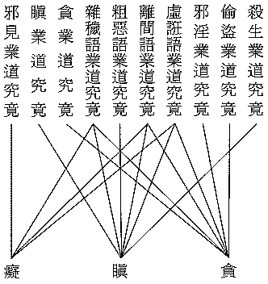



癸三　业道依处



> 有情具名色名身等处起



恶业道的生起，不是突然来的，必有他的对象，而后才能产生，现依前说三、三、一、三的四品业道，依其所有的次第，说明他於四处而生。四处：一、有情，二、众具，三、名色，四、名身等。



有情具名色名身等处起　一、杀生、粗恶语、瞋恚三者，是於有情处所生起的，即或有时也骂非情，但因过失很轻，不能构成业道。二、偷盗、欲邪行、贪爱三者，是於众具处所生起的，这里说的众具，包括情及非情，因为都是他人所受用具。以偷盗说，如偷猪马牛羊，就是於有情处起的，如偷金银财宝，就是於非情处起的。以邪淫说，这唯通於有情处起，不通非情。至於贪，或在有情身上起贪，或在非情物上起贪，也是通於情及非情的。三、邪见，此一恶业道，是於名色处所生起的，色就是色蕴，名包含四蕴，名色两者，通於因果，邪见正是拨无因果的，所以於名色处起。四、虚诳语、离间语、杂秽语三者，是於名身等处所起的，因为行欺诳等，一定要巧作言词，才说得使人动听，所以必依名身等，等即等取句文。



癸四　问答分别



> 俱死及前死无根依别故军等若同事皆成如作者



杀恶业道的根本业道的成立，究竟是由什麼而建立的呢？这大概需要两个条件：一是杀生的加行，一是所杀的命终，在这两者当中，缺少任何一个条件，都不得成为杀生根本。对的，根本业道的完成，确是如此，不过所成问题的，就是一个杀生者，已经发起加行，而且亦已使得对方命终，但结果本身仍不为杀罪所触，这情形有没有呢？其次所成问题的，就是有很多的人，集成一支劲旅，欲去勦杀怨敌，结果怨敌被某一个人所杀，其他的人是不是也得成就杀生业道？此一颂中：初二句解答第一问题；后二句解答第二问题。



俱死及前死无根依别故　此明具有加行、果满（命终）而不为杀罪所触。如有这麼一个人，生起杀害的加行，欲去谋杀某一个人，可是结果，能杀的人与所杀的人，在同一时候俱死了，甚而至於还死在被杀者之前，这样，纵然他是一个杀生者，但不成就根本业道，为什麼？《正理》四十一说：「以所杀者其命犹在，不可即令能杀有情杀罪所触，以所杀者命未断故，非能杀者其命已终可得杀罪，别依生故」。别依生者，意说杀生加行所依止的生命体，早已成为过去，现在虽有另一新的生命出生，但他未起杀生加行，不是杀罪所依止身，所以不可说他成杀业道，否则的话，那就太不合理了。



军等若同事皆成如作者　此明同为一事，同得成就杀生业道。如於军等之中，多数人从事杀生的时候，只有一人达其目的，其他下手而不杀害的人之责任，在阿毘达磨论者看来，是具有同等杀人过恶的，亦即是一切皆成杀生业道的。若有由於他力逼迫而参加杀人的集团，如果立誓是为救护自己的生命，乃至命终亦不行杀，既没有杀害的心，当也就没有杀罪，但若进入杀人集团后，因而即与他人具有同等的杀心，是也就具有杀罪了。



癸五　恶业道相子一　明身业道相



> 杀生由故思他想不误杀不与取他物力窃取属己  

> 欲邪行四种行所不应行



上面已说十善十恶的根本业道，但如何而成业道，其相应该加以思择。於中，先说十恶成业道之相。大要分三：即身业道相，语业道相，意业道相。



杀生由故思他想不误杀　此明由具五缘，成杀生的业道。杀生，不用说，是杀害生物之义，在一切恶行中，这是最重要的。不独佛教重视，从某种意义说，为印度一般宗教所共忌的，最显明的事实，如耆那教，极端重视不杀生。然而，完成杀生重罪，须具五个条件：一、要由先发欲杀故思，即先要故意的发起杀生的动机，假定根本没有杀害的心念，是不得成为杀罪的。二、於他有情，他简别不是自己，因为自杀是不成业道的，有情简别不是非情，因为断杀非情是不成业道的。三、起他有情之想，他想简别不是自想，因为於他作自身想，杀了是不成业道的，有情简别不是非情想，如将有情作非情想，杀了也是不成业道的。四、作杀加行，就是手里拿著刀，从这儿走到被杀者那儿，完成杀生的准备。五、不误杀，就是要想杀这有情，就唯杀这有情，不错误的漫杀其餘的有情。误犯杀生，是否也可说是完成杀生罪呢？从反於不欲死的有情意志说，误杀与杀可以成为同样的结果。因此，结果论者的耆那，主张误杀也成立杀生罪，如误触火被火所烧一样。但这在佛教，是不承认的。虽充分的须负不注意的责任，但因没有欲杀的动机，不可说有完全意义的杀生罪。如误触他人之妻，或如飨宴的结果，客人偶然破坏胃肠，那也不外是偶然的过失而已。总之，杀生罪的成立，虽有种种条件，但那最主要的，佛教认为是动机，所以，即使自己不下手，但以杀意令人行事，如前所说，亦成立杀生罪。颂文的最后杀字，包括两个条件：一是杀加行，二是不误杀。关於杀生，论文及《成实论》卷第八，曾提出这样的问难：有情的生命，既是刹那刹那生灭，则所谓杀生，岂不是没有意义了吗？据《宝疏》说：这是立长时四相的正量部的诘难。对这问题，论文有二说：一、断息风叫做杀生，二、断命根叫做杀生。成实师也举二说：一、断相续生名为杀生，二、有杀生心名为杀生。就是杀生，并不关於念念相续，要之，在一期的相续中，强使断灭他的相续，在反於众生要求生存意志的一点上，说他成为罪恶。《婆沙》卷第百十八又提出这样问题说：有实在的众生，可说有杀生罪，既没有实在众生，怎可说有杀生罪呢？对这疑问，世友以有众生想答，即因有众生想，所以有杀生罪。



不与取他物力窃取属己　此明由具五缘，成不与取的业道。不与取，是窃人不与或强取的意思。这是次於杀生，而为佛陀说得最烦琐的。据《五分律》说，比丘如盗窃五钱以上有价值的东西，就被判为波罗夷罪。如摩竭陀的阿阇世王制定，盗五钱以上的东西，惯习的处以死罪。然而盗罪成立的条件，如前所说杀生罪一样，须要具备五个条件：一、要由先发欲盗故思，即先要故意的发起偷盗的动机，假定根本没有偷盗的心念，那是不得成盗罪的。二、於他物中，他物简别不是自物，自己盗取自己的东西，不得算为盗罪。三、起他物之想，如以为那东西是自己的，就是取来，也不成为盗罪。四、作盗加行，就是或用强力劫夺，或复暗暗窃取，起盗加行，从这儿走到盗取的那儿，完成偷盗的准备。五、不误而取，令属己身。五缘中的不误、故思、他物想三者，是从前颂所流来的，在这两句颂中，并没有颂出，其餘他物及力窃取的二缘，是此半颂所明说的。关於盗业，还有可议论的，就是采取地下的东西，犯不犯盗罪呢？依律是这样的：佛陀初制盗戒时，有一类的比丘，认为佛陀所制，是诫取聚落（即村落）的东西，山林原野的东西，恐怕是不禁止的，於是就随意的去取，但结果又为佛陀所叱责。这在《婆沙》、《俱舍》以及《成实》所说的意见，有所不同。《俱舍》说：纵然是无主的，因伏藏物，是国王的，所以如盗取他，就构成了盗罪。《婆沙》说：人民的所有权，仅是及於地上物，地下的东西，不属人民所有，所以盗取者，如取地上所属人的所有物，就於所属人得罪，如取地下的伏藏物，就对国王犯罪，因为这是国家的，但属两国中间的东西，如取的话，没有轮王出世，还是判为无罪的。《成实》说：「问曰：有人言，伏藏属王，若取此物，则於王得罪，是事云何？答曰：不论地中物，但地上物应属王。所以者何？给孤独等圣人亦取此物，故知无罪」。然据《弥沙塞律》等说：不特地上的东西不可取，就是空中或地下的东西也禁止盗取，因此现在《俱舍》所说，是得佛教真意的。其次，关於盗取寺院塔庙的所有物，也为佛教所绝对禁止的，因为这是三宝所有物，持主虽没有特别的私欲心，但若盗取对於如来及众僧，就成立盗罪。



欲邪行四种行所不应行　此明由具四缘，成欲邪行的业道。欲邪行或邪淫，在原则上，是与不是自己的妻或夫交接所得之罪。然据佛教说，即使是自己的妻妇，假定在非时非处行淫，同被计算於邪淫之中。所以完成欲邪行的业道，须具四个条件：一、於非境行不应行，非境者，谓与不是己夫或妻交接，这所以成为罪恶，因是反於他的意志而无理强行的。不错，这确是一大罪恶，但若相对而行，不论对於何人，都无什麼损害，难道也有罪吗？这在佛教看来，纵然是相对的，如不在履行一定的手续后，反於那男子或女子之保护者的意志，就这点说，仍被认为是罪恶的。然据律说，男女保护者有十种：一、父母所护，二、兄姊所护，三、亲里所护，四、自护，五、法护，六、自任，七、衣物，八、共誓，九、有主，十、作信。第一至第三，是明其媬姆的意义，第四自护，是独立者之义，第五法护，是出家者之义，第六自任，是自己不得任性之义，第七衣物，是妾的意义，第八共誓，是婚约完成之义，第九有主，是所决定的夫或妻之义，第十作信，是如艺娼妓之义，即一日一月乃至一交会（男娼也有）。这样，如有妻之男与有夫之妻相通，一方面反於其妻的保护（意志），另方面破坏他夫的保护，在这点上，成为邪淫。又即使是独身者，但为父母所系念的男子，同与父母所护的女子相通，在反於两方保护的一点上，成为邪淫。至於真有独立自护或自任的男女，彼此合意交接，谁也不勉强谁，虽则不是邪淫，但据《成实论》第八十〈不善道品〉说，在众人前仍须举行一种仪式，作为附带的条件。所以佛教所说的正淫，终於主张唯是一夫一妻的关系。二、於非道行不应行，谓或即使自己的妻子，如於不应行的非道而行，像在口中，或在肛门，或在其餘非道，而行交接。三、於非处行不应行，谓在不应交接的地方而行交接，如於寺庙、僧阁、佛塔、神社等。四、於非时行不应行，谓在不应交接的时候而行交接，如在妻怀胎时，饮儿乳时，受斋戒时，虽为夫妻，也以淫欲而被禁止。怀胎时行淫，会损坏胎中子，令受多病。饮乳时行淫，母乳则竭，又因心著於淫欲的关系，不复能再照顾自己的儿女。还有在妻受斋戒时，纵然是自己的原配夫人，如与之交接，亦犯邪行。但这另有学者说：受斋戒如果是自己受的，没有得到夫婿的允可，并不能算是非时，假定是夫许受斋戒而有所犯，那就是非时了。若於比丘尼行非梵行，有说是於国王边得罪，因为这是为王所护持而不容许这样做的，不特普通人这样做不可以，就是国王犯了也成业道。有说对於自己受斋戒的妻子尚且不可侵犯，何况修清净梵行的比丘尼？当然是更不可以的了。



子二　明语业道相



> 染异想发言解义虚诳语由眼耳意识并餘三所证  

> 如次第名为所见闻知觉染心坏他语说名离间语  

> 非爱粗恶语诸染杂秽语餘说异三染佞歌邪论等



身三恶业道相已说，今辨语四恶业道相。於中，初二句明虚诳语，次四句明虚诳语的所见等相，七八两句明离间语，第九句明粗恶语，第十句明杂秽语，后二句明杂秽语的异说。



染异想发言解义虚诳语　此明由具四缘，成虚诳语的业道。虚诳语就是不真实语，是的说成不是，不是说成是，完全是虚假欺诳的。一、於所说境异想发言，就是像下面所说的见言不见，不见言见等。二、谓所诳者了所说义，就是对方对你所说的话了解没有错误，假使对方未解或误解了，那就属於杂秽语摄。三、起染污心，就是发起欲欺诳对方的动机。四、不误，就是所说与心相违背的话，确实是与心相违的，一点都没有错误。具此四缘，成虚诳语业道。或有人问：有的时候，不以恶意发出妄言，不特与人无损，而且使人得大利益，像在这种情形下，是否构成妄语罪呢？以佛法说，苟以诳的动机，对人说出假话，即成立妄语罪。所以做人决不可随便的异想发言。



由眼耳意识并餘三所证如次第名为所见闻知觉　此明虚诳语的所见等相。《长含》第八《众集经》说：「复有四法，谓四不圣语，不见闻觉知，言见闻觉知。复有四法，谓四圣语，见闻觉知，则言见闻觉知」。《婆沙》七十一说：「但所依事四故说四，若广有八或十六」。据此可以知道：《众集经》说四，是约所依事说，《集异门》等说八，是约境见不见为八说，境与想相望，则成十六圣言，非圣也是如此。所以论文引经说：「诸言略有十六，谓於不见不闻不觉不知事中，言实见等，或於所见所闻所觉所知事中，言不见等：如是八种名非圣言。若於不见乃至不知言不见等，或於所见乃至所知言实见等：如是八种名为圣言」。圣言非圣言，依《婆沙》的解说，是这样的：「以不善故名非圣，复次，於非圣相续中现前故名非圣，复次，非圣所成故名非圣，复次，非圣所说故名非圣，复次，非圣由此得非圣名故名非圣」。「以善故名圣，复次，於圣者相续中现前故名圣，复次，圣者所成就故名圣，复次，圣者所说故名圣，复次，圣者由此得圣名故名圣」。所见等相，依婆沙师说：若境由眼识所证名为所见，这就是色，若境由耳识所证名为所闻，这就是声，若境由意识所证名为所知，这就是法，若境由鼻舌身三识所证，名为所觉，这就是香味触。不过须要知道的，就是《婆沙》所说见闻觉知的作用，是根而不是识，这里所以说识，是显根要假藉识的助力，方能取境。颂中说的餘三，是指鼻舌身的三识，此三所以合立为觉，因为香味触境，唯是无记性摄，无记性法，犹如死者的无觉，所以能证者偏立觉名。还有经部宗对见闻觉知所说的不同，可以参阅论文，这里不赘述了。



染心坏他语说名离间语　此明由具四缘，成离间语的业道。离间语，就是两舌。以中伤、离间别人关系为目的所发的语言。一、起染污心，就是生起挑拨离间的动机。二、发坏他语，就是发出破坏他人的语言，只要你发出了这语言，不管是否达到那个目的，都构成妄语罪。三、听我说话的人，了解我所说的意思，确实含有挑拨性。四、不误发离间语。此四缘中，前之二缘，颂文所有，后之二缘，从前流来。《宝疏》将前二缘合为一缘，那是错误的。



非爱粗恶语　此明由具四缘，成粗恶语的业道。粗恶语，就是恶口，简单的说，以恼他为目的而发的语言。如套上两句说，应该是这样的：「染心非爱语，说名粗恶语」。四缘是：一、起染污心，就是生起恶口漫骂的动机。二、发非爱语，就是说出令人不爱听的话，使人听了感到有点刺刺的受不了。三、听我漫骂的人，了解我所骂的意思，确实是针对著他而且极粗恶的。四、不误恶言。具此四缘，就成就了业道。



诸染杂秽语　此明由具二缘，成杂秽语的业道。杂秽语，就是绮语。这虽没有特别的恶意，但说出来的话，容易启人邪思，如说戏言、空话、猥谈等。这两种缘：一是染污心，二是所发语言。



餘说异三染佞歌邪论等　有餘师说，杂秽语的范围是很宽的，只要是异於前说的虚诳语、粗恶语、离间语的三种，所有诸餘染心所发的语言，如佞歌、邪论等，都属杂秽语摄。论文说：「佞谓谄佞，如有苾刍，邪命居怀，发谄佞语；歌谓歌咏，如世有人，以染污心，讽吟相调及娼伎者，为悦他情，以染污心，作诸词曲；言邪论者，谓广辩说诸不正见所执言词；等谓染心所发悲叹，及诸世俗戏论言词。但异前三，染心所发一切，皆是杂秽语收」。



子三　明意业道相



> 恶欲他财贪憎有情瞋恚拨善恶等见名邪见业道



语四恶业道相已说，今辨意三恶业道相。初句明贪业道，次句明瞋业道，末二句明邪见业道。



恶欲他财贪　此明贪业道相。他财，就是属於他人所有的钱财。别人的钱财，原属别人所有，在道理上讲，任何人所不可非理妄求的，但贪欲心特别旺盛的有情，见到别人有了众多的钱财，就生起不正当的欲念，想方设法的，希望别人的财物，都归我来受用，或者想用强力夺取，或者暗暗的去偷拿，以达到属我为目的，像这样的非理耽求的恶欲，名贪业道。至於欲爱，是否皆贪业道，学者间有不同的看法：有的说欲爱皆贪业道，因为《五盖经》中，依贪欲盖，佛说应断此世间贪的；有的说欲爱只可名之为贪，不可说是皆成业道，因为意恶行中，要属粗品所摄，方可说为业道，不然的话，贪著自己的财物，难道也成业道吗？



憎有情瞋恚　此明瞋业道相。瞋之所以成为业道，是对其他的有情，生起高度的憎恚心，欲给予他种种的逼恼或伤害，假定不是这样的话，对自己发脾气，或对非情生瞋，虽不能说是没有过失，但因过失很轻，不能构成瞋业道。



拨善恶等见名邪见业道　此明邪见业道相。邪见，前面说过，就是拨无因果。论文说：「於善恶等恶见拨无，此见名为邪见业道」，邪见所拨无的，《光记》、《宝疏》依《正理》所说十一类言，将论文所引的分为十一类，这实在是没有检查《阿含经》的原文所产生的错误。《杂含》三十七论十不善业中说：「不舍邪见，颠倒如是见，如是说：无施、无报、无福、无善行恶行、无善恶业果报、无此世、无他世、无父母、无众生生，世间无世阿罗汉，等起等向此世他世、自知作证，我生已尽，梵行已立，所作已作，自知不受后有」。又《中含．三思经》说：「无施、无斋、无有咒说、无善恶业、无善恶业报、无此世彼世、无父无母（恐脱无众生生一句）、世无真人、往至善处、善去、善向、此世彼世、自知自觉、自作证成就游」。据此二经所说的十一类，那应该是这样的：一、无施与，二、无爱乐，这是拨可爱乐欲果之因，《杂含》叫做无报，《中含》叫做无斋。无施与，依外论说，是无施的三类福，依佛法说，是无施悲田福。无爱乐，依外论说，是无施别婆罗门福，依佛法说，是无施恩田福。三、无祠祀，是祭天地之福。依外论说，这是无施众婆罗门福。依佛法说，这是无施福田福。四、无妙行无恶行，虽有二无，因为唯是业的一类，所以《杂含》叫做无善行恶行，《中含》叫做无善恶业，《发智》叫做无妙行恶行，并无第二无，因而不可开之为二。五、无妙行恶行业所感果异熟，这是属於谤果邪见。六、无此世间无彼世间，虽彼此不同，但同属於世的一类，所以《中含》叫做无此世彼世。此世，指现在世，彼世，指过未世。《婆沙》对此提出意见说：过去未来的二世，人所不见，固可拨之为无，现世是现在明明白白所见到的，怎可拨之为无？不错，闭著眼睛瞎说是不对的，但为无明所蒙蔽的外道，要这样的拨之为无，那你又有什麼办法？如无明者、愚盲者的堕坑落堑，你能责怪他吗？七、无父无母，这事虽然是二，但属同生的一类，所以《杂含》说为无父母，《婆沙》说这所谤者，主要的是谤没有父母感子女的业，就感子说，若父若母，随一是不可能的。八、无化生有情，《杂含》说是无众生生，《婆沙》解释说：「有诸外道作如是说：诸有情生皆因现在精血等事，无有无缘忽然生者，譬如芽生必因种子、水、土、时节，无有无缘而得生者，故定无有化生有情」。谤此，是通谤因果。谤因，是属见集所断，谤果，是属见苦所断。九、世间无有沙门或婆罗门是阿罗汉，这是谤无圣者的邪见，也属於见道所断。《杂含》及《发智》，都说世间无阿罗汉，《中含》说是世无真人，都是约此说的。十、无正至，依《发智》说，这是拨无灭谛的邪见，属於见灭所断。《杂含》叫做等至，《中含》叫做往至善处。十一、据《发智》说：「无正行，此世他世，即於现法，知自通达，作证具足住，我生已尽，梵行已立，所作已办，不受后有，如实知。此谤道邪见，见道所断」。《中》、《杂》二含的文义与此所说相同。可见正理论师所说的十一类，是指此，若以《光宝》所分，那是不合经意的。总之，做一个人，绝对不可生起邪见，如果生起邪见，就会一切不顾而无恶不作了。



辛二　释业道名义



> 此中三唯道七业亦道故



经中说的十业道，有善恶的两类，其体是什麼？有什麼差别？这在前面都已说过，但所谓业道，是依什麼意义而得名的呢？现以半颂来略加说明。



此中三唯道七业亦道故　在十业道中，以十恶业道说，於中最后意三的贪瞋邪见，唯可说是道，不可说为业道，然而所以仍称为业道者，因他是以业为性的思心所之所游履的缘故。把这意思说得明白一点：与贪等相应的思是业，为业之思，不能独立活动，「以彼贪等转故思转，彼贪等行故思行，如彼贪等势力，而思有造作故，故贪等三与思为道」。除此，其餘的身三语四的七支，是身体的动作，言语的发动，其体就是业，而这业的身三语四，又为思业之所游履，所以具名业业道，上业是身语业，下业是思业，业及业之道，总立业道名。所以此中所说的业道，具足的显示业道业业道的意思。《光记》说：「此中意说：一业显多业，一道显多道，虽复业道性类不同，业名同故，而一业名为餘业故，道名同故，而一道名为餘道故……如言车牛，虽多车牛性类不同，车牛名同，而一车牛名为餘车牛故」。这是约恶业道说，善业道义类此应知。



辛三　义便明断善



> 唯邪见断善所断欲生得拨因果一切渐断二俱舍  

> 人三洲男女见行断非得续善疑有见顿现除逆者



前来所说十恶业道，一一皆与善法现起，相互违背，那末，我们平常所说的断善根，在十恶业道中，是由那一业道呢？再者，断善根与续善根，究竟有些什麼差别呢？这也是两个重要的问题，所以也来给予解答。初句，解答第一问题，后七句，解答第二问题。



唯邪见断善　此说在十恶业道中，能够断善根的，唯有上品圆满邪见，其餘的诸恶业道，是没有这个能力的。但据《发智论》说，断善根的是诸不善根，与此所说不同，这是什麼道理？不，断善根的确是邪见，因为邪见是由不善根之所引发的，所以《发智论》中就将这责任推到不善根上去。如一个村庄被火烧了，推求起火的原因，是由盗贼施放的，所以人们就说某村被贼烧了。《发智论》说不善根断善根，也就是这个道理。什麼善根为此邪见所断呢？答：



所断欲生得　邪见之所断的，唯是欲界生得善根，非加行善根。为什麼不断加行善？因断善根者，在先加行位，已经舍去加行善了，所以到了真正断善时，就唯有断生得善了。为什麼不断色无色界的生得善？因色无色善先不成就，所以现在不可说断。



拨因果一切　此明邪见的相貌。缘何邪见能断善根？是指拨无因果的邪见。拨无有因，就是否定有情所作的善恶业；拨无有果，就是否定善恶业所招感的异熟果。因果俱拨为无，是大邪见。《婆沙》三五说：「评曰：应说谤因谤果邪见俱能断善。谤因邪见如无间道；谤果邪见如解脱道。谤因者，与善根成就得俱灭；谤果者，与善根不成就得俱生：是故此二俱能断善」。但邪见很多，有自界缘的，有他界缘的，有有漏缘的，有无漏缘的，是不是一切邪见都能断善呢？有餘师说：能断善根的，唯自界缘及有漏缘的邪见，若他界缘及无漏缘的邪见，不能断善根。但现在说，不管是有漏缘、无漏缘的，不管是自界缘、他界缘的，一切邪见，皆能断善。



渐断　善根有九品差别，邪见断时，为顿断还是渐断，自也是个问题。现在颂中告诉我们，是渐断而非顿断，因邪见是有九品的。九品邪见与九品善根，顺逆相望渐次而断：谓初下下品的邪见，能断上上品的善根，次下中品的邪见，能断上中品的善根，再下上品的邪见，能断上下品的善根；乃至上上品的邪见，能断下下品的善根。从下下品至上上品，这是顺，从上上品至下下品，这是逆。邪见是从下至上的，所以是顺；善根是从上至下的，所以是逆。如此品品渐断，就如修道断九品修所断惑一样。



二俱舍　二、指善根及其所发的律仪。此中意说：一个有情断善根的时候，不唯断善，同时亦断律仪，二皆俱舍的。原来九品善根是能发九品律仪的，所以随其所应，如上上品律仪，为彼上上品善心所等起果，当彼上上品善心断时，为彼等起果的上上品律仪，也就同时而断。如是乃至下下品律仪，为彼下下品善心所等起果，当彼下下品善心断时，为彼等起果的下下品律仪，也就同时而断。这是约九品次第说，如果约加行生得说，那就有差别了。《正理》第四十二说：「诸律仪果，有从加行，有从生得善心所生，若从加行善心生者，律仪先舍，后断善根。然断善根，加行根本皆名断善，依此故说断善根位舍诸律仪。若从生得善心生者，随断何品能生善根，所生律仪尔时便舍，舍能等起彼随舍故」。



人三洲男女　此明能断善根的处所及人。真正能断善根的，在五趣中唯有人趣。恶趣有情没有这种功能，因为他们所有的染污不染污慧，是不坚牢的，由於染慧的不坚牢，所以他们不能断善，由於不染慧的不坚牢，所以他们不能进入圣位。天趣有情也不会断善，因为他们现见善恶诸业果报，不可能生起拨无因果的邪见的，邪见不生，当然就不会断善根。人趣有四大洲，而可断善根的，还要除去北俱卢洲，因为他们所享受的果报，是极快乐的，不会生起极恶的意乐来，极恶意乐不生，当然也就无由断善。所以剩下来的，只有三洲的人类，有断善的可能。三洲的人中，有男有女，是不是男女都能断善呢？依正义说，若男若女，都能断善，因为男女各皆成就八根（苦、乐、喜、舍、命、身、意、女加女根，男加男根），如说女不能断善，怎可唯有八根？所以说女身不断善，那是不合道理的。



见行　佛教所说的行者，大约有两类人：一是见行人，一是爱行人。见行人，是凭自己的理智，去体见诸法的真理，不倚仗他力；爱行人，由於自己的理智薄弱，不能独力的发见真理，所以唯信他语爱乐而行，就是别人怎样说，自己就怎样的行，纯是他力的。见行者的见强，发起不善意乐来的时候，也就极为坚深，所以他能断善根。爱行者的见弱，虽不是不起不善意乐，但起了不善意乐后，既不能坚执，又不能深入，所以他不能断善。还有、扇搋、半择迦、无形、二形人，能不能断善？不能！因为他们的意乐轻动，所作所行微劣，而且这是属於爱行及多贪的有情类，所以说非扇搋等能断善根。



断非得　这里所说的断善根，是以什麼为他的自体呢？当知这是以非得为其自体的。有情原来是成就善根的，但当极重的邪见现在前的时候，其有一股雄厚的力量，能令善根的成就得灭除，并使不成就得相续而生，就在这善得不生非得续生的这个当儿，断除了善根，所以断善是以非得为体的。



续善疑有见　前说断善根，此明续善根。有情的善根断了，并不是不可续的，但在怎样的情况下，方可说为续善根呢？现在说有两个条件：一、疑有，疑本可以通於两方面的，就是疑有或疑无。疑无不能续善，疑有可以续善。所谓疑有，是对因果生起这样的疑惑：因果大概是有的吧？这不可以说是全无吧？只要这麼一个疑念一生，善根立即就可续起。二、见，这儿所说的见，是指正见，从正见中，明见因果不无，确定因果是有，则由拨无因果的邪见所断之善根，也就立即生起。



顿现除逆者　断善根是渐断的，我们已经知道，续善根刚刚相反，是九品顿续的，不过顿续已后，於后后时，渐渐现起，如一个人生了大病，虽能一日顿除，但要气力完全恢复，必须渐次渐次增进。善根的顿续，固不成问题，但现世续？抑来世续？颂说於现身中能续善根，唯须除去五逆的人，因为经说造逆并断善根者，是不能在现身中续善的，然而他们有没有续善的可能？有！在怎样情况下续善？要从地狱将死或将生的时候，方能续善，如在其餘的时间，那是不能续善的。将死，指地狱果报快受完的当儿；将生，指正住中有还未生到地狱的当儿。《颂疏》说：「若由过去宿习邪见以为因力，彼断善根将死时续；若由现在邪教缘力，彼断善根将生时续」。其他还有多种分别，阅论可知。



辛四　业道思俱转



> 业道思俱转不善一至八善总开至十别遮一八五



乘於义便，如何而断善根，亦已辨别；现应更明本业道义，如所说的善恶二业道中，有几可以同时而生并与思俱时而转？於中，上两句明不善业道与思俱转，下两句明善业道与思俱转。



业道思俱转　这是总标。不过首先要知道的就是这里说的俱转，是约同一刹那俱时而转说的，不是约因等起思前后而俱说的，因为我人受戒，不管是受四支戒还是受七支戒，得戒必是从有心得的，决不可说无心得戒，可见是约刹那等起思说。



不善一至八　此明不善业道与思俱转。这有一俱转，有二俱转，乃至有八俱转的种种差别。现在依次一一略作说明。一俱转者，谓离所餘身语七种不善业道，贪等三中随一现起与相应思俱时而转，因为贪等各别现前，而决不能同时俱生的。或说於先加行，遣使造作杀等六种恶业，当善无记的不染污心时，於前杀等六种业中，任何一业获得究竟，是为一业与思俱转。假定是染污心究竟，那就成为二俱转了。现说不染，为简别此，以免成二俱转。二俱转者，二业现起，与思同时，为二俱转。如有自发瞋心时，究竟的完成杀业，或自起贪位成不与取，或自起贪位成欲邪行，或自起贪位成杂秽语，如是四类，都有二业道与思俱转。三俱转者，明三业道与思俱转。如有人生起瞋心，将属於他人所有的鸡鸭等的生命，一方面将他盗取得离了本处，一方面又将所盗得的加以宰割，以断绝牠的生命。在此情形下，是就有了瞋、盗、杀的三业与思俱转。或说於先加行，遣使造作杀等六种恶业，其后贪瞋邪见一正起时，於前杀等六种业中，随便那两种获得究竟，就成为三俱转。如贪现前而偷盗及虚诳语究竟，就是贪盗及虚诳语三业与思俱转；如瞋现前而杀及离间语究竟，就是瞋杀及虚诳语三业与思俱转；如邪见现前而粗恶语及杂秽语究竟，就是邪见粗恶语及杂秽语三业与思俱转。四俱转者，明四业道与思俱转。《颂疏》说：「此有三类：第一四者，谓欲坏他，说虚诳语，意业道一，语业道三。以坏他故，是离间语；说虚诳故，复成诳语；此是染言，必兼杂秽，故语业三。第二四者，又欲坏他，说粗恶语，意业道一，语业道三。以坏他故，是离间语；说粗恶故，复成粗语；此是染言，必兼杂秽，故语业三。第三四者，若先加行，遣使杀等，造恶色业，贪等现前，於前杀等，随三究竟，既贪等一，杀等随三，故四俱转」。五俱转者，明五业道与思俱转。如说於先加行，遣使造作杀等六种恶业，其后贪瞋邪见一正起时，於前杀等六种业中，随有四种究竟，就成五业与思俱转。六俱转者，明六业道与思俱转，如说於先加行，遣使造作杀等六种恶业，其后贪瞋邪见一正起时，於前杀等六种业中，随有五种究竟，就成六业与思俱转。七俱转者，明七业道与思俱转。如说於先加行，遣使造作杀等六种恶业，其后贪瞋邪见一正起时，於前杀等六种业中，悉皆究竟，就成七业与思俱转。八俱转者，明八业道与思俱转。如於加行位，遣使造作杀等六种恶业，而自己又行欲邪行，如是七业一时究竟，既行邪欲必有贪心，所以就成八业与思俱转。为什麼不说九俱转及十俱转？因意三的贪瞋邪见，各各依於自力现前，决不能同时而生起的，所以不说。



善总开至十别遮一八五　此明善业道与思俱转。《颂疏》说：「十善业道，通据隐显，名为总开。隐谓处中善，显谓律仪也。隐显通论，有十俱转。别据显相，无一、无八、无五俱转。唯据律仪，不约处中，名为显也」。说明白点，显相律仪，只有二俱转、三俱转、四俱转、六俱转、七俱转、九俱转、十俱转，没有一俱转、八俱转、五俱转，因为一、八、五俱转，是属於处中善的，所以合有一至十俱转。且约显相律仪说：二俱转者，明有二善业道与思俱转。如善五识现在前的时候，虽没有欲界散位的七支之善，但因识是善的，所以有无贪、无瞋的二善根，即此二善根与思俱转，名二俱转。为什麼不说正见？见是推求分别的，五识无有分别，所以不说正见。又依无色所有的尽智、无生智现在前的时候，因为是在定中，所以没有欲界散位的七支之善，因为是无色的，所以又无色界定生的七支之善，既是尽智、无生智，必然就有无贪、无瞋的二善根，即此二善根与思俱转，名二俱转。为什麼不说正见？因为息推求的缘故。三俱转者，明有三善业道与思俱转。如与正见相应的意识现在前的时候，虽没有身三语四的七色善，但必有无贪、无瞋、正见的三善业道，即此三善业道与思俱转，名三俱转。怎知没有七色善？因不受戒及不入定的缘故。四俱转者，明有四善业道与思俱转。如在恶、无记心现在前的时候，得近事、近住、勤策律仪，既是恶无记心现前，当然就无无贪无瞋正见，但因受近住戒等的关系，所以有身三语一的四善律仪，即此四支善戒与思俱转，名四俱转。六俱转者，明有六善业道与思俱转。如善五识现在前的时候，得近事、近住、勤策律仪，因为是善五识，所以必有无贪、无瞋，即此无贪、无瞋加上前说的身三语一的四支律仪与思俱转，名六俱转。七俱转者，明有七善业道与思俱转。如善意识无随转色正见相应现在前的时候，得近事、近住、勤策律仪，既与正见相应，必然就有无贪、无瞋、正见，即此无贪等三再加上所得的身三语一的四支律仪与思俱转，名七俱转。又在恶、无记心现在前的时候，得苾刍戒，成七善无表，即此七善无表与思俱转，名七俱转。九俱转者，明有九善业道与思俱转。如善五识现在前的时候，得苾刍戒，因为五识是善的，所以有无贪、无瞋，因为是得苾刍戒，所以有身三语四的七支善，即此七善并无贪、无瞋与思俱转，名九俱转。又依无色所有的尽智、无生智现在前的时候，得苾刍戒，因为是尽智、无生智，所以有无贪、无瞋，因为是得苾刍戒，所以有身三语四的七支善，即此七善并无贪、无瞋与思俱转，名九俱转。又属静虑所摄的尽智、无生智现在前的时候，因为是静虑的关系，所以有定生的七支戒善，因为是尽智、无生智的关系，所以有无贪、无瞋的二善根，即此无贪、无瞋并七善与思俱转，名九俱转。十俱转者，明有十善业道与思俱转。如善意识无随转色正见相应现在前的时候，得苾刍戒，因为是正见，所以有无贪、无瞋、正见三者，因为是得苾刍戒，所以有身三语四的七支戒善，即此一切与思俱转，名十俱转。又餘一切有随转色正见相应心正起位，因为有随转色，所以有身三语四的七支戒善，因为是正见相应，所以有无贪、无瞋、正见三者，即此一切与思俱转，名十俱转。论说：「别据显相，所遮如是；通据隐显，则无所遮：谓离律仪，有一、八、五」。离律仪，就是处中善，因为非律仪故。一俱转者，明有一处中业道与思俱转。如恶、无记心正现在前的时候，得一支远离（就是受一支戒），即此一戒与思俱转，名一俱转。五俱转者，明有五处中业道与思俱转。如善意识无随转色正见相应现在前的时候，得二支远离，因为是正见相应，所以有无贪、无瞋、正见三者，即此三者再加二支远离与思俱转，名五俱转。八俱转者，明有八处中业道与思俱转。如善意识无随转色正见相应现在前的时候，得五支远离，因为是正见相应，所以有无贪、无瞋、正见三者，即此三者再加五支远离与思俱转，名八俱转。



辛五　约处成业道



> 不善地狱中粗杂瞋通二贪邪见成就北洲成后三  

> 杂语通现成餘欲十通二善於一切处后三通现成  

> 无色无想天前七唯成就餘处通成现除地狱北洲



善恶业道，有唯成就的，有通现行的，成就约得而不失说，现行约发生活动说，然而於诸界趣，那一界有几业道唯是成就？那一界有几业道亦通现行？那一趣有几业道唯是成就？那一趣有几业道亦通现行？今以三颂略为分别。



不善地狱中粗杂瞋通二　於业道中，约不善说，在欲界的地狱趣，有三恶业道通於二种；就是粗恶语、杂秽语、瞋之三者，皆通现行成就。於此首先要知道的：成就不一定现行，现行却一定成就，所以现在只约现行解说。地狱有情，被种种痛苦的逼迫，有时相互而骂，所以知有粗恶语；有时被痛苦煎熬得没有办法的时候，发出怨叹悲叫的音声，所以知有杂秽语；有时为苦所逼，身心粗强，𢘙戾不调，彼此互相憎恶，所以知有瞋恚。



贪邪见成就　於地狱中，有二恶业道，唯是成就，不通现行，就是贪及邪见。贪为什麼不现行？因在地狱中所接触到的一切环境，都是苦痛的，没有一点快乐可言。邪见为什麼不现行？因在所处的环境中，明明白白现见业果的。除了这所说的五恶业道，其餘的五恶业道，於地狱中，既不成就，又不现行。生在地狱中的有情，他的命终，由於业力的穷尽，并无被杀的可能性，所以没有杀业道。一天到晚只是在受苦，没有什麼财物可以摄归於自己的，所以没有盗业道。将男系属於女，将女系属於男，於此可以构成邪淫罪，地狱中既没有这种现象，所以没有邪淫业道。有欺骗的必要，才须说虚诳语，地狱中业镜现前，什麼过恶都明白的放在你的眼帘，抗拒固然抗拒不得，讳言实也讳言不了，没有说妄言的必要，所以无虚诳语业道。既由於这无用的关系，加以为苦所逼，心常远离，所以没有离间语。



北洲成后三杂语通现成　在欲界人趣的北俱卢洲，唯成就而不现行，有三恶业道，那就是最后的贪瞋邪见三者。北洲的人群，大家都是「无我我所，无守护者」，一切资生之具，都可适量的随意受用，不必分外贪求，所以无贪现行。生在北洲，环境美满，身心柔輭，彼此和乐共存，谁也不恼害谁，所以无瞋现行。前面讲断善根的时候，曾经说过，北洲的人，没有极恶的意乐，所以无邪见现行。在语业方面，只有杂秽语，是通於现行及成就的，因为他们有的时候，也以染污心歌咏赞唱的。我们知道，北俱卢洲的有情，寿无中夭，定是千岁，所以没有杀生业道。既没有我所以摄取财物，当然也就没有偷盗业道。北俱卢洲，没有家庭组织，没有男女互相系属，所以没有邪淫业道。大家既是和乐相处，还有什麼挑拨离间？所以无离间业道。因为环境优美，身心柔輭，彼此相谈，言词清美，所以无粗恶语。大家开诚相见，没有欺瞒的必要，所以无虚诳语。



餘欲十通二　於欲界中，除前地狱、北俱卢洲，诸餘欲界，如天、鬼、傍生、三洲人，十恶业道，一一皆通成就现行二种。然而他们之间稍有差别者，天、鬼、傍生三趣，身三语四的前七业道，唯有处中摄，无不律仪，但人趣的三洲，俱有处中及不律仪二种。



善於一切处后三通现成　不善业道已如上说，此明十善业道。善在三界五趣的一切处，可以通於现行及成就的，唯最后的无贪、无瞋、正见的三善业道。



无色无想天前七唯成就　无色界及无想天，对於身三语四的前七善色，但容成就必不现行。容，含有不定的意思，就是过去曾经现起过的，现在容可成就，如果过去根本未曾现起过，那就不成就了。此说无色成就前七，是约生到无色界的圣者，成就过去未来无漏律仪说的，他之所以不现行，因无色界是无色的。此说无想成就前七，是约生到无想天的有情，成就过去未来第四静虑的静虑律仪说的，他之所以不现行，因无想天是无心的。《正理》四十二说：「律仪必托大种、定心，二处互无故不现起」。现在还须加以分别的，就是生无色界的阿那含圣者，成就过去几地的无漏律仪，那就看他在欲色二界的五地中，依於那一地曾起曾灭无漏律仪以为定夺。如过去唯依某一地曾起曾灭无漏律仪，生无色时，就唯成就过去某一地戒；如过去依二地、三地、四地、五地曾起曾灭无漏律仪，生无色时，就成就过去二地、三地、四地、五地戒。若未来世，依五地身（欲界及四静虑），无漏律仪，皆定成就。



餘处通成现除地狱北洲　餘处，指餘欲色界、人天四趣，唯於此中，要除去地狱及北俱卢洲。在这餘界餘趣之处，身三语四的七支善色，一一皆通现行、成就二种。然而他们之间稍有差别者，就是鬼与傍生的二趣，唯有处中善，不具律仪，而於色界，则唯有律仪，无处中善，通具处中善及律仪的，是欲界人趣的三洲及六欲天。三洲与欲天又有别者，是关於律仪方面，即六欲天，只有定、道二律仪，无别解脱；而三洲人，具有别解脱、静虑、无漏三种律仪。



辛六　明业道三果



> 皆能招异熟等流增上果此令他受苦断命坏威故



造业，不管是善的、恶的，必然是要感果的，所以现在来说一说善恶业道的得果怎样。换句话说：十善业道所感的果是什麼？十恶业道所感的果又是什麼？於中，初两句总明三果，下两句别释所以。



皆能招异熟等流增上果　於业道中，先就十恶业道说，每一恶业道，都能招感异熟、等流、增上的三果。一个有情，特别是我们人类，对於十恶业道，如果多修多习多所作，由是罪恶，於未来世，生地狱中，受诸苦报，这就是所感的异熟果。地狱受苦的有情，时间虽然是很长，但不是没有穷尽的时候，一旦业报受完了，自然就要从地狱出来，如果是生到人中，那他的生命体，还要受等流果。分别的说：前世如果是个杀生者，今生为人的时候，寿命就短促，前世如果是个不与取者，今生为人的时候，就会感到经济的困难，前世如果是个欲邪行者，今生为人的时候，就会遇到不贞洁的妻子，前世如果是个喜欢说虚诳语的，今生为人的时候，就必然的受到种种诽谤，前世如果是个挑拨离间说离间语的，今生为人的时候，在亲戚朋友之间，就难得到和睦，前世如果是个动辄以难听语言骂人的，则今生为人的时候，必然就要听到种种不乐意的音声，前世如果是个喜欢说俏皮话杂秽语的，则今生为人的时候，说话就不够庄重严肃，难以邀得别人的重视，前世如果是个贪心重的，今生为人，贪心也就特别炽盛，前世如果是个瞋心重的，今生为人，瞋心也就特别增长，前世如果是个邪见大的，今生为人，痴心也就特别浓厚：如是名为等流果。怎知又感增上果？那是这样的：生而为人，必然有他所受用的资生具，至於资生具的如何，这就要看业感如何了。假定是杀生的，现在所有的资生具，就缺少光泽而不美观，假定是不与取的，现在所有的资生具，大多会遭遇霜雹等的摧残，假定是欲邪行的，现在所有的资生具，一定多被尘埃蒙蔽，肮脏而不洁净，假定是虚诳语的，现在所有的资生具，一定多诸臭秽，难以受用，假定是离间语的，现在所有的资生具，一定所居险曲，离得我们远远的，可望而不可用，假定是粗恶语的，现在所有的资生具，如田园等，一定是荆棘丛生，咸卤徧地，假定是杂秽语的，现在所有的资生具，随时候的改变而改变，不能称意的受用，假定是贪业重的，现在种植的果类，收获就很少，假定是瞋业重的，现在种植的果类，就会变得辣辣的，与一般的果类不同，假定是邪见重的，现在种植的果类，纵然费很大的劳力，结果，不是根本没有收获，就是收获得很少：如是名为业道增上果别。



此令他受苦断命坏威故　此明业感三果的理由。如就十恶业道一一分别，那未免是太麻烦了，所以现在且就杀生略为说明。造杀业者，所以生地狱中受极苦报者，因为杀生是令他受苦的，如一个活泼泼的有情，为刀之所宰割，那是很苦的，这只要听被杀者所发出的凄惨之声，就可知道。造杀业者，所以生人中受短命之报者，因为杀生是断他寿命的，如一有情的生命，本来是可多活几年的，但为我们所杀，使他减少寿命，所以感短命报。造杀业者，到人中来，感外资具，所以是粗恶的，因为杀害有情，是坏他威光的。因为如此，所以感有三果差别。杀生业道是这样，其餘的诸恶业道，如理应思。



十恶业道，各别感有三果，十善业道，亦必各感三果。於中，且就不杀生说：若有於不杀生多习多修多所作，由此善业的力量，将来生到天上去，享受种种的福乐，这就是所感的异熟果。等到天福享尽了，转生到人间来，感受极长的寿命，是就所谓等流果。复即仗此善因缘力，所感外在诸资生具，有大威光，是增上果。其餘诸善业道所感三果，翻前不善业道三果可知，不再烦说。



庚十一　明邪命



> 贪生身语业邪命难除故执命资贪生违经故非理



佛在经中，有时说到八邪支，於中有邪语、邪业、邪命的三者。邪语，是由瞋痴而生的语业；邪业，是由瞋痴而生的身业；邪命，是由贪痴而生的身语二业。现在所成问题的，就是在邪语、邪业之外，为什麼要更立邪命？於中，上两句正答所问，下两句别破所执。



贪生身语业邪命难除故　《婆沙》百十六，对这说得很好：「如於不善语业道中，若贪所起名为邪语，亦名邪命，为命起故，瞋痴所起但名邪语，不名邪命，不为命而起故。於不善身业道中，若贪所起名为邪业，亦名邪命，瞋痴所起但名邪业，不名邪命」。又问：「若尔！何故佛别说正命邪命？答：佛以邪命诳惑於人，微细难觉故。复有说者，以诸邪命，难可净除故」。这样说来，从贪所生的身语二业，如只说为邪语、邪业，本来也是可以的，佛之所以更立为邪命者，因由贪而生的身语二业，由贪微细而能映夺诸有情心，所以从贪所起的业，也就难可禁护，佛为使诸行者，对於正命殷重修习，所以离前邪语邪业别说邪命。《正理》四十二说：「诸在家人邪见难断，以多妄执吉祥等故；诸出家者邪命难除，所有命缘皆属他故」。《婆沙》百十六也说：「谓有二法难除难舍，即在家者邪见及出家者邪命。诸在家人虽极聪慧受持五戒，若苦所逼，则以种种香华饮食祠祷天神；诸出家人虽极聪慧受持具戒，资身命缘系属他故，见施主时便整威仪现亲善相，是故别说邪命正命」。确实的，出家者的一切生活来源，都是靠信众供给的，为了维持生命的生存，有时就不得不在施主前，虚伪的现起亲善相，所以这是很难断的。但这不是说出家人不要生活，问题在於怎样取得生活的所需；如真正为维持生命以修道，而感得信众的供养，这是正命；假定出发於贪心，妄求美满的生活，这就是邪命了。



执命资贪生违经故非理　有餘异师这样的执说：从贪所生的身语二业，有的可以说为邪命，有的不可说为邪命，是不可一概而论的。如缘彼活命诸资生具，贪欲所生的身语二业，固可说是邪命，但若为自戏乐作歌舞等，虽则说是从贪生的，然因不是为自生命的维持，是就不可说为邪命。现在破斥他说：像你这样讲，是违契经的，所以也就不合正理。



邪语、邪业、邪命是这样讲，当知正语、正业、正命亦然，例上可知，所以不再一一叙说。



己四　杂明诸业庚一　明业得果辛一　总明诸业果



> 断道有漏业具足有五果无漏业有四谓唯除异熟  

> 餘有漏善恶亦四除离系餘无漏无记三除前所除



如前〈根品〉所说，果有异熟等的五果，现在我们所要问的，就是由怎样的业得那几种果？



断道有漏业具足有五果　断道的道，指一切无间道，而这诸无间道，有两种的功用：一、约能证无为说，名能证断；二、约能断烦恼说，名能断惑。具此两种胜用，所以名为断道。即此断道，有有漏与无漏的二种差别。有漏道业具足五果。一、谓自地中有漏断道所招可爱异熟，为异熟果。二、谓自地中后念所生的，不管是相等的还是殊胜的诸相似法，为等流果。三、谓由有漏断道的力量，断去烦恼以后所证得的择灭无为，为离系果。四、士用果，如分别说有四种：①俱生士用，是由有漏道所牵引的；②无间士用，是由有漏道所牵引的次一刹那的解脱道；③隔越士用，是由有漏道所修得的未来功德；④不生士用，是由有漏道所证得的诸无为断：如是一切，皆为有漏道的士用果。五、谓离自己所餘一切的诸有为法，都是增上果，唯於此中，还要除去前生，为什麼？《宝疏》说：「后是前因，前非后果，无取与故」，所以要除前生。



无漏业有四谓唯除异熟　於前所说的所断道，如果是无漏道业，那就只有四果，谓於五果中，唯除异熟果，因为异熟果，是有漏业所招感的，无漏业不招感果，所以要除去异熟。



餘有漏善恶亦四除离系　餘有漏，指断道之外的所餘有漏，此餘有漏，不管是善业恶业，亦只具有四果，谓於五果中，除去离系果，因为不是断道，不能断惑以证择灭无为。



餘无漏无记三除前所除　餘无漏，指断道之外的所餘无漏，此餘无漏及无记业，只有三果，谓除前所除的异熟及离系二果，有餘等流、士用、增上三果。为什麼要除异熟果？因无漏及无记是不招感果的。为什麼要除离系果？因非断道是不能断惑证灭的。



辛二　三性相对果



> 善等於善等初有四二三中有二三四后二三三果



诸业有果，於前二颂，已总分别，此下再就异门，辨别业有果相。所谓异门，就是其次所要说的三性门、三时门等。此颂先就三性相对果辨。



善等於善等　上善等，是善不善无记的三业，下善等，是善不善无记的三法。以善等三业为因，如其次第，对善等三法辨果，视其果数的多少差别。如明他们的自体，《颂疏》说：「三业色行二蕴少分为体，善等三法五蕴为体」。



初有四二三　於三业中，最初的善业，以善法为四果，即唯除去异熟果，因为异熟的体性，不是善而是无记的，所以要除去；善业以不善法为二果，就是士用与增上，因善引生是士用果，善法不障是增上果，善望不善性类不同，所以没有等流果，善以不善为果，所以没有异熟果，善虽是善但非断道，所以没有离系果；善业以无记法为三果，就是士用、增上、异熟，因为善与无记性类差别，所以没有等流果，因为善非择灭，所以没有离系果。



中有二三四　於三业中，居中的不善业，以善法为二果，就是士用与增上，因不善引生是士用果，不善法不障是增上果，不善望善性类不同，所以没有等流果，不善业非断道性，所以没有离系果，不善以善为果，所以没有异熟果。不善业以不善法为三果，就是於士用、增上二果外，加一等流果，因不善业望不善果，是同类的，所以有等流果，因不善业以不善法为果，所以没有异熟果，不善业非断道性，所以没有离系果。不善业以无记法为四果，即於五果中，除去离系果，因离系是善性，与不善相违，所以要除去。有士用、增上二果，准前可知。有异熟果，因为是不善业之所感的。唯有等流果，似觉成问题，因不善与无记，性类不同，怎会有等流果？为解决这问题，所以论说：「谓徧行不善及见苦所断餘不善业，以有身见边执见品诸无记法为等流故」。所谓徧行不善，就是苦谛下的邪见等三及痴、无明并集谛下的二见、疑、无明相应惑业，是谓徧行不善，以言不善故，不得总言十一徧使。言及见苦所断等者，即徧行外苦下贪瞋慢等非徧行相应惑业为同类因，是诸同类因皆能引生身边二见，二见望彼，虽说体性不同，因为同是染污的，所以与不善为等流果。



后二三三果　於三业中，最后的无记业，以善法为二果，就是士用与增上，因无记引生是士用果，无记法不障是增上果，无记望善性类不同，所以没有等流果，无记不招异熟，善法不是异熟性，所以没有异熟果，无记不是断道，所以没有离系果。无记业以不善法为三果，就是士用、增上、等流三果，不善与无记性类不同而有等流果者，谓以身边二见为同类因，以诸不善为等流果，无异熟、离系二果，如前所说。无记业以无记法为三果，就是士用、增上、等流三果，无记望无记，性类相同，所以有等流果，因异熟果非无记性所牵，所以没有异熟果，因离系果唯是善家之果，所以要除去离系果。



辛三　三世相对果



> 过於三各四现於未亦尔现於现二果未於未果三



此以三世业对三世法明果多少。三世业的范围较狭，所以唯色行二蕴的少分为体；三世法的范围较宽，所以通取五蕴为体。



过於三各四　此说过去业望於三世法，各各具有四果，即唯除去离系。离系是无为法，无为法的自体，不属於三世所摄，所以必须除去。怎知有餘四果？因相应、俱有、能作等因，是通於三世所摄的，所以有士用、增上的二果；由过去的善恶业为因，而招感到异熟果，今时同在过去，所以有异熟果；后后似於前前，所以有等流果。过去业望於过去世法，具有如是的四果，当知望於现在及未来法，也具有如此四果，准前可知。



现於未亦尔现於现二果　此约现在望於未来及现在望於现在说。谓现在世业望於未来世法，亦如过去业望於三世法一样的，具有四果，其义如前说，不再重述。然现在世业望於现在世法，只有士用及增上的二果，由俱有、相应因故，所以有士用果，由能作因故，所以有增上果。为什麼没有异熟果？因在现在只有一念。为什麼没有等流果？因在现在没有前后。为什麼没有离系果？因堕於三世中的。



未於未果三　此说未来世业望於未来世法，具有三果，就是除去等流及离系的二果，有餘士用、增上、异熟的三果。为什麼要除等流？因未来是无前后的，要有前后方可说有等流。为什麼要除离系？因堕於三世中的，要不堕世方可说有离系。麟说：「俱有、相应因通未来，故有士用果。有异熟果者，未来虽无前后，其异熟因约体建立，以善恶性为因，无记性为果，故得有也」。



论说：「不说后业有前果者，前法定非后业果故」。这两句的意思，是显示颂中现在世不说过去法，未来世不说现在过去法的所以。因为一切的因果法，不是前因后果，就是因果同时，绝对没有后因前果的。约现在过去说，现在是后业，过去是前果，约未来现在过去说，未来是后业，现在过去是前果，前法既然决定不可为后业果，所以颂中就不说后业有前果了。



辛四　诸地相对果



> 同地有四果异地二或三



前就三世门辨，今就诸地门辨。诸地，就是向来所说的九地。现在所成问题的，就是那一地的业，感有那几种的果？



同地有四果　於九地中，任他属於那一地的业，都必以同地法为四果，就是除去离系果，因为离系是不属地所摄的。如五趣杂居地业，就以五趣杂居地法为四果，乃至非想非非想地业，就以非想非非想地法为四果。



异地二或三　九地中业，有有漏业，有无漏业。即此一地中的有漏业，望彼另一异地法为二果，就是士用与增上。如欲界加行善心入初禅定有引起力，这是士用果，彼法不障，那是增上果。为什麼没有异熟果？因无欲界业可以感初禅异熟的。为什麼没有等流果？因有漏异地是没有同类因的。假定这一地中的无漏业，望彼另一异地法为三果，就是士用、增上、等流，没有异熟及离系的二果。为什麼有等流果？因无漏法不堕地，异地相望有同类因，所以有等流果。为什麼没有异熟果？因这不是无漏业所引的。为什麼没有离系果？因这不是属於界地所摄的。



辛五　三学相对果



> 学於三各三无学一三二非学非无学有二二五果



已辨诸地业果，今辨三学业果。《光记》说：「以三学业对三学法为果差别。若学业以学位色行二蕴少分为体；若无学业以无学色行二蕴少分为体；若非学非无学业，以有漏色行二蕴少分为体。若学法以学位有为无漏法为体；若无学法以无学位有为无漏法为体；若非学非无学法，除有为无漏法，以餘一切法为体。总而言之，三学业狭，三学法宽」。於中，三学业的少分色行二蕴，色蕴，指学无学的无漏戒，行蕴，指学无学的道共思。



学於三各三　此说有学业望於学等三法各为三果。学业以学法为三果者，就是士用、增上、等流，除去异熟及离系二果。怎知有等流果？因学业与学法同是无漏的。怎知有士用果？因学业望於学法是有引起力的。怎知有增上果？因学业不障学法发生的。为什麼没有异熟果？因学业是无漏的，所以不感异熟。为什麼没有离系果？因学业是有为的，所以不得离系。学业以无学法为三果者，亦即士用、增上、等流，除去异熟及离系二果。其中有士用果，约在金刚定时引生尽智说。餘果有无，准上可知。学业以非学非无学法为三果者，就是士用、增上、离系，除去异熟及等流二果。学业对非学非无学法，能够断惑证理，所以有离系果。从无漏观中，能够出生非学非无学的有漏善心，所以有士用果。学业不障非学非无学法的发生，所以有增上果。为什麼没有异熟果？因学业是无漏的，所以不感异熟。为什麼没有等流果？因有为无漏的学业与无为有漏的非学非无学法，其性类是不同的，所以没有等流。



无学一三二　此说无学业望於学等三法，或为一果，或为三果，或为二果。无学业以学法为一果者，就是唯一增上果，餘四皆无。怎知有增上果？因无学业不障学法发生。为什麼没有异熟果？因无学业是无漏的。为什麼没有等流果？凡讲等流，不是相等，就是超胜，没有劣的可以说为等流，有学法既劣於无学业，当然就没有等流果了。为什麼没有离系果？因无学法不是无为性。为什麼没有士用果？因没有无学业，可以引起有学心的。无学业以无学法为三果者，就是士用、增上、等流，除去异熟及离系二果。无学业望於无学法，同是无漏性，所以有等流果；无学业望於无学法，有其引起力，所以有士用果；无学业望於无学法，不障其发生，所以有增上果；无学的无漏业，不感异熟，所以没有异熟果；因无学业是有为的，所以不得离系果。无学业以非学非无学法为二果者，就是士用及增上，无餘三果，准上学业对非二所说可知。唯此中说无离系果者，因无学不更断惑证灭，无有无间道的关系。



非学非无学有二二五果　此说非学非无学业望於学等三法，有二果、二果、五果的差别。非学非无学业以学法为二果者，就是士用及增上，无餘三果。一切学人，皆从有漏心入无漏观，由彼有引生力，所以有士用果。非二业望於有学法，不障其发生，所以有增上果。为什麼没有异熟果？因学法是无漏的，不感异熟。为什麼没有等流果？因有为无漏的学法与无为有漏的非学非无学业，其性类是不同的。为什麼没有离系果？因学法是有为的。非学非无学业以无学法为二果者，如前望有学二果说可知。非学非无学业以非学非无学法为五果者，如前有漏道业具有五果说，此不重说。



辛六　三断相对果



> 见所断业等一一各於三初有三四一中二四三果  

> 后有一二四皆如次应知



已辨三学业果，今辨三断业果。《光记》说：「以三断业对三断法为果差别。若见所断业，以四谛所断行蕴少分为体；若修所断业，以行色二蕴少分为体；若非断业，以有为无漏色行二蕴少分为体。若见所断法，以四谛所断受想行识蕴为体；若修所断法，以修所断五蕴为体；若非所断法，以一切无漏法为体。总而言之，三断业狭，三断法宽，既知宽狭，思择可知」。



见所断业等一一各於三　此是总标。论文说：「见所断、修所断、非所断三业，一一为因，如其次第，各以三法为果」。



初有三四一　三断业中的最初见所断业望於三所断法，或为三果，或为四果，或为一果。见所断业以见所断法为三果者，就是士用、增上、等流，无异熟及离系二果。约从身见相应思业，能够引生边见等说，所以知有士用果；约见所断业及见所断法，同为染污法的前后相生说，所以知有等流果；约不为他法所障说，所以知有增上果。为什麼没有异熟及离系？因异熟无记及无为，不是属於见道所断法。见所断业以修所断法为四果者，谓於五果中，唯除离系果，因这不是修所断法。怎知有餘四果？见所断业通於不善，修所断法通於无记，所以知有异熟果；见所断业望於修所断法，能为徧行因，所以知有等流果；见所断业望於修所断法，能够无间而生，所以知有士用果；由於不为他法所障，所以知有增上果。见所断业以非所断法为一果者，就是唯一增上果，无餘四果。《宝疏》说：「非所断法，非无间相生，故无士用果；无同类、徧行因，故无等流果；非所断非异熟，故无异熟果；非所断非断道，故无离系果；不障碍故，有增上果」。



中二四三果　三断业中的中间修所断业望於断法，或为二果，或为四果，或为三果。修所断业以见所断法为二果者，就是士用及增上，无餘三果。修所断业望於见所断法，能够无间而生，所以知有士用果；由於不为他法所障，所以知有增上果；因见所断法唯是染污性，所以没有异熟果；修部烦恼无徧行惑，能取他部他界，所以没有等流果；见所断法不是无为，无为是非断的，所以没有离系果。修所断业以修所断法为四果者，谓於五果中，唯除离系果，因这不是修所断法。怎知有餘四果？修所断业望於修所断法，能为同类因，所以有等流果；能无间相生，所以有士用果；能不为他法所障，所以有增上果；修所断业通不善法而贯无记，所以有异熟果。修所断业以非所断法为三果者，就是士用、增上、离系，无异熟、等流二果。为什麼没有异熟果？因非断法是无漏的。为什麼没有等流果？因修所断业是有漏的，非所断法是无漏的，两者性类不同，所以没有等流果。怎知有餘三果？由有漏道断惑证非断灭，故有离系果；由有漏善心能够无间的引生非断的无漏心，故有士用果；因不为他法所障，故有增上果。



后有一二四　三断业中的最后非所断业望於三所断法，有一果、二果、四果的差别。非所断业以见所断法为一果者，就是唯一增上果，无餘四果。非所断业，以有为无漏的身语思为他的自体，如果拿这望於见所断的有漏法，但不为障，就是增上果。怎知无餘四果？若善若染的有漏法，望於非断的无漏业，其性类不同，所以没有等流果；无漏业不感异熟，加以见所断法没有异熟性，所以没有异熟果；无漏望於有漏，没有引生的意义，所以没有士用果；见所断法不摄无为，所以没有离系果。非所断业以修所断法为二果者，就是士用与增上，无餘三果。所以有士用果者，因从无漏观出，入有漏心时，是有引生的意思的。其餘诸果有无，如前所说可知。非所断业以非所断法为四果者，谓於五果中，唯除异熟果，因这不是无漏所招感的，若因若果都是无漏的。怎知有餘四果？非所断业望於非所断法，同是无漏，所以有等流果；前后能够无间相生，所以有士用果；无漏力能断惑证理，所以有离系果；不为他法所障，所以有增上果。



皆如次应知　从三性门到三断门，将因配果，如其次第，随其所应，当知就是这样的。如次，论文虽说徧前诸门，但第二三世门，第三诸地门，并无如次义，所以特别又说随其所应。



庚二　明本论业



> 染业不应作有说亦坏轨应作业翻此俱相违第三



科文所说的本论，惠晖说是《发智论》。在《发智论》中，说有三业：一、应作业，二、不应作业，三、非应作非不应作业。本论虽这样说，但其状态怎样，未详分别，所以论主特为一说。



染业不应作有说亦坏轨　此明不应作业。初句正说，次句异说。第一师说：一切染污身语意业，都是不应作业，因为这是从非理作意所生起的，假定我们不知道他的非理性，而从事染污的身语意业的造作，那就要构成罪恶，为了避免罪恶沾身，不应作此染业，名不应作业。有餘师说：不但染业是我们所不应作的，就是一切毁坏轨则的身语意业，那怕就是不是染污的，我们也不应作，因为那是不合世间轨则的。《正理》四三说：「谓诸无覆无记身业，若住若行若饮食等，诸有不合世俗礼仪，皆说名为坏轨身业；诸有无覆无记语业，坏形言时及作者等，但有不合世俗礼仪，皆说名为坏轨语业；等起前二思，名坏轨意业。此及染业，名不应作」。



应作业翻此　此明应作业。与前相翻，应这样的：善业名应作，有说亦合轨。第一师说：一切诸善身语意业，皆名应作业，因这是从如理作意所生起的，假定我们能够依照这个去做，就可产生合理的行为，积集种种的功德，所以名应作业。有餘师说：不但善业是我们所应作的，就是一切合轨则的身语意业，那怕就是无覆无记性的，也是我们所应作的，因为那是合於世间轨律的。翻前《正理》所说：「谓诸无覆无记身业，若住若行若饮食等，诸有合乎世俗礼仪，皆说名为合轨身业；诸有无覆无记语业，善形言时及作者等，但有合於世俗礼仪，皆说名为合轨语业；等起前二思，名合轨意业。此及善业，名应作业」。



俱相违第三　此明非应作非不应作业。俱相违者，就是与前二业俱相违背，名第三业。如以二师分别：第一师说：四种无覆无记及有覆无记，皆为第三业。第二师说：四无记中，除威仪无记，餘三无记及有覆无记，名为第三业。



上来三业，各有二师所说，究竟那个对呢？《正理》四三说：「若依世俗后亦可然，若就胜义前说为善」。此中意谓：前师约胜义尽理而说，是比较确当的，后师约世俗不尽理说，虽也未尝不可，然而总不若前说为善。



庚三　明引满因辛一　明业感多少



> 一业引一生多业能圆满



此明引业与满业。《佛法概论》说：「如生为人类，人与人是一样平等的。人类的寿命，根身的构造，感官的认识，对於自然的享受等，都大致相同。从这引业所感的业果说，人类的主要本质是平等的。人与人间所有的差别，如相貌不同，眷属不同，贫富不同，知识才能不同等，是过去的满业与现生业所使然的」。引满二业的大意，观此可知。唯成为问题的：业引於果，为由一业但引一生还是引多生呢？或此一生，为但一业所引还是多业所引呢？为解答这问题，所以说：



一业引一生　此释引业，旧说总报业。有部学者，依於《正理》，作这样的肯定说：「但由一业唯引一生」。既不可说一生由多业引，也不可说一业能引多生。假定说一业能引多生，那时分定业，就应成杂乱，可是事实上，时分定业，是决定了的，必无杂乱的可能，所以不可说一业能引多生。假定说一生由多业引，那现实的生命体，就应数死数生，因为业果是差别的，可是事实上，无一有情，於一生中，有众多死生的，所以不可说一生由多业引。如是种种分别，可知一业唯引一生。



多业能圆满　此释满业，旧说别报业。意说有情的生命体，虽由一业之所引的，但使其获得圆满庄严，那还是承认由多业力所成的。论文举喻说：「譬如畫师，先以一色图其形状，后填众彩」。一色图形，喻一引业，后填众彩，喻多满业，就是这个道理。如人类有情，虽同样是人，但有各式各样的差别。从其同为人说，这是引业的作用，从其有差别说，这是满业的功能。



辛二　明引满因体



> 二无心定得不能引餘通



能引能满有情之生命体的，不唯是业力，就是其他的一切善不善法，都有引满的功能，不过由於业力殊胜，所以特就引满二业而说。唯当注意的，就是在这当中，与业俱有的，固然能引能满，假定不与业俱有，那就只能满而不能引了，为什麼？因势力微劣的缘故。如是种类其体怎样呢？颂说：



二无心定得不能引餘通　二无心定就是无想定与灭尽定。此二种定虽有异熟，但因不与诸业俱有，所以只能满不能引，因无势力可以引生命体的。得，是指不善及善诸有漏得。如是诸得，由与诸业非为一果，所以也只能满不能引，为什麼？因无势力可以引生命体的。除这而外，所餘一切不善善有漏法，皆容通於引满两者。



庚四　明三重障辛一　正明三障壬一　明障体



> 三障无间业及数行烦恼并一切恶趣北洲无想天



佛在经中，有的时候，说有三种重障：一、业障，二、烦恼障，三、异熟障。如是三障，以什麼为体？为什麼叫障？



三障　这是总标。经说三障，这是出於《毘尼母经》第一。《婆沙》百十五说：「如契经说：若诸有情成就六法，虽闻如来所证所说法毘奈耶，而不堪任远尘离垢，於诸法中生净法眼。何等为六？一、烦恼障，二、业障，三、异熟障，四、不信，五、不乐，六、恶慧」。於彼六中，现在取其最初的三障来说。唯彼所说的次第，与现在下面别释的次第有别。为什麼如此？《法义》说：「烦恼与业互为因缘，约由惑起业，说为烦恼业，据由业起烦恼，说为业烦恼，是故佛说二次第，异熟定果故必为后」。



无间业　这是出业障体。五无间业名为业障。一者弑父，二者弑母，三者弑阿罗汉，四者破和合僧，五者恶心出佛身血。《正理》四三说：「非唯无间是业障体，所有定业能障见谛，一切皆应是业障摄。谓有诸业造作增长，能感恶趣、卵生、湿生、女身、人天第八有等，并感大梵顺后受业，或色无色一处二生，有此皆无入见谛理，何缘不说是业障收？见此类中有非定故，谓於如是业种类中，皆有强缘可令回转，不障圣道及道资粮，故於此中，虽有少业不可转者，不立为障。无间种类皆不可转，故唯於此立为业障。毘婆沙说此五因缘，易见易知说为业障，谓处、趣、生、果及补特伽罗。处，谓此五定以母等为起处故。趣，谓此五定以地狱为所趣故。生，谓此五定无间生感异熟故。果，谓此五决定能招非爱果故。补特伽罗，谓此五逆依行重惑补特伽罗，共了此人能害母等。餘业不尔，不立为障」。此五不可转的重业，为什麼叫做无间？因这一生命结束，必定无间於第二生中受果，在这新旧生命转换的过程中，绝对没有其餘的生果之业，可以为之间隔，所以说名无间。这是约受生的法说，如约受生的人说，就是凡曾造这种业的人，当彼生命告一段落后，就决定堕入地狱中，其间毫没有间隔，所以名为无间。论中还有两种说法：一、「彼有无间得无间名」；二、「与无间法合故名无间，如与沙门合故名沙门」。



及数行烦恼　这是出烦恼障体。有情烦恼的活动，大别约有两种：一是厉害虽不厉害，但常常的不断现起，这叫数行烦恼；二是猛利虽极猛利，但不经常的发生活动，这叫猛利烦恼。於此两者之中，说为烦恼障的，是数行而非猛利。为什麼？因经常现起的烦恼，就他的活动力说，虽不怎麼猛利，但由於他不断活动的关系，如果说是要断除他，那是很难的，不但如此，而且由彼展转增进，令上品烦恼生，越发难以根治，所以说为障体。至不经常活动的猛利烦恼，生起来的时候，固然锐不可当，但因他的不数数现行，所以对治道的一生起，很容易的就可将其解决，所以不说为障。



并一切恶趣北洲无想天　这是出报障体。报障，亦名异熟障，就是指生命的报体。三恶趣的全部及善趣的一分，如人趣北俱卢洲的果报及天趣无想天的果报，这都是属於报障所摄。因这些有情所受的生命果报，是佛法所常说的八难中的五难，有此果报体的存在，必然的就障碍了佛法的听闻及圣道的修持，所以说名为障。



经中所说三障，都已一一解说，现在进一步所要说的，就是这三者为什麼都叫障？《婆沙》百十五说：「如是三种能碍圣道及圣道加行善根，是故名障」。《正理》更加一障离染义，《光记》、《宝疏》都认为这说得很尽理，但《法义》不以为然，因大梵天以有漏道离染，必然是在七方便位，此论则是属於加行所摄，不可彼此混为一谈。



壬二　约处辨



> 三洲有无间非餘扇搋等少恩少羞耻餘障通五趣



三障的体义，业已明白，但那一趣中，具有其障，不能不辨，所以现在略为分别。



三洲有无间非餘扇搋等　上来所说三障，於五趣中，并不是说每一趣中都完备的，且以无间业障说，只有在我们的人趣中，可以说有，其餘的诸趣诸界，都是没有的，而就在人中，还要除去北俱卢，唯餘三洲有无间业，即在有无间业的三洲内，亦唯正常的男子或女人，可能造无间业，如果是扇搋、半择迦、无形、二形人，那还是没有力量构成无间业的，这如前面说他们不能受恶律仪的道理是一样的。《婆沙》百十九说：「问：若扇搋、半择迦、无形、二形，杀害父母得无间不？答：不得」。或者有人要问：同样的是杀害父母，为什麼他们不得无间罪业？答：



少恩少羞耻　这是说明黄门虽杀父母而不得无间业的所以。黄门，有本性的与损坏的两种：如是本性的，父母对他就少有恩德，因没有给他一个完整的生命体，是使他缺身的唯一增上缘，所以他对父母也就少有羞耻。如是损坏的，父母对他就少有爱念，因为做父母的，已经给了你完具不缺的身体，并且希望你将家族绵延不绝的传下去，而你却将他损坏了，做父母的怎会爱念你？正因不得父母的热爱抚慰，所以他对父母的惭愧也就轻微，可是触成无间罪的，必须坏重惭愧方可。扇搋等既然没有极重的惭愧心，当然也就不能构成无间罪了。也就因为这个道理，《婆沙》百十九又说：「若非人杀非人父母，不得无间罪；非人杀人，人杀非人，应知亦尔。惟有人类杀人父母，方得无间」。还有鬼及傍生，父母於彼恩少，彼於父母惭愧心微，如扇搋等，虽害父母而非无间。至於天及地狱，是化生有情，根本没有父母，所以就不论了。



餘障通五趣　除了业障唯是人趣三洲所有外，其餘的烦恼障及异熟障，通於五趣所有。烦恼障的徧一切处，这是容易了解的，无须多说。异熟障的通於五趣，三恶趣是全分的，人趣只有北洲，天趣唯无想天，其他的三洲及餘诸天，不可说为异熟障。《正理》四三说：「岂不三洲处扇搋等身，非圣道器故异熟障摄。无如是理！以於彼生引业所牵同分相续，可成男等为圣道器，唯三恶趣、无想、北洲，决定无容证圣道义，故唯於彼立异熟障」。



辛二　别明业障壬一　出业障体



> 此五无间中四身一语业三杀一诳语一杀生加行



前是正明三障，此则别明业障。业障所以别明，是为探究他的自体为何。我们造业，不出身语意三，现在所要问的，就是五无间业，以三业为体呢？抑以身语二业为体？如据经部上座师说，是以三业为体的，因为身语二业，一一独能招异熟果，这在道理上是很难成立的；然据有部学者说，是以二业为体，所以现在特举一颂说明。於中，初一句是标，次句正出体，后二句约五不戒分别加行根本。



此五无间中四身一语业　谓於此所说的五无间业中：有四属於身业，就是弑父、弑母、弑阿罗汉、恶心出佛身血；有一属於语业，就是破和合僧。



三杀一诳语一杀生加行　此约加行、根本分别。五无间中，属於根本业道的，有四，就是弑父、弑母、弑阿罗汉、破和合僧。如再约身业与语业说，前三是身业的杀生根本业道，后一是语业的虚诳语根本业道。破僧无间是虚诳语，既是虚诳语，为什麼叫做破僧？这是约因受果名说的。虚诳语是因，所破僧是果，和合无间的僧团，所以会破裂，是因虚诳语导成的，假定没有人从中说种种的虚妄语欺诳僧众，僧团决不会破裂的。而此为因的虚诳语，有力能破僧，所以说名破僧。属於业道加行的，有一，就是恶心出佛身血，因为佛身谁也不能杀害得了，所以不能构成杀生根本业道，虽然如此，但因从杀的动机出发，不能不说有杀生加行罪。



壬二　别明破僧癸一　破僧体及成



> 僧破不和合心不相应行无覆无记性所破僧所成



破僧，佛法认为是极大罪恶，所以特别另立一科，明破僧义。唯当知道的，僧破与破僧，是有通局的。如说僧破，是就唯约所破僧说，若说破僧，那就通於能破所破的两方了。现因说僧破，可见是唯局所破僧言。但僧破的自体是什麼呢？在能所破人中，谁成就此僧破？於中，前三句答第一问，后一句答第二问。



僧破不和合心不相应行无覆无记性　此答僧破的自体。僧，本是和合众，就是集团的和合。在和合、安乐、清净的僧团中修学圣道，原可预入圣者之林的，但因僧被破了，於是就失却和合性，而入圣也就成了问题，所以僧破是不和合性，即和合上的非得为体。如是不和合，心不相应行蕴所摄，为无覆无记性。《婆沙》百十六说：「僧破是不和合性，无覆无记，是不相应行蕴所摄」。不过成问题的，既是无覆无记性的，怎会成无间罪？因照平常说，业不是善就是恶的。如是无记僧破，所以说为无间，因是从诳语不善性所生的果，所以说这僧破是无间业的果，不说是无间业。同时要知道的，就是这个因果，是能所生的因果，不是能所感的因果，要说无间业所感果，那是无间大地狱的果报，这是大家所知道的。



所破僧所成　此答成僧破体。和合无间的僧团被破，不用说，是有能破与所破的两方的，但成此僧破的，是所破僧所成的，非能破者成此僧破。为什麼？因僧破是无覆无记性的，而破僧者是不善性，所以两者有著不同。



癸二　能破成时处



> 能破者唯成此虚诳语罪无间一劫熟随罪增苦增



此明能破成时处。於中有两个问题：一、能破人有什麼为其之所成就？二、破僧所感的异熟是在什麼地方？要经过几久的时间？



能破者唯成此虚诳语罪　这是答覆第一问以明罪体。破和合僧的能破者，所成就的唯是破僧罪，而这又是以虚诳语为性的，谓即与僧破俱时所生的语表无表业为此罪体。



无间一劫熟随罪增苦增　这是答覆第二问以明处时。破和合僧的罪业，将来必感无间大地狱的异熟果报，而受极重大苦的时间，要经一中劫。为什麼不说经一大劫？因在欲界没有这麼长的寿量的。为什麼说必感无间？因造餘四逆罪，不一定生於无间，而可生於餘地狱的，但破僧罪，不造则已，造了决不可能逃避无间的果报。然而仍有问题须待解决的：造一逆罪是次生受，造五逆罪亦次生受，岂不是一时同受五果吗？假定说唯初一逆受无间果，岂不是餘逆变成无果了吗？没有这样的过失！要知造五逆者，能引无间果的，虽唯是一，但餘四逆，能助其满，就是随他所造的罪业增加，所受的苦果也就增剧，如造一逆受一分苦，若造二逆就加倍苦，乃至造五逆罪，也就受五倍苦。所以论说：「谓由多逆感地狱中大柔輭身、多猛苦具，受二、三、四、五倍重苦」。



癸三　具缘成破僧



> 苾刍见净行破异处愚夫忍异师道时名破不经宿



破僧的罪恶固然很大，但完成破僧并不简单，是要具有种种条件的。如：什麼人具有资格破僧？在什麼地方可以破僧？怎样的僧能为所破？正破僧时是在什麼时间？破僧的时间约经几时？具这样的五个条件，方可完成破僧。



苾刍见净行　此答第一问破僧的人。真正够资格破僧的，唯有出家的大苾刍，不说在家众没有这种力能，就是出家的苾刍尼，也不够资格，因要与佛为敌，而自认自己是佛，才能见信於众，使大众跟著他去，尼是女流，如说自己是佛，难邀众信，所以不能破僧。《南山戒疏》三说：「初就人明破者，羯磨为言，通僧及尼俱有破义，法轮一种唯据比丘，餘众不可故。尼是女报，号佛无信，三众未具，不合羯磨也」。其次，就见行人与爱行人分别，能破僧者，唯见行人非爱行者，因为自信力坚强的人，总以为自己所见是对的，不轻易接受别人的领导，所以就从同一集团中分裂出来，独行其是。再则，要住净行而不犯戒的人，方能破僧，因为促使僧团的分裂，首先就要本身健全，以取得大众的信任，认为某人所说的话是对的，假定本身有很多缺点，戒行又不清净，你想自己领导一个教团，而从和合众中出来，那是不可能的，因为你所说的话，别人根本就不信任。



破异处　这是答第二问的破僧处。论说：「要异处破非对大师」。异处，是指象头山，当提婆达多实行反叛如来，佛住在鹫峰山，两处相距三四里而在同一界内，提婆达多在彼破僧，所以不是面对大师。《行宗》云：「方志云伽耶，世谓灵岳，亦云象头山。提婆始於王舍行化，有五百新学比丘信受五法，随往伽耶布萨，二法俱破方成破僧」。《戒疏》三说：「后至伽耶，羯磨说法方破众法，如是究竟破法轮僧」。为什麼不敢面对佛陀这样做呢？论说：「以诸如来不可轻逼，言词威肃对必无能」。



愚夫　这是答第三问的能破於谁。论说：「唯破异生非破圣者」。僧团，有圣者也有凡夫，可以为彼所破的，只有凡夫的僧团，非诸圣者的僧团，因凡夫的心性轻动，自己把握不住，听说那一边好，就走向那一边，圣者不然，他对事理观察得清清楚楚，谁对谁不对，自己明白得很，决不随便的从化於人。《成实论》说：「凡夫轻躁易可破坏，若得世间空无我心尚不可破，况无漏也」？《戒疏》说：「羯磨破者，真俗俱能，圣者事迷，容生别众非法故也；法轮破僧，唯俗谛僧，圣人识达，不从化故」。



忍异师道时名破　这是答第四问的破僧时间。论说：「要所破僧，忍师异佛，忍异佛说，有餘圣道，应说破僧在如是时」。忍是忍信的意思，就是被所破的僧众，首先要信自己的老师与佛是不同的，要信确有异於佛说的圣道，就在所破僧这样信忍的时候，就正是僧破的时候。《颂疏》说：「谓提婆达多作如是言：我是大师，非沙门乔答摩；我所说五法是道，非乔答摩所说八支是道。愚痴苾刍，信提婆达多是我大师，信彼五法是出离道，正起此信即法轮破」。提婆达多妄说的五道，《正理》四三说是：「一者不应受用乳等，二者断肉，三者断盐，四者应被不截衣服，五者应居聚落边寺」。《婆沙》说：「一、尽形著粪扫衣，二、尽形常乞食，三、尽形一坐食，四、尽寿常居迥露，五、尽寿不食一切肉味盐苏乳等」。



不经宿　这是答第五问的经几时破。论说「此夜必和不经宿住，如是名曰破法轮僧，能障圣道轮，坏僧和合故」。意谓圣道被遮暂时不转，是为破法轮，和合被坏暂不和合，是为破僧。唯此破僧的时间是很短的，不经一宿僧还和合，如日暮时破，到夜三更的时候，就又和合起来了。《大乘义章》云：「如经中说：不经一宿僧还和合，何因故和？由舍利弗及目连故。目连以通令其调达眠而不觉，又现胜通，化彼新学五百比丘令其生信，舍利辨说令其生解，还来归正，故得和合」。



癸四　明破二僧别



> 赡部洲九等方破法轮僧唯破羯磨僧通三洲八等



破僧有两种，一是破法轮僧，一是破羯磨僧，现在所要研究的，就是：那一洲人并且要好多人，方能完成破法轮僧？那一洲人并且要好多人，方能完成破羯磨僧？前两句答第一问，后两句答第二问。



赡部洲九等方破法轮僧　佛法虽流行於三洲，但佛的出现人间，独出现於南赡部洲，所以唯有在南赡部洲，至少集合九人，或更超过此数，方可完成破法轮僧的任务。为什麼必须九人？谓要八个苾刍，分为二众以为所破，於中，四众是正的，四众是邪的，再加一能破者，以为第九，所以极少须要九人，不达这种人数，不能破法轮僧。颂中的等字，表示在九人以上，不管有多少人，都能完成破法轮僧。



唯破羯磨僧通三洲八等　佛法既流行於三洲，证知三洲都有出家的比丘众，有比丘众，必然就要举行羯磨，所以通三洲而破僧的，唯是破羯磨僧。为什麼极少必须八人方能完成破羯磨僧？论说：「要一界中僧分二部；别作羯磨故须八人」。佛律的规定，举行僧羯磨，至少要四人，僧众既分两部，别别举行羯磨，一部四众，所以要有八人。如超过此数，不管有多少人，亦成破羯磨僧，所以说等。



癸五　无破法轮僧



> 初后疱双前佛灭未结界於如是六位无破法轮僧



《正理》四三说：「於何时分容有破僧？破羯磨僧，从结界后，迄今亦有，至法未灭；破法轮僧，除六时分，何等为六」？结界，就是作法，佛律规定，僧众中无论要做一件什麼事，都必须先作羯磨之法，羯磨僧是所作的摄僧界，所以自从结界后，一直到现在，乃至如来正法律未灭以前，都容有破羯磨僧的可能。但破法轮僧，要除去六个时间，那六时间呢？这是本颂所要解答的。



初后疱双前佛灭未结界　这是指出所除的六时。一、初，这是约佛成佛转法轮未久时说的，因在那时释尊为出家弟子，仅提示了法味同受、财利共享的原则，然而就这样子，大家已能和乐为道，内心又是极纯净的，不会生起恶意乐来。二、后，这是约佛将要涅槃时说的，因在那时，圣教增广，大家还能和乐安住，此二时中，僧众一味和合，所以不可破坏。三、疱前，疱是疮疱，是不好的东西。佛法最重视的，就是见正戒正，假定在正见上生起邪见，在正戒上生起邪戒，这邪见邪戒就叫做疱。在圣教中，戒见二疱未生起以前，是不会破法轮僧的，因为要邪见疱生，自以为是，才敢破僧。四、双前，这是约未建立第一双时说的，就是在第一双未建立以前，绝对无有能破法轮僧的。第一双，指一对贤圣弟子，就是舍利弗与目犍连，目犍连的止极为第一，舍利弗的观极为第一。《光记》说：「诸佛法尔皆有第一双贤圣弟子，若有破坏法轮僧已，不经日夜，此第一双还令和合」。所以破法轮僧，一定要在第一双建立以后。五、佛灭，就是到佛涅槃以后，没有破法轮僧的可能，因为要有真佛为其敌对，方可说言我是大师非彼如来，佛灭既无大师与之相对，还能对谁而说我是他非？即使说了也不会有人信受！《光记》说：「若於大师般涅槃后作如是言：我是大师非如来者，咸共责言：大师在世，汝何不言我是大师，今涅槃后乃作是语」？六、未结界，就是於一界内，无有僧分二部，可以名为僧破。



於如是六位无破法轮僧　这是总结。意谓唯有在这六位，没有破法轮僧的可能，除此而外，所餘时间，法轮可坏。



壬三　明成逆缘



> 弃坏恩德田转形亦成逆母谓因彼血误等无或有  

> 打心出佛血害后无学无



别明业障一科文中，前已指出业障体及别明破僧义，现再进一步的说明造成逆罪之缘。首先要问的，为什麼说害母等是成无间罪而不是其餘的罪呢？答：



弃坏恩德田　害父母等所以成为无间罪者，由弃恩田坏德田故。我人的生命体，是从那儿来的？是由父母所恩赐给我们的，因有父母才有我们的身体，父母是出生我们身体的根本，真是恩重如山，不知什麼时候，才能酬报得了？然而，现在不知报答，反而加以迫害，这不是弃恩田於不顾是什麼？既弃恩田，当成逆罪。我人的胜功德，是从那儿来的？是由具诸胜德的佛及罗汉的圣者所赐给我们的，因为佛及罗汉们，其本身固然具诸殊胜功德，同时亦能出生一切有情殊胜功德，所以称为大功德田，我们对於有德的圣者，应该恭敬尊重，服劳侍奉才对，然而，现在不知敬重，反而加以迫害，这不是坏彼胜德所依止身是什麼？既坏德田，当成逆罪。



转形亦成逆　这是解答一个问题的。有人这样问道：父母的根形正常，我们将之杀害了，当然是成逆罪的，但若父母转形了，杀了是不是也成逆罪？现在论主告诉我们说：虽然父母转了形，如果我们去杀，仍然构成逆罪，因二老的所依止身，还是那一个，并不曾有所转变。



母谓因彼血　这也是解答一个问题的。如有这麼一个女人怀了孕，可是就在羯剌蓝的这个阶段堕下来了，当他刚刚堕下时，就为另一女人取去置在产道中，然后生子逐渐长大，这一长大的孩子，将来杀了那一女人，是否构成害母的罪逆？关於这问题，首先要弄清楚的，就是谁是生母。以道理说，识托彼血而成生命体的是生母，所以要杀这生母才成逆罪，如杀后母，虽不能说没有罪，但不成为逆罪，而只成无间同类。然如上座者的看法不同：有情在羯剌蓝位，如果还有命的话，那就不会堕下来，假定堕下来的话，那必是没有命了，何况现实世间不可能有这事！所以此问是多餘的。即或退一步说，假定有这种事发生，将来成人杀害而成逆罪的，在后母而不在前母，因为前面说过，由弃恩田成无间罪，真正对他有重恩的，是取羯剌蓝的女子，不是堕羯剌蓝的女子。



误等无或有　如有这麼一个人，本来是想杀害父母的，但结果却误杀了他人，或本欲杀害他人的，但无意中却杀害了父母，像这种误杀，是不成逆罪的。等者，等取害餘人，只有无表没有表业，如有一人起一加行，害母及餘人，有二无表，表唯有一，即唯在害母上有表，在害餘人的身上无有其表，因无间业的势力坚强，所以必须有表。然如尊者妙音所说，於此二位是有二表的，因为要有表业，方能断绝他命，表业假定没有，怎能使人命终？或有者，如有於阿罗汉无阿罗汉想，因对他的所依止身，生起决定的杀害心，没有什麼简别，所以杀害就成逆罪。《正理》四三说：「有於阿罗汉无阿罗汉想，亦无决定解此非阿罗汉，无简别故害成逆罪。非於父母全与此同，以易识知而不识者，虽行杀害无弃恩心，阿罗汉人无别标相，既难识是亦难知非，故漫心杀亦成无间」。假定有人杀害自己的父亲，而父亲又是一个阿罗汉者，那他是得一逆罪还是二逆罪呢？得一逆罪，因所依身是一的。



打心出佛血害后无学无　颂中最后的无字，是无无间的意思。一、恶心出佛身血，并非一切皆成无间，要以杀心出佛身血，方成无间罪逆，如以打心出佛身血，不成无间罪逆，所以有此差别，因为前者罪重，后者罪轻。二、若人起杀加行时，那被杀的人，还不是个无学圣者，到了将死的时候，始证得阿罗汉果（后无学），在这样的情形下，那能杀的人，是不是构成逆罪呢？不！因他没有对无学身起杀加行，所以无有无间罪。



壬四　明加行定



> 造逆定加行无离染得果



造无间加行罪，可转不可转，有两说不同，一说是可转，一说不可转，而有部所宗，无间加行总说有二，一近，二远，近的不可转，远的可以转。依此，就发生这样的问题：如有一个造了不可转的无间加行的人，那他有没有离染得果的可能呢？答：



造逆定加行无离染得果　什麼是无间加行？如发欲害父母的杀心，而尚未正式的兴害父母，是为无间加行。无间加行，假使必定成就，那在中间决定没有离染得果的可能，因为彼业殊胜，於第二生中，必受其果报，而离染道及得果道，又不能令彼业道不起，所以决定无离染得果。



壬五　罪重大果



> 破僧虚诳语於罪中最大感第一有思世善中大果



有情的行为活动，不出恶行妙行的两种，但在一切恶行的无间业中，那一种的罪业是最重大呢？又在一切妙行的世善业中，那一种的善业有最大果报呢？这确是两个重要的问题，所以现在略为解说。



破僧虚诳语於罪中最大　这是解答第一问题。何罪最重，经中说不一定，有时说邪见最重，有时说意业罪中最大，有时说破僧罪重，虽然这样，但不冲突，因为所望不同，说法自然有别。说邪见重，这是从五僻见出发的，说意业大，这是从一切业出发的，说破僧重，这是从五无间出发的。谓於五无间中，如论其罪业最大的，不能不以破僧为首屈一指，所以《正理》四三说：「为破僧故发虚诳语，诸恶行中此罪最大。如何此罪虚诳语收？由所发言依异想故：谓彼於法有法想，於非法有非法想，於大师有大师想，於己身有非一切智想；然由深固恶阿世耶（意乐），隐覆此想作别异说，设有不以异想破僧，则不能生劫寿重罪」。破僧的罪恶所以大过一切，因为佛陀的法身，郑重的寄托僧团，和合僧的存在，即是法身的常在人间。破和合僧，无异毁伤如来的法身，法身被毁，就障碍了世间天道及解脱道的进趣，何有罪恶过於此者？所以诸恶行中，此罪最重。



感第一有思世善中大果　这是解答第二问题。善业感善果，这是没有问题的，但感最大果，这倒值得探究的。如以世出世间说：感第一有顶业思，於世间善中为最大果，因为所得寂静异熟，有八万大劫那麼长久的。与金刚喻定相应业思，於出世善中为最大果，因为这时所得，是最极殊胜的，为什麼？永远断尽了一切的烦恼，才得此大果的。大果本有这两类，现为简别出世的大果，所以说世善中大果。



壬六　无间同类



> 污母无学尼杀住定菩萨及有学圣者夺僧和合缘  

> 破坏窣堵波是无间同类



五无间业，定生地狱，可说没有疑义，但成为问题的，除这无间业外，是否还有别的罪业，亦定生於地狱？有的，那就是诸无间的同类业。无间同类业，虽定生於地狱，但不一定无间生，因为不是无间业，所以顺生、顺次等不定。旧论说：「有餘师说：唯由无间业，必定得无间生，由同类不定」。所谓无间同类，其相是怎样的呢？答：



污母无学尼　这是第一同类业相。谓有对於自己的母亲，或对已证阿罗汉尼，行非梵行，为极污辱，是为杀母同类业相。



杀住定菩萨　这是第二同类业相。谓若有杀百大劫中修相好的住定菩萨，菩萨深恩犹如於父，是为害父同类业相。



及有学圣者　这是第三同类业相。谓若有杀有学圣者，学与无学同为世间的福田，所以於彼造业，是为杀阿罗汉同类业相。



夺僧和合缘　这是第四同类业相。僧和合缘，就是僧团所必须的资生之具，如有人将僧团所以和合的外缘，用强有力的非法手段夺去，使僧离散而不得和合，是为破僧同类业相。



破坏窣堵波　这是第五同类业相。窣堵波，就是塔，这里主要的是指佛塔，为人天之所恭敬供养的，设若有人，不特不尊敬礼拜，反而加以破坏，是为出佛身血同类业相。



是无间同类　这是总结。如上所说的五种，就是五无间业的同类。什麼叫做同类？相似义是同类。《法义》说：「解同类者，光宝不同：《光记》约境义同以解同类，同类之业也，故云恩深犹父等；《宝疏》约得罪解，业即同类也。今谓各有理：若寻其所以，如《光记》释；若依立名，如宝解。於中，宝为胜。论颂前及结文，旧论等，但云同类故」。



庚五　明三时障



> 将得忍不还无学业为障



感异熟果的异熟业，在三个时期中，能给行者极大的留难，障碍行者继续的前进，行者如不拿出高度的毅力，对他加以克服，那就不能达到所期求的目标，所以说为三时障。



将得忍业为障　小乘行者，在加行位中，从顶位将要进入忍位时，有感恶趣的异熟业，能极为他的障难，使他不能顺利的登上忍位的宝座。为什麼？因一入忍位，就再也不堕恶趣，所以要作留难，使之不得超越，仍归我所掌握。



将得不还业为障　已证一来果的圣者，在他将欲超越欲界而入不还果时，有属欲界所系的异熟业，能极为他的障难，使他不能如意的证得不还。为什麼？因不还圣者，断了欲界的九品思惑，再也不到欲界来受生，欲界系业，为欲使他不出自己的魔掌，所以多方留难，令不得证不还。但在这顺现、顺生、顺后等的诸业中，要除去顺现法受，换句话说，顺现法受，不为不还果作障，因得不还果，是不越现果的，所以能为障的，唯是顺生受业，顺后受业及顺不定受业中，异熟定异处熟者。



将得无学业为障　有学圣者，在他将要得无学果时，有色无色业，能极为他的障难，使他不轻易的跳出三界，获证无学圣果。为什麼？因出三界的圣者，已证得寂灭无生，不再受生於三有海中，不再听有漏业的指挥，所以色无色业，在力之所能范围内，总归要作大障，使之不能完成任命。这如前说，也要除去顺现受业。



此三时的异熟障，论中曾喻说：如人欠债很多，一旦说是要离原来所居住的国土到别个地方去，於是一切债主就都来包围你，使你不得自由的离去，非逼得你还清一切债务不可。所以我人如欲超凡入圣，必须多修无漏业，还清一切宿债，然后始可如愿以偿，不是说要出离就可出离的。



庚六　明菩萨相辛一　明住定位



> 从修妙相业菩萨得定名生善趣贵家具男念坚固



说到菩萨，从他的进程上看，大约可分为二期：第一是轮回时代的菩萨，谓从初发心一直到兜率天，其间轮回於生死中种种修行，所以名为轮回时代。第二是所谓最后身菩萨，谓快要成为佛陀，再无轮回的现象，即从兜率下降到降魔成道之间。现在说的住定菩萨，虽说一切都已住定，但还属於轮回时代的菩萨。然而，从什麼阶位得住定名？又为什麼说名为定？现在分别如下：



从修妙相业菩萨得定名　菩萨在三大阿僧祇劫中，积诸修行的结果，渐次进於百劫位，为这劫位之特徵的，在实践上，从此勤修三十二妙相果业，在自觉上，从此能够感得将来作佛。在这意义之下，所以菩萨得定住名。适应这个，入於这劫位时，约有六义得名为定：



生善趣贵家具男念坚固　菩萨所以名为住定：一、到了这时，常常生於人天的善趣，而已不再生於恶趣了，是为善趣定。《婆沙》说为「舍诸恶趣恒生善趣」。二、入於这位，在善趣中受生，如果是生於人间，那他决定常生婆罗门、刹帝利、或大富长者家，而决不受生於贫穷下贱的贱族，是为生贵家定。《婆沙》说为「舍下劣家恒生贵家」。三、菩萨此时，人中受生，不但是生贵家定，而且必然的常具诸胜色根，决不有所缺减，如生贵家而六根不具，那也不能算是美满生命，所以说具根定。《婆沙》说为「舍不具根恒具诸根」。四、诸根完具的菩萨，如果是女身，那还不能认为理想的，然住定菩萨，常受男身，是为男身定。《婆沙》说为「舍非男身恒得男身」。五、具丈夫相的菩萨，常能忆念宿世因缘，知道过去曾经做过什麼，是为念定。《婆沙》说为「舍有忘失念恒得自性生念」。六、坚固，就是对於所作的善事，总是一往直前的这样做去，决不因为遇到什麼挫折，就生退屈之心，是为坚固定。这在《婆沙》卷第一七六中，没有说到。



在这位的修养中，应特别注意的：即菩萨的三十二妙相，是在这期间所修得的。三十二相，就是大人相。据印度人的信仰说，是最大权威者，应具备的人相。这思想，元从毘纽拏神话脱化来的，但在地上，主要为转轮圣王所应具的人相，但这相好观，一入於佛教，慢慢就变为佛及菩萨（最胜身）的特相，据南方论事说：北道派的学者，说这是菩萨所成就相，而且主张这唯是菩萨的特相。其实，菩萨在修养期，既已修集了三十二相，到了最后成佛，自也具此诸相，怎可说是唯在菩萨？然不论怎麼说，佛菩萨的三十二相等，不能不说完全是从轮王的神话脱化来的。这是事实，既不容忽视，也不容否认。



辛二　明修相业



> 赡部男对佛佛思思所成餘百劫方修各百福严饰



前面讲到修妙相业，因论生论，那修妙相业的状态是怎样的呢？如举其相，总有七种：一、修处，二、依身，三、修时，四、缘境，五、思慧，六、劫量，七、福数。《光记》是分这样的七门，《宝疏》只有六门而无佛时，这没有《光记》分得确当。



赡部　菩萨修妙相业，要在南赡部洲，方能圆满修成，因为在四洲中，唯有此洲有情的觉慧，是最极明利的。这是第一修处。



男　南洲有情，有男有女的差别，若是女身，纵在南洲，仍不能修妙相业，所以就第二依身说，必须要依男身而修。女身尚不可修，其他的扇搋、半择迦等，当更不用说了。



对佛　这是第三修时门。应於何时修妙相业？《旧论》十三说：「此修於何时？大师在现前时」。《婆沙》百七十七说：「於何时起者，佛出世时，非无佛世」。《正理》四十四说：「造此业时，惟现对佛。谓亲见佛不共色身相好端严种种奇特，有欲引起感此类思，不对如来无容起故」。



佛思　这是第四缘境门。应缘何境修妙相业？《旧论》十三说：「由缘佛为境故、意故」。《婆沙》百七十七说：「缘何境起者，现前缘佛起胜思愿，不缘餘境」。《正理》四十四说：「此妙相业唯缘佛思，佛是可欣顺德境故」。



思所成　这是第五思慧门。此妙相业，於闻思修的三有漏慧，是由思所成慧所修成的，因为观佛起思，不是闻修类慧所摄。《正理》四十四说：「非修所成，不定界故，所感异熟，此所系故；非闻所成，彼羸劣故；亦非生得，加行起故」。



餘百劫方修　这是第六劫量门。菩萨修妙相业，不是在三大阿僧祇劫中，而是在三无数劫外，餘百大劫修妙相业。百劫位，是诸佛在因中修菩萨行时所必经的一个阶段，在原则上虽然如此，但於百劫不一定全部修行。由非常的大勇猛大精进，得多少减其劫数的。如今释迦牟尼佛，就是超劫的一例。即超九劫，而於九十一劫修妙相成。



各百福严饰　这是第七福数门。菩萨所修的三十二妙相业，一一都是由所谓百福之所庄严的结果。《婆沙》百七十七说：「问：如契经说，佛一一相百福庄严，何谓百福？答：此中百思名为百福。何谓百思？谓如菩萨造作增长足善住相业时，先起五十思，修治身器，令净调柔，次起一思，正牵引彼，后复起五十思，令其圆满。譬如农夫，先治畦陇，次下种子，后以粪水而覆溉之，彼亦如是。如足善住相业，有如是百思庄严，乃至顶上乌瑟腻沙相业，亦复如是。由此故说佛一一相百福庄严」。然五十思又是怎样讲的呢？这是约十善业道说的，即每一善道有五种思。如初不杀业的五思：一、离杀思，二、劝导思，三、赞美思，四、随喜思，五、回向思。餘不偷盗等的五思，准此可知。怎样才成为一福量呢？这有多种的说法不同，有说轮王於四天下自在为一福；有说如帝释於二天自在为一福；有说乃至六天；有说除补处，餘一切人所有为一福；有说大千一切众生共为一福；有说大千众生盲，能治得差为一福；有说大千人服毒，能治得差为一福；有说大千人死，救得为一福；有说一切人破戒、见，能为说法，令舍是事为一福；有说量无边际，无可为譬，惟佛能知。



辛三　明供养佛壬一　明供佛数



> 於三无数劫各供养七万又如次供养五六七千佛



轮回中的菩萨资格，学者虽生不同的意见，但解说为自利利他，作种种的修行，不管那一派，都是承认的。而修养的要素，在遇种种的佛陀，赞叹佛，供养佛，行种种波罗蜜。就中，关於遇佛，在南传，虽数为二十四佛，到《婆沙》，却举出二十餘万佛。今依北传说如下：



於初无数劫供养七万五千佛　即最初是释迦佛，最后是宝髻佛。



於二无数劫供养七万六千佛　即最初是宝髻佛，最后是燃灯佛。



於三无数劫供养七万七千佛　即最初是燃灯佛，最后是胜观佛。



菩萨从初发心，於三无数劫中，所供养佛，所以有多少不同，这是约智慧的胜劣分的：即在前位，智慧下劣，所以所供养的佛少，到了后位，因为智慧增胜，所以所供养的佛多。但如泰法师说：「三劫中，皆应供养七万七千：初劫在三涂化生时，多有佛出世不供养，减二千佛；第二劫减一千佛；第三劫时，虽亦三涂受生，教化众生，尔时业用自在故，但佛出世即来人中受生供养，故具供养七万七千佛」。这样说来，供养佛的多少，也不无理由了。



壬二　明所逢佛



> 三无数劫满逆次逢胜观然灯宝髻佛初释迦牟尼



上来说菩萨供养这麼多的佛，当然曾遇到这一一佛的，但仍成为问题的，就是三无数劫一一满时以及初发心时，所遇到的是什麼佛？



三无数劫满逆次逢胜观然灯宝髻佛初释迦牟尼　颂中的逆次两字，是自后向前的意思。「谓於第三无数劫满所逢事佛名为胜观，第二劫满所逢事佛名曰燃灯，第一劫满所逢事佛名为宝髻，最初发心位逢释迦牟尼」。据契经中告诉我们：释迦世尊於过去久远劫前，为做陶器的陶师，一天在工作的地方碰到了古释迦，起殷净心，涂以香油，浴以香水，三事供奉佛及弟子，同时在佛前发大誓愿：愿未来作佛，亦名释迦牟尼；智慧弟子，亦名舍利弗；神足弟子，亦名目犍连；多闻弟子，亦名阿难等，佛即允可。所以今之释迦与古之释迦，名号、弟子等，一一都是一样的。



辛四　明六度圆



> 但由悲普施被析身无忿赞叹底沙佛次无上菩提  

> 六波罗蜜多於如是四位一二又一二如次修圆满



菩萨於三无数劫间所修的波罗蜜，在南传，说为施、戒、出离等十波罗蜜；在《婆沙》，只说施、戒、精进、智慧的四波罗蜜；其后於此四中，加忍辱与静虑，就成六波罗蜜。现在先将南传的十波罗蜜略为一说：第一布施波罗蜜者，是施舍一切的意思，家财珍宝，固不用说，就是妻子、自己，也都施舍，只知是为菩提而行。第二戒波罗蜜者，是保持清净的戒行，严守不犯。第三出离波罗蜜者，是厌离世间之意，第四智慧波罗蜜者，是养成正确的判断力。第五精进波罗蜜者，是努力不懈勤作善事。第六忍辱波罗蜜者，简单的说，就是忍耐。第七真实波罗蜜者，即不论在怎样的场合，都说真实话，决不出一句虚言。第八决定波罗蜜者，是决断而不动摇的意思。第九慈悲波罗蜜者，就是慈爱一切众生。第十舍波罗蜜者，是住於平等心之意。将这些德目，完全履行的，名叫波罗蜜。谓以善慧时代的发心为起点，到最后安住於兜率天宫，在四阿僧祇（异於北传的三无数劫）千劫（异於北传的百劫）之间，无数次的受生，实不外为欲完成这十波罗蜜的阶梯。龙树的《菩提资粮论》中，虽也有十波罗蜜的名称，但与此稍有不同，这不同，就是南北传的不同。



但由悲普施　此说施波罗蜜多圆满：菩萨发心布施，不是为求人天小果，但由悲心普施一切。而其所施，不是一点一滴，一切能施，无所遮碍，乃至即使施舍自己的肉体，其心亦毫无顾惜。如尸毘王以身施鸽，解剔皮肉，虽受痛苦，举身上秤，以赎鸽命，心不悔恨。立誓自证说：我心无悔者，身可平复。既立誓已，天地震动，其身乃恢复原有的状态。像菩萨这样的舍身命施，心不退悔，是为施波罗蜜圆满相。



被析身无忿　此说戒忍二波罗蜜圆满。菩萨行者，被人截断身肉手足，不起一念瞋忿之心，是为所修戒忍圆满。「析身不报，净戒圆满；心无忿故，忍辱圆满」。如分别举例：不惜身命护持净戒者，如须摩陀王，精进持戒，常依实语，与劫磨沙陀大王共期，乞求还国七日，供养沙门以后，再来就死，后来时间到了，为持真实语戒，就准时而去，决不为惜身命，踌躇不前。如是菩萨因地持戒舍身，心无悔恨，是为戒波罗蜜圆满相。割截支解心不起瞋者，如羼提比丘，常修慈忍，在林树下，入禅三昧，时有迦梨尸王，为了女色，生重弊垢，截其手足耳鼻，心忍不动。时王问他说：现我这样的割截汝身，你真的能忍得下吗？比丘回答他说：当然是真的，你如不信的话，我可这样的发誓：假定真实能忍，心不瞋恨，当令我身，立刻恢复原有状态。说这话时，身即平复。如是等不惜身命，修行忍辱，是为忍波罗蜜圆满相。



赞叹底沙佛　此说精进波罗蜜圆满。这最明显的例子：如一向所说，释迦菩萨在底沙（或补沙、或弗沙）佛之下，与弥勒菩萨同时修行，从那根机方面说，弥勒本应比释迦菩萨先成佛的，但因释迦菩萨的修行，极猛烈且极真挚，尤其於底沙佛上灵山入火界定，见底沙佛光明赫耀时，於七昼夜中，一足停立，就那麼的一瞬不瞬的瞻视佛陀的相好，并且赞叹佛陀不止，如其时偈说：



> 天地此界多闻室逝宫天处十方无  

> 丈夫牛王大沙门寻地山林徧无等



释尊由这精进力，终於超越九劫，而於九十一劫成佛。释迦为现在佛，弥勒为未来佛，其理由亦即在此。是为精进波罗蜜圆满相。



次无上菩提　此说定慧二波罗蜜圆满。次无上者，尽智已去，名无上觉，邻次成佛，名次无上。这是金刚喻定的阶段，亦即定慧的修习圆满。如尚阇梨仙人，坐禅的时候，工夫深到无出入息，鸟於螺髻中生子，不动不摇，乃至鸟子飞去，是名禅波罗蜜圆满相。菩萨大心分别，如劬嫔婆罗门大臣，分阎浮大地作七分；若干大城、小城、聚落、村民，尽作七分。般若波罗蜜亦如是，是名慧波罗蜜圆满相。



六波罗蜜多於如是四位一二又一二如次修圆满　如是像上所说的六波罗蜜多，是在施舍、无忿、精进、次无上这样的四位，如其一二又一二的次第，修习圆满的。一者，是初施位的一波罗蜜多；二者，是次无忿位的戒忍二波罗蜜多；又一者，是精进位的一波罗蜜多；又二者，是次无上位的定慧二波罗蜜多。



庚七　明施戒修辛一　略明施戒修



> 施戒修三类各随其所应受福业事名差别如业道



杂明诸业中，此是第七明施戒修。这三类业，是契经说的。如《杂含》卷第十说：「何等业报得如是威德自在耶？此是三种业报。云何为三？一者布施，二者调伏（戒），三者修道（修）」。此外，《长含》八《众集经》、《中含》十八、三十四，都曾说到这三类。所以论引契经，说有三福业事：一、施类福业事，二、戒类福业事，三、修类福业事。《旧论》将此三者，译为施性福业类，戒性福业类，修性福业类；《婆沙》百二十六引经，说为施性福业事，戒性福业事，修性福业事。此论的类字，同旧论的性字，惟说类字，是就可以不须别论得名的差别；《旧论》的类字，同此论的事字，合起来说，是类事义。



施戒修三类　这是总标。修是约定说的。类者性类，就是施戒修三者的各别性类。



各随其所应受福业事名　施戒修三，虽都可以说之为福，但於此中稍有分别的，就是有的是福亦业亦事，有的是福是业但不是事，有的是福是事但不是业，还有餘俱有法，唯受福名而非业非事的，因为有著这样的差别，所以各各随其所应，得受福业事名。且施类中，以身语二业来说：如由身布施，或施身，或施身业，或施所舍物；如由语布施，或施语，或施语业，或施所舍物。像这样的布施之类，是完具福业事的三种义名的。因为是善，所以名福；因为造作，所以名业；因思所托，所以名事——事是所依义。身语施类，不是自己行施的，而是那等起思所促动的，此促动的等起思，只可说名福业，不可说名为事。因为是善，所以名福；因有造作，所以名业；因思不为自己之所依托，所以不名为事。至於与能等起思所等起俱有诸法，就唯受福名而不得名业名事了。因为是善，所以名福；因为其体不是造作，所以不名为业；因为思不正式的依托於彼，所以不名为事。其次说到戒类，戒唯身语七支为体，所以具受福业事名。因为是善，所以名福；因有造作，所以名业；因能为思之所依托，所以名事。最后再说修类。《集异门》说：「慈悲喜舍四无量，是名修类」。由此可知修类非一，今唯举慈彰显其餘，所以论文说修类中，慈以无瞋为性，只可说名福事，不可说名为业。因为是善，所以名福；因慈相应思业，以慈为门而有造作，所以名事；因为不是业性，所以不名为业。至於与慈俱行思、与慈俱行戒，只可名为福业，不可说名为事。因为是善，所以名福；因有造作，所以名业；因思正托慈门而起，俱有思戒，既不是思正所托起，所以不名为事。除思戒外，所餘诸俱有法，就唯受福名而不得名业名事了。因为非作，所以不名业；因非思所依托，所以不名事。慈无量如此，悲喜舍三，准此可知。



差别如业道　如上所说差别，假定举个例子来说，就如前述的十业道一样：有的是业亦道，如身三语四的前七；有的是道非业，如贪瞋痴的意三。道名虽通十种，而业唯局前七。「今福业事，通局亦尔：福名即通，事业不定。此等差别，如业道也」。



辛二　广明施戒修壬一　明布施癸一　明施体及果



> 由此舍名施谓为供为益身语及能发此招大富果



前说三福业事，第一就施类说。然而说到施，什麼法是施？如行此施时，将得什麼果？於中，前三句解答第一问题，后一句解答第二问题。



由此舍名施　布施这一术语，在佛教徒口中，是常常说到的，但什麼是布施的真体，恐非一般人所能了知。就完成施说，所舍物及能舍具，虽都可以说名为施，但此中是依舍具立施名，因为要由此具，舍事方能得成，所以真正的施体，是舍所由，说得明白一点，由无贪心及能发身语，是真施体。



谓为供为益　布施本为实际利他的善行，但一般常含有不纯正的动机，如为诤胜故施，或为名誉故施，由此虽亦可以完成舍事，但不是佛法所重的，更不是这里所要说的，真正的行施，要为供养饶益於他，否则，如为求财、为畏惧等行施，那都不是佛陀所赞善的。



身语及能发　前说舍具，什麼是舍具呢？此说身语二业及彼能发，名为舍具。能发又是指的什麼呢？《光记》说：「无贪俱时，能起此身语业心心所法聚，名为能发」。



此招大富果　明施所得果，答第二问。行人修施类福业事，如能将之回向解脱，本亦可以得离系果的，现且就近决定而言，但说能招大财富果。所以名为大财富者，因为自己修得的果报，为任何人所不可侵夺的。然这必须以纯正的动机行施方得，如动机不纯，虽广行大施，也不能得大财富果。



癸二　明施益差别



> 为益自他俱不为二行施



行施的目的是为什麼？是为所益。为益於己而行施呢？为益於他而行施呢？为俱益自他而行施呢？这当是行施者所应了知的。现在颂文告诉我们，大约有四类行施的不同：



为益自行施　这是为益自身而行施的一类。如未离欲的凡夫、圣者以及已离欲的一切异生，用种种的供养品，奉施佛菩萨的塔，以此功德，招感未来的福果，得大利益，名为自益。《正理》四十四说：「谓自增长二种善根：一者能招大富为果，二者为得上义资粮」。可是，不管行者以怎样上品的东西奉施於塔，而塔本身并没有如何的受用他，所以於他无益。



为益他行施　这是为益他身而行施的一类。如已远离欲贪的圣者，为了怜愍苦恼的有情，尽自己的所有施予他们，他们得到圣者的所施，就能增益诸根大种，名为益他。可是，自己虽作如是布施，但因已超欲界异熟果地，於第二生中不再受欲界果报，所以无益於自。



为俱益行施　这是为益自他而行施的一类。如诸未离欲贪的凡夫、圣者以及已离欲贪的一切异生，将自己的所有，毫无悋惜的拿来施诸有情，有情得此，增益诸根大种，是为益他；自己既做了布施的功德，将来当感大富乐果，是为益自。如是名为自他俱益。



不为二行施　这是不为自他而行施的一类。如彼已离欲界贪爱的圣者，为了恭敬无上的佛陀，报答佛陀的深恩，特将自己所有的奉施佛塔。如是行施，既无益於他，亦无益於自，因为自不由此招果，他不由此而得受用，所以两俱无益。



癸三　明施果别因子一　明主等异



> 由主财田益故施果差别



上面曾说由施而招大富之果，但施（因）果的差别究竟何在，前面并未说到，所以现在略为一论。《法义》十八说：「谓总言被施富，对此别言，亦通施与果，辨施各别所由因及果各别所由因。谓施差别之因主财等，果差别之因施差别」。



由主财田异故施果差别　施与果的差别，由於三种原因，就是主、财、田。因为施有三种不同，所以果也有此差别。



子二　别明主财田丑一　明主异



> 主异由信等行敬重等施得尊重广爱应时难夺果



於主、财、田的三者中，先明施主的差别。所谓施主，就是能布施的人。因能布施的人不同，所以施之与果，也就有了差异。



主异由信等　怎知施主有不同呢？这是从施者所具的功德多少分的。如佛法说的深信、持戒、多闻、智慧、舍施、惭、愧的七圣财，在施主的身中，或有是全具的，或有是少具的，或有是不具的，这麼一来，施主的身份，自然不同了，所以说主异由信等。《正理》四十四说：「或有施主於因果中得决定信，或有施主於因果中心怀犹豫，或有施主率尔随欲；或有施主具净尸罗，或少亏违，或全无戒；或有施主於佛教法具足多闻，或有少闻，或无闻等：而行惠施。由施主具信戒闻等差别功德，故名主异。由主异故施成差别，由施差别得果有异」。



行敬重等施得尊重广爱应时难夺果　颂中的等字，等於自手、应时、无损的三施。发心布施者，具有了如上七圣财的功德，行敬重、自手、应时、无损的四施，如其次第，就可得尊重、广爱、应时、难夺的四果。如将施与果配合来说，那是这样的：施者如行敬重施，便感常为他人之所尊重的果；施者如行自手施，便能感得於广大财爱乐受用；施者如行应时施，就可感得应时之财，不管在什麼时候，如有所须，应时而有；施者如行无损施——就是施者不损恼所施的人以及财物无损，就可感得难夺之财，不特不为王之所侵夺，就是水火等也不能损坏。



丑二　明财异



> 财异由色等得妙色好名众爱柔软身有随时乐触



上明施主的差别，此明施财的差别。所谓施财，就是所布施的钱财。因所施财的不同，所以施体及果，也就有了差别。



财异由色等　万有的现象，任何物质体，没有不具色香味触四尘的。所施的财物，自也不能例外。但每一施财，是否都具有美妙的色香味触，却是另一问题。有是四种全具的，有是三二一随具的。今论且约一种具说，所以说色具足等。



得妙色好名众爱柔软身有随时乐触　施者行施，如以色相具足的财物施舍於人，那他将来就可感得微妙的色相；如以香具足的财物施舍於人，那他将来就可感得美好的名闻，好像芬馥的香气徧於诸方一样；如以味具足的财物施舍於人，那他将来就可感得众人的爱敬，好似美妙的味儿，为大众之所爱好；如以触具足的财物施舍於人，那他将来就可感得身体的柔輭，并且随时都可有乐受触生，即天气冷的时候，有温触现前，天气热的时候，有凉触现前。於此四者之中，如果有何所缺，随其所缺的什麼，其果也就跟著而减。如所缺的是色，就减妙色之果，乃至如所缺的是触，就减柔輭身等果。



丑三　明田异



> 田异由趣苦恩德有差别



施财的差别已知，现在进而说明所施田的差别。所谓施田，就是布施的对象。因所施的对象不同，所以所得果有别。然布施的对象有几种呢？大体说来，可以分为四种：



田异由趣苦恩德有差别　田异者，就是四种田：一、趣田，二、苦田，三、恩田，四、福田。由於施田有这四类的差别，致令那施体及果，也就有种种殊。第一趣别者，就是五趣或六趣的区别，谓施上位之趣比施下位之趣，有更高的意义，如布施畜生，有百倍的价值，而布施罪人，有千倍的价值，就是此类。第二苦别者，就是以苦为标准，看谁的苦重，就先布施谁，在佛教，特别奖励布施病人、看护人、乃至苦於寒暑的贫者等。因为施者除去受者的差别苦，所以所得的果报有差别。第三恩别者，就是布施父母、师长、法师以及其外受恩的人，彼所得果，有万亿倍。第四德别者，就是布施持戒者、圣者等，若施舍寺院塔庙，也入於此中。施持戒人，得亿倍果，乃至施佛得无量果。



癸四　明施福最胜



> 脱於脱菩萨第八施最胜



阿毘达磨，对於布施，虽下种种的说明，且论其功德的大小，但那最高的，要而言之，是无所得的布施，后来到般若等，所说三轮空寂，实也不外是强调这点。此中所说最高最胜的布施，约有三种：



脱於脱菩萨第八施最胜　第一解脱人施於解脱人，如无学圣者施於无学圣者，於财施中其福最胜。第二菩萨行者所行布施，不是为求富乐之果，而是为了利乐一切有情，乃纯洁的不著的布施，所以於施福中，亦最为胜。第三从布施的动机说，论中说有八种。一、随至施，这没有自发的布施的意志，不过因了布施的因缘，逼近了自己，随缘乐助而已。二、怖畏施，据论中说，这是因为看到财产破坏相现前，为了挽救保持财产的不失，才行布施；据《正理》说，这是因为遇到危难，发生恐怖，欲由布施的功德来救济，才行布施。三、报恩施，就是为报别人所给我的恩德而行惠施。四、求报施，就是希求别人给我一种酬报而行惠施。五、习先施，就是先祖是这样施的，做儿女的，不得不效法先人的布施。六、希天施，就是为希求生天而行惠施。七、要名施，就是为了博得乐善好施的名誉而行惠施。八、为庄严心（谓为引发诸信等圣财，故行惠施）、为资助心（谓欲灭除诸悭悋垢，而行惠施）、为资瑜伽（谓求定乐展转生因而行惠施。谓由施故便得无悔，展转乃至心一境性）、为得上义（谓得涅槃。由初舍财，乃至展转一切生死皆得舍故）而行惠施。於此八者之中，那最高的布施，不用说，是从第八种的动机所出发的布施。



癸五　明施果无量



> 父母病法师最后生菩萨设非证圣者施果亦无量



佛在经中曾经说过：施者如施四向四果、独觉、如来诸圣者，那所得的果报，是无量无边，而且由圣者的果位增进，其果报量也就更为增加。然所成为问题的，就是若施不得圣果的异生，是不是也能招无量福？是！怎样？如施：



父母病法师最后生菩萨设非证圣者施果亦无量　对於自己的父、母、病人、说法的法师、最后生菩萨，纵然他们都还不是圣者，假定我们能够布施供养，同样是能招无量果的。《杂心》第八说：「施此五种人得大果，何以故？父母长育生身恩故，施者得大果；病者无所依怙；增悲心故，施者得大果；说法者增长法身故，示人善恶故，施者得大果；近佛地者，积集功德，广摄众生故，施者得大果」。



癸六　明业轻重相



> 后起田根本加行思意乐由此下上故业成下上品



一切能感无量果业，上下品类，并不是相等的，因为由六种因，令一切业，成为轻重的差别，其轻重相怎样，是我们所应知的，所以现在略为分别。於中，上两句释六因，下两句别显所作业重。



后起田根本加行思意乐　六因者：一、后起，就是作了这种业，其后仍然继续不绝的随前而作。二、田，就是於上所说的四田，或者行善，或者造恶。三、根本，就是上面所说的十根本业道。四、加行，就是引发那根本的身语业等。五、思，就是使业道究竟的等起思。六、意乐，就是造作种种行业的意趣。《颂疏》说：「先从意乐引起加行，次从加行引生於思，次复从思引发根本，此之根本必於田起，於后方有后起现前，今依义次，从后向前」。



由此下上故业成下上品　由此所说的六因，有下上品的不同，所以所作业，亦成下上品。举例来说：如有的业，唯由第一后起因，成为重品，因为不断的造作，一定是要安立他的异熟果的；或有的业，由对所对的田造作，成为重品，如於恩德田中造业就重，於餘人等造业就轻。或有的业，虽对於田，但必须要由根本力作，然后方得成为重品，若由后起等餘四作，不得成为重品。《光记》说：「如父母田，行杀罪重成无间业，非於父母作盗等业成无间罪，此即约田显根本重」。论说：「若有六因皆是上品，此业最重，翻此最轻，除此中间非最轻重」。《法义》十八解释说：「此重约六因具缺，辨最重最轻及重轻。谓上来据六随一明重，故不言最；今依六具下上，故特言最。六种因皆是上品，此业最重；若六因皆是下品，此业最轻；若六因中，三上品，三下品，应分别此，三是重非最，三是轻非最；若四上、二下，亦应分别，若但是上无餘二，只是重，若但四下无餘二，只是轻：餘一切准此」。《旧论》说：「若人作业，此六因一切皆是上品，应知此业是最重品；若人作业，此六因一切皆是下品，应知此业是最轻品」。此证最重最轻，具足六因若下若上。《宝疏》说：「六上最重，六下最轻，随缺少多，非极上下」。此说最得论意。



癸七　明造作增长



> 由审思圆满无恶作对治有伴异熟故此业名增长



佛在经中说业有二种：一是造作业，二是增长业。业是造作，造作业易知，所以不问；增长业难知，所以问道：为什麼说业名增长？业名增长者，约有五种因，将颂拆开来说，是这样的：



由审思故此业名增长　这是第一原因。我人造业，如果不加思索，或只略加思惟，就这样的去做，这只可以名为造作；如经再三考虑，或作审谛思度，然后再去造业，那业就名增长了。



由圆满故此业名增长　这是第二原因。我人造业，或就三恶行说，或就十恶业说。就前者说，若一恶行堕恶趣，若二恶行堕恶趣，若三恶行堕恶趣，在没有到达堕恶趣之前，只可名为造作，不得名为增长，若至堕恶趣，不论是多是少，皆名增长。就后者说，若一业道堕恶趣，若二业道堕恶趣，乃至若十业道堕恶趣，在没有到达堕恶趣之前，只可说是造作，不得名为增长，若至堕恶趣，不论是多是少，皆名增长。



由无恶作对治故此业名增长　这是第三原因。恶作，就是追悔。我人造业，如有时觉得不对，生起追悔心来，发露忏悔，以此忏悔的善业对治非善，是就名为造作；如不知自己作恶的非是，不晓得改悔自己的过失，对於所作恶未加对治，此业即名增长。《婆沙》二十四说：「复次，若业作已不舍不吐不依对治者，具二种（造作、增长）；若业作已能舍能吐依对治者，唯造作。复次，若业作已无变悔者，具二种；若业作已有变悔者，唯造作」。



由有伴故此业名增长　这是第四原因。我人造业，如作不善业道时，还以不善业道为他的助伴，「如盗他财，复污他室，杀他子等」（《正理》四四），此业名为增长。如作不善业道时，而以善业道为他的助伴，那就唯名造作了。《婆沙》二十四说：「复次，不善业以不善业为眷属者，具二种（造作、增长）；以善业为眷属者，唯造作」。



由有异熟故此业名增长　这是第五原因。我人造业，如果说是决定招感异熟，此业名为增长；假定说是不感异熟的话，都就但名造作了。



光记说：「上来所说诸不善业，皆名造作，亦名增长；若说善业，造作、增长，约五种因，翻上应知异前所说。诸善恶业，由无五因，唯名造作，不名增长」。



癸八　明施制多福



> 制多舍类福如慈等无受



制多，又名窣堵波，就是塔。在印度，有藏舍利的塔，有藏法宝的塔。后之佛子，为了珍敬舍利，尊重法宝，常常以香华去供养塔。然如前说，奉施制多，唯为自益，在塔的本身，并无受用的。讲到塔的有无受用，学者间是有不同看法的：化地部说，无摄受益；法藏部说，有摄受益。有摄受益，所以供养塔的功德就大；无摄受益，所以供养塔的功德就小。不管功德大小，供养塔有福报，可说没有诤论。不过，约无摄受说，既无摄受，怎麼能成施福？答：



制多舍类福　布施有福德这句话，是佛弟子常常说的，但这施福的完成，不唯要待受者受用，即当施者善心施时，就已成就。所以施福有两类：一类是舍福，一类是受福，奉施制多，虽没有受的一类福，但有施舍的一类福，而且施福就在初舍资财即成。因为一念舍心现前，是由无贪俱思所等起的，能对治贪，当然是有福德的了。假定不是这样的话，有施僧伽或别人等的诸资生具，在其还没有受用时，那所接受的施物就已坏了，岂不是施主就唐劳无功了吗？然而不然，就因用福虽无而有受福。好了，制多不但不用，而且亦复无受，怎知施彼能生於福？答：



如慈等无受　这是举例说明。如一修慈定者，当其正在修时，於诸有情平等发起与乐意乐，虽说当时并无受者亦无摄受，但由胜解力而从善心生无量福。修慈如是，修悲喜舍亦然。《正理》四十四说：「於有福田追生胜解起极尊敬，奉施制多虽无受者亦无摄益，由自心力有多福生」。



癸九　明果由内心



> 恶田有爱果种果无倒故



有人这样设难说：於良善田植施业种，将来招可爱果，固然没有问题；若於恶田植施业种，田既是恶的，那所感得果，也就不是可爱的了吧？不然！怎样？答：



恶田有爱果种果无倒故　感果的可爱不可爱，不在田的好坏，而在种的良否。善种子种在善田中，固然得可爱果；就是种在恶田中，同样得可爱果的，因为种果是无倒的，所谓种如是因，得如是果，因果丝毫不爽。如世间的种果，甜的种子，一定结甜果，苦的种子，一定结苦果，决不会苦种结甜果，甜种结苦果。



壬二　明戒修癸一　明戒



> 离犯戒及遮名戒各有二非犯戒因坏依治灭净等



施类福业事，已经说过，戒类福业事，现在当辨。说到戒，有性戒、遮戒的不同，此中所明，不出此二。



离犯戒及遮名戒各有二　怎样叫做犯戒？即杀生、偷盗、邪淫、乃至杂秽语的诸不善色，因为是性罪，所以不管什麼人做了，都名犯戒。什麼叫做遮？如非时食、持金银宝物等，就他本身讲，虽无所谓罪，但佛为了护持正法及诸有情，特别的为之遮止，受戒者如果犯了，亦名犯戒，然为简别性罪，所以别立遮名。假定远离性罪的犯戒及遮罪的犯戒，俱说名戒，而此二者又各有二，就是表及无表，因为是以身语业为自性的。



非犯戒因坏依治灭净等　颂中的净字，显示戒的清净。怎样获得清净戒名？这要具有四德。一、非犯戒坏，就是离前犯戒的过失。二、不为犯戒因坏，促成犯戒的因素，是贪等烦恼及随烦恼。三、依治，治是能对治，即四念住等，依此能治前犯戒及贪等烦恼。四、依灭，灭是涅槃，依此涅槃，回向涅槃，不为求得人天报果而持戒。具此四德，戒就名为清净，不然，那就不名清净了。等是等於异说，谓由五种因，戒得清净，如论说可知。



癸二　明修



> 等引善名修极能熏心故



戒类福业事业已辨别，今当辨别修类福业事。修，是约定善说，如不定善，不得名修，所以颂说：



等引善名修极能熏心故　等引就是定。《颂疏》说：「谓离沈掉名之为等，引生功德名之为引」。即此等引善，说名为修。修是什麼意思？熏习义是修义。「以定地善於心相续，极能熏习令成德类，如花熏苣蕂，是故独名修」（论文十八）。



癸三　明戒修果子一　正明戒修果



> 戒修胜如次感生天解脱



前说施福能招大富，那末，持戒修定又能感得什麼呢？答：



戒修胜如次感生天解脱　就胜而言，如其次第：持戒能感生天之果，修定能得解脱之乐。据实而论，不特持戒，就是施舍，亦能感生天果；不特修定，就是持戒亦能感解脱果。就胜而言，说施能招大富，据实而论，不特施福，就是戒修，亦能感得大富。



子二　明梵福量果



> 感劫生天等为一梵福量



论引经说：「四人能生梵福：一为供养如来驮都（此云性，如来体性），建窣堵波於未曾处；二为供养四方僧伽，造寺施园四事供给；三佛弟子破已能和；四於有情普修慈等。如是梵福其量云何」？



感劫生天等为一梵福量　有部中的先毘婆沙师说：随福能感一劫生天，於是天中受诸快乐，齐此叫做一梵福量。这里说的一劫，是以四十中劫为一劫言，因他所感受的快乐，是同梵辅天的一劫寿的。颂中的等字，等取毘婆沙师所说的梵福量，是同前妙相业中的一福量。



壬三　明法施



> 法施谓如实无染辨经等



佛教所说布施，不仅在於财施，还有所谓法施，而且法施重於财施，因为财施只能解决现实身体上的苦，而法施能彻底的拔除生死大苦。上面已说财施，今当略说法施。



法施谓如实无染辨经等　法施，简言之，就是以佛法，示导於人，令识善恶道路，增长法身慧命，所以以法施人者，须具两个主要条件：第一要不颠倒的如实而说，第二要无染心的不求名利而说。果能如此分辨十二分教，令诸众生生正信解，名为法施。《旧论》十三说：「修多罗等十二部正教如实道理，无染污心显释文义，是名法施」。杂心论主，约合门唯为经律论，彼第八说：「於修多罗、毘尼、阿毘昙真实分别，不著名利，广摄众生，是名法施」。论各据一，都无不可，所以《正理论》以十二摄三藏。



庚八　顺三分善



> 顺福顺解脱顺决择分三感爱果涅槃圣道善如次



三福业事，前已分别解释：顺三分善，今当略为解说。《法义》说：「顺是能顺，三分之顺，故名顺三分，依主释；此业即善，名顺三分善，持业释」。如将其次第，配合起来说，那是这样的：



顺福分感爱果善　倒过来说，能感世间可爱果的善法，名为顺福分。《婆沙》七说：「顺福分善根者，谓种生人生天种子。生人种子者，谓此种子能生人中高族大贵、多饶财宝、眷属圆满、颜貌端严、身体细輭，乃至或作转轮圣王。生天种子者，谓此种子能生欲、色、无色天中受胜妙果，或作帝释、魔王、梵王，有大威势，多所统领」。



顺解脱分感涅槃果善　倒过来说，能感出世涅槃妙果的善法，以此所有一切功德回求涅槃，名为顺解脱分。《婆沙》七说：「顺解脱分善根者，谓种决定解脱种子，因此决定得般涅槃果」。从这意思看来，我们可以知道：种了解脱分善的，名有涅槃法，未种解脱分善的，名无涅槃法。



顺抉择分感圣道善　倒过来说，能感圣道果的善法，名为顺抉择分。其实，圣道即名抉择，抉择即名圣道。这主要的是指煖、顶、忍、世第一的四善根。《婆沙》七说：「顺抉择分善根者，谓煖、顶、忍、世第一法」。准此，分是因的意思，顺是引生义、资益义，顺生益於抉择四谛的因种，所以名为顺抉择分。



庚九　明书等体



> 诸如理所起三业并能发如次为书印算文数自体



世间说有书、印、算、文、数的五种，但他们各以什麼为体呢？我们也应知道，所以有此一颂。



诸如理所起三业并能发　这两句总举其体。诸指一切，如理简不如理，所起是正起书等的加行。三业，就是身语意三。能发，谓随应能发三业的心心所法，就是受想行识的四蕴。



如次为书印算文数自体　像上所说的三业及能发的四蕴，如其次第为书印等的自体。分开来说：书印二者，以前身业及彼能发五蕴为他的自体；算文二者，以前语业及彼能发五蕴为他的自体；最后计数，以前意业及彼能发四蕴为他的自体。明白了他们的自体是什麼，再将他们的意义略为一释：数谓意思，就是计数诸法，如从一至十等的数目，为意业的工巧。但这数，是约能数法说，非约所数物言。文谓字，就是善巧安布的字母，所以文是能成讽咏诗赋的，不是所成的讽咏诗赋。算谓语算，如说九九八十一等，这也是能算之法，不是所算的一、十、百、千、万、亿等。印谓手印，《婆沙》说这是所有能造印法，不是指所造印，因为能成於印，所以说为印。书谓手书，《婆沙》说书，不是指所造字，是指所有能造字法，因彼能成於字，故说为书。



庚十　诸法异名



> 善无漏名妙染有罪覆劣善有为应习解脱名无上



在圣教诸法相中，还有少分的异名，在本品的最后，也应把他辨别清楚，使诸探究法相的学者，不致迷谬的以此为彼，以彼为此。



善无漏名妙　善无漏法，是指有为无漏的道谛及无为无漏的择灭。因为这是智者之所称扬的，所以於圣教中亦名为妙。《品类足论》六说：「妙法云何？谓无漏有为法及择灭」。《正理》四四说：「胜染无记及有漏法，故唯此法独受妙名」。



染有罪覆劣　诸染污法，是指不善有覆无记法。因为这是智者之所呵厌的，所以於圣教中亦名有罪。因为这能覆障解脱大道，所以於圣教中亦名有覆。因为这是极鄙秽而应弃舍的，所以於圣教中亦名为劣。《品类足论》第六说：「劣法云何？谓不善及有覆无记法」。



善有为应习　一切有为善法，在圣教中亦名应习，即应常常的修习，令其继续增长。不善无记为什麼不叫应习？因为彼体不是升进之法，所以不名应习。无为为什麼不名应习？因他是不变易法，不可说在相续中，数数修习令其增长，同时，修习的目的是为了得果，无为无果，所以不名应习。



解脱名无上　解脱，是指涅槃。涅槃是善是常，无有一法能胜涅槃，超众法故，所以於圣教中亦名无上。准此可知所餘一切有为以及虚空、非择灭，只可说是有上，因为不具涅槃所有善常相的。



俱舍论颂讲记（下）



------



### 分别随眠品第五



有情流转的动力在业，从上〈业品〉所说，我们已经知道，但业的感果，不是单纯的，单纯的业，不能感果，必须还要其他的条件予以助力，方有感果的功能，然能助业一臂之力的，就是本品所说的随眠。经说：「有漏有取，复起后有生及老死，所谓业为田，识为种，无明暗覆，爱水为润，我慢溉灌，见网增长，生名色芽」。老实讲：诸有漏业，所以活跃的将众生牵引到这儿那儿，其基本原因，全在爱慢等的烦恼滋润灌溉，一旦我人以对治道将诸烦恼彻底根治掉，再得不到爱水的滋润，我慢的灌溉，其业必然就乾枯而再没有受生的可能了。这最明显的例子，就是现见世间的诸离染者，於身语意的三业活动中，虽仍不断的造作种种的善业，但已没有功能再招后有果了。所以证知不唯业是生死的动因，还有强有力的为其助缘的随眠在。不特如此，我人所以造生死业，并不是自己甘愿的，而是随眠在鼓动的，因为烦恼一冲动，自己就做不得主，乃不得不听命於他的指挥，於是造作无边的罪业，奔放於三有生死海中，无有了期。轮转於世间的有情苦命儿，是由业感的，能感有情苦命儿的业力，是由惑造的，所以有说流转生死的根本，是为父的无明与为母的贪爱。生死根本既在随眠，诸有「智者应勤精进思择随眠速令除灭」！如自觉自己的烦恼净尽，不再从自我的私欲私见而行动，就不会再作感生死的后有业。如明灯不再加油，不久自然会归於息灭。但欲解决随眠，首须认识随眠，然后始可针对著予以勦绝。本品详细的说明随眠的种类、意义，所以叫做〈分别随眠品〉，而在八品的次第上，这是位居於五，所以说第五。或有人说：从品的内容看，不唯讲随眠义，亦讲结、缠、垢等，为什麼品名独标随眠？依《光记》说，这有两个原因：一因随眠的势力强胜，二因随眠的说明在前，由此品标随眠之名。至於随眠的释名和意义，理当在此有个交代的，因本品的第三十九颂，专门解释随眠等义，所以还是让到那儿再说好，现在我们只要知道随眠是根本惑就得了。



戊三　明有漏缘己一　明惑体庚一　明根本惑辛一　明增数壬一　明六随眠



> 随眠诸有本此差别有六谓贪瞋亦慢无明见及疑



〈业品〉一开头，就这样告诉我们说：「世别由业生」。意谓世间的种种差别，都是由业之所支配的，由於有这种业，就有这法生，由於有那种业，就有那法生，事实确是这样的。不过，业独为世间的因素，却为佛法之所不许，业之所以为因而感果，乃是由於随眠的助力，所以於缘起教初说随眠。怎知随眠能为业助？而随眠又有几种呢？於中，初句答第一问，后三句答第二问。



随眠诸有本　随眠，即烦恼。本是根本。诸有的有，略说为三有，即欲有、色有、无色有；中说为九有，即五趣杂居地等的九地：广说为二十五有，即欲界有十四有（四大部洲、四恶趣、六欲天），色界有七有（四禅天、初禅中的大梵天、四禅的无想天、五净居天），无色界有四有（四空天），合为二十五有。天台宗的学者，把这总摄一颂说：「四洲四恶趣，六欲并梵天，四禅四空处，无想五那含」。如是诸有，为有情的生命果报，他之所以不绝的轮转於生死海中，是以随眠为他的根本的，所以有漏业离了这随眠惑，就决定没有感果的功能。然而仍成问题者，就是随眠何以为诸有的根本？这在论文中说有十种原因，在《顺正理论》说有十六种原因，以明随眠为生死的根本，现因无暇一一俱说，只好略举几个重要的一谈。一、吾人身语意的三业活动，是听命於烦恼的指挥，所以由烦恼发动招感后有的业。二、随眠有股力量，系缚众生於生死海中，不让跳出三界外去，如人趣有情，有人趣的烦恼留住，只有使你更向低一级的地方去，决不容你向上升高一级，何况出三界而了生死？因有强有力的烦恼支配著我们，所以我人不能自由的获得生死自在。随眠既是生死根本，我们即应从众多义门去认识他，进而决定除灭随眠。



此差别有六谓贪瞋亦慢无明见及疑　这是解答第二问题的。随眠既为诸有的根本，首先我们要知道的，就是他的种类究有多少。这里说有六种，谓贪、瞋、慢、无明、见、疑。关於六种随眠的定义，有的从前曾经说过，有的下面会要谈到，兹姑略而不论。於此值得提出讨论的，是「亦慢」的「亦」字。据世亲自己的解说，是显示瞋、慢、无明等的五随眠，都是由贪的力量而於境随顺增长的，如经说的因爱生瞋，就是显示瞋由贪的力量，才对境界随顺增长的。瞋既如此，慢及无明等亦然。依这意义解说，我们对於颂文，应该读成贪、贪瞋、贪慢、贪无明、贪见、贪疑。但顺正理主不以此说为然，因这解释，不合文意，要知这三句的主要目的，本在标数列名，就是标出随眠的数目，列出他们一一名称而已，那里有什麼此因於彼而於境随增的意义？法义说：此责非理！当知此论是世亲造的，在他正作此颂时，心中含有这意义，所以特别说亦，这有什麼不对？又有什麼不合文意？正理论主又说：此中「亦」字，并没有什麼特殊含义，只是为了句子的完整，因为没有这一个字，句子就不圆满了。法义说：这也不符事实，我们从全论的前后颂文看，凡是作者欲用来满足句子的字，都是用「并」和「及」，甚或同时用两个「及」字，从未见用「亦」字以满足文句的。众贤论师又说：假定欲令这「亦」字另有别义，我以为是可作这样解说的，如贪虽有多种，但可归纳起来成为一随眠，如是瞋慢等亦可作这样的办理，所以说亦。法义以彼之矛攻彼之盾说：你刚才说不顺文意，不可作别解，为什麼现在你又作别解？从这种种分别起来，因为颂是世亲造的，所以我们觉得，还是以世亲本人的解说为确当。



壬二　明七随眠



> 六由贪异七有贪上二界於内门转故为遮解脱想



上面所说的六随眠，在经中不曾见有说过，可说没有经典的根据；现在所说的七随眠，经中又称为七使，是有经典根据的。如《杂含》十八说：「阎浮车问舍利弗：所谓使者，云何为使？舍利弗言使者七使：谓欲贪使、瞋恚使、有爱使、慢使、无明使、见使、疑使」。世亲在未造本论前，其所有的作品，不谈随眠则已，一谈随眠就是七随眠。法义说：「初句正答明成七，下三句辨所增名体。於中，初一句正示名体，谓有贪标名，上二界者出体……后二句叙有贪别立由，二句即二因」。



六由贪异七　这是正答而明七随眠的所以。所谓七随眠，就是将上所说六随眠中的贪，分为欲贪与有贪的二种，因由贪的不同，所以成七随眠。欲贪下面没有讲到，现在略为说明。什麼是欲？经说：「欲者，谓眼所识色，可爱乐念染著色」。明白的说，欲贪就是欲界所有的贪，如贪五欲的境界等，是多向外门转的。



有贪上二界　有贪，简单的说，就是上二界贪。上二界贪，为什麼叫做有贪？此中的有字，是约自体以立名的，而自体乃指定及所依止的生命体，因上二界的有情，多於定及所依身，深生味著，即此所味著的身与定，名之为有，缘此有而起贪，名为有贪。



於内门转故　这是明有贪的第一理由。内，即指所修的定。欲界散心位上的有情，见色闻声等，都是向客观的外在转的，可是到色无色界的有情，因为内向修定的关系，缘定起贪，以内为门，所以名内门转。



为遮解脱想　这是明有贪的第二理由。修色无色界定，纵然得到很深的境界，但依佛的眼光看来，仍在生死圈中，并没有真正得到解脱，然而印度其他的宗教学者，却於此生起解脱的观念，以为到了这儿，就超脱生死了。《正理》四十五说：「於色无色起解脱想」；《入论》上说：「静虑、无色，如四禅比丘，执四禅谓四果，无色亦可例知」。准此，总於上二界起解脱想。有说不是於上二界都起解脱想，只是在第四禅的无想天起解脱的观念。如旧论说：「於此二界中，即计无想定」。论第五也说：「修无想定为何所求？谓求解脱。彼执无想是真解脱，为求证彼修无想定」。此两说中，应以前说为正。佛为纠正他们这种错误的想法，所以特地告诉他们说，这不是真解脱，这还是有所贪爱的。



壬三　明十随眠



> 六由见异十异谓有身见边执见邪见见取戒禁取



如上所说六种随眠，有时依於异门，又可建立为十种随眠，这是怎样建立而成为十的呢？其情形是这样的：



六由见异十　谓於前六种随眠中，由於见行的差别，所以就分为十。见行的行，是行相，即行解，为心心所缘境的作用。所以《婆沙》说的「以行相、部、界差别而分别之」的行相，就是作行解说的。《入阿毘达磨论》上说：「依界、行相、部别，分别如是七种随眠，谓贪诸欲，故名欲贪」。从这种种看来，可知标的虽是行相，於其释义但是行解。



异谓有身见边执见邪见见取戒禁取　所谓见的不同，是那几种呢？约有五种差别：一、有身见，二、边执见，三、邪见，四、见取，五、戒禁取。如是五见，再加贪等五，合为十随眠。於中，五是见性，五非见性。至於什麼叫做有身见等，到后再说，现只略举其名。



唯仍须稍加分别的，就是这十随眠，是不是为经所说？光记与宝疏，均说为经说，这实在是错误的，因在一切小乘经中，从未见说有十随眠的。或有人说，这是《发智论》所说的，但查《发智论》，并无如今所说的十随眠，虽则彼五有十随眠，但那是於九十八中，分别随增具缺，完全不是说的五钝五利。如《发智》说：「此中欲界异生、圣者，几随眠随增？几结系耶？答：异生九十八随眠随增，九结系，圣者十随眠随增，六结系」。不特《发智》不见有此说，就是於六足、《婆沙》中，也未见有以五利五钝立为十随眠的。所以诸论当中，只有於七随眠，复分为九十八。不过推寻九十八的本原，则全在五钝五利，如不据此，就不得成九十八数。所以知道，就义容有十随眠，更何况诸论说有五见！



壬四　明九十八随眠



> 六行部界异故成九十八欲见苦等断十七七八四  

> 谓如次具离三二见见疑色无色除瞋餘等如欲说



如上所说六种随眠，不仅可以分七、分十，而且依餘异门，又可建立为九十八随眠，这是怎样建立的呢？现以两颂来说明。旧论说：「复次，此十随眠惑，於阿毘达磨藏中，更立为九十八」。与今论文由六成九十八，稍为不同，但大义无妨。《发智》三说：「九十八随眠，谓欲界系三十六随眠，色无色界系各三十一随眠」。於中，初六句明欲界系，后二句明上二界系。



六行部界异故成九十八　六，即前面的六随眠。行谓见行，由见行异，前六随眠，分别为十。即此十种，由於部界的不同，所以就成九十八。部是部类，有五部，即见苦、见集、见灭、见道、修所断。界谓三界，即欲界、色界、无色界。《婆沙》五十说：「佛唯说有七种随眠，如何强增为九十八？为遮彼意，广七随眠为九十八。谓依行相、界、部别故」。



欲见苦等断十七七八四　此明欲界有三十六随眠。谓於欲界见苦所断有十随眠，见集所断有七随眠，见灭所断有七随眠，见道所断有八随眠，修道所断有四随眠。颂中的等字，就是等於见集等。五部总计，合为三十六种。



谓如次具离三二见见疑　此释上面三十六数的原因。谓如五部的次第，其数多少是这样的：见苦所断具十随眠；见集与见灭所断各七随眠，於中除去身见、边见、戒禁取的三随眠，所以颂说离三见；见道所断有八随眠，於中除去身见、边见的二随眠，所以颂说离二见；修道所断有四随眠，於中除去五见及疑的六随眠，所以颂说离见疑。



由此所说，已可明白的显示出：十随眠中，唯在见苦所断这一部的，是有身见与边执见；通於见苦见道所断之两部的，只是戒禁取见；通於见苦、见集、见灭、见道所断之四部的，是邪见、见取及疑；除此诸餘贪、瞋、慢、无明四者，一一皆通见四谛所断及修所断的五部。论说：「如是六中，见分十二，疑分为四，餘四各五，故欲界中有三十六」。於此三十六中，前三十二随眠，是属见道所断，因为一见谛时，他就毫无保留的被断去了；后修道的四随眠，属於修道所断，因於见谛已后，仍须不断的修道，才能断除他的。



色无色除瞋餘等如欲说　此明色无色界各有三十一随眠，二界合论成六十二。於中所除者，就是每部下除一瞋随眠，五部共除去五个，所以三十六，只剩三十一。上二界，除了没有瞋，其餘的一切，都如欲界所说。古人有一颂说：「苦下具一切，集灭各除三，道除於二见，上二不行瞋」，正是显的这个意思。现在再来加一总结：欲界三十六，色界三十一，无色界亦尔，合为九十八。为使大家易於明白起见，特再总列一表如下：



　　　　　　　　　　　　┌苦───贪瞋痴慢疑身边邪见戒………十随眠┐  

　　　　　　　　　　　　├集　　　贪瞋痴慢疑邪见见取见………七随眠┤  

　　　　　　　　┌欲　界┼灭───贪瞋痴慢疑邪见见取见………七随眠┼见断┐  

　　　　　　　　│　　　├道───贪瞋痴慢疑邪见见取戒禁取…八随眠┘　　├三十六  

　　　　　　　　│　　　└修所断─贪瞋痴慢………………………四随眠─修断┘  

　　　　　　　　│　　　┌苦───贪痴慢疑身边邪见戒…………九随眠┐  

　　　　　　　　│　　　├集───贪痴慢疑邪见见取见…………六随眠┤  

　　　九十八随眠┼色　界┼灭───贪痴慢疑邪见见取见…………六随眠┼见断┐  

　　　　　　　　│　　　├道───贪痴慢疑邪见见取戒禁取……七随眠┘　　├三十一  

　　　　　　　　│　　　└修所断─贪痴慢…………………………三随眠─修断┘  

　　　　　　　　│　　　┌苦───贪痴慢疑身边邪见戒…………九随眠┐  

　　　　　　　　│　　　├集───贪痴慢疑邪见见取见…………六随眠┤  

　　　　　　　　└无色界┼灭───贪痴慢疑邪见见取见…………六随眠┼见断┐  

　　　　　　　　　　　　├道───贪痴慢疑邪见见取戒禁取……七随眠┘　　├三十一  

　　　　　　　　　　　　└修所断─贪痴慢…………………………三随眠─修断┘



辛二　明二断



> 忍所害随眠有顶唯见断餘通见修断智所害唯修



前说随眠有九十八，於中为忍所害而属见所断的有八十八，为智所害而属修所断的有十。但这里成为问题的：前八十八随眠是否决定唯属见道所断而不通於其他？后十随眠是否全都只属修道所断而不通於其他？这一颂就是解答这个问题的。



忍所害随眠有顶唯见断餘通见修断　此明忍所害的随眠。害即破除或对治的意思。忍指八忍八智的忍，包括法智忍与类智忍的两种。如在苦谛下，具称应叫苦法智忍和苦类智忍。意谓修学佛法的行者，在法智忍及类智忍阶段所断的随眠，名为忍所害随眠。前八十八随眠，虽都属於忍所害的，但以九地的每地都有忍所害的随眠说，那属於有顶地所系的随眠，唯独是属见道所断，为什麼？因这唯是类智忍所能断的。除了有顶地，其餘八地忍所害随眠，不特通於见道所断，且亦通於修道所断。唯这有凡夫与圣者的差别：假定说是圣者所断，那就唯是见道，不通於修，而且用法智忍抑类智忍，还要看他的界地所系，如是欲界一地所系的，就用法智忍断，如是上界七地所系的，就用类智忍断。假定说是异生所断，那就唯是修道，不通於见，为什麼？因这是凡夫不断的修习世俗智之所断的。於此或者有人提出这样的问题：见修二惑的分界，明明白白的已经决定，为什麼见谛惑亦名修所断呢？要知名为见惑修惑的，是据所迷法说的，现因是约惑断来讲，所以虽为见惑，亦可名为修所断，由数习智之所断故。所以如是分别者，当知此中的见断修断，不是说的见惑修惑，是约见无漏理断说名为见，於凡夫位修习断说名为修。所以下八地惑，依有部的意见，认为凡夫是能断的。但在其他的学派，有不同的看法。《婆沙》百四十四说：「如譬喻者说，无有世俗道能断烦恼」；又五十一说：「谓譬喻者作如是说，异生不能断诸烦恼」。据此，这儿所谓断，实际就是伏，而且唯能伏於修惑，见惑不特不能断，就是伏也不可以。论主在这两种不同意见中，是同情譬喻师而不以有部所说为然的。



智所害唯修　此明智所害的随眠。智指无漏智和世俗智。宝疏说：「此释第四句，明智所断，即修所断，此唯修断，不通见断」。如以圣者及诸异生来分别：异生唯以不断修习所得的世俗智断此修所断的十随眠；圣者由修无漏世俗的二智断此所断的十随眠。除了圣凡用智的不同，九地所摄的一切智所害随眠，唯修所断。



辛三　明五见壬一　正明五见



> 我我所断常拨无劣谓胜非因道妄谓是五见自体



本颂是从前「六由见异十」等的一颂而来，因为前文虽已列出五见的名称，但五见的自体是什麼并未指出，所以特於此加以说明。



我我所　此释第一有身见。身见有两种，就是计执我见、我所见。梵语叫萨迦耶，义译为有身见。萨字含有有与坏二义，经部与有部两家各取一义。有部取有义，显示五蕴有实自体，经部取坏义，显示五蕴无常败坏。迦耶是身，两家同以和合积聚为义。有部的意思如《正理》说：「迦耶即萨，名萨迦耶，即是实有非一为义。此见执我，然我实无，勿无所缘而起此见，故於见境立以有声」。经部的意思，如《婆沙》八说：「譬喻者作如是说：萨迦耶见无实所缘。彼作是言：萨迦耶见计我我所，於胜义中无我我所，如人见绳谓是蛇，见杌谓是人等。此亦如是，故无所缘」。《成实》十一说：「实无我故，说缘五阴，五阴名身，於中生见，名为身见，於无我中而取我相，故名为见」。有情的五蕴身，是众多元素的和合聚，聚既不是单纯的，当然不能称为独立的一；和合聚的五蕴身，是非常的不断的演化著，既是非常败坏的，当然不能称为永恒的常。众生不了解非常非一的道理，总以为这生命体，是唯一的独立的，是永恒的不可变坏的，於是便在上面生起我我所的错觉。现在说萨，就是指出他的非常，说迦耶，就是指出他的非一。如能体认坏聚的意义，我我所的有身见，就不会再生起了。在这两派的解说中，论主是取经部所说的。



断常　此释第二边执见。边者两边，常是一边，断是一边，若执断、若执常，都是走的两极端，名为边见。这是从我我所的有身见所引发的。如说人死了，永远转生做人，畜生死了，转生永做畜生，常常时恒恒时的无有改变，即落於常见；若说人死了，犹如灯灭一般，一了百了，什麼都没有了，即落於断见。执断执常，因为是从我我所事来的，所以我们又可这样解说：假定有诸愚夫，妄计我我所与蕴是一体的，蕴灭了我也就随之而灭，是为断见；假定有诸愚夫，认为我我所与蕴是异体的，蕴虽灭了而我仍然存在，是为常见。一头脑充满这种错误见解的人，就难免不做为非作恶的事而成一堕落者，对於现实人生，永远鼓不起改造创新的勇气。



拨无　此释第三邪见。拨无，就是拨无因果、四圣谛理等。有了这种见解的人，必然就不相信有四谛真理，善恶因果以及道德价值等，所以称为邪见，因他所起的错谬执见，是有乖於正道的。於此或有人问：五见都是从颠倒所产生的，在道理上讲，应该都叫邪见，现为什麼独称拨无因果为邪见？这因拨无因果，望於其他的四种妄见，其过失来得特别重大的关系。说到五见过失的轻重，应从增益损减二执方面分别：有身、见取、戒禁取的三见，唯是属於增益的妄执，边执见中，虽有属於损减的一分断见，但也有属於增益的一分常见，唯损减而无增益的，只有拨无一切的邪见。增益的过失轻，损减的过失重，所以於五见中，特别把拨无立为邪见。



劣谓胜　此释第四见取见。意谓本来是极卑劣的东西，但在错误的认识中，却妄执为是极殊胜的。如初禅不是究竟的解脱，而有些宗教学者，坚执此为真正的解脱：又如前面说的身边等见，本是劣不足道的妄见，不知者，妄执以为最极殊胜：如是名为见取。《婆沙》四十九说：「此取诸见，故名见取」。《杂心》第四名取见见，加通名以显能所取别。再说，此本通取五取蕴的，所以但名见取者，因为诸见通取五蕴，今取诸见，所以但名见取。《婆沙》又说：「复次，以何相故立见取名？谓若取见，或取餘蕴，执最胜者，立见取名。复次，此应名见等取，略去等言，但名见取。复次，此多取见故名见取」。



非因道妄谓　此释第五戒禁取见。此见有二：一执非因计因，二执非道计道。非因计因有两类：一是能生因：如大自在天，原非宇宙万有的真因，但在不了解万有因缘的学者，观彼以为是世间因。餘如自性、士夫、生主、时、空、方等，本都不是生起诸法的原因，可是印度有许多学者，就执这些为因。「如农夫等秋多收实，便作是言：私多未度天等所与；若生男女，复作是言：是难陀等天神所与；信自在者，若生男女，便作是言：毘瑟拏天矩陛罗等天神所与。如是等类非因计因」（《婆沙》九）。二是生天因：即不是生天的因，妄计为生天的因。如持牛戒、狗戒等。外道学人，虽有神通，但因不了八万劫前的诸事，不知牛狗有顺后生天的业力，见牛吃草死后生天，就以为吃草是生天因，於是就仿效牛吃草，名牛戒禁，见狗噉粪死后生天，就以为噉粪是生天因，於是就仿效狗噉粪，名狗戒禁。《发智》二十说：「有诸外道，起此见，立此论：诸补特伽罗，受持牛鹿狗戒、露形戒等，由此便得净脱出离至苦乐边，此非因计因戒禁取见苦所断」。非道计道，就是不是获得真正解脱之道，而妄计为是解脱之道。如有学者，计恒河水，能洗除众生的众罪，有些学者，计猛烈火，能烧一切烦恼，於是或入河中沐浴，或投火坑焚烧。遁说：「谓戒但为证灭远因，要假定慧方得涅槃，今唯执戒能得涅槃，故名戒取」。戒取者，《婆沙》四九说：「此取诸戒禁，故名戒禁取」。旧论名戒执取见；《杂心》四名取戒见；《成实》十一名戒取；《甘露》上名戒盗：此等并不言戒禁，以戒就是禁的缘故。



是五见自体　这是结说。如上说的我我所等，就是五见的自体。在此还有一问题须要解决的，就是於五见中，为什麼三立见名、二立取名？因后二见唯是取行相转的，如取诸见以为最胜，所以名见取；取诸戒禁能得净脱出离至苦乐边，所以名戒禁取。还有一种说法，就是前面的三见，推度所缘的势用，特别来得猛利，所以叫见；后面的二见，执受能缘的势用，特别来得猛利，所以叫取。



壬二　别明戒取



> 於大自在等非因妄执因从常我倒生故唯见苦断



这颂是别明戒禁取见的，而特重於非因计因。於自在等非因计因，如是戒禁取迷於因义，这在道理上讲，应该属於见集所断，为什麼反而说是见苦所断？



於大自在等非因妄执因　大自在即大自在天；等即等於时、方、空等。时论者，谓万有的真因在时，所谓时来众生熟，时去众生灭。空论者，谓万有的真因在空，如没有空，万有诸法，就无从生起。这一切，本不是诸法生因，愚痴无闻凡夫，从恶友边，听说自在等，於是就执为真因，所以说非因妄执因。然这妄执是从什麼生起的？答：



从常我倒生故唯见苦断　有了非因计因的妄执，那他必然就不能观察深理，於是就在自在等诸蕴粗苦果义，妄计彼体是常住的，整个的，自由自在的大我，为生起世间的真因，所以非因计因的妄见，是从常我二颠倒产生的。虽则是於非因起因执，但所迷之境在粗果处，所以要断除他的时候，唯属见苦所断，不可说为见集所断。以苦谛下有苦空无常无我的四相，行者观苦谛的四相，而彻见苦谛时，於中既有无常无我观，常我二执在见苦时，当然就断，因而从常从我所引生的非因计因的妄执，自然也就随之而断。《正理》四七说：「谓执我者是有身见，於苦果义妄执为我，故现观苦我见即除，无我智生非於后位，若有身见见集等断，於相续中我见随故，则无我智应不得生，以见唯法时我见即灭故，无我智起我见已除，然有身见於自在等相续法中计一我已，次即於彼相续法上，起边执见计度为常，由此应知於自在等法，常我二执唯见苦所断。故有颂言：未如实见苦，便见彼为我，若如实见苦，则不见为我」。至於邪见拨无正道及疑真道，而且就执邪见为真正的解脱道，因於因果相不别迷执，坚而不舍的强有力的违背道谛，所以於见道时永断。



辛四　明四倒



> 四颠倒自体谓从於三见唯倒推增故想心随见力



前颂明戒禁取，讲到从常我二倒生，所以这里顺便就来谈四倒。四倒，就是无常计常，非乐计乐，无我计我，不净计净，这是常常讲到的，所以这里只指出他的自体。《义章》说：「所言倒者，邪执翻境，名之为倒」。於中，初二句出体，第三句废立，第四句通经。



四颠倒自体谓从於三见　第二句颂，旧论译为「从二见半生」。这是顺於《婆沙》、《正理》的正义的。《正理》四七说：「然毘婆沙决定义者，约部分别，十二见中，唯二见半是颠倒体，谓有身见苦、见取全，边执见中取计常分，断常二见行相互违，故可说言二体各别」。如分别说：无我计我的颠倒，是以身见为自体的，但身见有我我所的二种，今唯取其中的我见以为我倒；无常计常的颠倒，是从边执见来的，但边执见具有断常二边，今唯取其中的常见以为常倒；非乐计乐、不净计净的二倒，是从见取来的，见取的特色，是执劣为胜，一切执劣为胜，都可说为见取，但现在只取苦下的计苦为乐、不净计净为二倒的自体。於此或有人问：烦恼种类很多，即见也有五种，为什麼现在只取三见为四倒的自体？答：



唯倒推增故　意谓凡可成为颠倒相的，要具三个条件。一、一向倒，这就简别了戒禁取不可为四倒的自体，因他不是一向倒的，为什麼？要知执有漏道得净涅槃，虽不是真正的究竟断惑证灭，但亦能暂时的离染证灭，即暂离下八地染而证彼灭。二、推度性，这就简别了贪瞋慢疑无明，不能为四倒的自体，因为四倒的自体，必须是推度性才可，五钝使没有这种推度的功能，所以不能为四倒的自体。三、增益性，这就简别了断见及邪见，不可为四倒的自体，因为执此执彼，都是在增益方面转的，而邪见断见，却是於坏事门方面转的，所以不能为四倒的自体。三义完具，可为倒体，今查戒取，具后二义，无一向倒，邪见断见，具前二义，无增益性，贪等烦恼，具前后义，无推度性，所以都非倒体。



想心随见力　这是通经。如上所说四倒从於三见，似乎是说唯见是倒，假若真的唯见是倒，为什麼经说四倒各有想、心、见三倒，四三合为十二倒呢？当知想倒、心倒，原本不可叫做颠倒，经中所以称为倒者，实是随见倒的力量而得名的，如离了见，想与心的二倒，就不成其为倒了。《义章》说：「二依达摩多罗所说，直就同时心心数法，义分三倒：心是心王，想是想数，见是慧数。此三之中，见是倒体，心想非倒，与见相应，为见所乱，通名为倒。见能浊乱一切心法，何故唯言乱心乱想？心是其主，故偏说心；想能取相，助见中强，故偏说想」。所以在道理上讲，实实在在唯见是倒，至於想心，体非推度，非四倒体，因为与见相应，行相相同，所以随见说倒。



辛五　七九慢壬一　正明七九慢



> 慢七九从三皆通见修断圣如杀缠等有修断不行



上面讲六随眠时，曾说到贪、见二随眠的行解差别，可是除了贪、见，还有没有其他的随眠行解不同呢？本颂解说慢也有差别不同。慢的特性，是自举凌他，即把自己看得很高，而欲凌驾於他人之上，所谓空腹高心，看不起人，是慢的行相。唯慢的行为表现，不是单纯的在自己一面，而是从自他双方比较上生起的，所以《正理》四七说：「较量自他心生高举，说名为慢」。从内心的高举看，虽说一切都是一样的，但由於行解生处的不同，所以就把他分为七种。



慢七　慢七，应该倒过头来，说为七慢。一、慢：即看不起他人。如以道德学问说，别人的德学与我比较起来，我的学问的确比他好，道德的确比他高，於是就生起高慢心，以为自己了不起，这是「於劣谓己胜」的一类。若见他人的德学，与自一样的高下，就又高慢的说：他有什麼了不起，还不是与我差不多，这是「於等谓己等」的一类。这两种慢心，望於所缘境，就比较而言，胜即说自己胜，等即说自己等，适如其量的如实而说，这有什麼过失而名为慢？当知虽实胜劣处生，因能令心高举染恼，所以说名为慢，於理又有什麼过失？二、过慢：如他人的德学，本与自己相等，但站在自己的立场看，总觉得自己的德学，比他还要高胜一筹，这就是「於等谓己胜」的过慢行为。若见他人的德学，胜过自己，不特不承认他人的高胜，反而说他没有什麼了不起，顶多不过与我一样，这就是「於胜谓己等」的过慢行为。三、慢过慢：即「於胜谓己胜」。这慢心胜过了前面的过慢。过慢，见胜过自己的人，祇说他与我相等而已；可是具有慢过慢的人，见他人的德学高於自己，不但不承认自己的低劣，反而说自己胜於他人。如以慢的过失说：慢的过失最轻，过慢的过失重於慢，而慢过慢的过失，则更重於过慢，层层增上，可见慢过慢的慢心为最重了。四、我慢：这是从我见生起的。众生於五取蕴上，执著我与我所，於是「或缘我起慢，或恃我起慢，或由我起慢，故名我慢」。五、增上慢：即未得谓得，如修学佛法者，没有证得出世的圣果，而谓已证得道果，就是此类。六、邪慢：即自己没有殊胜的功德，而妄执自己有胜功德。或有人问：增上与邪慢，都是於未得法上所生起的，那又有什麼差别呢？虽则说是如此，但彼此稍有差别：即增上慢是在功德法上生的，邪慢是在无得法上生的。又增上慢，内外道的学者，都可生起，而邪慢唯外道学人方得生起。再说：邪慢，只有凡夫可以生起，增上慢，不论凡圣，都可生起。因为有这种种差别，所以分两种说。七、卑慢：谓见他人比自己胜，虽自认诸多不如，但不肯恭敬赞叹胜过自己的人。如说甲的德学比乙高，而乙却说他高是他高，於我有什麼关系？我虽不如他，但我还不是生存吗？像这样的心生高举，名为卑慢。关於七慢，《正理》还有一种解说，现在引录於此，作为我人认识慢的一助。如四八说：「有餘师说：恃全实事高举名慢，恃少实事心生高举，名为过慢，恃无实事心生高举，名慢过慢，於五取蕴我爱为先，恃我高举，名为我慢，於证少德谓已证多，心生高举，名增上慢，摄受少事心谓为足，恃生高举，名为卑慢，实鄙恶类，自谓有德，心生高举，名为邪慢」。



九从三　九指九慢，从三，表示这九慢是从前七慢中的三慢所开展出来的。现在将他们的关系，图示如左：



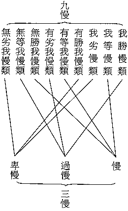



皆通见修断　九慢是从三慢所流出的，他的所断，同於七慢，所以不论，现在所欲问的，就是七慢由何而断？虽有人说我慢、邪慢，唯见所断，其餘的五慢，通於见修断，但如实的说，理应七慢皆通见修二道所断。既然如此，那又是怎样断法呢？这要看诸慢缘於什麼而起来说。假定是缘见道而现起的，那就属於见道所断；假定是缘修道而现起的，那就属於修道所断。



圣如杀缠等有修断不行　这两句明修断不行。意谓属於修道所断的七慢，在证道果的圣者身中，不一定是把他断除了的，虽还没有断除而仍成就，但有的现行，有的不现行，却是不一定的。其决定不现行的，只有我慢一种，其餘的六慢，圣者是还可以现行的。至於九慢，因以我见为所依而生起的，是我见之所增的，有学圣者既然已经断了我见，所以在修道位上，也就决不生起。举例来说：如杀缠等，在未离欲贪圣者的生命体上，虽还具有而未断，但也决定不现行。杀缠即杀害有情生命时现起的一种烦恼——瞋。等，是等於盗、淫、诳、无有爱全及有爱一分的烦恼。什麼叫做无有爱？无有，就是指的三界无常，如果於此贪求，是就名为无有爱。如有一类为苦所逼的众生，觉得在这无常苦迫的世间，再也不能住下去了，於是就生起这样的观念，希望自己在这次死了以后，就归於断坏无有，所以於无有而起爱。《婆沙》二十七说：「无有者，谓众同分无常，缘此爱，名无有爱，是故此爱唯修所断，以众同分唯修所断」。什麼叫做有爱一分？有爱，就是贪著未来的生命体。如有一类众生，希望自己将来做龙、做象，或做阿修罗，或生无想天，或生北俱卢洲等。一分，以初果圣者说，乐求后面的三果，也会生起有爱，现为简别那个有爱，所以叫做一分。这一分爱，是缘傍生等产生的，圣者决定不起。杀等诸缠，缘事而起，都是属於修道所断，初果有学圣者，对这虽未断除，但已不再现行。杀等是这样，当知慢类我慢，有修所断，圣者犹有，不说也就知道了，所以说「有修断不行」。



壬二　明事断不起



> 慢类等我慢恶作中不善圣有而不起见疑所增故



科文的事断，就是修所断。上面说缘修道而现起的慢不现行，这究竟是什麼道理？依我人的意见：未断应即可以现起，不现应即已经离去，何缘圣者犹有而不现起？本颂来说明他的原因。



慢类等我慢恶作中不善　这是指出事断不起的种类。慢类，即九慢类。等，是等於杀等诸缠。再加上七慢中的我慢。另外还有恶作中的不善恶作。不善恶作是对善恶作说的：如做错了事，生起深切的痛悔心及殷重的惭愧心来，觉得这是不应该做的，名善恶作。若做功德事，后来生起懊悔心，我为什麼要做这功德？这就是不善恶作。如是一切，都是缘事而现起的。



圣有而不起见疑所增故　这是说明有而不起的原因。在有学圣者的生命体上，虽成就如上所说的一切，但绝对不再现起发生活动作用，为什麼？因为是由见疑所增益的。如慢类与我慢，是有身见所增的；杀等诸缠，是由错误的邪见所增的，因为生起邪见，而后才行杀等；无有爱全，是由断见所增的；有爱一分，是由常见所增的；不善恶作，是由疑所增的，可是见疑二者，有学圣人於见道位已经永断，所以由他们所增的慢类等，虽还成就未断，但已不再发生现行作用了。《正理》更有别义说：「以诸圣者善修空故，善知业果相续理故，此慢类等、我慢、恶悔，圣虽未断而定不行」。



庚二　诸门分别辛一　明徧非徧行



> 见苦集所断诸见疑相应及不共无明徧行自界地  

> 於中除二见餘九能上缘除得餘随行亦是徧行摄



上来已说明了根本惑，现在来讲诸门分别。於中先讲第一徧行非徧行的差别。前说随眠有九十八，然而我们所要问的，就是於九十八随眠中，几是属於徧行的？几是属於非徧行的？颂中告诉我们：十一是徧行随眠，餘为非徧行随眠。前一行颂正明徧行十一，次二句明九上缘，后二句明俱起亦徧行。



见苦集所断　随眠通於四谛下都有的，但现在所说的徧行随眠，唯属见苦见集所断的一部分，属於见灭见道所断的一切，没有一个是徧行随眠，所以说见苦集所断。然指其中的那一部分呢？答：



诸见疑相应及不共无明　诸见，有见苦所断的五见，有见集所断的邪见、见取，合为七见，再加苦集各一的疑及无明，所谓七见、二疑、二无明，总计为十一徧行。颂中的相应，指相应无明，他是不是徧行，没有一定。与徧行随眠相应，就是属於徧行的，与非徧行随眠相应，就是属於非徧行的。所以此中所标的别数，是取自力起的不共无明，因这不共无明，在见苦集所断下，没有说是不是徧行的，所以成为十一。唯此是约欲界说，如以三界说，三界各有十一，应说有三十三是徧行。《婆沙》十八曰：「品类足说：九十八随眠中，三十三是徧行，六十五非徧行」。



徧行自界地　如上所说十一随眠，所以得能称为徧行，因就他们的力量说，是足能徧行於自界自地的五部诸法的，所以名为徧行。自界自地，简非他界他地。如欲界的徧行，唯於欲界五部随增，而於他界就没有随增功能了。为什麼如此？因徧行随眠，於他部法，有等流果或异熟果，所以能够随增，但望於他界他地，等流果及异熟果，就都没有了，所以不能随增。讲到这里，对於徧行两字，不得不加以说明。凡可成为徧行的，必须具备三个条件：一、徧以五部为所缘境界；二、徧於五部随眠随增；三、为因徧生五部染法。依此三义，立徧行名。除了这十一随眠，其餘的五部诸惑及彼相应俱有诸法，於此三义中，任何一义都不具有，所以不得立为徧行随眠。



於中除二见餘九能上缘　在这十一种徧行随眠中，除了身边二见，其餘的九种惑，一一能缘上界上地。为什麼要除身边二见？因欲界的有身见，唯能妄执自界的生命体为我我所，上界的我我所为他之所不执的，所以不能上缘。边见是依身见起的，有身见尚不能缘上，何况边执见？不用说，当然是更不能缘上了。《正理》四八更举餘师说：「身边二见爱力起故，取有执受为己有故，以现见法为境界故，必不上缘」。欲界九惑虽能缘於上界随眠，但上界惑却不能缘於欲界随眠，这是什麼道理？因为欲界，既不是定地，又不是离染地，没有一种力量，能够摄伏自界的烦恼，所以能够缘於色无色界；可是上界，既是定地，又是离染地，具有一种力量，能够摄伏自界的烦恼，所以不能缘於欲界随眠。



除得餘随行亦是徧行摄　此明俱起徧行摄。颂中的随行，是指十一随眠的相应俱有法。相应法，是与烦恼同时相应的心心所；俱有法，是不相应行中的得及四相等。於中除了得，其餘的一切随行，都是徧行所摄。为什麼要除去得？因随眠上得与随眠，不是属於同一果的。餘诸随行为什麼是徧行摄？因与随眠是同一果的。虽然如此，但究竟不是正徧行，所以说摄，真正徧行，上面说过，要具三义。彼相应法，只具有两种徧义，缺乏徧随眠五部的一义；彼俱有法，只具有一种徧义，即但能为因徧生五部染法，其他的二种徧义，是不具有的。



辛二　明漏无漏



> 见灭道所断邪见疑相应及不共无明六能缘无漏  

> 於中缘灭者唯缘自地灭缘道六九地由别治相因  

> 贪瞋慢二取并非无漏缘应离境非怨静净胜性故



已明徧行随眠唯是十一，兼显徧行因通彼随行，现在进而就漏无漏门分别：於九十八随眠中，有几是缘於有漏的？有几是缘於无漏的？这也是我们所应知道的。初一行颂总明，第二行颂别释，第三行颂简法。



见灭道所断邪见疑相应及不共无明六能缘无漏　此颂总明能缘无漏。前说徧行，唯就见苦集所断说。此明缘无漏，唯约见灭道所断明，同时还要知道的是颂中只指出缘无漏的六种随眠，其餘的随眠为缘有漏，准此可知，所以不说。见灭见道的随眠，原来也有多种，现在唯就见灭道所断的邪见、疑、彼相应不共无明，各三成六，能缘无漏。如再说得明白一点：见灭所断有邪见、疑、无明的三种，见道所断有邪见、疑、无明的三种，二三合拢起来成六，如是六种，诸界地中，能缘灭道，名缘无漏。欲界灭道各三成六，当知上二界亦各有六，三六合有十八随眠为无漏缘，餘八十是有漏缘。法胜六卷《毘昙》四说：「三界有十八使定无漏缘」，就是此意。



於中缘灭者唯缘自地灭　此下一颂，别明无漏缘。於六烦恼中，先就缘灭谛无漏者说，那他唯是缘於自地择灭，而不缘於他地择灭的，因九地灭的上下相望，是不含有因果性的，所以属於欲界系的三种随眠，就唯缘於欲界的诸行择灭，乃至属於有顶所系的三种随眠，就唯缘於有顶的诸行择灭。怎知上下相望灭非因果？因为不是同类因、等流果，所以与道谛不同，因为没有能作因、增上果，所以与苦集不同，既然如此，当然只有缘於自地择灭了。灭圣谛所以无因果义，因他是无为无生法，无相能够引起因果。姑以邪见为例，《正理》四八说：「谤灭邪见於九地中，一一唯能缘自地灭，此有所以，所以者何？谓若有法，此地爱所润，此地身见执为我我所，彼诸法灭，还为此地见灭所断邪见所缘……故由耽著此地行故，若闻说有此地行灭，便起此地邪见拨无，非上行中有下耽著，宁下邪见拨彼灭无」。



缘道六九地由别治相因　能缘无漏的六种烦恼，缘灭谛唯缘自地灭，我们已经知道，缘道谛的无漏，又是怎样的呢？通缘六地及九地道，於此首先需要了解的：六地，是指未至地、中间地以及四根本静虑地；九地，是在这六地上，更加下三无色地。以九地分别：如属欲界所系的邪见、疑、无明三种随眠，是就唯缘未至等六地的法智品道。所谓法智，因缘欲界的四谛，最初证知诸法的真理，所以名为法智，或说於六地定中，观欲界的四谛法，起无漏的智慧，名为法智。六地中的法智，如在未至地，唯能治欲界的见道谛惑，如在六地中，能治上八地的修惑。虽有治欲治餘的不同，但同为欲界的邪见、疑、无明所缘，因同是法智品类。如属上界所系的邪见、疑、无明三种随眠，那就一一能缘九地的类智品道。所谓类智，因缘上界的四谛，与下界四谛相类似，所以名为类智，或说依九地定，观上界的四谛境，起无漏的智慧，名为类智。色无色界的八地，每地有三种随眠，一一都能缘於未至等九地的类智品道，而各地的类智品道，或能治当地的修惑，或能治餘地的修惑，虽所治的不同，但同为八地的三惑所缘，因同是类智品故。为什麼缘道通於六九地？由别治相因的缘故。九地差别不同名别，能对治道叫治，虽则说是诸地各别，但无漏道能够对治，因展转相望更互为因。且如未至地中所起的无漏，与餘地所起的无漏，都可互为因果的，因道谛的无漏，不是属於界地所系的，所以异地可以互为因果。谓邪见谤果亦谤因，谤因亦谤果，不同其灭非展转因，唯谤自地不及上下。《正理》四八说：「由治有殊互相因故，谓所缘道虽诸地别，而展转相属互为因果故，由是邪见六九总缘。灭不相因，唯缘自地」。要知讲到能缘惑及所治的时候，经论中就据有漏的九地以说，因为未至、中间，是不别立所断惑的；但是说到所缘道及能治的时候，经论中就又依无漏的九地以说，因为欲界以及有顶天中，是没有无漏的能治道的。



贪瞋慢二取并非无漏缘　我们知道，灭谛下除了邪见、疑、无明，还有贪、瞋、慢、见取，道谛下除了邪见、疑、无明，还有贪、瞋、慢、见取、戒禁取，如是诸烦恼，本也为无漏所断的，为什麼并非无漏的灭道所缘？换句话说，为什麼不缘无漏的灭道？答：



应离境非怨静净胜性故　这是解释贪等不缘无漏的所以。贪是应舍离的法，其行相为爱，如爱灭道，那是善法欲，只有使之增进，不应使之舍离，今说应离，就是显示贪惑不缘灭道。瞋是缘於怨境起的，灭道不是怨的对象，缘之不会生瞋，所以瞋惑不缘灭道。慢是缘於粗动境起的，灭道是寂静为性，缘之不会心生高举，所以慢惑不缘灭道。非净计净，这是戒禁取的功用，灭道是以真净为性的，缘之以为真净，这并没有错误，所以灭道非戒禁取所缘的境界。不是真胜而妄以为真胜，这是见取的特能，灭道确实是真胜的，缘之以为真胜，正是恰到好处，所以灭道亦非见取的境界。



辛三　明二随增



> 未断徧随眠於自地一切非徧於自部所缘故随增  

> 非无漏上缘无摄有违故随於相应法相应故随增



前说十一徧行随眠缘於五部，能随顺增长，所以现在来明二种随增。二随增者，一是所缘随增，一是相应随增。今所欲问者，九十八随眠中，几种是由所缘故随增？几种是由相应故随增？於中，初颂明所缘随增，次二句简非所增，末二句明相应随增。



未断徧随眠於自地一切所缘故随增　凡是讲到随增，其烦恼一定是未断的，假定断了，那就说不上随增了，所以颂初特用未断两字。徧行随眠有两种：一是自界地的徧行，一是他界地的徧行。於徧行中，如果是属自界地的，其能普於五部自界地法所缘随增。为什麼说这是所缘随增？因能缘的徧行烦恼，於所缘的五部境上，能够随住增长，所以名为所缘随增。



未断非徧於自部所缘故随增　非徧行随眠也有两种，一是有漏缘的非徧行，一是无漏缘的非徧行。於非徧行中，如果是属有漏缘的，其唯能於自部自界地法所缘随增。为什麼说这是所缘随增？因能缘的非徧行烦恼，於所缘的自部境上，能够随住增长，所以名为所缘随增。此中将初句颂的未断二字取来，也是显示指未断的非徧行说的。



非无漏上缘无摄有违故　这是简别非徧行中的六无漏缘惑及徧行中的九上缘惑，於所缘境没有随增的意义，所以说非。为什麼道理？这有两个原因：一、无摄故：凡摄受自界自地诸法而为自己之所有的，在一切烦恼中，不出身见与爱，即由於有身见而执取自身，爱著以为己有，可有随增的意义，但诸无漏及上地境，不为诸下身见及爱摄为己有，所以缘无漏上境的下惑，非是所缘随增。二、有违故：无漏圣道涅槃及上地法，与能缘彼的下界地惑，是互相相违的，所以虽能为下地惑所缘，但因更互相违的关系，没有随增的意义。



随於相应法相应故随增　此明第二相应随增。随谓不管随於什麼烦恼，若徧行若非徧行，若有漏缘若无漏缘，若自界缘若他界缘，只要是於所相应的受等诸法相应，就名相应随增。《正理》四九说：「随何随眠於相应法，由相应故於彼随增」。我人的烦恼不现起则已，一现起必与受等相应，而使所相应的同成染污，如水杂毒，说名随增。



辛四　二性分别



> 上二界随眠及欲身边见彼俱痴无记此餘皆不善



此是二性分别门。二性，就是三性中的不善及无记。为什麼不说善性？因这随眠法，是属染污性，理必不通於善的。那末，九十八随眠中，几是不善？几是无记？答：



上二界随眠及欲身边见彼俱痴无记　此明有覆无记性的随眠。色无色的上二界中所有一切随眠以及属於欲界所系的有身见及边执见并那身边二见所相应的无明，都是有覆无记性的。上二界的一切随眠，所以没有不善性者，因为上界无苦异熟，从彼无有苦果异熟，证知彼无不善因性，如有不善因性，理应定有苦果。《婆沙》又有一说：「若法是无惭无愧自性与无惭无愧相应，是无惭无愧等起等流果者，是不善，色无色界烦恼不尔，故是无记」。欲界所系的身边二见及彼相应无明，所以不是不善性者，因凡叫做不善的，一定是与善相违的，但此我常二见，与彼施等善行，并不怎样相违，所以不名不善。怎知不相违背？如执我执常的有情，误认我是永在恒在的，为恐此常我将来会受到痛苦，所以不敢作恶，而经常的勤修布施持戒的功德，希望常我在未来世中，能够感受人天妙乐，因此但是有覆无记，绝对不可说为不善。至边见中的一分断见，所以也不可说为不善，因他是不违涅槃而顺厌离门的。《正理》四九说：「边执见中执断边者，计生断故，不违涅槃，顺厌离门，故非不善。如世尊说：若起此见，我於一切皆不忍受，当知此见不顺贪欲随顺无贪，乃至广说。又世尊说：於诸外道诸见趣中此见最胜，谓我不有，我所亦不有，我当不有，我所当不有」。但经部上座师不承认断见能顺涅槃，所以《正理》又说：「上座於此作如是言：何有如斯下劣边见能顺解脱？以诸有情一切妄见皆入此摄，然我不知有何意趣，执此边见能顺解脱」？论主依经部先轨范师，作著这样的解说：有情的有身见是有两种的：一是与身俱生的俱生我见，唯是无记性，属於修道所断；一是因邪思起的分别我见，是不善性，属於见道所断。现说身见无记性，是约俱生身见说的。然而此说，有部学者不承认，他们认为身见，只有分别，没有俱生，唯是见断，不通修断，至於禽兽等的妄计，应知那是修道所断不染无记邪智之所收摄。不管两家解说怎样不同，总之，欲界身边二见，唯是有覆无记性摄。



此餘皆不善　此明不善性的随眠。於欲界中，除上所说身边见及彼相应无明是无记性外，其餘属於欲界所系的一切随眠，因为与上相违，所以皆不善性。



辛五　明根非根壬一　明不善无记根



> 不善根欲界贪瞋不善痴无记根有三无记爱痴慧  

> 非餘二高故外方立四种中爱见慢痴三定皆痴故



前颂所说不善及无记随眠，於中，有几是属不善根？有几是属非不善根？有几是属无记根？有几是属非无记根？初二句明不善根；次三句，迦湿弥罗师明三无记根；末三句，外方诸师明四无记根。



不善根欲界贪瞋不善痴　可以说为不善根的，在诸不善随眠中，唯有属於欲界所系的一切贪、瞋及不善痴，因为这是不善的烦恼，而又为不善法之根，所以旧论十四说：「若惑非善又为非善法根」，就是此意。不善根，能生一切恶法，依於这一解释，根是因的意思。然而就此有人问道：一切已生恶法，皆能为后法生起之因，怎可说不善根只有三种？要知三不善根是对三善根而建立的，因为善根只有三种，所以不善根也只有三种，其他的一切已生恶法，虽能为后法生起之因，但不可立之为根。同时，如据《婆沙》所说，凡可立为根的，须具五个条件：一、通於五部，见疑不通五部，所以不立为根；二、徧依六识，五识身中没有恶慢，所以不建立慢不善根；三、是随眠性，缠垢等不是随眠，所以不立为根；四、能起粗恶的身语二业；五、断善根时，能作极坚牢极强固的加行。唯贪瞋痴具此五义，非所餘法，所以特地把他立为不善根。明白了什麼是不善根，其餘的烦恼非不善根，准此意义也就可知，所以颂中不复再说。



无记根有三无记爱痴慧非餘二高故　这是迦湿弥罗师明三无记根。照他们的意思说：不善根既有三种，无记根当然也就有三，那三种呢？就是无记爱、无记痴、无记慧。无记爱，约上界的贪说；无记痴，约上界的痴及欲界身边见相应痴说；无记慧有两种，就是有覆、无覆。有覆无记慧，是指欲界身见、边执见及色无色界的五部染污慧；无覆无记慧，是指威仪路、工巧处、异熟生、变化心的四种无记慧。有人这样问：疑慢二随眠，为什麼不说他是无记根？根之所以为根，因为他的定住义是很殊胜的，但疑是以犹豫为性，如说这是有呢？还是没有呢？转来转去的其性动摇而不定住，违於根的意义，所以不立为根。根之所以为根，是趣向於下的，如世间明白见到的，隐於土下的叫做根，但慢是以高举为性，不可一世的向上而转，与根法相异，所以不立为根。



外方立四种中爱见慢痴三定皆痴故　这是外方诸师立四无记根。颂文的中字，就是说的无记，因这是处於善恶之中的。然四无记是那四种呢？一、无记爱，就是上界的贪；二、无记见，就是上界的见及欲界的身、边见；三、无记慢，就是上界的慢；四、无记痴，就是上界的痴及欲界身、边二见所相应的痴。论文说：「何缘此四立无记根？以诸愚夫修上定者，不过依托爱见慢三，此三皆依无明力转，故立此四为无记根」。依照他们的意思，认为根是坚强义，所以《正理》说：「根义必依坚牢立故」。如此，慢可立为无记根，因为他有一种殊胜的力量，使诸瑜伽师退失百千殊胜的功德；如此，无覆无记慧，不可立为根，因为他的力量薄弱，不具有一种坚强的特性。



上来立三无记根与立四无记根的两说，在《婆沙》百五十六，评家认为前说为善，《正理》、《显宗》、此论，虽俱举两说，但均无评取，那末，论主的意思，究竟在什麼地方呢？从前后文看来，我们觉得论主之意，还是在於初说。这有两点可以证明：一、论文说「亦有三种」，对善不善并是三根，完全同於婆沙评家；二、论文叙说根义的时候，只叙毘婆沙师的根义，不叙外方诸师的根义。《正理》四九更说到上座不立无记根，并对他加以破斥，可以参阅。



壬二　因便明四记事



> 应一向分别反诘舍置记如死生殊胜我蕴一异等



诸契经中，如《杂含》三二、三四，《中含》六二《见经》及《箭喻经》，都曾说到十四无记事，那与这儿所说的无记，是不是相同呢？是不同的！为什麼不同？因经说的十四无记，专门是约应舍置问而立无记名的。关於问记论，原来有四种，现在本颂就是说的这个。於中，初二句，示问所依的四名，下二句，正明能依的问相。



应一向分别反诘舍置记　这是示问所依的四名。所谓问记，记是答的意思。即对四种不同的来问，予以四种不同的回答。发问所依的四名：一、应一向记；二、应分别记；三、应反诘记；四、应舍置记。所以颂文第一应字，应该通到下面；末后记字，应该通到上面。



如死生殊胜我蕴一异等　这是正明能依的问相。像上所说的四种，如其次第，发生死、生、胜劣、一异的四问，答其所问的也有四，是为四记事。一、如有人这样的问道：一切受生的有情，是不是皆当死呢？那就应一向的这样回答（记）他：一切受生的有情，不管是胎生，卵生等，必定皆当死的。生者必死，是缘起的定律，时不论古今，地不分中外，必然是如此的，我们可以肯定的，毫无含糊的这样答覆。二、如有人这样的问道：一切死了的有情，是不是都还要受生呢？那就应分别的去回答（记）他：有的死了还要受生，如仍具有烦恼的有情；有的死了不定受生，如烦恼已断的有情。因为受生不受生，全看有无烦恼的滋润业，所以须要作分别记。三、如有人这样的问道：人究竟是胜是劣？那就应运用反诘的方法去回答（记）他：你所说的胜劣，是观於什麼而言的？是观於高级的天趣？抑观於低级的恶趣？假定说是望於诸天，应记我们人劣；假定说是望於鬼畜，应记我们人胜。胜劣是对待的，必须对待其他的有情，方可显出谁胜谁劣，所以须要用反诘记。四、如有人这样的问道：为质素的五蕴与和合的有情，究竟是一是异？那就应运用舍置记。所谓舍置记，根本就是默然不答。因这在道理上是不应该问的，为什麼？要知凡问一个什麼，必须要有那个自体，否则，岂不问了等於不问？如有实在我的自体，当然可问是一是异，我的自体本来没有，还有什麼一异可说？如问石女儿是黑是白一样，石女根本就没有儿，何得论其是黑是白？关於舍置记，《婆沙》有问答。「问：第四无答，云何名记？答：佛虽告言此不应记，而实已与答理相应，是根本答故亦名记，令彼问者得正解故。或有默然於理得胜，况酬彼问而非记耶」？上来依於婆沙师说已竟，颂中最后还有一个等字，是等於对法诸师及契经所说。对法诸师所说，二三差别难辨，因为都是属於反诘的，这看论文可知，於此不再烦说；毘婆沙师所说，唯独是指事别，於义不违於经，论主为欲直依经说，不取前二，所以现在根据经说，略为一谈：一、如有问诸行是无常吗？那就应一向记：不错，诸行是无常的。二、如有问故思造作业后，应当受什麼报果？那就应分别记：如所造的是善业，就受人天果，如所造的是恶业，就受恶趣果。三、如有问士夫想与我为一为异？那就应反诘记：你所说的我，是依於什麼说的？假定是依色蕴上的粗我说的，因为色与想是不同的，就应记说与想是差别的。四、如有问世间为常（一问）？为无常（二问）？亦常亦无常（三问）？非常非无常（四问）？世为有边（五问）？无边（六问）？亦有边亦无边（七问）？非有边非无边（八问）？如来死后为有（九问）？非有（十问）？亦有亦非有（十一问）？非有非非有（十二问）？为命者即身（十三问）？为命者异身（十四问）？那就应舍置记：因这都是从自我出发的。如从现在的自我出发，依於过去世，有常无常等的四见；依於未来世，有边无边等的四见：依於如来涅槃，有有非有等的四见；再加即身、异身的二见：合为十四不可记事。



辛六　明惑能系壬一　约世明能系癸一　正明世系



> 若於此事中未断贪瞋慢过现若已起未来意徧行  

> 五可生自世不生亦徧行餘过未徧行现正缘能系



这是论究怎样的随眠在怎样的境事上有所系缚。讲到事系，本来是很多的，但现在所要辨的事系，唯就依缘及部类辨。《正理》五〇说：「就依缘者，谓眼识俱所有随眠，唯於色处为所缘系，於自相应诸心心所意处法处为相应系……若意识俱所有随眠，於十二处为所缘系，於自相应诸心心所意处法处为相应系。就部类者，谓见苦断徧行随眠，於五部法为所缘系，於自相应诸心心所为相应系，见苦所断非徧随眠，唯於自部为所缘系，於自相应诸心心所为相应系。如是一切随应当说」。现约三世时间辨系，首先标宗，就是「诸有情类於此事中，随眠随增名系此事」；其次问起，就是「应说过去、现在、未来，何等随眠能系何事」？於中，初一句总标所系事，下七句明能系惑；而在这七句中，前五句就自相惑说，后二句约共相惑说；在自相惑的五句中，初二句明过现意相应，次三句明未来六识相应。未断言与能系言，各通中间五处。



若於此事中　这是总标所系事。系事，是指所系境事言。有人说：这就是於五蕴法上立所系。色法就是一一极微，心心所就是一一刹那，於此诸法上，皆有烦恼缘，假定把一一极微及刹那心心所上的烦恼断尽了，一一得一择灭。如欲明白下面的颂文为何，先当知道随眠有二种：一是缘别法起的自相惑，即贪瞋慢三者；一是缘多法起的共相惑，即见疑痴三者。了知自共相惑的不同，下面的颂文，也就容易明白了。



未断贪瞋慢过现若已起　此明过去现在意识所相应的自相惑。未断，即是显示有能系的功用，因凡是能系的，必然是未断的。於所系事上，如果还有未断的贪瞋慢，即证明他仍有能系惑的存在。就三世说：贪瞋慢三於所系事上，如果是属过去已生（简别未生）而未断（简别已断）的，或者是属现在已生而未断的，那他就能系於此事。所以必须说已生未断者，因为未生或者生了已断，是没有能系的作用的。於此或有人要问：贪瞋慢三与意相应，既然系於三世，为何不把他说为徧行？这有两个理由：一因贪瞋慢是自相惑，不同共相惑的徧行；二因贪等虽系三世，但不是三界一切有情，都能决定徧起系三世诸有漏法尽的。或有有情具有徧系自境之义，或有有情不具徧系自境之义，徧不徧系自境，其类是不一定的。如再说得明白一点：过现贪瞋慢中，若缘此事而起，就系於此事，若缘餘事而起，就不系於此事。



未来意徧行五可生自世不生亦徧行　此明未来六识相应的自相惑。意谓未来世的意识所相应的贪瞋慢三，对於境事，不管是已生或者不生乃至未断，徧於三世皆能系缚。法胜六卷《毘昙》第三说：「意地生不生法，亦缘缚三世诸有漏法。何以故？彼缘一切有漏法故」。《正理》五〇说：「虽於此事或生不生，但未断时皆名能系」。所以然者，因为未来意识，境流於三世的，如有一类众多意识与贪相应，或有一类众多意识与瞋相应，乃至一类众多意识与慢相应。其识虽在未来世境，但自迁流行於三世。再说，未来意识是无量无边的，所以不管对於什麼所缘境事，必都能够徧缘。意识明白了，五识怎样呢？这要看他可生不可生的来分别：未来五识相应贪瞋，假定是未断而可生的，那就唯独系於自世，因为五若已生，唯能为现量缘，所以可生亦唯未来，可生既然唯在未来，已生而流至现在，亦即是唯系现在，已灭而落谢过去，亦即是唯系过去。《显宗》说：「由此已显五识相应可生随眠，若至过去唯系过去，至现亦尔。义准若与意识相应可生随眠，若至过现未断，容系非自世法」。未来五识相应贪瞋，假定是未断而不生的（非慧道所断不生，只是缘缺不生，所以说未断不生），亦能缚三世及一切自所缘事。颂疏说：「谓所缘境，或在未来，或流至现在，或谢过去，识虽未来缘缺不生，由未断故，性能系彼三世境也」。《正理》五〇说：「诸与五识相应随眠，若定不生亦缚三世，谓彼境界，或在未来，或在现在，或在过去，彼虽已得毕竟不生，而未断时性能系缚」。法义解释这段文说：「且有眼识可缘色，眼生起缘缺得永不生，是则未来不生眼识，其色境在未来，次流在现，后灭若过，境已涉三世，故名系三世。由是须知缘与系别，虽是不缘而即能系。若眼识不得缘缺不生，随境涉三世系自世，然得永不生，常居未来，虽居未来，性是三世色能系」。



餘过未徧行现正缘能系　此明六识相应的共相惑。餘，指见、疑、无明，因这三者，在贪等外，所以名餘。就共相惑与六识的关系说：见与疑，唯是意识所相应的，无明，则通於六识。此所餘的六识相应的见、疑、无明，不论是在过去，抑或是在未来，如果说是未断的话，一一皆能徧缘三世一切事境，因为这是共相惑，所以於自所缘，必定能够徧系。慧说：「共相惑与意识种类多故，缘一切境尽，如过去邪见拨过去，现在、未来亦然」。过未世虽如此，若现在世不然。现在世的见、疑、无明，当他正在缘境时，不管随於什麼境界，都必能系此事。颂说正缘，是显示缘境系事，必是在一物，而又是同时。唯於此中，有意识与五识的差别：五识必是现量的，所以现在正缘於色，就唯系於现在色事；假定意识现在前时，如果正缘过去未来之境，是就系於过去未来境事，如果正缘现在之境，是就系於现在境事。虽则说是意识相应有世徧，共相惑故有事徧，但因现在唯一刹那，於此一刹那中，如果缘於这境，是就不能缘於他境，因为非定皆徧，所以不名徧行，与过未有多念，有著很大的不同。总前所说，聊列一表如下：



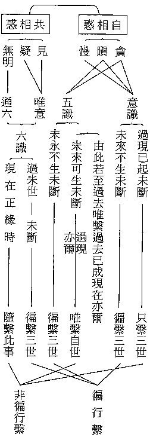



癸二　三世有无子一　有部以教理定宗



> 三世有由说二有境果故说三世有故许说一切有  

> 此中有四种类相位待异第三约作用立世最为善



前约三世明能系，我们已经知道，但由此而来的问题，就是关於过未的有无。如论说：「若实是有，则一切行恒时有故，应说为常；若实是无，如何可说有能所系及离系耶」？说有说无，似乎都成问题，必须把他探究清楚，然后方可辨能所系，所以《正理》五〇说：「今应思择过去未来，为实有无方可辨系」。但是讲到过未有无，在佛教的学者中，是有著很大诤论的。那主要的，就是三世有者与二世无者的两大阵线的对立，而彼此又各拥有广大的群众，所以互相弹斥，谁也不肯让谁。《正理》五〇对此也有透辟的说明：「然於过未实有无中，自古诸师怀朋党执，互相弹斥，竞兴论道，俱申教理，成立己宗，处处传闻如斯诤论：实有论者广引理教，种种方便破无立有；实无论者广引理教，种种方便破有立无」。由此可知学者的诤论，是怎样激烈的了。大体说来，有部是主张三世有的，经部是主张二世无的；此二颂，是有部以教理定宗，后一颂，是经部举理说广破。《正理》五〇於颂前：先广辨诸有相貌，明经部有非有为境，皆能生觉，有部唯缘有境，觉方得生：次复辨去来实有假有，成立去来实有，破论主朋经部。所以众贤论师特别声明自己的立场说：「故我今者发大正勤，如理思惟立去来世，异於现在非毕竟无，谓立去来非如现有，亦非如彼马角等无，而立去来体具是有，唯此符会对法正宗」。学者如欲知道正理论主所说的有相以及假有实有之辨，请阅《顺正理论》卷第五〇，此不详说。颂初二句证成，次二句结宗，后四句答覆两个问难。



三世有由说二有境果故　三世有，这是标宗。意思是说：过去、未来、现在三世，都是实有的。怎知三世是实有的呢？由圣教及《正理》可以证知。㈠、由经说故：《杂含》第三有一经说：「尔时世尊告诸比丘：过去未来色尚无常，况复现在色？多闻圣弟子，如是观察已，不顾过去色，不欣未来色，於现在色厌离，欲灭寂静，受想行识亦复如是」。次广约三世说，今因现在极成，所以但引过未文。然说得最明白的，无过於《正理》：「谓世尊说过去未来色尚非常，何况现在？若能如是观色非常，则诸多闻圣弟子众；於过去色勤修厌舍，於未来色勤断欣求，现在色中勤厌离灭。若过去色非有，不应多闻圣弟子众，於过去色勤修厌舍，以过去色是有故，应多闻圣弟子众，於过去色勤修厌舍；若未来色非有，不应多闻圣弟子众，於未来色勤断欣求，以未来色是有故，应多闻圣弟子众，於未来色勤断欣求」。经中既说过去色有勤修厌舍，未来色有勤断欣求，明知过去未来是实有的。㈡、二缘生故：我人的心识生起，必仗所依所缘的二缘，然后方可得生。《杂含》第八有一经说：「世尊告诸比丘：有二因缘生识，何等为二？谓眼色、耳声、鼻香、舌味、身触、意法」。假定说去来世真非实有的话，能缘过未的意识，是就缺少了两种助缘，这话怎讲？为意识之所依的意根，本是在於过去的，过去既然没有，当就缺少了意根之缘；为意识之所缘的法境，原是通於过未的，假定过未没有，岂不也就缺乏了法境之缘？二缘不具，能依能缘的彼识不生，可是事实不然，证知过未有实自体。㈢、识有境故：一切认识作用的生起，必有他的所了之境，因为先见有境，然后识方得生。如世尊说：「各各了别彼彼境相名识取蕴。所了者何？谓色至法」。没有说是有识而无境的，所以缘去来识，应知定必有境，若去来世境体实无，是就应有无所缘识，所缘若无，识亦应无。既不承认识是非有，理当承认实有去来。不可一面否定有实去来，一面又肯定说能缘识有。㈣、业有果故：我人造作的善不善业，早已落谢过去，即此过去世业，待缘能招当来爱非爱果。从业在过去世有，证知过去实有，从果在当来世有，证知未来实有，假定如二世无者，说无过去未来世，善恶二业其体应无，爱非爱果亦应非有。然已谢业既有当果，应知过未决定非无。上来四义证三世有，初二是教证，后二是理证，由此教理证成己宗。《正理》五一说的「我引教理成立己宗，过去未来现在实有」，就是此意。



说三世有故许说一切有　如有自认自己是一切有宗的学者，无论怎样都应承认去来实有，因为唯有说三世皆定实有的，方可许彼是说一切有宗。《正理》五一说：「诸有处俗及出家人，信有如前所辨三世，及有真实三种无为，方可自称说一切有，以唯说有如是法故，许彼是说一切有宗，餘则不然，有增减故，谓增益论者，说有真实补特伽罗及前诸法；分别论者，唯说有现及过去世未与果业；刹那论者，唯说有现一刹那中十二处体；假有论者，说现在世所有诸法亦唯假有；都无论者，说一切法都无自性皆似空花：此等皆非说一切有」。於中，分别论者的意趣，与饮光部的宗义同，如《婆沙》五一说：「或复有执：诸异熟因果若熟已其体便无，如饮光部。彼作是说：诸异熟因，果未熟位其体犹有，果若熟已其体便无。如外种子，芽未生位其体犹有，芽若生已其体便无」。所以照有部的学者说：一切憎厌实有去来的学派，不管他怎样的说有，都没有资格自称是说一切有者，因为他们不承认去来有实自体，其思想与那都无论者，只是隔著一刹那见未全相同而已，怎可妄自认为是说一切有？



此中有四种类相位待异　从此以下的四句，是答覆两个问难的。如是向上所说的一切有宗，自古以来的学者，虽同样的说三世有，但彼此所运用的方法，却有著很大的不同，然而即此不同共有几种呢？现在颂文告诉我们：在此有部的学者中，运用不同的方法建立三世，约有四种差别：一、类异，二、相异，三、位异，四、待异。第一类异，是法救论师所主张的。依照他的意思：诸法为体，在这诸法上，由於有三类的差别，所以就建立三世的不同。如从未来至现在时，舍未来类，得现在类，如从现在流至过去时，舍现在类，得过去类：所以诸法活动於三世的时间中，只说他类有不同，不可说他体有差别。举例来说：如破金器改作其餘的东西时，在形态上虽好像是变了，但金体仍是那个，丝毫没有变质。第二相异，是妙音尊者的主张。依照他的意思：三世建立的差别，完全由於相的不同。麟记说：「相谓相状，非生等四相」。光记说不相应中别有一类世相不同，三世有异，这是错误的，因在妙音所造的《甘露味论》上，虽列有不相应行，但并没有别立四相。然则怎样由相不同而建立三世呢？如法在於过去，正与过去相合，而不名为离现未相，因为过去相显，所以但名过去；如法在於现在，正与现在相合，而不名为离过未相，因为现在相显，所以但名现在；如法在於未来，正与未来相合，而不名为离过现相，因为未来相显，所以但名未来。可见诸法活动於三世的时间中，只可说他相有不同，不可说他体有差别。第三位异，是世友尊者的主张。在他的意思：三世之所以有别，完全在於位的不同。如未发生活动作用的阶位，就名为未来；如正发生活动作用的阶位，就名为现在；如活动的作用已入於过去的阶位，就名为过去。所以颂疏说：「至位位中，作异异说。如运一筹，置一位名一，置百位名百，置千位名千，历位有别，筹体无异」。因而诸法活动於三世的时间中，只可说他位有不同，不可说他体有差别。第四待异，是觉天尊者的主张。他的意思是说：三世之所以有别，完全由於观待不同。如前观后，前名过去，如后观前，后名未来，观待前后，中名现在。如一女人待前待后，待前父母名之为女，待后儿女名之为母。「如是诸法行於世时，待现未名过去，待过现名未来，待过未名现在」。所以诸法活动於三世的时间中，只可说「前后相待立名有异，非体非类非相有殊」。立世差别既然有这四种，而在这四种中，那个所立的最为妥善最可依凭呢？



第三约作用立世最为善　这是答覆第二问难，亦即破三取第三说。依照论主的意思：在此四种说一切有中，第一、第二、第四三家所立悉皆非理，唯有第三约作用建立三世最为完善。《正理》五二说：「由此应知尊者世友，所立实有过去未来，符理顺经无能倾动。谓彼尊者作如是言：佛於经中说有三世，此三世异云何建立？约作用立三世有异：谓一切行作用未有名为未来，有作用时名为现在，作用已灭名为过去，非体有殊」。然而这里所说的作用，究竟是指的什麼呢？是指有为法的引果功能，即餘性生时，能为他的因性，所以依此立世有殊。可是，其餘三师的建立，为什麼悉皆非理？且如第一法救论师，执法有转变的作用，那就如数论学者执三德转变成二十五谛一样，所以应把他归於数论系的思想中。今论所破，同彼《杂心》，彼说：「当知此是转变萨婆多」，《婆沙》亦曾有破，可知这不是有部的正宗。《正理》五十二破论主说：「今谓不尔！非彼尊者说有为法其体是常，历三世时法隐法显，但说诸法行於世时，体相虽同而性类异。此与尊者世友分同，何容判同数论外道」？正理论主的这一反破，并不能挽救他的判同数论，因彼法救既离自性别说其类，终归是走上了性常的路线，尤其从他的金器、乳酪的譬喻看，更可发现他的这一思想结论，况且三世的流入，未来有灭，过去有生类，完全是同於数论所说的体性常住而用不断转变的，怎可说是不同？假定说部分同於世友，是就不可破的话，餘师也有部分同於世友（体性不异即同），难道也不可破？所以分同不可破的这句话，是不能成立的。第二妙音尊者所立，世相杂乱，为什麼？因为三世各有三世相故。第四觉天尊者所立，同样有三世杂乱的过失，怎麼样？即於三世法中，一一皆有三世，如过去世，有多刹那，前一刹那，应名过去，后一刹那，应名未来，中一刹那，应名现在；若未来世，虽还没有分出前后，因有多念的缘故，容有前后的存在，所以同过去世一样的杂乱：至於现在，虽则说是唯一刹那，而与过去有著差别，然望前后杂乱是同，如以现在望於未来，现在在前，是则应名过去，如以现在望於过去，现在在后，是则应名未来，若前若后，复名现在，所以虽则是在一念之中，但从法的望前望后，已得三世之名了。慧说：「现在虽一念，由观前后不同，前后经三念，三念皆现在摄，故云现在亦应有三世」。从上分别三师的过失看来，益发证明第三世友尊者，约作用位，立三世别，最善！



子二　经部举理说广破



> 何碍用云何无异世便坏有谁未生灭此法性甚深



论主上面说第三世友立世最善，这还是站在有部立场说的，实际论主是同情经部二世无的主张的，所以现在特依经部举理说来广破。首先作这样的难说：你所说的过去未来，应该叫做现在，为什麼？因你执有实在自体的缘故，如正有作用时，或如马角等。或者这样责难亦可：你所说的过去未来，不应叫做去来二世，为什麼？因你执有实在自体的缘故，如汝所说的现在。就这样的一难，去来二世的实有，已经不能建立，但为使人更正确的了知过未非实有，所以再用颂来广破。於中，初三句经部破有部，后一句有部唱法性难思。唯旧论的此颂，与新论的所译，颇有不同，如彼卷十四偈说：何碍？缘不具非常此云何？坏悉檀理故（这句是新论所无的），功能不异故（相当於新论的无异二字），世义则不成（相当於新论的世便坏三字），未生灭云何（此即新论的第三句）？由去来体故（这也是新论所无的，不过旧论又没有新论的最后一句）。颂文初句中的用字，光记及颂疏，均作两度说，就是：何碍用，用云何，但实际只属下而不可说是通上的，所以旧论无用言，而唯牒释何碍二字，次牒释此云何三字，假定不是这样的话，颂文为什麼不译成「何碍用用何」？所以光记等将用作两度说，是不对的。



何碍　这是第一何碍力难。经部学者说：假定如你有部所说法体是恒有的，那就应该在一切时中，都能生起作用，因为作用是依体起的，法体既然恒有，用当恒时现起，可是事实上，用是时有时无的，那我倒要问你：究竟有股什麼障碍的力量，能够令此法体所起的作用，有的时候有，有的时候没有？假定说是由於众缘的不和合，所以作用有时不起，那也不成理由，因为汝宗所说的诸行及彼众缘与我宗所说是不同的：我们认为有为诸行，在众缘和合下，是本无今生的，生彼诸行的众缘，有著种种的差别，有时和合有不和合，所以诸行可不恒生；你们容许诸行众缘，於一切时中，恒常有体的，既常有体，应常现在，怎能为碍？所以承认体常而不承认用常，那在道理上是讲不通的！



用云何　这是第二更有作用难。经部学者说：假定如你有部所说法体於三世皆有，而这去来今的三世建立，不是由於法体本身，而是由於作用分别，那我倒要问你：这能成的作用，亦有他的三世，而此作用的三世，又是那个使他成为三世差别的呢？假定说更有其他的作用令此作用成为三世的差别，那末，用复有用，岂不成为无穷？



无异世便坏　这是第三世义破坏难。初无异二字，是有部宗救。彼救更有作用难说：一切作用都是从法体上所现起的，离开了法体就没有另外的作用，如果承认作用是异於法体的，那可有你所说的过失，然而我们并不认为作用异体，体不离用，用不离体，体用是相即的，不离用的法体，既没有无穷的过失，不离体的作用，当然也就没有此失！经部反破他说：假定照你这样说的话，那所建立的世义，就被你破坏了！为什麼？因为作用就是法体，法体既然是恒有的，作用照理亦应恒有，作用如果恒有，怎麼可以有时叫做过去，有时叫做未来？所以汝之所立世义不成！



有谁未生灭　这是第四未生已灭不成难。经部学者说：假定如你有部所说过去未来皆如现在一样是实有的话，那就应该都名现在，为什麼？因为你说过未是实有的。现我倒要问你：你承不承认过未是现在？假定不承认过未是现在，是就不应说过未有实自体：假定承认过未就是现在，那你又以什麼为未生的，叫做未来？又以什麼为已灭的，叫做过去？如是展转推徵，「故不许法本无今有，有已还无，则三世义，应一切种皆不成立」（论文卷第二十、五）！从所引的论文看，我们就可知道：经部的宗义，是现在实有，过未是无；而他三世的建立，是这样的：就诸法的本无位，建立未来，就诸法的今有位，建立现在，就诸法的还无位，建立过去。因此，准自所立的宗义，难破有部的宗义。论主意朋经部，所以特依经部作此解说。



最后论主更评斥有部学者说：你们一方面承认法体是恒有，一方面又说性是非常，像这样的常与非常的义言，我真是从未听过，你们真可以算是随心所欲，要怎麼说就怎麼说了。「依如是义，故有颂言：许法体恒有，而说性非常，性体复无别，此真自在作」！自在，是印度宗教家所计的大自在天，为世间的创造主，任随自己的意志，要作即作，是不受丝毫限制的。你们现在随心所欲的要说就说，岂不等於那个自在天吗？这简直把有部看做外道，可谓轻调得非常到家了！



然而於此，有部根据经部过未无实说而加以反诘道：假定真的如你所说去来非实有的话，那能系所系以及离系又从何说起呢？这没有问题，依我的宗义，可作这样说明：过去烦恼所生随眠，因在现在是还有的，所以说有过去的能系烦恼；未来烦恼所因随眠，在於现在也是有的，所以说有未来的能系烦恼；即此能缘过去未来所缘境事的烦恼随眠，在现在世是存在的，所以说有过去未来的所系缚事。假定在现在的随眠种子断了，那过未的境事就可得离系名了。现在随眠，有果随眠与因随眠的差别：若断现在的果随眠，就是断过去的因烦恼；若断现在的因随眠，就是断未来的果烦恼。由是我们应当知道：说过未的能所系及与离系，不是约实有的过未说，而是据於曾有当有说，所以我们虽主张去来非实有，但不妨能系所系及与离系的建立。



此法性甚深　这是有部说法性难思。上来仅就颂文，对有部提出四点责难，论文还有一段，详破有部的所立及证，为避烦琐，略而不论，有欲知者，请阅论文。有部被论主一再的难破，对於很多难题，简直无法解答，於是在不得已之下，只好叹法性的甚深，不是我人寻思的境界，然而不能因为我人的不能通释，就诽拨说无有实在的过去未来！照论文看，有部已是词穷义尽，无可再说，但从《正理》去看，对於论主的难破，都曾加以通释的，所以众贤论师不承认有不能解答的问难，不特如此，而且认为论主说的不能通释，是诡设谤言！事实，论主是不是诡设谤言？不然！要知你有部宗，前以识有境、业有果的二理，成立过未的实有，所用的那个同法喻，是不现在的，而用做什麼呢？由於这样的道理，说如现在实有去来，怎麼可以说是诡设谤言？所以你顺正理主，虽能通释我的诸难，但这不过是你自情以为如此，实际那里能够通释我的所难？



壬二　约断明离系



> 於见苦已断餘徧行随眠及前品已断餘缘此犹系



上来因辨随眠，说到於如是位系如是事，可见事与系的关系，是非常密切的。然而在此我人不得不问的：假定诸事已经断了，那他是不是离系？假定说是已离系了，那他是不是已断？这要分开来说：如果是事已经离系，那他必然是已断，然而有事虽说已断，但并不能说是离系。断而不能离系，究竟是怎麼一回事？现在颂文就是答覆这个问题的。於中，初二句明见道位，第三句与「餘」字明修道位，最后四字，通见修二道位。於者境声而流修位，是简别不缘的。



於见苦已断餘徧行随眠缘此犹系　颂中的餘字，本广涉及到集灭道修的四部的，但下有徧行两字，是就唯约集谛的烦恼说了，因徧行惑唯是苦集谛所有的。在苦谛下，假定苦智已生，断除苦谛所应断的烦恼，证得无为，但因集智还没有生起，仍有餘集谛的徧行随眠，即此集谛未断的徧行随眠，缘於这苦谛时，犹系缚於苦谛，名为惑虽断而事未离系。《正理》五三说：「於见位中，餘及徧行应随去一，然此烦说缺缘此言」。由於这样的道理，所以《显宗》卷第二六，将颂文的「徧行」改为「缘此」二字。其实，本颂并没有他所说的过失，因为颂末「缘此犹系」的四字，是作两度读的，那里缺少什麼「缘此」两字？假定说本颂的「餘及徧行随一烦说」，那显宗的「餘缘此」三字前后两说，岂不也嫌重复？假定说「徧行」两字无用而须除去的话，那为什麼长行又说「徧行随眠」？



及前品已断餘缘此犹系　於修道位的九品随眠，其前面的八品，不管是断了那一品，都叫前品已断，虽则前品已断，但因后品未断的关系，即此后品缘於前品的时候，前品之事犹为后品的能缘烦恼所系，所以名为惑虽断而事未离系。《正理》五三说：「及声兼明前前已断，后后未断皆能系义。此中何用说缘此言？修断九品必相缘故，非是所缘者有时非所缘，故缘此言定为无用。若谓别说有不能缘，即徧行中亦应简别，以有见集所断徧行，不缘见苦所断事故」。



辛七　明惑随增壬一　正明惑随增



> 见苦集修断若欲界所系自界三色一无漏识所行  

> 色自下各三上一净识境无色通三界各三净识缘  

> 见灭道所断皆增自识行无漏三界中后三净识境



明惑随增，就是说明怎样的境事，有那几种随眠随增。这如随所缘的境事，一个一个的说起来，那就真的未免太多，所以现在只好简略的说一说，即此简略的一说，业已越过了众多的问流（其问众多，犹如水流，名为问流）。然则如何简略而说呢？谓法虽有很多，略则有十六种，即三界各有五部，三五一十五，再加无漏法，合为十六。五部当中的灭道，不就是无漏法吗？为什麼还要另立无漏法？要知五部法中的灭道，是取其下的烦恼惑，今取灭道的自体，所以於五部外，别立无漏法。所缘的境事既有十六，能缘的心识也有十六。现在我们首先所应知道的：就是那一种法为那种识所缘的境，所以有此三颂。於中，初二行颂明三界苦集修的三境，次二句明三界灭道的二境，后二句明无漏法境识。



见苦集修断　这是通标三界的三部，即见苦所断部，见集所断部，修道所断部。



若欲界所系自界三色一无漏识所行　此下别释，先明欲界。假定是属欲界所系的见苦、见集、修所断法，一一都为五识所缘。那五识呢？就是自己欲界的苦、集、修三及色界的修所断一，并无漏识一，总此五者，皆容缘於欲界所系的三部。《正理》五三说：「且欲界系见苦断法，为自界三识所缘者，谓欲见苦所断一切，及欲见集所断徧行，欲（界）修所断善无记识，色（界）修所断善识非餘，无漏识中唯法智品；见集、修断、如应当知」。容缘的「容」字，显示有不为其所缘。以见苦为五识所缘说：苦谛自部下的十种随眠为同类因，能缘苦部，假定是徧行因，缘他部及九上缘，那就不缘苦谛，因五识中有缘不缘时，所以论文说「容」。集下缘苦者，七惑中的徧行因，就能缘於苦谛，缘他部及九上缘，那就不缘苦谛。修部缘苦者，修有三性识，属於善及无记中的闻思慧，学观谛理及作无我观，那就缘於苦谛，假定是不善识，那就不缘苦谛。色界修部缘欲界苦者，如於初定近分时，厌下苦、粗、障，就能缘於苦谛，欣上净、妙、离，那就不缘苦谛。无漏识缘欲界苦者，如果是苦法智忍、苦法智，就能缘於欲苦，假定是苦类智忍、苦类智，那就不缘欲苦。见苦如此，见集准苦说可知。今依《婆沙》八十七，将见苦等为五识缘，图示如左：



　　　　　　　　　┌一、欲界见苦所断一切随眠相应识  

　　　　　　　　　│二、欲界见集所断徧行随眠相应识  

　　　见苦所断五识┤三、欲界修所断善及无覆无记识  

　　　　　　　　　│四、色界修所断善及无覆无记识  

　　　　　　　　　└五、无漏识谓苦法智忍苦法智  

　　　　　　　　　┌一、欲界见苦所断徧行随眠相应识  

　　　　　　　　　│二、欲界见集所断一切随眠相应识  

　　　见集所断五识┤三、欲界修所断善及无覆无记识  

　　　　　　　　　│四、色界修所断善及无覆无记识  

　　　　　　　　　└五、无漏识谓集法智忍集法智  

　　　　　　　　　┌一、欲界见苦所断徧行随眠相应识  

　　　　　　　　　│二、欲界见集所断徧行随眠相应识  

　　　修道所断五识┤三、欲界修所断善（生得、加行）无覆无记（通四无记）  

　　　　　　　　　│四、色界修所断善（生得、加行）无覆无记（通三无记，除工巧无记，无上界故）  

　　　　　　　　　└五、无漏识通摄四法智品



修部为五识缘是这样的：苦集二谛下的徧行随眠，能够缘於修所断法，假定是九上、自部缘的随眠，那就不能缘於修所断法。色界修部缘於欲界修所断法，如善作无我观及苦粗障，那就能缘，若作静妙离及染无记，那就不缘。无漏识缘於欲界的修所断法，如果是法忍智就缘，假定是类忍智就不缘。欲界修部自缘修所断法，谓以闻思观於谛理及无我观，能缘自部。



色自下各三上一净识境　此明色界。假定是属色界的见苦、见集、修所断法，一一都为八识所缘。那八识呢？就是自界的苦、集、修所断三，下欲界的苦、集、修所断三，合为六识，再加上无色界的一修所断识，并一无漏净识，总此八识，一一皆容缘於色界所系的三部。为自界三识所缘，如前欲界所说可知，今不重说。为下欲界三识所缘，是怎样的呢？谓欲界见苦、见集所断的九上缘惑，能缘色界的三部所断法，但唯作自界缘的随眠，那就不能缘色界的三部所断法。欲界的修所断通於三性，如果是善作欣上心及无我观的，就能缘於色界的三部所断法，如果是餘善及染无记，那就不能缘於色界的三部所断法了。无色界的修所断识，缘於色界的三部法，是这样的：在空无边处的近分定的当儿，修厌下的三行观，就能缘色界的三部所断法，修欣上的三行观及染无记心，就不能缘。无漏净识缘於色界的三部法，是约类智忍说的，如果是法智忍，那就不能缘了。



无色通三界各三净识缘　此明无色界。假定是属於无色界所系的见苦、见集、修所断法，一一都为十识所缘。那十识呢？就是三界各有苦、集、修的三识，三三如九，再加一无漏净识，总此十识，一一皆容缘於无色界所系的三部诸法。欲界与色界的各各三缘，如前欲界缘於色界所说，自界的三缘，如前欲界所说，无漏净识所缘，如前色界所说，所以现在不再一一叙说。



见灭道所断皆增自识行　此据灭道烦恼说，不是约道谛说。假定是属欲界所系的见灭、见道所断法，一一为六识缘。那六识呢？㈠、欲界见苦所断徧行随眠相应识；㈡、欲界见集所断徧行随眠相应识；㈢、欲修所断善及无覆无记识；㈣、色修所断善及无覆无记识；㈤、无漏识，谓灭、道法忍、灭法智；㈥、欲见灭所断有漏缘随眠相应识：这是缘欲界系见灭所断法的六识。若缘欲界系见道所断法的六识，五识如前见灭所断能缘识，第六是欲界见道所断有漏缘随眠相应识。灭道为什麼不互相缘呢？因灭道下无徧行惑，不缘他部，所以不互相缘。欲界是这样，上二界亦然。颂中说的自识，自谛下的能缘识，名为自识。假定是属色界所系的见灭、见道所断法，一一为九识缘。那九识呢？㈠、欲界见苦所断他界缘惑相应识；㈡、欲界见集所断他界缘惑相应识；㈢、欲修所断生得、加行善识；㈣、色界见苦所断徧行随眠相应识；㈤、色界见集所断徧行随眠相应识；㈥、色界修所断生得、加行善识并异熟、威仪无记心；㈦、无色界修所断加行善识；㈧、灭类智忍、灭类智；㈨、色界见灭所断有漏缘惑相应识：这是缘色界系见灭所断法的九识。若缘色界系见道所断法的九识，前七识如见灭说；第八道类智忍、道类智；第九色界见道所断有漏缘惑相应识。假定是属无色界所系的见灭、见道所断法，一一为十一识缘。那十一识呢？以无色界的见灭所断法说：三界各有苦、集、修的三识，三三就有九识，第十无漏识，谓灭类智忍、灭类智；第十一无色见灭所断有漏缘随眠相应识。以无色界的见道所断法说：三界各有苦、集、修的三识，三三就有九识；第十无漏识，谓道类智忍、道类智；第十一无色见道所断有漏缘随眠相应识。



无漏三界中后三净识境　此明无漏法境识。假定是属不系的无漏法，那他就为三界中的见灭、见道、修所断的后三部识及无漏净识的所缘境。所以无漏法，总为十识所缘。那十识呢？三界见灭所断无漏缘惑相应识有三，三界见道所断无漏缘惑相应识有三，三界修所断加行、生得善识有三，三三有九识，再加无漏识为十。唯无漏识须稍加分别的：假定是灭谛，就是灭法忍、灭法智、灭类忍、灭类智；假定是道谛，就是道法忍、道法智、道类忍、道类智。



论文说：「为结前义，复说颂曰：见苦集修断，欲色无色系，应知如次第，五八十识缘（欲界三部五识缘，色界三部八识缘，无色三部十识缘）。见灭道所断，各增自识缘（六识所缘）。无漏法应知，能为十识境」。到此，已随颂文略加解说，长行还有明事随增一大段文。说来非常麻烦，所以略而不论。学者如欲了知，可阅论文，并参考各家注疏，当可瞭然。



壬二　明有随眠心



> 有随眠心二谓有染无染有染心通二无染局随增



这颂是明我人的心识，由於有那烦恼的存在，所以就叫有随眠心，但那烦恼与心相应时，是不是决定随增？这不能决定的：或者有所随增，如与惑相应，叫做相应随增，如缘心未断，叫做所缘随增；或者有不随增，如相应已断，就不名随增，虽则不随增，仍名有随眠，因为伴性是不可断的，所以约伴性说有随眠；如所缘已断，不但不名随增，亦不名有随眠。依此义门，所以这样说道：



有随眠心二谓有染无染　什麼叫做有随眠心？随眠就是五部九十八惑；心就是上十六识中的前有漏十五心；有者由於随增、助伴的二义。《显宗》二六说：「何等名曰有随眠心？有随眠名依何义立？复由何等名有随眠？且前所言三界各五部十五种识名有随眠心。如是诸心各有二种：谓徧、非徧行，有漏、无漏缘，染、不染心有差别故（答第一问）。依二义立有随眠名：一是随眠所随增故，二以随眠为助伴故（答第二问）。由随眠故名有随眠，相应随眠通断未断，所缘唯未断心名有随眠」。依颂文看，有随眠心，大别为二：一、与惑相应的有染心；二、有漏中善无记心的无染心。



有染心通二无染局随增　染无染心中的有染心，名有随眠，此有随眠，通於二种：一、有随增；二、不随增。有随增者，是指相应、所缘的二种随增。不随增者，是指染心相应烦恼缚性已断，再也没有随增的功能性。关於这随增不随增义，均如颂前所释，兹不再论。唯不随增而有随眠的道理，或者不易了解，特再略为一说。在相应缚已断位，所以唯有随眠非随增者，因为现实生命体中，已经没有了烦恼，所以说是非随增；因那助伴性，仍恒时的相应，所以说犹有随眠。这助伴性是什麼？就是染污习气，亦即类性。谓先来随眠与心相应，现在虽则断了随眠，因所相应的心，不是由於道力所断的，所以仍名有随眠。如人原来是小偷，现在虽不再干盗窃的工作，但仍名为小偷。有漏善无记的无染心，在随增不随增中，唯独限於随增，所以说局。因无染心，不是惑所相应的，他的有随眠，不是由於助伴，而是由於随眠，缘无染心，随眠未断，名有随眠。未断，即表示有随增的意义，所以唯局随增，名有随眠。



《俱舍》法义卷二十说：「如是有随眠心有两种：一、有染，四部全，修道一分，即染污心；二、无染心，修道善无记心。有染心亦有二：一、随增有随眠心；二、不随增有随眠心。若无染心，唯随增有随眠，无不随增有随眠心」。由是示图曰：



　　　　　　　　　　　　　　　　　　　　　　　　　　　　　┌与此烦恼相应未断位──相应┐  

　　　　　　　　　　　　　　　　　　　　　┌随增有随眠心─┤　　　　　　　　　　　　　├随增  

　　　　　　　　　　　　　　三界四部所断全│　　　　　　　└缘此心能缘烦恼未断位─所缘┘  

　　　　　　　　　　┌有染心───────┤  

　　　　　　　　　　│　　　及修道所断一分│　　　　　　　┌与此心相应烦恼已断位─无随增用名不随增  

　　　┌────┐有│　　　　　　　　　　└不随增有随眠心┤  

　　　│有随眠心├─┤　　　　　　　　　　　　　　　　　　└而三世恒伴性相应故──名有随眠心  

　　　└────┘二│  

　　　　　　　　　　│　　　修道一分　　　┌─自部修惑及苦集徧行惑　┌若已断非随增亦非有随眠  

　　　　　　　　　　└无染心────缘此心能缘烦恼未断位──所缘随增┤  

　　　　　　　　　　　　　　善无记心　　　　　　　　　　　　　　　　└又此无相应随增无染言已简



辛八　明次第起壬一　正明次第起



> 无明疑邪身边见戒见取贪慢瞋如次由前引后生



十随眠的现起，有没有他的次第？就诸论看，都曾说到他的生起次第，不过各家的说法不一就是了。就实际言，诸随眠的生起，应该没有他一定的次第，所以《正理》五三说：「理实烦恼行相无边，以所待缘有差别故，无有决定次第而生」。话虽这麼说，「然有一类烦恼现行，前后相牵非无次第」。所以《正理》接著又说三种次第不同，最后一说犹如本颂，而前二种所示的次第：一、约一类不善观察身、边、邪、见取、戒禁、疑、贪、慢、瞋、痴，如其次第前后生起；二、约一类禀性愚痴、痴、疑、身、边、戒、禁、邪见、见取、贪、慢、瞋，如其次第前后生起。今颂所说的次第是：



无明疑邪身边见戒见取贪慢瞋　这是标出十种随眠的次第：第一是无明，第二是疑，第三是邪见，第四是身见，第五是边见，第六是戒禁取，第七是见取，第八是贪，第九是慢，第十是瞋。



如次由前引后生　这是解释十种随眠次第的理由：谓如上所列十种随眠的次第，是由前前引生后后的。我人的烦恼现起，首先是由不共无明，对於四谛不能了达，由於不能了达四谛，对四圣谛也就没有观察的功能，因而接著就生起犹豫不决的疑惑，是苦呢还是不是苦呢？……是道呢还是不是道呢？这麼一犹豫，若遇到邪说，就生起邪见，说是没有苦集灭道的四圣谛，亦即拨无世出世间的因果；由於拨无四谛，所以引身见生，即於苦蕴中，拨无苦空无常无我的真理，便决定执著这生命体，以为是我；从此我见，复执我有断常，於是产生边见；由於对我随执断常的一边，以为这就是能得那清净涅槃的，所以就引生戒禁取；从这戒禁取，引见取的生起，因於如是妄计，执为最极第一；见己见德缘之起贪，所以从此见取，次引贪生；对於自己所贪的，以为胜过他人一筹，所以从此贪后，次引慢生；於他所起违己见中，情不能忍，生起极大的憎嫌，所以从此慢后，次引生瞋。这就是十随眠前后生起的次第。



壬二　明惑生起因



> 由未断随眠及随应境现非理作意起说惑具因缘



诸烦恼的生起，不是无因缘的，然而由几因缘，烦恼才得现前？讲到烦恼生起的因缘，那是有各式各样的：有以方域为惑起的因缘，如生南方的人，贪心特别来得猛盛，而生北方的人，瞋又特别来得炽然。有以邪论为惑起的因缘，如习兵书讲究战争的人，就增加了他的瞋恚，如喜听娼妓放逸求乐的人，就增长了他的贪欲，如学外道典籍的人，愚痴就展转增盛。有以寡闻为起惑的因缘，如无知的人，烦恼就重些，多闻博学的，烦恼就轻些。有以时分为惑起的因缘，如在某一时间内，生起某一类的烦恼，如在另一时间内，又生起另一类烦恼。像这样说来，生起烦恼的因缘，真是多得很，然而在无边因缘中，那最极殊胜的，唯有三种。如说：



由未断随眠　这是说随眠由第一因力起。且如将起欲贪时，此欲贪随眠，既未为无间道所断，又未为解脱道徧知，所以说为未断未徧知欲贪随眠。《正理》五三说：「未断未徧知欲贪随眠者，三缘故说未断徧知：谓得未断故；对治未生故；未徧知境故」。



及随应境现　这是说随眠由第二境界力起。且如将起欲贪时，有顺欲贪境现在前，然后欲贪才得生起。颂文的「随应」二字，是显示随便什麼烦恼现起，如其所应，都必有随顺於他的境界现前。至於这顺境是假是实，譬喻师与一切有者有诤论：譬喻师说诸境界，是没有实在自体的，有部师说诸境界，无一是不成实的。彼此诤论，阅《正理》三十五卷可知。



非理作意起　这是说随眠由第三加行力起。且如将起欲贪时，有缘彼的非理作意生起。《正理》五三说：「谓有如木境界现前，及有如钻燧非理作意起，钻境界木欲贪火生。此中何名非理作意？谓於上妙衣服、花鬘严具、涂香、雕粧、彩饰娇姿所显女想粪聚，起有情想所住持心俱，颠倒警觉，名非理作意」。



总之，根本烦恼的生起，须具三个条件：一、烦恼的自体，在我人的生命体中，尚未断者；二、生烦恼缘的对象，是现存於外界的；三、更在我人的内心，对於那个对象，妄为分别而起非理作意，《婆沙》六一说：「说三缘故，起欲贪随眠：一、欲贪随眠未断未徧知；二、顺欲贪缠法现在前；三、於彼有非理作意……诸有情，三因缘故，起诸烦恼，名具因缘：一由因力，二由境界力，三由加行力」。



说惑具因缘　上来所说的三因，只是且据具因缘而生起者说，其实也有唯托境界力而生起的，如退法阿罗汉、不还及离欲异生，就是唯托境界力，不由其餘的二因，因为烦恼已断，所以没有未断随眠，因为意乐清净，所以没有非理作意。但这乃是特殊的例外，若在我们普通的常人，必由上述的因缘力才得生起。还有，前说的欲贪是如此，诸餘随眠应知亦然；根本烦恼的生起是如此，枝末烦恼的现前，准之也就可知。



庚三　杂明诸烦恼辛一　明漏等四门壬一　正明漏等四门



> 欲烦恼并缠除痴名欲漏有漏上二界唯烦恼除痴  

> 同无记内门定地故合一无明诸有本故别为一漏  

> 暴流轭亦然别立见利故见不顺住故非於漏独立  

> 欲有轭并痴见分二名取无明不别立以非能取故



一切烦恼，统摄於根本、枝末的二类，其根本惑的体性，已如前说，其枝末惑的体性，到后再论。现在先来分别一下诸经论中所说的三漏，四暴流、四轭、四取、五顺下分结、五顺上分结、九结等的种种烦恼，看看这些烦恼是不是出於根本枝末的二类之外。此四颂，先明漏等四门。於中，前两颂明三漏，第三颂明暴流及轭，第四颂明四取。第一三漏者，就是欲漏、有漏、无明漏。这三者，能使有情，久住在生死中，不绝的流转於三界，而於六根门头泄漏过非，无有穷尽的，所以名之为漏。第二四暴流者，就是欲暴流、有暴流、见暴流、无明暴流。这四者：漂没我人的善品，就如急流暴水，能漂诸物一样，所以名为暴流。第三四轭者，就是欲轭、有轭、见轭、无明轭。这四者，令诸有情与界趣生共相和合，使受种种生死大苦，犹如车轭驾在牛的身上，令受痛楚一样，所以名轭。第四四取者，就是欲取、我语取、见取、戒禁取。这四者，为有漏法的所依，而执取生死的，所以名取。明白了他们的特性，再来说明他为根本、枝末惑的所摄。



欲烦恼并缠除痴名欲漏　此明欲漏。欲漏，是以欲界所系的四十一惑为他的自性，即欲界系的根本烦恼三十六（见惑三十二、修惑四）中，除去四谛以及修道五部所起的五个痴烦恼，取其餘的三十一，再加枝末惑中的无惭、无愧、睡眠、掉举、惛沈、悭、嫉、忿、覆、悔的十缠，合为四十一惑，叫做欲漏。



有漏上二界唯烦恼除痴　此明有漏。有漏，是以色无色上二界所系的五十二惑为他的自性，即色无色界各有根本烦恼三十一（见惑二十八、修惑三）中，除去四谛以及修道五部所起的五个痴烦恼，取其餘的五十二，为有漏体。颂中的「唯」字，是於说言「唯」，非「唯」是烦恼为有漏名「唯」，因有漏体，也有惛沈、掉举两个枝末惑（缠）的，虽然体有二缠，但今少分属无，所以唯说言烦恼。《正理》五三说：「色无色界虽复亦有惛沈、掉举，而缠不应依界分别，上界缠少，不自在故（随从他起，故不自在），由是有漏唯说烦恼，若缠亦依界分别者，则有漏体有五十六」。



同无记内门定地故合一　此明上二界合为有漏的所以。如是合说上二界为有漏者，约有三个原因：一、如欲界的烦恼，多属不善性，有苦异熟、苦异熟果，但上界的烦恼，没有苦异熟、苦异熟果，所以同是无覆无记性。二、同内门转故，内门转者，从多分说，缘定及身，从少分说，亦缘外色。三、同依定地生故。由於有这三义的相同，所以二界随眠合为一漏。



无明诸有本故别为一漏　此明无明漏。无明漏，是以欲漏、有漏五部所除的三界所起十五种痴烦恼为他的自性。诸烦恼中，所以别出无明为一漏者，因为他是三有生死的根本。《正理》五三说：「何缘唯此别立漏名？为显无明过患胜故，谓独能作生死根本。如契经说：无明为因生於贪染，乃至广说。又如颂曰：诸所有恶趣，此及他世间，皆无明为根，贪欲所等起」。



暴流轭亦然　此明四暴流与四轭，因这二者的自体，是与三漏相同的，所以说亦然。欲暴流者，欲界所系的烦恼，其体有二十九，即前欲漏的四十一惑中，除去苦谛下的五见，集谛下的二见，灭谛下的二见，道谛下的三见，合十二见，取其餘的二十九惑为体。二十九惑，是指贪、瞋、慢的各有五种，三五成十五，加四谛下四个疑并枝末烦恼十。所以除去诸见，因要别开三界诸见为一见暴流的。有暴流者，上二界的烦恼，其体有二十八，即前有漏的五十二惑中，除去色界与无色界的各十二见，取其餘的二十八惑为体，就是贪十（上界各五）、慢十（上二界各五）、疑八（上二界各四）。见暴流者，为三界四谛修道五部所起诸见的总称，其体有三十六。无明暴流者，为三界四谛修道五部所起的痴烦恼，其体有十五，与三漏中无明漏同。四暴流如此，当知四轭，如暴流说。



别立见利故　此明诸见别立的所以。於诸烦恼中，析出诸见，别立见暴流及见轭者，因为见的推求性，特别来得猛利，所以别立。



见不顺住故非於漏独立　此明诸见不别独立见漏的所以。漏之所以名漏，在於他有一般力量，能够稽留有情於三界生死中久住，使诸有情不轻易的跳出生死的魔掌，可是其性猛利的诸见，不顺於住的意义，所以於漏不别独立见漏的名称，只可与其餘的烦恼相合而说为漏。《正理》五三说：「谓令异生及诸圣者，等住生死故名为漏，诸见无有令圣住能，漏义不全故不别立」。



欲有轭并痴见分二名取　此明四取的自体，同於四轭。欲轭并痴，名为欲取；有轭并痴，名我语取；见轭分二：㈠、戒禁取；㈡、见取。欲取者，为欲界所系的烦恼，其体有三十四，即根本烦恼的二十四，与枝末烦恼的十缠。其根本烦恼的二十四，是指贪、瞋、慢、痴四者，一一通於四谛以及修道的五部，五四合为二十，更加迷惑四谛的四个疑烦恼，所以总有二十四。我语取者，为上二界的根本惑，其体有三十八，就是上二界的四谛以及修道的五部，各有贪、慢、痴的三者，色界五三一十五，无色界亦五三一十五，二界合论，计有三十，更加迷惑上二界四谛的八个疑烦恼，所以总合有三十八。此名我语取者，我语，是指内身，依内身而说我，名为我语，上二界的烦恼，多缘内身而起，於生死中，实无有我，而取有我，但有言说，无有实义，所以名为我语取。戒禁取者，其体有六，就是三界苦、道二谛下的戒禁取见。为什麼别立戒禁取见？因非道计道的妄计，为圣道的大怨，一执著了这个，就要舍去真道而不修了。同时他还有诳惑在家出家的力量，使在家众妄计自饿为生天道，而不如法的修十善业，使出家众直以破衣粗食为清净道，而不如法修行三十七道品。见取者，其体有三十，就是三界三十六见中，除去六个戒禁取（每界有二），取其餘的三十见为体。



无明不别立以非能取故　此明无明不别立为取的所以。在上三漏、四暴流、四轭中，无明都曾独立的占一地位，为什麼在四取中反而不别立呢？所以不立无明别为取者，当知取之所以为取，约其能取诸有而言，无明以不了为相，没有能取的特性，所以不可独立的别为一取，只可与其餘的烦恼相合而说为取。



上来所说四取的自体，是就有部而言，如就经部师说，那就又不同了。颂疏说：「依经部说，四取谓以贪为体性：贪缘五欲境起，名为欲取；贪缘六十二见起，名为见取；贪缘戒禁取起，名戒禁取；贪缘三界我语起，名我语取：故彼四取以贪为体」。



如是三漏、四暴流、四轭、四取，虽有种种的烦恼，但皆於根本惑及枝末惑上，作适宜的分合，而别说为漏等之名。所以三漏、四暴流、四轭、四取，实即根本烦恼九十八与随烦恼中的无惭等十，合为百八烦恼而已。



壬二　别释随眠等义



> 微细二随增随逐与随缚住流漂合执是随眠等义



上来所说随眠、有漏、暴流、轭、取等名，名是能诠，必有他的所诠义，其所诠义是什麼呢？本颂特为作个别的解释。



微细二随增随逐与随缚　此以四义释随眠义。一、微细：根本烦恼，不说不起，我们难知，就是现前，也难认识，不特凡夫如此，就是圣者亦然，如阿难陀说：「我今不知於同梵行起慢心不」？我们试想想看，圣者如阿难陀，对於慢心的有无尚且不能了知，何况我们凡夫？所以诸随眠的行相，是极微细的。《婆沙》五十说：「微细义是随眠义者，谓欲贪等自性行相，俱极微细」。《入论》上说：「微细义是随眠义，彼现起时难觉知故」。二、二随增：随增是随顺增长的意思。一为所缘随增，一为相应随增。这在〈界品〉开头「於彼漏随增」的一句颂中已经说过，现在再引《正理》五三一段文说：「或如怨害伺求瑕隙，及如见毒，应知烦恼於自所缘有随增义；如热铁丸能令水热，及如触毒，应知烦恼於自相应有随增义」。这是约烦恼增长境界及相应法说。《正理》接著又说：「二皆同乳母令婴儿随增，乳母能令婴儿增长，及令伎艺渐次积集；所缘、相应令诸烦恼相续增长及得积集」。这是约境界及相应增长烦恼说。三、随逐：谓烦恼这东西，从无始来，在有情的身心相续中，起烦恼得，由这烦恼得，随逐有情，常为种种的过患。四、随缚：谓烦恼这东西，一旦发生现行活动的作用，就牢牢的系缚住有情，使令不得自在。《正理》五三说：「言随缚者，极难离故。如四日疟及鼠毒等。有说：随缚谓得恒随，如海水行随空行影」。由於上面所说的四种因缘，所以十种根本烦恼立随眠名。关於这随眠名称的解释，光记与宝疏有著很大的不同：光记把随与眠拆开来讲，说微细义是解释眠，其餘三义是解释随；宝疏说四义都是解释随眠的，不可割裂的分开来讲。比较两家所说，我们认为宝疏所说是对的，因为照光记那样讲，於义既不通，又无文这样说，所以现在约四义总释随眠解说。



住流漂合执　此释漏等四名的意义。住流是漏的意义：稽留有情於生死中久住名住，令有情於生死中不绝流转名流，或於六疮门中不净流出名流，所以《入论》说：「稽留有情久住三界，障趣解脱故名为漏；或令流转从有顶天至无间狱，故名为漏；或彼相续於六疮门泄过无穷，故名为漏」。《婆沙》四七还有多义解释漏的意思，现在一并引录於此：「一、留住义，唯令有情留住欲界、色、无色界。二、淹贮义，如湿器中淹贮种子便能生芽，如是有情烦恼器中，淹贮业种能生后有。三、流派义，如泉出水、乳房出乳，如是有情从六处门诸漏流派。四、禁持义，如人为他所禁持故，不能随意游适四方，如是有情为诸烦恼所禁持故，循环诸界、诸趣、诸生，不得自在趣涅槃界。五：𩲐（与魅同）惑义是漏义者，如人为鬼之所𩲐惑，不应说而说，不应作而作，不应思而思，如是有情为诸烦恼所𩲐惑故，起身语意三种恶行。六、醉乱义是漏义者，如人多饮根茎枝叶花菓等酒，即便醉乱不了应作不应作事，无惭、无愧颠倒放逸……烦恼流转有情，乃至有顶，故名为漏」。漂是暴流的意义：有情的一切殊胜功德事，常为烦恼水之所漂夺，如水的暴流能漂没一切一样，所以叫做暴流。《婆沙》四八对此有三义解说：「漂激义是瀑流义者，谓诸烦恼等漂激有情，令於诸界、诸趣、诸生生死流转。腾注义是瀑流义者，谓诸烦恼等腾注有情，令於诸界、诸趣、诸生生死流转。坠溺义是瀑流义者，谓诸烦恼等坠溺有情，令於诸界、诸趣、诸生生死流转」。合是轭的意义：就是烦恼这东西，能逼令有情与种种的痛苦和合，使不得摆脱世间的苦难，所以名轭。《婆沙》四八说：「和合义是轭义，谓诸有情，为四暴流所漂溺已，复为四轭和合系碍，便能荷担生死重苦。如牵捶牛置之辕轭，勒以秋鞅能挽重载。故一切处说暴流已，即便说轭，义相邻故」。执是取的意义：就是烦恼这东西，执取五欲、我语等的彼彼自体，名之为取。《入论》有多义释取：「薪义是取义，能令业火炽然相续而生长故，如有薪故火得炽然，如是有烦恼故，有情业得生长。又猛利义是取义，或缠裹义是取义，如蚕处茧自缠而死，如是有情四取所缠，流转生死丧失慧命」。



是随眠等义　这是结上所说，如颂可知。



辛二　明结等五门壬一　出结等体癸一　标章



> 由结等差别复说有五种



根本烦恼的随眠与枝末烦恼的缠，在诸经中，佛曾说为漏及暴流等，这在前面已辨别过了，但是不是就唯有这些？或者还可说为别的名称呢？答：有！是些什麼？曰：



由结等差别复说有五种　即上所说的诸烦恼，由於结、缚、随眠、随烦恼、缠的意义有别，所以复又说为五种。在此有一问题必须解决的，就是前说的漏等四门，都曾说到并缠，现在所说的结等五门，为什麼单言烦恼呢？当知烦恼是有通有别的，现在约通诸惑说，所以与前并没有什麼相违。再者，前以随眠及缠说为漏等，所以差别的说为随眠并缠；现在所说的五门，於中既然有缠，不可再说缠为缠，所以就存烦恼的通名。



癸二　别释子一　诸结丑一　九结



> 结九物取等立见取二结由二唯不善及自在起故缠中唯嫉悭  

> 建立为二结或二数行故为贱贫因故徧显随惑故恼乱二部故



诸结，大体有三类，就是九结、五下分结、五上分结。烦恼所以名为结者，《婆沙》说有系缚与合苦的二义，如为欲界所系的烦恼，能系缚欲界的有情，使与欲界的诸苦相合而不相离，所以名结。颂中最初「结九」二字是总标，餘句示废立。於中，初句后三字及第二句，明见、取二结的废立，后二行颂，明嫉、悭二结的废立。有差别者，前一行颂，约八缠家说，后一行颂，约十缠家说。



结九　这是总标结有九种：一、爱结，二、恚结，三、慢结，四、无明结，五、见结，六、取结，七、疑结，八、嫉结，九、悭结。爱结，是说的三界贪；慢结，是说的七慢；无明结，是说的三界无知：此三结，於三界四谛修道的五部，各有其一，体各十五，合为四十五。恚结，就是瞋恚，《正理》说「恚谓於违想及别离欲所摄受行中令心憎背」。这唯於欲界四谛修道的五部，各有其一，因为上二界无瞋，所以体合有五。见结，是依五见中的身、边、邪的三见而立的。身边二见，唯於三界见道苦谛下而起，体合有六；邪见通於三界四谛而起，体合十二。三者总十八见，名为见结。取结，是依五见中的见取、戒禁取的二见而立的。见取见，於三界四谛，各有其一，体合十二：戒禁取见，於三界苦谛及道谛下，各有其一，体合有六。二者总十八取，名为取结。疑结，於三界四谛，各有其一，体合十二。总此十二疑烦恼，名为疑结。嫉、悭二结，都是属於随烦恼，唯欲界修道所断，其体各一。如是像上所说，九结以百事为他的自性，图示如下：



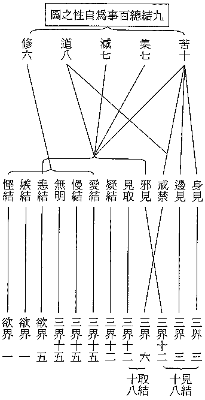



物取等立见取二结　此明见、取二结的废立。首先我们要问的，就是五见之中：为什麼身、边、邪的三见合称见结？又为什麼将见取、戒禁取的二取合称取结？简单的答覆，约有两个理由：一、三见与二取，自体（物）各有十八，其数是相等的，所以约物等立见、取二结。二、三见为二取之所执取，是属於所取的，二取能够执取三见，是属於能取的，所以约取等立见、取二结。物等的各有十八，如前已说，兹不再释；取等的能取所取，是怎样的呢？如以戒取执彼三见为清净的涅槃道，或以见取执彼三见为最极第一殊胜，所以三见为所取，戒见二取为能取。



由二唯不善及自在起故缠中唯嫉悭建立为二结　此约八缠家明嫉、悭二取的废立。有人这样问道：在诸随烦恼中，为什麼唯以嫉、悭立为结呢？八缠家说：这有两个理由：一、嫉、悭二缠，一向以来，都是不善，不通善及无记；二、嫉、悭二缠，一向以来，都是独立，不仗他力而自在现起。由於这两种因缘，所以於八缠中，唯以嫉、悭二缠，别为建立二结。《婆沙》五十、八义中的第三义说：「以嫉与悭独立离二，故立为结，餘缠不尔。独立者，谓自力现行；离二者，谓一向不善。忿覆二缠虽能独立亦复离二，而似随眠为随眠相之所映夺，其相不显故不立结」。除了嫉、悭具有这二义外，其餘的六缠无一完具这二义的：如无惭、无愧，虽则说是唯属不善，但不是独立的自在现起的；如悔，虽则说是属於自在而起的，但他亦通於善而不是唯不善的；餘三两义皆无：所以一一不得立名为结。



或二数行故为贱贫因故徧显随惑故恼乱二部故　此约十缠家明嫉、悭二取的废立。论主的意思，像上面的解释，站在八缠家的立场说，固然可以，若在十缠家的立场说，就不对了，因为具上二义的，不唯嫉、悭；忿、覆也有的，岂不是忿、覆也应立为结吗？然而不然，所以我们应当知道：嫉、悭所以立为结者，不仅由於具上两大理由，最主要的还是由於他的过失特重：一、此二随惑，在有情的生命中，是不断现行的。二、此二随惑，为有情所以贱及贫的原因，即嫉为人下贱的原因，悭为人贫穷的原因，所以《婆沙》说：「无威德者由多嫉妒，极贫穷者由多悭悋」。三、此二随惑，能徧显随惑的，这话怎讲？因为嫉与忧相应的，所以能徧显戚的随惑；因为悭与喜相应的，所以能徧显欢的随惑。四、此二随惑，能恼乱在家出家的二部众，即在家者为嫉悭财货而被恼乱，出家者为嫉悭教法而被恼乱。五、此二随惑，能恼乱人天的二部众，所以佛对憍尸迦说：「由嫉悭结人天恼乱」。六、此二随惑，能够恼乱天及阿素洛的二趣，《婆沙》五十说：「佛为呵责天帝释故，於彼契经说此二结。诸天中有苏陀味胜阿素洛，阿素洛宫有端正女胜彼诸天；天自悭味、嫉他美女，非天悭女、嫉他美味……由嫉悭结数兴战斗」。七、此二随惑，能恼乱他以及自众，即悭能够恼乱自众，而嫉能够恼乱他朋。由这种种之义，可以看出他的过重，所以特於随烦恼中，别出此二为结。颂中所说的恼乱二部，当知是包含后面的四种二部的。



丑二　五下分结



> 又五顺下分由二不超欲由三复还下摄门根故三  

> 或不欲发趣迷道及疑道能障趣解脱故唯说断三



五顺下分结，就是欲贪、瞋、身见、戒禁取见、疑。这是佛在其他的地方，依差别门而以结声说的五种。於中，初三句标体释名，即初二字是示数，次三字为标名，第二第三两句示废立，后五句通妨难，有正说异说的两种。



又五顺下分　欲贪等五为什麼说他是顺下分？下指欲界，因在三界中，欲界是最下的，而欲界为三界的一分，所以又名分，下分之顺名顺下分。贪等五种，於下分法，能为顺益，故名下分。



由二不超欲由三复还下　此明废立，正释顺下的意义。我们知道，贪瞋二种，是欲界系的烦恼，即由此二烦恼，使令有情不得超脱欲界，所以说由二不超欲。万一凡夫以有漏道断此贪瞋，上生到有顶天去，然由身见等的三种烦恼的力量，仍然使他下生到欲界中来，因这身见等的三结，不是凡夫所能断的，所以说由三复还下。这个道理，在《婆沙》四九以十二义明废立中，於第七复次说：「复此，此五於彼欲界有情，犹如狱卒及防逻者，故偏立为顺下分结。谓初二结犹如狱卒，后之三结如防逻者。如有罪人（喻凡夫人）禁在牢狱（喻欲界），有二狱卒（喻贪瞋）恒守御之不令辄出，复有三人（喻身、戒、疑）常为防逻。彼人设以亲友财力，伤害狱卒走出远去，三防逻者还执将来闭置牢狱。……若有异生，以不净观伤害贪欲，复以慈观伤害瞋恚，离欲乃至无所有处，生初静虑乃至有顶，彼有身见、戒禁取、疑，还执将来置在欲界」。然此五下分，如依《义章》说，具有四下义，立名下分结。一、界下，就是欲贪与瞋恚，唯有在欲界而不通於上二界。二、果下，就是贪、瞋、戒取三者，能感三途的弊恶之果。三、人下，就是身见、戒取、疑三，唯有在凡夫的身上生起，圣人决不起这三种烦恼的。四、所障下，就是身见、戒取、疑三，能障初果的证得，所以名所障下。



摄门根故三　诸得预流果的圣者，已将五见及疑的六种烦恼断了，为什麼经中但说断去身见、戒取、疑的三结呢？如《杂含》二九说：「何等为须陀洹果？谓三结断」。观答这问题有二师义，此约第一师说。一、摄门：意谓身见唯在苦的一门，戒禁取通於苦道的二门，疑则通於四谛门。经说断三结，是总摄彼三门的。二、摄根：意谓五见及疑，俱是属於根本烦恼，现在虽则祇说身见、戒取及疑的三根本惑，但已摄取其餘的三根本惑，因为是随转的缘故。如边见随身见转，见取随戒禁取转，邪见依於疑转，所以断此三种，就能摄彼三根。《正理》五四说：「言摄根者，身见等三是餘三根，以边执见、见取、邪见，如其次第，随有身见、戒禁取、疑三种胜根而得转故」。不管从摄门或摄根讲，表面上虽则说是断三，而实际上已说断六，所以经说预流断三结与实际断六根本惑，并没有什麼冲突。



或不欲发趣迷道及疑道能障趣解脱故唯说断三　此约第二师说。一个人要到什麼地方去，首先须排除三障，否则是不会去的。那三种障呢？一、觉得这地方对於自己有益，其他的地方或许不利於我，这麼一想，於是就不欲发趣而前去了。二、虽有心发趣前去，但因迷失正道，依於邪路而行，终归不能到达目的地。三、见有两条道路横在前面，并且都有人在不断的来去，於是对於正道就生起犹豫，不知从此到彼是对是不对，因为疑於正道，所以不能前进。在世间上要到一个地方去是如此，当知欲从生死的熟路回过头来趣向於陌生的解脱道，也有这样的相似三障：一由於有身见，对灰身泯智的解脱涅槃，生起极大的怖畏，认为果真是寂无所有，那还有什麼解脱可言？於是对於解脱不欲发趣。二、由於戒禁取，虽能生起趣求解脱的大志，但因迷失正路的关系，依於世间的邪道而行，不管你经过怎样的辛苦，终是徒然而不能至於涅槃。三、由於犹豫不决的疑惑，因为不能善自观察，见诸邪道也有很多人的修习。於是便对正道心怀犹豫，不知趣向解脱是对是不对，因为如此怀疑，所以不能趣向解脱。佛为显示预流永断像这样的趣解脱障，所以唯说断三。



丑三　五上分结



> 顺上分亦五色无色二贪掉举慢无明令不超上故



前说顺下分有五，此说顺上分亦五，也是佛陀在其他地方所曾说过的，如《长含．八众集经》及《阴持入经》出。五顺上分者，就是色贪、无色贪、掉举、慢、无明。色贪，为色界系的贪爱，其体唯一，就是色界修所断的贪。无色贪，为无色界所系的贪爱，其体亦唯一，就是无色界修所断的贪。掉举，为色无色所系的枝末烦恼，这有二种，就是上二界的掉举，唯独是修所断的。慢，为色无色所系的烦恼，有二种，就是上二界的慢，亦唯修之所断。无明，此唯修所断的上二界痴。



顺上分亦五　何谓顺上分？上指色无色界，因这二界是在欲界之上的，而色无色各为三界的一分，所以又名分，上分之顺名顺上分。色贪等五，於上分法，能为顺益，故名顺上分结。《正理》五四说：「要断见所断彼方现行故，见所断惑未永断时，亦能资彼令顺下分，故要永断见所断惑，方现行者名顺上分」。



色无色二贪掉举慢无明　这是举出五顺上分结的名称，其义如前已释。然而在此须要知道的：名义上虽则五种，而实际体有八物，因掉举、慢、无明，亦色无色界有别的。为什麼此五说为顺上分呢？



令不超上故　因这五种烦恼，能令有情，不超上界，而顺益於上界的。《婆沙》四十九说：「问：何故唯修所断立为顺上分结？答：贪趣上界名顺上分。见所断结亦令堕下，故不立为顺上分结。复次，上人所行名顺上分，上人是圣，非诸异生。见所断结唯异生起，故不立为顺上分结。於圣者中，唯立不还者所起诸结，名顺上分。何故预流及一来者所起诸结非顺上分结？答：顺上分者，谓趣上生，预流一来所起诸结，亦令生下，故不立为顺上分结」。



子二　释缚



缚三由三受



诸结差别已略解说，现在来说缚。缚是什麼意思？是系缚之义。本来结就是缚，因为结缚二相没有什麼差别的，所以《品类足》一说：「缚云何？谓诸结亦名缚」。然而经中（如《杂含》三十二、《增一》第九）所以别说缚者，《正理》五四说：「以能系缚故立缚名，即是能遮趣离染义」。正因结缚无别，所以《甘露毘昙》，将三缚说为三结。



缚三由三受　经中说缚有三种，就是贪缚、瞋缚、痴缚。而此三缚是随三受所立的：一、於诸乐受贪缚随增，因为所缘、相应二种都随增的。然此乐受有贪缚，是约胜及自身而言，如约对他来说，亦有瞋缚，比方见到怨家享受快乐的时候，自心中不期然的就会生起瞋恨来，而於贪瞋同时，必定有痴。二、於诸苦受瞋缚随增，因为所缘、相应二种都随增的。然此苦受有瞋缚，是约胜及自身而言，如约对他来说，亦有贪缚，比方见到自己不满意的人为苦所逼，内心就起一种贪求，希望其苦永不离於彼身，而於贪瞋同时，必定有痴。三、於诸舍受有痴缚，因为所缘、相应二俱随增的。准前舍受，亦有贪瞋，非如痴故。既一一受各具三缚，为什麼现在以三缚别配三受？当知这是世尊依多分理，说随三受建立三缚。



子三　随眠



随眠前已说



随眠前已说　关於随眠，或说有六，或说有七，或说有十，或九十八，一一如前已说，这里不再重述了。



子四　随烦恼



> 随烦恼此餘染心所行蕴



随眠在前说过，我们固然知道，但随烦恼是什麼，还有一说的必要。详细的列彼随烦恼相，如《法蕴足论》第九卷〈杂事品〉中说，这里不能一一详论。



随烦恼此餘染心所行蕴　依照光记的解释，是这样的：蕴是简别无为，行是简别色等四蕴，心所是简行蕴中的不相应行法，染简心所中的善及无记，此餘简染污中的根本烦恼，意谓在此根本烦恼之餘，名为随烦恼。然而将释随烦恼，必须先解说根本惑。此诸根本烦恼，本亦名为随烦恼，因为都是随心而作恼乱事的。但在这本惑之餘，复有异於诸根本烦恼法，属於染污心所行蕴所摄，随著根本烦恼而起活动的，亦叫做随烦恼，他之所以不名烦恼，因他不是属於根本。由此可知，随从根本起而恼乱有情之身心的，名随烦恼。



子五　释缠丑一　正明缠



> 缠八无惭愧嫉悭并悔眠及掉举惛沈或十加忿覆无惭悭掉举  

> 皆从贪所生无愧眠惛沈从无明所起嫉忿从瞋起悔从疑覆诤



在我人的内心，不但起贪等的十根本惑，随从那根本惑，更有枝末烦恼与之俱起，此枝末烦恼，就是这里所要说的十缠六垢。今先解释十缠，初颂标举缠数，次颂半明根本等流。



缠八无惭愧　缠，究竟有多少，两说不同：依《品类足论》，说有八缠，依《毘婆沙论》，说有十缠。颂中的缠八，是据《品类足》说的。无惭、无愧二者，属大不善地法，一切不善心起，必与之相应俱起。此二在根本中，虽已解释过，不妨再略为一论。对戒定慧等的诸功德法，及师长等的有德者，不生崇敬之心，无所忌惮，无所随属，名为无惭；而於所造之罪，以自观无耻为性。凡为具有戒定慧等诸士所呵厌之法，说名为罪，若有於此罪恶，不见有什麼怖畏，那就是无愧；而於所造之罪，以观他无耻为性。



嫉悭并悔眠及掉举惛沈　此中有六缠：嫉、悭二者，属小烦恼地法中的二种，是自他各别而现作用的。悔、眠二者，属於不定地法。悔通善恶二性，眠通善恶无记三性。依照他们的性质，本不可独名缠的，现在所以把他说名为缠，乃唯取他们染污性的一边。掉举、惛沈二者，属於大烦恼地法，凡染污心的生起，必与之相应俱起。嫉以妒忌为性，就是为了求得自己的名誉财利，不愿意见到他人的荣耀，所以对於他人的诸兴盛事，总是使自己的内心不乐意。悭以悋惜为性，就是对於自己的财物及所学得的正法等，坚固的耽著，不肯以一点儿惠施於人。悔，於自所作追悔为性。眠，主要的是令心昧略为性。掉举，令心於境不寂静为性。惛沈，令身心惛重，於诸善法，不能堪任为性。这都是在〈根品〉中解释过的，所以毋须再一一详说。



或十加忿覆　前依八缠说，今依十缠说。十缠，就是於上八缠之外，再加忿、覆二种随烦恼。此二也是属於小烦恼地法。对於情及非情的不饶益境，令心愤发不已，说名为愤；对於自己所作的罪恶，恐怕别人知道而失去利养，特用种种的方法将他隐藏起来，说名为覆。然而是诸烦恼，为什麼说名缠呢？《正理》五四说：「如是十种，系缚含识，置生死狱，故名为缠：或十为因，起诸恶行，令拘恶趣，故名为缠」。如据长行说，不特随烦恼叫缠，就是根本烦恼亦名缠。《杂含》三十五说：「尸婆！有五因五缘生心法忧苦，何等为五？谓因贪欲缠，缘贪欲缠生心法忧苦；因瞋恚、睡眠、掉悔、疑，缘瞋恚、睡眠、掉悔、疑生彼心法忧苦」。正因为是这样的道理，所以《舍利弗毘昙》第二十，将贪、瞋、痴说名为三缠。



无惭悭掉举皆从贪所生　此下明根本等流，以显示无惭等的法体。随烦恼的建立，是约法从烦恼起而言，然则何法由何烦恼起呢？无惭、悭、掉举三者，都是从贪所生的，为贪的等流，因要以贪为近因，然后方得生起的。此中等流的意思：等是相似义，流是流出义，即随烦恼的行相，相似於本惑，从本惑之所流出，所以名为等流。



无愧眠惛沈从无明所起　此明无愧、睡眠、惛沈三者，都是从无明所起，为无明的等流，因这三者的相貌，与无明是极相邻近的。如无愧不了业因感果的道理，就与无明相似最好的例子。



嫉忿从瞋起　此明嫉、忿二者，是从瞋恚而起，为瞋恚的等流，因这二者的相貌，是同於瞋恚的。



悔从疑覆诤　此明悔之所从出及覆有诤论。悔是恶作，若人於法生决定心时，恶作心就不会生起，所以会生起恶作心，是即因为於法无决定解，所以悔是从疑惑，为疑的等流。覆有三说不同：有说是贪的等流，有说是痴的等流，有说是贪痴的等流。或者这样分别：诸有知者因爱生覆，是即贪的等流，诸无知者因痴生覆，是即痴的等流。覆诤者，因为三说不同，所以名之为诤。依《婆沙》四七第三评家义：「应作是说：是二等流，或贪名利覆藏自罪，或由无知覆藏罪故」。由是《入阿毘达磨论》上，唯举俱义；《杂心》第四，唯举初二说，意并取二说以自成第三义，今论三义并云有说，而意显取第三，因前二义都是偏於一边。



丑二　明六垢



> 烦恼垢六恼害恨谄诳憍诳憍从贪生害恨从瞋起  

> 恼从见取起谄从诸见生



前明十缠，此明六垢。於中，前两句正明六垢，次四句明本惑等流。恼等六种，所以名垢，因为这些都是从烦恼生的，秽污不净的相貌，特别来得明显，故此得烦恼垢名。然依《舍利弗毘昙》第二十一卷看，根本烦恼中的贪、瞋、痴，也说为三垢的。



烦恼垢六恼害恨谄诳憍　此明六垢，前四字标数，后六字列名。坚执智者所可呵厌的诸有罪事，不受任何人的如理谏诲，而以热恼为其体性，说名为恼。对他能作种种逼迫事，依之而行打骂等为其体性，说名为害。对於忿所缘的不可爱事，随念分别数数寻思，而以结怨不解为他的体性的，说名为恨。《正理》五四说：「恨与忿相有差别者，如桦皮火其相猛利，而餘势弱说名为忿，如冬室热其相轻微，而餘势强说名为恨，由此故有说恨相言，忿息已续生令心浊名恨」。若有为了悦取他人的心意，不表现出自己本来的状态，乃故矫揉造作的装出别异的仪容，而以心怀险曲为他的体性的，说名为谄。若有为了诳惑於他，在内心中先为筹度，巧设种种的方便，令人后时生颠倒解，而以现相惑人为他的体性的，说名为诳。谄与诳稍有差别，如《正理》五四说：「又幻惑他说名为诳，匿自情事说名为谄」。憍者，就是对於自法先为染著，令心傲逸为他的体性。《正理》五四说：「有餘师说：从贪所生，恃己少年、无病、寿等诸兴盛事，心傲名憍。有餘师言：於自相续兴盛诸行，躭染为先不顾於他，谓己为胜心自举恃，说名为憍。由不顾他，与慢有异」。



诳憍从贪生　此下明根本等流，以显示诳等的法体。诳与憍这两种，是从贪烦恼等流而生，何以知道？因为是贪的种类的缘故。一个人原应本本分分的，他之所以现出诳相，还不是由於为了贪求名闻利养？如果不是一念贪心的触动，怎会现出诳惑世间的状态？一个人的内心自举，以为这也是我胜於人，那也是我超过别人，主要的就是太过贪著自己的一切，所以不期然的就现出憍态。



害恨从瞋起　此明害与恨的二者，都是从瞋等流而起的，怎麼知道？因为是瞋的种类的缘故。一个人为什麼要害人？推究他的根由，就是对他有著极大的瞋恚，由於瞋恚到极点，所以就想出办法来陷害他，以消除自己内心的恚怒。人与人间的相处，理应相亲相爱的，所以会怀恨於人，甚而至於恨之入骨，原因就在於瞋恚，有了瞋恚在心，看什麼都不顺眼，也就觉得什麼都可憎恨了。



恼从见取起　此明恼从见取等流而起的。恼是对於他人的恼乱，为什麼会如此？根本原因在於见取的作祟。一个人的思想错误而不自知其错误，如有别人指出他的错误所在，并且如理的谏诲他，使他放弃错误的知见，不但不接受，反而坚执自己绝对是对的，於是一方面自己内心生起热恼，一方面又以之恼乱别人，造成了自他恼乱，所以说恼从见取起。



谄从诸见生　此明谄从诸见等流而生的。诸见不出五见。经说：「实曲者何？谓诸恶见」。《正理》五四说：「实智相违心曲名谄」。这麼说来，谄、染慧见行相相似，所以心曲之谄为险曲的五见等流。旧论十五偈说：「何法名邪曲？谓邪见等见」，亦即此意。



丑三　分别缠垢寅一　三断分别



> 缠无惭愧眠惛掉见修断餘及烦恼垢自在故唯修



上来所说的十缠六垢，还可从三断、三性、三界的三门加以分别，现在先分别第一三断门。我们知道：烦恼有见道所断与修道所断的两种，今此随烦恼於见修二断方面，又应作怎样的分别呢？答：



缠无惭愧眠惛掉见修断　意谓十缠中的无惭、无愧、睡眠、惛沈、掉举的这五种，通於见修二道所断；即与根本的见惑相应者，是属见道所断，若与根本的修惑相应者，是属修道所断。《正理》五四说：「无惭、无愧通与一切不善心俱，眠欲界中通与一切意识俱起，惛沈、掉举通与一切染污心俱：故五皆通见修所断」。



餘及烦恼垢自在故唯修　餘指十缠中的其他嫉、悭、悔、忿、覆的五种，此五及六烦恼垢，唯独是属修道所断而不通於见道所断，为什麼？因这十一种惑，自迷事起，唯与修所断他力无明共相应，而与自在起缠垢相应所有无明唯修所断，所以五缠六垢亦唯修所断。既是自迷事起，不与见所断烦恼相应而起，没有迷理的意义，当然就不通於见所断了。



寅二　三性分别



> 欲三二餘恶上界皆无记



随烦恼的所断已经知道了，而善恶无记的三性，又应怎样分别呢？换句话说，那几种通於善性？那几种通於不善性？那几种通於无记性？虽则说是这样分别，但如颂文看来，没有一种是通於善性的，这点我们首先得知道。



欲三二餘恶上界皆无记　欲了解十缠六垢的三性义，还得配合三界来说明。属於欲界所系的睡眠、惛沉、悼举三者，通於不善及有覆无记的二性。其所以有此差别，就看他的相应如何：假定是与贪等相应的，就属不善性；假定是与身、边二见相应的，就属无记性。除此三者而外，其餘欲界所系的一切七缠、六垢，完全唯是不善性。随其所应属於上二界所系而有的谄、诳、憍、惛沉、掉举，一切唯是有覆无记性，因上二界没有不善性的。



寅三　界系分别



> 谄诳欲初定三三界餘欲



上来所说的十缠六垢，在欲、色、无色的三界，是不是都存在呢？换句话说，那几种属欲界系？那几种属色界系？那几种属无色界系？这也不可不知道的，所以现在略为分别。



谄诳欲初定三三界餘欲　六垢中的谄、诳二者，唯属於欲界及色界初禅所系。欲界有谄、诳，这是没有问题的，色界初禅亦有，如前所说梵王被马胜问，一方面诳惑马胜比丘，一方面又对之谄言愧谢，由此证知梵世亦有谄诳。十缠中的惛沈、掉举，六垢中的憍，此三随烦恼，通於三界所系。除了前来分别的五种，其餘六垢中的恼、害、恨，十缠中的无惭、无愧、嫉、悭、悔、眠、忿、覆，此十一随烦恼，皆唯在於欲界，不通上二界系。再总结的一说，属於欲界所系的，总有十六；属於色界所系的，唯惛沈、掉举、谄、诳、憍的五种；属於无色界所系的，唯惛沈、掉举、憍的三种。为什麼是这样的？因上二界的界地殊胜，虽有有覆无记的烦恼，但无不善性的烦恼。十缠六垢的诸随烦恼，除了谄、诳、憍、惛沈、掉举可通於有覆无记外，其餘随烦恼的性质，都是属於不善的，所以不为上二界系。



壬二　诸门分别癸一　六识相应门



> 见所断慢眠自在随烦恼皆唯意地起餘通依六识



如上所分别的根本烦恼及随烦恼，与六识相应的关系是怎样的呢？就是有那几种与第六意识相应？有那几种通与六识相应？答：



见所断慢眠自在随烦恼皆唯意地起　此明与意识相应而起的随眠及随烦恼。诸有属於见所断的一切烦恼及修所断的慢、眠以及随烦恼中自在而起的，如是一切，皆与意识相应，唯意地起。为什麼？且嫉、悭、忿、覆、悔的五缠及恼、害、恨、谄、诳、憍的六垢，此中除悔，餘之十种，称小烦恼地法，具有四义：一、唯修所断；二、唯意识地起；三、唯无明相应；四、分别现行。既唯意识地起，所以唯与第六意识相应而不与前五识相应，悔与眠，是不定地法；悔以分别心追悔过去的所作，眠以昧略为性，所以唯意识起而非前五识所得现行。



餘通依六识　此明通与六识相应而起的随眠及随烦恼。如修所断的贪、瞋、无明，及彼相应的诸随烦恼，即无惭、无愧、惛沈、掉举，及餘大烦恼地法所摄随烦恼，就是放逸、懈怠、不信，如是一切，通与六识相应，皆依六识容得生起。为什麼？且放逸、不信、懈怠、惛沈、掉举的五者，称为大烦恼地法，徧通一切染污心而起，所以不问前五识与第六意识，当心染污时，必与之相应。无惭、无愧的二者，称为大不善地法，徧通一切不善心而起，所以心不善时，亦得徧与相应。



癸二　五受相应门子一　本惑五受相应



> 欲界诸烦恼贪喜乐相应瞋忧苦痴徧邪见忧及喜  

> 疑忧餘五喜一切舍相应上地皆随应徧自识诸受



前根本中，曾经说到苦乐忧喜舍的五受根；但此五者与今所说的本惑、随惑的相应是怎样的呢？於中先明本惑与何受根的相应。前六句颂，就欲界的根本十惑说，后两句颂，就上地的根本诸惑说。



欲界诸烦恼贪喜乐相应　在欲界所系的诸烦恼中，假定是根本贪惑，那就与喜乐二受相应。因贪的对象在可意境，依六识身起的，即依眼等前五识生起的时候，就与乐受相应，依第六意识生起的时候，就与喜受相应。



瞋忧苦痴徧　在欲界所系的诸烦恼中，假定是根本瞋惑，那就与忧苦二受相应。因瞋的对象在不可意境，亦是依六识身起的，即依眼等前五识生起的时候，就与苦受相应，若依第六意识生起的时候，是就与忧受相应。根本痴惑又是怎样的呢？痴烦恼，虽则说是通依六识但因不分可意与不可意，所以徧与忧喜苦乐相应。即对於可意或不可意之境，假定是依前五识生起的时候，就与苦受或乐受相应，假定是依第六意识生起的时候，就与忧受或喜受相应。



邪见忧及喜　欲界所系的邪见，以第六意识为所依，随著欢行与戚行的差别，而有与忧受或喜受相应的不同。即当欢行时，就与喜受相应，若当戚行时，就与忧受相应。如造恶业后而起邪见，认为苦果是没有的，对於苦报不生畏惧，於是就欢欣鼓舞起来，与喜受相应。若造善业后而起邪见，拨无福乐的果报，感到所修的善业，徒设劬劳，於是就悲哀愁戚起来，而与忧受相应了。



疑忧餘五喜　欲界所系的疑惑，以第六意识为所依，因为内心的愁戚，所以唯与忧受相应。一个心怀犹豫的人，对於所观的境界，大都不能给予肯切的决定，然而又不能不对他求一决定，所以在内心中，就常常的生起愁戚之念。除了上面所分别的五惑，其餘的身见、边见、见取见、戒禁取见及慢之五根本惑，唯与喜受相应，因是欢行转而唯以第六意识为所依的缘故。既欢行转，当然就不通於忧受，既唯意地，当就简别了乐受，所以《正理论》中评餘师说此五亦有忧受的不当，而唯与喜俱为善说。



一切舍相应　五受中的前四受，与十根本惑的相应，前已分别，舍受相应又是怎样的呢？一切根本烦恼，皆与舍受相应。为什麼？因舍受是痴惑之所随增的，可是无明徧与烦恼相应而无有简别的，所以烦恼相续至究竟时，起处中欲，渐渐衰微相续便断，当在这个时候，烦恼与舍相顺，因而皆与舍受相应。有人提出这样的责难说：舍受既不是欢行又不是戚行，怎可与欢戚二行的烦恼相应？不错，欢行与戚行，其相相违，如果同时生起，会得发生冲突，所以他们绝对不能相应而起，可是舍受不然，不特与愁戚的一边无违，就是与欢欣的一边亦极随顺，是故舍受通与欢戚两类烦恼相应，没有什麼不可以的。



上地皆随应徧自识诸受　为上界所系的诸烦恼中，各各随其所应，徧与自地诸识俱起，诸受相应。上诸地中，识的多少，是不同的，如初静虑具有眼耳身意四识，就与喜乐舍的三受相应，谓依眼耳身三识所起的烦恼，必然是与乐舍二受相应，设依意识所起的烦恼，是就与喜舍二受相应了。从第二静虑已去一直到有顶天，唯有一第六意识，虽然如此，但他们所相应的受，却有不同，即依二禅意识所起的烦恼，与喜舍二受相应，依三禅意识所起的烦恼，与乐舍二受相应，依四禅乃至有顶意识所起的烦恼，唯与舍受相应。



子二　随惑五受相应



> 诸随烦恼中嫉悔忿及恼害恨忧俱起悭喜受相应  

> 谄诳及眠覆通忧喜俱起憍喜乐皆舍餘四徧相应



根本烦恼与五受的相应，已如上说；诸随烦恼与五受的相应，今当分别。於中，初句总标，餘七句别释。



诸随烦恼中　这是总标，即在一切的随烦恼中，怎样分别他们的五受相应呢？欲知其详，当为一一的别说。



嫉悔忿及恼害恨忧俱起　在诸随烦恼中，唯与忧受相应而起的，有嫉、悔、忿、恼、害、恨的六种，因这些都是依於第六意识现起，而唯随戚行转的。然有别师说：六中之恼，亦与喜受相应，因为他是见取的等流，属於欢行转的缘故。



悭喜受相应　此说悭惑唯与喜受相应，因这是随欢行转，而唯依第六意识生起的。唯依意识，这就显示了他不通乐受：唯欢行转，这就显示了他不通忧受。所以欢行转者，因为悭的状态与贪的相貌，是极相似的。



谄诳及眠覆通忧喜俱起　此说谄、诳以及眠、覆四者，通与忧受或喜受相应而起，因是欢戚行转，而唯依第六意识生起的，唯依意识，这就显示了他们不通苦乐二受；欢戚行转，这就显示了他们通於忧喜二受。意谓有的时候，以欢喜之心而行谄等，有的时候，以忧戚之心而行谄等。於中诳有异说，有人以为诳是贪根本惑之所等流的，应当唯是随欢行转，不应说与忧戚相应，何况一个人正在行诳时，必然是充满欢喜的，以为自己这样做非常得意，如是那里还有什麼忧戚？《正理》对於这一问题的解答，是这样的：在道理上讲，因果的相貌，是各别的，如无惭与掉举，虽则是为贪的等流，但与忧苦有相应义，由此知道，所谓与受相应的道理，不唯在於同因，主要但据相别，所以我们认为是有忧戚而行诳的。当知人之行诳，必是情有所忧，不然的话，那他为什麼行诳？



憍喜乐　此说憍惑与喜乐二受相应，因这是欢行转，而唯依第六意识生起的。唯其中须稍加分别者：如在第二禅天已下诸地，唯与喜受相应，若在第三禅天，那就与乐受相应了，第三禅天，虽没有前五识，但因界地极为殊胜，欢喜增胜，所以与乐受相应。



皆舍　此上所说诸随烦恼，是据别相应说，如约通相应说，一切都与舍受相应，怎麼知道？因在相续断时，必然都住於舍的。



餘四徧相应　除上所说的十二种，其餘无惭、无愧、惛沈、掉举四种，一一徧与五受相应，以欢戚行转，徧依六识而生起的，徧依六识，这就显示了他通於苦乐二受，欢戚行转，这就显示了他通於忧喜二受，舍受徧於一切，不说可知。若再明白分别：依前五识起时，就与苦受或乐受相应，依第六意识起时，就与忧受或喜受相应。



辛三　明五盖差别



> 盖五唯在欲食治用同故虽二立一盖障蕴故唯五



於上所说烦恼、随烦恼中，有的依於异门，佛又说之为盖，今当略为分别盖相。如契经中说盖有五：一、欲贪盖，二、瞋恚盖，三、惛眠盖，四、掉悔盖，五、疑盖。盖是什麼意思？是盖覆之义，谓有这五法的存在，就盖覆我人的心性，而使善法不得生了。有说：「通名盖者，盖以覆盖为义，能覆盖行者清净心善，不得开发，故名为盖」。由此可知五盖对於我人的不利了。



盖五唯在欲　如经所说的五盖，假使以三界分别，那他唯有在於欲界，上二界是无五盖可能的。为什麼？因这五种，纯是圆满不善聚，而色无色界无有不善，所以证知五盖唯在欲界。同时更应了知的：惛沈、掉举、疑三者的自体，虽则说是通於三界，但唯属於欲界所有的可得盖名，为了显示惛、掉唯欲界有，所以特与眠、悔和合而立，因为眠、悔唯是属於欲界系的，为了显示眠、悔必须是染污性的，方可立为盖名，所以特与惛、掉和合而立，因为惛、掉唯是属於染污性的。《正理》五五说：「疑准前四，在欲可知」。不过仍成问题的：五盖中的欲贪、瞋恚、疑三，各各都是依於一体而立盖名，为什麼惛眠、掉举二者，各各都是依於二体合立盖名呢？答：



食治用同故虽二立一盖　一体立盖的欲贪、瞋、疑三者，所食与能治，都是各别的，所以别立盖名。如欲贪盖的所食，是一切可爱境相，而能对治他的，是不净观想，所以说多贪众生不净观；瞋恚盖的所食，是一切可憎境相，而能对治他的，是慈悲观想，所以说多瞋众生慈悲观；疑盖的所食，是过现未的三世，如於过去世生如是疑，乃至於未来世生如是疑，而能对治他的，是如实观察缘性缘起，因为缘起是贯通三世的，若能如实观察，诸疑就冰释了。《杂含》二七说：「贪欲盖以何为食？谓触相，於彼不正思惟贪欲能令增。何等为瞋恚盖食？谓障碍相，於彼不正思惟瞋恚盖能令增……何等为疑盖食？有三世。何等为三？於过去犹豫，现在、未来亦犹豫，於彼起不正思惟疑盖能令增。何等为贪欲盖不食？谓不净观。何等为瞋恚盖不食？彼慈心思惟……何等为疑盖不食？彼缘起法思惟」。二体立盖的惛眠、掉悔二者，约有三种原因，就是食同、治同、用同，所以其体虽殊合立一盖。且说惛睡的三因。一、食同，就是所食，他们的食法约有五种：①𧄼瞢，这是惛睡的前奏；②不乐，这是心情的不悦；③频申，这是由於事业过分疲劳所生；④食不平等性，这是由於饮食过度，吃得太饱，而现身心沈昧之态；⑤心昧劣性，这是约心取境说，取境不明叫做昧，取境力弱叫做劣。以此五种为因缘，不论具有那一种，惛睡盖就得增益。《杂含》二七说：「何等为睡眠盖食？有五法。何等为五？微弱、不乐、欠呿、多食、懈怠，於彼不正思惟睡眠盖能令增」。二、治同，就是非食，谓同一光明想，此想生起来的时候，心即警觉，惛眠状态就不现前。约他不能有益於彼，所以叫做非食。《杂含》二七说：「何等为睡眠盖不食？彼明照思惟」。是则以毘钵舍那慧思惟想，对治惛眠。三、用同，就是事用，意谓惛眠皆能令心沈昧劣弱，所以叫做用同。再说掉悔的三因。一、食同，所食有四：①亲里寻，就是寻诸亲里的这样那样的事情，怎样才能使他们安乐，成就一切无恼害法；②国土寻，就是寻思国土内的有关国家的大事，怎样才能使人民获得安居乐业，不致受到种种的迫害；③不死寻，就是寻思自己怎样才能不死，因为还有许多事情，须要我去做，唯有不死才能做种种事业；④随念昔寻，就是随念过去所曾经做过的种种事情。由於这样的东想西想，心里妄念纷飞，所以就增益掉举，如果想到不如意事，转而又生忧悔。《杂含》二七说：「何等为掉悔盖食？有四法。何等为四？谓亲属觉、人众觉、天觉、本所经娱乐觉，自忆念他人令忆念而生觉，於彼起不正思惟，未起掉悔令起，已起掉悔令其增广」。二、治同，就是非食。针对这两种病态，而下同一对治的法药的，是奢摩他，意谓用止的方法，止息种种不必要的妄念。《杂含》二七说：「何等为掉悔盖不食？彼寂止思惟」。是则以奢摩他定思惟想，对治掉悔。三、用同，就是事用，意谓掉悔皆能令心不得寂静，所以叫做用同。论文总结此意说：「由此说食治用同故，惛眠掉悔二合为一」。



障蕴故唯五　此句所要讨论的，就是一切烦恼都有盖的意义，为什麼世尊唯以此五名盖？不错，在道理上讲，诸惑皆能覆障圣道以及加行，但佛於立盖门唯说五者，因为唯有这五种，对於五蕴能有极大的障覆。如欲贪与瞋恚，能为戒蕴的大障，就是有了这二烦恼在内心的活动，不免常常促使人们对於净戒的违犯，或者障於净戒的严持。惛沈与睡眠，能为慧蕴的大障，慧是清明的，此是昏浊的，有了这盖的存在，内心就糢糊而不能明见一切。掉举与悔，能为定蕴的大障，定是寂静的，此是动乱的，有了这盖的存在，内心就散乱而不能止息。定慧不具，对四谛理就有所疑，由疑不能向解脱前进，所以就障解脱蕴及解脱知见蕴。由於此五能障无漏五蕴，是故我佛唯以此五建立为盖。上依有部师说，若据经部师义，虽也约於五蕴，但稍不同的，唯在所障定慧的次第。论主的意思，似不赞同有部释，可是《正理》的判决，却又符合於理契顺於经，学者不妨参阅。



己二　明惑灭庚一　断惑四因



> 徧知所缘故断彼能缘故断彼所缘故对治起故断



随眠及随烦恼，演绎开来，虽则说有很多，但归纳起来，不外见修二惑。行者如欲断此见修二惑，约有四种不同的原因。见惑由三因断：一、徧知所缘断，二、能缘断，三、所缘断。所以有此差别者，因四谛所断的烦恼，各有二类：即苦集二谛所断者，各有自界缘与他界缘的烦恼；灭道二谛所断者，各有无漏缘与有漏缘的烦恼，所以惑断所用的因也就不同。修所断惑，唯由一因，就是对治断。今略分别如下：前三句明断见惑因，后一句明断修惑因。



徧知所缘故　这是断见惑的第一因，名为徧知所缘故断。如见苦集所断的自界缘惑，不论是欲界、色界、无色界的，绝对毫无简别的，都是属於徧知所缘故断。然而断的经过是怎样的呢？颂疏说：「以自界缘，缘自欲界苦集谛故，苦集忍生，既知苦集，故知自界缘惑断，由徧知所缘故断。言所缘者，即苦集也」。不但苦集的自界缘惑，是由徧知所缘故断，即灭道的无漏缘惑，亦由徧知所缘故断。颂疏说：「及见灭道断无漏缘惑，以邪见、疑、无明，缘灭道无漏，灭道忍生，知灭道谛故，彼邪见、疑、无明即断，名徧知所缘故断。言所缘者，即灭道谛也」。简单而明白的说，苦集谛下的自界缘惑，由徧知苦集二谛的真理而断；灭道谛下的无漏缘惑，由徧知灭道二谛的真理而断：是为徧知所缘故断。



断彼能缘故　这是断见惑的第二因，名为断彼能缘故断。如为欲界所系的他界缘惑，以欲界所系的见苦集断。这话怎讲？谓以自界缘的烦恼，缘於他界缘的烦恼，他界缘的烦恼，是所缘的境界，自界缘的烦恼，是能缘的心识，所缘必赖能缘而存在，假定自界缘的烦恼断的时候，那他界缘的烦恼也就随之而断，如羸弱多病的人，倚杖站立，一旦杖断，当然也就随之而倒，所以名为断彼能缘故断。



断彼所缘故　这是断见惑的第三因，名为断彼所缘故断。如断灭道下的有漏缘惑，只要断了他的所缘，那能缘者也就随断。此中所谓所缘，就是无漏缘的烦恼，能缘，就是灭道下的贪等有漏缘的烦恼。所缘的无漏缘惑若断了，能缘的有漏缘惑自然随断，「如羸病者杖策而行，去彼杖时彼随倒故」，所以名为断彼所缘故断。



对治起故断　这是明断修惑，由於第四因，名为对治起故断。修所断惑有九品别，其对治道亦有九品。断上上品的烦恼，运用下下品的对治道，断下下品的烦恼，运用上上品的对治道。论说：「以若此品对治道生，则此品中诸惑顿断。何品诸惑谁为对治？谓上上品所有诸惑，下下品道能为对治，至下下品所有诸惑，上上品道能为对治」。於此我们应当要知道的：烦恼是以粗细为上下的，道智是以明昧为上下的，如世间的黑暗，少少的光明就可破，如果是细暗，那就要大明才可破，以道破惑亦然，所以上上品惑用下下品道等。



或有人说：三界所有一切见所断惑，当其正被断时，也是由於对治道生，如苦谛下的烦恼，以苦法智忍为对治道，为什麼断见惑不说对治道？对的，在道理上讲，实在也应说对治道，然而现在为了显示三界所有一切修所断惑，决定皆由九品对治道断，所以才作这样的说。至於见惑的对治道，唯有有顶天决定是由苦类忍为对治道，而下八地是不定的，如凡夫以有漏道为对治，圣者以无漏道为对治，因为是这样的不定，所以断见惑不说对治道。



今将断惑四因，图示於下：



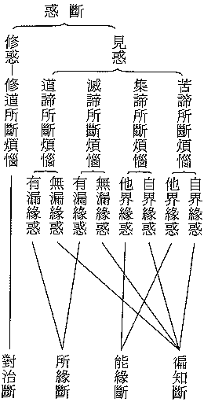



庚二　明四对治



> 对治有四种谓断持远厌



前说对治，而此有几种呢？依《婆沙》三说：「苦法智忍能为五种对治：谓舍、断、持、不作、不往对治。舍对治者，谓此能舍异生性故；断对治者，谓此能断欲界见苦所断十随眠故：持对治者，谓此能持一切后位诸圣道故；不作对治者，谓此能令毕竟不作五无间业故；不往对治者，谓此能令毕竟不往三恶趣故」。又《婆沙》百八十一：「尊者世友言：对治有四种，谓断对治，厌坏对治，持对治，远分对治。色界於贪等具四对治，欲界有三除断对治，无色界有二谓持及远分」。《杂心》第十次第所列，同世友说。今所异者，唯在次第。



对治有四种谓断持远厌　上句是标数，下句是列名。四种对治者：一、断对治，谓以无间道，正式的断诸烦恼。二、持对治，谓起断对治断了烦恼以后，能持择灭之得，就是解脱道是。三、远分对治，谓於解脱道后，更使远於无间道所断的烦恼，就是所谓胜进道。若依《杂心》第十说：「远分对治者，解脱道为首」；「以解脱道如彼能令此所断惑得更远故」：所以名为远分对治。四、厌患对治，谓於惑、业、苦心生厌患而起加行，就是加行道。论主的意思，如真正说这四者的次第，理应是这样的：第一加行道，第二无间道，第三解脱道，第四胜进道。《正理》为救有部所说的次第，乃作是言：「应知多分是加行道。若尔！何缘於最后说？阿毘达磨非次第求，岂不曾闻何烦徵诘？或不定故说不在初：谓彼非如无间道后定有解脱，解脱道后方有胜进，是故不定。以加行道，或有起在无间道前，或有生於胜进道后，非决定故。又不定者，谓或有一补特伽罗由一加行，乃至证得阿罗汉果，或二或多，是故不定。又不定者，无间道等如前加行，亦能与后为加行故，不可定言唯尔所是加行道摄。说多分言，应知为显无间、解脱、胜进道中，缘苦集谛者，亦厌患对治」。



庚三　明断惑处



> 应知从所缘可令诸惑断



惑的四种对治已说，今当辨别断惑理趣。首先我们要问的：诸惑永断究竟从於什麼？假定说是从於所缘，不可！为什麼？「谓若此法是彼所缘，未曾有时非所缘故」；假定说是从於相应，不可！为什麼？「谓相应法互为因故，此法无时非因性故」；假定说是从於自性，更不可！为什麼？「谓法无容舍自性故；以断惑时不可令彼所断诸法失所断性」。这麼说来，我们不得不好好的思量他的从何所断了。



应知从所缘可令诸惑断　依此颂说，诸惑永断，决定仍是从於所缘，因为要於所缘徧知，方可令惑永断，假定没有这种力量的话，那就不能永断诸惑了。有人这样说：烦恼断，是断自身烦恼之义，为什麼要望所缘以论其断？当知这是将烦恼上的得断去，使他在所缘的境上，再也没有系缚的功能，所以名离所缘，即於所缘境上，不复再生烦恼，名从所缘断。



庚四　明四远性



> 远性有四种谓相治处时如大种尸罗异方二世等



前四对治中的第三远分对治，一切远性总有几种呢？本颂来说明这个问题。於中，上两句标，下两句释。



远性有四种谓相治处时　诸有一切远性，总归纳为四种：一、相远性；二、治远性；三、处远性；四、时远性。



如大种尸罗异方二世等　如大种，是解释相远性。地水火风的四大种，虽然同在一聚中生，但因彼此的状态不同，亦名为远。如尸罗，是解释治远性。有情的持戒犯戒，虽然同在一身中行，但因彼此相治的关系，亦名为远。如异方，是解释远处性。海的东岸西岸，虽然同样的在一大海之边，但因东西方处相隔，亦名为远。如二世，是解释时远性。过去未来的二世，虽然是在同一法上建立，但望於现在世，因为时分相隔，亦名为远。对此，有人发生这样的问题：已灭的过去，与现在是很相近的，未生的未来，与现在也是相邻的，在时间上讲，只隔一刹那，怎麼可以说远？当知这里所谓远，是约三世的体性，各别隔於现在而言，至於现在与过去及与未来，虽也有世性别的意义，但因现在是有作用的，不得名远，过未不然，以无作用，故说名远。等是等於所举的事例未尽：如所造色与能造四大，虽为同时俱起法，但因彼此的性别，亦名相远。如善恶性，虽同在一有情身中行，但因彼此相治的关系，亦名治远。如南北海，虽同样的在一大海边，但因南北的方处相隔，亦名处远。於四远中，仅时远一种前已举尽，现从餘三多分说，所以言等。



庚五　断惑得灭



> 诸惑无再断离系有重得谓治生得果练根六时中



上来已将诸惑对治辨别完了，然而还有一问题须得解决者，即修对治道的人，当其道入於胜进阶段时，对前所断的诸惑，有没有再断的可能？所得的离系，有没有重得的道理？答：



诸惑无再断　这是答覆第一问。《正理》五六说：「所断诸惑由得自分，无间道故便顿永断，离退后时无再断义，断已复断则为唐捐」。依此看来，诸烦恼得，自在对治道的时候，一断是就永断，绝对没有再退堕义，因为圣人的退堕，是其餘的烦恼所使然的，不是由於这永断惑。所以遁麟记说：「今详或退与不退，俱无再断，以后起者非前惑故」。光记释为「若更不退，必无后时再断惑义，唯有退时方须更断」，不顺论义，因为论说「必无后时再断惑义」的。



离系有重得谓治生得果练根六时中　这是答第二问。离系，是指择灭无为，其体常住，本无随道渐为胜进之理，然而现在所以说有重得者，因当道胜进时，有重起胜得之义，得前无为，是故无为更许重得。这话怎样？要知无为虽然没有什麼胜劣，可是所修对治道却有胜劣，由於道有胜劣的关系，其所证无为也就有深浅，而离系得，乃随其道以判其性。至重起胜得，总有六时：一、解脱道时，二、得预流果时，三、得一来果时，四、得不还果时，五、得罗汉果时，六、练根即转根时。在这六时中，诸惑的离系，随道的胜进，而重起胜得。解脱道时，当知就是颂文所说的治生；得初果乃至得第四果，当知就是颂文所说的得果；练根就是练钝根而转为利根。不过诸离系者，有具六时，有不具六时之别：如欲界所系见四谛断及色无色界见三谛（除道谛）断，具六时得。色无色界见道谛断所有无为及欲界前五品修所断无为，唯五时得，即於六中，除去治生，因道类智起，即得预流果，所以不须於此分为二时。欲界第六、第七、第八三品修所断无为，唯四时得，即於得果的四时中，除去前二，有餘解脱道等的四时。欲界第九品修断无为，唯三时得，即於前四中，又除去治生一时，因第九解脱道一起，即得不还果了。色无色界上八地中，除有顶第九品，所餘一切修断无为，亦三时，即於得四果中，除去前三，由餘三时得。有顶第九品修断无为，唯二时得，即於前三时内，又除去治生一时，因第九解脱道一起，即得阿罗汉果了。上来只是约钝根及次第证者说，假定是利根及超越证者，又有不同，请参阅《大正藏》第六十四卷续论疏部第二：《俱舍论颂疏抄》卷第二十一、六九〇页。



庚六　明九徧知辛一　列九徧知名



> 断徧知有九欲初二断一二各一合三上界三亦尔  

> 餘五顺下分色一切断三



诸修行者，於彼一切离系位中，又得徧知之名。讲到徧知，要有两种：一叫智徧知，二叫断徧知。智徧知，就是无漏智。法义说：「智者是体，徧知是用，智周徧了知四谛境，故名智徧知。知即徧，徧知是智，并持业释」。《婆沙》虽有餘师，说此体通有漏世俗智，但据《正理》五六说：「唯无漏慧为智徧知，是我宗中正意所许」。断徧知，就是诸断，以择灭为体。光记说：「徧知是智，即是断因，断是智果，体非徧知，而言徧知，此於果上，假立因名」。《婆沙》三四亦有问答说：「问：於所缘境能徧知故立徧知名，断无所缘及徧知用，何故名徧知？答：断是智果故亦名徧知，如阿罗汉是解果故亦说名解」。明白了徧知是什麼，进而所要问的：一切见、修所断无为合立一徧知呢？还是一切断各各立一徧知呢？今此一颂半来解答这问题。於中，初句标数，次三句明见断六徧知，后两句明修断三徧知。



断徧知有九　断三界的见修二惑，总有九种徧知，分开来说，断见惑有六徧知，断修惑有三徧知。



欲初二断一二各一合三上界三亦尔　此明见道所立的六徧知。属於欲界所系的最初苦集二谛断，立一徧知；属於欲界所系的其次灭道二谛断，各各立一徧知。总此欲界四谛见惑断，合立三种徧知：一、见苦集断徧知；二、见灭断徧知；三、见道断徧知。为什麼初二谛合立，后二谛各立？遁麟说：「由此二谛有徧行惑，互相缘缚，要灭双因，方得徧知，故共立一；灭道二谛，他部之因，先已灭故，但知当谛，各立徧知」。不特欲界如此，上二界亦然：谓於色无色二界苦集二谛断，立一徧知，灭道二谛断，各立一徧知。总此上界四谛见惑断，合立三种徧知：一、色无色见苦集断徧知；二、色无色见灭断徧知；三、色无色见道断徧知。「如是名为三界见谛所断法断，六种徧知」。法断是什麼意思？所断的烦恼叫做法，所证的择灭叫做断。旧论十五说：「所灭惑灭离」，惑言就是此中所说法字，可见法是约烦恼说，颂疏谓「法断者，择灭也」，是错误的。



餘五顺下分色一切断三　此明修道所立的三徧知。谓将属於欲界所系的一切修惑全断，立一徧知，就是五顺下分结尽徧知。此以三界见惑无为及欲界九品修惑所断无为为体。光记说：「身见、戒取、疑，虽是见道断，此中不但取欲界修道九品无为，并前三界见道无为合立故，具立五顺下分结尽徧知」。属於色界所系的一切修惑全断，立一徧知，就是色爱结尽徧知，此唯以色界修道断无为为体。属於无色界所系的一切修惑全断，立一徧知，就是一切结永尽徧知。有人这样难说：尽无色修惑立一徧知，应如色界名无色爱尽，为什麼叫做一切结永尽？当知约尽处立，虽则叫做无色修道，但现在是约越界得果总并前三界见道及欲色二界的修道无为而立此徧知的，所以名为一切结永尽。颂文最后的「三」字，是总结上三界的修道而立三种徧知。颂疏更有这样的问答：「问：何缘色无色修断别立徧知非见所断？答：以色无色修所断惑，治不同故，徧知别立，见断治同，徧知合说」。



辛二　明有六对果



> 於中忍果六餘三是智果未至果一切根本五或八无色边果一  

> 三根本亦尔俗果二圣九法智三类二法智品果六类智品果五



如是像上所立的九种徧知，我们於中更应辨别几何道果。此中说有六对果：初两句明忍智果，次两句明未至根本果，次两句明无色近分根本果，次一句明俗圣果，次一句明法类智果，次两句明法类智品果。今依其次第解释如下：



於中忍果六餘三是智果　此明忍智一对果。於九种徧知中，属於忍果的有六，忍谓八忍，六种徧知，是忍所得，名为忍果。简单的说，就是见谛所断的六徧知。今论所说的忍果六，当知全依《杂心》第四而言。若据《婆沙》六十三，忍果有二说，一说为六，一说为七。六约次第证果者说，七依超越第三果人说，因彼於第十六心时，得五顺下分结尽徧知，此徧知就是第十五心忍果，合前忍果六，所以有七。然而忍不是智，怎麼忍果说为徧知？忍虽不是智，但是智的眷属，或忍与智是同一果，所以不妨说为徧知。九徧知中，属於智果的，是餘修断三种徧知，即五顺下分结尽徧知，色爱结尽徧知，一切结尽徧知。因为此三唯智之所得的，所以叫做智果。前忍果虽有六七异说，而此智果唯三无有异说。



未至果一切根本五或八　此明未至根本一对果。行者於未至定中，能断三界所有见修二惑，九徧知果无不具有，所以说一切。根本静虑果，有五或八的两说。毘婆沙师说：根本静虑果唯有五，为什麼？因根本地唯能永断色无色界的见惑与修惑，所以只有上界的见谛三果，修断二果。於根本地既不能断欲界的见修二惑，则欲界见三修一的四种徧知，当然不是根本静虑果了。妙音尊者说：根本静虑有八徧知果，即於前五之上，更加欲界见谛的三徧知果。他的意思是说：行者先於凡夫位的时候，已将欲界染离去，后来依根本地入见道的时候，对於欲界所系的见四谛断，容许以法忍法智的别道而引无漏得的，所以欲界见谛三种徧知，亦是根本地果。这样看来，於九徧知中，唯五顺下分结尽徧知，不是根本地果，其餘皆是，所以说有八。为什麼要除去顺下分？因这唯是未至定果，根本地中所起见道，不可能修彼欲界修惑断对治的。



无色边果一三根本亦尔　此明无色近分根本一对果。无色边，是指空无边处近分，因近分定近於空处的根本定，所以名无色边。依这空处边，起世俗有漏道，断色界的修惑尽，所以唯得一色爱结尽徧知果。为什麼唯依空处边而不依识处边等？这因近分定，只能对治次下一地的烦恼，不能间隔而治的。旧《婆沙》四八说：「空处边非餘无色定边」。《正理》五六说：「圣依俗道离诸染位，所断断果亦名徧知，以得无漏离系得故」。都是显示不依识处等边。不特近分定唯得一果，就是无色前三根本定，亦唯得一一切结尽徧知果，所以说亦尔。为什麼只说前三根本而不说有顶？因有顶地无自圣道，不是断惑的所依，所以唯说前三有徧知果，不说有顶。有顶既然没有无漏道，那於下三无色中，究依何地起无漏道而断有顶烦恼？唯依根本地所起无漏道断。



俗果二圣九　此明俗道圣道一对果。世俗有漏道，能断欲色二界的修惑，所以可得五顺下分结尽、色爱结尽二徧知果。有漏道不能别断三界见惑，所以不得见道六忍果；有漏道不能断有顶烦恼；所以不得一切结尽的这一徧知果。假定是圣道，那就得九徧知果，因无漏道力，能断三界见修二惑尽的。



法智三类二　此明法智类智一对果。此中说智是简别忍，所以不就见道忍果之六论有无，而就修道智果之三论多少。法智是欲界断智，以此智力能断三界的修惑尽，所以就得修断三徧知果。类智是上界断智，以此智力唯能永断色无色界诸修惑尽，所以就得色爱结尽及一切结尽二种徧知果。有人这样说：类智是上界的断智，固可说他得后二徧知果，法智是欲界的断智，在道理上讲，应该只能得第七五顺下分结尽一徧知果，怎麼可说亦得后二徧知果？论第二十六卷说：「缘灭道法智，於修道位中，兼治上修断，类无能治欲」，所以法智能得上二界修道所断二徧知果，类智不能得欲界修道所断一徧知果。为什麼类智不能治欲？《正理》七三解释说：「要於自界所作已圆，方可兼为他界所作，非诸类智已事成时，他事未成有须助义，故无类智治欲界法」。



法智品果六类智品果五　此明法智品类智品一对果。品是类的意思。忍之与智，虽然有别，但同是法，却无二致，所以合为一类，名法智品。前於忍果六中，说法忍得欲界见苦集所断、见灭所断、见道所断三徧知果，前说法智得欲界修道所断、色界修道所断、无色界修道所断三徧知果，如今忍智双说，所以即得六果。前於忍果六中，说类忍得上二界见苦集所断、见灭所断、见道所断三徧知果，前说类智得色界修道所断、无色界修道所断二徧知果，如今忍智双说，所以就得五果。



辛三　明立徧知缘



> 得无漏断得及缺第一有灭双因越界故立九徧知



《婆沙》六十二说：「问：一切择灭皆名为断，断是智果故，皆应名徧知，何故此名唯在九位，餘位不得徧知名耶」？此中问的意思是：八十九品的断位，一一道所得断，既然都是智果，理应都得徧知之名，为什麼唯在九位立名徧知？所以如此立者，因六忍果，具有三缘，断无随缚，立徧知名，而三智果，具有四缘，断无随缚，立徧知名。本颂现在就是解说这个问题的。



得无漏断得及缺第一有灭双因　此明忍果的三缘。第一是得无漏择灭得；第二是缺有顶，即有顶中的五部烦恼，任随一部断了，就是此缘的完成，并不是一定要具断，所以说缺；第三灭双因，就是灭自部的同类因及他部的徧行因。现在对此加以简别，看看究竟要到什麼程度，方得具有三缘。首以我们凡夫而言：虽能断苦集离八地染，具有灭双因的一缘，但因不具无漏断得及缺第一有的二缘，所以纵得无为，不得立名徧知。再以见道圣者而言：於初三心中，假定是在苦法忍位，自他双因全部未灭，假定是在苦法智位，虽然已灭自部欲界同类因，但因未灭集部徧行因，所以亦为未灭双因，假定是在苦类忍位，因还没有生起智解脱道，不但未灭他部徧行因，就是上界自部苦同类因亦未灭，所以亦为未灭双因。而此三心，任何一心，都不具备缺有顶的这一条件，因为苦类智解脱道还未生起。所以从入见谛至苦类忍现行以前的圣者，虽已具有无漏断得的一缘，但因未缺有顶、未灭双因，所以不立徧知。假定从苦类忍进一步入於苦类智，由苦类智再进一步入於集法忍，在此第四第五二心的阶段，仍缺未灭双因的一缘，如於苦类智位，虽灭上界苦谛下的烦恼，但集谛下的烦恼还未灭除，至於集法忍位，虽已灭苦谛下的徧行烦恼，但因集法智解脱道未生，所以自部的烦恼还未去，由此可知灭双因不成。这样，见位第四、第五二心的圣者，虽具无漏断得及缺有顶（苦类智生时正缺有顶，集法忍位前位已断，当亦具有）的二缘，但因尚缺灭双因的一缘，所以不得立为徧知。如从集法忍进一步入於集类智，三缘完具，就可立徧知之名了。至於其后的法智、类智诸位，所得无为，皆三缘具，立为徧知，当更不成问题了。



越界　此明智果的四缘。所谓四缘，不是另有什麼，就在上述的三缘之外，再加现在所说的越界一缘。假定是越欲界，就立五顺下分结尽徧知，假定是越色界，就立色爱结尽徧知，假定是越无色界，就立一切结尽徧知。



故立九徧知　这是总结。意谓由具三缘，立忍果六徧知，由具四缘，立智果三徧知，如是合立九徧知名。



辛四　明成就徧知



> 住见谛位无或成一至五修成六一二无学唯成一



上来所立徧知有九，这我们已知道了，但在得徧知的圣者，那一个能成就那几种徧知？初二句明见道位，第三句明修道位，第四句明无学位。於中住位两字，应通末后两句。住是能住，是显示行者的能够成就。为什麼不说凡位？因见道尚且有无不定，凡位决定无有，当就不用谈了。



住见谛位无或成一至五　行者在进入圣位的过程中，假定是依未至定而入於见谛的话，於见道十五心，从初苦法忍第一心直至集法忍第五心，於此五位，都无徧知；若至第六集法智以及第七集类忍，於此二位，唯成就一欲界见苦集断徧知；若至第八集类智以及第九灭法忍，於此二位，便成就欲见苦集断及色无色见苦集断二徧知；若至第十灭法智以及第十一灭类忍，於此二位，便成就欲见苦集断、上界见苦集断及欲见灭断三徧知；若至第十二灭类智以及第十三道法忍，於此二位，便成就前三及上界见灭断四徧知；若至第十四道法智以及第十五道类忍，於此二位，便成就前四及欲见道断五徧知，所以颂说或成一至五。假定是依根本定而入於见谛的话，前七心来，都无徧知，若至第八心后，或成就一徧知，或成就二徧知等，随其所应，如理可知。为什麼依根本定入见谛，无有欲界见修四徧知？因根本定不是欲界惑的对治。或者有人又要这样的问：先离欲者，入正决定，至苦类智、集法忍的时候，三缘已经完成，为什麼不立徧知？当知三缘虽然已具，但是双因尚未得成，前面曾经说过，徧知是就无漏断得而立的，彼於异生位，虽已断了欲界见苦集等的烦恼，然而现今他仅获得苦下的无漏离得，还没有获得集下同类因的无漏离得，所以双因不成，既然不成双因，当即不立徧知。



修成六一二　此明修道位。住於修道位中的圣者，从道类智第十六心开始，一直到还没有离欲染以前，所谓第九无间道人，都是成就见道所断的六徧知，其他如离欲而又退者，亦成就六徧知。於此所成问题的，前说忍果六徧知是属见道，现在为什麼又说是修位成六？这因前得果门，由见道得是忍果，所以属於见道；而今约人成就，是在道类智位，所以属於修道。再就离欲退者而言：他们在没有退欲惑的时候，只得到五顺下分结尽一徧知，现在退欲惑时，怎麼返成就六？这因五顺下分结尽，总集欲界见修诸断为一，名义上虽则是一种，实质上是具七种的，所以现在离欲退人，虽舍欲界五顺下分结尽徧知，但仍成就其餘见谛的六徧知。假定是完全离去欲染，以离欲第九解脱道为初，乃至离色界最后无间道，色爱未尽，於其中间，唯成就一徧知；或者是先离欲而来入见道的，从道类智起，一直到未起色爱尽胜果道时，於其中间，亦成就一徧知；还有色爱已断起色缠退的人以及无学位起色缠退的人，亦成就一徧知。如是各各所成就的一徧知，都是指五顺下分结尽而言。假定是色爱永尽的圣者，从色爱断尽起，一直到有顶能断第九无间道人，於其中间，都成就下分结尽及色爱结尽二徧知；或者是先离色爱而来入见道的，从道类智后起色爱尽胜果道，一直到尚未完全脱离无色爱前，於其中间，亦成就下分结尽及色爱结尽二徧知；还有从无学位，起无色缠退时，舍一切结尽徧知，亦成就下分结尽及色爱结尽二徧知。



无学唯成一　此明无学位。入於无学位的圣者，唯成就一，就是一切结尽徧知。



辛五　明集徧知处



> 越界得果故二处集徧知



诸不还果及阿罗汉果，总集所有诸断立一徧知，这是什麼道理？现在来解释说：



越界得果故二处集徧知　於所得断总集建立为一徧知，是由具於二缘，可是能具足二缘者，唯是在於二处：第一是越界，第二是得果。假定是离欲染而越於欲界，就得不还果，假定是离无色染而越於无色界，就得阿罗汉果，所以於此总集所得断建立一徧知。至於预流、一来，虽则也是得果，但无越界的功能，色爱尽位离色界时，虽有越界的功能，但又不是得果，餘位二义俱无，所以於彼诸位不总集所得断立徧知名。



辛六　明得舍徧知



> 舍一二五六得亦然除五



什麼人舍徧知？什麼人得徧知？舍徧知是舍那几种？得徧知又是得那几种？这也都是我们所要知道的。上句明舍，下句明得。



舍一二五六　舍有舍一、舍二、舍五、舍六的不同。舍一有三类：一、从无学退者，不论起那一界的烦恼，总是舍一切结尽徧知。二、从色爱退者，起色界染时，舍色爱结尽徧知。三、全离欲退者，起欲界染时，舍五顺下分结尽徧知。舍二有二类：一、诸不还者，从色爱尽，起欲缠退，舍色爱结尽及五顺下分结尽二徧知。二、得阿罗汉果时，舍色爱结尽及五顺下分结尽二徧知。舍五者，就是从先离欲而入於见道的，到达了道类智，证得不还果时，得一五顺下分结尽徧知，舍前见道忍果的五徧知。舍六者，谓未离欲的所有圣者，当其获得离欲的时候，得一五顺下分结尽徧知，舍前见道忍果的六徧知。



得亦然除五　如前舍徧知，有一二等的不同，当知得徧知，亦有一二等的不同，所以说亦然。同中稍有不同的，就是除去得五。得一者，谓得未得，九徧知中，一一渐得，皆名得一；还有从无学位，起色缠退，得一五顺下分结尽徧知，亦名得一。得二者，谓从无学起无色界诸缠退时，得色爱结尽及五顺下分结尽二徧知，名为得二。得六者，谓从不还退，於一刹那中，得忍果六徧知，名为得六。为什麼没有得五？《正理》五六说：「无得五者，理无容故。谓先离欲依未至定入见谛者，道类忍时舍五徧知得不还果，此果若退可得五徧知，此退既无，故无容得五」。



------



### 分别贤圣品第六



有漏因缘果的三品，都已讲完，无漏因缘果的三品，今当详论。此〈分别贤圣品〉，是说的无漏果，为行者指出其果，然后再告诉他应修怎样的因具怎样的缘，使行者明确了知圣果之所由来。讲到贤圣的果位，小乘中的毘昙有门与成实空门，所说略有不同。依成实空门入道：学人有十八，无学有九。学人十八者：一、信行，二、法行，三、信解，四、见得，五、身证，六、家家，七、一种子，八、向初果，九、得初果，十、向二果，十一、得二果，十二、向三果，十三、得三果，十四、中般，十五、生般，十六、行般，十七、不行般，十八、上流般。於中，初二为贤，次十六为圣。无学九者：一、退，二、思，三、护，四、住，五、进，六、不动，七、不退，八、慧解脱，九、俱解脱。依毘昙有门入道：贤位有七，圣位亦七。七贤，亦名七方便：一、五停心，二、别相念，三、总相念，四、煖，五、顶，六、忍，七、世第一。七圣者：一、信行，二、法行，三、信解，四、见得，五、身证，六、时解脱，七、不时解脱。如依《仁王经》说：地前名贤，地上名圣，就是三贤十圣，五位修行。今颂所说，贤为七贤，圣则略说四圣，就是四果，详说八圣，就是於四果外，再加四向。若论修行的阶段，亦有五位分别：谓五停心、别相念、总相念的三方便为资粮位，煖等的四加行为加行位，见道为通达位，修道为修习位，无学道为究竟位。本品既叫〈贤圣品〉，那末，何名为贤？何名为圣？这是我们首先要分别的。法胜毘昙说：「於人天中应受供养，故名贤圣」。《杂心》五说：「贤圣者，正定聚，谓七人及真实凡夫」。光记解说：「贤谓贤和，圣谓圣正」。慧晖对这更进一步加以解释说：「贤和者即事和，圣正者正即涅槃理，圣於此正得决定故」。古抄说：「事和者和顺义，当体和事远顺理也，理和者，见道已上证位无别云和也」。说文说：「有多识以行，谓之贤」。《桂苑珠丛》说：「无事不通为圣」。《大乘义章》十七说：「和善曰贤，会正名圣。正谓理也，理无偏邪，故说为正，证理舍凡，说为圣矣。此贤与圣同异有三：一、同体异名，其犹眼目，以同体故，莫问始终，皆名为贤，并得称圣。二、贤圣体别，别有五种，其第五约位分别，见道已前调心离恶，名之为贤，见谛已上会正名圣。故仁王说三贤十圣。三、通局分别，贤通圣局，从始至终，皆名为贤，故经说云贤者，舍利弗等，见谛已上方得名圣」。今颂约体别说为贤圣。至本品说在〈随眠品〉后，因为贤圣的差别，是由随眠的强弱来的，离了随眠的强弱，就无法辨别贤圣，所以於随眠后，次明贤圣。法胜毘昙四卷说：「已说使品，贤圣品今当说」；六卷又说：「已说流转次第，不流转次第今当说」；《杂心》五说：「已说诸烦恼，修行今当说」，都是此意。



丁二　明无漏之因果戊一　明无漏果己一　总明道体性



> 已说烦恼断由见谛修故见道唯无漏修道通二种



关於烦恼及其俱有相应法的如何而断，在前〈随眠品〉本已详细的说过了，但断不是无因而自然的，必藉圣道而后始得，然这所由道的状态怎样，这是我们现在所要说的。首先须知的，就是此颂的颂文，虽《正理》与这一样，但《显宗》却全改了，如彼颂说：「已说烦恼断，由见修道故，见道见圣谛，修道修九品」。因此，别行的本颂卷下，此一颂文，全同《显宗》，想来不是奘公亲译，而是后人所录出的。《正理》虽未擅改颂文，但对下两句曾有破斥，如彼论五七说：「此中问答，俱不应说，前已说故。谓前说忍所害随眠，有顶地摄唯见断等。彼言已显有顶见修所断随眠，如其次第唯圣见道，修道所断下八地摄，见断随眠，圣见道断，凡修道断，修断圣凡俱修道断。既说见道唯依圣身，岂不已成唯是无漏？既说修道通依凡圣身，岂不已成通有漏无漏？是则今说义不异前，由此不应造颂再说，说已复说成无用故」。今依义门反复推寻，觉得正理论主所说，其理由是不充分的，要知前显九十八随眠几何所断，只是随其所应分别见修，并未论说什麼道体，现正明其道体，所以须明唯无漏与通二种，不可以相似义而坏义门的差别。依法相分别法门，如理推之，不借多句，其事虽已具足，但初学的行人，就这样是不能晓了的，所以依义门的差别，各各分别显示。论主的颂文，非常的正当，实不必改动。



已说烦恼断由见谛修故　这两句是结前。论诸烦恼，依世尊说，只有二种：一是属於见所断的，一是属於修所断的。如契经说：「诸漏有二：谓有诸漏是见所断，或有诸漏是修所断」。可是后来的佛子造论，有将二类开为见苦所断乃至修道所断五种的，这在前〈随眠品〉开始的第四第五两颂，已详细的说过了。不过略摄起来，还是由见谛道断及修道断二种，所以说「已说烦恼断，由见谛修故」。



见道唯无漏修道通二种　这两句是出道体。断烦恼的道体，如以漏无漏分别：见道唯是无漏不通有漏，因於十五心位，见道速能对治三界的见惑。颂疏说：「於四谛下，一刹那中，顿断九品见所断故，非有漏道有此堪能，故唯无漏」。《正理》破顿断九品因说：「所说见道唯无漏因，谓一刹那断九品故。此因非证！有漏亦能一刹那中断五部故，岂能顿断便无漏摄」？宝疏举出很有力的理由反破他说：「其断惑者，九品顿断难，必用无漏道，五部合断易，凡位唯合断。九品顿断难，见道顿断九，所以唯无漏，我以九品顿断为因，何为将五部合断为难」？修道，不仅通於无漏，且亦通於有漏，所以说通二种。因为修道，不是速断三界的烦恼，又不是顿断九品的烦恼，与见道有著很大的不同，所以可通有漏。不过要了知的：修道通有漏，是约以世俗智断烦恼说的，若约真实修道说，亦即唯限於无漏了，所以三无漏根的已知根，不通有漏。为什麼见惑九品是顿断而修惑九品是别断呢？这因见惑的九品相望，系缚力特别坚强，所以圣者要以无漏圣道一时顿断；修惑的九品相望，同部异品，其系缚力不怎样强，所以圣者亦可以有漏道渐次别断。



己二　明道所证谛庚一　明四谛辛一　正明四谛



> 谛四名已说谓苦集灭道彼自体亦然次第随现观



见谛，这是学佛者的唯一要求，不见谛，就不能见苦边际，而长夜在生死中与苦搏斗。不错，见谛是很要紧的，是但所见谛的相貌怎样的呢？不能不先知道，所以现在来说明见谛相。



谛四名已说谓苦集灭道彼自体亦然　这三句是显四谛的名体。行者所见的圣谛有四，关於四谛的名字，在前〈界品〉已经说过：如彼颂说「无漏谓道谛」，就是说的道谛；「择灭谓离系」，就是说的灭谛；「及苦集世间」，就是说的苦集二谛。〈界品〉所指出的四谛之名，其次第是不是也是那样呢？不！四谛的次第，应该是这样的：一、苦，二、集，三、灭，四、道。於此仍成问题的：就是这品所列四谛，与彼界品所说谛体，有没有差别？没有？为什麼？因列名的次第容有不同，而名所显的体是无别的，所以说「彼自体亦然」。四谛的各各自体是什麼？三界的有漏诸法，为苦谛体；三界的有漏业及烦恼，为集谛体；择灭无为的空寂之理，为灭谛体；断惑证真的无漏慧，为道谛体。因论生论，有人又这样问：无为有三，为什麼唯以择灭为灭谛体，而餘二无为则非四谛摄呢？能不能立为谛，这主要是在看法怎样：若法是苦果、苦因、苦灭、苦对治者，那就可以立为谛，否则就不能立为谛。看看虚空及非择灭二无为的性质，为四位的任何一位所不能属，所以不立为谛。为什麼是这样的？因他们是无为法，不能归纳在道谛中，是无记法，不能归纳在灭谛中，是无漏法，不能归纳在苦集二谛中，所以非四谛摄。



次第随现观　这一句是明四谛的次第。四谛之所以这样次第，说明他的理由，本来是很多的，但主要的一点，是随现观的次第而次第的：谓於现观位，最初观察生死流转的苦痛，其次观察苦痛以什麼为因，进而观察苦痛怎样得以消灭，最后观察消灭苦痛的方法。如害病求医，主要从病象而测知病因，然后为求病痛的痊愈，再进一步运用对治病因的药方，使病者吃下，真正得到病体的康复。「因此，学佛者有首先推究因缘的必要。知道了世间苦迫的所以生、所以灭的条件，才能合理的解决他，使应生的生起，应灭的灭除」。论引《良医经》说：「『夫医王者，谓具四德，能拔毒箭：一、善知病状，二、善知病因，三、善知病愈，四、善知良药。如来亦尔！为大医王，如实了知苦、集、灭、道』。故加行位如是次观，现观位中次第亦尔，由加行力所引发故，如已观地纵马奔驰」。四谛就叫四谛好了，为什麼经中又说为圣谛？因这是圣者的圣慧所通达的，如实见苦是苦，乃至如实见道是道，所以名为圣谛。凡夫虽也观於四谛，但因苦计为乐，道计非道，颠倒而见，所以不名凡谛。论引颂说：「圣者说是乐（谓诸圣者说涅槃是乐），非圣说为苦（谓诸外道说涅槃是苦，如彼说道：我见世间，无一目者尚以为苦，况彼涅槃诸根总灭而得有乐？所以妄计为苦）；圣者说为苦（有漏之法，圣说为苦），非圣说是乐（非圣於中，妄说乐受，唯是其乐，所以成为颠倒）」。《杂含》十三有颂与这相似，如说：「贤圣见苦者，世间以为乐；世间之所苦，於圣则为乐」。



辛二　别明苦谛



> 苦由三苦合如所应一切可意非可意餘有漏行法



於五受中，为苦之自体的，唯是一分苦受，所餘有漏，悉皆非苦，诸有漏行怎麼皆是苦谛？现以此颂来解答这问题。



苦由三苦合　苦谛之所以名为苦谛，是由三苦与之和合的关系。所谓三苦，就是苦苦、坏苦、行苦。苦苦，是由苦受来的，因彼苦受，其性就是苦的，所以经说：苦受，生时苦，住时苦，名为苦苦。坏苦，是由乐受来的，因彼乐受，其性本是乐的，但由坏灭而成苦性，所以经说：乐受，生时乐，住时乐，坏时苦，名为坏苦。行苦，是由舍受来的，因彼舍受，本是非苦非乐的，但因生灭无常，迁流不安，所以行成苦性。如契经说：「若非常即是苦」，就是此意。



如所应一切可意非可意餘有漏行法　一切有漏，如其所应，与三苦合，皆名苦谛。诸有漏行，虽说很多，类别有三，就是可意有漏行法，非可意有漏行法，所餘有漏行法。可意有漏行法，是指乐受及彼资具说的，如其所应，假定与坏苦合，那就说名为苦，因未离染的凡夫，於彼坏时，必定会生忧愁苦恼的。诸非可意有漏行法，是指苦受及彼资具说的，如其所应，假定与苦苦合，那就说名为苦，因苦受的自体及顺苦法现前，必然能恼我人身心的。所餘有漏行法，是指不苦不乐受及彼资具说的，如其所应，假定与行苦合，那就说名为苦，因众缘所造的诸法，无一不是无常的，而有漏无常性，无一不是苦的。这样说来，可见有漏行法，悉皆是苦。但这是依不共说的，若约道理来讲，可意及不可意，都应名为行苦，因为都是无常性的。话虽这麼说，但因行苦微细，一般人不易觉察，唯圣者所能观见，所以有这麼一首颂说：「如以一睫毛，置掌人不觉，若置眼睛上，为损及不安。愚夫如手掌，不觉行苦睫，智者如眼睛，缘极生厌怖」。由此可见凡夫厌上品苦苦，不及圣人厌下品行苦。怎麼知道？如诸愚夫，堕落在无间狱中所受的剧烈痛苦，虽能引起他的恐怖心而生厌离，但比之圣者厌怖有顶天的行苦，那还差得很多。可是在此，成实论师提出问难说：如凡有为性就是苦的话，那道谛也应是行苦摄，因是有为性的，如诸有漏。论主答覆这问题说：圣道虽则是有为性的，但同时又是无漏性的，不可说他是苦，苦之所以为苦，主要在於违逆圣心，圣道生起，不特不违逆圣心，且由此能引众苦永尽，所以虽是无常，不得名之为苦。至於经说「观诸有为涅槃寂静」，那是约有漏有为说的，即苦是有为有漏，有其择灭名涅槃寂静，不是约无漏有为说的，这点我们必须分别清楚。经说：「一切无常悉皆是苦」，当知这是唯约有漏非常说的，无漏非常不在此例。



庚二　明二谛



> 彼觉破便无慧析餘亦尔如瓶水世俗异此名胜义



上面依经说四谛，今复依经说二谛，就是世俗谛与胜义谛，在没有解释二谛前，首先要知道的，就是四谛是不是都通世俗与胜义的二谛？据《婆沙》的评家说，四谛是皆通二谛的。我们知道：苦集二谛，是世间的有漏法，不用说，是世俗谛，可是苦谛下，有苦、空、无常、无我的四行相，集谛下，有因、集、缘、生的四行相，当知这就是通於胜义谛；灭道二谛，是出世的无漏法，不用说，是胜义谛，但灭谛中，有似园林等，为安隐处义，道谛中，有似船栰等，备载运用义，当知这就是通於世俗谛。明白了四谛通於二谛，进而所要问的，就是二谛的状态是怎样的？



彼觉破便无慧析餘亦尔如瓶水世俗　此明世俗谛。世是时间迁流，俗是蒙蔽隐覆。如知缘起的一切因果法，在迁流的时间中，没有自性而现出自性相，欺诳凡人，使人不能见到他的真实相，所以名为世俗。举例说：如现见的一只花瓶，当他还完整而没有破坏时，我们确实觉得他是只花瓶，而且认为是实有的，但等到将他打破而成为碎瓷时，在我们的观念上，瓶的感觉就不存在了。瓶是如此，衣服、玩具、房舍等，都是这样，所以名为世俗。又如有的东西，以慧将其餘的质素分析出来，其觉也就消失。如日常所见的水，其中含有色香味触的各种元素，假定现在有人运用他的胜慧，析除色等的各种元素，那就决不可能再於其中生起水的认识，所以说水觉则无。水是如此，火等当知亦尔，所以名为世俗。世俗法既是可破坏而浮虚不实的，为什麼叫做谛？当知谛是真实正确的啊！对的，世俗是虚妄法，本不足以称为谛，现在所以把世俗称为谛，是因一切虚妄如幻的法，由过去无明行业熏习所现起的；现在又由无明妄执，在乱现的如幻虚妄法上，错误的把他认作真实。虽实无有自性，但在凡夫共许的心境上，成为确实的。就世俗说世俗，所以叫世俗谛。论说：「依世俗理，说有瓶等，是实非虚，名世俗谛」。唯此中所说世俗稍有别者：彼觉破便无，如瓶名世俗，是约物体破坏以说明世俗的；以慧析觉无，如水名世俗，是约智慧分析以说明世俗的。



异此名胜义　此明胜义谛。什麼是胜义谛？诸法假定有异於前面所说的如水如瓶，即使那东西是破坏了，或为慧所分析了，但对那东西的认识，并不是没有，这就叫胜义谛。举例说：如显色的东西，我们就是把他破碎到如极微那麼一点，结果那色觉仍同样的存在。又如我们以慧分析味等或受等，或析至一极微，或析至一刹那，但那味觉或受觉，总归是存在的，决不因为分析，就归於乌有。如是像这样的真实有，就名为胜义，因一切时体是恒有的。依胜义理说有色等，是真实不虚的，所以名胜义谛，因如胜义理说为有的。上来所说的二谛，是据有部而言的，但在其他的学者，如先轨范师，认为可以叫做胜义的，是无漏智及此后得世间正智所取的诸法；可以叫做世俗谛的，是除此以外餘智所取的诸法。为什麼他要这样说？因先轨范师的意思是：正智取境，是不颠倒的，所以名为胜义谛；非正智取境，是不真实的，所以名为世俗谛。



己三　约圣道辨人庚一　明圣道加行辛一　总标加行门



> 将趣见谛道应住戒勤修闻思修所成谓名俱义境



一个於圣谛中求真见的行者，在一开始修学时，那他应该学修一些什麼呢？这说起来本是很多的，但最主要的，「应於解脱具深意乐，观涅槃德背生死过」。如不具有求解脱的意乐，深深了知涅槃的功德，生死的过患，怎肯认真的修行？不真切的修行，怎能於圣谛中获得真见？所以现在先来说明应修何种加行。



将趣见谛道应住戒勤修闻思修所成　不管是怎样的一个发心者，在他将欲趣向於见谛道时，第一条件就是要安住於清净尸罗，因为戒是出世的阶梯，涅槃的基础，没有净戒，一切不能完成。安住清净戒后，其次就要精勤勇猛的摄受随顺於见谛的听闻，换句话说，就是要多闻正法，从正法的听闻中，了解世出世间的事理，进而对所闻的法义，对所了解的事理，加以审慎的思惟抉择，令师教授教诫的所生慧增，无倒思惟已后，方能决定依照所思惟的去实践。总括的说一句，就是先住於戒，后修三慧。论说：「行者如是住戒勤修，依闻所成慧起思所成慧，依思所成慧起修所成慧」。然此三慧的差别，究竟怎麼样的呢？答：



谓名俱义境　意谓如其次第，以名俱义为所缘境。就是闻所成慧，以名为所缘境，思所成慧，以俱（名义）为所缘境，修所成慧，以义为所缘境。所谓以名为所缘境者，就是在闻慧的阶段，对於文义的观察，还没有能够舍文而观於义，且主要的是随顺师说的名句文身，於义差别有决定慧生，所以这慧叫做闻所成慧，约入方便说但缘名，其实不但是以名为境的。所谓以俱为所缘境者，就是到思慧的阶段，为欲了知别义的缘故，对於其义，复加精勤审思，为使所思择的别义，没有丝毫的差错，复又念师前所教的名句文身，文义先后印证，於是对差别义，生起决定慧，叫做思所成慧。「此加行时，由思义力，引念名故，说缘俱境」。所谓以义为所缘境者，就是到修慧的阶段，对於文义的观察，已能舍文而观於义，不待名言，就可证义差别，由此所生的决定慧，叫做修所成慧。《正理》五十九说：「诸瑜伽师此中立喻，如彩畫者习彩畫时，最初从师敬受畫本，审谛瞻相临本倣学，数毁数习乃至刮真；然后背本数思数习，为令所习无谬失故，复将比较所倣畫本，令己所造等本或增，不尔所习无增进理；由此后时所作转胜，无劳观本随欲皆成。习三慧法，应知亦尔。毘婆沙师复别立喻：如有一类浮深驶水，曾未学者不能离岸及浮所依；曾学未成，能暂舍离去之不远，恐乏沈溺，复还趣岸，或执所依；曾善学者，能无劳倦不顾岸依，虽经极深险难洄澓，能免沦没自在浮渡：如是应知三慧相别」。此据《婆沙》有部宗的意思，若依论主自己的见解，认为这样的解说三慧，是有些不妥的，为什麼？因缘名时是闻慧，缘义时是修慧，如是，思慧岂不是不成了吗？所以论文提出论主的意见说：「今详三相无过别者，谓修行者，依闻至教所生胜慧，名闻所成；依思正理所生胜慧，名思所成；依修等持所生胜慧，名修所成。说所成言，显三胜慧，是闻思等三因所成」。论主的这一解说，与成实论师的意思，是一样的。如彼卷第二十，〈三慧品〉说：「从三藏十二部经中生名为闻慧，以此能生无漏圣慧，故名为慧。如经中说：罗睺罗今能成就得解脱慧，虽闻韦陀等世俗经典，以不能生无漏慧故，不名闻慧。若能思量诸经中义，是名思慧，如说行者闻法思惟义趣。又说行者闻法思惟义已，当随顺行，若能现前知见，是名修慧，如说行者於定心中见五阴生灭，如诸经中说。汝等比丘修习禅定，当得如实现前知见」。虽《正理》五九举此破后，说论主不达《婆沙》的意思，但实际上，那是免不了相乱过失的。



辛二　明身器清净



> 具身心远离无不足大欲谓已得未得多求名所无  

> 治相违界三无漏无贪性四圣种亦尔前三唯喜足  

> 三生具后业为治四爱生我所我事欲暂息永除故



凡依佛陀的教命而实践的，不管是什麼人，都须先要清净身器，但身器怎样才得清净而令所修得以速成呢？讲到身器清净，大略由於三因：一、身心远离，二、喜足少欲，三、住四圣种。所谓身器，身是修行者的所依身，器就是譬喻依身的。「教法依身运转，法水如传器物」，所以名为身器。



具身心远离　清净身器的第一动因，就是远离身心。身心怎样才得远离？外如断绝恶友的交缘，不与恶友相往还，是就离去身上的秽相，而得身远离；内如离去不善的思惟，不起不正的分别，是就离去心上的秽相，而得心远离。说起来虽则是很容易的，行起来实在并不简单，所以第二步必须做到：



无不足大欲　因为无不足与无大欲，为身器清净的第二动因。无不足，是喜足的意思，谓对所得没有不感到满足的。无大欲，是少欲的意思，谓对未得没有过分追求的欲念。修行佛道者，果能少欲喜足，那就内能不杂奸邪之念，外可绝诸恶友之交。身心远离，就易得成了。假定不是这样，那就很难令心得定。不过所成问题的，就是无不足与无大欲，二者究竟有些什麼差别呢？答：



谓已得未得多求名所无　意思是说：对於已经得到了的衣服等资身之具，本是很好很多了的，但仍以为不好不多，恨不得有更好更多的东西，心里才得满足，像这样的过分多求，是为不喜足，而这为喜足之所无的。对於尚未得到了的日常生活的用品，要求越多越好，这是人类的大欲，而这为少欲之所无的。《婆沙》四一说：「於未得色等种种追求，是多欲；於已得色等，复更希求，是不喜足」，是为二者的差别。修学佛法者，以出离解脱为本，令心游於幽玄的境界，所以对於卑近外界的事物，不存拘泥，不生贪著，得能少欲喜足：假定拘泥於卑近的事物，没有少欲知足的心意，那就内杂奸邪之念，外多恶友之交，是就成为修善大业的大障了。



治相违界三无漏无贪性　此辨能治等的诸门。治有能治所治，而此二者是相违的，如喜足与不喜足相违，而能针对治之，少欲与大欲相违，而能针对治之。界三是明界系，意说少欲喜足，如果是有漏的，就通三界：如欲界系善心相应喜足少欲，为欲界系，色界系善心相应喜足少欲，为色界系，无色界系善心相应喜足少欲，为无色界系。假定是无漏的，那就通於未至等的九地。能治二种虽通三界，所治二种唯在欲界。无贪性者，是显喜足少欲的体性。喜足少欲的特质，既在不事贪求，当然是以无贪为性的了。反过来，无喜足与大欲，既在贪得无厌，亦即以贪为自体的了。



四圣种亦尔　此明清净身器的第三动因，在於住四圣种。前说少欲喜足的自体为无贪，而这无贪果对什麼东西而少欲喜足呢？主要为对於已得的衣服、饮食、卧具，生喜足心，并对断烦恼修圣道，生乐欲念。如其次第，名为衣服喜足圣种，饮食喜足圣种，卧具喜足圣种，乐断乐修圣种。总称为圣种者，因为依此能出生众圣的。《婆沙》百八十一说：「圣者即是佛、独觉、声闻，彼从此生，相续不断，故名圣种」。少欲喜足的无贪，既在四圣种上表现，可知四圣种亦是以无贪为性的，所以说亦尔。约体同前，固然没有问题，约界所系，那又是怎样的？《婆沙》百八一说：「界者，皆堕三界及不堕界。问：色界无饮食，无色界无前三，云何三界皆具四种？答：彼虽无食等，而有彼喜足功德。有说由下界具四种故，展转引生，上界者亦具四种。世友作如是说：上界虽无食等，而有彼对治」。再说：前三圣种通不通无漏？亦通无漏。然而无漏观门，不缘衣服等事，怎可说前三圣种亦通无漏？要知衣服等事，虽不是圣道生起之所缘的，然由对於衣服等生喜足心，而能引发圣道的生起，在圣道果上立缘衣服等因，所以说前三圣种亦通无漏。



前三唯喜足　此辨四圣种相。四圣种，在《中含》二十一《说处经》中，有这样的说明：「阿难！我本为汝说四圣种：比丘比丘尼者得粗衣，而知止足，非为衣故，求满其意。若未得衣，不忧悒，不啼泣，不搥胸，不痴惑；若得衣者，不染、不著、不欲、不贪，知出要，而用衣如此，事利不懈怠，而正知者，是谓止住旧圣种。如是食、住处，欲断乐断欲修乐修，彼因欲断乐断欲修乐修，故不自贵、不贱他，如是事利不懈怠，而正知者，是谓止住旧圣种。阿难！此四圣种，汝当为诸少年比丘，说以教彼，若为诸少年比丘，说教此四圣种者，彼便得前隐、得力、得乐，身心不烦热，终身修梵行」。唯此四中，前三的自体，唯在於喜足，即对衣服等，随有什麼所得，没有不生喜足的。至於第四圣种，虽然不是喜足，但因能够弃舍欲贪及有贪，所以亦用无贪为性。如上所说，少欲喜足，都能对治贪，都以无贪为性，但为什麼唯立喜足为圣种而非少欲呢？《正理》五九说：「以少欲者，容於衣等物有希求故。谓有意乐性下劣者，於未得境不敢多求，设已得多容求不歇；见喜足者，少有所得，尚不更求，况复多得？故唯喜足建立圣种」。第四圣种的乐断乐修，《婆沙》虽有四义解说，但以第一「乐断烦恼，乐修圣道」，最为殊胜。佛为什麼要立这四圣种？答：



三生具后业　此明立四圣种的所以。一个人生存在这世间，不能没有他的生活资具，又不能没有他所作的事业，俗人如此，出家亦然。当知前三圣种，为助道的生具，最后一种圣种，为助道的事业。学佛的出家弟子，既舍弃了世俗的生具及世俗的事业，不能不有以代替之，释尊有感於此，所以立这助圣道的生具和事业，使诸弟子依此而行，不久当得解脱。论说：「汝等若能依前生具作后事业，解脱非久」，就是此意。然仍成问题的，就是为什麼唯安立这二事？答：



为治四爱生　我佛世尊所以立此二事说四圣种，其最主要目的，是为对治衣服、饮食、卧具、有无有的四爱。於中，前三易知，第四有无有爱，是什麼意思？有爱，是於有情自体起爱，即自体爱，所以说：「於当来果报，赴爱名有爱」。无有爱，就是否定自我的爱。凡是缘起的存在，必有他相对的矛盾性，所以对於自己身心的存在，有时觉得可爱而热恋他，有时又觉得讨厌而欲舍弃他。其实这还是爱，还是以爱为动力。《集异门足论》解释这说：「此中有者，谓五取蕴，即是色受想行识取蕴。无有者，谓此五取蕴，当来断灭。如有一类作是念言：愿我当来五蕴生起；复有一类作是念言：愿我死后五蕴断灭。於有无有诸贪、等贪执藏防护坚著染爱，是名苾刍苾刍尼等因有无有爱应生」。依於这一解说，可以明白知道：现在五取蕴叫有，未来五取蕴为无有，若现在有，若未来无有，均起爱，名为有无有爱。



我所我事欲暂息永除故　这是以异门说明立四圣种的意义。我所事欲，意指在衣服、饮食、卧具的三事上所起的贪欲；我事欲，意指在个己的生命体上所起的贪欲。前者为我所爱，后者为我爱。佛为使令行者，暂息我所事上的贪爱，所以立前三圣种，为永拔除我所及我事上的贪爱，所以立第四圣种。此与前说不同者：如以对治言，前四各治一爱，今之前三，虽亦各治一爱，但第四圣种，能通治四爱：如以所爱言，前通说四爱，今别判为我与我所；如以治说，前总叫治，今则别断，且有暂永的不同。由於有这种种差别，所以特说这一异门。



辛三　广明七加行壬一　明五停心癸一　总标二门



> 入修要二门不净观息念贪寻增上者如次第应修



如是身器清净，依於佛道修行，最初所得的阶位，就叫五停心。意於在这阶段上，修行五法，停止五过。那五法呢？一、不净观，二、慈悲观，三、因缘观，四、界差别观，五、持息念。第一与第五，颂文会讲到。慈悲观者，观一切众生，生慈悲之念，为对治瞋恚的唯一方法。因缘观者，观诸法由因缘而生的道理，为对治愚痴的不二方法。界差别观者，观五蕴、十八界等的诸法差别，为对治执著我见的最主要的方法。於此五者之中，本颂为什麼唯说初后二者？答：



入修要二门不净观息念　众生的根性有无量无边，修行的入门亦有无量无边，但今约最要说，入修略有二门：一、不净观，二、持息念。不仅我们凡夫要以这为入道的要门，就是三世诸佛亦以这为入道的要门。《婆沙》七四说：「复次，二种色观，於入佛法为甘露门，谓不净观及持息念」。是不是诸行者都要以这二门入修？不！怎样？答：



贪寻增上者如次第应修　有情约有二类：一类是贪心猛利数数现前的贪行增上者，一类是寻多乱心妄想纷飞的寻行增上者，如其次第，前者应依不净观为入修要门，后者应依持息念为入修要门。依近对治门说，不净观固是对治贪的，持息念固是对治寻的，但若实在说来，不净观不唯能治贪病，亦能治餘瞋等诸病，持息念不唯能治寻病，亦能治餘痴等诸病。



癸二　别释二门子一　明不净观丑一　不净观相



> 为通治四贪且辨观骨锁广至海复略名初习业位  

> 除足至头半名为已熟修系心在眉间名超作意位



入修要门虽说有二，但为使人易於理解，今特分开，先辨不净观相，次明持息念观。就明不净观中，此两颂明不净相，后一颂明诸门分别。



为通治四贪且辨观骨锁　如前所说，不净观，观境界的不净相，为对治我人贪爱执著的方法：然能使人生起贪爱执著的客观境物，其种类是很多的，所以对之而起贪的种类亦复很多。现在先举出贪的种类，然后再说对治的方法。贪的种类虽多，然就那显著者言，要以发於外向的四种贪，过失最重：一、显色贪，二、形色贪三、妙触贪，四、供奉贪。这四种贪，有一时俱起者，有各别而起者。怎样对治这四种贪？其方法有二：一为别治法，就是以四法别别对治四贪；二为通治法，就是以一法通治四贪。先说别治四贪法：若见他身青黄赤白等的颜色，生起第一显色贪的时候，立刻就取死者身上所现的膨胀、青瘀等相，作不净观而修，了知现今可贪爱的妙色，亦不过是如此，有什麼可贪爱的？这麼一想，那妙色的念头必然就去，而显色贪也就对治掉了。若见他身水眸、柳眉、纤指、细腰等的形态，生起第二形色贪的时候，立刻就取死者经日为乌鸦、饿狗、豺狼等噉食后所现的诸相，作不净观而修，了知现今可贪爱的形色，亦不过是如此，有什麼可贪爱的？这麼一想，就可对治形色贪了。若触他身柔輭光泽的皮肤肌肉等，生起第三妙触贪的时候，立刻就取死者经日为虫蛆，蝇蚋累累聚啖后所现的状态，作不净观而修，了知现今可贪爱的妙触，亦不过是如此，有什麼可贪爱的？这麼一想，妙触贪就被对治掉了。若见他身进止起坐等的威仪，生起第四供奉贪的时候，立刻就取死尸僵直不动的状态，作不净观而修，了知现前可爱的供奉，亦不过是如此，有什麼可爱的？这麼一想，供奉贪就被对治掉了。如上所说，是别治法的大要，通治法又是怎样的呢？谓对可生贪爱的对象，不论是显色、形色，抑或为妙触、供奉，唯取一骨锁相而观，所以颂文说观骨锁。骨锁，是皮肉完全烂了以后所剩下的骨架连锁，易言之，就是一具骷髅，观此皮肉已烂的骨锁，试问有什麼妍妍之颜、娇娇之容、肌肤之柔輭、风姿之悦目，可为生起四贪的对象呢？所以唯一骨锁观，就可通治四贪。不过要知道的，就为修此骨锁不净观，只能伏贪令不现行，要断是不行的，因为断惑必须徧缘一切才行，此骨锁观只缘少分，所以不能彻底的断除烦恼。论说：「然瑜伽师，修骨锁观，总有三位：一、初习业，二、已熟修，三、超作意」。今分别解释如下：



广至海复略名初习业位　此明初习业位。《正理》五九说：「且观行者，欲修如是不净观时，应先系心於自身分，或於足指，或於眉间，或鼻额中，或於额等，随所乐处专注不移，为令等持得坚牢故。从入已去名初习业，入言为显最初系心，假想自身足指等处，下至能见钱量白骨，由胜解力渐广渐增，乃至具见全身骨锁……见全身已复方便入，缘外白骨不净观门，谓为渐令胜解增故，观外骨锁在己身边，渐徧一床、一房、一寺、一园、一邑、一田、一国，乃至徧地以海为边，於其中间骨锁充满。为令胜解渐复增故，於所广事渐略而观，乃至唯观自身骨锁，齐此渐略不净观成，名瑜伽师初习业位」。修此骨锁观，为什麼以大海为边而不观大海？因大海之德，不留死尸的。



除足至头半名为已熟修　此明已熟修位。谓对前所修的略观，为了使他胜解力的更为增强，乃於一具白骨当中，先略去足骨，唯观其餘的身骨，系於内心而住，如是渐次渐次的简略，乃至到达髑髅骨，舍头半骨，唯观半骨，系心而住，不净观成，名为已熟修位。



系心在眉间名超作意位　此明超作意位。谓对前所修的略观，为了使他胜解力的获得自在，乃又将前所留观的头部半骨舍去，系心於眉宇间，专注一缘，湛然而住。因这已达不可计议的境界，所以名为超作意位。



丑二　义门分别



> 无贪性十地缘欲色人生不净自世缘有漏通二得



关於不净观，还有许多问题须要解决：第一以什麼为性？第二依於几地？第三缘於什麼境界？第四在什麼地方得生？第五有什麼行相？第六缘那几世？第七是有漏还是无漏？第八为离染得抑加行得？现依颂文的次第，来答覆这些问题。



无贪性　这是解答第一问题。《婆沙》对此，本有多家的说法不同：有的以慧为他的体性，有的以厌为他的体性，但评家说以无贪为他的体性，今说此观以无贪为性，就是根据评家来的。因修此观门时，以思所成慧，观察内身的不净，能伏四贪令不现行，从所治而说以无贪为体，若并眷属而言，应以四蕴五蕴为性。



十地　这是解答第二问题。十地，就是四根本静虑及四近分、中间、欲界。於此十地，皆容能缘欲界中色，所以通依十地。



缘欲色　这是解答第三问题。谓不净观，唯缘欲界所见的色境，为什麼？因以欲界显形色，为此观所缘对象的缘故。《正理》五九说：「此不净观力能徧缘欲界所摄一切色处」。



人生　这是解答第四问题。能修令不净观现起的，唯有在我们人趣中，而在人类的四洲，唯有东南西的三洲，北洲人们亦不能修。为什麼天趣无有此观？因此观的行相，唯在不净上转，天上无有青瘀等的诸不净相，所以不能生起不净观。



不净　这是解答第五问题。不净观是善性，从他的自体说，应该是清净的，现在所以说他不净，那是约他的行相说的。《正理》五九说：「此观行相唯不净转」，就是此意。



自世缘　这是解答第六问题。不净观，若已生法，过去世色为过去不净观所缘，未来世色为未来不净观所缘，现在世色为现在不净观所缘，即能缘的不净观，与所缘的色法，为一具有，同於一世，所以名自世缘。若不生法，那就可以通缘三世，谓能缘的不净观，虽因缘缺不生，但所缘法，或在未来，或至现在，或谢过去，所以能通缘於三世。



有漏　这是解答第七问题。此不净观的行相，非无常等的十六行相所摄，只是一种假想观而已，所以在道理上讲，唯属有漏。



通二得　这是解答第八问题。此不净观，通离染得及加行得，所以说通二得。何谓离染得？就是离下地染时，得上地的不净观，如离欲界烦恼时，得初禅近分并初禅及中间三地的不净观，离初禅烦恼时，得二禅近分并二禅不净观；离二禅烦恼时，得三禅近分并三禅不净观；离三禅烦恼时，得四禅近分并四禅不净观，欲界不净观，无离染得。离染得已，於后后时，亦由加行令得现起，未离染者唯加行得。光记说：「此且据一相说。若细分别，曾得、未曾得，俱通二种：曾得离染得者，谓离下地染得上地观：曾得加行得，谓非离染，由加行力，修得曾得者。未曾得离染得者，谓离有顶染时得；未曾得加行得者，谓非由离染，由加行力，修得未曾得者」。光师所说未曾得有离染得，是指尽智位言，因在尽智位中，一切有漏无漏的功德，不管是曾得未曾得，全由离有顶染而得的。



子二　明持息念丑一　九门明念



> 息念慧五地缘风依欲身二得实外无有六谓数等



前明不净观，此说持息念观，持息念，就是数息观。《义章》说：「观自气息，系心数之，无令忘失，名数息观」。宝疏说有九门，颂疏只说八门，即将释名与出体合为一门，今依宝疏分别如下：



息念　这是第一释名门。息就是风，念持息故，名为息念。印度名为阿那阿波那念，或名安那般那念，或简单的叫做念安般，或极略的名为安般。如《杂含》二九说：「世尊告诸比丘：当修安那般那念！若比丘修习安那般那念，多修习者得身止息及心止息，有觉有观，寂灭纯一明分想，修习满足」。《增含》第二〈广演品〉说：「世尊告比丘，有一法，当修行，有名誉，成大果，诸善普具，得甘露味，至无为处。一法者，谓念安般」。《杂心》八说：「安般念，今当说。安那者持来，般那者持去，亦名阿湿婆娑阿湿婆娑念者忆念」。《解脱道论》七说：「安者入，般者出，於出入相彼念等」。因此知道：所谓阿那，译云持来，就是入息；阿波那，译云持去，就是出息。《婆沙》二六说：「经说：有持来，有持去。……此中持来者，谓入息，持去者，谓出息。如施设论说：吸风入内名持来，引风出外名持去」。通常所以叫做数息观者，那是约义说的，即数从一以至十的数字。



慧　这是第二出体门。此持息念以什麼为体？当知慧为自体。既以慧为自体，为什麼说念不说慧？因此品的念的功用殊胜，所以特得念名。这话怎讲？我们知道，念是明记不忘的意思，他对我们出入息的数量，有忆念记持的功用，慧虽以息为所观境，假使没有念为助力，那是很难修得成的。《显宗》二九说：「此品念胜，故得念名，由念力记持入出息量，故显缘息定慧得成，由念功能故说为念」。宝疏说念力持慧，既违《正理》、《显宗》，亦背次上持息念名，所以为今之所不取。



五地　这是第三依地门。此念所依唯通五地，就是欲界、静虑中间、初禅近分、二禅近分、三禅近分，不通其他诸地。为什麼唯以这五地为所依？因此念唯与舍受相应，所以不在根本诸地。欲界苦乐，能顺引寻，而此念正是对治寻的，所以不得俱起。苦摄於忧，乐摄於喜，色界喜乐，违於专注出入息境，而此念唯於出入息境专注所修成的，两者刚刚是相违背的，所以不得俱起。至於第四禅已上，诸定现在前时，虽说有彼舍受，但因息已无有，不能起此持息念观，所以亦非此观所依。



缘风　这是第四所缘门。此念所缘的对象，唯以出入息风为境，除了这个而外，不缘任何其他的东西。



依欲身　这是第五依身门。此念唯依欲界人天趣的有情身起，非餘有情身，不过在人趣中，还要除去北洲有情，因依北洲人身，是不能修此观的。



二得　这是第六辨得门。依《俱舍》说，通於离染得及加行得：依《正理》说，唯加行得非离染得。因而正理者向俱舍者提出这样的责问说：持息念是胜品微细的观门，唯内道所起的功德，专由胜加行得即可，怎麼可说通於离染得？况欲界并下三禅近分，都不是离染地，怎麼可说有离染得？俱舍者回答正理者说：灭尽定中，佛无一德不是离染而得的，又离非想第九品染，三乘之人，尽智初心，修九地中有漏功德，又中间定为离染地摄，无一不是离染得，怎麼可说非离染得？



实　这是第七作意门。此念唯与真实作意相应，显示不是假想的。光记说：「《正理论》云：『此唯真实作意相应，有说亦通胜解作意』。此论同《正理》前师。《杂心》、《婆沙》同《正理》后师。……前师唯据根本，故唯真实；后师亦据加行，故通胜解」。本义抄说：「若依当卷初释（初师解释），餘处第二释者，今论意：加行、根本同唯真实作意相应；若依当卷第二释，餘处初释者，今论意：加行通胜解，根本唯真实作意相应」。



外无　这是第八内外门。佛法与异教学者。谁能修这法门？这里告诉我们：唯有依於正法而修的有情，方能确切的依此而修，诸餘异教学者，不能修这法门。什麼道理？第一、在异教群中，无有能说这法门者，说尚无说，况有人修？第二、诸异教学者，对此极微细法，不能有所自觉，自觉尚无，何况云修？第三、此持息念与我执，二者是最极相违的，有此则无彼，有彼则无此，异教者既有我执存在，当就没有这持息念了。



有六谓数等　这是第九辨相门。辨此观相要具六因，方得圆满。一、数，二、随，三、止，四、观，五、转，六、净。数谓系心缘入出息，从一至十不减不增。所谓从一至十者，就是五入息五出息，而以入息为始。《婆沙》二六说：「净数者，於五入息数为五入，於五出息数为五出」。《杂心》八说：「五出息，五入息，此为十数」。为什麼以入息为始？《婆沙》二六说：「先数入息，后数出息，以生时息入，死时息出故。又如是观身心安隐，非颠倒故；又如是观显於生死先入后出，非颠倒故」。为什麼不多不少刚刚十数？为恐心的极狭略聚，所以不得减於十数，为恐心的广逸散乱，所以不得增於十数。唯於数入出息的过程中，可能有三种过失产生。一、数减失，就是於二谓一，於三谓二，乃至於十谓九。二、数增失，就是於一谓二，於二谓三，乃至於九谓十。三、杂乱失，就是於五入数为出，於五出数为入，易言之，就是於入谓出，於出谓入。必须离此三种过失，方可说是正数。假定中间错乱数得不对了，应立刻的从一次第数之，终而复始，乃至得定，不可错了就让他错下去。随谓系心，随入出息，念入出息，为短？为长？为远到什麼地方？然后再回转头来，且念入息，为行徧身？为行一分？随息而行。止谓系念，或唯在鼻端，或唯在眉间，或唯在足指，随所乐处，安止其心，是名为止。观谓观察了息风已后，更观息俱大种造色，并依色住的心及心所，具观五蕴以为境界。《婆沙》说：「为风大故，等观四大，观四大已，次观四大所造之色，所谓色声香味触色。依何法能有造作？谓依心法故，次观察受想行识。观察是等，名之为观」。转是移转的意思，就是转此入出息观，起身念住，展转乃至起世第一法位，名之为转。净是升进的意思，就是从苦法智忍开始，一直升进到见道而修道，修道而无学道。



丑二　六门明息



> 入出息随身依二差别转情数非执受等流非下缘



这一颂，是明息相的差别。所谓数息的息，一定有他的状态，现以六门来分别他。



入出息随身　这是第一依身门。《婆沙》对此，本有随身地和随心地的两说，评家取随身地，今亦同评家说。为什麼说入出息是随身而非随心？因这是属於身的一分所摄，是物质而不是精神的。



依二差别转　这是第二依转门。依二的二字，指身与心的二者。意思是说：入出息的转动，不但要依於身，同时要依於心，无身固无息转，无心息转亦无。为什麼必须依此二者？原来息的转动，须要具备四个条件：一、息所依地，就是欲界及色界的初二三禅；二、风道通，就是口与鼻；三、毛孔开，就是身分上的毛孔不闭，四、入出息地的粗心在前。於此四者中，前三名身差别，后一名心差别。必须四者具备，然后息方得转，若缺任何一种，其息必然不转。如无心定的有情，虽具其他的三个条件，但因缺少粗心现前的一缘，所以息不得转；若生无色界的有情，由於四个条件完全不具，所以息亦不转；至於诸根未满未熟的羯剌蓝、頞部昙、闭尸、健南四位的有情，虽具粗心现前及入出息地的两个条件，但因风道未通，毛孔未开，所以息亦不转。总之，不管那一类的有情，只要有一个条件不具，息就不转，所以说依二差别转。



情数　这是第三依情门。谓在有情数与非有情数中，息是属於有情数而非属於非情数，因这是身根的一分，外在的非情，是没有息的。有说息出了身，非出入息，就非有情数，这是不对的，要知息虽离身出外，但他毕竟是有情的息风，所以不可说不是有情数摄。《正理》六十说：「此入出息有情数收，无觉身中息无有故，是虽从外来而系属内义」。外入的尚为情类系属，内出的当亦情类系属。



非执受　这是第四非执受门。谓在有执受与无执受中，息是属於非执受而不是属於执受，所谓执受，一定要与根合，息既如毛发等不与根合，毛发等不是执受，此息当亦非执受了。



等流　这是第五五门类。谓息在五类中，唯是等流性，不通所长养等，因为他是同类因所生的，所以是等流性。因为身增长位息便损减，身损减时息便增长，不是所长养的东西，所以非所长养。因为这个断了以后还更相续，诸餘异熟色断不更续的，所以非异熟生。因为是前后相续的，所以不是刹那。因为这是生灭无常法，所以不是无为实法。



非下缘　这是第六息观门。谓出入息，只可为自地心及上地心的所缘，不可为下地心的所缘，换句话说，下地心是不能缘上地息的。举例来说是这样的：欲界息，可为欲界自地心所缘，亦可为初二三禅上地心所缘：初禅息，可为初禅自地心所缘，亦可为二三禅上地心所缘，但不可为欲界下地心所缘；二禅息，可为二禅自地心所缘，亦可为三禅上地心所缘，但不可为欲界及初禅的下地心所缘；三禅息，唯可为三禅自地心所缘，不可为二禅以下的下地心所缘，所以颂说非下缘。



壬二　明四念住癸一　别相念住



> 依已修成止为观修念住以自相共相观身受心法  

> 自性闻等慧餘相杂所缘说次第随生治倒故唯四



由前五停心位，逐步渐进，就到达了别相念住位。此位以能观的观智，别别观察身受心法，以对治四倒为目的。於中，初二句依前总标；次二句明观之相；又二句辨三种体；第七一句明次第；末后一句明唯说四的所以。



依已修成止为观修念住　这是依前总标。谓依前不净观及持息念的二门，已经修成止的工夫了，现在为了修观，应更进一步的修四念住。《正理》六十说：「已修成止以为所依，为观速成修四念住，非不得定者，能如实见故」。根据《正理》所说的意思，我们可以知道：在五停心位上，不论是修不净观或持息念，主要的目的是止息行者心念的散动，所以偏修於止。现在入於念住位，修四念住观，取身受心法的差别相，以破除常乐等的颠倒，生起如实见，所以名为观。四念住观应如何而修呢？答：



以自相共相观身受心法　这是明观之相。谓或以自相观身受心法，或以共相观身受心法。何谓自相别观？就是观身受心法的自性，以对治净乐我常的四倒。身以什麼为自性？以大种、造色、五根、五境为他的自性，观此身的自性，可以对治净的颠倒。受以什麼为自性？以领纳苦乐舍为他的自性，观此受的自性，可以对治乐的颠倒。心以什麼为自性？以六识心王为他的自性，集起名之为心，以能集起三业事的，观此心的自性，可以对治常的颠倒。法以什麼为自性？以身受心外所餘的诸法为他的自性，观此法的自性，可以对治我的颠倒。何谓共相别观？就是观身受心法的共相，各为非常、苦、空、非我，因非常等，不是那一法所专有，而是一切法所共有的，所以名为共相。例如观身，此身与餘诸有为法，同样的是属非常，与餘诸有漏法，同样的是属苦性，与餘一切法，同样是空的，亦复同是非我的。这样的观，名为身共相别观。身共相是如此，当知受心法三者，亦复如是。



自性闻等慧餘相杂所缘　这是辨三种体。所修念住，大别起来，约有三种：一、自性念住，以慧为体。什麼慧为自性念住体？就是闻思修的三慧。既名念住，为什麼以慧为体？因要有念的力量，而后始能令慧安住於境，或说由於慧力，可使念安住境，因这样的关系，所以得名念住。论说：「理实应言慧令念住，是故於慧立念住名，随慧所观能明记故」。《正理》六十说：「此即是慧，於断烦恼趣涅槃中，慧最胜故。如契经说：姊妹当知：诸圣弟子执智慧剑，能断一切结缚随眠，直趣涅槃无罣碍故。又契经说：若有於身住循身观名身念住，於受心法，说亦如是。诸循观名唯目慧体，非慧无有循观用故……故知唯慧得念住名」。二、相杂念住，光记依《正理》、《显宗》的意思，说慧及慧相应并俱有四相为体；宝疏於相杂位，以义保存慧体。两师所说，宝义为胜。所谓相杂，就是慧俱有法与慧俱时，相杂而住，名为相杂。三、所缘念住，此以慧所缘的身受心法为他的自体，或以慧所缘的一切诸法为他的自体，因一切法无不是慧所缘的。如是所说三种念住，那一种有断烦恼的功用？唯第二相杂念住，具有断惑的特能，非餘二种念住。为什麼自性念住不能断惑？因离慧的助伴，但唯慧的力量，是不能断惑的。为什麼所缘念住不能断惑？因彼缘诸法的作意，是太过於普散了，不能集中力量破惑。为什麼相杂念住能够断惑？这因他具有两个优胜的条件：一是不但有慧，而且摄有助伴；二是彼之作意，能够总略所缘。由於这样的关系，所以三中唯相杂能断烦恼，非餘二种。



说次第随生　这是明次第生。四念住的生起次第，是这样的：先身，次受、心、法。为什麼必然如是次第？因是相随相顺的。谓诸有情，大多数喜欢受用於色，而此以情深欣乐於受为缘，欣乐於受的原因，在於内心的不调，内心的不调，由於烦恼的活动，随顺观察此理，四念住就次第生起。或随所缘粗细不同，所以生起有此次第：谓身最粗，粗者先观，所以身念住初生；次为受粗，所以受念住次生；心细於受，所以心念住后生：法最微细，因於其中有最极微细的涅槃的，所以法念住在最后生。



治倒故唯四　此论说四所以。所修念住，为什麼不多不少刚好四种？这因所治的颠倒有四，所以能治的行门亦唯四。谓为对治不净净想颠倒，所以说身念住；为了对治於苦乐想颠倒，所以说受念住：为了对治无常常想颠倒，所以说心念住；为了对治无我我想颠倒，所以说法念住。反过来说：以不净观观身不净，能治净想颠倒；以苦观观受是苦，能治乐想颠倒；以无常观观心无常，能治常想颠倒；以无我观观法无我，能治我想颠倒。因此，四念住观，不增不减。



最后依论一说杂缘不杂缘的差别：杂缘，谓於法杂有身等；不杂缘，谓即单观於法。依四念住分别：身受心三者，只有不杂缘，没有杂缘；法念住，通於杂缘不杂缘。论说：「若唯观法名不杂缘；若於身等二、三或四，总而观察名为杂缘」。今依此意，列表如下：



　　　　　　┌身┐　　　　　　　　　┌法、身  

　　　四念住┤受┼不杂缘　┌二二合缘┤法、受  

　　　　　　│心┤　　　　│　　　　└法、心  

　　　　　　└法┘　　　　│　　　　┌法、身、受  

　　　　　　　└─杂　缘─┤三三合缘┤法、受、心  

　　　　　　　　　　　　　│　　　　└法、心、身  

　　　　　　　　　　　　　└四　合缘─身、受、心、法



癸二　总相念住



> 彼居法念住总观四所缘修无常及苦空无我行相



从上别相念住渐进之位，叫做总相念住位。谓前於不杂缘法念住无间，引所缘杂法念住生，现应进一步的修总缘共相法念住生，然而这法念住的状态是怎样的呢？这就是现在这一颂中所要说明的。



彼居法念住总观四所缘　别相念住中，虽有二二合缘，三三合缘，或四合缘，但都不是唯独的直接的缘於四法；现在由於观智的增进，所以能总缘身受心法的四法。总别相的念住，所以有这样的不同，是依位的浅深而来，位浅，或时二合观，或时三合观，或时四总观，位深，是就唯总观四，而不再作别缘。



修无常及苦空无我行相　所谓总缘身等四所缘境，以观於非常、苦、空、非我的四行相。《婆沙》第二说：「若顺次第说功德者，应先说不净观，或持息念等，次说念住，次说三义观（次第观蕴处界，名为三义观），次说七处善（观色苦、观色集、观色灭、观色道、观色爱味、观色过患、观色出离，如是七观，名七处善），次说煖顶忍等」，今论为什麼不说三义观、七处善？要知今论所要说的，是说诸法的法要，不是欲将《婆沙》每一论题，都要讲完，所以略而不论。



壬三　明四善根癸一　正明煖等四善根体子一　善根观行



> 从此生煖法具观四圣谛修十六行相次生顶亦然  

> 如是二善根皆初法后四次忍唯法念下中品同顶  

> 上唯观欲苦一行一刹那世第一亦然皆慧五除得



既已修了从未修的十六行相，那末，从此无间而进一步的生何善根呢？现在就来说明四善根体，先论善根的观行。



从此生煖法　上来所修的观智，虽已上达而得自在，然而欲起真正的无漏智力，断除迷理的烦恼，亲切的入於见道，必须更修加行之功，以起殊胜的善根为要。那殊胜善根在最初的，就是煖法，所以说从此生煖法。为什麼叫做煖？如火将要燃烧的时候，先有煖气的现前。当知焚烧烦恼之薪的无漏圣道智火，在他刚刚要生的前相，说名煖位。



具观四圣谛修十六行相　於此煖位，究修如何之行？谓能具观苦集灭道的四圣谛境，而修苦、空、非常、非我等十六行相。十六行相，就是以能观的智力，向四谛的一一，作四种的观解。如向苦圣谛的观察，起观非常、苦、空、非我的四行相，向集圣谛的观察，起观因、集、生、缘的四行相，向灭圣谛的观察，起修灭、静、妙、离的四行相，向道圣谛的观察，起修道、如、行、出的四行相。初向苦谛作非常、苦、空、非我观者：苦为三界的果报，即一切世间之法。此法在有情的身心上，以逼迫恼害为性，所以叫苦。此法从我人的身心乃至妻子眷属自餘的诸物，无一可为真实我的所有，所以叫空。此法称众缘和合，待因缘而生，亦以因缘之散而灭，所以叫非常。此法既无常住的意义，亦无独一或主宰的意义，所以叫非我。次向集谛作因、集、生、缘观者：集为迷的原因，就是起惑造业，由惑业产生苦果，犹如种子的能生芽等，所以叫做因。此惑业集积苦果而使现生，所以叫做集。此惑业复有一股力量，使所生的苦果相续不绝，所以叫做生。同时又能为助缘而成办苦果，所以叫做缘。次向灭谛作灭、静、妙、离观者：灭谛就是涅槃，涅槃界中断绝五蕴，所以叫做灭。止息贪、瞋、痴三毒的烦恼，所以叫做静。无有一切的过患，所以叫做妙。解脱一切的灾难，所以叫做离。后向道谛作道、如、行、出观者：道为悟的原因，就是无漏法，此法为圣者的实践履行，所以叫做道。契於正理，所以叫做如。趣向涅槃果，所以叫做行。超出三有的生死，所以叫做出。如此四谛，各起四种观解，合称十六行相。



次生顶亦然　修前煖善根的行者，由下而中，由中而上，渐次渐次的增长，到达最极成满的时光，更生殊胜的善根，这叫做顶法。在此项位之中，亦观四谛十六行相，如前煖位一样，所以说亦然。为什麼称为顶？这有二种解说：一、在四善根中，忍位以上，称「忍不堕恶趣」，煖与顶二位，称为动善根，有进退的可能性，进而可以起忍、世第一的不动善根，退而仍可起惑造业堕入恶趣。今顶善根，於动善根中，称为最胜，如人身的有顶，所以叫做顶。二、此顶位居於进退两位的中间，向前进可至后之忍位，渐渐入於见道，决定不再有退，向后退可以退至煖位，动辄有退堕罪恶之趣的危险，如山顶的在进退中间，所以叫做顶。



如是二善根皆初法后四　如是像上所说煖及顶的二善根，在初安足（初起）的时候，都是唯观法念住的，什麼道理？因此煖顶的行者，以十六行相，最初游履於四圣谛迹。四圣谛迹者，谓三世诸佛依此门为入道之迹。《杂含》十五说：「苦灭道迹圣谛」。《中含》七说：「过去诸如来无所著等正觉，彼亦有此正行，说法谓四圣谛」。於见道中初起，所以唯法念住，因煖顶位，是顺於见道的。及后增进的时候，不特唯修法念住，且可通修四念住，所以与初起不同。



次忍唯法念　修顶善根的行者，由下品而中品，由中品而上品，渐次渐次的增长，到达最极成满的时光，更生殊胜的善根，这就叫做忍法。在这忍位中，行者对四谛理，信认印可，称为最胜，而且再无退堕之虞，所以名忍。世第一法，於四谛理，既无退堕，忍可亦胜，且无间的入於见道，然因不能具观四圣谛法，所以不得名忍。在此忍位，不论是初起，或是后增进，因为接近见道，无稍容预，所以初后唯观法念住，不能具观四念住。



下中品同顶上唯观欲苦一行一刹那　这忍善根，有下、中、上的三品。於下，中二品的阶位，如前顶位一样的，具观四圣谛，修十六行相。然四圣谛，以界分别，有欲界四谛与上二界的四谛差别。行者对这上下八谛，各起十六行相，合修而为三十二行相。至於上品忍位，唯观欲界苦谛，以一刹那心起一行相，直入后之世第一法位。现就中忍位减缘减行一说：中忍品位，虽初具十六行相而观上下八谛，但为欲作入见道的准备，修锐利的观慧，渐次省略所缘及行相，名为减缘减行。缘指上下八谛，因这是所缘的境；於这所缘境上而起观解，为十六行相就是行，因这是能缘的行。所以减缘减行，是就十六行相而将观智力集中於一点所行的方法。如下表观第一周，从一至第三十一，减去第三十二，即上界道谛下出之一行相（减行）：观第二周，从一至第三十，减去第三十一，即上界道谛下行之一行相（减行）；观第三周，从一至第二十九，减去第三十，即上界道谛下如之一行相（减行）；观第四周，从一至第二十八，减去第二十九，即上界道谛下道之一行相（此因不全缘上界道谛，所以名为减缘，不过减缘之时，亦并减行，但属减缘摄，所以不名减行）。如此第五、第六等，每观一周，从下逆次减一行相，直至三十一周时，称一行二刹那，以二刹那之心，唯观留欲界苦谛下的一行相。餘之三十一行相，悉已减去。所谓七周减缘，二十四周减行，即在三十一周中，每四周减去三行相及一缘。在道理上，实在说来，应是三十一周减行，但因其餘的七行，属於减缘所摄，所以但言二十四。今表如左：



　　　　　　　　　　　　　　减　缘　减　行  

　　　┌──────┬──────┬──────┬──────┐  

　　　│欲界苦谛　　│欲界集谛　　│欲界灭谛　　│欲界道谛　　│  

　　　├──────┼──────┼──────┼──────┤  

　　　│非常一　观留│因　九　减缘│灭十七　减缘│道二五　减缘│  

　　　│苦　二　减行│集　十　减行│尽十八　减行│如二六　减行│  

　　　│空　三　减行│生十一　减行│妙十九　减行│行二七　减行│  

　　　│非我四　减行│缘十二　减行│离二十　减行│出二八　减行│  

　　　├──────┼──────┼──────┼──────┤  

　　　│上界苦谛　　│上界集谛　　│上界灭谛　　│上界道谛　　│  

　　　├──────┼──────┼──────┼──────┤  

　　　│非常五　减缘│因十三　减缘│灭二一　减缘│道二九　减缘│  

　　　│苦　六　减行│集十四　减行│尽二二　减行│如三十　减行│  

　　　│空　七　减行│生十五　减行│妙二三　减行│行三一　减行│  

　　　│非我八　减行│缘十六　减行│离二四　减行│出三二　减行│  

　　　└──────┴──────┴──────┴──────┘



如此七周减缘，二十四周减行，唯观留欲界苦谛下的一行相，是为中忍满。为什麼唯观留一行相？因若观於上下八谛理，如下忍位，起三十二行解，那就观智散漫而不猛利，不能为发起无漏真智的胜缘，所以於此位中，渐渐减少，以使智力渐归猛利。《婆沙》第五以喻示其相说：「譬如有人，欲从己国，适於他国，多有财产，不能持去，遂以易钱，犹嫌其多，复以易金，犹嫌金重，复以贸易大价宝珠，持此宝珠，随意所往，行者亦然」。此中忍的满位，一行二刹那，无间起殊胜的善根，就名为上忍位了。在此我们仍不得不知的，就是入见道者的根机，有利钝的差别；利根之中，有著我者及著我所者的两类；钝根之中，有我慢增者及懈怠增者的两类。其著我者的入於见道，是从非我的这一行相而入；其著我所者的入於见道，是从空的这一行相而入：其我慢增者的入於见道，是从非常的这一行相而入；其懈怠增者的入於见道，是从苦的这一行相而入：所以於中忍位中，所观留的行相，亦随其根机而各有不同。前表只是就其一类，以观留非常的这一行相为例，并不是每一行者都这样的。



世第一亦然　从前上忍一行一刹那中，无间生起最极殊胜的善根，名为世第一法。此位所发的善根，在有漏世间法中，是最为殊胜的，所以名为世第一法。论说：「此有漏故，名为世间；是最胜故，名为第一。此有漏法世间中胜，是故名为世第一法」。於此成为问题的，所谓最胜，是约都胜说？抑约分胜说？假定说都胜，世俗智为见道的眷属，难道这可胜於世俗智？假定说分胜，不应唯此是世第一，煖等前三，亦应名世第一，因为也是分胜的。现在告诉责问者说：世第一法，於有漏中，名为都胜，为什麼？因能开圣道门，世俗智无此胜能，不得名世第一，不唯如此，而且世俗智，要由世第一法方得生的，怎可相提并论？在此世第一法位，唯缘欲界的苦，唯有一行一刹那心，同前上忍所行的一样，所以说亦然。



皆慧五除得　煖等四善根法以什麼为体？一一皆以慧为自体，若并助伴而言，那就皆五蕴摄，因定俱必有随转色的，如定共戒名为色蕴。煖等所以皆以慧为自体，因为是以念住为性的。谓总相念住居法念住，从此而生煖法等。此煖等四虽有能得的得，但助伴体中的得，不是煖等四善根体，所以说除得。为什麼不可以得为体？要知圣者出见道后，有法后得得此煖等，煖等上的得，圣是容可现行的，假定煖等以得而为自体，难道圣者还有煖等善根重现在前？《正理》六一说：「勿诸圣者煖等善根重现前故，然已见谛不许煖等重现在前，已见谛者加行现前成无用故」。



子二　善根差别



> 此顺决择分四皆修所成六地二或七依欲界身九  

> 三女男得二第四女亦尔圣由失地舍异生由命终  

> 初二亦退舍依本必见谛舍已得非先二舍性非得



所生善根相体，如前已辨，至於彼差别义，现在当说。於中，前十一句观相，相是相状的意思；最后一句出体，体是体性的意思。



此顺决择分　这是释名。谓前五停心观，别相念住，总相念住，名顺解脱分。解脱就是涅槃，分是因的意思，谓五停心观等的善法，能顺解脱而为其因，所以名顺解脱分。而此煖、顶、忍、世第一法，名顺抉择分。抉是抉断的意思，择是简择的意思，分是一分的意思。谓诸圣道，名为抉断简择。但是讲到诸圣道，主要的是说见道，因为有苦等四，所以说之为诸。总见道名为抉择，见道中的一分，所以名为抉择分。今此煖、顶、忍、世第一法的四善根，为引其抉择分的缘，顺益於彼，所以名为顺抉择分。此顺解脱分、顺抉择分，亦名七方便位，因为是获得圣果的资粮方便之故。



四皆修所成　这是明三慧所摄。煖等四善根法，唯依定地而有，所以於闻思修的三慧中，唯是修所成，非闻思所成。



六地二或七　这是明所依地。煖等四善根，依正义说，皆依六地，就是依於四静虑、未至、中间。为什麼欲界没有？因欲界不是定地；为什麼无色界无有？因煖等四，是见道的眷属，无色界没有见道，所以煖等亦无；还有，无色界心不缘欲界见道，可是任何一个人，对於欲界见道，都应先修，所以彼无色界无有。二或七的二字，是指煖与顶的二善根。此二善根依妙音尊者的意思，是以七地为所依的，就是於前六地外，更加欲界。《婆沙》百八十八及《杂心》五，都有此说。他为什麼要加欲界为所依？因尊者妙音，认煖顶是思慧，所以可依欲界。假定真的如此，四皆修所成的，这话又怎麼通？当知这是依正义说，非依妙音尊者义说，不可例比！



依欲界身九　这是明所依身。煖等四善根法，唯依欲界人天身起。欲界天有六，人有四，合为十处，但可为四善根所依的，只有九处，即於人中除去北俱卢洲，而依其餘的九处之身，得入於离生。不过约初起说：煖等前三善根，固是三洲初起，但是后生六天，亦仍继续现前；第四世第一法，不特三洲可以初起，就是六天亦可初起，什麼道理？因第四善，只有一念，所以人天皆得初起。天的初起是这样的：先在人中修前三种善根刚刚完成，忽然命终而生天上，到了天上更起煖等，於是世第一法也就生起。为什麼唯依欲身不依上界天身？因唯欲界有厌苦的功能，上界不厌苦，所以非所依。



三女男得二　这是明男女得别。煖等四善根法，唯依正常的男女身得，不可依畸形的扇搋等得。颂文第一个三字，是指前三善根。意谓前三善根，不论是男是女，都可得二。所谓男得二者，就是作为一个男子，一方面可得男善根，一方面亦得女善根，名为得二。依古人的解说：男身男善根的现起，女善根亦成就而保持之，怎麼知道？因在煖顶忍位转根的时候，男可转形而为女的。所谓女得二者，就是作为一个女子，一方面可得女善根，一方面亦得男善根，名为得二。依古人的解说：女身女善根的现起，男善根亦成就而保持之，怎麼知道？因在煖顶忍位转根的时候，女可转形而为男的。



第四女亦尔　这是明女得第四善根的情形。第四世第一法，在女子方面得二种，如前煖等是一样的，所以说亦尔。所谓女得二者，就是作为一个女子，一方面可得女善根，一方面亦得男善根，名为得二。为什麼如此？因在第四善根位，女亦容可转形为男的。但此第四善根，在男身方面，唯得一男善根，而不能得女善根，什麼道理？这是由於他本来是男身，证圣已后，无有再转为女的可能，对於女身已得非择灭了，所以不得女善根。假定本来是女，那就不是这样，如罗汉尼，仍是属於女性的。



圣由失地舍异生由命终　这是明舍善根义。得四善根，不是永远得而不舍的，若圣若凡，都有舍的可能，不过舍有不同罢了。就圣者说，依於那一地而得这善根的，一旦失去那一地时，其善根也就舍了。如在初静虑地得四善根，由初静虑上升至二静虑，其初静虑善根必然就舍去。如在初静虑地得四善根，就在初静虑地命终，复更生於初静虑地，由於地未失的关系，煖等善根也就不舍。就异生说，於所依地，不论失与不失，只要一旦命终，煖等善根就舍，因在异生身中，没有见道的力量去资助他，所以生命一结束就舍。圣凡舍的不同，总说一句：异生决定没有失地而舍，圣者决定没有命终而舍。



初二亦退舍　谓於四善根中的初二煖顶善根，如在异生方面来讲，亦可由於退舍，但就圣人而言，那是不会退舍的；至於后二善根，圣者固然不会退舍，就是异生亦无退舍，这是我们不可不知的。



依本必见谛　诸异生类假定依於四根本地而起煖等善根的话，那他在现生中必然得见於谛，为什麼？一因他的根性猛利，二因他的厌离心深，所以能够做到这步田地。假使依於未至地及中间地而起煖等善根的话，那他在现生中就不一定得见於谛，为什麼？一因根有利钝，二因厌有浅深，根利而厌深的，於现生中可以见谛，根钝而厌浅的，於现生中不得见谛，所以这是没有一定的。有餘师说：依根本定而起煖等的四善根，於现生中就必定可以到达涅槃，因厌患三有的心是非常深切的。



舍已得非先　这是明重得的所得。一个得了煖等善根的行者，由於某种特殊的因缘，将所得的煖等舍去了，后来经过一个相当时期，复又重行修得，当知此所修得的，绝对不是原先所舍的，而是得先所未得的，因煖等四善根，就我们众生讲，从无始来未曾熟修，现在要想修得，必要大加功用，然后始成。光记说：「於未曾得生钦重故得先未得，於已曾得不欣乐故非得曾得。以趣圣道求升进故，若得餘定，以曾熟修，非由大功，故后重得，得先所舍」。若在异生命终而舍去煖等，不遇明白了达煖等分位的善知识，固然还须从煖修习而得，假使遇到这样的大善知识，指示我们修顶的方法，我们照那方法去修，就可从煖而次第的生於顶：从顶生忍，当知亦复如此。



二舍性非得　这是明失退出体。二舍，就是由失舍和由退舍，退舍虽然必起过患，但是失舍却未必然。然而不论失舍、退舍，因为是舍得的，所以其性非得。换句话说，失退二舍，不是以得为体的。



子三　善根胜利



> 煖必至涅槃顶终不断善忍不堕恶趣第一入离生



善根的观行，善根的差别，我们都已说过了，但得此善根后，究有什麼胜利，这也是一般人所要知道的，如没有胜利可言，那行者又何必辛苦的去修他？颂文四句，分别说明四善根的胜利。



煖必至涅槃　这是煖善根的胜利。谓诸行者，於修学的过程中，假定得到这煖法，不说是不退，即使退起邪见，以邪见的力量，断其善根，造无间业，堕三恶趣然而不论怎样，必不长久流转於生死中，而很迅速的成为圣者，以至入於涅槃。



顶终不断善　这是顶善根的胜利。谓诸行者，若从煖位进一步的得到顶位，不说是不退，可以保持善根，即使退失其位，甚至造恶业而堕到地狱里去，也毕竟不再断善根，因以观察三宝殊胜功德为门，而引生清净信心的。假定得顶而不再断善根的话，为什麼经说退顶？「由彼曾起近顶善根，依未得退密作是说」，并不是真正得顶的，还可再断善根。



忍不堕恶趣　这是忍善根的胜利。谓诸行者，若从顶位再进一步的入於忍位，即就下中忍来说，不特不断善根，而且再也不造五无间业，由於不造五无间业的关系，恶趣也就不再堕入了。《正理》六一说：「得忍不堕诸恶趣者，已远趣彼业烦恼故，得恶趣生非择灭故」。如就上忍位说，那就不但不会再堕恶趣，而且复得五种不生。㈠、生，就是不再受生卵生、湿生的生命，因为这类有情的生命，愚痴是特别重的。㈡、处，就是从此以后，不再生於无想天、大梵天、北俱卢洲等处，因为这些地方是难处，不能修学佛法的。㈢、身，就是从此以后，不会再招感到扇搋、半择迦、二形的生命体，因为这类有情身，依佛法说，是不能接受佛法的。㈣、有，就是从此以后，必不再受第八等有。第八有者，预流圣者，极七返受生，尽於欲界之生，不更受第八有生。等是等色界一处二生业，谓於色界十六天，一处只受一生，更不再受第二生，因於第二生业，已得非择灭了。欲界第八生业，色界第二生业，都是障得上品忍的，现在既已获得上品忍了，当就不会再受欲界的第八生，色界诸天的第二生了。㈤、惑，就是从此以后，不再生起见所断的烦恼了。为什麼对此五种能得不生？因於此五得非择灭的缘故。



第一入离生　这是世第一善根的胜利。谓诸行者，若从忍位进而趣入世第一位，虽说是还站於异生的立场，但已能够趣入正性离生。假定是这样的话，异生岂不就是圣者了吗？因世第一法现在前时，是有见道上的得的。不然！当知苦法忍在生相，虽说有得在身，但还没有成就，是以不得名为圣者。



子四　三乘转根



> 转声闻种性二成佛三餘麟角佛无转一坐成觉故



佛法的修行者，由於有声闻、独觉、佛的三种种性的差别，因而煖等的四善根法也就有三品不同，不管是随声闻种性所已生起的善根，或者是随独觉种性所已生起的善根，乃至随於佛陀所已生起的善根，他们可不可以由这一乘而转向於另一乘呢？颂解答说：



转声闻种性二成佛三餘　谓有一类根性，事前虽未种植佛乘的顺解脱分，但依声闻乘的种性，生起煖顶位的善根，那是容可转生佛乘煖顶善根的，转成佛乘的煖顶善根后，同样是可成佛的。不过，我们还得知道的：这儿所谓转，不是说转就转的，是要经过长时间的，就是先转起佛种性的顺解脱分善，然后再经三大阿僧祇劫的长期修行，方能转起煖顶位善。声闻种性的有情，如果已得忍位，那就不能趣向佛乘，也就是没有成佛的可能了。因声闻乘所修的加行，最久不过是经六十劫，就可证得声闻圣果，但是大心菩萨，为了多作利益他事，为了拔济无边有情，弘誓庄严经无量劫，所以往生恶趣，就如游於园苑一样，必须如此，然后方得成佛，假定不是这样，那就无成佛义。可是忍位善根一起，就断绝了众多利他之事，再也不得趣向佛乘，所以声闻煖顶可转向佛乘，起忍则无转成佛义。若依声闻种性起煖顶忍三位善根，那是都可转生独觉乘道的，因声闻种性的忍法生起，对於独觉菩提是无能为障的，独觉亦如声闻不往恶趣的，所以起彼忍位，亦可转於独觉，而此独觉在於佛外，所以颂文说餘。唯须要知道的，就是从声闻转成独觉，也不是说转就转，而是先要转起独觉种性的顺解脱分善，然后再经百劫的长期修行，方能转起煖顶位善。声闻种性有转有不转，已经知道，独觉种性所起的煖顶，可不可以转向餘乘呢？答：



麟角佛无转一坐成觉故　讲到独觉，约有两类：一是如先所说的部行独觉，起煖顶善，同声闻一样的，容可转生佛乘煖顶；二是现在所说的麟角独觉，起煖顶善，与佛乘一样的，不可转为餘乘，因为此二圣者，皆以第四静虑为依，一坐便成自乘之觉。我们知道，第四静虑为最极明利的三摩地，不动不摇，堪为麟角，大觉所依，所以麟角喻及佛种性，煖等善根都是不可转的。所言一坐者：有说从煖善根乃至菩提，不起于座名为一坐；有说从不净观乃至菩提，不起于座名为一坐。什麼叫做麟角独觉？光说：「如麟一角，独出如佛」，所以名为麟角。他们最初发心，虽也还是由於教力，但到后来将要入圣的时候，因是独自悟道的，所以得独觉名。



癸二　便明顺解脱分差别



> 前顺解脱分速三生解脱闻思成三业殖在人三洲



有人这样问道：一个发心修行的行者，在现生中刚刚开始种下顺解脱分善根的时候，是不是在现生中就能生起顺抉择分？不是这麼简单的，所以此颂特别便明顺解脱分差别。初句总标，第二句明修果久近，第三句的上三字是显三慧所成，后二字是明业体，第四一句，明所起处。



前顺解脱分速三生解脱　行者在现实生命体中，如果生起顺抉择分，那他在前生中，一定是已起了顺解脱分的，不然，现生决不会生起顺抉择分的，什麼道理？要知不管那一个有情，在他初种顺解脱分的时候，迅速得不得再迅速的，也要三生方得解脱，就是於第一生中，初起顺解脱分，於第二生中，生起顺抉择分，於第三生中，入圣乃至得解脱。论说：「譬如下种、苗成、结实，三位不同；身入法性、成熟、解脱，三位亦尔」。声闻极速，固然只要三生，如果极迟，那就要六十劫。独觉又不同：最快不得少於四生，最慢那就须要百劫。所谓四生者：一、最初发心生；二、起顺解脱分生；三、顺抉择分生；四、入圣生。三生六十劫与四生百劫，就根机说，谁钝谁利？从修行的时分长短来看，其根机的利钝，已很清楚的划分出来了。如经三无数大劫而修行的佛，是最极利根：经百大劫长时间而修行的麟角，是极利根；经六十劫而修行的声闻，如身子等是极利根。反过来说，三生得脱的声闻，四生得脱的独觉，由於修行时分极为短促，所以大都是属钝根性的有情。



闻思成三业　此明三慧及业体。谓顺解脱分的完成，全在闻思二慧，非由修慧所成，因这是属散地所有的。所成的顺解脱分，以什麼为体呢？以三业为体，不过就最胜言，唯是意地意业，就最胜说，虽以闻思相应的意业为主，但此闻思相应的思愿所摄起的身语二业，亦得名为顺解脱分。种殖顺解脱分，是不是须要很多的施戒闻等诸善？这不一定，如果殊胜意乐至诚相续，那怕是极少分的施戒闻等善法，也可种殖顺解脱分，否则的话，就是修习很多的善法，也不能殖成顺解脱分。



殖在人三洲　在什麼地方可以种殖顺解脱分？唯在人中三洲能殖，因为唯有人趣，厌离般若均极殊胜的。如三恶趣，虽有厌离苦的功能，但缺乏了殊胜般若；天趣有情，虽有殊胜般若的作用，但因苦痛的轻微，又缺乏厌离的一个条件；至於北俱卢洲，既无甚深的厌离，又无殊胜的般若：所以不能种殖顺解脱分。人趣三洲，不管是在什麼时候，有佛出世也好，无佛出世也好，都可种殖顺解脱分。



庚二　约三道辨人辛一　明三道建立壬一　约现观位明癸一　明十六心子一　正明十六心



> 世第一无间即缘欲界苦生无漏法忍忍次生法智  

> 次缘餘界苦生类忍类智缘集灭道谛各生四亦然  

> 如是十六心名圣谛现观此总有三种谓见缘事别



所谓十六心者：一、苦法智忍；二、苦法智；三、苦类智忍；四、苦类智；五、集法智忍；六、集法智；七、集类智忍；八、集类智；九、灭法智忍；十、灭法智；十一、灭类智忍；十二、灭类智；十三、道法智忍；十四、道法智；十五、道类智忍；十六、道类智。如是八忍八智的十六心怎样生起，现在当为分别。



世第一无间即缘欲界苦生无漏法忍忍次生法智　由世第一法位，无间发无漏十六心，观上下八谛之理，而断三界见惑的八十八使。首先缘欲界的苦圣谛境，生起无漏法，名苦法智忍，从此苦忍无间，再缘欲界苦谛，其次生起法智，名为苦法智。於此须要知道的：前四善根中的忍，是属有漏性，现在这里所说的忍，是属无漏性。怎麼知道这属无漏性摄？因从世第一法后无间而生起的。如契经说：「世第一无间，入正性决定，或正性离生，尔时名越异生地」。此苦法智忍，既是决定、离生一分所摄，当然是属於无漏的了。所谓入正性离生者：见所断的烦恼，令诸有情堕在三恶趣中，受种种不可言说的剧苦，就如生硬的饮食，在有情的生命体中，作出种种苦恼的事一样，所以名之为生：或说见惑烦恼这种东西，令诸有情所修的善根，不得淳熟，所以名之为生。现在所得的见道，能够超越这些，所以名为离生。正性，或说就是涅槃，或说就是见道，依前者言，正性的离生，名为正性离生，依后者言，正性即离生，名为正性离生。所谓入正性决定者：或说取决涅槃，或说决了谛相，名为决定。此缘欲界苦圣谛境所生的无漏法，为什麼名之为忍？这因我人从无始时来，对於苦法这东西，为身见所迷惑，妄执有个实有的我我所，现从佛法的实践中，创见那唯是苦法性，并没有个实在的我我所，对於此法，忍可现前，名苦法忍。这苦法忍，能够引发后面的苦法智生，是彼智生障的对治，所以特又名为苦法智忍。这一苦法智忍，为什麼叫做入？因是最初入於正性决定，或是最初入於正性离生，所以说名为入。假定这样的话，为什麼於无漏慧，唯初见谛得决定名？这因在见谛时，始於四圣谛理，获得难以毁坏之决定见的。



次缘餘界苦生类忍类智　谓於苦法智无间，次缘餘上二界的苦圣谛境，首先有类智忍生，名为苦类智忍，从此类忍无间，复再缘於此境，有类智的生起，名为苦类智。这里所得的忍智，为什麼叫做类？《正理》六一说：「最初证知诸法真理，故名法智，此后境智与前相似，故得类名，是后随前而证境义，或从前生故，后得前类名，如世间言子是父类，即是从欲界苦决定觉，所生餘界苦决定觉义」。



缘集灭道谛各生四亦然　如缘欲及上界的苦谛，生法忍、法智、类忍、类智的四心，当知缘餘三谛，各各有四心生，亦复如是。谓即於前苦类智后，次缘欲界集圣谛境，有法智忍生名集法智忍，此忍无间而缘欲界集谛，有法智生名集法智；次缘餘界集圣谛境，有类智忍生名集类智忍，此忍无间即缘上界集谛，有类智生名集类智；次缘欲界灭圣谛境，有法智生名灭法智忍，此忍无间即缘欲界灭谛，有法智生名灭法智；次缘餘界灭圣谛境，有类智忍生名灭类智忍，此忍无间即缘上界灭谛，有类智生名灭类智；次缘欲界道圣谛境，有法智忍生名道法智忍，此忍无间即缘欲界道谛，有法智生名道法智；次缘餘界道圣谛境，有类智忍生名道类智忍，此忍无间即缘餘界道谛，有类智生名道类智。



如是十六心名圣谛现观此总有三种谓见缘事别　如是次第有十六心，总说名为圣谛现观，因这是对三界的四圣谛境，次第现前而如实观的。现观，是一种亲切、直接而明明白白的体验；是一种直觉到的经验，不是意识的分别，不是抽象的说明，也不是普通生活的经验；他是内心深入对象的一种特殊经验。讲到圣谛现观，向有四谛渐现观与四谛顿现观的不同。四谛渐现观，就是先观苦谛，然后观集谛，见苦时不见集，渐次证见，所以叫渐现观。四谛现观完满，就是证得初果。四谛顿现观，就是将四谛作一种共相空无我观，所以一念智生，就能一了百了，顿下现观四谛，证得初果，所以叫顿现观。渐现观的，先收缩其观境，集中於一苦谛上，见苦谛不见其他三谛；如是从苦谛而集谛、而灭谛、而道谛，渐次证见，要等四谛都证见了，才能得道。顿现观的，对四谛的分别思辨，先已用过一番工夫，所以见道时，只收缩集中观境在一灭谛上；一旦生如实智，证入了灭谛，就能四谛皆了。总之，四谛顿现观是见灭谛得道，四谛渐现观是见四谛得道。四谛渐现观，是有部宗的学者所主张的，他们认为行者观四谛时，在苦谛没有观成功前，决不能现观集谛。四谛渐现观，固然未尝不可，但为什麼先观於苦乃至最后现观於道？这是就四谛的粗细而观的，苦谛最粗，所以先观，乃至道谛最细，所以后观。照这麼说，渐次现观，是很对的了，为什麼大众系的学者又主张顿现观？关於这个问题，首先要了知的，就是现观有三种：一、见现观，这唯是无漏慧，於诸四圣谛境，如实的觉了，名见现观，就是由见分明现前，如实而观四谛境义。二、缘现观，这就是无漏慧及慧相应的心心所法，同一所缘，名缘现观，即由见等的心心所法，同能取於所缘的四谛境义。三、事现观，这就是前所说的诸相应法及餘俱有，同一事业，名事现观。餘俱有者，就是道共戒及生等四相，俱有因故，名为俱有。彼大众者所说顿现观，约事现观说则可，约餘二现观说则不可。为什麼？因事现观最初观见苦圣谛时，即能断除苦下的集谛烦恼，证得苦下的灭谛择灭，断集证灭，由於能治能证的道谛，如是在现观见苦时，於集、灭、道三，有断、证、修习的力用，所以事现观是顿的。彼大众者，如约事现观说顿，不但没有过失，而且应赞言善。至於见、缘二现观，只可说他是渐非顿：以见现观於四圣谛的一一自相，各各现见，如契经说：诸圣弟子，於苦的行相思惟於苦，於集的行相思惟於集，於灭的行相思惟於灭，於道的行相思惟於道。此四圣谛的别别自相，行者现观时，必不能顿时俱见，所以见现观是渐非顿。缘现观是缘迷境的，迷於苦谛有我执生，若於现观中缘此我执，悟达他的我相不可得，就可对治实有的我执。但这不是顿观诸法无我，若是顿观诸法无我，那就不能於谛别别了知。所以唯缘苦谛非我时，得名为现观，非泛指缘一切无我。因此，缘现观是渐非顿。有部学者，亦即依这见、缘的二种现观，说为渐现观；若以事现观说，有部也承认是顿观的。



子二　明十六依地



> 皆与世第一同依於一地



上来已说明了现观俱有十六心，但这十六心依於何地而起作用呢？现以两句颂来说明他。



皆与世第一同依於一地　如前所说世第一法，依於四静虑、未至、中间的六地，当知这十六心，一一皆与世第一同样的依於六地。至为什麼唯依六地，如前明世第一法中所说可知，不再赘说。



子三　明忍智次第



> 忍智如次第无间解脱道



如前所说，八忍八智，是前后次第，相杂而起的，但为什麼必然是这样的？不可没有一个明白的说明，这两句颂就是解答这问题的。



忍智如次第无间解脱道　八忍八智，如其次第，前者是无间道，后者是解脱道。八忍为什麼叫做无间道？依论文说，间是间隔，意谓在忍尚未生起来时，前之惑得能为障碍，令不能够证於圣果，现在忍生起了，断除了那惑得，令彼惑得，不再能为隔碍，所以名无间道。依《正理》说，从忍至智，中间无有餘道能为隔碍，令不从忍生智，所以名无间道。《婆沙》九十说：「无间道能断烦恼，隔烦恼得令不续故（这就是《俱舍》所依的根据）；亦能证灭，引离系得，令生起故（这就是《正理》所依的根据）」。《俱舍》、《正理》各据《婆沙》一义，并没有什麼冲突的。八智为什麼叫做解脱道？因在这时已了知了四圣谛的真理，一方面解脱了惑体，一方面又与离系得俱时而起，所以名解脱道。无间道与解脱道的主要差别点：「诸无间道唯一刹那，诸解脱道或相续故」，这就是二道重要差别所在。



子四　明见修道别



> 前十五见道见未曾见故



八忍八智的十六心，都是见於四圣谛理的，但可不可说都是属於见道所摄？不可！怎样？应该说是这样的：



前十五见道见未曾见故　十六心的前十五心，就是从第一苦法智忍，乃至第十五道类智忍，名为见道，因在这过程中，见到了从来所未曾见的四圣谛理，所以获得见名。至第十六道类智时，虽亦有一先未知谛，但无一谛先未见者，因一切忍皆是见性，而且在道类忍位，於诸谛中见已圆满，是以到十六心时，不复名为见道。或者有人这样问：第十五心道类忍，是道谛理，到第十六心，方见道类忍，是则第十六心见第十五心，亦是见到从来所未见的谛理，为什麼说十六心是修道而非见道？要知此中但约上下八谛而言，不是约十六刹那心而言，即在道类智位，对於上下界的四圣谛理，已经普徧的见到了，只道类忍少分一刹那心未见，不可因为少分未见，就说他是属见道所摄。论说：「非一刹那未见今见，可名今见未见谛理」；《正理》六三说：「非於一谛多刹那中，未见一刹那，可名未见谛」。同时要知道的，如是十六心，分为因果二位，因谓预流向，果谓预流果。换句话说：圣谛现观的前十五心位，叫做预流向，第十六心位，叫做预流果。前十五心，为趣向第十六心预流果的因道，所以名预流向。第十六心道类智，既是属於果摄，如餘修道，当然不是见道所摄。或者又有这样的问道：八忍对於谛理，未见而今始见，可以说是见道，八智的前七智，既是已见今见，怎麼也是见道所摄？要知前七智，於自分见，虽说已经明了，但餘谛还未见，中间所起，知谛未尽，所以也是见道所摄。



癸二　依位建立子一　依前十五心建立



> 名随信法行由根钝利别具修惑断一至五向初果  

> 断次三向二离八地向三



见修二道生起的差别，如前所辨已经明了，现当进一步的依於此道分位差别，建立众圣补特伽罗。依见道十五心位，如何建立众圣的差别？这是此中颂文所要说的。



名随信法行由根钝利别　小乘在见道位中，立有两类圣者的不同：一是随信行人，一是随法行人。为什麼会有这两类圣者？要知这是约根机的利钝而安立的：如钝根者，就立名为随信行；若利根者，就立名为随法行。随信行，就是信行人，谓彼行者，由於自己的根钝，没有判别抉择的力能，一味的随信他言，凭他生解，他人是怎麼说的，自己就怎麼信解，而且依此信解去行，所以名为随信行。随法行，就是法行人，谓彼行者，由於自己的根利，仗藉自己的智力，读诵诸经诸论，从经论中获得信解，依此所信解的而行，所以名为随法行。简单的说：信行人，凭教入道；法行人，依智入道。



具修惑断一至五向初果　如上所建立的两类圣者，於见道位，又立为三向。这两句颂，是立初果向。具是具有修惑，谓彼二类圣者，在过去世的时候，没有运用世俗的有漏六行，断除修所断的烦恼，所以名为具缚。假使在先凡夫位上，已用有漏的六行，断了欲界一品乃至五品的修惑，到了见道位中，就名初果向了，因为他是趣向於初果的。初果，就是预流果，此於一切沙门果中，一定是最初得的。



断次三向二　这是立二果向。谓彼二类圣者，在先凡位中，如已断了第六品或七八品，名断次三。所谓次三者，因这三品，是在前五品之后的。这个断次三品的行人，到了见道位的时候，就又名为二果向了，因为他是趣向於二果的。二果，就是一来果，在徧得果中，这是居於第二。



离八地向三　这是立三果向。谓彼二类圣者，在先凡夫位中，如断欲界九品修惑尽，或先已断初静虑地的一品，乃至断无所有处地的九品惑尽，到了见道位的时候，就又名为三果向了，因为他是趣向於三果的。三果，就是不还果，在徧得果中，这是居於第三。



子二　依第十六心建立丑一　建立圣果



> 至第十六心随三向住果名信解见至亦由钝利别



依见道十五心建立众圣差别，我们已经知道；依修道十六心建立众圣差别，又是怎样的呢？颂文为之解答说：



至第十六心随三向住果　谓前所说随信、随法两类行者，到第十六道类智心的时候，随前三向，今住三果，不复再名为向了。是怎样的？即前为预流向的，到了道类智时，就安住於预流果；在前为一来向的，到了道类智时，就安住於一来果，在前为不还向的，到了道类智时，就安住於不还果。



名信解见至亦由钝利别　谓住果位的行者，舍去原来随信行、随法行的名称，转得现在名为信解及名见至的二名，而此二名亦由根的利钝差别而安立的。明白点说：诸钝根者，先名随信行，今则名为信解；诸利根者，先名随法行，今则名为见至。什麼叫做信解？信谓净信，就是信心所，解谓胜解，就是胜解心所，由信增上，胜解心起，名为信解。什麼叫做见至？见是慧的别名，至者来至，谓由慧增上力而正见显，由彼向见至此果见，名为见至。



丑二　住果非向



> 诸得果位中未得胜果道故未起胜道名住果非向



从上「随前三向今住三果」的话，於是便产生这样一个问题：在先凡夫位时，断修所断的烦恼，断了欲界一品至五品，为什麼不叫一来向而名为预流果？断了欲界的七八品，为什麼不叫不还向而名为一来果？断了上七地的诸品，为什麼不叫阿罗汉向而名为不还果？关於这个问题，现在举颂为答：



诸得果位中未得胜果道　我们知道，八圣的建立，是依於圣道，但当正得预流、一来、不还果的时候，那他对於五品等的胜果道，一定是还未得的，怎麼知道？因所断的烦恼离系得生，道类忍没有力量能够断彼系得，假定道力能够断那系得，因而引彼离系得生，固然可说此道能证彼灭，可是事实不是这样，所以此道不能证於彼灭。



故未起胜道名住果非向　由於在得前果的时候，没有得彼胜果道，所以虽先已断修所断惑欲一品等，但名住果不名后向。分开来讲：断欲五品，至道类智，因为未起五品的胜果道，所以但名预流果，不得名一来向；断欲七八品，至道类智，因为未起七八品的胜果道，所以但名一来果，不得名不还向；断上七地诸品，至道类智，因为未得七地诸品的胜果道，所以但名不还果，不得名阿罗汉向。所谓胜果道是什麼意思？是向道的意思，因为向道，胜於前之果道，或为趣向后果之道，所以名为胜果道。於住果位，所以未起胜果道，因胜果道是向后果之道，现既安住於果位上，当然不能得胜果道。



壬二　约无学道明癸一　明德失数



> 地地失德九下中上各三



依於十六心位，建立众圣差别，已如前面详细分析过了，现当进一步的，约修所断的烦恼，辨别渐次生起能对治道的分位差别。



地地失德九下中上各三　地地，是指三界九地，意於三界九地中，每一地每一地，都有他的九品过失，每一地每一地，亦都有他的九品功德。过失是什麼？就是所治的障；功德是什麼？就是能治的道。功德与过失，怎样各分九品？是这样的：其根本品有下、中、上三，此三又各分三，所以就成九品。下品三者，就是下下品、下中品、下上品；中品三者，就是中下品、中中品、中上品；上品三者，就是上下品、上中品、上上品。地地的过失各有九品，九九总有八十一品思惑；地地的功德亦各有九品，九九总有八十一品无间道，八十一品解脱道。德失虽各有九品，而能所治正相反，这话怎讲？就是下下品的道，能断上上品的障，乃至上上品的道，能断下下品的障。为什麼这样？举例说：如洗衣裳，一定是粗垢先除，然后再渐除细垢，因为粗垢落在衣服上头，不怎麼坚著，只要稍为用点功力，以水浣洗便能遣除，细垢不同，他落在衣服上，已经很有力量，如不多加功用，是不能遣除的。又如粗暗，小小的光明，就将他消灭，但是细暗，没有大明，是不能灭的。功德与过失的相对，其道理也是这样。能对治的道力量强，所对治的障力量弱，所以一刹那顷的下下品道，能断无始上上品的惑。如经长时期间所集众病，只要吃一点点的良药，就可使他立刻痊愈；又如在长时间中所集众暗，只要一刹那顷的光明，就可使他立即消灭。



癸二　历位广明子一　预流七生



> 未断修断失住果极七返



功德过失的各有九品，亦已辨别，其次当再依彼差别，建立圣者的不同。现在先约修惑完全未断的来建立。



未断修断失住果极七返　一个见道的圣者，对於九地的修惑，如果一品还未断的话，那他住预流果，往来天上人间，各有七返受生。住预流果，本来有受七生、三生、五生、乃至一生的，现在论说极言，这就显示了受生最多不过七返，并不是说诸预流者，一定要受七返生死，三生、两生、一生都可以的。预流的流，是指诸无漏道，因到这时始参预此流，所以名为预流。不过我们还要问的，就是这预流的名称，究竟是依什麼而得的？为约最初得道而得名预流的？为约最初得果而得名预流的？若约最初得道名为预流，那就应当以苦法忍名为预流，因为这是最初得道的；若约最初得果名为预流，那超越人至道类智，得二三果应名预流，因为这是最初得果的。现在解答这个问题说：预流这个名称，唯约最初得果说，因在四沙门果中，这是一定最初得的，超越人得二、三果，虽也可以说是初得，但不一定是初得，而此定是初得，所以名为预流。言七生者，於人中受七生，於六欲天受七生，应该说有十四生；若再以中有、生有分别，人中七生，有七中有，有七生有，天上七生，有七中有，有七生有，四七总有二十八生，为什麼说彼极受七生？所以说为七生者，是因七数相等的。所谓七生，人天合受七生，未尝不可，有什麼可以证知人天各受七生？小本杂含说：「於人天中，七生七死，得尽苦际」；「饮光部经，分别说於人天处各受七生」：由此证知人天各受七返生死。为什麼预流只受七生而不受八生？因在他的生命体上，齐此七生，所有圣道，一定是成就的，到了第七生的时候，遇到佛法，固然会得阿罗汉，就是遇不到佛法，居在家中，亦必得阿罗汉，不过得阿罗汉果后，必不再住家中，自然得苾刍形相而已。现在更要问的：预流既还没有断除不善修惑，怎可名为无退堕法——不再堕於三恶趣？因为从此以后，不再造堕彼业；虽不再造新业，但有旧业岂不可堕？旧业固然不无，已无与果功能，所以仍是不堕；为什麼没有功能？因有强盛的无漏善根力将他镇压住了，使他不能发生作用：为什麼会被镇压？因善根力的加行以及意乐的清净；再进一步说，诸有决定堕恶趣的业力，在忍善根位尚且不起，况是已得预流果的圣者？老实说，堕不堕在於智愚，不在罪大罪小，所作罪虽小，如是愚痴无智者，亦会堕三恶趣的，如一小块铁团，会得沈水一样；所作罪虽大，如是智而不愚者，不特不会堕恶趣，而且可以脱苦，如一大的铁钵，可以浮在水面一样。为什麼如此？这就在造罪者有没有惭愧，没有惭愧就会堕落，有惭愧就可脱苦。



子二　一来向果



> 断欲三四品三二生家家断至五二向断六一来果



行者於预流果位，既断三界见惑，进而当断修惑，在断修惑的过程中，由於所断惑品多少的不同，而建立种种的圣位，此颂先来建立一来向果。初两句明家家，次两句明向果。



断欲三四品三二生家家　关於成为家家，约有二种：一是超越的，二是次第的。法胜毘昙六卷三说：「若住果，若凡夫人，欲界修道断中，三种尽，上上、上中、上下，彼说家家」。《正理》六四说：「谓或於先异生位断，或今预流进修位断」。这都包含超越与次第的二种。但今《俱舍论》中唯约次第而论，所以说预流进。一来向的圣者，当断三品或四品的思惑时，名为家家圣者。所谓家家者，是从家至家之义；即从人间生天上，或从天上生人间。这有二种：断欲三品惑的圣者，名为三生家家；断欲四品惑的圣者，名为二生家家。为什麼这样分别？要明瞭这个道理，先当知道欲界九品惑，润七番生死，即以九品烦恼的势力，使有情於欲界中，受七度之生：谓上上品惑，能受二生；上中、上下、中上三品惑，各受一生；中中、中下二品惑，合受一生；下上、下中、下下三品惑，合受一生，如是共为七生。



行者若断前三品的思惑，尚有后六品的惑在，必须三度受欲界生，所以名为三生家家。行者若断前四品的思惑，尚有后五品的惑在，必须二度受欲界生，所以名为二生家家。此二者，各有天家家、人家家的差别。三生家家中的天家家，称为天三人二：谓於人间悟证预流果者，断前三品的思惑，没於人间，受生天上（天一）；复从天没，生於人间（人一）；次没人间，再生天上（天二）；复从天没，再生人间（人二）；最后又没人间，生於天上（天三），就在天上断尽一切烦恼，而悟证阿罗汉果。三生家家中的人家家，称为人三天二：谓於天上悟证预流果者，断前三品的思惑，没於天趣，受生人中（人一）；复从人没，生於天上（天一）；次没上天，再生人中（人二）；复从人没，再生天上（天二）；最后又没天上，生於人中（人三），即於人中断尽一切烦恼，而悟证阿罗汉果。二生家家中的天家家，称为天二人一：谓於人间悟证预流果者，断前四用的思惑，没於人间，受生天上（天一）；复从天没，生於人间（人一）；次没人间，再生天上（天二），即於天中断尽一切烦恼，而证悟阿罗汉果。二生家家中的人家家，称为人二天一：谓於天上悟证预流果者，断前四品的思惑，没於天趣，受生人中（人一）；复从人没生於天上（天一）；次没天上，再生人中（人二），即於人中断尽一切烦恼，而证悟阿罗汉果。今将九品的润生及家家的不同，表示如下：



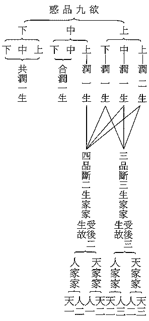



或有人问：断欲界修惑的一品、二品或五品，为什麼不名家家？这因得了初果的圣者，要麼不断欲界修惑，如开始断欲修惑，一断就是一大品结（三品为一大品），绝对没有说是断了一品、二品，不断三品，就於中间死生的；亦决没有说是唯断五品，不断第六品，就於中间死生的。什麼道理？因初果圣者，在断欲界修惑时，生起极大的加行，所以断一二品必断三品。又一品不能障於得果，所以断了五品，亦必断第六品。家家是什麼意思，如前所说固已知道，但要具备什麼条件，预流方得转名家家？论说要具三个条件：㈠、由断惑，就是断欲界修惑的三四品；㈡、由成根，就是得能治彼的无漏根；㈢、由受生，就是更受欲有的三生、二生。今此颂中，只说第一与第三的两个条件，没有说第二成根的一个条件，因预流果后进断修惑，诸无漏根一定是有的，所以颂中略而不说。



断至五二向断六一来果　此明一来向果。谓预流果的圣者，进断欲界一品乃至五品的修惑，就名一来向。此为趣向一来果的因道，所以名为一来向。假定断了欲界的六品修惑，那就名一来果了。所谓一来者，就是在欲界的人间天上，一往来之义。因於九品惑中断前六品，尚留有下三品惑，依这下三品惑的力量，必往来於欲界人天的，所以名一来果。即此一来果，亦名薄贪瞋痴，因为上中六品的重贪瞋痴已断，而唯有下三品的薄贪瞋痴存在的缘故。



子三　不还向果丑一　正明不还



> 断七或八品一生名一间此即第三向断九不还果



一来向与一来果的差别，已经辨别过了；不还向与不还果的差别，其次应当建立。於中，初两句明一间，次两句明向果。



断七或八品一生名一间　此明一间。谓一来果的圣者，进断欲界修惑，断前七品，固然唯受一生，断八品惑，亦复唯受一生，即此一生，亦名一间。间是间隔，意谓断七八品惑的圣者，尚存欲惑的第九品，为其间隔，使之不能证於不还果：或说唯为一生之所间隔，使之不能证於涅槃。由於具此二义，所以名为一间。应知此一间如家家，亦有人天二种，《婆沙》五十三说：「一间有二，谓天一间及人一间。天一间者，谓於天上，唯受一生，六欲天中，随应受一生；人一间者，谓於人中，唯受一生，三洲随应，除北俱卢」。如家家须要具备三个条件，当知此一间亦须具备三个条件：一、由断惑，就是断除欲界的七八品惑；二、由成根，就是成就了能治彼七八品惑的无漏根；三、由受生，就是更受欲有的残餘一生。今此颂中，只说第一与第三的两个条件，没有说第二成根的一个条件，因一来果后进断修惑，诸无漏根一定是有的，所以颂中略而不说。於此成为问题的，就是只有第九一品的修惑，怎麼还有力量能为障碍，令不获证不还圣果，而於欲界再受一生？这因断了这一品，便超越了欲界所系的诸业、烦恼、异熟、等流二果地故，彼一品惑极为留碍，所以障得不还果容更受生。至断六品惑的时候，因为还未超越欲界地，所以没有断五品而於中间受生的道理。



此即第三向断九不还果　此明向果。即此断欲修惑七八品的行者，应知亦名第三不还果向。此为趣向不还果的因道，所以名不还向。假定断了欲界的九品修惑，那就名为不还果了。所谓不还者，因为到此阶段，已将欲界九品修惑全部断尽，不会再依欲界修惑的力量，还来欲界受生的事实，所以名不还果。即此不还果，亦可名五下结断，所以《杂含》三十四说：「五下分结尽，得阿那含」。五下分结，就是欲贪、瞋、身见、戒禁取见、疑。《正理》六四说：「此或名为五下结断，如契经说：若有永断五下分结，名为不还；此据集断密作是说，必无五结俱时断理，或二或三先已断故，理实应说於此位中，断二或三得不还果」。



丑二　不还差别寅一　七种不还



> 此中生有行无行般涅槃上流若杂修能往色究竟  

> 超半超徧没餘能往有顶行无色有四住此般涅槃



不还向与不还果的差别虽然已经知道，但在诸契经中复以种种门建立不还的差别，今当进一步说明那个差别相。这两颂是明七种不还。初一颂半明五不还，第七句明无色不还，第八句明现般不还。初中前两句明四不还，次一行颂明上流不还。



此中生有行无行般涅槃　此明四种不还。颂文的「此」字，是指不还体。谓此不还，总说有七：一、中般，意说不还的圣者，於欲界没而往生色界时，就在中有位上，生起强有力的圣道，断尽上二界的修惑，成阿罗汉而入无餘涅槃。二、生般，意说不还的圣者，於欲界没而往生色界时，生去已后不久，就能生起强有力的圣道，断尽残餘的修惑，成阿罗汉，於命终时，方般涅槃。这生般圣者，具有勤修、速进的二道。前中般，是约入无餘依涅槃说，此生般，是约入有餘依涅槃说，因为不是才生便般无餘者。光说：「彼色界中，於舍寿命，促入涅槃无自在故。於初生时，断餘惑尽，名为生般，后尽彼寿，方般无餘故」。三、有行般，意说不还的圣者，於欲界没生到色界去已后，须经长时间的加行勤修，然后方得入於有餘依涅槃。这有行般的圣者，虽有勤修道，但无速进道。四、无行般，意说不还的圣者，於欲界没生到色界去已后，在长久的时间中，不加何等的修行，任运而自然的入於有餘依涅槃。这无行般的圣者，不特没有速进道，就连勤修道亦无。有行、无行的次第，是约有部宗的学者说的，若约经部师的意见来说，应先无行而后有行，为什麼如是次第？这有教证与理成。《杂含》二九说：「断此五下分结，得中般涅槃，於彼未等觉者，得生般涅槃，於彼未等觉者，得无行般涅槃，於彼未等觉者，得有行般涅槃，於彼未等觉者，得上流般涅槃」。又《杂含》二七说：「五下分结尽得中般，若不得中般得生般，若不得生般得无行般，若不得无行般得有行般，若不得有行般得上流般」。这是最有力的教证。论说：「有速进道、无速进道，无行、有行而成办故，不由功用得、由功用得故」。分开来说：有速进道而不由功用般於涅槃的，名为无行般；无速进道而由功用般於涅槃的，名为有行般。《成实论》第一有更好的说：「生灭者，生时深厌离有，即入涅槃，是名生灭，以根利故；或有生已，诸无漏道自然在前，不加勤行而入涅槃，是不行灭，以根中故；或有生已，深畏受身，勤修行道乃入涅槃，是名行灭，以根钝故」。这是最有力的理成。因此，论主认为如是次第，是极契合於理的。



上流若杂修能往色究竟超半超徧没餘能往有顶　此明第五上流般。上流是上行的意思，即生色界的不还圣者，不在所生之处般於涅槃，而更转生较上的天处，於其转生的天处，方始入於涅槃，名上流般。这有二类：一有杂修，即乐慧的圣者；二无杂修，即乐定的圣者。假定是杂修而乐慧的上流，乐智慧的高妙，不乐禅定的殊胜，则能往於色界的色究竟天，因为色界是智慧胜的。如是乐慧的上流，复有三种的差别。㈠、全超，谓此圣者，在欲界的时候，於四静虑，已具杂修，后来因为遇到逆缘，将上三静虑退失了，唯味著於初禅，所以从此命终，上生到梵众天，然由过去的熏习力，在梵众天，仍能杂修第四静虑，所以从梵众没，就上生色究竟，最初天没，最后天生，顿超中间十四天，所以名为全超。㈡、半超，谓此圣者，从梵众天没，生色究竟天，中间有十四天，渐次渐次受生，或唯越於一天，就上生色究竟，或越二天、三天，乃至越十三天处，然后生色究竟，都可名为半超，因为所超非全，所以名为半超。如果是越一天的，那就要受十五生，如果是越二天的，那就要受十四生，如果是越三天的，那就要受十三生，乃至如越十三天的，那就唯受三生。这样看来，可以知道：半超圣者，极多受十五生，极少唯受三生。为什麼不说生於大梵天而说生於梵众天？大梵说我能生世间，这是非因计因的戒禁取，是僻见处，圣者决不生到这样的地方去的。㈢、徧没，谓此圣者，在色界十六天中，尽徧受生，一天也不超越的，所以名为徧没。假定是不杂修而乐定的上流，乐禅定的殊胜，不乐智慧的高妙，於色界十六天，虽能徧生色界，但不受生於五净居天，所以经初十一天后，直生无色界的下三无色，然后生有顶天，入般涅槃。这样分别，所以知道，色界的下十一天，不论乐定乐慧，是都可以受生的，但到广果天，自然就分二路：谓乐慧者，从此生於五净居天，而乐定者，从此生於无色界天。七种不还中，从中般至上流般的前五，都是行於色界的圣者，虽说乐定上流，生无色界，因为经色界生，所以是色界摄。



行无色有四　这是第六行无色般。意说不还的圣者於欲界没，不生色界，超生无色界而般涅槃者。此与上流般中的乐定圣者不同：彼是生於色界而更生无色界，此是不生色界而直生於无色界的。如就其类分别，有生般、有行般、无行般、上流般的四种，望前行於色界的，缺一中般，因无色界是没有中有的。此行无色界的上流般，例前行於色界的上流般，亦有全超、半超、徧没的三类。谓四无色中，超於中间的二处，名为全超；唯超一处的，名为半超；徧於四空处受生的，名为徧没。



住此般涅槃　这是第七现般。意说不还的圣者，既不行於色界，亦不行於无色界，就住於此而能般涅槃的，名为现般涅槃。为什麼能够如此？因他以欲界的现实生命体，断尽三界的所有修惑，所以能够现般涅槃。



寅二　九种不还



> 行色界有九谓三各分三业惑根有殊故成三九别



行於色界的五不还者，依其异门显示，有九种的差别。这九不还，考之於《婆沙》，是没有的，如《婆沙》百七十四，虽说有一、二、五、二十、三十，乃至一万二千九百六十等的差别，但没有如此所说的九种。又如《杂心》第五，虽说有五、七、八、十五、二十等的差别，但也没有如此所说的九种。当知此中所说，同於《成实论》第一〈分别贤圣品〉第十所说。初两句，总释三种、九种不还；后两句，别释三种、九种不还。



行色界有九谓三各分三　谓即行於色界的五种不还，先总立为三，然后又将总三各分为三，三三就有九种。总三是什麼？一、中般；二、生般；三、上流般。为什麼不说有行般与无行般？因这二般，都是要生色界后，方得入於涅槃的，所以现在把他总归於生般所摄。总三又是怎样的各分为三？第一中般三者：一、初起而即般涅槃的，叫做速般；二、至远而始般涅槃的，叫做非速般；三、近当来所生处而始般涅槃的，叫做经久般。初者如札火，中者如铁火，后者如小火星，所以论说「由三火星喻所显故」。第二生般三者：一、约速建立才生而即般涅槃的，叫做生般；二、约非速建立要勤修行而始般涅槃的，叫做有行般；三、约经久建立无功用行而即般涅槃的，叫做无行般。论说：「此皆生已得般涅槃，是故并应名为生般」。第三上流般三者：一、约速建立而超诸天般涅槃者，名为全超；二、约非速建立而超一天、三天，乃至十三天般涅槃者，名为半超；三、约经久建立而於十六天尽徧受生得涅槃者，名为徧没。是诸三种，皆是由速、非速、经久而得般於涅槃的，所以虽分九种，彼此不相杂乱。



业惑根有殊故成三九别　如是像上所说的三种、九种，都是由於业、惑、根三者的差别而成的。由业差别而成三者：造顺起业，成为中般，中有名起，趣向未来的生处，暂时而起，所以感此中有业，名为顺起业；造顺生业，成为生般；造顺后业，成上流般。由惑差别而成三者：下品烦恼，在中般行者的生命体上现行；中品烦恼，在生般行者的生命体上现行：上品烦恼，在上流般行者的生命体上现行。由根差别而成三者：上根者为中般，因为他是最速利的；中根者为生般，因为他是处中行的；下根者为上流般，因为他是最迟钝的。於此须要特别了知的：颂中虽说「业惑根有殊」，但那是约总相说，即以三种不还而论，固然皆由业惑根的差别，但约别相而言，只有上流的三种不还，可说具由惑业根的差别，而中般生般的各三不还，不是由於业的差别，而是由於惑根的差别。为什麼上流三者可有业的差别？因顺后业，有全超业、半超业、徧没业的三种差别。为什麼中生二般的三者无有业的差别？因中般三，同是属於起业，生般三，同是属於生业，所以无有差别可言。今将九种不还，图示如下：



　　　业──顺起业┐　┌速般──下下品──上上根  

　　　惑──下品惑├─┤非速──下中品──上中根  

　　　根──上　根┘　└经久──下上品──上下根  

　　　业──顺生业┐　┌生般──中下品──中上根  

　　　惑──中品惑├─┤有行──中中品──中中根  

　　　根──中　根┘　└无行──中上品──中下根  

　　　业──顺后业┐　┌全超──上下品──下上根──全超业  

　　　惑──上品惑├─┤半超──上中品──下中根──半超业  

　　　根──下　根┘　└徧没──上上品──下下根──徧没业



寅三　七善士趣



> 立七善士趣由上流无别善恶行不行有往无还故



有人据经问道：假定说是真有九种不还，为什麼诸契经中佛唯说有七善士趣？如《中含．七法品．善人往来经》，是就说七善人所往至处，并且广说中般三、生般三及上流的七善人。旧论说：「七种贤圣人行」，也是此意。上两句明立七善士趣的所以，下两句简别诸餘有学非属善士趣摄。



立七善士趣由上流无别　经立七善士趣，是依中般、生般各三，上流为一而立的，因为上流无别，所以只有七善人。为什麼前二各分为三，第三上流唯立为一？所谓上流，是上行的意思，由於彼此义同，所以但立为一。於此或有要问：中生二般也是义同，为什麼各分为三？这因他们的别相，很难了知，如不加以分别，是无法了解的，为欲使令学者，容易了解起见，所以各各分三：上流不然，他的别相，是很容易了解的，无须於彼更别建立，所以合立为一。还有一个道理：中生二般的差别，就只有这麼多，如中般，唯在将生的时候，依於根惑的品别，分为三种；生般，唯在已生之后，依於根惑的品别，分为三种；要是为人显示的话，那是很容易的，所以各分为三。第三上流就不同了，他的差别义多得很，不特通於将生已生，而将生已生的上流，又有於静虑杂修不杂修的差别，「复於如是二上流中，若无杂修容生二界，若有杂修唯生一界，生一界者复分为三，全超、半超、徧没异故，於半超内差别有多」。因为上流是这样的复杂，要想将他一一显示清楚，那是非常困难的，所以就总立为上流。



善恶行不行有往无还故　这是解答一个问题而明诸餘有学非为善士。有人提出这样责问：为什麼唯依於此立善士趣而不依於所餘有学？诸餘预流及一来的有学圣者，并不是说不可名善士趣，实际讲来，佛也曾经说过他们是善士的，如经中说：「云何善士？谓若成就有学正见，乃至成就有学正定」。但是现在所著重的在趣，什麼叫做趣？谓趣上果及趣上生，而能趣於上果及上生的，只有已断欲界贪瞋等的非善士法及与无学大善士果极相邻近的圣者，所以经唯说此七圣名善士趣。同时还有两个理由。一、专门能够行善而不作恶的，只有这七种圣人，诸餘预流及一来者，虽则说是可以行善，但是有时亦作於恶，所以不得名善士趣。二、确能往生上界而不复还来欲界的，亦唯此七善人，诸餘预流及一来者，只能往来於欲界中，无有力能生於上界，所以不得名善士趣。



寅四　明无三事



> 经欲界生圣不往餘界生此及往上生无练根并退



光记与宝疏，并科此颂为非生上界，这实在是不大妥的，因为缺少了生上生、无练退的二事，所以此应科为明无三事。《婆沙》五十三说：「评曰：若在欲界经生圣者，定不复生色无色界。所以者何？若在欲界经生圣者必无三事：一者不退，二者不转根，三者不生色无色界。圣道久住相续中极坚牢故。恐上二界有长时苦同欲界故」。现在不过是加「从欲上生」这一点不同而已。上两句明非生上，下两句明无练根退。



经欲界生圣不往餘界生　诸有在圣位的圣者，如果是经欲界受生的，那他必定不往生色无色界，因他厌苦的心非常迫切，深感欲界已多苦恼，如生上界也同欲界有长时的苦痛，岂不是自寻苦恼？所以於欲界经生的圣者不生上界；如果是於色界经生的圣者，因色界纯乐无苦，厌离心不易生起，所以容可生於无色界。或有人这样问：欲界经生的圣者，上界尚且不生，亦应不更生於欲界？不能这样说，要知於欲经生的圣者，虽则厌离心很重，一因烦恼的难断，二因圣道的未熟，不能不在欲界更受多生。设或经生圣者，精进励力的修持，使圣道於身中现起，断上二界惑尽，得阿罗汉果，现身就般涅槃了，所以必不往生上界。



此及往上生无练根并退　此欲界经生的圣者及往生上界的圣者，必无练根及无有退。什麼道理？因为经多数生，久久熏练修习，其根已经渐渐极为成熟了，所以已得预流、一来的圣者，其所依身是极殊胜的，《婆沙》所说「彼相续中极坚牢故」，就是此意。如入见道所依身，因为是凡夫身，虽然已得无漏，但说不上殊胜；得无漏后的经生圣者，因所依身是圣身，极为殊胜，所以无练根及退转理。至於上界经生的圣者，亦因所依身是殊胜的，所以也无练根及退转的道理。《正理》六五说：「以曾经生於自相续，蕴积圣道极坚牢故，及得殊胜所依身故，由此彼无练根、退理」。



寅五　杂修静虑



> 先杂修第四成由一念杂为受生现乐及遮烦恼退



前面曾经说到，上流般的圣者，由於杂修静虑为因，得能往生色究竟天，现在针对此说，提出三个问题：一、先应杂修那一种的静虑？二、由於到达怎样的阶位知道杂修已成？三、究竟为了什麼因缘而要杂修静虑？今此颂文，初句答第一问，次句答第二问，后两句答第三问。



先杂修第四　诸有欲想杂修四静虑者，不管是阿罗汉人，或者是彼不还者，必先杂修第四静虑，然后方能杂修下三静虑。什麼道理？因彼第四静虑，止观均等，最具有堪能性，而在一切乐行中，彼第四静虑乐行又是最殊胜的，如依於彼杂修静虑，即使后来退失而生到餘天中去，但由先时杂修彼的力量，仍能依彼杂修静虑。



成由一念杂　诸有杂修四静虑者，当其正在杂修时，究作一种什麼方便，彼必先入第四静虑？论说：「多念无漏相续现前，从此引生多念有漏，后复多念无漏现前，如是旋还后后渐减，乃至最后二念无漏，次引二念有漏现前，无间复生二念无漏，名杂修定加行成满：次后唯从一念无漏，引起一念有漏现前，无间复生一念无漏，如是有漏，中间刹那，前后刹那，无漏杂故，名杂修定根本圆成，前二刹那似无间道，第三刹那似解脱道。如是杂修第四定已，乘此势力随其所应，亦能杂修下三静虑」。



为受生现乐及遮烦恼退　行者杂修静虑的因缘有三：一为受生，就是生於五净居天；二为现乐，就是求得现法乐住；三为遮止起烦恼退。若不还修由前三缘，而以根的利钝分别：诸利根者杂修静虑，是为现法乐及生净居的二缘：「为现乐者，欣乐胜定，谓世俗定最能资身，由此能令现法乐住，前后无漏为其助伴」；「为受生者，希求胜生，谓厌共生欣不共故」。诸钝根者杂修静虑，不特为前现法乐及生净居的二缘，亦为遮防起烦恼退的一缘：「谓钝根者起二无漏，方便防护清净等持，令味相应等持转远，不令净为染等无间缘故」。若罗汉修由后二缘，不由受生，而以根的利钝分别：诸利根者杂修静虑，专为现法乐住；诸钝根者杂修静虑，不仅是为现法乐住，亦为遮防起烦恼退。



寅六　净居唯五



> 由杂修五品生有五净居



行者为生五净居天而杂修静虑，那末，净居为什麼不多不少而唯有五呢？现在以颂答道：



由杂修五品生有五净居　净居所以不多不少唯有五者，由杂熏修第四静虑有五品差别的缘故。五品者：一、下品；二、中品；三、上品；四、上胜品；五、上极品。初品有三心现前，就算成就圆满。谓初起一念无漏，次起一念有漏，后又起一念无漏。中品有六心现前，就算成就圆满。谓二有漏，为四无漏之所杂修。上品有九心现前，就算成就圆满。谓於前六心外，更起三心，於中三有漏，为六无漏之所杂修。上胜品有十二心现前，就算成就圆满。谓於前九心外，更起三心，於中四有漏，为八无漏之所杂修。上极品有十五心现前，就算成就圆满。谓於前十二心外，更起三心，於中五有漏，为十无漏之所杂修。如是五品杂修为因，如其次第能感五净居果。不过须要知道的，就是此中的有漏无漏，无漏只能熏修有漏，使去招感五净居果，无漏本身并不招感净居果的，因他根本就是憎背三有的。



寅七　身证不还



> 得灭定不还转名为身证



《中含》五一《阿湿具经》说：「若有比丘，非俱解脱，非慧解脱，而有身证。云何比丘而有身证？若有比丘，八解脱身触成就游，不以慧见证漏已尽已知，如是比丘而有身证」。这就是以不还名身证。经中既说不还也可名为身证，那究竟是依什麼殊胜功德而立这身证名？颂解答说：



得灭定不还转名为身证　谓入灭尽定而於身得寂静之乐的不还果圣者，转名身证。《婆沙》五四说：「身证谓信胜解或见至，以身具证八解脱，未以慧尽诸漏」。谓即由身证得似涅槃法，依身而又以身作证，身即证故名为身证。为什麼说由身证非心证呢？因灭尽定中，灭诸心心所，是无心的，怎麼可说心证？依身生的，所以但名身证。论主更确切的解释说：彼不还人，从灭尽定刚刚起来的时候，得到从来所未得的唯有识心而身寂静的境界，於是便作这样的思惟：这灭尽定最为寂静，很有一点儿像涅槃。由此思慧及身，证得身的寂静，所以名为身证。



子四　罗汉向果丑一　向果差别



> 上界修惑中断初定一品至有顶八品皆阿罗汉向  

> 第九无间道名金刚喻定尽得俱尽智成无学应果



不还向与不还果以及他们的种种差别相，都已分别说明了；阿罗汉向与阿罗汉果的差别，现应次第的建立。颂的前六句明罗汉向，后二句明罗汉果。《婆沙》对此提出问题道：离欲界染，只有九品，立一来、不还的二果：离上界染，有七十二品，唯立一阿罗汉果，这是什麼道理？答：离欲界染所以立有二果，是因欲界的惑染，难断难破难可越度；离上界染所以唯立一果，是因上界的惑染，易断易破易可越度；所以这个问题是很易解决的。



上界修惑中断初定一品至有顶八品皆阿罗汉向　不还果的圣者，既已全断欲界修惑的九品，由是进而更断色界初禅天第一品，如是二品三品渐次渐次断至无色界有顶天第八品的修惑，是就转名为阿罗汉向，而逐步逐步的趣向於阿罗汉果了。



第九无间道名金刚喻定　即此所说阿罗汉向中，那能断有顶惑的第九无间道，亦说名为金刚喻定。金刚是最坚最锐的，能破一切而不为一切所破，此定的坚锐，犹如金刚一样，无一烦恼而不破的。定虽有力能破一切，但是先已破除了的餘惑，不为现在所破，现在所破的，唯是第九品惑，虽唯破最后一品惑，而实有能破一切的功能。此无间道，既能摧毁最微细的一品惑，因而也就知道一切无间道中，唯此刹那是最极上品，正因为这是最极上品，所以能永断除一切烦恼。此金刚喻定生起时所依的地，是未至、中间、四根本、下三无色的无漏九地，因为是能治道所依的地。欲界不是定地，所以非为所依；有顶不是无漏——《婆沙》二八说：非想非非想处，无自地无漏，所以亦非所依。此多种金刚喻定，悉皆随一生起，就证得阿罗汉，并不是说一个行者能起众多的。



尽得俱尽智成无学应果　金刚喻定既能断有顶地的第九品惑，当然就有力能引起这第九品惑的尽得俱行的尽智，使令至於生相中。前金刚喻定是断惑中最后的无间道，这所生尽智，是断惑中最后的解脱道。什麼叫做尽智？谓由这解脱道，与诸漏的尽得，同时俱生尽，名为尽智。如是断尽有顶的第九品而尽智至已生的时候，那就成为无学阿罗汉果了。所谓无学者，就是到了这个地步，一切所作皆已成办，更无有何可学，所以名为无学。所谓阿罗汉者，依照他的意思译为应，就是一个梵行已立，烦恼已断，生死已了的圣者，应受人天广大的供养：或也可以这样讲，证得无学果位的圣者，对於诸自利行，都已修学完成，为自利事，没有什麼应更学的，如果现在还有要做的，那就唯作诸利益他事。因为具此二义，所以译名为应。通常说的应供，即此应为他事，应受供养。《婆沙》对此又作多种的解释说：「复次，阿罗者，谓一切烦恼，汉名能害，用利慧刀，害烦恼贼，令无餘故，名阿罗汉。复次，罗汉名生，阿是无，以无生故，名阿罗汉。彼於诸趣、诸生、生死法中，不复生故。复次，汉名一切恶不善法，言阿罗者，定远离义，远离诸恶不善法故」。



丑二　诸门辨道寅一　地由道离染



> 有顶由无漏餘由二离染



如上所说，修道是有两种的：一是有漏的修道，一是无漏的修道，现在我们所要问的，就是於此二种道中，由那一种的道，离那一地的染？颂文解答说：



有顶由无漏餘由二离染　三界最高有顶地中所有烦恼，唯无漏道能够使他彻底远离，绝对不是有漏道的力量所能为力的，为什麼？因有漏道是欣上厌下的，唯於次上近分地中起世俗的有漏道，能治下地的烦恼，有顶既为三界最高的一地，在他上面更无上地可以欣求，当然是就没有有漏道能够离於彼地的烦恼了。或有人说：以自地的世俗道治自地的烦恼惑，这有什麼不可呢？不可！为什麼？因自地道为自地烦恼之所随增的，无力能够治彼烦恼，如人被缚不能自解，其道理是一样的。有顶之下的其餘八地烦恼，通由漏无漏的二道能令永离，因为世出世道俱能远离的。



寅二　道引离系得



> 圣二离八修各二离系得



下八地染，既通由漏无漏二道得以远离，那他们各有几种离系得呢？这是紧接上面而来的问题，现以颂文解答说：



圣二离八修各二离系得　圣言简别凡，圣二言简圣一道，八言显下八地，简有顶，修言简见道。总括而论：一切有学的圣者，都可用有漏无漏的二道，离於下八地的修所断惑，而且不论是有漏道或无漏道，各能引生二离系得。分别而论：圣以有漏道断下八地修所断的烦恼时，一方面固能引生有漏的离系得，另方面亦能引生无漏的离系得，所以说「能具引生二离系得」。圣以无漏道断下八地修所断的烦恼时，能具引生二离系得，与前所说是一样的。所以能够如此者，因「有漏无漏二种断道，於八地中所作同故」。《正理》六六说：「由此有学离八修断，世出世道随一现前，各未来修世出世道。既说圣者二离八修，各能引生二离系得，准知圣者离有顶修及见断时用无漏道，唯引无漏离系得生，亦不未来修世俗道，与世俗道不同事故。异生离八用有漏道，唯引有漏离系得生，亦不未来修无漏道，未入圣故，不说自成」。



寅三　道离地通局



> 无漏未至道能离一切地餘八离自上有漏离次下



有漏无漏道，都有离染的功用，这是不成问题的，但由那一地的道，断那一地的染，是还须要分别的，此颂就是明道离地通局的。



无漏未至道能离一切地　诸无漏道，通依未至、中间、四静虑及三无色的九地，假定是依未至地所起的无漏道，能离欲界乃至有顶的九地染，所以说一切。



餘八离自上　餘八就是静虑中间、四静虑及三无色。假定是依这八地所起的无漏道，随其所应，能离自地染及上地染，但不能离下地染，因彼已离而无可再离。如举例说：初定中间，能离自地及上七地，初静虑地，能离自地及上六地，乃至无所有处，能离自地及上有顶。上地的圣道现前，下地的惑染已离，所以不离下地。



有漏离次下　有漏言简别无漏，下言简别自地及上地，次言显邻次，简别不是隔越於下地。综合而言：一切的有漏道，唯能远离次下一地的惑染，既不能离自地染，亦不能离上地染，更不能离隔越的下地染。如依未至地所起的有漏道，唯能离於次下的欲界惑染，若依第二静虑近分所起的有漏道，唯能离於次下的初静虑染。为什麼不能离上地染？因为他的势力微劣：为什麼不能离自地染？自地烦恼所随增故：为什麼不能离隔越的下地染？因彼已离而无可再离的。



寅四　近分摄道别



> 近分离下染初三后解脱根本或近分上地唯根本



诸依近分离下地染的，如无间道都是属於近分所摄的，诸解脱道是不是亦属近分呢？这没有一定！那是怎样的？颂文解答说：



近分离下染　诸道所依的近分，大概总有八种，就是四静虑边及四无色边，边就是近分的意思，因他近於根本的关系。如论二十八卷中说：「四本静虑，四本无色，各有近分，与八根本为入门故」。初禅近分，离欲界染；二禅近分，离初禅染；乃至有顶近分，离无所有处染，所以说近分离下染。



初三后解脱根本或近分　初三，指初二三禅，后解脱，指第九解脱。意谓此三近分离下三地染，第九解脱现在前的时候，或者入於根本，或者就在近分，是没有一定的。此中既然特别指出第九解脱道，可以想见前八解脱道，都是属於近分的，不能入於根本定。



上地唯根本　从第四禅一直到有顶天，都名为上地。此上五地的近分，各各离下於五地染，第九解脱现在前的时候，那就唯有入於根本，而不就在近分。为什麼有此差别？要知此上五地，不论是近分，或者是根本，同样都是只有舍受，所以在离下染的时候，必定欣求上地，但因受无差别，所以必入根本。下三静虑就不同了，近分虽然都唯舍受，根本却有喜乐受的。因而要从这一受转入另一受，觉到稍为有点艰难的，所以有不能够入於根本。



寅五　世俗道缘行



> 世无间解脱如次缘下上作粗苦障行及静妙离三



诸出世道的无间、解脱如何，前面既已说了；诸世间道的无间、解脱怎样，现在应当分别。首先要问的：诸世间道，是以什麼为所缘的？又是作什麼行相的？颂文解答说：



世无间解脱如次缘下上作粗苦障行及静妙离三　有漏世俗的无间道及解脱道，如其次第，能缘下地上地。说得明白一点：有漏的无间道，能缘自次下地；有漏的解脱道，能缘彼次上地。以无间道缘於下地的诸有漏法，作粗苦障的三种行相，於三行相中，随起一行相：以解脱道缘於上地的诸有漏法，作静妙离的三种行相，於三行相中，亦随起一行相。如对起来说：无间道缘下为粗，解脱道缘上为静；无间道缘下为苦，解脱道缘上为妙：无间道缘下为障，解脱道缘上为离。粗是什麼意思？谓下地的诸有漏法，由於有多掉举，非同上地寂静，所以说名为粗。苦是什麼意思？谓下地的诸有漏法，由於难以超越，非同上地美妙，所以说名为苦。障是什麼意思？谓下地的诸有漏法，由於有多灾害覆障，非同上地能得出离，所以说名为障。静是什麼意思？「诸上地中不作功用掉举微劣，故名为静」：妙是什麼意思？「不设劬劳掉举微劣引生胜乐，故名为妙」；离是什麼意思？「於下地中所有灾害，能决定见，心不生欣及能越彼，故名为离」。



丑三　尽等相生



> 不动尽智后必起无生智餘尽或正见此应果皆有



前面曾经说到，金刚喻定无间，必有尽智续生，但尽智无间的时候，又有什麼智续生呢？颂文解答这一问题说：



不动尽智后必起无生智　诸阿罗汉，也有利根钝根的差别，像不动罗汉，就是属於利根的。如是不动种性的诸阿罗汉，尽智无间必然的会生起无生智，因这无生智，是他本来之所追求的，所以可与尽智俱时而得。尽智与无生智的行相有什麼差别？论二六卷说：「知苦、断集、证灭、修道，名尽智；不应更知、不复更断、不复更证、不复更生，名无生智」：这就是二者的行相差别。



餘尽或正见　除不动法阿罗汉之外，其餘的退法等的五种阿罗汉，因为是属钝根的关系，所以於尽智无间，或仍生起尽智，或即引生无学正见，没有无生智无间而生，因为后来还容有退的。这样说来，他们在因位中，是不是双求尽、无生的二智呢？求当然是求的，由於到了极果，可能还要有退，所以金刚喻定正灭位中，不得无生唯得尽智，而尽智后亦唯尽智现前，或即引生无学正见。



此应果皆有　这是答覆一个问题的。有人这样问道：不动罗汉，於尽智后，既然是起无生智，难道他没有无学正见吗？不是！凡是罗汉，不管是钝根利根，必然都有无学正见的，所以不动罗汉，於无生智生起之后，或者更起无生智，或即引生无学正见，现在所以不说者，因为这是一切应（阿罗汉）果之所共有的，犹如尽智一样，是故金刚喻定正灭位中，一切皆得无学正见。不过我们须要知道的，就是这无学正见，不是因中所正求的目标，因而尽、无生的二智无间，或有即生起的，或有不现前的。



丑四　便明道果寅一　沙门性果数



> 净道沙门性有为无为果此有八十九解脱道及灭



上来所说的四果，应知就是四沙门果，於此产生三个问题：一、怎样叫做沙门性？二、这果体是指的什麼？三、果位的差别总有几种？这都是我们所必须要知道的问题，现在分别解答如下：



净道沙门性　这是解答第一问题。净是清净，清净道就是无漏道。易言之，诸无漏道为沙门性。如在生命体上，怀有这无漏道的，就名为沙门。沙门是什麼意思？就一般说，即出家的宗教徒：依佛法说，能勤苦修行，断诸惑染的，即名为沙门。《中含》四八说：「云何沙门？谓息止诸恶不善之法，诸漏秽污为当来有本，烦热苦报生老病死因，是谓沙门」。《正理》六七说：「言沙门者，能永息除诸界趣生生死魑魅，或能勤励息诸过失，令永寂静，故名沙门」。《增一》四六说：「沙门名息心，诸恶永已尽」；又说：「复以何故名为沙门？诸结永息故，名为沙门」。《杂含》二九说：「何等为沙门义？谓贪欲永断，瞋恚、痴永断，一切烦恼永断」。所以真正做个名符其实的沙门，是不简单的。不说一般的人们不够资格称为沙门，就是已断无所有处染的异生，也不得称为真正的沙门，因为他们尚有残餘的过失存在，所得寂静安宁，只是暂时的，不是究竟的。



有为无为果　这是解答第二问题。沙门性既是诸无漏道，沙门果体当就通於有为无为，所以佛说总有四沙门果，就是初预流果，次一来果，次不还果，后阿罗汉果。《杂含》二九说：「何等为沙门果？谓须陀洹果、斯陀含果、阿那含果、阿罗汉果」。《中含》二六《狮子吼经》说：「此中有第一沙门、第二、第三、第四沙门，此外更无沙门梵志，异道一切空，无沙门梵志」。所谓有为果，是约解脱道说；所谓无为果，是约择灭说。《正理》六九说：「道类智品，是谓有为预流果体，见断法断，是谓无为预流果体；道类智品或离欲界第六无漏解脱道品，是谓有为一来果体，见断法断及欲界系修所断中前六品断，是谓无为一来果体；道类智品或离欲界第九无漏解脱道品，是谓有为不还果体，见断法断欲修断断，是谓无为不还果体；尽智、无生智、无学正见品，是谓有为阿罗汉果体，三界见修所断法断，是谓无为阿罗汉果」。观此，所谓有为无为果，可说是很清楚了。



此有八十九解脱道及灭　这是解答第三问题。此沙门果，简单说虽则如上四种，详细分析，实有八十九种，因解脱道有八十九种，所证择灭亦有八十九品。所证择灭是无为果，诸解脱道是有为果。此八十九种，属於见道的其数有八，属於修道的有八十一。谓断三界所有的见惑，有八无间（八忍）、八解脱道（八智）；断三界九地的修惑，有八十一无间道，八十一解脱道。见修合论，总有八十九。诸无间道唯是沙门性，不可名沙门果；诸解脱道，不仅可名沙门性，亦可名为沙门果。



寅二　立四果因缘



> 五因立四果舍曾得胜道集断得八智顿修十六行



诸沙门果，既然总有八十九，佛为什麼不把他一一具说出来，而唯说四果？当知果虽有多，然而所以不说，是也有他原因的，本颂就是显示不说的所以。



五因立四果　佛之所以只说四果，是由五因而建立的。《正理》六七说：「若断道位具足五因，佛於经中建立彼断，及与断得俱时而生，净解脱道为沙门果」。所谓五因，是那五种呢？答：



舍曾得胜道集断得八智顿修十六行　这三句颂，就是说的五因。一、舍曾道，谓舍先前所曾得的若果若向之道。如分别说：在预流果，唯舍向道；於餘三果，不但舍向道，且舍前果道。这舍曾道，简单而扼要的说，是舍先前所得的劣道，得后所得的殊胜道。二、得胜道，谓於得果位中，而摄殊胜道的。三、总集断，谓总集择灭无为。如证预流果时，其总集断，是总集三界见惑上的无为得，依所断的见惑有八十八，其上无为亦有八十八，因为无为有八十八，所以能得的得亦有八十八，故预流果时，起八十一类殊胜得，得八十八见惑上的无为，以之名预流果时总集断。次证一来果时的总集断，见惑上的无为，如前预流果，更起六种一类胜得，得欲界六品修惑上的无为，以之为一来果时的总集断。次证不还果时的总集断，见惑上的无为，亦如前预流果，更起九种一类胜得，得欲界九品修惑上的无为，以之为不还果时的总集断。次证罗汉果时的总集断，见惑上的无为，亦如前预流果，更起八十一品的一类胜得，得三界八十一品修惑上的无为，以之为罗汉果时的总集断。四、得八智，谓於一时中，总得四法、四类的八智。五、顿修十六行，谓能顿修无常、苦、空、非我等的十六行相。能具如上所说的五因，唯有住於四果位上的圣者，其他不论在什麼阶位，都不完具这五因，因为是这样的关系，所以佛唯说四果。



寅三　明中间二果



> 世道所得断圣所得杂故无漏得持故亦名沙门果



照上面说，唯有净道，是沙门性，既然如此，那由有漏道力所得的二果，为什麼亦说他是属於沙门果摄？颂文答说：



世道所得断圣所得杂故　谓以世俗的有漏道，得一来、不还果的时候，此果不唯以世俗道所得的择灭为断果性，而且兼以前之见道所得的择灭，於中相杂总成一果，同起一类果道胜得，得彼所得诸择灭的。由於世俗道所得择灭，与无漏道所得相杂的关系，所以就以少从多，而亦名为沙门果了。



无漏得持故亦名沙门果　还有一个道理，就是中间的一来、不还二果，以世俗的有漏道去证得的时候，因为无漏断得所任持的关系，不说不退，即使有退，在未到命终的当儿，必然还可得果，无漏断得印所印故，亦得名为沙门果体。



寅四　沙门果异名



> 所说沙门性亦名婆罗门亦名为梵轮真梵所转故  

> 於中唯见道说名为法轮由速等似轮或具辐等故



依世俗道断修所断得二果时，所得择灭亦可名为沙门果体，这在前面已经说过了，然而我们知道，沙门果是酬沙门性的，沙门性是什麼意思？虽前已说，但这有没有差别名，尚未谈到，现在此颂告诉我们，所谓沙门性，也是有他的差别名的。



所说沙门性亦名婆罗门　如前所说的沙门性，假定是站在世俗的道理上讲，那沙门是沙门，婆罗门是婆罗门，二者是有差别的，如佛在契经中说：「应施沙门，婆罗门等」。假定依於胜义的道理说，那沙门就是婆罗门，婆罗门就是沙门，二者是无差别的，所以沙门性亦可名为婆罗门。《增一阿含》第九说：「世尊告曰：欲言沙门者，即我身是。所以然者，我即是沙门，诸有奉持沙门戒律，我皆已得。如今欲论婆罗门者，亦我身是。所以然者，我即是婆罗门也。诸过去婆罗门所持法行，吾已悉知」。《杂含》十七也说：「如实知受集、受灭、受道等者，彼是沙门之沙门，婆罗门之婆罗门，同沙门同婆罗门，沙门义婆罗门义」。《增一》四六更说：「何故名婆罗门？尽除愚惑之法，名为梵志」。婆罗门是印度话，中国译为净行，即修诸清净行，而远离於诸烦恼的。约四种姓说，婆罗门实为一种族名：约宗教徒说，婆罗门实为在家的宗教徒。



亦名为梵轮真梵所转故　即此所说的婆罗门性，亦可名为梵轮，为什麼？因这是真梵王力所转的。《正理》六七说：「佛与无上梵德相应，是故世尊独应名梵，由契经说佛亦名梵，亦名寂静，亦名清凉，寂默冲虚萧然名梵，佛具此德故立梵名，既自觉悟为令他觉，转此授彼故名梵轮」。於中，梵王（佛）为能转，无漏（法）为所转，於所转义，含有自转与他转：谓无漏法，佛自觉悟，这是自转；令为他觉，这是他转。《杂含》二六说：「能转梵轮，於大众中狮子吼而吼」。梵是清净义，名之为佛，轮是轮转义，名所诠法，梵之轮故，名为梵轮。简世间初静虑的假梵王，所以说名为真。



於中唯见道说名为法轮　如上所说的沙门性，通於见、修、无学的三道，然而於中，唯依见道，说名法轮。《杂含》十五说：「世尊於波罗奈国仙人住处鹿野苑中转法轮」。《中本起经》上说：「佛告梵志：吾欲诣波罗奈，击甘露法鼓，转无上轮」。为什麼见道说名法轮？



由速等似轮　这是答覆上面所问的。见道之所以名为法轮，因速行等的状态，似於世间的轮相的。《宗轮论语体释》说：「如轮王的轮宝，旋环不息，迅速的向前推进，有舍有取，能伏未伏，镇压已伏，上下回转的。见道也是这样，所以说名法轮。配合来说：见道的没有间歇，如轮宝的旋环不息。十六心后的刹那见道，如轮宝的行用速疾。见道的舍苦等境取集等境，如轮宝的舍前取后。见道的见所未见的真理，断所未断的惑障，已断的不再退，已见的不再迷，如轮宝的降伏未伏，镇压已伏。见道的观下苦后，观上苦等，如轮宝的上下回转。由具这些特殊的意义，所以唯有见道独名法轮」。



或具辐等故　这是第二妙音尊者的解说。《婆沙》举妙音尊者的意见说：「八支圣道是正法轮」。我们知道，世间的轮相，具有辐、毂、辋的三大要素，如缺少任何一种，那就不成为轮相，八支圣道有似於彼，所以说名法轮。谓正见、正思惟、正勤、正念，似世间的轮辐。正见是慧，正思惟等，资助於慧，智慧向外取境，就与轮辐相似，所以说名为辐。正语、正业、正命，似世间的轮毂。正定，似世间的轮辋。三者联系起来说：正见等四依戒而转，就如轮辐依毂而转；正语等三以戒为体，戒是正见等的众行所依，犹如依毂而有辐一样的；定能摄正见等令不散失，如辋摄辐使令不散。《婆沙》百八十二说：「尊者妙音说曰：学八支道，展转和合，一时至他相续中转，故名法轮。此八支道，见道位胜，是故见道，独名法轮」。毂辐辋三，如何配合，《婆沙》总有六说，今列一表如下：



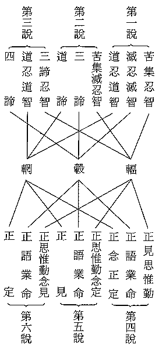



为什麼唯是见道说名法轮？因唯见道是法轮初，所以说名法轮。如憍陈如等五比丘，见道生的时候，地空天神，即相互的传告道：世尊已为世间转正法轮。或者有问：憍陈如等，既是自己入於见道，为什麼说是世尊转法轮？当知这是世尊他转法轮之相，因为五比丘的证入见道，本是由於世尊的法化，所以特别推在释尊的身上。原来所谓转法轮，有部说有二种的。一、於自身中转，如佛在菩提树下，以三十四心成无上道，即为自转法轮。二、令他身转圣道，如佛在鹿野苑中，为五比丘说法，使他见道，即是令他转法轮。佛以利他为正事，所以以转他的法轮，而为佛的初转法轮。《杂含》十五说：「诸比丘！我於此四圣谛三转十二行，不生眼智明觉者，我终不得於诸天魔梵沙门婆罗门闻法众中，为解脱、为出、为离，亦不自证阿耨多罗三藐三菩提，我已於四圣谛三转十二行，生眼智明觉故，於诸天魔梵沙门婆罗门众中，得出、得脱，自证得阿耨多罗三藐三菩提，乃至憍陈如、拘邻知法已，地神举声唱言：诸仁者！世尊於波罗那三转十二行法轮，闻虚空神，谓六欲天，展转闻梵天，乘声唱言，诸仁者！世尊於波罗那三转十二行法轮」。什麼叫做三转？如说此苦圣谛，这是显示见道；此应徧知，这是显示修道；此已徧知，这是显示无学道。所以三转就是显示三道。什麼叫做十二行相？谓於一一转时，别别发生眼智明觉，三四一十二，名为十二行相。如实说来，苦谛下有三转十二行相，集灭道三，亦各有三转十二行相，总有十二转，四十八行相，然因其数相等，所以但说三转十二行相。论主叙述了有部的宗义，又表示自己的正解道：法轮并非唯是在於见道，即此三转十二行相所有法门，名为法轮。所谓三转，是三周而转的意思；所谓十二行相，是三周循历四圣谛的意思。谓此是苦，此是集，此是灭，此是道，为第一周的示相转四圣谛；此应徧知，此应永断，此应作证，此应修习，为第二周的劝相转四圣谛；此已徧知，此已永断，此已作证，此已修习，为第三周的引证转四圣谛。由此法门，於他相续，令解义故。此约教名法轮，於他相续，见道生时，已至转初，故名已转，理实三道，皆名法轮。



寅五　沙门果依身



> 三依欲后三由上无见道无闻无缘下无厌及经故



依佛正法而行，能得四沙门果，那是不成问题的，但那一沙门果，依於那一界身得，这也是一个问题，所以此颂特为分别。



三依欲后三　三指前三果，欲指欲界，意谓前三果人，依於欲界身得，名为三依欲。后指阿罗汉，三指三界，意谓后一阿罗汉果，通於三界身得，所以名为后三。於此有人提出这样责问：初预流果及第二一来果，还没有离欲界染，说他不依上界身得，这当然是不成问题的，但超越的第三果，在先已经离去欲界染，怎麼也不可以依於上界身得？为了解答这问难，所以第二句颂说：



由上无见道　不论是次第证或超越证的圣者，必然是要先入於见道的，可是色无色界身，没有见道的道理，所以无上界超越，能证第三不还果。为什麼上界身必不起於见道？第三句颂解释无色界身不得见道说：



无闻无缘下　谓於无色界中，无容得闻无我圣教，但是要入见道，必须听闻此教，如果离了听闻无我圣教，那是决定不能入於见道的。又彼无色界，不能缘於下之欲界，但是见道，一定要先缘欲界苦，如不缘下欲界苦，是也不能入於见道的。无色界中，既无正闻，又不缘下，当然是就没有见道了。怎知色界没有见道？第四句颂释说：



无厌及经故　谓於色界中，无有厌苦，不但无厌於苦，而且还著定乐，可是要入见道，必须厌离於苦，如无厌苦之心，不得入於见道。又经中说：「有五补特伽罗（五那含），此处通达，彼处究竟」。此处，就是欲界，通达，就是见道；彼处，就是色界，究竟，就是涅槃。既然是在欲界见道，而於色界入般涅槃，可知上界是无见道的。



丑五　明六种性寅一　六阿罗汉



> 阿罗汉有六谓退至不动前五信解生总名时解脱  

> 后不时解脱从前见至生



如前所说，预流果等的有学圣者，是有多种差别的，但无学的阿罗汉果，是不是也有多种差别呢？也有的！总有六种差别。於中，初句标名数，次句列名字，后一颂辨差别。辨差别中，前二句约前五辨；后二句约后一辨。



阿罗汉有六谓退至不动　这是标数列名。阿罗汉，由於种性的差别，佛在经中说有六种不同。《杂含》三颂曰：「罗汉有六种」。《中含》三十《大品福田经》说二十七贤圣中云：「居士！云何九无学人？思法、升进法、不动法、退法、不退法、护法（护则不退、不护则退）、实住法、慧解脱、俱解脱，是谓九无学人」。第一退法者，谓得阿罗汉果以后，偶然遇到一点异缘，立即就起修惑，退失所得之果，而降为不还果、一来果、或预流果等。第二思法者，谓得罗汉果的圣者，因恐所得果的退失，常常的想要杀害自己，希求早日结束生命，而入於无餘涅槃，所以名为思法。第三护法者，谓证果的罗汉圣者，对於前所得的阿罗汉果，常常的都能为之防护，使其不再退失。第四安住法者，谓得果的圣者，安住於所得之果，既离殊胜的退缘而不再失，亦离殊胜的加行而不上进。第五堪达法者，谓得果的圣者，其性具有堪能的作用，就是堪能好修练根，迅速的达於次之不动性。第六不动法者，谓一旦证得罗汉果后，不特不再为烦恼所动，就是无论遭遇到什麼事情，也不会有所退动。



前五信解生总名时解脱　此中，上句示能所生，下句辨别异名。六种罗汉当中，前五种性，是从先来有学位上信解性之所生的，所以此五总名时爱心解脱，为什麼？因恒时爱护自己所证得的果法，所以名为时爱；因心解脱一切的烦恼系缚，所以名为解脱。或简单的说为时解脱，因要等待时机，方能入定及解脱的。所谓待时，约略有六：一、得好食时，二、得好衣时，三、得好卧具时，四、得好处所时，五、得好说法时，六、得好同学时。为什麼要待这些胜时？因前五种的罗汉，是属於钝根性的，假定没有这些殊胜的时缘，那是不能证得罗汉妙果的。



后不时解脱从前见至生　此中，上句辨异名，下句示所从。六种罗汉当中，最后不动种性罗汉，因为是属利根的关系，不要等待像上所说的好时机，随时随地都有解脱见修二惑的可能，所以名为不时解脱；或因不为烦恼之所退动，及心解脱烦恼系缚，所以亦名不动心解脱。当知此不时解脱的罗汉圣者，是从前学位属於利根性的见至性所生的。



寅二　六性先后



> 有是先种性有后练根得



如是像上所说六阿罗汉所有种性，为是先来所有的？还是其后方得的？关於这个，那是没有一定的，为什麼？现在分别如下：



有是先种性有后练根得　於六阿罗汉中，最初的退法种性，必定是先有的，因他最是极下，无有先，非此性可后成。其后思法等的五种性，不特是有先有的，而且亦有后得的。如有先来学位是思法性，后至无学果位，还是思法种性，或有在先学位，是退法种性，后至无学果位，从退练根成思。又如有先学位是护法性，后至无学果位，还是护法种性，或有在先学位，是退法种性，后至无学果位，从退练根成护。如思法、护法是这样，当知安住、堪达、不动，随其次第，也应当作这样的说。如是有先护法，后即不转护法，亦有先护法转成餘三，这样，其餘的一切，也可作这样的说。在此，我们还要知道的，就是退法种性的罗汉，不一定真正要退的，乃至堪达种性的罗汉，也不一定真正能堪达的，现在所以说有六种性的差别，不过是约容有而建立的，约此容有而言，三界皆有六阿罗汉。假定有人一定坚执：退者必定是退，乃至堪达必能堪达，那就唯有欲界，具有六种种性，色无色的上二界中，就唯有安住及不动的二种种性了，为什麼？因彼上界，无有退失，所以缺无退法，无有自害，所以缺无思法，无有自防，所以缺无护法，无有练根，所以缺无堪达。麟说：「问：既无此四，如何言彼有六种性？答：彼虽不退，是此性人，故名退等」。



寅三　从性果退



> 四从种性退五从果非先



就上六种罗汉，分别退不退的时候，那一种性的罗汉，是从什麼而退的？为从种性退？还是从得果退？答：



四从种性退　不动种性，不论就性就果，都是不会退的，现在姑且不谈。就可退的前五种性来说：其从种性退的，只有思法、护法、安住法、堪达法的四种，最初退法一种，绝对没有从种性退的道理，因此种性，是居最下的，不能再有所退。从种性退的思法等四，是怎样退法的呢？谓从堪达法而退至安住法，由安住法而退至护法，自护法而退至思法，经思法而退至退法，名为从种性退。



五从果非先　具有退的可能性的前五种性，从退法起，直至堪达法止，都可从果位退的，就是从阿罗汉果退而至於不还、一来、预流的有学果，名为退果。然而於此须要简别的，就是思法等四，若性退，若果退，虽都有退，但均不是约先说的。如先在有学位，住思等的四性；今到达无学位，仍住思等的四性，其性与果，必定都没有退的道理，为什麼？因是学无学的二道所成，非常坚牢稳固，不可能有退的。假使唯於无学位上，由退法等性，修练而成思等的四种性，因为唯是无学一道所成的，所以容有退的可能性。唯先退法，前面说过，只有退果义，没有退性义，因为其性就是退的，所以颂中所说的非先，不包含退法。於此我们所要问的：一道所成的思法种性阿罗汉，当其退住於学位时，必然是退思法种性吗？这是这样的：一道所成的思法种性阿罗汉，假定是退法种性人，证了阿罗汉果后，修练於根，成为思法种性的一类。而今此人生起烦恼，退阿罗汉，还住於学位时，不退思法种性者，因为在先学位，本是退法种性，现在退还学位之时，仍然是思法种性，这实在是表示胜进而非是后退。



再就果退不退来说：依照有部宗的意见：初预流果，是绝对不退的，因断迷理的见道烦恼，「谛理真实，楷定可依，圣慧已证，必无退理」。后之三果，许有退果的可能，因断迷事的修道烦恼，「事相浮伪，无定可依，断迷彼惑，有失念退」。据於经部宗的意见：初预流果及后罗汉果，绝对没有退果的可能，因为这是无漏圣道之所证的；中间的一来及不还二果，因为许有世俗有漏道之所证的，所以容有退果的意义。此外，大众部说：第四果不退，前三果有退。因烦恼惑还未完全断除，所得圣解还未圆满，所以前三果有退；因烦恼惑全部解决，所得圣解已经圆满，所以罗汉果无退。譬喻师等说：诸有四果，皆无有退。根据论主的判定，认为经部师说从阿罗汉亦无退义，是最契合於理的。经部说阿罗汉果有六，约现法乐住，论退不退，不约退果而言，假定是得果性，都名为不动的，不可说有六种。现法乐住，就是有漏的四静虑：「退此静虑，名为退法；思此静虑，名为思法；护此静虑，名为护法；安住静虑，名为安住法；堪达静虑，名堪达法；不退静虑，名不退法；约现法乐住，分六种性也」。经部师意，详如论说，此不具释。



寅四　六种学凡



> 学异生亦六练根非见道



阿罗汉有六种性，如前所说已知，但是除此以外，其餘是否亦有六种性呢？设是有的话，能不能都修练根呢？颂文解答说：



学异生亦六　学指有学，意谓有学与异生，各各亦有六种性，因无学果的六种性，是从有学、异生的六种性来的，即由异生有六种性，有学也就有六种性，由於有学有六种性，无学也就有六种性，假定没有有学、异生的六种性，无学的六种性也就不可得。



练根非见道　不过讲到练根，必定不是在於见道，因於见道位，无有练根之道理的，为什麼？由见道迅速，不容於此起彼练根加行的，所以说练根非见道。除此，於餘位中，得起加行，能修练根。



寅五　三种退别



> 应知退有三已未得受用佛唯有最后利中后钝三



如说不动退现法乐，为什麼不动法亦许有退义？虽说有退，但并没有什麼相违过失，什麼道理？颂解答说：



应知退有三已未得受用　讲到退，仔细分别起来，应知总有三种：一、已得退，就是已经获得的殊胜功德，由於特殊的因缘，复又退失。二、未得退，就是尚未获得的殊胜功德，即从未得的意义上，说名为退。唯此未得退，是约自种性功德未得说呢？还是约胜种性功德未得说呢？总约此二未得，名为未得退。三、受用退，就是已经获得的一切殊胜功德，在当受用的时候，忽然不现在前，约此不现，名之为退。於此三种退中，前二是以非得为体，后一只是不现在前而已。



佛唯有最后利中后钝三　约人分别，具几种退，是这样的：最高的无上佛陀，唯有最后一种受用退，不具前二。佛为什麼会有受用退？《正理》第七十说：「以有决定所作事业牵引其心，虽有所餘无量希有不共佛法，无暇起故」。这就是说，佛的功德多得很，但不能一时顿现於前，同时受用。除佛世尊，其餘利根性的不动罗汉，具有中间的未得退及最后的受用退。怎知有未得退？「谓於殊胜无诤定等，应得功德未能得故，有未得退」。怎知有受用退？「有餘事业牵引其心，已得功德无暇起故，有受用退」。为什麼没有已得退？因是利根的关系。假定是属钝根的餘五种性，那就容许具有三种退了，为什麼？因钝根者，亦容退失已得的殊胜功德的。经说不动法罗汉，退现法乐住，当知是约受用退说，非约其餘二种退说，所以许不动法亦有退义，并没有什麼相违的过失！



寅六　退果时等



> 一切从果退必得不命终住果所不为惭增故不作



诸有退果的阿罗汉，在他命终后，还更受生不受生呢？又在住果时所不作的恶事，在退果以后还作不作呢？这确是两个重要问题，现在简单的分别如下：



一切从果退必得不命终　这是答覆第一问题。诸有一切从果退的圣者，不论是属那一种性，在不久的时间之内，必然还得其所失的，所以无有命终而不得者。《正理》第七十说：「若有寿量将临尽者，必无退理无失念故；要有餘寿方有退理，退已不久必还证得」。退而复得的这一著，在修学梵行的立场讲，是很要紧的一著，假定不是这样的话，那由修梵行所得的圣果，不特不是安隐之所，且也成为不可信托的了。所以我们必须承认：退虽可以退，但退了以后，在未命终前，必然是还得的，唯有这样，修行才有意义，得果才可凭信。



住果所不为惭增故不作　这是答覆第二问题。住於果位所不应为的一切违果事业，在退果的时候，由於惭愧增上的因缘，虽暂失念烦恼现行，然如住果时一样的，绝对不再造作违果的恶事，如高贵的种族，一时失去高位，而不同於凡庸，造极鄙下的业，又如壮士，虽跌倒了，而不仆於地上。



寅七　练根不同



> 练根无学位九无间解脱久习故学一无漏依人三  

> 无学依九地有学但依六舍果胜果道唯得果道故



如上所说，诸圣有是从练根得的，因而现当进一步的思择：无学有学圣者，在他正练根的时候，各有几无间道及几解脱道？是用有漏道还是用无漏道？依於什麼身及依什麼地？共有三问，颂答如下：



练根无学位九无间解脱久习故学一　这是答覆第一问题。彼求殊胜种性的修练根者，如果是在无学位中转一一性的话，那就各有九无间道、九解脱道，如初证得阿罗汉果，是以九无间道、九解脱道的。为什麼如此？因那钝根的种性，要由久久不断的串习，然后方可令转的，不是由於少少的功用，就可使令得转的，所以须九无间、九解脱。《正理》第七十说：「然无学位修练根时，道数所修如断有顶」，就是此意。如果是在有学位中转一一性的话，那就各有一无间道、一解脱道，因这不是要久久修习才得的，所以如初证得预流果，是以一无间道（道类忍）、一解脱道（道类智）的。於此或者有问：有学位中练根，为世出世二道所成，亦可有久习义，为什麼不用九无间、九解脱道？要知有学练根，虽为世出世间二道所成，但因凡位种性，是不决定的，不同圣位种性，是由学无学道二圣所成，久久串习，所以唯用一无间道、一解脱道。所谓练根是什麼意思？《正理》第七十说：「以何等故名为练根？调练诸根令增长故，谓道力故令根相续，舍下得中，舍中得上，渐渐增胜，名为练根，故练根名，目转根义」。练根的目的是为什麼？是为遮遣见修所断的诸惑，「故学位中修练根者，正为遮遣见惑所发；无学位中修练根者，正为遮遣修惑所发。如是断彼能发惑时，所起无间解脱多少如是，如是断彼所发无知现行，道数亦尔。是故无学修练根时，用九无间九解脱道，学位练根二道各一」。



无漏　这是答覆第二问题。如是像上所说的无间道及解脱道，一切都是以无漏为性，绝对不是属於有漏的，为什麼？因在圣者的立场，必定没有用有漏道而转根的道理，以世俗法体非增上，无有此堪能性的，所以不通有漏。



依人三　此下是答第三问题。这是依身门。谓能修练根的所依身，唯是人趣三洲的生命体，因唯有依於此身，始有怖退的可能。至於北洲及三恶趣，因为没有圣道，根本就谈不上什麼修练根；至於餘天趣中，虽则说是有圣道，但因没有退的关系，所以不须修练根。



无学依九地有学但依六　这是依地门。无学圣者的练根，是依未至、中间、四禅、三无色的九地，为什麼？因唯在这九地中，是有无漏道，其餘地中是没有的；有学圣者的练根，但依於六地，就是在前九地中，除去最后的三无色地。为什麼有学不依这后三地练根？答：



舍果胜果道唯得果道故　此明有学不依后三地练根的所以。我们首要知道：所谓转根者，是容有舍果及胜果道的，但是所得的唯果，而不是胜果道，为什麼？因行者内心之所欣求的，唯独是在於果的。光记说：「若住果转根，即舍果得果，若住胜果道转根，舍果及向，所得唯果。由斯不定，故说容言。心唯欣果，所以所得唯果。意总弃劣，所以舍通果、向」。由於没有有学圣者，是属无色界地之所摄的，所以有学行人的练根，唯依於未至、中间及四静虑的六地。《正理》第七十说：「设许学位依无色练根，定是不还住胜果道位，无不还果无色地摄，故不依无色修练根得果，以初二果唯未至摄，不还唯通六地摄故」。



寅八　九种无学



> 七声闻二佛差别由九根



无学果位的补特伽罗，总说起来约有几种？是由於什麼而有差别的？现以颂文来简略答覆这两个问题。



七声闻二佛　这是答覆第一问题的。居於无学位的圣者，总说起来有九种，就是七声闻及二佛。七声闻者，即於如上六种的阿罗汉，更开为七：谓退法等五，再将第六不动性者分二，如有利根者，不依练根修行的力量，其本来固有的性质为不退者，名为不退；若根不利者，依於练根修行的力量，从堪达法而进至不动性者，名为不动。二佛者，就是辟支佛及佛。辟支佛名为独觉，佛名大觉。如是结合七声闻二佛，名为九种无学。



差别由九根　这是答覆第二问题的。无学圣者之所以有九种差别，主要是由下下等九品根的差别而成的。若分别说：由下下根而成退法，由下中根而成思法，由下上根而成护法，由中下根而成安住，由中中根而成堪达，由中上根而成不动，由上下根而成不退，由上中根而成独觉，由上上根而成大觉。



辛二　明七种圣人壬一　建立七圣



> 加行根灭定解脱故成七此事别唯六三道各二故



上来所说有学无学的补特伽罗，如果把他一切总收起来，实在不过於七种：一、随信行，二、随法行，三、信解，四、见至，五、身证，六、慧解脱，七、俱解脱。但是现在所成问题的：依於什麼而建立这七种的？其事差别又有几种？



加行根灭定解脱故成七　这是答覆第一问题。谓依加行的不同，立初二种圣者，就是依於先时随信他语，立名随信行，若於先时自随法行，立名随法行。谓依根性的不同，立次二种圣者，就是依於钝根，立名信解，依於利根，立名见至。谓依所得的灭尽定，立第五身证一圣者名，由身证得灭尽定故。谓依解脱的不同，立后二种圣者，就是唯依慧力而离去烦恼障者，立名慧解脱，若依慧力兼得灭定而离去解脱障者，立名俱解脱。由於加行、根性、灭定、解脱的差别，所以成为七种圣者，而一切圣者，无不於此七中收摄。



此事别唯六三道各二故　这是答覆第二问题。如是所说的七圣者，其名虽然有七，而其体事，实在唯有六种，就是见、修、无学的三道，各有二种，所以成六。如初见道所有的二圣者：一、随信行，二、随法行。即此见道的二圣者，到达修道的阶段，就又别立二名：一、信解，二、见至。即此至於无学道位，复更别立二名：一、时解脱，二、不时解脱。这样讲来，那末，七中的身证、慧解脱、俱解脱，属於什麼所摄呢？当知身证属於六中的信解、见至二种所摄，但有其名而无实体；至慧解脱与俱解脱，属於六中的时解脱与不时解脱所摄。虽则如此，然若实际说来，只有二种圣者，就是随信行与随法行的不同，餘皆不过是此二种随道差别而已。



壬二　慧俱解脱



> 俱由得灭定餘名慧解脱



前面说到七种圣人的时候，内有慧、俱二解脱的圣者，但什麼叫做慧解脱，什麼叫做俱解脱，上来尚未解说，现在略释如下：



俱由得灭定　这是解释俱解脱。谓於六罗汉中，那以无漏的智力，解脱见修的二惑，而且兼得灭尽定，以解脱定障者，名为俱解脱。如论说：「诸阿罗汉得灭定者，名俱解脱，由慧定力，解脱烦恼、解脱障故」。



餘名慧解脱　这是解释慧解脱。谓於六罗汉中，诸餘未得灭尽定者，唯依无漏的智力，解脱见修二惑的烦恼，名为慧解脱。如论说：「所餘未得灭尽定者，名慧解脱，但由慧力，於烦恼障得解脱故」。既唯得解脱烦恼障而未能离於定障，所以不得名俱。



辛三　明学无学满



> 有学名为满由根果定三无学得满名但由根定二



《杂含》二九说：「断此五下分结，受生般涅槃阿那含，不还此世，是名增上慧学。何等为增上慧学？是比丘重於戒戒增上，重於定定增上，重於慧慧增上。彼如是知如是见，欲有漏心解脱，有有漏心解脱，无明有漏心解脱，解脱知见，我生已尽，梵行已立，所作已作，自知不受后有，是名增上慧学」。经说不还此世，现说不可牵引，就是不为欲界的烦恼所牵引，而再还入欲界，其义是一样的。经说重令增上成无学，现说唯此不名为满，其义也差不多。惟所成为问题者：所谓有学与无学位，各各是由几因，於等是学位，等是无学位中，独称为满？颂解答说：



有学名为满由根果定三　这是明有学满的。有学圣者於有学位中，所以能够独得满名者，必须具有三因。一、由根满：根有利钝的差别，利为满而钝非满，无等位中更有上故。如有的有学者，就是唯由根满的，像未离欲染的见至，就是属於这一类型。从他没有离欲这一方面看，说他没有果满与定满：而从见至这一方面看，所以说他为根满。二、由果满：谓於三果中，那得不还者，名为果满，因为这在有学中，是最上的。如有的有学者，就是唯由果满的，像未得灭定的信解不还人，就是属於这一类型。由於他是不还果的圣者，所以名为果满：由於他是信解性的人，所以不名根满；由於他是未得灭尽定的，所以不名定满。三、由定满：谓於所得定中，得到灭尽定的，名为定满。如是所说，各随其一，名为单满。此外，还有具二、具三的不等。如有的有学者，由根与果的关系，亦可得满名，像见至不还未得灭定的圣者，就是属於这一类型。由於他未得灭尽定，所以不得名为定满；由於他是见至性的人，所以名为根满；由於他是三果中的不还果，所以亦名果满。如有的有学者，由果与定的关系，亦可得满名，像诸信解而得灭尽定的不还，就是属於这一类型。由於他是不还果的圣者，所以名为果满；由於他已得灭尽定，所以亦名定满；但因他不是见至性的人，所以不名根满。如有的有学者，根果定三悉皆具足而称为具满的，像诸见至而得灭尽定的不还，就是属於这一类型。由於他是见至性的人，所以名为根满；由於他是不还果的圣人，所以名为果满：由於他是得灭尽定者，所以名为定满。不过在此还要知道的，就是一切有学圣者，没有一个说是但由於定，或者由根及定，而得名为满的。



无学得满名但由根定二　这是明无学满的。无学圣者於无学位中，没有说是不是果满的，所以就不由满建立果名，因凡满的这个名称，必然是对不满说的，无学位中，既然无果不满，当就无须另外特立了。是则无学得满名，是由於什麼呢？谓但由於根定二因：一、由根满：谓未得灭尽定的不时解脱阿罗汉，就是属於根满的这一类型。因不时解脱是利根性的，所以名为根满；因为没有得到灭尽定，所以不名定满。二、由定满：谓得灭尽定的时解脱阿罗汉，就是属於定满这一类型。因时解脱是钝根性的，所以不名根满：因为已得灭尽定，所以名为根满。如是所说，各随其一，名为单满。此外，还有定根皆满的，名为具满。如得灭尽定的不时解脱阿罗汉，就是属於这一类型。因不时解脱是利根性的，所以名为根满；因为是得灭尽定的，所以名为定满。如果是时解脱而又不得灭尽定的话，那就名为双缺而不得名为满了。



庚三　明诸道差别辛一　四道差别



> 应知一切道略说唯有四谓加行无间解脱胜进道



诸道，如果广说起来，那是多得很的，有所谓世间道、出世间道、见道、修道、无学道等，可是从这种种道中，略说起来，约有几种，可能徧摄一切道呢？现在解说於后。



应知一切道略说唯有四　这是总标。在未说明道的四种差别前，先来略释道是什麼意义。所谓道，有两个意思：一是指的涅槃路，谓诸三乘贤圣，循著这条道路前进，可以很迅速的进入二种涅槃城。二是指的寻求所依，谓诸修学行者，依此而寻求於涅槃果的，所以一切修苦智等，无不是为的寻求涅槃。由具此二意义，所以名之为道。



谓加行无间解脱胜进道　这是别释。所谓四道者：一、加行道，即由所修的加行，无间而有无间道生，为引无间道前的加行，名加行道。二、无间道，谓由此而能灭除所应断的烦恼惑障，名无间道。三、解脱道，谓无间道后，最初所得的解脱，名解脱道。四、胜进道，谓除加行、无间、解脱，所餘诸道，渐次渐次的胜进，名胜进道。



辛二　四种通行



> 通行有四种乐依四静虑苦依所餘地迟速钝利根



道，佛在其他经中，又立名为通行，以能通达而趣向於涅槃的缘故。但是，通行有几种呢？依於什麼阶位而立的呢？颂文答说：



通行有四种　这是解答第一问题。所谓四种通行：一、苦迟通行，二、苦速通行，三、乐迟通行，四、乐速通行。《中含．第一得经》五九说：「有断乐迟，有断乐速，有断苦迟，有断苦速」。此中断是定的意义。《增含》二三，更有详细的说明，可以参阅。通行之所以有四种的差别，当知那是依地依根的不同而建立的。



乐依四静虑苦依所餘地　四种通行中的苦乐，是约得定的难易而建立的：谓依根本四静虑中，所生圣道名乐通行，因为这是止观双行，任运而转，如乘船筏顺流而下，所以名乐通行。若依无色、未至、中间，所生圣道名苦通行，因这不能止观双行，或止增而观减，如无色地，或观增而止减，如未至、中间，如依陆地乘马等行，所以名苦通行。或有餘师作这样的说：依於近分、无色定的难以成办，其所起的圣道，说名为苦；若根本静虑的易於成办，其所起的圣道，就名为乐。



迟速钝利根　即上苦乐的二种通行，如约根性的利钝分别，那是这样的：谓诸钝根者所起的圣道，不能速疾的趣向究竟涅槃，名之为迟；若诸利根者所起的圣道，极能迅速的趣向究竟涅槃，名之为速。或者还可这样的分别：谓诸迟钝者所起的通行，名迟通行；若诸迅疾者所起的通行，名速通行。或又可作这样的解说：谓於苦乐二通行中，属於钝根者名之为迟，属於利根者名之为速，若二行於境，通达稽迟，说名迟通，通达迅速，说名速通。



辛三　菩提分法壬一　举数释名



> 觉分三十七谓四念住等觉谓尽无生顺此故名分



道，佛在其他经中，亦名为菩提分法，但这有几种呢？其名义又是怎样的？现就这两问题，分别解答如下：



觉分三十七谓四念住等　这是解答第一问题的。所谓觉分几种，经中说有三十七，就是四念住、四正断、四神足、五根、五力、七等觉支、八圣道支。《杂含》二六说：「佛告比丘：谛听！善思！当为汝说：如来应等正觉者，先未闻法，能自觉知，现法自智，得三菩提，於未来世，能说正法，觉诸声闻。所谓四念处、四正断、四如意足、五根、五力、七觉分、八圣道分：是名如来应等正觉，所未得法能得」。《增一》十八说：「诸善三十七道品之法，无放逸之法，最为第一」。



觉谓尽无生顺此故名分　这是解答第二问题的。菩提是印度话，中国译为觉，而以尽智、无生智，为此觉的自体。若随能觉者的差别，又可立为声闻菩提、独觉菩提、无上菩提的三种。所谓觉，由於无明睡眠皆永断的关系。如上所列的三十七法，一一皆随顺趣向於菩提，所以都叫做菩提分法。法以轨持为义，分是因的意思，分就是法，所以名分法，因为是属觉的分法，所以名菩提分法。



壬二　略出体性



> 此实事唯十谓慧勤定信念喜舍轻安及戒寻为体



三十七菩提分法，是各别有一自体呢？还是怎麼样的呢？不是各别有一自体，而其体实是这样的：



此实事唯十　谓此觉分就名分别，虽三十七，但论实体（事），唯有十种。唯言，简别第二师十一为体，彼谓身业语业不相杂乱，戒分为二，故成十一。第三师十二为体，彼谓正语、正业、正命，三各差别，故成十二。以那十法为体呢？答：



谓慧勤定信念喜舍轻安及戒寻为体　谓於三十七中：四念住、慧根、慧力、择法觉支、正见，此八以慧为体。四正断、精进根、精进力、精进觉支、正精进，此八以勤为体。四神足、定根、定力、定觉支、正定，此八以定为体。信根、信力，此二以信为体。念根、念力、念觉支、正念，此四以念为体。喜觉支一，以喜为体。舍觉支一，以（行）舍为体。轻安觉支一，以轻安为体。正语、正业、正命，此三以戒为体。正思惟一，以寻为体。《正理》七一说：「如是觉分实事唯十，前五即是信等五根，由境等殊分为三十，更加喜、舍、轻安、戒、寻，戒分为三，复总成七，并前合成三十七种」。



壬三　释念住等



> 四念住正断神足随增上说为慧勤定实诸加行善



四念住、四正断、四神足的三者，其名根本就无别属，为什麼念住独说为慧，正断独说为勤，神足独说为定？颂解答说：



四念住随增上义说为慧　谓於四念住位，随其慧增上义，所以说名为慧。为什麼於慧立念住名？《婆沙》二三说：「谓由念力令慧住境，或由慧力令念住境，故名念住」。於此二种说中，论主认为：从道理上讲，实是由慧令念住境才对，因为如实见者能明记故。「实见是慧，明记是念，既因实见方能明记，故知因慧令念住境」。



四正断随增上义说为勤　谓於四正断位，随其勤增上义，所以说名为勤。为什麼於勤名为正断？以在正修习的时候，能够勤断二恶，如已生恶方便令断，未生恶法遮令不生，复能勤修二善，如未生善方便令生，已生善法修令增广。《义章》说：「策修不退为勤，勤心不邪名正，勤能断懈怠障，故言正断」。正断又可名为正胜：谓遮三业的恶非，勤修三业的善根，要以这四种为最胜，所以名为正胜。



四神足随增上义说为定　谓於四神足位，随其定增上义，所以说名为定。为什麼於定立神足名？谓能为神妙的诸德所依，所以名为神足。法义卷第二五说：「初义：神足名定而为果，欲等名足即为因，以神足定由欲等四因。今正呼定名神足，从因为名，由四而生，故名四神足」。《婆沙》百四十一说：「一三摩地由四因生，故从所因立四名称」。简单的说：依定而成神通灵妙的胜德，如依足而成运用自在之义，所以古人说：「千里之行，始於足下」。四神足的名义是怎样的？一、欲，希求为义；二、勤，勤策为义；三、心，所依为义；四、观，观察为义。



实诸加行善　四念住等的三四，虽随增上义，说为慧勤定，但若就其实体而论，三品善法，实皆徧摄诸加行善。光记说：「四念住、四正断、四神足三品善根，若据相应及俱有法，以出体性，体实徧摄诸加行善」，就是此意。



壬四　觉分增次



> 初业顺抉择及修见道位念住等七品应知次第增



觉分的实践，就其通义说，自始至终，都要奉行的；但就增胜说，在不同的阶段上，有不同的觉分增，现在所要问的，就是在那一个阶位，有那一种的觉分增？今略分别如下：



初业念住增　初业是修别相念住、总相念住的阶位。因此为七加行的最初，亦为向菩提的最初，所以名为初业。於此初业位中，因能审谛的照了身、受、心、法的四境，修习非常、苦、空、非我的行相，慧的功用特别殊胜，所以说四念住增。



顺抉择正断等增　顺抉择，就是煖等四善根位。於此位中作分别说：第一煖位，以见生死的过患，涅槃的功德，因而遂能不顾一切的勇猛精进，从此不堕生死，速疾的趣证涅槃。由於勤的功用特别殊胜的因缘，所以说正断增。第二顶位，以能克制心识的向外活动，一步一步的趣於不退位，不论怎样，再也不会缺乏信等的善根。由於定的功用特别殊胜的因缘，所以说神足增。第三忍位，因为於此永息恶趣，随便怎麼样，也不会再向下退堕，不唯如此，而且很快的可以得入正性离生，善根坚固，增上义成。正因根的意义特别殊胜，所以说五根增。第四世第一位，因为这是世间第一殊胜的法，不特不再为世间的烦恼之所屈伏，亦复不为一切其餘的异生法之所屈伏，由是可知他的力义增胜。正因力的意义特别殊胜，所以说五力增。



及修见道位觉支等增　修就是修道。谓於修道位中，业已渐次接近菩提的果位，助觉的力量特别殊胜，所以说觉支增。或者也可这样说：在此修道位中，断九品的修惑，数数不断的觉，觉支的意义特别增胜，所以说觉支增。见道位中，所有的道义，没有不具足，由於道支增胜的因缘，所以说八圣道增。又八圣道，如世间轮，速疾而行，见道似轮，旋转不息，通行往趣义胜，所以说道支增。《正理》七一说：「见道位中二义最胜：谓见道位圣慧初生，如实寻求谛理胜故；又於此位不起期心，能速疾行往趣胜故」。七觉支八圣道的先后次第，是随数字的增加而说的，不是约修学的次第说的，若约修的次第说，那应先八圣道后七觉支。



念住等七品应知次第增　这是结上初业等位，有念住等的七品增胜。《正理》第七一说：「有餘於此立次第言：行者最初由慧势力，於身等境自相共相，如实了知导起众善，如有目者将导众盲，是故最初说四念住；由四念住了众境已，於断恶修善能发起正勤，故於第二说四正断；由正勤力令相续中，过失损减，功德增盛，於殊胜定方能修习，是故神足说在第三；胜定为依，便令信等与出世法为增上缘，由此五根说为第四：根义既立，能招恶趣（的）恶业烦恼不能屈伏，由此五力说为第五；力义既成，能如实觉四圣谛境，无疑虑故，说七觉支在於第六；既如实觉四圣谛境，厌舍生死欣趣涅槃，故说道支以为第七」。



壬五　漏无漏别



> 七觉八道支一向是无漏三四五根力皆通於二种



觉分的次第增胜，已经知道；有漏无漏的分别，又是怎样？换句话说：那几种唯是属於无漏的？那几种通於有漏无漏的？颂解答说：



七觉八道支一向是无漏　谓於三十七菩提分法中，七觉支及八圣道支，一向以来，唯独是属无漏的，因为这是唯在修道见道位中方建立的。前面说过，修道位中，七觉支增，邻近菩提，而治有顶地的修惑，所以七觉支体，一向是无漏的。於此或者有问：一切觉分都是有助於菩提的，为什麼唯此独标觉支之名？这因他是最邻近於菩提果的。由於是这样的理趣，所以证知七觉支，但依对治有顶地说，假定类治下地，是就唯於无漏立觉支名了。如果不承认这道理，那岂不是通於有漏无漏？见道位中，八圣道支是最极殊胜的，所以这一向唯独是属无漏性摄。「虽正见等亦通有漏，然彼不得圣道支名，圣道支名目无漏故」。



三四五根力皆通於二种　谓於三十七菩提分中，四念住、四正断、四神足的三四，以及五根、五力，一一皆通於有漏、无漏的二种，不言可知。於此还得一说的，就是信、进、念、定、慧的五法，为什麼说名为根、亦说名力？《婆沙》百四十一说：「能生善法故名为根，能破恶法故名为力；有说不可倾动名根，能摧伏他名力；有说势用增上义是根，不可屈伏义是力。若以位别，下位名根，上位名力；若以实义，一一位中，皆具二种」。因论生论，又有问道：五根、五力，为什麼是这样的次第？有说：「谓於因果先起信心；为果修因，次起精进；由精进故，念住所缘；由念力持，心便得定；心得定故，能如实知：是故信等如是次第」。



壬六　依地有异



> 初静虑一切未至除喜根二静虑除寻三四中除二  

> 前三无色地除戒前二种於欲界有顶除觉及道支



觉分的漏无漏别，亦已明白；但是此菩提分法，在诸地中，又是怎样的？就是那一地中，具有那几种的觉分？颂解答说：



初静虑一切　谓於初静虑地中，三十七菩提分，完全具足，所以说一切。但这是约容有说的，若於一念顿现在前来说，极多只有三十四，因四念住只是一慧而分为四，於一念中必不可能并生的。



未至除喜根　谓於未至地中，除去喜觉支一，具有三十六觉分。为什麼要除去喜？因一切近分地，皆是励力而转，於下地法，犹还怀著疑虑，不敢有所保信，所以不生於喜。



二静虑除寻　谓於第二静虑地中，除去正思惟道支一，亦唯具有三十六觉分。为什麼要除正思惟？因彼静虑是属无寻无伺地，既无有寻，所以要除去正思惟道支一。



三四中除二　谓於第三静虑、第四静虑以及中间定中，各除喜与寻的二种，所以只有三十五觉分。



前三无色地除戒前二种　谓於前三无色地中，除去属於戒学的正语、正业、正命，以及除去前面所除的喜、寻二种，所以三无色地，各有三十二觉分。为什麼要除去戒的三支？因这是色法，无色界是无色的，所以无此三支。



於欲界有顶除觉及道支　谓於欲界地及有顶地中，除去七觉支及八圣道支，只有其餘的二十二觉分。为什麼除去觉及道支？因这一向是属无漏的，而欲界及有顶，没有无漏，所以全无七觉及八道支。



辛四　四种证净



> 证净有四种谓佛法僧戒见三得法戒见道兼佛僧  

> 法谓三谛全菩萨独觉道信戒二为体四皆唯无漏



行者依於佛所指示的觉分而行，不是全然空无果的，到达相当的时候，一定是要证净的，但此证净有几种呢？依於什麼位次而得呢？他的实体又是什麼法呢？为有漏还是无漏呢？现在分别解答如下：



证净有四种谓佛法僧戒　这是答覆第一问题。「经说证净总有四种：一、於佛证净，二、於法证净，三、於僧证净，四、圣戒证净」。如《杂含》三十《法镜经》说：「何等为法镜经？谓圣弟子於佛不坏净，於法、僧不坏净，圣戒成就，是名法镜经」。依此可知：证净亦名不坏净。有的经中，佛又将此说为四不坏信，或名四证信。证信与证净，是同一意义的两种说明，以能获得深刻的信解，必然就能得到内心的清净。论说：「为依何义立证净名？如实觉知四圣谛理，故名为证；正信三宝及妙尸罗，皆名为净。离不信垢、破戒垢故，由证得净立证净名」。所以依小乘说，要证到初果，才得不会败坏信心。然而还要问者，就是此四证净，为什麼必然这样次第？这在《婆沙》，本以六种理由，说明他的次第，今举其重要的一种来说，是这样的：信佛犹如良医，信法犹如良药，信僧如看病者，由於信心的清净，所以就发圣戒，因而戒净说在第四。



见三得法戒　此下有四句，答覆第二问题。谓於见道位中，证见苦集灭的前三谛时，於一一谛，各得法戒二种证净。即所证的三谛理，缘彼慧相应而起的净信，是为法证净；能缘慧相应的道共无表，是为戒证净。



见道兼佛僧　谓於见道谛的阶位，不仅能得法、戒二种证净，而且兼得佛、僧二种证净。佛相续中诸无漏法，是道谛摄，缘彼起信，得佛证净。声闻僧中学无学法，亦道谛摄，缘彼起信，得僧证净。怎知见道谛时亦得圣戒证净及法证净？谓能通达唯有道法是证灭因，诚可遵求生决定信，所以知有此二证净。因此，见道谛时俱四证净。唯须加以分别的：若约见道现行而言，祇有法、戒二种证净，即缘菩萨道、独觉道的慧相应信，是法证净，能缘慧相应的道共无表，是戒证净。所以复得佛、僧二种证净，那是约得修说的，即未来修缘佛无学法而起信，是佛证净，於未来修缘声闻无学法而起信，是僧证净。



法谓三谛全菩萨独觉道　这是明所信的法。讲到所信法，大略有二种，一是别，二是总。就总而言，通於四谛，因为一切都是法的；就别而论，唯苦集灭三谛全，道谛祇是少分，即单指菩萨道（菩萨身中的有学法）及独觉道（独觉身中的学无学法），说名为法。这样说来，所以知道，见四谛时，於一一谛，皆得法证净。至於圣所爱戒，常常都是与现观相应的，所以於一切时，也就无不得此证净。然此为什麼叫做圣所爱戒？《婆沙》百三说：「是诸功德所依处故。谓诸圣者爱乐功德，故爱此戒，如人爱宝亦爱宝器。如是圣者爱乐清净菩提分法功德宝故，亦爱如是所依戒器」。



信戒二为体　这是答覆第三问题。由於所信的对象，有四种的差别，所以立名也就有四，但就自体而论，实在唯有二种：谓佛法僧的三宝证净，以信为体，圣戒证净，以戒为体，所以说信戒二为体。



四皆唯无漏　这是答覆第四问题。如是四种证净，一一唯是属於无漏的，不通有漏，为什麼？因有漏法，不可立为证净。



辛五　正智解脱壬一　明正智时



> 学有餘缚故无正脱智支解脱为无为谓胜解惑灭  

> 有为无学支即二解脱蕴正智如觉说谓尽无生智



《中含》四九《圣道经》说：「学者成就八支，谓正见至正定；漏尽阿罗汉成就十支，谓无学正见至无学正智」。於是有人从此就发生这样的问题：以什麼因缘不说有学位中具有正解脱及正智？而此正脱正智的自体又是怎样的？



学有餘缚故无正脱智支　这是解答第一问题。有学位中的圣者，不论是预流、一来、不还，都还有残餘的系缚存在，没有真正的彻底的获得解脱，如被很多的绳索所缚，即使被解了多缚，而唯剩下一缚，不得名为解脱。既无解脱支，正智支自亦不立，因为要有解脱体，而后才可立解脱智，不是说解脱体没有，就可立解脱智的，所以有学位上，不立正脱正智的二支。



解脱为无为谓胜解惑灭　讲到解脱的自体，约有二种：一是属於有为，一是属於无为，有为解脱，谓以无学的胜解为体：无为解脱，谓以惑尽所得的择灭为体。



有为无学支即二解脱蕴　谓於为无为的二解脱中，唯有为中的无学解脱，可得建立为解脱支，惑尽所得的择灭无为，没有支的功用，所以不可立为解脱支。尤其须要注意的，解脱而名为支，是就明显的只属有为不通无为，所以颂疏说：「以立支名，属有为故」。即此有为解脱，於餘经中，说为心解脱及慧解脱的二种。断除一切贪瞋痴等，得心解脱；一切所知无障碍故，得慧解脱。而此二种解脱，於戒、定、慧、解脱、解脱知见的五分法身中，属於第四解脱蕴。



正智如觉说谓尽无生智　如是已说正解脱体，正智之体又是什麼呢？这如前三十七觉分中说。谓即前面所说的尽智、无生智，为正智的自体，亦即五分法身中的解脱知见蕴。



壬二　明解脱时



> 无学心生时正从障解脱



所言无学的心解脱，其心究於何位正得解脱？为於未来正得解脱？为於现在正得解脱？为於过去正得解脱？颂文答说：



无学心生时正从障解脱　谓初无学心，於未来世正生的那个时候，从烦恼障正得解脱，名正解脱，若现在世，名已解脱，非正解脱。什麼叫做障？光记释说：「谓烦恼得，由彼惑得能遮无学初心生故，说名为障。金刚喻定於现在世正灭位中，彼烦恼得不至生相者，名为正断。由正断故不能为障，初无学心复至生相，於正生位正得解脱，非惑得俱名正解脱。金刚喻定流至过去已灭位中，彼烦恼得名为已断，初无学心流至现在已生位中名已解脱」。



壬三　明断障时



> 道唯正灭位能令彼障断



如何从障解脱，上面已经说明，但以道断障时，究竟是在何位，能令生起的障断？此中所说的道，是指金刚喻定，这首先应当了知。



道唯正灭位能令彼障断　能令彼障断的道，在生起来了以后，唯有在他正当灭的时候，始可正式的令那障断，不是说什麼时候都可断障的。因在道灭的前后位，一定是没有断障的功用的。如道未生位，不可说是得解脱，如道已生位，只可说是已得解脱，不管是未得、已得，都不可立为正解脱名，假定说是道正灭的时候，不能令障断的话，於道生位，怎麼可以得正脱名？所以知道道在正灭时，有能断障的功用。



壬四　明灭离断



> 无为说三界离界谓离贪断界断餘结灭界灭彼事



《杂含》第十七说：「云何诸解脱界？……若断界、无欲界、灭界，是名诸解脱界……云何断界乃至灭界……断一切行，是名断界，断除爱欲，是无欲界，一切行灭，是名灭界」。无欲界就是离界，此二是同一意思。然而，於前所说二解脱中，如是三界是以什麼为体？其差别又是怎样的？颂解答说：



无为说三界　这是答覆第一问题。经中所说断灭离的三界，於前所说二解脱中，是以无为解脱为其自体的。这意思就是表示：约体说，唯是一无为；约义别，则建立三名。《正理》七二说：「理实无为体无三别，於一一体具三义故」，所以说有三界。



离界谓离贪　此下三句答覆第二问题。什麼叫做离界？这是唯约远离贪结而得名的。如说「离爱结得故名离界」，就是此意。虽於离爱所得义中，世尊亦说是断是灭，然而依於近治，所以唯说离声。



断界断餘结　什麼叫做断界？这是约断九结中其餘的瞋、慢、无明、见、取、疑、嫉、悭的八结而得名。如说「断八结得故名断界」，就是此意。虽断餘结所得义中，世尊亦说是离是灭，然离灭名是别说的前二种，所以在此义中，唯说断声。



灭界灭彼事　什麼叫做灭界？这是约灭所餘一切贪等随眠所随增事而得名的。如说「灭彼蕴得故名灭界」，就是此意。虽灭诸蕴所得义中，世尊亦说是断是离。然而在诸经中，多是说蕴灭的，所以於此义中，也就唯说灭声。



辛六　厌离通局



> 厌缘苦集慧离缘四能断相对互广狭故应成四句



行者对於某一法体，生起厌患心的时候，是不是就能离於某一法体？不是这样的！然则怎麼样呢？现在略为说明如下：



厌缘苦集慧　此明厌而非离。谓唯缘於苦集二谛所有的忍智，名苦集慧，就是此慧，说名为厌，因为由於这个慧力，彻底认识了苦集确为我人的大患，因而对其生起甚深的厌离，随时随刻都想解决他，以期求得生命的解脱，所以说名为厌。



离缘四能断　此明离而非厌。谓缘四圣谛境所起的忍智，那有能断惑的功用的，都可名之为离，因为能够离诸烦恼的。



相对互广狭故应成四句　这样分别起来，厌离相对，互为广狭，应当成为四句。一、是厌非离：这就是缘苦集而不能令惑断的所有忍智，因为所缘的是厌境，所以有厌，因为这不是离染的，所以非离。不过还要知道的，就是此中先离欲染而后始见谛者的苦集法忍，固然是厌非离，即见道中的苦智集智，亦但名厌不名为离，因为是缘厌境的，所以是厌，因为惑已先断，所以忍不名离，因为不是断治，所以智不名离；再则修道中加行、解脱、胜进道所摄的苦智集智，亦但名厌不名为离，因为是缘厌境的，所以是厌，因为不是断治的，所以非离。二、是离非厌：这就是缘灭道而能使令惑断的所有忍智，因为能离於染，所以是离，因为是缘欣境，所以非厌。不过还要知道的，就是此中未离欲染而入见谛者的灭道法忍，固然是离非厌，即诸所有灭道类忍并修道中为无间道所摄的灭智道智，亦但名离不名为厌，因为是断治的，所以是断，因为是缘欣境，所以非厌。三、亦厌亦离：谓缘苦集而能使令惑断的所有忍智，因为是缘厌境，所以有厌，因为能令惑断，所以有离。不过还要知道的，就是此中未离欲染入见谛者的苦集法忍，固是亦厌亦离，即诸所有苦集类忍并修道中为无间道所摄的苦智集智，亦是有厌有离，因为是缘厌境，所以有厌，因为是能断道，所以有离。四、非厌非离：谓缘灭道而不能使令惑断的所有忍智，因为是缘欣境，所以非厌，因为不令惑断，所以非离。不过还要知道的，就是此中先离欲染而后见谛者的灭道法忍，固是非厌非离，即见道中的灭智道智并修道中为加行、解脱、胜进道所摄的灭智道智，亦是非厌非离，因为是缘欣境，所以非厌，因为不是断道，所以非离。如是以四句分别，对於厌离的差别，自然也就了知了。



------



### 分别智品第七



前品明无漏果，此品明无漏因，意谓认清了自己所要趣向的崇高标的，就当依照一种正确而无谬的方法，一步步的向这标的前进，然后始能证得所要证的果位。佛法虽甚深如海，广大无边，但能表彰佛法的特色，而又为行者主要行门的，则无过於智慧，所以本品特标名智品，或如旧译称为「释分别慧品」。智的特色，在对事理有决断力，而其义狭；慧的特色，在於分别事相通达理性，而其义广。虽有这样不同，然而依於通门，以此立名并没有什麼不可。不唯智与慧是如此，在大小乘经论里，佛菩萨等对他，还安立了种种不同的名称，如观、忍、见、光、明、觉、方便等。至三十七道品中，所说正见、正思惟、择法等，都是智或慧的异名。他们所指的内容，虽没有多大差别，但在佛法说明上，这些名称的安立，自有他各个不同的特殊含义。慧说：「智、慧、见、忍，同体义别：决断名智，简择名慧，推求名见，信可是忍」，这就显示了四者的差别，其义到后颂文，再为详加分别。《阿含经》说：「明（智）为一切善法之根本」。智慧为一切功德之本，修行固须智慧，方不致走错方向，证悟也须依於智慧，始能获得圆满究竟，所以这是非常重要的，佛法的修学者，绝对不可忽视智慧的重要性，不特不可忽视，而且要格外的尊重与努力！因为如此，本品特别广明，所以名为〈分别智品〉。〈智品〉紧接在〈贤圣品〉后说，因前品是果，此品是因，因望於果，异常亲切，所以其次辨智。在此品中，主要是说两点：第一、总括悟因的一切智慧而为十种，以显示他们的差别，这就是前三十三颂所讲的。第二、明由智慧力所成就的佛及其餘圣者并诸凡夫共不共的功德，这就是后面二十八颂所说的。修学佛法的行者，如依本品所说的智慧去行，获得决断性的智慧，没有说是不了生死，断烦恼，证真理，成就解脱功德的。



戊二　明无漏因己一　明诸智差别庚一　忍智见别



> 圣慧忍非智尽无生非见餘二有漏慧皆智六见性



当明此品眼目的智慧，须先辨忍、智、见的差别。此三皆以慧心所为体，所以古来把他称为「体同用别」。谓体同为大地法的慧心所，但因依於作用的不同，而立忍、智、见的差别：其慧心所，有推度的功用者，立名为见；有决断的功用者，立名为智；有推度忍可的功用者，立名为忍。所以於慧之中，有是忍而非智的，有是智而非见的，有是智见二性而非忍的，今当一一分别如下。於中初两句及第三句的餘二两字，明无漏慧，以下八字，明有漏慧。



圣慧忍非智　讲到慧，大别有二，就是有漏慧与无漏慧。颂中说的圣慧，是指无漏慧言，因唯有无漏慧，方可得名为圣，为什麼？以能如实的正观四圣谛，所以名之为圣；有漏慧虽也可以观於四圣谛，但因观不分明，不得名之为圣。圣慧忍，简别不是四加行当中的忍，而是见道位中的八忍。忍，当然不是智性，为什麼？因忍起时，可与自所断疑得俱，还没有成为决断，要具有决断性的，方可说名为智。光记说：「泛言诸忍略有四种：若忍辱名为忍，即无瞋名为忍；若安受苦忍名为忍，即精进名为忍；若忍许名为忍，即信名为忍；若观察法忍名为忍，即慧名为忍：此中言忍，以慧为性」。《婆沙》九五说：「问：何故无漏忍非智耶？答：以无漏忍於所观谛，虽忍而未决，虽观而未审，虽寻求而未究竟，虽伺察而未了知，虽现观而未重审，惟作功用，加行不息，故不名智」。这是《婆沙》诸说中的一说，而今此论是正依於《婆沙》第二复次所说。虽则不可说名为智，但可说为是见性摄，因为他是具有推度性的。



尽无生非见　下面颂中所说的尽智、无生智，都是无学位上所起的智，虽则可名为智，但不可以名见，因此二智已经彻底的息下了推求之心，不复再事推求，所以不名为见。《婆沙》九五说：「有餘复说：尽无生智，亦是见性，为遮彼意，显彼息求，不复推度，是智非见」。然而名为智者，因他含有决断性的关系。



餘二　除了前说八忍、二智，其餘的无漏诸慧，如有学的八智，无学的正见，一一皆通智见二性，但不可以名之为忍。为什麼？因为已断自疑，所以得名为智；因为是推度性，所以得名为见，因为非是初见，所以不名为忍。



有漏慧皆智六见性　上是分别无漏慧，此是说明有漏慧。诸有漏慧，一切皆是属於智性所摄，因诸有情，对无始来所缘诸境，数数重观，所以是智，但不可以名忍，因为忍的定义，是对未曾见的四圣谛理，而今创见说名为忍，今於有漏慧的所见境中，没有一样是创见的，所以不可名忍。在此不过要知道的，就是於诸有漏慧中，亦有身、边、邪、见、戒的五染污见以及有漏正见的六种，是属见性所摄，因为是推度性的。



庚二　十智相别辛一　正明十智相别壬一　明别总数辨三智相别



> 智十总有二有漏无漏别有漏称世俗无漏名法类  

> 世俗徧为境法智及类智如次欲上界苦等谛为境



忍、智、见的三者差别，已经分辨过了；现在所要问的：智有几种呢？其差别相又是怎样？颂初二句，别总示数答初问；第三句以下五颂半，并说十智相别，以答第二问。因为如此，所以其次二段，无颂起问，后至尽无生有相别问，那是因为在最后的。光记、宝疏都未得论意，所以所分科文亦即不当。



智十总有二有漏无漏别　论到智有几种，现以十智摄一切智：一、世俗智，二、法智，三、类智，四、苦智，五、集智，六、灭智，七、道智，八、他心智，九、尽智，十、无生智。如是十智，次第安立，诸论各别，今论以漏无漏分，特以世俗为初，於无漏中，开成次第，所以这样排列。是诸十智，总括起来，略有二种：一、有漏智，就是带有烦恼过非的智慧，不能断迷理之惑；二、无漏智，就是离烦恼过非的清净无垢的智慧，有断迷三界四谛理所起烦恼的作用。



有漏称世俗　这是显示有漏智的异名。谓有漏智，亦可称为世俗智，因他多取瓶等世俗境物的，如普通世人所起的智慧，都是属於这类。《正理》七三说：「前有漏智总名世俗，瓶衣等物性可毁坏，显在俗情故名世俗。此智多取世俗境故，多顺世间俗事转故，从多建立世俗智名，非无取胜议，顺胜义事转，然是爱境，无胜功能，息内众惑，故非无漏」。《婆沙》对此，总有七说，今据初说，如《婆沙》初义说：「知世故名智，虽亦少分知蕴界处四圣谛等诸胜义法，而多分知男女往来瓶衣车乘舍林山等世俗法，故名世俗智」。



无漏名法类　这是显示无漏智的异名。谓无漏智，复分为法智与类智的两种差别。法智，是断迷欲界四圣谛理所起的烦恼智，能知诸法的真理；类智，是断迷上二界四圣谛理所起的烦恼智，类似於前的法智，同类四谛下的烦恼。



世俗徧为境　这是说世俗智，徧以一切有为无为诸法，为所缘的境界，因契经中曾经这样说过：有世俗智能徧知苦，广说乃至徧知虚空、非择灭。



法智及类智如次欲上界苦等谛为境　这是说法智、类智所缘的境界。谓法智但以欲界的苦等四圣谛为所缘境，如《正理》引《发智论》说：「法智云何？谓缘欲界系诸行无漏智，缘欲界系诸行因无漏智，缘欲界系诸行灭无漏智，缘欲界系诸行能断道无漏智，及缘法智缘法智地无漏智，是名法智」。类智通以上二界的苦等四圣谛为所缘境，类於前法智所说可知。



壬二　明苦集灭等六智相别



> 法类由境别立苦等四名皆通尽无生初唯苦集类



此明苦等六智相别，光记科文说为「明三增至九」，这是不大妥的，因这唯开法类，不开世俗，而且文说於中，是简持义，谓於如是三种智中，从法类二立四种名，也就因为如此，所以旧论没有此颂的前文，而直接的以偈说曰：「此二由谛异成四」。所以知道：这是明苦等的六智，不是明从三增至六。



法类由境别立苦等四名　谓前法智、类智，由缘四谛境，是有差别的，所以分为苦集灭道的四智。如此四智的次第，断苦、集、灭、道四谛下所起的烦恼。



皆通尽无生初唯苦集类　如是法、类及四谛的六智，到了无学身上，假使不是见性的，就又名为尽智、无生智了。换句话说，尽无生智，是以六智为体的。不过要知道的，就是尽无生智初起时，唯以苦、集、类的三智为性。初生简别后念，唯是简别灭、道、法的三智。《婆沙》百二说：「最初尽智，亦是苦类智，亦是集类智，若起苦类智，尔时不起集类智，若起集类智，尔时不起苦类智」。为什麼初起唯以苦、集、类的三智为性？「以缘苦集六种行相，观有顶蕴为境界故」。苦集二谛，本有八行相，所以不作空、非我二行相者，因这二智涉於世俗，所以观内不作空、非我行。观有顶蕴，就是以有顶地的四蕴为境。初起之时，虽然唯苦集类，但后起时，因能徧缘四圣谛境，所以通於六智。金刚喻定，亦以六智为体，与此所说是同是异？关於这个，要分别说：假定是缘苦集，唯缘有顶的四蕴，就如初念二智，唯是苦、集、类智，但同於境，不同行相，因此金刚喻定，是能观空及非我的二行相的；假定是缘灭道，通於三界九地，涉及苦等六智，那就异於初念二智了。旧论说：「金刚譬三摩提，缘苦集为境，则与二智同境，若缘灭道为境，则与二智不同」。



壬三　特明他心智相之差别



> 法类道世俗有成他心智於胜地根位去来世不知  

> 法类不相知声闻麟喻佛如次知见道二三念一切



此明他心智的相别，光记科文说为「明九增至十」，这也是不大恰当的，因为餘五不增，不成他心智，成为他心智的，於前所说九种智中，只有四智，所以不可说「明九增至十」。旧论亦无此颂的前文，而直接的以偈说曰：「从四他心智」。此中颂文，初两句正明他心智成相，后六句明知不知相，於此前三句明不知相，后三句明了知相。



法类道世俗有成他心智　谓於前面所说的九种智中，有法智、类智、道智以及世俗智的四智，可以成为他心智。此中有成者，麟说：「非此四智皆是他心，故言有成，如未离欲及不修者，即不成故」。所谓他心智，是能了知一切他心的意思。但在知他心中，要同类的才知，不同类的不知。如《婆沙》一百说：「然他心智，能知同类心心所法，非不同类：谓有漏者知有漏，无漏者知无漏，曾得者知曾得，未曾得者知未曾得」。因为如此，所以欲知他无漏心，以法、类、道三智所成的他心智知；欲知他有漏心，以世俗智所成的他心智知。为什麼苦集智不成他心智？因无漏他心智，不能见於有漏心的；为什麼灭智不成他心智？因灭是无为性的，而他心智却是有为；为什麼尽无生智不成他心智？因此二智是非见性的，而他心智属於见性。由於这些关系不同，所以餘五智不成他心智。



於胜地根位去来世不知法类不相知　此明不知相。他心智的主要作用，在於了知他心，但也有不知，或互不相知的。如以地说，下地的他心智，唯知自地及下地的心，不知上地者的心；如以根说，信解、时解脱的钝根他心智，不知见至、不时解脱的利根者之心；如以位说，不还声闻的他心智，不知无学者的心，无学者的他心智，不知独觉者的心，独觉者的他心智，不知大觉佛陀的心。高位、利根、上地，名之为胜，所以颂文中的胜字，实包含了这三方面，可以读为：於胜地不知，於胜根不知，於胜位不知。如再以三世的时间分别：他心智，唯以现在他身的心心所为缘境，不能知过去、未来的他心。《婆沙》一百说：「问：诸他心智，为能通缘三世、为但缘现在耶？答：诸他心智，但缘现在」。其次，为法智品所摄的他心智，不能了知类品心，为类智品所摄的他心智，不能了知法品心。譬如二人，同在一处，一人观地，一人观空；如此二人，虽住一处，所向异故，彼此面不相见。



声闻麟喻佛如次知见道二三念一切　此明了知相。谓他心智，知他别相，只容於修道中有，见道中是没有的，虽说见道中没有他心智，但可为所缘境。如以三乘圣者此智所知分别：声闻人的他心智，於见道中，唯能知二刹那心，就是知苦法忍及苦法智，所以不能了知第三苦类忍，因初二念心，是法分心，第三念等，是类分心，法类不同，所缘境别，因而不知。假使更欲了知类分心的话，那就必须另再修类分他心的加行，或上加行，或中加行，经十三念，加行修满，彼已度至第十六心，虽知此心而非见道。《婆沙》一百说：「本欲知第三心，今乃知彼第十六心，是故声闻他心智，唯知见道初二心」。麟喻（独觉）人的他心智，於见道中，唯能知三刹那心，就是知苦法忍、苦法智以及第八集类智心，所以能知此第八集类智心，因知初二念的法分心后，为欲更知类分心的关系，乃复别修类分他心的下加行，经五念心，加行即满，所以能知那第八集类智心。大觉佛陀的他心智，於见道中，不由加行，而能了知一切刹那心。《正理》七三说：「三乘圣者起此智时，中下二乘必须加行，声闻加行或上或中，麟喻但须下品加行，佛无加行随欲现前」，就是此意。此中所说上中下三品的加行，或唯依於心力的强弱而分，或唯依於心念的多少而分，参阅颂疏抄卷第二十六，可知其详。



壬四　别明尽无生二智相别



> 智於四圣谛知我已知等不应更知等如次尽无生



前来已说种种智的相别，尽无生的二智相别如何，现当进一步的来加以说明。光记将此作为十智相殊的大科，而不入於十智相别中，实在不大恰当，因为既未辨於相别，终复有十智相摄，怎可成为独立的大科？於中，初句标能所知，次二句明二相别，末句结合名。



智於四圣谛　这是标能所知，谓智是能知，四圣谛为所知，能知知於所知，所以说智於四圣谛。然则，什麼叫做尽智？什麼叫做无生智？其下颂文答曰：



知我已知等不应更知等如次尽无生　谓罗汉圣者，於无学位中，若正自知，我已知苦，我已断集，我已证灭，我已修道，有此尽行相智，名为尽智。换句话说，已断有顶第九品修惑，一切烦恼灭尽，於此位所起的法智、类智及四谛之智，名为尽智。谓修行的圣者，於知、断、证、修的作用上，得非择灭名曰无生，观此无生之智，名无生智。换句话说，就是我已知苦，没有更可知的，我已断集，没有更可断的，我已证灭，没有更可证的，我已修道，没有更可修的。由此无生行相所有的智慧，名无生智。於此须更知的：罗汉的根机，有利钝两种：钝根罗汉，因为是有退堕的，所以不能生起无生智：利根的不动罗汉，因为是无退堕的，所以能生起无生智。



如是十智相摄是怎样的？第一世俗智，约摄自体，是摄一全，约摄他心智，是摄一智的少分，谓摄有漏他心智，不摄无漏他心智。法智与类智，约摄自体，是摄一全，而摄餘苦等四智、尽无生智及他心智，只摄少分。苦等四智，通法、类智摄，法智摄法分边，不摄类分边，类智摄类分边，不摄法分边，名少分摄。尽无生智，以六智为体，法智摄法分及四谛智法分边，不摄类分边。他心智以四智为体，法智摄法分边，类智摄类分边，所以都是少分。苦集灭三智，约摄自体，各摄一全，约摄法、类、尽、无生的四智，各摄少分。法、类二智，通四谛智，苦智摄苦边，集智摄集边，灭智摄灭边，所以是少分。尽、无生二智，以六智为体，苦智摄六智中苦智边，集智摄六智中集智边，灭智摄六智中灭智边，并摄六智中法、类智少分，法、类智通四谛智，苦、集、灭智各摄法类中苦智边、集智边、灭智边，所以是少分。道智，约摄自体，是摄一全，约摄法、类、尽、无生、他心的五智，是各摄少分。法、类二智，通四谛智，摄缘道谛边法、类智，不摄缘餘三谛法、类智，所以是少分。尽、无生二智，以六智为体，摄六智中道品及法、类智中缘道谛的法智、类智，所以是少分。他心智，以四智为体，此唯摄四智体中的道智，所以是少分。他心智，约摄自体，是摄一全，约摄法、类、道、世俗的四智，各摄少分。尽、无生二智，约摄自体，各摄一全，约摄四谛、法、类的六智，各摄少分。谓唯摄无学身中四谛智及法类智非见性者，不取无学身中六智有见性者及有学身中的六智；所以是少分。



辛二　十智建立因缘壬一　正明建立十智缘



> 由自性对治行相行相境加行办因圆故建立十智



有漏无漏的二种，为什麼开为十智，这当然是个问题，现以七缘说明立二为十的所以。《杂心论》第六，亦是约七缘建立十智，今论完全是依《杂心》而说的。那七缘呢？答：



由自性故　谓由自性的因缘，立世俗智，为什麼？因世俗智的自体，是属有漏的世俗法，不是以胜义无漏之智为自性的。



由对治故　谓由对治的因缘，立法与类的二智，为什麼？因此二智能对治欲界与上界的烦恼。论文「全能对治」的「全」字，是简别灭道法智兼治上界的修惑。



由行相故　谓由行相的因缘，立苦与集的二智，为什麼？因此二智所缘的境体，为一物的因果，虽然没有差别，但能缘的行相不同，如苦智作非常、苦、空、非我的四行相，集智作因、集、生、缘的四行相，所以别立。



行相境故　谓由行相与境的因缘，立灭与道的二智，为什麼？因此二智能缘的行相——灭智作灭、静、妙、离的四行相，道智作道、如、行、出的四行相——既别，所缘的境体——灭智为灭谛的无为，道智为道谛的有为——亦别，所以别立。



由加行故　谓由加行的因缘，立他心智，为什麼？因他心智，并不是唯知他心而不知他人的心所法，不过在修加行时，目的本为欲知他心，但至加行成满时，亦知他人的心所，今约加行，所以立他心智名。



由事办故　谓由事办的因缘，建立尽智，这是什麼意思？即无学者称所作已办，已成办知苦、断集、证灭、修道以及解脱道的一切可作事业，而此尽智，即於无学的事办身中，最初而生，名为尽智。



由因圆故　谓由因圆的因缘，立无生智，为什麼？因此无生智，在一切诸智中是最胜的，与见、修、无学、尽智一切圣道为同类而生的，尽智生时，虽以见、修的圣道为因，尚未以无学的圣道为因，所以不名因圆。



故建立十智　这是总结。谓由上面所说的七种因缘，建立如此十智的差别。



壬二　便明法智能兼治



> 缘灭道法智於修道位中兼治上修断类无能治欲



如上所说的法智、类智，全能对治欲界与上界的烦恼，但有没有少分亦能治於上界与欲界的烦恼呢？颂解答说：



缘灭道法智於修道位中兼治上修断　谓彼缘於灭道的法智，在修道位的当中，兼能对治上界的修所断惑。此中修道，简别见道，因见道中，唯有类忍，能够治上。此中灭道，简别苦集，因欲界的苦集粗，上界的苦集细，缘粗不能断细，所以苦集法智不能治上。再说，欲界的灭、道，胜於上界的苦、集，所以缘下胜者，能治上劣。同时，约断惑的先后，必须先要除去自界的烦恼，然后方能兼治他界的烦恼，没有说是本身问题没有解决，就可帮助他人的。



类无能治欲　由於是这样的因缘，所以类智必无能治欲界者，什麼道理？《正理》七三说：「要於自界所作已周，方可兼为他界所作，非诸类智已事成时，他事未成有须助义，故无类智治欲界法」。



庚三　诸门分别辛一　明十智行相多少壬一　正明行相



> 法智及类智行相俱十六世俗此及餘四谛智各四他心智无漏  

> 唯四谓缘道有漏自相缘俱但缘一事尽无生十四谓离空非我



这是第三诸门分别的一大科，於中又分为七，第一明十智行相多少，就中复分为三，而此三科文，光记与宝疏，均不判属於诸门分别，这不但违理，而且也违文。怎知违文？《杂心论》第六，於三性门、三学门、所缘门、依地门等后，接著就说这行相的。又此论文所说於此十智中，是即显示体上的义门差别，如界品的诸门分别，初言於前所说十八界中，根品的诸门分别，初说此二十二根中等。怎知违理？因在上面叙说了十智相别、出体以后，接著辨体上的差别，这是一定的道理，所以此为诸门分别无疑。



法智及类智行相俱十六　十智之中，法智缘欲界的四谛，作非常、苦、空、非我等的十六行相；类智缘上界的四谛，亦作非常、苦、空、非我等的十六行相，所以各各俱有十六行相。



世俗此及餘　谓十智中的世俗智，因为是缘一切法的，不但作此十六行相，而且更有所餘自相共相之行。如於煖、顶、忍位，其对四谛修十六行相，上忍及世第一法，唯对苦谛修一行相，五停心、总别念住之位，则观诸法的自相及共相。所谓自相，如受领纳等，所谓共相，如无我观等。



四谛智各四　谓十智中的苦等四智，各对自谛作四种的行相：苦智於苦谛，作非常、苦、空、非我的四行相；集智於集谛，作因、集、生、缘的四行相；灭智於灭谛，作灭、尽、妙、离的四行相；道智於道谛，作道、如、行、出的四行相。



他心智无漏唯四谓缘道有漏自相缘　谓十智中的他心智，以有漏无漏分别：假定是无漏的他心智，属於道谛所摄，所以就缘道谛，而唯作道、如、行、出的四行相；假定是有漏的他心智，唯缘自所缘的心心所的自相，因所缘的境是自相，能缘的行相自然亦是自相。



俱但缘一事　此说他心智，不论是有漏的，还是无漏的，都是唯缘一事，即缘心时不缘心所，缘心所时则不缘心，是於一念之间，但缘一事而为其境。



尽无生十四谓离空非我　谓十智中的尽智、无生智，除去苦谛下的空与非我的二行相，能作其餘的十四行相。这话怎讲？意谓生起了的尽无生智，观四圣谛的真理后，而於后得智中作如是说：我生已尽（缘集谛的四行相），梵行已立（缘道谛的四行相），所作已办（缘灭谛的四行相），不受后有（缘苦谛非常与苦的二行相）。然此我生已尽的所谓我，涉於世俗，与空、非我的二行相相违，所以在观内，唯作非常、苦的二行相，不作空、非我的二行相。或者有说：非我的行相与我相违，固可不作；空的行相，怎可说是与我之言相违？要知空的行相，是为治我所见的，无我的行相，是为治我见的，我见与我所见，虽说有所差别，但同以我为体，是以观内，不但离非我的行相，亦应离於空的行相。



壬二　行相净尽



> 净无越十六餘说有论故



此两句颂所要讨论的，有没有无漏法，越此十六行相外，而更为所餘的行相所摄？《婆沙》百二九中，对此有两说，后说有餘师，不说是外国，而评取无越义，但未见后说，以识身论难前说之文，今论主的意思，认为后说胜於前说，所以在长行中，对於前说，只是略为一述，对於后说，则加详细抉择。



净无越十六　净指无漏而言。大毘婆沙诸论师说：没有无漏行相，可以越此十六行相，因为离这十六行相，所餘是不可得的。



餘说有论故　前述有部义，此则叙异说。有餘西方师说：有无漏的行相，越此十六行相外，而为所餘的行相所摄。怎麼知道？因为《识身足论》曾经这样说过的。如彼论说：「颇有不系心能了别欲界系法耶？曰：能了别。谓非常故、苦故、空故、非我故、因故、集故、生故、缘故：有是处，有是事，如理所引了别」。总之，西方论师的意思：《识身足论》既於非常等八行相外，言别有是处、有是事的二行相，可以证知离十六行相外，别有有是处、有是事的二种无漏行相。



壬三　实体能所



> 行相实十六此体唯是慧能行有所缘所行诸有法



所说十六行相，为但名别还是体亦有异？什麼叫做行相？能行是怎样的？所行又是什麼？宝疏说这是明行相体缘，那是不对的。应说是明实、体、能行、所行。



行相实十六　行相与实事的多少，《婆沙》七九有两说，而有部的正义：如「名」既有十六，其「实」亦为十六，为什麼？所治、所行相有别故。言所行境相有别者：苦圣谛有四行相：㈠、非常，因为是有生灭的；㈡、苦，因为是逼迫性而有违於圣心的；㈢、空，因为是无主宰无实自体的；㈣、非我，因为是违於我相的。集圣谛有四行相：㈠、因，因为是能生法而如种子能生於芽的；㈡、集，因为是有多种因集而令果现的；㈢、生，因为是令果相续而不断的；㈣、缘，因为是各别助缘而令果成办的。灭圣谛有四行相：㈠、灭，因为是众苦永息的；㈡、静，因贪瞋痴三毒猛火是息灭了的；㈢、妙，因为无有众患而是善是常的；㈣、离，因为是一切灾患永解脱而极安隐的。道圣谛有四行相：㈠、道，因为是能通寻求诸法性相而至解脱的；㈡、如，因为是无颠倒而如实契於正理的；㈢、行，因为是如实的趣向於涅槃解脱的；㈣、出，因为能永超出生死苦海而不再在三界逗留的。言所对治相有别者：为了对治常见，所以修非常行相；为了对治乐著诸行，所以就修苦的行相；为了对治我所见的妄执，所以就修空的行相；为了对治我见的妄执，所以就修非我的行相；为了对治外道的无因论，所以就修因的行相；为了对治妄执自在等的一因论，所以就修集的行相；为了对治妄执转变因常因论，所以就修生的行相；为了对治妄执以知为先的能生论，所以就修缘的行相；为了对治妄执归依自在为涅槃论，显示诸蕴永灭才是涅槃，所以就修灭的行相；为了对治妄执自体所有解脱，是杂染惑苦的不正见，所以就修静的行相；为了对治妄执涅槃如被咒诅，遂致殄灭是弊坏论，所以就修妙的行相；为了对治妄执解脱还会退见，所以就修离的行相；为了对治没有解脱道的妄执，所以就修道的行相；为了对治苦行是真道见及谤真道是邪论的妄执，所以就修如的行相；为了对治不修道而生死自净及世间离染是真道的妄执，所以就修行的行相；为了对治常常遭遇不能永远离染道所诳惑，而於真正的圣道反不尊敬，所以就修出的行相。由於所行境及所对治是有别的，所以实事也就有十六。



此体唯是慧　如是所说十六行相，假定约他的自体说，那唯是以慧为体，因以慧观四圣谛境，而能作这种种行相的。



能行有所缘所行诸有法　此明能行与所行。有所缘，是指心心所法，因为心心所法，是有他的所缘境的，即此有所缘法，也就是能行，因能行於所缘境的。一切诸法，皆是所行，因为是为所缘境的。古人有说：以现在一念的能缘心心所，名为能行，除此而外，过去未来的心心所及他身的心心所并自他色、不相应等诸法，都名所行。这样讲来，可以知道：能行所行，其体是有宽狭的。如慧，因为是有简择的功用，所以名为行相，因能取於所缘境，所以名为能行，因亦为他的所缘，所以名为所行。所餘心心所法，因能取於所缘境，所以名为能行，因亦为他所缘，所以名为所行，但因没有简择的功能，所以不得名为行相。诸餘一切有法，因是为他所缘的，所以名为所行，因没有取境的力用，所以不名能行，因没有简择的功能，所以不是行相。论说：「由此三门体有宽狭：慧通行相、能行、所行；餘心心所，唯能、所行；诸餘有法，唯是所行」，就是此意。



辛二　明性地依身三门



> 性俗三九善依地俗一切他心智唯四法六餘七九  

> 现起所依身他心依欲色法智但依欲餘八通三界



十智行相的差别，已经辨别过了，现当进一步的辨别：十智於三性中的所摄是怎样的？依於何地而起何智？正现起时的所依身又是如何？今就此三门，一一分别如下：



性俗三九善　这是三性门分别。俗谓世俗智，三谓三性，合起来说，就是世俗智通於三性。因但於境有决断者，皆名为智，不简善恶，所以通於三性。其餘的九智，唯是善性。



依地俗一切　此下有三句颂，是依地分别门。俗谓世俗智，一切谓指九地。意说世俗智，通依欲界乃至有顶的九地，所以说一切。



他心智唯四　谓十智中的他心智，唯依四根本静虑，不依近分静虑中间，为什麼？因为此智所缘，是最极微细的，假定依於彼近分地等，那道力就微劣，不能了达他相续中的现在微细心心所法。为什麼亦不依无色界地？因彼没有加行，而此要由加行起的。原来他心智是五通中的一通，一定要依止观均等的四根本静虑才得生起，所以不依慧多定少的未至、中间，亦不依定多慧少的无色界地。



法六餘七九　谓十智中的法智，通以未至、中间、四根本静虑的六地为所依，不依餘近分定，因那唯是属於有漏的，亦不依无色界地，因这唯是缘於欲界的四圣谛的。除上所说的世俗、他心、法智的三智，所餘四谛智、类智、尽智、无生智的七智，通依未至、中间、四静虑、下三无色的九地。《正理》七四说：「所餘七智，九地为依，谓下三无色及前说六地。总说如是，然有差别：谓此所说七种智中，类智决定依九地起；苦、集、灭、道、尽、无生智，若法智摄六地为依，类智摄者通依九地」。



现起所依身他心依欲色　此下四句颂，是依身分别门。谓十智的现起，其所依身有差别者：假定是他心智，依於欲色界身，都是可以现起的，唯不依於无色界身，因为彼界无有通的。



法智但依欲　谓十智中的法智现起，唯有依於欲界身，而不依於上二界身。因为是缘欲界的四谛境的，所以依欲界身；因为生上二界，不起法智缘欲四谛的，所以不依上二界身。《婆沙》百六说：「谓生上二界，必不起法智，以彼厌下苦、集谛故，不欲重观，既不观下苦、集，亦不观下灭、道，以灭、道智用苦、集智为上首故」。



餘八通三界　谓除上说的他心智及法智外，所餘的世俗智、类智、四谛智、尽智、无生智的八智，通依三界身而得现起。总说虽然是这样，但其中略有差别：谓世俗智、类智，通依三界，那是没有问题的；其餘的六智，如果是属法智所摄的，那他唯依欲界身现起，假定是属类智所摄的，才得通依三界身起。



辛三　明念住十智相摄



> 诸智念住摄灭智唯最后他心智后三餘八智通四



三性、九地、依身的三大问题，业已辨别过了；今当进一步的辨别，四念住与十智的相摄如何？换句话说，就是说明那一种智摄於那一种的念住当中。



诸智念住摄灭智唯最后　讲到诸智与念住相摄的关系，其中四谛智的灭智，唯摄於最后的法念住中，因灭智所缘的，是择灭无为，而此择灭无为，唯是法境，非为身、受、心三。



他心智后三　谓十智中的他心智，为四念住中的后三念住所摄，因他心智，能够了知他人受、心、法的三者的。为什麼不为身念住所摄？因他心智，顾名思义，是知他心的，不是知他色的，身念住是属色法，所以要除身念住而不为其所摄。



餘八智通四　谓除前面说的灭智及他心智外，所餘世俗智、法智、类智、苦智、集智、道智、尽智、无生智的八智，通为身、受、心、法的四念住所摄。为什麼如此？因八智所缘的境，通於色及心心所等，所以通四念住。或者有问：道智怎麼亦通身念住？因道智能缘无漏色，所以亦得名通身念住摄。



辛四　明十智互相而缘



> 诸智互相缘法类道各九苦集智各二四皆十灭非



如是十智，彼此之间，展转相望，一一当言以几智为境？这是此颂所要说明的。在此首要知道的：所谓十智相缘，如约自身说，那是以住念智缘於前念智的，并不是就同时言；若望他人说，那就是同时而缘，不一定以异时论。



诸智互相缘法类道各九　讲到诸智的互相而缘，其中法、类、道的三智，一一各以九智为所缘境。法智以九智为境者，即於十智中除去类智；类智以九智为境者，即於十智中除去法智。为什麼法智不缘类智、类智不缘法智？因法、类的上下境别，不能互相而缘。除此而外，所餘一切不遮：假定是无漏智，那就都是道法智缘，假定是世俗智，那就为苦、集法智所缘。法智是如此，当知类智也是这样。道智以九智为境者，即於十智中除去世俗智，因道智是缘道谛的无漏法，九智都是道谛所摄，所以为其所缘，而世俗智及有漏的他心智，因为是有漏的，所以不为道智所缘。



苦集智各二　谓十智中的苦智与集智，一一各以二智为所缘境，就是世俗智及有漏所摄的他心智，因此二智通於苦、集二谛所摄，所以苦、集二智缘於苦、集二谛时，能以世俗智及有漏他心智为所缘境。



四皆十灭非　谓十智中的世俗、他心、尽及无生的四智，一一皆以十智为所缘境。因为世俗及他心的二智，总能缘於心心所法，所以能缘十智；尽及无生的二智，於初起时，虽唯能缘苦、集，而后念时，通能缘於四谛，所以缘彼四谛的智，皆此所缘，而尽智缘於尽智，无生智缘於无生智，则约前后念说。灭智不以诸智为所缘境，所以说非。为什麼灭智不以诸智为所缘境？因他唯以择灭为所缘的缘故。



辛五　明十智所缘境界壬一　正明所缘境



> 所缘总有十谓三界无漏无为各有二俗缘十法五  

> 类七苦集六灭缘一道二他心智缘三尽无生各九



十智相缘，如上所说，已经知道，但为十智之所缘的总有几法？那一种智以那几法为所缘境？这也是我人不可不知道的，现在简单的把他分别如下：



所缘总有十谓三界无漏无为各有二　这是解答第一问题。於中，初句标所缘，次二句列十所缘。讲到十智所缘的对象，总括的说有十种法：谓於一切有为法中分为八种，即三界所系及无漏有为，而此四者各有相应不相应的两种，所以成为八法；其次无为亦有二种，即善性的择灭无为与无记性的虚空、非择灭无为。有为有八，无为有二，为无为合说，总有十法。



俗缘十　此下五句颂，是解答第二问题。谓十智中的世俗智，通能缘於上面所列的十法，为什麼？因世俗智作无我观，观於一切法的。



法五　谓十智中的法智，唯能缘於欲界二、无漏道二及善无为的五法。欲界二者，就是唯取欲界的相应、不相应二；道二者，亦是取其相应、不相应二；善无为者，就是择灭，简别不是无记无为，所以说名为善。为什麼不取无记无为？因虚空、非择灭的二者，不是谛所摄的，所以为智之所不缘。



类七　谓十智中的类智，唯能缘於色、无色界的相应、不相应二；无漏圣道相应、不相应二，总合成六，再加善无为，就为七法。为什麼要除欲界的相应、不相应二？因类智是不缘於欲界的；为什麼要除无记无为？因这不是谛所摄的，所以为智之所不缘。



苦集六　谓十智中的苦智与集智，各各能缘三界所系的相应、不相应二，三二合为六法，为苦、集智缘。因此二智不缘无漏的境界，所以除去无漏道的相应、不相应二及善、无记无为二。



灭缘一　谓十智中的灭智，唯以一善性的择灭无为为所缘境，因他除此择灭为所缘外，餘皆不是他所缘的对象。



道二　谓十智中的道智，唯以无漏道的相应、不相应二为所缘境。因道智是无漏，所以不缘有漏境；因道智是有为，所以不缘无为境。



他心智缘三　谓十智中的他心智，唯以欲界、色界、无漏道的三相应法为所缘境。因他心智唯缘心心所，不缘不相应及无为，又不缘无色，所以但缘三相应法。



尽无生各九　谓十智中的尽智与无生智，各以九法为所缘境，即於十法中，除去无记无为，因这不是此二智的所缘境。为什麼？要知尽、无生智，缘法虽说是很广的，但决不缘非谛之法，无记无为既非谛摄，所以此二智不缘。



壬二　明俗智缘境



> 俗智除自品总缘一切法为非我行相唯闻思所成



这是讨论有没有一智於一念中能徧缘一切法的问题。依佛法说，不说其他的智不能徧缘一切，就是非我观智也不能徧缘一切，然则彼所不缘者是什麼？而其自体又是什麼？颂解答说：



俗智除自品总缘一切法为非我行相　谓以世俗智总缘一切法而为非我行相的时候，那他必然不能缘於自品，所以说除自品。所谓自品，实包含了自体、相应、俱有的三方面。自体，就是俗智的自体，为什麼不能缘此？因境是所缘境，有境是能缘智，境与有境，有所差别，所以不缘自体，假定缘於自体，那就差别不可得了。相应，就是俗智相应的心心所法，为什麼不能缘此？因这是同一所缘，所以不缘相应法，譬如众人同观初月，不相见面。俱有，就是俗智的同时四相及得，为什麼不能缘此？因这与能缘的俗智，是极相邻近的，如眼不见极相邻近的扶根色等，所以不缘俱有法。若据《婆沙》第九所说，这是遮止四计四执的：谓智观者，遮犊子部执补特伽罗的能知；不缘自体者，遮大众部执智等能了为自性；不缘相应者，遮法密部执慧等能了相应受等；不缘俱有法者，遮化地部执。彼说慧有二种：一、相应；二、不相应。相应慧知不相应，不相应慧知相应。



唯闻思所成　这是解答第二问题。谓这无我观的世俗智体，因为唯是欲色界之所摄的，所以唯是闻思所成慧，不是修所成慧。颂中的「唯」字，就是简别修慧的。《杂心论．十择品》说：「此智闻慧、思慧，非修慧。何以故？修慧者，分段缘故。是故说欲界、色界，以无色界闻思非分故」。欲界无修，色界无思，所以旧论十九说：「此智若是欲界智，是闻思二慧，若是色界智，但是闻慧」。闻、思、修的三慧与欲、色、无色的三界，其关系是这样的：



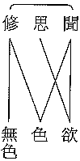



辛六　明凡圣所成就智



> 异生圣见道初念定成一二定成三智后四一一增  

> 修道定成七离欲增他心无学钝利根定成九成十



十智所缘的境界如何，已经分别过了，今当更应深细的思择，以就凡圣明其所成就的智之多少。换句话说：看看是那一类的人，能成就那几种的智？



异生圣见道初念定成一　谓自吾人凡夫，以至三贤四善根的行者，及见道十五心中初起苦法智忍的圣者，如是凡圣，唯成一智，就是世俗智；见道初念的圣者，虽成就无漏慧，然而其慧唯忍非智，所以於十智中，唯成俗智而已。为什麼？因他们这时都还没有离欲的。



二定成三智　谓入见道至第二念苦法智位的圣者，那就决定成就世俗智、法智、苦智的三智了。虽说法智、苦智其体是一，但因所望有别，所以分为二种。《婆沙》有六说：「即一智体，以对治故名法智，以行相故名苦智」。



后四一一增　谓於苦法智后，总有四位：一、第四念的苦类智位；二、第六念的集法智位；三、第十念的灭法智位；四、第十四念的道法智位。於此四位中，各各增一智，所以说一一增。如第四念苦类智位的圣者，其所成就的四智，即於世俗智、法智、苦智外，增一类智。第六念集法智位的圣者，其所成就的五智，即於世俗智、法智、苦智、类智外，增一集智。第十念灭法智位的圣者，其所成就的六智，即於世俗智、法智、苦智、类智、集智外，增一灭智。第十四念道法智位的圣者，其所成就的七智，即於世俗智、法智、苦智、类智、集智、灭智外，增一道智。这样讲来，所以见道位，总成七智。



修道定成七　前约见道说，此约修道说。谓於修道未离欲位，即欲界修惑未全断者，亦成七智；即世俗智、法智、苦智、类智、集智、灭智、道智，与见道所总成的七智一样。



离欲增他心　谓於修道位中，那已离欲的圣者，即欲界修惑完全断者，在成就前所说的七智外，更加他心智之一，总成八智。论说：「如是诸位，若已离欲，各各增一，谓他心智」。根据此意，可说从异生、圣见道初念位，乃至修道位，一一可增一他心智，不可唯约最后位增一为八。若详分别：异生、初圣，加一他心智，原来是成一智的，现在就成二智了。第二苦法智位，加一他心智，原来是成三智的，现在就成四智了。如是乃至第七修道未离欲位，加一他心智，原来是成七智的，现在就成八智了。



无学钝利根定成九成十　谓於无学道中，假定是钝根时解脱的圣者，那他决定成就九智，即於十智中，除去无生智之一；假定是利根不时解脱的圣者，那他决定十智完全成就。於此我们首要知道：十智中，以无生智为最殊胜；初从世善的俗智，渐渐修行，发无漏苦法智忍，终至无生智，所以此智在无学位的圣者，唯是利根乃能成就的。



辛七　约诸位以辨修智壬一　约见道辨修



> 见道忍智起即彼未来修三类智兼修现观边俗智  

> 不生自下地苦集四灭后自谛行相境唯加行所得



此明於见道十五心中顿修几智，大分为二：初二句总明见位，次六句明三类智、俗智。此第二中，复分为六：一、第三四句正明；二、不生字明观后俗智永不生；三、自下地三字，明所修俗智依地；四、第六句明此俗智念住摄；五、第七句明此俗智行相境；六、第八句明此智加行得。



见道忍智起即彼未来修　此总明见位。谓於见道位中的八忍七智，不管是忍起还是智起，都即彼忍智於未来修的，而且唯修同类不杂餘修。如忍正起时，即修彼未来忍，不修彼未来智，而智正起时，亦修彼未来智，不修彼未来忍。为什麼如此？一因先未曾得此无漏智，而今开始创得，其势力还未广，所以唯修同类不能傍修；二因此之对治所缘，都是决定了的，见道八忍，定缘八谛，断八谛惑，不相交杂，所以唯修同类。《杂心》六说：「谓苦法智现在修，未来修苦法智，非忍非餘智，如是乃至道法智。诸忍亦如是者，苦法忍现在修，即彼未来修，非智非餘忍，一切忍亦如是」。



三类智兼修现观边俗智　此正明三类智、俗智。谓於见道位中，苦、集、灭的三类智，正现起的时候，能兼修未来现观边的世俗智。因此世俗智，要於一一谛现观后边，方能兼修，所以立现观边的世俗智名。边者，是究极义。前之法智，不缘上界的四谛，没有究极义，所以不名为边；次之类忍，虽能缘於上界的四谛，但犹与疑得相应，没有究极义，所以不名为边。今类智位，现观上界谛理，已经达於究竟，具有究极义，所以名之为边。因此现观边，实就是三类智。光记说：「以世俗智，从无始来，数曾知苦、断集、证灭；三现观边，亦得知苦、断集、证灭，（与世俗智）同为一事」。於三现观中，因为有此事现观，所以三类智边能修世俗智。为什麼於道类智时不能兼修世俗智？这有二义：一、约曾未曾说：无始已来，假定曾经知苦、断集、证灭的，那是以世俗智而有知、断、证的，所以於三类智边，能修彼未来世俗智；假定从未修过无漏道，那就不能从道类智边，修彼未来世俗智。二、约徧不徧说：谓修行者，虽可於三谛徧事现观，而必无於道徧事现观的。如说徧知苦尽，徧断集尽，徧证灭尽，於当谛事，所要做的，都已完毕，由此於三谛边，可修彼世俗智；但是於道，必无能修一切道，不但见道位，不能修一切道，就是至无学位，也不能徧修，因为三乘六种性，其道各别，不能互修，再进一步说，就是佛所修道，亦不能尽，因佛不修声闻等道，「非起得得，故得修不尽；非尽现前，故习修不尽」。《正理》七四说：「谓三谛中依事现观，容一行者总得其边，必无有能徧修道者，异根性道不能修故，於自根性虽容得修，百千分中不起一故」，也就是这一意思的说明。



不生　此明观后俗智永不生。不生，是说此世俗智，不论是在观中或出观后，都不得现起，因见道是无漏，世俗智是有漏，漏无漏相违，所以於见道中无容得起。旧论十九说：「此智於在观及出观位，一向不生为法。若入观不得生此智，以相违故；若出观亦不得生此智，以心粗故」。《婆沙》三十六又说：「此智与见道现行相违故，过见道位无容起故，设见道位中见道须臾不现前者，此智便起，以见道无刹那断义，是故此智无容现前」。因不现前，得非择灭，名不生法。



自下地　此明修俗智的所依地。谓不论依於那一地见道现前，都能修未来的自地下地，即修此世俗智，以未至、中间、四静虑、欲界的七地为所依。分别的说：假定是依未至地而见道现前的话，那就能修未来的未至及欲界的二地俗智，依未至地修，是修自地，依欲界修，是修下地。假定是依中间地而见道现前的话，那就能修未来的中间、未至以及欲界的三地俗智。修中间者，是修自地，修未至及欲界者，是修下地。如是乃至假定依於第四静虑而见道现前的话，那就能修未来色界六、欲界一的七地俗智。修第四静虑，是修自地，修餘六地，是修下地。《毘婆沙》第四说：「问：何故六地所起见道上能修下下不修上？答：上地法胜现在前时，则能修下，下地法劣现在前时，不能修上，如劣朝胜，非胜朝劣，此亦如是」。《婆沙》百六十八又说：「见道依下必不修上，以是初得道故：无漏依上必修下地，以自在不系故」。俗智修欲而不修无色界者，因无色界没有见道，所以不修。



苦集四灭后　此明俗智为念住摄。谓世俗智，假定是在苦、集边修，那就通为四念住摄，因苦、集二谛是通於身、受、心、法四境的；假定是在灭谛边修，那就唯属最后法念住摄，因灭唯是属於法境的。为什麼不论道谛？因在道谛边，不修此世俗智，所以不论。



自谛行相境　此明俗智的行相境。如上所说，知道俗智是依苦、集、灭三谛的现观边而修的，因此依於那一谛修，就以那一谛的行相，缘此谛为境。假定是在苦谛现观边修的，就以缘苦的四种行相，是欲界系的缘欲界苦，是色界系的缘上苦谛；假定是在集谛现观边修的，就以缘集的四种行相，是欲界系的缘欲界集，是色界系的缘上集谛；假定是在灭谛现观边修的，就以缘灭的四种行相，是欲界系的缘欲界灭，是色界系的缘上灭谛。



唯加行所得　此明俗智由加行得。讲到得，有加行得与生得的不同，此智是由加行得，而不是由生得的，所以颂中特别用「唯」字加以简别。旧论十九说：「世俗智有二种：一、性法得，二、修习得；此智但是修习得」。为什麼一定说他是加行得？《正理》七四说：「此世俗智唯加行得，即由见道加行得故。欲界摄者是思所成，色界摄者是修所成，非闻所成彼微劣故」。



壬二　约修道辨修



> 修道初刹那修六或七智断八地无间及有欲餘道  

> 有顶八解脱各修於七智上无间餘道如次修六八



此明修道离染的过程中如何修智，大分为二：初二句明初刹那，显示未离染已离染的差别，所以说或：后六句明住果位，约有五类的不同，如下一一分别。修道是学位，唯就八智说，不论尽无生。



修道初刹那修六或七智　此明初刹那修。修道最初的一刹那，就是第十六心的道类智。当此道类智正现在前的时候，於修未来智，或者修六，或者修七，而此六、七修的差别，就在已离欲与未离欲。假定是未离欲的，那他未来就修法、类、苦、集、灭、道的六智。为什麼不修他心智？因他心智唯依四根本，未离欲者不得，所以不修。为什麼不修世俗智？因世俗智唯是有漏，不是有顶之所能治的，此道类智是有顶的能治智，彼此相违，所以不修。假定是已离欲的，那他未来就修七智，即於前六智上，更加一他心智。为什麼不修世俗智？因那是有漏，而这是无漏，彼此相违，所以不修。



断八地无间　此明八地无间道。谓断欲界、初定、二定、三定、四定、空无边处，识无边处、无所有处八地中惑而有的无间道，名为断八地无间。为什麼不说有顶地的无间？因有顶地不修世俗智，此八无间修世俗智，所以别说。



及有欲餘道　此明有欲餘道。有欲，显示还未离欲。谓尚有欲圣者所有的加行、解脱、胜进诸道，名为餘道。为什麼？因这是在前说的无间道之外的。



有顶八解脱　谓断有顶地的八解脱道，即於九解脱道中除去第九一解脱道。为什麼要除去第九解脱道？因那是属无学所摄，不是有学位中所要明的，所以除去。



各修於七智　此说前面所讲的八地无间道、有欲餘道、有顶八解脱，各各能够修於未来七智。八无间道及有欲餘道所修的未来七智，就是法、类、苦、集、灭、道、世俗的七智。法、类二智怎麼可以互修？这是由於因力相资的关系，即他们二者，互为同类因。为什麼不修尽、无生智？因这是有学而非无学。有顶八解脱道所修的未来七智，就是於上七智中，除一世俗智，加一他心智。为什麼要除一世俗智？因这非有顶地所能治的；为什麼要加一他心智？因这是解脱道所摄的。为什麼不修尽、无生智？因这是有学而非无学。



上无间餘道如次修六八　上无间，是断有顶的九无间道。此上九无间道，於未来能修法、类、苦、集、灭、道的六智。为什麼不修他心智？因这是无间道，所以不修；为什麼不修世俗智？因这是有顶治，所以不修？为什麼不修尽、无生智？因这是有学而非无学，所以不修。餘道，是指断欲界的第九解脱道、第九胜进道、断上七地的诸解脱道及诸胜进道、断上八地的诸加行道、断有顶前八品惑的诸胜进道：如是一切，皆名餘道。此诸餘道，於未来能修八智，即於前六智上，更加世俗智及他心智，总成八智。



壬三　约无学道辨修



> 无学初刹那修九或修十钝利根别故胜进道亦然



於见道、修道位中如何修智，已经辨别过了，现应进一步的就离染得无学位，以辨修智。



无学初刹那修九或修十　无学道最初的一刹那，就是断有顶的第九解脱道。得此第九解脱道的无学果位，於未来修智，或修九智，或修十智。为什麼有此二者差别？答：



钝利根别故　所以有修九智、十智的不同，是约钝根、利根分别的。假定是钝根的时解脱阿罗汉，要除去无生智，唯修九智；假定是利根的不时解脱阿罗汉，那就具修十智了。



胜进道亦然　谓於无学位，不但是解脱道，有修九修十的不同，就是诸胜进道，也有修九修十的差别，至於其道理，如前所说是一样的，所以说亦然。



壬四　约餘位辨修



> 练根无间道学六无学七餘学六七八应八九一切  

> 杂修通无间学七应八九餘道学修八应九或一切  

> 圣起餘功德及异生诸位所修智多少皆如理应思



上来虽已辨明见、修、无学三道的修智，但还有练根等的餘位，其所修智是怎样的，不可不知，所以现以三颂略为分别。



练根无间道学六无学七　行者练根，有的是在有学位中，有的是在无学位中。假定是在有学位上练根所有的诸无间道，那他能修未来苦、集、灭、道、法、类的六智。论文所说「诸无间道」的「诸」字，因显前五种性各有九无间道，所以说诸，不是说无间道有五性非一，名之为诸。为什麼不修尽、无生智？因这是有学而非无学。为什麼不修俗智？因有学练根一无间道正断见惑，似於见道，所以不修。为什麼不修他心智？因无间道能断於障，所以不修。假定是在无学位上练根所有的诸无间道，那他能修未来的七智，即於前六智上，更加一尽智。为什麼不修世俗智？因无学练根九无间道，断修惑所引障，就如断有顶染一样，所以不修。为什麼不修他心智？因无间能断於障，所以不修。为什麼不修无生智？练根圣者，是钝根性，所以不修。



餘学六七八　餘学的「餘」，对练根无间道，实是指练根诸解脱道、加行道、胜进道而言。有学位上练根所有的诸解脱道，假定是还没有离欲的，那他能修未来苦、集、灭、道、法、类的六智。为什麼不修世俗智？光记说：「见道解脱总有七种，三虽修俗四不能修，从多分似故不修俗」。为什麼不修他心智？因断障解脱，非容其参预，所以不修。假定是已离欲的，那他就能修未来的七智，即於前六智，更加一他心智。为什麼加这一他心智？因这不是断障的，所以修未来他心。若离欲、若未离欲，都是约有学说，所以都不修尽、无生智。有学位上练根所有的加行道，假定是还没有离欲的，那他能修未来的苦、集、灭、道、法、类、世俗的七智。为什麼不修他心智？因为是还没有离欲的，所以不修。假定是已离欲的，那他能修未来的八智，即於前七智上，更加一他心智。为什麼加此一智？因这是已离欲的。若离欲，若未离欲，都是约有学说，所以不修尽、无生智。有学位上练根所有的诸胜进道，假定是还没有离欲的，那他能修未来的七智；假定是已离欲的，那他能修未来的八智。此所修的七智、八智，都如前加行说，所以不再分别。



应八九一切　上句餘学的「餘」字，应该贯到此句的上头，读为「餘应八九一切」。餘谓无学练根的诸解脱道、加行道、胜进道。应就是无学圣者。意思是说：无学位上的退法等五的种性，在修练根的时候，如果还在前八品解脱道的阶段上，那他能修未来苦、集、灭、道、法、类、他心、尽的八智。为什麼不修无生智？因这是钝根性；为什麼不修世俗智？因这是如有顶治的。无学位上的退法等前四种性，在修练根的时候，如果到达第九品解脱道的阶段上，那他就能修未来的九智，即於前八智上，更加一世俗智。为什麼加一此智？因这世俗智，是同得应果的。为什麼不修无生智？因这是钝根性。无学位上的第五堪达种性，在修练根的时候，如果到达第九品解脱道的阶段上，那他能修未来的十智，所以说一切。此第五种性与前四种性，所以别说，因前四种性未得无生，而此种性是得无生的。其次，无学位上练根所有的诸加行道，除无生智外，那他能修未来其餘的九智。还有，无学位上练根所有的诸胜进道，假定是钝根性的，除无生智外，那他能修未来其餘的九智；假定是利根性的，那他能修未来的十智，所以说一切。



杂修通无间学七应八九　此明杂修无间道及修五通的诸无间道。修此也有有学与无学的不同：假定是有学圣者杂修无间道及修五通的诸无间道，那他能修未来苦、集、灭、道、法、类、世俗的七智。为什麼不修他心智？因这所修的是无间道，所以不修；为什麼不修尽、无生智？因这是有学而非无学，所以不修。为什麼叫做杂修？是杂修静虑的意思。为什麼只说五通？因於六通中除去漏尽通的。假定是无学圣者杂修无间道及修五通的诸无间道，钝根性者，能修未来的八智，即於十智中，除去他心智及无生智。为什麼要除他心智？因这所修的是无间道；为什麼要除无生智？因这是属钝根性。利根性者，能修未来的九智，即於十智中，除去他心智，因为此所修的是无间道。无学钝根能修八智，所以颂说应八；无学利根能修九智，所以颂说应九。



餘道学修八应九或一切　餘道，是指杂修及修五通的诸解脱道、加行道、胜进道。这也有有学与无学的修习不同：假定是在有学位杂修这些餘道，那他能修未来的八智，即於十智中，除去最后的尽及无生的二智。为什麼要除去此二智？因这是有学而非无学。假定是在无学应果位上杂修这些餘道，钝根性者，能修未来的九智，即於十智中，除去最后的无生智。为什麼要除去此智？因这是属钝根性的关系。利根性者，能修未来的十智，所以颂说一切。在此不过须要知道的：上说修通的诸解脱道，唯约宿住、神境、他心的三通而修解脱道说，不约天眼、天耳二通而修解脱道说，因这二者是无记性的，不名为修。



圣起餘功德及异生诸位所修智多少皆如理应思　再就圣者诸餘功德及异生诸位，以明修智的多少差别。圣者生起诸餘四静虑、四无量等修所成摄的有漏功德时，假定他是一个有学而尚未离欲的圣者，那他能修未来的七智，即於十智中，除去他心、尽及无生的三智；假定他是一个有学而已离欲的圣者，那他能修未来的八智，即於十智中，加一他心智，仍除尽及无生的二智，因为已经离欲，所以有他心智，因为还是有学，所以无尽、无生的二智；假定他是一个无学而属钝根性，那他能修未来的九智，即於十智中，除一无生智，因为这是钝根性的，假定他是一个无学而属利根性的，那他能修未来的十智。异生位上，假定是未离欲的，那他唯能修未来世俗的一智，餘者皆不得修，假定是已离欲的，那他就能修未来的二智，谓於世俗智外，再加一他心智。麟说：「若断欲第九解脱，得初定他心，乃至离第三禅染，得第四定他心，若离第四定染，不得他心，故异生依四静虑，即具二智，自餘诸位，唯修世俗」。颂文的末后两句，告诉我们：要知圣者所起的诸餘功德以及异生诸位，所修智的多少，皆如道理所说，应该好好的思量，不可有所错误！



壬五　约依地辨修



> 诸道依得此修此地有漏为离得起此修此下无漏  

> 唯初尽徧修九地有漏德生上不修下曾所得非修



未来修智的多少，在前面固已分别过了，但正式作诸未来修的时候，那是依於几地而修的呢？诸所起得是不是也名所修呢？关於这两问题，现在为之解说：前七句解第一问题，后一句说第二问题。



诸道依得此修此地有漏　前虽说智有十，现总十智为二，就是有漏智与无漏智。有漏智，必随道所依地，所以此中分为二类：一为依地，一为得地。道起所依地为依地，道初所得法地为得地。诸道，是指世俗道及无漏道。假定是修有漏法，总有两类：一、诸道依此地现起之时，能修未来的此地有漏。二、诸道得此地初所得法时，能修未来的此地有漏。《显宗》三六说：「诸道依此地及得此地时，能修未来此地有漏。谓依此地，世俗圣道现在前时，未来唯修此地有漏，以有漏法系地坚牢难修餘故。随依何地离下地染，第九解脱现在前时，亦修未来所得上地根本近分有漏功德，离下地缚必得上故」。此中所谓上地，是对所离的下地说，实在是指所得的此地，因依上地离下地染，必然是得其上地的。



为离得起此修此下无漏　前明修有漏，此明修无漏。说此修无漏道，总有三类：一、为离此地时，能修未来此地无漏及下地无漏。唯此所谓修此地下地，是望离染地说，不是望依地说，如果望依地说，也可名为修上的。《杂心》六说：「若此地离欲，即修此地无漏智及下地。谓初禅离欲，即修初禅功德及未来（即新未至），如是乃至第一有离欲，修一切地无漏功德」。二、得此地时，能修未来此地无漏及下地无漏。三、依此地中诸道现起时，能修未来此地无漏及下地无漏。离此、得此、起此三者，所以都能如是者，因无漏道，非地之所系的，因而可得傍修。论说：「为离此言，通二四道」。为离此，是说的能治道，而此能治道，「恐谓唯无漏中无间、解脱，故言通有漏无漏二各四道，二道俱离染，故加行胜进，亦是离染之道类故」。



唯初尽徧修九地有漏德　唯初尽智现在前的时候，其力足能徧修九地有漏而为意地所摄的闻、思、修所成的不净观等无量胜功德，不唯如此，而且不论随於那一地的尽智现在前时，都能通修自地、上地、下地的诸有漏德。但是在此所要问的：为什麼唯这初尽智时，力能徧修诸有漏德？因就殄灭无始来的一切善根的烦恼怨贼说，唯有初尽智现起时有此创能，如有摧伏国所共怨，一切俱来庆贺称善，所以此时力能徧修诸有漏德。



生上不修下　然而此若生於上地，那他必不修下地善。如身在欲界得阿罗汉，固然通修三界九地的诸有漏善，但若生於初定得阿罗汉，那就不修欲界的诸有漏善，而祇修上二界八地的诸有漏善了，如是乃至生於有顶得阿罗汉，唯修有顶一地的诸有漏善，而不再修下八地的诸有漏善了。为什麼？因身生上定，不成下有漏善的，所以生上不能修下。生上而不修下，约有漏说，固然如此，约无漏说，是怎样呢？无漏诸地自在，上下不遮，换句话说，无漏生上，亦得修下，与有漏不同。



曾所得非修　说到修，大概都是约先未得说的，就是先时从来所未曾得过，而现在开始得了，当知此得是由用功所得的，所以名为所修，假使先时曾经得过的，后因某种因缘又弃舍了，现在纵然还得前所舍的，但不得名为所修，因这不是由设劬劳而证得的，所以曾得舍而还得，不名所修。



壬六　明四种修义



> 立得修习修依善有为法依诸有漏法立治修遣修



讲到修，不唯约得说名为修，总说修有四种，就是得修、习修、对治修、除遣修，或有更加防护修、观察修，而为六修的。但照毘婆沙师说：防护修，就是对治修；观察修，就是除遣修。现在姑依前四修说，如是四修依於什麼而立的呢？颂解答说：



立得修习修依善有为法　此明得习二修。如此二修，是依有为善法而建立的。一切有为善法，都应当须要修习的，为什麼？为了可爱的果，应当精勤修习，使令渐渐增长，所以名为习修。一切有为善法，都能得可爱果，即得世间可爱异熟的增上果，并得出世间的诸离系果，所以应当精勤修习，从下至中，从中至上，令速获得所求爱果，因而名为得修。染、无记法及善无为，因为没有这样的作用，所以不得立名为修。《正理》七五说：「诸未曾得功德现前，及得未来所餘功德，新修得故皆名得修；曾得未曾功德现起，现修习故皆名习修。此二但依善有为立」。如果在时间方面分别：於未来世唯有一个得修，因能起得而得的；於现在世则具得习二修，有法俱得，名为得修，体现行故，名为习修。



依诸有漏法立治修遣修　此明治遣二修。如此二修，是依诸有漏法而建立的。治修，就是对治修，有四种对治，为有漏法敌对治道，所以以有漏法为依，建立此对治修。光记说：「此有漏法，望对治道生边，有能治故，名对治修」。遣修，就是除遣修，谓望离缚义边，除遣惑缚，名除遣修。



己二　明智所成德庚一　明不共法辛一　举数标名



> 十八不共法谓佛十力等



能成之智的差别，已如上说；其所成的功德，又是怎样的呢？此可大分为二类：一是不共的功德，一是共的功德。现在先说佛的不共功德。所谓十八不共佛法，是那十八种呢？答：



十八不共法谓佛十力等　初句举数，次句标名。谓佛果位上的十力、四无畏、三念住、大悲，如是总合名为十八不共法。为什麼说这十八是不共法呢？因这唯是诸佛初成佛时，於尽智位上所有的功德，而与诸餘圣者及诸凡夫所不共的，所以名为不共法。



辛二　随名别解壬一　正明不共癸一　明佛十力子一　明佛心力



> 力处非处十业八除灭道定根解界九徧趣九或十宿住死生俗  

> 尽六或十智宿住死生智依静虑餘通赡部男佛身於境无碍故



此明佛的十力相别：初六句出体，次四句诸门分别，於中有四门。关於十力的广说，在《增一阿含》第四十二卷中有一经。《中含》四七《多界经》，对於是处非处，亦曾广为分别。至於《杂心》、《甘露味》等论，都以十力相配诸智而说。



力处非处十　此明第一处非处智力。颂初力字一字是总标十力；处非处下是别释。什麼叫做处？合乎道理谓之处。如说身等恶行，感非爱果，所修善因，感可爱果，这是一定的道理，所以名处。什麼叫做非处？不合道理谓之非处。如说造诸善行，可以感恶趣果，作诸种种罪行，反而感可爱果，这是不合道理的，所以名非处。如来大智，於处如实了知是处，於非处如实了知是非处，名为处非处智力。此智力，具以如来十智为他的体性，因佛十智，随其所应，皆能了知处非处的。同时为了简别餘所有智，所以特别说为如来十智。



业八除灭道　此明第二业异熟智力。业是因，异熟是果。如来大智，善能了知如是类业，感如是类诸异熟果，无罣碍智，名为业异熟智力。所谓业因，就是集谛，所谓异熟果，就是苦谛。《婆沙》三十说：「唯缘苦集，十力经说，知他众生因缘处所受其果报」。此智力，以如来的八智为他的体性，即於十智中，除去灭、道二智。为什麼要除这二智？因灭、道二智，不缘苦、集有漏，换句话说，业因苦果，不是灭道所摄的，所以唯八智为体。



定九　此明第三静虑、解脱、等持、等至智力。静虑，就是四静虑；解脱，就是八解脱；等持，就是三三摩地；等至就是四禅四无色的八等至。如是一切，都是定的异名。如来大智，如实了知静虑等，名为静虑等智力。此智力，以如来的九智为他的体性，即於十智中，除去一灭智。为什麼要除去灭智？因静虑等不是属於灭谛所摄的。



根九　此明第四根上下智力。根，就是信、进、念、定、慧的五根，而此信等五根，在众生分上，有上下的差别。如来大智，能知众生信等根的上下差别，所以名为根上下智力。此智力，以如来的九智为他的体性，即於十智中，除去一灭智，其义如前说。



解九　此明第五种种胜解智力。意谓如来大智，善能了知众生种种喜乐胜解，所以得此智力名。此智力，以如来的九智为他的体性，即於十智中，除去一灭智，其义如前说。



界九　此明第六种种界智力。意谓如来大智，善能了知众生种种性以及世间种种界非一界，皆如实知，所以得此智力名。此智力，以如来的九智为他的体性，即於十智中，除去一灭智，其义如前说。



徧趣九或十　此明第七徧趣行智力。徧趣行，就是一切诸行，因为一切诸行，随其所应，皆能趣果，所以名为徧趣行。如来大智，於此一切徧趣行中，皆能如实了知，所以名为徧趣行智力。《杂心论》说：「向地狱乃至涅槃，彼缘趣及众具，故名趣力」。根据此说，唯以九智为此智力的自体，即於十智中，除去一灭智，因择灭无为不是能趣的。彼论又说：「有说趣智力，是十智性」。根据此说，不唯以能趣为境，亦复缘所趣为境，所趣通五趣及涅槃，所以加灭智为十。



宿住死生俗　此明第八宿住随念智力。宿住是所知境，餘四字是能知智，随彼彼所曾经验过的诸事，皆能如实了知，所以得此智名。《十力经》说：「复次，如来尽知一切所趣心之道，或一生、二生、三生、四生、五生、十生、五十生、百生、千生、亿百千生、无量生；成劫、败劫、无数成败劫中，我昔生彼处名是字，是食如此之食，受其苦乐，寿命长短，死此生彼，彼死生此：自忆如是无数宿命之事」。此智力，因为是缘事法的，所以唯以俗智为体。此句颂中，复说明第九宿住死生智力。前者以了知佛陀本身过去所经诸事，此则了知众生死此生彼的现象。《十力经》说：「复次，如来知众生生死之趣，以天眼观众生之类，善色恶色，善趣恶趣，随行所种，皆悉知之；或复众生身口意行恶，诽谤贤圣，造邪见业，身坏命终，生地狱中；或复众生身口意行善，不诽谤贤圣，恒行正见，身坏命终，生善处天上，是谓名为天眼，清净观众生类所趣之行」。此宿住死生智力，亦名天眼力。《义章》说：「天眼力者，经中亦名生死智力」。此智力，因为是缘事法的，所以唯以俗智为体。



尽六或十智　此明第十漏尽智力。漏尽，就是择灭涅槃理，为所缘境，缘此漏尽智，名为漏尽智力。《婆沙》三十所缘门中说：「若缘漏尽境故，则缘灭谛；若依漏尽身故，则缘一切法」。因为所缘的对象不同，所以以几智为体也就有别。如果说是但缘有漏尽择灭，那就只以六智为体，於十智中，除苦、集、道、他心的四智。为什麼要除去这四智？因这四智是不缘灭谛的。「灭谛故有灭智；通上下界有类（智）、法（智）；佛故有尽（智）、无生（智）；灭谛后边有俗智」。如果说是缘择灭所依相续身中所得法，因为那是通一切法的，所以就以十智为体。



宿住死生智依静虑餘通　此明十力的依地。谓第八宿住随念智力、第九宿住死生智力，依四根本静虑生起：其餘所有的八智，通依欲界、四禅、未至、中间、四无色的十一地生起。《婆沙》三一说：「地者，宿住、死生在四根本静虑，是通性故，近分、无色、及不定地，非通所依故无。此二餘力，有漏者在十一地，无漏者在九地」。所谓九地，即於十一地中，除去欲界及有顶，因此二地是没有无漏的。今总说为十一，未加简别。



赡部男佛身　此明十力的依身。谓此十力，皆依赡部男子佛身，因为唯有这个，方堪为力所依的。或说佛身即是男，何必要说男子佛身？当知佛身虽亦是男，但此是有所简的，即为简二乘圣者，二乘身虽是男，然而不堪为力所依。



於境无碍故　此明力的意义。谓佛的大智，对於一切的所知境，已经获得无碍，要想知道什麼，就能知道什麼，甚而至於极久之时，极远之处，也没有说是不了知的，所以名之为力。诸餘圣者，虽亦能知境界，但不能够无碍，所以不名为力。力之所以为力，《婆沙》说有诸义，如彼三十说：「不可屈义、不可伏义、不可摧义、不可害义、不可转义、不可覆义、能徧觉义、能荷担义、坚固义、最胜义、能制他义、是力义」。本颂所说无障碍义，实是包含了如是诸义的。



子二　明佛身力



> 身那罗延力或节节皆然象等七十增此触处为性



诸佛心力无边，已经略为分别；诸佛身力大小，又是怎样的呢？现当为之说明。於中，初二句正明身力量，第三句明所喻延力量，第四句出体。



身那罗延力或节节皆然　此正明身力量。佛有生身、法身之别，现在所说身力，是约生身而论。佛生身力究竟怎样，我们本是不可知的，现在所以能够分别，是以世间共所钦重的那罗延力做譬喻的。那罗延，此云人生本，即是大梵天王。外道说：一切人皆从大梵天生，所以名为人生本。《中论疏》说：「那罗延，此云生本，以是众生本故」。若问佛的身力如何，颂中显示两种异说：有说佛的生身力，等於那罗延力一样；或说佛身所有的支节，节节皆如那罗延力一样。论文更举大德法救义说：如来身力犹如心力，是无量无边的，不可以其他什麼大力者与之相比，假定不是这样的话，那诸佛的生身，就应不能持无边的心力，既能持无边的心力，证知身力亦是无边。於此三说中，论主意取第三大德说。因唯有这样，才能活泼的显示佛的身力，亦唯有这样，才能显示佛的身力特色和伟大！



象等七十增　此明所喻延力量。谓佛身力如那罗延力，而那罗延力量又是怎样的呢？此以象等七力，十十倍增来显示他。一、十凡象力，当一香象力；二、十香象力，当一大露形神力；三、十大露形神力，当一胜蕴神力；四、十胜蕴神力，当一妙支神力；五、十妙支神力，当一执持神力；六、十执持神力，当一那罗延力。颂中的等字，就是等於后面的六种。



此触处为性　这是出体。如是身力，是以触处为体的，触有能触所触，能触是身，所触是尘，於所触中，大种胜者，名为身力，因为异餘大种，所以又名差别。



癸二　明四无畏



> 四无畏如次初十二七力



佛的身力心力，都已说过了，佛的四无所畏，其相又是怎样的呢？所谓无畏，是没有怖畏的意思。为什麼会无怖畏？因为有智，不畏他人，或从智中而生无畏，所以名为无畏。旧论二十说：「无畏以无怖为性。云何说智慧为无畏？由此四法故，诸佛於大集中，无复疑心故，说彼名无畏，此无疑是智慧所成，故於智说无畏，非智」。今将四无畏解释如下：



四无畏如次初十二七力　佛四无畏，如经所说是这样的：一、正等觉无畏，以十智为体，犹如「初」力。因处非处智力，了知诸法是非，就是正等觉义。怎样叫做正等觉无畏？「谓佛自言：我於诸法正等觉者，若有世间沙门、梵志、天魔梵等，依法立难，言佛如来於如是法非正等觉，无有是处。设当有者，我於是事，正见无畏，故得安隐无怖无畏」。二、漏永尽无畏，以六智或十智为体，如第「十」力。怎样叫做漏永尽无畏？「谓佛自言：我於诸漏已得永尽，若沙门等，依法立难，言佛於漏未得永尽，佛为通释，无怖畏故」。三、说障法无畏，以八智为体，如第「二」力。怎样叫做说障法无畏？「佛说染法必能为障，若外道难言，染非能障，佛为通释，无怖畏故」。四、说出苦道无畏，以九智或十智为体，如第「七」力。怎样叫做说出苦道无畏？「佛说修道必能出苦，若外难言，道非出苦，佛为通释，无怖畏故」。然此四无畏，究竟是显什麼意思？主要是为显自利利他义：前二是为显示自利义，后二是为显示利他义。



癸三　明三念住



> 三念住念慧缘顺违俱境



佛四无畏，亦已说了，佛三念住，其相差别，又是怎样的呢？然此三念住与前所说四念住，是同是异，也是一个问题。据《正理》第七五说：「非前说四今复说三，可总说言念住有七，今三摄在前四中故，谓在缘外法念住摄」。由此可知此三念住，不是异於四念住的。



三念住念慧缘顺违俱境　三念住者：一、缘顺境不生欢喜念住：如诸弟子对於佛陀，一向恭敬尊重，不少有所差错，但是在佛缘之，一点不生欢喜，舍而不生执著，安住正念正知，是为第一念住。二、缘违境不生忧戚念住：如诸弟子对於佛陀，不生恭敬之心，不能正受正行，但是在佛缘之，一点不生忧戚，舍而不生执著，安住正念正知，是为第二念住。三、缘顺违（俱）境不生欢戚念住：如诸弟子对於佛陀，有一类是非常尊敬的，有一类又非常的不敬，可是在佛看来，对於敬佛的弟子既不生喜，对不敬佛的弟子亦不生戚，仍然那样行所无事的安住正念正知，是为第三念住。此三念住以什麼为体呢？皆以念与慧为体。《婆沙》三一说：此是第一处非处智力摄，所以智是体性，又因此正忆念，所以念为体性。或说如来安住正念正知，於三境中不生欢戚，所以知以念慧为体，因为正念就是念，正知就是智。



癸四　明佛大悲



> 大悲唯俗智资粮行相境平等上品故异悲由八因



我们常说学佛要学佛的大悲心，但是诸佛的大悲，究竟是怎样的呢？要学习他得先认识他，此颂就是为我们分别什麼是大悲的一个问题，并且告诉我们大悲与悲的差别所在。



大悲唯俗智　此出大悲体。如来大悲，於十智中，以俗智为体，因为他是普缘一切有情的，假定异此俗智而以无漏智为体的话，那就不能普缘一切有情，亦即不能作三苦行相，而行拔济之事了。



资粮行相境平等上品故　此释大悲名。如来所有的大悲名称，是以五义而建立的：一、资粮大，谓由大福德大智慧的二大资粮之所成办的。二、行相大，谓此力能於苦苦、坏苦、行苦的三苦之境，作拔苦的行相，不同於悲唯作苦苦的行相。三、所缘（境）大，谓总以三界一切有情为所缘的对象。四、平等大，谓离怨亲等的差别，等於一切有情，作诸利乐事的。五、上品大，谓於一切悲中，此悲为最上品，更无有餘悲能与此相等的。《正理》七五更「有餘师说：由大加行所证得故；唯大士身所成就故；入大功德珍宝数故；能拔有情大苦恼故：立大悲名」。



异悲由八因　此明大悲与悲的差别。谓以大悲与悲相望，其不同点约有八种：一、自由性异：大悲以无痴即智慧为体，而悲却是以无瞋为体的。二、由行相异：大悲能作苦苦等三苦的行相，而悲唯能作苦苦的一行相。三、由所缘异：大悲通以三界为所缘，而悲唯缘欲界。四、由依地异：大悲唯依第四静虑，而悲通能依四静虑。五、由依身异：大悲唯依佛身而有，悲可通依二乘等身。六、由证得异：大悲是离有顶惑而证得的，悲则由离欲界惑而证得。七、由救济异：大悲所要做的救济事业已经完成，而悲仅是希望实行救济而已。八、由哀愍异：大悲普於一切有情平等拔苦，悲唯拔欲界有情的苦，其哀愍不平等，由此可见。



壬二　诸佛同异



> 由资粮法身利他佛相似寿种姓量等诸佛有差别



佛的十力、四无畏、三念住、大悲的不共功德，都已一一辨别过了：现在进而所要讨论的，就是佛与佛之间相望，其所有法是不是都是一样的？关於这问题，可以这样说：有他们同的一面，也有他们异的一面。初二句明其同，次二句明其异。



由资粮法身利他佛相似　诸佛相望，彼此相等而无差别的事，主要的有三：一、由资粮等诸佛相似，就是没有那个佛，所修福德智慧的二大资粮，不究竟圆满的。二、由法身等诸佛相似，就是没有那个佛，不圆满成办法身的，换句话说，都是证得清净法身才成佛的。三、由利他等诸佛相似，就是没有那个佛，对於分内所应做的利他事业，不究竟完成的。



寿种姓量等诸佛有差别　诸佛相望，彼此相异而有差别的事，约有多种：一、寿别，谓佛寿有长短，如释迦佛寿百岁，弥勒寿八万岁等。二、种别，谓佛有生刹帝利种，如释迦佛、毘婆尸佛、尸弃佛、毘舍罗佛；有生婆罗门种，如拘留孙佛、拘那含牟尼佛、迦叶波佛。三、姓别，谓佛有姓乔答摩，如毘婆尸佛、尸弃佛、毘舍罗佛；有姓迦叶波，如拘留孙佛、拘那含牟尼佛、迦叶波佛；有姓瞿昙，如释迦佛。四、量别，谓佛身有长丈六，如释迦佛，有长千尺，如弥勒佛。五、等，等於佛法住世久近等，或有诸佛般涅槃后法住千年，或有诸佛般涅槃后住七日等。或者要问：同样是佛，为什麼有此差别？诸佛之所以有如是别者，是由出世时所化有情，机宜差别的缘故。



庚二　明共功德辛一　总标明



> 复有餘佛法共餘圣异生谓无诤愿智无碍解等德



如来的不共功德已说，其共功德今当辨。共功德中，有与餘圣共同的共圣功德，有与凡夫共同的共凡功德。今先标诸共功德名。



复有餘佛法共餘圣异生　谓佛世尊，除了上面所说的不共功德外，还有其餘无量功德，与餘圣者及诸异生所共同的。但此须要注意的：所谓共德，只是约名体同说，若约作用说，其胜劣是有很大差别的。《正理》七五说：「虽佛身中一切功德，行相清净殊胜自在，与声闻等功德有殊，然依类同说名为共」。然而有那些共功德呢？答：



谓无诤愿智无碍解等德　如无诤、愿智、四无碍解，这是共二乘圣者的功德，因为此三，二乘也是具有的；如五通、静虑、四无色、八等至、三等持、四无量、八解脱、十徧处等，这是共诸异生所有的功德，因为这些，异生也是具有的。



辛二　别解释壬一　明共圣德癸一　明无诤行



> 无诤世俗智后静虑不动三洲缘未生欲界有事惑



於圣凡共功德中先明共圣功德，第一辨无诤德。初句出体，后三句诸门分别。



无诤世俗智　诤，在《正理论》中说有三种，就是死的蕴诤，斗的言诤，百八烦恼的烦恼诤。现在是约烦恼诤说。所谓无诤行，就是使他有情不缘己身而生贪瞋等烦恼的一种行门。如此无诤行，但以俗智为他的体性。《婆沙》百七九说：「无诤是慧。问：若尔！何故说应习静定无诤耶？答：欲显定俱故名定，而实是慧，是名无诤自性」。怎样修此无诤行？谓观有情的痛苦，是由烦恼而生的，反过头来审察己身，已在甚胜的福田中，假定有情因缘我身而生烦恼的话，那岂不是一件非常可痛的事？因此就有意的引发那无诤的智慧，此智一生，就能使他有情不缘己身而生贪瞋等修惑，因息烦恼诤，所以得无诤名。



后静虑不动　此明所依地及能起人。谓无诤行，唯依第四静虑而起，因在乐通行中，这是最极殊胜的。什麼人能起无诤行？唯是无学圣者，而且唯是无学中的利根不动罗汉所起。假定是退法等的钝根罗汉，自身烦恼的现起，尚且不能防止；至於他身的烦恼，当更非彼等所能止息的了。



三洲缘未生欲界有事惑　此明所依身及所缘境。谓能有此无诤智者，唯是人趣东南西三洲的人身，餘者无有。而此智之所缘的，唯缘未生起的欲界有事惑——修惑烦恼令不生起，既不缘欲界已生起的有事惑，亦不缘欲界的无事惑——见惑烦恼。因为已起的修惑，是不可转的，所以不缘；起未起的见惑，唯於内门总相缘境，不可遮防，所以不缘。



癸二　明修愿智



> 愿智能徧缘餘如无诤说



无诤的自体、依地、依身等，都已辨别过了；愿智的自体、依地、依身等，又是怎样的呢？现在也以两句来加分别。



愿智能徧缘餘如无诤说　愿智望於无诤智，主要的不同一点，就是在於所缘，即前无诤，唯缘未生的欲界有事惑，而此愿智，则能徧缘於一切诸法。除此，诸餘皆如无诤所说。谓以俗智为体，依第四静虑，唯利根不动罗汉所起，依三洲的人身。怎样叫做愿智呢？如不动阿罗汉，欲起此愿智时，先发诚切的誓愿，求知所知的境界，於是便生起加行，或顺或逆的出入於四禅、四无色，然后入第四边际静虑，由此静虑无间，随所入定的势力胜劣，因而如先之愿，引起正智，对於所求之境，皆能如愿如实了知，所以名为愿智。



癸三　明无碍解



> 无碍解有四谓法义词辩名义言说道无退智为性法词唯俗智  

> 五二地为依义十六辩九皆依一切地但得必具四餘如无诤说



愿智业已辨别过了，现当叙说四无碍解。於中，初一颂总示体，兼显所缘；次一颂别明智摄、依地等；第九句明得数；第十句显餘义同前。



无碍解有四谓法义词辩　这是举数标名。意谓诸无碍解，总括说有四种：一、法无碍解；二、义无碍解；三、词无碍解；四、辩无碍解。无碍解是什麼意思？简单的说：以智缘於名等，能够决断而无滞碍的，名无碍解。《显宗》三十七说：「无碍解名，释有多义：谓於彼彼境领悟无碍，名无碍解；或於彼彼境决断无碍，名无碍解；或於彼彼境正说无碍，名无碍解。有餘师说：於境现前无颠倒智，名无碍解」。



名义言说道无退智为性　这是出体兼显所缘。总说无碍解体及其所缘是这样的：四无碍解，总以无退智为他的体性，此智为什麼叫做不退？因这是利根所有而不可退转的。由无退智，缘能诠名（包括句文，就别相说，虽有名、句、文的差别，但因同能诠表，所以总说为名），名法无碍解。法有轨持与轨则的二义：此名句文，能持所说义及能令生物解，所以说名为法。由无退智，缘所诠义，名义无碍解。《正理》七六说：「若无退智缘一切法所有胜义，立为第二，义即诸法自相共相」。由无退智，缘诸方域俗圣言词，名词无碍解，即能了知世语典语，於诸方域种种差别。由无退智，缘於契合正理而又无滞无碍的言说，并及缘於自在的定慧二道，名辩无碍解。《正理》七六说：「即於文义能正宣扬，无滞言词说名为辩，及诸所有已得功德，不由加行任运现前自在功能，亦名为辩，此能起辩立以辩名，了辩及因智名辩无碍解」。



法词唯俗智五二地为依　谓法无碍解及词无碍解，唯以俗智为体，为什麼？因前者是缘世俗的能诠之名句文，而后者是缘世上言词的事境，所以皆唯以俗智为体。他们的体性虽同，但所依之地不同：法无碍解，通以欲界及四静虑的五地为依，而不依於无色界的四地，因无色界是没有名句文等的；词无碍解，唯以欲界及初静虑的二地为依，因为语言是以寻伺为因，可是到了二禅已上，已经没有寻伺，所以也就无有语言。



义十六辩九皆依一切地　谓义无碍解，假定是以诸法为义，那就以十智为体，假定是以涅槃为义，那就以俗、法、类、灭、尽、无生的六智为体，其义如十力中的漏尽力说。至辩无碍解，除了灭智之外，以其餘的九智为体，因为是缘有为法的。他们的体性虽不同，但所依之地是同的，就是此二皆依欲界乃至有顶的九地为依而起的。或者有说：言说唯在欲界及初定中有，辩无碍解既是运用言说的，怎麼可以通於九地？这因他於言说及道，许随缘一皆得而起的，所以通於九地。



但得必具四　此说四无碍解，要麼就不得，如果得的话，不管是得那一种，必然具得四种，假定不是具得四种的话，那就不得名之为得，不过欲随自己的心意而现起的时候，也可具四或不具四的。有的学者说：有的是不具得四种的，因为没有道理说是得一必就要得四种的。



餘如无诤说　此四无碍，皆是利根不动罗汉所起的，唯依人趣东南西三洲的人身，不依餘者，如无诤所说一样，所以说餘如无诤说。



癸四　明边际定



> 六依边际得边际六后定徧顺至究竟佛餘加行得



如是像上所说的无诤、愿智、四无碍解，总称为共圣德，但这样的共圣德，究竟是依於什麼而得的呢？这也不能不知，颂解答说：



六依边际得边际六后定　颂中的「六」字，是指无诤、愿智、四无碍解的六种，这六种都是依於边际定之所得的，因为是由边际定之所引发的缘故。假使依因果的关系说：边际定是因，因定而引生此六，那六就是果了。边际六，又是什麼意思？是说边际定的自体有六种，即於前所引生的六种中，除词无碍，更加一延促寿等边际，所以体就成六。延促寿等，就是留寿行、舍寿行等。如有利根俱解脱阿罗汉，前世业所感得的命根众同分中，有同分长而命根短者，为了延续命根，於是就修布施，入边际定，从边际定起来以后，心里就这样想，口头就这样说：我所有的一切能感富异熟果的业，愿皆转招寿异熟果，所以就由边际定力，感得现在命根，是为留寿行。舍寿行、促寿行，准此可知。为什麼要除去词无碍解？当知他虽依於第四边际定发，但因体是欲界，所以为初静虑摄，非彼第四静虑摄。后定，就是第四定，这显示边际名，但依第四静虑，不依餘三静虑。



徧顺至究竟　这是解释边际名。什麼叫做边际？谓从一切地，徧所随顺，增至究竟，得边际名。怎样叫做徧所随顺？就是在正修学这静虑的时候，从欲界的加行善心，入初静虑，次第顺入，一直至於有顶，然后复从有顶，入无所有处，次第逆入，一直至於欲界，再从欲界，次第顺入，展转一直至於第四静虑，名一切地徧所随顺。怎样叫做增至究竟？论说：「谓专修习第四静虑，从下至中，从中至上，如是三品，复各分三，上上品生，名至究竟」。如是具有像上两种意义的静虑，所以得边际名。边是什麼意思？是无越的意思，即於诸胜定中，无有越於此边际定的，所以名边。际是什麼意思？是类或极的意思。谓此定中有种类相似义，如一颂有四句，名为四际，或如一界四海分齐，都是种类相似义。若说涅槃名为实际，那就是显示极义。《正理》七六说：「如是二言，显此静虑是最胜类，定中最极殊胜功德，多此引生，乐通行中此最胜故」。



佛餘加行得　此明得者的得法不同。谓前所说无诤智等的六种，假定是佛的话，不仅由加行得，亦可由离染得，因为诸佛的功德，在初尽智的时候，由於离染的因缘，是可一切顿得的，不须要什麼加行，假定是餘圣者，那就唯由加行得，而不可以离染得了，因为不是一切皆得的。



壬二　明共凡德癸一　正明六通



> 通六谓神境天眼耳他心宿住漏尽通解脱道慧摄  

> 四俗他心五漏尽通如力五依四静虑自下地为境  

> 声闻麟喻佛二三千无数未曾由加行曾修离染得  

> 念住初三身他心三餘四天眼耳无记餘四通唯善



共圣的功德，已经显示过了，共凡的功德，现在应当辩别。与凡夫共同的功德，本来是有六神通、四静虑，乃至十徧处等，但是此下所说的，唯在六通，不说其餘，因静虑等，要到下面的〈定品〉，才详显示，所以现在唯说六通，作为此品的结束。此四颂中：初一颂列名出体，后三颂诸门分别。於此计有六门：一、智摄门；二、依地门；三、缘境门；四、二得门；五、念住门；六、三性门。



通六谓神境天眼耳他心宿住漏尽通　此列六通名。一、神境智证通；二、天眼智证通；三、天耳智证通；四、他心智证通；五、宿住随念智证通；六、漏尽智证通。如是六通，就与凡夫相共来说，只有前五，第六漏尽通，是不共於凡夫的，现在因依总相而说，所以亦共异生。但此六者为什麼都叫做通？《婆沙》百四一说：「於自所缘，无倒了达，妙用无碍，故名为通」。智是证（了达义），亦即是通。至於六通的意义，如通常说，这里不再加以解释了。



解脱道慧摄　这是出六通体。谓此六通，以解脱道所摄的慧为其自体。这里所说的解脱，只是约出障初说，在道理上讲来，於胜进道亦容得起，所以《正理》七六说：「解脱道言显出障义，胜进道中亦容有故」。



四俗他心五　谓於六通中，除去他心、漏尽的二通，其餘神境、天眼、天耳、宿住的四通，皆以俗智为体，什麼道理？因都是缘於世俗境的。他心智通，以法、类、道、世俗、他心的五智为体，什麼道理？因他心智通，通缘漏无漏境，所以通於五智。



漏尽通如力　谓第六漏尽智通，如十力中的满尽智力，或除苦、集、道、他心，而以其餘的六智为体，或即通以十智为体。



五依四静虑　谓六通中的前五通，唯依四静虑不依无色、近分、中间，因为他们没有五通所依的定的。为什麼无色非五通依？因前三通，但别缘色，无色界是无色的，所以前三通境，不是无色所能缘的。他心智通，在初修的时候，以色为门，即将观於他心，先观我心，为观我自己的心，先观我自己身相，假定自心忿怒时，依身外相亦必忿怒於形，观依身忿怒形，知自心是忿怒心，假定自心喜悦时，依身外相亦必是适悦形，观依身喜悦形，知自心是适悦心，这样观自身心以后，复观他的身心二相，亦是如此，由此加行，后得他心，於他心等，能如实知。至宿住通，渐次忆念分位差别，就是先自审察次前灭心，渐后逆观此生胎内五位胎外五位的十时分位前后差别，知结生心，乃至能忆知中有前身一念命终心，名宿住通的加行成就，如果根本成就的话，能忆过去生中，某处某姓的种种事。但是依无色地，没有这样的功能。为什麼未至、中间非五通依，因这是观增止减，而不是止观均等的，所以非五通依。



自下地为境　这是明五通的缘境。谓此五通所缘，唯缘自地境及下地境。且如神境通，假定是於初禅发的，那他就能於初禅及下欲界，行化自在，可是於此上地，就没有这样的功能，因为势力劣故。



声闻麟喻佛二三千无数　前约竖明作用宽狭，此约傍显作用宽狭。以诸圣者来说：假定是不作意的话，声闻能於一千诸世界境，起行化等自在作用，麟喻能於二千诸世界境，起行化等自在作用，大觉能於三千诸世界境，起行化等自在作用；假定是极作意的话，声闻能於二千世界、麟喻能於三千世界、大觉能於无数世界，起诸神通妙用，自在无碍。



未曾由加行曾修离染得　此明五通的二种得。谓得通者，於无始来，假使从来所未曾得过的，现有殊胜猛利势用，那就由加行得，假使过去曾经串习过的，现在没有什麼殊胜势用，那就由离染得。



念住初三身他心三餘四　此明五通为念住摄。约四念住以辨六通：神境、天眼、天耳最初的三通，唯属身念住摄，因为是缘色而起的，如神境通，缘色香味触的四处，天眼通缘色处，天耳通缘声处，所以是身念住摄。他心智通，唯属后三念住所摄，无身念住，因为他是知心而不知色的。所餘宿住通及漏尽通，因为是缘五蕴一切境的，所以通於四念住摄。



天眼耳无记餘四通唯善　此分别五通的三性。谓五通中的天眼与天耳二通，在三性中，唯是无记性摄，因此二通的自体，是眼耳识相应慧的关系。眼耳识的生得善，不许异地而起，今通既与二识相应，假定是善的话，那就应如二识不得异地起，事实通是可以异地起的，既异地起，当然不是善性所摄。同时，天眼与天耳二通，是与定相生的，依定发通，还从定出，所以证知不是善性，唯属无记，不过在四无记中，是属通果无记而已。除此而外，其餘的四通，性唯是善。



癸二　辨三种明



> 第五二六明治三际愚故后真二假说学有暗非明



《杂含》三一《三明经》说：有无学三明：谓无学宿命智证通，无学生死智证通，无学漏尽智证通。然彼三明，於六通中，以什麼为性呢？



第五二六明　这是出体。谓第一宿住智证明，以无学位所摄的第五宿住通为其自性；第二死生智证明，以无学位所摄的第二天眼通为其自性；第三漏尽智证明，以无学位所摄的第六漏尽通为其自性。



治三际愚故　此明废立。谓於六通中，为什麼唯以此三说名为明？六中三种独名明者，如其次第，能够对治三际之愚：宿住智明，通达解了过去的一切，能治忘失前际的愚昧；死生智明，通达解了未来的一切，能治不知后际的愚昧；漏尽智明，通达解了涅槃真实之乐，能治爱著中际的愚昧。



后真二假说　此通妨难。为什麼此三都叫无学明呢？因为都是在无学身中而起的。唯此三种明中，只有最后的漏尽明，容可说是真的，因为通无漏的，餘二名明，只是少分明相，假说名明。妙音尊者说：「於三明中，唯漏尽智是胜义明，餘二能引胜义明，故假立明名」。



学有暗非明　此遮有学。有学身中，本亦具有宿住智及死生智的，为什麼不叫做明呢？此之所以不名明者，因为他的身中，还有愚暗存在。《正理》七六说：「有学身中有愚暗故，虽有前二不立为明，虽有暂时伏灭愚暗，后还被蔽，不可立明，要暗永无，方名明故」。



癸三　明三示导



> 第一四六导教诫导为尊定由通所成引利乐果故



《杂含》八说有神足变化示现、他心示现、教诫示现的三种示现；《长含．坚固经》说的神足、观察他心、教诫的三神足；《中含．伤歌罗经》说的如意足示现、占念示现、教训示现的三示现：都是此中所说三种示导的别名。现在所要问的，就是此三示导，於六通中，以什麼为体呢？



第一四六导　这是出体。谓第一神变示导，以六通中的第一神境通为其自性；第二记心示导，以六通中的第四他心通为其自性；第三教诫示导，以六通中的第六漏尽通为其自性。此三为什麼叫做示导？示者示现，导者导引，示现此三，引导众生，亦示亦导，名为示导。关於此三示导的详细说明，可阅《集异门足论》第六，兹不具释。



教诫导为尊　谓於三种示导中，如果说到那最尊最胜，当然要算教诫示导，为什麼？这有两个理由：



定由通所成　第一、教诫示导，决定是由第六漏尽通所成的，前二示导就不然，或由咒术而得腾空自在，或由咒术而得知他心念，不一定要由通成。正因教诫示导是由通所成的，所以是最胜的。



引利乐果故　第二、教诫示导，是以言说教诫，令诸有情如所说的而如实的去行，或者引生当来人天的利益果，或者引生究竟安乐的涅槃果，可是前二示导，就没有这样的胜能，如现神变，只能令诸有情归伏，示现记心，只能令诸有情信受，而决不能使令获得利乐之果。正因教诫示导能引利乐之果，所以是最尊最胜的。



癸四　别明神境子一　正明神境



> 神体谓等持境二谓行化行三意势佛运身胜解通  

> 化二谓欲色四二外处性此各有二种谓似自他身



上来对於六通、三明、三示导，虽都已经说过了，但神境通的神境二字的意义，还有再加一说的必要，所以此特别明神境。



神体谓等持　神境的「神」之自体，唯是指的最极殊胜的等持，因为由此等持而能为诸神变事的，诸神变事都是从静定中所引发出来的，定有神有，从用为名，所以叫神。



境二谓行化　神境的「境」字，就是指的诸神变事，但此神变事境又有二种差别，一为不变本形的行，一为变化异状的化。下面再来详细解释行化二者的差别：



行三意势佛运身胜解通　此释行境，复有三种：一、运身，谓如飞鸟能够乘空而行。《婆沙》说：「举身凌虚犹若飞鸟，亦如壁上所畫飞仙」。二、胜解，谓由胜解之力，以极远的地方，作极近的思惟，很快的就能到达那儿。《婆沙》说：「於远作近解，由此力故，或住此洲，手扪日月，或屈伸臂顷至色究竟天」。三、意势，就是欲到极远的地方去，刚刚举心缘时，立即到达那里，其势之速，有如意故，得意势名。《婆沙》说：「眼识至色顶，或上至色究竟天，或傍越无边世界」。於此三者中，凡夫唯成运身的一种，二乘成运身、胜解的二种，佛则三者具成。颂说意势佛，表示这唯是佛所成的，运身、胜解通，表示这二种亦通二乘。



化二谓欲色四二外处性　此释化境，亦有二种：一是欲界化，二是色界化。为欲界化的，是色、香、味、触的四外处性，为色界化的，是所谓色、触的二外处性，因色界中没有香、味，所以不化香、味二处。



此各有二种谓似自他身　谓此欲色二界化，各有似自身化及似他身化的二种。如再分别：身在欲界，其化有四，就是作欲界似自身化及似他身化二，同时作色界似自身化及似他身化二。身在色界，其化亦四，即作色界似自身化及似他身化二，同时作欲界似自身化及似他身化二。欲色各四，总成八种。



子二　明能所化



> 能化心十四定果二至五如所依定得从净自生二  

> 化事由自地语通由自下化身与化主语必俱非佛  

> 先立愿留身后起餘心语有死留坚体餘说无留义  

> 初多心一化成满此相违修得无记摄餘得通三性



神境通的能化心所化作的诸变化事，为就是通呢？还是别的什麼？不就是通而是通的果。然而这有几种呢？差别又是怎样的？初二句明数答初问，后十四句辨差别答后问，於中又有九门，到后再释。



能化心十四定果二至五　此明数以答初问。谓从神境通所生的能变化心，总计有十四种，就是初静虑有二化心，二静虑有三化心，三静虑有四化心，四静虑有五化心。何谓初禅的二化心？一为欲界所摄的初禅作欲界化，二为初禅所摄的初禅作初禅化。何谓二禅的三化心？一为欲界所摄的初禅作欲界化，二为初禅所摄的初禅作初禅化，三为二禅所摄的二禅作二禅化。何谓三禅的四化心？一为欲界所摄的初禅作欲界化，二为初禅所摄的初禅作初禅化，三为二禅所摄的二禅作二禅化，四为三禅所摄的三禅作三禅化。何谓四禅的五化心？一为欲界所摄的初禅作欲界化，二为初禅所摄的初禅作初禅化，三为二禅所摄的二禅作二禅化，四为三禅所摄的三禅作三禅化，五为四禅所摄的四禅作四禅化。如是所有诸果化心唯依自地以及上地，绝对没有说是依於下地的。如初禅化，依於初禅，名依自地，依二禅等，名依上地；二禅等化，不依初禅，所以无上依下。为什麼下地定心不能生於上果？因下地劣，无力能生上地的殊胜果，所以不生。



如所依定得　此下辨差别以答后问。先明果同依得，就是果化心与所依定同时而得。如得初静虑，同时必得初静虑的能化心，得二静虑，同时必得二静虑的能化心，乃至得第四静虑，同时必得第四静虑的能化心。为什麼如此？因果化心所依定，二者必是俱时而得的。



从净自生二　此明从与生相。净是指善定说的，自是指化心说的。意谓此能化心，一方面从净定生，一方面从自己生，是从净自二者所生的；同时此能化心，一方面能生净心，一方面能生化心，是能生净自二心的。从他生，名为从生，能生他，名为与生。颂疏说：「谓从静虑起能化心，此心必无直出观义。且从净定地，起初化心，此后后化心，从自类化心，生最后化心，还生净定，故此化心，从二心生，能生二心」。



化事由自地　此明事与心同地。谓诸自地化事，是由自地化心所起的，绝对没有异地化心而能生起异地化事。举例来说：欲界化心唯化欲界外四境事，初禅化心唯化初禅诸所化事，乃至四禅化心唯化四禅诸所化事。



语通由自下　此明化语由自下地心。谓能化心所发的语言，通於自地心及下地心。如欲及初禅化所发的语言，这语言，必然是欲及初禅自地所起；假定是依二禅等化所发的语言，那他必然是依下地心所发的，因二禅已上没有寻伺，无发语心发动语言，所以须起下初禅心，然后始能发语。旧论二十说：「若所化人在欲界或初定地，由同地心，可得令言说，若所化人在上地，但由初定心，令言说」。



化身与化主语必俱非佛　此明化人化主语默同不同。谓若有一化主，生起许多化身，要化主语之时，彼诸化身方语，言音诠表，一切都是相同的，所以有伽陀说：「一化主语时，诸所化皆语；一化主若默，诸所化亦然」。《长含》五《阇尼沙经》说：「现无量神足者，亦皆由是四神足起。时梵童子即自变化形，为三十三身，与三十三天，一一同坐，而告之曰：汝今见我神变力不？答曰：唯然已见！梵童子曰：我亦修四神足，故能如是无数变化。时三十三天各作是念：今梵童子独於我坐，而说是语，而彼梵童一化身语，餘化亦语，一化身默，餘化亦默」，与此是同一意思。但是这唯约其餘的化说。假使约佛化主说，那就完全不同了，因佛世尊，如所意欲，或前或后，不一定是同时的，就是言音所诠，或彼问佛答，或佛问彼答，也有差别。《义足经》说：「佛语化人默然，化人语佛默然，何以故？正觉直度正所意故」。



先立愿留身后起餘心语　此明愿力留身令语。或有人问：发语心与化心别，既起发语心，变化已经没有，既然没有变化，那里还有化身，因为化身是从化心而有的，化身既不可得，又怎麼能发语？现在回答他说：这是由於过去的愿力，留所化身，后起餘心，发语表业，所以化语二心虽然不同，但依化身也是可以发语言的，并没有什麼化语缺所依的过失。



有死留坚体餘说无留义　此明由愿死后留骨身。讲到愿力留身，两派学者说法不同：有说愿力留所化身，不唯现时能令久住，亦能令住至於死后，如大迦叶，留骨锁身一直到弥勒下生，是为明证。但这所久留的，唯是坚实的骨锁身，而不是血肉之躯，我们不可不知。有说愿力留所化身，唯能留所化身令久时住，绝对无有能令至於死后的，圣大迦叶留骨锁身，是由天神持令久住的，而不是愿力留住的。



初多心一化成满此相违　此明初心成满化有差别。谓初开始起化事时，要由多念化心，方能化作一所化事；但是到后成满的时候，与此初起化事相违，就是只要一念化心，即能化作众多化事。正理师更加一所依差别说：「初习业者，由多化心，要附所依，起一化事；习成满者，由一化心，能不附所依，起众多化事」。此中所谓所依，就是木石等。



修得无记摄餘得通三性　此明二得三性差别。如是像上所说十四能变化心，假定都是从定所修得的，那就是属无记性摄（四无记中的通果无记）；假定是餘生得等能变化心，那就通於善、不善、无记的三性所摄。如天龙鬼神等所有能变化心，或善、或恶、或是无记，即为通於三性的明证。



癸五　别释眼耳



> 天眼耳谓根即定地净色恒同分无缺取障细远等



前说天眼天耳的这句话，是指的什麼意义？为是指的慧体？为是指的色根？假定是指慧体，那就不应名为天眼天耳；假定是指色根，那就不应名之为通。试问其体究竟是什麼呢？颂解答说：



天眼耳谓根即定地净色　这是出体。天眼天耳的自体，就是天眼根和天耳根，由於是缘声光为一种加行，所以依四静虑於眼耳边，引起彼地的微妙大种，所造净色眼耳二根，见色闻声名为天眼天耳。如是眼耳所以叫做天者，因为是定地摄而又是极清净的缘故。天眼耳，有三类别：一、修得天，如前所说，由修定而得的；二、生得天，由生天中而得的；三、似天，就是生於餘趣，由殊胜业之所引生，能见能闻似天眼耳。



恒同分无缺取障细远等　此明义门。一、同分彼同分门：谓於上说三类天眼耳中，唯有修得天眼耳根，不论是过去已生、现在正生、未来当生，恒恒时都是同分，因天眼耳识必是俱有，方能有所见闻的。二、处具缺门：谓左右二眼，处所必具，无翳无缺，如生色界一切有情。《婆沙》百八六说：「又天眼左右胜劣品类必同，谓非左劣右胜等；又现前时，必皆具足，无瞎无缺，亦无眩乱及彼同分」。三、缘境障不障门：谓天眼耳，「能随所应取彼障隔，极细远等诸方色声」。细远等的等，等取前后左右昼夜等。慧晖说：「肉眼见近不见远，天眼远近皆见：肉眼有同分彼同分，天眼唯同分；肉眼见前不见后及不见左右，天眼前后左右皆见；肉眼见障内不见障外，天眼内外皆见：肉眼见粗不见细，天眼二皆见；肉眼见昼不见夜，天眼昼夜皆见；肉眼见明不见暗，天眼明暗皆见；肉眼有翳缺，天眼皆无也」。《婆沙》百五十说：「见前后左右诸色者，非石壁等所障故；见下诸色者，非地水等所障故；见上诸色者，非云雾等所障故」。



癸六　明通种类



> 神境五修生咒药业成故他心修生咒又加占相成  

> 三修生业成除修皆三性人唯无生得地狱初能知



前说化心是由修得及餘生得等的不同，那末，此神境等五是不是各各有异呢？假定有异的话，那又是怎样的？於中，初五句明五通种类，第六句明三性分别，后二句明五趣通局。



神境五修生咒药业成故　此说神境通类总有五种：一是由修得的，二是由生得的，三是由咒成的，四是由药成的，五是由业成的。



他心修生咒又加占相成　此说他心通类总有四种：一是由修得的，二是由生得的，三是由咒成的，四由占相成的。占相者，占谓占卜，相谓观相，即从占卜观相中，能知他心，名占相成。



三修生业成　此说天眼、天耳、宿住三通，唯有三种，一是由修得的，二是由生得的，三是由业成的。非咒、非药、非占。



除修皆三性　此明三性分别。谓五通中，神境、他心、宿住的三通，假定是由修得的，那就唯是善性；天眼、天耳的二通，假定是由修得的，那就唯无记性：除了修得之外，所餘生得、咒成、药成、业成、占相成等，一一都是通於善、恶、无记的三性。



人唯无生得地狱初能知　此明五趣通局。谓於人趣得通，除了没有生得通外，其餘修、咒、药、业、占相的五类都有。为什麼没有生所得通？光记说：「以占相智所覆损故，有他心智及愿智等所映蔽故」。於地狱趣，初受生的时候，唯以生得的他心智知他心等，唯以生得的宿住智知过去生，但是一经苦受逼迫以后，那就更无知义可言了。怎知地狱初生有此？《婆沙》一百一说：「如契经说：地狱有情互相谓言：奇哉！自误！我等过去曾闻沙门婆罗门说：诸欲过患，能引未来可怖畏事，汝等应断！我等虽闻而不信用，今因彼欲受斯剧苦」。因此知道地狱初生，有生得他心智及宿住智。光记以六类对五趣配立，虽有多种解释，但实不出二解：



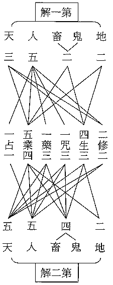



------



### 分别定品第八



於明无漏因果中，〈贤圣品〉是明果，〈智品〉是明因，这在前面都已说过了，现在〈定品〉是明缘。为什麼如是次第？因先悬出一个崇高的目标，使我们有所欣求，所以先说贤圣的果位；但果必须假藉於因，修怎样的因方得怎样的果，这是行者必须认清的，所以次说〈智品〉以明因：可是智慧的产生，不是突突空空的，一定要待於缘，然后始能增长，所以次说智所依的〈定品〉。定，是将散乱的心念集中於一处的意义，或名静虑，是静止念虑散乱的意味。定是佛教全体通有的思想，如三学中的定学，不论大小乘，都很重视的。有人说：一切的佛教思想，都是禅之考察的结果，而由禅的思惟，佛教思想，始得体验化。譬如基督教，假定离开了祈祷，那他就变成了没有生气的基督教；同样，我们的佛教，如果离开了禅观，也就没有活泼泼的佛教。如俱舍、成实这些小乘宗派，在其背后，没有说是不设想著禅观的，《俱舍》在本品中，特别说明种种的禅定，其义也就在此。不过须要知道：真正重要的禅定，是要从实践中去体验的，假使专在理论上处理这问题，那就失去定的特质和实修的意义了。没有四静虑、四无色等种种定的修行，试问那里有什麼俱舍宗？佛教所以特别重视定，而且特别重视定的实践，乃因佛教是自觉中心的宗教，而自觉之智非定无以开发，从定开发智慧，运用智慧利剑，斩断烦恼乱丝，始可获得自觉与解脱，所以在佛教的实修上或悟证上，定学是佛教学者所不可忽略的一环。本品的三十九颂中，前三十八颂，详细说明令心专注一境的禅定，所以名为〈分别定品〉；此品是诸品中的最后一品，所以说为第八。品内颂文，大分为：一明诸定功德，二明正法住世。前有三十八颂，次唯最后一颂。於明诸定功德中：初明所依的诸定，后明能依的功德。於明正法住世的一科，历来虽都把他附於本品，但在俱舍法义，说前八品分别诸法，此最后一颂，是正宗分中第二一大科文，我觉得这也是一种看法，所以顺说於此。



戊三　明无漏缘己一　诸定功德庚一　所依诸定辛一　四静虑



> 静虑四各二於中生已说定谓善一境并伴五蕴性  

> 初具伺喜乐后渐离前支



诸智所成的功德，在前〈智品〉已经说过；餘静虑等所成的功德，现在应当辨别，於中先辨所依止定，然而在诸定内，静虑是怎样的，当又是我们首先要知道的。前面说过，定有两种：一由前世的造业力而自然生得的定地，名为生得定；一由渐渐修业所得的定，名为修得定。如在欲界的散地，得上界的定地生，其心专注一境时，就称为修得定。其生得定有八种之别：即色界的四禅天与无色界的四空处。修得定亦有八种：即四静虑与四无色定。现在先说四静虑。



静虑四各二　静虑差别，总有四种：即初静虑、二静虑、三静虑、四静虑。如是四静虑又各有二：即第一生静虑与第二定静虑。什麼叫做静虑？这名义先当解释。光记说：「由定寂静慧能审虑，审虑即是实了知义，从用及果为名，故名静虑。如契经说：心若在定，能如实了知」。又说：「有餘部计审虑是思，为简彼说，故言此宗审虑以慧为体」。有人这样问：假定寂静审虑就叫做静虑的话，那八地等持岂不是都应名为静虑了吗？不然！要晓得，静虑这个名称，是从胜立名的，唯色界定独得胜义，所以色定立名静虑。怎知色定独名为胜？论文说有四义：一、诸等持内摄十八支；二、止观均行最能审虑；三、得现法乐住；四、是乐通行。《婆沙》八十评家说：「具断结、正观二义，名为静虑。欲三摩地，虽正观非断结；无色定，虽断结非正观。复次，徧观徧断名静虑；欲三摩地虽徧观非徧断；无色定二义俱缺。复次，能静息一切烦恼，及能思虑一切所缘，名为静虑；欲三摩地虽思虑一切所缘，非静息一切烦恼：无色定二义都无。复次，无色定有静无虑；欲界三摩地有虑无静；色定俱有故名静虑。静谓等引，虑谓徧观，故名静虑」。《婆沙》百四一又说：「静谓寂静，虑谓筹虑，此四地中，定慧平等，故称静虑」。



於中生已说　谓於二种静虑中，第一生静虑，在前〈世间品〉已说。如〈世间品〉说色界中有十七天，就是生静虑。若以颂文显示：「三静虑各三，第四静虑八」，就是说的生静虑。



定谓善一境并伴五蕴性　谓於二种静虑中，第二定静虑，其体唯是善性，心一境性，以善等持而为自性，假定并加助伴，那就以五蕴为体。经部解释定静虑说：是心同一类，说名为定，什麼道理？因三摩提，是依增上心学，而心清净为胜，经中说为四定，如《杂含》三十说：「何等为增上意学？若比丘离诸恶不善法，有觉有观，离生喜乐，初禅具足住，乃至第四禅具足住」。



初具伺喜乐后渐离前支　是静虑体，同为心一境性，为什麼分为初、二、三、四静虑不同？这是约他所具支数的多少不同而分的：如於初定，具伺、喜、乐，名初静虑。即由於此，亦可知其具有寻义，因为寻伺二者，必定是俱行的，如烟与火。有人难说：寻伺必定俱行，这话不大靠得住，如中间定就是无寻而唯伺的。现在遮彼所难道：无有伺、喜、乐之伺离寻，所以说必俱，不是说一切独伺不离寻。其后三定，逐渐离去前支。如离寻伺而唯具喜乐支，立第二静虑；若离寻伺及喜而唯具乐支，立第三静虑；设离寻伺喜乐四者，立为第四静虑。如是於心一境性，由於寻伺喜乐的具不具，所以分为四种。《中含》四二《分别观法经》说：「离欲离恶不善法，有觉有观，离生喜乐得初禅成就游；喜觉观已息，内静一心，无觉无观，定生喜乐得第二禅成就游；离喜欲舍无求，游正念正智，而身觉乐，得第三禅成就游；乐灭、苦灭、喜忧本已灭、不苦、不乐、念清净，得第四禅成就游」。



辛二　四无色



> 无色亦如是四蕴离下地并上三近分总名除色想无色谓无色  

> 后色起从心空无边等三名从加行立非想非非想昧劣故立名



色界四静虑定，如前已说；无色界四无色定，今当分辨。於中，初句及四蕴，明体性；离下地三字，约离染生分四；次两句颂，显除色想；第五句颂，释总名；第六句颂，释妨难；后四句颂，释别名。



无色亦如是四蕴　此四无色与四静虑，不但其数相同，就是自性亦同。所谓数同，就是同为四数。所谓自性同，就是四各有二，第一生无色与第二定无色。生无色体，在前〈世间品〉已说，如颂说「由生有四种」，就是指此。定无色体，总说一句，亦善性摄，令心专注一境，以心一境性为体。由於数、性同四静虑，所以颂说亦如是言。假定并加助伴，那就以受想行识四蕴为体，因无色界没有随转色，所以除去色蕴而唯有四蕴。



离下地　此明四无色的所以。谓既同为心一境性体相无别，为什麼分为四种差别？这是约离下地染分的：即离色界第四静虑染而生於上地时，立为空无边处；离空无边处染而生於上地时，立为识无边处；离识无边处染而生於上地时，立无所有处；离无所有处染而生上地时，立非想非非想处。



并上三近分总名除色想　此显除色想。并是对前说的：谓前四根本无色，并此上三无色近分，此七总名除去色想。但是在此有人提出问题道：此七能缘下地类智品道俱生无表色，为什麼说是皆除色想？光记解答说：「无色虽亦缘下六地类智品道俱生戒色，今据有漏，言除色想」。再者，空无边处近分，为什麼不说他除去色想？这因他缘下界地色，还有色想的存在，所以不得除色想名。



无色谓无色　此释无色总名。无色界定所以都说他是无色者，因为悉皆没有色的缘故，所以立无色名。可是在大众部、化地部的学者，不承认此说，他们认为无色界还是有色的，所以立无色名，那是因为色极微细，一般有情不容易察知，不是说完全无色，名为无色。於此成为问题的：假定如有部者所说，无色界是无色的，生到无色界的有情，要经很多劫的时间，在这长时间中，色相续断，等到无色界报尽，殁生於下面欲、色界时，其色是从什麼地方生的呢？论主举经部义解答说：



后色起从心　意谓后来的色法生起，是从心生起的而不是从色生起的，即在过去生中的时候，所起招感色果的因，熏习於心的功能，现在成熟了，所以今时欲、色界色，从彼无色界心中色种生。



空无边等三名从加行立　此释前三无色的别名。谓空无边处等三无色名，都是从加行而安立的。即於修定之前，先起加行，厌诸色境，由胜解力，思无边空，加行成时，名为空无边处；其次於加行中，厌无边空，起胜解想，思无边识，加行成时，名为识无边处；再次於加行中，厌无边识，起胜解想，舍诸所有，寂然而住，加行成时，名为无所有处。在此应当知的：前三无色地，於加行位时，虽是思空、思识、思无所有，但从根本说，是也缘餘法的，并不是常常的唯缘於空等，不过现在立名，是从加行，不从根本，所以作如是说。



非想非非想昧劣故立名　此释第四无色的别名。非想者是说此地中想，无有如下七地的明胜想，等於无想一样，所以名为非想：非非想者，是说此地中想，虽不怎麼明胜，但也并非全无有想，犹还有昧劣想在，与二无心定，全无有想不同，所以名非非想。於此非想非非想处加行位中，缘那根本地的若胜若劣之想，於是就作是念：明胜想是没有的，昧劣想是有的，而此思念，依根本起，由想昧劣，所以从根本立名，不从加行立名。



辛三　八等至壬一　总明八等至



> 此本等至八前七各有三谓味净无漏后味净二种  

> 味谓爱相应净谓世间善此即所味著无漏谓出世



以上所说四静虑及四无色定，名八等至。原来所谓定，是有七种名称的：㈠、三摩呬多，此云等引；㈡、三摩地，此云等持；㈢、三摩钵底，此云等至；㈣、驮衍那，此云静虑；㈤、质多翳迦阿罗多，此云心一境性；㈥、奢摩他，此云止；㈦、现法乐住。此中等引、等至、静虑三者，通於有心无心，餘四唯有心定。其次，等持、心一境性二者，通於定散，餘五唯通定地。这里所说等至，只是七种定名当中的一种，其义如何，现来分别。



此本等至八前七各有三谓味净无漏后味净二种　此上所辨别的四静虑、四无色的根本等至，总合起来，计有八种。假定把他再加分别：前七又各有三种，就是第一味等至，第二净等至，第三无漏等至；最后非想非非想处，只有二种，就是第一味等至，第二净等至，缺一第三无漏等至。为什麼有顶没有无漏等至？因此地中，其想昧劣，无漏不起，所以没有这一等至。



味谓爱相应　这是解释第一味等至。味是味著，什麼能味著？爱能味著，因此等至与爱相应，味著於境，所以此得味名。爱相应的这句话，是以自性说的，因为此以等持而为自性的，假定说是并加助伴的话，那就应该说爱俱品法名味等至。



净谓世间善此即所味著　这是解释第二净等至。净是世间的善定，因他离诸惑染而与无贪等诸白净法所共相应的。他之所以不同於味，因为是善的关系；他之所以不同无漏，因是有漏的关系。当知此净等至，就是前味等至所味著的境界，怎麼知道？由这净定的无间灭，那味定接著生起，缘彼过去净定，深生味著，所以知道这就是所味著境。《婆沙》百六十一说：「净定无间起味相应定，净定为所味，是所缘故，味相应定是能味，是能缘故」。为什麼唯缘过去不缘现在未来？因现在没有净定，未来净未曾领受，所以不缘。但这只是一种分别说，实际味定是可广缘自他三世诸法的。如《婆沙》说：「爱相应定能缘三世」。



无漏谓出世　这是解释第三无漏等至。无漏是出世间定，即脱离烦恼垢染，最极高妙的善定。得到这定的，其心不动不散，能起无漏真正的智力。他之所以不同净定而为爱所味著，因这是爱之所不缘的。



壬二　别明八等至癸一　别明静虑子一　明静虑支



> 静虑初五支寻伺喜乐定第二有四支内净喜乐定  

> 第三具五支舍念慧乐定第四有四支舍念中受定



如是所说八等至中，可以摄支的，只是四静虑而不是四无色。《正理》七七说：「若诸无色寂静增故，心心所法昧劣而转，是故於彼不建立支，或彼地中等持偏胜，非一偏胜可立支名，要多法增方名支故，由此静虑独得五支，定慧均行多法增故，由此近分亦不立支，色近分中唯慧增故」。既唯静虑独得支名，那末，於四静虑各有几支呢？在未解答这一问题前，先来略说支义：支是资助义，谓具五支，能够资助初定的；或支是随顺义，谓诸静虑所摄支，各能随顺当地定而不有所违的；或支是显成义，谓由五支以显成初定，乃至由四支以显成第四定。具是三义，名之为支。



静虑初五支寻伺喜乐定　此明初定所具支。谓於净无漏的四静虑中，最初静虑具有五支：一、寻；二、伺；三、喜；四、乐；五、心一境性。心一境性是定的异名，定与等持体同而名异，所以说到定，就是胜等持，而此中别说为心一境性。



第二有四支内净喜乐定　此明第二静虑所具支。谓於第二静虑唯有四支：一、内等净；二、喜；三、乐；四、心一境性。



第三具五支舍念慧乐定　此明第三静虑所具支。谓於第三静虑具有五支：一、行舍（是大善地法中舍，所以名为行舍，拣别不是舍受的舍）；二、正念；三、正慧；四、受乐（简彰初二定是轻安乐，以显受蕴所摄乐）。《婆沙》八十评说：「初二静虑是轻安乐，而行蕴摄；第三静虑别是受乐，而受蕴摄」；五、心一境性。



第四有四支舍念中受定　此明第四静虑所具支。谓於第四静虑唯有四支：一、行舍清净；二、念清净；三、非苦乐受；四、心一境性。既明白了四静虑所具支数的多少不同，进而我们所当问的：为什麼初与三的两种静虑各具五支，二与四的两种静虑各具四支？这自有他的道理：初静虑中所以具有五支者，因欲界的诸多恶法及妙五欲，难断难舍，难可越度，所以须具五支。三静虑中所以具有五支者，因在第二静虑有极重喜，其相动踊喜中之极，引五部爱难舍难断，为了对治这个，所以须具五支。於初静虑及第三静虑中，没有这样的事情，所以第二静虑及第四静虑，各唯建立四支。



子二　明支体性



> 此实事十一初二乐轻安内净即信根喜即是喜受



为四静虑所摄支名，总计既有十八，而其实事（体）究竟有几种呢？换句话说：为一一名有一一体呢？还是名多而体少呢？初句颂，总显体数；下三句，显异外宗。



此实事十一　谓支名虽十八，而其实体十一：初静虑所有五支，其实体亦即是五；第二静虑虽有四支，其三如前，增内净支一，足前为六；第三静虑虽有五支，定支如前，增餘行舍等的四支，足前为十；第四静虑虽有四支，其三如前，祇增一非苦乐支，足前为十一。然於此成问题的：初二定已有乐支，第三定亦是乐，怎麼可说第三增一乐受？而且乐体如是同的，那静虑支应就没有十一！为了解答这问题，所以颂说：



初二乐轻安　要知前三静虑虽各有乐，但是第三定乐以受为体，初二静虑乐就是轻安，彼此之乐是不同的，所以静虑支实有十一事。为什麼初二定乐说为轻安而不可说为乐受乐？当知受乐，不出身心，在身说为身受乐，在心说为心受乐。初二静虑，於正在定，既然没有乐根，五识身又不起，可以证知身受乐非有，同时我们知道，初二定中是有喜的，喜就是喜受，於一心中无有喜乐二受俱行，所以亦无心受乐。但这是有部学者说的，如照经部师的意见：心受乐根根本是就没有的，前三静虑所说的乐支，无一不是身受所摄乐根。因此，初二定乐，是身受乐，非轻安乐。经部之所以这样说，因他承认在定中，是可以有身识的，就是在定中，先有轻安风，从胜定生起，然后引生身识相应乐受，徧触於身，所以知有身受乐。同时经说诸圣弟子修欢、喜、轻安、乐、三摩地五法。於中轻安与乐，既然别说，益可证知初二定乐，是身受乐，非是轻安。在此还有一问题须加分别的：轻安、行舍，本来都是徧於四静虑的，为什麼初二唯立轻安、后二唯立行舍？《正理》七七说：「以此於彼偏随顺故：谓欲界中有诸恶法，初静虑地有寻伺想，能逼恼心犹如毒箭，初二离彼故轻安增；第二静虑喜极动涌，第三静虑乐受极增，二俱能为爱胜生处，三四弃彼故行舍增」。



内净即信根　第二静虑四支中的内等净，当知就是信根。谓诸行者，假使证得第二静虑的时候，亦可於离定地染中，有深信生，这就名为内等净。在得初定的那个时候，离於欲界的散地染，虽则说是也曾生信，但因离定地染还未生信，所以於初定中不立信支，现在离初定染，创信诸定地法，所以於二定中立以信支。信就是信，为什麼说为净？因信是净相，所以立净名，如清水珠令心清净，内心平等为缘故生，由此信根名内等净。光记说：「信是净相，故立净名，离外鼓动，定内等流，故名内等，净而内等，故立内等净名」。虽说诸根皆有信根而可立支，但初静虑寻伺识身，如热淤泥信不明净；后二静虑行舍用增，映夺信根故无内净，由此唯第二定立信为支。



喜即是喜受　谓初二定中所具喜支，依有部说就是喜受，为什麼要这样说？因有上座部师，谓喜不是喜受，而是行蕴心所法摄，别有喜体，为了简别於彼，所以特别说明，喜是喜受，不是另有别体。



子三　明染无支



> 染如次从初无喜乐内净正念慧舍念餘说无安舍



於净无漏四静虑中所具诸支，於诸染静虑中，是不是也皆具有？有是有的，但不是一切皆有！既然如此，那末，在那一定中，没有那一支呢？这也是我们所当知道的，现在颂说：



染如次从初无喜乐内净正念慧舍念　谓於染污四静虑中，如其次第，离於以下的各支：谓初静虑染中，没有离生的喜乐，因定与烦恼相应生，非离烦恼而定得生的。於第二静虑染中，无有内等净支，因彼为诸烦恼所扰浊故。虽诸世间说有染信，但不是为信所摄，所以不立为支；乐是轻安，唯善性摄，如同初定，不再别简；所以此定染支，唯有喜定二种。於第三静虑染中，无有正念、正慧的二支，因彼为诸染乐所迷乱故。《正理》七八说：「染污定中虽有念、慧，而得失念、不正慧名，故此二支染中非有；行舍唯是大善法摄，例同第四故此不遮；故此染支唯有二（乐受、等持）种」。於第四静虑染中，无有行舍清净与念清净的二种，因彼为诸烦恼之所染污的缘故。由於是这样的关系，所以於第四染，唯有非苦乐受和等持的二支。



餘说无安舍　上以有部师说，假定以餘师说：初二染中，但无轻安之乐，不可说没有喜，亦不可说没有内等净，因为喜、信通於善染，所以皆是支摄。后二染中，祇可说是没有行舍，不可说是没有念、慧，因为念、慧通於善染，亦皆属於支所摄的。



子四　明名不动



> 第四名不动离八灾患故八者谓寻伺四受入出息



《中含》五十《乌陀夷经》说：「比丘离欲、离恶不善法，有觉有观，离生喜乐，得初禅，成就游，圣说是移动；比丘觉观已息，内静一心，无觉无观，定生喜乐，得第二禅，成就游，是圣说移动；比丘离喜欲，舍无求游，正念正智，而身体乐，得第三禅，成就游，是圣说移动；比丘乐灭苦灭，喜忧本已灭，不苦不乐，舍念清净，得第四禅，成就游，是圣说不移动」。根据此经所说，我们明确知道：前三静虑是有动的，第四静虑是不动的，但这是依什麼意义而说的呢？颂解答道：



第四名不动离八灾患故　下三静虑之所以名为有动者，因他还有种种灾患的存在；第四静虑之所以名为不动者，因他已经不为八种灾患所动，是故世尊说名不动。所谓八种灾患，是那八种呢？颂解答说：



八者谓寻伺四受入出息　八种灾患，就是寻、伺、忧、苦、喜、乐、出息、入息。这里所说八种，是约粗对治欲界及出入息说的，若约唯对色界定内心所来讲，那就只离寻、伺、喜、乐的四者了。有餘师说：入第四定能照万物，寂静不为灾患所动，如密室的灯光，照於室内的诸物，灯焰不为外风所动。《婆沙》八十说：「复次，若三摩地非散乱风之所摇动，如密室灯，能正观者名为静虑；欲界三摩地多散乱风之摇动，如四衢灯」。此文对欲，四禅通喻密室，与此唯喻第四定略有不同。《成实》十六说：「问曰：四禅中无乐受，是中云何有爱使？经中说乐受中爱使？答曰：是中有细乐受，但断粗乐故，说不苦不乐，如风动灯，若置密室，则名不动。……四禅亦尔，必有细乐，断粗苦乐，故名不苦不乐」。



子五　生受有异



> 生静虑从初有喜乐舍受及喜舍乐舍唯舍受如次



如定静虑，诸受有著这样的差别；生静虑中，诸受是不是也有这样的差别？假定不是这样的话，那又是怎样的？现在颂说：



生静虑从初有喜乐舍受　谓前定静虑所有诸受，虽是初二有喜，第三有乐，第四有舍，而生静虑所有的诸受，却是这样的：於初静虑具有三受：一、喜受，为意识之所相应的；二、乐受，为眼耳身三识之所相应的；三、舍受，为眼耳身意四识之所相应的。



及喜舍乐舍唯舍受如次　此明后三静虑的具受差别。谓於第二静虑，具有喜舍二受，而此二者都与意识相应。为什麼没有乐受？因无前五识，所以没有身受乐；因为心悦粗，所以没有心受乐。身心二乐皆无，所以无有乐受。第三静虑，具有乐舍二受，而此二者亦与意识相应。第三定中虽无身乐，但因心悦微细，所以有意地乐。第四静虑，唯有一与意识相应的舍受，因第四定中心转寂静，所以唯有舍受。如次者，如其次第，从初静虑至第四静虑，其所有受若此。如是亦即显示了定、生二者受有差别。



子六　明起下心



> 生上三静虑起三识表心皆初静虑摄唯无覆无记



我们知道，上三静虑，既没有眼耳身的三识身，又没有寻伺的二心所，生彼三静虑中，怎麼能有见闻触以及生起表业？要晓得，生於彼地，眼识等并不是完全没有，不过不属於彼地所系罢了。然则是怎样的呢？颂解答说：



生上三静虑起三识表心皆初静虑摄　有情上生於上三静虑中，生起眼耳身的三识身以及发表业心，并不是就属於上三静虑所有，而是都属於初静虑所摄的。这就是前面〈界品〉所说向下地借识的道理，欲知其详，可参阅〈界品〉最后「眼不下於身」等的二颂。再举喻说：生上起下，犹如初禅起欲界化心，二禅起初禅化心，所以能见闻触及发表，起下三识及发表心。



唯无覆无记　然於上地借下地识，祇是借他的无记，不借他的善、染，所以说此唯是无覆无记。为什麼不借下染？因生上后，其下地染，已离了的；为什麼不借下善？因生上后，已得胜善，所以不起下地劣善。无记是中庸性，所以得起下地无覆。但此无记在四无记中是属那一种呢？依宝疏说，是属自性无记。如说：「此借识心，是自性无记，耳识非威仪，非威仪无记，上地无工巧非工巧无记，变化唯在意，非变化无记，异熟非异地起，非异熟无记，以此故知唯是自性」。



癸二　明三等至子一　明初得等至



> 全不成而得净由离染生无漏由离染染由生及退



如是分别解释静虑已后，对於净味、无漏的三等至，应当还要加以分别解释，现在先说他们初得是怎样的。



全不成而得　全不成，是对已成更得少分而说的。颂疏说：「如由加行得顺抉择分及胜进分，彼於先时，得顺退分及顺住分，今由加行，得顺抉择分及胜进分，已先得彼顺退分等，故抉择等而不名得，谓由四分同净定故。又退离自染，得顺退分定，亦不名得，谓彼先得顺住分定，顺胜进定，或抉择分，今方由退，得退分定，故此退得而不名得，以此四分同净定故」。现在我们所要问的：其全不成而现在始得的，那净等至是由几缘而得的呢？颂解答说：



净由离染生　谓净等至，由二缘得：一、离染得，即在下地离下地的染，而得上地的净定；二、受生得，即由上地生下地时，而得下地的净定。不过在此还须加以分别的：八本等至中的前七等至，固然是由二缘而得的，但有顶的净等至，唯由一离染得，而无受生得，因为没有由上地而生於自地的。为什麼此中但说本等至？以诸近分未离染时，有全不成由加行得，为了简别这个，所以但说本等至。



无漏由离染　谓无漏等至，唯由离染一缘而得，即离下地的染时，而得上地的无漏，不由受生而得。唯此须注意的，就是这亦但据全不成者说，假定先时已成的话，在餘时是亦可以得的，如於尽智位得无学道，於练根时得学无学。



染由生及退　谓染污等至，由二缘得：一、受生得，即由上地生下地时，而得下地的染。二、退得，即於此地离染退的时候，而得此地的染。无由离染及加行得，因为在这二时是能舍染的。



子二　明等至相生



> 无漏次生善上下至第三净次生亦然兼生自地染  

> 染生自净染并下一地净死净生一切染生自下染



三等至的初得因缘，已经明白了，但是无漏等至无间，有那几种等至生起？净等至无间，有那几种等至生起？染等至无间，有那几种等至生起？如是等至相生，我们亦当知道，所以特为一说。



无漏次生善上下至第三　谓无漏等至，无间次生自地、上地、下地的净及无漏的二种等至，所以说善，善即包含了净及无漏的二种等至。无漏之后，为什麼不生染？因染与无漏，是极相违的，所以不生。然於上下地，各各只能至於第三，绝对不能到达第四的，因为太远了，无力能够超生第四。所以於无漏四静虑、三无色的七等至中，从初静虑无间生六，就是自地、二地、三地，各有净及无漏的二种，三二所以成六。无所有处无间生七，就是自地及下识处、空处，各有净及无漏的二种，三二成六，再加生上有顶一净等至，所以有七。第二静虑无间生八，就是自地及上三禅、四禅并下初禅，各有净及无漏的二种，四二所以成八。识无边处无间生九，就是自地及下空处、第四静虑并上无所有处，各有净及无漏的二种，四二成八，再加生上有顶一净等至，所以有九。第三静虑、第四静虑、空无边处，各无间生十，就是上地四、下地四合有八，并自地二，总为十种。



净次生亦然兼生自地染　谓从净等至所生，亦如前面所说一样，所以说亦然，所不同的，就是各能兼生自地染污。若分别说是这样的：从有顶净等至无间生六，就是自地的净、染二及下无所有处、识无边处，各有净及无漏之四，所以成六。从初静虑无间生七，就是自地的染、净、无漏三及上二地、三地，各有净及无漏的二种，二二如四，再加自地三，所以有七。无所有处无间生八，就是自地及下识处、空处，各有净及无漏的二种，三二成六，再加生上有顶一净等至及自地中一染等至，所以有八。第二静虑无间生九，就是自地及上三禅、四禅并下初禅，各有净及无漏的二种，四二成八，再加生自地中一染等至，所以有九。识无边处无间生十，就是自地及下空处、第四静虑并上无所有处，各有净及无漏的二种，四二成八，再加生上有顶一净等至及自地中一染等至，所以有十。第三静虑、第四静虑、空无边处，各各无间生十一，就是自地三及上地、下地各有四种，所以总有十一。



染生自净染并下一地净　谓染污等至，无间能生自地净及染污的二种等至，并能生次下一净等至。生次，是邻次的意思。如从有顶染等至，唯生次下识处净等至，所以叫做生次。为什麼唯生下净而不生下无漏？《正理》七七说：「谓为自地烦恼所逼，於下净定亦生尊重，故有从染生次下净；极相违故，不生无漏」。



死净生一切染生自下染　前来所说的染净相生，是约在定说明的，假定是生净染而生於染，其情形就又不同。如於命终的时候从生得净，一一无间能生三界一切地染，就是不论生於那一地，都能生於彼地染。如於命终的时候从染生染，一一无间能生自地及生下地诸染，但不能生上地染。下染之所以不能生上者，因为未离下染，绝对是不能生上的。



子三　明顺四分定



> 净定有四种谓即顺退分顺住顺胜进顺抉择分摄  

> 如次顺烦恼自上地无漏互相望如次生二三三一



三等至中的净等至，复有四种的差别，所谓从净等至而生无漏等至，是四种皆能生呢？还是某一种能生？现在分别如下：



净定有四种谓即顺退分顺住顺胜进顺抉择分摄　这一行颂，明净等至，总有四种：一、顺退分摄；二、顺住分摄；三、顺胜进分摄；四、顺抉择分摄。如是四者，於下七地，各具有四，於有顶地，唯具有三，缺无第三顺胜进分，为什麼？要知所谓胜进，是向上地进趣的意思，在有顶地，既无上地可以进趣，当然也就没有顺胜进分了。或者有说：《正理论》说顺自地胜德，名为顺胜进分，有顶地既有他的胜德，怎麼可说没有顺胜进分？要知胜进分的胜德有二：一是自地的殊胜功德，一是上地的殊胜功德，虽自地胜德不无，但不能牵引上地胜德，所以彼无顺胜进分。



如次顺烦恼自上地无漏　这两句颂，是解释四种净定的意义。谓如其次第：定之能顺於烦恼者，名为顺退分定；定之能顺於自地者，名为顺住分定；定之能顺於上地者，名为顺胜进分定；定之能顺於无漏者，名为顺抉择分。於此四者之中，能够生无漏的，唯有第四顺抉择分，因为唯有此分是顺於无漏的，其他顺都不顺，怎麼能生？



互相望如次生二三三一　这两句颂，是说明四种净定的相生。谓彼互相相望，如其次第，相生的情形，是这样的：第一顺退分，能生顺退、顺住的二分；第二顺住分，除不生顺抉择分，能生顺住、顺退、顺胜进的三分；第三顺胜进分，除不生顺退分，能生顺住、顺胜进、顺抉择的三分；第四顺抉择分，唯能生自顺抉择分的一种，餘三皆不能生。有说亦生顺胜进分，但非正说。



子四　明修超等至



> 二类定顺逆均间次及超至间超为成三洲利无学



如上所说，净及无漏二种等至，皆能上下超至第三，但行者修超等至时，究竟是应怎样修法呢？到了加行成满时，差别又是怎样的呢？初二句，标列二类六品；第三句明修相，至言含有加行，第四明能修处人。



二类定顺逆均间次及超　二类定，是说本善等至，分为有漏、无漏的二类。顺逆，是说往上叫做顺，还下叫做逆。均间，是说同类叫做均，异类叫做间。次超，是说相邻叫做次，越一叫做超。



至间超为成　此明修超的行相。谓观行者，在修超定的时候，先於有漏的八地等至，顺逆均次的现前数数不断的修习，其次再对於无漏的七地等至，顺逆均次的现前数数不断的修习，又次对於有漏无漏的等至，顺逆间次的现前数数不断的修习，复次对於有漏顺逆均超的现前数数不断的修习，再次对於无漏顺逆均超的现前数数不断的修习，如是而修，是名修习超加行成满。於中所谓顺逆间次者，法义说：「如有漏初禅入无漏初禅，乃至有漏无所有入无漏无所有，漏无漏杂故，名为间，不超地，於地地次第，故名次」。又麟说：「间次者，如从初禅有漏入二禅无漏，异类故间，不超地名次」。又有初禅无漏为先，次入有漏间次，像这样的解说，是也可以的。加行成满后，进而对於有漏无漏的等至，顺逆间超，名超定成。所谓顺逆间超者，假定是以有漏为先的，那就由初禅有漏入於第三禅的无漏，其次则入空处有漏，再其次入於无所有处的无漏；假定是以无漏为先的，那就由初禅无漏入於第三禅的有漏，其次则入空处无漏，再其次入於无所有处的无漏。「此间亦超，最难修故为根本，前住中若间无超，若超无间，修犹易故为加行」。



三洲利无学　此明修处及人。谓能修超等至者，在五趣中唯人趣，在人趣中唯人三洲，在三洲人中唯是利根不时解脱的诸阿罗汉，因为要得无诤、妙愿智等，边际定者，方能修此超越定的，不是其餘什麼人都可修的。利根无学之所以能修，主要有两大原因：一是定的自在，二是没有烦恼。钝根性的时解脱者，虽则说是也没有烦恼，但因定不自在，所以不能修超等至；利根性的诸见至者，虽则说是定得自在，但因还有诸餘烦恼的存在，所以不能修超等至。



子五　明等至依身



> 诸定依自下非上无用故唯生有顶圣起下尽餘惑



如是像上所说的种种等至，究竟是依什麼身而生起的呢？为依自地？为依下地？为依上地？这也是不能不知的问题。



诸定依自下非上无用故　此明依身。谓诸等至的生起，或者是依自地身，或者是依下地身，但不依於上地身，因依上地的身，无容可以起下的，什麼道理？原因有五：一、依上地而起下地，那是没有用的；二、在自地的本身，是有殊胜定的；三、下地的无漏定，劣於上地的无漏定的；四、於下地退的时候，已经是弃舍了的；五、下地法是可厌毁的，怎麼还可为依？五者中，前三通简静及无漏的二种等至；后二唯简净等至的一种。



唯生有顶圣起下尽餘惑　此明差别。谓唯生於有顶地的圣者，必定会起无所有处的无漏等至，为什麼？为了彻底解决有顶地的诸餘烦恼，而自有顶本身又无圣道，所以於下圣道欣乐而起。为什麼唯依无所有处起而不依於餘地起呢？这因唯有无所有处与有顶地是最极邻近的，所以特起彼地无漏胜定，以扫尽诸餘的烦恼。



子六　明等至缘境



> 味定缘自系净无漏徧缘根本善无色不缘下有漏



诸等至中，那一种等至缘於那一种境界而生？换句话说：味等至是缘於什麼境界而生的？净及无漏的等至又是缘於什麼境界而生的？颂解答说：



味定缘自系　此通八等至以明味定所缘，系言是显示有漏，因无漏是不系的，所以《正理》七八说：「以有漏法是所系事故，所系言显是三有摄」。谓味等至，唯缘自地所系的诸有漏法。因为下地贪爱已离，所以不缘下地；因为爱著界地有别，所以不缘上地；因为这是爱行相转，所以不缘无漏，假定爱於无漏，那就应当不是烦恼，而应成为善法了。



净无漏徧缘　此明色界净无漏等至所缘，对下无色，不说也就知道了。谓此净及无漏的二种等至，一一俱能徧缘自地、下地、上地。为什麼？因有为无为都是他之所缘境的缘故。不过，有差别者，就是虚空、非择灭的二种无记无为，为无漏等至之所不缘，因这不是谛所摄的。假设是净等至，那是能缘无记的，如无我等。



根本善无色不缘下有漏　此明无色净无漏等至所缘。颂中不缘两字，是反显有所缘的；根本两字，是反显近分亦缘下有漏；善这一个字，含摄了净及无漏的二者，因这都是属於善性的，如前文说：「善言具摄净及无漏」。无色两字，显示前句是色界；不缘下三字，是反显能缘自上诸法；有漏两字，是显不遮缘下无漏。《杂心》第七有颂说：「无色则不缘下地有漏种，谓根本善有」。接著解释说：「无色根本净及无漏，不缘下地有漏法，离色相故，缘自地及上地，故说非下。比智品缘下无漏，故说非有漏种；以方便所摄无碍道缘下地，故说根本；味相应缘自地，故说善有」。简单而总括的说：根本地所摄的善无色定，对於下地的诸有漏法，是不能缘的，一因已经厌离，二因无色界善心，极为寂静，其势微劣，无徧缘智，所以不缘下有漏法。



子七　明等至断惑



> 无漏能断惑及诸净近分



四禅、四无色的八定，有味、净、无漏的三等至，但是在这三者中，何者具有一种力量，能够断诸烦恼？



无漏能断惑　三等至中，当以无漏等至为最要，因行者起此无漏等至，能生无始来所未起的真智，断诸烦恼，以脱迷的境界而证入悟的境界，所以论说：「诸无漏定，皆能断惑」。《杂心》七说：「无漏根本初禅八地烦恼对治，乃至无所有处二地烦恼对治」。



及诸净近分　除了无漏能断惑外，及诸净近分亦能断惑，因欣上厌下而能断次下地的烦恼的。既唯说近分能断烦恼，反显可知根本净是不能断烦恼的。第一不能断下地的烦恼，因为是已离了的；第二不能断自地的烦恼，因为为自之所系缚了的；第三不能断上地的烦恼，因为是胜於自己了的。《婆沙》有说：有漏道亦能作十六行相，为什麼不能徧断？要知他虽学作圣道的行相，但因不怎麼明了，所以不能断烦恼，如师子的儿子，还未有害兽的功用。这样说来，那末，中间禅净，能不能断烦恼呢？不能！其理由如根本说。



子八　明近分差别



> 近分八舍净初亦圣或三



上面讲到近分能断烦恼，现在进而说明近分差别。第一所要问的近分究有几种？第二所要问的他与何受相应？第三所要问的於味等三是不是悉皆具有？



近分八　这是解答第一问题。谓四根本静虑及四根本无色，各各有一近分，因为与八根本，作为入门之近方便的，所以近分有八。



舍　这是解答第二问题。谓此八种近分，一一皆与舍受相应，因此近分定起时，艰难辛苦的作功用转，未离下地惑染，内心还怀有恐怖，所以非喜乐相应。



净初亦圣或三　这是解答第三问题。谓此八种近分，都是属於净定所摄，唯稍别者，就是初禅近分，亦通无漏，所以说初亦圣。为什麼初禅有无漏而上七地无无漏的问题，《顺正理论》第七十八中，这样告诉我们说：「上七近分无无漏者，於自地法不厌背故；唯初近分通无漏者，於自地法能厌背故，此地极邻近多灾患（欲）界故，以诸欲贪由寻伺起，此地犹有寻伺随故」。但还要知道的，即於八近分中，都没有味等至，因这是离染道，由艰辛而起的，所以不生贪爱。或三者，这是显示别有餘师作这样说：初近分定，不特有净及无漏的二种等至，而且亦有味等至，因在未起胜根本定，缘於劣未至定时，亦能生起贪爱的。因此，初近分定，实具有三种等至。然则上七地近分定，有没有味等至呢？没有！因已得下根本定，於彼近分不生贪爱的。



子九　明中定不同



> 中静虑无寻具三唯舍受



从上所说更引生的一个问题，就是中间静虑与诸近分，其义是同还是有别？两者是有差别的：谓诸近分是离染道而为入根本的因，但中间定却不是这样的，不唯如此，还有其他的别义，现以颂说如下：



中静虑无寻　讲到中间静虑，唯有在於初定，自餘诸定，因为没有升降，所以也就没有中间。我们知道，初根本定的近分，有寻有伺与之相应，上七定中，若寻若伺，悉皆无有，唯独中间静虑，是无寻而有伺的。由於他是无寻有伺，所以胜於初定，由於他还有伺存在，所以不及二定。依於此义，立中间名。



具三唯舍受　谓此中间静虑，具有三种等至。怎知有味等至？因有大梵的功德可为爱味的，所以知有味等至。餘二具有，不说可知。此中间定，如诸近分，唯是舍受相应。因为没有三识身，所以不是乐受：因为是由自勉功用而转，所以无有喜受；因为是已出离欲界，所以没有忧苦：由此一向舍受相应。行者修习此定，如能多多修习，将来能为大梵，若不多多修习，将来可作梵辅，因是在同一处，所以说此定能招大梵处果。



辛四　诸等持壬一　明寻伺等三



> 初下有寻伺中唯伺上无



什麼叫做等至，已经辨别过了；等持是何意义，现在应当分别。经说等持总有三种：一、有寻有伺三摩地；二、无寻唯伺三摩地；三、无寻无伺三摩地。如是三种，其相是怎样的？颂解答说：



初下有寻伺　初指初定，下指未至。意谓此初静虑及未至定，是有寻有伺三摩地，而与寻伺相应的等持。



中唯伺上无　中指中间静虑。意谓此中间静虑，是无寻唯伺三摩地，而唯与伺相应的等持。上指二禅以上。意谓从第二静虑近分，乃至非想非非想处，是无寻无伺三摩地，而为非寻伺相应的等持。



壬二　明单空等三



> 空谓空非我无相谓灭四无愿谓餘十谛行相相应  

> 此通净无漏无漏三脱门



佛在经中，有的时候，又说空、无愿、无相的三种等持，如是三种，其相差别，又是怎样的呢？初颂正明体相，而第四句通上三句；后两句漏无漏分别，於中第五句总判，第六句别合三解脱门。



空谓空非我谛行相相应　此明空三摩地相。谓空三摩地，为空及非我的二种行相相应等持。空行相是针对我所执的，非我行相是针对我执的，所以《婆沙》说：「以非我行相，对治我行相，以空行相，对治我所行相」。此二行相，都可名空，所以名为空三摩地。



无相谓灭四谛行相相应　此明无相三摩地。谓无相三摩地，为缘灭谛下的四种行相相应等持。灭谛就是涅槃，涅槃是无相的，所以名为无相，缘彼无相涅槃的三摩地，也就得名无相。所谓无相，是无什麼相呢？是无色、声、香、味、触、男、女、生、异、灭的十相。《正理》七九说：「或复相者，是因异名，涅槃无因，故名无相；或相谓世蕴上中下，涅槃异彼故名无相」。



无愿谓餘十谛行相相应　此明无愿三摩地。谓无愿三摩地，为缘餘谛的十种行相相应等持。餘谛的行相，就是其餘苦谛下的非常及苦的二行相：集谛下的因集生缘的四行相；道谛下的道如行出的四行相，如是名为餘谛十种行相。非常等的十行相，是不可愿法，名为无愿，缘於彼的三摩地，名为无愿三摩地。或有说道：非常与苦及集谛四行相，为三有的因果法，行者由於意乐，不愿三有，这是对的，因为他是可厌患法，但是圣道是我们所要修的，难道亦由意乐而不愿求圣道吗？因诸圣道是依属於有的，所以亦不愿求。既然如此，那末，行者又要修圣道做什麼呢？当知圣道是能趣涅槃的因，为了求证涅槃，必须要修圣道，不是说离了圣道而可得涅槃的。虽然如此，但道犹如船筏，到了某个阶段，还是一定要舍，所以亦由意乐不愿圣道，而缘於道谛的行相，亦可得无愿名。至於苦谛下空及非我的二行相，因与涅槃相相似，不是所厌舍法，所以虽缘可厌法，但因不取可厌相，不得名为无愿。



此通净无漏无漏三脱门　这是漏无漏分别。谓此空、无相、无愿的三等持，一一通於净及无漏的二等至，因为是属世出世间的等持之所摄的。於中属无漏者，名为三解脱门，因此三种等至，能与解脱涅槃，作为通入之门的。由於是这样的关系，所以诸有漏法，不是真解脱门，因其性住世间，与涅槃解脱相违反的。



壬三　明重空等三



> 重二缘无学取空非常相后缘无相定非择灭为静  

> 有漏人不时离上七近分



经中不特说有单空等三等持，复有契经说有重空等三等持，就是空空、无愿无愿、无相无相三者。基说：「重三等持，虽无文说，理亦通有，然非唯无学不时解脱起，异生、有学亦能起，故不唯有漏，亦通无漏，故显扬第四说，道谛四行通三解脱门，即三等持重缘之行，是无漏故，如理应知」。现以六句颂，说明其相。於中，初四句颂正明体相，后二句颂诸门分别。



重二缘无学取空非常相　重二，指空空与无愿无愿二。是二如其次第，取空及非常相，因为是对后言，所以叫做重二。旧论偈说：「二定缘无学，由空无常相」。取空相，是释空空。谓空空等持，缘前无学空三摩地，取彼空相，空行相后起，还与空行相相应，最能顺於厌舍，非我行相不是这样，所以这是胜於非我的。《正理》七九说：「谓彼先起无学等持，於五取蕴思惟空相，从此后起殊胜善根相应等持，缘前无学空三摩地，思惟空相，於空取空，故名空空。如烧死尸以杖回转，尸既尽已杖亦应烧，如是由空烧烦恼已，复起空定，厌舍前空」，故名空空。取非常相，是释无愿无愿。「无愿无愿，缘前无学无愿等持，取非常相，观前无愿，作非常相，厌舍无愿，无愿不欣，重言无愿。不取苦相因集生缘者，此五非是无漏相故。不取道等四行相者，为厌舍故，谓此无愿，不愿圣道，作道等相，便欣於道，不能厌故」（见颂疏）。



后缘无相定非择灭为静　此释第三无相无相。谓无相无相等持，以无学无相三摩地非择灭为所缘境。因无漏法是没有择灭的，所以观前无相为非择灭，而於这无相上更复无相，所以名为无相无相。既然是观非择灭，当然就但取静相，而非灭妙离的三行相。为什麼不作灭相？常非常灭，其义虽然不同，但因灭名相同，恐相混滥，所以不观。为什麼不作妙相？因非择灭是无记性的，所以不观。为什麼不作离相？因非择灭不是离系果，所以不观。



有漏人不时离上七近分　此以诸门分别。重三等持，在以有漏无漏方面分别，唯是属於有漏的，因无漏观道，都为欣行，此於圣道有所厌舍，所以不是无漏。而且这唯是人趣三洲的人，能起此定，在人方面，通依男女，因依女身，亦能自在延促於寿的。如以有学无学来分别，这唯是无学位上的不时无学圣者，能起此定，时解脱者爱乐圣道，不起此定。如以所依地来分别，除离初禅以上的七近分地，没有空空等的三等至外，通依欲界、未至、中间、四本静虑、四本无色的十一地。假定是在欲界的，就从未至所摄的圣道后起；假定是在有顶的，就从无所有所摄的圣道后起，假定是在其餘诸地的，那就各从自地圣道后起。为什麼上七近分不为所依？因上七近分没有殊胜功德，所以不能为依。



壬四　明修四等持



> 为得现法乐修诸善静虑为得胜知见修净天眼通  

> 为得分别慧修诸加行善为得诸漏尽修金刚喻定



佛在经中，又曾说过四种等持，就是为住现法乐修三摩地、为得胜知见修三摩地、为得分别慧修三摩地、为诸漏永尽修三摩地，但这四者的差别状态，究竟是怎样的呢？颂解答说：



为得现法乐修诸善静虑　这是解释为住现法乐修三摩地。什麼叫做现法乐住？就是在现在修诸净及无漏的二善静虑，而得安住於现法乐中，名为现法乐住。《正理》七九说：「住此先受离生喜乐，后生梵众受乐同此，何故不言住后法乐？详此唯说现法乐者，为令弃舍乐现欲乐，说现定乐令其欣乐，或现乐住是后乐依，但说所依能依已显。如契经说：先住此间入诸等至后方生彼，或现法乐三乘皆住，后乐不定是故不说。谓或退堕（不受）、或上受生（生无色界等不受）、或般涅槃便不住故」。依於此义，所谓法乐，是对欲乐说的，就是善法乐。



为得胜知见修净天眼通　这是解释为得胜知见修三摩地。《法蕴足论》第七，对这有很好的解释说：「清净眼识相应胜慧，说名为知，亦名为见」。即天眼识相应胜慧，领受观察彼彼诸色，是名此中殊胜知见。《正理》七九又说：「若依诸定修天眼通，便能获得殊胜知见，此依何义立知见名？本静虑中有徧照智，此徧照故立以见名，见体即知故名知见。眼根名见世所极成，为简异彼以知标见」。



为得分别慧修诸加行善　这是解释为得分别慧修三摩地。谓诸行者，假使能够修三界的诸加行善以及无漏有为善，那他就可获得分别慧。所以从欲界乃至有顶的一切闻思修所成的有漏善法，以及诸餘无漏有为，总说名为加行善法。因为他能引发慧的生起，於诸境中差别而转，所以说修了这个，就能得分别慧。



为得诸漏尽修金刚喻定　这是解释为诸漏永尽修三摩地。谓诸行者，不要诸漏永尽便罢，如果要的话，就得修金刚喻定，只要一修金刚喻定，就能够诸漏永尽了。《正理》七九说：「谓若修习第四静虑金刚喻定并随转法，便能获得诸漏永尽，第四静虑佛依自说，无上菩提依此得故，金刚喻定顿证漏尽，引尽智生是故偏说」。



庚二　能依功德辛一　四无量



> 无量有四种对治瞋等故慈悲无瞋性喜喜舍无贪  

> 此行相如次与乐及拔苦欣慰有情等缘欲界有情  

> 喜初二静虑餘六或五十不能断诸惑人起定成三



前面既已说了所依止的定，那依定而生的能依功德，现在更当说之。然而於诸功德中，先来辨别四无量。於中初句总标，第二句显唯有四，三四两句出体，五六七三句明行相，第八句明所缘，九十两句明所依地，第十一句明不断惑，第十二句明处及成。



无量有四种　所谓四无量者，就是慈、悲、喜、舍的四心。《义章》说：「四无量者，化物心也，化心不同，一门说四」。经中名此以为无量，是从三种无量钩锁而来的，就是由缘无量的有情，而得无量的福，由得无量的福，而得无量的果，因此四行有三无量，所以名为无量。於三者中，初为境无量，次为因无量，后为果无量。如《正理》七九说：「言无量者，无量有情为所缘故，此四能引无量福故，无量爱果此为因故」。为什麼无量唯此四种而不增不减呢？答：



对治瞋等故　要知佛说四无量，是为对治瞋等的四种障的。众生心中的障，本来是很多的，可是对治瞋、害、不欣慰、欲贪瞋的四多行障，只有四无量，所以如次建立慈悲喜舍。如契经说：「若习若修若多所作，慈能断瞋，悲能断害，喜断不欣慰，舍断欲贪瞋，故唯有四」。无量唯四的原因，已经知道了，但其自体是什麼呢？答：



慈悲无瞋性喜喜舍无贪　谓第一慈无量心，唯以无瞋为体，能对治瞋恚的烦恼；第二悲无量心，或以无瞋、或以不害为体，能对治害的烦恼；第三喜无量心，以喜受为体，能对治不欣慰；第四舍无量心，以无贪或无贪无瞋的二者为体，能对治欲界贪瞋的烦恼。如是说四无量的自性，是就各别而说，假定并诸眷属的话，那就应该说是以五蕴为体。自体差别如是，行相差别又是怎样的呢？答：



此行相如次与乐及拔苦欣慰有情等　讲到四无量的行相，如其次第是这样的：谓能给予众生的安乐，是修慈的行相。即先思惟自己所受的快乐，或听说他佛菩萨等所受的最上妙乐，心里就作这样的想：愿诸一切有情，皆得齐受如是快乐，因作这样的思惟，所以就入於慈等至。若为拔诸有情的痛苦，是修悲的行相。即先思惟自己所感受的痛苦，或听说他诸有情所受的极重苦楚，於是心里就生起这样的想念：愿诸一切有情，皆得远离如是痛苦，因作这样的思惟，所以就入於悲等至。假定诸有情类，真的离苦得乐，岂不是一件极大快慰的事吗？世间有那一件事，比众生离苦得乐的事，更值得庆喜的吗？因作这样的思惟，所以就入於喜等至。当行者观於众生的时候，一切都是平等的，没有什麼怨亲的差别，因作这样的思惟，所以就入於舍等至。这样不同的运观，是为四者行相的差别。



缘欲界有情　此明四无量的所缘。谓四无量，普以欲界一切有情为所缘境，但必不能缘於色无色界。为什麼唯缘欲界境？因能对治缘彼瞋等诸障的。为什麼不缘色无色界？因上界中没有瞋等诸障的。於此仍成问题的唯缘欲界境的四无量，假定说是唯缘有情，为什麼经说修习慈等思惟一方一切世界？如《中含》二一《说处经》说：「阿难！我本为汝说四无量，比丘者心与慈俱，徧满一方成就游，如是二、三、四方，四维上下普周一切；心与慈俱，无结、无怨、无恚、无诤，极广甚大，无量善修，徧满一切世间成就游。如是悲、喜心与舍俱、无结、无怨、无恚、无诤，极广甚大，无量善修，徧满一切世间成就游」。《正理》七九说：「此由胜解，总缘器中一切有情，故无有失」。



喜初二静虑餘六或五十　此明四无量的所依地。谓彼第三喜无量，因为就是喜受，唯是由修所成，所以应说他唯是依於初二定立，什麼道理？以於餘地没有喜根的缘故。其餘慈、悲、舍的三无量，通依四静虑、未至、中间的六地；或有其他的学者说，唯依四静虑、中间的五地，而不依於未至地，因所修的无量，是容有的功德，要已离欲者方能生起，未至定是还未曾离欲，怎麼能为无量所依？或者还有学者说：此四无量，一一通依欲界，四根本定、四禅近分、中间的十地。宝疏对此加以说明道：「此师意说：定、不定地、根本、加行，以皆缘无量有情，授与饶益，除去衰损，庆慰得舍，忘怀平等故」。



不能断诸惑　此明四无量不能断惑。谓上虽说此四能够对治瞋等，而实无量不能断诸烦恼，为什麼？一、能够断惑的是真实作意，无量是由胜解作意相应而起的，所以不能断惑。二、能够断惑的是缘法作意，无量既然是只徧缘一切有情，所以不能断惑。三、能够断惑的是要通缘三世或非世，无量既是唯能缘於现在的境，所以不能断惑。四、能够断惑的必须无间道，但无量是在解脱道可得的，所以不能断惑。五、前面说过，要诸无漏定或诸净近分定，方能断惑，此四无量既是属於有漏根本静虑所摄，当就不能断惑了。至於前说能治瞋等的四障，那是约加行位制伏瞋等说，并不是说无量真能断惑。



於此，再说一说初修四无量心的修法：当然，开始的时候，是从自己所受的快乐，而想像到如何使令一切有情，也能等受如是快乐。但是，如果自身烦恼本来增盛，不能一下子就能运此平等之心，是则不妨将有情分为三品，所谓亲友、处中、怨雠。又於其亲，复分上（父母）、中（法与财之交）、下（唯财之交）的三品；处中唯一；怨亦分下（夺亲友的资具）、中（夺己身的资具）、上（夺名誉与命及亲友）：如是总成七品。对这七品的有情，先於上亲起真诚与乐的胜解，如是渐增而至上怨，使上怨的有情，亦与上亲的有情平等，离怨亲的差别，生同一与乐的心，进更普及一切有情，由一村而一乡，由一乡而一县，由一县而一省，由一省而一国，次第扩充，毕竟对一切世界有情，皆唯有这一个平等与乐的心，是为慈无量心的修行。慈无量心的修行是如此，悲喜舍的三无量心，当知也是如此。不过修舍无量时，在七品的有情中，初由处中的有情开始，次及怨亲，最后至於上亲。为什麼这样？因怨亲处中三者，处中与怨，比较说来，是还属於易舍的，最难舍的无过於亲爱，是以以上亲为最后舍。



人起定成三　此明四无量的处所及成。处所，是以五趣分别。旧论说：「四无量是何道起？偈曰：人道生」。可见此四无量，唯人趣起，非餘趣生。光记说是现起分别，是不对的。成是成具分别：谓於初二定中，不得则已，如得的话，不论得到那一无量，必然是成四无量的，但是到了三禅以上，除不成喜，餘随得一时，必成慈、悲及舍的三种。



辛二　八解脱



> 解脱有八种前三无贪性二二一一定四无色定善  

> 灭受想解脱微微无间生由自地净心及下无漏出  

> 三境欲可见四境类品道自上苦集灭非择灭虚空



四无量的大意，已经辨别过了；八解脱的一切，亦当略为辨别。於中初句总标，次两句别明前三解脱，第四句别明次四解脱，第二行颂别明第八解脱，后一行颂总明所缘。



解脱有八种　这是总标。八解脱者：一、内有色想观外色解脱：谓於内身有色想的贪爱，为了除去这贪爱，而观外之不净青瘀等色，以使贪不现起，所以名为解脱；二、内无色想观外色解脱：谓於内身无有色想的贪爱，虽说其贪已经去除，但为使其益加坚固，亦观外之不净青瘀等色，以使贪不现起，所以名为解脱；三、净解脱身作证具足住：谓观净色，使令贪不现起，这叫做净解脱，证得这净解脱於身中，具足圆满，安住於定，名为身作证具足住。四、空无边处解脱；五、识无边处解脱；六、无所有处解脱；七、非想非非想处解脱：此四解脱，各能弃舍下地的贪，所以名为解脱。八、灭受想定解脱身作证具足住：这就是灭尽定，此定厌舍受想等心，永远安住於无心，所以名为解脱。《婆沙》八四说：「问：解脱是何义？答：弃背义是解脱义。问：若弃背故名解脱者，何等解脱弃背何心？答：初二解脱弃背色贪心，第三解脱弃背不净观心，四无色处解脱各自弃背次下地心，想受灭解脱弃背一切有所缘心」。



前三无贪性二二一一定　此别明前三解脱。谓前三解脱，以无贪为他的体性，因为近能对治贪的缘故。但三者稍有差别的：就是初二在不净相上转，而作青瘀等的诸行相；第三解脱在清净相上转，而作净光鲜白的行相。三者如约助伴说，都以五蕴为性。此第二句，应读为二二定、一一定。二二的前一「二」字，是指的初二解脱，后一「二」字，是指的初二静虑。合起来的意思是说：初二解脱是依於初二静虑而起的，所以名为二二定。一一的前一「一字」，是指的第三解脱，后一「一」字，是指的第四静虑。合起来的意思是说：第三解脱是依於第四静虑而起的，所以名为一一定。为什麼第四静虑有此净解脱身作证具足住？因第四禅，离八灾患，内心澄净，所以有净解脱。



四无色定善　这是别明四无色解脱。谓四无色解脱，以四无色的善定，为他的自体。不可说是无记或染，因为不是解脱的缘故；亦不可以说是散善，因为其性是微劣的缘故。



灭受想解脱微微无间生　此下有四句明第八解脱。灭受想解脱：有人解说为只是厌背受想，有人解说为厌背一切有所缘心，又有解说为是解脱定障，所以名为解脱。此定现前，是在微微心后，所以说微微无间生。什麼是微微心？要明白这个，先要知道入定心有三种：一是想心，就是粗想心；二是微细心，就是细想心；三是微微心，就是最细心。微细心望於前面的想心，已经说得上微细的了，而此第三种心，比微细心更要微细，所以说名微微心。行者入灭尽定，唯从此微微心入，不从想心或微细心入。



由自地净心及下无漏出　此明出灭定心。谓这或起有顶净定心而出，或起下地无所有处的无漏心而出。这样说来，我们知道：灭定的入心，唯独是属有漏的；出心，通於有漏无漏二心的。



三境欲可见四境类品道自上苦集灭非择灭虚空　此总明八解脱的所缘。谓前三解脱，唯以欲界可见色处为境。所不同的：初二解脱观不净的可憎境，第三解脱观可爱的净色境。其次，四无色解脱，各缘自地及上地的苦集灭谛，并诸九地类智品道，为所缘境，同时，亦缘自地及上地的苦集谛上非择灭，并诸九地类智品道上非择灭，以及虚空无为为所缘境。无色解脱为什麼不缘下地苦集行相？因为下劣及弃背下地，所以不缘。



於此或有人问：八解脱中，为什麼唯有第三及第八得身证名而非其餘的六种？这有两个原因：一、殊胜，所谓殊胜者，第三解脱，唯取净相，不能起惑；第八解脱，是无心定，异於前七的有心。以此义望於餘六解脱，特为殊胜。二、二界之边，所谓二界边者，第三解脱，依於色界边际的第四静虑；第八解脱，依於无色界边际的有顶地。由於这两种原因，所以第三、第八独得身证之名。



辛三　八胜处



> 胜处有八种二如初解脱次二如第二后四如第三



八解脱的差别，已经辨别过了；八胜处的意思，亦当有所辨别。现在顺著颂文，略为分别如下：



胜处有八种　这是总标。八胜处者：一、内有色想观外色少；二、内有色想观外色多；三、内无色想观外色少；四、内无色想观外色多；五、内无色想观外色青；六、内无色想观外色黄；七、内无色想观外色赤；八、内无色想观外色白。如是八种，为什麼叫做胜处？《婆沙》八五说：「胜所缘境，故名胜处；复次胜诸烦恼，故名胜处」。百四一又说：「降伏所缘，摧灭贪爱，故名胜处」。意谓境或烦恼叫做处，而此观胜於彼，所以名为胜处。此观所观的同样是色，为什麼有多少差别？《义章》说：「於外色中，始观一身，以为不净，名外观少。何故不多？龙树释言：学观之始，畏心难摄，不敢多观」。反之，学观如果已久，是就可以多观了。



二如初解脱次二如第二后四如第三　此八胜处是从八解脱的前三种中所开出来的，所以自性、境、地等，都同於前三解脱。如明白的说：八中初二的一切，如前初解脱；次二如第二解脱，后四如第三解脱。或者也可这样说：初二胜处是初解脱果；次二胜处是第二解脱果；后四胜处是第三解脱果。所以要从前三解脱开出八胜处者，《正理》第八十说：「前三解脱於诸色中，但能总取不净净相，今八胜处於诸色中，分别少多青等异相；故前解脱但於色中，弃背欲贪及不净想，今八胜处能於所缘，分折制伏令随心转」。



辛四　十徧处



> 徧处有十种八如净解脱后二净无色缘自地四蕴



八胜处的差别，亦已辨别过了；十徧处的差别，又是怎样的呢？现在再来为之略为分别。《中含》五五《第一得经》说：「有十一切处。云何为十？有比丘无量地处修一思惟，上下诸方不二；无量水处、无量火处、无量风处、无量青处、无量黄处、无量赤处、无量白处、无量空处、无量识处。第十修一思惟，上下诸方不二，众生如是乐一切处，意解者变易有异」。



徧处有十种　这是总标。十徧处者：一、地大徧一切处；二、水大徧一切处；三、火大徧一切处；四、风大徧一切处；五、青色徧一切处；六、黄色徧一切处；七、赤色徧一切处；八、白色徧一切处；九、空无尽徧一切处；十、识无尽徧一切处。如是十种，为什麼叫做徧处？《正理》第八十说：「於一切处无间无隙，周徧思惟故名徧处，徧於处故立徧处名，或此善根即名为处，行相徧故立徧处名」。



八如净解脱　谓上十徧处中的前八徧处，如前八解脱中的第三净解脱，是以无贪为他的自性，假定并加助伴，那就都以五蕴为性；依於第四静虑；缘欲界可见之色为境。



后二净无色缘自地四蕴　谓上十徧处中的后二徧处，如其次第，以空、识之善无色为体，各以自地的受等四蕴为所缘境。



颂疏分别说明解脱、胜处、徧处的渐次增胜说：「应知此中修观行者，从诸解脱入诸胜处，从诸胜处入诸徧处，以后后起胜前前故。谓修解脱，但於所缘，总取净相，未能分别青黄赤白，后四胜处，虽能分别青黄赤白，而未能作无边行相，前四徧处，谓观青等一一无边，复思青等为何所依？知依大种故，次观地等一一无边，复思此所觉色由何广大？知由虚空故，次观空无边处，复思此能觉谁为所依？知依广识故，观识无边处，此所依识，无别所依故，别更不修上为徧处」。



辛五　得依身



> 灭定如先辨餘皆通二得无色依三界餘唯人趣起



如上所说解脱、胜处、徧处的三门功德，是由於什麼而获得的？依於怎样的身而起的？关於这两问题，也有知道的必要，颂答如下：



灭定如先辨　谓於八解脱中，第八灭尽定解脱，在前〈根品〉已经说过，就是这唯有圣者得，异生不起，唯加行得，非离染得，而初起时，灭定决在人中。欲知其详，参阅〈根品〉所说。



餘皆通二得　谓除灭定外，餘解脱等，悉皆通於二得，就是假定曾经修习过的，那就由离染得，假定从未修习过的，那就由加行得。《正理》第八十说：「前八徧处初修习时，皆以眼识为其加行，空处徧处初修亦尔，以初必缘空界色故，由胜解力后成满时，通缘自地四蕴为境。识处徧处初修习时，但以意识为其加行，以初必缘识为境故，由胜解力后成满时，亦缘自地四蕴为境」。



无色依三界　谓四无色解脱、空识二徧处，一一通依三界身起，不过在其初起的时候，大多是依於下地，依自下地皆容后起，唯无所有亦依上地。



餘唯人趣起　谓诸所餘一切依欲界身，唯在人中三洲除北，因为餘慧力劣，而又没有圣教，所以无有；因为是治欲贪，所以上二界无。或说初起唯依人趣，因为要由教力，始能被引起的，天趣既然无教，当然也就不起。人中由教力起，不论异生圣者，都是能现起的。



辛六　起定缘



> 二界由因业能起无色定色界起静虑亦由法尔力



在此还得要研究的，就是色无色界，既然没有说者，生於色界，起四静虑，是以什麼别缘而生起的？生无色界，起四空定，又是以什麼别缘而生起的？



二界由因业能起无色定　谓生色无色界，假定是起四无色定，那是由於二缘：一、由因力：「谓於先时近及数修为起因故」。即前生的顺生业为近修，现前数习的顺现业为数修，如是近修及数修，此二并为因力。由此因力，能起四无色定。二、由业力：「谓先曾造感上地生顺后受业，彼业异熟将起现前，势力能令进起彼定，以若未离下地烦恼，必定无容生上地故」。简单的说：唯顺后业为业力，那不定业，因不一定为因力或为业力，所以这里不说。其次要知道的：生上二界，起无色定，除了由因业力外，决不由法尔力，因为无云等天，是不为三灾之所坏的。



色界起静虑亦由法尔力　谓生色界天中，起色界的四静虑，除了由因业力的二缘外，而且亦可由法尔力，起诸静虑。所谓法尔力者，就是在器世界将欲坏时，下地有情，自然而然的能起上地静虑，为什麼？因在这时候，所有的善法，由法尔力，自然都增盛起来了。假定是生欲界，而起土界定时，那除了前三缘外，还要更加一由教力的缘。如是约三界别辨，我们可以知道：无色由二力，色界由三力，欲界则由四力。



己二　正法住世



> 佛正法有二谓教证为体有持说行者此便住世间



前来分别的诸胜法门，都是为了弘持如来的正法，但是问题又来了：什麼叫做正法呢？其住世间当经几时呢？颂解答说：



佛正法有二谓教证为体　这是解答第一问题。讲到如来的正法，虽则说是很多，但就其体而言，实不出於两种，就是教正法与证正法。所谓教正法，就是如来现身於世间，为适应各类不同的众生，而宣说的言教，遗留於后世，以教化有情者，虽说在当时，仅有言说，无有文字，但如今我们所研究的三藏十二部教典，都是属於教正法。所谓证正法，就是如来圣智所亲切体证到的宇宙万有的实相真理，亦即三乘所有的菩提分法并三乘的圣果，《婆沙》百八三说：「胜义正法者，谓圣道，即无漏根、力、觉支、道支」。《正理》亦说：「三乘诸无漏道」。《杂心》十说：「有漏修慧虽离名转，有垢故，不说第一义正法」。反显第一义正法是无漏的。



有持说行者此便住世间　这是解答第二问题。讲到如来的正法，究竟住世好久，问题不在於正法的本身，而在於住持正法的人。假定世间不断的有受持及正说的人，如来的教法也就不断的住在世间；假定世间不断的有依教而如法修行的人，如来的证法也就不断的住在世间。《正理》第八十说：「然非行者唯证法依，教法亦应依行者故，谓有无倒修行法者，能令证法久住世间，证法住时教法亦住。故教法住由持、说、行，但由行者令证法住。故佛正法随此三人，住尔所时便住於世」。真是所谓「道藉人弘，法依人住，人在法在，人亡法亡」。总说一句，不论时间的年数，但随能持人的有无。《杂含》二五说：「我之教法则千岁不动」；又说：「过千岁我教法灭」。《中含》二八《瞿昙弥经》说：「阿难！若女人不得於此正法藏中，至信舍家无家学道者，正法当住千年，今失五百岁，餘有五百年」。《五分律》二九说：令尼行八敬法，正法复住千年。这些都是警策后人的说法，使世人知道，唯有学佛者，如实受持、正说、奉行，佛法才能住在世间，假使学佛者，懈怠、放逸，不知佛法是什麼，不知如何叫修行，那佛法就要从世间毁灭了！



甲三　结论



> 迦湿弥罗议理成我多依彼释对法少有贬量为我失判法正理在牟尼



前来所说，是正宗八品的大要，对此正宗的六百颂，更有七言一颂，为第三大科文，是结己所造，述谦让佛，相当於一般说的流通分。於中，初句示毘婆沙善成，次句结己所造，第三句显谦，后一句让佛。《正理》第八十说：「阿毘达摩此论所依，此摄彼中真实要义，彼论中义释有多途，今此论中依何义释」？颂解答说：



迦湿弥罗议理成我多依彼释对法　迦湿弥罗，是当时北印度诸国之一，为说一切有部的大本营，有部学者以教理二证所成立（议）的义理，的确是很能善为成立的，因此我现在造这部《俱舍》，大多也是依彼释对法宗。是不是完全照那样的解说？不！是这样的：



少有贬量为我失判法正理在牟尼　从多数说，我虽依於《婆沙》而造此论，但是於中，时以经部义宗，对《婆沙》的道理，少少加以贬量，这当然为我的过失，但此所贬量的究竟对不对，我也不愿在此多所申辩，因真正的决判诸法正理，唯在真实大牟尼尊，不是我们说是就是，说非就非的。前句承认为自己的过失，是自谦，后句推尊大圣释迦世尊，为让佛，由此亦可见论主的伟大了！

