# 成唯识论讲记（五）(第9卷-第10卷)



> **藏经**：演培法师全集

> **卷／品**：2 卷 · 0 品



---



## 目录



- [┌唯年月────述记集成编卷一](#唯年月述记集成编卷一)

- [三时异说┤义类兼年月──百法问答钞卷八](#三时异说义类兼年月百法问答钞卷八)



---



成唯识论讲记（一）



——佛历二五一九年二月起讲於灵峰般若讲堂——



题前概说



佛教唯识学，是门极有条理，极有系统，极有组织的学说，亦是一门极有高度，极有深度，极有广度的学说，不特在佛教各宗派的教义中，难见有可与之相匹敌的，就是在世间各种思想学说中，亦少发现有像唯识学那样的。是以今日时代思潮，不论有著怎样飞跃的进步，各种学说思想，不论有著怎样高度的发展，但唯识学仍然值得吾人学习。从事唯识学的探究，对於万有一切的认识，固然会获得新鲜的眉目，对於心理各项的活动，亦会更能有正确的了解。因为这些，唯识学上，都有极为生动的描写！



吾人生存在这广大的社会环境中，是不能离开社会环境的一切而活动的。诸如风俗、习惯、生活、人情、语言、工具，在在与个人的活动，有著极密切的关系。存在的个人，假定脱离社会环境的一切，势将空空洞洞的，成为没有真实的内容。其情形，好像没有器官的个人，试问那将成为怎样的人？是以探究吾人内在心理的活动，不但要明瞭生命体上的各部器官，同时要认识个人外在的诸般环境。唯识学对於这详为分析，正好是这方面的说明。



是以佛教的唯识学，对於心理方面的解说，不但不弱於现代进步的心理学，而且有为现代进步心理学所不及处。如吾人的心理活动，有显现的心理作用固不用说，同时还有潜在的心理作用。普通一般心理学，不论进步到怎样的程度，但只说到显现的心理作用，亦即关於前五识及意识作用，至於微细的相续的潜在的心理作用，虽不能说没有触及得到，但总没有唯识学说得那样详尽。其他，如认识成立的根据，认识是否确当等，唯识都比一般心理学说得细腻与合理，是以唯识学值得吾人予以特别的研究，唯有透辟的了解唯识学，认识才会正确而不致於颠倒！



还有一点值得注意的，就是唯识学对於任何论题的分析，不仅是说明的，而是以心识为中心，告诉我们如何调制练磨这个心识，使心识上的我法暗影逐渐除去，不再为我法暗影之所蒙蔽。以佛法说：我法暗影笼罩住吾人心识，好像戴著有色眼镜一样，不能了解万有诸法的真相，要想了解万有诸法的真相，非除去蒙蔽诸法的我法暗影不可。对於心理的探究，如只分析它的活动如何，而不著眼它的转迷开悟，那是世间的一般学说，不能显示佛教的思想特色。佛教任何一个宗派的教理思想，必要归到转迷开悟的这点上去，不然的话，就将脱出佛教的范围！



唯识学在中国，曾沉寂了一个相当时期，几乎可说无人讲说和研习，到了近代特别是民国以来，由於太虚大师的努力提倡，乃又呈现极为蓬勃的气象。对於教理内容的结构组织，固然有人下过工夫，对於思想发达史实的经路，亦曾有人予以发掘，不但研究的成果相当丰富，而且可说达成唯识研究的任务。我曾想为唯识写些入门的论书，但因近十餘年来，在外作通俗说法，虽曾有人记成各种通俗讲记，终於没有空闲的时间，息心从事唯识的学习。现已达耳顺之年，记忆力日渐衰退，如不再抽暇研习，将没有机会阅读唯识经论，势必成为终身的憾事！



为此，从今年起，特将《成唯识论》取出研读，深感唯识的理论，固然是极为严密，如不以严格的态度，予以缜密的思考，很难理解其中的真义，无怪很多初学，对此感到茫然，不能入於唯识的堂奥！殊不知唯识教理，在唯识论中，说得最为详尽，果能始终一贯的论究下去，不难发现唯识的全貌！我为求得个己的深刻理解，觉得只是泛泛的阅读，不能有所心得，乃在讲堂为宽严一人讲解，彼将所听记录下来，以最通俗的笔触，将之整理给我看，我觉得有益於后之学者，所以略为予以增损。论风扇於讲堂，听者仅是一人，当然不登大雅，尚请高明指正！



一　本论偈颂的作者



本论偈颂的作者，研究唯识学的人，谁都知道是世亲论师，为传承发扬无著思想的人物，亦是广传唯识法相学的杰出论师。曾依瑜伽论主的论典，施造很多的论释。他是一位不世出的学者，归投到佛法中来，是在有部出家的，所以最初所学习的，是有关於小乘佛法，由於他的极度聪慧，多闻博学，很快的广通群籍，在当时的印度，敢说没有那个可以与之相匹敌的！



当他在做小乘教徒的时代，传说曾经造了五百部的小乘论典，积极努力於小乘佛法的弘扬，不但不信大乘为佛说，而且予以痛切的诋毁！在小乘五百部的论典中，可以作为他的代表作的，不能不推有名的《阿毘达磨俱舍论》。这部论典完成，学者读了以后，一致誉为聪明论。佛教学者固然研究此论，外道异徒亦无不研究此论。当时的世亲，不但努力於小乘教的鼓吹，且具极为高度的雄心，有意改善有部的教义，使其得以蓬勃的振兴起来！



因为世亲不信大乘是佛说，不但不予以弘扬发展，且不时的予以破坏，不用说，这是非常不智而危险的。其兄无著看到小弟这样，深恐他的将来堕落，特运用方便来感化他，乃在所生国假托自己有病，派人要他回来见面一次。世亲应他的兄长邀请，特地赶来到他的病榻前，问他究竟患有什麼病？无著坦率的告诉他说：『我身体上并没有什麼病，只是内心有著极大痛苦，不是为了别的什麼缘故，而是为了你的诽谤大乘』！世亲听了这个说话，已经有了深深的感悟，再经无著的善为劝发，终於改转过来，决心回小向大，弘扬大乘佛法。传说当他醒悟到诽谤大乘的非是，痛悔过去毁谤大乘经典的罪业。想到诽谤大乘，是用自己舌头，现在唯有割舌，始能忏悔其罪！无著看他这样，就又开导他说：『你以舌谤大乘，割舌怎能除罪？唯有再利用舌，弘扬大乘佛法，始能补你的过，赎你的罪！要知大乘佛法，是究竟的真理，诸佛共所赞叹，现你既体悟到这点，应当竭尽你的所能，赞扬大乘妙法，才是最合道理，断舌怎可说是真的忏悔』？世亲想想，认为这是对的，乃下最大的决心，发最诚实的誓愿，努力於大乘教理的流布，亦造五百部大乘论典，所以后世称他为千部论主，原因就在於此。



世亲自转入大乘阵营，一直到老后的生涯，都在努力於大乘佛法的弘通。他的深远的学识，与他同世的学者，无不对他宗仰，就是外道论师们，听他的名声，亦无不畏服，甚至当时的国王毘讫罗摩诃迭多（即正勒日王，亦即超日王）以下，王妃、太子、百官，亦无不输诚归依，可以想见当时世亲的声誉之隆！



世亲转入大乘后的学说思想，在他广泛的识见中，主要当然是继承无著的思想理论，倾其毕生的全部力量，放在《瑜伽》、唯识的弘扬上。因而，他的大乘著作，虽有五百部之多，但为他的代表作，不得不指唯识论。所谓唯识论有二种，就是《二十唯识》和《三十唯识》的两论，而且都是短小的一篇。不过依据於此，可以显明的看出他当时的思想，仅代表印度大乘一方面的思想，就是关於赖耶缘起说的思想，并且以此破斥当时流行於迦湿弥罗的有部教义，同时亦是论破吠世史迦等外道的名著。



在此顺便一谈二论的不同：两论分别的立名，是约颂文的多少而立的。前者只有二十颂，所以叫做《二十唯识论》；后者则有三十颂，所以叫做《三十唯识论》。虽说都是世亲论师所造的，但《二十论》造在前，而《三十论》造在后。在前造的《二十论》，不但有颂文，而且有长行的解释，在后造的《三十论》，因是晚年的作品，没有来得及造长行解释，就以八十岁的高龄，往生兜率内院。



至於内容方面，《二十论》广破外道的种种计执，属於破邪的性质；《三十论》大明唯识的所以，属於显正的性质。在《三十论》的释论中，即使也曾广破外道及小乘的计执，但那是破心外实存的妄执，与《二十论》破邪的性质仍是不同。还有一种说法：《三十论》以广显自宗或广显正义为主，《二十论》以广破外计或广释外难为主。所以虽是俱明唯识，但是二论仍然有别，这是学者不可不知的！再者，《二十唯识论》的注释，因为诱导资助学者对二十本论的解了，所以一般将之称为导论；《三十唯识论》的注释，同样诱导资助学者对三十本论的解了，所以同样可以叫做导论。这亦不可不知！



世亲是位伟大的佛教学者，亦是一位卓越的思想家，而且其思想触及多方面，不是局限於一隅的，又其思想时刻在演进中，不是什麼固步自封的，这从他被称为千部论师，可以得到证明。虽说这是形容他的造论之多，不一定真有千部之数，但亦不能不说他是多产作家。至其论书，思想内容，属多方面的，单是译来中国，收在藏经中的，就有二三十种之多。虽传这都是世亲造的，但决不能全部视为他的亲撰，不然的话，那你对世亲思想，就不能真切体认。



如《发菩提心经论》及《百论释》，敢说就不是世亲的作品。所以若论每一作品都是世亲造的，不论从任何角度去看，都是讲不通的。特别像署为罗什译的世亲论典，就很难信为世亲所造，无怪古来有人说这世亲，是罗什以前出世的。而且我们广检经录，可以看出《发菩提心论》，是古时所出的。如法经等的《众经目录》，就曾这样说：『发菩提心论二卷，右一论是众论失译』，并没有说是罗什译。至费长房的《历代三宝记》，把《发菩提心经》与《发菩提心论》分开来，说《发菩提心经》是罗什译，说《发菩提心论》则是失译。后来学者，大多依从此说。因此，如将此论断定为罗什之所译出，那断定不免稍微有点轻率！再据智升的《开元释教录》，则疑此论的著作，是於世亲之外，有拟於弥勒者。原来印度名为世亲的同名人物，是很多的，这依於各种的记录，可明显的推察得出。所以我们不能看到怎样说，就以为决定是那样的。



其次，关於《百论释》，首要知道的，《百论》是提婆的撰述，《百论释》则是世亲拟於那本文的释者。译者是罗什，虽没有可疑，但为释者的，则值得考虑。本书释者的署名，虽一向来是署婆薮开士，但那所谓世亲，究是怎样的人物，学者提出不同的意见。原来为《百论》做注的，是有众多而不是一人，合集论之亦有十餘家。於中有两人的注释流行於世，就是波数与僧伽斯那次天亲。《付法藏经》说：『婆薮槃陀，善解一切修多罗义』。婆薮就是天亲，嘉祥〈百论序疏〉，就是这样说的，后来不少学者，亦随著这样说。但以婆薮为婆薮槃豆之略，因而就说释者唯是世亲，不免太过独断一点！况从译出的年代看，世亲作品由罗什译出，无论他人怎样说法，在我人到底是不能承认的。为此，这些论典，应从世亲所有的著述中加以除去！



还有，在列为世亲著书中的《遗教经论》，也不能认为是世亲造的。该论，在现存的各种藏经目录中，虽都说为天亲菩萨造，但在元照的《遗教经论住法记》及观复的《遗教经论记》，却都说为马鸣菩萨造，不用说，这两种的说法，有著很大不同。现代有人说：此论不是从梵文翻译过来的，应说是由中国学者作的，当亦不得不从世亲著书中除去！



至在世亲的著书中，可以供为研究唯识之所参考的，当以《唯识二十》及《唯识三十》、《大乘五蕴论》、《百法明门论》、《摄大乘论释》等为主。其他还有很多存於藏经中的，当然亦可以供参考，而且亦是有其价值的。



进而可再一说的，在世亲的著书中，大约可以分为两类：如《唯识二十》及《唯识三十》等，是述赖耶缘起的；至《十地经论》及《佛性论》等，则是属於真如缘起。从他主张诸法是有的思想来看，我们不得不承认他有这两大思想存在。



可是从另一方面看，他似还有有关《净土论》的著述，如开显净土法门的《无量寿经优波提舍愿生偈》就是。看来，这与唯识思想，似乎毫无关系，所以有人对此存疑，是别人造的抑或不是，尚难加以断定。不过，如认为这是世亲的思想，我们不妨这样说：世亲初作《净土论》宣扬西方愿生的思想，后来又再述说唯识思想的法门。假定这个推论是对的，那《愿生偈》就不能说是别人的作品。



总之，我们从世亲所有的著书去看，觉得其中实包含了大小乘及三乘一乘等的多种论说，而其思想是极深湛而又极为广泛的。唯识、净土两大思想系统，可以作为后世佛教教理中的思想代表，所以把这不大相类的两大思想，看成是同一世亲所有，是没有什麼不可的，不但我有这种看法，相信一般学者亦会首肯这种说法的。



如再大体分析，亦可作这样说：净土往生的思想，是中印度的佛教思想，属於大众部的系统；至於唯识所期愿生兜率的思想，是北印度的佛教思想，属於上座部的系统。世亲是位伟大的思想家，乃将北印的佛教思想与中印的佛教思想，加以综合统一，成为自己独特的思想，所以净土思想与唯识赖耶缘起的学说，在世亲看来，是可并行而不相冲突的。如龙树大士，为『南北佛教的综贯者，大小乘佛教的贯通者』。世亲步著龙树的芳踪，於以唯识思想为他晚年的主流思想外，同时而有愿生净土的思想著述，并没有什麼可以为怪的地方。不过《净土论》与《十地经论》，是同其一辙的，可於《华严经》中求其渊源。



净土思想与唯识思想，虽说是上座、大众二部各自之所属的，但在地理上不能不说他们有著很大的差别，所以弥勒与弥陀的二种思想，自然是在中、北两印个别发生。可是对这不得不稍有疑问之感！试想一想：世亲的《净土论》，是否可视为是从北印佛教的精髓《摄大乘论》所说十八圆满脱化而来？所谓《摄大乘论》十八圆满之说，於中所揭示的诸佛净土，十八种类的清净功德，必然是圆满具足的。不久，该思想，在《净土论》中，被视为三严二十九种庄严的根据。是则世亲的净土思想，决不是中印佛教所有的那种，而应视为是从北印佛教所诱导起来的。所以世亲具有唯识、净土的两大思想，实在没有什麼可惊怪的！



二　本论弘传的缘起



讲到本论的弘传，实亦就是讲的唯识的弘传，因为本论所弘扬的，是以唯识为其唯一旨趣。但是唯识的教理，弘传的经过怎样，不得不先略为说明。讲到这点，首先得从释迦如来在印初说《解深密经》，於中判决其他诸经的性相，显示唯识的中道妙理，为唯识弘传的最初起源。到佛灭后七八百年，弥勒大士应无著的请求，从兜率内院降生到人间中天竺的阿逾陀国，於阿逾遮那讲堂，宣说五部大论。弥勒为补处菩萨，位居十地之上，称为等觉补处菩萨。此大菩萨，当如来在世说法时，曾列席於《解深密经》等的法会，亲闻佛陀所述非空非有的中道妙理。是则所谓五部大论，不是他的创说，而是在佛的一代时教中，已如明镜一般的显然存在，所以他与唯识的关系当然是很密切的。



但是这位菩萨，其实在性怎样，向来有著异说，异说的焦点在於：弥勒究是历史上的实际圣哲？抑是传说中的理想人物？从无著禀承弥勒学说经过看，可说是极神乎其神的，所以历来佛教学者，都把他看成是反映於无著主观上的影像。无著极端的崇拜弥勒菩萨，因而其所出的《瑜伽论》巨著，偏说是得弥勒的指示而成。如具体说，这不外是由弥勒口授以编辑起来的。像这样的说法，是一向所传的。事实，我们如看《法显传》及《西域记》，不难发现无著出生国的北印度一带，素为弥勒信仰最隆盛的区域，所以上叙弥勒下降的传说，不妨把他看成是映於无著主观的影像。换句话说，像弥勒这样大菩萨，只是当来佛的理想人物，绝对不是现实的实在人物，这是我们所应当首肯的！



不过有些学者，将一向认为是理想人物的弥勒，说是现实人物的存在，这是值得我们对之予以密切注意！他们的理由是：在为当来佛的弥勒之外，还有同名的实在弥勒，与无著是同时代的，曾对无著传授唯识的学说。作此说时，当然不能像从来那样的说法，以为是无著主观的影像。一般看来，这个说法，似乎极为合理。他们对这提出三大论据，以证明他们的这个见解。



一、如以弥勒为理想的人物，无著对他生起崇高的敬拜之餘，又说自己的作品是由弥勒的指示所成，并且将之观为心证上的幻影，那岂不是变成二重的人格？是以作为理想的人物，在大菩萨的作略来说，是不怎麼妥当的。



二、从论书的论名来说，说为说的可能为理想的人物，说为造的则可解为实在的人物。《瑜伽师地论》虽则是说，但那分出别行的《王法正理论》则是造的。如是来加推论，则一论的全体，当然皆可视之为造。因为这样的关系，所以不得不承认那是实在的人物。



三、弥勒造的论典与无著亲撰的作品，其最大的不同所在，无疑是以内容不同来分的，他们的论典内容，既然有它的不同，自可推定弥勒为实在的人物。



这个论说，极为绵密，亦是划时代的新说，实是值得今日学者的注目。话虽这样讲，但也有人提出反对的意见，对於如上的三大论据，有针对第一论据加以痛切的反驳，有冲入三大论据的核心，予以一一详细的破斥，说像这样的新意，是决不能成立的。吾人今日来看这三大论据，是也不能轻易的同意这个新说。



於三大论据中最主要的论据，当然是第一种：谓无著初得理想人物的指示，随著信有自著的成立，怎麼可以说为具有二重人格？当知宗教的世界，信仰的境地，不能以一般常识去衡量的。无著所有情形，理应也是如此。即彼尊敬崇拜弥勒之餘，对自己所造的论典，信为得到弥勒的指示，这是极平常的信念。况且无著在〈显扬圣教论归敬序〉中曾说：『稽首次敬大慈尊，将绍种智法王位，无依世间所归趣，宣说瑜伽师地者，昔我无著从彼闻』。以弥勒为补处菩萨而加归敬，再从最胜子的《瑜伽师地论释》看，亦不得不想见弥勒为理想的人物。所以对主弥勒为实在的人物，不论他的推论怎样绵密，仍难邀得吾人对之同意。



其次所要说到的，是无著、世亲两兄弟，因为综合以前各种先驱思想，於唯识教理的体系上，成为重要的组织人物，不得不推尊这二大论师。如上所述，无著所禀承的学说，就是所传的弥勒。经过情形怎样，前虽略说一点，现在再为说明：弥勒是居住於兜率内院的，相传无著曾乘神通，上升兜率内院，向弥勒菩萨请问，弥勒授以大乘空观，他依这个而修，竟得悟入空观，从此对心境意，确实有所通达，不再取著事物，所以名为无著。其后，经常来往兜率，向弥勒问大乘的义理，回到人间就为大众开示，但未得到大多数人的信奉。到了弥勒下生人间，为众诵出《十七地经》，并经四个月的加以解释。可是同集一堂的大众，得以接近弥勒的唯无著一人，其他的大众只是遥闻教法而已。无著於夜间所听到的，到第二天就为他人宣说。因为如此，众皆得闻大乘深义。有名的一百卷《瑜伽师地论》，传说就是辑录那时的说法。在这期间，无著修日光定，因而通达过去所无法了解的诸大乘教。



无著的梵语，叫做阿僧伽，约於佛灭八百年顷，出生於北印度犍陀罗国的首府布娄沙富楼的婆罗门族。父亲叫做憍尸迦，母亲叫做比邻持，有兄弟三人，都名婆薮槃豆，或称伐苏畔度。长兄就是现在说的无著，幼弟就是师子觉，从母比邻持之子方面，得名比邻持跋婆。长兄与幼弟，都有他们的别名，唯二弟独得婆薮槃豆的通名，那就是世亲。因而，无著确是世亲的同胞长兄。



无著最初在萨婆多部出家，后来修学空观，不论怎样都不得悟入，深感自己的根性迟钝，终於想到自杀的一途。正在这个时候，东毘提诃的宾头卢阿罗汉，发现他的意图，就到他的面前教他小乘空观，如其所教而观，终於得以悟入，不能不说是种特殊的因缘。



至於『弥勒是从兜率天上下来，或是人间的大德』，姑且不去管它，但是『他的学说，是由无著宏扬出去，这是不成问题的』，亦即无可争辩的事实。因而唯识教理的组织者，不得不以无著为起点，更以世亲为中心来叙说。由於他们兄弟是唯识教理组织的重要论师，所以在佛教界中，实可说是极为了不起的伟大圣哲！至於无著的弟弟世亲论师，为本论颂的作者，在前节已说过，不再赘说。



三　本论产生的经过



《唯识三十颂》，是世亲的最后杰作，没有来得及造长行解释，就离开现实人间，上升到兜率内院。由於《三十颂》的内容，所包含的义理，非常丰富，没有给予相当的解释，单看颂文是很难理解的，所以后来的学者，对其作解的很多。相传：初有二十八家解释颂文的意义，次有十六家解释颂文的意义，但均不能表达颂文的真义，最后有护法、安慧等十大论师，各各著成注释十卷，总计合为十卷，是解释得最为巧妙的，亦较能契合颂文的本义的。



玄奘三藏到印度去求法，特从玄鉴居士修学，或说是向戒贤论师学习。及从印度求法归来，以护法的解释为中心，将其餘的九释，间或糅合其中，就成现在所有的十卷《成唯识论》。此论，实可视为印度对於唯识研究，达到高潮之际的结晶，为古代一宗正依的本论，等於如来金口所宣的经卷，可在佛前读诵那样的被崇敬尊重。这个说法，虽是从来常所触及到的，但奘公最初糅合本论而译成的事实究竟怎样，古来对这曾经提出种种议论，其是非如何，现就所知道的，对之略加叙说。



奘公是於贞观十九年（六四五），由印度回来中国，立即从事经论翻译的大业，所出关於唯识的亦不少。再经过十餘年，到了显庆四年（六九五），越发从事本论的译出。最初的计划，是要将护法等十种解释，一一都要翻译过来，并且以神昉为润饰，以嘉尚为执笔，以普光为检文，以慈恩为纂义。各个任命，不特都当於事，亦都是适当的人选。但就研究世亲唯识资料来说，护法等的十种释论，确实可说都是极为重要的论书，所以奘公试欲把它个别译出，的确可说是当然的企图，其定润饰、执笔等各自的部署，亦是措置得相当慎重其事。当知所谓润饰、执笔等，在译业方面说，是属重要部署。



然而，到了实际来做时，不如想像的容易，因为十种释论，思想极为庞杂，很难归於一致。慈恩对这深致忧虑，经过数日思考以后，乃对奘公有所奏请，表示与其一一翻译过来，不如总辑十种释论而为一本，以楷定他们的真谬，权衡他们的是非。奘公得到慈恩奏请，想想这不失为一个办法，接受他的这个意见，退出其餘的三名参加译场，唯留慈恩一人共谋其事，乃以护法的释义为中心，将其餘的九师所说，糅合在护法的释义中。这就是有关本论糅译的传说。至本论译出的根本资料，基於《唯识枢要》卷上所述，更参加吴兴沈玄明所作本论附载后序，因而关於这些，可说是有种种问题提出的。



第一所要提出的：玄奘、慈恩，是不是从最初开始，就把梵本糅合翻译？《善念论泉钞》卷一说：『初玄奘奉诏，如上四名，各司其事，十释百卷，全部译了，称别行论。后以慈恩为笔受，合糅百卷为十卷』。这时，全是依於慈恩的希望而举行的，所以不明白的说是奉诏译。依这来说，我们不妨认为别行论与合糅译，是分两回译出的。确如〈述记序〉中有说：『今总详译糅为一部』。读此，不得不承认：首先是译了十种释论的全部，然后再把全部释论糅合为一部。若能好好味读一文的联络，不难了解所谓总详，是形容译糅的一句话。译糅，应解说为糅译之义，所以一文之旨，是总详糅译一部的意思，从这而下为十释别译的解释。这个意见，在唯识学者间，多少是被依用的。但如将《枢要》视为我国原始的有力资料，则於其中发现不到这样少许的意见，因而那个所说难以认为是正确的。换句话说：所谓别译，毕竟是没有的，有的只是糅译。



如据普泰的《八识规矩补注》说：糅译的原本，在印度就有了的。果真是这样的话，如是糅译的艰难事业，从显庆四年闰十月开始，到同年十二月结束，仅仅两个月的时间就完成，难以令人相信。所以糅译的梵本，视为印度本土所有，不能不说是个很大的误会，《枢要》曾说：『虽复本出五天，然彼无兹糅译』。明显指出不是印度原有的糅译，亦即是说印度根本没有糅译的原本，真正是奘公创意所产的，或者说是由於慈恩奏请的结果，因而可以断定：在我国除了合糅以外，绝对没有别行本。



可是本论的糅译，如出奘公的创意，敢说这不是常途的译态，因而他的责任问题，在此当然要被提出。本论，因为是十释的糅译，所以不管怎样，是如慈恩所望，免得在彼此之间，有著异义的纠纷，则其归趣所在，是就变为容易。即那十释的所诠，唯局限於护法的一释，其餘的九释都被埋没而不存在。因而兰菊竞美的印度唯识研究的盛况，在中国再也不能看到，反而终於变成偏狭的一面。



本来，在合糅里面，把其餘九释，也包含其中，则其意义的精湛，是就不容否认。不过本论的成果，变为剩餘的少分，至於全盘真相，是就没法看到。既然如此，名为合糅，毕竟不外是护法一师的释义。像这样的问难，是应提出来的。且这非难，不是一人两人所提出，而是古来很多学者所唱说的。如华严宗的澄观在《大疏钞》卷十三说：『过归后辈』。天台最澄在《法华秀句》卷下说：『十卷遂隐十师义……是故不足对比妙法华宗』。降至近世，戒定、普寂等，对这有更极辛辣的诘责酷评。如有人说：



奘公所学的，是属护法宗，不以马鸣、龙树教学为然。然为《三十颂》造释论的十师，其学虽有所异，其见是相同的。如安慧、难陀等的思想，屡多同於马鸣、龙树。然而，世亲颂义，通於权实，安慧赞其实，护法赞其权。护法在最后造释大成，有违己意的，咸举而破斥。然而他的所破，假定全释现存，就可看出他的所破，并不完全恰当的。在理方面必然有所不尽，在破方面必然有所错谬，可说是必然的道理。



奘公始唱宗於护法，假定十释别行的话，学者必有救安慧而难护法的。这末一来，奘公所宗，在宣传方面，明显的就要受到障碍。这是奘公和基师之所顾虑的，所以最初的时候，十释固是别译的，继而想到后人必有救安慧而难护法，於是师资密谋，寄事参糅，烧毁其餘的九释，使后世破护法救安慧等的路塞。依於此说，可知这不是那个人的主张，而是奘公和基师的共所策划。



奘公在印，事师於戒贤论师，而戒贤之师是护法，所以回来弘扬唯识，也就特别偏重护法。可是普寂与这观点，是有几分不同的。他对奘公、基师的责难，是说他们名相的滥费，因明的并用等。关於这个诘责，后来，在唯识以外的许多学者，亦是接受而继承的。那从《解深密经》及《摄大乘论》异译的不同，可以推及出来。结果，法相唯识的教学，不论是怎样的说法，都被视为成於一种不当的译本之上，像这样的被人歪曲著。而且像那样的看法，宛如出於犀利的批判态度。但那果真是正当的观察吗？假定奘公因为首创，以致受到相当非难，那实可说是他的致命伤！如是，这位绝於古今的译圣赞辞，必然就要一时烟消云散！但事实上，历来成为教界第一人的奘公，确实不容许成为犯罪者的。如果真的如此，那就成为太过重大的问题。因而吾人对於这个看法，必须慎重其事的检讨其是非，不可随便的俯仰由人。



奘公所以敢作这样果断的尝试，可能具有相当确切的自信。原因当别译事业经过不久，慈恩对此有所奏请时，奘公经过深思熟虑，认为不失一个办法，於是『久而遂许』，这是《枢要》所记载的。因为奘公认为合糅，自信不会失去十释本来面目，所以就接受慈恩的奏请，这是慈恩亲自的记述，为最如实的真相，当然是值得相信的。在奘公或以为这是对慈恩的特别爱护，至於是否会有那样确切的成果，以及所产生的影响怎样，大概没有作十分的考虑，不论从那方面说，不能不认为是不怎麼适合的。



总说一句，翻译这事，决不是单由语言学者所能做得到的，对於那些对象，必须具有强烈的热意的深刻理解，持有怎样纯粹客观的态度，绝对不可出於不知不识的一些主观。不独如此，古来经典译者的成果，俨然好像系有千金的高价，因而他们从事翻译的工作，毕竟不外在於贯彻正法传持的赤忱，所以在翻译的时候，决不存有自己个性的主观，要知有了主观，不特不能发挥所谓主观的机能，反而变为专门翻译热意的滴滴，所以不论怎样，都应依於谨严的态度，发挥纯粹客观的价值。



古来称为译圣的每个译者，大抵都是那样的。况置纂义译业的职制，就是为了拂拭那些少许主观的色彩，庶几期望能够确切得到翻译最大的成果。以此来看奘公，他有传持正法的热忱，忠於经典的翻译，不得不说是教界极为突出极为希有的高僧。因此，如上论及奘公事历的项下，说他努力於自己学说确立之餘，会作这样师资密谋的谲诈，怎样是也看不出的，因那毕竟是大不道德的行为！



现以他的门下圆测来说：圆测与慈恩的大异其趣，这是很多学者所知道的，但据各个学者的推察，认为像那样的密行，不能如文献所说那样的承认。假使那样的密行是事实，无论怎样，不能视为正确的消息。特别是圆测，受奘公提携，彼此的关系，在师友之间，唯其学流与奘公直传的慈恩系统，当然是有所不同。如奘公的《深密经》的翻译，比之其他的译本，不用说，那是优秀得多。从这一事实看，岂不足以钦仰奘公为翻译的权威？何况他当时所做的翻译，为奉诏的大事，怎麼可以随意？自更加一层的挥发他翻译的良心，彻底出於谨严郑重的态度，谲诈的谋略怎麼可行？随自己私情，作不法暴行，无论从那一点说，都是难以承认的。若强断定奘公的企图，那已成为无视奘公其人的人格，变成没有论议的餘地！



有人这样说：『秦帝拟准烧毁先代圣贤的书，以为奘公焚烧九师别释的梵本』。这是臆谈的甚者，既不足以采信，亦不算得是正当的说法。奘公既是奉诏而译，那所译的梵本，怎可私自烧去？何况十师的梵本，勅许得以纳於石棺，埋於地下？这实是值得吾人注意的话！因为既蒙帝诏而译出的，那里敢以独断的烧去梵文的原本？像这样的说法，不能不说是最为恰当的见解。至那勅许得以纳於石棺，埋於地下的说法，怎样才能得到确实可靠的消息，现在虽不怎麼明白，但如比於说他恣意烧毁的消息，无论怎样，是较值得我人相信的。



法相的教义，是世亲学说的从容思想，至护法以来，更为严格的固定，到慈恩时候，显示强化它而更压倒其餘九家的解说。然他所说，高树三乘真实、一乘方便的旗帜，畅论真如的凝然，建立种姓的差别，分别佛果的成不成，所有各项的主张，都出离於其他宗派，自然要受餘宗的非难。除此而外，对豪迈不羁的慈恩那样具有几分旁若无人的态度，自然而然的会要加上觉得不大愉快的感情成分在内，於是宠用慈恩的奘公唯识典籍的翻译，就遭受到非难，特别是那本论的《成唯识》的译出，含有孕育好多问题的性质，越发对那提出很大的訾议！



一般人多以为十释别译是不容易的，殊不知糅译比之更为困难，增加参与的人员，退出其餘的三名，由慈恩一人负责其事，在这当中，岂不是有什麼秘密的诈谋？这是人们所怀抱的疑问！从十释的别译到一本的糅译，本是更为困难的，在治学的学者，不管是什麼人，对这都会承认。从奘公翻译的力量来看这个时，吾人感於出乎普通之外的困难，亦可说是当然的。



再从奘公译出《大般若经》来看，据《慈恩传》卷十说：最初著手译时，是显庆五年（六六〇）正月一日，到了译完成时，是龙朔三年（六六三）十月二十三日。其经过的时间，约三年十一个月。其间，因完成六百卷的大译，现在假定其日子为四年，一年译百五十卷，一月译十二卷半，一周之间实完成三卷餘，可说译得很快！尤其当时奘公，已是六十岁左右的老人，剩餘的生命已经没有几多。常常策励门下说：『然法师翻此经，时汲汲然恒虑无常，谓诸僧曰：玄奘今年六十有五，必当卒命於此伽蓝，经部甚大，每惧不终，努力人加勤恳，勿辞劳苦』。《慈恩传》卷十，对这说得极为明白，可以想见当时奘公的精神日衰！



从平素所译经论的速度，来看《大般若经》的翻译，不得不想像为很快。平素若是那样进度，现在自被认为略为迟缓。奘公开始翻译，在从印度归来后不久，於贞观十九年（六四五）五月；至其翻译的终止，是在入寂之前，亦即麟德元年（六六四）正月。其间经过十七年九个月，所译经论的数量，实在一三三五卷之上，如外加所撰的《西域记》十二卷，那就达於一三四七卷之多。如把这个计算成为一个月的劳作成果，那每月平均出六卷三分餘，而在五日以内就译出一卷。此如《大般若经》的进度，是就特别的迅速，而五日内能够译出一卷，不能不说他翻译的力量，确实是很惊人的。道宣律师在他的传文里说：『……前后僧传往天竺者，首自法显、法勇，终於道邃、道生，相继中途一十七返，取其通言华梵，妙达文筌，扬导国风，开悟邪正，莫高於奘矣』（《续高僧传》卷四）。



奘公对语言学的精通，实可赞誉为古今独步。如此，他的语言学，天分的才能固然是一原因，而在印度多年的不断研习，也是一个最大的动力，因而真正可说奘公是此道中无有与之相比的达人。然而，若以一般的常识推拟，别译既是这样的困难，糅译当然更加的困难，虽说增加了人员，但在慈恩一人，以仅仅两个多月的时间完成，不能不说是极浅薄的批议！糅译比别译远为困难，本是被考虑到的，相信谁也不能否认。在奘公，对这译业较之其他译业更为困难，不是不知道的，就是本论的翻译，如后所说，一卷译成，大略要一周时间，比常途於五日内译成一卷，明显的指出其困难。现在奘公加上他的非凡语言天才，在那烂陀学园，多年从戒贤以学得唯识的蕴奥，不得不借慈恩之外的多数助力，所以《成唯识论》的糅译，其他的人由於想像，对之作种种的揣摩。然那不感译时进路的缓慢，当然是自己所承认的，认为自己是以所奉的唯识宗学的信念热度，来从事这项伟大的翻译，缓慢有什麼关系。



於此所应特别注意的，就是《枢要》中说：『直尔十师之别作鸠集犹难，况更摭此幽文诚为未有』！从十释别译的不容易，说到糅译的倍加困难，而那至难的糅译，唯师资二人所一肩担当。然这文，是说十释的别译已不容易，何况是属於糅译？这可说是称誉奘公翻译力量是怎样的非凡，亦即不外是慈恩赞叹师匠翻译力量有著怎样卓越的表现，但这说法不过是个推测，并不是在这以外显示什麼。对於这类的问题，单是显於表面的人员，不可唯从日子久暂的形式上予以批判。还有，关於奘公其人语言学的才能，关於奘公其人教理的学识，关於奘公其人对译经的信念等，如从这些实质的内容加以考察，他那一心一意为法不惜身，始终采取学佛精神，从这些地方来对他下评断，我以为有其必要，不是轻轻的闪烁今人冷灰的理智，所能终於其事的！



吾人所以一再这样力说，目的在於排除关於本论糅译，是奘公师资密谋等猜忌的疑云。如就糅译的是非而论，真是遗憾得很，无论怎样，也不能赞同其措置。因像古来那样的非难，可说精致美妙到极点，以致对印度唯识比较研究的方法，由是完全杜绝，至於其途，当然难掩。就是十释的合糅，不论怎样，都是颂义解释的归趣，像这样的便利，到底能代比较研究十释各别的高贵价值。因此，糅译的办法，在思虑便利后学的一番苦心，无可否认的实在很多。但那取於后学，终於变为甚是遗憾的婆心。本论虽说是十释的合糅，实际说为单是护法一师的释义，较为近於事实，不过称为合糅而已。如安慧的《对法论》，参会本（无著造）、释（师子觉）两种，显然是有所不同。现在这部《成唯识论》，其中几乎没有留下九师的原型，唯护法的思想，被多分的保存。像这样的态度，只是如上盲目的重於自己学系的建立，不能不说真正遗憾之极！



然被认为有著奇异之感的，就是本论除了护法解释之外，其餘九师的解释却是很少的，不过十师以外之说，却也多少被摄取了一点，这倒是值得注意的。例如本论卷二，论及种子起因时，举有护月之说；叙说立分不同时，举有陈那之说；还有论之卷三，证第八识存在的生死证中，插入奘公自身的破斥；更於论之卷五，释不共无明时，举出戒贤之说等等。以此，本论，与其说是十释的糅译，毋宁说是以护法的释义为中心，而为奘公、慈恩的适宜编纂。像这样的看法，我们认为是最适当的。至十释以外的所说被摄取，那是关系护法的释义，从他先代及同代的论师，举示特别优秀的，如陈那、护月等的学说。然而以上这些，必不是到奘公合糅时始被摄取。至於戒贤、奘公见解插入的这点，应怎样的解说，似又成为问题。尤其这些诸说的插入，只是止於古来的传说，究有怎样程度的确实性，不是没有可疑的。总之，本论决不单可视为十师的糅译，而应认为是奘公及慈恩二人的编纂。



如上看来，奘公及慈恩，对於本论最为热忱，不得不说为事实。特别是慈恩，因得奘公的指授，对本论作了《述记》、《枢要》、《别抄》、《料简》四种的注释，其热意的程度，真是并不寻常，这是我们明确看到而无可置疑的。



本论，假定真是奘公及慈恩的编纂，其价值更不可为之减少。不过既是糅合，当不是纯粹的翻译，而应是属一种编纂。然而像上那样，真是以五十步而议百步之类。奘公对此翻译，苟出於编纂态度，那他对印度唯识精华的研究，确信有最巧妙的发挥，现我试为举出如下。



按十师的《释论》，合共有一百卷，然如加以平均，每师计有十卷。一师十卷，关於护法，可说是有的，其餘九师，则是极少的。为什麼？世亲的《二十唯识》的长行，既止於一小短篇，如从简单的推论，与世亲同时不隔其时代的亲胜、火辨等的《释论》，因为是属初期的，研究得不怎样地精致，所以止於极简单的程度，亦可说是理所当然的。至於胜友、胜子、智月，是护法门下，不多现於本论上面，而多出於护法的精致研究以上。其注疏，自然不会那样地极为详细。认为具有几分细密的，那是护法以外的重要人物之安慧、难陀。近代发现的安慧《释论》，决不是很长篇的，於此可以思过其半。



然上十释的合糅，以护法为中心，其精密的程度，超过其他一切，可说是当然的趋势。况且，在奘公来说，他是确信护法的唯识学，占有印度唯识学的最高位置，依此统摄印度唯识的研究成果，而以最明快的手法，发挥唯识的教义。然以所谓合糅而名编纂的翻译，因此忧虑该论价值的减少，那就无异对这位古今的译圣，缺乏高度的真实的信用。从严格的人物考查上来看，决不认为是正确的。吾人对这般问题，应更反复的慎重。如译者的翻译力量，如护法的为法精神等，都应好好的加以考虑分别。如此，所诠，在本论上，奘公及慈恩的功过，可说是最深湛而又最丰富的。



四　本论译出的年时



考查本论译出的年时，向来有著不同的传说，很难给予一个肯定的说明。据吴兴沈玄明的后序，说本论是在显庆四年（六六〇）闰十月开始译的；不特此序是这样的说，在《开元录》卷八玄奘译经目录下面，亦同这个说法；然在同录次下的《玄奘传记》里面，则说他从显庆五年（六六一）正月一日到龙朔三年（六六三）十月二十日，从《大般若经》六百卷的译出，本论亦於其间完成。像这样的显示其年代的前后不一，不得不令人略有惊讶之感！其中后说，同於《续高僧传》卷四、玄奘法师行状等所明，但其所依的论据，恐怕是《慈恩传》卷十所说。不过在《慈恩传》中，虽举出《大般若经》译出的年时，但并没有说到本论的完成，所以本论在译《般若经》的期间同时译出的这个说法，究有怎样程度的确实性，自不免是个很大的问题。然在《续高僧传》等的《玄奘传》中，既有有力的资料被记载，现在我们概行弃舍不取，是也不可以的。假定把这加以考虑，就与先前显庆四年说，有著明显的相违。这末一来，究竟那个说法最靠得住，那就难免使人苦於对它下个肯定的判断！



虽然如此，但诸所说，决不是完全相违的，仍然有可视为结归同一的事实。据传文说，奘公於显庆四年十月，从长安的西明寺，移入鄜州的玉华寺。原因是他为了毕世伟业的《大般若经》顺利译出，所以特地避离喧噪的地方，移到较为寂静的处所。然而《般若》译出特别带同翻译的，是从翌年显庆五年正月一日，所以在那之间，实际是从四年闰十月到同年十二月。於该数月的长时期间，自不会什麼都不做的予以空过。奘公从来对於译业的从事，是都非常努力不懈的。关於这点，向来学者，没有不承认的。就是在这期间，为本论译出的时期，我们可以这样说的。所以，《般若》的确实译出，虽从显庆五年正月起，但那译出的时期，是移入玉华寺后。所以现在以入玉华寺的四年十月以降，作为《大般若经》译出的时期。因此，在《续传》等，记为《般若》译出同时，并且亦出本论。在后序等，真正指示本论译出的时日，所以说为四年闰十月。如此看来，《开元录》在同一事项中，次第记为前后不一致的年时，不是不能会通的。



现在流行的本论每卷卷尾，虽附传为导者明诠的注记跋文，但据该文，其译的时间，仍然为显庆四年。试看第一卷的跋文说：『显庆四年闰十月二十七日，於玉华肃诚殿，三藏法师玄奘奉诏译，翻经沙门基笔受』。这跋文，既难认为是明诠的自注，而其价值的程度，也决难予以承认。因为十卷的不管那一卷，都是记其译了的月日。所译了的月日，实际不是译了，而是指其月日，为翻译的开始。如第十卷的月日，为十二月三十日，翌日，就是显庆五年正月一日，是《大般若经》开始翻译的时日，十二月三十日，怎麼也可说是第十卷译了的月日？所以前来各卷的月日，决不可解为指的译了，这是我们所当特别注意而应予以承认的。不过每卷译出，划一指为七日，谁人计这数的，无法可以指出。



《明诠注记》的传说如何？跋文的事实又是如何？决定不可拘泥。不过无论如何，从显庆四年闰十月到同年十二月译出，吾人今日是可予以承认的。



五　本论内容的略说



本论，因为是十释合糅的译出，所以论题《成唯识论》的安立，根本不是原有的论题，而是糅译者所附加的名称，是以仍旧可以视为护法《释论》的题号。其内容的主旨在《述记》及《枢要》等中，可以明白的看出。《枢要》卷上说：『护法所造之释，多与本论立名不同，二十唯识释名唯识道论，此论名成释论之称，故论末云此本论名三十唯识，又云此论三分成立唯识，故知唯识本论之名，今释名成，成非本称』。



对这论题的解说，《枢要》卷上，首举梵名，对照汉译，是这样的：梵语毘若底，中国译为识；梵语摩呾剌多，中国译为唯；梵语悉提，中国译为成；梵语奢萨呾罗，中国译为论。如照这个直译，应该叫做识唯成论。这是梵语的法则，例如先前所说：首是主辞，次是宾辞，为体用的次第。若以汉语法则的次第说，那就变为《成唯识论》为本论的论题。所谓成，是能成之谓，名十师的释论，至於唯识，是所成之谓，名三十的本颂。所以〈述记序〉说：『成乃能成之称，以成立为功，唯识所成之名，以简了为义……三十本论名为唯识，藉此（释论）成彼（本颂），名成唯识』。此意，於本论卷上可以见到。如说：『此论三分成立唯识，是故说为成唯识论』。尤其成字这字，不独是能成，亦可解说为所成，唯识不独是本颂，在佛经中亦得相通的。其他还有种种解释，於此姑且不再详谈。要想了知，可阅《枢要》，因在《枢要》，总以十义详述其间的关系。虽然如此，但是如上，成被解释为能成的释识论，唯识被解说为所成的本颂。



在《枢要》中，更把本论梵名叫做毘若底、摩咀剌多、毘输度迦、奢萨咀罗。於中毘输度迦，中国译为净。如将之直译，叫做识唯净论；若顺中国译，叫做净唯识论。其意是说：本论所明，彰显唯识的义理，是极为明净的，所以名净唯识论。因外道小乘之辈，暗於唯识的义理，可说是相当污秽。今为除其污秽而期其本净，所以名为净唯识论。此意，亦见於本论卷十。如说：「亦说此论名净唯识，显唯识理极明净故」。



要而言之，这两者叫做成唯识，意味一方面树立自宗的唯识义理，叫做净唯识，另方面对其他的学人污秽唯识义理使之变为清净。既然是这样的，所以本论一部的所诠，明净唯识义理，成立唯识义理。所谓义理究是指的什麼？详细说明这一点的，就是究尽本论的内容。今发挥唯识的义理，庶几可以透视本论的所明，完全不外於此。



本论既是一部极为重要的典籍，其全论的组织及其内容的怎样，该是我们首当知道的课题。元来，释论所释的本颂之说，其语句仅三十颂、六百字这麼短少而已。无奈世亲倾倒其深奥的学识，所谓言言句句含千万意义而组成的，其内容的幽玄精致，真可说是超绝千古的佳品。无怪《唯识枢要》特别赞为：『万象含於一字，千训备於一言』。这真可以说是文约而义博了。加之，解释这个的本论，是合糅十释百卷，而行文所用的文体，又是印度的论理的形式，亦即所谓因明的作法，不能不说这是奘公最为辛劳的释品。至於文义的甚深难解，在译来中国的多数佛典中，很少看到可以与之相比的。因此，古来修学唯识的学者，头脑为之所困的，实是不在少数，甚至无法学通而放其学习的。至於他的注疏，屋上架屋，不啻汗牛充栋。是以对於唯识的钻研，不得不费多年的时间。



论中的诠说，幽玄而难解固不用说，但不可徒弄难解的哲理，夸耀他的怎样幽玄，因为佛教的究竟目的，毕竟在於转迷开悟的实际上面，这是吾人不可不如实了知的！倾倒精致的学解，究竟法界的真相，以体会思念如何的得到转迷开悟，这是最为要紧的。果以转迷开悟为所期，详细教那实践实修的次序，指示各个不同的阶位，丝毫也不出於空疏的戏论。不但唯识教理所取的态度如此，佛教任何一个法门，都是如此的。所谓宗教的最大面目，可说完全是在於此。然今唯识教理，特以幽玄难解的哲理而鸣於世，其缘由究何所在？是我们所要知道的。



宗教的目的，一向以来，在实践而不在理论，在证悟而不在学解。所以宗教与世上一般学术如哲学或科学那样的，决不同一其轨。以理论与学解为面目的宗教，虽然无视於他，但如盲目的煽动一时的感激，强以予人浮薄的安心，也决不是正当的宗教面目，而只可以说是被歪曲的低劣的邪义。尤其在佛教，以达摩之绝对真如为根柢，以开觉所谓转迷开悟为究竟目的，因而建立种种的法门。其结构及其主张，不得不真正的尚理论，重学解。唯识教理，以特别幽玄精致的结构及其主张为特色，比之其他论典，可说是最如实的标榜佛教的根本旨趣。虽如此，但那些理论或学解，唯是作为达成转迷开悟的究竟目的一种实践实修的助伴，决不单是止於理论或学解的说明，这是我们真正不可或忘的最重要的一点。然如单弄理论，游戏学解，不能彻於圣贤的肺腑。



然本论的组织怎样？古来经论解释的常规，是根据於三分的科判。关於本颂，元不具有三分而唯有正宗分的一分，及至诸师解释本颂，更於本颂前后各加一颂，以此拟於序分，流通分。如本论的卷头说：「稽首唯识性，满分清净者；我今释彼说，利乐诸有情」。添於卷尾则说：「已依圣教及正理，分别唯识性、相义；所获功德施群生，愿共速登无上觉」。法相宗的学者，读诵用的本颂，同样把这二颂列在前后，而且自古以来就是这样做的。把这二颂与三十本颂，给予一一详细的解释，以明唯识义理的，就是本论一部的体裁。因此，据《述记》卷一说：以诸师附加卷头的一颂乃至长行「故作此论」，名宗前敬叙分；其次，「若唯有识」以下，真正解释本颂，直至卷十「定相应故」，名依教广成分；最后，论文卷十的「此论三分成立唯识」以下，终於诸师附加的卷尾一颂，名释结施愿分。像这样的分别，就可知道本论同样是具备三分的。



其次，看看正宗分的组织大要，这就是解释本颂的部分。其组织，为本颂全部的纲格规则，而这就是《述记》所示的三种三科。所谓相、性、位的三分；初、中、后的三分；境、行、果的三分。就中相、性、位的三分最为妥当，所以现在我们依照本来的相、性、位的三分而说。



本颂初二十四颂，明八识相即依他起的八识；次一颂，明唯识性即圆成实的真如；后五颂，明悟入唯识的阶位。而本论对这解释，立脚於我法皆空而发论端，由「由假说我法」等颂，明世间及圣教，虽皆说有我法，但那毕竟不过假说，并不是实有的我法，次叙外道，小乘之徒，或执实我，或计实法，明其错谬的所以。从第二卷初及论旨甚尽委曲，这就是所谓破外道、小乘的一段。谈我法皆空的道理，这是显示大乘教理的特徵。案佛说的开展，这被认为是佛法的真正旨趣旨则所在。初破外道实我的执著，姑许诸法实有的执见，是为我空法有的旨意，而这就是所谓小乘教。次破小乘实法的妄执，更唱我法皆空的大乘教。虽则如此，但今本论，以破外道、小乘的我法执见为其叙述的开端。



现在来看看那破我法的说相：初破我中，首分我为常住周徧等的三种及即、离、俱非的三种。这些，不管那种，都缘内识所见的诸蕴而现似的我相，决不是实在的自我；次破法中，首破数论、胜论、事大自在等的十三外道所计的实法；次破小乘所执的色、不相应、无为等，执为离识而有的实法，其实并不是缘於外色，而实不外缘於内识所现的相似的法相。



次承「此能变唯三」等句，明生这似我似法为能变识的一段，详述异熟、思量、了别境的三种能变。所谓异熟，指第八识；所谓思量，指第七识；所谓了别境，指前六识。就中，初能变异熟识，接续前面外道、小乘的破斥，从第二卷初及第四卷初，首以八段十义解释此识，次以五教十理证明此识的存在，而那叙说，最极详细，穷尽唯识教理的要领。所谓八段十义，是把关系於此识的要项开为十义，合为八段来加以解释。



首先略述此识的三相：谓第七识即有情执为自我边的为自相，为有情总报果体边的为果相，藏杂染诸法种子边的为因相。其次详述关於那因相的种子。种子的起因，有本有等的三说，具类义明有六义。关於种子熏习，所熏、能熏，各有四义，简要予以叙说。更次，说到此识的所缘、行相。所缘，明种子、根身、器界的三境；能缘，是明见分行相。再次，关联於那个的，说心法的认识作用有四分。进而，叙说此识相应的心所，有徧行的五种。其性，是无覆无记；受，唯是舍受，任运恒转至阿罗汉位始舍。



以上所说的，是有关此识的有漏位。关於此识的无漏位，可再一言的，是指示与有漏位的不同。最后，为证明此识的存在，以五教十理，即以五种的教（经）证与十种的理证，为之论说，好让人们知道确有阿赖耶识。



第二能变思量识，首以八段十义解释，更以二教六理证明此识的存在，从四卷半到五卷半。初能变与第二能变，就是把第八、第七两识的存在，或引经，或立理，予以详细论说。这因七八两识，是大乘特有之说，小乘学徒所绝不知，所以特别努力於证明它的存在。因此，所引经典，不但引用不共的大乘经，亦举共许的小乘经，证成它们的存在。即或是那不共的大乘经，亦力主张是属佛说，以论其立证的价值。主张此识的如何存在，是不难了知的。



此识的八段十义，首释此识的名义，以示它的特徵；次明此识的所依，举第八的种子及现行，更因广明所依，广说因缘依等的三依，普徧评隲诸师的异义；次说此识的所缘，又论评诸师的异见；次论此识无始以来一类相续而缘阿赖耶识的见分，以起我相而为它的性相，常与四烦恼相应，又与餘心所相应，在诸师的异说中，说为与十四心所（加四烦恼合为十八）相应，更进一步说，其性是有覆无记，常与舍受俱，系於第八所生地，於阿罗汉等三位，没有这个末那。



以上，主要是就有漏位说，关於无漏位，其间虽也有所触及，但此识还有补特伽罗我见相应，法我见相应，平等性智相应的三段分位差别。就中，所谓平等性智相应，就是说的无漏位。次明此识存在的证明，如前初能变，以二教六理论说。



第三能变了别境识，续前第二能变，广至第七卷半，以七段九义解说它。分割颂文而为三部，与前二种能变稍异其趣。第三能变的颂文，其数较多，其相应的六位心所悉皆指出，在组织上，呈现多少复杂，就便利说，分割三部。此识的差别有六种，各自的得名，有随根与随境的两种，以了别对境为它的性相，其性通於善、恶、无记的三性。与此识相应的心所，详说通於徧行、别境、善、烦恼、随烦恼，不定的六位，受俱，三受，不管那一种都俱，更进明诸识现起的分位，前五识，随缘而於外门转起，第六识，除五心的五位，常与内门及外门现起，而详那无心的五位及八识俱转之相。此第三能变，因是处理彼此共许的六识，所以对这不用显示怎样成立的证明。



以上论文当中，明六位心所的一段，从第五卷终到第七卷之半，占此第三能变叙述的大部分，所说极为详细，是被称为所谓心所的部分。次从第七卷之半到第七卷终了，终於以上三种能变的叙说。



再次，真正叙上诸识转变而变现主客两观即见相二分，所谓我法的种种相，是不离这二分的。因而，断定的说为一切唯识。关於这一切唯识之说，设列九难加以责问，对这答覆解释，用世间通俗的例证，彻底的说明其旨趣，特别主张总别二门的唯识，示其义理树立明确的根据。说九难义的一段，列举本论著名的叙说。於此应注意的：这一段的叙说，似同《二十唯识论》所明，因而我们明显的认为，这是依凭於《二十唯识》的。护法等论师，当《三十论释》成，论心外无境，是据所谓摧破邪山论的《二十论》说，不得不说是当然的次第。



次从第八卷到第九卷初，承受上来一切唯识的叙说，谓若唯有识的话，是就不免或违理或违教等的种种妨难，对此种种问难的通释，首释违理难有二：一说心法生起的缘由，有因缘等的四缘，更由十二依处而立十因，如是因缘和合而生五果。二说有情相续的缘由，由诸业习气与二取习气的俱转，生起前后的异熟，因而就有无穷生死轮回。解说诸业习气与二取习气，举出四说。就中，解说十二有支，指出所谓过现、现未二世一重的特殊之说。又对生死的解说，明生死有分段、变异的二种。次释违教之难亦有二：一、若真没有外境，教说的三种自性，就不得成立。答覆这个问难，於此说徧计等的三性，普列安慧、难陀等的异义，详细的予以叙说。三性毕竟不离於识，假定不说外境无有，三性就决不能成立。二、若果真唯有识，教说的三种无性，就不得成立。答覆这个问难，於此施设三无性的说明，而这是依前说的三性而立的，不是离於三性而有的。三性既不违於唯识，三无性当亦不违唯识。如此教说，与唯识并不予盾。



承上而来，从卷九二页九行到同卷三页十行，是明唯识性，就是叙说诸法胜义的真如及说胜义有四种。



次从卷九四页一行以下，是明悟入唯识性、相、位次的一段。这有资粮、加行、通达、修习、究竟的五位。就中，资粮位，是还没有伏除烦恼、所知二障位。因而在这位上生起三种退屈，叙述二障的意义及三种退屈。次加行位，修四寻思、四如实智观，伏分别起的二障现行，俱生起的二障，属於粗的亦伏。四寻思、四如实智的说明，尽在於此。次通达位，是体会唯识实性的真如位，於此愈亦发达无漏智而行断惑事。被摄於根本智的，叫做真见道，被摄於后得智的，叫做相见道。对这，叙说得极为详细。次修习位，更断餘障证得转依，是再修习根本智位，修十地的十胜行，断十重障，证十真如。关於转依，有能转道乃至所转得的四义。所转得，有所显得的大涅槃与所生得的大菩提之别。因此，详叙四种涅槃与四种菩提。次究竟位，是这涅槃、菩提二转依的妙果，说身、土有四种差别。而此身、土，从能变识的有漏无漏而分为秽净，可知一切不外唯识。到此，总一论的旨趣予以结归。



次第十卷的最后，说到『此论三分……』，是一部的流通，亦即所谓释结施愿分，如前已说。



如上所说，是本论组织的概略，至论中的丰富内容，悉是唯识要领，精致穷尽之极。斯学研究的根本依凭，自古以来，不得不说是最真实优秀的次序！吾人不想研究唯识便罢，如欲对唯识学有所认识，不可不究此论，唯有究此有组织有体系的本论，才透彻了解唯识义理。



六　本论所依的经论



本论有著这样严密的组织及其丰富的内容，当必有其思想理论的来源，亦即必有它的经论为依据，这是现在所要继续讲到的。讲到本论的经论所依，实际就是讲的唯识理论的所依，因为本论所阐扬的，就是有关唯识义理。原来佛灭后的佛子立论，不论是怎样的一个理论，都得有它所依的圣教，没有圣教为它的所依，他的理论就难以建立，纵或自以为可以建立，亦难邀得他人的信受。为了理论的建立，为了使人的信受，不得不把所依的经论，为学者明确的指出来。本论（宗）所依的经论，窥基大师在《成唯识论述记》里，举出六经十一论来，现在一一列举如下。



所依的六经是：



一、唐三藏玄奘於贞观年中，在弘福寺译出《解深密经》五卷，分为八品，由沙门大乘光笔受。除此还有陈真谛於西京故城内四天王寺，译出《解节经》一卷，分为四品，相当於《解深密经》的〈胜义谛相品〉。向前有菩提留支（译名觉希），於元魏延昌年中，在洛阳嵩山少林寺，译出《深密解脱经》五卷，分为十一品，可说是唐本全经的异译。再向前推，有求那跋陀罗（译名功德贤），於刘宋元嘉年中，在润州江宁县东安寺，译出《相续解脱经》，有分为一卷，有分为两卷，相当於《解深密经》的后二品。



二、《大方广佛华严经》，这有三种不同的译本：初有北天竺三藏佛陀跋陀罗，於晋义熙十四年，在扬州谢司空寺（即道场寺），将梵本三万六千颂译来中国，有勒成五十卷的，有勒成六十卷的，不过后来都称为《六十华严》。由沙门法业笔受，慧严、慧观润文。次有于阗三藏实叉难陀（中国译为喜学），於大唐证圣元年，在东都佛授记寺，再译旧文，兼补诸阙，计为九千颂，通旧总四万五千颂，合成八十卷，后来称为《八十华严》。同译的有义净、弘景、圆测、神英、法宝诸大法师，为之缀文的，是复礼法师。最后有罽宾国般若金刚三藏，於唐时代来华，译《普贤行愿品》成四十卷，后被称为《四十华严》。《华严经》，依向来所说，是佛陀一代时教中的最初说法。当时佛在菩提树下，直接吐露自己的自证境界，开示所谓海印三昧一时炳现的事事无碍，重重无尽的法门，树立深远的法界缘起。而那叙说，大大的高调三界唯心的道理，唯识就是采取这个思想作为所依的。如〈十地品〉，是最显著的汲取这个旨趣。现今《大藏经》中，为华严部的所属，虽列有三十餘种，但那不论那一种，都是所谓部属，相当於《华严经》中的一分，真正作为《华严经》而为一般所指示的，如上所说的三种译本。三种译本的经题，虽说是相同的，但称为全译的，是最初的两种，第三《四十华严》，不能说是全译，只相当於最后部分的〈入法界品〉，不过说得更为详细一点就是。



三、《楞伽经》，亦有三种不同的译本。初有天竺三藏求那跋陀罗，於刘宋元嘉二十年，在扬州道场寺，译成四卷，叫做《楞伽阿跋多罗宝经》，由慧观等笔受。次有天竺三藏菩提流支，於元魏延昌二年，译出十卷，叫做《入楞伽经》，由僧朗、道湛笔受。最后有于阗三藏实叉难陀与复礼等，於唐久视元年五月五日，在东都三阳宫译，至长安四年正月五日讫，计成七卷，叫做《大乘入楞伽经》。除此而外，在北凉时代，虽由昙无谶而有题为《楞伽经》的四卷的译出，但那早就散失不存，现存的唯是上述的三译。三译中，第二与第三的两种译本，大体是一致的，只是详略不同，至第一种的译本，可说是最简洁，然若比之二三两译，则其前后被省略，大概那是最近於原形的。三种译本的经题，虽说各不相同的，但通常从所译的卷数，称为四卷《楞伽》、十卷《楞伽》、七卷《楞伽》。此经，是佛在摩罗耶山顶楞伽城中的说法，其内容，开示所谓五法、三自性、八识、二无我的法门，始终一贯的说万有唯心的道理，所以唯识学者特别以此经典作为唯识的所依。



四、《厚严经》，有说这经没有译来中国，唯据真兴的《唯识义私记》卷一说：『此经西方有梵本，未翻译……』，更细注说：『泰法师佛地疏云：法师持梵本来，若翻可得五六卷许，然未翻也』。《义演》说：『密严经是同本也』。这就是以密严经与此经为同本之谓。所谓《密严经》，有唐地婆诃罗译及唐不空译的二种，都叫做《大乘密严经》，是三卷本。经的一部纲领，如《楞伽经》一样，是显诸法的心识所变，所以亦为唯识学者采为唯识的所依。於中，有第九识说，好像不相应於一家面目的五姓各别之说。正因如此，以此经与现在的《厚严经》，是否同类，难以断定。



五、《如来出现功德庄严经》；六、《大乘阿毘达磨经》，都未传到中国来，只在论中引用到时，我们知道这两经，亦为唯识学者采作唯识所依的经典。



如上六经，一向以来，虽被认为是唯识的所依，但若仔细分析诸经的内容，真正可为唯识所依的，只有《解深密经》与《大乘阿毘达磨经》，其他四部经典，不论是否译来我国，思想理论，不尽与唯识相容，甚至可说相反的。因为如依后期真常思想衡量，毋宁说这四经更接近於真常的。



由於《大乘阿毘达磨经》，没有传来中国，究有怎样重要的唯识思想，在《摄大乘论》里，虽可看到一点，但毕竟不完全，所以只好从《解深密经》来谈谈。谈到《解深密经》，我敢肯定的说：是唯识学不共他宗所依的唯一根本要典。诸如唯识学上所说的八识、二谛、三性、三无性、外境非有、三乘究竟、三时教判等的重要教义，无不在本经中有所透露安立。如唯识所说的妙果，在〈如来成所作事品〉中，有详细的说明；唯识的行位，在〈地波罗密多品〉中，有很好的显示；唯识的妙观，在〈瑜伽分别品〉中，建立唯心无境之理时，曾说到如何修唯识止观的行径；唯识的妙解，所明三性三无性的相依之理，显空有二大问题的相互融摄，会一乘五姓的两大要门，判摄如来一代时教的三时浅深，都有详尽的表白；还有〈一切法相品〉中，详明徧计、依他、圆成的三性，在断杂染有漏法，证得清净无漏法方面，都是唯识学上极为重要的课题；至於唯识的事相，诸如八识的体相怎样，举出很好的暴流镜面的譬喻，以明赖耶的生灭相续，令悟生死轮回的根源，使知唯识转变的由来，同样是唯识学上的重要论题，於〈心意识相品〉中，曾清楚的予以说明；还有唯识的妙理，在〈胜义谛相品〉中，有透辟的显示。本於如此分析说明，可知研究法相唯识的学者，要想正确的了解唯识义理的浅深，不得不重视此经的研读！修学唯识的学者，假定不究《解深密经》，不能得唯识的心要。



既然如此，为什麼向来说以六经为所依？当知所依的这六经，并不是全部的依用，只是引用其中适宜的文句，以供教理组织的材料。如《华严经》的三界唯心说，站在唯识学的立场，固然可以引为同调，但在华严、天台等的各宗，依自家的立场，对於它的解释，就不同於唯识。又如《楞伽经》的万有唯心说：根本是为如来藏缘起所说而解释的。所以这些经典，不得不说只是部分的所依，以其全部为所依的，实唯限於《解深密经》的一经。就是此经，如先所说，对於唯识法相，显示得最明瞭，真可称为斯学的正依。



通於《成唯识论》的全部，看他所引用的经典，除了以上六经之外，广及《佛地经》、《无尽意经》、《胜鬘经》等诸大乘经。这样，基师在《述记》中，特别唯举六经，究有什麼理由？通於本论一部的始终，虽於六经以外广引诸经，但在《述记》特别指示以此六经为所依，原因在此论卷七述九难义下，答唯识所因难时，曾连续的引此六经，所以特举六经为依。就是由这六经，开发助显唯识中道的义理。《述记》所举与论中所举，虽皆列有六经，但是彼此对照，不得不认为稍有出没不同。就是在论中：虽举《无垢称经》，但在《述记》除掉此经，而举如上的《庄严经》。《庄严经》在论中所引用的是论卷三的『如来无垢识，是净无漏界，解脱一切障，圆镜智相应』的一颂。因这是说无漏净位的第八识，所以一见就知未曾显示中道的义理。因而，慈恩除《无垢经》加《庄严经》，好像没有他的所由。其实，彼此各异其所显，决不是没有所由。原因本论在答唯识所因难，就是以证明唯识的道理为主眼，因不多问其他，所以说有情随心垢净，而举契於唯识之旨的《无垢称经》，但在今之《述记》，前明三时教终，唯识明其第三时之中道教的教证而列这六经，所以所说的六经，必然是明中道的经。然如《无垢称经》，大抵判这属於空教，不是专明中道的经。为什麼？这经是《维摩经》（罗什译）的新译（玄奘译）。所谓《维摩经》，为弹呵二乘的空教，是众所周知的。所以今除此经，加上专明中道的《庄严经》。其《庄严经》，唯见如上论文引用的一颂，中道的义理，虽说是不怎麼明显的，但事实决不是那样的。为什麼？真谛等的古师，以真如为第九识，成理事即一之义。奘公对这加以斥责，此因《庄严经》的颂文，以无垢识为净位的第八识，成理事不即不离之旨，所以唯识中道显了的宗义，当然以《庄严经》为其规模。彼此出没不同之旨，从这里可以明显的看出。也就因此，基师《述记》唯引如上所说的六经。



所依的十一论是：



一、《瑜伽师地论》：此论全译，虽是一百卷本一种，但在别个地方，把它作为别译而抄出的有数种。今依全译加以叙说。此论，有说是弥勒菩萨说，有说是无著菩萨造，由玄奘三藏於唐贞观二十年五月十五日起，在弘福寺翻经院译，至二十一年五月十五日译成，沙门灵会、明濬等笔受。奘公到印求法的目的，真正可说全在学习此论。他在中印度那烂陀的学园，就戒贤论师修学得此论，因而回到中国，就以最大的努力将之译出。其内容，在此论的别称广释诸经论，是就可以知道。在一百卷的论文中，广采集八万的要义，普抉择一代的教文，加之，从印度古来的四吠陀、五明至外道及小乘诸派的学说，组织网罗而无餘的一大宝典，实是呈现当时的学艺百科全书的大观。尤其瑜伽的四种，就是境、行、果、教，分类为十七地而予详说。因此，以万法唯识，心外无法的道理，被最巧妙的力说。古来此论与《深密》并说，为唯识一家正依的论典。



二、《显扬圣教论》：此论本颂一卷，释论二十卷，无著菩萨造，由玄奘三藏於唐贞观十九年十月一日起，在弘福寺翻经院译，至二十年正月十五日译成，沙门智证等笔受。此论偈颂与长行都归无著述作，是否属实，有加以一考的必要。就中唯偈颂是无著作，错综组织《瑜伽论》的要义，可说是绝对没有问题的。在偈颂的最初，既然先举颂说：『稽首次敬大慈尊，将绍种智法王位，无依世间所归趣，宣说瑜伽师地者。昔我无著从彼闻，今当错综地中要，显扬圣教慈悲故，文约义周而易晓……』，由此也就可知。长行究是什麼人作的？慈恩《述记》卷四虽说这是世亲之作，但未明白的仔细的有所交代。到了近代，有人考证，认为此论长行的一部分，与真谛译的《显识论》、《转识论》等，有其密切的关系，因而证知长行的作者为世亲。这个论证，是很精细致密的，所以大大的值得我们信任。无著造这论的场所，《西域记》卷五说在憍赏弥国都的东南。因此，传说他在阿逾陀从弥勒听闻《瑜伽论》，然后组织其要义造成此论。此论的最初，把一切万有区分为心、心所有、色、不相应行、无为的五类，其后这成为唯识唱万有五位分类的渊源，这是我们所应大大注意的！



三、《大乘庄严论》：此论亦由偈颂与长行组织而成。关於其作者，依向来所说，本颂是弥勒菩萨说，释论是世亲菩萨造。其卷数，依於经录，或说为十卷，或说为十三卷，或说为十五卷，没有一定，这恐怕是有种种的异本流传。传来中国，是由胜元寺沙门波罗颇迦罗密多罗（中国译为明知识），於贞观四年夏起，至七年春译成。不过，仔细推究起来，此论的作者，有不同说法。《开元释教录》卷八以下，说各种藏经所收的此论，虽都署名为无著，但是此论，在汉译以外，不但西藏译存有，就是梵本亦有的，但那些都不说为无著。就中，梵本虽没有揭示作者为谁，可是近人亦有说是无著造的。然在西藏译，这又变为弥勒造。唯据坚意的《入大乘论》卷下及慧沼的《唯识了义灯》卷一等，大概亦必认为是弥勒造的。唯这可说拟为弥勒造，谓由偈颂的形式而述《瑜伽论》的要义。论的品目，与《瑜伽．本地分》中的菩萨地的大部分，几乎是相符合的。所以偈颂的作者，当然与《瑜伽》归於同一弥勒。唯以弥勒的存在，视为无著之主观的影像，所以现今把他拟於无著。至於长行究是什麼人造的，虽说现在还不怎麼明瞭，但慧沼在《了义灯》的同处，说是世亲释的，一般也都相承此说。现存梵本，对照汉译，虽有多少的出入相违，但这与汉译的原本同一，可说没有什麼可疑的。唯此论在流传中，受了几多的变化，这也是不成问题的。例如在《成唯识论》卷七，明此《庄严论》的文，举『许心似二现……』的一颂，但在现所流行的《庄严论》中，不管在什麼地方，都发现不到有这样的文句，当知这就是受其变化的最大明证。



四、《集量论》：此论是陈那菩萨造。义净在《南海寄归传》卷四，说这是关於陈那的因明八论中的一种。首由真谛三藏於梁太清四年（五五〇）译成四卷，所不幸的，就是失传。后由唐沙门义净於唐景公二年（七一一），译成两卷（有说四卷），同样缺於流传，所以此论共有二译。



五、《摄大乘论》：此论是无著菩萨造，传来中国有三种译本：初是天竺三藏陈真谛译成三卷；次是天竺三藏元魏佛陀扇多译成二卷；末是唐三藏玄奘，於唐贞观二十二年闰十二月二十六日起，在北阙紫微殿西弘法院译，至二十三年六月十七日，在慈恩寺，译成三卷，大乘巍笔受。通常从翻译的时代，说为梁译《摄论》、魏译《摄论》、唐译《摄论》。《摄论》在无著造成后，有世亲与无性各造释论，皆传译来我国。陈真谛将世亲的《摄大乘论释》，译成十卷，或有分为十五卷；隋天竺三藏达摩笈多将世亲的《摄大乘论释》，译成十卷；唐玄奘三藏於贞观二十二年二月八日起，在北阙弘法院译，至二十三年六月十七日，在慈恩寺，译成十卷，由大乘巍笔受。至於无性的《摄大乘论释》，传译来我国的，只有奘公译本。奘公是於唐贞观二十一年三月一日起，在弘福寺译经院译，至二十三年六月十七日止，在慈恩寺，译成十卷，由沙门大乘巍、大乘林等笔受。此论，如前所说是解释《阿毘达磨经》的〈摄大乘品〉，但那解释的形式，不是逐句的随文解释，而是概说要义的达意的论说。就是从凡夫到佛陀的地位，次第的分为十段阶梯，而其十段的每一段，都说大乘比小乘遥为优越的旨趣，亦即所谓十殊胜相。就中，将万有的根源立於阿赖耶识，高唱唯识无境的旨趣，为真正一部的面目，所以以此为唯识的所依。



六、《十地经论》：此论是世亲菩萨造，为解释《华严经》中的〈十地品〉，有勒为十卷，或为十五卷，由元魏天竺三藏菩提留支，於元魏永平元年四月，在太极紫亭译，帝亲笔受，后付沙门僧辨等，到四年夏，译成十二卷。但有传说，还有勒那摩提等的别译，更有所谓慧光合糅的译本，事实是留支与摩提共所译成的。其内容，因为是解《华严经》的〈十地品〉，释成所谓三界唯心的思想，所以将之采为所依。



七、《分别瑜伽论》：此论是弥勒菩萨造，虽是五部大论中的一种，但没有译到中国来。



八、《观所缘缘论》：此论是陈那菩萨造，由唐玄奘三藏於唐显庆二年十二月二十九日，在东都大内丽日殿译，沙门大乘光笔受，译成一卷。有说这与真谛译的《无相思尘论》同本异译。论以因明的法则，说心外的所缘缘没有，心内的所缘缘不无，是陈那的八论中的一论，相当於《观境论》。



九、《二十唯识论》：此论是世亲菩萨造，由唐玄奘三藏於唐龙朔元年六月一日，在玉华寺庆福殿译，译成三卷，沙门大乘基笔受。有说这与元魏般若流支所译《破色心论》及真谛所译《修道不共他论》同本。或说菩提流支译的《大乘楞伽唯识论》一卷，真谛译的《大乘唯识论》一卷，是《二十唯识论》的异译。另有护法论师造的《二十唯识顺释论》五卷，由唐义净三藏於唐景龙四年四月十五日，在大荐福寺翻经院译，沙门玄伞、智积等笔受。论的内容怎样？如先曾经说过，这是世亲为破当时极其旺盛的外道，小乘的心外实有的执见，宣扬唯识无境的义理而造的，是所谓以破邪为主的对外的述作，真正是立於与《三十唯识论》对照的关系上。不特中国译有此论，西藏亦译有此论的。



十、《辩中边论》：此论与《显扬圣教论》一样，有偈颂与长行的两种体裁。偈颂，奘公将之名为《辩中边论颂》，作为一卷别出，将那造者，记为弥勒菩萨说。此颂，《成唯识论》卷七，亦作为慈尊（弥勒）的颂，引用『尘妄分别有』等的数句；又在五部大论中，亦指此颂为其中的一种。若这是弥勒造，从而认为是无著造，是也没有什麼异论的，长行释论是世亲菩萨造，向来没有异议。传来中国有两种译本：一是陈天竺三藏真谛译成二卷或三卷，叫做《中边分别论》。卷尾记为『婆薮槃豆释迦道人大乘学所造』。一是唐玄奘三藏於唐龙朔元年五月十日，在玉华寺嘉寿殿译，至三十日，译成三卷，沙门大乘基笔受。一论的大要，是明一切诸法，在於唯识所变，离有空的二边，唱唯识的中道。由於如此，所以学者以此作为唯识所依。



十一、《大乘阿毘达磨杂集论》：此论有本释两论：本论是无著菩萨造，释论是师子觉造，安慧论师合糅而成。唯其本论，奘公别出而为七卷，叫做《阿毘达磨集论》，普通叫做《集论》。虽是指此本论，但公在十一论中，举《杂集论》者，因为於此论中，是就含有《集论》。此本、释两论，通常从阿毘达磨的译名，称为对法论，对小乘的对法论，特别简称为《大乘对法论》。而此论的内容，与前《显扬论》同，承受《瑜伽》论意，不外述成其主要的部分，这可视为此论显著的特徵。不过其组织，与《显扬论》等不同，似於古出的小乘论部的《阿毘达磨品类足论》及《舍利弗阿毘昙论》的形式，始终以阿毘达磨的论法分析解释。所谓阿毘达磨，如上译为对法，意味对佛说的经中所示的法的考察，把佛陀的教法，从种种的角度，指出讨究的态度，是被认为所谓阿毘达磨的研究态度。由来关於论藏的组织，自古有采此形式的习惯，因而无著其手法，也不出於这态度。此论最初的地方，本於唯识，将诸法分类为百法的原型，也有被视为记事的，实是值得大大注目的地方。不用说，那不是严密的百法的计数。虽唯止於原型，但唯识的五位百法，毕竟并承如上《显扬论》与此论而立，可说是很明白的。而其所基，因为是在《瑜伽》，所以这两论是继承《瑜伽》，亦是明白被认知的。此论，在汉译之外，西藏译亦有。



除了所依的十一论，还有所谓五部大论、十部支论，亦都是此宗所依。五部大论，是指《瑜伽师地论》、《分别瑜伽论》、《大乘庄严经论》、《辩中边论》、《金刚般若波罗密经论》。有的虽在十一论中说到，因这都是弥勒菩萨一人说的，所以合成一组。十部支论，是指略陈名数支的《百法明门论》，粗释体义支（又叫依名释义支）的《五蕴论》，总包众义支的《显扬圣教论》，广包大义支（又名总摄大乘义支）的《摄大乘论》，分别名数支（又名广陈大义支）的《杂集论》，离僻处中支的《辩中边论》，摧破邪山支的《二十唯识论》，高建法幢支的《三十唯识论》，庄严体义支的《大乘庄严论》，摄散归观支的《分别瑜伽论》。有的於中除去《摄大乘论》，因为《摄论》是别释《阿毘达磨经》的，不是《瑜伽论》支分之义，所以应另外加上《正理门论》。应该还要知道的：五部大论，只取它的本颂，十支论中，则取它的释论。《二十唯识论》与《三十唯识论》，皆是世亲论师造的。至於《三十唯识颂》，虽有护法等十大论师各造释论，但当奘公与基师共同翻译时，是将各个释论，糅合而成一部，即是现在所要讲的《成唯识论》。十支是对一本说的，一本就是《瑜伽师地论》。为什麼叫做支？因诸菩萨所造的论典，其意不但是为弘扬佛经，亦是为了广显瑜伽中义。诠教不同，略有十支。支谓支分，表示十部支论，都是《瑜伽》本论所有的支分。



如上所说的六经、十一论、五部大论、十支末论，虽皆是唯识宗所依，但就特别而最重要的说，经应以《解深密经》为主，论应以《瑜伽论》、《唯识论》为主，因这可说是修学本宗所有的指南，身为唯识学者，绝对不可不学。



《解深密经》与唯识关系的密切，前面已经说过，现再略谈《瑜伽师地论》，在唯识学上的重要性。瑜伽大论，古来相传，是补处大士弥勒，应无著的请求，从兜率内院降生到中天竺的阿逾陀国，於阿逾遮那讲堂，广说五部大论，《瑜伽》则是其中的一部。虽说这是弥勒所说，实际是无著主观的影像解释。是以这论的著者归於无著，应是理所当然而不致成为问题的。从它叫做广释诸经论这个别名来看，它是采集了八万要义，造成一百卷的论文，於中普徧的抉择一代的时教。不特如此，而且印度有史以来所有的四吠陀、五明、外道、小乘诸学派的学说，悉被网罗无遗，始组织成一部伟大的杰作，有人将之视为当时学艺最完备的百科全书，即在今日吾人看来，亦认为是极恰当的。



最胜子在《瑜伽师地论释》里，把本论赞为：『理无不穷，事无不尽，文无不释，义无不诠，疑无不遣，执无不破，行无不修，果无不证』，这亦可以说是确实如此。著者彻底出於科学的论理主义，极明显的发挥所谓阿毘达磨的面目。《瑜伽论》与《智度论》，虽可说是大乘论典的双璧，但比较它们内容所采集的范围，因《智论》主要是发挥一切皆空的思想，且是《大品般若经》的释论，受著论题的一定限制，与《瑜伽论》所明的广泛程度，到底是不能相提并论的，因此我们可说：崇敬弥勒的无著思想，实是从严密的组织中，极力强调对法的真义。



本论的内容组织，全部分为五大段落，就是论中标明的〈本地分〉、〈摄抉择分〉、〈摄释分〉、〈摄异门分〉、〈摄事分〉的五分。初五十卷属〈本地分〉，广分别十七地义。如〈五识相应地〉、〈意地〉、〈有寻有伺地〉、〈无寻唯伺地〉、〈无寻无伺地〉、〈三摩呬多地〉、〈非三摩呬多地〉、〈有心地〉、〈无心地〉的九地，是明三乘所缘境；〈闻所成地〉、〈思所成地〉、〈修所成地〉、〈声闻地〉、〈独觉地〉、〈菩萨地〉的六地，是明三乘所修行；〈有餘依地〉、〈无餘依地〉的二地，是明三乘所证果。此十七地，统摄观三乘境，起三乘行，证三乘果的次第，且巧妙的高调万法唯识的道理，的确是属瑜伽师地，亦本论构成主要部分，餘四分不外重释补说而已。本论名为《瑜伽师地论》，确亦以这部分的别名而为一论的总名。因在此十七地中，摄尽一切文义无餘，其餘四分，都是解说十七地的要义，并不是离十七地外，另有什麼新说，所以全论都名《瑜伽师地》。



其次三十卷是属〈摄抉择分〉，乃略摄抉择十七地中的深隐要义；再次二卷是属〈摄释分〉，乃为略摄而且解释诸经的仪则；复次二卷是属〈摄异门分〉，主要是略摄经中所有的诸法名义差别；最后十六卷是属〈摄事分〉，其中所说的，主要是略摄三藏中的众要事义。



要之，本论一部所说明的，实是阐明佛道行者所应知的一切学艺及修道的要义，佛教教学中的所有义理，无不包含在内。佛教学者说他是当时教界一大百科全书，可说一点不是过誉！由此，亦可知本论所采集的范围，广泛到怎样的程度。至其对於论题的论说，不但始终一贯，而且组织整然；至其对於烦琐的内容，横说竖说，无不曲尽；至其论理的形式，理路的畅达，义门的明确，不得不令每一时代的佛教学者，予以最高度的惊叹！



七　本论主要的章疏



如前所说，构成唯识教义所依的经论，其数很多固不用说，但真正可以视为唯识大成的，以所谓《深密》一经，《瑜伽》一论为根柢，由《成唯识论》的伟著将之完备的组成。因此，欲知其教义的始终，不得不求於这《成唯识》的本论。然本论是合糅十释百卷的注疏，其行文，始终一贯的运用印度形式论的因明作法，其义的甚深难解，在多数的论部中，真正可说是无双。跟著，为本论注疏以使学者得易了解的，自古以来，其数之多，可说达於汗牛充栋。注疏尽管是那麼多，但那主要的难解之点，一如本论那样的，使学斯学的学者，感到极大的困恼。因此，很多学唯识的人，常常诉说唯识的难学，甚至放弃对唯识的学习。推究它的基因，在於本论及注疏，都不是初学者所了解的。现将历来各个不同的注疏，综合的列举并加以解说。



在诸注疏中，其最权威的，不得不推《成唯识论述记》。这有二十卷，是唐窥基撰的。本书，如其题名所显，奘公在印多年，究得唯识要义，回来译成以后，尽以授於慈恩，慈恩随著师说，将之记述起来，亘於本论全部，而施详细解说。他的卓说高见，真正可说不违本论研究的最高权威。古来将这叫做《本疏》，为本论的根本注疏。如其本论，梵语原本所缺，本是无可求的，但在所谓十释的合糅，什麼是甲说，什麼是乙说，什麼是相违点，什麼是共通点，单在本论上，无论如何是没有办法可以寻求得到的。可是，是非当直接合糅之冲，不得不闻於慈恩之说。因此，我们现在不得不强调本书为本论研究的根本指南，但这不是据於宗派的意识见解，而是特重於其相承。如疑慈恩本论糅译态度的那种措置，殊不知那是唯识教义根本的问题。然像那样的揣摩臆测，我以为必须出於极慎重的态度。这在先前叙述奘公及《成唯识论》下，已经予以详细论说。纵然试对本论的本文批评，但本书的所说，到底不能无视於此。若这附於不问，其解释，终极变为异样。如此成於明、清时代注家之手的注释，不得不多少有点不合论说。从这点看，本书的心要可知。通读这个，那难解的，敢不让於本论？所以必要对检如次的诸书。《成唯识论掌中枢要》，这有四卷，是唐窥基撰；《成唯识论了义灯》，这有十三卷，是唐慧沼述；《成唯识论演秘》，这有四卷，是唐智周撰。



此中，《枢要》可以视为是《述记》的补遗，在《述记》中，每把其说明让於本书，所以彼此互相对照，可穷尽慈恩的思想。《义灯》与《演秘》，皆可说是本论及《述记》的注疏。就中，《义灯》，主要是斥圆测一派的异义，辉耀唯识了义的明灯，不失一宗的重要典籍。《演秘》，因是专门解释论、疏较为难解的地方，所以叙述极为平易，特别可说是解释《述记》的最佳伴侣。这三书，向被称为唯识三个疏。这三个疏与《述记》，在唯识的研究上，同是不可缺的要书。他们所说，为所谓三祖的定判，是古来唯识学者所不可违反的。然三书中，除《演秘》，《枢要》、《义灯》二书，其难解的，实有优於《述记》的。因而，我们认为更有寻求那些解说的必要，唯识的研究，其注疏之多，大有所谓屋上架屋的态势，并且越发呈现堕於烦琐训诂之趣，不能不说是件憾事！



《成唯识论义蕴》，这有五卷，是唐道邑撰；《成唯识论义演》，这有十三卷，或二十六卷，是唐如理集。这些，是注释本论、《述记》的，其叙说，详细平易，不过大体说来，是肯綮的说明。古来被许多的学者依用，他们最大的特点，不是杂乱无章的，而是极有次第的。《义演》，有几分缺卷（卷六末下、卷十七、卷十八、卷二十二）不怎麼完备，殊为可惜！



以上虽被认为是唯识的正统，但属於其他异流的也有多少。就中，圆测疏的久被湮灭，在比较研究上说，实在是件最大的恨事！



另有，《成唯识论学记》，这有八卷，是新罗太贤集；《成唯识论疏抄》这有十八卷，是唐灵泰撰。从这些现存的，可窥别趣的见解。前者以古迹记名，后者以太抄名，是普徧所知的。就中，太抄有多少缺卷。其他，复活於明末清初的唯识研究的注疏不少。那些，大抵被收於《续藏》中。然在当时中国，会昌法难以后，因在《述记》、三个疏等的藏外诸书，几乎归於湮灭，所以这些诸家的注疏，都不仰望《述记》、三个疏等为指南，直接解说本论，因而皆成异样。由於如此，今日研究唯识，不论任何一个唯识学徒，皆当以《述记》、三个疏等为指南，其他是都不足凭的！



八　本论译者的简史



真谛三藏到中国来，译出《摄大乘论》后，约经八十年的时间，在唐太宗贞观十九（六四五）年，有位空前绝后旷代未有的译杰玄奘，从印度经过长途的跋涉回到长安。自从这时以来，奘公摒弃一切，从事翻译工作，亘二十年之久，译出七十餘部，一千三百餘卷这麼多的三藏。其所译的经论，不是偏於那一方面，而实及於大小、圣净、显密、三一等的各方面，几乎近佛教的全部，实可说是极为壮观。就中，特别为奘公所宗的，当然是以瑜伽、唯识系统为最多，而法相宗的规模，确由奘公奠定其坚固的基础，亦即无著、世亲的唯识缘起思想，在中国作第三度的发皇光大。因此，吾人现在叙述法相唯识时，对这位称为鼻祖的奘公，不得不首先有所研究和认识。



对於奘公的史实，说得最为详细的，首推慧立法师等所撰的《大慈恩寺三藏法师传》十卷。这实可说是奘公最详悉的根本资料，亦是今日佛教学者所必须阅读的一书。其他，如道宣的《续高僧传》卷四，智升的《开元释教录》卷八，刘向等《旧唐书》卷百九十一，志磐的《佛祖统纪》卷三十九等，叙述到的也不少。还有收在《卍字续藏》的玄奘三藏师资传丛书诸篇，相信亦为不可或缺的重要文献。今由如上诸书指示，略为叙述奘公一生事迹的一端。



奘公出生於河南偃师县，父亲叫做陈慧，生有四个男孩，奘公为他的第四男。第二兄长捷，虽说先出家，但与颖悟之辈，并不怎样来往。奘公於十三岁时，在洛阳净土寺出家。自出家来，就在内地各处，孜孜不倦的从事经论的研究。《涅槃》、《摄论》、《毘昙》、《成实》等，虽是他攻学的主体，但他於是诸经论中，一开始就特别注意修学的，在於无著论师的思想理论。在长安，从法常、僧辩二大德受学时，二师对他才学的卓越非凡，就曾予以高度的赞叹！认为奘公是佛门的龙象，因而特别劝他西游印度，潜心究明无著的思想。恰好就在这时，他对译来中国的诸经论，发现彼此有著极大的差距，至於佛教学者所弘传的佛法，又是你说你的，我说我的，彼此有著极大的出入，因而深深的有著难以适从之感！正在这个时候，遇到这个鼓励，极为契合心意，於是西游之志勃然而兴，决意追踵法显、智俨等的芳踪，亲到印度以求决断经论的疑义。



对於无著的思想理论，在得《瑜伽》的完全以后，曾经对它加以一番的论究。此论的一部分，虽由真谛的《十七地论》之所译出，但那只是一小部分而已，不得认为尽其全分，自然是件极大憾事！因对这点感到不满，所以决定赴印一行，以期亲自学得此论的完本。由此可知他去印度的主要目的，是为专心致力於瑜伽的修学。《慈恩传》卷一说：『法师既徧谒众师，备飡其味，详考其理，各擅宗途，验之圣典，亦隐显有异，莫知适从，乃誓游西方以问所惑，并取十七地论，以释众疑，即今之瑜伽师地论也』，由此可以看出奘公所有的崇高旨趣。



奘公有了这个动念以后，就告诉各个同志，同时上表帝王，乞去印度的素志，但未得到皇上的许可。其诸同志虽退初心，但他仍然不为所屈，纵然是犯政府的禁令，而仍决意的西行，於是於唐贞观三年（六二九）八月，孤影孑然，从长安出发西去，踏上旷古行旅的第一步。时龄二十八岁，正是少壮之年。他由陆路向西而去，经秦州、兰州、凉州至瓜州，进达伊吾，次出高昌，更入阿耆尼。在途程中所受到的各种辛酸，真可说是举不胜举，记录他这伟大的壮行，是最有名的《大唐西域记》。初总叙西域诸国之后，其次是从阿耆尼记事开始。



从阿耆尼起，他历游中亚及印度各地，前后计达十七年。详考西土的国情，深叩教义的源底。特别是於当时学者丛集的摩竭陀那烂陀寺，前后共达五年，从有名的戒贤论师，修学瑜伽、对法、婆沙、正理、因明、声明等，同时又究大小的奥义，甚至以梵书为初的天文、地理、医方、历数等的诸种学艺，尽其所有无不学习。就中，居士玄鉴受护法的嘱付，秘藏唯识十大论师的释论，由於戒贤论师的推荐，玄鉴将之全部授与奘公，其后如所传的《成唯识论》，就是由这糅译成的。奘公当时在印所学的，主要不外如上所说的瑜伽、唯识。在这期间，奉师命而讲经论，时或和会中观、瑜伽两宗，而作《会宗论》三千颂；或伏外道、破小乘，而作《破恶见论》一千六百颂。因此，奘公的名声，普徧的轰动五印，印度佛教学者，甚至一般外道，没有不知奘公其人。



入于阗时，有高昌人，名叫马玄智的，听说要到中国来，奘公特地托他奏上太宗，经皇上的勅许：谢久历游异境之罪。太宗大喜，特遣使迎接奘公。因此，奘公很快的踏上归途，以贞观十九（六四五）年正月，经过长途的奔波回到长安。前后垂十七年，所经诸国一百三十餘所，所带回的法物，除佛舍利、佛像等外，最重要的，就是经论，有五百二十䇲，六百五十七部之多。《慈恩传》卷六说：『法师於西域所得，如来肉舍利一百五十粒，摩竭陀国前正觉山龙窟留影金佛像一躯……拟婆罗痆斯国鹿野苑初转法轮像刻檀佛像一躯……拟憍赏弥国出爱王思慕如来刻檀写真像刻檀佛像一躯……拟劫比他国如来自天宫下降宝阶像银佛像一躯……拟摩竭陀国鹫峰山说法花等经像金佛像一躯……拟那揭罗曷国伏毒龙所留影像刻檀佛像一躯……拟吠舍厘国巡城行化刻檀像等。又……大乘经二百四十部、大乘论一百九十二部，上座部经、律、论一十五部，大众部经、律、论一十五部，三弥底部经、律、论一十五部，弥沙塞部经、律、论二十二部，迦叶臂耶部经、律、论一十七部，法密部经、律、论四十二部，说一切有部经、律、论六十七部，因论三十六部，声论一十三部，凡五百二十夹，六百五十七部，以二十匹马负而至』。



根据此说，可以想见其盛况。中国犹如有了新佛出现一样，朝野的欢呼，实如潮涌般。关於西天纪行的详细，如其所撰的《大唐西域记》十二卷，还有慧立及玄悰所编述的《大慈恩寺三藏法师传》，均极详尽的予以说明。不管那种，都是今日佛教徒不得不读的要典。



奘公回来的同年三月，在长安弘福寺，开始他所带回的梵典翻译的事业。《慈恩传》卷六，说这年的六月，朝庭对他的翻译，就证义大德以下，作诸般的部署，列举几多的人名。堂皇的构成部署，其盛仪的怎样，不难得以想像。而其进行翻译的种类，如先一言：亘大小、圣净、显密、三一等，真可说是极为广泛。特别关於无著、世亲教学所属的瑜伽、唯识，最为注力。从翻译的当初，以及陆续出的，皆有唯识。《开元释教录》卷八说：归朝的当年，就是贞观十九年，从《显扬圣教论》二十卷的译出；二十年出《大乘阿毘达磨杂集论》十六卷及《瑜伽师地论》一百卷；二十一年出无性《摄大乘论释》十卷及《解深密经》五卷；二十二年出世亲《摄大乘论释》十卷，《唯识三十论》一卷，《百法明门论》一卷，《唯识二十论》一卷。其他，同系关系的译出亦不少。就是以这些来看，他的一贯翻译，以发挥无著、世亲的唯识思想为本旨，不难可以明白窥知。他的主要学解的面目，专心放在瑜伽唯识上面，固然亦不难以肯定，就是他到印度去的目的及在中天竺的研学态度，也可从此考察得出。



因而，唯识宗所尊崇的信仰，完全注意在这瑜伽、唯识上面，可说是必然的结果。以是奘公翻译的意图本旨，自亦不得不专心於对唯识思想的发挥。以唯识为旨的法相宗学风，於是俄然兴起。一时，不论举出那一宗派，必然都风靡於自己的宗风，而且呈现极为旺盛的状态。



奘公当时所有的态度，在於专心从事经论的翻译，对於教义的组织，或成立一个宗旨，该是不成问题，况且在学解上，他在印度多年钻研的结果，对於从来诸说，创立新的卓见，亦可说是不少。如受师匠戒贤的指示，把一代佛教判为有、空、中的三时，把认识的对象，在心理上分类，主张三类境说，可说是最显著的代表。



然而那些各种学解，奘公全让弟子慈恩，亦即将这一重大任务交给慈恩，由慈恩来成立法相新宗。慈恩所著的各种著述，如《成唯识论述记》、《辩中边论述记》、《异部宗轮论述记》等，悉命名为《述记》而不称为注疏，所谓述而不作，其意不外表示这是从师传授相承而来。因此，本宗初祖，严格说来，应是慈恩，不是奘公。



奘公回国以后的事业，确实是以翻译为其生命。从回国那一年起至麟德元（六五四）年的十九年期间，所译的经论，计有七十四部，一千三百三十五卷。此外，还有西天外游的见闻记录，所谓《大唐西域记》一部十二卷。从这来看，不得不说是极为惊人的伟业！更据道宣《续高僧传》於《玄奘传》中的赞文，说带回来的经论，还有过半未及翻译。此说如果属真，假定假以年龄，那他的业绩，一定更可观，真可说是一位不世出的伟人！人们称他徧学三藏，可说极为恰当。至麟德元年二月，示寂於玉华宫，时年六十三。



以上略叙奘公伟大事业的一端，即此一端，可以想见他是怎样的绝於古今，留下伟大芳规於教界。奘公事业的伟大所在，全在翻译这一大事，其分量亦被认为冠绝古今。如其所译出的七十四部、一千三百三十五卷，在被称为四大翻译家中，比较什公的七十四部、三百八十四卷，真谛的六十四部、二百七十八卷，不空的七十七部、一百一十卷，可以肯定的说，奘公的伟大业绩，是超乎他们之上的。不独分量方面如此，就是翻译态度，也是杰出从来的诸家。当时的奘公，专心一意的唯以翻译为事，从不务及其他，在译经史上说，可以划为一个极为重要的时期，实是值得大书特书的。



中国佛教，因立於印度传来梵本的翻译上，所以翻译的正确与否，直可影响对於教理的解释，可说是必然的道理，所以中国佛教的面目，由翻译诸家的见解之所左右，实可说是决不过言。因此，奘公在翻译的时候，对於所译的是否正确，实经一番苦思熟虑，忠实检讨从来翻译的态度，一一订正认为那不当的，要求彻底契应於原意，创唱严格的翻译态度。於是在译经史上，截然划为新的时期：将他以前的翻译称为旧译，而他以后的翻译称为新译，以示区别。如以中国的文字记录，首要在於尊重国情。翻译，应置重点於意义内容的正确，固然不错，但另方面尊重文辞的流畅华丽，足供人们的读诵受持。尤其是经典，被视为神圣，更不得不期其庄重典雅。在旧译，由其旨趣，本虽在於译语的正确，但更著重文辞的流丽。结果，汉译全然异於语脉、语势的梵文。有时削去冗长的以缩短其语句，有时为补那难解的而插入注释，这麼一来，与原文当有几分疏远，与原意也就有了出入。像这样的加减原文的文脉，润取内容的大意，在彻底以正确为第一的奘公，断乎是不能忍受的。奘公远游印度，既是怀著如上旧译的疑义而出发，当然是要忠於经论的原文、原意。如文辞的晦涩，语句的冗长，到不得已时，虽不得不供牺牲，但那确是他对翻译的根本信条。《慈恩传》卷七说：『经本贵理，不必须饰文而乖义也』，是以其旨可知。



像这样的，将奘公翻译的经典，比较旧译的诸家，特别是称为巨擘的罗什及真谛，不论其语调、辞句、修文各方面，都可看出奘公的优秀，不是旧译诸家所能比拟的。至於音韵冗长，词辞硬涩这点，较之音韵简明、词辞流畅方面，奘公不得不输罗什、真谛一筹。至若字音、字义是不是正确这点，奘公所采取的为极严格的态度，较之罗什、真谛采取略为从容的态度，不论怎样讲，罗什、真谛到底不及奘公。如奘公所撰的《大唐西域记》，不独是西天的旅行记录，而实及於所谓各地的史实、传记、地理、风俗、制度、文物的各方面。於中关於语辞的译态，对照新旧的一一译语，每每剋明论及，足以窥知其意向所在。



在此，关於《西域记》，我以为有附加一言的必要。如上所说，此书是在奘公译经之间，唯一所撰出的著述，然收於现在流行的藏经中者，署为：《大唐西域记》十二卷，三藏玄奘法师奉诏译，大总持寺沙门辩机撰。照这说法，此书无异视为辩机所著。辩机，在奘公开始译业时，就负缀文的责任，是会昌寺的沙门，真正属於奘公门下。於此说为大总持寺沙门，或许辩机曾事师大总持寺道岳。



奘公撰出《西域记》当时，可能不是执笔著作，乃是将一切资料交给辩机予以编纂。因此，《续高僧传》卷四记为：『沙门辩机亲受时事，连比前后』。《开元录》卷八注於此书下说：『贞观二十年奉勅於弘福寺翻经院撰，沙门辩机承旨缀缉』。现在流行本，说是辩机撰，虽少过夸张，失其正确性，但此书的真正撰出，由此亦可得到了知。此书虽成於奘公回国后的贞观二十年，但此与译经是没有关系的记行书。回国后，早就撰成，这从奘公的西游的动机，是亦可以看得出的，而且这是受皇帝太宗的嘱望而成。如《慈恩传》卷六说：奘公回国后的第二月谒见太宗时，皇帝面嘱奘公说：『佛国遐远，灵迹法教，前史不能委详，师既亲覩，宜修一传，以示未闻』。因此，奘公承旨撰出，以辩机为缀缉，到第二年七月完成，进呈皇上。



本书，不独是撰公的旅行记录，而实包含史实、传记、地理、风俗、制度、文物等的各种学艺。最近印度考古学的研究非常勃兴，此书给与学者研究的重要指南，因而其声价也与所译的七十餘部、一千三百餘卷的经论相匹敌。一个伟大的翻译家，又有这方面的伟大功绩，不能不说是冠绝古今的一代高僧，值得每一时代的僧人效法与尊敬。



九　本论传弘的法将



法相唯识宗在中国建立起来以后，当然还有传弘的法匠继续传弘，才能延续不断的流传下来，所以现在再来谈谈本论弘传的法匠。这自亦要从奘公的弟子说起。向来传说，奘公弟子，有三千门人，七十达者，四般上足，一秀入室。这一说法，以我们看，不外拟於孔子门下的殷盛，加以有力的形容。虽说如此，但奘公门下的人才之多，不难从这形容中得知。就中，关於唯识的法门，以慈恩、圆测、普光、惠观、玄范、义寂六家为最杰出。特别是慈恩大师，被诸学者指为所谓一秀入室。真正把这法门加以弘传的，是奘公以后为诸学人所一致公推的逸材。研讨奘公之学的吾人所不得不知的，就是继承奘公其学的，应该推尊慈恩其人。



关於慈恩，宋《高僧传》卷四、《佛祖统纪》卷二十九、《佛祖通载》卷十五、《玄奘三藏师资传丛书》卷下等，都有所论述，而且都值得依凭。现在基於这些指示，对基师试略叙说，俾知基师是怎样的人物，对法相唯识宗有些什麼特别贡献，而后对他方能有所尊敬。



慈恩大师，俗姓尉迟，字洪道，基又名为大乘基，是京兆长安人。於唐太宗贞观六（六三二）年出生。天资、气宇豪迈，神悟精爽，遥冠群儿，高具风采。九岁时，就有脱俗之志，十七岁时出家，奉勅为奘公弟子。世传奘公回国以后，有一天在路上见到他，知道他不是寻常人，就怂恿他出家。基师回答奘公说：『你要我出家是可以的，但要答应我的三个条件：一、我出家后不断世欲；二、我出家后不断荤肉；三、我出家后过中仍食』。奘公听他这样说，毫无异议的接受他的要求。此即所谓『先以欲钩牵，后令入佛智』之意。



基师出家以后，每当外出之时，前车积诸经论，自己独乘中车，后车载诸妓女食馔等通行。因为如此，时人呼为三车和尚。但这全是诬妄之说，决不可认为是事实。古人既然有所言及，我想必定另有原因。原来他所立的是三乘宗，准《法华经．譬喻品》的三车、四车说，他被称为三车家，因而人们将他尊为三车和尚。像这样的说法，比较合乎事实，不像上面那样的揑说。以这事实来看，他的气宇豪迈，不拘形式，可以明白想见。



基师初住长安弘福寺，由於他的绝顶聪明颖悟，所以后来奉勅，被选居於大慈恩寺。所谓大慈恩寺，是贞观二十二（六四八）年，高宗住在未春宫时，为报母后的慈恩而创建的。到寺建成，首以奘公为上座居於其中。基师因此常住那里亲近奘公，研究五天竺的语文，识解条然，一闻而知，见闻之者，不论何人，无不叹服。



二十五岁时，应诏列於奘公的译场，从事译经大业，曾讲大小乘经三十餘种，且努力於造作经论注疏。显庆四（六五九）年，当翻译《唯识论释》时，基师与神昉、嘉尚、普光三人共事，痛感十释别译的不妥，乃向奘公进言，奘公认为甚是，乃退去其餘的三人，唯与基师同以护法释义为中心，糅合其他九释，专门译出一本，这就是现存藏经而流行的《成唯识论》十卷。



然据宋《高僧传》卷四说：时奘公门下西明寺的圆测，贿赂译场的门卫，盗听奘公为基师讲解《成唯识论》，测师因此得先於自寺内为众讲说。基师得到这消息，深悔未能制其机先，而有怏怏不快之态。奘公知道，安慰他说：『圆测造疏，未明因明，不尽论旨』。於是复为基师讲解陈那论师的《因明论》，基师因此得以大通三支的奥义。其时，奘公更为基师讲《瑜伽论》，圆测如先那样的盗听该论。时奘公又说：『五性宗法唯汝流通，他人则否』。以此对於基师加以激励安慰。但这些说法，究怎样来的，我们当然不知。不过以现在推测起来，认为这是不可能的，亦是难以令人相信的。不过由这传说，基师怎样得奘公宠遇萃於一身，亦即不难可以看出。於中附与独自法门，更不难从其中推察个中消息。是以奘公与基师的法缘，可谓特深。



基师受奘公的如此特授，深入唯识的奥义，大穷因明的底蕴，对於经论制疏甚多，古来称为百部疏主。就中，如注释《成唯识论》的《述记》，称为《唯识本疏》，是唯识研究的根本权威。又如注释天主因明论的《入正理论疏》六卷，称为《因明大疏》，是因明研究的最高权威。由奘公所弘传的唯识教义，由慈恩而成为一大体系，法相大乘规模，得以坚牢不拔，且成拮抗华严、天台一乘的城廓。中国法相宗，仰彼为初祖，其教，特被称为慈恩教。基师居常随处努力弘教不止，道誉远为传扬。律宗道宣，称他为大乘菩萨，并予高度的崇敬。宋《高僧传》撰者宁赞，亦对基师致以绝赞之辞。世称慈恩法师或慈恩大师，可见其名声之高。高宗永淳元（六八二）年，基师五十一岁，寂於大慈恩寺。



慈恩的注疏，举今现存的，大约有如下的二十六种：《说无垢称经疏》六卷（本末十二卷）、《胜鬘经述记》二卷、《阿弥陀经通赞疏》三卷、《阿弥陀经疏》一卷、《观弥勒上生兜率天经赞》二卷、《金刚般若经赞述》二卷、《般若波罗密多心经幽赞》二卷、《大般若波罗密多经理趣分述赞》二卷、《法华经为为章》一卷、《妙法莲华经玄赞》二十卷、《金刚般若论会释》三卷、《杂集论述记》十卷、《辩中边论述记》三卷、《瑜伽师地论略纂》十六卷、《瑜伽论劫章颂》一卷、《大乘百法明门论解》二卷、《百法明门论赞言》一卷、《成唯识论料简》二卷、《成唯识论述记》二十卷、《成唯识论别抄》十卷（内四卷现存）、《成唯识论枢要》四卷、《唯识二十论述记》二卷、《因明入正理论疏》三卷、《大乘法苑义林章》七卷（本末十四卷）、《异部宗轮论述记》一卷、《西方要决释疑通规》一卷。其他遗失散逸的，约有二十部之多，真可说是百部疏主。在现存的注释中，《成唯识论料简》、《阿弥陀经》、《金刚经各疏》、《西方要决》等，也说是他所作的书，不免令人大大的疑讶！



慈恩门下继嗣其后的有慧沼，因为他是淄州淄川（山东省河南府）人，所以称为淄州大师，自著记为大云寺苾刍，或称大云寺慧沼。他的传记，不大明瞭。较详细的《宋高僧传》卷四，说为『不知何许人也』。今据该书，如传抄此，说他幼而警慧，入法治身，不违戒范，因而时人称他为沼阇黎。他究经论，经常达於翻传。后师事奘公，恒窥堂奥，更就学慈恩，愈加精博，特通法相之学。义净在大荐福寺翻经院从事译经，淄州为其证义，并且多所臂助。又菩提留志在崇福寺译出《大宝积经》，同样为他充任证义。当时西明寺的圆测，虽尝唯识的糟粕，但反相承的宗义，他在唯识论疏中，对慈恩的所说，多所拮抗。还有圆测的门人道证，相承师说，在自著《唯识要集》中，违反慈恩的教说不少。因此，淄州对於这些，特著《成唯识论了义灯》十三卷，勇锐的对之加以辩难，大大努力於正义维持，以至光辉相承的《了义灯炬》。本宗，自慈恩开创以来，到此越发得以保持其隆盛的，不得不说是淄州专心弘传之功。因此，他被尊为本宗的第二祖。开元二（七一四）年圆寂，享寿多少，后世无有知者。



传於文献的淄州注述虽说不少，但现存的只有如下十种：《金光明最胜王经疏》十卷、《十一面神咒心经义疏》一卷、《法华经玄赞义决》一卷、《成唯识论了义灯》十三卷、《因明义断》一卷、《因明入正理论义纂要》一卷、《因明入正理论续疏》一卷、《大乘法苑义林章补阙》三卷（内卷四、卷七、卷八现存）、《能显中边慧日论》四卷、《劝发菩提心集》三卷。



慧沼门下承嗣其后的是智周。智周的一生经过，比慧沼更缺明瞭，所以他的详细历史，没有办法可为介绍。



智周最初是修天台学，本其教旨，撰有《梵网经菩萨戒本疏》五卷，但入慧沼门后，就专心的探究法相的奥义。从此以来，住濮阳鼓城寺，恢张师承，提携学徒，至受濮阳大师之称。当文武天皇大宝三（七〇三）年，新罗智凤、智鸾、智雄奉勅入唐，从智周传法相的宗义；复有於元正天皇养老元（七一七）年入唐的玄昉，也是入智周之门受学的。玄昉入门时，他的年龄是三十八岁，若这说法是真的，他应是高宗永隆元（六八〇）年出生。至於他是那年寂灭的，享寿多少岁，都不怎样详悉。智周次於慧沼，所以被尊为本宗的第三祖。



智周著有《成唯识论演秘》十四卷，解释本论及《述记》难解的地方，与慈恩的《枢要》、慧沼的《了义灯》，称为唯识三个疏。他的教说，为三祖的定判，是此学学徒不拔的权威。著书本是很多，但现存的只有如下十种：《梵网经菩萨戒本疏》五卷（内卷二、卷四现存）、《法华经玄赞摄释》四卷、《成唯识论演秘》十四卷、《成唯识论掌中枢要记》二卷（内上卷现存）：《成唯识论了义灯记》二卷（内下卷现存）、《大乘法苑义林章抉择记》四卷、《大乘入道次第》一卷、《因明入正理论疏前记》三卷、《因明入正理论疏后记》三卷（内下卷现存）、《因明入正理论疏抄略记》一卷。



专心阅读这些章疏记述的，慧沼虽不怎麼显著，但是到了智周，其所讲述，不是唯识、因明的本论，必是慈恩所造的一切《述记》、大疏等。《演秘》虽是助释本论的论文，但显释《述记》的地方更多。在慧沼时，因急於驳斥本宗异派，所以有关宗祖教义规模，还不怎麼完备，可是到了智周，宗祖教义规模，已经渐渐完备，所谓慈恩教的面目，已被普徧发挥起来。如说慧沼对外破斥是有功的，则智周对内建立自亦有功。



慈恩为本宗的宗祖，慧沼、智周相承本宗的教义，以是完成法相教义的规模，因而也就判定三位为本宗的三大祖师，后代本宗的每个教徒，认为这是不可违反的绝对权威。因这三位祖师，在教义学方面，实各发挥不少。



如上所说，初祖慈恩，多由师授而成。虽则如此，但他卓越的识见，常树立印度以来唯识大乘的纲格，法相殿堂的庄严结构，实亦全由他之所奠定。其间，自己发挥的特异法门，可被指出的确亦不少。例如继受戒贤传承的师说，教判三时的范畴，一家的教格，杰出餘教的，置於最高最优秀的地位。又随师教，建立认识对象的心理分类的三类境说，开后代详细研究的极为隆盛的端绪。又种姓论义，燃犀的皆成批判，高树三乘真实、一乘方便的旗帜，一步也不动五姓宗法。更如观心的实践，虽是整然的论理纲格，但唱三性观法，五重唯识的新说，以耀唯识行道的面目。诸如此类，创说创见，实是很多。是以真正被仰为一宗开创的祖师，而他亦不愧为开创祖。



二祖慧沼，如上摧破圆测、道证等的异解，光辉了相承的了义，其所说实极入於微细，因而可以视为新创的卓见，确也不算太少。如上的三时教判，单是年月的次第三时，有招摄教不尽的过失，特更创立义类三时之说，巧妙的摄尽一代佛教。又就三时，立在世、灭后的两类：在世三时，主张中道《深密》的最胜；灭后三时，认为唯识大乘的出现，决不是偶然的。对於三类境说，更发挥那微细的释义，作为后世唯识学徒，研讨三类境说的根本依凭。对於师说的相承，特别忠实的遵守，至对异辙的论难，更表现了他那勇猛护教的精神，因而真正值得推称伟大！



三祖智周，一味只顾相承於师的教说，所以唯努力於会释论疏的难解。如比之於初二祖，对於教义新说的创立，虽很显著的缺乏，但对显示《义灯》、《要集》等所说，详述义门的真相，确保自宗的传统，不特不为其他教派所动，且亦到底不违列於相承的祖师。不特如此，视为当时新创的识见，亦不能说完全没有。例如一家最大面目的凝然真如的主张，认为马鸣《大乘起信论》所说的真如受熏，不是马鸣的本义，而是译者真谛的误译，於是予以强有力的破斥！



判定他们为唯识宗的三大祖师，实是印度以来的唯识学说，特别是立性相别论的护法学说，到此达到最为完全的组成。从此以来，学者之间，以此的示一宗教义的俨然规模，不可任意有所更动。关於三祖对於唯识的弘传，我们姑且到此为止，不再一一详说。



唯识的宗风，由於如上三祖的定判，虽被奉为一家所应遵守的根本规格，但相承这学说的正统以外，还有意见相违的异派。正统旁系的两大派相互对峙，呈现法流甚为复杂多歧的状态。作为正统的，在慧沼门下，有义忠、道邑、道𪩘等诸师，他们都努力於传统宗义的维持。



义忠，在《宋高僧传》卷四，有他的小传。义忠俗姓尹氏，潞府襄垣的人。资性骏敏，幼就慧沼修学，后慈恩在长安，有造疏开讲之举，於是师资相携，同就慈恩讲筵。关於唯识著述，著有《成唯识论钞》三十卷、《成唯识论纂要》、《百法论疏》等。以此，成为一方的法匠，受知於各个地方，所可惜的，就是那些著书，现在皆悉不存。义忠於七十二岁迁化，但那一年那一月不详。



道邑，在文献方面，完全缺乏，无法知道他的史实怎样。关於他的著书，有解释慈恩《唯识述记》的《成唯识论义蕴》五卷，现尚存在，学者认为是研究唯识的伴侣。据日本永超的《东域传灯目录》，在《因明入正理论记》三卷下记为邑师，又复注为基资，但在慈恩门下，不见有邑师其人，或指道邑也说不定。若是道邑，注於该录的《义蕴》下，那就不得说为慈恩之资，而应说为慧沼之资。



道𪩘，对於他的生平，亦少有所了知。据《东域传灯目录》说：说他为京北府金城县知藏寺的沙门。关於他的著书，有《因明正理门论抄》一卷、《因明入正理论义心》一卷，但现在都不存。义心一书，藏俊的《因明大疏抄》曾经引用，可以窥见它的几分面影。



智周门下，有如理、崇俊、从方等，但他们的传记，都没有传下来，因而也就不能详知他们历史。其中如理，在《东域传灯目录》及藏俊的《注进法相宗章疏》，举其著书，有《成唯识论疏义演》十三卷、《谈微抄》五卷、《演秘释》五卷等。就中，《义演》作为二十六卷，现尚流行，可惜内有几分残缺。论、疏的详细解释，常依用此书。又《演秘释》，是注释《演秘》中较为难解的地方，计有五卷，但现仅有一卷存在。



崇俊，在《东域传灯目录》及《注进法相宗章疏》中，说为天竺寺莲峰沙门，著有《成唯识论义翼》七卷、《注唯识论二十卷》，其他不见有所记载。



从方，著有《百法论显幽抄》二十卷，现仅存其中数卷。由於没有他的传记留下，无法知道他的详细生平。



以上所说的传弘法匠，是本宗的正统学者；以下再继续的谈谈本宗的异端学者。



其次所要讲到的所谓异端学者，以圆测为主，其他有道证、胜庄、太贤等诸师。圆测是慈恩同时的先辈，正统学者虽把他看成异端，而他实是一位卓越的学者，如以佛法说，乃是一位伟大的法将。从来传他的《宋高僧传》及《六学僧传》（昙噩撰）等，仅略示其一端。因此，他的性行、学识等的真相，到底不能为我人所确知。不过，宋时宋复所撰的〈大周西明寺故大德圆测法师佛舍利塔铭并序〉及新罗崔致远所撰的〈故翻译证义大德圆测〉等，偶而介绍以来，始知他确是位学德崇高的一代佛教伟大人物！



圆测是新罗人，三岁时就出家，十五岁时入於长安，就法常、僧辩二师受教。此二大师，是当时教界最驰盛誉的学匠，专门讲《摄大乘论》，如奘公，在未入印以前，曾就二师修学，所以真正可说测师与奘公是同门的学侣。他天资聪明，详细了达毘昙、《成实》等的诸论，又极善於语言学的修得，能通晓六种的国语。因为他的名声高大，所以遂由皇上勅为长安西明寺大德，后人也就称他为西明。



到了贞观末叶，奘公西游印度归来，圆测特往礼谒，一见犹如旧知，意气极为投契，因而，奘公就授以《瑜伽》、唯识等的诸论。他自就学常、辩二师以来，对於唯识的义解就已深通，现得奘公的提撕，更得彻了其奥义。到奘公出诸新译，圆测就讲奘公所译的唯识经论，颇为博得各方的好评！然由慈恩一派，重视师徒感情，以致如《宋高僧传》的记事，竟然传出圆测盗听奘公为慈恩讲授的消息。但这消息绝对是不正确的，恐是慈恩门下揑造的谣言。如上所说，圆测是位有名的唯识学匠，所以决不如一般所传在盗听以后，才得法相唯识的精义。实际在见奘公以前，我们认为他已是位优秀的学者。这传说，出在《宋高僧传》的圆测及慈恩两传之下，使人感到颇为疑怪！如圆测下，其记事，始终以这为非行，无论怎样，我们不能把它视为一般传记所见的体裁。正因如此，我们今日，决不能把这不合情理的传说，作为正当的史实看待。



高宗仪凤之初（六七六）年，中印度的地婆诃罗，在长安译出《密严》、《显识》等诸经论时，圆测与道成、薄尘、嘉尚、灵辩等，都在他的译场，同就证义之任，圆测且於其中占为首位。其后，于阗的实叉难陀，在洛阳始作《华严》新译的事业，圆测同样列於他的译场。译业未了，他就示寂於佛授记寺。时武后万岁通天元年（六九六），享寿八十四岁，亦可说是高龄。



圆测性好山水，在长安附近终南山的云际寺及距此寺约三十餘里的地方，曾经闲居八年，所以他不单是位偏於义解的学者，同时颇具超尘脱俗的所谓隐者的风格。他所著的书，据传文及载於诸种典录，可以说为其代表作的，有《成唯识论疏》十卷，不独关系唯识，其他如《仁王般若》、《金刚般若》、《般若心经》、《无量义经》等的注疏，计亦不在少数。就中现存的，有如下三部：《解深密经疏》十卷（内缺卷十）、《仁王经疏》六卷、《般若心经赞》一卷。



在这些注疏中，《深密疏》，是他次於唯识疏的有力著作，疏中自在引用很多经论的章疏，单凭这点，他的学识怎样丰富可知。他的学说之特色，是可经常窥见的。至於《仁王经疏》及《心经赞》，是以唯识的学说，解释般若的教旨，自亦可以看出他为学的特异态度。总之，他的著书，不论那种，都不能不视为极为珍贵的资料！



然若求他代表的杰作，当然要算《成唯识论疏》十卷。这书，在圣武天皇的天平二十（七四八）年，曾经传到日本，但现在已不存，不能不说是最大的憾事！如若现仍存在，对比慈恩《述记》，毋庸置疑的，必会令人感到津津有味！在反驳此书的慧沼《了义灯》中，举其见解的不在少数，实是值得我们注意的。其他，在太贤的《成唯识论学记》及善珠的《了义灯增明记》中，亦屡屡的言及此书。所以对於他的思想，吾人不得不予窥视。概略的说：他的思想，同於真谛的流派，显著的含有性宗的色彩。例如不明於慈恩一派的主张五姓各别说，而响应於华严、天台一乘面目的一性皆成说。又立於瑜伽有宗一面的见解，而另一面复依於般若空宗的见解。诸如此类，与所谓唯识定教的思想，不相同的自然很多。正因如此，所以被慈恩正统派的每个学人，目为异端而予以强有力的排斥！事实并不真的如此，我们不得不认为非常可惜！



道证，在慧沼的《了义灯》中，再三并举《西明》、《要集》加以破斥，认为《要集》是道证的著作。《要集》，详细应说为《成唯识论要集》，有十四卷。道证的事迹，向来没有传，仅在《东域传灯目录》中，注於鸾宿撰目《辩中边论》下，认为是新罗国测师门人。据该录及义天新编诸宗教藏总录说，他所撰述的不少，但现存的一部也没有，所以其著述如何，我们不得而知。然确为他的主要著作，只有《要集》。如圆测疏一样，在《了义灯》、《学记》以及其他，屡被引用，虽说是片断的，但关於唯识义，他的意见特徵，不难有所领会。就是根据那些所引，可以知道他是怎样尽其全力，替他的老师圆测之说，加以辩护并发挥。这点，真的犹如慧沼，专心努力於其师慈恩之说的发挥宣扬。由此可以看出他们是很好的一对。至於其所见，完全顺於圆测之说，宛然被视为圆测的祖述者。慧沼常以《西明》、《要集》与圆测连在一起，对他加以批驳破斥，不能不说是真正的理由所在。



胜庄，亦是新罗人，同被认为是圆测的弟子。关於他的传记，同样是缺如的，所以他的详细事迹，可说完全不知。见於典录上的，他有著书数部。就中，关系唯识的，虽说是有几种，但现存的，只有《梵网经戒本述记》四卷。因而他的学说思想，只有据於《戒本述记》，可以略为知道一点。但在宋复的〈圆测法师佛舍利塔铭并序〉，虽说他是圆测的学徒，唯在《东域传灯目录》的鸾宿注，则说他为奘公的门人。两说那个是对的，在今日，我们实在苦於适从。看他著的《戒本述记》所明，有时是亲近奘公的，有时又是亲近圆测的，并没有确定的亲近那一位。不过可以说的：初是师事於奘公的，后来入於圆测之门。圆测是他新罗的前辈，从这点上，不难想像他入圆测之门，是极其自然的。道证为圆测的系统，虽没有明显的旗帜，但也不是慈恩系统的所谓唯识正系。



太贤，古来相传，有圆测之资的道证，有道证之资的太贤，认为他是道证的弟子。然在思想上，很难认为与道证有著怎样的关系。他也是新罗人，资性极为慧敏，普徧通达佛法，於中，对於瑜伽、唯识，特别有所认识，因而，时人称为海东瑜伽之主。海东，是东海之意，指从中国位於东南而突出的朝鲜半岛。其所著书，在《典录》上所见到的，数量虽说很多，但现存的只有数部，多记为青丘沙门，青丘是他的出生地。所谓青丘，是朝鲜的古称。现存他的著书，有《成唯识论学记》十卷，实可视为他的主要著述。从这《学记》中，他的唯识学说怎样，可以明确了知。今据该书内容所说，证知他根本不是相承慈恩正宗的。虽则如此，但他也不曾遵守圆测、道证的思想理论。对两派的态度，极为公平无私，示以严正批判。他既不拘於道证的师资关系，亦不认为两者有著怎样思想的交涉。虽然如此，但其思想，大体颇受华严教义的思想。因而，他努力於一乘的主张，而示应同的态度。这点，不得不说脱於唯识的正统之外。



为新罗所出，还有一人为我们现在所不应忘的，就是遁伦。从本宗的相承看，虽难说他完全是异派，但也不能把他视为正统。他著《瑜伽论记》二十四卷（上下四十八卷），与慈恩的《略纂》，可以说是研究瑜伽的指针，网罗当时瑜伽学者所说无有遗餘，实是极为珍贵的注疏。特别是其体裁，主要根据《略纂》叙说，《略纂》所缺少的，则多援引神泰、惠量二师之说，完成一部通释的使命，在这点上，得以徧为一切学徒之所重用。至於往往违於正统，那也确实是不得已的。他虽又被称为道伦，但他的传记全然不明。我们所以知道他是新罗人，是在仲算的《圣贤义略问答》卷四；新罗遁伦师作此问中提及得悉。近时，中国赵城金藏本，偶然被发现，於中，关於此论，署为海东兴轮寺道伦辑撰，因而古来称为道伦的，就为世人所知。由该刊记，他是慈恩的弟子，也被窥见。但道伦之称，果真是遁伦吗？道恐是遁的误写，所以我们认为遁伦是他的正名。



以上，自圆测始，被认为是本宗的异派，而且不管那位，都是新罗出生，使人不得不抱有奇异之念。圆测其人，是新罗出生，难道因此就会自然而然的产生这一系统？而这异派的思想主张，与所说的一乘思想，很有相应调和的态度，与唯识独自的面目，有著很大的不同，结果，势必自然不能普徧流布於世。



因此，本宗的法门，以奘公门下慈恩乃至义寂六家，最为杰出。对这，现在再进一言如下：



最初传出这消息的，当然是道证的《唯识要集》，而善珠的《了义灯增明记》卷一引用该文说：『要集六卷总寄大家语，共演一部之文。一者有说（基法师也）；二者有释（测法师也）；三者有钞（光法师也）；四者有解（观法师也）；五者有云（范法师也）；六者未详决（寂法师也）』。



将这六家，视为当代唯识学的骁将。道证，综合这些文义，撰述《要集》一部，并且对之示其批判。《了义灯》，因为破斥圆测及此《要集》，所以举这六家加以批判。有说、有释等的用语，是指出慈恩、圆测等。文中所谓基者，是指慈恩；测者，是指圆测；光者，是指普光；观者，是指惠观；范者，是指玄范；寂者，是指义寂。所谓有说，意指慈恩之说，乃至所谓未详决，意指义寂之说。



此六家中：慈恩及圆测，如通常说。普光，同於慈恩的大乘基，被称为大乘光，为奘门上首四人中的一人，每每列於师匠的译场，担当笔受之任。著书数部，就中，有唯识的注疏，此从《要集》的记事，得以推知，但今不存。他的《俱舍注疏记》三十卷，最为闻名，与同门法宝疏三十卷、神泰疏三十卷，为《俱舍》的三大注疏之一。光记之称，可比於唯识的慈恩《述记》的重要。关於他的详细事迹，我们也不怎麼知道。至於惠观、玄范的传记，同样完全缺然，仅据义天、永超、藏俊等的典录，得知惠观有《唯识论疏》四卷的述作，玄范有《唯识论疏》二十卷的述作。其次义寂，是新罗人，初就义湘，后入唐学於奘公，著有《唯识未详决》三卷。



实际说来，当然不只这六家，因为修学唯识学的学匠，在当时确是很多的。如先所举参於奘公译场中的，像神昉、嘉尚、文备、靖迈、悲立、玄应等，都是法相唯识宗不可遗漏的重要人物。但这诸师的详细情形怎样，现在是都不得而知，不能不说是个极大的遗憾！其他，同被视为奘门一人的有灵泰，出《成唯识论疏抄》十八卷。这书，虽是详细解释慈恩的《述记》，但为《卍字续藏》所收而现在流行的，脱字、误谬的地方著实不少，而缺卷的也有少数。从他所说的唯识义理，不被视为唯识的正统，不得不把他列为一宗的异派。这书，因为是灵泰的《疏抄》，所以略说叫做《泰抄》，有的为了笔写的简略，更简单的记为《太抄》。慈恩的《因明入正理论疏》，常被称为《大疏》，为了避免彼此的读音混滥，所以特地称为《太抄》。



最后还有一言应予注意的：唯识的学习研究，要有因明的理解，才能完全的了知。为什麼？当知由来性相的抉择，必是出於义门的论理解明，因而，奘公翻译唯识的态度，与其他的译师迥异其趣的。如三支作法的法则的表现，是论中所特别重视，而为到处所见到的，对因明的法则假定没有认识，是就不能了解其中的义理。这，古来在南部的唯识学徒之间，以因明与内明（唯识）的二明为学风，大张唯识的特殊面目。因此，奘公门下，始於慈恩、圆测，不管正统、异派的那一学人，对於因明钻研的很多。唯识的研究，固然要染指於因明的探讨，但如普寂在《成唯识论略疏》卷一上，那样滥用奘公、慈恩剩餘的因明，结果，不但令斯学徒感到极度过劳，而且对诸性相的抉择也不明确，不能不说是很可惜的！因此，研究唯识，必须推究因明学解之迹，从侧面详细论究唯识之相。今主要的是为叙述唯识的本流，所以对於其他一概省略不谈。



如此唯识的教况，正统、异派，互相讨论其所见，一时唯识的研究极为风行，宗势也高於诸宗而达於无比的隆盛，但是到了智周以后，盛极一时的唯识学，就渐渐的萎微而陷於沈滞的状态，且没有经过多久，以至绝其命脉。其间，奘公回国以后，仅仅不过六、七十年的极短时日。其兴隆时，固然如花的盛开，有它一番灿烂的气象，但不旋踵间，就又令人有哀愁之感。天台、华严以及其他很多的宗派，开宗以来，虽也走上衰颓之运，但曾一再的挽回其宗势，坚持其命脉，较之本宗一衰颓下来，就不能再挺立起来，到了今日使人每忆这一事实时，不得不更增深一层的感慨！



本宗遭遇这样的悲运，自然不是没有它的理由。唯唐代在中国佛教史上，呈现所谓黄金时代的盛况，诸宗的繁荣前后难见其比。就中，与本宗同时示最隆昌，然其宗义与本宗完全立於不同的立场，实是善导的他力念佛及弘忍的佛心禅宗的法门。然善导的念佛，以长安为中心，到达江北地带，几与本宗弘布於同一区域。至弘忍的禅宗，门下分神秀与慧能，神秀同流通於江北一带，慧能则开教於江南，其传播迅及推广开来，从此一直繁荣於唐、宋、元、明的长时间中。相於其间的本宗，没有办法求得维持其命脉的餘地，这在慈恩、慧沼、智周没后的时代，真正令人不得没有秋风落寞之叹！况且，时与本宗完全立於反对立场的，有华严宗的法藏出现。他专心致力的倾其全部精神对抗本宗，表面说是性相融会，而实出於所谓抑相扬性的态度。因此，本宗不得不陷於衰灭的悲运！



本宗的宗势，如上的分析，以智周而绝，其后的系统，就无由寻求，尤其是由於武帝的会昌法难，《述记》、三个疏等，属於所谓藏外一宗重要典籍的湮灭，本宗的命脉终於全绝。偶而，在宋代时，有守千著《表无表章栖玩记》一卷；在元代时，有云峰著《唯识开蒙问答》二卷；二者现都存在。更据大明《高僧传》的记事，得知元代有法照禧、志德、无念端、普喜等的唯识学者，但其详细，无由讨究。至明、清时代，作为其宗旨的生命绝，作为学解的此教研究得再抬头，甚至呈现无比隆盛的状态，诚是值得大大注目的。如明代的明昱、通润、王肯堂、广承、大真、大惠、智旭、德清；清代的智素等。他们所著有关唯识的注疏，多被收摄於《明藏》（《续藏》、又《续藏》）、《龙藏》等，而且现在都还存在。更在《卍字续藏》中，几乎辑载无遗。今於其中，举注解本论的如下：



《成唯识论俗诠》十卷（明、明昱撰）；《成唯识论集解》十卷（明、通润撰）；《成唯识论证义》十卷（明、王肯堂撰）；《成唯识论音义》十卷（明、广承撰）；《成唯识论影响补遗科》二卷（清、智素撰）；《成唯识论影响补遗》十卷（清、智素撰）。



在这些注疏当中，如上《述记》、三个疏等的湮灭，都是直接解释本论的，成为研究唯识的指针。不过他们的注疏，各表达自己的思想，其结果显示有不同的意见，而解说错误的，自亦有所不免。虽则如此，所谓『他山之石，可以攻错』，因而这些注疏，在教理发达史上，毕竟可充特殊的参考资料，这是我们所应特别注意而不可忽略的！



到了民国以来，我国佛教界，掀起一鼓研究唯识的热潮，对於唯识研究的勃兴，实是值得吾人注目的！在出家大德中，对此提倡最力而又贡献最大的，当然首推太虚大师，而大师创办的武昌佛学院，为唯识研究的最高学府。这点，惹起学者的真正注意。太虚大师对於唯识的讲著计有：《解深密经如来成所作事品讲录》、《深密纲要》、《瑜伽真实义品讲要》、《瑜伽师地论菩萨地真实义品亲闻记》、《辨法法性论讲记》、《辩中边论颂释》、《摄大乘论初分讲义》、《唯识三十论讲录》、《唯识三十论讲要》、《唯识三十论题前谈话》、《唯识二十颂讲要》、《大乘五蕴论讲录》、《八识规矩颂讲录》、《大乘法苑义林唯识章讲录》、《新的唯识论》、《唯识讲要》、《因明概论》。大师门下有印顺论师，著有《摄大乘论讲记》、《唯识学探源》，皆是极有分量的力作。



当今世界科学文明的进步，论理思辩成为最极重要的武器。结果，在教理纲格上，最具学的理路，当然要推唯识，所以引起多数学者的注目。尊重学解，热烈对於唯识的钻研，因而促使此学的生命，具有永世不灭的价值！特别在这唯物思想泛滥，到处发生毒害人类心灵的今天，如将唯识学予以发扬光大，以遏阻唯物思想的到处传播，而挽救人类心灵免陷於物欲之中，唯识学的弘扬乃更显出它的重要。



十　本论唯识的意义



论一切诸法的体性，在四重出体中，如摄所缘之境而起能缘之识的摄境从识体，则万法其体，实不出於识。唯识法门，以此为立足点，说三界唯心，心外无法，因而所论说的，实不外於心识的一元。所谓心外无法，决不是主张法的虚无，而内心的诸法，是宛然存在的。是以所说摄境从识体的这话，不得不成为唯识意味的语义，至於类以性用别体论的抉择方规，在此得先略说一言。



不论从那个角度，窥视唯识的语义，向来总是有三种解释：一约遮表，二约破执，三约教观。



一、约遮表者：唯是简别之义，简遮心外诸法之谓；识是能了之义，诠表内心存在之谓。〈述记序〉说：『唯谓简别，遮无外境；识谓能了，诠有内心』。真正是此意的解说，唯识学者都是这样讲的。



二、约破执者：唯是破心外实有的迷执之谓；识是破内心空无的妄执之谓。〈述记序〉继续这样说：『唯遮境有，执有者丧其真；识简心空，滞空者乖其实』。真正是此意的解释，而且解释得非常好。



三、约教观者：诸法虽说很多，但归纳为徧计、依他、圆成三性时，观徧计为空，是唯义；观依他、圆成为有，是识义。所谓教观，就是指这三性观法。《义林章》卷一末说：『观徧计所执唯虚妄起，都无体用，应正遣空，情有理无故；观依他、圆成诸法体实，二智境界，应正存有，理有情无故』。真正是此意的说明。



如此说来，可知唯识一语的意义是多含的，决不是单指一义而言。不过其中，以初释为其字义的根本。因此，真正说来，毕竟不外摄万有悉归心识一法之义。这就是以唯遮偏有，以识遮偏空，标志非有非空的中道。



这些道理，在《义林章》卷一末及《枢要》卷上等，更详细的举这字义的解释，现在略述它的要旨。唯有三义，就是简持、决定、显胜。简持者，简去心外无法，持取内心存在的意思；决定者，是於依、圆的识相、识性中，决定徧计二取无的意思；显胜者，在内心中，如心所为心王的作用，附属於心王的理由，是显殊胜心王的意思。在这三义之中，如章主评：以简持义解说字，是最普通的一种解说，且与第一释约遮表，其义完全是一致的，唯简心外而持内心。因为简所简的，必然存於持义，所以附有持语。遮表，是相待而有的。持的方面，就是确认次识的一语，所以解说如上。其次，识者，如《唯识二十论》说：『心、意、识、了，名之差别』。如此，说之为心固得，说之为意亦不错，即使说了也是可以。这是通於诸识的名称，决不是唯指那一识。然而，说心为第八识，说意为第七识，说识为前六识，像这样的区别，是应诸识各各所有最亲切的意义分的。所谓操胜为论，当然是心八、意七、识六；若是剋实而论，心、意、识三者，都是通於诸识的，不必硬性的替它划分。因此，《述记》卷四末引《瑜伽》卷六十三文说：『虽诸识皆名心、意、识，随胜义，第八名心，第七名意，餘识名识』。现在见到这样分别，为综合诸识的复数名词而运用的。



如上所说，我们知道：识与心其意假定是相同的，那就可以以心代识，唯识亦即可以易名唯心。不错，识与心假定说是本来同一意思，以唯心代唯识自也没有什麼不可，可是现在唯识、唯心是被连用的。吾人尚要知道的，就是唯识的一语，主要是就有漏的因位而说，普通是不通於无漏果位的，假定通於无漏果位时，是就可用唯心这个名词。《大乘法苑义林章》卷一清楚的说：『经义通因果，总言唯心；论说唯在因，但称唯识』。当知此中经义，是指《华严经》所谓三界唯心说。唯心说通於因果两位，於此可以得到证明。至於此中论说，当然是指《唯识论》说，论中认为因位的染分缘起，比之果位的净分缘起，来得更为重要，所以不名唯心而称为唯识。



唯识的语义既已知道，抉择诸法的方规如何，不得不就性用别体论来谈。说明万有唯识的道理，向立所谓总门唯识、别门唯识而论。其义怎样？总而言之：万有诸法虽说是很多的，但若类摄起来，不出心王、心所、色、不相应行、无为的五位。就中，前四是诸法的事相，亦即所谓现象，第五无为是诸法的理性，亦即所谓本体。事相中，前三，是能所变现的法，即指色心的一切法，第四不相应行，是前三法分位假立的法。能所变现法中，前二为能变现法，就是所谓心法，第三为所变现法，就是所谓色法。心法中，第一心王，是精神活动的主体，第二心所，是心王的助伴，亦即精神活动的辅助作用。总括以上五类，立为五位百法。兹列一表如下：



　　　　　　　　　　　　　　　　　┌主体─一、心王（八法）───┐  

　　　　　　　　　　　　　┌能所变┤　　　　　　　　　　　　　　│  

　　　　　　　　┌能所变现┤　　　└伴属─二、心所（五十一法）　│  

　　　　　┌事相┤　　　　└所变现────三、色（十一法）　　　├五位百法  

　　　万有┤　　└分位假立────────四、不相应（二十四法）│  

　　　　　└理性─────────────五、无　为（六法）──┘



如此五位百法，虽是各自千差万别，总说都是不离识的，因此建立唯识义理。为什麼？前四是指有为的现象，其能所变现与分位假立，虽然是不同的，但离识不存在，没有什麼不同。第五无为法，是识的实性，当不能说它与识无关，所以仍旧不外唯识。总上五法，立於不离识义而谈唯识之所以唯识，名为总门唯识。若从另一立场来说：心王是识的自相，心所是识的相应，色是心王、心所的变现，不相应行是心王、心所、色法的分位假立，无为是心王、心所、色、不相应行的实性。於此五位之中，前四是事相，后一是理性，各与心识有所关联，而就各自的立场，明成立唯识义理。就五位一一言，各均可名唯识，是为别门唯识。《成唯识论》卷七说：『识言有深意趣，识言总显一切有情各有八识，六位心所，所变相见，分位差别，及彼空理所显真如。识自相故，识相应故，二所变故，三分位故，四实性故（别门唯识）。如是诸法皆不离识，总立识名（总门唯识）』。由此可知总别二门唯识之义。



如此总别二门所说唯识，真可说是成立万有唯识的原理。真兴《唯识义私记》卷三本说：『明诠云：立唯识有二门：一、别门即识自相等五；二、总门即不离识，一切总名唯识也』。卷三末又说：『凡释唯识有二门：言识自相故名唯识，乃至识实性故名唯识者，别门唯识也；此五法皆不离识故名唯识者，通门唯识也』。



这是依上所引《成唯识论》的文意，立此二门之名。一切万有，以这总别二门的任何一门，皆可说为摄归唯识，是一家法相处理的方法。至其抉择，真正是极微细的，对诸性相也说得极为明确。如是唯识义理的成立，显示没有一法可於心外存在的。



以上所谈，是唯识的要领，本宗的教理，主要不外布衍解说这个旨趣，使人知道唯识之所以为唯识。



十一　本论崇高的地位



唯识的义理，是佛陀所说，这是没有什麼可疑的，但因众生的机宜不同，不能不说种种的言教，所以对於如来所说的教法，不得不作分类的安排，而这分类的安排，就是诸宗所说的判教，目的在於详细判释如来的教相，从教相判释中，以明自己所奉宗派在佛法中应有的地位。



佛在一代中所畅说的教法，实可说是复杂多岐，因而使人几乎苦於无所适从。但佛究以怎样的意图，开显互不相同的教理，这是任何一个佛教学者所当考虑到的，而这就是分类安排以探佛意的所在，亦即确定自己尊崇的本宗。在大乘诸宗，由於其宗祖，对这必有所试探；在小乘诸宗，几乎不见有这教判。为什麼？一般把如来教法分为大小二乘，当知这也是一种判教，而这是大乘教徒所唱的，小乘教徒决不承认这个分法。如来教法，本来都是一味平等无有差别的，所以不应承认那分类的判教。因此，所谓判教，不是小乘教徒的玩意，而是大乘学者对於诸宗教法分类的一种方法。



古来依这方法，或从佛陀说法的形式上判定，或从说法的年代上判定，或从教义的内容上判定，或综合以上数种而判定，并没有一定的准绳。以如上大小二乘为始，有所谓顿渐二教，难易二道等。诸如此类，都得从印度探索它的面影。至依宗旨成立而兴起的，毕竟是传到中国来了以后才盛行的。在《法华玄义》卷十、《华严五教章》卷一及《探玄记》卷一等，所谓南三北七广列古今诸家的判教。若就自宗的章疏上，《义林章》卷一，对这有详细的叙说，检来翻开一看就可知道。



佛陀所说的一代言教，各宗虽有不同的判释，但以唯识宗的判释，认为佛陀一代所说的言教，虽有多种多样的不同，但实不出於所谓三时教，就是有教、空教、中道教。他的基础，是依本宗所依《解深密经》的明文。如《深密经》的〈无自性相品〉，说到胜义生菩萨发现有空两教的相违，特向佛陀请问所说密意的所在，佛说三性三无性的义趣，对这给与圆熟的会释。胜义生菩萨听了佛的会释，因而对之深深有所解了，认为佛说一代教法，立有、空、中的三时教，并将此意向佛呈报，深得佛的赞叹印可。如《解深密经》卷二〈无自性相品〉说：



『胜义生菩萨复白佛言：世尊初於一时在婆罗痆斯仙人堕处施鹿林中，惟为发趣声闻乘者，以四谛相转正法轮，虽是甚奇甚为希有，一切世间诸天人等先无有能如法转者，而於彼时所转法轮，有上有容是未了义，是诸诤论安足处所；世尊在昔第二时中，惟为发趣修大乘者，依一切法皆无自性、无生无灭、本来寂静、自性涅槃，以隐密相转正法轮，虽更甚奇甚为希有，而於彼时所转法轮，亦是有上有所容受，犹未了义，是诸诤论安足处所；世尊於今第三时中，普为发趣一切乘者，依一切法皆无自性、无生无灭、本来寂静、自性涅槃、无自性性，以显了相转正法轮，第一甚奇最为希有，於今世尊所转法轮，无上无容是真了义，非诸诤论安足处所』。



在经文中，虽没有有、空、中的名目，但以初、昔、今的次第，配对有、空、中的三义，三时所说的内容，确不外於有、空、中。以如来的这个教说为据，慈恩在《义林章》卷一，特详细的叙说其相；《述记》卷一也有说到；慧沼更继承这个，在《了义灯》卷一予以述成。



所谓初时有教者，一切凡夫无始以来，生起实自我的妄执，不能了知无我之理。从这我执起种种的烦恼，造种种的有漏业，致永沈沦於生死。佛陀哀愍这迷妄，为了救度他们，姑假说诸法为有，明实我的不可得，以述所谓我空法有之旨。在诸部阿含经典中，所说四谛因果之教，就是指的这个。然而具缚凡夫，不了佛的密意，妄泥法有之言，复起实有诸法之计，执有心外实法。因此，未得无上无容的妙教，斯即所谓诤论安足的处所。



所谓第二时空教者，就是佛说一切诸法皆空之旨，以使大乘根性的众生舍去法执。经说诸法皆无自性、无生无灭，本来寂静、自性涅槃，是为宣说诸部般若经典的空教。然而所化的有情，听闻了性空之教，诸法实有的妄执虽去，但又堕於偏执空的妄见，不能悟入中道的妙理。在此，不独空去心外的诸法，更复拨无依他的内境，是以不免同样有上有容，为诸诤论安足的处所。如是像这样的说教，循序渐次的增进，致中道教的妙境真正展开。



所谓第三时中道教者，就是佛陀披沥自性的本怀，畅说三性三无性的极理，显示一切诸法非有非空，唯识中道了义的妙教，实是无上无容的究竟之说，为甚奇而又最希有的教旨，真正是《解深密经》并《华严经》所说的至教。



以此中道深义显了，顾前所说有、空两教：初时有教是说诸法因缘生，以破生我的妄执，但因缘生的诸法，决不可妄执，因而不得不显示法有一面的真相。二时空教是说三无性的道理，以破我法的妄执，所谓徧计执性，是体相都无的；依他起性为因缘生即无自性，不可认为固定实有；圆成实性虽实常住，远离妄执恰如虚空，所以亦不能认为实有。由此义趣，破诸法实有的妄执，所以这是显示法空一面的真相。如是有空两者，假定不离中道义趣，不管那种都是真理，若离开中道义趣时，不管那种都是迷谬。因此，第三时教彻於中道教的极理，不承认有怎样诤论的餘地。《义林章》卷一说：『迷情四句四句皆非，悟情四句四句皆是』。像这样的，实是体达中道深义的悟情之前，永离有无的戏论，在在皆是表显如理的妙趣风光。可惜凡夫盲暗惯了，指右偏右，指左偏左，泥於偏有偏空的僻见，不能少履中道的妙理，这确实不得不待佛陀善巧方便的施设。因此，在这对机之前，由佛陀的善巧，特先姑隐本意，施设相对思议的方便，或说有的一边，又畅空的一边。以此，指前二时之教，为隐密不了义说。到第三时，真正演畅三性十地因果的妙旨，光辉的开显中道极理。所以，这是显了真实之教。



今为便利，对照三时的次第，设表如次：



初时有教  

第二时空教  

第三时中道教



所宗义理  

我空法有  

诸法皆空  

唯识中道



说法场所  

鹿野苑等  

灵鹫山等  

华藏界等



所被机类  

凡夫外道发趣三乘者  

二乘发趣大乘者  

发趣五乘者



所说法门  

四谛五蕴十二处十八界等  

诸法无自性无生无灭本来寂静自性涅槃  

三性三无性百法二空十地因果行位



能说教主  

丈六弊垢劣应身  

胜应身  

十重毘卢舍那身



得益人物  

憍陈如等证得二乘果  

须菩提等回心信解大乘  

胜义生菩萨等信解修学



结集经典  

四阿含等  

大般若等  

深密华严等



如表所见：初时有教，可说是凡夫、外道的发趣二乘；第二时空教，可说是二乘的发趣大乘；第三时中道教，可说是普对五乘之机。如上三时的教说，是依佛陀善巧方便的施教，诱引渐次的机类旨趣而立的。若在顿机，不论依於怎样的教说，都可直接悟了佛意，通达甚深的极理，所以在此之前，三时悉是中道的一教。所谓顿机，是指菩萨定姓根熟的机类；所谓渐机，是指不定姓的机类。《述记》卷一说：『此约机理，渐教法门，以辨三时，若大由小起，即有三时年月前后，解深密经说唯识是也』。三时教，是约渐机而立；至於顿机，不论闻怎样的教说，都直悟入於中道。述三时的次序旨趣说：『若顿教门，大不由小起，即无三时前后次第，即华严中说唯心是』。《义林章》卷一及《了义灯》卷一，都可见到同样的文字。以此，在菩萨顿机之前，没有什麼三时的次第，总之是一时教。如论现在的三时教，可知这是有关渐进的不定姓的机类。



如是三时的教判，因是依渐机诱引的教说而立，所以它的次第，不得不真正是指示佛陀说法时间的次第。为什麼？因渐进的机类，顺著逐次趣入的诱引，因而慢慢的回心转向，所以佛的说法，从所对机的趣入，而有浅深的次第，於此，当可见到时间的经过。如《阿含》、《般若》、《深密》等的次第之趣，多麼契当於佛陀说法史的顺序之旨！虽然如此，但决不可意味这就是佛陀说法史的顺序。从所摄的经典时来讲，如《华严经》，因说三界唯心的中道妙理，当然应该把它摄在第三时的中道教，不能拘泥的硬说是佛初转法轮时的说法。又如《遗教经》，虽说是佛最后的教诫，但经中所说的旨趣，是小乘有教的分齐，真可说是最为浅近的教理，所以不得不摄於初时有教。如若不然，在初时就漏了《遗教经》，在第三时就漏了《华严经》。这末一来，佛陀一代的教判，就不免有摄教未尽之谤，而判教的价值也就难得为人之所承认！



在此我们所要提出一问的：所谓三时的顺序，是依年月的次第而分？抑依义类的次第而分？发生所谓次第依据的问题。若依年月的次第，《华严经》与《遗教经》的配列，就失其当，而有如上摄教未尽的过失；若约义类的次第，虽可免除这个过失，但又乖於《深密经》中所说初、昔、今的年月次第。关於其次第，生起年月、义类的异说，曾为教界酿成几多纷扰，大有使诸学者无所适从。



三时教判，依年月的次第，实是《深密》明文所说的，谁也不能否认这个说法。因此，《述记》卷一明显的说：『即有三时年月前后』。《了义灯》卷一说：『此有二义：一约前后，二约义类』。於年月外，更设义类的一义。灯主，为了免此摄教未尽的过失，所以於年月外，更设义类的一义。不问时日的前后，唯从所说义理的浅深，相从其类分判一代经教，以为摄尽一切的方规。如此以年月、义类的二义完备判教，进成《深密》的教说，退防摄教未尽的过失，如是判教，得以没有什麼缺失。灯主的这一卓见，真正不得不说是最为难得的。虽然如此，但决不可视为灯主妄弄私义而创设义类的新说。义类之说，由来早为圆测所唱，这从他的《深密疏》中所说，可以明白看出的。不过圆测，唯止於义类之说，未曾触及年月之说，是以对於他的说法，不能认为已很周到。反此，灯主具立年月、义类的两类说，以论三时的次第，我们应承认他的优越。而他立此年月以外的义类，当然是相承慈恩之说而来。



佛陀的说法，不论怎麼讲，都随众生的根机而异其浅深旨趣的，亦即应患者的病态而投不同药剂的，所以在成道的当初，在顿根的众生前，畅宣中道的极说，到了入灭的当晚，则又向渐悟的根机，说极浅近的小教。《华严》在最初，《遗教》在最后，原因在此。既然如此，所谓初、昔、今的三时次第，当然是就渐机追说的一次方便义。若进一步的论说，以义类相从一切，则可视为被含蓄於经说三时中的幽旨。慈恩就是认取了这个幽旨，所以一度论三时年月的前后。若更剋实的说，则论一代顿渐与另外固定教的旨趣。《述记》上接著所揭示的可以想见。像这样的说法，岂不是很明显的掬出彷佛义类说的旨趣？况《二十论述记》卷上，辨初、次、后的三时，以七处八会的《华严》为中道的妙教。又《义林章》卷一有明文说：『华严、深密、唯识教等第三时也』。其他如《法华玄赞》卷一、《般若理趣分述赞》卷上、《无垢称经疏》卷一等，计算随其所在，都可窥视其旨。因此，慈恩虽没有明显的设义类之目，但以初顿《华严》为第三时，这不是义类相从之说是什麼？而这基於经说年月的三时，含蓄有义类三时之故。灯主的唱义有所禀承，於此可知。



然灯主至卷七为什麼更这样的说：『经辨三时非约前后，但以类相从，有为第一，空为第二，俱为第三』。排前卷一双存之说，唯取义类一义。这是本教判，成为年月、义类异说纷诤的原因，是学者需要特别思考的课题。



年月、义类的异说怎样，据凝然《五教章通路记》卷十三所明，谓这异见总有五说。就是唯年月、唯义类、本义类兼年月、本年月兼义类、年月、义类双存的五说。在同撰的《八宗纲要钞》卷下，举年月、义类及年月、义类兼带的三说。彼此对照，《通路记》的后三说，不外是开《纲要钞》的第三兼带说。后世对这虽异说纷诤，但毕竟不出这五说。今从古来异见，照此五说表示，逐次试其是非取舍。



------



## ┌唯年月────述记集成编卷一



## 三时异说┤义类兼年月──百法问答钞卷八



　　　　　　　│本年月兼义类─百法问答钞卷八（钞主自意）  

　　　　　　　└年月义类双存─觉梦钞卷土



三时的异说，在中国，从来不见什麼纷扰，见有种种纷扰的，实在日本的唯识学者。如圆测既立义类之说，在中国亦不能说没有论及到这问题。



是诸说中：唯年月说者，最初年月说，从《深密经》文来，为慈恩的正判，不能有所改动。可是义类，为免他人妨难，唯灯主的新设。这不过是通妨的施设方便，所以判教不得不说唯是年月。如唯拘泥於《述记》文字的表面，不过是皮相的见解，不能通晓其义理。且像这样，根本无视《义灯》所说，因而不可轻易的相从。



其次，唯义类说者，单说年月时，难免有摄教不尽的过失，有了义类，可得说是完备的判摄。《义灯》卷一，虽列年月、义类的二义，但至卷七则遮年月而唯采义类。如说：『经辨三时，非约前后，但以类相从』。这实是灯主的本意。如此，不得不以义类说为正义。但此不能认为深义之见。一般说来，初、昔、今年月的三时，是《深密》的诚说，又是《述记》的明文，严格的不能动。且灯主列举年月、义类的二义（《义灯》卷一），怎可偏朋於义类的一义？如此，上举《义灯》卷七唯取义类文如何通？虽起这样责难，但那别有他意，确实不是现在判教所说。最初《义灯》之文，在释本论卷九的『即依此三性，立彼三无性』的颂文下，是问答《深密》的三性、三无性前后的文。从这先设问答，为什麼采用《深密》前说三性，后说三无性的如此顺序？



若说三性在中道，三无性在空教，岂不是反於有、空、中的次第？答：当知那是顺於众生的机宜好乐。三无性依三性显的，所以这样取其次第。更问：若果这样，为什麼说三性教为第三时？因三性说於空前，所以不得不属第二时。若准《深密》，同一会坐的教法，不得分为前后，就是答覆这问题的。此出『经辨三时非约前后……』的文。如说：



『问：何故先说三种自性后说无性？答：顺机欲故，欲显无性依三性故……问：若尔！何故说三性教为第三时？应第二时，在空前故。又准深密同坐一经非前后故。答：经辨三时非约前后，但以类相从』，以是可知。



所谓『经辨三时』等者，不是指《深密》的一经，是指世尊一代的教说。所谓前后者，不是三时年月的前后，是指三性、三无性的前后。是以灯文之意，乃就一代所说的经以辨三时，不是约三性、三无性的前后。以义类相从，有为第一，空为第二，俱（中）为第三。如三性，说徧计为空，依、圆为有，因为是中之说，所以毕竟相当於第三之意。三时教判，不是简去年月前后之文，不可不知，千万勿误灯主的真意！若会得这般旨趣，本教判纷诤异见的根元，自然就会消除。在《八宗纲要冠导》卷下本，对此唯义类说，古来认为有五失：一、违於初、昔、今的金言之失；二、违於三时年月的疏文之失；三、违於《义灯》的二义之失；四、违於三时的名目之失；五、蔑视佛说的判教之失。以唯义类说为得判教的正鹄，无论如何是不可的！



其次，本义类兼年月与本年月兼义类的二说，如上表所列，虽出於《百法问答抄》，但前者不是抄主自意，唯为异说的一种，抄主自意确在后者。虽如此，但皆本兼并取，甚不以此为然。若并二义而判一代言教，二义可说均等，不能立本兼之名。若二义各自为其主，以此为本，以彼为兼，本兼之名，不得不立，敢问最初从如何之点，而后意味分量的多少附此名称？如所诠，不能免於揑造之谤！



再次，年月、义类双存之说，是均等并用年月与义类之说。这确是《述记》及《义灯》的真意，而且是开显深义的。如上表，虽是《觉梦钞》所说之义，但这钞的文态颇为从容，或亦有以此为唯义类之说的。虽然如此，但此钞说，是古来的通说。解三时，说时为时节，不如说以法义类从於那时节中。时字，本来以兼道理之义，而更为相俟类从的意思。所谓名号年月义理义类，而立巧妙的均等说，大越古来见解的妙说。同书卷上说：『问：义理浅深不违时名其意云何？答：瑜伽钞（略纂）中释彼本论（瑜伽），所说时死，非时死文，时者道理义或应可时分义（文），时言本兼道理之义其旨分明』。这是钞主在慈恩的略纂，释《瑜伽》所说的时死，非时死之文。时者，道理，来由之义，时死者，可死的缘由之义（例如病死等），非时死者，没有可死的缘由之义（例如横死等的死）。时字，如有缘由、道理之义，则三时仍旧主张是三义。同钞，在文证外，更举理证，以努力於此说的成立。如说：『是则时者分位相称剋性义，故互道理也。所以其所专者，虽以年月之时名为三时教，其时言中自含三重道理义也』。在时这字，含有道理之义。慈恩於《略纂》以外，在《法华玄赞》卷一、《理趣分述赞》卷上等，亦有这说法，可知这是钞主立说的由来。立此说时，不乖《述记》，不轻《义灯》，亦不招受摄教未尽之过，妙得发挥本教判的伟大价值！



以上，叙述了本宗教判的概要。唯三时教判，如上所述，为佛陀金口的诚说，是本宗所特别夸称，与其他出於人师臆说，不可同日而语。在《义林章》卷一，亦已叙古说之非。如说：『然此所说虽理可然，既无教文，未可依据，并违解深密经所说时也』。



不过对他师的判教，不可贬为必无典据，唯是臆说，於中大大的立於确固的典据之上，也是不容否认的。若唯以本宗判教为是，他宗判教皆非，不免太过於宗我见的夸称。虽然如此，但在典据之点，直奉佛陀的金口，比他宗确具有明晰的教证，是为不可否认的公平之论。本宗值得大大的珍重，原因可说在此。专门准据经说三时，组织机构太过单纯，比於后代人师的构想，而成天台、华严以及其他宗派的判教，觉得有缺圆备的遗憾！



如上所说有、空、中的三时，是约佛在世时，为了渐机的趣入次第，今得渐进的向上经路，如是像这样的调机诱引，确是经过年月的三时。然而以此来看佛灭后印度佛教的兴废，大略亦是经过有、空、中的次第。在根本上，虽不得不说是偶然的，但不可完全视为没有理由。因此，对这在世的三时，而说灭后的三时，特就《了义灯》卷一，最胜子《瑜伽释》中所明，略述其概要於此。



佛灭当时的教界，保持比较平稳而湛然一味的法流，没有什麼不同的诤论，到了一百年后，由於所谓大天五事的异义，而使教界纷乱起来，终於小乘分为二十部，主张各自其宗义。就中，第三百年顷，有部的派祖迦多衍尼子造《发智论》，嗣有法救、世友等的法匠出而释成此论，高调我空法有的小乘教义，时人大为共鸣，谁都趋向於此，终起诸法实有的妄执，至大乘的深义，几乎全被隐没。至六百餘年时，龙树出世，造《智度论》，释《大品般若》，又制《中论》、《十二门》等诸论，大畅大乘的深义。其弟子提婆，继承其思想，著《百论》等，主破诸法实有的计执，宣说一切皆空之旨。於是，时人多趋向此，堕於空见偏执，以至拨无事理。这样，或执於有，或偏於空，未了中道妙旨，徒招蚕茧自缚，而永沦於三有。至八百餘年，无著传慈氏所说的《瑜伽》大论等，更制《显扬》、《对法》等诸论。其次世亲，又作《摄论》、《中边》的释义，造《二十》、《三十》的妙论，显扬唯识甚深的极理，破斥这偏执的邪见，以消散异生的迷雾。中道的深义，於此昭然放其光辉。今将上说图示如下：



　　　　　　　　　　时代区别　　　　　　佛灭以还　　　　时代思想　　代表著作  

　　　　　　　　┌──┴───┐　┌───┴───┐　┌─┴─┐　┌─┴─┐  

　　　　　　　┌有─小乘教义时代─自佛灭至第六百年代─有宗之隆盛─发智六足等  

　　　灭后三时┼空─龙树提婆时代─第　七　百　年　代─空宗之勃兴─智度中百等  

　　　　　　　└中─无著世亲时代─第　八　百　年　代─中宗之展开─瑜伽唯识等



如此，是佛灭后印度教界的大势。其间根本没有多少出没的异例。透视它的经路，极为彷佛佛在世所说的有、空、中的次第，岂不真正可说很奇吗？虽然如此，但案那思想的发展，如三时的次第，实可说是必然的，决不可以此为奇。兹略考其所由如下。



考察人间思想的推移，可说是依所谓辩证的正、反、合的形式，是古来律动的独断、怀疑、批判三段的展开。这徵於东西的任何思想史，无不皆然。而在佛陀的对机说法，亦认契合这范畴的旨趣。就是一代所说的教法，顺应人间思想的自然推移，展开有、空、中的三时，所谓三时教判所说，不外於此。



唯识中道的言教，决不单限於第三时，因在前二时的诸教，也散说中道之理，并不如一般所想像的全然无有，而且不止一处两处的讲到。在《无垢称经》中，有『有情随心垢净』之说；在《阿毘达磨经》中，有『菩萨四智成就』之说；在《楞伽经》中，有『诸法不离心』之说；在《大般若经》中，有『一切自心所变』之说；更在小乘经典之中，如上有部《增一阿含》中，亦有爱、乐、欣、喜的四阿赖耶之说。这些，可说是在前二时中，散说唯识教义之趣。虽然如此，但那都唯止於断片的隐密方便说，亦即是散说。如第三时，对於中道，为显了真实说，构成组织体系，所谈唯识中道，远为其他二时之所不及。第三时确是了义的极说，而被推重的原因亦全在此。检核《深密》本经一部的组织，不管什麼人，都不得不赞为是怎样的有整然的系统。在其〈心意识相品〉，举一切种子心识，依於暴流、镜面的巧喻，宣说唯识的深旨；在〈一切法相〉、〈无自性相〉的二品，说诸法三性、三无性的道理，高调不应偏滞有、空的任何一边；在〈分别瑜伽品〉，更作有名的『识所缘唯识所现』的妙说，明示森罗万象的诸法，不外唯识，岂不是随其所在可以窥见唯识中道的极理？《深密》的地位，亦可想而知。



进一步的考察灭后三时，似佛当时的教理思想，就是佛陀在世的思想，以唯识中道作一结束；灭后历史转回，思想循环，同样再为有的思想、空的思想，展转到八百年代无著、世亲的出兴，渐渐展开中道思想，唯识妙理也就不得不宣畅於此。案思想推移的经路，三时教判的范畴，确决不单是宗派的分类法。如三时的次第，不问在此，灭后的如何，实含有必然的趋势。本宗以此教判，对待其他宗派，的确掬取了几重强固的意图。



十二　佛说唯心的特徵



一般宗教大都在神人之间，由信仰的纽条而结合，同时，一切宗教都是立本於唯心的。虽说那是神人结合的信仰，但毕竟是各人的精神圣化，亦即不外是种崇高心所能得到满足的境地。一般醉於物质享乐的手段，所以不得不构想那样的信仰。正因如此，所以一切宗教，全立足於唯心。其中最显著的，佛教亦是立足於唯心的立场。为什麼这样讲？七佛教诫偈说：『诸恶莫作，众善奉行，自净其意，是诸佛教』。心识的染净怎样，是人善恶展开的根据。劝人如何调制练磨其心，是佛教的根本意趣所在。所以从佛教的形式看，完全不是唯心以外的东西。是以佛陀一代言教，不论横说竖说，不论尘说刹说，其一贯的思想，如断定为是唯心的倾向，敢说没有什麼不当的地方。



佛陀的教说，虽具那特徵，但其特徵，在佛说的什麼地方，被认为是如此的？那是通於佛说的根本面目。如作原始佛教纲领的四谛、十二因缘法门，都是立脚於唯心思想上的。四谛、十二因缘的巧妙意图，可说是佛所下的独自人生观。



四谛法门，贯通阿含经典全部的思想，而且是佛说的中枢眼目。所谓四谛，就是苦、集、灭、道四项。其组织，该摄虚妄与真实的两重因果，以流转与还灭的经路，予以极明瞭的显示出来。



初苦谛者，如吾人现正享受的各种境界，像生、老、病、死、爱别离、怨憎会以及其他一切现世的诸现象，没有一样不是苦恼的，其间，即或有多少快乐，但乐去而苦来，快乐的内在实含有更大的苦痛。总之，佛说的苦谛，是观人生的一切，毕竟为众苦的结晶。教导吾人觉悟这苦相的，是为苦谛法门。一看，虽被认为立於极为厌世观的说法，但佛决不单是指出人生的苦相，人生的真面目，也予如实道破，所以这思想，不外是属无常观。所谓无常故苦，乃指人生真正是充满众苦的世界。如何脱离这痛苦的人生，以求到达光明的乐境，自被认为是佛教向上之相。释尊在太子时代以求出家的根本动机，实亦在此。



招感这苦谛的直接原因，是其次所要说的集谛。集谛，是指贪、瞋、痴等的诸种烦恼以及由烦恼所造的诸善恶业。烦恼，是心识作用分掌的心所诸惑。以此而造色心诸种之业，结果由业招感如前所说的诸苦，流转的因果规律，是如此俨然而行。事实，这是迷界轮回相状的显示。如此惑业苦三道的循环，实是佛教一贯三世因果不可动摇的玄理与信仰。后代，部派佛教所唱的由心说，就是所谈的业感缘起，亦不外专以这三道的相续为根据而立论的。依这展开迷界轮回的次第顺序，毕竟是以众生心识为起点。



迷界现实的苦集二谛如此，悟界理想的灭道二谛当亦不外是如此。由来说到灭谛，先应觉悟如何厌离苦相，然后去求解脱的境地，是就所谓寂灭无为的涅槃。到达涅槃的行程，是其次的道谛。



所谓道谛，是指正见、正思惟、正语、正业、正命、正精进、正念、正定的八正道。其中实该摄戒、定、慧的三学。如正见、正思惟、正念，不外是慧；正语、正业、正命，不外是戒；正定，不外是定；正精进，通於戒、定、慧的三学。就中，定指精神专注一处，为防乱相的统整状态；慧是以明确的知见，达观法界实相的抉择状态。这两心品，明显有其次第。戒是对身心的统御调制，不可别离心识而得成立，如离业的心是不存在的。所以到达悟界境地的原因，也不能不以心识为其根据显示它们的次第。



因此，可知迷悟、染净因果，都以心识为其主体。是以四谛法门，究其根柢，以唯心思想体味到它的一贯旨趣。正因如此，唯心的特徵，早已在佛陀的教说之上。本於上说，对这是不难明瞭的。



四谛法门，虽该摄虚妄、真实两重因果，但其次所要说到的十二因缘，则唯显示虚妄因果的法门。这就是象徵释尊在因位求道时的内在生活。如详细说，佛於求道修行的过程中，将冥想观念前所现的自己内在生活的模样，以极巧妙的组织显示出来。这是阿含圣典的各处，都曾经说到的。十二因缘是：由无明而有行，由行而生识，由识而现名色，由名色而有六处、触、受、爱、取、有、生、老死的次第转变推移。以无明乃至老死的十二阶段，示其转变推移的状态。事实，这不过是一切众生现正享受的实相之展开，以如此缘起所示考察内在生活的经路。如四谛中的流转因果，以惑、业、苦显示其始终。所谓以无明之惑，造行之业，而感识乃至受之苦。又由爱、取之惑，造作有之业，而享生、老死之苦。



三世两重因果之说，虽极繁琐复杂，毕竟不外惑、业、苦的相续，而惑、业、苦属於心品。如前所说，由此惑、业之因，招感苦报之果。在这点上，其唯心思想的渊源，吾人认为是极深的。《杂含》卷十二说：『识有故名色有，识缘故有名色有，我作是思惟时，齐识而还不能过彼』。在十二有支中，主张以识占为首位。《增一阿含》卷三十一亦说：『我复生此念：此识最为原首，令人致此生、老、病、死，然不能知此生、老、病、死生之原本』。更明瞭的力说这一意义，可知它的意旨所在。



其他，同样通於阿含经典的，佛陀说有情构成的要素，是以五蕴而组织的，固然可以看出，说世界成立的要素，是由物心的两者而成，同样可以看出，其中是以心说为最主要，亦极容易可以明瞭。佛说有情与世界，皆以唯心思想建立，而且这一教法所诠是彻始彻终的。



十三　唯识思想的萌芽



四谛、十二因缘，是佛说的纲领，亦都是说因果缘起，确示教理纵的系统。对这，网罗实相的特徵，确示教理横的系统，就是现在所要说的三法印。对於纵系的四谛、十二因缘，既从其中探讨出唯心思想，对於横系三法印，亦不得不论究它的唯心思想。



三法印，是指诸行无常印，诸法无我印，涅槃寂静印的三种法印。以此作为区别佛教与佛教以外外道诸说的标帜。由来高唱这三法印，到力说佛教与外道的区别，从佛灭以后，属於这个的：《有部毘奈耶》卷九、《大毘婆沙论》卷九、同卷百二十六、《智度论》卷十五、同卷二十二、《成实论》卷一等，对这都予以盛说。照诸文献看，大体可能推察其年代。然那基本思想，不难从佛陀的教说，找出它的精神所在。近如《杂含》卷十说：『一切行无常、一切法无我、涅槃寂静……』，明白的表现了这一思想。



诸行无常的行，是所谓迁流义，指有为的现象。就是种种有为的现象，必然是无常的，决不会常住不变。众生不了无常，乃在无常法上，抱有常住之想，对之执著不已。佛为破这常想，所以说为诸行无常。诸法无我的法，是所谓轨持义，指有为、无为的一切法。此诸有为、无为的一切法，都不得认为是实我，完全是无我的。众生不了无我，在诸法上建立实我，并且不绝予以执著。佛为破这我执，乃说诸法无我。涅槃寂静的涅槃两字是印度话，中国译为灭度，或者译为圆寂，指佛陀正觉境地寂灭无为的状态。众生不知三界生死苦果，起惑造业，流转生死，无有已时。佛出离这苦果，证得寂灭无为，所以说此涅槃寂静。



在此三法印中，前后二法印不独限於佛教，其他外道诸派，亦唱前后二印的。独诸法无我印，为世尊独自的卓见，是最值得吾人注意的。为什麼？如无常，在数论学派，说所谓转变无常，在胜论学派，亦立声无常说等，他们没有不谈到无常的。至涅槃，在所有的各类外道，都曾谈到。所以无常与涅槃二印，决不能说唯是佛教的特徵。独无我说，确是佛教一家之谈，不见其他外道说及。因此，无我观念的有无，实为区别佛教与异教的分歧点。超越先前所说四谛、十二因缘，属於佛教最重要的特徵。



据此见解，以惑、业、苦的因果关系，显示无穷的轮回相续，究竟怎样予以说明？不用说，那说明是非常困难的，因而从来对此，不得不惹起赖耶思想，唯识法门见解的一大动机。因为无我的观念，在有情上，至少不会承认常一主宰恒存的意义，所以说明轮回无穷，若不为之立个主体，结果，必将破坏轮回说，轮回说如被破坏，与前说的四谛、十二因缘说等，就成不相容的妄见。像这样的疑难，会被惹生起来。



为了要与无我观念的不相抵触，亦为不无视於轮回主体，於是阿赖耶识的思想就被诱导出来。如阅《成唯识论》，对这就可窥知。唯识教义的重重叙说，可视为全对无我疑问的答辩。如最初起笔疑问说：『若唯有识，云何世间及诸圣教说有我法』？由思想系统明其次第，应予首肯。



如此，唯识思想的萌芽，从佛的根本教说，如四谛、十二因缘等各说，及从对佛教一贯原理三法印中无我解释等，可以看出。虽那不过彷佛是唯识思想的萌芽，但已具体的诱导他日的赖耶缘起，而要明瞭唯识教学思想系统，更应从所谓部派教学的小乘诸部思想中去求。因此，吾人对这思想问题的检讨，有进一步加以追究的必要。



十四　唯识思想的系统



唯识教理思想的立脚点，究以什麼为其所据，这是值得探究的问题。在佛教教学中，不用说，唯识教理思想，是属醇乎其醇的唯心论，且以特殊的唯心说之所教示。因此，它的宇宙观，将万有开发的本源，唯置於心识的一元；它的人生观，说迷悟的根本，全在心识净秽的如何以为起因。由於是以心识为中心的，所以对此心识，要加调制练磨，善除我法迷执，以成唯识无境的观法。所谓转迷开悟，解脱悟证的要旨，确实是这样被承认的。至那心识中心，称为阿赖耶识。以此为有漏杂染的事识，万有一切的认识，虽将阿赖耶识与那派生的枝末诸识相俟，予以委曲详细的说明，但万有诸法的开发，却是以赖耶识为本源而立。因此，把这称为赖耶缘起说。



最初，唯识教理在印度，当大乘各种思想形态，大体到了发达成功的时代，亦即佛灭后约八九百年时，由无著、世亲等诸大论师，将其组织结构而成。如是主张诸法假有立於大乘有法的教格，与龙树、提婆所唱诸法无所得空大乘空法的教格，是相互对立的。彼此相俟，实成印度大乘的双干！虽然如此，但若追踪它的思想由来的系统，与其他思想体系的成立，大都是一样的，决不是无著、世亲当时大乘教隆盛风潮奔驰一时的勃兴，而是从极已往的时代，绵绵保其脉络，渐渐发展起来的。如唯识学创唱者无著，在所造的《摄大乘论》中，指出阿含经典里面，已有阿赖耶识存在。如说：『复次，声闻乘中，亦以异门密意，已说阿赖耶识。如彼增一阿笈摩说：世间众生爱阿赖耶、乐阿赖耶、欣阿赖耶、喜阿赖耶』。又如其继承者护法，在《成唯识论》中，更重复的言及於此而列同样的语句。唯识认为这是阿赖耶识思想的先驱，显示古代已有赖耶说的存在，这可说是相当有趣的推论。



因为有著这样的顺序，所以唯识学的思想，有徧采其系统的必要。不但要从其大成前小乘部派教学探索，更要溯及原始佛教所谓阿含圣典，进而直接探究到根本的佛陀教说，并且要认这个为唯识思想渊源。因此，吾人当今探索此学组织及其思想系统时，应在根本佛教或原始经典中去求，同时要在部派教学的各处去求，看看有那些思想是在推移进展，以至见到独自唯心论说形态的大成。详此经路，可以视为是其史的过程所应有的当然措置！



正释论文



卷一



一　宗前敬序分



甲一　归敬述意



稽首唯识性，满分清净者；我今释彼说，利乐诸有情。



世亲所造的《三十唯识颂》，没有这一首的归敬颂，这首归敬的四句颂文，是护法等诸大论师，於解释《三十颂》时所加。因世亲造此颂时，虽在『略破外执，广显自宗』，但颂文极为简略，而意义又极圆具，自己没有来得及造释，就已离这人世间，所以后人解释这颂文，必先归敬三宝以求加被，方能完成解释的艰巨任务。这是一般造论者的共有倾向，就是世亲论师造论亦不例外。当知诸论师的造论，不如一般人的写作，而是有其崇高目的。如世亲造《三十颂本论》，目的是为令诸含识断障得果；诸师解释《三十颂》的释论，目的是为使令如来正法，得以久住世间，利乐一切有情。既以这样崇高的目标而造释论，中途可能会发生障碍，使所悬目标无法完成，所以不得不归敬三宝，以求三宝予以有力加被。



同样是归敬请求加被，但因论者的旨趣不同，归敬对象亦有所不同：有的唯归敬佛宝而不归敬法宝及僧宝。如旧《地持论》说：『敬礼过去、未来世、现在一切佛世尊』。《发菩提心论》说：『敬礼无边际去、来、现在佛，等空不动智，救世大悲尊』。有的唯归敬僧宝而不归敬佛宝及法宝。如《辩中边论》说：『稽首造此论，善逝体所生，及教我等师，当勤显斯义』。有的唯归敬佛宝及法宝而不归敬僧宝。如古所翻《二十唯识》说：『修道不共他，能说无等义，顶礼大乘理，当说立及破』。有的唯归敬佛宝及僧宝而不归敬法宝。如龙树《十住论》说：『敬礼一切佛及诸菩萨众、声闻、辟支佛，无我我所者』。有的唯归敬法宝及僧宝而不归敬佛宝。如世亲《金刚般若论》说：『法门句义及次第，世间不解离明慧，大智通达教我等，归命无量功德身』。通以三宝为归敬对象的很多，如本论、《显扬》、《对法》、《摄论》、《佛地论》等皆是，但唯归敬法宝的，似还没有见到过。



「稽首」两字是辨能归敬的状态。稽是留的意思，首指我人的头，显示在下的人，向在上的人礼拜，为表自己的至诚不苟，将头磕到地的时候，特别的逗留少许时，等於《俱舍》说的：『稽首接足，故言敬礼』。原来我人身体上的头是最尊贵的，至於足则是最卑下的，现在屈己所最尊贵的头，接彼所最卑下的足，以示自己的至心归敬，所以说为稽首。在中国古礼上，向来说有稽首与顿首的差别：当向所尊敬的人礼拜时，以首著地立刻就起来，是为顿首；如首著地以后，经过短时起来，名为稽首。稽首比顿首来得更为诚敬，即现在所说的最敬礼。至於敬礼两字的意思，古人解释说：『虔恭曰敬，轨仪称礼，谛发殷诚，屈仪褒赞，申虔恭之道，标敬礼之名』。



敬礼，是造论者对三宝所致的最敬礼，但这唯是身业的致敬？还是通於三业的致敬？通途而言，这是应该通於三业的，就是藉身业的稽首，申三业的礼敬。因为对人或对三宝归敬，看起来是身业在那里活动，但外在的礼拜是不是虔诚，端看内在的心意是不是殷重，虽说内在的心意殷重与否，我们丝毫没有办法可以看见，但从他的五体投地的样子可以看出，除了身意二业的活动，再加发语宣扬所要宣扬的道理，是就构成三业的礼敬。



为什麼要具三业来加敬礼？印度德光论师说：由於佛是具有天眼的，所以以身业礼则佛可见；由於佛是具有天耳的，所以以口业礼则佛可听；由於佛是具有他心的，所以以意业礼则佛可知。或有说以三业敬礼，为的是令三业善行得到圆满，因为身语意的三业善行，总摄一切业道无不穷尽。还有说是礼敬三宝，旨在假大威神加被，假定不以圆满三业敬礼，纵或得到三宝威力加持，亦不能得到究竟圆满，所以必须以虔诚的三业，向三宝致最敬礼。



以虔诚的三业礼敬，固然是对所礼敬者的尊重，亦是能礼敬者修三轮之因。如以身业礼敬，就可得到神通轮，无碍自在的飞腾虚空；如以口业礼敬，就可得到记心轮，为他宣说他心中的诸所有事；如以意业礼敬，就可得到教诫轮，亦六通中的漏尽通，以此教诫有情，使之对罪恶的事情不敢造作，对诸一切善行修令增长。由礼敬所得到的三大利益，为什麼都叫做轮？轮以摧伏运转为义，如世间的车轮，一面向前不断的运转，一面在运转中摧伏前进中的障碍。当知所得的三轮，亦有摧伏运转的功能，如摧破众生内心中的烦恼，运转众生到於彼岸，所以名轮。



三业礼敬是辨能归敬相，但礼敬之体是什麼，还得加以论说。如据西明圆测法师说，是以惭愧为礼敬之体。意即表示唯有内在具高度的惭愧心，对贤善者有所崇重，方会对之致以三业虔诚敬礼，如果没有崇重贤善的惭愧心，决不会对之致以最敬礼，不特如此，就是向贤善者点一点头也做不到。可是淄州慧沼的《了义灯》，认为惭愧为礼敬体是不恰当的，而取三业为归敬体，因为无处曾经说到惭愧为业体的，又复无处曾经说到惭愧是发业的，所以不得不承认以三业为体。《摄大乘论》说：『故我至诚身语思，频修无倒归命礼』。从这更可看出三业为体是对的。



稽首归敬虽说归敬三宝，但在本论所说的归敬，就是归敬唯识性的法宝，归敬满清净者的佛宝，归敬分清净者的僧宝。向如是三宝致最敬礼，所以说为稽首。



「唯识性」，是所归敬的法宝。讲到唯识性，必然联想到唯识相，但唯识性、相是不同的。唯识相，是指依他起说，在为无为中，唯是有为，在漏无漏中，通有漏无漏，唯识即相，名唯识相。唯识性，性即是识，圆成自体，唯是真如，在为无为中，唯是无为，在漏无漏中，唯是无漏，唯识之性，名唯识性。这是唯识相、性的不同点。



窥基法师在《唯识述记》中，对这有两种解释：一、虚妄，是指徧计所执说的。徧计所执的体性，虽然是没有的，然是虚妄识之所妄执的，所以亦得名为唯识。或说徧计无体是不错的，然它亦是由於妄识之所变现的，所以同样可称唯识。还有这样说的，就是识上所起的妄执性，当然亦可名为唯识。但此只可说为唯识，不得说为唯识性。二、真实，是指圆成实性说的。圆成实性，是唯识真实性，亦即诸法真如性。为了简别虚妄的徧计所执，所以说为圆成实性。又，一、世俗，是指依他起说的，因为依他唯是世俗有的。二、胜义，是指圆成实性说的，因此圆成实性，即是识家的圆成自体。为了简别依他的世俗有，所以说圆成的胜义真实。但要特别注意的，就是这儿所说的唯识性，是专指圆成实性讲的，其他皆不得称为唯识性。为什麼？当知有漏依他幻识性，要断除其中的杂染，然后方可得到清净，虚妄不真实的徧计，要将它的妄执遣除，然后才能得到清净。所以不是所要归敬的对象，唯有所证清净，且为迷悟所依的圆成实，是诸佛如来所证得的真如自性，才是造论者所要归敬的对象。



为什麼唯圆成实值得归敬，依他起没有被归敬的资格？因唯内所证得的清净真如，是圆成的真实性，亦是唯识的识性，当然应该予以归敬的，至於依他起，不但有漏的杂染依他，不值得造论者的归敬，就是断除杂染依他而得的清净依他，虽说是无漏的，但还是世俗的，并不是最胜的，亦不是所证的，更非迷悟依的，非诸圣法的真实性，不论从那方面说，它都没有被归敬的资格。



「满」清净者，这是指佛说的。因到最高佛果位上的大圣，不但究极唯识之性，圆证真如妙理，而且断尽烦恼、所知二障，甚至残餘的习气也扫荡乾净，於唯识性获得圆满清净，所以称为满清净者。



「分清净者」，是指菩萨说的。因到登地以上的大菩萨，於唯识性，虽说究犹未极，但已部分的体悟，於真如理，虽说证犹未圆，但已部分的证得，於二种障，虽说断犹未尽，但已部分的断除，所以名为分清净者。



为归敬对象的三宝，已经极清楚的指出，但现在成为问题的，就是一般所说三宝，其次第与现在不同，究是什麼一个道理？佛法僧宝的次第，看从那个角度讲，实是没有一定的。如以师资相因的关系说，当如本论的法先佛后，因为法是诸佛之师。经中有说：『诸佛所师，所谓法也』。或说法为诸佛之母，诸佛皆是从此流出的。《金刚经》说：『一切诸佛……皆从此经出』。如以显说相因来表示，当如他处的佛先法后，因为法的本身，是不能流传的，能使大法流传的，唯有悟证法的佛陀。常言说的：『人能弘道，非道弘人』，正是此意。



「我今释彼说，利乐诸有情」，这是叙说造论的意趣。为什麼要造此论释？我即论主自称，代表护法等诸大论师，彼说指世亲的《三十唯识颂》。世亲所造的《三十唯识颂》，所包含的义理非常深广，如不加以一番解释，一般人无法看懂的，现在我们解说彼颂，不是为了显示己能，而是为了利乐有情。所谓诸有情，就是所被机。菩萨造论的动机，可以说完全在此。假定不是为令一切有情，得大利益及得大安乐，造彼《三十颂释》做什麼？



不过在此还得有所交待的，就是我今的我，如果总约解释《三十颂》者说，当然通指十大论师，但以现在论中以护法为正义说，是专指护法论师亦无不可。设或以最初造作释论者说，则应是指亲胜、火辨论师。可是在窥基的《述记》，说『我即安慧自指』，似乎我是代表安慧的，这究竟是怎麼一回事？《义蕴》说：『前言护法，此云安慧』，这不过是影略的不同。还有融会说：『宗前敬叙有三家说，於中安慧为初，今且从初，故云安慧自指』。这一融会，是不怎麼恰当的。实际，窥基不但参预本论的糅合，同时亦见十大论师的《百卷释论》，所以在归敬中，特别举安慧，而於结愿中，则专指护法。既然如此，为什麼又说护法等颂？要知此颂虽是安慧作的，但因后来移於糅论的前面，不妨说是护法等的归敬颂，若说为十大论师的归敬颂亦无妨。



释是解释的意思，在佛法中说为安立。窥基於《二十唯识论述记》中说：『安立者，成立义。谓此论中成立大乘三界唯识，即以因、喻成立宗义，名为安立』。安立又可解说为施设的意思。如以极广极详细的道理，施设唯识简略的理趣，让学者对唯识理趣有个明确的认识。安立还有解说为开演的意思。如有未曾说过的道理，现在把它清楚的说出来，这个叫做安；如有已曾说过的道理，但因太过简略的关系，现在再予详细敷演，这个叫做立。总略的说，对於颂文，予以详细的解说，名之为释。



言简意赅的颂文造作，固然不是容易的事，对此解释亦是不简单的，没有相当的智慧，是不可能论说的，能够解释彼说，必然有大智慧。所以『我今释彼说』，是代表论师的大智。以此大智透视颂文的内涵，对它有了确切的理解，然后方可无谬的解释，这是论师本身所具的大智。对那《三十颂》文，既然加以解说，使得他人看了，对之有所了解，无异生起他人智慧，亦即显示他人开发的大智。如是自具及生他大智，方能圆满的造释彼论。



论师造论解释颂文，目的在於利乐有情，这可说是出於大悲，假定没有悲心，怎会辛苦解释？所谓利益有情，旨在令他生解起行，於因中得到闻法的利益；所谓安乐有情，旨在令他断障证果，於果位上，得到无上菩提觉法乐，无上涅槃寂静乐。当知不是对少数有情，而是对广大无边有情。因为经过解释以后，如有有情得到利乐，就可展转的令很多有情，皆可得到利益安乐，所以说为大悲。悲心既然是在利生，对於众生当然有恩，所以亦具恩德。



为自利生大智，为利他生大悲，运用如是大悲大智，虽说在於济诸含识，而实亦为正法久住。《瑜伽释》说：『有二因缘故说此论：一为如来无上教法久住世故；二为平等利益安乐诸有情故』。正法久住与利乐有情，二者有著相互的关系，唯如来的正法久住世间，众生才能真正得到利乐，唯有众生得到利益安乐，如来正法才能久住世间。论师造论的最大目的，既然在此，可见其悲智是怎样广大，所以造论的诸论师，实值得我人的尊敬。



总结此颂的意思说：我护法、安慧等，所以谨向三宝致最敬礼，目的是为解释世亲的《三十唯识颂》，令诸一切迷谬有情，能够生正解起正行，得到究竟利益安乐。但因我们的能力有限，恐所造的《三十唯识论》，不能完全符合颂文旨意，所以特向三宝请求加被，使我们的释论顺利完成，不但符合颂文的旨意，亦极契合如来的圣心，使得此论能在这世间，无所滞碍的广为流通，令一切有情皆得利乐。是则归敬三宝，请求三宝冥加，实在是有特殊用意的！



甲二　造论因缘



乙一　为得胜果



今造此论，为於二空有迷谬者生正解故，生解为断二重障故。由我法执二障具生，若证二空彼障随断，断障为得二胜果故。由断续生烦恼障故证真解脱，由断碍解所知障故得大菩提。



『今造此论』至『故作斯论』一段文，正明造论的缘由，亦即是将颂中的利乐之意，予以和盘托出。



现在所要特别注意的，就是明造论因缘的一段文中，分三次说明本论主亦即世亲造论的意趣。初为得胜果的一次说明，窥基说是安慧的主张；次令得二空的一次说明，窥基说是火辨等的主张；末遮四异执的一次说明，窥基说是护法等的主张。但圆测不赞同这样次第分配，认为这样的次第分配，是不怎麼恰当的。因为解释本颂，不只是这三师，还有其餘七师，如硬性的规定说这是安慧等三师的意思，难道其他的七师就不说明本师的造论意趣？虽有说窥基是糅合论文的人，其所说的不致有什麼差错，但我以为在此论文中，只要把本论主的造论意趣，为学者们指出即可，正不必明显的指出那段是谁的主张，这样反而生动活泼些，不致受到怎样的限制。而且在下所说的三段文中，看来是有三义的差别，实在都是为的人法。为人，就是济诸含识，亦即利乐诸有情；为法，就是为令如来的正法，永久的住在世间，一直的流传下去。释论者的解释《三十颂》，固然是如此，本论者的造作《三十颂》，同样是如此，大家都抱同一态度而造颂而释颂的，正不必在此中，明显分别，这是什麼人的意思，那是什麼人的意思。



「今造此论」者，造是作的意思。就造此论来说，当然是为开显唯识的义理，但论到唯识的义理，佛在经中早就说过，论说怎麼可以为造？当知现在这个《三十颂》教，经中从来是没有说过的，据此当然可以说名为造，不过，如就经论相对来说：佛说唯识教名为作者，世亲等师释佛所说的唯识理，只可称之为述。如就论释相对来说：世亲论师造《三十颂》名为作者，护法等《释三十颂》名为述者。相对观望不同，作述自然有别。现以世亲为主，所以说名为造，今指论主造论的当时。总说『今造此论』一句，显示上来所说，皆为本论发端，意谓创造此论，是为发端之意。



『今造此论』所为何事？「为於二空有迷谬者生正解故」。二空，是指我空、法空。於二空理，在道理上，不论什麼人对它都应有个正确的理解，因为它是诸法的真理。但事实上，不特一切异生，就是诸外道等，对二空的真理，都是完全不解，所以名之为迷，迷者昧於二空。至於声闻、缘觉二乘圣者，还有一类恶取空者，在他们以为是了解了空理，而实他们的了解，根本是错误的，不是取於偏空，就是以为都无，那里与二空理相应？二空是一论的纲领，学佛不能体悟二空，是就不得佛法实际受用，所以今於论首特先明之，但二空理怎样，下面会得说到。



迷者昧於二空，谬者执於我法，殊不知我法是本空的，一旦妄执我法是实有的，就要产生二种重障，不免起惑造业的，长期流转於生死！现在论主造作此论，在於阐明我法的本无，开显二空的真理，令诸邪知邪解者流，从而得到真知实解，不再迷谬於二空理。是则论文『为於』的『为』，含有对众生有所济益的意思。所谓正解，是说要使迷者得到了解，令诸谬者了解正确。但这不是世间知识所能做得到的，要其体通无漏的真智才能做到。至於有漏智慧，虽也可得正解，但要不迷不谬，如有丝毫的迷谬在，就不能正解二空的真理。



一般说来，二空真理，对於现实人生，没有什麼关系，对它不正了解，究与我人有何相干？为什麼定要正解它？当知关系吾人的生命前途很大，不得不设法对它正解。前面说过，迷谬二空，会生二种重障，现令「生解」，目的「为」使迷谬众生「断」除「二」种「重障」。这里说的二种重障，是指烦恼障与所知障。生解能断二障，这是何等利益？岂可不令生解？如是二障，为什麼称重？当知二障种子，始终追逐有情，在未到圣位时，是不可能断的，如金刚般的坚固难断。二障种子既然潜在有情的生命内在，随时生起现行活动，发业招感生死大苦，负此重担，很难越过生死瀑流，而且即此重担，押溺有情在四生中受生，所以名为重障。还有一种说法，就是我法二执，为诸障的根本，一切诸餘障类，皆从此二障生的，因而餘障皆轻，不若二执深重，所以名为重障。烦恼障的最大障碍，是障凡夫不能得到涅槃，而长期的流转於生死，没有办法超出三界以外去；所知障的最大障碍，是障碍二乘於所知境的认识，以致不能悟证菩提。要想断这二障，必须正解二空，如不正解二空之理，决不能够断除二障。



进一步所要追问的，就是二障怎样生起的？「由我法执，二障具生」。执著生命的有实自我，烦恼障因之就会生起；执著心外的实有诸法，所知障因之就会生起。有了实有自我的我执，必然就会生起种种烦恼的活动，假定众生不妄执实有自我，各式各样的烦恼，是不可能生起的，证知我执是烦恼障的根本。有了实有诸法的妄执，必然就对所知的各种境界，没有办法得到正确的认识，假定众生不妄执实有诸法，对诸境界的了知，不可能有障碍的，证知法执是所知障的根本。「若」果得到二空智，「证」得「二空」的真理，「彼」我法二「障」，也就「随」之「断」除。智与惑，如明与暗，二者不能并存，所以二空智一生起，二重障立即就消除。为什麼？当知障由执生，所谓『由执而障成』；一旦不执而了解空，障自然就断除不存在，所谓『由空而障断』。举例来说：如人是从地倒下去的，起来当然还从地起。二空怎样证得，二障怎样断除，这到后面论文，会有详细解说，现姑不谈。



佛法行者修学佛法，为什麼要断除二障？断障有些什麼利乐？「断障」固然在使它们，不再在身心中起扰乱作用，主要还是「为得二胜果故」。这里说的二种胜果：一是真解脱果，指的寂静涅槃，一是大菩提果，指的圆满大觉。古德有说：『烦恼障断故，证真解脱；所知障断故，获大菩提』，就是此意。论中接著也说：「由断续生烦恼障故证真解脱；由断碍解所知障故得大菩提」。证知真能断除二障，必然会得二大胜果。断二障所得的二果，为什麼称为胜果？当知这是约对待说的：如二乘所得的二果，虽也可以称为涅槃、菩提，但还没有到达究竟圆满，果是可以说的，胜是不可称的；至佛果以下的等觉菩萨，虽也得到涅槃、菩提，但还没有到达究极圆满，殊胜虽可以说，但非究竟二果；可以称为究竟二果，并且达於无比殊胜，唯佛与佛乃能获致，所以立胜果名。因为此二胜果，是断二障得的。至於我们凡夫，既没有得此二果，更谈不上什麼殊胜，只可称为愚痴生死凡夫而已。



在此我们所要特别说明的：就是众生在生死中不断的生了又生，使生命继续不断的受生下去，亦即一个生命接续一个生命而来，究竟是以什麼为推动力？依佛法说，就是烦恼。虽说一切烦恼皆能续生，但最主要的是由无明与爱，令众生在生死中续生不绝，因为烦恼好像是水，能够滋润所造的有漏业，使之受苦乐的果报，所以生死相续不断。有了这个续生的烦恼存在，就障碍了涅槃不能证入，所以特又称为烦恼障。一旦将此烦恼障断除，不再在生死中续生，就可证大涅槃而得真解脱。讲到解脱，二乘圣者得到有餘、无餘二种涅槃，虽说可以叫做解脱，但还不得名真解脱，只是离去系缚而已。《法华经》中曾这样说：『但离虚妄名为解脱，其实未得一切解脱，佛说是人未实灭度，斯人未得无上道故』。从这可以证明，二乘所证涅槃，不是真正解脱。至於菩萨，大悲化世，既不舍於生死，亦不取证涅槃，似乎得真解脱，但严格的说来，不但没有得真解脱，就是解脱还不可说。因为菩萨的烦恼还未断尽，习气亦还没有全除，怎麼可以称真解脱？佛法中的小乘圣者、大乘菩萨，尚且没有得到真正解脱，世间一般凡夫与诸外道，当更谈不上得真解脱，能得真解脱的，唯佛与佛乃能，因为诸佛不但断尽烦恼，就连习气亦全涤除。



其次再谈所要断的所知障：所知，是指所了知的境界，亦即所认识的对象。宇宙间的万事万物，大如世界，小如微尘，没有一样不是我们所当了知的，可是事实上，我们认识的对象太过有限，真如恒河沙数中的一粒沙而已。为什麼不能普徧的认识一切？原因就是我们的知识过於贫乏，亦即智慧的太小，认识了这个，不能认识那个，为此智慧的缺少，障碍了我们对事物的认识，所以称为所知障。因此，生而为人，特别是做个学佛行人，应该『法门无量誓愿学』。多学一个法门，多得一分智慧，多认识一境界，直至任何一个微细境界无所不知，所谓所知障就被断除而不存在。这麼说来，所知本身，只是所认识的对象，你要什麼时候去认识它，它就什麼时候被你所认识，决不会障碍你对它的认识或了知。所以古德说：『所知本非障』。但因人们的眼光短视，稍知一点，就以为无所不知，不肯再去继续的学习，於是障覆能知的智慧，使之不再获得生起，要想进一步的认识所知境为不可能，所以名为所知障。是则障就能知的智慧讲，不是就所知的境界讲。所以古德说：『被障障所知』。把这碍解的所知障断除，就可证得大菩提。二乘未断此障，虽可称觉，不名菩提，菩萨断未究竟，虽名菩提，不得言大。



乙二　令达二空



又为开示谬执我法迷唯识者，令达二空於唯识理如实知故。



此明造论的第二个缘由，主要是针对凡夫与小乘的。凡外执有实在的自我，如执有情、生者、命者、知者、见者，或执作者、受者、思者等，而这都是我执的别名。外小执有实在的诸法，如数论执有二十五真谛，胜论执有六句义等，或如小乘妄执万有诸法皆是实有，而这都是法执的别名。凡外以及小乘，所以执我执法，病皆迷於本有的唯识，而谬本无的我法，以致流浪於生死，或不能得真解脱。论师看到这点，激发内在悲心，高建法幢，「又为开示」：开发我法本空，使「谬执我法」者，听到我法本空，去除我法谬执；示以唯识实理，使诸「迷唯识者」，听到唯识实理，立即出於迷途！如是像这样的开示，「令」其了「达」我法「二空」，翳眼果真除了，空华自然亦灭，对「於唯识」的实「理」，当然也就「如实」而「知」。所以若知一切皆是自己心识之所变现，没有离识外在的实有我法，自然就会通达二空，不再谬执我法实有。以三性配合说：谬执我法，是徧计执；迷唯识故，不悟依他；达二空者，证圆成实。



乙三　遮四异执



复有迷谬唯识理者：或执外境如识非无；或执内识如境非有；或执诸识用别体同；或执离心无别心所。为遮此等种种异执，令於唯识深妙理中得如实解，故作斯论。



此明造论的第三缘由，针对佛法内在大小学者，有说是破小乘四师，是不大对的，因为文中所要遮破的，不唯是小乘学者，亦有大乘佛法行人在内。「复有迷谬唯识理者」，是标举四师的执义，说他们迷於唯识的圆满之理，谬起个别的执著之见，而这都是於唯识理中所起的不正确的妄执，所以说为『复有迷於唯识理者』。



「或执外境如识非无」：这第一妄计，是指小乘说一切有部。诸法虽多，要不出於色心，而且色心平等，这是经中处处说到的。特别是经中所说的十二处教，佛陀从来没有分别根尘，只是说明它们的内外，是以不但心是有的，境亦如心是有的。为何要说离心之境决定是有？因除毕竟无的东西以外，於心境二法里随一所摄，不是摄在心法里如心心所，就是摄在色法里如根尘等。殊不知佛在阿含经中说十二处教的目的，是明无我而破空执的，并不是说五根六尘，果在心外是实有的，要知六尘是识的相分，五根是识的功能，皆是依他起性而不离於识的。小乘不解如来密意言教，於是妄计十二处离识实有，当然是不对的，是有部学者迷谬唯识理所致。



「或执内识如境非有」：这第二妄计，是指大乘清辨论师。关於心境的有无，在学者间是有不同说法的：恶取空者的邪见之流，认为不但外境是没有的，就是内心亦没有的；主张一切皆有的有部，认为不但内心是有的，就是外境亦是有的；大乘空宗的清辨论师，依胜义谛，虽说有为无为一切皆空，但是并不拨无俗谛，在俗谛门头，承认外境是有的；与主境无识有的唯识学说，自然是不相契合的。唯识说外境是没有的，是自心识之所变现的，清辨说俗谛外境不可说没有，正因外境不是没有，不能如你唯识说外境非有。假使一定要说境是没有的，则你所说的内识，亦应如境是非有的。为什麼？因我们认为这也是所认识的，如你们所说心外之境是所认识的。所认识的外境，你们既承认它是非有的，所认识的内识，当亦如外境是非有的。清辨这一说法，在唯识家看来，是依密意空教，说识如境亦无。但唯识破他的这一说法：为如外境是所知的，证明内识是没有呢？为如内境是所知的，证明内识是有的呢？清辨对这会通说：於俗谛中，心境一定都是有的，不过经中就胜义而言，且说一心，不是没有外境。是以严格说来，不但外境是非有的，内识亦如外境是非有的。



「或执诸识用别体同」：这第三妄计，是指一类大乘学者。诸识，依小乘说，只有六识，依大乘说，则有八识。不论是主六识或八识的，皆有诸识差别及诸识一体的两种说法。如现在说的用别体同，就是认为八个心识，在作用上可以说它是有差别的，在自体上可以说它们是同一自体。如以另外一句话说，就是多识论者与一心论者。护法论师是诸识差别论者，无著造的《大乘庄严经论》，却是心识一体论者，就是无著造的《摄大乘论》，亦认为识与识之间是一心论的。主张一心论的，就是八识作用，虽然各各差别，但其自体唯是一个。如悬挂著的一面镜子，其体虽是一个，但不妨有很多的形像生起。再说得明白一点：人像现前就生起人像，龙像现前就生起龙像。又如同是一大海水，不妨有很多的波浪生起。体一用多，这在世间可说是很多的。就心识的活动说，经中曾经这样说过：『五根所行境界，意各能受，意为彼依』。显示五根所行的境界，唯示意识一一各别能够领受，既是意识一一各别能受，证知没有餘识唯一意识。不但受用五根所行的境界是如此，就是彼五根亦是以此意根为增上而得生起的。但在心识差别论者，决不接受此说，要知经说但明理体不二，不是说八识种现，当体行相，完全没有它的差别。



「或执离心无别心所」：此第四妄计，是指经部系中的觉天。学者之间，不但心识有一体论和差别论，就是心王与心所的关系，亦有王所差别论和王所一体论之说。在小乘学派间，主张王所一体的，不但是经部的觉天，譬喻者及《成实论》，也是无心所派的有力主张者。在南传佛教，亦说王山部、义成部等大众部系的学者，亦认为心外无别心所的独立。至大乘学者间，同样是讲唯识的，《瑜伽．本地分》则主王所差别论，庄严论主则主王所一体论。所谓王所一体，就是心所是心王现起的作用，没有离心的独立自体。此中特别指出觉天，因他曾说心心所体就是心。如《婆沙》百二十七举觉天的说法说：『色唯大种，心所即心』。彼作是说：造色即是大种差别，心所即是心之差别。在色法方面，觉天只承认有能造的大种，不承认有所造的色法；在心法方面，觉天只承认有主体的心识，不承认有附属的心所。他之所以这样主张，源於经说『士夫六界，染净由心』而来。王所关系，学者之间，明显的分成两大阵营。我们可作这样的看：一体论者，始终置重於心的统一方面，别体论者，则又置重於那复合的经过方面；由於彼此的所重不同，所得的结论自然有别。但主王所差别者，对觉天引经批评说：经说染净由心，是约心殊胜说，说心就包含了心所，不如你所想像的没有心所别体。



至从有部流出的譬喻者，亦主心所即心，在《顺正理论》卷第十一有说：『有譬喻者，说唯有心无别心所，心、想俱时行相差别不可得故。何者行相唯在想有，在识中无？深远推求，唯闻此二名言差别，曾无体义差别可知』。论中接著又举譬喻者依契经说：『心心所法，展转相应，若受、若想、若思、若识，如是等法和杂不离，不可施设差别相者，此经意显，心所与心，其体无别』。《大毘婆沙论》卷四二说：『或有执思虑是心，如譬喻者，彼说思虑是心差别，无别有体』。同时又说：『或有执寻伺即心，如譬喻者』。《俱舍论》卷二八说：『有餘师言：此内等净等持、寻、伺皆无别体，若无别体，心所应不成，心分位殊亦得名心所』。介绍有餘师说心所无别体说，而这有餘师就是经部师。称友的《俱舍释》，虽没有明示这是经部师说，但该文前后一带的部分问答，是有部与经部的对话，所以肯定是经部师。



王所一体论者，坚主无有心所的理由，就是学者对於心所的建立，有种种不同的异说。如大地法，有说三大地法，有说四大地法，有说十大地法，有说十四大地法。像这种种不同的论调，从来没有统一过，吾人究竟依於何说为是？当知这是建立别体心所的最大弱点！既然如此，不如说无心所为善，这是王所一体论者的有力之说。



如上大小乘学者所计，不是偏於有，就是偏於空，不是忽略了用，就是缺少了所，虽说各个所执不同，但都没有能够通达唯识妙理，是没有什麼差别的。「为」了「遮」除「此等种种」不同的「异执」，使「令」对「於唯识深妙理中，得」到「如实」的，正确的了「解」，所以特别造「作斯论」。古德说：『如则非穿凿之见、实则非影响之知，能证唯识方为能解唯识』。果能这样如实了解，方是最为正确的理解。由是可知论师的造论，不是无因无缘的，而是为正思想的，如果思想错误颠倒，行为一定不能如法，怎麼能得佛法受用？是以造论极为重要。



二　依教广成分



甲一　辨相唯识



乙一　略辨唯识



丙一　牒义标问



若唯有识，云何世间及诸圣教说有我法？



唯识的教旨在於说明心识之外，绝对没有固定的实我实法，如有妄执心外有固定的实我实法，那就与唯识的教旨相违，不能契入唯识通达我法皆空。话虽这麼说，但在事实上，我们在现实世间，明明见有各式各类的有情，到处见到听到各种的色法，还有内在的精神活动的心法，亦复无可否认的是有，所以现在对此特地假设问难。



假使现在有人作这样的相难：「若」果真的如你们所说，「唯有」内在的心「识」，没有离识的实我实法，「云何」在这「世间」当中，一般凡夫及诸外道说有人畜等之我及实德业等之法？不特在世间有这样的说法，就是在出世间的「诸圣教」中，也「说有」声闻、独觉、菩萨等的「我」和五蕴色心等的诸「法」。如此，不但与世间相违，且亦与圣教相违，当然有些说不过去！但这不是真的有什麼人提出这问题，不过是造论者假藉这个问难因缘，以引发下面颂文的开端。



丙二　举颂总答



颂曰：由假说我法，有种种相转，彼依识所变。此能变唯三：谓异熟、思量及了别境识。



颂是偈颂，等於中国的诗歌，为韵文的体裁。有四字一句的，有五字一句的，有七字一句的，每四句为一颂。「颂曰」，显示这是三十本颂说的。举此颂说以标论宗，答上论端所提难问。「由假说我法，有种种相转」，这是答难破执；「彼依识所变」，这是正式的标出论宗。



由是因由的意思。意谓世间及诸圣教所说的我法，不如我们所想像的是实我实法，不过都是由假而说。假说了我，就在我上有种种的相状转变现起；假说了法，就在法上有种种的相状转变现起，并不是说我法各有它的体性，如听到世间及圣教说到我法，就以为实有那是错误的。



世间圣教假说的我法，依於什麼而得说起的？当知彼是依著内识所变现的见分、相分而起假说；并不是离却内在的心识，另外有什麼实我实法的存在。彼指前二句颂里我和法的种种相，识所变的识是诸识的自体（当也包含心所）；变是转变，变现的意思。诸识的自体是能变现，我法的种种相为所变现。



我法既是依於所变的相见而安立的，有所变的相见，当有能变的识。但能变之识是什麼？而能变之识又有几个？这是接著而来的问题。颂中明显的告诉我们说：「此能变唯三：谓异熟、思量，及了别境识」。



颂中的此字，指依识所变的相见二分；能变，指变现的识体。如此能变现的，如果约体来讲，是指通常说的八识；现在约类来讲，是则决定唯三，即是以类而言，既不可说二，亦不可说四，决定唯是三。如颂中所列示的：初能变是异熟识；第二能变是思量识；第三能变是了别识。



丙三　解释颂意



丁一　释前三句颂



戊一　略辨我法



论曰：世间、圣教说有我法，但由假立，非实有性。我谓主宰，法谓轨持。彼二俱有种种相转：我种种相，谓有情、命者等；预流、一来等。法种种相，谓实、德、业等；蕴、处、界等。转谓随缘施设有异。



「论曰」，是论中的长行这样说。颂文说的『由假说我法』，只是这麼提一提，现在论文再为详细的说明。所谓「世间」，是对出世间说的。世是迁流可毁坏的意思，即变动不居的三世时间流，凡是堕在这个时间流之间的，名为世间。所谓「圣教」，是对普通言教说的。一般所说的言教，不但不能契於诸法的真理，亦复不能於事无所壅塞，可是圣人特别是大圣佛陀所说的言教，不但契於真理而与真理相应，而且活泼泼的适应任何一个时空，对於任何事相都无所滞。如是圣所说教，名为圣教。



世间的凡夫外道固然说有我法，在出世间的圣教同样「说有我法，但」这都是「由假」而安「立」的，并「非实有」其体「性」。在此，我想先把假说的『假』字，给予一个简要的说明。要知世间与圣教，虽同样假说我法，但彼此的出发点，还是有所不同的。



世间的假说我法，说有无体随情假与以无依有假的两种。无体随情假者，就是世间所说的我法，实体虽然是没有的，但随人们的妄情，不妨假说为我法。这话怎讲？当知宇宙间因缘所生的似我似法的万有，如把它看为实我实法，当然是错误的，但迷情的人们，在似我似法上，生起主观的迷谬执见，以为这些是实有的，所以就在口头上，把它说为实我实法。但像这样的说为实我实法，已不是万有诸法的本相，而已成为执见上的我法，执见上的我法，当然没有实体，实体虽是没有，但已加上我法之名，只是成为言说而已。圣人出世设教，也就随顺世间人们在情见上所执的我法，假藉他们这个名字来用一下，所以称为无体随情假。以无依有假者，世间人们所说的我法，实体虽说是没有的，但依识所变、妄情为缘而起於执的执心之体不能说没有。是以，迷情上所执的我法，的确是都无的，能迷的执心则是有的。所执无体的我法，寄於有体的能迷之心，假这能迷的妄情执心，而於言谈间说我说法，所以名为以无依有假。无体随情假，是迷情的妄见；以无依有假，是随妄情的迷解，是为世间二种假说我法的差别。



圣教的假说我法，说有有体施设假与以义依体假的两种。有体施设假者，就是圣教所说的我法，法体虽说是有的，但我法的名是假施设的。如佛、菩萨的我名，五蕴、十二处等的法名，在诸法的法体上，本没有这些名字的，但为了假寄言说，不得不勉强的把他们说为我法。既是假寄言说而勉强的说为我法，这我法的假名，自不能诠表诸法的法体，不过为了随缘，假施设此我法之名，以代表那所指的法体，所以名为有体施设假。以义依体假者，就是圣教所说的我法，是依於法体之义而假说的，所以其所指的我法，就是唯识上有活动作用的自体，这法的自体，说它是实我实法，虽则是不可以的，但到五蕴和合时，就呈现它一种特别的作用，而这作用就好像是自我的活动。如人出现在这世间，当生命生存时，在精神界当中，似觉有个主宰的作用，在不断的发生活动，而且自由自在的，发令指挥一切，所以一般看来，似乎是有我义。至於在诸法上，不论看到想到，都会对它生起一种见解，这见解不论是否错谬，在法体的本身，始终能够任持，不失法的自体，所以一般认为，似乎是有法义。正因法体上有这似我似法的义和作用，所以佛、菩萨等，以依法体上的义用，假说似我似法，所以名为以义依体假。有体施设假，是圣智的假设；以义依体假，是随法体的义用假说，是为圣教二种假说我法的差别。



我法假说是怎麼一回事，已经知道，但我法的意义又是怎样，现来解说。「我谓主宰，法谓轨持」，这就是对我法的扼要说明。



我是主宰义：主是自己作得主，含有自由自在的意思。宰是宰割，能支配统治，自由区分一切的意思。《唯识述记》说：『我如主宰者，如国之主，有自在故，及如辅宰，能割断故。有自在力及割断力，义同我故』。严格说来，我之所以为我，不但具有自在力及割断力，同时还具有常与一的意思。常是永恒，始终保持不变，假定无常演化，那就不得称我。一是独立，不是集合的杂体，假定众多条件集合，那就不得称之为我。《唯识枢要》还作这样分别：『主是俱生我，无分别故，宰是分别我，有割断故；主是第七我，宰是第六我；主是世间我，能作受故，宰是圣教我，依用辨故』。这种分别说我，亦是未尝不可。



法是轨持的意思，轨是『轨生物解』，持是『任持自性』。我们在这世间，不论看到什麼、听到什麼、想到什麼，该所看到、听到、想到的各个东西，就会使我们在那对象上生起一种见解，认为这是一株兰花，那是一种鸟音，再不然就是一棵竹子等。万法各有它的轨则，生起我人对它了解，所以名为轨生物解。能够轨生物解的万法，还有它的一个特性，就是始终保持它的自体，不失不坏。我们对於万物的认识，不可能说百分之百正确，有时可能会认识错了的，如将鹿错认为马，将竹错认为甘蔗，将紫红错认为大红等。尽管我们对它的认识是错了，但它本身仍然保持它的自体，亦即鹿仍然是鹿，并不因为我们把它看成马就变成马，竹仍然是竹，并不因为我们把它看成甘蔗就变成甘蔗，同样的，紫红还是紫红，并不因为我们把它看成大红就变成大红，所以名为任持自性。总说一句，世间有著各式各样的东西，每样东西都会惹起人们对它的认识，而它仍然始终保持自体的不失，名之为法。像这样的法，在世间很多，有时称为万法，有时说为无量无边法。



如「彼」我法「二」者，不是一种两种，「俱有」千差万别「种种」不同的若名若义的诸「相转」起。首说世间「我」的「种种相」：如所说的「有情、命者等」，等是等於寿者、生者、养者、众数、人、作者、使作者、起者、使起者、受者、使受者、知者、见者、闻者、觉者、识者、食者、说者这麼多的我相。在这当中，有的是凡夫所执的，有的是外道所计的。次说圣教我的种种相，如所说的「预流、一来」、不还、应供、三贤、十地、五姓、二十五有等这麼多的我相。世间「法」的「种种相」，如胜论所说的六句义，所「谓实、德、业等」，数论所说的二十五谛，顺世外道执梵王、时、方、本际、自然、虚空等这麼多的法相。圣教法的种种相，如所说的「蕴、处、界」、缘起、根、谛、善巧「等」这麼多的法相。这还是略举我法相，实际我法相还多得很，不能在此一一列举。



在此我们所要论究的：世间凡外所说的不论我相、法相，皆是妄情之所计度的，亦是圣教所要破斥的，当然不去谈它，圣教既破凡外的我法相，为什麼还要说我法相？说此我法相又有什麼利益？当然是有它的原因的：一、为了言说的便利，生存在这世间不能不说话，特别是教化世间的众生，更缺少不了语言，如果不假藉我法的名字，说起话来就很不容易，甚至没有开口处，是以不得不说我法的种种相。二、随顺世间之所说的，因为世间人们开口就说我、人、众生、寿者等这些名词，在这世间，就不得不顺从世间，世间是怎麼说的，圣教亦即怎麼说，如果与世间相违，就难为世间相信。三、为除无我的怖畏而说的，世间说我说惯了，而且认为我是实有的，如突然的对他说无我，他不但不接受，反会害怕起来，认为既没有我，还要做种种功德善事干什麼？佛在世时，有个外道与佛辩论，最后承认佛陀所说的道理都是对的，但因说无我的关系，不能使我信受佛法。佛陀见他情执这样深，就对他说我亦说有我的，这样就使他信佛而无所怖畏了。四、说有我法的种种相，才能显示出自他、染净、信解、事业等，让人知所抉择分别，不致走到错误的路上去。由於有著这麼多的利益，圣教不得不假说我法种种相。



世间、圣教为什麼会有我法的种种相转？当知「转谓随缘施设有异」。施设，是安立的异名，建立发起，亦可名为施设。要有施设安立，方起种种名言。如论三说：『谓要安立境分齐相，方能随起种种名言』，就是此意。虽说都是随缘施设，但世间所说的我法种种相，是随徧计因缘而施设的，圣教所说的我法种种相，是随方便因缘而施设的。由於彼此的随缘不同，所安立的我法，自然有所不同。具体的说：随主宰缘，假立为我；随轨持缘，假立为法。如於五蕴和合法中，妄计有个具自主割断力者，就假施设一个我名；如於身心活动的内在，妄计具有情爱、情识而营为生活者，就假施设有情之名；如这个生命体，色心连持不断，现实的确存活，妄计别有实体，就假施设命者之名。如是之类，皆是世间随虚妄分别缘，施设种种我相差别。如断八十八使的见惑烦恼，就假施设预流之名；如断欲界前六品思惑烦恼，就假施设一来之名；如断欲界的九品思惑尽，就假施设不还之名。如是之类，皆是圣教随断惑的浅深不同，假施设我种种差别。胜论外道，於名色法中，妄计万有的本体，就假施设实句之名；於中妄计有个显体之相，就假施设德句之名；於中妄计从体生起作用，就假施设业句之名。如是之类，皆是世间随情执实的妄缘，施设种种法相差别。圣教为化众生，对於心法迷得特别重的，就假施设五蕴之名；对於色法迷得特别重的，就假施设十二处名；对於色心同样迷得重的，就假施设十八界名。如是之类，就是圣教适应机宜的不同，假施设法种种差别相。佛法假说我法，特别是假说我，不是随便说的，《瑜伽论》卷第六，说有四种原因：『由四因故於诸行中假设有我：一、为令世间言说易故；二、为欲随顺诸世间故；三、为欲断除谓定无我诸怖畏故；四、为宣说自他成就功德、成就过失，令起决定信解心故』。从这四大原因看，可说每一原因都不能不说我，如果不假说我，那就很难说明种种，是以佛法的假说我，实在有它特殊的意义，不同世间随虚妄分别缘，施设种种我法而执实有我法。



如是诸相若由假说，依何得成？彼相皆依识所转变而假施设。识谓了别，此中识言亦摄心所，定相应故。变谓识体转似二分，相见俱依自证起故，依斯二分施设我法，彼二离此无所依故。



世间无论一样什麼东西的成立，必然是有它的依托，如果没有依托，其法必不得成。「如是」像上所说的我法「诸相，若」果是「由假说」的，即此假说的我法，是「依」什麼（何）而「得成」立的？为什麼有此一问？因在一般人的观念中，要有实体的我法，假我假法才可依这实我实法而立，设若实体的我法根本没有，试问假我假法依何而立？如圣教的言论是以世间的名辞为所依的，假定世间连这所谓名辞都没有的话，请问圣教的言论依於什麼而得宣说？不特圣教如此，就是世间所说，假定没有所依，亦不能成立其所说。因为这样关系，此处特提出问。



「彼相皆依识所转变而假施设」，这是答前面的问难，解释第三句的颂文。彼世间及圣教所说的种种我相并法相，虽不是依於真实而假说的，但实皆是依於内识的转变而假施设的名相。照这说来，可见假立的种种不同名字，不是离於心识之外，另有它的实在自体。



依识转变的识，究是指的什麼？其意义又怎样？识当然是指的八识，以了别为它的意义，所以说「识谓了别」。了是了达的意思，别是分别的意思，显示诸识对於它们自己分内所有的境界，皆能分明辨别而了达的。



在此有个问题，就是心所亦能了别，为什麼没有提及？当知「此」颂文「中」所说的「识言」，不是专指八识的心王，五十一个心所亦含摄在内的，所以说「亦摄心所」。因为心王是心所家的王，心所是心王家的所，为从的心所，恒依为主的心王，彼此之间的关系，一「定」是「相应」而起活动的，不是各自独立的毫不相干。心所与心决定相应，固然是不错的，但不一定同时俱起，如善心所的一类生起，恶心所的一类就不生起，所以如说心所义兼於心，那就绝对不可！现为隐劣显胜，故说识兼心所。如古代的君王与百官大臣，就统领国家处理政务说，虽说有著整然体系的关系，彼此互相相应的如臂使指，但只可说百官大臣摄於君王，不可说君王摄於百官大臣之内。所以讲到变似自见相现，不特心王有这样的功能，心所同样有这样的功能，所谓识心及心所俱能变现的，但因心所的功能劣，心王的功能胜，，为显心王体能的殊胜，而隐心所体能的微劣，所以这儿唯说心王，不是心所不能变现。



前面曾经说到识变，但是变的意思又是怎样？现在论中告诉我们说：「变谓识体转似二分」。变是转变、变现的意思，可以分为能变现与所变现。能变现的是指诸识的自体，所变现的是指我法的种种相。



对这所变义的解释，十大论师有著不同的意见：护法与安慧等，说所变的是指见相二分；难陀与亲胜等，说所变的是单指相分。论师们所以会有这样的见解不同，是从心识作用的分限上产生起来的，就是相分、见分、自证分、证自证分。相分，是心所缘虑的影像，亦即心所依托的相状；见分，是能缘虑这影像的作用；自证分，是能认识见分的作用；证自证分，是认识自证分的作用。从心识作用的分限上，虽分出这样的四分，但不是每个论师都主有这四分的。从本论的介绍看：安慧唯立依他的识体一分，就是只承认有自证分；难陀唯立见分与相分的二分，不承认有自证分；陈那於见相二分外，更加自体的自证分，说有三分；护法於陈那所立的三分外，更加证自证分而立四分。所以唯识学者在明各派立分不同时，有一句话这样说：『安、难、陈、护，一、二、三、四』。只要牢记这句话，就可知道诸大论师是怎样的建立心识作用的不同。



从诸识的自证体上，各各转变似有而实无的相见二分，可见「相见」二分「俱」是「依」於「自证」分而「起」的，假定没有识体的自证分，相见二分是决不可能生起的。此所变的相见二分，如蜗牛的二角，依於蜗牛的头而生起的，假定没有头，怎麼会生角？又如有面镜子在此，就有各种面影现起，假定根本没有镜子，试问面影从何而现？因为这样，所以说相见二分都依识体的自证分而转变出来。能变现的识体固然是依他起，所转似的相见二分不是没有，亦是属於依他起。如将此二分执为实在的能取所取，圣教就说它是无，并不是依他中，没有相见二分。既然是依他起，又为什麼说为我法二相？这是「依」於他的见相「二分，施设」徧计所执的「我法」。如是「彼」我法「二」相，如果「离此」依他二分，是就「无」有「所依」。说得明白一点：依识体变似能缘谓之见的一分，施设徧计我名；依识体变似所缘谓之相的一分，施设徧计法名。愚者不了这是假施设的，妄情计执以为是实我法。这末说来，可见我法全是情执上所现的，全是依识所变的见相而假立的，要想求得它的自体，那是绝对没有的。



但是我们要问的，就是众生为什麼老是在心识上横执实我实法？原因众生从无始来，就不断的计执我法，在长期的熏习下，有股潜势力存在，到了诸识现起时，似我似法的相见，也就自然的现起，照理应该可以认清这个相见的，但因无始挟以俱来的一股计执我法的潜势力，在内起著扰乱和激荡的作用，不容心识有自觉的能力，认清这似我似法的相见，是自体心识之所变现的，所以仍然迷执为我为法，无法从我法的妄执中跳出来！以上是依护法所立的三分而解说的（护法本是四分家，现在姑以前三分说），照这解说看来，三分都是依他的有体分，依於有体的相见二分假立我法，假立的我法，离於有体的相见，那就无别所依。



护法虽是这样的解说，但安慧却不以为然。安慧是一分家，只承认有一自证分，这自证分是属依他的有体法，至从识体转似现起相见二分，是属徧计所执的无体法，不可把它看成是依他起。但因众生不知它的无体，以为像依他一样的是有，所谓『以无似有』。如玩魔术的，依一条手巾，变似一只兔子，幻生两只耳朵，两耳自体，实在是没有的，不过是依手巾而幻起的。有人或问：相见二分的自体，既然是没有的，识体怎麼会转似二分起来？这由於识的自体，为虚妄之所熏习，所以有相见二分，依识的自体而起，假定没有识的自体分，相见二分亦是没有的。如是所说的三分，既有有体的依他起，亦有无体的徧计执，是则所假说的我法，究依那一分而安立的？是依无体的相见二分而施设的，而且不管世间及圣教所说的我法，皆是依於相见之所假说的。为什麼定要依此相见假说我法？因为假说的我法，离此相见是无所依的，所以依所执的相见二分，施设安立种种的我法相。在此仍然要问的：我法是无体的，见相亦无体的，是则二者有什麼差别？古德这样解说：无体的见相叫做总无，无体的我法称为别无，依这总无的见相，而立别无的我法，我法固然没有实体可得，相见同样没有实在自体。



上来分别就护法、安慧两家解释这段论文，看来两家都於见相二分外立自体分，但由识所变的见相二分，两家看法还是有著不同的：护法认为所变现的见相二分是有体的；安慧认为所变现的见相二分是无体的；正因安慧不承认见相二分有它的自体，所以他被认为是一分家。



佛菩萨圣者证知心识的自体分及真如等，是属法性离言非我非法的，为什麼还要施设我法？当知这是为了对治遮遣愚夫所有的实我实法的二执，使诸愚夫得以断染证净，生起真实智慧，令知这是假说，非谓实有自体。《厚严经》中有首颂说：『为对遣愚夫，所执实我法，故於识所变，假说我法名』。这是圣教方便诱引假说我法的所以。至於世间凡夫所以在识所变的相见二分上，迷执有实在的我法，完全是由无始执我执法熏习力之所使然。所以《厚严经》中亦有颂说：『如愚所分别，外境实皆无；习气扰浊心，故似彼而转』。此颂明显的表示凡愚为什麼执实我法。



或复内识转似外境，我法分别熏习力故，诸识生时变似我法。此我法相虽在内识，而由分别似外境现，诸有情类无始时来，缘此执为实我实法；如患梦者患梦力故，心似种种外境相现，缘此执为实有外境。



基师在《述记》说，这是难陀、亲胜等论师的意思。难陀论师於立四分义中，只立见相的二分，不立第三自证分及第四证自证分。认为能变的识体是见分，转起变现那似如心外的境物，即是所变现的相分。前面说是转似二分，现在转似外境，显示与前讲的略为不同，所以说「或复内识转似外境」。内识即是能变现的见分，外境即是所变现的相分。《摄论．所知相分》说：『二、由二性，有相有见二识别故』。《摄论讲记》解释说：『二性就是相识和见识；虽然唯是一识，但在乱识现起的时候，就有一分所取的相，一分能取的见的二性差别现前，这相见皆是识，所以叫相识见识。一般人以为相是外境，见是内心，实际上两种都是识』。由於我法是内识之所变现出来的，不是心外独立实有的，所以说为似境。



「我法分别熏习力故」者，是说相似外境，虽由内识所变，实在还是由於我法现行种子相互交熏的力量，而后当「诸」内「识生」起活动「时」，自然而然的「变似我法」。假定没有我法的熏习力，怎会从内在的心识中，变似外在的我法相？此我法分别的熏习力，圆测法师有这样的说：『或可我见名我熏习，有支名言名法熏习』。安慧论师是这样的解说：七识所相应的诸心心所，皆可说名分别，因它能熏习的，由此分别熏习种生，如是不断的击发熏习这个种子，到了后来诸识生起时，变似外境的我法相。护法论师的解释是这样：识体自证分所变的相见依他二分，既不可以叫做我，亦不可以叫做法，因为它们的本身，是无主宰及其作用的，怎麼可以说为我法？圣教有时仍把它们说为我法者，是逼不得已的於无名中假说我法之名而已，与世间的执说我法不同。



「此我法相虽」说是「在内识」之中，然「而由」妄「分别」的关系，本来不是外在的，反而好「似外境」的「现」起。「诸有情类」，不达我法似境从内识现，其体原来是本空的，从「无始时来」直到今天，「缘此」似外实内的境相，反而妄「执」它「为实我实法」，你说这个颠倒不颠倒？如依护法的意思，诸心心所的四分，皆可说为依他起，一旦於中妄执为决定是实有的，就成为徧计执性。不但对诸心法的妄执为实是这样，就是圆成实性及五尘性境，如有坚固的执为是真实有，亦即成为徧计执性。举例来说：「如患」眼翳的病者及做大梦的「梦者」，由患病及睡梦的力量，现起种种相似之物，不但不达翳眼所见及梦中所见的境界是不真实的，反而执著患梦中的相似之物以为实有。殊不知正在患病及有梦时，其物固然不是没有的，一旦病愈及梦醒以后，就知其物从来所未有的。经中有说：『如梦中人，梦时非无，及至於醒，了无所得』。此喻我们有情，未悟二空以前，为无明所蒙蔽，以致长夜生死，假定得到二空，了解一切非实，当下就得解脱。当知「心似种种外境相现」，看来好像是外境相，而实体是自心，因由患梦力不了其虚假，「缘此」遂「执为实有外境」，即此执为实有的外境，是为徧计所执性。



愚夫所计实我实法都无所有，但随妄情而施设故说之为假。内识所变似我似法虽有而非实我法性，然似彼现故说为假。



上来对於我法已作各种破斥，现在再来作个总的结判。这段文是假实判：如诸「愚夫」徧「所计」执的「实我实法」，不论从那方面透视，确是「都无所有」的，亦即情有而理无的，因为它是属於徧计所执，凡是徧计所执的，本来就是无体的，「但随」众生的「妄情」执著「而」假「施设」的，说它是虚假的假固然可以，说它是无体随情假亦还恰当，所以「说之为假」。至於「内识所变」的「似我似法」，是随缘而施设的，说它是缘假的假当然可以，说它是有体施设假更为恰当。因为似我似法，「虽」是内识所变为依他「有，而非」如一般所说的有「实我」、实「法」的体「性，然」只「似彼」我法的「现」起，所以不得不「说」之「为假」。如以为这是实有，那就大错特错了！



外境随情而施设故非有如识；内识必依因缘生故非无如境：由此便遮增减二执。



这段文是有无判：有情所徧执的「外境」，是「随」妄「情而」假「施设」的，它的空无所有，犹如兔角是无，并非如内识那样的幻有，所以说「非有如识」。徧计所执的心外实境，为什麼体实都无，不能与内识依他相似？原因就是这个是随妄情假所施设的。至於「内识必」是「依」於「因缘生」的，凡是依於种子因缘生的，必然是属於依他起，它的如幻之有，犹如空中之华，并不如外境那样的都无，所以说「非无如境」。依於种子因缘生的依他起法，凡是内识所变的，不论是相分见分，皆不离於心识，所以总名内识。「由」於如「此」，外境体性确实是没有的，内识体性并不是没有的，於是「便遮增减二执」的过失！如心外我法体性是没有的，就将外计离心之境是实有的增益执破除；由内识体性不是没有的，就将邪见恶取空者拨识亦无的损减执破除！像这样的破除增减执，在修学佛法方面来说，是极为重要的。因若执著心外有法，堕在增益执中，那就要长期的轮回於生死无以自拔，如果觉知诸法唯是一心，那就可以永弃生死而入於寂灭。这是远离空有说唯识中道教的最大胜利。



境依内识而假立故唯世俗有；识是假境所依事故亦胜义有。



这是二谛判的一段文：首先提出来问的：如上说的没有自体的外境及有自体的内境，既然都是依於内识说之为假，那内外境及内识，为是世俗所有？为是胜义所有？论中这样回答说：外境是依妄情而假施设的，说它是假固然没有问题，内境是由内识之所变现的，怎麼亦可说它是假？当知内「境」虽是「依」於「内识」所变「而假」安「立」的，但并不是完全没有，不过这个所谓有，「唯」是依於「世俗」说为「有」，乃是假有而已，不得把它看成是真实的。至於内「识是假境所依」之「事」（事即是体），不但在世俗上可以说它为有，「亦」可说它为「胜义有」。唯识学上讲到世俗、胜义二谛，各有四种，这到下面会要详细的说到。但这里所说的胜义有，是指四种胜义中的第一体用显现谛，亦名世间胜义谛。虽说是胜义，实际与俗谛里的第二道理世俗谛是一样的。如此说来，可以知道：心外所有的境界，其体确实是没有的，如果说它是有，那不过在世俗上妄执为有，绝对不能说它是胜义有；至於内因缘识相、见分等，既然是诸假境所依的依他体事，那它不但在世俗方面不可说之为无，就是在胜义方面亦同样的说之为有。是以外境与内识，有著很大的不同，不可混为一谈。



如是像上这样分析下来，可知世间及诸圣教所说的我法，完全是假有的，最后全归唯识，离开心识之外，无别有一实法。唯识所说道理，於此昭然若揭。无怪古德说：『通玄峰顶，不是人间；心外无法，满目青山』。



戊二　广辨我法



己一　总问总答



云何应知实无外境，唯有内识似外境生？实我实法不可得故。



唯识无境的道理，虽已昭然的说出，但一般外道、小乘，还不怎样的明白，所以现在特又问道：「云何（怎麼）应」当「知」道「实」在是「无外」在的「境」界，「唯有内」在的心「识」变「似外境」的「生」起？这因一般认为所谓「实我实法」，看来好像是有的，但若仔细的推究，实在是「不可得」的，所以知道外境实无，唯有内在心识而已。



己二　别问别答



庚一　别问我执



辛一　叙三类计



如何实我不可得耶？诸所执我略有三种：一者，执我体常周徧，量同虚空，随处造业受苦乐故；二者，执我其体虽常而量不定，随身大小有卷舒故；三者，执我体常至细如一极微，潜转身中作事业故。



总问答中说实我实法皆不可得，但我法是两件事，所以於别问答中，先别问我执，后别问法执，首先问道：「如何实我」是「不可得」的？这不是那个人问的，亦不是那派学者问的，凡是主张实有自我的，都会提出这问题问，所以此中包含外道学者及佛教部派学者。



为了先破外道的我执，特举三类外道来说。讲到外道，在印度可说是很多的，虽说他们都计有我，但所计我各各不同，在此我们当然不能详说，只好提出三种来谈一谈，因就种类而说，实不出这三种，所以说「诸所执我略有三种」。此所提出的三种，虽是六师的三计，而餘九十种外道，各各所计执的我，实也不出这三种。此中虽说破外，实含兼破小乘。



「一者」，妄「执我体常」而「周徧」，其「量同」於「虚空」那样的广大，「随处」能「造」种种的「业」，随业「受苦乐」不同的果。这一妄执，就是胜论所计的作者我，数论所计的受者我。依照他们所计执的来看，我有三大特点：一、我体是常住的，在三世的时间流中，『从过去来，未来不断，现在相续』，没有前后的时间相可得，亦没有生灭的现象可得。二、我体是周徧的，在五趣的空间当中，其体徧於每一趣中，不是常常的定居在某一趣中。三、我量是广大的，同於虚空一样的徧於十方。怎知我同虚空一样的徧於十方？因它在在处处都在造业，因而感受不同的苦乐。为什麼此中但说到量，对於常徧两义没有开显？要知下面所要破的，是破作者我及受者我，所以只说造业及受苦乐，不谈有关常徧的二义。或者可作这样说：破了受者我及作者我，所谓同於空义，根本不能成立，空义不成，还谈什麼常与徧？所以常徧二义不再开显。



「二者」，妄「执我」这东西，「其体虽」然是「常」住的，「而量」的或大或小，倒是「不」一「定」的。为什麼？「随身大小有卷舒故」。这是无惭外道及尼乾子所妄计执的我。无惭与尼乾子，有说是同一类的，有说是不同的，尼乾是印度话，中国译为不系，或者叫做离系，即是裸形外道，由於他们露形，显得极不礼貌，佛法称为无惭，照这样的讲法，是为同一外道。另有一种说法，尼乾子是裸形外道，无惭是另一类外道。尼乾为什麼叫做离系？《瑜伽论记》十八说：『西方有外道裸形无衣，以示离缚，故名离系也。彼计草木有命，以增长故』。他们执著：我体虽然是常的，但可随身体的转变，而有大小的不同：如身体高大犹若阿修罗，我体就舒放开来成为大的；如身体微小好像蚊蚋一样，我体就卷缩起来成为小的。《广百论》卷三说：『次一类外道，计我随所依身，身大则我亦大，身小则我亦小，形量不定。虽所依形质有卷有舒，而我体性无生无灭，如油滴水随水广狭，虽有卷舒而无增减』。该论所说的一类外道，就是指的现在所讲的。



「三者」，妄「执我体」虽然是「常」住的，但是我的量是「至」极微「细」的，微细到犹如微尘那样一点小。为什麼这样主张？因我能够「潜转」於「身中」，造「作」各种的「事业」。小如微尘那样的，显示我有轻利的自在作用，而这作用，由於我体的潜转身中，时而在眼能见，时而在耳能闻，时而手舞足蹈，时而运转自如。这是兽主、徧出外道之所主张的。印度有名播输钵多，中国译为兽主，显示他能为一切走兽之主，不是为某一类的兽作主。如果只能管理牛，单可称为牛主，不得称为兽主，如被称为兽主，当然不是但与牛为主，而是与一切兽为主。印度复有名波利咀罗拘迦，中国译为徧出，显示他能出离诸俗世间，即是一般出家外道之类。他们所执的我是一样的，所以这里归纳在一起说明而不分开来讲。



初且非理！所以者何？执我常徧量同虚空，应不随身受苦乐等。又常徧故应无动转，如何随身能造诸业？又所执我，一切有情为同为异？若言同者：一作业时一切应作，一受果时一切应受，一得解脱时一切应解脱，便成大过！若言异者：诸有情我更相徧故体应相杂，又一作业一受果时，与一切我处无别故，应名一切所作所受，若谓作受各有所属无斯过者，理亦不然！业果及身与诸我合，属此非彼不应理故。一解脱时一切应解脱，所修证法一切我合故。



如上所举的三种我执，以下来作个别的破示。现在先破第一种，所以说「初且非理」！且在这里，当作偏举未尽的意思解，不是指初破第一种的我执，而是显示其餘的两种妄执，稍后再为破斥就是。「所以者何」，是问第一种的我执，为什麼是不合理的。如你所「执我」体「常」恒周「徧」而「量同」於「虚空」的，那就「应」当「不」能「随身受苦乐等」。因为我体如虚空一样的广大无边，变易的苦乐等，无由可加上去，怎可会随小身受诸苦乐？如以因明量说：汝所执我应不随身受苦乐等；许常徧故；如汝虚空。虚空是常徧的，虚空不受苦乐，汝所执我既是常徧的，应如虚空一样的，不能随身受诸苦乐。「又」汝所执的我体，如果真是「常徧」的，那就充实弥满於空间，是就「应」当「无」有「动转」可能，既然没有动转的可能，「如何」可以「随身能造诸业」？要知造业是要有所动作的，没有动作就不可能造成业。说它有所动作而造业，就不可以说它常而且徧，既然说它是常而徧的，就不应当说它有所动转而造诸业。可是事实上，数论、胜论所执的我是不同於徧出、离系所执的我。徧出、离系所执的我是有所动作而不徧於虚空的；数论、胜论所执的我是无动作而徧於虚空的，因此，照理是不能随身能造诸业！



「又」汝「所执」的「我」，既同虚空一样的周徧一切，则汝所执的我体与「一切有情」所执的我体，「为同？为异」？以这二歧诘难，任你随执一义，都是不合正理。「若言」汝所执我与一切有情「同」一体「者」，是则当「一」有情在「作业时，一切」有情亦「应」同时「作」业，或「一」有情在「受果时，一切」有情亦「应」同时「受」果，甚至「一」有情在「得解脱时，一切」有情亦「应」同得「解脱」。为什麼要这样说？因一我体同一切我，体既没有什麼不同，业用当亦无有差别。可是果真如此，「便」要「成大过」失！因为现实世间所看到的，一人作业，别人并不作同样的业，一人受果，别人并不受同样的果，一人解脱，别人并未得到解脱，你说是同怎麼可以？况且吾人现实所见到的，有四生、六道、三贤、十圣的不同，而你现在树立一切皆同的高论，怎不成为极大过失？「若言」汝所执我与一切有情不同（异）一体「者」，是则一有情的我体周徧，众多有情的我体亦应周徧，是即所谓「诸有情我更相」周「徧」。既诸有情各各互相周徧，势必各各互相涉入，那一个有情的我体与诸有情的我「体应相」混「杂」为一，既然混杂为一，就成同一我体。这末一来，就「又」有如前一样的过失，就是「一」有情「作业」时，一切有情皆应同时作业，「一」有情「受果时」，一切有情皆应同时受果。为什麼？因汝所执的我「与一切」有情所有的「我」，同在一「处无别」异「故，应名一切所作」，亦是一切「所受」。



「若谓」我体虽徧，「作受各有所属」。换句话说，你作你受，我作我受，决不是一作一切作，一受一切受，所以「无」你所说的「斯过」，像你上面所说的过失，加不到我的身上来的！现破斥道：像你这样说法，「理亦不然」，即在道理上，仍是讲不过去的！为什麼？因「业、果及身」三者，既「与诸」有情的「我」体相「合」为一，是就不得分为彼此，各有所属，现在你说「属此非彼」，属彼非此，与常徧的道理，是不怎样契合，所以「不应」於「理」！既不合理，应该怎样？必也仍是一有情作，一切有情同时皆作，一有情受果，一切有情同时受果。如认为唯与此我合而不与其他的我合，无论怎麼样说，是不合道理的！如一室内千灯，光光相杂相入，其光所照之物，说是唯属此光，决不属於彼光，在道理上讲得通吗？再说，「一」有情得「解脱时，一切」有情亦「应」得「解脱」者，当知诸所有我相杂相入，很难於中分别彼此，所作业、所受果，能作受身，必定是与我合的，而且不是与一我合，是与一切我合的，既与一切我合，一我得解脱时，其餘的诸我，当亦得解脱！为什麼这样讲？因「所修」所「证」的「法」，与上相杂的「一切我」，无不相「合」的。



中亦非理！所以者何？我体常住不应随身而有舒卷，既有舒卷如槖籥风应非常住。又我随身应可分析，如何可执我体一耶？故彼所言如童竖戏！



不特初执我体是不合理的，「中」执我体「亦」是「非理」的！「所以者何」？是问为什麼舒卷不定我亦如常徧虚空我的不合理。你说「我体」是「常住」的，假如这话是属实，那就「不应随身而有舒卷」。因为凡是常住的绝对无所变动的，无所变动的我体，怎可随身的大小而有舒卷的差别？现在你「既」说它「有舒卷」的，那就「如槖籥风」一样，「应」该「非」是「常住」的。槖籥是一种鼓风的器具，在古代用以吹火炉的，鼓它就有风出，不鼓就没有风，亦即有时有风，有时则没有风，它的不是常住，谁个都知道的。我体如果有所舒卷，当如槖籥一样的，不可说它是常住。你如一定认为有舒卷的我体是常住的，就得承认有风出入的槖籥亦是常住的；如不承认槖籥是常住的，就不应说我体是常住的；这是显而易见的道理，想想就会体会的！



「又」汝若说「我」体决定「随身」而有舒卷的，那你应当知道，身是多物积聚而成的，如是多物积聚而成的身，是可加以分析的，随身舒卷的我体，亦「应」是「可分析」的，看看什麼是我？为色是我？为受是我？为想是我？为行是我？为识是我？假定真可作这样的分析，是就成为多体的东西，「如何可执我体」为「一」？一个多体的东西，如仍执为是常是一，是则「彼所言」说，岂非「如童竖戏」？童是孩童，竖是奴仆，都还是未成年的人，他们有时在沙土嬉戏，做这做那的虽很辛劳，但实际是无意味的！当知你们所执的实我亦是这样，不管你们怎样的费力，以诸理论去说明它，结果是徒劳无功，不能成立你所执的实我！



后亦非理！所以者何？我量至小如一极微，如何能令大身徧动？若谓虽小而速巡身如旋火轮似徧动者，则所执我非一非常，诸有往来非常一故。



初、中执我固然是不合理的，就是最「后」执我「亦」是「非理」的！「所以者何」？是问量小极微我为什麼亦如前二执我是不合理的。如汝所执的「我量」，假定真是「至小如一极微」的那样，那你所执的这个我，在最短的刹那中，「如何能令大身徧动」？如色究竟天的天身，有万六千由旬这麼样的高大，像你所执极微那样小的小我，怎会於刹那中能够令他转动？真如中国说的蚍蜉撼大树，不特不可能做到，实也太不自量力。「若」汝意「谓」我量「虽小」，虽於一刹那中，不能即徧动身，但它住在身中，不断往来击发，「而」能「速」疾的渐次周匝的「巡」回全「身」，其迅速的程度，「如旋火轮」那样的好「似」周「徧动」转於身。这说法也是不对的，因为我体如果真能巡回身中，「则」汝「所执」的「我」，应有生灭及成众分，那就「非」但不是「一」体，而且亦复「非」是「常」住，因为它在身中是有往来的，好像旋火轮那样的在转动。可是从现实世间看，「诸有往来」的东西，必然是生灭法，亦必是和合法，当然是「非常」非「一」的。这末一来，你所执我，应该不是常住和一体的，因你说它是有往来的，如旋火轮一样。旋火轮是有往来的，所以它不是常一，如所执我亦有往来，当如旋火轮的非常非一。再简要的说：常住的就不是变动的，变动的就不是常住的，这是一定的道理。现在你一方面说我是动的，而另方面又说我是常住的，怎麼合乎正理？还有，汝所执我有行有住，怎麼可说是常是一？假定行时的我不舍於住，是则我如住位就无所行；假定行时的我舍其住性，别体就生起来，所谓常一何在？如上种种分析看来，证知量小极微我不合於理！



辛二　别叙三计



又所执我复有三种：一者即蕴，二者离蕴，三者与蕴非即非离。



印度学者对於我的观念特别重视，探讨什麼是我的派别亦特别多。现在所要破的我：有说是小乘学派中的三种，且将这文科为『餘乘三种』；有说仍是外道所执的三种；有说前二所执我是外道所计的，最后非即蕴非离蕴的计执，是小乘学派中犊子系所计的我执。基师将这判为『别叙三计，兼破小乘』，我以为较合论文所说。说这段文是破餘乘三种我执，并不怎样的恰当。小乘学派中，明显的主张有我的，只有犊子系的不可说我，说此中破他的非即蕴非离蕴我，是还可以说得过去。



《瑜伽》六十五曾经说到四种执我：『我有四种：一者，诸我即是诸蕴；二者，计我异於诸蕴住诸蕴中；三者，计我非即诸蕴而异诸蕴，非住蕴中而住异蕴离蕴法中；四者，计我非即诸蕴而异诸蕴，非住蕴中亦不住於异於诸蕴离蕴法中，而无有蕴，一切蕴法都不相应』。於此四种计执中：第一种是即蕴的计执，后三种是异蕴的计执。在异蕴的三种计执中，初我异蕴住在蕴中，次我异蕴住於蕴外，我仍属蕴，后住蕴外而不属蕴。



佛出世时，印度宗教学者，对於我的观念，大体有三大派：一、我与身一的一派，亦即这里说的即蕴是我派；二、我与身异的一派，亦即这里说的离蕴是我派；三、我即身、身即我的一派，在当时印度，是指梵我同一的一派。对这三大派的执我，经中都曾有所说到。如说『命则是身』，当知是指即蕴是我的一派；如说『命异身异』，当知是指离蕴是我的一派；如说『色是我者』，当知是指梵我同一的一派。这三派的我执思想，当时最具影响力而又最为普徧流行的，要算离蕴计我的一派。这一派，包含数论、胜论二大流的主要思想，实是值得我们予以特别注意的！



「又所执我复有三种」，对前『诸所执我略有三种』讲的。那三种执我？「一者即蕴」是我，如说即色是我，即受是我，即想是我，即行是我，即识是我，执著即此五蕴便是我体。「二者离蕴」是我，如前所叙的三类计我，皆属此离蕴是我所摄，就是执著离此五蕴之外，别有我的实体。「三者与蕴非即非离」是我，就是执著即蕴既不是我，离蕴亦不是我，而是以非即蕴非离蕴为我的自体。



初即蕴我理且不然！我应如蕴非常一故。又内诸色定非实我，如外诸色有质碍故；心心所法亦非实我，不恒相续待众缘故；餘行餘色亦非实我，如虚空等非觉性故。



别叙三种计我，现在先破即蕴我。「初」所说的「即蕴我」，在道「理」上讲起来，尚「且不然」！为什麼？首先总约五蕴来破：假如你说五蕴就是我，那你所说的「我，应如」五「蕴」是「非常」非「一」的。我体是常是一，是他们的妄计，现在就针对他的所执予以破斥。蕴是色心的和合体，不是独一无二的，与你所说的一义相违，色心和合的蕴，是无常生灭的，与你所说的常义相违。我们知道：常的一旦堕於无常，原来是常的亦即变成无常；一的一旦堕於多中，原来的一我就会变成五我，所以我若即蕴，自然就与五蕴一样的非常非一。反过来说：如我即是蕴的话，我体既然是常的，蕴亦如我是常的，你承不承认？假定你承认蕴是常的，我亦承认你所计的我是常，你如不承认蕴是常的，我又怎能承认你所执的我是常？是则你所计的我即蕴的主张，在道理上是不能成立的。



次约五位来破：「又」所说的色，可以分为内色外色两类：如「内诸色」，决「定非」是「实」在的「我」体，「如外诸色」是「有质碍」的。内色，是指内在的五根，外色，是指外在的五尘。不论内在色根，外在色尘，皆是属於色蕴所摄。不但外色是有质碍的，内色亦如外色是有质碍的。假定我如内色，我应如色是有质碍的，可是事实上，尽管内色是有质碍，而你所计执的我，并不是有质碍的，无质碍的我，怎麼可说即是有质碍的色？再如「心心所法亦非」你所执的「实我」，因为「不恒相续待众缘故」。如你所说，我是恒相续的，当然不须等待什麼众缘，可是心心所法是有间断的，如要发生它的活动作用，必要待於众缘才行。待於众缘，显示它的非实，不恒相续，显示它的非常，如是非实非常的心心所，怎麼可说即是常一的我体？除了心心所及内色外，还有所「餘」的二十四个不相应「行」，所「餘」外在的显形色及无表「色，亦非」你所执的「实我」，因诸不相应行及无表色等，「如虚空等」那样，是没有知觉的，所以说「非觉性故」。但你所执的我是有知觉的，而餘行餘色是没有知觉的，如是没有知觉的餘行餘色，怎麼可说即是有知觉性的我？如上从色法、心法、心所法、不相应行法分析，证明我即是蕴，是决讲不通的。



中离蕴我理亦不然，应如虚空无作受故。



此破三计之「中」的「离蕴我」，说我离蕴，在道「理」上是「亦不然」的。为什麼？当知我蕴相离，犹如眼之与声，两者各不相关，怎麼可说离蕴是我？假定你所执我，真的是离蕴的，那就「应如虚空」那样的「无作」无「受」。作是作业，受是受果，而今现见有作有受，就是我们这个身心，离开我们这个身心，试问有个什麼东西作受？虚空是不能作受的，所以虚空不能称我；你所执的我，离於色心和合的蕴法，亦是无作无受的，当如虚空一样的不得说之为我。



这是破数论的离蕴是我的计执，在此所要注意的，就是数论说我是思，思即属於行蕴，怎麼可说是离蕴我？要知数论虽说我是思，但并不说思就是行蕴。照这样讲，思应收在那一蕴中？数论根本不立蕴，当然也就谈不上何蕴所摄，而且数论清楚的说明：『思我离心心所别有自体』。《广百论》第三说：『数论外道作如是言：思即是我其性常住』，该论接著破说：『如是思我离心心所，别有体相难可了知，故知思我非即心所，是离蕴摄』。数论既说『思即是我其性常住』，当就通三世恒有而不变易，因为是不变易的关系，所以徧一切处而无所不在，不能有所造作。数论执我的思想，虽不是印度的主流思想，但也是个很有影响力的思想。如将数论所执我的妄执击破，其餘一切类似这个我执的，也就不攻自破，比例可知。



上来虽已依於论文略破数论的离蕴我，现在再进一步的略为论说。『从现实世间方面来看，要说明我之所以为我，必须以五蕴来说明我的存在，如离开五蕴，要说明我相，事实是做不到的』。《中观论讲记．观法品》亦说：『不以五阴为我的相，那我就不是物质的，也不是精神的，非见闻觉知的，那所说的离蕴我，究竟是什麼呢』？真的，离开了五蕴，我之所以为我的这东西，根本是无可取的，亦即根本不可得的。还有你所说的离蕴我，是不是为世间众生我执所依的？当然不是！因世间的众生，特别是现实的人类，根本不知有个像你所执的离蕴我，怎会依之执有实在自我？由上分析，证知若离五蕴，完全是无我的。



后俱非我理亦不然，许依蕴立非即离蕴，应如瓶等非实我故。又既不可说有为无为，亦应不可说是我非我。故彼所执实我不成。



无我论是佛教的一大特色，佛陀既是这样开示我们的，我们佛子亦都这样接受的，可是到了佛灭二百年左右，有我论的思想，在佛教学派中，竟形成一股很大的潮流。一般以为犊子系学者，是主有我论最明显的一派，实际在那时代，有我论的思想，在很多学派中潜流。



现在这段文所要破的，基师《述记》明说是『破犊子部』。犊子部，有说是从有部分出来的，有说与有部为兄弟行，为早期成立的一派。《玄应音义》二十四说：『梵言跋私弗多罗，此云可住子部。旧云犊子者，犹不了梵音长短故也。长音呼跋私则是可住，若短音呼则言犊，从上座部中一切有部出也』。二十六又说：『婆雌子部，婆音蒲贺反，此云犊子部，旧名跋私弗多罗，上古仙人名跋私，其母是此仙人种，故姓跋私。有罗汉是此女人子，从母作名，说一切有部中出也』。《宗轮论述记》说：『佛在之日，有犊子外道归佛出家，如《涅槃经》说。此后门徒相传不绝，至此分部。从远袭为名言犊子部』。《文殊问经》云：『犊子部，注云：律主姓是也。真谛法师云可住子弟子部。谓罗睺罗舍利子弟子，皤雌子是罗睺罗弟子，弘舍利子所说。因以部分名为可住，可住仍言上古有仙名可住。今此律主母是彼种，从母为姓名可住子』。因他主有我说，在小乘学派中，不但是最有名的，且被视为最古的。



如上所说，外道所主的即蕴我有断灭的过失，至其所主的离蕴我则有不可受苦乐的过失，在犊子学者看来，这确是不可立为我的。为了避免陷於外道神我论的困难，不得不采取双非的论法，而主有名的非即蕴非离蕴我说，亦即建立非假非实、非常非无常、非有为非无为、非即蕴非离蕴的不可说我。《异部宗轮论》说：『有犊子部本宗同义。谓补特伽罗非即蕴离蕴，依蕴处界假施设名』。《俱舍论．破我品》举犊子部主张有我说：『比如世间依薪立火，而薪与火非一非异……如是，不离蕴立补特伽罗，然补特伽罗与蕴非异非一』。从现实世间看，蕴与我的关系，恰如火与燃料的关系，离燃料就没有火，同样，离了火，燃料的意义又在那里？当知蕴与我的关系，确实是这样的。不一不异，不即不离。这样，断常二见就可远离，生命的本质也就真正可以说明，这是犊子系主张有个不可说我的理由，下面予以破斥。



最「后」学派中犊子系所主张的「俱非我」，在道「理」上讲起来是「亦不然」的。因为他承认（许）的「依蕴」而「立」的「非即」蕴非「离蕴」的我，「应如瓶等」那样，断然「非」是「实我」。譬如现实所见到的瓶盆瓦器，既不可说它即是泥团，亦不可说它离於泥团。且以瓶说：瓶是由泥团所做成的，当然不能说它离於泥团，但已做成极为美丽的花瓶，与泥团又有著天壤之别，当然不能说它即是泥团。这麼看来，泥团说它是实是还可以，由泥团做成的瓶一定是假。如是你所执的非即蕴非离蕴而做蕴立的我，说蕴是实似乎还可以，我则决定是没有实在性的。



犊子系的具体思想，是立有为聚、无为聚、非二聚的三聚，非二就是我。又立五法藏说，就是过去法藏、现在法藏、未来法藏、无为法藏、不可说藏。不可说者，如前不可说为有为、无为。但这理论，在语言的辩论上，含有相当的困难，所以现在破他说：「又既不可说有为、无为，亦应不可说是我、非我」。如此，你还牢牢的执著有个实我，岂非大错特错！



犊子为什麼说我不可说为有为、无为？这与上面说的非即蕴非离蕴有关。若说即是五蕴，那就成为有为；若说离於五蕴，则又成为无为。现在既是非即蕴，当然不可说为有为；又复不是离於蕴，当然不可说为无为。现在针对他不可说为有为、无为的这句话，进而告诉他亦应不可说是我、非我。在此所当特别注意的，就是论文虽说是我、非我，但此主要所破的是我，非我不过兼带的一说。我们现在应告诉他：你所执著的我，应该不可说是我，为什麼？因你承认不可说是有为、无为的，如龟毛兔角一样。龟毛兔角不可说是有为、无为，所以龟毛兔角是没有，我既不可说是有为、无为，当如龟毛兔角的非有。



由是之「故，彼」犊子学者「所执」的非即蕴非离蕴的「实我」，不论从那点说，都「不」得「成」立。



辛三　论主总辨



又诸所执实有我体，为有思虑？为无思虑？若有思虑应是无常，非一切时有思虑故；若无思虑应如虚空，不能作业亦不受果：故所执我理俱不成。



此是论主总辨诸执，分为四个段落，现在先以有思虑无思虑辨。



如上「诸所执」著的「实有我体」，假定真是实有的，我得请问你们：这个实有我体，「为」是「有思虑」的？抑「为无思虑」的？为有思虑，是破数论学者的执著，因他认为神我是思；为无思虑，是破胜论学者的执著，因他认为自我是无思虑作用的。



假「若」如你所说我体是「有思虑」的，那你所认为的这个我，「应是」转变「无常」而非常住的。为什麼？要知所谓思虑，有时固然是有的，有时又是非有的，并「非一切时」皆「有思虑」的活动作用。这样，有思虑时固然可说有我，无思虑时我到那里去了？再说，你所承认的大等二十三谛，都是转变无常的，我体亦应同於它们的无常演变，因所具有的思虑作用，不是常时活动而是有时不起的。



假「若」如你所说我体是「无思虑」的，那你所认为这个我，「应如虚空」那样的，既「不能作」任何事「业，亦不」能「受」任何「果」报。虚空不能作业受果，这是谁都知道的，它之所以不能作业受果，原因就在它的没有思虑。所执实我既然没有思虑的作用，当如虚空一样的不能作业受果。原来胜论学者，妄计我於得解脱时，思虑虽然是没有的，但能受彼涅槃乐果。现在对他说：你所计我於解脱时，不能受用涅槃乐果，因你承认如虚空一样没有思虑的。虚空没有思虑，不能受用乐果，我体犹如虚空，没有思虑作用，当然亦如虚空，不能受用乐果。



由是之「故」，你们「所执」的「我」，不论是有思虑的，或者是无思虑的，在道「理」上讲，「俱不」得「成」立。分开来说：若有思虑的，我体常住就不得成；若无思虑的，我体作受就不得成：所以说理俱不成。



又诸所执实有我体，为有作用？为无作用？若有作用如手足等应是无常；若无作用如兔角等应非实我，故所执我二俱不成。



这是第二以有作用无作用辨。



我再问你们：你们「诸所执」著的「实有我体，为」是「有作用」的？抑「为无作用」的？你应该给我一个满意的答覆。可是事实上，你们没有办法解答我的问题，不论怎样解答都不免於过失！请看：



假「若」你认为所执实有我体是「有作用」的，那就「如手足等应」该「是无常」而不是常住的。吾人手足各有它的作用，这是谁都知道的。如手可以写字提物等，足可以行路跳跃等，但是它们的作用作息无常，有时发挥它们的作用，有时停止它们的作用，也是谁都了解的。是则你所执我，亦应是无常的，好像手足等的无常一样。手足是有作用的，所以手足是无常的，我体是有作用的，应如手足一样的是无常，你为什麼要执我体常住？



假「若」你认为所执实有我体是「无作用」的，那就「如兔角等应」该「非实我」而是空无所有的。兔角是没有作用的，所以兔角根本是非实在的，我体是没有作用的，应如兔角一样的不是实我。你如坚执无作用的我体是实有的，就得承认无作用的兔角亦是实有。可是事实不然，你为什麼偏要妄执我体实有？妄执我体实有，难道就可成立你的实有我体？错了，不但不能成立你的实有我体，反而显示你的固陋偏执而已。



由是之「故，所执我」体，说它有作用，或说无作用，在道理上讲，「二俱不」得「成」立。也可这样说：若有作用常住不成，若无作用实我不成。实在说来，不执有实自我便罢，如果被执为我，没有一我是无作受用的，然为防范有作用的我执被破掉了，转而计执无有作用，所以特为予以假设而破。



又诸所执实有我体，为是我见所缘境不？若非我见所缘境者，汝等云何知实有我？若是我见所缘境者，应有我见非颠倒摄，如实知故。若尔！如何执有我者所信至教，皆毁我见称赞无我？言无我见能证涅槃，执著我见沈沦生死！岂有邪见能证涅槃，正见翻令沈沦生死？



这是第三以是否为我见所缘境辨。



我再问你的：你们「诸所执」著的「实有我体，为是我见所缘境不」？为非我见所缘境？对这问题，你应给我一个清楚的交代，但事实你是无法交代清楚的！请看：



你们所执著的我体，「若」果清楚的取得所能取的境界，方可知道它是实有，现在既「非」是「我见所缘」的「境」界，你们怎麼「知」道「实」在是「有我」的？如眼不能有所看见，那能分别青黄赤白？是则你们所执的我，就应该不是真实我，因你们承认不是我见之所缘的。如色声等不是我见所缘的，色声等不是实有我体，实有我体不是我见之所缘的，应如色声等不是实有自我。或说你们那个能缘我体的心心所，没有办法可以知道我，因为不是能缘的我见，如缘其餘的心不是我见，不能知道真实自我是一样的，所以不是我见而能缘我的心心所，当如缘餘之心不知有我。如此，你所执著的实我，不过是猜度或妄说而已，那里有什麼真实意义？



你们所执著的实有我体，「若」果「是我见所缘」的「境」界，就是现量所得的真相分，那就「应」该凡是说「有我见」的，果然见到真实自我，理当称为正知正见，并「非」是属「颠倒」所「摄」，亦即不当目为颠倒众生。为什麼？因「如实知」如实见「故」。《广百论》说：『一切圣智称境而见，既非颠倒，我见亦尔，应非颠倒。若尔！我见应如圣智，非无始来生死根本』。事实，不论外道，不论小乘，皆承认我见这东西，虽则是顺於所缘的，但毕竟是颠倒体，而且在他们所信的言教中，认为定要断了这个颠倒体的我见，才能转凡成圣得大解脱！果如你们认为有我倒见为正，无我正智岂不反成为邪？



「若尔」，换句白话说，假定是这样，有我见非颠倒，理当迷之而沈沦於生死，悟之而证入於涅槃，「如何」你们「执有我者所」相「信」的「至教」之中，皆说我见是染污的，断了染污我见，才得成为圣者，得到无我正见，才能证得涅槃，因而不论什麼至教，「皆」极力的「毁」訾「我见」，同时在你们所信的至教中，亦极力的「称赞无我」！如果我见非是颠倒，为什麼要予以毁訾？如果无我是邪见，为什麼要予以称赞？因为各个至教中，清楚的说「言」：唯有得「无我见」者，「能」够「证」得「涅槃」，如果是「执著我见」的话，必然会要「沈沦生死」。如若依你们说：不执我的知见是邪见，执我的知见是正见，那末，「岂有」不执我的「邪见能」够「证」得「涅槃」而成为圣者，执我的「正见翻令沈沦生死」而成为众生？在理论上，像这样的，无论如何是讲不通的。可见执著实有我体的不是正见，不执实有我体的才是正见，这点务要分别清楚，不能稍为弄错一点，弄错了有很大过失！



此中所言至教，不能肯定指那一种言教，你是信仰什麼宗教的，就以那个宗教的言教为至教。如你是以数论思想为信仰对象的，当然就以数论的言教为至教。《广百论》说：任何外道的经中，都作这样的说：你如是执著有我的，就流浪在生死中，你如是离於我执的，就可以证得涅槃。各个至教既都这样的赞叹舍於我见，令诸众生欣求解脱，为什麼还要固执有个实我？假定我是真实有其性的，那就不应赞离於我，因为我是实有的，必然就是真实的，不但不应劝人舍离，为了证得这个实我，理应更殷勤的更励力的，劝人修此我见令得坚固，怎麼可以劝舍真实我见，令修虚妄的无我见？假定无我见与实我是不相称的，那就不应当说它能证涅槃！诸如此类，都是外道至教说的。



但若严格的说：外道的言教，不但不可说为至教，且简直可说是邪教，真正的至教，以佛法观点说：唯有一切智人所说的言教，或从至人听闻了法后，随顺其法去行，然后说出言教，才可称为至教。因而真正成为至教的，《显扬圣教论》说须要具备三个条件，现在简要的分别说明如下：



一、圣言所摄：谓要佛陀及诸佛子所说的经教，不但不违背於正法，且要不违背於正义，否则的话，就不得称为至教。二、对治杂染：谓依於这个圣教如法去善为修习时，能永远调伏贪、瞋、痴等的一切烦恼，使之不再生起任何活动作用，否则的话，就不得称为至教。三、不违法相：谓与诸法法相决不相违，法相是怎样的，就还他个怎样，如诸法是无相的，就说它是无相，不得於中加进什麼有相，如诸法是无常的，就说它是无常，不得於中说有什麼常相，如诸法是空寂的，就说它是空寂，不得於中说有什麼有相，是为不违法相。唯具备像这样的三个条件，才可说是至教。因而，除了佛教为至教，那里还有什麼至教？



又诸我见不缘实我，有所缘故，如缘餘心。我见所缘定非实我，是所缘故，如所餘法。



这是第四约能缘所缘辨。



「又诸」由妄想所产生的「我见」，绝对「不」能「缘」於真「实我」体，因为我见自「有」它托缘而起的「所缘」，「如缘餘心」。所谓如缘餘心，就是除了实我之外，诸餘所有三界心心所法，各皆能缘自体所变的相分，决定不能缘於心外之法。既然如此，现在所有诸执我见，理应亦但能缘自所变现的相分，以为是我不过妄计而已，心外那里真有实我这东西为我见之所缘？况且诸餘能缘心所缘到的色等五尘既然是虚妄的，为我见所缘的实我，当然亦是虚妄的。能缘所缘，互相对待，无不是假。



进一步说，就是「我见所缘」到的，决「定非」是「实我」，因「是」属於我见之「所缘」的，「如所餘法」那样。所谓所餘法，是指所餘色等诸法。如是色等诸法，皆是属於所缘，但不能说它是实我，是则为我见所缘到的，当然就像色等诸法那样，不可说是真实自我。意显所缘之我不是实在的，因能缘我的我见，本来就是虚妄的，我见既然是妄见，妄见所缘的对象，当然是一种妄境，就好像兔角龟毛一样，那里可以说为实我？



是故我见不缘实我，但缘内识变现诸蕴，随自妄情种种计度。



我见不缘实我，显示我见是颠倒见，不是正见；我见所缘不是实我，显示实我是非量境不是性境。由「是」之「故，我见不」能「缘」於「实我」，不以实我为所缘境，那它所缘的究是什麼？「但缘内识」所「变现」的「诸蕴」似我之相，「随」於「自」己的「妄情」，作「种种」的周徧「计度」，非我而以为是实我，实际是没有实我可缘的。如眼睛有病所见的境界，绝对不可说为是实有。所以不可以我见所缘，证言我是实有常住！



再举喻说：如人在昏暗中，妄执石头为牛，石体虽然不是没有，但所缘的牛是没有的。我见所缘缘依他相有如石头，本非牛妄心妄执为牛，此所执牛，如上所说，其体完全没有。如相分一样，本来不是我，妄心执为我，此所执我其体全无，但有能执的心，没有所执的我，如於此石，但有所缘的石，没有所缘的牛，所以在这相分上，所缘法是有的，所执我是没有的！智周《演秘》说：『若有一我体是相分，我体可得名为所缘，见缘於我，既无其我体是相分，故知我体不是所缘，见亦不缘我为其境』。



辛四　总举通执



壬一　标数



然诸我执略有二种：一者俱生，二者分别。



上来虽已叙说各种不同的我执，「然」总举世间沙门、婆罗门等「诸」有「我执」，品类虽说是很多的，但要「略」的说约「有二种」。那二种呢？「一者俱生」我执，「二者分别」我执。於中，俱生我执是与生俱来的一种微细执著，亦即自然有的，或说先天性的；分别我执是随知识增进而产生的粗显执著，亦即经验所得，或说后天性的。在此所要知道的：我执与我见略为不同：我见唯是身见，属於五别境中的慧心所所摄；我执虽亦是见，但通心王及餘心所。如诸心心所皆有执著的这话，安慧说的五识及第八识亦有执，岂不是成为所说的正义？不是这样，说诸心心所皆名为执，是约它们与我见同时发生活动说的，如不与我见相应的诸餘心心所，则又不可称之为执。这是以护法为正义的一种解说，安慧并不同意这种说法。



壬二　正释



癸一　俱生我执



俱生我执，无始时来虚妄熏习内因力故恒与身俱，不待邪教及邪分别任运而转，故名俱生。



在二种我执中，首讲「俱生我执」，这是从过去久远「无始时来」，由「虚妄」分别「熏习」所有的「内因力」，亦即无明熏习所成的种子力量，永「恒」的「与」吾人的「身」体相「俱」，吾人的身体出现到什麼地方，它就跟随到什麼地方，从来没有一步相离的，而且它对我的坚固执著，并「不」要「待」什麼「邪教」从外宣传鼓动，亦不由自己内因力的「邪分别」的妄分别，而是「任运」自然「而转」起的。具备如上所说诸义，所以「名」为「俱生」我执。《十地论》对这有很好的叙述说：『远随现行不作意缘，无始至今任运而有，不假作意分别寻伺，如小孩儿，见母生喜，是俱生贪，见人啼哭，是俱生瞋，不假别缘，任运起故』。还有，如刚会爬的小孩，你如给他一块钱，不论是纸币，或者是硬币，他都知道牢牢的执取而不放松，这不是俱生我执在作祟是什麼？表现得特别强烈的，就是有人竖起手来要打他时，他会自然而然的逃避，不愿就这样的让人去打，是即显示他的俱生我执。



此复二种：一、常相续，在第七识缘第八识起自心相执为实我。二、有间断，在第六识缘识所变五取蕴相，或总或别起自心相执为实我。



即「此」俱生我执，「复」又分为「二种」：



「一、常相续」：所谓常相续，显示它的恒时生起，这就是「在第七」末那「识」的见分，去「缘第八」阿赖耶「识」的见分时，而於七八二识的两头，变「起自心」的一个「相」分，第七识的见分去缘时，不知它是从自心上所变起的，便老实的把这所变的相分，「执为」是常、是一、是普徧、是主宰的「实我」。其实这并不是常、一、普徧、主宰的实我，不过是第七识为无明蒙蔽，错误的把它认为是个实我。所谓『以心缘心真带质，中间相分两头生』，正是显示这个意思。



第七识的俱生我执，所以称为恒相续，因它除了阿罗汉、灭尽定、出世道的三位以外，亦即在未得无漏以前，不论在什麼时间中，都生起它的活动作用的，与第六意识有著很大不同，意识虽说也是恒起的，但它在有漏阶级於五无心位，由於特殊因缘，仍然不能生起活动。



第七识所以得恒相续，最主要的一个原因，是它生起活动时，所需具备的缘最少，只要种子、作意、所缘境的三缘即可。本来它还有个根本依，如第八识应该具有四缘的，但第七识的根本依，是第八阿赖耶识，即此所依亦是第七识的所缘，所以今说但有三缘。其他如眼识要九缘，耳识要八缘，鼻舌身三识要七缘，第六意识要五缘，第八识要四缘，皆不如第七识所要具缘的少，正因具缘少，所以得常相续。关於这道理，到第七卷中，会要详细说到，这儿只略一提而已。其次所要说到的一个原因，就是第七识的行相，不但是相续的，而且极深刻的，这又是其他诸识所不及的。如第八识的行相，相续是相续的，但不够於深刻，至第六的行相，深刻是深刻的，但不能够相续，而前五识的行相，深刻固谈不上，相续亦不可能。第七识在这两方面，既都具有它的特色，当然唯它得常相续。



再说，第七识的本质，不是别的什麼，就是作为它所缘的第八识，为它所缘境的第八识，看来当然不是真的具有统一性、常恒性的实在自我，但是在它的相貌上，出现一种似常似一的实我相，所以缘第八识的第七识，就把它误认为我，因而俱生我执，恒行相续不断。进一步说，不但本质上没有我相，就是影像相中亦无实我，唯有似於第八的样子而已。为什麼影像相中亦无实我？要知第七识仗第八识为本质时，变起一种影像相分在第七识上，好似第八识的相现，并不是真实的自我。为什麼？要知这是依他起相，假定在这个相分上，不了它是妄执，作为实我认识，是就变成徧计所执相，成为虚妄不真实的了！



「二、有间断」：所谓有间断，显示它的或起或灭，这就是「在第六」意「识」中，「缘」於第八「识所变」的「五取蕴」这个「相」分为本质，「或」在五蕴的「总」相上，「或」在五蕴的「别」相上，变「起」第六识「自」己的「心相」，而这心相，就是影像，於上「执为」是常、是一、是徧、是主宰的「实我」。所谓总缘，就是第六托识所变蕴相而为本质，再从意识自心中变起影像为相分境，缘此相分境而妄执为我，是为俱生我执。所谓别缘，就是第六识於五蕴相上，或执色蕴为我，或执受蕴为我，乃至或执识蕴为我。不论总缘别缘，都是托於本质而变影像为缘，妄执为我，名为俱生。



於中所当注意的，就是五取蕴这个名字。通常都说五蕴，现在加一取字，称为五取蕴，意义大有不同。取是取著，为烦恼的别名。有此烦恼领导去造业，才会招感这个五蕴的生命体，有了这个五蕴的生命体，再在身心活动中起烦恼，由烦恼去造业，招感未来生命。是以现实这个五蕴，向前看，是由取著烦恼所生的，名为取能生蕴，向后看，又起烦恼活动，名为蕴能生取。正因如此，所以名五取蕴。取是吾人生命中的捣乱份子，有了它的存在，总是不得安分的，做出种种非理性的行为。众生之所以名为众生，原因实亦在此。佛教中所说的圣人，不管是四圣中的那一圣，其所得的是无漏五蕴，只可称为五蕴，不得名为五取蕴，名为五取蕴的，只有我们众生。



此二我执细故难断，后修道中数数修习，胜生空观方能除灭。



「此」常相续及有间断的「二」种俱生「我执」，因是无始以来之所串习而与身之所俱来的，不论它的自体，不论它的相貌，都是极为幽隐而微「细」的，要想予以彻底扑灭，是很不容易的，所以说「难断」。难断还是要断的，到什麼时候才能断除？定要到见道以「后」的「修道」位「中，数数」（常常）不断的「修习」，以最极殊「胜」的「生空观」智，「方能」将这两种我执「除灭」。其体相微细到什麼程度？为什麼要到修道才断？就大小乘行者修学过程说，向来分为见道、修道、无学道的三道。见道，是体悟真理的阶段，小乘是初果，大乘是初地；修道，是见道后继续不断勤修的阶段，小乘是初果以后，直至阿罗汉前，大乘从初地住心，一直到十地出心；无学道，是完成最高学位的阶段，小乘是证阿罗汉果，大乘是证无上佛果。断除俱生我执，主要是在修道位上。



怎样数数不断的修习，始於修道位上除去我执？这要看与那一识相应的我执：假定是第六意识相应的，小乘行者在入圣道时，就可暂为予以伏灭，到了自地的欲贪远离，就可加以断除，如果要究竟穷尽，那要到金刚心方可；大乘菩萨在证初地时，得能暂予伏灭，到第四燄慧地，就可永不活动，但要究竟穷尽，同样要到金刚心位。假定是第七识相应的，小乘行人要到入无漏心时，方得暂为伏灭，到了金刚心时，就可永远断尽；大乘菩萨到第七地前，入无漏心时能伏，到了八地以上，就可永不活动，究竟断尽同样是在最后金刚心位。由於这样关系，所以需要数数修习生空观智方能除断。为什麼说唯修生空观智能断？因生空观智是针对我执的，我执必须生空观智才能断的。



众生为什麼会有这我执？就是由於不了解众生的众缘和合，众缘和合就是无自性空的，因为不解缘生性空，所以於上妄执为我，现在从观慧的修习中，得到生空的智慧，了解我的不可得，执我的妄执自然断除。胜生空观，简别不是劣有漏观，有漏观没有力量断除俱生我执。还有游观生空心，亦没有力量断俱生我执。如是分析，可知能断俱生我执的，唯有胜生空观，是以修胜生空观为行者不可缺的工夫！



在此顺便一说的，就是游观生空心是什麼？所谓游观生空心，实际就是游观无漏智，但它没有断惑的力量。如以正体智断迷理惑时，当然不得叫做游观智，其后重入观不断惑时，就叫游观无漏智。不但断迷理惑是如此，就是断事惑也如此。谓以后得智断迷事惑时，固不得叫做游观智，其后重入观不断惑时，则可叫做游观智。总之，游观无漏智，是不断惑不观理的，如无所事事的玩耍者名游戏人。



癸二　分别我执



分别我执亦由现在外缘力故非与身俱，要待邪教及邪分别然后方起，故名分别。



前面已讲俱生我执，现在来讲分别我执。「分别我执」的活动，虽有内在无始无明做为熏习的动力因，但「亦」必「由现在外缘力」的为助缘，然后才有分别我执的生起。既然有待外力，当然「非」是「与身」以「俱」来的。当知此中现在，简别不是无始时来；外缘，简别不是内因；非与身俱，简别不是恒与身俱。这是分别我执与俱生我执最大的不同点，所谓亦由外缘力，显示在这现实生命活动过程中，「要待」外在的「邪教」的宣传影响为缘，「及」禀外教而於自己内心上起「邪分别，然后方」得生「起」，所以「名」为「分别」。不用说，这是属於后天来的，亦是从经验中得到的。



邪教，是指佛法以外的宗教，凡主张有个实在自我的，都包括在邪教之内。原来吾人出现到这世间来，根本不知有个什麼即蕴、离蕴、非即非离蕴等的我，可是由於邪教不断向我们灌输，告诉我们什麼什麼是我，其后再经过自己的错误分别，就以为真的好像有个这样的我，并且毫不放松的牢牢的执著它，认为确实是这样的，所以名为分别我执。《宗镜录》六十六卷有说：这分别计我，是藉邪师、邪教、邪思惟的三缘而生的，由这三缘不断的熏力，久而久之的成为惯习，於是就把对方计执为他，而把自己计执为我。其实这不是实有的，是由计执而妄有的。假定认为这是实有，不是由於熏习而计为有，试问当我们初出胎时，没有受到外在的熏习，怎麼没有计执自他？现在既然计有自他的差别，可见是由妄熏习来的。



唯在第六意识中有。此亦二种：一、缘邪教所说蕴相起自心相，分别计度执为实我。二、缘邪教所说我相起自心相，分别计度执为实我。



但此分别我执，「唯在第六意识中有」，第七识上是没有的。为什麼？因此分别我执，不但有间断的，而且是粗猛的，其餘诸识，不是浅细的，就是相续的，所以不能横计起邪分别。对这分开来说：第八识的活动，固然是相续无间的，但行相浅而不深，前五识的活动，不但是有间断的，行相亦浅而不深，至於第七识，行相固然相当深刻，活动亦是没有间断。因为如此，所以唯有第六意识有。



「此」在第六意识中所有的分别我执，总的来说虽是一个，但随所缘境的不同，「亦」可开为「二种：一」是「缘邪教所说」的「蕴相」，以此蕴相托为本质，然后变「起」第六识中「自」己「心相」的影子以为相分，在这上面「分别计度」，妄「执」这个蕴相以「为实我」。既在蕴相上妄执为我，是就证明我不离於蕴，当知这就是前说的即蕴我。「二」是「缘邪教所说」的「我相」，如数论说我是思等，或大小不定等的我相，以此我相托为本质，随即变「起」第六识中「自」己「心相」的影子以为相分，在这上面「分别计度」，妄「执」这个我相以「为实我」。如是所执的我，就是前面说的离蕴我。



怎麼知道这二种我执，就是即蕴我与离蕴我？因前者不离蕴而执我，不是即蕴我是什麼？而后者只说是我相，显示我非依蕴而有，不是离蕴我是什麼？不论是蕴相或我相，都不过是所说名字的不同。当知任何宗教宣传他的教义，绝对不能离开言说，有了言说就要假藉名字，而其所运用的名字，或说为蕴相，或说为我相，所以就有了即蕴我与离蕴我的二种分别我执。



此二我执粗故易断，初见道时观一切法生空真如即能除灭。



如「此二」种分别「我执」，行相是很「粗」显的，比前隐微细密的二种俱生我执，那要容「易断」得多了。行者修行到了「初见道时」，如你是个大乘佛法行者「观一切法」所显的「生空真如」之理，了解到生命体中或生命以外，没有分别所分别的那样实我，两种分别我执「即能除灭」。我们之所以会生起分别我执，实系由於没有见到真理，听到邪教说有怎样的实我，就以为真的有个怎样的实我，到了见道位中，一旦体见真理，了解分别所执的实我，在真理中根本是没有的，当然就灭除一向以来所执著的分别我。



论中见道之上为什麼加个『初』字叫做『初见道』？当知：在见修二道来说，见道在修道之前，所以名初；在真相二道来说，真见道在相见道之前，所以名初；在无间解脱二道来说，无间道在解脱道之前，所以名初。还有，解脱道虽在无间道后，但如望於修道，解脱道在修道前，亦得名前。见道即初名初，见前无间，见道之初，名初见道。



《广百论》中对俱生、分别二种我执有这样的说明：『圣谛现观初现行时，生空真如，即我空所显之理。前生空观，约能观慧；此生空真如，约所观法。分别之障，先断於见道，一时顿断；俱生之障，修道位中，分分渐断，至金刚心时方能断尽』。



癸三　总结内外



如是所说一切我执，自心外蕴或有或无，自心内蕴一切皆有。是故我执皆缘无常五取蕴相妄执为我。然诸蕴相从缘生故，是如幻有，妄所执我横计度故，决定非有。故契经说：『苾刍当知：世间沙门、婆罗门等所有我见，一切皆缘五取蕴起』。



「如是」像上「所说」的「一切我执」，不论是外道所执的，或者是学派所执的，如果是「自心」以「外」的「蕴」相，「或」者说它是「有，或」者说它是「无」，那是没有一定的。什麼叫做自心外蕴？吾辈凡夫不了五蕴是自心所现的影像，横计心外有个五蕴本质的实我，像这样所执的实我，不是见分的亲所缘缘。像这样非亲所缘的自心外蕴，为什麼说它或有或无？要知此心外蕴，在即蕴我的妄执中，固然可以说它是有的，但在离蕴我的妄执中，是即没有它的存在，至在非即蕴非离蕴我的妄执中，那就成为似有似无。还有一种说法，就是自心外蕴，在相续我执的第七识中是有的，在间断分别的第六识中或是没有的，如胜论所计的我，没有它所依的蕴，所以就说为无。至於「自心」以「内」的「蕴」相，不论是第七识所计执的，或者是第六识所计执的，甚至外道、小乘所执的，「一切皆」是「有」的。因为这是见分自缘自心所起的自心影像，属於亲所缘缘，所以一样有其影像。因为不论怎样的计我，影像必然是有的，没有影像我执不可能生起。当知这个影像，是心识所变的，与心识没有什麼差别，只是识生起时，必有似彼心相的影像显现，非自实心能取他实心。《解深密经．分别瑜伽品》佛对弥勒说：『无有少法能取少法，唯是自心还取自心』，就是这个意思。



由「是」之「故」，前面所说的一切「我执，皆缘无常」的「五取蕴相」，并将这五取蕴相，「妄执」以「为」是个实「我」，实际所缘的是自心的影像相分，并不是真的缘到一个什麼实我。虽说一切我执都是缘於五取蕴而起，「然」而作为自心影像的「诸蕴相」，不论是属於物质的色法，或者是属於精神的心法，无一不是「从缘」而「生」的依他起，缘生的依他起法，说它没有固不可，但这个有「是如幻」的假「有」，好像魔术师所幻化出来的东西，没有它的实在自体可得。但是愚痴无智的愚夫，不知依他起的假有如幻，而在上面「妄」想「所执」著有个实「我」，殊不知这是从蕴强「横」妄「计」之所测「度」出来的，是属徧计所执，严格追究起来，「决定」是「非有」的。所以「契经」中「说」：诸「苾刍」应「当」了「知」：在这「世间」上，无论是普通的凡夫，或出家修行的「沙门」，或在家修行的「婆罗门等」，他们「所有」执我的「我见，一切皆」是「缘」於「五取蕴」而「起」的。假定没有五取蕴为他们之所攀缘，执我的我见就无所依托。但这为我见所依托的五取蕴法，只是约众生界说，如果以智推求，五蕴皆是空的，那可执为实我？



沙门是出家者的通称，不但从佛出家的叫做沙门，其他各种沙门团还多得很，佛未出世，印度就有沙门团的组织。依照他的意思译来中国，叫做勤息，就是勤修一切善行，止息一切恶行。婆罗门是印度话，中国译为净行、净志等，为奉事大梵天而修净行的一族，亦是四种姓中最高的一种。五印度皆以婆罗门为最尊贵最殊胜，其他的刹帝利族等，皆不能与之同行。《南海寄归传》卷四说：『五天之地皆以婆罗门当贵胜，凡有座席并不与餘三姓同行』。论中的『等』字，除了等取其餘的三姓，还等取不共犯者、典狱者、屠宰者、乐垢秽者、淫女家、酤酒家、断狱官等。诸如此类的人群所有我见，一切皆是缘於五取蕴而起。



辛五　外难内破



壬一　忆识难破



实我若无，云何得有忆识、诵习、恩怨等事？



这是外人的问难：我们认为我是决定实有的，有了这个实有的我，就可记忆、认识、诵习、恩怨等事。假定如你们佛子所说，「实我若」果真的是「无」有的话，生存在这世间的每一个人，「云何」对於过去曾经做过的事情「得有」记「忆」？对於现在的一切境界怎麼得有认「识」？对於未来的事情怎麼能够读「诵」和学「习」？还有曾经对我有益有「恩」於我的人，为什麼会常存心要感激报答他？对我有损而「怨」仇的人，为什麼在我的内心中常记恨著他？还有很多其他的事，都能记忆在心，这究竟是怎麼一回事？由什麼担当这些任务？不但外道有这样的想法，主张有个不可说我的犊子系，在《俱舍论．破我品》中，亦曾提这样的问题问道：『若一切类我体都无，刹那灭心，於曾所受久相似境何能忆知』？对於经验的如何保持，确实是个严重的问题。佛教学者及世间学者，都对这个下过一番认真的讨论。因为在这世间明确知道的：吾人不论是见过或听过的一切，尽管是已经过去，甚至已过去很久，确实仍然在我们心上记忆起，并认为这就是自己所曾见过听过的。但是问题来了：什麼在负起这个记忆的责任？要知具有认识作用的心识，是刹那在生灭著的，后一念的心既不是前一念的心，怎麼可以解释为『是我曾见、是我曾闻』的记忆现象？所以《俱舍论．破我品》中，有我论者对无我论者提出这样的责难道：『如何异心见后，异心能忆？非天授心曾所见境，后祠授心有忆念理』。这样，犊子学者就将记忆这个重要责任，交给补特伽罗担负。《婆沙》十一亦曾明白的提到我能记忆的主张：『犊子部说：我计有我，可能忆念本所作事，先自领纳今自忆故』。假定没有实在自我，世间一切有情应该没有忆识等事，如太虚空的那样。《广百论》说：『又心念念，异灭异生，若无我者，云何得有忆识习诵恩怨等事』？与本论所问的，可谓完全一样。



所执实我既常无变，后应如前是事非有，前应如后是事非无，以后与前体无别故。若谓我用前后变易非我体者，理亦不然！用不离体应常有故，体不离用应非常故。



现在破斥他说：你们认为「所执实我」，能够具有忆识等的功能，可是所执这个实我，「既」然是恒「常」而「无变」动的，那就应该前必如后，后必如前，前后是一如的。所谓「后应如前」，就是吾人前本没有忆识恩怨等事，后来纵然经过一个学习时期，应当如同未学习以前是一样的，对於忆识等「是事」仍然是「非有」的。说得明白一点：未学习以前什麼是不会的，学了以后仍然是不会的，但事实上，学了以后是有忆识等的，未学之前完全是没有的。反过来说：「前应如后」，就是还没有学习以前，应当如学了以后一样的，会有忆识等事，是诸忆识等事，不应该没有的，所以说：「是事非无」。为什麼要这样讲？因你们主张我体是常的，「以」是「后」来的我体「与」以「前」的我「体」，是「无」任何差「别」的。



设「若」你们又「谓」：我们是主张「我用」有「前后变易」的，并「非」是说「我体」有这前后变易。像这样讲，在道理上，仍是说不过去的，所以说：「理亦不然」。为什麼？因「用」是「不离体」的，体既如如不变的常有，用亦「应」当同体一样的是「常有」。反过来说：「体」也「不」能「离」开「用」的，用会无常转变，既为你们所承认，体也「应」当同用一样是「非常」的。假定我体如用是转变无常的，你们为什麼要执我体是常？更为什麼说我有忆识、诵习、恩怨等事？



然诸有情各有本识，一类相续任持种子，与一切法更互为因，熏习力故，得有如是忆识等事，故所设难，於汝有失，非於我宗。



我有忆识等事，既然不能成立，站在唯识学的立场，又是怎样一种说法？唯识学者说：我们认为像忆识等诸事，不需要有个像你们所说的常我，才能得以成立。「然」而由於一切「有情，各」各「有」它一个「本识」，亦即我们所常说的阿赖耶识。此识既是非善非恶的「一类」无记性，又是俱有非断非常的「相续」性，所以它能「任」运保「持」一切诸法的「种子」，而这所保持的诸法种子，「与」现行「一切」诸「法更互为因」。谓以现行诸法熏於本识，是就以诸法为本识因；若从本识所藏种子生起现行，是即以本识为诸法因。如以唯识学上的老话说，这就是『现行熏种子，种子生现行』。由此更互为因的「熏习力」，阿赖耶识接受现行的熏习，「得有如是」记「忆」、认「识」、感恩、怀怨「等事」。这样说来，有个阿赖耶识足以担当记忆等事，何必要个常恒不变的实我？是以你们「所设」的责「难」，以为是我的极大过失，我的无我主张，为你之所难倒！实际，你们这个设难，对「於汝」自己的确是「有」这样过「失」的，并「非」对「於我」唯识「宗」，真的有如你们所说的过失！



壬二　业果难破



若无实我，谁能造业？谁受果耶？



这是外人的问难：我们认为我是决定实有的，有了这个实有的我，才能造善恶业，受苦乐的果报。假「若」如你们佛子所说，的确是「无」有「实我」的话，试问「谁能造业」？又有「谁」能「受果」？如龟毛兔角是无我的，所以龟毛兔角不能造业受果，一切有情既然亦是无我的，理应如龟毛兔角一样的，无有造业者，亦无受果者。业果是佛法的重要课题，对业果信任得过，才是真正的佛徒，若对业果信受不了，那就不能成为佛徒。所以做个真正佛子，对於业果是不能不信的。无我，不能造业受果，不但一般执我者是这样说，就是犊子系学者亦作这样看法。



太虚大师说业果是佛教最要的一法，如果建立不起来，问题当然极严重，可是业果缘起的建立，不如想像那样的简单，所以佛教学者纷纷论究这个问题，各各提出自以为是的理论。对这问题的处理，最主要的就是在三世的流变中，如何发现它内在的统一，而这内在三世统一的说明，都与业果缘起有著相当的关系。如主有个不可说我的犊子系学者说：我们承认有我，由我造了善恶业，这业与我有著极密切的联系，因我的不息流转，从现生转到后世，也就可说我到后世去感果。如说没有一个实我，不说不能造业，即使有个什麼造业，但在生灭无常的演化下，所造的业已经灭坏，试问拿什麼到后世去受果？《俱舍论．破我品》举犊子系的理由说：『若实无我，业已灭坏，云何复能生未来果』？既然如此，造业感果等的现象，当然无法建立起来。



所执实我既无变易，犹如虚空，如何可能造业受果？若有变易应是无常。



现在破斥他说：你们「所执」的「实我」，是有变易的？还是无变易的？如说没有变易的，「既」然「无」有「变易」，那就应当「犹如虚空」一样，「如何可能造业」？又怎麼会得「受果」？没有变易的虚空，不能造业受果，这是你们所承认的，我既如虚空一样的没有变易，那它不能造业受果，在你是也不能不承认的。如只承认无变易的虚空不造业受果，而不承认无变易的实我亦不造业受果，在道理上无论如何是说不过去的。「若」说是「有变易」的，那你所执的实我，「应」该「是无常」的，为什麼要执我体是常？本来，不论那个执著有实我的，皆是主张我体是常的，不会承认有变易的，现在为了遮止他们的妄计，特用有变易的话来难他，使他没有转圜的餘地。



然诸有情心心所法因缘力故，相续无断，造业受果，於理无违。



此显自宗的正义说：我们虽不承认有个实我在那儿造业受果，「然」而由「诸有情心心所法因缘力故」，得以「相续无断」的，一方面在「造业」，一方面去「受果」。像这样的说法，才是「於理无」有「违」背的！



关於造业受果，大乘唯识学上，总以八识辨其有无：前六识，不但是造业者，亦复是受果者；第七识，因是有覆无记的，所以不能造业，因是染污性的，所以不能受果；第八识，因是总异熟报，受果当然不成问题，但因它是无覆无记性，所以造业则不可能。犊子系的看法不同：认为能够造业而又受果的，只有第六识，前五识没有造业受果的可能。与犊子兄弟行的有部，说五识受果是可能的，造业并没有这样的功用，第六识能造业受果，所说同於犊子。大众部则如大乘唯识，说六识皆能作业受果，与有部、犊子等的说法不同。



作善生天，为恶受苦，这是佛经中常常说到的，但这只是内外因缘熏习力的法尔如此，并不是有个实我造业受果。假定是由我造业受果而不是由於因缘的话，作恶为什麼不生天而堕地狱？难道我愿堕地狱受苦而不愿生天享乐？我作了恶不能生天享乐，证明善恶感报，唯是因缘而不是我。所以执我者说我造业受报，无论如何是不能成立的。



论中说的心心所是总指八识心心所法，既不是除第八识而为其餘七识心心所，亦不是唯第八识心心所，因并没有予以特别的加以简别。论中说的因缘力，是指八识的各自种子，既不是七识种子，亦不是唯第八识的自体种子。论中说的相续，既非种子阿赖耶，亦非现行阿赖耶。论中说的造业受果，已如前面分析，这里不再重说。总说一句，八识心心所法各自种子的因缘力，诸趣五蕴得以相续不断，即此假者六识造业，六识及第八识受果，所以没有你们所说无我即没有造业受果的过失！



壬三　缚解难破



我若实无，谁於生死轮回诸趣？谁复厌苦求趣涅槃？



这是外人的问难：我们认为我是决定实有的，有了这个实有的我，才能於生死中轮回诸趣，才能厌生死苦求趣涅槃。实「我」假「若」如你们佛子所说，「实」在是「无」有的，试问「谁於生死轮回诸趣？谁复厌苦求趣涅槃」？轮回诸趣，是属生死系缚；厌苦求乐，是属涅槃解脱。从系缚到解脱，其间固然要有一个联系者，就是在生死中转来转去，也要有个轮回的主体。没有轮回的主体者，往来生死固不可能，没有缚解的联系者，解脱生死证得涅槃亦不可能。如果承认有个实我，我在生死中轮回诸趣受诸苦恼，到了受苦受够了，不愿再被生死之所系缚，我会厌苦以求趣证涅槃，这些问题都可迎刃而解。如照你们所说是无我的，一切有情应该没有生死流转，一切有情不应厌苦而求涅槃，那就应如虚空一样。不但一般执我者是这样说，就是犊子系的学者，也是这样的看法。如《俱舍论．破我品》说：『若定无有补特伽罗，为说阿谁流转生死』？《异部宗轮论》亦说：『有犊子部本宗同义：……谓诸法若离补特伽罗，无从前世转至后世，依补特伽罗可说有移转』。因在犊子系的学者看法，整个有情的身心，如果仔细的推究，没有一法有其力量可从前世转到后世，既然如此，生死往来，诸趣轮回，当就不能依於那一法来建立。如我们认为有个补特伽罗，以此贯通三世，往来诸趣，轮回生死，固然不成问题，就是从系缚中解脱过来，趣证涅槃亦无问题。这麼说来，怎麼能够没有一个真实自我？



所执实我既无生灭，如何可说生死轮回？常如虚空非苦所恼，何为厌舍求趣涅槃？故彼所言常为自害。



现在破斥他说：你们说有个我，生死轮回，涅槃解脱，问题都解决了，可是我们认为根本不能解决。因为你们「所执实我」，是常住无生灭的，「既」然「无生」无「灭，如何可说生死轮回」？当知生死轮回，是在生生灭灭中建立的，没有生灭灭生，怎能建立生死？我既「常」住犹「如虚空」那样的，根本不为任何苦痛所恼，既然「非苦」之「所恼」害，「何为厌舍求趣涅槃」？如虚空是不生不灭的，虚空不能轮回生死，我如虚空那样的不生不灭，当如虚空一样的不能轮回生死。如空无为是常住的，不能厌苦乐求涅槃，我如虚空那样的常住不变，当如虚空一样的不能厌苦乐求涅槃。你们既然执我是常，复又承认沈沦生死，更说我能求趣涅槃。可见你们所说的话，不但害不到人，反而害了自己，所以说：「故彼所言常为自害」！



然有情类身心相续，烦恼业力轮回诸趣，厌患苦故求趣涅槃。由此故知定无实我，但有诸识无始时来，前灭后生因果相续，由妄熏习似我相现，愚者於中妄执为我。



此显自宗的正义说：外人的执我不能成立生死轮回及涅槃解脱，是则唯识家主张无我，又是怎样建立流转还灭的二大规律？「然」而依於我们唯识的说法，是诸「有情类」，无始以来，藉著五蕴假合的「身心相续」，一直是都没有间断过。身灭身生，名身相续，心灭心生，名心相续。如是於相续中，由贪瞋等「烦恼」的冲动，造成了各种的有漏「业力」，由此各种不同业力的牵引，於是「轮回」於天、人等的「诸趣」中，感受生死苦乐的果报，再也没有办法跳出生死的苦海。可是生死大苦，逼迫得令人透不过气来时，当然就会「厌患」这个大「苦」，因为厌患生死大苦的原「故」，於是就「求趣」向「涅槃」解脱，到了真正证得涅槃，生死大患自然息灭。



「由此」总结的来说，「故知」生死涅槃，都是虚妄生灭，那里要待实我而后两者得成？所以决「定」是「无」有「实我」的。若有实我的话，不可转变移易，不能去来随缘起灭，反而真的不能成立生死涅槃。实我既然是没有的，诸有情类为什麼会执为我？当知这「但」由於「诸识」——八识心心所法，从「无始时来」，刹那刹那的「前灭后生」，所以就有「因果相续」，其因果相续的关系，『如秤两头，低昂时等』。「由」此前因后果相续不断的虚「妄熏习」，看来好像有个「似我相」的「现」前，於是无智的「愚者於」非我似我之「中」，不能觉了它的非我性，就把这个不是我的「妄执为我」。证知众生为善为恶受苦乐报，皆由众生心识，三世相续，念念相传。如前念心识造了善恶业，造业的一念心识虽然灭了，但后念心识紧跟著生起，如是心识相传不断，任运保持善恶业不亡，保持这善恶业不亡的，当知就是这个前灭后生的心识。由於此心识的如幻不定，也就有了厌妄求真解脱的要求。像这样的讲法，既不破坏因果，亦极符合正理，要你们所执的实我做什麼？论师在论中，竭力破除我执，直显我空之理，实是有道理的。



所以定要破除这个虚妄我执，实因它是分段生死的根本，进入无餘涅槃的大障，如有丝毫没有把它除尽，就仍然在有漏中打滚。如诸修学佛法的行者，任凭功夫修得怎样好，仍然不得出离生死者，原因就在於把不是我的妄执为我。但这还是就俱生我执讲的，至於大、小、不定、即、离、俱非种种分别所起的我执，是属迷理的见惑，这见惑如不除灭，终还是个凡夫或外道。所以做个真正佛子，必使我执荡然不萌於心，方能如法的修学佛法，假定不是这样的话，纵令持戒是怎样的严净，坐禅是怎样的安定，学问是怎样的广博，知识是怎样的高超，总是没有用的！



庚二　别问法执



辛一　总问答



如何识外实有诸法不可得耶？外道、餘乘所执外法，理非有故。



对於我执的问答，前面已告一段落，现在再来问答法执，看看一般所执的实有诸法，是不是如他们所认为的真的实有。依唯识说，心识之外的实有诸法，是绝对不可得的。可是外人这样问道：「如何」心「识」之「外实有诸法」是「不可得」的？简单的回答外人说：像一般的「外道」和其「餘」的小「乘，所执」著的心「外」诸「法」，在道「理」上讲起来，是绝对「非有」的。由於外道、餘乘，不了诸法是唯识现，所以执为识外有法，殊不知这是根本没有的，是以不得不破之为无，但这不是破了识外有法，反显识内有实法可得，识内所有的只是似法而已。如把识内的似法认为是实有的，同样属於错误，这点不可不知！



辛二　别问答



壬一　别问外道



癸一　数论神我



子一　数论执词



外道所执云何非有？且数论者：执我是思，受用萨埵、剌阇、答摩所成大等二十三法。然大等法三事合成，是实非假，现量所得。



「外道所执」的实法，「云何」知道它是「非有」？对这定要有个交代，才能使人心悦诚服。讲起外道，印度方面，是很多的，其他外道，暂时不谈，现在「且」以「数论者」说。数论，是印度一种哲学的流派。梵语叫做僧佉，或僧佉耶，中国译为数论。数是智慧数，为度量诸法的根本，不论什麼法，都要智慧的度量，才能对它有所认识。从数起论，名为数论，论能生数，亦名数论。凡是能数论及学数论的一派人物，皆可叫做数论。如此，所谓数，本是计数的意思，后来转为思惟研究的意思，再后更数为数乃原理的名称，终於成为数论特有的学派之名。



数论派的学者，不承认有个第一原理的大我或造物主，而是以心物二元为其哲学的原理。宇宙间的万事万物，都是由此二元的关系之所成立。物质的原理叫做自性，精神的原理叫做神我。以物心二元论说明心物合成的现象，是反对从来一元论的思想而成立的一种学说。他所「执」的神「我是思」，就是唯有思考本身，而无任何其他的属性。即此是思的我，能够「受用萨埵、剌阇、答摩所成」的「大等二十三法」。



要说明这道理，先要知道彼宗妄立二十五谛，以明宇宙万有开展顺序的根本原理。现象界所有的一切，数论把它归纳为二十三法，就是觉（亦名大）、我慢、五唯、五大、十一根，於此十一根中，先有五知根，次有五作业根，再就是平等根。此为二十三法，加上自性与神我，就是他们所立的二十五谛。自性与神我在怎样的合作下，始造成二十三谛？原来所谓神我，好似有眼睛而不能走路的跛子，所谓自性，则似能走路而不能见物的盲人。能走路的盲人背著能见物的跛子，由跛子指导盲人向前走，以达到两人走路到达所要到达的目的地。《金七十论》对这有所介绍说：『我求见三德，自性为独存，如跛盲人合，由义生世间』。意思是说：神我为欲见自性的相，自性为助神我的独存，主观客观合作起来而成活动性的现象界。



为助神我独存的自性，具有萨埵、剌阇、答摩的三德。萨埵，中国译为有情，亦有译为勇猛，现在取其勇义；剌阇，中国译为微，亦译为尘坌，现在取其尘义；答摩，中国译为暗。合起来说，就是勇、尘、暗，亦有说为喜、忧、暗，还有说为苦、乐、痴，新说是贪、瞋、痴。敌体而言，就是三毒，此之三毒，就是自性三德。所谓自性，古称冥性，亦名胜性。《大乘义章》六说：『复有宣说：八万劫外冥性为始，始是其边，此义云何，如僧佉经说。迦毘罗仙得世俗禅，发宿命通能知宿命，见过去世八万劫事，过是已前不复能见。便作是念：八万劫外不应无法，应有冥性，冥性微细，五情不知，从彼冥性初生觉心等』。《金七十论》上说：『自性次第生者，自性者或名胜因，或名为梵，或名众持』。《因明疏》四说：『未成大等名自性，将成大等亦名胜性，胜异旧故』。依此而言，我们知道：没有生大等以前，但住自分，所以叫做自性，生了大等以后，便叫胜性，因为有胜用的。这就是二十五谛最初的冥谛。章安《涅槃疏》说：『但此性谛，或谓即是神我，或谓是冥初，……冥初据二十五谛之初以是冥谛』。



当神我要有所受用时，虽以冥谛为生因，却以萨埵（贪）、剌阇（瞋）、答摩（痴）三事和合而成自体。从这自体，最初生起大，也就是觉，为自性第一次发展。由大而生我慢，是大的三德更加明瞭化的结果，就是大的三德越分化，而从三德发生我慢的三态，为自性第二次开展。从我慢生十一根、五唯、五大。初由变易我慢的喜德殊胜，光照轻快，适宜於自己心理机关的发展，乃生眼、耳、鼻、舌、皮的五知根；手、足、语具、生殖器、排泄器的五作业根；意识的心根。再由大初我慢的阇德殊胜，适宜於纯物质的，而生声、触、色、味、香的五唯。复由焰炽我慢的忧德殊胜，而生地、水、火、风、空的五大。万有诸法的现象界，就是这样开展起来的。



「然」而如上所说的「大等」二十三「法」，是由贪、瞋、痴的「三事」之所「合成，是实」实在在的，并「非」是「假」而虚妄的，原因它是「现量所」能「得」到的，亦是神我之所受用的。实有的，当然不会灭坏，灭坏虽不灭坏，但是转变无穷，最初是从自性转变而生的，到了后来变坏时，仍然归到自性中去。但这只是隐显，并非后来无体。所谓无常，是约灭说，其体皆是自性，除了自性，更无别体。因为如此，所以说它是实非假。



子二　现量所得



彼执非理！所以者何？大等诸法多事成故，如军林等应假非实，如何可说现量得耶？



「彼」数论者所「执」的心外实法，绝对是「非」合於「理」的！「所以者何」？是问为什麼属於非理。因他们自己说，中间的「大等」二十三「法」，是由贪、瞋、痴的「多事」之所合「成」的，「如军林等应假非实」。军是军队，不管古代，或是现代，一个大军的成立，是由众多士兵所组织成的，离开一个一个的士兵，根本没有实质的军队存在。林是树林或竹林，乃至不论什麼林，都由一棵一棵的树，或由一枝一枝的竹，所构成的，谁都知道它们是假非实。大等二十三法，既是多事所成，当如军林那样，是假而非真实。假而不实的东西，怎麼「可说」是「现量」所「得」？现量所得的必是实有境，假有的不能为现量所得，所以现在用非量得，证明它的假有非实。



子三　是实非假



又大等法若是实有，应如本事非三合成，萨埵等三即大等故，应如大等亦三合成。转变非常为例亦尔。



「又」你们数论者所执的「大等」二十三「法」，假「若」真「是实有」的话，那就「应」当「如」同能生它法不为它法所生的贪、瞋、痴「本事」一样，「非」是「三」事之所「合成」的。现在简单的对他们说：大等二十三法，应当不是三事合成的，因你们承认它是实有的，如本自性不是三事合成，自性是实非假，亦是你们所主张的。反过来说，大等既如萨埵等的三德，「萨埵等」的「三」德，当然也「即」是「大等」，理亦「应如大等」二十三法，是由「三」法之所「合成」。为什麼要作这样难？因他们向来认为：大等二十三法，就是萨埵等的三德，萨埵等的三德，就是大等二十三法。所不同的：萨埵等三是本法，不从它法所成，大等二十三法是末法，从萨埵等三德所成。



「转变非常为例亦尔」，这话怎讲？由於萨埵等三事，就是大等二十三法，如是，萨埵等的三事，应如大等二十三法转变无常。《广百论释》一破说：『大等皆用自性为体，大等变时自性应变。由此自性应是无常，体无异故，犹如大等』。还可这样例破：萨埵三本事，既然能够转变，大等二十三法，亦应有所转变，因你承认它们是实有的。反过来说，大等二十三法，既然是非常的，萨埵等三本事，亦应是非常的，因为你们承认萨埵等三本事，就是大等二十三法的。



子四　三事合成



又三本事各多功能体亦应多，能体一故。三体既徧，一处变时餘亦应尔，体无别故。



此以自体例於功能说：「又」贪、瞋、痴等的「三」种「本事」，若如你们所说，「各」有它们很「多」的「功能」作用，那麼，三事的功用既然很多，三事的「体」性「亦应」有很「多」。什麼理由？因为功「能」和「体」性是「一」的原「故」。《广百论释》卷一说：『又三自性一一皆有明、躁、昧等众多作用，自性作用既许体同，以性随用应成多体』。如彼功能是有很多的，其体当然亦各有多，因为体用是不相离的。体若真的是有很多，应如大等一样是无常的，不可说为常住，说为常住自是错误！



再以体的一分例餘一分说：贪、瞋、痴「三」的自「体，既」然普「徧」到二十三法的每一法上去，那麼，三事的功能亦应徧到一切法上去，这样，任何「一处」发生转「变」而成二十三法「时」，其「餘」的一处「亦应」同时转变而成二十三法。为什麼？因三德的「体」是徧於一切而「无」什麼差「别」的。《广百论释》对这亦有说道：『又此自性其体周徧，一分变时，餘无量分，体无异故，应亦随变』。假定真的如此，那你的这三事，就应无不变时，亦即各各俱时起用，顿变二十三法。如这里变为山水，那里亦应变为山水，可是事实不是这样，这里变为山水时，那里并未变为山水，是则体徧一切的道理不能成立。或者承认没有不变时，那又不免有违你自宗的过失，因你计著这里变为山水，那里并不即变山水，自性之体仍徧一切。



外人依此难说：你大乘唯识所说的阿赖耶识是能变现一切的，且这能变识体是没有差别的，为什麼不一处变为山水时，其餘的地方亦应变为山水？你们的赖耶识说是这样，既然没有什麼过失，为什麼我们说体徧就有过失？唯识回答他说，这不能相提并论。要知我唯识说的识变山水，是无始名言熏习种子所生，并不是由第八赖耶识所成，所以没有所说的过失；可是你们计执自性能成诸法徧一切处，当然不免一处变时处处皆变的过失！不特如此，就是变义，我们之间说法亦大不同：我们唯识说第八缘虑叫做变，变现之能缘故，所以不可难一处变时餘处皆变；你们认为由自性转变成大等，自性本身变於一切，致一处变时一切处皆变的过失，当然是免不了的！



许此三事体相各别，如何和合共成一相？不应合时变为一相，与未合时体无别故。



设若你们承认亦即「许此」贪、瞋、痴「三事」的「体相」是「各」各「别」异不相同的，那麼，「如何」三事「和合」可以「共成一相」？如体是有三体的，三事和合所成之相亦应有三，因为你们承认相就是三体，体既有三，相怎可说为一？当知此中所说的体，是指能变的体，此中所说的相，是指所变的相，此中所说的各别，是指能所的各自本有。现在难他说：假定相是各别的，为什麼要待合成？假定体是各别的，那就不应有所和合！



或者你们说：三事在未合前，其体确是各别，待到和合了后，自然变为一相。这说法，也是不对的，所以说「不应合时变为一相」。因合时的体「与未合时」的体，一体无二体，前后并没有什麼差别，所以说「体无别故」。合与不合，其体既然无有差别，那里可说三德未变大等法时，各有一相名之为三，到了三德变成大等二十三法时，就会合成为一，在道理上讲，是说不过去的！因为三体各别，三事和合共成一相时，决不可能成为一的！反过来说：如后成时能成大等二十三法，那贪、瞋、痴等的三事，在未成大等时，亦应能成大等，因前后体没有什麼差别，所以前后不应有不同的表现！



若谓三事体异相同，便违己宗体相是一。体应如相，冥然是一；相应如体，显然有三。故不应言三合成一。



进一步说，假「若」你们「谓：三事」的「体」的确是各差「异」的，但三事的「相」却是相「同」。譬如金、𨱎与铜体，虽说是三种相，看来好像是一。因而不论合未合时，其相常常如一，所以你们唯识家所加於我们的过失，在我是没有的，我们不能接受。这样的挽救，仍然不成的，因你们向来认为萨埵的相就是萨埵的体，剌阇的相就是剌阇的体，答摩的相就是答摩的体，现在忽然又说体异相同，岂不「便违己宗体相是一」的宗旨？如所成相是没有差别的，那你的本有三事体亦应没有差别，因体与相是没有差别的。



再说，假使三事合成一相，其「体」就「应」该「如」同「相」一样，翕「然冥」合为「一」，不应再分彼此。反过来又可说：「相」也「应」该「如体」一样，「显然」的分「有三」种不同。既然如此，那就「不应」说「言三」事和「合」共「成一」相，而应说一体合成一相，或说三相合成三体，但这在道理上都说不过去！



又三是别大等是总，总别一故应非一三。



复以总别说：「又」若贪、瞋、痴的「三」德「是别」相，「大等」二十三法「是总」相，因这是三德所共生的。这麼一来，「总别」二相，既然混合而在「一」处，那就别不成其为别，总也不成为总，换句话说，一也不应该是一，三也不应该是三，所以说「应非一三」。果真一也不是，三也不是，怎麼可说三德和合共成一相？《广百论释》说：『汝执总别既定是一，总应如别是三非一，别应如总是一非三，云何别三成於总一』？



此三变时若不和合成一相者，应如未变，如何现见是一色等？若三和合成一相者，应失本别相，体亦应随失！



当「此」贪、瞋、痴「三」法转「变时」，设「若」并「不和合」而就「成」为「一相者」，那就「应」当「如」同「未」有转「变」时，一模一样的见有三别，「如何现」前所「见是一」样的「色等」之相？世间现见色唯是一，而说但由三法成故，所以色等成三者别。假定是这样讲的话，那就有违现量及世间的过失！设「若三」德「和合」而「成」为「一相」的话，那就「应」当「失」去了「本」有的三种「别相」。换句话说：三德别相，应该亡失！三者别相如果真的亡失掉了的话，三德之「体亦应随」相的亡失而亡「失」！什麼道理？因离了相没有另外的体，体相是一的，体相既皆失去，又将何物而成一相？



不可说三各有二相：一总二别。总即别故，总亦应三，如何见一？



同时，你也「不可说」贪、瞋、痴「三各有二相」，就是第「一总」相，第「二别」相。然而你要知道的：总是不能离别的，所谓「总即别故」。是则三德各有二相之说，虽成立总相，亦不失别相，但在道理上还是讲不过去，因不可说这三德各有大等总相及三德别相，要知大等的总相，就是三德的别相。假定你们认为总相就是别相，没有如我所说的过失，那麼，别相既然有三，「总亦应」当是「三」。假定总亦真的是三，「如何」只「见」大等「一」色总相不见三德别相？《广百论释》有说：『不可说言乐等三德各有二相：一总，二别。所以者何？总相若一，不应即三，总相若三，不应见一』。不论怎麼说，都是不成的。这与本论所说，可谓完全一致。



若谓三体各有三相，和杂难知故见一者，既有三相，宁见为一？



设「若」你们又「谓：三」德的「体」，每一体「各有」它们的「三相」，共相「和」合混「杂」在一起，好像红、绿、黄的三种颜色混杂在一起，其相「难」以了「知」，不容易见到三相，所以只能「见」到「一」相。如是说「者」，仍不合乎正理！为什麼？因三体「既有三相」，那就是三相，应该见到三，怎麼可以唯见一相？所以说「宁见为一」。如果真的只见一相，那就应该成为一相，怎麼知道三事是有三相差别的？



复如何知三事有异？若彼一一皆具三相，应一一事能成色等，何所缺少待三和合？体亦应各三，以体即相故。



同时我再问你：你们「如何知」道「三事有异」而不相同的？设「若」你们说「彼一一」法上，「皆具」有贪、瞋、痴的「三相」，那就「应」当「一一事」皆「能成」就「色等」诸相差别为我受用。说得清楚一点：单贪可以成就色等差别诸相，单瞋亦可成就色等差别诸相，单痴亦可成就色等差别诸相。既然如此，试问究竟「何所缺少」，定要等「待三」事「和合」才会成功一色？《广百论释》说：『又此三德各有三相，互有差别，如何色等其相是一』？三体各有三相，意思是说：贪中有瞋、痴二相，瞋中有贪、痴二相，痴中有贪、瞋二相，三法相互和杂，所以各能见一，不能看到三相，不是没有三相。好了，相既然有三种，「体亦应」当「各」有「三」种，为什麼？「以体即」是「相故」。换句话说：应一一事皆有三体，以体与相无别异故，相有三种，体怎可没有三种？



又大等法皆三合成，展转相望应无差别，是则因果、唯量、诸大、诸根差别，皆不得成！



「又」若如你们所说，「大等」二十三「法，皆」是贪、瞋、痴的「三」事之所「合成」的，这样，彼此之间「展转相望，应」当「无」有彼此「差别」可得。如五大展转相望，或十一根展转相望，本是各各差别不同的，地大不是水大等，眼根不是耳根等，假若皆是由於三事合成的，三事只是这三事，由它而成的诸法，当然没有其差别。古德说：『能造三德既同，则所造大等诸法，悉无差别之相』。果真如此，「是则」三事的「因」，二十三法的「果」，如是因果差别，是就不得成立。其他诸如五「唯量」，五大的「诸大」，十一根的「诸根」，如是种种「差别皆不得成」。可是事实不然，现见世间是有种种差别相的，所以你们说大等诸法皆三合成的这话，那是绝对不应道理的！



外人在此难说：假定照你们这样讲，佛法说的诸根诸境，皆是四大之所造成的，能造的四大既然相同，所造的根境应无差别。这不能比例！当知佛法所说的根境，虽皆是由四大造成的，然而另外还有它们的各自名言亲种，由於各个名言亲种是不同的，所以根境各有它们的差别相。还有，你们所说能成的三德是常住的，我们所说能成的四大是无常的，怎麼可以相提并论？同时，佛法说的所成诸法，更有其他各种条件，不同你们说的大等诸法，只由三事合成。是以佛法说的与你们说的，有著很大的差别。



若尔！一根应得一切境，或应一境一切根所得。世间现见情与非情、净秽等物、现比量等，皆应无异，便为大失！



「若尔」，如果真照你们这样说来，那就「一根应」该可「得一切境」。比方一个眼根，不但可以见色，亦可听闻音声，甚至齅香、尝味、觉触、知法，六种境界，无所不得。眼根如此，餘根亦然。「或应一」个「境」界，为「一切根所得」。换句话说，色等每一境界，眼等六根皆缘。如色尘境界，不但为眼根所缘，亦为餘根所缘，乃至法尘境界，不但为意根所缘，亦为餘根所缘。既然如此，还要什麼分疆定界，说眼唯能见色，乃至意唯知法？若果真的不要规定什麼根缘什麼境，什麼境为什麼根缘，则「世间现见」的一切尽合为一，那有「情」的众生「与非情」的世界，固然没有什麼差别，就是清「净」的与污「秽」的「等物」，亦应无有别异，乃至「现」量与「比量等」的一切，「皆应无」有差「异」。如是，「便」要成「为大」大的过「失」——犯自教相违过及世间相违过！



子五　妄情计度



故彼所执实法不成，但是妄情计度为有。



依上种种道理说来，「故」知「彼」数论学者「所执」的心外「实法」，不论从那个角度去看，是都绝对「不」能「成」立的，数论学者之所以那麼说，不过「但是」他们虚「妄」的「情」执「计度为有」而已，如把它看成确实是那样的，那无疑是绝大的错误！吾人对於他的这个理论，是决不能接受的！



古德说：『唐三藏尝折外道云：此大等俱各以三成，即一是一切，若一则一切，则应一一皆有一切作用，既不许然，何因执三为一切体性？又若一则一切，应口眼等根即大小便路，又一一根有一切作用，应口耳等根闻香见色。若不尔者，何得执三为一切法体』？这可说是对数论作一总的批判，实是值得吾人重视的！



癸二　胜论六句



子一　胜论执词



胜论所执实等句义多实有性，现量所得。



前已详细破斥了数论妄执的心外实法，现在续破胜论六句义的实有。胜论学派，在古代印度，属於自然哲学的一大派，将自然界所有的一切现象，分为六大范畴或十大范畴，於各个范畴中，再含摄许多事项，以此作为说明万有诸法成立的要素。此派在印度，称为吠世师迦，鞞崽迦、毘世师、卫生息、吠世史迦萨多罗，奘公译为胜论，可说是最正确的翻译。因他造《六句论》，胜於一切，任何论典皆不是它的匹敌，所以称之为胜，或胜人所造，名为胜论。《吠世迦经》中说：『从六句义真智而生胜法』，即此。



相传此派的开祖，叫做迦那陀或蹇拏仆，是食谷的意思，所以我国译为食米齐仙人。他於白天隐藏不出，到了夜晚就出来到处游行，所以他又拥有鸺鹠徒之名。还有一种说法，就是他专门的在收拾碾场的米，作为他自己的食用，为他得食米齐这个名称的来源。不过这些说法，都不过传说而已，不能看作历史的史实，如认为是历史的史实，未免有所错误！



鸺鹠确实是种怪鸟，依中国古书说：牠的头目如猫，叫的时候会得下雨，还可聚积诸鸟，白天什麼都看不见，晚上即飞出来，到处噉食蚊虻。庄子『谓：鸱鸺夜撮蚤察毫末，昼出瞑目而不见丘山，鸣则后窍应之，其声连啭如云休留故，名曰鸺鹠』。江东叫做车载板，楚人叫做快杜鸟，四川叫做春哥儿。相传他叫时，就会有人死，试之很灵验。现在这种怪鸟，已经很少看到。



胜论外道得名为食米齐，《玄应音义》二十四有这样的介绍：相传这类外道在修苦行时，将手大指及第三指合起来，然后用物将它加以系缚，到人家舂谷筛米的地方，以彼被缚的指头，拾取筛落下来的米屑，聚在自己的手掌中，随得多少去以为食，假使全粒的米，那他绝对不取。《俱舍光记》亦有这个相似的说明。总之，是以捡拾碎米作为饮食的一类外道。



胜论派的学者，将他的学说及其实践，分为生天与解脱的两方面：生天方面是以吠陀为权证，解脱方面则以六句义哲学的知为主，而六句义的自然哲学，是本派的纲要。此派认为吾人知识是从经验而来，因而是属唯物的积聚说。至在伦理道德方面，以自利为主，属於自利主义者。此派的出现约与佛教说一切有部同时，因而两派的思想，有著相互的关系，即两派都主张多元实在论或机械的极微说。是有部多元论的思想来自胜论派，还是胜论派的多元实在论思想来自有部，现在还不清楚，因而无法确定。



胜论学派的成立，约在公元前一五〇年至公元前五〇年左右。开祖迦那陀，就是这时代的人。一般以为现存的《胜论经》是迦那陀作，实际不是这麼一回事，只可说他的言论，初在这派当中流传，经过一个相当的时期，才变成现在的经典。据学者们考证，此派现存的经论，是在公元五〇年至一百年间，始由此派学者编成。



为了要明胜论的理论，特先叙说胜论的宗旨。「胜论所执实等句义」，是指实、德、业、大有、同异、和合的六句义。句是语的意思，从言诠的方面立言；义是其名的内容，从所指的事物得名。宇宙万有的一切事物，在形式上可析为六句义，由六句义一一事物得以具体存在。



实句，是指宇宙万有的主体或实体，因吾人现实所见的一切，只是实体所表现的形式及其运动的式样，至於实体是持有这些属性的，表现这些属性的实体，名之为实。实体为德与业的所依，德与业是不依於有性等的。即此实体，从横看，内容有地、水、火、风、空、时、方、我、意的九实，从纵看，有因与果的两面。因是单纯微细的东西，果是复杂粗显的东西。而此因果，主要是就地、水、火、风的实分说。从因看，地、水、火、风是原子，从果看，地、水、火、风是各种复合体。地、水、火、风各有不同的无数原子存在。而此四实的本来之德，俱有色、香、味、触的一种，或者四者完全具有，水再加上冷德，火再加上热德。除这四者以外，空是万物运动的场所，以声为它特有的德性；时是发生前后、迟速观念的根本；方是发生前后、远近观念的根本；我之所以为一种实德，从呼吸、瞬目、生命、意的运动以及他根的变化，觉、乐、苦、欲、瞋、勤勇的存在，证明我的存在。我是常住徧在的，唯由直观可以体会；意是存於身体内不可见的实，能够作为根与我的联系，但本身非是精神的实体，而是一种微细的物质。虽则如此，但是极为重要，如没有意，感觉就不能成立。如我、根、色境与意未接触时，纵然有香来到鼻前，吾人亦无香的感觉，原因在这一刹那间，鼻根与香境之间，尚未加上这个意，感觉没有办法生起，到了意加上时，感觉就会生起，不过这微细意，转动得极迅速，不一会，就又转到其他的感觉上，发生其他的感觉作用。



以上九实，均是独立的根本要素，而各要素均不能生他，亦不为他所生，当然也都是常住的存在。九实之中，空、时、方三者，是非心非物的存在；地、水、火、风、我、意六者，都在空、时、方中分心与物，所以这派，既可说他是二元论，亦可说他是多元论。至於心物，各有它们的活动性，彼此并相互结合，积集而构成宇宙。



德句，有说以十七法为体，有说以二十四法为体。十七法，是指色、香、味、触、数、量、别体、合、离、彼体、此体、觉、乐、苦、欲、瞋、勤勇。至於声，后来亦有说为德句之一，但在古代所说，并不在德句中。



色、香、味、触，是由眼、鼻、舌、身四根所感觉的四德，亦是地、水、火、风所特有的德。它们的常无常，由实的常与常而分。唯其中的地德，有时有特别情形，如由地造成陶器等时，地德是就属於无常，如所说的热变熟。量分微、大、短、长四种。微是像原子那麼样的大小，同时是和合原子与意的。二原子以上叫做大，大唯存於空、时、方、我，但其极限，那又是绝对普徧的。微和大是相互对待的，有时变为微，有时变为大，是不一定的。长与短亦同微与大的标准而定。数是综合的，别体是分析的，两者均由一个以上的实而存在，与一、二或别的观念对应。合是二物和合为一的意思，离是一物分开为二的意思，唯有在合一与分离时，才有合与离的德存在。彼体与此体的二德，是在时间与空间上安立的，如前后、远近，甚至老幼，皆由这二德而起。最后觉等六种，是和合於意的，除意之外不与其他和合。



德是依附於实的，本身无其他属性，虽则如此，但无德不成合离之因，是德的定义，亦即德的相。如从德无德的原则看，德是不可数的，现在说为十七德，是就第二义说。如是十七德，是将实之静的属性，当做独立的实在物看。虽是独立存在的，但必与一个实和合始克存在。於十七德中，前四与后六的十德，皆各有它们的特有的实。前者是感觉性的，后者不可能由根感觉。至其中间的七德，没有它们的特有的实，但可与任何的实和合，而且要有两个以上之物，才可结合。



以上是就十七种德说，至於后来所说的二十四德，除已说过十七种德，再加重体、液体、润、声、法、非法、行的七德。使吾人发生重的观念的原因是重体，但这唯限於地、水之德。作为流动之因的是液体，但这唯限於地、水、火之德。作为粘著之因的是润德，但这是水实的特有之德。为耳根所对的境界是声德，但这是空实的特有之德。法是善业，非法是恶业，为引未来苦乐生死的因。行是一种惰性的势力，在心理上乃表现为记忆因的势用，没有这个行，人就无法记忆。在物理上这是一种作用，乃表现为弹力性的势用，没有这个行，这势用就无由有。



业因，这是依附於实但没有德，而且为合离直接因的，是业的特相，亦即表现实动态的属性。其动态的种类，约有下列五种：一、取业，有说是把合的物体，分为上下来运动；有说这是与上方相合的原因。这两种说法，一般认为后说较为正确，因与丢上去的原语相合。二、舍业，这与取业相反的运动，亦即原语所说丢下去的意思。三、屈业，这是使伸直的物体造成屈变的原因，或说这是合於近方的因。四、伸业，这是与屈业相反的运动，或说这是合於远方的因。五、行业，这是步行运动的意思，亦即属於以上四业之外的运动。



在此所要讨论的，就是人手为什麼会运动的？由於勤勇（意志）、我、手三者的结合而来。最初是心生起执意，以意为媒介而命令於手，手於这时就起筋肉运动。不用说，这时手的本身为运动的主体（和合因）。我与勤勇的和合，心起执意，是其主因（不和合因），而为动力因的，则是执意本身。不过，如人严拒恶汉的迫害，以手拿起铁槌的运动，其情形与上面自然不同。虽说这时的铁槌，同样是运动主体，但欲这样做的，并不在於己心，而在恶汉本身，是以这时的运动，不全是意志行为，是被迫的一种物理运动，纵然打死恶汉，亦不构成非法非业。从这说法看，可知运动这事，是有伦理与非伦理的两种的。



另外还有一种纯物理的运动，如箭最初的运动，是由打击而起，接著一个个的发生运动，是由打击所发生的行，亦即由惰性而起的。虽则如此，但箭不得无限进行，经过一段时间之后，必然会要堕落下来，当知这是惰性消失时，由箭的重量为因所产生的一种现象。



总之，业同样是属单独的实体，其业本身虽是刹那灭的，但业继续则由业的餘力，在那儿发生推行作用，不然就要靠其他的力量推行，否则就会消灭。再总结的说，种种业是由合离的种种情形而成，是为本派对业的说明。



由实、德、业三句义，大体可分析并观察一切事物。



大有句，是说实、德、业三皆是同一有，离实、德、业外，另有一法为体，由此大有而有实、德、业的。同异句，分开来说：同句是使万有间有共同点的原理，异句是使万有间有差别点的原理。如地望地，有其相同的一面，如地望水，有其相异的一面。如是地的同异，在於是地非水。不过同异是相对的，如换个立场看，同的会变成异的，异的会变成同的。如水望地，固然是异的，但水望水，又成同的。同句义的最上，叫做有性，异句义的最下，叫做边异。这两个极端，由标准的不同而变其位。和合句，是说诸法的和聚。如鸟飞空，忽然落在树枝上面，就住在树枝上不去，但为什麼会有住？就是由於有这和合。以此和合句，统括一切的存在。



在此所当注意的，就是有性、同异两句，向来是互有开合的。如清凉开有性为二句，合同异为一句；胜论开同异为二句，合有性为一句。要照胜论的解释，同义就是有性，因为实、德、业三是同一有的，亦是同有实、德、业三实体的。有诠智因，这就是不离实、德、业的有性。异义是说离实、德、业外，别有一法为体，以离此外别有体性，所以有遮表言，这就是离实、德、业外的有性。



胜论学派，认为此六句义，除了末句和合，其餘的五句，皆是直觉所得的实有性，所以说「多实有性」。此中说多，显示不是一法，到了三法以上，就可说名为多。现在六句中有五句是实有性，所以说之为多。有说六句亦通於假的，如军、林等的假有；但另有说，军、林等是假，固然不错，但军、林等的假法，不属於六句所收，所以六句义还是多实有性。



「现量所得」者，胜论学派，立现量、比量的二量，而将声量包括在比量中。不过同是现量，内容又分为『无分别现量』与『有分别现量』二种。如五官直接感觉性的知识作用，没有加上什麼概念，是为无分别现量；若是间接感觉性的认识作用，加上了某种的概念，是为有分别现量。虽这二种知识皆为现量，但以有分别现量为主。此中所谓现量所得，是说六句义中，前五是属现量所得，最后的和合性，不是现量所得。



以上就六句义说，有时再加无说（非有）句，成七句义。无说，是非有现象生起的原理，对前六句义的有义而言。其后慧月一派，再加有能、无能、俱分的三句，是就成为十句义。於此十句义中：就现量说，异、和合、有能、无能、无说的五句，都不是现量所得；同、实、德、业、俱分的五句，则皆是现量所得。至十句义中的九法，五是现量所得的，四非现量所得的。因为这样，所以说为多是现量所得。总之，於六句义或十句义中，多分是实有性的，亦多分是现量的。



子二　总破六句



彼执非理！所以者何？诸句义中，且常住者：若能生果应是无常，有作用故，如所生果；若不生果，应非离识实有自性，如兔角等。诸无常者：若有质碍便有方分，应可分析，如军、林等非实有性；若无质碍如心心所，应非离此有实自性。



上来叙说胜论的宗旨，现来破斥胜论的妄执。「彼」胜论所「执」的六句义，可说完全是「非理」的。「所以者何」？是问为什麼不合理的。谓於「诸句义中」，姑「且」就「常住者」说，我且问你：你所说的这些体，如果真是常住的法，那它是能生果的？还是不能生果的？假「若」是「能生果」的，那就「应是无常」，为什麼？「有作用故」。凡是有作用的，必然是无常的，「如所生」的「果」。所生果的有作用，其为生灭无常，是你们所承认的，既然如此，能生果的常住法，应如所生果一样的有作用，而且是生灭无常的。如一方面说它是常住，而另方面说它能生果，这是一大矛盾，在道理上讲，不能成立的。倘「若」诸常住者「不」可能有「生果」的作用，那就「应」该「非」是「离」开心「识」之外，另有一个「实有自性」的法体，因为唯识无境，好像兔角一样，所以说「如兔角等」。所谓兔角，不过是意识的想像，根本没有实在的兔角可得。离开心识之外，没有实在兔角，子虚般的兔角，不能生什麼果，这是谁都知道的；离开心识之外，没有实有自性，犹如兔角一样的不能生果，当然也就可以比例而知。



诸句义中，凡是属於无常的，我且问你：这些「诸无常者」，那是有质碍的呢？还是没有质碍的？「若」果是「有质碍」的，那「便有」它的「方分」。所谓方分，就是六方分。如写字用以镇压纸的石尺，明白有东、西、南、北、上、下的六方分。如果是有方分可以指出的，那就「应」该「可」以「分析」，比「如军、林等」，是属假有的，并「非」有它的「实有性」。很多士兵集合所成的军队，许多竹、木蔚然而成的竹林、树林，并非有个实在的军队和树林的自体。这里所以举出军、林等为喻，因军、林等是有方分的，亦是可加分析的。军、林等有方分，可分析，诸有质碍的无常法，是有方分，可分析，当如军、林等的是假非实。倘「若」这无常法是「无质碍」的，那又「如」同「心心所」法一样，理「应非」是「离此」心识之外，另「有」一个「实」在「自性」，因为是无质碍的原故，如觉、乐等的诸心所法。他们所说的心心所，是属德句义中的觉、乐等摄，所以无常无碍得以为喻。



此中，前者是约所执破，后者是约唯识破。



於此顺便将胜论学者所说六句义的常、无常；生果、不生果；有质碍、无质碍的各种分别，略为介绍一下，然后方知上面的破斥是怎麼一回事。据胜论说：实句义中的九种：属於空、时、方、我、意的五种是常不能生果；属於地、水、火、风的四种，应该加以分别：不是所作的是常，如父母极微，不是所作的，常能生果，有能是常亦能生果，是作果时定所须的；是所作的无常，所造的子微以去，无不是无常的，因为是无常的，所以亦能生果。德句义中的二十四德，属於觉、乐、苦、欲、瞋、勤勇、法、非法、行、离、彼性、此性、声、香的十四德，因为是无常的，所以不能生果；餘色、味、触、数、量、别性、合、重性、液性、润的十德，或常而能生果的，或无常不能生果，是没有一定的。业句义中的取、舍、屈、伸、行的五种，都是无常而能生果的。大有、同异、和合的三句，都是常而不能生果的。最后再分别有质碍无质碍：谓诸句义中，除实句中的地、水、火、风、意五种是有质碍外，其餘一切皆是无质碍的。其他还有现量得、非量得的分别，恐怕过於繁琐，现在略而不谈。



子三　兼破三句



又彼所执地、水、火、风应非有碍，实句义摄身根所触故，如坚、湿、煖、动。即彼所执坚、湿、煖、动应非无碍，德句义摄身根所触故，如地、水、火、风。



这是牒彼胜论所执无碍，兼破实、德、业等三句。又彼胜论学者所执地、水、火、风，是实句义中所摄，而且认为是有质碍的，至於所执坚、湿、煖、动，是德句义中所摄，而且认为是没有质碍的。现在唯识学家，要来破他这个执著。先以德句义中无质碍为同喻，破他所执实句义中有质碍的错误，次以实句义中有质碍为同喻，破他所执德句义中无质碍的错误！因他以同一身根所触为因，再没有其它的因，难道地等的相与坚等的性皆能触身？当知地等既如坚等，坚等理亦应如地等。坚等本来是无碍的，假定和地等一样，岂不如地等成为有碍？两者既然没有不同的因，怎可妄计实句是有碍的，德句是无质碍的，而且各各定是实有的？



现在破斥他说：你「所执」有质碍的「地、水、火、风，应」该「非」是「有碍」的，为什麼？因你们自己说地等，是属「实句义摄，身根」之「所触」的，犹「如坚、湿、煖、动」一样。如你们所说，坚、湿、煖、动是身根所触，虽则是身根所触，但没有它们的质碍，亦非实句里面所摄。胜论本以无碍为宗，现在以坚等为喻，显示他的过失在有碍不得为无碍。於此我们所应注意的，就是文中如但说『非有碍』不说『实句义摄』，那就有违自宗的过失，因为自宗不是不许地、水、火、风有碍的；现在说为『非有碍实句义摄』，那就不会有这样的过失！



反过来说：你们「所执」的「坚、湿、煖、动」等，「应」该「非」是「无」质「碍」的，为什麼？因你们自己说坚等，是属「德句义摄，身根」之「所触」的，犹「如地、水、火、风」一样。如你们所说，地、水、火、风是身根所触，不是德句义里头所摄。当知此中主要是破地等虽是色等，但不是身根所触的自境，所以於地等但得触而不能得到色等，如下说『身根所得皆有触故』。身根所得既然是皆有触，地等既然有触，身根当得地等。



在此再总结的说：地、水、火、风是四大之名，坚、湿、煖、动是四大之体，名是依体立的，有体才会有名，是以二者根本不可分离。《广百论》说：『若於坚等立地等名，则无所诤，体无别故』。可是胜论学者计地等是有碍，属於实句所有，执坚等是无碍，而别属於德句。虽说有著这样的不同，但承认它们都是身根所触的境界。有碍的四大之名，无碍的四大之体，共同的用这个因，而这一因明显的向两宗上转，自然不免要犯共不定过，成为使令实句有碍变成无碍，德句无碍变成有碍，彼此相互夺取，结果两俱不成，这样，胜论所说的实德二句，岂不皆成谬立？



地、水、火三对青色等，俱眼所见，准此应责。故知无实地、水、火、风与坚、湿等各别自性，亦非眼见实地、水、火。



胜宗《十句论》说：『如是九实，几有色？几无色？三有色，谓地、水、火；六无色，谓风、空、时、方、我、意』。三有色的地、水、火是有碍色，青、黄、赤、白的诸色是无碍色。有碍色，亦可说是形色，无碍色，亦可说是显色。假定都以眼所见为因，那你这个因，既与有质碍色合，复能向无质碍的青、黄色上转，当然也就要犯共不定过。彼胜论者所说「地、水、火三对」望「青」、黄「色等」，如果「俱」是「眼」根「所见」的，「准此」亦「应」这样斥「责」！如说：所执地、水、火三应非有碍，因是实句义摄眼所见的，如青、黄等色。青、黄等色是眼所见的，没有它的质碍，地、水、火三是眼所见，当如青、黄等色的无碍。反过来说：所执诸青色等，应该不是无碍的，德句义摄眼所见的，如地、水、火三。地、水、火三是眼所见的，各有它的质碍，诸青色等是眼所见，当如地、水、火三一样的是有碍。



在此所要问的，就是此中为什麼没有说到风？当知风只可以身根所触，眼根是不能见到风的，所以要除掉风。前说坚、湿、煖、动的四大体性，这里是用青、黄、赤、白的显色，是为二者的不同。虽有这样的不同，但所犯的过失是一样的，所以说为准此应责！



由上种种分析看来，胜论所执的实、德句义，既然皆不能成立，「故知无」有「实」在的「地、水、火、风与坚、湿等」的「各别自性」。换句话说，这些都不是实有法。当然「亦非眼见实地、水、火」。然而世人妄谓眼见地、水、火，又那里会实有识外的地、水、火？依唯识说：地、水、火是第八识所变相分，与坚、湿、煖、动性没有两样，都不是心外实法，而眼见时，又托第八识的相分为本质，自於眼识变起相分以为所缘，并不能真实见到本质境。眼如真的见到实火，眼为什麼不热？又如真的见到实水，眼为什麼不湿？由此更可知道它们的不是实有。



又彼所执实句义中有碍常者，皆有碍故，如粗地等，应是无常。诸句义中色根所取无质碍法，应皆有碍，许色根取故，如地、水、火、风。



「又彼」胜论学者说实句义中的地、水、火、风父母极微及意的五种，是有质碍的常法；或说这是破胜论的空与时的两种。据他们说：另有一个空大，既不是空界，亦非空无为；同时又说时体是实有的；并说空等是有碍常，地等是有碍无常。唯识现破他说：你「所执」的「实句义中」所有属於「有碍常」的法，像五种法及时空等，依照我们看来，应该都是无常而不是常。什麼理由？因为「皆」是「有」质「碍」的，「如粗地等」。粗显的地等是有质碍的，它们属於无常，是你们所承认的，因为你们知道，粗地一经分析，是就失去它的粗相，到了这个时候，试问还有什麼常相？五种法及时空，既和粗地等一样有质碍的，当然「应」如粗地「是无常」的，你为什麼要执著它常？执著它常怎麼合乎道理？是以不可妄执五种法及时空为有碍常！



胜论学者於「诸句义中」，说「色根所取」的是「无质碍法」。此中所说的诸句，是指实句九种中的餘六及德等诸句。色根，在此主要是指眼根。无质碍法，是指青、黄、赤、白、光、影等色。现在唯识家破说：为色根所取的一切无质碍法，不当是无碍的，而「应皆」是属於「有碍」。什麼理由？因为你们承认（许）这是「色根」之所「取」的，犹「如地、水、火、风」。地、水、火、风，是色根所取，为有质碍的，诸句义中的无质碍法，既为色根所取，应如地、水、火、风一样的是有质碍。为什麼要这样讲？当知不论有碍无碍，皆是现量之所知的，现量所知最为可靠，怎可以无碍为有，以有碍为无？



子四　别破三句



又彼所执非实德等，应非离识有别自性，非实摄故，如石女儿。非有实等应非离识有别自性，非有摄故，如空华等。



「又彼」胜论学者「所执非」是「实」句、「德」句、业句「等」所摄的大有性，亦是错误而不能成立的。所谓大有性者，他们计执实、德、业三，都是同一有的。虽则如此，但离实、德、业外，别有一法为体。所以他们所执的非实、德等，就是指这大有性，而这大有性，非实、非德、非业所摄，又是离於心外别有实体。还有一种说法：所谓非实、德等，是说胜论执著非是实句所摄的德等五句，或说非有性所摄的实等五句，同样是没有道理的，因为你们原来计实为德、业所依，现在忽又说不是实句所摄的德等五句，怎麼合乎道理？实有为诸句的主要关键，如破了这实有二句，其他是就不成问题。不论是两种的那种说法，它们既不互摄，怎可离识而有？假定离识而有，必然是虚妄的。《广百论释》说：『鸺鹠所宗实等非有，非有性故，犹若空华；有性亦无，非实等故，犹如兔角』。



现在根据唯识立场，依於论文来破斥道：德、业等五句既与实句没有任何关系，为实句之所不摄，那就「应」当「非」是「离识」之外，「有别」德、业等五句「自性」。什麼理由？因为你们自己说，「非」是属於「实」句所「摄」的，既不属於实句所摄，岂不同石女儿一样？所以说「如石女儿」。石女儿是虚假，没有它的自性，因它是人们心识幻想出来的东西，并不离於人的心识而有，如果离了人的心识，根本是就没有的。



再说，如果「非」是大「有」性所摄的「实」、德、业「等」的五句，「应」该也是「非离」自己的心「识，有别」实、德、业等五句「自性」。什麼理由？因为你自己说，实、德、业等与大有句，其体是各别的，「非」是大「有」性所「摄」的，犹「如空华等」。空华是没有的，谁都知道这个，人们所以说空华等，不过是人们心识想像而有的，实际并不离於人的心识而存在！



彼所执有应离实等无别自性，许非无故，如实、德等。若离实等应非有性，许异实等故，如毕竟无等。



此破「彼」胜论学者所计的大有性。「所执有」的有，就是大有性。大有性是唯一的，实、德、业同一有的，所以离实、德、业外，别有一法为体，因此大有有实、德、业的。大有性是不是有，这当然是个问题，暂且不去论说它，现纵承认胜论所说的大有性，然此大有性，「应」不可以执为「离实」、德、业「等」，假使离了实等的话，那就「无别」大有「自性」可得。什麼理由？因你们自「许」大有性，是「非无」法，而且能有实等的，例「如实、德等」是非无之法。实等既是非无之法，大有性亦应如实等是非无之法，不可离於色等，如果离了色等，而说有大有性，自然说不过去！论中说的『许非无故』，就是针对胜论所谓别有一法为体说的。既许有性非无，应如实句是有相的，德句是有性的，业句是有用的，然后方可执有性句是实有的。假若胜论一定要执离实、德、业决定别有大有性的话，进而更加破道：「若离实等应非有性」，以汝自宗「许异实等」决定非有的。所谓大有性者，不是在别的法上显的，而是正在实、德、业上显的，所以你们计说：『有一实故，有德、业故』。现既异於实等，那就应当「如」龟毛兔角一样的「毕竟无」，那里还有像你们所说的大有性？再说得明白点：离实、德、业的大有性，应该不是有性，因你们承认是非德、非实、非业的。既然如此，当如毕竟无的非有。



如有非无无别有性，如何实等有别有性？若离有法有别有性，应离无法有别无性。彼既不然，此云何尔？故彼有性唯妄计度。



此再承於上意，反复申明，以破大有的无有。「如」你们所说别有一法为体的大「有」性，认为「非」是「无」法。但在我们唯识立场，以比量来推之，觉得离开实等有法之外，并「无」另外（别）一个大「有性」，何况实等非是大有，「如何实等」法上「有」另外（别）大「有性」？为什麼不可？因你们妄计实、德、业是同一有的。进而再说：「若离」实、德、业等「有法」，而「有」另外（别）一个大「有性」，那就不应叫做大有性，「应」该是「离」龟毛兔角的「无法」，另外「有」个「别」的「无性」。既离无法无别无性，那里会有离於有法另有有性？所以说：「彼既不然，此云何尔」？这是例无夺有。由是之「故」，可以知道，「彼」胜论所执著的大「有性，唯」是「妄」想「计度」而已，根本没有如他们所说的大有性。《广百论释》卷八说：『若实等与有性别，应不能能知实等是有，带别相智，不能审知餘别相法，前已具辨，如何世间於非有性实等法上起有智耶？若言实等虽非有性，与有合故起有智者，则实等法假名为有，体非真有应说为无』。



又彼所执实、德、业性异实、德、业，理定不然！勿此亦非实、德、业性异实等故，如德、业等。又应实等非实等摄，异实等性故，如德、业、实等。



此破胜论的同异性：他们执著离实、德、业外，另有实在的大有性，此所执的同异性也是如此，认为是离实、德、业而有其实在自体的。且他们所说的这同异性，不是在其他的方面论说，而是就在实、德、业上论同论异，虽在实、德、业上论说同异，而又说是离实、德、业别有同异性。如是论究起来，在道理上，当然是说不过去的。什麼是同异性？说於实体有股力量，能令实等诸法和聚，名之为同，彼此又是各各差别，名之为异。是以「彼」等「所执」的「实、德、业性」，就是同异性。



现在唯识家破斥他说：你们所执实、德、业上的同异性，是「异」（离）於「实、德、业」等诸法上，另外有个同异性，在道「理」上是决「定」说「不」过去的，因决无同异性是离实、德、业而有的，假定同异性是离实、德、业而有，那实、德、业亦应离同异性而有。是以不可（勿）说「此」同异性，「亦」如前所妄执「非实、德、业」的大有「性」。为什麼？因你们说不同实等体上的同异性，所以说「异实等故」。举例来说：「如德、业等」与实的不同。对此论题，如分开说，应是这样：实句应该不是实句所摄，因是异於实性的，如德；德句应该不是德句所摄，因是异於德性的，如业；业句应该不是业句所摄，因是异於业性的，如实。为什麼这样讲？要知你们主张同异句是异实、德、业别有的，既然如此，同异句当然不是同异句摄。论文说的「又应实等非实等摄，异实等性故，如德、业、实等」，正是显示在道理上不应当有所差别，应说实、德、业异於实、德、业的，显示同异性，非实等的同异性，应该能摄实等，实等亦应能摄同异性，因为是异实等性的。



地等诸性对地等体，更相徵诘，准此应知。



此举地等的同异性比例说明：如地望之於地是同，若地望之於水是异；乃至火望於火是同，火望於风则又是异。「地等诸性」的性，是指坚、湿、煖、动；「对地等体」的体，是指地、水、火、风。他们说地等法上的同异性，是离地等法而有，这个道理，同样是不对的。怎样不对？「更相徵诘，准此应知」者，谓若了知坚等之外无别地等，地等之外无别坚等，准此应该知道，离实等体外无别同异性，离同异性外亦无实等体。再以地法为例说：所谓同异性，你们不可说不是地法上的同异性，因为和地是不同的，如水、火、风一样。同异性如真是离地法而有，那你这个地也应不是地法上摄，因你说不同於地法上的同异性。明白地句是如此，当知水、火、风亦然。不过仍有不同的：前实等是总同异，此地等是别同异。



如实性等无别实等性，实等亦应无别实性等。若离实等有实等性，应离非实等有非实等性。彼既不尔，此云何然？故同异性唯假施设。



这是以实等与同异性，合上所说地等与坚等的意义。「如实性等」，是指实性、德性、业性的三者；「无别实等性」的性，是指同异性。综合这两句话的意思是说：如同异性离实、德、业是无另外的同异性，接著下来应该说：「实等亦应」离同异性，「无别实性等」，如地等之外无坚等性。倘「若」你们又说「离」开「实等」之外，「有」个「实等」的同异「性」，那就「应」当「离」开「非实等」之外，「有」个「非实等」的同异「性」。但是我这种说法，你们不会赞成的。「彼既不尔，此云何然」？意即是说你们为什麼说离开实等，别有一个同异性？或说同异外既然没有同异性，在此实等之外怎麼会有同异性？如上种种分析看来，「故」知你们所说的「同异性」，在你们固认为它是实有的，而实「唯」是方便「假施设」而已，如求同异性的实体，根本是不可得的。《广百论》说：『如胜论执同异性等是现量境，其理不成，牛马等性，分别意识，於色等法假施设有，越诸根境，非现量得，徧诸所依，无差别故』。



又彼所执和合句义，定非实有！非有实等诸法摄故，如毕竟无。彼许实等现量所得，以理推徵尚非实有，况彼自许和合句义，非现量得而可实有？设执和合是现量境，由前理故亦非实有。



胜论所执的六句义，前已破了实等五句，现在续破最后和合句义。「又彼」胜论学者，执著於实等的五句外，别有一个实在的和合句，因它能使实等五句，相属而不相离的，所以叫做和合性。至在六句义中，前五句虽是现量所得，但此和合句义，则非现量所得。



现在唯识家破斥他说：你「所执」的「和合句义」，决「定」亦是「非实有」的！甚麼理由？因你们自己说：和合句「非」是大「有」性及「实」、德、业「等」五句「诸法」之所「摄」的。如果真的不是大有性及实等五句所摄，那就应「如」龟毛兔角一样的，「毕竟无」有所谓和合性。龟毛兔角是意识非量所缘，不是现量所得的。和合性既像龟毛兔角一样的毕竟无，自然是假法而不是实有的，如认为是实有的，那当然是错误的！



再说，如前你们所承认（许）的「实」、德、业「等」五句，是属「现量所得」的，在你们或以为是对的，但「以理」论「推徵」起来，寻求它们实体，「尚」且「非实有」的，何「况」你们「自」己承认（许）「和合句义，非」是「现量」所「得」的，「而」又怎麼「可」以说它「实有」？不说不是现量所得的，不可说为实有，「设」若你们「执」著「和合」也「是现量」所得的「境」界，但「由前」面种种「理」由推究起来，敢以肯定的对你们说：「亦」是「非实有」的。



子五　结破能所



然彼实等非缘离识实有自体现量所得，许所知故，如龟毛等。



「然」而由此知道，「彼」胜论学者所执著的「实」、德、业「等」的诸句义，「非」是「缘」於「离」开心「识」，另外有个「实有自体」，是「现量所」可缘「得」到的。因为你们自「许」是心识「所」缘「知」的境界之「故」。既为心识所知，当「如龟毛」兔角「等」一样的离识没有实体。这是总破他的所缘境以结归唯识。



又缘实智非缘离识实句自体现量智摄，假合生故，如德智等。广说乃至缘和合智非缘离识和合自体现量智摄，假合生故，如实智等。



胜论学者说缘实句的智慧，就是缘於离识别有实句自体现量所得的智慧。殊不知离开心识，不说没有外缘，纵然许有外缘，亦不能够生智。所以唯识家破斥他说：「又缘实」句的「智，非」是「缘」於「离」开心「识」，另有「实句自体现量智」所「摄」，因为其智是「假」因托缘和「合」而「生」的，「如」同缘「德智等」是一样的。德智等是假合生，亦缘多法，凡是假合生的，就不是缘实现量智摄，缘实之智既然亦是假合而生的，理当应非缘实现量之智。缘实句的智是假智，「广说乃至」就是德、业、大有、同异「缘和合」等的五句的「智，非」是「缘」於「离」开心「识和合自体现量智」所「摄」，因为其智是「假」因托缘和「合」而「生」的，「如」同缘「实智等」是一样的。这是总破它的能缘智以结归唯识。



故胜论者实等句义，亦是随情妄所施设。



这是总结。由於以上种种叙说，一切皆是唯识原「故」，证知「胜论」学「者」所执著的「实等」六「句义，亦是随」自己的「情」执，虚「妄」之「所施设」的，绝对没有它们的真实自体可得。



癸三　天能生物



有执有一大自在天体实、徧、常，能生诸法。



印度「有」类涂灰外道，「执」著「有一大自在天」，而这大自在天有四特德：一、其「体」是真「实」的；二、普「徧」一切的；三、永恒「常」住的；四、「能生诸法」的。虽说能生万有一切诸法，但为万有一切诸法的平等因。这在佛法是不承认的，因它不但不是平等因，简直可说是不平等因。因为因唯是一，而果有著染净、上下、贫富、贵贱、智愚、贤不肖等种种不同。从这可以明白看出：『因有阶降，果决差别』，怎麼可说为平等因？



大自在天，在诸经论，说得不尽皆同：或名欲天，或名初禅等，或名色究竟天。《智论》卷二说：『如摩醯首罗天，秦言大自在，八臂、三眼、骑白牛』。根据这个说法，有在上面加摩诃两字，可谓全是畫蛇添足，根本不需要的。《入大乘论》卷下说：『摩醯首罗者，名字虽同，而人非一：有净居摩醯首罗，有毘舍遮摩醯首罗。其净居者，如是菩萨，邻於佛地，犹如罗谷』。是说五净居天上，有超胜净居宫大自在住处，十地菩萨得生其中。《释论》说：『过净居天有十住菩萨，号大自在，大千界主』。《十住经》说：『大自在天光明，胜一切众生』。《涅槃经》说献供大自在天，因为此天是最胜的。像这样说的大自在天，是指佛教的十住菩萨或十地菩萨，当然不是这里所说的大自在天。这里说的大自在天，有说是指欲界的他化自在天，如《法华文句》说：『自在即第五（化乐天），大自在即第六（他化自在天）』。有说这是色界顶的大自在天，如《楞伽经》及《起信论》等，就说大自在天宫，属於色究竟天。



提婆菩萨释外道、小乘涅槃论说：『摩醯首罗论师作如是说：果是那罗延所作，梵天是因，摩醯首罗一体三分，所谓梵天、那罗延、摩醯首罗。地是依处，地主是摩醯首罗天。於三界中所有一切命非命物，皆是摩醯首罗天生。摩醯首罗身者：虚空是头，地是身，水是尿，山是粪，一切众生是腹中虫，风是命，火是煖，罪福是业，是八种是摩醯首罗身。自在天是生灭因，一切从自在天生，从自在天灭，名为涅槃，是故摩醯首罗论师说：自在天常生一切物是涅槃因』。



《俱舍光记》卷七说：『涂灰外道说，自在天出过三界有三身：一、法身，徧充法界；二、受用身，居住色界上自在天宫，即佛法中说摩醯首罗天，三目、八臂，身长万六千逾缮那；三、化身，随形六道种种教化』。



彼执非理！所以者何？若法能生必非常故，诸非常者必不徧故，诸不徧者非真实故。体既常徧具诸功能，应一切处、时顿生一切法。待欲或缘方能生者，违一因论，或欲及缘亦应顿起，因常有故。



论主予以总破说：「彼」涂灰外道所「执」，完全「非」合於「理」的。「所以者何」？是问为什麼不合於理。答案是：不论什麼「法」，如果是「能生」的，「必」定「非」是恒「常」的。为什麼？因能生的法，一定是有作用的，没有作用决不能生。大自在天是常住的，根本没有作用，怎可执为能生？若承认它能生，决不能说常住。可是「诸」有「非」是「常」住「者」，在道理上讲，「必不」是普「徧」的，「诸」有「不」是普「徧」的东西，一定「非」是「真实」的。这麼一来，所谓常住、周徧、真实的意义完全没有，怎麼可说体实、徧、常？如你一定执著自在天「体」是「常」的、普「徧」的，并且「具」足了「诸」有一切的「功能」，那就「应」当於「一切处」顿生一切法，亦应於一切「时顿生一切法」，不必藉彼所欲及众缘和合而生。若自在天不是常时普徧顿生一切法，而要等「待」众生内心的诸「欲」及另一种助「缘」，亦即以多法为因「方能生者」，那就「违」背你们所主张的「一因论」，亦即有了自教相违过，因为你们妄计由一个大自在天所生的。还有大自在因是一切时有的，因为你们说它是常住的，可以徧生一切诸法的，那末，诸欲与缘亦从自生不藉於他，而「欲及缘亦应」一切时「顿起」，因为你说「因」是「常有」的，理应用不著待不待而生。果真因缘顿起，无有所待，因既是常有的，果亦应当常生，是则生满世间，那里能够容纳？《俱舍论》说：『谓诸世间若自在等一因生者，则应一切俱时而起非次第起，现见诸法次第而生，故知定非一因所起。若执自在随欲故然，谓彼欲令此法今起，此法今灭，此於后时，是则应成非一因起，亦由乐欲差别生故，或差别欲应一时生，所因自在无差别故，若欲差别更待餘因不俱起者，则非一切唯用自在一法为因，或所待因，亦应更待餘因差别方次第生，则所待因应无边际。……若言自在欲虽顿生，而诸世间不俱起者，由随自在欲所生故，理亦不然！彼自在欲，前位与后无差别故』。



餘执有一大梵、时、方、本际、自然、虚空、我等，常住实有，具诸功能，生一切法，皆同此破。



除了涂灰外道执大自在天为因生一切法，复有其「餘」的妄「执有一大梵、时、方、本际、自然、虚空、我等」的七种外道，各计「常住实有，具诸功能」，能「生一切法」，同样都是不合理的，「皆同此」涂灰外道一样的予以「破」斥，不承认他们的理论能够成立。



有一大梵天者，即围陀论师。围陀，中国译为明，就是明论师。他们说：『最初从那罗延天脐中，生大莲华，从莲华生梵天祖公，彼梵天作一切命无命物，从梵天口中生婆罗门，两臂中生刹利，两髀中生毘舍，从两脚跟生首陀。一切大地是修福德戒场，生一切华草以为供养，化作山野禽兽、人中猪羊驴马等，於界场中杀害供养梵天，得生彼处名涅槃』。



时者，就是时散外道，执万有一切诸法，皆是从时而生。因为他们见到草木等的一切植物，众缘和合，有时生华，有时不生，有时结果，有时无果，有时舒放，有时卷缩，有时荣茂，有时枯萎。至於时这东西，虽则细不可见，但以气节观华果等，确实知道有时，而且时熟一切物熟，时散一切物散。如万物为百箭所射，时没有到是不会死的，如时一到，就是为小草触一触，亦会立刻死去而结束其生命。一切物时生、时熟、时灭，是有一定的，不会超过其时的。所以他们计时是常是一，是万物因，是涅槃因，因而他们牢牢的执著有个能生万物的时。



方者，就是方论师，他们说最初生诸方，从诸方生世间人，从人生天地，天地灭没还入彼处，名为涅槃，所以方是常是一，是万物因，是涅槃因。



本际者，就是安荼论师说。本际，他们说是过去的初首，在那个时候，我们这世间，本来没有日月星辰虚空及地，唯有大水而已。时有大安荼出生，其形犹如鸡卵，周匝颜如金色，后来时熟判为两段，一段在上作为天，一段在下作为地，彼二中间生一大梵天，名一切众生祖公，能作一切有命无命物，所以天是万物生因。所生万物散灭彼处，名为涅槃。此与执有梵天的妄计相似，不过，彼计那罗延天能生四姓，此计梵天能生万物，是为二者的差别。此执与中国说的天地之初，形如鸡子，浑沌未分，即从此生天地万物，而这也就是世俗相传盘古初分天地之说。



自然者，即无因论师。他们作这样说：万有一切诸法都是无因无缘自然生的，根本没有染净的因缘。如荆棘是尖尖的，试问什麼人把它削成的？白鹤是白白的，试问什麼人把它染成这样的？乌鸦是黑黑的，试问什麼人把它染成这样的？大海是深深的，试问什麼人把它挖成的？崇山是高高的，试问什麼人把它堆成的？或时暴风卒然吹起，或时忽又停息下来，或时河水暴满弥漫，或一时间顿即枯竭。诸如此类，皆无人造，自然而有，不从因生，名为涅槃。所以他们生起无因而自然的倒见。



虚空者，就是口力论师。他们计虚空别为一法，是实、是常、是一、是万物因。最初生起虚空，由虚空生风，由风生火，由火生烟，由烟生水，水生冻，坚作地，地生种种药草，药草出生五谷，五谷生命，所以说命是食，后时还没虚空，名为涅槃。虚空是常，名涅槃因。



我者，就是宿作论师。他们认为一切众生受苦乐报，皆从往日本业因缘而来。假定有人持戒精进，使令身心受苦，能坏过去本业，本业若是没有了，众苦也就尽灭，众苦果真尽灭，就可证得涅槃，所以宿作为一切因。像这样的宿作因论者，在印度不是一种，所以说等。



诸如此类的妄执，在《瑜伽论》卷六、卷七，《显扬圣教论》卷九、卷十，《广百论．破我品》中，都有详细的说明，这里只是略说而已。



癸四　声能诠表



有餘偏执明论声常，能为定量表诠诸法。有执一切声皆是常。待缘显发，方有诠表。



这是合明二声论师。印度学者对於声法，有两种不同的看法，虽说看法有所不同，但皆计执声体是常。



一、「有餘偏执明论声常，能为定量表诠诸法」。明论声，就是言议声，亦即声生论。吾人依声发出言论，对於诸法的表诠，有著一定的定量，因它不但在当时不会改易，就是经过很久的时间，甚至过了一世两世乃至无量世，都是如此而不改易的，所以叫做能为定量。对诸法的表诠，既然能作定量，当然是永恒常住的。《唯识述记》说：『诸法楷量故是常住，所说是非皆决定故。餘非楷量，故不是常。设有少言称可於法，多不实故，亦名非常』。当知此所说量，是量度义，能称轻重。楷是楷模，亦即法式。《礼记》说：『今世之行，后世以为楷』。『一言为天下法，一言为天下则』，可见楷量是极为重要的。



二、「有执一切声皆是常，待缘显发方有诠表」，这是声显论者的思想。他们认为一切声皆是常住的，虽则是常住的不待缘生，不过要待助缘才能显发音声，虽待助缘显发方有诠表，而声仍然是常住的，假定是无常的话，虽然很多的缘集合，亦不能发出音声。所谓待缘显发，如钟鼓的声音，要待桴才会响，金石的声音，要待敲才会鸣，文义的声音，要待吐宣才会显。所以声显论者，执著声相常住，无生无灭，只是要由吐宣，方能显了而已。



《义演》对这两类声论学者作这样分别说：声生论者计执声体虽说是本有的，但要由寻伺舌等之所击发而生，生了以后更不再灭。声显论者计执声体本有不灭，这与声生论者可说是一样的，但要由缘显方得听闻，是为二者差别不同的所在。在此所要问的，就是声与声性究有什麼差别？当知声是所发的音响，声性则是本来有的，犹如木中有火一样。声性虽不是所发的，但与所发音声为体。



声有内声外声的不同：主张内外所有一切声皆是常的，是为全分计常；主张内声是常外声无常的，是为一分计常。本论所要破的，虽是破计一切内外声常，但既破了一切，一分也就不能得立，因为一分就是一切中的一分。



《因明疏》中亦说：『对二师者，声论师中总有二种：一、声从缘生，即常不灭；二、声本常住，从缘所显，今方可闻。缘响若息，还不可闻；声生亦尔，缘息不闻，缘在故闻。此二师皆有一分、一切内外异性，一体多体能诠别故』。《后记》更说：『声论师中总有二类者：一、声生；二、声显。此二计中，一一皆四种。且声生论，有计内外声皆是常，二计内常外是无常。此复二类：一者执内声常，其体是一，如大乘真如；二者执内外声常，其体本多，如萨婆多择灭。此为四类，声显亦尔』。照这样说，是就合成八种，所以这是相当复杂的论题。不管怎样复杂，但他们所说的，实皆不能成立，下当一一破斥。



彼俱非理！所以者何？且明论声，许能诠故，应非常住，如所餘声。餘声亦应非常声体，如瓶衣等待众缘故。



现在唯识家破斥他们说：「彼」声生论与声显论两「俱非理」，就是他们的理论均不能成立。「所以者何」？是问为什麼不合理。「且」你「明论声」「应非常住」，为什麼？「许能诠故」，「如所餘声」。所餘声，是指非明论外餘一切声，以彼声性不是能诠，所以没有不定。我们知道，不论什麼，一涉及到能所，体就决定非常；餘声是待缘的，当然亦非常义。餘声待缘是非常的，你们的声生，既承认它是能诠的，有能诠必有所诠，应如餘声的非常，你们为什麼要计声是常？所谓没有不定，意思是说：假定认为声性是常住的，那就有了不定的过失：为如餘声是能诠的而是无常？为如声性许是能诠的而是常住？当知他们虽计声性是常，但并不能成为常的，所以没有不定过失，所谓餘声能够诠表，如谓钟知是集众，击鼓知是升堂，鸟鸣能定吉凶，风响能知晴雨，这都是一种能诠表的表现。



再如声显论者所说的「餘声亦应非常声体」，为什麼？「如瓶衣等，待众缘故」。论中的餘字有两个意思：一是指前明论者计执之餘；二是指的声餘。明论者所计的声只是少分，声显论者所计的声是全分的。餘声声体不应该说它是常，它不是本身发出声音的，而是有待於其他助缘的，这如前面已经说过。如瓶衣等是喻，不论是瓶是衣，都是有待种种条件而成，正因是待众缘而成，所以不是常住而是无常。你所说的待缘而显的声，当如瓶衣是无常的，怎麼可以执声是常？你们执声是常，显示你们妄计！



癸五　四大能生



有外道执地、水、火、风极微实常能生粗色，所生粗色不越因量，虽是无常而体实有。



印度有类路迦耶论师，中国译为顺世外道。顺世外道的思想，如以今日来说，，十足是属唯物论者，认为一切皆以地、水、火、风的四大为性，除了四大种外，无有其餘的东西，就是四大种的和合，而有我及身心内外等的诸法。於此四大中，属最精美的，能有缘虑作用的，是为心法。如色虽皆由四大所成，而独灯能发光，餘法是做不到的。证知四大中有能缘虑心，是决不成问题的。所以现在说「有外道」，就是指的这类外道。他们「执」著「地、水、火、风」四大的父母「极微」，是「实」有「常」住的，由这实有常住的四大父母极微，「能生粗色」。能生的最初极微名为父母，所生的粗色就是子微。「所生粗色不越因量」，因即父母极微，所生粗色，看来是很大的，但并不越於父母微量，所以所生子微粗色，「虽」则「是无常」的，「而体」却是「实有」。



《二十唯识述记》有这同样的叙说：『其地、水、火、风是极微性，若劫坏时，此等不灭散在处处，体无生灭说为常住，有众多法，体非是一。后成劫时，两两极微合生一子微，子微之量等於父母，体唯是一』。《俱舍光记》也有类似的说：『彼执劫坏之时，坏粗色事，不坏常微，此常极微散在空中，各各别住，劫将成时，众生业力，令常极微两两和合生一粗果量等，父母所生粗果，复各两两和合共生一粗果故，复量等父母。如是展转两两和合，成大地等。从二极微生果已去，名为粗事，散常极微名为种子，与彼粗果为种子』。子微之量等於父母，意思是说：不管子微本身有多麼大，甚至大得如大地那样的大，仍然与所依的父母极微一样大，决不会超过父母极微量的，因为大地所依的父母亦是极微。假定是这样的话，为什麼说粗色依於微细的极微？要知父母极微，虽说只是一个，但可容许很多的粗色，不是唯依於一个微细极微，作为父母的微细极微，是有很多很多的，每一个父母极微，各能生它所能生的粗果，像这样的说粗果依自父母极微，试问又有什麼不可？这就是顺世外道所执著的细常粗无常的理论，胜论学者亦有这个同样的执著。



彼亦非理！所以者何？所执极微若有方分，如蚁行等体应非实。若无方分，如心心所应不共聚生粗果色。



此下是破顺世外道的妄执。「彼」顺世者所说极微常粗色无常的理论，「亦非」合於道「理」的。「所以者何」？是问为什麼不合道理。答案如下：



首先我要问的：就是你「所执」的「极微」，是有方分的？还是没有方分的？假「若」是「有方分」的，那就「如蚁行等体应非实」。蚁行，如蚁列行伍，曲直无恒，是喻方分极微可以分析而不是常的。换句话说，蚁行有方分，是你们所承认的，有方分就不是实有，亦是你们所许可的。极微既然如蚁行一样的有方分，其体当如蚁行一样的非实有。所以用方分破，是因他们皆说极微没有方分，唯有圆德，现在只是假设而破。假定你们说我们所主张的极微是「无方分」的，那就应当「如心心所」。心心所法是无方分的，不能共同的聚合生起粗果色，极微如心心所的无方分，亦「应」如心心所「不」得「共聚生粗果色」，为什麼你们说从二微生果以去名为粗事？如前所说，顺世是主极微造色心等一切法的，对这所要诤论的，就是极微所造的心心所法，是有碍的还是无碍的？有说是有碍的，有说是无碍的，为此诤论不休。《唯识义灯》有一解释：色心二法望於能造的四大，实在是没有差别的，然所造心是无碍的，所以能缘心不会成粗，至所造色是有碍的，所以能够集成粗色。



既能生果如彼所生，如何可说极微常住？又所生果不越因量，应如极微不名粗色。则此果色应非眼等色根所取，便违自执。



如你们所执极微，「既」然「能」够「生」粗色「果」，那就应说「如彼所生」法一样。所生法是无常，这是你们所承认的，所生法既然是无常的，「如何可说」能生「极微」是「常住」的？当然亦是无常，不是无常怎麼能生？一方面说常住，一方面说能生，这是一大矛盾！



「又」极微「所生」的「果」色，如你们所说，是「不越因量」的，既然与本有的极微是相等的，那就「应」该「如」本「极微，不」得「名」为「粗色」。现在既然叫做粗色，怎麼可说不越因量？反过来说，你们所执的极微，不可叫做细色，因为是与粗量相等的，如粗果色。再说，你所执的粗「果色应」该「非」是「眼等色根所取」，为什麼？因与极微量相等，犹如极微一样。极微微细色，不是眼根所取的，粗色既如极微，当亦不是眼根所取。如果真的不是色根所得，「便违」你们「自」己所「执」，因为你们承认色根能得粗果色的！



若谓果色量德合故，非粗似粗色根能取，所执果色既同因量，应如极微无粗德合。或应极微亦粗德合，如粗果色处无别故。



倘「若」你们说「果色」与因的「量德」是相「合」的，说它「非粗」而又「似粗」，所以定为「色根」之所「能取」，这同样是不合道理的。为什麼？当知你「所执」的「果色，既同」你所说的「因」本极微体「量」是相等的，那就「应如」根本「极微」一样的「无粗德合」。反过来说，「或应」你所说的根本「极微，亦」应有「粗」量「德合」，好像「粗果色」一样，因本极微与粗果色，其「处」是「无别」的。这话怎讲？当知本极微与粗果色，其量既然是相等的，那就同在一处而住，体相涉入，名处无别。《唯识义演》对这作这样说：『边如亦将量无别为因，难子微如父母无粗德合。今时返成云：父母极微亦粗德合，以量无别故，犹如子微故』。因此，《唯识述记》说：『子微今以量无别为因，显父母亦得；父母以处无别为因，显子微亦得』。所谓子微亦得，显示子微亦没有粗德合，因为其处无有差别，犹如父母极微一样的。像这样讲，是相互影显的一种说法。



若谓果色徧在自因，因非一故可名粗者，则此果色体应非一，如所在因处各别故。既尔，此果还不成粗，由此亦非色根所取。若果多分合故成粗，多因极微合应非细足成根境，何用果为？既多分成应非实有，则汝所执前后相违！



倘「若」你们说：粗「果色徧在」极微的「自因」之中，而这自「因」的体又「非」是「一」个，「可」得说「名」为「粗者」，极微因体既然是众多的，由众多因体所集成的「此果色体」，亦「应非」是「一」个而众多的，就「如在因」的极微一样，各住各的位子，其「处」是「各别」的，你所执果当然不是一个。「既尔」，是说果既各各别在因中，「此果」犹如因一样的，「还」是「不」能「成」为「粗」色。「由此」粗色既然如父母极微一样的细小，则此果色当「亦非」是「色根所取」，就是色根不能取到粗果色。



倘「若」你们说：粗色不是由於极微，因为「果」色是由「多分」之所「合」成之「故」，然后才「成」为「粗」色的。是则用许「多」自「因极微」所「合」起来的果色，不论怎麼说，都「应非」是微「细」而成为粗的。这样，是可「成」为色「根」所取的现量「境，何用」多「果」合成粗色方成根境「为」？为什麼要这样说？因他们计执父母极微，纵然是众多集合的，仍然不能成粗，至於果色不然，一合即成为粗。我们现在对他说：很多的父母极微集合起来，应该不是成为微细的东西，因他的量等於粗果，如粗果色一样。反过来说：果色虽由众多集合起来的，应该不能成为粗的东西，因它的量等於极微，好像父母极微一样，怎麼可以说之为粗？再说，「既」粗果色是由「多分」合「成」，那就「应」是假法而「非实有」。你说是有实体，现又成为假法，不是自教相违是什麼？亦即「汝所执」的因果「前后相违」，不能成为一致！



又果与因俱有质碍，应不同处如二极微。若谓果因体相受入，如沙受水，药入镕铜。谁许沙铜体受水药？或应离变非一非常。



「又」还有个道理应该知道的：粗色的「果与」细色的「因」，两者皆是色法，彼此「俱有质碍」，理「应不」得「同」在一「处」住，「如二极微」。两个极微都有质碍，各各占领一个空间，不得同处在一块地方，这是你们所承认的，因果二色也都是有质碍的，当各占领它们自己的空间，怎麼可以相处在一处？所谓同处，就是相涉入的意思，如所生果色涉入因极微中。



因此，倘「若」你们就说：「果」色和极微「因」，看来虽是有所不同的两个东西，但因果「体相」的二者，是可相互「受入」的。所谓相互受入，就是果色可以容受因微，因微可以进入果色。「如」一粒「沙」能够容「受水」，𨱎石之「药」可以「入」於「镕铜」之中。沙虽得水但并没有增大，铜虽得药而并没有增长。这样，因极微得果色，因微并未增大，就好像沙受水一样！



唯识家破斥说：「谁许沙铜体受水药」？沙体受水，铜体受药，这不过是你们说的，或你们以为是可以，但在我大乘立场，根本不承认这个谬论的！要知水入於沙，不是入於一沙体中，而是入於二沙的中间空隙处；药入镕铜，不是入於镕铜体中，而是入於镕铜的空隙之处。既然如此，当知果色亦是入於二极微的中间空处，不是入於一极微的体中。「或应」如沙受水，水入沙中，二沙立即相互「离」开，因为不是水微入於沙体之中；或应如变铜为金的药，进入镕解的铜中，其铜立即「变」质。二沙相离，就是非一，镕铜变质，就是非常。这样，果色和本因极微的相互涉入，亦是这样的「非一非常」。是则你说本因极微是一是常，当然不能成立！



又粗色果体若是一，得一分时应得一切，彼此一故彼应如此。不许违理，许便违事，故彼所执进退不成，但是随情虚妄计度。



「又」若你们认为「粗色果」的自「体若是一」的话，那就应该随便「得」到那「一分」的「时」候，一切分都应该等於得到，所以说「应得一切」。为什麼要这样说？因你们执著「彼此」是「一」体的，既然彼此一体，「彼」就「应」该「如此」，所以得彼应如得此，得此也就应如得彼。关於这点，你们承不承认？假定「不」承认（许），说这是不可能的，那就「违」背你们前面说的粗果色体是一的道「理」；假定「许」可的话，说这并不是不可能，那就「违」背世间所见彼此非一的「事」实。所以你们「所」有的「执」著，不论承认不承认，「进退」都是「不」得「成」立的。既然不能成立，那你们所说的，没有一点事理依据，「但是随」於你们的「情」执「虚妄计度」而已，而实皆是不离心识的。



癸六　总举通执



然诸外道品类虽多，所执有法不过四种。



这是总结前文，亦即总举通执。印度学派很多，各个执著不同。「然诸外道品类虽」说是很「多」的，但把「所」有「执」著实「有」诸「法」的归纳起来，「不过」如下「四种」而已，下面就针对这四种一一举破。



一、执有法与有等性其体定一，如数论等。彼执非理！所以者何？勿一切法即有性故，皆如有性体无差别。便违三德我等体异，亦违世间诸法差别。又若色等即色等性，色等应无青黄等异。



第「一」类「执」著「有法与有等性其体定一」。此中所说的有法，是指所生的大等二十三法，有等性，是指能生二十三法的冥谛。「如数论等」的学者，就是这样主张的。数论学派自成立后，在思想上，后来亦有纷岐，相传从自部中，共分为十八部，所以现在说『如数论等』。不论是数论的那一派，都认为所生的有法与能生的有等性，其体定然是一的，不可说它们之间有所差别。



唯识家破斥他道：你们的这个「执」著，是不合乎道理的，所以说「非理！所以者何」？是问为什麼不合道理。「勿一切法即有性故」，是说不可说一切法就是你所执的有性，为什麼？假定执著诸法「皆如有性」的话，那一切法与有性，其「体」是就「无」有「差别」了。这末一来，「便违」你们自宗所执萨埵等「三德」与所生「我等」二十三法「体」相各「异」的宗旨，是就成为自教相违的过失！「亦违世间诸法差别」，是说世间一般的人们，对诸法的看法，总觉这个不是那个，那个不是这个，万有诸法皆是各各差别的。世人明见诸法是差别的，现在你们硬说体无差别，法性无二，这不是成为世间相违的过失是什麼？



「又若色等即色等性」者，色等，等餘声、香、味、触；这是他们的转计。所谓转计，就是计执色等与青等是一，乃至触与冷等是一。五尘既然各各有别，那里有违世间差别的过失？这是你们唯识家所加之於我的过失，在我实在没有这过失！



唯识家针对他的转计再破斥曰：假定真的照你们这样讲，那就「色等应无青黄等异」。青黄等，等餘清浊、好恶、甜苦、冷煖。意思是说：色如果真的就是色性，那你的色法就没有青黄等的差别，是就与眼的现量相违；声如果真的就是声性，那你的声法就没有清浊高低或宫商等的差别，是就与耳的现量相违；香如果真的就是香性，那你的香法就没有馨臭的差别，是就与鼻的现量相违；味如果真的就是味性，那你的味法就没有甘甜等的差别，是就与舌的现量相违；触如果真的就是触性，那你的触法就没有冷煖等的差别，那就与身的现量相违。为什麼仍然世间相违？因诸世间的青等诸色，各各差别不同，是世间的事实。



《广百论释》说：『数论外道，执有等性与诸法一，即当有句。此执非真！所以者何？若青等色与色性一，应如色性，其体皆同；五乐等声与声性一，应如声性，其体皆同；香、味、触等类相应尔。眼等诸根与根性一，应如根性，其体皆同，应一一根取一切境，应一一境对一切根。又一切法与有性一，应如有性，其体皆同；又乐、苦、痴及与思我与有性一，应如有性，其体皆同。是则汝宗所立差别，皆不成就。故彼所执，决定非真』，可说与本论所说全同。



二、执有法与有等性，其体定异，如胜论等。彼执非理！所以者何？勿一切法非有性故，如已灭无体不可得，便违实等自体非无，亦违世间现见有物。又若色等非色等性，应如声等非眼等境。



第「二」类「执」著「有法与有等性其体定异」。此中所说的有法，就是胜论所说的实、德、业，有等性，就是胜论所说的大有性。他们计执大有性，是离实、德、业外，别有一法为体，所以其体定异，也就是因中无果的说法。这一思想理论，「如胜论等」所主张的。「彼」胜论的这一「执」著，亦是「非」合於「理」的。「所以者何」？是问为什麼不合道理。「勿一切法非有性故」者，就不要说一切法，没有你们所执有法之体，因法与有性，假若决定是差别的，那就「如已灭无体不可得」，应如兔角一样的其体本无，是则应该同於空无我论。这末一来，「便违」背了你们自己说的「实等」六句「自体非无」的这话。既违背了自己所说的话，当然就犯了自教相违的过失！如以量破可这样说：你们所执的实、德、业，其体应该是不可得的，因为你们说是非有性的，如已灭无。已灭了的东西是无有，实等既是体不可得，当如已灭了的东西无有，怎麼可以说是色等是有？「亦违世间现见有物」，这是世间相违的过失，因为世人明白现见世间这样是有，那样是有，你怎麼可以说无？



「又若」你们转计说：「色」体上的青、黄、赤、白「非」是「色等性」的，就是与色体决定差别的。等是等於其餘的四尘。换句话说，这是显示五尘之体的现有，并没有如你们所说的『亦违世间现见有物』的过失！现在续破他说：青等既然不是色性，「应」当犹「如声等」一样的「非」是「眼等」之「境」。色本来是眼所取的境界，声不是眼所取而是耳所取的境界，如果色非色性，应如声一样的不是眼所取的境界。同样的理由，声本是耳所取的境界，假定声非声性，那就应如色一样的不是耳所取的境界。乃至触本是身所取的境界，假定触非触性，应如味一样的不是身所取的境界。又若色等不是色等性，色与色性两者，应该毫不相关，如声与眼无所缘义，那就违背了眼等现量，了知是色境界义。



《广百论释》卷八说：『胜论外道说有等性，与法非一当非有句。此亦非真！所以者何？若青等色与色性异，应如声等非眼所行。声等亦然，异声等性，应如色等非耳等境……岂不有性非即诸法，法虽非有而有有耶？所依法无，能依岂有？又有性上无别有性，应不名有所餘诸法，虽有有性非有性故，其体应无。是则一切所立句义，皆不得成，便同拨无邪见外道，故彼所执决定非真』。此亦与本论所说一样。



三、执有法与有等性亦一亦异，如无惭等。彼执非理！所以者何？一异同前一异过故。二相相违，体应别故。一异体同，俱不成故。勿一切法皆同一体，或应一异是假非实，而执为实理定不成。



第「三」类「执」著「有法与有等性亦一亦异」，是计亦一亦异者，也就是主张因中亦有果亦无果的学者。「如无惭等」，正是指的这一派。尼乾子是此派的主脑，正翻叫做离系，谓能离於三界的系缚。但因他们露形，似乎没有羞耻，佛法称为无惭。等者，显示这类外道，种类很多，不是一种。他们认为有法与有等性，可以说它是一，也可说它是异。



现在唯识家破斥他说：「彼」尼乾子所「执」的亦一亦异，也是「非」合於「理」的。「所以者何」？是问为什麼不合道理？原因你所执的「一异，同前」所执的或「一」或「异」，有著同样的「过」失！这在经论中，是不详细破斥的，因为执一执异，既然不能成立，亦一亦异之执，当更不能成立。分别来说：若执有等性与色等是一，就与数论犯同样的过失；若执有等性与色等是异，就与胜论犯同样的过失！可见执亦一亦异，不出如上的二过！



再说，一异「二」法的「相」既然是「相违」的，那它们的苦乐之「体应」该是有差「别」的。倘若妄执「一异体」是「同」的，那就二者「俱不」得「成」。这话怎讲？当知一是一、异是异，二者本不应同体的，因为它们的相状是相违的，如苦乐等相违一样。假定说是体一，就不得说异，如是情与无情的一切皆不得成立，然而事实上决无一切法是同一体的道理；假定说是相异体亦应异者，就不可以说一，如诸法的各各差别。总之，同一就不是异，同异就不是一，所以不可说亦一亦异，亦一亦异皆不可说，这不是一异二法俱不得成是什麼？为什麼这样讲？因一就是非一，其体即异，如异；异即非异，其体即一，如一。明白这道理，自知亦一亦异的不成！



「勿一切法皆同一体」者，是反显。假定你们承认相违法得以同体，如一异是相违的，一异相违承认是同体，则一切法皆成一体。可是事实不是这样的，所以说『勿一切法皆同一体』。「或应一异是假非实」者，是显一切法假而非实，所以说一说异，无非是属假名。若於一法，假名为一，又假名异，本没有什麼不可的，可是你们不知这个道理，「而」妄「执」之以「为实」有，所以如据道「理」推论起来，无论如何，决「定不」能「成」立的。



《广百论释》卷八说：『无惭外道执有等性与彼诸法亦一亦异，当於亦有亦非有句。此亦非真！所以者何？若有等性与色等一，同数论过，与色等异，同胜论失。一异二种性相相违而言体同，理不成立。一应非一，即异故，如异；异应非异，即一故，如一。一异既不成，有非有焉立？一异相异而言体同，则一切法皆应无异，异相既无一相何有？一异二相相待立故，若谓一法待对不同名一异者，即应一异二并非真，或随一假一法二相，互相乖违，俱言是真，必不应理，故彼所执决定非真』！亦同本论所说。



四、执有法与有等性非一非异，如邪命等。彼执非理！所以者何？非一异执同一异故。非一异言为遮为表？若唯是表应不双非，若但是遮应无所执，亦遮亦表应互相违，非表非遮应成戏论。又非一异违世共知有一异物，亦违自宗色等有法决定实有。是故彼言唯矫避过。诸有智者勿谬许之！



第「四」类「执」著「有法与有等性」，是「非一非异」的，亦即因中非有果非无果论者。「如邪命等」，当知就是属於这一思想流。邪命，就是阿时缚迦外道。本来应该叫做正命的，但因他们以邪活命，所以佛法称为邪命。这类学者的执著不在少数，所以叫做等。从什麼地方知道他们是邪命自活？从他们的生活方式特殊可知。如有的高声喊叫以显自己的威风，有的宣说自己的功德以博取他人的供养，有的替人家看相算命以求取生活的来源。诸如此类是很多的，佛法皆称之为邪命自活。



现在唯识破斥他说：「彼」邪命外道所「执」的非一非异的主张，是「非」合於「理」的。「所以者何」？是问为什麼不合道理。当知「非一异执同一异故」。非一，犯有同前主张异的过失；非异，犯有同前主张一的过失。证知这个执著与前亦一亦异的执著是同调的，因为非一就是异，非异就是一。如是说来，怎麼合乎道理？



「非一异言为遮为表」者，是审定遮表之义，即问这是遮遣之词还是表显之词？「若」说「唯」独「是表」显的，就不「应」当说「双非」。要知表是显的意思，如非一就是显示异，而非异就是显示一，既然是双非的，怎麼可说为表？如说石女，就是无儿无女，双无的这句话，是就无所表显。再如但说石女无儿，就可知道石女无女，不必再说无女这话，因为无女这话，是无所表显的。如今这里说的非一，就是表示异的意思，还要再说非异做什麼？当知后面非异的这句话，就是无所表显的。「若」说「但」唯「是遮」，遮是遮止的意思，理应唯是遮止而无所表显，那就「应」当「无所执」著，因为没有所执的原故，为什麼还要执以为实？若说「亦遮亦表应互相违」者，是说遮则非表，表则非遮，表不容遮，遮不容表，不是互相相违是什麼？若说「非表非遮」，遮不是遮，表不是表，既非遮表，复何所益？如是，与世间戏谑谈论，又有什麼差别？所以说「应成戏论。又非一异违世共知有一异物」者，是说世间明见青是一物，黄是一物，青黄是有差别的，现在你说非一非异的双非，是即等於没有一物可得，不是世间相违是什麼？「亦违自宗色等有法决定实有」者，这是显示自教相违过！一异相违，必然是非实有的，怎麼可说非一非异？既说非一非异，无异否定自宗所说色等有法决定实有的理论，难道可说色与色非一，与声等非异？



《广百论释》卷八说：『邪命外道执有等性，与彼诸法非一非异，当於非有非非有句。此亦非真！所以者何？若有等性与法非一，同胜论过，与法非异，同数论失。又一异相世共知有，汝独拨无违世间失！又汝所说非一异言，为但是遮？为偏有表？若偏有表应不双非，若但是遮应无所执，有遮有表理互相违，无表无遮言成戏论』！



讲到这里，「是故」可以下一结论：「彼」邪命外道所说「言」论，「唯」是「矫」诈「避」诸「过」失，一点实义都没有的，是以「诸有智者勿谬许之」！即凡有智慧的人，不要错谬的承认他，以为他所说的，就是佛教说的『离四句，绝百非』的究竟至理！如果这样的容许，那就上他的大当！《广百论释》卷八说：『汝执诸法性相非空而说双非，但为避过。此双非语亦不应论，违汝所宗法性相故。若诸法性一一俱非，此俱非言亦不应说，举言必有俱非性故。是则汝曹应常结舌，发言便坏自论所宗！默亦不成，以俱非故。语默俱失，一何苦哉！谁有智人而不悲愍？故彼所执决定非真』！



印度宗教学派思想，虽说是很多的，但总归纳起来，不外九十六种，而此九十六种，现归纳为四种，若再加以归纳，只是有无二种。《广百论释》卷八说：『一切世间色等句义，名言所表，心慧所知，情执不同，略有四种：谓有、非有、俱许、俱非。随次应知配四邪执：谓一、非一、双许、双非』。这就是本论前面所说数论等的四大派。《广百论释》又作总结的说：『如是世间四种外道，邪论恶见扰坏其心，虚妄推寻诸法性相，皆不中理竞执纷纭，於诸法中起四种谤：谓有、非有、双许、双非、增益、损减，相违戏论，是故世间所执非实』！



壬二　别问餘乘



癸一　问答标举



餘乘所执离识实有色等诸法如何非有？彼所执色、不相应行及诸无为理非有故。



关於外道所有的各种法执，在前已经加以介绍，并且予以严厉破斥，现在继续来说「餘乘所执离识实有色等诸法如何非有」的问题。餘乘，是指大乘以外的诸餘小乘。《法华经》说：『唯此一事实，餘二则非真』。是以餘乘的餘，如对大乘来说，当然是指小乘。小乘学派有两点与大乘唯识不同，就是执著诸法实有以及认为是离识而有的。论中说为离识而不说为异於识者，因为大乘唯识学派，所谓异识之色不是没有的。如说异识，就有违於自宗的过失！为了避免有违自宗过失，所以特说离识不说异识。但是这里说的离识的离，是舍离的离，等於说识外，与异离之异是不同的。至於实有，是固执实有，不同五尘等的实有对瓶衣等的假有而说。



诸餘小乘执著离心识外，实有色等诸法，若如唯识家说，离识无有色等，试问诸有色等如何是非有的？唯识家回答说：「彼」诸小乘「所执色」法、「不相应行」法，「及诸无为」法，在道「理」上讲起来，那都是「非有」的，亦即不可说有色等诸法为实有的。



讲到诸法，虽有无量无边那麼多，但后代唯识学家，将它归纳起来，说成色法十一个、心法八个、心所法五十一个、不相应行法二十四个、无为法六个的百法。可是小乘只说七十五法，就是色法一个、心法一个、心所法四十六个、不相应行法十四个、无为法有三个，较大乘少了二十五法。小乘说的十个大地法，就是大乘说的徧行五及别境五；十个大善地法，就是於大乘所说十一善中，除去一个无痴；六个大烦恼地法，就是大乘所说根本烦恼中的痴及大随烦恼中的放逸、懈怠、不信、惛沈、掉举；两个大不善地法，就是大乘说的无惭、无愧的两个中随烦恼；十个小烦恼地法，就是大乘说的十个小随烦恼；八个不定地，就是大乘所说根本烦恼中的贪、瞋、慢、疑及不定中的悔、眠、寻、伺：总计四十六个心所。



关於心王、心所，小乘亦不认为是离识有的，所以对此二位不加破斥。至彼小乘所执的色法、不相应行法、诸无为法，小乘认为是离识而有的，所以需要加以破斥，破斥了他们的这个妄执，才能显示一切法的不离识。



癸二　正释所执



子一　色法



丑一　正举对无对色



寅一　标数



且所执色总有二种：一者有对极微所成，二者无对非极微成。



「且」彼小乘「所执色」法，大略说来，「总有二种：一者」是「有」所「对」碍的色法，为「极微」之「所」组织「成」的。「二者」是「无」有「对」碍的色法，「非」是「极微」所组织「成」的。



所谓有对碍色，是指五根五尘的十种色法。根是五识各别所依的，名为五根；尘是五识各别所缘的，名为五尘。根尘二色，从色种生，二色相对，互相窒碍，如木与石互相击时，体不相过，互相碍住，你碍住我，我碍住你，名为有对。在有对中，还可分为可见有对与不可见有对两种。可见有对，是指所造的色尘及能造的四大；不可见有对，是指五色根及声、香、味、触的四尘，因这都是眼所不能见的，见虽不能见，但仍是有对的。如此有对色法，小乘说由极微所组织成的，但大乘说是识所变的，此为大小乘最大不同的看法。



所谓无对碍色，是指法处所摄色，唯是意识之所缘的，所以摄在法处之中。分别起来，这有五种：一、极略色，这是以极微为体的。如将五根、五尘、四大、定果色，一再分析至极微位，即此极微，便是极略色体。二、极迥色，这是将呈现在空间的光、影、明、暗等的六般粗色，分析至极微位，取此细色，为极迥色体。又在上下空界所见青、黄、赤、白、光、影、明、暗，即总名空一显色，还有门窗孔隙中所现的，总名为极迥色。三、受所引色，受是领纳的意思，所引色，即思种现上有防发功能，名所引色。如於师教处有所领受，为能引发起思种现上防发功能，名所引色。即此防发功能，不能表示於他，所以亦名无表色，也就是以这无表色为体。四、徧计色，谓以意识周徧计度种种色法，以为所有色法皆是实有的，从所得色，得名徧计色。五、定果色，谓诸行者於修定时，在定中所现起的种种境界。如有人作水观，外人所见到的，只见水不见人。诸如此类，名为定果色。这五种色，皆是能缘识智变现、从心种生起的，所以名为无对。



於此无对五种色中，极略与极迥二色，但是运用观心，分析尘色至色边际，假立名为极微，而实唯有观心影像，都无它的实在自体。至散位独头意识，缘於五根五尘水月镜像时，当情变起影像相分，同样是假非实的。至於无表色，是对有表色说的。以律仪有表说，如在师前受戒的时候，可以明白表示於人的，是为有表色。由此表色，熏得善思种子，且有防发功能，立名为无表色。再如不律仪的有表色，当正下刀杀生造业时，可以明白表示於人的，是为有表色。由此表色，熏得不善思种，具有防发功能，立名为无表色。



寅二　正释



卯一　破有对



辰一　能成极微



彼有对色定非实有，能成极微非实有故。谓诸极微若有质碍，应如瓶等是假非实；若无质碍应如非色，如何可集成瓶衣等？又诸极微若有方分，必可分析便非实有；若无方分则如非色，云何和合承光发影？



唯识家破斥说：「彼」诸小乘学者所执的「有对色」，决「定非」是「实有」的。为什麼？因有对色是由极微组织成的，若要所成的有对色实有，先要能成的极微是实有，可是「能成极微」，根本「非实有」的，能成的极微既尚没有，所成的有对色怎麼会是实有？



要想知道极微是实有还是假有，先得探究极微是有质碍还是没有质碍的？不论有质碍无质碍，极微都不能说它实有。为什麼？「谓诸极微」倘「若」是「有质碍」的，「应如瓶等是假非实」。如诸瓶盆瓦钵等的色法，是有质碍的，谁都知道；可是有对碍的瓶等，是假有而非实有，亦是人人所了解的。瓶等有对碍是假非实，极微有质碍，当然亦如瓶等是假非实。如以量说：极微是假非实，有质碍故，喻如瓶等。设「若」你们说极微是「无」有「质碍」的，那就「应如」虚空的「非色」，或说虚空合於虚空，犹然是个虚空，「如何可」以「集」合而「成」花「瓶」和「衣」服「等」？如以量说：你们所执的极微，不能集成瓶等，为什麼？因是无质碍的，如无为、不相应行、心心所等。此中两者：初是约有质碍破极微的非实有，次是约无质碍破极微不能成为有对。



我「又」问你：是「诸极微」，为有方分还是无方分的？倘「若」极微是「有方」向「分」位的，那「必」仍然「可」以再加「分析」，凡是可以分析的，「便非」是「实有」的，极微既可分析，你们为什麼要执极微是实有的？倘「若」极微是「无方」向「分」位的，那就应「如非色」的虚空，「云何」可以「和合」而成粗色，一方面「承」受「光」亮，另方面「发」射「影」子？承光发影的地方，既是有所不同，可知你所执的极微，决定还是有方分的。说极微无方分，是有部的计执，他们认为极微就是和合色，离和合色外无别极微，离极微外无别和合色。以理来难他说：你们所说的和合色，应该没有它的方分，为什麼？因和合色体，如你们说，就是极微，当然如你所说的极微是没有方分的。说极微有方分，是经部的计执。《唯识二十颂》破说：『极微有方分，理不应成一』。这话怎讲？如一个极微对六方面，名有方分。既然有六方所对不同，能对的极微怎麼可以体一？以理来难他说：你们所执的极微，其体应不能成一，为什麼？因可分析而有方分的，如诸粗色多分为体，怎麼可以成一？



日轮才举照柱等时，东西两边光影各现，承光发影处既不同，所执极微定有方分。又若见触壁等物时，唯得此边不得彼分，既和合物即诸极微，故此极微必有方分。又诸极微随所住处，必有上下四方差别，不尔，便无共和集义。或相涉入应不成粗，由此极微定有方分。



对上承光发影再举例说：譬如早上「日轮才举」，即太阳刚刚出来时，其光「照」射到一根「柱」子上或一棵树上「时」，该柱或树，由於光自东来，东边一定有分承光，由於影从西射，西边一定有分发影，所以说「东西两边光影各现。承光发影」的「处」所，「既」然是有所「不同」，可知你「所执」的「极微」，决「定」还是「有方分」的。「又若」於承光的一面，「见」到「触壁等物时」，但「唯」能够「得此」承光的一「边」，而「不」能「得彼」不承光的部「分」，或说那面是见不到的。再如手能摩触到这边，就不能同时摩触到那边，如是都可证明有彼此方分的界线，丝毫不容有所混杂的！



《广百论释》卷一说：『是诸极微既有质碍，日轮才举舒光触时，东西两边光影各现，逐日光移随光影转，承光发影处既不同，故知极微定有方分，既有方分便失极微，如是极微即可分析，应如粗物非实非常，违汝论宗极微无方分，常住实有造世间万物』。《佛性论》中亦作这样破说：『又如一尘日光照时，为照一边？为东西俱达？若唯照一边，则有六分，若东西俱达，色则非有，故知方分不实，悉并是空』。两论所说，皆可与本论相互挥发。



「既」然「和合物」，如壁柱等，就是「诸极微，故」知「此」诸「极微，必」然「有」其「方分」，是就可以肯定了知。「又诸极微随」其「所住」的「处」所，「必」然会「有上、下、四方」的「差别」，亦即一个极微，应该成为六分，每分都有好多极微与它比邻，不是单独的一个。「不尔」，是说假定没有方分，「便无共和集义」。换句话说，极微应不和集成粗大物，因为是没有方分的，好像虚空等那样。



论中说的和集两字，是针对有部新旧两派说的：古萨婆多师，认为极微是和合的，就是一个个的极微和合而成聚色，和合的聚色虽是假的，但一个个的极微有实自体。新萨婆多顺正理师，认为极微是和集的，『谓色等诸法各有很多的极微相，在这很多的极微相中，有一分极微相是现量等。所以诸有极微相资，各有一和集相，而这和集相，虽说仍是各别极微所有，但诸极微之间，必是相互资成，唯此相互资成的和集相，现为现量等，与五识作所缘，其一一极微相，绝对不是现量境，决不能为五识缘』。不论主张极微是和合或和集，先得承认极微有方分，假定不承认它有方分，说它和合固不成，说它和集亦不成。



他们又转计说：你们认为和集不成，我们认为和集得成，我们共许和集互相涉入，试问这有什麼不成？什麼叫做「或相涉入」？如以一尘为主，餘尘俱入此一尘中，看来虽没有餘尘，但不无一尘本体。假定诸尘相互涉入合为一体，那就「应」该始终保持它的微细状态，「不」会和集「成」为「粗」色。「由此」可以证知，「极微定有方分」。《俱舍论》说：『触与不触，皆应有分』，就是此意。《唯识二十颂》说：『若与六同处，聚应如极微』，亦是此意。



执有对色即诸极微，若无方分应无障隔。若尔！便非障碍有对。是故汝等所执极微必有方分，有方分故便可分析，定非实有。故有对色实有不成。



是以你们所「执」的「有对色」，如认为就是「诸极微」和合而成，那就一定是有方分，倘「若无」有「方分」的话，那就「应」当「无」有「障隔」，既然没有间隔，是则山壁土石，无不可以直入。「若尔」，假定真的如此，「便非障碍有对」。由「是」之「故，汝等所执极微，必」定是「有方分」的。因为是「有方分」的原「故」，当然「便可」加以「分析」，果是可分析的，决「定非」是「实有」。能成极微既然不是实有，「故」所成的「有对色」，说它「实有」，当然更加「不」能「成」立。



辰二　正义识变



五识岂无所依缘色？虽非无色而是识变，谓识生时内因缘力变似眼等色等相现，即以此相为所依缘。然眼等根非现量得，以能发识比知是有，此但功能非外所造。外有对色理既不成，故应但是内识变现，发眼等识名眼等根，此为所依生眼等识。此眼等识外所缘缘理非有故，决定应许自识所变为所缘缘。



五识的生起活动，必有它的所依根及所缘境，而这根境都是属於色法，这是谁都知道的。如承认这色法是实有的，当然没有问题，假定没有实在的能成极微，以致所成的有对色亦非实有。现我试问你们大乘唯识：「五识」生起它的活动作用时，「岂无」它的「所依」及所「缘」之「色」？论主回答他说：「虽」然不是（非）说没有（无）「色」，亦即色确是有的，但这不如你们所说心外别有实在极微所成，「而是」由於内「识」之所「变」现的，即此内识所变现的根境为五识的所依所缘。



餘乘进而问道：识是没有质碍的，色是有质碍法，怎麼会由内在无质碍的心识变现成外在有质碍的色法。论主的答复是：所「谓」所依根及所缘境，不如你们所想像的完成，而是当八「识生」起之「时」，非是心识自能生色，乃是由本识执持色等相分种子，能所熏习的「内因缘力」，第八识「变似眼等」五根、「色等」五尘，然后五识依彼所变根缘彼本质尘境，虽说不能亲得，但要托彼而生，实於本识色法之上变作根尘「相」分色「现，即以此相」分根「为」识增上缘「依」，以相分色为识所「缘」缘。五识若不托第八识所变，便没有所依根及所缘境。



餘乘人又问道：所依根与所缘境，既是内识之所变现的，试问这是现量所得还是比量所得？论主答复他说：所变色等五尘，是现量所得的，所变眼等五根，则是比量得知。为什麼这样讲？因色声等五尘，是世人共所知见的，你所看到的是色尘，我所看到的亦色尘，你所听到的是声音，我所听到的亦声音，境界清楚的显现於前，取境分明，离於筹度，这不是现量所得是什麼？「然」而「眼等」五「根」，在第八识及如来等缘，虽亦可以说是属於现量所得，因为他们亦是分明现见的，但在现实世间的人群，不能共同的相信，因为这「非」世人「现量」所能共见「得」到的，虽非世人现量所能得到，但因五根各有一分发识的功能，「以能发」生心「识」，可以「比知是有」，所以为比量得。《观所缘缘论》说：『识上色功能，名五根应理』。可见根是内识所变的色上功能，不是心外别有大种所造成的色根。所谓功能，就是发生五识作用，观察它的作用，知道它的体是什麼，是为比知。



餘乘人又问道：你们怎麼知道色定是由内识之所变现的？论主答复他说：心「外」所有的「有对色」，在以「理」论而作种种推求，说它实有「既」然「不」能「成」立，所以这里所说的诸根，当然「应但是」由「内识」之所「变现」的。既然如此，怎麼可以说为心外实有？讲到有对及内识变，不但所依根是如此，所缘境亦复是这样，因为下面会要详细的说到诸宗有关五尘假实的论题，所以这里不明显的说五尘为内识之所变现，而但说诸根是由内识之所变现，切勿因为说根不说境，就以为所缘境是外在实有的！《观所缘缘论》说：『内色如外现，为识所缘缘，许彼相在识，及能生识故』，亦即此意。



餘乘人又问道：眼等五根既是内识之所变现的，为什麼说它们是根？又为什麼说它们是所依？论主回答他说：虽说它们都是识所变现的，但它们的作用有所不同：约它们能引「发眼等识」说，所以把它们「名眼等根」。如眼根能引发眼识，耳根能引发耳识，乃至身根能引发身识。即「此」发识的诸根，约它们能「为」俱有「所依生眼等识」说，所以又为立所依名。如眼根为生眼识的所依，耳根为生耳识的所依，乃至身根为生身识的所依。千万不要以为是识所变，但是色者就没有什麼差别可言！



由功能生识的意义，为大小乘之所共同承认，因不论大乘小乘，都认为根名功能的，所以论中特举功能以显其根。但是根体究竟是什麼，大小乘学者有不同的看法，而且彼此诤论得很激烈。如有部说根体是实有的，并说是离识而有体的；经部说根虽由实在极微所成，但根体毕竟是假非实的；说假部乾脆根体是假名无实的；一说部亦说根唯是假名；大乘唯识学者护法论师等说根是有；难陀论师等说根是无：因为彼此有著这样的诤论，所以但举功能以显根体，不特别的指出根体是什麼。



餘乘学者又问：此眼等根与色等尘，是那个容许它是内识之所变现的？论主答复他道：当知「此眼等识」的「外所缘缘」，在道「理」上既然是「非有」的，所以「决定应许自识所变为所缘缘」。内识所缘不离心的境界，唯识家虽也承认它是有的，但心外的所缘缘境，不论怎麼样说，都是决定非有的。论中所言『应许』，是针对小乘说的。离眼识的本质色，虽为小乘之所承认，但不离眼识的相分色，则为小乘之所不许。现在大乘以自许言，显示不论你们小乘承认不承认，但我大乘是自许自识变为所缘缘的，而且用了自许两字，可以避免他随一不成的过失，同时还含有劝勉小乘的意思，所以说为决定应许。



辰三　牒执辨破



谓能引生似自识者，汝执彼是此所缘缘。非但能生，勿因缘等亦名此识所缘缘故。眼等五识了色等时但缘和合，似彼相故。非和合相异诸极微有实自体，分析彼时似彼相识定不生故。彼和合相既非实有，故不可说是五识缘，勿第二月等能生五识故。



经部学者这样说：在我们认为外和合假色作所缘缘，亦「能引生似自识」相，为什麼你们大乘唯识学要自许内识所变内色作所缘缘？论主答复他说：你们说外和合色，以能引生似自识相，所以你们决定执著那外在的和合假相，是这识的所缘缘，敢以告诉你们，是不怎麼可靠的。要知所谓所缘缘，是约能缘的心识，『见托彼生，带彼相起』。具备像这样的两个条件，才可叫做所缘缘，不是单以能生的一个条件，就可叫做所缘缘的。如果单以能生一个条件叫做所缘缘，那我得以告诉你：「非但」所缘缘有「能生」的条件，就是因缘、增上缘、等无间缘，同样具有能生的意义，难道这也可以叫做所缘缘？现在既然不是这样，那就「勿」可说「因缘等，亦」得「名」为「此识所缘缘」。《观所缘缘论》说：『如眼根等於眼等识无彼相故，如是极微於眼等识无所缘义，故知极微非五识境』。因缘、增上缘、等无间缘的三缘，既然不可说它是所缘缘，当知心外的色等，也是不可为所缘缘。为什麼这样讲？因小乘各学派，共同承认他心等法，为自识的亲所缘缘，无异就是心外取法，这是绝对不可的，所以特予破斥。



假定他们说和合之色可以为缘能生识者，在道理上是不对的，为什麼？要知所谓和合，是和顺辏集的意思，如瓶盆等的粗色，皆是积集众多极微而成的，假定对它一一加以分析的话，瓶盆等的自相，立即了不可得。这样讲来，可见「眼等五识了色等时，但缘和合似彼」色「相」，这和合相，都是由於极微积集而有的，如果离开了一切极微，是就没有它的真实自体，能生识的东西尚且没有它的实体，那所生的识怎麼会有？《述记》说这是经部师所计执的。在《观所缘缘论》中，有同这样的说法。就是实有极微，不是五识之境，因五识上没有极微的相。要随各个地方所摄众多极微共和合时总成一物，名为和合，如阿拏色等以上，方可为五识所缘境。和合一定是假的，因它是依实在极微而立的。不过五识上有和合相，名五识似彼相。



进一步的告诉你：所谓和合相，并不是离开了极微，另外有它实有的自体，所以说「非和合相异诸极微有实自体」。为什麼知道如此？因「分析彼」和合相分析到不成其为和合「时」，那「似彼」和合「相」的「识」，就决「定不」能「生」起，所以知道它没有实在自体。「彼和合相既」然「非」是「实有」的，显示它不是五识的所缘，所以「不可说是五识」所「缘」的境。要知所谓和合色，就如第二月一样，是揑目所成的，不是真的月亮，所以和合色，「勿」如「第二月等能」有「生」起「五识」之用。第二月是错乱所见的，没有它的实体，怎麼能够生识？和合色无实体，当如第二月的不能生识。《宗镜录》说：『设许汝眼识带彼粗色相故，许作所缘亦不得名缘，以汝执假色无体故。犹如眼识错乱见第二月，彼无实体不能生识，但名所缘，不得名缘，和合假色亦复如是』。证知假色是不能生识的，你们切勿错乱的颠倒执著！



非诸极微共和合位，可与五识各作所缘，此识上无极微相故。非诸极微有和合相，不和合时无此相故。



这是破正量部师妄执极微为所缘缘。正量部学者说：由诸极微和合的粗色，虽是假有而无它的实在自体，但能成粗色的一一极微，不能不说它是实有的，即此实有的极微，各各得以为缘，能够生起五识，为什麼一定要待内识变色为所缘缘？论主回答他说：并「非诸」有「极微共」同「和合」为一「位」时，「可与」前「五识各作所缘」缘，因为极微但能为缘发识，不能为识的所缘，因在「此」五「识上，无」带那个「极微相故」。犹如眼识不带眼根相，乃至身识不带身根相。眼等五根只能生起眼等五识，但是眼等五识并不能够缘於眼等五根。不特如此，而且并「非诸」有「极微」皆「有」它的「和合相」，因它原本就是极微，在「不和合」的「时」候，根本是就「无此」和合「相」的。



非和合位与不合时，此诸极微体相有异。故和合位如不合时，色等极微非五识境。



如上所说，可知不论在和合时也好，或是不和合时也好，并不是「和合位与不」和「合时，此诸极微」的「体相」，前后会「有」什麼差「异」。假定体相二者是有差异的，到了和合位上时，可以说它作所缘缘。所以不论在怎样的「和合位」，都「如不」和「合时」的「色等极微」一样的，「非」是「五识」的所缘「境」。正因为没有和合相，所以即或承认它是能生缘，但决不承认它是所缘。



有执色等一一极微，不和集时非五识境，共和集位展转相资，有粗相生为此识境，彼相实有为此所缘。彼执不然！共和集位与未集时体相一故。



上面是破极微只能为缘不能为所缘，因五识上不带彼极微相的。新萨婆多部顺正理师听到这个说法，就又来挽救说：「色等一」粗「一」粒的「极微」，在它们没有「和」合聚「集」以前之「时」，固然可说「非」是「五识」的所缘「境」，但是到了「共和集位」，彼此「展转相资」助，随其所有多少极微，各各皆有一和集相。因为「有」这「粗相生」起，所以可「为此」前五「识」的所缘「境」。为什麼？要知「彼」粗「相」是「实有」法，足够「为此」前五识「所缘」的条件。



现在论主破斥他说：「彼执不然」！是说这种执著还是不对的。因为到了「共和集位」，无论是怎样的相资相助，但与未和合相资时，其极微的「体相」，根本是「一」样的，眼等识上仍是没有那个极微相的。眼等识上既然没有那个极微相，当然也就决定没有和集相，纵然可以说它为缘，但绝对不可作所缘。



瓶瓯等物极微等者，缘彼相识应无别故，共和集位一一极微，各各应舍微圆相故。非粗相识缘细相境，勿餘境识缘餘境故。一识应缘一切境故。许有极微尚致此失，况无识外真实极微？



再举喻说：如花「瓶」茶「瓯」的形相，虽然各各有所不同，而能成「极微」是一样的，亦即是诸「等物」的极微量，彼此是相「等」的，所以「缘彼」瓶、瓯等极微「相」的「识，应」是「无」有差「别」不同的地方。可是事实不然，因为反射在识上的瓶瓯二相，却是大大不同！还有，就是到了「共和集位」所有「一一极微」，既然彼此相为资助的，「各各」就「应舍」弃其极微本有的「微圆相」。这末一来，极微的本身既然失去，试问还以什麼为所缘缘？是以应当知道，「非」缘和集瓶等「粗相」的「识」，能兼「缘」极微「细相」的「境」。如果用粗相识去缘细相境，那就应该眼识可以缘声，耳识可以缘色，鼻识可以尝味，舌识可以齅香，身识可以缘声。但事实上，各识只能缘各自境，并不能缘其他的境，所以说「勿餘境识缘餘境故」。或者说一个识可以缘一切境，但事实上，同样是不可能的，所以说「一识应缘一切境故」。退步说，即使容「许」你们说「有」实在「极微，尚」且「致此」这麼多的过「失」，何「况」根本「无」有心「识」之「外」的「真实极微」？识外的真实极微，如龟毛兔角的不可得，你们说极微为五识所缘境，岂不更为荒谬？本於如是种种论说，证知外色不是五识的所缘缘，其缘心识变现的内色，在道理上，是决定可以成立的！



由此定知自识所变似色等相为所缘缘，见托彼生，带彼相故。然识变时随量大小顿现一相，非别变作众多极微合成一物。



「由此」所说各种道理来推究，决「定知」道是以「自」己的内「识」之「所变」现那「似色」非色「等」的「相」分，「为」心识的「所缘缘」。为什麼要这样讲？当知为所缘缘，要具备两个条件：一是「见托彼生」，就是自识的见分托彼相分影像而生识的缘义；一是「带彼相故」，就是所生识上带有彼相分影像的所缘义。简单的说：见托彼生，可以为缘，带彼相故，可为所缘。《别行钞》说：『所缘缘者，谓是心之所虑处故，名为所缘，只此所缘境，又有牵心令生，是心之所托故，复说名缘，即所缘为缘，名所缘缘』。主张极微和合的，缺少缘的条件，主张极微和集的，缺少所缘条件，所以他们所有的执著皆不得成！



「然识变时」等者，结显识所变相，兼破心外有法。「随量大小」，是说随其相分的形量或大或小，不论所变色有著怎样大小的差别，但能变识都是「顿」然「现」出「一」个「相」来，并「非别」先「变作众多极微」，然后再把它和「合」起来「成」为「一物」。这就是唯识和小乘学派主要不同的地方。再明白说：大乘唯识认为由识顿现一相是属假法，小乘认为从小至大合成一物是实有，或说极微是实有的，到了和合而成大的色法，才能说它是假。大小乘思想有著这样不同，立论怎麼能够一致？



辰四　极微假立



为执粗色有实体者，佛说极微令其除析，非谓诸色实有极微。诸瑜伽师以假想慧，於粗色相渐次除析，至不可析假说极微，虽此极微犹有方分而不可析，若更析之便似空现不名为色，故说极微是色边际。由此应知诸有对色皆识变现，非极微成。



外人反问唯识家说：若如你们所说，极微是假有而无实体可得的，为什麼你们还要说有极微？当知是「为」一般妄「执粗色有实体者」，亦即为诸妄执实法实我是一是常者，「佛」愍他们的愚痴可怜，特为他们宣「说极微」。佛说极微的用意，「令其」执粗色有实体的，对它不断的加以「除析」，看看其中是不是有实极微？并不是「谓诸」粗「色」中有「实有」的「极微」，佛才说有这个极微的。是则佛说极微乃为有利众生，假定不是为利众生，佛陀也就不说极微。《瑜伽论》卷第五十四，由五缘故佛说极微。如该论说：『建立极微当知有五种胜利：谓由分析一合聚色安立方便，於所缘境便能清净广大修习，是初胜利；又能渐断萨迦耶见，是第二胜利；如能渐断萨迦耶见，如是亦能渐断憍慢，是第三胜利；又能渐伏诸烦恼缠，是第四胜利；又能速疾除遣诸相，是第五胜利』。《演秘》说这五种胜利，就是显示三解脱门：初二胜利，显示空解脱门，三四胜利，显示无愿解脱门，第五胜利，显示无相解脱门。



像这样的宣说极微，就是开示行者的一种用功方法，所以「诸瑜伽师」，接受佛的教示，「以」此「假想慧，於粗色」的假「相」上，七分七分的「渐次除析」，析「至不可」再分「析」处，对之「假说极微。虽」然叫「此」为「极微」，一般认为基本单位，实际「犹有」它的「方分，而」这有方分的极微，「不可」再以物理的方法去分「析」它，「若更」进一步的加以「析之」，极微「便似」虚「空」相「现，不」得「名为色」法，「故说极微是色边际」，就是到了色的最后边，亦即是与虚空为邻的。所谓是色边际，是穷尽的意思，过此如再予以分析，是就成为非色。



「由此应」当「知」道，「诸有」一切有「对」碍的「色」法，「皆」是众生心「识」之所「变现」的，并「非」是由「极微」和合而「成」的粗色。



卯二　破无对



餘无对色是此类故亦非实有，或无对故如心心所定非实色。诸有对色现有色相，以理推究离识尚无，况无对色现无色相，而可说为真实色法？



如上所说，有对碍的色法，尚且不是实有，是则其「餘」法处所起的「无对」碍的「色」法，纵然「是此」色法的同「类」，当「亦」如有对碍的色法，「非」是「实有。或」虽承认有色名为「无对」，既然是无所对碍的，那就应当「如」同「心心所」法一样，决「定非」是「实」有的「色」法。心心所法是无对的，心心所法不得说为实色，此无对色是无对的，当如心心所的非是实色。「诸有对色」明白「现有色相」可见，「以」道「理推究」起来，「离」开心「识」之外，「尚」且「无」有实体，何「况无」有「对」碍的「色」法，乃是「现无色相」，根本没有现起有可见的色相，怎麼「可」以「说为真实」的「色法」？这样说来，证知小乘所执的实有色法，完全不是那麼一回事，根本是错误的倒见！



丑二　旁问表无表色



寅一　破有表



表无表色岂非实有？此非实有！所以者何？且身表色若是实有以何为性？若言是形，便非实有，可分析故，长等极微不可得故。若言是动，亦非实有，才生即灭无动义故，有为法灭不待因故，灭若待因应非灭故。



有对色及无对色，假定真如你们唯识家所说，都不是实有的，那我现在请问於你：有表色及无表色是不是亦非实有的？所以说「表无表色岂非实有」？



唯识家很爽快的回答说：「此」表无表色，亦皆「非」是「实有！所以者何」？是问什麼理由不是实有。关於表无表色，说来当然话长，「且」就表色来说，这又分为两种，就是身表与语表。现在先来研究身表色的非有。表是表示色处的表色，以表依身，所以名为身表。此「身表色」，我们认为是非实有的，「若」果你们认为「是实有」的，请问究「以」什麼「为」它的体「性」？假定你们有宗说「是」以「形」色为身表的体性，那「便」更加「非」是「实有」。为什麼？因凡有形色的东西，必然是都「可」以「分析」的，可以分析的，在道理上讲，就不是实有。如瓶盆等物，只要一加分析，就知它的不可得。还有凡是可以析「长」为短，析大为小「等」，如是像这样的长短「极微」，以相形故成於形色，长等怎麼可以说为实有？彼此一经互相对待的时候，长短的形相就失去，可见它是「不可得」的。



外人为此予以挽救说：表色是有实有性的，因为长有长的极微性，短有短的极微性，长性极微积集就成长的，短性极微积集就成短的，可是并不如你们唯识说是假的！唯识家反驳说：假若照你这样讲，极微的本有圆相应该失去，或於圆相极微之外，另有长形极微、短形极微。可是极微本是圆相，其性虽或可能是长，而微极本身不是长的，后来便变为长短等，这岂不是舍本极微圆相而成长等？假定认为不是这样，那我再告诉你：你所说的长极微应该没有圆相，因为你们说它是长的，如粗长等色。或积长等极微应不成为长等，因为极微是圆相的，如显色的极微。长等极微既然都是不可得的，证知表色确实是假，怎麼可以说为实有？



假「若」如正量部说表色「是」以「动」为身表的体性，我们同样「亦」认为「非实有」。正量部学者以行动为身表业，而动是约折旋俯仰回头转脑处说。身之所以会动，乃是由於业动。虽则正量部学者，认为这确是有的，但在唯识学者，仍然不承认它是实有，因为诸有为法，不论是那一种，都是刹那刹那，「才生」而「即灭」的，在这生灭的过程中，无容从这儿转到那儿，根本没有动的可能性，所以说「无动义故」。怎麼可说动名身表业？而且有为的生灭法，本来就是这样动的，要灭就灭，根本用不著等待什麼原因，然后才能灭除，所以说「有为法灭不待因故」。再说动以风为因，有因不必更待其他的因，是则动即根本没有，无因不必待因有灭，生灭的动作，如流水一样，为什麼要待风的有无？「灭若」要「待」什麼原「因」，那就「应」当「非灭」，乃是生或住了，因为待於因故。《述记》说：『生违於灭，灭待因而方灭；灭违於生，生应无因而自生。返复成之：生违於灭，生待因而方生；灭违於生，不待因而自灭』。这完全是破正量部的，因为他们展转挽救自己的宗义，所以也就连环展转的破斥，使它不论怎样的说法，都不能得到成立！



若言有色非显非形心所引生能动手等名身表业，理亦不然！此若是动，义如前破。若是动因，应即风界，风无表示，不应名表。又触不应通善恶性。非显香味，类触应知。故身表业定非实有。



假「若」如经部本师计执「有」种「色」法，既「非」青、黄、赤、白等的「显」色，亦「非」大、小、方、圆等的「形」色，而是「心」根力大，发动胜思之「所引生」起来的此色，「能」令「手」足「等」自在而「动」，因而就以此色「名身表业」。这个说法，在道「理」上是「亦不然」的。为什麼？我先问你：此引生色，以何为性？若说「此」色「是」以「动」为性，不但能令手持足动，而且也能令全身动，可是这个动「义，如前破」过了的动义是一样的，根本不能成立。「若」说这不是动而是「动」的「因」缘，那就「应」当「即」是「风界」，因为一切动作施为，皆是风力之所转的。然而「风」是没有形相的，亦是没有善恶的，只是属於无记性，如是「无」所「表示」，怎麼可以说为表色？所以说「不应名表」。《俱舍论》说：身表唯通善不善性，不通无记，因为无记心的势力异常微劣，不能引发强而有力的业。风既不是显色，而且是无记性，当然非身表色。「又触不应通」於「善」性及「恶性」，唯是无记性摄。风之所以不得名为表业，因为是属触处所摄的，如水火等。水火是属触处所摄，水火不是表业，风如水火属於触处所摄，当然不可说为表业。又你这个表色，「非」是「显」色及与「香味」，因为它们都是无所表示的。关於这个道理，比「类」於「触，应」可「知」道。如将这个意思说得明白一点：香、味、触三尘，都不是表色，不通於善恶，所以不是动因。至於声尘，属於语表。这末说来，可见五尘，都不是身表，所以你们所说的「身表业」，决「定」不是「实有」。



然心为因令识所变手等色相生灭相续，转趣餘方似有动作，表示心故假名身表。



在此有人这样问道：此身表业，既然是不属形，亦不属动，更不属於心所引色，是则是由怎样而生起的？唯识学家对这解答说：这个身表，是以内「心」种子「为因，令」第八「识所变手」足「等色相」，或者行善，或者作恶，「生灭相续，转趣餘方」，是没有一定的。虽说没有实在的动，但是「似有动」的「作」用，「表示」此「心，假名身表」，并不是离心识之外，另有一法名为身表。此中所说的识变，是简别萨婆多等所说；生灭相续，是简别正量部等所说；似有动作，是简别譬喻师等所说。这是唯识家所表的正义，以别於小乘各派所说。



语表亦非实有声性，一刹那声无诠表故，多念相续便非实故，外有对色前已破故。



身表的不能成立，已如上说，语表的不能成立，自亦如是，所以说「语表亦非」是有它的「实有声性」。因在时间上说，「一刹那」的「声」音，是没有办法可以「诠表」什麼意义的。刹那，是指时间的最短。《仁王经》说：『一念中有九十刹那，一刹那经九百生灭』。所谓语表，是约它能表达所欲说的意义，可是不论什麼意义的表达，决不是一刹那的极短时间所能做得到的，一定要经过很多刹那的声音，才能集合成为一字，一字或两字以上成名，再集很多的名成为一句，有了一个完整的句子，方有诠表所要诠表的意义。依照这个说来，证知吾人所发的声音，如果只是短短的一刹那，是没有办法表诠什麼的。当然，一刹那声不能诠表，只约佛陀以下的三圣及六道凡夫说的，至於诸佛因得自在的关系，一念是可成为语表的，所以这里说的一刹那声不能诠表，必须除去已得自在的佛陀，如以为佛陀一刹那声亦不能诠表，那就有违大乘的深义！



假定认为音声要前后「多念相续」连接起来，方成语言，始能表诠所要表诠的意义，那你这个语声，「便非」是「实」有的，因为凡是多念相续的，就不是实有的，语声既是多念相续的，当然不是实有，非实有的怎能诠表？语言是属声相，而声相属於无见有对色，至那「外有对色」，在「前已」经详细「破」过，可知它的不能成立。



然因心故识变似声，生灭相续似有表示，假名语表於理无违。



外人问道：照这说来，语表又是怎样成立的？唯识学家回答说：我们所谓语业，也和身表一样，是由第六识的心动，「然因」此「心」动的原「故」，击动第八阿赖耶「识变」现「似」了相分「声」，由於第六识的分别，在那里「生灭相续」的好「似有」实在的音声在有所「表示」，因而「假名」说为「语表」。如是说法，「於」道「理」上，自然是「无」所「违」的。此中所说的识变，是简别经部所说；似声，是简有部所说；生灭相续，是简声论者所说，因为他们计声是常住的；似有表示，是简一切宗所说，因为各宗都认为有个实在的语表。



寅二　破无表



表既实无，无表宁实？



如上所说身表、语「表，既」然尚且是假而「实无」有其自体，「无表」怎麼可以说为「实」有？不论什麼学派，如执无表是实，我们唯识是都坚不承认的，因它如有对色一样，属於色法所摄，自然好像有对色的不是实有。或说你们所执的无对色，不是实在的色法，因为是无对的，如心心所法。心心所法是无对的，说它不是色法，谁个都承认的，无对色既如心心所的无对，当然不是实色。



部派佛教中如大众部及法密部，另外立有不同於有部的实在无表，那就是指的身勇身精进，如是实在无表在内心中有股力量，能令身体勤勇策励，精进不懈的做自己所要做的事，是为无表色。他们执此为实有，可以例破。



然依思愿善恶分限假立无表，理亦无违！谓此或依发胜身语善恶思种，增长位立；或依定中止身语恶现行思立：故是假有。



无表色如果真的不是实有，是则无表究是怎样有的？唯识家回答说：如吾人发心受戒后，「依」於自己所立的最极殊胜的「思愿」，誓修一切善，誓断一切恶，以此「善恶分」齐定「限」，假立名为无表。像这样的「假立无表」，在道「理」上，自然「亦」是「无」所「违」反的，亦即没有说是讲不通的。思愿就叫做思愿好了，为什麼叫做胜思愿？当知这是显示这个思愿，最极殊胜难得。如愿在此身中，宁可牺牲生命，身决不作杀、盗、淫的罪恶，是名胜身；口不行妄言、绮语、两舌、恶口的罪恶，是名语胜；意不起贪、瞋、痴的三毒烦恼，名胜思惟。「谓」由於「此，或依发胜身语善恶思种」，渐次渐次「增长」，依於这种子「位」，发生防恶发善或防善发恶的功能作用，因而假名「立」为无表。如此所说的无表，是散位所有的无表。而此散位的无表，为什麼要於种？假定不依这个善恶思种，那你受律仪戒或不律仪散乱等心，是就不得名为具律仪及非律仪。为了遮止这样的过失，所以依於思愿种子而立。《成业论》说：『若三种业但思为体，於散乱心及无心位，那个时候没有思，怎麼会有名具律仪，不律仪者？由思差别所熏成的种子，没有遭受到任何的损害，名具律仪、不律仪者，所以没有它的过失』！



对此论文略加解释：此中依发的依，是所依的意思，显示假依於实。殊胜思，简别不是中下的思，因为中下思是不能发起无表的。《成业论》说：『思差别者，简取胜思能发律仪、不律仪表，由此思故熏成二种殊胜种子，依二种子未损坏位，假立善、恶律仪无表』。所谓身语，明白的显示色义。发善恶者，显示其性不是无记。善是属於善律仪，恶是属於不律仪。增长位者，简别既不是前亦不是后。因前加行位时，种子还未增长，当然不得说为增长位；及后已舍之时，种子不再增长，当亦不得说为增长位。现在有善律仪及不律仪的种子增长，所以刹那刹那七支增长，换句话说，就是种子念念体多。



「或」说「依」於善「定」，而此定「中」有股力量，能够「止」息「身语」所有诸「恶」的「现行思」，使令我们不致造成种种的罪恶。为什麼这是约现行思「立」，不思约种子思立？要知唯有现行思具有止恶的力量，种子思是没有这种功能作用的。



在此成为问题的，就是无漏道的生起，必然是与定相应的，是则所谓现行思，究竟是一还是二？假定说是唯一，而定共戒与道共戒，各有它们的无表，怎麼可於一个思上立二无表？假定说是有二，一识怎麼会有二思相并？关於这个，我们认为当然只有一思，那里会有二思同时并立？如果这说法是对的，定共与道共的两种无表，怎麼会依一现行思？你问得很有道理，但是你要知道的，定共与道共二戒，假定不是同时的，思体固然可说不是一个，但当无漏道起时，必定是依於定的，没有定决不会现起无漏道，在这情形下，那容假立二种现思？虽是一个现行思，但定、道二者均有力量可以防非，所以望於它们两方面立二无表。假定是有漏定，那就没有这样的事，因为只是定戒，没有无漏圣道。



世尊经中说有三业，拨身、语业岂不违经？不拨为无，但言非色。能动身思说名身业，能发语思说名语业；审决二思意相应故，作动意故说名意业。起身、语思有所造作说名为业，是审决思所游履故，通生苦乐异熟果故，亦名为道，故前七业道亦思为自性。或身、语表由思发故假说为业，思所履故说名业道。由此应知实无外色，唯有内识变似色生。



外人因此难唯识家说：「世尊」在很多「经中」，都曾「说有」身、语、意的「三业」，现你唯识家只说有识，「拨」无「身、语」二「业，岂不」有「违」佛说的「经」义？佛弟子违背佛经，不特大逆不道，亦难邀得同情！



唯识家回答说：错了！你们以为我是拨无二业，实际我是「不拨」身、语二业「为无」的，怎可说是违背如来所说经典？当知我说无实身表语表，不过是「但言」它「非」是「色」，只是由心为所主动而已，身语二业仍是存在的，何尝说它没有？



外人又问：不是色法是什麼？唯识家答说：我们认为身、语、意三业，皆是思心所的功能作用。讲到思，向来说有三种，就是审虑思、决定思、发动思。发动思，是由审虑、决定后而有的。吾人不论想做什麼事情，首先在内心中，加以仔细考虑，经过仔细考虑，始决定怎样做，如何做决定后，当然是通过身、语来表达的，「能」动为取舍屈伸的「动身思」，就「说名身业；能」发为名句文等的「发语思」，就「说名语业」；至於「审」虑「决」定的「二思」，因是与「意」识「相应」的，能「作动意」，使意识发动活动原「故」，就「说名意业」。可见身、语、意三业，皆不离一思。我这样说法，有什麼过失？



现再根据《成业论》，略述三业的大意。身为诸根大造和合差别为它的身体，积集之所成的，是为身的意义。业即是思差别为性，由於有所造作，所以说为业义。思有力量能够动身，说为身业，令身相续异方生因风界起故。具足应叫动身之业，除去『动之』两字，所以但名身业。如益力油，但言力油，如动尘风，但名尘风，其道理是一样的。语是语言音声为性，此能表了所欲说义，所以名之为语。或语是字等的所依，由带字等能诠表义，所以名之为语。能发语思说名为业。喻同身业，不再重说。意是意识能思量的，趣向餘生及境界故，说名为意，作动意思说名意业。具足应叫作意之业，或名意相应业，除去『作之』及『相应』言，所以但名意业。喻如身业，不再重举。



有人这样问道：『身与语的二业，各自所有动作，能够有所表现，使人一见就知他在做什麼，说它为业，当然不成问题，但是意无形象，根本无所表示，你的心中有些什麼动念，别人根本就不知道，怎麼可以说名为业』。



唯识家回答说：殊胜的发动思，能「起身语」业「有所造作」，不论是作善作恶，或者是说善说恶，正因有这发动的作用，所以「说名为业」。又这殊胜的发动思，「是审」虑「决」定二「思所游履」的处所，「通」能「生」起善恶诸业，通能招感「苦乐异熟果」报，所以「亦」得「名」之「为道」。游履，是指在六道中往来不绝的受各种的果报。奘公《八识规矩颂》说：『引满能招业力牵』，就是显示此意。据此可以明确知道，不独身语为业，为业道，就是心意亦名为业、为业道。反过来说：不唯意识所起的贪、瞋、痴是以思为自性，就是身业所造的杀、盗、淫三，口业所造的两舌、恶口、妄言、绮语四者，同样是以思为自性的，所以说「故前七业道亦思为自性」。



「或」者「身」表与「语表」，皆「由」中等「思」之所引「发」的，所以「假」名「说为」身业、语「业」，因为身表与语表，无思不能引发的。或身语二业亦是内「思所」游「履」处，因为身语是听命於思而往来的，所以「说」为假「名业道」。《俱舍论》说：『十业道中，后三唯道，业之道故，立业道名，彼相应思说名为业，彼转故转，彼行故行，如彼势力而造作故。前七是业，身语业故，亦业之道，思所游故，由能等起身语业思，托身语业为境转故，业业之道，立业道名，……离杀等七，无贪等三故』。「由此应知实」在「无」有「外」在的「色」法，「唯有内」在的心「识变似」外在的「色」法「生」起。



子二　不相应



丑一　牒执总破



不相应行亦非实有！所以者何？得非得等非如色、心及诸心所体相可得，非异色、心及诸心所作用可得，由此故知定非实有，但依色等分位假立。



五蕴中的行蕴，含有两大类法：一是心相应行，就是四十四个心所，因为他们都与心王之所相应的，所以叫做相应行。二是不相应行，就是得非得等十四法。但这里所说的四十四个心所及十四不相应行，是就小乘法相说的。首先说明不相应行之所以得名不相应行：得等十四法不是能缘的，所以不与心心所法相应；得等十四法是没有质碍性的，所以不与色法相应；得等十四法是属有生灭的，所以不与无为法相应。正因不与色法、心法、心所法、无为法相应，所以名为不相应行。此中行是特地简别无为的，因为行是生灭迁流的，无为却是常住不生灭的，所以非相应行。在实有论者看来，所有不相应行法，皆各有它的实在自体，没有一样是属虚假的。但以唯识的观点说：「不相应行」法，「亦」皆「非」是「实有」的。「所以者何」？是问什麼理由。当知色法、心法及诸心所法，各各都有它们的体相可得，但是不相应行法，都是色心之所显的，「非如色」法、「心」法「及诸心所」法有它的「体相可得」。同时应知色法、心法及诸心所法，各各皆有它的作用可得，但是不相应行法，都是依於色心而立的，「非」是「异」於「色」法、「心」法「及诸心所」法有它的「作用可得」，换句话说，离开色心等法，根本没有它的作用。「由此」无有体相及无作用，「故知」不相应行「定非实有，但」是「依」於「色」法、心法、心所法「等分位假立」而已，如果认为实有，那是绝对错误！



关於这个不相应行法，是假是实，在大小乘的两者之间，固然有著相当的诤论，对於它的说明，是也有著相当的复杂，古代佛教学者，对这不知绞了多少脑汁，至於它的数目，向来说法也不一定。本论及五蕴论，如小乘一样的说为十四，《对法论》说二十三，《瑜伽》、《显扬》、《百法》等论，说为二十四法，普通大乘学者，大都以二十四说其数字。



此定非异色、心、心所有实体用，如色心等许蕴摄故。或心、心所及色、无为所不摄故，如毕竟无定非实有。或餘实法所不摄故，如餘假法非实有体。



进一步说，「此」不相应行法，决「定非」是「异」於「色」法、「心」法、「心所」法「有」它的「实」在自「体」和作「用」。换句话说，诸不相应行法，离了色、心等法，必然是没有真实体用的。为什麼？「如色、心等许」为「蕴」之所「摄」的。如五蕴中的行蕴，不但摄有诸心所法，亦复摄有不相应行，而此所摄的不相应行，决定不离色心所显，同样属於分位唯识，那里可说异色、心等有它们的真实体用？



「或」此不相应行为「心」王、「心所」以「及色」法并「无为」法四者之「所不摄」的，「如毕竟无」的龟毛兔角一样，所以更可证知不相应行「定非实有」，绝对是假的。此中所说的毕竟无，是五种无中的最后一种。《瑜伽．思慧地》第十六说：一、未生无，这是指未来还没有生起的诸行，既然没有生起，当然是没有的。二、已灭无，这是指已经灭入过去的诸行，既然灭入过去，当然是没有的。三、互相无，谓诸餘法由所餘相，若远离性，若非有性，或所餘法与餘诸法不合性，是为彼此的互相无有。四、胜义无，这是指的运用世俗言说自性，假设言论所安立的，在世俗上固可说它有，在胜义中确是无有的。五、毕竟无，这如石女儿及龟毛兔角等。



「或」此不相应行，为「餘」真如、实际、法界、法性等的真「实法」之「所不摄」，「如」同其「餘」的「假法」一样，「非」是「实有」它的「体」性。有说论中的『餘』字，是指得等的假法之餘。『实法』，则是指的色、心。『如餘假法』，是指瓶盆瓦钵，这都是假有之法。因为唯识认为得等是假，在这假法之外，其餘的假法称为餘假。所餘的假法，你们既承认它是假的，得等是假法，你们自也不能不相信。



丑二　依执别破



寅一　破得非得



且彼如何知得非得异色、心等有实体用？契经说故。如说：如是补特伽罗成就善恶，圣者成就十无学法。又说：异生不成就圣法，诸阿罗汉不成就烦恼。成不成言显得非得。



论主首先问道：「且彼」实有论者，「如何知」道「得非得」二者，「异」於「色」法、「心」法、心所法「等，有」它们的真「实体用」？如不说明它的所以，那是很难令人信受的。



实有论者答说：我之所以认为得非得的有实体用，不是我的私意作这样讲，而实源於佛的「契经」所「说」而来。佛在经中是这样讲的，我们怎能不承认佛说？「如」经有「说：如是，补特伽罗成就善恶，圣者成就十无学法」。补特伽罗是印度话，中国译为数取趣，就是数数的造善恶业，往来取於五趣的苦乐果报，实际就是众生的别名。作为一个众生，在这现实世间，必然会得成就善恶二法，假定没有成就善恶二法，怎会在善恶趣中轮回不息？圣者是指证得无学果位的，亦即是得到了五分法身的圣人。他们成就了正语、正业、正命、正念、正定、正见、正思惟、正精进、正解脱、正智的十无学法。这二者，都是约成就说的。经中「又说」：做为「异生」的「不成就圣法」，而「诸阿罗汉不成就烦恼」。异生，就是凡夫，约他在世间异类受生而得名的。做个普通的凡夫，时刻都处在染污之中，经常的生起烦恼活动，无学圣法当然完全没有，因为烦恼与圣法，是敌体相反的，所以异生只成就善恶，决不成就圣法。阿罗汉是印度话，中国译有杀贼、应供、无生的三义，意显断了烦恼，证得无生，应就堪受人天的供养。到了阿罗汉的阶位，在小乘圣果说，已经达於巅峰，其所应断的烦恼，已经彻底的断除，当然不会再有烦恼的存在，所以罗汉只成就圣法，决不成就烦恼。这二者，都是约不成就说的。当知经中这个「成不成」就的「言」说，就是「显」示「得」与「非得」的二者。我们本此经说，认为有实在的得与非得，试问又有什麼不可？而且经中明显的宣说凡圣各有成就不成就，是则凡圣自也互有得与非得，因而我们认为实有说法是契合佛意的。



实有论者在《俱舍》卷四更强有力的说得非得是实有说：『若无有得，异生圣者起世俗心，应无异生及诸圣者建立差别。岂不烦恼已断未断有差别故？应有差别！若执无得，如何可说烦恼已断及与未断？许有得者断未断成，由烦恼得离未离故，此由所依有差别故，烦恼已断未断义成。谓诸圣者见修道力，令所依身转变异本，於彼二道所断惑中，无复功能令其现起，犹如种子火所焚烧，转变异前无能生用。如是圣者所依身中，无生惑能名烦恼断，或世间道损所依中烦恼种子亦名为断，与上相违名为未断。诸未断者说名成就，诸已断者名不成就』。照他们的这个说法，得与非得的有实体用，似乎没有反击的餘地！可是在假有论者看来，这仍然是不能成立的，下当破之。



经不说此异色心等有实体用，为证不成！亦说轮王成就七宝，岂即成就他身非情？若谓於宝有自在力假说成就，於善恶法何不许然而执实得？若谓七宝在现在故可假说成，宁知所成善恶等法离现在有？离现实法理非有故，现在必有善种等故。



论主依经总破说：你们说得非得实有，是依经说而来，我当然不否认，但是据我了解，「经」中并「不」曾「说此」得与非得，「异」於「色心等」法「有」它们的「实」在「体用」，是以你以经说「为证不」得「成」立。为什麼？当知经中不但说成就善恶及无学圣法，「亦说轮王成就七宝」。经中这样说，「岂即成就他身非情」？轮王是以十善法统一天下而行仁政的圣王。轮王一旦出现世间，不但世界和平安乐，而且必然成就轮宝、如意宝、象宝、马宝、主兵臣宝、主藏臣宝、玉女宝的七宝。於中於二宝是属非情，其餘的五宝是属有情。假定经说成就是实有，轮王成就轮宝及如意宝，难道轮王就变成了无情的东西？所以论说岂成非情。有情变成无情，这是自古未有的事，亦是闹大笑话的事，自为一般人所不信受。轮王成就象宝、马宝，如成就是实有，难道人间的轮王，变成了畜生不成？人在现实生命中，当下变成畜生，同样是任何人所不信的。轮王成就主兵臣宝、主藏臣宝，如成就是实有，难道轮王会从高高的王位跌下来变成臣属？一般小的国王，可能有这现象，福德如山的轮王，决不会如此的。轮王成就女宝，如成就是实有，难道身为轮王的大丈夫，忽然变成女人不成？现在固然有男变女、女变男的事实，但轮王决不会由男子变为女人的。象、马及臣、女，虽有人畜的不同，但都可说是他身。轮王虽成就这五宝，但不会变为他身，这是谁都可以想像得知的，所以论说岂即成就他身。轮王成就七宝，没有变成他身，没有变成非情，可见成就是假有而无它的真实体用。因实有论者不承认成就他身以及非情，所以特用轮王成就七宝例成假说。



「若」果你们救「谓」：我们说轮王成就七宝，不是约它实有说的，而是约轮王「於宝有自在力」说的，因他对於七宝有自在力，所以什麼时候想用什麼宝，什麼时候就有什麼宝出现以供享用，这完全是随自己意欲而转的，因而这只可以「假说成就」，并不是有个实在的得同善恶那样。论主以此责问他说：你既认为轮王的成就是假说的，「於善恶法何不许然而执实得」？当知所谓善恶，也有它的自在力，就是众生造了善恶业，自然有股自在的力量，感生苦乐的异熟果报，为什麼你们不承认依业假说成就，而偏偏的妄执离於色心有实在的得非得的体用？假若你们一定要说异生成就善恶诸法有实在得，就应承认轮王成就七宝亦有实在得；反过来说，你们认为轮王成就七宝是假说的，亦应承认异生成就善恶诸法亦是假说。



「若」果你们救「谓」：我们所说轮王成就的「七宝」，是「在现在」有的，「可假说」自在名为「成」就，亦即假说实有得的意思。论主反诘他说：你们只知七宝是在现在有，「宁知所成」就的「善恶等法」是「离现在」而「有」的吗？事实善恶等法也并不离於现在的，因为善恶业是通於三世的，善恶既亦现在必有，当可依於善恶假立得名，你们为什麼不承认这个？老实说，「离现」在的「实」有之「法」，在道「理」上决定是「非有」的，而也不是我所许有的，因为现在之外，确实无有实法。如是所有的善恶诸法，纵然有时不起现行，但彼种子总是常在。由於这个道理，所以证知异生所成就的善恶诸法，圣者所成就的十无学法，皆是假说而非真实有的。



又得於法有何胜用？若言能起，应起无为，一切非情应永不起，未得已失应永不生。若俱生得为因起者，所执二生便为无用，又具善恶无记得者，善恶无记应顿现前。若待餘因，得便无用。若得於法是不失因，有情由此成就彼故，诸可成法不离有情，若离有情实不可得，故得於法俱为无用。得实无故，非得亦无。



论主又徵问道：「又」你们所说的这个实在的「得，於」所得的一切「法」，究竟「有何」殊「胜」功「用？若」果你们「言」，得的最大胜用，在「能」生「起」一切诸法。论主依此难说：得若有它的能生胜用，那就不但生起有为诸法，亦「应」能够生「起无为」，因无为亦是有得的，如有为有有为的得。外人说：不！无为不可说由得起，因为它是没有起灭的。论主道：假定照你们这样说，不但无为是不得起，就是「一切非情」亦「应永不」得「起」！为什麼？因你们不承认他身非情立有得的。既然没有生因的得，非情的花草树木怎会生起？如龟毛兔角一样的什麼也没有，试问怎麼生法？反过来说：过去未来的已成就法，应该恒恒时常常时的生起，由於有得的关系，如现在的得，现在的得既然能起，过去未来的得当然亦能生起。或作此说：一切尚「未得」到此得的未来，固然应该永不得生，就是曾经得到的，过后又「已失」去其得，亦「应永不」得「生」！什麼理由？如龟毛兔角一样的没有能生得的原故。可是在事实上，据吾人所知的，不但未得的可以生起，就是已失的得再生起，证知你们所说是不对的。又若你们救说：未得已失虽然没有现在得，由有无始俱生之得为因，所以后时复能生起。论主加以破道：你们这个说法，仍然是不成的，为什麼？「若俱生得为因起者，所执二生便为无用」。所谓俱生得，有人解为与身俱生的得，是不怎麼恰当的。实有论者讲得，说三世有三种得：过去有法后得，现在有法俱得，未来有法前得。此中所说的俱生得，就是现在的法俱得。过去未来的前后二得，不能为生起的因，能为生起因的唯有法俱得。所谓所执二法，是指生与生生的二种生缘。生有能生有为法的作用，一切有为法的生起，皆由於生，但能生有为法的生，又是怎样生起的？是由另一法能生这生的，叫做生生，如另有能得这得的，叫做得得。生於诸法的生叫做本生，本生从生生而生，生生是不是还要另一个生生，去生这生生？不要！因本生生起时，除他自己以外，有能生其他一切法的力量，所以本生的生起，还可以生於生生。这样，本生是有为，是由生生所生的；生生也是有为，是由本生所生的。诸法的生起，是由生与生生的二种生缘而来，现说诸法生起，是由俱生得为因，还要生与生生的二种生缘做什麼？所以就成为多餘的无用之物了！同时还要知道的，就是所谓俱生得，「又」是「具」足「善、恶、无记」的三性「得者」，那「善、恶、无记」的三性，「应」一切时「顿」然「现前」，为什麼？得是恒有的，当可恒时顿生三性。如我人善心生起时，餘所未起的善恶等法，由於现有得的关系，亦应悉皆生起，因有能生得的原故，如现起善法。现起善法，由能生得而生的，其他未起的善恶等法，各有它们的能生得，当如现起善法一样的生起。反过来说：当吾人不善心生起时，其餘所有的善及无记心亦应现起，因为凡有能生得的，都应同时并起的。可是事实上，谁都知道，善恶无记三性的生起，是有其前后次第的，并不能同时顿生。设若你们救说：俱生得虽具三性，但三性的生起，尚有待於其他的因缘和合，如果其他的因缘未具，仍然是无法生起的。论主驳斥他说：「若」果真的要「待餘因」，才能有所生起，那你所执著的俱生「得，便」将成为「无用」，亦即还要你的俱生得做什麼？「若」你复说：此「得」望「於」一切「法，是」诸法的「不失因，有情由」有「此」得，「成就彼」善恶无记的三性法。论主又道：若果是这样的话，要知「诸可成」就的「法」，皆是「不离」於「有情」的，设「若离」开了「有情」，那还有什麼得？所以说「实不可得」。设若诸可成法由有情成，那又何关於得？既然不关於得，你们为什麼要执离於色心有得？再说：离於有情而别求得，实在没有得的话，如是展转推求，得的胜用俱无，所以说「故得於法俱为无用」。以「得实」在「无」有它的体用，「非得」当然「亦」是「无」有的。得有它的作用，尚且是无有的，非得其用亦无，怎可说它是有？



然依有情可成诸法分位，假立三种成就：一、种子成就；二、自在成就；三、现行成就。翻此假立不成就名，此类虽多，而於三界见所断种未永害位，假立非得名异生性，於诸圣法未成就故。



此申唯识的正义，以总显得与非得。得不是实有的，是在有情身中，得色心事物时，假立这个得名。如得禅定神通，或得金银财宝，皆可名得。但离所得的色心之法，没有另外得的自体。得又名获，或名成就，三者名虽有别，实际只是一法。「然」既如此，可知这是「依」於「有情可」以「成」就「诸法分位」，方便「假立三种成就」：其「一」是「种子成就」，其「二」是「自在成就」，其「三」是「现行成就」。种子成就，是指有情所成就的诸染污法、无记法、生得善法等的种子。有时烦恼虽然暂行不起，但因那种子还成就，所以仍然是烦恼成就之身。自在成就，是指加行所生的善法以及如工巧、变化、威仪无记增盛的种子。不管这些那一种，因为都是由加行修习之力而得自在的，所以叫做自在成就。得此自在成就种子，不要致力於这个所作时，其人即得称为自在者。现行成就，是指前二种的现行，各各在行者身上发生活动的位子。这三种，都是显示成就的相状。如再清楚的说：种子成就是指业因，自在成就是指业力，现行成就是指业果。所谓种子，如果没有被定所损伏，没有被无漏道所永害，没有被邪见之所摧毁，好像断善根的众生一样，皆可叫做种子成就，就是种子还保存得好好的，随时可以发生作用。



上来已说分位假立的三种成就，「翻此」三种假立的成就，「假立不成就名」。既是翻得而假立的，当然没有它的别体。成就有三种，不成就自亦有三种，就是种子不成就，自在不成就，现行不成就。如诸异生不成就圣法，就是自在不成就，亦是现行不成就，种子不成就。所谓不成就，就是非得的异名，亦可叫做不获。但这三者的差别何在，现在亦得交代一下。大乘教理中，对这似没有谈到，小乘对这有著这样的分别：谓若有这麼一个法，先是未曾失过的，及至重得已后，现在忽然初失，此法名为非得。假定有法创立快要到达生相而又不成时，此法叫做不获。假若有法从创立一直流至现在的时候，此法叫做不成就。还得注意的，就是在不获的时候，不得名为不成就，在不成就的时候，不得名为不获。



「此」不成就的种「类，虽」说是很「多」的，然「而於三界」四谛下的「见」道「所断」的分别惑「种」，还「未」到达「永」远损「害」的阶「位」，以此方便「假立非得」。这个非得是就显示没有得到无漏圣法，原因在於你的见所断惑未断的关系，所以「名异生性，於诸圣法未成就故」，不能入於圣流。假定断此分别烦恼，是就名为成就圣法，亦即可以入於圣者之流。



关於异生的解释，《婆沙》四十五尊者世友作如是说：『能令有情起异类见，异类烦恼，造异类业，受异类果，异类生故，名异生。复次，能令有情堕欲界故，往异趣故，受异生故，名异生性』。简单的说，对於圣人未应具有的无漏法，还没有得到成就的，是就名为异生。



在此成为问题的：『於诸圣法未成就故』名为异生，固然是不错的，但若於诸圣法随便得到一种，是不是应唯名圣？大小乘对这有著一致的看法：异生当然是指不获一切三乘圣法说的，如果於诸三乘圣法，一旦於中获得少分，就有资格名为圣者。姑依大乘佛法说：异生性是依烦恼、所知的二障而安立的，如二乘行人断了二障中的烦恼障，就名圣者而不再名异生，证知获得少分的圣法，是可名为圣者的。这与小乘有部的说法，可说完全是相同的。但大乘还有不同於小乘说法的，就是二乘回小向大，在还没有登上初地时，断烦恼障得生空智，在其本位虽可名为圣者，但若望於大乘初地以上的菩萨，仍然可以叫做异生，因还没有断所知障得法空智的原故。一旦断所知障得法空智，进入初欢喜地，就可名得圣性。这完全是约得不得大乘圣性分的：得到大乘圣性的就名圣者，不得大乘圣性的就名异生。这是大乘与小乘最大不同的地方。



寅二　破众同分



复如何知异色心等有实同分？契经说故。如契经说：此天同分、此人同分，乃至广说。此经不说异色心等有实同分，为证不成。



众同分为不相应行之一。《顺正理论》卷第十二说：『有别实物名为同分，谓诸有情展转类等』。我在《俱舍论颂讲记》中对这解释说：『所谓同类相似名为同分者，如在同一趣中受生的诸有情类，身体的形态，诸根的业用，内心的欲乐，异性的相求，饮食的受用，一切的一切，展转互相类似，名为同分』。像这样的同分，还可分为有差别与无差别的两种。《俱舍论颂讲记》续说：『再如无限生存的欲望，生命自体的染著，饮食等物的资养，这不管是那一种类的有情，又不问是那一界趣的有情，高级的，低级的，为每一有情平等共有的，是为无差别同分；此一种类与彼一种类的有情，此一界趣与彼一界趣的有情，是各各差别的，虽然如此，但在此一种类，此一界趣的有情中，彼此的乐欲事业等，仍是共同的，是为有差别同分』。



众同分虽同为大小乘所共说，但假实的看法有著很大不同。小乘实有论者虽说它是实有的，但经部学者认为它是假名安立的，大乘唯识学如经部一样，不承认它实有。《集论》说：『何等众同分？谓如是如是有情，於种种类自体相似，假立众同分』，所以这是假名安立而非实有的。



论主於此问道：「复如何知异色心等有实同分」？众同分在我们唯识学上，认为亦是依於色心而假立的，你们说它有实自体，试问怎知离开色法及心法，另外有个实在的同分？实有论者答说：这不是我们妄自臆说的，而是佛在「契经」中「说」的。「如契经说：此天同分，此人同分，乃至广说」。因为同分是同一相似的意思，就是众多有情身心相似之义。如天与天的更互相似，人与人的更互相似，牛与牛的更互相似，马与马的更互相似。诸如此类的相似名众同分，怎麼可说不是实有？再如佛与佛是更互相似的，菩萨与菩萨是更互相似的，缘觉与缘觉是更互相似的，声闻与声闻是更互相似的。诸如此类的相似名众同分，怎麼可说不是实有？



论主破斥他说：经说此天同分、此人同分，固然是不错的，但「此经」并「不」曾「说异」於「色心等」法之外，另「有」一个「实」在的众「同分」。是以你以此经「为证」实有同分，那是绝对「不」能「成」立的。《俱舍论》卷五说：『虽有是说，而不说言别有实物名为同分』。不但我们唯识不承认有实同分，就是经部亦不承认实有同分。



若同智言因斯起故知实有者，则草木等应有同分。



实有论者救说：假定如你们所说没有实在的同分，那我们在缘三界、五趣、四生等展转差别的诸有情时，有情有情悉皆是平等无差别的，那同言同智的情形，是就应该不得生起。如生在人类，由同分为因，人类以共同的语言，表达这是什麼有情，那是什麼有情，人类以共同的认识，了解这是什麼有情，那是什麼有情。又如生在牛群当中，由众同分为因，牛类以共同的语言，表达这是什麼有情，那是什麼有情，牛类以共同的认识，了解这是什麼有情，那是什麼有情。以此类推，其他有情亦然。但这都要有个实在的同分才行，假定没有实在的同分，所谓同一智虑、同一语言的事实怎麼会有？



论主反驳他说：「若」以「同」一「智」虑，同一语「言，因斯」同分「起故」，所以「知」有「实有」同分「者」，是亦不然！为什麼？假定真的如此，「则草木等应有同分」！草木瓦石等等，是属无情之物，无情没有同分，这是你们所承认的。可是吾人缘於草木瓦石等时，同样会生起同智同言。如以智虑了解这是什麼草木，那是什麼草木，或以语言表达这是什麼草木，那是什麼草木，是则草木应如有情一样的有其同分。现在既说草木无情的东西，没有它们的众同分，人等各类有情亦应没有同分。



如此，再作这样相互责难说：在汝宗中，草木瓦石等物，应有它们的同分，因为能起同言同智的，如你们所承认的人天等。人有人同分，天有天同分，草木瓦石既如人天等能起同言同智，亦应如人天等各有同分。反过来说：如你们所承认的人天等，应该无别实有同分，因为能起同言同智的，如你们所承认的草木等。草没有草的同分，木没有木的同分，人天牛马既如草木等能起同言同智，亦应如草木等没有实在同分。



实有论者救说：不然！如五趣四生体，唯内有情有，外在的无情是没有的，当知同分亦应是这样，唯内有情生命中有，外在的无情不应该有，因不属於趣生。论主再反驳说：你这样的说法，根本是不合理的。要知趣是趣向的意思，无情的外法没有趣向，从来不曾以趣向解释同分，怎麼可以趣向例於同分？况且你们曾经说过：内法是趣生，所以有情立同分，非法非情趣，所以外法不立同分。可是你们本以内法有同智故，乃将内法立有同分，但是外法亦能生起同智的，为什麼不立有同分？为什麼说外法非趣生，所以不立它们的同分？



外法是否可以立为同分，小乘论中亦有不同说法：如六足论中，虽曾说到有情同分，但未说到无情同分，可是到了《俱舍》及《顺正理论》，则於有情同分之外，另建立有无情同分。他们所以建立无情同分，是因大乘学派责难而来。如大乘难说：天与天相似，人与人相似，乃至牛与牛相似，你们就立有天同分、人同分、牛同分等。可是在诸法方面，明显的可以看出：眼与眼相似，耳与耳相似，乃至智与智相似，亦应为各各别立同分！顺正理师受到这样的责难，於是就在诸法上立有法同分，虽说离法没有另外的有情，但约不同的意义，不妨立有不同的同分。



又於同分起同智言，同分复应有别同分！彼既不尔，此云何然？



论主复加难说：设若因为於诸法上，生起同智以及同言，便说同分别有实体，是则吾人「於同分」中，亦「起同智」和同「言」，那麼，「同分复应有别同分」！为什麼？因同智同言既因同分而起，同分当然复应生起同分。如天同分复起天同分，人同分复起人同分。如是像这样的展转而起，分了又分，岂不成为无穷大过？今於同分既没有另外的同分现起，是则同智同言，何必要藉同分？同分别起同分，既为你们所不承认，怎麼可以於此相似法上立为同分？所以说：「彼既不尔，此云何然」？即同分的另外同分既不许有，此实同分怎麼可以说有？



若谓为因起同事欲知实有者，理亦不然！宿习为因起同事欲，何要别执有实同分？



「若」你们复「谓」：以同分「为因」，然后才能「起同事（同所作事）」或同「欲（同所乐欲）」，所以「知」道有个「实有」的众同分「者」，这在道「理」上讲来「亦」复「不然」！因这不是同分令人起同事同欲，而是「宿习为因起同事欲」。当知吾人现在所有的同事同欲，皆是宿生习气之所熏成的，因为过去有这样的熏习，所以现生有这样的同好，这关同分什麼事情？既然一切是从宿习之所熏生的，「何」必定「要别执有」个「实」在的众「同分」？执有实在同分，岂不大错特错？举例说：如杀生者望杀生者，乃至诸邪见者望邪见者；离杀生者望离杀生者，乃至正见者望正见者，这都叫做同事欲，皆是前生习气为因，所以於今生中起如是业，生如是欲，那里要有杀生等的同分，然后才起同事同欲？



然依有情身心相似分位差别，假立同分。



此申唯识家的正义。「然」而如上分析起来，是则同分究依什麼而安立的？是「依」於彼彼处受生的「有情」，同界、同趣、同生、同类、位、性、形等，由彼彼「身心相似分位差别，假立同分」，决无同分实在自体。



寅三　破命根



复如何知异色心等有实命根？契经说故。如契经说：寿、煖、识三。应知命根说名为寿。此经不说异色心等有实寿体，为证不成。



命根为不相应行之一。『命根是寿命之义，涉及我人一生生存相续的原理』。此命根虽为大小乘所共说，但假实的看法有著很大不同。小乘实有论者，根据谓有别法能持煖识这话，主张命根是有实自体的。大乘唯识学者，不承认命根有实自体，如《集论》说：『何等命根？谓於众同分先业所引住时决定，假立命根』。



因此论主问道：「复如何知异色心等有实命根」？我们认为命根是依色心而假立的，并没有它的实在自体可得，你们既认为是实有的，应说出离开色心而立的理由。



实有论主答说：我们说有实在命根，并不是我们妄自臆说，而是依於如来「契经」所「说」而来。「如契经说寿煖识三，应知命根说名为寿」。他们别执寿为命根，死此生彼以为实有，如世人以寿尽为死。《俱舍论颂讲记》说：『什麼是命根？其体就是寿，或说寿是命根的异名』。《入论》说：『是名命根，亦名为寿』。《品类足》说：『云何命根？谓三界寿』。《发智论》说：『命谓欲界系寿，色界系寿，无色界系寿』。此中所说的寿究竟又是指的什麼？谓有另外的一种实在法，能持煖识说名为寿。《俱舍》引经中世尊说：『寿煖及与识，三法舍身时，所舍身僵仆，如木无思觉』。《杂含》有同样的颂说：『寿煖及诸识，离此餘身分，永弃丘冢间，如木无识想』。三者的关系应是这样的：『寿能持煖及识，煖能持识及寿，识能持寿及煖，三者本是相互依持的，但今就寿的作用显示其体，所以特说能持煖及识』。根据教证，所以他们坚认命根有实自体。



论主破斥他说：经中说有寿煖识这话，我并不否认，因这确是佛曾说过的，但是你要知道，佛於「此经」之中，并「不」曾「说异色心等有实」在的「寿体」，所以你以经中所说，「为证」命根实有，是「不」能「成」立的。



又先已成色不离识，应此离识无别命根；又若命根异识实有，应如受等非实命根。



「又先已成色不离识」，是说前所论及的道理，已明白的表示，色法是不离於识的，离了识就没有实在的色法。而此寿煖识的三者中，煖是属於色法所摄，当如前面所论说的色法，是应不离於识而有的。命根既是寿煖识三所摄，其中一分，不用说，是属色法，「应此」一分色法，「离识无别」实在「命根」，你们说命根实有，自然是不合理的。论中『色不离识』这话，通於总别而言。总说是取一切色法，就是所有色法皆不离识；别说是专取煖这色法，显示煖这色法亦不离识。一切色法既然皆不离识，为什麼你们定要妄执命根离识别有自体？



我再告诉你们：「又若命根异识实有」的话，那你所说的命根，就不是实在命根，因你们承认离开心识实有，是就「应如受等非实命根」。受想等诸心所，是与心相应的，固然容许说为不同，但是它们念念生灭，其体并非是实有的，心所离心既然不是实有，命根离心自亦不是实在。如用论理的方式表达可作这样说：命根绝对不是实在的命根，因是离识而没有，喻如受想等的心所。



若尔！如何经说三法？义别说三，如四正断。住无心位寿煖应无！岂不经说识不离身？既尔！如何名无心位？彼灭转识非阿赖耶！有此识因后当广说。



实有论者问道：离识之外既然无别命根，「若尔」——假定是这样的话，只应说一个识就可以了，「如何经说」寿煖识的「三法」？论主回答他说：经说寿煖识三，是约「义」的差「别」而「说三」法的。如阿赖耶识的相分这色法，是身根之所触的，所以说名为煖；阿赖耶识的内在种子，所以说名为寿；阿赖耶识的现行活动，所以说名为识。三法的意义差别，所以别说为三种，并不是说别有体性，如把它当著别有体性看，那就大错特错！至於三法间的关系：身上舍去煖法，寿识二法是不必舍的，如生无色界的有情，由於没有色身，煖法虽然是舍，但寿识仍然存在，如这二者亦不存在，还有什麼无色界的有情？可是寿识二者如都已舍，煖法必然跟著舍去，而结束其生命。



「如四正断」者，这是举喻。四正断，亦名四正勤，就是未生恶令不生，已生恶令断，未生善令生，已生善令增长。以生善断恶的意义不同，所以分为四种，虽然分为四种，而实是一精进，亦即於一法上分为四种。如四正断，约义说四，其体实是精进；命等虽三，约义差别，其体实是一识。



实有论者又说：若寿煖的体就是识的话，「住」於「无心位」中的有情，由於厌心而入於无心的，识心已经暂时舍了，「寿煖」二者也「应」该是「无」有的，因为你们说离识无寿煖的！论主回答这说：经中佛曾说过识不离身的这话，所以说「岂不经说识不离身」？是知寿煖识三，有它们不离义。无心位完全无心，这是你们说的，我们可不承认，在我唯识立场说，说无心定皆无有识，是不许可的。



实有论者又说：「既尔」！既然经说识不离身，「如何」又「名」它为「无心位」？无心位，顾名思义，是无心的，如仍有心，怎可叫做无心位？论主解答这说：无心位中所谓无心，是约「彼」无心位，「灭」除六转识或七「转识」说的，并「非阿赖耶」识亦灭，因为阿赖耶识是常相续的，赖耶既常相续，由它执持寿煖，寿煖是有怎麼不可？我们不同你们说无心位中无心。



实有论者又问：怎麼知道无心位中有此阿赖耶识？论主回答这说：「有此」阿赖耶「识」的原「因」，到「后」谈到二无心定及下第三卷论文引灭定有心的地方，「当」再「广」为详「说」，这里暂且不谈。



此识足为界趣生体，是徧恒续异熟果故，无劳别执有实命根！然依亲生此识种子，由业所引功能差别，住时决定，假立命根。



唯识显正义说：你们应知「此」阿赖耶「识足为」三「界」五「趣」四「生」受果之「体」，是为赖耶的特色。赖耶「是」能「徧」於三界的一切位中，是「恒」相「续」而没有一刻间断的，是引业所引的真「异熟果」。餘法虽亦有属於界趣生的，但不是真异熟，不够资格为受果体。如真异熟，是简别第七识，恒相续，是简别第六识，徧三界，是简别色法及前五识。如色只徧欲色二界，无色界是没有色的，前五识只活动於五趣杂居地及离生喜乐地，上七地是没有五识活动的。因此，以阿赖耶识去受未来的异熟果报就可，「无劳别执有」一个「实」在「命根」，担任死此生彼的任务！「然」而负此任务的，当是「依」於「亲生此识种子」，能连持「由」往昔的「业」力「所引」同分色心不断「功能差别，住时决定，假立命根」。由於功能有著众多的差别，所以世间有穷通得失的不同；由於住世的时间有所决定，所以世间生命有寿夭的差别。人类生命的寿夭穷通，虽是往昔自业之所引的，但是悉由第八识的种子之所连持的，所以能令色心不断，生存世间一个时期。假定第八种子有所散坏，那就绝对没有生灭灭生之理，所以特即以此连持不断功能，假名立为命根。《瑜伽论》说：『云何命根？谓由先业於彼彼处所生自体，所有住时限量势分，说名为寿，生气命根』。



寅四　破三无心



复如何知二无心定、无想异熟异色心等有实自性？若无实性，应不能遮心心所法令不现起！



无想定、灭尽定、无想天的三种不相应行，亦是大小乘所共说的。但对它们的假实，有著不同的看法。实有论者认为这三不相应行，都各有它的实在自体。姑以灭尽定的实有为例，如《顺正理论》说：『灭尽定体为假为实？应言此定体实非假，能遮碍心令不生故』。无想异熟有股力量，能遮未来心心所法，使之暂时不得生起，所以它亦是有实体的。无想定有其一股力量，能够遮令心心所法灭而不生，所以同样是有实体的。但从有部分出的经部说：无想天只在诸餘心所暂不转位假所安立，求其实在自体是不可得的；无想定唯於心不转位假立为定，同样是没有实在自体的；灭尽定是属分位假立，绝对无别实在自体。《顺正理论》对这有所叙述说：『由前定心能遮碍故，谓前定心与所餘心相违而起，由此起故，唯令餘心暂时不转，此能引发违心所依令相续故，唯不转位假立为定，无别实体』。



大乘唯识学亦如经部说此三种不相应行，唯是假安立的，无有它的实体。《杂集论》说：『於不恒行心心所灭，假立无想定』；『於不恒行诸心心所及恒行一分心心所灭，假立灭尽定』；『无想天者，谓於此间得无想定，由此后生无想有情天中，於不恒行心心所灭，假立无想异熟』。正因这是假有无实的，所以论主问道：「复如何知二无心定、无想异熟异色心等有实自性」？二无心定，是指佛教圣人所修的灭尽定及凡夫外道所修的无想定；无想异熟，亦名无想天，亦名无想报，为修无想定者所感得的果报。如是三种不相应行，离开色心等法，有它的实自性，你们是怎样知道的，倒要请你们如实的告诉我！



实有论者答说：这三无心位。我们认为一定是有实体的，假「若无」有「实」在的体「性」，那就「应」当「不能遮」碍「心」王以及「心所法，令」它「不」生「起现」行活动。可是现从三无心位如实观察，它们确有遮碍未来诸心心所暂不生起的殊胜功用，所以我们坚定的认为有它们的实在自体！



若无心位有别实法异色心等，能遮於心名无心定，应无色时有别实法异色心等，能碍於色名无色定。彼既不尔，此云何然？又遮碍心何须实法？如堤塘等假亦能遮。



论主加以破说：你们这个理由是不能成立的！为什麼？「若无心位」真的「有别实」在的一「法，异」於「色」法、「心」法等「等」，有股特殊的力量，「能」够「遮」碍「於心」，使它不起现行活动，因而「名」为「无心定」的话，那麼，「应」当在「无色」的「时」候，同样「有」个另外（别）的「实法，异」於「色」法、「心」法「等」等，有股特殊的力量，「能」够遮「碍於色」，令色不起现行，岂不亦应「名无色定」？像色不起现行的无色定，你们承不承认有？如不承认这个，「彼」无色定「既不」是这样的，此三无心位云何可说有个实法遮碍於心？所以说「此云何然？又」你们还要知道的，就是「遮碍」於「心」令不生起活动的，并不一定要个实法才能做到，所以说「何须实法？如」遮碍水使水不向外流的「堤塘」，虽说是假有无实的，但亦发生遮的功能作用，所以说「假亦能遮」。为什麼一定要有个实在的法？



谓修定时，於定加行厌患粗动心心所故，发胜期愿遮心心所，令心心所渐细渐微，微微心时熏异熟识，成极增上厌心等种，由此损伏心等种故，粗动心等暂不现行，依此分位假立二定，此种善故定亦名善。



唯识申正义说：「谓」诸行者，不论是修外道无想定的，不论是修佛法灭尽定的，当他们正在「修定时，於」所修「定」的「加行」位中，亦即定前的方便：修外道无想定的，内心极端厌患有漏粗动的心心所故，发起殊胜的定期愿心，愿於一日或一七日，愿於一劫或一劫餘，遮令六转识心心所法不起活动作用；修佛法灭尽定的，内心极端「厌患」无漏「粗动」的「心心所故，发」起殊「胜」的定「期愿」心，愿於一日或一七日，愿於一劫或一劫餘，「遮」令七转识「心心所」法不起活动作用。修无想定心生厌患，观诸心想如疾病、如痈疽、如毒箭；修灭尽定心生厌患，观诸心想超过有顶止息作意为先；认这些都是身心中的捣乱份子，经常搞得内心不得安宁，因而不得不予以厌患，希望早日能远离这些，不再受它们的骚动。



当厌患心想而如法修行时，「令」诸「心心所」法，逐「渐」逐渐的由粗至「细」，复「渐」次渐次由细至「微」。虽则有了这个工夫，但还是属於远加行，离开得定尚有一段路程。如是像这样的继续修去，使那心心所微细再微细，正欲入定而至「微微心时」，亦即末后邻次於定前刹那心时，以此微心「熏」入於第八「异熟识，成」为一种「极增上」的「厌心等种」。虽然工夫进了一步，但还是属於中下品，不能说是已经得定。如是像这样的再不断的修下去，「由此」增上厌心的力量，或「损」灭或暂「伏心等种故」，使得诸餘「粗动」的「心」王心所「等，暂」得「不」起「现行」活动时，「依此分位」，方便「假立」无想、灭尽「二定」。可见二定是依种假立，没有它们的实在自体。以此厌心功能种子为定体性，由於「此种」是「善」的原「故」，所以知道「定亦名善」。就是二无心定在三性中，唯通善性，不通不善及无记。



无想定前求无想果，故所熏成种招彼异熟识，依之粗动想等不行，於此分位假立无想，依异熟立得异熟名。



此是别显无想异熟。外道行人在修「无想定」之「前」，他的唯一而最大的愿望，就是「求」得「无想」天的「果」报，认为这个无想天果，就是所要求的理想涅槃。《俱舍论颂疏》说：『谓诸外道，修无想定，於加行时，或起邪见，谤释种涅槃，或起见取，计无想天为真解脱，或起戒取，计无想定以为真道』。可见修无想定者的唯一动机，是要求得真解脱。我在《俱舍论颂讲记》中说：『外道学者修无想定，其唯一动机，是求真解脱。他们认为：无想果是真正的解脱，无想定是确实的出离道，为了证得那无想解脱，就必须修此无想定』。在修无想定的过程中，如此不断的熏习，久而久之「所熏成种」，到了一定的时候，就「招」感「彼」无想天的「异熟识」的真果报体，「依」此本识令诸「粗动」的六转识心王心所「想等不」起现「行」活动，「於此」无心「分位」上，「假立无想」果的这个假名，而这假名无想果，是「依异熟立得异熟名」。但此所谓异熟，是异熟生非真异熟。诸论所以说为无想异熟者，依真第八异熟生得种立，故名异熟，非是总报真实异熟，如言从异熟所生名异熟。



由修无想定而生无想天的有情，大概要享受五百大劫这麼久的果报，可是在这长时间中，为恒时都没有想呢？还是在短时有想呢？依於经论告诉我们，在生死位中是多时有想的。如初生无想天时，是有心理活动的，将死要离无想天时，也有心理活动的。以五百大劫所受果报说：『真正入於无想状态的，只有四百九十九劫，其餘有一劫的时间是有想的，那就是初生时的半个大劫与将死时的半个大劫』。佛於经中曾有这样的说：『彼诸有情由想起故，从彼处殁。然彼有情，如久睡觉，还起於想』。



无想有情生於无想天，但此无想天是在诸天的何处？经论当中告诉我们：无想有情居於广果天。我在《俱舍论颂讲记》中说：『广果天是第四静虑的第三重天（第一重为无云天，第二重为福生天），本为有想有情所居住的世界，现说无想有情居广果天，不是居於广果天中，而是在广果天上，另有一个高胜处，为无想有情所居，这如初禅中有高楼阁，是大梵王所居住的，叫做中间禅』。



居於高胜处的无想有情，虽说有五百大劫的寿命，但报尽还是要结束其生命的。《俱舍论颂讲记》中说：『报尽死了以后，又将生於何处？就他的业力说，命终必生欲界，因为凡生无想天的有情，一定是有欲界顺后受业的，所以生於欲界不生别处。欲界有五趣别，究生在那一趣，要看他的业力，是没有一定的』。



故此三法亦非实有。



如是像上种种分析，「故」知「此」无想异熟、无想定、灭尽定「三法亦非」是「实有」的。



卷二



寅五　破四有为相



复如何知诸有为相异色心等有实自性？



生、住、异、灭的四相，亦是属於不相应行，大小乘同样的讲到，但它们的假实怎样，彼此看法显然有异。实有论者是主四相是实有的。如《顺正理论》说：『此中生者谓有别法』、『住谓别法』、『异谓别法』、『灭谓别法』。但从有部分出的经部，不承认它是实有，而主四相是假立的。如《俱舍》说：『经中世尊所说有为之相，略显示者：谓有为法，本无今有，有已还无，及相续住，即此前后相望别异：此中何用生等别物』？由此证知有为法的四相是假有的。大乘唯识亦认诸有为相假有无实。由於实有论者说有为四相是实有的，现在论主予以问道：「复如何知诸有为相异色心等有实自性」？诸有为相，是指生、住、异、灭的四相，但这是详细的说法，有时处中说生、住、灭的三相，有时更简单的说为生、灭二相。因而在学派中，对这亦有不同说法：上座部说为生、灭二相，化地部说为生、住、灭的三相，正量部说为生、住、异、灭的四相。有为诸法，不论那种，都有四相，有四相的，必是有为，不具四相，就名无为。有为无为的差别，在看有无四相来分。



契经说故。如契经说：有三有为之有为相，乃至广说。



实有论者回答说：我们说有为相是实有，不是我们妄自臆说，而是根据「契经」所「说」而来。「如」佛在「契经」中说：「有三有为之有为相」。此意显示色心等为所相法，生等三相为能相法，以此能相法相於所相法，成缘生有为法。经中重说有为，显示此属能相，显法有此，体是有为，是缘生性，令知此能相法表所相法体是有为。假定但说有为之相，那就不知此相定表所相法体是有为，或者有人会疑此相是表有为之有及善恶等，所以特在后面重说有为，令知此能相法表的相法是有为。



经中说三有为相，於四相中少说那一相？少说一个异相，而合说为住异。四相的分别是：此於诸法能起，名之为生，此於诸法能安，名之为住，此於诸法能衰，名之为异，此於诸法能坏，名之为灭。这四种相，显诸有为，性是无常，从它所显，名有为相。关於这个，我在《俱舍论颂讲记》中，说得极为清楚：『诸有为法，本来都在未来，它之所以来入现在，是由生相的力量，令之来入现在的，假定没有生相的话，诸有为法，就应如虚空等一样的，根本就不可生。未生法生已来入现在，住相就使令彼用，暂时获得相对的安住，假定没有住相令诸法安住，诸法就应不能引於自果。有为诸行在安住中，所以不能数引自果，是由异相的力量，衰彼引果的功能，如没有异相败坏其功用，为什麼不能继续不断的引於自果？诸行引果的功能，既被异相渐渐衰损，到了最后必然归於毁灭，毁灭现法功用的，就是灭相的力能，假使没有灭相，诸法作用应不灭入过去』。经里所以说诸有为之相，目的令诸有情生起厌畏，因为发现有为诸法，是这样的变动不居，自然对它生起厌畏，不会对它有所执著。



对这能相及所相法，学派对它看法有所不同。《中观论颂讲记》说：『萨婆多部与犊子系，说三相也是有为的；分别论者说三相是无为；法藏部说生住是有为的，灭是无为的。分别论者说：三相是无为的，因为三相是一切有为法的普徧理性，如无常是诸法的真理一样。有为法，在一切处，一切时，总是有生住灭的，生住灭，有它的普徧性，永久性，它是普徧恒常的理性，所以能使一切法流动不息，一切法照著它的理则而生灭。这思想，接近观念论与形而上学。法藏部说灭是无为，一切法终究要归灭无，他是一切有为的最后归宿，能灭一切，有绝对而必然的力量，所以也非无为不可』。尽管他们说有为或说无为不同，但执有实在自体，总是行不通的，亦为大乘所要破的。



「乃至广说」，是说现在只简单的引契经说，而在经中还很详细的广说。如《婆沙》三九说：『如世尊说：有三有为之有为相，有为之起亦可了知，尽及住异亦可了知』。此中所说的起就是生相，所说的尽就是灭相。



此经不说异色心等有实自性，为证不成。



论主加以破说：经中这样说是不错的，我决不加以否认，但「此经」中作是说时，并「不」曾「说异色心等有实自性」，是以你以此说「为证」有为相的实有，不论怎麼样是「不」能「成」立的。大乘说有为四相与色心等有为法，其关系是非一非异的，绝对不承认离开色心等法有它的实在自体，所以说此经不说异等。



非第六声便表异体，色心之体即色心故；非能相体定异所相，勿坚相等异地等故；若有为相异所相体，无为相体应异所相。



在未讲论文前，先谈谈八啭声，印度叫做苏漫多声，此有八种的语格：一、体声，这是主格，乃泛说物体之语。二、业声，这是宾格或目的格。望於主格，说为宾格；望於自作业的目的，说为目的格。三、具声，这属具格，表示能作者之具之词。四、所为声，属於与格，表示能作者的所对之词。五、从声，属於夺格，表示其物所从来之词。六、属声，属於物主格，乃举物主以示所属之格。七、依声，此为於格，乃表示物之所依及物之所对之词。八、呼声，这是但为指呼物体之格。



外人首先这样说：有为法所有的三有为相，必定是有它们的自体的，因为有第六转的这一说法的，既是第六转的属声，彼此相属，当然各自有体。如说奴隶属主，这就是显属声，既然是相属的，奴与主当然是各别的，亦即表示他们的异体。三有为相属於诸有为法，不是显示它有自体是什麼？论主破斥他说：「非第六声便表异体」，它们属於第六属声，我是承认的，但并不因为有第六属声，就能表示它们另外有个异体。例如「色」法「心」法「之体」，当下「即」是「色」法「心」法，不能说离开色心等法本身而外，另有什麼色心的体性。这与奴属主的属声，奴主各别有体不同，不可混为一谈。《俱舍》说：『又如说言色之自性，此第六转言何得成？是故生等唯假建立，无别实物』，这是有为相非实的最好明证。



「非能相体定异所相」者：於中，能相是指生住灭的三有为相，所相是指色心等诸有为法。能相就是在所相上显的，并不是定要离开所相的色心等法，离开所相的色心等法，根本没有能相的生住灭可得。如坚湿煖动是四大的体性，地水火风是四大的形相，坚等的体性与地等的形相，是相关而不相离的，所以说「勿坚相等异地等故」。如说它们相离，那是决不可的，因离地等没有坚等可得。



「若」果你们一定要说「有为」法的生灭「相，异」於「所相」的色心法「体，无为」的「相体」，亦「应异」於它的「所相」。无为是以寂静为相，经中又说无为之相，所以离了能相无别所相。现在以论理说：你的无为寂静相，应离无为的体性而有，经中说之相的这句话的原故，如有为相。况且，有为无为是相待有的，无为更是双非能所的，那有什麼所相，可以异於无为？话虽这麼说，但它的意思，在於显示有为能相不异所相。



又生等相若体俱有，应一切时齐兴作用；若相违故用不顿兴，体亦相违如何俱有？又住异灭用不应俱！



「又生」住「等」的四「相，若」它们的「体」性是同时「俱有」的，那就「应」该於「一切时」中，一「齐兴」起它们的「作用」。此中所说的俱有，显示生体里面有住灭，住体里面有生灭，灭体里面有生住，三法同体，名为俱有。此中所说的作用，是说生住灭法，各有它的作用，而且互不相顺，有此不能有彼，既然是这样的，现在特以『齐兴作用』破它，显示一作用起一切作用皆起，如果不能做到这点，你说它们体性俱有，不应道理。《广百论》说：『法体生时，住灭未有，至住灭位，生相已无，而言体同，极为迷谬』！这是值得吾人注意的几句话。



「若」你们因此又说：正因生住灭三相，是互相「相违」的，所以它们的作「用，不」能同时「顿兴」。且如生灭是相违法，生时不能说它是灭，灭时不能说它是生，不特作用互相相违，就是时间亦有前后，所以其用不能齐兴！可是你要知道，不但用是相违的，就是其「体亦相违」的。体既相违，你们为什麼还要妄执一体「俱有」？为什麼要说体同於用是相违的？因为体是不离於用的，用既互相相违的，体当同用是相违的。反过来以用从体，体是不相违的，用亦应不相违，如体的不相违。



再说，若住异灭的三相作用，果真是各各差别的，那就应当不得同时俱有，因为它们前后相违，所以说：「又住异灭用不应俱」。这是对主住异灭三相作用同时俱有者所下的针砭！事实，三相作用的互望是这样的：住的作用在引当果，异的作用在衰其力，灭的作用在於消灭，三者的作用有著这样大的差别，怎麼可说同时俱有？



能相所相体俱本有，用亦应然，无别性故；若谓彼用更待因缘，所待因缘应非本有；又执生等便为无用。所相恒有而生等合，应无为法亦有生等，彼此异因不可得故。



若说生住灭三有为的能相，必离色心等所相法实有，是则「能相所相」二者，不待因缘，「体俱本有」。能相所相的自体既是本有的，能相所相的二者功用，亦应是本有的，所以说「用亦应然」。为什麼？有色心等有为体，必然就有有为用，因体与用是「无」有「别性」的。



若说体用二者不能相提并论，体的本有是不待因缘的，至於用的生起必待因缘，正因为是待因缘的，既非是本有，亦不能顿起。「若谓彼用更」要等「待」其他「因缘」而生，则「所待」的「因缘，应」当「非」是「本有」。既然如此，为什麼还要妄执离心别有实体？《顺正理论》对这曾说：『法待因缘，故不顿起。因有亲疏，缘法亦尔。亲因虽有，无疏缘用，亦不得生。如虽有种，水不合时，芽不生故』，就是这个道理。



所待因缘既非本有，必然是从外而来的，那麼，「又」你们所「执」待缘而有的「生」灭「等」，亦当不是实有的，既然不是实有的，岂不「便」成「为无用」？为什麼会成为无用？因生住异灭是待缘而有的，对於色心等的有为诸法，没有任何一点关系，试问还有什麼作用？所以你们说离心别有生等四相的实体，无论如何讲不过去！



假定说「所相」的色心等法，虽则是三世「恒有」的，然「而」需要「生等」，有时来与法「合」，始有无常生灭的现象出现。那麼，无为法体是不生不灭的恒有，这是谁都知道的，假定亦有生住灭的能相与之相合，无为法岂不也变成了无常？无常，就有生住异灭的现象，所以说「应无为法亦有生等」。为什麼要这样讲？当知生灭有为法和不生灭无为法，其性质虽说是不同的，但是能为生等相合之因，彼此并没有两样，有为法固然是以生等相合为因，无为法亦复是以生等相合为因，所以说「彼此异因不可得故」。有为无为是同一因的，当然皆应生灭无常。可是事实有为不同无为，有为是生灭无常的，无为是不生不灭的，所相的有为尚且生灭不是恒有，能相的三有为相怎麼会是实有？是以不得妄执生住异灭有实自体！



又去来世非现非常，应似空华非实有性。生名为有宁在未来？灭名为无应非现在，灭若非无生应非有，又灭违住宁执同时？住不违生何容异世？故彼所执进退非理！



这约三世以破三相无有实体。「又」过「去」世及未「来世」，绝对没有实在自体。在时间上说：过去既已成为过去，未来显然还没有来，既然「非」在「现」在，当然亦「非」恒「常」。如是过去未来，「应」当好「似空」中之「华」一样的「非实有性」。



有为四相中的生灭二相，在三世的时间方面，谁是属於那一世的，大小乘的学者有著不同的看法：实有论者说生是属於未来的，灭是属於现在的；可是大乘唯识，认为灭是属於过去的，生是属於现在的，彼此出入很大。还有住灭二相，小乘说可同时，生住二相则是隔世的；至於大乘唯识，认为生住都是属於现在的，住灭二相绝对不能同时。因此，大乘唯识破说：若以「生名为有」，则生应属现在，怎麼可以说是在於未来？所以说「宁在未来」。若以「灭名为无」，则灭是属过去，怎麼可以说是在於现在？所以说「应非现在」。反过来说：「灭」设「若」非是「非无」，那「生」就「应」当不是有，所以说「非有。又」我们看：灭不是住，住亦非灭，「灭」是「违」於「住」的，怎麼可以妄执灭住是同时的？所以说「宁执同时」。住是由生来的，生了必然而住，如是「住不违生」，生不违住，「何容」生住在於「异世」？所以生住应同在现世，绝对不可说生在未来，住在现在。同时灭相体无今成过去，住是在一时期的暂住，灭与住其世定不相同，怎麼可说住灭同时？三相是不同的，三世是有差别的，诸有为法怎麼可说有它实有的三有为相？由是之「故，彼」诸实有论者「所执」，不论是「进」说灭在现在，或者是「退」说生在未来，真是进退失据，完全「非」合於「理」！



然有为法因缘力故，本无今有，暂有还无，表异无为，假立四相。本无今有有位名生，生位暂停即说为住，住别前后复立异名，暂有还无无时名灭。前三有故同在现在，后一是无故在过去。



这是结显正义，以明大乘唯识认为四相的安立，完全是假立的。「然」为什麼要说唯假立名？因存在的一切「有为法」，都由「因缘」的「力」量之所使然，在因缘力的影响下，「本」来是「无」的，现「今」开始「有」了，但现今有的，不是永远的有，而是「暂」时的「有」，有了以后，经过一段时间，「还」是要归於「无」的。像这样的说明有为，不过是「表」示有为具有四有为相，以「异」於不生不灭无所迁流的「无为」，由是证知有为四相是假立的，所以说「假立四相」。



怎样假立？哪！「本」来是「无」有的，现「今」开始「有」了，即在这「有」的「位」上，假「名」为「生」；生了以后，在这「生位」上，「暂」时「停」一会儿，亦即存在一个时期，假名「说」之「为住」；在暂「住」的时期中，不特不可说是没有变化，而是时刻都在变化，是以还可分「别」它的「前后」不同，依此前后不同，「复」又「立」为「异名」。当它有的时候，既然是「暂有」的，最后必然「还」是归之於「无」，在这「无」的「时」候，假「名」说之为「灭」。



如是四相，在三世的时间中，不是属於现在的，就是属於过去的，根本没有属於未来的。如生住异的「前三」相，「同」是「在」於「现在」，当然属於现在世，最「后」灭之「一」相「是无」，既然是无有的，当然属於「过去」世。怎麼可如你们所说生在未来，灭在现在？



如何无法与有为相？表此后无，为相何失？生表有法先非有，灭表有法后是无，异表此法非凝然，住表此法暂有用，故此四相於有为法，虽俱名表而表有异。此依刹那假立四相。一期分位亦得假立：初有名生，后无名灭，生已相似相续名住，即此相续转变名异，是故四相皆是假立。



实有论者问道：灭相一法既然是无，「如何无法」可以「与有为」法体作「相」？论主为解答说：当知所谓过去灭法，只是「表此」现在所有的生住异法，到了最「后」一定是「无」，不会永远存在的。像这样的「为」有为法作「相」，又有什麼过「失」？



且这四相各有它的所表：如「生」是「表」这一「有法」，原「先」并「非」是「有」的，而现在忽然有了；「灭」是「表」这一「有法」，原来虽是存在的，可是到了「后」来又「无」有了；「异」是「表此」有「法，非」是「凝然」常住不变的，而是时刻在迁异中的；「住」是「表此」有「法，暂」时「有」它的作「用」，并不能保持常恒的存在。以是之「故，此」生住异灭的「四相」，望「於」一切「有为法，虽」说「俱」可「名」之为「表」，而所「表」的各各「有异」，并不是表同一样的东西。当知「此」是「依」於「刹那」念念不停的动态，方便「假立」这生住异灭的「四相」，如将这假有的误认为实有，那就大错特错！



在一刹那中，固可假立四相，约从生至死「一期」果报始终「分位」的长短，「亦得假立」四相。以人来说：如「初有」个生命出胎时，一般「名」之为「生」；到了最「后」生命结束「无」有，一般「名」之为「灭」；生命出「生已」后，或三五十年，或七八十年，在这数十年的中间，只是此身「相似相续」，一直不断的在继续下去，中间没有停止过「名住，即此」相似「相续」，自少至壮，由壮而老，念念迁易「转变，名」之为「异」。如此说来，「是故」我们知道：一期分位的「四相，皆是假立」无实的。



寅六　破名句文身



复如何知异色心等，有实诠表名句文身？契经说故。如契经说：佛得希有名句文身。此经不说异色心等有实名等，为证不成！若名句文异声实有，应如色等非实能诠。谓声能生名、句、文者，此声必有音韵屈曲，此足能诠，何用名等？



这是破不相应行法最后名句文身的三种。在唯识立场说，这是依於声的屈曲而假立的，并没有它们的实在自体；可是实有论者，说这也是实而非假。如《俱舍论》说：『毘婆沙师说有别物为名等身，心不相应行蕴所摄，实而非假，所以者何？非一切法皆是寻思所能了故』。《顺正理论》说：『由教及理知别有物。教谓经言：语力、文力，若文即语，别说何为？……又说：如来获得希有名句文身。又说：彼彼胜解文句甚为希有。由此等教，证知别有能诠诸义名句文身，犹如语声，实而非假。理谓现见：有时得声而不得字，有时得字而不得声，故知体别』。有部及犊子系虽这样说，但经部及世亲论师，却都认为不可另外立实有物，与大乘唯识的思想相同。《俱舍论》中，双方曾经展开热烈的诤论，不用说，当然是假有论者得到最后胜利！



在未问答论说这个以前，先将名句文身的意思解释一下，然后再来讨论它的假实，才能有所清楚的了解。『名是诸法的名词。他能随我们所发的音声，归赴那所要称谓的对象，趣其自相，所以有人将之释为归义、赴义、随义、趣义』。『一名是名非名身，二名是名身，如说色、声，三名已上名多名身，如说色、声、香等』。『句者，以世俗说，如高山流水等，以佛法说，如诸行无常等，是诠显义理的』。『一句是句非句身，二句是句亦句身，三句以上名多句身，如说诸行无常、诸法无我、涅槃寂静』。『以字释文，（俱舍）论文说为「文者谓字」，就是一个一个的字母，如阿、壹、依等字。他的意义，是能彰显，近显名句，远显於义』。『一字是文非文身，二字亦文亦文身，三字已上名多文身，如迦、佉、伽等』。『名身等的身，是聚集义，本（俱舍）颂为显三种差别，所以标示名身等，并非欲以此显示名身、多名身的差别』。



论主问实有论者道：「复如何知异色心等有实诠表名句文身」？依我们的了解，名句文身依色心等而假说的，并没有它们的实在自体可得，现在你们既说它们是实有的，就得说明为什麼离开色心而有，对这如不能有个交代，那是很难令人信服的！



实有论者回答论主说：这还不简单，这是佛在「契经」中「说」的，并不是我们的妄自臆测。「如契经说：佛得」一种「希」奇少「有」的「名句文身」。佛在经中既是这样说，我信受佛语有什麼不可？



论主反驳实有论者说：经中曾经讲过这话，我不是不知道，但是「此经」所说的这句，只是显示佛得希有名句文身，并「不」是「说异」於「色」法和「心」法「等，有实」在「名」句文「等」，是以你们要想以此经说「为证」，那是「不」能「成」立的，亦是我们所不能承认的。



论主进而问道：如是名句文身，是为离声而有的？抑是依声而生的？「若」果你们说「名句文」是「异声」而「实有」的，那名句文便「应如色」香味「等」一样，不可说它是实能诠，所以说「非实能诠」。因为离了音声，是无别能诠的。如色香味是离开声而有的，所以色香味不是能诠，名句文既如色等离声而有，当如色香味等没有诠表的功能。若果你们说名句文是依声而生的，亦即所「谓声能生」起「名句文者」，那「此声」上本身，「必」然会「有音韵」宛转「屈曲」的胜用，以「此」音韵宛转屈曲，「足能诠」表任何意义，「何用」别执实有的「名」句文「等」为能诠？如果音韵之声，有它的能诠作用，再加名句文的能诠，这不是变成头上安头？试问有什麼意义？



若谓声上音韵屈曲即名句文异声实有，所见色上形量屈曲应异色处别有实体。若谓声上音韵屈曲如弦管声非能诠者，此应如彼声不别生名等，又谁说彼定不能诠？声若能诠，风铃声等应有诠用，此应如彼不别生实名句文身。若唯语声能生名等，如何不许唯语能诠？



「若」果你们说「声上」所有的「音韵屈曲即」是「名句文」，不过这个音韵屈曲的名句文，是「异声」而别「实有」自体的，不能把它看成是假立的。照你这样讲，那麼，我们「所」看「见」的「色上」，同样是有大小长短「形量屈曲」的，「应」当也是「异」於「色处，别有」它的一个「实」在自「体」。可是事实上，离开色处，根本没有大小长短形量屈曲，既然如此，离开了声，当然也就没有名句文身。两者的道理是一样的，怎麼会有不同的分别？



「若」果你们说此「声上」所有的「音韵屈曲」，就「如弦管声」一样，确实是没有诠表的，所以说「非能诠者」。他们这一说法，意在转计依声实有名等，是能表诠意义的，并不是音声的本身能够诠表。现在破道：由语言所发出的音声，既然如琴瑟的弦声，或是如笙箫的管声，不能生起名句文身，「此」语言音声，「应如彼」弦管「声，不别生名等」，为什麼妄执依声能生名等？「又」有那个（谁）「说彼」音声决「定不能诠」表？



设「若」如你们说，「声」是「能诠」表的，那麼，被「风」吹动的「铃声」，被手敲打的铁声，以及其他诸如此类的声「等，应」当亦「有」它们的「诠」表作「用」。如是各种声音，既然没有诠表作用，可见单是音声，是不能诠表的。「此」语音声「应如彼」风铃、木铎等声，因为二者互相校量，都是不可能诠表的，「不」必另外「生」起「实」在的「名句文身」。证知单是言语音声，并非有它实在能诠，为什麼你们定要妄执依声生名句文身？「若」果你们认为「唯」有「语声能生名」句文，异声实有是为能诠，而风铃声不能者，「如何不许唯语」即是「能诠」，不必另外生名句文等？



何理定知能诠即语？宁知异语别有能诠？语不异能诠人天共了，执能诠异语天爱非餘！



小乘学派对这问题，有两大派别的看法：经部认为能诠即语，正理论师认为异於语声另有能诠。现在论主加以诘问说：你经部师以「何理」由决「定」了「知能诠」表意义的「即」是「语」声？你正理师又以什麼理由会知「异」於「语」声「别有」一个实在的名句文为「能诠」？怎麼知道不假语言亦有能诠？



当知「语不异」於能诠的名句文，因为语声及名等，如锦绣的背面，但左右的不同，本来就是一体，不可分为两个。关於这点，无论是「人」，无论是「天」，都是「共」所「了」知的。因为在这欲界，不论天上人间，以音声为佛事，是以欲界人天，皆藉语言而为诠表。若说能诠不是运用语言，唯有光音天以上的诸天，才能做到，在这欲界的人天，是还不能做到的。由此说来，证知能诠即语。若如正理学者一定「执」说「能诠」的名句文，是「异」於口中所发出的「语」言，那我敢说这是世间第一蠢人，像这样愚蠢的人，只有「天」人从怜愍心出发，会对他生起「爱」念，在这现实的人世间，为任何人之所不爱，所以说「非餘」。反过来说：唯有为天人所爱的愚人，才会说出这种不近情理的话，非是其餘的正常人所说的。



然依语声分位差别，而假建立名句文身。名诠自性，句诠差别，文即是字为二所依。此三离声虽无别体，而假实异亦不即声，由此法、词二无碍解境有差别，声与名等蕴、处、界摄亦各有异。且依此土说名句文依声假立，非谓一切。诸餘佛土亦依光明妙香味等，假立三故。



结显正义以示唯假建立非实有体。「然依语声分位差别」者，是说依於语声之中，或者由於语声的高低，或者由於语声的清浊，或者由於语声的抑扬，或者由於语声的纵夺，或者由於一名及多名，或者由於长句及短句，是为分位差别；亦有说为依字分位、依名分位、依句分位的。依於这些分位差别，因「而」我佛乃方便的「假」名「建立名句文身」，并不是离开语声另外有个实在自体的名句文身。既然如此，说离语声有实名句文身，当然是错误的。



於中，「名诠」诸法各各的「自性」，这有一名、二名、多名的差别。例如说花，说赤，就是一名，而这一名，只可叫做名，不得叫做名身。名身，是二名、多名的称谓，如说父子、兄弟、姊妹、师徒等，就是二名；如说戒定慧，说苦集灭道，就是多名。身是聚集之义，单是一样东西，决不可以叫身，所以一名之时，不得名之为身，呼名而又加个身字，必然是在二名以上的场合。所谓名诠自性，是说形名的自体。《瑜伽论》说：『名於自性施设』，就是此义。句是句切言诠的意思，所以说「句诠差别」。如说黄花，或说红花，这就显示了它们的差别，这有一句、二句、多句，准前可以了知。《瑜伽论》说：『句於差别施设』，就是此义。「文即是字」，没有什麼诠表。唯说字，不是记於纸上的文字，是指声上的音韵屈曲。纸上的文字，不外是色尘上的假相，音韵屈曲所显示出的字，则是声尘上的假相。如说大、小、前、后、粗、细、长、短、方、圆、左、右等，这是名的所依，没有这个字，名句就无所依。所以说「为二所依」。《瑜伽论》说：『名句所依止性，说之为字』，就是此义。这有一文、二文、多文的差别，准前可以了知。文虽可为名句的所依，但文的本身，既不能诠自性，亦不能诠差别，这又是吾人所不可不知的。文，还可解说为彰显的意思。由於它为名句二者所依，所以能彰名句二义；由於它为名句二者所依，所以能显名句二义。《显扬圣教论》中，还有这样说法：在句中必定有名，但在名中不会有句，在名中必定有字，但在字不必有名，是为三者的不同。



在此有人问道：名句文三既然是假立的，不用说，其体就是声，为什麼此三各别有体？论主答复他说：「此」名句文「三离」开了「声，虽」说「无」有它的「别体」，然「而假实」还是有所差「异」的，所以「亦不」能够说它「即」是「声」。这麼说来，不难看出名句文三与诸语声是不即不离的。这话怎讲？如名句文三是从声有的，当然是不离於声，可是二者之间的假实是各别的，所以又是不即的。因为声尘是实有的，而名等是假立的。「由」於假实如「此」各别，是以四无碍解的「法、词二无碍解，境有差别」。如法无碍解是缘假名等，而词无碍解是缘实声等，是为二无碍解所缘境界的差别。虽说二者的自性是互不相离的，但法无碍解是对所诠，所以缘於名句文三，而词无碍解是对众生机宜，所以但缘於声，耳闻音声以后，意就能够了解其义。由於彼此所对的不同，所以说二有其差别，并不是体有差别，因为体即是语声。



「声与名等蕴处界摄亦各有异」者，如声是色法，唯是色蕴所摄，在处是属声处所摄，在界是属声界所摄；至於名句文身，在蕴是属行蕴所摄，在处是属法处所摄，在界是属法界所摄。法无碍解既是缘假名等，当然亦是属於行蕴、法处、法界所摄；词无碍解既是缘於实声，当然亦是属於色蕴、声处、声界所摄。这麼说来，法、词二无碍解，不但缘假实二境有它们的差别，就是在蕴、处、界的三科中所摄，亦有它们的不同。



不过我们要知道的，就是上面这种说法，姑「且」是「依此」娑婆国「土」以音声为教体而言，所谓『此方真教体，清净在音闻』，所以「说名句文」是「依声」而「假立」，并「非」是说「一切」佛土皆是依声假立。「诸餘」所有的净「佛」国「土，亦」有「依」於「光明」而作佛事的，即以光明为能诠，是属於色尘所摄的，亦有依於「妙香」而作佛事的，即以妙香为能诠，是属於香尘所摄的，亦有依於妙「味」而作佛事的，即以妙味为能诠，是属於味尘所摄的。「等」是等於以触尘及以法尘而作佛事的，即以妙触、妙法为能诠，是属触尘及法尘所摄的。如《维摩诘经．香积佛品》，说众香国的香积如来，就是以妙香作佛事的。经说：『我土如来无文字说，但以众香令诸天人得入律行』。由这证知六尘无不可以大作佛事，并非唯是声尘可作佛事。不论依那一尘作佛事，皆可依之「假立」名句文身的「三」种，因那见闻觉知光明妙香，都能使人了别其所诠的意义！



丑三　举执结餘



有执随眠异心心所，是不相应行蕴所摄。彼亦非理！名贪等故如现贪等非不相应。执别有餘不相应行，准前理趣皆应遮止。



於中，先破随眠是不相应行。随眠是对缠说的，虽则都是烦恼，但随眠是指烦恼的种子，而缠是指烦恼的现行。为烦恼种子的随眠，是心相应行还是心不相应行，在小乘学派中，有著很大诤论。一般说来：有部是主随眠为心相应行，大众及分别说系则主随眠为心不相应行。随眠是指烦恼种子，在学派中并没有什麼诤论，但随眠这烦恼，在内心活动中，怎麼被发现的，得先予以说明。《唯识学探源》说：『众生的不得解脱生死，原因在烦恼未断。烦恼是特殊的心理作用，它在心上现起时，能使心烦动恼乱，现在、未来都得不到安静。断了烦恼，才能「毕故不造新」，不再感受生死苦果。我们不也常起善心吗？在烦恼不起的时候，为什麼还是凡夫，不是圣人？虽然有人高唱「一念清净一念佛」。事实上，我们还要生起烦恼；过去烦恼的势力，还在支配我们。这一念善心，不同圣者的善心，还充满杂染的黑影。这样，就要考虑到过去烦恼势力的潜在，未来烦恼生起的功能。在这点上，微细的、相续的、潜在的随眠，就被佛弟子在经中发现』。



论中说的「有执」，是指大众及分别说系的学者。他们所以说「随眠异心心所是不相应行蕴所摄」，原因在於他们认为随眠与缠是不同的。《异部宗轮论》这样介绍说：『随眠非心非心所法，亦无所缘；随眠异缠，缠异随眠；应说随眠与心不相应，缠与心相应』。《顺正理论》卷第四十五也说：『且分别论执随眠体是不相应，可少有用，彼宗非拨过去、未来，勿烦恼生无有因故』。《唯识义蕴》卷二也详细说：『问：大众随眠为是种不？答：俱舍十九牒彼计云：「若执烦恼别有随眠心不相应名烦恼种」；此中复说「名贪等故，如现贪等」，若不对种何名现贪？故知此师随眠是种。现行贪等与心相应，故此随眠名不相应』。还有化地部的学者，亦计随眠自性心不相应，缠自性心相应。如《宗轮论》说：『其化地部本宗同义：谓随眠非心，亦非心所，亦无所入，眠与缠异，随眠自性心不相应，缠自性心相应』。所以这在学派中，有著种种不同的说法。



大众及分别说者等，既肯定的说随眠，离开心心所法外，是属不相应行蕴所摄。现在论主破说：「彼」大众及分别论者等所执，是「亦」属於「非理」，不能为我们所承认。为什麼？因你们执随眠是贪等种，既然「名」为「贪等」，当然应「如」从种子所起的「现」行「贪等」，那它一定是与染心相应，怎麼可以说是心不相应？所以说「非不相应」！



小乘说的十四种不相应行，没有它的实在自体，已如前面一一说明，但如大乘说有二十四种不相应行，还有其餘的流转、定异、相应、势速、次第、时、方、数、和合性、不和合性的十种不相应行，在小乘学派中虽没有说到，但如「执」著「别有」这些「餘不相应行」法，各有它的实在自体，同样是错误的。如要破斥，「准前」所说的「理趣，皆应」予以严格的「遮止」，绝对不能成立。



子三　无为法



丑一　总破



诸无为法离色心等，决定实有理不可得。且定有法略有三种：一、现所知法如色心等；二、现受用法如瓶衣等；如是二法世共知有不待因成；三、有作用法如眼耳等，由彼彼用证知是有。无为非世共知定有，又无作用如眼耳等，设许有用应是无常，故不可执无为定有。然诸无为所知性故，或色心等所显性故，如色心等不应执为离色心等实无为性。



如上所说的色法、心法、不相应行法，因为都是有所造作、有生有灭的，所以说为有为；现在继续所要说的虚空等三无为，因为都是没有造作、无生无灭的，所以名为无为。万有诸法虽说是很多的，但总括起来实不外於二种，就是有为法及无为法。有为诸法的实有，已予一一的破斥，现在再破无为法的实有。无为是依有为立的，离开有为没有无为，可见无为的实有，根本是不可得的，所以小乘所说的虚空、择灭、非择灭「诸无为法」，如果认为它们「离」开「色」法、「心」法、心所「等」法，「决定」是「实有」的，那在道理上是决定讲不通的，所以说「理不可得」！怎知小乘说三无为是实有的？姑举择灭有为来说：实有论者说这是圣者内证离言实有的。如《俱舍》卷六说：『此法自性实有离言，唯诸圣者各别内证，但可方便总相说言：是善是常，别有实物名为择灭』，不是很明显的说择灭无为是实有吗？非择灭无为是实有，从它『毕竟碍当生』这点上，可以得知，假定没有一个实在的自体，怎能毕竟障碍当来法的生起？虚空无为，有部亦说它有实自体。



可是经部譬喻师及成实论主，皆说这三无为没有它的实在自体。如他们说：择灭是非实有的，不可说为有实自体。至於虚空无为，《成实论》十三说：『虚空名无法，但无色处名为虚空』；《顺正理论》卷三说：『彼上座及餘一切譬喻部师咸作是说：虚空界者不离虚空，然彼虚空体非实有，故虚空界体亦非实』。小乘进步学派，尚且说三无为是非实有的，大乘学派当然更是主张非实有体。



在未正式破无为有实体前，现在暂「且」决「定」所谓「有法，略」说「有」其「三种：一」是「现」实「所」能「知」道的「法，如色」法和「心」法「等」，谁都知道它们是实有的，任何人不能否认的。「二」是「现」在所「受用」的「法，如」花「瓶」，如「衣」服，如桌椅，如书橱，如卧具「等」，都是各各现前所受用的，谁都知道它们是实有的，任何人不能否认的。「如是二法」，可说是「世」间的人「共」所「知」道是「有」的，根本「不待」什麼宗「因」比量而「成」立的。现实知道是有的，的确是这样存在的，没有那个人敢以否定的。「三」是「有作用」的「法，如」像「眼」根、「耳」根「等」，看是看不到的，摸是摸不著的，既然如此，怎麼知有？因五色根是非现量所得，亦非世人现实所共知的。当知这是「由彼彼」根有发识「用证知是有」。如眼有看的作用，耳有听的作用，鼻有齅的作用，舌有尝的作用，身有触的作用。因从诸根发生认识活动，所以比知诸根是有。



诸有为法，具此三义，尚且不是实有，诸「无为」法，既「非世」间现「共知」道它是「定有，又」且是「无作用」法，不「如眼耳等」，可以比知是有，因而知它决定是无。以论理说：你们所立的三种无为，离了色心等法，应该没有它的另外实体，为什麼？为前色法、心法、心所法之所不摄的，亦不是世间共所了知的，更是没有特殊作用的，如龟毛兔角等的无有。「设」若你们容「许」无为是「有」作「用」的，那就不可说是常住，而「应」说「是」生灭「无常」。由是之「故」，你们「不可」妄「执无为定」是实「有」！



再说，无为绝对不可执为离色心等有实在的无为性。既然如此，怎麼知道有诸无为？所以知道有「诸无为」，因诸无为是佛菩萨「所知」的境界「性」，「或」是由於「色」法「心」法「等」，甚至为我法二空「所显」的真如「性」。所以诸无为法，「如色心等」一样的，「不应执为离」开「色心等」法，另外有个「实」在的「无为性」，而是当下色等的实性。



丑二　别破



又虚空等为一为多？若体是一，徧一切处虚空容受色等法故，随能合法体应成多，一所合处餘不合故。不尔诸法应互相徧。若谓虚空不与法合，应非容受如餘无为。又色等中有虚空不？有应相杂，无应不徧。



前已总破三种无为，此下别破三种无为。「又虚空」、择灭、非择灭「等」的三种无为，先来讨论虚空无为的「为一？为多？若」果虚空无为的自「体」只「是一」个，则此虚空应当「徧」到「一切处」去，亦即无所不徧，如是无所不徧的「虚空」，当然是能「容受色等」一切诸「法」。诸法有无量无边那麼的多，能合的诸法既然各有虚空，虚空应「随能合法」，其「体」亦「应成」为无量无边那麼的「多」，怎麼可执体唯是一？如再说得清楚一点：虚空容受圆器，圆器与虚空合，在此能合的圆器中，有个虚空的自体；虚空容受方器，方器与虚空合，在此能合的方器中，有个虚空的自体；像这样的类推下去，能合的器物有多少，所合的虚空当然也有多少，证知虚空无为不是一个。不特如此，空体如果真的唯是一个，当与「一所合处」，与其「餘」的处所，当然「不」能相「合」。这话怎讲？要知能合的一一色法，只能各合一个虚空，不能徧合诸餘虚空之处的。「不尔」！假定不是这样，而说一体虚空，能与一切法合，如与此一法合，同时亦合餘法，那色等「诸法应」该「互相」周「徧」，所谓一入一切，一切入一，因为虚空悉入一切法的，如虚空一样的互徧互融。



「若谓虚空」是一，「不与」诸「法」相「合」，只与一法合者，则「应」虚空不能含「容」摄「受，如」其「餘」的择灭、非择灭的二种「无为」。虚空本是容受一切的，现既说为不能容受，当然就有了这过失！以餘二种无为不能容受诸法的。进而我们要问的：在一切「色等」当「中，有」没有「虚空」？假定说「有」虚空，则空色应当「相」互「杂」乱，变成色空混而不分，那还分别什麼名空名色？假定「无」有虚空，那麼色空相离，怎麼可说虚空徧一切处？所以说「应不」普「徧」！



一部一品结法断时，应得餘部餘品择灭。一法缘缺得不生时，应於一切得非择灭。执彼体一，理应尔故。



上面已破虚空无为的一体，现在来破择非择灭的一体。首先要问的：择灭体是一还是多？择灭是由智慧的抉择力，灭除烦恼以后所证得的灭理。烦恼虽说是很多的，但归纳起来，实不外五部，就是五大类：四谛下的见惑分为四部，修所断惑总为一部，合起来说为五部。品是品类，向分九品，指见道后所要断的修惑，三界九地，地地皆有九品，九九计为八十一品思（修）惑。依《俱舍》说：一切有漏法不是同一择灭，而是随所系的烦恼有多少，离系所得的择灭亦有多少。经部说择灭无体，根本说不上灭体是一是多。可是正量部，说一切有漏法同一择灭，亦即择灭无为是一体的。大乘唯识及小乘有部都这样说：假定择灭体是一的话，那在行者於见苦所断「一部」烦恼灭时，应得「餘部」所断诸烦恼灭，而证得择灭无为，或於「一品结法断时，应得」「餘品」诸烦恼灭，而证得「择灭」无为。或说断了三界见惑时，连三界的思惑也断了，或说一品烦恼断时，九九八十一品烦恼皆断，因为你们妄执择灭无为体是一的。假定果真是这样的话，继续再修圣道，是就变为无用，因修圣道的目的，是为了断烦恼的，没有烦恼可断了，还修圣道做什麼？既然仍要修圣道，即还有烦恼需断，证知择灭体非一，你说体一是错的！



非择灭无为，是由缘缺不生而获得的，不是由智慧抉择诸法所证得的灭理。《俱舍论》说：『永碍当生得非择灭』。如某法应在这时生起的，由於缺乏生起的因缘，在这时候不生就永远的不生，所以名为非择灭无为。我在《印度部派佛教思想观》中说：『如桌上有花，芳香四溢，鼻根在齅到香时，立刻就引起鼻识，当鼻识生起的同时，见色的眼识，听声的耳识，本亦可以生起的，由於这时鼻识专心一意的，著力於香尘境界的了别。因而，本可生起活动作用的眼耳二识，於此同一刹那当中，由於缺乏外缘不得生起，所以就在眼识不生时，得一非择灭无为。因为无为是不生义，眼识於可能生起的时间内不生，当然就得眼识不生的非择灭无为』。如此非择灭是一体还是多体？若果非择灭无为唯是一体，那麼，「一法缘缺得」到「不生时」，不但在这一法上得到非择灭，理「应於一切」法上皆能「得」到「非择灭」，因为你们认为非择灭体是唯一的。



在此顺便论说一下的，如《婆沙》三十二说：『问：择灭与非择灭何者为多？有作是说：择灭多，非择灭少。所以者何？择灭通於三世法得，非择灭唯於未来不生法得故。有餘师说：非择灭多，择灭少。所以者何？非择灭通於有漏无漏法得，择灭唯於有漏法得。评曰：应作是说：非择灭多，择灭少。所以者何？非择灭如有为法数量，择灭但如有漏法数量故』。



小乘佛教学者当中，有「执彼」三无为各各其「体」唯「一」，所以在道「理」上「应」有这样的过失！



若体是多便有品类，应如色等非实无为，虚空又应非徧容受。



执无为体一的错误，上面已经破斥，因此转而执无为体多，觉得体一确有如上的过失！论主对这又破道：「若」果你们转而执著无为法「体」各各「是多」的话，那就「便有」众多「品类」各各差别不同，这麼一来，「应如色等」一样是属有为，不可说为实在无为，所以说「非实无为」。为什麼？因为是有品类的，有品类的就不是实无为。於三无为中，特别再就「虚空」无为来说，如果定说它有多体，那就「应」当「非徧容受」，就应不是普徧的，亦应不是容受的。假定这样，怎麼可说虚空体多？《大乘佛地经》说：『譬如虚空虽徧诸色种种相中，而不可说有种种相体唯一味』。因为大乘认为虚空的体性是没有的，所以说名虚空，约它无质碍处，假名而安立的。由於它的没有体性及无质碍的，所以能够徧於诸色。虽徧一切色中，但其不改无性，体性无差，说唯一味。虚空之体假定是众多的，法也就跟著众多，像这样的各式各样，怎麼可说虚空能徧容受？当知以一容多，才可说为普徧。



餘部所执离心心所实有无为，准前应破。



除破有部所执实有三种无为，还有其「餘」的大众等四「部」立九无为，化地部亦执有九无为。前者所立的九无为是：一、择灭；二、非择灭；三、虚空；四、圣道支性；五、缘起支性；六、空处无为；七、识处无为；八、无所有处无为；九、非想非非想处无为。后者的九无为是：一、择灭；二、非择灭；三、虚空；四、不动；五、善法真如；六、不善法真如；七、无记法真如；八、道支真如；九、缘起真如。他们「所执」的九种无为虽有不同，但同样的认为「离心心所」，另外「实有无为」之体。这在唯识是不能承认的，应该同样的予以破斥，而这破法跟前是一样的，所以说「准前应破」。关於这问题，下面讲到无为四门分别时，会要详细讲到，现在暂且不谈。



又诸无为许无因果故，应如兔角非异心等有。



有为法是由因缘生的，说它是因果法，当然不成问题；「诸无为」法既不是从因缘生的，当应承认它是「无因果」的，「应如」龟毛「兔角」一样，并「非异」於「心」法、色法「等」之外，另「有」什麼实在的无为法，无为法就是一切法的体性，亦即是唯识的实性，还说什麼因果？《述记》说：『体是因果而无因果』者，《俱舍光记》对这有所解释说：无为虽可说它是果，但这是约证得名为果，并不是从六因所生的果，因为不在三世中有所活动的；无为虽亦可说是因，但这是约不障碍名为因，并不能得到五果中的任何一果。而且，它们不是能证，所以不得无为果；它们没有取与，所以不得有为果。为什麼要这样的显示无为无因果？因在小乘学派中，有认为无为在六因之中为能作因，在五果之内是离系果。可是在大乘唯识看来，这是不能成立的。为什麼？要知无为虽可为能作因，但没有取与果的作用，没有力量能令果生，所以说为无果；择灭无为虽可说是离系果，但它不是从因生的，所以说为无因。



丑三　引经



然契经说有虚空等诸无为法，略有二种：一、依识变假施设有，谓曾闻说虚空等名，随分别有虚空等相，数习力故心等生时似虚空等无为相现，此所现相前后相似，无有变易假说为常。二、依法性假施设有，谓空无我所显真如，有无俱非，心言路绝，与一切法非一异等，是法真理故名法性。离诸障碍故名虚空；由简择力灭诸杂染究竟证会，故名择灭；不由择力本性清净，或缘缺所显，故名非择灭；苦乐受灭，故名不动；想受不行，名想受灭；此五皆依真如假立，真如亦是假施设名。



照你唯识家说，无为是无实的，既然是这样的，「然」佛在「契经」中，为什麼「说有虚空等诸无为法」？这里所说的诸无为法，是指唯识学上说的六种无为。论主回答外难说：当知经说各种无为，推其理由「略有二种：一、依识变假施设有」：如心缘於诸无为时，即心变作此诸无为。既是依托自己心识之所变现的，那当然是方便假施设有，不能认为它有实在自体。如於过去「曾」听「闻」佛菩萨「说」过「虚空」无为、择灭无为、非择灭无为「等」的六种无为的「名」称，然后「随」自己的意识在那里起「分别」心，即在心上变现似「有虚空等」的六无为「相」。如是以此为缘力，然后复假观法，数「数」熏「习」，串习「力」久，明记不忘，流入八识田中，所以一遇到能变「心等生时」，变现好「似虚空等无为相现」。如变空作无色等障碍之相，乃至变作非择作法缺缘而不生相，「此所现」的无为「相」分变带而起，「前后」又好像「相似，无有」什麼「变易」，所以「假」名「说为常」住不变的无为。虽有真实常住义，但决不是离开心等有实自体。如见到它的真实常住，就以为它有离心等的实在自体，那就大错特错！《显扬圣教论》卷第十八说：『虚空无为者，由心所缘境相相似故立为常，非缘彼心缘彼境界有时变异故』。由此可知诸无为法，皆是唯心所变的，假而无体。为什麼说识变无为没有本质？因所变的相分无为，与本质无为不相似的，所以说识变无为而无本质！「二、依法性假施设有」：这是显示虚空等无为，依於真如之所假立。「谓」本佛法修持的行者，通达我法二空，以此「空无我所显真如」，不可说它为有，如说为有就堕增益谤，所以是离「有」的；不可说它为无，如说为无就堕损减谤，所以是离「无」；不可说它亦有亦无，如说为亦有亦无就堕相违谤，所以是离有无「俱」的；不可说它非有非无，如说为非有非无就堕戏论谤，所以是离有无「非」的。也有简单的说为不得言有，不得言无，而是有无俱非的。如是所显真如的真相，心思固所不能想到，言语亦复不能说到，真是所谓『心欲缘而虑忘，口欲言而辞丧』，所以说「心言路绝」。像这样『言语道断，心行处灭』的真如，「与」万有「一切」诸「法」的关系，既不可说它是一，亦不可说它是异，所以说「非一异等」。为什麼不可说一？因为性相是各别的；为什麼不可说异，因为是即性即相的。等是等於不可说它们相即，亦不可说它们相离，为什麼？因为即离是不可得的。如是像这样的粗心缘之不著，言语说之不得的真如，就「是」诸「法」相的「真」实「理」性，所以「名」为「法性」。



如何依此假立大乘所说的六种无为？一、无我所显真如，远「离诸」种「障碍」，其体廓然无际，普徧容受一切，所以假「名」立为「虚空」无为。二、择是简择的意思，灭是灭除的意思。谓诸体悟真理的圣者，切实了知真如体性，原来是清清净净的，但因被诸障染的盖覆，致使它不能得到显现，行者在实践过程中，运用无漏的智慧，「由简择力灭」除一切「杂染」惑障，其能断惑的本智即证真如，「究竟」与真如体平等「会」合，所以「名」为「择灭」无为。如是择灭无为，以离系为性，就是远离一切系缚，究竟证得解脱，假名择灭无为。三、非择灭无为可从两方面讲：（一）、真如自体就是诸法的法性，本来就是清净的，根本不要假藉智慧抉择的力量，断灭一切惑染之所显示，所以「不由择力本性清净」，名非择灭。（二）、「或」是由於有为法「缘缺」不生之「所显」的，显此真如是无生义，所以假「名」安立「非择灭」无为。小乘有部解释非择灭，只从缘缺不生这方面讲，不约真如本性清净这方面讲。小乘根本不立有真如，怎麼会说真如本性清净？由於大乘立有真如，真如体清净得名非择灭。四、行者修定到第四禅时，远离第三静虑的欲，出於水、火、风的大三灾，免除了八种的大患难，没有喜乐等受，动摇自己身心，如是所显真如之理，「苦乐受灭」，所以「名」为「不动」灭无为。在此所要问的，就是向说五受，为什麼现於五受中，只说苦乐受灭而不说忧喜受灭？这是由於它们宽狭范围不同所致：苦乐的范围宽於忧喜，忧喜的范围狭於苦乐。这话怎讲？如初禅远离於忧，二禅远离於苦，证知苦是宽於忧的。苦忧如此，乐喜亦然。是以苦中含摄得有忧，乐中含摄得喜。苦乐一般虽说是在五识，而实通於六识所有，至於忧喜唯在第六识中有，决不通於前五识，由此亦可证知它们的宽狭差别。是以讲到不动灭无为，只讲苦乐灭而不说忧喜灭，实则是含摄在里面。五、「想受不行，名想受灭」无为：是说行者离了无所有处欲，超过有顶，暂止息想，作意为先，所有不恒行的六识心心所灭，及恒行的七识一分心心所灭，依此假立名为想受灭无为。《杂集论》卷第二说：『当知此中有二种应断法，谓诸烦恼及此所依受。受有二种，谓变异及不变异，如其次第，苦乐非苦乐。当知烦恼断故，建立择灭；二受断故，如其次第建立不动及受想灭』。



如是像上所说的「五」种无为，「皆」是「依」於「真如」而「假立」的，绝对不可误认它别有实体，假定认为别有实体，那就没有认识无为之所以为无为。不但能依的五种无为是假立的，就是所依的「真如」体，非如非不如，谓言说之极，无有可说，强名真如，所以「亦是假施设名」，同样不可以此真如为实体，若以为真如是实有的，那你就不能证得真如。无为本不限於现在所讲的六种，还有善法真如、不善法真如、无记法真如，为什麼在此不说？当知所依真如，其体确唯是一，但从能依的三性而诠，所以说有三性真如。理从於能诠的有三种，所以分为善等三种真如，如果只是谈理的话，只有一个，俱名真如。《述记》说：『如食油虫等不称彼体，唯言显故』。相传印度有种虫，专门食油麻苗，并不是真的食油，所以称为食油虫者，与彼体并不相称的。嘉祥《法华疏》说：『涅槃经云：低罗婆夷实不食油，强名食油，涅槃亦尔，无名相中强名相说』。这是不论其义，只就世人共所了知的一种无义之名。



遮拨为无故说为有；遮执为有故说为空；勿谓虚幻故说为实；理非妄倒故名真如；不同餘宗离色心等有实常法，名曰真如：故诸无为非定实有。



真如之名所诠假定真的不如真如之体，为什麼要说真如为有？这因世间有类恶取空者及邪见者，认为一切法都是确实没有的，不用说，这当然是错误的思想。为了「遮」除这种「拨」体完全「为无」的邪见，所以「说」之「为有」。真如之体其实是非有非不有的，既然说它是有，经中为什麼又说它是空？这是为了遮除实有论者一定要执诸法法性「为有」的妄执，所以假名「说」它「为空」。虽假说空，但不因为说空，而体真的即空，实际它是非空非不空的。既然如此，《瑜伽》七三讨论真如假实时，为什麼不说它假而说当言实有，并认为是属於胜义所摄的？这因真如「勿」可说它完全是「虚幻」的，所以「说」它「为实」。於中虚指徧计执说，幻指依他起说，不容许有情说虚说幻，所以说真如是圆成实。此真如体既然是非实非不实，为什麼还要名为真如？要知诸法真「理」，既不可以说它是虚「妄」，亦不可以说它是颠「倒」，即於此理假「名真如」。经中对此立名有诸不同，或者说有，或者说空，或者说真，或者说实，当知皆是对机而言，但有言说，都无实义，我们决不可於中执有执空执真执实！若果是这样的讲，那与化地部等妄计实有善等真如又有什麼差别？那是不能相提并论的，因为大乘唯识所说的真如，是与色等诸法非一非异的，亦是非实非不实的，「不同餘」化地等「宗」主「离色心等有」真「实常」住「法名曰真如」。真如既是假立，「故诸无为非定实有」。



壬三　总破前执



外道、餘乘所执诸法异心心所非实有性，是所取故，如心心所。能取彼觉亦不缘彼，是能取故，如缘此觉。诸心心所依他起故，亦如幻事非真实有。为遣妄执心心所外实有境故说唯有识，若执唯识真实有者，如执外境亦是法执。



前面分别的破斥外道、小乘；这里总结的破前所破的「外道、餘乘」的妄执。他们所执的诸法，虽说是很多的，但归纳起来，不外色、心、心所、不相应行、无为法的五聚。於中，前三聚，约有质名聚，后二聚，约义积名聚，不是说不相应行及无为亦是有质的。不管是佛教以外的外道及佛教以内的小乘，他们有一共同点，就是妄计心外有实在法，殊不知这是他们的一偏所取，并不是诸法的本身是这样的。「所执诸法」，严格说来，离开「心心所」法，是没有它的「实」在「性」的。因为诸法都「是」能缘的见分之「所取」的相分境，「如」同其餘的「心」王「心所」所有的相分一样。好像以心缘山河大地等时，以为山河大地是心外所有的实在境，其实不是这麼一回事。与其把它当作心外的实有境，不如在缘那境时，就把它看成是能取的心。所以要作这样说，目的在於指出心外没有实在性的法，唯有能缘的一念心而已。



进一步说：你那「能」缘「取彼觉」的诸心心所，「亦不」能「缘彼」心外的色等诸法，为什麼？因「是能取」的原「故，如缘此觉」的所有觉。当知此中所说的觉，是指心心所的总名，而此的此，是指诸心心所。能缘的见分是能取，所缘的相分是所取，能取所取皆是不可得的，所以没有能取的见分，亦无所取的相分。



能取所取的徧计执固然是没有的，就是「诸心心所」，虽说是属「依他起」法，「亦如幻事」那样的「非真实有」。幻事不是实有，这是大小乘各派所共同承认的。能缘的心心所尚且不是实有，何况心外的诸有境界？当然更是不可得了！能所既然都不可得，无疑当然唯有於识。



有人问道：假定心境真的完全没有一点差别，为什麼还要说唯有识？当知这是「为」遮「遣」外道、餘乘「妄执心心所外」，别有「实有境」界，所以不得不假「说唯有识」，遮彼心外之境不是实有，并不是说了唯识，便有个实在心识。既是遣执假说，当然只有遮词，唯是因缘所生，同样是属幻事。「若」果听了唯识这话，就又「执」那「唯识」是「真实有」，则与外道、餘乘所执外境为真实有，是就没有一点什麼差别。如此一来，不拣内外，「如执外境」一样，「亦是」堕於「法执」之中。由於这样的缘由，理应遣彼心外之境，好像兔角一样的没有，至於能缘外境的心识，是属如幻有，虽与所缘少有不同，但并不说心可以认为实有。



《转识论》中有这样问道：遣除外境存於内识，方可说是成唯识义，假定识如境一样的遣除，试问还有什麼识可成？对这善为解答说：建立唯识的道理，一往而言，固然在於遣境留心，率终而论，遣境目的为欲空心，结果，境界既然没有，唯识又得泯绝，而这境识俱泯，就是唯识实性。能够如是了知，是真唯识义成。



不但执著唯识实有，如执外境亦是法执，就是缘於诸法真如，如果作有真如解，那同样的是法执。因为生起能解之心，必然就立所证之理，所缘境立就会迷失了现量心，知解才生就会要成为比量，这麼一来，自然而然的失唯识宗，不能如实的了解唯识义。



壬四　总举通执



癸一　标数



然诸法执略有二种：一者俱生；二者分别。



「然」而将前外道和小乘所有的一切「法执」，总括起来，「略有二种：一者俱生」法执；「二者分别」法执。举此二种法执，以示修断之相。此法执与前我执，约大乘说：分别我法二执，初地初心一时顿断；俱生我法二执，地地皆断一分，到了金刚后心，就可一时顿尽。如有颂说：『分别二障极喜无，六七俱生地地除，第七修道除种现，金刚道后总皆无』。约小乘说：初见道时顿断分别我执，即可证得初预流果，到了断尽俱生我执，就可证得阿罗汉果。至於法执，不论俱生分别，皆为二乘所不断。



关於我法二执谁宽谁狭的问题，依护法说是这样的：法执是宽於我执的，就是有法执的时候，不一定还有我执的存在，但是有我执的时候，则必定是有法执的，因为我执的生起，必然是依於法执的，所以定要执法是有，方会依之而计有我。如执五蕴等法为实有，但不在上面作常一主宰等解，是即唯法执而非我执，若作常一主宰等解而计为我，那就不但有我执，而且亦复有法执，因为我执必然是依於法的。如登初地以上的菩萨及证极果的阿罗汉，法执虽然还在生起，但是我执已经没有。在初地以前的菩萨及在罗汉以前的诸圣，我法二执是都俱有的。由於以上这样的分析，证知我执狭於法执，法执宽於我执。



再以我法二执於三性中分别：如我执唯独是染污的，属於不善性，至於法执，对二乘言，是无覆无记性，对大乘言，是有覆无记性，可见他们的性质不同，正因为其性不同，所以不得同时生起。可是另外一种说法，性是体的意思，我法二执各有它们的自体，所以有法执时，不可能有我执，是为我法二执不同性起。法执，虽有二乘说它是无覆无记，严格说来，其性本是染污，望大小两乘以为不同性，这是不对的。因此，我执是不善性，法执不妨说为有覆无记。《述记》说：『有唯法执种子生故，无有唯从人执种起』者，意思是说：如阿罗汉及八地已去菩萨所有法执，但从法执种子生，不从我执种子生，为什麼？因我执已经断除，最低限度已经被伏。我执既不熏成种子，由此当然但从法执而起。从这一点，亦可看出法执宽於我执。



有人说：六七二识所有的法执，从无始来与彼我见，唯是同种而生起的，离了我见无别法执，并且以此为我法二执的正义。可是现在我们认为不是这样的：从无始来，执法为有，即执为我，作这样说，当然可以，但如涅槃见等，虽则是执法有，但并不执作我，难道不是法执？这些既然属於法执，那里可说恒与我执俱？



又如小乘无学圣者，我执虽说已经断了，但他们还不是同样的生起法执？又如心上所变似的我法相，当变似我时必然会变似法，而变似法时却未必变似我。所以佛法行者，自有一些只计於法而不计於我的，如执客观外在的境界为法，但不在上面妄计为我。由此可以知道：对於内法纵然容许妄计为法，并不一定会计为我的。如计五蕴等为法，於中，那里有常一的想法？要有常一的观念才会计为我，没有常一的观念，我执是不可能产生的。但是执著有实自我的，不是在那虚幻不实的东西上计，而是要依法体计执的。因此，证知法宽於我，我狭於法。



癸二　正释



子一　俱生法执



俱生法执无始时来虚妄熏习内因力故恒与身俱，不待邪教及邪分别任运而转，故名俱生。此复二种：一、常相续，在第七识缘第八识起自心相，执为实法。二、有间断，在第六识缘识所变蕴、处、界相，或总或别起自心相，执为实法。此二法执细故难断，后十地中数数修习胜法空观方能除灭。



「俱生法执」怎样来的？是由「无始时来」的「虚妄熏习」，潜藏在八识田中。由於「内」在有这熏习的「因力」，於是「恒」恒时常常时的「与身俱」有，一时一刻的也不相离。如是法执，既是由自种子内因力生，当然「不」要「待」於外在「邪教」思想的熏陶，亦复不要待於内在的思惟「邪分别」，乃是「任运而」自然的会得「转」变生起，所以「名」为「俱生」。



「此」俱生法执如分开来，「复」有「二种：一」是「常相续」的，这唯「在第七识缘」於「第八」阿赖耶「识」时，生「起自心」的「相」分，将这「执为实」实在在的「法」。在未得无漏圣道以前，一直都是这样恒时相续而起的，没有一刹那的间断，要到最高的佛地，方得永远的不生。在此我们所要特别注意的，就是八识具我法二执的问题，对这学者间当然有不同的看法。依安慧看：第六识我法二执完全具有；第七识唯有我执没有法执；至於第八识唯有法执；前五识如第八识一样的唯有俱生法执。依护法说：我法二执，不论是俱生的还是分别的，唯第六识与第七识有，至於前五识与第八识，我法二执皆无。如有颂说：『二执相应唯六七，五八无执护法宗；法五六八我六七，诸识有执安慧宗』。依此，绘表如下：



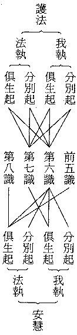



「二」是「有间断」的，这是「第六」意「识」攀「缘」第八「识所变」的五「蕴」、十二「处」、十八「界」的「相」分境，接著就在这些所变的相分境上，「或」作「总」相而缘，「或」作「别」相而缘，复於第六意识上生「起自心」的「相」分，对之妄「执」以「为实法」。众生执我，唯在五蕴上计执，不会在处、界上计执，所以我执可以分为二十句见或六十五见等的差别。现在所讲的这俱生法执，通於蕴、处、界的三科上计执，所以没有二十句见及六十五见等的分别。



「此」常相续、有间断的「二」种「法执」，由於其相极为微「细」的原「故」，所以要想把它断除，那是很不容易而「难断」的。对这还要分别的说：就是第六识中所有的俱生法执，要於见道以「后」，进入「十地」位「中」，每地每地的「数数修习」殊「胜」的「法空观」，於每地每地中个别个别的断；若是第七识中所有的法执，因为最极微细的关系，在地地中只能予似伏断，要到金刚心的时候，「方能」彻底的「除灭」。除灭法执有其二种：一是断，二是伏。断是已经断除，不再发生活动；伏是暂时不起作用，如果无漏圣道松懈下来，还会起活动的。在诸地中虽不断的修无漏道，但六识的俱生法执，不但被伏而且被断，可是第七识的俱生法执，伏虽伏了尚未断除，必须还得继续的修无漏道，所以说为数数。说法执微细，是约品而言，於九品中，属下下品；说法执难断，是约圣道言，必须上上智才能断除，所以说为难断。



以一向说，初地名为见道，所能断的只是分别惑，为什麼现在说十地数数修胜法空观能除微细法执？说清楚点，初地属於见道，其餘剩下来的，应该只有九地，为什麼说为十地？不错，应该只说九地，现在说为十地，当知初地有入、住、出的三心：在入心的这个阶段，以无漏道断去见惑，当然是属正式初地，可是到了住心和出心的两个阶段，已经踏上修道。这样一来，就可以初地之餘及九地称为十地，试问又有什麼不可？是以诸地皆有三心，皆名修道，不得名为见道。《义演》双取入、住二心皆属见道，这是不对的，可以说为见道的，唯有入心。



言胜法空，这是显示法空观，简别不是游观心。游观心与法空观的不同，在於能不能断惑，能断惑的，叫做法空观，不能断惑的，叫做游观心。依这分别，不但为调心而游诸等至的是游观，就是根本智与后得智亦是游观，因为它们是都不能断惑的。



五识，依护法说，是没有法执的，理当不可说十地断，但因五识中有所知障的关系，自也可与第六法执同诸地断，因五识的所知障，是由第六识的法执生的。不过成问题的，就是五识所有的所知障，是俱生的？还是分别的？有说是俱生的，有说是分别的。虽则如此，但可作这样的分别；五识所有的分别所知障，与第六识法执，在初地中同断；五识所有的俱生所知障，与第六识法执，在十地中地地同断。



子二　分别法执



分别法执亦由现在外缘力故，非与身俱，要待邪教及邪分别然后方起，故名分别。唯在第六意识中有。此亦二种：一、缘邪教所说蕴、处、界相起自心相，分别计度执为实法。二、缘邪教所说自性等相起自心相，分别计度执为实法。此二法执粗故易断，入初地时观一切法法空真如即能除灭。



前面已说俱生法执，现在来说分别法执。如是「分别法执」，究是怎样有的？它一方面固然是由内种因力所起，而另方面「亦由现在外缘力故」而起。正因为有待外缘之力，所以「非」是「与身俱」来。



所谓外缘是什麼？就是到了吾人长大以后，「要待」外在的「邪教」以及自己内心的「邪分别」思惟，「然后方」会生「起」，所以叫做「分别」法执。但此分别法执，在诸识中，「唯在第六意识中有」，於餘识中是没有的，因为这是强思计度而来，亦是间断而不相续的。依护法说，前五识是没有法执的，因前五识没有分别筹度的功能作用，根本不可能起执的。



「此」分别法执「亦」有「二种：一」是「缘」於「邪教所说」的「蕴、处、界相」而「起自心相」，於中「分别计度执为实法」。当知此中所说的邪教，不但是指外道的言教，就是小乘执蕴、处、界为实有，违於大乘法空的智慧，是亦可以说为邪教，乃至若执菩提、涅槃为实有，望於大乘法空智，同样可以说是邪，可见邪的范围是很广泛的，不论执什麼为实有，皆包括在里面。「二」是「缘」於「邪教所说」的「自性等相」，好像数论学者所说的自性，胜论学者所说的大有性等。对此缘了以后，就在这些本质法相上，生「起自」己「心」中的影像「相」分，从而在这影像相分上，「分别计度执为实法」。像上所说两种，是为分别法执。



「此」之「二」种分别「法执」，由於其相极为「粗」显的原「故」，断起来时，那是很容易的，所以说为「易断」。为什麼？因这不要胜法空观，只要粗观就可断除，加以它的行相猛烈，在「入初」欢喜「地时」，运用「观一切法法空真如」的下品圣道，「即能」将这二种法执「除灭」。入初地的初，《枢要》说有四种：一、约地位说初，是指在初地位中，就可将之断除，不要等到餘地再来断除；二、约圣道说初，是指圣道的最初现前，即唯有在见道不是在修道；三、约真相说初，原来所谓见道，是分为真见道和相见道的两种。真相说初，显示这唯在真见道，不是在相见道；四、约道初说初，原来道有无间道与解脱道的两种，道初说初，显示这唯在无间道，不是在解脱道。因为有这四义差别，所以名之为初。最初断除分别法执，就是在这无间道中，不是在解脱道上。



子三　总结内外



如是所说一切法执，自心外法或有或无，自心内法一切皆有，是故法执皆缘自心所现似法执为实有。然似法相从缘生故是如幻有，所执实法妄计度故决定非有。故世尊说：慈氏当知，诸识所缘唯识所现，依他起性如幻事等。



「如是」像上「所说一切法执」，属於「自心」以「外」的「法，或」者是「有，或」者是「无」，没有一定的，至於「自心」所变的「内法」，因为都是因缘生的，所以「一切皆有」。外法或者是有，如第七识中法执所缘，一定是有它的本质境，而这本质境就是第八识；但第六识中法执所缘本质，那就或者说它是有，或者说它是无。这话怎讲？如修道位上俱生法执所缘的，就是有本质的，若分别法执所缘的，或者是没有本质。如缘五蕴法，就是有本质，因这的确是有的，如缘自性等，就是无本质，因这确是没有而为分别之所幻想的产物。像胜论所执的六句义，数论所执的二十三谛，皆是烦恼障故。不是法执所摄。由「是」之「故」，一切「法执皆缘自心所现似法」，而愚法者不知它是自心现似，所以「执为实有」。



所现似法与所执法，究竟那个是有？那个是无？所现似法，因为是从心上之所变起的，属於依他起，所以必定是有；至所执法，因为是颠倒错乱之所妄执的，属於徧计执，所以必定是无。二者有无不同，是极为显然的。以论理方式说：诸「似法相」决定是有，因为是「从」诸「缘生」的，亦即是从内心所变种子所生，不同真如，所以「是如幻有。所执实法」，决定不是实有的，因是依於依他执为实有，与相似法不相称，如石女儿及龟毛兔角等，是「妄计度」而有的，所以其体「决定非有」，如毕竟无。这是以理成立内相有唯心所现，外境无论如何是没有的。下面再引经证。



「故世尊说：慈氏当知，诸识所缘唯识所现，依他起性如幻事等」。依奘公所译《解深密经．分别瑜伽品》原文是这样的：『慈氏菩萨复白佛言：世尊！诸毘钵舍那三摩地所行影像，彼与此心，当言有异？当言无异？佛告慈氏菩萨曰：善男子！当言无异；何以故？由彼影像唯是识故。善男子！我说识所缘，唯识所现故』。我在《解深密经语体释》这样解释道：『为什麼说彼影像唯是内识呢？当知我佛所说识所缘的，唯是识所变现的，并无外在的实体。我说识的识，是能分别的心，是见识，也是指出识的自性。所缘唯识所现的识，是所分别的境，是相识，是依识而现的。能分别的是识，所分别的也是识，所以不可说异。唯识学的特义，在成立有心无境，本文，就是建立唯识无义的。一切的物相，初看好似外在的实境，有别体的能取所取，其实一切物相，都是虚妄分别心所现、所摄的。若说能取的见分是识，所取的相分不是识，那就与唯识的本义相违』。论中既说依他是幻有的，等即等取徧计妄执是无的。



辛三　总结我法



如是外道、餘乘所执离识我法皆非实有，故心心所决定不用外色等法为所缘缘，缘用必依实有体故。现在彼聚心心所法，非此聚识亲所缘缘，如非所缘，他聚摄故。同聚心所亦非亲所缘，自体异故，如餘非所取。由此应知实无外境，唯有内识似外境生。是故契经伽他中说：『如愚所分别，外境实皆无；习气扰浊心，故似彼而转』。



「如是」像上所破「外道、餘乘所执离识」而有的实「我」、实「法」，悉「皆非」是「实有」的，「故心心所决定不用外色」、不相应行、无为「等法为所缘缘」，因为离了内在的心识，色等皆是没有实体的。亲所缘「缘用必依」於真「实有体」法「故」。假定不是心所变现的色等诸法，决不亲缘。在此成为问题的：若无体法，缘义虽然没有，但是可作所缘，那麼，前说非诸极微共和合位，可与五识各作所缘，这又怎样讲法？对这问题的解释是：五识缘境只能缘粗境不能缘细，非共和合位的极微，是最极微细的，当然不是五识之所缘的，但望之於第六识，不障碍它的缘无变相，所以成为第六识的所缘。外人又问：假法及无皆不成为所缘，那麼，大乘所说的第六识，缘於龟毛兔角等，此相分假能不能成缘？假定认为它成为所缘的，那为什麼要破於他？假定认为它不能成为所缘，第六识这时岂非没有亲所缘缘？对这解答说：外道、小乘他们执著离识之外有法，不论是假有的，不论是实有的，皆是不可得的，所以非所缘缘，因而前面予以破斥。可是大乘所缘，皆是不离识的，简别徧计所执，一切皆得名实，所以成所缘缘。由此可以看出大小乘的不同。



论中『彼聚』的聚，是积聚的意思。不论讲到什麼聚，必然是属多数的，不是单独一样的。在此论中所说的聚，不是指别的什麼法，而是专指心王心所。如眼识心王与其所相应的心所，谓之一聚，耳识心王与其所相应的心所，谓之一聚，乃至赖耶心王与其所相应的心所，谓之一聚。而这一聚的王所与那一聚的王所，在凡夫位上，以第六识王所为此聚，以餘七识王所为彼聚，作为此聚的第六识，可以通缘其他的七聚，而其餘的七聚却不能通缘一切。可是到了圣位，诸聚是互通的，可以彼此互缘。



譬如「现在彼」眼识一「聚心」王和「心所法」，决定不能作「此」耳「识」的「亲所缘缘」；反过来说，若以彼耳识一聚的心王心所，同样决定不能作此眼识的亲所缘缘。眼耳二识不能互相为亲所缘缘，当知其餘诸识亦然。为什麼如此？依唯识家说：所谓亲所缘缘，一定要各识自己所变的相分，才是各识自己的见分亲所缘缘。如耳识一聚所变的音声相分，只能为耳识的见分亲所缘缘，眼识是决不能见到的，再如鼻识一聚所变的香臭相分，只能为鼻识的见分亲所缘缘，耳识决定是不能听到的。为什麼如此界限森严？「如非所缘，他聚摄故」。如声尘是他耳识一聚之所摄，当然非是眼识等所缘境；香尘是他鼻识一聚之所摄，当然非是耳识等所缘境。这就每个有情本身所有的八聚王所分自分他说的；还可就彼此不同有情所有的一聚王所分自分他以明。因为不论是个什麼样的有情，高级的也好，低级的也好，皆有八识心王，五十一个心所共聚，所以叫做心聚。如彼他人所有的心聚，虽则说是实有的，但非此人亲所缘缘，换句话说，他人心聚非自心聚亲所缘缘，因为是属他聚所摄的，如声境非是眼识等的所缘，色境非是耳识等的所缘。不但外面的色法，不可作亲所缘缘，就是别聚的心王心所，也不能作此识聚的亲所缘缘。再严格一点说：「同」属眼识一「聚」的「心所」法，也不能作自眼识心王「亲所缘」缘。如五徧行中的受心所，不能亲缘其中的想心所，虽说它们同属一聚，由於「自体」各各差「异」，所以不能亲缘，「如餘」眼根等「非所取」法。或说所取就是相分，能取就是见分，餘非所取，即是不对所取者说名为餘。



於上两种解说中，《成唯识论集解》卷二说：『若约后文，诸识有互缘义：如第八与前七为所缘缘，第八相分与前五识为所缘缘，第六以第八二分为所缘缘，第七唯托第八见分为所缘缘，前七不与第八为所缘缘，第八唯缘自三类境为所缘缘，不托前七为质故。何以故？若约自识变影像，则一切法皆可为亲缘。故此聚彼聚，有互相缘义』。



「由此」种种原因，吾人「应知实」在「无」有客观「外」在的「境」界，「唯有内」在的心「识」，好「似」有「外境」的「生」起。「是故契经伽他中说：如愚所分别，外境实皆无；习气扰浊心，故似彼而转」。契经，是指《厚严经》，亦即《密严经》，奘公译时引之。奘公本亦将梵本带来中国，如译的话，可成六卷，惜未翻译，实则《厚严》与《密严》同本，属於大乘经典。引此偈颂，旨在证明诸法唯识，无有心外实境，但因妄想习气的力量，扰乱混浊自己的内心，以致好似有彼外境转变生起，实则但是内心，并非真有外境。这是显示世间凡夫为什麼会有我法二执的所以。



辛四　外难内释



壬一　举难词



有作是难：若无离识实我法者，假亦应无。谓假必依真事、似事、共法而立。如有真火、有似火人、有猛赤法，乃可假说此人为火。假说牛等应知亦然。我法若无依何假说？无假说故似亦不成，如何说心似外境转？



「有」人「作是难」说：照你们唯识家说，「离」开心「识」之外，没有一个「实我」实「法」，理该「假」我假法「亦应无」有。有作是难：有说唯是外道学人的责难，有说除了外道还有小乘学人的责难，於此，应说后者是对的，因为后文牒中，曾经说到小乘，前文当然有责，况且小乘学派中，确有主张有我有法的。



为什麼他们要以假亦应无来难？因为所谓实我实法虽然是没有的，但是不论世间或者圣教，皆曾说到有个假我假法，可是现在所要问的，就是依於何假而说？当然不可假说牛毛好似龟毛，因为它们的所似，都是没有实体的。在责难者的意思：大凡可以立为假的，必依三法方可假说，就是所「谓假必依真事、似事、共法而立」。



例「如」先要「有」种「真火」，然后方可说「有似火」的「人」。真火是就譬喻真事，似火是就譬喻似事。而这似火的人，「有猛赤法」。所谓猛赤法就是譬喻共法。具有如是三法，「乃可假说此人为火」。於中，猛指火所燃烧的热焰，赤指火所现似的红色。一个人是不是可以说为火爆性的人，就看他有没有猛赤法，如果是有猛赤法的，就可假说此人为火爆性的人，但这必是依於真火而说的，假定没有真火，怎麼可说人似於火？又如「假说牛等，应知亦然」。这个喻中所说的猛赤法：猛是形容牛的凶暴，性是形容牛的愚蠢。一个人是不是像牛那样的凶暴愚蠢，就看他有没有猛赤法，如果是有猛赤法的，就可假说此人为凶蠢如牛的人，但这必须依於真牛而说的，假定没有真牛，怎麼可说人似於牛？



依上两例，明白知道：所谓假我假法，必定是依实我实法而有的，如果你们一定要说实「我」实「法」是「无」有的话，试问「依何」而「假说」的？如果「无」有「假说」，那就「似亦不成」，因为要有似而后才有假的，似既不成，「如何说心似外境」相「转」变而起？没有什麼为似，而说心似外境转，岂不是成了自语相违？以此而论，可见必须有个实我实法的真事，识所变现的似事，同类性的共法，然后才可假说识所变的似我似法。



壬二　破难意



癸一　总破斥



彼难非理！离识我法前已破故，依类依实假说火等俱不成故。



「彼」诸外道及诸小乘的这个责「难」，根本是不合理的，所以说「非理」。为什麼不合理？因「离」於「识」的「我法」，在「前」破我法中，早「已」予以总「破」。破我破法，就是破真事的无有。《述记》说：『以说假我法为能似，真我法为所似。前破我法中已总破彼真我法讫。此即不极成之真事，故指如前』。



「依类依实假说火等俱不成故」者，是破似事及破共法。在似事中，有的是依类说似，有的是依实说似。如所说的依似，其实不是依似，只可说是依类。类是类同，如言人类，由於人与人是相似的，没有什麼大的不同，所以得为类名。人类所做的事业，又是大体相同的，所以名为共法。由於类有这相似及共法，所以说假依类。一般说的依真，根本不是依真，只可说是依实，实是属於俗事，亦即胜论所说的实句义，而此实句义中所说的火，不论内外都是有的，而人身体的内火，似於身外所有的火，假若内火与外火，同样的有猛赤法，亦即可说有似共，所以假必依实。如果再简单的说：在人的生命体中，有这类义与实义，所以依类依实说人似火或说似牛。骤看起来，这种说法，似乎都很有理，而实皆是不能成立的！



癸二　依类破



依类假说理且不成！猛赤等德非类有故。若无共德而假说彼，应亦於水等假说火等名。若谓猛等虽非类德而不相离故可假说，此亦不然！人类猛等现见亦有互相离故。类既无德，又互相离，然有於人假说火等，故知假说不依类成！



此破依类不成假说。「依类假说理且不成」者，因为「猛赤等」法只是火「德」，亦即火以煖为其德性，并「非」同异「类」俱「有」的共德。如人有猛赤相是不错的，但不可说它是煖德。既然没有类德，证知假非依类。「若」於不「共」火「德」的人类，「而」可「假说彼」人似火，无论怎样是说不过去的。倘若一定要这样的说，水火原本是不相容的，那就「应」当「亦」可「於水等」中，「假说火等」之「名」。於水等中既不可假说火名，於无共德当中，自亦不可假说彼人似火。所以依类假说的道理，无论如何是不能成立的。「若」果你们更「谓猛」赤「等」的火德，「虽非」与一切「类」共「德」，然「而」那与人类是「不相离」的，是「故可」以「假说」此人为火。「此」说是「亦不」皆尽「然」！因为「人类猛等现见亦有互相离故」。如在现实世间所见到的人群，各各性格有所不同的。有的性格猛烈，但是其色不赤；有的其色火红，但是性不猛烈；有的性既不猛，其色亦不火赤。不猛不赤的人，显示他的德类相离；猛而不赤或赤而不猛的，显示他的猛赤相离。如是相离，则火德非与人类相共，可谓极为明显，怎麼可以假说此人为火？人「类既」然「无」有火「德」，而火德「又」失其类的「互相」分「离」。在这样的情形下，「然」而犹「有於人假说火等」者，实在不成话说。由是之「故」，可以「知」道，「假说不」一定要「依类」才能「成」立。



癸三　依实破



依实假说理亦不成！猛赤等德非共有故。谓猛赤等在火在人其体各别，所依异故，无共假说有过同前。若谓人火德相似故可假说者，理亦不然！说火在人非在德故，由此假说不依实成。



不但依类假说其理不成，就是「依实假说理亦不」得「成」立。因为世间的任何一种假说，有的固然是依类的，有的根本不依类的，有的固然是依实的，有的根本不依实的，那里可以一概而论？妄执假说依类已破，现在续破妄执假说依实。要知所谓「猛赤等德」，并不是火与人之所「共有」的，如「猛赤等」德，一部份是「在火」的，一部份是「在人」的，如是始可说得上是共法，正因为是像这样的共法，才可依真火的猛赤，假说人的猛赤似火。可是现在这个猛赤之德，在火是就能够燃烧，在人则令心烦燥热，「其」火「体」是「各别」不同的，而其「所依」，一个是无情，一个是有情，亦是各别差「异」的。如此猛赤既然不是火与人的「共」德，而「假说」是火是人，那你所「有」的「过」失，「同前」是一样的，就是应於水等假说火名。



「若谓人火」的确是不同的，一个是有情，一个是无情，当然不可相提并论，但煖「德」是「相似」的，所以「可假说」为此人似火「者」，对此如仔细的推究起来，其「理亦不」尽「然」！为什麼？因必需「说火」的猛赤，是「在人」的体上，然后方可假说人似火，并非毫无理由的，就在人的德上，说有似火之处。前面说过，人是有情，火是无情，两家的德性，怎麼能相似？如劫火能坏三千大千世界，人那里有这猛赤之德？再说，若以火德名人，人人都是有煖德的，难道人人都可名为火人？「由此」可见「假说」火人火法，「不」一定要「依实成」。不可依实假说是火，而竟假说是火，当然是要不得！



癸四　依真破



又假必依真事立者，亦不应理！真谓自相，假智及诠俱非境故，谓假智诠不得自相，唯於诸法共相而转。亦非离此别有方便，施设自相为假所依。然假智诠必依声起，声不及处此便不转，能诠所诠俱非自相。故知假说不依真事，由此但依似事而转，似谓增益非实有相，声依增益似相而转，故不可说假必依真。是故彼难不应正理！



此破依真不成假说：前破依实假说中，但明假说不依实成，并未说明事实真相，所以现在特再破道：「又假必依真事立者，亦不应理」！依真假说，在本论中，不是没有，这到下面会要讲到。不过假必依於真事而立，则是唯识学家所不承认的，所以被总斥为不应於理！



当知所「谓真」，不是别的什麼，就是诸法「自相」，亦即诸法的自体。如是诸法各有自相，本为各派学者之所共同承认的，虽则共同承认有这诸法自相，但假亦不依於此等而立。为什麼？要知所谓诸法自相是对共相说的。如色法以变碍为它的自相，受以领纳为它的自相，想以取像为它的自相，行以造作为它的自相，识以了别为它的自相；地以坚硬为它的自相，水以润湿为它的自相，火以温煖为它的自相，风以流动为它的自相，而在这些上面皆有无常演变的生、住、异、灭为它的共相。



任何一种自相，不是比量「假智」之所缘的境界，亦即心识之所不能缘到的，所谓是离心缘相的，亦不是名句文假「诠」言说之所能说得到的，所谓是离言说相的，因而自相唯是现量之所证知。唯有言说说之不及，假智缘之之所不著，方可说之为真。如一涉及心缘言诠，有了能缘所缘、能诠所诠，那就不是诸法自相。如是说来，证知诸法自相，「俱非」假智及假言诠所缘「境」界。如人缘火，心分别时，是为假智，口说火时，是为言诠，可是尽管如此，火不烧口，亦不烧心，是假智诠。为什麼？要知火以烧物为它的自相，现在既不烧口，亦不烧心，可见是假。



不是无漏真智的比量「假智」及假言「诠」，既「不」能够「得」到诸法的「自相」，当然「唯於诸法共相」上展「转」而起。如色声香味触的五尘自相，为五识现量之所证知的，一旦第六识随著五识之后起智而缘，自比量智发出语言诠说诸法，到了这个时候，那所能得到的，唯是诸法共相，不能得到法的自相，因为自相性离言诠及分别假智。虽则如此，但是「亦非离此」共相之外，而「别有」什麼特殊「方便」，格外「施设」一个「自相」，以「为假」智及假言诠之「所依」止。因为诠说火的这个名词，无始以来由串习力，一直是依火的自相，不是依於什麼水等。『假智随名但缘於火，且如假名诠法自相，虽不称实要仗所诠自相施设，假智亦尔，不离自相假智生故』。



照此说来，这就是假说必依於真，正符合我们的说法，为什麼你们要予破斥？回答他说：虽说这是依於自相，但是并不称於所依，所以不可说假必依真！外人又说：假定这样，我亦如是，虽假是依於真的，但亦不说是称於真！再解答说：这是不能相提并论的！你们所说的真事，认为是识外所有，这在前面已予详细破过；我们说的但是心识所变，不是心识之外所有的，所以我们说的可以成立，你们说的不能成立！



「然假智诠必依声起」者，是说假智及假言诠，必然是依相似言声而起，如果是「声」之所「不及处，此」假智及假言诠「便不」运「转」，犹如於声。



这里说的假智诠依声起，是专约我们现在所居住的这个娑婆世界说，如果是别个世界，那就不一定如此。有的是依光明而起假诠的，有的是依妙香而起假诠的，有的是依妙味而起假诠的，有的是依妙触而起假诠的。



就是在这娑婆世界，由於分为欲、色、无色的三界，因而论中说的假智诠依声起，是唯约三界内的欲、色二界说，因唯於欲、色二界依声而起假智，至於无色界中，假智虽不是没有，但不是依声而起，因一生到无色界，就能了知一切法，虽说定生有情亦能缘声，但这是以意识而缘，不是依於耳识缘声，因为无色界中的有情，是没有耳根的，既然没有耳根，当然不能发耳识以缘声尘。



娑婆世界欲、色二界众生，其假智诠所以必依声起。举例来说：如我们听到佛陀这个名声，就去攀缘於佛，对佛生起分别，进而发出言说，将佛说之为佛，如是这样说了以后，对这就能有所了解。



在此或者有人要问：假定真的名不离声，那声与名应即没有差别，为什麼还要分别的说假智及假言诠？要知名与声的二者，虽则说是不相离的，但是它们意义，各有殊胜不同，不能不说它们有别。如名句文，在能诠方面，固然是很殊胜的，但在表业方面，其作用则很劣；至於声体，在表业方面，固然是很殊胜的，但在能诠方面，其作用则很劣。约这意义有别，说它们不相离，又有什麼不可？



声所不及的地方，为什麼假智及假言诠就不运转？当知声所不及的地方，就是声不能到自相上。因为心行处灭，所以假智缘之不得，因为言语道断，所以假诠诠之不得，是为假智假诠於自相上不起。犹如於声，是说假智能缘得共相，自是不成问题，要想缘得自相，那就不是假智所能做得到。如声唯能诠得共相声，自相是不能诠得的，因为自相是离名言的，怎麼可以为声之所诠及？



由此证知「能诠」之名、「所诠」之法，「俱」不是事物的「自相」，所以我们「知」道「假说」决定「不」是「依」托「真事」而有，但可说它依於共相而转。要知自相是离名言的，假说共相是带名言的，那里会有名言共相亲依离名言的自相？这是绝对没有这个道理的！



「由此」上述道理看来，我们可以明白知道：所谓假说，「但」是「依」於影像的「似事而转」起的，不是依於真事而转起的。似事，就是指的共相，假智及假言诠，皆依共相而转，决不依於真事自相而转。



「似谓」是「增益」的假相，并「非」是「实有相」。因为「声」音的言说，是「依」托「增益」的影像「似相而转」起。譬如说火，不过是表达火的意义，令人知道这就是火，拣别不是非火就行。不见得口说於火，就会生起烧的作用，所以「不可说假必依真」。以「是」之「故，彼难不应正理」。



癸五　结成正义



然依识变对遣妄执真实我法，说假似言。由此契经伽他中说：『为对遣愚夫，所执实我法；故於识所变，假说我法名』。



假事既然不依真立，现在所要请问的，就是所谓假我假法，究竟是依什麼而起的？依唯识学者说：假我假法虽不依於真立，「然依」内「识变」现而有，既是识所变现有的，那里可以说它真实？由於世间的外道及佛法的小乘，妄计心外有实在的我法，为「对遣」此「妄执真实我法」，所以「说假似」我似法，为内心识所变。不特如此，就是说假，也是勉强说的，实际假说亦不可得。



这几句结语，就近说，当然是结这段论文，向前看，可说远结前文颂中所说『，由假说我法，有种种相转，彼依识所变』的三句，是以这个结语极为重要。



在前总结我法文中，曾经说到凡夫会有二执的所以；现於结成正义文中，亦显示圣教假说我法的所以。「由」於如「此」，所以在《厚严经》中，接著说到佛菩萨等，「为对」治遮「遣」世间「愚夫所执」著的「实我」实「法」，使凡夫断除惑染，令凡夫得到清净，让凡夫生起真智，「故於」内「识所变」的见相二分上，「假说我法」二者之「名」。因为这样的关系，所以实在的我法，虽说是没有的，但识所变的见相二分，不能说没有，依此见相二分，假立我法之名，自然没有什麼不可，而且这所假立的我法，亦是识所变的，这就是唯识义，亦本论的正旨。



丁二　释后三句颂



戊一　标举三数



识所变相虽无量种，而能变识类别唯三。



在前略辨唯识中，标出六句颂文。最初的三句颂文，已经略为解释；其次的三句颂文，现在续为解释。如上略释，已经知道，所谓实体我法，是绝对没有的，一般说的或我或法，是依识所变的相见二分之所安立的。相见二分不是本身如此的，而是由能变识之所变现的。但能变识究是什麼，前面固然没有说到，能变识到底有几个，也还未曾有所交代。现在所释的这三句颂，就是解答这问题。



由「识所变」的「相」分，「虽」说是有「无量」无数那麼多的「种」类，然「而」此「能变识」，如果「类别」起来，不过「唯」有「三」种。既不可说多有四，亦不可说少只二，多则无用，少则不够。



戊二　别释三名



一谓异熟，即第八识，多异熟性故。二谓思量，即第七识，恒审思量故。三谓了境，即前六识，了境相粗故。及言显六合为一种。



此是正式解释三能变的名义。「一谓异熟」的异熟，是引业所感得的有情总报的真异熟果报，「即」是「第八」阿赖耶「识」。果报识所以得名为异熟，因为是「多异熟性故」。如第七末那识，完全不是果报识，至於前六识，虽可说有少分的果报，但还有赖於现在的助缘，可是第八识，完全由过去的业因，成熟现在的果体，所以名为多异熟，拣别不是第七识及前六识。



异熟是中国话，印度叫做毘播迦。向来解说有三义：一、变异而熟，是说要那因的本身不断变异，而后果方渐渐的成熟。如所长的桃子，最初是怎样的，后来变成怎样，最后成熟为果，其间是在不断改易的，所以名为变异而熟。二、异时而熟，是说因果不同时的，与因异时，其果方熟，所以叫做异；至於这个熟，是约正在造业时，望著果熟时说的。因为业种子和异熟果身，恒住现世一切刹那，不论怎样都是同时的，可见不是在种子方面讲，是指正在造业与受果时说，造业是在过去，受果是在现在，因果是异时的，所以名为异时而熟。三、异类而熟，是说果异於造业的因性，成熟的果酬於因力，所以名为异熟。通常有两句老话说：『因是善恶，果唯无记』。感得果报的因性，虽说是有善有恶的，但所得的报体却是无记的。异熟虽有这三种解说，但这里主要是取第三异类而熟的一义，以显第八识是由善恶引业所感得的无记果识。由於异类之因而为熟果，异是属於因的，熟是属於果的，使熟果属於异因，即异之熟，名为异熟。反之，以因的善恶，成为异类的熟果，异固属於果，熟亦属於果，善恶的因，使於异类之果，异即是熟，名为异熟。若要约的说：这异熟识於善恶的业种子使之成熟，以酬於引业的有情总报果体的真异熟——第八识。此异熟识，是初能变。



「二谓思量」的思量识，「即」是「第七」末那「识」，因为它是「恒审思量」的。末那是印度话，中国译为意。意有依止与思量的二义。此末那识为第六意识之所依止，是意之识，依士得名。此末那识的现行，恒恒时都是在思量的，此意即识，持业得名。思量，是思虑量度的意思，第七末那识，从无始以来，恒缘第八识的见分为自我为实法。不过就心心所的缘境作用说，思量本是通於诸识的。现在所以特别命名第七为思量识，由於此识具有『恒』与『审』的两大特殊功用。恒是显示它的相续不断，审是显示它的计度深明。如前五识，不但没有计度深明的审义，亦没有相续不断的恒义，而是非恒非审的。至第六识，计度深明的审义，虽然是具有的，由於它有时有间断，相续不断的恒义，则不具有，而是审而非恒的。若第八识，相续不断的恒义，虽说是具有的，由於它的暗昧不明，深明计度的恒义，却是缺少，而是恒而非审的。唯第七识，不但在有漏位上，恒审思量第八阿赖耶识的见分为我，就是到无漏位时，亦恒审思量无我，所以第七识具有恒思量与审思量的二义，而是亦恒亦审的。图示如左：



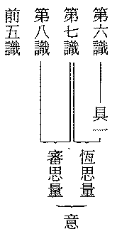



全具恒审思量的，唯是第七末那识，所以第七识特名思量，这是第二能变。



「三谓了境」的识，「即」是「前六识」，因为它们是了别粗显境相的，所以说「了境相粗故」。所谓了别，是诠辨所对的境而说的。讲到了别是识的作用，不但前六识有，就是七八二识也有的，现在所以特就前六识名为了别，是约粗了别说的。



对这三能变，在唯识学上，还有这样的分别。据特胜说：第八叫做心，第七叫做意，前六叫做识。心是集起义，有行相集起和种子集起的二义：行相集起，是通於诸识而有的，因为诸识的见分行相，积集於识的自体，而起行解作用的；种子集起，唯局限於第八阿赖耶识，因为第八识，积集诸法的种子，而能生起现行的。意是思量义，有无间觉与现思量的二义：无间觉，是通於诸识而有的，因为每一识都有无间觉的作用的；现思量，唯独局限於第七识，因为唯有第七识，具有现思量作用。识是了别义，有细了别和粗了别的二义：细了别，是通於诸识而有的，因为不论那一识，都有它的细了别的作用；粗了别，唯局限於前六识，因为了别粗显境所起的了别粗行相，唯局於前六识的，所以别名前六识为了别境识，这是第三能变。



「及言显六合为一种」者，是说合集前六识，为了别境识。若就不共所依而言，其识体是有六种的：如依眼根而起缘色境的是眼识，依耳根而起缘声境的是耳识，依鼻根而起缘香境的是鼻识，依舌根而起缘味境的是舌识，依身根而起缘触境的是身识，依意根而起缘法境的是意识。但因它们所了别所缘的境，能了别能缘的行相，都是粗显的，所以合为了别境识，简别不是七八二识。



戊三　因果能变



己一　标数



此三皆名能变识者，能变有二种。



如上所说的异熟、思量、了别的「此三」识，虽「皆名」为「能变识」体，但论其「能变」义，则「有二种」，就是下面所要说的因能变与果能变。



己二　正释



一、因能变：谓第八识中等流、异熟二因习气。等流习气，由七识中善、恶、无记熏令生长；异熟习气，由六识中有漏善恶熏令生长。



於二种能变义中，现在先讲第「一、因能变」。所「谓」因能变，是指「第八识中」能转变现行的诸法和自类的种子，亦即第八所依所持的种子。这种子，有「等流、异熟二因习气」的两类。如分开说，就是等流习气和异熟习气。「等流习气」，是「由」前「七」转「识中」的「善、恶、无记」三性种子「熏令」渐次「生长」，而能为生起八识三性诸法的亲因缘者是。严格的讲，现在所说的等流，就它熏成三性种子的方面讲，可以叫做等流因，约它能生三性果法这方面讲，则可叫做等流果。等是相似的意思，名之为因；流是流类的意思，名之为果。是果法，相似於因，是因的流类，善、恶、无记三性种子，各各引生自类的果，所以得等流名。习气是能生的因名，是现行所熏习成的气氛。因为不论那一法发生现行活动时，不是活动过去就算完了，必然会有残留於第八识中的影子，到了后来一旦遇到缘时，就发生生起现行的作用，像这样的东西，就称之为习气，如是习气，实际就是种子的异名。所不同的：种子望它自身所生的现行而得名的；习气则是望於能熏的现行而得名；虽说有著这样得名的不同，实际种子就是习气，习气就是种子，一体异名而已。此通於八识有为三性诸法的各各自果，可为引生等流果法能生的种子。望所生果，这是亲因缘，所谓自性亲因，亲能辨生自体同性果法的真原因。若依它的果有现行和种子来讲：在现行方面看，种子是生现行的亲因缘；在种子方面看，现行是熏习种子的亲因缘。这能熏习气的识，是七转识，通漏无漏三性。



其次所要讲的「异熟习气」，是「由」前「六识中」的「有漏善、恶」二性，「熏」第八识，成善、恶种，「令」其「生长」，后从善、恶二业，招第八识，受苦乐果，是无记性，因果各别，名为异熟。如是善、恶业种子，为招异熟果的增上缘，亦可叫做助缘。能熏这习气的，是唯属於有漏前六识中善和恶的现行识。不过异熟习气，亦可名业种子，就是由业所熏成的种子。业有两种，就是善和恶。善业能招可爱的果，就是人天趣报；恶业能招不可爱的果，就是三恶趣报；而发这善、恶业的，是前六识。虽说通於六识，但若严格的讲，前五识只能随转发业，真正能发业的，是第六识。



等流习气与异熟习气，看来好像是有差别的，实则是没有什麼差别的，因为离了等流习气，异熟习气的自体，根本是不可得的。既然如此，为什麼说有两种习气？当知这是在特殊作用分点上而别立的。『就是有漏善、恶二业的种子，它的自果即是生起善、恶二业的现行，在这点上名它为等流习气；而善、恶的种子，也能扶第八识和前六识的异熟无记的种子，使之生起现行，在这点上名它为异熟习气。这异熟习气势力强胜，不但生起自身之果，且能扶助其他的劣弱种子使之生果，这样地和其他的种子异其作用，故别得异熟习气的名。因为异熟无记法，它的势力羸劣，不能自生现果，必须依靠别的强胜的助缘方能生起。那强胜的助缘，就是这异熟习气。不但此也，假使没有异熟习气的扶助，虽修了善业，也不能感总报第八人天的乐果；虽造恶业，也不能招三途苦报的异熟果体；无异熟习气，有坏於因果赴感的正理。无异无记法失了扶助故，所以有别开异熟习气的必要』。



如是等流、异熟二种习气，为什麼都叫做因能变？当知因是所由的意思。如等流习气，为等流果之所由生；而异熟习气，则是异熟果之所由生；因为如此，所以名因。此因能转变生现行和种子，因即能变，名因能变。至於讲到它的所变：在等流方面，就是同时八识三性各自生起诸法的现行和各自所引后念的自类种子，因为是自类种子之所变的；在异熟方面，就是第八识的以及六识中异熟无记的现行法，因为是由善、恶引业、满业种子之所变的。



二、果能变：谓前二种习气力故，有八识生现种种相。等流习气为因缘故，八识体相差别而生，名等流果，果似因故。异熟习气为增上缘，感第八识酬引业力恒相续故，立异熟名，感前六识酬满业者，从异熟起，名异熟生，不名异熟，有间断故，即前异熟及异熟生名异熟果，果异因故。



上面所说的是因能变，现在续讲的是果能变。於此第「二果能变」中又分为二：一是等流果，是由等流因结成的三性现行果；二是异熟果，是由异熟因结成的第八识的无记果。正因如此，所以这果能变，是由「前」面「二种习气」之「力」，而「有八识」自体分，变「现」见相二分的「种种相」。八个识的自体分，是前等流、异熟二因习气所生的果，所以名为果能变。



如以「等流习气为」一种「因缘」，那「八识」的「体相」就会「差别而生」。此中所说的体，是指自证分，相指见分和相分。所谓差别而生，是说八种识的各各亲种，生起各各的现行。如眼识的亲种生起眼识的现行，耳识的亲种生起耳识的现行，乃至第八阿赖耶识的亲种生起第八阿赖耶识的现行。或说色种子生起色的现行，有漏种子生起有漏的现行，无漏种子生起无漏的现行。以什麼因生什麼果，「名等流果」，因所生「果似」於「因」的。



如以「异熟习气为」一种「增上缘」的力量，亦即是以善、恶业为一种助缘，招「感第八」果报「识，酬」它「引业」之「力」，常无间断的「恒」时「相续」，「立」真「异熟名」，就是第八识。若善、恶业「感」招「前六识」的，以「酬满业」之力「者」，是「从异熟」而「起」的，只可「名」为「异熟生，不」得「名」为真「异熟」，因为它是「有间断」的。「即前」第八识的真「异熟及」前六识的「异熟生」，因为它们都是异时而熟、变异而熟、异类而熟的关系，所以都「名异熟果」，由於「果异」於「因」的。在此所要特别注意的：如果单名异熟，那是专指第八阿赖耶识；如果名异熟果，那就八识全收在里面，因为总报王，果是圆满的。



此中且说我爱执藏持杂染种能变果识名为异熟，非谓一切。



「此」前颂「中」所说的异熟，是「且」就「我爱执藏」而说，因它能「持」善、恶一切「杂染种」的，同时又是「能变」善、恶二种异熟「果识」。由於具有这样的三义，所以「名为」是真「异熟」，亦即名为初能变识，「非」是说异时、变异等「一切」业所感的，皆得名为能变果识。持杂染种，显示善、恶业果名识，能变果识，显示这不是能变中的因能变，因为因能变第八现行识，是不能受熏成种的，所以第八是我爱执藏。



这样讲法，初能变所以特名异熟，有两种简别：一是简别前六识不是真异熟，能够称为异熟的，唯有第八赖耶识；二是简别不是八地以上的真异熟，八地以上的第八识，虽还可以叫做真异熟，但已不是我执的恒爱著处，因为我执已舍了。有说初能变为我法所依，所以特地名为异熟；因从凡夫到第七地，为我爱执藏位，显示是真正的执藏处；从八地以去，除金刚位，持杂染种，显示为法执位。有人不赞成为法执所依的这话，假定为法执所依，那就不能说初能变是在最先舍。我以为这说法是对的。



乙二　广辨唯识



丙一　明三能变



丁一　初能变



戊一　结前标问



虽已略说能变三名，而未广辩能变三相。且初能变其相云何？



上来「虽已略说能变三名」，然「而」还「未广辩能变三相」。能变三相有三，「且初能变其相」是怎样的？为什麼要提出这问题来问？因吾人学习唯识，最主要的是要了解唯识宗义，对於唯识宗义如不解了，怎能认识唯识学是什麼？但要了解唯识宗义，首要明白能变识体是什麼，假定对能变识体不知，自然也就不能明白诸法怎样是识所变的。为此，所以论中特别先明能变识相，其次正式辨说唯识，在辨说唯识中，虽将唯识无境义和盘托出，但还有些人不一定真的明白。为此，最后特再通释一切妨难，以彰唯识的究竟义理，务使人们切实信受唯识无义。



戊二　举颂总答



颂曰：初阿赖耶识、异熟、一切种，不可知执受处、了，常与触、作意、受、想、思相应，唯舍受，是无覆无记，触等亦如是，恒转如暴流，阿罗汉位舍。



对上所提出的问题，为使学者先了解三能变中的初能变相，所以特举世亲自己所造的颂来说明。此中有两颂半，计为十句颂文，通常释这颂文，分为八段十义。八段，就是在颂文上分为八门；如在第八识体来显义，则有十门，也可名为十义。现在依於颂文列表如下：



　　　　　　　　　　┌…………初阿赖耶识……………………一、自相门┐  

　　　　┌一、三相门┼…………异熟……………………………二、果相门│  

　　　　│　　　　　└…………一切种…………………………三、因相门│  

　　　　│　　　　　　　　　　　　　┌执受处………………四、所缘门│  

　　　八├二、所缘行相门………不可知┤　　　　　　　　　　　　　　│  

　　　　│　　　　　　　　　　　　　└了……………………五、行相门│  

　　　段├三、心所相应门………常与触作意受想思相应………六、相应门├十义  

　　　　├四、五受相应门………（相应）唯舍受………………七、五受门│  

　　　　├五、三性分别门………是无覆无记……………………八、三性门│  

　　　　├六、心所例同门………触等亦如是…………………………………│  

　　　　├七、因果譬喻门………恒转如暴流……………………九、因果门│  

　　　　└八、伏断位次门………阿罗汉位舍……………………十、伏断门┘



於十义中，所以除去心所例同门，因这不是识体的正义，不过是例同而已。



戊三　广释颂意



己一　正释颂意



庚一　释三名



辛一　总释三名



论曰：初能变识，大小乘教名阿赖耶。此识具有能藏、所藏、执藏义故。谓与杂染互为缘故，有情执为自内我故。此即显示初能变识所有自相，摄持因果为自相故。此识自相分位虽多，藏识过重是故偏说。



初能变有三相，每相各有一名，所以就有三名，於此三名之中，先释第一句颂阿赖耶名。阿赖耶识这个名字，一般以为是大乘唯识所有的，实际小乘教典中同样是有的。所以「论曰：初能变识，大小乘教名阿赖耶」。不错，大乘教中，特别是唯识大乘教典，确是处处说到阿赖耶识，但据《摄大乘论》告诉我们，就是声闻乘的教典中，也常常以异门说到的。『异门是从不同的形式，从多方面说明的意思，异门并不就是密意』。



阿赖耶识是印度话，玄奘三藏义译作藏，因为「此识具有能藏、所藏、执藏义故」。由於具三藏义，所以名阿赖耶。先简单的说：从它能持种子这方面讲，名为能藏；从它受诸现行熏习这方面讲，名为所藏；从它为第七末那识执为自内我这方面讲，名为执藏。



「谓与杂染互为缘故」：这是正式解说阿赖耶识的能所藏义。『由阿赖耶识为种子，生起杂染诸法的现行，这就是阿赖耶识为杂染诸法因；在同一时间，杂染诸法的现行，又熏成赖耶识中的种子，那又是杂染诸法亦为阿赖耶识因了』。即在这更互为因的关系下，显示赖耶具有能所藏义。当第八识能含藏一切诸法种子时，赖耶为能藏，为它所含藏的种子为所藏。《同学钞》卷二说：『持种边是能藏也』，就是此意。如藏谷麦等的仓库，仓库为能藏，因能藏诸种子的；谷麦等为所藏，因被仓库之所收藏的。反过来说：当本识为前七转识之所熏习时，本识又转为所藏，因为是被前七杂染现行法所熏、所染、所遮、所覆藏的，而前七识杂染现行法则为能藏，因能覆藏赖耶识的。《同学钞》卷二说：『受熏之边是所藏义也』，就是此意。如人藏在草丛之中，被草丛之所覆藏，为人之所不能发现，所以草丛是能藏，而人则成为所藏。能藏的杂染现行如草丛，本识是所藏处如人。



关於能所藏义，在《演秘》中举有三种传说：一、约现行的第八识与所持种，说明互为能所藏。如现行赖耶识执持诸法的种子，所执持的种子叫做所藏，能执持的现行赖耶叫做能藏，是为一重能所藏；到了种子生起现行识时，所生的现行识叫做所藏，能生现行识的种子叫做能藏，是又一重能所藏。二、约初能变与诸转识互为缘起，说明它们之间能所藏的关系。有的时候，以本识为因，以七识为果；有的时候，以七识为因，以本识为果。在这相互为因果的关系下，属於所藏的为因，属於能藏的为果。三、以种望现说，能熏七识名能所藏，从七识生而又能生七识的。在这三种能所藏的说法中，以今论主的意思来看，是以第二能所藏说为正义，因为到解释《阿毘达磨经》中所说的一颂，就是以阿赖耶藏与诸转识互为因果的。所以但应说以现望现名为能所藏，即此能所藏说为因果。



关於能所藏的解释，在唯识学者中是有不同观点的。印顺论师在《摄大乘论讲记》中说：『传承护法学的玄奘门下的基测二师，对能所藏的说法，也有不同。基师约现行赖耶说：现行能执持种子，赖耶是能藏，种子是所藏。现行赖耶又受诸法的熏习，能熏的诸法是能藏，所熏的赖耶是所藏。测师约种子说：种子能生现行，种子是能藏，诸法是所藏。现行熏习种子，诸法是能藏，种子是所藏。他们从种识差别的见地，所以各取一边，固执不通。依无著、世亲的见解看来，应该在种即是识的合一的见地去解说，并且也只有一重能所，本识是因性，杂染是果性』。对能所藏的不同解说，不但中国学者如此，印度学者亦然。



「有情执为自内我故」，是解释执藏。谓诸世间有情的第七染污意，执著第八识的见分为自内我，所以名为我爱执藏。唯识学初起时，讲到阿赖耶识，本是重在摄藏的种子识，但是经过一个相当时期以后，唯识学者又将重心转移到执藏这方面来。原来众生从无始来在生死中流转，就是因为有这我爱执藏。所谓执藏，是我爱缘执之义，第八阿赖耶识见分，无始以来恒被有情（第七识）爱执为我，其情形恰如金银珍宝的库藏，为那所有者牢牢的执守著，一时一刻的也不放松。对这所执藏的赖耶，那能执藏者当然是第七识。依於基师所说的三藏义，列表如下：



　　　　　　　　┌能藏（持种）─────第八识  

　　　　　┌能藏┤  

　　　　　│　　└（所藏─────────种子）  

　　　　　│　　┌（能藏────────七转识）  

　　　三藏┼所藏┤  

　　　　　│　　└所藏（受熏）─────第八识  

　　　　　│　　┌（能执藏───────第七识）  

　　　　　└执藏┤  

　　　　　　　　└所执藏（我爱缘执）──第八识



如「此」像上所说的三藏义，「即」是「显示初能变识所有自相」。说赖耶为能藏，是就因的这方面讲的，说赖耶为所藏，是就果的这方面讲的，因而明显的显示因果相，就是赖耶的自相。可是有人针对这点问道：除了因果相外，难道更无别的自体相了吗？



论主回答说：「摄持因果为自相故」。自相，是自体之谓。这识，以所谓阿赖耶识这点为其自相。奘公所译的世亲《摄论释》，对这解说是：说在因性方面的叫做因，说在果性方面的叫做果，总摄这个因果全体的，叫做自相。无论从《摄大乘论》或本论的文义看，确实是这样的：诸法的能生性是因相，为转识熏习而起的是果相，因果不一不异的统一是自相。但像这样的赖耶自相，是极幽邃深细的，不是一般所易了达的，必须要从它的因果关联中去透视，才能认识自相究是怎样的一个面目。至於论中所说的摄持二字，《述记》作这样的解说：『摄是包含义，包二为一故，持是依持义，以总为别所依持故。别为总所包，总为别所依，故名摄持。又，离二无总，摄二为体，二是总义，总是义之体，体与义为依名之为持，摄二义为体名摄』。



自相既是依於因果而有的，那它就应是假有而没有它的实在自体！不！不可这样讲！假定条然有因果二相，将之合为一个自相，那可说自相是假的，现在是离了自相就没有别的因果相，因果相是就自体上的别义说的，怎麼可说自相是假？如说自相是假，那是绝对错误的！在此有人又这样问道：第八识有多位多名，为什麼在三能变中，举异熟果相之号，於别释中乃说染分藏识之名？



论主回答说：「此识」的「自相，分位虽」说是很「多」的，但因「藏识」的「过」失特「重，是故」特别「偏说」。此中所谓自相，就是第八识的自体。分位虽说是有多种，要不出於如下八种：就是依止执受相；最初生起相；有明了性相；有种子性相；业用差别相；身受差别相；处无心定相；命终时分相。在这麼众多的分位中，但以我爱执著现行位上的称名藏识的过失最为重大，所以特别偏说藏识，亦即以阿赖耶为此识的自相。



此是能引诸界、趣、生善不善业异熟果故，说名异熟。离此，命根、众同分等恒时相续胜异熟果不可得故。此即显示初能变识所有果相。此识果相虽多位多种，异熟宽不共，故偏说之。



第八识有三个名字，为识自体的阿赖耶，在前面已讲过，其范围是最狭，唯有具有我执的凡夫位上，才得名为阿赖耶，不但到佛菩萨的阶位，不得名为阿赖耶，就是二乘圣者亦无赖耶之名，因为他们的我执，是都已经没有。可是现在所讲的异熟果报识，那就大大不同，不但凡夫具有，连二乘同样有，甚至到菩萨的阶位亦有，因为他们各各有其粗细异熟果报的。要到金刚道后成佛之前的一刹那，异熟才被真正空去，《八识规矩颂》说：『金刚道后异熟空』，所以其范围是很广泛的。



但是在此我们要问的，就是这异熟果报是怎样来的？当知「此是」由生前运用六转识所造的善业或恶业，以此善恶业的力量，「能」够牵「引」第八阿赖耶识到三「界」、五「趣」、四「生」去感受苦乐「异熟果」报，所以「说名异熟」。说得具体一点：由前六识於过去生中修五戒、十善等业，得以招感人天总别异熟乐果；若前六识於过去生中作了十不善业，得以招感三途总别异熟苦果。论中所谓能引，是指的引业，其所引的，当然是识，识为酬谢引业，能招所引异熟果报。



本此可知阿赖耶识决定是有的，假定「离此」第八阿赖耶识，试问以什麼去受异熟果？要知小乘学派所说的「命根、众同分等」，等是等於诸餘色心等法，都没有去受果报的资格。因为命根是依此识相分种子而假立的，同分是依此识身心分位而假立的。如是等法都是有间断的，不能恒时生灭相续的，「恒时」生灭「相续」的「胜异熟果」，在命根、众同分等法上，根本是「不可得」的。



原来第八识的果相，在有漏位中，是有异熟、等流、增上、士用四果的，前七转识乃至根尘，虽也可说具有等流、增上、士用的三果，但异熟果，在它们决定是没有的，唯第八识独得胜异熟果。所谓胜异熟果，是对异熟生说。餘识或有名为异熟生，但绝对不可说胜异熟果。



「此即」是「显示初能变识」的「所有果相」。换句话说，异熟这名，是依果相而立，随他业因而成自果。《摄论讲记》说：『果相，与因相相反的，唯从受熏方面安立。谓依彼能熏习的杂染品法，从无始时来所熏成的熏习，在阿赖耶识的后后相续而生中，引起本识内在的潜移密化。这受熏而转化的本识，或因名言新熏而有能生性，或因有支熏习成熟而引起异熟识的相续，就是三相中的果相』。此识果相的安立，原来就是这样的。



如是「此识果相，虽」如前说是有「多位多种」的，但善恶业所感的「异熟」果位，较之前面我爱执藏位要「宽」得多，而且「不共」於其餘的诸识，因真胜异熟果，唯第八识所独有的。因为如此，「故偏说之」。



在此再为一谈的，就是学派中谁主命根等为真异熟？如有部学者主命根、众同分为真异熟；化地部主穷生死蕴为真异熟；大众部主别有根本识为真异熟；分别论者主有分识为真异熟。但在唯识的立场看来，这些都不够资格为真异熟的。如命根及同分的存在，完全是由第八识的执持，假定没有第八识的执持，其本身的存在还成问题，怎麼可以为真异熟果？至於穷生死蕴，到后第三卷还要详细的解说，在此不妨略为一谈。众生从无始来，有了这个生命，直到生死最后边际，其蕴一直在继续著，也就因此生死才得不断，要到生死的彻底解决，才得可以说是断灭，所以叫做穷生死蕴。化地部的学者，就以这穷生死蕴，为真异熟报体。可是唯识学者认为他们所说的穷生死蕴，不是另外所有的什麼实有自体，而只是一切种子阿赖耶识的异门说，如果不是赖耶的异门说，决不可能有穷生死蕴。还有大众部所说的根本识，『其实也是异门宣说赖耶。根本识，就是细心，就是识根。由这细心，六识依之生起，所以此识叫做根本识；譬如树茎树枝等的所依根。此中说的根本识，实在就是意根，就是十八界的意界，它与唯识思想有很大的关系，如《三十唯识颂》说：『依止根本识』等，这名义就是采取大众部所说的』。如承认根本识就是阿赖耶识，当然可以说它是真异熟报；如不承认根本识是阿赖耶识，那你说它是真异熟，就不得成立，因为除了赖耶，没有任何一法可以为真异熟的。分别论者的有分识，有分可以说为三有之因，当众生最初托生时，它是异熟主体，到了最后生命结束时，一般意识活动完全休止，归到有分心而死。是则他们所说的有分心，不但与唯识的本识非常接近，而且简直可说就是赖耶的别名。如承认有分识就是赖耶的异门说，把它当作真异熟看未尝不可，但认为不是赖耶而为另一精神活动，那就不能承认它是真异熟了。



此能执持诸法种子令不失故名一切种，离此餘法能徧执持诸法种子不可得故。此即显示初能变识所有因相，此识因相虽有多种，持种不共是故偏说。



这是解释三相中的因相，亦即是解释颂文的一切种。为什麼叫做因相？谓以「此」现行阿赖耶识「能执持诸法」自他「种子」，使「令」完全的保存而「不」散「失」，所以「名一切种」。可见所说此识的因相，就是种子识，但现在望於能持种子这方面讲，姑且把它说为现行识。本来三相皆是现行识，但因所望之义有别，所以说为自相、果相、因相三种。实际说来，於中并没有什麼宽狭的差别，皆可通於现行识及种子识的。如前七转识，不管是它们的种子，不管是它们的现行，皆是依於本识的，本识为它们的依持因。至本识中所含藏的一切种子，与一切现行诸法为因，证知因相是通於种子及现行的。



假定「离此」能执持诸法种子的第八识，诸餘心心所法、色法、不相应行法，甚至无为法，不是有间断的，就是没有它的实体，再不然就是坚凝永恒的，要想它们「能徧执持诸法种子」，那是绝对不可能的，所以说「不可得故」。因此，不得不承认能徧执持诸法种子为因相。



依向来说，这是破经部譬喻师的。《瑜伽论》卷五十一叙述经部先轨范师主张色心互持种子的意见说：诸色相及自大种，是诸心心所法的种子之所随逐的地方，因入二无心定及生无想天，谁都知道是没有心识现行活动的，但诸心识的种子不能说没有，而此有的心识种子寄存什麼地方？经部师说：这时的心识种子，别无可存的地方，是由色法之所执持。假定有人不承认这说法，到了出二无心定及从无想天下生时，其心识的活动，就应不再生起。可是事实上，出二无心定及从无想天下，心识必仍生起活动的，证知心心所法的种子，是随逐於色根的，正因心心所法种子随逐色根，所以得再生起活动作用。至於诸心心所法，则是一切色法的种子之所随逐的地方，因生到无色界天的有情，主张无色界无色的学派，认为无色界天是没有色的，现实的色法虽不存在，但诸色法的种子不能说没有，而此有的色法种子寄存在什麼地方？经部师说：这时的色法种子，别无可存的地方，是由心识之所执持。假定有人不承认这说法，到了从无色界下生人间时，就应没有色法的生起。可是事实上，下生到人间来的有情，必然是有色的，如果没有色法，怎麼会成为人？由此证知色法的种子是随逐於心识的。正因色法种子是随逐於心识的，所以现在到了人间，得再有色身的出现。



现在论主破斥他说：你们认为色心可以彼此互持一切种子，我们认为是不可能做到的，因这不是第八识，如外在的色等，外在的色等不能执持种子，你们妄执色心互持，当然亦不得成。是以我们认为唯有第八阿赖耶识，能够执持一切诸法种子，除了第八阿赖耶识，任何一法没有持种的功能。色心为什麼不能互持种子？现在我告诉你：如一个从无色界没而下生欲色界时，其原有的色法老早就已断灭，现在生起的色法，试问以什麼为种？又如从无想天没，或从灭定等出的有情，当他在无想天及二无心定中，心法是也久已断灭，现在心法的生起，试问以什麼为种？假定承认有阿赖耶识，色心种子为其之所摄持，是就没有这样的过失。如是分析起来，怎麼能不承认有阿赖耶识？



当知上来所说的，「此即显示初能变识所有因相」。讲到「此识因相，虽」说是「有多种」，如同类因、相应因、俱有因、持种因等。为什麼说第八识有同类因？这是约前念现行识望於后念现行识说的，即以前念现行识为同类因，后念现行识为等流果。但现在此中所说的因相，是取前念现行识说，因它能生后念的心识；至於后念识，是从前念识生的，属於前面所说的果相所摄，所以现在不取后念识。同类因的同类两字，是相似的意思，即因与果同其性质时，说前者为同类因，说后者为等流果。



为什麼说第八识有俱有因？所谓俱有因，如有很多人在夜晚行路，忽然遇到欲来抢劫的盗贼，当这时候，为了不使财物有所损失，大家乃共同的出力抵御。当知心心所法之间的关系，亦是这样，如有什麼境界现前时，立即采取一致的行动，彼此协力的共同去缘，是为俱有因。至第八识有俱有因，约从自亲名言种子生起现行第八识说，就是以能生的种子为因，所生的现行识为果。不过这要双取现行识及自名言种子为第八识的因相，才有俱有因的可能。假定唯取现行第八识为因相，那第八识就谈不上有俱有因。为什麼？要知不论说什麼为因，约能生它这方面讲，现在第八现行识，既然是从他种子生。种子当然为因，现行就成为果。这末一来，只能显示第八现行识为果相，所谓因相这个名字就失去，是以若取第八现行识为因相，是就缺少了俱有因，因它不是从种而生的。而且像这样，第八现行识，又不能熏成种子，同样缺少俱有因。是以如唯取现行第八识为因相，那就唯有同类、相应、能作的三因，不能说有四因，这是吾人所要特别注意的。



为什麼说第八识有相应因？所谓相应因者，如有二人手牵手的渡河，假定其中一人欲倒下去，另外一人立即以全力来扶持他，务必使他不致跌倒。当知心心所法也是如此，心王心所更互扶持，方得使之相续不断。第八识所以有相应因，因第八识能生同时五徧行心所，五徧行心所是士用果，第八识则为能生的相应因。



为什麼说第八识有能作因？所谓能作因者，如广泛的说，像前所说的相应因、俱有因、同类因，都可叫做能作因，若缩小的说，离去以上的三因，别立一个能作因。像这样的能作因，可以说是除去自体的其他一切法的总称。对於诸法的生起，不论在消极方面，不论在积极方面，皆能予以资助，范围相当广泛，等於四缘中的增上缘。



为什麼第八识没有异熟因？所谓异熟因者，当知就是善恶业的异名，为招感未来苦乐不同果报的因。在狭义之下的善因善果，恶因恶果，就是指的这因果律。但为异熟业所招感的异熟报的第八识自体，前面一再说过，唯是属於无记，所以第八识不能说为异熟因。



为什麼第八识没有徧行因？所谓徧行因者，是指在吾人身心活动的烦恼中，那最强烈而为其他一切烦恼原因的烦恼，经论中称为徧行惑的，叫做徧行因，其性唯是染污的，而第八识性唯无记，所以第八识不可从徧行因生。如是性唯染污的徧行因，依小乘说一切有部说，计有十一种，就是苦谛下的无明、疑、身见、边见、邪见、见取、戒禁取的七惑，还有集谛下的无明、疑、邪见、见取的四惑，二者总合成为十一徧行惑，与五部烦恼为因，能缘一切染污法，所以名为徧行因。灭道二谛之下亦有它们的烦恼，为什麼不取来作徧行因？当知灭道二谛下的烦恼，唯缘出世的无漏身，始会生起它的活动；苦集二谛下的烦恼，徧缘世间的染污法，而生起它们的活动，但现实世间的有情，多缘染法而起烦恼，所以不取灭道二谛下的烦恼为徧行因。於苦集二谛下的烦恼，为什麼不起贪、瞋、慢的烦恼而专起无明、疑、诸见烦恼？这是从利钝方面来分的：五见称为五利使，痴、疑亦通於利，所以取来为徧行因；餘贪、瞋、慢是钝，所以不取为徧行因。



如是像上所说的因相，虽则是有好多种，但同类、俱有、相应的三因，不但第八识有，其餘诸识亦有，可是持种因的功能，唯第八识之所独有，不共餘法，因为餘法没有这样的功力，由於「持种不共，是故偏说」。



初能变识体相虽多，略说唯有如是三相。



此「初能变」的第八「识」，若「体」若「相」，亦即体上所有义相，「虽」说是很「多」的，如从识体变为见相二分，为清净种依，为同类因等，为等流果等，可说多式多样的不是一种，然自证分但有三义，所以「略说唯有如是」自、因、果的「三相」。



辛二　别释种子



壬一　正明种子



一切种相应更分别：此中何法名为种子？谓本识中亲生自果功能差别。此与本识及所生果不一不异，体用因果理应尔故。



在前所说赖耶的三相中，所谓因相的意思，就是第八识执持诸法生起作为亲因的种子，由这实可说出赖耶缘起的根据。第八识名为本识，在诸识中，有它最为重要的所以，可说全是在於这点。为什麼？因这实是有为诸法染净缘起的根本。有漏杂染的流转也好，无漏清净的还灭也好，都是由这而起的。护法等诸大论师，在本论中详细的论说这个，原因可说亦不外此。现在就以这个所明作为指针，略述关於种子的问题。於三相中，唯因相的种子，在因位中，义相最为难知。论主急於为人，所以特标种相，让人有所认识，所以说「一切种相应更分别」。因为上来虽已说明第八现行识能持他一切诸法的种子，但还未说明所持的一切种子是什麼，所以对於识中所持的一切种子，应更进一步的加以分别，始能真正了解种子是什麼。



既然如此，首要知道的，就是「此中」是以「何法名为种子」，亦即种子究是什麼？回答这个说：所「谓」种子，就是那被摄在第八根「本识中」，所有能够「亲」自「生」起各各不同现行「自果」的「功能差别」，就是生起诸法各自现象的作用，亦即是诸法各自的亲因。如是差别的功能，唯识学上叫做种子。论中特别说为本识，乃是显示种子所在，简别不如经部师主张色心等持种；亲生自果，就是从自种子，亲生现行之果，简别异熟因望於所生果，不得说为种子，一定要望自品，能够亲生的话，方得名为种子；功能差别，简别现行的七转识，望於所生种，虽说是因缘，亦亲能生果，但因为是现行法，比较容易了解，所以不说功能，种子是难以了知的，所以以功能显种子义。



在此成为问题的：种子和第八识以及所生起的现行果法，究竟是一体的？抑或是异体？为什麼要提出这问题？因为所谓种子，决不是离第八识而独存的，亦即不是什麼判然的别物。既然如此，种子与第八识，其关系究竟怎样，当然值得论究的问题。在《摄论》唯就体用说明它们之间的关系，如《摄论》文说：『阿赖耶识中诸杂染品法种子，为别异住？为无别异？非彼种子有别实物於此中住，亦非不异』。瑜伽据因果辨明它们之间的关系，如《瑜伽》五十二说：『种子云何？非析诸行别有实物名为种子，亦非餘处，然即诸行如是种姓、如是等生、如是安布名为种子，亦名为果，果与种子不相杂乱。若望过去诸行即此名果，若望未来诸行即此名种子，望彼诸法不可定说异不异相，犹如真如』。本论则由体用、因果二门来说明它们间的关系。所以说「此与本识及所生果不一不异，体用、因果理应尔故」。换成白话说：既不可以说一，亦不可以说异。为什麼这样讲？因体用、因果的关系，理应是这样的。



以体用门看：第八识是体，种子是用。这第八识是有情的主体，种子是其作用。若果摄用归体，不管那种，其性都是无记的，两者决不是别异。因为，体是用家之体，用是体家之用，怎麼可以说异？假定体用别论，第八识是无记，种子熏於三性诸法，又现行三性诸法，必然是通於三性的，所以两者是异其性，不能说是同一。当知这就是体用门中，两者不一不异的关系。



以因果门看：种子是因，本识是果，这本识是现行，种子是其生因，两者有著因果的关系，而因果假定是相顺的，这因种将属现果，因果是就完全没有别异。若种子是隐伏於第八识中的能生的作用，现行是种子所生，既然是显现的，当然隐显有别，两者不能完全是同一的。当知这就是因果门中，两者不一不异的关系。图示如次：



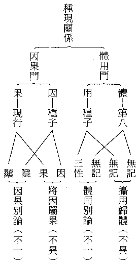



唯此所说体用、因果不一不异的关系，是专约有漏种子说，假定是无漏种子，那就完全没有关系，为什麼？因无漏种子，其体性唯是无漏，而第八唯是无记，两者性质完全是相反的。又在性类方面，有漏无漏亦完全相反的。然则无漏种子，摄在第八识的什麼地方，不免令人生起疑问。这所以有广究有漏无漏种子所在的必要。



虽非一异而是实有，假法如无非因缘故。此与诸法既非一异，应如瓶等是假非实。若尔！真如应是假有，许则便无真胜义谛。然诸种子唯依世俗说为实有，不同真如。



与现行不一不异的种子，在清辨、安慧等论师，认为是假有无实自体的。如清辨向所主张的『胜义皆空，世俗假有』可知。种子是世俗谛，当然是假有的。安慧说种子属相分，因而亦是假有的。在安慧看来，见相二分俱是徧计所执，虽立一识种子，其体非是实物。



现在论主说种子与现行，「虽」是「非一」非「异」的，但决定不是假法「而是实有」的。为什麼？当知「假法」等「如无」法，如龟毛兔角一样的，不能为诸法的亲因，所以说「非因缘故」。但诸种子望於诸法，就是诸法的亲因缘，理当体是实有，不能说它是假。



清辨、安慧接著难道：「此」诸种子「与」他所生的现行「诸法」，其间的关系，「既」然是「非一」非「异」的，那就「应」当「如瓶等」一样的「是假」，不可说它是真「实」的。瓶等是由泥团构造成的，而泥团与瓶等的关系，是非一非异的，瓶等是假非实，谁个都承认的，所以种子亦应如瓶等是假非实！



论主解决这个难题说：这是不能相提并论的！假使如你们所说，凡是非一非异的，必然都是假有的，那末，真如法性与诸法，也是非一非异的，难道真如也是假有？所以说「真如应是假有」。如果他们回答说：不错，真如也是假有的，为什麼？不起故，如空华。空华是不起的，空华是假有法，真如亦是不起的，当如空华一样的是假有法，怎麼不可说假？



他们这样说法，自以为很合理，但以唯识观点来看，那是根本要不得的，因为如真「许」可真如是假，「则便无」有「真胜义谛」，真胜义谛假定真的没有，试问约谁说有世俗谛？如是拨无二谛，试问又凭什麼修行而得成佛？是以我们不得不说种子实有。「然」而我们所说识中「诸」法「种子」是有，「唯依」道理「世俗说为实有」，与真如实有又有著不同，所以说「不同真如」。当知真如唯是胜义胜义实有，种子不是这样，不但是胜义有，亦通於世俗有。现在为了显示异於真如，所以说是唯依世俗，并不是不通於胜义。这末说来，种子与真如，实有的意义，虽说是一样，但世俗和胜义二谛，不能不有所简别。何况种子於俗谛中，固然可以名为实有，但一入於胜义谛中，就又成为虚妄假法；可是真如不同，不论在真在俗，悉皆是实有的，绝对不会变成假法。



种子虽依第八识体，而是此识相分非餘，见分恒取此为境故。诸有漏种与异熟识体无别故，无记性摄，因果俱有善等性故亦名善等。诸无漏种非异熟识性所摄故，因果俱是善性摄故，唯名为善。



讲到种子，向来分为有漏种与无漏种的两类，诸有漏「种子」，是依附於第八识的自体的，「虽」说必须「依」於「第八识」的自「体」，然「而是此识」的「相分」所摄，「非」是其「餘」的见分、自证分、证自证分的三分所摄。为什麼唯是相分？因是第八识自己的「见分，恒」常「取此」自己的相分「为」所缘「境」的。



可是现在所要问的，就是差别功能的种子，为什麼必须依於第八识的自体分？这因第八识的自体分，为七转识现行所熏习的地方，而第八识的自体分，能接受它的熏习，所以第八识的自体分，就为种子之所依附。由於如此，护月论师说诸种子依於见分，为自证分之所缘，这是不对的，因见分只能缘於相分，是不能受熏的，所以种子不得依於见分。种子的依附处，虽说在自体分，但其对第八识体，不特有生果的功能之用，而且更能为体用的两者。



体者，「诸有漏种与异熟识」，到了摄用归体时，顺於本识的无记性，其「体」是「无」差「别」的，性类是相同的，所以皆是「无记性摄」。用者，是各种子之「因」生於自「果」，从所谓体用别论言，种子之因通於三性，现行之果亦通三性，所以说「俱有善等性故亦名善等」。这是约差别门说，亦是体用别论说。图示如次：



　　　　　　┌体─现行  

　　　第八识┤　　　　┌体─无记性─────摄用归体┐  

　　　　　　└用─种子┤　　　　　　　　　　　　　　├相分  

　　　　　　　　　　　└用─三性（引自果）─体用别论┘



其次，说到「诸无漏种」，因为「非」是「异熟识性所摄」，体性不顺本识的体，所以不论是「因」是「果，俱是」属於「善性」所「摄」，「唯」可「名」之「为善」，不得说为无记。同时要知道的，就是无漏种子，虽说也是依附於第八识的自体分即自证分，但它却不能成为见分的所缘，因为见分但缘於外，不能内缘自体分的，所以不是相分所摄。原因它们的体性、体类，不管那种，都是相反的。既然如此，有人难道：无漏种子如真不是见分所缘的境界，那就应当说它不是唯识！不！要知这虽不是见分所缘，但同样的是识自体，并不是离於识的，约这不离识义，说它亦是唯识，与唯识义是不相违背的。



若尔！何故抉择分说二十二根一切皆有异熟种子，皆异熟生？虽名异熟而非无记，依异熟故名异熟种，异性相依如眼等识。或无漏种由熏习力转变成熟立异熟名，非无记性所摄异熟。



「若尔」——假定是这样，即无漏种不是异熟性，「何故」《瑜伽》卷第五十七「抉择分」中「说二十二根一切皆有异熟种子」？为什麼又说一切「皆异熟生」？所谓二十二根，是指眼、耳、鼻、舌、身的五色根，男根、女根、命根、意根，苦、乐、忧、喜、舍的五受根，信、进、念、定、慧的五根，未知当知、已知、具知的三无漏根。在这二十二根中，前十九根是有漏的，后三根是无漏的。



现在所难问的，就是最后的三无漏根，既然亦被说为异熟，怎麼可说无漏种唯皆善性而非无记？论主答说：不然！当知无漏种子，「虽」然「名」为「异熟」，亦即说它异熟，我们是承认的，但若说它无记，我们碍难承认，所以说「而非无记」。至於无漏种子说为异熟，并不是它本身叫做异熟，不过由它「依」於「异熟」识「故」，从所依识「名异熟种」，因为是没有另外自体的。至三无漏根说为异熟生，因从异熟识中无漏种子所生的。



有人又这样问道：无漏种子其体不是异熟，由於依於异熟识故，所以得名异熟，那末，无漏种子其体不是无记，由於依於无记的关系，理当亦应名为无记！所谓『依异熟故名为异熟，依无记故应名无记』。



论主解答这问说：「异性相依如眼等识」。这话怎讲？好像眼识是通於三性的，但为眼识所依的眼根是无记性。依於眼根，从根为名，得名眼识，这是不成问题的，但绝对不可说言识依眼故，亦当随所依根名为无记。因此，无漏善种虽依无记的第八异熟识，但仍保持它的善性，并不因为所依的是无记，能依的无漏种亦成无记，当知异性是可以相依的。



假定有人一定要说无漏善种依识名异熟，亦当令其从识名为无记。那末，识依於眼名为眼识，应亦从眼名为无记，可是事实不是这样！眼识依於无记眼根，并不随於眼根名为无记，无漏种依於无记的异熟识，为什麼要说它是无记？『此既不尔，彼云何然』？所以无漏种不名无记。



无漏种依他第八异熟识，在凡夫位上的确是异性相依的，但到了佛果位上那就不然，因为到了最高佛位，不论是能依的种子，不论是所依的第八识，都是属於善性，怎麼可以说为异性相依？除了佛陀，不但凡夫，就是十地菩萨，二乘圣者，都是异性相依的。



上来是约无漏种子本有边说，现在再约无漏种子新熏边说。「或」有认为「无漏种」子，「由」彼「熏习」的势「力」，展「转」不停的「变」异到「成熟」的现行果位时，由於它是从因至果，从生至熟，变异而熟的，所以「立异熟名」。因而它是善性所摄的异熟，「非」是「无记性所摄」善恶为因所招感的「异熟」。关於这点，我们必须分别清楚，不可随便混成一团！《瑜伽论》说二十二根皆名异熟，这有明文可证，谁也无法否认，但在诸经论中，从来不曾见到有什麼地方，说是皆通无记，所以无论怎样，若有说无漏种通於无记，那是有背圣教的！



壬二　举执辨破



癸一　举二偏执



子一　执本有分



丑一　立义引证



此中，有义：一切种子皆本性有不从熏生，由熏习力但可增长。如契经说：『一切有情无始时来有种种界，如恶叉聚，法尔而有』。界即种子差别名故。又契经说：『无始时来界，一切法等依』。界是因义。瑜伽亦说：『诸种子体无始时来性虽本有，而由染净新所熏发』；『诸有情类无始时来，若般涅槃法者一切种子皆悉具足，不般涅槃法者便阙三种菩提种子』。如是等文诚证非一。



一切种子虽说都是摄在第八赖耶识中，但诸种子究是怎样来的？为是先天本有的？为是后天熏成的？论究到这问题，在诸论师之中，向有三师异说，就是护月、难陀、护法三师的见解差别，彼此之间有著相当的诤论，谁都认为自己是对的。现在顺其次第，论说如下。



在「此」讨论种子怎样来的这个问题「中：有义」，是指第一家护月论师义。护月论师认为：「一切种子」，不论是有漏的，不论是无漏的，悉「皆」是先天的「本性」而「有，不」是「从」后天「熏」习新发「生」的。至於经论之中，有说「由熏习力」而有，那不过是增长养成本来固有的种子，事实上，并不是另外熏习新生起来的，所以说「但可增长」。灵泰《疏钞》说：『若护月师唯本有种家，在加行位本有漏种生现行时，亦能熏成种令善无漏种增长转变，加行位入见道时，即本有无漏种方生现行，入初地起无漏现行，唯资本有种增，更不新熏成种』。



主张种子本有，不能单凭自己说说就算，还得要有圣教为证，不然，很难邀得佛教学者的信任。因此，现在特别引诸经论以为证明。首先「如」无尽意「契经说：一切有情无始时来有种种界，如恶叉聚，法尔而有」。当知经中所说的「界即」是「种子差别」之「名」，不是指的另外什麼东西。种种界，显示各各差别不同的种子，而这差别不同的种子，不是现在开始有的，而是从无始来一直都是这样本来存在的。如是各种不同的种子，好像印度一种毒果，很多很多的聚在一起。举这恶叉聚为喻，是因阿赖耶中有多界的。如《瑜伽》五十一说：『复次，依此一切种子阿赖耶识故，薄伽梵说有眼界、色界、眼识界，乃至有意界、法界、意识界，由於阿赖耶识中有种种界故。又如经说恶叉聚喻，由於阿赖耶识中有多界故』。恶叉聚，是印度所有的一种果子，既可作为染料，亦可搾取其油。其子形，如中国的没食子，亦名无食子，亦名没石子。由於中国无名可翻，所以保存恶叉聚名。



「又」阿毘达磨「契经说：无始时来界，一切法等依」。当知此中所说的「界」，亦「是因义」，当然亦即种子的别名，为众生无始来本来就成就的。《摄论讲记》说：『依世亲论师的解释：界，是一切杂染有漏诸法的种子。因无始来有这一切杂染的种子，有为有漏的一切法，才依之而生起。生起了有为有漏法，就有五趣的差别。假使除灭了这杂染种子，就可证得清净的涅槃……无性及《成唯识论》的解释：把依和界看成两个东西，说界是种子，依是现识；若说依就是界，认为有犯重言的过失。世亲、无性二家主要的差别点：世亲是从种子不离识体这一面谈，无性却把种子与现识分开来说』。



除了经典，作为唯识根本论的「瑜伽亦说：诸种子体无始时来性虽本有，而由染净新所熏发」。查《瑜伽论》卷二原文说：『又种子体无始时来相续不绝，性虽无始有之，然由净不净业差别熏发，望数数取异熟果，说彼为新，若果已生说此种子为已受果。由此道理，生死流转相续不绝，乃至未般涅槃』。



一切种子的自体，不论是有漏的，不论是无漏的，从无始以来，其性虽说是本有的，然而还要由染污或清净的两种现行去熏习它。有漏杂染现行的熏习，就可使有漏本有种子增长起来，有漏净及无漏清净现行的熏习，就可使无漏本有种子增长起来。唯有经常的受到这样的熏习，才可发出现行的果法来。在现行果法没有生起以前，虽然受到熏习，只是熏增而已。



如分别说：於有漏染中，生起贪现行时，即熏本来有的贪惑种子心心增进，并不是另外熏成一个新的种子；生起瞋现行时，即熏本来有的瞋惑种种子心心增进，并不是另外熏成一个新的种子。贪瞋烦恼是这样，其他一切烦恼亦然。於有漏净中，生起有漏生得善现行时，亦熏识中本有生得善种子增长，更不另外熏成一个生得善的种子；生起有漏福德善现行时，亦熏识中本有福德善种子增长，更不另外熏成一个福德善的种子。至有漏净熏无漏种是这样的：行者自发心已去，在资粮加行位中，由起有漏闻熏习加行善现行，就可熏习本有无漏种子增长，更不另外熏成无漏种子，其道理是一样的。



《瑜伽论》卷二又有这样的说：「诸有」具有「情」识活动的各个种「类」众生，从「无始时来，若」有可以「般涅槃法者」，那他「一切」有漏无漏的「种子」，当然「皆悉具足」，因为不是没有法尔种子，可以说为具不具足的。假定「不」具「般涅槃法者」，那就「便阙」声闻、缘觉、佛果「三种菩提种子」。查《瑜伽》卷二原文是这样的：『复次，此一切种子识，若般涅槃法者，一切种子皆悉具足，不般涅槃法者，便阙三种菩提种子。随所生处，自体之中餘体种子皆悉随逐』。



「如是等」像这样的经论之「文」，明有漏无漏的本有种子，可说是很多的，要引来做证明，真是引不胜引，所以说「诚证非一」。



丑二　以理自推



又诸有情既说本有五种姓别，故应定有法尔种子不由熏生。又瑜伽说：地狱成就三无漏根是种非现。又从无始展转传来法尔所得本性住姓。由此等证，无漏种子法尔本有，不从熏生。有漏亦应法尔有种，由熏增长，不别熏生。如是建立，因果不乱。



由来立种子本有说的最大根据，在五姓各别的教权与因果必然的原理。所谓五姓各别的教权，是说有情在先天上，由於无漏种子的有无，而有五种种姓的差别。诸经论中，如《入楞伽》卷二、《无上依经》卷上、《善勇猛般若经》卷一、《大般若经》卷五九三、《大庄严论》卷一、《瑜伽》第二十一〈声闻地〉，皆说有五种姓别。「又诸有情既说本有五种姓别」，由是之「故」，可以知道，「应」该「定有法尔种子，不」是「由」於「熏」习之所新「生」的。所谓五种姓别，是指声闻种姓、缘觉种姓、如来种姓、不定种姓、阐提种姓。如是五姓，各各皆是有性，所以成为五种姓别。



「又瑜伽」论五十七卷明二十二根中，「说地狱成就三无漏根是种非现」。三无漏根，就是前面曾经说过的未知当知根、已知根、具知根。这三无漏根，不但人类众生具有，就是地狱众生亦成就，但所成就的是种子非现行。论中原文说：『问：生那落迦成就几根？答：八，现行、种子皆得成就。除三，所餘或成就或不成就。三，约现行不成就，约种子，或成就，谓般涅槃法，或不成就，谓不般涅槃法。餘三，现行故不成就，种子故成就。如生那落迦趣於一向苦，傍生、饿鬼当知亦尔』。论中说的餘三，指的三无漏根。地狱众生无疑是属异生，异生自然没有无漏法现行，所以所成就的，只有无漏种子，无漏现行绝对是不成就的。



《瑜伽论》卷三五说：『云何种姓？谓略有二种：一、本性住种姓；二、习所成种姓。本性住种姓者，谓诸菩萨六处殊胜有如是相，从无始世展转传来法尔所得，是名本性住种姓。习所成种姓者，谓先串习善根所得，是名习所成种姓』。因此本论简说为：「又从无始展转传来法尔所得本性住姓」。所谓法尔所得，就是本来成就。



《瑜伽》所说六处殊胜的这话，一般学者肯定指为佛果位上的六处现行，就是依无漏种子生佛果根境六处殊胜，不能说是能持种的第八识，假定是指能持种的第八识，为什麼要广说六处？何况有漏的识体，有什麼殊胜可言？然而另有一些学者不以此说为然，认为六处，是指第六意处，亦即是指能持种的第八识，所谓殊胜，是指无漏种子，即显所持因性。於此两种说中，以后一说为是。《义演》说：『彼瑜伽说有六处殊胜法尔相续，虽有六处之言，今但取第六处者，以阿赖耶此中摄故』。就是采取后说。



「由」上面所引「此等」三文，「证」明「无漏种子」确是「法尔本有」的，并「不」是「从」新「熏」才「生」的。诸经论文明说有本有的无漏种，似乎没有说到有漏种的本有。然而不然，经论中既明无漏种法尔本有，「有漏亦应」合有「法尔有种」，现「由熏」习，只是令之「增长」，并「不」是「别熏」新的种子「生」起。既然如此，为什麼在经论中没有提及？这因有漏本有种子，从无始来曾经不断的现起，所以经论没有分明别说。在道理上讲，经论既明无漏法尔本有种，亦合有有漏本有法尔种。



「如是建立，因果不乱」者，是显因果必然的原理。一般说来，因果必是一因一果的，既不是多因一果，亦不是一因多果。若有认为种子唯是新熏，或许本有更有新熏，则现行之法时刻熏於种子，到后要生现行时，以无量种子而生一法现行，那就变为陷於多因一果的过失之中，违背这个因果必然的原理。因此，由立本有种子，各各唯生自果，因果得以不乱。如果不是这样，新熏的种子很多，它们生果的功能是平等的，有的生果有不生果，因果便会错乱，怎能建立正确因果？



子二　执熏生



丑一　立义引证



有义：种子皆熏故生，所熏能熏俱无始有，故诸种子无始成就。种子既是习气异名，习气必由熏习而有，如麻香气华熏故生。



此中「有义」，是指第二家难陀论师义。难陀论师认为：种子为后天的东西，所以「种子」之所以为种子，不论有漏无漏的那种，「皆」由现行的「熏」习而新发「生」起来的。至於经论当中，说从无始而有，那并不是显示它的本有，亦即不是本来就存在的，因为「所熏」与「能熏俱」是「无始」以来就「有」了的，所以「诸」有「种子」，从「无始」来就「成就」的，无始熏习而有种子，所以一切种子，不外是新熏的。既然如此，种子必由现行的熏习而生，从这也就可知它的意义所在。何况所谓「种子，既」然「是习气」的「异名」，所谓「习气」也者，就是现行熏习的气分，「必由熏习而有」，当然是后天的，决不是先天的。「如」胡「麻」中所有的「香气」，是以香「华熏」习「故生」。《摄论》说的『如苣蕂中有华熏习』，亦即此义。《摄论讲记》说：『苣蕂就是胡麻。印度的风俗，欢喜用香油涂身。香油的制法，先将香华和苣蕂埋入土中，使它坏烂，然后取苣蕂压油；胡麻的本身原虽没有华香，但经香华的熏习，压出的油，就有花的香馥了。这譬喻中，华是能熏，苣蕂是所熏，苣蕂与华俱生俱灭，久之，所熏苣蕂，就带能生彼香的因性而生了』。《摄论》是主种子新熏的，不承认种子是本有的。如苣蕂的香气不是本有的，要由簷卜华熏苣蕂，然后始有香气出现；当知种子不是本有的，必由熏习方得新生。



如契经说：诸有情心染净诸法所熏习故，无量种子之所积集。论说：内种定有熏习，外种熏习或有或无。又名言等三种熏习，总摄一切有漏法种。彼三既由熏习而有，故有漏种必藉熏生。



种子皆由熏生，不是自作主张，以为如此就可，须有经论根据，方能为人信受，所以现在特引经论为证。「如契经说」，首引多界经证。经中说：「诸有情心」，由於「染净诸法」之「所熏习」的原「故」，始有「无量种子之所积集」。心以积集为义，亦即由积集种子而来。因为是这样的关系，所以知道诸种皆由熏习之所熏生，绝对不可说是本来就有，如有以为本来就有，那就大错特错！



不特经中是这样讲，无著摄大乘「论」亦这样「说：内种定有熏习，外种熏习或有或无」。种子大体是有两类，就是内种与外种。『外种，如谷麦等，内种，就是阿赖耶识中的能生性。内种思想的产生，原是从世间的外种子悟出来的。见到世间的谷麦种子有能生性，能生自果，所以把一切法的能生性，建立为种子』。



虽说内外诸法，各有它的种子，但内外的种子，仍然有所差别，差别的主要关键，在於它们的熏习。内种决定是有熏习，没有熏习就不得成为种子。可是外种熏习，或者是有，或者是无，那是没有一定的。『如香花的熏习苣蕂，引起苣蕂中的香气，这苣蕂中的香气，是有熏习的。若从炭中生苣蕂，从牛粪堆里生香莲华，从毛发里生蒲等，这是没有熏习的。牛粪中没有莲华，牛粪也不会熏生莲华，那怎麼生莲华呢？这是没有熏习而生的』。无性《摄论释》卷二说：『外内种子其性粗同，为显不同，复说外或无熏习等。或者分别不决定义：谓外种子，或有熏习，或无熏习。如从其炭、牛粪、毛等随其次第，生彼苣蕂、青莲华根及以蒲等，非苣蕂等与彼炭等俱生俱灭，互相熏习而从彼生，如是外种或无熏习；如苣蕂等与华鬘等俱生俱灭，由熏习故生香气等，如是外种或有熏习。如是分别外种不定，是故说或。内种子即是阿赖耶识中一切法熏习，如是种子应知定由熏习故有』。



再约教申理来说：「又名言等三种熏习」，或者叫做三种习气，是指名言习气、有支习气、我执习气的三种。如是三种习气，「总摄一切有漏法种」，没有不穷尽的。这三种习气是怎样有的？是由现行法熏习在阿赖耶识中的。「彼三既由熏习而有，故」此足以证明诸「有漏种，必」定要「藉熏」习而「生」。假定不是由熏习生，名言等的三种习气，摄种应该不能穷尽，因为法尔本有的种子，是不在此中所摄的。



无漏种生亦由熏习，说闻熏习闻净法界等流正法而熏起故；是出世心种子性故。



进一步说，不特诸有漏种是由熏习而有，就是诸「无漏种」的「生」起，「亦」同样是「由熏习」来的。怎麼知道？无著摄大乘论「说：闻熏习，闻净法界等流正法而熏起故」。『谈到出世心的因缘，先要说到清净种子的来源。清净种子，就是正闻熏习；正闻熏习的来由，是因为听闻最清净法界的等流正法。三乘圣法从此生的法界，是本性清净而离染显现的，所以叫清净法界。世尊远离二障，亲证这离言说相，不像小乘的但离烦恼障，所以最为清净。因大悲心的激发，怜愍救度一切苦恼有情，就从内自所证的清净法界，用善巧的方法，宣说出来。这虽不就是法界，却是从法界流出，是法界的流类，并且也还平等，相似。众生听此清净法界等流正法的影像教，也就熏成了出世的清净心种。譬如某一名胜地，我们从未去过，也不曾知道；去过的人，要使大众前往游览起见，就用摄影机把它映下来，公示大众，并说明经过的山川道路。我们所看到的，当然只是这名胜的影像，并非本质，并非亲历其境，但因此我们心中就留下这名胜的影子，甚至发心前往游历。正闻熏习也是这样，清净法界究竟是怎样，众生没有亲证到，但由佛陀大悲显示出来，众生闻此清净法界等流的正法，也就熏习成清净种子了』！



《义蕴》说：『谓如来以真如为所缘缘，即从真如流出大定、智、悲，即是如来报身，复从报身流出化身，从此化身流出十二分教，此名等流正法。众生闻十二分教熏成解脱法种，故能生出世无漏现行。此於出世心据本而论，从真如生假说真如名为种子，故言从真如所缘缘种子生，与摄论意同』。这对闻净法界等流正法亦说得极为清楚。



「是出世心种子性故」者，《摄大乘论》说：『又此正闻熏习种子下中上品，应知亦是法身种子，与阿赖耶识相违，非阿赖耶识所摄，是出世间最清净法界等流性故，虽是世间而是出世心种子性』。《摄论讲记》对这解释说：『闻熏习，不是赖耶自性，那它的自性是什麼呢？正闻熏习种子的下中上品，它是法身的种子。法身的意义有广狭不同：有时，单指有情本具的如来藏性；有时，指赖耶转染还净，因无量清净熏习而显现的大圆镜智；有时，总指佛果位上的一切。这里的法身，约果智的法身说。这是法身的种子，所以是法身所摄。闻熏习种子，与阿赖耶识相违，是能对治赖耶的，所以非阿赖耶识所摄。它是出世间最清净法界等流性，是因净法界而有的，所以在它闻熏的时候，虽是世间，没有生起无漏心，却能成为出世心种子性。平常的世间杂染法，是向生死方面走的，所以不但是恶，就是善心，也不能成为出世心的种子性。现在的闻熏习，虽是世间，而能成为出世的种子性，是因为它有掉过头来趣向涅槃的关系』。由这叙说，更知没有法尔无漏种子。



丑二　牒破前执



有情本来种姓差别，不由无漏种子有无，但依有障、无障建立。如瑜伽说：於真如境若有毕竟二障种者，立为不般涅槃法性；若有毕竟所知障种非烦恼者，一分立为声闻种姓，一分立为独觉种姓；若无毕竟二障种者，即立彼为如来种姓。故知本来种姓差别依障建立，非无漏种，所说成就无漏种言，依当可生非已有体。



又如「有情本来」所有的五种「种姓差别，不」是「由」於「无漏种子」的或「有」或「无，但」是「依」於「有」烦恼所知二「障」和「无」有烦恼所知二「障」而「建立」的。简单的说：五姓各别，不在无漏种子的有无，唯由烦恼所知二障的有无。这样讲法，意在成立种子的新熏，因为假定没有熏习，怎麼可以说有五种姓别？至於无漏种子之来，是在不断的断有漏中就熏成无漏。



「如瑜伽」论「说：於真如境」者，因为真如是迷悟的所依，所以把它说之为境，一切染净诸法，皆是依之得生。於此真如境上，「若」果是「有毕竟」烦恼、所知「二障」的存在，丝毫未能甚至永远不能加以断除的话，那就把他「立为不般涅槃法性」，换句话说，就是阐提种姓，永远不得证入涅槃。「若」果是「有毕竟」不断「所知障种」而「非烦恼」障「者」，亦即烦恼障得以断除，所知障未能断除者，那就看他们的根机利钝如何：假定「一分」是属钝根性者，那就把他「立为声闻种姓」；假定「一分」是属利根性者，那就把他「立为独觉种姓」。声闻种姓所以称为钝根，如以所断的思惑来说，三界九地，每一地有九品思惑，他们对这思惑的断除，是品品别断的，不是总合齐断，所以称为钝根；独觉种姓所以称为利根，因为他们把三界诸惑合为一聚，然后予以九品断除，所以称为利根。所断惑虽同样的是烦恼障，但因断法有所不同，所以分别立二种姓。「若」果「无」有「毕竟二障种者」，就是将烦恼、所知二障，予以彻底的断除，没有丝毫残餘的存在，那「即立彼为如来种姓」。到了最高佛果位上，真是所谓二障永断，二死永亡，觉性圆满，所以称为如来种姓。所谓毕竟，是究竟或永远的意思。由是之「故」，可以「知」道，「本来」所有的五种「种姓差别」，是「依障」的有无而「建立」的，并「非」关於「无漏种」子的有无。因而证知种子是由新熏而有的。



假定真是这样的话，为什麼《瑜伽》五十七说地狱成就三无漏种？当知论中「所说成就无漏种言」，是约烦恼可断之义，「依」於「当」来「可生」无漏名为成就，「非」谓本来「已有」无漏种子之「体」。这末说来，所谓地狱众生有无漏种，并不是真的已有无漏种的存在，只是等待因缘就可生起无漏现行，而是说他从地狱出得到人身以后，由於宿根的因缘，听到如来的正法，可熏成无漏种子。



癸二　正兼二类



子一　自立正义



有义：种子各有二类：一者本有，谓无始来异熟识中法尔而有生蕴、处、界功能差别，世尊依此说诸有情无始时来有种种界如恶叉聚法尔而有，餘所引证广说如初，此即名为本性住种。二者始起，谓无始来数数现行熏习而有，世尊依此说有情心染净诸法所熏习故，无量种子之所积集，诸论亦说染净种子由染净法熏习故生，此即名为习所成种。



「有义」，是指第三家护法论师义。护法论师认为：前本有家与新熏家，所说诸法的种子，各各皆得其一边，未能真正了解种子义。实际「种子」这东西，不论是有漏或无漏的，「各」各「有二类」的。他的这种主张，是综合护月、难陀各自偏於一方之说，唱新熏与本有合生，是以种子有本有与新熏的二类，而且这两类种都是无始而非有始的。



「一者本有，谓无始」以「来」在第八「异熟识中法尔而有」可生诸法的功能，以此为本有种子，是即能「生蕴、处、界」的「功能差别。世尊」也就依据这个道理，在《无尽意经》等，特别「说诸有情」从「无始时来」，就「有种种」的种子——「界」，犹「如」印度的一种「恶叉」果「聚」在一处。但像这样的种子，不是现在才起的，而是「法尔」自然「而有」的。如此足以证明种子是本有的。「餘所」要「引」的经论，「证」明种子的本有，「广说如初」本有家所说，这里不再重赘。不过本有种子，在诸经论之中，还有一个别名，「此即名为本性住种」。在经论中，如看到本性住种这个名字，当知就是本有种子。



「二者始起，谓无始」以「来」，由现行的势力，「数数现行熏习而有」生果的功能，摄在第八识中，以此为新熏种子。「世尊」也就「依」於「此」种道理，在《多界经》等，特别「说」诸「有情心染净诸法所熏习故，无量种子之所积集」。不但经上这样说，诸论亦这样的说：无论是有漏法，或者是无漏法，所有「染净」诸法的「种子」，完全是「由染净」诸「法熏习故生」。假定没有经过熏习的话，决不会有种子出现的。如此足以证明种子是新熏的。而这新熏种子，在诸经论之中，还有一个别名，「此即名为习所成种」。在经论中，如看到习所成种这个名字，当知就是新熏种子。



总之，护法论师是本有与新熏的折衷者，不论什麼现行诸法的生起，必然是由这两类种子的相合。虽说如此，但在见道初刹那所起的无漏智，是本有无漏种；不但见道第一刹那这样，如修道位上的妙观察智和平等性智，以及佛果位上的成所作智与大圆镜智，其最初一刹那现起时，亦唯从本有种子生。为什麼？因在此以前，未曾有过一度成为无漏的现行，因而新熏的无漏种子也没有。但这是属稀有的特别例外，在一般的有情分上，大都是本有新熏两种相待相助生起现行。



要之，护月主张种子唯是本有，是所谓先天的存在；难陀主张种子唯是现行之所熏习，是所谓后天的经验；护法则是折衷两说，主张本来固有的种子和依於先所熏成的种子，由这两种种子，共同呈现那各种的现象。诸法既由本有和新熏种子呈现那各自的现象，则护月与难陀二师之说，虽各有他们的半面理由，而终不免失那另一半的过失！为此，现将他们各自的过失，分别略说於下。



子二　举执难破



丑一　破唯本有



若唯本有，转识不应与阿赖耶为因缘性。如契经说：『诸法於藏识，识於法亦尔；更互为果性，亦常为因性』。此颂意言：阿赖耶识与诸转识，於一切时展转相生，互为因果。摄大乘说：『阿赖耶识与杂染法互为因缘，如炷与燄展转生烧，又如束芦互相依住。唯依此二建立因缘，所餘因缘不可得故』。若诸种子不由熏生，如何转识与阿赖耶有因缘义？非熏令长可名因缘，勿善恶业与异熟果为因缘故。又诸圣教说有种子由熏习生，皆违彼义。故唯本有理教相违。



「若」如护月论师主张种子「唯」是「本有」，那就不免要犯两种过失：一是违於七转识与第八识互为因果的过失；二是违於如来所说多种圣教的过失！



一、种子如果没有新熏，七「转识」就「不应与阿赖耶为因缘性」，亦即是没有互为因果的过失！可是事实上，转识与本识是有互为因果关系的。怎麼知道？「如」阿毘达磨「契经说：『诸法於藏识，识於法亦尔；更互为果性，亦常为因性』」。《阿毘达磨经》中所说「此颂」的「意」思是「言：阿赖耶识与诸转识，於一切时展转相生，互为因果」。简单的说：七转识与第八识，更互为因，更互为果。颂中的诸法两字，是指的七转识，於识藏，是说转识望於种子的摄藏。现行诸法，不论那种，都是从赖耶中所含藏的种子所生，所以是赖耶的所生果，而赖耶则为能生诸法的因，当知此为种子生诸现行的一重因果。反之，阿赖耶识望於现行诸法的熏习，那赖耶为现行诸法的果，而诸法又成为能生赖耶的因，当知此为现行熏生种子的一重因果。由於因果有这样的两重，所以说为『更互为果性，亦常为因性』。彼此相互为能依因，同时也是彼此相互为所依果。它们之间的关系是这样的：



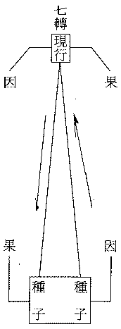



不但经中这样说，无著「摄大乘」论也「说：阿赖耶识与杂染诸法互为因缘」。查奘译本论原文是：『阿赖耶识与彼杂染诸法同时更互为因』。意思是说：所熏的能生的阿赖耶识，与能熏的所生的杂染诸法，它们得以同时有著更互为因的关系。如由阿赖耶识为种子，生起杂染诸法的现行，是为阿赖耶识为杂染诸法的因；在同一时间，杂染诸法的现行，又熏成赖耶识中的种子，是为杂染诸法亦为阿赖耶识因。



这个道理很深，一般不易理解，所以特再举两喻说：譬「如」能生火燄的灯「炷与」灯中的火「燄」，二者发生相互的关系，就可「展转生烧」，即从灯炷生起火燄，火燄又复焚烧灯炷，且这生燄烧炷的作用，是同时更互为因的，不能说它们那个在前那个在后。「又如」一「束」乾「芦，互相依」赖，互相「住」持，才能竖立不倒。於中不论拿去那一部分，另一部分就不能单独竖立。它们相依相靠的关系，同样是同时的，不能说它前后异时。



从这两个事实所举的比喻，我们应知阿赖耶识与杂染诸法，是同时更互为因的，不能说它们是异时。所以唯识家「唯依此」种子与现行相互为因的「二」者，「建立因缘」的道理，除了这个真正的因缘，「所餘因缘」，根本是「不可得」的。《摄论讲记》附论中说：



『本论的因缘观，重在种生现，现熏种的同时因果，不同时的都不能成为因缘。种生现，现熏种是同时的，这由现行熏成的新种；为什麼不同时就生现行呢？要知道时间是建立在现行上的。种生现，现熏种的三法同时，也都是以现行法为中心的。现行的生起，必有所从来，所以建立种生现。这现行必有力量能够影响未来，所以建立现熏种。这都是以现行为中心，并不立足在种子上，所以现行虽能熏种，所熏的种在同时中，不能说就生起现行。因为在一刹那中，像心心所等，不容许有两个现行自体并存的，却不妨许多种子的存在；何况助成种子生现的因缘，也还未成就』。为什麼还要其他因缘才能生起？假定不待其他的因缘，像这样的复熏复生，那就没有穷极！然则未遇缘现起的这所熏种子又将怎样？它是在第八识中前生后灭、前生后灭的不断自类的相续著，这名为种子生种子的因果，就是前念种子是因，后念种子是果，名为异时因果。



「若诸种子」唯是本有，「不由」新「熏」而「生，如何转识与阿赖耶有因缘义」？为什麼没有因缘义？如第八识执持本有种子，望於七转识虽可以为因，但因七转识不能熏种子於第八识中，望於第八赖耶识不得为因。像这样的反於互为因果，怎麼合於因缘义？前七转识与第八识，有著互为因缘关系，你们当然也知道的，所以你们不是说不熏，不过是熏本有种子令他增长起来，并不是完全没有本有种子，只要熏习就有新的种子生起。可是本有家的这个说法，并不完全是对的，因为「非」是「熏令」本有种子增「长，可」得「名」为「因缘」。熏令增长为什麼不可名为因缘？「勿善恶业与异熟果为因缘故」。异熟果是由善恶业之所招感的，这话当然不错，但善恶业，只可为异熟果的增上缘，不能当作第八异熟果的因缘，如把它看成因缘，那就又大错特错！



在破种子本有中，上来已以违於互为因果之理破了，现在再以违於如来圣教而破。种子有由熏生，不是凭任何人所说可以为准，而是依於如来所说的圣教为定。「又」如新熏家难陀论师，曾经引「诸圣教」，如《多界经》等「说有种子由熏习生」，证知种由熏生是佛亲口所宣的，不是难陀论师杜撰出来的，为佛子者怎能不信？如只承认有本有种，那就完全「违」於「彼」熏习「义」。由是之「故」，假定主张种子「唯」是「本有」，那就「理教相违」，亦即是说不但违於因果正理，同时亦违如来圣教！



丑二　破唯始起



寅一　以理正破



若唯始起，有为无漏无因缘故应不得生，有漏不应为无漏种，勿无漏种生有漏故，许应诸佛有漏复生，善等应为不善等种。



上来已破种子本有家，现在续破种子唯新熏家。「若」如难陀论师所说，种子「唯」是「始起」的，亦即所谓唯是新熏的，同样不免有两种过失：一是有为无漏没有因缘的过失，二是违於多种圣教的过失。



一、种子如果真的没有本有，那「有为无漏」的生起，亦即无漏正智的现行。其最初的现行，虽是入於见道而起的，但若种子唯是本有而没有新熏，则在见道以前，从来不曾有过无漏的现行，无漏种子的熏习也从来没有，是则见道最初一念的无漏，必然陷於「无」有亲「因缘」而现行的过失！再不然，有为无漏「应不得生」，为什麼？没有它的亲因缘故，如兔角等。龟毛兔角等是没有它们的亲因缘的，所以龟毛兔角不得生起，有为无漏如兔角等没有亲因缘，当然如兔角等而不得生！



新熏家对此加以挽救说：你们不能说有为无漏没有亲因缘，因为我们认为见道前的世第一法，在诸有漏法中是最胜的，以其种子为亲因缘，试问又有什麼不可？你说世第一法在有漏中为最胜，究竟怎样一个最胜法？当知能对的无漏与所对的有漏，两者是敌体相反的，怎可以所对的有漏为能对的亲因？「有漏不应为无漏种」，若相反的有漏能为无漏的亲因，反过来，无漏亦应能生有漏，可是事实上，「勿无漏种」可「生有漏」的。谁都知道，漏无漏全然相反的，若许漏无漏可以相生，如有漏善生於无漏。但无漏望於有漏，彼此互相相违的，不得生於有漏，有漏怎麼生於无漏？若「许」有漏能生无漏，无漏自亦可生有漏，无漏果真能生有漏，证得最高佛果的「诸佛，有漏」亦应「复生」。换句话说，佛果位上，亦应见有有漏的现行，诸佛既有有漏现行，是就佛又迷为凡夫，岂不成为极大过失？纯正的佛弟子，相信不会容许！



新熏论者救说：你们这个说法是不对的，当知诸法有胜劣的差别，劣的可为胜因，固然不成问题，胜的为劣之因，是就不可以的。有漏善法望於无漏为劣，所以能为无漏亲因，无漏正智望於有漏为胜，所以不能为有漏因。现在破斥他说：假定真的如此，「善等应为不善等种」，就是不善应为善因，因善不善相望，不善为劣，善法为胜，你们承不承认不善能为善因？如认彼此相违可以为因，善等应当能为不善等种。可是事实上，善只能为善种，不善只能为不善种，不善不可做善的种子，善的不可做不善的种子。既然如此，有漏种当更不可做无漏种，你们为什麼要说有漏法中最胜者，以其种子为无漏正智的亲因？老实说：你新熏家，假定不赞成有本有的无漏种，那在凡夫位、四加行位、七地以前的菩萨位，就没有法子可以熏得有为无漏四智菩提的种子，这是不能不特别注意的！



寅二　引教辩破



卯一　彼部正义



分别论者虽作是说，心性本净客尘烦恼所染污故名为杂染，离烦恼时转成无漏，故无漏法非无因生。



为破分别论者，先叙他的正义。分别论者，有说是指小乘诸部，不定指明是那一部，但诸论中所指不同。如《摄论》指为化地部，《婆沙论》中指为正量部，或有说为一心相续论者，或是说为说假部的。实则他是上座部三大系之一，北传的化地部，南传的铜鍱部，皆是从分别论者之所流出的。《婆沙》卷二七叙述他的计执说：『分别论者，彼说心性本净，客尘烦恼所染污故，相不清净』。印顺论师的《唯识学探源》说：『性净相染，在有部学者看来，是不可想像的。性相是一贯的，本性是净，怎能与烦恼相应转现染相呢？相既然不净，本性又如何可说清净？心性本净论者，举出了衣、镜，金、铜器、颇胝迦宝、日月五事所覆作譬喻。但有部学者，不是说「贤圣法异，世间法异」，就是从刹那生灭的见地来解说。像《顺正理论》卷七二说：「如浊水灭，后水生时，离浊澄清名为净水……前餘色俱颇胝迦灭，后与餘色俱新生故」。它的另一见解，凡是相应、相合，彼此的体性，不能有染净的差别。所以它说五事隐覆日月轮，并不是相应、相合。心性本净论者，有漏无漏建立在漏的有无，而不在心的自体，所以即使刹那生灭像有部那样，也不能动摇心性本净的理论。关於相应、相合，就不能不表示异议。日月轮是明净的，因了烟云的覆障，才见它的相不清净。这不净，是日轮与烟云发生关系而现出的假相；其实日轮还是清净的。相有杂染，是依和合的假相而说，不是说它的本性有什麼转变，假使心性起了变化，也就不成其为本净了。这不是说杂染全是假相，客尘确是杂染，只是觉了的心用上的染相，是现起的假相罢了。讲到浊水，水的本性也是净的，只是羼杂些泥尘。有部学者，忽视了从浊水澄汰出来的尘污，却见到了前一刹那的浊水灭去，后一刹那的清水出现。有部的刹那论，只是前后刹那的堆积。刹那论究竟是否一定如此，还有讨论的必要』。



《婆沙》卷二七又说：『染污不染污心其体无异，谓若相应烦恼未断名染污心；若时相应烦恼已断，名不染心。如铜器等未除垢时，名有垢器等；若除垢已，名无垢器等』。《顺正理论》卷七二也说：『分别论者作如是言：唯有贪心今得解脱，如有垢器，后除其垢；如颇胝迦由所依处，显色差别有异色生。如是净心贪等所染，名有贪等；后还解脱。圣教亦说心本性净，有时客尘烦恼所染』。



现本论说：「分别论者虽作是说：心性本净，客尘烦恼所染污故，名为杂染」，到了「离」去「烦恼」的「时」候，是就「转成无漏，故无漏法」并「非」是「无因生」的。换句话说，无漏还是有其生因的。印顺论师的《唯识学探源》说：『本、客，是内在与外铄的关系。在烦恼现起时，虽觉得整个心是染污的，其实内心并不变失它的自性，只是现象上有些歪曲。要理解本、客，还得在相续中；不从前后的关系上去观察，不易理解本净的。《成实论》卷三说：「问曰：心名但觉色等，然后取相，从相生诸烦恼，与心作垢，故说本净。……问曰：我不为念念灭心故如是说，以相续心故说垢染」。成实论主不能同情这个思想，以为相续心是假名，不是真实；这是它的时间观不同。心性本净论者是一心相续论者，一心相续论者是在前后不断的演化中，发见它相互一贯的不变性，前后不异的共同点。拿心来说，就是了了觉知性。常心与一心，不过是觉性不变的异名。常心，并不是外道妄想构成的不生不灭，非因非果，离世间而独存的东西，它只在随缘触境的作用中。换句话说：常，就是无常，就是念念生灭。若不能认取无常中的真常，那末，无常、念念灭，只是断灭论。我们必须认识：刹那生灭不是前后成为隔别物，相续也不是前后机械的累积。在大众、分别说系，当然有著很多的难点，这一直要到一切皆空论者，才能完成这相续不断的理论，才能克服那严重而困难的问题。在后期的大众、分别论者，发见了七心论以后，那一味相续的觉性，又渐渐的与起灭的六识分离，但还保持密切的关系』。



《唯识学探源》接著说：『心性本净，在转凡成圣的实践上，有它特殊的意义。萨婆多部的意见，三乘无漏圣法，早已具足在未来法中，只要加以引发，使它从未来来现在，系属有情就是。大众部等，主张过未无体，那就不能像有部那样早已具足在未来中。无漏净法的生起，在未来无实论者，显然成了问题；它必须指出有漏位中可以成为无漏的东西。心性本净，就是这净法本有的见解。大乘本有佛性的思想，都是以这心性本净为前驱的。分别论者的贡献，确是太伟大了』！



心性本净这一思想，不但分别论者如是主张，大众部等亦如是主张。如《异部宗轮论》说：『此中大众部、一说部、说出世部、鸡胤部本宗同义者：心性本净，客尘烦恼之所杂染，说为不净。随眠非心非心所法，亦无所缘。随眠异缠，缠异随眠，应说随眠与心不相应，缠与心相应』。证明这一思想，在小乘学派中相当普徧的。不特小乘学派中，有这思想的流行，如后代大乘《无垢称经》，对这亦有明白的表露。该经卷第二说：『如佛所说，心杂染故有情杂染，心清净故有情清净。如是心者，亦不住内，亦不出外，不在两间；如其心然，罪垢亦然；如罪垢然，诸法亦然，不出於如。唯！优波离！汝心本净，得解脱时，此本净心曾有染不？我言：不也！无垢称言：一切有情心性本净，曾无有染，亦复如是』。从这可以看出这思想的普徧。



由於心性本净，无漏法的生起，就不是没有因，这是什麼道理？当知分别论者所说，一往看来，似乎是说有漏心性能生无漏，并不需要什麼无漏种子；可是深一层看，当知所谓心性本净，就是心空所显真如，为彼四智菩提之因，所以无漏法的生起，不是没有它的亲因，而是决定有其种子在的，亦即显示无漏种子本有。《成唯识论俗诠》说：『客因主立，尘由空显，主空喻本有真如，客尘喻新熏烦恼，故离染时，转成无漏，显无漏种，即此真如，转变名目，所以论主复显本有云：故无漏种，非无因生。真如为因，是本有义』。



卯二　展转难破



而心性言，彼说何义？若说空理，空非心因，常法定非诸法种子，以体前后无转变故。若即说心，应同数论相虽转变而体常一。恶无记心又应是善，许则应与信等相应，不许便应非善心体，尚不名善，况是无漏？有漏善心既称杂染，如恶心等性非无漏，故不应与无漏为因，勿善恶等互为因故。



此下以空理及善、恶、无记三性展转难破，使其真如为因的这一理论，无论怎样不能成立。



首先论主问道：所谓「心性」本净的这话，在「彼」分别论者，究是诠「说」什麼意「义」？应该先搞清楚。「若」果所「说空理」为心性者，那我得告诉你：「空」理并「非」是无漏「心」的种子之「因」。为什麼？因空理是永恒如此的「常」住「法」，从来都是这样而没有任何转变的，既然永恒无有转变，当就决「定非」是「诸法种子」。要知种子之所以为种子，是要有生灭这个条件，亦即要有胜功能才行。空理的体性，既从没有前后转变，怎麼可以做为种子生起万有诸法？



「以」真如理「体前后无转变故」这话，在此极为重要。例如虚空是没有转变的，虚空不能为诸法的种子，真如空理既是常住法而无转变，当如虚空一样的没有资格做种子，其道理非常明显，不容有所辩论的。



「若」果你说心性「即」是「心」体，那你所说的这个心，「应同数论」所说二十五谛的理论一样。数论所说的二十五谛，中间所生的二十三谛是相，是有前后转变的，而能生二十三谛的真性之体，是常是一，从来没有转变。基师《述记》说：『此即有漏心相转为无漏，以无漏心体作无漏故。非前体灭故言性常，失前有漏相得无漏相，故名相转变』。在此外人救说：『我所说的无漏体，本来是不断绝的，假若你说我所主张的无漏会断，是不合理的』。灵泰《疏钞》说：『若言前无漏体灭后无漏体生者，此疏文错，应言前有漏体灭后无漏体生』。我亦认为如是。



若果你说性即是心，此心就是无漏法因，假使真的如此，那「恶」心与「无记心，又」都「应」该「是善」。如此一来，所谓三性分别，根本就不存在。为什麼这样讲？要知有漏种是异熟无记性摄，无漏种则是属於善性所摄，假定不分善性、恶性、无记性，泛说性即是心，则性之这一字，通於善、恶、无记，是则恶无记心应成善性。



关於这点，我且问汝：你们许不许可？假定你们「许」可有漏不善及无记心体性是善，由於它是相应法，那就「应与信等」诸善心所「相应」。外人说：『不然！虽说它们体性是善，但不一定要与信等诸善心所相应，如我们共同承认的法性真如，虽则说是善的，但并没有信等诸善心所相应，没有信等诸善心所相应，难道就不成善』？现在回答他说：『你这讲法是不对的，要知法性真如胜义妙善，没有信等诸善心所相应，固然可以称它为善，但若是属有为善心，一定要有信等诸善心所与之相应方可名善，因为心体是相应善，假定没有信等诸善心所与之相应，是就不成其为有为善法了』。



假定你们「不许」不善、无记心体性是善，因为是不善、无记，不能与诸善法相应。既然不是「善心」的「体」性，「尚」且「不」得「名」为「善」性，怎麼可以说它是无漏性？所以说「况是无漏」？当知这就是成立不善、无记心性非善！



分别论者救说：你们完全没有了解我的意思，难怪发生这种种的误会！事实应该是这样的：有漏善心，由於是有信等诸善心所与之相应的关系，所以可以生起无漏，至於不善及无记心，因为没有信等诸善心所与之相应，其性不是清净的，当然不能生起无漏！



论主驳斥他说：你们以为这样，就可避免过失，老实告诉你，这是不行的！当知有漏善心，虽说是属善的，但因是有漏的关系，仍然被称为杂染法，所谓杂染，为诸烦恼之所缘缚的意思。凡为烦恼之所缘缚的，皆被称为杂染，所以杂染通於一切三性的。「有漏善心既」同样的「称」为「杂染」，那就「如」同「恶心等」一样，它的体「性非」是「无漏」，不是无漏，与不善及无记心，根本就没有任何差别。不善及无记心不能为无漏因，所以有漏善心亦「不应与无漏为因」，其道理是一样的。如以论理的形式说：有漏善心性非无漏，是杂染故，如恶心等。恶心及无记心是杂染的，其性非是无漏，谁都可以知道。有漏善心既然是杂染的，当如恶心等一样是非无漏的。



善性为什麼不可做无漏的因缘？「勿善、恶」、无记「等互为因故」。这话怎讲？就是善法不可为恶法的因，恶法不可为善法的因，无记法不可为善法恶法的因。三性互为因缘，这是不可以的！若有漏心为无漏因，善恶等心自亦可以互相为因，可是事实不然，所以说『勿善、恶等互为因故』。



若有漏心性是无漏，应无漏心性是有漏，差别因缘不可得故。又异生心若是无漏，则异生位无漏现行应名圣者！若异生心性虽无漏而相有染不名无漏无斯过者，则心种子亦非无漏，何故汝论说有异生唯得成就无漏种子，种子现行性相同故。



「若」果你们说「有漏心」的实「性是无漏」种，那「应无漏心」的实「性是有漏」种。为什麼？要知於一性之中，求其「差别因缘不可得故」。再说，假定承认有漏性是无漏，试问异生心是不是无漏？「又异生心」其性「若是无漏」的话，那在「异生位」上的时候，就应有无漏的现行。现在我要问你们的：异生位上究竟有没有无漏的现行？假定有「无漏」的「现行」，是就不应名为异生，而「应名」为出世「圣者」。可是事实，异生位上，只可名为具缚凡夫，没有资格称为圣者！假定没有无漏的现行，怎麼可说异生心性是无漏？



设「若」你们又这样说：「异生」的「心性虽」则是「无漏」的，而异生的表「相」尚在染位，是属於染污的，「不」得「名」为「无漏」。既然表相有染不名无漏，当然「无」有如你们所说无漏现行应是圣者这样的「过」失，你们将这过失，推在我的身上，我是不能接受的。



论主又破斥说：你们这样的挽救，是挽救不了你们所犯过失的！为什麼？要知异生之相既然是有漏的，「则心种子」自然「亦非无漏」。心种既然不是无漏，以「何」原「故」在你们的「论」中，「说有异生唯得成就无漏种子」？要知以理推论，「种子」和「现行」，若「性」若「相」，必然是相「同」的。说得清楚一点：种子如果是无漏的，现行必然也是无漏的。相状如果是染污的，其性必然也是染污的，是则你们所说异生成就无漏种子，在理论上是不能成立的，亦为智者之所不取的！



卯三　释彼正义



然契经说心性净者，说心空理所显真如，真如是心真实性故。或说心体非烦恼故名性本净；非有漏心性是无漏故名本净。由此应信：有诸有情无始时来有无漏种，不由熏习法尔成就，后胜进位熏令增长，无漏法起以此为因。无漏起时复熏成种，有漏法种类此应知。



这是解释分别论者的正义。分别论者所主张的心性本净这一论题，不但流行於学派中，后期大乘经典更是继承了这一思想，且在佛法的思想流中，有其一股极为强大的潜在力，致使后代佛教学者，特别是中国佛教学者，受到这一思想的熏染，无不谈到心性本净的这一论题。真常大乘经典，可说都是发扬这一思想的！



「然契经说心性净者」，虽没有明显的指出那部经，但据古德一致认为是指的《胜鬘经》，《胜鬘经》确是这一思想卓越的发挥者。如该经说：『如来藏者，是法界藏、法身藏、出世间上上藏、自性清净藏，此自性清净如来藏，而客尘烦恼、上烦恼所染』。当知《胜鬘经》中所说心性本净，是即「说」的「心空理所显真如」。为什麼？因「真如」即「是」此「心」凝然不变的「真实性故」。像这样的真实性，是无作无为的，是无染无污的，所以真如就是心性本净。如是本来清净的真如，由於被烦恼之所盖覆，是以不能看到它的清净性，其实被烦恼所覆的内在，净心仍然保持其原来的状态，并不曾有一点儿走样，只要一旦把盖覆的惑染断除，立刻就可发现清净心性而予以证得。



《对法论》卷十对此有所交代说：『无学道者所有三种转依，何等为三？谓心转依、道转依、粗重转依。心转依者，谓已得无学道证得法性心自性清净，永离一切客尘烦恼故，名为转依，即是真如转依义。道转依者，谓昔世间道，於现观时转成出世，说名有学，餘有所作故，若永除一切所治，永离三界欲时，此道自体究竟圆满，立为转依。粗重转依者，谓阿赖耶识一切烦恼随眠永远离故，名为转依』。能不能证得心性本净，完全看是不是转依。如果转依，决定证得心性本净，若不转依不能证得，於此可知转依极为重要。



「或」者作这样「说」：此「心」的实「体，非」是堕在「烦恼」染污之中，因为如此，所以「名性本净」。烦恼是客尘，有烦恼存在，与心相应，惑乱其性，看来当然似不清净，如果断除客尘惑染，其心得到自在解脱，不再被客尘所蒙蔽，就恢复了它的本性清净。关於这个，《瑜伽论》五十四说徧行五、别境五、不定四的十四个心所，虽说皆是通於三性的，但因它们自体不是烦恼，所以亦得总名为性本清净。如《瑜伽论》五十四说：『又复诸识自性非染，由世尊说一切心性本清净故。所以者何？非心自性毕竟不净能生过失，犹如贪等一切烦恼』。



如上所说，本净心性，既是空理所显真如，当然「非」同你们所执著的「有漏」之「心」，其「性是无漏」的，「故名本净」。两者有著显著差别，因而不可混为一谈。如认为凡夫有漏心，其性就是本净，那就大错特错！



「由此」种种道理分析看来，我们「应」当深切相「信：有诸有情」类，从「无始时来」，就「有无漏种」子，「不」是「由」於后来「熏习」而有，确是「法尔」如是「成就」无漏种子。既然如此，为什麼你们新熏论者定要执著是由熏生，而不承认本有种子？本有无漏种子，不是不由熏习，不过要到「后」来修行入於「胜进位」时，亦即是到资粮、加行位中，藉闻熏的力量，如是今天这样熏习，明天这样熏习，久而久之，使「令」逐渐「增长」起来，於是一切「无漏」现行果「法」的生「起」，皆是「以此」清净无漏种子「为因」。到了「无漏」种子生「起」真正发生现行活动「时，复」又「熏成」无漏一切智「种」。由於这一意义，我们敢以肯定的说：必有本有、新熏二类种子。无漏既有本有及新熏的两类种子，当知「有漏法种类此应知」，亦即从本有有漏种子生起现行，复由有漏现行熏成有漏种子。不论有漏无漏，如是展转熏习，诸法得以不绝。



卯四　释教熏习



诸圣教中虽说内种定有熏习，而不定说一切种子皆熏故生，宁全拨无本有种子？然本有种亦由熏习令其增盛方能得果，故说内种定有熏习。其闻熏习非唯有漏，闻正法时亦熏本有无漏种子令渐增盛，展转乃至生出世心，故亦说此名闻熏习。闻熏习中有漏性者是修所断，感胜异熟为出世法胜增上缘；无漏性者非所断摄，与出世法正为因缘。此正因缘微隐难了，有寄粗显胜增上缘方便说为出世心种。



这是牒破难陀偏执熏习拨无本有。不错，「诸圣教中」，确曾说过一切「内种定有熏习」，可是你要知道，诸经论中，「虽」曾有过这样「说」法，然「而」并「不定说一切种子皆」是「熏」习「故生」。换句话说，也有不是熏生而本有的。既有本有，你们怎麼（宁）可以完「全拨无本有种子？然」而「本有种」子，虽说是本有的，但「亦」不是不有赖於熏习，不过这个熏习，只是「熏习令其」逐渐逐渐的「增盛」，熏习到成熟的程度，「方能得」其所应得的「果」，所以经论之中，一再宣「说内种」决「定」是「有熏习」的。



新熏论者挽救说：你们这样讲，未尝没有你们的道理，但论典中如《摄大乘论》，为什麼说闻熏习闻净法界等流正法而熏起？又为什麼说出世心种子性？无性《摄论释》卷三说：『又出世心昔未曾习，故彼熏习决定应无，既无熏习从何种生？是故应答：从最清净法界等流正闻熏习种子所生』。无性释说：『又出世心乃至从何种生者，此显净心唯未曾得，云何无因率尔得生？从最清净乃至种子所生者，此显净心有别种子，决定不从阿赖耶识种子而生。云何别种？谓最清净法界等流正闻熏习。最清净法界者，诸佛法界永离一切客尘障故。言等流者，谓从法界所起教法无倒听闻，如是教法故名正闻。依此正闻所起熏习是名熏习，即此熏习能生出世无漏之心，名为种子。如是种子非阿赖耶识，是未曾得故』。



论主现在解答说：当知论中所说的「其闻熏习」，是通有漏无漏的，「非唯」熏起关於「有漏」法种，亦能熏起无漏法种，乃至展转生出世心。因在解脱分善根以去，听「闻正法」的「时」候，「亦」可「熏」习令其「本有」的「无漏种子，令」它「渐」渐「增盛」起来，如是使得本有的无漏种子，生起无漏的现行，由无漏的现行，又熏成无漏种，像这样的「展转」熏习，乃至到达「生」起「出世心，故亦说此」无漏所增长种，「名闻熏习」。当知此中所说的出世心，是指见道所证的无漏心。



在此所要问的：就是熏增无漏胜种，为有漏现行能资无漏种？为有漏种子能资无漏种？对这问题的答覆是：这要看行者在那个阶位来决定。假定是在资粮位及加行位，本有有漏种子就没有力量资助无漏种子令其增长，为什麼？因从无始以来，虽有资粮位及加行位的本有有漏种子，但皆不能资他无漏种子令得增长。虽则如此，但现在不妨取资粮位及加行位上的现行及新熏种子，因这现行及新熏种子，具有一种很大的势力，能够资他无漏种子令增长的，犹如前说的有漏善、恶业，能傍资他异熟无记名言种子令其增长，其道理是一样的。



如上所说，可知在「闻熏习中」，我们要看是有漏性的还是无漏性的？假定是「有漏性者」，那就属於「修」道「所断」的烦恼，能够招「感」极为殊「胜」的「异熟」果，虽不是出世法的亲因缘，但能「为出世法」的「胜增上缘」。到了修道位上的时候，此种是可断的。假定是「无漏性者」，那就「非所断摄」，因无漏法，是尽未来际的无有尽期，怎麼会断？如果断了，就不成为无漏。



在此或者有人要问：闻熏习假定只是增上缘，为什麼能熏出世心种？答覆是：「此」无漏种的「正因缘」性，在未生起现行时的相状，是极为「微」细，极为幽「隐」，极「难了」知，不是一般人所能体会得到的，所以《摄大乘论》等诸唯识教典，「有」假「寄」托「粗」略「显」明有漏闻熏习性中，是无漏的「胜增上缘，方便说为出世心种」。其实出世心种是本有无漏正因缘，亦即无始以来就有的，不如新熏论者所认为的是新熏。不过没有有漏的闻熏习，本有的无漏种，不能生起现行，倒是真的，所以不得不寄有漏胜者来显示它，有漏胜者，当然是指闻熏习。



卯五　牒释依障



依障建立种姓别者，意显无漏种子有无：谓若全无无漏种者，彼二障种永不可害，即立彼为非涅槃法；若唯有二乘无漏种者，彼所知障种永不可害，一分立为声闻种姓，一分立为独觉种姓；若亦有佛无漏种者，彼二障种俱可永害，即立彼为如来种姓。故由无漏种子有无，障有可断不可断义。



新熏论者曾引《瑜伽论》依障建立种姓别义。如《瑜伽论》五十三说：『若非习气积集种子所生者，何因缘故建立三种般涅槃法种姓差别补特伽罗，及建立不般涅槃法种姓补特伽罗？所以者何？一切皆有真如所缘缘故。答：由有障无障差别故。若於通达真如所缘缘中，有毕竟障种子者，建立为不般涅槃法种姓补特伽罗；若不尔者，建立为般涅槃法种姓补特伽罗；若有毕竟所知障种子布在所依，非烦恼障种子者，於彼一分建立声闻种姓补特伽罗，一分建立独觉种姓补特伽罗；若不尔者，建立如来种姓补特伽罗，是故无过。若出世间诸法生已即便随转，当知由转依力所任持故，然此转依与阿赖耶识互相违反对治阿赖耶识，名无漏界离诸戏论』。从这叙说看来，所谓种姓差别，完全是依障的有无而建立，为什麼要建立本有无漏种子？



论主为他解答说：当知「依障建立种姓」的差「别」，是论中所说的，我们自不否认，但论中所以这样说，「意」思正是「显」示「无漏种子」的「有无」。这话怎讲？「谓若」一个有情完「全无」有「无漏种者」，则「彼」所有烦恼、所知的「二障种」子，就「永」远的「不可」损「害」。所谓不可损害，就是不可断除的意思。二障种子既然断除不了，当然「即立彼为非涅槃法」，永远不得入於涅槃之门。假「若」一类有情「唯有二乘无漏种者」，虽则他们有能力断除烦恼障种，但「彼所知障种永」远「不可」损「害」。虽同样的不能断除所知障种，但因他们的根性略有差别，所以「一分立为声闻种姓，一分立为独觉种姓。若」有一类众生，「亦有佛」的「无漏种者」，则「彼」对於烦恼、所知「二障种」子，「俱可永」远予以彻底的损「害」，如是彻底扑灭二障种子，「即立彼为如来种姓」。



以是之「故」，可知「由无漏种子」的「有无」，显示彼二「障有可断不可断义」，假定不是由於无漏种子的有无，彼二障种依何为因而有可断不可断义？如举例子：无漏种子好像一把锋利的柴刀，二障种子好像一捆乾硬的木柴，没有无漏种子的锋利之刀，怎能割断二障种子之柴？



然无漏种微隐难知，故约彼障显姓差别，不尔，彼障有何别因而有可害不可害者？



既然如此，《瑜伽论》中为什麼单约有障无障而立种姓，不依无漏种子有无而立种姓？这不是不谈无漏种子，「然」因「无漏种」子「隐」伏在第八赖耶识中，非常的「微」细，非常的幽隐，非常的「难知」，要想以它来显示种姓差别，很难使人得以了解。因是之「故」，不得不「约彼」二「障」的有无，「显」示种「姓」的「差别。不尔」——假定不是这样，「彼」二「障有何」各「别」的原「因，而」说彼障「有可害不可害者」的差别？说实在的，没有无漏种，就没有办法显示它们差别。



若谓法尔有此障别，无漏法种宁不许然？若本全无无漏法种，则诸圣道永不得生，谁当能害二障种子，而说依障立种姓别？既彼圣道必无生义，说当可生亦定非理！



「若」果你们说「法尔」——本来「有此」二「障」的差「别」，用不著其他的什麼原因，那末，「无漏法种宁不许然」？就是无漏种子的本有，你们为什麼不承认其有？有此本有无漏种子，就可显示种姓差别。



新熏论者辩说：我的看法同你们不一样，二障所以法尔有可害不可害，并不需要什麼本有无漏种子，由於有漏曾经受到不断的熏习，所以法尔障有可害不可害者。无漏从来没有受到熏习过，所以无漏种没有法尔的力量断障！



现在破斥他说：你这言论，可以说是但有言说，一点道理是都没有的。哪！我分析给你听：既说有漏是由熏习而有的，为什麼又说它本来如此？既说无漏不是本来有的，就不应该说它是熏习，一方面说熏习，一方面说法尔，这不是矛盾是什麼？我现在再直率的告诉你：倘「若本」来完「全无」有「无漏法种，则诸」无漏「圣道」，就「永」远的「不得生」起。为什麼永不得生？因没有生起它的原因。无漏圣道假使真的永远不生，请问「谁当能害二障种子，而」汝今乃宣「说依障」建「立种姓」差「别」？再说，「既彼圣道」无种，「必」然就「无生义」。若果你们说现在虽不生，「当」来是「可」以「生」起的，在我认为这「亦」是决「定非」合於「理」的。



要知不论有漏无漏法，如果无因，是没有果法可以生起的。以无漏说，既无无漏法尔种子为因，其道果自然不得生起。不论什麼粗细的惑障，如果没有有力的对治道，是绝对没法断得了的。以二障说，如果没有法尔本有无漏能对治道种，其所对治的烦恼、所知二障，是就永远断除不了的。是以不得不重视诸法的因性。



寅三　结破显理



然诸圣教处处说有本有种子，皆违彼义。故唯始起，理教相违。由此应知诸法种子，各有本有、始起二类。



这是结破新熏论者执始起义，显示种子的正理。「然诸圣教」，就是在唯识的诸经论中，「处处说有本有种子」，可说这是本於佛说而来，而你新熏论者偏说没有，岂不是「皆违彼」经论之「义」？照你们说：种子单有新熏始起，不承认本有种子存在，那我得告诉你：不但违於正理，亦复违於圣教。「故唯始起，理教相违」，怎麼可以？基师《述记》说：『诸经论中，无定文言一切种子皆法尔有无有熏生，无定处言一切种子唯是新熏无法尔种，故二皆取善顺契经』。「由此」我们「应」当「知」道：「诸法种子」，不论是有漏的，不论是无漏的，「各有本有、始起二类」。如这样的双取两类种子，在理论上固然不会有什麼过失，在圣教上亦能契合无间无有违背！



壬三　六义明种



癸一　正明六义



然种子义略有六种：一、刹那灭：谓体才生无间必灭，有胜功力方成种子；此遮常法，常无转变不可说有能生用故。



「然」而真正作为种子的，不但具备本有、始起二义，而且还要具有刹那灭、果俱有、恒随转、性决定、待众缘、引自果的六种条件，所以说「种子义略有六种」。唯有具备这六条件，始有成为种子资格。《摄大乘论》说：『诸种子当知有六种：刹那灭、俱有、恒随转应知、决定、待众缘、唯能引自果』。从这看来，本论所说的六义，是继承《摄论》而来。《摄论讲记》说：『虽说种子具备六义，但不一定要具足，具备五义也可以。这思想的根据在《瑜伽》，《瑜伽论》因缘有七义中说：「无常法与他性为因，亦与后念自性为因」。一般学者，把种子六义，与《瑜伽》七义作综合的观察，因此说：与后念自性为因的，是种子的自类前后相生；与他性为因的，是种子的同时生起现行。其实《瑜伽》的本义并不如此，它是从诸法的前后相生与俱有因说的。种子本来具足六义，因为唯识学者将种生现与种生种二类，配合俱有义及恒随转义，所以就不具六义了』。现在首依论文将六义加以解释，然后再对照瑜伽七义加以说明。



「一、刹那灭：谓」有能生性的种子，其「体」必然是要「才生」而毫「无间」隔的随即「必灭」，亦即要刹那生灭变化的，唯有刹那生灭变化的，到了转变位上，「有胜功力」取果与果，「方」得「成」为「种子」。什麼叫做取果与果？《俱舍光记》说：『种是能生义，因有生果之能，故名取果；彼所生果其因正与彼果力时，故名与果』。灵泰《唯识疏钞》说：『为因义生於现行，名为取果，酬因名为与果』。假定不是才生即灭，其体常住不变的，前后始终一样，毫无一点变易，那就失去万有发生的亲因之义。要知生灭变化，始有能生之用，方得常生结果。假使没有能生之用，怎麼会得产生结果？由於如此，为万有的原因，必是限於生灭变化的有为法，在常住不变的无为法，是没有能生的意义。这是唯识学者建立唯识的基本原则。所谓赖耶缘起说与真如缘起说，其主要的不同点在此。真如缘起说，把万有发生的原因，虽认为在无为的真如，但在赖耶缘起说，则不以此为然，认为有为的现象，即生灭的阿赖耶识，如更严密的说，是摄藏在赖耶识中的种子。因此，於「此」必须「遮」除「常」住「法」，如数论所说的自性、神我为诸法的原因，必须遮简，因凡常住之法，「常无转变不可说有能生用故」，怎能生果？《瑜伽》第五说：『唯无常法为因非常法』。如此说来，不论佛教学者，不论外道学人，只要主张无有转变的常法为因，而这常法不管是用怎样名词，皆在现在的简别之内。



二、果俱有：谓与所生现行果法俱现和合方成种子，此遮前后及定相离，现种异类互不相违，一身俱时有能生用，非如种子自类相生，前后相违必不俱有。虽因与果有俱不俱，而现在时可有因用，未生已灭无自体故，依生现果立种子名，不依引生自类名种，故但应说与果俱有。



「二、果俱有」者，依唯识学者说，种子有两种：一是种生现的俱时因果，叫做种子；一是种生种的异时因果，叫做种类。现在所讲的果俱有，就是约俱时因果的种子说的。作为种子的，虽以刹那灭为必要，但仅於此还是不够的，进而还要「与所生现行果法俱现和合，方成」能生的「种子」。换句话说：从种子生起现行诸法时，那能生的种子与所生的现行，必要同时俱存而不相离。此义显示：种子生现行是就同时因果这一方面安立的，不是像种子生种子异时因果那一方面而立的。异时因果，相当於次说的恒随转义。因此，在无性《摄论释》卷二中，果俱有义唯显种子，恒随转义唯显种类不名种子，但在本论，於果俱有外，更出恒随转，所谓种生现，现生种，不管那种，都摄於种子，是以本论在体而说，不是现行。



正因因果是要同时的，所以「此遮」经量部及上座部等因果「前后」异时的计执。无性《摄论释》三说：『经部师作如是执：色心无间生者，谓诸色心前后次第相续而生。是诸法种子者，是诸有为能生因性。谓彼执言：从前刹那色、后刹那色无间而生，从前刹那心、后刹那心及相应法无间而生。此中因果道理成就，何用复计阿赖耶识是诸法因』？并「及」还要遮除外道以他身的大自在天为万有的本因。种望现行发生因果的关系，一定是要同在一身，不得彼此相离，如果因是因，果是果，二者决「定相离」，那就不得为因。



在此有人问道：种望於种的因果为什麼是异时生的？种望於现的因果为什麼是同时的？解答这个说：「现」行望於「种」子，它们之间的关系是「异类」的，现行不是种子，种子不是现行。虽则是异类的，但彼此「互不相违」而相顺的，所以得於「一身俱时」现在，「有」它「能生」的功能作「用」。如色法的现行是有碍的，而色法的种子是无碍的，有碍无碍其类当然不同，所以叫做异类。又如心有缘虑的作用，心种子没有缘虑的作用，有无缘虑用，其类当然不同，所以亦叫异类。可是它们在一身中同时俱有，所以有能生用。外道说大自在天能生一切有情，有情是有情，大自在天是大自在天，不是一身而是他身，怎麼会有能生的功用？基师《述记》说：『因果体性不相似故，名为异类，不相违故得同时有』，正是显示种生现的果俱有。「非如种子」望於种子，体性相似「自类相生」，由於「前后」是「相违」的，就是前念种子不是后念种子，后念种子不是前念种子，所以「必」然「不」得「俱」时一身和合而「有」。《瑜伽论》中说的『与他性为因』，就是种望现；『亦与后念自性为因』，就是种望於种的前后相生，不是本论说的此刹那。



外人作是难曰：果俱有显是因缘，如种子生种子，既然是属因缘，不知是不是与果俱有？疏主回答说：『此中虽显与果俱有，望现行说可现在时说为因义，种望於种既许异时，若入过去何者因义』？要知「因」之「与果」，虽「有」的是同时「俱」有，有的「不」是同时「俱」有，但现在不是说的过去或未来，「而」是说的「现在时」有能生果法的因用，因为它是有体的，假定是未来，因用还「未生」起，其体根本是无有的，假定是过去，其体已灭，同样是没有因用，所以唯现在时有体「可有因用」。



智周《唯识演秘》有这样的对话说：因在现在有用而果又不是没有的，可以说果是由现在的因之所生起的，可是果在未来而体是不存在的，怎麼可说果由因生？殊不知正由后果是没有的，方说从现在的因之所生起。可是有人又这样的难道：因体落谢过去而其作用常存，可说果是由因用生起的，但因体一旦落谢於过去，其用也就随著而亡，后果无因自然不会生起。有人作这样解释说：观现在法有引生后果之用，假立当果对说现因，所以现因能引后果。现在破道：这种说法是不对的，要知此种子义，前后相生因果皆实，彼说现识假名因果，不应以彼而证此义。这一解释，有违正理，为我们所不取！应该说：以落谢的因生起后来的果，是没有问题的，假定因没有了，后果可以不生，现因体用既然不是没有，后果有因而生起，试问这有什麼过失？



作为因的东西，既然通於种与有种，为什麼这里单说与果俱有？种子望於现行为因，所以单名为种；种子望於种子为因，种能生种名为有种。还有一说，种就是指的种子，有种是指阿赖耶识，意谓阿赖耶识能有种故，所以名为有种。现在解答这问题说：要知种子名称的建立，是约能生现果的力用而建立的，所以说「依生现果立种子名，不」是「依」於「引生自类」的种子「名」为「种」子。因是之「故」，所以「但应说」种子「与果俱有」。为什麼这样说？能生现行的种子，是由能熏的现行之所生起的，现在复由所熏成的种子生起现行，以此新熏种子为因而生，所以得说为果俱有。假定是这样的话，本有种子难道不能生起现行？不！本有种子当然亦可生起现行，不过亦要经由熏习增胜才可。至於种望於种，非是能熏的现行之所生起的，所以不得名为果俱有。



三、恒随转：谓要长时一类相续至究竟位方成种子；此遮转识，转易间断与种子法不相应故，此显种子自类相生。



「三、恒随转」者，是说作为一个种子，於上二义之外，必然更要是无有间断、无有转易，必须「长时一类相续」而「至」於「究竟位，方」得「成」为「种子」。若时间有所转易，那就不能为万有诸法的亲因。此义极为重要，不可予以忽略。然於诸法之中，若求恒时相续而不间断的法，不得不举第八阿赖耶识。因而，为万有诸法的亲因，不得不推第八识是恒时随转而不断绝的。如「此」就要「遮」除七「转识」及色法为万有诸法的亲因。因为转识与色法，在时间上，都是有所「转易」、有所「间断」的，「与种子法不相应故」，所以不能叫做种子。不特转识与色法要遮除，就是经部计从六识保持种子，亦在现在的恒随转中所破。经部的计执是怎样的？无性《摄论释》卷三说：『谓经部师作如是执：色心无间相生者，谓诸色心前后次第相续而生』。卷二又说：『且有尔所熏习异计：或说六识展转相熏，或说前念熏於后念，或说熏识刹那种类。如是一切皆不应理』！正因如此，所以「此」是「显」示前种生后种，为异时因果的「种子自类相生」。一看，就知与前所说的果俱有义是相反的。如上，是依种子之体立说，亦是摄於种子中的。



在此有人问道：不但种子有此恒随转义，一类相续至究竟位，第七识亦具恒随转义，同样一类相续，至究竟位方断，为什麼不得名为种子？当知此中所说的究竟位，是指金刚心究竟对治道生起时。可是不论有漏种，不论第七识，到这阶位就被断舍。我们对这问题的解答是：第七末那识虽说到究竟佛果位断尽，但它在登初欢喜地时，已在开始有了转变，如第六识入於法空观时，第七识即与平等性智相应，可见它在没有被彻底对治以前，已在发生极大的转变，并不是恒随转而有间断的，所以不得名为种子。至於究竟断尽，是据佛果而言，实则初地以上在转。



四、性决定：谓随因力生善恶等功能决定方成种子；此遮餘部执异性因生异性果有因缘义。



作为种子的，除上三义外，尚须第「四、性决定」的一个条件。「谓」必「随」其能熏的「因力」，是「善」是「恶等」性，从而生起善恶等性的现行，其「功能」是「决定」了的。例如能熏的现行是善的，被所熏成的种子亦是善性，从那善性的种子所生起的现行必然也是善的，是为决定，而且这功能的性质，经常如此，不随便变化。善性是如此，当知恶性、无记性亦然。可见这因果，其性决定如此，是就不会杂乱而生。也就不犯一功能性生一切法，或一切功能性唯生一法的过失！



「此」义是「遮餘部」如说一切有者「执异性因生异性果有因缘义」。如有部学者说善恶因生无记果，或说无记善因生恶果，当知这都是异性因生异性果的思想表露。再如他们执著善不善业感无记根身果，就说它们其间有因缘关系，所以称五根身为异熟果。如要谈纯正的因果，对於这些不合正理的说法，都要予以遮除！



五、待众缘：谓此要待自众缘合功能殊胜方成种子；此遮外道执自然因，不待众缘恒顿生果；或遮餘部缘恒非无，显所待缘非恒有性，故种於果非恒顿生。



种子於上四义之外，更必须要第「五、待众缘」的一个条件。因为种子虽恒时随转，有它功能性的存在，但并不即刻生果，这究是什麼道理？原因在於它所需要的众缘还未和合。当知「此要待自众缘」和「合功能殊胜方成种子」。不特如此，就是众缘来而不和合，不管在怎样的场合，也不可能会生果的。如以心法的种子生果说，是指四缘中的后三缘，如以色法的种子生果说，是指增上缘等。世亲论卷二说：『待众缘者，谓此种子待自众缘方能生果，非一切时能生一切，若於是处是时遇自众缘，即於此处此时自果得生』。因而种子的自类相生，不是因缘的和合，所以不得名为种子，但可说是属於种类所摄。



「此」义是「遮外道执自然因，不待众缘恒顿生果」。印度有类外道，执著万有以自然为因，亦即以为一切法都是无因而自然生的，根本用不著等待什麼众缘，既然是不待众缘的，当然就恒常的顿时生一切果。诸如此类的妄计，在印度是很多的，不过所用的名词不同而已。「或」者这是「遮」除「餘部」，如小乘说一切有者，认为「缘」体於一切时有，亦即「恒」常「非无」的。缘如真的恒常是有，那就应当不论什麼时候，都会有果法的生起，可是事实不然，足以「显」示「所待」的众「缘」，其「性」「非恒有」的。正因所待的众缘不是恒有，所以「种」子之因望「於」所生的「果，非」是「恒」时「顿生」。



六、引自果：谓於别别色心等果，各各引生方成种子；此遮外道执唯一因生一切果；或遮餘部执色心等互为因缘。



作为种子的，除上五义外，还须第「六、引自果」的一个条件。「谓於别别（各各）色心等」的自「果」，必须是「各各」之所「引生」的，「方」得「成」为「种子」。明显的说，就是要同性的才能引生，如果是别法决不引生。如从善的色法，必引生善的色法，决不会引生善的心法；反过来说，如从善的心法，必引生善的心法，决不会引生善的色法。世亲论卷二说：『唯能引自果者，谓自种子但引自果，如阿赖耶识种子唯能引生阿赖耶识，如稻谷等唯能引生稻谷等果』。唯有如此众多种子的引生自果，各自种子引各自的果法，方不致於有丝毫的紊乱。



「此」义是「遮外道」学者妄「执唯」由大自在天的「一因」而「生」万有「一切」诸法之「果」。佛法主张什麼因生什麼果，这是因果的必然，如因只是一个，果亦应无差别，假定果有种种的不同，因亦应是有种种差别，所以绝对不是一因生一切果，如果一因生一切果，违犯因果的必然性。「或遮餘部」如小乘说一切有者，妄「执色心等」法「互为因缘」，也是要予以简别的。《义演》对此作这样解说：『由造身语善恶色业为因，感当来四蕴；又或识等四蕴，能引当来色身果故。小乘身语二业以色为体，意业体思。彼计色心展转互为因，是因缘义』。现在此义不是这样，种子唯望自果得名。如麦种子唯生於麦不生谷等，谷种子唯生於谷不生麦等，是为唯能引自果义。



此义虽与先前所说的决定性有点相似，而实彼此仍然有著不同：性决定，是善因生善果，恶因生恶果，就所谓三性说的；引自果，是色因引色果，心因引心果，就所谓种子之体说的。《摄大乘论讲记》对此亦作这样分别说：『但这（性决定）与唯能引自果的定义，容易相混，引自果也是说自种子引生自果法。所以世亲把性决定看为三性的决定：善的功能唯生善的现行，恶的功能唯生恶的现行，无记功能唯生无记的现行。引自果看为引生自类的现行：赖耶种唯引赖耶识，谷麦唯引谷麦果。无性把引自果解说为唯在能生自果的意义上建立种子之名。这虽与性决定不同，又似乎与俱时有相混』。



唯本识中功能差别，具斯六义成种非餘。



这是总结以上的六义。若问什麼是种子，现在论文的答覆是：「唯」有第八根「本识中」所含藏的「功能差别」，而且还要「具斯」如上所说的「六义」，方得「成」为「种」子，除此「非」是其「餘」的任何一法，得有资格名为种子。但是真能具备这六义的，唯有潜伏在第八识中能发生各种现象作用的功能，这就是种子的体义，我们对此不得不特别注意！



本论所说的种子六义，虽说是继承《摄大乘论》，而实可以视为是受《瑜伽论》的思想而来。该论卷五建立种子之因有七种相，就是：一、无常法为因；二、与他性为因、与后念自性为因；三、已生未灭为因；四、得餘缘为因；五、成变易为因；六、与功能相应为因；七、相称相顺为因。这七种相与现所说的六义，只是开合的不同，实则还是同一旨趣。《义灯》三说：『然诸种子略有六种者，准瑜伽第五种子七义。何故二论多少不同？答：开合有异』。《瑜伽》第一无常法为因即当刹那灭义；第二与他性为因即当果俱有义，与后念自性为因即当恒随转义；第三已生未灭为因即当果俱有与恒随转的二义；第四得餘缘为因即当待众缘义；第五成变异为因即当待众缘义；第六与功能相应为因即当性决定义；第七相称相顺为因即当引自果义。从这对照看来，证知两者思想相通。兹列一表如下：



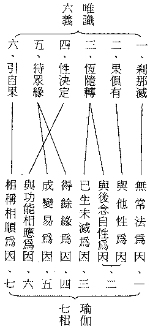



癸二　简别外种



外谷麦等识所变故，假立种名非实种子。此种势力生近正果名曰生因，引远残果令不顿绝即名引因。内种必由熏习生长，亲能生果是因缘性。外种熏习或有或无，为增上缘办所生果。必以内种为彼因缘，是共相种所生果故。



种子，不但有内种，同时有外种。外在的谷麦等种，属於外种；阿赖耶识中的能生性，属於内种。『内种思想的产生，原是从世间的外种子悟出来的。见到世间的谷麦种子有能生性，能生自果，所以把一切法的能生性，建立为种子』。如上所说的种子六义，不但内种有，外种是也有的。现在进一步所要讨论的，就是种子假实的问题。在这两类的种子中，外种只可说是假有的，唯有内种才是真实的，在《摄论》中，说为世俗胜义，即外种是世俗假有的，内种是胜义实有的。唯识学上说：『凡是自相安立的缘性，叫胜义实有；在缘起上依名计义而假相安立的，叫世俗假有』。「外」在的「谷麦等」种，是依内「识」之「所变」的，只可将之「假立种名」，并「非」叫做真「实种子」，所以属於世俗；内在的种子，即是万有诸法的真因缘，所以属於胜义。可见种子是有假实两类不同的，如以为外种亦是实有的，那就是一大错误！



由种子而生果，这是不简内种外种的，但此内外种子，还有能生因与能引因的两种。如此「种」子的「势力」能「生」最极亲「近」的「正」式之「果」，那就「名曰生因」；若此种子的势力能「引」较为疏「远」的「残」餘之「果」，使「令」这个果法，「不」致「顿」时断「绝」，那就「即名引因」。《摄论讲记》说：『能生，是任何一法的能生之因；能引因，是一种能够引长残局，使已破坏的人物，获得暂时存在的力量。如人一期生命的存亡，死了却还有尸骸暂时存留著，这使尸骸不与生命同时顿灭的力量，就是引因。「枯丧由能引」，是证明引因的必要。丧是内有情界的丧亡；枯是外植物界的枯萎。有情遗骸的存在，荳麦等枯杆的残留，这都是引因的力量。假使没有引因，动物死了，草木枯了，就应什麼都顿时散灭。事实证明，死尸枯枝是任运的渐后渐灭，故知引因力的必然存在。譬如射箭，弯弓的力量，使箭蓦直飞去，暂时不堕，这就是引因』。



对此生因与引因二者力量的长短，在世亲与无性的《摄论释》中，彼此有著不同的意见。《摄论讲记》对此有著极好的分析：『世亲的意见：内名言种，由阿赖耶识中的异熟习气，招感生起一期的生命自体，从入胎出胎起，相续执持下去，乃至老死，在它一期生命流中，都叫做生因。死了以后，阿陀那识不复执持这个生命的自体，祇剩个死尸，乃至死尸完全消灭，这遗骸的残存，是引因。外种亦复如是，从发芽至开花结果的这一期间，皆名生因；从枯焦以至残枝的毁灭，这其间是引因。无性说：内识种在最初入胎受生，生起名色，是生因；六处以后，从幼小乃至死后的死尸，都名引因。外种开始发芽叫生因；长大抽叶开花结果，乃至枯焦毁灭，这都名为引因。此说固然也有相当的理由，但与本论文不合』。



如上所说，内种外种，同样具有六义，同样具有生引二因，二者似乎没有什麼差别，但从熏习这一方面来观察，则又不难发现它们的差异。就是「内种必由熏习」令之「生长」，方得「亲能生果」。由於内种是由『熏习故生』，所以唯识用三种熏习摄一切种，就是说内种必有熏习而有的意思。在这当中，本有种子是熏增，始起种子是新熏。不管本有或始起，皆要熏习才能生果，因为内种「是」亲生一切现行的果法，所以为「因缘性」。至於「外种」的「熏习，或」者是「有，或」者是「无」，那是没有一定的。如茶叶用兰花熏习成为香片，是即有熏习的；若兰花桂花本身有种香气，根本不用熏习，是即无熏习的。此外种子，不论是有熏习或无熏习，因为唯是现行，所以只可「为增上缘办所生果」，作亲因缘是不行的。



无性《摄论释》二说：『论曰：为显内种非如外种，复说二颂：外或无熏习，非内种应知，闻等熏习无，果生非道理。作不作失得，过故成相违；外种内为缘，由依彼熏习。释曰：如是已辨外内种子，其性粗因为显不同，复说外或无熏习等』。《摄论》为什麼会有这两颂的说明？就是有人认为：内种可以为因，外种亦可为因，为什麼独说外种是假非实？为什麼肯定的说内种是实非假？由於有人有这样的疑问，所以《摄论》特作这样的解释。



先就有无熏习辨别，《摄论讲记》中说：『如香花的熏习苣蕂，引起苣蕂中的香气，这苣蕂中的香气，是有熏习的。若从炭中生苣蕂，从牛粪堆里生香莲华，从毛发里生蒲等，这是没有熏习的。牛粪中没有莲华，牛粪也不会熏生莲华，那怎麼生莲华呢？这是没有熏习而生的。小乘学者有这样的两派：一是主张有些东西，没有种子可以生起，由於大众共同的业力所感，自然会生起来。一是主张非有种子不可，比方这个世界坏了，以后再成，草木等的生起，不是无因有的，是由他方世界吹来的。本论此颂，同於第一派。但非内种也可以没有熏习，内种是必有熏习的，因为没有闻等熏习，记忆及如理作意等果生，是非道理的。因此，佛教主张什麼都由学而成，没有不学而成的事。假使不承认内种必有熏习，就应该作闻思熏习的反而忘失，不作闻思熏习的反而获得果生。这与真理事实都成相违而有过失』。又说：『外种是以有情的内种为因缘的，由阿赖耶识熏习，才有外种显现，又从外种引起芽等果法。没有阿赖耶的熏习，外种就不会有；实际上，芽等也还是从赖耶现起的』。正因如此，所以《摄论颂》说：『外种内为缘，由依彼熏习』。世亲释说：『谓外种子唯就世俗说为种子，所以者何？彼亦皆是阿赖耶识所变现故』。因为外在的谷麦等种，皆是众生感受用业熏习种子，依於阿赖耶识的力量之所变现的，所以外种离内无别实种。不过外种并不是没有因缘，而是「必以内」在的「种」子「为彼」所有的「因缘」，因外在的山河大地以及森罗万象，都「是」阿赖耶识「共」变的「相」分「种」子「所生」出来的现行「果」法。《唯识义演》说：『外麦等种子从内识中麦等共相种子生，即有情共缘麦等熏种，后种藉此为缘而生，故外种子非无因缘生』。



壬四　能所熏习



癸一　问答标数



依何等义立熏习名？所熏能熏各具四义，令种生长故名熏习。



现在进而来说种子熏习的意义。首要问的就是「依何等义立熏习名」？讲到熏习，在开始的时候，定要「所熏」处与「能熏」法，而「各」各皆「具四义」，彼此和合不离，而且能熏法刺戟所熏处，使「令」其中的「种」子，新熏的发「生」本有的增「长」。因为这样原「故」，所以「名」为「熏习」。如简单的说：有情的一切行为活动，不论是善的或是恶的，一定留那招感结果的原因在自己的八识田中，是为熏习之义。基师《述记》卷一说：『熏者击发义，习者数数义』；卷三又说：『熏者发也，或由致也，习者生也近也数也，即发致果於本识内，令种子生，近令生长故』。因此，熏习之义，乃是数数击发本识，发生新种，增长本种之意。



癸二　正释所熏



何等名为所熏四义？一、坚住性：若法始终一类相续能持习气，乃是所熏；此遮转识及声风等，性不坚住故非所熏。二、无记性：若法平等无所违逆能容习气，乃是所熏；此遮善染势力强盛无所容纳，故非所熏。由此如来第八净识唯带旧种非新受熏。三、可熏性：若法自在性非坚密能受习气乃是所熏；此遮心所及无为法，依他坚密故非所熏。四、与能熏共和合性：若与能熏同时同处不即不离，乃是所熏；此遮他身刹那前后无和合义，故非所熏。唯异熟识具此四义可是所熏，非心所等。



首先来说「何等名为所熏四义」？讲到所熏的四义，就是坚住性、无记性、可熏性、能所和合性。现在依其次第，分别说明如下：



第「一、坚住性」：一般说来，作为所熏处的，是为保持种子。「若法」从无始之「始」，乃至究竟之「终」，如是始终不二的，「一类相续」的，「能」够保「持习气」的，「乃是所熏」的第一义。在此所说的坚，是安定稳固的意思，并不是一点变化没有，不过在变化的一类相续中，有它相对的安定性。若法是转易间断的，不特没有保持熏习的能力，而且那所保持的种子，亦会随之变动而变动。如此一来，就失去受熏持种之义。是以「此」义要在「遮」前七「转识及声风等」，因为这些「性不坚住」，是「故非」是「所熏」。为什麼要遮七转识？因入灭定等时，其心是无有的。为什麼要遮根、尘、法处色等？因生无色界中，其色是没有的。论中说遮声风等，无性《摄论》二说：『坚者坚住方可受熏非如动风，所以者何？风性疎动不能任持所有熏气一逾缮那，彼诸熏气亦不随转；占博迦油能持香气百逾缮那，彼诸香气亦能随转』。《摄论讲记解释》说：『世亲以风和油来譬喻固定性和流动性。油是比较固定的，它就能任持香气到很远的地方而不散；风是最流动不过的，它就不能保持香气，立刻要消散无餘』。所以是所熏处，必具坚住性义。不但间断的转易的前七转识及其心所并诸色法，不可为所熏处，就是经部的色心前后受熏说，也认为断断不可的。无性《摄论释》三说：『若复有执者，谓经部师作如是执：色心无间生者，谓诸色心前后次第相续而生。是诸法种子者，是诸有为能生因性。谓彼执言：从前刹那色后刹那色无间而生，从前刹那心后刹那心及相应法无间而生。此中因果道理成就，何用复计阿赖耶识是诸法因？为遮此执，故次说言此不得成』。



第「二、无记性」：为所熏处的，不独具前义，而且其性质必须是羸劣无覆无记性的，所谓「若法平等」，对於善恶一切「无所违逆」，确「能容」善恶行为的熏习，保持其「习气，乃是所熏」处。不用说，唯有无覆无记的本识，其性是中容平等的，善的来熏接受善的而不予以排拒，恶的来熏接受恶的亦不予以排拒，得容受其熏习，所以是所熏性。如唯有不是香臭所可记别的，才能受香臭的熏习，其道理是一样的。当知「此」义是「遮善染」法，「势力」极为「强盛」者，互相排拒於他，彼此「无所容纳」，是「故非」是「所熏」。说明白一点：善性不容受染（恶及有覆无记）性的熏习，染性不容受善性的熏习。恰如极为恶臭的大蒜，不容受其餘的香气之所熏习，又如极为香馥的麝香，不容受其餘的臭气之所熏习。世亲《摄论释》二说：『言无记者，是不可记极香臭义。由此道理，蒜不受熏，以极臭故；如是香物亦不受熏，以极香故；若物非极香臭所记即可受熏』。无性《摄论释》卷二亦说：『非唯坚住，复无记性方是所熏，如平等香乃受熏习，非极香物如沈麝等，非极臭物如蒜薤等』。



不特遮除善染等法势力强者不能受熏，就是经部所计的识类受熏也是不可以的。经部认为前念可以熏於后念，因为他们是前后一类相续的。这种说法，在唯识看来，是不能成立的。《摄论讲记》说：『凡是熏习，与能熏必须同时相应。经部师既然二念前后不俱有，在所熏四义中，就缺了能熏所熏和合相应的条件，所以也不成熏习了。后念识是前念识的同类——前识后识同是识，所以在时间上虽不俱有，还是可以受熏的：经部师这样解说。但在唯识家的见解，还是不成！同类就可以受熏吗？那圣者的净识和凡夫的染识，也同是识之一类；五色根和意根，同是根之一类，也都应该互相受熏了！其它如色蕴与受蕴、行蕴，同是蕴之一类；眼处与法处，同是处之一类；色界与法界，同是界之一类，这一切同类的，都应该互相受熏了。这样的类例其餘，就成很大的过失了！经部师既不承认这些同类法可以互相受熏，那末前后识的同类受熏，当然也不能成立』！



在此有人这样难道：假定是无记性的就可受熏，那不但第八识是无记性的，第七识亦是无记性的，理应第七识与第八识同样可以受熏！唯识家回答说：不行！第七识虽是无记性，但它是有覆无记，因常与四惑相应的，不同第八识的无覆无记性，所以第七识非是所熏处。



「由此如来第八净识」，亦即佛果的清净大圆镜智，虽说是坚住性的，亦是善性的一类相续，但不得为所熏处。因为所谓大圆镜智，只能保持在因中所熏习的无漏旧种，绝对不再受新熏的，所谓『佛果无熏习』，就是此意。因为如此，所以论说：「唯带旧种非新受熏」。不但本论这样讲，《佛地论》亦这样说。如该论卷三说：『如是四智相应心品种子本有，无始法尔不从熏生，名本性住种姓；发心已后外缘熏发渐渐增长，名习所成种姓；初地已上随其所应乃得现起，数复熏习转增转胜，乃至证得金刚喻定，从此已后虽数现行，不复熏习更令增长，功德圆满不可增故。持种净识既非无记，不可熏故，前佛后佛功德多少成过失故。如是四智相应心品一向是善，一向无漏，道谛所摄，诸佛无有一切有漏种子法故』。到达最高的佛果，第八赖耶识成为极善无漏，与世间有漏极相违逆，而所成的无漏善，又是最极圆满的，所以不合被熏习。假定还要受熏的话，前佛与后佛的功德岂不有了胜劣？



第「三、可熏性」：为所熏处的，不独要具有如前的二义，更要其体自在不随从它，又是有为而性非坚密的，所以说「若法自在性非坚密能受习气，乃是所熏」。为什麼要如此？体是坚疏，易可受熏，非如石等，是可熏习。假定这个法的自体不自在，而作用又不殊胜，那就不能保持种子；又若这法的性质是很坚密的，而且是常住没有变化的，同样没有容受他熏的功能。由於如「此」，所以必须「遮」除本识相应的五徧行「心所及」常住无有变易的「无为法」、假法等，不得为所熏处。五徧行心所，是依心王起的，其体不得自在，怎麼可以受熏？虽说心王也要有心所方得生起，但并不说它是依於他的，有它的自在义，所以得称为王。假法之所以为假法，就因本身做不得主，不得为主自在，怎麼可以受熏？至於无为法，是坚密常住的，不能容受他熏，好像顽石不能容受水的浸润。在此我们所要特别注意的，就是坚住性为所熏的条件之一，而於可熏性的这条件中，为什麼要遮简坚密性？据古德说：坚住的坚，重在住义，坚密的坚，重在密义。意思是：坚住义，指没有间断转易的一类相续；坚密义，指不虚疎，就是致密之意，为常住不变者。因此，为所熏处的，要一类相续，同时，必须不是无为常住，而是有为虚疎的。因此，唯识的熏习说，与《起信论》等所说的真如受熏之义，是冰炭不同炉、水火不相容的。如《起信论》说的真如无明相互熏习，所以染法净法得以不断的生起，唯识家是决定不能承认的。因为真如无为，不但不是能熏，亦复不是所熏，能熏所熏义皆不得成立，怎麼可与无明相熏习起？倘若你们硬要说有熏习，那就应当不是无为，亦即不是真如，因唯识家把真如作为抽象的理性看待，亦即诸法的真实平等性，与具体物完全隔别，一点德用也没有，怎麼可以受熏？可是印顺论师的《起信论讲记》中说：『其实，即使真如不可说受熏，但真如能为增上缘，难道没有任何影响吗？何况本论的真如，含摄得无量清净功德呢？修学佛法，就在乎以清净的力量治伏杂染的；虽然杂染法也在不断的蒙蔽真净的，歪曲真净的，以及障碍行者的进修，但真净与妄染不断的搏斗，自会粉碎妄染的黑幕，现起净德的业用。《密严经》与《大乘理趣六波罗密多经》，都说到：「真妄互相熏，犹如二象斗」。这虽是晚期的译品，未必为唯识者所信受，然众生修学过程中，真妄的相互熏习，相剋相消，不能说不是事实吧！总之，不把熏习专看为种子，真如专看为理性，一切都可以通了』。



在此特再一言的，就是作为种子条件之一的刹那灭，是语有为缘起的根柢，亦是唯识最显著的特徵。唯识学上所说的这个可熏性，与教育学上所说的可塑性，可说是很相近的。所谓可熏，就是可受新熏之义。《摄论讲记》说：『凡是和别法俱生俱灭，后念生起的时候，它能感受另一法的影响，而起限度内的变化，才能受熏习，否则是不能熏习的。阿赖耶识是种识和合的瀑流，它非坚密的不可入的个体，能受转识的熏习，所以是所熏』。



第「四、与能熏共和合性」：为所熏处的，不独要具如上的三义，更要「与能熏同时、同处、不即、不离乃是所熏」。此中意说要具三义，方可真正做到受熏：（一）、在时间上，所熏与能熏必定要在同一刹那，不得有前后的差别；（二）、在生命上，所熏与能熏必定要在同一身处，不得有自他身的差别；（三）、在关系上，所熏与能熏必定要能不即不离，不得有或即或离的差别。因为如「此」，所以要「遮他身」间隔不同在一处，要遮「刹那前后」的不是同一时候。因为自他相隔、前后刹那，没有和合相应的意义，是则虽具备了如上的三义，仍然不得名为所熏处。假定承认这些为所熏处，自身受他身的熏习，他身受自身的熏习，那就成为他作自受果，自作他受果，违背自作自受的因果原理，是佛法所绝对不能同意的。假定认为这是可以的，那难陀、胜军他们所说因果异时的计执，也就成为正当的了，那里还可予以破斥？正因有此能所和合之义，所以难陀等的计执才是要不得的。所以唯有自身与转识同时的阿赖耶识，才是真正的所熏性。



具备如上的四义，没有一义缺少的，唯与能熏同时的第八阿赖耶识，所以说：「唯异熟识具此四义可是所熏，非心所等」。第八阿赖耶识，无始以来一类相续而无间断，所以有坚住性义；因为性是无覆无记而不是善、染的，所以有无记性义；第八赖耶识是心王，不如随他而起的心所，又是有为而不是无为，所以相当於可熏的一义；一切有情皆有各自的第八阿赖耶识，自己的第八阿赖耶识，容受自己现行所熏成的种子，所以有能所的和合义。因此，能为所熏处的，唯这第八赖耶识的心王。除此而外，诸如心所法等，没有一法可以为所熏处的。



癸三　正释能熏



何等名为能熏四义？一、有生灭：若法非常能有作用生长习气，乃是能熏；此遮无为前后不变，无生长用，故非能熏。二、有胜用：若有生灭势力增盛能引习气，乃是能熏；此遮异熟心心所等，势力羸劣故非能熏。三、有增减：若有胜用可增可减，摄植习气乃是能熏；此遮佛果圆满善法，无增无减故非能熏，彼若能熏便非圆满，前后佛果应有胜劣。四、与所熏和合而转：若与所熏同时、同处、不即、不离乃是能熏；此遮他身刹那前后，无和合义故非能熏。唯七转识及彼心所有胜势用而增减者，具此四义可是能熏。



所熏的四义已经讲过，现在续讲能熏的四义。「何等名为能熏四义」？这是依前标问。所谓能熏四义，就是有生灭、有胜用、有增减及能所和合。这能熏四义，在诸唯识论典中，是都没有说到，这是护法特别举出，以详细的说明熏习的意义。现在依其次第，简单解说如下：



第「一、有生灭」：大凡可为能熏的，决不是无为常住，必是有为生灭的，所以「若法非」是「常」住，而经常的生灭变化著，「能有」生果的「作用」，而且是有为生灭的，就可从它常能「生长习气」。如是像这样的，「乃是能熏」。举例来说，恰如种子由生灭转变而有生果的功能。因而「此」义在於「遮」简常住不变的「无为」，因为无为没有生灭，前后没有一点变化，「无」有「生长」种子的功「用」，以是不能为「能熏」。这与前说种子六义中的刹那灭，可说是同一意趣。因此，《起信论》谈真如内熏与真如的内熏，从这立场看，不得不予以坚定的否拒。唯识所说种子熏习，於种子所应具备的条件中，首先举出刹那灭，严格的峻拒常住无为；在所熏处的条件中，唱可熏处，同样的否拒无为；现於能熏法的条件中，一开始就说有生灭，更是对於无为的排斥。由此可知是怎样的强调无为与活动，没有任何的干与。无为毕竟是凝然住於有为的实性，决不混同於有为的活动。关於这点，在唯识学上，是坚持不让的。这就是与说真如随缘的起信论义，冰炭不相容的所在。在本宗，认为真如缘起说，不是印度论师的本意，而是译者的误记。



第「二、有胜用」：为能熏的，前义之外，更不得没有胜用。论说「若」法是「有生灭」的，「势力增盛」的，「能引习气」的，「乃」可说「是能熏」。不过所谓胜用有二，就是能缘的势用与强盛的胜用。能缘的势用，指有主观作用的心法；强盛的胜用，是说没有羸劣的善染性。这二用，就是能缘而又为善染性的，所以得为能熏。因此，色法，虽有强胜之用，但无能缘之用；异熟心品，虽有能缘之用，但无强胜之用；至於不相应法，两用完全没有。是以不论那种，都没有资格做为能熏。以是「此」义在於「遮」简「异熟心心所」及色法「等」，不能熏其种子，为什麼？因它们的「势力」非常「羸劣」，所以「非」是「能熏」。在此有人问道：所简去的色法，既然不是能熏，那就应不熏成色种，如不熏成色种，试问色种从那里来？解答这问题说：为相分熏，意显色体虽然不是能熏，但心体是能熏的，由此心体带彼相分熏成色种。如兵马不能打贼，可是将军能打，将军带马，马也就能打贼。



第「三、有增减」：为能熏的，前二义外，在作用上，「若」法是「有胜用」的，而且必须还有「可增可减」的性质，「摄植习气，乃」可说「是能熏」习种子。据於「此」义，就要「遮」简「佛果」位上的「圆满」无漏「善法」，所谓无漏善法，是指四智心品。佛果位上的四智心品，已经达於最极圆满的领域，在那上面再也没有增减的餘地。因为「无增无减」，所以没有「能熏」作用。所谓佛果无熏习，正是指的这个。「彼」佛果位上的善根，假「若」得为「能熏」，更增新的种子，不但说不上是「圆满」，而且「前」佛「后佛」的「果」德，「应」该是就「有」了「胜劣」的差别。为什麼？因还能熏，有的佛熏得多，有的佛熏得少，其功德当然也就有多少，功德多的显示他的殊胜，功德少的显示他的卑劣。如果如此，还谈什麼佛佛平等？四智心品平等圆满，绝对是不能熏习的。所谓熏习，唯是限於因位之间的事。



第「四、与所熏和合而转」：为能熏的，前三义外，更要「与所熏同时、同处、不即、不离」，二者和合，「乃是能熏」。当知「此」亦「遮」去「他身」以及「刹那前后」异时的，彼此之间「无和合义，故非能熏」。关於此义，在前所熏的四义中已经说过，其义是一样的，准於前说可知，所以不再多说。



能够具备如上所举四义的，在诸法中，「唯」是那因位上与所熏处同时的「七转识及彼」七转识所相应的「心所」，而非业果识者是。因为它们「有胜势用而增减者」，由於「具此四义」，所以「可是能熏」。至於因位的第八识的心王心所，，以及业果的前六识，并那果位上的一切识，因为没有具备这四义，所以都不是能熏法。今依诸识，将能熏非能熏，图示如次：



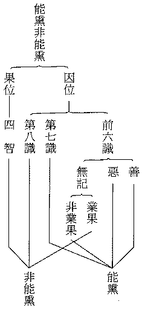



癸四　通结前义



如是能熏与所熏识俱生俱灭熏习义成，令所熏中种子生长，如熏苣蕂故名熏习。能熏识等从种生时，即能为因复熏成种，三法展转因果同时，如炷生燄燄生焦炷，亦如芦束更互相依，因果俱时理不倾动。能熏生种种起现行，如俱有因得士用果，种子前后自类相生，如同类因引等流果。此二於果是因缘性，除此餘法皆非因缘，设名因缘应知假说。是谓略说一切种相。



能熏所熏各个所应具备的条件，已如上面分别说明，现在再来通结前义，也就是将熏习义，再略为解释一下。



「如是」像上所说的「能熏与所熏识」，彼此都是「俱生俱灭」而刹那变化的，以是「熏习」的意「义」，乃可得以「成」立。因为有了前七识能熏的条件，才能「令所熏」的第八识「中」所有「种子」，或是新「生」起来，或是增「长」起来。如换一句话说：由能熏识的力量，增长所熏识第八自体分中的本有种子，发生新熏种子。从自证分给与力量，成见分熏、相分熏。如是这麼一来，色心一切熏习，可得究竟圆成。「如熏苣蕂故名熏习」。《摄论讲记》说：『印度的风俗，欢喜用香油涂身。香油的制法，先将香花和苣蕂埋入土中，使它坏烂，然后取苣蕂压油。胡麻的本身原虽没有华香，但经香华的熏习，压出的油，就有华的香馥了。这譬喻中，华是能熏，苣蕂是所熏。苣蕂与华俱生俱灭，久之，所熏苣蕂，就带能生彼香的因性而生。苣蕂本身没有香气，因华熏习方有，所以名为带彼』。《摄论》本文则说：『复次，何等名为熏习？熏习能诠何谓所诠？谓依彼法俱生俱灭，此中有能生彼因性，是谓所诠。如苣蕂中有华熏习，苣蕂与华俱生俱灭，是诸苣蕂带能生彼香因而生』。照这说来，所谓熏习，不唯是指能熏，而实能熏所熏，皆名熏习。



诸有「能熏」的前七转「识等」，当「从」第八识中「种」子「生」起「时」，立「即能」够「为因，复」又「熏成」新的「种」子。像这样的种生现，现熏种的「三法」相互「展转，因果」必然是「同时」的。要知摄於本识中的种子，如前所说，是万有诸法发生的亲因。其能生种子，若有协助这个的众缘和合时，就生起某法的现行，这叫做种子生现行的因果。能生的种子是因，所生的现行是果，而这因果必是同时的。其所生起的现行，假定是有胜用的，具备所谓能熏的资格，其现行在同一刹那，必又把种子熏习於第八识中（若所生的现行是色法，又是业果，且具备能熏的资格，则为相分熏而熏习），这叫做现行熏种子的因果。能熏的现行是因，所熏的种子是果，而这又是因果同时的。如是像这样的，有种子生现行的因果，有现行熏种子的因果。譬「如」灯「炷」的「生」起灯「燄」，而那「燄」又「生焦炷」一样。炷生燄，如种生现；燄生炷，如现熏种。如是以为三法展转因果同时的法门。而前所说七转、第八互为因果之谈，就是在这能生所生、能熏所熏这点上立论的。为什麼？所生的、能熏的现行，是七转识的诸法，能生的、所熏的种子，是第八识中的生果功能。摄用归体，展转相望，所以第八与七转，是更互为因果的。《阿毘达磨经》中所说『诸法於藏识』等一颂，正是显示这一意趣。「亦如芦束」，甲乙二者，「更互相依」，你支持著我，我支持著你，亦是互为因果的。互为因果，亦即因果的相互为依；如现行能熏为因，亲熏成的种子，而同念的新熏种子果，依於能熏之因，固为因果相依；又七转识现行果起时，即自种子生现行果起，取其种子生现行，亦是因果相依。



如上所说，不管是三法展转，不管是二法相依，都不是个别的。三法，从义而示两重因果；二法，从体而示互为因果。兹将此义，图示如左：



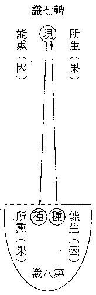



所生现行虽可同时熏种子，但所熏成的种子不能同时生现行，所以於三法外，不可说四法因果同时。为什麼？基师《述记》卷三说，原因由於现行的众缘未具。若所熏的种子同时能生现行，如是生而复生，那就没有穷极，且招同一心同时并生等的过失。因此，与所熏同时的现行，其条件必还没有具足，决定是异时的，就是经过一刹那这麼短的时间以后，假定众缘具足的话，就可见其现行，如果众缘不具足，其间唯在第八识中，前灭后生的自类相续。此自类的前灭后生，叫做种子生种子的因果，这因果是异时的。至种生现、现熏种的「因果俱时」的「理」论，世间任何学说，任何宗教，是都「不」能「倾动」的，亦即此一理论，永远屹立而不倒的。



诸法的「能熏」熏「生」各类的「种」子，各类的「种」子亦生「起」诸法的「现行」，此种因果同时俱有，「如」小乘学派中有部所说的「俱有因得士用果」。俱有因是六因中的一因，士用果是五果中的一果。据有部说，俱有因约有两种情形：一是同一果俱有因，就是由种种的原因，结合而生一果，相当於所谓协同的原因。一是互为果俱有因，是指相互资助合力成立一事的条件，如主观与客观发生关系时，主观是客观的原因，客观是主观的原因，在两者相待而成立世间的一点上，说两者相互为他之因。有部亦是主张因果同时的，而且认为这是因果的特徵。所谓俱有因，正是发挥这一立论。基师《述记》说：『此以大乘俱有因与相似言，如俱有因是因缘摄，非大乘中许彼现行俱有因法是因缘义』。原来小乘所说的六因，除了能作因，其餘的五因，虽是现行法，皆可说是因缘，如小望大生，大生望本法，并是因缘俱行。可是大乘唯识，种子与现行的相望，迥不同於有部所说，不过约因果同时俱有，与小乘有部说，不无相同之处，所以说如。只可说是相似，而实两者有著很大差别。



前念的种子引生后念的种子，如是「种子前后自类相生，如同类因引等流果」。同类是相似的意思，即因与果同其性质时，而说前者为同类因。万有一切，不独是刹那灭的，同时亦以同样状态继续著，而这不外是此同类因及其所引的等流果的相续。大乘所说的前念种生后念种，有点似於小乘的同类因，但大乘以此为真实因缘，不如小乘不是因缘而是增上缘摄，所以两者还是有著他们的不同。



能熏生种，种起现行，种子前后自类相生，如「此二」种望之「於果是因缘性，除此」二种为因缘性外，其「餘」任何一「法」，悉「皆非」是「因缘，设」若有人将之说「名因缘，应知」那是方便「假说」，绝对不能认为是真因缘性。



上来所说许多种子的道理，看看好像讲得很详细，而实「是谓略说一切种相」。如果详细起来，还有很多好说。虽则说是略说，但种子生现行、现行熏种子、种子生种子等，在本识中，无始以来，展转相续，决不断绝。这就是万有缘起相续的状态。而这是以保持种子的阿赖耶识为中心，所以有所谓赖耶缘起之说。



在此再略一谈熏习的相状：能熏的七转识虽熏习种子於所熏处的第八识，但其相状有二，就是所谓见分熏与相分熏。谓当七转识各自缘於他们的境界时，作为那识体的自证分，有股力量给与能缘的见分，於是就熏成了能缘的种子，同时，有股力量给与所缘的相分，於是便又熏成所缘的种子。那能缘的种子，是见分的种子固不用说，同时亦是自证分、证自证分的种子。此后三分为同一种子，可说是唯识的定论。所缘的种子，虽说是相分种子，但也含摄那所仗托的本质种子。熏习能缘的种子叫做见分熏，熏习所缘的种子叫做相分熏。这麼说来，可见能熏有二种的熏习。如第八识及前六识的业果，没有强盛的胜用，而色法则没有能缘的势用，所以就缺少了能熏的力能。有胜用的七转识，缘此成为所谓相分熏的熏习，所以得有新熏种子。如此熏习之义，是就无所缺少。



对此如详细说，还可作这样讲：前五识的见分熏，是各自后三分的种子，相分熏，是各自相分的种子，就是所缘的五境种子及其本质种子，亦即是第八相分的五尘种子。五识的相分影响本质熏自己的种子，同时挟带本质种子而熏。其次，第六识的见分熏，是自己的后三分的种子，相分熏，就是第六识的相分种子，亦即所缘的十八界种子与其本质种子，亦即有为的一切诸法种子。再次，第七识的见分熏，是自己的后三分的种子，相分熏，就是第七识的相分种子，亦即缘第八见分而浮现的影像种子与其本质种子，亦即第八见分的种子。后三分因为是同一种，所以说了见分种子，后二分种子也就含摄其中。



如此，除异熟外，其餘诸识，常得熏习。可是成问题的，就是能熏的作用，究是四分中的那一分？关於这个，古来异说纷纭，没有一个定准。基师《述记》卷三，以能熏为自证分的作用，同书卷七，又说为见分、相分的作用。后来学者，准於此说，产生种种的异解。虽然如此，但如《演秘》卷三会通，认为这个唯是就体就用的不同，并不是有什麼矛盾的地方。为什麼？因自证分不熏种子，仅是给与见相二分的力量而熏，所以能熏的功用，据实而言，确是在於见相二分。见相二分之所以能熏，是由自证分给与它们力量的结果，如以摄用归体来说，亦可说自证分能熏。至於证自证分，潜隐在自证分之后，因为缺少有胜用义，是以熏习之义全无。种子熏习相状如此，图示如次：



　　　　　　　　　┌证自证分┐　┌证自证种┐  

　　　　　┌七转识┤自证分　│→│自证种　├后三分同种子─见分熏┐  

　　　　　│　　　│见分──┘　└见分种─┘　　　　　　　　　　├第八识自体中  

　　　八识┤　　　└相分──┐　┌相分种子┐　　　　　　　　　　│  

　　　　　│　　　　　　　　│→│　　　　├───────相分熏┘  

　　　　　└第八识─本质──┘　└本质种子┘



庚二　释行相



辛一　问答标名



此识行相所缘云何？谓不可知执受、处、了。



阿赖耶识的三名，亦即赖耶的三相，在前已经详细的讲过，现在继续所要讲的，是阿赖耶识的所缘行相，亦即明第八识的能缘所缘。能缘的作用名为行相，所缘的境界名为所缘，合之应该称为所缘和行相的二门。能缘所缘其义是不同的，本不可以并之为一，现在将之合一来说，且以不可知三字通冠二门，当知这不过是从文字的便宜上立说。同时所谓能缘所缘，彼此绝对不相离的，离了能缘还有什麼所缘？离了所缘又有什麼能缘？《唯识义林章》说：『心起必托内境生故』。所以不论什麼心法，论到它的作用时，必有待於能缘所缘，方能发生缘虑作用，如能所缘的二者，假定有一不具，那就不成心法作用。可是现在所要问的：「此」阿赖耶「识」的「行相」怎样？而其「所缘」又是「云何」？这是首要弄清楚的。论中的回答是：「谓不可知执受、处、了」。第八识所缘境有三，就是种子、根身、器界。所谓执受，是指种子、根身的二境，所谓处，是指器界的一境。如是三种，皆是所缘境。了之一字，是指能缘的行相。就次第说：颂中先举所缘，后明能缘；但是论中解释，却是先解行相的能缘，后解执受、处的所缘，这是什麼道理？当知颂是显示法相生起的次第，吾人若要明白万有诸法的法相，必须先是心托於境，即依所缘的境，方起能缘的心，所以颂中先明所缘后明能缘。论中护法论师等的解释，是约意趣立论的，认为境是心识之所变现的，依於能缘的心，方有所缘的境，所以论中先释能缘后释所缘。现在顺著论中次第，先来说明行相，而后再解所缘。心境虽说是相依的，但唯识转变的意义来得殊胜，且是唯识宗立足之所在，所以不得不如此次第。



辛二　正释行相



壬一　执受处了



癸一　略释



了谓了别，即是行相，识以了别为行相故。处谓处所，即器世间，是诸有情所依处故。执受有二，谓诸种子及有根身。诸种子者，谓诸相名分别习气；有根身者，谓诸色根及根依处。此二皆是识所执受，摄为自体同安危故。执受及处，俱是所缘。阿赖耶识因缘力故自体生时，内变为种及有根身，外变为器，即以所变为自所缘，行相仗之而得起故。



问答标名已说，现在略为解说。首先解说行相，识自体分以了别为行相的，所以说「了谓了别，即是」此识的「行相」。此「识」的自体是了别，就「以」此「了别为行相故」。怎样叫做行相？以能缘的心行履於所缘境的体相，即识自体缘所对境的作用，当知这行相，就是指的见分。不过我们还要知道的，就是这里虽则明第八识的行相，而实广显一切心心所的行相，因为诸能缘的见分，行亲所缘境的体相，是都可以说为行相的。不特有漏位上识行境相是如此，就是无漏位上的正智缘如，亦必行亲所缘相。所以这是通释一切见分，不唯限於第八识的见分。



「处谓处所即器世间」，指山川、草木、土石、家屋等所有一切外界而言。这些，不管那种，都是有情所受用的，所以叫做器。此器世间，或名器世界，又略称为器界，就「是」一切「有情」的存在「所依处」。有情出现到世间，不能没有它的依处，没有依处就不可能存在。因此，现在特别把它叫做处。在此预先有一言要交代的：就是器界，虽则亦是安危相共，并且亦复能生觉受，但并没有执受义，所以唯属於外境。虽说是属外境，但那不是在心外之意，而是外处存在之意。如详细说：所谓器界，当然是第八识所变现的，约这点讲，自然真正不是心外的存在，但因那个场所，是从第八识而有的外处，所以说为外境。



其次说到「执受」，这「有二」种差别。那二种？「谓诸种子及有根身」。对此加以分别解说：



一、「诸种子者，谓诸相、名、分别习气」。所谓习气，是种子的异名，乃指相、名、分别的种子。相、名、分别，如据本论卷八所明，是指能所缘的一切有漏法，所以在此所说的种子，专指一切有漏的三性诸法的种子。至於无为法的种子，虽然也依附在第八本识中，但因漏无漏的相反而不相顺，所以无漏种子不得为有漏本识所缘。因此，现在必须除去无漏种子。第八识经常以有漏一切诸法为所缘，亦即因此成为诸法生起的根源，而被附於根本识名。实这种子，就是本识的功能，为诸法生起的潜势力。如上所述的赖耶三相中，因相之义，就是依据这种子以说明本识的。这，实为赖耶缘起说的根据。本识，超於诸识而为最重要的所以，可说全在於此。护法等诸大论师，在本论中，把这说得穷尽详细，不能不说有它真正的理由。因此，今对这个本识的叙述，期其详细自是必然的。



二、「有根身者，谓诸色根及根依处」。简单的说，这是指眼等五根。不过，就中略分别的：诸色根，是指的胜义根；根依处，是指的扶尘根。身是种种积聚的意思，所以详说这名，应该叫做有色根身。就是一身依於此二而成，所以总称身体为有根身。胜义根，真正是五根之体，有所谓发识取境的作用。至於扶尘根，因是胜义根的所依处，所以也就名为根依处。而这两者的自体，都由色、香、味、触的四尘之所组织，不过质料有粗细的不同。



「此」诸种子与有根身的「二」者，「皆是」第八阿赖耶「识」之「所执受」，为什麼？「摄为自体同安危故」。执谓摄持，与第八识同共安危；受谓领觉，即第八识能生觉受。这麼说来，我们知道，不论怎样讲，第八识毕竟为有情的自体，常能任持个己自体，是己对境而生感觉之谓。由於安危共同与能生觉受立脚点的不同，以是种子与有根身，叫做觉受。於此二者之外，再加器世间，就成所谓所缘的三境。从安危共同方面看：第八识假定是在善趣的，种子及有根身必然也是跟著在於善趣；第八识假定是在恶趣的，种子及有根身自亦必然跟著在於恶趣。所以在此以种子及有根身为执受，器世间因为没有此义，所以是非执受。从能生觉受方面说：第八识领受违顺之境，因有根身而常生起后时的感觉，所以在此以有根身为执受，种子及器世间，因为皆无此义，所以是非执受。如图：



　　　　　　　　┌执受──有根身─┐  

　　　约能生觉受┤　　　┌种子──┴─执受┐  

　　　　　　　　└非执受┤　　　　　　　　├约安危共同  

　　　　　　　　　　　　└器世间──非执受┘



如严格说，那常生觉受的一义，於有根身中，唯是身根有，其餘的四根及扶尘根，因不离身根而聚集於身的一处，所以相从的把它摄於觉受之中。基师《述记》卷三说：『若据实理，生觉受者唯是身根，以餘四根，色、香、味、触（此四尘指扶尘根），不离身根同聚一处，亦名觉受，体实非也』。要而言之，种子及有根身，为第八识所执受，第八识是能执受，种子及有根身为所执受。然种子及有根身，由於有这能执受的理由，所以叫做有执受。



关於执受及同安危义，《解深密经．心意识相品》中有说：『於六趣、四生身分生起中，最初一切种子心识成熟，展转和合、增长、广大。依二执受：一者有色诸根及所依执受；二者相、名、分别言说戏论习气执受。有色界中具二执受，无色界中不具二种……此识亦名阿陀那识，何以故？由此识於身随逐执持故；亦名阿赖耶识，何以故？由此识於身摄受、藏隐、同安危义故』。我在《解深密经语体释》中说：『一切种子心，依二而又执受於二，所以说依二执受。执受，是以心执持诸根不令失坏，以及说明心与所执受的互相密切的联系。所执受色根，有领受的功能，能执受的心，也间接的可以领受。通常说执受，有摄为自体、持令不坏、能生觉受的三义；现说只有依取的二义：依是心依诸根的存在，取是心取诸根属己，所以执受以心为主……一切种子心识，依於内根外尘而又执受之，所以就发生不可分离的关系！如一切种子心识，离有色诸根及其所依，就无寄托；有色诸根及其所依，赖一切种子心识的执持，如果心识放弃责任，不把他摄为自体，不维持他的生存，他立刻就会崩溃而成无生机的死尸。所以二者是相依为命而存在的』。『一切种子心识，所以又名阿陀那者，是因此识对於有色根身有随逐执持的作用的缘故。随逐执持，古译为持，即根身在什麼地方，识就随逐他的所在去执持之。有情能够继续生存，是因阿陀那识执有机体的关系。后人释此，有执持根身、种子、结生相续的三义。其实，执取名色，摄持诸根为生命自体，是阿陀那识的唯一使命』。『根身要由心识的执取，才能成为生动的有机体，接触外境，才能引起感觉的反应，如触手削足以及无论刺激身体那一部分，都会引起感觉可知。本经说的摄受藏隐，即一方面摄受根身，一方面又隐藏在根身中……因此，身心就发生了共同安危的关系：根身起了变化，心就随之变化，根身崩溃腐烂，识就失去藏所；反之，心识起了变化，根身随亦变化，心识离了根身，根身亦即无法支持。如人身体强健，精神即活泼，精神活泼，身体亦即强健。根身与心识，是怎样的安危相共，休戚相关，於此可见了』！



《瑜伽》五十一说：『云何建立所缘转相？谓若略说：阿赖耶识由於二种所缘境转：一由了别内执受故，二由了别外无分别器相故。了别内执受者，谓能了别徧计所执自性妄执习气及诸色根、根所依处。此於有色界，若在无色，唯有习气执受了别。了别外无分别器相者，谓能了别依止缘内执受阿赖耶识故，於一切时无有间断器世间相。譬如灯焰生时，内执膏炷外发光明。如是阿赖耶识，缘内执受缘外器相，生起道理应知亦尔』。五十三又简单的说：『若识依执名执受色。此复云何？谓识所托安危事同和合生长。又此为依能生诸受，与此相违非执受色』。其他讲到这个论题的还很多，这里不再一一具引。



在以上所说的三境中，种子及有根身为内境，器世间为外境，不论内境外境，俱是阿赖耶识所缘的对象，所以说「执受及处俱是所缘」。但这些所缘境，并不是外在的，就是第八「阿赖耶识」，由亲「因缘」及增上缘之「力」，当其「自体生」起现行「时，内」而「变」现「为种」子「及有根身，外」而「变」现「为器」界。「即以」这「所变」的，就作「为自」己的「所缘」，能缘的见分「行相」，「仗」托这个所缘「而得」生「起」。不过在此要知道的，就是第八识唯能任运无分别的变现三境，说为所缘，非如餘识的分别缘虑，单言为缘，所以名变，是所谓缘变。但是缘变之义，不独限於第八，前七识亦得变，就是前七识的所缘，不管那种，都是自己所变的相分。变就那样的为缘。然前七识的变，只是事物的影像在心上现，不如第八变的本质。因此，变即缘之义，第八最亲，就是在第八识上说为缘变的。要之，内外之境，不管那种，都是阿赖耶识的所变，没有一个可以作为心外别法来看的。



在能变有二种中，本识变三境，是所谓果能变，当变现之义，心心所从本识的种子生，是所谓因能变，当转变或生变之义。前者是现行赖耶中心所谈，后者是种子赖耶中心所谈。赖耶以三境为所缘，是在因位上讲的，若在果位，那就以一切法为所缘。这是佛果的胜智所缘，真正可说是当然的次第。唯今以说因位为主眼，所以不多触及果位。



癸二　广释



子一　广释了字



丑一　正释了字



此中了者，谓异熟识於自所缘有了别用，此了别用见分所摄。



上已略释行相，现再加以广释。「此中」所谓「了者」，不是别的什麼，「谓」即第八「异熟识」对「於自」己的「所缘，有」种「了别」的作「用」，而「此了别」作「用」，属於「见分所摄」。为了说明了字见分，於是论中广说四分，这是值得吾人注意的，因对这个四分说，不但学者间有诤论，在唯识学上亦极重要。自古唯识学徒都这样说：『四分、三类唯识半学』。四分义的这一论说，乃是诠显万有唯识之旨，是唯识学中最重要的论说。具缚凡夫，不论那个，对於心境二相，都是暗昧而不能正确认识的，所以妄起我法二执，而沈沦於生死海中。然诸心、境，是此心识的所变，不是心外所有的法，可见能、所缘与心、境相，完全不外於一心的作用，这是我们所应了知的。假定从佛法的修学中，离去我法的二执，得以免生死的轮转。现在这里所说的四分义，其能、所缘，可说是最善巧显示一心的作用，所以若能了知它们的义趣，对於唯识的修学，可说已得过半的过程。



所谓四分，是把心心所的认识分为四种，就是相分、见分、自证分、证自证分。如顺其次第，亦可称为第一分、第二分、第三分、第四分。关於这个一一的名义，在唯识学上虽有详细的解说，可是现在不妨先概要的叙说一下，然后再就诸大论师的看法如何以为论说。



一、相分：相是相状，是所缘之义。这是在心心所自体生时，与起能缘用同现的是所缘之境。这有影像相分与本质相分的二种：影像相分，是能缘的亲所缘相；本质相分，是能缘的疎所缘相，为影像相分之所仗托的。这在前七识，除去过、未及龟毛等的无法。缘其他诸法时，不能直接缘其所缘，必以其所缘为本质，把那同相浮现於自心之上而缘，其本质，对能缘是间接的疎所缘，影像是直接的亲所缘。因此，以那亲所缘为影像相分，以那疎所缘为本质相分。然在第八识，那所缘不是本质，唯扶根与器界，以他有情的所变为疎所缘，五根与种子，不是疎所缘，唯是亲所缘。因此，影像相分，如严格说，唯指前七识的相分。



二、见分：见是照见而为能缘之义。这在心心所的自体生时，与现所缘相同起的见照之用，心性明了能照前境。因此，所谓见，不是单指见的意义。如有说：『照故名见，不谓见故名见……若见故名见者，耳识见分亦可名闻分，有此过故，不名见故见』。如此，所谓相见二分，都是识体的二用。



三、自证分：自是自用，就是见分，证是证知之义，从证知自体上的见分作用方面得名。严密的以汉文的语法说，虽可叫做证自分，但自古来不呼这名而名自证分。



四、证自证分：证是证知之义，自证是指前说的自证分，所以这是从证知自证分的作用方面立名。



以上的四分，不管那一分，分是分限或支分之义，显示心用的分限，有四种部份之谓。如说：『心用分限有四种差别，故名四分』。对这四种，若以六离合释解说：相即分等，是持业得名；自证是自之证；证自证是自证之证，不管那种，都是依主得名。



四分既是心用的分限，则不论那一种，都不得名体而只可以名用。然若强指其体，不得不举自证分。这自证分立於后三分的中间，得以证知前后，所以叫做自体分。关於四分体用这话，唯识学上向有二说：一、四分皆用之说。如《述记》卷三说：『四用一体』、『四分识义用分』等。二、以自证分为体，以餘分为用之说。这如本论卷一说的『识体转似二分』；同论卷二又说：『相、见所依自体名事，即自证分』等。两说各有所据，但一般学者，多采前说，以自证分为体说，则很少为学者所采用。



丑二　偏正互辨



寅一　三师立义



卯一　难陀二分



然有漏识自体生时，皆似所缘、能缘相现，彼相应法应知亦尔，似所缘相说名相分，似能缘相说名见分。若心、心所无所缘相，应不能缘自所缘境，或应一一能缘一切，自境如餘餘如自故。若心、心所无能缘相，应不能缘如虚空等，或虚空等亦是能缘。故心、心所必有二相。如契经说：『一切唯有觉、所觉、义皆无。能觉、所觉分，各自然而转』。



心法的认识作用，要想正确的了解，得先知道印度论师之间有不同的异说。如前曾经提到，那就是安慧的一分说，难陀的二分说，陈那的三分说，护法的四分说。所谓『安、难、陈、护，一、二、三、四』，正是显此。以奘公所传的唯识说，认为护法的四分说，是最为完全的，亦是一家的正义。现在叙述诸师的异说，照理应将四家皆略为谈到，可是论文所谈到的，只是三师义，主张一分义的安慧说，未曾论及。这到说明三师义后再为略说。



一、难陀二分说：吾人的认识成立，一定要有能缘与所缘的二者，否则就不能成立认识，而这能缘与所缘，当知就是安立依他的相分与见分。如是能、所缘的见、相二分是怎样来的？「然」於「有漏」心「识自体生」起「时，皆似所缘、能缘」的「相现」。如是见、相二分，虽说同是依他起法，但於其中有假实别。见分是真实的，从那识体所变现出的相分，则是虚假的。相分如果是真实的，唯识的义理，那就恐难成立。因此，不管那种，虽都是依他的，但见相分是同一种子，所谓心实境虚。凡夫在相分上计为我法，所以成为徧计所执。到了佛果位上，二分虽然还是有的，但此所执绝对没有。此二分说，是据《摄论》所说『唯二依他性』而安立的。主张二分说的，除了难陀之外，亲胜、德慧、净月等，亦力唱二分说。如是见相二分以为依他，不说第三、第四分。相分体性虽依他有，但因是由见所变为的，所以说为唯识。因而这个相分体，实实在在的在内，并不是离识在外的，一般凡夫把它看成是外在的，不过妄情执为似外境现。



不但心王自体生时，有此见相二分出现，就是「彼」诸心王所「相应」的心所「法」，发生活动作用时，同样的有这二相，所以说「应知亦尔」。当知此中说的「似所缘相」现，「说名相分」，至於「似能缘相」现，「说名见分」。怎麼知道一定会有相分？相分的理证是：心心所法一定是有所缘相的，「若心心所」上「无」有「所缘」的「相」貌，那能缘的见分，当正起时，「应不能缘自」心「所缘境」。所谓自所缘境，如眼识的见分以色为自所缘，其餘的声、香、味、触就不是自所缘。同样的理由，如耳识的见分以声为自所缘，其餘的色、香、味、触就不是自所缘。再进一步说，能缘见分假定真的不缘自所缘境，那就「或」者「应」当「一一」皆「能缘一切」境。这话怎讲？如眼识的见分，不但能缘自识所有的相分，亦应能缘耳识所有的相分，鼻识所有的相分，舌识所有的相分，身识所有的相分；乃至身识的见分，不但能缘自识所有的相分，亦应能缘舌识所有的相分，鼻识所有的相分，耳识所有的相分，眼识所有的相分。为什麼？因眼家所有的相分，就是耳家所有的相分，耳家所有的相分，就是眼家所有的相分，乃至身家所有的相分亦然。



可是事实不是这样，证知心心所是有它的所缘相。假定真的没有所缘相，那就应该「自境如餘，餘如自故」。这话怎讲？就是自境本为自识之所缘的，假定无所缘相，自境应如其餘诸识之境，不为自识之所缘；反过来说，餘识所有的境界，本来不为自识之所缘的，假定无所缘相，亦应如自境为自识之所缘。同样的理由，心心所法必有它的能缘相的，假「若心心所」法「无」有它的「能缘相」的话，那就「应」当顽然无知的无「能缘」用，「如虚空等」是一样的。虚空是没有能缘用的，心心所既如虚空，当如虚空一样的无能缘相。立量说：心心所法应不能缘；无能缘相故；如虚空等。假定说虽如虚空，但能缘用并不是没有，设若是这样讲的话，「或」汝所说的「虚空等，亦」应「是能缘」的，为什麼？无能缘相故，如诸心心所法。心心所法是没有能缘相的，如你们所说可为能缘，虚空等亦是没有能缘相的，当如心心所法一样的是能缘。立量说：或虚空等亦是能缘；无能缘相故；如心心所。你们承不承认虚空是能缘？若不承认虚空是能缘，就得承认心心所是能缘，这道理可说是最明白不过的。由这见分的理证之「故」，证知「心心所」法，「必有」能缘、所缘的「二相」，不论那方面讲，都无容否认的。



对这能所缘的二相，不但有相当的理证，亦还有如来的教证。「如」《厚严经》的「契经」中「说：一切唯有觉」，这是显示内心是有；「所觉义皆无」，这是显示外境是无。为什麼要说一切义皆无？义在这里是指的所缘境，意谓一切所缘的境界，皆是唯识之所变现的，离开了内在心识，更没有实在外境。「能觉所觉分，各自然而转」，是说心外的实境，虽然是没有的，而自证分所变的相见二分，却是不假强为的，任运自然的在转，所以知道自证实有相见二分，不得认为相见是无的。



卯二　陈那三分



执有离识所缘境者，彼说外境是所缘，相分名行相，见分名事，是心心所自体相故。心与心所同所依缘，行相相似，事虽数等而相各异，识受想等相各别故。



难陀论师的二分说已经讲过，现在续讲陈那论师的三分说。陈那论师认为依他的见相二分，是从识体的自证分所变出的能缘所缘之用，所以有能缘所缘的见相二分。如更没有第三自证分的证知作用，那认识就不能完全，所以在依他的见相二分之外，更加一自证分。於此三分之中，在依他的见相二分上，计执我法为徧计执。这三分说，不但是陈那所主张的，护月亦唱说这个，火辨似乎亦如此。陈那等既立三分为是，当然认为难陀等，只立见相二分不立自证分的不当。



在此三分说中，先明小乘所执的三分义，次明大乘内立的三分义，最后显示陈那自立的三分义。



一、有一部分学者，不论是教内的，或者是教外的，他们「执有离」开内在心「识」而有外在的「所缘境」。「彼」等这样的分别「说：外」在的「境」界「是」属於「所缘」，从境变起「相分名」为「行相」。所缘为第一分，行相为第二分，而见分则是心识的体，所以说「见分名事」，因为见分「是心心所」的「自体相」，为第三分。这就是他们所说的三分。如大众等的四部学者，同说心自缘心，假定另外缘色等相，那就另外生起行相，假定心体自缘心体时，是就不另外的生起行相为能缘，以心为所缘，能缘所缘俱是心体，更无另外一个什麼体。而且心就是所缘，不另外生起行相。不过严格说来，小乘各个学派，唯有所缘、行相、事的三个名称，他们根本就不曾建立过什麼见分、相分这些名字。《观所缘缘论》说：『所缘缘者，谓能缘识带彼相起及有实体，令能缘识托彼而生色等极微』。所谓带彼相起，就是指的行相，意显行於其相。见分能缘说名为事，是心心所的自体相，亦即解释事之所以为事。为什麼不言自体事而言自体相？这是为了简别大乘所说的事就是自证分，如果说为自体事，那就与大乘所说的自证分相混滥，这是绝对不可以的！



「心」王「与心所同」以一根为「所依」，如眼识是依於眼根的，与之相应的心所亦依眼根；心王与心所同以一境为所「缘」，如眼识缘於青色的境界，与之相应的心所亦缘青色的境界。正因它们的依缘是相同的，所以它们的「行相」也就极为「相似」。所谓相似，显示王所所变的相分，同是影像，决不会你是你的，我是我的所变不同。「事虽数等而相各异」者，事是指体，意说心王与心所的自体，各各都是一个的，如心识的自体是一个，受想等的心所自体也是一个，名为数等。有人将事解为心王，数解说为心所，无疑那是错误的。王所的体事数目虽说是相等的，但识受等的相状是各各别异的。为什麼？「识受想等相各别故」。如识是以了别为相，受以领纳为相，想以取像为相，行以造作为相，各各当然是不同的，怎麼可以说为相等？



达无离识所缘境者，则说相分是所缘，见分名行相，相见所依自体名事即自证分。此若无者应不自忆心心所法，如不曾更境必不能忆故。心与心所同所依根，所缘相似行相各别，了别、领纳等作用各异故，事虽数等而相各异，识受等体有差别故。



二、大乘佛教学者所立的三分义：在大乘学者中，有通「达无」有「离」於主观的心「识」而有客观的「所缘境者」，他们「则说相分是所缘，见分名行相」。因为他们切实体认了心外无法，所以以小乘的行相为所缘，而这也就是大乘所说的相分。大乘认为自证分上有似所缘之相，而这所似的就是相分，见分行於此相之上，所以名为行相。可是小乘对於行相的解释，如《俱舍光记》卷四说：『三名有行相，即於所缘一切诸法品类差别种种不同，心心所法随缘何法等，起行相故名有行相。谓心心所法其体明净，随对何境法尔前境皆悉现於心心所上，此所现者名为行相。即由此现带境义边，似前境边，说为能缘。然此行相无有别体，不离心等，即心等摄，非是所缘。犹如明镜对众色相皆现镜面，此所现像而非所照，然约像现说镜能照』。



至於「相」分和「见」分「所依」的「自体，名」之为「事」，亦「即」所谓「自证分」。相见一定要有它的一个总所依处，相离见分应该是有，因为这是不同的二法，如心王与心所一样的条然有别。然而事实上，相见是没有别体的，只是两种不同的功能而已，所以应该别有一个所依体，到了二用生起时，由於有这个自体，所以说相见自体名事即自证分。



为什麼一定要有这个自证分？当知「此」自证分假「若」真是「无」有的话，那就「应」当「不」能「自忆心心所法，如不曾更境必不能忆故」。如你从来不曾见过的人物，后来不论怎麼样，总是回忆不起来。假使先前曾在什麼地方见过这个人的，后来有一天忽然相逢，便说从前在什麼地方，好像曾经见过你。如曾经验过的境界，是被见分所曾缘到过的，经过一个时期，后来忆念起来，这就是曾更忆。见分曾经见过某个相分境，怎麼知道？因为有个自证分，可以为它做证明，亦即自证分是能缘见分的，所以见分曾经经验过的事，后来自证分能够忆念。如相分从来不曾被见分缘过，后时见分当然不可能忆念起这个相分。同样的理由：假定见分从来不曾被自证分缘过，后时自证分不论怎麼样，亦不能忆起已灭的见分。《集量论》说：『诸心心法皆证自体，名为现量，若不尔者，如不曾见不应忆念』。



达无离识的大乘学者所立的三分义，讲到心心所的所依与所缘时，有与前文相同的地方。如说「心」王「与心所」为「同」一「所依根」，至於王所的「所缘」，亦是「相似」的。虽说它们的所缘，是它们各自变别，但所变相极为相似。如缘青色的相分，不但心王变为青色为所缘，心所亦变青色为所缘，所以说为所缘相似。所缘的尽管极为相似，但是彼此的「行相」，是「各」各差「别」的。如识以「了别」为行相，受以「领纳」为行相，乃至行以造作为行相，当然不能说为相同。正因王所的「作用」是「各异」的，所以「事虽数等而相各异」。为什麼？「识受等体有差别故」。识是识的体，与受体不同，受是受的体，与想体不同，想是想的体，与行体不同，行是行的体，与识体不同。总说一句，王所自体，是各各差别的。



此说与前不达离识有所缘境所说不同：《成唯识论集解》卷二说：『心与心所同所依根者，如眼识依眼根等，所缘相似者，以内色如外现，故曰相似；不同前师以本质为所依所缘也。行相各别者，以王所见分作用各别故，不同前师以影像行相为相似也。事虽数等而相各异，识受等体有差别故者，言王所自证之体虽皆平等，而王所之相用，各各有异，以八识王所各自有体故，不同前师领纳等相各有差别，而同以见分为体也』。



然心心所一一生时，以理推徵各有三分：所量、能量、量果别故，相见必有所依体故。如集量论伽陀中说：『似境相所量，能取相，自证，即能量及果，此三体无别』。



三、陈那自立三分义：叙说了其他两种所立不同的三分义，现在正式将陈那自立的三分义，略为指出。陈那论师依诸圣教显示自己的意思说：当诸「心」王和「心所」法「一」个「一」个的「生」起「时」，如「以」道「理」予以详细的「推徵」起来，我认为心心所法，一一「有」它的「三分」。为什麼在理论上要立三分？「所量、能量、量果别故」。所量，指的相分；能量，指的见分；量果，指的自证分。原因在於能缘所缘的缘上，不可不有它的量知的结果，立这量知的结果，就叫做自证分。不论什麼心的发生活动作用，一定要完备能量、所量、量果的这三个条件，假定不具备这三个条件，心的作用就不得谓之圆满，所以有了被量知的境和能量知的缘用，又须有那量知的结果。如用尺来量布：所量的布是所量；能量的尺是能量；知道被量过的布是几丈几尺几寸是量果，而这量果就是知道量的度数的内心；假定没有知道被量过的那几丈几尺几寸量的心，那你的测量之功，可说完全属於徒然。当知现在所讲的相分就如所量的布；见分就如能量的尺；度能量的见分果然能量知所量知的相分，假使没有证知这有被量的能量知，那这能量知的，也就归於徒然。能证知这能量知者，就是自证分。由是於见相两分外，要立有自证分的第三分。同时要知道的，就是「相见」两分「必有」其「所依体」。相分与见分，是心法作用上的两种作用，既然叫做作用，是就不可没有它所依的体，假使没有所依体的自证分，见相二分亦应各别有其自体。如果相见二分没有它的所依体，即成别体心外有境，现因相见有它所依体，是即显示离心无境。



陈那所立的三分，有体有用，不是偏於体用一边，所以见分缘於相分，得以无由错乱，皆由自证而作量果，因而知道八识各有三分，假定没有自证分体，相见二分作用也就没有，假定是有相见二分，必然亦即有自证分。自证分犹如蜗牛，相见二分犹如蜗牛上的二角。为了证明诸心心所法各有三分，陈那论师引用他所著的「集量论伽陀中说：似境相」为相分，属於「所量；能取相」为见分，「即」是「能量」，亦是指的见分；「及果」为「自证」分，即是量果。今「此三」种，「体」是一识，「无」有差「别」。但因功能各别，所以说之为三。言体无别，显示是同一心识，离了心识就没有境。心识各有三分，第一分为所量，第二分为能量，第三分为量果，此说是最圆满。



卯三　护法四分



又心心所若细分别应有四分，三分如前，复有第四证自证分。此若无者谁证第三？心分既同应皆证故。又自证分应无有果，诸能量者必有果故。不应见分是第三果，见分或时非量摄故，由此见分不证第三，证自体者必现量故。



现在来讲护法的四分义：护法在陈那所立的三分外，更加一证自证分，立相分、见分、自证分、证自证分的四分。安慧立一分说，被认为是知体而不知用，难陀立二分说，被认为是知用而不知体，至陈那三分说，虽说是体用具备，但仍有所欠缺，现於三分之上，加一证自证分，一心中的虑知之用，才可说是真正圆足。其间的关系是：见分缘相分，自证分缘见分，证自证分缘自证分，自证分又复反缘证自证分。因而，如细分别认识作用，亦即对「心心所」法，「若」果予以仔「细分别，应」该是「有四分，三分如前」陈那论师所说，「复有第四证自证分」。证自证分的安立，由什麼而得证明？论说：「此」证自证分，假「若」是「无」有「者」，试问「谁」可「证」明「第三」自证分？第三与第二，「心分既」然是相「同」的，「应」该是「皆」可以安立别有能「证」自分的东西。如见分是心分，有自证分证明其缘境的不错，自证分是心分，自然也要一个证明者，这证明者是什麼？护法论师认为就是证自证分。



「又」若没有证自证分，第三「自证分应」该是「无有果」，可是事实上，「诸能量者必有果故」。如见分为能量，第三自证分为量果，设若到了第三为能量的时候，试问以什麼为量果？没有量果怎可成为认识？护法论师认为是有量果的，那就是证自证分，假定没有第四证自证分来为证明，那自证分的缘於见分，是就变成没有量果。然而如法说来，凡是为能量的，一定要有量果，没有量果，就不成为认识。或者有人会说：用第二见分为自证分的量果是就可以了，何必一定要用证自证分来做量果？



不！「不应见分是第三」自证分的量「果」。为什麼？「见分或时非量摄故」。这话怎讲？当知见分是通现量、比量、非量的三量的，所以有的时候，它为非量所摄，是错误而靠不住的，但证自体的必要始终为现量的才行，见分既不是始终为现量，怎麼可为自证分的量果？「由」於如「此，见分」绝对「不」能「证」明「第三」，因为「证自体者必」定是要「现量」的。见分缘於相分，既然有时是比量的，有时是非量的，怎麼可以返缘自证分时，就又变成现量？事实不会如此，所以不应说见分为自证分果。如此，没有证自证分怎麼得成？



寅二　内外能所



此四分中前二是外，后二是内。初唯所缘，后三通二。谓第二分但缘第一，或量非量，或现或比；第三能缘第二、第四；证自证分唯缘第三，非第二者以无用故，第三、第四皆现量摄。故心心所四分合成，具所能缘无无穷过，非即非离唯识理成。是故契经伽陀中说：『众生心二性，内外一切分；所取能取缠，见种种差别』。此颂意说众生心性二分合成，若内若外皆有所取能取缠缚，见有种种或量、非量、或现、或比多分差别，此中见者是见分故。



在此有人问道：见分缘境，有的时候度境无谬为比量，有的时候比度错误为非量，所以不得为第三自证分的量果，但若见分取境分明而为现量时，应该可为第三自证分的量果！不！要知第四证自证分唯是在内又是其本，所以得为第三自证分的量果，可是见分纵然有的时候为现量，但因它只能缘外而又是末的关系，所以不得作第三自证分的量果。由於如此，所以现於「此四分中」分别它们的内外之义：「前二是外，后二是内」。前二，是指相分与见分，相分是外之本质的影像，似外而说於外；见分是缘这外在的相分，似外而说於外。后二，是指自证分与证自证分，因为是体内而内缘，所以说之为内。假定见分作为外缘之用而不内缘，那第七见分缘於第八见分时，所缘的既是属於内心，能缘的见分当然决不限於外缘。不过话说回来，第七见分缘於第八见分，不是直缘内心，必是变现相分而缘，所以仍旧是外缘不是内缘，因相分心实非内心。然后三分为所缘时，如果缘那相分，则那能缘的后二分，虽被认为不是内缘，而实仍旧不失内缘。元来，后三分，如为同一能缘中的义用，则作为能缘的后二分，亲缘所缘的自体，不是别浮相分而缘。因此，这可叫做内缘。以此而后三分，为所缘的同时，常有缘虑之用。如他人的心或自己的前后心，不管那种，都非别体之法。缘那变现的相分，所谓相分心，非缘虑法，是大有差别的。



於此四分之中，最「初」的相分「唯」是「所缘」，决不通於能缘，但是其「后」的见分、自证分、证自证分的「三」分，「通」於能缘所缘的「二」者，就是不但可以为所缘，同时亦可为能缘。不过「第二」见「分但缘第一」相分的时候，「或」者有时是正「量」，就是缘境分明一点不错，或者有时是「非量」，就是不能正确的缘境而是错误了的，「或」者有时是「现」量，「或」者有时是「比」量，所以是没有一定的。在此有人问道：说为非量、现量、比量，其义已经具足，为什麼还要说个或量？说此或量又有什麼意思？当知此中所说的或量是对非量作为一对来说的，因为非量就是非量，没有什麼差别的，所以说了非量，再不加以分别，可是或量是有差别的，那就是下面所说的现量与比量。由於如此，所以说量有二。



在此还得再为一说的，就是作为心法的认识作用，必有所量、能量、量果的关系。所量，是所量度的对境；能量，是能量度的心；量果，是量度的结果。在这三量中，任何一量不能缺少，如缺少了任何一量，认识是就不得说为完全。在前陈那三分义中，虽曾说明了这三量，现在再就这三量，以配合四分来看，其间一重重的，有四重的关系。如说：『见分缘相分之时，相分为所量，见分为能量，自证分为量果（这是第一重）；自证分缘见分时，见分为所量，自证分为能量，既四分（第四分）为量果（这是第二重）；证自证分缘自证分时，自证分为所量，第四分为能量，以所量第三分为量果也（这是第三重）；自证分缘证自证分时，证自证分为所量，自证分为能量，以所量第四分为量果也（这是第四重）』。据此所说，可知相分唯限於所量的一种，见分通於能量、所量的二种，后二分通於能量、所量、量果的三种。现将四重能所量果图示如次：



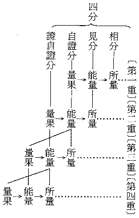



不管是个什麼认识作用，必具所量、能量、量果的三量。不过初重的见分缘相分时，以自证分为量量；第二重自证分缘见分时，以证自证分为量果。但是「第三」自证分，向前看，固然「能缘第二」见分，向后看，亦复能缘「第四」证自证分，可是第四「证自证分，唯」能「缘」於「第三」自证分，但「非」能缘「第二」见分「者」，为什麼？「以无用故」。据基师《述记》说，这大概有二义：一、有涉缘、重缘的过失。元来四分，必是直缘前境，决不可以涉缘。证自证分假定缘於见分，於中置自证分而间接涉缘，那是不可以的。同时，自证分既已缘於见分，若证自证分又缘见分，则有重缘之过，同样是不可的。二、四分的作用，各有它们一定的分限，绝对不容其间相互混滥的。因此，证自证分不可缘第二见分。



如以四分与现量等的三量分别：首先总说一句，心法的认识，虽不出现量、比量、非量的三量，如与现在所说的四分相互配合是这样的：相分因为不是能缘，根本就谈不上论其三量，可以论说其三量的，唯有在其后的三分。其后三分中：见分通於现量、比量、非量的三量，这在前面已经说过，至於「第三」自证分、「第四」证自证分，「皆」是「现量」所「摄」，不通比量、非量。此后二分，在诸识中，不管那识，虽说唯是现量，但是见分，在诸识中，有所不同。如在前五识及第八识，固然唯是现量，但在第七识唯是非量，在第六识则通三量。在前五及第八两识，所谓五、八是无执的，这是护法的正义。因为如此，五、八两识的认识，唯是现量。图示如次：



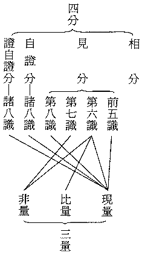



在此还要交代一下的，就是第六识的见分，虽说通於三量，但那通三量的，还有前后异时及同时并存两说。虽有人以初说为正，亦有人以后说为正，在此姑且不谈。



如上种种分析，「故」知「心心所」法，无不「四分合成，具所能缘无无穷过」。原因上来所说四重能所量果，当第二重自证分缘见分时，以证自证分为量果，这是顺理成章，当然没有问题；可是第三重的证自证分缘自证分时，为这量果的是不是需要别立第五分？假定需要别立第五分，当第五分缘第四分时，岂不又要其量果的第六分？如是像这样的推衍下去，岂不终於成为无穷？这应怎样说法？要知由於后二分互为相缘的关系，没有再建立第五分等的必要。所谓后二分相缘，就是第三重的证自证分缘自证分时，其量果反而是所量的自证分。以其所量的自证分为量果，如甲见乙面时，甲乙两者互见其面。第三重的能所缘是如此，当知第四重的能所缘亦如是。在这样的情形下，不但没有建立第五分的必要，而且也没有无穷过。



护法论师所立的四分义，一般认为证自证分是多餘的，只要三分就足以说明心法的认识，何必还要建立第四证自证分。殊不知护法立四分义而不犯无穷过，亦有其思想之所本的，就是本於有部及犊子系学者，对於生的展转建立。《中观论颂讲记》说：『他们说：另有一法能生这生的，叫生生，如另有能得这得的，叫得得。某一法的生起，有生能使他生起。这生，另有能生他的生生；这生生的生起，能生於那个本生。本生，指能生某一法的。本生从生生而生，这生生是不是也还要另一个生生，去生这生生？不要，因为本生生起的时候，除了他自己以外，有能生其他一切法的力量，所以本生的生起，还可以生於生生。这样，本生是有为，是由生生所生的；生生也是有为，是由本生所生的。所以主张生、住、灭外另有有为相，却不犯无穷的过失……根本生又名大生，生生又名小生，小生生大生，大生生小生，就是这个道理』。护法论师从有部论中发现所作展转生的建立，於是也就建立他的自证分缘证自证分，证自证分复能缘自证分，不犯无穷过失！



「非即非离唯识理成」，这是结归唯识。像上所说的四分，你说它即是一个吗？不是！为什麼？因它们的功能是有差别的：如相分是所取的功能，见分为能取的功能，自证分是能缘见分的功能，证自证分则是识体的功能，四分功能有著这样的差别，怎麼可说即是？这麼说来，难道可说它们是离的吗？不是！为什麼？因它们的功能作用虽说是各各差别的，但它们的自体是无二无别的，怎麼可说相离？如是非即非离的四分，其体就是心识，除了心识又到那里去找四分？所以说唯识理成。



由「是」之「故，契经伽陀中说：众生」的「心」有内外的「二性」，而且「内外」的「一切分」，皆有「所取能取」的「缠」绕，是以「见」有「种种」的「差别」。这里所引的契经，是指的《厚严经》。论中长行解释「此颂意说：众生」的「心性」，是由内外的「二分」之所「合成」的。不论「若内若外，皆有所取能取」的「缠缚」。如以四分分别：相见二分名之为外，见缘外的原故；自证证自证二分名之为内，因是证自体的。虽则可以这样分别，但「见有种种」的差别，「或」者是「量」的，或者是「非量」的。颂中为什麼说为缠缚？要知所谓四分，有众生分上的四分，有佛果位上的四分，现就众生分上的四分说有能取所取的缠缚，假定佛果位上的无漏心，虽则同样的是有四分，但那是没有缠缚的。佛果位上的缘用，是无碍自在的，不但没有缠缚，而后三分相缘，且能普徧的缘於内外。假定这样，那是根据怎样的意义分别其内外？依向所说有二义：一、在无漏位，相分是外，后三分通内外，正因它们的通内外，所以广缘内外诸境。论中虽说『前二是外，后二是内』，那是专就有漏位说。二、无漏位的后三分，虽缘内外，但这是有漏位的内外之类。比较二说，后义顺於《述记》所说，所以就被采用。



寅三　结归唯识



如是四分或摄为三，第四摄入自证分故。或摄为二，后三俱是能缘性故，皆见分摄。此言见者，是能缘义。或摄为一，体无别故。如入楞伽伽陀中说：『由自心执著，心似外境转；彼所见非有，是故说唯心』。如是处处说唯一心，此一心言亦摄心所。故识行相即是了别，了别即是识之见分。



「如是」像上所说的「四分，或」者可以「摄为三」分，就是把「第四」证自证分，「摄入」第三「自证分」中，如陈那论师所主张的三分即可，不必另立第四证自证分。於此三分之中：以相分为所量，以见分为能量，以自证分为量果。第四摄入第三之中，不但其体是一，而且俱是量果。「或」将四分「摄为二」分亦可，因相分这一分是所缘，「后三」分「俱是能缘性故」，皆属於见分所摄。这儿所说的见，不是单指第二，凡有能缘的功用，都可叫做见分，所以说「皆见分摄，此言见者，是能缘义。或」将四分「摄为一」分，因为四分都是心的作用，其「体」是「无别」的，所以唯说一分。如《华严》、《楞伽》等诸大乘经说唯一心，就是此意。「如入楞伽」经中，有个「伽陀」这样「说」：所有一切外境都是无有的，有的唯是内在的一心。既然没有外境，为什麼我们总以为境在於外？当知这是「由」於「自心」的妄想「执著」，本来是一心的，好「似外境」界「转」，误认以为是外。如所见的山河大地，那里真的是在心识之外？「彼」诸众生「所见」的外在境界是「非有」的，因为根本没有外境可得的，「是故说唯」一「心」。由是之故，证知离心之外，更无一法可得。「如是」像这样的有心无境，在「处处」大乘经论中都有说到，所以「说唯一心」。不过「此」之「一心」，不是只「言」一个心，亦不是单指的八个识，「亦」含「摄」五十一个「心所」在内，如更扩大来说，万有诸法无不包含在内。前说：『了谓了别，即是识之行相』。如上种种分析，「故」知「识」的「行相即是了别，了别即是识之见分」。唯有见分可以说为行相，相分是不得说为行相的。颂中所说『不可知了』的了字，即是指这见分行相。



以上所辨明的是八个心王和所相应的一一心所，只是辨明其心理现象的四种作用，并不是心体有其各别，虽说心体是一，但可析为四种作用。示图如下：



　　　　┌所虑托作用─所缘─────相分  

　　　心┤　　　　　　　　┌外缘用─见分  

　　　　└能缘虑作用─能缘┤　　　┌自证分  

　　　　　　　　　　　　　└内缘用┤  

　　　　　　　　　　　　　　　　　└证自证分



心识的作用虽说有四种，但於其中寻求自体，其体而且最强的，不得不推第三自证分的作用。如图：



　　　　┌所缘的作用─相分  

　　　心┤　　　　　　　　　┌外缘用─缘见分  

　　　　└能缘的作用─自证分┤  

　　　　　　　　　　　　　　└内缘用─缘证自证分



子二　广释处字



丑一　正释处字



所言处者，谓异熟识由共相种成熟力故变似色等器世间相，即外大种及所造色。虽诸有情所变各别而相相似处所无异，如众灯明各徧似一。



於此首先解释字：「所言处者」，是指草木土地田园家宅等，亦即通常说的器世间，它的体就是色声香味触的五尘。如是这些，为有情的所依处，或说为有情的依报。能感这个器世界的增上业缘，向来说有两种，就是共相种熏和不共相种熏。由於种有这两种的不同，所以所感的果也就有共变和不共变的二种差别。



「谓」於「异熟识」中所含藏的各类种子，「由共相种」为因缘「成熟力故」，於是就从本识「变」现好「似色等」的「器世间相」。此所变似的，「即」是「外」在的四「大种及所造色」。但是这里所说的外，不是心外有法的外，而是约它在外处叫做外。



所谓异熟识变，当然是说唯识的缘起，不用说，这是以赖耶中心的根本缘起为主。而这缘起的相状究竟怎样？这有共相和不共相的两种。如已说的赖耶本识，由因缘力变为内外的诸境。至那因缘的种子，自然有共相不共相的差异，依於所谓共变不共变的所由，那所变的一切现象，也就呈现共相境与不共相境的差异。像这样的两种范畴的展开，那共相不共相的分别，确实是有它的必要。



所谓共相不共相其义又是怎样？自他共同感於共通受用的相名为共相，反於这个，唯是自己一人感到受用，不与他人共同感受之相名不共相。而能生起各各的种子，为共相种及不共相种，种种所生的境界，及共相境及不共相境。基师《述记》卷三说：『且诸种子总有二种：一是共相，二不共相』，明显的显示有二类种子。



基师《述记》继续说到这个问题时，更从《瑜伽》卷六十六所明，将这两类又分为共中共、共中不共、不共中共、不共中不共的四句分别。共相中的共中共，是指的山河大地等；共中不共，是指的田宅衣服等。当知这是由第八不执受外境（共），执受内境（不共）而分的。不共相中的不共中共，是指的自己生命体上的扶尘根；不共中不共，是指的自己生命体上的胜义根。如山河大地等是外境，第八识并不执受它，但是自他得以共同受用，所以说为共中共；至於田宅衣服等，虽说同是外境，第八亦不执受，但是由那持有主，唯限定於一人，他人不得受用，所以说为共中不共。自己生命体上的扶根尘，是内境而为第八识之所执受，可是他身又变现这个（非执受）得以受用，所以说为不共中共；自己生命体上的胜义根，虽同样的是在第八识的执受上，但唯限於自己一身的受用，他身无论如何是受用不到的，所以说为不共中不共。



关於这个，古来不无异说。有将共中共、共中不共，说为共相，不共中共、不共中不共，说为不共相；有将共中共、不共中共，说为共相；共中不共、不共中不共，说为不共相。这两种说法，显然有所不同，不过，恐怕要以前说为正。如田宅衣服等与山河大地，因为不是第八之所执受的，所以有自他得共受用的性质，唯特定的为自己之所属的，他人则不得受用，因此，把这与山河大地等同摄而为共相。又自己的扶根尘与胜义根，同是第八识之所执受，所以是自己独用的性质，但那为扶根尘的处所时，他人亦同样的可以受用，因此，把这与胜义根同摄而为不共相。虽说这是极为至当的次第，但把第八所执受的自己扶根尘与第八所不执受的山河大地等，同摄而为共相，又把第八所不执受的田宅衣服等与第八所执受的自己的胜义根，同摄而为不共相，未免大大的缺乏至当。



然於此应注意的：虽说自他共感共用，但决不是自己所变他人受用，他人所变自己受用之谓。唯以自所变为疏所缘，他现相分而受用它，又以他变为疏所缘，自现相分而受用它。若他受用自所变，自受用他所变，那就变为心外有境，反於唯识所变的本旨。因此，所谓共受用，其意义是说自他受用的，决不认为是心外的实境。关於这点，是应予以特别的注意。



如此共相、不共相境，如何从共相、不共相的种子生起？换句话说：从共相种变出共相境，从不共相种变出不共相境，究竟是怎样的一种状态？关於这个，如色法的生起与心法的生起，其所谈是多少有所异趣的。



首从色法生起说：共不共的种子，若单存於第八识中，以由直接为其结果，不是说发生万有，在本识中，假使没有发生资助那些共不共种的增上缘，单从那些种子，共不共相的境，是不能生起的。那所谓增上缘者，是业种子的异熟习气，羸劣的无覆无记的名言等流习气。因为不是单独现行的力用，所以不得不仰这增上缘的资助。如山河大地等，就是作为吾人依报而感得的共相境，又如五根，就是作为吾人正报而感得的不共相境。不管那种，在本识中，为其原因的共不共的种子，虽说是都有的，但那共不共的种子，要得那样的结果，所谓增上缘是有其必要而绝对不可缺少的。作为那增上缘的，不外吾人在过去所造的善恶业力。就是过去为善或恶的作业，使吾人今日得以生於此界，与那同时，把那善恶业种熏附於第八识中，那熏附的种子为增上缘，亲自击发生此共不共的种子，因此感得今世共不共相的果报。助那共相种子的业种，是共业的种子，於此作为共变而发生共相境；助不共相种子的业种，是不共业的种子，於此作为不共变而发生不共相境。所谓共业不共业，是诸有情所作的，因此，自然而然的把这共通类同的叫做共业，彼此各别不是共通类同的叫做不共业。依於共业而熏的种子，是共业种子，依於不共业而熏的种子，是不共业种子。共相种子，由於共业种子的资助而得现行的，叫做共变，其所现行的叫做共相；不共相种子，由於不共业种子的资助而得现行的，叫做不共变，其所现行的叫做不共相。因此，所谓共不共的说法，毕竟为共不共境相现行区划的范畴。关於他们之间的关系，现在图示如次。



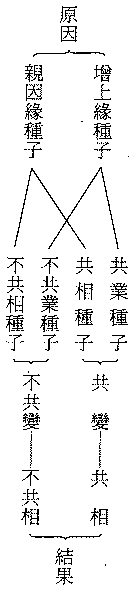



然而於此需要特别注意的，是从此共不共相的种子展开共不共相境的次第。首从共相种变为山河大地等的依报。例如先在甲处后在乙处，追究它的顺序可不可以？不是那样的，而是一时现出全部。就是不问形的大小，不论量的轻重，与第八现行总是同时顿出，决不是有前后次第的。所谓随量大小顿现一相，是随量的大小而顿现一相。是以如先所说，有唯识顿变之称。次从不共相种变为不共相的正报，总别异其场合而不是一律的，如人与人变出总报的果体，犬与犬变出总报的果体，本是没有前后次第的。异熟无记种，由於善恶业种的资助，虽唯现行第八识体，但具备其总报的男女、贤愚、美丑等的别报，自然而然不免有前后次第。因此，吾人作为人间的总报，由前世的业力（善）而托生母体（人间），第八现行虽然是果，但那同时，吾人所住的依报世界是顿现的，又美丑、贤愚等的别报，当因缘具备的时候，自然就会现出那样的前后次第。



然此所谓共业共变，究竟是怎麼一回事？当知共业，不是多有情共同的业，而是各自别别的业，又那变，同样不是共同的变，而是别别的变，这是必须要知道的。不独如此，那所谓共，是各有情类同相似的业力之所资助，因而那现行的境相，自然又是同类相似的。是以有情各自别别变出万有，各各受用自己所变的境界，与他有情的所变，是没有任何关涉的。如甲，从甲的第八变出万有而受用万有，而乙，从乙的第八变出万有而受用万有，各自在自己所变的范围内，说为唯识所变。赖耶缘起说是相对的，又是个人的唯心论，原因实不外此。



「虽诸有情所变」是「各」各差「别」的，各自还是受用自己之所变的，但因一一有情的类同相似能感的增上业所互助故，因「而」他们所感的世界「相」是「相似」的，且在同一空间各变各的，互相涉入，互相杂住，不相障碍，所以说「处所无异」。若要究明这共同世界的自相，还是一一有情自识所变现的一一不同的自识相分。恰如一法的存在，然能各自同样的受用。其状，好像千灯之光辉於一室，其一一所放的光，是各从各的灯上射出来，而一一的光都能徧照全室，光光相似，互相涉入，不相障碍，似乎完全唯有一光，不见一一不同的光，所以说「如众灯明各徧似一」。当知我们有情共变同一世界，也是这样，其实是各变各的，不过肉眼的凡夫，不知各自变作一一的器世界，所以不免觉得唯是一个世界。



关於共变法的共受用，很容易使人生起疑讶！幸这在《演秘》卷三，举出事例予以巧为解说：例如看到一棵树木，本来是由众多有情各别之所变的，不用说，这当然是共变，而且同时同处，无碍相互涉入，不论什麼人看了，都认为是一棵树。可是当甲有情采伐这树而用时，为用甲有情自己的所变？为兼用他有情的所变？这是个极为重要的问题。假定说是唯用自己所变的，他人所变的应该依然残存不亡，可是与采伐同时，事实根本不再见有树的存在。假定说是兼用他人的所变，那就变成心外有境，与唯识的义理相反，怎麼还可叫做唯识？如树木这类东西，本是共相种之所生的，自他皆得随顺，彼此常互增益。就中，甲以自变为直接所缘而亲用，以他变为自变的增上缘而疎用。因此，自变如被采伐而没有了，由於所随顺的没有，他变的能随顺亦灭，这可说是必然的。不过在甲受用这树木时，甲的业力来得殊胜，他人因为其业力尽，所以他人的所变，也就随於甲的所变而变。由於这个原因自变没有了的时候，他变也就跟著没有。像这样的，并不破坏心外受用的唯识。



在《同学》卷二之七，更扩充《演秘》所明，而举如此的例难。问：假定有个有情离去这个世界而生到另外一个世界时，自所变的世界虽说已经没有，但他所变的世界依然存在。以此为例：树木被伐用时，自变的虽然是没有了，但他变的难道是不存在吗？答：器界的坏灭，大概是别的坏业，在坏劫之时而行，在其他的时候是不行的。因此，由於一有情的死亡，其自己所变的虽亡，但他有情的所变，由於他的受用业力未尽，所以还续留存而不随之消灭；可是树木不然，它不受那样的坏业支配，缺乏继续存在的增上缘，所以完全成为无有。



齐是六七二识的妄熏所为：前者树木的场合，不管那种，有时不知各各所变的道理，因而妄想执为一树，当一有情在伐用时，自他所变同样是无；后者器界的场合，不管那种，有时都具如幻的道理，执是常住，到坏劫时始失，一有情虽生於他界，但他变的器界仍然留存，毕竟不外妄熏相互不同所致。



丑二　问答辨明



谁异熟识变为此相？有义：一切。所以者何？如契经说：『一切有情业增上力共所起故』。



此器界的变出，虽是共业所感，但究竟是由怎样的有情而招感的？亦即问是「谁」的「异熟识变为此相」？为是凡夫的异熟识变为此相？为是圣者的异熟识变为此相？为是此趣有情的异熟识变为此相？为是他趣有情的异熟识变为此相？为是自界有情的异熟识变为此相？为是他界有情的异熟识变为此相？为是自地有情的异熟识变为此相？为是他地有情的异熟识变为此相？为是唯属自变此相？为是他亦变为此相？护法论师对这问题假设三说探究其实。



一、「有义」是说「一切」有情的业力所感。因此，不问凡圣的如何，不简自他的界地，而是通於一切的。「所以者何」——为什麼这样讲？「如契经说：一切有情业增上力共所起故」。当知这里的契经说，是指的《立世经》。在《立世阿毘昙论》卷十，宣说其旨，就是指出此说。如云：『佛言：比丘！是时世界更欲起成，是世间法然初起世界时，若有众生已生长业，能感大梵果报等』。



有义：若尔！诸佛菩萨应实变为此杂秽土；诸异生等应实变为他方此界诸净妙土；又诸圣者厌离有色生无色界必不下生，变为此土复何所用？是故现居及当生者，彼异熟识变为此界。经依少分说一切言，诸业同者皆共变故。



二、「有义」是说假定是这样的话，「诸佛菩萨应实变为此杂秽土」。意思是：诸佛菩萨假定是变化成这样，我当然不否认，因为佛菩萨确有这样的能力可以做到的；若说这是佛菩萨实在变成这样，不但我不能承认，与诸理教亦相违背，因为佛菩萨的杂秽种子，早就已经断除，怎麼还会变为杂秽土？不但佛菩萨不会变为杂秽土，就是螺髻梵王也不会变为杂秽土。关於螺髻梵王的事，如《维摩诘经．佛国品》说：『螺髻梵王语舍利弗：勿作是念！谓此佛土以为不净。所以者何？我见释迦牟尼佛土，清净譬如自在天宫。舍利弗言：我见此土丘陵、坑坎、荆棘、沙砾、土石诸山，秽恶充满。螺髻梵王言：仁者心有高下，不依佛慧，故见此土为不净耳。舍利弗！菩萨於一切众生，悉皆平等，深心清净，依佛智慧，则能见此佛土清净。於是佛以足指按地，即时三千大千世界，若干百千珍宝严饰，譬如宝庄严佛无量功德宝庄严土。一切大众叹未曾有，而皆自见坐宝莲华』。从《维摩诘经》这段经文看，证知就是此土的螺髻梵王，由於心地的清净，也不会变杂秽土，何况是清净无染的最高佛陀，当更不会变为此杂秽土，是以如通凡圣的一切变为此相，那是不合道理的。



反过来说，此器界相，既是通於一切所变的，那就不但诸佛菩萨可以变杂秽土，「诸异生」凡夫以及二乘并诸地前菩萨，「应」亦「实」在的「变为他方、此界」的「诸净妙土」。他方，是指这个三千世界以外的国土，此界，是指我们这个娑婆世界。事实上，不但凡夫、二乘不能变地上十八圆满他受用土，就是地前诸小菩萨亦不能变地上十八圆满他受用土。当然，如果得到佛菩萨的加被，说他们亦能变化所作，那是另外一个问题，亦是我所不否认的；假定说他们自己能实在的变诸净妙国土，那是我们所绝对不能承认的。为什麼要这样说？因若一切共同所变，那就不免圣凡净秽互相杂乱，不合正理，成大过失！



「又诸」三果「圣者，厌离有色」，销碍入空，上「生无色界」后，「必不下生」，复来生欲色界，不说不会变为此土，即或纵然「变为此土」，试问「复何所用」？要知所谓变土，本来是为身用，如果定不能用，变它究何所为？不但圣者上生无色界是如此，就是色界异地的凡夫也是如此。如从离生喜乐地，上生定生喜乐地，那他必然不会变现离生喜乐地，因变此地是没有用的。若从定生喜乐地，上生离喜妙乐地，那他必然不会变现定生喜乐地，因变此土是没有用的。若从离喜妙乐地，上生舍念清净地，那他必然不会变现离喜妙乐地，因变此土是没有用的。以此而言，证知变土目的在为受用，不受用是不变的。



由「是」之「故」，可知唯有「现」所「居」界「及当生者，彼异熟识」常能「变为此界」。现身所居界是由自己本识之所变的，这当然没有问题。至变当生界者，灵泰《疏钞》说：『一云次生者变，即色界等有情现受此身已，次身即应生欲界者，其有情虽身在色界中，亦第八识而变欲界；若经多身方生欲界者，第八识不变欲界。二云可应生者变，其人多经十生已后应生此欲界，其第八识亦变欲界。今此解取应生者变，至成劫以来今生此处』。为什麼要这样讲？因由现身所居，异生现身居住秽土，诸佛现身居住净土，这麼一来，是就没有诸佛变为秽土，异生变为净土的过失；因由当生界变，是就没有无色圣者变为下界居土的过失！



在此有人这样问道：无间地狱是罪人受生的地方，圣者不会生到无间地狱里去，应当不变那个为所居住之处；长寿天通指第四禅中的无想天以及无色界的有顶天，不是外道所生的地方，就是异生所生的地方，圣者不会生到长寿天中去，应当不变那个为所居之处。答：不是这样讲法！圣人如在欲界，是亦可以变为地狱的，有的时候，虽亦以禅定、神通之力，前往地狱，但不受地狱的罪苦。既然如此，为什麼变？因同是一界地，所以得变受用。圣者若是生到第四禅天上去，亦得变长寿天，因是同一界地。



假定是这样的讲法，为什麼要说一切之言？当知「经」说一切有情所变的这话，是「依少分」而「说一切」之「言」，并不是指的全分一切众生。如说一切人共同见到这个东西，并不是真的是指一切人，而是指当时在看到这个的一切人。「诸业同者」，是「皆」可以「共变」的，假定彼此业力不同，那就自然不能共变，所以约少分说。



有义：若尔！器将坏时既无现居及当生者，谁异熟识变为此界？又诸异生厌离有色生无色界现无色身，预变为土此复何用？设有色身，与异地器麤细悬隔不相依持，此变为彼亦何所益？



三、「有义」是说：「若尔」——假定是这样的话，当这个「器」界「将」要「坏」的「时」候，「既」然「无」有「现」身所「居及当生」的有情，可是我们知道，有情是不灭的，器界则於后灭，然则不能说是没有能变者，试问「谁异熟识变为此界」？如果没有能变者，那就犯了坏器不变的过失！再说，若谓现居及当生者变，则「诸异生厌离」这个「有色」界而求上「生无色界」，那他「现」在是就「无」有「色身」，既然现在没有色身，亦即在有顶天，寿长八万大劫，欲界已经几次成坏，「预」先「变为」有色世界的国「土，此复何」所作「用」？退一步说：「设」若我们承认，在无色界亦「有」微妙「色身」，但「与异地器」的下界，相互对比起来，下界的粗，上界的细，「粗细」有著相当「悬隔」，到底「不」能「相」互「依持」。这麼一来，「此变为彼亦何所益」？



然所变土本为色身依持受用，故若於身可有持用便变为彼。由是设生他方自地，彼识亦得变为此土。故器世界将坏初成，虽无有情而亦现有。此说一切共受用者，若别受用准此应知，鬼、人、天等所见异故。



「然所变土」，就是器界的变出，「本」来就是「为」了「色身」的「依持」和「受用」的，所以「若於」这个「身」体「可有」依「持」受「用」的话，当然「便变为彼」器界。设若色身不能依持受用，其变出是就全然堕於无意义，岂有像那样变出的消息？因此，若是自地同土的有情，虽然不在此界而在他方，但从其识变出自土。例如此方的欲界，他方欲界的有情也能变，他方的色界，此方色界的有情也得变。欲界、欲界同土、色界、色界同土，经常得变，以此说为欲欲同变、色色同变等。所以说「由是设生他方自地，彼识亦得变为此土」。要所谓三千世界器界，广漠算数所不能及。所谓欲界，不唯是这界的欲界，他方还有很多很多的欲界；所谓色界，不唯是这界的色界，他方还有很多很多的色界。因此，欲欲同变，色色同变，非自界的有情，亦能变出。佛教所讲的器界是怎样的广漠无涯，不难从此可以想像得出。因此，本第八所缘为『不可知』，真正可以说是有它的理由。



由是之「故」，此界的欲界「器世界将」要「坏」的时候，或是最「初」将要「成」的时候，「虽」然说是「无」有「有情而亦」照常的可以「现有」，为什麼？因他方的欲界有情，经常能够变现此界。或有人说：既然没有有情，变了有什麼用？要知现在虽没有用，但若一旦生到那里，他就立刻可得持身，所以现在必须变作，并不一定要现身中，即令得以依持受用，约他将来可以依持受用，所以现在不妨现有。如诸圣者设到地狱中去，那里可说亦不得依彼而住？又如异生假定生到他方欲界，亦同样的得以持身。为什麼？因彼此的业力是相同的，粗细等并不发生悬隔作用！



「此」还是「说」的「一切」山河大地「共受用者」是如此，亦即说为共中共。至「若」各人「别受用」的境界，随与多少有情同变说名为共，亦即是共中不共，「准此」道理，「应」该可以例「知」。好像「鬼、人、天等所见」是各「异」的，亦即彼此所见的境界是不同的。如水，人见了大家皆认为是水，天见了以为是琉璃，鬼见了则成为一滩浓血。如大梵天王本来唯变大梵王宫殿，但若欲下到欲界时，则别变为器方得依持，当知这是共中不共。所居之处欲界同变名为共，自所变器唯自受用，所以名为不共。又如孤独地狱，是在深山之中，欲界器色虽复同变，但若一人受用唯一孤独地狱，即此人独受这孤独地狱，当知亦是共中不共。所居之处欲界同变名为共，自所变器唯自受用，所以名为不共。



於此所要特别指出的，就是在以上的三说中，以第三说为正，亦可说这就是护法的真说。



子三　广释执受



丑一　执受种子



诸种子者，谓异熟识所持一切有漏法种，此识性摄故是所缘。无漏法种虽依附此识，而非此性摄故非所缘，虽非所缘而不相离，如真如性不违唯识。



第八阿赖耶识所缘的相分境，有器界、种子、根身的三类，前面已说处的器界，现在继续说明执受，而执受有种子与根身的二者，今且解说所执受的种子。



在前讲到第八识与种子之间，虽有体用、因果不一不异的关系，但那完全是在有漏种子，至於无漏种子，可谓毫无关系，因为它们的体性与性类完全是相反的。当知现在所说的执受种子，也是如此。因此，对於有漏、无漏的种子，有广为探究的必要。



「诸种子者」，从它的性类分，可以分为有漏、无漏的两类种子。有漏种子，必然是依附於第八识的自体分，所以论说「谓异熟识所持一切有漏法种」，而且这有漏种子，不论是善性、恶性、无记性的，都是第八识的见分所缘。为什麼？因是「此识性」之所「摄」的，所以必然「是」此识的「所缘」。要知此中所说的性，是指体而言，而体就是本识，所谓种子的依附处，是识的自体分。虽则如此，若是自身所摄，则是摄於第八相分而不摄於其餘诸分，因为见分恒以这种子为所缘的。因此知道，种子望於第八识体，虽有生果的功能之用，但其中必然更有体用的二者，不过用是可以摄在体中的。体者，是依附於第八识的自体分，到了摄用归体，那是顺於本识的无记性的；用者，是各各能生自果的功能，是从所谓体用别论而谈，其性是亘於三性的。而此，以体用的种子为相分，见分恒恒时的缘此。对这，现在图示如次：



　　　　　　┌体─现行  

　　　第八识┤　　　　┌体─无记性─────摄用归体┐  

　　　　　　└用─种子┤　　　　　　　　　　　　　　├相分  

　　　　　　　　　　　└用─三性（引自果）─体用别论┘



在此所要问的：有漏种子依自体分，识的见分就缘这个种子，无漏种子亦是依自体分，识的见分是不是也缘无漏种子？回答这问题说：「无漏法种虽」说也是「依附」於「此」第八「识」的自体分，但它决不为见分所缘，亦不被摄在相分之中，所以说「非此性摄故非所缘」。为什麼是如此的？这因它们之间的体性、性类，不管那种都是相互违反的。就性类说：识是有漏的，种子是无漏的，两者当然是相反的；就体性说：无漏种子性唯善性，第八识是无记性，两者当然亦相反的。



假定是这样的话，本识既不变缘无漏种子，无漏种子亦不属於本识，怎麼还可说为唯识？要知无漏种子，「虽非」有漏识「所缘」，然「而」和识也并「不」是「相离」的。举例来说：「如真如性」，虽说不是心识之所变的，但离识外并不另有个真如，约它不离识说，仍得说为唯识。当知所谓无漏种子，虽说不是识的所变，但并不是离於识外别有实物，约这不离识义，所以「不违唯识」，仍可名为唯识。要知所谓唯识，但遮心外有法，并不是不承认不离识者的存在。



有人又作这样问道：无漏种子依於识的自体分，因为种不离识，所以名为唯识，真如实性离识外无，所以亦是唯识；诸心所法亦是不离识的，其心所法亦应名为唯识。不能这样的比例！为什麼？要知心所不是依於识的自体分而住，与种子的依自证分自然不同，同时心所有心所自己的行相，不同色法是识之所变的。虽则心所不依识体，然而它是识的相应，同样是不离於识的，因而心所亦名唯识，这是唯识学者所共知的。



丑二　执受根身



有根身者，谓异熟识不共相种成熟力故，变似色根及根依处，即内大种及所造色。有共相种成熟力故，於他身处亦变似彼，不尔，应无受用他义。此中，有义亦变似根。辩中边说：『似自他身五根现故』。有义唯能变似依处，他根於己非所用故。似自他身五根现者，说自他识各自变义。故生他地或般涅槃，彼餘尸骸犹见相续。



第八识所缘的三种相分境，前已讲了器界和种子，现在继续来讲根身。这根身和器界是不同的：器界，是由异熟识中的共相种子之所变的；「有根身者」，是由「异熟识」中的「不共相种」，即由这不共相的种子「成熟」而有「力」了的原「故」，於是「变似」内在所见不到的「色根」，以「及」外在所能见得到的「根依处」。这些是由什麼所构造成的？「即」由「内」四「大种」，所谓地、水、火、风，「及所造色」，所谓色、香、味、触。以是能所八法，成就内在的胜义根及外在的根依处。



於中，色根是不共中不共，即唯自己受用的，不共他所受用的；根依处是不共中共，不但自己可受用，他人亦可受用的。他人所有的根依处，不但他人可受用，我亦可以受用的，所以「有共相种」到了「成熟」而有「力」的时候，「於他」人的「身处亦变似彼」，使之成为共变。假定他人的根依处，完全与我没有关系——「不尔」，吾人「应无受用他」身之「义」。事实上，我们是有受用他身义的，所以他人的根依处，我们亦是共变的。所以自他身的根依处，是更互相变的，假定不能互变，应就不能互缘。论中说的受用义，实际就是所缘义。



「此中」所谓互变，是只互变根依处？抑能互变净色根？关於这个，学者有不同的意见。



「有义」，就是有些学者，亦即安慧等诸大论师，认为不但能变他人外面的根依处，「亦」能「变似」他人内在的净色「根」。从何而得证明此说？如世亲的「辩中边」论中「说：似自他身五根现故」。如是变似他根，究有什麼意义？假定说是为了受用，事实吾人是不受用他之内在净色根的。



进一步说，本识不论变现什麼，必然都有它实用的，没有实用变做什麼？如承认变似他身色根，对吾人来说是完全没有实用的，试问变来有什麼意义？这个说法，是不怎麼妥当的，为什麼？要知我们虽不受用他的净色根，但可受用他的根依处，为了受用他的根依处，所以不得不变他的净色根，假定没有净色根，试问根依处依於什麼？如色界所系的鼻舌二根的根依处，自然是依於鼻舌二根的净色根的，如果此二根的净色根没有，根依处又从什麼地方可得？要知色界的鼻舌二根，是没有发识的功用的，所以变似这鼻舌二根，完全是为了作根依处的所依，假定不是这样的话，色界应该没有鼻舌二根。设说为了庄严身，所以不得没有二根，这也不然，因为要庄严身，单根依处就可做到，何必要内在的鼻舌二根？所以内在的净色根，完全是为外在的根依处作所依的。如无色界没有内在的净色根，外在的根依处也就因而没有！由此应知依处与色根定是互不相离的，所以不得不变似内在的净色根。



前说本识所变的，定皆有它的实用，他人的色根不能生我的心识，所以不能变似，这在道理上同样是讲不过去的，为什麼？如色界的鼻舌二根，不能生起鼻舌二识，可是本识同样的变似，怎麼可说不能生识就不变？再如生下来就不能见色的生盲，其根虽不能引发识的认识，但本识仍然变为眼根，并不因它不能发识就不变。是则我人虽变他身的色根，同样是不能发生心识。因为我人本识所变他根，在他是没有实在根用的，不是他识之所依的。



「有义」，就是另有一些学者，亦即护法等诸大论师，认为「唯能变似」他人的「依处」，至於「他」人的净色「根」，望「於」自「己非」是有「所用」的，亦即不能发生我人认识作用的，试问变他做什麼？如果无用而亦变似的话，为什麼不变七识？无缘虑用而得缘故。



假定是这样的话，安慧等说似自他身五根现的说法，又作如何会通？当知所谓「似自他身五根现者」，意思是「说自他识各自变义」。自己的识变自己的根，他人的识变他人的根，乃是各各自变，并非相互而变。为什麼不是相互而变？因为无用，所以自不变他根，他亦不变自根。至於《辩中边论》，只说似自他身根现，并没有明说自身本识变似他根，因而这个说法，不能作为教证。



自身本识既不变似他根，又怎麼知道变他依处？论说：「故生他地或般涅槃，彼餘尸骸犹见相续」。如我们现在为人，假定还是凡夫，当然仍在生死中轮转，从人间生到别个地方去，不论是上生，不论是下坠，由於外在的根依处，是大家所共变的，所以人虽死了，而留下来的尸骸，我们仍然看到它相续存在！不但凡夫是如此，就是成为罗汉圣者，到了入无餘涅槃的时候，其有漏的这个生命果报体，弃舍在这个世间，我们仍然看到它相续存在！由此可以证明根依处，是大家所共变的，假定不是共变的话，应该没有残餘的尸骸，可以为我们继续的看到！反过来说，证明吾人的本识，不能变似他色根，假定变似他色根，当他生命结束时，到其他的地方去受生时，他的色根应与根依处同样的存在，因为都是吾人本识之所变似的。可是事实生命结束以后，只有根依处的存在，净色根根本没有，足以证明在生前的时候，只变根依处，不变净色根！



子四　结显二变



前来且说业力所变外器、内身、界、地差别。若定等力所变器、身、界、地、自、他则不决定；所变身、器多恒相续，变声、光等多分暂时，随现缘力击发起故。略说此识所变境者，谓有漏种十有色处及堕法处所现实色。



赖耶所缘的三类境，「前来」虽已作种种不同的说明，但那不过「且说业力」之「所变」的「外」在的「器」界，「内」在的根「身」，以及欲「界」和色界，下「地」与上地的「差别」。如是所说外器内身界地的差别，各各只能缘於自地之所有的一定的范围，绝对不能稍有移易的，为什麼？因这是诸众生的定业所感，受著业力的之所限制，不能越出它的范围以外。



可是，「若」果在诸圣者，或以他们的禅「定」之「力」，或以他们的神通之力，或以他们的大愿之力，以如是「等」力「所变」的外在「器」界、内在的根「身」，以及「界地」和「自他」，是就没有「决定」的分限，或自身为他，或他身为自，或自界为他，或他界为自，所以是不决定的。且以通力所变餘地器说：如佛子马胜比丘，运用他的神通力，上升到色界天去，能够见到梵王的宫殿。再如色界的诸天，有的时候，运用他们的定通之力，下来到佛面前听法，变现异地的身境，使令欲界的众生，能够见到他们的身体。能见彼身的人间众生，虽还没有得到天眼通，但色界天的天人，以其神通的力量，变为似人的色身，令人间的众生得见，这可说是天人神通力之所使然。更如佛陀在这现实的人间，舒放毫光照耀到色究竟天，使得在这人间的有情，清楚的见到色究竟天的情形。当知这都是禅通之力所变器界、根身、界地自他不决定。



从定力神力「所变」的自「身」、他身的色根，所变天堂、地狱、净、秽等的「器」界，不论是为了自身的受用，不论是为了化利诸有情，一劫多劫的展转相依，所以「多恒相续」。《瑜伽》卷第三说：『外器定一劫』，就是这个道理。至於所变的内身，虽随寿命得到多分的相续，但也未尝没有少分间断，由有一念之间而结束生命的。像这样的，就不得说为多分相续。如所「变」似的音「声、光」明、华色、华香「等，多分」是「暂时」的，现一现就没有了，很少得以相续存在的。为什麼？因这些都是「随」一种因「缘」的「力」量之所「击发」而变「起」的，到了它的缘力一尽时，立即就不能再相续下去！



如是像上说了许多话，实际不过「略说此」第八阿赖耶「识所变」的「境」界，不外是「谓有漏种」子、五根五尘的「十有色处」，以「及堕」在「法处」而为法处所摄的无见有对色，於中有假有实，现在说的实色，所以说为「所现」的「实色」。《成唯识论集解》卷二说：『以定果色亦是法处色所摄故，亦名定自在所生色，如十徧处定，乃至鱼米肉山，长河酥酪，大地黄金等，皆此色摄』。这是总结定力所变身器等色，与前所说业力所变外器内身界地差别是不同的。



何故此识不能变似心心所等为所缘耶？有漏识变略有二种：一、随因缘势力故变；二、随分别势力故变。初必有用，后但为境。异熟识变但随因缘，所变色等必有实用，若变心等便无实用，相分心等不能缘故，须彼实用别从此生，变无为等亦无实用，故异熟识不缘心等。至无漏位胜慧相应，虽无分别而澄净故，设无实用亦现彼影。不尔！诸佛应非徧智。故有漏位此异熟识，但缘器身及有漏种，在欲色界具三所缘，无色界中缘有漏种，厌离色故无业果色，有定果色於理无违，彼识亦缘此色为境。



上来所说的能变心识，是从心识为缘起而叙说的，由这可使我们大略的明白唯识的义理。但是跟著而来的一个问题，就是识变根身、器界为所缘，是属色法，既变根身、器界的色法为所缘，「何故此」阿赖耶「识不能变似心心所等」作「为」自己的「所缘」？要知吾辈凡夫的「有漏识变」，大「略」是「有二种」。那二种？「一」是「随因缘势力故变；二」是「随分别势力故变」。若由「初」因缘势力变的，那是「必」然「有」其功「用」的；若由「后」分别势力变的，那是「但」能「为」所缘的「境」，实在的功用是没有的。对於这个的解释，基师《述记》卷三，举出四种说法。於这四种说法之中：最初的两种解说，是护法的别义，亦即是假说的，第三说是难陀、最胜子的解说，第四说为护法论师的自义。由此，《枢要》卷上亦举《述记》的四说，而以第四说为正。



现在依此窥察其义：所谓因缘变者，指有真实力用的种子，从这种子所生，为因缘变的事物。明白的说：以第八识的心王、前五识的心心所、五俱意识同缘的心心所、定心所缘的实种所生，以充实这个。因此，作为因缘变的条件，於能变的心，有任运起与有力用的二义，於所变的相，有实种生与有实体及没有实用的三义。能所相合，一共具有五义。所谓因缘，是因与缘，可见这是名言种子与业种子二者的存在。《述记》对这解释是：『因缘生者，谓由先业及名言实种，即要有力，唯任运心，非由作意其心乃生，即五八识随其增上异熟因为缘，名言种为因，故变於境。八俱五数即无胜力，设任运生境无实用。因缘变法必有实体，非横计故，非无用故』。这一解说，确实相当於《枢要》所举的第三说，不过与《述记》所认为护法正义，是异其义趣的。因此，这儿解说为有真实力用的种子。



其次，所谓随分别势力故变者，对这解释，如据护法的正义，《述记》卷三说：『分别变者，心心所之总名，随心心所之势力故变，不从真实有用因缘种子所生，彼但为境……』。分别，是心心所的异名，由能缘的分别力，变为所变的相分，所以以这为分别变的相分。生这相分的能生之因，固然不是真实种子，而所生起的相分，又是没有力用的。总之，不具备如上所说的五义，一切称分别变。如独头意识的心心所，第七识的心心所，第八识心心所的相分，不管那种，都是从假种生，不是从实种生。唯是可以为境，没有它的实用。以这为分别变的事物。



要而言之，因缘、分别的二变，从这能生种子的假实，分别那所生相分的作用有无，是为二者最大的差别。



依此，第八「异熟识变」，唯变色法，不变心法，因它「但随因缘」势力而变，「所变色等必」然是「有」它的「实用」，因为是从实种生的。假「若变」似「心等」，那「便无」有「实用」，因为「相分心等」，是必「不能缘」的。为什麼不能缘？《述记》说：『相分心心所如化心等，故不缘之，缘便无用』，如镜中火没有实用。《佛地论》第六解释说：『谓化心等依实心现，但实心上相分似有缘虑等用，如镜中火无别自体』。设若「须」要「彼」有「实用」，那就非要「别从此」第八种子「生」。所以现行识所变的，绝对是没有用的。



有人这样问道：要有实体的第八才缘，那末，无为是有实体的，是不是为第八识缘？「变无为等亦无实用」，相分的无为是无作用的，所以不是因缘变的第八所变。若是识变的无为，那是属於分别变。其次还应知道的，就是不相应行法是假法，所以因缘变的第八是不变的。由是之「故」，有漏「异熟识」，但缘根身、器界、种子相分的色法，「不缘心」心所、无为、不相应行「等」，其理由可说完全在此。



如是因缘及分别的二变，所缘可以类别三种，所谓照见三类境，就是此意。《述记》卷三说：『性境不随心，因缘变摄，独影、带质皆分别变』。《枢要》卷上说：『性境全及带质境一部是因缘变，独影及带质一部是分别变』。对比两说来看，两者的解说，无疑是有多少出入的。现在我们可作这样的说：《述记》的分别，约胜出於疎论；《枢要》的分别，可说尽具於理。



上来所讲是有关有漏位上心识的所缘，一旦到了「无漏位」上的时候，那它是就与「胜慧相应」了，而成为无分别智，「虽」然是「无分别」智，没有筹度取相分别，然「而」它的心水「澄净」，犹如大海一样的澄净无波，不若有漏识的混浊泛滥，所以「设」或「无」有它的「实用」，但「亦」可以「现彼」心「影」，所以能缘於无及心等影、无为影等。由於这是智慧的亲证，所以清楚的知道无的是无。「不尔」——假定不是这样，那在「诸佛」就不「应」当有普「徧」的「智」慧。既然佛有徧智了知一切诸法，证知在佛亦能缘於无等。假定不能缘无，怎可称佛为一切智者？《庄严论》说：『大圆镜智於一切境不愚迷故』。《佛地经》说：『如来智镜诸处、境、识众像现故；又此决定缘无漏种及身、土等诸影像故』。本论卷十亦说：『有义：此品缘一切法』，证知佛智是能缘於无等。



诸佛大圆镜智，假定真能缘无，与自相应的心所，在理亦应是能缘的，为什麼？佛智是徧智，徧能了知一切，没有不缘的道理！唯识者说：承认佛智亦能缘自相应心所，是也没有什麼不可的！如果是这样的话，论文前面所说『现在彼聚心心所法，非此聚识亲所缘缘，如非所缘，他聚摄故』，试问又如何通？当知此文，是破部派中的上座、法密二部学者，妄执此为亲所缘缘，自是我们所不许可的，亲所缘缘虽不可，但疏所缘并不遮止。



从上逐步论说下来，现在「故」可作一结论：谓在凡夫「有漏位」时，「此」第八「异熟识，但」可「缘」外在的「器」界、内在的根「身及有漏」的「种」子。所以有漏位与无漏位，对於所缘境，确有宽狭胜劣的差别，两者是不可相提并论的。



如以三界分别，据护法的正义说：「在欲」界和「色界」的有情，他们的第八异熟识，「具」以根身、器界、种子「三」种境界为「所缘」；若是在「无色界中」的有情，因为没有业果色，不缘属於色法的根身和器界，只「缘有漏种」子一境而已。无色有情，为什麼没有业果色？因为他们在下界要求上生时，是「厌离」於「色」的，所以生到无色界天后，就「无业果色」可得。业果色虽说是没有，但定果色不是没有，正因「有定果色」，所以能缘所缘的色境，「於理」也是「无」所「违」背，亦即没有什麼说不通的，所以「彼」异熟「识亦缘此」定果「色为境」。《瑜伽》五十三说：『当知此中就业增上所生诸色，说无色界无有诸色，非就胜定自在色说。何以故？由彼胜定於一切色皆得自在，诸定加行令现前故，当知此色名极微细定所生色』。以定果色为所缘境，无色界亦可说是具缘三境。



壬二　释不可知



不可知者：谓此行相极微细故，难可了知；或此所缘内执受境亦微细故；外器世间量难测故，名不可知。云何是识取所缘境行相难知？如灭定中不离身识，应信为有。然必应许灭定有识，有情摄故，如有心时。无想等位当知亦尔。



颂文中的执受处了，都已加以解释，现在续释颂文中的不可知三字。所言「不可知者」，可从能缘的行相及所缘的境界两方面讲：首「谓此」第八异熟识的见分「行相」，是「极微细」的，不是一般人所能觉察得到的，所以说为「难可了知」。其次，不但能缘的行相难可了知，「或此所缘内执受」的相分「境」，如所执持的根身和种子，「亦」是极为「微细」难可了知的。还有所缘的非执受境「外器世间」，由於其「量」的广大无边，亦是一般人所「难测」度得到的，所以「名不可知」。《瑜伽论》五十一对这有明白的说：『复次，阿赖耶识当言：於欲界中缘狭小执受境，於色界中缘广大执受境，於无色界空无边处、识无边处缘无量执受境，於无所有处缘微细执受境，於非想非非想处缘极微细执受境』。正因此识缘境极为微细，不说普通没有智慧的人难以了知，就是世间认为聪慧的人亦难了知，所以说为不可知。



於此有人问道：「云何是」第八阿赖耶「识取」於「所缘」的「境」界和能缘的「行相」，都是「难」以了「知」的呢？为了显示这个，现在举个例说：「如」入「灭」尽「定中」的行者，有个「不离身」的「识」，我们「应」该「信为」是「有」。为什麼要这样说？原来入灭尽定的行者，不论是恒行的心所，不论是不恒行的心所，必然是都灭了的。诸心所法虽然灭了，但在大乘唯识及在小乘经部末计，都认为还是有心识的存在。怎麼知道？因入灭定的行者，身语的活动虽然没有，但他仍然是属有情识的众生所摄，并不是如枯木一样的木然无知。所以说「然必应许灭定有识」，仍然属於「有情」所「摄」，「如」未入定以前「有心」识「时」一样。这麼说来，可知八识之相，微细幽隐，难可了知。



佛教中入灭尽定的行者，以有一类微细相续异熟心在，外道修无想定而入「无想」位的人，「当知亦尔」。是即显示心所的活动虽然停止，但微细相续异熟心仍然存在的，因而还是一个活泼泼的有情。「等」是等於无心、闷绝、睡眠诸位，由此可以比例而知。



成唯识论讲记（二）



卷三



庚三　释相应



辛一　问答总释



此识与几心所相应？常与触、作意、受、想、思相应。阿赖耶识无始时来乃至未转，於一切位恒与此五心所相应，以是徧行心所摄故。



初能变阿赖耶识，在本论的八段十义中，前已叙述了它的三相及所缘，现在继续来说它的心所。「此识与几心所相应」，是问相应於这识的心所有那几种？论中的解答是：「常与触、作意、受、想、思」这五徧行心所「相应」。什麼叫做徧行，本论卷五会要谈到，这儿暂且不论。为什麼常与此五心所相应？这是首要论说的课题。论中的解答是：「阿赖耶识」从「无始时来」，至第八地「乃至」还「未转」依以前，中间「於」所经过的六道、三贤，甚至达於第七地的「一切位」，没有那个位上，不「恒与此五心所相应，以」这五个心所，「是」属「徧行心所」所「摄」，所以与藏识徧一切位。



在诸心识活动中，为什麼要讲到心所？当知一切心法不是单独的存在，作为具体活动的心，必有几多心所与之相应俱起。可是心所法是什麼？原始的意义，是所谓心的形容词，最初并不含有所谓心所的意义，经过一个相当时期的演变，才成为所说的心所的意思。是以心所法说，是后来生起的。这儿所谓后说，当然是指阿毘达磨时代。因此，在我国所译的佛典，心所这一名词，古代译为心数，或者译为心法。到奘公的新译以后，心所又变为心所有。所以后来中国、日本的《俱舍》、唯识学者的教学，一般都是说为心所，所以现在本论亦用心所之名。心所是怎样的意思？心所与心的关系是怎样的？到下再说，兹暂不论。



辛二　别释五所



壬一　释触心所



癸一　体性业用



触谓三和分别变异，令心心所触境为性，受、想、思等所依为业。谓根、境、识更相随顺，故名三和，触依彼生令彼和合故说为彼，三和合位皆有顺生心所功能，说名变异，触似彼起故名分别，根变异力引触起时胜彼识境。



对於一一心所的解释，本论卷五、卷六，有极详细说明，这儿仅就与赖耶相应的五徧行心所一谈。本论对诸心所，一一以性体与业用二者说明。因为如此，所以对那性、业是什麼，不得不略为先说一言。所谓性，是体性之义；所谓业，是作业之义。虽则如此，但是现在，不论那种，都就作用而说。自体的亲作用叫做性，疎作用叫做业。因而，这可说是本用、伴用程度的意味。例如火有煖性，有烧物力。煖性，亲於火的自体，是第一义的作用，烧力，是煖性上所含有的，疎於火的自体，是第二义的作用。因而，《了义灯》卷四说：『问：同举作用以显性、业，二用何别？答：……亲用显性，疎用显业』。元来，以心王、心所显示其自体，那是很困难的，所以特由作用来显示它。就中，心王缘境以示行相，心所，约它所依以示功能。因此，今明心所，特地说为性、业二用。在《显扬论》卷一、《对法论》卷一等，虽以此作为体与业的二用而说，但与现在所说的性、业二者，可说完全同一意思。



徧行的意思，到下会要详细的说到，现在先作简单的一说：所谓徧行，是周徧行起之义，是徧於一切心王而起的心所之谓。就是吾人主体精神心王活动不起则已，假定要起的话，不管是怎样种类的心识，必然与之相应而起，是为徧行。而这徧行有触等五种，现在分别解说如下：



「触」者，「谓三和分别变异，令心心所触境为性，受、想、思等所依为业」。当知此中所说的性，是亲作用义，所说的业，是疎作用义。触为徧行心所，不但北传有部，就是南传佛教，亦是这样讲的，其定义大体如有部所说，认为触是实有法，亦与有部是同样的。《瑜伽论》卷三说：『触云何？谓三和合……触作何业？谓受、想、思所依为业』。《大乘五蕴论》说：『触谓三和合分别为性』。《三十颂释》说：『触，三者和合时，分别根之变异作用为受所依』。怎样叫做三和合？「谓根、境、识」的三者，其体虽是差别的，其名亦同样有三，但是它们彼此之间，不但不相乖返，而且「更相」交涉，如是彼此「随顺」，是「故名」为「三和」。假定心识不生，内根外境或起，当知这是乖返；假定耳根、眼识、香境，如是三法，彼此不相关涉，名为不和。假定是相顺的，根、境、识的三者，必定是俱生的。根可作为所依，境可作为所取，由这二者所生的识，内可依於根，外可取於境，如此相互交涉，名为三和合体。



「触」是「依彼」根、境、识的三者和合而「生」，由於触生越发有「令彼」三者「和合」的作用，「故说为彼」。是以触从因果的两方面显示，以三和而名触。就是：一方由於根、境、识三法和合的因，引生於触，这触似由於彼三法和合所生的果；一方根、境、识三自种生已，由触使彼三法互相随顺和合，这样似乎触为三法的因，三和又为触的果了。由此二义，触名三和，并非是一单独的触体，可以名之为三。其实一一法都各有它的自体，在相似上名因名果。且触与根、境、识三和，都是同时，这名为触生三和，或名为三和生触。



就此有人这样问道：境是在於未来的，根是住於过去的，识是居於现在的，三者既是各在一世，触由什麼力量可以促成他们的和合？解答这个问题说：三者虽然是在不同的三世，但触有种功能，令彼相互随顺，令过去根随顺为依，令未来境随顺为取，为现在识为二所生，像这样的说为三和，并不是定要在於一处说名为和。所以所谓和合，只要因果相顺而不相违反，就可叫做三和。如根虽在过去，而境尚在未来，其识居於现在，由於因果义成，所以得名三和。或说根、境、识三，虽然各在一世，但是互相随顺，可得同一触果，所以名为和合。《俱舍论》卷十说：『且五触生可三和合，许根、境、识俱时起故；意根过去，法或未来，意识现在，如何和合？此即名和合，谓因果义成，或同一果，故名和合，谓根、境、识三，同顺生触故』。由此可知，所谓和合，不一定是要同世的，因为根、境、识的三者，虽复是各居一世的，但这就可以名为和合。因为意、法为因，意识为果，其因果义是完成了的。本上所说，和合是有两种：一种俱起叫做和合，一种相顺生果叫做和合。五识相应触具二和合，意识相应触相顺生果名为和合。《婆沙》百九十七说：『问：五识相应触由现在根、境、识有，名三和合触，是义可尔；意识相应触，根在过去，境或未来，识在现在，云何名三和合触？答：和合有二种：一、俱起不相离名和合；二、不相违同办一事名为和合。五识相应触，由二和合故名和合，意识相应触，由办一事和合，故名和合』。不用说，这是小乘的意思，因小乘说意识的生起，必然是依无间灭意的，没有单独生起的和合义。如依大乘的意思说，依根，是依增上色根，或第六识依第七末那意根，约现在根、境说触名三和，不约前念等无间，说触名三和。如第六识依第七意根，是俱时有的。对此，《义灯》卷四提出一个问题：第六识与第八识所依根、所缘境，都是各别的，可说它们是三和合，第七识所依根、所缘境都是第八识，根、境原是同一东西，不可说为三和生触，而应说为二和生触，事实是不是如此？对这，学者有两种说法：一说认为二和生起也是可以的；一说根、境虽同是一个，但其意义是有差别的，仍得说为三和合起。不过，如就唯识的正义说：根、境、识三常常都是在现在世的，没有那个根、境是住他世的。为什麼这样说？要知唯识学的三世观，是主现在有，过、未无的，过去未来的二世，既然不是实有的，怎麼可说根住过去，境在未来？



怎样叫做分别变异？论先解释变异说：「三和合位皆有顺生心所功能，说名变异」。三和，是识依根对境，由此而有顺生其餘心所的功能。生起诸餘心所的功能，完全由这触的力量。因此，将触说为三和，其功能，是由三和而始起的，在三和以前是没有的。因此，与三和以前没有那样的功能时，是大异其趣的。从这方面，把三和叫做变异。和合位与未和合位，其用是大有差别的。



论中次解分别说：「触似彼起，故名分别」。分别，一般训为辨别力，或是判断力，或是思考力。似，领似的意思，就是意味相似。恰如子领父的骨格而似於父，名分别父。通释这分别相似之意，可说是很有兴味的。现在说触心所领似根、境、识的三法，有能顺起心所变异功能，所以叫做分别。换句话说：触有顺生心所功能作用，领似（分别义）和合三法，所以名为分别变异。变异，是三和的功能；分别，是触的功能。因而这个分别，与普通分别事理方法的意思，有著大大的不同，我们不可不知。



有人说：本论的这段译文，似乎很是生硬，令人觉得不少异样之感，虽则如此，但触毕竟是心法趣向於境，就是触对之义。意思是说：由有这触，使识依於根对境起触。在这当中，「根」的「变异力引」发「触」的生「起时」，那是「胜」於「彼识」及「境」的。《述记》说：『谓三和位引触起时，根变异力胜餘二种』。



根境识的三和，为什麼要说唯根独胜？在《述记》里说有四种理由：一、由主故，显示根有特别殊胜的功能，所以名之为主。二、由近故，显示根的生心及心所，是最为接近的，所以名之为近。三、由徧故，显示根的不但能生心所，而且亦能生主体精神的心，所以名之为徧。四、由续故，显示根的常常相续的存在，不若境之与识的或有或无，所以名之为续。境、识为什麼不能说之为胜？如所缘的境，虽能生起心心所法，但既不是主，又不是近，是就缺乏为主、为近的二义，当就不能说之为胜。至能缘的心，虽是精神的主体，又能够近生心所，但是不能生心，因为心不自生心的，是就缺乏徧的一义，当然不能说之为胜。还有最后的续义，不特识不具有，境也不具有的，因就唯识义门说，要有主观的心识，而后客观的境界，才得生起，如果没有识的话，其境就不得生。若就因缘义门说，是又不同，即要先有客观的境界，而后主观的心识，才能托境而得生起。如是分析，若识若境，皆缺乏续的一义，自更不得称之为胜。



癸二　经论差别



故集论等但说分别根之变异，和合一切心及心所令同触境，是触自性。既似顺起心所功能，故以受等所依为业。起尽经说：受、想、行蕴一切皆以触为缘故，由斯故说识、触、受等因二、三、四和合而生。瑜伽但说与受、想、思为所依者，思於行蕴为主胜故，举此摄餘。集论等说为受依者，以触生受近而胜故，谓触所取可意等相与受所取顺益等相，极相邻近引发胜故。然触自性是实非假，六六法中心所性故，是食摄故，能为缘故。如受等性非即三和。



於三和中唯根为胜，不但有如上所说的四大理由，而且还有它的教证可以证明。「故」如「集论等但说分别根之变异」，并没有说到识及境的变异，是为最大铁证。非特《集论》是这样说，《杂集论》中亦这样说，所以等是等取《杂集论》。要知所谓变异，不是别的什麼变异，而是根的自体变异。由於根的殊胜，所以但分别根，而实根的功能，尚未分别得尽。因该论中，只说根的顺生三受，并没有说更能生餘心所法，没有说更生餘心所法，是即显示没有分别根的功能至尽。假定说三和顺生心心所法，那就可说分别根的功能至尽。《辩中边论》卷第一说：『触能分别根、境、识三，顺三受故』。约分别生三受这点说，与《集论》等所说，可谓是一样的，不过分别根、境、识，其义略为宽於《集论》等说，因为这个皆有顺生三受的殊胜功用。



触是心所之一，与餘心所本是同一所缘的，但触另有一种特殊的功用，就是能够和合根、境、识，令心心所有种触境的分量，亦能与心同样的趣於前境，所以论中接著说：「和合一切心及心所」法，不令离散，各别行相，「同触」一「境，是触自性」。原来心心所的行相，是各各离散的，不能同缘一境，现在能够和合不散，同样趣於一个境界，不致分散它的力量，当知这是触的自性功力。



触的自性固然如此，触的业用又是怎样？当知触「既」依於三和，「似」有能「顺」生「起心所功能」作用，亦即能够生起其他的诸心所法，「故以受等所依为业」。换句话说，受等诸心所，皆是依於此触所生，假定触没有生受的功能，那触就不是受家所依。正因触有能生受的功能，所以触能为受作所依。



怎麼知道？「起尽经说：受、想、行蕴一切皆以触为缘故」。以大乘五十一个心所说，除了受、想二蕴代表两个心所，其餘的四十九个心所，皆含摄在行蕴中。现在说受、想、行蕴的一切，是即显示除了触心所的本身，其餘的四十九个心所法，皆以触心所为缘而得生起的。由这可以证明：不但受心所是以触为缘而得生起，就是其餘的诸心所，亦以触为缘而得生起的。假定不是这样的话，想、行二蕴应该不以触为所依。要知心所一定是依於心的生起活动而有，假定没有主体的心识活动，那有附从的诸心所的生起？所以一切心所皆以触为所依。



「由」於前来所举的理教，以「斯故说识、触、受等，因二、三、四和合而生」。对这加以分开来说：识是因於根、境二法和合而生。如契经说：『眼、色为缘能生眼识』。经中有时虽也说到『作意力故识乃得生』，但是现在所辨的是所依，所以姑且不说。为什麼不说？作意有股警觉心的力量，是依心而有的，并不是为心所依。触是因於根、境、识的三法和合而生。如契经说：『三和故触』，就是显示这个意思。受是因根、境、识、触四法和合而生。《起尽经》说：『受等皆以触为缘故』，就是显示这个意思。至受以下的一切心所，当知皆以四法和合而生。



在此有人问道：假定一切心所皆是依触而生的话，为什麼《瑜伽》五十五说：『谓受、想、思所依为业』，不说其餘的诸心所法？当知「瑜伽」论中「但说与受、想、思为所依者」，因「思於行蕴」中，「为主胜故」，如果「举此」思心所，就可「摄」得其「餘」的诸心所。为什麼说思心所为主胜？因它是行蕴的主体，诸餘心所法及心不相应行法，没有那个可以胜过它的。《集论》卷一说：『云何建立行蕴？谓六思身。眼触所生思，耳触所生思，鼻触所生思，舌触所生思，身触所生思，意触所生思。由此思故，思作诸善，思作杂染，思作分位差别』。由於如此，所以它在行蕴中最为殊胜。《俱舍》亦说：『行名造作，思是业性，造作义强，故为最胜。是故佛说若能造作有漏有为，名行取蕴。但举一思，便摄行蕴』。



因论生论，还有一个论题提出来一谈的，就是於诸心所法中，为什麼提出受、想二心所别立为蕴？《俱舍论》中对这有所答复。原来世间众生，虽说执著很多，但主要的，不外著於诸欲及诸见。对於诸欲的贪著，是味受力量的推动，对於诸见的贪著，是倒想力量的推动。没有倒想力，就不会坚执自己的思想，以为自己的思想是对的，别人的思想是都要不得。没有味受力，就不会对诸欲乐的贪著，以为各种欲乐是美妙的，值得自己享受的。世间的种种纷争，不是为了追求欲乐，就是固执自己成见，所以论中说这是诤根因，而事实确也的确如此。还有众生在生死中轮回的动力，亦是以受及想为最主体。这话怎讲？当知众生的生死轮回，由於生起种种的倒想，耽著种种的欲受而来的。由这两个特殊的原因，所以别立受想为蕴。



思在行蕴中最为殊胜，我们已经知道，可是「集论」、《显扬圣教论》、《五蕴论》「等说」触「为受依」而不言想、思「者」，又是什麼道理？论中回答说：「以触生受」，其间关系，既「近而」又殊「胜」，所以作如此说。怎样为近复是胜呢？「谓触所取」的「可意」、不可意、俱相违「等相，与受所取」的「顺益」、损害、俱相违「等相」，是「极相邻近」的。所谓极相邻近，是相似的意思。如可意相与顺益相，不可意相与损害相等，彼此的行相，极为相似，所以名为相邻。正因它们之间的关系极相邻近，所以由触「引发」受的生起，也就比引发其餘的心所，来得特别殊「胜」。如触触於苦触时，就引发受受於苦受，触触於乐触时，就引发受受於乐受，触触於俱相违触时，就引发受受於舍受。《品类足论》卷一说：『触云何？谓三和合性。此有三种：谓顺乐受触、顺苦受触、顺不苦不乐受触』。三受分位，触、受的行相是相似的，所以特别名之为胜。其餘的心所不领这可意等相及苦等位，所以《集论》等不说触为想、思等作依。



三和合触，这是大小乘论所一致这样说的，但一讨论到触是实有还是假有，学者间就有不同的论调。小乘经部系的学者，在《成实论》中，说触不如有部所说那样的从三和合生，而是像佛在经中所说那样的三和合是触，在根、境、识的三者以外是没有触的。《成实论》卷六说：『此触不异三事』。因为触是识与所缘接触的状态，所以不是识以外的触。如《成实论》卷六接著说：『识在缘中，是名为触』。有部对这经部系的说法，不以为然，认为作为心所的触，是别存於识以外的实有之法。总之，经部说三和合的触是假法，作为心所的触，从三和合生的是实法。《顺正理论》卷二九说：『触有二：一、假；二、实。所言假者，谓三和触……所言实者，谓心所触』。又《成实论》卷六，指出反对者有部之说：『经中有二种触：一、三事和合触；二、三事和合故触。故知触有二种：一、有自体；二、是假名』。认为是同一旨趣。对这心所法，有部与经部的解释是不同的。经部系，如前来屡屡所说，是心作用的心所法，不是在心以外，心所即是心；在有部，所谓心所，是被视为存在於心外，而为心心所的作用。因此，经部系的触，是心与所缘接触，离心没有所谓触的实体。有部系的触，是一个实体，为那心接触所缘所有的一种力用。



小乘学派有这假实两种不同的说法，大乘唯识学是立於怎样的一个立场？论文明白的说：「然触自性是实非假」。这可说是与有部同一论调，不赞同触是假有的说法。揭示触之定义的论书，在大乘唯识论典到处都有。《瑜伽论》卷三说：『触云何？谓三和合故能摄受义……触为何业？谓受、想、思所依为业』。《集论》卷一说：『触谓依三和合诸根变异分别为体，受所依为业』。《显扬圣教论》卷一说：『触者，谓三事和合分别为体，受依为业』。《大乘五蕴论》中亦说：『触谓三和合分别为性』。各说可谓大同小异。



为什麼说触自性是实非假？「六六法中心所性故」。所谓六六法，《俱舍论》卷十说：『经言：云何六六法门？一、六内处；二、六外处；三、六识身；四、六触身；五、六受身；六、六爱身』。六六法中为什麼都说为身？身是积聚的意思，就是积聚六识为一识蕴，所以名为六识身；积聚六爱、六触为一行蕴，所以名为六爱身、六触身？积聚六受为一受蕴，所以名为六受身。《婆沙》四十九解释六爱身说：『问：何故名身？答：多爱积集故名为身，谓非一刹那』。《俱舍论》中虽这样说，但《界身足论》卷上说为六识、六触、六受、六想、六思、六爱。如该论中说：『六识身云何？一、眼识；二、耳识；三、鼻识；四、舌识；五、身识；六、意识。六触身云何？一、眼触；二、耳触；三、鼻触；四、舌识；五、身识；六、意识。六受身云何？一、眼触所生受；二、耳触所生受；三、鼻触所生受；四、舌触所生受；五、身触所生受；六、意触所生受。六想身云何？一、眼触所生想；二、耳触所生想；三、鼻触所生想；四、舌触所生想；五、身触所生想；六、意触所生想。六思身云何？一、眼触所生思；二、耳触所生思；三、鼻触所生思；四、舌触所生思；五、身触所生思；六、意触所生思。六爱身云何？一、眼触所生爱；二、耳触所生爱；三、鼻触所生爱；四、舌触所生爱；五、身触所生爱；六、意触所生爱』。今此论中既说心所性故，当然是简别内六根、外六境，所以这里说的六六法，应该以《界身足论》所说为准，不过兼取《俱舍》所说，亦没有什麼违背的。触既是六六法中的心所性，理应说它别有其体，如经部所说爱是实有的。爱是心所性，既然认为它是实有，触亦是心所性，当如爱那样的亦是实有其体。



触的自性是实非假，不但有如上的理由，同时亦因触「是食」所「摄故」。佛经所说的食，有段食、触食、思食、识食的四种。段食具有香、味、触的三尘，而这在学者间，都承认是实有的。就是在经部之中，虽承认粗食是假的，但亦认为香、味、触的极微是实有的。又在触尘之中，向来分为假触与实触的两类：如地、水、火、风的四大，就是实触，涩、滑等触就是假触。既承认香、味、触及四大触是真实的，怎麼可说触的自性是假非实？还可说触定是实有者，因它在四食中，是属心所性故，如思食。思食是心所性，说它是实有，这是大家都承认的，触即四食中的触食，当亦如思食是心所性，亦如思是实有，怎麼可说触的自性是假非实？



触的自性是实非假，还有一个最大理由，就是「能为缘故」。这话怎讲？是说在十二因缘中，有所谓触缘受的，亦即触为受缘，如受没有触为缘，是就不能生起。触既能够为受缘，令受有所领受，假定没有实体，怎麼可以为缘？如缘起支中的爱缘取，是思的分位，经部学者亦承认它们是实有的，触缘受，当亦如爱缘取的是实有。



由上所举三大理由，触「如受等性」，并「非即」是「三和」，既然不是三和，当然是实非假。因为如此，所以大乘唯识，坚定认为触别有体非即三和。尽管经部学派说触是假非实，但站在唯识立场，不能不承认触是实有。



壬二　作意心所



作意谓能警心为性，於所缘境引心为业；谓此警觉应起心种引令趣境，故名作意。虽此亦能引起心所，心是主故但说引心。有说令心回趣异境，或於一境持心令住，故名作意。彼俱非理！应非徧行，不异定故。



已经讲触，现讲作意。在阿含圣典中，作意是意思作用的意味，不是存於一切心的单是心的行作，又可说是禅定的意味，只是心的专注状态，不是与一切心相应为注意作用的作意，是特别之注意作用的意味。作意，作为与心心所相应而说的最初，恐怕是与诸禅相应俱存而说的作意。南传相应部的《缘起经》，说明名色的名时，将之说为受、想、思、触、作意时的作意，也是一般的作意。因而，严格说来，作意在一切心作为相应俱起而被用，我们认为是部派时代以后的事。



在北传一切有部，自《界身足论》以来，就将作意作为十大地法之一来看，而且是常与一切心相应的。《界身足论》卷上说：『心引、於随引、等随引、现作意、已作意、当作意、警觉心』。《品类足论》卷二说：『牵引心、随顺牵引、思惟、牵引作意、造意、转变心、警觉心』。至《舍利弗阿毘昙论》，虽认作意就是旧译的思惟，但是它的定义说明，据该论卷二一说：『若计校、分别、筹量、忆念，是名思惟法』。卷二三又说：『若心分别、计校、筹量、忆念，是名思惟』。与有部所说可谓是大体类似的。还有说这作意：有为心所法的作意，有为五门引转的作意，有为意门引转的作意三种差别。但现在所讲的，唯是作为心所法作意的意思。作为心所法的作意，有股力量警觉心心所向於所缘，使心心所与所缘境结合。不过作为心所法的作意，与五门引转及意门引转，其间不无有它们的关系。五门引转及意门引转，是警觉心唤起注意，因而可说是强有力的作意。至为心所法的作意，较弱而能徧於一切心。



我在《八识规矩颂讲记》中说：『原来吾人对於境界的体认，有时不一定能集中精神去注意或留意，以致对於境界不能认识清楚，在这情况之下，作意开始执行它的任务，警觉心念专注到所取的境界上，认清自己所要认识的境界，不可有丝毫的大意或忽略，是为作意唯一而又最大的作用。正因如此，所以大小乘的论典，特别著重说明它的警觉性，就是警觉於心，唤起心的注意，名为作意』。



如本论说：言「作意」者，怎样叫做作意？「谓能警心为性，於所缘境引心为业」。基师《述记》说：『何名警心？如何警心？何位警心』？假定说是心已生起方才予以警觉，既然心已生起，还要警觉做什麼？假定说是心还没有生起即予警觉，那就不应仅警某一个心，而应警一切心。这末说来，仍有问题，能警的作意还没有生，怎麼能够警觉其他的心？论中解答说：「谓此」作意，在种子位上，便能「警觉应起」的「心种」令之生起现行，到了现行位上，复有一股力量，「引令」现行心「趣」於所缘的「境」，是「故名」为「作意」。在此所应特别注意的，就是『警觉应起心种』，意显作意只是警觉应该生起的心种生起以趣於所缘境，并不是警觉一切心的种子，因为其他的心种，没有遇到其他的助缘，是不一定会生起的。如眼识在这时要生起，作意即警觉眼识心种令起，其他的一切心种不去警动它。具此警觉功能作用的作意，不特本论是这样的讲，《瑜伽》卷五五亦说：『作意云何？谓能引发心法……作意为何业？谓於所缘引心为业』。《显扬圣教论》卷一亦说：『作意者，谓从阿赖耶识种子所生，依心所起，与心俱转相应，动心为体，引心为业，由此与心同缘一境，故说和合非不和合』。不特大乘是这样说，就是小乘亦这样讲。如《入阿毘昙论》卷上说：『作意，谓能令心警觉，即是引心趣境为义，亦是忆持』。《俱舍论》卷四说：『作意，谓能令心警觉』。《顺正理论》卷十更明白的说：『引心心所，令於所缘有所警觉，说名作意，此即世间说为留意』。如此看来，大小乘所说的作意，其意大体是同一的。就是警觉心向於所缘，说为注意唤起的作用。



但是在经部系，作意不是与心相应，不外唤起注意的心那东西。因此，作意决不常与一切心相应俱起。《顺正理论》卷一一引经部的上座说：『上座言：无别一法名为作意，由此别相理不成故，谓於所缘能作动意名作意相，若於所缘唯作动意，诸餘心所应不能缘』。在经部系的《成实论》，作意一语，是由念的一语译过来的，因此，所谓作意，仍旧说是唤起注意的心（作发意）。如《成实论》卷六说：『心作发名念，此念是作发相，故念念能更生异心，又说念相能成办事』。总之，经部系所说的作意，不是与一切心常相应的作意，唯是说为唤起注意作用强力的作意而已。



作意不但能警动心由种生起现行，亦能警动心所由种生起现行，既然如此，论中为什麼没有说到？答曰：「虽此」作意徧能警觉，「亦能引起心所」从种子生，照理当然亦可说出，现在所以只说警觉心种，因为「心是主故」，所以「但说引心」，不是不能引起心所。附属的心所是随於主体的心王的，心王既可引起，心所当就不成问题。



在此又有人这样的问道：心心所的本身是能生的，不过由於作意的警觉而后方起就是，但是作意没有一法能够警觉於他，那就应当不能从种生起，既然自己还不能生起，又怎麼能警动其餘的心心所引令趣境？对这加以解答说：诸餘心心所法，由於自身没有力量，所以要藉作意警觉方生，但是作意自身有它的力量，所以不须假藉其他的法来警觉，自己能够生起活动作用。



「有说令心回趣异境」，是指《顺正理论》所说。如该论卷十一说：『谓此作意力能令识於餘境转』。所谓於餘境转，就是回趣异境。但是这种说法，唯识是不承认的。为什麼？假定令识於餘境转，那就应当不得名为徧行，因为他们所说的大地法，就是大乘所说的徧行。假定说是住在这个境界上的行相微细，试问怎样知道它是有？



「或於一境持心令住故名作意」，是《集论》所说。如该论卷一说：『云何等作意？谓发动心为体，於所缘境持心为业』。对法抄二本对这加以解释说：『作意作业，通散、定位，说定加行，但说持心，举显了业，彰其作用，说於此境数引心故，唯识但言引心为业，即徧作用』。论破执中『持心令住』，诸说但破大乘异计，但是到了圆测法师，说这亦是破斥小乘，但破小乘的那一部派，是又没有明显的指出。《集论》但说『持心为业』，可是《杂集论》的解释，说是『数数引心』，是引名持，住住名持。《杂集》既说『数数引心』，与此论说『引心为业』，可谓是相同的。既然是相同的，为什麼还要破？因而有人说这不是破《集论》，而是破小乘学派，不过没有明指破小乘的那一派就是。



现在论主对上两说加以破斥道：「彼」《顺正理论》及《集论》所说，「俱」皆「非理」！为什麼正理师不应理？因照正理师所说，那就「应」当「非」是「徧行」。作意如果不是徧行心所，试问又当归於那类心所之中？为什麼集论师不应理？因照集论师所说，那就与定没有什麼差别，所以说「不异定故」。既不异定，怎麼可以名为作意？因而说为『持心令住』，是不合道理的！



壬三　释受心所



受谓领纳顺、违、俱非境相为性，起爱为业，能起合、离、非二欲故。有作是说：受有二种：一、境界受，谓领所缘；二、自性受，谓领俱触。唯自性受是受自相，以境界受共餘相故。彼说非理！受定不缘俱生触故。若似触生名领触者，似因之果应皆受性。又既受因应名因受，何名自性？若谓如王食诸国邑，受能领触所生受体名自性受。理亦不然！违自所执不自证故。若不舍自性名自性受，应一切法皆是受自性，故彼所说但诱婴儿。然境界受非共餘相，领顺等相定属己者名境界受，不共餘故。



现在续讲五徧行中的受心所。受在《阿含经》中，曾经随处说到。五蕴中的受及十二缘起中的受，可说是最正确的场合。据《五蕴经》的说明，五蕴中的受，是『眼触所生受乃至意触所生受』的六受。据南传相应部的《缘起经》的说明，十二缘起中的受，虽仍旧是『眼触所生受乃至意触所生受』的六受，但据汉译《杂阿含》的《缘起经》，则说受是『苦受、乐受，不苦不乐受』的三受。此中，眼触所生受的六受，是依所依根的差别以区别受的；乐受等的三受，是依受的性质以区别受的。两者不过是从不同的观点来看待受。



受的发生，不论怎样的受，都以眼触等的六触为缘而生。其所生起的受，不管那种，反正属於苦、乐、不苦不乐其中的一个。不过苦、乐、不苦不乐的三受，有时亦被说为忧、喜、苦、乐、舍的五受。在这场合，三受中的苦受，分为忧、苦的二受；乐受，分为喜、乐的二受。还有这样说的，就是其中的忧与喜为心受；苦与乐为身受；舍在南传佛教，唯被说为心受，而在北传佛教，则说通於身心二受：是为五受的差别。



受在其他方面，还有种种区分：一受，是一切苦的苦受；二受，是身受、心受；三受，是苦受、乐受、舍受；四受，是三界系、不系的四受；五受，是忧受、喜受、苦受、乐受、舍受；六受，是眼触所生受乃至意触所生受；十八受，是由三受与六受组合而成；三十六受，是有贪著的十八受与离贪著的十八受；百八受，是过去、现在、未来的各三十六受。



如上所说的一切受，唯是触所生的受。三受、五受、六受，亦不过是同一内容的不同说明。至於其他的诸受，如三界系及不系的四受，贪著、离贪著的诸受，不过是在受上再加染净予以说明而已。像这样意义的受，在其他方面说到的还很多。虽有种种的说明，而实不过是依善恶染净等，变成受的差别高下等。



关於受，像上所说的，在《阿含经》中，固然说得很多，要而被网罗於眼触所生受乃至意触所生受的六受。触所生受是怎样变成的？《杂含》卷八、二一三经说：『三事和合触，触缘受』。触与受的关系，是先后继起的关系。可是在《杂含》卷一一、二七三经说：『三事和合触，触俱生受、想、思』。依这说法，触与受是同时存在的关系。因为如此，小乘有部及大乘唯识，主张触、受、想、思等的相应俱起，就是以此经文为根据的。



可是在经部系，不承认受等与触相应俱有，唯认触与受的前后继起。而且经部认受就是领纳苦、乐的心之本身，与南传佛教及北传有部，说受与心心所相应，而使心心所领纳苦、乐的心所，其思想是不同的。因此，经部说有部将受代表心心所的全体，以此说之为受；有部说经部抽出受之心的状态的一部分，以之说为受的心所。这不同的两种说法，不过是两派立场的不同，至於受那东西本身，是没有什麼别异的。在以受为心所而承认的诸部派，在一切心，常有苦、乐、舍的那个受，所以受是常与一切心相应的。正因如此，南传佛教以此为共一切心心所；北传有部系以此为大地法；大乘唯识将之说为徧行心所。尽管运用的名词不同，而其实质是一样的。



对於受的定义说明，诸部派的阿毘达磨，一致的以定型的形式来说明，没有什麼大不同的，但最简单的说明，莫如《舍利弗阿毘昙论》。如该论卷一一说：『若意所受，是名受法』。可是到了《品类足论》，是就有了部分新的定义。如该论卷一说：『受云何？谓领纳性。此有三种：谓乐受、苦受、不苦不乐受』。到了论典注释的时代，对受的定义，在各阿毘达磨论中都有说到。《杂阿毘昙心论》卷二说：『受者，可乐、不可乐、俱相违，於境界受』。《五事毘婆沙论》卷下说：『受云何？谓领纳性，有领纳用名领纳性，即是领受所缘境义。此有三种：谓乐受、苦受、不苦不乐受者。若能长养诸根大种平等受性，名为乐受；若能损减诸根大种不平等受性，名为苦受；与二相违，非平等非不平等受性，名不苦不乐受』。《入阿毘达磨论》卷上说：『受句义者，谓三种领纳：一、乐；二、苦；三、不苦不乐。即是领纳三随触义，从爱、非爱、非二触生，身心分位差别所起，於境欢、戚、非二为相，能为爱因故名受』。《俱舍论》卷一说：『受蕴谓三，领纳随触，即乐及苦、不苦不乐』。《顺正理论》卷二说：『随触而生，领纳可爱及不可爱、俱相违触，名为受蕴。领纳即是能受用义，此复三种：谓乐及苦、不苦不乐。能益身心故名为乐；能损身心故名为苦；有所领纳而非苦乐名不苦不乐』。



依据如上诸论所说，所谓受之为受，是苦、乐、不苦不乐的三种领纳。但是所谓领纳，论师们有不同的说法：法救的《杂阿毘昙心论》及《五事毘婆沙论》，说是领纳所缘的境界；世亲的《俱舍论》，说是领纳随触；悟入的《入阿毘达磨论》，既说领纳随触，亦说对所缘境的欢、戚、非二。总之，法救是说领纳全般的所缘境，以此为领纳；悟入及世亲，是说领纳所缘的苦、乐等触，以此为领纳。正因如此，所以受用二义，为心所法的受，是后者随触的领纳。



上来广泛的叙说受之为受，而且站在小乘方面讲的，现在正式的解释论文。什麼是受？「受谓领纳」。领纳什麼？领纳「顺」适的境相，领纳「违」逆的境相，领纳非顺非违的「俱非境相为性」，从而生起苦、乐等不同的感受，既有苦、乐等的不同感受，自然是以生「起爱」、非爱等「为」它的「业」用。为什麼？「能起合、离、非二欲故」。这是对於『起爱为业』的解说。如在合意的境上，生起快乐的感受，接著就对它有所爱著，希望与这满意的境界相合不离；如在不合意的境上，生起苦恼的感受，接著就对它有所厌离，希望与这不满意的境界，永远的相离不要相合；如在合不合意的境上，生起不苦不乐的感受，接著对它便有非爱非不爱的心理，既无所谓希望与之相合，亦无所谓希望与之相离。欲是希求，亦是希望的意思，通於善、恶、无记的三性。受的业用，本可通於有漏无漏的，但在这里唯依无明触所生受说，是属有漏的染分，当然唯是『起爱为业』。如缘起支中所说的受缘爱，就是以有漏受能为爱的缘。



「有作是说」，是指正理论师所说。如该论卷二说：『诸受略有二种：一、执取受；二、自性受。执取受者，谓能领纳自所缘境；自性受者，谓能领纳自所随触』。将领纳的全般所缘境及领纳随触，予以分别看待。据众贤论师的意思，领纳所缘境的作用，不唯是受心所的特有作用，而是一切心心所共所俱有的。从这意义看，一切的心心所皆可说是领纳。反之，随触而生起的，领纳苦、乐等的随触作用，唯是受心所所独有的，所以随触领纳的自性受，唯说是受心所。不用说，受的一语，在觉受苦、乐等以外，还有心的一般的领受作用之义，也不可知。从受一语起源的意义，我们毋宁认为是有一般的领受作用义。



如《顺正理论》所说，「受」是「有二种」的：「一」是「境界受，谓领所缘」的境界；「二」是「自性受，谓领」同时「俱」有的自性「触」。在这两种受中，「唯自性受是受」心所的「自相」，其餘的诸心所法不能领触，当然没有这个自相。至若「境界受，共餘相故」。换句话说，通餘心心所，与其他的心心所共通的，因为诸餘心所，皆能领受境界相的。无疑这是前所介绍的众贤论师之说。所以《显宗论》卷第二说：『云何此受领纳随触！谓受是触，邻近果故。此随触声为显因义，能顺受故，受能领纳能顺触因，是故说受领纳随触。领纳随触名自性受，领纳所缘虽亦是受，一切皆同领纳境故。是故唯说领纳随触名自性受，别相定故；领纳所缘名执取受，非此所辨，相不定故』。证明众贤论师确是这样说的。



「彼」众贤论师的这一「说」法，不论从那方面讲，决定是「非理」的！为什麼？要知「受定不缘俱生触故」，所以『不可说缘而受名领触』。同时要知道的，你们有部宗义，根本不承认俱时心心所可以相缘，现在说受缘同时的触，岂不有违自宗的过失？假定你又说：触是在前而受是在后的，因而说后念的受缘前念过去触，是则又与你所说的受缘俱时触相违！是以不论怎样说，在道理上是都不能成立的。《俱舍光记》卷一说：『若作俱舍师破云：诸心心所同一刹那俱缘前境，如何可言领相应触？若从他生及相似者，即名为受；子从父生，果从因生，皆应名受』。



正理论师复又救说：我所说的受领於触，似俱时触说名为领，并不是缘名之为领。如《顺正理论》说：『如父生子，子之媚好皆似於父，亦如果从种生，果似於因；受从触生应知亦尔』。论主再予责难说：假「若」此受「似触」而「生名领触者」，则触为似因，而受为果，那就应当凡是「似因之果应」该「皆」是「受」的自「性」。基师《述记》说：『如果谷子似因粟故，等流果等应皆受性，以似因故，犹如於受』。论主这样难后，正理论师又复救说：受的自体是心所法，相似於俱因触，所以说名为受，粟等虽似於因，但体不是心所的等流果法，至於其餘的心所，又不似於俱触，彼此互阙一义，所以皆非是受，怎麼可以以餘例难同受？论主依之再责难说：「又」触「既」为「受因」而生於受，那就「应名因」所生「受」，「何」得「名」为「自性」受，因为触不是受的自性。



正理论师再度救说：你仍没有懂得我的意思，现我不妨再举例对你说：如为一国之王，食诸国邑一样，这不是真的食用土地田亩，而是食用土地田亩所生的一切五谷之类。既然如此，为什麼不说食五谷而说食国邑？当知所以说为食邑，那是从於所依说的，因为国都城邑之体，就是一切土地田亩，除了一切土地田亩，试问还有什麼国邑？以彼例此，受亦复然，就是受由触生，等於食邑从五谷生，所以受如五谷。受是触所生的果，触是能生受的因。这样，受由触生，又领纳受的自体，所以叫做自性受。论主加以驳斥说：「若」如你们所「谓」像国「王」那样的「食诸国邑，受能领触所生受体名自性受」。在道「理」上「亦」是「不然」（对）的，为什麼？「违自所执不自证故」。这话怎讲？因为你们原来执著领纳俱触为自性受的，现在忽然又说触所生受名为自性，这不是违於自执是什麼？不信，试看世间有没有自己的手指触自己的手指？再看世间有没有锋刀自割自己锋刀？常言说：『指不自指，刀不自割』。因此，受之所以为受，只可说是受它，不得说是自受，若说自受，不但违背了你前面所说的受触，而且也不能自己证明自己。



正理论师又再救曰：我之所以说自领，并不如你所说的自缘，只是约它不舍受的自相而名自性受。论主亦再破斥说：假「若」以「不舍自性名自性受」，是则宇宙万有一切诸法，没有那样是舍离自体相的，那就「应」该「一切法皆是受自性」，你承不承认？如不承认一切法皆是受自性，是「故」你前面「所说」的什麼自性受，不过完全是骗小孩子的话，所以说「但诱婴儿」。无知的婴儿固然会被你骗到，但有理智的大人不会为你所骗的。同时你还应该知道的：触唯是触对，作意唯警觉，想唯是取相，思唯是造作，「然」则「境界受」是受自相，并「非共」於其「餘」的心所诸「相」的，因为它只能「领」纳「顺等相定属己者名境界受」，非领纳诸餘所有的一切境，亦不是王所共所缘的，所以说「不共餘故」。说得清楚一点：受顺境就不受违境，受违境就不受顺境，各受违顺境当然就不受中庸境，所以受只有受境界，是不共於其餘心所的。



壬四　释想心所



想谓於境取像为性，施设种种名言为业，谓要安立境分齐相，方能随起种种名言。



现在续讲五徧行中的想心所。想心所的想，在《阿含经》中，已被广为运用。如五蕴中的想蕴及六触所生的六想，固是想的最正确最基本的说法，但作为派生的个别的想，在经中说得是很多的。如有色想、有对想、种种想的三想；欲想、恚想、害想的三不善想；小想、大想、无量想、无所有处想的四想；无常想、苦想、无我想、食厌想、一切世间不可乐想、死想的六想；无常想、无我想、不净想、过患想、舍断想、离贪想、灭想的七想；前之六想，再加过患想、舍断想、离贪想、灭想的四想成为十想等。其他还有七识住中的种种想，都以想的一语来说明的。



据《五蕴经》的说明：所谓想蕴，在南传巴利经典中，说为色想、声想、香想、味想、触想、法想的六想；在北传汉译《杂含》中，说为眼触生想，耳、鼻、舌、身、意触生想。色想等与眼触生想等，虽说是同一事，但对想蕴的说明，南北传不是没有差别。所以五蕴中的想蕴，是六触所生想。南传《尼柯耶》说：触为因，触为缘，而有想蕴施设；北传《杂含》卷二、五八经说：『触因触缘生受、想、行』；又《杂含》卷一一、二七六经说：『缘眼色生眼识，三事和合触，触缘想』。在这种场合，不独想从触生，受、思等亦从触生。如《杂含》卷一一、二七三经说：『三事和合触，触俱生受、想、思』。想与受、思都是与触俱生。可是到了阿毘达磨时代，想就变成心所法，与其他的心心所相应俱起。对这，经部等好像说这是心的经过，是触、受、思、想，在一时中，唯一心作用起，主张多心心所不能俱起相应。作为其根据的，如《杂含》卷八、二二四经说：『三和合触，触已受，受已思，思已想』。



总之，如据《尼柯耶》、《阿含经》之说：想与根、境、识三者接触的时候，是以其境为心像而映於心中的作用固有，又被现於心中的心像亦有。在心，必然有它怎样的对象，这对象是心像即想，又心起时，心像有映於心中的作用，这取像作用，因为是想，所以在一切心中，想都存有，此想与一切心相应俱起。南传佛教说想共一切心心所；北传有部说想是大地法；大乘唯识说想是徧行心所。



其次，我想介绍诸部派现於阿毘达磨以后诸文献中想的定义说明。南传阿毘达磨所说想的定义是：『触所生想、想念、已想念』。北传有部的《集异门足论》、《界身足论》、《品类足论》等的定义说明是：『想，等想，现前等想，已想，当想』（《集异门足论》卷一五）。《界身》、《品类》二论，所说大同小异。《舍利弗阿毘昙论》卷二一说：『若想、忆想，是名想法』。同论卷二三又说：『若想、忆想、胜想，是名想』。这些，虽是形式的阿毘达磨的定义，但由这些没有多少内容的定义。南传《弥邻陀问经》对这定义的说明是：『想以想念为特相。想念何？想念青、想念黄、想念赤、想念白、想念蓝』。北传《品类足论》卷一对想定义的说明是：『想云何？谓取像性。此有三种：谓小想、大想、无量想』。由此可知所谓想者，是现於知觉、表象的原样心像。《成实论》卷六说想的定义是：『取假相法，故名为想』。由想而取假法之相，说名为想。



到了有部诸论书的注释时代，对此定义有更充实的内容。《杂阿毘昙心论》卷二最简单的说：『想者，於境界取像貌』。《俱舍论》卷一处中说：『想蕴，谓能取像为体，即能执取青黄、长短、男女、怨亲、苦乐等相，此复分别成六想身』。《顺正理论》卷二更详细的说：『想蕴，取像为体，谓於一切随本安立：青长等色，琴贝等声，生莲等香，苦辛等味，滑涩等触，生灭等法，所缘境中，如相而取，故名为想』。大体说来，南北传的论典，对於定义说明，没有多大差别，是说就照那样的取於六所缘的相貌。



到了大乘唯识学派，在诸论典之中，对於想的定义，是作这样说的。《瑜伽师地论》卷三说：『想云何？谓了像……想作何业？谓於所缘令心发起种种言说为业』。同论卷五五说：『想云何？谓三和合故施设所缘假合而取。此复二种：一、随觉想；二、言说随眠想。随觉想者，诸善言说，人天等想；言说随眠想者，谓不善言说婴儿等类乃至禽兽等想……想为何业？谓於所缘令心彩畫言说为业』。《显扬圣教论》卷一说：『想者，谓名句文身熏习为缘，从阿赖耶种子所生，依心所起，与心俱转相应，取相为体，发言议为业』。如是诸论所说，大体与南传佛教及北传有部的定义说明是同样的。虽则如此，但《显扬圣教论》的定义，由瑜伽行派独特的种子说而说明，然那内容还是同一。总之，大小乘说，由想而行取像（表象）作用为想。



今依本论的论文解释：「想谓於境取像为性，施设种种名言为业」。如我人在认识客观对象时，将那现於知觉、表象照样的心像，由思惟判断的作用加以修正，然后再对过去的经验，予以分类的确认，说明这是什麼、那是什麼的施设种种名言，是名想的意义。「谓要安立境分齐相，方能随起种种名言」。意说『世间万有一切诸法，原来没有它的名字，后来所以说这是人，说那是物，是乃经过想心所的想像、分析、综合整理，构成种种的概念，安立种种的界限，认为这是什麼，那是什麼，然后再取这些相状，说出这是什麼，那是什麼的名言，是为想的作用。如果没有这个想心所，种种名言就无从安立，我人也就没有开口说话的餘地。南方佛音论师，将想解说为确认或再认作用，实亦有它的意义』。



吾人发出语言，不是无缘无故，而是有其语因。现在我们要问：想既施设名言为它的最大业用，为什麼不把它说为语因？《了义灯》卷第四本说：『准杂集论说：为随说因非语加行。由想境像方立名言，此势用疎，寻、伺用亲，正起语故，说为语行』。《枢要》一本说：『此中由想起言说，何因不说为语言因者，故果例现想疎故』。是以真正为语行的是寻、伺，不是想心所，因想望於语言较为疎远。



壬五　释思心所



思谓令心造作为性，於善品等役心为业；谓能取境正因等相，驱役自心令造善等。



现在续讲五徧行中的最后一个思心所。思，不论在南传的《尼柯耶》，不论在北传的《阿含经》，都曾一再讲到，而且讲到思时，每每说为六思。而这所谓六思，有时就所缘境，说为色思，声、香、味、触、法思。如南传佛经说：『诸比丘！行云何？诸比丘！此等有六思身，谓色思乃至法思。诸比丘！以此说行。从触集有行集』。有时就触所生，说为眼触所生思，乃至意触所生思。如北传《杂含》卷二、四二经说：『云何行如实知？谓六思身，眼触生思，耳、鼻、舌、身、意触生思，是名为行，如是如实知。云何行集如实知？触集是行集』。看来彼此所说，似乎有所不同，因为对象有别，而实不过是一事的不同表现。在原始圣典中，经常说到五蕴，五蕴中的行蕴，有时被认为思，因而可说思即是行蕴，行蕴亦即是思。甚至以思代表行蕴，是亦没有什麼不可。



至对行的说明，南传《尼柯耶》说：『诸比丘！汝等云何为行？诸比丘！行作有为，故云行』。北传《杂含》卷二、四六经说：『为作相是行受阴』。由前说，虽说行是行作；由后说，思亦心的行作。所以行与思，不过是同义语，并没有实质上的不同。所以五蕴中的行蕴，原来是指思心所的思，这是值得我们特别注意的。



到了部派时代，亦即阿毘达磨时代，设立多种心所，而受、想以外的所有心所，说是皆为行蕴所摄。在南传佛教以外，北传所传的佛教，不论大小乘的各学派，设心不相应行法，而这不相应行法，同样摄於行蕴之中。因而，最初所说的行蕴，恐与思是同义语。从此以后，行蕴被广解说，认为除受与想，诸有一切的心所法与一切的心不相应行法，一切皆包含在行蕴中。正确说行这语，如说诸行无常的行，因为是狭义的，所以简直与思视为同一。



思由前面经文的揭示，可知它是从触生的。北传《杂含》卷一一、二七三经说：思与触、受、想是俱生的，所以思以触为缘而发生，与触、受、想等俱生。思，不仅能使心心所行作，亦能使心心所活动。因为一切心有行作，所以思常与一切心相应。南传佛教论典，说思共一切心心所；北传有部论典，说思为大地法；到了大乘唯识，说思为徧行心所，与一切心相应。



可是在经部等，主张思，是触、受、想、思的次第，在心的历程中，是单独存在的，不与其他的受、想等相应俱起。从经部的这个立场看，思是不与一切心相应的。



如上所说，我们知道：对於思的解释，在南传佛教、北传有部等以及经部等之间，显然有著不同。虽说这是心所法的肯定与否定的教理不同，而实更是对思自身见解的不同。为什麼？因作为心所的思常与一切心相应俱起，虽是单使心所的行作，但思与诸一切心常相应外，还有为善恶业的根本意思作用之义。与一切心相应的思与为作善恶业的思，虽同由思的一语而命名的，但不能不认为其间有著天地的悬殊。虽则是这样的说，但诸论师在论典中，对於思的定义说明，像上所说二种思的区别，不明确的地方自还很多。因此，这两者，与其视为质的不同，毋宁视为程度的差异。



南传阿毘达磨说思的定义是：『触所生思，等思，已思』。北传有部的初期论典，对思的定义说明，如《集异门论》说：『思，等思，现前等思，已思，当思，作心，意业』。诸如此类所说思的定义，好像是说作为业的意志作用，所以那必不是与一切心相应的作为大地法心所的思。



其次，《舍利弗阿毘昙论》卷二一说：『若思，正思，是名思法』。同论卷二三说：『若思，正思，缘思，若心有作，是名思』。



论典固然是这样说，但在《弥邻陀问经》中，脱出如上阿毘达磨的形式的定义，而在内容上加以说明。如说：『思以已思为特相，又以行作为特相』。同时举喻说思：『大王！或有人造作毒，自饮亦教他人饮，彼自苦他人亦苦。大王！如斯，兹或有人思不善业，因此思念（意志），身坏死后生於苦界、恶趣、堕处、地狱，随彼所学之人，身坏死后亦生於苦界、恶趣、堕处、地狱。大王！或如有人调合酥、酪、油、蜜、砂糖，自饮亦教他人饮，彼自乐他人亦乐。大王！如斯，兹或有人以思善业，因此思念，身坏死后生於善趣、天界，随彼所学之人，身坏死后亦生於善趣、天界。大王！如是思，以已思为特相，又以行作为特相』。像在这样场合的思，亦不是与一切心相应的思，而是善恶根本的意志作用的思。



可是在《品类足论》，对於思，有了部分新的定义，亦即从阿毘达磨的定义，进入於其内容的说明。如《品类足论》卷一说：『思云何？谓心造作性，即是意业，此有三种：谓善思、不善思、无记思』。把思分类为善、恶、无记。为善恶业的思，与普通心相应的思，一切说为思的心所。



到了有部后期论书时代，各部派对於思的解说，都已进步到在内容上详细说明它的定义。如北传的《入阿毘达磨论》说：『思谓能令心有造作，即是意业，亦是令心运动为义。此善、不善、无记异故，有三种别』。《俱舍论》卷四说：『思谓能令心有造作』。《顺正理论》卷十六更详细说：『令心造作善、不善、无记，成妙、劣、中性，说名为思。由有思故，令心於境有动作用，犹如磁石势力，能令铁有动用』。『其实，思不特能令心动，也能令其餘的心所法，发生活动作用，可说它是诸心心所生起动能的原动力。由这原动力的推动，於所认识的善恶境上，造作种种善、恶、无记等业，是为思心所的作用。不但小乘论典是这样说，大乘唯识诸论典亦这样说』。如《显扬圣教论》卷一说：『思者，谓令心造作得、失、俱非意业为体。或为和合，或为别离，或为随与，或为贪爱，或为瞋恚，或为弃舍，或起寻伺，或复为起身语二业，或为染污，或为清净行，善、不善、非二为业』。《大乘阿毘达磨集论》卷一说：『何等为思？谓於心造作意业为体，於善、不善、无记品中，役心为业』。



本论说「思，谓」能「令心造作为」它的体「性」。造作什麼？就是「於善品」、不善品、无记品中，驱「役」自「心」去活动「为」它的「业」用。「谓能取境正因等相」，是说善境为正因相，不善境为邪因相，中容境为非邪非正因相。由於思能缘此善恶等境，所以能够「驱役自心令造善等」。等是等於不善及无记。换句话说：由思的力量，使吾人造成善业、不善业、无记业。当知思是造作的意思，为有情的意志作用。原来『构成我人心理活动的，虽有种种不同的要素，但实可以意志为中心，总摄活动要素的一切，所以意志之思是很重要的。我人的意志活动，通常说有内部的意志和行动的意志两种。内部的意志，就是志向，亦即所谓执志。行动的意志，论师们说有三种：一是考虑应作不应作的审虑思；二是决定这样去做的决定思；三是通过动身发语而表现於行为的发动思。像这样的说思，就是作为善恶业根本的意志作用的思』。证知吾人的行为活动，是听命於意志之思所指挥的。行为活动的或善或恶，既然与思有著极为密切的关系，如佛在《杂含》说，对此思应如实知，方不致於驱役自心造恶。



我在《八识规矩颂讲记》中说：『可是在《成实论》中，不承认思是心所法、心相应法，对其定义的说明，亦与小乘有部及大乘唯识是不同的。如该论卷六说：「问曰：何等为思？答曰：愿求为思。如经中说：下思、下求、下愿」。但思、愿、求，多少有所不同。思是求他人的善恶；愿是求个己的后身；求是求所未得的事。这三者，都是思的意思。《成实论》卷六又说：「意即是思，如法句中说。恶心所作所说皆受苦果，善心亦尔，故知意即是思」。当知这是经部系学者一般的主张』。



壬六　总结五所



此五既是徧行所摄，故与藏识决定相应，其徧行相后当广释。此触等五与异熟识行相虽异，而时、依同、所缘、事等故名相应。



如「此」像上所说的「五」种心所，「既是」属於「徧行所摄」，当然是徧於一切主体心识而活动的，亦即不论那个心王生起活动作用时，此五心所必然与之相应俱起。第八阿赖耶识既是属於主体的心识，「故」五徧行心所，「与藏识」是「决定相应」的。至於「其徧行相」是怎样的，到「后」第五卷中，「当广」详细解「释」，在此暂且不谈。说到「此触等五」徧行心所的行相，「与异熟识」的「行相」，当然是不同的。怎样不同？识以了别境界为它的行相，作意以警心为它的行相，触以触境为它的行相，受以领纳为它的行相，想以想像为它的行相，思以造作为它的行相。「虽」说行相有著这样的差「异」，然「而时」同、「依同、所缘」同、「事等」同，「故名相应」。据巴利文献说：『与心俱起、俱生、相合、同时起、同时灭、一所依、一所缘』。即心所与心相应，不独心所与心同时生灭，其所依与所缘的同一，确也是必要的。例如色法，虽与心有俱存俱起的意思，但没有与心同一所依与所缘，所以不说色与心相应。反之，心所法不独与心同时生灭俱存，而且，心若以眼根为所依，其心所亦必同以眼根为所依；心若以色境为所缘，其心所亦必同以色境为所缘，所以说为与心相应。



所谓相应的思想，因为心所法，存在於诸部派，相应的意思，在诸部派间，大体亦类似的。由於有部在《大毘婆沙论》，对相应义有二十五种的说法，所以在诸论师之间，也就有种种的异说。在《婆沙》的二十五种说中，五事等即五义平等说，其后在有部的很多论典，作为相应义的正说而被采用，此於有部论中可以明显看出的。



所谓五事平等：一、时分等，谓心心所同一刹那而现行；二、所依等，谓心心所同依一根而现行；三、所缘等，谓心心所同缘一境而现行；四、行相等，谓心心所同一行相而现行；五、物体等，谓心心所各唯一物和合而现行。此五事平等说，出在《大毘婆沙论》卷一六。在《婆沙论》以后的有部文献中，唯法救的《五事毘婆沙论》，不采用五事平等说，而说为：『同一时分、同一所依、同一行相、同一所缘、同一果、同一等流、同一异熟，是相应义』。五义平等中，没有将事平等计算在内，另加果、等流、异熟的平等。《五事毘婆沙论》固然如此，但在同为法救著的《杂心论》中，则又以五事等为相应义。如说：『问：相应有何义？答：等义是相应义。一、事等故，若一心中二想二受者，非相应义，以一心、一想生，餘心法亦尔。二、时等，一刹那时生故。三、依等，若心依眼生，心法亦尔。四、行等，若心行青生，心法亦尔。五、缘等，若心缘色生，彼亦缘色』。后来的世亲《俱舍论》，也继承《杂心论》说，以五义平等为相应之义。如说：『心心所五义平等故说相应。所依、所缘、行相、时、事皆平等故。事平等者，一相应中，如心体一，诸心所法各各亦尔』。《顺正理论》，也同此说。



称友在《俱舍释》，注释《俱舍》的五义平等之说。比较有部的五义平等说与巴利的相应说：五义平等中，所依平等、所缘平等、时平等的三者，巴利文说虽则也有，但行相平等与事平等的二者，在巴利佛典中不见有说。然在巴利，同一的心及心所，因没有二种以上同时相应，所以事平等亦为南传佛教所承认。至於行相平等说及其思想，在南传佛教文献中，虽完全没有看到，但行相平等说，恐也被容认的。像这样的加以考察，北传有部的相应义，固然是五义平等说，南传佛教的相应义，可能也是作如此说。



可是到了大乘唯识学派，对於相应之义说，与有部多少有所异说。例如《瑜伽师地论》明相应之义说：『俱有相应心所有法，是名助伴，同一所缘，非同一行相，一时俱有，一一而转，各自种子所生，更互相应』。『问：何故名相应？答：由事等故，处等故，时等故，所作等故』。本此可知唯识学派所谓相应，是说心与心所，同时生，同所依，所缘与事等，行相异。这虽承认有部的时间平等，所依平等，所缘平等，事平等的四平等，但不承认行相平等。唯识学派，作为其教理的，说心与心所异其行相，如本论卷二说：『心於所缘唯取总相，心所於彼亦取别相』。心认识总相，心所认识总相及别相。因为如此，所以不独心与心所异其行相，就是在心所间亦然。如说受为领纳，想为取像，相互之间，其行相亦是不同的。



庚四　五受分别



辛一　释唯舍受相应



此识行相极不明了，不能分别违顺境相，微细，一类，相续而转，是故唯与舍受相应。又此相应受唯是异熟，随先引业转不待现缘，任善恶业势力转故，唯是舍受。苦乐二受是异熟生非真异熟，待现缘故，非此相应。又由此识常无转变，有情恒执为自内我，若与苦乐二受相应，便有转变，宁执为我？故此但与舍受相应。若尔！如何此识亦是恶业异熟？既许善业能招舍受，此亦应然！舍受不违苦乐品故，如无记法善恶俱招。



受之所以为受，在前五徧行中，解释受心所时，已经详为说明，从那个说明中，我们明确知道，受虽可分多种，但最主要的，或分为三受，或分为五受。於此诸受，第八赖耶识，与其中的那一受相应，自是值得论究的课题。颂文告诉我们：第八阿赖耶识，唯与舍受相应，与其他的诸受，是决不相应的。为什麼要这样说？本论现在举出三大理由：



一、约行相定唯舍受相应：「此识」的「行相」有五种特殊的相貌：一、「极不明了」，显示它的没有慧念，因为慧念行相，是极为明了的，当知舍受行相亦是如此。假定是其餘的识，或者是苦受乐受，其行相决定是明了的。二、「不能分别违顺境相」，显示它的唯缘中容境，唯是舍受相应，不与苦乐相应。假定是其餘的识，必能分别违顺境相，赖耶既无分别，取境是定了的。三、甚深「微细」，显示它的行相不显，不是一般凡夫所能认知的，当知舍受行相亦是如此。假定是其餘的识，行相必然是粗显的。四、前后「一类」，显示它的行相无有易脱，假定是其餘的识，行相必然是易脱的。五、「相续而转」，显示它的行相没有间断，假定是其餘的识，必然是有间断的。而舍受的五相，与此第八行相，完全是相同的，「是故唯与舍受相应」，其餘诸受不得与赖耶相应。但赖耶的这个五种特殊行相，是据因位作这样的说，假定是在最高佛果位上，不但不是不明了，而且亦能分别违顺境相，假定不是这样，佛就不得称为徧知，佛之所以称为徧知，就是对於一切无不明了，亦复善能分别诸法相。至於微细、一类、相续的三种行相，则是通於因果的两位。说清楚点：在因位中固是微细、一类、相续，在果位上亦是微细、一类、相续。正因如此，所以通於因果两位。



二、约业招定唯舍受相应：「又此」第八赖耶是真异熟识，与其「相应」的「受」，自亦不能不是异熟受，所以说「唯是异熟」。异熟是一期的总果报体，是「随先」之「引业」力所「转」，换句话说，是由过去善恶业力之所招感的，根本「不」需等「待现」在业「缘」，而是「任」运由「善恶业势力」所「转」，是「故唯是舍受」相应。至於「苦、乐二受」，唯「是」前六识「异熟生」有，并「非」是「真异熟」，要「待现」在外「缘」，才有苦、乐感受，是为酬满业的，是「故非」与「此」第八阿赖耶识「相应」，这是值得我们所应特别注意的。



三、约执藏定唯舍受相应：「又由此」第八阿赖耶「识」，一向以来是恒「常」而「无转变」的，为第七识的所缘之境，末那为无明之所蒙蔽，不能正确的认识赖耶，以为它具有常、一、主宰义，妄执它是实有自我，所以说「有情恒执为自内我」。当知此中所说的有情，是代表第七末那识，即由末那识执著赖耶识为自内我。正因赖耶为末那执为自内我，所以不与苦、乐二受相应。假「若与苦、乐二受相应」，那「便有」所「转变」，即时而是苦，时而是乐，经常在苦、乐中转来变去，「宁」会将赖耶识「执为」自内「我」？由是之「故，此」赖耶识「但与舍受相应」，绝对不与其他诸受相应。



在此有人问道：徧行心所有五，为什麼只受心所别开来论它的相应，其餘的四心所为什麼不别开来论它的相应？答说：就受体而言，虽然是一个，但它的义用，有三种不同，所以特地别开来论它的相应，至於其餘的四个心所，因为没有什麼不同的义用，所以不别开以论它的相应。例如无记，有有覆与无覆的两类义用不同，所以亦别开。



「若尔」——假定是这样，就是此识既与舍受相应，「如何此识亦是恶业异熟」？作此难的，是小乘有部。作此难的意思是：舍受是寂静的，善业是调顺的，二者的行相相近，可说善业能招舍受，恶业是动乱的，亦是逼迫性的，怎麼能招舍受的寂静果？现在回答他说：舍受是不违善恶的，「既许善业能招舍受，此」不善业类「亦应然」。换句话说，亦如善业能招舍受。论中接著说：「舍受不违苦乐品故，如无记法善恶俱招」。假定苦乐不俱，於人天中应无乐果，於三途中应无苦果。基师《述记》说：『舍受不违苦，恶业不得招，舍受不违乐，善业应不感，苦乐自相违，善恶之业不招於苦乐，舍受不违二，何妨善恶并能招？如无记法二业俱感，不违二故』。



辛二　简餘所不相应



如何此识非别境等心所相应？互相违故。谓欲希望所乐事转，此识任运无所希望；胜解印持决定事转，此识瞢昧无所印持；念唯明记曾习事转，此识昧劣不能明记；定能令心专注一境，此识任运刹那别缘；慧唯简择德等事转，此识微昧不能简择：故此不与别境相应。此识唯是异熟性故，善、染污等亦不相应。恶作等四无记性者，有间断故定非异熟。



此下别解其餘的心所不相应，而安慧释中没有这段文，现在依本论文解。心所不唯如上说的五徧行，还有别境等的诸餘心所。赖耶与五徧行相应已经知道，为什麼「此」第八「识非别境等心所相应」？就是别境等诸餘心所，为什麼不与第八识相应？论主先总答说：「互相违故」。谓别境的行相，善等的行相，与第八识的行相是相互乖违的，所以彼此不能相应。下再一一别答，於中先说不与五别境相应，然后再说不与善等心所相应。



「谓」别境中的「欲」，是於「希望所乐事转」，就是缘到世间任何一个境界，只要认为它是快乐的，便对它发生欲求，希望这个乐境为我所有，甚至永属於我而不相离；可是「此」第八「识，任运」而自然的，随彼善恶业转，根本「无所希望」好乐，所以不与欲相应。「胜解」是於「印」证守「持决定事」上「转」，就是对於曾经犹豫不定的境界，现在了解清楚，对之印持，加以决定，认为确实是这样的，决定不会再为任何思想理论之所动摇，是为胜解；可是「此」第八「识」的行相，昏然「瞢昧」，既然「无所印」证守「持」，且亦不能予以决定，所以不与胜解相应。「念」的行相「唯」於「明记」过去「曾习」的「事」上「转」，使曾经熏习过的事，保存在脑海中不失不忘；经过很久的时间，还记得清清楚楚；可是「此」第八「识昧」而且「劣」，任运恒缘现在之境，「不能明记」曾所受境，所以不与念相应。「定能令心」无有异缘的「专注一境」，是为定的最大特能，如果东缘缘西缘缘，那就绝对不是定；可是「此」第八「识」不作加行的，随於业力，「任运」而自然的「刹那」刹那「别缘」三境。基师《述记》说：『定虽影像相分刹那新起，其加行时所观本质前后相续恒专注缘』。灵泰《疏钞》对这解释说：『所观本质前后相续者，其观行人欲入定时，前加行心，或因见白骨本质则有白骨观，或因见青色本质遂作青色观，即此观心住於一境前后相续；本识则不尔』。所以不与定相应。「慧唯」於「简」别抉「择德」、失、俱非「等事」上「转」，就是对於德、失、俱非等的诸事，运用智慧加以简择，看看那个是德，那个是失，那个俱非；可是「此」第八「识」的行相，「微」细「昧」略，对於德、失、俱非，「不能」有所「简择」，所以不与慧相应。且所谓别境，是别别缘境而得生的，此识唯是一类相续，「故此不与别境相应」。



为什麼十一善心所及诸本、随烦恼心所皆不与赖耶识相应？要知是诸心所的自体，不是善的，就是恶的；可是「此」第八「识，唯是」无覆无记的「异熟性」，不是善性，所以不与诸「善」心所相应，不是恶性，所以与诸「染污」烦恼心所「亦不相应」。「等」是等取餘善等法，如不定四，是通三性的，其中的善不善性，亦包含在里面。



为什麼四不定心所亦不与此识相应？因为「恶作」、睡眠、寻、伺「等」的「四」不定，是通於善、恶、无记三性的。其中虽有通於「无记性者」，但不是一切时常相续，而是经常「有间断」的，所以决「定非」真「异熟」，不与真异熟识相应。但於其中，不遮异熟生，因在异熟生中，有此四不定的。我在《八识规矩颂讲记》更这样说：『因为赖耶无所造作，怎麼会有追悔的恶作相应？赖耶唯是一类的任运缘於现境，怎麼会有睡眠相应？赖耶於意言境上，完全断绝粗细的二种分别，寻、伺二心所当然不与相应』。



庚五　释无覆



法有四种：谓善、不善、有覆无记、无覆无记，阿赖耶识何法摄耶？此识唯是无覆无记，异熟性故。异熟若是善、染污者，流转、还灭应不得成。又此识是善、染依故，若善、染者，互相违故，应不与二俱作所依。又此识是所熏性故，若善、染者，如极香、臭应不受熏，无熏习故，染、净因果俱不成立，故此唯是无覆无记。



此明赖耶识的唯是无覆无记。说到这个，首当知道「法」的性类，是有种种分类法的：有的分为善、不善、无记的；有的分为善、染、无记的；本论说「有四种：谓」分「善、不善、有覆无记、无覆无记」。於中通常说得最多的，是善、恶、无记的三性，为普通的三性之称。其中恶性可以说为不善，所以又称为善、不善、无记的三性，像这样所称的三性，也是经论中所常讲到的。至於无记，分为有覆、无覆的两种，所以就如本论说为善、不善、有覆无记、无覆无记的四性。如将恶性与有覆无记合称为染，以与善、无覆无记对说，就成为善、染、无记的三性。不过这时所说的无记，唯限於无覆无记，有覆无记是不包含在里面的。如将恶与有覆无记合称为染，将善与无覆无记合称为净，如是就成染、净二性。图示如次：



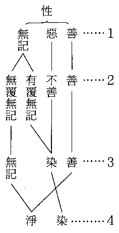



一般将法分为三性，但这三性，是指善、不善、无记的三性，不是指徧计、依他、圆成的三性。当知所谓善等三性，是诸法的道德性质的分类：合於道德的就称为善，不合道德的就称为恶，没有道德与不道德可为记别的，是中容性的无记。不独如此，那善恶的意味内容，全然是在是否道德以区别其差异的。对这，我们不能不予以注意。



如是三性，各再分为世俗和胜义的两种。今据基师《述记》所说，将之立表如下：



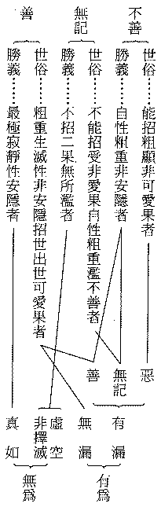



在此我们所当知道的，诸论皆对胜义善是无漏法为语，没有见说胜义不善者，这是一点。其次，现於不善中开一世俗，其义是极为难解的，这亦是一点。再次，无记有漏法是总，善、恶有漏法是别，这是以总别立为三种，因有为法固然是通不善的，但无为法是不通不善的。还有，关於胜义、世俗，案诸经论来看，或约有为无为，或约有漏无漏，或者是约假实，现在於不善中，取极恶法以为世俗，在道理上讲，是不怎麼妥当的。



如是三性，或各分为三种。善有三者：一、招感可爱果的善法，就是诸有漏善；二、性巧便的善法，是指有为无漏善法，因为无漏法性是极巧便的；三、性安隐的善法，是指无为善法，因为其性极安隐的。不善三者：一、招感非爱果的不善，是指最极不善的恶法；二、性非巧便的不善，是指有覆无记的染污法；三、性不安隐的不善，是指无覆无记的有漏法，亦有说是指的有漏善法，善法为什麼说为不善？约有漏善法观待无漏善法，其有漏善就成为不善。无记三者：一、相应无记，是指诸无记心心所法；二、不相应无记，是指无记色及不相应行；三、真实无记，是指虚空及非择灭的二种无为。



如是三性，亦可各分四种。善有四者：一、自性善，如说自性唯善的十一善心所。《大乘杂集论》卷三，虽说信等十一心所有法是自性善，但《俱舍》卷十三，说唯惭、愧及三善根是自性善。如该论说：『以有为中，惟惭与愧及无贪等三种善根，不待相应及餘等起体性是善，犹如良药』。《光记》十三解释说：『自性即善，名自性善，犹如良药，药即良善，故名良药』。二、相应善，是说与信等诸善心所相应时，始被称为善的心品，其本身并不是善的。《大乘杂集论》卷三说：『相应善者，谓彼相应法』。《俱舍》卷十三说：『相应善者，谓彼相应，以心心所要与惭、愧、善根相应，方成善性，若不与彼惭等相应，善性不成，如杂药水』。水的本身不是药，但与药调和以后，始得称为药水。三、等起善，指由自性、相应的善法所等起的律仪无表、不相应行及诸善的种子。《大乘杂集论》卷三说：『发起善者，谓彼所发身业语业』。此中彼字，是指自性善与相应善。灵泰《疏钞》说：『由心善故，则令身语合掌礼拜色亦是善。又表色及引得无表色亦是等起善色也。由现行能熏心是善，所熏成种子亦是善。如有问言：种子是何善？应答言：种子唯是等起善收』。《俱舍》卷十三说：『等起善者，谓身语业、不相应行，以是自性及相应善所等起故，如良药汁所引生乳』。四、胜义善，谓於无为中，除去虚空、非择灭的二法之善的无为，亦即是指择灭无为。《大乘杂集论》卷三说：『第一义善者，谓真如』。《俱舍》卷十三说：『胜义善者，谓真解脱，以涅槃中最极安隐，众苦永寂犹如无病』。《光记》十三解说：『胜义是涅槃，此显涅槃安隐名善，如人无病无苦安隐』。《正理》卷三十六解说：『或真解脱，是胜是义，得胜义名。胜谓最尊无与等者，义谓别有真实体性。此显涅槃无等实有，故名胜义。如是胜义安隐名善，如是涅槃是善常故，於一切法其体最尊，是故独标为胜义善』。



不善四者：一、自性不善，是指十种唯不善心所说。就是忿、恨、恼、悭、嫉、覆、害、无惭、无愧、瞋。如是十种唯是不善性收。二、相应不善，是指无惭等相应心心所法。灵泰《疏钞》对这解释说：『二、相应不善者，即根本中五，即取贪、痴、慢、疑、恶见。及随烦恼中十一法：谓取八大随及谄、诳、憍三，即取烦恼中十一法。及取徧行五、别境五、不定四及前六识心王。此等徧行、别境、六识中，通取不善性，皆是相应不善。即都计以前三十六法，名相应不善收也。贪、瞋、忿、害等十法，即是自性不善收也』。三、等起不善，指由自性、相应的不善法所等起的不律仪无表、不相应行及诸不善的种子。灵泰《疏钞》对这解释说：『由心不善故，所起色亦是不善，如屠儿恶律仪色。又得等四相。由现行心是不善故，所熏成种子，亦是不善种子，即是等起不善中收也』。四、胜义不善，是指有漏诸不善法，但最主要的是指生死流转。《大乘杂集论》卷第四说：『第一义不善者，谓一切流转』。《俱舍》卷十三说：『胜义不善，谓生死法，由生死中诸法，皆以苦为自性，极不安隐，犹如痼疾』。《光记》卷十三解释说：『谓生死法，苦谛为性，极不安隐，名胜义不善，如人痼疾，恒苦不安。生死翻涅槃，涅槃是胜义善故，生死是胜义不善。问：不善翻於善，胜义不善体通三性，亦可以善翻不善，胜义之善通三性？解云：胜义不善徧有漏故，得通三性；胜义善法，但择灭唯善，不通三性』。



无记四者：一、能变无记，是指诸无记的心心所法。如前六识中业所感的异熟生心自证分、见分为能变起相分的，固是能变无记，就是第八识的自证分、见分能变起相分的，亦是能变无记。二、所变无记，是指异熟生所变的相分，固是所变无记，就是威仪心所熏成的种子，亦名等起无记种子。三、分位无记，是指得等四相的无记不相应法。四、胜义无记，是指虚空及非择灭的二种无为。《俱舍》卷十三说：『胜义无记，谓二无为，以太虚空及非择灭唯无记性，更无异门』。《正理》三十六说：『无为无记，是胜义摄，以性是常，无异门故』。智周《演秘》解释说：『何唯此二名无记耶？答：真如性净，其择灭等断惑所显，以寂静故，胜义善收。虚空、非择，体非实有，不同真如，复非智慧断惑等得，不同餘三。由斯二义，故无记摄』。『问：亦依识变立虚空等，何不随识三性摄耶？答：且依如立，假空等说。若依识变，实通三性』。



虽有这样种种的分类，要不外於如本论所说的四法。法既有四，「阿赖耶识」究为「何法摄耶」？这是现在所要论究的问题。论中告诉我们：「此识唯是无覆无记」，不通善性与恶性。为什麼？「异熟性故」。假定通於善、恶二性，那就必定不是异熟。



异熟性故，虽说已答赖耶为何唯是无覆无记，但若不再进一步的加以详细说明，人们仍然不知其所以然。为此，论中特再举出三大理由，以明必须是无覆无记。



一、证唯无记：异熟性的东西，不是别的什麼，是指所谓总报的果体，为总报果体的异熟，为什麼定要无覆无记？当知「异熟」倘「若」唯「是善」的，或者唯是「染污者」，那就永久没有苦乐、升沈之期，亦即「流转、还灭应不得成」。这话怎讲？假使人天趣的果体，唯独限於善的，其有情就当永恒的是善，不可能再生起恶法，如果真的恶法不生，自就没有流转的可能，因为要有恶法，才会流转到三恶趣去。反过来说，假使三恶趣的果体，唯独限於恶的，其有情就当永恒的是恶，不可能再生起善法，如果真的善法不生，自就没有还灭的时期，因为要有善法，才会还灭到人天中来。因为如此，所以为五趣四生果体的赖耶识，不能不是无覆无记。《摄论》卷三说：『何因缘故善不善法能感异熟，其异熟果无覆无记。……若异熟果善不善性，杂染还灭应不得成，是故异熟识唯无覆无记』。



二、善染所依：「又此」第八阿赖耶「识」，既然是总报的果体，当然「是」为「善、染」诸法之所共「依」。换句话说，不论是善，不论是恶，都以此识为所依的。假定彼此相反，互相违害，是就决定不能作为所依。如善法不能为不善法作所依止，不善法不能为善法作所依止，所以说「若善、染者互相违故，应不与二俱作所依」。《摄论》卷三说：『由异熟果无覆无记，与善不善互不相违，善与不善互相违故』。为了要作善不善诸法的共所依止，作为总报果体的阿赖耶识，不能不是无覆无记。



三、是可熏性：「又此」第八阿赖耶「识」，真正「是所熏性」，亦即为前七转识之所熏处，能容受一切法的种子。倘「若」唯是「善」或唯是「染者」，其性是极强胜的，不能容受他熏。「如极香」的东西或极「臭」的东西，「应」是「不」得「受熏」。即极香的东西，不受臭的所熏，若极臭的东西，不受香的所熏。然今此识，能为七转识的所熏处，所以不能不是无覆无记。或有人问：为什麼定要有熏习识？没有熏习识有什麼不可？论主回答说：假定真的「无熏习」识者，「染净因果俱不成立」。这话怎讲？当知没有熏习，必然是就没有种子，种子假定没有的话，是就无因，因没有了，怎麼会有果？



依上三大理由，「故此」第八阿赖耶识，「唯是无覆无记」性，不得是善性、不善性及有覆无记性。



覆谓染法，障圣道故，又能蔽心令不净故，此识非染故名无覆。记谓善恶，有爱非爱果及殊胜自体可记别故，此非善恶故名无记。



赖耶唯是无覆无记，已经说得极为清楚，但无覆无记是什麼意义，还得进而加以解说。初说「覆」是覆障之义，其体是「染」污的，能「障圣道」无漏智的不得生起。次说覆是覆蔽之义，覆蔽依他八识心的自相，使令不能清净无染，所以说「又能蔽心令不净故」。但是「此识非」是「染」污性的，不独没有感果的作用，同时，既不障碍於圣智，更不荫蔽於自心，是「故名」为「无覆」。



但为什麼又名无记？要知「记」是记别的意思，要能明白的记为什麼什麼的，才得说名为记。如「善」有可「爱」果，可为明白记别的，「恶」有「非爱果」，可为明白记别的，「及」其善恶法有「殊胜自体，可」为明白「记别」的。这话怎讲？如有漏善法，可记别为调和的，如有漏不善，可记别为𢘙戾的。诸如此类，说名为记。基师《述记》说：『世尊记此当得此果，体性如是可记别故，说名为记』。但这两种解释，究有什麼差别？道邑《义蕴》答说：『前约功能，后据自性；前唯有为，后通无为；前唯有漏，后兼无漏。故有别也』。



可是「此」第八识，既然是「非善」的，亦复是非「恶」的，无论从那个角度去透视它，都不能记别它是善或是恶，是「故名」为「无记」。



庚六　释同性



辛一　第一师说



触等亦如是者：谓如阿赖耶识唯是无覆无记性摄，触、作意、受、想、思亦尔，诸相应法必同性故。



上来正释赖耶唯是无覆无记，现在说心王所相应的心所例同於心王，并不是分别识体正义，不过准於心王，得以推知心所是怎样的一种性质。关於推例的说法，本论虽有几家不同，但以护法所说为正义。



现在先看第一师的解说。「触等亦如是者：谓如」前说「阿赖耶识」，在三性中，「唯是无覆无记性摄」，当知与其所相应的「触、作意、受、想、思」五徧行心所，例同赖耶心王亦是无覆无记性摄，所以说「亦尔」。为什麼？因「诸相应法必」与心王是「同性」的。灵泰疏钞说：『问：何故初师说心所唯例心王无记性，更不例餘门耶？答：为颂文中言「是无覆无记，触等亦如是」，次无记后即言触等亦如是，故触等唯取无记性也』。



辛二　第二师说



又触等五如阿赖耶，亦是异熟，所缘、行相俱不可知，缘三种境，五法相应、无覆无记，故说触等亦如是言。



照此第二师说，「触等五」徧行心所，例於「阿赖耶」体，计有五义是相同的：一、赖耶是异熟，徧行「亦是」业所感的「异熟」；二、赖耶是所缘、行相俱不可知，徧行亦是「所缘、行相」最极微细「俱不可知」；三、赖耶是缘三种境，徧行亦同心王一样是「缘」种子，有根身、器界的「三种境」界；四、赖耶是五法相应，徧行亦是「五法相应」——即心王和心所共六法，除却它各个自体而有其他的五法；五、赖耶是无覆无记，徧行亦如心王是「无覆无记」。因有如此五事可以相例，是「故」颂「说触等亦如是言」。



辛三　第三师说



有义：触等如阿赖耶，亦是异熟及一切种，广说乃至无覆无记，亦如是言无简别故。



此第三师说，基师《述记》指难陀论师等。「有义」，是说有人作这样说：「触等」五徧行「如阿赖耶」，有七门可以相例的：一、赖耶是异熟，徧行「亦是异熟」；二、赖耶是一切种，徧行亦是「一切种」；三、赖耶是不可知，徧行亦是不可知；四、赖耶是执受处，徧行亦是执受处；五、赖耶是五法相应，徧行亦是五法相应；六、赖耶是舍受相应，徧行亦是舍受相应；七、「广说乃至」赖耶是无覆无记，徧行亦是「无覆无记」。为什麼会有这麼多法相例？因颂中说的「亦如是言」，是「无」有「简别」的。虽说没有简别，但识的自相、识的行相、识的受俱，还是不在相例之中。如触等各有它的自相，不须与识的自相相例。至於行相各各差别的，心所怎可与心王相例？受和受是不相应的，所以也没有例受俱。



辛四　第四师破



彼说非理！所以者何？触等依识不自在故。如贪、信等不能受熏，如何同识能持种子？又若触等亦能受熏，应一有情有六种体！若尔！果起从何种生？理不应言从六种起，未见多种生一芽故。若说果生唯从一种，则餘五种便为无用；亦不可说次第生果，熏习同时势力等故；又不可说六果顿生，勿一有情一刹那顷，六眼识等俱时生故。



如上三说，初二两说，在义上讲，虽还未备，在理上说，并没有什麼妨难；可是第三师说，有的固然是大家所共同承认的，有的实在讲得没有道理，所以现在特为破斥。「彼说非理」，这是总非。彼说，是指第三师说。此中主要是破他的能持种子这一说法。「所以者何」，是问为什麼是非理的？论主答说：「触等依识不自在故」。触等徧行心所，是依识而有的，如臣依於大王，不若大王那样的自在。在前讲到种子熏习时，於可熏性中曾说要决定自在，才可成为真所熏处。世亲《摄论》於四所熏外，更加一有自在义，方是所熏，亦是这个意思。触等既是依识而有，不能自由自在活动，当然不是真所熏处。「如贪」等的恶心所，「信等」的善心所，「不能受熏」，试问「如何」可说「同识能持种子」？因此，你们说例一切种，这是没有道理的，也是我们所不能承认的！



「又若」你们硬说「触等」五徧行心所，「亦」各「能」够「受熏」持种，那就「应」当「一」个「有情有六种体」。这话怎讲？基师《述记》说：『以六法体为所熏故，一一所熏有一种故』。「若尔」——假定种体真的有六，那当来「果」法生「起」的时候，究是「从」那一（何）「种生」？从那六种生起，又有什麼不可？第三师这样说。论主破言：「理不应言」果「从六种」生「起」，亦即不应说六种同生一果，因为从来「未见多种生一芽故」，亦即多种生一芽，是从来所没有见过的。六种种子共生一果，无论从那方面说，是都不能成立的，为什麼？因是因缘性的，如六能熏，能熏虽有六个，但所熏成的还是六个种子，绝对没有因缘，使令六个现行的能熏识，共同的熏生一个种子果。道邑《义蕴》说：『此六能熏为因缘故熏成六种，非是共为因缘生一果也』。就是此义。



在此，第三师引《杂集论》卷八说：『若於一生顿受一切所得异熟无有过失，所以者何？若造众多无间业者，所感身形最极柔软，所感苦具众多猛利，由此顿受种种大苦』。本此论说，明明五业可以共招一报，怎麼可说多种不能共生一果？错了！多缘生一果体，固然不成问题，多因能生一果，是就难以承认。如《成业论》说：『如何一一心心所法从二种子相续而生？不见芽等从种生法有如是事！可藉多缘生於一果，无从二种有一果生』。二种生一果尚且不可得，何况六种共生一果？



第三师转救说：你们误会我的意思了。我的本意：所熏的种子虽然是很多的，但到生果时唯从一种子生。像这样的讲法，试问又有什麼不可？论主说：这样讲法，确实仍是不可。为什麼？「若说」到「果生」时，「唯从一种」子生，是「则」其「餘」的「五种，便」要成「为无用」，亦即成为多餘的，没有它的功能作用了！假定真的成为无用，我还得问你：受熏明明是相同的，为什麼不同生果？是则你的这个说法，仍然不得成立，亦为智者之所不能接受的，只是你们自说自话而已。



第三师又说：我之所以说六种皆得生果，是约它的次第生果说，不是约它顿时生果说，你们千万不要误会我的意思！论主破道：「亦不可说」一个、一个的「次第生果」，因为「熏习」的时候，是「同时」熏习的，其所熏成的「势力」是相「等」的，到了果生起时，亦应是相齐的，怎容次第生果？所以绝对不可说心种先生，其餘的触等种子次第生果。



第三师又说：不对！不对！我说得太快，我的意思是说六果顿起，竟然说成次第生果，现在我愿改变我的论调，认为六种一时顿生六果！论主破道：次第生果固然不能成立，「又不可说」一个心王种、五个心所种，在同一刹那中「顿生」「六」个现行「果」。为什麼？因「勿一」个「有情」於同「一刹那顷」，而生六个眼识的现行果，所以说「六眼识等俱时生故」。由此应知唯说心王持种，在道理是讲得过去的，说心所亦能持种，不论怎麼讲，亦是不当的。因而，以心所例心王为一切种不可。



谁亦触等亦能受熏持诸种子？不尔！如何触等如识名一切种？谓触等五有似种相名一切种，触等与识所缘等故，无色触等有所缘故，亲所缘缘定应有故，此似种相不为因缘生现识等，如触等上似眼根等非识所依，亦如似火无能烧用。



第三师转救说：「谁」同你们说「触等」徧行心所，「亦」如赖耶「能」够「受熏持诸种子」？你们歪曲我的意思，这是你们的事，我可不曾说例同本识受熏持种名一切种，这是要请你们特别注意的！「不尔」——假定你们不是这样主张，那又「如何」说「触等」徧行心所「如」心「识」一样的「名」为「一切种」？



第三师回答说：我说「触等五」徧行心所亦如识名一切种者，并不是如第八识能持真种，而是说阿赖耶识在缘种子时，相应触等「有」变「似种相」，将之领以为境，所以「名一切种」。如把它当著像本识那样的真能持种，是就大错特错！要知似种与真种，是有很大不同的。本识所变种子是能生果的，所以叫做真种；触等虽亦能变为种子，但绝对不能生果，所以叫做似种。



我为什麼要这样讲，说来约有三大理由：一、「触等与识所缘等故」：如第八赖耶识所缘境是什麼，其相应的触等心所，亦必以什麼为所缘境。且如赖耶缘种子时，五心所法亦必同以种子为所缘，彼此所缘是同等的，决不会赖耶缘种子，触等缘其他的境界。二、「无色触等有所缘故」：依实有论者说，不论小乘有部、大乘唯识，都认无色界是没有色法的，但生无色界的有情，虽然没有根身、器界的色法为它们所缘，可是它们仍然有所缘境，当知这所缘境，我们认为就是种子，假定不是以种子为所缘，试问它们所缘境是什麼？如承认它们是以种子为所缘，就得承认以似种相为一切种。三、「亲所缘缘定应有故」：不论是什麼心王心所，既然各有它们的见分，当必有它们的相分，作为自己的亲所缘缘，而此亲所缘缘必是自己所变相分，如果说以本识相分种为亲所缘缘，没有自己所变的相分为所缘，那就变成心外取法，所谓唯识不得成立。假定说是托彼本识而变，是就成为疏所缘缘，同样没有亲所缘缘。这在道理上，是说不过去的。



由於以上的三大理由，应知我所说的「此似种相」，不是作因缘的种子，所以「不为因缘生现」行的果「识」。等是等取诸根诸境。举例来说：「如」在「触等」五徧行心所「上」面所变「似」的「眼根等，非」是眼「识」之「所依」的，就是不得为依亲生五识，亲生五识的，必是以心王本身之所变的才行。而且心王所变的根身、种子、色法，皆有它们的真实作用，但是五心所法所变的种子、根身，真实作用固然是没有的，但所变的色法则有它的碍用。再举通俗的譬喻说：「亦如」镜中之火，谁都知道不是真火，而只可以说为「似火」，如此似火，当然是「无」有「能烧」的作「用」的。所以触等所变的似种，只可作所缘缘，不得作亲因缘。我认为我这道理，不论从那方面讲，敢说都能讲得通！



彼救非理！触等所缘似种等相，后执受处方应与识而相例故。由此前说一切种言，定目受熏能持种义。不尔！本颂有重言失！又彼所说亦如是言无简别故咸相例者，定不成证！勿触等五亦能了别，触等亦与触等相应。由此故知亦如是者，随所应说非谓一切！



论主破说：「彼」第三师这样的挽「救」自己，是「非」合於道「理」的。因为「触等所缘似种等相」名一切种，要到「后」面第四所缘门的所谓「执受处」的地方，「方应与」心「识而相例故」，怎麼可於其前第三因相门的一切种中例於缘境？「由」后执受处中有所缘种，所以「前说一切种言」，决「定」是「目」本识有彼「受熏」和「能持种」的意「义」。不是说缘种似种等义，所以不可以触等五心所法缘种为例。「不尔」——假定不是这样的话，亦即若不是说受熏持种名一切种，则「本颂」中乃「有重言」的过「失」！这话怎讲？如前解说一切种已经说了缘种，到下解说执受处时复说缘种，这不是犯重复的过失是什麼？



彼第三师又挽救说：你们以为有犯重言的过失，可是在我并不认为有这样的过失，因为缘诸种子名一切种，固然是不错的，但於执受处中主要是说有根身，不明执受种子缘种子的，试问这有什麼重言过失？论主破说：这在道理上仍然是不行的，如世亲《摄论释》第一说：『依二执受：一者有色诸根及所依执受；二者相、名、分别、言说戏论习气执受。有色界中具二执受，无色界中不具二种』。这明显的是说种子与有根身同在一处说执受并一处缘之，你为什麼硬要说缘种是在第三因相门，执受根身并缘根身是在第四所缘门？现在老实的告诉你：在执受处的所缘门中，是不容许种子与根身个别而明的，所以你现在的救说仍然是错误的！



「又彼」第三师「所说亦如是言无简别故咸相例者」这句话，决「定不」足以「成」为「证」明，心王和心所，一切的一切，都可彼此相例。为什麼？「勿触等五亦能了别」。因了别唯是识的行相，触等五所各有它们的行相，绝对不可说亦是以了别为行相的。同时不可说「触等亦与触等相应」，触等五所只可说与本识相应，触与触相应，作意与作意相应，乃至思与思相应，这是绝对说不过去的，亦是绝对没有这个道理的。



「由此故」可「知」道，所谓「亦如是者」，不是完全没有简别的，而是於心王中所具的十义，「随所应说」，可例者则例之，不可例者则不例之，「非谓一切」皆可相例。如果相的异熟，所缘行相的不可知，相应的法各有五种，三性门的是无覆无记，所缘境同心王一样是种子、根身、器界，再加断舍位同心王一样是在阿罗汉位。如是六义，心所是可例同於心王的，所以说『触等亦如是』。至於自相，因心所没有所执藏义，所以不例；持种的因相，因心所的不能持种，所以不例；了别行相唯心王有，心所没有了别相的，所以不例；受和受是不相应的，所以不例受俱；由於心所不像转识那样的起波浪相，所以因果譬喻亦不相例。如是五义，心所是不例同於心王的。如说一切皆例於心王，自是不应道理的！



庚七　释引喻



辛一　问答正释



阿赖耶识为断为常？非断非常，以恒转故。恒谓此识无始时来一类相续常无间断，是界、趣、生施设本故，性坚持种令不失故。转谓此识无始时来念念生灭前后变异，因灭果生非常一故，可为转识熏成种故。恒言遮断，转表非常，犹如暴流，因果法尔。



科文说的释引喻，就是因果譬喻门，意思是引用譬喻来显示第八识生灭相续非断非常的意义。由於这个意义甚深微细，不以譬喻显示是不能了解的，所以判为释引喻。



首先问答以明初能变识非断非常。如有问曰：为自相的这个「阿赖耶识，为」是「断」灭的？「为」是「常」住的？简单的答：「非断非常」，显是阿赖耶识，既不是断灭的，也不是常住的。什麼理由？「以恒转故」。恒即显示它的不是断灭，转即显示它的不是常住。此中『恒转』两字，当知就是颂文所说『恒转如暴流』的『恒转』。



所谓非断非常，在此是简别小乘的经部及外道的数论。数论所说的自性，虽为一切法的法种，但他主张自性是常的，所以特以非常予以简别。经部认为色心皆能持种，但在主无色界无色，无心定无心的学者看来，色心有时是有间断的，所以特以非断予以简别。



「恒」是怎样的？「谓此」阿赖耶「识」，从「无始时来」，一直都是这样「一类相续」而「常无间断」的。一类显示赖耶常是无记，相续显示赖耶曾未间断。正因赖耶有著这样的特点，所以它「是」三「界」、五「趣」、四「生，施设」异熟果报的根「本」。施设是安立的意思，就是安立界、趣、生的各种不同的果报体。如果赖耶识是断灭的，那就不能以它来安立界、趣、生的果报，所以恒言正遮於断，亦即再度显示上面所说的一类义。假定赖耶识是善染的，其体不是一类无记，趣生就要变成杂乱，因为容许善染可以杂乱生起的。事实由於此识不是善染而是一类无记的，所以不容杂乱生起，亦即因果不容紊乱。「性坚持种令不失故」，是显上面所说的相续义。在前讲到所熏四义中，第一个条件就是坚住性，唯有坚住性方是所熏处。正因赖耶的性质是坚住的，所以能恒恒时的执持诸法的种子不散不失！



「转」是怎样的？「谓此」阿赖耶「识」，虽说其性是坚的，但从「无始时来」一直到现在，总是「念念生灭」的「前后变异」，所以不是常住坚密，能受诸法的熏习。「因灭果生非常一故」，这是简别是常是一，凡是常一的法，决定没有因果。由於是有生灭的，所以简别不是常，当然不是自性物；由於是因果性的，所以简别不是一，当然就不是自我。「可为转识熏成种故」，这是显示赖耶的可熏义。假定赖耶是常住的，那就决定不能受熏，不能受熏，是就不免有了不为转识熏成种子的过失。不熏成种有什麼过失？这过失可大了！受熏成种，什麼是生死，什麼是涅槃，其差别是很明显的可以分别出来，假定不能受熏，所谓生死涅槃的差别，是就根本不存在。



恒转两字解释过了，现在续释『如暴流』三字。「恒言」是「遮」除「断」灭；「转」言是「表」示「非常」。阿赖耶识是非断非常的，为什麼？因它是恒随转的，「犹如暴流」那样的波水不相舍离。不特赖耶的因果性是非断非常的，一切因果皆非断常的，所以说「因果法尔」。法尔，是说本来就是这样的，不是那个令他如此的。



如暴流水非断非常，相续长时有所漂溺；此识亦尔，从无始来生灭相续，非常非断，漂溺有情令不出离。又如暴流，虽风等击起诸波浪而流不断；此识亦尔，虽遇众缘起眼识等而恒相续。又如暴流，漂水上下鱼草等物随流不舍；此识亦尔，与内习气外触等法恒相随转。如是法喻，意显此识无始因果非断常义。谓此识性无始时来刹那刹那果生因灭。果生故非断，因灭故非常，非断非常是缘起理，故说此识恒转如流。



此下举暴流喻以明此识为三界五趣四生之本。例「如」长江大河的湍激「暴流」，是「非断非常」的，谁都可以看得出，亦是谁都能了解的。若说暴流是断，这是不可以的，因它昼夜不舍的在奔流，从来没有一刻间断过，所以说非断。若说暴流是常，同样是不可以，因它后浪推前浪的滚滚而下，前后浪迥然是不同的，所以说非常。如是非断非常的前后「相续长时」不绝的暴流，「有」其特殊的「漂溺」力用。漂是将人物漂浮在水的上面，使人可以清楚的看到；溺是将人物沉溺在水中，令人不能发现它的所在。暴流如此，当知「此」阿赖耶「识亦尔」——亦是这样，「从无始」以「来」，就是这样随著烦恼业浪的滚滚起伏，后「生」前「灭」的「相续」无间，「非常非断」的「漂溺有情」在生死大海中，时而漂浮在人天二趣，时而沉溺到三恶趣，「令」在生死海中头出头没，「不」得「出离」三界。这是显示第八识在五趣中流转不息。



「又如暴流」的向下奔放，「虽」因「风」力「等」冲「击」，叠起层层的无边无际的滔天大「浪」，然「而」其「流」并「不」因此有所间「断」。暴流这样，当知「此」阿赖耶「识亦尔」——亦是这样，就是赖耶藏识大海，「虽」然「遇」到各式各样的外界「众缘」之风，飘动识海，现「起眼识等」的六识波浪，然「而」如暴流的赖耶，仍然「恒」时因果「相续」的无有间断。这是显示生起眼识等受用外在的境界。



「又如暴流」之水，「上」上「下」下的漩转不息的「漂」流，不论是在水下的「鱼」虾之类，不论是在水上的「草等物」类，虽然不断的「随」著暴「流」在漩转，但「不舍」离水的本处，始终是在水中滚来滚去。暴流这样，当知「此」阿赖耶「识亦尔」——亦是这样，即「与内」在的「习气，外」在「触等法」，也如鱼草一样的，随著识浪的起伏，所以说「恒相随转」。此中漂水上下，譬喻善恶种子，所以说为内因习气。鱼草等物，譬喻善恶五趣，由於五趣中的苦乐受，是由触而生，所以说为外触等法，拣别不是内触。这是显示自性相续而不断绝。



「如是」像上所举的三种「法喻，意」在「显」示「此」阿赖耶「识」，从「无始」以来所有的「因果」关系，就具有这「非断」非「常义」，不会落於断常的二边。法喻如是，当知所「谓此」阿赖耶「识性」，从「无始时来」，就是这样「刹那刹那」的在「果生因灭」。刹那「果生故」，显示赖耶的「非断」，刹那「因灭故」，显示赖耶的「非常」。如是像这样的「非断非常」，就「是」诸法「缘起」的正「理」。由是之「故，说此」阿赖耶「识，恒」常「转」变，正「如」暴「流」水那样的非断非常。唯有如此，才能建立正因果性。



辛二　外难内释



壬一　破有部师等



过去、未来既非实有，非常可尔，非断如何？断岂得成缘起正理？过去、未来若是实有，可许非断，如何非常？常亦不成缘起正理。



此下外人所难，皆从三世立论。讲到三世建立，诸宗极为不同：说一切有系，认为三世都是实有的，正因为是主三世实有，才成为说一切有者；一说部，说三世但有言说，根本没有实体；出世部，依法立世：世间法是虚假的，三世的时间亦是假的，出世法是真实的，三世的时间亦是真实的，时间的本身无所谓假实，完全随法的假实而假实；大众部及经部系，认为现在实有固然没有问题，过去未来不可说为真实，而应说是假有；到了大乘学派，对於时间看法：性空论者主张三世幻有，唯识论者主张现在实有。同样是时间，大小乘学派，有著各式各样的说法，因而彼此之间，展开激烈诤论，这里不多论说。



现在先出说一切有系的问难：论到因果的建立，一定要通到三世，唯有依於三世的建立，才能显示因果的特胜。如以过去为因，现在为果，现在为因，未来为果，唯有像这样的三世不断，方能建成如法合理的因果。可是你大乘唯识家所谈的因果，唯约现在一重生灭灭生为因果义，不立过去未来为实有。「过去未来既」然「非」是「实有」之法，说它是「非常」，固然是「可」以（尔）的，说它是「非断如何」可以？要知现在是刹那不住的，未来如你们所说是无体的，这样，不是断灭是什麼？假定真是「断」灭，「岂得成」立「缘起」的「正理」？



论主破说：「过去未来若」如你们有部所说「是实有」的，「可」以「许」它「非断」，固然没有问题，因有未来相续而来的；但是过去你们亦说是恒有的，既然是恒有的，「如何」可说「非」是「常」住？你们认为我的断不能成为缘起正理，难道你们所说的常可以成为缘起正理？所以说「常亦不成缘起正理」。



岂斥他过己义便成？若不摧邪难以显正。前因灭位后果即生，如秤两头低昂时等，如是因果相续如流，何假去来方成非断？



有部难说：讨论任何一个问题，都要说出自己道理，才能显示你的理论正确，「岂」可破「斥他」人的「过」失，自「己」的「义」理「便」得「成」立？如果斥他就能成立己义，那是不能令人信服的！



论主答说：话不是这样讲的，当知对於任何理论的建立，首先是要摧破各种邪说，假「若不」先「摧」破各种「邪」说，那是「难以显」示「正」理的。为了摧邪显正，对於他人的错误过失，不得不加以排斥！这是我的不得已，并不是有意找他人的麻烦！



现在不妨将我唯识家的因果正义讲给你听：我前说的因灭果生，是约现在「前因灭」的阶「位，后」念「果」法「即生」，於其中间没有任何东西的间隔，亦即其生灭没有前后两刹那，而是在同一刹那生灭的，是为因果不断，并不是要待前因灭尽，方有后果的生起。假定是待因灭，而后才有果生，自可说为断灭，现在因果是同时的，种现是相生的，根本没有前后可得，怎麼可以成为断灭？这个道理，举例来说：好像用秤来秤东西，这头低下去的时候，就是那头昂起来的时候，既不是先低后高，亦不是先高后低，而是高低同时的，所以说「如秤两头低昂时等」。这种道理非常浅显，相信任何人都知道。为什麼要这样讲？以诸种子与第八识是俱生俱灭的，为了互为影略，所以前但说为因灭，后但说为果生，而实是因果同时的。亦即前念现种因果灭位，后念现种因果生位。如再说清楚点：秤是譬喻本识，两头譬喻因果，低昂譬喻生灭，时等譬喻刹那不异。「如是」阿赖耶识中的种子生现行，现行熏种子的「因果」生灭，不断不常的「相续」，犹「如」暴「流」一样的无有间断，「何」必要「假」过「去」未「来」的实有，「方」能「成」立因果「非断」？不藉过去未来的实有，因果同样是可相续不断的。



因现有位后果未生，因是谁因？果现有时前因已灭，果是谁果？既无因果谁离断常？若有因时已有后果，果既本有何待前因？因义既无果义宁有？无因无果岂离断常？



有部又复难说：我们认为不谈因果则已，要谈因果一定要通三世以谈，假定真如你们唯识所说，唯立现在因灭果生以为因果，我们总觉是要不得的！例如你们说「因」是居於「现有位」上，而「后果」还「未生」起来，试问现有位上的「因是谁」家所有的「因」？或说他为那个作因？好像没有生过儿女的女子，说她是母亲，试问她是什麼人的母亲？倘若你们说「果」是属於「现」在「有时」，然而所谓「前因」早就「已」经「灭」了，试问这个「果是谁」家之「果」？或说是什麼东西的果？好像为母亲的老早死了，现在这个初生的小孩，试问那个是他亲生的母亲？那简直可说无法交出一个娘家来！如是像这样的「既」然「无」有其「因」，当然亦复无有其「果」，因果既然都没有了，怎麼可说离断离常？所以说「谁离断常」？断常之过不离，你们还说什麼非断非常？



论主巧妙的答复说：倘「若」你们不承认同时因灭果生，而妄执著正在「有因」的「时」候，就「已」经「有」了「后果」，那末，「果」法「既」然「本」来是就「有」的，「何」必还要等「待」什麼「前因」而后有果？当知待因而生，是即显示果本无有，设使果已有了，还要待什麼因？好像儿子老早已经有了，还要等待母亲来生做什麼？且因本是为的酬果，现在既不待因，试问果从何有？这末一来，「因」的意「义既」然根本没有，「果」的意「义」又岂「宁」可而「有」？如是像这样的「无因无果，岂」能远「离断常」之过？正因你们不离断常的过失，我才不客气的给予你们痛切的破斥！



因果义成依法作用，故所诘难非预我宗！体既本有用亦应然，所待因缘亦本有故。由斯汝义因果定无，应信大乘缘起正理！



有部又复救说：你们仍然没有明白我的意思，当知不论何法都有它的体用，因果自然亦不例外。我们说未来实有，虽说因果的自体，老早是就有了的，但「因果义成」而得名为因果的，不是依於因果的法体，而是「依」於果「法」的「作用」。我们常这样说：作用还未有的时候名为未来，作用正在有的时候名为现在，作用已经没有的时候名为过去。现在因用固然是有的，但是果用还没有产生。如是像我这样讲法，因义的成立固无疑义，果义的成立亦无问题。所以你「所诘难」我的不离断常之过，这是你自己的事，根本不关我的事，所以说「非预我宗」！



论主再反责说：你们这个说法，在你们或以为因果义成，但在我看来仍是不行。诸法各有它的体用，这是谁都不否认的，可是体用两者，从来根本不相离的。现汝「既」执法「体」是「本有」的，其「用」照理亦应是本有的，所以说「亦应然」。以论理的方式说：你们所计的作用，在未来应该是有的，因为用是不离於体的，犹如体在未来的本有。假如你们认为作用在未来是没有的，所计法体亦如作用於未来无，因为体是不离於用的，用既没有，体当然无。或者你们又说：不错，体用在未来是都有的，不过由於所待因缘的未合，所以作用不得生起。



论主驳道：这个说法仍然是不对的，因为你们既说诸法本来都是有的，「所待」以起用的「因缘，亦」当是「本有」的，你们承认不承认？假定承认所待的缘是本有的，那未来应当常常的生起作用。不妨这样说：未来一切法的作用，应当常常的生起，因为生起作用的因缘，完全具备而无所缺少的，好像现在法一样。现在法由於因缘具备而起作用，未来法因缘具备当然亦起作用。因此，如照你们所说，体用因缘皆是本有，那就不免堕於死常，常就没有任何转变，怎麼能够建立因果？「由」是之故，如「汝」所说本来有的意「义」，其「因果」决「定」是「无」有的。但为正信的佛子，又不能拨无因果，是则你们「应」当「信」仰我「大乘」唯识所主张的现在生灭的「缘起正理」，方不致於成为否定因果的断灭论！



谓此正理深妙离言，因果等言皆假施设。观现在法有引后用，假立当果对说现因；观现在法有酬前相，假立曾因对说现果。假谓现识似彼相现。如是因果理趣显然，远离二边契会中道，诸有智者应顺修学！



这是结申因果正义。现在再告诉你：我唯识学上所说「此」一缘起「正理」，是甚「深」最甚深，微「妙」最微妙，远「离」一切「言」说，不可用语言来表示，那里还可说为因果？至於有的时候说「因」说「果」说缘「等言」，这「皆」不过是为度生而方便「假施设」的，不同你们说的定为实有！



是则唯识所说的因果究竟怎样建立？首当知道的，就是我大乘唯识学，只承认现在是实有，因而也就以现在为中心来观察过去与未来。如「观」此「现在法有引」生「后（当）」来果法的作「用」，当来的果法虽说是没有的，但因现在法上有引生当果的作用，所以当吾人观此法果的时候，心中自然变作未来的状态，这所变的状态，看起来，好像是在未来，实际上，还是在现在的，所以假说此所变的未来名为当来之果，「对」此「假立」的「当」有之「果」，而「说现」在法为「因」。再如「观现在」一切的果「法」以推究它的来处，立即知道这是为「酬」答从「前」的因「相」而有。观此果法所从生的地方，其心变为过去，看起来，好像是在过去，实际上，还是在现在的，所以假说此所变的过去名为过去之因，对此「假立」的「曾」有过去之「因，对说现」在为「果」。灵泰《疏钞》说：『如观现在身是果，从过去善业生，意以过去为因；又观现在善恶业为因，未来为果，虽未有果，即假说现在法为因』。这可说是最好的说明。如上所说，可以知道：唯识学上所说的因果，都是以现在法为中心。因为现在是果法，所以说过去是因法；因为现在是因法，所以说未来是果法。因果二法，都是在现在一刹那上建立的。为什麼定要安立三世因果？三世因果的建立有什麼意义？



因果皆假施设的「假」，究是什麼意思？「谓」於「现识似彼相现」，就是依於现在的识，缘於现在法的时候，好似有其因果相现，但决不是心外实有因果，假定离了现在心识，另外建立一种因果，那就成为心外取法，而不免於堕落断常。如观现法所从生时，在识上变现过去的一种非因似因的假相，在现在法上变现一种非果似果的假相，固然是假说因果。若观现法从其所生，在识上变现未来的一种非果似果的假相，在现在法上变现一种非因似因的假相，同样是假说因果。正因如此，所以是假施设的。



「如是」所假施设的「因果」道「理」及其义「趣」，都是很「显然」的，一看就可知道，「远离」断常「二边，契会」非断非常的「中道」。因此，「诸」凡具「有智」慧的行「者，应」当随「顺修学」唯识所说的缘起中道正理，以免落於断常的二边！



以大乘唯识的真义说：法唯决定是在现在不通过去未来，虽说如此，但识变的三世，诸经论中说有不同，不同尽管是有多种，然而归纳起来，实不出於三种：



一、道理三世：这是依於种子曾经有的及当来有的，说有过去与未来的二世。曾经有过的名为过去，当来会有的名为未来，现在正有的名为现在，而这是依现在法，约义说有三世的差别。



二、神通三世：如宿命智缘於过去，这是佛法行者都知道，没有任何问题的；生死智缘於未来，这是天眼通的作用，因为天眼通能见有情的死此生彼，所以说为死生智；他心智及漏尽智缘於现在，对当下的现在法，能够透辟的认识。由於神通的缘世不同，所以分为三世。虽这不是就种子说，但同样的是有三世的差别。不过这个神通三世，不是妄识所变，是由智力而缘，所以所见皆实。



同样是神通，凡夫与圣者所有的，其功能是有很大差别的：如凡夫所有的神通，向前可以知道八十个成坏劫，向后亦可知道八十个成坏劫；二乘圣者的神通，向前可以知道八万个成坏劫，向后亦可知道八万个成坏劫；大乘菩萨的神通，在初地的阶位，向前可以知道百个成坏劫，向后亦可知道百个成坏劫，到了二地以上，就可逐渐增多；到了最高佛果位上的神通，不论过去未来，都能知道无量无边的劫数事，不受任何限制的！



三、唯识三世：这三世义通前二种，就是如前说的道理三世与神通三世，皆为唯识三世。所不同的，就是前二种外别有实体，而唯识三世则多是虚妄分别心所变似的过去、未来、现在，但是据实而言，能缘皆是现在。



《唯识了义灯》说：『问：疏云：依识变曾、当假立三世，为道理三世？为唯识三世？若道理三世，与唯识三世有何差别？答：不寻因果相酬引边，但说过去事，及记未来诸可怖事，而心变作过未之相，对彼二相说名现在，即是唯识，故与此别』。本来，只有唯识、道理二种三世，并没有什麼神通三世，但恐神通与妄缘混滥，所以分为三种三世。神通缘於三世，是由智力亲切了知，不是虚妄攀缘而知，可是唯识三世，如独头散位意识，缘於过去未来，是属妄缘而知。因此，神通三世与唯识三世，确实是还有它们的差别，假定不加简别，那恐神通就要滥於妄缘。



壬二　破上座部等



有餘部说：虽无去来而有因果恒相续义。谓现在法极迅速者，犹有初后生灭二时，生时酬因灭时引果，时虽有二而体是一，前因正灭后果正生，体相虽殊而俱是有。如是因果非假施设，然离断常又无前难，谁有智者舍此信餘？



这是上座部等自立宗义，亦即指主没有过去未来的各学派，凡是主张过未无体的，都包括在此中。



「有餘部说」，就是上座部等所说。据他们说：「虽无」过「去」未「来」的诸法体用，然「而」仍「有因果恒」时「相续」的意「义」。这话怎讲？「谓」如「现在法」体的变迁，在时间上，那怕是最「极迅速者」，迅速到如石火电光的那样，「犹有初」生「后」灭的「生灭二时」的相状。此法初「生时」，为的是「酬」过去之「因」，此法后「灭时」，为的是「引」当来之「果」。如此生灭法，在「时」间上「虽有」初后「二」时，「而」二时的法「体」，根本就「是一」个，并不因为有了二时，法体也就有了两个。当其「前」念「因正」在「灭」的时候，就是「后果正」在「生」的时候。如是法「体」与生灭二「相，虽」然是有差「殊」的，然「而」实在「俱是」现时「有」的。



「如是」像我这样没有过去未来而建立的「因果」，都是有实体性的，并「非」是「假施设」的。虽不是假施设的假法，「然」而却是绝对远「离断常」二边的过失，同时「又无前」面所说的『果既本有，何待前因』？『因是谁因，果是谁果』等大小乘诸多责「难」，真正可以成立因果的正义，「谁」个「有智」慧的行「者」，肯得「舍此」究竟了义的说法不信，而去「信」那其「餘」不了义不究竟的说法？是以唯我们所立的因果最正确的！



彼有虚言都无实义，何容一念而有二时？生灭相违宁同现在？灭若现在生应未来，有故名生既是现在，无故名灭宁非过去？灭若非无生应非有，生既现有灭应现无，又二相违如何体一？非苦乐等见有是事！生灭若一时应无二，生灭若异宁说体同？故生灭时俱现在有同依一体，理必不成！



上来是上座部的立宗，现在是唯识家的正破。「彼」上座部等所说，依照我唯识看来，不过徒「有」一种「虚言」而已，并「无」一点「实」在的意「义」。为什麼？当知所谓一念，就是唯一刹那，在这短短一刹那中，绝对没有生灭二时，所以说「何容一念而有二时」？假定在极迅速的一刹那中，会有前后的生灭二时，那不可再加分析的最极微细的极微，至少亦应是有二分的。你们承不承认极微有二分？如你们承认极微有二分，那我就承认极微有二时，假定极微没有二分，刹那怎麼会有二时？而且，生不是灭，灭不是生，「生灭」是互「相违」的，怎麼（宁）可以「同」时「现在？灭」假「若」是在「现在」的话，「生」就「应」当在於「未来」。因为是「有故名」为「生，既」然「是」在「现在」，因为是「无故名」为「灭，宁非」是就成为「过去」？反过来说：假若「灭非」是「无」的，那「生」就「应」当亦「非」是「有」。作为「生」的「既」然是「现」在「有」的，并没有成为无，作为「灭」的亦「应」是「现」在「无」而成过去，灭体怎麼可以说为有？「又」此生灭「二」者，好像明暗一样，是互「相违」背的，生不是灭，灭不是生，生灭二法「如何」说是「体一」？如苦是苦不是乐，如乐是乐不是苦，苦乐不是一体，这是世间现见的事实，谁都可以体会到的，所以说「非苦乐等见有是事」。再说，「生灭」假「若」是「一」体的，生不异灭，灭不异生，那在「时」间上，就「应」当「无」有初后「二」时；「生灭若」是「异」体的，生不是灭，灭不是生，那生就应属於现在，而灭就应属於过去，如是，「宁」可「说」其自「体同」一？由是之「故」，你们所说的「生灭」二「时，俱」是「现在」所「有」的这话，「同」是「依」於「一体」，在道「理」上是「必」然「不」能「成」立的！



壬三　破经部师等



经部师等因果相续，理亦不成，彼不许有阿赖耶识能持种故。



上来已破有部及上座部等，现在继续来破经部师等。「经部师等」，等於说假部。身为佛子，不论奉行任何宗派，不但要深信因果，而且要建立因果。经部学者虽亦主张种子生现行，现行熏种子的「因果」前后「相续」不断，但他们的论说，在道「理」上讲来，是「亦不」得「成」立的，因为「彼」等「不」承认（许）「有阿赖耶识能」执「持种」子的原「故」。《摄大乘论讲记》说：『熏习为种说，小乘有几派，有主张色心受熏为种的，有主张心心所法受熏为种的。色心为种子的，有以为刹那刹那前色引后色，前心引后心。但主张无色界无色，无心定无心的学者，觉得这有通不过的地方，如无色界没有色，无心定没有心，这色心的种子是什麼呢？因此，经部中的先轨范师，主张色心互持种子。无色界没有色，但是有心，就以这心持色法的种子；无心定虽没有心，但还有色，就以这色持心法的种子。这里所破的『有执色心无间生是诸法种子』，是约前后自类引生说的。论主认为这不得成立，如前破二念不俱有等，已说它无熏习的可能了。论主又从无色界无色，无心定无心（六识）的见地，破斥他；又从无色界没，生欲色界的时候，色法久已断灭，现在色法的生起，以什麼为种呢？又有从无想天没，或从灭定等出，心法在无想天及二无心定中，也久已断灭，现在心法的生起，又以什麼为因呢？若许有阿赖耶识，摄持色心的种子，就没有这样的过失』！不过像经部这样讲因果相续不断，虽有点近於大乘唯识，其道理似亦略胜其他的学派，但因不承认有摄持种子的阿赖耶，终於仍不能建立正因果性。



壬四　总结劝信



由此应信大乘所说因果相续缘起正理。



「由」於如「此」，小乘各学派的学者，「应」该「信」奉唯识「大乘所说」种生现、现熏种的「因果相续」的「缘起正理」！因为因果相续，必然是要受熏，从熏而成种子，由种生起现行，现行复熏成种，如是像这样的，方是相续之义。今经部师，既然没有受熏持种的心识，所谓因果相续之说，亦不过是种虚言，决没有真实意义。



庚八　释舍位



辛一　正释舍位



此识无始恒转如流，乃至何位当究竟舍？阿罗汉位方究竟舍。谓诸圣者断烦恼障究竟尽时名阿罗汉，尔时此识烦恼粗重永远离故，说之为舍。



所谓释舍，是明阿赖耶识的断舍位次。不过首要知道的，就是所谓断舍，不是舍第八识体，只是舍阿赖耶名。因为第八识体，在一切有情中，除了入於无餘涅槃的二乘圣者，尽未来际是都没有断舍的时候。因此我们必须紧记：舍是唯舍阿赖耶名，不是舍第八识体，如以为是舍第八识体，那就大错特错，没有真正了解舍之所以为舍。「此」第八阿赖耶「识」，自从「无始」以来，一直「恒转」不息，犹「如」暴「流」水那样的，没有停止过片刻。既然如此，行者修行，「乃至」要到达「何」种果「位」，方「当」把它「究竟舍」掉？现在答复他说：要到「阿罗汉」的果「位，方」能「究竟舍」掉。要知阿赖耶之所以得名阿赖耶，原因全在第七识对之生起我爱我见而成为所谓执藏，所以一旦到了第七识断去我执，不再妄认第八识为自我，第八识自然就舍去阿赖耶名。



「谓诸圣者」，是通指三乘一切圣者。严格说来，小乘初入预流，即可名为圣者，不过在烦恼未尽的时候，不得名为阿罗汉，到了「断烦恼障」得以「究竟尽时」，方得「名」为「阿罗汉」。当「尔」之「时」，就是到了阿罗汉位的这个时候，由於「此」阿赖耶「识」所有「烦恼粗重永远」的远「离」，所以「说之为舍」，并不是舍第八识体。讲到粗重，当然是指烦恼种子，因为《对法论》等，都说种子为粗重的。虽烦恼现行以及无堪任性，都可名为粗重，但在这里所取的是种子，既不是烦恼现行，亦不是无堪任性。由於烦恼种子的断除，在现行的赖耶识中，再也没有润生的烦恼，所以说之为舍。



辛二　广辨舍位



壬一　第一师解



癸一　广释阿罗汉名



此中所说阿罗汉者，通摄三乘无学果位，皆已永害烦恼贼故，应受世间妙供养故，永不复受分段生故。



这先解释阿罗汉的名称。一般说到阿罗汉时，大都是指小乘第四果，但「此中所说」的「阿罗汉」，是「通摄三乘无学果位」。要知三乘无学果位，皆含摄在阿罗汉中，首先说明什麼叫做阿罗汉。阿罗汉是印度话，一向将之译为应供、杀贼、无生的三义，但扼要的说，实可简单的译为应，应是契当的意思。具有应断、应供、应不受的三义。应断是杀贼的意思，应供同前一样的意思，应不受就是无生的意思。虽简单的译为应，而实包含如上三义。



「皆已永害」三界所有一切的「烦恼贼」，因而所修一切功德法财，不再为烦恼之所劫夺，是为应断，就是断除所应断的烦恼；「应受世间妙供养故」，是为应供，意说断尽一切烦恼的行者，所修的一切功德都已圆满，堪能应受人天的供养，作为世间众生的福田；「永不复受分段生故」，是为应不受，因为牵引生死的惑业，悉皆已予彻底的消灭，从此不再感受一期一期的分段生死，有的唯是变易生死而已。具此三应义，名为阿罗汉。这是指的二乘无学位以及大乘的究竟佛果位。



癸二　广辩执疑问答



云何知然？决择分说诸阿罗汉、独觉、如来皆不成就阿赖耶故；集论复说若诸菩萨得菩提时，顿断烦恼及所知障，成阿罗汉及如来故。



「云何知然」？这是外人的疑问。上说阿罗汉通摄三乘无学果位，於是三乘皆舍阿赖耶名。现在是问怎麼知道阿罗汉名通摄三乘？怎知阿赖耶名三乘皆舍？必须拿出教证来，假定没有确凿教证，势必难以令人信受。



论主答说：舍通三乘无学果位，这并不是我的主张，而是根据「决择分说」的。如《瑜伽论．决择分》说：「诸阿罗汉、独觉、如来皆不成就阿赖耶故」。这是简单的引说其义，《瑜伽论》五十一卷原文是这样的：『若成就阿赖耶识亦成就转识耶？设成就转识亦成就阿赖耶识耶？答：应作四句：或有成就阿赖耶识非转识，谓无心睡眠、无心闷绝、入无想定、入灭尽定、生无想天；或有成就转识非阿赖耶识，谓阿罗汉、若诸独觉、不退菩萨及诸如来住有心位；或有俱成就，谓餘有情住有心位，或有俱不成就，谓阿罗汉、若诸独觉、不退菩萨及诸如来入灭尽定，处无餘依般涅槃界』。现在说舍赖耶名通三乘圣者，是〈决择分〉四句分别中的第二句。所谓不成就阿赖耶，就是已舍阿赖耶。



还有「集论复说若诸菩萨得菩提时，顿断烦恼及所知障，成阿罗汉及如来故」。《集论》卷七原文是这样的：『又诸菩萨已得谛现观，於十地修道位，唯修所知障对治道，非烦恼障对治道，若得菩提时，顿断烦恼及所知障，顿成阿罗汉及如来。此诸菩萨虽未永断烦恼，然此烦恼犹如咒药所伏诸毒，不起一切烦恼过失，一切地中如阿罗汉已断烦恼』。佛既得名阿罗汉，二乘无学不说自成。依照这段论文来说，俱生烦恼，十地菩萨，是不能断少分的，定要到金刚定时，方能同时的顿断。



在十地中为什麼不断俱生烦恼？这有两个重大原因：一是故意的留惑润生，好让自己在生死海中，大显身手的度化众生，如将俱生烦恼断了，不能再在生死中逗留，怎麼能够度生？二是这些烦恼虽极顽强，但不障碍地地的进修，以完成所要完成的功德，以证得所要证得的真理。可是所知障不是这样的，所以要在地地中一分分的断除。



若尔！菩萨烦恼种子未永断尽非阿罗汉，应皆成就阿赖耶识，何故即彼决择分说不退菩萨亦不成就阿赖耶识？



外人问道：「若尔」——假定照你们唯识家这样的说法，菩萨要到得菩提时，方能顿断俱生烦恼，究竟断尽俱生烦恼，才能舍弃阿赖耶名，而得阿罗汉的圣果，是则在不退转的「菩萨」阶位，所谓「烦恼种子」，只是暂伏不起，并「未」做到「永」远的予以「断尽」，当然并「非」三乘无学的「阿罗汉」，既然不是阿罗汉，自「应」仍「皆成就」具有我爱执藏的「阿赖耶识」。果真如此，为什麼（何故）「彼」《瑜伽论》第二「决择分说」，到「不退」地「菩萨亦不成就阿赖耶识」，这不是互相矛盾吗？有什麼办法可以会通两说？



彼说二乘无学果位回心趣向大菩提者，必不退起烦恼障故，趣菩提故，即复转名不退菩萨，彼不成就阿赖耶识，即摄在此阿罗汉中，故彼论文不违此义。



论主答说：关於这问题，先搞清什麼是不退，然后就知并不相违。讲到不退，向来说有四种：一、信不退，就是十信位中的第六心。行者修行，於十信位中，纵然修到前五心，虽说工夫已经不错，但还有退断善根的可能，但到第六心时，由於信心力量的加强，再也不会退断善根的了，所以名为信不退。二、证不退，就是证入初地以去，切实的体悟了诸法真理，认为真理确实是如此的，所以名为证不退。三、行不退，就是八地以上的菩萨，从此念念趣入萨婆若海，所修自利利他的大行，再也不会退转下来，所以名为行不退。四、烦恼不退，就是以无漏道断除所断烦恼的一切圣者，从此再也不起所断的烦恼，所以名为烦恼不退。有说烦恼不退，通前三种，就是信不退，亦得名为烦恼不退，证不退，亦得名为烦恼不退，行不退，亦得名为烦恼不退，因为任何烦恼的断除再也不会退起的。若於十住位到第七心，亦可名为住不退，同样可以名为烦恼不退。这样说来，不退有信不退、住不退、证不退、行不退、烦恼不退的五种不退。如以烦恼不退通於四种不退说，亦可说是只有四种不退，没有烦恼不退。



明白不退的真义，当知〈决择分〉说不退菩萨，亦不成就阿赖耶，不是指直趣菩提的直往菩萨说的，而「彼」决择分是「说」修学「二乘」的行者，证得「无学果位」以后，遇到一种特殊的因缘，发「回」小向大的「心」，要求「趣向」於「大菩提」的渐悟菩萨。他们在二乘无学果位上，既已断了烦恼，现在回小向大，「必」定「不」会再「退起烦恼障」。由於他们现在「趣」向大「菩提故」，不复退起烦恼障故，於是「即」由二乘无学，「复转名」为「不退菩萨」，像这样渐悟烦恼不退的菩萨，「彼」当「不成就阿赖耶识」。〈决择分〉说不成就阿赖耶识的不退菩萨，当知「即摄在此」所说的「阿罗汉中」，凡是已经证得阿罗汉的，必定是指断舍阿赖耶识的三乘无学果位。因此，「彼」《瑜伽》第一〈决择分〉「论文」所说，和《成唯识论》所说，其道理是一样的，并「不违」背「此」论所说的意「义」。你们认为两论所说的矛盾不通，我们认为两论所说的吻合无间。



壬二　第二师解



又不动地以上菩萨，一切烦恼永不行故，法驶流中任运转故，能诸行中起诸行故，刹那刹那转增进故，此位方名不退菩萨。然此菩萨虽未断尽异熟识中烦恼种子，而缘此识我见爱等，不复执藏为自内我，由斯永舍阿赖耶名，故说不成阿赖耶识，此亦说彼名阿罗汉。



此第二师，基师说是护法论师。护法认为阿罗汉，不唯三乘无学果，「又」第八「不动地以上」的「菩萨」，善慧地、法云地菩萨，亦含摄在阿罗汉中。所以《瑜伽论》於三乘无学外，更加行不退菩萨，当知就是指的不动地以上的菩萨。是诸菩萨为什麼亦可称为阿罗汉？因得行不退的菩萨，具有四个特殊条件：一、「一切烦恼」种子，「永」远予以降伏，不论在任何情形下，再也「不」会生起烦恼的现「行」。二、通达真如无相，於诸「法驶流中」，以无功用「任运」而「转」，刹那刹那真俗双运。《义林章》说：『八地已上无勉励修，任运空中起有胜行，真俗二识恒俱合缘』。《法华摄释》第二说：『问：按十地论云：八地菩萨耽寂灭酒，十方诸佛摩顶七劝。唯识亦云：於利他中不欲行障，如何今说任运而行？答：七劝有障，皆据利他不能任运，非依自利，自利实能任运进故』。《智度论》卷第十说：『如七地菩萨欲入涅槃，尔时十方诸佛以右手摩。其佛语曰：汝当念汝本愿欲度众生』。三、「能」於六度万行的「诸行中」，可以「起」修一切「诸行」。据《十地论》说：地上菩萨的修行：前六地中名为少行，就是只能於一行中修一切行；第七地名为大行，虽亦如前六地中，於一行修一切行，但在行时胜过前六地的所行，谓以正根本智观空证真如时，此智即能起后得智，而起身诸业行、苦行、舍生命等教化众生，所以叫做大行；八地以上名为广行，因能於一切行中修一切行，而且真正可以做到真俗双行。四、「刹那刹那」念念之间，任运无漏相续，自然而然的展「转」有所「增进」。使所修的诸行胜进倍前。如有说：『八地已上，初一刹那，倍前二劫，第二刹那，更倍前念』。由此可知其所修行，是多麼的殊胜明利。



具有如上四个殊胜条件的「此」不动地「位」以上，「方」得「名」为「不退」转「菩萨。然」而到「此」第八不动地以上的「菩萨，虽」说还「未」能够「断尽异熟识中」一切「烦恼种子」，可是已能做到没有间断的纯粹是无漏相续，「而」第七识的见分「缘此」第八「识」的见分时，不复生起「我见」我「爱等」烦恼，当然也就「不复执藏」此识「为自内我。由」於如「斯」，也就「永」远的「舍」掉这个「阿赖耶名」，是「故说」彼不退菩萨「不成」就「阿赖耶识」。阿赖耶识名既然舍去，如「此」第八不动地以上的不退菩萨，自「亦」可以「说彼名阿罗汉」，因他已经具有罗汉所应具有的三义。



壬三　第三师解



有义：初地以上菩萨，已证二空所显理故，已得二种殊胜智故，已断分别二重障故，能一行中起诸行故，虽为利益起诸烦恼，而彼不作烦恼过失，故此亦名不退菩萨。然此菩萨虽未断尽俱生烦恼，而缘此识所有分别我见爱等，不复执藏为自内我，由斯亦舍阿赖耶名，故说不成阿赖耶识，此亦说彼名阿罗汉。故集论中作如是说：十地菩萨虽未永断一切烦恼，然此烦恼犹如咒药所伏诸毒，不起一切烦恼过失。一切地中，如阿罗汉已断烦恼，故亦说彼名阿罗汉。



这第三师，有说是难陀论师，不过它的主张，在护法论师看来，并不怎麼正确，不是唯识学者所应采说的。现在先将第三师的理论说出，然后再对他加以破斥。



「有义」，是指有人这样说。他们的意思是：不但八地以上的菩萨，舍阿赖耶识名，得名为阿罗汉，就是「初地以上」的「菩萨」，亦舍阿赖耶名，得名为阿罗汉。为什麼这样讲？理由是：一、初地以上的菩萨，「已」经「证」到我法「二空所显」的二种真如之「理」；二、同时他们「已」经「得」到根本、后得的「二种殊胜智」慧；三、同时他们「已」经「断」除猛利的「分别」所起的烦恼、所知的「二」种「重障」；四、并且「能」够做到於「一行中」修「起」一切「诸行」（但这唯约六波罗密说，不然，就与一切行中修一切行，没有什麼差别。如初地菩萨，於六波罗密中，随行一行时能行一切行，到了八地以上菩萨，那就可於八万四千波罗密行而行一切行，所以二者是有差别的）。「虽」说有的时候，「为」了「利益」一切有情，不免生「起」各式各样的「诸烦恼」，然「而彼」菩萨并「不作」出因「烦恼」而产生种种罪恶的「过失」。因为初地以上的菩萨生起烦恼，不是不知而妄动的，乃是不动颠倒的染污心所起的惑，与染污心所起的烦恼、当然是极不相同的。《瑜伽》七十八说：『世尊！是诸菩萨於诸地中所生烦恼，当知何相、何失、何德？善男子！无染污相。何以故？是诸菩萨於初地中，定於一切诸法法界，已善通达。由此因缘，菩萨要知方起烦恼非为不知，是故说名无染污相；於自身中不能生苦，故无过失；菩萨生起如是烦恼，於有情界能断苦因，是故彼有无量功德。甚奇！世尊！无上菩提，乃有如是大功德利。今诸菩萨生起烦恼，尚胜一切有情、声闻、独觉善根，何况其餘无量功德』？这将初地以上菩萨起惑不作过失而有功德，可以说是极为清楚。



灵泰《疏钞》亦明白的说：『菩萨起烦恼时皆正智心故，不与烦恼相应，为利有情故。意说凡夫小人，若要造善恶业时，要须起善恶心：如造恶事要起烦恼真恶心，方能造恶事而打人，若起善心时即不能造恶事而打人；若欲造善业时，要须起善心方能造善事，若起恶心即不能造善事。菩萨不尔，一向相违：如菩萨或起恶心时即造善事故，或起善心时而作恶事，皆是慈悲心中作也。如经中说佛过去作觉得，见有餘人谤大乘经，心作是念：若任此人谤经，其人定百千劫入无间狱，我宁杀此人不令谤经，即大悲心杀此人，命终至无间狱而起三念』。根据这个说法，初地以上的菩萨起惑不作过失而有功德，更是瞭如指掌！



「然此」初地以上的不退「菩萨，虽」还「未」曾「断尽」与生俱来的「俱生烦恼」，然「而」其第七识「缘此」第八阿赖耶「识」时，那「所有」的「分别我见」、我「爱等」的烦恼，已经「不复执」此「藏」识「为自内我」，可谓已经毫无问题。「由」於如「斯」因缘，初地以上的菩萨，「亦」即「舍」去「阿赖耶名，故说」彼诸初地以上的菩萨，「不」再「成」就「阿赖耶识」，是以在「此」颂文之中，「亦说彼」初地以上的菩萨「名阿罗汉」。正因为是这原「故」，所以「集论」卷七之中「作如是说」：从初地到「十地」的所有诸「菩萨，虽」只断了分别烦恼，还「未」能「永断一切烦恼」，如俱生烦恼就未断除，「然此」未断的俱生「烦恼」，为禅定及无漏智力之所降伏，「犹如」被「咒」术及「药」力「所」降「伏」的「诸毒」一样，不会再发生伤人的作用。当知此中：咒喻禅定，药喻智慧，毒喻烦恼，所以这被伏而未断的烦恼，「不」会再「起一切烦恼」以造业的「过失」！此十地的「一切地中」的不退菩萨，「如」小乘的「阿罗汉」一样，「已」经「断」除分别「烦恼」，是「故亦」得「说彼名阿罗汉」。如是说来，将诸十地菩萨，摄在阿罗汉中，试问有何不可？



彼说非理！七地已前犹有俱生我见爱等，执藏此识为自内我，如何已舍阿赖耶名？若彼分别我见爱等，不复执藏说名为舍，则预流等诸有学位，亦应已舍阿赖耶名，许便违害诸论所说。



论主斥曰：「彼」难陀论师所「说」，是「非」合於「理」的！为什麼？要知六识所有的我见，虽说到第四燄慧地，就已不发生活动作用，但「七地已前」的第七末那识，既然「犹有俱生我见」、我「爱等」的烦恼活动，并且在缘第八识见分的时候，仍然「执藏此」第八「识为自内我，如何」可说「已舍阿赖耶名」？假「若」说这是根据「彼」不起「分别我见」、我「爱等」的烦恼，因而「不复执藏」此第八识「说名为舍」，那末，初「预流等」果的「诸有学位」的有学圣者，也不起分别我见、我爱等的执著，理「亦应」当是「已舍」去「阿赖耶」识的「名」。你们承不承认二乘诸有学位的圣者，已舍阿赖耶名？假定你们承认（许）的话，那「便违害诸论所说」。不但论典没有说过有学圣者舍赖耶名，就是佛在经中亦不曾这样说过，你们怎可这样承认？说实在的，你们必得承认大小乘圣者，毕竟还是有所不同的：菩萨不但除去人我，而且法我亦是除去，可是小乘预流等有学圣者不是这样的，所以二者不得相比！要知执藏之所以为执藏，唯约人我见说，非约法我见说，假定约法我见说，不但预流等的有学圣者，就是阿罗汉亦不得说为舍阿赖耶名，因阿罗汉仍然是有法我见存在的。



地上菩萨所起烦恼皆由正知，不为过失，非预流等得有斯事，宁可以彼例此菩萨？



难陀论师见到自己的理论受到严酷的批判，就又挽救自己的意见说：初「地」以「上」的诸大「菩萨」，虽然仍有烦恼的活动，但是他们「所起」的「烦恼」，并不是盲目冲动的，而是「皆由正知」而起的，决「不」会因烦恼的活动而「为」种种的「过失」，并「非预流等」的有学圣者「得有斯事」，亦即不是有学圣者所能做得到的，你们唯识家怎（宁）「可以彼」小乘的初果，「例此」大乘「菩萨」？如果这样相例，那是不应道理！



彼六识中所起烦恼，虽由正知不为过失，而第七识有漏心位，任运现行执藏此识，宁不与彼预流等同？由此故知彼说非理！然阿罗汉断此识中烦恼粗重究竟尽故，不复执藏阿赖耶识为自内我。由斯永失阿赖耶名说之为舍，非舍一切第八识体。勿阿罗汉无识持种，尔时便入无餘涅槃。



论主再予破说：你们这样挽救，是挽救不了自己错误的！要知「彼」登地以上的菩萨，於「六识中所起」的「烦恼，虽」说是「由正知不」会做出种种的「过失」，然「而」有学圣者的「第七」末那「识」在「有漏心位」的时候，「任运」而又极为自然的生起「现行」活动，「执藏此」第八「识」为自内我，怎（宁）「不与彼」初「预流」果「等」相「同」？有学圣者要使第七末那识不发生活动作用，唯有在入人空观无漏心的时候，假定出了人空观而又在有漏心位上的时候，末那识没有不发生活动的。初预流果不舍阿赖耶名，七地以前的菩萨同样不舍阿赖耶名。「由此故知彼」难陀论师「说」初地以上菩萨已舍阿赖耶名是「非理」的，真正舍阿赖耶识名的，唯有八地以去的诸菩萨，无漏心的相续不断，一切烦恼皆不现行，才可做到。



「然」而证得「阿罗汉」果的无学圣者，「断此」赖耶「识中」所含藏的「烦恼粗重究竟」穷「尽」的原「故」，无论怎样，「不复执藏阿赖耶识为自内我，由」於如「斯」，就「永」远的「失」去「阿赖耶」识「名，说之为舍」，但并不是第八识体亦舍，所以说「非舍一切第八识体」，这是我们所要特别注意的！假定认为第八识体也被舍去，阿罗汉岂不是没有识体去持种？这是万万不可的，所以说「勿阿罗汉无识持种」。当知罗汉的异熟未空，仍然执持俱生法执的种子，假定没有这个种子，「尔时便入无餘涅槃」，为什麼不名佛而名阿罗汉果？既名阿罗汉果，证明罗汉仍有第八识体执持种子，不得说是舍第八识体。基师《述记》说：『此中说舍唯约执藏，以过重故，不约能所藏以为舍也』。



己二　别显多名



庚一　正释多名



然第八识虽诸有情皆悉成就，而随义别立种种名：谓或名心，由种种法熏习种子所积集故；或名阿陀那，执持种子及诸色根令不坏故；或名所知依，能与染净所知诸法为依止故；或名种子识，能徧任持世出世间诸种子故。此等诸名通一切位。



如上所说，第八识不独叫做阿赖耶、毘播迦、阿陀那等，亘於因果的始终，是有种种异名的。所以如更仔细的分别，於诸经论之中，不难发现有很多的名称，而且那些不同的名称，对此赖耶识说，毕竟还有它的种种义。因各诠其论题的一面，终於是明此识的诸义。论说「然第八」阿赖耶「识，虽」说是「诸有情」悉皆「成就」的，然「而随」著它的意「义」差「别，立」有「种种」的「名」称。因为如此，现对诸名略为解说如下：



一、「谓或名心，由种种法熏习种子所积集故」：这是积集、集起之义。此识是积集种子，集起现行，所以名心。就中，集起现行一义，虽是通於诸识，但积集种子义，唯限於第八识。因这第八识是受熏的场所，所以能够积集诸法种子。慧沼《最胜王经疏》卷三说：『诸识现行集起，名积集心，唯第八种子集起，名为积集最胜心』。《摄论》第一说：『何因缘故亦说名心？由种种法熏习种子所积集故』。《摄论讲记》说：『有人要问：第八识既名为阿赖耶，为什麼亦说名心呢？阿赖耶识，由种种法熏习种子所积集，所以也叫心；心就是种种积集的意思。能熏习的转识与本识俱生俱灭而熏成诸法种子的时候，阿赖耶能为诸法种子积集的处所；也因诸法的熏习而赖耶因之存在，所以叫它做心』。如是像这样的心义，假使离了阿赖耶识，没有其他可以得名为心的。如无性《摄论释》第一说：『心体第三，若离阿赖耶识无别可得』。由此可知心即是阿赖耶识异名。



二、「或名阿陀那，执持种子及诸色根令不坏故」：阿陀那是印度话，中国译为执持，就是执持许许多多的种子及色根等不令散坏，因而有此名称的安立。所谓执持种子，就是所有熏习下来的种子，它都能够摄持，使之不散不失。所谓执持根身，就是眼、耳、鼻、舌、身的有色诸根，在一期寿命中继续存在著，并且能引起各种不同的觉受，都是由此阿陀那识在执受它，使之无有失坏，才能尽形寿的随著本识的存在而转起。如阿陀那不执受有色诸根，有情的生命立刻就要崩溃，成为无生机的死尸。怎会知道有阿陀那在执持？主要在於有知觉的活人，其所表现的认识作用，就是眼耳等的前六识，可是这前六识的活动作用，在闷绝、熟睡等的时候，会要暂时宣告停顿，尽管它们停顿不起作用，但生命还是活泼泼的存在，身体也还是完整无恙的，与生命已经结束的死人，有著很大的不同，原因就是还有微细的精神觉受，而这维持生存的微细精神作用，就是阿陀那识，证知它和执受有著特深的关系。



三、「或名所知依，能与染净所知诸法为依止故」：所知，指徧计、依他、圆成的三性。这三性，因为是一切心法之所知的，所以说名为心。而这识为这些三性所知的诸法之所依止，所以得有此名的安立。《摄论讲记》说：『佛法本不外乎转迷启悟，转染成净的行践。转迷启悟与转染成净的关键，即是知。智、明、正见、正观、正觉、般若、阿毘达磨，这些都无非是知的异名。在声闻藏中，以知四谛为主；在此唯识大乘中，即以知三性为主。此三性，即真妄、空有与染净，为大乘学者所应知的。所以世亲说：「所应可知，故名所知，所谓杂染清净诸法，即三自性」。所应可知的所知，是开示修行的术语，含有指导去体认的意味，与能知所知的所知，意义不同。此应知自性的染净真妄（即三性），如知道它的因缘，即能使之转化，转化妄染的为真净的。因缘即是缘起，即一切种子阿赖耶识。从阿赖耶杂染种子所生起的，即依他起染分而成为徧计执性的生死；如对治杂染的种习，熏成清净种子，即能转起依他净分而成为圆成实性的涅槃。这与根本佛教的缘起中道一样，「此有故彼有」，即缘起的流转生死。「此无故彼无」，即缘起的还灭而涅槃。转染成净与转妄为真，是可能的，而众生不能，病根在无知。所以，大乘的修行，以契入应知自性的真智为道体』。



四、「或名种子识，能徧任持世出世间诸种子故」：此识以能普徧的任持有漏、无漏一切的种子，所以叫做一切种子识。就是种子为所持，此识是能持。种子之识，依主得名。所以，其虽名为现行赖耶，但有时亦名种子赖耶，在论典中亦经常的发现。所谓现行赖耶、种子赖耶，因第八识向有持诸法生起之因的种子之特徵，所以这识以现行为中心而说以外，又以种子为中心而说，前者叫做现行赖耶，后者叫做种子赖耶。现行赖耶，虽指现在行转的赖耶，就是第八现行识，但种子赖耶，是指赖耶所藏的种子不是现行。种子赖耶用赖耶之称的，毕竟是示种子的所在。现在这种子识，也是持种子的识，就是种子之识依主得名的解说。现行赖耶名虽说是普通的，但种子赖耶名却是稀有的，所以有时为种子即识的持业得名。



以上「此等诸名通」於有漏、无漏、凡夫、圣者的「一切位」。而这是约阿陀那识相续执持位说，因阿陀那是通於一切因果的，不是局限在某个阶位。



或名阿赖耶，摄藏一切杂染品法令不失故，我见爱等执藏以为自内我故。此名唯在异生、有学；非无学位、不退菩萨，有杂染法执藏义故。或名异熟识，能引生死善不善业异熟果故。此名唯在异生、二乘、诸菩萨位，非如来地犹有异熟无记法故。或名无垢识，最极清净诸无漏法所依止故。此名唯在如来地有；菩萨、二乘及异生位，持有漏种可受熏习，未得善净第八识故。如契经说：『如来无垢识，是净无漏界，解脱一切障，圆镜智相应』。



五、「或名阿赖耶」，译为藏，有能藏、所藏、执藏的三义，这在前面已详细的说过。不过归纳起来，亦可摄为二义：一、摄藏义，就是「摄藏一切杂染品法」，使「令」不散「不失」；二、执藏义，就是末那相应的「我见爱等」烦恼，「执藏」此识「以为自内我」，於上生起我见，其为我见执著点，所以叫做阿赖耶识。



「此」阿赖耶识「名」，可说「唯在」凡夫「异生」位及二乘「有学」位有。因在大乘唯识的立场说，我们凡夫从无始来，有此阿赖耶识的名存在，固然不成问题，但在大小乘行者方面，是可分开来看的：就小乘行者说，从开始修学到有学圣者；就大乘行者说，从开始修行到第七地菩萨，不论时间经过多久，於中此识都名阿赖耶，因它一直为现行我爱之所缘的。可是到了八地以上的不退菩萨和二乘无学的极果，那时第七识不起我执现行，亦即它不再为现行我爱所缘，是就永舍我执的这个不雅的名称，因而第八识就不得再名为阿赖耶识，所以论说「非无学位、不退菩萨，有杂染法执藏义故」。换句话说，就是到了无学圣者、八地以上不退菩萨，就没有我爱执藏这个名称。



六、「或名异熟识，能引生死善不善业异熟果故」：众生在生死中所感受的苦乐果报，就是由此识去感受的。如吾人在世作善业，就去感受快乐的果报，如吾人在世作恶业，就去感受痛苦的果报。虽则因中所造的或善或恶有所不同，但到受果时唯是无覆无记，所谓『因是善恶，果唯无记』的异类成熟，是为异熟识的得名所以。



「此」异熟识「名」，可说「唯在」凡夫「异生」位，「二乘」到无学果的圣位，大乘在「诸菩萨位」，甚至到了十地最终金刚心的菩萨位，此识皆名为毘播迦，译义为异熟识。因在这个长久的各个阶位，不论是凡是圣，其所有的果报，皆被善恶业所支配招感的果位，没有那个可以超出这个范围的。可是一到了佛果，此识成纯善无漏，不再成为有漏业所支配招感的无记异熟果。由於如此，所以论说「非如来地犹有异熟无记法故」。这末说来，异熟识的范围，宽於阿赖耶识的范围，因为此识通於三乘圣者皆有，不同赖耶唯在小乘有学及大乘八地以前。在如此诸位中，各个果报虽有胜劣的差别，但所受的皆是有漏果报，所以总称它为善恶业果。



七、「或名无垢识，最极清净诸无漏法所依止故」：无垢识，或称为阿摩罗识，或称为阿末罗识，或称为庵摩罗识，实是无漏净分的第八识，亦即大圆镜智相应的识名。由於此识是最极清净的，所以为诸无漏法之所依止。所依止的识是无垢清净的，能依止的诸法当亦是清净无垢，所以叫做无垢识。



「此」无垢识「名」，可说「唯在」最高「如来地」始「有」，至於「菩萨」，不论是低级的，不论是高级的，还有「二乘」，不论是有学的，不论是无学的，皆不得名为无垢识，「异生」凡夫没有此识更不用说。因为若凡若圣的第八识里面，不但仍然执「持」著「有漏种」子，而且还「可受」前七识现行的「熏习」。既然如此，在诸凡圣，当然尚「未得」到无垢「善净」的「第八识」。可是佛得善净无垢识后，基师《述记》说：『无漏善法不可熏故，即显无漏诸法种子，皆是因中已熏满足，佛果已去更无熏习，前佛后佛无差别故，功能齐故，若受熏时，功德异故』。因为如此，「如」如来功德庄严「契经」颂「说：如来」所有的「无垢识，是」属於清「净无漏界」，而且佛的第八识，「解脱」了烦恼、所知的「一切障」，是与大「圆镜智」之所「相应」的。无垢识名，在这后三名中，范围是最狭的，不独凡夫没有，就是出世圣者，如二乘、菩萨亦没有，有的唯佛与佛。



以上依本论所列举的七名略为解说，随它意义的差别，还可立为几多的名称。如《枢要》卷下，以颂举十八名：『无没、本、宅、藏、种、无垢、持、缘、显、现、转、心、依、异、识、根、生、有』。《了义灯》卷四举此解释，更准旧人之释，说有十七名。现据《了义灯》的解释略为说明：一、无没识，是说一切诸种无所隐没。二、本识，是说一切诸法的根本。三、宅识，是说一切种子的舍宅。四、藏识，是执藏识，即阿赖耶。五、名种，就是种子识。六、无垢识，就是上面说的第七个识名。七、执持识，就是阿陀那识。八、名缘，就是《辩中边论》说的能缘事识。九、名显，是说五根、四大等皆於此显。十、现识，就是《楞伽经》说的诸法皆於本识上现。十一、转，是说与诸法为依而转起。十二、名心，就是集起义的心。十三、依，就是所知依。十四、异，就是异熟识。十五、识，就是分别事识。十六、根识，如大众部所立的根本识。十七、名生，就是化地部所立的穷生死蕴。十八、名有，就是上座部、分别说部立为有分识。至准旧人所释的十七名：一、阿黎耶，此翻无没；二、阿陀那；三、穷生阴识；四、了别识；五、质多，此云心识；六、意识，体是意根故名意识；七、第一识，从本向末数为第一；八、第八识，从末向本数为第八；九、种子识；十、缘识；十一、根本识；十二、有分识；十三、果报识；十四、智相识；十五、真相识；十六、藏识；十七、现识。依四卷《楞伽》说，真相识就是智相识，因这不同染分虚妄，所以名之为真。《楞伽经》还说：『略说有三：谓真识、现识、分别识』。可见异名众多。



阿赖耶名过失重故，最初舍故，此中偏说。异熟识体菩萨将得菩提时舍，声闻、独觉入无餘依涅槃时舍。无垢识体无有舍时，利乐有情无尽时故。心等通故，随义应说。



第八识的异名虽说很多，但本论的此处只说七种。最后三种异名，前二种是论舍的，后一种是不舍的。可是在此所要问的：赖耶与异熟识既然都要舍的，为什麼颂文唯说阿罗汉位舍阿赖耶名，不说阿罗汉位舍异熟识体？答案是：当知所谓舍，有舍缚与舍体的不同：如约舍缚说舍，异熟与赖耶可说是同时舍的，因为到了阿罗汉位，二者都不受任何系缚的。如约舍体名舍，彼此就有前后不同。



跟著而来的问题是：异熟为什麼不同赖耶一样的约舍缚名舍？答案是：赖耶之所以得名为赖耶，是从缚而安立其名的，所以舍时也就据於舍缚而说；异熟体是无记的，所以舍时以体说异熟舍，不说依缚异熟舍位。



正因赖耶约缚名舍，所以颂中特别偏说。原因有二：一因「阿赖耶」识的这个「名」称，「过失」来得特别「重」，因它为生死中去后来先的主人公，众生在生死中的头出头没，完全因它为末那妄执为我的关系；二因这个赖耶识名，「最初」在三乘无学的阿罗汉位，就已毫无保留的无所痛惜的予以舍去。因为具有这样的二义，所以在「此」颂文之「中，偏说」阿罗汉位唯舍赖耶。



其次说到「异熟识体」的舍弃，不是一般佛法行者所能做得到的：在大乘「菩萨」方面，要到「将得」最高无上「菩提」的金刚心「时」才「舍」；在二乘行人方面，要到「声闻、独觉入无餘依涅槃时」才「舍」。大乘金刚心时舍：基师《述记》说为『金刚心生，异熟识灭』；奘公说为『金刚道后异熟空』。唯识对这看法，可说是一致的。



菩萨将得菩提时舍去异熟，现在得再进一步的加以说明：菩萨快要到达无上菩提之时，向来分为无间道与解脱道的两种。严格的说：在金刚无间道的这个阶段，所要证得的菩提还在未来，尚未正式的证得，可以说是将得；到了解脱道的一刹那阶段，已经正式的证得无上菩提，可以说是正得。这是佛教学者向来都是这样解说的，但在现在的论文中，不论将得正得，都总名为将得。



最后说到「无垢识体」，这是永远「无有舍」去之「时」的。为什麼？因诸佛如来於成佛后，不是什麼都不做的，在大悲大愿的大力推动下，还在继续的「利乐有情」，而且这一度生工作，是「无」有穷「尽」之「时」的。所以佛法向说大乘行人，特别是最高无上佛陀，绝对是永不灭的，不是在这地方教化众生，就是在那地方教化众生。有时看来佛已不在这个世间，大家认为佛已入於寂灭涅槃，而实佛在另一世界出现，继续他的度生工作，并未真的入於涅槃，不但没有真入涅槃，就是有时示现涅槃，亦还为的利乐众生，在佛的悲愿中，一切以众生为前提。



《瑜伽．决择分》有餘依地，曾经这样问道：佛是证得无餘涅槃的，声闻亦是证得无餘涅槃的，二者究有什麼差别？回答是：佛与声闻的无餘涅槃，是没有什麼差别的，但所谓没有差别，是从两方面讲的：一、约苦依尽没有差别说，就是佛的苦依尽，声闻人亦苦依尽，如此还有什麼差别可言？二、约所显真如没有差别说，就是佛所显的真如是这个，声闻人所显的真如亦是这个，如此还有什麼差别可言？然於无差别中还有他们的差别在，就是声闻人入於无餘涅槃，立即成为灰身泯智，可是佛入无餘涅槃，并不也就灰身泯智，仍继续的为利乐有情而活动，并且尽未来际的永远如此，佛陀超胜於声闻也就在此。



「心等通故，随义应说」者，是说七种异名中的心、阿陀那、所知依、种子识的这四个名称，是通於凡夫和圣人的。第八识的七种异名，有通於一切凡圣的，有的是不共通的，所以我们在解说这七种异名时，应各随其义而予以分别说明，不可浑然的说成一团。怎样分别解说？灵泰《疏钞》说：『若阿赖耶识名为心，名所知依，名种子识，名阿陀那者，其二乘金刚心时及八地已上菩萨舍阿赖耶识时，亦名舍心，亦名舍所知依，亦舍阿陀那。异熟识名为心，名为种子识，名为所知依，名为阿陀那者，其菩萨金刚心舍异熟及二乘人入无餘依舍异熟时，亦名舍心、所知依、种子识、阿陀那也。如无垢识尽未来际更不断故，其心，所知依等亦不断也』。



庚二　傍通二位



然第八识总有二位：一、有漏位，无记性摄，唯与触等五法相应，但缘前说执受处境。二、无漏位，唯善性摄，与二十一心所相应，谓徧行、别境各五，善十一，与一切心恒相应故，常乐证知所观境故，於所观境恒印持故，於曾受境恒明记故，世尊无有不定心故，於一切法常决择故，极净善等常相应故，无染污故，无散动故，此亦唯与舍受相应，任运恒时平等转故，以一切法为所缘境，镜智徧缘一切法故。



初能变的十句颂文，解说到此，已经告一段落。「然」而此「第八识」，在佛法的整个修学过程中，大体「总有」因果「二位」差别，现在再来略为加以解说：「一、有漏」因「位」，这是指十地菩萨以及二乘无学以前的诸位，如是诸位望於佛果，仍然是在因中，所以称为因位。在此有漏因位之中，第八识仍然唯是无覆「无记性」异熟所「摄」。什麼道理？当知无学等虽已断除了有漏诸业，但因现实存在的生命体，是由过去有漏业力之所招感的，那过去业力犹有残餘的势分存在，因而不得不说它是异熟的。说到第八识的相应，在此有漏因位之中，「唯与触」、作意、受、想、思「五」徧行「法」心所「相应」，更无其他的心所相应。讲到第八识的所缘，「但缘前说执受处境」，亦即前面所曾详细说过的根身、器界、种子三种境界。论中『执受』，是指种子与根身的二境；『处』字，是指器界的一境。综合起来，是为三类境。



「二、无漏」果「位」：此中所说的果位，唯就最高的如来地说，菩萨以及二乘，不在此一位中。因为菩萨与二乘，所证的果还未圆满，所修功德还不殊胜，四智亦还没有证得。唯如来地的无漏果位，其性唯是善性所摄。基师《述记》说：『如来无有异熟法故，非业烦恼所招身故，一切功德皆圆满故，无有不善』。



无漏果位上的第八识，「与二十一」个「心所相应：谓徧行、别境各」有「五」个，「善十一」个心所。如是二十一个心所，皆与无漏第八识相应。於中，不放逸、舍、不害三个心所，其体是假有的，因不放逸与舍，都是三善根及精进的少分，没有它的独立自体；不害，是无瞋善根的少分，同样没有它的独立自体。



为什麼知道有五徧行相应？因触等五法「与一切心恒相应」的，不但有漏八识有此徧行相应，无漏第八识同样有此徧行相应。为什麼知道有五别境相应？「常乐证知所观境故」，所以有欲相应；「於所观境恒」有「印持」，再也无所疑惑的，所以有胜解相应；「於曾受境恒明记故」，不管经过多久，好像今日一般，所以有念相应；「世尊无有不定心故」，於一切时恒在定中，没有刹那具有散心的，所以有定相应；「於一切法常决择故」，没有一法不为佛知，更无一法属於误知，所以有慧相应。怎麼知道有十一善心所相应？因为「极净善等常相应故」。到了最高的佛位，不但在一切定心中，具有这些最极清净的信等善法，就是不论在什麼时候，也是这些信等善法之所相应的，绝对没有不善、无记之所间隔。姑以信心来说：如来同样的亲证佛、法、僧、戒的四法，确信它们是无漏清净的，所以叫做净信；深信此四法确实是如此的，绝对不会再失坏这信心，所以叫做不坏信。由此可知佛亦有信的，而且这信是最清净不可失坏的。况且佛具万德，当然由此十一善法熏积所成。



为什麼没有六根本惑及二十随烦恼相应？当知无漏果位的第八识，是最极纯善清净的，没有纤毫的尘埃存在，「无」有一点「染污」的东西，所以不与这些具有染污性的烦恼相应。为什麼没有四不定相应？最主要的理由，在佛无漏位中，「无」有「散动」的现象。恶作是悔所曾做过的事而有，佛的任何一个行动的表现，绝对没有后悔的动念，因佛所作所为都是如法如律的，所以没有恶作相应。有漏散位的有情，固会昏昏然的入於睡眠状态，但佛长期的安住在定境中，没有任何一个因缘，可以促成佛的睡眠。《俱舍》十三说：『有餘部说（光记释为大众部等）：世尊常在定故，心唯是善，无无记心故。如契经说：那伽行在定，无有不定时』。从佛心唯是善而常在定，证知佛是没有睡眠的，所以不与睡眠相应。至於寻伺两种心所，属於粗细两种分别，亦是动身发语的推动力，其性质是极为粗显的。佛的身语活动是任运而自然的，不须假藉什麼推动力去推动它，且看起来是在作种种的活动，而实恒恒时的湛然寂静，所以没有寻伺相应。至於寻伺是否通於无漏，到下讲寻伺时再为交代，但佛没有寻伺则是肯定了的。



在此或有人问：不放逸是依他假有的，尚可与如来的智慧相应，寻伺是依思或依慧而有的，在理亦应与如来智相应，试问究竟可不可以？答案是：不放逸等是善心所，其功用全在於止恶，所以不论因位果位，皆可说它是有，可是寻伺二心所，唯可说於因位是有，到了如来的果位，决不可说是有的。



其次说到受的相应，「此」果位上的第八识，「亦」如因位中的本识，「唯与舍受相应」。因到佛果位上，由第八识转成的大圆镜智，不但「任运恒时平等」而「转」，而且亦是不作任何分别，不如十地因中的平等性智，有所间断动摇的，所以此智绝唯是舍受相应，不同其餘的三智尚有喜乐二受的相应。《佛地论》四说：『无动摇者，由此镜智依缘法界，穷生死际恒常随逐，相续无断故无动摇』。意思是说：大圆镜智永离一切分别动摇，一得已后，尽未来际相续无断。至於其餘的三智，妄计虽然是没有的了，但证得已后，或行或不行，动摇仍是不免的。



无漏果位上的纯净第八识，是以什麼为它的所缘境？是「以」有为无为的「一切法为」它的「所缘境」，因为大圆「镜智」是能「徧缘一切法」的。如通常说大圆镜智，『无法不照，无法不现』，正是此意。所以镜智以一切法为所缘境，与因中本识唯以三类境为所缘，是有很大差别的。



己三　证有识体



庚一　问答标定



云何应知此第八识离眼等识有别自体？圣教正理为定量故。



如上所说的第八识体，是大乘独自的所谈，在小乘各学派中，认为於六识以外，决不会更有第八识体的存在。由於如此，所以在本论的上面，以八段十义解释赖耶识体以后，为使小乘学派亦接受有这第八识体，特再举五个教证及十个理证，力说在六识外，必须还有个第八识体的存在。本此可知阿赖耶识，在大小乘的学派中，是有他们诤论的，不然，为什麼要以圣教及正理为证？



在此首先这样问道：「云何（怎麼）应」该「知」道「此第八」阿赖耶「识，离」开「眼」耳「等」的六「识，有」其另外（别）的「自体」？为什麼要提出这个论题来问？原来阿赖耶识的这个名称，在小乘学派中，并不是没有的，不过他们认为就是六识，并不是另外有什麼自体，大乘唯识认为另有赖耶的自体，当然就要提出来问。如果大乘唯识交不出赖耶自体，说赖耶有自体，是就不能成立。



唯识学者总答复说：「圣教正理为定量故」。意谓我说有赖耶自体，不是没有根据的，是以如来的圣教及正当的道理，证知其为有的。当知这不是世间现量境，要以世间现量得，那是绝对得不到的。如来圣教，是佛弟子所依归的，为佛子者对於佛说不能不信；至於正理，应是我人之所服膺的，做人不服膺正理，还有什麼可谈的？



论中说眼等识的等，是等取心所及诸色法并不相应行。诸色是不离於识的，所以不说诸色。心所必然是随於心王的，说了心王自然含有心所，所以不说心所。不相应行是依色心之所假立的，举出心等的实法，自然包含了假有的不相应行，所以不说。如上所说的心心所等，是有情的组织要素，亦是有情的真爱著处，因而那不为有情爱著处的无为涅槃，则不包括在内。为什麼这样说？因大小乘各学派，只共承认五蕴是真爱著处，五蕴以外的像无为涅槃，不是众生的真爱著处，所以不说。



圣教量及正理量为什麼说为定量？因能决定的量度楷定第八识确实是有的，所以说为定量。



庚二　引圣教理



辛一　引圣教



壬一　不共大乘教



癸一　大乘四颂



谓有大乘阿毘达磨契经中说：『无始时来界，一切法等依；由此有诸趣及涅槃证得』。此第八识自性微细，故以作用而显示之。颂中初半显第八识为因缘用，后半显与流转还灭作依持用。界是因义，即种子识；无始时来展转相续亲生诸法故名为因。依是缘义，即执持识；无始时来与一切法等为依止故名为缘。



引至教以证成第八识有，首先是引不共大乘教，其次是引共许小乘教。於大乘不共教中，先列举三经，次证成至教。所谓大乘不共三经，实际是《大乘阿毘达磨经》及《入楞伽经》的二经，不过因引《大乘阿毘达磨经》中二颂，所以就说成三经。现在依其次第，略为分别如下：



一、「谓有大乘阿毘达磨契经中说」，这是所引五教的第一教。大乘阿毘达磨，简别小乘阿毘达磨。阿毘达磨是印度话，中国译为对法。依阿毘达磨诸论师说：对一切法的法相，能善巧最极善巧的抉择，就名阿毘达磨。《婆沙》第一、十二大论师反复说明阿毘达磨，有二十四复次，乃至若依诸文，共有四十一种解释，可说极为烦琐。但佛在《阿含》中说阿毘达磨，其用意在於称美法义深玄，广大无比，所以有释为分别法、抉择法，具有直下领会，洞然明白，条理明晰的意思。所以在大小乘佛法中，皆有阿毘达磨之名。灵泰《疏钞》说：『对法者，对谓对向，法中有教、行、智也。有其三解：一、以教对理；二、以行对果；三、以智对境』。还有人说：『根本佛教名阿毘达磨，故多在教，不在餘三，由义包含，故存梵语，不可但以对法为名』。如此说来，对法的意义，确是众多的。



经中说有四句颂文，论中已经完全引出，现在不再重抄一遍，下面但依论文解说。於解说中：初是详细解说，次二略为解说。



有人这样难说：欲想显示其识，应当先显其体，现在不显其体反而约义解识，这是什麼道理？论主回答说：「此第八」阿赖耶「识自性」，是极「微细」难以显示的，即或显示亦不易为人所知的，所以现在只好「以作用」来「显示」它的体性，当知这是不得已而如此的。



所引「颂」文共有四句，於「中：初半」颂两句，是「显」示「第八识」能於现法「为因缘用；后半」颂两句，是「显」示「与流转还灭作依持用」。



在此我还得一说的：《大乘阿毘达磨经》中这首偈颂，不但本论引来用以证明第八识有，无著《摄大乘论．所知依品》，开头就引此颂以证本识的有体。如该论说：『世尊何处说阿赖耶识名阿赖耶识？谓薄伽梵於阿毘达磨大乘经伽陀中说：无始时来界，一切法等依；由此有诸趣，及涅槃证得』。证知佛陀确曾说有阿赖耶识的体性。



『无始时来界』的「界」字，「是」指所依止的「因义」，亦即所谓因体，「即种子识」，这是众生无始时来熏习所成就的，所以也就「无始时来展转相续」，刹那不断的「亲生诸法」，与一切法为因，所以经中所说的界「名为因」义。世亲《摄论释》说：『界者谓因』。无性《摄论释》说：『界者因也，即种子也』。可见界就是因，彼此没有什麼不同的看法。



『一切法等依』的「依」字，「是」显示它的「缘义」，亦「即」所谓「执持识」，从「无始时来」，就「与一切」现行「法等为」所「依止」，所以「名」之「为缘」。上句的『诸』与此句的『一切』，实是眼目的异名，没有什麼差别的，虽则如此，但又不妨说一切为宽，诸言较狭。颂文的等字，只表示多数，亦不必作特殊解说。



《摄论讲记》说：『依世亲论师的解释：界，是一切杂染有漏诸法的种子。因无始时来有这一切杂染的种子，有为有漏的一切法，才依之而生起……无性及《成唯识论》的解释；把依和界看成两个东西，说界是种子，依是现识；若说依就是界，认为有犯重言的过失。世亲、无性二家主要的差别点：世亲是依种子不离识体这一面谈，无性却把种子与现识分开来说』。如世亲《摄论释》说：『一切法等所依止，因体即是所依止义』。无性《摄论释》说：『一切法等所依者，能任持故。非因性故能任持义，是所依义，非因性义，所依能依性各异故。若不尔者，界声已了，无假依言』？



谓能执持诸种子故，与现行法为所依故，即变为彼及为彼依。变为彼者，谓变为器及有根身；为彼依者，谓与转识作所依止。以能执受五色根故，眼等五识依之而转；又与末那为依止故，第六意识依之而转；末那、意识转识摄故，如眼等识依俱有根；第八理应是识性故，亦以第七为俱有依：是谓此识为因缘用。



为什麼说第八识为因缘用？「谓」此第八识「能执持」一切「诸」法的「种子」，同时，能「与」一切「现行法为所依」止「故」。因此，「即变为彼」现行诸法「及」能「为彼」现行诸法之所「依」止。所谓「变为彼者」，意「谓」由此种子识，「变」现「为器」世间「及」生命体上的「有根身」。换句话说，就是所缘变的境界。赖耶所缘的境界，有根身、器界、种子的三类，为什麼这里不说变诸种子。基师《述记》说：『不说变种者，相沈隐故略而不说；又种识故略而不说，又种识故即前执持』。所谓「为彼依者」，意「谓」此第八识「与」诸「转识作所依止」。因为本识唯缘所变的五色根及器世间的果法，不缘现行七转识果，所以只能为其作所依止。



怎样为诸转识作所依止？「以」此第八识「能执」持眼、耳、鼻、舌、身的「五色根」，使之不腐不烂，於是「眼」、耳、鼻、舌、身「等五识，依」此完整不坏的色根「而」得「转」起。如分别的说：眼识依於眼根而得转起，耳识依於耳根而得转起，鼻识依於鼻根而得转起，舌识依於舌根而得转起，身识依於身根而得转起。假定第八识不执持这五色根，五识就无所依而得生起，那吾人生命就成为没有精神活动的死人，证知五识依之而转的五色根，是因第八识之所执持。



「又」此第八识能「与」第七「末那」识「为依止故」，所以「第六意识依之而转」。仔细说来，第八识不但为末那识的俱有依，即第七识依第八现行识为俱有依，同时亦为末那识的种子依，即第七识依第八识中种子为因缘依，且又为末那识的所缘境，即第七识以第八识为所缘境。现在但说现行第七识依现行第八识，第六识现行则依第七识而活动。可说唯明俱有根是增上缘，不说种子亲因缘，亦不说等无间的意根。



第七「末那」识，第六「意识」，皆是「转识」之所「摄」的，所以犹「如眼等」的前五「识」，各各是「依俱有根」而发生活动的，因而第六意识自亦决定有它俱有不共所依根。为什麼？因是转识之所摄的，如前五识。前五识是转识所摄的，各各有它不共所依根，第六意识既是转识所摄，当如前五识有它不共所依根，而第六识俱有不共所依根，不是别的什麼一法，就是这里说的第七末那。唯有成立第七末那是有，方可说六七二识定各有它的俱有根，假定不成立第七末那识有，第六意识俱有不共所依根，依何而成？是以不得不建立末那是有。



不错，前七转识各有它的俱有依，「第八理应是识性故」，该当亦有它的俱有依，请问它的俱有不共所依根是什麼？论中答说：「亦以第七为俱有依」。原来七八二识是相互为依的，就是第七末那识以第八识为俱有不共所依根，而第八识亦反转过来以第七末那识为俱有不共所依根。因此，我们现在可作这样肯定的说：第八识在道理上，应有它的俱有依，为什麼？因它亦是属於识性的，如眼等前五识。眼等前五识是识性，各有它们的俱有依，第八识亦是识性，当如前五识有它的俱有依。什麼为第八识的俱有依，我们坚定的认为：第八是以第七为俱有依。假定不是这样的话，前说第七末那以第八识为俱有依，是就难免有不定过，因第八识没有它的俱有依。



这话怎讲？灵泰《疏钞》说：『此论本意明前七识依第八识，为论文避不定过故，以第八立第七为俱有依。量云：第七识以第八为俱有依，是识性故，如前六识。他作不定云：为如第八识是识性故无俱有依，第七识无俱有依耶？为如前六识是识性有俱有依，第七识有俱有依耶？今论文为防此不定过，所以成立第八识依第七为俱有依，第七是识性则用第八为俱有依，第八是识性亦用第七为俱有依也』。由於如此，非说明第八识有其俱有依不可。



「是谓此识为因缘用」，这是显示第八识的因缘用，以总结上二句颂。所谓因缘用，简单说是这样的：前七转识依於第八，第八可以说之为因，前七可以说之为缘；第八依於第七末那，第七末那说之为因，第八则可说之为缘。如此说来，第八识有因缘用，可说是非常明显。



由此有者，由有此识；有诸趣者，有善恶趣。谓由有此第八识故，执持一切顺流转法，令诸有情流转生死。虽惑业生皆是流转，而趣是果胜故偏说，或诸趣言通能所趣，诸趣资具亦得趣名。诸惑业生皆依此识，是与流转作依持用。



上来已解释上二句的颂文，现在续解释下二句的颂文。於中，先解『由此有诸趣』的一句。「由此有者」，是说「由」於「有」了「此」现法所依的第八「识」。「有诸趣者」，是说有了界为一切法所依的因体，就「有」了生死流转的「善恶」诸「趣」。所谓善恶趣，包含了人天的善趣、饿鬼、畜生、地狱的恶趣。



论中更为清楚的说：「谓由有此」现所依的「第八识故」，其能「执持一切顺流转」的杂染诸「法」种子，由此杂染诸法种子，生起一切杂染现行，以致「令诸有情流转」於「生死」苦海中，无法得以跳出轮回的圈套。流转与顺流转，其义是不同的：流转是指现行染法，顺流转是指种子染法。还有一种说法，就是不分什麼种子现行，只要是有漏法，皆可说为流转。对法第四说：『何者是流转？谓一切生死』。



一切生死如果皆名流转，那就不但诸趣名为流转，就是惑业生有漏集苦皆是流转，为什麼现在颂中偏说诸趣为流转？论主答复说：「虽」说依「惑」造业，由「业」受「生」，有漏集苦，「皆」可说「是流转」生死法，然「而」五「趣是」生死苦「果」，在流转中最为殊「胜」，是「故」特别「偏说」。基师《述记》说：『果正生死是所顺法，业惑能顺生死果性，故偏举果』。「或」还可作这样说，就是「诸趣」这句话，是「通」於「能」趣和「所趣」的。惑业说为能趣，因为是能趣於苦果的，苦果说为所趣，因为是惑业之所趣的，所以惑业苦三，皆可说之为趣。不特如此，甚至「诸趣资具，亦得」说为「趣名」。所谓诸趣资具，主要当是指的器世间，因这是诸趣奔向的所在，至於器世间的各种资具，是维持生命生存的，相从所趣，同样可以名趣，如果没有这些，生命就无法生存。或说惑业二者就是资具，因为由惑起业，业能感生，是以为感生命报体的资具，没有这二者就不能感报体，所以说为诸趣资具，因而皆名为趣。



「诸惑业生皆」是「依」於「此识」，亦即由於有此阿赖耶识，烦恼杂染成，业杂染成，生杂染成。《摄论》二说：『若远离如是安立阿赖耶识……谓烦恼杂染，若业杂染，若生杂染，皆不成故』。由於三杂染都是依托阿赖耶识而存在的，所以赖耶「是」就「与」有情生命「流转作依持用」。从这依持用，足证有此第八识体。



及涅槃证得者，由有此识故有涅槃证得。谓由有此第八识故，执持一切顺还灭法，令修行者证得涅槃。此中但说能证得道，涅槃不依此识有故。或此但说所证涅槃，是修行者正所求故。或此双说涅槃与道俱是还灭品类摄故：谓涅槃言显所证灭，后证得言显能得道，由能断道断所断惑究竟尽位证得涅槃。能所断证皆依此识，是与还灭作依持用。



现在继续解释最后一句颂，以说明还灭的依持用。於中先总释颂：所谓「及涅槃证得者」，是说「由」於「有此」第八「识故」，所以得「有涅槃」的「证得」。反过来说，假定没有这第八识，所谓涅槃证得，是就没有可能。为什麼有第八识就能证得涅槃？再为详细的说：「谓由有此第八识故」，以其具有执持的力用，「执持一切顺还灭」的清净「法，令」诸依法「修」学的「行者」，可以「证得」不生不灭的寂静「涅槃」。《摄论》第二说：『若远离如是安立阿赖耶识……世间清净，出世清净亦不成故』。



此中所说的还灭，如以四谛法说，是指灭道二谛。灭指灭谛，还指道谛。种顺现行道能证於灭，说灭就是灭谛，当然不成问题。说还为道谛，不免使人难以了解。当知所谓还，是趣向的意思，就是由於所修的道，趣向於所证的涅槃，所以说还为道谛。但此道谛，不仅是指出世清净，世间清净亦含摄在内，因为世间净法，能远证涅槃的。这话怎讲？就是行者於资粮位及加行位所修一切有漏的善净之法，虽不能直接的证得涅槃，但它有股力量资助无漏种，使之不断的增长，到了因缘成熟时，就可由无漏种生起现行而证得涅槃，所以说为远证涅槃。



上来虽对涅槃证得的一句颂文加以解说，但是其中是取证得抑是取於涅槃，还得加以料简。



首先所要说的：「此中但说能证得」的「道」谛，不是说的所证得的涅槃，因为「涅槃」是「不依」於染污的第八「识」而「有」的。试想涅槃是无漏清净的，怎麼会依有漏杂染识而有？无性《摄论释》第一说：『所知依者，简取能依杂染清净诸有为法，不取无为，由彼无有所依义故』。智周《演秘》对此解释说：『有为之法皆依识生，故名为依，涅槃无为非识生故，故名无依』。



其次所要说的：「或」者「此」中「但」是「说」的「所证」的「涅槃」，因为这「是」每个「修行者正所」追「求」的目标。涅槃是学佛者所追求的究竟标的，真正发心学佛，没有不求此的，如未证得涅槃，是就显示学佛的目的未达。不过这里所要特别注意的，就是只说涅槃为所求的，并不是说涅槃为已证的，所以但说所证涅槃。像这样的讲法，自无什麼不可！



最后所要说的：「或」者「此」中「双说」所证的「涅槃与」能证的圣「道」，因这二者「俱是」属於「还灭品类」之所「摄」的。灭就是涅槃，道就是正智，当正智生起时，断尽所应断的烦恼，方能证得所要证的涅槃，所以二者皆是还灭所摄。基师《述记》说：『非唯道是还，涅槃是灭，道为能还，涅槃所还，故涅槃亦是还品类摄；灭是灭体，道亦顺彼断灭染法，以能顺灭，故亦说是灭品类摄。道与涅槃，俱可言还，俱可言灭，故言俱是还灭品摄』。虽说皆是还灭品摄，但我们仍得注意的：灭只可说它是还（道）家的品类，不可说它是还的体性，同样的，道只可说是灭家的品类，不可说它是道的体性。这一说法，与世亲、无性《摄论释》同。世亲《摄论释》第一说：『亦由此故证得涅槃』。无性《摄论释》亦说：『生等杂染毕竟止息名为涅槃，若离阿赖耶不应证得』。智周《演秘》说：『涅槃虽不依此识生，然由此识持惑道种，道生断惑证得涅槃，展转言之，亦依於识方能证得』。



怎麼知道这是双说涅槃与道？要知所「谓涅槃」的这话，是「显」示「所证」的寂「灭」，至於其「后」所说的「证得」一「言」，是「显」示「能得」的圣「道」。如是「由能断」的圣「道断所断」的「惑」染，一旦到了「究竟」断「尽」的果「位」，就是「证得」寂静的「涅槃」。由此知道，这是双取涅槃与道的二者。「能」断道和「所断」惑，能「证」的道和所证的灭，「皆」是「依」於「此」第八「识」，所以第八阿赖耶识，「是与还灭」门「作依持用」。从这依持用，足证有此第八识体。



又此颂中初句显示此识自性无始恒有，后三显与杂染清净二法总别为所依止。杂染法者谓苦集谛，即所能趣生及业惑；清净法者谓灭道谛，即所能证涅槃及道；彼二皆依此识而有，依转识等理不成故。或复初句显此识体无始相续，后三显与三种自性为所依止：谓依他起、徧计所执、圆成实性如次应知。今此颂中诸所说义，离第八识皆不得有。



上来虽已依於颂的次第解释颂的意义，但还有些餘义未了，所以现再作几种不同的配合来说明颂中的餘义。



一、「又此」四句「颂中，初」『无始时来界』的一「句」，是「显示此」第八「识」的「自性」，不是现在这一生才有的，而是「无始」以来直至於今「恒」恒时「有」的；至於『一切法等依』等的「后三」句，是明白的「显」示「与杂染」的、「清净」的「二法，总」相「别」相「为所依止」的。分开来说：『一切法等依』的这句，是染及净二法的总依；『由此有诸趣』的这句，是能依的染法；『及涅槃证得』的这句，是净法的能依，所以这是染净二法的别依；『由此有』的三字，属於两种的别依，因为通染通净的。意说由此而有诸趣染法，由此而有涅槃净法。



「杂染法者」，究是指的什麼？是指所「谓苦」谛与「集谛」，亦「即」是「所」趣的「生」死及「能趣」的「业惑」。对照苦集二谛来说：所趣的生死就是苦谛，能趣的惑业就是集谛，是所谓世间的一重杂染因果。「清净法者」，究是指的什麼？是指所「谓灭」谛与「道谛」，亦「即所」证的「涅槃」及「能证」的圣「道」。对照灭道二谛来说：所证的涅槃就是灭谛，能证的圣道就是道谛，是所谓出世间的一重清净因果。「彼」杂染清净的「二」重因果，「皆」是「依」於「此」第八「识而有」的，绝对不可说是依於七转识有，因为转识不能无始恒有为染净法总别依，所以「依」前七「转识等」，建立这两重因果，在道「理」上是「不」能「成」立的，亦即根本讲不通的。



二、「或复」还有一种说法：谓「初」『无始时来界』「句」，是「显」示「此」第八「识体」，从「无始」来一直都是这样「相续」的，从来不曾有所间断过。正因为如此，所以众生在生死中，也就旋转不已的轮回不息。至於『一切法等依』等的「后三」句，是「显」示「与三种自性为所依止」的。如分开来说：「谓」『一切法等依』句是「依他起」自性；『由此有诸趣』句是「徧计所执」自性，『及涅槃证得』句是「圆成实」自「性」。因为是这样的配合，所以说「如次应知」。



为什麼这样配合？当知所谓一切法，是指有漏无漏的诸有为法，而第八识能含藏这一切诸法的种子，所以说为所依。徧计执是妄执，众生之所以在生死五趣中转来转去，时而生於此趣，时而生於彼趣，原因就是由於徧计执的妄执，假定没有徧计执的妄执，根本是就没有诸趣流转。还有一种说法，就是徧计执根本是缘於诸趣而得名的，换句话说，诸趣是从所徧计而得名的。圆成实是什麼？这主要的是指四清净法。无性《摄大乘论释》卷第五说：『云何应知圆成实自性？应知宣说四清净法。何等名为四清净法？一者、自性清净，谓真如、空、实际、无相、胜义、法界。二者、离垢清净，谓即此离一切障垢。三者、得此道清净，谓一切菩提分法波罗密多等。四者、生此境清净，谓诸大乘妙正法教。由此法教清净缘故，非徧计所执自性；最清净法界等流性故，非依他起自性。如是四法总摄一切清净法尽』。论释还有详细解说，为避繁琐不再引述。《杂集论》卷第十四，虽也说有所依清净、境界清净、心清净、智清净的四种清净，但不是此中所说的清净意，所以讲此清净意的时候，不应引用《杂集论》所说的四清净，因此所说的清净，实是无性《摄论》中所明的。



「今此」上面所引《大乘阿毘达磨契经》一「颂中」「所说」的各种意「义」，皆是依於第八识而有的，假定「离」了此「第八识」，如上所说的诸义「皆不得有」。这麼讲来，怎麼可说没有阿赖耶识？



即彼经中复作是说：『由摄藏诸法，一切种子识，故名阿赖耶，胜者我开示』。由此本识具诸种子，故能摄藏诸杂染法，依斯建立阿赖耶名，非如胜性转为大等，种子与果体非一故，能依所依俱生灭故。与杂染法互相摄藏，亦为有情执藏为我。故说此识名阿赖耶。



《大乘阿毘达磨经》中，不但有上一颂，说明赖耶的确有，「即彼」大乘阿毘达磨「经中，复」有一颂「作」这样「说」到阿赖耶识的名字及得名的所以然。「由」於阿赖耶识中「摄藏诸法」，所以说名「一切种子识」，而此一切种子识，就「名」为「阿赖耶」识。它在相续的识流中，具有能生的功能，像种子一样，所以称为种子识。像这样的深奥心识的活动，要具菩萨根性的「胜者」，佛才为他们「开示」宣说，至於一般凡夫及声闻行人，佛是不对他们宣示解说的。这不是佛有什麼分别心，而是由於他们没有接受的程度，如果随便的不逗机而说，不特不能利益他们，反而有害他们，这是佛陀所不忍为的。



略说颂文是如此，现再依论文解说其意义：谓「由」於「此」第八「本识」之中，「具」有各式各样的「种子」，而诸种子是受前七转识杂染现行诸法之所熏成，所以它有力「能」含「摄」收「藏诸杂染法」的种子，因而名为一切种子识，也就「依」於如「斯」摄藏诸杂染法，所以「建立阿赖耶名」。是则赖耶之所以得名赖耶，无疑是约此能摄藏说的。不过真正说明赖耶，当然非唯能藏可以说得清楚，应还要以执藏说明赖耶。为什麼？假定唯以能藏说明赖耶，不但一般凡夫及七地以前菩萨有此赖耶，就是第八不动地、诸无学位，甚至最高佛果，亦有能藏的意义，既然如此，怎麼可说八地以上舍阿赖耶名？要知八地以上舍阿赖耶名，是约断除我爱执藏说，不是约能藏说，这是我们所不可不分别清楚的。《枢要》说：『若以能藏解阿赖耶，佛果应名（阿赖耶）；若以能藏、所藏义解，二乘无学，八地以去应得此（阿赖耶）名；故唯执藏名阿赖耶，缺则非也。今举能藏彰杂染藏。佛唯一能藏，二乘无学、八地以去有二，能所藏以外有三藏，故以执藏名阿赖耶』。这可说是分得极为清楚；学者应当予以特别留意！



这能摄藏杂染诸法的赖耶，和印度数论学者所说二十五谛，其意义有著很大的不同；所以说「非如胜性转为大等」。胜性又名冥性，具有三德。数论认为万有诸法，皆由冥性而得生起。即由冥性而生觉，由觉而生我心、五唯量、五大、五知根、五作业根，最后归於神我受用。数论说冥性在未转变时，大等藏在最胜性中，彼此之间其体是一，可是唯识学上所说赖耶中的「种子」能生因「与」所生的现行「果体」，是「非一」的。数论所说能生诸法的冥性，是永恒而无生灭变易的，可是唯识学上所说「能依」的诸法和「所依」的识体，都是「俱生俱灭」而无常演化的。一个是一体的，一个是非一的；一个是永恒的，一个是生灭的，二者有著这样的不同，怎麼能够混为一谈？有人说唯识学上的阿赖耶就是数论的冥性，不免是未加善为思考脱口而出的说法！



无性《摄论释》第一说：『能摄藏诸法者，谓是所熏，是习气义，非如大等，显了法性藏最胜中，阿赖耶识摄藏诸法，亦复如是。为简彼义，是故复言一切种子识，与一切种子俱生俱灭故。阿赖耶识与诸转识互为缘故，展转摄藏，是故说名阿赖耶识，非如最胜即显了性』。



《摄大乘论讲记》说：『讲到种子识，得注意种子与本识的关系。依本论说，是「非一非异」。但后来无性、护法，侧重在种识不一的意义，说种子不是本识，能持这一切种子的才是本识。固然，在本论中也曾讲到种识的不一，但并不是可以这样机械的分割说的。不但本论说「阿赖耶识为种子」，「虚妄分别种子」；本论与《庄严经论》，并且常以无始时来的过患熏习，表现阿赖耶的自体。事实上，无著、世亲的本义，是侧重种即是识的。这如水中泛起的波浪一样：水是静的，一味的，波是动的，差别的，……故不能说它是异；所以，水与波，是非一非异的。若将波与水严格的划开，说它是不一的，那未免太机械化了。种子与本识的关系，亦复如是』。



「与杂染法互相摄藏」，是指能藏和所藏的相互摄藏说的。如识能藏一切杂染诸法种子名为能藏，同时又受现行杂染诸法之所熏习名为所藏，而且它们之间的关系，是相互摄藏的。无性《摄论释》卷一说：『一切有生杂染品法於此摄藏，为果性故；又即此识於彼摄藏为因性故』。这就是显示能所藏相互摄藏的意思。「亦为有情执藏为我」，就是显示内执为我的执藏义。无性《摄论释》亦说：『或诸有情摄藏此识为自我故，是故说名阿赖耶』。可见执我是名为藏的正义，「故说此识名阿赖耶」。如上具有三藏义，《枢要》明白的说：『此中三藏一切皆具，举能摄藏显所藏性，杂染种子互为缘故，由此持能内执为我，则执藏义，故具三藏』。



已入见道诸菩萨众得真现观名为胜者，彼能证解阿赖耶识，故我世尊正为开示。或诸菩萨皆名胜者，虽见道前未能证解阿赖耶识，而能信解求彼转依，故亦为说。



像这样被有情执为自内我的阿赖耶，佛究为什麼人予以开示？颂文说：『胜者我开示』。可是具有怎样的资格方得成为胜者？第一类是指「已入见道」的「诸菩萨众」，因为「得真现观」，所以「名为胜者」。所谓得真现观，是指於见道后所生起的根本智及后得智，得到此二智已，「能」够亲「证」，能够正「解阿赖耶识」究是怎麼一回事，从此以往，不再诽谤分别我执，方名胜者，「故我世尊正为」这类胜者「开示」这摄藏诸法，为有情执为自内我的这个阿赖耶识。所谓开示，就自位说，虽说已经证解唯识，但为使令更加得到明净，所以现在特为开示；假定是上地尚未得证唯识的，为了令其得以进一步的勤修，终於亦能契证唯识妙理，所以现在特为开示。第二类是指「诸菩萨」，不但登地的菩萨可以名为胜者，就是地前的菩萨，如十住、十行、十回向、四加行的菩萨，「皆」得「名」为「胜者。虽」说「见道」以「前」还「未能」够「证解阿赖耶识」，然「而」实际在资粮位中，就「能信解」唯识性相，发起最胜猛利乐欲，「求彼」见道「转依」之果。像这样的地前菩萨，「故」佛「亦为」他们宣「说」赖耶。如此说来，所谓胜者，不唯是指已证圣果的圣者菩萨，而实通於地前所有的菩萨的。《摄论讲记》说：『胜者我开示的胜者，是一切菩萨，不一定是大菩萨。菩萨最初发心，就超胜於凡夫和小乘，可以称为胜者。佛陀对利根的胜者（菩萨），才开示阿赖耶识』。



关於这个，在《摄论》中，但有本论的初解，没有本论的后解。本论后解，不论地前地上菩萨皆名胜者，所以世亲《摄论释》卷第一说：『胜者即是诸菩萨众』。无性《摄论释》卷第一说：『显自简劣故，复说言胜者我开示，即大菩萨有堪能故名为胜者，为彼开示非餘劣者』。原因赖耶是甚深最甚深，微细最微细的，不是一般浅陋者所能理解的，所以佛不为声闻人说，唯为菩萨有种势力者说。《摄论讲记》说：『对劣者的小乘凡夫是不开示的，因为他们的程度还不够，也无须领受这赖耶的妙法』。不特如此，就是生无色界的决定二乘，信有第八入灭定明，佛陀虽亦为说赖耶，但他究竟不能得到大果，不得称为胜者，所以需要简去。



非诸转识有如是义。



这是总结。谓如上所讲的第八识摄藏诸法是种子识名阿赖耶等义，唯独第八识有，「非」是其餘的「诸转识」，亦「有如是义」的。



解深密经亦作是说：『阿陀那识甚深细，一切种子如暴流，我於凡愚不开演，恐彼分别执为我』。以能执持诸法种子及能执受色根依处，亦能执取结生相续，故说此识名阿陀那。无姓有情不能穷底故说甚深，趣寂种姓不能通达故名甚细。是一切法真实种子，缘击便生转识波浪，恒无间断犹如暴流。凡即无姓，愚即趣寂。恐彼於此起分别执，堕诸恶趣障生圣道，故我世尊不为开演。唯第八识有如是相。



阿赖耶识不唯名为阿赖耶识，另外还有其他的名字，这里先引「解深密经亦作是说」，证明此识亦名阿陀那识。如该经〈心意识相品〉说：「阿陀那识甚深」最甚深，微「细」最微细，其中所摄藏的「一切种子」，犹「如暴流」一样的高高低低的起伏不停。《摄论讲记》说：『佛说：我於凡夫二乘，不开示演说这一切种识。为什麼不说？恐彼分别执为我呀！他们程度不够，听了不但不能得益，反要增加我执。上文的「摄藏此识为自内我」，是佛陀未说阿陀那识教，而众生自动执我的，是染污意的俱生我执。此中说的分别执为我，是因佛陀说了阿陀那识，众生误解而起执的，是第六识所起的分别我执』。



阿陀那之所以得名阿陀那，因为它有三种特殊执的功用：一、「以能执持诸法种子」：就是杂染现行所熏习的诸法种子，由阿陀那识的执持，使之得以保持无所散失。二、「及能执受色根依处」：此中所说的色根，是指的净色根，亦即所谓胜义根，依处，是指的根依处，亦即所谓扶根尘。有情生命体上属於生理机构的五色根，所以能活泼泼的在一期生命中继续不断的存在，并且引起各种的觉受，都是由这阿陀那识执受的关系，假定阿陀那不执受有色诸根，有情的生命，不但不能活泼泼的生存，而且会立刻的崩溃，成为无生机的死尸。三、「亦能执取结生相续」：相续，是前一生命与后一生命的连接，而这连接前后生命相续的主体，就是这个阿陀那识。因此，它又名相续识。假定没有这主体的阿陀那识，前后生命根本是不可能连接的。结生的结，好似系的意思，谓此阿陀那识，在父精母血会合时，於母胎中一念系之，所以叫做结生。在这相续正结生时，前一生命结束，於母胎有羯逻蓝，就是父精母血的和合体；阿陀那识摄取彼生命体，与彼和合，这就是有情一期生命的开始。其实，不但结生相续时如此，在一期生命中，不论什麼时候，甚至就是一刹那，也没有不执受这色根依处的生命体的。因为阿陀那中摄受一期自体的熏习，直到命终，所以也就摄受这一期的生命自体。由於第八识具有如上三种特别的功用，「故说此识名阿陀那」。



本论虽说有这三种特别功用，但《摄大乘论》只有执受与执取的两种功用，没有执持种子的这个功用。如《摄论．所知依品》说：『何缘此识亦复说名阿陀那识？执受一切有色根故，一切自体取所依故。所以者何？有色诸根由此执受，无有失坏，尽寿随转。又於相续正结生时，取彼生故，执受自体。是故此识亦复说名阿陀那识』。



《摄论讲记》附论说：『阿陀那，真谛译为「无解」，玄奘译为「执持」。《成唯识论》以执持、执受、执取三义解释它，《唯识述记》更严密的分析三义的界线。其实未必尽然，如《唯识述记》说结生相续是执取义，但在本论则说结生相续是执受义。阿陀那，应简单的译作「取」，像十二缘起中的取，五取蕴的取，烦恼通名为取的取，梵语都是阿陀波那（近取，即极取义）。取是摄取其它属於自己，所以有摄它为自体，与执取不失（持）的意思。因作用的不同，后人建立起执持、执取、执受等不同的名字。这阿陀那，在经论里看起来，它与执受有特别的关系。它在摄取未来与摄持现在的生命，使有情成为灵活的有机体中，表现了阿陀那特殊的功能，它与生命论有关』。我以为这一论说，是非常好的，值得学者重视！



为什麼说阿陀那识甚深？谓诸「无」有圣「姓」的凡夫，「不能穷」解它的原「底」。因第八识犹如渊深的大海，前七转识好似波浪一样，人们只能见到起伏的波浪，不能见到无际的渊底。等於我们凡夫，唯能了知见闻觉知的转识活动，不能穷达第八识的深渊之底，所以「说」为「甚深」。为什麼说阿陀那识甚细？谓诸「趣寂」的二乘行者，极为乐意的乐独善寂，不能通达第八识的隐微行相，所以「名」为「甚细」。但这里所说的趣寂声闻，是专约决定种姓者说，至於不愚法而可回向的声闻，是亦可以信解听闻的。在此或许有人问道：阿陀那识如果真的不为二乘人说，与《解深密经》说今第三时，普为发趣一切乘者，试问如何通？有人这样回答说：当知经中说的大乘，不但是指直往菩萨，同时亦为不定性者，所以说普为发趣一切乘者。可是这种说法，仍难令人信服，因为经说普为一切乘，现在不为定性二乘，怎麼可以说为普为？解释这个难题说：初时教说有，唯为小乘，次时教说空，唯为大乘，后时教通空有，所以说普为一切，并不是说句句必要皆通一切。如《瑜伽论》通说三乘法，云为一切乘，并不是唯说大乘立为诸乘。真谛译世亲《摄论释》卷一说：『於凡我不说者，诸凡夫人无甚深行，不求一切智，根钝故，不为凡夫及二乘说』。无性《摄论释》卷一说：『言甚深者，世聪叡者所有觉慧难穷底故；言甚细者，诸声闻等难了知故，是故不为诸声闻等开示此识，彼不求微细一切智智故』。



此第八识中所含藏的一切种子，是生起现行诸法的亲因，所以「是一切法真实种子」，不同外在的谷麦豆等，只是俗人称为种子，而这种子是假名安立的，严格说来，不得名为真实种子。如是一切法的真实种子，一旦遇到外「缘」的「击」发，亦即所谓各种条件具备时，自然「便生」前七「转识」的现行「波浪」起来，而且它们的生起，「恒」时没有一刻的「间断，犹如暴流」般的起伏不停。如水没有遇到风的击动，虽同样的在流，但只可说平流，假使遇到风力的鼓动，即掀起滔天的波浪。当知此识亦复如是：能熏之风未鼓动时，只是念念在那儿平流，若为能熏之风鼓动而成种时，就如波浪一样的滚滚而起，一波浪的因缘，有一波浪的生起，多波浪的因缘，有多波浪的生起。所以心识生起的多少，完全看诸因缘的具不具。



「凡即」是指的「无姓」有情，「愚即」是指的「趣寂」声闻。佛陀深「恐」凡愚对所说的第八识，「於此」妄「起分别」我「执」，有了我执，一定妄执外境实有，对之生起热烈追求，於是起惑造业，不免令诸凡夫「堕诸恶趣」。至於声闻行人，虽不致於生起分别我执，但会生起分别法执，有了这个法执的存在，就会「障」碍「生」起无漏「圣道」。这麼一来，对於凡愚，不特没有毫许的利益，反而会给他们极大的损害！以是之「故，我」释迦「世尊不为」他们「开演」甚深甚细的阿陀那识。



现在总结一说：『我於凡愚不开演』；『一切种子如暴流』，这两句都是显示不说所以。原因有二：一、以深细故不说，是为第二句不说所以；二、恐起烦恼不说，是为第四句不说所以。



如上所说的道理，「唯第八」阿赖耶「识有如是相」，非是餘诸转识有如是义。由於如此，不得不承认有第八阿赖耶识，不然，像上所说的诸义就不得成。



入楞伽经亦作是说：『如海遇风缘，起种种波浪，现前作用转，无有间断时。藏识海亦然，境等风所击，恒起诸识浪，现前作用转』。



此是第四引《入楞伽经》证明第八识有。如「入楞伽经亦作是说」。楞伽是山名，相传是罗刹所居，中国译为不可往，唯有具神通者，才能到达该山。世尊住世的时候，曾在那儿说《楞伽经》。佛於经中举喻说：「如」大「海」里面的水，「遇」到吹来的「风缘」，生「起种种」的大「波」大「浪」，而且「现前」有著各式各样的「作用转」变起来，「无有」一点「间断」的「时」间。这是举的譬喻，接著又合法说：当知我们有情各各具有的「藏识海」，也和大海一样，所以说为「亦然」。如是平静的藏识海，一旦受到外在的「境」界「等风」之「所击」动，因而就「恒」生「起诸」转「识」的波「浪，现前」有著种种「作用转」变生起。



这是奘公的译文，但据三种《楞伽经》的译文，与此略有出入，如元魏菩提留支译的《楞伽经》卷二说：『譬如巨海浪，斯由猛风起，洪波鼓冥壑，无有断绝时。黎耶识亦尔，境界风吹动，种种诸识浪，腾跃而转生』。其他刘宋求那跋陀罗的译本，唐实叉难陀的译本，亦大同小异。



眼等诸识无如大海恒相续转起诸识浪，故知别有第八识性。此等无量大乘经中，皆别说有此第八识。



除上述的第八识外，其餘的「眼」耳「等诸」七转「识，无」有「如大海」那样的「恒」常「相续」的「转起诸」多的「识浪」。因此之「故」，可「知」除了七转识外，「别有」一个「第八识」的体「性」，为任何人所不能否认或推翻的。不但如上所引的四经说有阿赖耶识，而实像「此等无量大乘经中，皆」於转识之外，「别说有此第八」阿赖耶「识」的存在。这都是佛的圣言量，不信佛的这些圣教，自然没有话说，身为佛子者不可不信佛陀金口所宣的言教，是以特引圣教为证。



诸大乘经：皆顺无我违数取趣；弃背流转趣向还灭；赞佛法僧毁诸外道；表蕴等法遮胜性等；乐大乘者许能显示无颠倒理；契经摄故；如增一等至教量摄。



小乘学者看到大乘唯识家，引了很多大乘经证明第八阿赖耶识的确有，可是他们仍然不肯接受这样的说法，并且为作不定以推翻至教之说。唯识家为了不使他们这个否定得成，特出比量以成大乘是佛说的至教。



首先立宗说：「诸大乘经」是至教量摄，为什麼？「皆顺无我违数取趣」契经摄故；『如增一等至教量摄』。数取趣是众生的异名，为有情所妄执的实我，以为是这实我数数不断的取於诸趣。佛说诸小乘教，是明我空而对治我执的，当知佛说的诸大乘教，是随顺於无我至理而有违於有情我执的。如《增一》等诸小乘教，你们既承认它是至教摄，诸大乘教亦是如此，自应如《增一阿含经》等是至教摄。假定顺无我的大乘经不是至教摄，诸小乘经亦应如此。如《摄大乘论》说：『诸大乘经皆是佛说，一切不违补特伽罗无我理故，如增一等』。这同本论可说是一样的。



二、诸大乘经是至教量摄，为什麼？「弃背流转趣向还灭」契经摄故；如《增一》等至教量摄。原始《阿含》圣典所说的，无非是要佛法行者，弃背生死流转，趣向涅槃还灭，以求达到学佛的目的。当知诸大乘经内容所讲的，与小乘教是没有两样的。你们既承认《增一阿含》等是至教量摄，理应承认诸大乘经亦是如此，怎麼可说不承认为佛的至教？



三、诸大乘经是至教量摄，为什麼？「赞佛法僧毁诸外道」契经摄故；如《增一》等至教量摄。原始《阿含》圣典所说的，对於佛法僧三宝所具有的清净功德，总是给予高度的赞叹，认为世间的各类外道，没有那个可及三宝功德的，不特如此，而且对於外道给以种种的毁訾，认为外道的思想是不正确的，如照他们那样的修法，不特不能完成生命的解脱，而且只有堕落到深渊里去。当知诸大乘经内容所讲的，同样是讲的这麼一套，怎可只承认《阿含》为至教而不承认诸大乘经为至教？这是万万不可的！



四、诸大乘经是至教量摄，为什麼？「表蕴等法遮胜性等」契经摄故；如《增一》等至教量摄。原始《阿含》圣典所说的，是显示五蕴、十二处、十八界三科等法，认为这些是表万有诸法的分类最佳办法，至像数论学者所说的胜性，胜论学者所说的六句义等，不能显示万有诸法的开展，因而在佛法中，绝对遮除这类的说法。大乘经中遮除此说以表蕴、处、界等，与小乘教典所说，可说完全吻合的。承认《阿含》为如来的至教，就不能不承认诸大乘经为如来的至教。假定不是这样的话，那是不应道理的。



五、诸大乘经是至教量摄，为什麼？「乐大乘者许能显示无颠倒理契经摄故；如增一等至教量摄」。如原始《阿含》圣典，是诸好乐小乘者，一致认为它是显示无颠倒的正理，因为这是佛的契经所摄的。原始《阿含》圣典如此，当知大乘佛经亦然，因为这是好乐大乘的学者，一致许可这些大乘经，是显示无颠倒的正理，同样认为这是佛的契经所摄。如此，怎可承认一是至教量摄，否认另一非至教量摄？我们大乘佛法行者，认为不论小乘教典、大乘教典，同样都是佛说的至教量，绝对不会於中妄加分别，谁是至教量，谁非至教量。



由於如上各大理由和明显事实，只要你是佛教徒，就不得不承认大乘是佛说，如不承认大乘是佛说，那无疑是我佛的叛徒！



在此所要问的，就是每一因中，为什麼要加『契经摄故』四字？因这四字在此，是非常重要的，假定不加上去，就要犯不定过。这话怎讲？要知顺无我等的这些理论，不但佛经是这样的说，诸论典等亦是这样说。这麼一来，人们就可作不定过说：为如六足等论所说顺无我理等，你们大乘经典不是佛语所摄的呢？为如《增一》等经所说顺无我理等，你们大乘经典是佛语所摄的呢？为避因中有这不定的过失，所以必须一一加上『契经摄故』的四字。



癸二　慈氏七因



又圣慈氏以七种因证大乘经真是佛说。



为了於此识外成立确有第八识的存在，特引佛说的大乘经典加以证明，如上所说的四颂，都是出於大乘经中的。可是跟著而来的问题，就是你所引的诸大乘经，必要得到对方予以承认，假定对方不承认大乘经是佛说，纵然你引很多的大乘经，那是一点用处也没有的，所以要想所引大乘经，发生强有力的证明作用，还得先成立大乘经确是佛说。现「又」根据「慈氏」《大乘庄严论》，「以七种因证」明「大乘经真是佛说」，然后以佛说的大乘经，证明阿赖耶识是有，才能发生不可动摇的力量。



《大乘庄严经论》，照本论及基师《述记》看，皆说是弥勒菩萨所说，但论题下说是无著菩萨造，论序中说是无著菩萨纂。不但论题下、论序中这样说，《义灯》亦说《庄严论颂》及《显扬论》俱无著造，慧日论第二，亦说《摄大乘》及《庄严论》俱无著造。然就本而言，应说颂文是弥勒说，长行是世亲作，世亲传承无著的学说，为了推归其本，说是无著造，现在本《成唯识论》及基师《述记》说无著造，其意在此。



现在论说『以七种因』，但查《庄严论》卷一〈成宗品〉第二成立大乘真是佛说，说有八因。如该论说：『释曰：成立大乘略有八因：一者不记，二者同行，三者不行，四者成就，五者体，六者非体，七者能治，八者文异』。颂说：『不记亦同行，不行亦成就，体、非体、能治、文异八因成』。如此，为什麼现在说为七因？基师《述记》说：『依勘梵本但有七种，此中第五有无有因，彼别离之故为八种，本合为一』。依此说来，这只是开合不同而已。



一、先不记故：若大乘经佛灭度后有餘为坏正法故说，何故世尊非如当起诸可怖事先预记别？



「一、先不记故」：《庄严论．成立品》说：『第一不记者，先法已尽后佛正出，若此大乘非是正法，何故世尊初不记耶？譬如未来有异世尊即记，此不记故知是佛说』。不信大乘是佛说的小乘学者，说诸大乘经绝对不是佛说的，是诸欲想破坏如来正法的邪魔外道杜撰起来的，为了令人生信起见，特地假托是佛所说，我们千万不能信受，如果信受邪魔所说，无疑成为邪魔的帮凶，成为如来正法的破坏者。现在大乘学者反驳他说：假「若」诸「大乘经」典是「佛灭度」以「后，有」其「餘」的魔外之流，「为」想破「坏」如来的「正法」，所以才这样假托佛「说」，那麼，「世尊」在世的时候，为什麼「非如当起诸可怖事先预记别」？在理，如真有魔外欲坏正法，世尊应该预先有所谶记，如说在什麼时候，有什麼魔的出现，用什麼魔的方法，破坏如来的正法。如佛在经中说：『末法世时，有诸魔王，入我法中，著我袈裟，破我正法，法必灭尽』。像这样众多的可怖事情，佛都预先予以记别，使我真正佛子，对这有所警惕！又如《梵网经》第四十八自坏内法戒说：『若佛子以好心出家，而为名闻利养，於国王百官前说七佛戒，横与比丘、比丘尼菩萨戒弟子作系缚事，如师子身中虫自食师子肉，非外道天魔能破』！像这类可怖的事在佛教中发生，佛都曾明显的为我们记别。因而知道，破坏佛法甚至使佛法灭亡的，不是什麼天魔外道，而是佛弟子本身，做出种种违背佛法的事，以致佛法受到损害！



站在小乘立场说：佛陀根本没有说大乘，你们现在身为佛子，宣说什麼大乘，以惑乱如来正法，这不是『师子身中虫自食师子肉』是什麼？总之，凡是身在佛法之内，而行破坏佛法之事，皆是此类可怖的事。做个纯正的佛弟子，对此不得不特别注意！大乘反过来对小乘说：你们这样的责谤大乘，才是真正的自食师子肉，要知大乘不但不违背佛法，而且佛陀本身，就是大乘佛法的实践者，唯有实践大乘佛法，才能达到成佛目的。老实对你们说：你们不论怎样非议我们大乘，我们大乘从不非议你们小乘，总是认为你们小乘是有其特色的！有人因此这样问道：你们说不非议小乘，我们认为不是事实，如大乘唯识诸论典中，到处有批评小乘的言教，怎麼可说不非议小乘？唯识学者回答说：你们错会了我们的意思，我们说你们非议大乘，是因你们坚定的认为大乘教不是佛说，而我们大乘教中从来没有一部经说到小乘不是佛说，至於大乘论典对小乘教的非议，只是觉得你们执著有心外的实在诸法，不怎麼合乎事实，并不是谤毁你们小乘法的言教。实在说：依小乘教法修行，是可得到身心解放的，不过不究竟就是。



小乘学者又说：佛陀最初所以不记这样的事，不是佛陀不预知有这样的事情发生，不过由佛陀的无功用心，舍而不说而已。大乘唯识者讲：你们这样讲，是极不合理的，因为如此而说大乘不是佛说，势必成为极大的障碍。《庄严论》一说：『诸佛有三因缘，何故不记？一、无功用智恒起，是眼恒见；二、恒作正勤守护正法；三、如来智力无有障碍。由此三因，汝言舍而不记者，不应道理』！



二、本俱行故：大小乘教本来俱行，宁知大乘独非佛说？



「二、本俱行故」：不论「大」乘教，「小乘教，本来」是同一时「俱行」的，怎麼（宁）「知」道「大乘独非佛说」？《庄严论》一云：『第二同行者，声闻乘与大乘非先非后一时同行，汝云何知此大乘独非佛说』？可见大小乘教都是佛陀亲口所宣。假定如小乘学者所说，大乘不是佛在世时说的，而是佛灭后逐渐发展起来的，在时间上有著很大一段的距离，怎麼会与你们小乘教同时俱行？既然是同时俱行，证知大乘是佛说。是以，如承认有小乘佛法的流行，就不得不承认有大乘佛法的存在。当知大小乘佛法的差别，在於行者的为己与为人。学佛行者的根性，绝对不能划一的：有人专为个己了生死得解脱而学佛，无疑这是小乘行人，指导其修行的教法，自然是属小乘教；有人从自己想到他人以及一切众生，认为学佛不应专为解决个己问题，亦当要为解决一切众生问题，因而广修六度万行，以成佛度生为唯一目的，无疑这是大乘行人，指导其修行的教法，自然亦是大乘教。大小乘有著这样明显的分别，你们小乘行人为什麼要说大乘经典不是佛说？



诸大乘经确是佛在世时说的，因它与诸小乘经典，在佛灭后同时流行的。如承认佛灭后流行的《阿含经》是佛说，亦应承认在这期间流行的大乘经是佛所说，如其不然，岂不要说原始《阿含》圣典亦非佛说？我想这在佛弟子间，不论是信奉大乘或信奉小乘的，还没有一个敢作这样说的！所以我们应坚定的承认诸大乘经真是佛说。



三、非餘境故：大乘所说广大甚深，非外道等思量境界。彼经论中曾所未说，设为彼说亦不信受，故大乘经非非佛说。



「三、非餘境故」：若说大乘经是佛说的，为什麼经中所说的道理，我们很难得到理解？这是小乘行者的难问。大乘学者回答说：不错，「大乘」经中「所说」的种种道理，确实是极为「广大」、极为「甚深」的，不但不是魔外所能思量得到，就是你们小乘亦所思量不到，所以说「非外道等思量境界」。正因如此，在「彼」外道等的「经论」之「中」，从来所未曾说过，「设」或「为彼」等宣「说」，彼等「亦不」会「信受」的。因为他们的根器狭小，像大乘经中所说广大甚深的境界，如说一切法皆空，一切众生皆有佛性，心佛众生三无差别，三界唯心万法唯识，诸如是等，不是他们所有的境界，对他们说了又有什麼用？由是之「故」，我们知道，所有一切「大乘经」典，并「非非」是「佛说」的，换句话说，那应承认决定是佛说的，你们小乘人不承认大乘经是佛说怎麼可以？



《庄严论》更以五因说明思量分别的人，不能得入大乘境界，现在对之略为分别：一、『有依者，智依教生，非证智故』。谓小乘行人依於如来圣教，方能了知诸法是怎麼回事，并未能够以证智了知诸法；至於大乘行人，特别是像最高的佛陀，是以证智了知万有诸法的，不是依於圣教而有所了知的，这可说是大小乘的最大差别。二、『不定者，有时更有异智生故』。谓小乘行人在出观以后，或起无记心，或起威仪心，或起异熟生心，或起工巧心等，但因多是属於邪命，所以亦不能知诸法；但是佛恒在定，所起的皆是无漏心，当然念念了知一切诸法。三、『缘俗者，忖度世谛不及第一义谛故』。谓小乘行人只能缘安立四谛，不能缘非安立谛，而且是以意识忖度，认识得并不怎样深刻；但是佛以上智缘第一义谛，自不同於缘世谛的小乘行人。四、『不普者，虽缘世谛但得少解，不解一切故』。谓小乘行人虽以下智缘於世谛，但能得到少少的了解，不像佛陀那样的以徧知智缘於一切，了解一切。五、『退屈者，诤论辩穷即默然故。大乘者，即无所依，乃至终不退屈。不退屈者，无量经中有百千偈，说大乘法，由得此法，辩才无尽，是故大乘非忖度人境』。简单说：大乘经中的义理，不是声闻外道忖度人所有的境界。



四、应极成故：若谓大乘是餘佛说非今佛语，则大乘教是佛所说其理极成。



「四、应极成故」：声闻学者听到上面所说，觉得大乘是佛说的这一论题，是应接受而没有办法予以推翻的，但为坚执他们自己的成见，说大乘虽是佛说，但不是今释迦佛说，而是过去的餘佛，如迦叶佛等所说。如说大乘是餘佛说，那我们是承认的，如说大乘是今释尊说，我们还是难以承认。大乘针对小乘这个说法说：假「若」认为「大乘是餘佛说，非」是「今」释迦「佛语」，无异你已承认大乘是佛说，是「则大乘教是佛所说，其理」彼此「极成」，因为我们共同承认是佛说的。至於是今佛说或古佛说，那不是个重要问题，诸佛智慧原是平等的。在你们或分为今佛古佛，在我们认为古迦叶佛固然会说大乘，今释迦佛同样会说大乘，怎麼可说大乘非佛说？我真不知你们小乘是怎麼搞的？前后言论很像有点儿相违：如先说大乘是非佛说，现又说大乘是餘佛说，这不是自语相违是什麼？我看还是接受大乘是佛说吧，不要再兜圈子否认大乘是佛说。要知不问那一位佛说，大乘是佛说是可以断定的，我们双方携手赞成，共同推动如来大乘正法轮，好让大乘佛法弘扬到世界的每个角落去！



五、有无有故：若有大乘，即应信此诸大乘教是佛所说，离此大乘不可得故。若无大乘，声闻乘教亦应非有，以离大乘决定无有得成佛义，谁出於世说声闻乘？故声闻乘是佛所说，非大乘教不应正理！



「五、有无有故」：首先肯定的，就是你们小乘究竟承不承认有大乘？假定你们根本不承认有大乘，那就一切不必谈，假「若」你们承认「有大乘」，那就「应」当相「信此诸大乘教」，的确「是」我「佛」世尊「所说」。为什麼定要如此？因为「离此」佛说的诸「大乘」经，另外去找一种能诠大乘妙理的教法，根本是「不可得」的。关於这个，《庄严论》中，仅以智为大乘的体，而本论则以教理行果皆是大乘的体。因为如此，所以总言大乘而不言体。假定不是这样，试问大乘教理属於什麼所摄？



事实应该是这样的：有了大乘的言教，就可明白大乘的道理，依於大乘的道理，就可修学大乘的妙行，本於所修的大乘妙行，就可取证大乘的佛果，完成大乘的最高佛果，就可说法广度众生，或者令其转凡成圣，或者令其舍邪归正，一切皆令入於无餘涅槃。假定没有大乘经，怎会了解大乘理？如不明白大乘理，怎会修学大乘行？若不修学大乘行，怎能取证於佛果？没有无上的佛果，那个来说法度生？没有说法度生的佛陀，当然就不必谈有什麼大乘。倘「若」真「无」有「大乘」，那「声闻乘教亦应」成为「非有」，因为「离」开了「大乘，决定无有」修学六度万行的菩萨而「得成佛」之「义」。没有佛陀出世，试问「谁」个「出」现「於世说声闻乘」，教诸众生了生死得解脱？果真如此，不特我们大乘没有，就是你们小乘亦无，没有小乘，相信你们不会承认的，如承认有声闻乘，而且认为这是佛说，那麼，「声闻乘是佛所说」，而独「非大乘教」，说大乘经不是佛说，无论从任何一个角度说，是都「不应正理」的！



小乘学者又作这样说：佛确是有的，有佛才可说声闻法，我们亦认为是如此，但作为佛体的，不是什麼大乘教，即声闻乘就是大乘体，以此而得证大菩提，何必还要你们所说的大乘教？大乘学者不承认声闻乘是大乘体，这在《庄严论》中，说有四种因缘：



一、非全：佛法是自利利他的两利宗教，声闻乘在这方面是不能做到两全的。因为声闻乘的目的，在於厌离世间，以求离欲解脱，本此目标，而作种种不同的教授，从整个声闻乘中去看，从来不曾见有利他教授的。在自他两利中，唯期自利而不利他，所以其教授不怎麼完全。可是大乘佛法，不但在於求得自利，亦复广为利益众生，真正可以说是自他两利俱全的，我们怎可予以否定？



二、非不违：若说声闻以自利方便教授他人，是即可以说是利他教授，两者之间并没有什麼相违背的地方。这种说法，以大乘看，并不怎麼妥当的，因这二者是有它们相违处的。要知以自利法教授於人，虽说因此可以安於他人，但是他人照著去修时，仍旧勤行方便的积极自求解脱，并不能因此得到大菩提的。如是将自利法说为利他，不是互相相违是什麼？因此，你们务要承认於自利法门外，别有六度万行、四摄、四无量等的利他法门。



三、非行：小乘学者又说：大菩提不是不可得的，不过要久行声闻法，然后才能得到菩提，不是短时间所能完成的。大乘学者认为这个说法还是不对的，因为声闻法不是得大菩提的方便，不论依之修学得多麼久，终归是不能得到大菩提的。如搆牛乳，定要在牛的乳房才能搆得，如在牛角去搆，怎能搆得牛乳？声闻乘不是大乘菩提行，你说依之久行，就可得大菩提，是不应道理的！



四、非教授：如大乘所有的教授，在声闻乘根本是没有的，因为声闻乘所有的教授，唯能教授诸有声闻乘人，绝对不能教授大乘菩萨，所以不可说声闻乘就是大乘。细细的分析，《庄严论》卷一说：『声闻乘与大乘有五种相违：一、发心异；二、教授异；三、方便异；四、住持异；五、时节异。声闻乘若发心、若教授、若勤方便，皆为自得涅槃故，住持亦少，福智聚小故，时节亦少，乃至三生得解脱故。大乘不尔！发心、教授、勤方便，皆为利他故，住持亦多，福智聚大故，时节亦多，经三大阿僧祇劫故。如是一切相违，是故不应以小乘行而得大乘果』。大小乘有著这样明显不同，当然不得大菩提果。



六、能对治故：依大乘经勤修行者，皆能引得无分别智，能正对治一切烦恼，故应信此是佛所说。



「六、能对治故」：不论依於大乘或小乘修行，必然有能对治及所对治的差别。能对治者是指修行的法门，所对治者是指种种的烦恼。如「依大乘经」开导的修行方便，精「勤」勇猛的去「修行者」，必然「皆能引得」根本「无分别智」，以此根本无分别智，「能正对治」贪瞋痴等的「一切烦恼」。原来佛化有情，旨在令断烦恼，而能断烦恼者，必赖无生智慧，如是无生智慧，必依大乘修得。烦恼虽说是三乘通所对治的，但若要求证得最高的佛果，还得进一步的对治法执，唯有我法二执彻底对治掉了，才能得到成佛。《庄严论》卷一说：『第七能治者，由依此法修行得无分别智，由无分别智能破诸烦恼，由此因故，不得言无大乘』。《显扬论》二十说：『九、缘此为境，如理思惟对治一切诸烦恼故』。两论的意思，可说是一致的。所以我们必须承认大乘是佛说，因为大乘教中，确有对治烦恼的真无漏道，如原始《阿含》圣教所具有的一样。《阿含》圣教有对治道，你们承认它是佛说，大乘教亦有对治道，理应承认如小乘一样的是佛说。



七、义异文故：大乘所说意趣甚深，不可随文而取其义，便生诽谤谓非佛语。



「七、义异文故」：当知「大乘」教中「所说」的「意趣」，是「甚深」最甚深的，吾人去读大乘教时，「不可随」其表面的「文」字「而取其」中的「义」意，亦即不可以我们凡夫常识上所知的事理，「便」对大乘经典「生」起「诽谤」，说像这样的言教，那里像是佛说的，所以说「谓非佛语」。假定真的这样讲，那就不免犯了谤法的大过！要知大乘经中所有甚深的理论，不是凡小智慧所能体认到的，不能因为我们体认不到，就否认它是佛说的大法。我们体认不到，只怪我们智慧不够，绝对不可说这甚深理论不合佛法。如说修学佛法的人，应该『杀害於父母』，才能得到解脱。从文字的表面看，父母是我们最有恩德的人，恭敬供养都来不及，那里可以杀害父母？殊不知此中所说的父母，不是指的生身父母，而是指的无明贪爱。经说：『无明为父，贪爱为母』，所谓杀害父母，是要行人断去无明与贪爱，不是要你真的去杀害亲生的父母，亲生父母怎可杀得？假定杀害亲生父母，是就在造无间罪业，那是万万不可的！如果以文取义，那就罪过无边！



小乘学者仍未死心的承认大乘是佛说，所以接著又提出他们的意见说：不论佛所说的什麼言教，必然是有『入修多罗，显示毘尼，不违法空』的三相，合乎这三相的，才能算是佛法，不合这三相的，不能算是佛法。你们大乘经中以一切法无自性为教授，与此三相是格格不入的，怎能承认它是佛法？



大乘学者回答说：你们这样讲，仍是不合理。要知大乘佛法，并不违於三相。此话怎讲？《庄严论》卷一说：『入自大乘修多罗故；现自烦恼毘尼故，由菩萨以分别为烦恼故；广大甚深即是菩萨法空，不违此空得大菩提故』。由这可以看出，大乘佛法是不违於三相的，说是违於三相，这是你们小乘的看法。



为了使人更易明了，对这特再加以解说：所谓入自大乘修多罗，是说大乘经中所说甚深的义理，虽不契合你们小乘的修多罗，但它确是契当於大乘妙理，入於大乘修多罗的，不能因为不契入你们修多罗，就不承认它是佛法。所谓现自烦恼为毘尼，当知所谓毘尼，是调伏的意思。菩萨以无分别智为能调伏，以诸烦恼为所调伏。大乘佛法的毘尼，虽不同於小乘毘尼，但它同样发挥对治作用，怎麼可说不是显示毘尼？所谓广大甚深即是菩萨法空，当知菩萨所证的法空，就是所谓真如法界，大乘经中到处宣说真如法界，而其广大甚深的境界，不是你们小乘智慧所能体认的，可是不能因为你们不能体认，就认为是违於法空。



是故大乘真是佛说。如庄严论颂此义言：『先不记、俱行、非餘所行境、极成、有无有、对治、异文故』。



本於上面所说的七大理由，「是故」可以证知「大乘真」正「是佛」所「说」。本论说为七因，而在《庄严经论》，实际是有八因，就是将有无有故，分为体与非体的两种，所以就成八因。至於《显扬圣教论》则说十因。如该论卷第二十说：『问：云何应知大乘言教是佛所说？答：由十种因故。一、先不记别故；二、今不可知故；三、多有所作故；四、极重障故；五、非寻伺境界故；若不先闻不能如是寻伺计度，是故若言是餘所说，不应道理；六、证大觉故，若未成佛能说佛教，不应道理；七、无第三乘过失故；八、此若无有，应无一切智者，成过失故；九、缘此为境，如理思惟对治一切诸烦恼故；十、不应如言取彼意故』。这都是成立大乘是佛说有力的理论。「如」慈氏所说的七因，「庄严论」以「颂」概括「此义言」：一、「先不记」故；二、「俱行」故；三、「非餘所行境」故；四、「极成」故，五、「有无有」故；六、「对治」故；七、「异文故」。最后一个故字，通为以上诸因。查《庄严论．成宗品》第二说：『释曰：有人疑此大乘非佛所说，云何有此功德可得？我今决彼疑网，成立大乘真是佛说。偈曰：不记、亦同行、不行、亦成就、体、非体、能治、文异八因成』。



壬二　声闻异门教



癸一　总说



餘部经中亦密意说阿赖耶识有别自性。



阿赖耶识在大乘经中固然处处说到，就是在小乘的「餘部经中，亦」常常以异门「密意说」到「阿赖耶识有」它的另外「自性」。异门，是从不同的形式，从多方面说明的意思。密意，因恐彼诸小乘学者，不能确实了解其义，反而生起分别妄执，所以特密其意许，而不明显的说出，是为密意，但这里唯就小乘密意教说。



癸二　别说



子一　大众部说



谓大众部阿笈摩中，密意说此名根本识，是眼识等所依止故。譬如树根是茎等本，非眼等识有如是义。



小乘学派是很多的，本论只举出四部，现在先就大众部说。「谓大众部阿笈摩中，密意说此名根本识，是眼识等所依止故」。大众部的梵语，叫做摩诃僧祇。《异部宗轮论语体释》说：『大众部是梵音摩诃僧祇的义译。在学派未分王舍城第一次结集时，就有波师波所领导所教授的界外大众的存在，到七百结集波利系与跋耆系相左时，跋耆系的比丘又多至万人，待形成极端的两大阵营，还是这一派的党徒，为了保存他固有的本名，所以称为大众部』。大众部不但是人群众多的名称，而且亦是思想自由前进的集团，与后来大乘佛教开展，有著极为深切的关系。



《唯识学探源》说：『大众部的根本识，是六识生起的所依；无著论师在《摄大乘论》里，早就把它看成阿赖耶识的异名。论上说：「於大众部阿笈摩中，亦以异门密意说此名根本识，如树依根」。世亲释论（卷三）作了简单的解说：「谓根本识，为一切识根本因故；譬如树根，茎等总因，若离其根，茎等无有」。如树依根的依，世亲解释做诸识的根本因。护法《成唯识论》（卷三），说「是眼等识所依止故」。有人望文生义，说世亲是约种子作亲因说的，护法是约赖耶现行作六识俱有依说的。其实，大众部并不如此，世亲也是从现行的细心而说。像世亲《三十唯识论》说的「依止根本识，五识随缘现」，几曾有种识的意味？这生起六识的细心，像树茎、树枝所依的树根一样。在这里，见到了本识思想的源泉，也见到了本识名字的成立。《解深密经》的阿陀那识，《楞伽经》的一切根识，都是直接从这根本识演化而出。本识思想的成立，虽说与上面所叙述的真我、细蕴、细心都有关系，虽可说是这些思想共同要求的合流，但比较主要的，要算大众部的根本识，分别论者的一心，经部的集起心。它们在建立的目的及说明上，各有它的侧重点；而根本识的重心，在说明心里活动的源泉』。



此部所说的根本识，是诸转识之所依止的，不是转识可得名为根本的，因为它们不能发起六转识的。唯第八识有「譬如树根，是茎等本」的意思，「非眼等识有如是义」。这点，实最值得我们特别注意的。



阿笈摩即阿含，这是印度话，中国译为教，就是展转传说，所以名之为传。



子二　分别论说



上座部经分别论者，俱密意说此名有分识。有谓三有，分是因义，唯此恒徧为三有因。



其次说到阿赖耶识的，是「上座部经分别论者」，因为他们「俱密意说此名有分识。有」是指所「谓」欲有、色有、无色有的「三有」说的；「分是」属於「因义」。意说「唯此」有分识体「恒」常不断，周「徧」三界，「为三有因」。至於其餘的六转识，经常的有所间断，而且不徧於三界，所以不能为三有因。



上座部经分别论者，在《了义灯》作这样说：『上座部者以有引经亦名经量部，非二十部中经部。此上座部中有阿罗汉，迦多衍那弗呾罗，善闲论藏，难此上座，莫能对之，遂凑雪山，因名雪转部。分别论者即说假部，旧名分别说部。无性论中顺古名分别说部，《宗轮论》中无分别部，有说假部，俱说有分心』。这一说法，是不怎麼正确的，不足为我们所依凭。特别是将说假部说为分别论者，并不怎麼恰当的。然据印顺论师在《唯识学探源》说：『分别论者，是上座部三大系之一，它流出化地、饮光、法藏、红衣四部』。南传佛教，自认是上座部，亦即分别论者，或说为铜鍱部。依於这些说法，三者实是同一部系的不同名称。因而，本论的翻译，可能有些问题，如将『经』字除去，说为『上座部分别论者』，那就容易了解得多，亦即不致相互混淆。



上座部分别论者为什麼说有分识？还不是为了建立三有生死轮回。印顺论师《唯识学探源》说：『有，是欲有、色有、无色有——三有；分，是成分，也就是构成的条件与原因。在以分别说部自居的赤铜鍱部，把细心看成三有轮回的主因，所以叫有分识。赤铜鍱部，在阿育王时代，移植到锡兰，又发展到缅甸、暹罗一带，一般人称他为南传佛教。现在的南传佛教，以觉音三藏的注释作中心。觉音是后起的，是西元四世纪的人物，思想上有相当的演变，所以有人叫他做新上座部。有分识，在汉译的论典里，一致的说是上座分别说部，即赤铜鍱部的主张。关於有分识，无性《摄大乘论释》卷二，有简单的叙述，也就是奘门所传九心轮的根据。无性释说：



上座部中，以有分声亦说此识，阿赖耶识是有因故。如说：六识不死不生，或由有分，或由反缘而死，由异熟意识界而生。如是等能引发者，唯是意识。故作是说：五识於法无所了知，唯所引发；意界亦尔。唯等寻求。见唯照瞩。等贯彻者，得决定智。安立是能起语分别。六识唯能随起威仪，不能受善不善业道，不能入定，不能出定；势用，一切皆能起作。由能引发，从睡而觉。由势用故，观所梦事。如是等分别说部，亦说此识名有分识。



无性《摄论释》关於有分识的说明，奘门师弟，给以九心轮的解说。依窥基说：实际上只有八心，因为从有分出发，末了又归结到有分；把有分数了两次，成一个轮形，所以名为九心轮。《成唯识论枢要》卷下，就是这样说的：



上座部师立九心轮：一有分，二能引发，三见，四等寻求，五等贯彻，六安立，七势用，八返缘，九有分。然实但有八心，以周匝而言，总说有九，故成九心轮。……



九心的次第演进（除有分唯有七心），是依五识最完满的知意活动而说。五识的中、下，意识的上、下，虽不出此九心的范围，但都是不完具的。《解脱道论》是上座铜鍱者的论典，依铜鍱者的看法：意识是一切心理作用的根本，一切心识作用，不外意识的不同作用，所以他是一意识师、一心论者。照他说：「有分心」，是「有根心如牵缕」，是三有的根本心，即是生命内在的心体，从过去一直到未来。在从五识而作业受果的过程中，从有分生起七种心：第一「转心」，是根境相接时，有分心为了要见外境而引起内在的觉用；奘译作「能引发」（即藏译之动），近於警心令起的作意。因转心的活动，现起眼等（根）识，直见外境，是第二「见心」。五识虽刹那间直取对象，但还不能有所了知。接著生起第三「受心」，承受见心所摄取的资料，加以体察。一译作「寻求心」，是属於摄取对象与了解对象间的心用。等到明确的了解，知道是什麼，即是第四「分别心」。奘译称之为能起语言分别的「安立」。在此分别心以前，奘译多一「等贯彻」（藏译也没有），所以玄奘所传的九心轮，有影射《瑜伽》五心轮的痕迹；如见是率尔心，寻求是寻求心，等贯彻与安立是决定心，势用以下是染净心、等流心。而《解脱道论》的次第，是接近无色四蕴的。如见心是识，受心是受，分别心是想，令起、速行心是思。这点，是值得注意的。奘译在安立以下，起势用心；而《解脱道论》却多一第五「令起心」。这是说，从见到分别，是对外境的认识过程；因认识而引起推动内心作业的意志作用。因此，接著就是动作行为的第六「速行心」。令起是引起作业的，速行是作业的。作业而得果，也即是作业终了时心识的休息，是第七「彼事心」。奘译作「反缘」。但这还是从行动而返归内心的过程；到了内心澄静的本来，那就是复归於有分心了。从上面所说，可知有分是心识的内在者，深潜而贯通者。见、受、分别，是向外的认识作用；速行是向外的意志作用，转、令起、彼事，是介於中间的。转是内心要求认识的发动，已不是内在的深细心，也还不是认识。令起心是认识的牵动内心，引起内心意行的反应，但还不是行为者。彼事是行业的反归内心过程。认识与行为的作用一止，那又是有分了』。



子三　化地部说



化地部说此名穷生死蕴，离第八识无别蕴法穷生死际无间断时。谓无色界诸色间断，无想天等餘心等灭，不相应行离色心等无别自体已极成故，唯此识名穷生死蕴。



化地部，有说是从有部分出的，有说是从分别说部分出的，但以多数而言，应说是从分别说部分出的。我於《异部宗轮论语体释》说：『到佛灭后三百年中，有婆罗门国王，名为化地，因他当国王时，化露地上而普润群民的。他未学佛前，对印度古文化的四吠陀及外道诸论议，都已相当的精通。后来感於世间无常，厌离出家，精进为道，得阿罗汉果。读佛经时，见有不圆满的地方，就取吠陀及声明记论的意义，庄严佛经，如佛所说。诸弟子中，有信他这论说的，就别立一部，从本为名，故名化地』。



彼「化地部说此」第八识「名」为「穷生死蕴」。这穷生死蕴，唯识学者向来把它看成与本识所藏的种子有关。无著《摄大乘论》卷上说：『化地部中，亦以异门密意说此名穷生死蕴』。《唯识学探源》说：『据《摄论》的解说，穷生死蕴，就是阿赖耶识中的种子，只是名字不同罢了。但在唯识思想史的发展上看，只能说这与后世一切种子阿赖耶识有关，不能说就是瑜伽派的种子。古人对於穷生死蕴的见解，都是依无性《摄论释》，而加以推论。无性释卷二说：「於彼部中，有三种蕴：一者、一念顷蕴，谓一刹那有生灭法。二者、一期生蕴，谓乃至死恒随转法。三者、穷生死蕴，谓乃至得金刚喻定恒随转法」。在时间的长短上，建立这三蕴：一种是一刹那；一种是从生到老死；后一种是从无始以来，直到生死的最后边。这有一个疑问：第一种是刹那生灭法，第二与第三，是否也是刹那生灭的呢？假使是刹那生灭的，那就只有一蕴。假使不是刹那生灭，难道是一期常住的吗？古人曾有两种不同的答复：一说，化地部或许与犊子系的正量部相同，主张有长期的四相。就是说，有一类法，生起以后，到最后的灭尽，中间是没有生灭的。一说，虽一切法都是刹那灭的，但依相似相续建立后二种蕴。这里面的一期生蕴，向来都解释为像命根等的一期不断，由业力所感的总异熟果。穷生死蕴，《唯识义蕴》说是「谓第六识别有功能，穷生死际恒不断也」。《唯识学记》说是「至金刚恒转微细意识」。依《摄大乘论》的意思，是依种子说的。穷生死蕴，在汉译的小乘论典，就是《异部宗轮论》，也都没有说到。直到无著论师的《摄大乘论》，才开始有穷生死蕴的记载。这虽不能说在《摄论》时代，才有穷生死蕴的思想，但说它是化地部的后期思想，还不致於有什麼过失……。化地部的三蕴说，或许是这样的：一念顷蕴，是一切有生灭的现象界；后二蕴，都是不离生灭而相续转变潜在的功能。一念顷蕴，指一切法的刹那生灭说的；后二蕴指相续转变说的。依现象界的念念生灭，也说它念念恒存，恒住现在。它刹那转变，与一切行皆刹那灭，并无矛盾。它的一期生蕴，是业力所熏发的，能感一期自体果报的种子；直到一期生命的终结，业力熏发的功能，也就灭尽。穷生死蕴，是能生一切有漏色心的功能，直到金刚喻定，才灭尽无餘。倘果真如此，那它与唯识学上的种子说，等流习气与异熟习气，有受尽相与无受尽相的关系，太密切了』！



为什麼说穷生死蕴就是第八阿赖耶识。因为只有阿赖耶识可以担当前说穷生死蕴所能担当的任务，「离」此「第八」阿赖耶「识，无」有另外的什麼「蕴法」，可以「穷生死际」的「无」有「间断」之「时」。为什麼这样讲？当知一切法虽说很多，但归纳起来不出色心：若说色法可以担当这个任务，不行，「谓无色界」的众生，「诸色」已经「间断」，试问在这阶段以何担当这个任务？若说心法可以担当这个任务，不行，因「无想天」、二无心定「等」的有情，诸「餘」六识「心等」已「灭」，试问在这阶段以何担当这个任务？若说不相应行可以担当这个任务，同样是不行的，因为「不相应行」是色心的分位假立，「离」开了「色心等」法，根本「无别自体」可得，这是「已极成」了的，亦即大小乘双方都已赞成了的，试问怎麼可以担当这个任务？如是种种分别，证知「唯此」第八阿赖耶「识」，得以「名」为「穷生死蕴」，足以担当穷生死蕴所能担当的重大任务！



《摄论讲记》说：『不断的穷生死蕴是什麼？一切法不出色心，然於无色界处见色断，无想定等时见到心断。但所断的只是色心的现行，并非种子；那色心的名言种子，在没有转依前是没有间断的，所以心色断了还能生起。非阿赖耶识中彼种有断；故知彼部所说的穷生死蕴，只是一切种子阿赖耶识的异门说而已』。



子四　一切有部说



说一切有部增一经中亦密意说此名阿赖耶：谓爱阿赖耶、乐阿赖耶、欣阿赖耶、喜阿赖耶。谓阿赖耶是贪总别三世境故，立此四名。有情执为真自内我，乃至未断恒生爱著，故阿赖耶识是真爱著处。不应执餘五取蕴等：谓生一向苦受处者，於餘取蕴不生爱著，彼恒厌逆餘五取蕴，念我何时当舍此命，此众同分，此苦身心，令我自在受快乐故。五欲亦非真爱著处：谓离欲者於五妙欲，虽不贪著而爱我故。乐受亦非真爱著处，谓离第三静虑染者，虽厌乐受而爱我故。身见亦非真爱著处，谓非无学信无我者，虽於身见不生贪著，而於内我犹生爱故。转识等亦非真爱著处，谓非无学求灭心者，虽厌转识等而爱我故。色身亦非真爱著处，离色染者虽厌色身而爱我故。不相应行离色心等无别自体，是故亦非真爱著处。异生有学起我爱时，虽於餘蕴有爱非爱，而於此识我爱定生，故唯此是真爱著处。由是彼说阿赖耶名，定唯显此阿赖耶识。



「说一切有部」是从根本上座部分出来的，由於他们主张三世有为与离世无为，皆是有实自体的，所以名为说一切有部。此部学者引用「增一」阿含，证明「经中亦」曾「密意说此」第八识「名阿赖耶」，而且连续的说有「爱阿赖耶、乐阿赖耶、欣阿赖耶、喜阿赖耶」的四种差别。当知此中所说的《阿含经》，是指有部所诵的经典，其他部派的《增一经》中，固然没有说到，我国藏经现存的《增一阿含》，同样没有说到。同一阿赖耶，为什麼说有四种？「谓阿赖耶是贪总别」「境故，立此四名」。意说四阿赖耶中，爱阿赖耶是约总说，餘三阿赖耶约三世别说。如乐阿赖耶是约现在说，欣阿赖耶是约过去说，喜阿赖耶是约未来说。众生在这世间，所以不得解脱，就因对这赖耶发生爱、乐、欣、喜的染著。



世亲《摄论释》说：『世间众生爱阿赖耶者，是总标句；如其次第，复以餘句约就现在、过去、未来三时别释』。无性《摄论释》卷二亦说：『爱阿赖耶者，此句总说，贪著阿赖耶识；乐阿赖耶者，乐现在世阿赖耶识；欣阿赖耶者，欣过去世已生阿赖耶识；喜阿赖耶者，喜未来世当生阿赖耶识。此性於彼极希愿故，由乐欣喜，是故总名爱阿赖耶』。可是世亲《摄论释》还有一种解说：『谓於现在爱阿赖耶，於过去时乐阿赖耶，由先世乐阿赖耶故，复於今世欣阿赖耶，由乐由欣阿赖耶故，於未来世喜阿赖耶』。还有《大般若经》四十七卷中，说有爱乐等法，虽然那不是讲的赖耶，但拿那爱乐等名，来解释这爱阿赖耶等，是也没有什麼过失的。如该经说：『言爱法者，谓於此法起欲希求；言乐法者，谓於此法称赞功德；言欣法者，谓於此法欢喜信受；言喜法者，谓於此法慕多修习』。《瑜伽》九十二说：『谓於人天，住境界爱依现在世故；住境界乐依过去世故；住境界欣於现在世依过去境生爱乐故；住境界喜於未来世依现在境生爱乐故。若於如是三世境中住染污者，当知彼为称赞所欲有匮乏苦』。假定将《瑜伽论》解释爱、乐、欣、喜的四种说法，拿来解释这里所说的四种赖耶，不但不可说不可以，而且可以说是一家的行相。



如是像上所说的阿赖耶识，「有情」把它「执为真自内我」，而且这个执著，从无始来，一直到金刚心前，总是那样牢牢的坚执不放，「乃至未断」这个真自内我，「恒生爱著」这个真自内我，所以第八「阿赖耶识是」有情的「真」正「爱著」之「处」。《摄论讲记》附论说：『一般人把阿赖耶识单看为依处，把它认作所执的，是真爱著的处所。其实，从它的本义上看，从小乘契经的使用上看，都不一定如此。它与爱、亲、著等字义相近，故可解说为爱俱阿赖耶，欣俱阿赖耶等，它的本身就是能执的。因为能染著的赖耶是生死根本，所以要说法修行去断除它』。有人说，特别是有部学者说：为众生的真爱著处，不一定是阿赖耶识，其他的五取蕴等，亦可说是有情的真爱著处，因为只要是贪所著的地方，就可叫做阿赖耶。唯识学家总破斥说：「不应」妄「执」其「餘」的「五取蕴等」为真爱著处。等是等於五欲、乐受、身见、前六识、色身、不相应行。如是七处，不应当说是一切众生共有的爱著处！为什麼这样讲？下面一一分别：



一、五取蕴绝对不是真爱著处：「谓」若「生」在「一向苦受处」里面的有情，如堕在地狱等的三恶趣中，他们所感受的五「取蕴」身，真可说是苦得不得了，对之不但「不生」一念「爱著」之心，而且「恒」恒时的在「厌逆」这个苦不堪言的「五取蕴」，想「念我」现在受著这样极苦，不知「何时当」得「舍此命」根、「此众同分、此苦身心，令我」自由「自在」的得以「受」到「快乐」。对五蕴身既时刻的厌离，恨不得立刻舍弃掉，证知五蕴身不是有情的真爱著处。对五蕴身虽然无所爱著，但对阿赖耶识照样的执之为我，可见唯有阿赖耶识是真爱著处。《摄论讲记》说：『赖耶是一切众生所普徧染著的，但五取蕴，虽有一部份有情对它发生爱著，并不是普徧如此，如那生恶趣中一向苦处的有情，对这最可厌逆的五取蕴，常常希求脱离，一向不起爱乐。假如说他於五取蕴中执藏生起爱著，这道理是说不通的』。



二、若说五欲是有情的真爱著处，在道理上是也讲不通的，因为「五欲亦」是绝对「非真爱著处」，为什麼要这样说？因「离欲者」，如第三阿那含果，已经断除了欲界的贪欲，不但不会贪著欲界的诸欲，就是色界的微妙五欲亦不贪著。对於诸欲虽然不再贪著，但仍念念不舍的爱著於我，当知此所爱著的我，就是第八阿赖耶识，可见真爱著处，是第八识不是五欲。怎麼知道？因为他们听到响雷的声音，内心不期然的会生起怖畏。为什麼会生起怖畏？因为执有实在自我，恐怕自我受到损害！而这执为自我的，是第七识执第八识。不但离欲的三果圣者是如此，就是得上定的离欲凡夫也是如此。



三、有以乐受为真爱著处的，我们认为仍是不合理的，因为所谓「乐受」，严格说来，「亦非真爱著处」。什麼道理？当知与贪相应的乐受，在三界中，唯欲界及色界初二三禅的有情才有，一旦「离」了「第三静虑染者」，到了第四静虑以上乃至无色界的诸天，他们常有厌逆乐受的观念，不再对乐受有所贪著，说它是有情的真爱著处，怎麼合乎道理？四禅以上的诸天，「虽」说深深的「厌」患「乐受」，然「而」仍然深深的「爱」著自「我」。此所爱著的自我是第八识，所以唯赖耶是真爱著处。



四、有以为身见是真爱著处，我们同样认为是不合理的，因为所谓「身见」，严格说来，「亦非真爱著处」。什麼道理？当知身见这个东西，虽可说是有情的一种迷执，但是那些未断我见，未证无我的「非」是「无学」，於正法中已能「信」解「无我」而不疑的，亦即见道以前加行位的有情，「虽於身见不」再「生」起「贪著」，然「而」对「於」生命「内我，犹」还「生」起「爱」著的，可见其爱著的是第八赖耶识，不是什麼身见，不特不再执取身见，且对身见有所厌逆，说他於中执藏为阿赖耶，自然是不合情理的。无性《摄论释》卷二说：『於此正法中信解无我者，常极厌逆萨迦耶见，是应断故。见无我者，彼无有故。但取信解恒求断故，於中执藏亦不应理』！



五、有以为转识等是真爱著处，我们同样不能承认，因为所谓「转识等」，严格说来，「亦非真爱著处」。什麼道理？当知转识等心理活动，在有心位上的有情固然或会对它有所染著，至入寂灭的无学圣者，没有转识的活动，姑且不去谈它，但是诸餘「非无学」的有学圣者以及世间一般「求灭心者」的异生，如修无想定的外道，修灭尽定的三果圣者，对於转识的活动，不特不有所染著，且还深深的厌患，因为有了转识的活动，就不能入无想定及灭尽定。他们「虽」深深的「厌」患「转识等，而爱」著自「我」的心念仍然如「故」，此所爱著的生命自我，不是第八阿赖耶识是什麼？所以赖耶才是真爱著处。



六、有以为色身是真爱著处，我们更不能接受这个说法，因为所谓「色身」，严格说来，「亦非真爱著处」。什麼道理？当知色身这个东西，只有在欲色界中具有，欲色界中的有情，或会对它有所染著，觉得这个宝贵得很，甚至死后肉身不坏，亦会被人认为了不起的，实际，这不过是臭皮囊，有什麼可爱著的？纵然色界色身，较为清净香洁，是亦不值爱著。特别是「离」了「色染」上生到无色界的有情，「虽」深深的「厌」患「色身」离开了色染，然「而」仍「爱」著生命内在的自「我」。此所爱著的生命自我，不是别的什麼，就是阿赖耶识，所以唯有赖耶才是真爱著处。



七、有以为不相应行是真爱著处，这在我们更是不能承认，因为所谓「不相应行」，是色心分位之所假立的，「离」开了「色心等」法，「无别」它的「自体」可得，怎麼可以成为真爱著处？於无体法生爱著者，绝对无有是处，「是故」不相应行，「亦非真爱著处」。



如上说了七个异计，没有那个可以作为凡夫的共同爱著处，但是凡夫之所以称为凡夫，就因为有我执的存在，假定我执破了的话，就不称为凡夫而名圣者了。是「异生」凡夫也好，「有学」圣者也好，当他们生「起我爱时，虽於」其「餘」的五取「蕴」、五欲等，「有爱非爱」的差别，然「而於此」第八阿赖耶「识」的「我爱」是决「定生」的，亦即没有一个异生、有学不爱著它的，是「故唯此」阿赖耶识，「是」一切有情的「真爱著处。由是彼」一切有部引《增一阿含经》，密意所「说」的四种「阿赖耶名，定唯显此」大乘所说「阿赖耶识」，不是指的什麼五取蕴等。



辛二　引正理



壬一　结前标科



已引圣教，当显正理。



在五教、十理中，「已」经「引」了五种「圣教」，证明阿赖耶识的实有，现在进一步的「当显正理」，证明阿赖耶识的不无。



壬二　正释引理



癸一　引持种心



子一　引经比量



谓契经说：杂染、清净诸法种子之所集起，故名为心；若无此识彼持种心不应有故。谓诸转识在灭定等有间断故，根、境、作意、善等类别易脱起故，如电光等不坚住故，非可熏习不能持种，非染净种所集起心。此识一类恒无间断，如苣蕂等坚住可熏，契当彼经所说心义。若不许有能持种心，非但违经，亦违正理。谓诸所起染净品法，无所熏故不熏成种，则应所起唐捐其功！染净起时既无因种，应同外道执自然生。



这里虽说是以正理显示，但仍引经中佛所说义，以理比量。「谓契经说」，是指经中这样说，但没有指出什麼经。虽则如此，为佛所说的经，则是无可置疑。什麼叫做心，经中这样说：「杂染、清净诸法种子之所集起，故名为心」。杂染法，是指的诸有漏法，不论是善的染的，都包含在这里面；清净法，是指的诸无漏法，或顺解脱分等，亦皆含摄在内。有漏无漏的染净诸法，由现行熏成它们的种子，而於此处之所集起，所以说名为心。像这样的讲法，心是所集起处，通於有漏无漏。还有一种说法，就是诸法种子之所集起，所以说名为心，因为心是诸种所集起的。第一种的解说，通於有漏无漏，第二种的解说，唯局限於有漏种，但於其中约亲疏因缘说，是亦有它殊胜之处。



当知这个能持种心，就是说的阿赖耶识。为什麼？倘「若无此」第八「识」，所谓「彼持种心」，是「不应」当「有」的。这里是总叙诸部，下面再次第别难。《义灯》有说：『经部虽说色心互熏俱得持种，识持法种通於三界胜故，但说种集名心。若萨婆多云：以心能分别色非色，分别心故，说心为种，即以现在心法为种。大众部师亦心用强立种子称。上座部师虽前色心俱为后种，亦心强故独心名种』。据此可知所谓持种心，在学派中有多种说法，但是不论怎样说法，如不认为心是赖耶，总是不得成的。



最初所要说的，就是转识不能持种。为什麼？「谓诸转识在灭定等有间断故」。如入灭定的三果圣者，不特没有前六识的活动，就是第七识的活动亦停止。还有入无想定的外道，前六转识亦长时间的间断不起。可是入二无心定的行者，不论经过时间多麼长久，但出定后其心识还是继续活动的，於中长时相续而不间断的，不用说，是第八阿赖耶识，因为转识有所间断，是不能受熏持种的。《瑜伽》五十一说：『又彼诸转识长时间断，不应相续长时流转』。《对法论》第二亦说：『又心相续长时间断经久流转不息，是故转识能持种子不应道理』。当知所谓长时相续心，就是第八阿赖耶识，长时间断是指灭尽定等，经久流转不息，是即所谓种子，能持种子的心识，必要相续经久不息。《瑜伽略纂》十三说：『又汝若执六识持种，如入无心定时，其六转识长时间断，既无能持之识，不应所持之种而得相续，长时流转不生灭也』。如把它说得明白一点：入於无心定的，其种子应失去，什麼道理？因诸染净种子，要有心识执持，才能保持不失，现入无心定中，既无心识执持，怎麼会不散失？如入无餘涅槃界的圣者，没有心识执持种子，是就种子坏失无餘！假定种子真的已失，到了从定出时，其身不应得以长时相续流转，因为他已经过多时没有识的执持，其身应该烂坏。如人结束其生命后，由於色身的没有心识执持，没有经过多久，身体就会腐烂，这是世间的事实，谁都可以看得出的。



再说，六转识决定不能相互熏习，因为转识与受熏的定义，是不相符合的。为什麼？如《摄论》说，它们之间，有著三大差别：一、所依「根」的差别，眼识依於眼根，耳识依於耳根，乃至意识依於意根。二、所缘「境」的差别，眼识缘於色境，耳识缘於声境，乃至意识缘於法境。三、六识的「作意」差别，眼识中的作意唯能警动眼识的生起，耳识中的作意唯能警动耳识的生起，乃至意识中的作意唯能警动意识的生起。六识间的所依、所缘、作意三者，既是各各差别的，前识与后识，就没有一类相续的坚定性，而是转易不定的，既然转易不定，怎能成为所熏？『这不是说能熏与所熏间的不同，是说受熏法在前后相续间，不能有差别相违的现象』。无性《摄论释》卷二说：『又诸转识定非所熏，以彼六识无定相应。何以故？以三差别互相违故。若六转识定俱有者，不应所依、所缘、作意三种各别，以各别故六种转识不定俱生，不俱生故无定相应，无相应故何有所熏能熏之性』。由於彼此间的决不相应，因而我们可以肯定的说：眼等决定不可为耳等所熏，因为它们的所依根、所缘境以及作意三者，决定是各各差别的。正因如此，所以不得互熏，假定你们硬要说它互熏，那是绝对不合道理的！



六识，不但根、境、作意是差别相违的，就是「善」性、不善性、无记性的三性，亦是「类别」而「易脱起」的。换句话说，三性时刻在展转变易中，时而转为善性，时而转为不善性，时而转为无记性，是很容易脱起而不是一类无记性的。那易脱起的现象，「如」天空所闪的「电光」一样。电光，我们经常看到的，有的时候大，有的时候小，有的时候长，有的时候短，有时东边起，有时西边起，有时又不起。六识的三性转易，的确犹如电火那样的变来变去。正因如电光的易脱，所以是「不坚住」的。前面讲所熏四义时，第一个条件就是坚住性，唯有坚住性的方为所熏。六识既然不坚住，当然「非」是「可熏习」，所熏资格尚不具有，怎麼「能」够「持种」？如是展转说来，证明转识「非」是经中所说「染净种所集起」的持种「心」。



在此或有人问：第八识为什麼可以说为持种心？因「此」第八「识」，是「一类」无记的，而且是「恒无间断」的，不如六识有三性类别易脱易起。「如苣蕂等」，是说好像印度的一种胡麻，可以受花的香气熏习，并且容纳花熏的香气，所以说「坚住可熏」。像这样的第八识，不说在凡夫位上具有能持有漏杂染种子不失的功能，就是到佛果位上亦有持无漏清净种子不失的功用。第八识既能执持染净种子，与经中所说的持种心，是极相吻合的，所以说「契当彼经所说心义」。反过来说，设「若」你们「不许有」这「能持种」的第八「心」识，那我敢以这样说：你们「非但违」於如来的契「经，亦」复「违」於诸法的「正理」。为什麼把话说得这样严重？



「谓诸」转识「所起染净品法」，虽可说是能熏，但若没有它们的所熏，是就没有所熏习的地方，请问怎麼会有种子保留下来？如果真的「不」能「熏」习「成种」，那当前所生起的染净品法，是就成为徒劳无功，所以说「则应所起唐捐其功」！果真如此，那就不免犯了有因无果的过失！同时，现在既然没有受熏的地方，到了将来「染净」品法再生「起」现行「时，既」然「无」有它的「因种」，就又不免犯了无因有果的过失！现行生起果真没有它们的种子为因，就「应同」无因「外道执自然生」是一样的。他们认为诸法的生起，是自然而然的生起的，根本不需要什麼因。这在印度被称为自然外道或自然论者。这种说法，在自然论者，认为极合理，因为他们找不出诸法生起的原因。可是身为佛教徒的我们，不论怎样是不能承认的。



色、不相应非心性故，如声光等，理非染净内法所熏，岂能持种？又彼离识无实自性，宁可执为内种依止？



转识不是持种心，如上所说已经知道，现在再论色及不相应行的不能持种。有说色法及不相应行法皆能持种。且如色法能持种者，是说色根及自大种，为心心所法的种子之所随逐，所以心心所法的种子，也就为色法之所执持。假定有人不承认这一说法，那我得先问你：入灭尽定，入无想定，生无想天的圣凡，谁都知道是没有转识活动的，但到后来他们从二无心定出，从无想天殁，诸识所以仍得生起发生活动作用，就因心心所法的种子随逐色根及自大种，为诸色法之所执持的，假定不承认色能持诸心种，识等后来就不应当再行生起！这理论是不能成立的。当知像这样建立种子的道理，是依尚未建立阿赖耶识圣教以前说的，到了阿赖耶识建立以后，就不可说诸法种子为色执持，而应说诸法种子皆依阿赖耶识。所以说：



「色」及「不相应」行，皆不够资格持诸种子，为什麼？因它们「非」是「心」的体「性」，犹「声」的一刹那，「光」的无实体，在道「理」上说起来，「非」是一切杂「染」、清「净内法」之「所熏」习的，熏习尚且不可，怎麼能够持种？所以说「岂能持种」。



再说色是识所变现的，不相应行是识的分位。如是「彼」二，假定「离」开了心「识」，绝对「无」有它们的「实自性」可得。既然没有它们的实自性，犹如龟毛兔角一样，你们「宁可」将之「执为内种」之所「依止」？还有，色是心识之所变现的，其体可说就是心，证知唯应心为内种之所依止。不相应行是依心假安立的，根本没有它的自体，当然亦唯有实自性的心识为诸内种之所依止。如是种种分析，色及不相应行不能持种，无可置疑。



转识相应诸心所法，如识间断易脱起故，不自在故，非心性故，不能持种，亦不受熏。



色及不相应行，固然不是持种心，就是「转识」所「相应」的「诸心所法」，同样不得为持种心。因诸心所，不但「如」诸转「识」是「间断」而不相续的，是「易脱起」而不一类的，而且由於心所是依心王而起的，从来都是「不」能独立「自在」的，再加上它「非」是「心」的体「性」，所以「不能持种，亦」复「不」能「受熏」。



故持种心理应别有。



如上种种说来，「故」知不讲持种心则已，如果要讲「持种心」，在道「理」上是「应」当「别有」的，决不是转识心心所法及色、不相应能为持种心。所以你们应当承认：离转识等外，别有第八阿赖耶识名持种心。



子二　牒执辨破



丑一　同类受熏



有说六识无始时来，依根、境等前后分位事虽转变而类无别，是所熏习能持种子。由是染净因果皆成，何要执有第八识性？



「有说」，是指经部师说。他们认为：六识前后差别，确是不能受熏，但前念熏於后念的一类相续，受熏理应不成问题。因而他们这样说：前「六」转「识」从「无始来，依」於六「根」，缘於六「境，等」是等於六识的各自作意，善、恶、无记三性。诸如是等，「前后分位事虽」有所「转变」，然「而」其「类」是「无」有差「别」的。经部所说的一类，是在识上假立的，意说识体虽是差别的，但识类是相同的，就是后念识是前念识的同类，因为前识后识都是识，在时间上虽不俱有，但贯通於前后二念之中，於其二念无有转变，所以「是所熏习」之处，亦「能持」诸「种子」。无性《摄论释》卷二说：『六种转识或二刹那同一识类，由异品故有相熏习』。《义蕴》说：『此师所计识之体事，前后二念或善或染虽有转变，而识之类前后无别，同一类故受熏持种』。识类既能受熏持种，「由」斯应知「染净因果皆」得「成」立，「何」必定「要执」著「有」个「第八」赖耶「识性」？



彼言无义！所以者何？执类是实则同外道，许类是假便无胜用，应不能持内法实种。又执识类何性所摄？若是善、恶应不受熏，许有记故犹如择灭；若是无记善、恶心时无无记心，此类应断，非事善、恶类可无记，别类必同别事性故。



上面指出经部师的立论，现在正式破斥他的理论。谓「彼」经部师的识类能持种「言」，可以说是毫「无」意「义」，亦即一点道理都没有的！「所以者何」？是问为什麼这样说。首先我得问你：你所「执」的识「类」，是实还是假的？假定你们说它「是实」，那就「同」於胜论「外道」，因胜论者说同异类是实有的，可是同异类的实有，在前已经破过，根本不能成立，是则你说识类实有，自亦不成。假定你们「许类是假」，假法没有它的殊「胜」功「用」，是则你的识类，理「应不能」执「持内法实」在的「种」子。如瓶衣等的假法，虽可持外在的假种，像将种子放在瓶里，是即能够持彼假种，又如衣能受香所熏，有香气留在衣上，亦即能够持彼假法，但决不能持内法的实种。是以识类不论是假是实，皆为不可持种。



「又」你们所「执」著的「识类」，在善、恶、无记的三性中，究竟属於「何性所摄」？倘「若」你们说「是」属於「善」性，或者说是属於「恶」性，善、恶皆各具有排他的强盛力，是就「应」当「不」能「受熏」，如善的不受恶熏，恶的不受善熏，好像香的不受臭熏，臭的不受香熏。诸如此类是互不相熏的，这在前面所说所熏四条件中，已详细的说过。原因善性和恶性，是「许」可它们「有」明显「记」别的。人们一看，就知善的是善，恶的是恶。「犹如择灭」无为的无漏善，决不受有漏杂染法的熏习，因为它有力量拣择善恶，所以不为善恶所熏。假「若」你们认为识类是善是恶确是不对，而又转计为非善非恶的「无记」，那我敢对你说，同样是不行的。因照道理讲来：前念识体是善的，后念识类必然也是善的，前念识体是恶的，后念识类必然也是恶的。如是「善」心或「恶心时」，那里还有识类的无记心？所以说「无无记心」。无记心既然没有，「此」之识「类」亦「应」当「断」。



进而再说：如果你们认为在善、恶心生起时，这个识类是不断的，有它的坚住性，有它的无记性，所以是可熏习的。你们这样讲，仍然不对的，因为在事实上：「非」识的自体——「事」是「善」是「恶」而识「类可」以成为「无记」的。为什麼道理？要知后念的识类，一定同於前念的识体，决不可能前念识体是善是恶，后念识类是无记的，各「别」不同的识「类，必」定「同」於各「别」的「事性」——识体。识类与识体，不可有不同的。如世间以男性为主的社会，父亲姓什麼，儿子必定跟著父亲姓什麼，不会父子不同姓的。



又无心位此类定无，既有间断性非坚住，如何可执持种受熏？又阿罗汉或异生心识类同故，应为诸染无漏法熏，许便有失！又眼等根或所餘法，与眼等识根法类同，应互相熏，然汝不许！故不应执识类受熏。又六识身若事若类前后二念既不俱有，如隔念者非互相熏，能熏所熏必俱时故。执唯六识俱时转者，由前理趣既非所熏，故彼亦无能持种义。



「又」如灭尽定、无想定、无想天、熟睡、闷绝五「无心位」中，所谓「此」后念识与前念识的识「类」，决「定」是「无」有的，如果还有后念的识类，那就不得名为无心位。后念识类在无心位中没有，证明心识是有间断的，「既」然是「有间断」的，可知其「性非」是「坚住」的，不是坚住性的东西，试问「如何可」以「执持种」子？又怎样会「受」染净诸法之所「熏」习？



「又」若六识同类可以受熏，「阿罗汉或异生心」，其「识类」是相「同」的，识类既是相同的，罗汉同於异生，「诸」杂「染」法「应」熏成罗汉，异生同於罗汉，诸「无漏法」应「熏」成异生。像这样的圣凡相熏，你们承不承认？假定承认圣凡识类可以相互熏习，那「便有」大过「失」！为什麼？因这末一来，那就没有凡圣的差别，阿罗汉就是异生，异生就是阿罗汉，假定真的如此，那我们还要转凡成圣干什麼？学佛者所以要求转凡成圣，就因凡夫迷昧是不理想的，圣者开悟是极理想的！



「又」诸转识既然有其识类，诸根当亦有其根类，凡是同类的就可相熏，那互相熏习的就太多。《摄论讲记》说：『那圣者的净识和凡夫的染识，也同是识之一类；五色根和意根，同是根之一类，也都应该互相受熏了！其它如色蕴与受蕴行蕴，同是蕴之一类；眼处与法处，同是处之一类；色界与法界，同是界之一类，这一切同类的，都应该互相受熏了』。如是像这样的类推下去，同类的真太多。现在具说如「眼等」五色「根」「与眼等识」所依的意「根」是「类同」的，「应互相熏」。「或所餘」的「法」与其餘的「法」是类同的，亦都应该互相受熏。假定说识类无别就可受熏，那眼等根例眼等识，自然亦应互相熏习。世亲《摄论释》说：『若谓此识种类如是，虽不相应，然同识类，亦得相熏，如是例餘，应成过失！谓餘种类，例亦应尔。以眼等根同净色类，亦应展转更互相熏。此意说言：眼耳两根同有净法，二净展转应互相熏。餘亦如是。然汝不许！虽同净法异相续故不得相熏，识亦应尔，虽同识法何得相熏』？灵泰《疏钞》说：『若识类同故即许互相熏，识中即有前念等无间缘意根，即许前念意根为能熏，熏种在后念意根中，其五色根今与意根亦根类同，亦应前念五根为能熏，熏种在后念五根中，其五色根亦是互相熏……。即如五蕴等，皆名为法，有轨持故，其识蕴是法类故，其识蕴即许前念熏后，餘四蕴与识蕴，既是法类同故，其四蕴亦应前后念相熏。又如十八界皆法故，其七心界是法类故，即许前念熏后念，餘外五尘及餘心所法，与七心界法类既同，餘外五尘及心所法，亦应前念熏后念也。或信等五根与意根，亦是根类同故，其信等五根心所，亦应前念熏后念，何故唯许心王受熏不许心所亦能受熏也』。由上种种分别，「故」汝「不应执」著「识类」能够「受熏」！



「又」若你们说：所谓「六识身」，不管「若事（识体）若类（识类）」，若说前念熏於后念，彼此成为互相熏习，在道理上是也讲不过去的，因彼「前后二念」是不俱有的，「既」然前后念「不俱有」，当然是就谈不上相应，犹「如隔」著一「念」那样的，无有能熏及所熏，所以说「非互相熏」。依此看来，可知「能熏所熏必」定是要「俱时」而有的。世亲《摄论释》卷二亦说：『譬喻论师欲令前念熏於后念，为遮彼故，说言二念不得俱有，无二刹那一时而有，俱生俱灭熏习住故』。此意是说：眼识不得熏习眼识，因在同一时中，两个眼识不得并生的，二者既然没有并生，当然亦即没有俱灭，不能俱生俱灭，怎能成为熏习？总之，二念不俱有的，不论识事识类皆非相熏！



如是，你们小乘「执」著「唯六识俱时」而「转」，为所熏性，为能持种，「由前」所讲的种种「理趣」，证知六识不是所熏，「既」然「非」是「所熏」，是「故彼亦无」有「能持种义」。



丑二　前为后种



有执色心自类无间，前为后种因果义立，故先所说为证不成。彼执非理！无熏习故。谓彼自类既无熏习，如何可执前为后种？又间断者应不更生，二乘无学应无后蕴，死位色心为后种故。亦不应执色心展转互为种生，转识色等非所熏习前已说故。



上来否定了识体识类皆不得受熏持种，学派中「有」迦多衍那弗咀罗上座经部师，妄「执色心自类无间，前为后种因果义立」。无著《摄论》说：『若复有执色心无间生是诸法种子，此不得成，如前已说』。无性《摄论释》卷三说：『若复有执者，谓经部师作如是执。色心无间生者，谓诸色心前后次第相续而生。是诸法种子者，是诸有为能生因性。谓彼执言：从前刹那色后刹那色无间而生，从前刹那心后刹那心及相应法无间而生。此中因果道理成就，何用复计阿赖耶识是诸法因？为遮此执，故次说言：此不得成。如前已说，如说二念不俱有等』。再简单说：所谓色心自类相生，是说前一刹那色引生后一刹那色，前一刹那心引生后一刹那心，还有它们的相应心所也是如此。如是像这样的因果义理，就可坚固的建立起来，为什麼一定要有阿赖耶识才能建立因果？是「故先」前你们唯识家「所说」的种种道理，不能证成你们的第八识是有，所以说「为证不成」！或说先前你们唯识家引契经说：『杂染清净诸法种子之所集起故名为心』是持种心，为证不成！



论主破说：「彼」上座经部师的这个计「执」，是「非」合乎「理」的，因为「无熏习故」。要知所谓自类，假定曾经相熏，说前念中有后种子，前生后可没有问题。现「谓彼自类」法，根本没有熏习，「既」然「无」有「熏习」，怎麼可以前为后因？所以说「如何可执前为后种」。讲到熏习，前面一再说到，能熏所熏一定是要同时俱有的，亦即前后二念相并，方才可以说是受熏，你们经部师既不承认前后二念同时俱有，在所熏四义中，缺少了能所熏和合相应的条件，试问怎麼可以成为熏习？因而无性《摄论释》破上座说：『若前后二念并可得受熏，前后二念既不俱故不得受熏』。依这道理看，敢以大胆说：前心等绝对不为后心等种，为什麼？因彼此间没有熏习的关系，如瓦砾等的不受熏，不能为种，其道理是一样的。



再说，你们所执色心自类无间前为后种，不说事实上根本不能成立因果，即或退一步的承认你们这说法，但那色心有「间断者」，理「应不」复「更生」！这话怎讲？如生无色界的有情，在主无色有情没有色法的学派说，他们的色法已经断了很久的时间，将来从无色界下生到欲、色界时，其色法还能生起，那是有些说不过去的，因为你们主张过去无体的。无性《摄论释》卷三说：『谓无色没色界生时，前色种子能生今色，理不得成，久断灭故』。既久断灭，就没有色种。



不但色法是有间断的，心法亦是有间断的，如生无想天的有情，入灭尽定的圣者，入无想定的外道，是都没有心识活动的，因为在这位中，心识都被压伏而不起的，因而有个相当长的时间没有心法，可是将来从无想天没，或者从二无心定出，其心法还能生起，在道理上是讲不通的，因为你们主张过去无体的。无性《摄论释》卷三说：『从无想没心想生时，及灭定等出心生时，前心种子能生后心，皆不应理，久断灭故』。既久断灭，就没有心种。



假定你们定要执著前刹那色心能生后刹那色心，那「二乘」行者已证「无学」果位的阿罗汉，「应」该「无」有它的「后蕴」，亦终不能得到无餘涅槃，因为有漏色心两因，是已永断尽了的。你们既不以八识为种，而以「死位色心为后种」子，死位有漏色心既然永断，试问以何为种而生后蕴？其谁复证无餘涅槃界？无性《摄论释》卷三说：『又若离其俱生俱灭摄受种子相应道理，但执唯有前刹那心能为种子引生无间后刹那心，即阿罗汉后心不成，不应得入无有餘依妙涅槃界。由最后心能为种子等无间缘生餘心故，如是即应无无餘依妙涅槃界。是故色心前后相生，但应容有等无间缘及增上缘，无有因缘』。



根据如上所说种种道理看来，你们所说色心自类前后为种的这话，如说它是等无间缘及增上缘，那我自亦会承认的，若说它就是种子的因缘，那我无论怎样不能承认。



经部诸师见上座受到这样的责难，认为像上座那样的成立因果义，的确是有它的困难，因而他们又转计说：不错，色心有间断的，前不能为后种，但我们现在说色心展转为种生，就是无心时，心虽然断了，但色没有断，心等种由色之所摄持；同样的理由，无色时，色虽然断了，但心没有断，色等种由心之所摄持。像这样的色心更互含藏受熏，我们认为是就没有如上所说的过失了！



论主对这再加破斥说：你们「亦不应」当「执」著「色心展转互为种生」。如你们说的从无色界下生欲、色界时，虽长时来没有色，但可从心所摄持的色种而生起色，是则色的生起，没有任何困难的论题；至从无想天没或从二无心定出时，虽长时来没有心，但可从色所摄持的心种而生起心，是则心的生起，亦没有任何困难的论题。你们认为没有困难的，但在道理上仍讲不通，为什麼？因「转识，色等非所熏习」，这在「前」面「已」经「说」过。转识为什麼不能受熏？因它是有间断的，有间断的怎可受熏？色根为什麼不可受熏，因它不是心法，如声如电一样，怎麼可能为诸法种？况且色法不能熏心种，心法不能熏色种，你说色心展转互为种生怎麼可以？



丑三　三世因果



寅一　叙宗



有说三世诸法皆有，因果感赴无不皆成，何劳执有能持种识？然经说心为种子者，起染净法势用强故。



论中「有说」，是指有部之说。『有部学者认为是：已生已灭的名过去，未生未灭的名未来，已生未灭的名现在。世间所以有这前后延续的三世时间相，是依法体现起引生自果的作用及作用的息灭而分别的……法的作用有生有灭，法的自体恒常如此……如诸法正生未灭时，是现实的自体存在，从现实的存在，推论到未生未灭、已生已灭的存在，就建立过去未来的实有。所以有部学者常说：过去未来法，是现在的同类，不但现在有色声香等的一切法，过去未来同样有色声香等的一切法的』。



由於有部执著「三世诸法皆」是实「有」，所以「因果感赴无不皆成」。这话怎讲？谓以过去诸法为能感因，现在诸法为所赴果；现在诸法为能感因，未来诸法为所赴果，如是因果皆得成就，「何劳执有能持种识」，才能建立因果义理？原因他们认为：『现世所造作的善恶业因，虽已谢入过去，但仍感当来的苦乐自果；从已谢的业因潜在看，可以证知有实有的过去，从当感的自果显现看，可以证知有实有的未来。假使真的过未自体是没有的话，怎会有已谢的业因存在？又怎会由此业因感得当来的自果』？因有果有，这不是因果义成是什麼？因果既从三世实有中强而有力的建立起来，试问还要持种识做什麼？



有人这样问说：如真不要执持种子的心识，为什麼经中明白说有持种心？有部学者答说：「然」於「经」中所以「说心为种子者」，并不如你们所说心能持种可受熏习，而是由於心在诸法之中，功用特别来得殊胜。如诸染法的生起，固然是由於心，至诸净法的生起，同样是由於心。因为生「起染净法」，心的「势用」极为「强」胜，所以说为心能持种，并不是因果的安立，定要有个持种心。再就色心二法来说，色只能起色，不能起心，可是心这东西，不但能够起心，且亦能够起色，证知心的功用强盛，正因心的功用强盛，所以经中说心为种子。



寅二　正破



彼说非理！过去未来非常非现，如空华等非实有故。又无作用，不可执为因缘性故。若无能持染净种识，一切因果皆不得成！



论主於此破道：「彼」一切有部的这种「说」法，严格说来，是「非理」的！为什麼？当知所谓「过去未来」是「非常非现」的。怎麼叫做非常？因为过未不是有实体的，非实体的过未，怎麼可以说常？为什麼不是现有？因这不是现在的存在者。如是非常非现的过未，犹「如空华等」那样的「非」是「实有」。空花是眼睛上有了毛病所幻现的，并不是真的有什麼空中之花，空中之花完全是假有的，不是现在有实体的存在。



再说，过去未来之法，既然无有实体，当然「又」是「无作用」的，既然没有作用，自「不可」以「执」著作「为」种子的「因缘性」。



如是这样的分析，你们的三世实有，既不能成立因果，自必需要另外一个持种识，倘「若无」有「能持染净种」子的心「识」，那我敢以不客气的说：世间的六凡杂染因果，出世的四圣清净因果，所谓世出世间「一切因果皆不得成」。为佛子者，不能成立因果，怎麼弘宣正法？



丑四　遣相空理



有执大乘遣相空理为究竟者，依似比量拨无此识及一切法，彼特违害前所引经，知断证修染净因果皆执非实成大邪见！外道毁谤染净因果亦不谓全无，但执非实故。若一切法皆非实有，菩萨不应为舍生死精勤修集菩提资粮，谁有智者为除幻敌求石女儿用为军旅？故应信有能持种心，依之建立染净因果，彼心即是此第八识。



上来所破的是小乘诸说，现在续破大乘说的不当。此中所说「有执大乘」，是指性空大乘，特别是指性空大乘中的清辨派。佛所说法虽是很多，但主要是世俗与胜义的二谛。佛以二谛的方式为众生说法，我们研究佛法就得对於二谛有所认识，如不能恰当的辨别二谛，那就不能正确的了解佛法，可见修学佛法，对於佛说二谛，不能没有一番彻底的了解，否则，那就不能知道佛法的真实义。正因二谛是佛法极根本的论题，所以各宗各派无不重视！虽同样的重视二谛说，但对二谛的说明，彼此有著极大不同。



如唯识家说：世俗谛中，不一定完全是有的，因为依他与圆成，既不可说它是有，亦不可说它是空，而是非空非有的；至真谛中，不一定完全是空的，空的只是徧计所执性，圆成实性绝对不可说是空。可是中观清辨派，认为俗谛是有，一切无不皆有，就是依他与圆成亦是有的；所谓真谛皆空，一切无不是空，就是依他与圆成亦是空的。两家的说法，当然有著很大的距离。



唯识家不同情清辨说，自然认为这个说法不对。要知佛在大乘经中所说，随事予以遮遣：比方我们众生妄想执著诸法是有，执有为生死的根本，所以佛说诸法为空，以遮遣我们的实有妄执，是方便对治法，愚者不了解佛说空的意趣，以为这是最极究竟，於是执著「遣相」的「空理为究竟」，甚至拨无一切的，说什麼没有能断的智慧，没有所断的惑染，没有所证的果性，没有能修的因性，一切但有言说，都是不可得的。唯识家常常说：假定真的如此，我们还要精进勇猛的修学佛法做什麼？



清辨论师自以为自己的理论是很正确的，所以他还进一步的「依似比量拨无此」阿赖耶「识及一切」善恶染净因果「法」。佛法是以因果为宗的，如来一代言教，横说竖说，无非是说善恶染净因果，如将因果一概予以否定，那还成为什麼佛的弟子？唯识说清辨所立的量是似比量，但在清辨及在吾人今日看来，其量不一定是似比量。清辨论师所立的比量，出於他的《掌珍论》中。如该论卷上说：『真性有为空，如幻，缘生故；无为无有实，不起，似空华』。此中计有两个因明量，是值得我们论究的。



佛教的各个宗派，世间的各个教说，对於所知境虽有众多计度差别，但总归纳起来不出有为无为的二种。由於我们愚痴凡夫，不正觉了胜义谛理，有为无为无颠倒性，於是妄执诸法自性差别，增益种种邪见羂网。譬如世间有个无智的畫师，畫了一幅可畏的药叉鬼像，或畫一幅极为端严的美女像，使人看了，不是目为之眩，就是意为之乱，以为这是实有的东西，於是对它，不是生起极大的恐怖，就是生起高度的爱慕，因而，诸多计度，种种分别，陷於不可救拔的诸见罗网中！假定运用正确的智慧，觉知有为无为的无颠倒性，那就如世间有智慧的畫师，不会执著所绘的以为实有，所谓恐怖心和爱慕心，自然就不会生起，当亦不会落於诸见网中无以自拔！由此可知所谓有为无为，都是空无自性的，决不可执为实有。



先就有为来说：『真性有为空』的真性，是指的胜义谛。诸有为法，就世俗谛说，明白的显现，似乎是有的，殊不知这是假现的，并没有它的真实性，为什麼？因诸有为是众缘合成有所造作的，凡是因缘和合造作所成的，必然是空无自性的，犹如世间的幻事，看来好像是有的，而实无有自体的。诸有为法犹如幻事一样，所以站在胜义谛的立场讲，不能不说它是空无自性的。假定认为诸有为法是实有的，那是吾人的错误颠倒，不是有为法真相如此。



再就无为法说：『无为无有实』，是说无为亦不是有实自体的，因为它是诸法恒常普徧的寂灭相，无生无灭不从众缘和合现起的，犹似空华一样。空中没有华的现起，吾人有时所以见到空中有华，实因吾人的眼睛上有了毛病，假定眼中没有病，清净光明的远离眼中所有的一切眩翳过患，以净眼来看虚空，自然不会见到空中狂华乱舞。在诸法空寂性中，本来没有什麼差别相现起的，由於我们的戏论熏习，以为有实在的诸法在起灭。空寂性的无为，不但不可说它有起灭，就是以言说去说它亦不可，因为它是离言真性的自体，怎麼可以言说去说？



就空宗说，清辨的这个说法，不能说有什麼错；就有宗说，唯识觉得这说法是不对的。为什麼这样讲？因在唯识立场：就世俗说，有为无为二俱是有的，怎麼可说空无自性？就胜义说，有为无为是非空非不空的，怎麼可说空无自性？《枢要》下说：『破清辨似比量，宗有一分所别不成，如论中道胜义，亦有一分违宗之失！不成如疏中解。同喻如幻者，依俗谛如幻有二徵：如幻实事非缘生故能立不成；如幻似事此宗非空所立不成。依胜义谛，彼此二宗一切法皆不可言，非空非不空，非缘生非不缘生，何得以空华等为喻？同喻亦有俱不成失，名似比量』。



基师《述记》说：『汝今说空即有违自教之失』，是指有违非空非有的中道教。假定这样讲，我们亦可这样说：般若等经说诸法皆空，你护法等说有为法等非空非不空，岂不亦有违於自教的过失？不！当知经说诸法皆空，是说徧计为空，徧计执空，我护法亦承认的，有什麼违教的过失？假定这样讲，清辨亦可这样说，我亦没有违於中道圣教的过失，因为《深密经》等所说非空非不空，所谓非空，是约世俗谛说，所谓非不空，是约胜义谛说，如此说法，试问有什麼有违自教的过失？不！唯识者说，我不同意你的这种说法，因为经论当中，明明是说依、圆非空，徧计非不空，从来不曾见到那里说三性俱空的。因此，你的确是有违圣教的，我没有违於圣教的地方！



如上种种分析起来，可知胜义谛是非空非不空，是则清辨主张遣相空理，以为有为无为皆空，那是违於前所引的集起心经，所以说「彼特违害前所引经」。《仁王般若经》说：『有无本自二』，就是辨的世俗谛，怎麼可以依胜义谛立一切皆空？主张胜义皆空，不但有违前所引经，亦违《深密》、《楞伽》等经，不过在此证明，即违持种心经。



唯识家更进一步说：果真如你所说诸法皆空，所谓「知」苦、「断」集、「证」灭、「修」道，杂「染」的苦集因果，清「净」的灭道「因果」，一切「皆执非实」，岂不「成大邪见」？《中观论颂讲记．观四谛品》说：『外人难说：如中观论师所说，一切都是空的，一切都是无生无灭的，那不是无有四圣谛之法了吗？苦、集二谛，是生灭因果法；有生灭的苦集，才可以修道谛对治；净治了苦集，就生灭灭已，寂灭为乐，证到灭谛的涅槃。所以，灭也是依因果生灭而建立的。如生灭的苦集二谛都无，灭谛不可得，道也就无从修了。这等於否定了佛法』。否定了佛法，否定了因果，这不是成大邪见是什麼？唯识对於中观说空，常常用这方法责难！



《中观论颂讲记》接著又说：『外人以为：有四圣谛，才可说有四谛的事行。如真的无有四谛，那就佛弟子的见苦、断集、证灭、修道的事情，也就都无所有了……苦之所以为苦，必须正确的了解，才能起出世的正法欲，倾向於离苦的佛法，这叫见苦。见了苦，进一步探求苦的原因，知道苦是由集招感来的；要想没有苦，必须解决集，所以集要断。灭是寂灭空性，是出世的涅槃果，是佛子所证到的解脱；所以说证灭。灭不是无因而证得的，要修出世的解脱道，才能证得；所以说修道。见苦、断集、证灭、修道，是出世间的事行。如没有四谛事理，见无所见，断无所断，证无所证，修也无所修了』！



唯识、中观两大派，为什麼有这样不同的看法？《中观论颂讲记》亦有说：『外人说的一切法空，无生无灭，与论主说的一切法空，无生无灭，意义是完全不同的。论主说一切皆空，无生无灭，是以闻思修慧及无漏观智，观察诸法的真实自性不可得，生灭的自性不可得；从自性不可得中，悟入一切法空。这是胜义谛的观察，在世俗谛中，虽没有自性，没有自性生灭，而假名的缘起生灭，是宛然而有的。实有论者心目中的空，是一切无所有；生不可得，灭也没有。这是对於空义的认识不够，所以作如此诘难』。



唯识学者如上责难性空论者后，性空论者接著说：『你们简直没有懂得我的意思，要知我虽说为无为空，但这是站在胜义谛的立场说，如果站在世俗谛的立场，我亦认为福智不是没有的，修学菩萨道的行者，应精勤的广集福智资粮，我从来没有说这是不需要的，现在你们以这个难我，说这些空无，岂不亦失了你们自己的本宗』？唯识学者回答说：『你亦误会了我的意思，我并没有责你说一切无，只是难你主张一切不是实有』！进而再对你说：像你这样的执著非实，在印度的国土内不是没有，如有些「外道」，是也「毁谤」杂「染」清「净因果」，可是他们「亦不」曾说如兔角等那样的完「全无」有，「但」只「执」著染净因果「非」是「实」在而已。可见你们所说世俗虽有，但不是实在的，与外道并没有什麼不同。所谓非实，由因招感於果的道理，固然没有说错，但如下说的『趣生体者，谓要实有』，这个趣生体，难道不是作他？染因不能感恶果，善因不能感善果，假定要问为什麼，就因它的非实，非实，当然因果不可得。如举事实说，犹如空华等。空华虽然不是完全没有，但绝对不是实有的，这个谁都知道的。不是实有的这话，如让它发展下去，会要发生很大的流弊！因「若一切法」真的「皆非实有」，好像空华一样，那就不但一般法没有，就是轮转的生死法亦没有，生死法如果没有，菩提法当亦没有，如果真是这样，做「菩萨」的就「不应」当「为」了「舍」弃「生死」，而「精勤」勇猛的去「修集菩提资粮」。就学佛者说，我们求资粮，目的是为舍生死证菩提，没有生死可舍，菩提可证，资粮求来何用？如盗贼是有的，方可求囤资粮，设法去扑灭它，若根本没有盗贼，勤集资粮做什麼？再问，有那个「有智」慧的人，「为」要灭「除幻」化的「敌」人，去「求石女儿用为军旅」共摧劲敌？明知敌人是幻化的，石女儿根本是没有的，还要求石女儿做军旅去摧毁幻化的敌人，岂不是成为毫无意义的举动？



对上所说的道理，如真正的能明白，那就「应」当确「信有」个「能」够执「持」一切染净「种」子的「心」识，「依」此心识「建立」世出世间的「染净因果」。当知「彼」持种「心」不是别的什麼，「即是」我们所常说的「此第八」阿赖耶「识」。



世间有很多不达真异熟及正唯识的人，都是妄执俗有真无的，因而，从本来没有异见中，强生各种的异见，不知诸佛说无自性的密意，妄执遣相所显示的空理为究竟，实是极大的错误！当知佛说诸法无自性，目的在於遣除徧计的情执，并不是依他、圆成，亦作空华之相，在俗谛中，我们应承认依他、圆成是有的，没有的只是徧计所执，假定依他、圆成，本识及一切法，也都是无体的，那就要成大邪见！为佛子者，万万不可落於大邪见中！



佛法的空有二宗，各有宗旨，本不必这样大事诤论的，甚而可说立相的目的正是为了显性，是则所谓心境俱空，更为切当於理，论师们看来是在互相攻击，其实暗暗在扶心境俱空的教旨。本论前说：『为遣妄执心心所外实有境故，说唯有识，若执唯识真实有者亦是法执』。《般若经》说：『若取法相，即著我、人、众生、寿者；若取非法相，即著我、人、众生、寿者』。这末说来，妄谓大乘遣相空理为大邪见，这才是真正的大邪见！假定没有实证空理而妄谓一切皆空，这是邪见中的增上邪见！对於各宗所说的理论，我们应活泼泼的去看，不要动辄责为是大邪见！



癸二　引异熟心



又契经说有异熟心善恶业感，若无此识彼异熟心不应有故。谓眼等识有间断故，非一切时是业果故，如电光等非异熟心。异熟不应断已更续，彼命根等无斯事故。眼等六识业所感者，犹如声等非恒续故，是异熟生非真异熟。定应许有真异熟心，酬牵引业徧而无断，变为身器作有情依，身器离心理非有故。不相应法无实体故，诸转识等非恒有故，若无此心谁变身器？复依何法恒立有情？



上来已说持种心证有阿赖耶识，现在再说异熟心证有阿赖耶识。这虽是理证，但亦引经明。「又」有「契经」中「说有异熟心」。所谓异熟心，是由自己过去所造的「善恶业，感」得今生这个异熟果报体。当知这个异熟心，就是第八赖耶识，倘「若无」有「此」赖耶「识」，则「彼」佛经上所说的「异熟心」，就「不应」当「有」。



在此还得要知道的：前持种心是约因说，此异熟心是约果说。谓前世中以善不善为因，招感得今生第八异熟心是果。若因若果皆是指的第八阿赖耶识。



为什麼定要指异熟心为第八识？难道前六识不可说为异熟心吗？不可！为什麼？「谓眼等」前六「识」，经常是「有间断」的，「非一切时」都「是」受「业果」的，犹「如」闪「电」所发出的「光等」一样，所以前六识中，属於业所感者，「非」是真「异熟心」。再说，异熟心所感得的「异熟」报果，必然是一期相续的，「不应」当中途有所间断，假定「断」了一个短时期，甚至断了一刹那的时间，后来复「更」延「续」起来，是决定不可能的。因为异熟断而复续，像这样的事情，根本是没有的，好像吾人命根，决定不能断的，假定命根断了，生命就告结束，所以说「彼命根等无斯事故」。命根既非断而复续，当知异熟亦非断而复续！



不错，命根及五色根，在一期生命中，是相续无间的，一切时是业果，可是它虽具有这些特色，但决不承认它们是真异熟，因为它们断了是不能再续的。或有人这样问：如眼等根损坏，后来又恢复它们的功用，这是什麼道理？当知所谓异熟生，我们大乘是许可它断已更续的，现在说它不应断已更续，是随小乘学派说的，小乘说它是真异熟而不说它是异熟生，如果是真异熟，绝对不会断而复续的。关於这点，我们不得不严格的分别清楚！



有人又这样说：眼等前六识中，亦由一分是由善恶业之所招感的，这或称为满果，或称为别报主，为什麼不可说它异熟？现在回答他说：不错，「眼等」前「六识」中，是有一分为「业所感者」，但那只可说它「是异熟生」，不可说它是「真异熟」。为什麼？因这业所感者，「犹如声等」，等是等於风等，它们不是「恒」常相「续」的。《涅槃经》二十九说：『若菩萨布施时，心不疑故感声柔软，不讼彼短，不谤法故，感梵音声』。当知此中所说的声，就是显示异熟，因为是从业生的。



明白如上所说的各种原因，那我们就要决「定应」当允「许有」第八「真异熟心」，以此异熟心「酬」报过去所造「牵引」受生的「业」，而於今生感得异熟总报主。如是总报主，「徧而无断」。徧是显示它在空间普徧到三界九地，没有一处不可到的；无断是显示它在时间上的延续，没有片刻间的间断。可是前六识，既不能徧於三界而活动，又不能无间断的而活动，怎麼能够做真报主？



作为徧而无断的真报主，内而「变为」根「身」，外而变为「器」界，「作」为我们「有情」的所「依」。自己所变而为自己所受用的身器，在一期生命中，一定是恒有的，而恒有的身器，必由心所变的，所变的根器恒有，能变的心识亦恒有。身器虽为心识之所变现的，但为有情依的实际是识，作为身器的色法，并不能为有情依。再进一步说，有情亦是假的，因为是依赖耶识而建立的。假定生命内在没有此赖耶识，好像死尸那样的没有活动，便不可以立为假的有情，那又何须恒时变为身器？要知所谓根「身器」界，如果「离」了「心」识，在道「理」上是「非有」的，不是有的东西，怎麼可为有情所依？又无色界是无色的，没有色法的根身器界为所依，岂不是无色界中没有有情？



如说徧而无断的方为所依，那不相应行法中的命根及众同分，是为有情所依，因这是徧於三界而无间断的，可以说得上是真异熟的，为什麼一定要第八赖耶识？不！你这说法不对，要知「不相应法」，是依色心假所安立的，根本「无」有它的「实体」，怎麼可为有情所依？



不相应行不可为有情依，「诸转识等」应可为有情依。不！这也不可，前面曾经说过，它是「非恒有」的，有所间断的，间断而不恒有，怎可为有情依？或说无心位中没有心的关系，那就应当说他不是有情，无有心识为他之所依的。但为有情，一定要有所依。



由於上面种种分析，我们认为定要有个真异熟心，倘「若无」有「此」异熟「心」，试问由「谁」来「变」根「身、器」界？「复依何法恒立有情」？有情之体，就是以有心、无心来辨别的：有真异熟心就可建立有情，无真异熟心就不能建立有情，这是我人所要特别注意的一点！



又在定中或不在定，有别思虑无思虑时，理有众多身受生起。此若无者，不应后时身有怡适或复劳损，若不恒有真异熟心，彼位如何有此身受？非佛起餘善心等位必应现起真异熟心，如许起彼时非佛有情故。由是恒有真异熟心，彼心即是此第八识。



现在再举身受，证验有异熟心。「又」或是「在定中，或」是「不在定」中，「有别思虑」时，或「无思虑时」，在道「理」上是「有众多身受生起」的。关於这个，先引《瑜伽论》五十一说：『何故若无阿赖耶识身受差别不应道理？谓如有一，或如理思，或不如理，或无思虑，或随寻伺，或处定心，或不在定，尔时於身诸领受起非一，众多种种差别，彼应无有，然现可得，是故定有阿赖耶识』。如理思，就是如法合理的正思惟，不如理思，就是不如法不合理的邪思惟。或无思虑，就是任运而缘以及在无心定中，没有思虑可得，或随寻伺，是指在有心定中以及不任运而缘的种种寻求伺察。或处定心，是在定位，或不在定，是在散位。不论是在定位或在散位，不论是有思虑及无思虑，不论是如理思或非如理思，於如是六位之中，境界并不是一种，领受也不是一个，『心不并生，意缘此随一种境，或有声至，识不并生，若无第八，起何领受，若有第八，第八领受，虽入定等，无餘五识，觉受仍生，若无第八，此不应起』。《瑜伽论》的意思，大体是这样的。



本论望於《瑜伽》，只有其中四位，这是广略的不同。但是所谓有别思虑，是指意识别缘一深妙理或别事等时别思虑。所谓无思虑，是指无心位中没有思虑的作用。在定等中，有众多的身受生起，然而定中，没有前五识或别缘等，亦即身识等是没有觉受的，是则能够领受此境的，不是第八阿赖耶识是什麼？第八识领受此境，为什麼叫做身受？因照通常说，第八识唯有舍受。当知在此等诸位中，对於吾人身体，有损益功用的。如在定专注於定，或经一食顷，或是经於一日，到了后来出定，身上有种轻安适悦触，当知这就是身受。有的在此等诸位中，虽亦领受得触，还不怎麼觉知，到了后来从此等位出，方觉身上有轻安等触。后时知道有轻安触，证知前第八识定能领受得这境界。第八识能领受是因，后时身上有轻安等触是果。



不论是入有漏定的异生，不论是入无漏定的圣者，后从定出必然觉得身上有轻安触。如正入有心定时，引得上界轻安触，得上界轻安触为缘，后出定时即引起欲界的适悦触。通俗的说，如人在求学时，精进勇猛的读书，并不觉得怎麼样，到事情过了以后，方觉得身体疲劳。所以吾人在修定时，当时或不觉得怎样，过后会有适悦感的。



如上分析，证知定散位中，定是有身受的，不论何人不能不承认。假「若」有人认为是「无」有的话，「不应后」来从定出「时，身」体上「有怡适」感，「或复」觉得「劳损」。如坐禅师在定之中，由於心有所别缘的原故，纵然有劳损或适悦，但在当时并不觉知，可是到了出定以后，方才觉得有适悦的利益或疲劳的损害。这定中的损益境，不是诸餘转识所取的，而是第八赖耶所取的，所以后时身上得有损益的感觉。这疲劳适悦的觉触，是身之所感受的，是所受叫做受，不是能受名为受。而此我们认为唯是第八真异熟心，倘「若」没有这「恒有」的「真异熟心」，在定中领受这个受，从「彼」定「位」等出时，「如何」会「有此」适悦快乐的「身受」？



不但定非定中证明有异熟心，还有一事亦足证明有异熟心。论中所谓「非佛」，意说除开了佛之外，其餘的菩萨、二乘、异生，都是善、恶、无记三性互起的。当九法界的有情，生「起」其「餘」的「善」及无漏「心等位」时，「必」然会「应现起真异熟心」。可是「如」是允「许」现「起彼」异熟心「时」，决定「非」是「佛」如此，而是指的其餘九法界的「有情」。因照向来所说，异熟果报体，除了佛以外，那怕是等觉，也还是有的，奘公《八识颂》中说的『金刚道后异熟空』，正是显示这一意趣。



「由」上如「是」所说，可知「恒」时定「有」这个「真异熟心，彼」真异熟「心」，当然不是其餘转识所能担当，「即是此第八」阿赖耶「识」。



癸三　界趣生体



又契经说：有情流转五趣、四生，若无此识，彼趣、生体不应有故。谓要实有、恒、徧、无杂，彼法可立正实趣、生。非异熟法趣、生杂乱，住此起餘趣、生法故。诸异熟色及五识中业所感者不徧趣、生，无色界中全无彼故。诸生得善及意识中业所感者虽徧趣、生，起无杂乱而不恒有。不相应行无实自体，皆不可立正实趣、生。唯异熟心及彼心所，实、恒、徧、无杂，是正实趣、生。



上来已引异熟心证有阿赖耶识，现在再引界趣生体证有阿赖耶识。这虽是理证，但亦引经明。此中所说的界、趣、生：界是指的三界，趣是指的五趣，生是指的四生。



如「又」有「契经」这样「说：有情流转」於三界、「五趣、四生」之中，是由第八赖耶识在那里不断往返的，因而我们不得不承认有第八赖耶识，倘「若无此」第八赖耶「识」，则「彼」五「趣」、四「生」的果报「体」，就「不应」当「有」。没有果报体，谈什麼流转？



如此说来，作为趣、生体的，要具什麼条件？论中告诉我们说：一「要实有」，就是要有体的，假法决非趣、生，因为业所感的趣、生，必然是实有的；二要「恒」续，就是要无间断的法，方得为趣、生体，因为生在任何一趣一生中，其一期生命，必然是恒时相续的，决不可能有所间断，假定有所间断，那就不成趣、生；三要周「徧」，就是作为趣、生体的，一定要通於三界九地，决不可说在一处界而不在餘处界，如果不能周徧，那就非是趣、生；四要「无杂」，就是作为趣、生体的，生在此趣此生之中，唯起此生此趣之法，方得说为趣、生，假定生在此趣此生之中，而可生起餘趣餘生之法，那就成为多趣多生，实则变成非趣非生。唯有具备如此所说的四义，「彼法可」以「立」为「正实趣、生」。但真能具此四义的，唯有第八真异熟识，所以作为趣、生体的，不能不说是第八阿赖耶识。基师《述记》说：『此言正实，简能趣法及中有等皆名趣、生。诸经论中言烦恼等是趣、生者，是假趣、生，相似趣、生，非是正实趣、生之体』。



作为趣、生之体的，既然唯是第八真异熟识，是则除了第八赖耶识外，其餘皆是非异熟法，亦即非是真异熟法。假定以「非」具足四义真「异熟法」为趣、生体，而以其餘的转识为趣、生体，那「趣、生」体就要变成「杂乱」。这话怎讲？如住人趣胎生法中，忽起他趣餘生之法，或住畜趣卵生法中，忽起他趣餘生之法，这不是杂乱是什麼？假定真的杂乱，那流转就不成！



诸有色法可不可以为趣、生体？不可！且如色法中的「诸异熟色」，是指五色根及色、香、味、触，因为这些都是第六善恶业所感无记异熟果色。为什麼此中不说声尘是异熟色？这因小乘不承认声是异熟色，所以除去，只取彼此共同承认的。若以大乘观点说，声亦是业所感的，自亦可以说为异熟色。「及五识中业所感者」，是指五识中一分善恶业所感异熟生无记法，如五识所俱的苦、乐、舍受就是。为什麼这些不可为趣、生体？因为它们「不」能周「徧」於「趣、生」。如「无色界中」完「全无」有「彼」等色法。至於五识中业所感的异熟生法，不特无色界中全无，就是欲色二界，鼻舌二识，只欲界有，到了色界就没有，其餘眼耳身三识，到了二禅以上也就没有。像这样的，怎可为趣、生体？



诸有善法可不可以为趣、生体？不可！善法虽说很多，要不出於二种，就是生得善和方便善（修得善）。「诸生得善」，是说以过去修习善法为因缘，到了今生一生下来就有这善，是为生得善，亦即与生以俱来的，不待现在去修而成。「及意识中业所感者」，是说过去所修诸善而於今生所感得的第六意识中异熟无记法。这两种善法，「虽」说「徧」於五「趣」四「生」，生「起」亦「无杂乱」现象，然「而不」能「恒有」，在五无心位中，固然有所间断，就是无漏心的生起，或在其他异类心中，也是没有这类善法的。既不恒有，怎可为趣、生的报体？



於中，《枢要》曾作这样分别：异熟法，是护法论师的意思；生得善，是难陀论师的意思。两者合论，所以说为诸生得善及意识中业所感者。



不相应行可不可以为趣、生体？不可！因诸「不相应行」，都依色心假立，根本「无」有它本身的「实」在「自体」，缺少四义中的实有义，是以不论命根、众同分等，「皆不可」以「立」为「正实趣、生」。



简除了上述的各种法不可为趣、生体，当然「唯」有第八真「异熟心及彼」所相应的「心所」，具有「实」有、「恒」常、周「徧、无杂」四大特殊意义，才「是正实趣、生」的报体，怎麼可以不承认有阿赖耶识？



此心若无，生无色界起善等位应非趣、生。设许趣、生摄诸有漏，生无色界起无漏心应非趣、生，便违正理。



「此」真异熟「心」，定要承认它有，倘「若无」有的话，那上「生无色界」的有情，在生「起善」心及有覆无记心「等位」中，那就好像佛果一样，「应」当「非」是「趣、生」，因为这时没有异熟心为趣、生报体的。《摄论讲记》说：『生无色界的有情，假使离一切种子异熟识，那麼，这无色界的染污善心，就应无种子为它的生起之因，应无生起它的所依持法了。除异熟识以外，其它的一切，都不能合乎摄持种子的定义，唯有阿赖耶识摄受种子，染污善心才能各从自种生。这里所说的善心，是指无色的三摩地心，贪著爱味这三摩地的，是染污心』。



「设」或你们允「许趣、生摄诸有漏」——诸有漏善皆摄其中，是则上「生无色界」的有情，生「起无漏心」来时，「应」当「非」是「趣、生」，你们承不承认？假定你们认为确实是如此的，那「便违」於诸法「正理」。如有二乘圣者，不是趣、生之所摄的。《摄论讲记》说：『又即於彼无色界天上的有情，前五识是没有的，如果不承认异熟识，那就只有第六意识。这样，无色界有情，在无漏出世心正现在前的时候，除这现前的无漏心外，其餘的一切有漏世间心皆灭尽了，也便应该灭离彼无色界趣的异熟，不再系属於无色界。异熟总果报体，是建立在识上的，生在某一趣，就有某一趣的异熟识，无色界无漏心现前，如果不立赖耶为异熟体，那就没有异熟趣的世间心，这岂不就要不由功用，证得无餘涅槃，而超出三界吗？然而事实上却并不如此。要避免这重大的过失，应建立异熟赖耶识』。不承认赖耶识是不行的。



《摄论讲记》又说：『再单从无色界最高级的非想非非想处的有情来说：非非想定，是不能引发无漏慧的，所谓「无漏大王，不在边地」。因为非非想定的有情，心识暗钝，观行微劣的缘故。若生非想非非想处，要断非非想的烦恼，非依下地无所有处等定生起无漏心不可。当这无所有处出世间心现在前时，如果没有异熟识，那它属於那一趣呢？即应二趣悉皆灭离。这无漏的出世识，是依无所有处定生，当时没有非非想系的有漏心，所以不以非想非非想处为所依趣。他还是非想非非想处的有情，所以也不应以无所有处为所依趣。又不可说涅槃为所依趣，这无漏心现前的时候，还是有餘依的，不是究竟无餘依的涅槃，并且涅槃也不是有情所依的异熟体。这三者皆不可为所依趣，而他必然还有异熟的趣体，这不能不依於异熟识了』。



勿有前过及有此失，故唯异熟法是正实趣、生。由是如来非趣、生摄，佛无异熟无记法故，亦非界摄，非有漏故，世尊已舍苦集谛故，诸戏论种已永断故。正实趣、生既唯异熟心及心所，彼心心所离第八识理不得成，故知别有此第八识。



为了「勿有前」说不具四义之「过及有此」刚才所说的误「失」，是「故唯」有承认第八「异熟法是正实趣、生」的受生体。「由」於如「是」所说的道理，我们可以明白的知道：诸佛「如来非」是属於「趣、生」的有情数「摄」，因为「佛」已「无」有染污的「异熟无记法」，在金刚道后异熟已空。佛所具有的四智皆是纯善的，自然「亦非」是属「界摄」，因为「非」是「有漏故」。基师《述记》说：『有漏是界义故，界是缚义故』。佛为什麼不为界所系缚？因「世尊」在成无上觉时，就「已舍」弃了「苦集」二「谛」，所有「诸戏论种」，亦皆「已永断故」，所以如来不属趣、生。除佛以外，其餘九法界的众生，皆是趣、生体摄。



是「正」是「实」的「趣、生，既」然「唯」是真「异熟心及」其所相应的「心所」，是则「彼心心所」，必是指的第八识，假使「离」了「第八识」，彼心心所，在道「理」上讲，是「不得成」立的。由是之「故」，可以「知」道，除了前六识外，一定「别有此第八」异熟「识」。



癸四　有色根身



又契经说：有色根身是有执受，若无此识彼能执受不应有故。谓五色根及彼依处，唯现在世是有执受，彼定由有能执受心，唯异熟心先业所引，非善染等，一类、能徧、相续执受有色根身，眼等转识无如是义。此言意显眼等转识，皆无一类、能徧、相续执受自内有色根身，非显能执受唯异熟心，勿诸佛色身无执受故。然能执受有漏色身唯异熟心，故作是说。



上来已就界趣生体证有阿赖耶识，现在再就有色根身证有阿赖耶识。这虽是理证，但亦引经明。



「又」有「契经」作这样「说」：凡是「有色根身」，一定「是有」一个东西「执受」它的，而能执受它的，唯第八赖耶识，倘「若无此」阿赖耶「识」，那他所说的「能执受」，就「不应」当是「有」。原来有情受生，得到有色根身，从出胎到老死，在一期生命中，所以不烂不坏，原因在於有阿赖耶识的执取，假定赖耶放弃执取的任务，生命立刻就告崩溃，色根也就渐渐腐烂。是以赖耶的执取色根，在生命生存的这点上，可说是非常重要的。



为什麼定要有个能执受心？「谓五色根（胜义根）及彼依处（浮尘根）」，向过去看，过去已灭，当然没有执受，向未来看，未来未生，自亦没有执受，向现在看，现实生命体，是活泼的存在，谁也不可否认的事实，可是它为什麼成为有机的活泼体？就因有个心识的执持，所以说「唯现在世是有执受」。生命体上的根身，於现在世有所执受，成为活泼泼的有情，证知「彼定由有能执受心」持令不坏，否则，不可能不坏不烂而继续存在的！



谈到能执受心，又是指的什麼？在唯识者看来，当然「唯」有第八「异熟」识「心」，可以担当此一任务。异熟识心，是由过去所造善恶引「业」之「所」牵「引」而感得的生命总报体，所以不论在善趣或恶趣，有色根身及彼依处，皆由异熟识心之所执受。能执受的异熟识心，既不是纯善的，亦不是纯恶的，而是非善非恶的无覆无记性，所以说「非善染等」，等是等取威仪等无记。「一类」，显示第八识是一类异熟无记性摄，没有时而为善，时而为恶的差别。「能徧」，显示第八识徧能执受五根等法，不是只能执受某一种色根。「相续执受」，显示第八识在时间上没有一刹那不执受的，亦即时刻都在执受的，绝对不会有的时候执受，有的时候不执受，如真有的时候不执受，有色根身就会烂坏。正因第八识是一类的、周徧的、相续的执受「有色根身」，所以能执受心唯第八识。



可是反观「眼等转识无」有「如是」所说的诸「义」。详细分别是这样的：一、不但现在众缘所生的前六转识没有执受的功用，就是现缘生的第七识，因是有覆无记非先业引，亦不能执受有色诸根。二、前六转识是有善恶性可得的，所以不能执受。三、正因前六识是有善恶性的可得，不能始终一类的异熟无记，所以不能执受。四、六识各别依於六根，不说不能执受，即或容有执受，眼识只能执受眼根，不能执受其餘的五根，乃至意识只能执受意根，不能执受其餘的五根，何况根本不能执受！赖耶不然，它是徧依五根，所以能徧执受五根。五、六识依於六根，不是时时转的，而是有时转有时不转的，所以不能执受。



《瑜伽论》五十一对此有详尽的说：『若无阿赖耶识，依止执受不应道理！由五因故。何等为五？谓阿赖耶识先世所造业行为因，眼等转识於现在世众缘为因，如说根及境界，作意力故，诸转识生，乃至广说，是名初因。又六识身有善不善等性可得，是第二因。又六识身无覆无记异熟所摄类不可得，是第三因。又六识身各别依转，於彼彼依彼彼识转，即彼所依应有执受，餘无执受，不应道理，设许执受，亦不应理，识远离故，是第四因。又所依止应成数数执受过失，所以者何？由彼眼识於一时转，一时不转，餘识亦尔，是第五因。如是先业及现在缘以为因故，善不善等性可得故，异熟种类不可得故，各别所依诸识转故，数数执受依止过故，不应道理』！



论中所说的「此言，意」思是「显眼等」前六「转识，皆」是「无」有能如第八赖耶那样的「一类、能徧、相续执受自内有色根身」。既六转识不能执受，当然唯有赖耶可以执受，可是这也「非」是「显」示「能执受」的「唯异熟心」。为什麼这样说？切「勿」以为「诸佛」的无漏「色身无」有「执受」。诸佛的无漏善识，亦有执受佛身的功能。佛无漏识虽有能执受的功能，「然」而「能执受有漏色身」的，还是「唯」独属於有漏「异熟心」的责任，佛的无漏识只能执受佛的无漏色身，凡夫所有的有漏色身，是不能执受的，因而此中「故作是说」。



谓诸转识现缘起故，如声风等，彼善染等非业引故，如非择灭。异熟生者，非异熟故，非徧依故，不相续故，如电光等，不能执受有漏色身。诸心识言亦摄心所，定相应故，如唯识言。非诸色根不相应行可能执受有色根身，无所缘故，如虚空等。故应别有能执受心，彼心即是此第八识。



诸转识为什麼不能执受有漏色身？「谓诸转识」的发生活动，是仗「现缘起」的。如眼识的发生作用，是要假藉九缘，耳识的发生作用，是要假藉八缘，鼻、舌、身三识的发生作用，要假藉七缘，第六意识的发生作用，是要假藉五缘。各各所需的必要之缘，如缺少了任何一种，其识就不能发生活动作用。犹「如声风等」那样，是赖现缘而有的，离开了现缘就不可得，所以没有执受功用。现缘起的六识不能执受有漏色身，反显先业所引的阿赖耶识能有执受。再说，「彼」前六转识，通於「善、染」性「等」，等是等於威仪无记等心，不是「业」所「引」的总报，好像「非择灭」无为一样，由於外缘的短缺，不藉抉择的慧力，所以别名为非择灭。《婆沙》三十一说：『择灭於三世有漏法得，非择灭於未来不生有为法得』。因为是这样的关系，所以不能执受有漏色身。



前六转识是「异熟生」法，「非」是真「异熟」性，所以不能执受有漏色身。理由有二：一、「非徧依故」，就是《摄论》说的『其餘诸识各别依故』。《讲记》说：『色等五根，是眼识等各别的所依；如眼识依眼根，这眼识充其量也只能够执受眼根。它既不依耳等根，自然也不能执受它们；耳识等也是这样』。二、「不相续故」，就是《摄论》说的『不坚住故』。《讲记》说：『诸识纵能各自执受自己所依根，但或起或不起，常被餘识所间断，间断时又有谁去执受呢？转识虽不能徧执诸根，不能恒常执受诸根，但诸色根却是这样相续不坏，必有它的执受者。所以应信受是诸色根，不应离识，勿以为离开了能执受的识，诸色根还可以灵活的存在。离了识的执受，色根便要烂坏。死人和活人的差别，就在於有无识在执受根身』。转识「如电光等」一样，既是「不能执受有漏色身」，那就非承认有个阿赖耶识的存在不可。



说到「诸心识」这句话，并不单是说的心王，「亦」含「摄」得「心所」在内，因为心所和心王是决「定相应」不离的。为什麼在此忽然说出这句话？因恐有人说：前六识的心王或者不能执受，前六识的心所或者可以执受。现在告诉他：转识本身既不能有所执受，转识所相应的心所当亦不能执受，所以说「如唯识言」。



诸有色根不能执受有色根身，所以说『非诸色根可能执受有色根身』。为什麼这样说？因是『无所缘故，如虚空等』。虚空是无所缘的，虚空不能有所执受，诸有色根亦是无所缘的，当如虚空那样的不能有所执受，何况五色根是被执受的，怎麼会有能执受的功用？



不相应行不能执受有色根身，所以说非「不相应行可能执受有色根身」。为什麼这样讲？因是「无所缘故，如虚空等」。虚空是无所缘的，虚空不能有所执受，不相应行亦是无所缘的，当如虚空那样的不能有所执受，况且不相应行是色心假立的，特别是其中的命根及众同分，根本没有它的实在自体，怎麼会有能执受的功用？



如上种种分别，是「故应」当知道，在六转识以外，一定「别有」一个「能执受心」，而「彼」能执受「心」不是别的，「即是此第八」阿赖耶「识」。



癸五　寿煖识三



又契经说：寿煖识三更互依持得相续住，若无此识能持寿煖，令久住识不应有故。谓诸转识有间有转，如声风等，无恒持用，不可立为持寿煖识，唯异熟识无间无转，犹如寿煖，有恒持用，故可立为持寿煖识。经说三法更互依持，而寿与煖一类相续唯识不然，岂符正理？



上来已就有色根身证有阿赖耶识，现在再说寿煖识三证有阿赖耶识。这虽是理证，但亦引经明。



「又」如「契经」作这样「说」：一个活泼泼的有情生命体上，必然具有「寿、煖、识」的「三」法，而这三法需要「更互依持」，生命才「得相续」不断的安「住」。如果任何方面，脱离另一方面，彼此不再更互依持，肉体立即成为无知的枯木。《杂阿含经》第十说：『寿煖及诸识，离此餘身分，永弃丘冢间，如木无识想』。《俱舍论》卷五说：『故世尊言：寿煖及与识，三法舍身时，所舍身僵仆，如木无思觉』。寿是一个人活在世间的寿命，如三十岁五十岁，或一百岁八十岁；煖是生命体上的煖气，或者说为温度；识是生命体上的精神作用。寿能持煖及识，煖能持识及寿，识能持寿及煖，三者本是相互依持的，但有的时候，就寿的作用显示其体，所以特说寿能持煖及识。寿亦可以说为命根的异名，所以《俱舍颂》说：『命根体即寿』。《发智论》说：『命谓欲界系寿，色界系寿，无色界系寿』。《品类足论》简单的说：『云何命根，谓三界寿』。



能持寿煖的识，我们唯识认为，就是第八赖耶，倘「若无此」阿赖耶「识，能」够执「持寿煖」二者，使「令」生命得以「久住」於世的「识」，就「不应」当会「有」。事实是有这样的识，怎容我们不承认赖耶有？



转识论者说：你们唯识这样讲法，我们认为是不对的，因就我们了解，转识是可执持寿煖的，何必要什麼阿赖耶识？唯识论者说：你们这样讲，真的是错了，转识怎麼可以执持？要知是「诸转识」，不但是「有间」断的，而且是「有转」易的，恰「如」音「声」和「风」一样，「无」有「恒」常执「持」的功「用」。说得清楚一点：在转识生起活动作用时，姑且承认它能够执持，当转识於五位中有所间断时，或於三性有所转易时，试问怎麼能够执持？何况就是在起活动时，亦无能持的作用。由於这个道理，是以证知转识，「不可立为持寿煖识」。



唯识者又说：前六转识不可执持寿煖，能够执持寿煖的，当然「唯」有第八真「异熟识」。为什麼它有力量能够执持？因它一向以来是相续「无间」的，又是从来一类「无转」易的，「犹如寿」命和「煖」气一样，在从生到死的一期生命中，都「恒」常的具「有」执「持」的功「用」，是「故」赖耶「可」以「立为」执「持寿煖」令不散坏的「识」。



在此有人说：你们唯识说的犹如寿煖的因，看来不免是有过失的，要知所谓能持识，只可取识名能持识，寿煖不是能持识，现在你说它能持，这不是过失是什麼？唯识者答说：我的意思是说第八识可为能持，认为它是属於寿煖识中三法所摄的，如彼寿煖亦为三法所摄一样，并不是说寿煖亦能执持，希望千万不要误会！



有人又这样说：经说寿煖识三更互依持，或者就是诠说有间断的转识，为什麼你们定要说是诠说无间断的赖耶识？唯识者答说：「经说」寿煖识的「三法」，彼此「更互依持」，然「而」倘若「寿与煖」的二法，是「一类」无间「相续」的，而独「唯」说「识」是有间断非一类相续者，「岂」得「符」合三法更互依持「正理」？要知所谓更互依持，必要三法都是一样，如有一法不是这样，是就不得说为更互依持。因而，我们现在肯定的说：三法中的识一定是一类相续的，因为是属三法之所摄的，如寿煖二法一样，寿煖是属三法所摄，寿煖是一类相续的，识当然如寿煖是一类相续的。一类相续的识，唯有阿赖耶识，转识不能如此，所以执持寿煖的识是阿赖耶识，不是有间断有转易非一类的前六转识。



虽说三法更互依持，而许唯煖不徧三界，何不许识独有间转？此於前理非为过难！谓若是处具有三法无间转者可恒相持，不尔，便无恒相持用！前以此理显三法中所说识言非诠转识，举煖不徧岂坏前理？故前所说其理极成。又三法中寿煖二种既唯有漏，故知彼识如寿与煖定非无漏，生无色界起无漏心，尔时何识能持彼寿？由此故知有异熟识一类恒徧能持寿煖，彼识即是此第八识。



外人又责难说：经中「虽说三法」是展转「更互依持」的，然「而」我们大家既共「许」可於三法中，「唯」独「煖」法是「不徧三界」的，亦即无色界是无煖的，因为煖是出在色法上的，无色界既然没有色，当然也就没有煖。如此，你为什麼「不许识独有间」断「转」易？遵於上例，煖法不徧三界，我们承认它三法依持，识有间断自亦可以承认它的三法依持，你们现在不承认识独有间断，我们认为是没有道理的！



唯识者回答说：你的「此」一问难，对「於」我「前」所说三法更互依持的道「理」，并不能够构成什麼过失，所以说「非为过难」！为什麼？当知我所说的是这样的：倘「若」这个地方——「是处」——是指欲界和色界的众生，「具有」寿煖识「三法无」有「间」断和「转」易「者，可」以「恒」常「相」互执「持」。「不尔」，假定不是三法同时，那就没有「恒」常「相」互执「持」的功「用」。所谓不尔，明显的是说六转识无恒持用。经说三法更互依持，并不是令无色界亦有煖法的存在。



同时你要知道的，「前」我「以此」所说的道「理，显」示「三法中所说」的「识言」，意思正是指的第八赖耶识恒有相互依持的功用，并「非」是「诠」说前六「转识」。你们不明白我的意之所指，竟然「举」出「煖」法「不徧」无色界的理由来责难我，「岂」能破「坏」得了我「前」所说三法更互依持的道「理」？前面我说转识不徧故不能持，你就举出煖亦不徧为例，似还可以说得过去，现我说转识间断无恒持用，你怎麼可以亦举煖法不徧为例？这二者是不能相提并论的！在我的立场认为：有寿煖一定有识，有识和寿则不一定有煖。以是之「故」，我「前所说，其理」得以「极成」，没有什麼不能成立的，你要找我的过失是找不到的！



「又」你还要知道的：如是「三法」之「中，寿」和「煖」的「二种」，谁都知道它是有漏的，「既」然它们「唯」是「有漏」的，不说识的间转不能如煖，即使我承认识的间转如煖，那你所说的六识，如果是更互依持中的识，那就应当不通三性以及无漏，如寿与煖一样。寿煖是无记性，又是有漏生的，现在你们既说六识能够执持，应当亦唯是无记性及唯有漏摄，所以说：「故知彼识如寿与煖定非无漏」。



外人反责说：你们唯识这样讲是不对的，要知寿煖识三更互依持，是显它们各具能持作用，而你现在难说识同寿煖皆是无记、有漏，不通三性、无漏，似乎其中还有问题。因为真的是如此，我们亦可这样说：寿煖皆有能持作用，煖应同寿不成为煖，可是事实上，煖虽然能持，但不同於寿，而仍名为煖。以此例彼，是则识虽能持，但不同於寿煖，识可通於三性及无漏，试问这又有什麼不可？道邑《义蕴》对此有很好的交代说：『识持寿煖汝即令识同於寿煖定非无漏，亦可寿持於煖寿应同煖而非是寿，彼寿既不随所持名为非寿，故知识亦不随所持是非无漏』！



论主解释说：我的本意是说通於三性及无漏的心识，是不可以持於有漏唯无记法，现在你既以寿例煖，说寿应不是寿，难道例於三性就会成为过失？假定这个成为过失的话，一切难例此皆不得成。哪，倘若如你们所说，寿不是寿，因为它是能持的，如煖的能持一样，那麼，我们亦可说，声应当不是声，因为它是所作性的，如瓶是所作一样。这麼一来，岂不是一切难皆不得成？



现在还可再作这样的说：我们姑且承认有色界的有情，因为是有色身的，所以识无漏生时，寿煖仍然可以存在。可是「生」到「无色界」天的三果圣者，当他生「起无漏心」来的时候，那个时候是用什麼识来执持它的寿命？所以说「尔时何识能持彼寿」。为什麼这样讲？因无色界是无色身的，没有色身何所依持？如果承认有第八异熟识能够执持，那就没有这样的过失！



有间易的六转识不能有所执持，无漏心识不能执持有漏寿煖，「由此」之「故」，可以「知」道：定「有」第八「异熟识」，是「一类」无记的，是「恒」常无间的，是周「徧」三界的。唯有像这样的识，「能」够执「持寿」与「煖。彼识」是什麼识？「即是此第八」阿赖耶「识」。如是更互依持的异熟识，在异熟未空以前，那怕是等觉大士，都是有漏的，以此有漏识执持有漏的寿煖，是就没有任何过失的了！



癸六　生死时心



子一　总明生死



又契经说：诸有情类受生命终，必住散心非无心定，若无此识生死时心不应有故。谓生死时身心惛昧，如睡无梦极闷绝时，明了转识必不现起。又此位中六种转识行相所缘不可知故，如无心位必不现行。六种转识行相所缘有必可知，如餘时故。真异熟识极微细故，行相所缘俱不可了，是引业果，一期相续，恒无转变，是散有心，名生死心不违正理！



上来已就寿煖识三证有阿赖耶识，现在再就生死时心证有阿赖耶识。这虽是理证，但亦引经明。所谓生死时心，是说在一期生命的初生以及最后生命的结束，皆可证明确有阿赖耶识的存在，没有，生死时心就不得成。



「又」有「契经」作这样「说」：在这现实世间的「诸有情类」，不论是在最初的「受生」，不论是在最后的「命终，必」然都是「住」在「散心」位上的，绝对「非」是住於「无心」，亦决定不是在「定」。现在将这二者合说，所以论说『非无心定』。如是受生或命终时，诸六转识，不是还没有来，就是已经分离，根本不起现行活动。可是六识虽然不起现行作用，但是这时的确是有心识在的，而这主宰生命的心识，我们认为就是第八赖耶识，倘「若无此」阿赖耶「识」，那在「生」时、「死时」的「心」识，在道理上就「不应有」。但生死时有心，是大小乘各宗各派所共同承认的，是以不得不承认有第八识。



若有人说这不是赖耶识的活动，而是意识在受生命终的。要知这是会《瑜伽论》的所说，该论卷第八十，曾经说到无学圣者的入涅槃，是要先入灭尽定的，灭尽定是无心定，证知无六识而入涅槃。当知《瑜伽》的这个说法，是约利根无学圣者由愿力而入涅槃说的，不是约异生及有学命终说的，异生有学在受生命终时，是有第六识的。但这说法是不正义，正义说，此时所有的心识是第八赖耶识。



为什麼是赖耶而不是转识？「谓」於生命受「生」时或生命「死」亡结束「时」，不论是物质的「身」体，不论是精神的「心」识，都是极为「惛昧」而无任何堪能性的，犹「如」熟「睡无梦」以及「极闷绝时」，所谓「明了转识必」定是「不现起」活动的。身惛昧，是指身体的硬强性，不如平时那样的活动自如；心惛昧，是指心识的暗劣性，不如平时那样的敏锐灵活。有人说：生死位中是没有心的，还谈什麼暗劣？解答说：就是由於在前位中身心惛昧，所以到了后念身心不再活动。这是说明它的所因，不是正式指无心位。不过如要避免不定的过失，这里应该说为身心极惛昧，假定只说惛昧，那我们就得问：是有心睡眠的惛昧呢？抑受生命终时的惛昧？成为不定，令人难以捉摸，如说为极惛昧，使人一看就知，这是指的受生命终时的身心惛昧。



对此，再用论理的方式说：生死二位当中的明了转识，决定是不现起活动作用的，什麼道理？由於身心极为惛昧的，好像熟睡无梦等的一样。吾人在熟睡无梦的时候，或为鬼药所闷绝的时候，明了转识是不现起活动作用的，生死位中既如熟睡及闷绝等那样，当如熟睡及闷绝时的没有明了转识，可谓是理所当然的，没有怀疑的餘地。为什麼这样的肯定？因熟睡及闷绝的二位，虽说是无心的，但不是住在定中，而是属於散位所摄，所以得与生死为喻。



「又此」受生命终的二「位」之「中」，前「六种转识」，不论是「行相」，不论是「所缘」，都是「不可知」的，「如」无想定、灭尽定、无想天的三「无心位」。无心位中的六种转识「不」起「现行」活动，死生二位中的六转识当如无心位的不起现行活动。假定在受生命终时，还有前「六种转识」的活动，那它的「行相」以及「所缘」，「必」定是「可」了「知」，犹「如餘时」即同平常一样的有知觉。可是事实不是这样，怎麼可说有六转识？



外人就此责难说：如有转识就应行相所缘必可了知，那麼，你们说受生命终时有赖耶识，理亦应有行相所缘可说，假定没有行相所缘可说，岂不同样的没有赖耶识可得？论主为之解释说：这不可一概而论，要知第八是「真异熟识」，一向以来都是最「极微细」的，不但受生命终时，「行相所缘俱不可了」，就是在平常的时候，其行相所缘亦是不可知的，怎可拿体非微细的第六意识相比？因为第六意识不是真异熟。为真异熟的第八识，「是」过去所造「引业」之所引生的总「果」报体，在从生到死的中间「一期」生命中，在没有完全弃舍这个生命以前，始终是「相续」不断的，「恒」时「无」有「转变」的，「是」处在「散」位之中，不是处在定位之中，是处在「有心」位上，不是处在无心位上，唯有将像这样第八阿赖耶识，拿来作为受「生、死」亡的「心」，才是「不违正理」！除了第八赖耶识，其餘粗显的可知的识，如拿来做为生死时心，如六转识等，那就违於正理了！



此中说生死位以惛昧为因，没有转识作用的活动，是圣教所说的正义，不但唯识学者这样讲，所有诸贤德亦这样说，而且唯有这样的讲法，才能契合如来的圣教。可是难陀论师等，认为生命在初生时，由於缺乏三因，意识不得生起，作为佛法的正义，常常的到处宣扬，甚至认为胜於今时法师所说的义趣，赞叹称美这是最为善说，如是像这样的将不正义说为正义，真是错误到极点！可是一般无识之辈，不但不了解它的错误，反而共同的遵为指南，你说这个颠倒不颠倒？及至奘公大师到达印度，觉得这个错误，如让它发展下去，将使佛法的正义不张，乃不客气的指出他们的过失，要他们不要以不正义为正义！为此，下面特为破斥。



子二　别明生死



有说：五识此位定无，意识取境，或因五识，或因他教，或定为因。生位诸因既不可得，故受生位意识亦无。若尔！有情生无色界，后时意识应永不生，定心必由散意识引，五识他教彼界必无，引定散心无由起故。若谓彼定由串习力，后时率尔能现在前，彼初生时宁不现起？又欲色界初受生时，串习意识亦应现起！若由惛昧初未现前，此即前因何劳别说？有餘部执：生死等位别有一类微细意识，行相所缘俱不可了，应知即是此第八识，极成意识不如是故。



这里说的「有说」，是指大乘异说，即前说的难陀论师、无量论师、胜军论师等。他们认为：眼等前「五」转「识」，在「此」受生和临死的两「位」，决「定无」有，是彼此所共同承认的，没有什麼诤论的餘地，至於第六「意识」有无，我们和你们的看法，容或是有所不同的，不得不分别来说。首先要知道的：意识「取」於「境」界，要有三种原因：一、「或因五识」，意说由於五识缘於五尘境界，然后方得引起意识，亦即意识是因五识而得生起的。这与向来所说因意识故引起五识是不同的。二、「或因他教」，意说由於听了别人所说邪正的教理，引生自己的意识予以异知异见的分别，如果不是听了他人的言教，不会有这样的意识生起的。三、「或定为因」，意说由於修种种的禅定，因而引生定中的独头意识的生起。具这三大原因，意识必然生起，可是在事实上，「生位」之中，如是「诸因，既」然了「不可得」，是「故」於「受生位，意识亦」是「无」有。虽或还有独头意识的生起，但这不是由於三因而起的，亦即『不缘於教，不缘五尘，不缘定境』。如是独头意识，你们为什麼不说？



我们这里讲的是生死时心，你们现在为什麼单说生位无意识而没有论及死位？他师回答说：在生命将结束的时候，或因五识、或因他教，意识是可说它为有的，但是这时正以惛昧为因，所以死时的意识不得生起。



论主破斥说：「若尔」，假定照你们这样讲，那「生」到「无色界」的一类「有情」，在初一刹那以「后」的那个「时」候，第六「意识应」当「永不」得「生」，因为初无意识是彼此相同的。假定你们救说：即第八识受无色界生后，其次第六即起定心，定心既然有了，后意当然得生！再破他说：你们这样讲，在道理上，仍是不对的！要知所谓「定心，必由散意识」之所「引」发的，或由闻思等加行善之所引生的，或由生得善之所引起的，可是散意必由五识和他教之所起。但是「五识」和「他教」，在「彼」无色「界」中，「必」定是「无」有的，没有五识和他教，所谓由加行「引定」心，由他教引「散心」，是就成为废话，而意识自然也就「无由」生「起」，试问定又如何而生？所以决不可说於初受生的时候即可得定。



假「若」你们又「谓」：我之所以说初生时得定，不是由於什麼三因，无色界没有三因，那是我所知道的，然而仍然说它得定，当知「彼定」是「由」从前的久久惯熟的「串习力」，所以「后时」生彼无色界天，「率尔能」有定心「现在」於「前」，就是忽然之间而有意识的生起。如像这样说法，又有什麼过失？论主再难他说：后时定心的生起，是由以前的串习力，假定真的是如此，那就不但第二念有定心的生起，在初生时的最初第一念亦应有第六定心的生起，为什麼你们只说第二念起不说初生时有？所以说「彼初生时宁不现起」？



不特无色界是如此，「又欲色」二「界」最「初受生」一刹那之「时」，那前生所曾「串习」过的第六「意识亦应现起」，为什麼会不现起呢？设「若」你又说：无色界初生定心及下界初生位散心，由过去的串习力，本来是可生起的，现在所以不起，「由」於「惛昧」的原故，所以最「初」受生，意识「未」能「现前」。若照你们这样说法，「此即」是「前」面诸论诸贤所共禀受之「因，何劳」你们於中再为妄生「别说」？如是妄生别说，可说是多餘的，没有一点意思！



「有餘部执」，是指小乘学派中的上座部师。根本上座部师，认为意识有二：一是粗意识，一是细意识。粗意识的行相所缘，不论在什麼时候，是都可以了知的，细意识的行相所缘，在平常时固然俱不可了，到死生位时更是俱不可了，所以说「生死等位别有一类微细意识，行相所缘俱不可了」。由於他们承认别有一类微细意识，所以有情於受生时，不必需要阿赖耶识，即此微细意识与彼父精母血和合。假若是这样讲的话，唯识认为是不妥的，如果真的即此细意识与父精母血和合，一旦和合以后，又依止此和合的意识，於母胎中复有意识转，这麼一来，岂不是有两个意识生起？所以《摄论》说：『即应有二意识於母胎中同时而转』。『最初入胎时的意识，有摄受生命自体的力量，当然不能失掉，依止它再生起一个意识，这不是同时有两个意识吗？在一身中，同时有两个意识生起，这是不可能的，契经中有明白的证据』。无性《摄论释》卷三说：『是二意识应一身中一时而转，然不应许，经相违故。如是颂言：无处无容，非前非后，同身同类，二识并生』。由於如此，「应知」你们所说的微细意识，「即是」我们所说的「此第八识」，不过名字不同而已。



为什麼定要说它是第八识不可说为细意识？「极成意识不如是故」。当知与羯逻蓝和合的识，如果说它是意识性，根本是不合道理的。《摄论》说：『又即与彼和合之识是意识性，不应道理』。为什麼？这有三大理由，如《摄论讲记》说：『一、依染污故：中有末心的意识，缘生有而起瞋爱，是染污的；入母胎的三事和合识，就依止这染污意识而生。结生相续识的所依识，必定是依染污而起的，但一般的意识却不然，不一定是依染污的，有时也依不染污。所以入胎和合识与意识有其不同，不应说它是意识性。二、时无断故（隋译；此句与上文的依染污故，合为一句）：结生相续的和合识从入胎到老死，在一期生命中，是相续不断的，意识却有时间断，像无想定等；可见和合识与意识不同。三、意识所缘不可得故：意识的所缘，明了可得，但母胎中的和合识，所缘境是不可知的。缘境不可知的和合识，自然不是缘境明了可得的意识性了』。因此，主张细意识的上座部师，不得不承认这就是阿赖耶识。



又将死时由善恶业，下上身分冷触渐起，若无此识彼事不成。转识不能执受身故，眼等五识各别依故或不行故，第六意识不住身故，境不定故，徧寄身中恒相续故，不应冷触由彼渐生。唯异熟心由先业力恒徧相续执受身分，舍执受处冷触便生，寿煖识三不相离故，冷触起处即是非情，虽变亦缘而不执受，故知定有此第八识。



上就受生位辨非赖耶不成，此就死亡位辨非赖耶不成。死，是生命最后崩溃的阶段，亦即生命结束时的最后一刹那。「又」如吾人「将」要「死」的「时」候，「由」於所造的是「善」业或是「恶业」的不同，因而在生命将要结束的一刹那，就有「下上身分冷触渐起」的现象。这话怎讲？如有有情生前是造善业的，那他所依的身体，就从下分渐渐的冷起，一直冷到心；若有有情生前是造恶业的，那他所依的身体，就从上分渐渐的冷起，一直冷到心，到了心窝这个地方，才彻底的全身冷透。《瑜伽论》卷一说：『又将终时作恶业者，识於所依从上分舍，即从上分冷触随起，如此渐舍乃至心处；造善业者，识於所依从下分舍，即从下分冷触随起，如此渐舍乃至心处：当知后识唯心处舍，从此冷触徧满所依』。同卷复说：『又此羯逻蓝识最初托处即名肉心，如是识於此处最初托，即从此处最后舍』。上下渐冷皆至於心，这是唯识向来所传的。但另外还有一种说法：假定是个造善的有情，将来生於善趣的，那他所起的冷触，从足开始，渐渐的冷至头，生命方告结束；假定是个造恶的有情，将来堕於恶趣的，那他所起的冷触，从头开始，渐渐的冷至足，生命就告结束。这是总略的说，若再分析的说：人在命终的时候，假定是生地狱的，识从脚底出，假定是做畜生者，识从膝盖出，假定是堕饿鬼的，识从脐腹出，假定是生人中的，识从心窝出，假定是生天上的，识从眼中出，假定是作圣人的，识从头顶出。所以有说：『顶圣、眼生天，人心、饿鬼腹，旁生膝盖离，地狱脚板出』。《俱舍论》卷十亦说：『於命终位何身分中识最后灭？顿命终者，意识、身根欻然总灭；若渐死者：往下、人、天於足，脐、心如次识灭。谓堕恶趣说名往下，彼识最后於足处灭；若往人趣识灭於脐，若往生天识灭心处，诸阿罗汉说名不生，彼最后心亦心处灭。有餘师说：彼灭在顶。正命终时，於足等处身根灭故，意识随灭；临命终时身根渐灭，至足等处欻然都灭。如以少水置炎石上，渐减渐消一处都尽』。



当知所依身体的渐冷，是即表显识的渐离，生命也就渐渐的结束。经说：『寿煖识三更互依持』。现在渐冷而没有煖气，知道是识再不执持色根。小乘论典虽说这识是意识，但从执持的这点，可以有力的证明，这识是阿赖耶识不是所谓意识。倘「若无此」阿赖耶「识，彼」冷触在身分或上或下渐起这「事」，就「不」得「成」，因为前六「转识不能执受身故」。



尔时转识仍附於身为什麼不能执受？以「眼等五识」说，它们是「各别依」於一根的，如眼识依於眼根，耳识依於耳根，乃至身识依於身根，不能周徧的依於诸根，怎麼能够执受诸根？假定说它能够执受，当某识没有生起的时候，其身分上的冷触应起，可是事实不是如此，证知五识不能执受。若说五识不能执受，唯是身识徧能执受，这同样是讲不通的，因为有时「或不行」的，就是身识亦是随於众缘发生活动作用的，要各种缘具备了才有，不是常常有其身识活动的，所以身识不是执受。或不行故，亦可通说五识，就是前五识都是待缘生的，缺少了任何一种缘就不能现起，当不起时，如何执受有色诸根？



五识不能执受根身，意识应该没有问题。不然！「第六意识」不能执受，有三大原因：一、「不住身故」：意识如果住在身上，可说冷触由它而起，但它并不决定住於身中取於触等，正因如此，所以并不是没有意识的时候，身分便会渐渐的冷起来。如无心位中是没有意识的，可是他们仍是活泼泼的有情，身上的煖气照样存在，并未因意识的暂无，而有冷触的渐起。二、「境不定故」：意识缘於所缘的境界，是时刻转易而没有一定的，时而缘於色法，时而缘於心法，时而缘於过去，时而缘於未来，时而唯缘现在，时而徧缘一切，像这样的活动意识，怎能执受有色根身？三、「徧寄身中恒相续故」：意识一向以来周徧寄托於身中，始得恒时相续不断，自己并不能做得主，怎能执受有色根身？所以「不应」当说有情生命将结束时，身分「冷触由彼」意识「渐」渐「生」起而舍生命。



如上种种的分析，可知「唯」有第八真「异熟心，由先」世善恶「业力」，感得此生命总果报体，「恒」常的、周「徧」的，「相续」不断的，「执受」整个生命的「身分」。由於异熟识的执受，所以身分就有煖触，到了周徧全身的第八识舍执受时，舍到什麼地方，什麼地方就会冰冷，所以说「舍执受处冷触便生」。为什麼会这样？因「寿煖识三不相离故」。如果一离开心识，寿煖立刻随之离去，生命还成什麼生命？所以「冷触」一「起」之「处」，不论是在身分那个地方生起，那个地方「即是」成为「非」处，好像外在的泥土一样，不得再称为具有情识的有情。「虽」说外在的无情之物，是第八赖耶识之所「变」的，「亦」是第八赖耶识之所「缘」的，然「而」第八阿赖耶识并「不执受」它。「故知」在六识外，决「定有此第八」阿赖耶「识」，你们不能不承认，不承认有大过失！



癸七　引缘起依



又契经说：识缘名色名色缘识，如是二法展转相依，譬如芦束俱时而转，若无此识，彼识自体不应有故。谓彼经中自作是释：名谓非色四蕴，色谓羯逻蓝等。此二与识相依而住，如二芦束更互为缘，恒俱时转不相舍离。眼等转识摄在名中，此识若无说谁为识？亦不可说名中识蕴谓五识身，识谓第六，羯逻蓝时无五识故。又诸转识有间转故，无力恒时执持名色，宁说恒与名色为缘？故彼识言显第八识。



上来已就生死时心证有阿赖耶识，现在再就引缘起依证有阿赖耶识。这虽是理证，但亦引经明。



「又」如「契经」作这样「说：识缘名色名色缘识，如是二法展转相依，譬如芦束俱时而转」。当知经中所说的识，就是唯识说的赖耶识，倘「若」如小乘说「无此」阿赖耶「识」，那识与名色更互相依的「彼识自体」，是就「不应」当「有」。为什麼这样说：「谓」如「彼经中自作」这样的解「释」说：「名谓非色」的受等「四蕴，色谓羯逻蓝等」，等是等於頞部昙、闭尸、键南、钵罗奢佉。《异部宗轮论语体释》说：『但当一个新的生命再来时，要先在母胎中经过几个阶段：第一、羯剌蓝位，就是生命种子与父精母血接触后，得以渐次的结凝，虽已结凝，但仍很稀薄的。第二、頞部昙位，就是生命的肉体，虽已到了表里如一的程度，但还没有完成肉体的形态。第三、闭尸位，就是新来的生命，在母胎中，已成肉体的模形，但此肉体，还极端的柔软嫩弱。第四、键南位，就是生命的肉体，不但粗具形式，而且已很坚厚，堪可摩触了』。第五、钵罗奢佉，中国叫做具根，就是新生命到了这时，六根已经完具，成为像个人的样子。



「此」名及色的「二」者，「与识」更互「相依而住」。意即显示名色二者用识为因缘，得以相续的存在，识复依此名色展转相续而转，名色离识不得存在，识离名色不得活动，彼此相互为依的密切关系，犹「如二」支「芦束更互为缘」，得以「恒俱时转不相舍离」。其中任何一支芦束，离开另外一支芦束，是就不得树立不倒。这是世间的事实，谁都可以知道的。



假定小乘学者说：识缘名色的识，不一定是你们所说的赖耶，就是一般说的转识，又有什麼不可？唯识者说：不可！当知「眼等」六「转识」，是含「摄在名中」的，你不能说自己的识依自己的识，是以你们定要承认有此第八赖耶识，「此」赖耶「识」倘「若」是「无」有的话，试问「说谁为」识缘名色的「识？亦不可」以「说」是「名中」的「识蕴」，专门是说的「五识身」，至於识缘名色的「识」，则是指的「第六」意识。为什麼这样讲？因在「羯逻蓝」这个阶段「时」，尚「无」前「五识」，试问说谁为名中识？要知在羯逻蓝的这个阶段，五根尚未完成，根本是不可能生起眼识等的。这不仅大乘佛法是这样讲，小乘佛法亦是这样讲的，所以此位无名中识。



「又诸」前六「转识」，是「有间」断、有「转」易性，并不怎麼坚定，「无」有「力」量「恒」恒「时」的「执持名色」，怎麼（宁）可「说恒与名色为缘」？如声风等是有间断有转易不能执持，转识既然如此，当如风声等不能执持名色。以是之「故」，经中说的『识缘名色，名色缘识』的「彼识」，是「显」示「第八识」。



卷四



癸八　引识食体



子一　正释识食



又契经说：一切有情皆依食住，若无此识，彼识食体不应有故。谓契经说食有四种。



上来已就引缘起依证有阿赖耶识，现在再就引识食体证有阿赖耶识。这虽是理证，但亦引经明。



「又」有「契经」作这样「说」：三界「一切有情，皆」是「依」於「食住」。相传佛於菩提树下成等正觉，修学苦行的外道不能相信，认为我们这样自苦其身，都没有得到真理的消息，你瞿昙接受牧牛女的乳糜供养，反而证得无上菩提，这是难以令人信得过的，所以后来见到佛陀，就问佛道：听说你已证得最极殊胜法，为世之所不能知的，不知能不能将你所证得的告诉我们？佛为了破除无义的苦行，乃开示他们说：我所证得的没有什麼特别，就是『一切有情皆依食住，正觉正说餘不能知』。说此意思，在破自饿外道，使令他们远离邪觉邪说，所以名为正觉正说。外道听了不特不有所领悟，反而大笑说：这是世间愚人亦是知道的，怎麼可以说为得到正觉？因而对佛予以种种的毁谤，说这不够资格称为觉者！此经是大小乘学者所共信有的，所以引为证明。



於中虽总说食，而实意许四种，就是段食、触食、意思食、识食。识食的识，唯识认为是第八识，倘「若无此」第八「识，彼识食体」，是「不应」当「有」的。从这四食说，无一有情於一刹那中没有四食的一食。因此，「谓契经说食有四种」。当时对外道说：一切有情皆依食住，其意实在识食，假定不是如此，难道段食亦徧三界？如有问说：一切有情一一念顷，随所有处皆定有此四食？答：这不一定，识食定有，餘食或有或无。《瑜伽》五十七说：『问：如经言，有四种食皆能长养诸根大种，云何四食？云何长养诸根大种？答：段食、触食、意思食、识食。由此四种长养五色根及意根并根所依所有大种』。



一者段食，变坏为相。谓欲界系香、味、触三，於变坏时能为食事。由此色处非段食摄，以变坏时色无用故。



「一者段食」，这是奘公的翻译，古代译为粗抟食。段是分段的意思，如我们日常茶饭等饮食，是由物质所构成的食料，可以分为多少餐次段落的，吃了以后，对有色根身能有所任持资益，所以叫做段食。〈四食章〉说：『段者分段，分分受之能持生命，段即是食，持业释也』。《婆沙论》百三十说：『问：段食是何义？答：分段而食故名段食。问：若尔！所饮吮等非段食耶？答：从多分说，是故无过。复有说者，饮吮等时亦作分段。有餘师言，从初而说。谓劫初时人受用地味，皆作分段而吞噉之，因名段食』。不过食之所以为食，最重要的是对身心能有所资益增长，假定无益於身心甚至有损於身心，不论世间怎样的也称为食，但在佛法不认为它是食，如服食毒品等。



有情一期生命的延续，必定要有段食，特别是这欲界的人间。不过所受用的段食，要於「变坏」时方「为」食「相」。换言之，要在腹中加以消化，才能成为有用的饮食。「谓」如「欲界」所「系」的具有「香、味、触三」的段食，「於变坏时能为食事」。因为有所变坏消化，资益增长有色根身，方可真正名之为食。《摄论》说：『段食者，是能转变，由转变故，饶益所依』。假定刚刚吃进口中，尚未变坏消化，但是触之所得，不得名之为食。《义灯》说：『段食之体於变坏已，有资长摄持方名为食』。就是香味触体变坏的时候，能有资持生命的作用，所以名之为食。可是在此还有问的：为正变坏时叫做食？还是长养资持时方名为食？当然要在发生资持作用时方得名食。《瑜伽》六十六说：『若诸段物於吞咽时，令心欢喜诸根悦豫，当於尔时不名段食，但名触食。若受用已，安隐消变增长喜乐，於消变时乃名段食。未资长时但是触食者，望生喜乐及顺益舍可为触食，不尔亦非』。《俱舍论》卷十说：『香味触三，一切皆为段食自体，可成段别而饮噉故，谓以口鼻分分受之』。《光记》卷十对这解释说：『可成段别而饮噉故：谓口能饮噉，鼻能饮，如象等鼻分分受之，故名段食。谓口饮噉，舌根即分分受味，由鼻饮故，鼻根即分分受香，口鼻中触，身根分分受触』。像这样的受用饮食，等於平常说的营养，不但对於诸根大种有所资益增长，而且使生命得以维持延长。是以有情生存在这世间，特别是这欲界人类，必定是要受用段食，如果没有段食维持这个色身，生命是难以继续生存下去的！



没有段食，为什麼难以生存？印顺论师《佛法概论》说：『如入定过久，由於缺乏段食，出定时即不能支持而死亡；这可见段食对於人类的重要。以定慧的修持来说：如营养不足，身心过於衰弱，定慧也不能成就。苦行者不知适宜的段食，对於生存及修养的重要性，所以会惊奇释尊的受食而得到正觉。要知道，段食不但直接的资益营养了肉体，有健康的肉体，能发生健康的精神，所以也间接资益了精神』。



段食为什麼唯是欲界所系的香味触？当知通常所说的十八界，虽说皆是属於欲界所系，但为色界所系的只十四种，即於十八界中，除去香味二境及鼻舌二识，而所除的香味，是属於段食性，一定要离段食，方得生於色界，假使段食不离，色界即不得生。为什麼要除去鼻舌二识？当知鼻舌二识，是以香味为所缘境，现在所缘的香味二境既然没有，能缘的鼻舌二识当然亦无，所以必须除去。这麼说来，於色界中亦当没有触界，因它如香味境是段食性的。不！色界所有的触不是属於段食性，而是别用持根依等，所以不能说色界无触。



段食既是物质之所构成的食料，凡是物质必然具有色香味触的四尘，现在既以香味触为段食体，为什麼色处不是段食？论主回答说：「由此色处非段食摄，以变坏时色无用故」。前面说过，食之所以为食，必先资益身根大种，然后方能及於其他。可是眼根见色，是离中而取的，对於自根大种，尚且无所资益，何况资益其它？所以色处不是段食所摄。《俱舍》卷十解释色非食说：『色亦可成段别饮噉，何缘非食？此不能益自所对根解脱者故』。所谓不能有益解脱者，如不还果及阿罗汉解脱了食贪，虽然有时见到种种上妙饮食，但无益於自己身根大种；所谓不能有益自所对根，因为远远的见到色处，但实际无益於眼根。由於这两种因缘，所以色处不名为食。《正理论》说：『色处何缘不名为食？是不至取根所行故。以契经说：段食非在手中器中可成食事，要入鼻口牙齿咀嚼津液浸润进度喉咙，堕生藏中渐渐消化，味势熟德，流诸脉中摄益诸虫，乃名为食，尔时方得成食事故。若在手器以当为名，如天授名那洛迦等。虽彼分段总得食名，而成食时唯香味触，尔时唯此为根境故』。



智周《演秘》还这样说：『又传经部而有两释：一云除声四尘为体，以声虚疏无资用故；二云但用三尘为体，色声变时无资用故。问：声及根等皆不名食何独简色？答：可段饮噉有资益者名之为食，色可段噉，有滥简之；声体虚疏意等无段，根是所资无饮噉义，无滥不简』。



有人这样问道：色界所有的最极殊胜的定果色，亦是在於色处之类，可不可以说它为食？不可！因食之所以为食，当它在变坏时，要能有所资益，方可说之为食，可是胜定果色，在它变坏之时，不说望於餘根，无有资养作用，就是望於自根，亦不能有所资益，怎麼可以称之为食？



二者触食，触境为相。谓有漏触才取境时，摄受喜等能为食事。此触虽与诸识相应，属六识者食义偏胜，触粗显境摄受喜乐及顺益舍资养胜故。



「二者触食」，是以「触」对「境」界「为」它的自「相。谓」诸「有漏触才」缘「取」客观「境」界「时，摄受喜」乐「等能为食事」。因为此能资养生长喜乐舍受令增，摄益於身故名为食。印顺论师《佛法概论》说：『触是六根发六识，认识六尘境界的触。根、境、识三者和合时所起合意的感觉，叫可意触；生起不合己意的感觉，叫不可意触。从此可意、不可意触，起乐受、苦受等。这里的触食，主要为可意触。合意触生起喜乐受，即能资益生命力，使身心健康，故触食也是维持有情延续的重要因素。「人逢喜事精神爽」；有些难治的疾病，每因环境适宜，心境舒畅而得到痊愈。反之，失意、忧愁，或受意外的打击，即会憔悴生病，甚至死亡。近代的卫生学也说：乐观的心情，是身体健康不可缺的条件。又如修定的人，得到定中的喜乐内触，出定后身心轻安，虽饮食减少，睡眠减少，而身心还是一样的健康。又如按摩，可以促进身体的健康，也是触食的作用。《中含．伽弥尼经》说：「身粗色四大之种，从父母生；衣食长养，坐卧、按摩、澡浴、强忍……」。这坐卧、按摩、澡浴、强忍等，说明了触对於有情资养的功用。即是不可意触，如运动的感受疲劳等，也可以为食的。所以《杂含》（一五、三七三）说：「触食断知者，三受则断」』。



触是徧行心所之一，与每个识都相应的，亦即通於八识的。现在成为问题的，八识所相应的触，是不是皆称为食？现在回答说：「此触虽与诸识相应」，但唯「属」於「六识」所相应的触，「食义」来得特别「偏胜」。怎麼说它特别偏胜？因「触粗显」的「境」，别能「摄受喜乐」受以「及」能生「顺益」於身的「舍，资养」根身大种「胜故」。总之，摄益身者是触食体，假定引生的苦忧不是顺益於舍的，那触体就不是食。可见触虽通於八识俱转，但为食体的，唯是六识所相应的触，七八二识所相应的触，完全不能引生喜乐二受及顺於舍，特别是八识所相应的舍，一切地时行相皆同的。世亲《摄论释》卷第三说：『此中触食属六识身，触粗显境资养胜故』。有人看到这话，误以为食体就是六识，这是错解的。当知世亲说触食属六识身，意思是取六识所相应的触为食体，不是六识本身为食体。因为《瑜伽》卷六十六及本论这里，皆说触为食体，没有说六识为触食体。



三意思食，希望为相。谓有漏思与欲俱转，希可爱境能为食事。此思虽与诸识相应，属意识者食义偏胜，意识於境希望胜故。



「三、意思食」，是以「希望为」它的自「相」。印顺论师《佛法概论》说：『意思是意欲思愿，即思心所相应的意欲。意思愿欲，於有情的延续，有强大的作用。心理学者说：一个人假使不再有丝毫的希望，此人决无法生活下去，有希望，这才资益身心，使他振作起来，维持下去。像临死的人，每为了盼望亲人的到来，又延续了一些时间的生命。所以意思也成为有情的食』。论「谓有漏思与欲俱转，希可爱境能为食事」，就是这个意思。生存在这世间做人，没有那个没有他的希望的，因对自己的前途有所希望，不论现前环境是怎样的困难，都能耐心的忍受下去，认为现前的一切虽不怎麼理想，但光辉的前途正在向我招手，自认前途是有极大希望的，由於希望世间诸可爱乐的事，能使自己生命过得更为丰富，因而即此希望能够支持自己生命的生存。不论一个怎样的人，如对前途没有希望，还能继续生存下去，那是不可思议的事！《摄论》说：『思食者，是能希望，由希望故，饶益所依』。《俱舍》第十说：『亦见思食安住现身』。如举例说：过去有个做父亲的，遭遇年岁的饥荒，在当地没办法生存下去，要到另外一个地方去谋食。但他还有年纪幼弱的两个孩子，想要带走一同逃荒，由於自己饿得羸弱不堪，没有力量可以携带同走，於是用个布袋，内里装满了灰，挂在墙壁之上，然后对二子说：你们安心的住在这儿，那里有面粉挂在那儿。二子听了父亲的话，当父亲离去后，终日望著面粉袋，因而得以延命多时。后来有人把布袋打开，发现内里装的是灰，二子因此绝望而死。还有一例：有诸商人在大海中遭遇破船之难，所有饮食均落海中，眼看生命有了问题，可是远远见到积沫，以为那里就是海岸，内心燃起高度希望，认为不久就可到岸，因而延续生命一个时期，及至接触到积沫，知道并不是彼岸，於是绝望而死。从这两个例子，均可证明希望能为食事。但对可爱境的希望以维持自己的生命，只是望於现在及未来的可爱境方名为食，假使望於过去的可爱境，由於过去的已经过去，不会对生命有何帮助，当就不能成为食事。但也有人说欲不缘过去，是约显相说的，如约实际说，欲是可以通缘三世的，因为欲与三世相合，如此，那也不妨说思相应欲通缘三世。



有人这样问道：欲本来是对未来的希望，假定承认它亦可缘於过去，那念本是缘於过去的，理亦应承认它能缘未来，试问可不可以？现在回答他说：不错，念不但缘於过去，亦可缘於未来的，因为以念类於意欲，是没有什麼过失的，既然没有什麼过失，念缘未来，在道理上讲，当然没有什麼不当！



以希望为相的思心所，亦是五徧行之一，与八个识无不相应的，是不是与每个识相应的思都能为食？不！要知「此思虽与诸识」都「相应」的，但「属」於与「意识」相应的思，「食义」来得特别「偏胜」，为什麼？因「意识」对「於境」界的「希望」是最极殊「胜」的，为其他诸识相应思之所不及。《瑜伽》五十七说：『意思为欲证得可爱境界相故，依正方便起染不染希望喜根，缘未来境摄益於识，由此长养诸根大种』。又九十四说：『於四食中有漏意会思食因缘，专注希望俱行喜染名喜』。接著又说：『若在意地能会境思名意会思，能与一切於所爱境专注希望为食』。但亦有说六识所相应的思，是意思食体。如说：『复有义者，六识俱思诸有漏者，希境益身皆思食体』。但唯识不同意这说法，因为思体虽然通於诸识，但成为食义的，唯第六识所相应的思。世亲《摄论释》说：『缘未来境摄益於识名为思食，意思於境希望胜故』。对於未来的希望，唯有意识有此功能，五识不能希望於未来的。



虽说五识於未来没有希望，但仍有人认为五识於境有微细念，不能说它完全没有希望的，假定不是如此，五识应该没有欲与它相应，既然有欲与五识相应，就不能说它没有希望，是以他们坚认六识相应思为思食体。虽有人这样说法，但据唯识的正义，还是不能承认的。当然，论到相应，五识有欲相应，这是不可否认的事实，但论到希望的深不深，不能不说五识相应的欲，不如意识相应的欲。至於要思成为食事，其希望的程度一定要很高，假定没有高度的希望，决不能成为食事的。这麼说来，取第六识相应的思以为食体，在道理上自然较为殊胜的！



四者识食，执持为相。谓有漏识由段、触、思势力增长能为食事。此识虽通诸识自体，而第八识食义偏胜，一类相续执持胜故。



「四者识食」，是以「执持为」它的自「相」。论「谓有漏识，由段」食、「触」食、「思」食的「势」分之「力」，使令此识得以「增长」，此识复能长养诸根大种，所以「能为食事」。《瑜伽》五十七说：『问：段食云何能作食事，乃至识食亦尔。答：若诸段食能摄益识令其强盛，由此长养诸根大种，亦令强盛；触能摄受若喜若乐若舍一分，由此复能摄益诸识，由摄益故，复能长养诸根大种；意思为欲证得可爱境界相故，依正方便起染不染希望喜根，缘未来境摄益於识，由此长养诸根大种。如是三食摄益其识，由体增盛及缘现在未来生故，识复长养诸根大种，故立四食』。由此可知诸识假定没有资养，不得名食。



「此识」，不用说，是通於诸识自体，「虽」说「通」於「诸识自体」，然「而」唯「第八」阿赖耶「识」的「食义」，来得特别「偏胜」。为什麼？因它不改易而恒「一类」，无间断而常「相续，执持」的力量是极殊「胜」而为他识之所不及的。怎麼知道此识定是第八识？《摄大乘论》说：『若离异熟识，已生有情，识食不成』。《对法》五说：『四是识食，由阿赖耶识执持力身得住故。所以者何？若离此识所依止身便烂坏故』。《摄论讲记》说：『由於有漏识的执受，一期的生命，才相续而住，不死不坏，因此，识有维持有情生命资养有情根身的作用，所以叫识食。假使离异熟识，已生有情的识食，就不成立』。为什麼这样说？『以六识中随取一识，於三界中已生有情能作食事不可得故』。因此，诸转识以外，必另有一类不易，恒时相续，徧於三界，执持身命的异熟识在。识有维持生命延续，帮助身心发展的力量，所以对於有情资益延续的力用，实在是极其重要的。因它在一期生命中，不论是最初的入胎，不论是在胎中渐次增长，不论是在出胎以后以及长大成人，无不有识的执持。什麼时候停止其执取的作用，一期生命即宣告结束，肉体即成为死尸，而渐次的朽坏腐烂，是以识食不可须臾或离。



由是集论说此四食，三蕴、五处、十一界摄。此四能持有情身命令不坏断，故名为食。段食唯於欲界有用，触、意思食虽徧三界而依识转随识有无。眼等转识有间有转，非徧恒时能持身命，谓无心定、熟眠、闷绝、无想天中有间断故，设有心位随所依、缘、性、界、地等有转易故，於持身命非徧非恒。



「由是」之故，所以「集论」里「说：此」段、触、意思、识的「四食」，在五蕴中，唯是「三蕴」所摄。谓段食唯是色蕴所摄；触食和意思食，唯是行蕴所摄；识食当然是属识蕴所摄。在十二处中，唯是「五处」所摄。谓段食具有香味触三，就属於香、味、触三所摄；触食和意思食，因为是五徧行心所之一，所以属於法处；识食是心王，属於意处所摄。在十八界中，属於「十一界」所「摄」。谓段食是属香、味、触的三界所摄；触食和意思食，是属法界所摄；识食是心王，属六识界及意根界的七心界所摄。如前六识属六心界，七八二识归意根界。



「此四」种法为什麼都称为食？因皆「能」够任「持有情」的「身命」，使「令」身命「不坏」不「断」，所以说「名为食」。《佛地论》说：『任持是食义』。依这说，食唯在於任持，而且还有长养，因为生命生存，必要有所长养，否则，仍然是不能存在的。



印顺论师在《佛法概论》说：『四食，是佛陀深思观察而揭示的，都是人世间明白的事实。四食不但有关於现在一期生命的延续，即未来生命的延续，也有赖於意思食与识食来再创。如人类，总是希望生存，愿於长此延续下去。这种思愿的希欲，虽或是极微细的，下意识的，不必经常显著表现的，但实在是非常的坚强热烈。到临死，生命无法维持时，还希图存在，希图未来的存在。一切宗教的来生说，永生天国说，都是依著这种人类的共欲——后有爱而成立的。有情的生死相续，即依此爱相应的思愿所再创，所以说：「五受阴是本行所作，本所思愿」（《杂含》一〇、二六〇）。同时，有取识即与取相应的识，在没有离欲前，他是不会停止执取的。舍弃了这一身心，立刻又重新执取另一身心，这即是入胎识的执取赤白二渧为自体。如猕猴的跳树，放了这一枝，马上抓住另一枝。此有取识的执持，是「揽他为己」——取的，即爱著此自体，融摄此自体，以此为自，成为身心统一而灵活的个体。对於有情身心的和合相续，起著特殊的作用。现代的学说，於维持一期生命的条件，前三食都已说到，但对於意思食的资益未来，识食的执取，还少能说明』。



再从三界来谈四食的有无：「段食唯於欲界有用」，因唯欲界所系的香味触三，进入口中经过消化以后，方可成为食事，至於上界有情，根本不用这段食的，所以段食不徧三界。「触」食及「意思食」的二者，「虽」说「徧」於「三界」皆有，然「而」它是「依识」所「转」的，「随」於「识」的「有无」而有无的。这话怎讲？当知触和思皆是心所，心所一定是要依於心王的，所以当识有的时候，触和思也就有，如识没有的时候，触和思也就没有。所以触和思的有无，不是由自己做主的，而是完全看识的有无。不过其中应当分别的：如果是与六识相应的，当然可说随识有无而或有或无，但若是与第八识相应的，由於第八赖耶识的恒有，与之相应的触、思自亦恒有，不能说它或有或无。触、思二心所既依识转随识有无，当知识食自亦通於三界。论中虽未明说，但实暗示如此。



如以「眼等」六「转识」说，有的时候是「有间」断和「有转」易的，既「非徧」於三界，亦非「恒时」而有，试问怎麼「能」够执「持身命」？怎麼知道六识会有间断？「谓」无想、灭尽的二「无心定」，当一个人「熟眠」，就是睡得熟熟的时候，或一个人跌倒在「闷绝」的时候，还有生到「无想天中」的有情，在这五个无心位中，六识都是「有」所「间断」的。「设」或是在「有心位」中，也「随」著「所依」根，所「缘」境，三「性」、三「界」、九「地，等」是等於有漏无漏等，「有」著种种「转易」差别的，对「於」执「持身命，非徧非恒」。换句话说，前六识的本身，既不是徧，又不是恒，不够资格担当执持身命的使命，所以不得不承认有个第八识。



子二　牒执难破



诸有执无第八识者，依何等食经作是言一切有情皆依食住？非无心位过去、未来识等为食，彼非现常，如空华等，无体用故。设有体用非现在摄，如虚空等，非食性故。亦不可说入定心等与无心位有情为食，住无心时彼已灭故，过去非食已极成故。又不可说无想定等不相应行即为彼食，段等四食所不摄故，不相应法非实有故。



现在对於不承认有第八识而以其餘的法为识食加以破斥：「诸有」小乘学派的学者，「执」著「无」有「第八识者」，我且问你：到底「依何等食经作是言一切有情皆依食住」？假定你们认为以转识为识食，那些入无心等位的有情，岂不是不依食住而得生存？设若真有有情不依食住而得生存，佛为什麼说一切有情皆依食住？佛既说了一切有情延续维持其生命，都要依赖於食，那就不能说某些有情不依食住。有情既要依食以维持其生命，其食究些什麼？请你交代出来！



假定你们有些学者说：在无心位中的确是没有识的，但在入定前是有识的，就以入定前识为识食体，试问有何不可？又有什麼过失？当知我们有部是承认有过去的！现在破斥他说：「非无心位过去、未来识等为食」。过去是指入定之前，未来是指出定以后。他们执著无心定位两头有心，即以此心为无心位者之食，这是万万不可的！因在定的前后去来有漏顺益之识，是不可以作为食的体用的。当知过去已灭，是非「常」的，未来尚未生起，是「非现」的，不是现有又非恒常的东西，犹「如」病眼所见的「空华等」一样，根本没有它们的「体用」，怎麼可以为食？



在此我们还要说明的：过去之食，有部学者认为有体有用，现在说过去食无体无用，正好是针对他们的执著所下的痛击；至未来食，有部学者只认为有其食体，不承认有其食用，现在针对他们的执著，只可说它们无体，不可说它们无用，若说食用亦无，正符合他们的意思，因为他们亦说未来食用是无的。这最要分清楚，稍为大意一点，自己就会堕在错误的深坑中无以自拔！



如上所说，去来识等为食，无有它的体用，当然不可为食，现在「设」退一步，容或许它「有体」有「用」，但因不是属於「现在」所「摄」，犹「如虚空等」那样，仍然「非」是「食性」，不可当作食用。但此中所说的虚空，不是指的识所变现的，而是指的虚空无为，虚空无体，不属三世所摄，所以得取为喻。



有部学者又说：如在定前已经过去很久的心，当然不能说是食性，但是快要到入定的心，可以说它为食体，能与无心位的有情为食，想来没有什麼不可的了！现在告诉有部学者：「亦不可说入定心等」，即在无心定前，加行心的时候，「与无心位有情为食」。为什麼又是不可？因「住无心」定的「时」候，「彼」加行心「已」经「灭」无，证知现在是没有食，至於「过去」的识，「非」是现在的「食」事，这在大小乘双方都是赞成的，所以说「已极成故」。如前说的非现非常，犹如空华。



无性《摄论释》卷三说：『非入定等诸心心法可名为食，经不说故，已灭无故，心心法灭亦非是食，段食等数已决定故』。



有部学者听了上面所说，知道那些实在都不是食，所以进而又转计说：经中曾经说过禅悦为食的话，现在我们就说无想定等的本身就是食，或是定中的命根、众同分不相应行法就是食性，这该没有什麼问题了。现在破斥他说：「又不可说无想定等」本身即为彼食，更不可说「不相应行即为彼食」！为什麼？因佛在经中说有四食，而无想定等本身，为「段等四食」之「所不摄」的，怎麼可以说之为食？至於「不相应法」，是从色法、心法、心所法三位之所分出的，其本身尚且「非实有」体，是假安立的，怎麼可作定中食事？



有执灭定等犹有第六识，於彼有情能为食事，彼执非理，后当广破。又彼应说生上二界无漏心时以何为食？无漏识等破坏有故，於彼身命不可为食。亦不可执无漏识中有有漏种能为彼食，无漏识等犹如涅槃，不能执持有漏种故。复不可说上界有情身命相持即互为食，四食不摄彼身命故，又无色无身命无能持故，众同分等无实体故。



「有执」，是指上座部师。他们救说：我们认为在「灭」尽「定」和无想定中，「犹有第六」意「识」的存在，即此存在的第六意识，「於彼」定中「有情能为食事」，这该没有什麼问题。殊不知「彼执」是不合於「理」的。关於他的不合理，到「后」引灭定心，明灭尽定义的时候，「当」再「广破」，这里暂不多说。



设若灭尽定中的行者，还有有漏第六意识的话，「又彼应」该「说」明该修灭尽定的行者，「生上」色界及无色界的「二界」，起「无漏心」的「时」候，试问这时「以何为」其「食」事？你总不能说就用无漏意识为其食事！为什麼？要知「无漏识等」的生起，是「破坏有」漏身的，有漏身是障，无漏识是治，两者是相互敌对的，怎可用无漏识以资益有漏身？所以说无漏识「於彼身命不可为食」。无漏识的破坏有，犹如涅槃的破坏有。



经部学者又起来说：我们亦认为无漏识是不能为食的，但无漏识中还有有漏种在，即以此有漏种为彼在定中的行者之食，使在灭尽定中的行者，根身得以不会坏烂，这就没有如上的过失！现在告诉他说：你们「亦不可执无漏识中」具「有有漏种能为彼」定中的行者作「食」事。要知「无漏识等犹如涅槃」一样，根本是「不能执持有漏种」的。无漏识既不执持有漏种，彼行者身心中没有有漏种，所谓能为彼食，怎麼能够成立？



有人这样难说：无漏与有漏是互相违反的，你们不许无漏识持有漏种，我自也没有话说，但有漏与无漏亦是敌体相反的，理应第八有漏识不持无漏种，你们承不承认这种说法？如法回答他说：当知现在正以无漏法破除有漏，所以不容无漏识持有漏种，但是无漏法种既然不是能治的，所以有漏的本识能持无漏种子，没有你所说的过失！



小乘学派又作这样救说：在那上界生起无漏来时，不要另外什麼东西作为其食，因为上界有情的本身，可以做到以身持命，以命持身，身命是可互相执持的，即此身命相持，亦即互为食事，是以生命生存，在他们来说，根本不成问题。现在驳斥他说：你们这个说法仍然不可以的，因为在实际上，根本「不可说上界有情身命相持即互为食」。为什麼不可这样讲？要知佛在经中只说四食，而在佛所说的「四食」中，「不」含「摄彼身」食「命」食的。现在我们可以这样肯定的说：上界有情的身命决定不可说之为食，因为四食之所不摄的，如生住等相。生住等相为四食所不摄，生住等相不得为食，彼身命等亦为四食所不摄，当如生住等相不得为食。



假定一定要说身命相持可以相互为食，那我得再告诉你：「无色」界是「无身」的，既「无」色身「能持」其命，其命应该断灭而不相续，怎麼可以为食？假定你们说这时虽无身以持命根，但有众同分能持命根，试问又有什麼不可？但是我得再告诉你：不相应行法中的「众同分等」，是依色心之所假立的，其本身尚且「无」有「实体」，怎麼可以为食？你们说可为食，这是你们说的，实际不能为食。



由此定知异诸转识有异熟识一类恒徧，执持身命令不断坏。世尊依此故作是言一切有情皆依食住。唯依取蕴建立有情，佛无有漏非有情摄，说为有情依食住者，当知皆依示现而说。既异熟识是胜食性，彼识即是此第八识。



「由」上如「此」种种分析，我们「定」当可以「知」道：「异」於「诸转识」另「有」一个「异熟识」，前后是「一类」的，「恒」常无间断的，并且普「徧」一切，能够极为有效的「执持身命」，使「令」身命得以「不」间「断」不烂「坏」，而继续不断的生存下去。正因有这识食执持身命，令诸众生生命延续不断，所以释迦「世尊依此」，在经典中，「故作是言一切有情皆依食住」。



有人这样问道：若一切有情皆依食住，如来亦是有情之一，是不是亦要依食得住？现在回答他说：不！因为佛陀通常说的一切「有情」，「唯」是「依」於五「取蕴」而「建立」的，诸「佛」已经「无」有一切「有漏」的存在，不堕有漏之中，「非」是一般「有情」所「摄」，所以这儿一切有情之言，不包含佛在里面。



然而我们所知道的，就是出现在这世间的佛，同样是要受用饮食，生命才得继续维持，怎麼可说非有情摄？不错！佛在世时亦要托钵乞食以维持生命的，当然亦可「说为有情依食」而「住」，但是你们要知，诸佛作有情类依於食住，「当知皆」是「依」於大慈大悲「示现」应身「而说」，并不是真正如此。如就佛的法身和报身言，既非有情亦非非情，还依食住做什麼？《摄论》说：『谓佛世尊示现受用段等四食，如来食时实不受食，亦不假食自身安住，然顺世间示现受食，示现假食其身安住』。由此可知诸佛及已证大威德的菩萨，唯是示现食力而得安住。如把佛陀示现受食看成真实受食，那就大错特错！



讲到识食本是通於诸识的，不过在诸识中，「既」然唯「异熟识是胜食性」，当知「彼识即是此第八识」，这是我们所不能不承认的，所以以此识食证有阿赖耶识，假定不承认有这阿赖耶识，佛所说的识食就不得成。



癸九　引灭定心



子一　引经正破



又契经说：住灭定者身语心行无不皆灭，而寿不灭亦不离煖，根无变坏识不离身，若无此识住灭定者，不离身识不应有故。谓眼等识行相粗动，於所缘境起必劳虑，厌患彼故暂求止息，渐次伏除至都尽位，依此位立住灭定者，故此定中彼识皆灭。若不许有微细一类恒徧执持寿等识在，依何而说识不离身？



上来已就引识食体证有阿赖耶识，现在再就引灭定心证有阿赖耶识。这虽是理证，但亦引经明。



「又」如有「契经」中作这样「说」：发心修灭定而安「住」於「灭定者」，其所有的「身语心行无不皆灭」。所谓身行，是指的出入息；所谓语行，是指的寻伺；所谓心行，是指的受想。在散心位中的一个常人，身语意三业的活动，是由出入息、寻伺、受想的关系。有出入息的身行在，身业就可活动，有寻伺的语行在，语业就可活动，有受想的心行在，意业就可活动。假定没有身行的出入息，语行的寻伺，心行的受想，身语意三业是不可能活动的。而出入息、寻伺、受想是与六识相应的，有六识的活动，就有出入息等，可是在灭定中，六识既皆不起，出入息等无有，身语意行当然皆灭。



有人这样问道：在灭定中说无心语二行的活动，自是不成问题，身体端坐在那儿，尚有微细的息在，怎麼可说无身行息？兹依《婆沙》二十六回答说：身行的转动是要有四缘的：一、入出息的所依身；二、口鼻等的风道通；三、全身的毛孔张开；四、依息地粗心现前。於这四缘之中，如缺少了任何一缘，身行就不得转。如生欲界的人类，在羯剌蓝、頞部昙、闭尸、健南的四位，虽有第四粗心现前，但因没有前三种缘，所以息不得转；到了钵罗奢佉等位，由於根形悉皆具足，具有前说四缘，因而就有息转。如生欲界及下三定，入无心定及无色定，虽有前三种缘，但因无第四缘，所以其息不转。如果入第四定，虽有前二种缘，但无后二种缘，是以息亦不转。又入出息必定是依粗心而转的，但是第四静虑以上的诸地，由於其心极为微细的，所以其息亦不得转。入无心定，虽有初二种缘，但无后二种缘，所以其息不转，入灭尽定当然身行亦无。



入灭定的圣者，虽说身语心行皆灭无有，然「而」其「寿不灭」仍然存在的，同时身上「亦不离」於「煖」的，可见识心还没有离开身体。正因识心没有离开身体，仍然负起它的执持任务，所以有色诸「根无」有「变」易烂「坏」。寿是第八识上连持色心不断的功能，亦即前说种子是寿，煖触是第八识的相分，如是二法皆不离第八识，所以「识不离身」的识是第八识。如是说来，灭尽定中，六识身语心行，虽已皆悉不行，然而还有寿煖者在，这不是证明第八识与寿煖为依是什麼？倘「若无」有「此」第八「识」，那「住灭定者」的「不离身识」就「不应有」。



为什麼不离身识就是第八识不是其他诸识？这因「眼等」的其他诸「识，行相」不同於赖耶识：一是相貌易知而「粗」浅的，不如赖耶行相的微细；一是数加转易而不断变「动」的，不如赖耶的一类相续。特别是前六转识：有的时候有所间断，有的时候三性变易，有的地方根本无有，怎麼可与赖耶相比？正因眼等诸识的行相粗动，所以对「於」它们各自「所缘」的「境」界，不生起活动便罢，如一旦生「起」活动，「必」然会觉有所「劳虑」。所谓劳虑，就是疲倦与粗动，身心感到极大的不安！



我们凡夫对此不觉不知，自还不致对它有所厌患，甚而由於它的活跃而沾沾自喜，可是圣者对此深有认识，认为粗动的心识活动，对自修持有很大的阻力，於是对它特别加以厌患，因为「厌患彼」粗动的心识，所以在修灭尽定时，便想运用自己所修的定力，「暂求止息」它的活动，「渐次」予以彻底「伏除」。像这样的从粗至细的缘无相想，直「至」最后到达心想「都尽」的阶「位」，或是一期生命中无心，或是三日五日乃至七日无心，甚至如大乘做到劫餘这麼久的时间无心。因而就「依此位」建「立」所谓「住灭定者」。住灭定者既然是为厌患前七转识而得入定，所以知道在「此」灭尽「定中，彼」诸转「识」是「皆灭」除了的。前诸转识虽皆灭除，但佛在经中说有不离身识，而这不离身识，我们认为是第八识，自就没有什麼问题。



但「若」如你们小乘各派「不许有」个「微细一类、恒」常相续、普「徧」存在「执持寿」煖「等」的「识在」，试问「依何而说识不离身」？寿如前说：小乘视为命根体即寿，大乘视为种子即是寿，能够执持这样寿的是持识种。由识持寿，寿存不灭，证明在定中不是没有命的。《摄论》说：『非为治此灭定生故』。《摄论讲记》解说：『因为修入此定，目的在对治粗动的转识，所以转识一定不起，但并非为厌离异熟识，对治此识而修习引生灭定，所以灭尽定中，不妨有异熟识』。无性《摄论释》卷三亦说：『论曰：非为治此灭定生故。释曰：……何以故？灭定不能对治此故，非为治此而生灭定，所缘行相难了知故，非为对治不明了识而入灭定，不寂静性难了知故，是故灭定不能对治阿赖耶识，若无对治，此则不灭。为治转识故此定生，所缘行相不寂静性易了知故。是故此定唯灭转识，於中不灭阿赖耶识』。



有人这样问道：假定真有第八阿赖耶识，为什麼说灭定为无心定？因照我们了解，既有阿赖耶识，就不可说无心。《成业论》对这问题解答说：『由灭定等加行入心增上力故，令六识种暂时损伏不得现起故名无心，非无一切。心有二种：一、集起心，无量种子集起处故；二、种种心，所缘行相差别转故。灭定等位第二心缺故名无心，如一足床缺餘足故亦名无足。彼诸识种被损伏位，异熟果识刹那刹那转变差别，能损伏力渐劣渐微乃至都尽，如水热箭引烧发力渐劣渐微至都尽位。识种尔时得生果，便初从识种意识还生，后位随缘餘识渐起』。



子二　牒计辨破



丑一　牒计总破



若谓后时彼识还起，如隔日疟名不离身，是则不应说心行灭，识与想等起灭同故。寿煖诸根应亦如识，便成大过，故应许识如寿煖等实不离身。又此位中若全无识，应如瓦砾非有情数，岂得说为住灭定者？又异熟识此位若无，谁能执持诸根寿煖？无执持故皆应坏灭，犹如死尸便无寿等。既尔！后识必不还生，说不离身彼何所属？诸异熟识舍此身已，离托餘身无重生故。



倘「若」你们又作救「谓」：在定中的时候，的确是没有前六识的，但是一到出定「后时，彼」前六「识还」复生「起」它的活动，所以名为不离身识。犹「如」患「隔日疟」一样，一天好，一天坏，在好的一天，疟疾虽不发作，但疟疾仍在身中，到了明天又复发作，是为「名不离身」。以此类之於识亦是如此，就是在灭定中虽没有识，但在出定以后识还生起，所以名为识不离身。



这个说法是不合於理的，所以论主破斥他说：假定照你这样讲，「是则不应说心行灭」。这里说的心行灭，是指的受想二心所。受想二心所和六识心王，生则同时而生，灭则同时而灭，彼此从来没有一刻离开过，所以说「识与想等起灭同故」。心行的受想既然灭了，与之相应不离的六识，当然亦不存在，假定还有六识的存在，那就不应说受想心行灭，如果心行不灭，怎麼可以称为灭受想定？



假定真如你们所说灭尽定中没有识，那「寿煖」二法及与「诸根，应亦如识」一样的，在定中是没有的，到了后来各识还起。像这样的说法，「便」要「成大过」失！这话怎讲？当知寿煖识三，假使真的皆舍，那和死人一样，还有什麼圣人入灭尽定？事实，定中不离寿，当然定中是有寿的，同样的理由，定中不离识，当然定中是有识的，不特识寿如此，就是煖及诸根亦然。以是之「故」，汝「应许」可「识如寿煖等实不离身」。他们不承认出定方有寿煖，是则寿煖在灭定位，从来都是不离身而有的。如此，识亦当如寿煖，从来不离身的，证知定中有识，而这所有的识，既不是前六识，当然是指的第八赖耶识。



「又」在「此」灭定「位中」，假「若」真的完「全无」有「识」的话，那就「应」当「如」同石头「瓦砾」一样，「非」是属於「有情数」所摄，而成为无情的东西，「岂得说为住灭定」的圣人？要知佛说住灭定者，必然是有情的，绝对没有非情住灭定的道理！



「又」该第八「异熟识」，在「此」灭定「位」中，假「若」真的是「无」有的话，试问由「谁能」来「执」受保「持」有色「诸根」以及「寿煖」？前说寿煖识三更互相持，现在既然没有识，那里还有寿煖？由於寿煖「无」执持识的「执持」，那入灭定者的生命体「皆应坏灭」腐烂，「犹如死尸」一样，还有什麼寿命？所以说「便无寿等」。一个无有根身寿煖的人，怎麼可说入灭定者？



「既尔」，如果真是这样，灭尽定中是无识的，犹如死尸一样，那他后来出灭尽定的时候，就应当没有识的生起，所以说「后识必不还生」。果真定后没有识的生起，那佛经上「说」的识「不离身」的识，究竟是属於那个识呢？所以说「彼何所属」？因就我们所知道的，只有前七转识及第八识，除此更无餘识的。



如是这样分析下来，假定承认有阿赖耶是真异熟，此识一切时有，什麼不成问题，你们不承认有此识，所以很多问题没法解决。我们认为不离身识是异熟识，它不同於转识的断已复生，「诸异熟识」不断则已，如果有所间断，那就「舍」离「此身」，舍此身后，离了结生相续，更摄持开展另一新生命之外，绝对没有重生的道理，所以说「离托餘身无重生故」。世亲《摄论释》卷三说：『若执出定此识还生，由此意故识不离身，此不应理！以从定出识不复生，异熟果识既间断已，离结相续更托餘生无重生故』。有情的生命存亡，由於命根，意识不妨断而复续，并不是什麼异熟识；唯识家认为总异熟果是建立在果报识上的，所以不许异熟识可断。



又若此位无持种识，后识无种如何得生？过去、未来，不相应法非实有体，已极成故，诸色等法离识皆无受熏持种，亦已遮故，然灭定等无心位中，如有心位定实有识，具根寿煖，有情摄故。由斯理趣，住灭定者决定有识实不离身。



再进一步说：「又若此」灭定「位」中，如果真的「无」有执「持种」子「识」，那他后来出灭尽定时，是就没有种子可得，假定没有种子，后识怎麼可再生起现行？所以说「后识无种如何得生」？



再说「过去」识，过去已经过去，至於「未来」识，未来尚没有来，还有诸「不相应」行「法」，是依色心假安立的，凡此皆「非实有」它们的自「体」，这是大家所共同承认的，所以说「已极成故」。此中，过去未来的没有实体，是对经部说的，不相应行没有实体，在前对萨婆多部已经破了的。无实体的东西不能持种，怎麼能够生识？



经部出来讲话说：在此灭尽定位有色法，是大家所共同承认的，就以这色法持种，不需要什麼心识及过去未来识，又有什麼不可？现在破斥他说：「诸」有一切「色等」之「法」，皆是心识之所变现的，「离」开了能变的心「识，皆」是「无」有它的自体，怎麼能够受熏持种？而且色法不能「受熏」，不能「持种」，在前二、三卷中，「亦已遮」破，现在还说色能持种做什麼？况且在灭定位中说有色法，正是显示有本识在，并不是没有本识而可说有色的。本识可受熏持种，非色可受熏持种。



最后结正义说：「然」而在「灭定等」的五「无心位中」，所无的只是前六识的不现行，并不是第八识亦没有，所以在五无心位，「如」同在「有心位」一样，一「定实有」心「识，具」有「根」身、「寿」命、「煖」气，仍是一个活的生命，是属「有情」所「摄」，不是如外在的无情物体。「由斯理趣」，证明「住灭定者，决定」是「有」它的细「识」，而这细识「实」是「不离身」的。



若谓此位有第六识名不离身亦不应理！此定亦名无心定故。若无五识名无心者，应一切定皆名无心，诸定皆无五识身故。意识摄在六转识中，如五识身灭是非有。或此位识行相所缘不可知故，如寿煖等非第六识。若此位有行相所缘可知识者，应如餘位非此位摄。本为止息行相所缘可了知识入此定故。



经部末宗转计说：所谓『识不离身』这话，是佛在经中所讲的，我们自然亦承认的，但不是像你们说的第八识，而是我们说的第六意识。现在破斥他说：「若」如你们所「谓此」灭定「位，有第六」意「识名」为「不离身」识，「亦」是「不」合乎道「理」的。什麼理由？因为「此定」不但名为灭尽定，「亦名无心定」的，怎麼可以说有意识？假定还有第六意识的话，怎可叫做无心定？他们反难说：好了，定名无心，那就应一切心都没有，你们又为什麼说有第八识？你们既许无心定中有第八识，我说无心定中有第六识，试问又有什麼不可？现在回答他说：这是不可一概而论的！要知我说灭定为无心定，是约没有粗动的心识说，亦即六识是都没有的意思。如果无心定中还有意识心的存在，说为无心定就不合道理！现在我且问你：你们承认有第六识，而又说它为无心定，究竟是约什麼说为无心的？倘「若」你们说「无」有「五识名」为「无心」定「者」，那问题可就大了，是就不但灭定名无心定，「应」当所有的「一切定皆名」为「无心」定，因为「诸定皆」是「无」有「五识身」的。如二禅以上的所有诸定，都是没有前五识的。可是事实上，其餘一切定，由於有意识的存在，虽没有五识的活动，但不叫做无心定，灭定既被称为无心定，可见不能说它有意识存在。而且通常所说转识，不但是指的前五识，「意识」亦是「摄在六转识」之「中」的，所以意识应「如五识身」一样，在「灭」尽定中「是非有」的。



进而再约所缘行相难：缘境的时候，心上现起一种了境的相貌，名为行相。一般意识的所缘境及其行相，都是极为清楚了知的，可是灭定「位」中的心「识行相」及其「所缘」境，「不」像一般意识「可」以明白了「知，如寿煖等非第六识」，所以不可说灭定中识是意识。小乘学派又挽救道：不对！不对！我没有说此位第六识的行相所缘俱不可知而是俱可了知的，行相所缘俱可了知，这又有什麼关系？现在针对此救破道：「若」汝说「此」灭定「位」中，「有行相所缘」俱「可」了「知」的「识」，亦即识的行相所缘皆可了知的，那就「应」当「如」其「餘」的有心「位」一样，不得说为是「此」灭尽定「位」所「摄」。或者反过来说：站在你们宗派的立场讲，不但住灭定位中名为灭定位，就是在其餘的散心位时，亦应叫做灭定位，因为有行相所缘的可知识在，如你们所承认的灭尽定位一样。或者还可这样说：你们所说的灭定位应当不是真实的灭定位，因为你们承认灭定位中有行相所缘的可知识，如在其餘的散心位上一样。散心位上有行相所缘的可知识在，散心位不名灭定位，灭定位有行相所缘的可知识在，当如散心位不名灭定位。可是事实上不可这样讲，因为修习此定的行者，「本为止息行相所缘可了知」的前六「识」而「入此定」的，入了此定还有行相所缘可了知的六识，修习此定又是何为？



丑二　有识有所



又若此位有第六识，彼心所法为有为无？若有心所，经不应言住此定者心行皆灭，又不应名灭受想定。此定加行但厌受想，故此定中唯受想灭，受想二法资助心强，诸心所中独名心行，说心行灭何所相违？无想定中应唯想灭，但厌想故，然汝不许，既唯受想资助心强，此二灭时心亦应灭。如身行灭而身犹在，宁要责心令同行灭？若尔！语行寻伺灭时语应不灭，而非所许。然行於法有徧非徧，徧行灭时法定随灭，非徧行灭法或犹在。非徧行者谓出入息，见息灭时身犹在故。寻伺於语是徧行摄，彼若灭时语定无故。受想於心亦徧行摄，许如思等大地法故。受想灭时心定随灭，如何可说彼灭心在？



论主继续破经部说：假「若」你们硬说「此」灭定「位」，是「有第六」意「识」的存在，那我得要问你：任何一个主体心识，必然有其心所相应的，灭定位中既有第六意识，与「彼」第六意识相应的「心所法」，究竟是有呢？抑或是没有？所以说「为有为无」？假「若」你们认为是「有心所」的，那佛在「经」中就「不应言住此定者心行皆灭」！而且住此定者，其心所法，如真是有的话，那就「不应名」为「灭受想定」，既然名为灭受想定，证知是没有心所的。经部不以为然的说：心所是很多的，受想二心所，可说它没有，其餘的心所，并不是没有，我说有其餘的心所，试问又有什麼不可？可是论主接著问道：同样都是心所，为什麼受想二心所灭，其餘思等诸心所不灭？经部解答说：修「此定」的行者，在「加行」的时候，特别「但厌受想」二者，因受想二心所，障碍定的力量最胜，假定不把它予以克服，那就很难得以入定。正因为特别厌患受想，所以到了正式入「此定中，唯」有「受想」二心所「灭」，其餘思等诸心所不灭。



论主再问他道：心所是很多的，为什麼唯受想二心所叫做心行并且予以伏灭？为什麼思等诸餘心所不名心行亦不予以伏灭？经部回答这说：诸心所中唯有「受想二」心所「法，资助心」王的力量来得特别「强」胜，所以於「诸心所」之「中」，唯有受想「独名心行」，经「说」住此定者「心行」皆「灭」，我们认为受想灭就是心行灭，试问这与经说又有什麼「相违」？



论主难此说道：灭尽定前的加行，因为厌於劳虑特强的受想，所以到了住灭定中，唯有受想二心所灭，诸餘思等心所不灭。那末，本於这一原理，外道修无想定，在加行位上时，因为感到想的劳虑特胜，所以专心致力唯厌於想，是则到了入无想定，在「无想定中，应」当「唯」是一个「想」心所「灭」，其餘的诸心所不灭，试问你们承不承认？可是事实上，你们是不会承认的，所以说「然汝不许」！为什麼不承认？就是在无想定中，诸餘心所亦灭，是他们所承认的！



唯识虽作这样的责难，但经部不承认自己有此过失，以为心心所是可分离的。经部认为：『修此定的圣者，但厌离心所，并不厌离心，所以定中有意识，没有从意识生起的心所』。论主不许他有心无所，所以接著对他说：「既」然「唯」是「受想资助心」识的力量「强，此」受想「二」心所「灭时」，是则受其资助的「心亦应灭」。《摄论讲记》说：『心是所依，心所是能依，拔彼能依的心所，令离所依，而留下所依的心王，这是不应道理的！因为心王与心所，无始时来，就互不相离，存则俱存，灭则俱灭。并且，还有譬喻，像无想定也是离了能依心所，所依的心就随之而灭』。



但经部还是不同情，所以他又举出譬喻说：「如」出入息是身行，到了四禅以上的有情，出入息的「身行」（呼吸），虽说已经「灭」了，「而」他们的「身」体「犹」然存「在」。这样，受想是心行，也不妨受想灭而细意识存，何必要责令心与受想的心行俱有俱无？所以说：「宁要责心令同行灭」？



论主再非难说：「若尔」，假定真的这样，就是出入息身行灭了，身并未随灭而仍存在，因而认为受想心行灭了，不妨仍有心识的存在，心识并不随心行而灭，那末，为「语行」的「寻伺灭」的「时」候，照理其「语」言「应」如身的「不灭」。可是事实上，寻伺的语行灭了，语言必然随著没有，决不会没有寻伺而仍能言说的。但这是在小乘方面说，如果是在大乘，是就不成问题，因为大乘认为佛等没有寻伺，语言是还照样有的。《义灯》说：『如来无寻伺，有八圣道支，正义许说法故』。不特大乘这样讲，小乘大众系亦说『如来答问不待思惟』，证知佛无寻伺，仍然是有语言。可是这个说法，「而非」你们经部之「所许」可，亦即你们是不承认的，所以以此非难你们。假定以此非难大乘，反而无法可以难倒。



经部学者再救道：我说身行灭而身不灭，致许心行灭心亦不灭；你说语行灭而语亦灭，致许心行灭而心亦灭，我们双方的看法是相等的，不过彼此所立的角度不同，试问究竟谁是谁非？



论主回答经部说：「然行於法有徧非徧」的不同，不可一概而论。什麼叫徧行？行随於法有无，叫做徧行。假定是「徧行灭」了的「时」候，其「法」一「定随」著而「灭」，没有不灭的道理。什麼叫非徧行？行不随法有无，叫非徧行。假若是「非徧行灭」的话，其「法或」者「犹」还存「在」。这是徧行非徧行的最大差别。



上来虽已总说，下面再为分别，从分别说明中，更可知道徧行非徧行的差别。



所谓「非徧行者」，是指身行的「出入息」说。如第四禅以上的入定者，其入出息确是灭了的，虽「见」他的入出「息灭」了，但是其「时身」法，「犹」然存「在」，并未随入出息灭而灭。为什麼身会照样存在而不灭？依照小乘有部的说法，得到第四禅定的行者，同时引得坚密四大紧闭身上的琐隙，所以不要出入息，身体仍然可以存在；依照大乘唯识的说法，得到第四禅定的行者，由於定力的支持及第八识的执持，所以身体能够不坏而犹存在。



至於「寻伺」的语行望「於语」言，「是」属「徧行」所「摄」，所以到了二禅以上，「彼」寻伺的语行「若灭」的「时」候，「语」法一「定」是随之「无」有的。假定以寻伺例受想，「受想」的心行望之「於心，亦」是属於「徧行」所「摄」，假定受想的心行灭了，心法一定随之而灭。为什麼必然如此？以「许」受想「如思等大地法故」。小乘说大地法有十个，除了受想两个，还有触、作意、思、欲、胜解、念、定、慧的八个。如是大地法心所，假定都不起活动，心识怎麼还能存在？所以绝对没有受想灭了，而心仍然在活跃的。因此，我们肯定的说：当入灭尽定位，「受想灭」的「时」候，其「心」一「定随」之而「灭」，因为你们承认大地法灭的。如思、触、作意等灭，心就随之而灭，还有无心睡眠等位，心也是随思而灭的。既然这样，受想二心所灭，心当然随之而灭，「如何可说彼」受想心行「灭」而「心」犹「在」？



又许思等是大地法，灭受想时彼亦应灭。既尔！信等此位亦无，非徧行灭餘可在故，如何可言有餘心所？既许思等此位非无，受想应然，大地法故。又此定中若有思等亦应有触，餘心所法无不皆依触力生故。若许有触亦应有受，触缘受故。既许有受想亦应生，不相离故。



论主再为难说：「又」你们一向「许」可「思」、触、作意、欲、胜解、念、定、慧「等」，皆「是」属於「大地法」所有，受想亦各是大地法之一，是则「灭受想」的「时」候，「彼」诸思等「亦应」如受想而「灭」。因为同样是大地法，不可说受想灭而思等不灭。「既尔」，假定真是这样，我得告诉你们：灭定是善的，当然是有信等诸善心所与之相应，因为心识的本性是无记的，必须与善心所相应，心识才能成相应善。可是依照你们经部向来的说法，信等诸善心所是思的分位，现在既许思等随受想灭，理应「信等」诸善心所，在「此」灭定「位」中「亦」应「无」有。为什麼？因为「非」是「徧行」诸法「灭」已，其「餘」的非徧行法还「可」存「在」的。思、胜解等及诸信等心所，在此位中既然都是没有的，「如何可言」除受及想还「有餘心所」在？假如说它没有善心所，那怎麼可说灭定是善？但又绝对不能说它是不善无记的，因它不但确是善性的，而且是无漏性的，是圣人所入的，是以不得不承认灭定位中有思及信等诸善心所。



你们「既」然承认（许）「思」及信「等」诸心所，在「此」灭定「位」中「非无」——不是没有，「受想应然」，也应该是有的，因为你们承认这些都是属於「大地法」的。再说，受想是徧行法，它是与心不相离的。现在既有非徧行的善根心所，那受想也就该存在现行，受想如果还存在现行，那与灭受想定的名称，岂不是不相应？



「又此」灭尽「定中，若」真还「有思等」心所的话，有思就「亦应」当「有触」可得，因为诸「餘心所法无不皆依触力生故」。《摄论讲记》说：『因为触是成立在根境识三和合上的。根境识三和生触，由触、受想思等诸心所才能生起呀！入灭尽定，它还有可意触或中容触，不然，出定不应该有这感觉。因为於三摩地中有触的功能，所以知道有触可得』。设「若」承认（许）「有触，亦应」承认「有」从触引起的觉「受」，因为经中说「触缘受故。既」然承认（许）「有」触所引起的觉「受」，那「想亦应」当会得「生」起，因为受想二者从来是「不相离」的。假定真的如此，那就应当一切心所无不皆有，为什麼独说没有受想？假定认为有受而不一定有想，那就有唯灭想的过失，应该叫做灭想定，不应叫做灭受想定。如是种种推徵，所以不应说不离身识是第六意识。



如受缘爱非一切受皆能起爱，故触缘受非一切触皆能生受，由斯所难其理不成！彼救不然！有差别故：谓佛自简唯无明触所生诸受为缘生爱，曾无有处简触生受，故若有触必有受生，受与想俱其理决定；或应如餘位受想亦不灭，执此位中有思等故，许便违害心行灭言，亦不得成灭受想定。



经部师又救说：你们这样讲法是不对的，譬「如」经说「受缘爱」的这话，并「非」是说「一切受皆能起爱」的，比方无漏善受，就是不起爱的，即或在有漏位说，受缘爱是缘乐受而生的，假定是缘苦受就不会生爱。受缘爱是如此，所以「触缘受」应如於爱，「非一切触皆能生受」。因而此灭定位，虽有可意触或中容触的功能，但不一定会有受生。「由斯」理趣，彼此相等的，所以你们前面「所难」的话，「其理不」得「成」立。



论主答覆他说：「彼」经部师用这个道理来挽「救」自己，根本是不对的，所以说「不然」！为什麼？因触缘受和受缘爱的这两种意思，是「有差别」的，你们不能儱侗的相提并论。「谓佛自」己曾经亲口「简」别的说过：「唯」有「无明」增「触所生诸受」，亦即以有漏染受「为缘」始能「生爱」，并不是一切受皆得生爱。有漏染受为缘所以能生於爱，因为这样的受与爱，是相顺而不相背的。你们应当知道：经中唯有说到这受缘爱时，才简别有爱有不爱的差别，但在诸经典中，从来「曾无有处简」别说，唯无明「触」才会「生受」。换句话说，触生受，佛没有简别有受有不受。二者性质不同，怎麼可以为例？由是之「故」，倘「若」在此灭定位真的「有触，必」然会「有受生」，因为触受二者一定是相随不离的。既有受生，当然也就有想，「受与想俱其理」是「决定」了的，没有可疑的餘地。这因受想都是属於大地法所有的。



「或」说灭定位中，「应如」其「餘」有心定「位」一样，「受想」两个心所「亦不灭」而是有的，为什麼这样讲？因你们「执此」灭定「位中」，还「有思等」心所存在的。这个责难，与前少有不同。《义演》说：基师《述记》说与前少别的这话，意说前文是据有触难，有触就一定有受，触受一定是相随的，所以受想俱有其理决定，现在此文是约灭定有思说，有思就一定有受想，好像其餘的散心位一样。现我问你：你们承不承认灭定位中有受想？假定承认（许）有受想，「便违害」经中所说「心行灭言」，因为所谓心行灭，就是显示受想灭。不但违背如来的教言，「亦」复「不得成灭受想定」，而与定的名体相违。要知灭受想定的得名，就是由於灭除受想，如果受想不灭，怎可名为灭受想定？



丑三　有识无所



若无心所识亦应无，不见餘心离心所故，餘徧行灭法随灭故，受等应非大地法故，此识应非相应法故，许则应无所依缘等，如色等法亦非心故。又契经说：意法为缘生於意识，三和合触与触俱起有受想思。若此定中有意识者，三和合故必应有触，触既定与受想思俱，如何有识而无心所？



经部听到上面种种分别，亦觉灭定有心所是不对的，所以又复转计灭定心所虽然没有，但心仍然不可说没有的，所以我们认为灭定有心并没有什麼不可！论主再予破说：你们这样转计仍不得成，要知心心所从来是不相离的，倘「若」如你们现在所计灭定是「无心所」的，是则心「识亦应无」有，因为从来「不」曾「见」过其「餘」的「心」识，是「离」开过「心所」的。所以我们现在亦坚定的说：灭定位中决定没有第六意识，因为没有受想思等大地心所法故，如闷绝等位。睡眠、闷绝两位，根本不曾对心所有所厌患，尚且没有心识的存在，何况修灭定时，由加行心厌患心所，心所没有，心识当然亦不可得。



经部又复救言：你们仍然没有了解我的意思，我说灭定位中没有受等心所，等於没有信等心所，信等心所虽然有时不起，但是心识并不是没有，如有染污的心识生起可为证明。是则灭定没有受等，何妨还有第六意识？论主依此难说：如「餘」寻伺的语行是徧行法，「徧行」的寻伺「灭」了，语「法」也就「随」著而「灭」。以彼例此，灭定位中受想的心行灭，心法亦应随灭，同样是属徧行法故。假若徧行的受想心行灭，而心法还是存在不灭，那「受」、想、思「等，应」该不是「大地法」，因为不能徧於一切心王，怎麼可以称为大地法？



经部师又救说：受、想、思等是大地法，是已决定了的，怎麼可说不是？不过不是约灭定位说为大地法，而是据餘散心位说为大地法。论主复再破道：假定照你们说，心所灭而心王独存，是则灭定位中心识，既然没有心所相应，成为孤家寡人一个，是则「此识应」如色等「非相应法」，你们承不承认？经部师回答说：我们承认灭定位心确是非相应法，就是没有心所与之相应。如果举例来说：好像无表色的没有质碍。色法本是有质碍的，无表色无有质碍，既然可以说它为色，心法虽然是相应法，纵然有时没有心所与之相应，仍然不妨说为心法，如果没有心所相应就不可说为心，无表无有质碍亦当不可说之为色！论主又予破道：假定你们真的这样承认（许），「则」此灭定位中所有的这个心，就「应」没有它的「所依」根及其所「缘」境，「如」无知的「色等法」，没有所依根及所缘境一样，「亦非」是「心」。或说灭定位心不得说它是心，因为不是相应法，犹如声香等。声香等不是相应法，所以没有所依根及所缘境，灭定位心既亦不是相应法，当如声香等没有所依根及所缘境。再说，此心假定真的是有，应以什麼境为所缘？不说没有所缘境，如果是有所缘境，假定真的没有心所，试问又是怎样领纳及取像等？这末说来，如你承认有心，就不得不承认有心所。



上来皆是约违理说，现在再来说违圣教。佛在「契经」中曾常这样「说：意法为缘生於意识，三和合触与触俱起有受想思」。意为所依根，法为所缘境，以此根境为缘，有第六意识生，由根、境、识的三者和合，所以就有触的现前，与触同时生起的，就有受、想、思。这是心心所生起活动的必然次第，佛是这样说的，不容我们不承认。是以「若此」灭尽「定中」，如果真的尚「有意识」的存在，由根、境、识「三」者的「和合」的原「故，必」然「应」当是「有触」的。「触既」不是没有，而触「定与受、想、思俱」，怎麼可说「有」第六意「识而无」与之相应的「心所」？《成业论》说：『十问经中受想行蕴皆触为缘，如何有三和识而无心所』？



若谓餘时三和有力成触生触能起受等，由此定前厌患心所，故在定位三事无能不成生触亦无受等。若尔！应名灭心所定，如何但说灭受想耶？若谓厌时唯厌受想，此二灭故心所皆灭，依前所厌以立定名。既尔！此中心亦应灭，所厌俱故，如餘心所。不尔！如何名无心定？



经部师又救说：你们只知触定与受想思俱，而不知触是怎样成的。我们认为三和就是触，离了三和没有另外独立自体触。灭定中的触确是没有能生受等的功能，但在未入定前的时候，根境识三和合有力，成触生触，因触能起受想思等。论主先牒他们所说：假「若」说是在其「餘」尚未入定之「时」，根境识「三」者「和」合「有」股「力」量，或者「成触」，或者「生触」，由於这个触的因缘，所以「能起受」想思「等。由」於如「此」，在灭「定前」修加行的时候，因为「厌患」这个「心所」，所以「在」入灭「定位」中，根境识「三事」再也「无」有它的「能」力，正因它的能力失掉，所以「不成生触」，触既不生，当然「亦无受」想思「等」。进而论主破说：「若尔」，假定照你们这样讲，那就「应」当叫做「灭心所定」，就是一切心所皆灭，没有一个心所保留，「如何但说灭受想」二心所？



设「若」你们又「谓」：行者修此定前在加行中「厌」患「时，唯」独「厌」患「受想」两个心所，到了「此」受想「二」者「灭」了以后，其餘的一切「心所」随之「皆灭」。所谓灭受想定，是「依前」加行时「所厌」的受想，「以立」这个「定名」。像这样的立为定名，我们以为是没有什麼过失的！论主针对他们这个说法再予难道：「既尔」，既然是这样，在「此」定「中」，那就不但是受想灭，第六意识「心亦应」当同时而「灭」。为什麼？因此心识与前「所厌」受想，同时相应「俱」有的，「如」其「餘」的「心所」。就是受想灭时，其餘的心所随灭，那末，受想灭了，意识当亦随之而灭。「不尔」，假定意识真的不灭的话，「如何名为无心定」？无心定之所以得名无心定，就是因为定中意识心灭，如灭受想定之所以得名灭受想定，就是因为定中受想已灭。



又此定位意识是何？不应是染或无记性，诸善定中无此事故，餘染无记心必有心所故，不应厌善起染业故，非求寂静翻起散故。若谓是善，相应善故，应无贪等善根相应。此心不应是自性善或胜义善，违自宗故，非善根等及涅槃故。若谓此心是等起善，加行善根所引发故。理亦不然，违自宗故，如餘善心非等起故。善心无间起三性心，如何善心由前等起？故心是善由相应力。既尔，必与善根相应，宁说此心独无心所？故无心所心亦应无。



论主又说：好了，我们姑且承认灭定位中具有意识，试问在「此定位」中的「意识是」什麼样的性质？《成业论》中问说：『此位中唯餘意识无诸心所，若尔！此位意识是何？为善？为染？为无记性？设尔！何失？若善性者，如何善性非无贪等善根相应？设无贪等善根相应，如何无触等』？该论与本论的文势，虽然稍为有所不同，但意思是差不多的。



现在告诉经部师说：灭定位中的意识，「不应」当说它「是染」污性的，假定是染污性的，应当有贪等心所与之相应，因为是染心的，如餘散心位上的染心，是有贪等心所相应的。设若认为有贪等与之相应，那就亦应承认有触，因为在所相应的贪著心所中有无明的。可是我得正告於你：不特这灭定识不可说它是染的，就是外道所修的无想定亦不可说它为染，如说是染岂不大错？灭定位中的意识，亦不应当说它是「无记性」的，假定是无记的，在四无记中属於那法所摄？不论说是那法所摄都是不可的！



为什麼不可说染或无记性？要知「诸善定中」，决定「无此」染污、无记「事故」。如凡夫所修的四禅四无色定，通常称为八净定，在此八净定中，尚且没有染污和无记事，何况圣者所入的灭尽定？再说诸「餘染」心及「无记心，必」然是「有心所」的，假定灭定是染心或无记心，亦应当是有心所的，可是灭定中没有心所，是我们所共同承认的，怎麼可以是染或无记性？



灭定行者的修灭定，本意在於厌染而修善，「不应厌善」而「起染业」，因与加行因是不相应的。假定你们说：厌染可以生起善心，厌善自可生起染心，这又有什麼不可？论主说：不可！「非求寂静翻起散故」。因为行者修定，本意在於厌散而求寂，不应求寂反而生起散心！《摄论》说：『此心是善不善无记皆不得成』。《摄论讲记》说：『灭尽定中，由意识故执有心，此细心，无论说它是善不善无记，皆不得成，故应许不离身识是异熟识。赖耶不也是无记吗？怎麼得成呢？假如它许可意识是异熟无记，那也就是赖耶的别名。也可以成立了。但它不许是异熟无记，所以说它无记不成，是约威仪工巧等无记心说的』。



又此灭定中的意识，「若谓」决定「是善」，我得还要问你：是相应善？是自性善？是胜义善？是等起善？假定说意识是「相应善」，那就「应」当有「无贪等善根」与之「相应」，因为意识本身不是善，要和无贪等的十一善心所相应，才得叫做相应善的。假定不与诸善心所相应，意识的善性不成。假定你们认为意识是自性善，我们认为「此心」亦「不应」当「是自性善」，因为这是「违」於「自宗」的。要知所谓自性善，唯惭与愧及三善根。如是五法，体性是善，犹如良药，不待相应及等起故。其餘不得称为自性善的，意识既然「非善根等」，怎麼可以说为自性善？「或」者你们认为意识是「胜义善」，我们同样是不能承认的，因为这亦违於自宗的。要知所谓胜义善，唯有涅槃一法，这是决定了的，因涅槃中最极安隐，众苦永寂犹如无病。意识既然不是「涅槃」，怎麼可以说为胜义善？「若」你们又「谓：此心」的确不可说为自性善及胜义善，但「是」说为「等起善」，应该没有什麼问题，因为这是「加行善根」之「所引发」的，不是由无贪等的善根之所促成的。论主说：在道理上讲起来，是亦说不过去的，所以说「理亦不然」！为什麼在道理上讲不过？当知这是「违」背你们「自宗」的。因为你们向来承认意识只有相应善，不是等起善及加行善，现在如说意识是等起善，由加行善根之所引发，这不是违背自宗是什麼？「如」你们所说的其「餘善心非」是「等起」善。所谓等起善，是约前后同等而起，如善的身语业是等起善。或如果中的圣人，以加行善根发起神通等事，是为等起善。所谓加行善，是说依止亲近善士，听闻正法，如理作意，修习净善，法随法行，是为加行善。



如在其餘的散心位上所有的「善心」，不是前念后念一直都是生起善心的，而是「无间」生「起」善恶无记的「三性心」的，既然善心无间生起三性心，「如何」可说「善心由前等起」，是加行善心之所引发？老实说：前念善心灭，后念所起的还是善心，当然可以说是等起善，假定前念善心灭，后念无间生起的是不善及无记的二性心，怎麼可以说是等起善？假定你们说灭定善心是由等起善之所等起的，那末，餘善心位无间后念生起不善及无记的二性心，理亦应当说它是等起善，因为是由前念善心之所引发的，你们承不承认？假定承认的话，是真成大过失，简直是善恶不分了，还成什麼话说？



以是之「故」，灭定位「心」，假定说它「是善」的话，那就应该是相应善，是「由相应力」之所促成的，如其餘的散心位上的善心，是由相应善的相应而名为善的。「既尔」，既然是这样，那灭定中的善心，「必」定是「与」无贪、无瞋、无痴三「善根」等之所「相应」的，因为是相应善心的原故，如诸餘位上的善心说明相应善，其道理是一样的，怎麼（宁）可「说此」灭定中的意识「心独无心所」？假定灭定位中，真的「无」有「心所，心」识「亦应无」有，因为一切心所都是没有，如涅槃等。



如是推徵，眼等转识於灭定位非不离身，故契经言不离身者，彼识即是此第八识，入灭定时不为止息此极寂静执持识故。无想等位类此应知。



「如是」像上种种「推徵」，证知「眼等转识於灭定位」中，并「非是不离身」的，反过来说，前六转识是离身而不存在的。是「故」佛在「契经」所说「不离身」的识，不是指的眼等前六转识，当知「彼识即是此第八识」。因为行者「入灭定时，不」是「为」了「止息此极寂静」的第八「执持识」，而是为了止息极为动乱的前六转识。《成业论》说：『心有二种：一、集起心，无量种子集起处故；二、种种心，所缘行相差别转故』。灭定位中所缺少的是第二种种心，所以叫他做无心定，但不是说第一集起心亦没有，如果集起心亦没有，是就不成为入灭定者，而成为无有心识执持的死尸！



灭尽定是如此，当知「无想」定、无想天「等位，类此应」当亦可了「知」。就是在此二无心位，前六识的活动作用，虽然完全停止，但第八识仍然在那儿微细的流注，并没有放弃它的执持任务！



癸十　引染净心



又契经说：心杂染故有情杂染，心清净故有情清净，若无此识彼染净心不应有故。谓染净法以心为本，因心而生依心住故，心受彼熏持彼种故。



上来是就引灭定心证有阿赖耶识，现在是就引染净心证有阿赖耶识。这虽是理证，但亦引经明。引经推义，证有第八，所以名染净心。



「又」佛在「契经」中「说：心杂染故有情杂染，心清净故有情清净」。此中所说的契经，包含大小乘的契经皆有这种说法。如什译《维摩经》说：『如佛所说，心净故众生净，心垢故众生垢』；又奘译《无垢称经》说：『如佛所说，心杂染故有情杂染，心清净故有情清净』。维摩诘特别说为『如佛所说』，显示这是佛陀经常说到的，不是我维摩诘的意思。既是佛常说到这话，当然《阿含经》中亦有说到，所以这里主要是引《阿含》为证，不以《维摩经》为证。《维摩经》是大乘经，不是小乘学派所承认的，这儿十理为证所引的经典，是指大小乘共许的经典，因而不能引小乘所不许的经典。无性《摄论释》第二对这有所解释说：『言杂染者，是浑是浊是不净义；言清净者，是鲜是洁是扫除义』。《瑜伽》五十四说：『由所润识能取能满当来内身，由此展转能取能满不能弃舍诸异生性，以於内身能取能满故，於流转中相续决定』。这是说的由心杂染，有情必然跟著杂染。论中接著又说：『又由彼识永清净故，不待餘因任运自然入於寂灭，此识相续究竟断故，於十方界不复流转，於命及死不希求故，名永离欲』。这是说的由心清净，有情必然随之清净。此染净由心的心，就是第八阿赖耶识，假「若无」有「此」第八「识，彼染净心不应有故」。



我在《八识规矩颂讲记》中说：『一个生命的杂染和清净，不是生命的本身如此的，亦是由於心的染净所成。吾人的内心清净，所得到的生命一定是清净，吾人的内心杂染，所得到的生命一定杂染……证知有情的染净，确是随心所转的』。《杂含》卷十、二六七经说：心恼故众生恼，心净故众生净。可见佛在《阿含经》中老早说到。



以上是总说，以下再别解。世出世间所有诸法，虽说是很多的，如有漏法无漏法，有为法无为法，有常法无常法等，但总归纳起来实不外染净法。而论「谓」如是「染净」诸「法」，不管是怎样的多，悉皆「以心为本」。《阿含》所谓『心为法本，心尊心使』，也就是这意思。所以没有一法不是以心识为本，如不以心识为本，可说就无一切法。因为吾人的心识，不但为诸法的根本，而且具有最大的活动力，并且起著领导的作用，是以心为法本。



《枢要》说：『第十证中以心为本诸部总句，有无为染净法皆心为本，萨婆多等无为由心显，有为由心故起，由心起染净法，势用最强胜故说为本也。由此经说若心染净有情染净』。巴利文《增支部》亦说：『世间由心导，心牵引世间，由於心生起，世间为左右』。《中阿含》也说：『心持世间去，心为染著，心起自在』。证知染净以心为本。



基师在《述记》中，对因心而生等，共有四种解释：前三释可说是基师自解，后一释则是他师的异解。在基师自解中，古德评为以第二解为最好，现在依之略为解说。一切有为的现行法，皆是因於种子心识而得生起，如没有种子心，诸有为法就不得生，所以说「因心而生」。生起了的一切有为现行法，皆是依於现行识法而得安住，假使没有现行识的执持，诸有为法就不得存在，所以说「依心住故」。现行本识受有为染净法的熏习，除了现行本识没有任何一法可以受熏的，所以说「心受彼熏」。染净有为诸法所熏习下来的染净种子，由本识之所执持而不散失，假定没有本识执持种子，种子就会散失成为非有，所以说心「持彼种」。从这分析看来，可见一切皆以本识为本。如是为诸法本的本识，因受染净熏习而有染净种子，所以随於心识的染净，有情当然随之染净。



至於他师的异解是这样的：以心为本，这是总句，就是不论什麼法，都是以心为本的。因心而生，依心住故的意思，是说有漏法的现行，乃是依种子心生，而依现行识住的。受彼熏持彼种的意思，是说的无漏的有为法，虽无漏现行种子与有漏本识，是相违不相顺的，但心受彼现行所熏，能持彼现行的种子，所以后心净时有情随净。



然杂染法略有三种：烦恼、业、果，种类别故。若无此识持烦恼种，界地往还无染心后诸烦恼起皆应无因，餘法不能持彼种故，过去未来非实有故。若诸烦恼无因而生，则无三乘学无学果，诸已断者皆应起故。若无此识持业果种，界地往还异类法后诸业果起亦应无因，餘种餘因前已遮故。若诸业果无因而生，入无餘依涅槃界已三界业果还复应生，烦恼亦应无因生故。又行缘识应不得成，转识受熏前已遮故，结生染识非行感故，应说名色行为缘故，时分悬隔无缘义故，此不成故后亦不成。



诸法不出染净，染净各有三种，现在先说杂染。



「然杂染法」，简「略」说来，约「有三种」：一、三界见修所有的「烦恼」杂染；二、一切有漏善不善业的「业」杂染；三、由业所感得的异熟「果」杂染。如是三者的「种类」差「别」，决定唯有在於赖耶，假定没有赖耶，三者皆不得成。无著《摄论》说：『谓烦恼杂染，若业杂染，若生杂染皆不成故』。



烦恼杂染离了赖耶为什麼不能成立？因「若无」有「此」赖耶「识」执「持」诸「烦恼种」子，所谓「界地往还无染心后诸烦恼起皆应无因」。这话怎麼讲法？当知所谓界地往还，界是指的三界，地是指的九地，往是指生他地说，还是约生自地说。众生在未出离三界以前，总是在三界九地往还不息的，不是生在上界上地，就是生在下界下地，决不会老是在一界一地受生的。如有生於无想等的上界诸地，不论寿命是怎样的长，终有报尽的一日，到了业报告一段落时，自然还会生到这欲界天人中来，生到欲界中来的初生一念识，必然为欲界烦恼及随烦恼所染所系而属於欲界的这个初生的一念识，试问从何而生？因为上界诸天的有情，久已灭除了下界的染识，而且他们所以得以上生色无色界，就是因为离了下界染识的关系。现在从上界又还生到下界来，那为欲界烦恼所染所系的初生识时，岂不是没有它的种子而成为无因而生？



上说离欲后退烦恼杂染不成，现在再说对治识生烦恼杂染不成。《摄论》说的对治识生烦恼杂染不成，就是本论这里说的无染心后诸烦恼起皆应无因。《摄论讲记》说：『再从无漏心生以后的烦恼上去推察：对治烦恼识，就是无漏心最初生起，小乘在初果，大乘在初地。这对治心若已生起，那时，一切世间有漏的餘识，都已灭去，像光明与黑暗一样，不能同时并存。可是，对治识初生，祇是对治见道所断的烦恼，修道所断的烦恼是对治不了的，还是存在。这时，假使离阿赖耶识的持种以外，那修道才能对治的，见断所餘的烦恼及随烦恼种子，在什麼地方呢？若说就在此对治识中，这是不合道理的。此对治识的自性是解脱离系的，它怎能摄持有系缚的惑种？如果说摄持染种，又怎麼说自性解脱？并且受熏持种者，必须与能熏俱生俱灭，对治识与餘烦恼及随烦恼的能熏现行不俱生灭，它怎能摄藏其餘修道所断的种子呢？这样，所餘的烦恼种，不是要因无所依住而散失了吗？修道的惑种，必然还在，还在有漏识中，这有漏识就是阿赖耶。复於后时，就是在得了对治识以后。小乘或大乘，在见道后，出无漏观的时候，有漏的世间识还要生起。这时，假使离阿赖耶识为它的能生因，那世间识的诸熏习及所依止的六识，久已过去，现无体性，那出观以后的有漏六识，应无种子而更得生』！



为什麼把赖耶看得这样重要？当知能持彼种的唯有阿赖耶识，除了第八阿赖耶识，其「餘」任何一「法」，悉皆「不能持彼种」子。这是针对经部说的，因为他们认为餘色等法可以持彼种子，所以众生虽在三界九地中不息往返，由其烦恼种子为色法之所执持，欲界烦恼所染所系的初生识，就以色法所持的惑种为因，怎麼可以说为无因？经部自以为不成问题，但在唯识看来，根本不合道理，因为餘色等法，在没有染心等的时候，是无力能持彼惑染种子的。如色声等没有持种的功能，餘色等法当如色声不能持彼种。是以唯第八识能持有漏种，餘皆不能。



不但餘色不能持种，就是过去未来心等，同样亦是不能持种，因为「过去未来非实有」体，是经部学者所共同承认的。既然久已过去，现在无有体性，怎麼能持彼种？所以过去烦恼种子不能生现在烦恼现行。主张过未无的，固然为本论所破，就是主张过未有的有部，亦在此中所破。他们虽认为过未是有，所以界地往还的惑生，没有什麼过失，可是由於唯识认为过未非实，无异否定他的过未是有，既然非有，怎可说是界地往还无失？



设或经部救说：界地往还的众生，后时诸烦恼生，就说它无因生，又有什麼关系？现在论主破说：那关系太大了，过失亦太重了，因为「若诸烦恼」，真的「无因而生」，是就「无」有「三乘学无学果」，为什麼？「诸已断者皆应起故」。如无学阿罗汉果，断了见思烦恼，成为出世圣者，不会再有烦恼复生，因为没有烦恼种子，如果烦恼无因还可生起，阿罗汉果的圣者，前来已经所断的烦恼，岂不是还可生起？因为无因亦可生烦恼的，假定无因烦恼还可生起，那你们就也应该承认无学圣者还可转成凡夫，如是一来，凡圣混滥，成大过失！



上来辨烦恼杂染非赖耶不成，此辨业及生（果）杂染非赖耶不成。业与生是因果的关系，所以现在合起来说。业果种子要由赖耶的执持，才能完成他们上下往还的任务，倘「若无此」阿赖耶「识」执「持」这「业果」的「种」子，「界地往还异类法后诸业果起亦应无因」。界地往还，如前所说。《义灯》说：『论若无此识持业果下，应分其文云：若无此识持业种：一、界地往还后业起应无因；二、异类法后业起应无因。三、性心易不受彼熏故业起无因。破业果亦分二：一、界地往还果起无因；二、异类法后果起无因』。



现在先说生杂染不成。《摄论讲记》说：『生杂染不成，就是在一期生命的初生到命终的异熟果上，证明必有阿赖耶识的存在。现在且就非等引地的结生相续时不相应来说。等引，印度话是三摩呬多，是色无色界的定名，通於有心无心，离开昏沉掉举平等所引的定心，叫等引；或说等的本身就是定，由定引发功德，所以叫等引。简单说，等引地就是上二界，非等引地就是欲界。结生相续，是后生接续前生，在结生相续的过程中，必须有阿赖耶识，假使没有，结生相续是不可能的』。



『如有众生在此非等引地的欲界死没已后，仍在非等引地的欲界受生时，死有与生有之间，有中有身，依中有位的意根，起染污意识，而作结生相续的活动，这染污意识缘生有境而起瞋或爱。它於此中有中刹那灭后，就进入生有位，於母胎中识羯罗蓝更相和合。和合就是父精母血的羯罗蓝，与入胎的识事相互结合，成为新生命的自体。当最初和合时，唯有异熟识，揽赤白二渧为所依，而摄受为自体，完成结生相续的工作。假使不承认有阿赖耶识，谁与羯罗蓝和合呢？假若说：即意识与彼父精母血和合，既和合了以后，又依止此和合的意识，於母胎中复有意识转起，那麼，即应有二意识於母胎中同时而转了。最初入胎时的意识，有摄受生命自体的力量，当然不能失掉，依止它再生起一个意识，这不是同时有两个意识吗？在一身中，同时有两个意识生起，这是不可能的，契经中有明白的证据。并且这与彼羯罗蓝和合之识，说它是意识性，是根本不应道理的。为什麼？一、依染污故：中有末心的意识，缘生有而起瞋爱，是染污的；入母胎的三事和合识，就依止这染污意识而生。结生相续识的所依识，必定是依染污而起的，但一般的意识却不然，不一定是依染污的，有时也依不染污。所以入胎和合识与意识有其不同，不应说它是意识性。二、时无断故（隋译：此句与上文的依染污故，合为一句）：结生相续的和合识从入胎到老死，在一期生命中，是相续不断的，意识却有时间断，像无想定等；可见和合识与意识不同。三、意识所缘不可得故：意识的所缘，明了可得，但母胎中的和合识，所缘境是不可知的。缘境不可知的和合识，自然不是缘境明了可得的意识性了。虽然上座部说有所缘行相不可知的细意识，但这在唯识家看来，那就是阿赖耶识，不过名字不同罢了』。



『纵然退一步承认这和合识即是意识，那麼，还是此和合意识即是一切种子识呢？还是以这和合意识为依止，依止此识所生的其餘意识是一切种子识呢？若说和合识是一切种子识，那和合意识即是大乘所说的阿赖耶识，不过你不欢喜称它阿赖耶，以异名立为意识罢了。若说依止和合识所生的能依止识是一切种子识，那就很可笑了！所依止的和合因识非一切种子识，所生的能依果识，反称它是一切种子识，这样因果倒置，怎麼合乎道理？这样，成就这与羯罗蓝和合识非是意识，但是阿赖耶果相的异熟识与因相的一切种子识』。



《摄论讲记》在明等引地结生心种子不成说：『前从非等引地（欲界）的受生，说明异熟识的存在；这里再约等引地（色无色界）来说：如有有情从此欲界死了在等引地的色界或无色界去受生，当他结生相续的正受生时，一定由非等引（散心）的染污意识去结生相续。这结生心，是中有的末心，它系著上界的定味而起爱著，所以必是染污的散心。这非等引的散心，不属於非等引地（欲界），它是为上界烦恼所系而属於彼等引地所摄的。这受生的染污意识，从何而生呢？若说在欲界临死的一刹那中带有种子，可是欲界死没的那一念是非等引地心，受生的是等引地心，二者不能俱生俱灭，怎能受熏而成为上界的染心种子？若说在定地受生的初一刹那心带有种子，可是，种是生现义，种子是因，有种是持种义，种子是果。把一刹那心的种，看为种（能）与有种（所），理论上如何可通？若说过去生中所得的色界心，为现在的色界心作种子，这更不成，能摄持那色界熏习的转识（他不承认赖耶），早已长时间断，种子又在那里立足？若以为转识间断，不成种子，熏习是住在色根中的，这不但下界的色根不能为上界的心种，色根也不是所熏法。离异熟识，不论以其餘的那一法作种子体，决定不可得，所以必须承认有阿赖耶识，无始时来，摄持上界系心的熏习，从这熏习，生起上界的结生相续心』。



再说生无色界的染善心种不成。《摄论讲记》续说：『上面讲的等引地受生，是通约上二界说的，现在单就无色界来说。生无色界的有情，假使离一切种子异熟识，那麼，这无色界的染污善心，就应无种子为它的生起之因，应无生起它的所依持法了。除异熟识以外，其他的一切，都不能合乎摄持种子的定义，唯有阿赖耶识摄受种子，染污善心才能各从自种生。这里所说的善心，是指无色的三摩地心，贪著爱味这三摩地的，是染污心。无性把种子与依持分开，前者约种子赖耶说，后者约现行赖耶说。世亲以为种子就是所依止，有种子就有依止，种子没有，依止也不可得。依世亲的解释，所知依，就是依於种子，种子指能生性，依指现行从种子生，有依和种子二名，其实还是一件事』。



异类法后，是说出世心异熟不成。因为世间的有漏心与出世的无漏心，其类是不同的，所以名异类法。《摄论讲记》说：『前从界地的不同，辨明赖耶的存在，这里再就有漏无漏的不同来说。又即於彼无色界天上的有情，前五识是没有的，如果不承认异熟识，那就只有第六意识。这样，无色界有情，在无漏出世心正现在前的时候，除这现前的无漏心外，其餘的一切有漏世间心，皆灭尽了，也便应该灭离彼无色界趣的异熟，不再系於无色界。异熟总果报体，是建立在识上的，生在某一趣，就有某一趣的异熟识，无色界无漏心现前，如果不立赖耶为异熟体，那就没有异熟趣的世间心，这岂不就要不由功用，证得无餘涅槃，而超出三界吗？然而事实上却并不如此。要避免这重大的过失，应建立异熟赖耶识』。



『再单从无色界最高级的非想非非想处的有情来说：非非想定，是不能引发无漏慧的，所谓「无漏大王，不在边地」。因为非非想定的有情，心识暗钝，观行微劣的缘故。若生非想非非想处，要断非非想的烦恼，非依下地无所有处等定生起无漏心不可。当这无所有处出世间心现在前时，如果没有异熟识，那它属於那一趣呢？即应二趣悉皆灭离。这无漏的出世识，是依无所有处定生，当时没有非非想系的有漏心，所以不以非想非非想处为所依趣。他还是非想非非想处的有情，所以也不应以无所有处为所依趣。又不可说涅槃为所依趣，这无漏心现前的时候，还是有餘依的，不是究竟无餘依的涅槃，并且涅槃也不是有情所依的异熟体。这三者皆不可为所依趣，而他必然还有异熟的趣体，这不能不依於异熟识了』。



假如你们经部又说：我以其「餘」的法为「种」子，而以色等执持诸种子，或以其「餘」的法为「因」，这些都是不对的，我在「前」面「已」经「遮」破，现在不再多说。再说，假「若诸业果」真的「无因而」认为它可以常「生」的话，那「入无餘依涅槃界」的阿罗汉圣者，其「三界」有漏的「业果」，岂不是「还复应」该「生」起。可是千经万论都说：入无餘依涅槃界的罗汉圣者，已经不受后有，不会再回到三界来受诸业果，你为什麼这样主张？假如你们说，我也不承认罗汉再感有漏业果，因为他们已经断了见思烦恼，没有烦恼水滋润有漏业，怎会有业果生？所以你们这样说，我们是不承认的。论主又说：你们既承认业果无因而生，「烦恼亦应无因」而经常的「生」起。



现在回过头来再行谈业：「又行缘识应不得成」，意说没有阿赖耶识，十二缘起支中的行缘识以及取缘有皆不得成。为什麼这样讲？『如现在起身口意的三业是行支；这业行与赖耶俱生俱灭，熏成业种，摄藏於赖耶中，这就是识支。因业行而有赖耶识种，叫行缘识。若不谈阿赖耶识，这业力熏成的识中业种，就是行缘识的识是什麼呢？不能说是六识，六识是有间断，不坚固，前后相违差别的，不能受熏成种。所以说除阿赖耶，行缘识不成』。本论说「转识受熏前已遮故」，就是此意。世亲《摄论释》说：『又行缘识应不得成等者，谓福、非福及不动行生已谢灭，若不信有阿赖耶识，当於何处安立熏习？如六识身不能任持所有熏习』。无性《摄论释》亦说：『谓行为缘贪等俱生眼等转识许为识支，此不应理！此意六识不是受熏，有间断故；贪俱染识非无记故，不是受熏；故行不熏眼等转识』。



经部又挽救说：像上那样讲法，确实有些不对，但我现在认为结生染识为识支，该是没有什麼问题！论主破说：这仍然不行，因为「结生染识非」是「行」业所「感」的。这话怎讲？要知去投生那个时候所有染污意识，是中有身的意识，不是由行感果的识，怎麼可说结生染识为识支？当知为业所感的，必然是无记的，结生之识既然与爱恚俱，爱恚是染污性，怎麼可以说为业感？无性《摄论释》说：『又结生心非无记故，爱恚俱故，既非无记，以行为缘不应道理』！



设若再挽救说：初生染识不是行所感的，确实不错，但到名色位中有异熟识方可说为行感，亦即行感名色位中识，该是没有什麼问题。论主再予难说：假定你们这样讲，「应说名色行为缘故」，不应说为行缘识故，因为名色时的识，就是属於名所摄的，所以说行缘识理定不成！



一切有部救说：经部不说时分缘生，或者有如你们所难，但我主张时分缘生，若在无明时分，即十二支皆名无明，若是在识时分，即十二支总名为识，如是说为为行所感，在道理上讲，该没有什麼过失！论主照样破说：「时分悬隔无缘义故」。《枢要》说：『时分悬隔无缘义者，对萨婆多识位中色是异熟故名行缘识：一则劫数时悬远，二则乖隔。本无果识可名识支，云何名感识位中色？经部师未来世无而言感者，时分悬远，时久隔绝，如何名感？又若言感名色位识名缘，则隔识支，应说与名色为缘，非与识为缘也』。总约时间来说，行望於果，时既悬隔，亦无缘义。没有缘义，怎麼可说感名色位中识？



「此不成故，后亦不成」，是说行缘识不成，其后取缘有亦不得成。《摄论讲记》说：『取是四取，有是临近招感后有果报的有支熏习。赖耶识中的业种子，由取力的熏发，使它成为感受后有果报的有支熏习，这叫取缘有。假使不立阿赖耶识，就是没有从业所有的业种，没有业种，取又熏发那个呢？又有什麼东西因取而名为有呢？所以说取缘有不成。行是现业，有是成熟的业种，都在现世说。若不许有阿赖耶识，这业杂染就不得成立』。



诸清净法亦有三种：世、出世道、断果别故。若无此识持世出世清净道种，异类心后起彼净法皆应无因，所执餘因前已破故。若二净道无因而生，入无餘依涅槃界已，彼二净道还复应生，所依亦应无因生故。又出世道初不应生，无法持彼法尔种故，有漏类别非彼因故，无因而生非释种故，初不生故后亦不生，是则应无三乘道果。



三杂染的非赖耶不成，已如上说；三清净的非赖耶不成，兹当解释。论说「诸清净法亦有三种」。那三种清净法？一、「世」道；二、「出世道」；三、「断果」。如是三种差「别」，是为三清净法。基师《述记》说：『有漏六行名世道；无漏能治名出世道；所得无为名断果，断是果也』。所谓断是果，是指无为，意谓无为是由断惑而得的断果，所以得名为断。这是总说三种清净，下面再为予以别破。於别破中，先破世出世道，其后再破无为。



在唯识家看来，由於有阿赖耶识执持世出世间的道种，异类心后的清净法的生起，方不致於犯有无因而生的过失！倘「若」如小乘学派所说，「无」有「此」阿赖耶「识」执「持世」间「出世」间的「清净道种」，那在「异类心后」所生「起」的「彼」清「净法」，理「皆应」当「无」有其「因」。无因而有清净法生，不论从那方面说，都是说不过去的。所谓异类心后，如欲界心望於色界心，色界心是欲界心的异类，或世间道望於出世间道，出世间道是世间道的异类。当欲界心灭生起后念异类的色界心，是为异类心后生起彼净法；或世间道心灭生起后念异类的出世道心，是为异类心后生起彼净法。如承认有赖耶执持它们的种子，异类心后的净法生起，当然没有任何问题，因此异类心后所生起的净法，是由赖耶所执持的种子而生起的，所以不会成为无因而生。



《摄论讲记》对这有很好的解释说：『世间清净，是说以世间的有漏道，离下八地修所断惑而上生。有尚未离欲界所系（缠）的贪爱，未得色界所系的定心者，他因为要想出离欲缠贪，希望上生色界，就以欲缠善心，勤修厌下欣上的加行。这欲缠的加行心，与色缠的定心，界地既不同，定散也有差别，不能与它俱生灭。这欲缠加行心，既非彼色缠定心所熏习，不能熏习成种，说它能为彼种子，自然是不应道理的了！如果说，色缠定心的生起，不以欲缠的善心为缘，而是以过去的色缠定心为种子，但这还是不成。色缠心过去，或过去多生了，过去的色缠心，在这长时的过程中，为餘心所间隔，既已间断，就不应为今定心种子。因间断了的过去心，现在决定无有自体，无有，怎麼可以说它是种子？因此，可以成就这样的理论：色缠定心的现起，因一切种子异熟果识持著色缠心的种子，展转传来，为今色缠定心生起的亲因缘。至於勤修欲缠所系的加行善心，只是引发色缠定心的有力的增上缘罢了。离欲界贪欲而引生色界定心，是如是；依色界心起离色界贪欲的加行善心，求生无色界定心，也是这样，都是以异熟识所执持的种子为亲因缘，而以欣上厌下的加行善心为增上缘。所以说：一切离欲（欲是欲贪）地中如应当知。这上面，就是成立世间清净要以赖耶为所依』。没有赖耶是绝对不成的。



世间清净没有赖耶不成，出世清净离本识为因也不得成立。《摄论讲记》说：『生起出世清净的正见，须有两个因缘：一、依他言音，就是多闻正法；二、依所闻教法而作自心内各别如理作意，就是如理思惟。由此听闻教法与自心的一一如理观察为因缘，通达诸法实相的出世的正见——无分别智，才得生起。因他言音而引起的如理作意，就是由闻所成的闻慧。这如理作意的熏习，若有阿赖耶识，可熏於阿赖耶识中；若不承认赖耶的存在，那为熏耳识，为熏意识，为两俱熏呢？不能说熏於能闻的耳识，它听法以后，若於彼法而作如理思惟，那时的耳识尚且不得起，不能与作意俱生俱灭，怎样能受熏成种呢？也不能说熏於意识，意识不能坚住，它为种种散动的餘（五）识所间隔，怎麼可以受熏？各别熏习耳意二识尚且不可，两俱受熏的不成，更显然可知。纵然当时的意识，曾受闻熏习，但在后来与如理作意相应的意识生时，曾受闻所熏的意识，与彼熏习所成的熏习，久已谢灭过去，现在决定无有意识及彼熏习的自体，没有，怎麼可以复为种子，能生后时与彼如理作意相应之心呢』？



『纵然闻熏习有体，能生后时的如理作意心——思修慧，但这如理作意相应的意识，是世间心，那出世正见相应的意识是出世心，世与出世，有漏与无漏，性质上是相违的；它们从来不曾有时俱生俱灭，所以世间心非彼出世心所熏习。世间既然从来不被出世的正见心所熏习，说它为彼正见心生起的种子，也还是不应道理的。所以若离一切种子异熟果识，那出世清净的正见，亦不得成。不成的主要理由，是此世间的有漏意识中，对於依他言音的正闻熏习，没有适合摄受（持）彼出世清净正见种子的条件；能摄能生性为自体，持令不失，这才与熏习的定义相应。意识不能摄受能生性为自体，亦不能保持它不失，故不相应』。这上面，就是成立出世清净要以赖耶为所依，没有赖耶是绝对不成的。



至於小乘学派「所执餘因」可以持种的理论，如说『餘为种子，色等持种』，在「前已」经一再「破」过，根本不能成立。倘「若」你们又说：世出世间「二」清「净道」可以「无因而」得「生」起的。这说法，同样要不得。假使真的如此，那「入」了「无餘依涅槃界」的圣者，「彼」世出世间的「二净道」，理应「还复」可以「生」起，因为你们承认无因可生的，所以彼二净道所依种子，亦应无因而得生起。可是事实上，佛在经中告诉我们：入无餘依涅槃界的圣者，由於灰身泯智的关系，彼二净道是不得再生的。设若你们又说：入涅槃界已，彼二净道本是可以生起，其之所以不生，就是没有所依身。论主破说：你们这样讲法，仍然是不成的！要知所谓无因二生，不但二净道可以无因而生，就是「所依」身「亦应」可以「无因」而「生」。如前难说：入无餘依涅槃已，三界业果应当还可生起！小乘说：这是不可以的，因为没有烦恼水的滋润，所以业果不得生起。论主又复难说：你们既许无因可生，烦恼亦应无因而生。小乘又说：这也不然！入无餘依涅槃界的圣者，没有他们的所依身，因为没有所依身，所以烦恼不得生！论主顺著他的意思说：你们既许无因而生，所依亦应无因而生。在杂染法中说烦恼应无因而生，在清净法说二净道应无因而生。除此而外，其他难救之意，前后可说一致，只是文字的善为运用不同而已。



你们小乘如果坚执没有第八赖耶持种，像经部师是不承认有法尔无漏种的，是则「出世」无漏「道」，特别是最「初」一念的无漏道，就「不应」当得以「生」起，因为「无法」执「持彼法尔」无漏「种」的。如果你们说最初的一念无漏道是新熏成的，要法尔种子做什麼？这个说法，我们也不承认，前面曾经说过，这是新熏师的主张，不是成立种子的正义，为我们所不取的，你们拿来作为初无漏道的生起有什麼用？



设若你们救说：最初一念的出世道，以世第一法为因缘就可生起，根本不需要什麼法尔无漏种子，你以此难我怎麼难得倒我？论主破道：你这说法更不得成！要知「有漏」和无漏，其性「类」是各「别」的，有漏闻熏只可作无漏道的增上缘，不可作无漏道的亲因缘，换句话说，有漏种是不能生起无漏道的，为什麼？「非彼因故」。



小乘学者又说：初无漏道的生起，根本不需要什麼因，为什麼要如你们大乘唯识建立法尔无漏种子？论主再痛斥说：假定初无漏道，真如你们所说，是「无因而生」的，那你就「非释种」，亦即不是佛的弟子，而同自然外道一样，因为自然外道亦是主张诸法都是无因而自然生的。你如自认是自然外道的同党，我们当然没有话说，你如仍认为是佛的弟子，就不得不承认诸法从因而生。我望你们做个佛的弟子，不要做自然外道的同党！



我还得告诉你们的：如最「初」的无漏道，真的「不」从种子「生」，是即没有种子，既然没有种子，根本就不得生，如是「后」时无漏「亦」应永「不」得「生」。初后无漏既然都不生起，「是则应」当永远「无」有「三乘道果」，可是事实上，依法修行的，得证三乘道果的，在佛陀住世时代，固然是很多的，就是佛灭度后，亦有证三乘道果的，三乘道果的是有，为任何佛子所不能否认的。但证三乘道果的，由於有无漏种子，是以你们必须承认有第八阿赖耶识，执持无始以来法尔本有的无漏种子。



若无此识持烦恼种，转依断果亦不得成，谓道起时现行烦恼及彼种子俱非有故，染净二心不俱起故，道相应心不持彼种，自性相违如涅槃故，去来得等非实有故，餘法持种理不成故，既无所断能断亦无，依谁由谁而立断果？若由道力后惑不生立断果者，则初道起应成无学，后诸烦恼皆已无因永不生故。许有此识一切皆成，唯此能持染净种故。



已说二清净道无赖耶不成，现在再说道果无赖耶不成。唯识家说：承认有赖耶识持烦恼种，转依而得断果自然没有问题，假「若」如小乘说「无此」阿赖耶「识」执「持烦恼种」子，所谓转染成净而得的无为「断果」，是就「亦不得成」！因为转依断果，必要断除烦恼，方得成就圆满，假若没有赖耶持烦恼种，断果就无其因，怎麼得以成就？要知有病方用得著药，没有病要药来做什麼？



当知所「谓」无漏「道」果初初现「起时」，所有「现行烦恼及彼」烦恼「种子俱非有故」。古德说：『明来暗谢，智起惑亡』。到了这个时候，烦恼的现行与种子，既然都是没有的，还有什麼可断的？或说若无第八持烦恼种，试问断果究竟从何而来？



设若你们又说：烦恼种子当然不是没有，但它存在无漏识中，亦即道相应心能持彼烦恼种，为什麼一定要有你们所说的第八识？论主破道：这个说法绝对是错误的！要知「染净二心」，彼此心性相违，好像明暗一样，根本「不」能同时「俱起」，有染心的时候，净心就不生起，有净心的时候，染心就不生起，如有光明的时候，绝对没有黑暗，或黑暗到来时，光明决不存在，怎麼可说有漏烦恼种在清净无漏识中？现在我再正告於你：圣「道」所「相应心」，绝对「不」能「持彼」烦恼「种」子，因为圣道的自性与烦恼的「自性」，根本是「相」互「违」背的，犹「如」清净的「涅槃」不能和染污法在一起是一样！



进而双破经部师及有部师。经部不承认有过去未来，过去未来是假非实的，既然如此，不论说烦恼是在过去或在未来，是都不得成立的。有部承认有实有的过未及实有的得等，正因为这些都是实有的，所以断果当然不无；或说命根、同分能持烦恼种，所以没有如你唯识所说的过失！现在论主破说：假定你们所说的过未及得等，确实是有实有自体的，说无我们所说的过失，是还可以说得过去，但过「去」未「来」以及「得等」，皆是「非实有」的，亦即绝对没有它们的实有自体，自己的实体尚不可得，怎麼能够持烦恼种？是以如不承认我们所说的赖耶持种，仍然免不了如上所说的过失！



经部又起来说：不错，餘皆的确免不了他们的过失，但我一向主张烦恼种在色等中为色等所持，该是没有任何过失了罢？论主破说：同样不成！因为诸「餘」一切色等之「法」能够「持种」，在道「理」上是「不」能「成」立的。至於色等为什麼不能持种，在前已破，兹不再说。



现在总结的说：「既无所断」的烦恼，「能断」的无漏道当然「亦无」。如是有漏惑和无漏智，既然是都没有，试问依於什麼烦恼，由於什麼断道而立道果？所以说「依谁由谁而立断果」。这末说来，我们应当知道：惑是由此而断的，智是依此而生的，果是依此而立的，生死因，解脱本，全在於此，是则第八赖耶识为染净本，可谓极为明白，没有疑惑餘地。



假「若」如经部所说，断果不由第八而立，是「由」出世无漏「道力」现前时，其有一股强大的力量，遮碍「后惑」没有办法可以生起，就在这烦恼「不生」上假「立」为「断果」，那末，行者在「初」见「道」生时「起」，便「应」以此道力，遮碍以后的烦恼不生，不须再辛劳的继续修进，就在初见道起时「成」为「无学」圣者。为什麼要这样讲？因「后」来的所有「诸烦恼」，没有异熟识执持它的种子，种子既然没有，当然「永不」得「生」。烦恼既永不生，不是无学圣者是什麼？可是事实上，我们知道，在初见道起时，只断见惑烦恼，证得须陀洹果，尚有思惑烦恼在，为断这思惑烦恼，还得精进勇猛的勤劳修行。而这继续所要断的烦恼种子，为第八识所执持。



因此，如果你们「许有此」第八赖耶「识」，那受熏持种，那断惑证真，那转染成净，「一切皆」得「成」立，因为「唯此」第八赖耶识，「能」够执「持染净」诸法的「种」子。若坚不承认有赖耶识执持染净诸法种子，那就一切皆不得成！



辛三　劝信受



证此识有理趣无边，恐厌繁文略示纲要。别有此识教理显然，诸有智人应深信受！



这是总结十理以劝人信受。上来所引十理证成有第八识，不过还是略为引证，如果详为「证此」阿赖耶「识」是「有」，其「理趣」有无量「无边」那麼样的多。为「恐」一般学者「厌」其「繁文」，所以在此只好「略示纲要」。基师《述记》说：『除此十证所不摄证，谓八证中最初生起，明了生起，业用不可得等，皆此未说』。《枢要》说：『十证摄八证者：此第二异熟是彼第六，此第四执受是彼第一执受，此第六生死心是彼第八命终，此第九灭定是彼第七灭定，此第十持种是彼第四种子』。《瑜伽》八证，除初生、明了、业用外，唯有五证是此十证中所说到的。



最后再总结教理二证说：「别有此」第八「识」，若「教」若「理」的证明，可说极为「显然」，不容吾人不信，是以「诸有智人应深信受」！《成唯识论集解》卷四说：『如上广引经论，共立第八本识，广大无边，体性微细，显心源而无外，包性相以该通，擅持种之名，作总报之体，建有情之体，立涅槃之因，居初位而总号赖耶，处极果而唯称无垢，备本后之智地，成自他之利门，随有执无执而立多名，据染缘净缘而作多体，孕一切而如太虚包纳，现万法而似大地发生，如是，则何法不收？何门不摄』？



唯识学上所说的第八阿赖耶识，是一切众生皆有的，但我们现在是人，姑且以人来论说。所谓人，到底什麼是人，这是值得我们予以深刻考察的：吾人的身体时刻在变化中，固然不可说为人的本体；吾人意识分别心的刹那演化，比身体还要来得迅速，自更不可说为人的实体。然而人生在世数十年，不能说它没有本体，如果没有它的实体，则人就不成其为人。为了显示人的一期生命的实体，十理中的第二、第四、第五、第八，特为明白指出。吾人的生命，不唯是这一生的生命，向前看，前前还有生命，这一生命结束了不是没有，向后看，后后还有生命，现在数十年的生命，不过是生命长流中的一个浮沤而已，其实它在前后不断延续著的，但这不断延续著的究竟是什麼？在十理中的第六、第七二证，明白告诉我们，其相续不断的，就是第八阿赖耶识。凡夫在五趣四生中不息流转，不能没有它的趣生体，指出这个趣生体的，就是十理证中的第三理证，不过第二、第四两个理论，亦可包括在内。流转的实体既然不无，还灭的实体当然亦有，所以到人类以上的三乘圣者以及佛果，甚至得了灭尽定的圣者，其意识分别心，虽然都不现起，但仍然名有情，可知除分别心外，别有有情的本体。指出这个本体的，就是十理证中的第九理证。如是迷悟的有情，究竟依著什麼势力，在这现实世界上，随著各各的见闻，於一一法上，善者愈善，恶者愈恶，显现於一切事物业用之境？穷源究委说明这个的，就是十理证中的第一和第十两种理证。



最后对此再作一总结的说：十理证中的第一和第十两种理证以及五教证中的前四教证，合并起来，可说都是证明别有第八识实体的总教理；至於其他的八种理证以及一个教证，皆不过是就部份证明别有第八阿赖耶识。



上来虽是说的五教十理，但主要的目的，是在六识以外立证确有第八识的存在。而这立证，教证固然是基於佛陀的教说，理证亦是基於自己的宗义，作为极肯綮的理论说明，实是值得吾人予以特别注目的。本识的建立，在於解决如上所说的无我观及轮回观，可说是最首肯的主张。像这样数数的给以妥当的立证，可以说是极为强而有力。本识所谈，真正是本宗教义的中心主脑，不容吾人予以忽视的！至於《瑜伽》五十一所举的八理与本论所举的十理，如果对照来看，不过是开合不同而已。



丁二　二能变



戊一　结前标问



如是已说初能变相，第二能变其相云何？



为本论中心主脑的初能变阿赖耶识，在前已经详细说过，所以说「如是已说初能变相」。现在继续所要讲的是第二能变末那识，但其相状怎样，应当予以说明，所以说「第二能变其相云何」？这在论文的结构上讲，是结束前文生起后文，作为论说的发端。



戊二　举颂总答



颂曰：次第二能变，是识名末那，依彼转，缘彼，思量为性相。四烦恼常俱：谓我痴、我见，并我慢、我爱，及餘触等俱。有覆无记摄，随所生所系。阿罗汉、灭定、出世道无有。



此中举颂总答，共有三个颂文，计分为十二句，亦是以所谓八段十义而表释的。「颂曰」，显示颂中这样说。所谓十义：一、「次第二能变，是识名末那」，这是标名门；二、「依彼转」，这是所依门；三、「缘彼」，这是所缘门；四、「思量为性」，这是体性门；五、思量为「相」，这是行相门；六、「四烦恼常俱：谓我痴、我见，并我慢、我爱」，这是染俱门；七、「及餘触等俱」，这是相应门；八、「有覆无记」性，这是三性门；九、「随所生所系」，这是界系门；十、「阿罗汉、灭定、出世道无有」，这是伏断门。



在此所要论究的：第二能变中既然出有所依，为什麼初能变中不辨所依？难道赖耶识没有它的所依吗？不！当知所谓阿赖耶识是诸识的根本，作为他识所依的意义极为明显，可是他识为赖耶所依的意义极为隐晦，所以在前初能变中，不出本识的所依。第二能变的第七末那识，既然是以本识为所依的，因而在此不得不出它的所依体。



因论生论：本识为他识所依的意义既极明显，为什麼不明白的说出来，让人知道它是诸识的根本依？要知初能变的颂文中所说『恒转如暴流』句，就是显示为餘识所依的意义，何尝不曾说？恒转如流怎麼说是即是依义？这在我们倒是看不出来！哪！我告诉你：前面论文曾说『又如暴流，虽风等击起诸波浪，而流不断；此识亦尔，虽遇众缘起眼识等，而恒相续』。这不是显示所依是什麼？还有在讲到『一切种子如暴流』时说：『流击便生转识波浪』，这不同样是显示本识为所依吗？根据上面所说的论文来看，证知颂中所说的『恒转如暴流』，就是说明赖耶为诸转识所依，可见颂文并不是单说第八识有所缘境，不说第八识有所依，一般学者未加审察，以为第八无所依法，实际第八识亦是有它所依的。



同时还要论说的：第二能变中既然说有界系，为什麼初能变中不出界系？难道本识没有它的界系？不！本识有它的界系，当然是不成问题，所以没有说出，不是显示没有，而是作者省略。我们不能因此就说本识没有界系。或前所说的异熟，就是显示它的界系。为什麼这样讲？因非异熟法的趣生，会造成趣生的杂乱，可是第八真异熟识，不论生到那一界趣，就唯真异熟识是该界趣的报体，绝对不会有所杂乱的，所以随异熟识生到那一界趣，就属那一界趣所系，这不是说的界系是什麼？



真异熟识界系如此，此末那识，如下论文所说：『随何地生即为彼地诸烦恼等之所系缚』。现在颂中说四惑相应，就是显示末那生到什麼地方，即为那四惑之所系缚，为什麼下面还要说『随所生所系』？这岂不是重复了吗？不！你们不可这样相提并论！如前六识，虽然亦有烦恼之所系缚，但与本识不一定同在一地，所以不说『随所生所系』。可是四惑相应的第七识不然，除了到无漏位上，第七识与第八识，不一定常时相随，但在有漏位上，第七识与第八识必然是在同一界的，没有一刻相离的。为显第七识不同前六识，所以更说『随所生所系』，无重复过！



戊三　解释颂意



己一　总释颂意



庚一　总释名



论曰：次初异熟能变识后，应辩思量能变识相。是识圣教别名末那，恒审思量胜餘识故。此名何异第六意识？此持业释如藏识名，识即意故；彼依主释如眼识等，识异意故。然诸圣教恐此滥彼，故於第七但立意名。又标意名为简心识，积集、了别劣餘识故，或欲显此与彼意识为近所依故但名意。



「论曰」，是对『颂曰』说的。论文是解释颂文的。其「次」，在说明「初异熟能变识后」，接著所「应辩」说的，是「思量能变识相」。也就是把颂中的能变之言，明白的显示出来。



「是」第二思量能变「识」，在「圣教」中，「别名」叫做「末那」。末那是梵语，中国译为意。意有二义，就是依止与思量。虽说如此，但现在所取的，唯取思量义，至於依止义，为此所不取。为什麼？《枢要》说：依止义，意味所依，不独限於第七识，凡是所依的法，皆可说为依止，但思量义，唯独限於第七识，是不共其他法的。因为如此，所以把此识叫做思量能变识。所谓思量，是思虑量度义，即第七识恒缘第八识而思量为我的识，说名思量。



思量，本是心心所缘境的一种作用，如推广来说，实通於诸识，亦即不论什麼心心所都可叫做思量的。今独名第七识为思量，究是什麼意思？因这识的「恒审思量」，的确是「胜」於其「餘」诸「识」的，所以特别给与第七识的思量之名。明显的说，这识具有恒与审的二义，也就由於这点，简别其餘诸识。恒是相续不断的意思，审是深细计度的意思。如第八识，虽不断相续具有恒的一义，但因任运分别而不深明，所以缺乏审的一义。若第六识，虽计度分别具有审的一义，但在时间上因有间断而不相续，所以缺乏恒的一义。至前五识，不但没有相续的恒义，亦复没有计度的审义，可说恒审两皆俱缺。然第七识，从无始来恒时相续而不间断，而缘第八识的见分时，又极深明的计度为我，所以具恒审二义。正因如此，特将通於诸识的思量之名，专门给与第七末那识。简表如下：



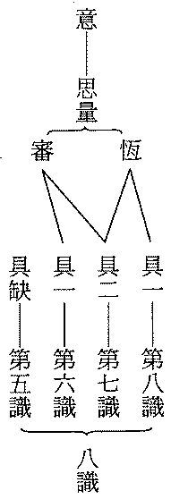



《瑜伽》六十三说：『复次，此中诸识皆名心意识，若就最胜，阿赖耶识名心，何以故？由此识能集聚一切法种子故，於一切时缘执受境，缘不可知一类器境。末那名意，於一切时执我我所及我慢等思量为性。餘识名识，谓於境界了别为相。如是三种，有心位中心意意识於一切时俱有而转。若眼识等转识不起，彼若起时应知彼增俱有而转』。



以此思量义的意说名此第七识，第六识亦叫做意识，是则「此名何异第六意识」？二者间的区别岂不是很难分出吗？那究竟是怎样的呢？看来似难分别，而实不是一个太难分别的问题。如说起来，第七识是思量就是意的识，亦即所谓识体就是这意。「此」第七识名为意识，是约「持业释」解释而得名的。所谓意，也就是识的业和识的自体，犹「如藏识」得「名」一样，「识即意故」，或说意即是识，名为意识，和第六意之识的意识是不同的。例如藏识，藏就是第八识体一般。至於第六识，是以第七识的意为所依而起的识，依意（第七）的识，就是意之识，「彼」乃「依主释」解释而得名的。谓第七识为第六识所依之根，正是第六意的所自得名，就是依於第七意的识名为意识。「如」同「眼识等」前五识，依於眼等根而生起的，从它的所依根等，名为眼识等。「识异意故」，是说第六识与意是差别不同的，如更说得清楚一点，意是意，识是识，识是第六，意是第七，因而识不同意。



第六第七得名不同既然如上，为什麼亦名为意识？圣教中唯把第七识叫做意而不叫做意识，又是什麼道理？本论以三义解释这个问题：一、「然诸圣教恐此滥彼，故於第七但立意名」：第六识是依意（第七）的识，所以把它叫做意识而不叫做意（若说为意，那就唯标他的第七识之名，不是第六识本身所具的名）；设把第七识叫做意识，那就与第六识相混滥，变成没有两者的区别，为使六七二识有所区别，所以第七识唯叫做意而不叫做意识。二、「又标意名为简心识，积集、了别劣餘识故」：心意识的三者名称，如上所说，不管那种，都通诸识。就中，若就胜义而论：思量（意）之义，第七识虽胜过其他的诸识，但积集（心）及了别（识）之义，那是各各不如第八识及前六识的，所以就把第七识说名为意。三、「或欲显此与彼意识为近所依，故但名意」：意谓为要显示此第七识，为彼第六意识的近所依，所以唯把此识名之为意。如前说过，意於思量之外，还有它依止义，是即意味现在这个近所依的所依。所谓近所依者，究是指的什麼？基师《述记》卷四，以相顺、同计度、与力的三义加以解释。相顺，是说六七二识，不管那种，都在因位初地分转（初地一分无漏），彼此是相同的，所以说为相顺。同计度，是所谓计度分别，在有漏位，六七二识，不管那种，都为计度分别，这是显示它们的起执相同。与力者，是增上缘义。此第七识为第六识的不共俱有依，当第六识缘境时，第七给以与力，非第七缘境时，第六给以与力，所以第六叫做识，第七但名意。以这相顺、同计度、与力三义，不难看出六七二识关系的密切。因为有此密切的关系，所以显第七为第六所依而说为意。由本论所述的三义，唯说第七识为意，不说意识之旨，是就可以了知。当知意与意识，不管那种，都有意名，是显而易见的，所以两者相滥，不是不可能的，为了避免这个相滥，所以本论特把意的第七，就照原名称呼它，所谓末那之称，正是指此。



如实说来，不但第七为第六所依，第八亦为第六所依，为什麼这里没有讲到？当知第八为第六的所依是远所依，不若第七为第六的近所依，所以这里不论。《瑜伽》五十一说：『由有第八故有末那，末那为依意识得转』。由此证知，第八识为远所依，为近所依的是第七识。同时还可这样说：第六识的种子，若欲生现识时，定要由第七识的种子击发方得生起，假定没有第七识种击发，第六识种是不能生现行的。所谓『六现依七现，六种依七种』，正是这个意思。



庚二　释所依



辛一　正释所依



依彼转者，显此所依。彼谓即前初能变识，圣说此识依藏识故。有义：此意以彼识种而为所依，非彼现识，此无间断不假现识为俱有依方得生故。有义：此意以彼识种及彼现识俱为所依，虽无间断而有转易，名转识故，必假现识为俱有依方得生故。转谓流转，显示此识恒依彼识取所缘故。



此於所依门中正释所依。颂说「依彼转者」，正是「显」示「此」之「所依」。彼指初能变的阿赖耶识，所以说「彼谓即前初能变识」，此第七末那识是依止於彼阿赖耶相续转起的。怎麼知道？「圣说此」末那「识依藏识故」。《瑜伽论》五一说：『由有阿赖耶故得有末那』。《瑜伽论》为圣弥勒说，所以称为圣说。赖耶，向有现行赖耶和种子赖耶的区别，正因如此，解释这所依的阿赖耶，有护法、难陀两大论师的说法不同。



「有义」，这是第一难陀论师的解说。依照难陀的说法，「此」末那「意」是「以彼」第八「识种」子赖耶「而为所依」，并「非」是以「彼现」行赖耶「识」为所依。因为「此」末那识从来是「无间断」而常自相续的，根本「不」须「假」彼「现」行赖耶「识为俱有依方得生故」，所以唯约依彼种子名为依彼。



「有义」，这是第二护法论师的解说。依照护法的说法，「此」末那「意」是「以彼」第八「识种」子赖耶「及彼」第八「现」行赖耶「识俱为所依」。假定要分别它们的不同：种子赖耶是末那识的因缘依；现行赖耶是末那识的不共俱有所依。末那识「虽」说是「无间断」常相续的，然「而」是「有转易」的，「名」为「转识」之一，所以当它生起时，「必假现」行赖耶「识为」它的「俱有依」，然后「方得生」起，假定没有俱有依就不得生。所谓转易，就是到了见道位时，或时成为善的，或时成为染的。凡是转易性的东西，它的本身必然是很柔弱而不能自立，所以生起时不得不假有它的俱有所依。不然的话，其体有所转易，没有它的殊胜力，试问怎麼能得生起？至於见道位时的或善或染，《义演》三六有很好的说明：『如入见道，第六入生空观时，第七但与法执相应；第六入法空观，第七与平等性智相应；此转为善。若第六出观时，第七还与俱生我执相应；此转为染。若创入见道，第六双入二空观时，第七方成无漏。故由第六、七成善染』。总而言之，二大论师的主要差别在於：难陀论师说第七识没有俱有依；护法论师说第八的现行识是第七的俱有依。



颂说依彼转的「转，谓」是「流转」义，亦即是相续转起的意思。说得明白一点，就是依於第八或种子赖耶或现行赖耶，得以相续不断的生起。如是「显示此」第七末那「识，恒」时「依彼」第八赖耶「识」，以「取所缘」境。基师《述记》说：『第七行相取所缘境，相续不断而生起义』，说名为转。



辛二　傍通餘论



壬一　略释三种



诸心心所皆有所依，然彼所依总有三种：一、因缘依，谓自种子，诸有为法皆托此依，离自因缘必不生故。二、增上缘依，谓内六处，诸心心所皆托此依，离俱有根必不转故。三、等无间缘依，谓前灭意，诸心心所皆托此依，离开导根必不起故。唯心心所具三所依名有所依，非所餘法。



上来已依常理正说第七识的所依，下面再就诸心心所广论它们的所依。讲到「诸心心所」，不管是属那种，必然「皆有」它们「所依」。基师《述记》说：『皆有所依者，能有所依故名有所依』。《瑜伽》五十五说：『问：诸心心法凡有几种差别名耶？答：有众多名，谓有所缘、相应、有行、有所依等，无量差别』。证知大乘经论当中，的确说到有所依的这个名称。「然彼」心心所的「所依」，依其义别，「总有三种」，就是因缘依、增上缘依、等无间缘依。可是《瑜伽论》卷一所说的三种依，是俱有依、等无间依、种子依。两论的名称不同是什麼道理？当知《瑜伽论》是以理立名的。就是在道理上讲：诸现行的生起，必有它的种子，所以名为种子依；所依根及能依识，必定是同时而有，所以名为俱有依；由前心开导后心，所以名开导依。以是之故，《瑜伽》立此三名。本论三依约三缘作名，是以缘为目，於四缘中名因。立名虽有不同，体义无有差别。



三依三缘作名，《枢要》曾有问道：『何故四缘三名所依，所缘缘体不名所依？胜者名依，势相亲近所缘缘疎，是故不立。因则可是，依义则非』。《义灯》亦说：『然彼所依总有三种者，问：心心所法起藉四缘，何故但说三种依耶？解云：所缘通内外，餘三唯在内，故但说三。问：餘识缘内外不得说四依，第七唯内缘，何不说四依？答：三缘生识胜，故但说三依，缘依亦外缘，力微不说四。问：境界生心劣，故不说四依，所缘引识微，应非二和起。答：二和通远近，根境并为缘，依义据亲近，境疎不说依』。辨明了所缘缘不名为依，现在对这三依略释如下：



「一、因缘依」：约识而论，各识都「自」有其「种子」，所以也名种子依。据通依说，「诸有为法皆托此」种子为所「依」，因倘「离」开「自」己的亲「因缘」，诸有为法「必」定「不」会「生」起，所以都有它的自种依，可说一切有为法，没有一法没有它的因缘的。



「二、增上缘依」：这是指的「内六处」，就是眼耳鼻舌身意六根。「诸心心所皆托此」内六处为所「依」，亦即六根给与各个识有力的助缘，使它得以取自己所应取的境界，当知这也可以名为俱有依，因为这是於现行法上，和能依识俱时而有的（因恐滥种子生现行的种子，也是同时而又名依，所以易以今名，叫做增上缘依）。诸心心所，如果「离」开了「俱有根，必」定「不」能「转」生的，所以一定要托此依。清楚的说：眼识依於眼根，乃至身识依於身根，至於后三识皆依意根（第七识、第八识，也都名意根，后三识所依，都是意根）。



「三、等无间缘依」：这是指的意根，也叫做开导依。如前念心王有力能引后念一聚心心所法，不但力用齐等，而且又无自类为之间隔，所以名为等无间缘依。像这样的等无间缘依，以什麼为它的自体？当知这是以前念八识心王为它的自体，因前念心王能与后念心心所为依。可是现在所要问的，就是前念心王已灭无有自体，怎麼可以为依？当知它在前念灭时，已与后念做了开导，如彼前念心王临欲灭时，有其力用，能引后念心心所法令得生起，作此功能灭已，此取现在一念有体法为等无间缘依，非取过去已灭无体法为依。如是「前」念「灭意」有引后念力用名为依者，那它是以何法为能依？谓「诸心心所」法「皆托此」前灭意为「依」，方得生起，假定「离」这「开导根」，诸心心所「必不」生「起」。



於诸法中，「唯心心所具」有如上所说的「三」种「所依」，因而得「名有所依」，并「非所餘」的诸「法」，具有这三种所依。如诸色法，只有因缘依，没有其餘的二依。至若小乘的无心定，是等无间缘果，只有等无间缘依及因缘依，没有俱有增上缘依，同样是不具有三依，所以不名有所依。有人这样说：假定依於二定的自义，三依是都不可说的；假定说是因同於他，那就不可说但有二依。《俱舍颂》说：『心心所由四，二定但由三』。依於此说，二定於四缘中，只除去所缘缘，具有其餘三依，为什麼现在不说它的俱有增上缘依？当知所谓增上缘，有的固然可以说是俱有依，有的但有增上缘依义，并没有俱有依义，如是不说它的俱有增上缘依，试问又有什麼不可？不相应行法，如据自义说，三依是都没有的，为什麼前说诸有为法皆托此因而生？难道不相应行法不是有为？有人这样解释说：『依他实法而得生故，说从因生，非别生也』。



壬二　广释三种



癸一　释种子依



初种子依：有作是说：要种灭已现果方生，无种已生集论说故，种与芽等不俱有故。有义：彼说为证不成！彼依引生后种说故，种生芽等非胜义故，种灭芽生非极成故，燄炷同时互为因故。然种自类因果不俱，种现相生决定俱有，故瑜伽说：无常法与他性为因，亦与后念自性为因，是因缘义。自性言显种子自类前为后因，他性言显种与现行互为因义。摄大乘论亦作是说：藏识染法互为因缘，犹如束芦俱时而有。又说种子与果必俱，故种子依定非前后。设有处说种果前后，应知皆是随转理门。如是八识及诸心所，定各别有种子所依。



前已略释三种依，现再广论三种依。於中，「初」论「种子依」。关於种子生起现行，在因果关系上，学者间有同时异时的两种不同说法，现在分别如下：



一、「有作是说」，这是指难陀论师主张因果异时。他说「要种灭已现果方生」，就是要种子之因灭已，现行果法方得生起。这是显示所谓因果这个东西，果是因所变化而有，既然变化而有，在时间上，当然要在不同时候方得，如果是同时的，应该没有变化，有所变化，就知不是同时。所谓「无种已生集论说故」，是引对法证明自己所说。《集论》第二卷说有二十四种已生，十二叫做有种已生，十三叫做无种已生。现在难陀就取十三无种已生，作为种灭现生之证。难陀论师解释这个说：二乘无学邻近无餘心的最后五蕴，生这蕴种已入过去前刹那，就是此最后蕴身，种子已灭入於过去名为无种，所生蕴法还在现在名为已生。既因已灭而果现在，明知因果在时间上，是不必同时而异时的。难陀论师又说：我的这个主张，不但有教证，亦还有理证，如「种与芽等」是「不俱有」的。例如世间的植物，种子和芽是不同时的，要种子变灭，它的芽方生。根据这个道理，现在所讨论的因果，必然是异时而非同时。如是主张种灭芽生因果不俱，是则种子六义中的第二果俱有义，应当怎样会通？难陀论师会说：所谓果俱有的这个道理，不是念念因果俱名为果俱有，而是约一期生命前后说它可有俱义。至於说到俱生俱灭，难陀论师又会说：这只是说因果二法俱有生俱有灭，并不是说因果念念俱时生灭，这是我们所要把它分别清楚的！



二、「有义」，这是指护法论师主张因果同时。在未建立自己的理论前，先破难陀论师的主张，认为「彼」之引《集论》「说为证不」得「成」立。当知「彼」《集论》说无种已生，是「依引生后种说」的，因为种生种是不同时的。现在种子为什麼不能更引生后念种？因这时候缘缺，无缘更生后念之种，所以说为无种。假定是这样的话，为什麼又说为已生？因能生彼俱时现讫，所以名为已生。假定真是这样解释，《集论》应言无种已不生，本论应言彼依不引生后种说，为什麼说据不能生后种说？要知《集论》所说的无种已生，是依引生后自类种说，亦即是说种子前后相生。所谓无种，是彰没有后类，所谓已生，是明与现俱，所以不须再安不字等以说明。不过论中如果说为『彼依不能而更引生后种说故』，当然更为明显，不致生出疑义。



至於难陀论师所说「种生芽等」为不俱有，从世俗因果看，或者可作这样说，但这「非」是「胜义」，因从胜义因果看，未必是这样的，所以不可以胜义种现为例。如难陀说：种生於果必定是前后的，因为它们之间有著因果的关系，如麦种子生出麦芽来，种芽显然是有前后的。但是你们说的麦芽前后，不是属於胜义因果，为我们所不承认的，所以说「种灭芽生非极成故」。要知种与芽的关系，最初必是俱有的，后来所以看是异时，那是后来渐渐增长展转相生的现象。而且就以世俗因果说，我们明白见到青莲根生芽是同时的，怎麼可以定执因果异时？



再说「燄炷同时互为因故」。譬如灯的炷生燄，同时也就是燄烧炷，燄炷绝对是同时非异时。当知所谓种子生现行，能生种子是因，所生现行是果，这因果必定是同时的；在那所生的现行法上有强胜的能生时候，又能把它的种子熏习在第八识中，这名为现行熏种子，能熏的现行是因，所熏的种子是果，也是同时因果而不是异时的。所谓『三法展转，因果同时』，正是此意。假定你们一定要执内种生现是异时的，为如自类种因果异时？为如炷燄因果同时？不免犯有不定的过失！



讲到因果，我们认为有异时及同时的两类：如「种」子的「自类」相续，亦即前念种灭后念种生，像这样的「因果」关系，当然是异时而「不俱」有的，至於种子生现行的「种现相生」的因果，「决定」是同时「俱有」而不是异时的。『种子生现行，好像形之於影；有能生的种子，同时有所生现行存在著。故种子法——沈隐——与现行法——显现——虽异，而就能生所生之因果来讲，不可不谓是同时的。譬如木料造机械，有木料的因现在故，所以有机械可得；假使没有了木料的因，那机械的果从那里去找』。从这事实的叙述，更可证知因果是同时的。



以是之「故，瑜伽」论卷五「说：无常法与他性为因；亦与后念自性为因；是因缘义」。当知该论所说的「自性言」，是「显种子自类前为后因」，明因果的异时，前为后因，后为前果，而这种生种的因果前后异时，是法自体的继续，好像造了机械的木头，前木后木继续存在著，这是前后相望的因果。至於该论所说的「他性言」，是「显种与现行互为因义」，明因果的同时，因为这是异类相生，种子生现行，现行熏种子，种现同时，互为因果。



这里所引的《瑜伽论》，是该论讲种子七义的文，显示唯有有取与的生灭无常法可以为因，如果是没有取与的常住法，是就绝对不可为因，所以说『无有常法能为法因』。种现所以说为异类相生，因为六七二识望於第八本识，彼此是异类的，这可从多方面讲：一、转识与本识的差别；二、计度与任运的差别；三、能熏与所熏的差别；四、染与不染的差别。从这种种方面，显示它们是异类。它们虽然是异类，但却属於同时的。



不但《瑜伽论》说因果同时，「摄大乘论亦作是说：藏识染法互为因缘，犹如束芦俱时而有」。《摄论》的原文是：『阿赖耶识与彼杂染诸法同时更互为因，云何可见？譬如明灯燄炷生烧同时更互。又如芦束互相依持同时不倒。应观此中更互为因道理亦尔。如阿赖耶识为杂染诸法因，杂染诸法亦为阿赖耶识因，唯就如是安立因缘，所餘因缘不可得故』。《摄论讲记》说：『所熏的能生的阿赖耶识，与能熏的所生的杂染诸法，它们同时更互为因的关系，又怎麼可以见得呢？论举两个譬喻来说明：譬如明灯，灯中的火燄与能生火燄的灯炷，二者发生相互的关系。从炷生火燄，火燄焚烧灯炷，这生燄烧炷的作用是同时更互为因的，不能说谁前谁后。又如一束乾芦，互相依赖，互相住持，才能竖立不倒。不论拿去那一部分，另一部分就不能单独的竖立了。它们相依相靠的作用，是同时的，也不能说它前后异时。从这种事实的比喻，我们应该晓得阿赖耶识与杂染诸法同时更互为因的道理。由阿赖耶识为种子，生起杂染诸法的现行，这就是阿赖耶识为杂染诸法因；在同一时间，杂染诸法的现行，又熏成赖耶识中的种子，那又是杂染诸法亦为阿赖耶识因了。这本识与转识更互为因的关系，不能说它是异时的。所以唯识家唯从这本识种子与转识互相为因的关系上，安立因缘的道理。除了这真正的因缘，其餘因缘是根本不可得的。其它或者有时也称之为因缘（如异熟、俱有、同类、相应、徧行五因，也叫因缘），那不过是方便假说而已』。



《摄论讲记》在附论中又说：『本论的因缘观，重在种生现、现熏种的同时因果，不同时的都不能成为因缘。种生现、现熏种是同时的，这由现行熏成的新种，为什麼不同时就生现行呢？要知道时间是建立在现行上的。种生现、现熏种的三法同时，也都是以现行法为中心的。现行的生起，必有所从来，所以建立种生现。这现行必有力量能够影响未来，所以建立现熏种。这都是以现行为中心，并不立足在种子上，所以现行虽能熏种，所熏的种在同时中，不能说就生起现行。因为在一刹那中，像心心所等，不容许有两个现行自体并存的，却不妨许多种子的存在；何况助成种子生现的因缘，也还未成就』。



《摄论》不但说藏识与染法互为因缘不是异时，同时「又说种子与果必俱，故种子依定非前后」。在《摄论》讲到种子六义的时候，其第一义就说种子之因与现行之果，必定是俱时而有的，并不是前后异时的。这是简除前后相生以及相离的他身等，因为异时异处，不能和合，根本就不成为种子。所以这里说的种子依，决定是同一刹那，不是前后两刹那。关於这个根本论题，我们决定要把握住。



「设」或在有些经论中「说：种」子之因在「前」，现行之「果」在「后」，因果是前后异时的，「应知」那「皆是随」顺小乘，特别是随经部异时因果而作的方便说法，权且「转」变大乘的教「理」，不是因果的正义。《摄论讲记》附论说：『同时更互为因的理论，经部师是不承认的，大乘唯识家与经部师熏习说的不同，也就在此。有部主张三世实有，所以他说一切法的自体，在未来原都是存在的，不过须待助缘引生罢了，这就是他们的因缘论。唯识家不同意，认为现在有这样的因，才可得这样的果，过去未来都不实在，因果是同时的。这不同的理论，都由於时间观念的差异』。



「如是」像上种种分析，我们应当知道：「八识」心王「及」其所相应的「诸心所」，一「定各别有」它的「种子所依」，而这所依的种子，就是这里说的因缘依。



癸二　释俱有依



子一　三师辩破



次俱有依，有作是说：眼等五识意识为依，此现起时必有彼故。无别眼等为俱有依，眼等五根即种子故。二十唯识伽陀中言：识从自种生，似境相而转；为成内外处，佛说彼为十。彼颂意说：世尊为成十二处故，说五识种为眼等根，五识相分为色等境，故眼等根即五识种。观所缘缘论亦作是说：识上色功能名五根应理，功能与境色无始互为因。彼颂意说：异熟识上能生眼等色识种子名色功能，说为五根，无别眼等，种与色识常互为因，能熏与种递为因故。第七八识无别此依，恒相续转自力胜故。第六意识别有此依，要托末那而得起故。



上来已说种子依，现在再说俱有依。俱有依说在种子依后，所以说「次俱有依」。这俱有依的六根，能给与各个识有力助缘，使它们各各得取自境，所以又名为增上缘依。关於这俱有依，有四位论师不同的解说，本论一一为之指出，当然是以护法说为正义。



一、「有作是说」，这是指的难陀论师的解说。他们认为「眼等」前「五识」是以「意识为」所「依」的。换句话说，第六意识为前五识的俱有依，因「此」五识「现」行生「起时，必有彼」第六识作为所依的。怎麼知道是如此的？《瑜伽论》七十六说：『阿陀那识为依止为建立故六识身转，此中有识眼及色为缘生眼识，与眼识俱随行同时同境有分别意识转；餘耳等识亦尔。若於尔时一眼识转，即於此时唯有一分别意识与眼识同所行转；若於尔时二、三、四、五诸识身转，即於此时唯有分别意识与五识身同所行转』。《瑜伽论》这样讲，《解深密经》亦如是说。由此证知第六意识与前五识同缘现境。《瑜伽论》五十五对这有更清楚的交代说：『问：有分别心无分别心，当言同缘现在境耶？为不同耶？答：当言同缘现在境界。何以故？由三因故：谓极明了故；於彼作意故；二依资养故』。假定不同缘现在境，意识的认识就不明了。《集量理门论》说：『五识唯现量，同时意识亦尔。今此中五识显明了现量，不名有分别，不与寻伺等相应故。第六虽与五同缘现量，名为分别，以与寻伺相应故。若同缘现在可得明了，若彼五识后意识即不明了，缘过去故，如缘百千劫事即不明了』。意识本欲缘於前境的，所以叫做作意，假定不同缘现在境，那就不得称为作意。什麼叫做二依资养？就是资养五识导令生起，设虽定中闻外声等，如果意不得缘，耳识必不闻声，必有意识与彼同缘，方能清楚的听到音声；还有一种说法，二依，是指意根及眼等根，意根是指末那。智周《演秘》说：『由彼眼识依眼取境，令彼意识取境分明，由是五根名长养意』。这是说意识依自根及眼根，由此二依资养，方能缘现在境，若唯依一自根，那就缘境不明。但意识依眼根名为资养，是说依眼为门取境名资养，不同眼识依根名资养。



眼等前五识既然是以意识为俱有依，当然「无别眼等为」五识的「俱有依」，就是他们不承认有净色大种所造的眼等根，认为「眼等五根」的自体，「即」是五识的「种子」。



难陀他们的这一说法，当然不是他们的独创，而是有他们的教证为证的。如世亲论师所造的「二十唯识」论，有个「伽陀中言：识从自种生」，这是显示识的生起所依。「似境相而转」，这是显示识的自变而缘。诸识的生起，不但要有其自种，而且要有其助缘，因缘和合，诸识得生。「为成内外处，佛说彼为十」，这是显示佛立十有色处的所以。论中解释「彼颂意说：世尊为」了「成」立「十二处故，说五识种为眼等根，五识相分为色等境」。以是之「故，眼等」五「根即五识种」。我在《唯识二十颂讲记》中说：『这样说来，可以知道：理实唯有五识的种子与现行为五根五境，并不是离开心识另有什麼根境可得。说明白点：五根就是五识的种子，五境就是五识的现行。既然五根是五识的种子，离开五识种子，当就没有五根可得；五识所缘的五境，既是五识本身的现行，离开五识现行，自亦没有五境可得。佛之所以说有五根五境，是依五识的种子与现行，为诸众生方便假安立的，我们如误认为是实在的五根五境，自然没有得到佛的本意』。



这个道理，不但《二十唯识颂》是这样的说，就是「观所缘缘论，亦」有一个颂文「作」如「是说：识上色功能名五根应理，功能与境色无始互为因」。『观所缘缘论这颂，明显的说五根体，就是识的种子，所以在成立唯识理论方面，确实有它很大的重要性』。论中解释「彼颂意说」：第八「异熟识上」有「能生眼等色识种子名色功能」，当知这色功能，「说为五根」，并「无」另外的「眼等」五根。基师《述记》对色识有三种解释：从『不须分别见分相分，但总说言由现行识变似色尘等，故说此识名为色识，即此种子名眼等根，能生现识故。生色识故名色功能，言内色根非体是色，故说现识名为色识』，这是总解。别解有三：『又见分识变似色故名为色识』，这是第一解；『或相分色不离识故名为色识』，这是第二解；如是两种解释，皆是见、相别种生的。『或相分名色，见分名识，此二同种，故名色识种子』，这是第三解，为见相二分同种家义。



上是解释前两句颂，下再解释后二句颂。谓见分种名为五根，现行见分变似境色名为色识，如是五根「种」子「与」现行「色识」，从无始来，「常」是「互为因」果的，「能熏」的见分「与」所熏的「种」子，「递」相「为因」，或相分现行亦是能熏，此种名眼等，与现行法相互为因。再以老话来说：现行熏种子时，现行是因，种子是果；种子生现行时，种子是因，现行是果。像这样的解释，就是颂中说的『功能与境色，无始互为因』的道理。



总之，难陀论师的意思是说：五识的种子名为五根，五识的相分名为色境；五识以意识为俱有依，如《瑜伽论》等所说，没有实体的五色根，如《二十唯识论》等所说。



前五识以意识为俱有依，如上已详细的分别，但是讲到「第七」、第「八」二「识」时，「无别此」俱有「依」。为什麼没有俱有依？因这二识「恒」常「相续转」变生起，其本身的「自力」来得特别殊「胜」，不须要依赖其他的俱有依，自己亦可生起，所以无俱有依。第八为诸识的根本依，说它不要俱有依，似还可以说得过去，第七识要依第八识，如诸论说『由有阿赖耶故得有末那』，怎麼可说不要俱有依？当知赖耶为末那的根本依，根本依固然是不可缺少的，俱有依没有需要的必要。至於「第六意识」同样是要俱有依的，所以说「别有此依」。为什麼？因第六意识的自体是有间断的，当它要发生活动的时候，定「要」依「托末那而得起故」，末那就是第六意识的俱有依。为什麼不说依托第八识而起？第八识与第六识之间，隔著一个第七识，彼此是不怎麼相顺的，所以不能与以势力，可是第七识不然，有时相顺与以势力，如第六识入生空观，第七识还是有漏，当然是不与以势力，但在其餘的时候，确是给与势力的。为什麼不说依托前五识而起？这也是不需要的，因为前五识不起活动的时候，第六意识仍然在活动的，并不因为没有五识，第六意识也就没有，是以第六意识的生起，不须假藉前五识为俱有依。



总结如上所说，绘图如下：



　　　　　　　┌能依──所依  

　　　　　　　│前五识─第六识──五识起时必依第六识故。  

　　　难陀等说┤第六识─第七识  

　　　　　　　│第七识┐  

　　　　　　　└第八识┴无别所依─恒自相续转，自力胜故。



有义：彼说理教相违！若五色根即五识种，十八界种应成杂乱，然十八界各别有种，诸圣教中处处说故。又五识种各有能生相见分异，为执何等名眼等根？若见分种应识蕴摄，若相分种应外处摄，便违圣教眼等五根，皆是色蕴内处所摄。又若五根即五识种，五根应是五识因缘，不应说为增上缘摄。又鼻舌根即二识种，则应鼻舌唯欲界系，或应二识通色界系，许便俱与圣教相违。眼耳身根即三识种，二地五地为难亦然。又五识种既通善恶，应五色根非唯无记。又五识种无执受摄，五根亦应非有执受。又五色根若五识种，应意识种即是末那，彼以五根为同法故。又瑜伽论说眼等识皆具三依，若五色根即五识种，依但应二。又诸圣教说眼等根皆通现种，执唯是种，便与一切圣教相违。



二、「有义」，这是指安慧论师的解说。「彼」难陀论师所「说」五色根即五识种，不论与「理」与「教」都是「相」互「违」背而不有所契合的。为什麼说他违教违理？因如难陀论师所说，则有下面十大过失！（一）、诸界杂乱失；（二）、二种俱非失；（三）、二缘相违失；（四）、根识系异失；（五）、根通三性失；（六）、根无执受失；（七）、五七不齐失；（八）、三依缺一失；（九）、诸根唯种失；（十）、假为他救失。现在依此次第，一一略说如下：



（一）、诸界杂乱失：这里所说的界，是指的十八界，十八界各各有它的种子，这是不容有所杂乱的。假「若」如难陀说「五色根即五识种」，那「十八界种」，就「应」变「成杂乱」不分。「然」而事实上，「十八界各别有」它们的「种」子，「诸圣教中处处」都有「说」到的，你们怎麼可说根种就是识种？把色根的种看成是心识的种，这不是杂乱是什麼？《瑜伽》五十一说：『依此一切种子阿赖耶识，故薄伽梵说有眼界、色界、眼识界，乃至有意界、法界、意识界，由於阿赖耶识中有种种界故』。又如经说：『恶叉聚喻，由於阿赖耶识中有多界故』。《杂集论》卷一亦说：『问：眼界何相？答：谓眼曾现见色及此种子积集异熟阿赖耶识，是眼界相；自餘五根并六境、六识皆取现种』。依上所引的经论看，证知十八界是各各差别的，绝对不可说五识的种子就是五根。要知色有色种，心有心种，色心二种不互相生，怎麼可说色种能生於识？



（二）、二种俱非失：这里说的二种，是指见分种和相分种，相分种子生相分，见分种子生见分，二分种子各不相同。而且这在「五识种」方面来说，每一识「各有」其「能生」的「相」分种子和「见分」种子的差「异」，假若如你们所说五根就是五识种，试问「为执何等名眼等根」？是执五识的见分种为眼等根？还是执五识的相分种为眼等根？假「若」是以「见分种」为眼等根，见分是属心法，五根「应」为「识蕴」所「摄」。可是谁都知道，五根是色法而非心法，怎麼可说为识蕴摄？假「若」是以「相分种」为眼等根，相分是色法固然不错，但它是外在的色法，五根「应」为「外处」所「摄」。可是谁亦知道，五根是属内六处所摄，不是属於外六处所摄，若如你们所说，「便违圣教」所说「眼等五根，皆是色蕴内处所摄」！如分开说：眼等五根，在蕴方面，圣教说是色蕴，不是识蕴；在处方面，圣教说是内处，不是外处；若说相分种是眼等根，无异是说眼等根为外处摄。这末一来，不是圣教相违是什麼？



（三）、二缘相违失：这里说的二缘，是指因缘与增上缘。依照向来所说，五根是五识的增上缘，五识种子是五识现行的因缘。「若」如难陀等说，「五根即」是「五识种」子，以此五根望於五识，「五根应是五识」现行的「因缘，不应」把它「说为」五识的「增上缘摄」。《瑜伽论》五十六说：『眼与眼识非正生因，唯建立因，是故此二俱时而有。餘根餘识，当知亦尔』。所谓建立因，是指增上缘说；所谓正生因，是指因缘说。唯有种子可以说是五识生起的正因，诸餘因皆非五识生起的因缘，若说五识种就是五根，那就违於《瑜伽论》说的言教，是为大大不可！



（四）、根识系异失：五根五识在三界九地的所系，显然是有所不同的，这从诸经论中所说可知。三界，是指欲界、色界、无色界；九地，是指五趣杂居地，乃至非非想处地。依诸圣教所说：眼等五根，除了无色界没有，欲色二界的五地都是具有的；可是前五识不然，完全具有五识的只有欲界一地，到了色界初禅亦即第二离生喜乐地，只有眼耳身的三识，鼻舌二识是没有的了，因为到了离生喜乐地的天人，不再受用欲界有情所受用的段食，因而随段食而有的香味二尘也就没有，既然没有香味二尘，缘香味二尘的鼻舌二识，自然也就用不著了，所以鼻舌二识只欲界有，色界是没有的，可是鼻舌二根不是这样，直到色界第四禅亦即第五舍念清净地都是具有。假定照难陀论师所说，五色根就是五识种，那「鼻舌」二「根」当然就是鼻舌「二识种」，如此一来，「应」说「鼻舌」二根，犹如鼻舌二识，「唯」是「欲界」所「系；或」是反过来说，如果识就是根，那鼻舌「二识」，就不应当唯是欲界所系，而「应」如鼻舌二根，「通」於欲「色界」五地所「系」。这个说法，你们承不承认？若不承认，就不可说五根就是五识种；若承认（许）的话，那就完全「与圣教相违」，因为诸圣教中从来不曾这样说过的！再说，如「眼耳身」三「根即」眼耳身「三识种」，这末一来，应说眼耳身三根，犹如眼耳身三识，唯是欲界五趣杂居地及色界初禅离生喜乐地的「二地」所系，不应当说它通於五地；或是反过来说，如果识就是根，那眼耳身三识，就不应当唯是二地所系，而应如眼耳身三根，通於欲色「五地」所系。这个说法，你们承不承认？若不承认，就不可说五根就是五识种；若承认的话，那就完全与圣教相违，因为诸圣教中从来不曾这样说过的！这是以上为例而难，所以说「为难亦然」。



（五）、根通三性失：这里说的三性，是指善、恶、无记。依於向来所说，五识是通於三性的，就是五识，有善的一面，有恶的一面，有无记的一面，看它是与怎样的心所相应决定。可是五根唯是无记，不通善性与恶性。假定如难陀论师所说，五根就是五识种，那五根就不应当唯是无记，而应如五识一样的亦通三性。或是反过来说，如果识就是根，五根既然唯是无记，五识亦应如根是无记，不应当说它兼通善恶。你们承不承认这个说法？若承认的话，就与圣教相违，若不承认的话，就不应说根就是识。怎麼知道五根唯是无记？《对法》第四明诸无记说：『八界八处全及餘蕴界处一分是无记。八界者，谓五色根、香、味、触界；八处亦尔』。《对法论》明说五色根是无记，怎麼可随五识通於三性？若说根通三性，是就违於圣教。



（六）、根无执受失：这里说的执受，依大乘讲，是说为第八识之所执受。讲到执受非执受，《瑜伽论》五十六说：十八界中有执受的唯是五根，通於执受非执受的是五尘，其餘诸界一向是非执受，如七心界就是没有执受的。五尘所以通於执受非执受，因为五尘是通於内外的：生命体内的五尘是有执受的，生命体外的五尘是没有执受的。五根之所以有执受，因为有情的五根身，安住在这现实的世间，要由第八识的执受，始能表现生命的一切活动，且在生命的活动中，生起苦乐的觉受，所以名有执受。尽管五色根是有执受的，即由第八识执为自体而生觉受，但五识种是无执受的。假定如难陀论师所说，五色根就是五识种，「五识种」是属「无执受」所「摄」的，「五根亦应」如五识一样「非有执受」，即不为第八识之所执受。可是反过来说，如果识就是根，五根为第八识所执受，五识亦应如根为第八识所执受。可是果真如此，违教违理，为智者所不取！在此所要特别注意的，就是种子无执受的这话。依唯识学说，约第八识执持种子令不散失说，种子应该说它是有执受的，现在这里说为无执受所摄，是约不能生觉受这方面说，因为种子不为赖耶摄为自体而生觉受，所以说种子非执受。这点，我们要特别的分别清楚！



（七）、五七不齐失：这里说的五七，是指五根及第七末那意根。六识的生起，各有它的所依根，如眼识依眼根，乃至第六意识依意根。大乘唯识说意识所依的意根，就是第七末那。「又五色根」假「若」如难陀所说，就是「五识种」，那第六「意识种」，「应」该「即是」第七「末那」。为什麼要这样说？因《摄论》第一以五色根为同法的。如该论说：『又五同法亦不得有，成过失故』。《摄论讲记》说：『经上说意识依意根，是用五识作同法喻的。前五识生起认识作用的时候，各有它的所依——五色根，那末，第六意识当然也同样的要有它的所依，这就是染污末那。假使没有染污意，第六意识的不共所依是什麼呢？以五识为同法喻不是也不得有吗？五识身必有眼等五色根为俱有依，并且还是不共所依；所以第六识，也非有俱有依，并且非不共的依根不可。无间灭意，不但是共的，也不俱有——根识同时，所以无间灭意不能为后念意识的不共意根。因此，一定要有第七末那为第六识的所依』。假定认为第六意识有它另外的所依根，那前五识亦应有它另外的所依根，如果认为五识是以种子为根的，那意识亦应当是这样的，为什麼要另外别立？设若认为六识是有现根的，五识以此为同法，亦应有它的现根！



（八）、三依缺一失：三依，是指前说的种子为因缘依，五色根为增上缘依，前灭意为等无间缘依。「瑜伽论」中曾「说眼等」诸「识皆具」这「三」种「依」，假「若五色根即」是「五识种」，那「依但应」有因缘及等无间的「二」依，没有了五根为五识的增上缘依，岂不是三依不具有而缺少了一个增上缘依？难陀论师救说：你们这样的难我，我是不能接受的，因前我曾明白的说，眼等五识以意识为依，当五识现起的时候，必然是有彼意识的，五识与意识俱有，这不是俱有依是什麼？为什麼难说依但应二？现在再难破说：你们这样强词夺理的挽救自己，怎麼挽救得了？当知《瑜伽》所说眼识的俱有依是眼根不是意识，现在你说五识与意识俱，根本为三依之所不摄。五色根就是五识种，等於说没有五色根，没有五色根，缺少了五根为五识的增上缘依，这不是三依不全是什麼？



（九）、诸根唯种失：这里说的诸根，是指的五色根。依「诸」经论「圣教」所「说：眼等」五色「根，皆」是「通」於「现」行和「种」子的。若如难陀所「执」，认为五根「唯是种」子不通现行，岂不「便与一切圣教相违」？什麼经论说五根通於现行种子？如《对法论》第一说：『眼界者，谓曾现见及此种子积集异熟等』，这不是明显的说通种现是什麼？如五色根就是种子，为什麼还要说及此种子？不但五根界是通於种现的，就是五识界亦通於种现的。如说依眼缘色似色了别，这就是显示眼识的通於现行，又说及此种子积集异熟阿赖耶识，这就是显示眼识的通於种子。眼根通於种现，你们唯取种子不取现行，眼识通於种现，亦应同根唯取种子不取现行，你们承认吗？假定不承认，为什麼执五色根唯是种？



有避如前所说过难，朋附彼执复转救言：异熟识中能感五识增上业种名五色根，非作因缘生五识种，妙符二颂，善顺瑜伽。



如上指出九种过失，「有」人觉得亦有道理，为了「避」免「如前所说」的九种「过难」，特地「朋」比「附」和难陀论师的执著，因而「复」作这样的「转救」。这里说的有人转救，不是真的有什麼人出来这样救，而是护法论师假设的转救之词。他们的转救说：所谓五色根即五色种的这话，是说「异熟识中」，有「能」招「感五识」的「增上业种」，即此增上业种，说「名」为「五色根」，并「非」是把五色根当「作因缘」以「生五识」的「种」子，换句话说，五根为五识种，不是生五识的亲因缘，而是生五识的增上缘业种，并不是真的当作识种看的。像这样的说法，不但没有如前所说的九种过失，而且很巧「妙」的「符」合《二十唯识论》及《观所缘缘论》中的「二」个「颂」文，同时也极「善」巧的契「顺瑜伽」论所说的具三依文。如是说法，我想是没有什麼过失的了！



彼有虚言都无实义，应五色根非无记故，又彼应非唯有执受，唯色蕴摄，唯内处故，鼻舌唯应欲界系故，三根不应五地系故，感意识业应末那故，眼等不应通现种故，又应眼等非色根故，又若五识皆业所感，则应一向无记性摄，善等五识既非业感，应无眼等为俱有依，故彼所言非为善救！



有人以为他的说法没有过失，但在安慧论师看来，认为「彼」所说的，但「有」一派「虚言，都无」一点「实义」。现在举十大过失，一一的说明如下：



一、业是通於善恶无记的三性，而根唯是无记不通善恶，这是诸经论中到处都这样讲的。假如你把五根当做业种，那「五色根」亦「应」如业是通三性的，不应当唯是「无记」。可是事实不然，尽管业通三性，五根仍是无记，并不兼通善恶，所以你说业种就是五根，成为一大过失！



二、五色根唯独是有执受的，至於业种的有无执受，那倒没有一定：假定是身业，自然可以说是有执受的，设若是语、意业，那就不得说为有执受。这也是诸经论中到处讲到的。假使如你们所说，五根就是业种，则「彼」五根「应」该不是「唯有执受」，而应如业通有执受及非执受。事实五根唯有执受，不如业种通非执受，怎麼可说业种就是五根？你们这麼说，自是一大过！



三、五根是色法，在五蕴中「唯」属「色蕴」所「摄」，身语意造作的业，是以思为其体的，在五蕴中属於行蕴所摄。这同样是诸经论作如此说的。若如你们所执五根就是业种，那五根应如业种是行蕴摄，不应当说它唯色蕴摄。或者这样亦可：业是通於身语意三者的，如向所说，身语是色蕴，意业是行蕴，如果五根就是业种，或说五根如业通於色行二蕴，或说三业如根唯是色蕴所摄。但若这样说，都不合理的，你们这样说，自然是大过！



四、五根在内外十色处中，经论告诉我们，「唯」是属於「内」五根「处」所摄，绝对是不通於外处的。可是业这东西，不但通於内处，亦通外法尘处。假定如你们说，五根就是业种，那五色根，就不应当唯是内处，亦应通於外尘法处。可是事实不是这样，所以你们这样执著，确是有极大过失的！



五、如前根识系异失中，曾经详细说过：鼻舌二识唯是欲界所系，假定五根就是业种的话，「鼻舌」二根「唯应」是属「欲界」所「系」，不当说它通於欲色二界的五地。反过来以同样的理由说：眼耳身三识唯是欲界一地及色界初禅地所系，假定五根就是业种的话，眼耳身的「三根」，应如眼耳身的三识，唯在欲界地及色界初禅地，「不应」当通於欲色界的「五地」所「系」。如再推广说：业种是通於三界的，假定五根就是业种，理应五根犹如业种通於三界。可是事实不然，假定作如此说，是就成大过失！



六、假定感五识业种，就是眼耳等五根，那「感意识」的「业」种，「应」当就是「末那」，因为意识是以末那为根，犹如五识是以眼等为根，当然应同五识体即业种。假定真的如此，那就犯了第六意业就是末那的过失，这是万万不可的！因为第六意业是第六意业，第七末那是第七末那，两者决不能混同的！



七、眼等五根，不但是通於种子，亦复是通於现行，这在诸根唯种失中，曾经说过。假定你们坚执五根就是业种，那「眼等」五色根，应如业种唯独是种，「不应」当说它「通」於「现」行和「种」子。可是事实上，不论怎麼说，五根都是通於种现的，怎麼可说五根就是业种？你们如果定要这样执著，那就成大过失！



八、眼等五根是有质碍的色法，业种是意识相应的思心所法，没有任何质碍的。假定如你们所执，五色根就是业种，那「眼等」五色根，「应」如业种不是有所质碍的。设若真的没有质碍，那就不能说是色根，说眼等「非色根」，岂不成大过失？设或反过来说：业种就是五色根，那业种应如五色根是有质碍的。这你们承认吗？如果不承认，就不可说业种就是五色根。



九、五识通於善恶无记的三性，作为业种的五根，唯独是属无记。假「若」你们执著「五识皆」是五根「业」种「所感」，那五识就「应」当如五根，「一向」是「无记性摄」，不应当说它兼通善恶二性。可是事实上，五识的确通於三性，五根实是一向无记，怎麼可说业种就是五根？设若你们定要这样执著，那就成大过失！



十、救者又说：不！我们不是这意思！五识通於三性，我们是知道的，不过对这问题，可以分开来说：无记性的五识，说它是业种的五根所感，自然没有话说，至於善恶性的五识，就不可说是业种的五根所感，像这样的说法，该没有如你们所说的过失！现在再予破说：「善等五识既」然「非」是「业」种的五根所「感」，那它们就「应无」有「眼等」五根「为俱有依」，具有眼等五根俱有增上缘依的，应当唯是业种无记五根所感的无记性的五识。但是你要知道：善恶二性的五识，没有它的俱有增上缘依，无论如何是说不过去的！



有人出来转救，把五根识种的亲因缘，换成业种的增上缘，自以为没有过，可以解救难陀的过失，殊不知你照样的犯了上面所说的十大过失，救得并不怎麼善巧，所以说「故彼所言非为善救」！



又诸圣教处处皆说阿赖耶识变似色根及根依处、器世间等，如何汝等拨无色根？许眼等识变似色等，不许眼等藏识所变，如斯迷谬深违教理！然伽陀说种子功能名五根者，为破离识实有色根，於识所变似眼根等，以有发生五识用故，假名种子及色功能，非谓色根即识业种。



难陀所论说的非理，上面已予一一破斥，下面就来显示安慧的正义。你们说识种或业种就是五色根，无异是否定了诸色根，这与圣教是大相违背的，因为在「诸圣教」当中，「处处皆」曾「说」到第八「阿赖耶识变似」五「色根及根」所「依处」，而且亦还变似「器世间等」，证明识所变似的根等，的的确确是有的，你们为什麼定要否定它，所以说「如何汝等拨无色根」？



诸圣教，当然是很多的，现在姑且引述几部经论所说为证。《解深密经》卷一说：『依二执受，一者有色诸根及所依执受』。《入楞伽经》卷五说：『以依自心分别而生一切诸法』。偈颂又说：『转变时形相，四大种诸根，中阴及诸取，如是取非智，因缘生世间，佛不如是说，因缘即世间，如乾闼婆城』。《辨中边颂》说：『识生变似义』。长行说：『变似义者，谓似色等诸境性现；变似有情者，谓似自他身五根性』。《瑜伽论》五一说：『略说阿赖耶识是一切杂染根本。所以者何？由此识是有情世间生起根本，能生诸根，根所依处及转识等故。亦是器世间生起根本，由能生起器世间故。亦是有情互起根本』。《显扬论》十七说：『所依止因者，谓由阿赖耶识所执色根为依止故五识身转，非无执受。又由有此识故得有意根，由此意根为依止故意识得生。譬如依止眼等五种色根五识身转，非无五根；意识亦尔，非无意根』。有这麼多的圣教说有五根，你们怎麼可说没有五根为俱有依？



且进一步说：你们既「许眼等」五「识」，可以「变似色」声「等」五尘为相分境，而「不许眼等」五根为第八「藏识所变」的相分境，这实在使人想不通！好有一比：这与只许子能生孙，不许父能生子，试问有甚差别？老实说，像你们的这样说法，既迷於眼等五根不从根本藏识所变，而又谬执五识种子或业种子就是五根，实与教理违背得太远，所以说「如斯迷谬深违教理」！



前人反攻说：照你这样讲，像上所引的偈颂，如《二十唯识论》说种子为五根，《观所缘缘论》说功能为五根，试问又将如何会通？现在回答说：「然」二「伽陀」中，或「说种子」名五根，或说「功能名五根者」，意在「为破」小乘经部所执「离」本「识」外，另有「实」在「色根」而说的。由「於」阿赖耶「识所变似」的「眼等」五「根，以」此变似的根上，「有」一分「发生五识」的功「用」，所以《二十唯识论》，特地「假名种子」，说为『识从自种生』；《观所缘缘论》，特地假名「色功能」，说为『识上色功能』。既是假名而说，当然不是说（非谓）五「色根即」是「识」种或者即是「业种」。你们把它当著识种或业种看，不客气的说，这是你们的错误！



又缘五境明了意识，应以五识为俱有依，以彼必与五识俱故，若彼不依眼等识者，彼应不与五识为依，彼此相依势力等故。又第七识虽无间断，而见道等既有转易，应如六识有俱有依，不尔！彼应非转识摄，便违圣教转识有七，故应许彼有俱有依，此即现行第八识摄。如瑜伽说有藏识故得有末那，末那为依意识得转，彼论意言现行藏识为依止故得有末那，非由彼种。不尔！应说有藏识故意识得转。由此彼说理教相违！



前面是论前五识的俱有依，现在再来讲意识的俱有依。你们既说意识为五识的俱有依，是则「缘」色声香味触「五境」的「明了意识」——亦名五俱意识，或名同时意识，「应以五识为俱有依」。为什麼？「以彼」第六意识「必与五识俱」起同缘五境的。意识为五识依，五识理应为意识依。倘「若彼」意识「不依眼等」五「识者」，那「彼」意识亦「应不与五识为依」。前五识既要依托第六意识，第六意识当然也要依托前五识，因为它们「彼此相依」，其「势力」是均「等」的。况且，五识必依意识而生，意识必依五识缘境得以明了，假定不以五识为依，那意识就有缘境不明了之失！



「又第七识」的生起，不如你们所说无俱有依，应说亦有它的俱有依。要知末那识，「虽」然是「无间断」的，然「而」行人由「见道」到修道的过程中，是亦有其转易现象，如由有漏转易为无漏。「既」然是「有转易」的，那就「应如六识」一样的「有」它的「俱有依，不尔」！假定第七识用不著俱有依的话，那「彼」第七识「应」当「非」是「转识」所「摄」，因为第八识没有俱有依的。这末一来，「便违圣教」所说「转识有七」的这话。如《瑜伽论》说：识有二种：一是本识，二是转识，转识有七，就是眼识乃至末那。《显扬论》十七亦说：『又即此识（阿赖耶）於一时间，或与二转识俱起，谓意及意识』。



以是之「故」，你们「应」该「许彼」第七末那识「有俱有依」，而「此」俱有依不是别的，「即」是「现行第八识摄」。作为这个最好的教证，「如瑜伽」论「说：有藏识故得有末那，末那为依意识得转」。不但《瑜伽》五十一有这样的说法，《显扬论》卷十七亦有同样的说法。当知「彼论」中的「意」思，很明显的是说，由於有第八「现行藏识为依止故，得有」第七识的「末那」，可见这是依现行识，不是依种子识，所以说「非由彼种。不尔」，假定不是这样，而说是以种子为依，不是以现行为依，那论中就应直捷了当的「说：有藏识故意识得转」，为什麼还要展转的说为『有藏识故得有末那，末那为依意识得转』？既是这样展转的说来，证知第七识定要依托第八现行识为俱有依。「由」於如「此」，难陀等说，不但与道理相违，亦且与教法相背，所以「彼说理教相违」！



是故应言前五转识，一一定有二俱有依，谓五色根、同时意识；第六转识决定恒有一俱有依，谓第七识，若与五识俱时起者，亦以五识为俱有依；第七转识决定唯有一俱有依，谓第八识；唯第八识恒无转变，自能立故无俱有依。



由是种种道理分析，「是故」现在「应」总结「言」：其「前五转识，一一」决「定」各「有二俱有依」：一个是以「五色根」为俱有依，一个是以「同时意识」为俱有依。为什麼五识不以七八二识为依？七八二识望於前五识，其关系很疏，不能给与五识的助力，所以不名为依。至於「第六转识决定恒有一俱有依」，是就所「谓第七」末那「识」；设「若与」前「五识俱时」生「起」的话，是「亦以五识为」第六意识的「俱有依」，变为二俱有依。再说「第七转识决定唯有一俱有依」，是就所「谓第八」阿赖耶「识」。因为第七识是有转易的，所以如前六识为俱有依。在八识中，虽前七转识都有俱有依，「唯第八」阿赖耶「识」，从无始来「恒无转变」，没有改易，「自」己「能」够自「立」生起，所以「无」用其它的法作为它的「俱有依」。如是说法，妙符圣教，不违正理！兹将安慧等正义之说，简图如下：



　　　　　　　┌能依──所依  

　　　　　　　├前五识─五根与第六识  

　　　　　　　│　　　┌决定──第七识  

　　　安慧等说┼第六识┤  

　　　　　　　│　　　└不决定─五识与五识同缘五境时必定与五识俱故  

　　　　　　　├第七识─第八识─虽不间断而转易故  

　　　　　　　└第八识─无别依─恒无转变自能立故



有义：此说犹未尽理！第八类餘既同识性，如何不许有俱有依？第七八识既恒俱转，更互为依斯有何失？许现起识以种为依，识种亦应许依现识，能熏异熟为生长住依，识种离彼不生长住故。又异熟识有色界中能执持身依色根转，如契经说：阿赖耶识业风所飘，徧依诸根恒相续转；瑜伽亦说眼等六识各别依故，不能执受有色根身。若异熟识不徧依止有色诸根，应如六识非能执受，或所立因有不定失！是故藏识若现起者，定有一依谓第七识，在有色界亦依色根；若识种子定有一依谓异熟识，初熏习位亦依能熏。餘如前说。



前已说了难陀、安慧二家义，现在续说净月等师义。「有义」，就是指的净月论师等义。在净月论师看来，「此」安慧论师所「说」，虽说已经不错，但「犹未」为「尽理」！在前说所未说到的，现在再略为说一说。例如「第八」阿赖耶识，比「类」其「餘」的七转识，「既」然是「同识性」，前七转识皆各有它们的俱有依，为什麼「不许」第八识亦「有俱有依」？现我敢以肯定的对你说：第八识决定有它的俱有依根，因与餘七转识是同识性的，前七转识是识性，既各有它的俱有依根，第八识亦是识性，应如前七转识有俱有依根！



前师说，好，姑且如你们所说，第八识亦有俱有依，但它以什麼为俱有依？如不能指出以何法为依，你说它有俱有依，我们还是不能接受的！此师说：我当然不是凭空说的，而是有所据以为然的。当知「第七」、第「八」二「识」，都是恒时俱转的，「既」然都是「恒」时「俱转」，说它们「更互为依」，试问又「有」什麼过「失」？所谓更互为依，就是第七识依第八识，第八识又回转头来依第七识。第八识为什麼倒转头来依第七识？因第七识是恒时起的，如第七识依恒时起的第八识，第八识当然亦依恒时起的第七识，这是极为合理的，并没有什麼不妥！



还有，你们既然允「许现」行生「起」的「识」，是「以种」子「为依」，理当那「种」子「识」「亦应许」可它「依」於「现」行「识」。意思是说：现行识既然用种为依，何妨种子第八以现识为依？当知此中所说的现，不但是说的第八现识，七转识的现识亦包含在里面，可说是通於八识的。这末说来，不难知道，种子第八有二种依，就是依自第八现行识，亦依能熏的七转识的现识。净月论师之所以作这样说，是因见到难陀说五识依自五识种为俱有依，他既这样说，我当然亦可说识种依於现识为俱有依。如下有说：『初熏习位亦依能熏，后依第八，皆俱有依故』。在此有个问题所要讨论的，就是假定有人认为论中说的许现识以种子为因缘依，那现在成立现行与种为依，是就没有它的同喻。这话怎讲？当知如说现种是因缘依，种依现行是俱有依，那里可以将因缘依与俱有依作同喻？但如论文所说，那就没有此过！现在我们应作肯定的说：种子是以现行为俱有依，为什麼？因这是属种子现行随一所摄的，喻如现行望於种子。现行望於种子，此师的意思是说：望於能熏，辨体固然是属因缘，但若望於俱时，有力就是俱有依。现在取现为喻，是取俱有依的一边，不是取因缘依的一边。假定不是这样，那就有了没有同喻的过失！为此，论中不说现行以种为因缘而说为俱有依。



如前所说，种望现，现望种，种现相望，皆是因缘，为什麼现在这里又说亦应为依？要知所谓现行是有两种的，就是能熏的现行识与异熟的现行识，而这两种现行识，皆可说有它的依义。如那「能熏」的六七现行识，能「为」从来没有而现在新熏成的新熏种子作「生」依，能为本来就有而现在熏令增长的本有种子作「长」依。如是二依，可说是因缘。至於第八异熟现行识，并没有熏成种子的功用，虽不能熏成种子，但种子是依它而得安住的，所以「异熟」识现行能为「住依」，自然不能说是因缘。



这两种现行识，对种子的关系，都是极重要的，为什麼？因诸「识种」，假使「离彼」能熏识和异熟识的二种现行，那就「不」能使诸种子「生」起、增「长」、相续而「住」，亦即种子会要丧失掉，怎麼可以没有这两种现行识？如再清楚一点说：种子用现行为俱有依，现行用种子为因缘依，比例种子，同时亦用现行为俱有依。由於如此，所以论说：『许现起识以种为依，识种亦应许依现识』。因而种子第八以现行为俱有依，可说是肯定了的，没有置疑的餘地。



「又」第八「异熟识」，固然要以第七识为俱有依，但若在欲色二界的「有色界中」的众生，除了以第七识为俱有依外，还要再加上依托根身，因为第八识「能执持」根「身」为自体，同时也是「依」於五「色根」而「转」起而发生活动的。如果没有五色根为它的所依，不但没有依托的地方，而且没有活动的餘地。



为了证明异熟识依五色根，特引「契经说：阿赖耶识业风所飘，徧依诸根恒相续转」。这里引的契经，是指的《楞伽经》。如十卷《楞伽》第九说：『人体及五蕴，诸缘及微尘，胜人自在作，唯是心分别。心徧一切处，一切处皆心』。又说：『业风长四大，如诸果成熟』。经中的意思是说：第八阿赖耶识，由过去所造的业风之所飘动，而成现在的新生命，就周徧的依托全身诸根，得以恒相续的转变生灭不停。所谓徧依诸根，是简别前五识的依根，五识依五根，只能各别为依，如眼识唯依眼根，不能依其餘诸根，乃至身识唯依身根，不能依其餘诸根。能够徧依诸根而发生活动作用的，唯有第八阿赖耶识。



不但《楞伽经》中有这样的说法，「瑜伽」师地论「亦说：眼等六识各别依故，不能执受有色根身」。眼耳鼻舌身意的六识，依於眼耳鼻舌身意的六根，大小乘经论中，都是这样说的，但它们只能各依各的根，发生见色闻声等的功用，并不能执持有色根身和令生觉受，能执持有色根身及令生觉受的，唯有第八阿赖耶识。假「若」第八「异熟识不徧依止有色诸根」，那就「应」当「如六识」一样的「非能执受」。若说不徧依诸根而也能执受的话，那前六识也是不徧依诸根的，应当亦能执受有色诸根。前六识不能执受有色诸根，反显第八识能执受有色诸根。



「或所立因有不定失」，这话怎讲？《成唯识论集解》卷四立量说：『若异熟识不徧依止有色诸根，非能执受，应如六识；或眼等六识亦徧依止有色诸根，非能执受，应如异熟。以此非能执受之因，向前六识上转，犯不定过』。基师《述记》亦立一量说：『六种转识非能执受，非徧依故，如电光等。今取言非徧依因故与此为不定：为如电等非徧依故，眼等六识不能执受有色根身？为如所许第八识性非徧依故，我此六识而能徧执有色根身』？因既没有不定，所以知道第八阿赖耶识亦依色根。



讲到这里，净月论师结归正义说：「是故」第八「藏识」设若生起「现」行的话，决「定」恒「有一依」，因常与这一识俱转的，是即所「谓第七识」。但这是约通三界说。若是「在有色界」中，除依第七识外，「亦依」有「色」诸「根」。现行第八识，决定有此二俱有依。假「若」是「识种子」，那就决「定」唯「有一依」，是就所「谓」第八「异熟识」。设若是在最「初熏习位」时，除依异熟识外，还得加一个能熏现行识来做依，所以说「亦依能熏」。这样，识种子就有二依。至於其「餘」的意思，「如前」第二安慧论师所「说」，这里不再重复。



　　　　　　　┌能依─┐  

　　　　　　　├前五识├与安慧同  

　　　　　　　├第六识┘  

　　　净月等说┤第七识  

　　　　　　　│　　　　　　┌决定─第七识──同是识性故第八有所依  

　　　　　　　│　　　┌现识┤  

　　　　　　　└第八识┤　　└不定─五根───在有色时，执受五根  

　　　　　　　　　　　│　　┌决定─第八现行─能任持种子故  

　　　　　　　　　　　└种识┤  

　　　　　　　　　　　　　　└不定─能熏现行─初熏习时生长依故



子二　正义破前



有义：前说皆不应理，未了所依与依别故。依谓一切有生灭法仗因托缘而得生住，诸所依托皆说为依，如王与臣互相依等。若法决定、有境、为主、令心心所取自所缘，乃是所依，即内六处，餘非有境、定、为主故，此但如王非如臣等。故诸圣教唯心心所名有所依，非色等法，无所缘故。但说心所心为所依，不说心所为心所依，彼非主故。然有处说依为所依，或所依为依，皆随宜假说。



三师的辩破已一一的说明，现在来说第四护法论师的正义。「有义」，就是指的护法论师所说的道理。前三论师的相互辩论，各以为自己是对的，谁也不承认对方的正确。但在护法论师看来，「前」面三家的论「说，皆」是「不应」道「理」的，因为他们根本没有「了」解「所依与依」的差「别」。对这一点都没有弄清楚，还谈什麼谁对谁不对？为了说明依的正义，先辨依与所依的差别，然后再解释各识所具的依多少。



护法论师解释依说：「依谓一切有」为的「生灭法」，皆是「仗因托缘而得生住」的。在这世间所有的一切有生灭法，没有一法不是仗因托缘而得生起的，亦没有一法不是仗因托缘而得安住的。假定没有因缘，任何一法都不得生，更谈不上有何安住。所谓仗因，是指的因缘，所谓托缘，是指的其餘三缘。诸有为法，皆是依此四缘而有的。所生诸法，未有而有名之为生，如新熏种，就是本来没有而现在有的；本来是有而得暂停为住，如本有种，就是本来有而现在得住。如是诸有为法，无一不仗因托缘的，所以皆说为依。换句话说，四缘望有为法有股力量，令有为法得生得住。所以「诸所依托」的东西，「皆说为依」。犹「如」一个国「王与」他的「臣」僚，王依臣，臣依王，彼此「互相」为「依」是一样的。



依是如此，所依又是怎样？「若法」具有如下的四义，就可说为所依。四义是什麼？一、「决定」；二、「有境」；三、「为主」；四、「令心心所取自所缘」。四义具足，无一缺失，「乃是所依」。具此四义的是什麼？「即内六处」。唯有六根，具此四义，堪称所依。现在将这四义，略为说明如下：



一、决定义：凡可以叫做所依的，当能依法生起时，无论如何，决定有它的所依，无时不依此而生，具这决定义的，得以名为所依。假使有时有所依，有时不是所依，那就不得名为俱有所依。如第六识以前五识为依，就是不决定的，因为有的时候有意识，不一定是有前五识的，可见五识非为第六识的决定依。如第七、第八二识以前五识及第六识为依，是也不决定的，因为前五识及第六识，都是有间断的，而七、八二识却是恒时转的，当五识及第六识有所间断时，七、八二识同样的发生活动，并不一定要以五识及第六识为依的。如第八识以五根为依，固然是不错的，但同样是不决定的。在欲色界有五根，当然依於五根，无色界没有五根，自然谈不上依於五根，但第八识仍然发生活动作用。再如一切种子望於能熏的现行，虽以能熏的现行为依，但也不是决定的，因为后来没有能熏的现行，种子照样的自行相续，并不因为没有能熏的现行，种子也就不可得。可见这一切的一切，虽说各有它们的所依，但没有非依不可的决定义，所以不是所依。



二、有境义：有人这样问道：若有决定就是所依，那为所依的法是就很多。如五识望於四大种、扶尘根；诸识望於命根；种子望於现行，还有一切无为法，皆有为所依义，为什麼不说为所依？当知诸有所依，不但有它的能依，同时还必有它取境的功用。如上所说的种种，所依决定虽俱时有，但没有取境的功用，仍然不得名为所依。



三、为主义：有人这样问道：如具有决定及有境的二义就可为所依，那五徧行应是诸识的所依，为什麼不说在所依之内？要知凡是可以为所依的，不但要具有如上的二义，还得定要有它的自在用，如果没有为主自在义，那还是没有资格作为所依的。五徧行虽徧与八识相应，但它们还要依托心王才得生起，根本没有自己为主义，所以五徧行不是有为诸法的所依。



四、取自所缘义：有人这样问道：如第八现行识望於识内所含藏的种子，具有决定、有境、为主的三义，为什麼不把它说为所依？当知能依的心心所法，各各能取自己所应缘的境，名为取自所缘。是以大凡叫做所依的，它的能依一定要能取自所缘境，假定不能取自所缘境，纵然具有决定、有境、为主的三义，仍然不得名为俱有所依。如种子望於第八识，就不得说为所依，因为种子没有所缘境，也不是能取法，所以非是所依。《了义灯》说：『令心心所取自所缘，此即举果显因所依。若法虽仗托因缘起，而不能取自所缘者，果名有依不名有所依，因缘望彼，但得为依而非所依。何故如是？以瑜伽论唯心心所名有所依，餘不名有所依』。



除六根外，其「餘」诸法，皆「非有境」、非「定」、非「为主」，亦即不能具足四义，皆非所依，所以唯有内六处为八识的所依。「此但如」世间「王」为臣所依，「非如臣等」为王所依。臣之所以不能为依，就因他是不能为主。以是之「故，诸圣教」中，不论是经是论，皆说「唯心心所名有所依，非色等法」可名有所依，因为色等自己的本身，「无所缘故」，就是没有能缘的作用，那里还有什麼所缘？道邑《义蕴》说：『论云唯心心所即是能依，意欲明此心心所等而能有彼所依之内六处也』。



如上圣教所说，唯心心所名有所依，是则心所亦应为所依摄！不然！虽说心心所皆有所依，但就心心所两者说，所依的是心而不是心所，所以「但说心所」以「心为所依」，即是心所依於心，因为心具有为主义，堪能为心所所依；「不说心所为心所依」，因诸心所自体「非」能为「主」，所以不能为心所依。



有人这样问道：论说诸心心所皆有所依，而所依的有三，像种子及等无间依皆名所依，为什麼这里唯以内六处为所依，其餘的但名依不名所依？「然有」许多经论「处说依」就是「所依，或」说「所依」就是「依」，当知「皆」是「随宜」方便「假说」，并不是决定如此，如认为决定如此，那就大错特错了！因而，所谓能依所依，可作四句分别：一、唯是能依非是所依，这是指的心所法；二、唯是所依非是能依，这是指的内六处；三、既是所依亦是能依，这是指的八识心王；四、既非所依亦非能依，这是指的外在的色等。



由此五识俱有所依定有四种：谓五色根、六、七、八识，随阙一种不得转故，同境、分别、染净、根本，所依别故。圣教唯说依五根者，以不共故，又必同境近相顺故。第六意识俱有所依唯有二种：谓七、八识，随阙一种必不转故，虽五识俱取境明了，而不定有，故非所依。圣教唯说依第七者，染净依故，同转识摄近相顺故。第七意识俱有所依但有一种：谓第八识，藏识若无定不转故。如伽陀说：阿赖耶为依，故有末那转，依止心及意，餘转识得生。



上来虽说诸识各有它的所依，但诸识所具的依是多是少，现在还得说明一下：「由」於如「此」，应当知道，「五识俱有所依」决「定」是「有四种」：一、「五色根」；二、第「六」识；三、第「七」识；四、第「八识」。怎麼知道决定有这四种俱有依？因在这四种依中，如「缺」少任何「一种」，前五识是就必定「不」能「转」起。不错，五识的生起，需要这四种，但它们之间的差别何在？五根与五识，可说是「同境」依，因是共同取於现境的，亦即以五尘为所共取的境界。五根为五识依，是共所承认的，没有什麼诤论，亦不需要引证。第六识为前五识的「分别」依，就是与依同缘分别境。五识的本身虽然没有分别，但意识是有分别的，有分别的意识，为无分别的五识所依，所以名为分别依。怎麼知道定有此依？世亲《摄论释》第四曾这样说：五识以意为依，如果意散乱时，五识就不得生。《瑜伽论》五十五亦说：『若无意识，五不起故』。由此证知五识必以第六识为分别依。第七识为前五的「染净」依，就是五识的本身，无所谓染或净的，是随第七识的染净而染净的。第七识染时，前五识的一切必然是染的，不但作诸恶法是染，就是行诸善法亦染。如有颂说：『如是染污意，是识之所依，此未灭识缚，终不得解脱』。第七识净时，前五识的一切一切，也就随之为净。为什麼会有这种现象？问题在於第七识的有没有我执：假定有我执的常自随逐，说我能行施能持戒等，这就是染；假使破了我执没有我执的随逐，自然成为清净无漏的。第八识为前五识的「根本」依，因阿赖耶识是一切识生起的根本，前七转识的任何一识，都要以它为依的，当然亦为五识的根本依。世亲《摄论释》第一说：『彼五识身有五根，阿赖耶识为俱有依』。证知第八识为前五识的根本依。由於「所依」有这样的差「别」不同，所以说五识有四依。



五识既有四种所依，为什麼在圣教中唯说依於五根，不说依於第六、第七、第八的三识？当知「圣教唯说依」於「五根者」，约有三种理由：一、「以不共故」，就是五根为五识的不共依，如眼根为眼识依，只为眼识所依，不共其餘的识依，乃至身根为身识依，只为身识所依，不共其餘的识依。二、「又必同境」，就是五根与五识，同缘现在五境的，如眼根与眼识同缘色境，乃至身根与身识同缘触境。三、「近相顺故」，是说五根为五识依，根识之间是很接近的，不同其餘的三依，与五识相隔得很远；同时，五根与五识间的关系，是相顺而不相违的，如五识是有漏的，五根必然亦是有漏，五识成无漏了，五根亦必成为无漏。由於这三大理由，所以圣教唯说依於五根，至於其餘的三依就略而不谈，不是没有其餘的三依。



「第六意识」的「俱有所依唯有二种」，就是所「谓」第「七」识和第「八识」。於此二种依中，「随」便「缺」少任何「一种」，意识「必」定「不」能「转」起。如前引《瑜伽》说：『由有阿赖耶识故得有末那，末那为依意识得转』。证知第六识是以七、八二识为依的。有人这样问道：五识既以意识为分别依，意识亦应以五识为依，为什麼这里但说依七、八识，不说依前五识？不错，「五识」与意识有时「俱取（同缘）」现「境」，因而显得特别「明了」，但那是「不」一「定有」的，这话怎讲？要知五识没有的时候，意识同样发生它的活动的，并不因为没有五识，意识也就停止活动，所以五识但有依义，不能成为所依，是「故」论说「非所依」。意识既亦依第八识，为什麼圣教唯说依第七识而不说依第八识？当知「圣教唯说依第七」识而不说依第八识「者」，同样是有三大理由：一、「染净依故」，是说第七识为第六识的染净依，第六识以第七识的染净而染净的，其本身亦是无所谓染净的。二、「同转识摄」，是说第六识为转识所摄，第七识亦是属於转识摄的。三、「近相顺故」，是说第六识与第七识，彼此非常接近而又相顺不违的，不同第八识与第六识间，隔著一个第七识，彼此关系较为疏远而不相顺，所以圣教唯说依第七识，不说亦依第八，但不是不依第八。



至於「第七意识」的「俱有所依，但有一种」，就是所「谓第八」阿赖耶「识」。第八「藏识」假「若无」有的话，那第七识决「定不」能「转」起。为什麼知道第七必依第八？因为本识是诸识的共依，第七识当然亦以第八识为依。「如」《楞伽经》第九卷有「伽陀说」：以第八「阿赖耶」识「为依」止，「故有」第七「末那」识的「转」起，「依止」第八的「心及」第七的「意」，其「餘」的六「转识得」以「生」起。



阿赖耶识俱有所依亦但一种，谓第七识，彼识若无定不转故。论说藏识恒与末那俱时转故，又说藏识恒依染污，此即末那。而说三位无末那者，依有覆说，如言四位无阿赖耶，非无第八，此亦应尔。虽有色界亦依五根而不定有，非所依摄。识种不能现取自境，可有依义而无所依。心所所依随识应说，复各加自相应之心。若作是说，妙符理教。



前七转识的所依多少已经讲过，现在续讲第八识的所依。讲到「阿赖耶识」的「俱有所依，亦」如第七识「但」有「一种」，就是所「谓第七」末那「识，彼」末那「识」假「若无」有，那第八识也决「定不」能「转」起。怎麼知道第八识要依第七识？如《瑜伽》「论」六十三「说：藏识恒与末那俱时转故」，可见它们是更互相依的。论中「又说」：第八「藏识恒」时「依」於「染污」的，「此」所依的染污，就是第七「末那」识。因为七、八二识，不但皆是识性，而且皆是无间断的，所以第七识固然要依第八识，第八识又反转来依第七识，所以第八识有它俱有依。



有人这样问道：第八识既以第七识为俱有依，到了无末那的三位，第八识岂不是没有它的所依？假定是的，依义不定，缺乏四义中的决定义，怎麼可以为依？然「而」你们应知：所「说」阿罗汉、灭尽定、出世道「三位无」有「末那」的这话，是「依」没有染污的「有覆」无记的末那「说」，并不是说清净无漏的第七识体亦没有，清净无漏的第七识体既还存在，当然仍为第八识的所依，怎麼可说依义不定？「如」举例「言」：好像声闻、缘觉、菩萨、如来的「四位无阿赖耶」，是说没有我爱执藏的阿赖耶，并「非无」有「第八」识体，清净无垢识的识体仍是存在的。阿赖耶识的有无如此，当知「此」末那识的有无「亦应」当「尔」，并非无第七识体，所以得为赖耶所依。



如前所说，在欲色的有色界中，第八识亦以五根为所依的，为什麼这里不说？要知在「有色界」中，第八识「虽」「亦依五」色「根」，然「而」那是「不」决「定有」的，如生无色界，就没有色根为所依。於四义中缺一决定义，但可为依，「非」是「所依」所「摄」，所以不说。



色根为依义不决定，不说为依，那就不谈，但识种是决定的，为什麼不说为所依？要知「识种」虽是决定的，但它「不能现取自」所缘的「境」界。前面曾说『令心心所取自所缘是所依义』，种识不是心心所法，不能现缘自境，於四义中缺少一义，但「可有依义，而无所依」，所以非有所依摄。正因如此，所以不说。



八识心王的所依或多或少，前面已详细的分别，心所的所依又是怎样，现在还得交代一下。讲到「心所」的「所依」，当然是「随」著心王的所依，「应」该怎麼「说」就怎麼说，不过另外「复各加」上「自」己所「相应」的「心」王为所依。如五识所相应的心所，除了如五识定有四种所依，复再加上自己相应的五识心为相应依，是则五识所相应的心所，就有五种所依。如第六识所相应的心所，除了如第六识定有二种所依，复再加上自己相应的第六识心为相应依，是则第六识所相应的心所，就有三种所依。如七、八二识，各但俱有一种所依，与其相应的心所，除了如七、八二识各有一种所依，复再加上自己相应的心王为相应依，是则七、八二识所相应的心所，就有二种所依。



讲到诸识的所依，虽各家说法不同，但唯识学者向以护法说为正义。因而现在总结显正说：假「若」像护法论师「作」如「是说」，不但没有任何过失，而且很巧「妙」的「符」契正「理」及圣「教」，为任何人所推翻不了！兹将护法论师所说，图示如左：



　　　能依──所依  

　　　　　　┌五根───同境依─不共依  

　　　　　　│第六识──分别依┐  

　　　前五识┤第七识──染净依├共依  

　　　　　　└第八识──根本依┘  

　　　　　　┌第七识──────不共依  

　　　第六识┤  

　　　　　　└第八识──────共依  

　　　第七识─第八识──────不共依  

　　　第八识─第七识──────不共依



癸三　释开导依



子一　举执辩破



后开导依。有义：五识自他前后不相续故，必第六识所引生故，唯第六识为开导依。第六意识自相续故，亦由五识所引生故，以前六识为开导依。第七、八识自相续故，不假他识所引生故，但以自类为开导依。



诸心心所的三种所依，前面已经讲了前二依，现在继续来讲「开导依」。开导依又名等无间缘依，其义如前已解。关於这开导依，论中列有难陀、安慧、护法三大论师的不同解说，现在顺著论文的次第略释如下。



「有义」，是指难陀论师的说义。「五识自他前后不相续故」，是说五识的认识生起，在时间上只一刹那有了别的作用，不论若自若他，前后都是有所间断而不相续的。此中所说自他，自是指某识的自身，如眼识就以眼识为自，他是指眼识以外的耳识等。如是五识因为是有间断的，不能为五识的前后开导依，所以五识「必」由「第六」意「识」之「所引生」，因而也就「唯」有「第六意识为」前五识的「开导依」。至於第七识和第八识，虽说是相续无间的，但望於前五识不能发生引生的力量，所以不为前五识的开导依。



其次讲到「第六意识」的开导依，一因它「自」身能够前后「相续」，二因它不但能引生五识，而且「亦由五识」之「所引生」的，所以后念意识，「以前六识为开导依」。怎麼知道意识亦由五识引生？《瑜伽论》第三说：『五识无间必意识生』，证知五识亦为意识的开导依。或有人说：五俱意识足为本身作开导依，还假五识开导做什麼？当知五俱意识为开导时，前五识自亦同时为其开导。



最后讲到「第七」识及第「八识」的开导依，由於此之二识本身，都是「相续」无间断的，用「不」著「假」借「他识」的力量之「所引生」，所以第七识和第八识的开导依，不是另外一个什麼东西，「但以」自己的前后「自类」，做「为」自己的「开导依」。在此有个问题需要说明的：如平等性智在最初刚刚生起时，是由世第一法后心第六意识之所引起的，为什麼不说第六识为第七识所依？当知第七末那识，无始以来就是自类相续而生的，在见道以前一直是这样的恒不间断。但是到了第六识入生法空无漏观时，以此无漏观的力量，令其前念有漏第七识灭，於是后念无漏第七识，就与平等性智同时生起。所以前念的有漏第七识，但用前自类有漏第七识之所引生。至於后念无漏第七及平等性智的现前，但以第六识为增上缘，并不是由现在的第六识引之令生。平等性智但亲依第七，决不以第六识为亲依，因为第六识望於平等性智是很疎的。



有义：前说未为究理！且前五识未自在位遇非胜境，可如所说；若自在位如诸佛等，於境自在诸根互用，任运决定不假寻求，彼五识身宁不相续？等流五识既为决定染净作意势力引生，专注所缘未能舍顷，如何不许多念相续？故瑜伽说：决定心后方有染净，此后乃有等流眼识善不善转，而彼不由自分别力，乃至此意不趣餘境，经尔所时眼意二识或善或染相续而转，如眼识生乃至身识应知亦尔。彼意定显经尔所时眼意二识俱相续转，既眼识时非无意识，故非二识互相续生。



「有义」，是指安慧论师的说义。在安慧论师看来，「前」难陀论师所「说，未」曾有「究」於「理」，换句话说，他所说的道理，还不怎麼究竟。「且」以「前五识」来说，这可分为未自在位与自在位的不同：若在凡夫「未」能做到六根互用无碍「自在位」的阶段，由於所「遇」到的境界，又「非」最极殊「胜境，可」以「如」你「所说」，五识的活动唯一刹那，不能做到自他前后的一类相续，那当然是没有问题的；但「若」到了六根互用的「自在位」，犹「如诸佛」以及高级菩萨「等」，对「於」一切「境」界，能够得到「自在」，就是「诸根」亦能「互用」，耳可见色，眼可闻声，能够「任运」而自然的「决定」缘自己所缘境，根本「不」须「假」藉意识的「寻求」。如是「彼」佛菩萨所有的「五识身」，那里还有什麼「不相续」？所以五识全不相续，这是不应道理的！



讲到自在位，佛果得大自在，是没有诤论的，但在十地当中，何地为自在位，学者有所诤论：有说初地转无漏五识，就可说为自在位；有说八地以去，任运缘境决定，始得名为自在位。严格说来，当以后说为正。不过八地以去的任运缘境自在，这是约自利说，若是约利他说，还未算得真正自在，因为这时对於各种法药以及众生的各种病状，尚不能无所滞碍的了悟。至到佛果位上，对於任何境界，要转变成怎样，就转变成怎样，自在无有滞碍，没有不成功的。所谓『任运决定不假寻求』，基师《述记》说：『恒缘於此故名任运，更无疑虑故言决定，无所未知即无寻求』。由於这些道理，五识相续当然没有问题。



假定五识是率尔遇境的，而所遇的境又不是殊胜的，说它不相续，自然没问题，至於后念的等流五识不同。原来心识缘境时有五种心，就是率尔心、寻求心、决定心、染净心、等流心。於此五心之中，率尔、等流二心，通前六识，寻求、决定、染净三心，唯意识有。现在说等流五识，是举五种心中的等流心，因为它们是同类的。「等流五识既为」第三「决定」心，第四「染净」心，以及第六意识「作意势力」之所「引生」，生起以后，「专」精贯「注」於「所缘」的某个境上，一「顷」刻间都「未能舍」离过，「如何不许」五识是「多念相续」？举例来说：如观佛菩萨像，感於它的相好庄严，全心全意的专注在上面，不特意识没有顷刻的舍离，就是眼识亦没有顷刻的舍离，是以知道意识与前五识都是多念相续的，为什麼你难陀说五识自他前后不相续？



不但在理论上是这样讲，在圣教上亦可找到证明。如「瑜伽论」卷第一说：『复次，由眼识生，三心可得，如其次第：谓率尔心、寻求心、决定心。初是眼识，二在意识。决定心后方有染净，此后乃有等流眼识善不善转，而彼不由自分别力，乃至此意不趣餘境。经尔所时，眼意二识或善或染相续而转。如眼识生乃至身识应知亦尔』。本论这段文，可说完全是引的《瑜伽论》文。此中所说的三心可得，是说诸心生时，多起率尔、寻求、决定的三心，至於染净、等流的二心，是就没有一定。不过第三「决定」无记「心后」，就会有第四「染净」心生，染净心后，引五识等的「等流」心起。所以五识不是由自己的力量生起的，是由意识的作意势力之所引生的。当意识在专注所缘境，不趣向於另一餘境，其所经过的时间不论久暂，在这麼久的时间内，眼识和意识，不论是善是恶，都是相续而转。眼识如此，当知乃至身识，无不皆然！



如上所说，我们应知：「彼」《瑜伽论》所说的「意」思，决「定」在於「显」示缘境所经过的那段时间——「经尔所时，眼意二识」是「俱」时「相续转」的，并不含有前后义在里头。证知五识身不是唯一刹那灭，而应说五识是相互续生的。《瑜伽论》中「既」说「眼识」生「时」，并「非无」有「意识」，可见意识与眼识是同时的，「故」知并「非」眼意「二识」前后「互相续生」。假定有眼识时没有意识，或者有意识时没有眼识，如是乃至有身识时没有意识，或者有意识时没有身识，可说前五识由第六意识开导，第六意识由前五识开导，由於更递生故，可说是互相续。事实既然不是这样，证知不是二识互相续生名为相续。所谓递相续生，智周《演秘》说：『眼识与意落谢过去，后意续起，意落谢已，眼等复与意识续起，名递相续，非意识灭后独眼生名互相续，以五必与意俱起故』。



若增盛境相续现前，逼夺身心不能暂舍，时五识身理必相续，如热地狱戏忘天等。故瑜伽言：若此六识为彼六识等无间缘，即施设此名为意根。若五识前后定唯有意识，彼论应言若此一识为彼六识等无间缘，或彼应言若此六识为彼一识等无间缘。既不如是，故知五识有相续义。五识起时必有意识能引后念意识令起，何假五识为开导依？



五识有所间断，当然也是事实，但这是约缘平庸无奇的境说，因为像这样的境，一缘就成过去，当然不会相续；但「若」遇到强有力的「增盛境」「现前」，有股特殊力量，「逼夺」你的「身心」，使你缘此境界，「不能」顷刻「暂舍」。如是像这「时」候的「五识身」，在「理必」然是「相续」无间的。例「如」在「热地狱」里，受热火燃烧的痛苦，受苦都来不及，那里还会间断？又如在「戏忘天」中，享受极大的嬉戏之乐，到达乐以忘返的程度，那里会有间断？



《瑜伽》第五对这有四句分别说：『或有所得自体，由自所害不由他害。谓有欲界天，名游戏忘念，彼诸天众，或时躭著种种戏乐，久相续住，由久住故，忘失忆念，由失念故，从彼处没。或复有天名曰意愤，彼诸天众，有时展转角眼相视，由相视故意愤转增，意愤增故从彼处没。或有所得自体，由他所害不由自害。谓处羯逻蓝、頞部昙、闭尸、键南位，及在母腹中所有众生。或有所得自体，亦由自害亦由他害。谓即彼众生处已生位，诸根圆满，诸根成就。或有所得自体，亦非自害亦非他害。谓色、无色界诸天、一切那落迦、似那落迦、鬼、如来使者，住最后身、慈定、灭定，若无诤定，若处中有，如是等类』。



在此所要论究的，就是戏忘、愤恚二天，究是属於欲界的那天？有说是属欲界的四空居天，不属欲界的二地居天；有说欲六天中别复有天，叫做戏忘念、心恚天。前者如《瑜伽论》说，后者如《智度论》说。照《智度论》说，虽然是处欲界六天的中间，但也不妨是六天摄，如梵王中间禅，为色界初定摄，其道理是一样的。而且，《智论》明言此诸天等，皆是六天所摄，《瑜伽》亦说欲界诸天，是以不妨说为通於六天。不过严格说来，应说戏忘念天，是夜摩天摄，意相愤天，是知足天摄。



如是像上所说，不论善人缘於佛像的乐境，不论恶人缘於三途的苦境，因为其境都是最极强胜的，所以五识缘时，得以相续不断。



以是之「故，瑜伽」五十二说：『复次，云何等无间缘？谓此诸心心所无间彼诸心心所生，说此为彼等无间缘。「若此六识为彼六识等无间缘，即施设此名为意根」。亦名意处，亦名意界』。安慧论师引用《瑜伽论》的这段文，用意在於证明六识可以更互为等无间缘，以难难陀唯计五识为第六意识的开导依，可是安慧论师既主第六意识以前念的自识为开导依，不用前五识为开导依，是则如何会通论说『若此六识为彼六识等无间缘』？当知前五识为彼六个识作开导依，固然是不错的，但第六识本身还是用自类为开导依，这与论说并没有什麼冲突的地方！



「若」有妄执的说：「五识前后」决「定唯有」一「意识」为开导依，那「彼」瑜伽「论」中，「应言若此」前念第六「一识为彼」后念「六识」作「等无间缘。或」有这样的妄执说：五俱意识为彼后念第六一识作等无间缘，假定是这样的话，「彼」《瑜伽论》「应言若此」前念「六识为彼」后念第六「一识」作「等无间缘」。论中「既」然没有作「如是」说，「故知五识」各自「有相续义」，并不定要意识与前五识作开导依。再说，五俱意识亦是自类相续的，并不是说要前五引生为开导依，因为当「五识」生「起」的同「时，必」然「有」一分「意识」与之同时俱起，即此同时俱起的前念五俱意识，「能引后念意识令」之相续生「起，何」必还要「假」藉「五识」来作它的「开导依」干什麼？本身既然可以生起，这实在是不必要的！



无心睡眠、闷绝等位，意识断已后复起时，藏识、末那既恒相续，亦应与彼为开导依。若彼用前自类开导，五识自类何不许然？此既不然，彼云何尔？平等性智相应末那初起必由第六意识，亦应用彼为开导依。圆镜智俱第八净识，初必六七方便引生。又异熟心依染污意，或依悲愿相应善心，既尔，必应许第八识亦以六七为开导依！由此彼言都未究理！应说五识前六识内，随用何识为开导依；第六意识用前自类或第七八为开导依；第七末那用前自类或第六识为开导依；阿陀那识用前自类及第六七为开导依。皆不违理，由前说故。



前六不互相为开导依的说法，已如上破，现立第六意识应以七、八二识为开导依。最具体的说明，如在五「无心」位中，像「睡眠、闷绝等」，等是等於无想定、灭尽定、无想天「位」。谁都知道，在是诸位中，由於没有心，第六「意识」当然已经间「断」而不再发生活动作用。虽然如此，但不能说这时没有七、八二识，因为第八「藏识」、第七「末那」，是恒时相续不断的，七、八二识「既恒相续」无间，所以到了后来出无心时，第六意识再度发生活动作用，此相续不断的七、八二识，「亦应与彼」第六意识「为开导依」。



在此有个问题需要讨论的：无心位中其餘四位有末那的存在，学者间是没有诤论的，但灭定有没有末那，学者间有著不同意见。依於向来所说，诸师都说灭定中没有末那，特别是安慧论师，决不计灭定有末那，因他认为末那唯有我执，假定依生空后得智，为加行入灭定的时候，我执是就不复存在，所以灭定没有末那。而且照通常说，灭尽定所以胜於无想定，就因在灭尽定中，不但使前六识停止活动，就是第七识的活动亦停止，为什麼这里说灭定有末那？当知末那有染分与净分的差别，染末那虽然没有，净末那还是有的，现在约有净末那说，是也没有什麼不妥。但这不是安慧本人的主张，而是安慧宗中的餘师所说，因为安慧不认为第七末那通於净分的。



关於这个道理，现在举个例说：如行者入於定中，有时也还可以听到音声，虽说意识不与耳识同缘，但意识确可为耳识依，因为定中先有意识，而后耳识始得生起。五识既以意识为等无间缘，五位出心的意识，以第七末那为依，试问有什麼不可？



假「若」你们说：「彼」无心位后出无心时，意识再度发生活动，不是假藉什麼七、八二识为它的开导依才得生起，而是运「用」自己「前」念「自类」为自己后念做「开导」依就可以生起的，还要七、八二识做什麼？好，你们这样说，我得再问你：意识既然以间断的自类为后念生起的开导依，前「五识」亦当以前念的「自类」为后念生起的开导依，无须假藉什麼第六意识，因为其间也是无一自心之所间隔的，你们为什麼不许可？所以说「何不许然。此既不然」，是说五识既然不以自类为开导；「彼云何尔」，是说彼无心位中再度生起的意识，为什麼是以自类做开导？老实说，要许可两皆许可，要不许可两皆不许可，绝对不可一许一不许的！



其次说到末那的所依：第七「平等性智相应末那」，最「初」转依生「起」的时候，「必」定是「由第六意识」，先於世第一法作有漏生法二空观，导引后念无漏智令得现前。是则第七识「亦应用彼」第六识「为开导依」，你们为什麼又不许可？在此我们所要特别注意的，就是安慧不承认三位有末那的，为什麼这里说平等性智相应末那？当知这个说法，但有其名，无有其体，意显第七名通无漏，假名末那，实在是没有其体的。由於转去有漏第七获得平等性智，所以说平等性智依末那立，实际唯是依第六识。设若不假立无漏末那，那就有违经说的过失，因为经说初地初心平等性智得有相应末那的。这里所说的经说，是指《佛地经》。如《佛地经论》卷三说：『平等性智相应心品，菩萨初地初现观时最初现行，从此已去后后地中修令增长。清净圆满无漏观等，现在前时恒常现行，若有漏心现在前时，则便间断，如是展转乃至十地最后心时，自此已后尽未来际常无间断。如有漏位阿赖耶识恒与末那一识俱起，无漏位中大圆镜智，亦应常与平等性智一时而起，故平等智亦无间断。妙观察智相应心品亦在初地，初现观时最初现行，从此已后渐修增长。若有漏心正现前时，或无心时则便间断，如是展转乃至佛果』。



最后说到第八识的所依：当第八识最初转成大「圆镜智」而成为「第八净识」时，由於在此以前，已经得到妙观察智及平等性智，所以到第八识转依时，「初」初「必」定是要借重第「六」识转成的妙观察智和第「七」识转成的平等性智。以此二智为「方便，引生」第八大圆镜智。可见这时的第八识，是六七二识为开导依的。不但转依的第八识是如此，就是还未转依的第八「异熟心」：如在凡夫位，必然是「依染污意」而得生起的；若在十地位，必然是「依」第六识「悲愿」所「相应」的「善心」而得生起的。「既尔」，如是像这样的分析看来，「必应许」可「第八识亦以六、七」二识「为开导依。由」於如「此，彼」难陀论师所「言，都未」尽「理」，就是完全不合道理的，不值得我们信受！



在此还要加以分别的：论说异熟心依染污意，无性论师说染意是第六识，世亲论师说染意是第七识，彼此为什麼有这样大的差别？其实二大论师所说，并没有什麼冲突处。因为《摄论》明说烦恼俱行意，这不是指的第七识是什麼？所以世亲说染污意为第七识；无性《摄论释》中亦说『或有说言，与四烦恼相应心名染污意识』，这不是指的第七识是什麼？可见无性亦说染污意为第七识。无性《摄论释》所以又说为第六识，因缘当有境，不是第七识的力量所能做得到的，所以特地隐而不说；世亲所以明白说为第七识，因第六识相显，可以略而不论，至第七识，其相虽隐，但有助润的功能，所以特地明为所依。二师各据一义，是都可以通的，所以没有矛盾！



再说所谓菩萨受生由悲愿善心，当知就是第六识转成的妙观察智及第七识转成的平等性智二种相应善心。如《瑜伽论》五十九说：『智所引发结生相续，谓诸菩萨又有能引义利结生相续，谓智所引发结生相续』。《集论》第三亦说：『已得究竟菩萨摩诃萨等，乘大悲愿力故生诸有中』，这是说以悲愿力的协助而得结生。所以菩萨受生是清楚了知的，不像凡夫的不知受生。如是受生，是没有中有的。另外还有一种说法，就是七地以上的菩萨，由於悲心增上的因缘，为了救拔苦海中的众生，特地受分段身，自是有中有的。《瑜伽论》说：『欲色二分有中有故』；《显扬论》说：『大地菩萨不受无色界身』。由此亦可证知是有中有的。跟著而来的问题，就是菩萨的中有，含不含有染污性？有说菩萨虽受中有，但不会起染污心，因为菩萨是知而受生，不是不知以受生的；有说菩萨的分别烦恼虽然没有，但俱生的烦恼仍然存在，对於众生患有什麼病，应该运用什麼样法药，还不能周徧的了知，所以中有有俱生爱。论中还有说到单是愿力受生的，如《对法》第五说：『若诸菩萨愿力受生者，命终等心当知一切一向是善』。此所受生，不管是分段身，不管是变易身，都是由六、七二识相应的二智为缘，第八识才得生起的。虽有人说但取第六识相应智为缘，然不如说取二智为缘更为恰当。如《佛地论》第五说：『无待大悲平等法性者，如来大悲普能拔济一切有情通缘三界』。又说：『随诸众生所乐示现平等法性者，随诸有情乐见如来色身差别如来示现』。既用平等性智为缘受生，普徧救拔一切众生，证知亦取第七识相应智为缘。



难陀论师所说，既都不合道理，安慧论师本义，又是怎样的呢？我们以为「应」该这样「说」：眼等「五识」，在「前六识」的范围「内，随」便「用」任「何」一「识」作「为开导依」。为什麼？因前五识不必限一刹那而自相续的，所以得以自识为依；又为它之五识所引生的，所以亦得以其他的五识为依。至於「第六意识」，一方面「用」自己「前」念「自类」为开导依，另方面在五位无心后生第六识时，因为没有前念的第六识，所以「或」用「第七」、第「八」二识「为开导依」。第六识为什麼不以前五为依？因五识起时必有第六识，即以自识为依，无须假藉前五识。至於「第七末那」识，本来是「用」自己「前」念「自类」为开导依，不须依於其他心识的，但若在见道位，初起无漏第七识，须要第六识的引力，故「或」也以「第六」意「识为开导依」。最后说到第八「阿陀那识」，除「用」自己「前」念「自类」为开导依，到了佛果位上，初起第八无漏识时，亦必假藉第六、第七二识相应智的力量之所引发，所以亦以「第六」、第「七」二识「为开导依」。



如是像安慧论师这样的分别，无异告诉我们：以前六识皆得为五识依，五识等於有六个依，第六识等於有三个依，第七识等於有两个依，第八识亦是有三个依。唯有像这样的说法，才「皆不违」於「理」！



子二　总破前非



有义：此说亦不应理！开导依者，谓有缘法，为主，能作等无间缘。此於后生心心所法，开避引导名开导依。此但属心非心所等。若此与彼无俱起义，说此於彼有开导力，一身八识既容俱起，如何异类为开导依？若许为依应不俱起，便同异部心不并生。



安慧认为难陀所说不应於理，自己所说才是合於正理的，但在护法看来，同样是不应理，所以现在特以护法正义，总破前两说的悉皆非是。



「有义」，是指护法论师所说义。「此说亦不应理」，是说难陀所说开导依义固然是不对的，就是安慧所说开导依义同样是要不得！要知所谓「开导依者」，或是凡名等无间缘依者，必须具有三义：一、「有缘法」义：就是对境有缘虑作用的心法，假使没有能缘的力用，不能引生心心所，那就不得叫做开导依。如不能缘虑的色法，依它假立的不相应行法，诸法实性的无为法，是就没有做开导的资格。二、「为主」义，是说虽有所缘，但若没有主宰的自在力用，仍是不得为开导依的。像心所没有为主的胜用，尽管是有所缘的，但不得为开导依。三、「能作等无间缘」，是说虽有如上为主及是能缘的法，但若没有等无间缘，仍是不得称为开导依。依向来说，开导依就是等无间缘，等无间缘就是开导依，二者只是名称不同而已。但事实上，彼此是稍有差别的。基师《述记》说：『开导依者，与四缘中无间缘别；但是开导依必是无间缘，有是无间缘非开导依，谓前念灭自类心所』。等无间缘，是说前后齐等，中间没有餘心间隔，能引生自类后时心心所。因为「此於后生心心所法，开避引导名开导依」。如无间缘的前念心王，对后念的心心所法，有股力量为之开辟道路，使令后念心心所法的得以生起，所以得名为开导依。可见「此」开导依的资格，「但属」八种「心」王所有，「非心所等」，等是等於色法、不相应行等，皆不得称为开导依。



假「若」说是「此」识「与彼」识为前后刹那而不是同时「俱起」的，那还可「说此」识「於彼」识「有开导力」，引生该识的生起。自若同在「一身」所有的「八识，既」然「容」许它们可以同时「俱起」，则此识望於彼识并没有开导力，为什麼这个识要那个识来做开导依？所以说「如何异类为开导依」。



有人这样问道：比方意识现在生起时，不障眼识生起的生路，为什麼不用现在生起的意为开导依，而一定要意识灭方为开导？现在回答他说：现在生起的识不障其他识的生起之路，其识既然不可为开导依，足以证知八识不得互为等无间缘，同时亦显示出这与自己的前念心不同。如自类的前念心一直在活动而不灭，那自类的后念心就不得生起，因为后念心的生起之路为前念存在的心之所阻碍，一定要等到自类前念心灭，不再为后念自类心的障碍，后念自类心才得从容的生起，所以说前念自类心为后念自类心作开导依。他识既不障碍自识的生路，所以知道异类不得为开导依，为什麼你们说他可与此识为依？



如小乘学派中有说：眼等六识是不可以同时生起而是前后异时起的，正因为不能同时生起，所以六识得互为开导；可是大乘唯识学者，是许八识同时俱起的，所以不得互为开导依，既然不得互为开导，那里还有什麼开导依？心识生起没有开导依，那是绝对不应道理的！



设「若」你们硬要认为（许）异类识可以相互「为依」，就是这个识可以做那个识的开导依，那个识可以做这个识的开导依，那诸识就「应」当「不」得同时「俱起」。果真诸识不得同时俱起，那「便同异部心不并生」。这里所说的异部，就是小乘学派中的说一切有部，因为它们是不承认六识得以同时并生的。如《婆沙论》第十说：『何故无一补特伽罗非前非后二心俱生？尊者世友说曰：於一刹那身唯有一，心依彼转故无有二。复次，於一刹那唯有一类众同分，心依彼转故无有二。大德说曰：法生时和合惟一无二，不可一和合有二果生，故一刹那心惟有一。复有说者：若有二心俱生则应不可调伏，如今一心，刚强𢘙悷犹难调伏，况二心耶？若心不可调伏，则无得解脱义，故一相续无二心俱。或有说者：若一相续二心俱生，则有杂染、清净俱时起过，谓一心杂染，一心清净，如是则无得解脱理』！有部作如是说，你们承不承认，假定承认的话，说异类为开导，当然没有话说，若不承认的话，说异类为开导，是不能成立的！



心识异时而起，基师《述记》说是萨婆多部，但从《婆沙论》去看，萨婆多部实是主张俱起的。如《婆沙》十六说：『同依一根，同缘一境而得生故，可说一切和合无异，是故一切心心所法，随其所应俱时而起』。『然由他的行相微细，在一念中同时起时，不易为我人觉了，所以就以为它是前后而起，其实是同时的』。彻底主张六识前后起的，是经部譬喻师，他认为诸心是前后次第相续生的。《婆沙论》十六说：『有执心心所法前后而生非一时起，如譬喻者。彼作是说：心心所法依诸因缘前后而生，譬如商侣涉险隘路，一一而度，无二并行；心心所法亦复如是，众缘和合一一而生，所待众缘各各异故』。『心心所的所以异时而起，由於各各所待的众缘不同：如眼识生，须待光明虚空等缘，而耳识生就无须明缘，鼻舌身识又要境与根合方得生起，至於意识更须从多缘生；由此证知诸心心所，决不是一时生起，而确是异时现前的』。



又一身中诸识俱起多少不定，若容互作等无间缘，色等应尔，便违圣说等无间缘唯心心所。然摄大乘说色亦容有等无间缘者，是纵夺言，谓假纵小乘色心前后有等无间缘夺因缘故，不尔！等言应成无用！若谓等言非遮多少但表同类，便违汝执异类识作等无间缘。



还有一个理由，就是在「一身中，诸识」同时「俱起」，其「多少」是「不」一「定」的，或二识同时俱起，或三识同时俱起，或五识同时俱起，或八识同时俱起，既然前后不是一法，怎麼可以说为相等？如是多少不等的心识，假「若容」许它们可以「互作等无间缘」，那色法等也应当可以互作等无间缘，所以说「色等亦尔」。



当知等无间缘的等字，在此再从体用两方面来说明：所谓体等，是说心心所法各唯有一，如心是一个，受也是一个，是为体等。所谓用等，虽有各种不同的说法，但主要的是说前念心有引生后念心的功用，此用前后相等，是为用等。如是前念心心所生起后念心心所，无有餘心於中间隔，所以名为无间。假定认为一心可作多心的等无间缘，那就不得说是相等，因为一心与多心是不能说等的。



假定不简异类，於诸识中随便取用那个识来作开导依，那就应该如根境十处的无知色法，异类皆可互作等无间缘，如眼根可作耳根的等无间缘，色尘可作声尘的等无间缘。你们承不承认色法互作等无间缘？假定不承认，就不可说心识异类互作等无间缘，假定承认的话，「便违圣」教所「说等无间缘唯心心所」。



诸法由四缘生，虽说诸法很多，要不出於色心，但此色心二法，具足四缘生的，唯是心心所法，色法只二缘生，没有等无间缘及所缘缘。如《瑜伽》三十八说：『等无间缘及所缘缘，唯望一切心心法说，由彼一切心及心法，前生开导所摄受故，所缘境界所摄受故，方生方转』。生起心心所法的四缘，如《瑜伽》第三说：『又有四缘：一、因缘；二、等无间缘；三、所缘缘；四、增上缘。因缘者，谓种子；等无间缘者，谓若此识无间诸识决定生，此是彼等无间缘；所缘缘者，谓诸心心所所缘境界；增上缘者，谓除种子，餘所依如眼及助伴法。望眼识，所餘识亦尔』。无性《摄论释》第一亦说：『又经部师不说唯色名为心法等无间缘，此所无故，心及心法四缘定故』。本此看来，证知色法是没有等无间缘的，若许色法如心法有等无间缘，那就大错特错！



执色有等无间缘依於世亲《摄论释》所说，认为我说色法有等无间缘，是依世亲论师说的，不是我所杜撰的，怎麼可说色法没有等无间缘？查世亲《摄论释》第三这样说：『若有执前刹那色能为种子，后刹那色因彼而生，前识后识相望亦尔。……若如是者，诸阿罗汉终不应得无餘涅槃，色心两因永无尽故。前刹那色望於后色，前刹那识望於后识，应知容有等无间缘，无有因缘』。



论主为之解释说：你们看错了《摄论》的意思，以为色法有等无间缘，实际色法绝对没有等无间缘的。「然摄大乘」论所以「说色亦容有等无间缘者」，当知这「是纵夺」的「言」辞。纵是容或许可的意思，夺是绝对不可的意思。小乘不承认有第八阿赖耶识，这是前面所一再讲过的。如经部学者说：所谓色心无间生，是说色心前后次第相续而生，即从前刹那色后刹那色无间而生，从前刹那心后刹那心及相应法无间而生，如是就可成立因果，还要阿赖耶识做诸法因干什麼？为了遮破经部的这个妄执，认为这个说法是不成的！假定唯有前刹那心能为种子引生无间后刹那心，那所谓阿罗汉的后心是就不成，换句话说，诸阿罗汉终应不得入於无有餘依妙涅槃界，由最后心能为种子等无间缘生餘心故。既然如此，那里还有无餘依妙涅槃界？是以「假」使「纵」然承认你们「小乘」所说「色心前后有等无间缘」，但仍然要「夺」取你们所说有「因缘」义，就是所谓诸法种子为诸有为能生性的因缘义还是没有的。夺取小乘所说的因缘义，是《摄论》的本义；容或许有等无间缘，是《摄论》的方便，实则色法是没有等无间缘的，你们怎麼可以把方便当作真实？「不尔」，假定不是这样解释，那等无间缘的「等言」，就「应成」为「无用」的废词！要知所谓等，是说前后各有一法自类相似，方得说名为等，现在色心前后既不是相似的自类，怎麼可以说等？说等岂不是成为多餘的？



假「若」前师又作是说：「等」字这个「言」词，「非」如你们所说是「遮多少」，而要前后各有一法叫做等，我们认为「但表同类」就可叫做等。如前念是此心心所，后念亦是此心心所，彼此是同类的，怎可不得为缘？对！你们这个解释，自也未尝不可，但是这麼一来，「便违汝」等自己所「执异类识」可「作等无间缘」的说法，因为八识相望，各各是异类的，怎麼可以为缘？



是故八识各唯自类为开导依，深契教理，自类必无俱起义故。心所此依，应随识说。



前说非是已加以破斥，现在申说自己的正义。如上种种破斥，「是故」应当知道：「八识各」各「唯」以「自类」的前念，「为」引生后念的「开导依」。如眼识唯以自类的前念，为引生后念眼识的开导依，乃至第八阿赖耶识唯以自类的前念，为引生后念阿赖耶识的开导依。像我这样的说法，是「深契」於「教理」的，就是与诸经论及正理不相违背的。为什麼？因「自类」的前后念，「必」定「无」有同时「俱起」的意「义」，所以自类前念之识能为后念生起的识作开导依。心王既是自类前念引生后念，心所是属於心王的，所以「心所」法的「此依」，各随它们的本识，以说它们的所依，心王的所依是怎样的，心所的所依亦是怎样，所以说「应随识说」。如心王是自类前念引后念为等无间缘的开导依，当知心所也是自类前念引生后念为等无间缘的开导依。



虽心心所异类并生，而互相应，和合似一，定俱生灭，事业必同，一开导时餘亦开导，故展转作等无间缘，诸识不然，不应为例！



有人这样难道：在八识中，此识与彼识是异类同时俱起的，你们不承认此识为彼识的开导依；可是心王望於心所，亦是异类同时俱起的，你们又为什麼说心王能作心所的开导依？同样是异类俱起，为什麼一许可一不许可？论主回答他说：这不能相提并论！要知「心」王「心所」两者，「虽」说是「异类并生」的，然「而」当它们「互」相「相应」的时候，从来是不相互违背的，彼此「和合」得王所不分，看来「似」乎就是「一」个的样子。如论中说：心心所法和合非不和合，不可说如是诸法可分可析令其差别。但是问题又来了：心心所法明明白白是有差别相的，就是心王不是心所，心所不是心王，为什麼说它们和合无差别？当知这就缘境得到圆满说的。如对所缘境的受用、领解，不是一法两法所能完成的，必要众多心心所法的和合，方能得到圆满。假定不是这样，不论缺少任何一种，那它於所为事，是就不得圆满。正因为王所和合似一，所以王所也就决「定俱生」俱「灭」，所作取境的「事业」，也「必」是相「同」的，如眼识以取色境为事业，与之相应的心所，亦必以取色境为事业。王所的步调非常一致，所以当「一」个心王作「开导」的「时」候，其「餘」与它相应的心所，「亦」来协助它作「开导」。所以心与心所、心所与心，皆可「展转」的「作等无间缘」。这末说来，心王与心所，是具有如下五义的：一、彼此相应；二、和合似一；三、俱生俱灭；四、事业必同；五、为开导同。正因具有这样的五义，所以心王得为心所作等无间缘，心所得为心王作等无间缘。可是「诸识不然」，它们各互相望，既不具此五义，当然「不应」以心所「为例」。王所异类可以互作等无间缘，同时俱起的八识，彼此的异类相望，不得互为作等无间缘。



然诸心所非开导依，於所引生无主义故。若心心所等无间缘各唯自类，第七、八识初转依时，相应信等此缘便阙，则违圣说诸心心所皆四缘生。



有人又这样说：心所既可为等无间缘，在理亦应可为开导依，不知你们认为怎样？论主爽快的说：诸心所说，说它为等无间缘，固然是没有问题，说它为开导依，是就绝对不可！为什麼？缘与依的定义是不同的：缘是由的意思，依是主的意思。心所在引生后念上，缘的功用是有的，主的意义则没有，所以说「然诸心所非开导依」，因「於」后念「所引生」方面，「无」有为「主」的意「义」，既然如是，怎麼可以为依？《了义灯》四说：『等无间缘义相引，心所可成缘，开导据胜能，非主不成开导依』。



人们再这样问：八识心王既然各各自类引生，如眼识的自类为后念的眼识为依，心所亦当可以各各自类引生，如受等的自类为后念的受等为依，为什麼前念受等心所不唯为后念受等心所为依，而定要眼识相应受始得与后念自类相应的想等为依？论主为解释说：这是不可相提并论的！假「若」真如你们所说，「心」王与「心所」所有的「等无间缘，各」各「唯」能引生「自类」，就是心王唯能引生心王，心所唯能引生心所，那「第七」识在见道位最初转依的时候，那第「八识」在金刚无间道、解脱道最「初转依」的「时」候，立刻就有「相应信等」十一善心所与之相应。可是我们知道，七、八二识在有漏的因位中是没有信等的，到了无漏位上才有信等善心所与二智相应，无漏信等善心所，在转依位起时，岂不是没有自类为开导依？如此一来，於四缘中是就缺少了一个等无间缘。所以说「此缘便缺」，果真缺了这个等无间缘，那就「违」背「圣」教所「说诸心心所皆」由因缘、等无间缘、所缘缘、增上缘的「四缘」所「生」。违背圣教当然是不可的，为了成就此有等无间缘，所以心望心所得作此缘。



无心睡眠、闷绝等位意识虽断，而后起时彼开导依即前自类，间断五识应知亦然，无自类心於中为隔名无间故，彼先灭时已於今识为开导故，何烦异类为开导依？



异类为依者问：五无心位的有情，后来出无心时，那再生起的第六意识，是由先有的七、八二识为依而生的，这明明的是异类生，为什麼说是自类生？论主答覆他说：你们又搞错了！要知「无心睡眠、闷绝」、无想定、无想天、灭尽定「等」五「位」，其第六「意识虽」说已经间「断」，然「而」到了「后」来出无心位意识再「起时」，它的「开导依」，并不是七、八二识，「即」是它先「前」入无心时的意识「自类」。不但意识是这样的，就是「间断」的「五识，应知亦然」。要知所谓「自类心」，从前念到后念，在时间上，不论经过多久，只要没有其他的心从「中」间「隔」，就可「名」为「无间」。无心有情，当在「彼先」前念「灭时，已」经让出位置，给「今识为开导」，使今识要在什麼时候生起就在什麼时候生起，试问还要「异类」的七、八二识「为开导依」做什麼？《对法论》第五说：『等无间缘者，谓中无间隔，等无间故』。释论更说：『不必刹那中无间隔，虽隔刹那但於中间无异心隔，亦名中无间隔。若不尔，入无心定心望出定心，应非等无间缘，然是彼缘，是故於一相续中，前心望后心中间无餘心隔故，是等无间缘』。



然圣教中说前六识互相引起，或第七、八依六、七生，皆依殊胜增上缘说非等无间，故不相违。瑜伽论说：若此识无间诸识决定生，说此为彼等无间缘。又此六识为彼六识等无间缘，即施设此名意根者，言总意别，亦不相违。故自类依，深契教理。



异类论者又道：你们认为唯是自类为开导依，就是眼识以前念的眼识为开导依，乃至第八识以前念的第八识为开导依；可是诸经论中不一定完全是像你们这样说的。《解深密经》说五识是由意识之所引生的；《瑜伽论》说意识是由五识之所引生的，《佛地经》、《摄论》、《庄严论》等，亦说到平等性智相应净识是由世第一法位第六意识之所引生的，大圆镜智相应净识是由妙观察智、平等性智相应的六、七二识之所引生的；还有说异熟识是依染污意的，或依悲愿相应善心之所引生的。如是经论皆说诸识互相引生，岂不是证明我们所说异类相依是对的，反显你们所说自类相依是不对吗？论主解答说：不错，诸经论中的确是有这样讲的，「然」而你们应当知道：「圣教中说前六识」的「互相引起，或」说「第七」依於第「六」，第「八依」於第「七」而「生」的话，「皆」是约「依殊胜」的「增上缘说」，并「非」是约「等无间」缘说，所以我所说的自类相依，是不违彼经论圣教所说的。



还有「瑜伽论」第五「说」：假「若此识无」有餘识的「间」隔，后念「诸识」就「决定」的「生」起，所以「说此为彼等无间缘」。当知论中所说的彼此，是约自类前后而分的，前念叫做此，后念叫做彼，你们不能把它看成是异类的彼此。再具体的说：此前念的眼识作彼后念的眼识等无间缘。眼识如此，餘识亦然。「又」《瑜伽论》五十二说：「此六识为彼六识等无间缘，即施设此名意根者」。当知此中所说的彼此，同样是约自类前后而分的，同样不可看成异类的彼此。要知彼论在「言」说方面，虽「总」徧於六识，而其「意」趣则在「别」说六识自类各各相望。可见这样讲法，与《瑜伽论》所说，是「亦不相违」背。



辛三　正释颂意



傍论已了，应辨正论。此能变识虽具三所依，而依彼转言但显前二，为显此识依缘同故，又前二依有胜用故，或开导依易了知故。



思量能变的十门分别中，第二所依门，原本是讲第七识的所依，可是为了广释所依，竟然牵涉到诸识所依的论题上去。所以上来泛论诸识的三所依，可说是属一种傍论。「傍论」既「已」论说完「了」，现在「应」该再来「辨」别「正论」，就是回过头来仍然讲第七识的论题。



「此」第二思量「能变识，虽」说「具」有因缘、增上缘、等无间缘的「三所依」，然「而」颂中所说的「依彼转言，但」是「显」示「前」因缘及增上缘的「二」依，并没有显示后一等无间缘的开导依。为什麼如此？有三个原因：一、「为显此识依缘同故」：意即显示第七末那识，是依第八种子识为生起的因缘，复缘此第八种子识及现行识，作为俱有增上缘依，是则第八阿赖耶识，既为此识的所依，亦为此识的所缘。二、「又前二依有胜用故」：是说作为种子的因缘依，有亲生的殊胜功用，作为增上缘的俱有依，有相近助生的胜用，而且它们都是同时俱有的，所以特别显前二依。至於后一开导依，没有这样的胜用，所以就略而不论。三、「或开导依易了知故」：是说后一开导依，前灭后生的现象，人们极易於了知，所以就不必多谈，但因缘、增上的二依，其相较为隐微深密，不说人们不易了解，所以特别予以开显。



庚三　释所缘



辛一　问答正释



如是已说此识所依，所缘云何？谓即缘彼。彼谓即前此所依识，圣说此识缘藏识故。



「如是」像上「已」经「说」了「此」第七末那「识」，是以第八识为「所依」而生起的，我们对它的所依，当然已清楚了解，但第七末那识的「所缘」是什麼呢？现在得再继续的为之指出。讲到末那的所缘，「谓即」颂中所说的「缘彼」。「彼」又是指的什麼？「谓即前此」末那识「所依」的第八阿赖耶「识」？怎麼知道？因诸经论「圣」教中「说：此」第七「识」的所「缘」，是以第八「藏识」为所缘境的。如《对法论》卷二说：『意者，谓一切时缘阿赖耶识，思度为性。与四烦恼恒相应，谓我见、我爱、我慢、无明』。又《显扬论》卷一说：『意者，谓从阿赖耶识种子所生，还缘彼识。我痴、我爱、我我所执、我慢相应』。《瑜伽》卷五十一亦说：『由此末那……缘阿赖耶识以为境界』。如上所引，皆是真正显示此识的所缘，原是它自己的所依，并不是客观外在的境界。第七识以第八识为所缘，固然是不错的，但缘第八识的什麼，学者间的意见不尽相同的，计有难陀、火辨、安慧、护法四师的异说。现在依於论文，来对他们作一般的叙说。



辛二　举执辩破



壬一　三师辩破



有义：此意缘彼识体及相应法，论说末那我我所执恒相应故，谓缘彼体及相应法，如次执为我及我所，然诸心所不离识故，如唯识言无违教失！



一、「有义」，是指难陀论师的说义。依於难陀的意思，「此」末那「意」是「缘」第八的「识体及」其所「相应」的心所「法」。为什麼这样讲？因《瑜伽》「论」中曾「说」第七「末那」识与「我」执及「我所执」，是「恒」共「相应」的。分开来说：第七识「缘彼」第八识「体」，「如次」妄「执为我」；缘彼第八识的「相应」心所「法」，如次执为「我所」。心王是主体，缘心王而执为我；心所是助伴，缘心所而执为我所，此是双缘说的所以。《瑜伽论》六十三说：『末那名意，於一切时执我、我所及我慢等，思量为性』。此虽王所双缘，但不缘赖耶相分的种子、根身、器界的三境。为什麼？因第七识是一类相续无间断的识，假定缘於五根、器界的色法，无色界是没有色法的，岂不是其执也没有？这是不契一类相续义的。至於种子，没有缘虑的力用，不是属於殊胜法，照理不应该起执。可是在此有一问题：圣教之中，唯说第七缘於阿赖耶识，亦即是唯缘心王，并没有说到他的双缘，现在难陀说缘心王而执为我，缘心所而执为我所，岂不是有违教之失？难陀解释说：不！因为唯识一向以来，说「诸心所不离」於心「识」的，只要一说到心王，必然就兼含心所。这「如唯识」向来所「言」，所以说缘心所，与论上所说缘识，是「无违教」过「失」的！



然据《了义灯》卷四说：若如难陀之意，如上本颂叙说此识的所依及所缘，所谓依、缘，不管那种，都是说的第八识，因为颂中的彼字，明显的是指第八识，当然是缘心王而执为我，为什麼要缘心所而执为我所？因此，本颂的本义，应说第七识的所执，唯限於第八心王，并不通於心所。这样说法可不可以？难陀论师答：若约执我这方面说，依缘当然是同的，若就执我所这方面说，我们认为仍旧是以第八相应心所为所缘的。如唯就执我边说，说唯缘心王不缘心所，自也未尝不可。如此说法，与下火辨、安慧所说，大体是相同的。



有义：彼说理不应然，曾无处言缘触等故。应言此意但缘彼识见及相分，如次执为我及我所，相见俱以识为体故，不违圣说。



二、「有义」，是指火辨论师的说义。在他看来，「彼」难陀所「说」，在道「理」上，是「不应然」的，亦即所谓讲不通的，因在诸经论中，「曾无」一「处」说到第七识「缘」於「触等」心所的。因此，按照火辨论师的意思，「应言此」末那「意但缘」於「彼」第八「识」的「见」分「及相分，如」其「次」第，缘见分「执为我」，缘相分执为「我所」。见分有能变之功，相分有属他之用。心王心所毕竟是各异其体，我我所执其行相亦各不同。若如难陀所说，在圣教，的确是说王所各别，假若不是以此别说，那他所说实不应理。今火辨主双缘见相二分而执为我我所，如是责难，虽也可以加在火辨身上，但事实却不是那样的。为什麼？要知所谓「相见」二分，「俱以识为体」的，不妨说为摄用归体。因此，说缘见分而执为我，说缘相分而执为我所，「不违」经论「圣」教所「说」，不可像责难者那样的与别体的心王心所同例。而此我所之执，说是缘於相分，但在相分的三境中，唯缘根身与器界，并不缘於种子，因为种子不是殊胜法。



有义：此说亦不应理！五色根境非识蕴故，应同五识亦缘外故，应如意识缘共境故，应生无色者不执我所故，厌色生彼不变色故。应说此意但缘藏识及彼种子，如次执为我及我所，以种即是彼识功能非实有物，不违圣教。



三、「有义」，是指安慧论师的说义。在他看来，前难陀所说的固然不对，「此」火辨所「说」的「亦不应理」！为什麼？因如火辨所说，以见相为所缘，所谓相分，不用说，在五蕴中，是指色蕴（相分三境中，火辨说我所之执，唯缘根身、器界而起，不以种子为所缘，像这样的根、器相分，当然是属色蕴），不是识蕴，两者既有差别，怎麼可说缘识中亦摄得色？因为属於色蕴的「五色根」及五尘「境」，绝对「非」是「识蕴」所摄的，怎麼把它看成是第七识的所缘识？假定色是识蕴所摄的，你说缘识可以缘到色的话，当然没有话说，但色实在不是识蕴所摄的，你说缘识可以缘到色的话，自然不能成立。



再说，假定真的能缘相分，我们知道，前五识缘五尘，是所谓外门转的识，末那也「应同五识」一样的是外门转的识，因为「亦」是「缘外」五尘的。既然是缘外境，怎麼可说缘内而起我所执？前师说：我的意思不如你们这样说法，所谓末那缘相分，是缘内色境，不是缘外色境，试问又有什麼不可？安慧说：你这样解释，仍是不行的，为什麼？要知所谓内境，是外尘的等流，虽有内外之别，而实都是尘境，是则不但末那缘内色，就是五识亦应缘内色，或说五识缘尘，不但是缘於外，亦应能缘於内，你们承不承认这说法？假定不承认五识能缘内，为什麼说末那缘相分？



其次，意识缘五尘是与五识相同的，所以我们说它是缘共境，假若第七识也缘相分五尘，「应」说犹「如意识」的「缘」於「共境」。可是事实上，末那以赖耶见分为所缘，是不共於它的，怎麼可说缘共境？



同时还要知道的：在欲色的下二界，因为是有色蕴的，可说缘此而起我所执，那「应生无色」界「者」，那里是没有色蕴的，「不执我所故」，岂不是就没有了我所执？假定你们又说：无色界不是完全没有色，为定所生的定果色是有的，怎麼可说没有对象执为我所？这种说法，仍说不通，要知生无色界者，就因厌色而得生的，由於极「厌色」的过患，得以「生彼」无色界天，而摆脱了种种色累，根本「不」会再「变色」法，怎麼可说缘此而起我所执？所以你们说缘相分而起我所执是不对的！



如是像上所说的诸难，皆以缘相分色蕴而执我所产生起来的，要想避免如是诸难，就不应当说缘相分。既是这样，照你的意思，应当怎样说法？我以为「应说此」末那「意，但缘」第八「藏识」的现行「及彼种子，如」其「次」第，缘现行而「执为我」，缘种子而执为「我所」。因为这「种」子「即是彼」现行「识」的「功能」，并不是实有的东西，所以说「非实有物」。因此，《瑜伽》等诸论中，但说第七缘藏识，没有简别是缘种子或缘现行的，种子现行，不管那种，都名为识，所以双缘种现而起我我所执，不缘其他的法。像我这样说法，才是「不违圣教」。



有义：前说皆不应理！色等种子非识蕴故，论说种子是实有故，假应如无非因缘故，又此识俱萨迦耶见任运一类恒相续生，何容别执有我我所？无一心中有断常等二境别执俱转义故，亦不应说二执前后，此无始来一味转故。应知此意但缘藏识见分非餘，彼无始来一类相续似常一故，恒与诸法为所依故。此唯执彼为自内我，乘语势故说我所言。或此执彼是我之我，故於一见义说二言。若作是说善顺教理，多处唯言有我见故，我我所执不俱起故。



四、「有义」，是指护法论师的说义。依他的意思看来，「前」之三师所「说」，可谓「皆不应理」！首先，如安慧说缘种子而执我所，然上《瑜伽》等论，既但说末那缘藏识，证知是以识蕴为所缘的，设若说缘种子，就不能说末那以识蕴为所缘，因为「色等种子非」是属於「识蕴」的。设若你们救说：种子是属识蕴摄的。那我得告诉你：能生识蕴的种子，种子固然是种子，但不是属於色法所摄；能生色蕴的种子，种子固然是种子，但不是属於心识所收，怎麼可说诸有种子皆识蕴摄？



「论说种子是实有故」，针对安慧说种非实有物。论说，是指《瑜伽论》说。如该论五十二说：『云何略说安立种子？谓於阿赖耶识中一切诸法徧计自性妄执习气，是名安立种子。然此习气是实物有，是世俗有，望彼诸法不可定说异不异相，犹如真如』。《摄论》第二亦说：『又若略说阿赖耶识，用异熟识一切种子为其自性』。接著又说：『阿赖耶识是实种子，是一切种子实因缘性』。本於论中如是而说，证知种子是实非假。对方不接受种子是实的说法，亦据《瑜伽》五十二说：『种子云何？非析诸行别有实物名为种子，亦非餘处』。《摄论》第二同样有说：『非彼种子有别实物於此中住，亦非不异』。二论既皆明白的说『无别实物』，而且还说是『世俗有』，这不是假有是什麼？你们为什麼定要论断种子实有？论主解答说：论中说的世俗有及无别实物的这话，并不是显示种子的假有，要知所谓种现因果，是不一不异的浑融，与具决定性的异熟因果是不同的；又现行的心色二法，或有缘虑或有质碍，但诸种子不是如此。所以说为但世俗有，并不是说种子是假。假定你们一定要执种子是「假」，那就等於无法，「应」当「如无」，无法不可说为因缘，所以说「非因缘故」。



一般见前三师所说，不管那种，都与此识我我所执相应，这毕竟是拘泥於《瑜伽论》等的文字，失其真实的意义。为什麼？要知此识是任运一类而恒相续的，所以与「此识」相应（俱）的「萨迦耶见」，也是「任运一类恒相续生」，并不是由分别间断而起的，如「何容」许它「别」别「执」为「有我」有「我所」？因为任运一类而不是分别起的，恒时相续而不少间断的，绝对不容有我我所的分别执的产生！假定别起我所见的话，那就是别缘诸蕴为我所，怎麼可以？所以第一师缘心所，第二师缘相分，第三师缘种子，仔细论究起来，皆是不得成的！



这个道理，好像在一念心中，有了断见的生起，就不能再有常见的生起，或有了一见的生起，就不能再有异见的生起，所以说「无一心中有断常等二境别执俱转义故」。断常二见既不得在一心中俱有，明知第七识中亦不得俱起我我所执！我我所的二执，不能说前后而起，即前念起我执，后念起我所执，是也不对的，所以说「亦不应说二执前后」。为什麼不可这样说？因「此」识从「无始来」一直就是这样「一味转」的，其势用是相似的，根本没有什麼前后胜劣、粗细、亲疎的差别。由於如此，所以不可说二执前后起。



如上所说，我们「应知：此」末那「意，但缘」第八「藏识」的「见分」，决定「非」缘其「餘」的法。什麼道理？因「彼」第八赖耶识，从「无始来」就「一类相续」而「似常」似「一」的。又是「恒与诸法为所依」，其义最似同我相，所以第七缘第八见分而起我执的妄见。且如心所，因是伴而不是主，不可能在那上面有所计度而起我所执的。如此，为什麼特别唯缘那见分而不缘其它的三分？原因是见分受境的作用之相是很显然的，至於自证分、证自证分，其作用的相貌，非常微细难知，所以不为他识所缘。而第八识的见分作用，以所谓缘变之义而显，以所变的相分三境为所缘，恒时相续无有间断，似我之义最为显著。严格说来，在五蕴假和合的有情中，不管那种，本都求不到一个实在我体的，但由於见分似我之义特别显著，所以第七识误认它就是我，而於上面生起我执的我见。这麼说来，第七识执我，不是没有所以的。若如前三师说缘其他的诸法而执我所，可说甚不应理！



主执我所者难道：假定真如你们所说，唯缘见分而起我执，不缘餘法起我所执，是则圣教说有我所，试问又将怎样会通？论主给予解答说：事实上，「此」末那识「唯」有「执彼」藏识的见分「为自内我」，不缘餘法而起我所的。至於圣教说有我所，这不过是「乘」著说话的「语势」之便，所以「说我所言」，并不是在我之外另有我所。恒相续一味转的识，怎麼会起不同的分别之执？毕竟不过是顺於文便，使所说的言说稳易，所以说我我所。



「或」还可作这样说：「此」末那识「执彼」赖耶识，认为「是我」末那家所有「之我」，并不是第六识所有之我，因为第六识所缘的我，是缘五蕴所假合的我。以是之「故」，特「於一」我「见」上「义说」我所，因而有我我所的「二言」。有人问道：前面曾明白的说，一心中没有二慧，为什麼现在说一念有我我所？岂不是前后矛盾？不！当知二慧俱是一种执著，所以不得在一心中相并，至於现在所说的我所，只不过是依我见上义说而已，并不是真有这麼一个东西，所以一念俱起不成问题。如此说来，试问有什麼前后矛盾？



圆测法师对这『是我之我』的解说是：『是我者，显此第七计第八为我；之我者，义显第七更不计餘，唯执第八以之为我。故於一见义说二言』。还有一说：『是我者，义简他我；之我者，义简非我。理实末那相应我见无此分别』。智周《演秘》复助一释说：『义言第七执所执我是我许我，初我第七假者名我，后我第八，即所执我之言与许我意我相似』。道邑《义蕴》亦作一释：『谓前我即第七自指，后我即所执第八，能缘所缘必同念故』。这一解说，与我解释论文所说是差不多的。



讲到这里，护法论师总结的说：假「若作」这样的「说」，那就「善顺教理」，是就再好没有的了！为什麼？要知很「多」的经论之「处，唯言有我见」，不说有我所的。纵然有些地方说我我所，也不是两种不同的执著，其意仍然唯是一个我见。《瑜伽》五十一说：『阿赖耶识或於一时，唯与一种转识俱转，所谓末那。何以故？由此末那我见慢等恒共相应，思量行相。若有心位，若无心位，常与阿赖耶识一时俱转，缘阿赖耶识以为境界，执我起慢思量行相』。《显扬论》十七亦说：『由此意根恒与我见我慢等相应』。接著又说：『如前所说意根恒与四惑俱，谓萨迦耶见、我慢、我爱、无明相应』。是诸论典，都没有说到我所，证知我所是没有的。前三师徒拘泥於我我所的文字，思惟别执这个，强分他们所缘，不管那种，都不应理！为什麼要如你们所说唯是一个我见？要知「我我所执」的行相及其所缘，彼此是各别不同的，有了我执，决不能再有我所执，所以决「不」能在一念中「俱」时而「起」。二执并生的不可能，正好像国王与臣，我犹如王，我所犹如臣，是以既执是我，那就决非我所。如正向南面，怎麼可以又朝於北？是以二执决不并生！



未转依位唯缘藏识，既转依已亦缘真如及餘诸法，平等性智证得十种平等性故，知诸有情胜解差别示现种种佛影像故。此中且说未转依时，故但说此缘彼藏识，悟迷通局理应尔故，无我我境徧不徧故。如何此识缘自所依？如有后识即缘前意，彼既极成，此亦何咎？



在以上四师的异说中，向以护法说为正义。但护法说末那的所缘唯是第八见分而起我执，唯是就未转依位说的。就是第七识在凡夫尚「未转依」的阶「位」，说它「唯缘藏识」的见分，固然是不错的，但若到了「既」已「转依」，将差别的第七末那，转成平等性智以后，是就「亦缘真如」以「及」其「餘」的一切「诸法」了。



第七识的转依，虽说在初地入无漏心时已经做到，但这时的转依所得，还是下品平等性智，必要到了第八不动地，运用生空观智的力量，任运自然的摧毁俱生我执，平等性智才转为中品，进而向前进展，到金刚无间道时，顿断俱生法执种子，方始转为上品平等性智。所以未转依位，应在初地以前，一旦证入初地，虽还未断我执，但可名为转依，不过是下品转依而已。



末那转依所得的「平等性智」，《佛地经》中说由十种相圆满成就，亦即「证得十种平等性故」。十种平等性，如《佛地经》说：『一、证得诸相增上喜乐平等；二、证得一切领受缘起平等；三、证得远离异相非相平等；四、弘济大慈平等；五、无待大悲平等；六、随诸众生所乐示现平等；七、一切众生敬受所说平等；八、世间寂静皆同一味平等；九、世间诸法苦乐一味平等；十、修殖无量功德究竟平等』。《八识规矩颂讲记》在举出这十种平等后说：『这十种平等相，是十地的修果，而且每一地中，都略说平等性，如何修习圆满，唯有一一地中，所证平等法性，修习得到圆满，而后佛地所成就的平等性智，始得究竟圆满无缺。经中在以偈颂别显平等性智相貌说：「普徧真如智，修习证圆满」。意谓於初地时，得到平等无分别智，观到真如等一切平等，但并没有完成，还得一地一地的修习，使之展转展转的增胜，展转展转的得到清净，直到最高的佛地，证得圆满究竟清净，同时证到法界一切理事平等，始为平等性智的究竟圆满成就。所以严格说来，七识虽在因中转成平等性智，但要到佛果位才得究竟』。



菩萨行者将末那转成平等性智，得到十种平等性后，不但能缘诸法平等真如的理性，而且清楚的了「知」九法界的「有情」所有「胜解」意乐的「差别」，然后针对各类有情所有不同的胜解意乐，「示现种种佛」的「影像」，特别示现他受用身的佛的影像，以被十地菩萨的机宜。圆测法师说：『此引大庄严论，证平等性智通缘一切，知十地菩萨根性差别，为现他受用身佛之影像』。



在此所要问的：能现佛的影像，是在初地就可以做到？还是到佛地方能做到？这有两种说法：一说平等性智既在初地得到，从此以后的十地菩萨，皆能示现佛的影像。且如十回向位中的菩萨，尚且能够做到八相成道，何况已得百法明门、十种平等的初地菩萨？其能示现佛的影像，自然更加不成问题。一说十种平等性，初地菩萨虽已得，但要到最高佛地，方能得究竟圆满，唯有究竟圆满的证得，然后乃能为十地菩萨现他受用身。如下讲到四智三身的时候，说平等性智能现报身，为十地菩萨说法，就是此意。严格说来，固然要到佛地，方现他受用身，放宽来说，初地以上的菩萨，是也可以做到的，不妨两说并存。



既许通缘一切法，为什麼现在颂说『缘彼』，唯限於第八藏识的见分？当知今「此」论「中，且」就「未转依时，故但说此」末那「缘彼」第八「藏识」，不说徧缘一切法。为什麼要作如此分别？这可从迷悟及我无我来说：「悟迷通局理应尔故」，是约迷悟分别。转依为悟成为无漏，所以能够通缘；未转依为迷是在有漏，所以局於一隅，不能通缘。这在道理上讲，应该是这样的，没有什麼不妥之处。「无我我境徧不徧故」，是约我无我分别。摧破我执通达无我，无我的境界徧於一切，所以能够通缘；我执仍在不达无我，有我的境界是不徧的，所以只能缘於藏识的见我而执为我，不能徧缘其他一切。



第七末那识是以第八为所依的，为什麼又以第八识为所缘？所依所缘为什麼是一个？所以问「如何此识缘自所依」？为解答这问难，特地举一例说：「如有后」念的第六意「识，即缘前」念的等无间缘「意」，当知这个等无间缘意，既是第六意识的所依，亦是第六意识的所缘。关於这个道理，是大小乘所共许的。「彼既极成，此」第七识缘其所依的第八识，试问「亦」有「何咎」？总说一句，用增上缘的依，又作所缘缘的缘，没有什麼不可的，当更谈不上有什麼过失！



庚四　释性相



颂言思量为性相者，双显此识自性行相，意以思量为自性故，即复用彼为行相故。由斯兼释所立别名，能审思量名末那故。未转依位恒审思量所执我相，已转依位亦审思量无我相故。



上来已解释所缘的一门，这是合释体性行相的二门。「颂」中所说「思量为性相」这句话的意思，是「双显此」末那「识」的「自性」和「行相」的二法。为什麼要这样的显示？「意以思量为自性故，即复用彼为行相故」。『意是思量』，或说『思量是意』，诸论典中都是这样说的。意即是体性，亦识的自体分，了别是行相，亦即识的见分。所谓思量，是思虑量度恒审为我，计执为我的意思；既以思量为体性，复以思量为行相。虽则如此，但严格说：思量本是识体的作用，属於见分行相，只要说思量为相就可以了，不必说什麼思量为性，因为思量实是属於行相所有，如思量我无我的境界，唯是见分的作用，今举思量行相的见分作用，显彼识的体性，所谓举用以显体，所以叫做思量为性。我就是思量，就是此识的行相，所以叫做思量为相。



「由斯」『思量为性相』的二义，也就「兼」带的解「释」末那「所立别名」的所以，因为「能审思量」各自所取「名末那故」。经中所说的心意识三，各各皆有其通别的。如说缘虑叫做心，依止叫做意，了别叫做识，这就是通於八识的通名，八识皆可叫做心意识的；若说积集叫做心，思量叫做意，了别粗相叫做识，那就各别属於第八、第七、前六识；再说得清楚一点，第八叫做心，第七叫做意，前六叫做识。末那之所以特名为意，那因它的思量具有恒审的独特性，为他识之所不及的。至於末那的各自所取，是说自证分及见分所取的境界是各各差别的，或说有漏位与无漏位所缘的境界亦复是不同的。



末那名为恒审思量，但这唯在有漏位上如此？还是无漏位上也是如此？现据论说，有漏位与无漏位，都是如此恒审思量的。所不同的：在「未」得到「转依位」以前，像三贤位的菩萨，二乘有学，特别是一般凡夫，「恒审思量所执我相」，认为第八识的见分，的的确确是我，一刻也不肯放松，当知这是有漏末那的情形。一旦到了「已转依位」之后，同样的在作恒审思量，所谓「亦审思量无我相故」，因为到了这个时候，明白知道我是不可得的，当知这是无漏末那的情形。如此说来，末那这名，不唯限於有漏，实亦通於无漏。



在此有个问题需要解答者，《瑜伽论》六十三说：『若彼末那於一切时思量为性相续而转，如世尊说出世末那云何建立？答：名假施设，不必如义。又对治彼远离颠倒正思量故』。后说『远离颠倒正思量故』，是即显示恒审思量无我相故，名为正思量，可说无漏第七亦得名为末那。至於前说，意与四惑烦恼相应，说它恒审思量，固然不成问题，亦即有漏第七名为末那是对的；可是出世位的末那，既然没有四惑相应，亦复没有恒审思量，怎麼可以说为末那？对这问题的解答：立名有的是但假施设的，不一定要完全称於义，所以出世末那，虽不恒审思量，但亦得名末那。有人见到基师《述记》说到『无漏第七不名末那』，就以为基师所说与《瑜伽论》意不同。实则『不名末那』的『不』，可能是『亦』字的形误，假若是『亦』字，则与论意全同。



庚五　释相应



辛一　根本烦恼



壬一　问答正释



此意相应有几心所？且与四种烦恼常俱。此中俱言显相应义，谓从无始至未转依，此意任运恒缘藏识，与四根本烦恼相应。其四者何？谓我痴、我见并我慢、我爱，是名四种。我痴者，谓无明，愚於我相迷无我理故名我痴。我见者，谓我执，於非我法妄计为我故名我见。我慢者，谓倨傲，恃所执我令心高举故名我慢。我爱者，谓我贪，於所执我深生耽著故名我爱。并表慢爱有见慢俱，遮餘部执无相应义。此四常起扰浊内心，令外转识恒成杂染，有情由此生死轮回不能出离，故名烦恼。



第七识的体性行相已经解释，现在续来说明第七识的相应心所。讲到此识所相应的心所，共有徧行五，本惑四，徧染大随烦恼八，还有五别境中的慧心所，共有十八个心所相应。就中，四根本惑与第七识相应，可说是此识的最显著的特徵。颂说：『四烦恼常俱』；论说：「且与四种烦恼常俱」。当知「此中」所说的「俱言」，就是「显」示「相应」的意「义」，不是显示其餘的意义。



此四烦恼相应，不是短时间事，可「谓从无始」以来，直「至未转依」成为无漏以前，「此意」总是那样的不转易，「任运」自然的「恒缘」第八「藏识」，并且「与四根本烦恼相应」不离。颂中说『四烦恼常俱』的五字，论文首先解释俱字，显示烦恼与识的相应，但所相应的烦恼不是一法，所以特又说明为四，至於烦恼后再解释。



所谓『四烦恼常俱』，究竟是指的那四种？所以说「其四者何」？当知所「谓我痴、我见并我慢、我爱」，就「是名」为「四种」常相应的烦恼。现在对此识相应的四根本烦恼，先加以略为解释。



「我痴者，谓」是指的「无明」，亦即通常说的愚痴。现在说它我痴，因它「愚於我相」，以为我是千真万确的，不了解它的虚幻不实，因而「迷」於「无我」的真「理」，常与我见相应，所以叫做「我痴」。



「我见者，谓」是指的「我执」，亦名身见，是即所谓萨迦耶见，以慧为体。就是缘「於非我」的赖耶见分「法」，而「妄计为」是实有自「我」，并且深深的染著，决不承认不是我，所以「名」为「我见」。



「我慢者，谓」是指的「倨傲」，就是仗「恃所执」的「我，令心高举」起来，总以为自己是最了不起的，不把任何人放在眼中，好像天地间只有自己最伟大的，因而睥睨一切，倨傲万分，所以「名」为「我慢」。



「我爱者，谓」是指的「我贪」，就是对「於所执」的自「我，深」深的「生」起「耽著」，没有一时一刻的舍离，不特对已得的自身而起贪爱，就是对未得的自身亦起贪爱，所以「名」为「我爱」。



颂文所说的「并」字，是「表」示我「慢」、我「爱」定「有」我见与之相应，因为我慢与我爱，都是仗恃我见而生起的。《瑜伽论》五十五说：『或与慢、见，谓染爱时，或高举，或推求』。高举就是我慢，推求就是我见。我「见」、我「慢」也可同时「俱」起。《瑜伽论》接著说：『慢之与见，或更相应，谓高举时，复邪推搆』。当知大乘唯识这样说，是「遮餘部」所「执」三者「无相应义」。此中所说的餘部，是指小乘的说一切有部，他们认为见、爱、慢三种烦恼，都是各依自力生起活动的，不承认它们之间有著什麼相应的关系。



如「此」我痴、我见、我慢、我爱「四」根本惑，「常」常生「起」和第七识相应：因而烦「扰」浑「浊内」在「心」识，致「令外」在的六「转识恒」时「成」为有漏「杂染」，不得成为清净。此中所说内心：有人说是第八识，谓由第七识相应四惑缘第八识令成有漏，所以说为扰浊。有人说即第七识，意说第七识的本身，由四惑的相应而成染污，所以说为扰浊。在这两种说法中，以后说为善，因为扰浊内心令外转识恒成杂染，这不关第八识的事，能令外六转识成为有漏杂染的是第七识的力量，所以末那说为染净依。



「有情」怎麼会头出头没的沈沦在生死中的？原因就是「由此」四根本惑，恒执有个实在自我，於是造业受报，在「生死」苦海中「轮回」不息，「不能」有「出离」的一天，除非将这烦恼断除，所以「名」为「烦恼」。



壬二　问答简别



彼有十种，此何唯四？有我见故餘见不生，无一心中有二慧故。如何此识要有我见？二取邪见但分别生唯见所断，此俱烦恼唯是俱生修所断故。我所边见依我见生，此相应见不依彼起，恒内执有我故要有我见。由见审决疑无容起，爱著我故瞋不得生，故此识俱烦恼唯四。见慢爱三如何俱起？行相无违，俱起何失？瑜伽论说：贪令心下，慢令心举，宁不相违？分别、俱生、外境、内境，所陵所恃，粗细有殊，故彼此文义无乖反。



说到根本烦恼，「彼」本共「有十种」，就是贪、瞋、痴、慢、疑、身见、边见、邪见、见取见、戒禁取见。前五种，叫做五钝使；后五种，叫做五利使。现在所成为问题的，就是在这十种根本惑中，为什麼「唯」有「四」种与末那识相应，其餘的六种不与末那相应？先简单说一句，就是不相应的。因为「有」了「我见」的原「故」，其「餘」的四「见」，就「不」可能「生」起，原因五见都是慧心所的种类，而见有审决的功用，可是在「一心中」，决定没「有二慧」同时并生的道理。现在既有我见牢牢的跟随著末那，怎能再容其他四见的生起？



可是跟著而来的问题，就是「此」末那「识」，为什麼不起餘见「要有我见」的跟随？当知见取、戒禁取的「二取」以及「邪见」的三见，「但」是后天的由第六意识「分别生」的，并不是俱生起的烦恼，「唯」是「见」道之「所断」的。如《对法论》第四说：『云何见所断？谓分别所起染污见』。如是三见，既是分别起的，当然是由见道所断的烦恼，所以不与末那识相应。至於「此」末那识相应（俱）的「烦恼」，它是先天的「唯是」与身「俱生」的，一直要到修道位才能断除，所以这是「修所断」的。如《对法论》第四说：『云何修所断？几是修所断？为何义故观修所断耶？谓得见道后见所断相违，诸有漏法，是修所断义。见所断相违者，谓除分别所起染污见等，餘有漏法』。一个是修所断的，一个是见所断的，怎容相应并生？



至於「我所边见」要「依」相应「我见」方得「生」起，亦即在我见之后，方有边见的生起，所以有边见决定有我见；但是「此」末那识「相应」的我「见」，却是「不」需「依彼」边见而「起」，所以不与边见相应。因此知道此末那识，决不作意向外驰求，唯「恒」任运缘「内」相续，妄想「执有」实自「我故」，根本不需假藉其他的法而后生起，所以「要有我见」。以此我见恒内执我无有间断，自然不容餘见互相续起。



在此还要特别说明的，就是论说的我所边见，是指我所见及边见的二种。我见为什麼不与这二见互相续生？原因有二：一、末那识所相应的我见，自无始来就是一类相续无间的，根本不容我所见等有生起活动的机会；二、末那识所相应的我见，一向以来唯是恒缘於内的，而边见及我所见却是通缘内外的，彼此性质有著这样的不同，怎麼能够互相续生？说我所见通缘内外，这是不成问题的，但据通常的解释，边见唯於内身执常执断，怎麼可说通缘内外？道邑《义蕴》说：『执他梵王身等为断常者是外，故亦边见摄』。如此说边见通缘内外，是也没有什麼不可的。



末那为什麼没有疑惑相应？论说「由见审决，疑无容起」。我在《八识规矩颂讲记》中说：『当知疑是犹豫不决的意思，对不决定的事物而生起的，现在末那缘於赖耶见分，有著坚定的审决力，肯决不移的认为是我，不会对它有丝毫的怀疑，所以没有疑心所』。



末那为什麼没有瞋惑相应？论说「爱著我故，瞋不得生」。我在《八识规矩颂讲记》中说：『当知瞋是憎背的意思，对不满意的人事而生起的，现在末那与所执我，彼此关系亲密得不得了，相互爱恋得难舍难离，怎容瞋恚生起』？可见有爱就没有瞋，贪瞋是互不并生的。



由上种种分析，是「故」可以知道：本惑虽有十种，但与「此」末那「识」相应（俱）的「烦恼」，不多不少的「唯」有「四」种，而且在四者上面，一一加个我字，称为我痴、我见、我慢、我爱。



末那所相应的四根本惑，我痴我见如论所辨，当然不要再去谈它，但爱有爱、后有爱、喜贪俱行爱、彼彼欣乐爱的四种爱，此中所说的我爱，是属四爱中的那一种爱？是属其中的第一种爱。其次，慢有七慢九慢的差别，这到后面会要说到，此中所说的我慢，是属七、九慢中的那一慢？是属其中的我慢所摄。



小乘有部问：我们认为见、慢、爱的三者，是各凭自力而得生起的，并不是什麼相应并起的；你们唯识家说「见、慢、爱」的「三」者，可以同时相应，试问「如何俱起」？论主回答说：由於三者的「行相，无」有互相「违」背的，如是彼此「俱起」，又有「何」种过「失」？《对法论》第六说：『相应者，谓贪不与瞋相应，如瞋、疑亦尔，餘皆得相应。何故贪不与瞋相应？一向相违法必不俱转故。又贪不与疑相应者，由慧於境不决定，必无染著故。餘得相应者，与餘慢等不相违故。如贪、瞋亦尔。谓瞋不与贪慢见相应，若於此事起憎恚，即不於此生於高举及能推求。与餘相应，如理应知。慢不与瞋疑相应』。



外人根据「瑜伽论」五十八「说：贪」染「令心」卑「下」，憍「慢令心」高「举」，二者的性质完全不同，怎麼（宁）可以说是「不相违」背？换句话说，贪慢是更互相违的，怎麼可说同时俱起？



论主回答这个责难说：你们的问题，我作四层解释：一、由意识「分别」而起的贪慢，可以说是相违，不得同时俱起，而与末那「俱生」而起的贪慢，彼此相互随顺，所以得相应起。二、由意识缘於「外境」而起的贪慢，贪心是向下的，慢心是高举的，你说它们相违而不俱起是对的，由末那缘於「内境」而起的贪慢，所谓贪著内境而恃我生慢，不特不彼此相违，而且彼此极相顺，所以得相应起。三、「所陵所恃」的对象不同，而起的贪慢自亦有别。如欺陵他人而起的高慢，自然不容有令心卑下的贪起，贪慢相违而不相应，可说是必然的；若因自恃而自以为自己了不起，不但心必高举，且必深所贪著，像这样的贪慢，有什麼相违可说？为什麼不能俱起？四、同样是贪慢，但它们行相，「粗细有」差「殊」：粗显而猛利的贪慢，可说它们相违而不相应；微细而相续的贪慢，彼此的行相不违，自然可相应俱起。与末那相应的贪慢，正是属於俱生、缘内、自恃、微细，所以它们行相无违，得以同时俱起，是则我们唯识两论「彼此文」或有异，其「义」并「无」什麼「乖反」，可以相互贯通的！



辛二　餘及触等



壬一　问答总标



此意心所唯有四耶？不尔！及餘触等俱故。



上说末那识有四本惑心所相应，有人乘此提出问题问道：「此」末那「意」所相应的「心所，唯有」如上所说的「四」种吗？抑或还有其他的心所相应？「不尔」！不是唯四心所相应。接著举颂说：「及餘触等俱故」。既然还有其他心所相应，为什麼一开始就说四惑相应？这因末那意在因位中，一向以来是染污不净的，为了说明烦恼的根本，特地先明贪痴见慢的四惑，并不是说没有其他的心所相应。如五徧行是徧於八识的，任何一识必然是俱有的，至於别境等的心所，或有或无没有一定，接著当然会要谈到。颂文『餘触等』的『餘』字，向来有两家解释的不同：一家说是四惑之餘的触等五徧行心所；一家说是触等之餘的随烦恼心所。对这，如下论文解说。



壬二　偏正互辩



癸一　执唯九所



子一　正明执义



有义：此意心所唯九，前四及餘触等五法，即触、作意、受、想与思，意与徧行定相应故。前说触等异熟识俱，恐谓同前亦是无覆，显此异彼故置餘言。及是义集，前四后五合与末那恒相应故。



「有义」，是指第一家的说义。照这一家的说法，「此」末那「意」所相应的「心所唯」有「九」种，就是「前」所说的「四」根本惑以「及」其「餘」的「触等五法」，那就是「触、作意、受、想与思」的五徧行心所，因为触等五心所，任何一个心王起时，必然与之俱起的，所以末那「意与」五「徧行定」必「相应」，没有不相应的道理。「前」面「说」到「触等」五徧行与第八「异熟识俱」。异熟识是无覆无记的，与之相应的徧行，亦是无覆无记的；可是现在与第七识相应的徧行，亦如末那是有覆无记的；深「恐」有人误会第七识相应的徧行，「同前」异熟识相应的徧行，「亦是无覆」无记的，为了「显」示「此」末那的属性「异彼」异熟识的属性，所以在颂文中，特安「置」一「餘言」，以示它们的差别，免得学者的误会！《了义灯》第四说：『此师解餘，有其二义：一遮，二表。今取遮义。五徧行法，前与八俱，亦与七俱。恐同於前是无覆性，故餘言遮；后言有覆摄者，是其表义，故无有过』。至於「及是」合「义集」；俱是相应义。说明这识相应的心所，不仅只有根本四惑，还和其他的心所相应。如是将那「前四」根本惑和「后五」徧行，「合」集起来，以「与末那恒」共「相应」，显示此识所相应的心所有此九种，其餘心所皆不与末那相应。



此意何故无餘心所？谓欲希望未遂合事，此识任运缘遂合境，无所希望，故无有欲。胜解印持曾未定境，此识无始恒缘定事经所印持，故无胜解。念唯记忆曾所习事，此识恒缘现所受境，无所记忆，故无有念。定唯系心专注一境，此识任运刹那别缘，既不专一，故无有定。慧即我见，故不别说。善是净故，非此识俱。随烦恼生必依烦恼前后分位差别建立，此识恒与四烦恼俱，前后一类分位无别，故此识俱无随烦恼。恶作追悔先所造业，此识任运恒缘现境非悔先业，故无恶作。睡眠必依身心重昧外众缘力有时暂起，此识无始一类内执不假外缘，故彼非有。寻伺俱依外门而转，浅深推度粗细发言，此识唯依内门而转一类执我，故非彼俱。



上面说明末那相应心所唯有九种，因而有人本此问道：「此」末那「意，何故无」有其「餘」的别境、善等「心所」相应？下面按照别境、善、随惑、不定的次第，予以一一解答。



初说五别境的不相应：一、「谓欲」心所，主要是「希望」从来「未遂合」的乐「事」，能够得到遂合，是为欲的最大胜用。《杂集论》卷一说：『欲者，於所乐事彼彼引发所作希望为体』。可见要有所爱乐的事现前，吾人方有欲的生起，假定没有所爱乐事当前，根本没有欲的生起可能。但「此」末那「识」，从无始来，「任运缘」於「遂」心「合」意的「境」，根本没有未遂合事的希望，正因从来「无所希望」，所以「无有欲」心所的相应。在此有人问道：第七坚定不移的爱著第八见分为我，岂不是应该说它有欲？不然！要知所谓希望，是欲未遂合的得以遂合，第七虽然爱著第八，但它们之间的关系，一向是遂合不离的，现在并不希望遂合，所以仍然没有欲的相应。



二、「胜解」心所，在於「印持」认可「曾未」决「定」的「境」界，现在对之起决定解，认为确实是这样的，不再对它有所犹豫未决，是为胜解的特能。「此」末那「识无始」时来，「恒缘」第八为自内我，这是已决「定」了的「事，经」已有「所印」证「持」守，并不是先有所犹豫，而后方对它决定，所以「无」有「胜解」相应。《瑜伽》五十五说：『胜解为何业？谓於所缘功德、过失，或俱相违，印持为业』。末那缘我既是决定了的，而且对它没有丝毫疑惑，还要胜解的印可做什麼？



三、「念」心所，「唯」独在於「记忆」过去「曾所习」染过的「事」而起，或是现在习染的事已经灭为过去，现在时刻的追忆回想，方有念的需要。《杂集论》卷一说：『念者，於串习事令心明记不忘为体，不散乱为业。串习事者，谓先所受』。「此」末那「识恒缘」第八「现」前「所受」的「境」界，根本「无」有什麼「所记忆」的，亦即无须劳烦它的记忆，所以无念心所相应。



四、「定」心所，这「唯」是「系心」一意「专注」於某「一」特定的「境」界上而起的。《杂集论》卷一说：『三摩地者，於所观事令心专一为体，智所依止为业。令心专一者，於一境界令心不散故；智所依者，心处静定知如实故』。「此」末那「识，任运」而自然的，「刹那」刹那前后「别缘，既不」是「专一」於特定的某境，所以「无有定」心所相应。总之，定要专注於所观事上方生，假定是任运而缘的，即谈不上有此定生。



五、「慧」心所，这不是别法，「即」是「我见」，有我见一定有邪慧，慧见不是两个东西，第七识既有我见相应，所以「不别」再「说」有慧相应。《瑜伽》五十五说：『是诸烦恼，几世俗有？几实物有？答：见世俗有，是慧分故；餘实物有，别有心所性』。见既是慧的一分，有了我见，当然不再有慧，因为慧与我见二者不能并有的。



如上个别分析看来，可见第七识对於五别境，完全不相应的，但因我见是慧的一分，不妨说与慧一分相应。



为什麼没有十一善心所相应？因诸「善」心所其体「是」清「净」的，而末那性唯是染污的，两者的性质敌体相反，所以「非此」末那「识」之所相应。



为什麼没有诸随烦恼心所相应？因诸「随烦恼」的「生」起，不是靠本身的力量所能做到的，而是「必」须「依」於根本「烦恼前后」一「分」一「位差别」之所「建立」的，离开了根本烦恼，并没有它们的个别自体，所以不能同时并生。怎知随烦恼是根本烦恼的分位假立？《杂集论》说这都是假有的，所以知道是依根本惑分位建立。《瑜伽》五十五亦说：『诸随烦恼皆是烦恼品类』。同样是说假有无实自体的。可是有人根据〈抉择分〉所说，提出问题说道：你们说随烦恼是假有，但〈抉择分〉说无惭、无愧、不信、懈怠是实物有，放逸是假有，餘者论说是不是世俗有？现在答覆他说：当知假有两种，一种叫做相待假，这是没有实体的，一种叫做分位假，这可说是有体的，至於世俗有，那是通於假实的，因为相待、分位皆可说名为假的。无惭、无愧、不信、懈怠四者，虽说皆实有体，但因它是随於根本烦恼之后而起活动的，所以不能更与根本烦恼相俱。至於「此」末那「识」，自无始来，「恒与四烦恼俱」有，而且「前后一类」相续「分位无别」的，不容随烦恼有生起的机会，所以「此识」所相应的心所「无随烦恼」。



为什麼没有四不定心所相应？现在分别说明如下：一、「恶作」，是恶所先作，亦即「追悔先」前「所造」的「业」，而且不论对所造的什麼业，都可能有所追悔，但是「此」末那「识任运恒缘现」在第八见分为「境」，并不能造作诸业，没有什麼先业可追悔的，「非悔先业」，所以「无」有追悔的「恶作」心所相应。二、「睡眠」，它的生起，「必」是内而「依」於「身心」沈「重」惛「昧，外」而假借「众缘」之「力」，如辛苦勤劳或疾病的压力，致令「有」的「时」候「暂起」睡眠，休息一下疲惫的身心。可是「此」末那「识」，从「无始」以来，都是「一类内执」第八为我，根本「不假」借任何「外缘」的，当然谈不上什麼身心重昧，那里还有什麼睡眠？「故彼」睡眠「非有」。三、「寻」；四、「伺」二种心所，「俱」是「依」於「外门而转」起活动的。如要分别它们的不同：寻是寻求，属於一种「浅」的推度，於意言境而作「粗」俗的发言；伺是伺察，属於一种「深」的「推度」，於意言境而作「细」密「发言」。可是「此」末那「识」，自无始以来，「唯」是「依」於「内门而转」，而且「一类」相续的，内「执」第八见分为「我」，用不著推度发言，没有它们的活动餘地，所以「非彼」寻伺二心所与之相应。



除去这些不与末那相应的心所，其所相应的唯是四根本惑及五徧行的九个心所而已。



子二　牒破餘义



有义：彼释餘义非理！颂别说此有覆摄故，又缺意俱随烦恼故，烦恼必与随烦恼俱，故此餘言显随烦恼。



「有义」，是指另一学者的说义。论说的焦点，在於颂中的『餘』字，彼此对这『餘』字的看法不同，所以解释自然就有所差异。此师认为「彼」前师解「释餘」字的意「义」，是「非」常不合「理」的。因在三性分别门中，「颂」文「别说」『有覆无记性』的一句，已经显示「此」触等五徧行心所，属於「有覆」无记性「摄」，简别不是异熟识俱的无覆无记，何必还要一『餘』字来简别做什麼？况且颂文说的『及餘』的『及』字，是相违义，正是指的四惑之餘；如再置一餘字，岂不是成为多餘的剩语？所以餘字，不是指的触等，而是指触等之餘的随惑。假使尽如前说四惑之餘，是仅指的触等五徧行法，那就「又缺」了与第七末那「意俱」的「随烦恼」，可是第七末那意所相应的随烦恼，是绝对不能缺少的，因为根本「烦恼必与随烦恼俱」有的，所以颂中所说的「此餘言」，决定是「显随烦恼」，不是指的四烦恼之餘的触等五法。



至於解释触等之餘的随惑：有主五种的；有主六种的；有主十种的；有主八种的。因为解释徧在染污心的烦恼不同，所以此识所相应的心所，其数也就有所不同。现在按照论文的次第，将四种不同的说法解释如下：



癸二　执十五所



此中有义：五随烦恼徧与一切染心相应。如集论说：惛沈、掉举、不信、懈怠、放逸，於一切染污品中恒共相应。若离无堪任性等，染污性成，无是处故。烦恼起时心既染污，故染心位必有彼五。烦恼若起，必由无堪任、嚣动、不信、懈怠、放逸故。掉举虽徧一切染心，而贪位增但说贪分，如眠与悔虽徧三性心，而痴位增但说为痴分。



在「此」四种不同说法「中」，先举第一家说。



一、「有义」，是指第一家的说义。在此第一家的看法，随烦恼虽有二十，但只有「五」个「随烦恼徧与一切染心相应」。这可说是他的标宗，但有什麼可资证明？「如集论」第三「说：惛沈、掉举、不信、懈怠、放逸」，这五个随烦恼，「於一切染污品中」，是「恒共相应」的。有什麼理由作如此说？《杂集论》第六说：假「若离」了这「无堪任性」的惛沈「等」烦恼，等是等於掉举、不信、懈怠、放逸的四种，那第七末那识的「染污性」，是就无法「成」立，因为「无是处故」，亦即没有理由可以成为染污性的。当「烦恼」生「起时，心既」成为「染污」性，所以在「染心位」中，「必」定「有彼五」个随烦恼。人为什麼会起烦恼？要知「烦恼」不起则已，假「若」生「起」的话，「必」定是「由无堪任」性的惛沈，「嚣动」不寂静性的掉举，心不清净性的「不信」，心不策励懒惰性的「懈怠」，心不防护纵荡性的「放逸」。如一个人没有烦恼的时候，自然没有无堪任性等的种种现象。总说一句，此五随惑，必定徧於一切染心，假定不是如此，那就不是染心，说为染心，即不合理。



有人这样问道：不信、懈怠、惛沈三者，各皆是属愚痴一分，说它通於染心，自然没有问题，掉举是属贪的一分，怎麼可说通与一切染心相应？此师解答说：「掉举虽」说「徧」於「一切染心」，甚至在瞋恚心生起时，亦定有掉举的自体，然「而」由於在「贪」心「位」起时，掉举的活动力特别「增」多，所以「但说」掉举为「贪分」，而实徧於一切染心的。何以贪时掉举特增？因当一个人心在贪得无厌的时候，其心来得特别活跃，时而在这个所贪的境上转，时而在那个所贪的境上转，随顺贪欲而有戏笑等等，所以心不寂静而成为掉举。譬「如」睡「眠与」追「悔」二法，「虽」说「徧」通善、不善、无记的「三性心」，然「而」於「痴」起「位」，其相特别「增」盛，所以「但说」此二以「为痴分」。特别举悔与眠为例，实因它们之间有著四种相同的地方：一、徧同，悔与眠徧於三性心，掉举徧於染心；二、增同，悔与眠是痴位增，掉举则贪位增；三、分同，悔与眠是属痴分，掉举则属贪分；四、体同，悔与眠是有体的，掉举亦是有体的。由於有这四同的关系，所以特举它们为例。



虽餘处说有随烦恼或六或十徧诸染心，而彼俱依别义说徧，非彼实徧一切染心。谓依二十随烦恼中解通粗细，无记不善，通障定慧相显，说六。依二十二随烦恼中解通粗细二性，说十。故此彼说非互相违。然此意俱心所十五，谓前九法、五随烦恼、并别境慧。我见虽是别境慧摄，而五十一心所法中义有差别，故开为二。



有人根据上来五随惑徧於染心的说法，特别提出问题来问道：假定如你们所说是对的话，为什麼《瑜伽论》五十五说六惑徧於染心？而该论五十八更说十惑徧於染心？六惑徧於染心，如该论说：『不信、懈怠、放逸、忘念、散乱、恶慧，与一切染污心相应』。十惑徧於染心，如该论说：『随烦恼放逸、掉举与惛沈、不信、懈怠、邪欲、邪胜解、邪念、散乱、不正知。此十随烦恼通一切染污心起』。《瑜伽论》中既这样说，试问你们如何会通？



此师会通说：「虽」《瑜伽论》以及其「餘」诸「处」论典「说有随烦恼，或」是「六」个徧於染心，「或」是「十」个「徧诸染心」，然「而」吾人应当知的，「彼」《瑜伽论》的前后两文，「俱」是「依」据「别」个意「义说」之为「徧」，并「非」是「彼」六惑、十惑，真真实「实」能够「徧」通「一切染心」。如认为实是徧通一切染心，那是我们错会了论中的文义，不是《瑜伽》大论之错！



有人问道：照你这样讲，那是依於什麼别义而说的呢？此师答道：关於这问题，得分别说明，关於随烦恼，有两种说法：一说就通常所说随烦恼有二十个，一说在通常所说之外，再加邪欲和邪胜解，共有二十二个随烦恼。



「谓」若「依」於「二十随烦恼」说：其「中」能够「解通粗细」的，能通「无记、不善」二性的，能「通障定」及「慧」的，唯有不信、懈怠、放逸、失念、散乱、不正知这六个大随烦恼，其「相」来得特别明「显」。《瑜伽论》中依此别义，所以「说六」徧诸染心。至若忿等十个小随烦恼的行解，以粗细来分别，只能通於粗相，不能通於细相；关於无惭、无愧两个中随烦恼的行解，以三性来分别，只是通於不善，不能通於无记；还有大随烦恼中的惛沈和掉举，以障定慧分别，惛沈唯障於慧，掉举唯障於定，各不能够通障定慧。如是十四随烦恼，皆不能够徧於染心。於二十随烦恼中，除去这些不徧染心的，能够徧於染心的，岂不是只有六个？《瑜伽论》中说六徧诸染心，正是依此别义而说。



论中说的『解通粗细』，我想再行略为解说。解是行相的意思。意说染心的行相，有粗有细的差别。粗的行相极为猛利，从猛利心中生起的烦恼行相，说名为粗；细的行相极为沈审，从沈审中生起的烦恼行相，说名为细。不信等的六个大随烦恼，通於二种行相，故说解通粗细。



若「依二十二随烦恼」说：其「中解通粗细」，通於不善、无记「二性」的，唯有不信、懈怠等的八个大随烦恼，再加邪欲和邪胜解的二种，所以《瑜伽》依此别义，「说十」大随烦恼徧诸染心。至於十个小随烦恼及两个中随烦恼，前者唯通於粗不通於细，后者唯通不善不通无记，所以不能徧於一切染心。



依於如上分别，「故」知《瑜伽》说六说十徧於染心，无非是依这个别义而说，并不是说六惑或十惑，真的都能徧及一切染心。所以「此」说五，而「彼说」六说十，各自有它的意义，并「非」是「互相违」背的。



既是如此，「然」则「此」末那「意」所相应的「心所」，我们敢以肯定的说，总共有「十五」个，那就是「前」曾说过的五徧行及四根本惑的「九法」，再加「五」个「随烦恼并」一个「别境慧」。



有人问道：前说慧即是我见，并不是两个东西，末那既有我见，怎麼复说有慧？难道二慧可以俱起？此师答道：「我见虽」说「是」属「别境慧」所「摄」，然「而」在「五十一」个「心所法中」，慧是通於三性的，见唯属於染污，它们的意「义」，是「有差别」的，其义既有差别，所以特地将之「开为二」种。这样，试问有什麼不可？假定不是如此，所谓五别境中，岂不是没有慧？假若真没有慧，不特五别境要变为四别境，五十一个心所亦将成为五十个心所。这个你们承认吗？当然不会的，所以第七末那识有慧心所相应。



何缘此意无餘心所？谓忿等十行相粗动，此识审细故非彼俱；无惭无愧唯是不善，此无记故非彼相应；散乱令心驰流外境，此恒内执一类境生不外驰流，故彼非有；不正知者谓起外门身语意行违越轨则，此唯内执，故非彼俱。无餘心所，义如前说。



在此有人问道：以「何缘」故，「此」末那「意」，唯与十五心所相应，而「无」其「餘」三十六个「心所」法？此师答说：「谓忿等十」小随烦恼的「行相」，极为猛利「粗动」，只要一发作的时候，立刻就会为人感觉到，知他现在是在忿怒或是嫉妒。可是「此」第七「识」的行相，极为「审」察而「细」密，不是一般人所能觉察得到的，所以「非彼」十小随惑得与末那「俱」起。至於「无惭无愧」两个中随烦恼，其性质「唯是」属於「不善」。可是「此」末那意，是属有覆「无记」性的，它们之间没有任何关系，所以「非彼」中随烦恼得与末那「相应」。大随烦恼中的「散乱」，是「令心」奔「驰流」荡於「外」在「境」界的，而且，间断不是恒常的，异类不是一类的；「此」末那识则是一向以来「恒」向「内」缘，妄「执一类」非异的「境」界而「生」，根本是「不」向「外」奔「驰流」散的，所以「彼」散乱烦恼，「非」是末那识所得相应而「有」的。还有大随烦恼中的「不正知」，依照向来所说，那是「起」於「外门」的「身语意行」，因为没有得到合理的指导，以致「违越」人生德行的「轨」范法「则」，所行所为不能合乎人生正轨；「此」末那识「唯」是「内」缘而「执」於我，从来不向外门转的。两者，一个是外向的，一个是内向的，所以「非彼」不正知得与末那相应「俱」起。



散乱与不正知，不与末那相应，还可作这样说：散乱是有它的别体的，与定的行相完全不同，恐人误会可与末那相应，所以特别将之简除。不正知，不但可以说它是慧分，同时亦可说它是痴分，所以不能说它与末那相应。



至於「无」有其「餘」的四不定及十烦恼中的餘六「心所」相应，其「义」皆「如前」第一师所「说」，这儿不再重述。



癸三　执十九所



有义：应说六随烦恼徧与一切染心相应，瑜伽论说不信、懈怠、放逸、忘念、散乱、恶慧，一切染心皆相应故。忘念、散乱、恶慧若无，心必不能起诸烦恼，要缘曾受境界种类发起忘念及邪简择，方起贪等诸烦恼故，烦恼起时心必流荡，皆由於境起散乱故。惛沈、掉举行相互违，非诸染心皆能徧起。



二、「有义」，是指第二家的说义。依於这一家的看法，「应说」有「六」个「随烦恼」，普「徧」的「与一切染心相应」。为什麼要作这样说？因「瑜伽论」五十五曾「说不信、懈怠、放逸、忘念、散乱、恶慧」六个随烦恼，是与「一切染心皆相应」的。瑜伽论主既是这样说，我当然亦随该论所说，认为一切染心，皆有这六随烦恼相应。不信、懈怠、放逸三种行相不违，如前师说实徧染心，我们自亦无有异议，但为什麼要加忘念、散乱、恶慧的三法？当知加这三法，是非常重要的，我告诉你：「忘念、散乱、恶慧」三法，假「若」是「无」有的话，那在染「心」位中，「必不能」够生「起」一切「烦恼」。众生之所以生起一切烦恼，一定「要缘」过去所「曾」领「受」过的各式各样的「境界」，或者虽还未曾领受过而是曾经领受过的境界「种类」，然后「发起忘念及邪简择，方」得生「起贪等」的「诸烦恼」。此中所说的邪简择，是指的恶慧，亦即是不正知，所以忘念及恶慧，皆能徧诸染心而得相应。在此有人问道：如果凡是染心皆为有慧的话，那前五识岂不亦应有执？因前五识亦有慧相应的。不然！要知五识虽有不正知，但它既不能深刻的推求，又没有五见中的我见，怎麼可说有执？好，忘念、恶慧与末那意相应，姑且如你所说，但第七识一向是内缘第八见分，从来不向外奔驰流荡的，怎麼会有散乱的相应？不是这样讲法！要知任何「烦恼」生「起」活动「时」，其「心必」然驰「流」於境而纵「荡」不已的，不会有一刻的安宁寂静，原因是什麼？「皆由於境」所「起散乱」之「故」。假定没有散乱，其心怎会奔驰流荡？如上解释，证知忘念、散乱、恶慧三法，确是徧於一切染心的，而且甚至可以说，绝对不能认为没有这三法而心成为染的。



如你所说六随烦恼徧诸染心，但於徧染心中为什麼没有惛沈、掉举？那因「惛沈、掉举」两者的「行相」，是「互」相乖「违」的。如掉举的行相是向上高举，惛沈的行相是向下沈没，有了这个生起活动时，那个必然就不得生，有了那个生起活动时，这个必然就不得生，两者不能同时发生活动作用的，所以「非诸染心皆能徧起」。



论说五法徧染心者，解通粗细，违唯善法，纯随烦恼，通二性故；说十徧言义如前说。然此意俱心所十九，谓前九法、六随烦恼，并念、定、慧，及加惛沈。此别说念，准前慧释。并有定者，专注一类所执我境曾不舍故。加惛沈者，谓此识俱无明尤重心惛沈故。无掉举者，此相违故。无餘心所，如上应知。



有人问道：你说六法徧於染心而又没有惛沈、掉举，可是《对法论》中明说惛沈、掉举等徧於染心，试问你们又作如何会通？第二师答：对法「论说五法徧」於「染心」，我们是知道的，也不是不承认，但那是就四大理由作这样说的：一、约它们的「解（行）通粗细」说；二、约它们的「违唯善法」说；三、约它们的「纯随烦恼」说；四、约它们的「通二性」说。解通粗细，这就简除了行相唯通於粗的忿等十惑；违唯善法，这就简除了不是唯违善法的散乱等法，散乱是定的反面，以所障的定通於三性，能障的散乱亦通三性，不是唯违善法的，所以不徧染心；纯随烦恼，这就简除了亦可名为随惑的四不定心所，因为它们不是属纯随惑；通不善、无记二性，这就简除了唯通不善的无惭无愧两个中随烦恼。《对法论》中本於这个四大理由，所以说五法徧於染心，并不是一切染心皆有这五法。至於《瑜伽论》「说十」个随烦恼「徧」於一切染心的话，其「义如前」第一师所「说」是一样的，这里不再重说。



会释了《对法》、《瑜伽》两论所说以后，接著显示自己的正义说：「然」而依照我们的意思：「此」末那「意」所「俱」的「心所」，一共是有「十九」个：「谓」如「前」说的四根本惑及五徧行的「九法」，再加现在所说的「六随烦恼」，「并」别境中的「念、定、慧」三个，「及加」大随烦恼中的一个「惛沈」。



念与忘念是两个不同的心所：念属五别境之一，是通於染净的；忘念属大随惑之一，是唯通於染的；二者性质不同，怎麼可以相应？当知「此」处「别说」别境中「念」，其义「准前慧释」。如前师在我见外，又别说一个慧字，其解释的理由，是因在五十一个心所法中，它们的意义是有差别的，所以特地开为二种来说。见、慧有差别不同的二义，既然可以分开说；念与忘念虽说是一体，但在五十一个心所法中，其义也是有差别的，就是念以明记为义，忘念以不明记为义，正因为它们有著这差别义，所以特别说之为二。



说末那有念相应，固然说出你的理由，说末那有定相应，请问理由又将安在？第二师答：我之所以说「并有定」相应「者」，因第七识始终「专注」於「一类所执」的「我境」，无始以来直到今日，从来「不」「曾」有一刹那的暂「舍」，根本没有移到另一个境界上去，这不是定的现象是什麼？因为定之所以为定，就是所谓心一境性，此识缘境既然唯一，当然有定与之相应。



说末那有定相应，固也不无理由，说末那有惛沈相应，又是什麼道理？第二师答：我之所以再「加」一个「惛沈」与末那相应「者」，因「此」末那「识」与恒行不共「无明」相应，其迷执的过失，来得特别深「重」，总是那样的内迷执我，决不顷刻的向外追求，其「心惛」惛「沈」沈的，好像迷糊的一样，所以有惛沈相应。



惛沈与掉举向来总是并说的，既然有惛沈相应，为什麼没有掉举？第二师答：「无掉举者，此相违故」。惛沈与掉举虽常并称，但它们的行相，如前曾经说过，惛沈是下沈的，掉举是高举的，彼此相互乖违，有惛沈就不会有掉举，所以掉举不与末那相应。



为什麼没有五别境中的欲、胜解及染污中的邪欲、邪胜解，并忿等十个小随，无惭、无愧两个中随，不定四个诸心所相应？「无餘心所」相应，「如上」第一师所说，「应」当可以了「知」，不必再为解说。



癸四　二十四所



有义：复说十随烦恼徧与一切染心相应。瑜伽论说放逸、掉举、惛沈、不信、懈怠、邪欲、邪胜解、邪念、散乱、不正知，此十一切染污心起，通一切处三界系故。



三、「有义」，是指第三家的说义。依於这一家的看法，「复说十随烦恼徧与一切染心相应」。此师所说的十随相应，即於八大随烦恼外，再加邪欲及邪胜解的两种。但这不是他的自意，亦是依《瑜伽论》而来。如「瑜伽论」五十八「说：放逸、掉举、惛沈、不信、懈怠、邪欲、邪胜解、邪念、散乱、不正知」，如「此十」个随烦恼，在「一切染污心」生「起」的时候，它们是徧「通一切处」，而且为「三界」之所「系」的。智周《演秘》说：『按彼五十八云：云何名随烦恼？略由四相差别建立？一、通一切不善心起，谓无惭无愧；二、通一切染污心起，谓放逸等；三、於各别不善心起，小十随惑，若一生时必无第二；四、善不善无记心起，谓不定四，不定四法，瑜伽亦名随烦恼也。放逸等十既云徧染，明知第七有不定惑』。但《演秘》所引，不是论的全文，而是将两处不同的文糅合而说。在此所要特别交代的：惛沈、掉举、不信、懈怠、放逸五法的徧诸染心，如第一师所说；忘念、恶慧、散乱三法的徧诸染心，同於第二师所说；所以下面不再说明，只将邪欲、邪胜解二法徧诸染心，特别加以解说。



若无邪欲、邪胜解时，心必不能起诸烦恼，於所受境要乐合离，印持事相，方起贪等诸烦恼故。诸疑理者於色等事必无犹豫，故疑相应亦有胜解，於所缘事亦犹豫者非烦恼疑，如疑人杌。餘处不说此二徧者，缘非爱事疑相应心，邪欲、胜解非粗显故。餘互有无，义如前说。



为什麼要说邪欲及邪胜解徧诸染心？当知这两心所与染心相应，非常重要而不可缺少的，因「若无」有这「邪欲」及「邪胜解」的「时」候，那凡夫「心必」然「不能」生「起诸烦恼」的。且如贪瞋烦恼的生起，就不能离这二者。什麼道理？要知吾人对「於」当前「所」领「受」的「境」界，必定「要」藉「乐」欲来决定，始会生起怎样的烦恼。假定所领受的是顺境，就要与之相「合」，假定所领受的是逆境，就要与之远「离」，这可说是必然如此。同时还要以胜解的力量，来「印」可任「持」这些「事相」，认为它们的确是如此的，然后「方」能生「起」对顺境的「贪」，对逆境的瞋「等」一切「烦恼」。既要欲乐及与印持，方有贪等烦恼的生起，证知此二在染心中不是没有的。反过来说，对於所领受的境界，不乐或合或离及不印持，自然没有烦恼，烦恼没有的话，自亦可说没有邪欲及邪胜解，但在染心中不能说没有。



有人问道：胜解是决定印持，疑者是犹豫不决，二者是敌体相反的，怎可同在一切染心相应？此师答说：不错，疑是於诸谛理犹豫为性，但是你们应知道的，「诸」有「疑」於谛「理」的，对於事相未必有所疑惑，所以说「於色等事必无犹豫」。因为色等事相，是事实的存在，看得清清楚楚，这样就是这样，那样就是那样，有什麼可疑的？况且所谓事理，虽则有所差别，然而实互相依，如於苦谛即有苦事，苦谛之理固然有疑，苦事为亲身所感受，说它是苦不会怀疑。所以在一心中，缘於事理之境，对理尽管有所疑惑，对事不但无所犹豫，而且还能予以印证，没有说是疑於理而於事无所印持的。因是之「故」与「疑相应」的染心，「亦」定「有胜解」相应，二者俱起并没有什麼抵触的。



疑与胜解可以俱时而生，姑且如你上来所说，但若所缘境事理具备，疑缘境中之理，胜解缘境中之事，两者所取的对象不同，岂不有违同一所缘之义？不！我解释给你听：假若疑与胜解均极有所增上，它们确也不可同时俱起的，但若在一境中有事有理，疑在这个时候取理，胜解这个时候取事，那就不妨同时并生。



有人问道：若於所缘的色等事上，还有疑惑存在的话，自然没有什麼印持，因为，印持是决定的意思，疑惑是犹豫的意思，二者是不能并生的，这末一来，有了疑惑岂不是就没有了胜解？此师答说：不！当知「於所缘事」上「亦」有所谓「犹豫者」，这并「非」如一般说的「烦恼疑」，而是普通一般的疑，「如疑人杌」一样。好像晚上在行走的时候，远远的看到一株木桩，因而心上开始就在猜疑：这是人呢？还是什麼？像这样的疑，是异熟生无记心摄，不是俱生烦恼所摄。但第七识所疑的，是疑诸法的谛理，不是疑诸法的事相，所以虽有疑仍有胜解生。



有人问道：邪欲和邪胜解，如果真的徧於一切染心，为什麼在其他的经论中没有说到？此师答说：「餘处」经论所以「不说此」邪欲和邪胜解「二」者「徧」於一切染心「者」，是因「缘」於「非」所「爱」的「事」情，不但不欲此事，即使是有的话，亦非常的微薄；设若与「疑」心「相应」的时候，假定对理有所疑，就不能有所印持。如是虽有「邪欲」和「胜解」，但它们的行相「非粗」非「显」而是极微细的，所以不说。从它们的行相不是粗显，说此二境没有邪欲和邪胜解，但并不是没有它们的实体，从有它们的实体说，所以这里说有邪欲和邪胜解相应。特别是第七缘第八为自内我，是真爱乐没有丝毫的厌恶，是真胜解没有半点的犹豫，所以定与邪欲和邪胜解相应。



除了上面所说的二十四种心所法，其「餘」的心所相「互有无」，其「义如前」所「说」。像前第一家说有，第二家说无，或第一家说无，第二家说有，他们已经相互抉择过了，我所要说的也不外如此，因而只要参阅前二师所说就可，这里不必再加说明。



此意心所有二十四：谓前九法、十随烦恼，加别境五，准前理释。无餘心所，如上应知。



上来抉择第七识相应心所的有无，现在显示自己的正义以决定多少。「此」末那「意」所相应的「心所」，共「有二十四」个：「谓」如「前」说的四根本惑、五徧行的「九法、十」个「随烦恼」，再「加别境五」个，合为二十四个心所。为什麼唯有这二十四个心所相应？「准前」道「理」解「释」可知，这里当然不必再说。



癸五　正十八所



有义：前说皆未尽理！且疑他世为有为无，於彼有何欲、胜解相？烦恼起位若无惛沈，应不定有无堪任性。掉举若无，应无嚣动，便如善等非染污位。若染心中无散乱者，应非流荡非染污心。若无失念、不正知者，如何能起烦恼现前？故染污心决定皆与八随烦恼相应而生：谓惛沈、掉举、不信、懈怠、放逸、忘念、散乱、不正知。



四、「有义」，是指第四家的说义，亦即护法论师的正义。依照护法论师看来，「前」面三师所「说，皆未尽」合於「理」，有的讲得实在是很牵强的。「且」如第三师说「疑他世为有为无」，这是《瑜伽论》中所说五种疑相之一。如该论五十八说：『疑者，犹豫二分不决定心所为性。当知此疑略由五相差别建立：谓於他世、作用、因果、诸谛、宝中心怀犹豫』。疑他世，就是对未来世的怀疑，不知未来世是有呢还是没有呢？像这样的心怀犹豫，就是於事上生疑，亦即可说是烦恼，为什麼你说於事疑不是烦恼？於他世的这件事上起疑，既然是烦恼疑，请问「於彼有何欲、胜解相」，而说希望的欲、决定的胜解相应？这是破第三家有欲、胜解的十徧染义。



第三家听到这样破他，就起来挽救自己的理论说：於他世疑为是有是无，虽说是未来的事，但必於现在有所印可。这话怎讲？如对未来生起希望，这就显示有欲；如对未来生起是有是无的犹豫，这就显示有疑。若疑未来没有什麼苦而起希望，那他在现在就会无恶不作，因为作了恶横竖没有未来的苦果可以感受的；若疑未来会有很大快乐而起希望，那他在现在就会竭力修福，因为修了福将来可以感受极大的快乐。像这样的想法，不是明显的对现在的罪福有所印可，对未来的果报道理有所希望和疑惑！如此，怎麼可说没有欲、胜解？



护法论师顺著他的救意再予难说：照你这样讲法，那你的疑未来心，应与我见是俱时，亦即疑未来时，於现在起我，虽说它们的行相相违；因此，如疑未来时，现在起胜解，它们的行相亦是相违。两者道理是一样的，当然不可说疑未来时可以现起胜解，疑未来时却不可生我见。可是事实上，我见是推求，疑亦是推求，当疑有所推求的时候，自不容有推求的我见生起。以彼例此，当胜解有所印持决定时，自不容有犹豫不决的疑生起。设若你们说，这不可相例：疑时决定没有我见，因为这时没有我见所缘的境，我见怎麼能够生起？如果是这样讲，我亦可同样说：疑时不应有胜解，因为这时没有胜解所缘的决定境，胜解怎麼能够生起？又若如你们说，同在一心之中，於他世生起疑惑，於现世有胜解生，所以它们不妨并起。假定真是如此，那在现实世间，当你疑杌为人时，应於这一念心中，亦当有胜解生起，你为什麼又不承认？设若你们说，疑理疑事是两回事，所以它们可以俱生，但是疑杌为人，其境只是一个，所以胜解与疑不可同生。假定真的如此，那你就又犯了疑与胜解不是同一所缘的过失！



第二师主张六徧染义，不承认惛沈与掉举徧於染心，这在护法论师看来是不对的，所以破说：如吾人「烦恼」生「起」的阶「位」，假「若无」有「惛沈」相应，此染污心就「应」没「有无堪任性」，因为惛沈是以无堪任为性的。没有无堪任性，反过来，就是有堪任性，设若是有堪任性，那就应成为善性，不得说为染污，更不得说为烦恼。假定认为染心是有无堪任性的，与有堪任性的善心不同，就得承认有惛沈与之相应，没有惛沈无堪任性，那染性是不得成的。再说吾人烦恼生起的时候，应该是有掉举相应的，「掉举」假「若」是「无」有的话，此染污心「应」该「无」有「嚣动」，因为掉举是以嚣动为性的。没有嚣动性，反过来，就是有寂静性，设若是有寂静性，那就应成为善性，不得说为染污，更不得说为烦恼。假定认为染心是有嚣动性的，与有寂静性的善心不同，就得承认有掉举与之相应，没有掉举的嚣动性，那染性是不得成的。



第一师认为唯有五随惑徧诸染心，不承认有散乱等徧诸染心，这在护法论师看来亦是不对的，所以现在破说：假「若染心中无」有「散乱」的话，此染污心就「应」没有「流荡」性，因为散乱是以流荡为性的。没有流荡性，反过来，就应是安定的，设若是有安定性，那就应成为善性，「非」得说为「染污心」。假定认为染心是有流荡性的，与有安定的善心不同，就得承认有散乱与之相应。护法论师认为失念与不正知，亦应是诸染心之所相应的，假「若」染心之中「无」有「失念」及「不正知者，如何能起烦恼现前」？为什麼要这样讲？当知必先失去正念，没有正念现在前时，然后方会生起烦恼；同样的理由，必先由不正知，不能如实的了知什麼是对的，什麼是不对的，然后方会生起烦恼；烦恼决不是无缘无故而生起的，是由这些之所促成的。假若没有失念、不正知相应，不但不会生起烦恼，而且染心下成染心，应该说它是属善心。这不论从那方面说，都是不合道理的，所以你们第一师不得不承认有这三个随惑与诸染心相应。



以是之「故」，诸「染污心决定皆与八随烦恼相应而生」。此八烦恼，就是所「谓惛沈、掉举、不信、懈怠、放逸、忘念、散乱、不正知」。根据这一决定性的说法，护法论师认为：主张五徧染心的第一师，应该加上忘念、散乱、不正知的三大随惑；主张六徧染心的第二师，应该加上惛沈、掉举的二大随惑；主张十徧染心的第三师，应该除去邪欲及邪胜解的两种随惑。依正义说，只有八大随惑徧於染心，既不可多亦不可少，所以应增加者增加，应减少的减少，方得合於正义。



忘念、不正知，念、慧为性者不徧染心，非诸染心皆缘曾受，有简择故；若以无明为自性者徧染心起，由前说故。



在此所要简别一下的，就是忘念与不正知的徧於染心，要看它们是以什麼为性来决定的，并不是不分皂白的皆徧染心，唯有这样简别清楚，才能显示别境的不能徧於染心。「忘念、不正知」的两个大随烦恼，假定是以五别境的「念、慧为」它们的体「性」的话，那就「不」能说它「徧」於「染心」。什麼道理？「非诸染心皆缘曾受，有简择故」。《了义灯》四说：『问：护法正义云：非诸染心皆缘曾受境及邪简择故，忘念、不正知，依念、慧者，不徧染心』。然则要怎样的才徧染心，假「若」它们是「以无明为自性」的，那就「徧染心起」，这「由前」面所「说」，是就可以了知。



有人问说：依无明而立的忘念、不正知，如你所说，是可徧於染心的，那末，如缘现在的境，又复不是简择，生起这个忘念、不正知时，它们与无明是不是俱有？假定认为是俱有的，忿等与瞋岂不是也应俱有？假定认为不俱有的，又怎麼可以说为徧染？依护法意，约别义说，可说它们是俱起的，如我见与慧，虽说不相应，但不妨俱起。我见与慧既然如此，无明与忘念、不正知当亦可以。



有人又问：假定不将别境纳入於随烦恼中，别境本身的染念、染慧，是不是亦叫忘念、不正知？假定不是的话，就不应说它们是染；假定认为亦可名为忘念、不正知，那与随烦恼中的忘念、不正知，又有什麼差别？答复这个是：两者自然还是有它们不同的：别境中的忘念，是对过去曾经领受过的境界，由於将它忘失，现在对它加以追忆，看看能不能回想起来；随烦恼中的忘念，只是忘失了应有的正念，并不要忘念过去曾经领受过的境界。至於别境中的染慧，对於诸法的事理，必作不正当的简择；可是随烦恼中的不正知，只能使自己的认知不正，并不能作任何不正当的简择。由此分析看来，别境中的染念、染慧与随烦恼中的忘念、不正知，显然是有不同的。



有人再问：假定缘曾受境及邪简择而起忘念及不正知时，其中亦有愚痴的成份含摄在内，这明显的是依二法而立的，是则只有一个忘念及不正知？还是有两个忘念及不正知？基师《述记》对此虽有两个解释，但以后一解说为正。如据后说：『惑总依慧、无明立一不正知，不正知是假，不可言有二』。既是揽於二法而假立的，实体尚且不可得，那里还可说有二？不能因为看到依二法立，就以为是有两个，要知这不过是约假用作如此说。假定认为依二法立就有两个的话，如放逸等是依四法立的，难道就有四个放逸等？这是说不过去的，所以不可随所依法体就立有多。而且明说慧与无明共立一不正知，不是说慧与无明各立一不正知，所以唯一不正知，没有两个不正知。



然此意俱心所十八：谓前九法，八随烦恼，并别境慧。无餘心所及论三文，准前应释。若作是说，不违理教！



护法论师抉择第七识的相应心所有无，到此已告一段落，现在显示他的正义以决定多少。「然此」末那「意」所相应的「心所」共有「十八」个：「谓前」所说的四根本惑及五徧行的「九法」，加上「八」个大「随烦恼，并」五「别境」中的「慧」。奘公《八识规矩颂》说：『八大、徧行、别境慧，贪、痴、我见、慢相随』，亦是显示第七识相应的心所，只有这十八个。为什麼不多不少只有十八个，而没有其餘的诸心所？「无餘心所及论三文，准前应释」。所谓无餘心所是指别境中的四个、十一个善心所、根本惑中的六根本惑、中随烦恼二、小随烦恼十、不定四、邪欲及邪胜解二。所谓及论三文，是指前面论文中，说五徧染、说六徧染、说十徧染的论文。为什麼没有这些心所的理由，准前三师的解释可知，这里不再赘说。



护法论师的这个说法，有没有论典明文依据？这在诸唯识论中，是还没有看到这样的明文，虽则如此，但在本论下文，确曾说到八大随惑徧於染心，是以应说八不染心为唯识的正义。至於《瑜伽略纂》说以六徧染义为胜，当知那是唯就说五徧染、说六徧染、说十徧染的三种而论，并不包含护法论师所说的一义，假定加入护法论师所说的一义，自然要以护法论师所说的一义为正。



假「若作」如「是说」，那就「不违理教」，而且深契教理，这是值得每个唯识学者所采取的。



成唯识论讲记（三）



卷五



辛三　傍通舍受



壬一　问答偏执



此染污意何受相应？有义：此俱唯有喜受，恒内执我生喜爱故。有义：不然！应许喜受乃至有顶，违圣言故。应说此意四受相应：谓生恶趣忧受相应，缘不善业所引果故；生人、欲天、初、二静虑喜受相应，缘有喜地善业果故；第三静虑乐受相应，缘有乐地善业果故；第四静虑乃至有顶舍受相应，缘唯舍地善业果故。



现在来讨论第七识所应的受。讲到受，在诸经论中，或说苦、乐、舍的三受，或说苦、乐、忧、喜、舍的五受。关於受之所以为受，在前初能变的五受相应门中，曾经略为说到，现在不再解说。进而所要问的：「此」第七「染污意」，在五受中，是与「何受相应」？未答复这问题前，我们还得要问的：就是现在论中虽讨论到这问题，但在颂文中为什麼没有辨受俱门？依於护法的正义说：第七识所相应的受和第八识所相应的受，同样是舍受，所以在第二能变的颂文中，更不辨别受的相应，知道第八识所相应的受，就可知道第七识所相应的受。既然如此，为什麼论文中又要讨论？这因这个问题，在当时论师们，有三师的说法不同，所以不得不略为辨别，看看究竟谁是正义。



一、「有义」，是指第一师的说义。依照这一师的看法，「此」末那意所相应的受，在五受中，「唯有喜受」，没有其餘的受相应，因第七识「恒」常「内执」第八识的见分为「我」，对我「生」起无限的「喜爱」，从不觉得我这东西是可厌的，所以唯有喜受相应。



二、「有义」，是指第二师的说义。依照这一师的看法，认为第一师所说是不对的，所以说「不然」！为什麼不对？要知第七识始终跟随著第八识而执为我的，在没有断除我执之前，没有一刻一刹那离开过阿赖耶识，阿赖耶识往返於三界九地，末那意亦必流转到三界九地。假定认为末那唯有喜受相应，那就「应」该「许」可「喜受」，不但可以到达色界二禅为止，亦当随第七识「乃至」到达非想非非想处的「有顶」天。如承认喜受可以到有顶天，那就「违」背经论「圣」所「言」的喜受唯到色界二禅的定生喜乐地，因为到第三禅以上根本就没有喜的。如《瑜伽论》第十一说：『复次，此四静虑，亦得名为出诸受事：谓初静虑出离忧根；第二静虑出离苦根；第三静虑出离喜根；第四静虑出离乐根；於无相中出离舍根。如薄伽梵无倒经中说如是言：苾刍忧根生已，应当如实了知』。



设若你们定要执著喜受与乐受通於有顶，那就应该承认忧受与苦受亦通三界所有。为什麼要作这样说？当知上地本来是没有喜与乐的，你们硬要执著第七识有喜与乐俱；上地本来亦是没有忧与苦的，六识於彼亦应有忧与苦俱。假定你们承认上地有忧与苦，我就承认有顶亦有喜与乐。可是事实不然，所以你们不得作如此执。



第一家问道：照你的说法，我的主张是不对的，然则末那意是与几受相应的，倒要请你说说看！第二家答说：我认为「应说此」末那「意」，是与忧、喜、乐、舍的「四受相应」。这话怎讲？「谓」若「生」到三「恶趣」里去的有情，那他的第七识就与「忧受相应」，这因他是「缘不善业所引果故」。假若是「生」在「人」中、「欲」界六「天」、色界「初」静虑及「二静虑」，那他的第七识就与「喜受相应」，因初静虑叫做离生喜乐地，第二静虑叫做定生喜乐地，都是有喜受存在，所以当此诸处「缘有喜地善业果」时，自然就有喜受相应。假使是生到「第三静虑」天时，那他的第七识就与「乐受相应」，因第三静虑叫做离喜妙乐地，当此有情「缘」於「有乐地善业果」时，自然就有乐受相应。设若生到「第四静虑乃至」生到无色界「有顶」天时，那他的第七识就与「舍受相应」，因四禅天以上的诸天，只有舍受没有其餘的诸受，所以是诸有情「缘」於「唯舍地」的「善业果」时，自然只有舍受与之相应。是以我们说此意四受相应，最合道理。



此师为什麼要作这样说？原来第七识所缘的是第八阿赖耶识，而阿赖耶识是由第六意识所造的引业所感。姑以吾人造三恶趣的恶业来说：当吾人正在造恶趣的恶业时，那恶业就与忧受俱起，到了恶业后来感第八识生三恶趣的果报时，那第七识缘与忧受恶业所感得的第八赖耶生时，那第七识自然也就与忧受相应。忧受相应的经过如此，乃至有顶的舍受相应，亦无不皆然。智周《演秘》曾这样说：不管缘於那一地所引的果识，第七识所相应的受，必然是与过去的引业所有的受同。为什麼是这样的？因是缘彼引业所感果故。假定第七识所相应的受，与那引业所有的受，是不相随顺的话，那第七识就不能缘引业所感得的第八异熟果。事实第七识是缘引业所感得的第八异熟果的，所以第七识所相应的受，不得不与引业的受相同。



壬二　正义破前



有义：彼说亦不应理！此无始来任运一类缘内执我恒无转易，与变异受不相应故。又此末那与前藏识义有异者，皆别说之，若四受俱亦应别说，既不别说定与彼同，故此相应唯有舍受。



三、「有义」，是指第三师的说义。照此师的看法，不但第一家所说的不合理，就是「彼」第二家所「说，亦」同样的「不应」於「理」。要知「此」第七识，自从「无始」以「来，任运」而自然的，「一类」而无异的，「缘内」第八赖耶，「执」彼见分为「我，恒」常「无」有「转易，与」有所「变异」的忧、喜、苦、乐的四「受」，根本「不」会「相应」的。既然如此，你们为什麼偏说与忧、喜等的四受相应？



同时要知道的：阿赖耶识任运一类无有转易，不与思惟所引发的受相应，第七识与第八识不相舍离，当如第八识亦是舍受相应。《瑜伽论》六十三说：『阿赖耶识相应受，於一切时唯是不苦不乐，唯是异熟生。此於一切识流转时，或乐俱行，或苦俱行，或非苦乐俱行位中，恒相续流，乃至命终无有断绝。所餘三受，当知思惟之所引发，非是俱生，时时作意引发现前。彼俱生受，极微细故，难可分别。如是等类，当知是名胜义道理建立诸识俱有差别』。以第八识例於第七识，第七识当然同於第八识唯是舍受。原来受有思惟所引发与任运所引发的两种：思惟所引发的，如喜乐等受；任运所引发的，如俱生舍受。不论是第七识或第八识，唯与任运所引发的俱生受相应，不与思惟所引发的喜乐受相应。《瑜伽论》中对此说得非常明白，我们应无异议的接受，不得再作其他的别解。



「又此」第七「末那」识，「与前」第八「藏识」，其「义」如有别「异」不同的，论主世亲在颂文中，必定「皆」作「别」为「说」明，交代清清楚楚。如第七识是依於他的，所缘亦是第八识，所以颂中特地别说『依彼转缘彼』，显示与第八识的所依所缘不同。「若」第七识真的与「四受俱」，显然与第八识唯舍受俱，有著不同的意义，在道理上「亦应别说」。论主世亲在颂文中，「既」然「不」曾「别说」，证知末那「定与彼」藏识「同」，藏识相应唯有舍受，「故此」末那「相应」，亦是「唯有舍受」，绝对不容有餘受相应的。



有人问说：假定七八二识有所不同，就要皆作别为说明，那末，前第八识既然说为异熟，到了说第七识颂时，应当说明第七识受不是异熟，为什麼在第七识颂中，没有别为说明？又前第八识颂中既然说一切种，到了说第七颂时，应当说明第七识非一切种，为什麼在第七识颂中，没有别为说明？现在答说：要知那是第八识的自相别义。这话怎讲？要知所谓异熟，是第八识的果相，所谓一切种，是第八识的因相，若因相、若果相，皆是阿赖耶识的自相别义，如说『摄持因果为自相故』，就是这个道理。至在第七识的颂中，曾经说到『思量为性相』的这话，当知这就是说的第七识自相，怎麼可说没有别说？而且第七识颂中说到『有覆无记性』，显示第七识是染污的，明白表示出与第八异熟果相为无覆无记不同，怎麼可说没有别说？



有人复问：第八识恒时相续一直到究竟位方舍，所以在第八识颂中特别说它『恒转如暴流』，自然是很对的；可是第七识在十地的因位中，生起平等性智，既是有所转易，在第七识颂中照理应说『非恒转如流』，以示它与第八识的不同，为什麼颂中没有说到？答覆他说：你错了，颂中不是没有说到，而是你未曾注意到，要知颂中所说三位舍末那，就是显示第七识不同第八识的恒转，怎麼可说没有说到？而且赖耶的恒转如流，是约它未成无漏说，不是约赖耶得名说；末那在三位中转成无漏，数数有所转易变动，当不可说恒转如流。两者有著这样的显然不同，在颂文中明白可以看出，怎麼可说没有别说？



未转依位与前所说心所相应；已转依位唯二十一心所俱起：谓徧行、别境各五，善十一。如第八识已转依位唯舍受俱，任运转故，恒於所缘平等转故。



这是显示因果位上所相应的心所多少不同：第七识在尚未转识成智以前的「未转依位，与前」护法论师「所说」的一样，唯有十八个「心所相应」，不得说为十五、十九或二十四所相应；可是一旦转为平等性智的「已转依位」，那就「唯」与「二十一」个「心所俱起」，不得再有或多或少的不同。这二十一个心所，就是所「谓徧行」与「别境」的「各」有「五」个，再加「善」心所「十一」个。转依以后所相应的心所既然与第八识是相同的，「如第八识」在「已转依位，唯」与「舍受」相应「俱」有，是则第七识亦应与彼已经转依的第八识同是只有舍受相应，因为它是「任运」而「转」，并且证得十种平等性，「恒於」十种「所缘」境「平等」而「转」。



有人问说：若说已转依位的第七识，与平等性智相应，任运而转的曾不易脱，所以唯有舍受相应，那它是不是亦如初地、七地那样的互得无漏，任运而转的曾不易脱？答覆他说：不！不是就初地、七地以及其他因地餘位不易脱说，而是唯据最高佛位说为不易脱的，因为所谓任运转，是不动摇的意思，真正做到不动摇的，唯佛与佛。灵泰《疏钞》说：『入初地已去，第六识入法空根本智及法空后得智及法空灭尽定，其第七识平等性智即行；若入生定空观根本智及生空观后得智及灭尽定，其第七识有漏心位平等智即不行；若成佛已去，第七识一切时常起平等智，平等智与圆镜智相续相依尽未来际，即平等智常行。又常舍受名无动摇故』。唯佛果位平等性智曾不易脱而常发生活动，从这段叙述中，可说极为明白。



同时要知道的，就是佛果位上，由第七识转成的平等性智，不但经常的发生活动，且还经常的生起大悲，现起他受用身，化导十地菩萨，现身化导，就是大悲的表现，假定不是大悲的推动，怎麼会现他受用身？又怎麼去化导地上菩萨？佛位功德固然是很多的，但以大悲相应的功德最为殊胜。如是现起平等大悲的平等性智，虽说无色界的四地也有，但不怎样经常的生起，至於色界六地虽也同样是有，但唯在第四静虑中多住大悲，所以唯是舍受相应。



平等性智通於上下诸地，如上所说可谓已经明白，但是我们还得要知的，就是不论它在上下地的那一地，如第六识入法空观时，皆是由第六识所引发的，因在无漏位中，第六识与第七识，必然是同地所系的，所以平等性智通上下地有。至於有漏位上的第七识，那就不一定与第六识同一界系。什麼道理？因为有漏末那，随其所依的第八赖耶所系，同时又是缘於彼赖耶的，加以不是由第六识之所引生的，所以与第六识不一定同在一地。好，平等性智由第六识之所引发，通於诸地无不皆有，不用说，那它与第六识的关系，必然是相当的密切，应随第六识在那一地，就与那一地的受相应，才是合乎道理。如第六识在初、二静虑地，是有喜、乐二受的，第七识亦应如第六识有喜、乐受，为什麼说唯是舍受相应？不能这样比例！前面说过，有漏位中，六七二识，不定同在一地，如何可说有喜、乐受？总说一句：地地皆唯舍受相应，才最合理！



庚六　释有覆



末那心所何性所摄？有覆无记所摄，非餘。此意相应四烦恼等是染法故，障碍圣道，隐蔽自心说名有覆，非善、不善故名无记。如上二界诸烦恼等，定力摄藏是无记摄，此俱染法所依细故，任运转故，亦无记摄。若已转依，唯是善性。



第七识所相应的心所多少，所相应的受是怎样的受，在前都已一一论说，现在继续所要论究的，是第七识在三性中属於那一性。先总略的说：这识在善、不善、无记的三性中，是属无记性；在有覆、无覆的二无记中，是属有覆无记性摄。现在按照论文解说如下：



「末那心所何性所摄」？这是问起；「有覆无记所摄，非餘」，是举颂答。在此所成问题的，就是此中的问答：是唯约心所而言？抑兼心王而言？如照问答看，固然是问答心所，就是下面的解释，亦是解释心所的性属，似乎没有问答及解释到末那，这是什麼道理？



不错，此段论文中所论的是心所的性属，但是我们要知道的，就是心王的本身，由来不可说为染污性的，我们所以说它是怎样的性质，完全看它所相应的心所来决定的。末那所相应的四根本惑是染污的，为此染污心所覆蔽心王，末那名为有覆无记，不说可知。但所相应的无明，有所谓独行不共与恒行不共的两种：独行不共无明唯是不善，恒行不共无明不是不善，恐有人误会末那相应的恒行不共无明是不善性，以致发生彼此的混滥，所以特别说明第七识中恒行不共无明是有覆性。心王是由四惑所染污的，很易看出它的有覆性，不会产生这样混乱的现象。由於如此，所以此中问答以及下面解释，唯是关於心所。虽说问答以及解释，皆是关於心所，但是由此心所的说明，亦可显示心王的同为有覆，不能因为没有论及末那的何性所摄，就以为末那不是有覆无记，这是需要特别注意的。因为染末那是有覆无记性，不特《瑜伽论．抉择分》是这样说，无著《摄大乘论》亦是这样说的。如该论说：『此意染污故，有覆无记性，与四烦恼常共相应』。



「此」末那「意」所相应的见、慢、痴、爱的「四」根本「烦恼等」，一向以来「是染污法」，能够发生隐覆作用。一是「障碍」所修出世「圣道」无漏智的现前。如《摄论》说：『真义心当生，常能为障碍』，就是这覆障义。《摄论讲记》对这解释说：『真义就是真理，心就是悟解真理的无分别智。这无分别智对於诸法的真理，原可生起悟解，但有一种法常常能为障碍，使它不能生起。这真义心生的障碍者，在三性位的一切分中恒共俱行。这是什麼法呢？就是恒行不共无明啊』！《摄论》虽祇说是恒行不共无明，但实四烦恼皆有障碍圣道生起的力用，不过约对智慧生起的障碍，恒行不共无明来得特别明显就是。二是「隐蔽自心」的令不清净。由於这两个原因，所以「说名有覆」。虽是有覆染污法，但它的行相微细，既「非」是「善」，亦非「不善」，既不可记别它是善是不善，又不感可爱非可爱果，所以「名」为「无记」。



此识所相应的四根本惑，照其性质来讲，是合不善性的，应该说为恶性，但为什麼不说为恶性而说为有覆？「如上」色无色「二界」所系的「诸烦恼等」，本来亦是不善性的，但为二界的「定力」之所「摄藏」，受二界的定力影响，使它的活动力变得非常微薄，成为有覆无记性，所以「是无记摄」。『这如有力者能驾驭他人，使那行为不良的人不敢放纵，减低了他作恶的能力』。「此」末那意相应「俱」有的四烦恼「染」污「法」，虽合是不善性，但因「所依」识的行相微「细」，「任运」一类而「转」的，使得能依的烦恼也随逐它而微细，能依烦恼与所依识互为无记，所以原来是不善性的四烦恼，「亦无记摄」。无性《摄论释》说：『此意染污故，有覆无记性，与四烦恼常共相应。如色无色二缠烦恼，是其有覆无记性摄，色无色缠为奢摩他所摄藏故，此意一切时微细随逐故』。可说与本论这儿所讲是一致的。



末那，在未转识成智的未转依位，是属有覆无记，如上所说可知，但「若」到了转识成智后的「已转依」位，那就「唯是」属於「善性」，不得再说为有覆无记。



庚七　释界地



末那心所何地系耶？随彼所生彼地所系。谓生欲界现行末那，相应心所即欲界系，乃至有顶应知亦然，任运恒缘自地藏识执为内我，非他地故。若起彼地异熟藏识现在前者名生彼地，染污末那缘彼执我，即系属彼名彼所系。或为彼地诸烦恼等之所系缚，名彼所系。若已转依，即非所系。



现在继续所要论说的，就是末那的属於那一界地所系。所谓界地，是指三界九地，乃就有漏界作如此分的。所谓系，是系缚或系属的意思。换句话说：就是有漏诸法界系的法，不是无漏诸法非系的法。分别诸有漏法属於那一界地的，名为界系分别。在此所要问的：这一界系的分别，在前初能变及在后第三能变中，为什麼都没有另立此门来谈？初能变所以不立这一门，因在它的果相门中，说明异熟果的怎样，正是显示赖耶的界地，由於它是三界五趣的总报体，所以就是系属於受生的界地，还要别立一门来说做什麼？至於第三能变是通於三性的，不一定属於那一界地所系，所以也就不另立一门来论说。



是则，第七「末那」意及其所相应的「心所」，在三界九地中究竟属於「何地」之所「系」有？举颂答说：「随彼所生，彼地所系」。彼是指的第八识，随彼第八识所受生的在那一地，此识的现行一定随著趣生体的第八识受生之处所系，因而七八二识的所系，可说完全是相同的。



例如第八识受「生」在「欲界」地，这「现行末那」识以及其所「相应心所」，自然也「即」是属「欲界」所「系」；如第八识受生於色界离生喜乐地，第七末那现行识以及其所相应的心所，自然也就随著系属於色界离生喜乐地；如是像这样的类推上去，「乃至」第八识受生於无色界的「有顶」地，第七识也一样的属於非非想处地所系，所以说「应知亦然」。



第七识随第八识所生界地而为该界地所系，当知与第七识所相应的诸惑，自然也就随第七识所生界地而为该界地所系。《瑜伽》六十三说：『随所生处，是诸烦恼即此地摄』。《显扬论》十九亦说：『若生此界中补特伽罗，当知此意相应烦恼，即是此界体性所摄』。两论的意思可谓一致，所不同的，《瑜伽》是约地说，《显扬》是据界说。



第七识为什麼定要随於第八识的界系而界系？因为第七识自无始来就那麼的「任运」而自然的「恒缘自地」第八「藏识执为内我」而起我执，从来不见世间第七识别缘他地的法而计为我的，所以系属於第八识，为第八识所生地的烦恼所系缚。《对法》第六说：『所言无明缘上地者，谓与见等相应，见者除萨迦耶见，不见世间缘他地诸行执为我故』。慧沼《了义灯》五亦有问答说：『问：七缘八为我，随境一界系，第六缘三界为我三界系？答：自地互相增，随自自地系；他地不相增，不随他地系』。可是我们还要问的：第七识为什麼唯随所缘境自地所系而不缘他地法计执为我？这因他地所有的诸法，不是末那所要缘的我境，所以不缘他地法计执为我！



在此还有一个需要解决的：能缘第七识的界地所系，是随所缘第八识的界地所系，如所缘是某一界地所系的，能缘随所缘境亦是某一界地所系，所缘通於九地系的，能缘亦通於九地系，固然是不错的，但这是就所缘识的现行说？抑是就所缘识的种子说？这当然唯就第八识的现行说，第八识的种子为末那之所不缘的。为什麼如此？因现行识的现行，为所缘的境相显，所以能缘随於所缘而系，至於种子的境相沈隐，能缘不随於所缘而系，而且种子是通於三界的，假定认为可以缘种子，第七识亦应通於三界所系，不得说为『随彼所生，彼地所系』，同时亦不得说第七识不能别缘他地法为我我所，可是事实上，第七识是不能别缘他地法计为我的，当然不缘通於三界的种子。



有人又作这样问道：第八异熟识是任运而缘的，你们承认它通於他地；第七末那识亦是任运而缘的，理应如第八识通於诸地，而不应唯是缘自地法！不！要知第七识虽是任运而缘，但它缘於所缘的对象时，就把所缘的对象当作自我，而这一定要是同地才行，假定缘於他地，怎麼会著为我？是以七八二识，虽皆任运而缘，但第七识唯缘自地而为自地所系，决不能像第八识那样的通於诸地！



如上所说第七识我见不缘他地，那末，当人临命终时的那个当儿，第六识必然是会执有我的，而且是就当来所生地以执著的，这不是别缘当地为我是什麼？既然承认第六识是这样，为什麼不许第七识亦如此？这是不了解第六识在命终时缘我是怎麼回事所产生的误会！当知吾人现在自地死，将来还生在现在这个自地时，第六意识於命终时所起的爱，固然是缘自地法为我，设若是在现在的自地死，将来去到另一地受生时，第六意识於命终时所起的爱，则是起的当来所生地爱，缘当来所生地法为我，看来好像是缘他地，实际还是唯缘自地，因为是缘当来所生处的自地法为我，并不是真的计著他地法为我！



然则缘於彼地为我而为彼地所系，究竟是怎麼一回事？情形是这样的：假「若」藏识仍然在於欲界地，复「起」上界「彼地」酬先引业所有的「异熟藏识现在前」的时候，这个「名」为「生」於「彼」上界「地」，那时的「染污末那」亦即「缘」於「彼」上界地的异熟「藏识」，妄「执」为自内「我」，当知此染污意，即是「系属」於「彼」上界地的异熟藏识，得以「名」为「彼」上界地「所系」，所以颂说『随所生所系』。但是像这样的系属，只可说是相从名系，不得说为系缚为系，因第八识既不得说为能系，第七识亦不得说为所系，没有能所系的关系，怎麼可以说为系缚？道邑《义蕴》说：『此第七识虽系属第八，不与第八相应，亦非第八所缘之境……今言系者，但是属义，非是缚义』。



或者还可这样说：第八识生到什麼所生的界地，第七识也就随著第八识生到什麼所生的界地，属於那个界地所摄，可是由於末那意具有根随烦恼，於是即「为彼」所生界「地」的「诸烦恼等之所系缚」，所以「名」为「彼」界地烦恼「所系」。像这样的说所系，是即第七识为烦恼之所系，系为缚义，不是属义。



如是说所系，是约第七识尚未转识成智的未转依位以前说的，设「若」是已转识成智到达「已转依」位，因为成为无漏，所以「即非所系」，就是不为三界所系，烦恼亦不能再系缚第七末那识。不过在此还要注意的，就是前面所说的系言，不但是说我执的随所生所系，就是法执亦是随所生所系的，为什麼？因这法执是那我执的一类，同样属於执的。有漏位上如此，无漏位上亦然，就是平等性智的不是所系，因它是彼无漏的一类，所以说为非所系。



庚八　释舍位



辛一　问答正释



此染污意无始相续，何位永断或暂断耶？阿罗汉、灭定、出世道无有。阿罗汉者，总显三乘无学果位，此位染意种及现行俱永断灭，故说无有。学位灭定、出世道中俱暂伏灭，故说无有。



上来已说界系分别，现在续讲伏断位次。「此」具有「染污」的末那「意」，从「无始」以来一直都是这样的「相续」不断，试问是不是永远的相续不断下去？有没有可能对它加以伏断，使它转染污而成为清净？如有可能，然则要到「何」等「位」次得以「永」远「断」除，「或」某个阶段得以「暂」时伏「断」？首先举颂答说：「阿罗汉、灭定、出世道」的这三个位次，就可「无有」。



关於这个，《对法》第二说：『又此意，徧行一切善、不善、无记位，唯除圣道现前，若处灭尽定及在无学地』。接著又说：『何故圣道现前无染污意耶？由胜义智与我见现行极相违故；出圣道后，从阿赖耶识复更现起，以有学位未永断故；又灭尽定，望无想定极寂静故；此染污意不得现行』。《对法论》中虽说到三位无末那，但《瑜伽论》并没有说到灭尽定。如该论六十三说：『诸离欲者，世间治道若现在前若不现前，此诸烦恼现行不绝；若诸有学已见迹者，出世间道现在前时，此诸烦恼不得现行，从彼出已还复现行，善通达故，未永断故；若诸无学，此一切种皆不现行。是诸烦恼，当知唯离非想非非想处欲故，一时顿断，非如餘惑渐渐而断』。当知此中所说的烦恼，是专指末那所相应的四根本惑，不是指的其餘烦恼，与本论略有不同。



《瑜伽论》中为什麼不说灭定？因灭定通於有学、无学二位中的智慧所摄，而且就在有学、无学的二位中所起，说了有学、无学就包含了灭定，所以不必另外再说。但这不说，是约位摄得而言，不是约法体相摄而言，如果唯就法体相摄来说，那有学、无学就不能摄得灭定，因为在法体方面讲，灭定是属於非学非无学摄的。再说《瑜伽》不说灭定，是因该处所要说的，在於正明染污末那，不但为世间道所不断，且亦为世间道所不伏，所以顺便的说到出世道、有学、无学伏断烦恼的位次，这是纯就能治道说，而灭定不是能治道，所以不论灭定位。同时还可说的：本论是约人法两方面说的，如阿罗汉就是人，出世道及灭定是法；《瑜伽》是唯约人一方面说的，如有学、无学都是断惑的人，正因为唯约人说，所以不说灭尽定法。



此中所说的「阿罗汉」，不是如通常所单指的声闻阿罗汉果，而是「总显」声闻、独觉、菩萨「三乘」的「无学果位」，因为三乘的根机，虽有大小利钝的差别，但他们所断的惑是相同的，所以总名无学。如《集论》说：『若诸菩萨得菩提时，顿断烦恼及所知障，成阿罗汉及如来故』。由此足以证明罗汉是通於三乘的。在「此」三乘无学果「位」，第七「染」污末那「意」，无论是「种」子，无论是「现行，俱」已「永」远的「断灭」，所以「说」为「无有」。



在此还要说明一点的，就是第八识的得名为藏，但从我见烦恼执取来的，亦即是约能缘烦恼的系缚说，所以不说它的所知障，只要能缘的烦恼断了，即舍阿赖耶名，但亦只舍名而已，并不是自体亦舍；至於第七识的得名染污，是约第七识的自体染污得名，并不是从他法而立，所以不但有烦恼，而且有法执，到了后来舍时，即舍第七识的自体，不但舍名而已，所以与藏识有所不同。



如前所说的三乘无学，随其所应的三乘「学位」，不论是所修的「灭定」，不论是在「出世道中」，虽说同样的在研真断惑，但因无漏观智的力量不怎麼雄厚，还不能如罗汉那样的永断不生，只「俱」能够「暂」时的「伏灭」，所以「说」为「无有」。这里所说的三乘学位：在小乘方面，初果已去至未证阿罗汉以前；在大乘方面，初地已去至未成佛前，都含摄在其中。至於三乘灭定：在声闻方面，不还果的圣者，就可得灭定；在菩萨方面，有说初地得灭定，有说七地得灭定。以此可知，灭尽定亦是通於三乘所得的，不是只有小乘才得。



谓染污意无始时来微细一类任运而转，诸有漏道不能伏灭，三乘圣道有伏灭义，真无我解违我执故。后得无漏现在前时，是彼等流亦违此意。真无我解及后所得俱无漏故，名出世道。灭定既是圣道等流，极寂静故，此亦非有。由未永断此种子故，从灭尽定，圣道起已此复现行乃至未灭。



有人这样问道：无学位中此识永断，说它无有，自然没有话说；有学位中只暂伏灭，怎麼亦可说为无有？现在回答他说：「谓」此「染污」末那「意」，从「无始时来」，就是那样「微细一类」的「任运而转」，妄执第八见分为自内我，因此，界地所修的「诸有漏道」，由於力量的不足，「不能」对它加以「伏灭」。《瑜伽》六十三说：『又与末那相应俱有徧行任运四种烦恼，世间治道，尚不能为损伏对治。何以故？已离欲者，犹现行故』。该论接著又说：『当知此地已离欲者，此地烦恼现行不绝。何以故？此诸烦恼，唯阿赖耶识种子所引，於一切时任运而生，非所对治及能对治，境界缘力差别转故』。



《瑜伽论》中说的非所对治及能对治，意在显示世间道不是能对治法，染污末那亦不是所对治的对象。什麼道理？要知末那所相应的烦恼，是迷於无我理的，而六行观法是缘於事的，既不是世间道的境界，当然为世间道所不缘，理事既然有殊，胜劣亦有差别，所以有漏世间道，不能伏灭末那所相应的烦恼。



《瑜伽》八十八对此更清楚的说：『复次，杂染有二：一、见杂染；二、餘烦恼杂染。见杂染者，谓於诸行……以为实我，或执诸行为实我所。复有所餘，此为根本，诸外见趣其餘贪等所有烦恼，当知是名第二杂染。又见杂染得解脱时，亦能於餘毕竟解脱，非餘杂染得解脱时，即能解脱诸见杂染。所以者何？由生此者，依世间道乃至能离无所有处所有贪欲，於诸下地其餘烦恼心得解脱，而未能脱萨迦耶见。由此见故，於下上地所有诸行和杂自体不观差别，总计为我，或计我所，由此因缘，虽升有顶而复退还。若於如是一切自体徧知为苦，由出世道先断一切萨迦耶见，后能永断所餘烦恼，由此因缘无复退转。是故当知唯见杂染是大杂染』。



在此所要特别注意的，就是论中说的总缘三界种等为我我所，同时又没有说到金刚心断，可知《瑜伽》这段论文，是根据六识说，不是约第七识说，因为第七识既不缘三界法，而且要到金刚心方能断除。六七二识所相应的烦恼，既然有著这样的不同。是不是金刚心断，彼此又显然有异，为什麼现引此文为证？当知这是约世间道不伏相似这一点引以为例，并不是说第七识能徧缘三界计我我所。



世间道既不能伏灭，要到什麼时候才能伏灭？这唯有到「三乘」无漏「圣道」的现起，方「有伏灭」的意「义」。因为从初见道位前，发「真无我」胜「解」，修习胜生空观，至初地初心「违」於「我执」，转得根本智，自然使之伏灭不起。得根本智已，「后得无漏」观心「现在前时」，由於此后得智，「是彼」根本无分别智「等流」之所引生，自然「亦违」於「此」染污末那「意」。仍然有所差别的：第六识如入生空观时，因为只能除去我执，所以只有一分人我执不行；第六识若入法空观时，因为人法二执全无，所以我法二执全不现行。如是「真无我解」以「及后」来「所得」的后得智，由於「俱」是「无漏」的关系，所以「名出世道」。



三乘圣道有伏惑义已经知道，灭尽定中烦恼不行又是怎样？要知「灭定既是圣道」后得无漏观的「等流」，俱生我执已不发生活动，其性寂静最「极寂静」的，所以「此」末那我执「亦」是「非有」。



如上圣道及灭定的伏灭我执，只都不过是暂时的伏灭，但还没有把四惑烦恼种子断除，「由未永断此」烦恼的「种子」，一旦「从」彼「灭尽定」起，或是从彼无漏「圣道起已，此」与末那相应的烦恼，又「复」发生「现行」活动，「乃至」直到「未」全彻底消「灭」以前，都是那样一味恒执於我的，故知见道、修道位中皆名暂为伏灭。



然此染意相应烦恼是俱生故，非见所断，是染污故，非非所断，极微细故，所有种子与有顶地下下烦恼一时顿断，势力等故，金刚喻定现在前时，顿断此种成阿罗汉，故无学位永不复起。二乘无学回趣大乘，从初发心至未成佛，虽实是菩萨亦名阿罗汉，应义等故不别说之。



现在正式解释无学名为真灭的意义。「然」而「此染」污末那「意」以及其所「相应」的「烦恼」，在三断中：因为它是任运「俱生」的，不是分别而起的，所以「非」是「见」道「所断」；因为毕竟「是染污故」，所以也「非」是「非所断」，不是不断的法，当然不是无漏，总归是要断的，这自是在於修道所断。



可是成问题的，就是为什麼必在修道所断？原因在於染意及其相应烦恼，与第六意识的王所有所不同，就是它们的行相「极」为「微细」，「所有」染污「种子与有顶地」的九品惑中「下下」品的「烦恼一时顿断」。为什麼？因此染污相应烦恼，虽说极为微细，但是它们的「势力」是相「等」的，所以不论在大乘行者，或是在小乘行者，观察断惑，皆要到「金刚喻定」正式「现在前」的「时」候，「顿断此」诸烦恼「种」子，方「成」为「阿罗汉」。一证得阿罗汉，就名为无学位，所以唯有到了「无学」果「位」，烦恼才得「永不复起」。



严格说来，第七识所相应的烦恼，只是那样的一类相续，本不可以分其品类的，现据三界九地的不同，姑且勉强的分为九品，就是九地中每一地有一品，而且这一品都可说是下品，但此下品是就行相微细说，不是就九品中的下下品说，不过若望当地第六识的九品烦恼，那也不妨说是相当於第九品所摄。



以上是约定性的三乘无学说，至於不定性的「二乘无学」，他们先证得阿罗汉果，自觉这还未得到究竟，於是进而「回」转小乘「趣」向「大乘」，当他们趣向大乘时，当然照样要发菩提心，「从」最「初发」菩提「心」起，直「至」尚「未成佛」的这段时期，「虽实」际上「是」发大心的「菩萨」，但「亦」仍旧「名阿罗汉」，因他们所应断的烦恼，所应了的生死，所应得的智慧，所应受的供养，是诸「应义」皆是相「等」的，所以「不」另外「别说」。



上来总明三位无末那，以下再为一一的别明。所谓三位无末那，是约体无说？抑约义无说？谈到这问题，诸师有诤论，如下分别说明。



辛二　辩释有无



此中，有义：末那唯有烦恼障俱，圣教皆言三位无故，又说四惑恒相应故，又说为识杂染依故。



在「此」三位无末那的论争「中」，主要有两大家的说法不同，那就是安慧的体无家和护法的义无家。



一、「有义」，是指安慧体无家的说义。依照安慧的看法，染污「末那」识，「唯有烦恼障」相应（俱），没有法执的相应。为什麼这样说？因诸「圣教皆言三位无故」。如前所引《对法论》第二说：『何故圣道现前无染污意耶？由胜义智与我见现行极相违故』。《对法》所说的三位无，就是无有第七识体，原因就是没有法执的相应，假使有法执的相应，那就不得说为三位无，而应说为三位有了。「又」《显扬圣教论》第一「说」：我痴、我见、我慢、我爱「四惑恒相应故」。说四惑相应，亦是显示末那只有我执没有法执，同时更是显示只有染位末那没有净位末那，因为四惑是烦恼障的生执，不是所知障的法执。「又」在无性《摄论释》卷一「说」末那「为」诸「识杂染」所「依」，不说末那为诸清净所依，这更可以作为无漏无末那的佐证。因此，现在说的三位无末那，是无末那的识体无疑。



说无末那体，不但安慧如此，胜军论师、护月论师，以及他们的门徒，都是这样主张的。如护月说：『末那唯有人执故，二乘无漏观唯第八识，第七一向无』。由此可知印度论师作此说法的很多。



有义：彼说教理相违，出世末那经说有故。无染意识如有染时，定有俱生不共依故。论说藏识决定恒与一识俱转所谓末那，意识起时则二俱转所谓意识及与末那，若五识中随起一识则三俱转，乃至或时顿起五识则七俱转。若住灭定无第七识，尔时藏识应无识俱，便非恒定一识俱转。住圣道时若无第七，尔时藏识应一识俱，如何可言若起意识尔时藏识定二俱转？



二、「有义」，是指护法义无家的说义。依照护法的看法，「彼」安慧的体无之「说」，既与圣「教」相违，亦与正「理相违」！为什麼？因「出世」清净「末那」，佛在「经」中曾经「说有」的。这经，就是《解脱经》。所以三位无末那，不是没有末那体，是说没有染污的末那，亦即在末那上去除染污义，成为清净的末那，怎麼可说无末那体？《瑜伽》六十三说：『问：若彼末那於一切时思量为性相续而转，如世尊说出世末那云何建立？答：名假施设，不必如义。又对治彼远离颠倒正思量故，即此末那任持意识令分别转，是故说为意识所依』。既然说到出世末那的云何建立，证明是有出世清净末那的，假定没有，为什麼还要谈建立？



而且，在护法的立场，认为染污末那，不但有我执相应，同时有法执相应。假定没有迷於法体的法执，怎麼会起迷於法用的生执？因此，安慧的体无之说，确是不免有违教违理的过失！



前已说了违经的过失，现在再说违理的过失！「无染意识」，是指无漏的第六意识。如是无染无漏的第六意识，应「如有染」污「时」的第六意识一样，「定有」它的「俱生不共」所「依」。如染时的第六意识，是以第七识为俱生不共所依，到净时的第六意识，当亦以第七识为俱生不共所依。假定没有清净末那，无染污时的意识，试问以什麼为依？清净第六意识既以清净末那为依，怎麼可说没有出世末那？至於论中说的不共所依，是简俱有依中的第八识，因第八识与诸法为共依，不是不共依，而末那为意识依，是意识的独家所依，不共於其他所依的。



上面虽已说了违教违理的过失，现在继续再说违於论说的过失。首先如《瑜伽》「论说」：第八「藏识决定恒」有「一识」，与它「俱转」，这俱转的一识，就是「所谓」第七「末那」。设若是「意识」生「起时」，那就有「二」识与赖耶「俱转」。这两个识，就是「所谓」第六「意识及与」第七「末那」识。假「若」前「五识中」，不论「随起」怎样「一」个「识」，那就有「三」个识与赖耶「俱转」。如五识中的眼识俱起，所谓三识，就是指的眼识、意识、末那；设五识中的身识俱起，所谓三识，就是指的身识、意识、末那。如是「乃至」若前五识，「或」者一「时顿起五识」，那就有「七」个识与赖耶「俱转」。这七个识，就是所谓五识、意识、末那。



因此，行者假「若住」於「灭定」位中，前六识既然不发生活动，果真亦「无第七」末那「识」的存在，「尔时」，就是那个时候，其第八「藏识应无」有「识」和他「俱」转。这末一来，「便非」经论所说藏识「恒」时决「定」与「一识俱转」。有违论说，怎麼可以？还有，行者在「住圣道」的「时」候，假「若」真的「无」有「第七」末那，「尔时」——那个时候，其第八「藏识应」该只有「一识」与赖耶「俱」转，「如何」经论上「可言」假「若」生「起意识」，那「时」的第八「藏识」决「定」有「二」识与它「俱转」？既说藏识决定恒与一识俱转，又说意识起时决定有二识与藏识俱转，足以证明住灭定时或住圣道时，不能说没有第七清净末那。



显扬论说末那恒与四烦恼相应或翻彼相应，恃举为行或平等行，故知此意通染不染。若由论说阿罗汉位无染意故便无第七，应由论说阿罗汉位舍赖耶故便无第八。彼既不尔，此云何然？又诸论言转第七识得平等智，彼如餘智定有所依相应净识，此识无者彼智应无，非离所依有能依故。不可说彼依六转识，许佛恒行如镜智故。



说三位无末那，不但违《瑜伽》，亦违「显扬论」。如该论卷一说：『意者，谓从阿赖耶识种子所生还缘彼识。我痴、我爱、我我所执、我慢相应，或翻彼相应，於一切时，恃举为行，或平等行，与彼俱转，了别为性』。这是《显扬论》的原文，本论只是取其大意，所以「说末那恒与四烦恼相应」。有人见到论中但说四惑相应，没有说到净位末那，就以为没有末那。殊不知论中虽说恒与四烦恼相应，然「或」有餘论师，「翻」转「彼」之「相应」，就是转以自「恃」高「举为行」的相应烦恼，而为「平等」性「行」的平等性智。恃举为行，显示染末那的相应；平等为行，显示净末那的相应。由是之「故」，可以「知」道：「此」末那「意」，是「通」於「染」位及「不染」的净位，不特属於染的。通於染位，是四烦恼相应；通於净位，是平等性智相应。



说明了违於《瑜伽》、《显扬》二论的过失，再以七八二识不相例，显示主张无末那的过失。假「若」你们根据《瑜伽》「论」六十三「说阿罗汉位无」有「染」污末那「意」，於是「便」说「无」有「第七」末那识体，那就「应」当也「由论」中「说阿罗汉位舍」了我爱执藏的阿「赖耶」，「便」应说「无」清净「第八」识体。「彼」第八识「既不」唯在染位中有，亦通於净位中有，「此」末那意「云何」可说唯染位有不通净位？我真想不通：你们为什麼这样爱好第八识，认为第八识在净位中有？你们又为什麼这样憎恶第七识，而说第七识在净位中无？殊不知你们这样说法，对照七八二识来看，根本不成比例的。要知阿罗汉位，虽说舍去藏识，但不是没有第八识体；以彼例此，三位无末那，只是没有末那的染污义，并不是没有第七末那体，假定没有第七识体，那就有七八二识不相例失！



说了七八二识不相例的过失，现在再说四智不相齐的过失。「又」如《庄严论》、《摄大乘论》等「诸论」所「言」：转有漏的五识得成所作智；转有漏第六识得妙观察智；「转」染污「第七识得平等」性「智」；转有漏第八识得大圆镜智。大圆镜智等三智，既然都有它们所依的净识，那末，「彼」平等性智，也应「如」其「餘」的三「智」，决「定有」它「所依」的「相应净识」。假使无漏位上，「此」第七净「识」体「无」有的话，「彼」平等性「智应」该也就「无」有，因为智是能依，净识是所依，「非离所依」的识，而「有能依」的智。设若平等性智，真的没有所依，那就和其他的三智不相齐等，成大过失！在此，你当然亦「不可说彼」平等性智，是「依」於前「六转识」，因为四智的每一智，各依自己所应依的净识，不可说是依於其他净识的，而且平等性智的恒无间断，「许」在「佛」果位上「恒行」不息的，「如」大圆「镜智」那样的恒行不断。六识，不但在有漏位上是有间断的，就是转识成智，亦还间断而不恒行的，怎可为恒行的平等性智所依？现在可立因明量如下：平等性智定有所依相应净识，非离所依有能依故，如餘三智。



又无学位若无第七识，彼第八识应无俱有依，然必有此依，如餘识性故。又如未证补特伽罗无我者彼我执恒行，亦应未证法无我者法我执恒行，此识若无，彼依何识？非依第八，彼无慧故。由此应信二乘圣道、灭定、无学此识恒行，彼未证得法无我故。



说了四智不齐的过失，再说第八无所依的过失。「又」如三乘「无学」果「位」上的第八识，同样是要有第七净识的，假「若无」有「第七」清净末那「识，彼第八」无垢「识，应」该「无」有它的「俱有依。然」而事实上，无学位上的第八识，「必有」它的「此」现行俱有「依」，因它「如」其「餘」的识一样，是「识性故」。如餘七识各有它的现行俱有依，第八识自亦应有现行俱有依。



说明了第八识无依的过失，再说二执不均的过失。「又如」还「未证」得「补特伽罗无我者」，亦即没有证得人无我的凡夫、有学，「彼」等所有的第七识「我执」，一定还是「恒」时相续现「行」，活动不已的，原因就是有第七识为它所依。同样的理由，那些尚「未证」得「法」空「无我」理的二乘，他们的「法我执」，自然「亦应」还是「恒」时相续现「行」、活动不已的，理应有第七识为它所依。但是「此」末那「识，若」在三位是「无」有的话，请问「彼」恒时相续现行的法执，究是「依」於「何识」而发生活动？所以如认三位无末那，就免不了有我法两执不均的过失！如要避免这种过失，就得承认於三位中有清净末那。假定你们说依第八识有法执，那是不对的。法执「非依第八」阿赖耶识，因「彼」第八识「无」有推度抉择的「慧」心所，是不可能起法执的。



「由」於如「此」种种分析，吾人「应」当相「信二乘」圣者所有的无漏「圣道」，三果圣者所得的「灭定」，四果圣者的「无学」位，人我执虽然是没有了，但「此」清净末那「识」，还是「恒」时相续现「行」，从来没有停止过活动，原因就是「彼」等尚「未证得法无我」理、法我执不能没有它所依止的识。



又诸论中以五同法证有第七为第六依，圣道起时及无学位若无第七为第六依，所立宗因便俱有失！或应五识亦有无依，五恒有依，六亦应尔。是故定有无染污意於上三位恒起现前。言彼无有者，依染意说；如说四位无阿赖耶，非无第八，此亦应尔。



没有清净末那，不但有如上所说的过失，还有五六非同例的过失。这话怎讲？「又」如在《瑜伽》、《摄论》等的「诸论中」，曾「以五同法证有第七为第六依」。如《瑜伽》五十一说：『又由有阿赖耶识故得有末那，由此末那为依止故，意识得转，譬如依止眼等五根，五识身转非无五根，意识亦尔，非无意根』。无著《摄论》说：『云何得知有染污意？谓此若无，不共无明则不得有，成过失故。又五同法亦不得有，成过失故。所以者何？以五识身必有眼等俱有依故』。关於无不共无明的过失，不是这里所要讲的，姑且不谈。所谓无五同法喻的过失，《摄论讲记》说：『经上说意识依意根，是用五识作同法喻的。前五识生起认识作用的时候，各有它的所依——五色根，那末，第六意识当然也同样的要有它的所依，这就是染污末那。假使没有染污意，第六意识的不共所依是什麼呢？以五识为同法喻不是也不得有吗？五识身，必有眼等五色根为俱有依，并且还是不共所依；所以第六识，也非有俱有依，并且非不共的依根不可。无间灭意，不但是共的，也不俱有——根识同时，所以无间灭意不能为后念意识的不共意根。因此，一定要有第七末那为第六识的所依』。



有漏位上如此，无漏位上亦然。当无漏「圣道」生「起时及」到「无学位」时，假「若无」有「第七」清净末那「为第六」意识所「依」，那末，二论「所立」的比量，不论是「宗」、是「因，便俱有」大过「失」！要想清楚的了解这个道理，得先将因明比量的形式列出来，然后针对该比量，指出其中宗因所有的过失！



第六意识必有俱生不共增上别依——宗



极成六识随一摄故————————因



如五同法————————————喻



在这宗上，便有『便自宗一分过失』，以自许三位无所依故，假设说除却三位的意识，其他的意识必有这依；那末，又有『比量相违』的过失，为什麼这一份意识没有依而其他一分是有依呢？所以三位无末那，二论宗上有二过：一、一分违宗过；二、有比量过。极成六识随一摄故的因，成前法与有法整个的宗，这因便有『自不定过』。就是，为如五识六识摄故意识有依呢？为如你所主张三位意识六识摄故意识无依呢？表出三支量的形式因上『自不定过』如下：



　　　　　　　┌除三位有俱生不共增上别依…（有依）┐  

　　　第六意识┤　　　　　　　　　　　　　　　　　├宗  

　　　　　　　└三位无俱生不共增上别依……（无依）┘



六识摄故——————————因



如五识———————————喻



复次，将『六识摄故』的因，成前后宗的『除三位，餘意识必有此依』者，这因又成『法自相相违过』。形式如下：



餘一分意识亦应无依——宗



六识摄故———————因



如汝所许三位意识———喻



这法自相相违，有了这不定因的缘故，使宗上前陈法和立者原意适得其反。不但此也，『六识摄故』的因，同时含有『决定相违过』。如下式：



意识应无俱生不共增上别依——宗



是意识故——————————因



如净意识——————————喻



若第六识真的没有所依，前五识与第六识同名转识，亦都叫做依根识，第六识既可无所依，「或应五识亦有无」所「依」的时候。可是事实不然，因前「五」识「恒」时都「有」它的所「依」。如此，第「六」意识「亦应」恒时有它所依。说得明白一点：要有所依六识皆有，要无所依六识皆无，不可有的有所依，有的没有所依。所以诸论典中，以五同法证第七识为第六识依，就是这个道理。



以「是」之「故」，决「定有无染污意，於上」阿罗汉、灭定、出世道「三位」中，「恒」恒时的生「起现前」发生活动。至於诸圣教中，特别是《对法论》中，「言彼」三位「无有」末那，那是「依」於没有「染」污末那「意说」，并不是说清净末那也没有。「如说」声闻、独觉、七地以上菩萨、最高佛果的「四位无」有执藏的「阿赖耶」，也只是没有执藏赖耶的名，并「非无」有异熟识和佛果位上无垢识体的「第八」。说四位无阿赖耶是如此，当知「此」说三位无末那「亦」是如此，并非清净的第七识体亦没有，所以必须承认无漏位上亦有清净第七识。



己二　别释差别



庚一　总标列名



此意差别略有三种：一、补特伽罗我见相应；二、法我见相应；三、平等性智相应。



讲到「此」末那「意」的行相，分别起来，「略有三种」「差别」：第「一」种是「补特伽罗我见相应」的末那；第「二」种是「法我见相应」的末那；第「三」种是「平等性智相应」的清净末那。原来第七末那识有两位别，就是有漏与无漏，无漏无别只是一种，有漏位中有染不染，所以总合成为三位差别。如是三种相应末那，在凡圣方面来讲，谁个具有谁不具有？下面一一别为解说。



庚二　别释三位



辛一　生我见相应位



初通一切异生相续，二乘有学，七地以前一类菩萨有漏心位，彼缘阿赖耶识起补特伽罗我见。



最「初」生我见相应位，「通」於五趣「一切异生相续」，一切「二乘有学」以及「七地以前」的「一类菩萨有漏心位」。因为他们都是有漏心位的人，所以「彼」末那识「缘」於第八「阿赖耶识」的见分，生「起」他们的「补特伽罗我见」。所以然者，因在这些有漏心位中，阿赖耶的名还未舍，误认它是常一的我，所以生起人我见。但这不是说这些有漏心位，没有法我见的存在，不过由於法我见位的时间长，人我见位的时间短，同时，人我见的动态来得粗，法我见的动态来得细，所以这里特地偏说生我见相应位。在此还要加以注意的：七地以前的第七识中我执，一旦第六识入於法空观的时候，就可舍去，若是在餘有漏心位，第七识的我执自然还是存在的。可是有人本此问道：入无漏心时第七我执就没有，为什麼不说七地以前入无漏心时，亦舍第八阿赖耶名？这不能相提并论！要知所谓舍阿赖耶名，要末不舍，如舍的话，一舍永舍，是不可以说是暂舍的，可是七地以前的无漏心起，藏识仍然为它法之所系缚执著，未能得到永舍，所以不说其舍。至於末那的舍我执，不是说它的永舍，而是说它的暂舍，就是它的染污体，只是暂时的没有，一旦出无漏观时，我执仍然发生的。因此，不得以八同七漏无漏中更互而舍。



是则末那所相应的我执，究在什麼时候得以不再生起？说到末那我执的最初舍，是在入见道时，因而我见之名也就舍去。什麼道理？要知初地以前，还在有漏位中，此末那识得与我见相应，不能舍去染末那名，但是登地以后，入於无漏位中，得到真无我解，违於所执我执，所以就舍我执相应的末那名。



辛二　法我见相应位



次通一切异生、声闻、独觉相续，一切菩萨法空智果不现前位，彼缘异熟识起法我见。



其「次」法我见相应位，这不但「通」於「一切异生」，二乘有学、七地以前的一类菩萨，而且还通於「声闻、独觉」二乘圣者「相续」以及「一切菩萨」。在他们「法空」观的平等「智果」还没有「现前」的时候，都是属於此「位」。凡夫等有人我见在，法我见亦在自不成问题；二乘圣者等，虽说通达了我空，但「彼」法执心「缘」於「异熟识」时，由於异熟还没有空，所以对之「起法我见」。法我见位固然是很长的，异熟识位同样是很长的，能缘所缘之间的关系旗鼓相当，所以说缘异熟识起法我见。照理说来，我执心亦是能缘异熟的，但因异熟位长，我执心短，所以不说我执心缘异熟识。同样的理由，法执心本亦可以缘於赖耶的，但因赖耶位短，法执心长，所以不说法执心缘赖耶识。



辛三　平等智相应位



后通一切如来相续，菩萨见道及修道中法空智果现在前位，彼缘无垢异熟识等起平等性智。



最「后」平等智相应位，这「通」於「一切如来相续」，至於「菩萨」，不论是在「见道」位以「及」是在「修道」位「中」，只要「法空智果现在前」时，都是属於此「位」。如来毕竟到达没有漏心的最高阶位，其所有的平等智相应心，可说绝对是完全的，没有任何丝毫欠缺。至於一切菩萨，不论是渐悟的，不论是顿悟的，必是法空智现前时，方得契入於见道，所以他的平等智相应心，亦可说是完全而无欠缺的。至修道位上的一切菩萨，只要是法空智及果现在前位，同样是能生起平等性智的。如是平等性智以什麼为所缘境？「彼」於佛果位时，「缘无垢异熟识」，即以第八清净识为所缘，并缘一切有为及真如「等」，生「起平等性智」；假定是在菩萨地，不论是在见道，不论是在修道，都是缘异熟识及真如而起平等性智。



如是像上所说的三位：前二位是有漏，第三位是无漏。有漏位中：第一是染污位，第二是不染污位，因法执是不染污二乘的。三位的关系，如次图所示：



　　　　　　　　　┌染污───生我见相应位  

　　　　　　┌有漏┤  

　　　第七识┤　　└不染污───法我见相应位  

　　　　　　└无漏───────平等智相应位



如是有漏无漏的三位，如其次第，相当於初能变的我爱执藏现行位等的三位。七八二识互相对看：第八是所缘，第七是能缘。由於第八所缘境有三位，第七能缘心不能不也有三位，这可说是当然的。不过这个时候，原来名为平等性智相应位的，必须改为思量位。为什麼？因平等性智相应位，唯限於无漏而不通有漏，可是相续执持位，通於有漏无漏的因果全部，平等性智相应位，如不改为思量位，两者对照，就不相称。现将他们关系列如次图：



　　　　　　　　　　┌我爱执藏现行位──生我见相应位┐  

　　　所缘第八识三位┤善恶业果位────法无见相应位├能缘第七识三位  

　　　　　　　　　　└相续执持位────思量位───┘



庚三　重明三位



辛一　重明人执位



补特伽罗我见起位，彼法我见亦必现前，我执必依法执而起，如夜迷杌等方谓人等故。我法二见用虽有别而不相违同依一慧，如眼识等体虽是一而有了别青等多用不相违故，此亦应然。



此中，先明我法二执的宽狭。从整个执著看，法执是宽於生执的，生执是狭於法执的。怎麼知道？因当「补特伽罗」人「我见」生「起位」，那「法我见亦」会「必」然的「现前」，因要先迷於法而后方起我见的，所以人我位中绝对有法我，所谓「我执必依法执而起」，就是这个意思。「如」人在「夜」晚行路的时候，远远的看到一株木桩，不知它是木桩，因而首「迷」於「杌」，然后方错误的以为有个「人」站在那儿，不禁对之生起恐怖，是知先对该杌有所迷惑，然后方有人的观念生起。当知此中的迷杌，就如我们所有的法执，误认为人，就是我们所有的人执。这是从浅的一方面说，若从深的一方面说，迷杌，就是迷於法空之理，将杌谓人时，就是於事中生起人执。



在此所成为问题的：浅喻所喻的是人执，深喻所喻的亦人执，如此二者还有什麼差别？当知所谓喻的浅深，只是根据迷杌而分，至於人执实是一种，并无什麼差别可言。不过如实说来，迷人不仅迷人而已，亦复迷於我空之理，但从它们的程序看，要迷法空方起法有，依此法有方起我执，所以有我执亦定有法执。



有人又这样问：法中迷理而於人中起事执，固然如你所说，但若人执迷於无我之理，是不是於法中亦生起事执来？现在回答他说：这不能相提并论！为什麼？因法执的范围宽，所以能通迷一切，但人执的范围狭，唯在人身上起执而计为我，不会再在其他法上生起执著来！



有人问道：我法二见既不相同，其用亦是有差别的，两者岂不相互违背？回答他说：「我法二见」在「用」方面，「虽」然「有」所差「别」，但体是同一的，所以彼此之间并「不相违」。怎麼知道？因为我法二见，「同依一慧」为体，由慧而后起见生执。譬「如眼识等」的前五识，其「体虽」然「是一」个，然「而」不妨「有了别青」黄赤白，分辨有执受、无执受大种音声「等」的许「多」功「用」。功用虽有种种差别，而於识体并「不相违」，决不因为用多体亦变多起来。彼既如是，当知「此」我法二见「亦应」是如此的。《佛地论》第七说：烦恼障中是有所知障的，因所知障为烦恼障的所依，所以必执有法而后方计为我，是以体虽无二而用是有别的。



不过在此须要注意的，就是此中所举的譬喻，只是喻取少分，不可要求全同。这话怎讲？要知所谓识体是一行相有多，虽为护法、安慧二大论师所共同承认，但执心的生起彼此有不同的意见：护法认为我执生起时，必然是带有法执的，但这为安慧所不承认，因安慧认为第七识只有我执没有法执，怎麼可说我执生起会带法执？但护法的意思：我法二见所缘的境虽说是一，但能缘的见分用不妨有多，或说见分是一用分我法，这是没有什麼不可的！



辛二　重明法执位



二乘有学圣道，灭定现在前时，顿悟菩萨於修道位、有学渐悟生空智果现在前时，皆唯起法执，我执已伏故。二乘无学及此渐悟法空智果不现前时，亦唯起法执，我执已断故。八地以上一切菩萨所有我执皆永不行，或已永断或永伏故，法空智果不现前时犹起法执不相违故。如有经说八地以上一切烦恼不复现行，唯有所依所知障在，此所知障是现非种，不尔，烦恼亦应在故。法执俱意於二乘等虽名不染，於诸菩萨亦名为染，障彼智故，由此亦名有覆无记。於二乘等说名无覆，不障彼智故。是异熟生摄，从异熟识恒时生故名异熟生非异熟果，此名通故，如增上缘，餘不摄者皆入此摄。



上已重明人执位，现再重明法执位。前面说过，法执的范围宽，有我执的时候，必然具有法执，毋须再为重说。异生位上，不论是那个有情，都有我执的存在，这是谁都知道的，自亦无须再说。至於定性「二乘有学」生起「圣道」，或是住「灭定」中，当此二位「现在前时」，法执虽然生起，但是我执已伏；还有有学「顿悟菩萨於修道位」中，「有学渐悟」菩萨「生空智果现在前时，皆唯」生「起法执」，我执是不起的，因为那时「我执已伏」，要到金刚心时方能断除，所以唯有法执。为什麼此中除去顿悟菩萨与渐悟菩萨见道法空智及果不谈？原因这个时候法执亦不起，所以除去不谈，而实亦无可谈。



再说定性「二乘无学」阿罗汉果「及」由「此」无学回向大乘的「渐悟」菩萨所有一切位中，不论是安住在有漏定心，不论是安住在有漏散心，甚而至於安住在无漏心，在「法空智果」还没有「现前」的「时」候，「亦唯」生「起法执」，我执是不起的，因为他们的「我执已断」。不过在见道及修道中，如果法空智及果现在前，此时，不但我执不起，法执亦定不行，因为法空智果，违於法执，令其无法生起活动的。



七地以前的有学菩萨，不论是顿悟的，不论是渐悟的，我法二执还可容许间或生起，但是到了「八地以上」的「一切菩萨，所有我执」，绝对「皆永不行」，因为他们的我执，「或」是「已」经「永断，或」是已经「永伏」，不可能再生起活动的，但是法执就不同了，有的时候在活动，有的时候不活动。如法空智果相续现前，法执没有生起的餘地，当就不发生活动作用；如「法空智果不现前」而唯人空观相续现前「时」，就「犹」生「起法执」，因为人空观与法执是「不相违」背的。所谓不相违背，就是细障不会障碍粗观的生起。这里所说的粗观是人空观，这里所说的细障是所知障。假定不承认细障有时还可生起的话，八地以上的三地菩萨，就应法空观恒时相续，因为没有有漏为之间隔的，怎容细障的生起？可是事实上，八地以上的三地菩萨，法空观是不能恒时相续的，所以当法空智果不现前时，第七识的法执还继续的现行。



为证此说，特引经证。「如有经说八地以上」的菩萨，「一切烦恼不复」再起「现行，唯有所依」的「所知障」，还依然存「在」。经说，是指的那部经，虽未明白指出，但《解深密经．地波罗密多品》说到三波罗密时，曾有这样的话：『复於无量时修行施等，转复增上成就善法，一切烦恼皆不现行，谓从八地已上，是名大波罗密多』。可说与此所说完全是一致的。论说：『唯有所依所知障在』，智周《演秘》有两种解说：一说所知障是所依，烦恼障是能依，能依的烦恼虽然没有，但所依的所知障还在。一说第七识是第六识所依根，第六识是能依，能依的第六识虽不起活动，所依的第七识中所知障还在。两种说法都可通。



唯「此」还存在的「所知障，是」指法执的「现」行，「非」是指法执「种」子。「不尔」，假定是指种子，到了八地以上，不但所知障的种子在，就是「烦恼」障的种子「亦应在故」。为什麼？要知八地以上的菩萨，虽不执赖耶为我，犹有异熟微细我执在，并没有断除一切我执。同时要知道的，就是此中所说的法执现种，专指第七识所有者而言，非约第六识所有者而言，因为第六识所有的法执，在地地中逐渐断除，不可说有所知障在的。



同样是法执，但有染与不染的意义，现再略为分别：与「法执俱」起的第七末那「意」，虽说大小乘同样具有，但小乘学者的根器狭劣，其志只在断除烦恼，证入我空而已，所以法执望「於二乘等」名为「不染」，虽说如此，但是望诸菩萨，由於菩萨根器殊胜，其志在於断除二障，证入二空，所以在二乘所谓不染无覆，「於诸菩萨亦名为染」，因为这是正「障彼智」的，「由此亦名有覆无记」。可是「於二乘等说名无覆」，非彼智分，因为「不障彼智」的。是故与法执俱起的末那意，在菩萨名染，在二乘无学名不染。



论中说的於二乘等，有说等是等取凡夫异生，有说等是等取菩萨的生空智。对这两种说法，有说前说为对，有说后说为对。但若严格分析，应说等取凡夫，因为所谓菩萨，是通於凡夫的，假定说是等取菩萨，菩萨生空不染，在生起生空时，菩萨应非菩萨，或应说言於诸菩萨，除生空智亦名为染。



此末那识既然是随异熟所生所系，并且依彼缘彼，是不是亦属於异熟果摄？不！应说末那「是」属「异熟生摄」，因它「从异熟识恒时」而「生」的，所以只可「名」为「异熟生」，并「非」是「异熟果」，由於不是从善恶业因所生。可是在此成问题的，就是为什麼六七二识皆名异熟生？要知「此」异熟生这个名称，旁通甚广，可以「通」於一切的，而异熟果这个名称，唯局限於第八识，其他不得作这样称呼的。「如」四缘中的「增上缘」，所摄的范围非常广，凡为其「餘」因缘、所缘缘、等无间缘的三缘所「不摄者，皆入此」增上缘「摄」。这亦如是，凡是餘处所不摄的，皆归纳为异熟生摄。《佛地论》第七说：『若所知障就二乘说无覆无记，四无记中何无记摄？异熟生摄，以从异熟识生起故。若尔！何者非异熟生？如增上缘餘所不摄皆此摄故。威仪等心不坚执故，非普徧故，无二障体』。



在此将前所说有覆、无覆再略论说：《佛地论》第七说：『诸我执等烦恼障体唯在不善、有覆无记二心中有，若法执等所知障体亦在无覆无记心中，二乘无学亦现行故，无学位中无有不善、有覆无记』。本此可知，同一所知障体，既可名为无覆，亦可名为有覆，一体二名所望不同：望於二乘不为染污，所以名为无覆；望於菩萨是染污故，所以名为有覆。由於所望不同，当可这样分别。



己三　证有识体



庚一　问答总标



云何应知此第七识离眼等识有别自体？圣教正理为定量故。



第二能变末那识的自体，如前依照颂文的次第，已予详细的分别说明，可说问题已告一段落，没有什麼需要再说了。但因末那识的自体，为小乘人所不承认，为了证明确有末那，特地再举二教六理，於前六识以外，说明有第七识的别体。这一教理的证明，如前初能变中，以五教十理证有第八阿赖耶识，其道理可说是一样的。



小乘认为第六意识所依的意，就是六识灭入过去的无间灭意，根本不承认有六识以外的末那。为此，特地提出问题问道：你们唯识家这样详细的说明末那，可是你们「知」道这「第七识」在「离眼等」六「识」以外「有别自体」？这倒要请你唯识家说给我们听听！唯识学者先简单的回答说：当知这不是我们独自的私意，而是有「圣教」和「正理」两者作「为定量」依据的，是以不能不承认有六识外的第七末那识的别体。如对这个不能接受承认的话，那不但违於如来的圣教，亦复违於诸法的正理！



庚二　引正教理



辛一　引圣教



壬一　楞伽经证



谓薄伽梵处处经中说心意识三种别义：集起名心，思量名意，了别名识，是三别义。如是三义虽通八识而随胜显：第八名心，集诸法种起诸法故；第七名意，缘藏识等恒审思量为我等故；餘六名识，於六别境粗动间断了别转故。如入楞伽伽陀中说：『藏识说名心，思量性名意，能了诸境相是说名为识』。又大乘经处处别说有第七识，故此别有。诸大乘经是至教量，前已广说，故不重成。



佛教是个极为重视内在精神活动的宗教，但所谓内在的精神活动，究以什麼名词来代表它，那倒没有一定，从大小乘经典看，有时说为心，有时说为意，有时说为识，是交互为用的，有时又综合的说为『此心此意此识』。所以现在论「谓薄伽梵处处经中说心意识三种别义」。如是心意识三，虽都认为是内在的精神作用，但是它们的用法和意义，在大小乘的学派之间，确是有著多少的不同。



关於小乘对这三者的说法，《八识规矩颂讲记》说：『作为识体的识，与心及意完全同义，所以诸部派的阿毘达磨，都视心意为同一的。因论典中对心意识的定义说明，所用的语句完全是同一型的。依此定义，不但心意识，就是意处、意根、六识、识蕴，亦同一的。如有部《法蕴足论》及《品类足论》皆说：「心意识是名心」。有部视心意识为一，於此可得明确证明。再如《舍利弗阿毘昙论》，明意处的定义说：「云何意入？心、意、识、六识身、七识界，是名意入」。由此亦可了知是将心意识同视的。他们虽将心意识同视，但那只是内容的同一，形式上的差异还是有的』。所以《大毘婆沙论》卷七十二指出心意识种种不同的异说。



『到了大乘法相唯识学派，将心意识作同一的看法，虽不是没有，但作不同看法的倾向，确较有部论师来得强烈』。一般说法，就是论中说的「集起」的意义叫做「心，思量」的意义「名」为「意，了别」的意义「名」为「识」。这就「是三」者差「别」的意「义」。如再说得清楚一点：集起心是阿赖耶识，思量意是末那识，了别识是前六识。「如是三义」的差别，「虽」说可以「通」於「八识」，然「而」各「随」其偏「胜显」示，则可各得它们的别名：「第八」识「名」之为「心」，因它为一切现行之所熏习，积「集」一切「诸法」的「种」子，而又能生「起」一切「诸法」的现行，心的意义来得特别偏胜。「第七」识「名」之为「意」，因它「缘」於第八「藏识等，恒审思量为我等故」，意的意义来得特别偏胜。论中所说的等，显示因中有漏末那，固然唯缘我境，但是到了无漏位时，第七清净末那，不但可以缘於第八，且亦可以缘於真如。其「餘」的眼等「六」者「名」之为「识」，因它们对「於六」种差「别境」界，经常的作「粗动间断」的「了别」而「转」。所谓粗，显示易於了解的意思；所谓动，显示经常转易的意思；所谓间，显示不恒相续的意思。识的意义来得特别偏胜。由於八识各有它们不同的偏胜，所以各别得到它们所应得的名称。



《瑜伽论》卷六三说：『此中诸识皆名心意识，若就最胜，阿赖耶识名心，何以故？由此识能集聚一切法种子故，於一切时缘执受境，缘不可知一类器境。末那名意，於一切时执我我所及我慢等思量为性。餘识名识，谓於境界了别为相』。不特《瑜伽论》作这样说，佛在《入楞伽》经亦作此说。「如入楞伽」经第九卷「伽陀中说：藏识说名心，思量性名意，能了诸境相是说名为识」。同样显示心意识的三者，各依偏胜的别义，各得差别的立名。『与这有多少不同说法的，是《佛性论》。该论卷三说：「心者即六识心，意者阿陀那识，识者阿黎耶识」。因此，真谛三藏亦说阿陀那是末那。这可说是最初期的唯识思想，亦是最正确的心识见解，与后代唯识家说末那是第七意，说阿陀那识是阿赖耶识异名，当然有著不同。《佛性论》等所以说阿陀那是意，约能执持根身说，就是执取名色，摄取诸根为生命自体，是阿赖耶识唯一功用，所以阿陀那可解说为取的意思，与缘起支中的取支，五取蕴的取，有著同样意义』。



不但《入楞伽经》中，在这首偈颂里，说心是第八识，说意是第七识，说识是前六识，经中其餘的地方，说到的还有很多。而且「又」还有诸「大乘经处处」都「别说有第七识」，所以「此」第七识是离前六识外而「别有」其自体的。「诸大乘经」皆是佛陀亲口宣说的「至教量」，身为佛子的我们，对此如来的至教，绝对不可以不信，对如来的至教如果不信，试问你还信个什麼？佛说的至教量，是为我们的理论作证明，在「前」初能变里，「已」经「广」为诠「说」，在此「不」再用教理「重」行「成」立。



壬二　解脱经证



解脱经中亦别说有此第七识。如彼颂言：『染污意恒时诸惑俱生灭，若解脱诸惑非曾非当有』。彼经自释此颂意言：有染污意从无始来与四烦恼恒俱生灭，谓我见、我爱及我慢、我痴。对治道生断烦恼已，此意从彼便得解脱。尔时，此意相应烦恼非唯现无，亦无过未，过去未来无自性故。



上来所引的是大乘至教，为小乘所不承认的，恐小乘不接受这样的至教，所以特再引共许的至教，就是所引的《解脱经》，不但为大乘人所信受，亦复为小乘人所信受，以此共许的经典，使小乘不得不信受有第七识。



如大小乘共同承认的「解脱经中，亦别说有此第七」末那「识」。此中所说的《解脱经》，是从解说解脱义而得名的。如《瑜伽论》卷第十六，引了此经的偈颂后，於长行中说解脱义：谓解脱烦恼及事解脱、有餘依解脱、无餘依解脱等，证明这是解说解脱义的经典。不但《瑜伽论》引有此经，《俱舍论》的〈世间品〉，亦曾引此经。有人发现《俱舍》所引《解脱经》，在《大藏经》中没有，而《伪经录》中说到四事解脱，又无法得到该经，因而对经致疑。殊不知《解脱经》名是没有定准的，如《智度论》第六亦引《解脱经》，那是指的《华严》而言。还有《维摩诘经》等，亦名为《解脱经》的。



「如彼」《解脱经》有首「颂言：染污意恒时诸惑俱生灭，若解脱诸惑非曾非当有」。对这首颂文，在「彼」解脱「经」的长行中，「自释此颂」的意「义言：有」个第七「染污」末那「意」，自「从无始」以「来」直到现在，总是「与四烦恼，恒」恒时的生则「俱生，灭」则俱灭。如是四烦恼，就是所「谓我见、我爱及我慢、我痴」。不但该经中是这样讲，《瑜伽》六十三亦说：『复次，阿赖耶识无有烦恼而共相应，末那恒与四种任运烦恼相应，於一切时俱起不绝。谓我我所行萨迦耶见、我慢、我爱、不共无明』。无著《摄大乘论》说：『染污意与四烦恼恒共相应：一者、萨迦耶见，二者、我慢，三者、我爱，四者、无明：此即是识杂染所依』。无性《摄论释》卷一说：『此中萨迦耶见者，谓坚执著我我所性；由此势力而起我慢，恃我我所而自高举；此二有故便起我贪说名我爱；此三皆用无明为因。言无明者，即是无智明所治：故此即是识杂染所依』。若说它们稍为有所不同的：我见为初，无明为后，可说三论并没有什麼不同的，但中间的我慢与我爱，其次第，彼此间略为不同。



此染污意相应的四惑，到了无间道的「对治道生」起时，就可将该四惑彻底断除，因为烦恼与对治道，是势不两立而不能同时俱起的，有了对治道就不能有烦恼，有了烦恼就不能有对治道。对治道中「断」除了「烦恼已，此」染污「意」进入解脱道，就可「从彼」无间道断已，而於解脱道中「便得解脱」，更不为烦恼之所拘缚。「尔时」，就是得解脱时，「此」染污「意」所「相应」的四根本「烦恼」，被无漏道灭除，「非唯现」在是「无」有的，就是过去未来亦是没有的，所以说「亦无过未」。为什麼？因「过去未来无自性故」。过去没有过去的实体，未来没有未来的实体，实体尚且没有，那里还有烦恼？



论中所以作这样说，是为破说一切有部。他们认为无漏道生起时，烦恼虽说已经断除，但过未世仍有体在，因为他们是三世实有论者，不但现在是实有的，过去未来亦是实有。正因过未还有体在，所以不得名为佛陀。现在说『过去未来无自性故』，是针对有部的妄计说的。在此还要知道的：如前《瑜伽论》说，第八识始终是没有烦恼相应的；第六识虽有烦恼与之相应，但是有间断而不相续的；这末一来，未解脱的染污意，恒与四烦恼相应，不是第七识是什麼？所以应当承认有第七染污末那意。



壬三　结略指广



如是等教诸部皆有；恐厌广文故不繁述。



「如是」像上所引《入楞伽经》、《解脱经》「等」至「教」，不但该两部经说有第七识，其他「诸部」大乘经中，「皆」曾说到「有」第七识，要是引来证明，那可说是很多，「恐」诸好略的学者「厌」於「广文」，所以这里「不」再「繁述」，以免好略者退心。



辛二　引正理



壬一　结前标科



已引圣教，当显正理。



上来「已引圣教」，证明有第七识；现在「当显正理」，以证有第七识。圣教说明对佛弟子固然发生说服的力量，但对教外的人则不发生说服的力量，所以必须再以正理显示，使得世间一般学者亦不得不信服。下面提出六大理由来证成，假使一定要否认它，那就有六大过失！



壬二　正释引理



癸一　不共无明



子一　正释不共



谓契经说不共无明微细恒行覆蔽真实，若无此识彼应非有。谓诸异生於一切分恒起迷理不共无明，覆真实义障圣慧眼。如伽陀说：『真义心当生，常能为障碍，俱行一切分，谓不共无明』。是故契经说异生类，恒处长夜无明所盲，惛醉缠心曾无醒觉。若异生位有暂不起此无明时，便违经义。俱异生位迷理无明有行不行，不应理故。此依六识皆不得成，应此间断彼恒染故，许有末那便无此失！



证有第七末那，共有六大正理，按其次第说明如下：



一、不共无明证：「谓」佛在缘起「契经」中曾经说有四种无明。《缘起经》，具足应该叫做《分别缘起初胜法门经》，奘公译来中国，分为上下两卷。下卷说：『略有四种转异无明：何等为四？一者、随眠转异无明；二者、缠缚转异无明；三者、相应转异无明；四者、不共转异无明』。后两种，简单的说为相应无明和不共无明。



经中说的「不共无明」，其行相不但极为「微细」，不易为一般人所察觉，而且与末那相应「恒」时不断的现「行」，发生它的特殊作用，其最大的力用，就是盖「覆」障「蔽真实」义，令它没有办法显现出来。如是不共无明是有，不但大乘行者所依信，就是小乘行者亦依信的。但这不共无明，唯与染污末那相应，假「若无此」末那「识」的话，试问不共无明依何而有？要末「彼应」如染污末那「非有」，因为你们不承认有第七识的。我们以为：要承认有不共无明，就不得不承认有末那，若不承认末那是有，理应不共无明亦予否定，你们小乘行者，一方面说有不共无明，一方面否定第七末那，实是不合道理的！



上已引出经文，现在续释经义：「谓」如有漏位上的「诸异生」类，不论是在什麼时候，「於」善、恶、无记的「一切分」上，「恒」常不断的生「起迷理」的「不共无明」，以此不共无明，隐「覆」无我真如的「真实义，障」蔽了无漏智的「圣慧眼」。不共无明既在三性分上经常的生起活动，可见我们不但做坏事，是由这无明的指挥，就是我们在做善事时，这无明也在那里起著影响作用，从来没有停息过它的活动，所以说为恒行。



关於不共无明的通三性，「如」有一首「伽陀说：真义心当生，常能为障碍，俱行一切分，谓不共无明」。这首颂，在无著《摄大乘论》中也有。《摄论讲记》解释说：『真义就是真理，心就是悟解真理的无分别智。这无分别智对於诸法的真理，原可生起悟解，但有一种法常常能为障碍，使它不能生起。这真义心生的障碍者，在三性位的一切分中恒共俱行。这是什麼法呢？就是恒行不共无明啊！真义心当生一颂，是特别解释不共无明的；由此，也可见得无明的重要。的确，佛教是把无明当作杂染的根本看。假使没有无明，一切杂染皆不得成立，所以有不共无明之称。《胜鬘》、《楞伽》诸大乘经，皆说有五住烦恼，於中『无明住地』是一切烦恼的根本，虚妄颠倒的根本，障碍法性心不得现前。『心性本净，客尘烦恼所染』，藏识的所以为藏，本也是指这无明而言。唯识家把它看为与四烦恼相应，说为我痴的无明，四种烦恼以无明为本，所以说无明为障，为不共。这是因侧重赖耶为摄持种子，为异熟果报，不说它有烦恼相应，故把执取性的现行，别立为第七识了』。



正因无明有著这麼一种特殊的功用，「是故」佛在「契经」中「说」：流转五趣的诸「异生类」，他们所以「恒」常「处」在漫「长」的生死暗「夜」，原因就是被这不共「无明所盲」蔽智慧之眼，好像沈迷於酒的人，为酒之所「惛醉，缠」缚於自己的一念「心」，使自己「曾无」一念「醒觉」，长期的入於惛迷的状态中。设「若」诸「异生」类，在生死长夜的有漏「位」中，只要有一念这麼短「暂不」生「起此无明时」，那就可以说为醒觉，但是这样讲法，「便」有「违」於「经义」，因为「俱」是属於「异生位」上的有情，说他们所有的「迷理」不共「无明，有」的生起现「行」活动，有的「不」生起现「行」活动，那是「不应」道「理」的！因为这个迷理不共无明，在无分别智没有现前的时候，吾人总是在无明迷梦中，不能觉知无我真如，念念执第八为自内我，无有一刹那的间断，怎麼会有刹那的醒觉！



你们小乘不信有此染污末那，而不共无明是属心所，不能没有它的相应心王，试问依於何识说有不共无明？假若说「此」不共无明，是「依」於「六识」的，那恒行之义，就决「不得成」。为什麼？如此，「应」许「此」无明是有「间断」的，因它所依的第六意识有间断，能依的不共无明，自应随所依识有所间断。反过来说：「彼」六识亦应当不断的「恒」起「染」法，因彼能依的恒行不共无明是染污的，所依的六识不得不随染污的无明而长时的染污。这末一来，所谓六识通三性，岂不是不能成立？事实六识是通三性的，所以不能说无明依六识。假定说是依於第八识，第八识你们承认不承认，固然是个问题，即使你们承认，但第八识是无覆无记的，决不可能与染污烦恼相应。以此种种理由，证明别有恒行的第七识体。你们如果「许有」这个「末那」有其别体的话，不共无明与污染末那相应，那「便无」有如「此」所说的过「失」了！



子二　问答广辩



染意恒与四惑相应，此俱无明何名不共？有义：此俱我见、慢、爱非根本烦恼，名不共何失？有义：彼说理教相违！纯随烦恼中不说此三故，此三，六、十烦恼摄故，处处皆说染污末那与四烦恼恒相应故。应说四中无明是主，虽三俱起亦名不共，从无始际恒内惛迷曾不省察，痴增上故。此俱见等应名相应，若为主时应名不共。如无明故，许亦无失！



上面破了小乘不立第七识的非是，现在再来解释无明不共的意义。原因小乘学派，有的认为无明只是无明，没有其餘贪等烦恼的俱有，方可说为不共。如《俱舍》第四说：『何等名为不共心品？谓此心品唯有无明，无有所餘贪烦恼等』。不共之所以叫做不共，就是在此无明心品之中，不特没有所餘的贪等本惑，就是所餘的忿等小惑，甚而至於恶作等亦是没有的，唯是无明自力而起的，所以叫做不共。像这样的不共无明，就断来说，唯是见所断法，非是修所断法。若此无明心品，不但有贪等本惑相应，亦有忿等小惑、恶作等与之相应，是就名为相应无明，不可说为不共无明。像这样的相应无明，因为是仗他力起的，所以到了断时，不但属於见所断，亦复通於修所断。这是《俱舍论》的解说，若依《正理论》的解说，那就又有所不同。如《正理论》第十一说：不与贪等本惑相应的，固然叫做不共无明，就是独头无明以及忿等并恶作相应的，同样叫做不共无明。像这样的解说无明，那就通於见修所断。但这两种不同的解说，在《婆沙》三十八老早就有这样的讲法。《俱舍》取《婆沙》的前说，《正理》据《婆沙》的后说，看来他们好像有矛盾，实际各据一义解释不共，彼此并没有什麼冲突的！



正因小乘有主不共无明不与其他烦恼相应的，所以现在提出问题问道：第七「染」污末那「意，恒与」我见、我爱、我慢、我痴「四惑相应，此」染意所「俱无明何」以「名」为「不共」？在小乘学者看来，无明既有我见、我爱、我慢三大根本烦恼与之相应，就应说为相应无明，不应说为不共无明，所以提出来问。对此问题的解说，下有三家不同的看法。



一、「有义」，是第一家的说义。依此师的意思：「此」无明所「俱」有的「我见」、我「慢」、我「爱」，烦恼虽是烦恼，但是属於随烦恼摄，而「非」属於「根本烦恼」。不共无明之所以得名不共，约它不与根本烦恼共有说的，并不是说不与随烦恼共有，现在与我见等俱有，只是与随烦恼共，不是与根本惑共，如是说「名」无明「不共」，试问有「何」过「失」？



小乘学者本於上面的解说，接著又问：我见、慢、爱既然不是根本烦恼，而是属於随烦恼摄，请问摄在那一类的随烦恼中？此师答说：当知所谓随烦恼，不唯如唯识通常所说的二十随烦恼，二十随烦恼外还有很多随烦恼的。小乘《法蕴足论》第八〈杂事品〉中，固然说有多种的随烦恼，大乘《瑜伽论》亦说有多种的随烦恼。如该论五十八说：『若有随顺如是烦恼、烦恼俱行，烦恼品类名随烦恼。云何名随烦恼？略由四相差别建立：一、通一切不善心起；二、通一切染污心起；三、於各别不善心起；四、善、不善、无记心起。非一切处、非一切时』。随烦恼为什麼会有这麼众多的差别？基师《述记》说：『即诸烦恼分位差别，随其所应根本分位』。依於此师的意思：染污末那意中所有的烦恼，只有无明可以说为根本惑，除了无明更无其他根本惑的，所以与无明相应的见、慢、爱三者，只可说为无明分位的差别，根本没有它们独立的自体，当然应该归於随烦恼之类，所以见、慢、爱三种随惑，是属二十随烦恼之外的随烦恼所摄，不属二十随烦恼之内的随烦恼所摄。



二、「有义」，是第二家的说义。此师不认为前师所说是对的，反而认为「彼」师所「说」，於「教」於「理」皆「相违」背，那是不能为人之所信受的。为什麼？因在「纯」粹的「随烦恼中」，不论是在二十随中，或是其他的诸随惑中，都「不」曾「说」到「此」我爱、我见、我慢的「三」惑，怎麼可以说为非根本惑？如果你们一定要把它们说成随惑，那倒要请你指出此三是在那一类的随惑中？因为我们怎样的推求，是都找不到如此三种随惑的。我现在老实的告诉你：「此」我见、我慢、我爱的「三」者，或如《瑜伽》说在「六」根本烦恼所摄，或如《对法》说在「十」根本「烦恼」所「摄」，绝对不可说为随惑的，你们现在说为随惑，无疑是你们的大错！况且在各论典当中，「处处皆说染污末那与四烦恼恒」共「相应」，从来不见有说染污末那常与随烦恼俱。



前师难说：你的这个说法如果是对的，那《对法论》第七为什麼说诸烦恼皆名为随？如该论说：『随烦恼者，谓所有诸烦恼皆是随烦恼。有随烦恼非烦恼，谓除烦恼所餘染污，行蕴所摄一切心所。此复云何？谓除贪等六烦恼所餘染污，行蕴所摄忿等诸心所。又贪瞋痴名随烦恼，心所由此随烦恼，随恼於心，令不离染，令不解脱，令不断障，故名随烦恼』。这明明的是说贪等为随烦恼，怎麼可说不见有说？此师答说：当知这实在应该叫做根本烦恼，不过亦可说为随烦恼摄而已，严格说来是不得名为随烦恼的，因在纯粹的随烦恼中，的确是没有这三个随烦恼的。你们要把它看成是随烦恼，这是你们的事，但在教理上是通不过的，所以我们不能接受这是随烦恼说。



前师又说：我痴明明是与我见等俱的，餘三既然不是随惑，我痴为什麼叫做不共？我的意思「应说」在我见、我爱、我慢、我痴的「四」根本惑「中」，痴暗「无明是」为其中之「主」。因为如此，所以「虽」与见、爱、慢「三」者同时「俱起」，但「亦」不妨「名」为「不共」。至於见、爱、慢三者，虽亦与染污俱起，但因不足担当为主，所以不得称为不共。怎麼知道独有无明可以为主而称不共？这因「从无始」时「际」以来直到现在，它在我们众生的生命内在，发挥它的潜力，「恒」时执著自「内」之我，由於这个我执是错误的，在它或以为得计，而实经常处於无知的「惛迷」状态中，对於我空真如之理，从来「曾不」有所「省察」，因而不能体证我空真如。单凭这点，可见愚「痴」之力，来得特别「增上」，因而它能为主，指挥众生在生死中流转！



前师问道：「此」与我痴「俱」起的我「见」、爱、慢三者，既然没有为主的意义，那岂不是应当「名」为「相应」不得名为不共？不！这得看从那方面来讲：若从生死流转方面讲，贪爱是可以为主的，所谓爱为生死之本，就是此意；若从障初圣道不受圣教方面讲，见、慢亦是可以为主的，所谓『见则偏执一理，安肯受教？慢既恃己，岂复他求』？可见三者不是不可以为主的。「若」此三者在「为主时，应」当亦得「名」为「不共」，亦「如无明」为主时名为不共，现在「许」可它们名为不共，在我看来「亦无」什麼过「失」！



可是有人问道：所谓不共贪等，在诸论典之中，从来不曾见过，不知何所据而云然？当知不共贪等，可有两种解说：一说末那所相应的贪等，不与其餘的慢等俱有，所以名为不共。慢的行相是向上高举的，贪的行相是向下没落的，彼此行相不能相应，所以说为不共。一说六识中的独行贪等，名为不共贪。像这样的说法，没有什麼不可。现在所以单说第七识中的痴叫做不共无明，是对餘六识中的痴等而言，因为餘六识中的痴等，不可称为不共无明。



有义：此痴名不共者，如不共佛法，唯此识有故。若尔！餘识相应烦恼此识中无，应名不共！依殊胜义立不共名，非互所无皆名不共。谓第七识相应无明，无始恒行障真义智，如是胜用餘识所无，唯此识有故名不共。既尔！此俱三亦应名不共。无明是主，独得此名。或许餘三亦名不共，对餘痴故且说无明。



三、「有义」，是第三师的说义。依这师的意思，「此」染污末那所相应的愚「痴」无明，所以得「名」为「不共者」，犹「如」佛所具有的十八「不共佛法」，唯是诸佛如来所有，不特凡夫异生没有，就是二乘菩萨亦绝对无有的，因为这是不共三乘所有的，所以称为不共佛法。当知此愚痴无明也是如此，「唯」有「此」染污末那「识」之所独「有」，非是其餘的识所能有的。因为不共於其餘的识，所以说为不共无明。



关於十八不共佛法，大小乘的说法不同。大乘《瑜伽论》说的是：一、无误失；二、无暴音；三、无种种相；四、无不定心；五、无忘失念；六、无不择舍；七、欲无退；八、精进无退；九、念无退；十、定无退；十一、慧无退；十二、胜解无退；十三、身业智为前导随智而转；十四、语业智为前导随智而转；十五、意业智为前导随智而转；十六、知过去世无著无碍；十七、知未来世无著无碍；十八、知现在世无著无碍。小乘《俱舍论》说的是：十力、四无所畏、三念住及大悲，名为十八不共佛法。



前师难说：「若尔」——假定照你这个说法，唯此识有他识所无就可叫做不共，那末与「餘」诸「识相应」的「烦恼」，在「此」末那「识中」同样是「无」有的，岂不是也「应」该「名」为「不共」？试问可不可以？此师答说：不！不可！要知这里所说的不共，是「依殊胜义立」为「不共名」的，并「非」是约此有彼无，此无彼有的「互」相「所无，皆」得「名」为「不共」。



所谓依殊胜义立不共名：「谓」此「第七」末那「识」所「相应」的「无明」，从「无始」来直到今日，不但在那儿「恒行」不断，而且念念「障」那当生的无漏圣「智」，令之不得现前，因而也就不能体达无我「真义」。「如是」像这样的殊「胜」功「用」，为其「餘识」中所相应的烦恼「所无，唯此」末那「识」中所相应的无明所「有」，所以特地把它立「名不共」。末那相应的无明，还有一个特胜，就是它能徧於善、恶、无记的三性位，这才立名为不共的；可是餘识相应的无明，没有这个徧三性的功用，怎麼可以名为不共？



前师又问：「既尔」——既然是这样，那与「此」末那识相应「俱」有的见、慢、爱「三」惑，依第七识同样有障无漏圣智的功用，也是徧通三性而发生活动，理「亦应」当「名」为「不共」，为什麼独有无明得名不共？论主答说：要知所谓第七识所相应的「无明，是」障无漏圣智亦即所谓平等性智之「主」，所以「独得此」不共之「名」。见等没有为主义，所以不得立不共名。「或许餘三亦」得「名」为「不共」，那就是贪爱躭著，我慢高举，我见执我而为主时。既在某个时候亦可为主，为什麼唯说无明不共？当知这是「对」彼「餘」识相应的愚「痴」而言。前面说过，餘识相应的无明不得名为不共，所以「且说」末那相应的「无明」为不共，并不是说其餘的三惑，不得名为不共。同时要知道的，小乘学派中有计餘识相应的无明，虽不徧於三性心，但亦可以名为不共。可是这个说法，为我们所不能承认的，所以偏对这种妄计，特说唯有末那相应无明独名不共。



不共无明总有二种：一、恒行不共，餘识所无；二、独行不共，此识非有。故瑜伽说无明有二：若贪等俱者名相应无明；非贪等俱者名独行无明。是主独行唯见所断。如契经说：『诸圣有学不共无明已永断故不造新业』。非主独行亦修所断，忿等皆通见所断故。恒行不共餘部所无，独行不共此彼俱有。



不共无明的得名，前已详细的解释，现在再来显示不共无明的差别。讲到「不共无明」的差别，大略的说来「总有二种」：第「一」叫做「恒行不共」，这唯是与第七识所俱有的，而为「餘识所无」的，亦即不与有间断的第六识共的，现在所要诤的亦即诤此。为什麼说此不共无明非餘识有？因为唯有这无明是长夜体，《八识规矩颂》中说的『有情日夜镇昏迷』，就是此意。但像这样长夜昏迷的无明，唯末那识所独有的，餘识皆无长夜昏迷之义。进一步说，末那所相应的无明，不但不与餘识共，且亦不与见、爱、慢三者共，纵然它们是同共俱起的。共起而又不共，就是见、爱、慢三没有长夜的意义，所有的是执取、染著、高举为义，长夜昏迷的意义与末那不同，所以不共。第「二」叫做「独行不共」，这唯是与第六识所俱有的，而为「此」第七末那「识」所决定「非有」的。第六识所俱有的无明，只有独起义，没有恒行义，所以得名独行不共。但此独起的无明，仍然可以分为二种：一种只是不与根本烦恼俱有，但并不是不与小、中、大的随烦恼俱，虽则如此，仍名不共；一种是不但不与根本烦恼俱，亦不与小随烦恼俱，但与中、大的随烦恼仍是俱有的。虽则如此，亦名不共。所以不要听到不共，就以为不与任何烦恼俱，这是值得我们所应特别注意的！



为了证明这点，「故」引「瑜伽」五十八「说」：又此「无明」总「有二」种：假「若」是「贪等」所「俱」有「者，名」为「相应无明」；假若「非」是「贪等」所「俱」有「者，名」为「独行无明」。该论原文说：『又此无明总有二种：一、烦恼相应无明；二、独行无明。非无愚痴而起诸惑，是故贪等餘惑相应所有无明，名烦恼相应无明；若无贪等诸烦恼缠，但於苦等诸谛境中，由不如理作意力故，钝慧士夫补特伽罗，诸不如实简择，覆障、缠裹、暗昧等心所性，名独行无明』。



如是独行无明，可再分为两种：一种「是主独行」，不但是迷理而起的，且亦唯是分别起的，不与忿等小随十惑相应，所以说名为主。为什麼不与忿等小随相应？因忿等十法的本身，各自为主的自类不俱。此主独行无明，既不与各自为主的忿等相应，当它独自发生活动的时候，自家能为自家作主，所以说为主独行。如是主独行无明，由於是分别起的，所以「唯」是「见」道一时顿「所断」除。怎麼知道这是分别起而唯见道所断？因在《缘起初胜法门经》中曾说这个唯是分别起的。「如」该「契经」中「说：诸」有未证无学的「圣」者，如证初、二、三果的「有学」，由於他们把粗显的「不共无明，已」经予以「永」远「断」除，「不」会由无明再「造新业」，得知这个主独行唯是分别起的。该经卷二原文说：『诸圣有学不共无明已永断故不造新业，所有故业由随眠力未永断灭，暂触还吐，如是所有无明缘行；生生渐灭，不复增长。由此道理，应知内法诸有学者，不缘无明更造诸行』。



另外还有一种是「非主独行」，这是与忿等随烦恼所相应的。为什麼把忿等相应的无明叫做非主独行？因此无明与十随惑的任何一个相应，自己是就不得为主，所以说为非主独行。无明既不得为主，彼所相应的忿等，得不得名为主？忿等的十随惑，各各极为猛烈，不论什麼时候发生活动，一一皆能为主，但这所谓为主，是就它们本身而言，不是望於无明说的。如是非主独行的无明，不但通於见所断，而且「亦」通「修所断」。因为「忿等」十惑「皆」是「通」於「见所断」的，所以非主独行，亦即随於忿等通见所断。



在此我们还得知道的，就是独行不共无明，不但是大乘所承认的，亦是小乘所许可的，与小乘所不许可的恒行不共无明，自然有所不同。不过大乘承认独行无明，是随小乘承认而承认的，因在大乘本身看来，与忿等俱有的无明，应该叫做相应无明，现从忿等的轻相，姑且说为不共。忿等明明是很粗猛的，为什麼现又说为轻相？忿等粗猛固然是不错的，但这是望於中随和大随的行相说的，如望於能够断绝众生生命的贪瞋烦恼，就不得不说忿等的相貌是轻，因为忿等虽数数起，但毕竟是依根本立的。



主独行与非主独行的独行无明，说来虽然是有所差别的，但总不得为恒行不共无明所摄，因为恒行不共无明，是徧於善、不善、无记三性心而起活动的。但独行不共无明，虽有它的相当活动力，然并不能徧於三性心以显示它的功用，与恒行不共无明有所距离，所以非彼所摄。



最后对此再作一总结，以显示大小乘对无明看法的不同：如上所说的「恒行不共」无明，唯是大乘所独有的，而为小乘「餘部所无」，亦即小乘不承认的；至前所说的「独行不共」无明，而是大小乘「此彼俱有」的，不能说是大小乘那家所独有的。兹将它们列表如下：



　　　　　┌相应无明……………………………………与贪等本惑相应┐  

　　　　　│　　　　　　　　　　　　　　　　　　　　　　　　　│  

　　　无明┤　　　　　　　　　┌非主独行─与忿等相应┐　　　　├第六识相应  

　　　　　│　　　　┌独行不共┤　　　　　　　　　　├与贪等本│  

　　　　　└不共无明┤　　　　└主独行─与忿等不相应┘惑不相应┘  

　　　　　　　　　　│  

　　　　　　　　　　└恒行不共……………………………………………第七识相应



癸二　六二缘证



又契经说：眼色为缘生於眼识，广说乃至意法为缘生於意识，若无此识彼意非有。谓如五识必有眼等增上不共俱有所依，意识既是六识中摄，理应许有如是所依，此识若无，彼依宁有？不可说色为彼所依，意非色故，意识应无随念、计度二分别故。亦不可说五识无有俱有所依，彼与五根俱时而转如芽影故。又识与根既必同境，如心心所决定俱时，由此理趣极成意识，如眼等识必有不共，显自名处，等无间不摄，增上生所依，极成六识随一摄故。



前以不共无明的正理证有第七识，现以六二为缘的正理证有第七识。「又」诸「契经」，不但大乘经中是这样说，就是《阿含经》中亦这样「说：眼」根「色」境「为缘生於眼识」，耳根声境为缘生於耳识，如是「乃至」「广说」「意」根「法」境「为缘生於意识」。当知所谓意法为缘的意，我们认为就是意识生起所依的第七末那意，假「若无此」第七末那「识」来做意根，「彼」第六「意」识就不得生起而成为「非有」了，所以非承认有第七识不可。



本论所说六识生起的二缘，是指的六根与六境，六境为六识生起的缘，是没有什麼诤论的，六根为六识生起的缘，就有不同的看法。无著《摄论》说若没有第七染污意，就犯没有五同法喻的过失！《摄论讲记》说：『经上说意识依意根，是用五识作同法喻的。前五识生起认识作用的时候，各有它的所依——五色根，那末，第六意识当然也同样的要有它的所依，这就是染污末那。假使没有染污意，第六意识的不共所依是什麼呢？以五识为同法喻不是也不得有吗』？可是世亲《摄论释》说：『言同法者，第六意识与五识有相似法故：彼有五根及阿赖耶为俱有依；此亦如是，有染污意，阿赖耶识为俱有依。此五同法，离染污意，决定非有』。照这说法，六识的所依有二名为二缘，即六根与阿赖耶识。无性《摄论释》虽也说到六识的二缘，但他是指的根境两者，於所依根中，不取阿赖耶识。如无性《摄论释》说：『五识与彼意识有同法性，谓从二缘而得生起，彼染污意若无有者与此相违，所谓俱生增上缘依无有别故。阿赖耶识虽是意识俱生所依，然不应立为此别依，是共依故，因缘性故』。无性《摄论释》的这一解，与本论此地所说是相同的；世亲《摄论释》与本论此地所说是不同的。如依经中所说二缘生识，我们认为还是采取根境二缘为尚。



现在举出例同五法说：「谓如」前「五识」的生起活动，必要所依根和所缘境的二种缘，然后才能发生认识作用，以此例之於第六识，同样要有所依根和所缘境的二缘，然后才能发生认识作用。在所依根中，并且「必」要「有眼等增上不共俱有所依」，如果是共依的，还不能显出俱有所依的特色；第六「意识既」然是属「六识中摄」，在道「理」上讲，就「应」当「许」它「有如是」增上不共俱有「所依」。《摄论讲记》说：『五识身，必有眼等五色根为俱有依，并且还是不共所依；所以第六识，也非有俱有依，并且非不共的依根不可』。「此」第七「识」假「若」是「无」有的话，「彼」第六识的增上不共俱有所「依」怎麼（宁）会「有」？



唯识所以必要成立第七识为第六识的俱有依，那是为破有部以无间灭意为第六识依而来。有部认为：六识身无间灭已，成为无间灭意，就可为后识生起的所依，约它能为后识生起的所依，所以说名意界。意界虽然就是六识的灭入过去，没有它的别体，但它是由转位而得名的，与六识自然有所不同。如在现在位名为六识，转入过去位就名意界。能生於他的说名为意，从他所生的说名为识。他们认为这样解释，意识所依就不成问题。可是唯识学家不能同意，因为真正成为不共所依根的，必要能依的识与所依的根同时俱有才行，他们既说识在现在，意入过去，两者不能同时俱有，怎麼可为不共所依根？



有部救说：意识有它的所依，这是谁也不能不承认的，但不是你们所说的第七末那意，也不是灭入过去的无间灭意，而是吾人胸中的那块肉团心，以此为依意识得起，怎麼可说没有意识的所依？又何必另外要个什麼第七识？论主破说：你又错了！要知胸中的那块肉团心是色法，「不可说色为彼」意识的「所依」根，因为肉团是色法，末那是心法，没有意识不依心法而依色法的道理。



假定你们坚认意识以色为依，那此意识就当同於五识，「应」当「无」有「随念、计度二」种「分别」，唯有自性分别。如五识是依於色根的，五识只有自性分别，没有其餘的两种分别，意识既亦依於色根，当如五识只有自性分别，没有其餘的两种分别。可是假定真的如此，那就违背经说意识有三分别的圣教！如《对法》第二说：『问：於六识中几有分别？答：唯一意识由三分别故有分别。三分别者：谓自性分别、随念分别、计度分别。自性分别者，谓於现在所受诸行自相行分别；随念分别者，谓於昔曾所受诸行追念行分别；计度分别者，谓於去来今不现见事思构行分别』。



有人难说：第八识依於第七末那意根，尽管意根是有分别的，但无碍於第八识的无分别；以彼例此，第六意识依肉团色根，尽管色根是无分别的，何妨意识是有分别的？答此难说：你们不能这样相为比例，要知色法是很迟钝的，所以五识依之没有分别，但意法是殊胜依，要思方能分别，怎麼可说依无分别肉团色的意识会有分别？



外人又难：第六意识依於第七意根，因而意识是有分别的；第八赖耶依於第七意根，亦应如意识是有分别的，你们承不承认这说法？回答他说：这同样是不可相提并论的！要知第八赖耶的自性不怎麼明了，虽说它是依於意根的，但不可说它是有分别的；可是第六意识的自性，不特是明了的，而且有各种的特能，再加得到意根为其所依，所以意识是有分别的。两者性质不同，怎可相互比例！



经部救说：有部的说法确是有问题，但我们认为五识是没有俱有依的，而是根先识后，依前念的五根生起后念的五识，当知意识亦如五识没有它的俱有依，同样是依前念的无间灭意生起后念的意识。我想我们这个说法，是没有什麼过失的！驳斥他说：你以为没有过失，殊不知说五识没有俱有依，就是最大的过失！因为严格说来，是「亦不可说五识无有俱有所依」的。为什麼不可这样说？因彼五识与此「五根」，实在是「俱时而转」的，并不是前后异时的。「如芽」依种起，种芽是俱时的，如「影」随形生，形影也是俱时的。芽与种，形与影，既然是同时的，五识与五根，当知亦是如此。前五识既决定有它的俱有依，第六意识当亦有它的俱有依。假定没有第七末那为俱有依根，试问第六意识从何而生？



不特如此，「又」五「识与」五「根既」然「必」定「同」缘一「境」，那就应当「如心心所决定俱时」而有。这话怎讲？心心所法同缘一境，心所与所依心间，有著因果的关系，既然认为它们是同时的，五识五根同取一境，五识与所依根间，有著因果的关系，说它们同时俱有，没有什麼不可的！依此，可立一量於此：五根与识决定俱时；许同境故；如心心所。



「由」於上面所说如「此」的「意趣」，为大小乘所「极成（共许）」的「意识」，应「如眼等」五「识」一样，「必有」其「不」与他识所「共」的俱有根，以「显」示意识「自」己所有的「名处」。这俱有依，固然为次第灭意的「等无间」缘所「不摄」，亦不得说为亲生种子的因缘依，而是「增上」缘「生」的俱有「所依」，因为它是「极成六识随一摄故」。今依因明的形式立量如下：



极成意识必有不共显自名处俱生增上所依……宗



极成六识随一摄故………………………………因



如极成眼等识……………………………………喻



现在对此略加解说：极成是对不极成而言。在因明学上，极成，是共同承认的意思，不极成，是不共同承认的意思。量中说为极成，自是显示这是大家所共许的。如不用极成两字来简别，笼统的说为意识，是就含摄一切意识，那在有法意识上，是就不免有他自所别不极成过！这话怎讲？因小乘认为最后身菩萨，还有有漏的不善意识，如佛为悉达多太子时，像常人一样的纳妻生子，享受世间的五欲之乐，可为证明。但这一说法，为大乘所绝对不能承认的，假如将它摄在意识中，那就有自所别不极成的过失！至於大乘佛法，不但承认有此方的释迦佛，亦承认他方的无量诸佛。可是此一意识型态的说法，为小乘所绝对不能承认的，假如将它摄在意识中，那就有他所别不极成的过失！为了避免这样的过失，所以特用极成两字，以简别那些为彼此所不承认的说法，而专取彼此共同承认的说法。



量中不共两字，是简别於共的。如第八现行识，不是为那一法所独依的，而是为诸法所共依的。假定宗上不说不共，只说极成意识必有增上俱生所依，那在宗上就有他能别不极成过，因为小乘根本不承认有第八识的，如在宗中不简去第八识，亦将第八识作为所依，那就有能别不极成过。能别是对所别说的，在因明学上，宗上的前陈有法叫做所别，宗上的后陈宗法叫做能别。如果宗上不用不共简去共依的阿赖耶识，当然就有能别不极成的过失！



而且这个量中，又缺少同法喻。这话怎讲？如前所说，小乘是不承认有第八识的，说五识依第八识，自为小乘所不许，这岂不是喻中没有同法喻？设若定要举五识为同法喻，那喻中就犯了所立不成过。所立是宗法，宗法不能在喻上转，是即显示喻上无所立宗，是为所立不成过。



量的宗上所说『显自名处』，是说五识依於五根，各各有名有处：如眼识依於眼根，就显其名於眼根处，得名为眼识，乃至身识依於身根，就显其名於身根处，得名为身识，是则第六意识依於意根，自亦显其名於意根处，得名为意识，是为『显自名处』的意思。若如上座部所说肉团色为意根，那就不能显出意识自己名称的来处，因为色根是第六识的所缘，属於法处所摄色，怎可立名为意识？



论中说的『等无间不摄』，是简别次第灭意，以成俱有依的意义。如果不说『等无间不摄』，只说『极成意识必有不共显自名处增上生所依』，那在宗上就犯所立不成过，因为等无间缘亦在宗中体非俱有依故。同时亦是拣别小乘不许第七为依而生第六意识，因为小乘认为以第六前灭意为根，就可生起后念的意识，要第七识做什麼？可是大乘唯识家，认为没有第七识，第六意识就无所依而不得生起，所以必须简去等无间缘。



如是成立第六意识的不共俱生的所依，是有别体的第七识，不得说为任何其他的一法。为什麼？因这是大家共同承认於六识中，属於任何一识所摄的。譬如大家共许的前五识，各有它们不共俱生的所依；意识既为六识中的一识所摄，当然亦有它的不共俱生的所依。



癸三　思量名意证



又契经说：思量名意。若无此识，彼应非有。谓若意识现在前时，等无间意已灭非有，过去、未来理非有故，彼思量用定不得成。既尔，如何说名为意？若谓假说，理亦不然！无正思量，假依何立？若谓现在曾有思量，尔时名识，宁说为意？故知别有第七末那，恒审思量正名为意，已灭依此假立意名。



前以六二为缘的正理证有第七识，现以思量名意的正理证有第七识。「又」如佛在「契经」中「说：思量名意」，当知此意就是第七末那。倘「若无此」第七末那「识，彼」思量名意的这话，就「应非有」，亦即佛在经中不应说出思量名意。佛既在经中说了，我们就不得不信有此第七末那识。



有部学者说：思量名意这话，佛并没有说错，但不是像你们那样的讲法。我们认为佛说的思量名意，是指灭入过去的心识，亦即所谓无间灭意，以此引生后念意识，特地说为思量名意，为什麼定要别执第七为思量意？论主破说：你们这样讲法，真是误解佛意。为什麼？「谓若」第六「意识」正「现在前」的「时」候，「等无间意已」经「灭」谢过去成为「非有」，现在根本没有所谓思量的作用，试问过去心识，怎麼可名为意？



有部又救说：你们不理解我们的立论，所以致有过去意不能生识的看法，当知我们不但认为现在是有，就是过去未来亦是有实体的，是则虽已灭入过去，不妨仍为第六意识生起所依。论主破说：你说过去未来是有，只是你们认为如此而已，事实「过去未来」，在道「理」上讲，实是「非有」的，过去未来既然体是非有，「彼思量用」当然「定不得成」，因要有体才会有用，没有体怎麼会有用？如是破斥，不但破过未有体的有部，就是主张过未无体的经部，亦同样的被破，因为体无用亦无的。「既尔」——既然是这样的体用皆无，「如何说名为意」？



经部学者说：我虽主张过未皆无实体，但是不妨假说有用，以此假用名思量意，试问又有什麼不可？论主破说：当然还是不可！倘「若」所「谓」无体而「假说」为用，在道「理」上说来，是「亦不」尽「然」的。要知假名为意，由正思量而来，依照你们说法，现在既然「无」有实「正思量」，试问「假依」什麼而「立」？要知假法的安立，必要有与相似的法方可，没有相似的法怎可假立？或说在经部的思想理论中，是亦许可有正思量的，怎能难说无正思量假依何立？不错，经部是说有正思量的，但他们所说的正思量，是指识的作用，不得名之为意，既不名为思量为意，怎麼可以假说有用？



小乘学者救说：意虽属於过去，但当它在现在位时，曾经有过思量的，后来虽已入於过去，不妨仍名思量为意，所以没有你们所说的过失！论主破说：「若谓」属於过去的意，在「现在」的阶段上，「曾」经「有」过「思量」的，所以灭入过去，自仍可以名思量意。如此说法，在道理上，仍是说不过去的！因为「尔时」，就是第六识居现在时，虽说是有思量的，但这时候的思量，经常都「名」为「识」的，根本不可说之为意，所以说「宁说为意」？意之所以为意，是由过去得名，现在只可名识，识以了别为义，当然不得说名为意。



如上种种分别，是「故」应当「知」道：在第六识以外，决定「别有」一个「第七末那」，经常在那儿「恒审思量」，方得「正名为意」。至於诸识「已」经「灭」了的前念，是「依此」末那而生的，并且以此为方便，「假立」等无间「意」的这个「名」称；实际不得名为正意的，你们为什麼舍本而逐末？世亲《摄论释》第一说：『过去已灭无所思量，云何当有能思量性』？依此亦可知道，意是不以思量为过去意，你们说过去为意，是不合道理的！



癸四　二定差别证



又契经说：无想、灭定。染意若无，彼应无别。谓彼二定俱灭六识及彼心所体数无异，若无染意於二定中一有一无，彼二何别？若谓加行、界、地、依等有差别者，理亦不然！彼差别因由此有故，此若无者彼因亦无。是故定应别有此意。



前以思量名意的正理证有第七识，现以二定差别的正理证有第七识。「又」如佛在「契经」中「说：无想」定和「灭」尽「定」的二定差别，但这差别在於有无伏灭第七识，「染」污末那「意」假「若」是「无」有的话，「彼」二定「应」该「无」有差「别」，为什麼要这样讲？「谓彼」无想、灭尽「二定俱」是「灭」了它们前「六识」的心王「及彼」所相应的「心所」，而且二定所灭的同样是五徧行、五别境、十一善，加上一个心王，是以此定「体」及所灭的心心所法的「数」目，彼此实在是「无」差「异」的。至於说无想定是外道所修的，灭尽定是圣人所修的，显示二定的差别，完全在於有没有第七染污意的存在。说得清楚一点：无想定只灭前六识的心所，还有染污意在，灭尽定更进一步的克服了第七染末那的活动。所以《摄论》说：『无想定染意所显，非灭尽定』。假「若无」有第七「染」污「意，於二定中，一」个是「有」染污的，「一」个是「无」染污的，「彼二」定有「何」差「别」？无性《摄论释》卷一说：『若有定立有染污意，此有此无，在凡相续，在圣相续，如其次第，二定差别，道理成就。若不尔者，俱想受灭等有识行应无差别』。假定承认有第七末那识，二定的差别就可显示出来：谓灭尽定不但停止了六转识的活动，就是第七染污意也不发生作用；至於无想定只没有六转识的活动，第七染污意的活动还没有力量压制下来。如是对比，二定差别，明白显示出来。



小乘学者说：二定当然是有差别的，但差别不在染意的有无，而在加行等的不同，为什麼定要有第七识？论主破说：「若谓加行、界地、依等有差别者，理亦不然」！加行差别：修无想定以出离想为加行，《俱舍论颂讲记》说：『外道学者，修无想定，其唯一动机，是求真解脱。他们认为：无想果是真正的解脱，无想定是确实的出离道，为了证得那无想解脱，就必须修此无想定』。修灭尽定以静住想为加行。《俱舍论颂讲记》说：『修灭尽定，是以止息想为动机，而以求得寂静安住为目的的』。界地差别：无想定是依色界的第四禅天舍念清净地而修，不依其餘的下三静虑及欲界地修，因欲界有苦受的激动，下三静虑有喜乐受的动摇，不易入於无想境界。现修灭尽定的圣者，是依无色界的非非想处地而修，不依其餘的下八地修，因下诸地是有想地，行相极为粗动的，欲止息它是很不容易的，有顶天中，非想非非想，行相微细，欲克制它，较为容易，所以唯依有顶修灭尽定。无性《摄论释》中，但举加行及界地，说明二定的差别，本论更加所依差别。这里说的所依，是指生命体说。无想定是依世间的凡夫身而修的，没有出世圣者修无想定；灭尽定是依出世的圣者身而修的，不是圣者不能修此定的。本论说的所依差别，等於《俱舍》说的相续异，就是异生、圣者的身体不同。《俱舍论》卷第五说有十种差别：一、地有异，谓第四禅、有顶别故；二、加行异，出离、止息二想别故；三、相续异，异生、圣者身不同故；四、感果异，五蕴、四蕴报差别故；五、顺受异，唯顺生受、通生后等时差别故；六、初起异，无想二界，灭定唯人；七、退有异，得不经生、经生别故；八、名号异；九、还不还异，如箭射空，无惑不还；十、二得异，初唯加行、后通二得。离染唯佛，加行餘圣。如次配彼无想、灭定，是二差别。二定确实是有如上的差别，但「彼」加行等「差别」的原「因」，完全「由此」染污末那而「有」的。「此」染污意假「若无」有的话，「彼」加行等的差别「因亦」就「无」有。不特如此，就是成凡成圣，亦由第七染污末那的有无。以「是」之「故」，除前六识外，「定应别有此」末那「意」，方能显示二定差别。



癸五　无想有染证



又契经说：无想有情一期生中，心心所灭，若无此识彼应无染。谓彼长时无六转识，若无此意我执便无，非於餘处有具缚者，一期生中都无我执。彼无我执应如涅槃，便非圣贤同所诃厌。初后有故，无如是失。中间长时无故，有过。去来有故，无如是失。彼非现、常无故有过。所得无故，能得亦无。不相应法前已遮破，藏识无故熏习亦无，餘法受熏已辩非理。故应别有染污末那，於无想天恒起我执，由斯贤圣同诃厌彼。



前以二定差别的正理证有第七识，现以无想有染的正理证有第七识。「又」如佛在「契经」中「说：无想」天的「有情」，在从生到死的「一期生」命「中」，前六识的「心心所」都已伏「灭」，不再发生活动作用，但无想天的有情，仍然执著有个我，证明他还有染污末那存在，仍然有染污现行，不能说它是无漏。倘「若」认为无想天的有情，「无」有「此」染污末那「识」，那「彼」无想天的有情，「应」该「无」有「染」污的现行。为什麼？因「彼」无想有情，在五百大劫这麼「长」的「时」间内，是「无」前「六转识」心心所法的活动，假「若无此」染污末那「意」，所谓「我执」、我慢等惑，应该也就「无」有。无性《摄论释》卷一说：『又无想天一期生中无我执转，应成过失。言无想者，谓若生在无想天中心心法灭，初续生时有彼暂起，从此以后相续随转，若不许彼有染污意，一期生中应无我执，曾不见有具烦恼者，一期生中都无我执』。这与本论这里所说，可谓是一致的。



为什麼具烦恼缚者不可说他没有我执？因从诸经论中的开示，我们知道「非於餘处有具缚者，一期生中都无我执」的。餘处，是指无想天以外其他的地方。出现在这三界内的众生，不论是出现在什麼地方，只要他是还具有烦恼系缚的，从来不曾见过有个不起我执的。当知异生之所以叫做异生，就是因为具有烦恼的系缚，有了烦恼的系缚，当然会生起我执。无想有情既然还是具缚的异生，自应如在其他地方受生的有情，同样会有我执的存在，不容有所例外的。假定「彼」无想有情，已经是「无」有「我执」，那就「应」当「如」同「涅槃」。设若真的犹如涅槃，「便非圣贤同所诃厌」。无想天一向被认为是外道所生的天，在佛法看来是不究竟的，所以为大小乘的贤圣一致之所诃斥厌患，要诸行者不要求生无想天。涅槃是佛弟子所要求证的，果真证得了涅槃，只有同声赞善，那里会被诃厌？如果涅槃被诃厌，还要求证做什麼？现在无想天既被诃厌，证知这是不究竟的，亦即仍有我执的存在，所以不得不承认有染污末那意，否则，就将成大过失！



小乘学者救说：所谓无想天，在五百大劫的长时期内，不是完全无想的，如最「初」生的半劫与最「后」终时半劫都是「有」想的，有想生起时，自会有我执。像这样的说无想天有我，并「无」像上所说的「如是」过「失」，所以你们所加之於我们的过失，我们是不能接受的！论主破说：不错，初生后终有想，对这，我们是知道的，但你们应更知，除前后的时间是有想，但「中间」的「长时」间毕竟是「无」想的，无想应该也就无我，可是如前所说，在这长时期内，想虽是没有的，我执还是有的，如你认为中间长时无我执，是就不免「有」大「过」失！因为在这长时期间，六识心心所已经灭了，试问有个什麼东西执我？没有东西执我而说有我执，这不是过失是什麼？



小乘学者再救：在现在的四百九十九劫的长时间，无想有情固然不执我，但他们在过去未生无想天时固然是有我执的，就是到了未来从无想天没时同样会起我执的，由於过「去」未「来」是「有」我执的，所以在我们看来，仍然「无如是」过「失」。论主破说：你们这样的说法，仍是免不了过失。为什麼？要知「彼」过去未来，既「非」属於「现」在有，亦非属於恒「常」有，如是已属无体，怎麼能够执我？无有我执，仍然「有过」！



小乘学者复救：过去未来的二世，在现在虽说没有，但有不相应行法的『得』在，由於这个『得』在现在，所以还有我执的存在。我们这样说法，自是没有过失！论主破说：这仍然免不了过失！要知讲到得，必然有能得所得，如所得是有的，方可说能得亦有，现在「所得」的过去未来二世尚且「无」有，「能得」的得自然「亦」是「无」有的。由於能得没有，怎麼成为我执？



大众部等又说：我们认有随眠犹如种子，属於不相应行蕴所摄，无想天位有情成就这个随眠，我说他们还有我执的存在，应该是没有过失，论主破说：为不相应行蕴所摄的法，要想承认它有，先得承认不相应行法有实体，可是依大乘说，所谓「不相应」行，是依心、心所及色三法分位假立的，根本没有它的实在自体。关於这个，在「前已」详细「遮破」，这里不再重复论说。



经部出来救说：无想天位虽然没有随眠现行的活动，但还有它的种子在，即此种子名为我执，试问又有什麼不可？论主破说：你的这个说法亦是不对的，要知讲到种子，自然就要说到熏习，讲到熏习，就要论究熏习在什麼地方。我们说有第八藏识，受诸转识的熏习，因而种子亦含藏於此识中，这就什麼问题都没有。假定受熏的第八「藏识」，如你们所说是「无」有的，「熏习」自然「亦无」，没有熏习，那里还有什麼熏习所成的种子？



经部更为救说：不！不是这样的！我们主张色心互熏，彼无想天的有情，心法虽然是没有了，但还有色根在，以此色根执持前所熏习的种子，有种子就有我执，这是我们一贯的看法，不如你说没有藏识熏习亦无。论主破说：除了第八藏识可以受熏持种，诸「餘」色心等法也可互相「受熏」的说法，在前「已」经「辩」明其「非理」！



关於这，现在不妨引证以证其非。如《摄大乘论讲记》说：『受熏为种说，小乘有好几派，有主张色心受熏为种的，有主张心心所法受熏为种的。色心为种子的，有以为刹那刹那前色引后色，前心引后心。但主张无色界无色、无心定无心的学者，觉得这有通不过的地方，如无色界没有色，无心定没有心，这色心的种子是什麼呢？因此，经部中的先轨范师，主张色心互持种子。无色界没有色，但是有心，就以这心持色法的种子；无心定虽没有心，但还有色，就以这色持心法的种子……』。



因是之「故」，除前六识外，应该承认「别有」第七「染污末那」识，「於无想天」中「恒起我执」。正因有第七末那於中生起我执，所以到了出定以后，仍然会生起各种烦恼，仍然在生死中浮沈不已，仍然是个具缚凡夫，「由斯」大小乘的一切「贤圣同」声「诃厌彼」无想天的果报。假定没有第七识，就不应当诃斥那无过的定果。



癸六　我执不有证



又契经说：异生善、染、无记心时恒带我执，若无此识彼不应有。谓异生类三性心时，虽外起诸业而内恒执我，由执我故令六识中所起施等不能亡相。故瑜伽说：染污末那为识依止，彼未灭时相了别缚不得解脱，末那灭已相缚解脱。言相缚者，谓於境相不能了达如幻事等，由斯见分、相分所拘不得自在，故名相缚。依如是义有伽他言：『如是染污意，是识之所依，此意未灭时，识缚终不脱』。



前以无想有染的正理证有第七识，现以我执不有的正理证有第七识。「又」如佛在「契经」中「说」：诸有世间的「异生」类，不论是「善」心、「染」心、「无记心」生起活动「时」，总是「恒」时「带」有「我执」的。此所带有的我执，不用说，是末那识的妄执有我。假「若无此」末那「识」的话，「彼」我执就「不应」当「有」。《摄论》亦有这样的难意，就是染污意如果没有，於善心等位我执就不可有，是为我执不有的过失！可是事实上，《摄论讲记》说：『有漏位的有情，於一切时中，不管他起的是善、不善、无记心，都有我执现行可得』。



怎麼知道一切时中带有我执现行？「谓」诸世间的「异生类」，前六转识在向外门转生起善、染、无记「三性心时，虽外」向「起诸」善、染、无记的诸「业，而」第七识犹向「内」缘第八识的见分，「恒」时「执」著它以为是实在的自「我。由」於内「执」为「我」的原「故」，致「令」前「六识中所起」的布「施」、持戒「等」的有漏善业「不能亡相」。这话怎讲？如凡夫布施时，或是持净戒时，总是认为我能布施，我能持戒，当知这就是不能亡相的执有自我。《摄论讲记》说：『这恒行的我执，一定在染污的末那中。因为当意识起善心时，在善恶不俱的定义下，当然不会从意识上生起我执来。若真的没有末那，那只可说唯不善心生起的时候，彼我执相应，故有我我所烦恼现行；非善、无记心生起的时候，有这我我所执了』。



为了证明这点，是「故」特引「瑜伽」论五十一「说」：第七「染污末那为识依止」，在「彼」末那尚「未灭」的「时」候，餘诸识中的「相了别缚不得解脱」，必须到了「末那灭已」，诸识「相缚」始得「解脱」。《瑜伽论》的原文是说：『又复意识染污末那以为依止，彼未灭时相了别缚不得解脱』。这明显的只是说的第六识，但本论却通约六识说。为什麼两论有别？基师《述记》说：『此中通言六识相缚，瑜伽等说第六相缚。彼据亲生识语，此约实由为论』。亲生识语，是说第六识为第七识之所亲生的，没有第七意根为意识依，意识根本没有办法生起。约实为论，是说前六识实皆有它们的相缚，不唯是第六识有相缚的。



假定照这样讲的话，前说阿罗汉已经没有了染污末那，为什麼还可说有相缚的存在？当知末那为识缚的根本，不但有我执的相缚，还有法执的相缚。如就我执说有相缚，阿罗汉当然是没有的，因为他们已断除了我执；若就法执说有相缚，那就不能说阿罗汉没有，因为他们的法执还未断的，仍执万有诸法有相的，而且这一法执是由先前我执所引生的，所以有股力量令六识等相缚不脱。假定进一步再断法执的时候，那就可以说为舍去相缚，或者说是相缚已得解脱。如是说法，自然不妨说已灭除染污末那的阿罗汉，其五识的活动仍有相缚的存在。



相缚就叫做相缚好了，为什麼於中加『了别』两字称为相了别缚？当知此中所说的了别，就是心的行相，因为客观外在的境相，能缚主观内在的心的行相，所以名为了别相缚。



诸经论中既皆说有相缚，相缚的意义究竟怎样，还得再为解释一下：经论所「言」的「相缚者，谓於」当前所见的种种「境相，不能」运用智慧「了达」它的如梦「如幻事等」的虚妄不实，而以为这些境相是真实不虚的。「由斯」能缘的「见分」心，为那所缘的「相分」境之「所拘」碍，「不得自在」解脱，所以「名」为「相缚」。



讲到相缚还可说有三种：一、一切相分皆名为缚。这有二师的说法不同：安慧论师认为其中包含能取所取，唯据法执而言，虽能了知诸法是如幻的，但还不能了达它的无自性相，所以名为相缚。护法论师认为这相缚，只就我执不了如幻说，不可据於法执而说。二、只要是有漏的，就可说为相缚，如是相续，除了无漏，通於八识。这同样的有两说不同：一说唯据法执不了诸法如幻，所以妄执诸法自相为有，因而为相所缚。一说这唯据於我执而说，但因不了诸法的如幻，以致被缚在生死中，所以名为相缚。三、约就行善不能亡相说为相缚。如行六波罗密，照理应该通达它的三轮体空，但因第六我执相应识缘那所缘相时，不能亡於三轮之相，以为有实在的我能施等，为此三轮之相所缚，不能到达涅槃彼岸，所以名为相缚。



「依」於「如是义」理，所以「有伽他言：如是」像这样的第七「染污意，是」前六「识之所依」止的，只要「此」染污末那「意」尚「未灭」除「时」，前六「识」的相「缚，终」於「不」能得到解「脱」。无性《摄论释》第一说：『如说如是染污意是识之所依，此未灭识缚终不得解脱』。《显扬论》十七亦说：『前说意识依染污意生，意未灭时於相了别缚不得解脱』。



又善、无覆无记心时若无我执，应非有漏，自相续中六识烦恼与彼善等不俱起故。



我们还要知道，诸法之所以成为有漏，皆由末那执有我的关系，因为要与自身烦恼相应，方得成为有漏的。既然如此，假定如小乘所执只有第六识没有第七识的话，那当第六识的「善」心及「无覆无记心」生起来「时」，假「若」真的「无」有第七识的「我执」，那就「应」当「非」是「有漏」，而应成为无漏。为什麼？因善等心起时的「自相续中六识」俱生的现行「烦恼，与彼善」及无覆无记心「等不俱起」的。既不与六识烦恼俱起，而你们又不承认有染污末那识的我执相应，彼善心等怎会成为有漏而非无漏？因此，你们不得不承认有此第七末那识。



去来缘缚理非有故，非由他惑成有漏故，勿由他解成无漏故。



有部学者说：现在所有的善等，是由过去的烦恼为缘所引发的，所以纵然是善，仍然成为有漏，不特如此，现在所有的善等，为未来的烦恼之所缘的，所以纵然是善，仍然成为有漏。有漏既成，为什麼定要互为俱有？《俱舍论》说：『善等起时虽无现漏，而有过未烦恼能缘缚故，彼善等名为有漏』。如此说法，当然是不合理的，所以论主破道：「去来缘缚理非有故」。为什麼要这样说？因现在有者根本不承认过去未来是有实体，过去未来尚且如兔角一样的无有，怎麼会有能缘的烦恼缚？



有部救说：我说过未有体，你说过未无体，看法自然有所不同。好，我们现在姑且不在这上面论诤。我们另外还有一种说法：如无学圣者的生命体，就其本身来说，现在当然已经没有烦恼，但若他人缘於无学身上，会在无学身上生起烦恼，因而使之成为有漏。如是说法，该再没有什麼过失！论主破说：你的这一说法，仍然是不成的。要知有漏之所以成为有漏，是由自身的烦恼所成，并「非由」於「他」人的「惑」染，使自己「成」为「有漏」的。如自己的得无漏解脱，是由自己修圣道而成，并非（勿）「由他」人的「解」脱而「成」自己「无漏」的。无漏不由他成，有漏岂由他成？当知所谓有漏无漏，完全在於染污第七识的有无，有染污的末那就成有漏，无染污的末那就成无漏。因此知道，三性心之所以成为有漏，完全是由第七识所俱生的我执未灭的关系。



又不可说别有随眠是不相应现相续起，由斯善等成有漏法，彼非实有已极成故。



大众部说：像有部那样的说法，的确是不怎麼对的，但我们认为别有随眠使善等成为有漏，自是没有什麼错失的！论主破道：你们「又不可说别有」一个「随眠」这样的东西，「是不相应」行蕴所摄，当此随眠「现」行「相续」生「起」时，给予善等相当的影响，「由斯善等」不得不「成」为「有漏法」。可见有漏法之所以成为有漏法，不是由於染污末那识，而是由於不相应行的随眠。论主开始告诉他不可作这样说，什麼道理？因「彼」不相应行蕴所摄的随眠，是假立而「非实有」的说法，彼此早就「已」经「极成」，共同之所承认的了，还说随眠影响善等成为有漏做什麼？要知需是实有自体的东西，方可给予他法某种的影响力，自己本身尚且是假立的，怎麼会影响他法成为有漏？所以你们这种说法是也不能成立的！



亦不可说从有漏种生彼善等故成有漏，彼种先无因可成有漏故。非由漏种彼成有漏，勿学无漏心亦成有漏故。



经部师说：如上有部及大众部的说法，的确是要不得的，但无学圣者虽已证得圣果，但在未入无餘涅槃前，身中仍有有漏种的存在，即以此存在的有漏种，生起那善、无覆无记心法，致使所生起的善法等，也就成为有漏。像我这样说法，当然不会有如上所说的过！论主破说：你以为你没有过，其实，你「亦不可说从有漏种生彼善」及无覆无记，致使它们「成」为「有漏」。为什麼不可这样说？因「彼」善法「种」子「先」前「无因可成有漏」的。这话怎讲？是说这个善法的种子，当它正在为能熏所熏时，根本就不与烦恼相应俱有的，既没有可成为有漏的因，请问怎会成为有漏？我得告诉你：诸有成为有漏因的，必然是由我执而来，我执必在第七末那，你们既不承认末那，试问我执依何而有？没有我执而成有漏，那将是不可思议的！经部救说：先时善等位中，没有烦恼相应，这个道理我不是不知道，而我之所以说由有漏种，使善等法成为有漏，是因有漏种子经常的随逐善等法种，善等法种受了有漏种随逐的影响，所以善法生时成为有漏，这样说法有何不可？论主破说：就是不可作如此说，为什麼？因并「非由」有「漏种」子，使「彼」善法「成」为「有漏」的。如善法种子由有漏种的随逐而成有漏，那在有学无漏心中的无漏种子，亦有有漏种之所随逐的，无漏种岂不因受有漏种随逐的影响而成有漏？但事实上，这是绝对不可的，所以说「勿学无漏心亦成有漏故」。无漏种为有漏种随逐，既不成为有漏，有漏善等种为有漏种随逐，怎麼会成有漏？所以你们这个说法仍是错误而不能成立的！



虽由烦恼引施等业而不俱起，故非有漏正因，以有漏言表漏俱故。又无记业非烦恼引，彼复如何得成有漏？然诸有漏由与自身现行烦恼俱生俱灭，互相增益方成有漏，由此熏成有漏法种，后时现起有漏义成。异生既然，有学亦尔。无学有漏虽非漏俱，而从先时有漏种起故成有漏，於理无违！由有末那恒起我执，令善等法有漏义成，此意若无彼定非有，故知别有此第七识。



有人这样说：善及无覆无记心，虽不与有漏惑染相应俱起，但它却是由於前六识的烦恼之所引发的，致令施等不能亡相而成有漏。论主道：这说法，同样是不对的！因「虽由」六识「烦恼引」发布「施」、持戒「等」的善「业」，然当善业正式生起时，烦恼已经灭入过去，「而」施等善业与烦恼染法，并「不」同时「俱起」的，是「故」烦恼「非」是「有漏」善业的「正因」，只不过可以说为增上缘而已。因一说到「有漏」的这句话，是即「表」示此法与有「漏」烦恼的「俱」起，方可说是正因，施等善法既不与烦恼俱起，怎麼可以说为有漏正因？假定硬要说有漏善心是彼六识烦恼之所引发的，所以成为有漏，那末，「又」该非善非恶的「无记业，非」同有漏善心，是由「烦恼」之所「引」发的，「彼复如何成」为「有漏」？当然你亦不可说由他人缘缚而成有漏，因为不是由他惑染而成自己有漏的，这在前面已经破过，现在当然毋须重说。



「然」而吾人应当知道的，一切「诸有漏」法不是随便可以成为有漏的，既不可以说由他惑而成有漏，亦不可以说由随眠而成有漏，更不可说由烦恼引而成有漏，而是「由与自身现行烦恼俱生俱灭」，彼此「互相增益，方」得「成」为「有漏」。自身，简别个己以外的他身，因为他身不能使自己成为有漏的；现行，简别不是烦恼的种子，因为种子尚未发生系缚的功能作用，所以不得成为有漏；俱生俱灭，简别过去未来的烦恼漏，是亦不能成为有漏；互相增益，是说由前六识烦恼业力，招感第八异熟果报体，能与第七为根为境，令七得生名为增益。「由此」有漏现行发生活动作用，於是「熏成有漏法种」，到了「后时」这种子复又「现起」现行，「有漏」的意「义」，於是宣告「成」立。这末说来，既非无始无因而成有漏，亦非由於有漏种子的随逐而成有漏。「异生」的有漏义，「既然」是这样成立的，当知初、二、三果「有学」身中的有漏，亦是如此成立，所以说「亦尔」。为什麼是如此的？因第七末那识未灭，尚有烦恼与之相应。到了有学果位，餘识之中必然没有烦恼与善相应的。



可是有人问道：无始所有的法尔种子，从来不曾现起与第七末那识同时俱有，怎样可以说为得成有漏？现在回答他说：有漏之所以成为有漏，不一定需要现行与第七识的烦恼俱有方可，而是不论种子与现行，无始以来皆与第七识的烦恼俱有，而且彼此互相增益、互相随顺，自然就皆成为有漏；至於无漏种与第七识惑不相随顺，自然保持它的无漏状态，不会变成有漏。还有一种说法：种子有法尔与非法尔的两种：假定是法尔本有的种子，自不需要与第七识俱；设若不是法尔本有的种子，必与第七识俱而互相增益的成为有漏。



至於四果的「无学」圣者，其所有的「有漏」异熟根身，「虽」说「非」与现行烦恼「漏俱」，然「而」由「从」前「先时有漏」异熟旧「种」之所生「起」，并且一直要到金刚道后异熟才空，所以在这期间「成」为「有漏」。既然还有有漏的旧种，说无学圣人有有漏的异熟根身，「於理」自也「无」所「违」背！



如上分别，我们知道：「由」於「有」第七染污「末那」识，对所缘的第八见分，「恒」常生「起我执」从未间断，致「令」前六识所修的一切「善等」，虽不与烦恼俱起，但它的「有漏义」仍然得以「成」立。「此」染污末那「意」，假「若」是「无」有的话，「彼」一切善法的成为有漏，也就决「定」不可得，所以说「非有」。由是之「故」，可以「知」道，於六识外，必然「别有此第七」末那「识」俱生我执，与善及无覆无记二心为有漏因，使之成为有漏。



癸七　结成证义



证有此识理趣甚多，随摄大乘略述六种，诸有智者应随信学。然有经中说六识者，应知彼是随转理门，或随所依六根说六，而识类别实有八种。



要想「证」明「此」染污末那「识」是「有」的「理趣」，可说还有「甚多」甚多，现在不过只「随摄大乘」论所说的，「略述」如上的「六种」，以证末那是有，所以「诸有智者，应」当「随」顺「信学」，不可予以否认。既有第七末那恒起我执，为什麼有的经中，特别是小乘经中，只说六识执著有我？「然有经中」所以只「说六识者」，原因有二：一、「应知彼是随转理门」而说，亦即是依小乘根器所能接受的程度，方便随俗假所施设，所以没有为说七八二识。二、「或随所依六根」而「说六」识，所依根及所缘境，各各皆六，而且都是不共的，亦为世人所知的，所以随顺世间所知道的说为六识。但这两种说法，都是不尽理的，如果尽理以言，「而识类别实有八种」。



第二能变的第七识，到此已经解说完毕。现在再来总结的说一说：第七末那识为小乘各学派所不承认，为使他们信受确有这第七识，所以特地举出二教十理来作证明。从这教理的论说中，第七识的实有，不容我们不承认。因为不论是迷界的有情或是悟界的圣者，若智若识的发生活动，必然都各有它染净根本所依的别体之识。怎麼知道？原因我们在寐的时候也好，在寤的时候也好，不但从来没有离开过我想，同时也没有脱离过我人彼此的知见，这只要我们冥然的想一想就会体认到。关於这个，且以布施来说：当我们去做布施这一好事时，前六识虽说是慈善的，但在吾人的内心中，总觉我是一个能施的人，他是接受我施舍的人，还有中间所施的财物，生起如是有相差别的思想，不能如佛菩萨那样的通达能施所施及施物的三轮体空。正因不能体达三轮是空，不是不肯行施陷於悭悋的深渊中无以自拔，就是於施舍时生起高度的慢心，以为我能这样的行施，是最了不起而为别人所不能做到的。於是我人在这世间，不论是做什麼样的事，总是在人我彼此中转来转去，从来不曾运用无相平等之心来看待一切，以致世间的问题层出不穷的发生。若问为什麼会如此，原因很简单，就是由於有个一切时都相续的我执在那里作祟！



既然有这我执无明的存在，自不能没有和它相应的识体，如果没有和它相应的识体，试问我执那个东西依附什麼而活动？为了说明这点，特以第一、第六的理证及第二的教证，告诉我们有了染污末那识，那个生起人我差别相的我执，就会不断的活跃起来，在那儿生起坚固的执著。



其次所要说到的，就是经中常说心意识的三者，但这三者的区别究在那里，不得不善为分别，否则，对於它们的精神作用，会要搞得混淆不清的。为此，特举第二、第三的理证及第一的教证，明显的告诉我们心是第八识，意是第七识，识是前六识，主要当然是指第六识。如是清楚分别三者的界限，自然使我们不得不承认第七识。



至於第四、第五的理证，在於说明无心位的种种不同。如外道所修的无想定和所得的无想果，还有佛教圣者所得的灭受想定，同样都是使六识不起活动作用的。可是得灭定者称为圣人，入无想定及得无想果者名为凡夫，为什麼会如此？还有当吾人睡得极熟的时候，前六识亦是不起活动作用的，可是当时还是个活人并没有死去，为什麼会如此？对於凡圣的分别，对於死活的分别，彻底推究它的原因来，就是由於有个恒时相续染污的第七末那识体的存在，因此，我们不能不承认有个第七识。



丁三　三能变



戊一　牒科标问



如是已说第二能变，第三能变其相云何？



「如是」在前「已」经「说」了「第二能变」的第七识，现在继续所要讲的是「第三能变」的前六识。但是它们的「其相云何」？这是现在所要论究的问题。



戊二　举颂酬答



己一　能变本识



庚一　举颂答



颂曰：次第三能变，差别有六种，了境为性相，善不善俱非。



前面标问，此举颂答。对如上所问的义相，下举九个颂文，分为九门释义。初举一颂，共有四门；其次六颂，分为二门；后出二颂，分为三门。初颂的四门是：「次第三能变，差别有六种」，是指能变差别门；「了境为性相」，是指自性与行相二门；「善不善俱非」，是指三性分别门。除本颂所举的四门，还有心所相应、三受俱起，所依、俱转、起灭的五门。向下论文先解释本颂的四门。



庚二　解颂意



辛一　六种本识



论曰：次中思量能变识后，应辩了境能变识相。此识差别总有六种，随六根、境种类异故。谓名眼识乃至意识，随根立名具五义故：五谓依、发、属、助、如根。虽六识身皆依意转，然随不共立意识名，如五识身无相滥过。或唯依意故名意识，辩识得名心意非例。或名色识乃至法识，随境立名顺识义故，谓於六境了别名识。色等五识唯了色等，法识通能了一切法，或能了别法独得法识名，故六识名无相滥失！



「论曰」以下，正式解释能变差别门，亦即解释六识之所以得名六识。所谓三能变，最初说的是第一能变的阿赖耶识，其「次」说的是居「中」第二「思量能变识」，在说了思量能变识后，接著「应」当进一步的「辩」解第三「了境能变识相」。关於「此」了境能变「识」的「差别，总」共说来计「有六种」。或有问道：了别境识为什麼不多不少的唯说六种？多说一个或少说一个可不可以？不可说多说少，只可说有六种，因这六识是「随六根」、六「境」的「种类」差「异」而安立的。所依的六根，所缘的六境，既各唯有六，能依能缘的心识，当然随彼种类的差异说六，识数全同根境而来，怎麼可说或多或少？如果说多说少，岂不与所依根及所缘境不相符合？六识既随根境有它一定的识数，那它的得名当然不是唯依於根或唯依於境的任何一个单方面，而是可从根得名及从境得名的。不特本论是这样的说，《瑜伽论》中亦说随根名识与随境名识的两种。



先说六识的从根得名：从根立名的六种不同识名：「谓名眼识乃至意识」。乃至是超略之词，就是将中间的耳识、鼻识、舌识、身识超越过去，略而不谈。《对法论》第一说：『问：眼识界何相？答：谓依眼缘色似色了别』。当知这就是说的眼识得名，眼识之所以得名眼识，是随所依的眼根得名眼识的。如是像这样的说下去：耳识之所以得名耳识，是随所依的耳根得名耳识的；鼻识之所以得名鼻识，是随所依的鼻根得名鼻识的；舌识之所以得名舌识，是随所依的舌根得名舌识的；身识之所以得名身识，是随所依的身根得名身识的；意识之所以得名意识，是随所依的意根得名意识的。



在此所成问题的：六识的得名既有随根和随境两种得名的不同，为什麼诸经论中说依根得名的多而说依境得名的少？当知六识「随」於六「根立名」，是「具」有「五」种特殊的意「义」，因为依根胜过依境得名，所以诸经论中说依根得名的多，但不是说不可依境得名。



所具的「五」种特殊意义是什麼？「谓依」於根的依义，根之所发的「发」义，属於彼根的「属」义，助於彼根的「助」义，如於「根」的「如」义。六识得名眼识乃至意识，就是由这五种关系之所使然。现略解说如下：



一、依义：是说依根处所识依而住，同时识又运用根力以缘於境。《对法论》第二说：『眼中之识故名眼识，依眼处所识得生故，又由有眼识得有故。所以者何？若有眼根眼识定生，不盲瞑者，乃至暗中亦能见故。不由有色眼识定生，以盲瞑者不能见故』。不但有形的色根可为识住，就是第六识所依的根，虽说是无形的，但识同样的住在这无形根中，用以缘自己所缘的境。



二、发义：是说识是根所引发的，彼此之间的关系极为密切。且以眼识所依的眼根来说：假定眼根有所变异的话，其能依的眼识作用，亦必随之有所变异，而成或明或昧的状态。如近视眼的人，其识用为什麼会暗昧？就因眼根有所变异的关系。不特从色根引发的识是如此，就是从心根引发的识亦如此。如第六识所依的根是第七识，当第七识在有漏时，第六识的相缚是不得解脱的，一旦第七识入於无漏时，第六识亦必定随之成无漏，这不是随根变异而变异的最好明证吗？



三、属义：是说能依的识属於所依根的，如属眼根而有的识名为眼识。为什麼作如此说？由於心识的种子，恒时随逐於根而得生的。但这是约眼等根但与五识为生依说，就是五识依於五根而生起的，不是就五识的引发依、染净依、根本依说。为五识的引发依是第六识，因它能引发五识发生活动的；为五识的染净依是第七识，因它能使五识的所行所为成染成净的；为五识的根本依是第八识，因它为五识所依的根本，没有藏识前五识还是不得生的。虽说如此，但吾人没有识的活动便罢，如有心识发生认识活动，必然是依根而生起的。为什麼识种不随色起？因色是属外在的法，而且是经常变动不居的，不能为心识生起的所依。可是根异於外境而属生命内在的法，并且能恒时的相续，随时作识生起所依，所以说识属於根。



四、助义：是说根助於识，如助眼识，名为眼识。原来当识与根合的时候，能对外境有所领受，於此领受的过程中，识如有什麼损益，根必随之有所损益。如眼识看炎热的阳光，不但看得模糊不清，而且使根有所损坏；若观可爱的优钵罗华，不但看得极为清楚，而且使根愈益增明。再如第六识成为无漏时，其所依的第七末那意，也将有漏损坏而成为无漏。可是识与色合，不会令色有什麼损益的现象。所以根助於识，非色助识。如离识的外色，纵然会有损益的时候，但识不会随之损益而损益。如禾稼等的植物，受到冰雹霜雪的损害，这只不过是外在的色法受损，内在的心识不会有丝毫损害的。由此可以明白知道，不由色与识合而使识有损益。《对法》明显的说：『又助眼之识故名眼识，作彼损益故。所以者何？由根合识有所领受，令根损益非境界故』。



五、如义：是说识如於根的意思。如眼根等是有情数，因而眼识等也成为有情数，可是色法不一定是属有情数的，如外在的种种色法，都是非有情摄的。不特前五识是如此，就是六七二识亦然。如第七识是属内法所摄，依於第七识的第六识，亦如第七识是属内法摄。《对法论》对此亦明显说：『又如眼之识故名眼识，俱有情数之所摄故。色则不尔，不决定故』。《法华玄赞》一说：『如根者，如根明昧，识亦明昧』。虽亦可作这样解说，但与《对法论》所说是不同的，这点我们不可不知，而且我们应依《对法》所说。



由於如上所说五义，显示根的意义特胜，所以诸经论中，多随所依根而立此识名。《俱舍》第二对此亦有解释说：『何因识起俱托二缘，得所依名在根非境？颂曰：随根变识异，故眼等名依。论曰：眼等即是眼等六界，由眼等根有转变故诸识转异，随根增损识明昧故，非色等变令识有异，以识随根不随境故，依名唯在眼等非餘。何缘色等正是所识，而名眼识乃至意识，不名色识乃至法识？颂曰：彼及不共因，故随根说识。论曰：彼谓前说眼等名依，根是依故，随根说识』。《法华玄赞》所说，是依《俱舍》而来。



如实说来，不但意识是依意根而转，就是前五识也是依意根转的，现在既是依根立识，理当不但意识名为意识，就是前五识亦应名意识，请问是否可以如此？假定可以如此，诸识得名岂不相滥？不！「虽」说「六识身皆依」於「意」根而「转，然」而若以相近顺生而论，唯此第六意识，是「随不共」意根而为所依「立意识名」。此名唯独意识所有，不与餘五识所共。什麼道理？「如」前「五识身」，各依它们不共的五根得名。六识各随不共所依根得名，当然就「无」有「相」互混「滥」不清的「过」失！可是有人问道：前说识所依时，明白说第七识，不但为第六识依，向前看，亦为前五识依，向后看，亦为第八识依，如此明明是诸识共依，怎麼可说为第六识的不共所依？不错，第七末那意亦为前五识及后第八识所依，但那是望染净依及俱有依说的。意谓：向前看，第七意为前五识的染净依；向后看，第七意为第八识的俱有依；但若论及最极相近而又顺生於识，那确是唯第六意识，不是前五识及第八识，所以意根望於意识，独得不共所依之名。五识与意识还有不同的一点：五识不但依於第七末那意，同时亦依眼等的五有色根，可是第六意识，唯依第七末那意，不依其他的有色根，所以说「或唯依意故名意识」。



在此成为问题的：若唯依意就名意识，第八识亦唯依於意，岂不亦应名为意识？第七识亦唯依於心，岂不亦应名为心识？不能这样相提并论！当知这里是「辩」六「识」的「得名」所以，并不是辩别心意，所以说「心、意非例」。第八名心，第七名意，不是这里所可比况的，比况亦是不得成的！如前曾说：识以了境义胜得名为识，意以思量义胜得名为意，心以集起义胜得名为心。如是三法，各据一胜得名，怎麼可以心、意例识？



有人又这样问：第六识依其所依得名，七八二识亦各有它所依，为什麼不从所依得名？这又为例不成！要知七八二识是相续无间断的识，当体立名末那及赖耶的，可是第六意识是间断不相续的识，所以如前五识一样，随所依根而立识名。



上来是说六识从根得名，现在再说六识从境得名。外门转的前六识，不但随所依根叫做眼识乃至意识，亦可随所缘境「或名色识乃至法识」。乃至亦是超略之词，就是将中间的声、香、味、触，超越过去，略而不论。六识是能缘的心，六尘是所缘的境，所缘的六尘境，如说明其意义：色是可见的意思，声是可闻的意思，乃至法是轨持的意思。如是被了别的说名为境，对於此境，生起了别作用的心性，因为是各各不同的，所以叫做色识、声识、香识、味识、触识、法识。如是像这样的「随境立名」，是「顺」於「识义」而立的，「谓於」客观外在的「六境」，一一有所「了别」，所以「名」之为「识」。如色识了别色境，所以叫做色识，乃至法识了别法境，所以叫做法识。像这样的说明六识的得名，自然不致有所混滥！



於此成问题的：色等五识所了别的色等五境，实际亦属法识所了别的法，试问色识可不可以叫做法识？乃至触识可不可以叫做法识？还有，第六法识所了别的法里，亦含有色等五境，试问法识可不可以叫做色识乃至触识？这是绝对不可以的！假定可以的话，那识的得名，就相互混滥，我们将无法说出它们的识名。要知「色等五识」的了别尘境，「唯」能各自「了」别各自的「色」境、声境、香境「等」，超出自己所能认识的范围，就无法予以了别；但是第六「法识」，不但缘法处的别法，而且「通能了」别「一切法」的，其所认识的范围非常广阔，不是色等所能局限得住的，所以不得名为色识乃至触识，独得法识名。「或」者它「能了别」十二处中的别「法」处，如是别法处，不与餘法相共的，唯第六识所能了别的，所以唯第六识「独得法识名」。《俱舍论》中对於法处得名为法处，亦曾有所论及。如有人问道：十二处的每一法体，都能任持自体，通统可叫做法，为什麼唯以意所取境立名法处？解答这问题，说有三原因。《俱舍论颂讲记》说：『约摄多法义明唯意境为法处：法处虽是十二处之一，但他能含摄四十六心所、十四不相应行、三种无为及无表色的多法，而其他触处等，任何一处，都没有含摄多法的功能，所以特取通名立为法处』，是为第一原因。『约摄增上法义明唯意境为法处：增上法，指殊胜的涅槃，因於一切法中，涅槃是最极增上的。法处能含摄这最高无上的涅槃法，而其他触处等，任何一处，都没有这功能性，所以唯取意根所缘之境，名为法处』，是为第二原因。『法处所以名为法处，除了上述的理由，还可以差别义成立他，所以第一句颂中的为差别三字，通於色处、法处而言。意思是说：十二处虽都可以叫法，但若不立法处，就不能显出十二处的差别，为显十二处的差别，所以对餘十一处，特取法的总名，立为法处别名』，是为第三原因。



由於如上所说的理由之「故，六识」各得其「名」，各有它的所长，绝对「无」有互「相」混「滥」的过「失」！



此后随境立六识名，依五色根未自在说，若得自在诸根互用，一根发识缘一切境，但可随根无相滥失！庄严论说：如来五根一一皆於五境转者，且依粗显同类境说。佛地经说：成所作智决择有情心行差别，起三业化、作四记等，若不徧缘无此能故。然六转识所依所缘，粗显极成故此不说。前随义便已说所依，此所缘境义便当说。



关於六识的得名，虽有如上的两种，但「此后」面一种「随境」所「立」的「六识名」，是「依五色根」还未得到「自在」的凡夫位「说」的。佛在《萨遮尼乾子经》，曾说未得自在的凡夫，五识各各唯能缘自己所能缘的境，由此可以得到证明。至於意识名法识，是通因通果的，所以可以通缘一切法，与五识的各别缘境不同。



有人这样说：若得自在的果位，方许五识可以互缘，《正法念处经》中为什麼明说因中五识亦可互缘？如说蛇的眼睛，可以听闻音声，试问对此如何会通？现在回答说：这种说法，只是小乘正量部的学者说，大乘佛法没有这样的意义，不能以此作为异生亦能互缘的证明。



未得自在位固然不能互缘，但「若」已经「得」到「自在」位的圣人，那「诸」五色「根」便能「互用」，因为能够互用的关系，所以不论那「一根发识」，都能徧「缘」六尘「一切境」界。诸论当中，因其通一切位而又具五义，所以「但可随根」立六识名，致使「无」有「相」互混「滥」的过「失」！



讲到诸根自在位，向来说有两种：一说初地就可得到诸根自在，因为这时无漏五识已现在前。这时五识为什麼会成无漏？由於到了初欢喜地，第六、第七二识已经成为无漏，所以由此所引生的五识亦通无漏，证知初地有无漏五识。至於地前的五识不成无漏，因而诸根亦就不得自在，原因那时第七识的我执还在，致令五识所做的施等一切善法不能亡相，当然是有漏不是无漏。再说由第六识引发前五识，前五识随第六识通於三性，同样不得成为无漏。是以地前、地上的五识性质，是不能相提并论的。一说八地以上的菩萨位，方得说为五根互用的自在位，依著五识的自根徧缘五境。如眼识依眼根，不但独缘色境，其餘的四境亦能缘。在这地以前，虽已可互用，还未得自在。虽有这两种说法，但一般都采用八地以上为自在位。如更严格的说，要到最高的佛果，方算真正的自在。《佛地论》第三说：『成所作智相应心品，有义：初地已上诸位皆得现行，堕法流故。如实义者，佛果方起，以十地中有异熟识，所变五根非无漏故，能依五识亦非无漏，有漏五根发无漏识，曾未见故。於佛果上此智亦不恒现在前，作意起故，数数间断』。虽说最高自在位要到佛果，但八地以去的大菩萨，烦恼已经不发生活动，经常现前的纯是无漏，所以所引生的五识，诸根可以自在无碍的互用互缘。



有人问道：若如此说，到自在位就可自在的缘一切境，可是《庄严论》中为什麼说到佛果位亦不能做到？试问这又如何会通？现在答道：「庄严论」中「说如来」所有的「五根」，只能「一一皆於五境转者」，就是一一根缘一一境，当知那是「且依粗显」和「同类」的「境」界「说」的，实则如来是诸根互用，缘一切境而无障碍的。《庄严经论》卷三〈菩提品〉的原文说：『如是五根转，变化得增上，诸义徧所作，功德千二百。释曰：此偈显示转五根变化，此变化得二种增上：一者得诸义徧所作，谓一一根皆能互用一切境界故；二者得功德千二百，谓一一根各得千二百功德』。依此可知佛不是不能诸根互用的。



五识转成无漏的成所作智，只是一种缘事的智慧，不论说它唯缘五境，或者说它徧缘诸法，但只能够缘於诸法的事相，不能缘於诸法的真如。虽然有说佛智通缘一切，亦可缘於诸法真如，但严格的说，这不是正义。



如来一一根皆能缘五尘境，「佛地经」中曾有这样的「说」：五识转成的「成所作智」，能够「决择」各个「有情」的「心行差别」，而「起」身、口、意「三业」不思议「化」；同时又能「作」一向记、分别记、反诘记、应置记的「四记等」，以决了当来的果相。如来五根，假「若不」是一一根皆能「徧缘」一切境，怎麼会有这种功能？所以说「无此能故」。经中说的三业不思议化，如分别说：身化有三，口化有三，意化有四，合为十种。



身化三者：一、现神通化，就是智上身业相现：谓於往昔为菩萨时，示现种种陶师等类工巧等处，以摧伏世间诸有技术高明的傲慢众生，让他们从所现的神通中，知道佛陀的工巧善处，还比他们来得殊胜，觉得自己没有什麼可骄傲的，因而对佛生起信心，从而归投到佛教中来，逐渐的得以成就解脱。二、现受生化，是说如来示现种种的化身，投生到各种不同种类的众生中，成为他们之间的领导者，逐渐的摄伏一切异类众生，使他们在佛法中得到利乐。三、现业果化，是说如来运用成所作智，现似化身领受化业，以此化业示现过去生中所修的难修诸行，示现过去生中所感受的各种苦果，乃至於现生中受六年苦行报，使诸摄化的众生，知道这些本生本事的事，感到佛陀过去尚且如此，自己现在如不如法的修一切善，断诸恶行，将来岂不是一样会如此？因而摄化了这些众生。



口化三者：一、庆慰语化，是说如来运用成所作智化作微妙的语业，宣扬种种随诸天人三乘所乐听闻的差别之法，令诸听到此法的众生，不但感到所说的文句，异常的巧妙幽美易解，而且生起无限的欢喜庆慰之情，认为像这样的大法，才是我们所应学的，因而接受佛陀之所摄化。二、方便语化，是说如来本於大悲心的驱使，为诸有情安立正所学处，毁诸放逸，赞不放逸，令诸众生，伏灭诸恶，修诸善行，安立圣道分位差别，令入圣道出离三界，是为方便语化所发生的化度功效。三、辨扬语化，是说如来运用成所作智化作决定性的语言，随诸众生种种意乐的差别，宣说种种不同的法义，断诸众生种种的疑惑，令诸有情随类获益，是为辨扬语化所发生的化度功效。



意化四者：一、决择意化，是说如来所有成所作智相应意业，决择所化众生八万四千心行差别。二、造作意化，是说如来随所观察一切有情的行为活动，看看是善行还是恶行？若是善行，如果去做，就是有功德的，如果不做，就是有过失的；若是恶行，如果去做，就是有过失的，如果不做，就是有功德的。如是观察，令诸众生取德舍失，身心行为逐渐合於正轨。三、发起意化，是说如来成所作智相应意业，能够发起身语，或此意业由智发起，或智相分现似於彼，是故说名发起意业，为说有情诸行对治，此所说法名句字身以为自性，是故显示名句字身，令起爱乐发生对治。四、领受意化，是说如来的成所作智受相应思能起化导，名化意业。『於四记问为记别故，随其所应，如实了知一切问已，领三世等无量义。如实知已，随其所应，一一记别，无有颠倒』。



所谓四记：一、一向记：如有人问：一切有生的东西是不是皆灭？那就应当一向作这样说：凡是有生的必然要灭的，其义可说是决定了的，不容有任何改变的。或有人问：佛法僧宝是不是世间的良福田？那也应当一向作这样说：具有真实清净功德的三宝，必然是世间的最上福田，其义同样是决定了的，不容有任何改变的。像这样说，是为一向记。二、分别记：如有人问：一切灭亡了的生命，是不是还要再受生？那就应当为之分别解说：如果是具有烦恼的凡夫死亡，一旦业力与因缘会合，必然还是要再受生的；如果是已断烦恼的圣者寂灭，由於业种没有烦恼水的滋润，是就不会再在三界中受生。或有问说：佛法僧宝是唯一呢还是三者差别？那应同样为之分别解说：假定是约究竟真理说，三宝应该说他是唯一的，不可当作三者来看；假定是约有为事相说，三宝自然是还有他们的差别，不可当作一法来看。像这样说，是为分别记。三、反诘记：如有人问：菩萨十地是上是下？佛法僧宝为胜为劣？那就应当为之反诘说：你是望於什麼提出这问题的？要知你所问的这问题，如果互相对待来看，胜劣上下那是没有一定的。且以三宝来说：从出生诸佛说，当然法是最极殊胜的，因为诸佛皆是从法出的；从起现次第说，那就要以佛为最极殊胜，因为有佛出现到这世间，方为众生宣说於教法的。再就内外道皆有三宝说，彼此互相的对望，不用说，内三宝是胜於外三宝的。次以十地来说：这都是可以彼此互相对望的，如以二地望於初地，二地当然是胜於初地的，乃至九地望於十地，九地当然是不及十地的。因为这样的关系，不得不先反问清楚，如不反问而贸然的解答，自不免还有其他难题的发生。像这样说，是为反诘记。四、应置记，或叫默置记：如有人问：实有的自性我是为善的还是为不善的？我於过去世有还是没有？石女儿的肤色是黑的还是白的？兔的角是长的还是短的？诸如此类的问题，根本皆属於戏论，是不值得为之解答的，如果勉强的解答，不特不能使它有所了悟，反而增长他的戏论。像这样的，是为应置记。



从上种种辨说看来，本颂所说的但明唯识，然而识必依於根的，境必由识而变现的，根境与识有著极为密切的关系，为什麼颂中不辨根境？「然」而在此应当知的：前「六转识所依」的根和「所缘」的境，不但色相极「粗」，而且极为明「显」，在诸大小乘的论典中，没有不谈到的，而且大家都是「极成」的，亦即彼此对这没有任何异议的，共同承认是这样的，「故此」本颂略而「不说」。但此不说，只是不说不共所依，至於共依还是说到的，如下说的『依止根本识』，就是说的诸识的共依。同时要知道的：本颂之中，『初能变识唯明所缘不明所依；第二能变俱明二种（所依与所缘）；此之六识，明其所依不明所缘』。互相简略，互相影显，所以略而不论。



所谓「前随义便已说所依」，是指在前第四卷论文中，已经详细的说了所依。如前说的『若法决定、有境、为主，令心心所取自所缘，乃是所依，即内六处』。第五卷中前亦有说：『又识与根既必同境，如心心所决定俱时，由此理趣极成意识，如眼等识必有不共，显自名处，等无间不摄，增上所依，极成六识随一摄故』。这些，都是所曾说过的六识所依就是六根。既然前面已经由於义便说过六识的所依，这儿当然不必再说。所谓「此所缘境义便当说」，是指下文接著所要说的：『如契经说：眼识云何？谓依眼根了别诸色，广说乃至意识云何？谓依意根了别诸法』。下文既随义便会要说到，这里当然略而不说。



辛二　了境性相



次言了境为性相者，双显六识自性行相。识以了境为自性故，即复用彼为行相故。由斯兼释所立别名，能了别境名为识故。如契经说：眼识云何？谓依眼根了别诸色，广说乃至意识云何？谓依意根了别诸法。彼经且说不共所依，未转依位见分所了，餘所依了如前已说。



如前分辨能变识的差别，是解说颂文的初二句；现在续明能变识的性相，是解释颂文的第三句。



「次言了境为性相者，双显六识自性行相」：所谓自性，是指识体四分中的自证分；所谓行相，是指能缘作用的见分。体用是不同的，所以分为二门；但以义相近故，又复合为一门，叫做『了境为性相』。如照颂文来读，『了境为』三个字，应该加以重读：所谓『了境为性』，就是论文说的「识以了境为自性故」；所谓『了境为相』，就是论文说的「即复用彼为行相故」。了境，是了别粗显之境的意思，此六识依著六根而了别色、声、香、味、触、法的各自粗相显著的境界。所以如是六识，一方面以了境为它的自性，另方面亦以了境为它的行相。但是实际说来，了境是识体的作用；至於见分行相，虽不可以说为了境为性，但因识体是无形无相的，没有办法可指示出来，所以当有了境作用的时候，自然也就把这识体显示出来，所以说为『了境为性』；至那了别粗境的粗了别，则是六个识体的作用，所以名为『了境为相』。「由斯」所说了境为相的这话，亦即「兼」带的解「释」了此六种识「所立」的「别名」，因它「能了别」粗显的尘「境」，所以特将此六种「名」之「为识」，显示有粗了别的意义。论中所说『兼释所立别名』，是对心、意、识言，因此三者各别有它的名，如前说的集起名心，思量名意，了境名识，可知这是别立六识得名的所以。



怎麼知道六识之名皆以了别自境而立？为此，特引经证明。「如」佛在「契经」中曾「说：眼识云何」？就是眼识应当怎样解释？「谓」是「依」於「眼根了别」所有「诸色」，所以名为眼识。眼识是这样，其餘的耳识、鼻识、舌识、身识，「广说乃至意识云何」？亦无非各依其根，各了其境。且如意识，「谓」是「依」於「意根了别」一切「诸法」。依此可知六识得名的所以。



在此有人问道：眼识不但依於眼根了别於色，亦依餘根缘境通能了一切法的，为什麼这儿不说？现在举论解释：当知「彼」契「经」中所说，「且说」六识的诸所依中，各就其「不共所依」根言。因为彼此所依根是不共的，所以眼等六识各别缘境。但这只就尚未转识成智的「未转依」的有漏凡夫「位」说，因在凡夫位上，只是识的「见分所了」别的，并不是自证分所体认的。如实说来，五识不但能了别境，亦能了别识的，如自证分的缘见分等。但这不是凡夫位上所能做得到的，而是要到转依的无漏圣位才能做到，到了这个时候，自证分不但能缘见分，亦能了别声等，如依眼根发识闻声，就是个最好的例子，那里说是只能了别色境？诚如前说『一根发识缘一切境』的。现在只据因位的少分说，所以说为了别诸色，如果依究竟的果位说，诸识各能通缘一切境，绝对没有丝毫问题的。



至於与其「餘」识共有的「所依」，如分别依、染净依、根本依，在前第四卷傍论所依的时候，已经说过；还有其餘的所谓自证分所「了」，在前第二卷讲四分的时候，已经说过；至於自在位中的五识见分境，如次在前已经说过：所以说「如前已说」。



辛三　三性相应



壬一　正释三性



此六转识何性摄耶？谓善、不善、俱非性摄。俱非者，谓无记，非善、不善故名俱非。能为此世、他世顺益故名为善，人天乐果虽於此世能为顺益，非於他世故不名善。能为此世、他世违损故名不善，恶趣苦果虽於此世能为违损，非於他世故非不善。於善、不善益、损义中，不可记别故名无记。此六转识，若与信等十一相应，是善性摄；与无惭等十法相应，不善性摄；俱不相应，无记性摄。



颂文第三句所说六识的性相，在前已经详细的说过；颂文第四句所说六识的三性，现在继续的来说明。如「此」前「六转识」，在三性中属於「何性」所「摄」？这是问起，下面解答。



在前初能变中，到说明心所后，方显示它的性，原因心心所法皆是同一无覆无记性，所以不在说明心王后说，而在说明心所后说。在此三能变中，心心所法的属性，不完全是相同的，如六识心王固然皆通三性，但诸心所却不一定，有的唯通善性，有的唯通不善性，所以在说明心识后就说性，显示心王通於三性，心所则不通於三性，让人对此有个认识，不致弄得王所混滥！



分别前六转识的性类，所「谓善」性、「不善」性、「俱非」的三「性」皆「摄」。说得清楚一点，就是六识通於善性、不善性、无记性的三类。此中所说「俱非」，是指「无记」而言，因它既「非」是「善」的，亦不是「不善」的，所以「名」为「俱非」。《八识规矩颂讲记》说：『此中所说的性别，是指善、恶、无记的三性，在伦理道德的价值上予以判别的。吾人的行为活动，予以道德的评价，要不出於善、恶的两面，不是善的就是恶的，所以在学派中，如大众部学者，根本不承认有中容性的无记。但小乘说一切有部及大乘唯识学，都认为心通善、恶、无记三性的』。因此，下面对这三性加以解释。



什麼是善？谓「能为此世他世顺益，故名为善」。此世他世，一般说来，或指前世现世，或指现世后世。意说吾人所表现的行为活动：以现在望於过去，过去的所行对於现在的身心有所顺益的，是名为善；以现在望於未来，现在的所行对於未来的身心有所顺益的，是名为善。现在有人又作这样解说：此世是指其他的人乃至整个的社会，他世是指行为活动者的本身。意说吾人所表现的行为活动，对己对人都是有极大利益的，是为善的道德的行为。



就现实所感受的「人天乐果」说，对於现实身心是有顺益作用的，试问可不可以说它为善？不可！为什麼？要知当前所感受的人天乐果，「虽」说对「於此世能为顺益」，但并「非」对「於他世」亦能有所顺益，因为果报是随业转的，如你现在未曾继续的修善，一旦善业尽了，乐果自然跟著而逝，后世再也不能有所顺益的享受乐果，所以这只可以说是无记果法，「不」得「名」之为「善」。



有人这样问道：假定能够顺益此世他世的就名为善，有漏有为的善法作这样讲固然不成问题，无漏无为没有时间上的前后际的，怎麼可以说之为善？基师《述记》答说：『此世他世违越生死，有得有证及由涅槃，获二世益，非生恶趣等故，并名为善』。所谓有证有得，是说无为有证，无漏有得；所谓获二世益：有说於现生中得到安乐，於未来世不堕恶趣，是为获二世益；有说如无学圣者，於现生中证得有餘依涅槃，於寂灭后入於无餘依涅槃，是为获二世益。正因如此，所以无漏无为是善。



什麼是不善？谓「能为此世他世违损故名不善」。不善与善刚刚是相反的，懂得了善是什麼，亦即知道不善是什麼，本来不需再加解释，但为使人了解起见，不妨再为简略一说。吾人所表现的行为活动：以现在望於过去，过去所行对於现在身心有所违损的，是名不善；以现在望於未来，现在所行对於未来身心有所违损的，是名不善。



就现实所感受的「恶趣苦果」说，对於现实身心是有违损作用的，试问可不可以说为不善？不可！为什麼？要知当前所感受的恶趣苦果，「虽」说对「於此世能为违损」，但并「非」对「於他世」亦能有所违损，因为果报是随业转的，如你现在未曾继续的作恶，一旦恶业尽了，苦果自然跟著而逝，后世再也不能有所违损的受诸苦果，所以这只可以说是无记果法，不得名恶。



什麼是无记？谓「於善、不善益、损义中，不可记别」它是善、是不善，是益、是有损，所以「名」为「无记」。而『这无记，不是善恶的化合，是非善非恶的，与善恶鼎立而三的中容性』。



佛法所说的三性，是有多种多样的，但此所说六识的三性，唯就相应善等一种而说。《八识规矩颂讲记》说：『谓从心识的本身说，原不可说是善、是不善、是无记的，但心识的生起活动，不能离开它所相应的心所，受所相应的心所是善、是不善、是无记的影响，以确定心识自身的是善、是不善、是无记』。因此，论文中说：「此六转识」，假「若」是「与信等十一」善心所「相应」活动起来，「是」就为相应「善性」所「摄」。但此所说与十一善相应，是举一聚而说，事实并不一定要与诸善心所相应，方说为善。假若是「与无惭」、无愧的二中随惑及忿、恨、覆、恼、嫉、悭、害「等」七小随惑，再加一瞋，合为「十法相应」，是就为相应「不善性」所「摄」。这同样的是望一聚为论，事实并不一定要十法完全俱有，方得说为不善性。假若与信等善心所及无惭等不善心所「俱不相应」，那就成为「无记性摄」。如此分别，可知六识的善、不善等，不在六识的本身，而在看它所相应的心所是善是不善以判别的。



壬二　举执辨破



有义：六识三性不俱，同外门转互相违故，五识必由意识导引，俱生、同境成善、染故。若许五识三性俱行，意识尔时应通三性，便违正理，故定不俱。瑜伽等说藏识一时与转识相应三性俱起者，彼依多念，如说一心非一生灭，无相违过！



六识所有的三性，是同时俱起呢？还是各别而起呢？这有俱起不俱起两家不同的看法，因而双方展开激烈的论诤，现在分别如下：



一、「有义」，是指第一师的说义。依此师的看法，「六识」所有的「三性」是「不俱」起的。原因有二：一、前六转识「同」是缘外在的客观境界而向「外门转」的，而且不同的三性是「互相」乖「违」的，善性不即是恶性，恶性不即是善性，善、恶又都不是无记的，怎麼可以同时而起？同时，五识不是一刹那俱生的，三性怎麼可以同时俱起？二、前「五识」是任运而起的识，「必由」第六「意识」的「导引」，方得同时「俱生」，得以「同」缘一「境，成」为或「善」或「染」。这话怎讲？意说眼等前五识是随意识而转的：能引导的意识如果是善的，所引导的五识亦即成为善的；能引导的意识如果是染的，所引导的五识亦即成为染的。是则五识的善染，乃随意识的善染而善染。《瑜伽论》第三说：『由染污及善意识力所引故，从此无间於眼等识中染污及善法生，不由分别，彼无分别故。由此道理，说眼等识随意识转』。



假「若许」可被引导的「五识」得以「三性」同时「俱行」，能引导的「意识」在那个时候（尔时），亦「应」同五识一样的「通」於「三性」。为什麼这样说？因当五识由善转变为染时，或是五识由染转变为善时，必然都是由於意识的引导，如此，说於同一识中同时有善不善两种不同之性并起，无论从那方面说，都是不合於理的，所以说「便违正理」。为使自己的言论不致违於正理，不得不承认六识不能异性俱时而起，亦即三性在六识里决定不能俱起，所以说「故定不俱」。



后师难说：如果三性真的不能俱起，为什麼《瑜伽》五十一、《显扬》第一及第十七，皆说本识一时三性俱转？如《瑜伽》说：『复次，阿赖耶识或於一时与转识相应，善、不善、无记诸心所俱时而转』。如《显扬》说：『又能执持了别外器世界，与不苦不乐受等相应，一向无覆无记，与转识等作所依因，与染净转识受等俱转』。还有《显扬论》十七所说，与《瑜伽论》说是一样的，不再具引。



三性不俱转者答说：「瑜伽」、《显扬》「等」论「说」第八「藏识一时与转识相应，三性」得以「俱起」的话，当知那是「依」於前后「多念」而说的，并非於一念中俱起三性。「如说一心」，是约多生灭说，并「非」是说「一生灭」名为一心。现在我是依於一念说它不容三性俱起，所以与《瑜伽》等论说一时三性俱起，并没有什麼相违的地方，所以说「无相违过」！



有义：六识三性容俱，率尔、等流眼等五识，或多或少容俱起故。五识与意虽定俱生，而善性等不必同故，前所设难於此唐捐！故瑜伽说：若遇声缘从定起者，与定相应意识俱转餘耳识生。非唯彼定相应意识能取此声，若不尔者，於此音声不领受故，不应出定。非取声时即便出定，领受声已若有希望后时方出。在定耳识率尔闻声理应非善，未转依者率尔堕心定无记故，由此诚证五俱意识，非定与五善等性同。诸处但言五俱意识亦缘五境，不说同性。杂集论说：等引位中五识无者，依多分说。若五识中三性俱转，意随偏注与彼性同，无偏注者便无记性，故六转识三性容俱。得自在位唯善性摄，佛色心等道谛摄故，已永灭除戏论种故。



二、「有义」，是指第二师的说义，亦即两说中的正义。依照此师的看法，前「六」转「识」在一念中，「三性容」或可以一时「俱」起的。为什麼这样说？因五识的活动是多刹那的，又是可以俱生的，所以三性可以同时俱转。原因吾人心识的缘境，凡是多刹那相续时，必然是要经过五心的。所谓五心，就是率尔、寻求、决定、染净、等流五种。率尔，俱名率尔堕心，就是所缘之境现前时，能缘之心即率尔的堕入所缘的境中。於缘境的初刹那，为想知道这所缘的境是什麼境界，乃对它生起希望寻求的心，而这就叫做寻求心。对这寻求的境界知道后，当然就有一种决定了解，是为决定心。对於所缘的境界有了决定性的了解，进而对於怨亲违顺的各种境界，生起不善、有覆的染污心和善的清净心，是为染净心。如此染净心相续不断的等流下去，是为等流心。有关这五心意义的详细解说，可参阅《义林章》，这儿不再多说。



六识三性之所以容可俱起，因那同时意识的「率尔、等流」与「眼等五识或多或少容俱起故」。由於无记的率尔心起，可知是与无记相应的；由於善、不善的等流心起，可知是与善、染相应的。率尔、等流既然容可俱起，三性得以俱起自然不成问题。《唯识论讲话》对此更清楚说：『然而三性俱转，意识在五识中，或引识成为不善，或引识成为善或是无记。例如眼识缘金银等，经过率尔、寻求、决定心后，引意识成为不善的盗心，即欲偷盗此金银等物。不善心相续时，更闻说法的善声，耳识缘此善声，经过率尔、寻求、决定心后，引导意识成为善心。这时更有香境等来，若鼻识等缘此香境，那个即是率尔心等，此即是无记。故六识可以异性俱转』。



论中说的或多或少容可俱起，这是约率尔、等流心的或多或少说的：有时等流心多率尔心少，有时率尔心多等流心少，没有一定的。如当眼识在缘善的色法时，或观佛像，或阅经藏，其心多念不已的等流下去，是为等流善心，本来是很好的，可是忽然之间，突有不善的声境现前，或辱骂声，或毁谤声，引起意识与耳识同时去缘这个不善声境，虽说这时眼意二识仍然在缘色境，但因这个不善声境的力量强大，以致引起不善耳识，令那不善的耳识生。像这样的，前眼识善，耳识不善，都还没有灭去，仍然多念等流。可是就在这个时候，又有其餘的无记香等的境界现前，因而意识与鼻识亦同样的来缘这个境界，并且随该境界的强而有力，引起无记鼻识的活动。像这样的，眼识有多念善心等流，耳识有多念不善心等流，唯有鼻识刚刚起了一念率尔心，是为等流心多、率尔心少。



反过来说：眼识在缘某一色境时，久久的都是那样的缘而不停，虽说已经生起希望寻求心，但寻求还没有告一段落，又复重行去缘原来所缘的色境，当然还是停留在率尔心上。至於同时意识，虽也在寻求中，但对所缘境还不曾有所决定，亦仍停留在率尔心上。如是眼意二识就有多念的率尔心，后来耳识等的生起，又多一些率尔堕心，进而始有等流二识的生起。像这样的，是为率尔心多，等流心少。



约五识中的等流、率尔心说，固可说为或多或少；约等流、率尔中的五识说，亦可说为或多或少。如以一二相对：二识中有等流是即为多，一识中有率尔是即为少。如以二三相对：三识中有等流是即为多，二识中有率尔是即为少。如以三四相对：四识中有等流是即为多，三识中有率尔是即为少。如以四五相对：五识中有等流是即为多，四识中有率尔是即为少。



五识因可同时俱行，所以三性得以并起。



因此，我们应知：「五识与」第六「意」识，「虽」说决「定」同时「俱生」，然「而」它们的「善性等不必」皆「同」。意说六识的性质，不一定善则俱善，不善俱不善，无记俱无记，是为不必皆同。这末说来，你「前」面「所设」的责「难，於此」可说「唐捐」，根本没有一点用的。所谓『前所设难』，是指前师所说『若许五识三性俱行，意识尔时应通三性』之难。既善性等六识不必皆同，还谈什麼应通三性？所以这是多餘的问难，完全不符实际的，对我主张六识三性容俱，不受任何丝毫影响。



怎麼知道六识俱生而不同性？如「瑜伽」论中曾这样「说」：当一个修定的行人安住於定中时，假「若遇」到「声」尘之「缘」，听到这个音声，因而「从定起者」，亦即所谓出定的时候，他那「与定相应」的「意识」及「餘耳识生」一时「俱转」，方能领受此声。定中的意识是善性，闻声的耳识是率尔的无记心，可见二性是俱时并起的，二性既然可以并起，三性可以并起，自亦不成问题。



在此成问题的：所谓遇到声缘从定而起，是在定中听到音声然后出定？还是出了定后方才听到音声？这在大小乘有不同的说法：依大乘佛法说，在定中听了声后，才开始出定的，如果不先听到音声，试问怎麼会得出定？可是小乘有部说，定中唯有定中独头意识的活动，根本没有耳识在那儿发生作用，怎麼会在定中闻声？所以耳识闻声，是出定以后的事。虽有两说，但我们现在采取大乘定中闻声说。既然定中闻声，可知所谓闻声，「非唯彼定相应」的「意识能」够「取此」音「声」，而是由与意识俱转的耳识听闻此声的。



「若不尔者」——假定不是意识和耳识俱起，而唯是定中独头意识缘此音声，那定中的耳识对「於」这个「音声」，便应「不」能有所「领受」。耳识果真不能领受这个音声，那到后来的时候，就「不应」当为了这个声音而「出」於「定」。既然是为听到音声才出定的，就是证明是在定内耳识与意识同念听到这个声音的。



有人问道：既然是由耳识领受这个音声才出定的，听了音声以后就出定好了，何必要与定中相应意识俱转，然后方得出定？对此答说：错了！要知并「非」单单由於耳识领「取」此「声时，即便」可以「出定」，而是由於耳识「领受」这个「声已」，定中相应意识，对此「有」所「希望」，然「后」「方出」定的。所以当定中耳识正在闻声时，意识仍然是在定中的，是以定要耳意二识共取此声，才能真正的得到出定。因此我们知道：必须意识与耳识同时俱起，彼此密切合作，取得此声出定，既决不是定中相应意识独取此声而出定，亦决不是定中所有耳识独取此声而出定。



定中意识是相应善，这是谁也都知道的，但「在定」中的「耳识」，是「率尔闻声」的，虽说意与耳同缘之所引起，但在道「理」上说来，那率尔心「应」当「非」是「善」性，因为在「未转依」的凡夫位，所起「率尔堕心」，决「定」是「无记」的。「由此」定中的意识是善，耳识率尔心是无记，「诚」足「证」明散心位上的「五俱意识」，决「非定与五」识「善等性同」。如定中意识是善，何妨耳识率尔心是无记？那里说是定要善等性同，意识才得与五识俱起？再说，五识虽必以意识为分别依，而且还能引起意识，但它们不一定是同性的，因为这性是所依识的体类而引起的作用。



假定真的是同起不同性，为什麼在《解深密经》、《瑜伽论》以及其他很多的经论，皆说同时意识可以同缘？当知「诸处」经论中，说五识同时意识可以同缘，那「但」是说「五俱意识亦」能「缘」於「五境」，并「不」曾「说」意与五识「同性」，是以与我们现在所说的并不相违。如前《显扬论》中说定中意耳二识同缘，没有说它们同性可知。



前师难说：定中如果确有二识，《杂集论》第七为什麼说三摩呬多没有其餘识？该论原文说：『依於转识心悦、心踊、心适、心调、心安适，受受所摄。依於转识者，即依意识，於三摩呬多位餘识无故』。无有餘识，即明白的显示没有前五识，为什麼现在说定中有耳识？岂不是与《杂心论》说相违？梵语三摩呬多，中国叫做等引；梵语三摩地，中国叫等持。原来定是有出、住、入的三位：当正住於定中，叫做等持；出定与入定时，叫做等引。现在叫做等引，正是指的入定出定之时。



此师答说：不错，「杂集论」中确曾这样「说」的，可是你要知道《对法论》说「等引位中五识无」有，是「依多分」而说没有五识，这里是约少分说定中有耳识。约多分说，有两个意义：一、约多识说，就是在五识中，只有一个耳识可起，其餘的四识是不起的，约餘四识不起说无餘识。二、约多人说，就是在多人中，唯有不动阿罗汉得起耳识，其餘的圣者是不起的，约餘圣者不起说无餘识。现在因为是约少分说，所以前说在定五识率尔声。



前师又难：五识是所引生的，意识是能引生的，所引生的五识既然三性俱有，能引生的意识理亦应通三性，如承认意识亦通三性，那就根本没有话说，可是现在你们说，五俱意识不能与前五转识同性，前文又说六识三性亦容俱起，这岂不是前后矛盾？你们的真意究竟何在？



此师答说：三性容不容俱起，不可一概而论，要看当时缘境的实际情形决定：假「若五识中」的「三性」同时「俱转」，而五俱「意」识「随」著强有力的所缘，专心致意「偏注」於一境界上的话，那时意识「与彼」五识或善或恶，其「性」必然是相「同」的。如所缘的强而有力的色境是善色，眼识固然是善性的，眼俱意识必也同是善性；如所闻的强而有力的声境是恶声，耳识固然是恶性的，耳俱意识必也同是恶性。假若当时缘境，根本「无」所「偏注」，既不偏注善境，亦不偏注恶境，只是泛泛的徧缘五境，那自然的「便」是唯「无记性」。因为有这偏注不偏注的缘「故」，所以「六转识」的「三性」，得「容」同时「俱」起。我们这样讲法，试问有何矛盾？



同时你们要知道的，我们说三性容俱起，是约未得自在的凡圣位说，假使已经「得」大「自在」的最高圣「位」，那就不可说三性容俱，而应说「唯」是「善性」所「摄」。因为觉证诸法唯识性的「佛」陀，若「色」若「心等」皆是「道谛摄」的，所以唯是善性所摄。不是苦集二谛摄的，所以不是不善性摄。又因佛「已永」远「灭除」诸「戏论种」，所以亦非无记性摄。为什麼偏约佛得自在位说？因为八地以下的菩萨以及诸异生类，有时还容六识三性俱转，甚至八地以上的菩萨以及二乘圣者，亦容善及无记的二性俱起，唯起善性不通不善及无记，唯佛与佛，所以唯约佛得自在位说，不约餘得自在位说。



己二　相应心所



庚一　略标六位



辛一　问颂答



六识与几心所相应？颂曰：此心所徧行、别境、善、烦恼、随烦恼、不定，皆三受相应。



第三能变的第一颂，总有体别、自性、行相、三性的四门，已如前面一一解说，此下所要说的是第五相应和第六三受的二门，总共有六个颂，现在先举一颂。此门所要明的，本是相应心所，但在心所法中，受有别种意义，为了特别辨明受义，所以特开受为一门。凡是主体的心识，必有相应的心所，如初能变有五心所相应，第二能变依护法说，有十八个心所相应，那末，现在所要讲的第三能变的前「六」转「识」，又是「与几心所相应」的？先举世亲的「颂」文答「曰：此」六识所相应的「心所」，可以分为六位：一、「徧行」有五个；二、「别境」有五个；三、「善」有十一；四、根本「烦恼」有六个；五、「随烦恼」有二十个；六、「不定」有四个。共计五十一个心所。如此三句，是答覆几心所相应的相应门；最后「皆三受相应」的一句，是解说受俱门。



辛二　解颂意



壬一　释六位



癸一　释相应义



论曰：此六转识总与六位心所相应，谓徧行等。恒依心起，与心相应，系属於心，故名心所。如属我物，立我所名。心於所缘唯取总相，心所於彼亦取别相，助成心事得心所名，如畫师资作模填彩。故瑜伽说：识能了别事之总相，作意了此所未了相，即诸心所所取别相，触能了此可意等相，受能了此摄受等相，想能了此言说因相，思能了此正因等相，故作意等名心所法。此表心所亦缘总相。餘处复说欲亦能了可乐事相，胜解亦了决定事相，念亦能了串习事相，定慧亦了得失等相。由此於境起善染等。诸心所法皆於所缘兼取别相。



上面以颂简单的答覆所问，现在以论正式的解释相应义。「论曰」，就是论中这样说：「此六转识总」共「与六位」五十一个「心所」皆得「相应」。所「谓」五十一个心所是指的什麼？就是五「徧行」、五别境「等」。



以下正式的解释心所，先解心所的意义，次解心所的行相。讲到心所，古代有译为『心数』的，亦有译为『心法』的，到了玄奘的新译，特别是《俱舍》、唯识的教学，始一般的说为心所。心所是怎样的意思？心所与心的关系怎样？这是我们所要了解的问题。在南传佛教的阿毘达磨论中：《集论注》说：『不别离而结合心中，名为心所』。《入阿毘达磨论》说：『心所者，与心相应，又是存在心中』。所以心所是存在心中，与心结合的意思。其他部派的论典，对於心所的看法，大体可说亦是同样的。如称友《梵文俱舍论释》说：『此等心所属心，又是存在心中』。北传《大毘婆沙论》说：『问：何故名心所？答：是心所有故』。《俱舍光记》说：『心之所有，故名心所，应言心所有』。《大乘显扬圣教论》说：『心所有法者，谓若法从阿赖耶识种子所生，依心所起，与心俱转相应』。瑜伽行派的唯识思想，虽将各说织成一起，但把心所说为依心而起，与心俱转相应这点，与南传佛教及北传有部所说，可谓是一样的。心所，详细应该说为心所有法，就是心王所有法的意思，对於心王有著从属的关系。本论在此举出三大理由来说明：



一、「恒依心起」，是说恒依心王而起。谓以心王为所依，心所才得生起，假使没有心王，心所不得起的。然而心王的发生活动，亦有待於作意（心所）的警觉而起，因而认为心王有以作意为所依的必要，既有所依的必要，心王望於心所，岂不亦有它的所依？这是人们必然会要产生的问题，所以单是此义，不能说明心所。



二、「与心相应」，是说身为心所的，不但恒依心起，而且还要与心相应，可是讲到相应，心王是不可与心王相应的，所以简别不是心所。心所与心王的和合，从来是不相舍离的，所以说为与心相应。王所之所以不相舍离的相应，实因它们发生活动的时候，是同依一根，同缘一境，同一时生，同一体事的关系，亦即四义平等而相应的。



三、「系属於心」，是说作为心所的，必然是系属於心的。心王当然不能系属於心王，所以简别它不是心所。精神界的活动，心为其主而有别的作用，至於心所虽亦有它的作用，但不能自主独立，所以要系属於心。



具有如上三义，所以「名」为「心所」。举例来说：「如属」於「我」的「物」件，就说这是属於我的，应该归我所有，所以「立我所名」。依这三义来看，就知这是简别心色等不得名为心所。基师《述记》还有一种解说：初义是显一切心所得名为心所；次义是简一切色等不得名为心所；末义是显心所之所以得名心所，全在它的不能做主而系属它。



本论所说心所的三义，是从原始佛教、部派佛教所说综合而成。如法救的《五事毘婆沙论》，认为心所法的这个名词，在佛住世的时代就被运用。如该论卷下说：『萨他筏底（说一切有部）契经中言：复有思惟诸心所法，依心而起，系属於心』；『又舍利子问俱胝罗：何故想思说名意行？俱胝罗言：此二心所法，依心起，属心，乃至广说』。从该论所引的经文看，从那心所一语的用法看，不难看出本论所说心所的定义，有依经说的痕迹。虽说这可能是阿含时代后期所用的，但仍不过是萌芽的先驱的心所思想，作为意识的明确的说为心所如何的，那是部派分裂以后的事。依此而论，可见心所法的被用，在佛法流行的过程中，是经过相当时期演变的。不过现在我们可以肯定的，就是在阿含圣教中，确已多处说到心所这个名词。如《长含．坚固经》说：『观诸众生心所念法』。《中含．分别大业经》说：『或复死时生善心，心所有法正见相应，彼因此缘此，身坏命终，生善处天中』。《中含．五支物主经》亦说：『念者，我施设，是心所有，与心相随』。还有《杂含》卷一三，亦曾说到『心、心法』的这话。因此，如经部系等，否定心心所相应的思想，不承认所谓心所的概念，是不怎麼合乎佛意的。



心所是什麼意义已如前说，心所等的行相怎样进加说明。心所是从心法独立出来的别法，这是谁都知道的，但心心所所负的任务是同是异，在学者间就有不同的论说。如据小乘有部说：心心所的行相是相同的，因而心心所所负的任务，自然也就采取一致的步骤，不能说它们有什麼不同。不独北传有部作这样说，南传上座佛教亦这样讲。可是大乘瑜伽学派，认为心法与心所法是异其相的，所以两者所担负的任务，自然不能成为一致。但因心心所的行相，在瑜伽学派内，亦有种种异说。如智周《演秘》就说有四师的异说，现在略为分别如下：



第一师说：心王唯取总相，心所唯取别相。为什麼这样讲？诸论皆说识是了别於总相的，至於《瑜伽》但说心所了此所未了相，并没有说到了别总相，本论虽说『此表心所亦缘总相』，但释论者的意思并不依於此说。



第二师说：「心於所缘唯取总相，心所於彼亦取别相」。护法系的瑜伽学派，就是属於第二师说，亦即本论这里所主张的。奘译《辩中边论》亦作这样说：『唯能了境总相名心，亦了差别名为受等诸心所法』。可是真谛三藏译的《中边分别论》却这样说：『心者但了别尘通相，若了尘别相说名为心法，谓受想行等』。此说心唯缘总相，心所唯了别相，相当於第一师说，不同奘公译的《辩中边论》说。据近人研究，安慧论师的《梵文中边分别论释疏》，对这论题的说明，亦同真谛三藏的《中边分别论》之说。是以《中边分别论》的世亲的原文，可能是采用第一师说的立场，到了护法论师才改为第二师说的立场。



第三师说：心王不但唯缘总相，而且亦能缘别相的，至於心所，不但能取别相，同时亦取总相。换句话说：心所的所缘同於第二师说，心王的所缘则是自己的独立主张。至於诸论皆说识了总相，那是约心王的自力而说，假定没有心所，单凭心王的自力，那是不能取别相的。如身为国王，因诸大臣而知别事，假定不因大臣就不能知。



第四师说：心王不但能取总相，亦能取於别相，这可说是同於第三师的主张。至於心所唯能取自别相，不像心王那样的能取总相。



虽有如上的四说，但本论唯取第二师说，因为《瑜伽》、《中边》等诸论，都是这样说的，可说有明文为证。至於其餘的三说，因没有明文确实说到，自不能作为依准。第二师说的意思：心取境界的总相，就是这样的总取，不别分别它怎样。如缘青的境界，但总取它是青就是，不更分别青之所以为青的别相；可是心所於彼所缘之境，不唯大略的总取，亦取境界的微细，以助成心王所未了的事。所以心王唯取总相，心所兼取总别二相。由於心所「助成心」未了的「事」，所以「得」到「心所」这个「名」字。譬「如畫」人物像的「师资」，先由师父「作」成人物像的「模」型，成为一个具有形貌的轮廓，然后再由徒弟不离模型的轮廓，予以极为细心的「填彩」，完成一幅精心的杰作。当知此中所说的老师譬喻心王，徒弟譬喻心所。徒弟填彩不得离於模型或填出模型以外去，等於心所的种种活动，必得与心王相互配合，不得超出心王范围以外去，所以心所不离於心王。



为了证明此义，是「故」引「瑜伽」论第三「说：识能了别事之总相，作意了此所未了相」。下句是取其意，原文是『即此行未了别所了境相能了别者，说名作意』。作意能取别相，证知「即诸心所所取」，皆能取於「别相」。所谓作意取识所未了相，就是指的别相。作意是这样，其餘的心所所取的别相，皆是取识所未了相。当知总相是指色声等，当知别相是指违顺等。心心所法对此总别相的缘取，本论这儿肯定的认为：心王对於所缘唯取总相，心所对於所缘能取总别相，是为心心所缘境的差别。



有人这样问道：《瑜伽》以作意为先，本论则以触为初，为什麼会有这样前后的不同？现在回答他说：作意在令心心所取境功能方面是最极殊胜的，所以《瑜伽》特以作意为初；触在令根境识三和合一处这方面，引生心所的功用最为殊胜，所以本论特别以触为先。



现在姑以五徧行论它的了别相是这样的：「触」心所「能」够「了」别「此」心王所未了别的「可意」、不可意、俱相违「等相」；「受」心所「能」够「了」别「此」心王所未了别的「摄受」、损害、俱相违「等相；想」心所「能」够「了」别「此」心王所未了别的「言说因相」，就是在取境分齐相的时候，分别这是青的，那不是青的，因而起诸言说，这个叫做言说因，假定没有想心所的取境分齐，那就没有开口说话的可能；「思」心所「能」够「了」别「此」心王所未了别的「正因」、邪因、相违因「等相」，这就是境上的正邪等相，是思之因。以是之「故」，如上所说「作意」、触、想、思「等」，都「名」为「心所法」。心所取别相固然如此，怎知心所亦取总相？当知每个心所中所说的「此」字，就是指的心王总相，正是「表」示诸「心所」法，不但是缘心王所未了别的别相，「亦」能「缘」於心王所取的「总相」。心所能缘总别相，《显扬论》第十八有颂说：『依多境了别，各为自业生，心法不应思，相似境转故』。论文更明白说：『心所有法依止能缘多境八种识故，各各造作自业而起，依心而有故名心所有法。不应更思彼所缘境，由彼与识等缘转故』。所谓等缘转，就是显示心所亦缘总相。



「餘处复说」，是说其他的论中，说别境五心所亦能了别别相：如「欲」心所不但能了心王所了的总相，「亦能了」心王所未了别的「可乐事相；胜解」心所不但能了心王所了的总相，「亦能了」心王所未了别的「决定事相；念」心所不但能了心王所了的总相，「亦能了」心王所未了别的「串习事相；定慧」二心所不但能了心王所了的总相，「亦」能「了」别心王所未了别的「得失」、是非「等相」。



经过上面所说五徧行、五别境的十个心所，於所缘境仔细了别总别相后，「由此於」所缘的「境」界上，或「起善」心所十一种的任何一种，或起「染等」二十六个烦恼心所的任何一种，或起不定四个心所的任何一种。如是「诸心所法皆」能「於所缘境」，既能取心王所取的总相，而又「兼取」心王所未了别的「别相」。



癸二　释位数名



虽诸心所名义无异，而有六位种类差别：谓徧行有五，别境亦五，善有十一，烦恼有六，随烦恼有二十，不定有四，如是六位合五十一。一切心中定可得故，缘别别境而得生故，唯善心中可得生故，性是根本烦恼摄故，唯是烦恼等流性故，於善染等皆不定故。然瑜伽论合六为五，烦恼、随烦恼俱是染故。复以四一切辩五差别：谓一切性及地、时、俱，五中徧行具四一切，别境唯有初、二一切，善唯有一谓一切地，染四皆无，不定唯一谓一切性，由此五位种类差别。



心所相应的意义已经说明，现在续说心所的列位及数名。



佛教所说的心所法，虽说从原始佛教就有，但到大乘唯识时代，不用说，曾经多少加以组织整理，是以在大小乘的各学派中，对於心所的分位以及其数目，显然是有所不同的。单是唯识学本身，亦还不怎麼一致。《瑜伽师地论》为唯识的本论，其中前半与后半所说的心所法就有所不同。前半是在卷一、卷三中说，讲有五十三心所法，比通常所说的五十一个心所法，多了邪欲及邪胜解的两种；后半是在卷五五、卷五八中说，其中所讲的心所法，首先分为徧行与不徧行的两类。徧行，就是通常说的作意、触、受、想、思的五种，不徧行再作种种的分类，於中除去邪欲、邪胜解的两种，成为五十一心所法。



可是在《大乘阿毘达磨集论》里讲心所法，共有五十五个。这五十五心所法，是从《瑜伽论》卷一的五十三心所法中，除去见、邪欲、邪胜解的三种，加上萨迦耶见、边执见、见取、戒禁取、邪见的五见。在内容上，与《瑜伽》五十五卷所说是同一的。至於邪欲、邪胜解的二法，到了无著论师以后，完全从心所法中除去。除去这二心所的原因，虽不怎麼清楚，但邪欲及邪胜解是染污的欲及胜解，实是欲及胜解的一部分，所以特别将之省略了去。



在弥勒的《瑜伽师地论》，对心所法虽有种种说，但并没有加以确定，至在无著的《大乘阿毘达磨集论》，对於心所法也没有怎样的论说。可是在世亲的《显扬圣教论》长行、《大乘五蕴论》、《大乘百法明门论》等，对心所法的数目，确定为五十一法，分为六类，所谓六类五十一法，就是指此。如是六类五十一法的心所法，是世亲以后唯识学者所一致采用的。如安慧的《大乘广五蕴论》及本论现在所要讲的五十一心所法，都是说的六类五十一心所法。这是世亲参照《瑜伽论》说，确立五十一法的心所法说。如是像这样所讲的心所法，不特为中国法相唯识宗的学者所用，就是在日本的法相唯识宗的学者，亦是这样讲心所法的。



本论现在说：「虽诸心所」的「名义」，都一样的叫做心所，彼此并「无」什麼差「异」，然「而」其体「有六位」的「种类差别」，这是我们所不可不知的。所谓六位：「谓徧行有五」个心所，「别境亦五」个心所，「善有十一」个心所，「烦恼有六」个心所，「随烦恼有二十」个心所，「不定有四」个心所。「如是六位」心所，「合」起来的总数，共有「五十一」个。



「一切心中定可得故」，是说的五徧行。吾人的心识发生认识作用，不论那个心识的活动生起，必然都有作意等五与之配合而起，所以说为五徧行。「缘别别境而得生故」，是说的五别境，因为它们各别缘境才得生起的。如缘所乐境有欲心所的生起，缘决定境有胜解心所的生起等。「唯善心中可得生故」，是说的善十一，因为它们唯独在善心中才会生起的。「性是根本烦恼摄故」，是说的六根本烦恼，因为它们的体性，是属染污法的根本所摄，能够生起其他诸烦恼的。「唯是烦恼等流性故」，是说的二十随烦恼，因为它们是属根本烦恼的等流，由烦恼的同类所引生的，其性质与根本烦恼相似，所以说为等流。「於善染等皆不定故」，是说的四不定，因为它们在善、染、无记的三性心中，不一定都是有的，时而在善性中有，时而在染性中有，时而在无记性中有。



本论虽说有六位心所，「然瑜伽论」卷三说到心所时，「合六」位而「为五」位，就是将根本「烦恼」与「随烦恼」综合为一，因为它们虽有根、随的不同，但「俱是染」污性的，所以得合而为一。



彼《瑜伽论》卷三，「复以四一切辩五差别」，就是所「谓一切性及」一切「地」、一切「时」、一切「俱」。该论原文是：『徧一切处、一切地、一切时、一切生』。《瑜伽》说的徧一切处，就是本论说的一切性，意显在善、染、无记三性之处，皆得生起。一切地，有说是三界九地，有说是有寻有伺、无寻有伺、无寻无伺的三地。在这两种说中，基师认为第二说胜。因照第二说，轻安可徧一切地有，若取九地名一切地，那轻安就不得徧，因为欲界是没有轻安的。一切时，是指不论什麼时候，亦即无始相续的每一时。一切俱，是说通於八识的俱有。



以「五」位「中」的心所分别：「徧行」一位，「具四一切」，就是三性皆具，九地皆有，通一切时，徧一切识。「别境」一位，「唯有初二一切」，就是通一切性及一切地，不通一切时及一切识。为什麼不通后二？因五别境，不是徧缘一切境，亦不是相续不断，更不是心有即有，所以无一切时。五别境又不是可以并生的，所以非一切识俱。「善」心所位，於四一切中，「唯有一」个一切，就是所「谓一切地」，因为一切地皆有善性的。「染」心所位，「四」一切「皆无」。如於三性中，唯是不善性，不能通於一切性；於上八地暂被压伏而不发生活动作用，所以不通一切地；在时间上是有所间断的，所以不通一切时；在八识中不是都俱有的，所以不通一切识。「不定」心所位，「唯」有「一」个一切，就是所「谓一切性」，其餘的三一切皆没有。「由」於有「此」四一切的不同，所以有「五位」心所的「种类差别」。



如上所说的六位五十一个心所，都是此识了境能变的相应心所；虽说都是了境能变的相应心所，若约识体别而论之，第六意识固然和一切心所相应，而前五识所相应的心所，各各只有三十四个。假定认为前五识亦有五十一个心所相应，那就错了！兹列左图以示前六识的心所相应：



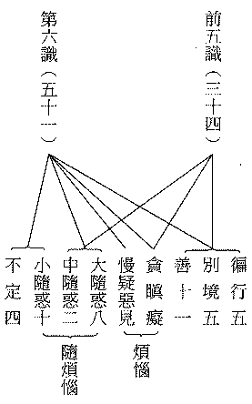



前六识所相应的心所，虽有三十四和五十一的不同，但第六识并不是常常的与五十一个心所相应，前五识也不是常常的与三十四个心所相应。为什麼如此？因前六识，是三性改转、三性转易的识，所以有时与若干的清净心所相应和俱起，有时与若干的染污心所相应和俱起。



壬二　释三受



癸一　正释三受



此六转识易脱不定，故皆容与三受相应，皆领顺、违、非二相故。领顺境相适悦身心说名乐受；领违境相逼迫身心说名苦受；领中容境相於身於心非逼非悦名不苦乐受。



相应门的前三句颂，已如前面详细解说，至受俱门的一句颂文，现在予以略为解说。所谓受俱门，就是分别前六转识的受俱怎样，以解释颂文的『皆三受相应』这句。三受，就是苦受、乐受、舍受。现在前六识的各体，都和三受相应，所以说名为皆。



现在所讲的「此六转识」，是容「易脱」落间断的，不像七八二识那样的恒相续，正因为间断不相续，所以经常的转变「不定」，时而起欢欣的行相，时而起愁戚的行相，时而起非欣非戚的行相，於是就「皆容与」苦、乐、舍的「三受相应」，并不是只与一受相应。同时此六转识缘境的时候，亦「皆」容易托境「领」纳或「顺」或「违」或「非」违顺的「二相」，所以当缘顺境而有所领纳时就生起乐受，当缘违境而有所领纳时就生起苦受，当缘非顺非违境而有所领纳时就生起舍受。



「领」纳「顺」益的「境相」，为什麼说是乐受？因接触到这境界时，使得「身心」感到非常的「适悦」，没有什麼不自在的感受，所以「说名乐受。领」纳「违」逆的「境相」，为什麼说是苦受？因接触到这境界时，使得「身心」感到非常的「逼迫」，大有透不过气来的感受，所以「说名苦受。领」纳非顺非违的「中容境相」，为什麼说是舍受？因接触到这境界时，「於身於心」，既没有「逼」迫的感受，亦没有适「悦」的感受，没有什麼所谓苦乐情绪的产生，所以说「名不苦」不「乐」的舍「受」。是为三受的差别。



在此有人问道：苦乐受的受与苦乐根的根，二者究有什麼不同？受是将所接触到的境界，领纳过来归属於己，而根则是本身能够出生苦乐法，是为二者的不同。又此根、受两者有著宽狭的差别：『受名为根必有领纳，自受但名为受不得名根，未出生故，所以受宽根狭』。



癸二　总别各分



如是三受或各分二：五识相应说名身受别依身故；意识相应说名心受唯依心故。又三皆通有漏无漏，苦受亦由无漏起故。



「如是」像上所说苦、乐、舍的「三受，或」者还可「各」各「分二」，就是身受和心受。如与前「五识相应」的受「说名身受」，有身苦受，有身乐受，有身舍受。所谓「别依身故」，是说前五识别依五色根而总名为身，所以与之相应的总名身受。如与第六「意识相应」的受「说名心受」，有心苦受、有心乐受、有心舍受。所谓「唯依心故」，是说第六意识唯依意根而属於心分，所以与之相应的说名心受。



「又」此苦、乐、舍的「三」受，「皆通有漏、无漏」而分为二种。因为「苦受」不但起於有漏，而且「亦由」修「无漏」圣道加行而「起」。如诸行者的修苦行，目的就在求证无漏，证知苦受亦通於无漏的。还有说到五根中的苦根，是由无漏第六意识之所引生的，而且这不简别大小乘的圣者。如目连尊者证得无学以后，以道眼观察这个世界，发现母亲堕在饿鬼中，不禁感到极大的痛苦，立刻大为不安的驰还白佛。以道眼观得知母的生处，这不是由无漏引起苦受是什麼？又诸初地以上的菩萨，第六识无漏起后得智，为化众生入於大火燃烧的猛烈地狱中，受到热火的逼身，就有苦根生起。如果菩萨心生厌离，其苦立刻就得远离。如是苦受，不是由无漏起是什麼？还有菩萨行者在精进度化众生的过程中，五识有时感到疲劳苦，当知这苦受亦是从无漏之所引生起来的。



或各分三：谓见所断、修所断、非所断；又学、无学、非二，为三。



如是像上所说苦、乐、舍的三受，「或」者「各」各「分」为「三」种，就是所「谓见所断、修所断、非所断」的三者。简要的说：与分别惑相应而起的三受，是属见道所断；与俱生惑相应而起的三受，是属修道所断；与无漏相应而起非由见思惑所起的三受，当然是就属非所断。



关於这三断，《瑜伽论》五七就二十二根说：『问：几见所断？见所断为义？如是等。答：十四一分见所断，一分修所断；十二一分修所断，一分非所断。谓即十四中六及餘六、餘二非所断。此中有色诸根见修所断为义，无色诸根三种为义，谓见、修所断，非所断义』。图示如次：



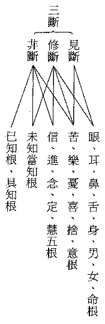



「又」此苦、乐、舍三受，通於有「学、无学、非」学非无学「二」的三位。分开来说：假定是在有学身中有诸苦、乐、舍的三受，名之为学；假定是在无学身中有诸苦、乐、舍的三受，名为无学；假定是在异生身中有诸苦、乐、舍的三受，名为非学非无学。



或总分四：谓善、不善、有覆、无覆二无记受。有义：三受容各分四，五识俱起任运贪、痴，纯苦趣中任运烦恼不发业者，是无记故，彼皆容与苦根相应。瑜伽论说：若任运生一切烦恼皆於三受现行可得，若通一切识身者徧与一切根相应，不通一切识身者意地一切根相应。杂集论说：若欲界系任运烦恼发恶行者亦是不善，所餘皆是有覆无记。故知三受各容有四。



「或」不细分别而就这样的作「总」相说，乃将苦、乐、舍的三受，「分」为「四」种，就是通於所「谓善」受、「不善」受、「有覆、无覆」的「二无记受」。换句话说，三受通於四性俱起，亦即三受中的任何一受，皆得与善等四性俱。且如乐受与善性俱，好像第三禅中的乐受入善定等，是即显示乐受得与善性俱；再如乐受与不善性俱起，好像瞋违顺境而有喜乐俱，瞋是不善性，得与喜乐俱；又如身在下三禅中，生起下三禅中的烦恼时，就是乐受与有覆无记性俱；假若寻常起乐受而是非善非恶的，那就是乐受与无覆无记性俱。再如苦受与善性俱，好像比丘们的精进行道，受到很大的痛苦，是为苦受与善性俱起；假定一般普通的人，不断的在多造罪业，感受身体上的疲劳苦痛，是即苦受与不善性俱起；假定不是造作善恶业，而如一般人的每日工作，同样感到身体上的劳苦，是即苦受与无覆无记性俱；至於苦受是不是可与有覆无记性俱，未见有说。再说舍受与善性俱，如入第四禅定乃至有顶定皆是舍受，而这舍受是与善性俱起的；假定人间一般人的造罪，那就是舍受与不善性俱起；假定是起四禅以上的烦恼，乃至与有顶地以来，是为舍受与有覆无记性俱起；假定在四禅天以上不起烦恼，是即舍受与无覆无记性俱起。



「有义」，是说另有一师作不同的说义。前只是作总相说，此师则委细的分别说「三受」，认为一一受皆「容各」别「分四」，亦即每一受皆得与四性俱。怎麼知道苦受与善性俱？如精进勇猛修道的行者，苦迫自己的身心，使身心感受到苦，证知五识中得有苦受；五识或与瞋等不善相应，身心感到极大的热恼，亦是有苦的明证。苦受是善恶业所感的果，当知这亦即是显示无覆无记。怎麼知道苦受与有覆无记性俱？原因在「五识」中有「俱起」的「任运贪痴」。讲到五识俱起的贪痴，向来说有二种，就是分别贪痴与俱起贪痴。分别贪痴，是属见所断的，一向属於不善；俱生贪痴，是任运而起的，它与五识身俱，自是属於无记，所以得与五识中的苦受相应。又第六意识在「纯苦趣中任运」生起痴、慢、爱、身见、边见等「烦恼」，但这任运所生起的烦恼是「不发业」的，「是无记」性的，所以亦与意识中的苦受相应。若是一个刚刚出定的行者，身上还有轻安在，是即善性与乐受俱；假定是第三禅定中乐，其善性就与舍受俱。总之，一一受皆通善性、不善性、有覆无记性、无覆无记性，所以说三受各四。



「彼皆容与苦根相应」，是明有覆无记通苦根的意思。就是像上所说的不发业的烦恼，但名有覆无记，并不是不善性，以显苦受同烦恼，是有覆无记性。怎麼知道？如「瑜伽论」五十九「说」：『问：是诸烦恼几与乐根相应？乃至几与舍根相应？答』：「若任运生一切烦恼，皆於三受现行可得」。意思是说：俱生烦恼，得与苦、乐、舍的三受俱起。怎麼知道是如此的？因诸任运而生的一切烦恼，假「若」是徧「通一切识身者」，那任运起的烦恼就「徧与」一切识所有的苦、乐、舍「一切根相应」，即不但与前五识三受相应，亦与第六意识三受相应。若此任运而生的一切烦恼，假定「不」徧「通一切识身」而唯与第六意地相应「者」，那任运起的烦恼就唯与第六「意地」所有苦、乐、舍「一切根相应」。《瑜伽论》中既说三受现行可得，证知意识得与苦俱，亦即论中说的意地一切根。如再说得清楚一点，所谓各与三受相应：谓善苦受、善乐受、善舍受；不善苦受、不善乐受、不善舍受；有覆无记苦受、有覆无记乐受、有覆无记舍受。本此，足以证明容各分四法中，三法各通三受。



为了证明有不善苦及有覆无记苦，特再引「杂集论」卷四「说」：『此忧云何？谓若欲界系不任运起者，是不善，若任运起』「烦恼」『能』「发恶行者，亦是不善，所餘皆是有覆无记」。如欲界系的烦恼，假定是任运而自然的生起，并且由此而发动各种罪恶行为，是就属於不善所摄；至於其餘不发恶行以及色无色界任运而起的烦恼，如俱生的身、边二见及俱生时邻近憍、慢、贪、痴等，除了瞋恚，一切皆是有覆无记性摄。如是像上分别，「故知」苦、乐、舍「三受」，皆「各容」许分为善、不善、有覆无记、无覆无记的「四」性所摄。



或总分五：谓苦、乐、忧、喜、舍。三中苦、乐各分二者，逼、悦身心相各异故，由无分别、有分别故，尤重、轻微有差别故。不苦不乐不分二者，非逼非悦相无异故，无分别故，平等转故。



「或」者还可将三受「总分」为「五」，那就是所「谓苦、乐、忧、喜、舍」的五受。三受分为五分，就是从苦受中分出忧受，从乐受中分出喜受，因而成为五受。为什麼又把苦、乐二受各分为二？当知「三中苦、乐各分」为「二者」，因对所缘境界，在身心的感受，略为有所不同。如缘违逆的境界，「逼」迫於身心，如缘顺益的境界，适「悦」於「身心」，其「相」是「各」各差「异」的。如分别说：逼、悦於身的名苦、乐二受；逼、悦於心的名忧、喜二受。在五识上所感受到的逼迫与适悦，「由」於都是「无分别」的，所以名为苦、乐二受；在意识上所感受到的逼迫与适悦，由於都是「有分别」的，所以名为忧、喜二受。还有，在五识上所感受到的逼迫与适悦，都是极为粗重的，所以名为苦、乐二受；在意识上所感受到的逼迫与适悦，都是极为轻微的，所以名为忧、喜二受。像这样的「尤重、轻微」是「有差别」的，所以不得不分别的说明它们的感受。



在此有人问道：前将舍受分为二种而苦乐不分，现将苦乐各分为二而舍受不分，这是什麼道理？「不苦不乐」的舍受所以「不分」为「二者」，因为它在若身若心方面都是一样的，既「非」是「逼」迫，亦「非」是适「悦」，其「相」是「无」有「异」样的，都是「无」有「分别」的，而且是「平等转」的。有人又说：舍明明白白是有违顺而成逼悦的，怎麼可以说是平等？答：不错，在道理上讲，不能说是没有它的差别义，但它的相貌极为幽隐微细，所以不把它再作分别的说。



癸三　苦乐有无



诸适悦受，五识相应恒名为乐。意识相应，若在欲界、初、二静虑近分名喜，但悦心故；若在初、二静虑根本名乐名喜，悦身心故；若在第三静虑近分、根本名乐，安静、尤重无分别故。诸逼迫受，五识相应恒名为苦。意识俱者，有义：唯忧，逼迫心故，诸圣教说意地戚受名忧根故，瑜伽论说生地狱中诸有情类，异熟无间有异熟生苦忧相续；又说地狱寻伺忧俱，一分鬼趣，傍生亦尔。故知意地尤重戚受尚名为忧，况餘轻者？



「诸」有「适悦」的感「受」，如果是与「五识相应」的，那就「恒名为乐」。不错，欲界五识有乐受，色界又是怎样？如果是初静虑，同样是有乐受，因为眼、耳、身的三识，是通於初禅的。如是所有适悦的感受，假定是与「意识相应」的，那就要作如下三种不同的说明：一、假「若」是「在欲界」以及「初、二静虑」的「近分」，亦即在未到定中，那所有的适悦感，就「名」为「喜」受，因为它「但悦」於内「心」而不徧悦五根的。二、假「若」是「在初、二静虑」的「根本」定中，那所有的适悦感，不但「名」为「乐」受，亦可「名」为「喜」受，因为它是徧「悦身心」两方而不是但悦身心任何一方的。三、假「若」是「在第三静虑」的「近分」及「根本」定中，那所有的适悦感，就唯「名」为「乐」受。因为第三静虑的「安静」状态，其「尤」深「重」於前面所有的静虑，不可於中有喜乐的分别，所以说「无分别故」。



根本，是指四禅、四无色的根本定，近分，是与诸根本定作入门之近方便的，所以名为近分定。建立这个近分及根本定，《显扬圣教论》卷二说：『如经中说：即於此身离喜之乐，之所滋润、徧滋润、徧适悦、徧流布者，是为第三静虑近分。如经又说：即此身中於一切处无有少分离喜之乐所不徧满者，是为第三静虑根本』。所谓近分，显示静虑还没有达到圆满；所谓根本，显示静虑已经具足。



「诸」有「逼迫」的感「受」，如果是与「五识相应」的，那就「恒名为苦」，因为这在五识的感受上是极为敏锐的。如是所有逼迫的感受，假定是与「意识俱」起的，那有两家不同的说明，现在分别的说明如下：



一、「有义」，是第一师的说义。依照此师的意思，认为意识相应的逼迫受，「唯」可说是「忧」受而不得说为苦受，因为此之所谓逼迫，只是「逼迫」第六识「心」，并未逼迫到前五识身，怎麼可说通於苦受？而且「诸圣教」中，不论是经是论，都曾这样「说」：与第六「意地」相应所有的「戚受」，皆「名」为「忧」根的。所谓忧根，就是忧受。可是有人问道：一般说为只有忧受固然是可以的，至於地狱有情，不但有忧受，亦复有苦受，为什麼不说？不错，「瑜伽论」卷六十六曾这样「说：生」到「地狱中」去的「诸有情类」，他们的「异熟」果报，亦即所谓第八真异熟识，於初受生以后，从此更「无间」隔的「有」第六「异熟生」，於此异熟生的前六识中，五识有逼迫的苦受，意识有逼迫的忧受，如是「苦忧相续」，说地狱中有苦，是指五识所感受的苦，不是意识所感受的苦。意识所感受的苦唯是忧根，所谓忧唯在意，就是此意。因此，所谓苦忧相续，是约六识而论：前五识有苦受相续，第六识有忧受相续，像这样的讲法，没有什麼不妥。《瑜伽》卷五「又说：地狱寻伺忧俱，一分鬼趣、傍生亦尔」。原文是这样说的：『所有寻伺，何等行？何所触？何所引？何相应？何所求？何业转耶？谓那落迦寻伺，唯是戚行，触非爱境，引发於苦，与忧相应，常求脱苦，娆心业转。如那落迦寻伺一向受苦，饿鬼寻伺亦尔，傍生、人趣、大力饿鬼所有寻伺，多分戚行，少分欣行，多分触非爱境，少分触可爱境，多分引苦，少分引乐，多分忧相应，少分喜相应，多分求脱苦，少分求遇乐，娆心业转』。这是约五趣分别寻伺，不但地狱有情意识所有的寻伺二法是与忧根俱起，就是一分鬼趣和畜生，也是这样的。如《瑜伽论》六十六中，说了地狱有情的苦忧相续，接著说：『如是，若生一分饿鬼及傍生中，当知亦尔』。由是之「故」，可以「知」道，第六「意地」所感於地狱的最极严「重」的「戚受，尚」且不名为苦而「名为忧」，何「况餘」处极为「轻」微的逼迫而不名忧吗？或者有问：地狱有情的第六识，为什麼没有舍受相应？要知所谓第六舍根，是由轻微的业力之所招感的，而地狱苦果是极重业力之所招感的，所以第六识没有舍受相应。



有义：通二。人天中者恒名为忧，非尤重故。傍生、鬼界名忧名苦，杂受纯受有轻重故！捺落迦中唯名为苦，纯受尤重无分别故。瑜伽论说：若任运生一切烦恼，皆於三受现行可得。广说如前。又说：俱生萨迦耶见唯无记性，彼边执见应知亦尔。此俱苦受非忧根摄，论说忧根非无记故。又瑜伽说：地狱诸根餘三现行定不成就，纯苦鬼界、傍生亦尔。餘三定是乐、喜、忧根，以彼必成现行舍故。



二、「有义」，是第二师的说义。依照此师的意思，认为意识相应的逼迫受，是「通」於忧受与苦受的「二」者，而不是单纯的唯名苦受。但要说明这个，同样要从五趣的差别来说明：假若是在「人」趣及「天」趣「中」所有的逼迫受，那就「恒名为忧」，不得说名为苦，因为他们所有的逼迫，比起三恶趣来，算不得是严重，所以说「非尤重故」。假若是在「傍生」及「鬼」趣的二「界」之中，那所有的逼迫感，既可「名忧」，亦可「名苦」。为什麼这样讲？「杂受纯受有轻重故」。所谓杂受，是说容有喜乐夹杂於其间的，其所受者较为轻微，所以名为忧受；所谓纯受，是说纯受逼迫没有喜乐夹杂在内的，其所受者较为严重，所以名为苦受。不论是轻微的杂受，或者是较重的纯受，在傍生与鬼趣都是一样的，不可说傍生杂受轻微，饿鬼纯受为重。在受极重罪处的「捺落迦中」，那所有的逼迫感，「唯」可「名」之「为苦」，不得名之为忧，因为当他们在地狱中受到高度严重的逼迫时，不管是「纯受」，不管是「尤重」，只是感受苦的逼迫而已，根本「无」所「分别」的，可是忧的感受，是从分别生的，现在既无分别，那里还会有忧？照通常说：乐至三禅为诸世间所有之乐的最乐，苦至地狱为诸世间所有之苦的极苦，最乐或是极苦，都是无分别的。因为悦迫到了极点，那能容你再去分别？



同时还要知道的，就是所谓无分别，是约没有分别烦恼而言。因诸地狱及餘纯受苦迫的鬼、畜一分之中，其所感受的痛苦是最极严重的，决不容许有所预谋，所以不得横思计度，不得妄起分别烦恼。正因如此，所以地狱等受极重苦的有情，不能造作感受果报的业力，假定认为地狱等有情，可以造作感受总报的业力，那地狱等有情就将永远无有出离地狱之时，这是不合佛法因果律的。



怎麼知道受极苦的有情无有分别烦恼？如「瑜伽论」中曾「说」：假「若」是「任运」而自然「生」起的「一切烦恼，皆」可「於」苦、乐、舍的「三受现行可得」。特别是论中说到意地一切根相应，更是证明与意识同时相应而起的逼迫，是通於苦受的，如果不通苦受，怎麼可说意地一切根相应？至於详细「广说，如前」已经解释。



「又」《瑜伽论》五十八「说」：所有与生「俱生」的「萨迦耶见」，亦即所谓我见，「唯」是有覆「无记性」摄，不通於其他性的。不特我见如此，就是「彼」断常二者的「边执见，应知亦尔」，亦是有覆无记性摄。如「此」二见相应「俱」起的「苦受」，在根方面说，当然是苦根，「非」是「忧根」所「摄」。因为《瑜伽》「论」中曾「说忧根非」是「无记」性的。忧根不是无记性的，而此二见却又是无记性的，非无记性的自不能为无记性的二见所摄。对此忧根的非无记性摄，《瑜伽》五十七是这样说的：如信、进、念、定、慧的五根及三无漏根的八根，唯是善性而有善、不善、无记为义；苦、乐、喜、舍、意的五根，具善、不善、无记三性而有善、不善、无记为义；忧根一根名善、不善而有善、不善、无记为义；鼻、舌、身、男、女的五根，唯是无记性，亦唯无记为义；眼、耳二根，唯是无记而有善、不善、无记为义。於二十二根中，没有说到命根，因为命根约种，没有为境的义，所以不说。《瑜伽论》中既说忧根名善、不善，没有说到它的无记，足以证明忧根非无记性。



「又瑜伽」论五十七「说」：堕在「地狱」趣的有情，二十二根的成就不成就是这样的：所有「诸根」的种子及十九根的现行，或者说它决定是成就的，或者说它不一定成就不成就的，只有所「餘」的「三」根，其「现行」决「定」是「不成就」的。不但地狱里的有情是如此，就是「纯」粹受「苦」的「鬼界」以及「傍生」，当知亦是如此的，所以说「亦尔」。现行决定不成就的三根：有说是指三无漏根，因在地狱之中，三无漏根的现行，决定是不成就的，假定成就三无漏根的现行，那就决定不会堕落地狱。有说是指乐、喜、忧的三根，因在一向苦处的环境中，此三根的种子，固然可说是成就的，至其现行是决不成就的。不过，假定是在杂受的环境中，那喜、乐、忧的三根，就不但种子成就，现行亦是成就的。所谓杂受处，就是在鬼、畜二趣中，不是纯受苦，而是杂受的。



如上分别，可说「餘三定是」指的「乐、喜、忧」的三「根」。为什麼作这样的肯定？因在地狱受苦报的有情，决定是有七八二识相续不断，且其所受的无记苦根，决定与现行舍根相应的。所以说「以彼必成现行舍故」。兹将前后二师不同的意见如左示：



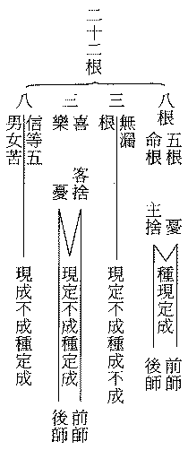



根据此图所示，我们可以知道：前后两师的诤论，焦点唯在初八根及后三根，其餘诸根，彼此意见是相同的。



岂不客舍彼定不成？宁知彼文唯说客受？应不说彼定成意根，彼六客识有时无故。不应彼论唯说客受，通说意根无异因故。又若彼论依客受说，如何说彼定成八根？若谓五识不相续故，定说忧根为第八者，死生闷绝宁有忧根？有执苦根为第八者，亦同此破。



《瑜伽论》中说『地狱定成八根，餘三定不成就』这样的话，学者对此有两种不同的看法：前师认为忧根为第八定成，舍根入三定不成中；后师认为第八决定成就的是舍根不是忧根，忧根是在三种定不成就当中。对《瑜伽论》说有著这样不同的看法，於是双方展开热烈的论战。



《瑜伽论》说餘三定不成就，我以为是指的喜、乐、舍的三根，你们说是指的喜、乐、忧的三根，假定真的如你们所讲，那我得问你：「岂不客舍彼定不成」？此师的问意：如在地狱里的有情，前五识经常感受到苦，第六识经常感受到忧；至於喜、乐定不成就，那是谁都知道的，假定认为不约客舍作为三不成中的第三者，那在三法不成就中，岂不变成只有喜、乐二受不成就，而无第三舍受的不成就？果真如此，应说二定不成，不应说三定不成，论中既说餘三定不成就，是则该是客舍的定不成就。



前师作上责问后，后师反问前师说：你怎麼知道那《瑜伽论》文中所说的现行不成，唯是说的客舍受呢？所以说「宁知彼文唯说客受」。前师回答说：我之所以知有客舍，亦从《瑜伽论》中所说而来，如该论中说到地狱及纯受苦的鬼、畜有情，虽有不苦不乐中客舍受，但为其餘识中的猛盛苦受之所映夺，致使客舍不能显现，由於不现难可了知，好像是没有客舍，实则是有客舍的。后师见前师这样讲，就又难道：假定照你这样说，其所定不成就的决是舍受，那就「应」当「不说彼」决「定成」就「意根」，因为「彼六客识有时」是「无」有的，如生死位及闷绝位，六识是不发生活动作用的，岂不变为意根不得成就？因为意根之所以成为意根，一方面由於它的能生意识，另方面由於它与舍受相应，现在舍受既不成就，而六转识又有时间断，试问意根怎麼能够成就？所以你说能依的客受没有，而主所依的客（六）识是有，这是不合道理的。如合理说：能依的客受没有，所依的客识亦如客受没有。前师又挽救说：受依客说固然是可以的，意不是依客说而是依主说，两者怎麼可以相提并论？是以客受尽管不成就，但不妨为主的意根得以成就！后师再为难道：假定照你这样讲，那就「不应」在「彼」《瑜伽》「论」中，「唯说客受」，不立意根，既说客受，决定「通说意根」，因彼客受及与意根，都是无记性的。或者还可作这样说：《瑜伽论》中不应唯说客受，而於意中通说主识。当知此中所说主识，是指的第八赖耶识，而第八赖耶识一定是与舍受俱有的，怎麼可说餘三定不成就中有舍受不成就？



后师再问前师：「又若彼」瑜伽「论」所说，如你所说是「依客受」而「说」的，那为什麼又「说彼」地狱中「定」必「成」就「八根」？当知八根中的第八根，正是指的舍根，舍根既为地狱决定成就，你为什麼要说餘三定不成就中有舍受的不成就？假定真如你说舍受定不成就，岂不与《瑜伽论》所说地狱决定成就八根相违？



前师又说：你以为八根中的第八根正是说的舍根，亦为我们所不承认的，因为我们认为八根中的第八根是指忧根而言，我们之所以会作这样的看法，是因五识间断而不相续的，其苦不成就已经成为事实，当然要取忧根为第八根。后师难道：假「若」所「谓五识」间断而「不相续」，其苦根决定没有的关系，所以「定说忧根为第八」根而决定成就的话，那末，当一个有情在「死生闷绝」的时候，其第六意识是都停止而不活动了，怎麼会「有忧根」？亦即这时的忧根从何而来，如是分别，可以证知《瑜伽论》说地狱决定成就八根，第七所成就的是意根，第八所成就的是舍根，决不如前师所说成就第八忧根。设若「有」人「执」著「苦根为」八根中「第八」所成就根，「亦同此」忧根所「破」。前师本意是以忧根为第八的，由於五识的间断不相续，自知说忧根为第八是不对的，所以转计苦根为第八，以为眼等五识是常相续的！殊不知这个转计，同执忧根为第八，同样是不合理的。因为假定照他们现在这样说法，由於五识常相续，所以苦根得成就，试问忧根为什麼会间断？假定你们更说：五识是相续的所以有苦，意识是有间断的所以无忧。那我得再问你：能令所引的五识相续，而能引的意识反而间断，试问你是根据什麼理由作如此说？



设执一形为第八者，理亦不然！形不定故，彼恶业招容无形故。彼由恶业令五根门恒受苦故，定成眼等，必有一形於彼何用？非於无间大地狱中可有希求淫欲事故。由是第八定是舍根，第七八识舍相应故。如极乐地意悦名乐无有喜根，故极苦处意迫名苦无有忧根。故餘三言定忧、喜、乐。



假定你们说第八是真异熟报主，所以地狱苦根是第八所成就的根，那我得再问你：当地狱有情正在受苦时，定指什麼东西以为第八？「设」若你们「执」著地狱所现的男女形，而以其中的任何「一形为第八者」，在道「理」上说，是「亦不然」的，亦即根本不对的，为什麼？因地狱有情的男女「形」，或有或无，是「不」一「定」的，且如男根，生到地狱里去的有情，是不一定成就的，所以说「彼」由「恶业招」感的地狱罪报，「容」可是「无形」的。《瑜伽》卷第二说：『云何化生？谓诸有情业增上故，具足六处而生，或复不具。彼复云何？如天、那落迦全及人、鬼、傍生一分』。此中问意：化生有情都是诸根顿具的，照理是应该有男女根的，地狱有情既是属於化生，为什麼没有男女根？有没有男女根，问题在於业力，不关是否化生。可是再问：地狱中的有情，男女二根既不一定有，怎麼知道定有五色根？这是「彼」地狱有情，「由」於过去的「恶业」之力，自然「令」彼於「五根门」头「恒」常「受苦」，好像『六天欲交抱』等一样，所以地狱之身，「定成眼等」五根。至於男女二形的「必有一形」，这是大可不必的，因所谓男女根，在地狱中是没有什麼用的，所以说「於彼何用」？男女根的最大用处，是受行淫欲事，然而「非於」极重的「无间大地狱中」，还「可有希求淫欲事」的。《瑜伽论》说：『诸那落迦中所有有情，皆无淫事，所以者何？由彼有情长时无间多受种种极猛利苦。由此因缘，彼诸有情，若男於女不起女欲，若女於男不起男欲，何况展转二二交会？若鬼、傍生、人中所有依身，苦乐相杂，故有淫欲』。「由」斯理趣，可以知道，「第八」所成就的决「定是舍根」，因为「第七」识和第「八识」，都是与「舍」受「相应」的，有七八二识是就决定有舍根的。



前面后师曾难前师说：在死生闷绝的阶段，决不容许有忧根的；可是现在前师挽救说：我经过再三的思考，仍然认为意识决定恒有忧受的，至於舍受则是决定没有的，因在意识生起以后，在还没有断绝以前，其间不论经过多久的时间，忧受总是那样相续无间的，怎麼可说没有舍受？不！你仍然不能这样说，例「如」第三禅定的「极乐地」，虽说已经没有前五识的活动，但它第六「意」识所感受到的适「悦」，是亦可以「名」为「乐」受的，因为他们已经「无有喜根」。以彼例此，所以在地狱「极苦处」的有情，其第六「意」识所感受到的逼「迫」，自然只可「名」为「苦」受，不得名为忧受，所以说「无有忧根」。以是之「故」，《瑜伽论》中所说「餘三」种成就现行不成就，决「定」是指「忧、喜、乐」的三受，不是舍受。



餘处说彼有等流乐，应知彼依随转理说，或彼通说餘杂受处，无异熟乐名纯苦故。然诸圣教意地戚受名忧根者，依多分说，或随转门，无相违过。瑜伽论说：生地狱中诸有情类，异熟无间有异熟生苦忧相续。又说：地狱寻伺忧俱，一分鬼趣、傍生亦尔者，亦依随转门。又彼苦根意识俱者，是餘忧类假说为忧。或彼苦根损身心故，虽苦根摄而亦名忧，如近分喜益身心故，虽是喜根而亦名乐。显扬论等具显此义。然未至地定无乐根，说彼唯有十一根故。由此应知意地戚受，纯受苦处亦苦根摄。此等圣教差别多门，恐文增广故不繁述。



有人这样问道：假定地狱中唯有苦根而没有乐受的话，为什麼世亲《摄论释》中说纯苦处有等流乐？如该论释第二说：『一向苦处者，谓一向受非爱业果处。於彼有时乐受生者，是等流果生；彼所受异熟果者，唯是其苦』。还有世亲《俱舍论》中亦说：『阿鼻狱中无乐间苦，故名无间；餘地狱中有乐间起，虽无异熟而有等流』。从世亲的大小两论所说看来，一向苦处的地狱，并不是纯苦无乐的，有时亦还有些乐感的，你说纯苦无乐，岂不与此相违？论主回答说：在其「餘」的论典中，「说彼」地狱有情「有等流乐」，我们是也不否认的，如热地狱的猛火暂舍，或见清泉流水等境亦名为乐，虽名为乐而实非乐，所以名为等流。还有《立世阿毘昙论》说：『在热地狱有冷间，在寒地狱有温间』。当知此中所说的温冷，果似前因，假名等流。「应知彼」诸所说，皆是「随转理」门而「说」。还有《施设足论》中说到等活地狱，有时凉风所吹，血肉还生，有时出声唱言等活，彼诸有情欻然还活，如是血肉生时，及暂生喜乐间苦受故，当知这亦是随转理门而说的。当知这是依於小乘的解说而如此的。假使依大乘佛法解说这样的论文，「或彼通说餘」三趣「杂受处，无异熟乐名纯苦故」。意思是说：在地狱趣中，除了极苦处，其餘的地狱以及鬼、畜的合为三趣，因为他们是苦乐杂受的，所以有时可有等流乐，但并不是说极苦的地狱中亦有等流乐，因在极苦的地狱中，不但异熟乐没有，就是等流乐亦没有。正因为如此，所以说地狱为纯苦处。



「然」在「诸」经论的「圣教」中，有时又说「意地戚受名忧根者」，那是什麼道理？当知那是「依」於人、天、鬼、畜诸趣的「多分」而「说」，并不是专约地狱一趣而言，「或」是「随转」小乘有部教理方便法「门」而说。这和本论所说，并「无相违」之「过」。



「瑜伽论」上还有这样的「说：生」到「地狱中」的「诸有情类」，受异熟报苦，本是无间的，但「异熟无间」的「有异熟生」的生起，而这生起的异熟生，就是前六识，於中，前五识所受的是苦，第六识所受的是忧，而此「苦忧」二受，在地狱中，没有片刻停止的在「相续」著。当知这是随於大众部作这样说的，因为他们认为苦在五识，忧在意识的；如依大乘说，意识中亦有苦受，与小乘学派自有不同处。《瑜伽论》中「又说：地狱」中的有情，亦有和意识相应的「寻伺」的「忧俱」起的。不但地狱中的有情是这样，就是「一分鬼趣」和一分「傍生亦尔」——也是这样的。当知这「亦」是「依随转门」而说，并不是自己的本意如此。如从小乘学派说，这是经部师的意见，因为他们认为寻伺唯在意识，所以说寻伺忧俱。还有化地部的学者，说异熟意识有忧根相续，所以《瑜伽论》亦随其化地部说意有忧，而在大乘本意实唯有苦。



「又彼」《瑜伽》中说地狱有情所有「苦根」，是与「意识」相应「俱」有「者」，当知那是同於其餘人天等杂受处的忧根相似，这只可以说「是餘忧」的流「类」，实际是不可以说为忧受的，然因是忧流类，所以「假说为忧」。忧既是假说的，可知实质是苦。「或彼」地狱等的「苦根」，通能「损」害於「身心」，所以「虽」属「苦根」所「摄」，然「而亦」可「名」之为「忧」。从它能损害身方面讲，特地把它叫做苦；从它能损害心方面讲，乃特把它叫做忧；实际这是意识中的逼迫受，是苦而不是忧。「如」未到初禅和二禅根本定时所得的「近分」定，他们都感到非常的「喜」悦，而且这喜悦是都有「益身心」的。如是喜悦看来「虽是喜根，而」实「亦」还可「名」为「乐」受。因为到了这个时候，已经离喜快到妙乐地了，那里还有喜受？这在「显扬论等」，曾经「具显此义」。如该论第二说：『云何建立近分及根本者？如经中说：所谓此身离生喜乐之所滋润、徧滋润、徧适悦、徧流布者，是谓初静处近分。如经又说：即此身中一切处，无有少分离生喜乐所不徧满者，是谓初静虑根本。如经中说：即於此身等持所生喜乐之所滋润、徧滋润、徧适悦、徧流布者，是谓第二静虑近分。如经又说：即此身中一切处，无有少分等持所生喜乐所不徧满者，是谓第二静虑根本。如经中说：即於此身离喜之乐之所滋润、徧滋润、徧适悦、徧流布者，是谓第三静虑近分。如经又说：即此身中於一切处，无有少分离喜之乐不徧满者，是谓第三静虑根本』。从《显扬论》以及《瑜伽》五七、《对法》第七所说，证知近分定中喜受滋益身心，虽说是属喜根所摄，而实亦可名之为乐。



「然」而我们尚要特别注意的，就是在尚未到达根本定的「未至地」的阶段，虽可说有乐受，但「定无」有「乐根」。怎麼知道？因在《瑜伽》五七明白「说彼唯有十一根故」。如该论说『未至地几根可得？答：十一』。此中所说的十一根，是指信、进、念、定、慧的五根，三无漏根，再加意、喜、舍的三根。《瑜伽论》继续说：『问：若未至地有喜根者，何故不如初静虑地建立喜耶？答：由於彼地喜可动故』。意说未至地时，仍接近於欲界，有所散动，所以不立；到了初根本定，因为离欲界远，不再有所散动，所以立喜。怎知未至地有喜？《瑜伽论》又续说：『问：喜於彼有何教为证？答：如世尊言：如是苾刍离生喜乐滋润其身；周徧滋润、徧流、徧悦，无有少分不充不满，如是名为离生喜乐』。当知此中的初门，是说的未至地，就是所谓离生喜乐滋润其身；当知此中的后门，是说的根本定，就是所谓周徧以下所说。本此证知未至地中，唯十一根而喜是其中之一。或有问道：初根本定为什麼一受分成喜乐？最简单的答覆：由於适悦身心，所以分成喜乐。同时，经中既将初定名为离生喜乐，所以《义灯》五说：『以经说喜，即证有喜；经既说乐，何不有乐』？



有人又问：初二根本定能够两悦身心，所以感受分成喜乐；杂受苦处能够两迫身心，理应分成忧苦二受，为什麼不见经论有分？当知违顺差别，种有同别，加以杂受苦处，前五识的感受是全的，意识的迫逼感极轻微，所以经论不说分为二受。人或再问：苦乐贯通於身心两方面，所以二受就分为两种，舍受亦是通於身心两者的，为什麼不将之分开说？当知苦乐分为两种来说，那是约它们的尤重与轻微说的；至於舍受唯是一类如此的，所以不能分开来讲，而且它在身心上都名为舍，并没有什麼不同的相貌；可是逼、悦的相貌明显的有差别，所以不得不各分为二。



「由此」我们「应」当「知」道：与「意」识「地」相应的「戚受」，在「纯受苦」的地方，「亦」为「苦根」所「摄」，不得名之为忧。「此等」经论「圣教」，对於此一论题，说有「差别多门」，如所说的三受五受，如有报无报的不同，如界地所系的有异，如在何地断等，说来真是很多，「恐文增广，故」略止此而「不繁述」。



癸四　举执辩破



有义：六识三受不俱，皆外门转，互相违故。五俱意识同五所缘，五三受俱意亦应尔，便违正理，故必不俱。瑜伽等说藏识一时与转识相应三受俱起者，彼依多念，如说一心非一生灭，无相违过。有义：六识三受容俱，顺违中境容俱受故，意不定与五受同故。於偏注境起一受故，无偏注者便起舍故，由斯六识三受容俱。得自在位唯乐、喜、舍，诸佛已断忧苦事故。



关於三受与六识俱转不俱转义，学者间有著不同的看法，现在这儿举出两家的论说：



一、「有义」，是第一家的说义。依照此家的意思，「六识」与「三受」是「不」能同时「俱」起的。什麼道理？因为六识是同缘外境的，亦即所谓「皆外门转」的。由於同缘外境，而三受的性质是「互相违」的，所以不能并起。而且「五俱意识同五」识是同一「所缘」的，五识所缘的是什麼，五俱意识所缘的必然亦是什麼。假定三受可以俱起的话，前「五」识的「三受」是「俱」起的，则同缘的五俱「意」识「亦应」是三受俱起，这末一来，於一念中，有苦、乐、舍的三受出现，那就「便违正理」，因为从正理方面讲，三受俱起是不可能的，所以说三受「必不俱」转。「瑜伽」及《显扬》「等」论虽「说」第八「藏识一时」能「与」前七「转识相应」的「三受俱起」，但「彼」诸论是「依多念」而说，并不是说一念中有三受。「如说一心」，并「非」一心就是「一生灭」，多生灭也可以叫做一心的。所以《瑜伽论》等所说三受俱起与本论这里所说意识不同时俱有三受的道理，并「无相违过」失！



二、「有义」，是第二家的说义。依照这家的意思，「六识」与「三受」是「容」可「俱」起的。什麼道理？因前六识对於「顺」益的境、「违」逆的境及「中」容「境，容俱」予以领「受」的，所以三受可以俱时转起。第六「意」识「不」一「定与五」识的三「受」相「同」的。这话怎讲？当意识与五识同缘外境时，意识如「偏」专「注」於顺「境」，那就唯「起一」乐「受」；意识如偏专注於违境，那就唯起一苦受；意识如「无偏」专「注」於顺违的任何一境时，那「便」生「起舍」受。「由」於如「斯」，所以「六识三受容俱」，亦即《瑜伽论》说『藏识一时与诸转识相应，三受俱起』。



以上所说三受俱转不俱转义，是就未得自在的有漏凡夫说，假定已经到了「得自在」的无漏果「位」，不论是最高的佛果位，或是转得无漏的初地位，那就「唯」有「乐、喜、舍」的三受俱起，决不会有忧、苦二受的现前，因为到了转得无漏位，特别是到了最高的佛位，由於「诸佛已断忧、苦事」，自然是无忧无苦的。成佛无漏位，是约究竟果说，初地无漏位，是就不究竟果说。



庚二　广显差别



辛一　徧行别境



壬一　结前标问



前所略标六位心所，今应广显彼差别相。且初二位其相云何？



「前」面「所」说，只是「略」略的「标」出「六位心所」，现「今应」更进一步的「广显彼」六位心所的「差别相」。首先要说的，是六位心所的初二位的义相是怎样的，所以说「且初二位其相云何」？下面所要讲的各个心所，是显吾人内在的精神活动作用，可说是极为重要的课题，所以值得学者的特别重视！因为了解吾人内心的精神作用，那你就会知道：那些心理活动是要得的，那些心理活动要不得的，要不得的就得设法让它不要活动，要得的不妨让它继续的活动，这对吾人的身心修养甚至转迷开悟，都有著极为重要的关系，不容吾人予以忽视！



壬二　举颂总答



颂曰：初徧行触等；次别境谓欲、胜解、念、定、慧，所缘事不同。



於六位心所中，先举「颂」解答前问初二位心所相「曰：初徧行触等」，这是颂徧行位。「次别境谓欲、胜解、念、定、慧」，是颂别境位。「所缘事不同」，是解释别境义。



壬三　解释颂意



癸一　释徧行



论曰：六位中初徧行心所即触等五，如前广说。此徧行相云何应知？由教及理为定量故。此中教者，如契经言：眼色为缘生於眼识，三和合触，与触俱生有受、想、思乃至广说，由斯触等四是徧行。又契经说：若根不坏境界现前，作意正起方能生识。餘经复言：若复於此作意即於此了别，若於此了别即於此作意，是故此二恒共和合乃至广说，由此作意亦是徧行。此等圣教诚证非一。



「论曰」，是说以下运用论文详细解释颂中的意义。於「六位」心所中，先说「初」位「徧行心所」，那「即」是「触」、作意「等」的「五」种。文中举出触心所一法，其餘的作意、受、想、思的四法，就可包括在内。关於这五心所的一一名义，「如前」初能变中，已经「广」为解「说」过了，现在不复重说。前说『其徧行相，后当广释』，正是这儿所要说的。



「此徧行相云何应知」？是说应怎样的知道这五法的徧行相。所以在此提出这个问题，是因小乘学派中的有部所说十大地法与唯识学所说的五徧行，有著深切的关系。原因有部系所说的作意、触、受、想、思、欲、胜解、念、三摩地、慧的十大地法，是必常与一切心相应的，可是后来唯识学者将这十大地法，分为五徧行与五别境的两类：认为确常与一切心相应的，只有十大地法的前五，所以叫做徧行心所；至於后五心所，并不能常与一切心相应，所以叫做别境心所。作意等五心所，既然说为徧行，试问有何所以？还有经部学者，说五徧行心所，分为假实两类，就是受、想、思三是实有的，作意、触二是假有的，现在唯识说五皆是实有，试问这又是什麼道理？为解答这问题，口说没有用的，要「由」圣「教及」正「理为定量」，方足证明徧行之所以名为徧行。



「此中」先以「教」答「者，如契经言：眼色为缘生於眼识，三」事「和合触」。举最明显的例说，好像《杂阿含》卷八、二一三经说：『缘眼色眼识生，三事和合缘触……如是耳、鼻、舌、身、意法缘生意识，三事和合触』。经中接著说：「与触俱生有受、想、思乃至广说」。如《杂阿含》卷第十一、二七三经说：『如是缘眼色生眼识，三事和合触，触俱生受、想、思……如眼、耳、鼻、舌、身、意法因缘生意识，三事和合触，触俱生受、想、思』。《杂阿含》卷十三、三〇六经亦说：『眼色缘生眼识，三事和合触，触俱生受、想、思……缘意法生意识，三事和合触，触俱生受、想、思』。本於圣教所说如此，「由斯」我们知道「触」、受、想、思「等四」法「是」属「徧行」心所。阿含圣教是大小乘学者所共同承认的，经中既这样说，我们不得不信，所以触等是徧行，没有怎样的问题。



可是有人问道：阿含圣教当中，为什麼单说触等四法为徧行而不及於作意？当知受、想、思的三者，属於五蕴中的三蕴所摄，现在说触与受、想、思三法为依，那是约三蕴的所依殊胜说的，而作意是属行蕴所摄，依义不怎麼殊胜，所以且隐作意不说，实际作意亦是徧行。《了义灯》中对此有两种解说：一、这是随顺於前的，如前但说受、想、思等所依为业，没有说到作意；二是顺经部师的意思，因为他们立餘心所，以作意等为思的分位，所以不论。



假使真的如此，怎麼知道作意必有？又怎知道是属徧行所摄？「又」如「契经」中「说」：假「若」眼「根不」曾「坏」，色尘「境界」复「现」在「前，作意」更「正」当的生「起」，具备如是条件，「方能生」起眼「识」。眼识如此，餘识亦然。此中所说的契经，基师说是《象迹喻经》。意说：初引《阿含经》证明触等四心所是徧行，现在引此经但证作意是徧行。



不但《象迹喻经》有这样说，在其「餘」的「经」典中，像《起尽经》「复」有这样的说「言」：假「若复於此」境上有所「作意」，亦「即於此」境上有所「了别」。反之，假「若於此」境上有所「了别」，亦「即於此」境上有所「作意」。以「是」之「故」，如「此」作意与了别「二」法「恒」常的「共」同「和合」在一起。经中对这「乃至广说。由」於如「此」，所以我们知道「作意亦是徧行」。《显扬论》第一说：『说和合非不和合。如经中说：若於此作意即於此了别，若於此了别即於此作意，是故此二恒和合非不和合，此二法不可施设离别殊异。复如是说：心心法行不可思议』。《瑜伽》五十五说：『问：如经言：此四无色蕴当言和合非不和合，不可说言如是诸法可分可析令其差别，何故彼法异相成就而说和合无差别耶？答：众多和合於所缘境受用领解方圆满故；若不尔者，随阙一种，於所为事应不圆满』。



「此等」证明徧行心所的「圣教」，不是一种两种，而是有很多的，所以说「诚证非一」。如《瑜伽》五十五说：『问：诸识生时与几徧行心法俱起？答：五，谓作意等』。其他，如《五蕴论》、《百法论》等，皆说到五徧行心所义。



理谓识起必有三和，彼定生触，必由触有，若无触者，心心所法应不和合触一境故。作意引心令趣自境，此若无者心应无故。受能领纳顺违中境，令心等起欢戚舍相，无心起时无随一故。想能安立自境分齐，若心起时无此想者，应不能取境分齐相。思令心取正因等相造作善等，无心起位无此随一，故必有思。由此证知触等五法心起必有故是徧行。餘非徧行，义至当说。



前面是引教为证，现在是以理为证。「理」以道理的推论，不难使我们知道，所「谓」心「识」的生「起，必有」根境识「三」者的「和」合，由「彼」三法的和合，也就必「定」会「生」起「触」来，而三法和合亦「必由触」而「有」，换句话说，必定要有触，才会有识生，彼此之间有著极为密切的相互关系。假「若无」有「触」的这一法，那「心」王和「心所法」，就「应」当各自为政，「不」能「和合」起来，共同去「触一境」。当知此中所说的『彼定生触』，就是论文卷三所说的『触依彼生』；这儿所说的『必由触有』，就是论文卷三所说的『令彼和合』。由此亦可见论文的前后呼应！



「作意」最主要的功用，在於「引心」心所，使「令趣」向於「自」己所缘的「境」。《瑜伽论》卷三说：『作意作何业？谓引心为业』。同论卷五又说：『作意云何？谓能引发心法……作意为何业？谓於所缘引心为业』。《显扬圣教论》卷一说：『作意者……动心为体，引心为业，由此与心同缘一境故，说和合非不和合』。是以在引心方面，作意有著特殊的作用。如「此」作意，假「若无」有的话，那「心」也就「应」当「无」从生起向前取於自境，由此可见作意绝对是缺少不了的。



「受」的最特殊的功用，既「能领纳」适意的「顺」境，亦能领纳不适意的「违」境，更能领纳顺违俱非的「中」容「境」，使「令心等」随著所领纳的顺境，生「起」喜乐的「欢」悦相，随著所领纳的违境，生起忧苦的愁「戚」相，随著所领纳的中容境，生起非苦非乐的「舍相」。这三相，就是通常所说的三受。除了「无心起时」，可说「无」此「随一」，就是在心念不起的时候，可说没有三受中的任何一受，但若有心起的时候，那与三受之中，没有不具一受，或与一苦受俱，或与一乐受俱，或与一舍受俱。虽然每一心念起，必有一受跟著生，但三受却不能并生，因为它们的性质是相互违背的！



「想」与根境识三者相接触的时候，以所缘境为心像而映现於心中，由於有这样的作用，所以「能」够「安立自境分齐」，将诸所缘的客观对象，分疆划界的认为这是什麼那是什麼，各各有其一定的分齐，使得彼此间不会稍有混滥。如青黄长短等色，螺贝钟鼓等声，生莲优昙等香，苦辛咸淡等味，滑涩坚软等触，甚至男女生灭等法，如相而取，各有分齐，不紊不乱，是为想的特用。吾人心念不起则已，设「若心」念在生「起时」，必定是有这想心所的，有这想心所才能取境分齐，如果「无」有「此想」的话，那就「应不能取境分齐相」。不能取境的分齐相，一切境相岂不混成一团？我们还能分别这是什麼、那是什麼吗？是绝对不可能的，所以想心所不可少。



「思」是造作的意思，为有情的意志作用。它有一股力量，使「令」吾人的一念「心」，执「取正因」、邪因「等相」。因而可说思是诸心心所生起动能的原动力，依此原动力的推动，於所执取的正因、邪因等相上，「造作」种种「善」恶无记「等」业，是为思心所的作用。这是大小乘论典中共同作这样说的，所以在心理活动方面极为重要。除了「无心起位」，可说「无此随一」之思，设若有心起时，没有说是不具这意志思的。所以但有心起，「必」然是「有」此「思」，可见思的活动作用普徧。



「由」於以上「此」诸道理的「证」明，我们可「知触」、作意、受、想、思「等」的「五法」，心如不起那就不谈，设若「心」生「起」的话，「必」然是「有」这五法的，所以说它们「是徧行」心所。智周《演秘》说：『显扬第一引证说有者，证有徧行。即彼论云：如经中说若於此作意等。又说由彼所生作意正起，如是所生眼等识生，如经说有六触身。又说眼色为缘能起眼识，如是三法聚集合故能有所触。又说触为受缘，如经说有六受身。又说受为爱缘，如经说有六想身。又说如其所想而起言议，如经说有六思身。又说当知我今六触处，即前世思所造故业』。至於其「餘非」是「徧行」心所的「义」相，「至」下「当说」。



癸二　释别境



子一　正释五所



次别境者：谓欲至慧，所缘境事多分不同，於六位中次初说故。云何为欲？於所乐境希望为性，勤依为业。



在徧行之后，其「次」所要说的是「别境」。所「谓」别境，如徧行一样的有五，就是「欲」、胜解、念、定以「至慧」。此五心所「所缘」的「境事，多分」是各各「不同」的，不如徧行那样的同缘一境，所以叫别境。「於六位」心所「中」，它仅「次」於「初」位的徧行之后，所以颂文说为『次别境』。



什麼叫做「欲」？谓「於所」爱「乐」的「境」界，以「希望为」它的体「性」，以「勤依为」它的「业」用。生存在这世间的每一个人，没有那个没有他的希望，只是各人的希望不同而已。不独欲界众生有这样的欲望，就是色、无色界的众生，亦同样的有这欲望，总说一句，凡有情识活动的，无不有他的欲望。如希圣希贤，固然是种欲望；如欲为小人，同样是种欲望。欲望的本身无所谓好不好，问题看你向那方面欲望。吾人不但有欲望，而且为了满足其欲望，乃勤劳不息的向前进取，以期达到自己所要达到的。小乘《入阿毘达磨论》说：『欲谓希求所作事业，随顺精进，谓我当作如是事业』。经中更有一句话说：『一切法欲为根本』。我认为这话极为重要，因为任何一法的完成，无不是由欲的力量在推动。如果没有欲的这股力量在推动我们，我们在生命历程中将一事无成。所以吾人只要对某事发生强有力的兴趣，并且希望能得到它，必然就会精进不懈的去做，所以说为勤依为业。《瑜伽论》卷五五亦说：『欲云何？谓於彼彼境界，随趣希乐……欲为何业？谓发生勤励为业』。同样是欲，有善的一面，亦有不善的一面，不善的一面固然为佛法所呵斥，但善法欲却是吾人所不可或缺的，缺了就不能完成善事，特别是度生的大业，庄严佛土的大业，如没有纯洁无疵的善法欲在推动，怎能完成度生及庄严佛土的大业？



有义：所乐谓可欣境，於可欣事欲见闻等有希望故；於可厌事希彼不合望彼别离，岂非有欲？此但求彼不合离时可欣自体，非可厌事，故於可厌及中容境一向无欲。缘可欣事若不希望，亦无欲起。



以希望为性的欲，前虽说了它的总意，但学者间对这有不同的意见，本论举出三家来说，现在简述如下。



「有义」，是指第一家的说义。依照此师的意思，所谓「所乐」，是指「可欣」的「境」界，唯有对「於可欣」的「事」，我们方「欲」去「见」去「闻」去觉，去知它，因为对它「有」所「希望」的，亦即由於内心的欲望之所推动，希望这个所乐的可欣境，能为我所得到。这麼说来，可见唯有可欣的事，方有欲求的生起。



有人认为不仅可欣事方生於欲，就是可厌事亦会生欲的，所以问道：世人对「於」诸「可厌」患的「事」，在没有到来的时候，「希」望「彼」诸厌事，「不」要与自己遇「合」，以免产生不必要的痛苦，设若已与自己遇合的，希「望彼」诸厌事迅速的「别离」，不要让自己受到不必要的麻烦，这不是欲是什麼？所以说「岂非有欲」。缘诸可厌患事，既有欲的生起，为什麼说唯於可欣境有欲生？所以你们这个说法，是不怎麼合乎事实的！现在回答他说：如你上来所言，「此」不过「但」於诸可厌境，「求彼不」要与自己相「合」，或者望它很快的「离」开自己，唯有在这个「时」候，是人才有「可欣」的痛快的「自体」，并「非」是在「可厌事」上生好乐心，怎麼可以说名为欲？如以内在的生命说：当一个人在患病时，病苦折磨自身非常难受，这时尽管怎样的爱惜宝贵自己的生命，希望自己生命继续不断的生存下来，但决不会对於折磨生命体的病苦有所爱好，是以，病未来到的时候，总希望病不要来，以免影响身体健康，病若已来的时候，总希望病快离去，以求恢复身体健康，可见不是於可厌事有欲生。以是之「故」，不说对「於可厌」的苦境以「及」无所谓厌欣苦乐的「中容境，一向」以来是「无欲」的，即令所「缘」是「可欣」的「事」，假「若不」对它有所「希望，亦」是「无」有「欲」的生「起」，亦即根本不对它生起好乐之心。可见欲之所以为欲，定要对境有所希望。



有义：所乐谓所求境，於可欣厌求合离等有希望故；於中容境一向无欲；缘欣厌事若不希求亦无欲起。



「有义」，是指第二家的说义。依照此师的意思，所谓「所乐」，就是「所求」的「境」界，而这所求的境界，是不别可欣可厌的。如对「於可欣」的事，未合的「求」其「合」，已合的求不离；至对可「厌」的事，未合的求不合，已合的求其「离」。对於诸如是「等」，因为怀「有」这样不同的「希望」，所以名之为欲。至「於」那些无所谓欣厌的「中容境」，因为对它没有合离的希望，所以「一向」是「无欲」的。不过有时「缘欣厌事」，对可欣的好事，不起合的希望，对可厌的坏事，不起离的希望，亦同样的不起欲求，所以说「若不希求亦无欲起」。依此师说：於欣厌二境俱有希望，唯中容境无有希望。



有义：所乐谓欲观境，於一切事欲观察者有希望故，若不欲观随因境势任运缘者即全无欲。由斯理趣欲非徧行。



「有义」，是第三家的说义。依照此师的意思，所谓「所乐」，不是什麼特定的可欣可厌的境界，而是指的什麼所「欲观」的「境」界。不但於一切境求合求离，才会有欲的生起，就是对「於一切」善恶境「事」上，亦即不问它是好还是坏的，只要对它生起好乐的心理，对这所欲观的境事，予以仔细的审「观」详「察」，然后对它有所「希望」，是就名之为欲。设「若」对於任何一种境事，吾人对之「不欲」有所「观」察，只是「随」於「因」此「境」界「势」力「任运」而「缘」的话，根本完全不入於心，那就完「全无欲」。



「由」於如上所说的这个「理趣」，所以证知「欲非徧行」所摄。上来虽有三家说法，但以第三说的义理，来得较为殊胜，因为起欲的境来得稍宽，不是局限在某个境上的。前二师皆说到中容境一向无欲，是通於八识的，可是依第三家说，七八二识完全是无欲的，因为在道理上讲，那是没有生起欲的可能的。如前第四卷论末，讲到心所相应时，第四师就说第七识无欲，证知七八二识绝对没有生起欲的道理。正因如此，所以七八二识无欲心所相应。



有说：要有希望境力诸心心所方取所缘，故经说欲为诸法本。彼说不然！心等取境由作意故，诸圣教说作意现前能生识故，曾无处说由欲能生心心所故。如说诸法爱为根本，岂心心所皆由爱生？故说欲为诸法本者，说欲所起一切事业，或说善欲能发正勤，由彼助成一切善事，故论说此勤依为业。



「有说」，就是另外还有一说。依照此说的意思，吾人心识的缘取客观境界，不是随心所欲的想要缘就可缘，而是必「要」先「有希望」取得某个「境」界的一股「力」量的推动，然后「诸心心所方」去缘「取所缘」的境界，所以吾人心念不起则已，心若起时定应有此。因为这样的关系，所以佛在经中特「说欲为诸法本」。如《顺正理论》卷十说：『又世尊言：谓一切法欲为根本，乃至由此契经现证欲等实有别体，是大地法。然上座言：此经所说是不了义，故不可依』。接著又说：『应知此中言一切法欲为本者，一切流转皆以希求为种子故。谓於诸法生觉了心，并以希求为根本故。如生顺起缘一切心，故说诸法欲为根本』。照这样说，欲为诸法本，固是佛说的，但对它的解说，有不同的看法，特别以此证明欲有徧义是不妥的！



现在论主破斥道：「彼」另外一师这样的解「说」是不对的，所以说「不然」！为什麼？当知所谓「心」王和心所「等」的「取」诸「境」界，不是由於什麼欲的关系，而是「由」於「作意」的功力，所以在「诸圣教」当中，皆「说作意现前」的时候，方「能生」起心「识」的活动，「曾无」一「处」曾经说到「由欲能生心心所」的。如前所说，作意有股特殊的力量，警令心心所去缘所缘境，於是心心所法就在这个警觉之下，生起它的认识作用来。心心所等取外境时，明明是由作意的力量，关乐欲什麼事？你们误将作意为欲，自然是要不得的！「如」在经中佛亦曾经「说」到「诸法」以「爱为根本」的这话，「岂心心所皆由爱生」？假定不承认爱能生起诸心心所法，怎麼可说欲为诸法本？假定坚执欲为法本的这话，就是诸心心所皆从欲生，是则经说诸法爱为根本，亦应承认诸心心所皆由爱生。此既不然，彼云何尔？《顺正理论》卷第十说：『又世尊言：谓一切法欲为根本，作意引生，触为能集，受为随流，念为增上，定为上首，慧为最胜，解脱坚固涅槃究竟』。经说欲为诸法本的这话，意思是说：由欲就有作意，由作意就有触，由触就有受，由受就有想，由想就能得解脱。欲为法本的意思在此，怎麼可说由希望境力，诸心心所方取所缘？



然则经中为什麼要说欲为诸法本？当知经「说欲为诸法本者」，是「说」乐「欲所起一切事业」，皆是以欲为本的。所谓一切事业，通於善等三性，皆为勤之所依。「或说善」法「欲能」够「发」起「正勤」，复「由彼」正勤「助成」善欲所欲做的「一切善事」，是以说欲为诸善法本。但诸善法的完成，由於精进的策动，是「故论说此」为「勤依」，亦即「为」欲的「业」用。



不但本论说欲为勤依，《显扬圣教论》卷一亦说：『欲者，谓於所乐境，希望为体，勤依为业』。《大乘阿毘达磨集论》卷一亦说：『何等为欲？谓於所乐事，彼彼引发所作，希望为体，正勤所依为业』。欲为精进的依止，意说由於这个欲，希望所作事完成，所以就生起精进，如不完成所作事，决不懈怠的退舍。在经部系的《成实论》，设有〈欲品〉论说欲之为欲，暗示欲含有善品不善品的两类。给予欲的简单定义是：『心有所须，是名为欲』。总之，诸法以欲为本，决不可误认欲能生起心心所法，这是最要注意的！



云何胜解？於决定境印持为性，不可引转为业。谓邪正等教理证力於所取境审决印持，由此异缘不能引转。故犹豫境胜解全无，非审决心亦无胜解，由斯胜解非徧行摄。有说心等取自境时无拘碍故，皆有胜解。彼说非理！所以者何？能不碍者即诸法故，所不碍者即心等故，胜发起者根作意故，若由此故彼胜发起，此应复待餘便有无穷失！



什麼叫做「胜解」？胜解具有怎样的意义？这是现在所要讲的。谓「於」已经「决定」了的「境」界，以「印持为」它的体「性」，以「不可引转为」它的「业」用。胜是殊胜，解是理解，坚固不拔的殊胜理解，名为胜解。「谓」如由於「邪」教、邪「理」、邪「证」等力，於所取的境界，经过详审明决，印定持守，由此不论遇到怎样的异缘，都不能引他转变已经决定了的理解。不但对邪的是如此，就是对「正」教、正理、正证的「力」量，「於所取」的「境」界，经过详「审」明「决，印」定「持」守，认为这样就是这样，「由」是从「此」以后，不论遇到怎样强有力的「异缘」，都「不能引」他「转」变原来已经决定了的理解。像这样的殊胜理解，所以名为胜解。如举经中例说：『色如聚沫，受如水泡，想如阳燄，行如芭蕉，识如幻境』。你对经中这样的说明，如能获得决定性的理解，认为确实是这样的，诸佛出世也不会改变我的认识，是为决定性的不可改转的胜解。像世俗说的『三军可夺帅也，匹夫不可夺志也』，固是这个胜解的诠说；古德说的『任尔非心非佛，我自即心即佛』，亦是这个胜解的说明。胜解力的殊胜，於此可见。



由是之「故」，可知不论是怎样的「犹豫境」界，亦即半信半疑，若存若亡的对象，那「胜解」决定是完「全无」有的。不特犹豫境没有胜解，就是「非」一刀两断的「审决心，亦」同样的「无」有「胜解」。总说一句：胜解於疑心中，决定全不发生的；於染心中，假定是与疑相应的，同样没有胜解的生起，假定不与疑相应的，则有胜解生起的可能。「由斯」理趣，「胜解非徧行摄」。



我在《八识规矩颂讲记》中说：『对於某个理论或境相，假定是犹豫不决的，不能对它作决定性的理解，那是很易为人之所转动或惑乱的，亦即今天认为是这样的，因为受了其他思想理论的影响，明天就改变了对它的看法，认为原来不是这样，是即显示你对论题，没有得到决定性的理解。假定你对某个论题，不论是错误的邪说，或是由於推理所得，但因你是依著禅定修证的实际体验得来，对它已作审判印持决定，认为确实是这样的，没有丝毫疑惑餘地。这末一来，其后不论接触任何高超的理论和其他的精审思想，你都有把握的站稳自己的立场，不致动摇自己原有的理解，而随著别人的脚跟转来转去』。



「有说」，是指有其他的论师这样说。此中有说，就是《顺正理论》所说的餘师。如该论说：『有餘师言：胜谓增胜，解谓解脱，此能令心於境无碍自在而转，如胜戒等』。《俱舍宝疏》卷四对这释说：『言餘师者，杂心等师。彼说：令心於境自在为胜，境不能碍，故得改易名解，解谓解脱，故旧杂心谓名解脱。言胜戒等，等取胜定、胜慧』。现在本论对该师的解说，是说「心」心所「等」，在「取」它「自」己所缘「境时，无」有任何东西的「拘碍」，要怎样缘就怎样缘，所以不论缘何境界，自然「皆有」它的「胜解」，还要等待审决印持做什麼？「彼」餘师的这个「说」法，站在本论的立场，认为他的这说法，是很不合理的，所以说「非理！所以者何」？是问为什麼是不合理的。要知你所说的不拘碍，有能不碍与所不碍的两种，试问你所说的是指的那种不拘碍？假定是以「能不碍者」为胜解，可是我得告诉你，除了心心所外，其餘的法皆是能不碍，因与心心所作增上缘，皆不碍於心心所法的生起，所以能不碍者「即」是「诸法」。假若是以所不碍者为胜解，可是我得告诉你，所谓「所不碍者」，不是别的什麼，「即」是「心」心所「等」的本身，并不是单指心心所法中的任何一法，你为什麼说是胜解？



《正理论》中所说餘师救说：不错，所不碍者，总指心心所法，但是当中的胜解，其力特别的增胜，因而对於心等生起，真正能够不为所碍。论主驳斥说：这个说法也是不对的，因为最极殊「胜」的「发起」心心所，使心心所有所活动的，是「根」与「作意」二法的力量，并无关於什麼胜解，胜解对心心所法的生起，并不显有什麼特胜的关系。彼师又救：不错，根与作意对心心所的发起，有著特殊的关系，但若没有胜解的力量，根与作意还是不能发起心心所的，所以我们认为由胜解增胜力才能发起心等。论主反对他说：你这说法同样是通不过的，假「若」真如你们所说，「由此」胜解的增上缘力，「彼」根和作意才能为「胜发起」心心所法，那末，「此」胜解本身亦「应」自无力量为胜发起，而应「复待」其「餘」的法方能胜发。为什麼要作这样讲？如作意是心所法，须待其餘的法方能胜发，胜解亦是心所法，应如作意须待其餘的法方能胜发。你们承不承认胜解要待餘法？假定承认要待餘法，如是「便有无穷」过「失」；假定不承认要待餘法，为什麼作意要待胜解方能为胜发起？证知你们这说法不对！



云何为念？於曾习境令心明记不忘为性，定依为业。谓数忆持曾所受境令不忘失能引定故。於曾未受体类境中全不起念，设曾所受不能明记念亦不生，故念必非徧行所摄。有说心起必与念俱，能为后时忆念因故。彼说非理！勿於后时有痴信等前亦有故，前心心所或想势力，足为后时忆念因故。



什麼叫做「念」？念具有怎样的意义？这是现在所要讲的。念之所以为念，就是对「於曾」经串「习」过的「境」界，「令心」对之「明记不忘」，以「为」它的体「性」，以作「定」的所「依为」它的「业」用。为什麼这样讲？因念是吾人的记忆作用，「谓」能「数」数不断的「忆持曾」经「所」领「受」过的「境」界，「令」心对它始终记忆而「不忘失」，只要稍一回想，或者略加思索，立刻就会呈现在脑海中，清楚的记得确是如此的，如是念兹在兹的，久之就「能引」发「定」。《杂集论》卷十说：『四法迹者：谓无贪、无瞋、正念、正定。无贪、无瞋能令增上戒学清净，不因贪、恚门毁犯学处故；正念能令增上心学清净，由於所缘无有忘失，持心令定故；正定能令增上慧学清净，由定心者能如实徧知故』。依照此说，足以证明念是定因。因为你能念兹在兹的暂不忘失，不容内心有乱想的存在，一旦正念现前就可得定。如法修持的行者，不论是念佛参禅，没有不仗这正念力而得成就的。是以念在吾人的日常生活中，特别是在修学佛法方面，绝对不可或缺的，如果缺少了念，忘记过去所曾经验过的事，不能吸取过去的经验，那对自己是不利的。俗说『前事不忘后事之师』，果能吸取过去的经验，对於未来种种的改进，必然是有大助力的！



念既是依於曾习境而起的，是则不论什麼事情，只要是未曾领受过的，决不会生起其念的，所以说「於曾未受体类境中全不起念」。如我们常常讲的菩提、涅槃之类的名词：在学佛的人听惯了菩提、涅槃之类，自然会在学佛行人的脑海，经常浮起菩提、涅槃的观念；设若是个一般的俗人，从来不曾听过菩提、涅槃之类的名词，在他脑海中自不会浮起菩提、涅槃的观念，证知念於曾受境起，於未受境是不起的。



论中说的『体类』境，显示境有二种，就是体境与类境。亲所体证到的叫做体境，如后得智缘漏无漏的心心所等，皆是念家亲所体得的，所以叫做体境；不是亲所体证到的叫做类境，如后得智不能直接的亲证真如，只是间接的带相缘如，如是所缘到的如，只是真如体的类，所以叫做类境。不论是体境、类境，只要是曾所领受过的，就是有念的生起，设若未曾领受过的，那就没有念生起。这是必然如此的，不容有所变易的！



念必於曾受境起，是则缘於过去，未来能不能缘，还成一个问题。从多分说，念固缘於过去，约特殊说，念亦缘於未来。这话怎讲？以未来法与过去境合缘，所以念得缘於未来。念念未来的状态怎样？如缘涅槃善法等时，是诸善法在先并未体证过，那还在於未来，但当合缘的时候，涅槃善法等名，刹那刹那的落入过去，如果缘念时，未来法等与过去涅槃名等合缘，所以说念合缘过未。



不过话说回来，对於「曾所受」境，如能明记不忘，固然有念生起，「设」若「不能明记」，纵是曾所受境，「念亦不」会「生」的。本於这个理由，所以「念」只可以判属别境，「必」定「非」是「徧行所摄」。



「有说」，是指经部师说。在小乘学派中：三世实有论者，认为念是大地法之一，等於大乘所说的徧行；可是二世无者，认为念决不是大地法之一，亦即不得说为徧行。《顺正理论》卷十对此有明白说：『然上座言：此念决定非大地法。契经说有失念心故：失谓忘失。又见多於过去境上施设念故，然於彼境即智行相明记而转，故无别念』。因为如此，所以上座师说：吾人没有心念生起便罢，如有「心」的生「起，必」然是「与念俱」。为什麼心必与念同时俱起？原因现在有了念的存在，「能为后时」生起「忆念」的「因」缘。吾人后时对前所曾受境，所以得能忆念不忘，就因当时有念与心俱起的关系，假定当时心起没有念俱，后时怎麼有所忆念？



「彼」经部上座师这样的「说」法，是「非」常不合於「理」的。为什麼？「勿於后时有痴信等前亦有故」，就说它是徧行。要知痴是染性，信是善性，两者是敌体相反的，怎麼可以说为徧行。假若后来生起的染痴善信，是由前念的染痴善信为因，那念就如染痴善信一样，并不是徧於诸有而有的，怎麼可说心起必与念俱？《顺正理论》卷十接著说：『此说不然！如前说故。非巧便念名为失念，如狂乱心名为失心，或念微劣名为失念，如迷闷等名失想思。既见多於过去境上施设有念，便於现在所缘境上有念极成，非於现境曾无明记，后於过去有忆念生』。



再说「前」念「心心所」，在取境熏习时，已经留下一种功能在本识中，足为后时有忆念因，还要今念顺生后念做什麼？「或」者凭於「想」心的「势力」强盛，「足为后时忆念」之「因」，为什麼要待今念后念方生？如实的说，有了想像力，后时忆念得生，所以无劳别念。



云何为定？於所观境令心专注不散为性，智依为业。谓观德失俱非境中，由定令心专注不散，依斯便有抉择智生。心专注言显所欲住即便能住，非唯一境。不尔，见道历观诸谛前后境别，应无等持。若不系心专注境位便无定起，故非徧行。有说：尔时亦有定起，但相微隐，应说诚言。若定能令心等和合同趣一境故是徧行，理亦不然，是触用故。若谓此定令刹那顷心不易缘故徧行摄，亦不应理，一刹那心自於所缘无易义故。若言由定心取所缘故徧行摄，彼亦非理，作意令心取所缘故。有说：此定体即是心，经说为心学，心一境性故。彼非诚证！依定摄心令心一境说彼言故。根、力、觉支、道支等摄，如念、慧等非即心故。



什麼叫做「定」？定具有什麼特殊的意义？这是现在所要讲的。定之所以为定，谓「於所观」的「境」界，「令心专注」在这个境界上，使心安定的「不」外分「散，为」它的体「性」，而以「智依为」它的「业」用。《八识规矩颂讲记》中说：『定即心一境性，有特别高度精神集中统一状态禅定的定以及与一切心相应的心所法之一般的定两种。《阿含经》中所说的定，大都是禅定的定，与一切心相应的心所法定，大体是阿毘达磨以后所说的。因为精神高度统一是一般的名称，所以《阿含》所说的定，虽指禅定高度的精神统一，但在部派的阿毘达磨，则变为单是心的静止专一名定，并且以此为心所，说一切心有定心所与之相应俱起。其心作为心的一个作用，心心所不得不统一，统一静止心心所的，是定』。南传佛教说定共一切心心所，北传有部则说定为大地法，常与一切心相应俱起。可是唯识学上，定心所的定，以之为别境心所，不与一切心相应。理由在於：定虽是心的专注，但并不是一切心都能专注，所谓放散心亦是常有的，所以定不可能与一切心相应的。



怎样得以令心专注？如何会有抉择智生？「谓」於日用寻常境中，用心予以仔细「观」察，看看什麼是有功「德」的，什麼是有过「失」的，什麼是非德非失的「俱非境」，於是三类境「中，由」於「定」力「令心专注」在这些上面，「不」致让心有所「散」乱，「依斯」无有散乱的定心安住，「便有决」断和拣「择」的「智」慧「生」起来，无须再从人们的口角边，拾取人们的牙慧。是以真正的抉择智，决不是从拾取人们的牙慧来，而是从不散乱的定来！过去的大德高僧所以有高度的智慧，可说全从这儿来，我们要想有抉择智的生起，应当用此法来实行。抉择智由定生，固然是不错的，但并不是一切定皆能生智，唯有四法迹中的正定，可以生起抉择智，这是我们所不可不知的。



所谓「心专注」的这「言」，意「显」我们的这个一念心，「所欲住」在什麼境界上，「即便能」够「住」在什麼境界上，其心非常调柔而听招呼，并不是像枯木死灰那样的，前后唯缘一境，所以说「非唯一境」。



「不尔」，假定不是这样，而唯独指一境，那在「见道」位上用功的行者，「历观诸（四）谛」八忍八智的十六行相时，「前后」诸「境」各各差「别」，并不是独一无二的境界，既然没有专注，念念转深转进，「应」就「无」有平「等持」心的三昧。可是事实不然，见道位上行者，虽是历观诸谛，前后境界有别，仍然有其等持，可见所说的专注，决不是独指一境！



即或纵然唯是一境，假「若」散心别缘而「不系心专注」於这个「境」上，随境而缘的转入转深，「便」也「无」有「定起」。根据如上所说，定心所只可说为别境的一种，并「非」属於「徧行」心所。



「有说」，是指正理师说。依照他们的意思：当「尔」之「时」，虽然没有系心专注一境，然而即在乱心等时「亦有定起」。不过这时所起的定「相」，是极为「微」细幽「隐」的，不是粗心的人所能觉察了知得到。因为在乱心的时候亦有定起，所以定是徧行心所，并不是我们随便说的。「应说诚言」，是论主逼迫他，要他说实在话，即是散乱心到底怎麼会有定的？你要老实的坦白的说出来，让我知道散心等时确实是有定起，不要吞吞吐吐的含糊其辞，不然，散心定起是很难令人心服的！



假「若」你们正理师，认为「定」有一股力量，「能令心」心所「等和合」，共「同趣」向「一境」而缘，所以说定徧一切心，「是」属「徧行」所摄，在道「理」上是「亦不然」的，亦即说不过去的，为什麼？因心心所和合而趣一境，「是触」的作「用」，与定并没有什麼关系，怎麼可说定是徧行？定实没有徧於一切心的必要。



设「若谓此定」有股力量，能「令」一「刹那顷」的一念「心」，安住在某个境界上，使心「不易」其「缘」，缘这个境就缘这个境，所以是属「徧行」所「摄」。你这样讲，「亦」是「不应」於「理」的。为什麼？因「一刹那心」，在时间上说，是极短暂的，「自」然「於所缘」境，「无」有变「易」的意「义」，为什麼必要待定然后方无改易？一念於一境所以自然无有改易，因为同在一刹那中，决不可能缘此而又更缘於彼。当正缘此一境界时就只能缘此一境界，要想另缘一个境界，必须到第二刹那才可做到。正因如此，所以经中或说心如猿猴，或说心如电光从来没有住相，怎麼可说为定？



设「若」说「由定心」，令「取所缘」之境，所以定是「徧行」所「摄。彼」说「亦非」合「理」。为什麼？因以心心所取所缘的，是作意的作用，不是定的作用，所以说「作意令心取所缘故」。



「有说」，是指经部师说。经部师中有一派说：诸心所法可以说为实有的，只有受、想、思的三者，最多受兼触的一分，其餘信等、贪等诸心所法，其体唯是一思，只有定心所，经说为心，所以论说：「此定体即是心」。如佛在经中所说三学，定学就常「说为心学」，还有静虑支中所说的「心一境性」，当知亦是指定而言。心学也好，心一境性也好，如果离了心是无所有的。



论主破他说：「彼非诚证」。就是经部师的某派这种说法，不足以确实证明定就是心。因为经中作如是说，是「依定」收「摄」那散放的「心，令心」专注於「一境」，所以经「说彼」心学，或心一境性「言」。此说不过是收摄奔放不已的心，不要让它不断的向外奔放，并不就是心，如把摄心的定认为就是心，那是绝对的错误！《顺正理论》卷十一说：『又三摩地体即心者，想等亦应无别有性，即心能取名相施设应说为想，即心领纳违等所缘应说为受，即心造作善恶等业应说为思，是则唯心应无三所。又见谛者於并生疑，故三摩地非心位别』。



同时还要知道的，就是在道品中的五「根」、五「力」、七「觉支」、八圣「道支等」内，皆「摄」有此定。如五根中有定根，五力中有定力，七觉支中有定觉支，八正道中有正定，证知定离开心是有它独立自体的，绝对不能说定就是心。「如念」心所和「慧」心所「等」一样，各有各的独立自体，并「非」念、慧等「即」是「心」。立量说：『定非即心；根力觉支道支等摄故；如念慧等』。念慧等既然各别有性，此定当亦如此，怎可说定即心？



云何为慧？於所观境简择为性，断疑为业。谓观德、失、俱非境中，由慧推求得决定故。於非观境愚昧心中无简择故，非徧行摄。有说：尔时亦有慧起，但相微隐，天爱宁知？对法说为大地法故。诸部对法展转相违，汝等如何执为定量？唯触等五经说徧行，说十非经，不应固执！然欲等五非触等故，定非徧行，如信、贪等。



什麼叫做「慧」？慧具有怎样特殊的意义？这是现在所要讲的。慧之所以为慧。就是它对「於所观」的「境」界，以「简择为」它的体「性」，以「断」除「疑」惑「为」它的「业」用。《八识规矩颂讲记》中说：『慧是佛教最重要的修行德目之一，在《阿含经》中，真是随处都有说到。慧是对治根本烦恼无明的，因佛教最后的目的，是断无明而得真正智慧。慧不但有种种的异名，而且在慧的自身，其质及程度，从佛的无漏慧到凡夫的有漏慧，是有千差万别的阶段的。又染污的恶慧，亦可能摄於慧。因而有部及《舍利弗阿毘昙论》等，依於后说，将恶慧的诸恶见，亦说为慧的心所。不过，普通说慧时，是指善净慧。南传佛教将慧心所解说为慧根的意义，就是指的善净慧……。有部所说的慧心所与南传佛教所说的慧，明显的有著不同：南传佛教将慧心所唯解说为善净的意思，而将不善烦恼的恶慧，作为见而别立，可是有部，将善净慧、染污慧的恶见，无覆无记的日常慧，一切皆包摄於慧心所中』。



所「谓观」察抉择，就是在对诸法的观察中，什麼是有功「德」的，什麼是有过「失」的，什麼是非德非失的俱非，於如是「境中，由」智「慧」的「推求」简择，而「得决定」性的认识，认为德、失、俱非诸境，确实是如此的。《俱舍》卷四说：『慧谓於法能有简择』。《顺正理论》说：『简择所缘邪正等相，说名为慧』。《八识颂讲记》接著说：『世间万有一切诸法，无可否认的，有善有恶，有染有净，有德有失，有邪有正。但是其间的差别怎样，不是随我人的好乐，要怎麼说就成为什麼，而是需要智慧的辨别抉择，方能划分它们之间的界限，假定没有慧的辨别抉择，所谓邪正、德失、染净、善恶，势必混成一团的难以区分。世间有很多人所以俯仰由人，病在自己没有抉择的慧力。正因慧是对境的抉择，所以不论对什麼认识，总能达到决定性的程度。不致对它犹豫不决的，模棱两可的，迷糊不清的，所以名慧』。



像这样的简择慧，唯有在明解的观境中可以生起，假定是「於非观境」的「愚昧心中」，或是无明等惑染正炽盛时，所谓简择之慧，决不可能生起，所以说「无简择故非徧行摄」。窥基大师说：『邪见者流，痴增上故，即无简择』，正是显示此义。因在愚昧心中，确是没有慧的作用的。《八识颂讲记》接著说：『由於唯识学派，在慧心所之外，将善净慧的无痴心所，染污慧的见及不正知心所，予以各自的别立，所以唯识学上所说慧心所的范围，较之有部及《舍利弗阿毘昙论》所说慧心所的范围，固然狭得很多，就是与南传佛教所说的慧亦不同。南传佛教，慧指善净慧，通於善与无记，而见则属不善烦恼。有部说慧，善净慧是善，烦恼见是不善及有覆无记，无记慧则是无覆无记。唯识说慧，通於善、不善、无记的三性，无痴是善净慧，唯通於善，见是烦恼，通於不善及有覆无记，不正知是大随烦恼，通於不善及有覆无记。《成实论》中，不说慧心所，唯说属於善净慧的无痴与属於染污慧的五见。由上叙说，可知慧在大小乘的学派中，是有种种不同异说的』。



「有说」，是指正理师说。依照他们的意思：不但在观德、失、俱非境中，有简择的决定慧生起，就是在非观境的愚昧心中，同样是有简择慧的现前，所以说「尔时亦有慧起」。那时既然有慧现起，为什麼为一般人所不知？正理师回答说：一般人所以不知有慧现起，不足以显示那时没有慧，「但」因慧的「相」貌，极为「微」细幽「隐」，难为一般人之所察觉而已！



论主再责问说：一般人不知道有慧，你这个为天之所怜爱的人，怎会知道尔时有慧现起？所以说「天爱宁知」。为天所爱的人回答说：「对法说为大地法故」。像小乘所有的《发智》、六足诸论，总皆名为《对法》。且引《顺正理论》卷十说：『慧别有体，诸经说故，心了境时，必有简择，用微劣者便不觉知，故慧定应是大地法』。《俱舍论颂》亦说：『受、想、思、触、欲、慧、念与作意、胜解、三摩地，徧於一切心』。同样认这十者，皆是大地法的。



论主再责难说：「诸部对法」本身，「展转」互相「相违」，没有一个定准，亦非佛陀所说，不可执为一定之格，「汝等如何执」著《对法》所说以「为定量」？如《俱舍论》说愚痴、放逸、懈怠、不信、昏沈、掉举六者为大烦恼地法，欲等触等以地相较，因为俱徧诸地的，当然亦得名大地法，但若以欲等与触等相较，那就不可相提并论，怎麼可说欲等为大地法？亦即怎麼可说为徧行？且所谓徧行是通四一切的，别境止通二一切，如何相比？况「唯触」、作意、受、想、思「等五」法，「经」中「说」为「徧行」，至於「说十」徧行，那并「非」是「经」中所说的。经中没有这样说，你们硬要这样说，那就违背契经。为佛子者，违背契经，怎麼可以？所以「不应固执」欲等五法为徧行。为什麼不可这样固执？「然」应当知：「欲等五」法「非」是「触等」五法，所以决「定非」是「徧行，如」善法的「信」等，烦恼的「贪等」。



有人引经说：《正法念处经》卷十七具列十大地法，《涅槃经》卷二十七说下地十大地中数定，这都是契经中明白的说有十大地法，怎麼可说违背契经？经中既说有十大地，我们就得遵循佛说。现在告诉他：《正法念处经》中确实列有十大地法，但这是正量部的意思，不是真正的佛说；《涅槃经》中说有十大地中数定，我亦不否认，但那是随彼转，不是佛说的真实理：这都不是我们现在所依的圣教，你以这作为教证，还是不能成立欲等五法为徧行的。



子二　广辨现起



有义：此五定互相资，随一起时必有餘四。有义：不定，瑜伽说此四一切中无后二故。又说此五缘四境生，所缘能缘非定俱故。应说此五或时起一：谓於所乐唯起希望，或於决定唯起印解，或於曾习唯起忆念，或於所观唯起专注，谓愚昧类为止散心，虽专注所缘而不能简择，世共知彼有定无慧，彼加行位少有闻思，故说等持缘所观境，或依多分故说是言，如戏忘天专注一境起贪瞋等有定无慧，诸如是等其类实繁，或於所观唯起简择，谓不专注驰散推求。



前已详细的个别解说五别境心所，现在再来广辨此五心所的是否俱起。论究这问题，有两家不同的说法。



「有义」，是指第一家的说义。依照此家的意思：「此」欲等「五」心所，彼此决「定」是「互相资」助的，就是五个心所之中，任「随一」个心所生「起时，必」然「有」其「餘」的「四」个心所与之俱起。唯有如此互相资助，方有它的作用活动，假定有个心所不起，其餘四个心所皆不得起。相传这是安慧论师义，印度一般学者都认为此说不对而予以痛责！论中明说四境能生欲等，此五怎麼定可俱生？基师《述记》说：『又若有境非曾所受，但闻此胜名即生希欲，如何有念？不专注故，如何有定？不印是非，亦无胜解，故必不俱』。所以说五并生，在道理上讲，不论怎麼样，都是说不过去的！



「有义」，是指另一师的说义。依照此师的意思，欲等五别境心所，或俱或不俱，是「不」一「定」的。为什麼？因在「瑜伽」论第三卷曾「说此」五个心所，在一切性、一切地、一切时、一切俱的「四一切中，无」有「后」面的一切时、一切俱的「二」一切，所以知道不一定俱有。如该论说：『几依一切处心，生一切地、非一切时、非一切耶？答：亦五，谓欲等慧为后边』。既然它们之间不是同时的，当然没有俱起的意义。



有人这样问道：欲等的行相不俱增，说它们不俱起，固然没有话说，但五者的自体是俱有的，为什麼不说它们相俱？论主回答他道：「又」如《瑜伽论》五十五「说：此」欲等「五」法，是「缘四境」而「生」的，所以「所缘、能缘非定俱」起。所谓缘四境生，就是欲缘所乐境而得生起，胜解缘决定境而得生起，念缘曾习境而得生起，定、慧缘所观境而得生起。所缘的境界不同，能缘的心识随所缘境转，彼此怎麼可以同时俱起？



照这样说来，此义究如何？「应说此」欲等「五」所，缘四境而生起活动时：「或时」唯「起一」个心所，「谓於所乐」的境上，「唯起希望」的欲心所；「或」时「於决定」境上，「唯起印解」的胜解心所；「或」时「於曾习」的境上，「唯起忆念」不忘的念心所；「或」时「於所观」的境上，「唯起专注」不散的定心所。



在此有人问道：所观的境界，明明是定、慧同起皆缘的，为什麼独言唯起专注的定？论主回答说：原因有些「愚昧类」的行者，「为」了「止」息向外驰「散」的「心，虽专注」系念於「所缘」一境，然「而」并「不能」对之有所「简择」，不能分别是非得失，以是「世」间的一般人们「共知彼」但「有定无慧」。



愚昧心中既然无所简择，此境又为什麼叫做所观？原因「彼」诸行者，在「加行位」上时，亦曾「少有闻思」，就是曾经听过善知识的教言，思惟过所曾听过的义理，以此闻思慧力便能缘境，是「故说等持」所「缘」境，亦叫做「所观境」。这样名为所观，又有什麼不可？基师《述记》作这样说：『此愚昧者於摄歛心加行位中有少闻思，或依师传闻说敛心眉间之言，或独寻经论见歛心之语，少有简择。然歛心时但住所缘系心眉间，不能简择此定所缘之境。从前加行位，说名所观境』。



「或依多分故说是言」，是第二种的解释，谓此所观境，除有少分是有定无慧的，但多分行者是定慧俱起的，所以说定境名为所观。例「如」欲界「戏忘天」的天人，终日只是一味的专心致力於游戏玩乐，甚至到达亡命的程度，根本谈不上还有什麼正念现前，所以有时或「起贪」心，有时或起「瞋等」。像这样的唯有专注而无简择，出於愚痴的多，当然「有定无慧。诸如是等」的有定无慧，「其类」可说是很多的，多得真是举不胜举，所以说「实繁」。如是愚痴暗昧者流，都是唯定而无有慧，所以於所观起一定。



「或」有掉举多的行者，「於所观」的境上，「唯起简择」而「不」能令心「专注」，终日「驰散」其心，「推求」诸法法相，或复分别事理，以致有慧无定，这亦是世人之所共同承认的。



或时起二：谓於所乐、决定境中起欲、胜解；或於所乐、曾习境中起欲及念；如是乃至於所观境起定及慧，合有十二。或时起三：谓於所乐、决定、曾习起欲、解、念；如是乃至於曾、所观起念、定、慧，合有十三。或时起四：谓於所乐、决定、曾习、所观境中起前四种；如是乃至於定、曾习、所观境中起后四种，合有五四。或时起五：谓於所乐、决定、曾习、所观境中具起五种。如是於四起欲等五，总别合有三十一句。或有心位五皆不起，如非四境率尔堕心及藏识俱。此类非一。



五别境的生起，或时唯一，已经说过，现在续说起二起三等。「或时起二」，是说对境一次，生起两个心所，合十次所起的心所，共计有十个二。今论文中，只举前两个二及后一个二，超略中间的七个二。现在按其次第说明如下。一、「谓於所乐、决定境中」，生「起欲」及「胜解」的两个心所。二、「或於所乐」及「曾习境中」，生「起欲及念」的两个心所。三、谓於所乐及所观境中，生起欲及定的两个心所。四、谓於所乐及所观境中，生起欲及慧的两个心所。五、谓於决定及曾习境中，生起胜解及念的两个心所。六、谓於决定及所观境中，生起胜解及定的两个心所。七、谓於决定及所观境中，生起胜解及慧的两个心所。八、谓於曾习及所观境中，生起念及定的两个心所。九、谓於曾习及所观境中，生起念及慧的两个心所。十、「如是乃至於所观境」中，生「起定及慧」的两个心所。像这样的总「合」以前共「有十」个「二」数。论中乃至两字，就是超略中间的七个二数。



「或时起三」，是说对境一次，生起三个心所，合十次所起的心所，共计有十个三。今论文中，只举前一个三及后一个三，超略中间的八个三。现在按其次第说明如下。二、「谓於所乐、决定、曾习」境中，生「起欲、胜解、念」的三个心所。二、谓於所乐、决定、所观境中，生起欲、胜解、定的三个心所。三、谓於所乐、决定、所观境中，生起欲、胜解、慧的三个心所。四、谓於所乐、曾习、所观境中，生起欲、念、定的三个心所。五、谓於所乐、曾习、所观境中，生起欲、念、慧的三个心所。六、谓於所乐、所观境中，生起欲、定、慧的三个心所。七、谓於决定、曾习、所观境中，生起胜解、念、定的三个心所。八、谓於决定、曾习、所观境中，生起胜解、念、慧的三个心所。九、谓於决定、所观境中，生起胜解、定、慧的三个心所。十、「如是乃至於曾」习、「所观」境中，生「起念、定、慧」的三个心所。像这样的总「合」以前共「有十」个「三」数。论中乃至两字，就是超略中间的八个三数。



「或时起四」，是说对境一次，生起四个心所，合五次所起的心所，共计有五个四。今论文中，只举前一个四及后一个四，超略中间的三个四。现在按其次第说明如下：一、「谓於所乐、决定、曾习、所观境中」，生「起」欲、胜解、念、定的「前四种」的心所。二、谓於所乐、决定、曾习、所观境中，生起欲、胜解、念、慧的四个心所。三、谓於所乐、决定、所观境中，生起欲、胜解、定、慧的四个心所。四、谓於所乐、曾习、所观境中，生起欲、念、定、慧的四个心所。五、「如是乃至於」决「定、曾习、所观境中」，生「起后」面的胜解、念、定、慧的「四种」心所。像这样的总「合」以前共「有五」个「四」数。论中乃至两字，就是超略中间的三个四数。



「或时起五」，是说对境一次，五个心所并起。「谓於所乐、决定、曾习、所观」四「境中」，同时「具起」欲、胜解、念、定、慧的「五种」心所。有人问道：心心所法同一所缘，如何此五心所缘四种境别，认为它可以同时俱起？简单答说：事实境体只是一个，但望能缘别义分为四种。如缘一个色法，对它有所希求，就是所乐的欲，对它有所决定，就是所生胜解，对它有所明记，就是曾所习念，对它有所定注慧择，就是所观定慧。



「如是於四」种境，生「起欲等五」所，「总别合有三十一句」。这话怎讲？就是综合上面所说：一次生起一个心所的有五次；一次生起两个心所的有十次；一次生起三个心所的有十次；一次生起四个心所的有五次；一次生起五个心所的有一次。所谓总别：『起一至四名之为别，合起五种说名为总』。如是总别合计，共有三十一次。



如是五别境心所，不说在无心位不会生起，即「或」在「有心位」，此「五」心所亦「皆不起」的。「如非」所乐、决定、曾习、所观的「四境」现前，而是於散疑等「率尔堕心」所起的六识，都是没有这五别境的生起。「及与藏识」相应「俱」起的心所，同样是没有欲等五所的。像「此类」的说法「非一」，而是很多很多，其例举不胜举。



子三　分属诸门



第七八识此别境五随位有无，如前已说。第六意识诸位容俱，依转未转皆不遮故。有义：五识此五皆无，缘已得境无希望故，不能审决无印持故，恒取新境无追忆故，自性散动无专注故，不能推度无简择故。有义：五识容有此五，虽无於境增上希望，而有微劣乐境义故，於境虽无增上审决，而有微劣印境义故，虽无明记曾习境体，而有微劣念境类故，虽不作意系念一境，而有微劣专注义故，遮等引故说性散动，非遮等持故容有定，虽於所缘不能推度，而有微劣简择义故。由此圣教说眼耳通是眼耳识相应智性，餘三准此有慧无失。未自在位此五或无，得自在时此五定有：乐观诸境欲无减故，印境胜解常无减故，忆习曾受念无减故，又佛五识缘三世故，如来无有不定心故，五识皆有作事智故。



五别境的意义，虽已各别的解说，但还有其他的意思，在前尚未显示出来，现在再以诸门分别。首先所要讨论的：五别境在诸心识中，究与那些心识相应？关於这个，分别说明：「第七」识第「八识，此别境五」的是否俱有，是「随」其「位」次而「有无」的。这「如前」面「已」经「说」过。现在再略说的：第八识在有漏位上，五别境是决定无有的，第七识在有漏位上，唯有一慧与之相应；可是到了无漏位上，七八二识皆有五别境的相应。至於「第六意识」，不论是在有漏或无漏的「诸位」中，皆「容俱」有五别境的相应，因为「依转未转皆不遮」的。如果说有不同：就是在未转依的因位当中，或五别境心所俱起，或是五者各各别生；若是到了已转依的果位当中，那就一向都是五者俱生。至於前五识，有二师说法不同：



「有义」，是指第一师的说义。依照此师的意思，「五识此五皆无」，换句话说，五别境皆不与五识相应。什麼道理？当知五识的缘境，是「缘」现在的已得法任运而缘，并不是缘未得法而有所希求，「无希望故」，所以没有欲心所相应。五识的缘境是任运而缘，「不能」对境有所「审决」，因为「无印持故」，所以没有胜解心所相应。五识「恒取」现在「新」鲜的「境」界，不是缘於过去的旧境而生，根本「无」有什麼「追忆」，所以没有念心所相应。五识的「自性」是「散动」的，对於某个境界，不能有所专注，因为「无专注故」，所以没有定心所相应。五识的自性散乱，《对法》第一末说：『散乱者，谓贪瞋痴分心流散为体。此复六种：谓自性散乱、外散乱、内散乱、相散乱、粗重散乱、作意散乱。自性散乱者谓五识身，由彼自性於内静定无功能故』。五识只有自性分别，不能有所推求度量。由於「不能推度无」所「简择」，所以没有慧心所相应。五识在因果位中，特别是在最高的佛果位上，如真没有别境中慧，是则天眼天耳二通又怎样解？不错，佛果位上是有如此二通的，但这是意识所相应的慧，不是前五识所相应的慧，五识根本没有慧心所相应的，试问何来的慧？《瑜伽》六十九说：『云何天耳？云何天耳智？云何天耳智作证？谓若修果耳所摄清净色，是名天耳；与依耳识相应智名天耳智，此智作证如前应知』。是则耳识岂不是有相应智？怎麼可说五识无相应慧？据此师的解说：《瑜伽论》的这个说明，是依眼耳二识俱时意识相应智说，并不是五识中真有慧心所相应。但是站在第二师的立场说：即彼二识为所依，智为能依，所以认为这是五识相应的慧，不是意识相应的慧。



「有义」，是指第二师的说义。依照此师的意思，前「五识」是「容有此五」别境与之相应的。最大的理由：『因前五识的生起活动，是随第六意识而生起的，亦即要依第六意识才能起用，所以与第六意识相应的五别境心所，亦得诱发前五识对所缘境，於希望境起欲，於决定境起胜解，於曾习境起念，於所观境起定及慧的功能作用，因而此五得与前五识相应』。



现在本论这样说明有五别境：五识在意识有著增上希望未来境的时候，由於意识增上希望的力量强，不容五识有生起希望等，固然可说五识没有五别境。五识「虽」「於」未来「境」，没有「增上」的「希望」，然「而」亦「有微劣乐境」的意「义」，所以容有欲心所的相应；五识「於」所缘「境，虽无增上」的「审决」，然「而有」它「微劣印境」的意「义」，所以容有胜解心所的相应；五识「虽无明记曾习」的「境体」，然「而有」它「微劣」的「念境类」，所以容有念心所相应；五识「虽不作意」的「系念」於「一境」，然「而有」它「微劣」的「专注义」。《杂集论》中虽「遮」五识没有作意专注的「等引」定，而「说」其「性」的「散动」，但并「非遮」通於散位的「等持」定，所以「容有定」心所相应。五识「虽於所缘不能」有所「推度」，然「而有」它「微劣」的「简择义」，所以容有慧心所相应。「由」於如「此」，所以《瑜伽》大论「圣教」六十九「说：眼耳二通是眼耳」二「识」的「相应智性」。眼耳二识既有简择的慧，其「餘」鼻舌身「三」识，「准」於「此」说，说它「有慧」当然是「无」过「失」的。



有人问道：眼有天眼通，耳有天耳通，说它们有慧，自还没有什麼问题，鼻舌身三识既没有它们的神通，怎麼可以亦说它们有慧？当知眼耳二识的取境，是取的不至境，亦即是离中知的，若见若闻要有所距离，方能取到所要取的境界，所以圣教中说它们有通；至於鼻舌身三识的取境，是取的至境，亦即是合中知的，若齅若尝若觉要没有距离，根境密切的接触，方能取到所要取的境界，所以圣教中没有说到它们的神通，虽说没有通，但与境相合既然有知，那就不妨说它有慧。五识所有的慧，说它是生得慧固可，说它是加行慧亦可。



在尚「未」得到「自在」转依的有漏因「位」之上，「此五」别境在五识中，或者说它是有，「或」者说它是「无」，那是没有一定的，如果比较起来，没有的时候多，有的时候少；但在「得」到「自在」转依的无漏果位上「时，此五」别境在五识中，是就决「定」是「有」。因为到了自在圣位的五识：对於所「乐观」的「诸境」，不但不是无所希求，而是「欲无」所「减」的；对於所「印」持的「境」界，不但不是无所审决的，而是「胜解常无减」的；对於所「忆习曾受」的境界，不但不是无所追忆，而是「念无」所「减」的；「又佛」所有的「五识」，是能「缘」於过去、现在、未来的「三世」的，「如来」在坐卧经行中，「无有不定心」的，所以证知是有定的；「五识皆有」成所「作事智」的，所以证知是有慧的。《大乘庄严论》卷三说：『八、七、六、五识次第转得故者：转第八识得镜智，转第七识得平等智，转第六识得观智，转前五识得作事智。是义应知』。同时还要知道的，就是佛果位上五识相应的别境心所，是最极增上的明利，不像世间一般人那样微劣，因而佛果位上有五别境，是就更加不成问题。



此别境五何受相应？有义：欲三除忧苦受，以彼二境非所乐故。餘四通四，唯除苦受，以审决等五识无故。有义：一切五受相应，论说忧根於无上法思慕愁戚求欲证故，纯受苦处希求解脱，意有苦根前已说故，论说贪爱忧苦相应，此贪爱俱必有欲故，苦根既有意识相应，审决等四苦俱何咎？又五识俱亦有微细印境等四，义如前说。由斯欲等五受相应。



五别境的诸位有无，上面已经说明过了；现在续讲这五别境，与诸受的相应如何。「此别境五何受相应」？是问别境五与五受的关系怎样。关於这问题，在学者之间，有两派的说法不同，按其次第分别如下：



「有义」，是第一师的说义。依照此师的意思：五者中的「欲」心所，与喜、乐、舍的「三」受相应，「除」去「忧、苦」的二「受」。为什麼？「以彼」忧、苦「二」受的「境」，不是人们「所」好「乐」的。因这二境是逼迫法，由於受到强有力的逼迫，才会使人感受到痛苦，可是欲所缘的是自己所乐意的，不是乐意的对象，那是无所希求的，所以不与忧、苦二受相应。至其「餘」的胜解、念、定、慧的「四」个心所，则「通」於忧、喜、乐、舍的「四」受相应，於五受中「唯除苦受」不与相应。为什麼不与苦受相应？「以审决」、明记、专注、简择的作用，为「五识」活动所没有，而五识是苦受所摄的，五识既不与胜解等四心所相应，苦受当亦不与五识相应。



「有义」，是指第二师的说义。依照此师的意思：别境「一切」皆与「五受相应」。说与乐、喜、舍相应，这是没有问题的，亦没什麼诤论的；说与忧、苦相应，是就不免成为问题。怎麼会与忧受相应？此师答道：「论说忧根於无上法思慕愁戚求欲证故」。论说，是指《瑜伽论》及《对法论》。《瑜伽》五十七说：『忧云何？谓於无上心生思慕』。《对法》卷第十说：『忧根者，谓方便道时，顺抉择分后，於上解脱希求欲证，愁戚所摄』。这岂不是证明善法欲与忧俱？怎麼可说没有忧受相应？怎麼会与苦受相应？如在地狱全鬼畜少分的「纯受苦」的地方，感到苦痛的逼迫难以忍受，自然而然的「希求解脱」那样的痛苦，希望不再受那样的痛苦逼迫，这岂不是证明要求脱苦欲与忧俱？怎麼可说没有苦受相应？总说一句，厌苦欣乐皆属於欲，所以欲与忧、苦二受相应，不同意前师所说欲无忧、苦二受。「意有苦根」，在「前已」经「说」过，是不同意前师所说胜解等四没有苦受相应。



「论说贪爱忧、苦相应」，是引论说证明。此中论说，主要是指《瑜伽论》。如该论五九说：『我今当说：贪於一时乐、喜相应，或於一时忧、苦相应，或於一时与舍相应……由是因缘：贪於一时忧、苦相应，与此相违喜、乐相应，若於不苦不乐位而生味著，当知此贪舍根相应』。贪必爱好希求自己所乐意的境界，所以知道必有欲俱，欲求自己所要得的东西，不是那麼容易垂手而得的，而是要经过不断的追求，在追求的过程中，既忧愁恐怕不能得到，亦感受相当的痛苦，所以证知欲有忧、苦相应。还有，「苦根既」然「有意识」与之「相应」，那其餘的与意识相应的「审决」的胜解，忆习的念，专注的定，简择的慧「四」者，与「苦」相应「俱」有，试问有「何」过「咎」？



不但意识相应的是如此，就是「五识」相应「俱」有的，当知同样「亦有」极为「微细」的「印」持「境」的胜解，曾习境的念，所观境的定、慧「等四」，自也没有问题。关於这个意「义，如前」已经「说」过。「由」於如「斯」，所以「欲等」五别境，皆与「五受相应」。



此五复依性、界、学等，诸门分别，如理应思。



上来依於论文逐难分别五别境与各方的关系；可是「此五」别境心所，「复」还可以「依」於三「性」、三「界」、三「学」、三断、漏无漏、报非报「等诸门分别，如理应」善「思」惟，不难可以了知。三性，是指善、恶、无记；三界，是指欲、色、无色界；三学，是指有学、无学、非有学非无学；三断，是指见所断、修所断、非二断；漏无漏，是指有漏、无漏；报非报，是指果报、非果报。诸如是类，如理应思，当知其义。



卷六



辛二　善位



壬一　结前标问



已说徧行、别境二位；善位心所其相云何？



上来「已」经「说」了五「徧行」、五「别境」的「二位」十个心所法，现在继续所要讲的是十一个善心所法。「善位心所其相云何」？这是首先问起，下面再为解说。一般说来，善是道德的行为，但此德行的表现，还是由於内在的心善，假使没有内在的善心，外在的德行则无以表现。作为德行表现的，就是现在所讲的诸善心所。《八识规矩颂讲记》中说：『这十一个心所所以皆说为善，因它们的自体，远离一切的过愆秽恶，能聚集一切功德，且是白净无瑕的，并无有遗漏的包括世出世间的一切善法，如真依此实践实行，不特随顺於诸法正理，且使自他於二世中得益，所以名之为善。是诸善心所，虽不通於一切识、一切性、一切时，但通三界九地的一切地，其活动的空间是很广泛的』。原来，吾人在这世间，不论做什麼事，都非仅是理想，或是一种心愿，而是要经过切实的履践，始能知道你所行的是不是善。因此，是诸十一善心所，在促进吾人向上向善，确有它的极重要性，吾人不能予以忽视！



壬二　举颂总答



颂曰：善谓信、惭、愧、无贪等三根、勤、安、不放逸、行舍及不害。



上问诸善心所的行相怎样，现在举「颂」加以答复「曰」：讲到善心所，在唯识学上，说有十一种，就是「信、惭、愧、无贪等三根、勤、安、不放逸、行舍及不害」。在此所要问的：如是十一善法，是论师们自己的施为？还是依於如来经说？讲到这论题，可作这样说：诸善心所本是佛在经中说的，后来论师们对它只是加以引释而已。《显扬圣教论》引经证说：『如契经说：於如来所起坚固信，惭於所惭，愧於所愧，无贪、瞋、痴三种，善根起精进，住有势勤等，适悦於意身及心安，所有无量善法生起一切皆依不放逸相，又除贪忧心依止舍，由不害故知彼聪叡』。本此可知诸善心所是佛说的，不是论师们的擅自施为，因而我们对此诸善心所应特别重视，并促使它们时刻在内心中活跃起来，不要让不善心所钻入心中发生反动活动。能够如此保持善心所的活跃，那我们的一切行为，自然合乎道德的轨律，不致做出罪恶的事来！



关於诸善心所的次第，本论与《百法》等论略有不同：《百法》等论将勤说在信后，因为『信为欲依，欲为勤依』，是约因依以辨次第，所以信后说勤；本论将勤说在三善根后，因为依无贪等三善根及精进立行舍及不放逸，依无瞋善根立不害，是约立依以辨次第，所以三善根后说勤。彼此用意不同，因而次第有别。



壬三　解释颂意



癸一　正释心所



子一　释善得名



论曰：唯善心俱名善心所，谓信、惭等定有十一。



「论曰」以下，显示以长行解释颂意，首先说明善之所以唯有十一的定数。具有怎样的资格，方可名为善心所？「唯善心俱名善心所」。假定不与善心相应的，那就不得名为善心所。如是善心相应的善心所，其数究竟有多少？论「谓信、惭等定有十一」。既不可以少一个，亦不可以多一个。为什麼定作如是说？这是针对小乘学派立论不同而说的。如有部法救论师的《杂心论》，取折衷说的世亲论师的《俱舍论》等，皆说善心所只有十种，除去唯识所说的无痴心所。他们认为无痴是以慧为自性的，不能说它是自性善，所以不得列为善心所之一。可是到了正理论师，更加欣厌两个进去，说有十二善心所，虽然同样没有无痴心所，但仍较唯识多了一个。还有正量部的学者，在唯识所说的十一善心所外，更加欣厌说为十三善心所。诸如此类的或多或少，都不是唯识所能同意的，所以坚定的说善心所唯是十一，绝对不可於中或增或减。



当知善之所以为善，大小乘的看法不同：依大乘唯识说：『唯善心俱名善心所』，不是徧於善心名善心所。如轻安，善当然是善的，但不徧於善心，如以徧善心名善，那轻安就不够资格叫善，因为欲界是没有轻安的。依小乘学者说：善之所以为善，约徧诸善心说。如《俱舍颂》说：『信及不放逸、轻安、舍、惭、愧、二根（无贪、无瞋）及不害，勤唯徧善心』。《俱舍光记》卷四解释说：『今依此论，一义废立大善地法十，谓唯徧善心。大地法十虽徧善心，而非唯善心，餘心所法非唯善心，亦非徧善心，故皆不名大善地法』。本论说的唯善心俱，不但破於有部异执，同时亦破经部异执，因为他们认为信及精进是通三性的。如《成实论．信品》中说：『信通三性，精进亦尔』。如果通於三性，怎够资格称善？所以唯善心俱，方得名善心所。



子二　别出善体



丑一　信



云何为信？於实、德、能深忍乐欲心净为性，对治不信乐善为业。然信差别略有三种：一、信实有，谓於诸法实事理中深信忍故；二、信有德，谓於三宝真净德中深信乐故；三、信有能，谓於一切世出世善深信有力能得能成起希望故。由斯对治不信彼心，爱乐证修世出世善。



在十一善心所中，现在先讲信心所。信在人生的历程中，是个极为重要的德行，不论你有没有宗教信仰，而信总是为你做人所不可缺的，特别是在这个动乱时代，以及思想纷歧复杂的现社会里，如你没有坚定不移的纯洁信心，那是很难不随纷歧思想之所摇摆的。吾人有了自信固然是很好的，但站在宗教立场说，像我们做个佛教徒，还要以业、果、三宝、四谛为所信仰的对象，唯有具有如是信仰，方不致於为世间的不正当的思想理论之所蛊惑！



这末说来，是则「云何为信」？自是首要知道的唯一课题。讲到信的自体，本论说为「於实、德、能深忍乐欲心净为性」；讲到信的业用，本论说为「对治不信乐善为业」。实、德、能三者是所信的境体，不是信的别相，有人将之说为信的别相，显然是不合论意的。关於此所信的境体，下面会要一一的解说，现在姑且不谈。信最主要的，是以『心净为性，即内心的纯洁，不预存一些主观与私见，唯是一片纯洁无疵的心情。有了这样的净心，才能对於觉者、真理，奉行真理的大众，能虚心容受』。唯有具此纯洁的净心，其信才能算是正信，才能显示信体的不混浊，才能发生信之所以为信的力量，才能真正显示出信心的不可动摇，才能以此心净为性的信心，能够净化其他心心所亦成为清净的，才不致於使自己走上迷信的歧途！所以心净为性的信，不特表现了自己具有了真性，同时亦必对三宝有了真切的信仰，确信三宝有股不可思议的感应力，从而以此增进自己的清净德行！



所谓深忍乐欲，如下分别解说：於实有深信忍，於德有深信乐，於能有深信欲。以此就可显示出一股真信力。要看一个人的信，是真信还是假信，可从深忍乐欲的相状看出来。具有深忍乐欲的可说是真信，不具深忍乐欲的就说不上是真信，这是非常重要的一点！



实、德、能三为信的依处，依此三法方能生起信心。深忍乐欲是信的因果，即以深忍为信的因，乐欲为信的果。心净为性，正是显的信之自体。对治不信乐善为业，是明信的业用。讲到信的业用，《显扬论》说有五种，如该论第一说：『断不信障为业，能得菩提资粮圆满为业，利益自他为业，能趣善道为业，增长净信为业。如经说：於如来所起坚固信』。当知《显扬》所说的五业，最初的断不信障为业，就是本论说的对治不信为业；其后的四种业，就是本论说的乐善为业，因为乐行於善，后四种业方起。信心如果具此五业，当知就是其餘论中所说的坚固信，因要有坚固信，方能成办如上所说的五业，假定没有坚固信的推动力，那是决不能成办如上的五业。是以吾人不但要有纯洁的信心，而且还要有坚固不动摇的信心。



「然信差别略有三种」以下，是解信的所依，亦即详细说明上面所标的实、德、能三者，好让我们对它有个正确的认识。现在按其次第，分别解说如下：



「一、信实有」者，是说对「於」一切「诸法」的「实事」实「理」正因正果当「中」，能够「深信忍」可於心，认为确实是这样的，从今以后，再也不为谬事谬理邪因邪果之所引转。当知这里所说的实，不一定是指真如理，是说在一切有无法中，有的如实知道它是有，无的如实知道它是无，真实不虚的没有一点谬误，是谓信实。又如正因果，是一种轨律，真是所谓有如是因必有如是果，因果丝毫不会错乱的，既不会有因而无果，亦不会有果而无因，总是前因后果的因果相成。对於因果能够这样的深信不疑，是谓信实。论中似乎没有说到因果，可是古师曾说：『言实事者，因果体事如四谛事；言实理者，四谛真理即因果理』。可见事理就是说的因果。《杂阿毘昙心论》卷二说：『於三宝、四谛净心，名为信』。《俱舍论》卷四说：『此中信者，令心澄净。有说：於谛、宝、业、果中现前忍许，故名为信』。《光记》对这解释说：『有说：此信於四谛、三宝、善恶业、异熟果中现前忍许，故名为信』。



「二、信有德」者，就是对「於三宝」的「真净」功「德中，深信」好「乐」，不为数论所说的三德及胜论所说的十四德之所惑乱。三宝，是佛弟子所归敬的对象，在一切宗教的教主、教理、教徒中，三宝是最圆满，最清净的。佛世时的化相三宝，佛灭后的住持三宝，是佛教在世间的具体形相，我们以此为归依的对象，目的不过依此而进一步的归向於真实的三宝。所谓真实的三宝，是指三宝的真实功德。『真实的三宝，是无漏的，是不与烦恼杂染相应的，也不为烦恼杂染缘起的。又是性清净的：无漏的有为功德，称为清净；无为功德，不但是离垢清净，在杂染中，也还是本性清净的』。如是无漏而性净的三宝真净功德，我们必须对之深信好乐，因为这是我们真正的究竟的归依处，如不对之深信好乐，怎得归敬的功德？《对法抄》二说：『若德若非德令心清净皆有信生，不唯有德始方有信。不尔，若信外道无德，信应不起。唯识说此深信乐故，亦举欲果显信自性，今以信体於德境生故言清净』。



「三、信有能」者，就是对「於一切世」间的有漏善法，一切「出世」间的无漏「善」法，「深」深的坚定的相「信」，凡肯於此「有」所用「力」，不论是自是他，必皆「能」有所「得」，亦必「能」有所「成」。因为有著这样深刻的信心，所以对之生「起」高度的「希望」心，要求对之必得必成。这是约人说必得必成，另外有约法说必得必成，就是信诸世出世间的一切善法，或是能得能成有为无为，世出世果，或是能得涅槃能成大觉。正因善法有著这样的能得能成，所以对之生起希望而精进不懈的修习。依《对法论》说，约人能得能成是为正义，因为论中只说我有力能得能成，并未说到法怎样；依有义说，约法能得能成亦不违理，因为是诸善法确能得果成正觉的。



论中说的忍、乐、欲三，如次配合实、德、能三，《对法论》第一有这样说：『谓於实有体起忍可行信，於实有德起清净行信，於实有能起希望行信』。《对法抄》二解释说：『此别属前三境三相：有体宽徧，说生忍可；有德可尊，但言清净；有能可获，故说希望。理实三境可更相生，行微劣故从胜用说。不尔！境同行应不徧，然此清净即是信体，偏言於德起，据实通三境，唯我有德起信乐故』。实际说来，忍、乐、欲三通於实、德、能的，现在单从胜用而说，所以如次配合三者。



从上所说三种差别的信心，「由斯」可知所谓坚定不移的信心力量，正能「对治不信」的无所不疑。同时由於有了「彼」信「心」的存在，就能「爱乐」怎样的「修」习「世」间的有为善，怎样去「证」得「出世」间的无为「善」。当知这就是信所具有的最大业用。因为如果没有诚挚的信心，绝对不会去修世间的诸善，亦绝对不会去求证出世间的无为善。《华严经》说：『信为道源功德母，长养一切诸善根』，亦即显示出信的重要性。所谓信为道源，是说信为道的大本；所谓信为功德母，是说诸有世出世间的功德，无不是由信之所出生的，因为没有信心，决不会向上向善，怎麼会有功德出生？所谓长养诸善根，是说一切善根，皆由信心之所长养起来的。



忍谓胜解此即信因，乐欲谓欲即是信果，确陈此信自相是何。岂不适言心净为性？此犹未了彼心净言，若净即心应非心所，若令心净惭等何别？心俱净法为难亦然！此性澄清能净心等，以心胜故立心净名，如水清珠能清浊水。惭等虽善非净为相，此净为相无滥彼失！又诸染法各别有相，唯有不信自相浑浊，复能浑浊餘心心所，如极秽物自秽秽他，信正翻彼故净为相。



前说『於实、德、能深忍、乐、欲心净为相』名之为信，现在特再对这加以解说。要看一个人的真的起信还是假的起信，是可从那信的相状看出来的，不容稍有所假藉的，那就是由忍、乐、欲的三者表示出真正的信的力量。



深「忍」是就所「谓胜解」，亦即所谓忍可的意思，即对诸法的实事实理，作极深刻的信忍，认为诸法的事理，的确就是这样的，不会对之有任何丝毫的怀疑。当知「此」胜解的深忍，就是生「信」的「因」，假定没有这个胜解的深忍，怎麼会生起真切的信心？又怎麼会发生信的无比的力量？所以深忍是极为重要的。



「乐欲谓欲即是信果」，此说乐欲是欲心所，亦即信所产生的结果，因为有了真切的信心，才会产生高度的希望，是以希望为信的果。如分开说：深乐是极深刻的好乐，因对诸法事理信得真，对之乃生起强烈的好乐，不论在任何艰难的困苦下，都能不以艰困为艰困，总是向著所信的事理迈进，决不会懈怠的退堕下来，是为深乐。深欲是极深刻的希望，使人永远生活在愿欲希望，给人一种永不失望的光辉前景，从而发生一种极大的力量，深信自己有股力量可以做成自己所要做的事情，深信世出世间的一切善法，无不在热烈的愿望中得到完成！



信为向上向善向光明的根本源泉，所以做人不应失去自信，如果失去坚强的自信，那就等於失去了一切，人生的前途也就无所为，做人还有什麼意义？所以做人应该保持高度的自信，确信自己是可成就诸善功德的！但欲高度自信的保持，就当注意信忍、信乐、信欲三者的互依互成，对此三者如缺少了任何一种，是就不能圆成真自信力！



深忍、乐、欲是信的因果，我们已经知道，但是信的自相究竟又是什麼，还得为我们确实的指陈出来，让我们切实认识信之所以为信，所以说「确陈此信自相是何」。论主解答说：「岂不适言心净为性」？心净就是信的体性，这在前面刚刚说过了的，你们为什麼还要问这个？外人道：刚才你曾说过固然不错，但你所说心净为性这话，说得并不怎麼清楚，我们还不怎麼明了，所以说「此犹未了彼心净言」。正因未了，特再请问。假「若」说「净即」是「心」，那信就应当说是心，而不应当说是「心所」，因为净就是心的。假「若」说信不是心，只不过做到「令心」清「净」而已。如是信和「惭等」又有什麼差「别」？因为惭等也能做到令心清净的。假定说信与「心俱」是清「净法」，同样和惭等没有什麼差别，所以说「为难亦然」。所以信与心俱净，同样是不合理的。



外人既还不怎麼了解，论主当再为详细解说：「此」信的体「性」，极湛然「澄清」，有股力量能令其餘的心心所，不净而成为净，所以说「能净心等」。在诸心心所中，是以心王为主，「以心胜故」，所以「立心净名」，而实不但令心清净，亦令诸心所法清净。基师《述记》说：『餘心心所法但相应善，此等十一是自性善。彼相应故体非善非不善，由此信等俱故心等方善，故此净信能净心等』。所谓自性善与相应善，《瑜伽》五十四有这样说：『问：何等为自性？答：谓信、惭、愧、无贪、无瞋、无痴、精进、轻安、不放逸、舍、不害。如是诸法名自性善。问：如是诸法互相应义云何应知？答：於决定时，有信相应；止息杂染时，有惭与愧顾自他故；善品业转时，有无贪、无瞋、无痴、精进；世间道离欲时，有轻安；出世道离欲时，有不放逸及舍；摄受众生时，有不害，此是悲所摄故』。



譬「如水清珠」的自体清净，投在浊水当中，能令浊水清净，所以说「能清浊水」。《识论集解》卷六说：『如水清珠，入水一寸，水清一寸，入水一尺，水清一尺，故曰：清珠投於浊水，浊水不得不清；净信投於秽心，秽心不得不净』。此中所说的浊水是喻心等，至於清珠则是喻的信体。自性清净的善信，能使心灵得到清净。《入阿毘达磨论》解释信说：『是能除遣心浊秽法，如清水珠置於池内，令浊秽水皆即澄净；如是信珠在心池内，心诸浊秽皆即除遣』。吾人假定没有信珠在握，那心灵一定会呈现一股混浊相，人类心灵的混浊，正是显示人们的没有纯洁无疵的净信，是以净信非常重要。没有净信的人，不但心不清净，而且毫无自主的随著别人的脚跟在转，那里还能自信的站稳自己的立场？



有人问道：假定照这样讲，惭等亦应如此，因为体性是清净的。彼此既然都是清净，还有什麼差别可言？论主答说：「惭」愧「等」的十法，体性「虽」是「善」的，然而并「非」以「净为相」，只是以修善羞耻等为相，与信有著很大的不同，「此」信是以「净为相」的，「无」有混「滥彼」惭愧等的过「失」。换句话说，信和惭等，没有混滥不分的过失，我们不要把它们混成一团！



反过来说：「又诸」一切「染法」，如贪爱等，「各别有」它们的自「相」，一看就知它们是怎样的染法，「唯有」大随烦恼中的「不信」，不但「自相」是「浑浊」不堪的，而且它还有股力量，「复能浑浊」诸「餘心心所」法，使诸心心所法亦成为肮脏不堪。「如」有种「极」为污「秽」的东西，不但「自」身污「秽」得一塌糊涂，同时亦能污「秽」其「他」的东西，使诸其他的东西不得清净。净「信正翻」於「彼」诸染污法，亦即与不信正相反的，所以信是以「净为相」，能够自净净他。



有说：信者爱乐为相。应通三性，体应即欲，又应苦、集非信所缘。有执：信者随顺为相。应通三性，即胜解欲。若印顺者即胜解故；若乐顺者即是欲故；离彼二体无顺相故；由此应知心净是信。



上来依於唯识见解，说明信之所以为信，现在略破其他异说，以示信的真相。「有说」，或是指的上座部师，或是指的大乘异师。总之，是唯识以外的一种解说。他们说「信」是以「爱乐为相」，就是不论对於什麼，必要对它有所爱乐，方会对之生起信心，假使不对它有所爱乐，怎麼会对它生起信心？现在破说：假定信以爱乐为相，那信「应」当「通」於「三性」，不当说它唯是善性，因为爱乐的「体」，「即」是「欲」，欲是通於三性的，那与唯是善性的信体有什麼关系？既然没有关系，怎麼可说为信？所以说信爱乐为相，是绝对不恰当的。还有，假定真的爱乐为性，「又应苦集」二谛，「非」是「信」之「所缘」。苦集本是信所缘境，今因以爱乐为信体，就不可能对苦集有所爱而生於乐，诸有圣者既不爱乐苦集，证知苦集不是信所缘境。这末一来，岂不与向来所说苦集为信所缘相违背？「有执」，或说是大众部师，或说是大乘异师，亦即唯识以外的学者所主张。他们认为「信」以「随顺为相」，就是必要随顺於那法，方会对之生起信心，假定根本不随顺它，怎会对它生起信心？可是这个说法亦是不对的，要知所谓随顺，即别境中的胜解与欲，不得说为信心所，而应说它通於三性，所以说「应通三性即胜解、欲」。为什麼这样说？假定是「印」持而随「顺」的，那就是「胜解」心所，假定是好「乐」而随「顺」的，那就「是欲」心所，如果「离彼」印持、好乐「二体」，根本是「无」随「顺相」的。「由此」种种分析，我们「应」当「知」道，唯有「心净」才「是信」的体相，其他什麼爱乐、随顺，都不是信的自相，不过是一般学者作如此说而已，并非真正信的自相。



丑二　惭愧



云何为惭？依自法力崇重贤善为性，对治无惭，止息恶行为业。谓依自法尊贵增上，崇重贤善羞耻过恶，对治无惭息诸恶行。云何为愧？依世间力轻拒暴恶为性，对治无愧，止息恶行为业。谓依世间诃厌增上，轻拒暴恶羞耻过罪，对治无愧息诸恶业。



上来已解说信，现在来解惭愧。惭愧本是各自独立的心所，彼此实在略有差别。因为一般人们，固将惭愧混在一起解说，就是佛法亦常合在一起说的。《杂含》卷二六说：『羞耻，耻於起恶不善法诸烦恼数，受诸有炽然苦报，於未来世生老病死忧悲苦恼，是名惭力，是学力。何等为愧力，是学力，谓诸可愧事而愧，愧起诸恶不善法烦恼数，受诸有炽然苦报，於未来世生老病死忧悲苦恼，是名愧力，是学力』。这样的讲惭愧，骤然看来，二者是没有什麼差别的，都是对於恶不善法的造作，生起惭愧心来，不敢对恶不善法有所造作。是以惭愧在做人方面极为重要，具有惭愧心的人，绝对不会造诸恶行，不具惭愧心的人，那就要无恶不作了。『经说有二白法能救众生，就是惭与愧，因有了惭愧心，就可断恶修善，就可超凡入圣』。印顺论师说：『一般人陷於重重的罪恶中，善根力非常微薄，唯有惭愧的重善轻恶，能使人战胜罪恶，使善根显发而日趋於增进。释尊说：惭愧是人类不同於禽兽的地方，这可见惭愧是人类的特点，是人的所以为人处』。我在《八识规矩颂讲记》中说：『所以在这世间做人，惭愧两字应时刻的怀抱在心中，不得刹那顷的远离！一个人如果无惭无愧，必将永远陷於罪恶的深渊无以自拔，因它是阻碍吾人向上向善向解脱进展的』！现在依於论文，将之略为解说。



什麼叫做「惭」？这是「依」於「自」力及真理的「法力，崇重贤善为」它的体「性」。所谓自力及法力，就是《显扬论》说的『依自增上及法增上』。《八识规矩颂讲记》中说：『惭是反省自己的自觉能力，从这自觉中，发现自己过去的诸般行为，确实是有很多不合道德的地方，於是惭耻之心不禁油然而生，认为像我这样人格尊严的人，怎麼会做出这样错误的事来？於是自谴自责的不敢再行乱来，种种罪恶过非亦即由此而止。论中说这是自增上力，亦即人类的自尊自重。同时，一个真正具有羞耻的人，不但自己不愿自甘堕落，而且高度的尊重真理，对於有道有德的贤善之人，更是极端的恭敬尊重，假定我的行动不合真理，不能如德行高超的人所望，在真理面前固然抬不起头来，在应尊崇敬重贤善人前同样抬不起头来，做人做到如此地步，岂不成为极大可耻？这可说是对治无惭的一股动力。所以要想止恶行善，如何尊重真理，如何崇敬贤善，该是为人自觉应有的特质』。



吾人果能「依」此「自、法」二增上力认为最极「尊贵增上」的，对诸「贤善」有德的人，生起高度的「崇重」心及诚挚的隆重想，同时又能「羞耻」自己的「过」失罪「恶」，而且还能认真的做到有过必改有恶必悛，自然就能「对治无惭」，不再造作诸恶，「止息」一切「恶行为」惭最极殊胜的「业」用。『所谓自增上力，在此最为重要。如一个学佛的行人，自觉自己是最增上殊胜的，由这而得信佛出家多闻，假定不修头陀行而造诸恶业，这对自己是多麼的不适当，不适当而又仍然造恶如故，这又是多麼的没有自惭？人如真有这麼一念惭耻之心在抱，那里还会造诸恶业』？



什麼叫做「愧」？这是「依」於「世间」的缘「力」，以「轻拒暴恶为」它的体「性，对治无愧」，以「止息恶行为」它的「业」用。「谓依世间」舆论界的「诃」责增上力及依自己「厌」恶诸恶的增上力，「轻」视「暴恶」的人而羞於为伍，认为罪恶多端的人是不足以接近的，「拒」绝暴恶的事而不屑一为，认为所有罪恶的事都是令人堕落的，因而对於「过」失「罪」恶，生起极大的「羞耻」，觉得诸罪恶事，不是有道德的人所应为的，对於过去的无知感到可羞，对於曾犯的过恶感到可耻，现在宁可牺牲自己的生命，亦不再做这些罪恶的事！这末一来，自然「对治」无恶不作的「无愧，息诸」一切「恶业」。《八识规矩颂讲记》说：『愧是对世间的公意重视，亦即尊重公共的舆论。当知在这世间做人，不是你独自一人，而是有广大人群的，在群体的共同生活中，必有大家所应遵守的道德行为。大家认为这样做是合理的，有益於人群的，合乎道德律的，自己就这样去做，假使社会公共认为这是不道德的，有害於社会的，不合乎道理的，为了尊重社会的公论，避免世间的讥嫌，就轻拒暴恶，决不去做世人所认为不可做的恶事，以免内心时时感到愧疚』！接著又说：『尊重世间的公论，就是经中说的世间增上。要知人生在世，如做出罪恶事，在自己或不以为意，但在别人会因此而批评你、讥笑你、憎恶你、讨厌你、诃责你、远离你，认为你是一个满身罪恶的人，想想看，做人做到这样，岂不感到可愧？由於这念愧疚在内心中发生力量，不但自己不敢去做不道德的事，就是见诸暴戾的人，或是见诸造恶的人，亦不敢与他们往来接近，以免影响自己造下弥天大罪』！



羞耻过恶是二通相，故诸圣教假说为体。若执羞耻为二别相，应惭与愧体无差别。则此二法定不相应，非受想等有此义故。若待自他立二别者，应非实有，便违圣教。若许惭愧实而别起，复违论说十徧善心。崇重轻拒若二别相，所缘有异应不俱生，二失既同何乃偏责？谁言二法所缘有异？不尔，如何？善心起时随缘何境皆有崇重善及轻拒恶义，故惭与愧俱徧善心，所缘无别。岂不我说亦有此义？汝执惭愧自相既同，何理能遮前所设难？然圣教说顾自他者，自法名自世间名他，或即此中崇拒善恶於己益损名自他故。



上来个别的解说惭愧，现在总合的解说惭愧。在个别解说中，都曾说到羞耻过恶，是则羞耻二法似为惭愧的别相，为什麼这儿又作总合的说？当知所谓「羞耻过恶」，并不是惭愧二法的别相，而「是」惭愧「二」法的「通相」，所以在「诸」论典的「圣教」中，依此通相「假说为」二别「体」。《瑜伽论》说：『内生羞耻为惭，外生羞耻为愧』。《显扬论》说：『若说羞耻为惭愧者，是从通假说为体』。《对法抄》说：『应知此惭愧体俱说羞者，举二通相假说别体，由二种羞不俱生故』。实际说来，是以『崇重贤善』、『轻拒暴恶』为惭愧的别体，并非是以羞耻为惭愧的别体，这是我们所不可不知的。



倘「若」有人「执」著「羞耻为」惭愧「二」法的「别相」，是则惭固羞耻，愧亦复是羞耻，如是「应惭与愧体无差别」。可是事实上，惭是惭，愧是愧，二者是有差别的。如果二者真的没有什麼差别，「则此」惭愧「二法」决「定不」能有所「相应」，因为只是自类一体，决无可以俱起相应的意义。「非受想等有此义故」，是举五徧行为例。如受想等五徧行心所，各有各的自体才能有所相应，假定受想等没有差别，那怎麼可以说为相应？正因受想等各有自体，并且是徧一切法的，所以起则俱起，没有前后不相应的意义。当知惭愧也是一样，它们徧一切善心，并不是不相应，所以你们不应当把通相当著别相来看，若把通相当别相看，那当然是错误的！



设「若」又有人说：惭愧不是依羞耻而立的，是观「待自他」而立惭愧「二」法的差「别」。如观待自而立惭法，观待世间而立愧法，像这样的建立二法别体，该没有什麼问题！此亦不然！要知待自待他而立的法，那就「应」当「非」是「实有」，因为是有所对待的，如以长待短，以短待长等，本是无别自体，但因待於自他，就成二者差别，这不是假是什麼？假定承认待自他法是假，那「便违」於「圣教」说惭愧二法为实有。《瑜伽》五十五说，十一善心所，八者是实有的，只有三种是假有。如该论说：『问：是诸善法，几世俗有？几实物有？答：三世俗有，谓不放逸、舍及不害。所以者何？不放逸、舍是无贪、无瞋、无痴、精进分故。即如是法：离杂染义建立为舍；治杂染义立不放逸；不害即是无瞋分故：无别实物』。除此三善心所是假，其餘的八善心所可知是实。



假「若许」可「惭愧」二者，体虽定是「实」有，然「而」可以前后「别起」，并不是同时俱生的。像这样的说法，该是不成问题！我们认为仍然不成，因若惭愧二者别起，「复违论说十徧善心」。如《瑜伽论》六十九说：『徧善心起复有十种：谓惭、愧、无贪、无瞋、无痴、信、精进、不放逸、不害、舍。如是十法，若定地若不定地，善心皆有，定地心中更增轻安』。惭愧既徧一切善心，怎麼可说前后别起？如是前后别起，就不得说徧诸善心。这样分析起来，可知惭愧别相，不是羞耻，不是自他，更不是一，而是以崇重轻拒为惭愧自性。



到此，有人问道：假定以「崇重」善法为惭，以「轻拒」暴恶为愧，以是建立惭愧「二」法「别相」。如是，崇重贤善的惭，唯是以善为所缘，轻拒暴恶的愧，唯是以恶为所缘，此二「所缘」既然「有异」，那就「应」当「不」得「俱生」。因为自类是不得俱起的。彼此「二失既同，何乃偏责」於我？意说我们主张羞耻过恶为二别相，固然是不对的，你们以崇重轻拒为二别相，亦未必就是对，你我过失是相同的，为什麼偏要责难我们？



论主反诘说：「谁言」惭愧「二法所缘」的境是「有」差「异」的？外人回答说：崇重轻拒既各不同，不是所缘有异是什麼？「不尔」，假定不是这样，「如何」？又是怎麼样的？论主再为通说：当「善心」生「起」的「时」候，「随」便「缘」什麼「境，皆有崇重」贤「善及轻拒恶」法的意「义」，并不是惭唯崇重，愧唯轻拒，所以「惭与愧」二法「俱徧善心，所缘」并「无」什麼差「别」而是共同的。要知二法的各别功能，就是二法的别相。惭的功用是崇善，愧的功用是拒恶。然而不论崇善拒恶，都是一种善法，所以二者徧诸善心，实在没有二致。



「岂不我说亦有此义」？这是外人的反诘。他们认为他们前面所说羞耻过恶，不但亦有崇善拒恶的二义，而且亦有不缘自他境别，但是二法待自及他功能的差别，并且认为它们是俱时生，而体不是假有的，你们为什麼不承认我这说法？论主为之解答：你们「执」著「惭愧」的「自相，既」然「同」是羞耻，试问你们凭「何理」由「能遮」除我们「前」面「所设」的四「难」——一、体无别难；二、不相应难；三、应假有难；四、非徧善难。所以我所说的，没有什麼过失，而你们所说的，过失绝对不免，怎麼可说你们亦有此义？



外人又问：惭愧既不待自他而立，为什麼圣教说顾自他？论主答说：「然」诸「圣教说顾自他者」，那是以「自法名自」，以「世间名他；或即此中，崇」重「於己」有「益」的「善」法「名自」，轻「拒」有「损」於己的「恶」法名「他」。《对法抄》二说：『惭自羞者，自身及法内故名自，王法俗论世间名他；或崇善名自，饶益己故，拒恶名他，损害己故』。当知这是於己有益有损而名自名他，并不是说惭愧待自他而立二名。



丑三　三善根



无贪等者，等无瞋痴。此三名根，生善胜故，三不善根近对治故。云何无贪？於有、有具无著为性，对治贪著，作善为业。云何无瞋？於苦、苦具无恚为性，对治瞋恚，作善为业。善心起时随缘何境皆於有等无著无恚，观有等立非要缘彼，如前惭愧观善恶立，故此二种俱徧善心。云何无痴？於诸理事明解为性，对治愚痴，作善为业。



上来已合释惭、愧二善心所，现再总别解说三善根心所。先作总说，再为别说。颂文曾说『无贪等三根』一句。所谓「无贪等者，等」是等於「无瞋」、无「痴」。如「此三」法为什麼皆「名」为「根」？根之所以为根，约它「生」诸「善」法的功能特别殊「胜」说的。究有一些什麼特殊的胜能？因三善根是「三不善根」敌体相反的对面，有力能「近」个别的「对治」三不善根。如无贪是能对治贪的，无瞋是能对治瞋的，无痴是能对治痴的。三善根能对治三不善根，是顺理成章不成问题的，为什麼又要说为近对治？当知近对治是对远对治说的。远对治是指正见，能总对治诸不善根，不是个别的对治。因此，个别对治的三善根，叫做近对治，以简别不是远对治的正见，是为二者的差别。



什麼叫做「无贪」？无贪是不染著的意思，就是对「於有、有具无」所染「著为」它的体「性」，能够「对治贪著」而又能「作」诸「善」法「为」它的「业」用。做人能够做到无贪，确是极为难得的，不特道德的高超，即品格亦必冰清，不会为人之所轻视侮辱。是以真能无贪，定必恶行不起。所谓於有无著，就是不染著有，亦即对三有果报不染不著，不为其之所系缚。所谓於有具无著，就是不染著於赖以生存的资具，亦即对三有业因不染不著，不为其之所系缚。《八识规矩颂讲记》说：『原来世间的一切因果事业，如外财的宝物，内财的生命，家庭的眷属，世间的名闻，社会的利益，甚至饮食、衣服、种种美境，诸多乐事，对於生命生存，虽说有深切关系，但对它们绝对没有丝毫染著，决不存有私心的硬要据为己有，不特不贪一般事物，并且对之深加厌患，认为如果有所染著，是就成为生死毒根，构成生死种种祸患。若能正确了知贪是生死过患，自然就会对它有所厌离，不敢再为非作歹的做种种的罪恶事。如是就是无贪最大的力能，亦是做人所能得到的最大受用。因为贪欲一离，私心一去，不说对世间万有无有染著，就是对出世涅槃等亦不取著。修学佛法到了这个程度，那有不得解脱自由之理』？



对有及有资具生起厌患，《广五蕴论》解释无贪时曾这样说：『谓於诸有及有资具染著为贪，彼之对治说为无贪，此即於有及有资具，无染著义，徧知生死诸过失故，名为厌患，恶行不起所依为业』。对於任何事物，只要有所染著，是即显示有贪，如要对治这贪，唯有不染不著，真能不染不著，是为无贪力能。要行无贪善行，说来是很容易，行来实不简单，唯有徧知生死的各种过患，逐渐对於一切事物的厌离，才能彻底的离开贪著，真正的做到无贪。无贪虽说是很难行的，但学佛行人必须在这上面多用工夫，唯有如此，始能真正的得到无贪的效果和受用！



什麼叫做「无瞋」？无瞋是不恚怒的意思，就是对「於苦、苦具无」有「恚」怒「为」它的体「性」，能够「对治瞋恚」而又能「作」诸「善」法「为」它的「业」用。做人能够做到不发脾气，不动肝火，忍人之所不能忍，那必然是个很有修养的人，亦必然是个受人尊敬的人。是以真能无瞋，定必恶行不起。所谓於苦、苦具，本论与《对法》完全是相同的，但《显扬论》中没有说到於苦、苦具，只举出有情而已。如该论卷一说：『无瞋者，谓於诸有情心无损害慈愍为体，能断瞋障为业，如前乃至增长无瞋为业』。不特大乘《显扬论》这样说，小乘《顺正理论》卷一一说：『於情非情无恚害意，哀愍种子，说名无瞋』。《杂阿毘昙心论》卷二说：『於众生数及非众生数坏瞋恚，名不瞋恚』。则亦同於本论依情非情总起瞋恚，不同《显扬》及《正理》唯有情上起瞋。所以这在大小乘论典中，是有不同说法的。



所谓於苦，就是对於三界所有诸苦的来袭，不会对之生起瞋恚，认为人生本是多苦的，而苦的来袭自然会使身心不得安宁的。明明知道如此，瞋恚有何利益？诸苦虽说是很多的，但一般说为苦苦、坏苦、行苦的三苦。所谓苦苦，是说为苦所苦，或因苦而受苦，或苦其所当苦，名为苦苦。有说人生本来就是苦的，再由其他的苦加到身上来，苦上加苦，名为苦苦。所谓坏苦，是说一个极为可爱的东西，突然的坏成不像样子，那在内心上是会感到极大痛苦的。如人皆宝爱自己的生命，可是在无常法则的支配下，经过衰老的现象而至於坏，实为人生感受到最大的痛苦，名为坏苦。所谓行苦，是说世间的万事万物，无不在生灭演化中，所谓『无常故苦』，正是显示行苦的现象。此三种苦亦有配为三界，就是苦苦为欲界苦，坏苦为色界苦，行苦为无色界苦。对此三苦的袭击，能做到内心安和，不对之生起瞋恚，不能不说是一种善的德行，亦是一种极为难能可贵的修养。所谓苦具，是指一切能生於苦的无不皆是。诸如自然界的，社会界的，生命界的，能使我们感受到痛苦的，皆可说为苦具。



《八识规矩颂讲记》说：『依上大小论典所说无瞋定义，应知吾人生存在这不理想的世界，不论是与广大人群的接触，不论是和大自然的接触，决不可能没有痛苦加到我人的身上，可是一般不知苦因苦果苦境的袭来，不是什麼大力者所赐给我们的，而是我们本身所感得的，於是怨天尤人的不能忍受，动不动的就要大发雷霆，甚至以打人及破坏物件，来泄内心的恚怒。可是具足忍辱无瞋的人，了解一切苦痛皆是业缘所现，不但不会对之生起瞋恚的心念，且能保持内心的平和宁静，进而更积极的造作一切善事，以改善身心所能受到的痛苦，并促进人与人间的和谐关系，决不对人生起一念恚怒，即或有人来对自己作无理的取闹，亦能对他生起慈愍心，可怜他的愚昧无知，怎可对他恚怒而加迫害？是为无瞋德行的最高表现』！



有人这样问道：无贪所缘的是乐境，无瞋所缘的是苦境，彼此的缘境既然这样的不同，理应不能同时而起，既然不能同时生起，怎麼可说俱徧一切善心？论主回答说：当「善心」生「起」的「时」候，「随」便「缘」到什麼境界，「皆」有它们的生起，对「於有」、有具「无」所染「著」，对於苦、苦具「无」所瞋「恚」。当知这是由「观」待「有等」苦乐所「立」的二种别相，并「非」是「要缘」於「彼」二种别境，才建立无贪、无瞋。「如前」所说的「惭愧」二法，是由观待崇「善」拒「恶」而「立」的两种别相之名，并不是以彼善恶为所缘境，其道理是一样的。由於如此，所以「此」无贪、无瞋的「二」善根，是可同时而起的，是能「俱徧」一切「善心」的。



什麼叫做「无痴」？无痴是智明的意思，就是对「於诸」法的真「理」及一切法的实「事」，能够彻底「明」白了「解为」它的体「性」，能够「对治愚痴」而又能够「作」诸「善」法「为」它的「业」用。《八识规矩颂讲记》说：『无痴的善净慧，在学佛行人来说，亦是极为重要的，因对事理明白了解、不受外在的任何物欲迷惑，其心灵必然是灵敏的，其人生必然是庄严的。不特如此，真正没有愚痴迷惑，洞彻万有诸法事理，那你对於什麼是正行，亦就可以如法的抉择，是正行的就切实的履践，非正行的则无保留的扬弃。像这样以如实的明解指导如实的正行，积极从事一切善业的修习，无痴善根才成为道德的根源。生存在这世间的人们，所以会造出种种不道德的事，病就在於对事理的认识不清，果能认识清楚，没有不实行的，行就是行其所认知的。所以了解事理的无痴，如结合到吾人的行为上来，必然成为人生向上向善或前进的一股动力。从这德行如法合理的不断实践中，使无痴正知更为光辉明净，所以无痴是根本德行，而被说为无痴善根。无痴的善净慧，固然是吾人所不可或缺的，但更要有纯洁的德行。因为由慧以行其所当行，行亦行其所必知。换句话说，就是要合於德行的要求，所以德行的实践，定要无痴的净慧指导』。



有义：无痴即慧为性，集论说此报教证智决择为体，生得闻思修所生慧，如次皆是决择性故。此虽即慧，为显善品有胜功能，如烦恼见故复别说。



上来虽已解释了什麼叫做无痴，但在学者间对之有不同的说法，现特再将这异说略明如下：



「有义」，是指有些学者的说义。他们认为「无痴」没有另外独立的自体，只是以别境中的「慧为」它的体「性」，因为无痴的善慧与见皆是慧心所的一分之故。同时「集论说此报、教、证、智决择为体」，恶行不转所依为业。对这本论的解释是：『谓报、教、证、智』是「生得闻思修所生慧，如次皆是决择性故」。报指生得慧说，因为生得善法宿习为因，才生即得自体名报，是从所依而得名为报的。如是所说的报，即是指异熟身，因为身是所依，有了这个生命果报体，才能修成种种的善法，合是异熟身善，所以称为报善。闻是闻慧，就是从听闻教法所生的智。思是思慧，就是由思惟其义所生的智。修是修慧，就是由修定所得到的智慧。如是生得慧，闻所生慧，思所生慧，修所生慧，如其次第皆是以决择为它的体性。由於这一说明，可知无痴即是以慧为性。



依於上说，有人问道：无痴的体假定真的即别境中慧，於诸善心所中为什麼唯说一个慧？其餘的四个别境为什麼不说在善心所中？这些学者解说：「此」无痴的自体，所以说是别境中慧，那是「为」了「显」示它在「善品」当中，「有」其增长善法的殊「胜功能」，所以特别提出来别说。「如烦恼」中的「见」，虽说亦是烦恼，但亦因它有极殊胜的功用，所以特别提出来「别说」。至於其餘的四个别境，没有像慧那样的殊胜功用，所以就不说在善心所中。



有义：无痴非即是慧，别有自性正对无明，如无贪、瞋善根摄故。论说大悲无瞋、痴摄，非根摄故，若彼无痴以慧为性，大悲如力等应慧等根摄。又若无痴无别自性，如不害等应非实物，便违论说十一善中三世俗有餘皆是实。然集论说慧为体者，举彼因果显此自性，如以忍乐表信自体，理必应尔。以贪瞋痴六识相应，正烦恼摄，起恶胜故，立不善根，断彼必由通别对治，通唯善慧，别即三根，由此无痴必应别有。



「有义」，是指护法的说义，亦即唯识的正义。护法认为「无痴非即是」别境中「慧」，而是与慧心所不同的独立法，所以说「别有自性」。如是别有自性的无痴，「正」是「对」治不善中的愚痴「无明」，属於善根之所摄的。「如无贪」的对治贪，无「瞋」的对治瞋，无贪无瞋皆是「善根」之所「摄」的。现在再作这样肯定的说：无痴定必有它的实在自体，因为它所正对治的是不善根，好像无贪无瞋一样。无贪无瞋所正对治的是不善根，既各有它们的自体，无痴当如无贪无瞋一样的有其自体。



怎麼知道无痴有别自体？《瑜伽》「论」五十七卷「说：大悲」是属六根所引的「无瞋」无「痴」二法所「摄」，并「非」是二十二根中的慧「根」所「摄」。「若」果有人定说「彼无痴」是以别境「慧为」其体「性」，那「大悲」就应当「如」十「力等」一样，「应」该是二十二根中的「慧」根或三无漏「等根」所「摄」，不得说是无瞋无痴所摄。可是这麼一来，便违《瑜伽论》说，因为论中只说诸佛十力如来身中慧根所摄，具知根、四无所畏，是五根所摄，於中并不含摄有大悲，为什麼说无痴以慧为性？



「又若无痴」真的离慧「无别自性」，那就「如」同「不害」、行舍、不放逸「等，应」当「非」是「实物」，换句话说，就是无实自体。因为不害是属无瞋一分所摄，行舍及不放逸是属精进及三善根一分所摄，确实是属假有而无实自体的。无痴如没有它的自体，岂不是跟不害等一样的是假有？你们承不承认无痴假有？如果承认的话，「便违」《瑜伽》「论」五十五「说：十一善」心所「中」，不害、行舍、不放逸「三」者是「世俗」假「有，餘」无贪、无瞋、无痴等八个善心所，「皆是实」有。其餘的八个善心所，既然是实有的，可见无痴别有自体。



主张无痴以慧为性说：假定照你们这样说，《集论》为什麼说无痴以决择慧为性？论主解答说：「然集论」所以「说」以「慧为体者」，那是因为无痴的因果，通於生得、闻、思、修的四慧，所以特地「举彼」无痴「因果」，以「显此」无痴的「自性，如以忍」为信因，以「乐」为信果。如是举信因果，以「表信」的「自体」，当知无痴亦然。因为以理推之，必然是如此的，所以说「理必应尔」。因此无痴别有自性，是不可否定的，如果有人否定，那就违背圣教所说。



为什麼定说无痴的自性别有？「以贪瞋痴」的三者，是与「六识相应」的，「正」是属於根本「烦恼」所「摄」。如果作「起恶」来，较之其他烦恼的力量，来得特别殊「胜」，没有任何烦恼可以与之相比的，所以於诸烦恼中，特别「立」为三「不善根」。行者要想「断彼」三不善根，不是任何单独的力量所能做到，「必」须要「由通、别」二种予以「对治」，方能对治得了。所谓「通」，就是「唯」以「善慧」对治它们；所谓「别」，就是以「三根」对治它们：如前说的以无贪对治贪，以无瞋对治瞋，以无痴对治痴。无贪、无瞋既然各别有它们的自体，「由此无痴必」也如同无贪、无瞋，「应」是「别有」自体。假定不是别有自体，怎可单独对治无痴？



丑四　勤



勤谓精进，於善恶品修断事中勇悍为性，对治懈怠，满善为业。勇表胜进简诸染法，悍表精纯简净无记，即显精进唯善性摄。此相差别略有五种：所谓被甲、加行、无下、无退、无足，即经所说有势、有勤、有勇、坚猛、不舍善轭，如次应知。此五别者：谓初发心、自分、胜进，自分行中三品别故。或初发心：长时、无间、殷重，无餘修差别故。或资粮等五道别故，二乘究竟道欣大菩提故，诸佛究竟道乐利乐他故。或二加行、无间、解脱、胜进别故。



上来已经解释三善根，现来解释颂中的『勤』字，也就是善心所中的第七善心所。什麼叫做「勤」？即是所「谓精进」的意思，亦即努力向上的进取心。如是精进，对「於善」品努力去「修」，对於「恶品」努力去「断」。在这样的修善断恶「事中」，以「勇悍为」它的体「性」，以「对治懈怠」，圆「满」一切「善」法「为」它的「业」用。勇是一味的策发自己的迈力向前，决无一点退惰的现象；悍是一味的能够耐劳耐苦的无厌，决无一点畏惧的现象。至於所谓满善为业，《杂集论》说为『成满一切善品为业』。论中对这解释说：『且如有人若坐得初禅未至定，不名为满，要得根本定方名为满。如何名成？虽坐得初禅定，若初禅地中所有功德善法，皆从习成就，令所得定转根明净；犹如有人新造得屋宅名为满，还从修治扫地泥壁等，令屋宅等转更明净。修治於定亦复如是。及得第二禅根本定名满，乃至有顶地根本皆然』。



《八识规矩颂讲记》说：『佛在《阿含经》中，常常说到精进，而且认为这是修行的重要德目之一，三世诸佛都因精进而得成佛的，任何有益於社会人群的善事，亦由精进而得成就。所以四神足、五根、五力、七觉支等中，都说到精进，在精进以外表现精进意味的名词亦不少。如八正道中的正精进，四正勤中的正勤等皆是。不过佛法所说的精进，专约止恶行善说，就是未生的恶法，以最大的努力令不生起，已生的恶法，以最大的努力令之断除，至於无量的善法，尚未修习的努力使之生长起来，已经生长的努力使之增广，并且对治种种懈怠，圆满无量功德善事。像这样的止恶行善，是佛法精进的本义』。又说：『是以做人如不在善的方面著力，终日孜孜不倦的为名为利，时刻做些损人利己，甚至自他俱损的罪恶行为，看来似也在尽最大的努力，但在佛法严格说来，这是懈怠不是精进，因与应做的道德善事相违背的』。



对於勇悍再作进一步的解释：「勇」是「表」示一种「胜进」，就是对於所修的善法，念念不断的高胜增进，假定是染污的恶不善法，纵然念念不断的增长，但若望诸善品之法，不特不可名为勇进，简直可以说名为退，因为是无益於身心的，如是真正的善法增进，是可成为圣者身的，所以说「简诸染法。悍」是「表」示一种「精纯」，就是对於所修的善法，完全是纯一而无杂染的，不但简除诸杂染法，就是无覆无记净等，亦在简别之内，所以说「简净无记」。像这样的简别净尽，是「即显」示「精进」在三性中，「唯」是属於「善性」所「摄」，决不通於不善及无记的。



如「此」精进义「相」，假定论其「差别，略」说可「有五种」，就是「所谓被甲、加行、无下、无退、无足」。被甲，『如古代作战的战士，披起箭穿不透的铠甲，勇猛无畏的，一往直前的，义无反顾的，与强敌作殊死战，是为披甲精进』。加行，就是加力修行，自己策励自己，精进勤勉从事。无下，就是不自卑下，亦不怯弱的向前奋进，决不因遇到魔军，而就自甘卑下的向魔军投降。无退，就是坚忍不拔的锐进不退，决不因为诸苦的袭击，就懈怠的退堕下来。无足，就是自己的精进修行，不以得到小果为满足，而是直趣无上菩提以证最高佛果的。



如是所说五种精进的义相，就是「经」中「所说」的「有势、有勤、有勇、坚猛、不舍善轭，如」其「次」第，「应知」是一样的。换句话说，经论所列的名称，虽然是有所差异，其义实是无别的。基师《述记》对照说：『最初发起猛利乐欲名被甲，经名有势，如著钾入阵即无所畏，有大威势。次起坚固勇悍方便名加行，经名有勤，坚固其心自策勤也。次为证得不自轻蔑亦无怯惧名无下，经名有勇，不自卑下，更增勇锐。次能忍受寒热等苦，於劣等善不生厌足，欣求后后胜品功德等名无退，经名坚猛，遭苦不屈坚猛其志。次后乃至渐次入谛观等，后后胜道名无足，经名不舍善轭，轭谓车轭以轭牛者，令牛不出能有所往；善法亦尔，轭修行者不越善品往涅槃宫』。不论是论中所说的五名，不论是经中所说的五名，当知皆是从喻为名，使人易於了解其中的意义。



如「此」精进所以有「五」种差「别者」，是依修行的阶位差别而说，因在每一行持的阶位中，皆有他们所有的精进，现在不妨以四义解释如下：



首先所要说的，是从初发心至究竟位，可以摄五种精进：一、「初发心」行能摄被甲精进；二、「自分」下品行能摄加行精进；三、自分中品行能摄无下精进；四、自分上品行能摄无退精进；五、「胜进」行能摄无足精进。「自分行中三品别故」，是解释自分行有三品差别。



其次所要说的，是说修时的功用有所差别，所以分为五种：「初、发心」修，就是最初的发菩提心；二、「长时」修，就是三大阿僧祇劫的修因；三、「无间」修，就是刹那刹那心中勤修诸行，没有一刹那有所间隔的；四、「殷重」修，就是对於自己所修的诸行，其心对之极为珍重，不是马马虎虎的修；五、「无餘」修，就是对於一切功德善法，皆悉修尽更无遗餘。因为「修」有如是五种「差别」，所以精进也就分为五种。



再次所要说的，「或」是「资粮等五道别故」：一、於资粮位中修被甲精进；二、於加行位中修加行精进；三、於见道位中修无下精进；四、於修道位中修无退精进；五、於无学道中修无足精进。在此有人问道：三乘无学圣者，其所证果皆已圆满，为什麼还要无足精进的不舍善轭而修？如以「二乘」的无学「究竟道」说，在他本身的立场，虽说已得到究竟，但后来回小向大时，为了「欣」求无上「大菩提故」，所以还得无足精进的不舍善轭而修，以期增进自己所有的善法功德。若以「诸佛」的无上「究竟道」说，在佛本身的立场，虽说已得到究竟，但仍尽未来际的好「乐利乐他」诸有情，以期一切有情皆得利益安乐，所以还得无足精进的不舍善轭而修。



最后所要说的，就是由於五道的差别，所以有五种不同的精进：一、远加行道；二、近加行道：此二论中说名「二加行」。远加行道所修的，是勤修止观正知而住；近加行道所修的，是由修此道能舍烦恼。三、「无间」道，就是由修此道无间，得能断除烦恼；四、「解脱」道，就是由修此道证断烦恼所得解脱；五、「胜进」道，就是为断餘品烦恼，所修诸所有道，皆得名胜进道，或是引发胜品功德，或复安住诸所有道，名胜进道。如上所说，是为五道的差别。



丑五　轻安



安谓轻安，远离粗重调畅身心堪任为性，对治惛沈，转依为业。谓此伏除能障定法，令所依止转安适故。



精进已经解释过了，现在续来解释轻安，亦即解释颂文中的『安』字。「安谓轻安」，是指身心舒畅安适的意思。怎麼会有这种现象？由於「远离粗重，调畅身心」的关系。如分开说：『离重名轻，调畅名安』。说到粗重，广开来讲，那是有很多的。《杂集论》说有二十四种粗重。《了义灯》卷五说：『粗重缚者，总摄诸文，粗重有四：一、现行有漏诸心心所，即杂集说二十四粗重；二、现行二障；三、二障种子；四、二障习气』。基师《述记》说有二种：一、约无漏说，是除有漏的粗重，像这样的粗重，是通於三性的。因为烦恼缘三性法，所以三性法上皆有无堪任性的粗重。二、约有漏说，是除烦恼的粗重，唯是善性而不通於不善及无记。因为身心调畅，粗重远离，所以轻安以「堪任为」它的体「性」，其正「对治」的唯是「惛沈」一法，而以「转依为」它的「业」用。惛沈是没有堪任性的，一个人有了惛沈的存在，不论做什麼事都无力担当。轻安是有堪任性的，所以修禅定者，运用「此」堪任性的轻安力量，「伏除能」够「障」碍禅「定」的「法，令所依止」的身心，得以「转」粗重而感舒悦「安适」。讲到能障禅定的法，当然是很多的，诸如烦恼、受数、懈怠等等，无不是定的障碍，所以诸有障碍於定的，都是所要除的对象。从通而言，随其所应除诸障碍；从别而言，唯是对治惛沈一法。由於如此，《对法》说除一切障，如该论卷一说：『安者止息身心粗重，身心调畅为体，除遣一切障碍为业。除遣一切障碍者，谓由此势力依止转故』。至於《显扬论》卷一则说：『轻安者，谓远离粗重，身心调畅为体，断粗重障为业』。诸论典中所说容或不同，伏除能障定法使令身心得到轻安则一。



《八识规矩颂讲记》说：『佛在《阿含经》中，亦常说到轻安，如七觉支中的轻安觉支就是。身心调适为轻安的现象，所以经中说有身轻安与心轻安。如《杂含》卷二七说：「有身猗息，有心猗息。彼身猗息即是猗觉分，是智是等觉，能转趣涅槃。彼心猗息即是猗觉分，是智是等觉，能转趣涅槃」。南传《尼柯耶》中，亦同样的说有身轻安与心轻安的两种：「身轻安，是约轻触说的，就是四大调适，没有困倦或粗重的感觉，心轻安，是约心所说的，就是内心的轻快安乐，没有一些沈重或烦恼」。……依上大小乘论所说轻安定义，当知无始来的有漏烦恼，活跃在吾人的身心中，是极有力而粗重的，以致在修诸禅定时，总是惛沈无所堪能的，所以不能如法的将定修好。某个修定的行者，若将贪瞋痴等粗重烦恼，逐渐予以调伏远离，惛沈不再来扰乱行者，修定的重大障碍除去，就得身心调畅，转为轻安舒适，对於定的修学，自然无不堪能。轻安是由修定来的，不修定不会有轻安之感。如人肩负极重担子，行来感到相当吃力，辗转总是不得安适，一旦忽然将之放下，立觉身心调和舒适，是为轻安的定义。轻安虽说是於修定时得，但还不过是定的前奏，并不是真正得定。又轻安虽多於禅定相关，但在学派之间，作为心所的轻安，必不唯限於禅定，是亦与善净心相应的』。



丑六　不放逸



不放逸者，精进、三根於所断修防修为性，对治放逸，成满一切世出世间善事为业。谓即四法於断修事皆能防修名不放逸，非别有体，无异相故。於防恶事修善事中，离四功能无别用故。虽信惭等亦有此能，而方彼四势用微劣，非根徧策故非此依。



轻安亦已说明，现解释不放逸，亦即显示颂中的『不放逸』三字。所谓「不放逸」者，如通俗的说，是在「精进」及「三」善「根」上，於所修的善法，能够「修」令增长，於「所断」的恶法，能够「防」令不起，「为」不放逸的体「性，对治」吾人的「放逸」，从而「成满一切世出世间」的「善事为」它的「业」用。不放逸这一法，是极为重要的。《八识规矩颂讲记》说：『假定没有这不放逸，时时刻刻的在防修，无贪等的三善根，固不能成为德行的根源，勤勇不懈的精进，亦将不能专在善法功德上努力，所以行为的合理化，生活的规律化，不放逸都是极为重要的』。如是重要的不放逸，佛在《阿含经》中，亦曾处处说到。到了最后教诫，说最高无上的佛果，亦由不放逸所达成，可以想见其重要性。《中含》三四《喻经》说：『若由无量善法可得，彼一切以不放逸为本』。《增含》中亦说：『云何为无放逸行，所谓护心也』。『所谓护心，就是时时刻刻的防护自己的一念心，不让它放逸懒散的向不正当的方面发展，免得做出不道德的行为。因为人生在这世间，所以能够断恶修善，可说全由不放逸的力量之所支持，有了不放逸的心念存在，所行所为自皆合於道德律，一切善法功德自然皆得成就，所以不放逸在德行修养方面，确有它的特殊功用』。我们对之绝对不可忽视！



以护心解释不放逸，小乘论典中，《俱舍》这样说：『餘部经中有如是释：能守护心名不放逸』。《舍利弗阿毘昙论》卷二一说：『若护心，是名不放逸』。又卷二三说：『若覆护心念，欲令我心不染於染法，不恚於恚法，不痴於痴法，不著垢秽法，不顺於色欲法，不贡高於贡高法，不放逸於放逸法，是名不放逸』。『从诸不善法守护心名不放逸，确是极为重要的一个说明』。



接著，论中对前所略说的不放逸的意义再为详释道：当知所「谓」不放逸，「即」是精进及三善根的「四法」，对「於断」恶「修」善「事」中，「皆能」做到「防」恶「修」善责任，即此防修的一分功能，假「名」立为「不放逸，非」是离上四法「别有」不放逸的「体」相，因为不放逸之所以为不放逸，就是以四法为相的，离了四法的相状，根本没有它的自相，所以说为「无异相故」。不特没有不同的自体相，就是「於防恶事修善事中」的功能作用，不放逸的作用与四法的作用亦是一样的，「离」了「四」法的「功能」，根本「无别」不放逸的作「用」。所以唯识学者虽承认不放逸是善心所，但不像小乘有部那样的视不放逸为独立的实有心所，只是依於无贪、无瞋、无痴、精进四法的一分而假立的。《瑜伽论》卷五五说：『不放逸舍是无贪、无瞋、无痴、精进分故（世俗有）……治杂染义，立不放逸』。根本没有它的真实自体。



有人这样问道：讲到防恶修善的功能，不特无贪等四法有，信、惭等六善心所亦有，为什麼唯依无贪等四法假立？论主解答说：「虽」说「信、惭等」六善心所，「亦有此」防恶修善的功「能」，然「而」比起（方）「彼」无贪等的「四」法来，他们的「势用」毕竟「微劣」得多。为什麼说它们微劣？因「非根徧策」，所以「非此」不放逸所「依」。非根，是说它们不是生诸善法的善根，所以在生一切善法方面，信、惭等不如三善根。非徧策，是说它们不能普徧策励能断能修的一切善心，所以在徧策一切善心方面，信、惭等不如精进。由於如此，所以不放逸但依精进及三善根而立，不依信、惭等六法为体。



岂不防修是此相用？防修何异精进三根？彼要待此方有作用，此应复待餘便有无穷失！勤唯徧策，根但为依，如何说彼有防修用？汝防修用其相云何？若普依持即无贪等，若徧策录不异精进，止恶进善即总四法。令不散乱应是等持，令同取境与触何别？令不忘失即应是念。如是推寻不放逸用离无贪等竟不可得，故不放逸定无别体。



实有不放逸者问：「防」恶「修」善「岂不」就「是此」不放逸的「相用」，为什麼还要依无贪等四法为体？论主反诘道：你们所说的「防」恶「修」善与精进及三善根的四法有什麼不同？所以说「何异精进三根」。因为四法确有防恶修善的力量。实有不放逸者回答论主说：严格说来，精进和三善根的本身，根本没有力量可以防恶修善的，「彼要」等「待此」别有体用的不放逸，方会发生防恶修善的功能作用，所以不以四法为防修的自体。正因如此，证知别有不放逸的实在自体。论主随其所说再为难道：照你这样说，四法能防修，由於四体本身没有力量，要待不放逸，才能发生防修的作用，如是，不放逸能防修，理应在它本身亦没有力量，如彼四法要待其他的法，方能发生防修的作用，像这样的，「此应复待餘」，此应复待餘，「便有无穷」的过「失」！假定你们认为不放逸别有自性，不要等待其他的法，就能发生防修的作用，是则无贪等的四法亦应如此，所以不是离於四法别有不放逸。



实有不放逸者又问：据我们所知，「勤」——精进「唯」能够「徧策」一切善心，三善「根但为」诸善法所「依，如何」可「说彼」四法「有防」恶「修」善的功「用」？是以你们唯识这样说，我们是不能承认的。论主反诘道：照你们这样说，「汝」所认为的「防」恶「修」善的作「用，其相」又是什麼？假「若」说能「普」徧为诸善法之所「依持」的，那「即」是「无贪等」三善根，并不是其他的什麼法。假「若」说能普「徧策录」善心的，那就「不异」於「精进」，只有精进才能策励善心。所以说到「止恶」不生，「进善」令起，名为防修，「即总」此「四法」而已，那里另外有什麼别体？假定说能「令」心「不散乱」，那就「应」当「是等持」——定，这与防修有什麼关系？假定能「令」心心所法「同取」一「境」，不乖返缘叫做防修，那「与」徧行心所中的「触」，又有什麼差「别」？假定「令」所作善恶忆念「不忘失」名为防修，那「即应」当「是念」，与防修是亦不发生任何关系。「如是」像上这样「推寻」起来，所谓「不放逸」的防修作「用，离」了「无贪」、无瞋、无痴、精进「等」四法，「竟」然根本是「不可得」的，所以「不放逸」这个善心所，决「定无别」实在自「体」。



丑七　行舍



云何行舍？精进、三根令心平等正直无功用住为性，对治掉举，静住为业。谓即四法令心远离掉举等障静住名舍。平等正直无功用住，初中后位辩舍差别。由不放逸先除杂染，舍复令心寂静而住。此无别体，如不放逸离彼四法无相用故，能令寂静即四法故，所令寂静即心等故。



什麼叫做不放逸已经解释，行舍又是什麼今当解释，亦即解释颂文中的『行舍』两字。以十一善心所说，此是属於第十善心所。讲到舍，有受蕴中的舍受，有行蕴中的舍，现在说为行舍，显示这是行蕴中的舍，不是受蕴中的舍受，以免对之认识错误。



如是「行舍」是以「精进、三根，令心平等正直无功用住为」它的体「性」，以「对治」动乱的「掉举」而令心的寂「静」安「住为」它的「业」用。说为精进、三根，显示行舍没有它的独立自体，而是以精进和无贪等三善根为它的自体。说为令心平等，是说令我们的一念心，不随惛沈与掉举而转，总是不偏不倚的经常平等而住。说为令心正直，是说令我们的一念心，远离私曲的妄念，而能一味的如此正直。说为无功用住，是说不藉任何功用，任运而自然的如此，绝对不是勉强造作的。说为静住，是说令心的安然寂静不动，不为任何境界所转。如是行舍，在三性中，唯是善性所摄，既不可以说为不善，亦不可以说为无记。唯是善性的行舍，佛在《阿含经》中亦曾说到，如四无量心中所说的舍无量心，如七觉支中所说的舍觉支，都和这儿所说行舍的意义相当。



论中接著对这解释说：行舍之所以得名为行舍，「谓即」是依精进和三善根的「四法」，能够「令心远离掉举」、惛沈「等障」，寂「静」安然的「住」於定境，「名」之为「舍」。至於「平等、正直、无功用住」，是就「初、中、后」的三「位」，以「辩舍」的「差别」。一个行者，在开始用功的阶位，首要远离掉举、惛沈等的这些不平等的现象，令心安住於无惛沈、掉举等的平等上面，才算是证得心平等性。其次用功的中位，以远离谄曲私念，令心安住於正直上面，方算是证得心正直性。最后用功的阶位，做到不要加功用行，自然而然的得以安住不动，是即证得心无功用住性。《杂集论》卷一对这有很好的说明：『心平等性等者，谓以初、中、后位辨舍差别。所以者何？由舍与心相应，离沈没等不平等性故，最初证得心平等性。由心平等远离加行自然相续故，次复证得心正直性。由心正直於诸杂染无怯虑故，最后证得心无功用住性』。



说明了舍的差别相，进而还要一说的，就是「由不放逸」为前茅，「先除」去各种「杂染」障，然后「舍复令心寂静而住」。像这样的一张一弛的用功，调伏自己的一颗心，其妙用真是到处皆然。由不放逸先除杂染，不但本论是这样讲，其他诸论亦这样讲。《对法抄》二说：『由不放逸，同刹那中先除杂染，舍复令心寂静而住，或前后念行相各增，由是杂染舍不容生，或复此说舍除杂染各有能故』。如是说不放逸与行舍的功用，或说它们同时发生胜用只是义说前后，或说它们前后异时生起二种胜用。



如「此」行舍，并「无」它的「别体」，犹「如不放逸」一样，「离」了「彼」精进、无贪、无瞋、无痴的「四法」，是「无」有它的「相用」的。为什麼？因若「能令」内心得到「寂静」的名舍，当知「即」是精进等的「四法」功能；假若「所」要「令」其得到「寂静」的名舍，当知「即」是「心」心所「等」。既以能寂静为舍，可见其体就是精进等的四法，至於其餘的信等净相，是不得说为寂静的。



《八识规矩颂讲记》明行舍假有说：『行舍是假安立的，唯世俗有，《成实论》中亦是这样说法，因《成实论》说心所是心的别名，不与其他的心心所相应俱起，所以行舍没有独立自体』。《成实论》卷六举五种舍说：『种种心时名舍：若诸受中不了心行名舍；诸禅中离苦乐任放心行名舍；七觉中不没不动平等心行名舍；离忧喜得平等心名舍；四无量中离憎爱心名舍』。



丑八　不害



云何不害？於诸有情不为损恼无瞋为性，能对治害，悲愍为业。谓即无瞋於有情所不为损恼假名不害。无瞋翻对断物命瞋，不害正违损恼物害。无瞋与乐，不害拔苦，是谓此二粗相差别。理实无瞋实有自体，不害依彼一分假立，为显慈悲二相别故，利乐有情彼二胜故。有说：不害非即无瞋，别有自体谓贤善性。此相云何？谓不损恼。无瞋亦尔，宁别有性？谓於有情不为损恼，慈悲、贤善是无瞋故。



在十一善心所中，现在讲最后不害心所，亦即解释颂文中的『不害』两字。什麼叫做「不害」？意思是说对「於」一切「有情不为损」害「恼」乱的事，让他们安然无畏的生存下去。如是不害，以「无瞋为」它的体「性」，以「能对治」损「害」，慈「悲」怜「愍为」它的「业」用。像这样的不害，实际说来，是没有自己独立自体的，因为它本身就是「无瞋」，不过由它「於」诸「有情所不为损」伤，不加触「恼」，所以方便「假名」安立「不害」这个名称。不要听到其名，就以为有实体。《瑜伽师地论》卷五五对此清楚的说：『不害即是无瞋分故，无别实物』。『不害是假法，既不同於有部说为实有，亦不同於南传佛教不立为独一心所。至《成实论》完全没有说到不害』。



论中所以说为悲愍为业，《八识规矩颂讲记》说：『原来不害具有大悲愍世的功能，认为有情在现实世间，所受痛苦已经够多，对之应该有所怜愍，让他少受痛苦威胁，怎可再去伤害他们？这一不害心理极为重要，因为具有精神活动的一切有生命者，不论是高级的人类，或是一般的动物，没有不爱惜自己生命的，亦即最怕受到生命的伤害，如有什麼伤害到自己的生命，必然是要设法立刻逃避的，决不会心甘情愿的任你宰割，是以做人应该具有高度不害的心理』。



有人问道：不害就是无瞋，无瞋就是不害，彼此既然是同体的，为什麼要各自别立？论主答说：不害与无瞋体虽是一，但仍有它们的不同在，所以不得不各自别立。如「无瞋」是「翻」转过来「对断」绝「物命」的「瞋」心而说的；「不害」则「正」是「违」反「损恼物」类的「害」意而说的。「无瞋」是能给「与」众生的快「乐；不害」是能「拔」除众生的痛「苦」。如「是」就是说的「此」不害与无瞋「二」者的「粗相差别」。正因有著这样明显的差别，所以分别立为两个名字。同时要知道的：无瞋与有情乐是慈的体，不害拔众生苦是悲心。所以《显扬论》卷四说：『此四无量体性云何？谓慈以无瞋善根为体；悲以不害善根为体；喜以不嫉善根为体；舍以无贪无瞋善根为体：皆是怜愍众生法故』。



进一步如在道「理」上「实」在说起来：「无瞋」确「实」是「有」其「自体」性的，至於「不害」只是「依彼」无瞋「一分」而「假立」的，亦可说是无瞋的流类，求其实在自体了不可得。在此有人问道：前说大悲明是双用无瞋无痴为体，为什麼现在说悲唯用不害一法为体？现在答覆他说：前说大悲以无瞋无痴二法为体，因二者都是实有的；现说悲唯以不害为体，因不害是假名安立的，所以不可一概而论。有人又这样问：不害为什麼但依无瞋假立而不依无贪无痴假立？现在回答他说：「为显慈悲二相别故」。如无瞋是慈，不害是悲，一个给与有情的快乐，一个拔除众生的痛苦。就「利乐有情」来说，「彼」慈之无瞋，悲之不害的「二」者，功德是最极殊「胜」的，所以但依无瞋假立，不依无贪无痴而立。



「有说」，是指小乘正理论师的异说。他们认为「不害非即」是「无瞋」的假立，而是「别有」它自己的「自体」的。它的自体，就是所「谓贤善性」。如《正理论》十一说：『与乐损恼有情相违心贤善性，说名不害』。论主问道：你说不害有它自己的自体，那它的自相是怎样的？所以说「此相云何」。《正理论》者答说：当知所「谓不损恼」即是贤善，贤善就是不害的自体相。《俱舍论》卷四说：『言不害者，谓无损恼』。论主反驳他说：照你所说不害的体相，与我所说无瞋的体相，又有什麼差别？怎麼可说离无瞋外别有不害的自体？所以说「无瞋亦尔宁别有性」。要知不害之所以为不害，主要就是对「於有情不为损恼」，因而所谓「慈悲贤善」，当知就「是无瞋」，离了无瞋没有另外的不害，不害是依无瞋假立的，怎可说有别体？



如上所说的十一善心所，摄尽世出世间的一切善法，在为德行方面，是极其重要的。《八识规矩颂讲记》说：『如上所说的十一个善心所，或是德行的根源，或是德行的意向，或是德行的纯洁，或是德行的努力，或是德行的悲愍，或是德行的平等，做人果能循著这个去行，必能达到离苦得乐的幸福，甚至完成生命的自由解脱，所以应时刻的保持这善心所的活动，以免有违道德的行为』。



子三　诸门分别



及显十一义别心所，谓欣厌等善心所法，虽义有别说种种名，而体无异故不别立。欣谓欲俱无瞋一分，於所欣境不憎恚故。不忿恨恼嫉等亦然，随应正翻瞋一分故。厌谓慧俱无贪一分，於所厌境不染著故。不悭憍等当知亦然，随应正翻贪一分故。



别出善体的一科，如前已各别解说，诸门分别的一科现在来略为分别。首先解说『行舍及不害』的『及』字。所谓「及」，是「显」示於「十一」善心所外，还有其他的「义别心所」，就是所「谓欣、厌」、不覆「等」十五个「善心所法」。如是诸餘善心所法，统统摄在这个『及』字里面，不再一一加以别立。因为其餘的十五种善法，「虽」说其意「义」各各「有」所差「别」不同，并且依其不同的意义，「说」有「种种」的「名」称，然「而」它们的「体」性「无」有差「异」，亦即离了十一善外，更无它们的别体，所以「不」再各「别」安「立」。《瑜伽》五十六说：『依瞋贪等立餘染法应翻为净，为无异故，故此不言』。不立餘善法的所以，於此可知。



「欣」是欣悦，是与善「欲俱」起的心所，属於「无瞋」的「一分」所摄。本此可知，唯是无瞋一法，不得说名为欣，要无瞋与善欲俱，方得说名为欣。欣之所以为欣，是「於所欣」悦的「境」界上，「不」会生起「憎恚」，唯有不生憎恶恚怒，方会对彼有所欣悦。在小乘《入阿毘达磨论》中这样说：『欣谓欣尚，於还灭品见功德已令心欣慕，随顺修善，心有此故，欣乐涅槃，与此相应名欣作意』。《顺正理论》等亦对欣下定义说：『欣谓善心希求过患出离对治，此增上力所起顺证修心欣尚性，此於离喜未至等地亦有现行，故非喜受，与此相应，名欣作意』。如对寂静涅槃，假定没有欣求，怎麼会得求证？是以欣求善法及菩提涅槃的欣，亦是善心所之一。



可是有人问道：《瑜伽》八十六说染贪亦名为欣，与此善心的欣，又将如何会通？如该论说：『复有三种烦恼异名，多分说在烦恼品中：一贪异名，二瞋异名，三痴异名。贪异名者，亦名为喜，亦名为贪，亦名为顾，亦名为欣，亦名为欲等』。不错，染贪亦名为欣，无瞋亦名为欣，二者似有冲突，其实各据一义，并无什麼相违。如贪名欣，无瞋亦名欣，反过来说，若瞋名为厌，无贪亦名为厌。



不但欣是无瞋的一分，就是「不忿」、不「恨」、不「恼」、不「嫉等」，亦是无瞋的一分，所以说「亦然」。为什麼这样讲？因它们「随」其所「应」各别「正翻」的忿、恨、恼、嫉四个小随烦恼，都是属於「瞋」的「一分」所摄。瞋的反面，当然就是无瞋。论中所说的『等』字，是等於其他的法，因照《瑜伽论》八十九说，依瞋而立的有七差别法，若将这七法一一翻转过来，依无瞋而立的善法，理当亦是有其七种。现在论中只举出四种，还有其餘的三种未说到，所以说等。等取不愤发、不恶说、非不忍。诸如此类，皆是无瞋的一分。



其次所要说到的是厌，「厌」是厌患或厌离的意思，这是与善「慧俱」时而起的心所，属於「无贪」的「一分」所摄。本此可知，唯是无贪一法，不得说名为厌，要无贪与善慧俱，方得说名为厌。厌之所以为厌，是「於所厌」患的「境」界上，「不」会生起「染著」，唯有不生染爱贪著，方会对彼有所厌离。在小乘《入阿毘达磨论》说：『厌谓厌患，於流转品见过失已，令心厌离，随顺离染心有此故，厌恶生死，与此相应，名厌作意』。《顺正理论》亦说其定义说：『厌谓善心审观无量过患法性，此增上力所起顺无贪心厌背性，与此相应，名厌作意』。悟入的《入阿毘达磨论》及众贤的《顺正理论》，虽皆把厌说为善心所，但并不与一切善相应，所以不是大善地法。《大毘婆沙论》以此为心所法，并未说它为善心所。至其定义，《发智论》及《大毘婆沙论》都这样说：『若於诸行，无学厌恶、违逆，是谓厌』。本论说是无贪的一分，《婆沙论》中说厌自性，有种种的异说，主要的则有二种：一如本论所说的以无贪为自性，一说是以慧为自性。但《婆沙》的正义，说厌是独立的心所法。如该论卷二八说：『评曰：有别法名厌，非慧非无贪，是心所法，与心相应』。该论卷一九六又说：『评曰：应说厌体性异，非无贪非慧，别有心所法名厌，与心相应』。



说厌为独立的心所，并有它的实在自体，只是有部内的一系学者所说，其他很多部派并不把厌立为心所，所以大乘唯识心所法中亦未说到厌。这儿虽然说到厌，但不认为它有独立自体，而是作为无贪的一分来看的。



不但厌是无贪的一分，就是「不悭」、不「憍等」，亦是无贪的一分，所以说「当知亦然」。为什麼这样讲？因它们「随」其所「应」各别「正翻」的悭、憍两个小随烦恼，都是属於「贪」的「一分」所摄。贪的反面，当然就是无贪。论中所说的『等』字，是等於其他的法，因照《瑜伽论》八十九说，依贪而立的有十九法，若将这十九法一一翻转过来，依无贪而立的善法，理当亦应有十九种。现在论中举出两种，还有其餘的十七种未说到，所以说等。等取不研求，乃至不家势寻等。诸如此类，皆是无贪的一分。



不覆诳谄无贪痴一分，随应正翻贪痴一分故。有义：不覆唯无痴一分，无处说覆亦贪一分故。



其次所要说到的「不覆」、不「诳」、不「谄」的三者，有两种不同的说法：有说是「无贪」、无「痴」的「一分」所摄，因这三者，「随」其所「应」各别「正翻」的覆、诳、谄的三个小随烦恼，是属「贪、痴」的「一分」所摄，由贪、痴的翻转过来，当然是无贪、无痴。论中说为『随应』，意显不但不覆等三是如此，还更等取不憍，不诈从憍，诈正翻转来，亦是无贪、无痴的一分所摄。「有义」，是有一分学者的说义。他们认为三者中的「不覆，唯」是「无痴」的「一分」，不得说为属於『无贪』。因在诸经论中，「无」有一「处」曾经「说」到「覆亦」是「贪」的「一分」的。现在从覆正翻转来的不覆，当然不得说为无贪一分。不过据实而言，应以无贪、无痴为不覆的一分是正义。对於自己所犯的罪恶，不惧当来所受的痛苦，特将所犯的罪恶覆藏，无疑这是痴的一分，因为罪恶不是由於你的覆藏，就可消除而不感受苦果。对於自己所犯的罪恶，恐失现前所有的利养，特将所犯的罪恶覆藏，无疑这是贪的一分，假定不为贪图利养，怎麼会得覆藏己罪？覆既是贪、痴的一分，现在不覆，当然是属无贪、无痴一分所摄。



有义：不慢信一分摄，谓若信彼不慢彼故。有义：不慢舍一分摄，心平等者不高慢故。有义：不慢惭一分摄，若崇重彼不慢彼故。



其次所要说到的不慢，有三种说法的不同。一、「有义」，是第一种的说义。他们认为「不慢」是「信一分」所「摄」。因从现实世间看，不论对於任何人，如果真的「信」仰於「彼」，必然对他有所尊敬，绝对「不」会有「慢」於「彼」。所以慢所正翻的不慢，是属信的一分。二、「有义」，是第二种的说义。他们认为「不慢」是「舍一分」所「摄」。因为具有舍心的，其心必是平等的，以平等心看待一切人，当然「不」会对人有所「高慢」。所以慢所正翻的不慢，是属舍的一分。三、「有义」，是第三种的说义。他们认为「不慢」是「惭」的「一分」所「摄」。因为惭的最大特色，对贤善者有所崇重。不管对於什麼人，假「若」真的「崇重」於「彼」，自然对他具有敬意，绝对「不」会再轻「慢彼」。所以慢所正翻的不慢，是属惭的一分。如是三种的说法，可说都说得过去，因为论后讲到六根本惑时，只说慢障不慢，并未有所分别，可见此处三师所说，没有不可通的。不过略为较量，应以第三说为胜，因为惭能崇敬师长及有德者，不可能生大慢心的。



有义：不疑即信所摄，谓若信彼无犹豫故。有义：不疑即正胜解，以决定者无犹豫故。有义：不疑即正慧摄，以正见者无犹豫故。



其次所要说到的不疑，亦有三种说法不同：一、「有义」，是第一种的说义。他们认为「不疑」，就是「信」心「所摄」。因「若」相「信」於「彼」，不论是事是人，既然竭诚相信，那里还会犹豫？所以说「无犹豫故」。二、「有义」，是第二种的说义。他们认为「不疑，即」是「正」确「胜解」。因对一个人或一件事，有了决定性的胜解，确认它即是如此的，那里还会对它有所犹豫？所以说「以决定者无犹豫故」。三、「有义」，是第三种的说义。他们认为「不疑，即」是「正慧」所「摄」。因为有了正见的人，对於事理了解得透彻，不会再对什麼有所犹豫，所以说「以正见者无犹豫故」。



不散乱体即正定摄；正见正知俱善慧摄；不忘念者即是正念。悔、眠、寻、伺通染不染，如触、欲等无别翻对。



上来所正翻的九法，除了欣、厌，其餘皆是小随烦恼所摄；以下再就通於染心及通染不染三种性说一说。散乱正翻的「不散乱体，即」是「正定」所「摄」。不特没有别体的散乱是如此，就是具有别体的散乱亦然，因为不散乱性正是对治散乱的。不论吾人的内心是怎样的散乱，只要不散乱的正定现前，散乱自然停止不再在心中活动。染见所翻的「正见」及不正知所翻的「正知，俱」是「善慧」所「摄」。不正知，有说是别境慧，有说是痴一分。不论那种说法，都为正知之所对治。至於大随烦恼中的忘念正翻为「不忘念者」，当知「即是」别境中的「正念」所摄。忘念，有说是别境念，有说是痴一分，不论那种说法，皆正翻为正念，为正念之所对治。设将忘念的痴分正翻转来说为正念，其入於善自不成问题；但别境是通三性的，如将别境中念正翻转来说为正念，应说翻入别境中善念所摄，以示简别不善念及无记念。



最后说到「悔、眠、寻、伺」四不定法，既可「通染」，亦通「不染」，犹「如」徧行中的「触」等，别境中的「欲等」，都是通於三性的，所以「无别翻对」，亦即是说用不著对翻，因要唯恶不通三性的法，方可相互对翻来说，四不定法既通三性，当然无所翻对。



何缘诸染所翻善中有别建立，有不尔者？相用别者便别立之，餘善不然，故不应责！又诸染法徧六识者，胜故翻之别立善法，慢等忿等唯意识俱，害虽亦然，而数现起损恼他故，障无上乘胜因悲故，为了知彼增上过失翻立不害，失念、散乱及不正知翻入别境，善中不说。染净相翻，净宁少染？净胜染劣，少敌多故。又解理通说多同体，迷情事局随相分多，故於染净不应齐责！



在此有人问道：以「何缘」故於「诸染」法「所翻善中，有」的是「别建立」的？「有」的是「不」别建立的？问意是：善法是染法的反面，亦即从染法翻转过来的，可是诸染污法虽说很多，但在本论说有二十六种染惑，如果说到正翻，依照二十六种烦恼一一翻对过来，应有二十六种善法才是，可是现在只建立十一善法，除这十一善法各别建立，其他染法既未翻过来亦未别立，究是什麼道理？论主答覆他说：善法别立不别立，要看它们的相用如何，不可一概而论的。如信等十一善法，「相用」都是各各差「别」的，所以「便」各「别」建「立」为善。至於其「餘」所翻的「善」法，因为没有它们的各别相用，所以不别建立。事实如此，你们「不应」有所「责」难！



外人听到这样说就又难道：如真要有相用方别建立，不放逸等四法是无别相用的，为什麼又建立在善法中？今为解说：要知前说无用，是说没有四者之外的别体之用，现在说为有用，是说有那四法同体差别的用，二者不能相提并论。接著外人又说：好，如你所说，用是有别的，但体相还同，怎麼可以别立？再为解说：在善法中别立，并不是要相用俱全才可别立，於此相用二者之中，随便有了那一种，就可在善法中别立。这点，你应分别清楚！



有人问道：照你这样说法，我还得请问你：此十一善法有什麼特殊的各别作用？餘诸善法为什麼没有各别的胜用？论主答说：要知「诸染法」中，「徧」染於「六识者」，因为它们的过失特别殊「胜」，所以要把它们一一「翻」转过来，各「别立」为「善法」。这徧染六识而过失特胜的，就是六根本惑中的贪、瞋、痴、二十随烦恼中的无惭等八法。对此十一染法，一一加以正翻，所以立为十一善法。至於根本惑中的「慢等」，等是等於见、疑、随烦恼中的「忿等」九法，由於它们「唯」与「意识俱」起，流染的心识少——就是唯染意识，不染其餘五识，所以不一一的正翻别立各种善法。



有人又问：假定照你这样说法，害亦应当不翻立为不害，因为害亦唯是意识俱的。论主答说：「害虽」然亦是唯意识俱，然「而」由於它的「数」数「现起」，经常的「损恼他」诸众生，又复「障」碍「无上」佛「乘」最极「胜因」的大「悲」心不得生起，不能不说它的过失深重。「为」令人「了知彼增上」严重的「过失」，所以将之正「翻，立」为「不害」。



有人又问：假定照你这样说法，为痴一分所摄的失念、散乱、不正知三个大随烦恼，为什麼不正翻别立为善？论主答说：大随烦恼中的「失念、散乱及不正知」三者，已经「翻入别境」中的少分善性，所以现在「善中不说」。所谓少分善性，因为别境是通三性的，现失念等翻入别境中的念、定、慧，望於三性来说，只是属於善性，不通不善及无记，所以说为善的少分。



有人说道：「染净相翻」，应该是一染翻一净，一净对治一染，染净理应是相齐的，可是从上相翻来看，染多而净少对治不同，请问是什麼道理？所以说「净宁」可「少」於「染」。论主答说：就染净的力能分别：「净」法的力量来得殊「胜，染」法的力量来得弱「劣」，彼此如果相互敌斗起来，殊胜的「少」净足以「敌」过弱劣的「多」染，染法不管是多麼的多，总是敌不过净法的，所以染多而净少。「又」还有种说法：净法是「解」，顺於正「理」，理能统摄，以融通故，一得百得，可少摄多，所以所「说」善法「多」为「同体」，不必要说得很多。可是「迷情」的染法，隔於物理，「事」体既「局，随相」立名，千差万别，难以通会，不妨「分」为「多」种。还可这样解说：染法顺於迷情，为了使人知道厌离，所以需要加以广说；善法顺於正理，如果说得太过广泛，反而令人生起难修之心，所以不得不略说。由是之「故，染」望於「净，不应」以彼此「齐」等相「责」！



此十一法三是假有，谓不放逸、舍及不害，义如前说；餘八实有，相用别故。



这是论说「此十一」善「法」的假实：於中「三」种善法「是假有」的，就是所「谓不放逸、舍及不害」。因为不放逸和舍，是以精进和三善根为体；不害，是以无瞋一分为体。离了精进等，没有它们的独立自体，所以是假有的。其「义」已「如前说」，这儿不再重述。至於其「餘」的信、惭、愧等「八」种善法，当知皆有「实有」自体。正因它们各有实有自体，所以它们的「相用」亦是各各差「别」的。



有义：十一，四徧善心，精进三根徧善品故。餘七不定，推寻事理未决定时不生信故；惭、愧同类依处各别，随起一时第二无故；要世间道断烦恼时有轻安故；不放逸、舍无漏道时方得起故；悲愍有情时乃有不害故。论说十一六位中起：谓决定位有信相应；止息染时有惭、愧起顾自他故；於善品位有精进、三根；世间道时有轻安起；於出世道有舍、不放逸；摄众生时有不害故。



十一善法的俱起不俱起或是徧不徧，有两派学者的看法不同，彼此诤论得很激烈，现在分别说明如下：



「有义」，是指第一师的说义。他们认为「十一」善法里面，有「四」善法是俱「徧善心」的，那就是「精进」及无贪、无瞋、无痴的「三」善「根」。为什麼说它们徧於善心？因此四善法的功力，是能「徧」於定地、不定地、有漏、无漏的诸「善品」的，亦即在这诸善品中，此四善法无不皆徧的。除这四法有徧善品的功力，其「餘」的信、惭等的「七」法，就「不」一「定」徧诸善品。



此七为什麼不徧善心？举出它的理由说：一：对於任何一个事理，吾人要想对它生信，首要对它有个决定性的认识。假使当你在「推寻」某个「事理」，尚「未」对它有所「决定」，认为确是如此「时」，那你「不」可能会对它「生」起「信」心的，可见信心不一定徧於善品。二、「惭」与「愧」的二者，本是「同」一「类」的，所不同的，惭是依於自法力，愧是依於世间力，由於「依处」的「各别」，二者不能够俱起，惭依自法力生起活动时，依於世间力的愧就不起，反之，依於世间力的愧生起活动时，依於自法力的惭就不起，所谓「随起一时第二无故」，所以惭愧亦不一定徧於善品。三、「要世间道断烦恼时有轻安故」。此意是说轻安不是散地有的，必要修习世间道，以六行观伏惑断，亦即要离当地的烦恼，所谓得到离欲，就有轻安现前。怎麼知道会有轻安？因为粗重烦恼的断除，就是轻安的作用，证知轻安亦不是徧善品的。四、「不放逸」和「舍」，不是随时随刻可以生起的，要到「无漏道」现前「时，方得」生「起」，是以此二法亦不徧於善品。五、不害的生起是要有个对象的，就是正当行者「悲愍」一个「有情时」，认为这个有情非常可怜，不忍对他有所加害，加害未免太过残忍，在这样的情形下，「乃有不害」的生起，不是任何时候都有不害的，所以亦非徧诸善品。再说明白一点：佛法行者，如正在作真如无相观时，不害功能决不可能生起的，定要出无相观以后得智缘有情时，不害方得生起，以此更可证知不徧善品。



有人问道：你的这个说法有没有教证，假定没有教证怎能令人信任？此师回答说：有！如《瑜伽》「论」五十五「说：十一」善心於「六位中」生「起」。先引该论，后释本论。该论说：『问：善法依处有几种？答：略说有六：一、决定时；二、止息时；三、作业时；四、世间清净时；五、出世清净时；六、摄受众生时。……问：如是诸法互相应义云何应知？答：於决定时有信相应；止息杂染时有惭与愧，顾自他故；善品业转时有无贪、无瞋、无痴、精进；世间道离欲时有轻安，出世道离欲时有不放逸及舍；摄受众生时有不害，此是悲所摄故』。本论所引的就是后一段文。



一、「谓决定位有信相应」，反之，不决定位，是不与信相应的，亦即没有信的生起；二、在「止息」杂「染」的「时」候，才「有」依自法力的「惭」和依世间力的「愧」生「起」，因为「顾自」顾「他」，不敢随便作恶的。假定泛泛的生起善心，不能深心的细防止染，那就没有惭愧心的生起，因为这个时候，是不顾自他的。三、「於善品位」，决定「有精进」和无贪、无瞋、无痴「三」善「根」的生起。四、当「世间道」现前「时，有轻安」的生「起」。五、「於出世道」中「有舍」及「不放逸」。六、「摄」护「众生时」，自然就「有不害」。



此师说於六位中起十一善，是据决定得起时说的，至於六位之外的餘时，说诸善法皆得相应，那是并不加以否定的，亦即餘善心所皆可说为相应的，但这所谓相应，是约容或得起说名为皆，并不是说惭愧等亦得俱起。但像这样的相应俱起，并不一定的，不如六位说的决定。在此有人问道：惭愧二法是各别生起的，并不能同时发生活动，在六位中为什麼合一处说？现在答覆他说：惭愧的不俱起，这是无可疑的，必然是如此的，六位中的合说，不是说它们俱起，而是约俱能止恶这一意义说的，与不俱起的意义，并没有什麼冲突！



有义：彼说未为应理！推寻事理未决定心，信若不生应非是善，如染心等无净信故；惭愧类异，依别境同，俱徧善心前已说故；若出世道轻安不生，应此觉支非无漏故；若世间道无舍、不放逸，应非寂静防恶修善故；又应不伏掉、放逸故，有漏善心既具四法，如出世道应有二故；善心起时皆不损物，违能损法有不害故。论说六位起十一者，依彼彼增作此此说，故彼所说定非应理！



「有义」，是指第二师的说义。此师认为「彼」第一师所「说」的道理，并不怎样合乎道理，所以说「未为应理」！从什麼地方看出它的不应理？现在不妨一一驳斥如下：一、如你所说「推寻事理」在未得到「决定心」时，是就没有信心生起。「信若」真的在这时候「不生」，这没有决定的心，就「应」不「是善」法，既然不是善法，岂不应「如」不善、无记的「染心等，无」有它的「净信」？现在我得问你：你们承不承认未决定心是善？如承认未决定心是善，怎麼可说没有净信？是以我们坚定认为推寻事理在未得到决定时，同样是有信心的。二、不错，「惭愧」的体「类」确是有「异」的，一个是崇重贤善，一个是轻拒暴恶。至於惭愧的所「依」，一个是依自法力，一个是依世间力，当然是不同的，所依的增上缘力虽然有「别」，然而惭愧所缘的「境」界，毕竟还是相「同」。正因缘境相同，所以二者得以一时「俱」起，「徧」诸「善心」而有。关於这个道理，如「前已」经「说」过，现在不再重说。谁说『随起一时第二便无』？三、若如前师所说，轻安只是世间道断烦恼时有，出世道没有，我们认为是不妥的。设「若」在「出世道」断了烦恼，真的「轻安不生，应此」轻安「觉支非」是「无漏」所摄。设或前师又说，散心位上没有轻安，所以轻安非徧善品。那我得要问你：什麼人说无漏轻安不俱？如不指出人证，就得承认轻安亦徧善品。四、「若」如前师所说，「世间道无」有行「舍」及「不放逸」，有此行舍及不放逸的，唯是出世道，这末一来，世间道就「应」当「非」是「寂静」，同时也没有「防恶修善」的功能。「又」若真的没有行舍及不放逸，那世间道也就没有力量降「伏掉」举及「放逸」。或者分开来说：没有行舍，世间道就不寂静，不寂静，怎麼能够降伏掉举？没有不放逸，世间道就不能防修，不能防修，怎麼能够伏除放逸？还有，在「有漏善心」的世间道中，你们「既」承认「具」有精进和三善根的「四法」，理亦应当承认具此行舍及不放逸的二法，「如出世道」，既有此行舍及不放逸的二法，世间道亦「应有」此「二」者，怎麼可说『不放逸、舍无漏道时方得起故』？五、讲到不损害众生，不一定要到摄受众生时方有不害，而是任何一个「善心」生「起时，皆」能「不损」害「物」命，使众生安然无畏的生存下去。像这样的善心，确有「违」於「能损」物的害的心理，所以一切善心中，同样是「有不害」的，怎麼可说『悲愍有情』、摄护众生『时乃有不害』？



前师难说：假定照你这样讲，《瑜伽》五十五卷中所说六位能起十一善法，试问又将如何会通？此师通释说：《瑜伽》「论说六位起十一」善「者」，当知那是「依彼彼」的「增」胜，「作」如「此」如「此说」的。例如依彼决定位时信相应增胜，所以说此决定位有信相应，并不是独此位有信，其餘的诸位没有信；依止息染位时惭愧相应增胜，所以说此位中有惭愧相应，并不是独此位有惭愧，其餘的诸位没有惭愧；在善品位中精进、三根相应增胜，所以说此位中有此四法相应，并不是独此位有这四法，其餘的诸位没有这四法；依世间道位时轻安相应增胜，所以说世间道位有轻安相应，并不是独此位有轻安，其餘的诸位没有轻安；依出世道位时行舍和不放逸相应增胜，所以说出世道位有行舍及不放逸相应，并不是独此位有这二法，其餘的诸位没有这二法；依摄众生位时有不害相应增胜，所以说此位中有不害相应，并不是独此位有不害，其餘的诸位没有这不害。依於这一说法，「故」知「彼」前师「所说」十一四徧善心，餘七不定，「定非」合乎道「理」！



应说信等十一法中，十徧善心，轻安不徧，要在定位方有轻安调畅身心餘位无故。决择分说十善心所定不定地皆徧善心，定地心中增轻安故。



这是显示正义。依於正义「应」当这样「说」：在「信等十一」善「法中」，只有「十」种善法是徧一切「善心」的，那就是信、惭、愧等。至於「轻安」一法，是「不徧」於诸善心的。因为轻安不是随时有的，「要在定位方有轻安调畅」行者的「身心」，使行者感到无比的舒适，不再有什麼粗重之感，至於其「餘」的散「位」，因为粗重体还存在，所以「无」有轻安的调畅，身心感到极大的粗重。《瑜伽》「决择分」曾「说：十」种「善心所」，不论是在色无色界的「定」地，不论是在「不定地」的欲界散心位中，「皆」是「徧」於一切「善心」。假使是在「定地心中」，除了有上十种善法，更「增轻安」一法。《瑜伽》六十九原文说：『如是十法，若定地，若不定地，善心皆有；定地心中更增轻安』。



有义：定加行亦得定地名，彼亦微有调畅义故，由斯欲界亦有轻安，不尔，便违本地分说信等十一通一切地。有义：轻安唯在定有，由定滋养有调畅故，论说欲界诸心心所，由阙轻安名不定地，说一切地有十一者，通有寻伺等三地皆有故。



上引决择分总说徧不徧善，但是什麼叫做定地，学者有不同的意见，今姑举出两家不同的看法。「有义」，是指第一家的说义。他们认为更增轻安的定地，不必要到上界得根本定，就是在「定」前所修的「加行，亦」同样的「得定地名」。为什麼？要知在「彼」加行位，虽还没有得到殊胜的轻安，但「亦」已经「微有调畅」适悦之「义」。「由」於如「斯」，所以「欲界」地「亦有轻安。不尔」，假定不是这样的话，那「便」有「违」《瑜伽》「本地分」所「说信等十一」善法，「通」於三界九地的「一切地」了。「有义」，是指第二家的说义。他们认为「轻安唯」可说在色界、无色界「定」地中「有」。为什麼？因要「由」禅「定」水的「滋养」，身心方「有调」和「畅」适之感，如果没有定水滋润长养，怎麼会有身心调畅的轻安？《瑜伽》「论」六十三「说：欲界诸心心所，由阙轻安名不定地」。该论原文说：『或有阙轻安故名不定地，谓在欲界诸心心所』。假定不是这样，论中应说阙上界轻安名不定地，不应唯说欲界阙轻安名不定地。况且《瑜伽》五十六更说：『谓轻安俱三摩地及彼眷属并彼果法所不摄义，是欲界系』。论中既清楚的说轻安所不摄故方名欲界，怎麼可说欲界得有轻安？



若是真的唯定地有，〈本地分〉说通一切地，试问又如何通？当知〈本地分〉「说一切地」中皆「有十一」善「者」，此所说的通一切地，是就「通有寻」有「伺等三地皆有」轻安说的，不是说轻安亦通於欲界地。像这样的讲法，又有什麼过失？如是三地，是指初禅根本定至未到定的有寻有伺地，初禅到二禅的无寻有伺地，二禅以上的无寻无伺地。通此三地，说通一切地，因这在三地中，是都有轻安的，所以轻安不徧欲界。



此十一种前已具说。第七、八识随位有无，第六识中定位皆具，若非定位唯阙轻安。有义：五识唯有十种，自性散动无轻安故。有义：五识亦有轻安，定所引善者亦有调畅故，成所作智俱必有轻安故。



如「此十一种」善法，在「前已」经详细的「具说」，但与诸识相应的关系怎样，现在还得略为论说。「第七、八识随位有无」，是说此二识有没有十一善，就看它们是在有漏位还是在无漏位：假定是在无漏位的，此二识皆具十一善，因为无漏法没有不与善法相应的；假定是在有漏位，此二识皆不具十一善，因为有漏位上的有覆无记及无覆无记，不可能有善法与之相应俱起的。至在「第六识中」，假定是在「定位，皆具」此十一善；「若」是在「非定位」，那就「唯阙轻安」一种，其餘十善悉皆具有。意识所以有诸善心相应，因为它是能够作善作恶的：『如意识接触善境生起活动作用时，诸善心所就从自种子生起，与意识密切合作，参预意识的工作，完成意识所要作的善事』。意识不论是做什麼，都不是独自所能完成的，所以当它要作善行时，必然有善心所与之相应从旁协助。



至於说到前五识有无十一善心所相应，有两师的说法不同：「有义」，是指第一师的说义。他们认为「五识唯」与「十种」善法相应，轻安则不与五识相应，因为五识的「自性」，是极其「散动」的，所以「无」有「轻安」。在小乘学派中，如南传的上座部及北传的《舍利弗阿毘昙论》，亦皆说轻安与意识相应，与前五识不相应，可说是与此师的意见一致。「有义」，是指第二师的说义。他们认为「五识亦有轻安」，因为由「定所引」的「善」法，在五识身中，「亦有调畅」的功能作用，到了转五识所成的「成所作智」，更「必」具「有轻安」的。照前师说，若因位若果位，五识皆无轻安相应；照后师说，若因位若果位，五识皆有轻安相应。是以此处论说：『定所引善者亦有调畅故』，是破前说因位五识没有轻安；『成所作智俱必有轻安故』，是破前说果位五识没有轻安。主张五识有轻安相应的，是护法论师及唯识学的正义。小乘有部学者因说轻安是大善地法，所以认为与善的六识无不相应。



此善十一何受相应？十五相应，一除忧苦，有逼迫受。无调畅故。此与别境皆得相应，信等欲等不相违故。十一唯善。轻安非欲，餘通三界。皆学等三。非见所断，瑜伽论说信等六根，唯修所断非见所断。餘门分别，如理应思。



以下再论说一些尚未论说到的问题。如「此十一善」与诸受的「何受相应」？於中有「十」善法，皆与苦、乐、忧、喜、舍的「五」受「相应」，因为此十善法是徧通三界的；至於轻安「一」个善法，要「除」去「忧、苦」二受，就是不与忧、苦二受相应。因为这二受是具「有逼迫」性的二「受」，根本「无」有「调畅」轻安的现象，怎能与之相应？所以轻安唯与喜、乐、舍的三受相应。有人难道：定所引生的五识既然是有苦受，如苦身精进等，如舍身肉救众生等，那五识就应当没有轻安，因有逼迫性的苦受。现在答说：五识与苦受相应虽然没有轻安，但定所引生的五识既与乐、舍二受相应，那就不能说它没有轻安。还有天眼耳通的通果心所相应的喜、乐、舍三受，亦同样的是有轻安的。



其次所要说的，就是「此」十一善法「与」五「别境皆得相应」俱起，因为「信等」的善法与「欲等」的别境，彼此之间的性质，没有什麼「相违」的地方，而且它们的相应，不分有漏位与无漏位的。不过稍加分别的：在欲界的散地，要除去轻安，唯有十善相应；在上二界的定地，十一善皆相应。



为什麼不说与徧行相应？因徧行是徧通一切的，不说可知。为什麼不说与四不定相应？因这到讲四不定时，自然会要讲到，所以这里不论。



论到此「十一」善，在善、恶、无记的三性中，「唯」是属於「善」性。论到此十一善，在欲、色、无色的三界中，除了「轻安」一法，「非」属於「欲」界有，其「餘」的十善法，皆「通」於「三界」。在此有人难道：上二界没有瞋，是诸经论所说，既上界没有所治的瞋恚，怎麼上界会有能治的无瞋？现在反问难者：假定你的这个说法得以成立，那欲界没有能治的轻安，为什麼会有所治的惛沈？欲界没有能治的轻安，既然会有所治的惛沈，何妨上界没有所治的瞋恚而有能治的无瞋？论到此十一善法，在有学、无学、非学非无学的三位里，可说一切皆通，所以说「皆学等三」。灵泰钞说：『若有学人身中有善十一，名之为学有进趣故；若无学人身中有善十一，名为无学已息求故……若异生人身中有十一善，名为非学摄也』。论到此十一善，在见断、修断、非断的三断中，都「非见」道「所断」，因为它们不是由邪教邪师所生的，不同分别所起的烦恼，所以不是见所断。不是见所断，当然是修所断。如「瑜伽论说：信等六根，唯修所断，非见所断」。所谓信等六根，是指信根、精进根、念根、定根、慧根、未知当知根。如是六根，若是在有漏位，自然唯是修所断，若是在无漏位，当然就是非所断。



对於此十一善，上来已作诸门分别；至於「餘门」尚未「分别」的，如有报无报，何地缘何地等，皆可准此，「如理应思」，不再详为论说。且再举有报无报说：此十一善，假定是有漏善，那就都可说是有报，因为由此能得异熟果的；假定其中有属无漏善的，那就可以说是无报，因为无漏善是不招感报的。



辛三　根惑位



壬一　结前标问



如是已说善位心所，烦恼心所其相云何？



「如是」上「已说」了「善位心所」，现在继续来讲烦恼心所。首先所要问的，就是烦恼的义相怎样？所以说「烦恼心所其相云何」。



壬二　举颂总答



颂曰：烦恼谓贪、瞋、痴、慢、疑、恶见。



现在举「颂」答覆上问「曰」：讲到「烦恼」那是很多的，而且如稠林一样，不过一般立为根、随二位烦恼。现在所说的：一、「贪」；二、「瞋」；三、「痴」；四、「慢」；五、「疑」；六、「恶见」，是为根本烦恼。於中前五，又可名为五钝使，因它对於所缘境，是顽嚚无决断的。最后恶见又可开为五种：一、身见；二、边见；三、邪见；四、见取；五、戒禁取。如是五见名五利使，因它对於所缘境，是果决有割断的。十惑皆称为使，不但为心王之所使，亦能使人运用它去造作种种恶。



本论六根本惑的次第是这样，但《百法论》说根本惑的次第稍不同，而是将慢放在痴上的。据智周《演秘》说：《百法论》显示痴通於利钝，所以特地把它安放在钝利两惑的中间，本论明痴是不善根之一，所以把它安放在贪、瞋的下面，以示这三者为三不善根。



壬三　解释颂意



癸一　正释本惑



论曰：此贪等六性是根本烦恼摄故，得烦恼名。云何为贪？於有、有具染著为性，能障无贪，生苦为业，谓由爱力取蕴生故。云何为瞋？於苦、苦具憎恚为性，能障无瞋，不安隐性恶行所依为业，谓瞋必令身心热恼，起诸恶业不善性故。云何为痴？於诸理事迷暗为性，能障无痴，一切杂染所依为业，谓由无明起疑、邪见、贪等烦恼、随烦恼、业，能招后生杂染法故。



此下是以长行正式解释颂所标列的六大根本烦恼。「论」中这样「曰」：如「此贪等六」个烦恼的体「性，是」随烦恼的根本，属於「根本烦恼」所「摄」，所以「得烦恼名」。假定是随烦恼，只可叫做随烦恼，不得简称为烦恼。虽说如此，但说随烦恼是等流性则可以，因为是从前烦恼等流所生。可是贪等烦恼，不但名为根本烦恼，亦可名为随烦恼，但不得名为等流性，因为它们不是从其他烦恼等流生的。基师《述记》说：『杂集第七说诸烦恼皆随烦恼，有随烦恼而非烦恼，由此即显根本名烦恼，亦得名随，亦随他生故。忿等但名随不名烦恼，非根本故』。



贪等烦恼所以说为根本，因为它是造作万恶的根本。《八识规矩颂讲记》说：『因吾人所有的一切罪恶，都由这六烦恼发动造成的。《普贤行愿品》说：「由贪瞋痴发身口意，作诸恶业无量无边」。贪等恶心所，为何叫做烦恼？烦是烦闷、烦搅的意思，恼是恼乱、热恼的意思。简单的说，就是精神界的捣乱份子，吾人的精神界，有了这些捣乱份子不断在活动，必然感到烦闷苦痛，觉得高度的不安，所以称为烦恼。学佛是为断烦恼的，烦恼一日没有断除，问题一日未得解决。但是要断烦恼先得认识烦恼，看看烦恼究是什麼性质，在身心中发生一些什麼活动，然后针对它予以有效的扑灭，身心就可得到清净，精神就可得到安宁，所以对烦恼的认识，确实是极端的重要』。



什麼叫做「贪」？是问贪的体性与业用。贪是无贪的反面，为无贪之所对治的。贪是一个罪大恶极的烦恼，吾人很多的罪恶行为，可说都由贪所造成的，即凡认为自己所喜爱的，不管属於什麼人所有的，无不希望将之贪求过来据为己有，而且由於猛利的贪著，对所贪求的从来不感到满足的，总是觉得愈多愈好。究竟贪著一些什麼？就是对「於」异熟三有果报的「有」，能生三有果的「有具」，予以爱「染」贪「著」，是「为」贪的体「性」；像这样的「能障无贪，生」起诸「苦为」它的「业」用。这话怎讲？当知「由」於贪「爱」的「力」量，发业润生，乃有五「取蕴」的果报「生」起。作为生命果报身的五蕴，所以於中加一『取』字，显示这个五蕴身，不但是由取著贪爱的烦恼所生，同时亦能从这生命体上有所取著贪爱，所以名为五取蕴。对於生命果报的贪取，叫做染著於有，对於能成生命果报体的贪取，叫做染著有具。有具是能成三有的因，亦即由此而起惑造业的，以致长期的堕在诸有之中，没有办法得以出离。因为对此有及有具染著，必然就为世间所缚，沈没於众苦中，好像老牛的溺入淤泥，没有办法可以自拔。所以有了这个贪取，一般或者以为贪得愈多愈有幸福，可是在佛法认为纯是令自我受苦，那有什麼幸福可言！要知一个人有所贪著，对於什麼无所不贪，必然就是为贪之所毒害，不特现生感受到种种不自在，就是来生亦会堕入於苦处，这不是受苦是什麼？一般人不了解贪过的深重，以致终日与贪结了不解之缘，无时无处没有贪相现前，无时无处不为贪所束缚，贪著的害真可说是如毒之烈，吾人对之不能不有所警惕！是以要想真正得到快乐，唯有不贪著内外的一切，不为任何物欲的所蔽，始能从贪染的包围中冲出来，恢复吾人本有的自由解脱！



什麼叫做「瞋」？是问瞋的体性与业用。瞋在佛法，亦把它看成恶德根源之一。其过失的重大，不但不让於贪，且有甚於贪的。试看今日社会所表现的，如拔剑而起，如挺身而斗，如各种不如理的现象，有那种不是由瞋恚而来？人与人间的损伤和气，国与国间的发生磨擦，甚至世界舞台上的各类战争，又有那种不是由瞋恚而来？再说，一个常发脾气的人，不特不能与人和乐相处，就是对自己的身体亦是不利的，因为脾气发得多了，内心失去平和，健康就会大受影响，是以如何不动瞋恚，确是做人应有的美德！不过要做到不动瞋恚，如果没有高度的修养，那确是很不容易做到的。世间有很多人，在平常无事时，总以为可以做到不瞋怒，但真正事到临头的时候，稍为感到不如意，就会暴跳如雷的大动肝火，根本忘掉了平时所有的修养，可见这是做人极为重要处！过患极重的瞋恚，对於吾人是有百害而无一利的，而且它时刻潜伏在那儿待机而动，因而使得吾人随时随处的，会莫名其妙的大动瞋恚。一个经常动瞋的人，其内心必然是暴燥的，甚至生理上亦会经常多病的，良朋益友亦会远远而去的，没有任何人可以与你接近的！《正法念处经》卷第六十〈观天品〉说：『是故瞋怒，犹如毒蛇，如刀如火』。《遗教经》说：『瞋恚之害，能破诸善法，坏好名闻，今世后世，人不熹见。当知瞋心，甚於猛火，常当防护，无令得入，劫功德贼，无过瞋恚』。瞋恚的过失，说来是很多的，诸经论中到处有说。瞋恚所瞋的对象，虽亦是各式各样，但本论主要的是说对「於」苦苦、坏苦、行苦的「苦」，皆生瞋恚，同时对於但能生苦的「苦具」亦皆瞋恚，所以瞋是以「憎恚为」它的体「性」。瞋是无瞋的反面，所以「能障无瞋、不安隐性、恶行所依为」它的「业」用。所谓能障无瞋，就是有了瞋心的存在，就不能对人慈悲怜愍的无所瞋恚，反而经常的对人大发脾气。所谓不安隐性，就是有了瞋心的存在，内心就有一股躁动的情绪，不能一时得到和平安静。所谓恶行所依，就是有了瞋恚在活动，「必」然会「令身心」感到极大「热恼」，因而「起诸恶业」为「不善性」。瞋恚是最大的无明火，一旦燃烧起来，不但扑灭不易，而且成为世间纷争的根本，种种的罪恶亦由之而起，所以瞋恚实是罪恶的根源，小瞋就会造成小的罪恶，大瞋就会造成大的罪恶，可见瞋之於人，为害非浅，影响很大！是以做人，特别是做个佛教行人，最要紧的就是如何舍瞋，能够舍瞋恚的，不但为众人之所爱敬及乐见，就是自己内心也会寂静而不躁动，颜貌也会端正而不难看！



什麼叫做「痴」？是问痴的体性及业用。痴是愚痴，亦即无明的别名，无明是一团迷暗，所以「於诸理事」，无法认识清楚，以「迷暗为」它的体「性」。痴是无痴的反面，所以「能障无痴，一切杂染所依为」它的「业」用。愚痴无明的力用很大，众生不但有此迷暗而不自觉悟，并且依此迷暗的盲目冲动，对於事理不能作正确的认识，以致种种戏论，种种分别，不能契於事理的真相，所以所行所为，不听理智的指挥，一味随无明而转。「由」此冲动性的「无明」横冲直撞，於是生「起」犹豫不决的「疑」，拨无因果的「邪见」，同时还起「贪等烦恼，随烦恼业」，以此惑业，复「能招」感「后生」的苦果，可知一切「杂染法」皆依无明而有，假使离了无明，决定无有起处。无明为什麼会有这样大的力量？就是先由无明迷诸谛理，接著就对谛理起疑犹豫，由於犹豫不决的关系，於是就起邪见及诸烦恼，造作种种罪业。如是，无明不是惑业的根本是什麼？如照《五蕴论》说，不但对於谛理以无智为性，就是对於三宝亦以无智为性。因对三宝没有智慧的认识，不特不肯信敬三宝，甚至对於三宝怀疑，不认为三宝是具有无漏清净功德的。对业果、四谛、三宝，既都不以智慧行事，一切行为活动怎能如法如律？



无明有没有实体，在学派间同样有不同的说法。为经部所有的《成实论》卷九，在说明无明定义的时候，是就显示无明的无实自体。如该论说：『随逐假名名为无明，如说凡夫随我音声，是中实无我，无我所，但诸法和合假名为人。凡夫不能分别，故生我心，我心生即是无明』。『这末说来，无明不单是无智，且是不知无我而视为我，以此我执心而妄计我、我所，较之有部等所说的无明，是更广义的，亦更积极的』。可是小乘有部及大乘唯识，皆认无明有它的实体，不是假名之所安立的。如《顺正理论》卷一一说：『於所知境，障如理解，无辨了相，说名愚痴，即是无明、无智、无显』。大乘《瑜伽论》五十六说：『智所对治，别有心所覆蔽为性，非唯明无，亦非邪智。若彼无明唯明无者，应无三品，以体无故，应非随眠，无非转故，应三性心皆成染污，常离明故，应非有无为，亦非染净故，离明心相续，应明不起故，亦非此灭明得生，无有无法可灭故』。本於此说，证知无明是别有其自体的，如是有其自体的无明，可说是一切不知，如不知业，不知报，不知业报。不知佛，不知法，不知僧。不知苦，不知集，不知灭，不知道。不知因，不知因所起法。……如是一切不知，名为无明，在无明领导下，一味颠倒冥行，成大过失！



云何为慢？恃己於他高举为性，能障不慢，生苦为业，谓若有慢，於德有德心不谦下，由此生死轮转无穷受诸苦故。此慢差别有七、九种，谓於三品我德处生，一切皆通见修所断，圣位我慢既得现行，慢类由斯起亦无失。



现在接著所要讲的是慢。什麼叫做「慢」？是问慢的体性及业用。慢是执「恃」自「己」为尊为大，以为自己最了不起，对「於他」人则贡「高」轻「举」，蔑视一切他人，以为他人最没有用，是「为」它的体「性」；由此「能障」谦下的「不慢」，产「生」种种痛「苦为」它的「业」用。为什麼这样讲？因「谓」假「若」真的「有」了贡高傲「慢」，对「於」佛法僧三宝所有的净「德」，对於父母师长及诸「有德」的人，其「心」妄自尊大的「不」肯「谦下，由此」造业受报，於「生死轮转」中，「无穷」无尽的「受诸」痛「苦」，试想慢的过失多大！



《八识规矩颂讲记》说：『慢是自高凌人的意思，因为我人有个我见在，为了提高自己的地位，使自己驾於他人之上，不得不表现出傲慢态度，以他人作为提高自己的工具。未证圣果的凡夫，没有那个敢说没有慢的存在，不说稍具特色或特长的人会有，就是极为低心下服的人，亦有它的慢心存在，不过没有适当机会，让他表现出来而已，所以从表面看，好像是没有慢。慢的特性，在论典中，大都说为心的高举，心的恃蔑，心的轻蔑，心的举恃，心的贡高，心的傲慢，心的幢旛，心的旗帜等。总之，就是觉得自己胜过别人，别人总是不如自己』。



同样是心不谦下而於他高举的「此慢」，由於所观的对象不同，论中说其「差别」，或「有七」种，或有「九种」。是为七慢九慢。现在先说七慢差别，引《八识规矩颂讲记》中说：



『一、慢：如有他人不论在那方面，诸如道德、福报、智慧、学问等，确实都是不如自己的，自己确是胜过於他的；或是他人不论在那方面，像道德、福报、智慧、学问等，都与自己不相上下的，但是在心高举为性的慢者，对不如己者加以轻蔑，说他样样都不行，看我有那一样不是胜过他的？对相等的亦予轻蔑，说他有什麼了不起，还不是同我一样，有什麼值得我尊敬的？是名为慢。论中把这说为『於劣计己胜，於等计己等』的高慢。



二、过慢：如有他人不论在那方面，都与自己是相等的，但在心高举为性的慢者，却说自己比他胜过一筹，无论怎样他是不及我的。或有他人不论在那方面，确实超过自己很多，可是在心高举为性的慢者，却说他有什麼地方超过我的？最多不过与我相等而已。像这样的慢心，未免太过一点，所以称为过慢。论中把这说为『於等计己胜，於胜计己等』的高慢。



三、慢过慢：如有他人不论在那方面，都胜过自己很多，自己什麼都不如人，可是在心高举为性的慢者，不但不承认自己的不如，反而还认为自己胜过於他，别人说对方胜，自己总不服气，以为别人故意在抬举他压低自己，像这样的慢心自负，岂不有点太过？所以称为慢过慢。论中把这说为『於胜计己胜』的高慢。



四、我慢：五蕴组合的生命体上，本来是没有我的，但由自己的妄见，以为其中有个我，这本是已经不对了，进而更仗恃所执的我，令心高举起来，表现自己所长，欺凌轻蔑他人，认为他人不如我的地方太多，应该听命我的指挥和差遣，是为我慢。论中把这说为『於五取蕴随观为我或为我所』的我慢。



五、增上慢：此慢唯有在修行者身上生起，就是在修行过程中，稍为有了一点相应，并未有任何真正的证得，可是心自高举的慢者，以为得到了神通，或是以为得到了禅定，甚至以为证得了圣果。像这样的以心自取，所以名为增上慢。论中把这说为『於未得增上殊胜法中，谓我已得，心高举为性』的慢心。



六、卑慢：卑是卑下，亦即自卑。如有他人学问的广博，而自己的知识浅陋，照理是应该生起惭愧的，可是现在这人，不但没有惭愧，反而生起慢心说：他的学问广博是他的事，我的知识简单是我的事，还不都是一样的吃饭睡觉？他又有什麼了不起？或有他的道德高超，而自己的人格卑下，理应亦生起惭愧的，可是现在这人，不但没有惭愧，反而生起慢心说：有道德的固然是人，没有道德的也是人，大家都是人，他又有什麼值得尊敬的？像这样的表现，就是所谓卑慢。论中把这说为『於多分殊胜计己少分下劣，心高举为性』的慢心。



七、邪慢：在这世间有一些人，自己本没有什麼高超的德行，但为博取自己的虚名假利，到处宣扬自己的德行，是怎样怎样的高超，以期达到自己所追求的目的。如是像这样的以不正当手段，谋取一己的名利，本是不值识者一笑的，而他还洋洋得意的，以为自己真了不起，并且以此傲慢於人，认为他人都没有用，是为邪慢。论中把这说为『实无德计己有德，心高举为性』的慢心。



如上所说七慢，不论是属那种，都会阻碍人的向上，因为有了慢心存在，自然就会满足现有，再无兴趣求取进步，结果，唯有一天天的堕落，沈沦於苦海中无以自拔』！一个自满的人，其心量一定又是狭窄的，不但不易於容人，而且还会忌刻人，其极终於成为无惭无愧者！修学佛法的吾人，应该知道怎样的制慢和伏慢，不要妄自尊大的让慢在心中滋长，使能无所障碍的向上修学！



除了上述的七慢，还有说到九慢的。如《俱舍论》十九说：『然本论说慢类有九：一、我胜慢类；二、我等慢类；三、我劣慢类；四、有胜我慢类；五、有等我慢类；六、有劣我慢类；七、无胜我慢类；八、无等我慢类；九、无劣我慢类。如是九种，从前七慢三中离出。从三者何？谓从前慢、过慢、卑慢。如是三慢，若依见生行次有殊，成三三类。初三如次：即过慢、慢、卑慢；中三如次：即卑慢、慢、过慢；后三如次：即慢、过慢、卑慢』。当知此中所说的『本论』，是指的《发智论》，不是指的《婆沙》或其他的论。所谓我胜慢类，如於胜计我胜，是慢过慢，於胜计我等，是过慢，於胜计我劣，是卑劣慢。所谓我等慢类，如於等计我胜，是过慢类，於等计我等，是卑慢类。所谓我劣慢类，如於劣计我劣，是卑慢类。



如是像上所说的七慢、九慢，是「於三品、我、德处生」，显示诸慢的生起，不出上品、中品、下品、我、德五法的范围。如於下品及中品起慢；於中品及上品起过慢；於上品起慢过慢及卑慢；於我生起一我慢；於德生起邪慢及增上慢。这话怎讲？如於劣计己胜，於等计己等，当知就是从下品及中品所生起的慢心；於等计己胜，於胜计己等，当知就是从中品及上品所起的过慢；於胜计己胜，当知就是从上品生起的慢过慢；依我而自恃高举，当知就是从我蕴而生起的我慢；於未证胜德而以为自己已得，当知就是依德而生起的增上慢；如见他人胜己而自认为只有少分不及，当知就是依上品而生起的卑慢；自己本来完全没有什麼胜德，而妄以为自己有殊胜德，当知这亦是依德而生起的邪慢。邪慢与增上慢略有不同的：增上慢不是完全无德，而是有了少分的胜德就以为得到殊胜的功德；邪慢则是根本无有胜德而自以为有胜德。



如上所说的所有慢类，在小乘中，认为「一切」慢类「皆通见、修」二道「所断」。如由分别而起的，是就属於见道所断；设由俱生而起的，是就属於修道所断。《俱舍论》十九说：『如是七慢何所断耶？一切皆通见、修所断。诸修所断，圣未断时为可现行，此不决定，谓有修所断而圣定不行』。此说七慢於修所断中，现行或不现行，是没有一定的：有的修所断的，在还没有断的阶位，纵然是圣者亦容现行的，如除慢类及与我慢，所餘诸慢就是如此。於此慢中，或有是修所断的，在还没有断的阶位，圣者亦定不现行的，如慢类及与我慢。圣者既还没有断此为什麼不现起活动？要知这是见及疑所增长的，现在见及疑既在见道已断，不复增长慢类我慢，所以圣者决定不起。因为先要有我，而后方能起慢，见道既已断我，慢自然不能起，这是浅而易见的事。



可是现在大乘说：「圣位我慢既得现行，慢类由斯起亦无失」。意显小乘行人入於修道位的前三果圣者，大乘行人在四地以前的菩萨，是都可以生起我慢的，正因为我慢在圣位中还得现行，所以慢类的生起自亦没有什麼过失！《瑜伽》八十八说：『当知此中二种我慢：一、於诸行执著现行；二、由失念率尔现行。此中，执著现行我慢，圣者已断不复现行；第二我慢，由随眠故，萨迦耶见虽复永断，以於圣道未善修故，犹起现行。萨迦耶见唯有习气常所随逐，於失念时，能与我慢作所依止，令暂现行，是故此慢亦名未断，亦得现行。又诸圣者，若於诸行思惟自相，尚令我慢不复现行，况观共相？若於假法作意思惟住正念者，亦令我慢不得现行；若於假法作意思惟不住正念，尔时我慢暂得现行』。



云何为疑？於诸谛理犹豫为性，能障不疑，善品为业，谓犹豫者善不生故。有义：此疑以慧为体，犹豫简择说为疑故，毘助末底是疑义故，末底、般若义无异故。有义：此疑别有自体，令慧不决非即慧故，瑜伽论说六烦恼中，见世俗有即慧分故，餘是实有别有性故。毘助末底执慧为疑，毘助若南智应为识，界由助力义便转变，是故此疑非慧为体。



在六根本惑中，现在来讲疑惑。疑列为烦恼之一，而且是根本烦恼，可以想见它的过患深重。因为有了疑的存在，任何信心就难生起，疑实足以摧毁信心的树立，可是一个人没有了信心，那还能做出什麼善事？所以犹豫不决的疑，实是人生的大病。然而什麼叫做「疑」？疑是犹豫不决的意思，就是对，「於诸谛理」，以「犹豫为」它的体「性，能障不疑」的「善品为」它的「业」用，因为对诸善品有所「犹豫」的人，在其身心中，「善」法是决「不」会「生」起的。



本论所说於诸谛理犹豫，是专对四圣谛的真理说的，而实『所疑的，主要是疑佛、法、僧，疑学，疑前际、后际，疑前后际，疑此缘性，诸缘已生法，甚至对苦疑念，对苦集疑念，对苦灭疑念，对至苦灭道疑念』。《瑜伽论》卷五八说：『疑者，犹豫，二分，不决定心所为性。当知此疑略由五相差别建立：谓於他世、作用、因果、诸谛、宝中，心怀犹豫』。《瑜伽》既以五相建立於疑，此论为什麼唯说谛理？当知所说虽有不同，但此谛理当中，实可摄《瑜伽》所说的五相。如宝属於灭道二谛所收；作用就是业即是其因，及於他世皆过去集谛摄。总相来说：过去的业为现在因，未来及果是苦谛摄。《杂集论》第一说：『谛犹豫者，亦摄於宝犹豫，如其所应灭道谛摄』。《对法抄》二对这解释说：『三宝无漏灭道谛摄，故於谛疑。法身理法真宝灭谛所摄，二身餘法、僧，道谛所摄。同体宝者，随应所摄』。



小乘《婆沙》卷五十说：『如有人，远见竖物，便生犹豫，杌耶？人耶？设彼是人，为男？为女？或见二道便生犹豫，是所往路？为复非耶？见二衣钵亦生犹豫，是我所有？他所有耶？或疑此等是实疑结，欲令彼疑得决定故，今显此疑但是欲界无覆无记邪智为体，非真疑结，真疑结者，谓於苦等四谛犹豫』。照这样说，疑有两种：就是疑四谛的不善真疑与普通所有的无覆无记疑。不是烦恼的无覆无记疑，不但本论说到，《成实论》亦说到。不过疑为根本烦恼，不特本论说到，《成实论》亦说到。如该论卷十说：『疑名於实法中心不决定，谓有解脱耶？无解脱耶？有善、不善耶？无耶？有三宝耶？无耶？是名为疑』。



『疑虽属於烦恼，但唯是见所断的烦恼，不是修所断的烦恼，行者一到须陀洹向达於见道的阶段，正见四圣谛理，疑就彻底予以断除』。不独大乘唯识是这样说，南传上座部系，北传一切有系，亦是这样说的，这可说是佛教一般的说法。不过疑有没有它的独立自体，唯识学者有两种不同的说法：



「有义」，是安慧论师的说义。他们认为「此疑以慧为体」，是属慧的一分，没有它的别体，因为疑之所以为疑，是以「犹豫简择说为疑」的。如《瑜伽论》卷八说：『谓由亲近不善丈夫闻非正法不如理作意故，即於所知事，唯用分别异觉为体』。就是对於所闻的非正法，在作犹豫简择的时候，不能像觉那样的有所决断，换句话说，正犹豫时有慧简择，正简择时有慧犹豫，犹豫简择二俱不定，所以说之为疑。如「毘助末底」，就「是疑」的意「义」。毘是种种的意思，末底是慧的意思，在末底上加一助字，来帮助解释，就成种种慧的意思。至於「末底」和通常讲的「般若」，都是慧的意思，可见其「义无」有别「异」。这末说来，证知疑是以慧为体的，离慧那里有它另外的自体？



「有义」，是护法论师的说义。他们认为「此疑别有」它的「自体」，并不是属於慧的一分，所以说「令慧不决非即慧故」。基师《述记》说：『然说犹豫简择者，由同时疑或异时疑，令慧不决，故非是慧』。如「瑜伽论」五十五「说」：贪、瞋、痴、慢、疑、恶见的「六」根本「烦恼中」，说到是「世俗」假「有」的，唯是恶「见」，因为见「即」是属於邪「慧」的一「分」，求其自体是不可得的，至於其「餘」的贪等五个烦恼，皆可说「是实有」的，因为它们各「别有」其自「性」的。疑与慧既各有它们的自性，怎可偏执以慧为体？假定说疑体就是慧，那就应同恶见是世俗有，为什麼论说别有实性？所以知道疑体非就是慧。若如你前所说，末底是慧，因用「毘」来「助」释「末底」，於是就「执慧」体「为疑」，那末，我们知道，若南是智，如用「毘」来「助」释「若南」，那就「智应」变「为识」。因为毘是种种义，可以助於任何一法。助末底，慧即变为疑，助若南，智自变为识。然而识体毕竟是识，并不能变为智的，怎麼可说毘助末底，慧体就成为疑？所以你们说疑以慧为体，是不应道理的。再说，假如末底由於毘字的助缘之力，其慧性就转变而成为疑，那末，我们知道，「界」是性义，假定「由」毘字的缘「助力」，可使其「义便转变」的话，界应转变为其它的意义，可是事实上，界虽得毘缘的助力，仍然保存它的性义，并未转变成其它的意义，「是故此疑」应有它的独立自体，而「非」如你所说是以「慧为体」，亦即显慧决不转变为疑。



云何恶见？於诸谛理颠倒推度染慧为性，能障善见招苦为业，谓恶见者多受苦故。



前已解释五种根本烦恼，现来解释最后恶见烦恼。恶见，亦可说为不正见。什麼叫做「恶见」？是问恶见的体性及业用。谓「於诸」法真实「谛理，颠」颠「倒」倒的「推」求卜「度」，把邪的看作正的，把正的看作邪的，这种颠倒错误的见解，是属一种染污的恶慧，所以说以「染慧为」它的体「性」。正因这些都是染慧，所以「能障」正确「善见，招」感种种「苦」果「为」它的「业」用。因为有了所「谓」不正当的「恶见」，不特本身会「多受」种种的大「苦」，而且还会造成世界上的无穷痛苦，诸如这个现实世界，先后所发生的各式各样的战争，有那次不是由於错误思想所造成的？所以错误的恶见，实为罪恶与痛苦的根源，不能不设法予以纠正或根绝。



此见行相差别有五：一、萨迦耶见，谓於五取蕴执我我所，一切见趣所依为业。此见差别有二十句，六十五等分别起摄。



上来对於恶见只是总略的解释，仔细分析「此」恶「见」的「行相」，还「有五」种「差别」，分别解说如下：



第「一、萨迦耶见」：萨迦耶见的梵语原文叫做萨迦耶达利瑟致，中国译为有身见。就是萨译为有，迦耶译为身，达利瑟致译为见，合起来叫做有身见。亦有略说为身见的，就是对「於」这个「五取蕴」身，不了解它的是缘起和合的假名，而错误的以为是实有的，於是妄「执」为有实自「我」及实有的「我所」。正因如此，经论中亦有说为我见的。经量部说这为伪身见，因所计执的这个身体，完全是虚伪不真实的。迦湿弥罗师说为有身见，因所缘的这个身体，是属杂染有漏的。这两种说法，可说皆有偏；假使偏名伪身见，那就失去有的意义；假使偏名有身见，那就失去伪的意义；为了保存伪与有的两义，所以说为萨迦耶见。以此身见为本，所以「一切见趣」皆以之为「所依」而起，而这也就是它的「业」用。这里说为见趣，趣是所趣意思，就是种种纷纭复杂的诸见，都是趣向於我的，所以这可说是属我见趣，或者说是况於见趣，况由执著，当知这是属於诸见。《俱舍光记》十九说：『诸见趣中者，如五趣是有情归到处，六十二见，诸见所归到处故，言诸见趣』。无性《摄论释》卷四说：『言见趣者，是品类义』。显示见有种种的差别，不是一种两种，现在把诸见归纳在一处，所以说为品类。



说到「此」我「见」的「差别」，或说「有二十句」，或说有「六十五」句「等」。虽说有这麼多，但都属於后天分别计度而起的烦恼，并不是先天本来就有的执见。所以说「分别起摄」。怎麼知道？因《瑜伽》五十八说：『十句萨迦耶见皆见苦所断』。既是从苦所起的诸见，而为见苦所断，当然唯是依於分别而起。现在将诸分别所起的执见略述如下：



二十句是就五蕴各有四句说的：如色蕴的四句是：一、色是我；二、我有色；三、色属我；四、我在色中。受蕴的四句是：一、受是我；二、我有受；三、受属我；四、我在受中。想蕴的四句是：一、想是我；二、我有想；三、想属我；四、我在想中。行蕴的四句是：一、行是我；二、我有行；三、行属我；四、我在行中。识蕴的四句是：一、识是我；二、我有识；三、识属我；四、我在识中。像这样的五四就成为二十句。在这二十句中，据《对法论》第一说：五是我见，十五是我所见。如计色是我，计受、想、行、识是我，这就是我见，其餘的十五句是我所见。为什麼说这十五句是我所有？如我有色乃至我有识，这是相应我所，因为由我与它相应，所以说有色等。若色属我乃至识属我，这是随转我所，因为它由此自在力转，或舍世间，或役世间，说它是我所的。至於所谓我在色中乃至我在识中，这是不离我所，因为他计实我处在蕴中，得以徧体随行的。



我我所各有它的行相，而这我我所的行相，都是能够缘於五蕴的。不过在此要知道的，就是一切的我所有，都是从我见生起的，我见却不从我所见后起，因为我见是我所见的根本，没有本从末生的道理。至於诸我所见，那个我所见是从计执那一蕴的我见而后得以生起，那是不必加以深论的，只要知道是从我见生起就可。如计色蕴我、有属我、我在其中的三种我所，说它与我同一就可以了，还要追究它是从那蕴的我见生起做什麼？



平常是还说到六十二见，大小乘论典中说有不同，有人认为其他的说法，都不是本宗所宗的，本宗所宗的六十二见，如《瑜伽》八十七说：『萨迦耶见以为根本，有六十二诸恶见趣：谓四常见论，四一分常见论，二无因论，四有边无边想论，四不死矫乱论，如是十八诸恶见趣，是计前际说我论者。又有十六有见想论，八无想论，八非有想非无想论，七断见论，五现法涅槃论』。如是种种，合为六十二见。但在本论，将这诸见，放在边执见及邪见中论说。



其次说到六十五句，依《婆沙论．杂蕴》中说，亦是就五蕴分别所成：谓如以色为我，於餘四蕴各有三所，就是我璎珞、我僮仆、我器物。四蕴各三即有十二，加一色为我，总为十三。如是五蕴推算起来，我有五个，我所有六十个，总和起来，共为六十五见。



二十句说也好，六十五句说也好，都不是外道本身计执有我，说有这麼多的差别，而是佛教学者在谈论外道计我的时候，说有如是种种的不同，好让佛法行者知道有这麼多的错误我我所见，以扬弃外道所有的妄执，以踏上无我的大道，向涅槃妙城迈进！



二、边执见，谓即於彼随执断常，障处中行出离为业。此见差别，诸见趣中有执前际四徧常论，一分常论，及计后际有想十六，无想、俱非各有八论，七断灭论等，分别起摄。



第「二、边执见」，就是「於彼」我见生起执之后，以此萨迦耶见为增上力，「随」又妄为「执断」执「常」为它的体性。『执生命体是常的，说人永远做人，猪狗永为猪狗，任何一个生命体，永远都是如此的，绝对不会有所改变；执生命体是断的，说这生命体结束了，一切归於乌有，所谓人死如灯灭，什麼都没有了，不会再有生命的继续而来』。以能「障」非断非常「处中」而「行」的道谛及「出离」生死的灭谛「为」它的「业」用。



讲到「此」边执「见」的「差别」，在「诸见趣」当「中，有」的「执」著由「前际」所起的「四」种「徧常论」，四种「一分常论」；有的「计」执由「后际」所起的「有想十六」论，「无想」及非想非非想的「俱非，各有八论」，还有「七」种「断灭论等」。在这四十七见中，前四十见是常见，后七见是断见。如是前后际所起的四十七见，不论是常见，不论是断见，都是后天分别所起的诸见，不是先天本来就有的执见，所以说「分别起摄」。



一、四徧常论是：（一）、由下品宿住通，能忆前际的二十成坏劫中的自他生死相续，於是就执我及世间的一切俱常。可是超过这个时劫以前，他们就又什麼都不知道。（二）、由中品宿住通，能忆前际的四十成坏劫的自他生死相续，於是就执我及世间的一切俱常。可是超过这个时劫以前，他们就又什麼都不知道。（三）、由上品宿住通，能忆前际的八十成坏劫中的自他生死相续，於是就执我及世间的一切俱常。可是超过这个时劫以前，他们就又什麼都不知道。（四）、由天眼通的功用，能见一切有情死此生彼的诸蕴相续，於是就执我及世间的一切俱常。可是超过这个时劫以前，他们就又什麼都不知道。如是四种的执见，在时间上，虽说知有长短，在空间上，是徧缘三界的，所以叫做四徧常论。



二、四一分常论是：（一）、有从梵天结束其生命，生到这现实世间来，得到一种宿住通，知道自己是从梵天那儿来的，於是就执世间的人们，皆是梵天所化的，梵天固然是常住不变的，而我们人类却是变化无常的。（二）、有在梵天曾听梵王发表这样的意见，四大的坚、湿、煖、动性是常住不灭，而心识是无常生灭的。因为曾经这样听说过，所以现在相信梵王所言，认为世间一分是常住的。（三）、有从戏忘天结束生命，生到这个人世间来，由於得到宿住通，认为在彼诸天不生到人间来者是常，我们生到这人间来的是无常。（四）、有从意愤天结束生命，生到这个人世间来，由於得到宿住通，认为在彼诸天不生到人间来者是常，我们生到人间来的是无常。如是四种的执见，只执梵天、大种等是常，不是执所有法是常，所以叫做一分常论。



如上四徧常论及四一分常论，都是依过去所起的分别执见，所以说为前际。



三、有想十六论是：（一）、我有色、死后有想。以执色为我，所以名为我有色，取诸法想名为有想。是指欲界全，色界一分，除无想天。（二）、我无色，死后有想。以执无色四蕴为我，所以名为我无色，取诸法想名为有想。此从欲界乃至无所有处都包含在里面，唯於其中除去无想天。（三）、我亦有色亦无色，死后有想。以执五蕴为我，所以名为我亦有色亦无色，即执色蕴为我名为有色，执餘四蕴为我名为无色。（四）、我非有色非无色，死后有想。这主要是遮前第三见，没有另外的依见。（五）、我有边，死后有想。这是执著色蕴为我，认为体是有分限的，犹如指节等一样的大小。（六）、我无边，死后有想。这是执著非色为我，认为我是徧一切处的。（七）、我亦有边亦无边，死后有想。这是执著我随自己的身体，或卷或舒的其量不定，如果身是无量的，所执我亦是无量。（八）、我非有边非无边，死后有想。这是遮前第七种的执见，非别另外有什麼依见。（九）、我有一想，这是在於前三无色界。（十）、我有种种想，如喜乐等，这是在欲、色二界，但於其中除无想天。（十一）、我有少想，是执少色为我等，想为我所等，我与彼合名为少想。这是在欲、色二界，但於其中除无想天。（十二）、我有无量想，是执无量色或执无量无色为我等，想为我所等，我与彼合名无量想。这虽徧通三界，但於其中同样要除去无想天。（十三）、我纯有乐，死后有想，这是在色界的前三静虑。（十四）、我纯有苦，死后有想，这是约在地狱中纯苦无乐说的。（十五）、我纯有苦有乐，死后有想，这是约在人趣、欲天、鬼、畜界中说的。（十六）、我纯无苦无乐，死后有想，这是约在第四静虑说的。



四、无想八论是：（一）、我有色，死后无想。执色为我，得无想定。见到他人，得无想定，生无想天，所以作此妄见。（二）、我无色，死后无想。执命根为我，得无想定。见到他人，得无想定，生无想天，所以作此妄执。（三）、我亦有色亦无色，死后无想。双执色及命根合起一我，得无想定。见到他人，得无想定，生无想天，所以作此妄执。（四）、执我非有色非无色，死后无想。这是遮前第三执见，没有另外的东西作为依见。（五）、执我有边，死后无想。执色为我，其量狭小，得无想定。见到他人，得无想定，生无想天，所以作此妄执。（六）、执我无边，死后无想。执色为我，徧一切处，其量广大，得无想定。见到他人，得无想定，生无想天，所以作此妄执。（七）、执我亦有边亦无边，死后无想。执色为我，随身的大小或卷或舒，其量是没有一定的，得无想定。见到他人，得无想定，生无想天，所以作此妄执。（八）、执我非有边非无边，死后无想。这是遮前第七句的执见，并没有另外什麼东西为见所依。



五、俱非八论是：（一）、执我有色死后非有想非无想，执色为我，见诸有情入非想非非想定，想不怎麼明了，所以作此妄执。（二）、执我无色死后非有想非无想，此执无色蕴为我等，见诸有情入於非想非非想定，想不怎麼明了，所以作此妄执。（三）、执我亦有色亦无色死后非有想非无想，此执色无色为我，见诸有情入於非想非非想定，想不怎麼明了，所以作此妄执。（四）、执我非有色非无色死后非有想非无想，这是遮前第三句的执见，并没有另外什麼东西为见所依。（五）、执我有边死后非有想非无想，执色为我，其量狭小，见诸有情入於非想非非想定，想不怎麼明了，所以作此妄执。（六）、执我无边死后非有想非无想，执色为我，徧一切处，其量广大，见诸有情入於非想非非想定，想不怎麼明了，所以作此妄执。（七）、执我亦有边亦无边死后非有想非无想，执色为我，随身的大小或卷或舒，其量是没有一定的，见诸有情入於非想非非想定，想不怎麼明了，所以作此妄执。（八）、执我非有边非无边死后非有想非无想，这是遮前第七句的执见，并没有另外什麼东西为见所依。



六、七断灭论是：（一）、执我有色粗四大种所造为性，死后断灭毕竟无有，见身死后，有的变为没有，所以执为断灭；（二）、我欲界天死后断除；（三）、我色界天死后断灭；（四）、我空无边处天死后断灭；（五）、我识无边处天死后断灭；（六）、我无所有处天死后断灭；（七）、我非想非非想处天死后断灭。於中，后面的四种妄执，是执彼彼地为生死顶。



有想以下的三十九种执见，都是依於未来所起的分别妄见，所以说为后际。



三、邪见，谓谤因果、作用、实事及非四见诸餘邪执，如增上缘名义徧故。此见差别，诸见趣中有执前际二无因论，四有边等不死矫乱，及计后际五现涅槃，或计自在、世主、释、梵及餘物类常恒不易，或计自在等是一切物因，或有横计诸邪解脱，或有妄执非道为道，诸如是等皆邪见摄。



第「三、邪见」，就是一切倒见，谓於所知事颠倒而转，都可名为邪见，而最主要的是「谓谤因」谤「果」，谤无「作用」，谤无「实事及非四见」所摄的「诸餘邪执」，皆於此见中摄。其范围的广泛，犹「如增上缘」一样的「名义徧故」。好像通常讲的四缘，凡是因缘，所缘缘、等无间缘所不摄的，都归入於增上缘中。当知邪见也是如此，除了身见、边见、见取、戒禁取四见以外，其他所有的一切倒执错误思想，都属於邪见所收。在此有人问道：一切妄见皆颠倒转，理应皆名为邪，为什麼但以拨无名为邪见？《光记》十九说：『一切五见皆颠倒转，并应名邪；而但拨无名邪见者，以过重故偏立邪名。如说臭苏，凡苏皆臭，臭中极者，名曰臭苏。诸旃荼罗皆名执恶，於中造恶过极甚者，名恶执恶』。



谤因谤果，也就是拨无因果：如说无施与，就是没有正式的布施行，无爱乐，就是没有所爱乐法而可尊重的，无祠祀，或说是没有财食供养三宝，或说是没有所造作的恶行，总说一句，就是没有妙行，恶行的因。如说没有妙行所招感的乐果，没有恶行所招感的苦果，是为谤果。《瑜伽论》说：『又依世间诸静虑故，见世施主，一期寿命恒行布施，无有断绝，从此命终，生下贱家，贫穷匮乏。彼作是思：定无施与爱养祠祀。复见有人，一期寿中恒行妙行，或行恶行，见彼命终，堕於恶趣，生诸那落迦，或往善趣，生於天上乐世界中。彼作是思：定无妙行及与恶行，亦无妙行恶行二业果异熟』。



谤作用者，是说没有这个世间，亦没有那个世间，没有父亦没有母，更无什麼化生有情等。《瑜伽论》说：『复见有一刹帝利种命终之后，生婆罗门、吠舍、戍陀罗诸种姓中，或婆罗门命终之后，生刹帝利、吠舍、戍陀罗诸种姓中，吠舍、戍陀罗等亦复如是。彼作是思：定无此世刹帝利等，从彼世间刹帝利等种姓中来，亦无彼世刹帝利等，从此世间刹帝利等种姓中去』。这是谤无此世间，无彼世间的最好说明。『又见母命终已生而为女，女命终已还作其母，父终为子，子还作父，彼见父母不决定已。作如是思：世间毕定无父无母』。这是谤无父母的最好说明。『或复见人身坏命终，或生无想，或生无色，或入涅槃，求彼生处，不能得见。彼作是思：决定无有化生众生，以彼处所不可知故』。这是谤无化生有情的最好说明。



谤实事者，是说世间没有真阿罗汉得以真的诸漏永尽而获解脱。如说：『或於自身起阿罗汉增上慢已，临命终时，遂见生相。彼作是念：世间必无真阿罗汉』。



及非四见诸餘邪执，是说不属四见所摄的，其他所有的一切分别倒见，无不包含在邪见中。如迷四谛而起的有无邪见，皆是邪分别类。虽说邪分别的执见很多，但归纳起来实不外於二种，就是增益见和损减见。《瑜伽》五十八说：『此见略有二种：一者增益，二者损减。萨迦耶见、边执见、见取、戒禁取，此四见等一切，皆名增益邪见。谤因、谤用、谤果、坏实事等心执增益所有诸见，一切皆名损减邪见』。《对法》第一亦说：『问：如是五见，几增益见？几损减见？答：四是增益见，於所知境，增益自性及差别故，於诸见中，增益第一及清净故。谓於五取蕴所知无我境，增益我我所自性，是萨迦耶见；增益我常无常差别，是边执见；於诸恶见，增益第一，是见取；即於此见，增益清净，是戒禁取；一多分是损减见。一多分者，由邪分别不必损减故』。这显示了邪见不唯是损减执摄，如说有边无边等，虽是邪见所摄，但并不是损减，还有计执释梵常恒不易为物等因，亦不是属於损减。通常所以把邪见说为损减执，是偏约谤无因果等的邪见说的。



讲到「此」邪「见」的「差别」，於「诸见趣中，有」的「执」著「前际」所起的「二无因论、四有边」论、四「不死矫乱」。有的执著后际所起的五现涅槃。现在先讲前际所起的各种执著。



一、二无因论：（一）、有从无想天结束其生命，下生到这人世间来，虽得宿住随念通，能够忆念彼出无想心及以后的诸位，但不能忆念出心以前的所有诸位，於是他就这样想：我在那个时候，是本无而起的，诸法当亦如我是这样的本无而生，由斯便执我及世间，皆无有因自然而起。（二）、谓由寻伺的虚妄推求，今身所曾做的事，我们既皆能忆念，照理前身所曾做过的事，今此身中应亦能够忆念，现在我们既不能忆念前身事，可知前身是没有的。《婆沙》百九十九更详细的说：『又作是念：若依彼生诸有情类必还似彼，如酪中虫还似於酪，牛粪中虫还似牛粪，青叶中虫还似青叶，父母生子还似父母，非即酪等是虫等因，故知一切身及诸根觉慧等法，皆无因起。又作是念：现见孔雀、鸾、凤、鸡等，山、石、草、木、华、果、刺等色形差别，皆不由因自然而有。彼作是说：谁铦诸刺？谁畫禽兽？谁积山原？谁凿涧谷？谁复雕镂草木花菓？如是一切皆不由因，於造世间无自在者。由斯便执我及世间皆无因生自然而有』。接著说：『如是二种前际分别无因生论，由无想天、虚妄寻伺二事而起』。



二、四有边论：（一）、有由天眼通的力量，一向以来，能忆下至无间地狱，向上至於第四禅天，因而执我於中悉皆徧满。同时在作这样想：我仅止於此，超过了就没有，过此如还有我，我应能够见到，既然不能见到，可知我是有边际的。（二）、有由天眼通的力量，一向以来，能忆边傍无有边际，於是执我徧满傍处，生起无边之想。（三）、有由天眼通的力量，一向以来，能忆方域周广世边，下过无间更无所得，上过第四静虑亦无所得，傍一切处不得边际，於是对上下起有边想，於傍处所起无边想，是为起亦有边亦无边想。（四）、有由天眼通的力量，一向以来，能忆坏劫分位，便生非有边非无边想，因为诸器世间是无所得的。如是四有边论，初之二见是缘过去而起，后之二见是缘现在而起。过去现在待於未来，名为前际边无边论。



三、四不矫乱论：（一）、无知矫乱，世间有类无知外道，对於善不善等都没有正确的认识，设若有人问他这是什麼，他都闪烁其词的不作肯定的答覆，以免他人知道我的无知，对我轻笑甚至看不起我。而且他们认为不完全说尽天的密义，死后才能生天不死。（二）、谄曲矫乱，世间有类行为谄曲的外道，常作这样不当的思惟：认为自己所修证的净天，不可详细的将它一切隐密皆说出来，如说自己是怎样证得的，是怎样修净道的，假定说出来反为不美。所以如有人问他什麼，他总是避不作答，或者是语焉不详，使听的人不知他的真义所在。而且他们认为作这样的神秘说，死后才能生天。（三）、恐怖矫乱，世间有类心怀恐怖的外道，内心经常的怀有恐怖，深恐别人知道他的昧劣，以是因缘不能得到解脱。《义演》说：『恐他知我无所知，以无所知故，我不得解脱』。如要避免别人知道自己的无知，最佳的办法，就是对於任何问题不作记别。设若冒充自己无所不知，随便为人解答什麼问题，死后那就不能生不死天。（四）、愚戆矫乱，世间有类愚戆的外道，终日只知怎样的专修止行，不知道运用矫乱的言说，随便对人讲些什麼，於是他就想出一个办法，就是别人问他什麼，他不直接的答覆他，反过来问他的意思怎样，别人如作怎样的答覆，就随别人的答覆予以印证，认为确是这样的。用这样的方法，认为死后就可生不死天。《婆沙》百九十九说：『四、作是念：我性昧劣不能搆集矫乱言词。又作是念：若一向执非为妙善，以一向执非皆称顺诸有情心，若於他心有所违逆，我便不得生於彼天，故我应依不相违理。若有问我有后世耶？应返问言汝何所欲？若言欲有，应印彼言：我於后世亦许为有。如是问无，亦有亦无，非有非无；或问如是或不如是；或异或不异，皆应返问，随彼所欲，我便印之』。



如是四种论说，所以称为不死矫乱，因为这些外道，计有天是常住，名为不死，计不乱答，得生该天，所以佛特将这论说，诃为不死矫乱。《俱舍光记》十九说：『四不死矫乱论者，计天常住名为不死，能无乱答得生彼天，不能实答恐不生天，以言矫乱名为矫乱』。本章作是说：『即所事天名为不死，亦名无乱，应言不死无乱。言不死矫乱者，即一不字贯通二处，谓不死不矫乱。或彼自称作此无乱答者生不死天，今毁责之名为矫乱。又以圣者真是不死净无乱天，此为能问，今答此天诸所诘问，名不死不矫乱天』。《光记》与本章解说不同，但都可以说得过去。



「及计后际五现涅槃」：如上所说的二无因论、四有边论、四不死矫乱论，皆是望於前际而有的计执，现在所说的五现涅槃，是望后际所起的计执。一、有见现在享受若人若天的五欲微妙之乐，而且对於这些娱乐，可以随意的受用，是则名为得现法涅槃第一清净。这无异是将劣法当作胜法来看，是为见取见苦所断。二、对於世间的五欲之乐，虽说有所厌患，不在上面取著，但现住初定以为涅槃，引在身中名为得乐。不但自身住初定作这样想，见到他人现住初定亦作如是观，是则名为得初定现法涅槃第一清净。三、寻伺虽有粗细不同，但能有所分别则一，现在厌患欲界的分别寻伺，得以现住第二禅定，就以第二定为涅槃，是则名为得二定现法涅槃第一清净。四、行者进一步的厌患第二静虑的喜受，得以现住第三禅定，就以第三禅定为涅槃，是则名为得三定现法涅槃第一清净。五、行者厌第三静虑的乐受，乃至出入息亦在厌患之中，於是现住第四禅定，就以第四禅定为涅槃，是则名为得第四定现法涅槃第一清净。执著这五种现法涅槃，不但现乐，未来亦乐，望於过去，是为从后际所起的妄见。



有人问道：妄执现法涅槃，为什麼唯就欲色二界有所执著，对无色界的根本、近分及静虑近分，为什麼不计执为现法涅槃？近分有所欣求，还未得到安定，怎会执为现法涅槃？第四静虑离诸过患，不但得到身安，亦能得到心安，所以将之执为涅槃。至於无色界，虽可得心安，但不得身安，所以不会将它执为现法涅槃。至於无色根本，虽后生彼亦计执为涅槃，但并未把它执为现法。



除了上面所说的各种计执，「或」还有「计」执「自在、世主、释、梵，及餘物类」，是「常恒不易」的。自在，就是自在天；世主，就是大自在天，为世间主；释，就是帝释天；梵，就是大梵天王；餘物类，如数论所计的自性等。不论是没有得定的，或者是已经得定的，不计这些为我，但计这些为常，认为这些都是常恒不变易的。如是所有的计执，皆是苦谛下的邪见。《瑜伽》五十八说：『又有诸见计边无边，如是亦名迷苦邪见』。



「或」有「计」执「自在等是一切物因」。计自在天是一切物因生一切法，与前所说有什麼不同？当知前所计执的，只是计执为常，属於苦谛下的邪见；现在所计执的，则是计执为因，属於集谛下的邪见，是为二者的不同。通润《集解》说：『或计自在等是一切物因者，由见世间有情不随欲转，故作此计。所以者何？见世间於彼因时，欲修净业不遂本欲反更为恶，於彼果时，愿生善处不遂所欲反受诸苦。彼作是思：世间诸物，必应别有作者生者为彼物父，即自在天。所谓欲洁而偏染，好正而固邪，不反之於己而归之於天者。又以死生存亡、祸福、贵贱，一切皆归之天者，皆此见摄』。



「或有横计诸邪解脱」，是灭谛下所起的邪见。《楞伽经》说：『或有外道阴界入灭，境界离欲，见法无常，心心法品不生，去来现在境界诸受阴尽，如种子坏，妄想不生，斯等於此作涅槃想。或以从方至方名为解脱，或以外道恶烧智慧，见自性及士夫彼二有间，士夫所出名为自性，如冥初比，求那转变。求那是作者，作涅槃想。或见自性真实作生死者，或有觉二十五真实，或王守护国，受六德论，作涅槃等。有如是比种种妄想，外道所说不成所成，智者所弃』。



「或有妄执非道为道」，是道谛下所起的邪见。虽说这是非因计因，但不是戒的眷属，所以不得说为戒取，同时又不计执这是最胜的，所以不得说为戒取。



「诸如是等」的妄计，不管是怎样的众多，「皆」是属於「邪见」所「摄」。



四、见取，谓於诸见及所依蕴执为最胜能得清净，一切斗诤所依为业。



第「四、见取」，就是通常说的非果计果的颠倒执见。所「谓於诸见」，是指诸餘的一切恶见；所谓「所依蕴」，是指色心组织的五蕴。诸见与五蕴，本都是杂染而不值得执取的，可是在具有颠倒执见者，却将这些「执为最胜」，最为无上，而且认为由此「能得」涅槃「清净」法，是为见取。由於各各所执的不同，你认为你所执的最胜，我认为我所执的最胜，於是一切外道，展开激烈的斗争，谁也不承认自己是不对的，所以说为「一切斗诤所依为业」。《瑜伽》卷五八说：『於六十二诸见趣等，一一别计为最、为上、为胜、为妙，威势取执随起言说，唯此谛实餘皆虚妄，由此见故，能得清净解脱出离，是名见取』。有了这个见取横梗在心中，『不但不知道这是虚妄的，根本不是解脱出离，但为倒见之所支配，反而认为这是最真实的，这不是错误是什麼』？



《瑜伽》卷五八接著又说：『若有见取，妄取迷苦所有诸见以为第一，谓能清净解脱出离，如是名为迷苦见取』。迷於苦谛的见取是如此，迷於集谛、迷於灭谛、迷於道谛所有的见取当知亦然。可知见取是通於迷四谛而有的。



小乘《俱舍论》卷十九对於见取的解释是这样的：『於劣谓胜名为见取，有漏名劣，圣所断故，执劣为胜，总名见取，理实应立见等取名，略去等言但名见取』。《顺正理论》除了同《俱舍》的这一解说，还说『或见胜故，但举见名，以见为初，取餘法故，此是见为所取名见取，即是见之取义』。



五、戒禁取，谓於随顺诸见戒禁及所依蕴执为最胜能得清净，无利勤苦所依为业。



第「五、戒禁取」，就是通常说的非因计因的错误执见。所「谓於随顺诸见」所受戒，认为这「戒禁及所依」五「蕴」，是「最」极殊「胜」的，由此「能得清净」涅槃的，是为戒禁取。《瑜伽》卷五八说：『谓所受持随顺见取，见取眷属，见取随法，若戒若禁，於所受持诸戒禁中，妄计为最、为上、为胜、为妙，威势执取随起言说，唯此谛实餘皆虚妄，由此戒禁能得清净解脱出离，是名戒禁取』。具有这样错误知见的，在当时印度外道群中，可说是很多的。由於有了这样错误的执见，所以很多外道作无利勤苦的修行，所以说「无利勤苦所依为业」。所谓无利勤苦，如持牛戒而吃草，持狗戒而噉粪。牛吃草并不是生天的因，他们见吃草的牛死后生天，就以为吃草是生天的因。於是就效法牛专门吃草，严格的受持这个戒禁。狗吃粪更不是生天的因，他们见吃粪的狗死后生天，就以为吃粪是生天的因，於是就效法狗专门吃粪，严格的受持这个戒禁。其他还有拔发、眠针、卧棘、火炙、熏鼻、曝晒等等。尽管是受尽种种的痛苦以修其行，但实际上是毫无利益可言，所以叫做无利勤苦，或者称为无益苦行。一般看来，这是极为难得的，佛陀看来，这是毫无意义的，不但不能得到实际的利益，而且还会受到很大的痛苦，所以我们不应像外道那样的持牛戒、狗戒、猪戒、雉戒、鸡戒、鹿戒、鸟戒，或持油墨戒，或持露形戒，或持灰戒，或持熏鼻、拔发、卧棘、卧杵自苦戒，或持粪秽戒等计为清净。为佛子者，对此要特别注意。



过去印度有两个外道，一是持牛戒的，一是持狗戒的，二人异时同到佛陀面前。持牛戒的问世尊说：他是持狗戒的，而且持得非常严格，不能不说他很难得，但他到了修道满的时候，将会生到什麼地方去？世尊对他说：你可不要问这问题，我不会替你解答的。但持牛戒者再三的请求佛陀，佛陀不得不勉强的回答说：受持狗戒的他，假定没有缺犯，那他将来还可生在狗中，假定有所缺犯，那他将来就要堕地狱中。持牛戒者听到佛这样说，痛哭流涕的不能自胜！佛又对他说：我要你不要问这问题，现在这样伤心，是不是怀恨於我？持牛戒者答说：不！我不是怀恨世尊，而是感到这个人仍然生到狗趣，不禁悲从中来而已！老实告诉佛陀，我一向来是持牛戒的，如照佛陀这样说，那我将来岂不是同样的再去做牛？我们这样做都大错特错，请求佛陀指示我们今后应该怎样？佛陀开示道：你们过去所持的牛戒狗戒，的确是错误的，是由不了真道所妄执的邪因，今后应该放弃这个，如法受持佛法净戒！



《显扬圣教论》第一说：『为执受净物故而得清净？为执受不净物故得清净耶？若由执受净物故得清净者，世间共许狗等不净，而汝计执受狗等戒得清净者，不应道理！若由执受不净物者，自体不净而能令他净，不应道理』！所以如外道所有的诸见戒禁，总是枉受勤苦的毫无利益！



然有处说：执为最胜名为见取，执能得净名戒取者，是影略说，或随转门。不尔！如何非灭计灭、非道计道说为邪见，非二取摄。



照本论说，见取固然是最胜能得清净，戒禁取亦是最胜能得清净，为什麼有些论中，说见取为最胜不能得净，戒禁取名得净不说是胜？如《显扬论》第一说：『四、见取，谓於前三见及见所依蕴计最胜上及与第一』。《对法》第一亦说：『谓於诸见及见所依五取蕴等，随观执为最为胜、为上、为妙』。像这二论就是只说见取为胜，没有说它能够得净。《显扬论》第一又说：『五、戒禁取，谓於前诸见及所依蕴，计为清净解脱出离』。《对法》第一亦说：『於诸戒及戒禁所依五取蕴等，随观执为清净、为解脱、为出离』。像这二论亦即只说戒禁取为清净，没有说到它为最胜上。不但这二论是这样的分别说，就是《五蕴论》与《瑜伽论》，大意亦是相同的，请问这是什麼道理？



论主答道：「然有处说：执为最胜」的「名为见取，执能得净名戒取者」，当知这「是」约「影略说，或」是约「随转门」说。所谓影略，是说於见取中执为最胜，影显於戒禁取亦必执为最胜；反之，於戒禁取中执能得净，影显於见取亦必执能得净：是为互为影略而说，并不是见取唯执为胜不能得净，戒禁取唯能得净不执为胜。或者是随顺小乘的教理，作如此说，若以大乘的义理说，见取与戒禁取，应是皆执为胜与皆能得净的。「不尔」，假定不是这样，为什麼经论上皆说，不是真正涅槃以为是真正涅槃的「非灭计灭」，亦计为最胜，应该是见取；不是无漏圣道以为是无漏圣道的「非道计道」，亦计能得净，应是戒禁取。可是事实上，诸经论中都把这个「说为邪见，非」是见取和戒禁取的「二取」所「摄」。当知这也是随顺、影略而说，并不是真正的意义如此。



癸二　诸门广辨



如是总别十烦恼中六通俱生及分别起，任运思察俱得生故，疑后三见唯分别起，要由恶友及邪教力自审思察方得生故。边执见中通俱生者：有义：唯断，常见相粗恶友等力方引生故。瑜伽等说何边执见是俱生耶？谓断见摄，学现观者起如是怖，今者我我何所在耶？故禽兽等若遇违缘，皆恐我断而起惊怖！有义：彼论依粗相说，理实俱生亦通常见，谓禽兽等执我常存，炽然造集长时资具，故显扬等诸论皆说於五取蕴执断计常，或是俱生或分别起。



根本烦恼的名义，已一一予以解释，还有未了的意义，现再来广为辨别。



首先辨别俱生分别：「如是」像上所说的「总别十」个「烦恼」，其「中」贪、瞋、痴、慢、身见、边见的「六」种，是「通」於「俱生及分别」而「起」的。如果是属任运而起的，属於俱生，如果是属思察而起的，属於分别。由於「任运，思察俱得生」起这六种烦恼，所以通於俱生及分别起。至於其中的「疑」及「后」邪见、见取、戒取的「三见」，合为四法，「唯」是「分别」而「起」的烦恼，不通於俱生而起，因这四根本惑，「要由」外在的「恶友及」不当的「邪教力」量，同时还要内在的「自」己的「审」细「思察」的力量，然后「方得生」起的。



「边执见中通」於「俱生」而起「者」，是约断见说的？抑约常见说的？讨论到这问题，有两家的说法。



「有义」，是第一家的说义。他们认为「唯」有「断」见是通於俱生的，至於「常见」，由於它的行「相」太「粗」，必由「恶友」、邪教的外在的影响力，和内在的自己分别「力」，然后「方」得「引生」起来的，所以常见不通俱生。怎麼知道？如「瑜伽」论、《对法论》「等说」到断、常二见时，曾问那种「边执见是」属「俱生」的？答案「谓」是「断见」所「摄」。因为有了这个断见，所以「学」修「现观」谛理的行「者」，分别现起的烦恼，虽已运用观行的力量予以伏住，不再生起分别惑的活动，然而在他的心理上，仍然生「起」这样的恐「怖」，就是如果真的空无所有，那岂不是没有我而断灭了吗？所以说「今者我」的这个「我」究竟「何所在」呢？像这样的怖於无我，当然不是分别而起的，而是俱生而起的断见。举例来说：如诸飞「禽」走「兽等」，虽是极为愚蠢的动物，但「若遇」到「违」逆不利的因「缘」，要断绝牠们生命的时候，牠们「皆恐」死后自「我」会「断」灭「而起」极大的「惊怖」！这不是怕自我断灭的最好证明吗？所以属於断见所摄的唯是俱生。



「有义」，是第二家的说义。他们认为「彼」《瑜伽》「论」等说唯断见是俱生起，那不过是「依粗」显的行「相」来「说」而已，假使在道「理」上讲起来，「实」际「俱生亦通常见」，换句话说，常见亦依俱生而起的。怎麼知道？如「谓」飞「禽」走「兽等」的愚蠢动物，为了妄「执」自「我」是「常存」的，於是牠们「炽然造集长时资具」。如营巢穴以避风雨，集长时的饮食资具，以备不时之需，这不是执著自我长存是什麼？这不是恐我断灭定有俱生是什麼？不信，请看！蜜蜂、老鼠、蚂蚁、鸟雀等的各种动物，终日忙忙碌碌的在储蓄资粮，以求生活上无所缺乏，根本动因就是恐怖我的断灭。以是之「故」，在「显扬」圣教「等」的「诸论」典中，「皆说於五取蕴」上「执断计常」，如是断常二见，「或是俱生」起的，「或」是「分别起」的，并没有说常见不通俱生而起。既明明的说常见亦有俱生起的，你为什麼单说断见是俱生起？



此十烦恼谁几相应？贪与瞋疑定不俱起，爱憎二境必不同故，於境不决无染著故。贪与慢见或得相应，所爱所陵境非一故说不俱起，所染所恃境可同故说得相应。於五见境皆可爱故，贪与五见相应无失。瞋与慢疑或得俱起，所瞋所恃境非一故说不相应，所蔑所憎境可同故说得俱起，初犹豫时未憎彼故说不俱起，久思不决便愤发故说得相应，疑顺违事随应亦尔。瞋与二取必不相应，执为胜道不憎彼故。此与三见或得相应，於有乐蕴起身常见不生憎故说不相应，於有苦蕴起身常见生憎恚故说得俱起。断见翻此说瞋有无。邪见诽拨恶事好事，如次说瞋或无或有。慢於境定，疑则不然，故慢与疑无相应义。慢与五见皆容俱起，行相展转不相违故，然与断见必不俱生，执我断时无陵恃故，与身邪见一分亦尔。疑不审决与见相违，故疑与见定不俱起。五见展转必不相应，非一心中有多慧故。痴与九种皆定相应，诸烦恼生必由痴故。



其次所要讲的是自类相应，就是「此十」根本「烦恼」，那个是和那个相应的？那个是和那个不相应的？所以说「谁几相应」。这是我们亦需加以分别清楚，不然，就会将之混成一团，不能了解它们之间的关系如何。



「贪与瞋」及「疑」的三者之间，决「定」是「不」能相应「俱起」的。为什麼贪瞋不得俱起？因「爱」染与「憎」恚的「二境」，彼此的行相「必不同」的，亦即彼此一向相违的，如贪的境界是爱，瞋的境界是憎，因而二者不能同时俱转。为什麼贪疑不得俱起？当知吾人对於境界的爱好，必定对它有所确认的，认为它确是如此的，然后才对它有所爱著。假定对「於」所认识的「境」界犹豫「不决」，不知道是这样呢？还是不这样呢？必然对它「无」所「染著」，所以贪与疑不得俱起。《对法》第六说：『贪不与瞋相应，一向相违法必不俱转故。又贪不与疑相应者，由慧於境不决定必无染著故』。与本论所说是一样的。



「贪与慢」及「见」的三者之间，「或」可说「得相应」的，或者是不得相应的。怎知贪与慢或不相应的？因为贪是贪於自己「所爱」的，慢是慢於自己「所陵」的，如果对它有所爱染，决不对它有所陵蔑，可是爱染和陵辱的「境」界既然「非一」，行相亦复是有著差别的，所以「说」贪慢「不」能「俱起」。怎知贪与慢或得相应的？因为爱惜自己「所」好而起的贪「染」，依仗自己「所」有的特胜而起的「恃」慢，彼此之间的「境」界既然「可同」，所以「说」贪和慢或「得相应」。



其次讲到贪与见的相应：关「於五」种恶「见」所缘的「境」界，在恶见者的本身，「皆」认为是最极「可爱」的，假定没有什麼可爱的话，为什麼牢牢的执著见所缘境为是？正因觉得所见的境界是可爱的，所以「贪与五见」皆得「相应」，是没有什麼过「失」可言的。不但本论是这样讲，诸论皆是这样说的，没有什麼相违之处。



「瞋与慢」及「疑」的三者之间，「或」者说「得俱起」的，或者说不俱起的。怎知瞋与慢不得俱起？因为瞋「所瞋」的对象是他，慢「所」仗「恃」的对象是己，自他的「境」界「非一」，彼此的性质不同，所以「说」此瞋慢「不」得「相应」。怎知瞋与慢或得俱起？因为慢「所」陵「蔑」的对象是他，瞋之「所憎」的对象亦他，彼此所缘的「境」界「可」说是相「同」的，就是对他人生起瞋恚后，复对他加以轻慢，根本看不起他，所以「说」或「得俱起」。《瑜伽》五十八说瞋不与慢相应及说瞋与慢得相应，同本论所说是一样的，没有不同的意见。



其次再说瞋与疑的相应不相应：当「初」对它刚刚「犹豫」的「时」候，疑心还很轻微，尚「未憎」恚於「彼」，所以「说」瞋和疑「不」得「俱起」；然而到了「久思不」能有所「决」断，疑心渐渐深重起来，「便」会对它「愤发」而大发雷霆，在这情况之下，亦可「说」瞋与疑「得」以「相应」俱起的。



还有一种说法，就是「疑」於「顺违」的「事，随」其所「应，亦」有俱起不俱起的差别：例如现在做了很多的善事，总希望将来得到好报，假使疑惑未来的无有，就会动发瞋心而与瞋心俱起，意思是说我做这麼多的好事，结果一无所有，怎不令人气愤？设若现在作了很多的恶事，总害怕将来会得苦报，假使疑惑未来的无有，就不会生瞋而不与瞋心俱起，意思是说我做了这麼多的恶事，未来不感受苦果，这是多麼的好事，是以不会生瞋！



「瞋与」见、戒「二取，必」定「不」能「相应」。因为见取「执」见「为胜」，戒取执「道」为胜，认为俱能得净，顺於己之境界，对之爱好都来不及，那里还会对它起瞋？「不憎彼故」，所以必不相应。



「此」瞋「与」身、边、邪的「三见，或得相应」，或不相应，是没有一定的。假定「於有」快「乐」的五「蕴」生命体上，生「起身」见和「常见」，当然「不」会对它「生憎」，不但不会生憎，甚至对它爱好得不得了，希望它得以永恒的存在，让自己得以经常的享乐，所以「说」瞋与身、边二见「不相应」。假定「於有苦」俱的五「蕴」生命体上，生「起身」见及「常见」，那就会对它「生」起「憎恚」，感到我这生命体，为什麼这样的苦，真是讨厌极了。恨不得立刻舍弃掉它。在这样的情况下，所以「说」瞋与身、常二见「得」以「俱起」。



「断见翻此说瞋有无」，意思是说断见有没有瞋心俱起，刚好与身见、常见相反。如於快乐的五蕴生命体上，生起一种断见，以为这个生命结束就没有了，那他就会生起瞋心，认为我这生命好好的，为什麼会没有？真是令人讨厌。在这样的情况下，瞋与断见得以相应。若於苦痛的五蕴生命体上，生起一种断见，那就不会生瞋，认为我这个苦痛生命，在结束后不再受苦，那是最好没有了，於是生大欢喜。在这样的情况下，瞋与断见不得相应。



瞋与邪见的俱起不俱起，要看所诽拨的是什麼来加决定：假定「邪见」所「诽拨」的是诸「恶事」，认为恶事是没有的，正喜从此无苦，所以邪见不与瞋俱起；假定邪见所诽拨的是诸「好事」，认为好事是没有的，憎恼从此无乐，所以邪见亦得与瞋俱起。论说「如次说瞋或无或有」，就是这个意思。



慢与疑二者是决定不能俱起的：因为「慢於境」是决「定」了，确认自己胜过他的，才会慢心高举；而疑对境是不决定的，所以说「疑则不然」。胜负既未决定，怎敢对之起慢？所以「慢与疑无」有「相应」的意「义」。



「慢与五见」又是怎样？那是「皆容俱起」的。因为它们的行相，都是高缘顺於自己的境界而起，彼此的「行相展转不相违」的，所以得容俱起。《瑜伽》五十五说：『慢之与见或更相应，谓高举时复邪推搆』。谓当一个人的慢心高举，必然是有种种不当推求搆划，而且认为自己推求所得的执见，绝对是不错的，不愿跟随别人的思想而转，所以『慢与五见皆容俱起』。换句话说：有慢心的人一定有己见，有己见的人一定会有慢，是以不难想像它们之间的关系是怎样的密切。



「然」而慢「与断见必」然是「不俱生」的。因为「执我断」灭「时，无」有什麼可「陵恃」的，那里还会有自恃陵他的高慢？任何陵他的高慢生起，一定是要有个对象的，现在认为这个生命结束了，死了完了，什麼都没有了，试问对谁高举慢心？所以『慢与断见必不俱生』。还有慢「与身」见及「邪见一分」，同样是不相应的，所以说「亦尔」。如缘苦俱五蕴的一分我见，拨无恶事的一分邪见，那是不与慢相应的，因像这样的我见及邪见的生起，高举的慢心不可能生起的，亦即没有什麼可陵恃的，还高慢个什麼？若缘乐俱五蕴的一分我见，拨无善事的一分邪见，那是可与慢心相应的，因缘这样的我见及邪见的生起，高举的慢心自然会生起的，亦即认为我这五蕴身是美满快乐的，不是别人所及的，虽说善事是诽拨了，但毕竟做过善事，是值得憍傲的，所以会有慢起。



疑与五见决不俱起，因为「疑」是犹豫「不审决」的，而见是审决不犹豫的，疑「与见」的行相「相违」，所以「疑与」五「见定不俱起」。至於讲到「五见」的本身，相互「展转必不相应」，因为有见一定有慧，而一念中不能有两个慧并起，「非一心中有多慧故」，所以五见互不相应。《瑜伽》五十八说：『复次，五见是慧性故，互不相应，自性自性不相应故』。



可是有人问道：在前讲第七识时，曾说我见与别境慧俱起，现在为什麼又说五见互不相应？当知那是约义差别说有名俱，并不是说二体并起名俱；现在说不俱起是据多体而说，所以前后所说并不相违。



最后说到「痴」，它在十烦恼中，「与」其餘的贪等「九种」烦恼「皆定相应」，因为「诸烦恼」的「生」起，「必」然是「由痴」而来。没有痴为根本，诸烦恼不得生的，所以痴和其餘的九种烦恼决定相应俱起。



此十烦恼何识相应？藏识全无；末那有四；意识具十；五识唯三谓贪、瞋、痴，无分别故，由称量等起慢等故。



第三所要讲的是八识相应，就是「此十」根本「烦恼」，究与「何识」得以「相应」的？现在论说：「藏识全无」这十烦恼相应，因这十烦恼的自体纯粹是恶性的，而赖耶藏识是无覆无记性的，两者不能一时俱起，所以不得与之相应。第七「末那」识，「有四」根本烦恼相应，就是痴、见、慢、爱，其餘的六种不与之相应。瞋是憎背的意思，现在末那与我执关系密切，瞋恚不容生起，所以不与瞋相应。疑是犹豫不决的意思，现在末那肯定赖耶为我，没有丝毫犹豫的餘地，所以不与疑相应。『末那为什麼不与其他四见相应？原因五见都是慧心所的种类，在同一心所中，没有二种同时并生的道理。我见既是那样深重而又恒与末那相应，在我见以后而生的边见，当然没有生起的机会，怎麼可能与末那相应？邪见、见取见、戒禁取见，都是分别起的，不是俱生起的，所以亦不与末那相应』。第六「意识具十」根本烦恼，亦即每一根本烦恼，皆与意识相应的。前「五识唯」有「三」种根本烦恼相应，就是所「谓贪、瞋、痴」。因为五识是「无分别」的，所以不与慢等七惑相应。「由称量等起慢等故」，是说慢等七惑的生起，不是任运而自然的，要由随念、计度分别的加以称量筹划才得生的。基师《述记》说：『由慢於称量门起方胜负故；疑犹豫简择门起，见推求门起，故非五识』。意说由於如此，所以不与五识相应，因为五识没有这些行相。



此十烦恼何受相应？贪瞋痴三俱生、分别，一切容与五受相应。贪会违缘忧、苦俱故，瞋遇顺境喜乐俱故。有义：俱生、分别起慢，容与非苦四受相应，恃苦劣蕴忧相应故。有义：俱生亦苦俱起，意有苦受前已说故。分别慢等纯苦趣无，彼无邪师、邪教等故，然彼不造引恶趣业，要分别起能发彼故。



第四所要讲的是诸受相应，就是「此十」根本「烦恼」，在诸受中是与「何受相应」的。於中「贪、瞋、痴」的「三」不善根，不论是「俱生」起的，不论是「分别」起的，「一切」都「容与」忧、喜、苦、乐、舍的「五受相应」。在此所要论究的：贪是贪其所爱好的，为什麼会有忧、苦二受的相应？瞋是瞋其所不喜的，为什麼会有喜、乐二受的相应？当知贪爱所贪的，不一定都是顺缘，一旦「会」遇到「违」逆的因「缘」，不能如自己所贪的得到，不是忧愁，就是苦恼，所以有「忧、苦」二受的「俱」起。例如本是贪求钱财的，结果反而失去财物，自然会感到忧、苦。瞋恚所瞋的，虽是自己所不喜的，但若正在「瞋」的时候，忽然「遇」到「顺境」，立刻会转忧、苦而成为喜、乐，所以有「喜、乐」二受的「俱」起。例如本是憎怨要死亡的，但突然的健康起来，自然感到喜、乐的。



其次说到慢与何受相应，有两家的看法不同：



「有义」，是第一家的说义。他们认为不论是「俱生」所起的慢，或是「分别」所「起」的「慢」，除了不与苦受相应，与其餘的四受都相应，所以说「容与非苦四受相应」。慢为什麼会与忧受相应？因为苦趣中的有情，依「恃」己身有「苦劣蕴」身而起慢时，此慢就是与「忧相应」的。当知此类众生，虽缘苦劣蕴身，不时高举其心，但这苦劣蕴身，毕竟是不理想，每当想起不知什麼时候，得以脱离这个苦劣蕴身，忧愁自然而然的生起，这不是慢与忧受相应是什麼？



「有义」，是第二家的说义。他们认为「俱生」所起的慢，不但与非苦的四受相应，实「亦」与「苦」受「俱起」的。因为纯苦趣中，「意」识是「有苦受」的，由意地所生的慢，当然亦有苦受。如《瑜伽》五十九说：『意地俱生一切烦恼，意识一切受相应故』。关於这个道理，在「前已」经「说」过，现在不再重述。至於「分别」所起的「慢等」，在「纯苦」的地狱「趣」中是「无」有的，因为他们「无」有「邪师、邪教」及邪思惟「等」，那里会起分别的慢？《义灯》说：『於极苦处意虽有苦，而无分别，分别起慢，不说苦俱』，就是此意。论中所说『等』字，是等取一切分别贪、瞋、痴、疑、邪见、见取、戒取。



纯苦趣中为什麼没有分别慢？当知分别烦恼的生起，原来是为引发恶趣罪业的，「然」在纯苦趣中，「彼」是「不造引」发「恶趣」罪「业」的，试问要分别慢做什麼？分别慢的发生，是「要」有邪师、邪教、邪「分别」，才会生「起」而「能发」业受果的。



疑后三见容四受俱，欲疑无苦等亦喜受俱故，二取若缘忧俱见等，尔时得与忧相应故。有义：俱生身、边二见但与喜、乐、舍受相应，非五识俱，唯无记故。分别二见容四受俱，执苦俱蕴为我我所，常断见翻此与忧相应故。有义：二见若俱生者亦苦受俱，纯受苦处缘极苦蕴苦相应故。论说俱生一切烦恼，皆於三受现行可得。广说如前，餘如前说。此依实义。随粗相者，贪、慢、四见乐、喜、舍俱，瞋唯苦、忧、舍受俱起，痴与五受皆得相应，邪见及疑四俱除苦。贪、痴俱乐通下四地，餘七俱乐除欲通三，疑独行痴欲唯忧、舍，餘受俱起如理应知。



「疑」及邪见、见取、戒取的「后三见」这四种烦恼，除不与苦受俱起，「容」与其餘的乐、忧、喜、舍「四受俱」起。首先成问题的：疑为什麼会与喜受俱起？见、戒二取为什麼会与忧受相应？论中解释说：如「欲」界的有情，造了很多罪业，将来会要堕落，当然不会欢喜，可是后来「疑」为「无苦」集「等」，苦集等既然可能是没有的，那我将来就不会感受苦果，於是无所恐怖的心生欢喜。像他们所有的这样的疑，自然「亦」是可与「喜受俱」起的。《瑜伽》五十九还有这样的说：『疑若於利养恭敬称誉乐善趣等决定事中，他所导引令犹豫者，忧根相应；於无利养不敬讥毁苦恶趣等决定事中，他所导引令犹豫者，喜根相应』。



见、戒「二取」假「若」是「缘忧」所「俱」起的「见」，戒及所依蕴等为胜能净，「尔时得与忧相应故」。这话怎讲？如诸外道本於二取的执见，不论是作无益苦行的修习，不论是求最极殊胜的涅槃，总希望能够很快的证得，不然的话，心中就会生起忧愁，当在这个时候，二见便与忧受相应。《瑜伽》五十九亦曾作这样说：『见取、戒取取彼见故，随其所应如彼相应者，如彼身、边二见相应所有受说』。接著，就说此二见所相应的受。但是这二见所相应的受怎样，有两家说法不同：



「有义」，是第一家说义。他们认为：假定是「俱生」而起的「身、边二见」，那就「但与喜、乐，舍」的三「受相应」。为什麼不与苦受相应？因为身、边二见完全是分别起的，亦即是与意识相应的，「非」是与无分别的「五识俱」起的，所以没有苦受相应。为什麼没有忧受相应？因为俱生的身、边二见，「唯」是有覆「无记」性摄，可是忧根不是无记性摄，两者的性质不同，前者唯是无记的，而忧通善不善的二性，所以不与忧受相应。



在此有人问道：如说苦受唯在五识所以不与身边二见相应，那末，乐受亦是在五识的，二见为什麼与之相俱？现在解答说：乐受不唯五识有，在意地亦是有的，约意地的乐受说与二见相应，这是没有什麼不可的！还有，如说忧受是通二性的，不与唯是无记的二见相应，可是喜受亦是通二性的，为什麼会与二见相应？答说：喜受不但通於善不善的二性，而且亦通无记的，无记与无记的性质是相同的，所以二见得与喜受相应。



至於「分别」所起的身、边「二见」，除了苦受，「容」与乐、喜、忧、舍的「四受俱」起。如是二见为什麼会有忧受相应？因「执苦俱」的五「蕴」生命体「为我、我所」的人，如果是具有常见的，恐怕这个苦生命体长期生存下去，一直让自己在受苦，是以时刻在为这而忧愁；设执乐俱的五蕴生命体为我、我所的人，如果是具有断见的，恐怕这个乐生命体很快会得结束，不能让自己常得享乐，於是时刻在为这而忧愁。正因如此，所以身、边二见都与忧受相应。论说「常断见翻此，与忧相应故」，就是指上断常二见者执我、我所而持有不同的观点，虽说观点是不同的，但与忧受相应则无二致。



「有义」，是第二师说义。他们认为分别所起的身、边二见，说它没有苦受相应，我亦以为是如此的，因在极苦地狱的地方，确是没有这身、边二种的分别见的活动。但此身、边「二见」，假「若」是「俱生」起的，我认为「亦」有「苦受俱」的，不如你们所说没有苦受相应，因在「纯受苦处」的恶趣有情，「缘」於「极苦」的五「蕴」身时，会任运自然的感受到苦，所以亦与「苦相应」。这不是我个人的己见，而是根据《瑜伽》「论」中所「说俱生」起的「一切烦恼，皆於」苦、乐、舍的，「三受现行可得」的。诸烦恼既於三受中的苦受现行可得，证知俱生起的身、边二见，亦与苦受相应，是无可置疑的。至於详细解释，在前受俱门里，说得极为明白，所以说「广说如前，餘如前说」。



如上所说总别十惑与诸受相应，「此」皆不过是「依」於「实义」作如此说，若「随粗相」分别起来，应该是这样的：「贪、慢、四见」——身见、边见、见取、戒取的六种烦恼，皆与「乐、喜、舍」的三受「俱」起，除去忧、苦的二受；「瞋」则「唯」与「苦、忧、舍」的三「受俱起」，除去喜、乐的二受，而「痴与五受皆得相应」俱起，不缺少任何一受的；至於「邪见及疑」二种烦恼，与乐、忧、喜、舍的「四」受「俱」起，唯於其中「除」去「苦」受，就是苦受不与邪见及疑相应。



在此我们还要知道的，就是与「贪、痴俱」起的「乐」受，在三界九地里，「通下四地」相应。所谓通下四地，是指欲界地及色界的初、二、三禅地。与「餘七」种烦恼「俱」起的「乐」受，要「除欲」界地，只「通」色界的初、二、三禅地。为什麼要除欲界地？因欲界众生是没有意地乐受的，如说欲界众生有乐受，那是唯与五识俱起的。为什麼通色界的三禅地？因为这是与意识相应的乐，所以得通色界的前三禅地。



为什麼此中没有说到瞋烦恼？当知欲界虽然有瞋，但说不上有什麼快乐的，瞋火烧起来的时候，领受到的多数是苦。至於色无色界根本没有瞋的活动，所谓『上二不行瞋』。由於如此，所以此中略不谈瞋。



最后再说一说「疑」和「独行」不共的愚「痴」，假定是在「欲」界，「唯」有「忧、舍」二受俱起，除去苦、乐、喜的三受。因为欲界没有与意识俱起的苦，所以要将苦受除去；因为欲界没有定所引生的喜、乐，所以要将喜、乐二受除去。假定是在色界所有的疑与不共独行愚痴，那就可与喜、乐二受俱起，因在色界中有由定所引生的喜、乐之故。



「餘受俱起，如理应知」，基师《述记》说：『贪等与喜、舍相应在何地？五见及疑与餘喜受等相应在何地等，皆令如理知』。《义演》对这解释说：『诸烦恼与喜、舍相应，通下三地，除第三禅，唯乐受故，就欲界中，除地狱极苦处，以地狱中无分别烦恼故，餘杂受处，意地有忧、喜、舍故』。



此与别境几互相应？贪、瞋、痴、慢容五俱起，专注一境得有定故。疑及五见各容四俱：疑除胜解不决定故；见非慧俱不异慧故。



第五所要讲的是与别境相应，就是「此」十根本烦恼与五别境的相应是怎样的，所以说「几互相应」？讲到这问题可作这样分别：「贪、瞋、痴、慢」的四个根本烦恼「容」与「五」别境得以相应「俱起」。烦恼的行相是极为粗动的，怎麼会有定心所与之相应？烦恼的粗动是无可疑的，但当它们聚精会神的「专」贯「注」於「一境」而起贪等时，亦「得有定」的。如戏忘天上的天人，专注一境贪享其快乐时，其心就是极为安定的。「疑及五见」的六个根本烦恼，「各」各皆「容」与「四」个别境相应「俱」起。「疑」在五别境中要「除」去「胜解」，唯与其餘的欲、念、定、慧四个别境相应？为什麼要除去胜解？因胜解的认识是决定的，这样就是这样，那样就是那样，不容易改转的，可是疑是不决定的，是这样呢？不是这样呢？总是犹豫不决，两者的行相敌体相反的，所以胜解与疑不能俱起。五见在五别境中为什麼要除去慧？因五见的本身就是慧，慧与五见是一体的异名，自体不能同时并立，所以在五见中要除去慧，所谓「见非慧俱不异慧故」。因而五见唯与其餘的欲、胜解、念、定四个心所相应。



此十烦恼何性所摄？瞋唯不善，损自他故。餘九通二。上二界者唯无记摄，定所伏故，若欲界系分别起者唯不善摄，发恶行故，若是俱生发恶行者亦不善摄，损自他故，餘无记摄细不障善，非极损恼自他处故。当知俱生身边二见唯无记摄，不发恶业，虽数现起不障善故。



第六所要讲的是与三性相摄，就是「此十」总别根本「烦恼」，在善、恶、无记的三性里，是属於那一「性所摄」。讲到这问题可作这样分别：「瞋」在三性之中，「唯」属「不善」性摄，因为瞋是「损」害「自」己及「他」人的。一个人的瞋心不起则已，如果翻腾起来，对别人一定是不利的。如瞋心的生起，不是动武就是漫骂。其初的动机，虽想损人以利己，但结果每每弄得自他俱害。所以瞋不善根的过失是很重大的。除了瞋，其「餘」的「九」种烦恼，「通」於不善及无记的「二」性。这是总论，如分别说：餘九烦恼，假定是在色无色的「上二界者」，那就「唯」是「无记」所「摄」，不通於不善。为什麼？因不善的恶性，为上二界的「定」力「所伏」，无法发生其活动的。设「若」是为「欲界」之所「系」的贪等九惑，就得看它是属分别起的还是俱生起的。如果是「分别起」的贪等九惑，那就「唯」是「不善」性「摄」，因它能够「发」起「恶」业现「行」的关系。《集论》第二说：『自性不善，谓除染污意相应及色无色界烦恼等所餘能发恶行烦恼，是不善』。《杂集论》第四解释说：『谓欲界系不任运起者，是不善性』。设「若是俱生」起的贪等九惑，能「发恶行者，亦」是「不善」性「摄」，因为它能「损」害「自」己及「他」人的。《杂集论》第四解释说：『若任运起能发恶行者，亦是不善』。其「餘」不发恶行的，属於有覆「无记」性「摄」。《杂集论》卷四说：『所餘是有覆无记』。为什麼？因它的行相微「细，不」会「障」碍「善」法的，同时亦「非」有「极损恼自他」的行为，原因由於它的不发恶行。在此还要交代清楚的：九惑中的疑及邪见、见取、戒取的四个烦恼唯是分别起；贪、痴、慢的三个烦恼通於分别、俱生而起；瞋这烦恼唯在欲界，不论它的俱生、分别；身见、边见是怎样的呢？属於俱生起的，当然不成问题，但在三性之中，「当知」这「俱生」的「身、边二见唯」是「无记」性「摄」，不通於不善，因为它「不发恶业，虽」说「数」数的「现起」，但「不障」碍「善」法。《瑜伽》五十八说：『复次，俱生萨迦耶见唯无记性，数现行故，非极损恼自他处故』。论中虽没有说到俱生边见，但以理推当同我见亦无记性，所以本论说为俱无记性。



此十烦恼何界系耶？瞋唯在欲，餘通三界。生在下地未离下染，上地烦恼不现在前，要得彼地根本定者，彼地烦恼容现前故。诸有漏道虽不能伏分别起惑及细俱生，而能伏除俱生粗惑，渐次证得上根本定。彼但迷事依外门转，散乱粗动正障定故。得彼定已，彼地分别、俱生诸惑皆容现前，生在上地，下地诸惑分别、俱生皆容现起。生第四定中有中者，由谤解脱生地狱故，身在上地将生下时，起下润生俱生爱故。而言生上不起下者，依多分说或随转门。下地烦恼亦缘上地，瑜伽等说欲界系贪求上地生味上定故。既说瞋恚憎嫉灭道，亦应憎嫉离欲地故。总缘诸行执我我所，断常慢者得缘上故。餘五缘上其理极成。



第七所要讲的是界系问题，就是「此十」根本「烦恼」在三界中属於「何界」所「系」？首先指出的「瞋」不善根，「唯」是「在」於「欲」界可以发生活动，到了上二界就没有瞋的行相现起。至於其「餘」的贪等九惑是「通」於「三界」的，没有那一界没有这九惑发生活动的。



其次所要讨论的是此烦恼在上下界相互而起的问题。如有「生在下地」的有情，当他还「未」远「离下」地所有的惑「染」之前，他的烦恼活动必然还是属於下地的，「上地」所有的「烦恼」，不说没有得到未到定的不会生起，就是已经得到未到定的也还「不」会「现在」於「前」，必定「要得彼」上「地」的「根本定者，彼」上「地」的「烦恼」，才「容」得以「现前」有所活动。为什麼是如此的？因下地烦恼尚存在的时候，上地烦恼根本没有活动的餘地，必待下地的烦恼没有了，上地烦恼才开始它的活动。好，如你所说，要依根本定烦恼方能得生，但如有行者依未至定断除欲界九品烦恼，而尚没有得根本定时，其生命突然宣告结束，那他依於什麼烦恼现行而得润生？问题确是问得很妙，但我得诚意告诉你：像这样的行者，没有不得根本定而命终的，其命终必定是在得根本定后。如证初预流果的圣者，在他经过七番生死以后，在结束其有漏身时，必然是得无学应果的，没有第七生的预流果者，不得无学圣果而命终的。



有人又问：假定说要没有欲界的第九品惑染，方得入於根本静虑，设若没有伏尽而仍有染，是就不得上根本定，那末，在此未至定中，如能伏除欲界烦恼尽，试问在此中会不会生起上界的烦恼？答覆是：能得生起上界的烦恼，因为这时已经属於上界所系，没有不生起上界烦恼的理由。可是跟著而来的问题是：欲界第九品惑染断了入根本定，这时会不会生起未至定中的烦恼？答案是：会生起未至定中的烦恼，因为这时已经没有欲界第九品的惑在，如果不起未至定的烦恼，怎麼会成为凡夫？当知此中所说的未至定，既可叫做方便定，亦是定前的加行，或者叫做近分定，是入根本定的近因，所以叫做近分定。



现还成为问题的，就是得根本定后，未至定中是不是真的会有烦恼的生起？这有两种解说：一说是可以生起的，因为烦恼这东西，如果是在异地的，当然不能够生起，如果是在同地的，自可容许生起的，所以以下地身得初根本定，没有什麼不可生起未至定中的烦恼的。一说是不可生起的，因为得胜舍劣，没有生起这个烦恼的必要。如是未至定中有染无染的两说，究竟以那一说为正？有说以前说为正，但这并不一定是基师的本意。不过这个问题，在大乘论典中，似找不到明文为证。小乘《俱舍》二十八曾有这样的说明：『诸近分定亦有八种，与八根本为入门故。一切唯一舍受相应，作功用转故，未离下怖故。此八近分皆净定摄，唯初近分亦通无漏，皆无有味，离染道故。虽近分心有结生染，而遮定染故作是说。有说：未至定亦有味相应，未起根本亦贪此故。由此未至具有三种』。从《俱舍》所说，我们可以知道：诸近分定，於中上七近分，绝对是没有无漏的，因为他们对自地所有的法，只有爱好不生厌背的，是以无漏不可能生起。至於初近分定，不但极为邻近很多的灾患，而且他们对自地所有的法，不特没有丝毫的爱染，而且深深的有所厌背，所以有无漏的生起。对此诸近分定，不管是那一种，行者对它都不会有所贪爱，因这是由离染道而经过极大的艰辛才得生起的。为什麼会得不生贪爱？要知近分地中，虽亦有道不是正离染而只是助离染，但毕竟是离染的一类，不容有贪爱生起的。虽说近分心亦有结生的惑染，但在受生命终的时候，由於是舍受相应的，必起近分而遮定染，所以近分无味唯有根本。可是另外有说：未至定亦有味相应，因根本定未起时，对此未至定亦有所贪爱的。



在此还要知道的，就是所谓烦恼的生起，是专指餘时缘定而生起的烦恼说，不是指润生的生烦恼说。所谓缘定生起的定烦恼，如有边见中的常见，是因在定后生起的，对所得定有所爱味，所以名为定烦恼。所谓润生而起的生烦恼，或说是於润生时所起的烦恼名生烦恼，或说生到彼地以后所起的烦恼名生烦恼。



行者修学世间的「诸有漏道，虽」亦有它的一股力量，但所发生的这股力量，还「不能伏」除「分别」所「起」的「惑」染，亦还不能伏除微「细俱生」而起的烦恼，「而」其所能做到的，是运用有漏道，「伏除俱生」起的「粗惑」。正因已能伏除俱生的粗惑，得以「渐次」渐次的「证得上」地的「根本定」。



有人问道：诸有世间的有漏道，为什麼只伏修惑而不伏见惑？现在论说：「彼」修道所伏的烦恼，「但」由「迷」於「事」相而起的，亦是「依」托「外门」缘外尘而「转」的，同时此所伏的烦恼，其体是极为「散乱」的，更是极为「粗动」的，「正」是「障」碍「定」境的现前，所以要想定境的现前，必得对它予以伏除，不伏除它是不能得定的。



人复问道：行者以有漏道六行观伏惑的时候，真的不能伏除身边二见，那些超果的行人，当其生有漏道伏惑，然后入观断惑的话，虽是仅断分别及俱生的六品，但他并不经过证第二果的阶段，而是直证第三不还果的。现在成问题的，就是其先尚未伏除的身边二见，明知是还没有断掉了的，怎麼能证得第三不还果？现在回答说：虽没有伏除我见，更没有加以断除，但并不妨碍行者的证第三果。如大乘第七识相应的我见，要到金刚道后的无间道，方能予以断除而证无上佛果，在此以前是也没有断的。大乘行者既然如此，小乘行者何尝不然？如是「得」到「彼」根本「定已，彼」上「地」的「分别、俱生」所有的「诸惑皆容现前」。



进一步说：修观行者生在上地以后，其下地所有的诸惑还现不现起？论说：「生在上地」的行者，「下地」所有的「诸惑」，不论是「分别」的，不论是「俱生」的，「皆」还「容」许继续「现起」的。好像从前有一个人，「生」到「第四定」的无想天「中」，自以为是证到了阿罗汉果，可是到他在无想天中生命结束的时候，发现自己「有中」阴身的出现，知道自己并没有得到无生寂灭，於是生起毁谤三宝的恶念，说根本没有无漏的涅槃法，那里还有什麼阿罗汉的无漏果？想不到佛也会说假话骗人！他不知道所生的是外道无想天，根本没有断烦恼证圣果，不怪自己的认识错误，反而毁谤具有无漏功德的三宝，你说这过失是多麼的大？「由」於诽谤三宝，特别是诽「谤」佛所说的「解脱」为虚妄不真实，以致「生」到「地狱」去受苦。可见「身在上地将」要「生」到「下」界来「时」，生「起下」地「润」业受「生」的「俱生爱」，亦即是所谓下地的烦恼。



如前所说，上地既能生起下地的烦恼，为什麼有些经论中说生上地不起下地的烦恼？不错，有些经论中确是这样说的，然「而」经论中所以有说「生上」地「不起下」地烦恼「者」，那是「依」於「多分」而作如此「说」的，如就少分而言实亦可起下地惑的。《瑜伽论》五十八说：『诸烦恼缠，未离自地烦恼欲者自地现起，已离欲者即不现起，若在下地上地诸缠亦得成就，非在上地得说成就下地诸缠』。《瑜伽》六十二又说：『下地诸法若生上地不现在前，上地诸法若生下地，其离欲者或现在前』。论中前后说得相当的乖违，使人有不知何所适从之感，因而论主在此特别为之会通，显示那不过是多分说或少分说不同而已，并不是真的没有调和的餘地。「或」说是就「随转门」说。意说这是随顺小乘的思想，特地转变大乘理论，而作如此方便说的。



再说，「下地」中具有「烦恼」的众生，不但能缘下地的境界，「亦」能「缘」於「上地」的境界。怎麼知道？「瑜伽」论「等说欲界所系」的「贪」，要「求上地生」的时候，必然是「味」著於「上定」的。如《瑜伽》五十八说：『如是所说十种烦恼亦缘事转，亦缘烦恼，下地烦恼能缘上地烦恼及事』。



「既说瞋恚憎嫉灭道，亦应憎嫉离欲地故」。这也是根据《瑜伽论》五十八卷文而来。如该论说：『谓於灭谛起怖畏心，起损害心，起恚恼心，如是瞋恚迷於灭谛』。接著又有迷道谛文说：『所餘贪等迷道烦恼，如迷灭谛道理应知』。意思是说：世间凡夫缘出世的灭、道二谛，既然生起瞋恚憎嫉，缘离欲的上地当亦会得生起瞋恚憎嫉。试想想看，对於深理尚且起瞋，何况缘於一般浅事？当然更会生起瞋恚。



除了贪、瞋是这样的分别说，还有不观差别总缘三界色心诸行的身见、边见、慢的三种烦恼，对於所缘的三界色心诸行，或「执」为「我」，或执「我所」，或执我「断」，或执我「常」，或起憍「慢」自恃陵他「者」。如是这三种烦恼，是亦「得缘」於「上」界而生起的。《瑜伽》八十八明见烦恼二杂染中说：『又见杂染得解脱时，亦能於餘毕竟解脱，非餘杂染得解脱时，即能解脱诸见杂染。所以者何？由生此者，依世间道，乃至能离无所有处所有贪欲，於诸下地其餘烦恼心得解脱，而未能脱萨迦耶见。由此见故，於下上地所有诸行和杂自体，不观差别总计为我或计我所。由此因缘，虽升有顶而复退还。若於如是一切自体，徧知为苦，由出世道先断一切萨迦耶见，后能永断所餘烦恼，由此因缘无复退转。是故当知：唯见杂染是大杂染』。不观差别和杂总执为我，当知这是指俱生我见，没有说到分别我见。



「餘五缘上，其理极成」，是说其餘的痴、疑、邪见、见取、戒取的五种烦恼，亦得缘於上界，其理是极成的，大家没有异见。为什麼没有说到瞋？因上界没有瞋！



而有处言贪、瞋、慢等不缘上者，依粗相说或依别缘，不见世间执他地法为我等故，边见必依身见起故。上地烦恼亦缘下地，说生上者於下有情恃己胜德而陵彼故，总缘诸行执我我所断常爱者得缘下故，疑后三见如理应思。而说上惑不缘下者，彼依多分或别缘说。



如上所说下地烦恼既能缘於十地，然「而」为什麼「有」些地方说下地烦恼不能缘於上地？《集论》等「处」所以说「贪、瞋、慢等」各个烦恼「不缘上」地「者」，是「依粗相说，或」是「依别缘」说。如《集论》第六说：『欲界烦恼除无明、见、疑，餘不能缘上地为境。此无明等虽亦有能缘上地者，然彼不能亲缘上地』。《杂集论》解释说：『所言无明缘上地者，谓与见等相应』。



所谓依粗相说，是依小乘的理论说，在小乘的思想理论中，曾说下地烦恼不能缘於上地的，现在随顺小乘亦作此说。所谓或依别缘，是依别缘自身而说的，因为缘於自身的我见，是不能缘上地的。因为在这现实世间我们所见到的，如生命体是在这人间的，就在人间执著这个生命体为我；如生命体是在畜生趣的，就在畜趣执著这个生命体为我；从来「不」曾「见」过「世间」的某个有情，生命体在这地，而「执他地」所有的「法为我等」的。由於上下地的不相关，怎麼可执上地的法为我？有身见才会生起边执见，「边」执「见必」然是「依身见」而「起」的，没有执生命为我的身见，怎麼会起生命是断是常的边见？所以身边二见是不缘上地的。假定真的如此，《瑜伽》五十八为什麼说『又有诸见妄计自在、世主、释、梵及餘物类为常、为恒、无有变易。如是邪见，亦迷苦谛』。要知这是迷於苦谛的邪见不是身边二见。



有的地方说以欲界慢陵他得定者身中所得胜法，这岂不是很明显的说慢可以缘於上地，为什麼现在说慢不能缘上？当知慢之所以为慢，是要面对面的恃己陵人，亦即要在互相比对下才能起慢，现在一个在下地一个在上地，彼此根本碰不到面，试问怎会生起慢心？



瞋唯缘自地法，不同我见慢等总缘上下二界法为我，说瞋不缘上地，自是不成问题。为什麼贪亦不缘上地？当知不缘上地的贪，是专指爱著自我的贪说的，生命自我在下地，自然唯在自地有所贪著，不会离开现实的自我，去贪著上地法为自我，所以说贪不缘上。



下地缘上地是如此，上地缘下地是怎样？论说：「上地」的「烦恼」，不但缘於上地法，亦得「缘」於「下地」法而起烦恼的。如「说」有「生」到「上」地的有情，望「於下」地所有的「有情」，仗「恃」自「己」所有的「胜德」，以为自己的胜德，不是别个有情所能及的，因「而」去「陵彼」他们，不把他们看在眼里，当知这就是以上地的慢缘下地法而起的烦恼。《瑜伽》五十九说：『生上地者於彼下地诸有情所，由常恒乐净具胜功德自谓为胜故』。当知这就是大乘所说的上地得缘下地而起烦恼。是处所说生起的烦恼，但言我此胜彼不如等，是指我慢而非一切烦恼皆起，但在别个地方，说不但能起我慢，一切贪等烦恼皆可生起的，因常以恒是常见净胜是见等故。有人问道：下地的慢不得缘於上地，上地的慢怎麼能够缘下？要知下地劣於上地，所以下地不於上地胜法起慢，上地胜於下地，所以上地会於下地劣法生起高慢。



复有「总缘」三界九地色心「诸行」，或起身见「执我、我所」，或起边见执「断」执「常」，或者生起贪「爱」。如是我见、边见、贪爱的三种烦恼，「得缘下」地，岂不是说得非常明显？至於「疑」及邪见、见取、戒取的「后三见」四个烦恼，是否缘下缘上，「如理应思」，无须再为多说。有说此四烦恼，亦得缘於下地。如疑对於欲界佛的有无，怀著犹豫不决的态度，不敢确信佛是有的，所以疑能缘於下地。邪见拨无下地的苦集二谛理，所以邪见能缘下地。至於二取，当他得到上定已后，知道自己过去曾在欲界生起邪见计定为涅槃方起闻思，现在生到上地，就执过去所曾起的见取及戒取为殊胜因，所以二取亦得缘於下地。为什麼没有说到瞋？因上地是无瞋的，还谈什麼缘下不缘下？为什麼没有说到痴？因痴是决定有的，而为大家共所赞成的，所以就略而不谈。



然「而」有些经论中曾「说上惑不」能「缘」於「下」地「者」，又是依於什麼说的？当知「彼」是「依多分」说，「或」是「别缘」自地而「说」。假定不是这样，就不能说不缘下地。《瑜伽》五十八说：『谓十烦恼，皆与自地一切烦恼展转相缘，亦缘自地诸有漏事；下地烦恼能缘上地烦恼及事，非上地惑能缘下地烦恼及事』。本此可知上地烦恼是不能缘於下地烦恼及事的。但这是依多分而说，假定在餘一切不缘时，由於异生的不同外道计执边常，所以说为不缘。假使修惑总缘我见，那亦可以说缘下地。



此十烦恼学等何摄？非学无学，彼唯善故。



第八所要讲的是「此十」种根本「烦恼」，在「学」、无学、非学非无学的三学中，是属「何」者所「摄」的问题。论说在学、无学、非学非无学的三者中，此十烦恼属於「非学」非「无学」摄，不通有学和无学，因「彼」有学和无学，「唯」属「善」性，他们不摄烦恼，如是十种烦恼，完全是属染性，怎能与善性的学无学相摄？《瑜伽论》说：『学方便善义，一切一分是学；……学究竟善义，一切一分是无学；……离前二种所有善、染污、无记法义，一切一分是非学非无学』。



此十烦恼何所断耶？非非所断，彼非染故。分别起者唯见所断，粗易断故，若俱生者唯修所断，细难断故。见所断十实俱顿断，以真见道总缘谛故。然迷谛相有总有别：总谓十种皆迷四谛，苦集是彼因依处故，灭道是彼怖畏处故。别谓别迷四谛相起，二唯迷苦，八通迷四，身边二见唯果处起，别空非我属苦谛故。



第九所要讲的是三断门的问题，就是「此十」总别「烦恼」，在见所断、修所断、非所断的三断里，属於那一种所断呢？所以说「何所断耶」。论说此十烦恼「非非所断」，就是不是非所断的无漏所摄，而是通於见所断及修所断的。因为非所断的无漏法，是纯善而非染污的，怎麼可与杂染的烦恼相应？正因烦恼是染污不净的，所以通於见所断及修所断。於中，「分别」所「起」的烦恼，「唯」是「见」道「所断」，因为它是「粗」显而「易」於「断」的。《对法论》中曾这样说：分别所起的染污见疑见处疑处，是属见所断的。设「若」是「俱生」起的烦恼，那就「唯」是「修」道「所断」，因为它的行相极「细」而「难」以「断」除的。《对法论》又说：当行者得到见道后，所有与见所断相违的诸有漏法，都是属於修所断的。



「见」道「所断」的「十」种烦恼，为同小乘见谛作十六心断？为是同惑作九品别断？现在论说：这「实」在是於同一刹那中「俱」时「顿断」的。为什麼？「以」在「真见道」的时候，是「总缘」三界四「谛」之理而顿悟的，所以见惑一时顿断，不同相见道的渐次证断。《瑜伽》五十九说：『见断烦恼顿断非渐。所以者何？由现观智谛现观故，能断见道所断烦恼。然此现观与坏缘谛作意相应，是故三心顿断一切迷苦谛等见断烦恼』。智周《演秘》解释说：『总缘四谛共相作意名坏缘谛，徧缘诸谛作无我观方能断惑』。有说坏缘谛的坏字当杂字讲，就是无漏智与无漏作意相应，杂染四谛的真如，名坏缘谛。



有人问道：烦恼既有九品怎麼会於一时顿断？答说：烦恼虽说是有九品，但它只违一真如或三心，所以於二见道中皆是顿断，不像俱生的九品诸惑，违於九品的真智，必要不断的数数修习方能断除。为什麼这样讲？因俱生修道烦恼，烦恼一起就有九品，要起九无间道、九解脱道方能断除。见道不是这样的，所以得一时断。至断修道所断的行者，除了利根的行人，由於先有闻思的力量作加行心，将三界九地所有八十一品烦恼，总归纳起来成为九品，如是将下地上上品的烦恼与上地上上品的烦恼总为一品，像这样的一直将欲界下下品的烦恼与非想地下下品的烦恼总为一品，如是总为九品，为断这九品的烦恼，总起九无间道、九解脱道，一一予以断除，而证第四阿罗汉果。



「然」而凡夫「迷」於「谛」理所起并且是在见道所断的烦恼，其「相有总有别」的不同。「总」是指的所「谓十种」烦恼，「皆」是「迷」於「四谛」而起。於中，「苦集是彼因依处故」。分开来说：苦是烦恼所依的业果，集是烦恼所造的业因。其次，「灭道是彼怖畏处故」。分开来说：灭是断了烦恼所得的寂灭涅槃，道是为了对治烦恼所修的圣道。灭道本是出世的清净因果，为什麼说为怖畏处？有说苦集是障，灭道是治，障和治是相违的，所以灭道成为烦恼的怖畏处，因为有了灭道的出世清净因果出现，苦集的世间杂染因果就不能存在，所以苦集望於灭道，深深的感到怖畏。有说众生迷此二谛，甚至拨无二谛，於是生起烦恼，假定真的没有，那就永无解脱，是以有所怖畏。「别」是指的所谓十种烦恼，乃「别迷」於「四谛」的行「相」而「起」。於中，身边「二」见，「唯迷苦」谛而起，其餘的「八」种烦恼，「通迷四」谛而起。怎知身边二见唯迷苦谛？因这「身边二见唯」是执著有漏「果处」的五蕴为我而「起」，同时，「别」观十六行相中的「空」及「非我」理，是「属」於「苦谛」的。而行者之所以修这空观和无我观，目的就是为了对治身边二见的。



谓疑、三见亲迷苦理，二取执彼三见、戒禁及所依蕴为胜能净，於自他见及彼眷属，如次随应起贪、恚、慢，相应无明与九同迷，不共无明亲迷苦理，疑及邪见亲迷集等，二取、贪等准苦应知。然瞋亦能亲迷灭道，由怖畏彼生憎嫉故。迷谛亲疏，粗相如是。委细说者，贪、瞋、慢、三见、疑俱生随应如彼，俱生二见及彼相应爱、慢、无明，虽迷苦谛细难断故修道方断，瞋餘爱等迷别事生，不违谛观故修所断。



十根本惑的迷於谛理，前来虽已讲了迷於谛理的数别，现在续来解说迷於谛理的行相别。可是同样的迷於谛理，有的是直接亲迷的，有的是间接疏迷的，有的是亲疏俱迷的，我们同样的要把它分别清楚，下面就是说明这个。



所「谓」亲迷谛理，是指「疑」、邪见、我见、边见的「三见」。此四惑所以说为「亲迷苦理」，因这四者的行相深深的取於所缘，亲从不了苦谛理而生起的。如不知五取蕴本来是没有我的，然而在这上面妄起二十句的萨迦耶见，是为迷苦的我见，进而用此见以为依止，在五取蕴上妄执或断或常，是为迷苦的边见，更或拨无施等及至妙行恶行业果等，是为迷苦的邪见。至於疑烦恼的亲迷，是指作为生命苦果的苦谛，究竟是有呢？还是没有呢？像这样犹豫不决的疑於苦谛，是为亲迷。有人说：身边二见是不迷於谛理的，怎麼可说为亲迷？虽说身边二见不缘於谛理，而却正迷於那空无我理，行相深迷名为亲迷。



所谓疏迷谛理的烦恼，是指见取见、戒禁取见、贪、瞋、慢的五种。如见、戒「二取」本不亲迷於苦谛理，只是「执彼」邪见及身、边的「三见戒禁及」俱时「所依」的五「蕴」身为胜能净是为见取；假定执著那随顺诸见戒禁及所依的五蕴身「为胜能净」是为戒取。如再说得清楚点：见取假使妄取迷苦所有诸见以为第一，能得清净解脱出离，是为迷苦谛理的见取；假使进而妄取随顺此见，此见随法所受戒禁以为第一，能得清净解脱出离，是为迷苦谛理的戒取。二者既然是迷理惑，为什麼不叫做亲迷苦理？要知二取虽是行相深远迷於理生，但它们不是迷无我理，所以不得说为亲迷苦理。



「於自他见及彼眷属，如次随应起贪、恚、慢」，是说贪、恚、慢的三种烦恼疏迷苦理。人类总是各有其思想的，而且总认为己见是对的，所以对於自所起见，不论是正确不正确的，总是无限的宝爱，而且坚固的执著，决不随便放弃自所起见，是为迷苦谛理的贪爱。至对他人所有的见，不论是正确不正确的，总认为不合己意的，於是对之加以种种的贬抑，甚至对他所有的见生大忿恚，是为迷苦谛理的瞋恚。由於坚执自所起见是对的，别人思想是错误的，因而恃己见为胜陵蔑他见，於是心生高举，是为迷苦谛理的高慢。虽此三种烦恼是迷苦谛理而生起的，但不是直接迷於无我理的，所以说为疏迷苦理。论说『如次』，《义演》说有二义：『一者自他起见，二者自他眷属，两重次第故云如次；二者举自他见摄彼眷属，不尔，自见与自眷属，为他见取隔，如何名次』？在这两种解说中，以第一说为正，第二说不足取。



其次说到亲疏并迷的无明，这有相应无明、不共无明的两种：如果是「相应无明」，因为是「与」贪等「九」惑相应的，当然「同」於九惑的「迷」於谛理。於中，如果是与亲迷的诸惑相应，相应无明亦即同它们一样的亲迷谛理；如果是与疏迷的诸惑相应，相应无明亦即同它们一样的疏迷谛理。设若是「不共无明」，由於它的独迷空无我理，不了苦谛理是怎麼一回事，是为「亲迷苦理」。



十种烦恼的迷於苦谛理，已如上面一一加以分析；是诸烦恼怎样迷於集、灭、道三谛理，现在来加以分别说明。迷於集、灭、道三谛理的，在十烦恼中，只有八种发生迷惑的作用，身、边二见是不会迷於此三谛的。如「疑及邪见」还有不共无明的这三种烦恼，是「亲迷集」灭道「等」的三谛的。如世间的沙门、婆罗门，谤因邪见，计自在等为万有诸法生起的原因，没有另外什麼因可以生起万有诸法，是为迷於集谛所起的邪见。若有见取取彼诸见以为第一，能得清净解脱出离，是为迷於集谛所起的见取。若於随顺此见诸法所受禁戒执为第一，能得清净解脱出离，是为迷於集谛所起的戒取。若诸沙门、婆罗门，计有边无边，不死矫乱诸见一分，及说现法涅槃论者，拨阿罗汉所有断德，诽谤灭谛，横计解脱，是为迷於灭谛所起的邪见。若有见取取彼诸见以为第一，能得清净解脱出离，是为迷於灭谛所起的见取。若於随顺彼见诸法所受戒禁以为第一，能得清净解脱出离，是为迷於灭谛所起的戒取。假若拨无世间真阿罗汉果等，诽谤道谛，说这不是真正的出离，妄计非道以为正道，能尽能出一切诸苦，是为迷於道谛所起的邪见。若有见取取彼邪见以为第一，能得清净解脱出离，是为迷於道谛所起的见取。若於随顺彼见诸法所受戒禁以为第一，能得清净解脱出离，是为迷於道谛所起的戒取。至於见取、戒取的「二取」，还有「贪」、瞋、慢「等」的五种烦恼，如何的迷於集、灭、道的三谛，其说法如同苦谛一样，所以说「准苦应知」。如是八种烦恼迷於三谛，或是见集所断，或是见灭所断，或是见道所断。



「然」而「瞋」恚这个烦恼，严格说来，不但疏迷灭道二谛，「亦能亲迷灭道」二谛，因为瞋是由於怖畏灭道二谛始生起憎嫉之情的，所以说「由怖畏彼生憎嫉故」。意思是说：由於迷惑灭道二谛，乃生起怖畏心，生起恚恼心，像这样的瞋恚，就是迷於灭道而与灭道相应的。



「迷」於「谛」理「亲疏」的「粗相」，有直接的亲迷，有间接的疏迷，大体是「如是」的。假定「委细」而「说」：「贪、瞋、慢」、身见、边见、邪见的「三见」、见取见、戒禁取见、疑这九种烦恼，属於分别起的，前面已经说过，是属见道所断。至於其中的相应贪、慢及三见，如果是相应「俱生」的，那就同三见一样是亲迷，所以说「随」其所「应，如彼」见道所断。还有瞋与疑及三见，如果是相应俱起的，当知亦是亲迷谛理，所以说随应如彼见道所断。



假定是「俱生」的身、边「二见」以「及彼」所「相应」的「爱、慢、无明」五种烦恼，「虽」说都是「迷」於「苦谛」的，但因它的行相微「细难断」，所以要到「修道」位「方」能「断」除。所以俱生二见等，虽亲迷於苦谛理，但不是见道所断。为什麼没有说到瞋？因瞋在修道位中，是不与二见俱起的。设若「瞋」与其「餘」的独行「爱」、慢及此相应的无明「等」，是「迷」色心等的「别事」而「生」，虽不是迷於四谛而起，然亦并「不违」四「谛观」，所以是「修所断」非见所断。



虽诸烦恼皆有相分，而所仗质或有或无，名缘有事无事烦恼。彼亲所缘虽皆有漏，而所仗质亦通无漏，名缘有漏无漏烦恼。缘自地者相分似质，名缘分别所起事境，缘灭道谛及他地者，相分与质不相似故，名缘分别所起名境，餘门分别如理应思。



烦恼是心所，属於能缘的，能缘的见分烦恼，必有其所缘相分，这就是现在所要讨论的问题。「虽」说作为心所的「诸烦恼」，各各「皆有」它们的「相分」，然「而」它们「所仗」的本「质，或」者是「有，或」者是「无」，那倒是没有一定的。假定是俱生起的，那就有本质，假定是分别起的，那就没有本质。有本质所仗的「名」为「缘有事」的烦恼，无本质所仗的名为缘「无事」的「烦恼」。实际说来，每个烦恼的生起，皆会变起相分的，如是变起的相分，是有体而为亲缘。如照这个说来，理应一切烦恼都可名为有事，为什麼现在不采取此说？现因是约所仗质的有无说的，所以就随本质的有无，名为有事无事烦恼，不采取烦恼变起相分名为有事无事。要知所谓有事无事是有二种的：一约本影合论说名有事无事；一约本质有无说名有事无事。如影像本质两者皆有的名为有事，如影像本质两者皆无的名为无事，缘此而起的烦恼，名缘有事无事烦恼。如像色等的本质是有的名为有事，若空花等的本质是无的名为无事，缘此而起的烦恼，名缘有事无事烦恼。



有人说道：既然唯约本质有无说名缘有事无事烦恼，亦当唯约本质染净说名缘有漏无漏烦恼。假定这样讲，有什麼过失？过失当然是有的，因为从来没有烦恼可以亲缘无漏的。为什麼这样讲？要知「彼」烦恼的「亲所缘」境，其影像相分虽说是属「有漏」的，「而」其「所仗」托的本「质」，不但是属有漏的，亦可「通」於「无漏」的，如是「名缘有漏无漏烦恼」。缘本质的烦恼虽通有漏无漏，但在这里唯取影像本质二境，说名缘有漏无漏烦恼。为什麼说烦恼所缘通於无漏？有说烦恼心所是托心王本质的，所以通於无漏。有说烦恼以苦集二谛为所缘，就是属於有漏，假使以灭道二谛为所缘，就是属於无漏。



若是「缘」於「自地」的烦恼，亲取那所缘的自体，那「相分」就相当的「似」於本「质」。但这所相似的本质，亦由现在分别而起，所以「名」叫「缘分别所起事境」。所谓事境，显示这境是有自体的，不是虚幻不实的。至於「缘灭、道」二「谛及他地」所起的烦恼，因为未能亲取其体，所以所缘的「相分与」本「质」并「不相似」。虽不相似，但有分别所起的名字，因而「名」为「缘分别所起名境」。所谓名境，显示这境但有其名无其实体。



总之，烦恼是能缘各式各样境界的，但在《瑜伽论》中，将烦恼所缘的对象，总归纳为五种：一、缘邪分别所起的事境，这就是分别十烦恼所缘。二、缘见境，这就是身、边二见烦恼所缘。三、缘戒禁境，这就是邪见烦恼所缘。四、缘自分别所起名境，这就是见、戒二取烦恼所缘。五、缘任运坚固事境，这就是俱生烦恼所缘。



上来虽已种种门，分别十根本烦恼，但还有「餘门分别」，如几是有异熟的？几是无异熟的？几是有漏的？几是无漏的？怎样与七随眠相摄的？怎样与八缠相摄的？怎样与五盖相摄的？诸如此类，皆当「如理应思」，这儿不再详说。根本烦恼到此已告一结束，如是烦恼缠遶有情，随逐自身覆众善法，致使众生不得解脱！



辛四　随惑位



壬一　结前标问



已说根本六烦恼相，诸随烦恼其相云何？



烦恼有根本与随惑的两大类，上来「已说」了「根本六烦恼」的义「相，诸随烦恼」的义「相」又是怎样？还得为学者一一指出，好让人们对随烦恼也有一个认识。



壬二　举颂总答



颂曰：随烦恼谓忿、恨、覆、恼、嫉、悭、诳、谄与害、憍、无惭及无愧，掉举与惛沈，不信并懈怠、放逸及失念、散乱、不正知。



现在举颂总答上面所问。「颂」中告诉我们「曰：随烦恼」虽说是很多的，但总归纳起来不外二十种，就是通常所说的二十随烦恼。於中，「忿、恨、覆、恼、嫉、悭、诳、谄与害、憍」的这十种，叫做小随烦恼。「无惭及无愧」的这二种，叫做中随烦恼。「掉举与惛沈、不信并懈怠、放逸及失念、散乱、不正知」的这八种，叫做大随烦恼。是诸烦恼的体性业用，到论中自有详细解说。



壬三　解释颂意



癸一　正释心所



子一　总释类别



论曰：唯是烦恼分位差别等流性故名随烦恼。此二十种类别有三：谓忿等十各别起故名小随烦恼；无惭等二徧不善故名中随烦恼；掉举等八徧染心故名大随烦恼。



上来举出颂文解答前面的所问，现在就以长行来详细解释。「论」中这样「曰」：颂中所标的二十个随烦恼，「唯是」根本「烦恼」的所属，或者是它们的「分位差别」，或者是它们的「等流性」。如忿等十法，再加失念、不正知、放逸共为十三法，是前根本烦恼分位上的差别，既是分位上的假立，当然没有它实体；如无惭、无愧、掉举、惛沈、散乱、不信、懈怠的这七法，是前根本烦恼的等流性，望於诸烦恼虽别有体，但皆是根本烦恼的同等流类。不管是等流性的烦恼，或者是分位差别的烦恼，都是随著根本烦恼而生起的，所以叫做随烦恼。《瑜伽论》五十八是这样说：『诸随烦恼，当知皆是烦恼品类。且如放逸是一切烦恼品类，所以者何？於染爱时多生放逸，乃至疑时亦有放逸。贪著、悭悋、憍高、掉举等，皆贪品类，皆贪等流。忿、恨、恼、嫉、害等，是瞋品类，是瞋等流。诳、谄是邪见品类，邪见等流。……餘随烦恼是痴品类，是痴等流』。这显然与本论所说的不同，还有诸论所说，也是不一致的。至於是诸烦恼叫做随惑，《瑜伽》六十二有两种解释：一说这是随恼於心的；一说这是随烦恼而生的。



随烦恼既有二十种这麼多，但还可以类别为三种，所以说「此二十种类别为三」：一、「谓忿」、恨、恼、嫉、悭、谄、诳、害、憍、覆「等」的「十」种，不但不徧染心，亦不徧不善心，而且它们自类相望，都是局於「各别」生「起」，绝对不能与餘俱起。《瑜伽》五十八说：『忿等十随烦恼，各别不善心起，若一生时必无第二』。所以「名」为「小随烦恼」。如据《俱舍》所说，烦恼称为小随，约有四个意义：一、唯是修所断的；二、无明所相应的；三、唯是意识起的；四、皆是各别生的。在这四种说中：前二说不同於大乘，后二说大小乘一致。「无惭」、无愧「等」的「二」个烦恼，是「徧」於一切「不善」心的，所有一切不善业都必因它而造成的，其范围，望於小随较大，望於大随较小，所以「名」为「中随烦恼。掉举」、惛沈、不信、懈怠、放逸、失念、散乱、不正知「等」的「八」个烦恼，不但它们性唯染污，而且恒「徧染心」。所谓徧於染心，不但徧於不善心，且通於有覆无记，不过有覆无记，不作不善业而已。约它恒徧染心说，是就简别了忿等小随烦恼，因为这些烦恼心所，在性质上，虽唯是染污的，但不能徧於一切染污的。约它性唯染污说，是就简别了五徧行心所等，因为这些心所，虽徧於一切染，但由它们通於三性，不可说是唯染。具有唯染与徧染二义的，只是现在所讲的八惑，所以「名」为「大随烦恼」。对这三类随烦恼，智周《演秘》有这样说：『有义：忿等十种唯意识俱，名之为小；无惭等二通六识故，名之为中；掉举等八徧七识故，说名为大』。照道理讲，未尝不可作这样说，但在圣典中没有根据，就是於诸论中，从未见有这样说过，因而现在不必采用。



子二　次第别释



丑一　小随十



云何为忿？依对现前不饶益境愤发为性，能障不忿执杖为业，谓怀忿者多发暴恶身表业故。此即瞋恚一分为体，离瞋无别忿相用故。



什麼叫做「忿」？忿是忿怒的意思，就是「依」著「对」於「现前不饶益」的「境」事，深深的体认到，不但是无益於己，且对己有大不利，因而就在这境上，大大的「愤发」起来，怒不可遏，是「为」忿的体「性」。《瑜伽》卷八九说：『若瞋恚缠，能令面貌惨烈奋发，说名为忿』。南传论典对於忿的解说：『忿、忿怒、忿怒性；瞋、瞋怒、瞋怒性；恚、恚怒、恚怒性；违背、违逆、愤怒、愤慨：心之不快』。如是忿的体性，「能障不忿执杖为业」，就是不时的拿起各种的武器，莫名其妙的，不问原由的，痛击他人，乃至演出无情而惨烈的斗争，使得自他都陷於苦痛深渊中无以自拔，是为忿的业用。亦即所「谓」心「怀忿」怒的人，大「多」数「发」展他的「暴恶」行为，而在「身表业」上显示出来，使人一看就知他在忿怒。论中所说的愤发，就是发起执持刀杖，与人展开激烈的械斗，决不轻易的向人屈伏！通润《集解》卷六说：『若一朝之忿忘其身以及其亲，此忿不可有；若一怒而安天下，一忿而超出世间，此忿不可无』！



「此」忿「即」是以「瞋恚一分为体」，如果「离」开了「瞋，无别忿」的「相用」可得。说忿以瞋为体，不但大乘唯识是这样讲，小乘南北传的论典亦这样说。如《成实论》卷九说：『有瞋，不欲舍离，或从憎爱妻子中生，名拘卢陀，义言下瞋』。依这下瞋的译语来看，证知成实论主是主忿为瞋的一分。《舍利弗阿毘昙论》卷一八说：『若忿怒，重忿怒，是名瞋恚』。该论在讲恚不善根的定义时，亦用忿怒一语说明。是以论中没有把忿立为独立的心所，而是将忿与瞋看成是一体的。南传佛教将忿与瞋完全看成同一，没有看成两个不同的心理作用。如《大义释》中说：『忿以忿怒为特相，或以愤怒为特相，瞋恼为作用，恚怒为现状』。从这一说明中，证知忿是瞋的一分。



云何为恨？由忿为先怀恶不舍结怨为性，能障不恨热恼为业，谓结恨者不能含忍恒热恼故。此亦瞋恚一分为体，离瞋无别恨相用故。



什麼叫做「恨」？恨是怒恨的意思，就是「由」於心中有「忿」在「先」，虽说不愉快的事情，已经过去了很久，但他仍然「怀」念旧「恶不」肯弃「舍」，非要找个机会与他拚一拚，如是与人深「结怨」仇，「为」恨的体「性」。南传的《分别论》、《人施设论》等，都说先有忿而后有恨。如说：『以如是恨、怨恨、怨恨性、怨结、怨、正怨、随续、随结、忿坚固业，说名为恨』。如是怀恶不舍的忿，「能障不恨」而心生「热恼为」它的「业」用。意思是说：与人结下深恨大怨的人，「不能」够「含」容「忍」耐，以致心中「恒」常的生起「热恼」，总觉这不是味儿，没有办法消除内心的怨恨。



「此」恨「亦」是以「瞋恚一分为体」，如果「离」开了「瞋，无别恨」的「相用」可得。说恨以瞋为体，没有它的独立自性，不但大乘唯识学是这样讲，小乘南北传的论典亦如此说。如《成实论》卷九说：『有瞋，在心不舍，要欲还报，名优波那呵，义言报恨』。可知《成实论》说恨无体，与大乘唯识学所说，可谓完全同一格调。《舍利弗阿毘昙论》卷一八说：『若欲报仇，缠、究竟缠、心行、痴业、究竟忿怒，若瞋恚，是名伺怨』。此论说恨属瞋心所，亦是非常明显。南传诸论典中，不承认恨有独立的自体，只不过是瞋的一分，唯此为瞋一分的恨，是比忿更为强有力的瞋恚。由此证知恨是世俗假有的心所，绝对不可把它看成实有自体的心所。



忿、恨虽都为瞋的一分，但彼此的相貌有所不同，并不是唯是前后而已。《顺正理论》分别它们的不同说：『云恨与忿相有差别者，如桦皮火，其相猛利而餘势弱说名为忿；如冬室热，其相轻微而餘势强说名为恨』。正因为有这样的差别，所以有说恨相，认为忿息了以后，仍然不断的续生，使令心混浊不堪，说名为恨。如是怀恶不舍的恨心，学佛行人是千万不可有的，设若是恨自己未全道力，或者是恨自己一切不如圣贤，像这样的恨倒是不可无的。



云何为覆？於自作罪恐失利誉隐藏为性，能障不覆悔恼为业，谓覆罪者后必悔恼不安隐故。有义：此覆痴一分摄，论唯说此痴一分故，不惧当苦覆自罪故。有义：此覆贪、痴一分摄，亦恐失利誉覆自罪故，论据粗显唯说痴分，如说掉举是贪分故，然说掉举徧诸染心，不可执为唯是贪分。



什麼叫做「覆」？覆是隐藏覆护的意思，就是对「於自」己所「作」的「罪」恶行为，不愿让人知道自己曾经做过非法的罪行，「恐」怕「失」去自己所有的「利」养，恐怕失去自己良好的声「誉」，於是想尽种种办法以「隐藏」自己所犯的罪恶行为，是「为」覆的体「性」。南传论典说覆的隐藏，不是隐藏自己的罪恶行为，而是隐蔽他人的功德善事，不愿别人知道某个行者，具有高度的德行与众多的善事。在这两种说法当中，比较起来，一般认为北传所说的合理，不过南传的说法，亦不无他的理由。如是隐藏掩蔽的覆，「能障不覆悔恼为」它的「业」用。就是一个覆罪的人，不论怎样巧妙的加以隐藏盖覆，免使不道德的行为透露出去，纵然别人不知道你曾做过什麼罪恶的事，但在你自己的内心中，有时想到自己所曾做过的错事，不但感到高度的后悔，而且觉得极度的不安，认为自己是个堂堂的人，怎麼会做出这样罪恶的事？所以「谓覆罪者后必悔恼不安隐故」。所以在这世间做人，最理想而又最美满的，当然是不做罪恶的行为，假定做了罪恶的行为，就应立刻予以发露忏悔，不得覆藏起来。覆在根本烦恼中属於什麼所摄，有两家的说法不同：



「有义」，这是第一家的说法。认为「此覆」是「痴」的「一分」所「摄」。为什麼？因「论唯说此痴一分故」。所谓论唯说，是指《瑜伽论》及《对法论》作这样说的。如《瑜伽》五十五说：『覆……是痴分故，皆世俗有』。《对法论》卷一说：『覆者於所作罪，他正举时，痴之一分隐藏为体』。为什麼说是依痴分假立的法？要知一个人所以覆过，就是但顾当前的利养声誉，「不惧当」来在地狱中受「苦」，这才「覆」藏「自」己的「罪」恶。罪恶不因覆藏而没有，当来还是要受苦的，这不是愚痴是什麼？



「有义」，这是第二家的说义。认为「此覆」是「贪、痴」各「一分摄」的。为什麼？因覆藏自己罪恶的人，不但不惧当来的受苦，「亦恐失」去现前的「利」养及自己良好的声「誉」，才盖「覆自」己所有「罪」恶的。至於《瑜伽》与《对法》「论」的说法，是「据」没有智慧的人，俱为现前的利誉而覆罪的，此覆罪的行相来得特别「粗显」，谁都可以看出他的用意所在的，所以「唯说痴分」，实际亦含贪分。「如」诸论中皆「说掉举是贪分」，其实是别有自体的，或者是有痴分的。掉举既然如此，何妨此覆虽说为痴分，而实亦有贪分的。怎麼知道掉举亦有痴分？因《对法》、《瑜伽》二论，皆「说掉举徧诸染心」，证知掉举亦有痴分，是以「不可执」著掉举「唯是贪分」。论中所以唯说掉举是贪分者，以贪的行相来得特别增盛。如瞋与痴是可俱时而起的，可说没有贪的一分，但瞋与贪不可俱时而起的，有贪就没有瞋，有瞋就没有贪，而痴与贪是可俱时而起的，所以不可说为唯是贪分，其中自亦有痴一分。



对此讲得最为详细的，无过《法蕴足论》卷九：『云何覆？谓有一类破戒、破见、破净命、破轨范於本受戒，不能究竟，不能纯净，不能圆满。彼既自觉所犯已久，作是思惟：我若向他宣说、开示、施设、建立所犯诸事，则有恶称恶誉，被弹被厌，或毁或举，便不为他恭敬供养。我宁因此堕三恶趣，终不自陈上所犯事。彼既怖得恶称恶誉，乃至怖失恭敬供养，於自所犯便起诸覆、等覆、徧覆；隐、等隐、徧隐；护、等护、徧护；藏、等藏、徧藏；已覆、当覆、现覆：总名为覆』。



实际说来，吾人有什麼过失，别人看得清清楚楚的，不必加以覆护隐藏，对自己所作的恶，如能痛切的悔改，别人不但不会轻视你，而且会对你高度敬仰，认为你这人非常难得，所以为自己覆藏罪恶，实在是不必要的。假定能够为人隐恶，不揭开别人的隐私，这覆倒是不可少的。可是世间的人刚刚相反：对自己的罪恶行为，总是想方设法的予以严密的覆藏，不要让人有一点儿知道，至对别人的罪恶行为，则尽量的为之揭穿，以败坏他的声誉。依佛法说，这都是要不得的！



云何为恼？忿恨为先追触暴热狠戾为性，能障不恼蛆螫为业，谓追往恶触现违缘，心便狠戾多发嚣暴，凶鄙粗言蛆螫他故。此亦瞋恚一分为体，离瞋无别恼相用故。



什麼叫做「恼」？恼是愤恼的意思，为有情的燋热心理，就是由「忿」与「恨为先」导，「触」及现前违情的境界，於是「暴热狠戾」起来，以此「为」它的体「性，能障不恼蛆螫为」它的「业」用。本此说得清楚一点，是「谓追」思「往」昔的罪「恶，触」及「现」前「违」情的逆「缘」，忽然想起过去不如意事，不期然的从「心」灵深处，「便」会「狠戾」暴热起来，如猛兽般的凶狠残暴，并「多」多的「发」出喧「嚣暴」躁，「凶」险「鄙」恶「粗言」粗语，好像「蛆螫」恼了要咬「他」人一样，使得他人不得安宁！蛆，就是蜈蚣；螫，就是喷毒。从蜈蚣身上喷出毒来，伤害於人。



「此」恼「亦」是以「瞋恚一分为」它的自「体」，假使「离」了「瞋」恚，那是「无别恼」的「相用」的。不但大乘唯识学是这样讲，小乘《成实论》亦这样说。如该论卷九说：『有瞋急执一事，种种教诲终不欲舍，如师子渡河取彼岸相，至死不转，名波罗陀舍，义言专执』。说是瞋的一分，没有它的实体。小乘有部学者说恼是见取等流，为实有自体法。但他的解释，说一个人的所以大发愤慨、暴恶之言，就是自己的过失被人发现而受谏诲，心里感到极大不愿，於是就生愤恼。而且固执的执著自己的恶事不舍，总认为自己是对的。



云何为嫉？殉自名利不耐他荣妒忌为性，能障不嫉忧戚为业，谓嫉妒者闻见他荣，深怀忧戚不安隐故。此亦瞋恚一分为体，离瞋无别嫉相用故。



什麼叫做「嫉」？嫉是妒忌的意思，为有情的染著心理。「殉自名利不耐他荣妒忌为性」，是说自己为了求名求利，竟不惜的以身殉，俗语说的『贪夫殉财，烈士殉名』，就是此意。因为有了这个嫉妒心的存在，所以「能障不嫉」而以「忧戚为」它的「业」用。「谓」具「嫉妒」心的，终日专心一意的，从个己名利出发，如自己得到名利荣誉，心里就沾沾自喜的，有说不出的欢慰，如果听「闻」他人，或「见」到「他」人，有了什麼「荣」誉名利的事，便会感到百分之百的不高兴，「深」深「怀」著极大的「忧戚」，并且感到极度的「不安隐」，认为我还没有得到这些荣耀，竟然为你捷足先得，叫我怎能放得下你？於是妒火中烧，想出种种办法，以求打击对方，使得对方名誉扫地，失去已得的荣誉，而使一切荣誉归之於我。像这样不耐他荣的嫉妒心，在未得圣果的凡夫，没有那个敢说没有，只是程度的轻重不同而已。



「此」嫉「亦」是以「瞋恚一分为」它的自「体」，假使「离」了「瞋」恚，那就「无别嫉」的「相用」可得。不但大乘唯识是这样讲，经部系的《成实论》，亦认嫉是瞋的一相，而含摄在瞋中，没有自体可为别立。如该论卷九说：『有瞋，见他得利心生嫉妒，名为伊沙』。但是有部说嫉是瞋的等流，所以在《正理论》中，特别把它说为瞋恚以外的独自别立，不可说为是假有的。如《法蕴足论》卷九说：『有一类，见他获得恭敬、供养、尊重、赞叹、可爱五尘、衣服、饮食、卧具、医药及餘资具，作是思惟：彼既已获恭敬等事，而我不得。由此发生诸戚、极戚，苦、极苦，妒、极妒，嫉、极嫉，总名为嫉』。《顺正理论》卷五四说嫉有别体说：『令心不喜说名为嫉，此异於瞋有别法体，故有释嫉不耐他荣，谓此於他诸兴盛事，专求方便破坏为先，令心焦热，故名不喜』。



云何为悭？耽著财法不能惠舍秘悋为性，能障不悭鄙畜为业，谓悭悋者心多鄙涩，畜积财法不能舍故。此即贪爱一分为体，离贪无别悭相用故。



什麼叫「悭」？悭是悭悋不舍的意思，为有情的秘悋心理。此说悭贪的人，「耽著」自己所有的「财」宝，染著自己所得的道「法，不能」慷慨的「惠舍」，深恐他人知道自己有无量的资财，有无穷的道法，於是对诸财宝，格外的藏於「秘」密处，对诸道法，格外的「悋」啬於身怀之中。以此耽著不舍「为」它的体「性，能障不悭鄙畜为」它的「业」用。是说「悭悋」的人，「心」里「多鄙」悋悭「涩」，不论是对所「畜积」的钱「财」，不论是对所懂得的佛「法」，都是不肯施舍於人的，所以说「不能舍故」。《八识规矩颂讲记》说：『所以他的储蓄，不是为储蓄而储蓄，乃是为了悭悋执著而储蓄。像这样的人，不特今生不会有好人缘，将来还要感到愚钝和贫穷的果报。殊不知一个人今生所有资财和道法，是由宿世的福德和今生的助缘所凑成的。如今生不肯将之施舍，不愿与人广结善缘，对於来世有极不利的影响，所以佛菩萨度化我人，每每教人应当财法兼施，原因就在於此』。



「此」悭不是别的，「即」是以「贪爱一分为」它的自「体」，假使「离」了「贪」爱，那就「无别悭」的「相用」可得。不但大乘唯识学是这样讲，小乘经部系的《成实论》亦如此说。如该论卷九说：『若己物不欲舍，是名悭』。《成实论》中虽以悭为心所法，但在独一法的列举中，并没揭示出悭，认为只是贪的一相。其后在卷一〇〈杂烦恼品〉中，又对五悭作这样的说：『住处悭者，独我住此不用餘人。家悭者，独我出入此家不用餘人，设有餘人我於中胜。施悭者，我於此中独得布施勿与餘人，设有餘人勿令过我。称赞悭者，独称赞我勿赞餘人，设赞餘人亦勿令胜我。法悭者，独我知十二部经义，又知深义秘而不说』。但小乘的有部学者，说悭是贪的等流，为别有其体的实法，与《成实论》及唯识论说法不同。《顺正理论》卷五四说：『令心悋著说名为悭，谓勿令斯舍离於我，令心坚执故名为悭，躭著法财以为上首，不欲离己，故名悋著』。



云何为诳？为获利誉矫现有德诡诈为性，能障不诳邪命为业，谓矫诳者心怀异谋，多现不实邪命事故。此即贪、痴一分为体，离二无别诳相用故。



什麼叫做「诳」？诳是欺诳的意思，为有情矫妄诳惑的心理，就是一个作为欺诳的人，「为」了「获」得自己的「利」养声「誉」，本无真实道德，亦无任何修行，但不惜的「矫现」欺诳，装成好像很「有」道「德」的样子，或是显示很修行的样子，其实这都是沽名钓誉的做作，根本没有什麼德行可言。如是以「诡诈为」它的体「性，能障不诳邪命为业」。一个诡诈虚伪诳惑於人的人，自然是个不诚不信的人，随时随地都会行其巧思诡辩造恶，甚至邪命以自活的，伪现种种不正当事，所以说「谓矫诳者心怀异谋多现不实邪命事故」。如出家的僧人，不修正当道业，为人看相卜卦等，欺诳世间愚迷的人。殊不知做人最要紧的，是诚实不欺，这样就是这样，端正其心的，以质直为本，口是而心非的，决非做人之道，当更没有资格，做个学佛的人。《对法论》卷一说：『诈现不实功德为体，邪命所依为业』。诡诈虚伪的，异谋多端的，心怀矫诳的，邪命为业的，都是不正当的，学佛人应绝对避免。



「此」诳「即」是以「贪、痴一分为」它的自「体」，假使「离」了贪、痴的「二」者，那就「无别诳」的「相用」可得。《对法论》卷一亦说：『何等为诳？谓耽著利养，贪、痴一分』。唯识与小乘各学派所说最大不同的一点，就是小乘学者皆以诳为贪的等流，有其实在自体的。如《顺正理论》卷五四说：『於名利等贪为先故，欲令他惑，邪示现因，正定相违，心险名诳……又幻惑他，说名为诳』。不但有部是这样讲，《成实论》亦说诳为独立的一法。如该论卷一〇简单的说明其意义：『谄心事成名诳』。总之，诳是欺诈的，不诚不实的，没有德矫现有德，己有恶隐蔽过恶，使自己获得名誉利养，是一不正常的心理！



云何为谄？为罔他故矫设异仪险曲为性，能障不谄教诲为业，谓谄曲者为网帽他曲顺时宜矫设方便，为取他意或藏己失，不任师友正教诲故。此亦贪、痴一分为体，离二无别谄相用故。



什麼叫做「谄」？谄是矫设罔他的意思，为有情的诈现作伪的心理，所以说「为罔他故矫设异仪险曲为性」。所谓险，是凶险不真实的意思，所谓曲，是歪曲不正直的意思。《显扬圣教论》第一说：『谄者，谓为欺彼故，诈现恭顺心曲为体』。如是为体性的谄，是以「能障不谄教诲为」它的「业」用。做人应该是正直不谄，老老实实的对待人，所以有了谄曲之心的人，自然不会光明磊落，总是以谄媚的态度讨好於人。所以说「谄曲者，为」了像渔猎一样的「网𢝌他」人，才不时的「曲顺时宜」的「矫设」种种的「方便」，目的无非是「为取」得「他」人的好「意」，亦即是向人讨好，希望别人对自己另眼看待，「或」者自己曾经犯过什麼罪恶，为了隐「藏」自「己」的过「失，不」肯「任」凭良「师」益「友」的「正」当「教诲」，所以矫设种种的怪态，让人不认识他的真面目。《八识规矩颂讲记》说：『一个行谄的人，他的生活行为，定不光明磊落，但善巧言令色，奴颜婢膝，取悦於人，以欺罔他。如自己做了不可告人的罪恶之事，为了曲心掩饰隐匿，乃特向人谄媚求荣，一味只求迎合他人的心意。如矫设奇异的威仪，博取他人的欢喜，以谋一己的私利，可见其居心是多麼的邪谀谄曲。或自己本没有什麼德行，但为博取他人的好感，或是求得高度的声誉，乃特别的伪装自己，表现自己德行高超。像这样的，曲顺他意，掩藏己失，自不是一个正人君子，更不是一个正直的学佛行人。所以邪曲不正，谄佞成性的人，不但过失会不断的增加，而且有智的良师益友，会远远的离你而去，不再给予你的教诲。所以在这世间做人，立言行事，要存直心，不可以邪曲心，谄媚於世，到处使出不择手段的行为』。



「此」谄「亦」是「贪、痴一分为」它的自「体」，假使「离」了贪、痴「二」者，那就「无别谄」的「相用」。《对法论》卷一亦说：『何等为谄？谓耽著利养，贪、痴一分』。不但大乘唯识学是这样讲，小乘《成实论》亦如唯识说为随烦恼之一，没有它的实在自体。如该论一〇说：『曲心诈善名谄』。可是小乘有部学者，说谄是诸见的等流，是有实自体的心所，并不是贪、痴一分的假立。如《顺正理论》卷五四说：『於己情事方便隐匿，矫以谋略，诱取他情，实智相违，心曲名谄……匿自情事，说名为谄』。然而南传以正统自居的上座部学者，并不像有部那样的，视谄为独立的心所，只在烦恼心所中略为谈到。不论主谄有体无体，有了这种心理，总是要不得的。



云何为害？於诸有情心无悲愍损恼为性，能障不害逼恼为业，谓有害者逼恼他故。此亦瞋恚一分为体，离瞋无别害相用故。瞋、害别相，准善应说。



什麼叫做「害」？害是损害的意思，为有情缺乏悲愍的心情。就是对「於」一切「有情」，其「心」不但「无」有「悲愍」，并且予以种种「损恼，为」它的体「性，能障不害逼」迫「恼」乱有情「为」它的「业」用。是说存「有害」人之心的人，常常总是想办法去「逼恼」他人，使得他人不得安宁，所以名之为害。南传《分别论》中解释害的意思是：『兹或以手、石块、杖、刀、绳等损恼有情。所有如斯损、损恼、害、加害、恼、恼害、伤他，皆名为害』。《舍利弗阿毘昙论》卷七说：『若欺害众生，悕望侵陵断命根，是名害界』。又说：『若恼众生，以手拳、瓦石、刀杖及餘诸恼，如是欺害众生，侵恼悕望断命，是名害界』。《法蕴足论》卷一一说：『以手块刀杖等物，随一苦具，捶打有情，诸损、等损、害、等害、瞋恚所起，能起苦事，总名害界』。《顺正理论》卷五四简单的说：『悲障恼心，说名为害』。



《八识规矩颂讲记》说：『如上大小乘论典的解说，可知害即不害与悲的反面。不但对诸有情，没有一点慈悲怜愍的仁爱心，而且具有极为冷酷的心性，恣意的肆行宰割、屠杀、鞭打、系缚、威吓等事，以损恼迫害有情，甚至希望解决众生的命根，令他有情生起苦恼，为他最大的称心乐事。像这样不正常的心理，在这现实世间，敢说到处可见，亦为大多数人之所具有。所以人与人间的相处，总是互相猜忌的，预防对方的迫害，尤其是在非理性的统治区，更是到处充满了迫害现象，使人提心吊胆的，不能安定的生活，因而做人应尽量的设法，根绝不健全的心理，使得社会的各个角落，到处充满和乐融洽的气氛，不再惧怕谁迫害谁』。



「此」害「亦」是以「瞋恚一分为」它的自「体」，假使「离」开了「瞋」恚，那就「无别害」的「相用」。不但大乘唯识学是这样讲，小乘经部系的《成实论》，亦不以为害是独立心所，认为只是瞋的一相。如该论卷九说：『有瞋，但欲毁骂鞭打他人，名违欣婆，义言中瞋』。所谓中瞋，是说害等於中等程度的瞋心，离了瞋心找不到害的独立自体的。不但北传的《成实论》如此说，南传佛教论典亦没有把害作为独立心所来看。说害为独立心所而有其实在自体的，是北传的说一切有部。



「瞋、害别相准善应说」，是说瞋与害的行相不同地方究竟何在，这可准於前说的善心所，应当有所了知。如说：『瞋障无瞋，正障於慈；害障不害，正障於悲』。一个人如能不瞋不害，是即显示其人的具有慈悲，设若有瞋及害，那就显示其人不具慈悲心肠，是为二者最大的差别。又人若果瞋心大发，是能断害众生的生命的，设若只是恼害有情，那不过有损於众生而已，由这可以显示出瞋与害的行相差别。



云何为憍？於自盛事深生染著醉傲为性，能障不憍染依为业，谓憍醉者生长一切杂染法故。此亦贪爱一分为体，离贪无别憍相用故。



什麼叫做「憍」？憍是憍傲的意思，为有情自高自大的心理。就是对「於自」己在这世间一时风云际会所得的隆「盛」之「事，深」深的「生」起「染著」，以惛迷沉「醉」，恃以「傲」物「为」它的体「性，能障」碍「不憍」，是诸「染」法之所「依」托「为」它的「业」用。意思是说，凡有「憍」傲而沉「醉」於此中的人，一定会「生长一切杂染法」的。《大乘阿毘达磨集论》卷一说：『何等为憍？谓或依少年、无病、长寿之相，或得随一有漏荣利之事』，因而生起憍心。《顺正理论》卷一一说：『憍谓染著自法为先，令心傲逸，无所顾性，於自勇健、财位、戒慧、族等法中，生起染著，心生傲逸，於诸善本，无所顾眄，故名为憍』。该论於卷五四又说：『有餘师说：从贪所生，恃己少年、无病、寿等诸兴盛事，心傲名憍。有餘师言：於自相续兴盛诸行，耽染为先，不顾於他，谓己为胜，心自举恃，说名为憍』。经典中亦说：『无正闻愚夫，见少年、无病、寿命等暂住，而广生憍逸』。



《八识规矩颂讲记》说：『如上大小乘论典的解说，可知憍是谦虚的反面，恃著自己荣华的盛事，发出自高自满的憍态，那种不可一世的样子，似乎世间没有一人在他眼里。如自己的相貌好，见到相貌不如自己的，就对他生起高度的憍傲。或是身体健康的人，对那些身体衰弱的人，就表现出一种憍态，好像说你是个风都吹得倒的人，怎麼可与我的强壮身体相比？或是自己很有钱的，就对穷人很瞧不起。或是自己学问高的，就将没有学问的人不放在眼里。诸如此类的很多。南传《分别论》中说有二十七种憍，《舍利弗毘昙》说有三十九种憍。总说一句，诚如《集论》所说，不管得到一种什麼有漏的荣耀、光辉、名誉、利养的事，都会对人无所忌惮的自恃，以为自己什麼都比人强』。



「此」憍「亦」是「贪爱一分为」它的自「体」，假使「离」了「贪」的话，那就「无别憍」的「相用」可得。不但大乘唯识学是这样讲，小乘经部系的成实论主，亦没有将憍立为独一心法，只是贪的一相，说在〈贪相品〉中。如该论卷九说：『若深著种性、家属、名色、财富、少壮、寿等，名为憍逸』。将憍立为独一的心所，是北传有部系的学者，南传佛教将憍与慢看成是一个东西，并没有予以分别处理，更没有将之看成实有自体的。



南传佛教既将憍与慢看成是一个东西，是则二者究有什麼差别？《婆沙》卷四三对这作交代说：『憍、慢何差别？答：若不方他，染著自法，心傲逸本名憍；若方於他，自举恃相名慢』。『即慢是以他的种姓、财位与自己的比较而起高举；而憍则不与他人比较，唯爱著自分的种姓、财位等而自高举』。是为二者的最大差别。



丑二　中随二



云何无惭？不顾自法轻拒贤善为性，能障碍惭生长恶行为业，谓於自法无所顾者，轻拒贤善不耻过恶，障惭生长诸恶行故。



什麼叫做「无惭」？就是「不顾自」己的人格，又不顾真理之「法」，并且「轻拒贤善为」它的体「性」，因此「能障碍惭，生长」一切「恶行为」它的「业」用。是说对「於自」己的品格，对於诸「法」的功德，都毫「无所顾」忌的人，自然就「轻拒」有「贤」德的人及一切「善」法，认为这些人法都不值得我重视的。像这样轻拒而不重视贤善的人，当然「不」会羞「耻」所曾造过的「过恶」。由於如此，所以就「障」碍「惭」，而「生长」起一切罪「恶行」为。南传佛教论典说：所谓无惭，就是应惭不惭，亦即不惭於一切恶不善法的获得。北传《入阿毘达磨论》卷上说：『於诸功德及有德者，令心不敬说名无惭，即是恭敬所敌对法』。《舍利弗阿毘昙论》卷一八说：『何谓无惭？若自作恶内心不悔，是名无惭，复次无惭，若人无惭，於可耻法不耻，於恶不善法不耻，是名无惭』。证知无惭是自内心的没有羞耻。



《八识规矩颂讲记》说：『无惭是惭的反面，就是对自己所做的罪恶行为，在内心中没有一点改悔的意思，甚至大言不惭的认为是无所谓，对可耻的恶不善法不以为耻。中国古语说：「人而无耻，其如人何」？做人做到没有耻辱心存在，自然肆无忌惮的，什麼不道德的事，都会任意的做出，对於仁义道德法，对於一切功德法，不但不恭敬尊崇，且根本不在眼内，认为是束缚人的枷锁！自己既是这样放浪形骸的不重视道德行为，对於一切贤善的有德之人，当然也就无所畏惧的予以轻蔑，认为他们是假仁假义的伪君子，根本不值得和他们接近来往的。一个人到了远君子近小人，终日与狐群狗党的混成一团，那里还会做出有益身心的事？自然增长种种的罪恶，掉进罪恶的深渊无以自拔！今日人间世，像这类的人可说到处皆是』！



云何无愧？不顾世间崇重暴恶为性，能障碍愧生长恶行为业，谓於世间无所顾者，崇重暴恶不耻过罪，障愧生长诸恶行故。



什麼叫做「无愧」？就是「不顾世间」公共舆论的非议和责备，反而「崇重」世间的各种「暴恶」，当知这就是无愧的体「性」，以此「能障碍愧，生长」一切「恶行，为」无愧的「业」用。意思是说：对「於世间」舆论的批评和责难，都「无所顾」忌的人，自然去「崇重暴恶，不」会羞「耻」所作的「过」失和「罪」恶，所以它是「障」碍於「愧」的，「生长」一切「恶行」。南传佛教论典说：所谓无愧，就是应愧不愧，亦即不愧於一切恶法的获得。北传《入阿毘达磨论》卷上说：『於诸罪中不见怖畏，说名无愧。能招恶趣，善士所诃，说名为罪』。《舍利弗阿毘昙论》卷一八说：『何谓无愧？若自作恶不羞他人，是名无愧，复次无愧，若人不愧，於可羞法不羞，於恶不善法不羞，是名无愧』。证知无愧是不愧於一切恶法，亦即对於世间的公共舆论无所怖畏。



《八识规矩颂讲记》说：『无愧是愧的反面，就是对自己所做的罪恶行为，望於有德的他人，或对世间的公意，一点不感到羞愧，还神气活现的自以为是。严格说来，做人应有「人言可畏」的痛感，就是不论做出什麼不如法的事，特别是像损人利己的不道德的事，或是有违社会公益的福利事，应顾虑到世人对自己的指责，可是一个没有羞愧的人，对自己造了无边的罪恶，将来会感受到极大痛苦，他都无所谓的不觉可怕，那里还会顾虑到世人，对他种种的讥笑与诃责？一个人到了不怕世人的批评，还有什麼罪恶的事不敢做？因而对於凶暴作恶的小人，不但不知道远离他们，反而很尊崇敬重他们，觉得他们极为够朋友，於是终日与他们在一起，花天酒地的做种种坏事，增长自己的种种恶行，一切烦恼以及随烦恼，亦成它的助伴而发生活动』。通润《集解》卷六说：『甘心为恶者尚不顾自身，何暇复顾世人讥诃弹斥』，也是这个意思。



不耻过恶是二通相，故诸圣教假说为体。若执不耻为二别相，则应此二体无差别。由斯二法应不俱生，非受想等有此义故。若待自他立二别者，应非实有，便违圣教。若许此二实而别起，复违论说俱徧恶心。不善心时随缘何境，皆有轻拒善及崇重恶义，故此二法俱徧恶心，所缘不异无别起失！然诸圣教说不顾自他者，自法名自世间名他，或即此中拒善祟恶於己益损名自他故。而论说为贪等分者，是彼等流，非即彼性。



论中说到「不耻过恶」的这句话，不是无惭、无愧一法的自相，而「是」无惭、无愧「二」者的「通相」，所以「诸圣教」中，特别是在《显扬圣教论》上，虽说不耻是无惭、无愧的体性，但那不过是「假说为体」，亦即假说通相为二者的别相，实际应该说是二者的通相。假「若」一定要「执」著「不耻为」无惭、无愧「二」者的「别相」，这末一来，无惭固然是不耻，无愧亦复是不耻，是「则应此二」者「体」性，「无」有它们的「差别」，因为都是不耻的。假使真的没有差别，没有什麼体性不同，「由斯」无惭、无愧的「二法应」当「不」能「俱」时而「生」，因为凡是同一自体的，绝对不能相并的，「非受想等」许「有此」二并生「义」的。如受想等的五徧行法，各有各的自体，才能俱时而生，并没有一体俱生的意义。拿苦受和乐受来说，其性质固然是并不一样，但同样的是受，不能同时俱生，有苦就没有乐，有乐就没有苦。



「若待自他立二别者」，是说无惭待自缘而起，无愧是待他缘而起，望自望他，所以设立二者的差别，这同样是不对的。因为无惭、无愧既待自他不同的缘而起，那就「应」当「非」是「实有」，如果真的不是实有，那「便」有「违圣教」所说二者体是实有的道理。设「若」容「许此」无惭、无愧的「二」者，虽然各别有它的「实」体，然「而」不妨各「别」而「起」。如果真的各别而起，那就「复违论」上所「说」二法「俱徧恶心」之义，就是有起不起，并非徧於恶的。怎麼知道此二俱徧恶心？当「不善心」生起的「时」候，「随」便「缘」於什麼「境」界，「皆有轻拒善」法「及崇重恶」法的意「义」在其中，所以「此」无惭、无愧的「二法俱徧恶心」，不是前后别起。二法「所缘」的境界，既然都是「不异」的，那里有什麼别起的过失，所以说「无别起失！然」而「诸圣教说」，就是有的经论这样讲：所谓「不顾自他者」，自尊心和所奉的教法叫做自，「世间」的舆论和王法的典章叫做「他。或」者「即」以「此中」所说：轻「拒」於己有「益」的「善」法叫做自，「崇」重「於己」有「损」的「恶」法叫做「他」。像这样「名自」名「他」，就是这里所说的。「而」诸「论说」无惭、无愧「为贪」、痴的一「分」，「是」约为「彼」贪、痴的「等流」说，并「非即」是「彼」贪、痴的体「性」。



丑三　大随八



云何掉举？令心於境不寂静为性，能障行舍、奢摩他为业。有义：掉举贪一分摄，论唯说此是贪分故，此由忆昔乐事生故。有义：掉举非唯贪摄，论说掉举徧染心故。又掉举相谓不寂静，说是烦恼共相摄故，掉举离此无别相故。虽依一切烦恼假立，而贪位增说为贪分。有义：掉举别有自性徧诸染心，如不信等，非说他分体便非实，勿不信等亦假有故。而论说为世俗有者，如睡眠等随他相说。掉举别相谓即嚣动，令俱生法不寂静故。若离烦恼无别此相，不应别说障奢摩他，故不寂静非此别相。



什麼叫做「掉举」？掉举是心轻躁的状态，亦即坐立不安的现象。所以它能「令心」对「於」所缘「境不」得「寂静」，当知这就是掉举的体「性」。由於内心的不寂静，所以以「能障」碍平等正直的「行舍」及所修的「奢摩他为」掉举的「业」用。《八识规矩颂讲记》说：『虽说掉举有其多种，但主要的不出三种：就是身好东荡西荡，漫无目标的游行，诸杂戏谑的玩耍，甚至坐立不安的身掉举，或是口好高唱小调，无谓的诤论是非，无益的谈笑风生，甚至说些不三不四的口掉举，或是心好随情放逸，纵恣心意的奔驰，缘想法尘的影子，攀揽前尘的境界，乃至一切诸恶觉观的心掉举』。为什麼说它能障奢摩他？当知修止或修定，最要紧的是要内心的安然寂静，假定一味的轻躁跃动，内心就会散乱而无法入定，所以说『能障行舍、奢摩他为业』。南传论典有将掉举释为：『心掉举，不寂静，心散动』。如此说法，无异是将掉举与心乱看成是一个，所以他们在掉举外，不再另立心乱为独一的心所。但在北传佛教，不论是小乘有部，不论是大乘唯识，都在掉举以外，别立心乱（散乱）为独立的心所。



『有部在《大毘婆沙论》卷四二中，说掉举与心乱的差别是：「掉举、心乱有何差别？答：不寂静相名掉举，非一境相名心乱，是谓差别……此二法展转相似：见掉举者世人共言，此是心乱；见心乱者世人共言，此是掉举。或有生疑，此二是一，欲令此疑得决定故，显此二种其体各别」。《俱舍论》以后的有部，虽将心乱从独立心所中除去，但亦不像南传佛教那样的，视心乱与掉举为同一法。不论怎麼说，掉举是心的躁动，心乱是心的不能集中一境，怎麼可以看成是一？不过在有部的大德中，亦有主张心乱时心有掉举，而掉举时却不一定也有心乱。《舍利弗阿毘昙论》，掉举与心乱，大体视为同一的，近於南传佛教所说』（见《八识规矩颂讲记》）。



掉举的体用已经知道，掉举的等流又是什麼？这有三家的说法不同，略为分别如下：



「有义」，是第一家的说义。他们认为「掉举」是「贪」的「一分」所「摄」，因为《对法》等诸「论」中，「唯说此」掉举「是」属於「贪」的一「分」的。所以然者，由於掉举的活动，是「由」追「忆」往「昔乐事」而「生」起的。如《显扬圣教论》第一说：『掉举者，谓依不正寻求，或复追念曾所经见戏乐等事，心不静息为体』。《大乘阿毘达磨集论》卷一说：『掉举者，谓贪欲分，随念净相心不寂静为体』。所谓随念净相，就是追忆往昔随顺贪欲戏笑等故，心不寂静。不但《显扬》、《对法》是这样说，《瑜伽论》五十五以及五十八，皆说唯是贪分不言餘分的。



「有义」，是第二家的说义。他们不同意第一家的说法，认为「掉举非唯」是「贪」的一分所「摄」，而是通於其他烦恼的。怎麼知道？因为「论说掉举徧染心故」。此中所谓论说，是指《对法》的第五卷及《瑜伽》的五十八卷，皆说掉举是徧诸染心的，既然徧诸染心，怎麼可说唯是贪的一分？「又」此「掉举相」所「谓不寂静，说是烦恼共相摄故」。为什麼要这样讲？因「掉举离此」烦恼共相，是「无别相」可得的。意显掉举是在一切烦恼上立的，并非唯是贪的等流。既依一切烦恼而立掉举，为什麼论唯说是贪分？要知「虽依一切烦恼假立」掉举，然「而」在所「贪」爱的境界「位」上，唯有掉举较其他烦恼来得「增」盛，掉举增时依於贪分，所以论「说为贪分」摄，并不因为如此，就是唯有贪分，而实是诸烦恼共相摄的。



「有义」，是第三家的说义。此师不同意第一师说掉举是假有，因为「掉举」这个东西，除了贪等而外，「别有」它的「自性」。正因掉举有它自己的自体，所以它得徧诸一切染心，假定唯是依於贪分而假立的，那就不得说它徧於一切染心。「如不信」、懈怠「等」，谁都知道是属痴的一分所摄，可是并「非」是「说」属於「他（痴）分」，就认为不信、懈怠的自「体便非实」有，事实不信、懈怠是有它的实在自体的，所以说「勿不信等亦假有故」。这是讨论到掉举有无自体。《俱舍论》中依有部义，虽说掉举是贪的等流，但以掉举为实有的；今此论中的第三师，亦说掉举别有自性，是独立的存在。可是《瑜伽论》卷五五说：『悭、憍、掉举是贪分故，皆世俗有』。依此可知掉举没有它的独立自体，现在说掉举别有自性，岂不与《瑜伽论》所说相违？现在第三师回答说：「而」《瑜伽》「论」把掉举「说为世俗有者」，那就犹「如睡眠」恶作「等」的二法，虽说是世俗假有，而体仍是实有的，然之所以说为世俗有，不过是「随他」的痴「相」而「说」。当知掉举亦复如是，从贪相说名世俗有，而世俗有与假有是不同的，假有是绝对没有，世俗有在世俗上是存在的。依法相宗的正义及护法论师的意思，皆主掉举别有说。



第二师本此问道：假定是这样的话，掉举的别相如何？现在答覆他说：「掉举」自身的「别相」，不是别的什麼一法，「谓即」一般所说的「嚣动」，以此嚣动「令」其「俱生」的心、心所「法」，经常的在活跃中「不」得「寂静」。假定照你第二师说，「离」了一切「烦恼无别此」掉举「相」，那就「不应」当「别说」掉举「障奢摩他」，而应说一切烦恼皆障於止，可是事实上，一切烦恼并不皆能障奢摩他，又诸烦恼皆能障一切善，不应说它别障於什麼东西。是「故」所谓「不寂静」，并「非」是「此」掉举的「别相」，为掉举别相的是嚣动。



云何惛沈？令心於境无堪任为性，能障轻安、毘钵舍那为业。有义：惛沈痴一分摄，论唯说此是痴分故，惛昧沈重是痴相故。有义：惛沈非但痴摄，谓无堪任是惛沈相，一切烦恼皆无堪任，离此无别惛沈相故。虽依一切烦恼假立，而痴相增但说痴分。有义：惛沈别有自性，虽名痴分而是等流，如不信等，非即痴摄。随他相说名世俗有，如睡眠等是实有性。惛沈别相谓即瞢重，令俱生法无堪任故。若离烦恼无别惛沈相，不应别说障毘钵舍那，故无堪任非此别相。此与痴相有差别者，谓痴於境迷暗为相，正障无痴而非瞢重，惛沈於境瞢重为相，正障轻安而非迷暗。



什麼叫做「惛沈」？《八识规矩颂讲记》说：『惛沈是清醒的反面，为观照之所对治。如一个修观行的人，其心对於所观的境界，理应胜任愉快的，观察得清清楚楚，但因终日惛惛沈沈，於黑暗鬼窟中讨活计，致不能清楚的观所观境，而且身心感到极度的沈重。像这样的惛昧沈重，不但空过大好光阴，且能破坏今世后世真实法乐之心，亦能破坏后世生天及得涅槃的大乐。当知惛沈这个恶法，昏昧无知，人事不省，犹如死人一般，丝毫无所觉识，是最为不善的。日日欺诳於人，夺取人的精明，致对一切所缘的境界，无所堪能及任持，能障轻安现象的出现，令诸身心不得轻快安适，使所修的毘钵舍那（观）不得成就，因为观行的观诸境界，是要明明历历、历历明明的，但若一经惛沈起来，昏昧盖覆自心，一切无有所见，那里还可成就观行？假定惛沈心轻，应该思惟分别法相，或系心於鼻端，或张开双目，皆可克服惛沈，若惛沈心过重，当用禅镇，或以柱杖击之，为却除惛沈的唯一方法』。由於如此，所以本论说「令心」对「於」所缘的「境」界，「无」有「堪任」善法的功能，「为」惛沈的体「性，能」够「障」碍「轻安」及「毘钵舍那」的观照，「为」惛沈的「业」用。



惛沈的体用已经知道，惛沈的等流又是怎样？这亦有三家的说法不同，略为分别如下：



「有义」，是第一家的说义。他们认为「惛沈」是「痴」的「一分」所「摄」，因为《对法》、《瑜伽》等诸「论」中，「唯说此」惛沈「是痴分」之所摄的，由於「惛昧沈重是痴」的行「相」，换句话说，惛沈与痴其相无别。所以惛沈是痴的一分。



「有义」，是第二家的说义。此师认为「惛沈非但」是「痴」所「摄」，因所「谓无堪任是惛沈相」，不但痴分无所堪任，「一切烦恼皆无堪任」，无堪任可说是诸烦恼的共相，是以惛沈是依一切烦恼所立的，不得说为纯是痴的一分。怎麼知道？《对法》第六说无堪任是惑的共相。如该论说：『惛沈、掉举、不信、懈怠、放逸，於一切染污品中恒共相应，若离无堪任性，等染污性成无是处故』。既依一切烦恼立为惛沈，为什麼论唯说是痴分？当知惛沈「虽依一切烦恼假立」，然由於「痴」的行「相」，较之其他烦恼来得特别「增」盛，所以论中「但说痴分」。



「有义」，是第三家的说义。依照此师的意思，「惛沈」是「别有自性」的，亦即是有它的独立自体的，不如前师说是假立。论中「虽」把它「名」为「痴分」，然「而」只可说「是」痴的「等流」，不得说为痴的一分。好像「不信」、懈怠「等」，各有各的自体，并「非即」是「痴摄」。既然有它自己的实在自体，为什麼《瑜伽论》中说世俗有？当知那是「随他」痴「相」，方便说掉举「名世俗有」，世俗有并不等於是假有，其实是有它的自体的。犹「如睡眠」、恶作「等」，虽说是随痴相而说，好像是世俗有，实际上「是」有它们自己的「实有性」的。如此说来，惛沈别相又是什麼？当知「惛沈别相」，不是别的什麼，「即」是「瞢」董沈「重」。如是瞢重有股力量，能「令俱生法无堪任」性，就是有了惛沈现前，不论做什麼都提不起精神，总是惛惛沈沈的瞢然无知。假「若」照第二师说「离」了一切「烦恼，无别惛沈」的「相」貌，是以烦恼共相为体，那就「不应别说」惛沈「障毘钵舍那」，而应说一切烦恼皆障毘钵舍那。又若惛沈是以一切烦恼共相为体，那就不应只能障於毘钵舍那，而应能障所有一切善法，事实既然不是如此，所以「无堪任」性「非此」惛沈「别相」，瞢重才是惛沈别相。这末说来，「此」惛沈「与痴相」究竟又「有」什麼「差别」？说到这二者的差别相是这样的：「痴」对「於」所认识的「境」界，是以「迷暗为相」，其所能「正障」的，是善法中的「无痴，而非」是「瞢」董沈「重」的；「惛沈」对「於」所要知的「境」界，是以「瞢重为相」，其所「正障」的，是善法中的「轻安，而非迷」昧昏「暗」。是故此二体有差别，不得说惛沈就是痴分，亦不得说依烦恼假立。



云何不信？於实、德、能不忍乐欲心秽为性，能障净信惰依为业，谓不信者多懈怠故。不信三相翻信应知，然诸染法各有别相，唯此不信自相浑浊，复能浑浊餘心心所，如极秽物自秽秽他，是故说此心秽为性。由不信故於实、德、能不忍乐欲，非别有性。若於餘事邪忍乐欲，是此因果，非此自性。



什麼叫做「不信」？就是对「於」三宝所有的「实」事实理，对於三宝所有的功「德」，对於三宝所有的「能」力，「不」能够「忍」受和「乐欲」，以其「心」地的污「秽，为」它的体「性，能障」碍清「净」的「信」心生起，一切懒「惰」懈怠，都是「依」托不信而有，如是，是「为」不信的「业」用，因所「谓」对於三宝以及对於什麼都「不信」的人，一定是「多懈怠」而不修善的。



《八识规矩颂讲记》说：『不信是信的反面，为信之所对治的，因为信与不信，是敌体对立的，有了纯洁无疵的净信，污秽龌龊的不信心理，就不可能生起它的活动。同样的理由，有了不信宗教的心理，特别是对佛教中的佛法僧三宝所有真净功德，有大力能，实事实理，信任不过，不对它加以忍可，不生起好乐希求，那他对於其他种种有益社会人群的净善，自然决不可能感到什麼兴趣』。南传《分别论》解释不信说：『兹或有不信者，不信佛、法、僧宝，如斯不信、不信凭、不信赖、不信乐，名为不信』。《舍利弗阿毘昙论》卷一八说：『若不信、不入信、不胜信、不真信，若心不信，是名无信』。亦皆说不信为信的反面。



因不信是信的反面，所以论说「不信三相，翻信应知」。这是什麼意思？就是将上信心所里所说的信有实、信有德、信有能的三相翻转过来，即成不信实、不信德、不信能的不信三相。为什麼说不信以心秽为性？要知一切「诸染」污「法」，都是「各」各「有」其「别相」的，「唯」有「此不信」，不但「自相浑浊」，污秽不堪，而且「复能浑浊」其「餘」的「心、心所」法，使诸心、心所法亦成污秽不堪。「如极」污「秽」的「物」体，不但能够「自秽」，亦能「秽他」一样。好像粪能自臭臭人，墨能自黑黑人。不信既能自秽秽他，「是故说此」不信以「心秽为」它的体「性。由」於内心没有净「信」的原「故」，所以对「於」三宝圣贤的「实」有事理，真净功「德」，大力功「能，不」能「忍」受「乐欲」，并「非别有」实在的不忍等「性」；说名不信，即此不忍乐欲，是名不信。倘「若於」其「餘」的不合理的以及污秽「事」上，生起了「邪忍」、邪「乐」、邪「欲」，那「是此」不信的「因果」，并「非」是「此」不信的「自性」。小乘《顺正理论》卷一一说：『不信者，谓心不澄净，邪见等流，於诸谛、实、静虑、等至，现前轻毁，於施等因及於彼果，心不现许，名为不信』。



在此我们还要说明的：《瑜伽论》五五明说不信是实有自体的心所，可是到了《大乘阿毘达磨论》，却说不信为愚痴的一分，是假有无实自体的，这是什麼道理？当知不信定有别体，《对法》所以说为痴分，是约痴相增说的，不足以显示不信的无实自体。



《八识规矩颂讲记》中又说：『总之，有了不信心所在内心中活动，不说对外在的一切不起信心，就是对自己可能成佛作祖，可做圣贤豪杰，亦同样的不予轻信。正因它是这样的秽恶不净，所以能障清净的善信，而为懈怠之所依止。试想想看，一个什麼都不信的人，要他鼓起勇气，打起精神去做种种善净功德，怎麼可能？当然只有懈懈怠怠的，无所事事的，卧尸终日』。



云何懈怠？於善恶品修断事中懒惰为性，能障精进增染为业，谓懈怠者滋长染故。於诸染事而策勤者亦名懈怠，退善法故。於无记事而策勤者，於诸善品无进退故，是欲胜解非别有性。如於无记忍可乐欲，非净非染无信不信。



什麼叫做「懈怠」？就是对「於善」品所应「修」的「事中」，懒惰的不去修，对於「恶品」所应「断」的事中，懒惰的不去断，如是疏「懒」怠「惰」，是「为」懈怠的体「性」；因为懒惰懈怠成为习惯，「能障精进增」长一切「染」污的法，「为」懈怠的「业」用。因为凡是所「谓懈怠者」，必然是「滋长染」法的。



《八识规矩颂讲记》对这解释说：『懈怠是精进的反面，为精进之所对治的。一个懒惰懈怠的人，对於所应修习的一切善法，不但缺少胜能努力的去做，就是偶而的去做一做，亦不能持续不断的做下去，原因在於他对一切善法，根本就不存有恭敬的意念，认为这个做不做是无所谓的。可是对於世间认为不应做的恶事，他反勇悍的孜孜不倦的去做。如打牌、跳舞、看戏、盗窃以及种种不正当的事，尽管有精有神的去做，佛法认为这是懈怠，决不可以说为精进。一个懒惰懈怠成性的人，终日以耽著睡眠倚卧为他最大的乐趣，要他去做一些有益社会人群的善事，总是懒洋洋的提不起一点劲儿。因为是这样的因循怠忽，所以增长种种杂染的心念，变得越来越懒惰的，不能策励自己为善』。依此而论，懈怠对於做人是多麼的要不得。



不但对善法不勤力的去做叫做懈怠，就是对「於诸」杂「染事而」能「策」励「勤」勉的从事，佛法不但不认为这是精进，而且反而认为「亦名懈怠」。因为他这样去做，不但「退」失了所修的「善法」，且随染事滋长了一切恶业！设若「於无记事而」能「策」励「勤」勉的从事，虽不可说这是恶事，然而对「於诸善品」，既「无」所「进」展，亦无所「退」失，那只可说「是」别境中的「欲」和「胜解」，并「非别有」它的体「性」。假「如」对「於无记」法，加以「忍可乐欲」，那既是「非净非染」，当然也就「无」所谓「信不信」或精进懈怠。可见精进的定义是修善断恶，不能修善断恶的就是懈怠。所以《杂阿毘昙心论》卷二说：『不断起未起恶，不生起未起善，不勤方便，名懈怠』。《舍利弗阿毘昙论》说：『若窳情，是名懈怠』。窳情，就是情绪的非常陋劣或恶劣，根本没有为善的兴趣。



『南传佛教论典，虽也作为烦恼来说，但并没有说为独一心所。如他们说：对所应修习的一切善法，不作恭敬，不作永续，萎缩行，欲之放弃，责任放弃，不习行，不修习，不多作，不受持，不专念，放逸，名为懈怠。他们把懈怠与放逸，看成完全是相同的，所以南传佛教，只承认不善精进，没有别立懈怠的必要』。可是，『小乘有部及大乘唯识，说放逸是不放逸之所对治的，懈怠是精进之所对治的，根本不承认有不善品的精进，因而不得不另立独立的懈怠心所，认为放逸与懈怠，其性质完全不同。安慧论师在《三十颂释》中，说懈怠是痴的一分，虽没有论及到其他，但似不承认有实体，可是《瑜伽师地论》说懈怠为实有法，因而唯识学者，一般皆以懈怠为实有心所』。是则懈怠为假有抑实有，在大小乘的学者间是有不同看法的。



云何放逸？於染净品不能防修纵荡为性，障不放逸增恶损善所依为业，谓由懈怠及贪、瞋、痴不能防修染净品法总名放逸，非别有体。虽慢、疑等亦有此能，而方彼四势用微劣，障三善根徧策法故，推究此相如不放逸。



什麼叫做「放逸」？就是对「於染」品之法，「不能防」使不起，对於「净品」之法，不能「修」令增长，经常「纵」逸放「荡」，是「为」放逸的体「性」，能够「障不放逸，增」长所有的「恶」法，「损」减所有的「善」法，作诸恶事的「所依」，是「为」放逸的「业」用。「谓」此是「由懈怠」以「及贪、瞋、痴」的四者关系，「不能防」诸杂「染」品法的不生，不能「修」诸清「净品法」的生起，「总名」叫做「放逸」，并「非」此外「别有」所谓放逸的实在自「体」。可见放逸是依贪、瞋、痴及懈怠的一分假立的。只是所谓一种假法，不得把它看成实有。总之，放逸是不放逸的反面，不能好好的断诸恶法，不能如法的修诸善法。《俱舍论》卷四说：『放逸，不修诸善，是修诸善所对治法』，就是此意。



《八识规矩颂讲记》对这解释说：『放逸是不放逸的反面，为不放逸之所对治。一个放纵逸乐的人，对於所应断的杂染品类，固然不能作有力的预防，对於所应成的清净品类，同样不能作不断的勤修，特别是对五欲的放纵，任意的要在怎样五欲中漫然享受，就怎样的漫然在五欲中享受，从来不知有所节制的。正因如此，所以南传佛教论典，说它以心的放纵五欲为特相，以放纵的遂行为作用，以念的忘失为现状。佛在《阿含经》中，亦曾说到放逸，并且以它为一切不善法的根本，身语意所造成的一切罪恶行为，皆从心的放荡纵逸而来，如果是个循规蹈矩的，小心谨慎的，不敢随便的人，决不可能造出：身恶行、语恶行、意恶行的』。所以放逸是诸恶德的根本，不得不对它预防。



慢与疑等也有促成放逸的能力，为什麼不说依它们的假立？「虽」说「慢、疑等」法，「亦有此」放逸的「能」力，然「而方彼」亦即比起懈怠等「四」法来，慢、疑等的「势用」，可说是很「微劣」的，所以不依它们立为放逸。至於贪、瞋、痴能「障三善根」，就是贪障无贪善根，瞋障无瞋善根，痴障无痴善根，懈怠则障精进的「徧策法」，以是易於放逸，做种种的恶事。放逸假立而无实体，不但大乘唯识学是这样讲，就是小乘经部系的《成实论》亦如此说。如该论卷六说：『若不行善，或邪行善，名为放逸，无别一法名为放逸也。尔时心行名为放逸……又心随不善名为放逸』。此将放逸说为心的别名。



云何失念？於诸所缘不能明记为性，能障正念散乱所依为业，谓失念者心散乱故。有义：失念念一分摄，说是烦恼相应念故。有义：失念痴一分摄，瑜伽说此是痴分故，痴令念失故名失念。有义：失念俱一分摄，由前二文影略说故，论复说此徧染心故。



什麼叫做「失念」？失念是正念的反面，亦可说是舍善念的邪念。就是对「於诸所缘」的境界，「不能明」白的「记」忆，致令时时忘失自己的所缘，是「为」失念的体「性」。因为如此，所以「能障正念」的现前，为一切的「散乱」心「所依」，是「为」失念的「业」用。意「谓」一个「失念者」，其「心」必然是「散乱」的。



《八识规矩颂讲记》对这解释说：『因为一个失念的人，失去了正念的力量，对於所缘的境界，自不能明白记忆，所以能够障碍正念，令诸心念向外驰散，为诸散乱心之所依止。依这说法，可知失念，是不忆念善法，而对善法有所忘失。像这样的失念，因被说为是染污念，所以像有部那样的，虽把它视为念的一分，但在《瑜伽师地论》等，对此失念，有说是念的一分，有说是痴的一分，而护法及法相宗，则说是念与痴的一分，为无实的假法』。因为有诸说法的不同，所以本论对此逐一说明他们的理由。



「有义」，是第一家的说义。他们认为「失念」是五别境中「念」的「一分」所「摄」。为什麼？因《对法论》中「说」这「是烦恼相应念」。由於此念是与烦恼相应的，这才说它是失念而非正念。



「有义」，是第二家的说义。此师认为「失念」是根本烦恼中「痴」不善根「一分」所「摄」。为什麼？因「瑜伽」论五十五及五十八，皆「说此」失念「是痴」一「分」所摄。既然如此，为什麼《对法论》中说是念的一分。此师会通说：由於痴有一股力量，能够令人所有相应的正念失去，所以说是念一分摄，与我说痴一分摄并不相违。



「有义」，是第三家的说义。此师认为「失念」，既不唯是念的一分所摄，亦复非唯痴的一分所摄，而是念与痴「俱一分摄」。既然如此，为什麼《对法》与《瑜伽》各说一分所摄？那是「由前二」论的论「文」，互相「影略」而「说」，就是《对法论》中略去痴分单说念分，《瑜伽论》中略去念分单说痴分，实则念和痴都具有的。怎麼知道？因为「论」中「复说此」失念是「徧」一切「染心」的。既然徧於染心，当然非唯念分，有了染心之时，自然没有正念。



云何散乱？於诸所缘令心流荡为性，能障正定恶慧所依为业，谓散乱者发恶慧故。有义：散乱痴一分摄，瑜伽说此是痴分故。有义：散乱贪、瞋、痴摄，集论等说是三分故，说痴分者徧染心故，谓贪、瞋、痴令心流荡胜餘法故，说为散乱。有义：散乱别有自体，说三分者是彼等流，如无惭等非即彼摄，随他相说名世俗有。散乱别相谓即躁扰，令俱生法皆流荡故。若离彼三无别自体，不应别说障三摩地。掉举、散乱二用何别？彼令易解，此令易缘，虽一刹那解缘无易，而於相续有异义故。染污心时由掉乱力常应念念易解易缘，或由念等力所制伏如系猿猴有暂时住，故掉与乱俱徧染心。



什麼叫做「散乱」？散乱是安定的反面，有的将之译为心乱，或详细的说为心散乱。就是对「於诸所缘」的一切境界，「令心流」散驰「荡」，不能收摄其心的专注定境，是「为」散乱的体「性」。因为如此，所以「能障正定」而为「恶慧所依」，是「为」散乱的「业」用。意「谓」一个心「散乱」的人，必然「发」生种种不正当的「恶慧」，产生种种不正当的行为。小乘有部诸论典中都曾说到散乱，如《婆沙》卷四二说：『诸心散乱，流荡，不住，非一境性，是谓心乱』。至於南传佛教论典，没有把散乱作为一个心所安立，因他们将散乱与掉举看成是同一的，掉举既然没有列在心所法中，散乱当然也就如此。至於散乱属於什麼所摄，本论设有三家不同的解释，说明如下：



「有义」，是第一家的说义。他们认为「散乱」是属「痴」的「一分」所「摄」，因为「瑜伽」论五十五「说此」散乱「是痴分」，而且体是假有的，不认为它有独立的自体。



「有义」，是第二家的说义。此师认为「散乱」是「贪、瞋、痴」的各一分「摄」，因为「集论等说是三分故」。於中《集论》，就是《大乘阿毘达磨集论》，等是等於《大乘五蕴论》、安慧《三十颂释》。如是诸论皆说散乱为贪、瞋、痴的一分，是假有无实体的。至於《瑜伽》「说」散乱是「痴分」摄，那是因为痴是普「徧」於一切「染心」的。为什麼唯说各以贪等三法一分而立？当知所「谓贪、瞋、痴」的三不善根，「令心流荡」的功能，是「胜」过其「餘」的诸烦恼「法」，所以特地把它「说为散乱」。



「有义」，是第三家的说义。此师认为「散乱别有」它的「自体」，是实有的心所，至於诸论「说」为贪等「三」法的一「分」，因为这三者「是彼」散乱的「等流」，实际散乱与贪等不是同一的。「如」《对法论》中说「无惭」、无愧「等」，虽说三分所「摄」，但「非即彼」三分，不过「随他」三分的「相，说名世俗」假「有」。其实，散乱是有它的独立自体的。在唯识学者间，虽有如上的三种说义，但护法及法相宗，是采用别体说，亦即以此为正义。



《大乘阿毘达磨集论》卷一，除了说散乱是贪瞋痴分，论中还这样说：『心散乱有六种者：一、作意心散乱，谓诸菩萨弃舍大乘相应作意，退习声闻、独觉相应下劣作意。二、外心散乱，谓於外妙五欲中及愦闹相貌，寻思随烦恼外境界中纵心流散。三、内心散乱，谓或由惛沈、睡眠下劣，或由味著诸定，或由种种定中随烦恼故，恼乱其心。四、相心散乱，谓依止外相，作意思惟内境相貌。五、粗重心散乱，谓内作意为缘，生起诸受，由粗重身故计我我所。六、自性心散乱，谓五识身，由彼自性，於内静定无功能故』。可见散乱是在多方面都有的，因而吾人经常不能集中精神做自己所应做的善事。



「散乱」既然是有别体的，「别相」又是怎样？当知就是所「谓即」是「躁扰」，是其别相。躁就是散的意思，扰就是乱的意思，所以躁扰就是散乱。它有一股力量，能「令俱生」的心、心所「法，皆」成奔「流荡」逸，不能平静。不过流荡，不是散乱的自性，而是餘惑的共相。设「若」散乱「离彼」贪、瞋、痴的「三」法，「无别」它的「自体」的话，那就应当通说三法共为定障，「不应别说」散乱能「障三摩地」。现在既说散乱能障正定，证知散乱是别有自体的。



南传佛教把散乱与掉举看成是同一东西，当然毋须分别它们的作用不同，北传佛教既将二者看成是两个东西，是则「掉举」和「散乱二」者功「用」，究有什麼差「别」？论中告诉我们：「彼」掉举能「令」我们的知「解」转「易」，因由於它的一味轻躁，自然会使我们有所了解的一念心，时时刻刻的在变动，时而认为是这样的，时而认为是那样的。至於「此」散乱能「令」我们「缘」境有所转「易」。因由於它的一向外驰，自然会使我们所认识的境界，时时刻刻的在改换，时而奔向这个境界，时而奔向那个境界。如简单说：掉举是一境多心，散乱是一心多境，为二作用的最大差别。「虽」说在「一刹那」之间，由於时间的极为短促，不论是「解」是「缘」，都「无」转「易」的可能，然「而於」念念「相续」中，两者确实都有其转易的意「义」，绝对不是一成不变的。为什麼是如此的？因当「染污心」生起的「时」候，悉「由掉」举散「乱」的「力」量，「常」常「应」能解的心及所缘的境，於「念念」中「易解易缘」，没有一刹那得以安住的。「或」染污心时所有的掉举、散乱，「由念」定慧「力」之「所制伏」，那也不过「如」以绳「系」住「猿猴」一样，令其「有暂时」的安「住」，并不是永远解决问题，所以「掉」举「与」散「乱俱徧染心」。



云何不正知？於所观境谬解为性，能障正知毁犯为业，谓不正知者多所毁犯故。有义：不正知慧一分摄，说是烦恼相应慧故。有义：不正知痴一分摄，瑜伽说此是痴分故，令知不正名不正知。有义：不正知俱一分摄，由前二文影略说故，论复说此徧染心故。



什麼叫做「不正知」？『不正知，古译叫做不顺智。如《杂阿毘昙心论》卷二说：「颠倒决定，名不顺智」。简单的说，就是知见的不正当，这与前面说的失念，常常紧接著前后说的』。本论释说：一个不正知的人，对「於所观」的各种不同「境」界，由於自己的知见不当，不免对它发生种种错误的谬解，如是非倒置，善恶错乱，指鹿为马，唤龟作鼈，认贼为子等。即此「谬解为」它的体「性」，可说这是邪恶的染污的智慧。因为如此，所以「能障正知」的生起，「毁犯」罪恶行为「为」它的「业」用。什麼道理？当知一个所「谓不」能「正」确了「知」一切所观境界的人，由於认识的不正当，自不免会得「多所毁犯」。如毁犯人生正当的道德行为，或会毁犯佛所制定的清净戒行，甚至说『酒肉不碍菩提路，淫房酒肆寻弥勒』等的诸多罪恶，滚滚而来！



《八识规矩颂讲记》说：『《舍利弗阿毘昙论》中，在说到各个心所法时，同样没有说到不正知，只是在烦恼论中略为说到。至於为什麼不视不正知为独立心所，理由不大明白，不过从它所说的定义看，可能与痴看成是一，亦说不定。如该论卷一八说：「或有比丘，不以正知去来、屈伸、回转、服僧伽梨、执衣持钵、饮食、便利、解息、睡眠、行住坐卧、眠时、觉时、默时，不自护行，是名不正知」』。像这样的说不正知，可说是通於各方面的。不正知属於什麼所摄，有三家的说法不同，现在略为分别如下：



「有义」，是第一家的说义。他们认为「不正知」是属「慧一分摄」。因为这个慧，不但不是清净慧，亦复不是善慧，「说是」和「烦恼相应」的「慧」。烦恼相应的慧，不用说，是染污慧。小乘有部亦说不正知为慧的一分，可说与此师所说完全是一样的。



「有义」，是第二家的说义。此师认为「不正知」是「痴」的「一分」所「摄」。为什麼？因「瑜伽」论五十五「说此」不正知「是痴分故」。由於愚痴，始「令」我们的了「知不正」，所以「名」为「不正知」。『至於南传佛教，是将不正知与痴及无明等，予以一律看待的。如南传的《法集论》、《分别论》、《人施设论》等，说到不正知的意义，与痴的意义，完全是一样的。因把不正知与痴看成是同一法，所以在南传佛教，认为没有把它作为独立心所而立的必要』。这与北传有部所说，其性质完全不同的。『依有部的意思，无明是对三界的无智；不正知是非理所引慧，所以两者完全是别物。在有部，不正知不单是不知即无明，而且是染污非理慧，亦即所谓邪慧』。



「有义」，是第三家的说义。此师认为说不正知为慧一分摄，固然不尽於理，说不正知为痴一分摄，同样是不尽理，应说「不正知」是慧、痴「俱一分摄」，方为尽合於理。既然如此，为什麼《对法论》与《瑜伽论》一说是慧一说是痴？当知「由前二」论「文」中，互相「影略」而「说」，就是《对法》说慧一分略去了痴，《瑜伽》说痴一分略去了慧，而实慧、痴俱有，并不是有慧无痴，或有痴无慧，这是我们所必需正知的。说不正知是慧与痴两者的一分，而且是假有无实体的，这是护法论师所特别主张的。护法论师为什麼要这样主张？因《瑜伽》「论复说此」不正知「徧」於「染心」的，所以必依慧、痴二法假立。



与并及言显随烦恼非唯二十，杂事等说贪等多种随烦恼故。随烦恼名亦摄烦恼，是前烦恼等流性故，烦恼同类餘染污法但名随烦恼非烦恼摄故。唯说二十随烦恼者，谓非烦恼唯染粗故。此餘染法或此分位，或此等流，皆此所摄，随其类别如理应知。



上来已将颂中所标的二十个随烦恼，一一予以简略的讲过，现在再来解说颂中的「与、并、及」的三个字。当知说这三个字，是「显」示「随烦恼非唯」如上所说的「二十」个，如果详细说来还有很多，「杂事等说贪等多种随烦恼故」。如《瑜伽论》五十八引《杂事经》说：『若杂事中世尊所说随烦恼，广说乃至愁叹忧苦随扰恼等』。《瑜伽》八十六又说：『贪烦恼异名者有十五种，瞋亦十五，痴有七种』。《杂集论》亦说贪等根本必有多种随烦恼的。小乘《俱舍论》说：『此诸烦恼亦名随烦恼，以皆随心为恼乱事故。复有此餘异诸烦恼，染污心所行蕴所摄随烦恼起故，亦名随烦恼，不名烦恼，非根本故』。可见随烦恼是很多的。



「随烦恼名亦摄烦恼」，是说任何一个烦恼，不论是根本的，不论是随起的，都能随逐於心，恼乱於有情的，所以随烦恼的这个名称，不但指随烦恼的本身，实亦含摄贪等的根本烦恼在内。为什麼这样讲？因诸随烦恼「是前」根本「烦恼」的「等流性故」。至於其餘「烦恼同类」的「餘染污法，但」可「名」为「随烦恼」，不是烦恼的本身，所以说「非烦恼摄」。《对法论》第七有说：『随烦恼者，谓所有诸烦恼皆是随烦恼。有随烦恼非烦恼，谓除烦恼所餘染污行蕴所摄一切心法。此复云何？谓除贪等六烦恼，所餘染污行蕴所摄忿等诸心法。又贪瞋痴名随烦恼心法，由此随烦恼随恼於心，令不离染，令不解脱，令不断障故，亦名随烦恼』。



随烦恼既然是很多的，为什麼这里唯说二十随烦恼？「唯说二十随烦恼者」，略「谓」具有三义：一、「非烦恼」，显示这是但名随惑，并非指的根本烦恼。二、「唯染」，显示这唯属於染污，并不通於三性。三、「粗故」，显示随惑行相粗猛，并非指的微细烦恼。不取烦恼，不取通三性，不取审细惑，所以现在唯说二十随烦恼。除「此」二十随烦恼之外，其「餘」所有的「染」污「法」，如邪欲等，「或」说是「此」随烦恼的「分位，或」说是「此」随烦恼的「等流」，当知「皆」是「此」二十随烦恼「所摄。随其类别，如理应知」。《瑜伽》八十八说：『如是一切诸烦恼，皆是此中四相差别，随其所应相摄应知。言四相者：一、通一切不善心起；二、通一切染污心起；三、於各别不善心起；四、善不善无记心起。谓中随二，通一切不善心起；八大随加邪欲、邪胜解，此十随烦恼，通一切染污心起；忿等十小随，各别不善心起，若一生时必无第二；四不定，通善不善无记心起。此随烦恼，若在欲界，略於十二处转；谓贪著、瞋恚、愚痴，依执著恶行处转；忿等至谄，依斗讼诤竞处转；无惭无愧，依犯尸罗处转；诳等至谋害，依受学随转，非善人法处转；矫诈等乃至恶友，依邪命处转；不忍躭嗜等乃至不平等贪著，依躭著诸欲处转；萨迦耶见、有见、无见，依如所闻法义心谛思惟处转；贪欲等乃至不作意，依於所思义内心寂止方便持心处转；顾悦缠绵，依展转受用财法处转；不质直性、不柔和性、不随同分转性，依不相杂住处转；欲寻思等乃至家生系属寻思，依远离卧具、房舍处转；愁叹等，依众苦所集处转』。



癸二　分属诸门



如是二十随烦恼中：小十、大三定是假有；无惭、无愧、不信、懈怠定是实有，教理成故。掉举、惛沈、散乱三种，有义是假，有义是实，所引理教如前应知。



这是假实分别门：「如是」像上所说的「二十」个「随烦恼中」，如分别它们的假实是这样的：「小」随烦恼「十」个，「大」随烦恼中的忘念、放逸、不正知「三」个，合为十三个随烦恼，决「定是假有」的，而且是大家所共同承认的，在学者间并没有什麼诤论。因这是分位之所安立的。《对法》第一说：『忿等是假建立，离瞋等外无别性故』。在此我们所要知道的，就是《对法》说的忿等假立，是明忿等十小随烦恼定是假有，不是说二十随烦恼皆是假有。要知二十随烦恼分为三类，就是小十、中二、大八。於此三类之中，有假有实，我们不可不知。中随的「无惭、无愧」二种，还有大随中的「不信、懈怠」两种，合为四随烦恼，决「定是实有」的。如是前十三种假，后四种实，不是任由我人随便说的，而是由「教」及「理」证明而「成」立的。如四种实，《瑜伽》五十五说：『无惭、无愧、不信、懈怠，是实物有』。至於忿等十三法是假，如《对法论》等所说。大随烦恼中所餘「掉举、惛沈、散乱」的「三种：有义」说它「是假」有的，「有义」说它「是实」有的。至於说它是假是实的理由，「所引理教如前应知」。因为前面都已引教理说明过，所以这里不再重说。



二十皆通俱生、分别，随二烦恼势力起故。



这是俱生、分别门：「二十」随烦恼，不论是小随、中随、大随，「皆通俱生、分别」的二种烦恼。因为它们都是「随」著这「二」种「烦恼」的「势力」而生「起」的。如随俱生起的名为俱生随烦恼，如随分别起的名为分别随烦恼。



此二十中、小十展转定不俱起，互相违故，行相粗猛各为主故。中二，一切不善心俱，随应皆得小、大俱起。论说大八徧诸染心，展转小、中皆容俱起。有处说六徧染心者，惛、掉增时不俱起故。有处但说五徧染者，以惛、掉等违唯善故。



这是自类相应门：「此二十」随烦恼「中」，忿等「小」随「十」个烦恼，彼此「展转」相望，决「定不」能「俱起」。因为它们的体性，是「互相」相「违」的，「行相」极为「粗猛」的，又是「各」自「为主」的。由於有著这个三大原因，彼此各不相顺，所以不得俱起。《瑜伽》五十五说：『复次，随烦恼云何展转相应？当知无惭、无愧与一切不善相应；不信、懈怠、放逸、忘念、散乱、恶慧与一切染污心相应；睡眠、恶作与一切善、不善、无记相应；所餘当知互不相应』。就是说明自类相应的关系。无惭、无愧的「中」随「二」个烦恼，除善及无记，徧与「一切不善心俱」。正因为如此，所以「随」其所「应，皆得」与「小」随、「大」随「俱起」。如「论」典中「说大八徧诸染心，展转小、中皆容俱起」。《对法》第六说：『无惭、无愧，於一切不善品中恒共相应，若离不顾自他不善现行，无是处故。惛沈、掉举、不信、懈怠、放逸，於一切染污品中恒共相应，若离无堪任性等染污性成无是处故』。



八大随惑既然徧诸染心，为什麼有的地方只说六个大随烦恼徧诸染心？当知「有处说六徧染心者」，那是由於「惛」沈和「掉」举两者的力量，一下一上时互为增盛的，设若向下的惛沈「增时」，掉举就不生起，设若向上的掉举增时，惛沈就不生起，因而这两个烦恼，「不」能在一心中「俱起」。因为如此，所以在八大随惑里，要除去这两个心所，说其餘的六徧染心。为什麼有的地方只说五徧染心呢？当知「有处但说五徧染者」，那是由於「惛」沈、「掉」举、不信、懈怠、放逸「等」的五个烦恼，唯是与善相违的，所以说「违唯善故」，不如失念、不正知、散乱的三个烦恼，违於三性。如正念和不正知二法，假定是属痴分摄的，那就徧於染心，假定是属念、慧一分摄的，那就不徧染心。至於散乱一法，虽通不善和有覆无记，但有时为定力所伏，自也不徧染心。如是可知这三法不是唯与善违，所以除去这三法，但说五法徧於染心。



此唯染故，非第八俱；第七识中唯有大八，取舍差别如上应知；第六识俱容有一切；小十粗猛，五识中无，中、大相通，五识容有。



这是诸识相应门：「此」二十个随烦恼，体「唯」是「染」污的，所以都「非第八」阿赖耶识相应「俱」起的烦恼，亦即和第八识没有任何关系。「第七」末那「识中，唯有大」随烦恼「八」个，既不与十小随惑相应，亦不与二中随惑相应。在所相应的八大随烦恼中，或如《瑜伽论》取六舍二，或如《对法论》取五舍三，如是「取舍差别，如上」所说「应知」，不再重复说明。「第六」意「识」相应「俱」起的烦恼，「容有一切」，就是小随十、中随二、大随八，一切皆与第六意识相应的。「小」随烦恼的「十」个，行相极为「粗猛」，所以「五识中无」，就是不与前五识相应。至於两个「中」随烦恼，八个「大」随烦恼，行相是「相通」的，所以「五识容有」，就是五识皆有中随与大随烦恼与之相应。



由斯中、大五受相应。有义：小十除三，忿等唯喜、忧、舍三受相应；谄、诳、憍三四俱除苦。有义：忿等四俱除乐；谄、诳、憍三五受俱起，意有苦受前已说故。此受俱相如烦恼说，实义如是。若随粗相，忿、恨、恼、嫉、害忧、舍俱；覆、悭喜、舍；餘三增乐；中、大随粗亦如实义。



这是诸受相应门：「由斯中」二、「大」五，悉皆徧於不善及染的原故，亦即与第六识及前五识俱起的关系，所以中随烦恼与大随烦恼，皆与忧、喜、苦、乐、舍的「五受相应」，这是各个学者共同承认而没有诤论的。至於小随烦恼，是不是皆与五受相应，学者间就有不同的看法。「有义」，是第一师的说义。他们认为在「小」随烦恼的「十」个中，「除」了谄、诳、憍的「三」个，其餘的「忿等」七个小随烦恼，「唯」与「喜、忧、舍」的「三受相应」，不与苦、乐的二受相应。至於「谄、诳、憍」的「三」个随惑，与喜、忧、乐、舍的「四」受「俱」起，而於五受之中「除」去「苦」受，就是苦受不与谄、诳、憍相应。「有义」，是第二师的说义。他们认为「忿等」七个小随烦恼，唯与喜、忧、苦、舍「四」受相应「俱」起，而於五受之中「除」去「乐」受，就是乐受不与忿等相应。因为忿等是瞋的等流，而唯属於欲界所系的，欲界第六意识没有乐受，所以乐受也就不与忿等俱起。至於「谄、诳、憍」的「三」法，不如前师所说四受相应，而是皆与「五受俱起」的，因为「意」识是「有苦受」的，所以与意识相应的随惑，也与苦受俱起，如「前已」经「说」过。说到「此受俱」起的行「相，如」前根本「烦恼」中所「说」是一样的。根本烦恼中的贪、瞋、痴，不论是俱生起的，不论是分别起的，容皆与五受相应，现在所讲的随烦恼，既然是烦恼的分位等流，以贪、瞋、痴的一分为体，彼根本烦恼既然五受相应，此随烦恼当亦如彼五受相应。诸随烦恼多数与五受相应，不是随便讲的，而是「实义如是」。



设「若随」於「粗相」而言：「忿、恨、恼、嫉、害」五法，俱是根本瞋一分摄，只与「忧」受和「舍」受相应「俱」起，不与喜、乐、苦的三受相应。至於「覆」与「悭」的二法，是贪与痴的一分所摄，唯与「喜」与「舍」的二受俱起，不与苦、乐、忧的三受相应。其「餘」的谄、诳、憍「三」法，再「增」一个「乐」受，而与喜、舍、乐的三受相应。因这三法亦是贪、痴一分所摄，而乐受亦是上地所有的。所以除去苦、忧二受，由於这个唯是欢欣行，苦、忧则是悲戚行，两者的行相不同。至於「中」随和「大随」烦恼，其相「粗」显，「亦如」前面「实义」的说法一样，皆通五受相应。



如是二十与别境五皆容俱起，不相违故。染念染慧虽非念、慧俱，而痴分者亦得相应故。念亦缘现、曾习类境，忿亦得缘刹那过去，故忿与念亦得相应。染定起时心亦躁扰，故乱与定相应无失！



这是别境相应门：「如是二十」个随烦恼，「与别境五」法，「皆容」可「俱起」。为什麼？因它们之间的行相，彼此并「不」互「相违」的。「染念」就是失念，「染慧」就是不正知，如是唯属於染念、慧，怎可与通三性的别境中的念、慧相应？要知以念分为体的失念，以慧分为体的不正知，「虽」说「非」与「念、慧俱」起，然「而」以「痴分」为体的失念和不正知，「亦得」与别境中的念、慧「相应」的。如说『虽非与正念、正慧相应，而与痴念痴慧亦相应故』。



谁都知道：别境中的念是缘过去曾经串习过的境界，小随中的忿是缘现前所有的境界，两者在时间上有过、现的差别，怎麼可以相应俱起？当知「念」之所以为念，不但能缘过去的曾习境，且「亦」能「缘现」前的「曾习类境」。例如突然见到旧时的仇敌，现在心中立刻对之生起忿怒，这不是缘现在的曾习类境是什麼？至於「忿」之所以为忿，不但缘现前所有的境界，且「亦得缘刹那过去」的境界。例如仇敌已成过去，但是餘忿仍然未息。「忿与念」二者的行相，既然是这样的相似，当然「亦得相应」。



别境中的定重在专注一境，大随中的散乱是缘取多境，两者在所缘上有一多的差别，怎麼可以相应俱起？当知正定的行相，固然是内心寂静，但若是「染定」生「起时」，内「心亦」是「躁扰」的，并不如一般所想像的安定，特别是在味定中，就是味著於定时，其心是极惨扰的；还有贪、瞋等的烦恼，在专注缘境时，不向别处驰散，亦有染定现前，所以说散「乱与定相应」，并「无」过「失」。



中二、大八，十烦恼俱。小十定非见、疑俱起，此相粗动彼审细故。忿等五法容慢、痴俱，非贪、恚并，是瞋分故。悭痴、慢俱非贪瞋并，是贪分故。憍唯痴俱，与慢解别，是贪分故。覆、诳与谄贪、痴、慢俱，行相无违贪、痴分故。



这是根本相应门：「中」随「二、大」随「八」，这十个徧染不善的随烦恼，是与「十」个根本「烦恼」都得相应「俱」起的。於中我们还要知道的，就是俱生的与俱生俱，虽则如此，但其中的身见、边见，不得与无惭、无愧的二中随惑俱，因为它们的性质，是互相违背的，不可能俱起的。除此而外，其餘的决定可以俱起。



「小」随烦恼「十」个，与根本烦恼中见、疑二法，决定不能俱起，所以说「定非见、疑俱起」。什麼道理？要知「此」小随惑，行「相」及体性，都是极为「粗动」的，而「彼」见及疑，行相却是极为「审细」的，二者的行相有著这样的不同，怎麼可以相应？需要注意的，就是此说不相应，是约行相粗说的，至前说瞋与疑、边见、邪见三法各一分俱者，是约行相细说的。如论前说：『瞋与慢、疑或得俱起，所瞋所恃境非一故说不相应，所蔑所憎境可同故说得俱起』。又说：『此与三见或得相应，於有乐蕴起身常见不生憎故说不相应；於有苦蕴起身常见生憎恚故说得俱起。断见翻此说瞋有无』，当知就是此意。



小随烦恼中的「忿」、恨、恼、嫉、害「等五法，容」与根本烦恼的「慢、痴俱」起，但不与根本烦恼的「贪、恚并」生。为什麼？因忿等的自体，就「是瞋分」，所以不与瞋并；行相与贪相违，所以亦不与贪俱。



小随烦恼中的「悭」与根本烦恼中的「痴、慢」得以「俱」起，但与根本烦恼中的「贪、瞋」不得「并」生。因为悭的自体就「是贪分」，贪是不得与贪俱的。为什麼亦不得与瞋俱？因为悭与瞋的行相是互相相违的。



小随烦恼中的「憍唯」与根本烦恼中「痴俱」起，但不得与贪、慢并生。为什麼不与慢相应？因憍「与慢」的「解」说，是有所差「别」的：憍是缘自高举而生起的，慢亦缘他下逸而生的，所以不与慢俱。为什麼不与贪相应？因憍「是贪分故」，所以不与贪俱。



小随烦恼中的「覆、诳与谄」这三法，得与根本烦恼中的「贪、痴、慢俱」起，因为它们的「行相」，彼此间「无」有相「违」，所以得与俱起。为什麼？当知覆、诳、谄三法，皆是「贪、痴」一「分」所摄的。三者既是贪、痴分摄，为什麼会与贪、痴俱起？是这样的：如果但属贪分，那就不与贪相应而唯与痴相应；假若唯属痴分，那就不与痴相应而唯与贪相应。约这意义，说与贪、痴相应，是没有什麼不妥的。为什麼不与瞋俱？因这三法是贪一分，而贪、瞋是不并立的。但这是就粗相说，如据实际而言，亦可说与瞋俱的。



小七、中二唯不善摄，小三、大八亦通无记。



这是三性相摄门：「小」随烦恼中的忿等「七」法，「中」随烦恼的无惭、无愧的「二」者，如是九个小、中随惑，在善、恶、无记的三性中，「唯」属「不善」性「摄」，不通善及无记，因为它们都是欲界所系，在欲界中发起恶行。至於「小」随烦恼的谄、诳、憍「三」法和「大」随烦恼「八」个，如是小、大十一个随惑，不但属不善性，「亦通无记」性摄。理由是：谄、诳、憍三小随惑，假定是和无惭、无愧同起，那就属於恶性，假定不和中二随烦恼相应俱起，那就属於有覆无记。至於八个大随，假若和十个烦恼相应，不论是与那个俱起，都是属不善性，设若是与其餘烦恼任运相应，那就属於有覆无记。



小七、中二唯欲界摄；诳、谄欲、色；餘通三界。生在下地容起上十一，耽定於他起憍、诳、谄故。若生上地起下后十，邪见、爱俱容起彼故。小十生上无由起下，非正润生及谤灭故。中二、大八下亦缘上，上缘贪等相应起故。有义：小十下不缘上，行相粗近不远取故。有义：嫉等亦得缘上，於胜地法生嫉等故。大八、谄、诳上亦缘下，下缘慢等相应起故，梵於释子起谄、诳故，憍不缘下非所恃故。



这是三界九地门：「小」随烦恼的忿等「七」法，中随烦恼的无惭、无愧二者，如是九个小、中随惑，「唯」属「欲界」所「摄」，不通色、无色界，因为它们唯在欲界发生恶行，而行相又唯是粗鄙的。至於小随中的「诳、谄」二法，可通於「欲」界及「色」界的初禅，此上就不会有。其「餘」小随烦恼中的憍及大随烦恼，如是九个中、大随惑，徧「通」欲、色、无色的「三界」。



如「生在下地」的有情，「容」可生「起上」地谄、诳、憍及八大随的「十一」种烦恼。论中只说「耽定於他起憍、诳、谄故」，没有说到八大随惑。行者对自己所修的禅定，生起有力的耽著，以为自己所得的定难得，不是别人所能得到的，於是起自憍醉，傲视於人。对欲界有情矫视自己有德，生起诳惑他人的心理，并且对於他人有所谄曲，目的在於令他从己，亦即等於告诉他人我已得到胜法。因为这三烦恼，是由得定而起，所以特为解说。至於没有说到八大随惑，因这是由徧诸染心而起，润生亦离不了它，其相明显，所以略而不说。



倘「若」是「生」在「上地」的有情，能够生「起下」地的二十随烦恼的「后十」随烦恼，那就是指的中二与大八，因这是在十小随惑之后，所以称为后十。怎麼会有这十随惑的生起？由於上地有情在临命终时，自然的生起下地谤无涅槃的「邪见」，而在这邪见里，必然有中随二法与之俱起，所以有无惭、无愧。又该上地有情於临命终时，必然生起当生的后有「爱」，而在这爱里具有徧染的八大随惑，所以有掉举等八「容起」。



至於「小」随烦恼的忿等「十」法，假定是「生上」地的有情，那就「无由」生「起下」地而缘。为什麼？因这忿等十法，唯是属於不善，既「非正」式「润生」的无记爱，又非「谤」无「灭」谛的邪见。生上不起下心，所以忿等十法上不起下。



「中二、大八」十个随烦恼，虽说是在下地，「亦」能「缘」於「上」定。为什麼？因这十惑是与前面根本烦恼中所说能够「上缘贪等相应」而「起」的。贪等既然上缘，与之相应起的这十惑，当然亦能缘於上定。



还有下地的十个小随烦恼，能不能够缘上，有两家说法不同。「有义」，是第一家的说义。他们认为「小」随「十」惑，在「下」地的「不」得「缘上」。为什麼？因小随的「行相粗」浅且「近，不」能「远取」上地的境界，所以不缘。「有义」，是第二家的说义。他们认为小随中的忿等七法，固然决定不能缘上，但「嫉」、悭、憍等三法，「亦得缘」於「上」地的。为什麼？「於胜地法生嫉等故」。如下地的禅定行者，发现上地有情，得到殊胜静虑，自会对他生起嫉妒。若对下地的有情，或憍恃自己所证知解那上地法，或悭悋自己所证知解那上地法，因而不是对人生悭，就是对人生憍。诳、谄二法决定没有上缘，因为上界有情胜过下界，其诳、谄心无容得起。有的认为诳、谄亦於殊胜的地方生起，如婆罗门教称梵王以为本师，并且对梵王行谄行诳。但这是少数，且是不正义，因在现实世间所见到的，一般於胜人所不生谄、诳的。有的认为害亦可以缘上的，如最尊最贵的莫过於佛，尚且有人欲加伤害，何况色界有情？当然亦会加害。但这是不正义，因为害佛就在欲界，色界有情在上地怎能加害？



最后说到「大」随「八」个及小随的「谄、诳」两个合为十法，是亦「上」可「缘下」的。怎知八大随惑上能缘下？因那是同根本烦恼中「下缘」的「慢等相应」而「起」的。慢等既能在上地而缘下地，与之相应而起的八大随惑当然亦能缘下。怎知谄、诳二法上能缘下？如「梵」王「於释子起谄诳故」。经过是这样的：佛弟子中有马胜比丘，虽说已经证阿罗汉，可是有次在作如是思惟：诸四大种当於何位尽灭，没有其餘的烦恼系缚，为欲对这有所了知，特入殊胜等持，即以定心於逝多林没，於四大王众天出，从定而起，向该天众问这问题，皆答不知。如是欲界六欲天等展转相推，乃至他化自在天所，彼复仰推梵众诸天，欲往梵世。复入胜定，复以定心自在宫没，梵众天出，从定而起还作上问。梵等皆说我们不知道这问题。复推大梵，马胜还以如上问题问大梵。大梵在梵众中，突然受到马胜问这问题，明明自己也是不了解的，可是为了保持自己的尊严，矫乱的答复马胜说：我於此众中，是大梵、自在、作者、化者、生者、养者，是一切父。不知矫乱以为全知，可见大梵是有诳的。说了以后，知道这骗不过佛弟子马胜，就拉住马胜的手，请他离开梵众，然后谄言愧谢，说这问题不是我所能答复的，还是请你去问佛陀。可见大梵是有谄的。所以上地有谄、诳缘下。



二十皆非学无学摄，此但是染彼唯净故。



这是学等相摄门：这「二十」个随烦恼，既不是有学所摄，也不是无学所摄，所以说「皆非学无学摄」。为什麼？因「此」随烦恼「但是」属於「染」污的，而「彼」学及无学，「唯」是清「净」无染的，两者的性质完全不同，所以彼此间拉不上关系。



后十唯通见、修所断，与二烦恼相应起故。见所断者随迷谛相或总或别烦恼俱生，故随所应皆通四部。迷谛亲疏等，皆如烦恼说。前十，有义：唯修所断，缘粗事境任运生故。有义：亦通见、修所断，依二烦恼势力起故，缘他见等生忿等故。见所断者随所应缘总别惑力皆通四部。此中，有义：忿等但缘迷谛惑生非亲迷谛，行相粗浅不深取故。有义：嫉等亦亲迷谛，於灭、道等生嫉等故。



这是见等所断门：二十随烦恼中的「后十」个中二、大八，「唯通见」道及「修」道「所断」，不通非所断。为什麼？因这后十随惑是「与」俱生、分别「二烦恼相应」而「起」的。假定是与分别烦恼相应而起的，就属见道所断；假定是与俱生烦恼相应而起的，就属修道所断，由这后十随惑，是所断法，所以不通非所断。



属於「见」道「所断」的烦恼，「随」其根本烦恼「迷」於四「谛」的行「相，或」十烦恼「总」迷，「或」各烦恼「别」迷，如是总别能迷的「烦恼」，随其所迷的谛理「俱生」，所以「随」其「所应皆通四部」。所谓四部，意显通於四谛的各部。至於直接、间接「迷」於「谛」理的或「亲」或「疏等」的不同，「皆如」根本「烦恼」所「说」，所以通於见、修二道所断。



至於二十随烦恼中的「前十」小随烦恼，属於何道所断，有两家说法不同。「有义」，是第一家的说义。他们认为十小随惑，不但不是非所断，亦复非是见所断，「唯」是属「修所断」。什麼理由？因这十小随惑，只「缘」世间的「粗」俗鄙陋的「事境」，而且是属「任运生」起的，并未作邪分别，所以唯修所断。「有义」，是第二师的说义。他们认为十小随惑，不但是修道所断，实亦通见道所断，所以「亦通见、修所断」。什麼理由？因这十小随惑，是「依」俱生、分别「二」种「烦恼」的「势力」而生「起」的。不但唯缘世间的粗俗鄙陋的事境，而且亦「缘他」根本我「见」、边见「等」而「生」起「忿等」十小随的。此十通见所断，《瑜伽》九十有说：『当知此中，或瞋意乐，或害意乐，或嫉妒性，或可爱事，深生染著，由此为因，於诸有情发起邪行，谓身语意所发恶业种种恶事』，证知通见所断。



属於「见」道「所断」的烦恼，「随所应缘总别惑力皆通四部」。《义灯》五说：『论随所依缘总别惑力者：一云随彼所缘，依於四谛总别惑起，如彼烦恼皆通四谛。二云迷谛烦恼，或依或缘分为四句：有依一谛缘多，有依多缘一，有依一缘一，有依多缘多。行相思惟，随惑随彼』。但对这个也有两家不同的说法。「有义」，是第一家的说义。他们认为「忿等」十小随惑，「但缘迷」於四「谛」理烦恼而「生」，并「非」是「亲迷」四圣「谛」理。什麼道理？因为它们的「行相粗浅」，但缘有情等，并「不」能够有所「深取」，又若缘於谛理而不是迷，同样是不能深取的。「有义」，是第二家的说义。他们认为十小随惑，除了覆、诳、谄的三者，其餘「嫉等」七法，不但缘迷谛的烦恼，「亦」能「亲迷」四圣「谛」理。为什麼要除覆、诳、谄的三法？因灭、道谛是出世间的胜法，不能有所诳、谄、覆的。为什麼嫉等亦亲迷谛，因「於灭、道等」谛，亦会直接「生」起「嫉等」七小随的。



然忿等十但缘有事，要托本质方得生故。



这是有事等门：「然」上所说的「忿等十」小随惑，「但缘有事」，即有体的境。因为他们不是缘影像而起，「要托」种子所生的「本质方得生」起的。



缘有漏等准上应知。



这是漏无漏门：至於忿等十小随惑，「缘有漏」或缘无漏「等」，一切皆「准」如「上」所说的根本烦恼，比类「应」当「知」道。如简单说：忿等的亲所缘缘，虽说是属有漏的，但所仗托的本质或通无漏，是以有此漏无漏门。



成唯识论讲记（四）



卷七



辛五　不定位



壬一　结前标问



已说二十随烦恼相，不定有四其相云何？



上来「已」经解「说」了「二十」个「随烦恼」的行「相」，现在继续所要讲的是四不定，亦即五十一个心所中，最后所要说的四个心所。「不定」心所共「有四」个，可是「其相」是怎样的呢？我们必须对它有个认识。



壬二　举颂总答



颂曰：不定谓：悔、眠、寻、伺二各二。



前面既然问到这问题，现在不妨举「颂」解答「曰」：所谓「不定」，就是「悔、眠、寻、伺」的四种。「二各二」，是说四种不定的意义。上面的『二』字，是显二种的二，即是显示悔、眠的二和寻、伺的二种，种类的各别；下面的『二』，是染、净的二，即这悔、眠和寻、伺的二种，一一皆通於染、净。



壬三　解释颂意



癸一　正释颂意



论曰：悔、眠、寻、伺於善、染等皆不定故，非如触等定徧心故，非如欲等定徧地故，立不定名。



举颂总答是简略的答覆，所谓「论曰」以下是再以论文解释颂意，使人知道颂中说的是什麼意思。「悔、眠、寻、伺」这四法，所以说为不定：一、在性方面，既不同於十一善定属善性，亦不同於烦恼心所，定属不善性及有覆无记，而是「於善」、於「染」、於无记，其性「皆」是「不」决「定」的。二、在识方面，这唯属於意识所有，「非如触等」五徧行心所，「定徧」於一切「心」识的。三、在地方面，这唯在二地中有，上地是没有的，「非如欲等」五别境心所，「定徧」於一切界「地」的。由於具有这三大原因，所以将之「立」为「不定名」。约初意说，论文中等，就是等於识及界，意显此四心所在八识、三界中，都是不决定皆有。约次意说，此四心所除了在意识中有，前五识、第七识、第八识中，决定是没有的。约后意说，在第六识中有的这四法，到初禅以上的第六识就没有悔、眠相应，到了二禅以上的第六识就没有寻、伺相应，所以悔、眠在上二界完全没有，寻、伺唯初禅天少分有，上二界中多分是没有的。



悔谓恶作，恶所作业追悔为性，障止为业。此即於果假立因名，先恶所作业后方追悔故。悔先不作亦恶所摄，如追悔言我先不作如是事业是我恶作。



四不定中，首先解释悔。



「悔」就是所「谓恶作」，恶作也就是所谓悔，两者是二而一的。恶作是「恶所作业」的意思，悔是有情追悔的心理，所以「追悔为」恶作的体「性」。人如对於什麼有所追悔，其心必然是跳动不已的，所以以「障」碍「止」的修习「为」它的「业」用。《大乘阿毘达磨集论》卷一说：『何等恶作？谓依乐作、不乐作、应作、不应作，是愚痴分，心追悔为体。或善或不善或无记，或时或非时，或应尔或不应尔，能障心住为业』。同本论所说可说是差不多的。北传小乘《俱舍论》卷四说：『恶作者何？恶所作体名为恶作，应知此中缘恶作法说名恶作。谓缘恶作心追悔性，如缘空解脱门说名为空，缘不净无贪说为不净……恶作即是追悔所依，故约所依说为恶作，又於果体假立因名』。因此，本论亦说「此」恶作「即」是「於果」上「假立因名」，要「先恶所作业后方追悔故」。在此当知：恶作虽是后悔，后悔与自己所希求的不同，因而生起恶作，可见后悔是恶作的结果，恶作不过是悔的因，因立果名，称为恶作。这种解说，不但大乘唯识、小乘有部是如此，而是佛教各派学者的通解。



恶作是后悔的意思，而后悔心不唯在不善方面，乃是通於善、不善、无记三性的。《瑜伽》卷五五说：『睡眠、恶作与一切善、不善、无记相应』。如做了不善事情，后悔其所作恶，固然是属恶作，做了功德善行，后悔其所作善，同样是属恶作。《八识规矩颂讲记》说：『说清楚点：如有做了盗窃的事，后来觉得这是不道德的行为，於是追悔起来，责备自己为什麼做出这样罪恶的事，恶前自己所作，当知是善恶作。如有做了施舍的事，后来认为自己未免太傻，有钱不会自己用，为什麼施舍给他，像这样的追悔，恶前自己所作，当知是恶恶作。如有做了无益於人亦无损於人的事，后来追悔起来，恶前自己所作，当知是无记恶作』。说恶作通三性的，是大乘唯识及西方犍陀罗有部学者，但正统的有部学者不承认有无记恶作。如《婆沙》卷三七说：『恶作总有四句：一、有恶作是善於不善处起；二、有恶作是不善於善处起；三、有恶作是善於善处起；四、有恶作是不善於不善处起』。《杂阿毘昙心论》卷二亦说：『当知悔三种：善、不善及不隐没无记（无覆无记），非餘自力故。毘婆沙者说不欲令悔有无记，以悔捷利故』。可见《婆沙》是不承认有无记恶作的。南传佛教及北传经部系的《成实论》，不但不承认恶作通於无记，亦不承认恶作通於善，唯说恶作是不善性，因他们把恶作当作随烦恼看，唯是属於不善烦恼，所以不通善及无记。



不但追悔先所作业叫做恶作，就是追「悔先」所「不作」的业，「亦」是属於「恶」作「所摄」。例「如追悔」者「言：我先」前为什麼「不作如是事业」？此真「是我恶」先所未「作」。《瑜伽论》卷十一说：『又於应作不应作事随其所应，或已曾作，或未曾作心生追悔，云何我昔应作不作，非作反作』？小乘《俱舍论》卷四亦说：『若缘未作事云何名恶作？於未作事亦立作名，如追悔言我先不作如是事业，是我恶作』。意说缘已做过的事名为恶作，固然不成问题，缘从未做过的事亦名恶作，试问怎麼可以？现在说亦可以名为恶作：如受戒等的善事，那时照理应该受的，可是当时我没有受，错过这个大好机会，实在是太可惜了，是为我的恶作。或在某个时候，曾有珍宝在前，照理我应该拿的，可是当时我没有拿，错过这个大好机会，现在要想得到这个珍宝，是不可能的了，是为我的恶作。如是善恶两面，都是悔先不作名为恶作的。《显扬圣教论》卷一说：『恶作者，谓於已作未作善不善事若染不染，怅怏追恋为体，能障奢摩他为业，乃至增长恶作为业。如经说：若怀追悔则不安隐』。当知《显扬》说的『已作』，就是本论说的『先恶所作业后方追悔故』，是同一意思；说的『未作』，就是本论说的『悔先不作亦恶作摄』，是同一意思。证知缘已作事固名恶作，缘未作事亦名恶作。



眠谓睡眠，令身不自在昧略为性，障观为业，谓睡眠位身不自在，心极暗劣一门转故。昧简在定，略别寤时，令显睡眠非无体用。有无心位假立此名，如餘盖缠心相应故。



「眠」就是所「谓睡眠」，睡眠是昏迷的意思，为有情的暗昧心理。正因为此，所以它能「令身不」得「自在」，以暗「昧」简「略为」它的体「性」，能够「障」碍「观」慧「为」它的「业」用。意「谓」当一个人在「睡眠位」中，此心所一生起时，能令此「身」肢节废懈，「不」能「自在」的像醒时那样的要怎样就怎样，甚至受到他人的摇动亦不能自觉，仍是那样的昏熟暗冥，因而内「心」也就「极」为「暗劣」迷糊，不像醒时那样的明利精审。「一门转故」，意显睡眠唯是在意识中有，当吾人没有睡眠的时候，有时配合前五识向外门转，有时独自的向内门转，是可向内外门转的，一旦睡眠现前的时候，不与前五识配合向外门转，只有一个意识在里面暗劣转起，所以说为一门转。「昧简在定」，意显有睡眠时，虽亦微细专注但与定不同的，定是惺惺历历的未曾昏暗，眠时心唯昧然不知，所以说昧简在定。「略别寤时」，意显有睡眠时，此心略然不能缘广，不同寤时意识可以奔驰到各个境界上去，亦即是无所不缘的，所以说略别寤时。如此推审，以此简别，「令显睡眠」并「非无」有它的「体用」。为什麼这样讲？是要简别经部师於总别聚上假立睡眠，显示睡眠没有它的别体。所谓总聚，是指整个的生命体，所谓别聚，是指其餘的心心所。如令身不自在，是即显它有体，因为有这自体，方有不自在等用，证知睡眠的体用不无。为了简别经部的假立，所以说睡眠非无体用。



在世间和圣教中，「有」在「无心位」中，「假立此」睡眠的「名」称，当知那是假借无心位以显睡眠，并非就是无心，而能令彼至无心者为睡眠，所以说睡眠为无心，而实睡眠并不是无心的，因为睡眠必然是与心相应的。「如餘盖缠心相应故」。餘盖，是指五盖，五盖中的惛沈睡眠盖，是与心相应的心所法，并不是没有自体的。餘缠，是指十缠，十缠中的睡眠缠，是与心相应的心所法，并不是没有自体的。盖、缠与心相应既然各有它的自体，睡眠与心相应当亦不是没有它的体用。



南传佛教《清净道论》等，说睡眠以不适业为特相，以心闭塞为作用，以心退屈为现状。北传《顺正理论》卷五四说：『令心昧略，惛沈相应，不能持身，是为眠相。眠虽亦有惛不相应，此唯辨缠故……此善等别略有四种：谓善、不善、有覆、无覆』。



论中似未说到睡眠通三性，而实这是通於三性的。《八识规矩颂讲记》说：『南传佛教说睡眠唯是不善心所；北传大小乘佛教，皆说睡眠通於善、不善、无记的三者。《婆沙》卷四八说：「睡眠唯欲界五部，通善、不善、无记」。《瑜伽》卷五五说：「睡眠、恶作与一切善、不善、无记相应」。现既列为不定心所，我以为睡眠通三性说，是合理的。如为除去疲劳以恢复健康而睡眠，待疲劳恢复后，再做有益人群的事，当然是属善的；如为贪睡一直赖在床上不肯起身，放弃一切所应做的自他两利的善行，当然是属不善；除此二者的其他睡眠，皆可说是属於无记』。



『有部说睡眠为独一心所，因它是无明等流。《大乘阿毘达磨集论》及安慧《三十颂释》，皆说睡眠为痴的一分，不是痴以外的独立心所。《瑜伽论》亦说睡眠为痴分，是世俗有。不过睡眠之体，在唯识学派间，有种种的说法』。现在依於论文，略为说明如下。



有义：此二唯痴为体，说随烦恼及痴分故。有义：不然，亦通善故。应说此二染痴为体，净即无痴，论依染分说随烦恼及痴分摄。有义：此说亦不应理，无记非痴无痴性故。应说恶作思慧为体，明了思择所作业故。睡眠合用思想为体，思想种种梦境相故，论俱说为世俗有故。彼染污者是痴等流，如不信等说为痴分。有义：彼说理亦不然，非思慧想缠彼性故。应说此二各别有体，与餘心所行相别故。随痴相说名世俗有。



前已各别解说恶作、睡眠，现在再来总说恶作、睡眠，以明它们以何为体，这有四家说法不同，列举如次：



「有义」，是第一家的说义。他们认为「此」恶作、睡眠「二」者，「唯」是以「痴为」它们的自「体」，除此更无它们的独立自体。为什麼？因《瑜伽论》「说随烦恼及痴分故」。如该论五十五说：『随烦恼自性者，谓忿至恶作、睡眠、寻、伺』。又说：『睡眠、恶作是痴分故，皆世俗有』。《对法论》第一说：『睡眠者，依睡因缘，是愚痴分，心略为体』。



「有义」，是第二家的说义。他们认为第一家的说法是不对的，所以说「不然」！为什麼？因恶作、睡眠，不但是不善的，「亦通」於「善」的，所以「应说此」恶作、睡眠「二」者，当在「染」分的时候，自然是以「痴为体」的，如果是在「净」善分上，那「即」是以「无痴」为体。《瑜伽》「论」五十五等所以那样说，那是「依」於「染分」一边，「说」它们是「随烦恼及痴分摄」。《对法论》第一说：『或善或不善或无记，或时或非时，或应尔或不应尔，越失所作依止为业，……愚痴分言，为别於定。又善等言，为显此睡非定痴分』。



「有义」，是第三家的说义。他们认为第二家的说法亦是不合於理的，所以说「此说亦不应理」。为什麼？因「无记非痴无痴性故」。恶作与睡眠是通三性的，若是善与不善，说它以痴无痴为体，固然没有问题，若是无记的话，试问以何为体？要知无记不是以痴无痴为体的。无记之性，既然不是痴与无痴，当然别有它的体性，而这体性究是什麼？「应说恶作」是以「思、慧」二法「为」它的自「体」。怎知这是以思、慧为体的？如「明」白「了」知自己「所作」的事「业」，当知这是以慧为体；如能拣别决「择」自己所作的事业，当知这是以思为体。至於「睡眠」，应说是「合用思、想」二法「为」它的自「体」。怎知这是以思、想为体的？因「思、想」二者能幻起「种种」不同的「梦境相」的。如前所说，或说此二唯依痴分，或说此二亦依无痴，现在不同上面两说，而是依於其餘的思、慧；思想各别所依而假立的，并没有它们的独立自体。怎麼知道？《瑜伽》「论」五十五「俱说」恶作、睡眠「为世俗有」的，证知无别实体。至「彼」悔、眠二者，如果是属於「染污者」，那就「是痴」的「等流」，犹「如不信等」心所，「说为痴」的一「分」所摄。现在说这二者是无记，所以非唯是痴分摄。



「有义」，是第四家的说义。他们认为「彼」第三家所「说」，在「理亦」是「不然」的，就是同样不合於理的。为什麼？因「非思、慧、想缠彼性故」。假若如前师是以思、慧、想为恶作、睡眠的体性，难道思、慧的缠缚得为悔性吗？难道思、想的缠缚得为眠性吗？说老实的，这些都不能为恶作、睡眠性的。是则应怎麼样？现出正义说：「应说此」睡眠、恶作的「二」者，「各别有」它们的「体」性，并不是恶作是以思、慧为体，睡眠是以思、想为体，因为二者「与」其「餘」的「心所、行相」是各各差「别」的，怎麼可以以其他的心所为体？至於《瑜伽论》中说为世俗假有，那是「随痴相」作如是「说」，并不是没有别体而「名」为「世俗有」。



寻谓寻求，令心悤遽於意言境粗转为性；伺谓伺察，令心悤遽於意言境细转为性；此二俱以安不安住身心分位所依为业。并用思、慧一分为体，於意言境不深推度及深推度义类别故，若离思、慧，寻、伺二种体类差别不可得故。



现在续讲其餘的两个不定心所。「寻谓寻求」的意思，为有情粗分别的心理，旧典译名为觉。所谓粗分别，意显它能「令心悤」迫「遽」急，亦即很快很快的「於意言境粗转为性」。在七分别中，属於寻求分别。所谓意言境：有说言是意所发的，有意才能发出语言，而所发出的语言，又为意所取的境，名为意言境，当知这是从果得名的。为什麼不取所诠境名意言境？因所诠境通於诸法，不是由意所发出的，其间没有因果关系，所以不为现在所取。有说言是声性，即所发出的语言，是有其音声的，此以声为性的语言，是意之所取的，从言为名，所以但名意言。当知这是从境得名的。有说名言能诠一切法，如我们说一句什麼话，就能表诠某一法，意识及其相应法，能取一切的境界，识与言是相似的，所以名为意言境，当知这是从喻得名的。当於此意言境有所缘取时，其心急速的粗转，是名为寻。「伺谓伺察」的意思，为有情细分别的心理，旧典译名为观。所谓细分别，意显它能「令心悤」迫「遽」急，亦即很快很快的「於意言境细转为性」。在七分别中，属於伺察分别。所谓七分别，除了这两种分别，还有有相分别、无相分别、任运分别、染污分别、不染污分别的五种，合为七种分别，这到下面会要解释。「此」寻、伺「二」者「俱以安不安住身心分位所依为业」。这话怎讲？思的寻、伺细缓，身心就得安住；慧的寻、伺粗急，身心就不安住。吾人身心的安住不安住，完全是依於寻、伺二者，所以说是所依为业。



如是寻、伺二法，「并用思、慧一分为体」。既然如此，为什麼有寻、伺的类别？当知这是「於意言境」上，有「不深推度及深推度」的「义类」差「别」，所以分为寻、伺二者。因为思是不深推度的，所以名之为寻；因为慧是深推度的，所以名之为伺。《对法抄》卷二说：『俱依思者，身心位安，不深推度故；俱依慧者，身心位不安，深推度故』。《瑜伽》第五说：『寻、伺体性者，谓不深推度所缘思为体性，若深推度所缘慧为体性』。由於在义理上有这样的分类差别，所以说思说慧为体。假「若离」了「思」心所和「慧」心所，要想找出「寻、伺二种」的「体类差别」，那是根本「不可得」的。



《瑜伽》五十八说：『当知寻、伺，慧、思为性，犹如诸见。若慧依止意言而生，於所缘境慞惶推究，虽慧为性而名寻、伺。於诸境界遽务推求，依止意言粗慧名寻，即於此境不甚遽务而随究察，依止意言细慧名伺』。《显扬》卷第一说：『寻者，谓或有时由思於法造作，或时由慧於法推求，散行外境令心粗转为体，障心内净为业，乃至增长寻为业。伺者，谓从阿赖耶识种子所生，依心所起，与心俱转相应，於所寻法略行外境，令心细转为体，餘如寻说，乃至增长伺为业。由此与心同缘一境故，说和合非不和合。如薄伽梵说：若於此伺察，即於此了别，若於此了别，即於此伺察，是故此二恒和合非不和合，此之二法不可施设离别殊异。复如是说：心心法行不可思议。证有此二阿笈摩者，如薄伽梵说：由依寻、伺故发起言说，非无寻、伺』。《对法论》第一说：『寻者，或依思或依慧寻求意言令心粗为体。依思依慧者，於推度不推度位，如其次第追求行相意言分别。伺者，或依思或依慧伺察意言令心细为体。依思依慧者，於推度不推度位，如其次第伺察行相意言分别。如是二种安不安住所依为业，寻、伺二种行相相类故，以粗细建立差别』。从这种种引证看来，证知寻、伺并用思、慧为体，假定要说二者有所差别，只是不深推度与深推度而已。不深推度的叫做寻，因寻生起时思增慧劣，深推度的叫做伺，因伺生起时思劣慧增。《对法论》中说寻、伺俱有推度不推度，那是约思、慧的行相说；本论说寻、伺的浅深，是就寻、伺的行相说，所以彼此并不相违。



二各二者：有义：寻、伺各有染、净二类差别。有义：此释不应正理！悔、眠亦有染、净二故。应说如前诸染心所有是烦恼随烦恼性，此二各有不善、无记，或复各有缠及随眠。有义：彼释亦不应理！不定四后有此言故。应言二者显二种二：一谓悔、眠；二谓寻、伺。此二二种种类各别，故一二言显二二种。此各有二谓染不染，非如善、染各唯一故。或唯简染故说此言，有亦说为随烦恼故。为显不定义说二各二言，故置此言深为有用。



颂中所以说为「二各二者」，对此解释有三家不同：



「有义」，是第一家的说义。他们认为二各二的这话，是说「寻」与「伺」的二法，「各有染」污与清「净」的「二类差别」。如分开来说：寻有染与净的二类差别，伺亦有染与净的二类差别，是为二各二义。



「有义」，是第二家的说义。他们认为像第一家的「此」种解「释」，是「不」怎麼「应」於「正理」的。因为有染、净的二类差别，不但是寻、伺二法，「悔、眠」二法「亦有染、净二」类差别的，怎麼可说唯是寻、伺二各二？然则应当怎样解说？「应说如前」贪、忿等的「诸染心所」一样，「有是」根本「烦恼」及有是「随烦恼性」。如是根、随「二」种烦恼，名之为二，「各有不善」和「无记」二性，名为各二。「或复各有」现行的「缠及」种子的「随眠」，名为二各二。



「有义」，是第三家的说义。他们认为「彼」第二家的解「释亦」是「不应」於「理」的。因在「不定四后」方「有此」二各二的「言」说，怎可以此解释前面的染法？是则应当怎样解释？「应」当说最初的一个「二」，是「显」示「二种二：一」是所「谓悔、眠」的二，「二」是所「谓寻、伺」的二。如「此二」个「二种」的「种类」是「各别」的，所以用「一」个「二言，显」示此「二」各有「二种」。说得明白一点：用第一个二显示悔、眠与寻、伺的两个二种；用第二个二显示悔、眠、寻、伺四法，又复「各有二」种，就是所「谓」一种是「染」，一种是「不染」。如是四法，「非如」前来的「善、染各唯一故」。如信等善唯是善性，贪等不善唯是染性。可是四不定法，不是唯善或唯染的。「或」者「唯」是「简」去「染」法，因为《瑜伽》五十五「亦说」此「为随烦恼故」。随烦恼是唯染的，不定四法通三性的。「为」了「显」示「不定」的意「义」与唯染有著不同，所以颂中才「说」出「二各二言」。本此，「故」知颂中安「置此言」，确是「深为有用」，不是随便说的。



癸二　分属诸门



四中寻、伺定是假有，思、慧合成圣所说故。悔、眠，有义：亦是假有，瑜伽说为世俗有故。有义：此二是实物有，唯后二种说假有故。世俗有言随他相说，非显前二定是假有，又如内种体虽是实而论亦说世俗有故。



不定四法已经一一解释，现在对此再以诸门分别。诸门虽说是很多的，但下论文是以十二门分别四法。



这是假实门：不定「四」法「中」的「寻、伺」二法，决「定是假有」的，因为它们没有自己的实在自体，而是由「思、慧」二法之所「合成」的。在经论中「圣」者「所说」，就是说为假的，没有那个认为此二是实有的。至於「悔、眠」的是假是实，有两家说法的不同。「有义」，是第一家的说义。他们认为悔与眠的二法「亦」如寻与伺的二法「是假有」的，因为「瑜伽」论五十五中，曾经「说为世俗有故」。既是世俗有的，当然是假有的。「有义」，是第二家的说义。他们认为「此」悔与眠的「二」法「是实物有」的，亦即是有它的实自体的，不能说为假有。因为《瑜伽论》五十五中，「唯」将寻、伺的「后二种说」为「假有」，并没有说悔、眠亦是假有的。要知所谓「世俗有」的这话，是「随他相」而「说」的，亦即随於痴相而说的，并「非」是「显」寻、伺的「前二」法，决「定」就「是假有」。还有所谓世俗有，俗中是有假有实的，悔、眠的世俗有是实有，不如寻、伺的世俗有是假有，这点我们务要分别清楚。「又如」阿赖耶识所含藏的「内」法「种」子，其「体虽」说「是实」有的，然「而」瑜伽「论」五十二中，「亦说」该内种是「世俗有」，并非凡是说到世俗，就一定是假有的。假定不是这样的话，内种不免成为假有的过失，因为所谓假法，好像是没有的，就不能成为因缘，如内种不成因缘，怎有诸法的生起？内种虽实有体，但并不是胜义，所以得世俗名。《瑜伽论》五十二中是这样说的：『复次，种子云何？非析诸行别有实物名为种子，亦非餘处，然即诸行如是种性，如是等生，如是安布，名为种子，亦名为果。当知此中果与种子不相杂乱。何以故？若望过去诸行，即此名果，若望未来诸行，即此名种子。如是，若时望彼名为种子，非於尔时即名为果，若时望彼名果，非於尔时即名种子。是故当知种子与果不相杂乱。譬如谷麦等物所有芽茎叶等种子，於彼物中磨捣分析求异种子，了不可得，亦非餘处。然诸大种，如是种性，如是等生，如是安布，即谷麦等物能为彼缘，令彼得生说名种子。当知此中道理亦尔』。世亲《摄论释》第二亦说：『复有别义，谓於杂染、清净明了唯世俗者，谓外种子，唯就世俗说为种子。所以者何？彼亦皆是阿赖耶识所变现故』。



四中寻、伺定不相应，体类是同粗细异故。依於寻、伺有染离染立三地别，不依彼种现起有无，故无杂乱。俱与前二容互相应，前二亦有互相应义。



这是自相应门：「四」不定「中」的「寻、伺」二法，决「定不」能互相「相应」的，因为它们的「体类是」相「同」的，就是它们同以思、慧为体，同以推度为作用的，如是同体同用而「粗细」差「异」相违的法，不可能同时并生的，如刀不自割一样。《瑜伽论》说：『寻谓寻求，伺谓伺察，或思或慧，於境推求粗位名寻，即此二种，於境审察细位名伺，非一刹那二法相应，一类粗细前后异故』。如是寻、伺、粗、细的不得并生，好像一心中的上地受下地受不得并起是一样的，因为它们之间有著粗细差别。如未离欲界受心不得起上界受，假定生起色界受必先离欲界受，由此证知上下地受，不得於一心中并生。



在此有人问道：寻、伺二法假定真的不得俱生，为什麼经论中说有有寻有伺地、无寻有伺地、无寻无伺地的三地？既有有寻有伺地，岂不是显示寻、伺可以相应？设若寻、伺不得俱起，那有寻有伺地岂不成为有寻无伺或有伺无寻？假定真的如此，经论中所说三地，试问怎麼能成立？有说这是萨婆多部的责难大乘，因在小乘有部的看法，寻、伺二法是可以并生的，能够并生才能够建立三地，如果不能并生三地就无以立。例如欲界起伺无寻时，应名有伺无寻地，设若唯起寻而没有伺的话，应名有寻无伺地，假定寻、伺二者都不起时，应名无寻无伺地。如果照这样的解说三地，那你大乘所说的三地就不得成立，因为你们说寻、伺二法不俱起的。



大乘唯识答说：我们所立的三地差别，不同於你们那样说法的，而是「依於寻、伺有染离染」不同，「立」为「三地」差「别」的，并「不」是「依彼种」子和「现」行生「起」的「有无」而立，所以三地之间毫「无」一点「杂乱」。基师《述记》说：『不依现起，此简乃至生第四定中许现起故；不依彼种，此简乃至生非想定种犹有故』。《瑜伽》卷第四说：『此中欲界及色界初静虑，除静虑中间若定若生名有寻有伺地；即静虑中间若定若生名无寻有伺地，随一有情由修此故得为大梵；从第二静虑，餘有色界及无色界全名无寻无伺地。此中由离寻、伺欲道理故，说名无寻无伺地，不由不现行故。所以者何？未离欲界欲者，由教导作意差别故，於一时间亦有无寻无伺意现行；已离寻、伺欲者，亦有寻、伺现行，如出彼定及生彼者。若无漏界有为定所摄初静虑，亦名有寻有伺地，依寻、伺处法缘真如为境入此定故，不由分别现行故』。《瑜伽》五十六亦说：『问：生第二静虑或生上地，若有寻有伺眼等识现在前，云何此地无寻无伺？若不现前，云何於彼有色诸根而能领受彼地境界？答：由有寻有伺诸识种子，随逐无寻无伺三摩地故，从彼起已此得现前。又此起已识现行时，复为无寻无伺三摩地种子之所随逐，是故此地非是一向无寻无伺，由彼有情於诸寻、伺以性离欲而离欲故。彼地虽名无寻无伺，此复现行亦无过失』！



疏说不依现起等者，是说生到第四禅天中，净寻净伺还是许可生起的，假定依於现起建立有寻有伺等的三地，岂不是第四禅天亦有这三地的差别？事实，第四禅天是没有这三地差别的，证知不依现起立三地别。可是问题又来了：地法有寻、伺，纵然远离寻、伺染时，可不可以叫做寻、伺地？还有地法无寻、伺染，纵然生起寻、伺时，可不可以叫做无寻、伺地？对这问题的解答：假定欲界及初禅地法有寻、伺，设若是离寻、伺染的，而后来生起自地的寻、伺，是可名为有寻、伺的，因为寻、伺是此地所有的法，总名为有寻有伺地。假定是中间禅离去了寻染，那就名为无寻唯伺地。设若是离去了伺染，仍然名为有伺地。不过由此假定生到第四禅，生起寻、伺等时，地法终是无寻无伺地，不可以起寻等即说为寻、伺等地。



最后说寻、伺「俱」得「与前」悔、眠「二」者，「容」可「互」为「相应」，因从粗细分别中，既可生起懊悔，亦可惛惛的入於睡眠状态中。至於「前」悔、眠的「二」法，彼此之间是有互相应义，如正睡眠时，亦会在朦胧中生起悔意，或从悔意中，终於沈沈的入睡。不但前二彼此间有著互相应义，就是前悔、眠二与后寻、伺二，「亦有互相应义」。因为它们的行相，并不有所相违的。所以在睡眠中得起寻、伺，亦得生起懊悔。



四皆不与第七、八俱，义如前说；悔、眠唯与第六识俱，非五法故。有义：寻、伺亦五识俱，论说五识有寻、伺故，又说寻、伺即七分别谓有相等，杂集复言任运分别谓五识故。有义：寻、伺唯意识俱，论说寻求伺察等法皆是意识不共法故。又说寻、伺忧、喜相应，曾不说与苦、乐俱故。舍受徧故可不待说。何缘不说与苦、乐俱？虽初静虑有意地乐，而不离喜总说喜名，虽纯苦处有意地苦，而似忧故总说为忧。又说寻、伺以名身等义为所缘，非五识身以名身等义为境故。然说五识有寻、伺者，显多有彼起，非说彼相应。杂集所言任运分别谓五识者，彼与瑜伽所说分别义各有异：彼说任运即是五识，瑜伽说此是五识俱分别意识相应寻、伺，故彼所引为证不成，由此五识定无寻、伺。



这是识相应门：不定心所「四」法，「皆不与第七」末那识和第「八」阿赖耶识相应「俱」起。关於其「义如前」初、二能变相应门里已经「说」过。再简略一说：恶作等四，如果是无记的，有间断的，决定不是异熟的，所以不与第八识相应。恶作等四，或是有所追悔，或是惛眠不醒，或作粗细分别，所以不与第七识相应。四不定中的「悔、眠」二者，「唯与第六识俱」起，「非」前「五」识所俱有「法」，亦即是与前五识不相应的。以睡眠说，当睡眠时，前五识全无作用，第六意识完全变为昧劣，所以与前五识不相应，唯与第六意识相应。唯极睡眠，亦即睡眠睡得熟熟时，因为是无心的，其时与第六意识亦不相应，心所同样是没有的，不过暂时名为睡眠而已。以恶作说，南传佛教说恶作唯与不善意识相应，前五识中完全没有。《成实论》、本论同样说恶作不与前五识相应，唯与第六意识相应。因悔、眠这二法的发生活动，是由强思加行而生起的，不是任运而自然生的，所以不与前五识俱。《瑜伽》第一说梦是意的不共业，说恶作初起必与忧相相应而起，更可证知睡眠与恶作唯是意识之所相应的。



讲到寻、伺与诸识相应的关系，在诸部派间，有不同说法。《八识规矩颂讲记》说：『南传佛教说寻、伺是杂心所，与前五识决不相应，对於意识，寻与第二禅以上，伺与第三禅以上的诸心不相应，在百二十一心中，寻与五十五心，伺与六十六心相应。《舍利弗阿毘昙论》，虽与南传佛教一样的，说前五识没有寻、伺相应，但意界、意识界是与寻、伺相应的。《成实论》说前五识无分别，具有分别思惟作用的寻、伺，在五识中无有，唯第六识有寻、伺相应。可是有部，认为前五识中亦有寻、伺。说前五识没有分别，约没有计度分别与随念分别说，但自性分别不是没有，正因有此自性分别，所以五识具有寻、伺。《俱舍论》卷二说：『眼等五识有寻有伺，由与寻、伺恒共相应，以行相粗外门转故』。《杂阿毘昙心论》卷一说：『五识界有觉有观，粗故，乃至梵世，非上地』。所以有部主张，不独第六意识具有寻、伺，前五识亦与寻、伺相应。与有部同样主张六识有寻有伺说的是化地部，如《宗轮论》举化地部本宗同义时说：『六识皆与寻、伺相应』。到了大乘唯识学派，虽主八识说，但八识与寻、伺的相应关系，据《成唯识论》说：七八二识没有寻、伺相应，第六意识与寻、伺相应，学者间没有异论，但前五识与寻、伺相应，则有不同的说法』：



「有义」，是第一家的说义。他们认为「寻、伺」，不但与第六意识相应，「亦」与前「五识俱」起的。怎麼知道？因瑜伽「论」五十六「说五识有寻、伺」的。如该论说：『由有寻有伺诸识种子随逐，无寻无伺三摩地故，从彼起已此得现前』。此师的意思：论中既说有寻有伺诸识种子随逐，证知五识是有寻有伺的，假定唯有意识具有寻、伺，为什麼论中说诸识不说意识？又《瑜伽论》第五末「说：寻、伺即」是「七」种「分别」，就是所「谓有相」分别「等」，等是等於无相分别、任运分别、寻求分别、伺察分别、染污分别、不染污分别。对此七种分别，在《瑜伽论》卷第一有所解释说：『有相分别者，谓於先所受义诸根成就，善名言者所起分别。无相分别者，谓随先所引及婴儿等，不善名言者所有分别。任运分别者，谓於现前境界，随境势力任运而转所有分别。寻求分别者，谓於诸法观察寻求所起分别。伺察分别者，谓於已所寻求，已所观察、伺察安立所起分别。染污分别者，谓於过去顾恋俱行，於未来希乐俱行，於现在执著俱行所有分别；若欲分别，若恚分别，若害分别，或随与一烦恼、随烦恼相应所起分别。不染污分别者，若善若无记，谓出离分别：无恚分别，无害分别，或随与一信等善法相应，或威仪路、工巧处及诸变化所有分别。如是等类名分别所缘』。



不特《瑜伽论》这样说，「杂集复言任运分别，谓五识故」。如该论第二说：『问：於六识中几有分别？答：唯一意识由三分别故有分别。三分别者，谓自性分别，随念分别，计度分别。自性分别者，谓於现在所受诸行自相行分别；随念分别者，谓於昔曾所受诸行追念行分别；计度分别者，谓於去、来、今不现见事思搆行分别。复有七种分别：谓於所缘任运分别、有相分别、无相分别、寻求分别、伺察分别、染污分别、不染污分别。初分别者，谓五识身，如所缘相无异分别，於自境界任运转故。有相分别者，谓自性、随念二种分别，取过、现境种种相故。无相分别者，谓希求未来境行分别。所餘分别，皆用计度分别以为自性。所以者何？以思度故，或时寻求，或时伺察，或时染污，或不染污，种种分别』。五识既有任运分别，证知五识是有寻、伺的。不但大乘此师是这样说，就是小乘有宗亦说寻、伺与五识俱。如有宗说：生起五识及第六识时，必与寻、伺俱起，好像大乘中的徧行心所，心识不起则已，如果心识起时，必然是有五徧行的。



「有义」，是第二家的说义。他们认为「寻、伺唯」与「意识俱」起，前五识是没有寻、伺的。什麼道理？因瑜伽「论」第一「说寻求」分别、「伺察」分别「等」七种分别「法，皆是意识」独俱的「不共法」，所以知道寻、伺唯在意识，不与前五识相应。在《瑜伽论》第五「又说寻、伺」只与意识的「忧、喜」二受「相应」，从来「曾不说与」五识的「苦、乐」二受「俱」起。如该论所说七差别中，第七寻、伺流转说：『寻、伺流转者，若那洛迦寻、伺，何等行？何所触？何所引？何相应？何所求？何业转耶？如那洛迦，如是傍生、饿鬼、人、欲界天、初静虑地天所有寻、伺，何等行？何所触？何所引？何相应？何所求？何业转耶？谓那洛迦寻、伺，唯是戚行，触非爱境引发於苦，与忧相应，常求脱苦，娆心业转。如那洛迦寻、伺一向受苦。饿鬼寻、伺亦尔。傍生、人趣、大力饿鬼所有寻、伺多分戚行，少分欣行，多分触非爱境，少分触可爱境，多分引苦，少分引乐，多分忧相应，少分喜相应，多分求脱苦，少分求遇乐，娆心业转。欲界诸天所有寻、伺，多分欣行，少分戚行，多分触可爱境，少分触非爱境，多分引乐，少分引苦，多分喜相应，少分忧相应，多分求遇乐，少分求脱苦，娆心业转。初静虑地天所有寻、伺，一向欣行，一向触内可爱境界，一向引乐，一向喜相应，唯求不离乐，不娆心业转』。从这段引文中，知五识没有寻、伺。



在此有人问道：假定由於不说与苦、乐俱，就认为五识没有寻、伺相应，那末，论中没有说到与舍受俱，难道寻、伺也不与舍受相应？现在论主答说：这个不可一概而论，要知「舍受徧」与一切心识相应的，「可」以「不待说」，学者自然就会知道；苦、乐是不徧与一切心识相应的，论中以「何」因「缘不说与苦、乐俱」？既然论中没有说到与苦、乐俱，当知五识决定是没有寻、伺相应的。



有人又这样问：有寻有伺地的初禅有乐，纯苦俱的地狱有苦，如此，岂不是反证五识是有寻、伺的？为什麼不说寻、伺与苦、乐俱？论主回答他说：事实不是这样的！要知「虽」说「初静虑有意地乐」，然「而」并「不离喜」，所以「总说喜名」而不说为乐。正因如此，所以五识没有寻、伺。《对法论》第七有说：『若尔！於初、二静虑云何与乐相应？与意地乐相应故无过。云何於彼有意地乐？由说彼地有喜、乐故。如经言：云何为喜？谓已转依者，依於转识，心悦心踊，心适心调，心安适受受所摄。依於转识者，即依意识，於三摩呬多位，餘识无故。云何为乐？谓已转依者，依阿赖耶识摄受所依，所依怡悦安适受受所摄。此经意说：乐受依初、二静虑生时，与如是心心所聚相应，由欣踊行，还令此聚皆得踊悦。又令所依阿赖耶识自体安乐怡适，由此乐受作二事故，体虽是一建立二种，若喜若乐，是故说此相应』。《瑜伽》五十七亦说：『问：喜於彼有，何教为证？答：如世尊言：如是苾𫇴离生喜乐滋润其身，周徧滋润，徧流徧悦，无有少分不充不满，如是名为离生喜乐。此中初门说未至位，后门说根本位』。



至於地狱，「虽」说是「纯苦处有意地苦」，然「而」其苦「似忧」，并不离於忧的，所以「总说为忧」，不别说之为苦。因为这样的关系，所以寻、伺唯与忧受相应而不与苦俱，证知前五识是没有寻、伺相应的。在此成问题的：论五曾说『有分别故忧，无分别故苦』，怎麼可说苦似於忧？当知论前说分别无分别，是约六识论的，在六识中，前五识是没有分别的，第六识是有分别的，分别意识得与苦、忧俱，俱分别故，相从名忧。后师又难前师说：地狱中有意地苦可以於忧说苦，为什麼餘趣之中，意地所有的逼迫唯名意忧不名为苦？五识所有的逼迫唯名为苦不名为忧？为什麼经论中不说五识中苦受似意识中忧受而有寻、伺相应？既然但说忧俱不说苦俱，证知五识是无寻、伺相应的，你们说有寻、伺相应，明白是违经论所说，这是万万不可的！



还有一个证明，就是本论卷五「又说寻、伺」是「以名身等义为所缘」的。如论前说：『寻、伺所缘者，谓依名身、句身、文身义为所缘』。此中义通二种，就是境义与道理义，意取名等及所缘境俱为意境、「非五识身以名身等义为境故」。要知寻、伺以名、句、文身而为所缘，是属比量境，五识只能缘现量境，不能缘比量境。这从所缘证明寻、伺不与五识相应。



「然」而《瑜伽论》五十六「说五识有寻、伺者」，当知那是「显」示寻、伺二者，「多」分由「彼」五识之所引「起」的，并「非」是「说彼」寻、伺与五识「相应」。或《瑜伽》说五识有寻、伺，意显但由彼寻、伺意识之所引生，并非显示五识中有寻、伺相应。因为五识的生起，不是单独活动的，必由意识而起的，意识既有寻、伺相应，证知五识有寻、伺，是由彼寻、伺意识的关系，如因此认为五识有寻、伺相应，那必然是绝大的错误！



再说，「杂集」论第二「所言任运分别」就是所「谓五识者」，当知「彼」《杂集论》所说「与瑜伽」论「所说」的七种「分别」，其「义」是「各有」所差「异」的。「彼」《杂集论》所「说任运即是五识；瑜伽」论所「说」的七种分别，「是五识俱分别意识相应寻、伺」。因为这是五识中同时分别意识与寻、伺相应，所以《瑜伽》又说这是意不共业，因为五识中是没有寻、伺的。假定任运分别五识，可以说为就是寻、伺，怎麼可说是意不共业？既然说为意不共业，证知寻、伺非五识有。总之，《杂集论》所说的七分别，不是约寻、伺说的，所以任运分别是五识；《瑜伽论》所说的七分别，就是寻、伺，因而任运分别，自然亦是寻、伺。任运分别虽然彼此都有说到，但其意义各别不同，亦即彼此的意许有别，所以说法自然有异。



以是之「故」，可知「彼」第一师「所引」论典以为论「证」，根本是「不」得「成」立的，「由此」我们认为「五识」决「定无」有「寻、伺」相应。要知意识所俱有的寻、伺，其分别力特别强的，所以以此而为自性，五识没有寻、伺的相应，五识体即是任运分别。道邑《义蕴》说：『若心心所法性能缘虑名自性分别，五识亦有，若自性强思名自性分别，即唯意识』。



有义：恶作忧、舍相应，唯戚行转通无记故。睡眠喜、忧、舍受俱起，行通欢、戚、中庸转故。寻、伺忧、喜、舍、乐相应，初静虑中意乐俱故。有义：此四亦苦受俱，纯苦趣中意苦俱故。



这是受相应门：四不定法与诸受相应的关系怎样，有两家的说法不同，现在依照论文分别如下：



「有义」，是第一家的说义。他们对四不定法与受相应作个别说。「恶作」，与「忧、舍」二受「相应」，不与喜、乐等相应。为什麼会与忧受相应？因恶作「唯」於「戚行转」，戚者忧戚，所以与忧相应。当一个人在懊悔时，必然是忧戚不已的。为什麼会与舍受相应？因恶作是「通」於「无记」的，所以与舍相应。如下论说於无记法亦追悔故。为什麼不与喜、乐相应？因当一个人在悔时，喜、乐是不可能生起的，所以不与相应。为什麼不与苦受相应？因恶作不是五识所相应的，所以不与苦受相应。



有人问道：无记的恶作可与舍受相应，若善若不善的恶作是不是亦可与舍受相应？回答他说：不可！因恶作是由强有力的思所生的，所以若善若不善，只可与忧必然俱起，与舍是不能俱起的。那威仪路、工巧处既然通於舍受，无记的恶作当然就与无记威仪路及工巧处中舍受相应。若善若不善的恶作，在初势力强盛的时候，固然唯与忧受俱起，设若它们的势力渐渐转弱，到了末位的时候，亦可说它们得与舍受俱起。



其次说到「睡眠」，能与「喜、忧、舍」的三「受俱起」。为什麼？因睡眠的「行」相「通」於「欢、戚、中庸」三方面「转」的。就它的行相通於欢欣，所以说与喜受相应；就它的行相通於忧戚，所以说与忧受相应；就它的行相通於非喜非忧的中庸境，所以说与舍受相应。为什麼不与苦、乐二受相应？因这不是属於身受的关系。



最后再说「寻、伺」二法，能与「忧、喜、舍、乐」的四受「相应」。为什麼？「初静虑中意乐俱故」。五识没有寻、伺，怎麼会与乐受相应？当知这里所说相应的乐受，是约初禅中有意地乐说，不是与五识相应的乐，亦即与五识根本没有关系的。或此师的意思是说：欲界五识中有苦、乐受固然是不错的，但寻、伺唯属意地所有，所以说寻、伺在欲界不得与苦、乐受俱，但色界初静虑中有意地乐俱，说寻、伺与初禅意地乐相应，没有什麼不可的。



「有义」，是第二师的说义。依照此师的意思，认为「此」悔、眠、寻、伺的「四」不定法，「亦」得与「苦受俱」起的，因「纯苦趣中意苦俱故」。假定加一苦受相应。那悔就有忧、舍、苦三受俱起，睡眠就有喜、忧、舍、苦四受俱起，寻、伺就有五受俱起。既然与五受中的苦、乐二受相应，为什麼《瑜伽论》第五不说与苦、乐俱。如该论说：『又说寻、伺忧、喜相应，曾不说与苦、乐俱故。舍受徧故可不待说，何缘不说与苦、乐俱？虽初静虑有意地乐而不离喜，总说喜名；虽纯苦处有意地苦而似忧故，总说为忧』。



四皆容与五别境俱，行相所缘不相违故。



这是别境相应门：悔、眠、寻、伺的不定「四」法，「皆容与」欲、胜解、念、定、慧的「五别境俱」有。为什麼？因其能缘的「行相」与「所缘」的境界，互「不相违」的。有人这样问道：前说恶作是障於止的，睡眠是障於观的，明明显示悔、眠与定、慧不得俱起，为什麼现在又说它们的行相无违？对这解答说：前说障於止观，是据等引及殊胜慧说的，现说可与俱起，是约等持及闻思劣慧说的，前后所说并没有什麼冲突矛盾的地方。又问：寻、伺是依於慧而有的，怎麼会与慧俱起？解答：假定是依於思慧的一分，那是可与慧俱起的。复问：睡眠怎麼会与五别境俱？答道：如人在白天对於什麼有所好乐等，到了晚上睡梦时亦会有这样的好乐等，所谓『日有所思，夜有所梦』，就是这个道理。是以睡眠得与五别境俱。



悔、眠但与十善容俱，此唯在欲，无轻安故。寻、伺容与十一善俱，初静虑中轻安俱故。



这是信等相应门：四不定中的「悔、眠」二法，「但与十」个「善」心所「容」可「俱」起，而不得与轻安俱起。因「此」悔、眠二法「唯」是「在欲」界有，而欲界又是「无轻安」的，所以不容与轻安相应。「寻、伺」两个不定心所，「容」可「与十一善」心所「俱」起，因「初静虑中轻安俱故」，所以增一轻安与之俱起。原因是修静虑的行者，只要得根本定，必然是有轻安现前的。



悔但容与无明相应，此行相粗贪等细故。睡眠、寻、伺十烦恼俱，此彼展转不相违故。



这是烦恼相应门：四不定中的第一「悔」，在十烦恼中，「但容与无明相应」，不容与贪等九法俱起。因「此」悔的「行相」来得「粗」显，而「贪等」九法的行相却是微「细」的，粗细当然不得并起。当知论文说悔不得与九根本烦恼俱，是约粗相说的，若据实际来讲，亦可说有相应。如先行施，后生追悔，认为我不应将这钱拿出来给人，留著自己用还要好些，是即显示悔与贪俱有。如一个人生起邪见来，懊悔自己不应该修定，修定一点用都没有的，是即显示悔与邪见俱有。具有邪见的人，必然是与瞋俱的，所以悔亦与瞋俱有。再如一个人做了善事，后来懊悔说，我为什麼做这样的善事，当知这就是分别我见，可见悔与我见亦俱起的。



至於「睡眠、寻、伺」三不定法，容与「十」个根本「烦恼」皆得「俱」起，因为「此彼」间的行相，「展转」互「不相违」的。此三不定法所以得与十烦恼俱起，因『十烦恼中，俱通昧略、粗细相故；三心所中亦有俱生、分别义故』。



悔与中、大随惑容俱，非忿等十各为主故。睡眠、寻、伺二十容俱，眠等位中皆起彼故。



这是随惑相应门：四不定中的「悔，与中」随惑及「大随惑」，皆「容俱」起，因为悔通不善诸染心的关系。可是悔「非」与「忿等十」小随惑俱起，因为忿等十法「各」自「为主」自不相应的，恶作追悔时不随於他忿等，所以不与忿等小随惑相应。至於「睡眠、寻、伺」三不定法，与小、中、大的「二十」个随烦恼皆「容俱」起，因在睡「眠」、寻、伺「等位」，「皆」能生「起彼」忿等诸随烦恼的，同时这些烦恼皆有昧略浅深推度作用的。由昧略故与睡眠俱起，由浅深推度故与寻、伺俱起。



此四皆通善等三性，於无记业亦追悔故。有义：初二唯生得善，行相麤鄙及昧略故；后二亦通加行善摄，闻所成等有寻、伺故。有义：初二亦加行善，闻思位中有悔、眠故。后三皆通染、净、无记，恶作非染，解麤猛故。四无记中悔唯中二，行相粗猛非定果故。眠除第四，非定引生异熟生心亦得眠故。寻、伺除初，彼解微劣不能寻察名等义故。



这是三性相摄门：「此」不定「四」法，「皆通善」、不善、无记「等三性」。一般说来，悔只对於先所作的善业恶业有所追悔，说它通於善业恶业当然不成问题，怎麼说它亦通无记？论说「於无记业亦追悔故」。在人所造的无记业上，虽不一定生起无记的追悔，但也不一定不生起无记的追悔，如果生起无记的追悔，必然是依於无记业。关於四不定法的如何通於三性，有两家不同的解释：



「有义」，是第一家的说义。他们认为最「初」的悔、眠「二」法的通於善性，「唯」是通於「生得善」，并不能通於加行善。因为悔、眠的「行相」，极为「粗鄙及昧略故」，而加行善体是极微细殊胜的，所以两者不能相摄。《杂集论》分别生得善及加行善说：『何等生得善？谓即彼诸善法，由先串习故，感得如是报，由此自性，即於是处，不由思惟，任运乐住。何等加行善？谓依止亲近善丈夫故，听闻正法，如理作意，修习净善』。生得善，就是俱生善；加行善，是分别起善。最「后」的寻、伺「二」法的通於善性，不但通於生得善，「亦」且「通」於「加行善摄」。因为「闻所成」法，思所成法，修所成法「等」的各阶位中，皆「有寻、伺」的。《瑜伽论》卷一分别这三慧说：『闻所成地者，谓从闻所生解文义慧及慧相应心心所等。思所成地者，谓从思所生解法相慧及慧相应心心所等。修所成地者，谓从修所生解理事慧及慧相应心心所等。闻谓听闻，即是耳根发生耳识闻言教故。思谓思虑，即是思数发生智慧思择法故。修谓修习，即是胜定发生智慧修对治故』。在此我们所要知道的：如果单说闻慧而不说所成诸法，那范围就比较狭；如果说所闻而又说所成法，那范围就比较宽，其餘的诸法也包含在里面。《瑜伽略纂》第六说：『闻谓闻慧，闻缘教故，以此为因，所成诸法名闻所成，即以彼慧及相应法并闻所缘，若文若义并所得果为彼地体』。闻慧及闻所成是如此，当知思慧及思所成，修慧及修所成悉皆如此，可见其间是有宽狭不同的。



「有义」，是第二家的说义。他们认为最「初」的悔、眠「二」法，不但通於生得善，且「亦」通於「加行善」。因在「闻、思位中」，是亦「有悔、眠」的。如於闻思的时候，知道自己所作的恶是不对的，因而对之有所追悔，这不是悔通加行善是什麼？如人在睡眠的时候，亦会思择闻思所有的义理，这不是眠通加行善是什麼？有人问道：闻是五识中的耳识听闻，於睡眠时是没有五识活动的，怎麼会得有闻？不错，於睡眠时是不发生耳识作用的，现在说闻思位有睡眠，道邑《义蕴》说：『因先所闻，睡眠位中有慧生故亦名闻慧。故《瑜伽》说闻谓比量，睡眠时既无说者实不闻教，但第六识思惟听教似耳识闻，故亦名闻』。至於睡眠、寻、伺「后三」不定法，「皆通染、净无记」。所谓染无记，是指有覆无记；所谓净无记，是指无覆无记。染无记所以说为染，是约我见俱时的无记心说。净无记所以说为净，是约威仪路等四无记说。后三不定法怎样通於染净无记？如眠等三者与欲界身、边二见俱的时候，是即显示它们通於染无记。因为在睡眠位中，得以生起任运身、边二见，而身、边二见是属有覆无记性的，所以得与睡眠俱有。寻、伺亦是通於任运分别的，我见俱时是有寻、伺的，所以得与有覆无记性俱。如果有我见即有寻、伺，第七识是有我见的，理亦末那识亦有寻、伺俱。不能这样讲！要知诸经论中，只说第六识有寻、伺，从来不说第七识有寻、伺的。如果有我见即有寻、伺，反过来说，有寻、伺亦即有我见，既然认为五识是有寻、伺的，理应五识亦有我见。不能这样说！要知说五识有寻、伺，不是五识真的有寻、伺，而是约它由第六识引说有。寻、伺尚且不是真有，怎麼可说五识有我见？至於最初的「恶作」这个不定心所，唯通净的无覆无记，「非」通「染」的有覆无记。因为恶作的行「解粗猛」，染的有覆无记行相微细，粗细的行相决不能并起的。再说，假定恶作通染的话，那就必然是不善性，不得说为有覆无记。假定恶作是善的，是就成为善性，同样不通有覆无记。



讲到无记，通常讲有异熟、威仪、工巧、变化的四种无覆无记，在这「四」种无覆「无记中」，最初「悔」的这一不定法，「唯」通「中」间的威仪和工巧的「二」种无记，不通异熟和变化二种无记。因为悔的「行相粗猛」，所以不通异熟无记；因为悔的「非」是「定果」，所以不通变化无记。《了义灯》对此有问答说：『问：异熟、通果俱容得起威仪、工巧，悔既容与中二性俱应通四种？答：虽色界天起通果心来，至佛所起身威仪及语工巧；又诸圣者起通果心，屈申言语不为利乐，皆是无记。此皆上界及异熟心起，非单四无记故皆不俱。今据单起威仪、工巧容与悔俱』。不定心所中的睡「眠」一法，於四无记中「除」去「第四」变化无记，唯通异熟、威仪、工巧三种无记。为什麼要除去变化无记？因睡眠「非」是「定」果所「引生」的，所以不通变化无记。为什麼会通异熟无记？因「异熟生心亦得眠故」，所以通异熟无记。当知所谓异熟无记，是指异熟生说，不是指真异熟。真异熟唯有第八异熟识可称，其他皆不得说为真异熟的。真异熟的第八识，由於是从自种子生的，亦得名为异熟生，但第八识的名异熟生，与六识别报心心所等的叫做异熟生，两者有著很大不同，我们对此务要分别清楚！



至於不定心所中的最后「寻、伺」二法，於四无记中，要「除」去最「初」的异熟无记，唯通威仪、工巧、变化三种无记。为什麼要除去异熟无记？因「彼」异熟心的「解」力极为「微劣，不能寻」求伺「察名」句、文「等」所诠的意「义」，所以不通异熟。为什麼这有善净无记？意谓於十一善心所中，与任何一个善心所相应皆得名善，亦即《瑜伽》所说七分别中的不染污分别，如论自释不染污分别就是善净无记。所说的净，意显寻、伺通於生得善、加行善、闻思修慧及无漏后得智。所说净无记，是无覆无记寻、伺，亦即四无记中的最后三种无记。



恶作、睡眠唯欲界有，寻、伺在欲及初静虑，餘界地法皆妙静故。悔、眠生上必不现起，寻、伺上下亦起下上。下上寻、伺能缘上下。有义：悔、眠不能缘上，行相粗近极昧略故。有义：此二亦缘上境，有邪见者悔修定故，梦能普缘所更事故。



这是界系现缘门：四不定中的「恶作」和「睡眠」二法，「唯」是属於「欲界」所「有」，不通色及无色界。为什麼？因其「餘」的「界、地」所有之法，皆是妙、静的，所以悔、眠不通上界。其后「寻、伺」二不定法，唯「在欲」界「及」色界的「初静虑」，不通以上的七地。为什麼？因以上的二静虑等七地，其「法皆」是「妙、静」的，所以寻、伺不通以上的七地。这是约静及妙皆通四不定法说的，如分开来亦可这样说：妙是对悔、眠说的，悔、眠唯在身体上有极疲倦等的现象而有，但上二界中是没有这种现象的，所以没有悔、眠。静是对寻、伺说的，寻、伺是有分别跃动现象的，二静虑以上没有分别跃动现象的，所以没有寻、伺。



不定心所中的最初「悔、眠」二法，唯是欲界所有的，一旦「生」到「上」地的有情，那就「必」定「不」会「现起」，因为这是极粗的恶法，到了上地就无所作用，还要生起它做什麼？不论什麼法的生起，是要有所作用的，所以上地不起下地的悔、眠。至有邪见的人对所修定有所懊悔，不是到了上地才生悔的，而是就在欲界本有身，由於不得到达上地才生悔的。至於无闻比丘在中有位，亦会生起悔的，但这是生下地的悔，而且是极少有的，现说生到色界不得起下地悔，是就多分的不起而说。再说中有位上起悔只是中有位，真正到了色界的生有位，决不起下地悔。为什麼不说下地能起上地悔、眠？因这不是上地所有的法，怎麼会在下地生起上地的悔、眠？



最后的「寻、伺」不定二法，「上下亦起下上」。这话怎讲？意思是说：生到上界的有情，亦能起下界的寻、伺，生在下界的有情，亦能起上界的寻、伺。如身在欲界而入色界的初禅定，生起上界初禅定的寻、伺，名为下起上。第二静虑以上乃至第四静虑的有情，生起初静虑以及欲界的邪见，邪见俱时有欲界的寻、伺，名为上起下。还有上生到无色界的有情，生起欲、色二界的润生心，亦名上起下。如从无色界没下生到欲界来受生时，其无色界临命终时的心，生起下面欲界润生烦恼俱时，同时亦即生起欲界的寻、伺。又从无色界没下生到色界来受生时，其无色界临命终时的心，生起下面色界润生烦恼俱时，同时亦即生起色界初禅的寻、伺。如是，名为上地起下地寻、伺。这就现起说，再就所缘说：「下上寻、伺能缘上下」。这话怎讲？意思是说：下界的寻、伺能缘上界的境界；上界的寻、伺亦能缘下界的境界。因为境界宽，所以欲界的寻、伺缘上二界的境界起，色界的寻、伺缘上下二界起。



关於四不定的能不能缘上地，有两家的说法不同。「有义」，是第一家的说义。他们认为懊「悔」与睡「眠」的二法，只能缘欲界地，不能缘上二界地。因为，恶作的「行相」来得「粗近」，睡眠的行相「极」为「昧略」，无有梦中可以缘上界的。「有义」，是第二家的说义。他们认为不但寻、伺可以缘上，「此」悔、眠「二」法「亦」可「缘」於「上」地「境」的。怎麼知道？如「有邪见者悔修定故」。就是世间有些初学修定的行者，本来很想好好如法修的，及至听说无闻比丘得第四禅定，其后仍然堕到地狱里去，自己这时虽还没有得定，但一想到得定会堕地狱，於是懊悔自己的修定，这不是下地悔缘上地定是什麼？不特下地悔能缘上地定，生到上地亦能起下地悔。如生上地的少闻比丘，在色界的中有位中，突然生起邪见而起下欲界悔，懊悔自己为什麼要修上地定？是为生上地起下地欲界中悔，下地欲界中悔而缘上地定。至前论文虽说悔、眠生上必不起下，那是约多分说，现说上地得起下地悔，是据其大义说，前后并不冲突！怎知睡眠亦缘上境？「梦能普缘所更事故」。当知此中说的所更事，不但是指欲界所有的事，亦通上地法及禅定等的。意说从上此死而下生欲界的有情，在睡梦中能够普缘所曾经过的事，不论是欲界所曾经过的事，不论是色界所曾经过的事，无不普缘，所以睡眠能缘上境。



悔非无学，离欲舍故；睡眠、寻、伺皆通三种。求解脱者有为善法皆名学故，学究竟者有为善法皆无学故。



这是学等相摄门：不定心所中的第一「悔」，在学等三门中，唯通有学及非学非无学的二门，如初果及二果是皆有悔的，若染污悔是就通於非学非无学。本此可知悔是不通「无学」的，不但最高的无学阿罗汉果没有悔，就是有学的第三不还果，当他「离」开「欲」界的时候，就已「舍」弃了悔，那里还会生悔？诸律曾说无学无记犯戒生悔，这不是恶作是什麼？当知这不是恶作，是厌假说悔名。真正不还圣者，於无记事等，决不会追悔，因为他们已断欲界烦恼及恶不善法，确知自己的生死已有边际，从此决定可以得到出离，还有什麼可追悔的？至於「睡眠、寻、伺」的三不定法，「皆通」有学、无学、非学非无学的「三种」。当知所谓学及无学是这样的：若有学人「求解脱者」，所有一切「有为善法皆名」有「学」；若无学人「学究竟者」，所有一切「有为善法皆」名「无学」。因为这样的关系，所以不定心所后三皆通三种。《对法》第四说：『谓求解脱者，所有善法是有学义。从积集资粮位已去，名求解脱者。当知求证解脱分位，名积集资粮位』。又说：『谓於诸学处已得究竟者，所有善法是无学义。以阿罗汉等於增上戒、心、慧学处，已得究竟故名无学』。《瑜伽》六十六亦说：『云何学法？谓或预流、或一来、或不还有学补特伽罗，若出世有为法，若世间善法，是名学法。何以故？依止此法於时时中，精进修学增上戒学，增上心学，增上慧学故。云何无学法？谓阿罗汉诸漏已尽，若出世有为法，若世间善法，是名无学法』。



对此三学门的相摄，大乘唯识学固然是这样讲，但在小乘有部，说悔、眠二不定法，因为是有漏的，皆通非学非无学；寻、伺二不定则通三种。可是在经部师，则说四不定法皆通学、无学、非学非无学的三种，因为在无学身中，同样是有悔、眠的。还有论中所说有为善法，大小乘亦有不同的看法：小乘有宗，说从见道至无学位以来中间所有无漏法名学，若无学身中所有无漏法名无学，不取有漏善法名无学。至大乘中有学无学，通取有漏无漏善，名学名无学。大乘所说的善法宽，小乘所说的善法狭，是为大小乘的差别所在。



悔、眠唯通见、修所断，亦邪见等势力起故，非无漏道亲所引生故，亦非如忧深求解脱故。若已断故名非所断，则无学眠非所断摄。寻、伺虽非真无漏道，而能引彼从彼引生，故通见、修、非所断摄。有义：寻、伺非所断者，於五法中唯分别摄，瑜伽说彼是分别故。有义：此二亦正智摄，说正思惟是无漏故，彼能令心寻求等故。又说彼是言说因故，未究竟位於药病等未能徧知，后得智中为他说法必假寻、伺，非如佛地无功用说，故此二种亦通无漏。虽说寻、伺必是分别，而不定说唯属第三，后得正智中亦有分别故。



这是三断相摄门：不定心所中的最初「悔、眠」二法，在三断中，「唯通见」道及「修」道「所断」，不通非所断。为什麼是通见道所断？因这二法「亦」是「邪见等」的「势力」之所「起」的。这里说的邪见起，是依见道四谛下的邪见势力而起，亦即前人说的邪见势力引生后念悔，所以悔通见道四谛下断。论中说等是等於缘自他见而起於悔，所以悔通见道四谛下断。至於眠是与一切烦恼俱起的，或随他烦恼后所引生的，或缘自他见等而起的，所以眠通见道所断。为什麼不通非所断？因悔、眠「非」是「无漏道亲所引生」的，「亦非如忧」根那样的「深求解脱」，所以不通非所断。这里是解答两个问题的：一、苦根本来不是无漏法，但无学身中有苦根，而且是不断的，理应悔、眠亦是如此，为什麼现在说不通非所断？当知圣人身上所有的苦根，不是由有漏五识而有的，而是由无漏五识而有的，或『由无漏后得智位引；或引后时五识等生』。灵泰钞说：『由与无漏后得智同时引起五识苦根，五识中苦根与后得智俱时……或由前念无漏后得智引起后念五识苦根亦得』。如初地以上的大菩萨，其身在这欲界，见诸众生在地狱中有种种苦，即从无漏后得智引起大悲生到地狱里去救诸众生，地狱中的猛火烧菩萨身，使菩萨心生厌离，当知这就是菩萨五识中有苦的生起，但这是由无漏亲所引生的，所以无学成就名不断，可是悔、眠不是由无漏道亲所引生的，所以不得名为不断。二、忧根虽然不是无学法，但在二十二根中，亦被说为不断的，为什麼悔、眠不是如此？当知二十二根中所说的忧根，其行相修於所求，忧愁自己为什麼不能早得解脱，像这样的忧是为求解脱而忧，为求解脱而忧的忧根，是通於三无漏根的，如未知根有信等五及意、喜、乐、忧、舍，已知根亦是如此。正因忧求解脱是无漏根，所以得通不断。可是恶作不如忧根那样的深求解脱，所以不通不断。如简单的说：睡眠虽说是无漏道引，但不是无漏亲所引生，所以不如苦根的不断，恶作虽亦可以说是求解脱的，但不怎样热烈的深刻的去求，所以不如忧根的不断。



上来虽说睡眠不通非所断，但在某种情形下亦容睡眠通非所断。如「若」到了无学果位，「已」经「断」了的一切有漏诸法，皆得「名」为「非所断」的。既然如此，「无学」身上的睡「眠」，当然亦是「非所断摄」。如是非所断的睡眠，自不是一般凡夫的不善睡眠，而是无学身中的善及无记的睡眠。但这非所断，是约缘缚断，就是其中缘所缚的，在先已经断了，现在於此所起的睡眠，已经无缚所断，所以名非所断。《瑜伽》六十六说：『云何非所断法？谓一切有学出世间法，一切无学相续中所有诸法。此中若出世法，於一切时自性净故，名非所断；餘世间法，由已断故，名非所断』。道邑《义蕴》解释说：『二乘无学烦恼之缚尽故，彼身中有有漏诸法皆名已断，约已断故名非断，即此有漏诸法皆名非断，故此睡眠亦通非断』。《义蕴》接著问答说：『问：悔、眠二法俱欲界系，何故悔离欲断而眠乃通非所断耶？答：悔唯戚行，多与忧俱，故离欲舍；眠行通欣，由段食起，无学段食，故眠不断』。



不定心所中的最后「寻、伺」二法，「虽非」无分别的「真无漏道」，然「而」寻、伺於加行时，有股力量「能」够「引」生「彼」无漏，复「从彼」无漏能「引生」寻、伺，以与无漏展转相生，所以「通」於「见、修、非所断」的三断所「摄」。约寻、伺能引生无漏道说，所以说寻、伺通於见所断及修所断；约从无漏道引生寻、伺说，所以说寻、伺通於非所断。不过以寻、伺对照名、相、分别、正智、如如的五法来说，有两家不同的看法：



「有义」，是第一家的说义。他们认为「寻、伺」如果属於「非所断者」，那它「於五法中唯」是属於「分别」所「摄」，不通於其他的四法，因为「瑜伽」论中「说彼是分别」的。如该论第五说：『寻、伺七种相中第六寻、伺决择者：若寻、伺即分别耶？设分别即寻、伺耶？谓诸寻、伺必是分别，或有分别非寻、伺。谓望出世智，所餘一切三界心心所法，皆是分别而非寻、伺』。《瑜伽》说诸寻、伺必是分别，固然不错，但这寻、伺分别是不是就是五法中的第三分别所摄，在论中并没有明白的交代，但此初师即取《瑜伽》所说寻、伺分别为五法中的第三分别。



「有义」，是第二家的说义。他们认为「此」非所断的寻、伺「二」者，不但是分别所摄，「亦」是「正智」所「摄」，因在《显扬》等论上，「说正思惟」就「是无漏」，而「彼」正思惟「能令心」有所「寻求」伺察「等」的。如《显扬》第二说：『二、正思惟，谓依正见与彼俱行，离欲思惟，无恚思惟，无害思惟，於修道中相续作意思惟诸谛，与无漏作意相应，令心趣入极趣入，寻求极寻求』。《瑜伽》二十九亦说：『由此正见增上力故所起出离无恚、无害分别思惟名正思惟。若心趣入诸所寻伺彼唯寻思。如是相状所有寻、伺，若心趣入诸所言论』。有人对《显扬论》的两句话解释说：『初浅推寻名寻求，若深推求名极寻求；初浅证理名趣入，后深证智名极趣入』。既说趣入证理这样的话，那是根本智的趣证？还是后得智的趣证？还有五法中所说正智，包含根本智及后得智的两种，根本智中虽不含摄寻、伺，后得智中是含摄寻、伺的，所以这里说的寻、伺亦正智摄，是约后得智说。



「又说彼是言说因故」，是说正思惟是言说的动因，圣者不发语言便罢，如想要说话，必先有正思惟，没有正思惟为动力，语言是无法宣说的。《对法论》第七说：『正思惟者是诲示他支，如其所证方便安立发语言故』。当知这也就是《瑜伽》说的『若心趣入诸所言论亦言说因』。而正思惟是大菩萨的语言因，等於前面说的『寻、伺是语行』。我们一般人说话，要以寻、伺为语言的动力，没有寻、伺这个语言的动力，我们是无法开口说话的。



同时要知道的：在「未」到达「究竟」佛地的二乘圣者、十地菩萨，他们对於能治众生生死大病的法「药」，对於所要对治的生死大病的「病」源，都还「未能」普「徧」的了「知」，因此，他们在「后得智中」，要「为他」人及诸众生「说法」的时候，「必」须「假」借「寻、伺」以为说法的动因，亦即先要运用后得智的寻求伺察，然后才能决了药病如法说法，还不能「如佛地」那样的不假寻、伺的「无功用说」法。不但七地以前的菩萨如此，就是已得无功用行的八地以上的菩萨，由於所证果的没有究竟圆满，必有某种的任运功用，不能无功用的说法，所以不得像佛那样的自然。原因所谓功用有两种，一是属於自利的，一是属於利他的。七地以前的菩萨，对於这两种功用，都是不可缺少的，到了八地以上的菩萨，虽说是无功用的，但这只是就自利方面，说为无功用的任运自然的入地，但在利他方面，对诸众生说法，还不能无功用，可是最高无上的佛陀，不但自利做到无功用行，就是说法利他亦不假功用。到了佛果位上不假功用，可以说是无寻无伺，但菩萨利他既假功用，故「此」寻、伺「二种亦通无漏」。既然通於无漏，当然亦正智摄。所以论中「虽说寻、伺」二法，「必」然「是」有「分别」的，然「而」并「不定说」於五法中，「唯属第三」分别，因为在「后得正智中亦」是「有分别」的。基师《述记》说：『分别有二种：一、有漏心名分别，即五法中分别；二、缘事名分别，即后得智亦名分别。或立三分别，二种如前，第三更加徧计心名分别』。有漏心和徧计心的两种分别，就是三界心心所名分别，虽这二种分别，是就有漏说的，但论中并没有说唯此二种分别，所以知道分别寻、伺亦通於无漏后得智，因为后得智亦名分别的。



餘门准上，如理应知。



这是结例餘门：上来虽已十二门分别四不定的各个方面，但还有餘门分别，如缘有无漏、有无事等，「准」於「上」来的各门分别，「如理」比类「应」该「知」道。不再一一的予以分别。



庚三　问答显理



如是六位诸心所法，为离心体有别自性？为即是心分位差别？设尔！何失？二俱有过：若离心体有别自性，如何圣教说唯有识？又如何说心远独行，染、净由心士夫六界？庄严论说复云何通？如彼颂言：许心似二现，如是似贪等，或似於信等，无别染、善法。若即是心分位差别，如何圣教说心相应？他性相应非自性故。又如何说心与心所俱时而起如日与光？瑜伽论说复云何通？彼说心所非即心故。如彼颂言：五种性不成，分位差过失，因缘无别故，与圣教相违。



如上已将六位五十一个心所有法，一一予以详细分析说明，但是接著而来的问题，就是「如是六位诸心所法，为」是「离」开八识「心」王的自「体有」它另外的「自性？为」是「即是心」王「分」出的六「位差别」？讲到这问题，部派佛教中，向有心所肯定论和心所否定论的两大派。肯定心所为实有别立的是有部，否定心所为别有自体的是经部，大乘唯识学对诸心所法是怎样建立的？如其他的教理一样，其心心所说，虽受有部与经部两派的影响，但不左袒那一派的说法，而是以批判、综合两者，以成立自己独有之说。因而在诸心所法中：有的是据有部认为心所是在心外实有的，有的是据经部认为心所不过是心的分位差别。正因如此，所以这儿开始特别提出两大论题。论主反诘：「设尔」，假设是如此的，试问有「何」过「失」？外人答覆说：假定真的堕此「二」者，就是假立的也有，实有的也有，那我不客气的说，两者「俱有过」失！为什麼？现在分别说明如下：



一、「若」说心所「离」於「心体有别自性」的话，「如何圣教说唯有识」？是就犯了圣教相违过，因为圣教说万法唯识，并没有说唯是心所。如诸楞伽学者，根据《楞伽经》中说的『八九种种识，如水中诸波』，八识尚且不是别有自体的，何况依於心王而起活动的心所？当更不会别立心所为实有。至於中观学者，认为诸法皆空，诸法尚且不许别立，那里还容别立心所实有？小乘经部系的学者，认为受、想、思等诸心所，不是单独生起的一个心的作用，而是以心为主体的，所以受、想、思等只是心的别名。如《成实论》卷五说：『受、想、行等皆心差别名……如是心一，但随时故，得差别名』。如是五蕴中的受、想、行的三蕴，不像有部所说是心以外系属於心的心所，与识同样的具有独一的心作用，这是经部所绝对不承认的。有部反对经部说：假定如你所说，受、想等不外於心，那就没有说五蕴的必要，只说色蕴与识蕴就可以了，还要说受、想、行的三蕴做什麼？经部学者在《成实论》卷五回答这问题说：『汝言无五蕴者，是事不然，我以心差别故，有名为受，有名为想等，汝以心数（心所）别为三阴，我亦以心别为三阴』。由於心相有差别故，所以受、想、行的三蕴，在识蕴之外别立。不特受、想、行等如此，就是此三以外的觉（寻）等亦然。如该论卷五又说：『若识若觉，是诸相等无有差别，若心识色，即名为觉，亦名想等。如世间言：汝识是人，即名为知，从受苦乐，亦即是知，当知识即受、想』。从这种种分别，证知心所离心是无别自体的。



除了《成实论》的经部师是这样的主张，其他的经部师、譬喻者、上座经部师，甚至觉天等，都是属於经部的人，与经部说的主张是相近的，关於心识论的说法，大体也是一致的。《婆沙论》中说觉天是有部四大论师之一，其实他并不一定是属有部的人，因为他的思想实多同於经部，所以现在把他归纳在心所否定论的阵营里。关於譬喻者否定心所法别有，如《大毘婆沙论》卷四二说：『或有执思虑是心，如譬喻者，彼说思虑是心差别，无别有体』。又说：『或有执寻、伺即心，如譬喻者』。据此可知譬喻者主张：思、虑、寻、伺，不外是心的差别，并不是在心以外别有的。《顺正理论》卷一一亦说：『有譬喻者，说唯有心，无别心所，心、想俱时行相差别不可得故，何者行相唯在想有在识中无，深远推求，唯闻此二名言差别，曾无体义差别可知』。譬喻者主张没有心以外的心所，可说极为明显。《俱舍论》卷二八说：『有餘师言：此内等净等持，寻、伺皆无别体，若无别体，心所应不成，心分位殊亦得名心所』。《俱舍》介绍有餘师心所无别体说，虽没有明指是什麼人，但这有餘师，就是说的经部师。在称友的《俱舍释》，虽没有明示右说是经部师，但在该文前后一带的部分问答，是有部对经部，所以这个心所否定论，仍旧归於经部系统。



其次，属於经部上座的室利逻多，亦主张触、作意、胜解、三摩地等，不是心以外的存在。如《顺正理论》卷一〇说：『上座释……心所者，次第义故，说识言故，不离识故，无别有触』。接著又说：『上座言：无别一法名为作意，由此别相理不成故，谓於所缘，能作动意，名作意相，若於所缘，唯作动意，诸餘心所，应不能缘，若亦由斯方能缘者，理不应尔，名作意故，餘缘生故』。跟著复说：『上座言：胜解别有理不成立，见此与智相无别故，谓於所缘令心决定，名胜解相，此与智相都无差别，是故定应无别胜解』。最后更说：『上座言：离心无别三摩地体，由即心体缘境生时，不流散故。若三摩地持心令住一境转者，岂由三摩地无故，心便於多境转耶？若谓多心由此持故，令於一境无间转者，则不应说刹那刹那有三摩地。心唯一念堕在境中，此应非有，如是此应非大地法。若由有此心住所缘，是则此体应非现见，然诸心所体可现见，又法功能不待餘法，故心住境自力非餘』。至於觉天，据《大毘婆沙论》卷二说：『尊者觉天作如是说：诸心心所体即是心，故世第一法以心为自性』。同论卷一二七又说：『觉天所说，色唯大种，心所即心。彼作是说：造色即是大种差别，心所即是心之差别』。据此可知：觉天主张心所不过是心的差别，在心以外没有所谓心所的别存。



北传佛教否定心所法的实有，固然是以经部系为主体；南传佛教同样有否定心所法的实有，那就是王山部和义成部的学者。这两部行於南印度，是案达罗部中的一派，属於大众部的革新派。他们的心所否定说，《论事》七说：『心所法无有』。他们否定心所的根据，认为触、受、想、思、信、进、念、定、慧、贪、瞋、痴、无惭、无愧等，是与心相应俱起的，所以称为心所；与触相应的受、想、思等，称为触所，所谓触所这麼一个东西，是不被承认的。同样的理由，受所乃至无愧所，是也不被承认的，所以实有心所根本是不存在的。心与触、受、想等，有著对等的地位，是为心所否定论的根据。是以王山部和义成部，与经部等否定心所法，有著同样的意味。



《俱舍论》第十举经部计触心所假无实体说：『有说：三和即名为触，彼引经证。如契经言：如是三法聚集和合说名为触』。说离心体别有心所自性，不但与上所说的无别心所相违，「又如何说心远行独行」？如无性《摄论释》第四举颂说：『若远行独行，无身寐於窟，调此难调心，我说真梵志』。所谓心远行，是说心能游历於一切境界；所谓心独行，是说心的独自行动无别心所。这不是很明显的说没有心所的别体？假定有别体的心所，为什麼不说心所远行、心所独行？《瑜伽》五十七说：『二十二根中，问：世尊依何根处说如是言：远行及独行，无身寐於窟？答：依意根处，由於前际无始时故，徧缘一切所知境故，名为远行；诸心相续一一转故，无主宰故，名为独行；无色无见，亦无对故，名为无身；依止色故，名寐於窟』。无性《摄论释》第四说：『游历一切所识境故，名为远行；为证此义复说独行，无第二故；言无身者，无形质故；寐於窟者，居在内故；言调此者，於如是心作自在故；难调心者，性𢘙悷故』。假定是有实体的心所，那就应该伴行，不应说为独行，既然说为独行，证知无别心所。



不特如此，经中又说「染净由心」。就是经中有说：『心杂染故有情杂染，心清净故有情清净』。经中没有说『染净由心所』，可知心所是无实自体的，如有心所的实在自体，为什麼不说染净由心所？经中又说「士夫六界」。意思是说有情的生命体，是由地、水、火、风、空、识的六界所构成的，从来不见经说士夫为心所所成。《瑜伽》五十六说：『虽复经言如是六界说名士夫，然密意说故无过失。问：此中有何密意？答：唯欲显说色动心所最胜所依，当知是名此经密意』。所谓三法最胜所依，意说六界中的四大为色所依，空为动的往来所依，识为诸心所法所依。在此六界中，明显的没有说到心所，是以心所没有它的别体，同样的理由，在六界中，明显的没有说到造色，是以造色亦没有它的别体。



还有「庄严论」中曾「说」一颂，试问「复云何通？如彼颂言：许心似二现，如是似贪等，或似於信等，无别染善法」。颂中的意思是说：我们承认由一念心变似，或变似贪等的染法，或变似信等的净法，名为似二现，染心生似贪等现，善心生似信等现，所以知道一切皆由自心所现，并不是离心外别有染善的各个心所。换句话说：『唯有心王无贪信等心所』。隋译《庄严论》第五说：『能取及所取，此二唯心光，贪光及信光，二光无二法』。长行解释说：『求唯识人应知能取所取此之二种唯是心光，贪光及信光，二光无二法者，如是贪等烦恼光及信等善法光，如是二光，亦无染净二法。何以故？不离心光别有贪等信等染净法故』。



二、「若」说心所「即是心」王「分位差别，如何圣教说心相应」？同样犯有圣教相违的过失！为什麼？「他性相应非自性故」。《对法论》第五说：『同行相应者，谓心心法於一所缘展转同行，此同行相应复有多义，谓他性相应非己性，如心不与餘心相应，受不与餘受相应』。《瑜伽论》五十六亦说：『为何义故建立相应？答：他性相应非自性故。为徧了知依自性清净心有染不染法，若增若减是故建立』。所谓他性相应非自性者，是说贪、信得与思等相应，决没有两个贪的自体得以相应；或说信可以与惭、愧等相应，决没有两个信的自体得以相应，所以说唯与他性相应非与自性相应。关於相应的意义，不但唯识论典中处处说到，《楞伽经》卷九有颂说：『得力通自在，及共相应法，现诸一切色，心法如是生』；『烦恼熏种种，共心相应生，众生见外境，非诸心法体』。第十卷又说：『以依有无党，生共心相应，死不共相应，清净实相法，共智相应住』。所以相应，是与他法相应的，自性与自性是说不上相应的。



「又」《楞伽经》第七卷说『心心数法一时非前后，如日共光明一时而有分别种种相』。假定心所就是心的分位差别，没有心所独立的自体，经中为什麼「说心与心所俱时而起如日与光」？世间上的日与光，既然是离日轮外有多光明，足以证知离心王外有多心所，怎麼可说没有心所的别体？且日轮有百千万亿光明照於诸境，境亦是有很多的，心所当然亦有多种。



还有「瑜伽论」中所「说」，试问「复云何通」？因为该论曾「说心所非即」是「心」。心所既然不是心，如果说它是心分位差别，岂不是有违《瑜伽论》说？「如彼」论中有「颂」说：「五种性不成，分位差过失，因缘无别故，与圣教相违」。如《瑜伽论》五十六说：『有一沙门，若婆罗门，欲令名中唯心实有非诸心法（所）。此不应理！何以故？且说诸蕴有五种性，不成就故。又若彼计分位别故有五性者，分位别计亦有过失。何以故？是诸分位展转相望，作用差别，若有若无，皆成失故。若言有者，由相异故，便应有异实物体性；若言无者，计分位别则为唐捐』！论中是破心所否定论者的唯有心王一法，不承认诸心所有别体的。依瑜伽论主说：如果真的没有别体心所，那佛所说的五蕴就不得成立，因五蕴中的受、想、行三蕴是心所法，受、想、行三者若是没有，五蕴怎能建立起来？五蕴不成，就有违经的过失！假定你们计有一心前后分位别有受、想等，并非是在一刹那中有受、想等，同样是说不过去的，因不论是有是无都有过失的，为什麼？由於心相有所差别的，应该同时得有实数，怎麼可说初刹那名识，第二念名受，第三念名想？由俱时心所法缘可缘境，初念即应名受名想，为什麼要等到第二念第三念才名受、想？假定说第二念已去没有受、想等说名有分位别，那你计为分位差别，岂不是成为徒劳无功？《瑜伽论》五十六复说：『又不应谓如六识身分位差别，何以故？由六识身所依所缘有差别故，是诸分位一处可得，故不应理』！有所谓一意识师，计执六识体是一，不过由於所依所缘的不同，所以说有六识，如一猕猴於六窗中，时而由此窗向外看，时而由彼窗向外看，看来好像是有六个猕猴，实际只是一个猕猴。当知五蕴亦是如此，实在决定唯有一识，但因前后分位有别，所以说有五蕴差别。现在我们告诉他说：这两者是不能相提并论的，要知六识有所依等别，可说它有分位差别，此心心所法於一处俱起，怎可说有分位差别？



《瑜伽论》五十六又说：『若谓转变亦不应理！何以故？於有色物可转变故，得有分位前后差别；非於无色，有如乳酪生酥等异』。论中意说：假定你们认为识确是只有一个，但因前后有所转变，所以说有五蕴差别。这说法同样是不合理的！要知所谓转变，唯有在色法上有，如由乳变成酪，由酪变成生酥，由生酥变成熟酥，由熟酥变成醍醐，这是世间明白可见的；可是非色法的心识，没有像色法那样有前后转变的现象，怎麼可说一识前后转变有五蕴别？《瑜伽论》五十六更说：『又心因缘无差别故，行别分位不应道理！於一刹那必不可得差别因缘，令彼分位而有差别，是故汝计分位差别不应道理』！论中意说：你们前面计执心分位立受、想、行、心，要知其心分位差别因缘，根本是不可得的。如生起一念心来去缘一种可爱境时，那最初的一念就应起贪，乃至一切时没有离开这个可爱境时，都应该只有贪，怎麼可说初念名识，第二念名受，第三念名想？因为像这样的差别因缘是没有的。可见假使真的没有心所法，於一刹那中决定无有差别因缘。且在现在一念识中有很多行相，如有领纳的行相，有取像的行相，有造作的行相，有警心的行相，有了别的行相，有如是等众多行相，你们认为唯有一识，试问有何所以？假定你们说不出所以然来，那就不得说於一念中唯有一识。



执著唯有一识者救说：我们从来没有说於一念中有种种行相，而是约前后多念能令一识有种种行相差别，这种说法又有什麼过失？现在破斥他说：这种说法还是不得成的！如一眼识，前念眼识依於眼根缘於色境，后念眼识同样是依眼根缘於色境，眼识前后念所依根所缘境既然相似的，怎麼可以令一眼识在前后念中，有了别、领纳、取像、造作等的行相差别？没有这些行相差别，你说约前后念能令一识有了别等种种行相差别，岂不成大过失？



心所否定论者所说，不但在理论上有大过失，就是在圣教上亦有相违的过失！如《瑜伽论》五十六说：『又违教故，唯心实有，不应道理！违何等教？谓如经言：贪瞋痴等恼染其心令不解脱。问：此中何所相违？答：若唯有心二不俱有，是即贪等应不依识；若汝复谓以识为先，亦不应理！无差别过，前已说故』。经中既说贪瞋等恼染其心，足以证知离开心识别有贪瞋等的心所，假定心所体即是心，那里可说心自恼染於心？复有经说：『三和合与触俱生受、想、思等』。经中既说触俱生受、想、思等，证知离心以外别有心所。更有经说：『如是诸法恒共和合非不和合，不可说言如是诸法而可分析令别殊异』。经中既然说有和合，证知别有众多心所，因为所谓和合，绝对不是一法可以说为和合的，如有众多人得名和合，假定唯有一人，不得名为和合。设如你们所说唯有一识无别心所，试问怎麼可以说名和合？是以你们不得不承认别有心所，如不承认别有心所，那就与诸圣教相违！



《瑜伽论》五十六亦说：『又佛世尊为欲成立此和合义，说灯明喻，是故不可离彼俱生而说和合』。所谓灯明喻，是说灯明及炷的同时，以喻同时心心所法的和合不离。《显扬圣教论》卷一说作意说：『由此与心同缘一境故，说和合非不和合。如薄伽梵说：若於此伺察，即於此了别，若於此了别，即於此伺察。是故此二恒和合非不和合，此之二法不可施设离别殊异，复如是说心心法行不可思议』。如上两论所引经说，皆是承认有别心所，假定如心所否定论者，不承认有别心所自体，是就皆与圣教相违！



应说离心有别自性，以心胜故说唯识等，心所依心势力生故，说似彼现非彼即心。又识心言亦摄心所，恒相应故。唯识等言及现似彼，皆无有失！此依世俗；若依胜义，心所与心非离非即，诸识相望应知亦然，是谓大乘真俗妙理！



上来是外人对唯识者所提出的有所、无所的两大问难，现在唯识者给予肯定而正确的解答：「应」该「说」六位心所「离心有别自性」。既然心所有别自性，为什麼经中都说唯识而不说唯心心所？当知在心心所中，「以心胜」而心所劣，所以诸圣教中，约心胜义「说唯识等」。等是等於说心远行独行，说染净由心，说士夫六界。怎麼知道心义特胜？基师《述记》说有四义：一、能为主；二、能为依；三、行相总；四、恒决定。以恒决定说：心识是恒时有的，这可说是决定了的，但心所有时是不定有的，如贪、瞋、疑、慧等，不能同时并生，怎麼可说决定？或说五徧行亦是恒决定的，因为心识的生起，必然是有徧行的，为什麼不说？要知五徧行虽可说它是恒决定的，但不可以为主，亦不可以为依，所以特以为主等的四义简别心所法，但言唯识不说心所等。



再说「心所」是「依心」王的「势力」而「生」起的，如心所的定义中，说心所恒依心起，就是此意。正因心所是依心的势力生的，所以《庄严论》中「说」心「似彼」贪等信等而「现」，并「非」是说「彼」心所的体性「即」是「心」王，只不过说似贪似信皆依彼现而已，绝对不可说所似的贪、信等没有。「又」凡经中说到「识心」的这话，不是专门指的心王，而实「亦」含「摄心所」，因为心王与心所是「恒」时「相应」的，并不是各自不相关的两法。可是在此有个问题：假定心王是能似，心所是所似，而《庄严论》说『许心似二现』，其中含摄得心所，心所既被摄入能似之中，现在复说如是似贪等，试问这有似於什麼样的贪等？现在答覆他说：『心所虽摄入总心聚中合同一聚，然以义说之分总别聚：心王为总聚，心所为别聚。意说：心王反似见相二分现，其信、贪心所自证分，各各反似二分贪、信故。意说：贪自证分所反相上，亦有贪、信二，其信自证分所起相分中，亦有信、贪二』。因此，前所引的「唯识等言」乃至「及现似彼，皆无有失」！这是总结前所引经『如何圣教说唯有识』等文，显示向上这样的解说，不但没有违於圣教的过失，而且深深的契合圣教的真义。



虽则如此，但「此」只还不过是「依世俗」谛说，假「若」进一步的「依胜义」而说，那应说「心所与心」王互为因果，是「非离非即」的，亦即不可说两者是离，或不可说两者是即。不但心王与心所是非即非离的，就是「诸识」的彼此「相望，应知」亦是非即非离的，所以说「亦然」。所谓依世俗，是依四种世俗中的第二道理世俗，如此论中说：『若依世俗蕴、处、界等，心王心所各各有别』，当知这就是依道理世俗说的。所谓依胜义，是依四种胜义中的第二道理胜义，即现论中说：『若依胜义心所与心非离非即』，当知这就是依道理胜义说的。因为第二道理胜义中，诸法因果皆是非即非离的。如以心王为因心所为果，固然是非即非离的，若以心所为因心王为果，同样是非即非离。如是像这样的说法，「是谓大乘」即「真」即「俗」二谛无碍的「妙理」。



通润《集解》卷七总结第三能变说：『已上六识之相，总成三业之门。未转依中，随流狗境，发杂染之种，结生死之根，唯起盖缠，但萦苦集，背清净之觉性，合界处之妄尘，立三有之垣墙，作四流之波浪。至转依位，冥真返流，随智慧行，成无漏善，道谛所摄，正理相应。现妙观察心，决四生之疑网；为成所作智，起三轮之化原。故知染净非他，得丧在我，似手反覆，如人醉醒。迷之枉遭沉没，念念成凡；悟之本自圆明，心心证圣』。



己三　现起分位



庚一　结前标问



已说六识心所相应，云何应知现起分位？



上面「已」经「说」了「六识」的「心所相应」，但六识的现起和分位又是怎样的，所以说「云何应知现起分位」？据今论中所问，但问现起分位，可是下面解答，还有所依及俱转的二义，为什麼论中没有问到？因现起分位的相显，所以特别提出来问；至於所依及俱转的二义，其相隐而不彰，所以不问。



庚二　举颂总答



颂曰：依止根本识，五识随缘现；或俱或不俱，如涛波依水。意识常现起，除生无想天、及无心二定、睡眠与闷绝。



上来既已标问，现在举「颂」答「曰：依止根本识」这句，是明六识共依门，因为六转识都是依於根本识的，亦即六转识皆以根本的阿陀那识为所依止而生起的。「五识随缘现，或俱或不俱，如涛波依水」的三句，是明前五识的俱转不俱转，因为前五识的种类是相同的，所以合说它们的现起。最后一颂四句，是明第六识的起灭，亦即所谓起灭分位门，是明转起的分位和不转起的分位。这个虽是第三能变的起灭门，但此颂中只说明第六意识的起灭。如前明前五识的俱转不俱转，是明前五识的起灭分位；现在明意识的起灭分位，亦即是明意识的俱转不俱转。



庚三　解释颂意



辛一　正释颂意



壬一　六识共依门



论曰：根本识者，阿陀那识，染净诸识生根本故。依止者，谓前六转识以根本识为共亲依。



上虽以颂予以简单的答覆，但还不怎麼清楚，现在再以长行予以详细的说明，所以说「论曰」。颂中所说的「根本识者」，就是所谓「阿陀那识」。阿陀那是印度话，中国译为执持，能执持染净诸法的种子，因而成为「染净诸识」依之「生」起的「根本」。为什麼不说为阿赖耶识而说为阿陀那识？因若说阿赖耶为根本识，那就唯局限於有漏位，不得通於无漏位。现在这个根本识，不但为有漏的染识之所依止，亦复为无漏净识之所依止，所以说通染净的阿陀那识，不说唯局在染的阿赖耶识。颂中所说的「依止者」，是说「前六转识以根本识为共亲依」。意说以种子的赖耶为亲因缘而始有前六识的现行。换句话说，就是由第八识中的生果功能，亦即各自的种子而生起前六识，所以将之说为根本识，如是根本识是六识的因缘依，而前五识以五根为不共依。五根若由现行的第八识执受著，那前五识亦即可说是以现行的第八识为所依。这末说来，所谓根本依的意思，就是共依。还有第六识亦以第七识为所依，第七识假定是以现行的第八识为不共依，那第六识亦即可说是以现行的第八识为根本共依。这个增上依，就是俱有依的意思。所以总说此义，为依止根本识。如简单的说：前六识以现行的赖耶为共依的增上缘依；以种子的赖耶为亲因缘依。其餘的不共增上缘依及等无间缘依的事，如前第二能变所说可知，这里不再重说。



壬二　俱不俱转门



五识者，谓前五转识，种类相似故总说之。随缘现言显非常起，缘谓作意、根、境等缘，谓五识身内依本识外随作意、五根、境等众缘和合方得现前，由此或俱或不俱起，外缘合者有顿渐故。如水涛波随缘多少，此等法喻广说如经。



科文说的俱不俱转，是说俱时转与不俱时转的意思。这本通於六识的互相同时并起或不同时并起的，但在这儿只就前五识说，因第六意识，不论前五识起多起少，必定与它俱转，因而没有特别说明的必要，到下起灭分位门，再来专就第六识说明它的起灭。此处说明前五识的俱转不俱转，它的起灭也就可以了知，所以到后也就不论前五识的起灭。这末说来，这段讲的俱转不俱转与下段讲的起灭分位，实是通说六识的俱转不俱转及六识的起灭分位。



「五识者」，是牒颂文所说的五识，亦即指的所「谓前五转识」。五识既有五个不同心识的活动，为什麼不如七、八二识那样的分开别说？因为它们的「种类相似」，所以特地「总说」在一起，不必一一的分开来说。所谓种类相似，约有五义：一、它们同是依於色根的；二、它们同是缘於色境的；三、它们同是缘於现在的；四、它们同是现量所得的；五、它们同是有所间断的。由於有这五种种类的相似，所以总说它们叫做五识。



「随缘现言」，是牒颂文所说的随缘现，意「显」五识的生起，是随缘而现的，并「非常」常的得以生起，因为所需的缘不是常有的。虽说第六识亦是随缘而现的，但因它所需的缘较为常有，所以这里不说第六意识。随缘而现的「缘」是指的什麼？就是所「谓作意、根、境等缘」。关於这些缘，如以小乘说，五识有三类，即以五、四、三缘而生。所谓三类：一、眼识为一类，因眼识是以五缘而生的，就是空、明、根、境、作意的五缘。二、耳识为一类，因耳识是以四缘而生的，就是空、根、境、作意的四缘。三、鼻舌身三识为一类，因这三识是以三缘而生的，就是根、境、作意的三缘。但大乘所说五识的具缘，有不同於小乘的，就是所谓：『眼识九缘生，耳识唯从八，鼻舌身三七』。五识所具的缘，多过小乘所说的。



《八识规矩颂讲记》说：『眼识须要具备九缘，才能发生活动作用，古德所谓「眼识九缘生」，就是此意。一、以眼根为眼识生起所依的助缘，假定眼根被破坏了，眼识就不可能发生。二、以色境为眼识生起所缘的助缘，如所缘的色境不显现时，虽有所依的根，识亦不得生起。三、以眼识种子为生起眼识现行的亲因缘，如缺少这种子作有力的内因，眼识还是不得发生作用的。四、以第六意识为分别依缘，因眼识定要依第六意识而起，而第六意识善能分别，所以能作眼识分别的助缘。五、以第七识为染净依缘，因第七识有股力量，能令前面的诸识，或成为染，或成为净，所以能作眼识染净依缘。六、以第八识为根本依缘，因前七转识的任何一识生起，都是以赖耶作为它生起的根本，没有这一根本识为所依止，眼识是无由得生的。七、以作意心所为眼识生起的助缘，因作意心所具有警动性，亦是动心起念的开始，任何一个心识的生起，都要受到作意的警动，才能从种子位到达现行位，绝对不能离开作意，而得生起眼识作用。八、眼识认识客观外在的境色，一定要有相当空间的距离，如没有空间的距离，眼识是不能生起以见外色的，所以需要空缘为之辅助。九、单有空间的距离，没有光明的照射，眼识同样无法辨别色境的青黄赤白，大小方圆，所以需要明缘辅助令识缘境』。



『颂中的「八」字，是指耳识所应具备的诸缘，即於前九缘中，除去一个明缘。古德所谓「耳识唯从八」，就是此意。为什麼除去明缘？因在黑暗无光中，耳识同样可以闻声。如吾人早晨躺在床上，虽没有任何光线出现，甚至眼睛还没有睁开，但钟声一响立即听到，可见耳识闻声，不须假藉明缘。至於空缘、境缘、根缘、作意缘、种子缘、分别依缘、染净依缘、根本依缘的八缘，耳识生起活动，都要全部具有，缺一亦不可，唯此中的根缘是指耳根，境缘是指声尘，种子缘是指耳识种子』。



『颂中的「七」字，是指鼻、舌、身三识所应具备的诸缘，即於前八缘中，再除一空缘。古德所谓「鼻舌身三七」，就是此意。为什麼除去空明二缘？因这三识缘境，必须合近前境，方能令识取境，所以不但不须假藉空缘，就是明缘亦用不著。如在黑暗无光中，可以齅香，可以尝味，可以觉触，证知不用明缘。至於根缘、境缘、作意缘、种子缘、分别依缘、染净依缘、根本依缘的七缘，鼻舌身识生起活动，都要全部具有，缺一是不可的。为更易於明白起见，再分别说：鼻识的七缘是鼻根、香境、鼻识种子、作意、分别依、染净依、根本依；舌识的七缘是舌根、味境、舌识种子、作意、分别依、染净依、根本依；身识的七缘是身根、触境、身识种子、作意、分别依、染净依、根本依』。



『如上所说五识所具的诸缘，若再加一等无间缘，应说眼识十缘生，耳识九缘生，鼻舌身三识八缘生，或简单的说为十、九、八缘好相邻。所谓好相邻，是说五识生起所需的诸缘，彼此都像极为友善，极为相好的隔壁邻居一样，不论那家有了什麼事情，大家都能和洽无间的，你帮我忙，我帮你忙，互助合作的把事做好。心识诸缘的相互一致，让识仗因托缘的无碍生起，去认识自己所当认识的客观境界，也是如此。至诸识中没有说到等无间缘，因这是已灭之法，虽说识的生起少不了它，但不得与诸缘俱时合力，好相邻助，所以特地略而不说』。



『五识生起的依缘多少，颂中曾有明白的说明，但第六识颂中，没有说到第六识所应具备的依缘，现在特先略为说明。意识是由根、境、种子、作意、根本依的五缘生起的，如再加一等无间缘的开导依，亦可说由六缘生。意识所依根，不是物质性的色根，而是精神性的心根，在唯识学上说，就是第七末那意，因是意所生识，可说意即是识，名为意识。意识所缘的境界，是五尘所落谢下来的影子，叫做法尘。原来五识接触五尘后，必有影像留存於识田中，於是第六意识的见分，就把它变成相分境，作为自己的所缘。意识的生起，虽依末那意，主要还是依自种子为亲因缘，没有自种子仍是不得生的。作意如前说。根本依是指第八阿赖耶识，因所依根是末那意，亦即是染污依，所以不另立染污依；因意识的本身，是最善分别的，可为前五识作分别依，当不须别立分别依；意识是内缘法尘的，自用不著空与明的二缘，所以只要五缘就可生起』。



『关於第七识生起所应具备的缘，在颂文中也没有说到，现在特先略为说明。依照唯识论中所说，末那生起所需具备的缘，在诸识中是最少的，只要根本依、作意及自种子的三缘，若加等无间缘的开导依，就成四缘而生。阿赖耶识的根本依，实就是第七识的所依，因为第七依於第八才得生起的。《瑜伽论》五一说：「由有阿赖耶识故，得有末那」。不特如此，阿赖耶识的根本依，又为第七识的所缘，因为第七识缘於第八识见分而执为我的』。所缘的是第八识，所以不立境缘；所依的是第八识，所以不立根缘；第七识的本身就是染末那，所以不立染污依；第七识不要第六识的分别，所以不立分别依。



『至於此（八）识生起所应具备的条件，颂中同样没有说到，但依唯识学说，赖耶是依四缘生的，就是种子缘、境缘、作意缘、染净缘，若加等无间缘，则可说为五缘生』。七八是更互相依的，所以唯有俱有依，不另立根本依。其他缘的没有，可以比类而知。



上来虽顺便的说到六、七、八三识所应具备的缘，但在这儿主要的是说明前五识要与众缘和合方得生起。就是所「谓五识身，内」而「依」根「本识，外」而「随」於「作意、五根」、五「境等众缘和合」，然后「方得现前」发生活动作用。作意心所本是属於内的，怎麼可以说为外缘？当知这里说的内外，是约是根本不是根本分的：『唯第八识若种若现生根本故，独名为内；所餘诸缘非根本故，皆名为外』。论中依於此义，说作意为外缘。由於随缘而现，所以前五识，「或」时「俱」起，「或」时「不俱起」。为什麼会如此，「外缘合者有顿渐故」。若诸识的具缘顿时而有的，那前五识就可同时生起；假定不是如此，那就不能俱转，因为所具的缘，是渐次而有的，所以五识也就一二三四五的渐次而生，当知这就是俱转不俱转的意思。《解深密经．心意识相品》说：『广慧！阿陀那识为依止为建立故，六识身转……广慧！若於尔时一眼识转，即於此时唯有一分别意识，与眼识同所行转；若於尔时二三四五诸识身转，即於此时唯有一分别意识，与五识身同所行转』。五识由於缘的具不具有，所以生起它们的活动，或俱不俱的是有多少不同的。关於这个道理，现举譬喻来说：「如水涛波随缘多少」。譬如风缘，若有一种风起，就有一个波浪现前，若有多种的风起，就有千万波浪在海中发现。因波涛的生起，由於风缘的多少，所以颂说『如波涛依水』。《解深密经．心意识相品》说：『广慧！譬如大暴水流，若有一浪生缘现前唯一浪转，若二若多浪生缘现前有多浪转，然此暴水自类恒流无断无尽。又如善净镜面，若有一影生缘现前唯一影起，若二若多影生缘现前有多影起，非此镜面转变为影，亦无受用灭尽可得。如是，广慧！由似暴流阿陀那识，为依止为建立故，若於尔时有一眼识生缘现前，即於此时一眼识转，若於尔时乃至有五识身生缘现前，即於此时五识身转』。当知藏识譬如海水，五识犹如波涛，那个风则譬如识缘。像如「此等」的「法喻，广说如经」，可说是很多的。如前所引的《解深密经》，固然是此等法喻，其他经中说这法喻的还有，现不具引。



壬三　起灭分位门



由五转识行相粗动，所藉众缘时多不具，故起时少不起时多。第六意识虽亦粗动，而所藉缘无时不具，由违缘故有时不起。第七、八识行相微细，所藉众缘一切时有，故无缘碍令总不行。又五识身不能思虑，唯外门转，起藉多缘，故断时多现行时少。第六意识自能思虑，内外门转，不藉多缘，唯除五位常能现起，故断时少现起时多，由斯不说此随缘现。



科文说的起灭分位，是明转起的分位和不转起的分位。这虽也说是通於前六识，但这里主要是说明第六意识的起灭，其他诸识只是附带的说一说。如前所说：明前五识的俱转不俱转，亦即是明前五识的起灭分位；同样的理由，现在明意识的起灭分位，亦即是明意识的俱转不俱转。



为了要明第六识的常时现起，特先结解五识由缘故生不生。「由」於前「五转识」的「行相粗」显浮「动」，而其「所藉」以现起的「众缘」，又「时」常的「多不具」有，所以现「起」的「时」候「少，不」现「起」的「时」候较「多」。至於「第六意识虽」说「亦」是「粗」显浮「动」的，「而」其「所藉」以现起的助「缘」，由於比较少的关系，「无时不具」有的，所以现起的时候多，不过「由」於遇到特别的「违缘」，「有时」是也「不起」的。如在无想天等的五无心位，意识就是不发生活动的。还有「第七」末那识、第「八」阿赖耶「识」，由於它们的「行相」特别「微细」，而其「所藉」以现起的「众缘」，又是「一切时」无不具「有」，所以除了第七识在无漏及灭定时，违染一分不现行外，「无」有任何他「缘」能够遮「碍」它们，「令」它们「总不」现「行」。众缘时具，显示七、八二识所具的缘，不同前五识的顺缘不具，不同第六识的违缘不具，顺逆诸缘无时没有，得以一切时皆得现行。如是比较诸识所藉众缘，第六意识的缘胜过前五识，但又不及七、八二识，因而有时不得现起。



「又五识身」，没有寻、伺相应，没有计度分别，所以「不能」有所「思虑」，并且前五识「唯」是向「外门转」的，亦即唯缘外境，不缘内种，加以五识生「起」的时候，必「藉」众「多」的助「缘」，所以它们间「断」的「时」候「多」，发生「现行」活动「时少」。至於「第六意识」，既有寻、伺相应，又能计度分别，所以「自能」有所「思虑」，不但能够外缘五尘境界，而且亦能内缘心法理性等，所以「内外门转，不」须假「藉」根、境等的「多缘，唯除五」无心「位」，得以「常能现起」，所以间「断」的「时」候「少，现起」活动的「时」候「多。由」於如「斯」，所以颂中「不说此」意识「随缘现」，但说此意识常现起。不过由於意识遇违缘的时候，是亦不能生起的，所以有时会间断，不同七、八二识的恒时转。



壬四　五位不行门



癸一　释无想天



五位者何？生无想等。无想天者，谓修彼定厌粗想力，生彼天中违不恒行心及心所，想灭为首名无想天，故六转识於彼皆断。



上说『唯除五位常能现起』，但此所除的「五位」，究竟是指的什麼？当知是除「生无想等」。等是等於二无心定、睡眠与闷绝。这里先来解释无想天，其餘的到下面再说。「无想天者」，是色界第四禅的广果天中最胜的依处。《婆沙》百五十四说：『问：无想天在何处摄？外国师说：第四静虑处别有九，此是一处。迦湿弥罗国诸论师言：即广果天摄，然以高胜寂静故别立名，犹如村边阿练若处』。《俱舍》第五说：『无想有情居在何处？居在广果。谓广果天中有高胜处，如中间静虑，名无想天』。《光记》第五解释说：『广果天中有高胜处，无想有情而居其上，如中间定梵王，於梵辅天中起台别住，此亦如彼名无想天』。若上生到此天，在五百大劫中，於行住坐卧间，没有心识活动，因而外道计此是真涅槃，实是一大错误！



怎样得以生到无想天？由於外道偏计想心所为生死之因，所以特别厌离想心所，为了不受这个想心所所动，所以就修无想定，「谓修彼」无想「定，厌」患这个「粗想」的动「力」，免得想这东西继续成为生死之因。作意对治粗想，到了无想定成，就可藉此定力，「生彼」无想「天中」，在无想天中，「违不恒行心及心所」，亦即六转识的心心所全不生起活动，这当然不是外道所计的真正涅槃。虽灭掉了前六识的心心所，但在加行位中是以厌离粗想为主，到时「想灭为首」，所以「名无想天」，或叫做无想事，或称为无想果。在这天中，第八识及染污第七识，虽照常的相续生起，但第六意识却是不起活动的，所以「六转识於彼」无想天中「皆」已「断」灭。行者修无想定，生到无想天中，有间断的不恒行的六识心心所灭，是不是从始至终全灭，本论列有三家不同的说法：



有义：彼天常无六识，圣教说彼无转识故，说彼唯有有色支故，又说彼为无心地故。有义：彼天将命终位要起转识然后命终，彼必起下润生爱故，瑜伽论说后想生已，是诸有情从彼没故。然说彼无转识等者，依长时说，非谓全无。有义：生时亦有转识，彼中有必起润生烦恼故，如餘本有初必有转识故。



「有义」，是第一家的说义。他们认为生到「彼」无想「天」的有情，从最初的受生到最后的死亡，在一期的生命中，虽说有五百大劫那麼久的时间，但「常」常的都是没有「六识」活动的，并没有短促时间还有六识的存在。这不是我们的私意，而是「圣教说彼」无想天中「无」有「转识」的。如《显扬论》第一说：『无想天者，谓先於此间得无想定，由此后生无想有情天处，不恒现行诸心心法灭性』。其他如《对法论》第二、《五蕴论》等，皆说无想天中是没有不恒行的心心所的活动。虽没有明显的决定的说一期生中无心，但生时死时的无心可以决定了的，假定不是这样，论应分别初后有心中间无心，既未分别证知常无有心。《瑜伽论》第十更「说彼」无想天中，没有无色支的心识：「唯有有色支」的现行可得，所以知道无想天中一期无心。在《瑜伽论》第十三卷「又说彼」无想天「为无心地」的。该论分别有心无心两地的差别，特地建立五门，这是属於第四分位建立门。论中这样说：『分位建立者，谓除六位，当知所餘名有心地。何等为六？谓无心睡眠位，无心闷绝位，无想定位，无想生位，灭尽定位及无餘依涅槃界位。如是六位名无心地。第一义建立者，谓唯无餘依涅槃界中，是无心地。何以故？於此界中阿赖耶识亦永灭故。所餘诸位转识灭故名无心地，阿赖耶识未永灭尽，於第一义非无心地』。论中既以无想天例同二无心定，二无心定绝对是无心的，无想天中当然心亦不可得的。



「有义」，是第二家的说义。他们认为初受生时无心是被承认的，但是到了「彼」无想「天将」要「命终」时的死「位」，不能说它没有心，因为「要」先生「起」六「转识，然后」才得「命终」的。为什麼？要知「彼」将生到下地来的天人，「必」先生「起下」地的「润生爱」，才可去受生的，假定没有润生爱，根本不可能受生。《瑜伽论》五十九说：『缠及随眠结生相续，谓诸异生』。异生受生既有赖於缠及随眠，这不是心识活动是什麼？《瑜伽》第一更清楚说：『又诸异生将命终时，我爱现行，由此力故便爱自身，由此建立中有生报』。《对法论》第五亦说异生受生必起现爱。是以命终时有心，不得不承认。还有「瑜伽论」五十六「说：后想生已，是诸有情从彼没故」。既然要想生了以后，才从该天结束其生命，下生到下地来，证知彼天到最后的时候必定起心。『起心之时名想正生，至中有位名为生已，生已之时便从彼没』。假定照你说命终时有心，为什麼圣教说彼没有转识？此师答说：「然」《显扬》、《对法论》等，「说彼」无想天「无」有「转识等者」，那是但「依」中间「长时说」不恒行心及心所灭，并「非」是说一期「全无」六识，到生命最后的阶段，是有润生爱生起到下地来受生的。《对法》第五说：『相续力者，有九种命终心与自体爱相应，於三界中各令欲、色、无色界生相续：谓从欲界没还生欲界者，即以欲界自体爱相应命终心结生相续：若生色、无色界者，即以色、无色界自体爱相应命终心结生相续。如是从色、无色界没，若即生彼，若生餘处，有六种心，如其所应尽当知』。实际说来，一切烦恼皆能结生，现在唯说润生爱，因爱著自体特别明显。



「有义」，是第三家的说义。他们认为不但命终时有心的活动，就是最初受「生时亦有转识」的活动。因为「彼」无想有情最初到无想天受生的「中有」身，「必」然会要生「起润生」的贪爱「烦恼」，没有润生的烦恼爱，怎麼会得去受生？证知初受生时，亦有心识活动。依照此师的意思，生到此天的有情，中间长时间虽六识不生起，但初生与退没的二时，还是有第六意识活动的。当知生无想天的有情，没有什麼突出的地方，亦「如」其「餘」的天人受生，在「本有」的「初」位，「必」定是「有转识」的。因此，现在可作这样说：无想天的有情当正受生的时候，决定仍然是有转识的，因为他去受生的中有，必然会起润生烦恼的，如餘天人本有初位一样。



瑜伽论说：若生於彼唯入不起，其想若生从彼没故，彼本有初若无转识如何名入？先有后无乃名入故。决择分言所有生得心心所灭名无想故，此言意显彼本有初有异熟生转识暂起，宿因缘力后不复生，由斯引起异熟无记分位差别说名无想，如善引生二定名善。不尔！转识一切不行，如何可言唯生得灭？故彼初位转识暂起。彼天唯在第四静虑，下想粗动难可断故，上无无想异熟处故。即能引发无想定思，能感彼天异熟果故。



这是第三师引证论说，辨明初受生位必有转识。



如「瑜伽论」卷第十二说：「若生於彼唯入不起，其想若生从彼没故」。论的原文是：『唯谓无想寂静微妙，於无想中持心而住，如是渐次离诸所缘心便寂灭，於此生中亦入亦起，若生於彼唯入不起，其想若生便从彼没』。生彼唯入不起，是即证明最初受生时有心，想生便从彼灭，是即证明最后命终时有心，前后有心怎麼可说无心？



如《瑜伽论》说，可以证明「彼」无想天，在「本有」最「初」受生时，决定是有转识活动的，假「若无」有「转识」的话，「如何名」之曰「入」？必是「先有」转识，到了「后」时入定，「无」有转识活动，「乃」得「名」之为「入」。假定没有转识，凭什麼叫做入？再说，无想天之所以得名无想天，是彼天中业所感别报心心所等，但此报心在中有的末位还没有生起，到了彼天的本有位，虽说生此报心，但是即起即灭，依这灭位立无想天，所以知道在中有位，但起润生爱等，不能生起报得的心心所。到了报得的心心所灭，方得真正的入於无心，所以初生无想天的前半劫，在报心未灭时，不得说为无心的。



《瑜伽论》卷五十三「决择分」中解释无想天「言」：若由此因此缘「所有生得心心所灭名无想故」。《略纂》十三说：『初生有心，此心通善、无记性，任运起故名为生得。此灭已於阿赖耶识上建立无想异熟』。现在问道：决择分中所说的这话是显示什麼意思？论中解答说：「此」决择分所「言，意」思在於「显」示「彼本有初」位，亦即刚刚生到此天的时候，「有」从第八识生起「异熟生」的「转识暂」时而「起」，可是由於「宿」生修无心的无想定「因缘」之「力」，违碍想心，所以初位以「后」的转识，「不复」再「生」起活动。「由斯」宿修无想定力的因缘，使得生得的报心灭而不起，於是「引起异熟无记分位差别」，在五百大劫中成为无心，把这个无心期间的果报，「说名无想」天的别报。因此，六识都没有分位，假立为不相应行法中的一种。「不尔」，假定不是这样的话，初位的「转识一切」都「不」现「行」，那决择分里怎麼可说生到无想天中去，「唯」有「生得」心心所「灭」？根据这个道理说来，所以「彼」生无想天本有的「初位」，还有异熟生「转识」的「暂起」，不过是因受彼天的果报，暂起旋又息灭，其后才成为完全没有转识的活动。



「彼」无想「天」究竟是在色界天的那一重天？「唯在」色界「第四静虑」舍念清净地。为什麼不说在此天之下？因此以「下」的诸天处，其「想」极为「粗」显浮「动」，要想断除它，是「难可断」除的，还有变易受没有穷尽，不能引发无想定思，所以不居下诸天处。为什麼不说在此天之上？以五净居天说，这唯是三果圣者所居的，不但不是外道所生处，知也不知道有这麼一个地方，怎麼能生五净居天？以无色界的四空天说，是没有色身的，亦即没有无色支的，没有似彼涅槃之乐受色身的果报处，所以不居上界的诸地。为什麼唯在第四静虑天？因唯有舍念清净地，没有难可断除的粗动想，「即能引发无想定思」，又是具有有色支的，所以「能感彼」无想「天」的「异熟果」报，因而无想天位列在四静虑中。



在此还要一谈的，就是生无想天的有情，到他一期生命结束时，转生到什麼地方去？据《俱舍论》卷第五说：『言无想者，由彼有情中间长时想不起故。如契经说：彼诸有情由想起故，从彼处没，然彼有情如久睡觉，还起於想，从彼没已必生欲界，非餘处所。先修定行势力尽故，於彼不能更修定故，如箭射空力尽便堕。若诸有情应生彼处，必有欲界顺后受业，如应生彼北俱卢洲，必定应有生天之业』。为什麼必然如此？因诸外道先在欲界第一生中修得无想定，一旦在这欲界结束他的生命，第二生一定是生无想天受无想天报，到了无想天报享受完了，再去换一个新生命时，一定是下生到欲界中来，因他具有欲界的后报业。好像现生到北俱卢洲的有情，当其受完一千岁的寿命，一定有生六欲天的后报业，其道理是一样的。要知欲界是一切有情退归的地方，就是世间的有情，不论是由业力，不论是由定力，得以上生色无色界，到了他们业力尽的时候，自然会堕到欲界中来。好像大地是诸飞鸟所退归的地方，不论鸟儿飞得多麼高，到了力尽时还降落於地。



为什麼不再生到无想天去？因他的无想定力已没有，在无想天中又未能继续修无想定，当然不能重行生到无想天中。为什麼不得生到下三静虑？《婆沙》百五十四说：『问：彼亦曾起下三静虑，何故不引彼地寿果？答：彼虽曾起下三静虑，非坚执故不引彼寿，惟坚执著第四静虑故引彼寿。有说：彼虽曾起下三静虑而非所求，彼惟求於第四静虑。有说：彼虽曾起下三静虑，但如所涉路而非所趣，第四静虑是正所趣，非如所涉路故引彼寿』。论中有三种不同的说法，但都说明不生下三静虑的理由，从此我们可以知道，无想天的有情为什麼不生色界下三静虑。



至於死后必生欲界，还有一个最大的理由，就是毁谤佛法所说的涅槃。《婆沙》百五十四说：『有说：求无想者，执无想定为真道，彼异熟为涅槃，乃至生彼天中，此执随逐。彼后从无想出将命终时，见当生相便作是念：定无涅槃，若实有者，我已证得，於今何故生相现前？由谤涅槃及圣道故，从彼处殁生恶趣中。尊者妙音亦作是说：彼谤涅槃及圣者故，从彼命终定生恶趣』。无想天没必生欲界，这可说是成为定论，但欲界有五趣，是生到那趣呢？这是必然而来的问题。依《婆沙论》：有说定生地狱，有说定生恶趣，有说定生欲界处所不定，我以为第三说较为活动。



子一　释二无心定



丑一　总释二定



及无心二定者，谓无想、灭尽定，俱无六识故名无心。



「及无心二定者」，是标举颂文。那二种定？就是所「谓无想」定和「灭尽定」。此二定为什麼说为无心？因此二定「俱无」前「六识」的活动的，所以「名」为「无心」。无心二字，不但指这二定，可以通到下面的睡眠和闷绝的二种，因这二种亦是没有六识活动的位子。



丑二　别释二定



寅一　释无想定



无想定者，谓有异生伏徧净贪未伏上染，由出离想作意为先令不恒行心心所灭，想灭为首立无想名，令身安和故亦名定。修习此定品别有三：下品修者现法必退，不能速疾还引现前，后生彼天不甚光净形色广大，定当中夭。中品修者现不必退，设退速疾还引现前，后生彼天虽甚光净形色广大而不最极，虽有中夭而不决定。上品修者现必不退，后生彼天最极光净形色广大，必无中夭，穷满寿量后方殒没。此定唯属第四静虑。又唯是善，彼所引故。下上地无，由前说故。四业通三，除顺现受。有义：此定唯欲界起，由诸外道说力起故，人中慧解极猛利故。有义：欲界先修习已后生色界能引现前，除无想天至究竟故。此由厌想欣彼果入，故唯有漏非圣所起。



别解二无心定，先解无想定。什麼叫做「无想定」呢？是「谓有」类「异生」，亦即世间某些有情，从禅定的修学中，虽说已经「伏」住了第三禅的「徧净」天上的「贪」烦恼，但还「未」能「伏」除第四禅天以「上」的惑「染」。修世间的四禅定是这样的：假定得到初禅的有漏定，那就伏除欲界的贪染，假定得到二禅的未至定，虽能伏初禅贪，但还不能伏自地的二禅贪，假定得到第三禅的有漏定，虽能伏二禅贪，但还不能伏自地的三禅贪，假若得到第四禅的有漏定，虽能伏第三禅中贪，但还不能伏自地的四禅贪，假定得到空无边处定，虽能伏第四禅中贪，但还不能伏自地的空处天贪，如是乃至到非非想处天，也是如此。无想定，在徧净天之上，在无色界之下，当行者修此定时，观想如病、如痈、如箭，入第四静虑，修背想作意，於所生起种种想中，厌背而住，於无想中持心而住，如是渐次离诸所缘，其心也就渐渐寂灭。「由」此「出离想」作涅槃观的「作意为先」，渐「令不恒行」的六识「心心所灭」。以彼是以「想灭为首」，所以特地「立无想名」。又这虽不是令心专注一境，但因能「令身」心得到「安」乐「和」顺，所以「亦」可「名」之为「定」。有说由前加行定力令身安和，因无心时的安和，如有心时的安和，所以有心与无心同名为定。此定没有它的实在自体，运用这个定力，能令第四静虑中的二十二法灭，从而假立无想定名。所灭的二十二法是五徧行、五别境、善十一，再加一个心识。大乘此说与小乘《婆沙论》中第三有说是一致的。如该论百五十二说：『有说：此定二十一物为体，以十大地法、十大善地法及心灭故。如是说者，随灭尔所心心所法，即有尔所物现前为此定体』。由於小乘只说有十个善心所，所以较大乘二十二法，少一个善心所。



「修习此」无想「定」的行者，就其「品别」来说，「有」其「三」种不同：「下品修」的行「者」，所得的「现法」禅味，「必」得还要「退」失，因他对所修定的入住出相，还未能够善为了达。此定一旦退失，就「不能速疾」的很快的「还引」起它「现前」。在这现实人间死「后」，纵然「生」到「彼」无想「天」上去，所得的果报身，亦不会怎样的「光」明清「净，形色」也不会怎麼的「广大」，而且好像其餘的天众一样，「定当中夭」，不会活到五百劫那麼长的寿命，随时都会结束其生命的。



「中品修」的行「者，现」法禅味「不必」一定「退」失，「设」或有时「退」失掉了，可以「速疾」的很快的「还」得「引」生「现前」，因他对所修定的入住出相，虽还不能善於串习，但是已经有所了达。在这现实人间没「后」，上「生」到「彼」无想「天」中去，天中所感的果报身，「虽」说是很「光」明清「净」的，「形色」又是极为「广大」的，然「而」并「不」究竟「最极」清净。在此天中，「虽」也「有中夭」的可能，然「而」那并「不」是「决定」的。



「上品修」的行「者，现」法「必」定「不退」。在这现实人间没「后」，上「生」到「彼」无想「天」中去，其所感得的果报身，是「最极」威「光」赫奕，最极清「净」无染，「形色」也是最极「广大」。不生到无想天便罢，一生到无想天就「必无中夭」，一定「穷满」五百大劫的「寿量」，然「后方」会「殒没」下生欲界。



在此有个论题顺便讨论一下的：生到无想天的有情，其威仪是怎样的呢？《婆沙》百五十四说：『问：彼寿量云何？答：五百劫。问：作何等威仪住？有说：结跏趺坐如沙门释子。有说：却踞而坐如婆罗门。如是说者，如先入此定所住威仪，则以此威仪於彼五百劫住』。无想天於四威仪中，除去一个行，有其他的三种威仪，因在因中修的时候，没有说是以行而入定的。且当因中修此定时，曾经立愿说：愿我生无想天常立、常坐、常卧。因中既发这样的愿，到后生到无想天中，当然随因受果，有坐卧立的三大威仪。



无想定的行者依於何地而修此定？当知「此定唯属第四静虑」。意说诸有修无想定者，一定是依第四静虑而修，不依其餘的诸处而修。《婆沙》百五十二说：『界者在色界，地者在根本第四静虑地』。为什麼下地没有这定？因下地是非田非器，所以没有这定。同时要知道的，无想定是要灭除不恒行心心所的，但下地不顺心心所灭，顺於心心所灭的，唯有第四静虑，所以此定唯属第四静虑。「又」此所修的无想定，在善恶无记的三性中，「唯」独「是」属「善」性，因「彼」无想定是由善定「所引」生的。《俱舍》五说：『今无想定一向是善，此是善故，能招无想有情天中五蕴异熟』。《俱舍论颂讲记》说：『或有人说：无想定是无想的因，无想是无想定的果，因中分别三性，果上为何不论？前说无想，在颂文中，已以异熟显示，凡是异熟，一定无记性摄，不说已经知道；今无想定，就他为异熟因说，是属善性所摄，原也不说可知，但因颂中未说，所以论文特说一向是善』。除了第四静虑以外，「下上地无，由前说故」。如前说无想异熟果报，既不得在第四静虑以下的诸地，亦不得在第四静虑以上的诸地。因为，下地的想心粗动，不可能有无想定的，上地的无色有心，同样不会有无想定的。与前报说义同，所以说由前说故。



『无想定既是异熟因性，当然一定要感受果报的。可是讲到受报，向来说有顺现、顺生、顺后及不定受的四种，那末，为善性的无想定，於此四种中，属於那种受呢』？《俱舍论》说：『唯顺生受，非顺现、后及不定受』；可是现在本论说：「四业通三，除顺现受」。顺现受业，就是现生作业，在现生中受报，修无想定的行者，决没有现生生天的可能，所以要除去顺现受；但是在现生修无想定，当这个生命结束后，后一生就生无想天的，所以通顺生受业；或到二生以后才生无想天的，所以通顺后受业；或不一定在那生中才生无想天的，所以通不定受业。《俱舍》所以说无想定唯顺生受，如该论说：『若起此定后虽退失，传说现身必还能起，当生无想有情天中。故得此定，必不能入正性离生』。无想定为什麼不通餘受？《婆沙》百五十二说：『非顺现法受者，以於餘处修此定已，生无想天方与果故；非顺后次受者，此定猛利速与果故，非顺不定受者不可退转故』。这是大小乘的说法不同。



此定究竟是在那一界才得生起？这有两家说法不同，现在略为分别如下：



「有义」，是第一家的说义。他们认为「此」无想「定，唯」有在「欲界」人中得以生「起」。因为无想定不是随便起的，「由诸外道说」法之「力」而得生「起」的。就是世间有类外道，误认无想定为得涅槃的真因，到处劝人修习此定，以期证得寂灭涅槃。听了外道这样宣传，有人就去修习此定。上界没有外道的说法力，怎麼会有无想定起？同时，「人中」的「慧解」是「极」为「猛利」的，不是餘趣有情所能及的，他们为了求真解脱，所以就修此无想定，将想心所压伏下去，因而生起此定。上界不但没有外道说法，而且慧解又不殊胜，怎会有无想定起？



「有义」，是第二家的说义。他们认为不但欲界能起无想定，就是色界亦能起无想定。不过在「欲界先修习」此定「已」，到了在欲界生命结束「后」，上「生」到「色界」第四静虑的凡夫地，如生广果天、福生天、无云天，由在欲界宿习定力，还「能引」发此定的「现前」，不过要「除」去「无想天」。为什麼要除去无想天，因这是无想定的果报，不是无想定的起点，还修无想定做什麼？一生到无想天，就受此定果报，已经「至」於「究竟」，所以要予除去。



小乘《婆沙》百五十二说：『问：此无想定何处能起？有作是说：唯欲界起，欲界心猛，有说力故。有餘师说：通欲界、三静虑起，由念曾修加行势力亦能起故。复有说者：第四静虑亦能现起除无想天，勿果与因极相逼故，彼没定当生欲界故』。《婆沙》的第一说，就是本论的第一义；《婆沙》的第三说，就是本论的第二义；本论没有说到《婆沙》的第二说，《婆沙》第一、二说，同於《顺正理论》的两种解说。



外道所修的无想定，为什麼唯是有漏不通无漏？因为「此」是凡夫外道「厌」离「想」心「欣彼」无想「果」所「入」的定，不得此定决不休止，所以「唯」是凡夫所修的「有漏」定，「非」是「圣」者「所起」的无漏定。《瑜伽论》五十三说：『前无想定非学所入亦非无学，何以故？此中无有慧现行故，此上有胜寂静住及生故，又复此定不能证得所未证得诸胜善法，由是稽留诳幻处故』。《俱舍论颂讲记》说：『凡修无想定者，一定有两个错误的认识：一是误认无想为真正的解脱，一是误认此定为真正的出离。由前一错误而生起见取，由后一错误而生起戒取。单从这两种烦恼活动看，就可证知此定不是圣者所修，因为圣者已解决了这二种烦恼，不特不会产生这两种妄执，而且以明确的智慧，深切了知此无想定所感得的五百劫生死大果，空无所得，那里还盲目的修学此定？所以这唯是智慧短少的外道学人所修的一种定』。



寅二　释灭尽定



灭尽定者，谓有无学或有学圣已伏或离无所有贪上贪不定，由止息想作意为先，令不恒行、恒行染污心心所灭，立灭尽名，令身安和故亦名定。由偏厌受想，亦名灭彼定。



上已解释世间外道所修的无想定，现来解释佛教圣者所修的灭尽定。所谓「灭尽定者」究是怎样的意思？意「谓有」四果阿罗汉的「无学」，为入此定的圣者。「或」者三果阿那含的「有学圣」者，「已」经或暂「伏」住了现行，「或」永「离」无色界「无所有」处的「贪」种子，至於「上」地非非想处「贪」，还「不」一「定」能够伏断。他们的入此定，在开始的时候，是「由止息想」的「作意为先」，使「令不恒行」的前六识心心所并「恒行」的第七「染污」末那「心心所」，全部予以「灭」掉，所以建「立灭尽」定的「名」称。到了此定修成功的时候，能够「令身」得到「安和」，所以「亦名」为「定，由」於修时在於「偏厌受、想」二心所，所以「亦名灭彼」受、想「定」。



经论中唯说三果有学得入此定，为什麼初、二果的有学不能入於此定？因为他们欲界所有的九品思惑，还没有能够断尽，所以不能入此定。三果有学圣者既然能入此定，对於上地的贪惑为什麼伏断不定？那是这样的：当三果圣者入定时，其贪就没有，一旦到了出定时，其贪又生起，所以若伏若惑是不定的。经论虽说无学圣者得入此定，但这只就俱解脱阿罗汉说，但若是慧解脱阿罗汉，还是不得入此定的。为什麼是这样的？因他们只能断烦恼障，定障还没有得断的，所以不得入此定。俱解脱阿罗汉，不但断烦恼障，定障亦已断除，所以得入此定。《瑜伽》五十三说：『有学圣者能入此定，谓下还身证；无学圣者亦复能入，谓俱分解脱』。所谓定障，是指受、想二者，因为这是障碍定的获得的。如就大乘二障说，是属所知障摄。



因论生论，接著所要讨论的，就是独觉能不能入灭尽定？能是能的，但不是任何独觉皆能，如部行独觉中的未得通者，是就不能入此定。要知得通是在根本定中得的。慧解脱的部行独觉，依未至地断惑证理，根本定未得，当然不具通，通尚没有得到，何况九次第定？不过，假定是麟角独觉，假定是具三明六通的，假定是有次第定的，一切皆得入於灭受、想定。



上地非非想处的贪染，不论断与不断，为什麼皆得入灭受、想定？这因非非想处中的想，是极为暗劣的，行相又是极为微细的，没有什麼特殊的作用，不能为灭尽定的障碍，所以断与不断皆得灭定。下地的烦恼不然，不特行相粗动，障定力又极强，如不断了，那是不能入定。为什麼此中偏说无所有处贪而不说下地的贪？当知此中且就极处而言，没有不断下地惑而得灭定的。



修此定的圣者为什麼偏厌受、想？原因就是在修禅时，受、想障定的力量特强。如初禅出忧，二禅出苦，三禅出喜，四禅出乐，证知受心所这东西，确能为定的障碍，有了它的存在，定境就不现前。若是在无色界中，想障定的力量特强，所以修无色定时，特地偏厌於想。又如在五蕴中，特立受、想二蕴，就因受、想力强，所以在修定时，不得不偏厌受、想二者。正因如此，名灭受想定。



修习此定品别有三：下品修者现法必退，不能速疾还引现前；中品修者现不必退，设退速疾还引现前；上品修者毕竟不退。此定初修必依有顶游观无漏为加行入，次第定中最居后故，虽属有顶而无漏摄。若修此定已得自在，餘地心后亦得现前。虽属道谛而是非学非无学摄，似涅槃故。



「修习此」灭尽「定」，其「品别」亦「有三」种：「下品修」习的行「者，现」生所得的「法，必」定还要「退」失，一旦退失以后，要想再得到那是很不容易的，所以说「不能速疾还引现前；中品修」习的行「者，现」法「不必」一定「退」失，「设」或纵然有所「退」失，亦会很快的还能得到，所以说「速疾还引现前；上品修」习的行「者，毕竟」是「不」会「退」失，既然无所退失，当然就谈不上有所复得。



「此」灭尽「定」在最「初修」的时候，「必」然是「依有顶」，亦即非想非非想处天而修的，不同无想定是依第四静虑而修。为什麼不依下八地修？因下诸地是有想地，行相是极为粗动的，欲止息它很不容易，而非想非非想处的想，行相来得特别微细，欲克制它不是难事，所以唯依有顶修灭尽定。怎样在有顶地修学此定？原来在色界顶有五不还天，是属於无漏道，依彼天中的无漏道，以「游观无漏为加行」，方得「入」於此定。四禅四空名为次第，在诸「次第定中」，此灭尽定，必是依於非想定而起，所以说「最居后故」。总合如上，名为九次第定。《瑜伽论》卷十二说：『问：以何方便入此等至？答：若诸圣者已离无所有处欲，或依非想非非想处相而入於定，或依灭尽相而入於定。依非想非非想处相而入定者，谓於此上心深生厌舍，非想非非想进趣所缘皆灭尽故，心便寂灭。依灭尽相而入定者，亦复如是』。论中的意思是说：『缘非非想心心所法，生厌离心而入彼定，此依初修；依灭尽者，即任运缘非非想处心心所法，生厌离等，与前相似，云亦如是，此依久习。又释：初缘有为行，厌舍想心；后缘无为行，厌舍想心；厌舍义同，云亦如是；亦约初久二修别也』。总之，这是约初修、久修的不同说的。《成业论》亦说：『又用有顶缘灭为境，寂静思惟定为依止，方能现入灭受、想定。如摩诃俱瑟祉罗契经中，依灭尽定作如是问：几因几缘为依能入无相界定？答言：具寿！二因二缘为依能入无相界定，谓不思惟一切相及正思惟无相界』。当知所谓摩诃俱瑟耻罗，就是旧译摩诃俱𫄨罗。



灭尽定「虽属有顶」加行而入，然而不是有漏，「而」是「无漏」所「摄」。因为这是无漏之所引生的，依无漏种之所立的，所以名为无漏，不得说为有漏。通常分别二无心定，总说无想定是有漏的，灭尽定是无漏的。为什麼？要知有烦恼相应的，於烦恼相应中生长诸漏，这可说是有漏，灭尽定既不与烦恼相应，当然就不会生长有漏，所以必然是无漏的。



最初修此定的时候，固然是在非非想处地，但「若修此定」，修到功行纯熟，「已」经「得」到「自在」，那在「餘」下的七「地心后，亦」可超入此定，使之「得」以「现前」，不必止限有顶一地。学菩萨的顺次入定是这样的：如入初禅定不出初禅定即入二禅，不出二禅便入三禅，如是从非想非非想便入灭定，犹如师子以前两脚向上。假定如菩萨逆次入定是这样的：如从灭定不出即入非想非非想定，从非想不出即入无所有处定，如是从二禅定不出即入初禅定，好似师子舒脚向下相似。这在《大般若经》中叫做次第出入诸定名师子嚬呻定。如该经三百五十说：『复能入菩萨摩诃萨师子嚬呻三摩地。云何名为菩萨摩诃萨师子嚬呻三摩地？善现！若菩萨摩诃萨离欲恶不善法，有寻有伺离生喜乐入初静虑具足住，乃至第二、第三、第四静虑亦同，乃至四无色亦同。於师子嚬呻三摩地善成熟已，复能入菩萨摩诃萨集散三摩地，乃至从非想非非想处定起，入灭受想定具足住，从灭受想定起入初静虑，从初静虑起入灭受想定，从灭受想定起入第二静虑，乃至第三、第四及四无色亦同』。《对法论》卷第五说：『若有下品串习力者，於诸静虑、诸无色定，唯能次第入；若有中品串习力者，亦能超越入，唯能方便超越一间；若有上品串习力者，随其所欲，或超一切。若顺若逆，入诸等至』。道邑《义蕴》说：『谓从初禅超入第三静虑，从此第三超入空处，从此空处超入无所有处，从无所有处超入灭尽定。由未自在唯超一间，不能从初超第三定而入第四，以其隔远力未能故。此超一间亦名师子嚬呻，上下超各依次故』。假定是已得自在，那就可超一切地。



圣者所入的灭尽定，「虽」说是「属道谛」所摄，但在学、无学等三学分别中，「而是非学非无学摄」，因为此定是相「似」於「涅槃」的寂静微妙。为什麼不是有学所摄？因没有向前进趣的行相，怎麼可以说为有学？为什麼不是无学所摄？因没有止息寂静的行相，换句话说，就是还未真入涅槃，所以不得说为无学所摄。《瑜伽》六十二说：『非所行故，似涅槃故，非二所摄』，与此所说同。如依《瑜伽论记》说：『今灭尽定，以无行解作意修学，故不名学，由非是无学（学尚未满足）』。不过就体是无漏说，我们亦可这样讲：不还果的圣者得此灭尽定，可以说名为学，阿罗汉果的圣者得此灭尽定，亦可名为无学。



此定初起唯在人中，佛及弟子说力起故，人中慧解极猛利故，后上二界亦得现前，邬陀夷经是此诚证，无色亦名意成天故。於藏识教未信受者，若生无色不起此定，恐无色心成断灭故；已信生彼亦得现前，知有藏识不断灭故。



一般说来，不论是修无想定，或者是修灭尽定，唯独都是依於欲、色二界生起，决定不依无色界身。『虽说二定都依欲、色身起，但彼此稍有不同：无想定，在生死中流转的有情，无始来曾经修习过来，现在来修很易生起，所以不管在欲界色界，都可最初生起。灭尽定，长处於生死中的有情，从来都没有修习过，现在开始来修，要他生起很难，所以初得灭定，必须在於人中，人中之所以有这可能，因佛出人间宣说此定，加以人类的慧解猛利，因而能够生起现前』。这是我在《俱舍论颂讲记》说的。现在本论亦说：「此」灭尽「定」的最「初」生「起，唯」是「在」我们这个「人中」。什麼理由？当知这是由於「佛及」佛「弟子」，在人中「说」教之「力」所引「起」的。没有佛及佛弟子宣说灭尽定，根本就没有人知道如何去修这个定的。至於色无色界没有说这定的人，怎能从上二界最初生起。不特如此，单由佛等宣说还是不够的，更由於「人中慧解极猛利」的，如果没有慧解猛利的人类，此定仍然不能在人中最初生起。初起固然是在人中，但后来的生起又是怎样？「后」来如果生到色无色的「上二界」，此定「亦得」照常「现前」。怎麼知道？「邬陀夷经是此诚证」。因为在此经中，曾说「无色亦名意成天故」。如《婆沙》百五十三说：『如契经说尊者舍利子告苾𫇴众言：若苾𫇴戒定慧具足者，能数数入出灭受想定。彼於现法及将死时，若不能辨如来圣旨，命终超段食天处生在意成身天中，於彼复能数数入出灭想受定，斯有是处，应如实知』！所谓超段食天，不但是指色界天，就是无色界天，亦是超段食的，所以不论生到那一界的超段食天，具有意成天身，皆得入出灭尽定，所以无色界的天人，同样可以入灭尽定的。



现在成问题的，就是生到无色天的，为每一个天人皆能入此定的？还是有些不能入此定呢？这没有一定，要看他们对第八识的信不信受来加决定。对「於」第八「藏识教」尚「未」生起「信受」以前，假「若」他就「生」到「无色」界天，那他是「不」能现「起此」灭尽「定」的，因他「恐」怕入了此定，既然是就「无色」，亦复没有「心」识，岂不就要「成」为「断灭」？成为断灭，这是爱著生命的有情所怕的，所以不入此定。假使「已」经相「信」有第八藏识，然后「生彼」无色天中，那他「亦得」灭尽定的「现前」。因他「知有藏识」存在，入此定的时候，虽则色身和转识都没有，但「不」致於「断灭」，没有惧怕的心理，所以得以安然的入灭尽定。《瑜伽》五十六说：『先於此起，后於色界重现在前，托色所依方现前故』。这明明是说色界有灭定现前，并未说到无色界亦有灭定现前，为什麼现在说通无色界？当知《瑜伽》此说，是据还未建立阿赖耶识教说，假使已经建立阿赖耶识教，那就不但色界可入灭定，无色界同样能入灭定。阿赖耶识教未建立前所以不入此定，最大的原因如前所说是怕断灭。《婆沙》百五十三说：『问：何故生欲色界能起灭定非无色界耶？答：命根依二法转，一色二心。此定无心断心起故。生欲色界起此定时，心虽断而命根依色转。生无色界色虽断，而命根依心转。若生彼起此定者，色心俱无，命根无依故应断，是应名死，非谓入定，是故生彼界不起』。确信有阿赖耶识的存在，命根得以不断，为什麼不入此定？所以大乘唯识正义，生无色界者亦有入此灭尽定者。



要断三界见所断惑方起此定，异生不能伏灭有顶心心所故，此定微妙要证二空随应后得所引发故。



灭尽定的生起不同於无想定，无想定的是不要断烦恼的，可是圣者所入的灭尽定，假使不断烦恼是决不能现前的，现在就来说明生起灭尽定的动因。行者必「要断」除「三界」所有的「见所断惑」，然后「方」能生「起此」灭尽「定」，没有说是不断见所断惑而得起的。诸如未断见惑的「异生」，不说没有断三界的见所断惑，就是有顶见道所断的心心所，亦未能做到使之伏灭，所以说「不能伏灭有顶心心所故」。这里特别说有顶不伏，是约最后必须断的地方说，并不是下地见道所断的心心所异生能伏。不特如此，而且「此」灭尽「定」是最极「微妙」殊胜的，不是一般定可比的，所以「要证」人空的二乘，要证人法「二空」的菩萨，各「随」其所「应」而有的「后得」智之「所引发」起来的。有人认为灭定是三乘所共同的，但法空智唯大乘有小乘所没有的，所以不应说法空智能入此定。当知这个说法是不对的，如果真如彼说，那就违背本论这里所说要证二空后得所引发了。



有义：下八地修所断惑中，要全断欲，餘伏或断，然后方能初起此定，欲界惑种二性繁杂障定强故，唯说不还三乘无学及诸菩萨得此定故，彼随所应生上八地皆得后起。有义：要断下之四地修所断惑，餘伏或断，然后方能初起此定，变异受俱烦恼种子障定强故，彼随所应生上五地皆得后起。



上面是讲见所断惑能得灭定，现在续讲修所断惑能得灭定。可是对这，有两家的看法不同，略为分别如下：



「有义」，这是第一家的说义。他们认为在三界九地里，除了有顶地，亦即在非想以「下」的「八地修所断惑中，要全」部的「断」除「欲」界的九品修惑，不容有丝毫的残留，至於其「餘」的七地，就是色界的四地，无色界的下三地，或者是「伏，或」者是「断」，使之不发生活动作用，「然后方能初起此定」。欲界修惑为什麼非全断除不可？因「欲界」的烦恼「种」子，具有不善和有覆无记的「二性」，如是二性，「繁」扰「杂」乱，「障」碍此「定」的力量特「强」，所以不说异生不能得这定，就是初二果的圣者亦不能得这定，因而经中「唯说」断了欲界九品修惑的「不还」果，「三乘无学及诸菩萨」的五种人，才能「得」到「此定」。「彼」诸圣者各「随」其断惑功力的「所应」，从欲界「生」到四禅、四无色的「上八地，皆得后起」此定，因在欲界中曾经初修的。初果已经断了见所断的烦恼，二果已经断了欲界的六品修惑，为什麼不能得灭尽定？原因就是这里说的下界烦恼障定的力强，所以初二果的圣者不得灭定。无性《摄论释》第三说：『又入灭定等言，除佛、独觉、若阿罗汉、若不还果及不退位诸菩萨等，餘不能入』。意即显示唯有佛等五人可以得灭定，其他是都不能得此定的。



「有义」，是第二家的说义。他们认为单断欲界的九品修惑，还是不能得灭定的，必须进一步的断除色界的初禅、二禅、三禅的所有诸惑才行，所以说「要断下之四地修所断惑」。这里所谓下之四地，是指欲界及色界的初、二、三禅。至於其「餘」第四禅以上的五地，或者是「伏，或」者是「断，然后方能初起此定」。为什麼定要连初、二、三禅的烦恼皆要断除？因「变异受俱烦恼种子障定强故」。所谓变异受，是说初、二禅有喜、乐受，第三禅有乐受，如是喜、乐受，时刻在变异中，所以称为变异受。与此变异受相应的烦恼种子，障碍定的力量特强，所以必须断下四地思惑，否则，灭尽定不可能现起。「彼」诸圣者各「随」其断惑功力的「所应，生」到四禅以「上」的「五地，皆得后起」此定，因在欲界曾经初修的。



若伏下惑能起此定，后不断退生上地者，岂生上已却断下惑？断亦无失！如生上者断下末那俱生惑故。然不还者对治力强，正润生位不起烦恼，但由惑种润上地生。虽所伏惑有退不退，而无伏下生上地义，故无生上却断下失！



这是问答分别。小乘有部学者提出这样的问题问前二师道：假「若」照你们上面所说，只要「伏」住「下」地的烦恼，就「能」够生「起此」灭尽「定」，那末，到「后」来，其所「不」曾「断」的烦恼种子，忽又生起活动，致使「退」失了灭尽定，从而「生」到非非想的「上地」的人，「岂」不是要「生」到「上」地，「却断」随应所伏的「下」地「惑」种？



论主解答说：若生上地方「断」下地惑，是「亦无」有什麼过「失」的！「如」未得无学而「生上」地的圣「者」，到了上地以后，方「断下」地「末那俱生惑」的。因为第七识中的俱生烦恼障种，在三乘将得无学果时，一刹那中惑种顿断，立刻就得出离三界，这不是生上断下烦恼最好的证明吗？



「然」而「不还」果的圣「者」，虽断下界欲惑，还未断上界贪，但因他的「对治」烦恼的「力强」，在命终时「正润生位，不起」润生的现行「烦恼，但由」烦恼的「种」子助业，「润上地生」。这样，「所伏」的餘地烦恼，不管是「有退」或「不退」的，因为还有烦恼种子去润上地生，所以「无」有「伏下」地惑「生上地义」，亦「无生」到「上」地再「断下」地惑的过「失」！



若诸菩萨先二乘位已得灭定后回心者，一切位中能起此定。若不尔者，或有乃至七地满心方能永伏一切烦恼，虽未永断欲界修惑而如已断能起此定，论说已入远地菩萨方能现起灭尽定故。有从初地即能永伏一切烦恼如阿罗汉，彼十地中皆起此定，经说菩萨前六地中亦能现起灭尽定故。



上来是就二乘说明如何断惑得定，现在再就菩萨说明断惑得定如何。假「若诸」大「菩萨」，在「先二乘位」时，「已」经「得」到「灭定」，到「后」来「回心」转向大乘，像这类菩萨，在「一切」阶「位」的三大劫「中」，皆「能起」入「此」灭尽「定。若不尔者」，假定不是回心趣向大乘者，而是一向以来就发大心的菩萨，必须断除三界见所断惑，始得登於初地，从初地后，一地一地的渐次伏除烦恼障，「或有乃至」一直到「七地满心」时，「方能永伏一切」俱生「烦恼」，念念常得入灭正受。如是菩萨，「虽」还「未」曾「永断欲界修」所断「惑」，然「而」以定力故，得「如已断」修惑一样的「能起此」灭尽「定」。怎麼知道？因为「论」中曾「说已入远地菩萨方能现起灭尽定故」。远地是指第七远行地，论说是指《瑜伽论》等所说。如《瑜伽》六十二说：『一切异生不能行故，唯除已入远地菩萨。菩萨虽能起出世法令现在前，然由方便善巧力故不舍烦恼』。假定有类顿根菩萨，从初发心便成正觉，那他「从初地」开始，「即能永伏一切烦恼」，使诸烦恼永不活动，「如」同四果「阿罗汉」一样，「彼」菩萨於「十地中」，地地「皆」得「起此」灭「定」。怎麼知道？佛在「经」中曾经「说」过：「菩萨」不但七地以上可得灭定，就是「前六地中亦能现起灭尽定」的。如十卷《入楞伽经》说：『佛告大慧：菩萨从初地乃至六地入灭尽定，声闻、辟支佛亦入灭尽定。大慧！诸菩萨摩诃萨於七地中念念入灭尽定，以诸菩萨悉能远离一切诸法有无相故。大慧！声闻、辟支佛不能念念入灭尽定，以声闻、辟支佛缘有为行入灭尽定，堕在所取、能取境界，是故声闻、辟支佛不能入七地中念念灭尽定』。由此可知：从胜处说，固然要到第七地方能入灭定，若如实说，直往菩萨在初地就可入灭定，所以有将论中的远地，解说为加行入的初地，不是指的第七远行地。《瑜伽论》说灭定不是异生所能入的，是诸菩萨所能入的，入地就是菩萨，所以知道远地就是初地。如此解说，我以为未尝不可。



子二　释睡眠闷绝



无心睡眠与闷绝者：谓有极重睡眠、闷绝，令前六识皆不现行。疲极等缘所引身位违前六识故名极重睡眠，此睡眠时虽无彼体，而由彼似彼故假说彼名。风热等缘所引身位亦违六识故名极重闷绝，或此俱是触处少分。除斯五位，意识恒起。



五无心位，上来已讲无想天、无想定、灭尽定的三无心位，现在续讲睡眠与闷绝的二无心位。所谓「无心睡眠与」无心「闷绝者」，意思是说：「有极重」的「睡眠」和有极重的「闷绝」，能「令前六识」不恒行的心心所「皆不现行」，亦即是不发生活动，所以叫做无心睡眠与闷绝。睡眠本是四不定心所中的一种，当我们在睡眠时本是还活动的，现在没有这个心所的活动，显示该时的睡眠已经极重到顶点，甚至有人推也推不醒他。这叫做极重的睡眠位，不叫做睡眠心所。假定是有心所的，那就叫做有心位；设若没有心所而又似於睡眠的心所，那就叫做无心睡眠位。闷绝，《瑜伽》说为不共业，即由闷时唯有意识，如果不是闷时，那就有心所法。所谓闷时唯有意识的这话，是约刚刚起闷绝的时候说，假定其后到了极重闷绝时，就连意识亦是没有的，所以说为无心闷绝。



已经总说睡眠与闷绝，现再将它们分开来说。



极重睡眠究是怎样有的？就是被「疲」倦、羸瘦到「极」的各种「等缘所引」起那沉重无心的「身位，违」反「前六识」的活动，使之不得发生现行作用，所以「名」为「极重睡眠」。《瑜伽论》卷一说：『云何梦？谓由依止性羸劣，或由疲倦过失，或由食所沈重，或由於暗相作意思惟，或由休息一切事业，或由串习睡眠，或由他所引发，如由摇扇，或由明咒，或由於药，或由威神而发惛梦』。论中所说的种种，都是促成睡眠的因缘。睡眠睡到无心时，即有不自在相、沈重相、无心相的现象，在其他的阶位是不会有的，所以说为身分位。



在此有人问道：这位没有心所的睡眠，为什麼名为睡眠？论主予以解说：当知「此睡眠时，虽」说「无彼」睡眠的自「体」，然「而由彼」加行睡眠的所引，以致沈重不自在，好「似」有「彼」心所睡眠时。因为这样的关系，所以「假说」这无心的身的分位，称「彼名」为睡眠，而实不是一般所知心所睡眠的睡眠。



极重闷绝又是怎样有的？就是由「风热等」的助「缘所引」起的「身位」，其「亦违」於前「六」转「识」的发生活动，换句话说，就是由触风寒或触暑热等缘，致使六识不能发生现行作用，所以「名」为「极重闷绝」。《瑜伽论》卷一说：『云何闷？谓由风热乱故，或由捶打故，或由泻故，如过量转痢及出血，或由极勤劳而致闷绝』。这虽没有什麼另外的心数法，但它本身就是闷绝，所以不得说为由彼似彼。除了《瑜伽》所说致闷的因缘，如被鬼神力所加到人们的身上，亦会使人心闷绝的。如《方等经》说：『诸大力神等白佛言：若有恼乱读经者，我当以打此人令死，或至无心』。当知这就是鬼神力所引，令人得到闷绝的。是以闷绝的因缘，确有各式各样的。



上面分别解说睡眠、闷绝引起的因缘不同，「或此俱是触处少分」，这是总说睡眠、闷绝所有因缘皆是触处少分。眠为疲触，闷是闷触，就是二十二种触中的触尘上触，都是依四大而假立的。以闷触说，本有身觉不觉的时候：假定是在有心时，由闷触的关系，引生无心时的身之分位，当知这就是闷触的果，其体亦是闷摄，因而它是触处少分。以疲触说，本亦分有心和无心的时候。假定是在有心时，由於疲极等缘引发睡眠的现起，到了无心时的身之分位所有的眠，当知就是触处疲极的果，其体亦是疲摄，因而它是触的少分。如是在无心位上，虽有这闷疲二触，但这皆是第八识所缘的境，因那都是微细不觉的。所谓微细不觉，意说极重睡眠和极重闷绝，既然都是没有心识活动的，当然就是微细不觉，而且即用疲、闷二触为体，所以为第八识缘。在此我们还要注意的：就是别解睡眠、闷绝时，其疲极、风热等缘，明明是指的触处，到现在的总解中为什麼又说是触处少分？道邑《义蕴》解答说：『前据所引身位，即通十有色处；此就能引之缘，故缘触处少分』。



如上个别解释了五无心位，就是将无想天、无想定、灭尽定、睡眠、闷绝的五位，没有心识活动的理由说明。「除斯五」无心「位」，第六「意识」是「恒起」的。



正死生时亦无意识，何故但说五位不行？有义：死生及与言显。彼说非理！所以者何？但说六时名无心故，谓前五位及无餘依。应说死生即闷绝摄，彼是最极闷绝位故，说及与言显五无杂。此显六识断已，后时依本识中自种还起，由此不说入无餘依。



五无心位解释以后，对此本可告一段落，可是现在有人根据有情「正」受「生时」或正「死」时，亦同样的是「无意识」活动，是则所谓无心不只五位，为什麼现在「但说五位」没有意识的现「行」？假定将生时死时加入无心位的阵营，应该说有七无心位才对。关於这个问题的解答，有如下两家不同的看法：



「有义」，是第一家的说义。他们认为「死生」之时属於无心位，论主并不是不知道，也不是没有说出来，而在颂文中所说「及与」两字「显」示出来，就是『及与』各显一个无心位，所以应说七无心位。颂中所说『及与』两字，如颂文说：『及无心二定』的及，『睡眠与闷绝』的与，这不是显示死生位中无心是什麼？



第二家批评第一家说：「彼」前师所「说」是「非理」的！「所以者何」？是问什麼理由非理。因为诸经论中「但说六时名无心故」。所「谓」六时，就是「前」说的「五」无心「位」以「及」加一二乘所入的「无餘依」涅槃，是为六时，因在这六时中，确都没有意识活动的。无心位既没有包含死生位，难道死生位是有心识活动的？不！死生位确是没有意识现行的。既然没有意识现行，为什麼不说死生无心？答道：「应说死生」二位在五位中，「即」是「闷绝」位「摄」。因为讲到闷绝，由风热等缘所引起，还不算是最极闷绝，「彼」若死若生时，受诸痛苦的逼迫，才算「是最极闷绝位」。因此，摄在闷绝位中，即已显示生死位的无心。假定照这样说，颂中为什麼说『及与』两字？当知颂「说及与言」，不是显示生死，是「显五」位隔离，令「无」彼此混「杂」。



因论生论，特再问道：经论中既说六位没有意识，为什麼前面但说五无心位，没有说到无餘依涅槃无心位？当知颂主於颂文中所以没有说无餘依涅槃无心位，因为「此」颂目的但在「显」示「六识断」了「已」后，到了「后时」仍然「依本识中」的「自」己意识「种」子「还」复现「起」活动的，并不是五无心位中，从此永远无心。可是入了无餘依涅槃的圣者，所谓灰身泯智，第六识永远不再生起活动，「由此不说入无餘依」。所以无心位，是就心识还生起者说，假定不再生起的就不说。



癸二　位通凡圣



此五位中异生有四除在灭定，圣唯后三，於中如来、自在菩萨唯得存一，无睡闷故。



这是就凡圣以辨五位。在「此五」无心「位中」，居於「异生」位，具「有」其中的「四」位，於中「除在灭定」位，因灭尽定是圣者所入的定，不是凡夫所能起的。假定是属三乘「圣」者，那就「唯」有灭尽定、睡眠、闷绝的「后三」，要除去前二位的无想天及无想定，因无想定是圣者所不入的，而无想天是圣者所不生的。「於」诸圣者之「中」，如果是最高的「如来」以及得到「自在」的八地以上的「菩萨」，於五位中，「唯得存一」灭尽定，既没有前二位，亦没有后二位，所以说「无睡闷故」。佛及自在菩萨为什麼没有睡闷？因这二者，既是恶法，亦粗浅法，在高级的圣者，是绝对不会有的，假定有的话，那是佛菩萨的示现，并不是实有睡与闷。为了方便教化众生，不得不示同众生。至於二乘无学，那就不是这样，不但有睡眠，亦复有闷绝，而且都是实有的。



如以三界分别这五位，应该是这样的：睡眠唯是属於欲界，灭定唯是在於有顶，无想定及无想天唯在色界，闷绝则是徧於三界，因为三界都是有生死的，生死位中必然是无心的，而这无心是属闷绝摄的。假定不是如此，所谓五位无心，那就摄法不尽。如以三性分别这五位，应该是这样的：无想定与灭尽定，唯是属於善性所摄，其餘的无想天、睡眠、闷绝三者，则是属於无记性摄。



辛二　八识俱转



是故八识一切有情心与末那二恒俱转，若起第六则三俱转，餘随缘合起一至五则四俱转乃至八俱，是谓略说识俱转义。



前说前五转识，由於众缘不具，生起的时候少，不起的时候多，至於第六意识，由於有些违缘，所以有时不起，不过还是起的时候多，至於七八二识，则是一切俱有。这末分析起来，「是故」可以知道，「八识」的转起，在「一切有情」来说是这样的：第八识「心与」第七「末那」意，这「二」识是「恒」时「俱转」的，亦即没有不起的时候，假「若」再生「起」一个「第六」意识，那就和第八与第七三个识同时「俱转」。至於其「餘」的前五识，若再「随缘」和「合」生「起一」识，那就是和第八、第七、第六「四」个识同时「俱转」，假若随缘和合生起五识中的二识，那就有五个识同时俱转，如是像这样的推论下去，假若前「五」识一齐生起，那就得「八」个识同时「俱」转。如「是」只不过所「谓略说识俱转义」。像这样的八识俱转不俱转，再以图示如左：



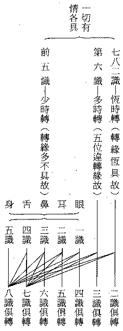



辛三　问答显理



若一有情多识俱转，如何说彼是一有情？若立有情依识多少，汝无心位应非有情！又他分心现在前位，如何可说自分有情？然立有情依命根数或异熟识俱不违理，彼俱恒时唯有一故。



此科说为问答显理，是就外人所提出的五个问难，论主予以逐个解答，以显示八识俱转的道理。



外人问：我们认为识就是情，依识立情不可一时有二识起，亦即没有多有情的论题发生。假「若」照你唯识家说，在「一」个「有情」身上同时有「多识俱转，如何」可「说彼是一有情」？理应一识为一有情，多识应该就有多有情！论主答：我们认为有情的建立不是依於识的多少，假「若」如你们所说，安「立有情」是「依」於「识」的「多少」，那你们所说生无想天、入无想定等的五「无心位应」该「非」是「有情」，因为他们没有心识的，没有心识而仍认他们是有情，可见有情不是依心识多少安立的。「又」如欲界的有情，「他分心现在前位」，应该说是属於他人，「如何可说自分有情」？所谓自分，就是指的本身；所谓他分，就是指的他人。如人类有情起五戒行十善，是人类分内所当做的，可说是自分有情，若人中起四禅八定，是诸天分内事，起六度、四无量，是菩萨分内事，这都可以说是他分。还有一种解说：如欲界有情，现起上界他无漏分心时，怎麼可以说是自分欲界有情？所以你们执著一个有情只有一个识，上面所说的这个道理，是就没有办法可以通过！「然」而这末说来，有情建立是依於什麼呢？我们认为建「立有情」，或「依」第八识种子假立的「命根数」来建立一个有情，「或」依第八现行的「异熟」果报识上来建立一个有情。这两说法都可通，是「俱不违」於「理」的，因「彼」命根和异熟，无论在有心位或无心位，「俱」是「恒时唯有一」个，不会有多识和无识的过失！於中我们所应注意的：依第八异熟识建立有情，是不共小乘所许而言，因为他们不承认有第八异熟的。依命根安立有情，是就大小共许而言。如《顺正理论》的学者，就曾说『有情谓命根』。当知情是情识，命根能有这情识，所以说为有情。即或入於无心位中，没有现在识的活动，但命根还存在，不失为一有情，而且这命根具有过去识和未来识，出无心位立刻又起识心活动，成为一个活泼泼的有情。



一身唯一等无间缘，如何俱时有多识转？既许此一引多心所，宁不许此能引多心？又谁定言此缘唯一？说多识俱者许此缘多故。又欲一时取多境者，多境现前宁不顿取？诸根境等和合力齐，识前后生不应理故。又心所性虽无差别而类别者许多俱生，宁不许心异类俱起？又如浪像依一起多，故依一心多识俱转。又若不许意与五俱，取彼所缘应不明了，如散意识缘久灭故。



外人问：若一有情可以多识俱转，问题就又来了：就是任何「一」个有情「身唯」有「一」个「等无间缘，如何」将这一等无间缘，「俱时有多识」的「转」起？这似乎有些说不过去！论主答：现在我先问你：你们承不承认一个等无间缘能引很多的心所生起？假定你们承认的话，「既」然「许」可以「此一」识的等无间缘，能够「引」起很「多」的「心所」法生起，为什麼「不许」可「此」一识的等无间缘「能引」起后念许「多心」王的生起？这是以前六识相望为缘的义说。如论前说：『若此一识为彼六识等无间缘，或彼六识亦且为此识等无间缘』，就是这个意思。但这是约前六识相望为缘的不正义说，如以大乘正义解说是这样的：「又谁」曾经决「定」的说「此」等无间「缘唯」有「一」识现相续生？事实我是「说多识俱者，许」可在现在中，「此缘」亦是有众「多」的。它们之间各自相望，多缘能引多识果起。说明白点：所谓等无间缘，是依自类识说，所以一识有一等无间缘，非是多识同一等无间缘。如眼识的生起，有眼识的等无间缘，乃至第八藏识的生起，有第八藏识的等无间缘，是则识多俱转，等无间缘亦多，那里可说多识同一等无间缘？



或有依此问道：一有情身具有八识，既然是各各不同的，八个等无间缘怎会令之一时俱起？现在告诉他：「又」若有这麼一个人，作意「欲」在「一时」之中「取」得「多境」，当这时候，诸根不坏，「多境现前」，那里说是「不」会六识俱起「顿取」六境？因为「诸根」诸「境」以及其他空、明「等」缘，「和合」的势「力」是相「齐」的，理应诸识同时俱转，假定根境等缘和合齐现，而说「识」是或「前」或「后」的次第「生」起，那是绝对「不应」道「理」的！现在不妨这样说：如眼识的诸缘具当眼识生起的时候，其餘的耳识等诸缘亦具耳识等自亦应当现起，因为诸缘具足，没有不现起的理由，如缘具所现起的眼识。是以我们决不能说：眼识缘具眼识现起，餘识缘具餘识不起，在道理上是讲不通的，所以你们但说识前后生，不论怎样讲是都不应理的！



再举心所以例心王说：「又」诸「心所」法，其体「性虽」是没有「差别」的，然「而」受、想等诸心所的功能，其「类」还是有差「别」的，如徧行是徧行的一类，别境是别境的一类，善心所是善的一类，染心所是染的一类，各别不同可说是很明显的。你们既「许」这些类别不同的众「多」心所，得在一有情身中一时「俱生」，为什麼独不承认藏识与诸转识的异类心王一念俱起？所以说「宁不许心异类俱起」。我们认为不同类别的心王心所，要得俱生皆得俱生，决不可说类别的心所得以一念俱生，类别的心王不能一念俱生而前后起。对这道理如不明白，现在不妨举喻说明。「又如」大海中的波「浪」，或是镜中的影「像」，都是「依一」而「起多」的。如依一大海水有多波浪的现前，依一大面镜有多影像的现前，是「故依一」本识「心」，有「多识」的同时「俱转」，其道理亦是如此。《瑜伽论》五十一说：『何故若无诸识俱转，业用差别不应道理？谓若略说有四种业：一、了别器业；二、了别依业；三、了别我业；四、了别境业。此诸了别刹那刹那俱转可得，是故一识於一刹那，有如是等业用差别不应道理』！此中初二业是第八识所缘境，因为器界、根身、种子都是赖耶所缘的；第三业是第七识所缘境，因为末那恒计第八为我，所以名为了别我业；第四业是前六识所缘境，因为六识各自了别自境的，所以名为了别境业。论中既说刹那刹那即四业转，证明诸识确是可以俱转的，假定你们认为诸识不能俱转，那就违背圣言四业转义。



论主再难外说：「又若」你们决定「不许」第六「意」识「与」前「五」识同时「俱」有，那第六意识「取彼」五识「所缘」的境界，「应」该是「不明了」的。然而意识之所以称为明了，就因为它与前五识同缘现量境的。假定如有部学者所计，眼等五识先取境已，然后意识方得生起，取彼前五所缘境界，是即显示明了意识，不缘现在而缘过去，这末一来，明了意识与散意识，试问又有什麼不同？因散意识唯缘过去境的。「如散意识缘」那「久」已「灭」入过去的境界，是不怎麼明了的，五俱意识亦应如散意识，缘境是不明了。但事实上不是这样，散位意识缘过去境，尽管是不明了的，但是五俱意识缘现在境，是了了分明的，所以不得不承认意识与五识俱。



如何五俱唯一意识，於色等境取一或多？如眼等识各於自境取一或多，此亦何失？相见俱有种种相故。



外人问：与「五」识「俱」有的「唯」是「一」个「意识」，为什麼「於色等境」能够「取一或」者取「多」？问者的意思是说：五识所取的五境，原本是各各差别，明了意识只是一个，为什麼能随五识取多境界？这不是问者不承认一心能取多境，而是不承认与五识俱生的一念意识能分明的取五境，所以特作此问。作此问的，不是大众系的学者，因为他们承认六识可以俱起的，只有不承认六识并生的有部系等的学者，才会提出这问题来问的。



论主答：为什麼不能取多境？「如眼等识各於自境取一或多」。例如一个眼识，不但能取一种青的色境，同时能取青黄赤白等的多种色境，甚至二十种色境无不能缘；再如一个耳识，不但能缘有执受大种的可意声，亦能缘其餘的诸声，甚至八种声境无不能缘；乃至一个身识，不但能取一种坚的触境，其他的多种触境亦是能缘的。以彼五识例此明了意识，「此」明了意识能缘多境，试问「亦」有什麼过「失」？且意识是以了一切法为它的作用的。同时还要知道的，就是诸识所有的「相、见」二分「俱有种种相」的。如见分有种种分明的能见相用，相分有为多识所取的作用相。这末说来，一识能取多境，究有什麼稀奇？



何故诸识同类不俱？於自所缘若可了者一已能了，餘无用故。若尔！五识已了自境，何用俱起意识了为？五俱意识助五令起，非专为了五识所缘。又於彼所缘能明了取异於眼等识，故非无用。由此圣教说彼意识名有分别，五识不尔。



外人问：五俱意识既与五识同缘五境，五识彼此是同类的，为什麼「诸识同类」反而「不」能「俱」起？问者的意思是：既然承认八识可以俱起，两个以上的眼识，乃至两个以上的身识，为什麼不能俱时而起？



论主答：五识虽说是同类的，但是它们各有所缘，诸识对「於」各「自所缘」的境，假「若可」以明「了者，一」个识就「已能了」，如有其「餘」的眼识更生，便「无」它的「用」武之地，所以没有第二个眼识与之同生。「若尔」，假定是这样的话，就是一已能了，那末，「五识」各各「已了自境」，还要「用俱起意识」来「了」别做什麼？为解释说：当知所谓「五俱意识」，为彼五识的分别依，能「助五」识「令」之生「起」，并「非专为了」知「五识所缘」的境。「又」此意识对「於彼」五识「所缘」的境，不但能取，而且「能明了取」。就明了取这点来说，意识还是有「异於眼等识」的。眼等识不能明了分别深取境界相，能明了分别深取境界相的是意识，所以意识有助於五识，并「非」完全「无用」。照这样说，五识取境是不明了的，要想明了的取境，就不得不假借意识，可是现在我们要问的，就是为什麼没有两个眼识俱起以明了取境？为什麼非要假借意识不可？要知五俱意识对於前五识的关系，不但能明了的取五识所缘境，并且能助五识的生起活动；至於五识的本身，且就眼识来说，不说没有两个同类的眼识生起，退一步纵许两个同类的眼识俱起，但亦不能有助於五识的发生活动。「由」於如「此」，所以在诸「圣教」经论中，「说彼」第六「意识名有分别」，说前五识名无分别。「五识不尔」，是说五识不像意识那样的有分别。



多识俱转何不相应？非同境故，设同境者，彼此所依体数异故，如五根识互不相应。



外人问：八个识中既然「多识」可以「俱转」，为什麼「不」说它们彼此「相应」？问者的意思是说：心所与心俱转，既然有相应义，多识俱转，理当亦如王所有相应义，所谓彼既如此，此为什麼不然？



论主答：这不能相提并论！要知所谓相应，必要具有同时、同境、同依、同体的四义方可，今诸识「非」是「同境」的，所以不得说为相应。如六、七、八识有宽狭境的不同，怎可论说它们相应？「设」或有少分是「同境」的，「彼此」间「所依」的「体数」又复有「异」，怎可论说它们相应？如前五识具四所依根，所谓同境、分别、染净、根本；第六意识但依二根，就是染净依、根本依。相应要具如上的四义是不错的，但若有一义不具，就不得说为相应，现在由所依根的一义有异，是以多识俱转，不得说为相应。「如」依眼等「五根」的五「识」，眼识依眼根，乃至身识依身根，依体各异，「互不相应」。



辛四　一异分别



八识自性不可言定一，行相、所依、缘、相应异故，又一灭时餘不灭故，能所熏等相各异故。亦非定异，经说八识如水波等无差别故，定异应非因果性故，如幻事等无定性故。如前所说识差别相依理世俗非真胜义，真胜义中心言绝故。如伽陀说：心意识八种，俗故相有别，真故相无别，相所相无故。



八识差别论者，认为八识是各有其自性的，但这八识的自性是一是异，是个值得论究的问题，所以这里特就一异分别。论究到这问题，首先所要说的，就是「八识自性不可」说它决「定」是「一」。为什麼？约有三个原因：一、「行相、所依、缘、相应异故」：行相是指八识各自所有的见分；所依是指八识各自不同的所依根；缘是指八识各自不同的所缘境；相应是指八识所相应的心所有多少的不同。由於这多方面都是差别不一样的，怎麼可说定一？二、「又一灭时餘不灭故」：如诸识尽管可以发生同时活动，但不一定同时停止它们的活动，如果这一识灭了，其餘的七识不一定灭的，依然在发生它的活动作用，既有灭不灭的差别，怎麼可说定一。三、「能所熏等相各异故」：在八识中，属於现行能熏的是前七转识，属於种子所熏的是第八识；等是等於三性差别等。如前六识是通三性的，第七识是有覆无记的，第八识是无覆无记的。再说，前六识是异熟生，第八识是真异熟；前七识是因，第八识是果。诸识之间有这麼多的不同，怎麼可说定一？况且诸圣教中说有八识的差别？所以有以为八识为一，显然是错误的！



既不决定是一，那就说它定异，请问可不可以？「亦」不可以说它「定异」。什麼理由？亦有三个原因：一、「经说八识如水波等无差别故」：如《楞伽经》说：『水流处藏识，转识浪生故』。好比在大海中发现汹涌万般的波浪，你能说它异於海水吗？所谓波不离水，水不离波，你要分别它们的差异，简直是不可能的。再如经说：『譬如明镜，现众色像』。各式各样的色像，显现在明镜当中，你能分别镜与色像的差别吗？同样是不可能的。镜与大海如第八识，色像与波浪如前七识，是以严格说来，实看不出诸识之间的差别所在。二、「定异应非因果性故」：前七转识与第八识间，更互为因，更互为果，法尔因果非定异的，如麦不生豆芽等。假定有人认为诸识是定异的，那诸识之间岂不是没有它们的因果性？是以说异是不对的。三、「如幻事等无定性故」：世间万有一切诸法，诚如《金刚经》中说的：『一切有为法，如梦、幻、泡、影，如露亦如电』，是皆虚幻不实的，那里可说有一定的异性？



如是八识的非一非异，好像泥团与微尘的非异非不异，好像太阳与光明的非异非不异，好像黄金与指镮的非异非不异，唯有如此了解八识的非一非异，才能正确的了解八识之间的关系。最后作总结的说：八识自性是非一非异的，为什麼？由於它们的性不定，好像幻事等一样。幻事等无有定一定异性，所以说为非一非异，八识既如幻事等那样的没有定性，当然如幻事等的非一非异。是以对於八识自性，不论说是定一定异，都不契於佛陀真义。



照上所讲既是非一非异，为什麼前说八识有种种相？亦即前来所说的三能变相当作何解？如八以七为依，七以八为依，意识以七、八为依，前五识以五根为依；八识是现量境，第七是带质境，第六缘三境，前五亦是现量境；八识五个心所，第七识十八个心所，第六识五十一个心所，前五识三十四个心所。诸如此类，皆是说的诸识差别相，为什麼不可说定异？当知「如前所说」的种种「识差别相」，是「依」四种世俗谛中，第二道「理世俗」说的，并「非」是四种胜义谛中，第四一种「真胜义」。因为「真胜义中」，所谓「心」行路「绝」，「言」语道断，在这样的情况下，还有什麼一异可说？换句话说，真胜义中，非一相，非异相，非非一相，非非异相，非一异俱相，离言说相，离名字相，离心缘相，非即非离，是即非即，如是还有什麼差别不差别可言？「如」《楞伽》中有「伽陀说」：积起的第八识「心」，思量的第七末那「意」，了别境的前六「识」。如是「八种」识，以道理「俗」谛「故」，所以可说「相有」差「别」，假使以「真」胜义谛而论，那就应该说「相无」差「别」。因为能「相」望於「所相」，能所二相，在离心言相的真胜义谛中，可说都是「无」所有的。是以没有八识定不定别。



丙二　正解识变



丁一　假说我法



戊一　结前标问



已广分别三能变相为自所变二分所依，云何应知依识所变假说我法非别实有由斯一切唯有识耶？



上来「已广分别」说明异熟、思量、了别境识的「三能变」的识「相」，同时亦说明「为自」体「所变」的见、相二分，而自体又为见、相「二分所依」。对此既是广为分别，当然说得极为清楚。现在进而所要问的，就是怎样「应」当「知」道「识所变」的「假说我法」，并不是离识而别有的实我实法，乃是所谓一切唯识，所以说「非别实有由斯一切唯有识耶」？



戊二　举颂总答



颂曰：是诸识转变，分别所分别；由此彼皆无，故一切唯识。



上面标问，现在颂答。「是诸识转变，分别所分别」的二句，是释唯识所变；「由此彼皆无，故一切唯识」的二句，是结归唯识。上来广释的三能变相，就是将略标中的『此能变唯三，谓异熟、思量及了别境识』的三句，予以分别说明；此一颂所说的，是扩充略标的『彼依识所变』一句，是正分别唯识的义相。在略标中，曾说依识所变而假立我法，但假立我法为什麼没有实体，现在说明由於它是识变，因为是识变的，所以这里特地显示唯识。



戊三　解释颂意



己一　正释颂意



论曰：是诸识者，谓前所说三能变识及彼心所，皆能变似见相二分立转变名。所变见分说名分别，能取相故；所变相分名所分别，见所取故。由此正理，彼实我法离识所变皆定非有，离能所取无别物故，非有实物离二相故。是故一切有为、无为、若实、若假皆不离识，唯言为遮离识实物，非不离识心所法等。



上来虽已举颂答外所问，但很简略，如不加以解释，还是不能明白，所以现在再以长行解释颂意。「论曰」，是论文中这样说。「是诸识者，谓」是指「前所说三能变」的八「识及彼」所相应的诸「心所」。言转变者，是说心及心所，「皆能变似见相二分」，是故依之「立转变名」。依安慧论师的解说：所谓转变，是说三能变识的自体，都能变现依他似有而理实非有的见、相二分。为什麼说这见、相二分理非实有？因这属於徧计所执的，徧计所执的见、相二分怎可说为实有？亦有将转变解说为变异的意思，就是从一识体变异为见、相二分，而这所变的用是依他起，并非是实在的见、相二分，不过依这二用计能所取方名二分，亦这二分是徧计执的所起处。亦有将变解说为现的意思，如初卷说：『变谓识体转似二分，相、见俱依自证起故』，就是此意。



有人问道：安慧与护法二大论师皆说变现，试问他们的差别究竟何在？今为解说：安慧所说的变现，是从自体分变现起徧计取执的见、相二分。像这样的讲变现，是从有体法变似为无。护法所说的变现，是从自体分变现起依他的见、相二分。像这样的讲变现，是从有体法变似为有。一个变似徧计无，一个变似依他有，是为二大论师的差别所在。



在前所讲的识所变中：以「所变」的「见分说名」为「分别」，因为是依他性，「能取」於所变的依他「相」分的，所以生起种种所执分别。而这是识体所变用能分别，所以名为分别，并非是说识自体能缘名为分别。假定是从识体「所变」的依他性相分似所执的「相分名所分别」，因这是前能分别的「见」分之「所取」相。简单的说：分别就是能缘的见分，所分别就是所缘的相分；见分能缘所变的境相，为种种的分别，相分则被能分别的见分所分别，所以颂说『分别所分别』。



「由此」识变的「正理」，所以「彼」徧计所执的「实我」实「法」，如果「离」了「识所变」的见分、相分，悉「皆」决「定」是「非有」的，都是假有的，不过只是能取的见分和所取的相分而已。如果「离」了「能所取」的见、相二分，根本「无」有「别」体的实「物」存在，因为并「非有」个「实」体的事「物」，能够「离」於能所取的「二相」的。在见、相二分以外，既没有实体的我法，「是故一切」诸法，不论是「有为」的，不论是「无为」的，不论是「若假」的，不论是「若实」的，「皆不离识」而别有。所以颂文用『故一切唯识』来总结。为什麼要这样讲？基师《述记》说：『有为、无为若实依他有别种生，或常住实法，不相应假法，瓶等假法，一切皆是不离识。有为识所变，无为识之体，皆非识外有名不离识』。至於唯识的「唯言」，是「为遮」除「离」能变「识」外的「实」有我法之「物」，所以叫做唯识，并「非」亦要遮除「不离识」的「心所法等」。等是等於见、相二分和无为真如法等。并不是要把这些都遮除掉，才叫唯识。



有说：『一切诸法虽是很多，但不出能缘和所缘的二种。眼能视色，耳能听声，鼻能嗅香，舌能尝味，身能觉触，意能思法，这都是心缘。一一法中，有事有理，有假有实，若知缘色、声、香、味、触时而起思虑事理假实之法，即是能缘。倘若所缘离掉能缘的时候，则没有所缘，要有能缘，然后才有所缘。如吾人闭眼不缘色时，则没有色；塞耳不缘声时，则没有声；乃至熟睡或闷绝意识不缘事理假实的诸法时，则没有诸法。因此之故，假使吾人的诸识都灭掉不起缘用，则吾人的对象，没有一物存在。若果这样，可以知道：从宇宙的广大，乃至毫毛的纤微，一切诸法，唯是能缘之心所变现，离掉心识，则不能存在』。从这意义说，所以一切唯识。



或转变者：谓诸内识转似我法外境相现。此能转变即名分别，虚妄分别为自性故，谓即三界心及心所。此所执境名所分别，即所妄执实我法性。由此分别变似外境假我法相，彼所分别实我法性决定皆无，前引教理已广破故。是故一切皆唯有识，虚妄分别有极成故。唯既不遮不离识法，故真空等亦是有性。由斯远离增减二边，唯识义成，契会中道。



这是对颂文『是诸识转变』的另一种解释，有说是难陀论师的意思。又「或」所谓「转变者」，是说三能变的「诸内识」，能「转」现出依他相，好「似」实「我」实「法」的「外境相现」。看起来，好像是有外境相，严格说，只有见、相二分的内识，根本没有所变的我、法的外境。这儿所说唯有见、相二分的内识，就是《摄论》说的相识与见识。《摄论讲记》说：『虽然唯是一识，但在乱识现起的时候，就有一分所取的相，一分能取的见的二性差别现前，这相、见皆是识，所以叫相识见识』。又说：『唯识的主要思想，在显示所取的境没有实体，一切唯识为性。但众生心一旦生起，因无始的熏习力，就自然有境与心的二分现前。若没有相分，也就没有见分，所以成了二性；但不是有心境判然不同的体性，仍然是识。同时在心境的关系上，那见闻觉知的行相，有著无量无边的差别，这差别，同样的还是唯识』。



「此能转变」的识，不是别的什麼，就是「名」为「分别」，而是以「虚妄分别为自性」的，亦「即」是「三界」有情所有的「心及心所」。此说，与《摄论》说的『如此诸识，皆是虚妄分别所摄』，与《中边论》说的『三界心心所，谓虚妄分别』，可说是同一意思。《摄论讲记》说：『再说虚妄分别所摄：从赖耶种子生起的诸识，可以总摄一切三界、五趣，三种杂染所摄的依他起相。依他起就是三杂染，这是《解深密经》所说的；现在用十一识来总摄它。这十一类都是识，所以三杂染所摄的依他起相，是虚妄分别为自性的意义，皆得显现。若但说三种杂染，不知它是否唯识，现在把这些都摄归於识，都称之为识。识，就是虚妄分别，那麼，三杂染所摄的依他起相，一切都是虚妄分别为自性的了。这诸识，皆是虚妄分别所摄，也就可知它唯识为性』。无性《摄论释》第四说：『如此诸识皆是虚妄分别所摄者，如前所说身等诸识所取能取，虚妄分别安立为性。唯识为性者，由邪分别二分显现，实唯是识。善等法中虽无邪执，缘起力故二分显现，亦唯是识』。



至於「此」依他能变分别徧计「所执境，名」为「所分别」，也就是徧计「所妄执」的「实我法性。由此」能「分别」心所「变」的「似」有「外境」的「假我法相」的原故，所以「彼所分别」的「实我法性，决定皆」是「无」有的。无性《摄论释》第四接著说：『是无所有，非真实义。显现所依者，所取色等名无所有，能取识等名非真实，此二皆是徧计所执并名为义』。《摄论讲记》说：『谈到唯识，就要知道无义。妄心所取的对象叫做义；在我们看，义是离心以外实有的，实际上它根本没有独立的自体，不过在分别心上现起这似境的影像罢了。所以外境不是客观的存在，而是内心妄现的影像。像我们在五蕴和合上，妄执有我，这我就是毫无自体，唯是妄心倒计的义。这义，是无所有的，它是以虚妄分别心为依而显现的，所以（摄）论说：是无所有，非真实义显现所依。这为非真实境相所依的，就是唯识为性的依他起相。因此，我们知道：依他起相是赖耶种子所生，是虚妄分别为自性，是非真实义的所依』。



关於这些唯识无义的道理，在「前」本论第一、二卷中，曾经「引」诸「教理，已」经「广」为「破」斥。



以「是」之「故，一切」有为、无为、假法、实法，悉无有体，「皆唯有识」，因为「虚妄分别有极成故」。所谓有极成故，是对小乘学派说的。意谓能变的虚妄分别心，不但大乘唯识这样讲，就是小乘学派亦共同承认的。



到此，有人问道：像向来所讲的真如及心所等，既不是能变的分别心，亦不是所变的心外所分别法，那它们到底是有自体？还是没有自体？现在答说：当知所谓唯识的唯，唯遮离识的外境，不离识的法是不遮的。「唯既不遮不离识」的「法」，所以那不离识的「真空」、实际、胜义「等」法以及不离识的心所法，当然是有体的，所以说「亦是有性」。



从上各种的方面，检讨唯识的教理，我们可知唯识的意趣，在於高调万法唯识，亦即统摄森罗的万法，归於心识的一元。於中，如以有为亦即所谓现象为主，当然是将一切皆归唯识；如以无为亦即所谓实性为主，当然是将一切皆归真如；如更简单的从智用点为主，当然是将一切皆归般若。唯识的归趣，虽肯定的有这三方面，但是以现象为主，亦即以赖耶本识为中心的诸法唯识之理，最为重要。行者果能彻於这个旨趣，对於其他的二面自亦可以了解。因为，真如是识的实性，般若是识的相应，所有一切的所诠，离识根本是不可考虑，亦即是不可得的。



进而要知道的，就是唯识的识，是以有漏的染识为主，决不是以无漏的净识为主。为什麼？知一切诸法皆从自心生时，诸法都是如梦如幻的，所以知於心外决无实体。既知没有心外的实体，我法的妄执也就无由生起，妄执不起，就是无分别智於此现起，真正得以体会真如的妙理，以达到其究竟目的。学佛的究竟目的，虽说在於体会真如妙理，但是最根本的，还是在於了知一切诸法是从自己的一心之所变现，不得不说是最为第一要件。也就因为如此，这里特以有漏的染识说唯识，至於无漏的净识，不现起迷界的诸法，因而，不必要以无漏净识为主而观察。「由斯」义故，「远离增减二边」。无心外法，所以除增益边；有虚妄心，所以离损减边。损减边的远离，就可除去拨无如空华的清辨论师的说法；增益边的远离，就可除去认为心外有法的诸小乘执。如是离有离无，离增离减，「唯识义成，契会中道」，不会再有什麼偏执。基师《述记》说：『言中道者正智也，理顺正智名契会中道』。据此而言：中是指的真如，道是指的正智。因此，就是冥合真如的正智说为中道。不过亦有以真如名为中道的，像这样的中道，中是离二边义，道是道理之义。离二边的道理，中即道，所以是指真如。这末说来，所谓中道，或名能观之智，或名所观之理，虽能所有其相违，但毕竟是成同一意义，更不相违。中道，虽是指的离有无、增减处中的正道，但以动的正智之用而显，又以静的真如之理而显。真如是以正智而证悟的，正智是可冥合真如的。要之，万有诸法，不管那种，都不外於离二边的处中之正道的发现，於中绝对不可加上吾人差别的偏见，是为中道的真义。



己二　述九难义



庚一　唯识所因难



由何教理唯识义成？岂不已说？虽说未了，非破他义己义便成，应更确陈成此教理！如契经说：三界唯心；又说所缘唯识所现；又说诸法皆不离心；又说有情随心垢净；又说成就四智菩萨能随悟入唯识无境。



唯识的宗致，偏语诸法的识变而归结於唯识。因此，上面特释『是诸识转变，分别所分别，由此彼皆无，故一切唯识』的一颂。於中因为说明一切唯识，到此遂举九个难题来问，并且对它加以答释。主要是用世间鄙近的事例，成立唯识之所以为唯识的道理。



一、唯识所因难：上来你说『唯识义成』，可是我得问你：你是「由」於怎样的「教理」，使「唯识」的「义」理得以「成」立？论主简单的答：我们在前面「岂不已」经「说」过了吗？你为什麼还要问？外人更说：不错，你们在前略说过了的，但是「虽」已略「说」，其义仍犹「未了」，而且你也曾经破过我的义理，可是世间谈理论，并「非破」了「他」人的宗「义」，自「己」的宗「义便」得「成」立。就算你自以为成立了宗义，「应更」进一步的「确陈此」唯识的「教理」，使人有所信服。讲到教证本是很多的，现在姑以六经为证；讲到理论同样是很多，现在姑以四个比量为证。



「如契经说三界唯心」，这是第一《华严经》的教证。三界是心识的变作，不承认心外更有什麼实法，是即谈的唯识义理。然在《华严经》中什麼地方可以寻得此文？这出於《十地经论》卷八。《六十华严》卷二十五，有『三界虚妄但一心作』的文。《十地经论》说为：『经曰：是菩萨作是念：三界虚妄但是一心作』。论曰：『但是一心作者，一切三界唯心转故』。今检《华严经》一部，谈这三界唯心的经文，可说到处有见。如《六十华严》卷十说：『心如工畫师，畫种种五阴，一切世界中，无法而不造……一切从心转』。一行的《大日经疏》卷二，有『三界唯心，心外更无一法而可得』的话；宋《高僧传》卷四，有『三界唯心，万法唯识，心外无法，胡用别求』的话。因此，『三界唯一心，心外无别法』的话，可说就是据此而来。是以三界唯心所说，亘於此经的一部，可说是很多的。唯识教义为成立唯识义理，屡屡引用此文为证。如在《唯识二十论》的最初说：『安立大乘三界唯识，以契经说三界唯心』。当知此中所说的契经，亦是指的《华严经》。很多唯识论典，都引《华严．十地品》所说『如是三界皆唯有心』的文，并且加以解释。如无性《摄论释》卷四说：『此言显示三界唯识，言三界者，谓与欲等爱结相应堕在三界。此唯识言，成立唯有诸心心法，无有三界横计所缘』。以此诸法皆是心识变现的教证，以成立唯识义，反证心外有实境的存在，是极其迷谬的妄见！



「又说所缘唯识所现」，这是第二《解深密经》的教证。现在引《摄大乘论讲记》所说如下：『又在《解深密．分别瑜伽品》里，慈氏菩萨请问佛陀关於心境是一是异的问题。慈氏菩萨问世尊言：三摩地中所行的影像，它与能缘的心，应当说是有异还是无异呢？心在境界上转叫行，就是缘虑、故所行、所缘、所取，有同样的意义。专注一心叫三摩地；三摩地所行的影像，如修不净观的，先到荒山坟冢间，看那死人溃烂的相状或残骸骷髅，然后在修定时，观想这样的境相，即於定心中现起溃烂及骨骸的情境。这定心所现的，像明镜中现起的影像一样，所以叫影像。影像，是内心所现起的，它的本义如此。唯识学说一切皆是自心的影像，它的认识都从定中的经验得来，所以它与修定的瑜伽者，有特别的关系。佛的意见：应当说它是无异的！因为那所缘的影像，并不是心外的，就是我们心识的一分，所以我说它就是识。凡所缘虑的境界，都是唯识所现的。我说识的识，是能分别的心，是见识，也是指出它的自性。所缘唯识所现的识，是所分别的境，是相识，是依识而现起的。能分别的是识，所分别的也是识，那麼，怎可说它是异的呢？……慈氏菩萨又问：世尊！心是能缘的，境是所缘的，如果像方才所说的三摩地中所行的影像，即与此能缘的心，无有别异；无异，就是一法，一法就不应有能所的差别，云何此心还能缘取此心呢？心若可以缘心，那与世间的眼不自见，刀不自割，指不自触的理论，不是相违反了吗？佛又答覆他说：慈氏！你以为一法才不能自取吗？要知道，不论什麼法，不论它是一是异，都是不能取的，根本上无有少法能够缘取少法。不过，虽没有能取的心，所取的境，然却在这样的能缘心生起的时候，即有那样的所取的影像显现，并不真是离能缘心以外，有什麼可为心识所缘的东西！这如依止自己的面目等本质为缘，於水镜中还见自己的面目的本质；不明的人，就以为我今见到了影像，并且以为离开自己面目的本质，别有一个所见的影像显现，其实这是错误的！有情的虚妄分别心也是这样，在它如是生起的时候，就自然的现起所取的义相，并且还似乎有异於心的所见影像显现，所以有能取的心，所取的境。这种别体能所的观念，根本具有错乱的成份』。



「又说诸法皆不离心」，这是第三《楞伽经》的教证。在这《楞伽经》的全部，叙述诸法皆不离心的意思，是很多的，从此可以窥见一切唯识的教旨。如魏译十卷《入楞伽经》说：『复自深思惟，诸法体如是，唯自心境界，内心能证知。而诸凡夫等，无明所覆障，虚妄心分别，而不能觉知』。宋译四卷《楞伽经》说：『妄想习气转，有种种心生，境界於外现，是世俗心量，外现而非有，心见彼种种』。唐译七卷《楞伽》说：『心所见无有，唯依心故起，身资所住影，众生藏识现……微尘分析事，不起色分别，唯心所安立，恶见者不信』。诸如此类的唯心说，在诸不同译本的《楞伽经》中，处处皆有所显示，当可成为安立唯识的有力教证。



「又说有情随心垢净」，这是第四《无垢称经》的教证。如该经说：『心净故众生净，心垢故众生垢』。不特生命界随心垢净，就是自然界亦随心垢净。如新译《维摩诘经》说：『若菩萨欲得净土，当净其心，随其心净，则佛土净』。『如果内心不净，不特不能实现净土，就是极乐净土现前，也要变成秽土』。《十地经》说：『三界五道，皆由心作』。『所以唯有内心净后，佛土始能得到清净』。『但这还要不忘众生，如果忘记众生救度，仍然没有净土实现，净土必依众生为对象，就是以利乐众生，作为修净土的因行，到了众生的内心清净，秽恶世界自成为净土』。



「又说成就四智菩萨能随悟入唯识无境」，这是第五《阿毘达磨经》的教证。无性《摄论释》第四，虽没有指出是什麼经，但亦有这样说：『诸义现前分明显现而非是有云何可知？如世尊言：若诸菩萨成就四法，能随悟入一切唯识都无有义』。经说能随悟入，是约能入说，所入的十地，是约所入说。所谓随入，是约地前的随入而不是正入，亦有说是随於经义修习，而能得入十地等。两说似均可通。不管是地前的随入，不管是地上的悟入，必要菩萨成就四智，方能实在有所契入，不然是决不可能的。



一、相违识相智：谓於一处，鬼、人、天等随业差别所见各异，境若实有此云何成？二、无所缘识智：谓缘过、未、梦境像等非实有境识现可得，彼境既无餘亦应尔。三、自应无倒智：谓愚夫智若得实境，彼应自然成无颠倒，不由功用应得解脱。四、随三智转智：一、随自在者智转智：谓已证得心自在者随欲转变地等皆成，境若实有如何可变？二、随观察者智转智：谓得胜定修法观者，随观一境众相现前，境若是实宁随心转？三、随无分别智转智：谓起证实无分别智，一切境相皆不现前，境若是实何容不现？菩萨成就四智者，於唯识理决定悟入。



上面虽说『成就四智』以成立唯识，但四智是什麼，还没有指出来，所以现在特再分别说明四智。



「一、相违识相智」者：是观相违者的识所缘境相智之谓。就是同「於一处」所有的境相，饿「鬼、人、天、」傍生「等」四类有情，「随」著他们的「业」力「差别，所见」的境相，是「各」各差「异」的。这类有情以为是这样，那类有情又以为那样。如江河中的水，在饿鬼见到那是脓血火燄；在傍生界的鱼类见到，或认为是庄严的宫殿，或认为是坦荡的大道；在诸天见到则是透明的琉璃；在人类看来则是一泓清冷的流水。古人所谓『一境应四心』，就是这个道理。《摄论讲记》说：『在同一对象上，有种种不同的认识，可知我们所认识的一切，不是事物的真相，是我们自心的变现。通达这种意义的智慧，叫相违识相（彼此不同的认识）智。得了这智慧，就可悟入唯识无境的道理』。无性《摄论释》第四解释说：『相违识相智者，更相违返故名相违；相违者识名相违识；生此识因说名为相；了知此相唯内心变外义不成，故无有义说名为智』。假使了解一切皆从内心变现，那就没有一事不成的；假定认为「境」是「实有」的，试问如「此」现象「云何」得「成」？还有颂说：『於一端严淫女身，出家、耽欲及饿狗，臭尸、昌艳、美饮食，三种分别各不同』。就是真实修行的出家者，在作不净观时，根本不见是一端严的女子，而是一个死尸的相现，有什麼可爱恋的？设若是个耽於欲乐的男子，见到这麼一个端严的女子，必然惊为天女下凡，苦苦向她追求不已！设若是条觅食的饿狗，见到这麼一个女子在前，认为是餐美妙的饮食，欲得吞啖以为快！如果是个修空定的行人，观此女人空无所有，根本不见有个女人身存在！同是一个女人，而有种种见别，可见境随心转，证知唯识无境，如以为有实在的外境，那是绝对的错误！



「二、无所缘识智」者：是说我们的认识，不一定要有所缘的真实境界才能生起，没有真实的所缘，识同样可以现起。如「缘过」去、「未」来的境界，梦中所见的「梦境」，镜中所见的影「像」，水中所见到的月影「等」，这都「非」是「实有」的「境」界。虽说这些都不是实有的，但在菩萨缘这非实有中，其「识」无境亦「现可得」的。这种认识的境界，不是唯心无义吗？明白这样道理的，叫做无所缘识智。因为这些没有真实的所缘，都是异生第六意识构畫而起，根本没有它的实质可得的。菩萨运用他的智慧，缘此镜像水月等，皆不离自己的能变心，以此为例，可知一切实境皆不离一切有情能缘之心，离心之外更无实境，所以说「彼境既无餘亦应尔」。无性《摄论释》第四解释说：『无所缘识现可得智等者，过去、未来皆非实有，此与经部共许成就，梦境实无一切共了，诸三摩地所行影像已说非有』。可见无真实境而识得生，不特是大乘唯识独有的意思，小乘学派中的经部亦如此主张。《摄论讲记》附论说：『无所缘识，在佛教中有很大的诤论：有部他们主张识一定要有所缘才得生起，那怕缘涅槃也还有实有的涅槃作所缘。经部他们主张可以有无所缘的识。在空有的诤论中，这也是主题之一。主张实有的，过去未来都是实有，是实有的，识才能缘之而起，所谓「所缘有故，三世实有」。主张无的，过去未来皆非实有，虽然没有，识仍可以有，所谓「所缘无故，过未亦无」。大乘中世俗心可说有所缘的，但所缘是非实有的，空宗称之为自性，唯识宗称之为义。虽还有不同，大体上都是许可无所缘（义非实有，自性非有，或法性无行相）而生识的』。



「三、自应无倒智」者：所「谓」无颠倒智，是说对於所缘的境界，获得真实正确的认识，不再发生错误的执著。所缘的一切义，假定都如「愚夫智」所认识的一样，是离名言而实有的，能够「得」到那「实」在「境」的，那「彼」愚夫能缘诸义的识，「应」该「自然成」为「无」有「颠倒」错误，解脱所有一切障碍。假定真的如此，那我们就应「不由功用」而自然的可「得解脱」。可是事实上，我们的认识，有颠倒错误，要觉知诸法真实，获得自由解脱，仍须加一番用功才行。既然如此，反证所认识的义，没有真实自性可得。凡夫如果真的得五尘实境，那就应该成就其智，其智既然不成，证知凡夫不得实境；设若观诸境界是假，当就得成其智。无性《摄论释》第四解释说：『本文虽显，而少助说。若有欲令如所得义，即真实有，应不用功自然解脱，一切有情皆见实故』。现在有情既未获得解脱，证知凡夫所缘诸义不是真实，唯是虚妄心识之所变现。



「四、随三智转智」者：是说有三种殊胜的智慧，能随心而改变所缘，如果能修得这三种的胜智、微妙智，那唯识无义的理论，就可以在实践中亲切的证实。现在按其次第，将三种殊胜智慧解说如下：



「一、随自在者智转智」者：是「谓已」经「证得心自在」的一切菩萨，能「随」自己的增上胜解力，「欲转变」大「地」为黄金就为黄金，或变大地为水就变为水，或变大地为火就变为火，或搅长河为酥酪就成酥酪「等」，无不一一「皆成」。由此可知离心之外，没有实在的境义，当知是诸转变的境义，皆不离菩萨的能变之心。外「境」假「若」是「实有」的，「如何可」随意解力而自在转「变」？此中说的得自在者，基师於《述记》中，虽举有四种解说，但主要的是指八地以上的菩萨。八地以上的菩萨得威德力，由这定的力量，转换土石等体而为金宝等，使诸所化的有情，受用这些金宝。八地以上的菩萨，既能随心所欲的可以转换土石为金宝，所以说为观唯识无境之智。



「二、随观察者智转智」者：是说「得」了殊「胜」的「定」，在定中「修法观者」，当他刚作意的时候，「随观」任何「一境，众相」皆会显「现」在「前」。如修无常、苦、空、无我的行者，如能观心成就，便有无常相，或苦相、无我相、空相等，随心所念而分明现前。这无常、无我等诸义的显现，都是随修法观者的观念而转变生起，可见并不是有离心实义的存在。「境」义假「若是实」有的，「宁」会「随心」有所「转」变？此中所说的得胜定，不是异生所得的，而是初果以上的圣者所得的，就是初果以后所有圣人，假若入定时观苦、无常等，方得名为胜定，设若是诸异生，虽在定中，能作欣厌等观，但不能作谛观，所以异生所得定，不得说名为胜。初果以上的圣者所修定所以名为胜定，如修生空观除我我所即能断烦恼。原因境不是实有的，空观是实有的，假定境是实有而此空观非实，那空观就应成为虚妄颠倒，因为境是实有而你作空相观的，空观既是虚妄颠倒的，怎麼能够断诸烦恼？空观既能断诸烦恼，证知空观是实外境非实！



「三、随无分别智转智」者：是说已「起证实无分别智」的大地菩萨，当他无分别智现在前时，「一切」徧计所执的「境相皆不现前」。由这也可知诸法唯心，心外无境。心外的「境」假「若是实」有的，圣者的无分别智现前，「何容」一切境相皆「不现」前？不但不能使义相不显，还根本不能成立，甚至坏有为无，是颠倒不是真智。无性《摄论释》第四解释说：『无分别智现在前时，一切诸义皆不显现者……义若实有，此智应无，非有分别无分别成，义若是实有，无分别智生不应不显现，此智如实缘境义故』。当知此中所说的无分别智，是指初地以上的诸大菩萨所得的根本智，以此根本无分别智契证真如时，智与真如平等平等，内外凝结更无别境，假定境是实有的，怎能使它不现前？



一个发心的「菩萨」，如果「成就」这「四智」，「於唯识理决定」得以「悟入」。换句话说，就是以这四智之说，明白的诠显唯识无境的义趣。



又伽陀说：心意识所缘，皆非离自性，故我说一切，唯有识无餘。



这是第六《厚严经》的教证。如该经有「伽陀说：心意识」的八识「所缘」，不论所缘的是什麼，「皆非离」开了它们的「自性」而别有实在的外境。以是之「故」，所以「我说」有为无为「一切」诸法，皆「唯有识」，决「无」其「餘」的心外实境。



此等圣教，诚证非一。



这是总结圣教明唯识义竟。如是像上所举「此等」所明唯识无境的「圣教」，只是略举六种，实际以这样的圣教，作为「诚证」唯识的道理是很多的，亦即诸经论中到处都有说到的，所以说「非一」。



极成眼等识五随一故，如餘，不亲缘离自色等。餘识识故，如眼识等，亦不亲缘离自诸法。此亲所缘定非离此，二随一故，如彼能缘。所缘法故，如相应法，决定不离心及心所。此等正理诚证非一，故於唯识应深信受。



上以教证，此以理证，理证有四，分别说明如下：



初比量说：「极成眼等识」「不亲缘离自色等」，是宗；「五随一故」，是因；「如餘」，是喻。此中所说的眼等识，是总指前五识。假定五识各别作法，应该是有五个比量，现在於中随便说出一种，其他不管那种都可准知。现在姑且以眼识作解，以例其餘的四识。所谓极成，是大小乘共许的意思，假定彼此不共许，那就叫做不极成。如大乘所说的他方佛的眼识及佛的无漏眼识，为小乘有部学者所不赞成的；至小乘说有佛的有漏眼识和最后身菩萨有不善眼识，为大乘唯识学者所难以苟同。现在除这彼此不极成的眼识，其餘为大小乘共同承认的有情眼识，名为极成眼识。如是彼此极成的眼识，当它缘於色尘境界时，唯是缘自识所变色，决不亲缘离自眼识所变之色，如心外的他有情身等及自第八识所变的本质色，皆不亲缘。因为他身所变色及自第八识所变色，只可作眼识的疏所缘缘，不得为眼识之所亲缘。为什麼是如此的？因眼识是五识的随一所摄之故。有什麼事实可以证明？如其餘的耳等四识，只能各自亲缘不离自识的声等一样。眼识的比量是如此，其餘的四识展转相望，有四比量当知亦尔。如说：极成耳识定不亲缘离自声等，是宗；五识之中随一摄故，是因；如餘眼识等，是喻。其餘的鼻、舌、身三识，准此可知。灵泰《疏钞》说：『极成言亦流至此，亦应简不极成耳、鼻、舌、身识，即大乘中他方佛耳、鼻、舌、身识，小乘佛非无漏耳、鼻、舌、身识，最后身菩萨不善耳、鼻、舌、身识』。如是像这样的成立唯识义理。



次比量说：极成「餘识」「亦不亲缘离自诸法」，是宗；「识故」，是因；「如眼识等」，是喻。此中所说的餘识，是指五识之餘的意识，其中亦兼第七识及第八识。意思是说：不但前五识不能亲缘离开自识所变的色等，就是其餘的三识，亦是不能亲缘离了自识所变的诸法。换句话说，第六识等的所缘，亦如眼识等那样的，唯是缘自识所变的境界，非自识所变的境界，是不能作为亲所缘的。以此作为成立唯识义理。以什麼理由作如此说？当知它们都是属於识的，犹如眼识等那样，只能缘不离自识的诸法。论中所以用餘识不指明是那一识，是有其用意的：如只立意识为有法，将七八二识为同喻，因中就犯共中自不定过，别人就会为你指出过错说：为如意识是识性，证汝餘识不亲缘离自诸法？为如七八二识亦是识性，证汝餘识定亲缘离自诸法？将这样出你过，你将无法答救。如立七八二识为有法，别人根本不承认有七八二识，那就犯了他一分所别不极成过。为了避免这些过失，所以论中但总言餘，别取第六识，意兼七八识，可说最为巧妙。



三比量说：「此（六识）亲所缘定非离此（六识）」体，是宗；见相「二」分「随一」摄「故」，是因；「如彼能缘」见分，是喻。这亦是立的总量，若六识各别为量，那是应有六量的，不过明白了一量，其餘的量准此可知。前面虽说亲所缘缘就是相分，但或还有以为这不是以识为体，所以特再立量说相分亦以识为体，或说亦依自证而转。为什麼但成立相分不说见分，因为见分是大家所共同承认依自证分转的。现在告诉人们说：六识的亲所缘缘，决定不是离於六识自体的。什麼理由？因为是见相二分随一所摄的。有何事实？如彼能缘的见分。能缘的见分不离心体，所缘的相分当如能缘的见分不离心体。如其不然，试问你的相分是怎样有的？



四比量说：自识（六识）「所缘」（亲所缘），「决定不离」我之能缘「心及心所」，是宗；以是「所缘法故」，是因；「如相应法」，是喻。此量大体同於第三量，是示亲所缘者，必定是不离於自识的。所有一切自识所缘，不论所缘到的是什麼，只要是所缘虑的法，决定不离自己的能缘的心及心所。什麼理由？因为是能缘心的所缘法故。有何事实？如相应的心心所法。宗中所说即识而说决定不离心等，是有其道理的。如果说以即识为宗，那宗中就有一分相符过，因为他心智境亦即是心的。还有，若以所缘的一切有为无为诸法即是识的话，其所缘的无为法与识是有别的，怎麼可说所缘法即识？



像上所举的「此等正理」，作为唯识无义的「诚证」，可说是很多的，并「非一」种两种，所以吾人对「於唯识」的义理，「应」当「深」深的「信受」，不可对之有一丝一毫的怀疑！



我法非有，空识非无，离有离无，故契中道。慈尊依此说二颂言：虚妄分别有，於此二都无；此中唯有空，於彼亦有此，故说一切法，非空非不空，有无及有故，是则契中道。此颂且依染依他说，理实亦有净分依他。



上来所说，是以六经、四比量而为唯识义理的教证、理证，由是可以知道：心外所计的实「我」实「法」皆是「非有」的，二「空」所显的妙理及能缘的心「识」是「非无」的。如是「离有离无」，所以「契」会不落有无二边的「中道」，亦即所谓唯识中道的所以得以成立。



「慈尊」，是指弥勒菩萨。弥勒菩萨著有《辨中边论》，在该论的本颂中，一开始就「依此」种种道理「说」了两个「颂」，以显示『我法非有、空识非无』的中道义。「虚妄分别有」者，『虚妄就是变似的能取所取相，用以形容分别识的不真实。因为分别识的生起，缘所取的境而有能取的分别，这能取所取法虚妄不实，所有的只是分别的心识，所以说名为有』，亦即唯有三界虚妄分别心。「於此二都无」者，是说『於此虚妄分别有中，能取所取二体都无。因此二取，但是依识心分别假现，都无实在的体性故』。正因能取所取的二体都无，所以所执的实我实法亦是没有。「此中唯有空」者，是说在『虚妄分别有中，既无实有的能取所取的体性存在，故实有的，唯是无所取及能取的空性』，除了空性，试问还有个什麼？「於彼亦有此」者，是说『在都无二取的二空性中，亦只有此虚妄分别而已』，除此同样是什麼都没有的。「故说一切法，非空非不空」者，是说『一切法就是有为和无为法，因为这虚妄分别的有为和二空的无为，不是没有，故名非空；又因二取的实体绝无，而虚妄分别亦有而不真，所以曰非不空』。如以三性分别，亦可作这样说：依他、圆成二性是有的，所以名为非空，实我实法即徧计执是没有的，所以名非不空。「有无及有故」者，是说：『有故，就是有胜义的空性和世俗的虚妄分别。无故，就是无二取及虚妄分别无实。及有故，就是分别中有空，空中有分别』。如是二者之间，互相为有无的。「是则契中道」者，是说『一切法既不是一向空，也不是一向不空，不空而空，故离二边而契中道』。如是理趣不但妙契中道，而且亦善符顺般若等经说一切法非空非有。



我们还应要知道的，就是慈尊所说的「此」二「颂」的意思，是「依染」分「依他说」唯识义，如果以「理」推之，「实亦有净分依他」显唯识理。所以严格说来，此中二颂不遮净分，但为了说明断三界虚妄生死而证於涅槃空性，所以不说无漏依他法，但说有漏虚妄心及涅槃空性。若通明无漏有为法，应说断有漏妄心生死法，修无漏清净依他法而证涅槃。



庚二　世事乖宗难



若唯内识似外境起，宁见世间情、非情物、处、时、身、用定不定转？如梦境等应释此疑。



这是第二世事乖宗难。外人这样难道：假「若」真如你们所说「唯」有「内识似外境起」，根本没有客观外在的事物，那就有违世间现前的事实，所以说「宁见世间情、非情物、处、时、身、用定不定转」？在这问难中，一共有四难：一、处所决定不应成难；二、时间决定不应成难；三、身不决定不应成难；四、事物作用不应成难。《唯识二十颂》开头一颂就举这四难说：『若识无实境，则处时决定，相续不决定，作用不应成』，就是指此。现在按其次第，说明它的理由：



一、处所决定不应成难：处是场所。吾人开始见到世间的现事，场所是一定不乱的，亦即是有一定的处所。如见台湾宝岛的阿里山，一定要在嘉义的高山上才可见到；若见慈航法师供奉肉身的弥勒山，一定要在台北县的汐止镇才可见到。谁都知道，在嘉义阿里山决没有见弥勒山的心识生起，同样理由，在汐止弥勒山决没有见阿里山的心识生起。这是世人共有的常识，为任何人所不能否认。由此证明弥勒山等的实境，是在心外而有的，不能说它随心变现。假定如你唯识所说，一切都是唯识所变，那所认识的外境，就不应当有它一定的处所，凡是有心的地方，即应当有其境现。如虽身处弥勒山而应有见阿里山的心识生起，或虽身处阿里山而应有见弥勒山的心识生起。假定真的能够在在处处的如此缘境，那我自然承认诸法是唯识变的。可是现见事实不然，怎可说为唯识无境？如你唯识者一定要说只有内识无实外境，那就有处所决定不成立的过失！



二、时间决定不应成难：时是时间。吾人见世间的现事，不特处所是决定的，就是时间亦决定的。例如见太阳的眼识，不用说，只有晴天的日间可以看到，倘在雨天或在夜中，那就决定不能见到太阳。其他如开花结实，落雨结冰等，是都有一定时节的，决不能随时都可如此。因而，不能不承认在心外有太阳等的实境，如是真实有的外境，不能说是随心现的。假定如你们唯识所说，一切都是唯识之所变现的，那我们所认识的外境，就应随时都可见到，不应要到某一特定时间才见。如在夜半想要见到太阳，立刻真的就可见到，那你说它是识变，我自然会承认的。可是现见事实不然，怎可说为唯识无境？如你唯识家一定说唯有内识无实外境，那就有时间决定不应成立的过失！



三、身不决定不应成难：身是指的有情，《二十唯识颂》说为相续。又见世间的现事，各个有情应该是不决定的。例如很多有情的相集，在同一时间，在同一地点，看胡姬花时，并不只是一人见到，而是大家同见到的。这不是一人所决定，而是大家同见到的道理，这就证明不是心外没有实境。我在《唯识二十颂讲记》中说：『依境随识变无实自体的唯识义说：吾人所见客观外在的一切，唯见自心之所变现的境物，并不是客观外在的实有体。现在外人就抓住这点加以责难说：外境既是随於心识之所变现的，每个人的心识是各各不同的，则其所变现的境物，自亦各各有所差别，照理每个人的所见，应该亦是各各不同；可是事实不然，因为世人所见，都是同一境界，如所见的菩提树，你所见的是菩提树，我所见的亦是菩提树，人人所见到的都是菩提树，由此可以证知外境是实有的。假定如你唯识家所说，唯有内识无实外境，那就很多有情同在一处，不应彼此同见一境，而应你见你识所变的境界，我见我识所变的境界，现在外界的境界，既不决定由一人所见，而为大家共知共见，是则有相续不决定不应成立的过失』！



四、事物作用不应成难：《二十唯识颂讲记》中说：『事物，是指宇宙万有的一切。从现实世间看，不论那样东西，无不有其作用：如衣服有蔽体的作用，饮食有疗饥的作用，房屋有防风雨的作用，舟车有运载的作用，钟表有计时的作用。总说一句，万事万物，各各有它作用，这是共知共见的事实，谁也不能予以否认，否认亦是否认不了的。由此可以确切证明，我们所说外境实有，才真符合世间现实。假定如你唯识家所说，唯有内识无实外境，所有外物皆如梦中所得饮食刀杖毒药等，那就有作用不应成的过失！为什麼？谁都知道，梦中所得的饮食，不论是怎样的佳肴美味，都是不能充饥的，假定现实境界如梦中境是一样的，则我人现在所得的各种饮食，亦应不能充饥。然而事实不然，如我人感到饥饿，只要一得饮食受用，立刻就可解决饥饿问题。又如梦中所得的刀杖，不论是怎样的锋利，都是不能伤害有情生命的，假定现实境界如梦中境是一样的，则我人现在所得刀杖，亦应不能有所伤害，事实并不如此，如我人有了杀机，拿起任何一种刀杖，就可解决有情生命。这样的明显对比起来，所以你唯识家说的外境不是实有的这话，在我们是不能承认的』。



以上，是世事乖宗难的大要。从这所明，我们知道，在处、时、身、用的四事中：处、时、用的三者，是关於非情的，身是关於有情的，这是一点。其次，处与时的二者是决定的；身与用的二者是不决定的。



对於以上的问难，应该怎样的善予解答？「如梦境等应释此疑」。『外人的问难，在一般看来，有强有力的事实基础，很难予以美满的答覆，但在唯识家看来，并不是个怎样的难题，只要举出梦等譬喻，指出外人理论，犯有不定过失，就可证明唯识之理，是最正确而无错谬，并没有不成的过失』！奘译《二十唯识颂》说：『处、时定如梦，身不定如鬼，同见脓河等，如梦损有用』。这是以如梦等的三事譬喻，答覆上述的四难。



《二十唯识颂讲记》中说：『唯识家说外境非实，常举梦喻予以显示。《摄论．所知相分》辨唯识无义时，就曾说到「应知梦等为喻显示」。梦中的境界，是无其义而唯有识，这是人人所能体会到的。虽说梦中所梦到的境界不是真实的，但当你在梦到林园房舍花草树木大地高山等等，不但有一定处所，且有一定的时间，并非在一切处一切时，见到同样的境物。如所梦见的高山是在江苏，当时只知高山在江苏一处，并未认为高山在一切处都有。或时梦见人物花草，而非时时如此。有时梦中梦到好的境界，会感到无限欢喜，有时梦中梦到不好境界，会感到极度不安；可见梦境有一定的时间。梦境唯是心识变现的，没有它的真实性，尚有一定的处所和一定时间，现实所见的外境，既然像梦一样，不是实有而唯识变，有它一定的处所和时间，有何不可？为什麼定如你说，必须境界实有，方可定时定处？处、时决定如梦所见，似义显现，在我唯识家看来，没有什麼两样』。所以虽无心外实境，处时不妨是决定的。『梦境的定时定处，你既承认它是假，就不得不承认现实境界的非实，假使一定妄执定处定时的境界，是离识实有的，那你就得承认梦中境界，亦是实有非假，因为二者是相等的。要承认境界实有，就得承认两者都是实有的，要不承认境界实有，就得承认两者都不是实有的，绝对不可说梦境是假，而现前境界是真实，假定是这样的话，就有法喻不齐的过失』！



『其次，身不定如鬼，这是解答相续不决定的问难的。依照外人的意见，如外境各自心识之所变现的，理应每个人所见的境界不同，不应大家同见一样的境界。现在解答这个问题说：全人类有目共覩的物相，如所见的清凉河水，不一定硬要把它看成是实有自体的水，因在饿鬼界的有情看来，这不是一池清水，而是污秽不堪的脓河，可见人类见为水之为水，并不是外在实有的，而是人类心识之所变现的，一般认为实有，是认识上的错误！於此，在执水为实有的人类或说：我们人类共见为水，是真实的，鬼类见为脓血怎麼可靠？可是调换一个立场，站在鬼的本位来说：我们鬼趣见为脓血，才是真实的，你们人类见之为水，根本是虚妄！这麼一来，人鬼两趣，各是其是，各非其非，究竟谁是谁非，是就难以断定！如承认境由各自心识变，没有它的实在自体，鬼见为脓是鬼的心识似义显现，人见为水是人的心识似义显现，各各见到物的假相，那就没有什麼诤论，问题也就得到解决』！



『最后，如梦损有用的一句颂文，是解答事物作用不应成立的一个问题。梦中的境界，虽然是假的，但不可一概说为无用，有的还是有其作用的。如梦中所梦见的刀枪，固然没有杀人伤人的作用，可是男女发生关系的梦境，却能使男人有遗精、女人有损血的作用。由此可见梦境虽非实有，但其作用不能完全否认。以彼例此，心识变现的境界，虽无客观的实在性，但各事物作用，不能说它没有。因为假有作用不无，所以我们认为是识所变。不唯梦中如此，就在觉的时候，虽无实在外境，但由意想关系，亦可有其作用。如老虎是吃人的，谁见老虎都害怕，见到真实老虎，固然非常害怕，就是谈到老虎，亦觉胆战心惊的。我国所谓「谈虎色变」，正是这一意思写照。再如「杯弓蛇影」的故事；「草木皆兵」的感觉；「望梅止渴」的传说，皆可证明没有实在境界，仍能产生很大的作用。依照这样说来，那里定要实境，始能有其作用？在你以为假有即无作用，在我认为假有作用不无。彼此的看法不同，怎有一致的结论？所以站在我们唯识的立场，认为八识所缘的境界，虽各各有它们的体用，但决不是离识而有的，是故唯识的理论，必然得以成立的』。



《二十唯识论》中，还以『一切如地狱，同见狱卒等，能为逼害事，故四义皆成』的一颂，合释四难，参阅《唯识二十颂讲记》，这里不再烦引。是以心外的实有境界，决定是没有的，假定说有实境，为什麼同缘一物，甲乙所见的固然不同，丙丁的感受同样有异。



庚三　圣教相违难



何缘世尊说十二处？依识所变，非别实有。为入我空说六二法，如遮断见说续有情。为入法空复说唯识，令知外法亦非有故。



经部学者难说：假定真的没有心外色等的实境，以「何」因「缘世尊」在圣教中，常常「说」有色等的「十二处」？应该唯说意法二处就可以了。为什麼？意处，虽真正是前灭的第六识及七八二识，但这实际总摄八识。法处，因为摄有法处所摄色的一法，心所的五十一法，不相应的二十四法，无为的六法，总计是八十二法。於此二处之中，因为所摄的心法多，以此二处而谈唯识，固然是可以的。然而更说其餘的色等十处，岂不是认为有心外的色等实境？若说一切唯识，虽不乖於世法，宁不乖於圣教？既有圣教相违之过，怎麼可说一切唯识？



《唯识二十颂讲记》中说：『唯识学者回答说：如来所说的圣教，我们自不敢否认，但你要想以此圣教，来证明离识而有外色，那还是不成的！要知佛陀说此圣教，目的不是为了成立外色实有，而是另有其用意的，你不知佛的用意所在，随便拿来作为教证，怎麼可以？关於这点，你如不知，我可以告诉你：佛陀说法，完全是适应众生根机的，你是怎样的根机，应听怎样的教法，佛就为你说怎样的法，但为你说的，不一定能适合其他众生的口味，对其他众生不一定再说此法的。原来佛陀说法，有诸不同意趣，即有各种不同用意，依某一种意义，而为他说法的，名为意趣。无著《摄大乘论．所知相分》中，说有四种意趣差别：一、平等意趣；二、别时意趣；三、别义意趣；四、补特伽罗意乐意趣。现在佛说十有色处，是约第四种意趣说的』。这可说是佛的说法方规，是以现在十二处之说，是佛的密意趣。不特无著《摄论》说有四种意趣，在无著《庄严经论》卷六，亦说『诸佛说法不离四意』。是以我们对佛的密意趣说法，应该有所认识，不可忽视。



《唯识二十颂讲记》中说：『讲到这里，经部学者，又提出责难道：如你唯识家说，佛说十二处教，是依秘密意趣说的，然而究依如何密意，如此说出十有色处？要有所依的意义，然后始作密意说。今佛说色等十处，当亦有其密意所依，现在请你为我指出！唯识家应经部师请，举颂答说：识从自种生，似境相而转，为成内外处，佛说彼为十』。这是唯识家最好的解答，本经说的「依识所变，非别实有」，亦是此意。意显经中说十二处，是依识所变眼等色等而安立的，不是说离识心外别有眼等色等为十二处，所以我们说一切唯识，并不违於经说。



《唯识二十颂讲记》中解释这首颂说：『识从自种生，显示识的生起所依。似境相而转，显示识的自变而缘。诸识的生起，不但要有其自种，而且要有其助缘，因缘和合，诸识得生。「依斯五种立内五处，依所现相立外五处」。为了成立内处外处，所以佛陀方便，姑且说彼为十色处。这样说来，可以知道：理实唯有五识的种子与现行为五根五境，并不是离开心识另有什麼根境可得。说明白点：五根就是五识的种子，五境就是五识的现行。既然五根是五识的种子，离开五识种子，当就没有五根可得；五识所缘的五境，既是五识本身的现行，离开五识现行，自亦没有五境可得。佛之所以说有五根五境，是依五识的种子与现行，为诸众生方便假安立的，我们如误认为是实在的五根五境，自然没有得到佛的本意。这个道理，不但本论是这样的说，就是《观所缘缘论》，亦有一个颂文，表达这个意见：「识上色功能，名五根应理，功能与境色，无始互为因」。功能即种子的异名』。



佛为什麼依密意趣说十二处教？说此十二处教究有什麼殊胜利益？论说：「为入我空说六二法」。《二十颂》说：『依此教能入数取趣无我』。可见佛说十二处教，是有其特别殊胜利益的。所谓六二法，是指六识根境，各有二法：谓眼根色境，耳根声境，鼻根香境，舌根味境，身根触境，意根法境，即十二处，名六二法。於中别无主宰，所以名为无我。基师《述记》说：『依此所说十二处教，受化者能入数取趣无我。谓若了知从六二法有六识转，都无见者乃至知者，应受有情无我教者，便能悟入有情无我。由破一合实我想故，令入我空，说色等十，非说实有眼等色等离於识也』。《唯识二十颂讲记》中说：『根据佛所说的十二处言教，了知其中无有真实恒常的见者闻者等，就可悟入数取趣无我。你问佛以秘密意趣说十二处教有何胜利，现在我告诉你，令诸众生悟证人无我的真理，就是其所有的最大胜利。修学佛法的行者，如要证到人无我的真理，不妨据此六二法门去修，如对六二法门真正有所通达，自然就不会执著有个实有自我』。



诸法既然唯是识的，就老实的说为唯识就好了，为什麼要说十二处？当然是有它的理由。论说：「如遮断见说续有情」。《唯识二十颂》说：『说有色等处，如化生有情』。《唯识二十颂讲记》对这解释说：『如佛在经中曾说有化生有情。当知此中所说的化生，不是极乐世界的莲华化生，亦非上升天堂或入地狱的化生，而是四有轮转中，属於中有化生有情。四有的有，是存在的意思……印度各宗教各学派，除了顺世外道的断灭论者，没有不承认生死轮转的，而在生死中转来转去的，他们认为有个自我，所以死后受生，没有一点困难。佛法是否定自我的，因而外人难道：你们佛教，一方面承认有生死轮回，一方面又不承认有实自我，试问一个人死后，究以什麼去投胎受生？如没有投胎受生者，生死轮回又怎样的建立？为了解决这个难题，所以说出中有的化生有情。佛虽说有中有化生有情，作为生死之间的联系者，但这不是表示有实在的中有化生有情，而是依於第八阿赖耶识相续不断假名安立的。如问死后依於什麼去受生？就是依第八识密意建立的中有化生有情而去受生。中有有情，是假有还是实有，在学派中，虽有不同的看法，但经部与唯识，都认为是假有的，所以特举中有化生有情为例。中有是佛随顺恐惧断灭众生假安立的，当知佛说十二处教，亦是依所化生宜受十二处教密意趣说，不是离识实有』。



《唯识二十颂讲记》又说：『修学佛法的目的，在体悟无我的真理，闻十二处教的有情，既能悟证无我而获自由解脱，问题可说已得解决，还要宣说唯识教做什麼？唯识家举颂答曰：所执法无我，复依餘教入。因为众生不但在生命内在执有一个实在自我，而且在万有诸法上执著有实自性，亦即所谓法我执。依一般说，法我执，虽不障碍众生的生死解脱，但能障碍所证的大菩提果，所以修学大乘佛法的行者，不但以断人我执，证人无我为满足，还要断法我执，证法无我的真理。颂中所说的餘教，就是指的唯识教，即认一切诸法皆是心识之所变现的，离开内在的心识，实没有一法可得。众生若能通达佛所说的：「三界唯心」，「万法唯识」的道理，那法我执的妄执就可打破，而证得了法空之理』。因此，本论亦说：「为」了悟「入法空」真理，佛「复」宣「说唯识，令」诸众生了解「外法亦」复是「非有」的。菩萨根性的众生，听了这个教法，悟得法空无我的正理，完成佛果的大觉。当知这就是佛说心外无境、诸法唯识之教的最极殊胜的利益。如比对两者，可以这样说：像上所说的十二处教，是佛的密意说；而此中所说的唯识教，是佛的显了说。在佛陀三时的教法中，实是属於最极殊胜的中道教。



庚四　唯识成空难



此唯识性岂不亦空？不尔！如何？非所执故。谓依识变妄执实法理不可得说为法空，非无离言正智所证唯识性故说为法空。此识若无便无俗谛，俗谛无故真谛亦无，真俗相依而建立故。拨无二谛是恶取空，诸佛说为不可治者。应知诸法有空不空，由此慈尊说前二颂。



外人难说：为了除去法执悟入法空无我的正理，是以佛说唯识教，说唯识教既是显示诸法皆空，那就不但其他的诸法皆空，就是「此唯识性岂不亦」是毕竟「空」无？如这真的也是毕竟无，那还有什麼可安立？论主答道：「不尔」！就是唯识其性是不空的。外人又道：唯识性既然不空，那又「如何」，就是为什麼不空？论主答说：「非所执故」，是说唯识性不是所执的法，怎麼可以说它是空？须知前面所说的法空无我，但是空其「依识」所「变」一切法上「妄执」以为「实法」，而这是属徧计所执，在道「理」上是「不可得」的，亦即是非有的，所以「说为法空」，并「非」是说「无」有「离言正智所证唯识性故说为法空」。《唯识二十论》说：『非知诸法一切种无，乃得名为入法无我，然达愚夫徧计所执自性差别诸法无我，如是乃名入法无我，非诸佛境离言法性亦都无故名法无我』。意思是说：如诸愚夫所起的徧计所执，执著诸法的自性，诸法的差别，以为是实有的，而这执为有的，就是诸法的体用，说唯识教，令知这所执性的体用，实际都是无所有的，名为悟入法无我，并不是令诸行者了知真俗凡圣等境，亦是无所有的名为入法无我。换句话说，但空法执名为法空，不是什麼都空掉了名为法空。亦即不是说依他、圆成无名为法空，依他、圆成法体是不无的。所以说唯识教，不必忧他会堕於偏空。



为什麼不可说唯识性无？要知「此」唯「识」性，假「若」是「无」有的，那「便无」有「俗谛，俗谛」假若「无」有，「真谛」自必「亦无」。什麼道理？因为「真俗相依而建立故」。说清楚点：真不自真，待俗而说真的，俗不自俗，待真而说俗的，是以真俗二谛，相互对待建立，既是相待建立，没有俗谛那里会有真谛？所以我们必须承认二谛是有，如果有人「拨无二谛」，那就「是」落於「恶取空」，不特一般人救不了他，就是「诸佛」如来亦都「说」这种人，执著的病太深，成「为不可治者」，亦即是无可救药的了！《宝积经》说：『一切诸见以空得脱，若起空见则不可除』。《中论》亦说：『大圣说空法，为离诸见故，若复见有空，诸佛所不化』。为什麼把问题说得这样严重？「应知诸法有空不空」，不可执为一切诸法皆空。有空，是指徧计所执法无说的；有不空，是指依他、圆成有说的。正因徧计执是空的，依他、圆成是不空的。有为、无为法既不是所执的，所以绝对不可拨无！「由此」，弥勒「慈尊」在《辨中边论颂》里「说」示「前」面所说的「二颂」，以显所谓非有非空的中道。



庚五　色相非心难



若诸色处亦识为体，何缘乃似色相显现一类坚住相续而转？名言熏习势力起故，与染净法为依处故。谓此若无应无颠倒，便无杂染亦无净法，是故诸识亦似色现。如有颂言：乱相及乱体，应许为色识及与非色识，若无餘亦无。



外人又难：假「若」是「诸色处亦」以「识为」其自「体」的话，照理色相应当没有形碍，而这没有形碍的色相，应该是无所拘的，可是事实上，诸有色处并不失去形碍的色相。请问以「何」因「缘乃似色相显现一类坚住」而「相续而转」起？既然形碍的色相不失，怎麼可以安立它是唯识？《摄论讲记》说：『若此五根五尘的诸识，它的体性也是识的话，它应该与心一样的起灭无常，变幻莫测，为什麼在我们的认识上，这五根五尘，有一类的，坚住的，相续而转的，似於色性的状态显现？一类，是前后一类相似，不觉它有什麼显著的变化。坚住，是长期存在，有安定不动的形态。相续，是无间断的现起。这一类的，坚住的，相续的，是色（物质）的特性，怎能说它与不一类，不坚住，不相续的心是同一的东西』？



论主对这问难的解答有二：一、「名言熏习势力起故」。诸有色处所以有这形碍的色相，是由凡愚无始以来虚妄的熏习力，执为常恒不变的色相，由此名言递互熏习，所以显现一类坚住的色相。因此，所谓色相，就是虚妄分别的名言递互熏习力，有这似此色相的生起，并不是心外的实境，实皆以识性而为所依，但因有情迷昧於此，所以作心外一类、坚住、相续等解。例如人类不可住在水火之中，假使入於水火之内，自不免於被溺死或烧死。可是鱼类以水为所栖止的宫殿，火鼠动物亦以火中为牠的住处。以此可见水火的自性，决不限於溺与烧的。换句话说，这就是显示心外无境的消息。外境假定真是实有的，鱼鼠之类的动物，怎麼能免溺烧之灾？不独如此，牠们以此为很好的安住处，不感到有怎样的变异，这不是真正业力之所使然是什麼？今由妄分别的熏习力，执著外在的色相，以是误认一类相续的坚住。这实是妄业唯识之所使然，怎麼可以认为心外有一类相续坚住的实境？基师《述记》说：『妄习色相一类等故有此相现，非真实有……谓由无始名言熏习住在身中，由彼势力此色等起相续而转』。就是明白的显示此意。二、「与染净法为依处故」，就是凡愚所执的常恒不变的色相，能给杂染、清净等法，作为依托的处所。为什麼要变似色相为染净依处？「谓此」色相假「若无」有，那就「应」当「无」有执色为实的妄识「颠倒」，颠倒既然没有，当然「便」也「无」有「杂染」，没有二障杂染，自「亦无」有无漏「净法」。以「是」之「故，诸识」在缘境的时候，「亦」有「似色」显「现」。



《摄大乘论讲记》说：『论中解答这问题，不从问处作正面直接的解说，而是直探迷悟根本来说明的。我们的认识，谁都承认没有究竟，众生是有根本错误的。我们的认识有什麼错误？基本的错觉在那里？这一类坚住相续而转的色性，似乎是离心实有的色境，就是错误的根本所在。无始以来的虚妄熏习，使我们的妄心起时，自然现起似色的义相，这才成为颠倒错误。所以这一类坚住相续而转的色境，是为颠倒等诸杂染法作所依处的。颠倒等诸杂染法，决非完全出於意识的幻想，在所见的影像上，有它的根据，就是非义为义。它虽不是实有的外境，却也自然的显现为实有的境相，所以一般人总觉得它是客观的存在。假使没有这一类坚住的色相，那於非义中起义颠倒，就不得有了！如果这非义为义不是倒相，那我们就没有颠倒，大家能正见法相，不是成佛了吗？我们还有颠倒，还没有认识诸法的真相，除了非义为义，还有什麼作为颠倒的所依呢？正因有非义为义的色性显现，所以引起颠倒。若无非义所起的义颠倒，烦恼所知二障杂染，也就应不得有。因为烦恼所知二障是从根本颠倒——非义计义所引起的。如果没有二障，就没有所治所舍法，那能治能得的诸清净法，也就应无有！所以根境诸识应当如是现似色性相续而转。总之，凡夫有颠倒，所以必须承认这似色是倒相，似色是倒相，所以一切唯有识』。



「如有颂言」，是引《庄严论．述求品》颂来助明上述的理论。《摄大乘论讲记》对这颂的解释：『乱是错乱颠倒，若於无中现有，非义似义而为虚妄诸识生起的因性，叫「乱相」。相就是因（依止）与境界，异译都作『乱因』。「乱体」就是虚妄分别——能分别的自体，颠倒错乱的自体。那为乱识生起的因性——乱相，就是似义显现的「色识」；那乱识的自体，就是「非色识」；虽都是识，却现起色与非色的二分。这二者是相依而有的，依非色识而现起色识，也因非色似色的色识，生起见似色为色的非色识。既相依而共存，自然也就一灭而共灭，所以「若无」色识的乱相，「餘」非色识的乱体「亦无」。这是说徧计、依他的展转相依：乱相是徧计执性（从种生边也可通依他），乱体是依他起。从依他起而有徧计性，因徧计性而有依他的乱识』。是以诸识虽能变似外境相现，但是一切皆不离心，所以一切总是唯识。



庚六　现量违宗难



色等外境分明现证，现量所得宁拨为无？现量证时不执为外，后意分别妄生外想，故现量境是自相分识所变故亦说为有，意识所执外实色等妄计有故说彼为无。又色等境非色似色非外似外，如梦所缘，不可执为是实外色。



外人又复难说：「色」声「等」的五尘「外境」，是前五识「分明现证」的，亦即是「现量所得」的，是真实不谬的境界，而且是大小乘共所极成的，怎麼可以说为没有？所以说「宁拨为无」。《唯识二十论》说：『诸法由量刊定有无』。就是一切有漏无漏诸法，究竟是有是无，完全是由圣言量及现量之所刊定。如是二量刊定为有就是有，刊定为无就是无，不容丝毫有所假藉的。於诸量中以现量为胜，现量所得的应该是真的，假定没有实在的外境，现量缘色等境的时候，为什麼会有觉知？或说五识既以现量得到外在的色等五尘的真实境，怎麼可说一切皆是唯识？



论主答说：「现量」所得的虽说没有什麼错谬，但前五识以现量「证」知「时」，只是把它当作心内的相分，并「不」曾把它「执为」心「外」的实境，把它作为心外实境想的，那是其「后意」识「分别」始「妄生外想」的，到这时候已经不是现量所得。可是现在成问题的，就是五识所缘现量五境，究竟是真实的？抑或是假有的？如果认为是实非假的，那就是离心实有外境，怎麼可以说为唯识？不是这样讲法！当知五识缘於「现量境」，虽皆可以说是实有的，但是五识所变的自相分境，并不是离於五识的，所以说「是自相分识所变故亦说为有」。到了后来分别「意识」起时，「所执」心「外」有「实」在的「色等」，是「妄计」而「有」的，不称境体而知，所以「说彼为无」。无论怎麼说，要成立心外境是实有，决不可能！



《唯识二十论》中亦有一颂说明这个说：『现量如梦等，已起现觉时，见及境已无，宁许有现量』？我在《二十颂讲记》中说：『吾人缘外境时，虽觉自己现证如是外境，但不能就此证明外境是实有。如在梦中，虽无所缘的真实外境，但亦自觉我今现见色声等相。虽有如是自觉，可是谁都知道，梦中的境界，是非真实的。又如眼睛没有病时，见到晚上的灯光，只是一盏明亮的灯光而已，但若眼中有了眩翳，所见的灯光就出现了光轮，而且当时确实是这样觉知的，但这光轮实际是假有的，与梦中所见的境界一样无实！当知我们觉时，虽亦生起现觉，认识色声等相，但所认识的一切，还是自心所现的，并不是真实的外境。所以说现觉如梦等。现觉绝对不缘心识以外的实有境界，因我认为心识所缘的，唯是心识所变的。所以妄执实有外境者，以有现觉证有外境，并不能成立』。



『已起现觉时，见已无，宁许有现量？这是破正量部的妄执。正量部的学者说：「心心所法，灯焰、铃声，唯灭相灭，念念生灭，色等法灭，亦待外缘。即随此事长短一期，后方有灭」。如以我们的眼识，来见这个粉笔时，刹那眼识灭入过去，所以当在觉得我今现觉这个粉笔，即於这个时候，你的能见作用已经无有，因为你之所以觉得这是粉笔，是属第六意识的作用，不是前五识的作用……总之，正见境时没有现量，到现觉生起时，见境的眼识，早已谢入过去，尔时怎麼还有现量？这是约能见没有现量说的』。



『已起现觉时，境已无，宁许有现量？这是针对萨婆多刹那论者说的。刹那论者认为：客观存在的色等诸法，都是刹那刹那在变化中的，没有一刹那停在固定的状态上。如我现在手上所拿的这把扇子，后一刹那的扇子，绝对不是前一刹那的扇子，因为它的质量，已经完全变了。所以当你有此觉时，色境现觉皆已灭入过去，那里还有什麼色等现量？刹那论者的无常变化说，与希腊哲人赫拉克里特士所说的话近似。如说：「人不能两次立足於同一河流之中，因为水是流转变动的」。孔子说的「逝者如斯夫！不舍昼夜」！不舍昼夜，亦是永远的流转变动之意』。



『现证外境的现量，尚且不是如一般所说的现量，那里还有实有的境界？所以外境实有的理论，不论从那方面说，都是不能成立的』（已上引文见《唯识二十颂讲记》）。



「又色等」五「境」，实在不是外色，不过「非色似色，非外似外」而已。「如梦」中梦心「所缘」现色现声等的梦境，决定非实，「不可执为是实外色」。因此证知梦中所缘的，虽能生起色、声等的觉知，但这决不是实有的境，更不可执为心外所有的色、声等。



庚七　梦觉相违难



若觉时色皆如梦境不离识者，如从梦觉知彼唯心，何故觉时於自色境不知唯识？如梦未觉不能自知，要至觉时方能追觉，觉时境色应知亦尔，未真觉位不能自知，至真觉时亦能追觉。未得真觉恒处梦中，故佛说为生死长夜，由斯未了色境唯识。



外人又来难道：你唯识家前面屡屡以梦中境例现在觉时境，说老实话，那是很难令人首肯的！为什麼？假「若觉时」所认识的「色」等一切，「皆如梦境」而「不离」於「识者」，且「如」人「从梦」中「觉」醒以后，「知彼」所谓梦境「唯」是「心」识之所现的，准此，觉时所缘的色等诸境，理亦应该知道它不是心外的实境，可是事实上不是如此，试问「何故」对现在「觉时於自色境不」能了「知」它是「唯识」？《唯识二十颂讲记》中更清楚说：『但是在此我要问你唯识家的：现前所见之境与梦中所见之境，既然是相同的，为什麼梦境是假，我们个个可以了知，而现前所见的境界，怎麼没有人了解它是假，且把它当成实有的看待？梦境与现境有著这样的根本不同，你唯识家说现觉如梦中境界一样，这怎麼合乎道理？因为如此，所似我们应一致的承认外境实有』。



论主回答他说：不错，人人都知道梦境是假，但又无可否认的，就是当你「如」还正在「梦」中尚「未」醒「觉」之时，并「不能」够「自知」是假，不特不知道它是假，而且同样认为是实有的，我们之所以知道梦境是假，「要至觉」醒之「时，方能」对之有所「追觉」，始知梦中所见的是假，在未醒觉以前，绝对不知梦境非有。不特梦中境界是如此，就是「觉时」所见「境色，应知亦」是这样的。吾人「未」到「真觉」的阶「位，不能自知」三界唯心，及「至」得到「真觉」的「时」候，方知一切皆从心现，所以说「亦能追觉」。古德所谓『有大觉而后知此大梦』，就是此意。当知吾人在「未得」到「真觉」以前，「恒」时「处」於迷「梦中」，终日昏昏迷迷的为无明蒙蔽，所以我「佛说为生死长夜」，以致把所见的境界，误认为是外在实有的，「由斯未了色境唯识」。《唯识二十颂讲记》说：『等你到了从无明大梦中醒来时，以般若的智慧证悟诸法的真理，再运用后得智回头来观察宇宙万有，那你自然就会知道万有诸法是假非实。现实所见的和梦中所见的，同是一种昏迷的境相，因而所见到的，同认为是实有。就众生说，一旦到了真智觉现前时，不期然的便能了知，先来生死虚妄执境，原来一切都是空的，凡所有相一切不离自心幻起，如梦如幻，了达三界唯识，外境不是实有。这样分别说来，那里有如众生所见的实有境界？如果众生硬要以为外境实有，老实不客气的说，那完全是颠倒妄想执著』！



庚八　外取他心难



外色实无可非内识境，他心实有宁非自所缘？谁说他心非自识境？但不说彼是亲所缘。谓识生时无实作用，非如手等亲执外物，日等舒光亲照外境，但如镜等似外境现名了他心，非亲能了，亲所了者谓自所变。故契经言：无有少法能取餘法，但识生时似彼相现名取彼物。如缘他心，色等亦尔。



外人又作难说：「外」界的「色」等，「实」在是「无」体的，因为它是内界的识变，「可」以说它「非」是「内识」所缘境，我们认为亦有道理，但是「他」人的「心」识，在自心之外是「实有」的。若说不缘心外的实境，则他人的心识，就不应为自己所缘；可是佛法所说的他心智，就是缘他心的智慧，他心「宁非」是「自」己心识之「所缘」？既缘他人的心识，就是缘心外的实境，怎麼可以说是唯识？『现在我且问你：诸他心智能不能知道他心？假定说是不知，怎麼可以叫做他心智？假定说是能知，唯识之理岂非不能成立？如是展转徵问，非逼唯识者承认外境是有不可』！



论主答道：「谁」对你「说他心非」是「自识」所缘「境」？告诉你：他心智确是以他人的心识为缘的，「但不说彼是亲所缘」，只是在自心中缘那所现起的他心之影像，不出自心的范围之内，怎麼可说唯识义理不成？如果这个人心，亲缘得他人心，可说离此人心外，别有心为境，则有乖唯识，现在既不亲缘，自然亦是唯识。「谓」当此人心「识生」起缘於他人心识「时」，变起相分，「无」有「实」在的「作用」，既「非如」同用「手等亲」自去「执」持身「外」之「物」，亦不同「日」月「等舒」放出「光」辉去「亲照外」界的「境」界，「但如镜等」照物一样，「似」有「外境」的影像显现。他心智的缘於他人之心，似有他人的心影，显现在自心的镜头，「名了他心」，并「非」自心「亲能了」它。「亲所了者，谓」是「自」识「所变」的相分本质，为自识所起的见分所了，可见不是取於外境。总之，一切亲所缘是不离於能缘的，所以名为唯识。



以是之「故」，在解深密「契经」中说：「无有少法能取餘法，但识生时似彼相现名取彼物」。这在前面已解说过。餘法，是指心外的实法。基师《述记》说：『非自实心能取他实心，但识生时心似彼他心相现，名取他心』。无性《摄论释》第四解释说：『慈氏无有少法能取少法者，此释前难无作用故。谓一切法作用、作者皆不成故。如是生时者，缘起诸法威力大故，即一体上有二影生，更互相望不即不离，诸心心法由缘起力，其性法尔如是而生。如质为缘还见本质等者，譬如依止自面等质，於镜等中还见本质，由迷乱故谓我见影。由镜等缘威力大故，虽无异影而似别有影像显现，此心亦尔。乃至广说』。



不特缘他心是如此，「如缘他心，色等亦尔」。如缘他人心，但托为本质，自变相分缘，并不能亲得。如是，意识缘第八器世间色时，亦但托为本质而自变相分缘，不是亲得的。又如五识缘本识所变本质境，虽亦得缘，但只成为疏所缘缘，并不能够亲得。



《唯识二十论》对这有一颂说：『他心智云何？知境不如实，如知自心智，不知如佛境』。讲记对这解释说：『「他心智云何，知境不如实」？这是外人的问难。唯识家替他解释说：具有他心智的人，不能如实的知道别人的心事。基师《述记》说：「以他心为质而心变缘，名他心智，非能亲取他心等故，名他心智」。这个道理，如知自心诸所有智，亦不能真实的知道自心。知於自心的诸所有智，怎麼会於境界不如实知？这主要的由於无知的无明，盖覆遮蔽著其心境，致令了知自心的诸所有智，不能如实的知道自心。同样的理由，了知他心的诸所有智，由於法执力的障蔽，如知自心一样的，不能如实的知道他心。不但凡夫、外道如此，就是二乘以及菩萨，在未成佛前，自心绝对不能真知自心的。这种不知，亦如佛境不能为我人所知，其道理是一样的。凡夫不知佛的境界，这是没有人可以否认的，因为佛所证的境界，体性离言，超思议道，我们凡夫浅智，怎能测度得到？不说佛的境界，就是菩萨境界，亦非凡夫所知。还有，初地菩萨在我们凡夫心目中，当然已是了不起的圣者，可是佛法里有句话说：「初地不知二地事」，自然，二地不知三地事，乃至十地不知佛地事。所以不知自心，犹如不知佛的净智所行离诸言说的不可思议的境界』。这样说来，他心智所知的他心，只是一种疏所缘缘，是以他心为本质，而后自变相分来缘，所缘的实还是自心所变的，所以仍是唯识，不得说有心外实境。



庚九　异境非唯难



既有异境，何名唯识？奇哉固执触处生疑！岂唯识教但说一识？不尔！如何？汝应谛听：若唯一识宁有十方凡圣尊卑因果等别？谁为谁说？何法何求？故唯识言有深意趣。识言，总显一切有情各有八识、六位心所，所变相见、分位差别及彼空理所显真如。识自相故，识相应故，二所变故，三分位故，四实性故：如是诸法皆不离识总立识名。唯言，但遮愚夫所执定离诸识实有色等。



外人最后再难：唯识的道理就是离心之外更无一物可得，方得说名一切唯识，现在自心之外，「既有」他心的「异境」，怎麼可以「名」为「唯识」？唯识之义我以为是绝对不能成立的，你唯识家为什麼偏要说诸法唯识？



论主予以斥说：「奇哉」！真可说是奇怪得很，像你们这样「固执」不舍的人，真可说是「触处生疑」，对於你们这种人，真可说是没有办法！不过，你们既有这个疑在，我当再为你们解释：「汝应」当仔细的「谛听」：所谓唯识，不是那个单独一人的心识，而是十方世界无数的凡夫，无量的圣者，都是各有其心识的，而且不管那个，都是唯识的，离了心识之外，一法也不存在。你所缘的一切诸法固然是不离心识的，我所缘的一切诸法也是不离心识的。这可说是相对个人的唯心论，不是绝对普徧的唯心论。正因是相对个人的唯心论，所以一切是各自心识所变，互为疏所缘的增上缘，彼此相互无碍涉入，恰是一法共所受用。这真正是疏所缘的分齐，决不是什麼亲所缘。亲所缘，绝对是自识所变的。如此谈相对个人的识变，因而唯识义理的成立，是没有任何问题的。「若」圣教中「唯」说「一」人之「识」，那里还「有十方」六「凡」四「圣、尊卑、因果」的「等」级差「别」？换句话说，这一切是都无所有。如果真的没有凡圣、尊卑、因果，当然就没有佛，没有佛，「谁为」我们说法？同时没有众生，佛为「谁」而「说」法？没有涅槃、菩提妙果，试问还有「何法」？吾人亦「何」所「求」？也有说，没有行，修什麼法？没有涅槃等，有什麼所求？由於有情各有其识，所以上面的一切皆成。以是之「故」，所谓「唯识」的这话，是「有」其甚「深意趣」的，不是随便作如此说的。要知佛说唯识，缘於众生的迷情而来，就是众生执著所有外境诸法为真实存在，为了简遮所执的实我实法，乃说诸法不离识心，一切无非唯识。



所说「识言」，非谓诸人总有一识，而是「总显」三界「一切有情，各」各「有」其「八识」，各有「六位心所」，各有「所变相见」二分，各有二十四种不相应行「分位差别」，各有「彼空理所显真如」，亦即是各有六种无为。一切诸法虽说是很多的，若类别起来，实不出於如上五种：於中，前四种是显示诸法的事相；后一种是指出诸法的理性本体。事相中的前三，是种子所生的实法，第四不相应行，是依实法的区分或位置而立名的假法。实法之中，前二是缘虑作用的心法；第三是质碍作用的色法。心法之中，第一心王是识的主体；第二心所是识的属伴。这个五种，叫做五位。表如左：



　　　　　　　　　　　　　　　┌主……心王　（八法）──┐  

　　　　　　　　┌心法（缘虑）┤　　　　　　　　　　　　│  

　　　　　┌实法┤　　　　　　└伴……心所　（五十一法）│  

　　　事相┤　　└色法（质碍）…………色　　（十一法）　├五位（百法）  

　　　　　│　　　　　　　　　　　　　　　　　　　　　　│  

　　　　　└假法……………………………不相应（二十四法）│  

　　　理性……………………………………无为　（六法）──┘



以上虽是五位百法，但皆不离识心，所以说为唯识；这样以不离识义谈唯识，所以总称为唯识。为什麼定要说为不离於识？因各自所有的八识，是「识」的「自」体「相」，在诸法中最为殊胜，所以说在最初；因各自所有的心所，是诸「识」之所「相应」的，望前心王较劣，所以其次来说；因各自所有的相见，是王所「二」者之「所变」现的，先能变后所变，所以再次来说；各自所有的不相应行，是前「三」者的「分位」差别假立，先说实后说假，所以更次来说；各有空理所显真如无为，是识的「实性」，前四是有为，而这是无为，先有后无，所以在最后说。「如是」所说五位「诸法，皆」是「不离」於「识」的，所以「总立识名」，并不是说没有心所等法。



五位是因各各别谈唯识，所以叫做别门唯识；诸法因皆不离於识谈唯识，所以叫做总门唯识。这就是显示五法事理的总别二门的唯识。列表如下：



　　　　　　　　　　　　　　别门唯识　　总门唯识  

　　　　　　　　　┌心王──识自体故─┐  

　　　　　　　　　│心所──识相应故─┤  

　　　五法事理唯识┤色───识所变故─┼不离识故──唯识  

　　　　　　　　　│不相应─识分位故─┤  

　　　　　　　　　└无为──识实性故─┘



如是以总别二门，巧谈唯识的义理，若彻於这妙旨，唯识的极理，就可昭昭然的明白。是以虽有他心的异境，因为人人各自唯识，所以不与唯识的宗旨相违。



所说「唯言」，那是「但遮愚夫」迷情「所执定离诸识实有色」及不相应、无为「等」法，表显唯有内界心识的诸法。如是所说唯识，一遮一表，确是深有意趣。



己三　总结劝信



若如是知唯识教意，便能无倒善备资粮速入法空证无上觉，救拔含识生死轮回，非全拨无恶取空者违背教理能成是事，故定应信一切唯识。



以上略叙九难义的大要，从这难义的问答中，指出凡怀所有极为鄙近的世事来问，答时举出巧妙的事例，以显示唯识的究竟义理。所说极为平易而剀切，使难者再也没有些许的疑念存在。学者假「若如是」了「知唯识教」的「意」义，「便能无」有迷妄我法二执的颠「倒，善备」福智二严的「资粮」，迅「速」的就得证「入法空，证」到「无上」佛果的大「觉」，从而去「救」脱「拔」济一切「含识」，使诸有情出离「生死轮回」。这决「非」完「全拨无」真俗诸法的「恶取空者，违背」唯识无境的「教理」，所「能成」就「是事」的。是「故」学者如要向佛果大道前进，「定应」深「信一切」法「唯识」所现，不然的话，那你不能到达最高佛果的颠峰！



通润《集解》卷七说：『心能作佛，心作众生，心作天堂，心作地狱，心异则千差竞起，心平则法界坦然，心凡则三毒萦缠，心圣则六通自在，心空则一道清净，心有则万境纵横。如谷应声，语雄而响厉；似镜鉴像，形曲而影凹。以知万行由心，一切在我。蹈云霭而饮甘露，非他所授；卧烟燄而噉脓血，皆自能为。非天所生，非地所出，只在最初一念，致此升沉！欲外安和，但内宁静，心虚境寂，念起法生，水浊波昏，潭清月朗，修行之要靡出於斯！可谓众妙之门，群灵之府，升降之本，祸福之原，但正自心，何疑别境』？



丁二　释诸妨难



戊一　牒义标问



若唯有识都无外缘，由何而生种种分别？



唯识无义的宗旨，在前已建立起来，照理是没有什麼问题的了，但在外人看来，仍有种种妨难，妨难虽说很多，但主要的不出违理难和违教难的二种。正因还有这些妨难，所以下以七颂通释。七颂通释种种妨难，实际就是把前略标的『由假说我法，有种种相转』的两句颂文，再予详细的辨明，让人不致还有疑惑在。就中，最初是通释违理难，其次是通释违教难。



首先外人难说：心心所法的生起，必是因其缘由，假「若」如你们唯识家所说，真的「唯有」心「识都无外缘」的话，试问「由何而生种种分别」。这里所说的分别，就是八识心心所。种种分别心识，既无外境牵心，是就不应生起。通常说：『法不孤起，仗境方生』；亦即说：『心生法生，法生心生』，怎可说没有外境？



戊二　举颂总答



颂曰：由一切种识，如是如是变，以展转力故，彼彼分别生。



这是举颂总答下面的所问：於中，前三句是明能生的缘由；后一句是明所生的分别心。前三句中，初二句是明因於种子始生分别；后一句是明依於因缘现行始生分别。如分别的说：前者是亲因缘，后者是增上缘。原来佛教说明万有诸法的生起与存在，是以因缘的理法为基盘的，不特通於大小二乘所说，而且被认为是最高的原理，这是特别值得我人重视的。唯有认识诸法生起的因缘，始能认识森罗万象是怎麼一回事，所以须知心心所法生起的缘由。所谓「由一切种识」，是指根本识，能持一切诸法的种子。「如是如是变」，是指下面的展转力，就是从种如是生现，从现如是生种，为展转义，亦即所谓自证分变起见相二分。「以展转力故」，是指八现识及相见等，互相展转而为助力，亦可说是餘缘为展转力。「彼彼分别生」，是指现识等，因为分别类多，所以说为种种。



戊三　解释颂意



己一　正释颂意



论曰：一切种识谓本识中能生自果功能差别，此生等流、异熟、士用、增上果故名一切种。除离系者，非种生故，彼虽可证而非种果，要现起道断结得故，有展转义非此所说，此说能生分别种故。此识为体故立识名，种离本识无别性故。种识二言简非种识，有识非种种非识故。又种识言显识中种，非持种识，后当说故。



此下是以论文解释颂意，於中，先解释第一句颂。「论」中说「曰：一切种识」，不是别的什麼，就是所「谓」根「本识中」的一切有为法种，是「能生」它们各「自果」法的「功能差别」。如「此」差别功能种子，能「生等流、异熟、士用、增上」的四「果」，所以「名」为「一切种」识。为什麼但生这四果而不生离系果？所以「除」去「离系」果不说，因为此果是无为，「非」是从本识中的「种」子所「生」的，「彼」离系果「虽」说是「可证」得的，但决「非」是从「种」子所生的「果」。在行者方面来讲，「要」到「现起」无漏圣「道，断」了「结」使以后，才能有所证「得」。灵泰《疏钞》说：『离系果，唯是无为，唯是灭谛，断烦恼所缚得无为离系果，系离果不通有为无漏道谛』。此无为离系果，虽说不从种生，但是望於彼果，亦「有展转」证得之「义」，然而「非此」中「所说，此」处所要「说」的，是「能生」的「分别种」识。假定是这样的话，那就应该说一切种，为什麼要说为一切种识？当知「此」种是以本「识为体」的，所以「立」一切种「识名」，因这种子就是本识的相分，为识之所变现的，其体就是识，「种」如「离」了「本识」，就「无别性」可得，所以立识为名，名为种识，种子与识是不一不异的，不是离了识外，另有它的体性。



至於「种、识二言」，那是「简」别「非种」子「识」说。为什麼？因「有识非种、种非识故」。如现起的诸识，虽可说之为识，但因非内种子，不得说为种识，是为有识非种。如谷麦等种子，虽可说之为种，但因不是识种，不得说为种识，是为有种非识。所以所谓种识，唯取第八识中种子，种子亦是识所变的，所以得名种识之言，不取第八识的现行。「又」关於「种识」之「言」，是「显」示本「识中」所有的「种」子，并「非」是指的「持种识」，名为种识。关於这个道理，到「后当」再给予详细的说明，现在姑且不论。种识在此说明，是很有道理的：假定单独说种，那就与外在的麦等自性相滥；如果单独说识，那就与现行八识等相滥。为了避免这两种的相滥，所以特地双说种识。



此识中种餘缘助故，即便如是如是转变，谓从生位转至熟时。显变种多重言如是，谓一切种摄三熏习共不共等识种尽故。展转力者，谓八现识及彼相应相见分等，彼皆互有相助力故。即现识等总名分别，虚妄分别为自性故，分别类多故言彼彼。此颂意说虽无外缘，由本识中有一切种转变差别及以现行八种识等展转力故，彼彼分别而亦得生，何假外缘方起分别？诸净法起应知亦然，净种现行为缘生故。



如前所说「此」本「识中」的「种」子，要它发生活动作用，也不是自然而然如此的，尚须由其「餘」的等无间、所缘、增上的三「缘」给与辅「助」之力，才能「如是如是」的「转变」起来，「谓从生」起的因「位转」变「至」成「熟」的「时」期，不然，识中种子怎会转变起来？「显变种多重言如是」，是说本识中的种子数量，是有很多很多的，而每一种子皆有转变生诸分别的作用，所以重说如是。种子很多多到怎样的程度？「谓」前所说的「一切种」，总「摄」名言、我执、有支「三」种「熏习」以及「共」种、「不共」种、有受尽相、无受尽相「等」各式各样的「识种」穷「尽」无餘，可见种子很多。关於共不共等，在前第二卷已解说过；关於三熏习，到下第八卷再解释，因而这里略而不论。



以上所解说的两句，是明种为因生分别；以下所要解说的一句，是明现行为缘生分别，这包含其他的三缘，加上前说的因缘，合为四缘。所谓「展转力者」，是说「八」个「现」行「识及彼」八识所「相应」的心所，还有心心所自体所变的「相见」二「分等」，等是等於不相应行及无为法。如是「彼」诸识等，彼此「皆互有相助」之「力」，所以说为展转力。



以上已解释颂文的前三句，现在再解释最后一句颂。「即」此所说的「现」行「识」、相见二分、相应心所、不相应行「等」法，「总名」叫做「分别」，因为皆以「虚妄分别为自性故」，都是不离识而以识为体性的。由於这些「分别」的种「类」很「多」，所以说为「彼彼」，彼彼就是众多的意思。此中所成为问题者，就是不相应行为什麼亦说为分别？这因不相应行是依分别心上所假安立的，所以说不相应行亦名分别。



上来分别解释每一句的颂意，现在再来总明「此颂」的「意」思，是「说虽无」心「外」之「缘」，但「由」根「本识中，有一切种」的「转变差别，及以现行」的「八种识等」，彼此具有「展转」相助之「力」，所以自体、相、见等的「彼彼分别而亦得」以「生」起，「何」必一定要「假」藉「外缘」，然后「方」得生「起分别」？不特一切染法的生起是如此，就是一切「净法」的生「起，应知亦」是这样的。因为从无漏「净种」生起无漏清净「现行」，同样是「为缘生」的，换句话说，是由种子的因和现行的缘而生，并不是自然现起。染净一切诸法，既皆以心内的种子和现行为缘而得生起，是则虽没有心外的实境，而心心所等诸法生起不是不可能。



己二　别释缘义



庚一　广明缘义



辛一　问答标数



所说种现缘生分别，云何应知此缘生相？缘且有四。



在前解释颂中，「所说种」子和「现」行，俱可为「缘」能「生」种种「分别」，然而「应」当怎样的「知」道「此缘生」分别的义「相」？亦即何法为何缘之相，我们应当怎样始得了知？当知能生种种分别的「缘」，虽说是很多的，在此「且」说「有四」。就是种子一法说为因缘，餘三缘在现行展转力上说。基师《述记》说：『因缘宗广一切种等句，餘缘宗广展转力句』。这是标出四缘数目，到下再为分别解说。



辛二　别释四缘



壬一　释因缘



一、因缘：谓有为法亲办自果。此体有二：一、种子；二、现行。种子者，谓本识中善、染、无记、诸界、地等功能差别，能引次后自类功能及起同时自类现果，此唯望彼是因缘性。现行者，谓七转识及彼相应所变相、见、性、界、地等，除佛果善、极劣无记，餘熏本识生自类种，此唯望彼是因缘性。



首先所要说明的，就是佛教所说的因果，详细应该说为因缘果的关系。所谓因缘果，照一般字义说：因是生起诸法的直接原因，缘是诸法生起的间接助缘，果是原因和助缘所产生的结果。如黄豆果，虽说是从豆因生的，但唯豆因决不得生，必然还要雨露、日光、水土、肥料等的扶助。如此说来，就是所谓亲因、助缘、结果的关系。实际三者，因中有缘义，缘中有因义，彼此相牵涉的，决不是单纯的。是以学者对此，必须善为辨别。这因缘果的三法，在《俱舍》说得最详细，就是因有六因，缘有四缘，果有五果。所谓六因、四缘、五果，就是指此。在唯识，如本论所说，其模式虽不如《俱舍》那样的微细，但因亦说为十种，缘说有四种，果说有五种，就是所谓十因、四缘、五果。对此，本论先举四缘，其次及於十因、五果。现在顺其次序，先说四缘，就是因缘、等无间缘、所缘缘、增上缘的四种。这四种，真正可说是有为诸法生起的所由，且被认为是佛教一般的通义。四缘，虽广通於大小二乘所说，但其解释并不完全是一样的，当然这是从大小乘所说根本相违而来。如小乘有部，认为有为法体有其自性，是本来恒有的，所以因缘这法，唯是望於法的作用而立，没有另外辨生其体的亲因缘法。因为不是亲因缘法，所以疏所缘亦不被承认。像这样的说因缘法，难免有堕於自然生之嫌。如此，结果必然难以得到缘起的实义。在大乘方面说，诸法本来是无自性的，必要有它的亲因缘法，作为它生起的条件。是本无今有，有已还无，如电如幻的。因此，以这名为依他起，他不外是从因缘生起诸法之谓。如以唯识的话说：这是种子生现行，现行熏种子，为三法同时的因果关系，并且以此为缘起的实义。以是，我们可知其旨趣。唯识所谈的四缘，在《瑜伽》、《显扬》等论，叙述得很多，现在不能一一详谈，且就本论所明略为一说：



「一、因缘」：是说「有为法」的生起，作为它的亲原因，就是所谓亲因缘，能够「亲办」其「自果」。无为法不从因缘生，其自身亦不是因缘，所以除去无为法不谈。缘者是因，所以因即缘义。一般所谓因缘，如上所说，因是对果的亲因，缘是同於助缘，诸法是这亲因助缘相待而得的结果。因与缘二字意味亲因，不是关於助缘。可是「此」因缘「体有二」种：「一」是「种子；二」是「现行」。『总勒有为因缘体者不过此二』。



所谓「种子者」，是说在「本识中」，具有生起「善、染、无记」三性、「诸界」、九「地」、色心「等」各自结果的「功能差别」。等是等取有漏无漏、色非色、报非报等种种各别种子。灵泰《疏钞》说：『色者谓色蕴，非色谓四蕴。报者即体是异熟无记心心所法，非报者即非异熟无记，谓善恶心心所。若善恶业即能有异熟，若无记法即不能有异熟』。如是本识中的种子，究竟望於什麼为因缘？「能引次后自类功能」，这是约前后异时生自类的种子说，亦即通常说的种子生种子；「及起同时自类现果」，这是约同时生自类的现行说，亦即通常说的种子生现行。「此唯望彼是因缘性」，意思是说种子望於所生的自类种子，固然是因缘性，望於所生的自类现行，同样是因缘性。这末说来，可见唯有自类的，才得说为因缘，假定是异性的，就不得说为因缘。



所谓「现行者」，是说能熏的前「七转识及彼」七转识所「相应」的心所，并「所变」的「相见」二分，还有三「性」、三「界」、九「地」、有漏、无漏「等」，皆名现行。不过要除去「佛果」位中所有「善」法，还要除去极劣的无记法，因这二者都不是能熏的。除此而外，所「餘」的七转识等，都能「熏」第八根「本识，生」起各各「自类」的种子。如眼识现行生起眼识种子，善性现行生起善性种子等。「此」诸现行「唯望彼」诸种子「是因缘性」。佛果善及极劣无记，为什麼不熏成种，在前第二卷讲四义能所熏时已经说过，所以这里不再重说。简单的说：能熏的七转诸识的现行，同时熏习自类种子在本识中，望於那所熏的种子，此诸现行是因缘性。



总之，种子生现行，种子生种子的种子以及现行熏种子的现行，都可说名因缘性。如现行直对现行而为因缘，那就不是绝对的。为什麼？要知现行同士相望，不得有亲办自果的因缘义，在那种情形下，只可说为增上缘，不得说为因缘。关於这点，小乘《俱舍》把现行同士说为因缘，与现在大乘唯识所说，是有所不同的。



第八心品无所熏故，非简所依独能熏故，极微圆故，不熏成种。



能熏的现行法中，为什麼没有说到第八心品？「第八心品无所熏故」。第八识的本身就是所熏处，除了第八识更无所熏处，所以能熏的现行法只有前七转识，第八识不是能熏的现行，所以没有说到第八心品。第八心品没有所熏处，说它不在能熏法中，固然是还有其理由，第八心王所相应的心所，为心王的所熏处，应该说它在能熏法中，为什麼前能熏中亦没有说到？当知心王既非能熏，心所自亦非是所熏，因为心所之所以为心所，是依心王而发生活动的，现在既简去它所依的心王，「非」是「简」去「所依」的心王，其所相应的能依心所，还能「独」自具有「能熏」功能作用的。既不能单独能行，当不在能熏法中。有人这样问道：心王简去心所，尚且可以独为所熏，心所简去心王，独为能熏又有何妨？现在答覆他说：这不能相提并论！要知第八识的心王有自在义，因为自在故，所以能单独的作为所熏，心所缺少它的自在义，所以单独的不能为能熏。



为什麼因中的第八识及六识中的异熟无记不是能熏？以极微故不熏成种。因凡异熟业所生的法，都是任运而生的，其势力极为微劣，没有力量能够熏习成种的。真正能熏而熏成种的，必然是强而有力的东西。因位中的第八识及六识中的异熟无记，其力既是极为微劣的，当然没有力量能熏成种。为什麼佛果位上的八识不是能熏？「以极微圆故不熏成种」。到了最高佛果位的大圣，一切功德善法，无不究竟圆满，再也没有或增或减的现象可得，怎会更能熏习成种？如果还能熏习成种，是就成为渐渐增长，那里还能说是圆满？由於如上所说的两大理由，所以因中第八识及彼心品，悉皆不是能熏。



现行同类展转相望皆非因缘，自种生故；一切异类展转相望亦非因缘，不亲生故。有说异类同类现行展转相望为因缘者，应知假说或随转门。有唯说种是因缘性，彼依显胜非尽理说，圣说转识与阿赖耶展转相望为因缘故。



「现行同类展转」前后「相望」为什麼「皆非因缘」？因后念的现行不是由前念的现行生的，仍是从本识中的各「自种」子「生」的，所以同类相望没有因缘义。不特内在的现行相望是如此，就是外在的谷麦等物相望也是如此。「一切异类展转相望」为什麼「亦非因缘」，因『异类「不」能「亲生」俱或异时异类果「故」』。《义演》对这解释说：『如种子望俱时异类种子非因缘：如眼识种望耳识种子等；或种子望俱时异类现行，如眼识种子望耳识现行；或现望俱时异类现，如眼识现行望俱时异类耳识现行；或种子望异时异类种子，如前念眼识种子望后念耳识种子；或种望异时异类现行等，皆非因缘性也；或现望异时异类现，如前念眼识望后念耳识亦尔』。



如上所说异类同类现行展转相望皆非因缘，为什麼「有说异类同类现行展转相望」得「为因缘」？「应知」那是方便「假说」；或是随顺小乘有部所说俱有等五因为因缘，所以说为「或随转门」，像这样的说法，不是大乘本意，而是就小乘的思想理论说的。「有」的「唯说种」子「是因缘性」，那又是怎麼一回事？当知「彼」是「依」於种子「显」示种子「胜」於现行说的，并「非」是种「尽理」而「说」，因为诸经论中，不论是大圣佛陀，不论是菩萨「圣」者，都说七「转识」的现行「与」第八「阿赖耶」识的种子，「展转相望」互「为因缘」，如炷生燄，如燄烧炷，所以为因缘性的，定是种现相生，绝对不可执为唯是种子是因缘性！如前引《阿毘达磨经》说：『诸法於藏识，识於法亦尔；更互为果性，亦常为因性』。不特一切有漏法是以种子现行二法为因缘体，就是一切无漏法亦是以种子现行二法为因缘体，我们对此必须肯定承认。



壬二　释等无间缘



二、等无间缘：谓八现识及彼心所前聚於后自类无间，等而开导令彼定生。多同类种俱时转故，如不相应非此缘摄，由斯八识非互为缘。心所与心虽恒俱转，而相应故和合似一，不可施设离别殊异，故得互作等无间缘。入无餘心最极微劣无开导用，又无当起等无间法，故非此缘。云何知然？论有诚说：若此识等无间彼识等决定生，即说此是彼等无间缘故。



「二、等无间缘」：是说当「八」个「现」行「识及彼」所相应的「心所」生起，「前」念的一「聚」心王及心所，「於后」念的一聚「自类」的心王及心所，「无」所「间」隔的「等而开导，令彼」决「定」得以继续「生」起的助缘。假使前心灭了以后，没有留下后心的位置，后心是就不能生起，所以前灭心为后起心的缘。前面的心心所与后起的心心所，体用齐等，没有间隔，名为等无间缘。所谓前聚后聚体用齐等，是说前聚后聚各各其体是一，恰如王所四义平等中的事等，是为体的齐等；前念的一聚混融而为引导后念一聚的力用，是为用的齐等；至於中间没有间隔，是指中间没有异识间隔之谓，不是遮刹那的间隔。所谓开导之用：开是避的意思，就是给与后念一个地方；导是招引的意思，就是避开前法的那个地方，招引后法使之生起。但这等无间缘，唯限於缘虑法，亦即唯关於心法的生起；色法及种子等，不可作这样说。就是在心法中，亦唯取见分与自证分，不取相分与证自证分。相分是非缘虑的，证自证分没有开导之用，所以二者均所不取。《瑜伽》三十八说：『等无间缘及所缘缘唯望一切心心法说，由彼一切心及心法前生开导所摄受故』。意说前念心心所为开导，能引摄后念心心所的生起。



无间既不是遮刹那的间隔，而是指没有异识的间隔，是则虽经过很久的时间，只要中间没有异识的间隔，前聚仍然得为后聚的等无间缘。如入无心定的最后心，后来继续的生起活动，其间虽经过多劫那麼久的无心的状态，但到出定的时候，仍得能为此缘。对这，大乘唯识特别是护法唯识，是主八识体别的，所以八识各自前后相续，成为各各的等无间缘；小乘学派特别是有部学者，是主六识体一的，所以说为异识互成等无间缘。大小乘的说法，有很大的差别。在大乘，不承认异识互成等无间缘，若异识互成等无间缘，那就八识不得俱转。说法开导，必是不相碍法，假定是相碍法，根本说不上有什麼开避。所以八识如果是相碍的，必然是就不得俱转，那就违於俱转的定教。心法的生起，必说前念的心法能为开导，所以这缘是就现识相望而言，决不是约种现相望而言。心王心所是各别的，合那心王心所而为一聚，成此等无间缘。



为什麼种子不是此缘相？「多同类种俱时转故，如不相应非此缘摄」。这是简别种子不是等无间缘。要知等无间缘，须要前后相引，现在很多的种子彼此相望，虽说同样是识种，但因多类并生，同时俱转，并非一识自类，前引后生，好像不相应法，不是此等无间缘所摄。如眼识种子从无始来一直到今日，百千同类俱时而转，没有等无间缘的等义，因而没有为缘的理由。由於如此，八识相望，不得互相为缘，假定容许八识更互为等无间缘，如第八识为缘引生餘七识，是即无异等於承认多识并生。多识并生如果真可互作等无间缘，那种子亦应得为等无间缘，因为许多类种子俱时并生的。如不承认种子得为等无间缘，怎可承认多类并生的八识得以互为等无间缘。



多类并生俱时而转的八识种子，不得互为等无间缘，固然是有它的理由，但心与心所既然不是自类的，如八种识恒俱时转，而体用又是各别的，怎麼可以互为等无间缘？当知「心所与心虽」说是「恒」时「俱转」的，然「而」它们之间有著「相应」的关系，好像众多灯明，「和合」起来「似一」。所谓和合似一，是说它们同一所依，同一所缘，同一时转，同一性摄，定俱生灭，「不可施设离别」使之「殊异」，一开导时，餘亦开导，「故得互作等无间缘」，不同八识行相所依所缘各不相同，所以不得互为等无间缘。如前五识各别依五色根，第六识依第七识，第八识反转过来依第七识，八识所依各各有所不同，所以不得互为等无间缘。



八种现行识既然皆有等无间缘，入无餘心亦应有此等无间缘，为什麼说是决定没有？当知进「入无餘」涅槃的最后一念「心」，是「最极微劣」的，因为到这时候，所谓灰身泯智，一入永入，前既「无」有「开导」之「用，又无当起」的「等无间」的果「法」。要知作为开导用的心，必然是强有力的，现在入无餘心，既是极为微劣，怎麼会为开导依？所以「非」是「此」等无间「缘」所摄。《瑜伽》卷第八十说：『问：诸阿罗汉住有餘依涅槃界中，住何等心於无餘依涅槃界当般涅槃？答：於一切相不复思惟，唯正思惟真无相界，渐入灭定，灭转识等，次异熟识舍所依止，由异熟识无有取故，诸转识等不复得生，唯餘清净无为离垢真法界在』。但是此中所说的灭定命终，是据俱解脱罗汉说的，因俱解脱罗汉，由愿力故得灭定命终，假定不是俱解脱罗汉及没愿力者，那就不得灭定命终。



怎麼知道入无餘心不是等无间缘？所以说「云何知然。论有诚说」下是答。此所说论，是指《瑜伽论》及《显扬论》。在此二论中都有这样的诚实说：「若此」前「识」灭，中间「等无间」隔，令「彼」后「识决定生」果，「即说此」前识「是彼」后识的「等无间缘」。论中既说决定生，果在当来一定是有的，唯当来有果，方得说为缘，而且在时间上不论经过多麼的久远。入无餘心以后，果法既决不生，当然不得成为等无间缘。



即依此义应作是说：阿陀那识三界、九地皆容互作等无间缘，下上死生相开等故，有漏无间有无漏生，无漏定无生有漏者，镜智起已必无断故，善与无记相望亦然。



「即依」如上所说的「此义」，我们「应」当「作」如「是说」：第八「阿陀那识」，在「三界九地」中，「皆容互作等无间缘」。怎麼知道？「下上死生相开等故」。即在下地死时能作上地生时心的等无间缘，上地死时能作下地生时心的等无间缘。下上死生，互相开导，彼此是平等平等的。为什麼这里说为阿陀那而不说为阿赖耶？当知这里『且以异熟无记心以死生三界容得为缘』，藏识不通诸位，所以不说藏识。



在此又成为问题的：就是现在有漏心必灭时，能不能为当生的无漏心作等无间缘？现在说「有漏」心灭时，「无间有无漏」心的「生」起，亦即有漏心灭时，能令那无漏心决定生起，不会有所阻碍的。但「无漏」心灭时，决「定无」有「生」起「有漏」心的道理。因为第八无漏心起，心品已经转成「镜智」，此智生「起已」后，一直就这样的相续下去，「必无」再有所间「断」的，所以没有无漏生起有漏，亦即没有这个等无间缘。无漏和有漏的关系是这样，当知「善与无记相望亦然」。就是有染无记心灭时，决定会得生起无染善心，但无染善心灭时，决定不生有染无记心。其道理同漏无漏，所以说亦然。



此何界后引生无漏？或从色界，或欲界后。谓诸异生求佛果者定色界后引生无漏，后必生在净居天上大自在宫得菩提故。二乘回趣大菩提者定欲界后引生无漏，回趣留身唯欲界故，彼虽必往大自在宫方得成佛，而本愿力所留生身是欲界故。有义：色界亦有声闻回趣大乘愿留身者，既与教理俱不相违，是故声闻第八无漏色界心后亦得现前。然五净居无回趣者，经不说彼发大心故。



第八阿陀那识既言有漏生无漏，「此」於三界的那一「界」有漏之「后」能够「引生无漏」？论主答说：「或从色界」以后，「或」从「欲界」以「后」，有漏能够生起无漏。这是总举顿悟与渐悟的两类菩萨。假定是顿悟的菩萨，就在色界后，从有漏生无漏；假定是渐悟的菩萨，就在欲界后，从有漏生无漏。为什麼不说无色界？因无色界没有所依身，不可能去利益众生，所以不说无色界。



「谓诸异生求佛果者」，就是顿悟直求佛果的人，亦即是异生菩萨，那他决「定」是在「色界后引生无漏」，到「后」来「必」定「生在净居天上」的「大自在宫得菩提」果。《十地论》说：『现报利益受佛位故，后报利益摩醯首罗智处生故』。『释曰：行满今生即证佛果名为现报，以前诸行但为远因，所以佛位不名后报。菩萨后身地前业感故名后报，圣者不造招后业故。后身菩萨名之为智，因智最后，以智标名。即此菩萨处彼天中名智处生，处谓安处。然自在宫诸教不同』。《心地观经．报恩品》说：『其受用身有二种相：一、自受用；二、他受用。自受用身三僧祇劫所修万行利益安乐诸众生已，十地满心运身直往色究竟天，出过三界净妙国土，坐无数量大宝莲华，而不可说海会菩萨前后围绕，以无垢缯系於顶上，供养恭敬尊重赞叹，如是名为后报利益。尔时菩萨入金刚定，断除一切微细所知诸烦恼障，证得阿耨多罗三藐三菩提，如是妙果名现报利益，是真报身』。有人认为智周《演秘》解释『处谓安处』，不怎麼妥当。因为『探玄以四义释，皆为处所，非安处义』。如《探玄记》第九说：『智处有四义：一、以下三禅慧多定少令智不胜，四无色中定多慧少智亦不胜，此第四禅定慧等故，是故智胜故云智处。二、此处五那含天是圣人所生处，圣人智胜故云智处。三、此处有十地菩萨摄报果，彼菩萨摄十度行别成智度，故名彼处以为智处。四、此处成报身佛，得一切智、一切种智故，名此处以为智处。此是世间中最高胜处，於彼现成佛，故云世间高大之身』。大自在宫，实际说来，就是五净居天上有实净土。若论它的所系，大自在宫是不系法，若论它的处所，即色究竟天上别有处所，若论它的所摄，即是色究竟天摄，若论第十地菩萨身，即是无云等三天中身，若第十地未成佛，即向他受用土受生，若已成佛即诸根徧法界。



假定是「二乘」渐悟「回趣大菩提者」，那他决「定」是「欲界后引生无漏」。因为色界没有回心的二乘，无色界没有色身可留，所以二乘圣者不论是「回趣」大乘，不论是愿力「留身」，必然「唯」是在於「欲界」。如此回趣大菩提的二乘，「虽必往」於「大自在宫方得成佛」，然「而」依其「本愿」之「力」，受变易后「所留」下的「生身」，那还是属於「欲界」的。为什麼不说上界？因为上界没有像这样的回心圣者。基师《述记》说：『今言唯欲界有初发心及留身唯欲界，於彼无初发心缘故，亦无下界发心死已方生上界留身，故欲界后引生无漏』。为什麼於成佛时，必要往自在宫？因为那是最极殊胜之处，所以成佛要到胜处去成佛，不会在不理想的地方成佛。是以渐悟菩萨於欲界身第十地满，必往大自在宫而成佛。



「有义」，是另外有人的说义。依照他们的意思，不但欲界有回趣大乘的声闻，就是「色界亦有声闻回趣大乘愿留身者」。怎麼知道？因在论典之中，没有明文遮简其餘界中不可回小向大，所以我们现在说的，「与教」与「理俱」是「不相违」的。「是故声闻」人的「第八」识的「无漏」，在「色界心后亦得现前」。这主要的是许佛亦往於色界天说法的。如《梵网经》说：『从菩提树金刚座说十世界海，后至帝释宫，乃至一禅、二禅等皆说法』。不但佛生色界说法度化，就是菩萨亦生色界天化诸色界天人。不过亦有人说：色界诸天来到欲界从佛闻法而发心得果，在经中固然曾见说过，说佛往色界化色界有情，这在经中尚未看到明文。还有色界声闻，不论有学无学，亦向欲界佛边发心而回小向大受变易身，亦未见有经文说佛往生色界，化度声闻人的回小向大。此说，值得吾人注意。至无色界绝对没有回心趣向大乘的行者，因为论中唯说欲色二界有漏本识后生无漏，没有说到无色界有漏本识后生无漏，何况无色界没有色身可留？还谈什麼回小向大？所以《楞伽》，《般若》诸大乘经、《瑜伽》诸大乘论，皆说菩萨不生无色，证知无色界是没有回小趣大的声闻圣者。



有部《中阴经》曾说到佛往无色界教化无色界的有情，岂不是推翻了佛不化无色界的众生？如该经下卷〈三世平等品〉说：『尔时世尊即以神力接中阴众生至非想非非想识天。尔时世尊复以神力到彼，至非想非非想识界，施设庄严七宝高座，皆有化佛，一一化佛皆有四众，一一众者威仪法则悉皆成就。此众生中，或有诵经说义，贤圣默然，或有入定出定。尔时妙觉如来复以神足十力，接彼非想非非想识众生，如中阴形无有差别』。由经所说，证知佛亦往无色界说法度生。但不承认佛往无色界度生的学派，认为这是小乘大众系的主张，因为他们认为无色界的众生亦具有色身的，所以佛化无色界的有情。《义林章》说：『然中阴经说佛於中有教化无色界众生者，非大乘宗，大乘宗者，此是化众生，定非真身，无业果故』。可见此为大乘唯识所不许。



不特无色界没有回心的声闻，就是色界亦有回心不回心的差别。如色界的「五净居」天，是就「无」有「回趣」大乘的不还果人。为什麼？因大般若「不说彼发大心故」。基师《述记》引《大般若经》第一会第一百二十九说：『复次，憍尸迦！若善男子善女人等，书写如是甚深般若波罗密多，种种庄严置清净处，供养恭敬尊重赞叹。时此三千大千世界所有四天王天乃至他化自在天，已发阿耨多罗三藐三菩提心者，恒来是处观礼读诵，乃至广说合掌而去。所有梵众天乃至广果天，已发无上菩提心者恒来是处，乃至广说合掌而去。所有净居天，谓无烦天乃至色究竟天，亦恒来此观礼读诵如是般若，乃至广说合掌而去』。不但此界如此，十方世界亦然。来观礼般若的欲界四天王天，乃至色界的广果天，都说是发了无上菩提心的，独於观礼般若的五净居天，不说他们发无上菩提心。是以色界天中，有诸圣者发趣大菩提心者，唯除五净居天而已。五净居天所以没有回心趣向大乘者，因生到净居天的三果圣者，绝对不会再生到上界去，由於他们取证涅槃的时间已近，耽著空寂的心很坚定，是不容易教化的，所以无回心者。



第七转识三界九地亦容互作等无间缘，随第八识生处系故。有漏无漏容互相生，十地位中得相引故。善与无记相望亦然，於无记中染与不染亦相开导，生空智果前后位中得相引故。此欲色界有漏得与无漏相生，非无色界，地上菩萨不生彼故。



上面已说第八识的等无间缘，现在再说第七识的等无间缘。「第七转识」，是专指末那识。它在「三界九地」之中，不论是在那一界，不论是在那一地，「亦」皆「容」许「互作等无间缘」。因为末那识是「随第八识」的「生处」之所「系」的。如第八识生在那一界地，第七识就为那一界地所系，所以上下死生，互相开导，皆如第八，容可互作等无间缘。至於「有漏」和「无漏」，亦「容互相」引「生」，因为在「十地位中」，出入观智的有漏无漏心，「得」以「相」互「引」生的。因末那是因中所转的智，不同第八唯在果上，所以十地位中有漏无漏皆得相引。不但有漏和无漏是这样，就是「善与无记相望亦然」，意是显示它们之间，亦是相互开导的。「於无记中，染与不染，亦」是「相」互「开导」的。为什麼？因染不染心，在「生空智果」的「前后位中得相引故」。此之所谓相引，就是前位的生空智果，能引后位的生空智果。



护法论师所以作这样说，因他认为第七识具有人法二执的。现说第七识中染，是就人我执说，说第七识中不染，是就法我执说。灵泰《疏钞》说：『亦如第七识先有人执，后入生空观等时，即第七识是无覆，即是有覆引无覆。又如初果身在欲界，未入生空观，其第七识即是欲界中有覆无记，若入生空观时，即欲界有覆第七识，引起欲界中无覆第七识……又如不还果身在色界初禅地，入生空观及生空观后得智及灭定时，即是初禅有覆第七识，引起初禅无覆无记第七识，后出观时，即初禅无覆第七识，引生初禅有覆第七识；乃至身在非想初得无学金刚喻定时，即唯是有想有覆第七识，引生非想无覆第七识』。



有人问道：欲色二界有漏无漏容互相生，我们已经知道，无色界是不是亦容有漏无漏相互得生？论主答说：「此欲色」二「界有漏」第七识随染不染，虽「得与无漏相生」，但绝对「非」是「无色界」亦得如此，因「地上菩萨不生彼」无色界，所以没有相互生义。但这是就有漏的第七识说，若是『所引无漏平等性智，随其所应亦通无色』。意说能引的有覆染第七识，虽是欲色二界所系，但所引的平等性智，是通色及无色界的。



第六转识三界九地有漏无漏善不善等，各容互作等无间缘，润生位等更相引故，初起无漏唯色界后，决择分善唯色界故。眼耳身识二界二地，鼻舌两识一界一地，自类互作等无间缘，善等相望应知亦尔。



上来已说第七识的等无间缘，现在再说第六识的等无间缘。「第六转识」，是专指意识。它在「三界九地」之中，无论是「有漏」与「无漏」，无论是「善」与「不善等，各」皆「容」可「互作等无间缘」。因为在死此生彼的临终「润生位等」，得以「更相引故」。虽说如此，但不是一切性三界九地皆得相引，而此是就四门分别说的：一、三界相望得为等无间缘；二、九地上下相望得为等无间缘；三、有漏无漏相望得为等无间缘；四、善恶三性得为等无间缘。如是於四义中，各各互作等无间缘，所以论中说为『各容』。不过在此须要注意的，就是第四门中的善恶相望，唯约欲界三性相望得为等无间缘，不是指的色无色界，因为上二界心没有不善法的。



灵泰《疏钞》对此解释说：『若欲界死还生欲界，即得三性死引生欲界有覆润生爱。又如初禅死还生初禅，其命终心即通有覆、无覆及善性心死，引起初禅有覆润生爱；乃至有顶死还生有顶亦然。若欲界死生色无色界，不得不善心及有覆心死，以要离下界染方得生上界，若未离下界染则不能生上界。唯得无覆无记及善心死，能引生无色界自体有覆润生爱令生起相续』。但是我们还要知道的：下界是没有无漏的，上界是没有不善的，像这样的，当然说不上上下相引。要知论中但说各容互作等无间缘，是即表示不是三界漏无漏，善不善，一一皆得能互相引。



如此第六意识，最「初」生「起无漏，唯」是在「色界后」，因为能够引发第六识的「决择分善」，亦即所谓四加行善，「唯」是在「色界」的，其餘的欲界及无色界，不能引发第六意识决择分善。《显扬论》第十六〈成现观品〉说：『问：彼复何行？答：无分别证得，谓现前证得无分别行非未现证。问：彼何所依？答：唯依止静虑不依无色』。



上已说了第六意识的等无间缘，现在再说前五识的等无间缘。五识中的「眼耳身」的三「识」，居於欲界及色界的「二界」，亦即居於五趣杂居地及离生喜乐地的「二地」，至於其餘的「鼻舌两识」，在界方面，唯是居於欲界的「一界」，在地方面，亦唯居於五趣杂居地的「一地」。由於五识所居的界地有别，我们应当这样分别：眼耳身的三识，在欲界及色界的初禅，上下相望，得以更互为等无间缘，至於鼻舌二识，因为唯是欲界有上界没有，不可说上下界互为等无间缘，只可说为自类得为等无间缘。论中说的「自类互作等无间缘」，应该分开来作如此说。不特五识的各自等无间缘是如此，就是「善」、无记「等」，随其所应，上下界地，「应知亦尔」。如欲界善眼识为缘，引生初禅无记眼识，初禅眼识既是率尔心即无记，或初禅眼识引生欲界眼识，初起时亦是无记。眼识是这样，当知耳身二识亦是这样。



有义：五识有漏无漏自类互作等无间缘，未成佛时容互起故。有义：无漏有漏后起，非无漏后容起有漏，无漏五识非佛无故，彼五色根定有漏故，是异熟识相分摄故，有漏不共必俱同境根发无漏识，理不相应故，此二於境明昧异故。



对於漏无漏的等无间缘，有两师的不同看法：



「有义」，是第一师的说义。他们认为「五识」的「有漏无漏」，皆容「自类互作等无间缘」，因为地上菩萨在「未成佛」的「时」候，成所作智，「容互起故」。可是有人问道：无漏的心识怎麼会依有漏的色根？此师回答说：识并没有依有漏根，而是依於五识种，因为前说眼等五根就是五识种的，现在识既成为无漏，种子当然亦成无漏，而且五识是以无漏意识为俱有依的，所以说它们自类开导，互作等无间缘，并没有什麼违理的地方。



「有义」，是第二师的说义。他们认为「无漏」起於「有漏」之「后」，固然没有问题，但决没有於「无漏后」还容生「起有漏」。换句话说：有漏定能生起无漏，无漏决定不生有漏。为什麼？要知「无漏五识」唯佛所有，除了佛没有其餘的人有的，所以说「非佛无故」。为什麼非佛没有无漏五根？因为除佛以外，其他人所有的「五色根」，决「定」是「有漏」的，有漏的五色根，怎能生起无漏的五识？为什麼佛以外的圣凡所有五根不是无漏？因为它「是」第八「异熟识」的「相分」所「摄」，而第八识的所缘必然同於漏无漏的！



有人问道：以有漏根生无漏识究有什麼不可？答说：「有漏」的五根「不」是有、无漏识所「共」依的，有漏根只能为有漏识依，无漏根才能发无漏识。如第八识是共依的，不但可为有漏识依，同时亦可为无漏识依。假使论说八识：唯第八识是共依，其餘的七识名不共依；设若别识相望：真正为不共依的唯五色根，如眼根唯为眼识所依，不共其他耳识等依，乃至身根唯为身识所依，不共其他眼识等依；第六识亦可名为共依，就是前五识共依第六识的；第七识亦是共依，就是前六识共依第七识的。「必俱」，显示这不是等无间缘，等无间缘一定是有前后的，无漏可以说依有漏。「同境」，是简别第七识为第六识依，因为六七二识是不同境的，如第七识唯缘第八识的见分，第六识通缘一切法的，其所缘境当然不同。有漏五根与前五识，不但必然俱有，而且必是同境。如以此有漏「根发无漏识」，在道「理」上是「不相应」的。为什麼不相应？「此二於境明昧异故」。无漏识缘於所缘境，必然是明了而非昏昧的，有漏根照於所缘境，必然是昏昧而非明了的，两者的差别如此，试问怎麼能相应？



有人又问：六七二识有漏无漏得以互相生起，五八二识为什麼不能有漏无漏互相生起？现在答说：六七二识有三品转智：初地是下品转，八地是中品转，等觉是上品转。下品初转，还未达到纯粹无漏，所以无漏有漏得以互相引生。五八二识唯是上品转智，一旦得无漏时，更不生起有漏，因为净智一起，必然更无所断，所以非相引生。



壬三　释所缘缘



三、所缘缘：谓若有法是带己相心或相应所虑所托。此体有二：一、亲；二、疏。若与能缘体不相离，是见分等内所虑托，应知彼是亲所缘缘。若与能缘体虽相离，为质能起内所虑托，应知彼是疏所缘缘。亲所缘缘能缘皆有，离内所虑托必不生故。疏所缘缘能缘或有，离外所虑托亦得生故。



「三、所缘缘」：解释这个名义，向来有其异说。有说第一缘是缘虑之义，第二缘是缘藉之义。因此，这是心法生起的缘藉之谓。像这样为缘的，唯有有法是可能的，无法则不可为缘。有说所缘二字，是这缘的别目，同样唯指有法，不通无法。第二个缘字，名通四缘，有特别之义。《法相灯明记》说：『所缘缘者，重云缘者，或云有体能生心名缘，相於心中现为所缘，配此二义，重有缘缘字。阶云：重云缘者是四缘之一缘也，不配属二义，故观所缘论测师疏云：所缘缘者，则四缘中是境界缘，故毘婆沙名境界缘，部执论名所了缘，杂心论但言缘缘』。两者所说，虽然有所不同，但不管那一说，都以有法为此缘之义，无法是不得为缘的。



关於此缘，本论的解释是：「谓若有法是带己相心或相应所虑所托」。意指心王心所之所虑所托的对境。最初，心法生起而起缘虑之用，必要仗托於所缘虑的对境，假使没有对境，心法无由生起，所谓心起必托内境生，就是此义。对境，是指所缘的对象，这常为心法生起的助缘，是为所缘缘。如有体的实法，在为八识心王及其相应心所所虑所托而为所缘时，带起自己所缘的境相，浮现在能缘的心心所上，如是有体法，就是所缘缘。



在此我们所当注意的，就是为什麼说『带己相』？当知论文说带己相而语为所缘缘，决不可说是障碍。所谓带己相的相有二义，就是相状与体相。相状，是姿态等的意思，指外见的样相。体相，是物体等的意思，指事物的实体。带亦有二义，就是变带与挟带。变带，是带似就是相似义，似是而实非的。例如带满面珠时候的带义。挟带，是亲附的意思，能所亲附彼此逼著而不相离。例如身上带刀，是这情形的带义。论文说的带己相，假定是己带相状，其带是变带之义，就是能缘的心变似所缘的相状，亦即所谓相分。假定是己带体相，就是能缘的心亲附所缘的体相而起，亦即所谓挟带体相之义。前者，是说能缘似相分而为亲所缘缘；后者，是说正智缘如时，挟带所缘而为亲所缘缘。不管那种，都是说的亲所缘缘，并无妨碍。



古昔印度的论师之间，讲到带己相，大体唯就变带相状之意解说，正智缘如如时说为所缘缘的，可说没有。到奘公入於天竺，驳斥这个说法，这时，始有主张挟带体相之义。基师《述记》卷七说：『正量部师般若毱多造谤大乘论，遂破此云：无分别智不似真如相起，应非所缘缘。我之大师（奘公），戒日大王为设十八日无遮会时，造制恶见论，遂破彼云：汝不解我义，带者是挟带义，相者体相非相状义。谓正智等生时，挟带真如之体相起，与真如不一不异，非相非非相。若挟带彼所缘之己以为境相者，是所缘故』。由此所说，其旨可知。



讲到「此」所缘缘的自「体」，约「有二」种：「一」是「亲」所缘缘；「二」是「疏」所缘缘。什麼叫做亲所缘缘？就是所缘的对象，「若与能缘」的识「体不相」隔「离」，直接为心心所之所虑所托的，就「是见分等内所虑托，应知彼」法就「是亲所缘缘」。说清楚点，就是见分之所缘的相分，自证分之所缘的见分、证自证分，证自证分所缘的自证分及根本智所缘的真如。就中，见分所缘的相分，是说见分缘本质的对境而浮现的相分。虽以无本质的无法为对境，但不是现在之所缘的。又后二分及根本智的所缘，虽亦可以浮现相分，但直接的逼附境体。这末说来，可见亲所缘缘必与能缘有密切的关系，假定是他人所变的相分，或自身八识各各所变的相分，彼此相望没有亲密的关系，所以不得说为亲所缘缘。什麼叫做疏所缘缘？就是所缘的对象，假「若与能缘」的识「体，虽」彼此间「相」互隔「离」，但可仗「为」本「质能起内所虑托」的相分，「应知彼是疏所缘缘」。在自身中，一识所变，为他识的本质，固然是有，就是自他相望，他人心识的所变，为自己本质的亦有。此所缘缘，虽有亲疏的二缘，但无分别智缘真如，亦即正智缘如时，因为是不带相分的，所以那不是亲所缘。不特如此，如比之亲缘真如，疏所缘亦是没有的。



在这二种所缘缘中，「亲所缘缘」，在一切的「能缘」的心中，必然是「皆有」的，亦即不管那种的能缘心，都有它的亲所缘缘。为什麼？因每一能缘心，「离」了「内」面「所虑」所「托」的相分，「必」定是「不」能「生」起的。至於「疏所缘缘」，那就有所不同，它在「能缘」心里「或有」或无是不一定的。为什麼？因有疏所缘缘固然会得生起能缘心，就是「离外所虑托」的疏所缘缘，那能缘心「亦」照样的「得」以「生」起。如执实我实法，虽然没有本质，但是离了彼法，心法照样生起。又如吾人忆念过去所见所闻的事，现在虽说没有那个境相现前，但能缘心照常现起忆念过去的种种事。



第八心品：有义：唯有亲所缘缘，随业因力任运变故。有义：亦定有疏所缘缘，要仗他变质自方变故。有义：二说俱不应理！自他身土可互受用，他所变者为自质故，自种於他无受用理，他变为此不应理故，非诸有情种皆等故，应说此品疏所缘缘，一切位中有无不定。



以下是就八识分别疏所缘缘的有无。现在先就「第八心品」来说，但此识的有无疏所缘缘，有三家的看法。



「有义」，是第一家的说义。他们认为第八心品，「唯有亲所缘缘」，没有疏所缘缘。为什麼？因此第八识所缘的境界，完全是「随业」力及自「因力」而「任运变」现的，在任运变现中，时时都有亲所缘缘为自所缘，无须仗藉疏所缘缘的，况且疏所缘缘必强思心方可有，而异熟识没有强有力的思心，怎麼会有疏所缘缘？



「有义」，是第二家的说义。他们认为第八心品，不但有亲所缘缘，「亦」还「定有疏所缘缘」。为什麼？因此第八识所缘的境界，「要」先「仗他变」为本「质」，然后「自」己「方」能有所「变」现，假定没有他先变为本质，自己也就无从变起。灵泰《疏钞》说：『自身第八识要仗他人身中五根、种子、器世界等以为本质，自身方变影像五根及种子、器世间，自身中五根及种子等望他即为影像。其餘人第八识亦仗我自身中根身、种子、器世界等为本质，他人方变起影像根身、种子、器世界等，故云他人望我自身亦为本质』。如此，怎麼可说没有疏所缘缘？



「有义」，是第三家的说义。此师认为前「二」家所「说」，都是不对的，所以说「俱不应理」！且如第一师的不应理，要知「自」身「他身」，自「土」他土，彼此之间是都「可」以「互」相「受用」的。如我人的第八识，有时托他人所变的浮尘、器世间境，为自变相分的本质境作所缘，这不是疏所缘缘是什麼？再如第二师的不应理，要知「自」己的「种」子，不能给他人受用，所以说「於他无受用理」。既然如此，「他变为此」种，自然是「不应」道「理」的，因为自他种子不能相互变缘的，而且「非诸有情种皆等故」。如智愚、贤不肖、凡圣诸有情的种子，或多或少是有差别的，决不能说他们的种子相等，有情种子既然不是相等的，怎能相仗互变为缘？前两家所说既然都不合理，那你第三家的本义又是怎样？「应说此」第八心「品」的「疏所缘缘」，在「一切」因果「位中」，或「有」或「无」是「不」一「定」的。如在色界有浮尘及器界可托为本质，是即容有疏所缘缘，若无色界没有根身及器界可托为本质，是即不容有疏所缘缘。如此，显示因中的有无不定。到了最高的佛果位，缘自境及缘真如并过去一切无体法时，是即没有疏所缘缘；若缘他身佛土，就是变影而缘，当知即有疏所缘缘。如是，显示果中的有无不定。阿赖耶识，若因若果，疏所缘缘都是有无不定的，怎麼如前师说定无疏所缘缘？又怎麼如后师说定有疏所缘缘？是以应如第三师说疏所缘缘有无不定。



第七心品未转依位是俱生故必仗外质，故亦定有疏所缘缘；已转依位此非定有，缘真如等无外质故。



第八心品有无疏所缘缘已如上说，现在来说第七心品有无疏所缘缘。讲到「第七心品」的有无，要从未转依与已转依两方面来讲。假定是尚「未」到达「转依」的有漏因「位」，因为它「是」与生「俱生」的，自己本身没有力量任运而转，「必」须依「仗」第八识为「外质」，然后自己才能变为所缘的相分。所以第七识在未转依位，「亦」必「定有疏所缘缘」。假定「已」经到达「转依」的无漏果「位，此」疏所缘缘就「非」决「定有」，亦即所谓有无不定。如「缘真如」、虚空、过去、未来「等」，因「无外质」之所仗托，所以就无疏所缘缘；若缘现世有为诸法，或以后得智缘真如，因为要托外质，所以不得说为没有疏所缘缘。



第六心品行相猛利，於一切位能自在转，所仗外质或有或无，疏所缘缘有无不定。



第七心品有无疏所缘缘已如上说，现在来说第六心品有无疏所缘缘。「第六心品」的「行相」，极为「猛利，於一切」因果「位」中，皆「能」很「自在」的「转」起，「所仗外质或有或无，疏所缘缘」也就「有无不定」。这话怎讲？假定它是俱生的，必然要仗外质而起，是即有其疏所缘缘；假定是分别起，那就不须依仗外质，是就没有它的疏所缘缘。



前五心品未转依位，粗钝劣故必仗外质，故亦定有疏所缘缘；已转依位此非定有，缘过未等无外质故。



第六心品有无疏所缘缘已如上说，现在来说前五心品有无疏所缘缘。讲到「前五心品」的有无，亦看转依与未转依来分别。假定是在「未转依」的有漏因「位」，它们的行相既「粗」又「钝」又「劣」。粗是显示它们易了，钝是显示它们不深，劣是显示它自无力起。由於如此，所以「必」须「仗」托第八识或第六识所变的「外质」，然后方得生起活动作用，所以「亦」必「定有疏所缘缘」。若「已」经到达「转依」的无漏果「位」，则此疏所缘缘的有无，那就没有一定，所以「此非定有」。如「缘过」去、「未」来「等」境，因为「无」须要仗「外质」，所以就没有疏所缘缘；若缘现在的诸所有境，因仍须要仗托外质，所以也就有疏所缘缘。



壬四　释增上缘



四、增上缘：谓若有法有胜势用，能於餘法或顺或违。虽前三缘亦是增上，而今第四除彼取餘，为显诸缘差别相故。此顺违用於四处转，生、住、成、得四事别故。



「四、增上缘」，是说假「若有」这麼一「法」，不论是有为的，或者是无为的，只要它具「有」一种特别殊「胜」的「势用，能於」其「餘」的有为诸法的生起，有「或顺或违」的助力，亦即所谓与力及不障碍，是为增上缘义。「虽」然「前」面所说的因缘、等无间缘、所缘缘的「三缘亦是」有其「增上」的意义，然「而」现「今第四」增上缘，是「除彼」三缘之外，「取」其缘所不及的「餘」法为体，所谓「为显诸缘差别相故」，所以各各别名而立。就是除去前面的三缘，诸有其餘的有为无为，苟当诸法的生起，既能与力而又不障，是为增上缘。因此，增上缘的范围，是极其广泛的。诸如所缘缘，必有一法作为所缘缘，除此而外皆被认为是增上缘。所谓所缘缘，是指对能缘而为真正的所缘。



如上所说四缘：等无间缘与所缘缘，唯局限於心法的生起，因缘与增上缘，通於色心诸法的生起。因此，色法由因缘、增上缘的二缘生起，心法具藉四缘生起。还有种子与色法，亦藉因缘、增上缘的二缘。为什麼是如此的？当知色法与种子，是非缘虑的法，所以没有所缘缘，又因不是多类俱转，前后齐等之义，所以等无间缘亦没有。至於心心所是缘虑法，藉所缘虑而起，所以有所缘缘，又在一聚之中，常是多心并起，必待前心的开避，然后方可以生起，所以有等无间缘。



总而言之，这四缘，虽作有为色心一切诸法生起的缘由，但特别的说有所依，以心法的所依为立场，举如上因缘依、增上缘依及等无间缘依的三种。如其次第，恰好契当现在所说的因缘、增上缘、等无间缘的三缘。



如「此」增上缘的「顺违」势「用」，可「於四处转」起，因为「生、住、成、得四事别故」。此意显示在一切有为、无为法上，有这四种事相的差别。就顺所生此缘之果，固然有这生、住、成、得，假使就违所生此缘之果，那就成为不生、不住、不成、不得。还有要知道的，就是生、住、成，专就一切有为法说，得则通於有为无为诸法。於生等四处转，可参阅基师《述记》。



然增上用随事虽多，而胜显者唯二十二，应知即是二十二根。前五色根以本识等所变眼等净色为性；男女二根身根所摄，故即以彼少分为性；命根但依本识亲种分位假立非别有性；意根总以八识为性；五受根如应各自受为性；信等五根即以信等及善念等而为自性。



「然」而「增上」缘的势「用，随事」所起的，「虽」说是很「多，而」就那较为「显胜者」来说，「唯」有「二十二」种，「应知即是」所谓「二十二根」。《对法论》第五谈到增上缘，一共有九种增上，其后六种增上，就是依二十二根建立的。如该论说：『此后增上依二十二根建立：境界增上者，谓眼耳鼻舌身意，由此增上力色等生故；产生增上者，谓男女根，由此增上力得入胎故；住持增上者，谓命根，由此增上力众同分得住故；受用果增上者，谓苦乐忧喜舍根，依此能受爱非爱异熟故；世间清净离欲增上者，谓信等五根，由此制伏诸烦恼故；出世清净离欲增上者，谓三无漏根，由此永害诸烦恼随眠故』。该论第五论到根的废立，有一颂说：『取境、续家族、活命、受业果、世间、出世净：依此量立根』。取境，是指的五色根及意根；续家族，是指的男女二根；活命，是指的命根；受业果，是指的五受根；世间，是指的信等五根；出世净，是指的三无漏根。依此分量，不多不少的，立为二十二根。本论的解释是这样的：



眼等的「前五色根」，是「以」第八根「本识等所变」的「眼等净色为」它的体「性」。《瑜伽》说为依止端严增上义建立五根，《俱舍》说为於能了别各别境识有增上用；「男女二根」，属於「身根所摄」，所以「彼」身根的「少分为」它的体「性」。《瑜伽》说为依止出生增上义建立二根，《俱舍》说男女根於二性有所增上；「命根，但依」第八根「本识」的「亲」因「种」子「分位」之所「假立」的，所以它「非别有」独立的自「性」。《瑜伽》说为依止安立增上义建立命根，《俱舍》说於众同分中命根有增上用。「意根」，不唯是指第七识，而是「总以八识为」它的体「性」的。《瑜伽》说依止随自在转增上义故建立一根，《俱舍》说此意根於能了别一切境识有增上用；「五受根，如」其所「应，各」以其「自」己所「受」的苦乐忧喜舍「为」它的体「性」。《瑜伽》说依止损益增上义故建立五受根，《俱舍》说为於杂染中乐等五受有增上用；信等五根即以十一善心所中的「信等」，等是等於勤，「及」五别境中的「念等」，等是等於念定慧，「而为」其「自性」。《瑜伽》说依止世间清净增上义建立信等五根，《俱舍》说为由此势力伏诸烦恼引生圣道，是为信等五根的胜用。



未知当知根体位有三种：一、根本位，谓在见道，除后刹那无所未知可当知故。二、加行位，谓煖、顶、忍、世第一法，近能引发根本位故。三、资粮位，谓从为得谛现观故，发起决定胜善法欲，乃至未得顺决择分所有善根名资粮位，能远资生根本位故。



上来已说前十九根的体性，此下再说三无漏根的体性。於中，先说「未知当知根」的「体」性。论其体「位」共「有三种」：第「一」是「根本位」：此根「在见道」位，计有八忍八智的十六心，现在「除」其最「后刹那」的第十六心道类智，唯取前十五心名为未知当知根。为什麼这样讲？因前十五心的现观，还有未知的谛理，当进一步的求了知，可是到了第十六心，已圆满的见道谛理，「无」有「所未知可」要「当知」的，所以要除去第十六心道类智。如是未知当知根，《俱舍》说於得已知道有增上用。《俱舍论颂讲记》说：『未知当知根是见道时所有的，已知根是修道中所有的，由见道而引生修道，这是必然的次第，所以第一无漏根，於得第二无漏根有增上用，因为没有第一无漏根，第二无漏根是不可得的』。第「二」是「加行位」：行者在将入见道前，於「煖、顶、忍、世第一法」四加行位中，加功用行的积集决择分善，「近能引发根本位」而入於见道。第「三」是「资粮位：谓」向圣位进趣的圣者，「从为」要求「得」到圣「谛现观」，「发起决定胜善法欲」，如三练磨之类，「乃至未得」入加行位时，未得「顺决择分所有善根」时，皆「名」为「资粮位」，因为它「能远」远的「资生根本位故」。三练磨心在胜解行地所以显得特别重要，因胜解行地的菩萨，每起意志薄弱而退屈的心理，所以需要这三练磨心。



於此三位信等五根、意、喜、乐、舍为此根性，加行等位於后胜法求证愁戚亦有忧根，非正善根故多不说。



「於此」前面所说的未知当知根所有的根本、加行、资粮的「三位」，是以「信等五根」及「意、喜、乐、舍」这九根，「为此」未知当知「根」的体「性」。虽说在「加行位」及资粮位的二位中，「於后」涅槃「胜法」，要「求」努力有所「证」得，不免还有「愁戚」的情绪，理应「亦有忧根」为未知当知根的体性，为什麼没有把它说在此根的体性中？因这不通无漏，加上又是戚行，「非」是真「正」的「善根」，所以在诸论中「多」略「不说」。为什麼说它不是正善根法？因一入无漏位时，彼漏立即消灭，怎麼可以说为真正善根？



前三无色有此根者，有胜见道傍修得故，或二乘位回趣大者，为证法空地前亦起九地所摄生空无漏，彼皆菩萨此根摄故。菩萨见道亦有此根，但说地前，以时促故。



此说无色界的空无边处、识无边处、无所有处的「前三无色」亦「有此」未知当知「根」的原由。原来菩萨在见道之前，亦即是尚在异生位时，修习那四禅八定，到资粮、加行位，虽起那四禅八定，得到下三无色定，「有胜见道傍修」那以前所起世俗种子而「得」，所以前三无色有此未知当知根。「或」者还有一种说法，就是「二乘」行者第三果以去，「回」心「趣」向於「大」乘「者」，对於生空虽说已经具知，但「为」求「证」初地的「法空」性，在尚未登「地」以「前，亦起九地所摄生空无漏」智。这里说的九地，是指色界的六地和无色界的三地。如此所摄的生空无漏智，为菩萨观起，顺於菩萨观，所以「彼皆」是「菩萨此」未知当知「根」所「摄」，所以说前三无色处，有此未知当知根，并不违於理的。初地入心的「菩萨见道」位中，「亦有此」未知当知「根」，为什麼不说而「但说地前」？所以但说地前而不说菩萨见道者，因为见道只有一刹那，「时」间是很短「促」的，所以隐而不说。



始从见道最后刹那乃至金刚喻定，所有信等无漏九根皆是已知根性，未离欲者於上解脱求证愁戚亦有忧根，非正善根故多不说。诸无学位无漏九根一切皆是具知根性。有顶虽有游观无漏而不明利，非后三根。



未知当知根已如上说，现在来说已知根及具知根。「始从见道」第十六心的「最后」一「刹那」起，「乃至」一直到「金刚喻定」为止，在这修道过程中，「所有信等无漏九根」，可说「皆是已知根」的体「性」。《俱舍》说此根於得具知根有增上用。《俱舍论颂讲记》解释说：『已知根是修道位中具有的，具知根要到无学位中才能获得，由修道而证无学道，这也是必然的程序，所以第二无漏根，於得第三无漏根有增上用，因为没有第二无漏根，第三无漏根就不能得』。至於那「未离欲」贪烦恼的行「者」，对「於上」品「解脱」还未证得，为了「求证」该上品解脱，不免仍有能否证到的「愁戚」之感，所以「亦有忧根」可得，但因那「非」是真「正」的「善根」，所以诸论典中，大「多」略而「不说」。从金刚喻定进入无学位，「诸无学位」所有信等「无漏九根，一切皆是具知根」的体「性」。《俱舍》说此根於得涅槃有增上用。《俱舍论颂讲记》解释说：『学者到达了无学位，成就了具知根，必然就解决了内心上的一切烦恼，烦恼解决了，身心也就得到解脱，身心解脱，就证涅槃，涅槃必是解脱了烦恼已后方证得的，所以第三无漏根，於得涅槃有增上用』。以无漏九根为体性的具知根的得名，《俱舍论》说：『在无学道知己已知，故名为知，有此知者，名为具知；或习此知已成性者，名为具知。谓得尽智、无生智故，如实自知我徧知苦，不复徧知故』。



有人问道：未知当知根等的三根，既然皆是无漏的，三界最高有顶天中的无漏，为什麼不是这三无漏根摄？原因非非想处的「有顶」天，「虽有游观无漏」，但因想心微细，「而不」怎麼「明利」，所以「非后三」无漏「根」所摄。《瑜伽论》说：『依止出世清净增上义故，建立三根』。根据此说来看，古人有这样说：『有顶无漏非出世故，谓有顶天中，於所观境定力胜故，烦恼现行得解脱已，令彼诸根成无漏性而不见道，故曰不明；未断种子，故曰不利；观力尽时复生餘处，故非出世。此三无漏根，杂集总名出世清净离欲增上』。



二十二根自性如是，诸餘门义如论应知。



此是结说指广。所谓「二十二根自性」，如前所说就是「如是」。至於「诸餘」诸「门义」理，如二十二根的业用、假实、界系等，「如」瑜伽「论」五十七卷所说「应知」，这儿不再多说。



卷八



庚二　依处立因



如是四缘依十五处义差别故立为十因。云何依此十五处立？一、语依处：谓法名想所起语性，即依此处立随说因，谓依此语随见闻等说诸义故。此即能说为所说因。有论说此是名想见，由如名字取相执著随起说故，若依彼说便显此因是语依处。



「如是」承前卷终所说的「四缘」，现在进而叙说十因。十因是怎样建立的？「依十五处义差别故立为十因」。虽说有十因，而实不外是细说四缘。基师《述记》说：『傍论已了，应辨正论』，正是此意。为述四缘的要领，所以其他的诸缘，就不被视为重要。由这，法门的义理发挥不少，这是值得吾人注意的。所谓十五依处，就是语依处乃至不障碍依处；所谓十因，就是随说因乃至不相违因。依处因，不是指的别的什麼，唯是以体为依处，以义为因。如语依处，是在语的体上有诠说诸法之义。明白语依处，其他的依处与因的意义，皆可准此而知。十因是怎样依十五处建立？所以说「云何依此十五处立」。关於这个，下面一一略为说明。



「一、语依处：谓」宇宙的万有诸「法」，由以「名」为先而有想，由以「想」为先而有「所起」的「语性」。於中，名是表诠一切法的名称，想是缘诸法而起内心的想像。综合来说，缘於诸法，起诸构想，由构想而立诸法的名称。如是法、名、想三者，为所起语言的体性，所以「即依此」语依「处」建「立随说因」。为什麼这样？因诠一切法，起名取其相状，方有言说发生，如是「依此语」言，「随」诸有情终日「见闻」觉知「等」所了解的一切，宣「说诸」法的「义」理，「此即」是以「能说」的语言「为所说」一切法的「因」。《瑜伽论》说：『谓於三界系不系法施设，名为先故想转，想为先故语转，由此语故，随见随闻随觉随知，起诸言说』。《瑜伽略纂》十一解释说：『今云随说因者，谓一切法名为先故想，想为先起言说者，谓如由先有色名故，后闻此名，遂起想取像善恶，由此取像故，遂起言说，因为色等言』。智周《演秘》解释说：『法谓一切有为无为系不系等，为因起言并名为法，名谓法名。由闻诸法种种名已，或自据教寻名句文而起於想，取境分齐善恶等已，方起言说。亦依名句而起於想，举初摄餘但云名也』。然而「有」部集「论」，其中所说，与此不同。他说这随说因，不是以法、名、想为因，而是以「名、想、见」为因。名是名字，取相是想，执著是见，如诸法是能诠的名字，在名字上，取所缘相，并生起执著，然后才随他起诸言说，所以说「由如名字取相执著随起说故」。就是以名、想、见三法为因，所生的言说是其结果。不过《瑜伽论》中既说由语故起诸言说，并没有说由名、想、见故起诸言说，证知不取名、想、见三为语依处及随说因。不但《瑜伽》第五是这样讲，《显扬》十八亦这样讲。如「若依彼」集论所「说」，那就是「显」示「此」名、想、见三者之「因，是语」言的「依处」。两种说法虽有不同，但只是立场的不同，义理其实是一致的。要知《瑜伽论》等以言说为自体，以所诠一切法为果，是约能诠所诠的因果讲的，即以能诠为所诠的因，所诠是能诠的果。至於《集论》所说，是以生起为因果的，如依名、想、见而起言说，当知名、想、见的三法，为能生起的因，所生起的语言是为果。



二、领受依处：谓所观待能所受性，即依此处立观待因。谓观待此令彼诸事或生或住或成或得，此是彼观待因。



「二、领受依处」：所「谓」领受依处，是说「所观待」的「能」受「所受」的「性」。能受是指的受心所，所受则通於一切法。因此，「即依此」领受依「处」，建「立」第二「观待因」。所「谓观待」因者，就是观待「此」法的因，能「令」其他的「诸事，或」者「生」起，「或」者安「住，或」者「成」就，「或」者获「得」。所以「此」法就「是彼」生、住、成、得诸事的「观待因」。《瑜伽》三十八说：『观待此故，此为因故，於彼彼事若求若取，此名彼观待因。如观待手故，手为因故，有执持业；观待足故，足为因故，有往来业；观待节故，节为因故，有屈申业；观待饥渴故，饥渴为因故，於诸饮食若求若取。随如是等无量道理，应当了知观待因相』。又说：『观待饥渴羸劣身住，观待段食所有爱味，於彼追求执取受用，即说彼法为观待因』。复说：『观待境界所有爱味，於诸有支相续流转，即彼望此诸杂染法，为观待因』。更说：『观待诸行多过患故，乐求清净摄受清净成满清净，彼望於此为观待因』。



三、习气依处：谓内外种未成熟位，即依此处立牵引因，谓能牵引远自果故。



「三、习气依处」：所「谓」习气依处，习气就是种子。不论是「内」种子，或者是「外种」子，如是内而身心、外而万有诸法的种子，当它还在「未成熟」的阶「位」。如内种子，假定是无漏的，未受师友等的力量之所滋润，假定是有漏的，未受贪爱等之所滋润，设或是外种子，未受水土肥料等之所滋润。在这样的阶位，直接惹起自果的力量尚未成熟，所以「即依此」习气依「处」建「立」第三「牵引因，谓能牵引远自果故」。如以第八有漏种子说，当它未被贪爱水灌溉滋润以前，虽还不能立刻生起现行，但它有勾牵引发当起现行果的功能，因为以此为因，能感异熟果的。《瑜伽》三十八说：『一切种子望后自果，名牵引因』；『由彼各别自种子故，种种稼穑差别而生，即说彼种子为此牵引因』；『於现法中无明等法，所有已生已长种子，令此种子望於餘生生老死等为牵引因』；『安住种姓补特伽罗，种姓具足能为上首，证有餘依及无餘依二涅槃界，彼望清净为牵引因』。最后一种说明，智周《演秘》解释说：『种望能证涅槃之智为牵引因，非望涅槃，涅槃非是因所生故，举所证理显能证智』。



四、有润种子依处：谓内外种已成熟位，即依此处立生起因，谓能生起近自果故。



「四、有润种子依处」：所「谓」有润种依处，是说不论「内」种或者「外种」，由未成熟位而到达「已成熟位」。如内在的无漏种子，由善友及多闻等之所滋润，若内在的有漏种子，为贪爱等水之所滋润，外在的谷麦等种，为水土肥料等之所滋润，是为有润种子依处。这依处与前依处，只是已润未润有别，并无实质的别体。如是「即依此」有润种子依「处」，建「立」第四「生起因，谓能生起近自果故」。就是诸种子得到滋润，先所牵引的各别自体当得生起。所以经说：『业为感生因，爱为生起因』。是以生命的出生，必定要有贪爱的滋润。《瑜伽》三十八说：『即诸种子望初自果，名生起因』；『即彼种子望所生芽，名生起因』；『无明等法各别种子，名生起因』；『种姓所摄一切无漏菩提分法所有种子，望彼一切菩提分法，为生起因』。



五、无间灭依处：谓心心所等无间缘。



「五、无间灭依处」：是指所「谓心心所」的「等无间缘」，而以心心所法为其自果的。这在前面正解四缘的等无间缘时，已经详细的说过，就是以前灭意为缘，能与后念一聚心心所为依处，其后念心心所依他前念为缘处生，所以名为无间灭依处。



六、境界依处：谓心心所所缘缘。



「六、境界依处」：是指所「谓心心所」的「所缘缘」，即所缘境。其体虽说是通一切法的，但其果唯是心心所。所谓有漏无漏等，都是通於因果的。其义，在前正解四缘的所缘缘时，已经详细说过，这里不再赘述。



七、根依处：谓心心所所依六根。



「七、根依处」：是指所「谓心心所所依」的「六根」。六根，是六识心心所的所依之处。如果通八识说，那就是以意根及五色根为体，即用六根。



无间灭依处、境界依处、根依处的三种依处，其果法完全是相同的，就是皆为心心所。既然都以心心所为果，当然是通於三性及漏无漏的。灵泰《疏钞》说：『且如境界依处中，若声闻人后起无漏心心所唯缘安立谛，若菩萨后得智起无漏心心法，是无漏善性。若无间灭依处，因亦是心心所，果亦是心心所，即前念灭心心所为因为依处，后念心心所即为果。若境界依处，因即通色心一切法，如他心智缘他心境因也，若果唯是心心所。即所缘境界为因依处，能缘心心所法为果。若根依处，因即通色心，色者即如五色根，心者即是意根；若果亦唯有心心所法。即六根若为因依处，心心所为果』。



八、作用依处：谓於所作业、作具、作用，即除种子餘助现缘。



「八、作用依处」：是指所「谓於所作业、作具、作用」。作业，就是有情的工巧智，能造殿堂舟车种种器具等物；作具，就是世间种种造作的工具，如斤斧锯凿等类的东西；作用，是运用斧凿等斫伐树木等物的作用。总说一句，就是「除」了内外「种子」，诸「餘」所有一切「助现缘」，能成办种种事业的，皆是这个作用依处。所谓除诸内外种子，就是除去种生种、种生现、现生种以及亲助缘，其餘一切法疏助缘，皆是这个作用依处所摄。



九、士用依处：谓於所作业、作者、作用，即除种子餘作现缘。



「九、士用依处」：是指所「谓於所作业、作者、作用」，与前同样不是亲因缘关系时候士夫的作用。士就是人，或叫士夫，对於所作的事业，为能作者的作用。因而所谓士夫，是指当斫伐物而运用斧凿等的作用，亦即是关於所作事业的人物，或是通常所说大丈夫之谓。但这也要「除」去亲因缘的内外「种子」，诸「餘」其他一切能「作现缘」的，是此士用依处。於前作用依处，唯取作者士夫之用。我们还得知道的：就是八九两种依处，虽同样的是指对所作不是亲因缘的助缘而言，但其中稍有不同的，士夫的作用是亲助缘，作具的作用是疏助缘。除这亲疏略为有别，但二依处亦有相似的地方，就是不论作用士用，都同样的得士用果及增上果。



十、真实见依处：谓无漏见，除引自种於无漏法能助引证。



「十、真实见依处」：是指所「谓」一切「无漏」的正「见」，亦即所谓无漏的真智。这无漏正见，同样要「除」去「引」发的「自种」子。为什麼？因引发的自种子，是亲因缘，为引发因中所摄，可是这里所讲，只是疏所缘缘，所以对「於无漏」的有为「法」，或无漏的无为法，如「能」有所资「助」增上和「引证」的，都是这真实见依处。如分开来说：於俱生的无漏有为，能够予以资助使令增上，於未证的无漏无为，能够予以引发使令证得，是为真实见的力用，因而立为依处。



总依此六立摄受因，谓摄受五办有漏法，具摄受六办无漏故。



以上，从五到十有六依处，现在「总依此六」依处，建「立」第五「摄受因」。就中，三界有漏诸法，是以前五依处疏所摄受之所成办，所以「谓摄受五办有漏法」。无漏法，是具第六及前五疏所摄受合所成办，所以说「具摄受六办无漏故」。由此可知，第六依处是不通於有漏的。所谓摄受，是助成因缘的意思，所以於中必须除去因缘的亲能生法。《对法》第四说：『如田水粪等望谷生芽等，虽自种所生，然增彼力，名摄受因』。《瑜伽论》说：『由欲系诸法，等无间缘摄受故，根缘摄受故，境缘摄受故，作用摄受故，士用摄受故。由五摄受，彼诸行转。如欲系诸行，色无色系诸行亦尔。或由真实见摄受故，餘不系法转，是故依无间灭、境界、根作用、士用、真实见依处，立摄受因』。此六依处，前五皆是通於善、染、无记三性的，唯后一真见依处，唯是属於无漏善性，不但不通染及无记，就是有漏善性亦不通。基师《述记》说：『随其所应三性应思』。《瑜伽论》有这样说：『地雨等缘，能生於芽。又近不善士，闻不正法，非理作意，及先串习所引势力生无明等。又亲近善士，听闻正法，如理作意，及先所作诸根成就。如次无记、染、善三性摄受因也』。



十一、随顺依处：谓无记、染、善现种诸行，能随顺同类胜品诸法，即依此处立引发因，谓能引起同类胜行及能引得无为法故。



「十一、随顺依处」：是指所「谓无记、染、善」的三性法，不管是「现」行还是「种」子的「诸行」，一一都「能随顺」自己「同类」的「胜品诸法」。随顺，是相互不违的意思。同类，表示唯望自性，简别不是异类为因。胜品，表示唯望上品，简别不与自己的同类以及下品为因。如无漏种唯与自无漏有为及无为胜品法为因依处，不与下品劣无漏法为因。无漏法是这样，当知有漏亦然。「即依此」随顺依「处」建「立」第六「引发因」，因为由此「能引起同类」的「胜行」以「及能引得」诸「无为法」。如欲界所系的善法，一方面能引发自己欲界系的一切殊胜善法，另方面又能引发色无色界所系的一切殊胜善法，更进一步还能引得出世的无为殊胜善法。为什麼会得如此？由能随顺於他的。欲界这样，当知色界亦然。如色界所系的善法，一方面能引发自己色界系的一切殊胜善法，另方面又能引发无色界所系的一切殊胜善法，更进一步还能引得出世的无为殊胜善法。为什麼会得这样？由能随顺於他的。色界这样，当知无色界亦然。如无色界所系的善法，一方面能引发自己无色界系的一切殊胜善法，另方面亦能引得出世的无为殊胜善法。如三界所系的善法是如此，如是当知诸所不系的善法亦是如此，就是诸所不系的善法，一方面能引发自己不系的一切殊胜善法，另方面还能引发无为作证。虽说它们的界系有所不同，但能引发它们同类的胜行，因在果位上讲，其性是同类的。不特善法是这样，就是诸不善法亦如此。如不善法能引发自己的一切殊胜不善法。谓如欲界的贪烦恼，能引发瞋、痴、慢、见、疑，身恶行、语恶行、意恶行。如欲贪是这样的，其餘的瞋、痴、慢、见、疑，随其所应，当知亦尔。如是还有无记法，能引善、不善、无记法，如善、不善、无记种子阿赖耶识。不特如此，无记法亦能引发同类的一切殊胜无记法。如诸段食，能引已生有情令住不坏，及能引发适悦势力令其增长。在此还要知道的，就是上法不与下法为因，如无漏法不与有漏法为因，无色界法不与色界法为因，色界法不与欲界法为因。如是，名为引发因义。



十二、差别功能依处：谓有为法各於自果有能起证差别势力，即依此处立定异因，谓各能生自界等果及各能得自乘果故。



「十二、差别功能依处」：这里所说的功能，就是种子的异名，差别功能，是说色心诸法各各差别的种子。意「谓」诸「有为法」的种子，不特「各於自果有能」生的差别势力，就是对於无为法果亦有能「证」的「差别势力」。而且这些差别势力，望於所生的果法，丝毫不相杂乱，绝对互不颠倒，所以「即依此」差别功能依「处」，建「立」第七「定异因」。自性相称叫做定，不共他法叫做异。如欲界的色心种子，唯能生欲界的色心等现行果，色无色界的各自种子，唯能生色无色界的各自现行果，所以「谓各能生自界等果」。如约三乘果法来说，三乘各自所有的种子，各各唯能证得自乘有为无为之果，所以说「及各能得自乘果故」。如是，名为定异因义。《瑜伽论》说三性差别：『从大麦种生大麦芽，大麦苗稼不生餘类；如是所餘当知亦尔。又餘无明支及自种子乃至有支，能生那落迦；各生餘趣当知亦尔。即此望彼诸杂染法名定别因。又三乘性，各於自乘能般涅槃，彼望清净为定别因』。这定异因，是约同性说，亦即彼此间相称。所谓相称：如善业定引人天第八果报识，因为因果是相称的；善业决不会引三恶趣第八果报识，因为因果互不相称。同样的理由：若恶业定引三恶趣第八果报识，因为因果是相称的；恶业决不会引人天第八果报识，因为因果互不相称。什麼种子引生什麼果法，这是确然固定的，不容有所改易的。如自界法为自界法的因，在自界法中，自性为自性的因，在自性中，色法为色法的因，在色法中，内色为内色的因，外色为外色的因，像这样的不容有丝毫的假借，是为定异因。还有有为无漏（正智）证得无为真如，亦可说是相称，所以这作用亦摄於差别功能依处中。



十三、和合依处：谓从领受乃至差别功能依处於所生、住、成、得果中有和合力，即依此处立同事因，谓从观待乃至定异皆同生等一事业故。



「十三、和合依处」：所「谓」和合依处，是指「从」先第二「领受」依处起「乃至」一直到第十二「差别功能依处」的十一依处，「於所生、住、成、得」的四事「果」法「中」，一一都有它一股「和合」的「力」用，所以「即依此」和合依「处」，建「立」第八「同事因」。所「谓」同事，就是「从观待」因「乃至」一直到「定异」因的六因，势力相近，「皆」能共「同」成「生」或住「等」的「一」种「事业」。《瑜伽》三十八说：『若观待因，若牵引因，若摄受因，若生起因，若引发因，若定别因，如是诸因总摄为一，名同事因』；『即彼一切从观待因至定别因，同为稼穑而得成熟，名同事因，非彼稼穑随缺一因而得成熟，是故一切和合，说为此同事因』；『若清净品观待因乃至定别因，彼望清净为同事因』。为什麼此中不取语依处及随说因？因它对於所成的生、住等果法，势力较为疏远，与法不相和合，没有直接作用，所以这同事因不依他立。《瑜伽论》第五说：『依和合因依处，施设同事因。所以者何？要由获得自生和合故，欲系法生，如欲系法，如是色无色系及不系法亦尔。如生和合，如是得、成、办用和合亦尔。是故依和合依处，施设同事因』。现在不妨举出一法加以说明：如眼识生起活动作用时，要待空明等缘的助成，所以有观待因；由有本新两类的种子，如其次第，所以有牵引因及生起因；次取等无间及根境等，所以有摄受因；望前引后，所以有引发因；各各定生自果，所以有定异因。



十四、障碍依处：谓於生、住、成、得事中能障碍法，即依此处立相违因，谓彼能违生等事故。



「十四、障碍依处」：所「谓」障碍依处，是指「於生、住、成、得」的四「事」果法「中，能」够为它们的「障碍法」，使它们不生乃至不得等，所以「即依此」障碍依「处」，建「立」第九「相违因」。所谓相违，就是这法与那法不相随顺，「彼能违」於「生」、住、成、得「等」的四「事」果法。如惑能障智，暗能障明等，是为互相障碍，互相相违。古德有说：『於所生法，能障碍因，名相违因』。当知这就是违上缘。《瑜伽论》第五说：『依障碍因依处，施设相违因。所以者何？由欲系法将得生，若障碍现前便不得生。如欲系法，如是色无色系及不系法亦尔。如生如是，得、成、办用亦尔。是故依障碍依处，施设相违因』。此因固然通於有漏无漏，其果同样通於有漏无漏。灵泰《疏钞》说：『若北俱卢洲、长寿天等处，令有为无漏不生，无为不显，故此等处即与圣道作相违因。若得圣道已更不生北俱卢洲、长寿天等，即圣道与恶作相违因』。《瑜伽论》三八说：『於所生法能障碍因，名相违因』；『霜雹灾等诸障碍法，望彼滋稼为相违因』！『此杂染法相违因者，谓出世间种性具足，值佛出世演说正法，亲近善士，听闻正法，如理作意，法随法行，及与一切菩提分法』。『种性不具足，不值佛出世，生诸无暇处，不亲近善士，不听闻正法，不如理作意，数习诸邪行，彼望清净为相违因』。且如霜雹望於青叶，就可说为相违因。这时，霜雹虽变青叶而为黄叶，但如严格的说，霜雹为相违青叶的黄叶之因，不是为青叶的因。因此，相违，是对青叶说的，因，是对黄叶说的，所以名为相违因。



十五、不障碍依处：谓於生、住、成、得事中不障碍法，即依此处立不相违因，谓彼不违生等事故。



「十五、不障碍依处」：所「谓」不障碍依处，与前十四障碍依处，刚刚相反，就是对「於生、住、成、得」的四「事」果法之「中」，让它自由发展，毫「不」为它「障碍」的「法」，所以「即依此」不障碍依「处」，建「立」第十「不相违因」。所谓不相违，就是这法与那法的相互随顺，而有利於生、住、成、得的果法发展，所「谓彼不违生等事故」，所以名为不相违因。当知这就是顺增上缘。《瑜伽论》第五说：『依无障碍因依处，施设不相违因。所以者何？由欲系法将得生，若无障碍现前，尔时便生。如欲系法，如是色无色系及不系法亦尔。如生，如是得、成、办用亦尔。是故依无障碍依处，施设不相违因』。《瑜伽》第三八说：『此障碍因若缺若离，名不相违因』；『即如所说种种善法，若缺若离，是杂染法不相违因』；『此相违因若缺若离，是名清净不相违因』。



庚三　二因摄十



如是十因二因所摄：一、能生；二、方便。菩萨地说：牵引种子，生起种子名能生因；所餘诸因方便因摄。此说牵引、生起、引发、定异、同事，不相违中诸因缘种未成熟位名牵引种，已成熟位名生起种，彼六因中诸因缘种，皆摄在此二位中故。虽有现起是能生因，如四因中生自种者，而多间断此略不说。或亲办果亦立种名，如说现行谷麦等种。所餘因谓初、二、五、九及六因中非因缘法，皆是生熟因缘种餘，故总说为方便因摄。非此二种唯属彼二因，餘四因中有因缘种故。非唯彼八名所餘因，彼二因亦有非因缘种故。



「如是」像上所说依十五处而建立的「十因」，说来虽有十因，但是归纳起来，实际不过为「二因所摄」，就是以二因即将十因摄尽无遗。所谓二因：「一」是「能生」因；「二」是「方便」因。对这二因的相摄，有二师的解说不同，现在先依第一家说。此师引《瑜伽师地论》的「菩萨地说」：凡是属於「牵引」的「种子，生起」的「种子」，都「名」为「能生因，所」有其「餘」的「诸因」，都属「方便因摄」。该论三十八原文说：『此一切因二因所摄：一、能生因；二、方便因。当知此中牵引种子，生起种子名能生因，所餘诸因名方便因』。如论这二因的亲疏，能生因较亲，方便因较疏。



论主为了发挥《瑜伽》所说二因义，特对二因加以解说。於中，先解说能生因。能生因不是别有什麼一法，当知「此」即是「说」十因中的第三「牵引」因，第四「生起」因，第六「引发」因，第七「定异」因，第八「同事」因，第十「不相违」因的六因「中」，所有一切「诸因缘种」子，在未得业种增上熏习，尚「未」到达「成熟」的阶「位，名」为「牵引种」子，假使已得爱水滋润，而「已」到达「成熟」的阶「位，名」为「生起种」子。



在此有人问道：怎麼知道生起因中是有业种的？这是根据《瑜伽论》所说得知。《瑜伽论》中，不但〈菩萨地〉曾经说到生起因是能生因摄，就是寻伺地中亦说生起因为能生因摄，所以得知生起因中有业种。进一步说，生起因中亦有业种增上缘，怎麼知道？如《瑜伽》第十说：『若诸支相望无因缘者，何故说言依因果体性建立缘起耶？答：依增上缘所摄引发因、牵引因、生起因故，说名为因』。如无明及行为能牵引，识、名色、六处、触、受五果种子为所牵引，如是能引所引都名牵引因。缘起支中的爱、取、有三支为能生起因，生、老死二支名为所生起。总之，五果的种子位已被滋润名生起因，既有支中有业种增上缘，证知生起因中亦有业种增上缘。最后说到引发因，那是通摄於牵引、生起的二因中，亦即牵引因中有引发因，生起因中亦有引发因。



由於在「彼六因」之「中」，所有的「诸因缘种」，都有它的能生性，所以「皆摄在此」牵引和生起的「二位中」。假定不是这样，那二因就有摄因缘不尽的过失！可是问题又来了，就是现行熏成种子，是能生因，亦属於因缘所摄，为什麼不摄在此二因中？既不收摄，岂不有摄因缘不尽的过失？不！要知「虽有现起」熏成种子，是属於「能生因」，犹「如」前六因的引发等「四因中」现行「生自种」子，也可说是因缘，然「而」那「多」分是有「间断」的，不能如种子那样的恒时相续，所以在「此」菩萨地中就「略」而「不说。或」者这个现行，能够「亲办」自「果，亦」可「立种」子「名」，属於生起种摄。现行是现行，为什麼得名为种？举例来说：如假「说现行谷麦等」，名为谷「种」麦种一样。世间现行的谷麦，所以说为种子，亦约能亲办现行果说，亲办自果的现行，当亦可以名为种子。



其次说到方便因：是说除了如上所说六因中的因缘种外，「所」有其「餘」的四「因」全部，就是所「谓初」言说因，第「二」观待因，第「五」摄受因，第「九」相违因以「及」前面所说牵引、生起、引发等「六因中」属於「非因缘法」的少分，「皆是」前说未曾滋润的「生」位，已曾滋润的「熟」位两种「因缘种餘」，现在把它「总说为方便因摄」。如此四因全六因少分的方便因，不但是增上缘，亦有所谓等无间缘及所缘缘的二种。如观待因、摄受因、同事因、不相违因的四因中，就有等无间缘及所缘缘。现在为对前面的因缘，所以将等无间缘及所缘缘，总说为增上缘摄。



在此有人问道：菩萨地以二因为能生，以餘八因为方便，本论为什麼以六因为能生，以餘四因为方便？论主以理答说：上来所讲只是大体分别，如从道理上分析，我们不能说菩萨地所说的牵引、生起二种，唯是属於那十因中的牵引因及生起因，所以说「非此二种唯属彼二因」。为什麼？因为其「餘」的引发、定异、同事、不相违的「四因中」，亦「有因缘种」的。这样讲来，我们知道：假定全摄生起、牵引二因为能生因，那就未免有太宽的过失，因为在这二因中，还含有业种子的；假定唯摄牵引、生起的二因，不摄其餘引发等四因中的因缘种子，那又未免有太狭的过失，因为在餘四因中，亦有因缘能生起的。



反转来说，我们亦「非」是说除牵引、生起二因外，「唯彼」其餘的「八」因，都「名」为「所餘因」。为什麼？因为「彼」牵引、生起「二因」中，「亦有非因缘种」的，就是所谓业种等。假定唯取八因名方便因，不摄牵引、生起二因增上缘业种，那就未免有太狭的过失，因为彼牵引、生起二因中，亦有非因缘的，如在方便因中，不将这二因摄入，岂不是有摄法不尽而有太狭的过失？



有寻等地说生起因是能生因，餘方便摄。此文意说六因中现种是因缘者皆名生起因，能亲生起自类果故，此所餘因皆方便摄。非此生起唯属彼因，餘五因中有因缘故。非唯彼九名所餘因，彼生起因中有非因缘故。



上来是引菩萨地说十因二因相摄，现在再引有寻等地以明十因二因相摄。有寻等地，是《瑜伽论》卷五中所说有寻有伺地、无寻唯伺地、无寻无伺地的三地。论中在此「有寻等地」唯「说」第四「生起因，是」属於「能生因」摄，所「餘」的九因，皆是属於「方便」因「摄」。论主解释「此文」，认为该论的「意」思是「说」於「六因中」，不论是「现」行，不论是「种」子，不论是已润位，不论是未润位，只要他「是」互为「因缘」的，「皆名生起因」，全属於能生所摄，因为这现行、种子、已润、未润，都「能亲」自「生起自类果」的。於「此」六因之中，除去部分的因缘种外，「所」有其「餘」的言说、观待等的四「因」全部以及六因的少分，「皆」是属於「方便」因「摄」。



大体分别，虽则是这样，但就道理建立，我们不能说「此」有寻等地所说的「生起，唯」独「属彼」十因中的第四生起「因」。为什麼？要知牵引等的「餘五因中」，同样「有」现行和种子的「因缘」法的。假定不把这些因缘法摄入於生起，那就未免有摄法不尽而有太狭的过失；假定果真唯一生起因，生起因中又有非因缘法，假定把这非因缘法亦摄进去，那就未免又犯了摄法太宽的过失，反过来讲，亦「非」是说除生起因外，「唯彼」其餘的「九」因，「名」为「所餘因」。为什麼？要知在「彼生起因中」，亦「有非因缘」法的。在此我们应当知道：假定方便定摄九因，那五因中有因缘者，亦是方便所摄，那就未免犯了摄法太宽的过失；假定方便不摄生起业种，就又不免有摄法不尽而有太狭的过失！这末说来，我们知道，有寻等地所说，只是约其殊胜点而言。



或菩萨地所说牵引、生起种子即彼二因，所餘诸因即彼餘八，虽二因内有非能生因而因缘种胜显故偏说，虽餘因内有非方便因而增上者多显故偏说。有寻等地说生起因是能生因餘方便者，生起即是彼生起因，餘因应知即彼餘九。虽生起中有非因缘种而去果近亲显故偏说，虽牵引因中亦有因缘种而去果远亲隐故不说。餘方便摄，准上应知。



第一师的解释已如上说，第二师的解释现在来说。「或」有以为「菩萨地所说」的「牵引、生起」的两类「种子，即彼」十因中的牵引、生起的「二因，所」有其「餘」的「诸因，即」是「彼」十因中的其「餘八」因所摄。「虽」说牵引、生起的「二因内」，也有属於「非能生因」的成分，然「而」由於二因中的「因缘种」子，具有亲办自体与受果无尽的两种殊「胜」的功能，所以从「显」特别「偏说」为能生因，不说增上业种所摄。所以然者，当知此二因中的增上业种较为疏远，论中特别不为说出，而此二因中的因缘种来得亲近，论中特别予以偏说。「虽」说其「餘」的八「因内」，亦「有」属於「非方便因」的成分，然「而」由於四因全、四少分中「增上者」特别「多」的关系，所以论乃从「显」「偏说」它为方便因。至於八因中的四因少数因缘种子，因为隐而不明所以不说。



《瑜伽论》「有寻」有伺「地」等里所「说生起因是能生因」，其「餘」属於「方便」因者，当知他所说的「生起，即是彼」十因中的第四「生起因，餘因」，是说除生起因外，「应知即彼」十因的其「餘九」因。「虽」说「生起」因中，也「有」属於「非因缘种」所摄的业种等，然「而」那被滋润已经成熟了的种子，距离得「果」已经很「近」，望之於牵引因，它与果的关系，「亲」而且「显」，所以「偏说」生起因是能生因。「虽」菩萨地所说「牵引因中亦有」属於能生的「因缘种」子，然「而」由於它还没有被滋润，离「去」得「果」尚「远」，只能牵引远自果故，「亲」生现行相「隐」，所以「不说」牵引因为因缘种的能生因，而说业种为牵引因。至於所「餘」因为「方便摄，准上应知」。意思是说所餘的九因，虽四因中也有少分因缘，但尚有四因的全部及五因的少分，都是方便因摄。由於增上业种来得特别多的关系，所以论中偏说它非能生因。



庚四　缘处摄因



所说四缘依何处立？复如何摄十因二因？论说因缘依种子立，依无间灭立等无间，依境界立所缘，依所餘立增上。此中种子即是三、四、十一、十二、十三、十五，六依处中因缘种摄。虽现四处亦有因缘，而多间断此略不说。或彼亦能亲办自果，如外麦等亦立种名。或种子言唯属第四，亲疏隐显取舍如前。言无间灭、境界处者，应知总显二缘依处非唯五六，餘依处中亦有中间二缘义故。或唯五六，餘处虽有而少隐故略不说之。论说因缘能生因摄，增上缘性即方便因，中间二缘摄受因摄。虽方便内具后三缘，而增上多故此偏说。餘因亦有中间二缘，然摄受中显故偏说，初能生摄进退如前。



上来先说四缘，次说依十五处建立十因，更说十因与二因的相摄，关於这些已经知道。现在所成为问题的，就是这里说的十因十五依处与前说的四缘，究有一些什麼关系？换句话说，就先前「所说」的「四缘」，在十五处中是「依」那一「处」建「立」的？又此所说的四缘与十因二因相摄是怎样的？所以说「复如何摄十因二因」。这是我们所应进一步需要了解的。



今先明四缘依处：据《瑜伽师地》「论」卷五「说：因缘依」第四有润「种子」依处而「立」的；「依」第五的「无间灭」依处，建「立等无间」缘；「依」第六的「境界」依处，建「立所缘」缘；「依所餘」的十二种依处，建「立增上」缘。该论第五原文说：『复次，种子缘依处，施设因缘；依无间灭缘依处，施设等无间缘；依境界缘依处，施设所缘缘；依所餘缘依处，施设增上缘』。不但《瑜伽论》是这样说，《显扬论》十八亦同这样说。



在此需要特别注意的，就是论中所说前三缘的依处，各有二师解释不同，现在分别说明如下：



一、对因缘依的二师解释。第一师说：「此中」所说的「种子，即是」十五依处中的第「三」习气，第「四」有润种子，第「十一」随顺，第「十二」差别功能，第「十三」和合，第「十五」不障碍。合此「六依处中」，除去它的现行，其他皆是「因缘种」子所「摄」。换句话说，依前所说六依处中的因缘种，立为因缘。在此六依处中，除了第三、第四的两依处，於其餘的「四」依「处」中，「虽」说「亦有」现行，是属於「因缘」的，然「而」由於它们「多」所「间断」的关系，所以在「此略」而「不说」现行是因缘摄，只说种子是因缘摄。「或彼」四依处中的现行，「亦能亲办」它的「自果」，所以「如外」在谷「麦等，亦」可「立」为「种」子之「名」。第二师说：所谓「种子」之「言」，不是指的别的什麼，「唯」是「属」於十五依处中的「第四」有润种子依处。於此有润种子依处中，虽说也有非因缘的成分，但因距离果法「亲」「显」，所以这里偏说它是种子；至於其他习气依处中，虽说亦有因缘种，但因距离果法「疏隐」，所以这里略而不论。像这样的「取舍」不同，「如前」摄於能生因、方便因是一样的。



二、对等无间缘及所缘缘依的二师解释。第一师说：所「言无间灭」依处及「境界」依「处者，应知」这是「总显」等无间缘、所缘缘的「二缘依处」，并「非唯」是指的第「五」无间灭依处及第「六」境界依处而言。因为在其「餘」的领受、和合、不障碍的三「依处中，亦有中间」的等无间缘和所缘缘的「二缘」的意「义」。在此有人这样说：如前所说的十五依处，像第七根依处的意根，第十真实见依处，第十一随顺依处等，各各都有它们的等无间缘，为何此中不说而只说领受等三依处？不错，随顺等依处，确是有它们的等无间缘，但所缘缘在它们并没有，而论中明白说二缘义故，所以在此略而不说。第二师说：等无间缘及所缘缘的二缘依处，「唯」属於第「五」无间灭、第「六」境界的两种依处，与其餘的依处无关。其「餘」的领受、和合、不障碍的三依「处，虽」说亦「有」二缘依处的意义，然「而」由於极其微「少」，其相亦复「隐」而不显，所以论中「略」而「不说」。



在此有人问道：论中明明说有四缘，为什麼只说前三缘有二师不同的解释，增上缘在此完全没有谈到？要知『依所餘立增上』缘，除了上述的三缘，其他皆是增上缘，能为一切法作增上缘，其义是很明白的，不说也可以知道，所以就不再论及。如果要说，可这样讲：『若增上缘，通六依处全，九依处少分。六依处全者，语依处、根依处、作用依处、士用依处、真实见依处、障碍依处，此六依处全是增上缘也。九少分者，依领受、习气、有润、无间灭、境界、随顺、差别功能、和合、不障，此九依中一分有增上缘也』。



四缘依於什麼依处而立已如上说，现在再明四缘与十因、二因的相摄。据瑜伽师地「论」三十八「说」：四缘中的「因缘」，属於二因中的「能生因」所「摄；增上缘性」是属二因中的「方便因」摄；「中间」的等无间缘及所缘缘的「二缘」，是属十因中的第五「摄受因摄」；其餘的九因，为因缘、增上缘所摄，准此可知，所以论中不说。但据灵泰《疏钞》说：『既明四缘与二因摄，应言因缘能生因摄，餘后三缘即方便因摄。若四缘与十因相摄，应言因缘六因摄，中间二缘四因摄，增上缘即二因全，谓随说及相违因，餘八因少分摄。此论文明因缘、增上缘即是能生、方便摄，即不说中间二缘、二因摄』。



方便因中，严格说来，是摄等无间、所缘缘、增上缘的后三缘的，为什麼现在独说『增上缘性即方便因』不於其中说其他的二缘？现在告诉你：「虽」说「方便」因「内具」有「后」面的「三缘」，然「而增上」缘摄因较「多」，他除了观待、同事、不相违的少分外，其餘无不徧摄，所以在「此」特别「偏说」方便因是增上缘。



於十因中，除摄受因，於其「餘」的领受、摄受、同事、不相违的四「因」中，虽说「亦有中间」的等无间及所缘的「二缘，然」而由於唯独「摄受」因「中」，特别明「显」的具有无间灭及境界二依处的名体，其餘诸因不像这样显然，所以论就「偏」胜「说」摄受因，不说其餘的诸因。不说，不是表示其餘的诸因，没有中间的二缘，只是不怎麼显然而已。至於「初」说因缘是「能生」因「摄」，这能生因，或说是六因，或说是二因，「进退」取舍，「如前」菩萨地及有寻等地所说。依菩萨地说：如第一师通取六因为能生，名之为进，如第二师唯取二因为能生，名之为退；依有寻等地说：如第一师通取六因为能生，是谓之进，如第二师唯取一因为能生，是谓之退。



现在据第一说，把这图示如次：



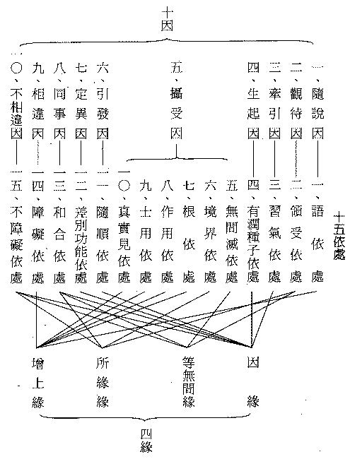



庚五　因缘生果



所说因缘必应有果，此果有几？依何处得？果有五种：一者异熟，谓有漏善及不善法所招自相续异熟生无记。二者等流，谓习善等所引同类，或似先业后果随转。三者离系，谓无漏道断障所证善无为法。四者士用，谓诸作者假诸作具所办事业。五者增上，谓除前四餘所得果。



如上「所说」的十「因」四「缘，必」定都「应有」它们所得的「果」。现在所成问题的，就是「此果」究「有几」种？复「依何处」而「得」何果？讲到这所得「果」，共计「有五种」，就是异熟、等流、离系、士用、增上的五种，而这五种，向被称为五果。这五果，在小乘虽亦同样有其名称，但其意义不完全相同。所以对每果的解说，也就各各有别。同时要知道的：小乘说五果是由六因四缘所生，大乘则说五果为十因四缘所得，大小乘间同样有所不同的。



「一者异熟」果：关於异熟，先在此加以详说。所谓异熟，是说有异类成熟的『因是善恶，果唯无记』的关系而言。异熟因，在《俱舍》说为六因之一，而於四缘属於因缘，在唯识则将之说为增上缘。至於异熟，有真异熟与异熟生之别。真异熟，是指总报果体的第八识；异熟生，是指别报果体的前六识。不过，第八识也有说为异熟生的时候。唯第七识，因为唯是无记性，所以不是异熟因；因又常是有覆性的，所以不是异熟果。现在论文告诉我们：由「有漏」的「善」法「及不善法所招」感到的八识「自」体「相续」的「异熟生无记」，是为异熟果。这里的有漏是简别无漏的，自相续是简别他身以及非情的。但此所说的异熟生无记，是指前六识说，因为前六识中业所感者，唯名异熟生不得名为真异熟的。不过由於第八识亦得名为异熟生的关系，所以此中亦摄得第八识。因此我们知道，如果单说异熟，那是唯指总报而言，不含摄别报在内，假使说异熟生，那就总别报都包括在内。



「二者等流」果：关於等流果，在后虽要详细的说到，但在此要而言之，是指所说的所生果。等，约相似义名果；流，是约流类名果。简单的说，是指相似果的因之流类的果义，叫做等流。毕竟不外是指同类所引生的果。论中告诉我们说：「谓」由所熏「习」的「善」、不善、无记三性种子「所引」生的「同类」果法。如第八识中的有漏种子就生有漏现行，无漏种子就生无漏现行，而有漏种中的善种生善的现行，不善种生不善的现行，无记种生无记的现行。如是同类报果，叫做等流果。「或似先业后果随转」，就是由於相似的先业，后果就随先前的业力而转生。如前生造了杀生业，缩短他人的生命，到了今生自己来做人时，也就因先杀业而感受短命的果报，是为先业的同类。这完全是由自业所招感的，所以叫做等流果。如是等流果，是从自他第八识总报体长短分限相似而得名的，实际不是同类之果的假等流。真等流果是指善、恶、无记三性的名言种子所引起的后念自种及同时的现行。《瑜伽》三十八说：『习不善故，乐住不善，不善法增，修习善故，乐住善法，善法增长』，这是说的真等流果。论接著说：『或似先业后果随转』，这是说的似等流果。所以等流果有这真假两类的不同。



「三者离系」果：这是脱离系缚所得的果，指无为法，与其他诸果的有为法完全不同。所谓离系，就是离去烦恼的系缚。「谓」由「无漏」的正「道」（智），「断」除烦恼、所知的二「障」，然后「所证」得的「善无为法」，是为离系果。如以唯识的六无为说，这就是不动、想受灭、择灭、真如四者。虚空及非择灭的二种无为，因为不是断惑所证的法，所以不含摄在其中。这果，是无为法，不是生灭的，所以果不是因缘生起之谓，而是由离系所证得的，这实在值得吾人予以特别注意的。同时要知道的，就是此果唯圣人之所证得，不是凡夫所能有的。《对法》第十五说：『离系果者，谓由圣道随眠永灭』。《显扬论》十八说：『若由圣八支道，诸烦恼灭，是离系果；若诸异生由世间道，诸烦恼灭，非究竟转故，非离系果』。



「四者士用」果：士是士夫，就是这里所说的作者。所「谓诸」有「作者假诸」种种的「作具」，以完成「所办」的种种「事业」。《瑜伽论》三十八说：『诸有一类於现法中，依止随一工巧业处起士夫用。所谓农作、商贾、事王、书畫、算数、占卜等事，由此成办诸稼穑等财利等果，是名士用果』。所谓作者、作具、成办事业名士用果，灵泰《疏钞》说：『且如有人能占卜时，即人名作者，所有算子、阴阳、文书名作具，即得他师师彼亦名士用果。如人资贩卖等时，即人名作者，所有骆驼、舆、笼等是作具，所得金银等皆名士用果。又如人能造屋宅，工人名作者，所有斤斧等名作具，作屋成办亦名士用果。乃至由人势力，种得田苗禾稼等时，人名作者，所有耒耜镃基等是作具，若得获名果，皆名士用果』。当知这都是人士夫，就是约有情的作用，说名为士用的。而这，因是和合的假者，所以不是实法。另外还有所谓法士夫，就是以因法为作者，以缘法为作具。当知这是由譬喻而立士用之名。这法士用，如小乘所说的四种士用果。《顺正理论》第十八说：『士用果四，一者俱生，谓於一时更互为因力所引起。二者无间，谓次后时由前念因而所引发，如世第一而能生彼苦法智忍。三者隔越，次隔远时展转为因所引起者，如农夫等於谷麦等。四者不生，所谓涅槃由无间道力所得故。若无间道断诸随眠所证择灭，而名离系及士用果，若不断惑但重证灭但名士用』。



「五者增上」果：此「谓除前四」果的意义，而指诸「餘」一切「所得」的「果」。因此，这果的范围非常广泛，可说通於有为无为、有漏无漏的一切法。所谓增上，是增胜殊上的意思。如眼识等为眼根等的增上果，如是乃至意识为意根的增上果。又如众生的身分不坏，当知是命根的增上果。总说一句，除了前面的四果外，诸餘无不摄在这增上果中。



瑜伽等说习气依处得异熟果；随顺依处得等流果；真见依处得离系果；士用依处得士用果；所餘依处得增上果。



上来所说的五果，依於十五依处的那一处得？据「瑜伽」论卷五及《显扬论》十八「等」所「说」：依第三「习气依处得」第一「异熟果」；依第十一「随顺依处得」第二「等流果」；依第十「真」实「见依处得」第三「离系果」；依第九「士用依处得」第四「士用果」；依「所餘」的十一种「依处得」第五「增上果」。诸论中这样的配合而说，是就随胜偏说而言。因为如此，对此依处得果，向下还有二师的解释不同。



习气处言显诸依处感异熟果一切功能，随顺处言显诸依处引等流果一切功能；真见处言显诸依处证离系果一切功能；士用处言显诸依处招士用果一切功能；所餘处言显诸依处得增上果一切功能。不尔，便应太宽太狭！



第一师的解说是这样的：所谓「习气」依「处」的这话，不是专指第三习气依处而言，而是「显」示「诸」有十五「依处」所有能「感异熟果」的「一切功能」说的。如第三习气、第四有润、第十二差别功能、第十三和合、第十五不障碍的五依处，皆包括在内，因此五依处中的功能，皆能感异熟果的。所谓「随顺」依「处」的这话，不是专指第十一随顺依处而言，而是「显」示「诸」有十五「依处」所有能「引等流果」的「一切功能」说的。如第三习气、第四有润种子、第十真实见、第十一随顺、第十二差别功能、第十三和合、第十五不障碍的七依处，皆包括在内，因此七依处中的功能，皆能引等流果的。所谓「真见」依「处」的这话，不是专指第十真实见依处而言，而是「显」示「诸」有十五「依处」所有能「证离系果」的「一切功能」说的。如第十真见、十一随顺、十二差别功能、十三和合、十五不障碍的五依处，皆包括在内，因此五依处中的功能，皆能证得离系果的。所谓「士用」依「处」的这话，不是专指第九士用依处而言，而是「显」示「诸」有十五「依处」所有能「招士用果」的「一切功能」说的。如第二领受、第八作用、第九士用、第十三和合、第十五不障碍的五依处，皆包括在内，因此五依处的功能，皆能招士用果的。所谓「所餘」依「处」的这话，乃是「显」示於「诸」十五「依处」中，所有能「得增上果」的「一切功能」说的。这是指第一语言、第六境界、第七根、第十四障碍的四依处全以及其餘十一依处的少分，因此诸依处或全部或少分，皆能得增上果的。为什麼要这样解释？第一师说，假定不是这样解释的话，那就不免第五增上果有「太宽」的过失，而前四果又不免有「太狭」的过失！



怎麼会有太宽太狭的过失，还得进一步的就一一依处加以说明：一、习气依处，假定认为这是唯指第三依处，那就有所不对，因在第三习气依处中，不但有业种感异熟果，亦有因缘种、等流果不是属於业的，当然不可说它得异熟果，如说它亦得异熟果，那就犯有太宽的过失！至於其餘的有润种子、差别功能、和合、不障碍的四种依处，其中亦有业种能得异熟果的，如不把这四种依处说在里面，岂不犯了太狭的过失？二、随顺依处，假定认为这是唯指第十一依处，可是我们知道，在第十一随顺依处中，不但得等流果，亦能引得涅槃及非同类异界无漏等法，如说随顺依处唯得等流果，那就有太宽的过失！至於其餘的习气、有润种子、真实见、差别功能、和合、不障碍的六种依处，亦是可得等流果的，假定不含摄在其中，那就有太狭的过失！三、真实见处，假定认为这是专指第十依处，同样是不合理的，因为在这第十依处中，不但能证离系果，其所得的圣道同时，摄得相应心心所及得四相，而且前念又能引生后念无漏同类诸法，当知这都不是离系果，如果说它亦得离系果，岂不犯了太宽的过失？至於其餘的随顺、差别功能、和合、不障碍的四依处中，亦有得离系果的成分在内，如不把这四依处说在其中，岂不犯了太狭的过失？四、士用依处，假定认为这是专指第九士用依处，同样是有问题的，因为士用依处，不但招士用果，亦能引增上果及等流果，如人士用就能得增上果，法士用更能得等流果，假定在士用依处里面包含这些，是就犯了太宽的过失！至於其餘的领受、作用、和合、不障碍的四依处，同样可以得士用果的，假定不包括在内，当然就犯了太狭的过失！五、所餘依处，同样犯有太宽太狭的过失！基师《述记》说：『餘依处中亦有太宽，即前四外，餘依处中有等流等四果体在，若并是别增上果者，即为太宽。唯除前四所摄之外为所餘者，前依处中亦有增上果。如习气中不得异熟果者，即诸因缘种。随顺中不得等流者，即得涅槃。真见亦有不得离系者，引后自类等。领受中亦有不得士用者，如胫待足等。若不摄彼，便为太狭』。灵泰《疏钞》对这解释说：『十五中境界依处等四全及十一少分是增上者，皆是增上果摄。若习气、随顺、真见、士用四处外取十一处是增上果者，即太宽失！此十一处中亦有得四果故。若不摄习气四处，四处中前四果外又别有增上果者，不摄即太狭失』！



或习气者唯属第三，虽异熟因餘处亦有，此处亦有非异熟因，而异熟因去果相远，习气亦尔，故此偏说。随顺唯属第十一处，虽等流果餘处亦得，此处亦得非等流果，而此因招胜行相显，随顺亦尔，故偏说之。真见处言唯诠第十，虽证离系餘处亦能，此处亦能得非离系，而此证离系相显故偏说。士用处言唯诠第九，虽士用果餘处亦招，此处亦能招增上等，而名相显是故偏说。所餘唯属餘十一处，虽十一处亦得餘果，招增上果餘处亦能，而此十一多招增上，餘已显餘，故此偏说。



第二师的解说是这样的：《瑜伽论》所讲的「习气」，「唯属」十五依处中的「第三」习气依处，「虽」说得异熟果的「异熟因」，在其「餘」的四依「处」里「亦有」，而在「此」习气依「处」里面，「亦有非」是属於感异熟报的「异熟因」的，如识等五种生现行的，就不是属於异熟因的。既然如此，为什麼说习气依处为感异熟报的异熟因？那是由於「异熟因」熟时，望於离「去果相」很「远」的关系，不特这是如此，就是「习气」依处，望於果相「亦」是很远的，所以这里特别「偏说」习气得异熟果。



所谓「随顺」依处，「唯属」十五依处中的「第十一」随顺依「处，虽」说「等流果」，在其「餘」的依「处」，如前之六、七、八的依处中，「亦」能「得」到等流果，在「此」随顺依「处」中，「亦」能感「得非等流果」，如与涅槃为因，就是指的这个。既然如此，为什麼说随顺依处为得等流果的等流因？那是由於「此」等流「因招」感有为法的「行相」，特别来得「显」「胜」的关系。不特这是如此，就是「随顺」依处「亦尔」，所以这里特别「偏说」随顺依处招等流果。



所谓「真见处」的这话，「唯」是「诠」说十五依处中的「第十」真实见依处，「虽」则说是「证离系」果，在其「餘」的四依「处」或五依处中「亦能」证得，且「此」真实见依「处」，不特能证离系果，「亦能得非离系」果的同类等。既然如此，为什麼说真实见依处是证离系果的主因？那是由於「此」真实见依处「证离系」果的「相显」，所以这里特别予以「偏说」。



所谓「士用」依「处」的这话，「唯」是「诠」说十五依处中的「第九」士用依处，「虽」说「士用果」在其「餘」的四依处或十依处中「亦」能「招」感，且「此」士用依「处」，不特能感士用果，「亦」能「招」感「增上等」果。既然如此，为什麼说士用依处为招士用果的主因？那是约它得士用果的「名」及体「相显」，所以这里特别予以「偏说」。



除前四果「所」不属而「唯属」於其「餘」的「十一」依「处，虽」说这「十一」依「处，亦」能感「得」异熟、等流、离系、士用这其「餘」的四「果」，就是「招增上果」的，在前之四果所属的「餘」四依「处，亦」同样的「能」够做到，然「而」由於「此十一」依处，特别「多招增上」果，加以「餘」依处在前四果，「已」经「显」其各所得的「餘」果，所以「此」处就约其殊胜点而「偏说」之。



如是即说此五果中若异熟果，牵引、生起、定异、同事、不相违因增上缘得；若等流果，牵引、生起、摄受、引发、定异、同事、不相违因初后缘得；若离系果，摄受、引发、定异、同事、不相违因增上缘得；若士用果，有义：观待、摄受、同事、不相违因增上缘得；有义：观待、牵引、生起、摄受、引发、定异、同事、不相违因，除所缘缘餘三缘得；若增上果，十因、四缘一切容得。



如何依十五依处得五果，在前已经论说，「如是」现在进一步的「即说此五果」，於十因中由几因得，於四缘中由几缘得。现在顺其次第，分别说明如下：



一、假「若」是「异熟果」，那它望於十因，是由「牵引、生起、定异、同事、不相违」的五「因」所得，如果望於四缘，那就唯由「增上缘得」。为什麼此中不取观待因？这因观待唯望士夫为因，所以此中不取。不过所谓士夫，有人士夫与法士夫之别，假定望於法士夫为因，亦不妨取观待因，这样就有六因。为什麼此中不说因缘得异熟果？这因大乘中善恶业异熟无记，不是名言因缘，所以此中不说。如在小乘有部，亦可说因缘得，因为他说能作因外，其餘异熟因等五因，皆是属於因缘性的。



二、假「若」是「等流果」，那它望於十因，是由「牵引、生起、摄受、引发、定异、同事、不相违」的七「因」所得，如果望於四缘，设是种子生现行，就是由「初」因缘得，设是其餘的等流果，那就由「后」增上「缘得」。如现行引现行，彼此是同类，是等流果，亦增上缘。



三、假「若」是「离系果」，那它於十因中，唯取「摄受、引发、定异、同事、不相违」的五「因」，而於四缘之中，就唯由「增上缘得」。至於观待因，既然说假者士夫待於所待，士夫当然不得离系果，所以不说观待因得离系果。还有清净十因中的牵引因，亦不得离系果，是什麼理由？因清净十因中，唯取有为无漏种子果名牵引因，无漏种子有为，不得说为离系果。牵引因中无漏种子所生现行无漏能证无为，同时能够断除烦恼，所以无为名离系果，不说清净十因中的牵引因得离系果。



四、假「若」是「士用果」，它所取的因和所赖的缘，有两家解说不同。「有义」，是第一师的说义。依此师的意思：士用果於十因中，唯取「观待、摄受、同事、不相违」的四「因」，於四缘中，唯由一「增上缘得。有义」，是第二师的说义。依此师的意思：士用果於十因中，应取「观待、牵引、生起、摄受、引发、定异、同事、不相违」的八「因」，於四缘中，「除」去「所缘缘」，由其「餘」的「三缘得」。为什麼要除去所缘缘？因在外界的境界上，没有所谓如士夫之用的。



五、假「若」是「增上果」，那就「十因、四缘一切」皆「容」许「得」。因这增上果，与四缘中的增上果一样，范围是非常广的。不过要知道的，就是所谓十因，只有四因是全部的，其餘六因只是少分而已。还有一种说法，就是於十因中，唯取随说因与相违因的二因全以及其餘八因的少分，前四果外，餘法方得名增上果。



己三　正释缘起



傍论已了，应辨正论。本识中种容作三缘生现分别，除等无间。谓各亲种是彼因缘，为所缘缘於能缘者，若种於彼有能助力或不障碍是增上缘。生净现行应知亦尔。



上来引《瑜伽》等论，「傍论」四缘的道理，乃至明依因以及因缘得果，「已」经全部完「了」，现在「应」当重行回复到「辨」解四缘的「正论」，让我们对之有个正确的认识。第八根「本识中」的各个亲「种，容」可「作」为因缘、所缘缘、增上缘的「三缘」，以「生」起「现」行「分别」。当知这里说的分别，是指心心所而言，而且还含摄它们的作用，如相、见二分等，所以不但是指心心所法的自体。於四缘中所以要「除」去「等无间」缘，因为此缘唯就心心所法的相望而立，不是种子能生的意义，现在只是讲的种子，所以必须除去等无间缘。所「谓」种子三缘：一、是指八种分别现识，「各」有「亲」生「种」子，「是彼」八识的「因缘」。如眼识等的生起，虽藉眼根等为助缘，而且是不可缺少的，但不是亲生眼识的种子，不得说为因缘。总说一句，一切法皆从识种子生，无有一法不从识种子生的，所以不但亲种生识名因缘，就是生起色法、不相应行、见分、相分等，亦无不是因缘。二、「为所缘缘於能缘者」，是说要能缘种子的心心所法，该种子方是它的所缘缘。所以於此必须除去相分及自体分，因为相分没有能缘的作用，自体分不缘於种，当然没有所缘缘。至於见分，虽说有它的能缘作用，但仍要除去前五识和第七识的见分，因为是诸识的见分，不能缘於种子的。至於第六识的见分，有缘种子的时候，有不缘种子的时候，其缘境是不定的，当它缘种子的时候，固然有它的所缘缘，当它不缘种子的时候，是亦即没有它的所缘缘。因此真为所缘缘的，唯与第八识一切时的能缘见分作所缘缘。三、假「若」有类「种」子，对「於彼」现行法的生起，「有能」给与一股「助力」，如根种於识种，作意有助於识的生起，是为增上缘。「或」虽没有什麼助力，但亦「不」予任何「障碍」，如异识种子望异类现行，亦同样的「是增上缘」。不过此中要简去无漏种与有漏现行为增上缘，因为它是有所障碍的。如无漏生起现行的时候，能够损害有漏法，使有漏法不能发生活动，所以无漏种与有漏法不得为因，自然也就不得作增上缘。



种子容作三缘生起现行，不但染法种子生染法现行是如此，就是清净种子「生」起清「净现行，应知亦」是如此。灵泰《疏钞》说：『若至佛果位，无漏种子生现行亦是因缘、增上缘、所缘缘、等无间缘，若佛果位，五识、六识、七识、八识见分皆能缘种子也，若佛果第七识平等智见分，第八识大圆镜智见分，即一切时缘种子。虽非此解，佛果位八个识见分缘种，於理为胜』。如此说来，净种生净现行，不但容作三缘，亦还有等无间缘，是则与染种生染现行，要除去等无间缘，略为不同。是否与论义吻合，还得学者加以思索！



现起分别展转相望容作三缘，无因缘故。谓有情类自他展转容作二缘，除等无间。自八识聚展转相望定有增上缘，必无等无间缘，所缘缘义或无或有。八於七有，七於八无，餘七非八所仗质故。第七於六五无一有，餘六於彼一切皆无。第六於五无，餘五於彼有。五识唯托第八相故。



上来虽已解释『以展转力故，彼彼分别生』的两句颂，但那是就种生现为缘，能生分别说的；现在再解释『以展转力故，彼彼分别生』的两句颂，则是就现望现为缘，能生分别说的。「现起分别展转相望容作三缘」，是说无论自他相望，或是自类心识相望，或是诸识前后相望，皆容作所缘缘、增上缘、等无间缘的三缘生起分别，於四缘中缺「无因缘」。因为现望於现，不是亲办自体，所以在四缘中，需要除去因缘。怎麼知道容许作三种缘？如现起的眼识，望於耳鼻等的现起识，或者有所助力，或者不为障碍，是为增上缘；若现起的第六意识，能缘其餘的诸识，或第七现行识，能缘第八阿赖耶识，是为所缘缘；若前八的现起识，望后八识的现起，各各对它的自类有一种开导力，是为等无间缘。但这三缘的具有，不过是一种总说，如果再别加分别，是亦有其取舍的，并不是一切都有这三缘，而且其取舍有五类差别：



一、「谓有情类」的「自」身与「他」身「展转」相望，「容作」所缘缘、增上缘的「二缘」，於三缘中要「除」去「等无间」缘。因等无间缘是唯自类一识有，而这里是约自他展转相望说，所以在三缘中要除去等无间缘。



二、若诸有情各各「自」身的「八识」及其相应心所并诸相、见分等同「聚」法中，此聚与彼聚的「展转相望」，那它决「定有」通於一切的「增上缘」，但「必无」一识相望的「等无间缘」，因这是八识聚的展转相望，不是自识的前后相望，唯自识的前后相望，方有这等无间缘。至於「所缘缘义，或」者是「无，或」者是「有」，那是不一定的。怎麼知道所缘缘的有无不定？谓第「八」识「於」餘「七」识「有」所缘缘义，即第八识相分为前五识作所缘缘，第八识四分为第六识作所缘缘，第八识见分为第七识作所缘缘。总说一句，第八识的四分本质，即前七识的见分变相分缘，所以八於七有所缘缘义。然而前「七」望「於」第「八无」所缘缘义，因为第八不缘前七，为什麼？因「餘七非八所仗质故」，就是第八不托七识而生，所以八唯以自己的三境为所缘缘，而七非第八识的所缘缘。至於「第七」识望「於」前之「六」识，前「五」识「无」所缘缘，后「一」意识「有」所缘缘。为什麼是如此的？因眼等五识唯缘外界的五性境，不缘内在的第七识，所以於初五识无此所缘缘义；至於第六意识，是徧能缘一切法的，所以有此所缘缘义。而其「餘」的「六」识望「於彼」第七末那识，「一切皆无」彼所缘缘义，因第七识唯缘第八见分，而不缘於前六识的。其「第六」识望「於」前「五」识，「无」此所缘缘义，因前五识唯缘本识所变为境，不待第六识所变色等为自缘境。「餘」前「五」识望「於彼」第六意识，则有所缘缘义，因第六识能缘内外色心的一切法，当然亦能缘於前五识。



自类前后第六容三，餘除所缘，取现境故。许五后见缘前相者，五七前后亦有三缘，前七於八所缘容有，能熏成彼相见种故。



三、明自类前后展转为缘：自身八识，一一「自类前后」相望，所应具缘是怎样的？假定是「第六」识聚的前念生后念，「容」有「三」缘。第六现行识能够缘於三世，就是以前念意识缘於后念，后念意识亦得缘於前念，所以有所缘缘义；前后互相相望，或者不相障碍，或者有能助力，所以有增上缘义；前念为后念作开导依，所以有等无间缘义。假定是其「餘」的七识一一识聚，自类前后相望，那就要「除」去「所缘」缘，只有增上和等无间的二缘。为什麼？因其餘的七识，只能「取现」在「境」，不能缘於过未，所以没有前后所缘义。但这是就通途而言，若依陈那《观所缘缘论》中所说，亦「许五」识「后」念的「见」分「缘」於「前」念的「相」分为所缘缘，并非但缘现境。如该论颂说：『或前为后缘，引彼功能故』。长行释说：『或前识相为后识缘，引本识中生似自果功能令起，不违理故』。不但前五识如此，就是第七识亦然，因而前「五」及第「七」识，自类「前后」相望，「亦」许具「有三缘」，即唯除去因缘。第八识为什麼没有所缘缘？所以非第八识者，因它只是所熏而非能熏，不能引发种子，所以它的前念相分，不是自己后念识的见分所缘。假定后念以前念为所缘缘，在自身的八识相望中，「前七」望「於」第「八，所缘」缘义亦「容有」的，因前七识都是属於能熏识，「能熏成彼」第八品的「相、见种」子。如以前五识为能熏，就熏成彼第八识的相分等的相分种，而为第八识的见分所缘；如以第七识为能熏，就熏成彼第八识的见分种，而为第八识的自证分所缘；如以第六识缘於第八见相为能熏，就能熏成彼第八识相见二分种子，而为第八识的见分及自证分所缘。所以前七望於第八，所缘是容许有的。然这意思，不是显示第八能缘前七，而正显示前念第八相分於后念第八见分有所缘义。



同聚异体展转相望唯有增上，诸相应法所仗质同不相缘故，或依见分说不相缘，依相分说有相缘义，谓诸相分互为质起，如识中种为触等相质。不尔！无色彼应无境故，设许变色亦定缘种，勿见分境不同质故。



四、明同聚异体的展转为缘：「同聚」，约心与心所和合似一说；「异体」，约心心所相用各别说。如诸俱时心心所，各各别互「展转相望」，虽则说是同聚，但因各有别体，所以彼此相望，「唯有」一「增上」缘而无所缘。为什麼会有增上缘？因为不相障碍且能予以助力之故。为什麼没有所缘缘？要知「诸」有一切「相应」的心心所「法」，其「所仗」的本「质」，虽说是相同的，但没有「相缘」的意义，所以没有所缘。还有一种解说：「或依见分」同聚心心所「说不相缘」，因为没有那个见分，能缘同时的其他见分，所以同聚心心所不能互相为缘。假定「依」於「相分」来「说」，那就又「有相缘」的意「义」。为什麼？因「诸」所有「相分」，都是「互为」本「质」而生「起」的。如心王相分为所本质，那同聚诸心所的相分，必然亦是仗这心王的相分为本质而起。如本「识中」所持诸法「种」子，「为」同时「触等」五徧行心所的「相」分本「质」。触等与识，亲所缘缘，定应有的。「不尔」，假定不是这样的话，无色界既然是无色的，那「无色」界中「彼」五种心所，「应」该「无」有它的所缘「境」，然而事实上，触等五心所是有它的所缘境的，所以必以本识所变为质而缘。「设」或容「许」无色界第八识亦能「变」现下界的「色」等，然而触等五种心所，仍如本识一样的，「亦」必决「定缘种」。你不可说第八识和它的相应心所，如是六个「见分境」，是「不同」於一个本「质」的。当知第八自变，虽不仗托於他，然而相似名同，并不是定要同质才说为同。从诸相分容互为质说，所以有相缘义。



同体相分为见二缘，见分於彼但有增上，见与自证相望亦尔，餘二展转俱作二缘，此中不依种相分说，但说现起互为缘故。



五、明同体四分展转为缘：同体，是说诸心心所，虽各有其四分，但唯一识所变，所以名为同体。如是於四分中，「同体」的「相分」望於见分，能「为见」分的所缘、增上的「二缘」。可是「见分於彼」相分，「但有增上」一缘，没有所谓所缘缘。为什麼？因诸相分，在道理上，是没有能缘作用的，既没有能缘用，怎麼会有所缘？至於「见」分「与自证」分展转「相望」，当知「亦尔」。就是如相分望於见分，能为其所缘、增上的二缘；而自证分望於见分，亦如见分望於相分，唯有增上缘而无所缘缘。为什麼？因见分有时通於非量，不能内缘自证的现量境，所以没有所缘缘。其「餘」自证及证自证的「二」分，「展转」相望，「俱作」所缘、增上的「二缘」。有增上缘是没有问题的，为什麼会有所缘缘？因为它们俱是现量所得，彼此是有相互为缘的功用的。假定以此内向的二分望於外向的见相二分，同样唯有增上缘而无所缘缘，因为内向的二分不以外向的二分作所缘的。在此有人问道：种子亦是属於相分，为什麼此中不说见分与种子相互为缘？当知「此中」说的相分与见分为二缘，「不」是「依」於「种」子的「相分说」，而是「但说现起」的现行与现行相「互为缘」说，所以这里不谈种子与见分为缘。假定第八识见分缘种子相分，种子相分与第八识见分，可作因缘、所缘、增上的三缘。



净八识聚自他展转皆有所缘，能徧缘故，唯除见分非相所缘，相分理无能缘用故。



现行染八识聚展转为缘的道理，如前已经略为分别；现在比例说明现行净八识聚相互为缘的意义。说到清「净八识聚」所现起的分别，不论是「自」是「他」，不论自类前后，不论异体同体，「展转」相望，除了增上缘外，一定「皆有所缘」，因为佛果位上的清净八识，一一皆「能徧缘」一切法的。不过在同体的四分中，必须「除」去「见分」望於「相」分的非「所缘」缘，因为见分非是相分之所缘的，所以「相分」绝对「理无能缘」之「用」，没有能缘用，怎会有所缘？不特见分如此，就是自证分、证自证分，同样亦不是相分所缘，相分没有能缘用，怎麼会缘自证分及证自证分？



对此还有一种解说：就是前文所说『勿见分境不同质故』的这话，意显心识见分与相应见分，对境必定是同缘的。可是又有人问：自证与相应法见分怎麼是同缘的？当知识的见分是不能自缘的，假定见分能够缘於见分，那能缘的见分与自证分，试问又有什麼差别？假定见分不能缘於见分，那前文所说『勿见分境不同质故』的话，试问又怎样的会通？



关於这问题，唯识学者有两种解释：一、前说王所同一所缘，那完全是据因位说，并不是依於果位说，假定在果位上说，见分所缘的境，不定是相同的，因为到了果位，已经得到自在，可以任运而缘，不同又有什麼关系？而且在果位上亦自内缘相应法，所以所缘不一定必要相同。二、识的见分与相应法，不但必定同缘，且亦自缘见分，亦能缘於自证分，与相应法所见境，彼此是相等的。虽则如此，但见分与自证分的作用，仍然是有它们的不同，就是自证分唯是向内而缘，并不需要另外有所变似，但见分的自缘等，还要另外变似成为相分，与相应法同样是向外取的。相应缘识既不外取别变相分，识的见分例此亦当是这样的。如此解说，不违上文所说见分境同。



既现分别缘种现生，种亦理应缘现种起，现种於种能作几缘？种必不由中二缘起，待心心所立彼二故。现於亲种具作二缘，与非亲种但为增上，种望亲种亦具二缘，於非亲种亦但增上。



此明种子亦应缘其现行及种子而起：意谓「既」然「现」行「分别，缘」其「种」子及「现」行而「生」，则其「种」子按理亦「应缘」藉「现」行及「种」子而「起」。然而缘生分别「现」行及「种」，给「於」所生的「种」子，试问「能」够「作几」种「缘」？现在回答说：「种」子的生起，「必不由」於四缘「中」间的等无间、所缘缘的「二缘」而「起」，因要「待」於现起「心」及「心所」，方得「立彼」中间「二」缘。种子既然不是心心所法，所以不是二缘所生起的果。既不由中间二缘生起，当然是由初后的因缘、增上缘的二缘而起。今就因位来说：「现」行望「於」它「亲」自所熏的「种」子，「具作」因缘及增上的「二缘」；假使望於「非」自「亲」所熏「种」，因为不办自果，所以除了自种外，「但为增上」一缘而已。设若「种」子「望」於「亲」所生「种，亦具」因缘及增上的「二缘」；设若种子望「於」异性的「非」自「亲」所生「种，亦但增上」一缘而已。



己四　总结缘生



依斯内识互为缘起，分别因果理教皆成。所执外缘设有无用，况违理教何固执为？虽分别言总显三界心及心所，而随胜者诸圣教中多门显示，或说为二、三、四、五等，如餘论中具广分别。



这是总结缘生的一段文。谓「依」如上所说「内识」的种子及其现行的「互为缘起」，那一切「分别」的能生「因」及所生「果」，不论是就圣「教」说，不论是就「理」论说，「皆」得「成」立。至於小乘「所执」的心「外」之「缘」，不说根本没有，「设」若即使是「有」，也是没有「用」的，何「况」照他们所说的，既「违」反正「理」，亦违反圣「教」？既然如此，为什麼又要这样的固执？所以说「何固执为」。



「虽」颂中所说彼彼「分别」的这句话，是「总显三界」的一切「心及心所」法，然「而随」於「胜者」而言，在「诸圣教」之「中」，曾以「多门显示：或说为二」，或说为「三」，或说为「四」，或说为「五等」的不同。这到卷下三性之中，自当详细解释，这儿姑不具论。「如餘论中具广分别」，是指《瑜伽》三十八、七十三、七十四、《显扬论》等，皆有详细的解说，这里不过是略为一说而已。现在引《楞伽》第五所说的十种分别：『佛告大慧：一切诸法相续不相续者，谓如声闻执著义相续，相执著相续，缘执著相续，有无执著相续，分别生不生执著相续，分别灭不灭执著相续，分别乘非乘执著相续，分别有为无为执著相续，分别地地相执著相续，分别自分别执著相续，分别有无入外道朋党执著相续。大慧！如是愚痴凡夫，无量异心分别相续，依此相续愚痴分别，如蚕作茧，依自心见分别𫄧相续，乐於和合自缠缠他，执著有无和合相续』。



丁三　生死相续



戊一　牒意标问



虽有内识而无外缘，由何有情生死相续？



此下解释有情生死相续的责难。亦即是说轮回转生是怎麼一回事。意味有情的生死，展转往返而连续的，是为流转相续之谓。在此先得说明一句的，就是轮回转生的主体，不得如外道说有灵魂的我，假定有灵魂的我，那就不是说的轮回。有情在三界中生死相续流转不息，是说五蕴假和合的这个果报体，在维持一期间的相续，到了最后生命的结束，更生起其他的报体而相续，是为轮转的意义。像这样的说法，真正是说有情色心的果报，决不承认有个常住的我体。而这相续在一期生命过程中，划分生与死的两个阶段。生命的开始说名为生，生命的终结说名为死，但这样的说名生死，断不是究竟的区分。所谓生，不是真的指有情发生的最初，所谓死，不是真的指有情终末的最后，因为像这样所说的死生，不过是从这一果报移转到另一果报的过程，附以生死之名而已。因而应知：生之前还有死，死之后还有生，其前后的生死，真是连续无穷。换句话，有情的相续，无始无终的，发生的开始固然没有，究极的终结亦是没有，这是真正显示有情相续的真相。



於此要知道的，就是无始无终，不是说始终的难以追究，而是真正意味其始终的无有。假使不然，始终虽有，但必辽远，确难追究。发生的最初怎样？是不是无而忽有？设若真是无而忽有，那就同於无因外道所说，像这样的拨无因果，背於无因生起的事实，那里是建立因果原理的佛教所主张的？不用说，这是佛教所绝对不许可的。发生的最初既是如此，终末的最后，岂不同样的成为有而忽无？如此拨无因果，断为佛教不许。因此，有情的存在，的确不得不说真正是无始无终的！



如此往返的无穷的生死相续，究竟是由怎样的理由而有？依於向来所说，有情生死相续，是由善恶的诸业所感，造业是由於贪瞋等的烦恼，起烦恼是由於外界的顺情违情的实境，缘心外的实境，起贪瞋等烦恼，造种种的业，由此成为生死相续。假使只「有内识，而无」心「外」实「缘，由」缘「何」境起惑造业，「有情」得以「生死相续」？这是唯识违理二难中的第二难。在外人或以为唯有内识而无外境，不能建立生死相续，但在唯识者的立场说来，正因有情完全不了万有诸法唯识所变之旨，妄执那心外的实有存在，起惑造业，招感三界的苦果，以致永远返复轮回转生。亦即所谓生死相续，完全由惑、业、苦的三道而来，那里会有什麼心外的实境？



戊二　举颂总答



颂曰：由诸业习气，二取习气俱；前异熟既尽，复生餘异熟。



「颂」文释此疑难并明有情相续的原由「曰：由」於「诸业」的「习气，二取习气」的相应，於是「前」一生命的「异熟」体「既尽，复」又「生」起其「餘」的「异熟」果报体。由是因缘，有情的生死相续不绝。简单的说：前二句颂，是明相续的原因；后二句颂，是明相续的形相。至其详细意义，论文再加解说。



戊三　解释颂意



己一　业果相续



论曰：诸业谓福、非福、不动，即有漏善、不善、思业。业之眷属亦立业名，同招引满异熟果故。此虽才起无间即灭，无义能招当异熟果，而熏本识起自功能，即此功能说为习气，是业气分熏习所成，简曾现业故名习气，如是习气展转相续，至成熟时招异熟果，此显当果胜增上缘。



上是举颂总答，现以「论」文解释颂「曰」：所谓「诸业」，在性质上，可分类为「福、非福、不动」的三业。因为业有三类，所以说为诸业。如分别说：福业，是感欲界善趣异熟总报及顺五趣中的善的别报，就是招可爱果而受很大的利乐。上二果的善业，虽与福业不相违背，但因另有不动业的名称，所以特就欲界的善业给予福业之名。非福业，是感欲界恶趣异熟总报及顺五趣中的恶的别报，就是招非可爱果而受极大的苦恼。不动业，是感色无色界异熟总报及顺色无色界的禅定业，对於欲界的散动，所以得不动之名。因为这种业，不论多少，住一境性，不会移动，就是上二界的定地之业，以定能令住於一境的。基师《述记》说：『不动者，不可改转义，其业多少住一境界不移动故』。像这样的说不动业，自然是就摄於定地，以定为业。既然住於一境，当然不会散动。《对法》七说：『问：何故色无色系善业名不动耶？答：如欲界中餘趣圆满善不善业遇缘转得餘趣异熟，非色无色系业有如是事，所受异熟界地决定故，是故约与异熟不可移转名为不动』。



如此三业，通於身语意的三业活动而成，意业通於三界，身语唯二地有。讲到福等的三业，是以「有漏善、不善」的二「思」为其「业」体。为三业自体的思，是指与意识相应的审虑、决定的二思，由此通过身语，若身若语的动作，不论行善，不论造恶，总名为业，止息身语，定於一境，名为不动。进一步说，不特以思为业，就是善不善律仪等的「业之眷属，亦」得「立」为「业名」。为什麼眷属亦说名业？因它们与业「同」样的能「招」感「引（总报）满（别报）异熟果」的。当知此中所说业的眷属，主要在於唯取有助於有漏善恶业及能招感总别报者，诸餘不能有助於有漏善恶业及能招感总别报者，那就不得说为业的眷属。因为这样的关系，所以在色蕴中，唯取所发善恶身语为律仪不律仪色，而於餘四蕴中，唯取有漏的善恶。



吾人所造的业，不论是善是恶，总是生灭无常，而才生即灭的，如此怎麼招感当来的果报？我想这是任何人所可能产生的问题。现在论文解答这个说：「此虽才起」以后，更「无」异「间」的「即」又「灭」去，似乎「无」别「义」理「能招当」来的真「异熟果」，然「而」由此现行的业力，当其正在造的时候，「熏」於第八根「本识」，能生「起自」己的「功能」性，当知「即此功能」性，就是颂中所「说」的「习气」。这熏成的本是种子，为什麼叫做习气？由於它「是业」的「气分」（气义），又是现业「熏习所成」（习义），所以叫做习气。既是由熏习起，当然「简」非「曾」有，既然是为种子，当然简非「现业」，是「故」但「名习气」。简非曾有，显示不同有部过去有体的曾业；简非现业，显示不同顺世外道说一切果唯现业得作时即受。可是唯识所说的习气不是这样。基师《述记》说：『由过去无间灭，现行熏习故，种子念念前灭后生，恒现在有故，简彼曾世有用於过去世现有业体。即此种子非作时即受果，后时，或一生多年，或多生等，方始受果故，故简现作业时即受果。由此义故有诠有遮，故名习气』。诠是诠显确有业种子的存在，遮是遮除小乘有部及顺世外道所说有体的曾业及现受的现业。



「如是」像这样的「习气，展转」不断的「相续」，一直「至成熟」的「时」候，「招」感当来若别若总的「异熟」报「果」。当知「此」即「显」示业习气，是感「当」来异熟「果」报的最极殊「胜」的「增上缘」。与亲能办果的因缘不同。



相见、名色、心及心所、本末，彼取，皆二取摄。彼所熏发亲能生彼本识上功能，名二取习气，此显来世异熟果心及彼相应诸因缘种。俱，谓业种、二取种俱，是疏亲缘互相助义，业招生显故颂先说。



这是解释『二取习气俱』的第二句颂。於中，先解二取习气，次解俱字一字。颂中所说的二取，论中解说有四种：一、取「相见」，就是取那实能取实所取的二取，所取是相，能取是见。二、取「名色」，就是执取五蕴，名是受等四蕴，色是第一色蕴。三、取「心及心所」，一切五蕴法，都是不离於这二者。如色蕴，是心心所的相分，心所及心是餘四蕴，所以这能总摄五蕴。四、取「本末」，就是取二异熟的现果。本指第八识，因它是诸异熟的根本，末指餘识中的异熟，因它是第八识的末果。还有一种说法：第八识的总报品叫做本，餘识等的异熟别报品叫做末。即此本末，摄一切法尽。如是「彼」上所说的四种二「取，皆」是属於颂中所说名言、我执「二取」所「摄」。换句话说，就是现行的二取。



如是由「彼」四种二取之「所熏发」，一一「亲能生彼本识上」的「功能」，所以「名」为「二取习气」。然这二取习气是欲显示什麼意义？当知「此」是「显」示未「来世」的「异熟果心及彼」心「相应」法，各望自果为「诸因缘种」子，亲能生果，是为二取习气的意义，与一般所说的业种不同。至於论中所说的当来世，虽有分位三世与生死三世的两种，但这里所显示的是生死三世不取分位三世，因为前难『云何有情生死相续』，后说『前异熟果受用尽时，复别能生餘异熟果，由斯生死轮转』。从这前后所说来看，所以知道定取生死三世。



颂中所说的「俱」字，是「谓」前之「业种」及后「二取」的「种」子「俱」，得以同时感生自果。为什麼这样说？「是疏亲缘互相助义」。诸业种子，是感果的增上缘，属於疏相扶助；二取种子，是生果的亲因缘，属於亲相扶助；它们虽则亲疏不同，但有相互为助的意义。有人这样问道：两类种子既然俱有，为什麼颂中先说业种后说因缘？这是有道理的，因为业种望於感果，虽则说是较疏，但就其「业招」感「生」命果报来说，实在是来得殊胜及明「显」，所以「颂」中特别「先说」业种，后说因缘。



前异熟者谓前前生业异熟果，餘异熟者谓后后生业异熟果。虽二取种受果无穷，而业习气受果有尽，由异熟果性别难招，等流增上性同易感。由感餘生业等种熟，前异熟果受用尽时复别能生餘异熟果。由斯生死轮转无穷，何假外缘方得相续？



这是解释后二句颂。「前异熟者谓前前生业异熟果」：意说假定是前一生业所感的果，这个只可叫做前生，假定是过去二生乃至百千生业所感的果，那就可说前之又前。由於具有这样的二义，所以说为前前生业异熟果。「餘异熟者谓后后生业异熟果」：意说假定是后一生业所感的果，这个只可叫做后生，假定是未来二生乃至百千生业所感的果，那就可说后之又后。由於具有这样的二义，所以说为后后生业异熟果。



「虽」则说是「二取种」子，「受果」是「无」有「穷」尽的，然「而」在「业习气」方面，「受果」却是「有」穷「尽」的。《摄大乘论．所知依》中说：『复有有受尽相无受尽相：有受尽相者，谓已成熟异熟果善不善种子。无受尽相者，谓名言熏习种子，无始时来种种戏论流转种子故』。《摄论讲记》说：『从生果的功能有尽无尽，推知赖耶有这二相。这就是有支与名言两种熏习。有受尽相，是那已经成熟而感受异熟果的善不善种子。因善不善熏成的业种子，有增上的力量，助感异熟果，这感果的力量尽了，所感得的异熟果报也就告一段落，这叫有受尽相的种子。无受尽相，就是那名言熏习种子，从无始时来，有种种戏论名言的熏习，成为生死流转中转起名言戏论的种子，这叫无受尽相的种子』。为什麼会有这种现象？一者「由异熟果」与业「性」是有差别的，不多相互随顺；二者由异熟果虽是业力之所「招」得的，但必要待异世，其果方得成熟，并不是如想像的那麼容易而是很「难」的，所以业习气受果是有穷尽的。至於「等流」果及「增上」果，刚刚与这相反，一则业果的「性」质是相「同」的，就是业是善恶，果亦善恶，二则业是「易」於「感」果的，就是业果可以同时生起，如此念熏了以后，当下就能生果。



我们知道，业种子是助他为增上缘，所以一度助它感果的时候，那个势力也遂即穷尽，能感的业力既是有限的，所感的异熟果当然亦是有穷尽的。能感的业力虽是有尽，但「由」於招「感」当来「餘生」的「业等种」子又复成「熟」的关系，所以在今身中「前异熟果受用尽」了的「时」候，亦即在此身临终的这个阶位，那所成熟的业等种子，「复别能生」其「餘」的「异熟果」起。「由斯」所说业果无断的关系，於是有情的「生死」得以相续不断的「轮转无穷，何」须「假」藉什麼心外之「缘，方得」生死「相续」不绝？此相续识无有断的时候。



此颂意说：由业二取生死轮回，皆不离识，心心所法为彼性故。



上来已依颂文略释，现在再来总申颂意。「此」一首「颂」的「意」思是「说：由」於「业」种及「二取」习气为缘为因，得以证明「生死轮回，皆不离」於内在的心「识」，并不是心外有个什麼法，使令生死相续不断，因为生死因果，是以「心心所法为彼」体「性」的。《宗镜录》说：『一切生死尽是疑情，但了唯心，自然无咎。若疑蛇得病，岂有实境居怀，犹悬砂止饥，但是自心想起』！所以生死相续，完全由相续识而有，如果了解一切唯识，还有什麼生死可得？



己二　习气相续



复次，生死相续由诸习气，然诸习气总有三种：一、名言习气，谓有为法各别亲种。名言有二：一、表义名言，即能诠义音声差别；二、显境名言，即能了境心心所法。随二名言所熏成种，作有为法各别因缘。二、我执习气，谓虚妄执我我所种。我执有二：一、俱生我执，即修所断我我所执；二、分别我执，即见所断我我所执。随二我执所熏成种，令有情等自他差别。三、有支习气，谓招三界异熟业种。有支有二：一、有漏善，即是能招可爱果业；二、诸不善，即是能招非爱果业。随二有支所熏成种，令异熟果善恶趣别。应知我执、有支习气於差别果是增上缘。



上面虽已以颂解答所问，但还有餘义未了，特再举颂以答所问，所以论中说为「复次」。有情在三界五趣中「生死相续」，不是由於什麼别的原因，而是「由诸习气」的动力。「然诸习气」，说来虽是很多，但「总」归纳起来，约「有三种」差别，现在依文说明如下：



「一、名言习气」，就是一切「有为法」的「各别亲种」，乃依前七转识的善恶业力，熏习所成的种子，而能为生起八识、三性诸法的亲因缘者是。无性《摄论释》第三说：『名言熏习差别者，谓我、法、用名言多故。有人、天等我、眼、色等法，去、来用熏习差别。由此我、法、用影显现，诸识生起功能差别』。不过这个「名言」习气「有二」种：「一、表义名言」，就是「能诠」表「义」理的名句文的「音声差别」。名句文，都是施设於音声的屈曲上的，唯独属於无记性，本不能够熏成色心等种，然因名的原故，心随其名，变似五蕴、三性法等而熏成种，因名起种名名言种。《摄论讲记》说：『在觉了以后，以种种言语把它说出来，叫表义名言』。古代本来专是一种言说法，就是彼此以言说表达所要说的意义，到了后代发明文字，以文字表达所要表达的意义，亦是表义名言的一种。「二、显境名言」，这就是「能了」别「境」界的「心心所法」，换句话说，就是前七转识的见分等心，简别不是相分心，因为相分心是不能显了境界的。所谓显了，就是在心识上能觉种种的能解行相，如表象、概念等。如我们见到某样东西，对它有所认识，认为确实是这样的，虽不曾以名言把它表达出来，但所认识的那个境相，正同言说所诠的法义一样，所以亦叫名言。「随」著这表义、显境「二」种「名言所熏成」的「种」子——即第六意识缘诠义的名句文而缘诸法熏成的种子，前七转识缘各各自境而熏成的种子，那种子是由名言所熏成的，所以叫做名言种子，即此名言种子，「作」八识的「有为」三性的诸「法」自果的「各别因缘」。然仍要知道的，就是名言习气中的两种名言，有著相互密切的关系，我们不能把它割断开来作独立看。《摄论讲记》说：『显境、表义二种名言，发生相互密切的关系，因言语传达而引生思想，因思想而吐为言语。离了名言，我们就不能有所知，也不能使人有所知，我们能知所知的一切，不过是名言假立。我们了境的时候，由名言而熏成的功能，在将来有能分别所分别种种的名言现起，这能生性，就是名言熏习。一切如幻行相，皆是名言，这在唯识学的成立上，有极端重要的地位』。这是我们所不能不重视的。



「二、我执习气」，就是「虚妄执」有「我我所」而使自他差别，由此所熏成的「种」子是。无性《摄论释》第三说：『我见熏习差别者，谓四烦恼所染污意萨迦耶见力故，於阿罗耶识中有能执我，熏习差别』。《摄论讲记》说：『染污末那执赖耶为自我，熏成了我见熏习。因我见熏习的关系，众生有各各的差别，以自为我，以彼为他。众生界的彼此独立的人格（拿人讲），就是建立在这我见熏习上』。然此「我执」习气亦「有二」种：「一、俱生我执」，就是属於「修所断」的「我我所执」，通於六、七二识。这从无始以来，就於自他处虚妄执有我我所执，唯有到修道位上，才能逐渐的断除。「二、分别我执」，就是属於「见所断」的「我我所执」，在诸识中，唯属第六意识所有，在见道位中就可断除。「随」著这俱生、分别「二」种不同「我执所熏成」的「种」子，像这样的种子，实际亦即名言种子，因它能「令有情等」发生「自他」的「差别」，所以别立为我执习气。



「三、有支习气」，就是由前善恶六识所熏的业种子，能「招三界异熟」果报的「业种」。无性《摄论释》第三说：『有支熏习差别者，谓福、非福、不动行增上力故，於天等诸趣中，有无明等乃至老死熏习差别』。《摄论讲记》说：『上天堂入地狱，流转诸趣而受苦乐异熟的差别，是有支熏习的力量。因为造了福、非福、不动业而熏成的种子，为三有的差别因，所以叫有支』。然这「有支」习气亦「有二」种：「一」是「有漏善」种，就「是能招」人天善趣「可爱果」的「业」种。「二」是「诸不善」种，就「是能招」三恶趣「非」可「爱果」的「业」种。「随」著这有漏善、不善「二」种不同的「有支所熏成」的「种」子，致「令异熟果」有「善恶趣」的差「别」。由於如此，所以叫做有支习气。人天五趣的差别，完全是由善恶的业力，这是圣教中所常说到的，而此中说有漏善，只是一个善字，然不善中说为诸不善，加个诸字是什麼意思？当知这是显示有情在造业中，造恶业的时候多，造善业的时候少，所以说为诸不善业。



同时我们更「应知」道的，就是上面所说的三种习气，望於所感的异熟果，除了名言习气是亲生因缘外，其餘的「我执、有支」二种「习气」，望「於」善恶「差别」的异熟「果」，在四缘中，属於「增上缘」摄。为什麼？因有支习气，在感有情生死的异熟果增胜；而我执习气，能令有情发生自他差别，所以都为增上缘。其次还要知道的，就是『这三种熏习，能该括宇宙人生一切法的差别因』。



此颂所言业习气者，应知即是有支习气；二取习气，应知即是我执、名言二种习气，取我、我所及取名言而熏成故，皆说名取。俱等餘文义如前释。



在「此颂」文当中「所」说的「业习气」，「应知即是」指此「有支习气」而言；其次颂文中所说的「二取习气，应知即是」指的长行所说的「我执、名言二种习气」，因「取我、我所及取名言」以为境界「而」所「熏成」的二种习气，「皆」得说「名」为「取」的，所以叫做二取习气。除上所说者外，其餘的「俱」义、习气义，前异熟既尽复生餘异熟「等义」，概如前师所释一样，这里不再一一别说。



己三　业苦相续



庚一　亲疏缘义



复次，生死相续由惑业苦：发业润生烦恼名惑，能感后有诸业名业，业所引生众苦名苦，惑业苦种皆名习气。前二习气与生死苦为增上缘，助生苦故；第三习气望生死苦能作因缘，亲生苦故。颂三习气，如应当知。惑苦名取，能所取故，取是著义，业不得名。俱等餘文义如前释。



为了第三次解释颂文以答所问，所以论文又说「复次」。此中所释，认为有情的「生死相续」，完全是「由惑业苦」的三道，给予圆满的说明。详说这个的，当然是下所要讲的十二缘起，因为十二缘起，确是具备惑业苦的三道。像这样的解说生死相续，可说是无遗憾的而又最极巧妙的透露了这段消息。惑业苦三，佛教向来把这名为三道，以示有情生死流转相续不断的因果现象。道是能通之义，因为这三者的顺序，是从惑起业，由业感苦，於苦更起惑发业等，展转相通，生死得以无有间断，所以把这说之为道。又道，亦可解说为轮回之义，就是三道轮转而不相绝。《显扬论》卷一，说烦恼、业、生的三杂染，顺次相当於这里所说的三道。苦是生死之果，惑业则是生死之因。引苦的亲因，是苦的种子，这真可说双通因果。至於惑业两者，则是位於助缘。再依论文解说如下：



什麼叫做惑？就是「发业」的无明与「润生」的贪爱等，如是一切「烦恼」，说「名」为「惑」。简单说，是以无明为本而生起的一切烦恼，如前所说的十根本惑及二十随惑皆是。烦恼之所以说名为惑，约它迷谬诸法的事理，或心迷而不有所了解说。讲到这惑的作用，主要在於发业润生。所谓发业，就是诸种业作，确是从惑而发的；所谓润生，是说名言种子由业的助力，以次生起现行时，以滋润未来新生命的出生。



什麼叫做业？就是「能感后有」生命总报果的「诸业」，说「名」为「业」。业在梵语叫做羯磨，是造作的意义。谓由身语意造作善恶等的种种事，从而由业招感三界的苦果。有部是将业体立於身语意的上面，认为身语二业以色法为体，意业以思心所为体。而身语二业，更各分为表业、无表业，综合说为五业。唯识虽则同样的说明五业，但不承认身语表业有它的别体，由表业所击发的无表业的实体，自然也是不承认的。否定他们的实体，并不是全然拨无表无表业，其假有还是为唯识学者所承认的。



什麼叫做苦？就是诸「业所引生」的三苦八苦无量诸苦，如是「众苦」，说「名」为「苦」。所谓苦，是逼恼身心而感不悦的一种状态。以三苦说：所谓苦苦，是对非爱法所感受的逼恼；所谓坏苦，是对可爱法坏时所感受的逼恼；所谓行苦，是见所餘法无常迁流所感受的逼恼。总之，不论是什麼苦，毕竟不外是迷界的果报，就是由上惑业之力之所招感的。所谓迷界的果报，是说三界、五趣、四生，不管那种都说为苦。就是人天的乐果，亦不过是假的一时的快乐，如仔细的观察，终局必归於苦。



「惑业苦」三，如上分别，是为现行，即此现行所熏成的「种」子，「皆」可「名」为「习气」。假定以这三类种子望所生果来论亲疏：「前二」种的惑与业的「习气」，望於「生死苦」，但「为增上缘」，因为它们只能「助生苦」果，并不是能够亲生苦果，惑业与苦果的体性，实际是不相同的。「第三」种的苦「习气，望」於「生死苦」果，正「能作」其「因缘」，因能办体「亲生」其「苦」的。至於「颂」中所说的「三」种「习气」，与此所说的三种习气，「如」其所「应，当知」是这样的：这里的惑苦二种习气，就是颂文的二取习气，因惑是能取，苦是所取的缘故；所以说「惑苦名取，能所取故」。至於这里所说的业种子，就是颂文所说的诸业习气，但这不得名之为取，因「取是」以执「著」为「义」，但世间有情多於现果生起执著，很少有於业生起执著的，所以「业不得名」取。



此外所有「俱等」其「餘」的「文义」，亦「如前」面解「释」是一样的，这里当然不要再为解说。



庚二　惑等摄支



辛一　牒前标举



此惑业苦应知总摄十二有支：谓从无明乃至老死，如论广释。



前「此」所说的「惑业苦」三者，「应知总摄十二有支」。所「谓」十二有支，就是「从无明」开始，「乃至老死」为止。乃至是超略之词，即将中间的行等十支没有列出来。这十二支的意义，「如」瑜伽「论」等「广」为解「释」，平常亦说得很多。除了诸论广释以外，本论亦略摄四予以说明。谈到十二有支，又名十二因缘，又叫十二有支，或说十二缘生等。诸经论中，关於这教说真是说得很多，而且不论大乘小乘的经论没有不谈到。在小乘经，如《长含》卷十的《大缘方便经》，《中含》卷二十一的《说处经》，《杂含》卷十二、卷十三，《增含》卷三十、卷三十一、卷四十六等，都有说到。在大乘经，如《六十华严》卷二十五、《大般若经》卷十四、《法华经》卷三，北本《涅槃经》卷二十七、卷三十四等，固亦说到。又说示於《大宝积经》、《大集经》等的诸处。特别是於《缘起圣道经》、《持世经》、《有德女所问大乘经》、《菩萨璎珞经》卷四、《大乘舍黎娑担摩经》，更明瞭的说此。总之，在经部，大小乘经各处散说。在论部，通大小乘而普用此法门。如《发智论》卷一、《婆沙论》卷二十三以下，《俱舍论》卷九以下，《顺正理论》卷二十五，《智度论》卷五、卷八十，《瑜伽论》卷九以下，《大乘缘生论》等，各论所说，是很广的。至於《瑜伽》、唯识等论的大乘十二缘起之说，是承大小乘经而大成的。虽大小乘论典都说到十二缘起，而视为其代表说的，就是《俱舍》、唯识大小二乘之说。於诸不同的缘起说中，可总分为两类：一是所谓三世两重之说；一是所谓二世一重之说；各各异其所见。今论所说的，是二世一重说，真正为唯识本论所明。



当知十二有支，是从三道之所开出来的。以此为缘起，是显因缘生起之义，亦即指出有情流转於生死的因果关系。不错，有情流转的因果，在惑业苦的三道，更详细开示这三道，说明其相依关系，就是现在所说的十二有支。构成组合有情五蕴的种子，虽说通於三性，但没有一定的。就中，由善恶业之所熏的，如果它的势力强胜，不用假借其它资助，自己就可得以现行。为总报果体第八异熟无记的种子；假定它的势力羸劣，自己无力得以现行，必须要待强胜的善恶业种予以资助。因而，善恶的种子，当其现行时，因果具有同时性，其关系极单纯，生缘亦容易得，必不要待一期之生。熏种的次念，虽亦得现行，但异熟无记的种子，必有待於善恶等种的资助，由这善恶的资助因，生起那异熟的果，就是所谓『因是善恶，果唯无记』的异性。但那从因感果的行，并不是那麼简单的，所以有经一期之生的必要。此有情的主体，在第八的现行，因为必经一期之行，所以据此而立十二缘起的隔世因果，而论生死相续的轮回相状。



辛二　能所各二



然十二支略摄为四：一、能引支：谓无明、行，能引识等五果种故。此中无明唯取能发正感后世善恶业者，即彼所发乃名为行，由此一切顺现受业别助当业皆非行支。



「然」此「十二」有「支」，把它总「略」起来，可以「摄为四」种，就是有名的四支。现在先说第「一能引支」，是「谓无明」与「行」的初二支，因它「能引」发「识」、名色、六入、触、受「五」支「果种」的，所以叫做能引支。「此中」所说的「无明，唯取能发正感后世善恶业者」而言，假定是不发业或助感别报的无明，那就不是这里所说能引支的无明。「即彼」无明「所发」正感后世总报体的善恶诸业，「乃名」此中所说的「行」。於中无明，基师《述记》说：『以行蕴中无明为体，不取餘法』，就是指烦恼中的痴。怎麼知道不取餘法？《缘起经》说：『初无明有十一殊胜非餘法故』。所谓十一殊胜：一、所缘胜，徧缘染净故；二、行相胜；三、因缘胜；四、等起胜；五、转易胜；六、邪行胜；七、相状胜；八、作业胜；九、障碍胜；十、随转胜；十一、对治胜。餘如《瑜伽论》中说有五种愚、七无知、十九无知，兹不具论。无明是暗昧理事的愚痴，最大的胜用，是发善恶业。现在简单的说为二种愚痴，就是异熟愚与真实义愚。所谓异熟愚，是指迷於当前异熟的粗果，不了异熟果是苦，说名为愚。所谓真实义愚，是指以为色无色等的果报，为世间的真正快乐，不了有漏皆苦的实义，说名为愚。由异熟愚发非福行，由真实义愚发福业、不动业。其正发业，是分别起的烦恼障，那助发业，通於俱生起的烦恼障。分别起的行相增胜，所以能正发业；俱生起的行相不然，所以是助发业。为什麼会如此？当知发业的是烦恼障，不是所知障，所知障是没有发业功能的。无明所发那正感后世总报体的业行，既然是感总报体，「由此」我们可以知道：「一切」不感引果的「顺现受业」，或者「别助」招感「当」来果报的「业」力中，那唯感别报的业力，「皆非」这里所说能引支的「行支」所摄。当知无明所发的业，如果是现受业，那是同世关系的业，因为是感别报的，所以现在不取这样的发业，唯取发顺生受、顺后受的当受业。当受业中，有感总报的总报业，有感别报的别报业，有感总别报的总别报业等的区别。但今所谈的生死相续，是取总报业与总别报业，不取发别报业。



对於行支再略为一说。基师《述记》说：『以身语意三行为体，心心所法为体，谓行体是思。此身语意三在欲界名福、非福，身语在色界，意亦通无色名为不动』。行是造作之义，就是业。这指由先无明所发的非福、福、不动的三业。其体，确实是指第六相应的思心所的种子。第六相应的思与善、恶的心心所相应造作三业时，把各自的种子熏习在本识中，如此善恶业所熏的种子，名业种子，资助异熟的名言种子，感次生的新果报体。因此，业种子虽通於思心所同时相应心品的种子，但思种实为其主体，因而以此为业体。在这业中，非福业是不善感恶趣报，福业是散善感欲界善趣报，不动业是定善感上二界的报。而这能发的无明，不取感现受业与当受业中唯别报。行支，既然是取总报业及总别报业，准此，名色等，当然有总报果及总别报果。总是第八相应的触、受等，别是属於兼感别报。



以上无明、行的二支，通於种子及现行的两方面。而这二支，在本论说为能引支。其意是说：引生异熟果报的种子，而以现行予以资助。就中，行的种子，就是所谓业种子，确有能引之功，无明虽无直接其功，但传於行而起行用，所以随於其行，视为能引。



二、所引支：谓本识内亲生当来异熟果摄识等五种，是前二支所引发故。此中识种谓本识因，除后三因，餘因皆是名色种摄，后之三因如名次第即后三种。或名色种总摄五因，於中随胜立餘四种，六处与识总别亦然。集论说识亦是能引，识中业种名识支故，异熟识种名色摄故。经说识支通能所引，业种识种俱名识故，识是名色依非名色摄故。识等五种由业熏发虽实同时，而依主伴、总别、胜劣、因果、相异，故诸圣教假说前后，或依当来现起分位有次第故说有前后。由斯识等亦说现行，因时定无现行义故。复由此说生引同时，润未润时必不俱故。



「二、所引支」：是「谓」第八「本识」之「内」，为前行等为增上缘，所发名言因缘所熏的习气，「亲生当来异熟果摄」的「识等五」果「种」子。等是等於名色、六处、触、受。因为这「是前」面无明与行「二支」之「所引发」的，所以名为所引支。



於「此」五支之「中」的「识种，谓」是指那生起未来三界总报的果体真异熟第八「本识」的亲「因」缘的名言种子。基师《述记》说：『唯取阿赖耶识亲因缘为体』，就是此意。《瑜伽》九十三说：『既命终已，由前际因，於现在世自体得生，生已渐次於母腹中，因识为缘，续生果识随转不绝，任持所有羯逻蓝等。名色分位后后残胜，始从胎藏乃至衰老』，同样是这意思，所以不是餘七转识随转不绝，有这任持羯剌蓝等的作用。换句话说，新生命的出现，得以一期延续，是靠第八识之所执持的。



识中所有的种子，「除」了六处、触、受的「后三因」，其「餘」色心的「因」缘种，「皆是」属於「名色种」子所「摄」。基师《述记》说：『即除六根、触、受法种皆名色摄。谓色蕴中，除根餘色，除受蕴全，除行蕴触，除识蕴中本识、意根，餘想蕴全，三蕴少分，为名色支体』。就是指除未来第八识、六根、触、受，生其他异熟无记的五蕴一切种子。名色的色，是指色蕴，亦即现在所说的物质；名是指的非色的四蕴，亦即现在所说的精神；合说就是五蕴。其五蕴中，今第八识等，作为识、六处、触、受四支别开，所以要除去这些，指其他的五蕴说。



「后之」六处、触、受的「三因」种，「如」其「名」的「次第」，就是「后三」因「种」。首先说六处，基师《述记》说：『唯内六处，此唯取彼异熟种故，即五色根及前六识，若有异熟居过去世说为意也』。处是生长门义，本是六根六境的通称，如是根境为生识的依处，所以说名为处。但是现在唯取有关内六处的六根，是指生未来异熟无记的眼等六根的种子。此中的意根，是前六识的等无间灭的意根，不是八识论者所说第七识的意根。《述记》所谓『有异熟居过去世』，因现在的异熟六识，收在名色的名中，当然不是指的过去，而是以前灭的六识为意根的。元来，名色中的色蕴种与今之意根种，其体虽同是六识之所变似的种，但是以义而分，不妨取未来生现在的六识方面，将之收於名中，如果望於过去的等无间缘方面，那将成为现在的意根之种。触，基师《述记》说：『除第七识，取餘第八相应触全，六识之中若异熟触一切皆是』。这是指生未来异熟无记触心所的种子。《述记》续说：『此约五种同时为论，若分位为言，六处位后所有触数方是此体』。受，基师《述记》说：『此亦同前触，应知也，作用分位义皆同故』。是指生未来异熟无记受心所的种子。



以上所说识乃至受的五支，为什麼都是指的种子？要知生起未来异熟果报（生、老死）亲因缘，是所谓名言种子。这种子，虽念念熏习於现身本识中，但那只是羸劣的无覆无记，但靠亲身的现行，决定不得生其处，必要藉前无明及行（实是行的业种）的资助，由这资助，始能决定当来的生处。人、天以及三恶趣的果报，由这资助的善恶业怎样来加以决定。这五支，因为是能引支所引发的，所以本论叫做所引支。在诸心所中，为什麼特别将触、受二者说为二支？这因诸根触境耽著受用，为生死流转的动力，生死流转的现象，此二心所来得特别显著，所以把它列於十二支中。五支的种子在本识中，本是同时存在的，并没有什麼前后次第，所以说有前后次第，是因当来现起位有前后次第，所以寄其於种子位，亦即立此前后。



还有一种说法：「或」者以「名色种，总摄」识中的「五因，於」此五因之「中，随」著它的殊「胜」，建「立」其「餘」的「四种」：如执持识的殊胜，所以建立识种；如生识处殊胜，所以建立处种；如触境的触胜，所以建立触种；如领纳的受胜，所似建立受种；是为别立四种因缘。当知「六处与识总别」，亦是这样，就是六处种与识种，亦一样的可以总摄五因，随其殊胜，建立其餘的四种。分别说：以六入种总摄五因，於中随其胜者，建立其餘的四种：如於意处种胜者，就别立识支与名以及触支、受支；若於眼等五处胜者，就别立色种；是为别立四种因缘。再说识种总别：如於心种胜时，就别立名及意处、触、受四种；如於色种胜时，就别立色支种及眼等五处种；是为别立四种因缘。



依此所说，识为所引，可谓没有问题，然而「集论说识亦是能引」，如说『能引支者，谓无明、行、识』，试问这是什麼道理？当知《集论》第二说识亦是能引，是以识中的业种，说名为识支的，因种子识中通有行、识，以行种为识支，所以识是能引所摄。可是仍然成问题的：通常说行是行，识是识，现在为什麼混合为一？当知『以行熏心，招当果识』，所以说为识支。如果是这样，那识种又是何法所摄？当知「异熟识种」，属於「名色」所「摄」。



会通了《集论》所说，再会通《缘起经》说。该「经」卷上「说识支通」於「能」引「所引」二支，试问这又是怎麼回事？要知该经把「业种、识种，俱名」为「识」支的，所以说识支通能所引。就是业种为能引支，识种为所引支。可是仍然成问题的：通常说业是业，识是识，现在为什麼说俱名识支？当知『由业熏识，招於当识』，故以二种名为识支。



为什麼《缘起经》不同《集论》一样的说识种为名色所摄？因彼经中只说「识」种「是名色」的所「依」，并非就是名色，而於识外别说名色，所以「非名色摄」。以依根本识始有餘识的。



有人问道：「识」及名色「等」的「五种，由业」之所「熏发」，本是同时而有的，为什麼分为前后次第？现在答说：识等五种为业熏发的时候，「虽」则说是「实」在「同时」，然「而依」於「主伴、总别、胜劣、因果」的「相异」，所以「诸圣教」中「假说」有其「前后」。



主伴，是说五种之中，识支为主，就是异熟生，餘四为伴，就是助伴生，主先伴后，所以识居第一。其次总别，名色为总，因体性宽，餘三为别，因义用狭，总先别后，所以餘三次之。再次胜劣，六处为胜，因能为受等的所依，餘二是劣，因须依於六处而生，胜先劣后，所以六处居触、受前。餘二因果，六触是因，能生於受，六受是果，为触所生，因先果后，所以触在受前。由於有著这样种种的相异，所以说有前后次第。



「或」者「依」於「当来」生起分位，或者依於「现」者已「起分位」，明白的「有」其「次第」，所以「说」因五种「有」它「前后」不同。



「由斯识等」当来现起的道理，所以诸圣教中「亦」把它们「说」为「现行」，因为在「因」位的「时」候，决「定无」有「现行」的意「义」。「复」即「由此」道理，《缘起经》卷上「说」所「生」、所「引」是「同时」的，因为种生现果，必然是俱有的。虽则如此，但在识等初熏发位，却不可说生引同时，因於「润未润时必不」相「俱」的。是以不论什麼种子，如果未曾得到爱取的滋润，不管经过多麼长久的时间，终归是不能生果的，设若受到爱取的滋润，自然就会随时发生现行。不过在此要知道的，就是在最初的一念生起无明造业时，是决不可能生起润生爱等，因而最初熏习的时候，绝对不得生起现行，必须经过一个相当时期，生起爱取的滋润，方有现行的发生，假定认为一念初熏时，五果种子就完全得生现行，那应於初熏的时候，便当生起爱等润生。假定真的如此，发业与润生，还有什麼时间的差别？所以这是绝对不可的！



三、能生支：谓爱、取、有，近生当来生、老死故。谓缘迷内异熟果愚发正能招后有诸业，为缘引发亲生当来生、老死位五果种已，复依迷外增上果愚缘境界受发起贪爱，缘爱复生欲等四取，爱取合润能引业种及所引因转名为有，俱能近有后有果故。有处唯说业种名有，此能正感异熟果故。复有唯说五种名有，亲生当来识等种故。



「三、能生支」，是「谓爱、取、有」的三支为能生体，因其能「近生当来生」与「老死」的二苦果故。爱，基师《述记》说：『唯取爱数一法为体』。就是第六识相应的俱生起的粗显的下品贪爱。有三界爱的差别，如《瑜伽论》卷十说：『欲爱云何？谓欲界诸行为缘所生，於欲界行染污希求，由此能生欲界苦果；色爱云何？谓色界诸行为缘所生，於色界行染污希求，由此能生色界苦果；无色爱云何？谓无色界诸行为缘所生，於无色界行染污希求，由此能生无色界苦果』。在此为什麼唯说三界爱？因这爱支，唯是第六识中爱，而且这爱能缘后有身而起，因此生爱。取，基师《述记》说：『通取一切烦恼……论文多据四取为体』。就是第六识相应的俱生起的微细的上品贪爱及餘一切烦恼。所谓四取，是指欲取、见取、戒禁取、我语取。现在就是以这四取分别取支。取是执取的意思，谓能执著三有虚妄的生，实际就是烦恼。依照《瑜伽论》五十九说：『当知一切烦恼皆结生相续』，是以续生不是任何一个烦恼的功用。《瑜伽论》第十说：『欲取云何？谓於诸欲所有欲贪。见取云何？谓除萨迦耶见，於所餘见所有欲贪。戒禁取云何？……谓於萨迦耶见所有欲贪。初唯能生欲界苦果，餘三通生三界苦果』。《对法》第七说：『取有四种：谓欲取、见取、戒禁取、我语取。执取诤根，执取后有，是取义。所以者何？由贪著欲，系缚耽染为因，诸在家者更相斗诤，此诤根本是第一取。由贪著见，系缚耽染为因，诸出家者更相斗诤，此诤根本是后三取。六十二见趣是见取各别，禁戒多分苦行是戒禁取，彼所依止萨迦耶见是我语取。由见取、戒禁取，诸外道辈更相诤论，以於是处见不一故；由我语取，诸外道辈互无诤论，於我有性皆同见故。然由此取，诸外道等与正法者互有诤论，由彼不信有无我故。如是执著诤论根本，复能引取后有苦异熟，故名为取』。依《对法论》说，四种执取，不但是外道之间相互不断诤论的根本，亦是外道与佛法相互不断诤论的根本。本此可知取之所以为取的祸患，无怪取成为取后有苦异熟的动力。



以上爱、取二支，起於命终之位，润前能引的业种子与所引的名言种子。因此，把这说为润生的烦恼。名言种子与业种子相合，虽说能招当来的果报，但若没有其他的润泽之缘，说它能够现行，那是靠不住的。恰如谷种（名言种——识等五种）虽洒在泥土中（业种——无明、行），但若没有雨露（润缘——爱、取、有）等的助缘加於其上，要想见到它发芽（感果——生、老死），同样是靠不住的。由於有情所起的烦恼，是无间断的在发生活动，所以由烦恼常常沃润名言种及业种，以增强那生果的势力。就是当有情在命终的时候，任运自然的生起下品的贪爱，爱著内在的生命自体，爱著外在的欲乐境界。众生到了死有的阶位，没有不缘当生之处而起自体爱的；在中有的阶位，从没有不缘当生之处而起境界爱的。自体爱，就现在说，贪著现在的自身，总希望自身能够得到长生；境界爱，虽亦贪著现在的五欲境界，但对当生的境界更能生起贪著。此外，虽还说有后有爱，但那是对未来生命的贪著，有人说与境界爱同义，是不对的。



正当生起这贪爱的位，说之为爱，贪爱相续不断的下去，终於起上品的贪爱及其他的一切烦恼，常常润泽名言种及业种，在这样的阶位，说名为取。润生的功用，虽诸惑都有，但临终的贪爱，好像水一样，其势力特强，所以把这别立为润位。如是二支，数数显示它的作用，分为在初位叫做爱，在后位叫做取。这润生惑，以俱生起为正润生，以分别起为助润生。人到命终时，没有邪师、邪教等的分别，所以只有任运俱生的贪爱现行。凡夫的润生必是现行，圣者亦以种子润生。此二，通於种子及现行。



有，基师《述记》说：『即取前行及五果种为爱取润已，转名为有』。就是前面说的行支的业种及识等五支的名言种，受爱取的润缘位，以此为有。受爱取的润缘，招感当果的功能决定，是近有果之意，所以其体是行等六支的种子。为什麼受爱取润后就转名为有？因为识等六种，在未被滋润时，但能各住自分，是没有能生当果功用的，一旦被滋润后，那就有能生当果的功用，所以得有支名。就是得有当来之果，所以名为有支。但此有支，唯是属於种子，是不通现行的。



解说了爱、取、有的能生支，现在再依论文解说。如上所说，在能生支的三支前是受支，受支有两种意义：一是内异熟受，二是外境界受。当有情在受内异熟时，由於「缘迷」执「内异熟果」的「愚」痴无明，对后世的生老死苦，不能如实了知，随其所应就「发」起「正能招」感「后有」的「诸业」（行支），以此诸业「为」增上「缘，引发亲生当来生老死位」的识等「五果」因缘「种」子。在引发这五种果后，进一步「复依迷」执「外增上果」的「愚」痴无明，以「境界受」为缘，「发起」了「贪爱」烦恼（爱支），以此贪「爱」为缘，「复」又「生」起「欲」取、见取、戒禁取、我语取的「四取」（取支）。由这「爱取」和「合」滋「润」的势力，「能引业种及所引」的五「因」种就「转名为有」。为什麼这都叫做有？因这六种「俱能近有」生等「后有果」的缘「故」。有人这样问道：爱取二支，谁都知道，爱是在先，取是在后，如是一先一后，怎麼可说和合润先业种等？现在答说：这里说的和合，不是据於前后，而是约它润业的义同，说名和合。至於同时说为和合，不是这里所要说的。



本论说业种及识等五种皆名为有，为什麼「有处」就是有的经论中「唯说业种名有」，不说识等五种为有？推究它的原因，以「此」业种「能正」招「感异熟果」的关系。至於识等五种，虽是正因能生，但它并无力量正能感果，所以唯说业种名有，不说识等五种名有。灵泰《疏钞》说：『识等五果名言种子，望当来生老现行识等五种子，虽是正因缘，识等五种若不得业感，必无力能能自生果，识等五种子要由他业感方能生现行，故唯说业种名有支，即不说识五果名言种子名有支耶』。《瑜伽论》第十说：『复次，建立有支有二种：一、就胜分建立谓取所摄受业；二、全分建立谓业及识等种』。是以以业为有支，在《瑜伽论》早就有这样说过。



「复有唯说五种名有」，这又是什麼道理？当知这是约其「亲生当来识等」五法的「种」子说。正因为是约能生，不是约增上说，所以不说业种名有。



如上两种说法，都是一种偏说，实则应如本论所说业种及识等名言种皆是有支。像这样的说有支，都就业有方面说，事实有支当体，亦可名为有果，因为有果起已，就名生老死等，有当有果说名有支。能生支固然是有支，所生支果亦复是有支，这是什麼道理？因为到了生老位中，有支种子还未失去。这样说来，能所合论，此有支体，应该说有八支：业种是一支，识等名言种为五支，所润有二支，是为八支名为有支。



四、所生支：谓生、老死，是爱、取、有近所生故。谓从中有至本有中未衰变来皆生支摄，诸衰变位总名为老，身坏命终乃名为死。



「四、所生支」，是「谓」十二有支中的最后「生」与「老死」的二支。如是二支为所生体，以「是爱、取、有」三支「近所生」的果。生，基师《述记》说：『即五果现行，以异熟五蕴为体』。就是由前有支托於母胎的最初刹那，确实成为生命果报，说名为生。其果报的五蕴，总说於没有衰老之前。这有四有：「谓从中有」位开始寻求受生的父母，经过初生的阶段，直「至」在「本有中」，随其寿命的长短，乃至尚「未衰变」以「来，皆」是属於「生支」所「摄」。准於这个生支所说，当知老死就是前五蕴的变灭。如从未衰变而进入「诸衰变位」，随其时间的多少，身心两方面俱衰，「总名为老」。等到衰变到某种程度，至於「身坏命终」，入灭相的阶段，「乃名为死」。关於所谓四有是这样的：一、本有，就是生有后死有前的现实生命体，所谓於其中间所有五蕴，名为本有。二、生有，就是在中有后本有前，结生相续时，一刹那中所出现的五蕴生命体，名为生有。三、死有，就是本有后中有前，生命五蕴结束时的一刹那，名为死有。四、中有，就是死有后生有前，中间过度时期的一段生命，名为中有。四者皆说名有，显示生命的存在而不是断灭的。



上来已分别的说明能引等的四支，现在以此四支配合因果来说：能引支是因，所引支是果，能生支是因，所生支是果，固然是不错的，但所生支是所引支的现行，而能引支、所引支、能生支，不管那种，都是所生支的因，所生支是它们的果。在《瑜伽论》卷九及卷十，把能引支、所引支的无明乃至受，说为牵引因，就是牵引当来生死的苦果；把能生支的爱、取、有，说为生起因，就是能近滋润而生起生死的苦果；把所生支的生、老死，说为引生果，就是被前牵引、生起二因之所引生。



辛三　问答废立



老非定有，附死立支。病何非支？不徧定故。老虽不定，徧故立支，诸界趣生除中夭者，将终皆有衰朽行故。名色不徧何故立支？定故立支，胎、卵、湿生者，六处未满定有名色故。又名色支亦是徧有，有色化生初受生位，虽具五根而未有用，尔时未名六处支故；初生无色虽定有意根而不明了，未名意处故：由斯论说十二有支一切一分上二界有。爱非徧有宁别立支？生恶趣者不爱彼故。定故别立，不求无有生善趣者定有爱故。不还润生爱虽不起，然如彼取定有种故。又爱亦徧，生恶趣者於现我境亦有爱故，依无希求恶趣身爱经说非有，非彼全无。



现在以问答的方式，论说什麼支可以立，什麼支可以废，所以科文说为问答废立。



首先有人问道：老位的时间极长，为什麼不别立支？再说诸支都是各别而立的，为什麼老与死合立为一支？论主释说：有情生存在这世间，并不一定都能活到老的，「老」并「非」决「定有」的，如寿命夭亡的人，就没有老相出现，所以特将衰老「附」於「死」亡，合「立」而为一「支」，不必另外立为独立的一支。《杂集论》第四说：『所以老死合立支者，为显离老得有死故』。所谓离老得有死，是显有些还没有年老就死去的，是则老就没有它的决定性，所以老前附死立支。



有人又问：生老病死为人生的四大现象，生等既然立之为支，疾「病」为什麼不立为「支」？论主答说：病，不特「不徧」於三界五趣，就是随其所应有的界趣之中，也不决「定」有的，如薄拘罗尊者，年过八十餘岁，从来不曾病过，更不知道什麼叫做病，所以不别立支。《婆沙》二十四说：『问：病何故不立有支？答：无有支相故。复次，若法一切时、一切处、一切有者立有支，病非一切时、非一切处、非一切有，故不立有支。如尊者薄拘罗说：我於佛法出家，年过八十，尚不忆有少头痛，况餘身病？彼在欲界赡部洲生，尚无少病，况餘界餘处，病不徧故不立有支』。



又问：老，如前所说，也是不定有的，为什麼附死立之为支？答：「老虽不」一「定」是有的，因为现见世间有因病而夭亡的，当然说不上有什麼老的现象，可是它是「徧」有的，所以附死「立」之为「支」，不能与病相提并论。如在三「界」、五「趣」、四「生」中受生的有情，「除」了确实「中」途「夭」亡「者」外，任何一个有情，到了「将」要命「终」的时候，「皆有」一种「衰朽」的状态。如是徧诸界、趣，所以得立为支。《瑜伽论》第十说：『问：几支色界系？答：一切一分。问：云何应知彼有老耶？答：彼诸行有朽坏腐败性故。如色界系，当知无色界系亦尔』。可是老的现象是徧有的。



又问：如果说要徧的方可立支，不徧是就不得立支，可是「名色」就是「不徧」有的，「何故」别「立」为支？如无色界固然没有名色，就是欲界和色界的化生有情，亦是没有名色的，可见它的不徧。答：名色虽不徧於五趣四生，但它是决「定」有的，所以别「立」为「支」，与不徧不定的病法，是不能相提并论的。怎知名色决定是有？谓於四生之中，除了化生有情，其他属於「胎、卵、湿」的三「生」有情，在完成生命的过程中，乃至「六处未满」以来，决「定」都「有名色」的，所以名色得立为支。怎麼知道定有名色？如胎生有情於母胎中，相续果识与名色是决定俱有的。不但胎生如此，就是餘生亦然。《瑜伽》九十三说：『由是故言识缘名色，名色缘识，於现在世犹如束芦相依而转乃至寿住。如是名为从其前际、中际缘起诸行得生，於其中际生已随转。当知此中依胎生者说转次第。卵生、湿生除在母腹，有餘差别。有色有情在欲、色界。受化生者於初生时诸根圆满，与餘差别。在无色界诸有情类，识依於名及色种子，名及色种依识而转。由彼识中有色种故，色虽间断后当更生。如是名为此中差别』。「又名色支」不但定有，而且「亦是徧有」。怎样徧有？如「有色」二界的「化生」有情，於「初受生」的阶「位，虽」完满的「具」有「五根」，然「而」还「未」发生明利的作「用」，换句话说，就是还没有生触的功能，在这个（尔）「时」候，只可叫做名色，「未」得「名」为「六处支故」。如是说来，证知名色亦定亦徧。原来吾人初受生时，身根与意根必然是有的，假定没有岂不成为无情的木石？虽有身根与意根，但因眼等四根未具，所以但名名色，不得名六处支。至於最「初生」到「无色」界的有情，「虽」说决「定」是「有意根」的，然「而」其功用还「不」怎麼「明了」，但有名及色种依识而转，「未」得「名」为「意处」，不名意处而名为名，是即显示无色界初生时的名，属於名色所摄。「由斯」义故，瑜伽「论」第十「说：十二有支一切一分上二界有」。道邑《义蕴》说：『瑜伽说十二支一切一分上二界有者，但其名即成一分，何要色种？若据种说，即上二界全分，有支何名一分？故疏别会依有色身，於理为胜』。



又问：若法徧有方可立为支者，那「爱」并「非」是「徧有」的，怎麼可以「别立」为「支」？怎知爱非徧有？如生在善趣有情，有爱固没有问题，若是「生」在「恶趣」的有情，对生命的苦果，厌离都来不及，那里还会对它有所爱乐？所以说「不爱彼故」。现在答道：爱虽不徧诸趣，但因决「定」有「故」，所以「别立」为支。怎知决定有爱？因除了那求无后有及生恶趣的有情没有爱以外，其他「不求无有」及「生善趣」的有情，决「定」是都「有爱」的。因此，有人又发生这样的问难：第三不还果的圣者，在润生位，对治的力量非常强，绝对没有生起爱的可能，怎麼可说善趣一定有爱？现在解释说：「不还」果的圣者，当他欲生某地的时候，在「润生」位中，其「爱虽不」现「起，然如」於「彼」自身「取」支，决「定有」该「种」子不断。取支既然是这样的，爱亦当如取支决定有种不断。因为有种不断，所以说是定有。进一步的依於正理解释：「又爱」不但徧於生善趣者定有，「亦」复「徧」於「生恶趣者」。怎知恶趣有情亦徧有爱？因生恶趣的有情，对於当生的生命苦报身，感於苦痛的逼迫，虽不对之有所爱乐，甚而至於多所厌离，但「於现」生的生命自「我」及现在「境」，同样「亦」会「有」所「爱」乐的，所以生恶趣者有爱润生。智周《演秘》说：『有义：生异界地既用当生处爱润生，欲界异趣亦缘当生处爱润也。业变苦具为乐令爱，令变乐具现在我前名我现境，非现我身名我现境』。又说：『但爱得起即能润生，所缘之境何局当处？如水溉田不简此彼。又爱缘受，受通现受境，何不许现境为缘，故疏所明无有过也』。至於经说恶趣无有爱起，是「依无」有「希求」当来「恶趣身爱，经」中才「说」生恶趣者「非有」爱起，并「非」是说「彼」恶趣有情「全无」有爱，事实现爱还是有的。正因如此，所以爱别立支。



何缘所生立生、老死，所引别立识等五支？因位难知差别相故，依当果位别立五支。谓续生时因识相显，次根未满名色相增，次根满时六处明盛，依斯发触，因触起受，尔时乃名受果究竟，依此果位立因为五。果位易了差别相故，总立二支以显三苦。然所生果若在未来，为生厌故说生、老死；若至现在，为令了知分位相生说识等五。



有人又问：所生是果，所引是因，以因种望於现行果，因果虽说是差别的，其体应该没有差别，因果自体如真无别，那就应当因有多少，果亦如因是有多少，以「何」因「缘所生」果只「立生、老死」的二支，於「所引」的因位「别立识等五支」？亦即因果支数为什麼有这样多少不同？论主答说：这是以难易作如此分别的：谓所引支是在「因位」，其「差别相」微隐「难知」，正因为是难知的，所以就「依当」生的「果位别立」因为「五支」，使令人们易於了解。「谓」如正在相「续」结「生时」，因果初生，识持於种，其相特别明显，所以说为「因识相显」。如以时间说，这是指的初刹那，或说在一七日中。「次」於识位之后，五「根未满」之前，名色果起，令因「名色相」貌「增」长。在时间方面讲，约在四七日前。《义演》说：『此中名色位既在前四七日位中，如初生羯罗蓝至健南位，总有四位，每位一七日，凡经四七日，名为名色位』。如分别说：初七日是羯罗蓝位，第二七日是頞部昙位，第三七日是闭尸位，第四七日是健南位。「次」前名色四七日后，直至五「根满时」，缘於名色，「六处」乃得「明盛」起来。「依斯」六处「发触」相显，「因触」而「起」於「受」，由於受相增长，「尔时乃名」所「受」五「果究竟。依此」当起识等五「果」的次第「位」次，所以建「立因」支「为五」。至於所生「果位」，其「差别相」易於「了」知，所以就简单的「总立」生、老死的「二支，以显」示行苦、坏苦、苦苦的「三苦」：谓以生显行苦，以老显坏苦，以死显苦苦。《缘起经》卷上说：『世尊！若生、老死，名色、六处、触、受为相，於此生身何缘显示生、老死名？世尊告曰：为显如是生身之相有三种苦成苦相故。生显行苦，老显坏苦，死显苦苦』。



「然」二果五因更有别义：「所生果」立二支者，假「若」是「在未来，为」令未来有情，对此「生」於「厌」离之「故」，所以为「说生、老死」的二支；那所生果，假「若」来「至现在，为令」有情「了知」生、老死的「分位相生」，所以为「说识」、名色「等五」支差别。



何缘发业总立无明、润业位中别立爱、取？虽诸烦恼皆能发润，而发业位无明力增，以具十一殊胜事故。谓所缘等，广如经说。於润业位爱力偏增，说爱如水能沃润故。要数溉灌方生有芽。且依初后分爱取二，无重发义立一无明。虽取支中摄诸烦恼，而爱润胜说是爱增。



有人问道：讲到发业与润业，本是什麼烦恼都可做到的，以「何缘」故，本论讲到「发业」的时候，「总立」一个「无明」而不更再别立？至於到了「润业位中」，又为什麼「别立爱、取」不如无明唯立一个？论主解释：不错，「诸」有「烦恼皆能发」业「润」业，然「而」要知道的，就是在「发业位」的时候，「无明」发业的「力」量来得特别「增」胜，没有其他烦恼可以与之抗衡的。怎麼知道？因它「具」有「十一」种「殊胜事」的原「故」，就是所「谓所缘等」，所以但说无明为发业惑。其详细，「如」缘起「经说」。该经卷上说：『云何名为分别缘起初胜法门？谓十一种殊胜事故，於缘起初宣说无明以为缘性。何等十一？谓所缘殊胜（能够徧缘一切染净诸法）；行相殊胜（有股力量能够隐真显妄）；因缘殊胜（能为惑业生起的根本）；等起殊胜（能平等的发起能引、所引、能生、所生的诸缘起法）；转异殊胜（能转变为随眠、缠缚、相应、不共四种差别法）；邪行殊胜（能於四圣谛生起增益苦集、损减灭道的诸邪行过）；相状殊胜（谓其自相极为微细，能徧於爱非爱共相而转）；作业殊胜（能作流转的所依事，能作寂止的能障事）；障碍殊胜（能障碍胜法及广大法的现前）；随缚殊胜（能从欲界随转到无色有顶不断现前的）；对治殊胜（为二种妙智之所对治的）』。无明既有这种种的殊胜，所以将之总立为发业支，不说其他烦恼亦能发业。至於「於润业位」中，虽说一切烦恼皆能润业，但「爱」惑润业的「力」用来得特别「偏增」，而为其它烦恼之所不及。怎麼知道？诸论固然唯说四爱为集谛，但是像这种说法，只不过约增胜说，而实一切烦恼及业，皆得说为集谛。同时在诸圣教亦皆「说爱如水，能」够有所「沃润」。既然如此，为什麼又将润业的烦恼分为爱、取二支？当知润业如同灌溉田园一样，「要数」数不断的「溉灌，方」能「生」起后「有」的苗「芽」，如水灌田，禾芽得生。现在所以「分」为「爱、取二」支，「且依初后」说的，就是初润为爱，后润名取，其实并不是没有很多的现行惑以滋润业，所以润业位是很广的。发业之义不同，好像发芽一样，不发则已，发了就没有「重发」的意「义」，如一芽生，不可再生，所以「立一无明」。再说取支有四，通摄一切烦恼，为什麼於润业位，只说是爱力偏增？据实而言，「虽取支中」，确是「摄诸烦恼」的，然「而」由於「爱」的「润」生，独是来得殊「胜」，所以这里唯说「爱增」，并不是说没有其餘的烦恼。



诸缘起支皆依自地，有所发行依他无明，如下无明发上地行。不尔！初伏下地染者所起上定应非行支，彼地无明犹未起故。从上下地生下上者，彼缘何受而起爱支？彼爱亦缘当生地受，若现若种於理无违！



现在有人问道：诸缘起支互相相缘，为是唯依自地缘起？还是亦依他地缘起？论主予以解答：「诸缘起支」，在道理上讲，当然「皆」唯「依於自地」互缘，不过在诸支中，或者「有所发行」，亦得「依」於「他」地「无明，如下」地所有的「无明」，能够「发上地行」业的。道邑《义蕴》说：『谓入初定伏下地惑而生初禅者，必以欲界无明而发彼行；若生二禅以上者，理即不定。若起初禅惑即以初禅无明而发彼行；其有虽得初定不起彼惑而修二禅已上定，亦以欲界无明为缘，上地无明犹未起故。如生无想天者，得以欲界邪见俱无明而发彼行，设以上无明发，於理无违』！「不尔」，假定不是这样的话，就是不承认下地的无明能发上地的业行，那末，行者「初伏」欲界「下地」的烦恼「染」「所起上」界的未到「定」，此定「应非」下界无明所发「行支」。什麼道理？因「彼」上「地无明」，在这个时候，「犹」还没有生「起」，要到根本定后，离欲界的九品惑尽，方得生起上地的无明。如是，既没有下地的无明，又没有上地的无明，试问该地怎麼能发业行？



有人随著问道：在这现实世间的有情，或「从上」地生於下地，或从「下地生」於上地，那「彼」是「缘」那一地境界的「受」支「而起爱支」？说得清楚一点：是缘当生地所有的受而起润生的爱？抑缘现居地所有的受而起润生的爱？现在回答他说：「彼爱」不但缘现居地受，「亦缘当生地受」。如从上地生下地，固然缘当生下地受而起爱支，若从下地生上地，同样缘当生上地受而起爱支，而且不管是俱时「现」行受，或者是前时的「种」子受，「於」道「理」上是都「无」所「违」背的。



此十二支十因二果定不同世。因中前七与爱、取、有或异或同。若二、三、七各定同世。如是十二一重因果，足显轮转及离断常，施设两重实为无用，或应过此便致无穷。



如上所说「此十二」有「支」，於中，前「十」支是「因」，后「二」支是「果」。如是十因二果，在时间上说，那决「定」是异世而「不」是「同世」的。为什麼？因说如是缘起，是约有情一期死生以辨其业因感果的。至於十「因中」的「前七」支「与爱、取、有」的三支，「或」者说它是「异」世的，「或」者说它是「同」世的，那倒并不一定。如是今生作业，来世就受果的顺生受业，受初生时，其世必同；假定今生作业，二世以去受果的顺后受业等，那就不得说为同世。因为要到受果时，爱、取才得生起的。假「若」是生、老死的「二」支；或者是爱、取、有的「三」支；或者是无明、行、识、名色、六处、触、受的「七」支。如是二、三、七支，「各」各决「定」是「同世」的。其中生、老死二支，必然是同属於未来的；爱、取、有三及因中前七，必然是同属於现在的，所以各定同世。



「如是十二」有支：若约过现门说，十因是在过去，二果是在现在；若约现未门说，十因是在现在，二果是在未来。以此说为二世「一重因果，足」以「显」示生死「轮转」以「及」远「离断常」二边妄执。何以知然？要知过现相望的十因二果，过去的因不是指的过去一世，更向前溯，过去的因仍然有因，像这样的一直追溯上去，决不是常住无因的。因此，推知所谓因果，是相续关联的。更知现未相望的十因二果，未来的果不是未来一世，顺次的继续下去，未来的果仍再生果，像这样的一直向下推延，决不是断灭无果的。因此，推知所谓因果，是相续无尽的。过去际无穷，未来际无穷，如是显示微妙的难知的生死轮回的相状。



如果依於小乘及一般所说，对这十二有支，「施设」三世「两重」因果：说无明、行的二支为过去因，识、名色等的五支为现在果，以这为初重的因果。说爱、取、有的三支为现在因，生、老死的二支为未来果，以这为第二重的因果。在十二有支中，有此两重因果。於初重中，略说因，详说果；於第二重，详说因，略说果。其初重的无明、行的过去二支，与第二重的爱、取、有的现在三支，同为能感的因；初重的识等现在五支，与第二重的生、老死未来二支，同样是所感果。如此立两重因果的所以，要而言之，是明在初重的果之相续中，已成就了第二重的因，其果亦於次生完成；又知在第二重的果之相续期间中，更起第三重的因，明第二重的因，感於初重的果之相续期间中，又知初重的因，更成於其前（初重的前重）的果之相续期间中。因此，得以了知生死相续无穷之相。以此所谈推知因果相续的际限，则以二世一重的所谈，更能巧妙的可以尽其旨趣，没有立三世两重因果的必要，所以说「实为无用。或」者「应」更超「过」三世两重因果，可是这麼一来，「便致无穷」之过！《识论集解》卷八说：『若愚前际，说过去二因，更有愚於前前际者，二因犹少，应更多说；若愚后际，说未来二果，更有愚於后后际者，二果犹少，应更多说』。这末一来，不是犯无穷过是什麼？



上来辨说二世一重因果与三世两重因果之别，彼此所说的内容，虽则有著这样大的差别，但所谈的十二有支的名目，却是完全一致的。主三世两重因果的《俱舍》，立脚於法体恒有说，所以过去的惑业，其用虽灭，其体仍存，能引当来的果报。主二世一重因果的唯识，置根柢於种子熏习说，所以现在的惑业刹那灭，假定入於过去，那就不得引生无体的当果，但其刹那必熏种子於本识中，而为本识之所执持，能相续至於后世，一旦遇到缘合，就可发生现行，亦即是感生苦果。以此说为生死相续的无穷。



唯识学者虽说施设两重因果烦杂无用，但亦有人不以此说为然。《涅槃经》宝疏第十二说：『唯识论云：「如是十二一重因果，足显轮转及离断常，施设两重实为无用」。此言凶悖，指斥三世诸佛说无用故。若谓无用，佛成道三十八年前，三乘皆观二重因果十二因缘，得道非一。《法华》、《涅槃》所说缘起，皆是三世因果非一世也。观一重因果得道出何经论胜三世耶？是佛随机别说，如何执文非其三世』？我亦以为三世两重因果，或二世一重因果，皆是佛陀随机别说，不能认为此说胜於彼说或彼说胜於此说。



辛四　诸门释义



此十二支义门别者：九实、三假。已润六支合为有故，即识等五三相位别名生等故。五是一事，谓无明、识、触、受、爱五；餘非一事。三唯是染，烦恼性故；七唯不染，异熟果故；七分位中容起染故，假说通二；餘通二种。无明、爱、取说名独相，不与餘支相交杂故；餘是杂相。六唯非色，谓无明、识、触、受、爱、取；餘通二种。皆是有漏，唯有为摄；无漏无为非有支故。无明、爱、取，唯通不善、有覆无记；行唯善、恶；有通善、恶、无覆无记；餘七唯是无覆无记，七分位中亦起善、染。



十二有支的体义，如上虽已经略说，但还有其他意义，需要再加以说明，所以此下是诸门释义，就是以十六门解释十二有支的别义，所以说为「此十二支义门别」。



一、假实门：谓前「九」支是「实」，其后「三」支是「假」。为什麼说后三支是假？当知『有』之所以为假，因它是由爱、取所「已」滋「润」的行及识、名色、六处、触、受的「六支」，和「合」转而成为业「有」的，并没有它的实在自体，所以有是假的。当知『生、老死』之所以为假，因它是在所润的六支中，「即识等五」支到现起时，由生、异、灭的三相分别差别，假名生、老死的，离了有为的三有为相，那里还有什麼生、老死可得？所以生、老死是假名无实自体的。识等五果与生、老死，只是名位的不同，并不是实质不同。总之，有、生、老死的三支，自是无体的，揽他而成的，所以名假，不是约多法说名为假，因为名色、六处亦是多法，但不名假。



二、非一事门：十二支中有「五」支，唯独「是一」体「事」的，就是所「谓无明、识、触、受、爱」的「五」支，绝对没有别体的。至於其「餘」的七支，那就「非」是唯一体「事」，而可说有别体的。如行通於善、恶，名色有二，六处有六，取有四取，生、老死就是识等的五支，所以都非一事。《瑜伽论》第十说：『几一事为自性？谓五；几非一事为自性？谓餘』。与本论所说是一样的，所不同的，《瑜伽》没有列出一事五支的名称，本论则清楚的列出识等五支，使人一看就知什麼唯是一体。



三、染不染门：谓无明、爱、取的「三」支，「唯」独「是染」污的，因为它们是以「烦恼」为「性」的，所谓『无明、爱、取三烦恼』，正是指此。识、名色等五及生、老死二，总此「七」支，「唯」独是「不染」，因这是属净无记性的「异熟果」。不过这「七」支，於现起的「分位中，容」或可以生「起染」污，所以《瑜伽》第十「假说通二」，其实体非是染。如该论说：『问：几支染污？几支不染污？答：三染，餘通二种。若不染污善及无覆无记别故，分为二种应知』。其「餘」的行、有二支，「通」於染不染的「二种」。分开来说：行通善、恶的两种，有通善、染、无记，是为二者的差别。



四、独杂门：谓「无明、爱、取」的三支，「说名独相」。独是纯独的意思，显示唯以此体为体，「不与餘支相」互「交杂」。其「餘」的九支「是杂相」。杂是交杂的意思，显示行及识等五，不但当支得名，而且转名为有及生、老死，即此有、生等说名为杂，因为它们之间的自体，是没有差别的，是用它而成为自己的。《瑜伽论》第十说：『问：几是独相？几是杂相？答：三是独相，行等是杂相。问：何故行、有是杂相？答：由二种说故。谓能引爱、非爱果故及能生趣差别故。问：何故识与名色、六处一分有杂相？答：由三种说故。谓依杂染时故，依润时故，依转时故。问：何故识乃至受与老死有杂相？答：由二种说故。谓别显苦相故及显引生差别故』。



五、色非色门：十二支中有「六」支，「唯」独是属「非色」的心法，那就是所「谓无明、识、触、受、爱、取」的六支。於中，识是属於精神的主体，餘皆属於精神的助伴，亦即是属心所。其「餘」行、有等六支，义兼色心，所以说「通二种」。如行通於三业，名色通於五蕴，六处通於二蕴，六支名之为有，五蕴现行名生、老死，可见它们各通色心二种。灵泰《疏钞》说：『若行支中通有意业及身语，身语是色摄。六处二蕴者，五根名色蕴，意处即是识蕴。行等六支转名有者，有支通色非色。五蕴现行名生，生支亦通色心，老死亦然』。



六、有漏有为无漏无为门：如以有漏无漏说，十二有支都是有漏，不通无漏，因无漏是逆生死而又断生死的，不容与生死流转的十二有支发生关系。如以有为无为说，十二有支都是有为，不通无为，因在唯识学上不承认无为具有缘起义，因为诸支是有所造作法，无为是无所造作的，怎麼可以通於无为？总说一句，无漏无为，都非有支所摄。



七、三性门：谓「无明、爱、取」的三支，「唯」独「通」於「不善」及「有覆无记」。无明如果是在欲界，当然唯是属不善性，假定是在上二界，那就属於有覆无记。至於爱、取二支，在欲界，不但通於不善，亦复通於有覆无记。「行」支「唯」通「善、恶」二性，不通无记性，因为无记是不感果的。「有」支「通」於「善、恶、无覆无记」的三性。「餘」识等五及生、老死，总此「七」支，「唯是无覆无记」，因这七支都是异熟性，凡是异熟性的，必然是无覆无记。不过此之「七」支，假使是在现起的「分位中」，自「亦」生「起善」或「染」。《瑜伽论》第十说：『问：是诸有支，几唯杂染品？几通杂染、清净品？答：四唯杂染品，餘通杂染、清净品。问：云何生支通二品耶？答：若生恶趣及有难处唯是杂染品，若生人、天诸无难处此通染净品。当知餘支随其所应皆通二品』。《瑜伽》说四唯杂染品，就是於无明、爱、取外，加一老死支，这是与本论所不同的地方。为什麼说老死唯染？因在老死位中恒起忧悲不能修学，所以假说为染。亦有说识支唯染的，因由邪行令心颠倒，心颠倒故是识杂染。



虽皆通三界而有分有全。上地行支能伏下地，即麤苦等六种行相有求上生而起彼故。一切皆唯非学无学，圣者所起有漏善业明为缘故，违有支故非有支摄，由此应知圣必不造感后有业，於后苦果不迷求故，杂修静虑资下故业生净居等，於理无违。



八、三界门：十二有支「虽」则说是「皆通三界」，然「而有分有全」的不同。如分别说：在欲界中，当然是全具十二支的，色无色界，则摄十二有支的少分。如无想天唯有色支没有心支；无色界天唯有心支没有色支，就是六处支亦唯有意处一分。《瑜伽论》第十说：『问：几支欲界系？答：一切支，和合等起故。问：几支色界系？答：一切一分。问：云何应知？彼有老耶？答：彼诸行有朽坏腐败性，故如色界系。当知无色界系亦尔』。



九、能所治门：谓「上地」的「行支能伏下地」的烦恼，「即」修厌下欲界「粗、苦」、障，欣求上界静、妙、离的「六种行相」。如是修六行相，「有求上生」色无色界者「而起彼」上地的行支，以伏下地的烦恼。灵泰《疏钞》说：『且如欲界中不善性无明支，能发起初禅未至定行支，未至定行支得起，起即能伏欲界中俱生迷事贪痴』。上界的行支是由下界的无明所发起的，为什麼该行支反而能伏下界的无明？要知无明发行以后，行的力量逐渐强大，下地无明无容得起，所以说上行伏下无明。



十、学等分别门：学等是指有学、无学、非学非无学的三门，以此分别是：谓十二有支的「一切，皆」是「唯」独属於「非学」非「无学」，不通有学及无学，因学及无学是与有支流转相违的。如初果以上的「圣者所起有漏善业」，是以无漏的「明」慧「为缘」，而此明慧是「违」於「有支」的，所以「非」是「有支」所「摄。由此」我们「应」当「知」道：作为一个体达四圣谛理的「圣」者，「必」然「不」会再「造」招「感后有」果报「业」，为什麼？因他「於后」世的生命「苦果，不」会「迷」惑妄「求」的。於此有一问题：不还果等，杂修五净居业，是不是属於行支？假定说是，那就不能说圣不造业，假定说不是，为什麼会生净居天而感总报？关於这个问题，应当这样了解：不还果等，以有漏无漏前后「杂修」第四「静虑」，以此「资」助「下」无云等三天的「故业」，得以「生」到五「净居」天上去，这「於理」是「无」有什麼「违」背的。为什麼？因这总报业及名言种，在凡夫地的时候，就已造了生第四禅下三天的业。由於是同一地所系，所以后由无漏资生故业，得生净居天，并非是圣者现在所造的新业。《顺正理论》六十四说：『非诸圣者更能新作牵引后业，以背生死向涅槃故，故经说圣唯受古业』。《婆沙》五十三说：『问：圣为造欲界引同分业不？有说不造，欲界多过多灾横故，但造满业。有说亦造，前说为正』。本论虽说『杂修静虑资下故业生净居等』，但据小乘有宗所说：『杂修静虑，新造引业，招净居果，名为杂修，不据熏故』。《俱舍》二十四说：『应知此中无漏势力熏修有漏令感净居』。智周《演秘》解释说：『初后无漏，中间有漏，名为成就。由前后心修中有漏令招彼果。既云令感明造引业，不尔，如何感义得成』？



有义：无明唯见所断，要迷谛理能发行故，圣必不造后有业故；爱、取二支唯修所断，贪求当有而润生故，九种命终心俱生爱俱故；餘九皆通见修所断。



十一、三断门，这有二师的解说不同。



「有义」，是第一师的说义。一切能发业的「无明，唯」是属於「见」道「所断」，因「要迷」於「谛理」的无明行相，始「能发」诸「行」业，同时诸有见於谛理的「圣」者，「必」定是「不造后有业」的。假定无明通於修道所断，那圣者岂不是要更造后有业？《对法》第七说：异熟愚及真实义愚，都是见道所断的，见谛的圣者既然没有真实义愚，那里还会造福业及不动业？所以不造这些业，原因就是没有能发业的烦恼，证知无明一支唯见所断。「爱」与「取」的「二支」，虽说也是烦恼，但却「唯」是「修」道「所断」的。什麼理由？因为「贪求当有」的未来生命，是以爱、取滋「润」而受「生」的，假定没有得到爱、取的滋润，未来生命根本不可能出生的。《对法》第五说「九种命终心」，都与「俱生」的润生「爱俱」起的，所以爱及俱时的无明，都是润生惑，唯修道所断。如该《对法论》详说：『相续力者有九种命终心，与自体爱相应，於三界中各令欲、色、无色界生相续。谓从欲界没还生欲界者，即以欲界自体爱相应命终心结生相续。若生色、无色界者，即以色、无色界自体爱相应命终心结生相续。如是从色、无色界没，若即生彼，若生餘处，有六种心，如其所应尽当知。又此自体爱唯是俱生，不了所缘境，有覆无记性摄』。取支但是爱支的增上，当然如爱一样的唯修所断。假使不是修道所断，阿罗汉为什麼不受后有？其「餘」识、名色等的「九」支，一一「皆通见修所断」。因这九支，是随业因的断除而断除的。



有义：一切皆通二断，论说预流果已断一切一分有支无全断者故。若无明支唯见所断，宁说预流无全断者？若爱、取支唯修所断，宁说彼已断一切支一分？又说全界一切烦恼皆能结生，往恶趣行唯分别起烦恼能发，不言润生唯修所断，诸感后有行皆见所断发，由此故知无明、爱、取三支亦通见、修所断。



「有义」，是第二师的说义。依照此师的意思，十二有支，「一切皆通」见修「二」道所「断」。就是无明不唯见断亦通修断，爱、取不唯修断亦通见断。怎麼知道无明亦修道断？又怎麼知爱、取二支亦见道断？这不是我的臆说，而是根据《瑜伽论》来的。如该「论」卷十「说」：凡是证到「预流果」的圣者，「已」经「断」除「一切一分有支无」有「全断者」的。难前师说：假「若无明支唯」是属於「见所断」的，那预流者就应全断初支无明，怎麼可「说预流无全断者」？现在既说不是全断而仅是断一分，证知那未断的是属修道所断。复难前师说：假「若爱、取」二「支唯」是属於「修所断」的，那怎麼可「说彼」预流者「已断一切支一分」？既在见道已经断除一分，证知爱、取二支亦通见道所断。



彼《瑜伽论》「又说：全界一切烦恼皆能结生」。如於欲界结生相续时，则全欲界一切烦恼皆能结生；如於色界结生相续时，则全色界一切烦恼皆能结生；如於无色界结生相续时，则全无色界一切烦恼皆能结生。当知这里所说的结生，是说由爱、取二支的烦恼水，滋润识等五果的种子，然后令续未来的生命，使令生命得以相续不断，所以说为结生。



《瑜伽》五九又说：「往恶趣行唯分别起烦恼能发」。如该论说：『若诸烦恼猛利现行，方能发起往恶趣业，非诸失念而现行者』。原来无明有正发行及助发行差别：正发行的无明唯是见道所断，助发行的无明通於修道所断，这不论善趣恶趣都是一样的，为什麼现在说『往恶趣行唯分别起』？难道善趣总业能够任运而发？不是这样的！当知往恶趣的总报业，不论是正、助无明都是分别发的，可是人天总报任运亦能有所资助，所以能发恶报行者唯分别起。



在诸圣教之中，既然从来「不」曾见说「润生」烦恼「唯」是「修」道「所断」，现你怎麼可说爱、取支唯是修断？又复诸圣教中，既然从来不说「诸」有招「感后有行，皆」是「见所断」烦恼所「发」，现你怎麼可说无明支唯见所断？「由」於如「此」分别，所以「知」道「无明、爱、取」的「三支」，确实都是「通」於「见修所断」的。



然无明支正发行者唯见所断，助者不定；爱、取二支正润生者唯修所断，助者不定。又染污法自性应断，对治起时彼永断故，一切有漏不染污法非性应断，不违道故。然有二义说之为断：一、离缚故，谓断缘彼杂彼烦恼；二、不生故，谓断彼依令永不起。依离缚断说有漏善、无覆无记唯修所断；依不生断说诸恶趣、无想定等唯见所断。说十二支通二断者，於前诸断如应当知。



这是泛论断义的一段文。「然」如上说，「无明支」有正发行与助发行的差别：假定是「正发行」的无明，那就「唯」属「见」道「所断」，因为其行相很猛利的，所以说异熟愚及真实义愚皆见所断。假定是「助」发行的无明，其断就「不」一「定」：如果是分别起的无明，助发往恶趣的业行，感恶趣总报的，固然多唯见所断，设若是助发招感人天总报的业行，当然亦通修所断。说到「爱、取二支」同样有正润生与助润生的差别：假定是「正润生」的爱、取，那就「唯」属「修」道「所断」，因为它们行相微细而且数数现行的，所以但说与俱生爱俱。假定是「助」润生的爱、取，其断就「不」一「定」，因为论说全界一切烦恼皆能结生，四取皆名为取支的，所以不但为修道所断，亦通於见道所断。取支既然通摄四取，现在不妨这样分别：欲取及我语取，都是通於修所断的；见取及戒禁取，则唯是属见道所断。虽然有些地方说四取皆是见断，但那只是依一相说，据实亦有通於修所断的，因为如此，所以本论二师俱许通修所断。



「又」诸「染污法」，以十二有支说：无明、爱、取的三支以及行、有二支的一分，因为「自性」是烦恼染污法，所以「应」无疑义的将之「断」除，名为自性断。不论是那种染污法，其性必然是黑暗的，绝对不能与明并存，所以在「对治」无漏观智「起」的「时」候，「彼」染污法就被「永断」。此通心心所，就是心心所中，其性是染污的，就属自性断摄。「一切有漏」的「不染污法」，如诸有漏善及无覆无记，其体不是黑暗的法，「非性应断」。为什麼？因为这些「不违」於所修的「道」品，亦即与无漏圣道不相违背的。



诸有漏善及无覆无记，既然不是自性所应断法，为什麼又说它们皆通二断？「然」这「有二」意「义说」它通於二「断」的：「一、离缚故」名断，就是「断」除「缘彼」烦恼、「杂彼烦恼」。什麼叫做缘彼烦恼？就是有类烦恼，缘彼有漏而生，随彼七转识所缘的有漏善及无覆无记，皆是此类。换句话说，就是能缘缚於所缘，在所缘善及无记本身，本来不是缚，但被他能缘缚，是即成为所缘缚。本身既不是缚，一旦能缘缚的烦恼断了，所缘缚自然也就不存在，到这时候，名为得缚。什麼叫做杂彼烦恼？就是第七识相应的俱生烦恼起时，虽不缘彼六识等法，但前六识所作施等善行，由第七识内的我见我慢之所影响，使它成为有漏性而不得成为无漏，所以叫做杂彼烦恼。一旦第七识所起的烦恼断时，不再影响六识所修的善法，到这时候，六识等法名为得断。还有一种解释，所谓杂彼烦恼：就是前六识中的善及无记等法，与烦恼前前后后间杂而起，所以说名为杂。在这间杂当中，由於烦恼的习气力，使得前后所起的一一善无记法，皆成为有漏性不得成为无漏，所以名为杂彼烦恼。有人问道：假定相间起的就说名为杂，那有学回向到达大乘初地以及顿悟菩萨到达初地，其所有的妙观察智与平等性智，皆与第六识及第七识所相应的烦恼前后间起，是则妙观察智及平等性智岂不亦应名杂？不！这不能相提并论！要知杂之所以为杂，必须彼此相互随顺，可是无漏第六识及第七识，不特不与烦恼相随顺，而且是敌体相违，并欲解决烦恼的，怎麼可以说之为杂？所以现在所说的杂，不是由等起因成杂，但於间生成为杂义。「二、不生故」名断，这是约「断彼依令永不起」，说为断的。依是因的意思，亦即指所依处。如诸恶趣等因，是以分别烦恼为依而得生起的，一旦断了它们所依的烦恼，其本身自然亦不起，亦即永远不再发生活动。基师《述记》说：『因依无故，果必不起，果依无故，因亦不生』。举最具体的例说：诸恶趣等所以存在，是因於所依的惑业，假定惑业的因断了，恶趣的果自亦随断，是以不生说名为断。总之，「依」於前一「离缚断」，所以《瑜伽》六十六等「说」：诸「有漏善」及「无覆无记，唯」是属於「修所断；依」於后一「不生断」，所以《瑜伽》六十六等「说：诸恶趣」的异熟趣体第八识等唯见所断，还有「无想定等」，等是等於无想天、半择迦、二形、北俱卢洲等身中所有别报善及无记法，「唯」是属於「见所断」。《瑜伽论》等「说十二支通」於见修「二断者，於前诸断如」其所「应」，我们应「当」这样「知」道：无明、爱、取的三支，依正助说，固然通於见、修二断，实亦即是自性断；其餘诸支，假定是见、修所断的染污者，通自性断，假定是不染污者，通离缚、不生的二断。



十乐舍俱，受不与受共相应故，老死位中多分无乐及客舍故，十一苦俱非受俱故。十一少分坏苦所摄，老死位中多无乐受依乐立坏故不说之，十二少分苦苦所摄，一切支中有苦受故，十二全分行苦所摄，诸有漏法皆行苦故，依舍受说十一少分，除老死支如坏苦说。实义如是，诸圣教中随彼相增所说不定。皆苦谛摄，取蕴性故，五亦集谛摄，业烦恼性故。



十二、三受门：十二有支，依当起位说，除受本身及最后的老死二支，其餘的「十」支，都与「乐、舍」二受相应「俱」有。为什麼要除去舍受？当知「受」是「不与受共相应」的，因为它们是同体的，所以要除去受。为什麼要除去老死？因为在「老死」的阶「位中，多分」是「无」快「乐及客舍」的。所谓客舍是对主舍说的，第八识所相应的是主舍，其感受於外的是客舍，对外的客舍虽然没有，但第八识的主舍并不是没有。在此所要特别注意的，就是『俱』乃相应的意思，不是同世并有的意思，所以在一识中只与三受中的任何一受相应，决不可说三受同在一世而与一识并俱。约一识说，固然不得三受并起，约多识说，亦得说为三受俱起：如意识中有乐受，眼识中有苦受，鼻识中有舍受是。於十二支中除去受支，其餘的「十一」支，皆与「苦」受相应（俱）。为什麼除受？就是前说的受受自体不自相应的。



十三、三苦门：十二支中，除去老支，其餘「十一」支中的「少分」，皆为乐事离去的「坏苦所摄」。为什麼要除去老死？因在「老死位中多」分是「无乐受」的，现在「依乐」受建「立坏」苦，所以「不说」老死亦为坏苦所摄，因为乐受一起时，其苦必为所坏，根本不能存在。「十二」支中的每一支的「少分」，皆为苦事所成的「苦苦所摄」。为什麼？因「一切支中」是都「有苦受」的。「十二」支的一一「全分」，皆为迁流无常的「行苦所摄」。为什麼？因「诸有漏法皆」含有「行苦」性的。经说『有漏皆苦』，就是此意。《识论集解》卷八说：『若依三受而对三苦：乐受对坏苦，苦受对苦苦，舍受对行苦』。所以如「依舍受说」，那就不是十二支全，而是「十一」支的「少分」，於中「除」去「老死」一支，其义「如」前「坏苦」所「说」。为什麼要除去老死支？因在老死位中，多分是无舍受的，所以必须除去。《瑜伽论》卷十说：『几支行苦摄？谓所有坏苦，苦苦支亦是行苦支；或有行苦所摄非餘二苦，谓不苦不乐受俱行支及非受俱行支一分』。不过严格说来，一切有漏皆是行苦所摄，但约相显时说立有不同：如果是舍受行苦，由於它们的相显，就依舍受而立行苦；假定是二受俱二苦相显，那就取乐受上的坏苦相显而立坏苦，取苦受上的苦苦相显而立苦苦。



上来所讲，依「实义」说，固然「如是」，但在「诸圣教中」，或但约果，或通因果，「随彼」行相「相增，所说」自然有所「不定」。十二有支与三苦相对：《缘起经》卷上是这样的：生是显示行苦，老是显示坏苦，死是显示苦苦；《十地经》第八是这样的：无明、行、识、名色、六入的五支，是显示行苦，触、受二支，是显示苦苦，其餘的爱、取等五支，是显示坏苦。如此说来，可知诸圣教中，各随其义而说，是没有一定的。不过要知道的：《缘起经》中但约果位配合三苦作如是说，并没有涉及到因位的十支；《十地经》中虽徧因果都说到，但唯是据相增说。本论上来依《瑜伽论》第十所说：十一少分是坏苦，十二少分是苦苦，十二少分是行苦，是据徧法体说，完全称正道理。



十四、四谛门：十二有支，一一「皆」属「苦谛」所「摄」，因为它们是以有漏「取蕴」为「性」的。取是烦恼，所谓取蕴，显示这个五蕴的生命体，是由烦恼所生的，亦能生起烦恼的。至於十二有支中的无明、爱、取、行、有的「五」支，「亦」是「集谛」所「摄」的。其中的行、有二支属於业性，无明、爱、取的三支属於惑性，所以说「业、烦恼性故」。如此，当然是属集谛摄。《瑜伽论》第十说：『问：几支苦谛摄及现法为苦？答：二，谓生及老死。问：几支苦谛摄当来为苦？答：识乃至受种子性。问：几支集谛摄？答：所餘支』。这里所说的所餘支，是指无明、行及爱、取、有的五支。其中三支是现在因，就是爱、取、有；二支是当苦因，就是无明、行。《瑜伽》五十六说：『餘事所摄支中，二是未来苦支所摄，谓生、老死；五是未来苦因所摄，谓现法中从行缘识乃至触缘受。又即五支亦是现在苦支所摄，由先世因今得生起，果异熟摄，谓识、名色、六处、触、受。又现在果所摄五支及未来果所摄二支，总名果所摄缘起，当知餘支是因所摄缘起』。



诸支相望增上定有，餘之三缘有无不定。契经依定唯说有一。爱望於取、有望於生有因缘义，若说识支是业种者，行望於识亦作因缘，餘支相望无因缘义。而集论说无明望行有因缘者，依无明时业习气说，无明俱故假说无明，实是行种。瑜伽论说诸支相望无因缘者，依现爱取唯业有说。无明望行，爱望於取，生望老死，有餘二缘。有望於生，受望於爱，无等无间有所缘缘。餘支相望二俱非有，此中且依邻近顺次不相杂乱实缘起说。异此相望为缘不定，诸聪慧者如理应思。



十五、四缘门：「诸」有十二「支」的一一「相望」，四缘中的「增上」缘决「定」是「有」的，其「餘」的因缘、所缘缘、等无间缘的「三缘」，或「有」或「无」就「不」一「定」。照这样说，《缘起经》卷下为什麼说唯有一增上缘？要知「契经」是「依」决「定」有，始「唯说有一」增上缘，并不是说没有其他的三缘。



在其餘的三缘中，因缘的范围最狭：如以「爱望」之「於取」，或以「有望」之「於生」，它们之间，是「有因缘义」的。取之所以为取，是以爱增名取。爱是取的种子，取是爱所生的现行，所以有因缘义。现在所有的识等五种，一旦转名为有，由有所生的现行名生，现从种生，所以有是生的因缘。约邻次说，固然得为因缘，约隔越说，则不得为因缘，所以不约有望於老死论因缘。假定不是如前邻次说的话，那识望名色乃至触望於受，展转亦皆得为因缘。为什麼的因缘？即为当来的生、老死果说为因缘。像这样的说因缘关系，当然不是约邻次说而是据隔越说的，即现在的识等五支，望当来的生、老死二支，虽亦可以说为因缘，但中间隔了一支有支，所以名为隔越。



「若」如《集论》所「说识支是业种」的话，「行望於识」，其行「亦」得为识「作因缘」，因为现行熏种有因缘义。灵泰《疏钞》说：『且如或本有业种，或有感异熟果旧业种子，此等本有业种或旧业种即生起现行，现行又熏成一个杂熏业种子能感异熟果，此业种子还由业现行熏故，所以行支中通有现行，种子为行支』。如是行支，望识当然得因缘。除了这三支外，其「餘」的九「支」一一「相望」，因为不能亲办自果，所以「无」有「因缘」之「义」。



有人问道：餘支相望如果真的无因缘义，为什麼《集论》第四说无明望行有因缘义？现在答说：「集论」所以说「无明望行有因缘者」，那是「依」於「无明」俱「时」的思「业习气说」的。业的习气与「无明俱」时而有，所以「假说」业种以为「无明，实」在说来还「是」现「行种」的思业习气。以行种为因生行的现行，并不是有无明生。《对法论》中说无明望行得有因缘，这不过是约无明为首而言，实际一一支的相望，乃至生望老死，亦得作为因缘。



《集论》既说诸支相望得有因缘，为什麼《瑜伽论》中又说诸支之间没有因缘？当知「瑜伽论」第十「说诸支相望无」有「因缘者」，那是「依」於「现」行的「爱、取唯」是「业有说」的。如该论说：『问：何故诸支相望无因缘耶？答：因缘者自体种子缘所显故』。现在既然是约现行说而不是约种子自体说，它们之间当然没有因缘。可是有人又问：十二有支之间假定真的没有因缘，为什麼说依因果性建立缘起？基师《述记》解答说：『依增上缘所摄引发牵引生起因说为因故，既言依增上生起因，明依业有说，即以此文证生起因唯说增上缘』。



假定以「无明望」之於「行」，以「爱望」之「於取」，以「生望」於「老死」，不但各有增上缘，而且还「有」等无间及所缘的其「餘二缘」。怎知有此二缘？《识论集解》卷八说：『若两即，则前灭后引，有等无间，若两分，则为所虑托，有所缘缘』。假定以「有望」之「於生」，以「受望」之「於爱」，那在二缘之中，「无」有「等无间」缘，唯「有所缘缘」。为什麼是如此的？因在生支位中的现行心心所，能够缘於其前的有支，所以生有所缘缘；至於爱支同样能缘其前的受支，所以爱亦有所缘缘。其「餘」行望於识，识望之於名色，名色望於六入，六入望之於触，触望之於受，取望之於有，如是诸「支相望」，因都不是现行心心所法相引生的，所以没有等无间缘，因各本身都不是现行的心心所法，没有能缘虑的作用，所以没有所缘缘。由於如此，所以说「二俱非有」。



然而我们必须知道的，就是「此中」所说，是「依邻近」说而不是依隔越说，是依「顺次」说而不是依逆次说，是依因果前后「不相杂乱」说而不是依相互杂乱说，是依「实」体「缘起说」而不是依於假有说。如果「异此」上来所说的「相望」，亦即异於邻近说而为超越说，异於顺次说而为逆次说，异於不相杂乱说而相互杂乱说，异於实体缘起说而作假有说，其「为缘」者就「不」决「定」。关於这个道理，「诸」有「聪慧」之「者」，果能「如」法合「理」的好好「思」考一下，当然就会知道，在此无庸多说。



惑、业、苦三摄十二者：无明、爱、取是惑所摄；行、有一分是业所摄；七、有一分是苦所摄。有处说业全摄有者，应知彼依业有说故。有处说识业所摄者，彼说业种为识支故。惑、业所招独名苦者，唯苦谛摄为生厌故。由惑、业、苦即十二支，故此能令生死相续。



十六、三道门：以上所明的十二有支，如把它总摄起来，不出於惑、业、苦的三道，以此「惑、业、苦三」总「摄十二」有支是这样的：「无明、爱、取」的三支，「是」为发业润生的「惑」（烦恼）道「所摄；行」支全、「有」支的「一分（为行支所润的一分），是」为招感未来有漏果报的善恶「业」道「所摄」；识、名色、六处、触、受、生、老死的「七」支及为识等五支所润的「有」支「一分，是」为「苦」道「所摄」。有诸经论中，以无明、爱、取为烦恼杂染，以行、有为业杂染，以识、名色等七支为生杂染。「有处」，是说《瑜伽》、《十地》、《中边》等论，皆「说业」完「全摄」於「有」支的一种讲法，「应知彼」是「依」於「业有说」的，假定不是这样，那应分别论有。本论依据实义而说，所以说有支中含有识等五果种子及业各一分。「有处」，是说《对法论》第四等「说识」属於「业所摄」的话，应知那是「彼说业种为识支」的原「故」。如该论这样问：为什麼识支为业杂染所摄？解答说：诸行习气之所显的，亦即以行种子名识。讲到苦的自体，十二有支可说无不皆是，为什麼现在不以惑、业说名为苦，而以「惑、业所招」的果报「独名」为「苦」？所以然者，有两种解说：一、所招感到的果报，「唯」独是「苦谛」所「摄」，不如惑、业亦属於集谛；二、「为」使令众生对所招感的苦果，「生」起高度的「厌」患之心，从而不再起惑造业，所以说此惑、业所招独名为苦，不说能招感苦的惑、业是苦。



「由」於「惑、业、苦」三，「即」是「十二」有「支」，所以「能令」有情「生死相续」不断。如由惑造业受苦，苦复起惑造业，像这样的不是很明显的显示了生死流转，还要假藉什麼外缘而后生死才得相续？不由外缘照样得以生死相续。主张要假外缘者，须要记取这点！



己四　因缘相续



庚一　正明因缘



复次，生死相续由内因缘不待外缘，故唯有识。因谓有漏、无漏二业正感生死故说为因；缘谓烦恼、所知二障助感生死故说为缘。所以者何？生死有二：一、分段生死，谓诸有漏善不善业，由烦恼障缘助势力，所感三界粗异熟果，身命短长随因缘力有定齐限，故名分段。



这是第四次解释颂文以答所问，所以开始特又说为「复次」。在如上所说的有情生死相续中，依於向来所知，约有分段、变易的两种生死。其中，如前所说惑、业、苦三道的流转，虽说真正是有关分段生死，但因生死是相续不断的，所以对於两种生死的了知，实在都是有其必要的。关於二种生死，屡见於《胜鬘经》等，大乘诸家的论疏，对这有不同的异说。在唯识学，各个著述，所说实在不少。现在首先来谈分段生死。



有情的「生死相续」，主要是「由」於「内」在的「因缘」，根本「不」需要「待外」在的助「缘」。由於如此，所以说「唯有识」。假定如一般学者所说，要待外缘才有生死相续，那就根本不解有情的生死流转。什麼是内「因」？是「谓有漏、无漏」的「二」种「业」，因为这二种业，能「正」招「感生死」，所以「说」名「为因」。论中所谓正感，显示由此漏无漏的二业，生死始真得以相续，假定没有这二种业，生死相续不可能的。正感分段生死使异熟果得相续的，是有漏善恶业的异熟因；正感变易生死亦令身得相续的，是无漏有分别业如异熟因。什麼是内「缘」？是「谓烦恼、所知」的「二障」，因为此二种障，能够「助感生死」，所以「说」名「为缘」。所谓助感，意思是显这二种障，有股特殊的力量，能助前之二业感於生死，所以说名为缘，不是说它有种力量，使得生死由此而生。其中烦恼障，唯取一切正润助润生的烦恼；至於所知障，品类虽说是很多的，但现在主要的是取缘佛及缘有情的所知障，亦即论文下面说的『不执有情菩提实有，无由发起猛利悲愿』。



「所以者何」？是问为什麼要作这样说。当知「生死」是「有二」类的：「一」为「分段生死」，是以种种「有漏」的「善不善业」为正感的亲因，「由」前所说的「烦恼障」为「缘助势力」，而「所感」得的「三界」异熟无记的「粗异熟果」。为生命体的异熟果，向来说是以五蕴为性的，现在说为三界粗异熟果，难道无色界亦有色蕴吗？不！无色界是没有色的，现在所以说为三界粗异熟果，是据多分作如此说，并不是显示无色界有色。异熟果就是异熟果好了，为什麼又说粗？因所谓分段生死，不特生死凡夫知有，就是二乘圣者亦知是有，所以特又说粗。



如是生死为什麼叫做分段？分段，是分分段段的意思，亦即一分一段之意。说清楚点：由有漏的善恶业所招感的异熟果报体，不论是「身」体，不论是寿「命」，特别是寿命，十岁也好，百岁也好，甚至千岁万岁也好，都是「随」著往昔的业「因」惑「缘」的「力」量，使之得以如此的，并不是就这样的，而且若身若命，「有」它一「定齐限」，不可前后改转，所以名为「分段」。因而，当知在这三界内的生死，是指普通吾人所有的五蕴生死。



二、不思议变易生死，谓诸无漏有分别业，由所知障缘助势力，所感殊胜细异熟果。由悲愿力改转身命无定齐限，故名变易。无漏定愿正所资感，妙用难测名不思议。或名意成身，随意愿成故。



「二」为「不思议变易生死」，是「谓」以种种的「无漏」后得「有分别业」为亲因，「由」前所说的「所知障」为「缘助」的「势力」，而「所感」得的「殊胜」最妙的「细异熟果」。基师《述记》说：『此望分段转净妙故，转微细故，转光洁故，无定限故，非彼世间及非回心二乘境故，名为殊胜；唯妙唯细，唯是菩萨及其自身，并佛境界，故名为细。第八十说其诸天等尚不见故』。是即显示变易身不是一般人甚至诸天所能见的。举例说：如有预流果人入变易身，那有分段身的罗汉或是独觉，虽有天眼亦不能见。还有同是初地菩萨，一个是受分段身的，一个是受变易身的，那受分段身的菩萨，不能见同地菩萨的变易身。正因如此，所以说变易身极为微细。



这变易生死为什麼叫做不思议？以此生命的果报体，「由」大「悲」大「愿」的「力」量，可以「改转」原来的鄙恶「身命」，成为现在的殊胜生命，改转先前粗劣的生命，成为现在的细妙生命，而且不论是身是命，都是「无」有一「定齐限」，所以「名」为「变易」。如所现身，或现大身，或现小身，是没有一定限量的；如住世寿，或有百千万岁住在世间，或有住在世间的时间极短，同样是没有一定的。



在此有人问道：《摄大乘论》明说菩萨留惑证一切智，现在为什麼说悲愿能招於生得至佛果？如是两论所说岂不是相互违背？又生既然是由悲愿之所致的，还要用烦恼做什麼？难道不退菩萨不断烦恼？现在回答他说：这要分别说明，如果是七地以前的菩萨，当然是用烦恼而受分段身的，可是到了八地以上的菩萨，由於烦恼不再有力障碍圣道，纵然不断是也没有什麼关系的，所以不妨留惑证一切智。这末说来，两论所说，有什麼相违处？同时这不断的烦恼，能助所知障使令变易生死相续。如是不断，试问有何不可？又问：假定是这样的话，二乘无学回心的圣者，由於没有烦恼的关系，理应不会感受变易生死！不！二乘无学圣者，烦恼虽然断了，但还有习气在，以此烦恼习气为助缘，同样是可感受变易身的。



现在正式解释不思议说：所受变易生死身，既然是由「无漏」的「定愿」之力，「正所资」生，正所感得，其「妙用」当然是「难」以「测」知，所以「名」为「不思议」。但这里所说的难以测知，不是说佛及菩萨不知，而是指凡夫二乘不知，名不思议。《楞伽》卷第四说：『大慧！声闻、辟支佛未证法无我，未得不可思议变易生，是故我为诸声闻故说一乘道。大慧！声闻、辟支佛若离一切诸过熏习，得证法无我，尔时离於诸过。三昧无漏醉法觉已，修行出世间无漏界中一切功德，修行已得不可思议自在法身』。灵泰《疏钞》说：『此文意责二乘无学回心，虽未得初地未证法无我，地前回心已得受变易身，故云未证法无我未得离变易身。然菩萨虽证法无我未满足故，所以未得离变易身。佛证法无我满故，所以离变易』。



又这生死果报身，「或」还可以「名」为「意成身」，为什麼？因这是「随」大悲「意愿」之所「成」的。意谓随於大悲与意愿而成，所以叫做意成身。《义灯》第六对这解释：身是属於果，意愿属於因，成通於因果，就是随意所成之身，所以名为意成身。《胜鬘经》说：『世尊！生死生死者，诸受根没，次第不受根起，是名生死。世尊！死生者，此二法是如来藏。世间言说故有死有生：死者谓根坏，生者新诸根起』。《胜鬘经讲记》说：『上面说到生死，生死到底是什麼？诸受根没，次第不受根起，是名生死。受即是取，眼等六根，能取六境，说名受根。也可说：六根是有执受法，即执取六根为有情自体，生起觉受，所以名受根。诸取根没，即眼等根的取境作用坏了。次第不受根起，即次第受根不起。六根是刹那生灭的，前一刹那灭，后一刹那生，相续而起用名为生。如刹那灭了，受根的作用，不再次第生起，是为死。这两句，合说从生而死。诸取根起灭的生死二法，有起有灭，是虚妄有为；但究论体性，实即是如来藏。如眼病而见到空中的花生花灭，切勿以为虚空外，别有空花的生灭，空花的起灭，实即是虚空性，并不离了虚空而有花的生灭体。生死依如来藏，即是如来藏而不可说异，也是这样。……依如来藏有生死，这不是第一义谛；不过依世间法，随世俗谛的言说而说有死有生。死，就是诸根的作用坏了；生，就是新的诸根生起』。



如契经说：如取为缘有漏业因续后有者而生三有，如是无明习地为缘无漏业因有阿罗汉、独觉、已得自在菩萨生三种意成身。亦名变化身，无漏定力转令异本如变化故。如有论说：声闻无学永尽后有，云何能证无上菩提？依变化身证无上觉非业报身，故不违理。



意愿所成的意成身，恐有人不知其出处，现在特引经以证明。「如契经说」，是指的《胜鬘经》。现存《胜鬘经》的原文是：『世尊！又如取缘有漏业因而生三有，如是无明住地缘无漏业因，生阿罗汉、辟支佛、大力菩萨三种意生身』。「如取为缘」，就是经说的『又如取缘』，取是四住烦恼的总称。烦恼都有取著境界招感生死的力用，所以统名为取。分段生死，依四住烦恼的发业润生而感果。烦恼是招感生死的助缘，至於「有漏业」是招感生死苦果的亲「因」。由此因及缘，「续后有者而生三有」。三有，是欲有、色有、无色有的三有，亦即三界的果报，更是所谓分段生死。分段生死，有此烦恼、业、果三者，现在举以为例说：「如是无明习地为」助「缘，无漏业」为亲「因」，因而「有阿罗汉、独觉、已得自在菩萨生三种意成身」的变易生死。《胜鬘经讲记》说：『甚麼是无漏业因？唯识家说：是慈悲愿力等。然无漏业因并不能正感生死，所以声闻初二三果，有爱住地烦恼未断尽，如回小向大，仍由烦恼润业。但因悲愿等无漏业，熏发有漏业，能转分段身为变异意成身，如神通延寿。如二乘证罗汉果，入无餘涅槃，四住烦恼已尽，即不能回小向大了。然本经不应这样说，依嘉祥大师说：如二乘不染污无知，於大乘是染污；如变易生死，对一般的有为生死而名无为生死，其实还是有为的。今称无漏业，也对一般的有漏说，其实还是有漏业。因为阿罗汉、辟支佛所修的戒定慧业，菩萨所不共修习的悲愿，都没有究竟清净，所以由无明为助缘，无漏业为亲因，能感变易生死。由此，二乘人就是入了涅槃，也可以回小向大。《大智度论》说：「有妙净土，出过三界，阿罗汉、辟支佛生在其中」，这都足以为证』。如《胜鬘》说有三种意成身，《楞伽》卷五亦说三种意生身，那就是得三昧乐三摩跋提意生身；如实觉知诸法相意生身；种类俱生无作行意生身。是则所谓意生身，有《胜鬘》所说的三种意生身，有《楞伽》所说的三种意生身。总之，诸经所说变易名位，虽说有著不同的意义，但都是互不相违的。古德说：『通取诸教，义方周悉』，不可坚执一说以为是。



不思议变易生死，不但名为意成身，「亦」可「名」为「变化身」。为什麼？因这由「无漏定力转」异那杂染的、粗鄙的、微小的、暗淡的分段身，而为清净的、微妙的、广大的、光洁的变易身，使「令异」於「本」来的那个样子，看来似「如变化」，所以叫做变化身。《义灯》六说：『变谓改旧，化谓新起，变化即身』，所以名变化身。



「如有论说」，是引教证成。此论是指《显扬圣教论》，如该论第十六说：『问：声闻无学永尽后有，云何能证阿耨多罗三藐三菩提？答：依变化身住能证菩提非业报身』。意思是说：诸声闻者，证得了无学果以后，已经做到我生已尽，永不再受分段之身，怎麼还能出生入死，行菩萨道，化诸有情，乃至究竟证得无上菩提妙果？当知这是依於变化身，证得无上正觉说的，不是由业报身的证得。像这样的讲法，并不违於道理，所以说「故不违理」。



庚二　问答广辨



若所知障助无漏业能感生死，二乘定姓应不永入无餘涅槃，如诸异生拘烦恼故。如何道谛实能感苦？谁言实感？不尔！如何？无漏定愿资有漏业，令所得果相续长时，展转增胜假说名感，如是感时由所知障为缘助力非独能感。然所知障不障解脱，无能发业润生用故。



从此以下是问答广辨，一共有四番问答，以论说二种生死的各项问题。首先问道：假「若」以「所知障」为缘，资「助」那「无漏」的「业」因，而「能」招「感」变易「生死」，是则「二乘」中的「定姓」声闻，由於有所知障在，就「应」当常感生死，而「不永入」於「无餘涅槃」界。如有学凡夫，由烦恼障为缘，资助有漏的业因，能感粗异熟的分段生死，从而永不入於无餘涅槃，其道理是一样的，请问事实是不是如此？论主答说：「如诸异生」为诸「烦恼」之所「拘」碍，以致长期驰流於三有生死中，无法得以趣於涅槃；当知趣寂的声闻行人，由於自心好乐趣寂，以致被趣寂心之所拘碍，於是经常的驰流於无相涅槃，无法得以趣於无上正等菩提，其经过情形就如异生为烦恼所拘一样。《瑜伽》第八十说：『问：若阿罗汉回向菩提便能证得阿耨多罗三藐三菩提者，何因缘故一切阿罗汉不皆回向无上菩提？答：由彼种姓有差别故。所以者何？诸阿罗汉现见种姓有多差别，谓或见有诸阿罗汉俱分解脱，或复见有唯慧解脱，於无餘依般涅槃界而般涅槃。是故当知由彼种姓有差别故，非一切阿罗汉皆能回向无上菩提』。所谓种姓有别，就是有种姓人与无种姓人是有差别的，有种姓人趣於真如固然没有问题，无种姓人是不能趣於真如的，怎麼可以一概而论？



又问：前说无漏为正因能感变易生死，是则现在成为问题者，就是修诸圣道而欲灭苦集的圣者，其所修的无漏「道谛」怎麼「实能感」生死「苦」？论主反诘说：「谁」个同你说道谛「实」能「感」生死苦？不但没有人同你说过，而且根本是不可能的，因为无漏圣道是对治生死苦的，怎麼还会感生死苦？



外人又问：「不尔」，假定道谛不是实感生死，是则感生死的感义又是「如何」？论主复答：当知这是由第四禅的「无漏」胜「定」及大悲「愿」力，「资」助那感异熟的「有漏业，令」彼「所得」的细异熟「果，相续」不断的，「长时」不绝的，深入广大的社会，利益众多的众生，使诸无漏「展转增胜」。实在说来，还是有漏业感，并不是无漏业力实能感苦，不过由无漏业的资助力胜，所以「假说名感。如是」无漏定愿资有漏业「感」果的「时」候，要「由所知障为缘」作为资「助」之「力」，彼业方能感细异熟殊胜之果，「非独」无漏业「能感」於果。为什麼所知障不能感苦？因「所知障」这东西，其体不是系缚，「不障解脱」涅槃，既「无」无明等那样的「能发」有漏「业」用，又没有像贪等那样的有「润生用」。所知障既不能发业润生，怎麼能感生死苦果？又怎会障解脱涅槃？



何用资感生死苦为？自证菩提，利乐他故，谓不定姓独觉、声闻及得自在大愿菩萨，已永断伏烦恼障故，无容复受当分段身，恐废长时修菩萨行，遂以无漏胜定愿力，如延寿法资现身因，令彼长时与果不绝，数数如是定愿资助，乃至证得无上菩提。



有人更问：生死是苦痛逼迫法，修学佛法的行者，希望早点远离还来不及，「何用资感生死苦为」？即有什麼胜益反而资感生死苦？站在学佛的立场说，这实在是不必要的！而且二乘无学圣者，到了这个生命结束时，必然如佛一样的永入寂灭涅槃，为什麼还要引他趣向大菩提於长时间受苦？如《佛地论》卷第二说：『是诸声闻皆住无学，尽此一报必入永灭无餘涅槃寂静安乐，与佛无异，如餘论说。何故引彼趣大菩提长时受苦』？论主答说：为了「自证」无上「菩提」以及「利乐他」诸有情，所以更须资生。如有一类回心向大「不定姓」的「独觉、声闻」二乘圣者以「及」八地以上「得」心自在、得色「自在」的「大愿菩萨」。他们或如二乘「已永断」烦恼障，或如菩萨已永「伏烦恼障」，「无容复受当」来的「分段」苦「身」，然而既有二利之益，观知分段报终，「恐废长时」於生死中「修菩萨行，遂以无漏」的殊「胜定愿」之「力，如」阿罗汉的「延寿」之「法，资现」在的变易「身因，令彼」业力「长时与果不绝。数数如是」不断的以「定愿资助」，经过三大阿僧祇劫这麼长久的时间，「乃至」诸相具足，到了最后「证得无上菩提」。一般以为向菩提大道前进时，是长时期的受苦，实则是不会像凡夫那样受苦的。如《佛地论》卷第二说：『变易位中无诸苦受，斯有何过？行苦有故，是为大过！虽经此苦，令得如来三身功德大喜大乐，故无有过，一切大乐不过涅槃，彼已证得，复何所少更求菩提？涅槃虽有寂灭安乐，而无受乐三菩提乐，断受乐等无量功德，何用行苦有为乐耶？有为无漏犹如涅槃，是无漏故非行苦摄』。



彼复何须所知障助？既未圆证无相大悲，不执菩提、有情实有，无由发起猛利悲愿。又所知障障大菩提，为永断除留身久住。又所知障为有漏依，此障若无彼定非有，故於身住有大助力。



人们又问：既然是由无漏定愿的力量，资助现实生命中潜在的过去业力，使令果报一天天的增长，是则无漏的定愿，足足的可以感果，那为什麼还「须所知障」的「助」力，然后方感此果？论主答说：这可从三方面来说：首先要知道的，不定姓的二乘及得自在大愿的菩萨，在因位的过程中，「既」尚「未」能「圆」满实「证」佛地所有「无相大悲」，假定「不」藉这所知障，「执」有「菩提」可求，执著「实有」「有情」可度，那就「无」有因「由」，能够「发起猛利」大「悲」及猛利大「愿」，因所知障，执有菩提可求，执有众生可度，这才能够发起诸无漏业，所以必须假藉所知障为缘助力。其次「又」当知道的，就是「所知障」，虽不障於解脱，但能「障大菩提」，是很难立刻将之断除的，现在「为」要「永」远的「断除」所知障，以期证得无上正觉，所以特借所知为缘，「留身久住」世间。这叫做借彼断彼。最后应当知的，就是「所知障」这东西，「为」一切「有漏」法的所「依」，有了所知障的存在，一切俱行诸法，就不得成为无漏，所以「此」所依的所知「障」，假「若」是「无」有的话，「彼」能依的有漏，也就决「定非有」。因为如此，所以彼所知障，对「於」变易生死「身」的久「住」，是「有」很「大」的「助力」的。



照通常说，有漏之所以得名有漏，主要由於是与漏俱，为什麼现在又说由所知障？不错，假定真的要成为有漏，当然是要与烦恼漏俱有的，但是讲到为漏所依，那就必须藉所知障。一个是说成为有漏，一个是说成为漏依，两义是有差别的，所以所说并没有什麼相违的地方。或有人说，当行者入於法空观时，既然没有这个所依障，诸有漏法岂不是没有了吗？不！在入法空观时，所知障的现行虽然没有，但所知障的种子还存在，即此所知障种亦为有漏法依。



此中论文解释所知障，一共有三种不同的解释，而且都是通於声闻、缘觉、菩萨的三乘。可是八地以上的菩萨，第六识中的无漏既然是常相续的，当然不会执著菩提、有情是实有的，亦即第六识中没有初释的所知障，但有后二释的所知障，目的是为欲断除留身久住所知障为有漏依。



庚三　辨二死别



若所留身有漏定愿所资助者，分段身摄，二乘、异生所知境故。无漏定愿所资助者，变易身摄，非彼境故。由此应知变易生死性是有漏异熟果摄，於无漏业是增上果，有圣教中说为无漏出三界者随助因说。



诸所留身是不是皆为变易，那要看他是由什麼所资助的，不可一概而论。如分别说：假「若」那「所留身」，是由世间「有漏定愿」之「所资助」的，那它当然就属「分段身摄」，因为不是不思议的微妙胜用，所以得为「二乘」以及「异生所知」之「境」。不特有漏定愿所资助的所留身是分段身摄，就是二乘故意以无漏定资助，亦不得称为变易身摄，为什麼？因没有像大乘菩萨的大悲大愿的力量，其所有的无漏力非常薄弱，所以所资身但名分段。假若那所留身，是由圣者出世「无漏定愿」之「所资助」的，那它自然就属「变易身摄」，因为它是微妙胜用难可测量的，所以只是回心大阿罗汉及得自在菩萨所知的境界，「非」是「彼」二乘以及异生所能测知的「境」界。



「由」於如上所说，我们「应」当「知」道：「变易生死」，其「性是有漏」的，望感现业五果当中，属於「异熟果摄」，因是有漏业正所招感的；但以此果望「於无漏业」，那就又「是增上果」摄，因是无漏的疏缘，给与力量之所资助的。至於「有」的「圣教中，说」这变易生死「为无漏出三界者」，当知那是「随」无漏业资「助因说」，而体实在不是无漏的。经中曾经说到界外生死与界内生死的两种：界内生死当知就是有漏分段身，界外生死当知就是无漏变易身，生死皆约助缘说，没有什麼助业因说。但有人说，这里所要说的，唯是变易生死，不可说有漏就是分段身，因这与分段身没有关系的。说变易身是界外生死，试问有什麼圣教可证？《佛地论》一说：『如是净土方所圆满，既超三界异熟果地，如涅槃等，应无有因，若有因者应三界摄。若言净土超过三界，还有超过三界法，因此应当说其相。云何胜出世间善根所起？谓大宫殿用出世间无分别智、后得所得智善根为因而得生起，非是无因，非大自在天等为因』。



《瑜伽论》八十说：『问：回向菩提声闻，为住无餘依涅槃界中能发趣阿耨多罗三藐三菩提耶？为住有餘依涅槃界耶？答：唯住有餘依涅槃界中可有此事。所以者何？以无餘依涅槃界中，远离一切发起事业，一切功用皆悉止息。问：若唯住有餘依涅槃界中，能发趣阿耨多罗三藐三菩提者，云何但由一生便能证得阿耨多罗三藐三菩提耶？所以者何？阿罗汉等尚当无有所餘一生，何况当有多生相续？答：由彼要当增诸寿行方能成办。世尊多分依此回向菩提声闻，密意说言：物类善男子，若有善修四神足已能住一劫或餘一劫。餘一劫者，此中意说，过於一劫。彼虽如是增益寿行，能发趣阿耨多罗三藐三菩提，而所修行极成迟钝，乐涅槃故，不如初心始业菩萨』。所谓增诸寿行，意说由入变易身开始，逐渐逐渐的增其寿命，经过三大阿僧祇劫方得成佛。所谓修四神足，是指欲、勤、心、观，由此欲、勤、心、观为神足因，那就能够发起定；犹如脚足为因，所以能够运转身得有情来。现在这个欲、勤、心、观，犹如足定体力，即是延寿的时候，亦叫做修神足因，入有漏边际定能延长自己的寿命。假定是变易身，亦是修神足，即以欲、勤、心、观为因而发起无漏定，无漏定因能延寿命行，令变易身经三大劫身不死。若如来亦名善根修神足，由佛身中有无漏定及愿故，即延寿行能尽未来佛身命不断绝。论说所修行极成迟钝，灵泰《疏钞》解释说：『极成迟钝者，为初果回心以去经八万劫方至大乘中信初心；若一来回心以去者经六万劫方至十信初心；若不还果回心以去经四万劫方至十信初心；若罗汉回心以去二万劫至十信初心；辟支十千劫回心方至十信初心。二乘回心皆极迟钝，不如顿悟初修菩萨。若初修菩萨发心已，或经六十劫、八十劫即至十信初心，故是利根疾也』。



庚四　牒释颂意



颂中所言诸业习气即前所说二业种子，二取习气即前所说二障种子，俱执著故。俱等餘文义如前释。变易生死虽无分段前后异熟别尽别生，而数资助前后改转，亦有前尽餘复生义。虽亦由现生死相续，而种定有颂偏说之。或为显示真异熟因果皆不离本识故不说现，现异熟因不即与果，转识间断非异熟故。



这是重申颂意。当知「颂中所」说的「诸业习气」，不是指的别的什麼，就是「前」面「所说」有漏、无漏的「二业种子」，也就是能感二种生死的因；至於颂中所说的「二取习气」，也不是指别的什麼，就是「前」面「所说」烦恼、所知的「二障种子」，也就是助感二种生死的缘。「俱执著故」，是说二障种子俱有执著，如烦恼障种就是我执，所知障种就是法执，所以说为俱名执著。至於「俱等餘文」，等是等於『前异熟既尽，复生餘异熟』。其「义」皆「如前」师所「释」，所以这里不再重说。



在此成问题的：分段生死舍此生彼，固然可说前尽后生，但是变易生死既然不如分段有舍生趣生义，怎麼可说『前异熟既尽，复生餘异熟』？现在论主答说：圣者的「变易生死虽」没有像「分段」生死那样的「前后异熟别尽别生」，然「而」由於无漏定愿力的「数」数「资助」，令彼生命长持相续，展转增胜，「前后改转，亦有前尽餘复生」的意「义」。如以无漏定愿力的资助，使前恶者改转过来成为后来的殊胜者，这不是前尽复生之义是什麼？或有人如此问：能令生死相续无穷的，不但由於种子，亦复容有现行，为什麼颂中但说由二习气？论主答说：就实而论，「虽」则「亦由」诸法「现」行而令「生死相续」不绝，然「而」由於「种」子相续，一切时中决「定」是「有」，不如现行多有间断，所以「颂」中「偏说」种子，而说由习气等。「或为显示真异熟因果」，当知真异熟因就是业种子，真异熟果是指第八根本识。业种子因为本识之所执持，真异熟果即本识自身，若因若果「皆不离」於「本识」，所以只说种子「不说现」行。本识现行亦可为因，为什麼偏说种子？当知此诸「现」行善恶等法，虽亦是「异熟因」，但「不」能「即与果」。这话怎讲？必要先行熏成种子，要到后时方能与果。由於如此，所以但说种子不说现行。或又问道：前六转识当中，同样有异熟果，颂中为什麼不说前尽后生？不错，六转识的现行，亦是有异熟果，但因「转识」现行，多时有所「间断」，是异熟生「非」是真「异熟」，所以颂中不说六识现行，偏说第八识习气，显示这正是生死相续法。



前中后际生死轮回不待外缘既由内识，净法相续应知亦然。谓无始来依附本识有无漏种，由转识等数数熏发渐渐增胜，乃至究竟得成佛时，转舍本来杂染识种，转得始起清净种识，任持一切功德种子，由本愿力尽未来际，起诸妙用相续无穷。由此应知唯有内识。



如上所说，有情於过去、现在、未来的「前、中、后」的三「际」时间流中，不息奔放的「生死轮回」，既是「不待」客观的「外缘」，纯是由於「内」在的心「识」种子，是则不特杂染诸法是如此，就是诸佛菩萨的「净法相续，应知」亦是由於内识，不是依赖什麼外缘，所以说「亦然」。但那又是怎样的一回事？「谓」从过去「无始」以「来，依」附於「本识」中的，法尔「有无漏种」的存在，后来「由」於「转识等，数数」不断的新所「熏发」之力，使之「渐」次「渐」次的「增胜」起来，「乃至」到「究竟得成佛」的「时」候，「转舍」那「本来」属於「杂染」的「识种，转得」那开「始」生「起」的「清净种识」，以此「任持一切功德种子」，并且「由」佛「本」因的大誓「愿力」，即佛世尊利他无尽清净的识种，「尽未来际」的「起诸妙用，相续无穷」，利他不竭。「由此」上来所说染净识种的道理，我们「应知」所谓诸法相续，「唯有内识」而无外缘。



染净一切诸法的现起，既然是由染净的识种，那我们就可正确的知道：识是善恶的根源，心为苦乐的根本，是以一切含灵，唯以自心造善恶业，感苦乐果，现实生命所受的一切，都得由自己负责，绝对不是什麼外在的大力者所赐给我们的！如真了解这一点，那就不论做什麼，先得好好的考虑，看看自己所做的种种，其出发点是纯洁的还是肮脏的，不要想到什麼就做什麼，这对生命的升沉，有著很大的关系！《识论集解》卷八说：『或居中有之时，作善因者，承白净之光，起恶因者，见黑暗之色；或处胞胎之日，集白业者，登楼殿之上，造黑业者，投草棘之中。及出世为人，依正亦分优劣，若有福者，挺燕颔龙颜之相，受华堂金屋之荣；若勘德者，现五露渺小之形，处瓮牖席门之弊！可谓风和响顺，形直影端，因果同时，缘会不失！故曰三界上下法，唯是一心造』。心识作用之大，於此可以想见。是以吾人应时刻重视心识的活动，不要让它向不正当的道路发展，而使之趣向於正觉之路！



丁四　经说三性



戊一　牒义标问



若唯有识，何故世尊处处经中说有三性？



外人又作此问：假「若」真的「唯有」内「识」而无外境，为什麼释迦「世尊」在「处处经中说有三性」？经既说有三性，就不应说唯有内识，假定只是有内心识，那就应说只有依他一性，为什麼佛要说有三性？既然说有三性，是就显示非唯内识。所谓三性，就是徧计执性、依他起性、圆成实性。所谓《处处经》说，如《楞伽经》、《密严经》、《十地经》、《涅槃经》、《解深密经》、《毘佛略经》、《阿毘达磨经》等，无不说到三性这个论题。於此三性之中，唯有依他起是识心，说它是内识，当然没问题；徧计所执，其体是无法，而且没有缘虑的作用，怎麼可以说为内识？圆成实性，其体是真如，既然不是识心，亦复没有缘虑，当亦不可说为内识。可见徧计与圆成，虽说一是无体一是有体，但均不是心识。所谓唯识，主要是说心外法无，如果真的唯有内识，佛陀应但说一依他起性，不应说有其他徧计与圆成二性。现在《处处经》中，既然说有三性差别，怎麼可以说为唯识？是以你说诸法唯识，在你或以为善能成立一切，但在我们看来还是不能成立诸法的。



戊二　举颂总答



应知三性亦不离识。所以者何？颂曰：由彼彼徧计，徧计种种物；此徧计所执，自性无所有。依他起自性，分别缘所生；圆成实於彼，常远离前性。故此与依他，非异非不异，如无常等性；非不见此彼。



外人既有所问，现先举颂总答，然后长行详说。诸经典中虽则说有三性差别，「应知三性」的任何一性，「亦」是「不离」於「识」的。「所以者何」？是问怎麼知道三性是不离於识的。为了解答这问题，论主特举出三颂，来对此加以说明。在这三颂之中，初二颂正辨三性，次三句明三性的不一不异，后一句明依他、圆成证到的前后之境。「由彼彼徧计，徧计种种物；此徧计所执，自性无所有」。这一颂是明徧计所执性。「依他起自性，分别缘所生」者，这两句是明依他起性。「圆成实於彼，常远离前性」者，这两句是明圆成实性。「故此与依他，非异非不异，如无常等性」者，这三句是明三性的不一不异。「非不见此彼」者，这最后一句是明依他、圆成所证的位子之前后。颂文中的大意，虽然已经指出，但所诠的意义，到下长行再为详细解说，现在姑不具论。



戊三　解释颂意



己一　正释颂意



庚一　释前四句



辛一　释颂意



论曰：周徧计度故名徧计；品类众多说为彼彼，谓能徧计虚妄分别。即由彼彼虚妄分别徧计种种所徧计物，谓所妄执蕴、处、界等若法若我自性差别。此所妄执自性差别，总名徧计所执自性。如是自性都无所有，理教推徵不可得故。



此下以论文解说颂中的意义，所以说为「论曰」。对於第一颂所明徧计所执性的解说，论师们是有不同意见的。难陀论师分为能徧计与所徧计的二门来说明；护法、安慧二师分为能徧计、所徧计及徧计所执的三门来说明。这一段文是难陀论师解释徧计执：彼谓第一句是明能徧计，其餘的三句是明所徧计；所徧计的种种物，就是实我实法；在所徧计之外，没有别立徧计所执一门。



什麼叫做徧计？具有「周徧计度」、种种筹量、无所不计的作用，所以「名」为「徧计」。因徧缘万有诸法的一切境界，而且对它加以计较推度，或认为是我或认为是法。讲到周徧计度，在此还要加以分别的，就是於诸识中，依护法的意思，可作四句分别：一、徧而非计的，如无漏及有漏善识；二、计而非徧的，如有漏的第七识；三、非徧非计的，如前五识及第八识；四、亦徧亦计的，如有漏染污的第六识。在这四类当中，前三类都不得名为徧计，可以说为既周徧又计度的，唯有第六识的有漏染污。所以唯取第六为徧计者，因这是双取二执俱起心心所，既然徧缘五蕴为我，亦能徧缘十八界为法，不是专取唯缘某一个法，如果唯缘某一个法，那就不得说之为徧。约正义四句分别固然是这样，假定依不正义安慧所说辨别，那就只有前三句，没有最后的第四句。有是计而非徧的，这就是第八识、第七识、前五识；有是徧而非计的，那就是指的无漏识等；有是亦徧亦计的，不用说，当然是指的第六识。安慧所以作此分别，由他主张八识皆有执的。



既然说为徧计，又为什麼说为彼彼？原因这个徧计心的「品类」，是「众多」不一的，所以「说为彼彼」。这徧计心的体性又是什麼？就是「能」起「徧计」的「虚妄分别」，亦即是一切能起徧计的依他性心。在难陀看来，能有周徧计度作用的，实际只限於第六识，第七识虽有计度的作用，但并不能周徧计度，亦即没有周徧的意义，然因是徧计的种类，自亦可以说是徧计。如是「即由彼彼虚妄分别」的缘故，所以「徧计种种」的「所徧计物」。这是显示所徧计的境界。徧计在此，是指能徧计的行相；亦即前句颂文所说徧计为心体，此句的徧计乃是那个心体上的行相。种种物，正是指的所被徧计的境界。此所徧计的种种物，究竟是指的什麼？在难陀看来，就是「所妄执」的五「蕴」、十二「处」、十八「界等」一切诸法的义理，「若法若我」的「自」体「性」及「差别」义。所谓自性，总执我法的实有自性；所谓差别，别执我法为有为无、常无常等。此所计法既然自性是非有的，为什麼说名为物及种种？物之所以名物，是随能徧计心而说的，而能徧计心品类众多，所以说为种种。或约徧计所执性为物为种种，虽说其体是没有的，但当虚妄分别心妄执这无体物时，当情亦有种种相现的。如「此所妄执」的心外实我实法的「自性差别」，推究其体性来，犹如龟毛一样，是无体的非有法，所以此所徧计「总名徧计所执自性。如是」徧计所执「自性」，绝对是「都无所有」的，怎麼知道是无有的？因从正「理」及圣「教」两方面，仔细加以「推徵」，其自性实在是「不可得」的。不可得的东西，怎麼可以说有？而这无所有，是彻底的都无，不如依他性的少有可有。



或初句显能徧计识，第二句示所徧计境，后半方申徧计所执若我若法自性非有，已广显彼不可得故。



「或」，显示对於颂文的第二种解说。此一解说，是护法、安慧的意思。颂文最「初」一「句」，是「显」示的「能徧计识」；至於「第二句」颂，是显「示」的「所徧计境」；到了「后半」颂，亦即下二句，「方申徧计所执」的「若我若法自性」都是「非有」的；这是护法、安慧在能所徧计之外，另立徧计所执的原因所在。关於我法体性的非有，在前第七卷中，「已广显彼不可得故」。所以这里不再重说。无性《摄论》卷第四说：『复次，有能徧计，有所徧计，徧计所执自性乃成。此中何者能徧计，何者所徧计，何者徧计所执，乃至广说』。当知《摄论》所说的能徧计，就是此颂初句所说；《摄论》所说的所徧计，就是此颂第二句所说；《摄论》所说的徧计所执乃成，就是此颂中的下两句所说。本此可知《摄论》所说与此论第二师解说相同。



辛二　辨能所



初能徧计自性云何？有义：八识及诸心所有漏摄者皆能徧计，虚妄分别为自性故，皆似所取能取现故，说阿赖耶以徧计所执自性妄执种为所缘故。



既说初句是能徧计，那「初能徧计」的「自性」是怎样的呢？关於这个问题，安慧与护法等的看法是很不同的，现在分别说明如下：



「有义」，是安慧论师的说义。安慧认为「八识及」其所相应的「诸心所」法，凡是属於「有漏摄者，皆」为「能徧计」心。就是能徧计的妄执心的识体，通於八识的，因为八识的善、恶、无记的三性，都是有执的。不特有漏的三性是有执的，就是因位的无漏心，亦还有执存在。虽说八识无不有执，但仍得加以分别者：前五识及第八识，唯有俱生起的法执，我执是没有的；第七识，唯有俱生起的我执，法执是没有的；第六识，不但有俱生、分别的我执，亦复有俱生、分别的法执。为什麼说八识皆能徧计？约有三个原因：一、八识及诸相应的有漏心心所，都是以「虚妄分别为自性」的。《楞伽经》、《中边论》，皆说八识是虚妄分别，可见它们是有执的。假定有漏心如无漏心不起执著，那就不应说为虚妄分别，假定不执著心叫做虚妄分别，那无漏心亦应名为虚妄分别。无漏心既不名为虚妄分别，反显虚妄分别的有漏心是有执的。二、八识及诸相应的有漏心心所，「皆」是「似」於「所取能取」相「现」的。怎麼知道似能所取皆名为执？无性《摄论》卷第四说：『依他起相者，谓依业烦恼所取能取徧计随合他而得起故』。又说：『如前所说身等诸识所取能取虚妄分别安立为性』。又说：『譬如鹿爱自相续力，安立似水所取能取邪徧计性，当知名为依他起性。以此故知有二取者皆名为执』。说似能取所取相现皆有执，不但本论是这样说，诸经论中都有说到，所以证知有漏心皆能徧计。三、所执自性的妄执习气，就是能徧计心的种子，所以《瑜伽》、《显扬》等论都「说阿赖耶以徧计所执自性妄执种」而「为所缘」。《瑜伽》五十一说：『阿赖耶识由於二种所缘境转：一、由了别内执受故；二、由了别外无分别器相故。了别内执受者，谓能了别徧计所执自性妄执习气及诸色根、根所依处。此於有色界，若在无色唯有习气执受了别等』。赖耶既缘一切种子，并名妄执习气，证知诸有漏心皆能徧计。假定诸有漏心没有执的话，为什麼论说第八缘妄种？如《解深密经．心意识相品》说：『依二执受：一者有色诸根及所依执受；二者相名分别言说戏论习气执受。有色界中具二执受，无色界中不具二种』。经中既说缘相名分别言说戏论习气执受，《瑜伽论》中又说缘徧计种，徧计种通於有漏一切心，可说是毫无疑问的，而且不特染污心中有执，就是善心等中亦认为是有法执的。



有义：第六、第七心品执我法者是能徧计，唯说意识能徧计故，意及意识名意识故，计度分别能徧计故，执我法者必是慧故，二执必与无明俱故，不说无明有善性故痴，无痴等不相应故，不见有执导空智故，执有执无不俱起故，曾无有执非能熏故。有漏心等不证实故，一切皆名虚妄分别，虽似所取能取相现，而非一切能徧计摄，勿无漏心亦有执故，如来后得应有执故，经说佛智现身土等种种影像如镜等故，若无缘用应非智等。虽说藏识缘徧计种而不说唯，故非诚证。由斯理趣，唯於第六、第七心品有能徧计。识品虽二，而有二、三、四、五、六、七、八、九、十等徧计不同。故言彼彼。



「有义」，是护法论师的说义。护法认为：要有计度分别，乃可成为能徧计，而具有计度分别的，唯有「第六、第七」两类「心品执我」执「法者」，所以也就唯有第六识及第七识「是能徧计」。至於前五识及第八识，完全不得说为能徧计的，所以不如安慧说一切心皆是能徧计。如有偈说：『二执相应唯六七，五八无执护法宗；法五六八我六七，诸识有执安慧宗』。现於安慧、护法的所立上，将那二执的俱生、分别，示如下表：



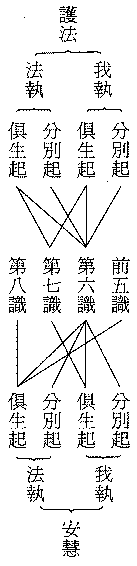



为什麼只有六七二识是能徧计？护法举出十大理由来加以证明：一、《摄论》「唯说意识能徧计故」，假定诸识都是能徧计，为什麼《摄论》不说？如无性《摄论释》第四说：『何者徧计所执自性？当知意识是能徧计，有分别故』。二、「意及意识名意识故」，这是解答一个问题的。有人这样的说：第七识有能徧计，是你所承认的，但《摄论》只说意识未说到末那识，难道第七识不能有所徧计？如第七识是能徧计的，不过论中略而不说就是。是则前五识及第八识，亦有能徧计，只是论中略而不说而已，我们这样说，有什麼不可？不！第七名意及第六识，合说总名意识，如是说了意识是能徧计，无异等於亦即说了第七末那意，那个同你说是没有说到第七识？但说了意识并不等於说了前五识及第八识，是以前五识及第八识真正没有说到，也就因为如此，所以五八识非能徧计，你怎麼可以把这些相提并论？基师《述记》说：『如小乘中业业道，思但是业而非是道，贪等三法是道非业，身语二法亦业亦道，总合为言但名业道』。贪瞋痴的三法所以说为是道非业，因是思所游履的，亦是通於苦乐的。《俱舍论》十七对这有很好的说明：『十业道中，后三唯道业之道故立业道名；彼相应思说名为业，彼转故转，彼行故行，如彼势力而造作故；前七是业，身语业故，亦业之道，思所游故。由能等起身语业思，托身语业为境转故，业业之道立业道名故。於此之中言业道者，具显业道业业道义，虽不同类而一为餘，於世典中俱极成故』。三、「计度分别能徧计故」，这亦是解释安慧所问的。你们认为意及意识如业业道合说，我亦认为是这样的，就是第七名意，前五识及第八识名识，第六名意识，总合说为意识，又有什麼过失？所以我们主张八识皆能徧计。现在告诉他不可，要能普於一切分别计度，方可说为能徧计，前五识及第八识，没有这种计度分别的作用，怎麼可以得名能徧计？前引无性《摄论释》说：『当知意识是能徧计，有分别故』。所谓有分别，是说意识与随念、计度二种分别得以俱起，所以说为分别，亦是显示计度异名。五八识没有这二分别俱起，是以不得说为能徧计。四、凡是有「执我」执「法」的功能作用「者，必」定「是」恒与「慧」俱的，可是前五识及第八识，既不能恒与慧俱，怎可说它是能徧计？或有人说：护法亦说五识得与慧俱的，为什麼现在说前五识没有慧俱？当知慧有胜劣不同，与五识俱的是劣慧不是胜慧，劣慧不能有所执，所以五识不是能徧计。五、我法「二执」的现前，「必」然是「与无明俱」有相应的，但这要在染污心中，无明才会与之俱起，假定是在善心中，那就不会有无明，因痴与无痴善根是敌体相反的，怎麼可以相应？安慧论师说：你这样说法，我不以为然，如小乘所说的寻伺，虽有粗细的差别，但是可以俱起的，善心与无明俱起，又有什麼过失？这是不能相提并论的：粗细不同的寻伺，所以能够俱起，由於它们的性质相顺而不相违的，善与无明的性质相违而不相顺的，两者怎麼可以相应俱起？六、《瑜伽》等论从来「不」曾「说」过「无明」之中是「有善性」的，因为二执唯是染污而不通於善性的，怎麼可以於善心内说有无明？至於安慧说一切有漏三性心皆名不善，而所以说有漏心名善者，是约不善的行相来得轻，始被说名为善的。所以说一切有漏心皆名不善，是约胜义不善说的，因为一切有漏善等三性，皆名为胜义不善的。七、若说善为不善的行相轻者，那也不对，因为「痴」与「无痴等」的敌体相反的法，绝对「不」容「相应」俱起的。如无惭与惭不得相应俱起，其道理是一样的。八、若说痴相轻微者叫做无痴，同样是不对的，因若真正是无漏心，必二空观随一现前的，加行善心既还有法执的存在，怎麼能导空智现前？从来「不」曾「见」到「有执」可以引「导空智」现前的。如水引生於火，就是从未见到过的。水不能引生火，当知有执之心，绝对不能导生空智。九、行者在加行位以加行心，随顺如来的圣教，作我法的二空观，通达我法的空无所有，是为达无；既然还有法执的存在，是为执有；如是执有之心与达无之智怎麼可以俱起？所以说「执有执无不俱起故」。执有与达无既不能俱起，证知加行心是没有法执的。十、假定凡是有漏心必然是有执的话，那第八异熟心，应该亦是能熏，为什麼？因凡有执心都有能熏势用的，从来不见有执势用之心没有它的能熏功能的。第八识既有执，当然亦是能熏。可是事实上，我们一向所知的，第八识是所熏非能熏，既然如此，不可说第八识是能徧计。



假定真唯六七二识是能徧计，为什麼《楞伽》第三、《中边》卷上、《显扬》第十六等，说三界八识皆是虚妄分别？要知「有漏心等」在加行位中，虽作二空观，但不过是假相，并不像无漏智那样的，能够证得「实」理，在未证得实理以前，「一切皆名虚妄分别」，但这不是等於说，所有虚妄分别，皆是有执心的。若有漏心有的不是有执的话，怎麼可说有二取相现？如《辨中边论》第一，既说虚妄心心所似二相现，可见都是有执的。现在回答他说：不然！要知诸心心所，「虽」皆有「似所取」似「能取」的二取「相现，而」有徧计非徧计的差别，并「非」是说「一切」能所取，皆是「能徧计摄」。要有计度分别的二取相现之心，才可说为能徧计的。假定说凡是似能所取的，就是徧计所摄的话，一切菩萨、二乘后得无漏之智，都有似二取相现的，难道亦可说为能徧计摄？这当然是绝对不可的，所以说「勿无漏心亦有执故」。无漏心的没有执，这是谁都承认的，因而特举此为例，显示似能取所取相现的，不一定是有执的。《佛地论》第七说：『有义：法执及无明等，徧在一切善、恶、无记有漏心品及与二乘无漏心品，皆不了达法无我故，皆似相分见分起故』。此只说明二乘无漏有执，但据《二十唯识论》最后明他心智时，说菩萨后得智亦有法执。如该颂说：『不知如佛智』，不知就是无知的意思，由彼菩萨无知未断遮蔽於心，所以菩萨无漏他心智体亦有法执。《佛地论》及《二十论》说无漏心有执，当知是约二乘及菩萨说的，现在说无漏心无执，是约最高佛陀说的，佛陀断除一切执，其无漏心自然是无执的。假定认为有似能所二取相现，就是徧计所摄的话，「如来后得」无漏智心，亦有似能所取义，岂不是亦「应有执」？相信没有一个正信的佛子，会说如来后得无漏心智亦有执的。有二取相现的，固可说有执，如来后得没有似二取相现，所以不说如来有执。假定你们作这样说，那就有违圣教过失，因为佛在《佛地经》中，曾「说佛」陀的大圆镜「智现身」现「土等种种影像」，犹「如」明「镜」现种种像，曾无有执，怎麼可以名为徧计？如该论第三说：『能现能生一切境界诸智影像，一切身土影像，所依住持一切佛地功德，穷未来际无有断尽，如是名为大圆镜智』。大圆镜智现一切境，论中处处都有说到。不特大圆镜智能现种种影像，就是其他三智亦能现身土等种种影像，所以佛的四智，每智皆有二相。现在既说现身土等种种影像，是即证明有无漏的相分，有此无漏的相分，不用说，诸如来智当亦有它的见分，假定如来智没有它的见分，那就没有它的能缘作用，假「若」真的「无」有能「缘」作「用」，那就「应」该「非」是「智等」。基师《述记》难说：『如来、菩萨无漏四智品应非是智品，无见分等故，如虚空等』。虚空是没有见分的，当然不能说它是智品，如来四智既然亦是没有见分的，当如虚空一样的非是智品。你们承认这一说法吗？我相信谁也不会承认的，所以如来四智不能说没有见分，虽有见分，但没有执。前师难说：如果有漏心真的非皆是执的话，为什麼说藏识妄执种子为所缘？如是缘种难道不是徧计？论主答说：「虽说藏识缘徧计种」，然「而不」曾「说」第八「唯」缘徧计种，因为有漏种是很多的，并不是诸有漏种皆是徧计，何况藏识缘徧计种时没有计度分别？怎麼可以说为徧计？所以你所引的藏识缘种，「非」为「诚证。由」於如上所说的种种「理趣」，我们在此可以肯定的说：「唯於第六、第七心品有能徧计」，前五及第八识，不可说有能徧计。



具有徧计执的「识品，虽」说只是六、七「二」识，然「而」在《摄大乘论》等的诸论典中，还说「有二、三、四、五、六、七、八、九、十等」的种种「徧计不同」，所以颂中说「言彼彼」。在此对徧计执略为解释一下：什麼叫做徧计所执？依《摄论》说有二理由，《摄论讲记》解释说：『一、徧计相故：意识生起时，对於所分别的似义，有无量种种的行相。所以无量行相的意识，能周徧计度一切境界，它是能徧计者。意识无量行相的徧计是颠倒的，是非义取义的乱识。但非义取义，不是全出於意识的构想。无始妄熏习力，意识生起的时候，自然的现起乱相——义，这乱相就是徧计所执性。它是意识分别所取的所分别，所以是乱识颠倒生起的所缘相。前面说乱相为因，能生乱体，也就是此义。它是能徧计的所缘，是徧计心所徧计的，所以叫徧计所执性。二、徧所计故：似义显现的乱相，它的自相实在是毫无自体的。依本译说，它唯是那能徧计的虚妄分别心的所执而已。但依陈、隋二译看来，这似义并没有它的自体，唯有徧计的乱识为它的自性，离却名言识，不复存在。它是分别——识所现的，所以叫徧计性；也就是有人说的实无唯计。总之，徧计本是妄识的能缘作用。前说它的能生徧计——意识；这说它是徧计的假立。它所以称徧计执性，都从徧计的分别心来』。《解深密经语体释》说：『一者徧计所执相：所执二字，是奘译特有的，餘译只名徧计相。所执二字的有无，在意义上很有出入：只名徧计执，是侧重所徧计境说；名徧计所执相，就侧重能徧计心说了。徧计即徧所计：谓能认识的心识，在所认识的境上，周徧所计，叫徧所计。徧有种种的意思：如意识，有思惟、考察的种种行相，如是周徧的生起计执，名为徧计。如眼识见各式各样的物相，耳识听各式各样的声音……身识接触各式各样的触相：都含有徧计的作用。《摄论》说到唯有识时，有唯一、唯二、唯种种的不同，唯种种，就是周徧所计。徧计相的相，就所徧计说，是在认识境界时，内心上觉得怎样怎样的相貌，是为徧计的相』。现在将种种不同的徧计，分别说明如下：



二种徧计：就是《摄大乘论》所说的自性计与差别计。如该论说：『徧计所执亦有二种：一者，自性徧计执故；二者，差别徧计执故，由此故名徧计所执』。《摄论讲记》解释说：『一、自性徧计所执，就是徧计诸法一一的自性，如色声等。二、差别徧计所执，就是徧计色声诸法的差别不同的义用，像色等的无常义、苦义、空义等。自性徧计，执诸法的自相；差别徧计，执诸法的共相。由徧计诸法的自性及差别，所以有两种徧计所执自性』。《瑜伽》七十三同样说有二种徧计执性。如该论说：『云何徧计名自性？谓有二种：一、无差别；二、有差别。无差别者，谓徧计一切一切法所有名；有差别者，谓徧计，此名为色，此名为受，此名为想，此名为行，此名为识。如是等类无量无数差别法中各各别名。复次，徧计所执自性执，当知略有二种：一、加行执；二、名施设执。加行执当知复有五种：一、贪爱加行故；二、瞋恚加行故；三、合会加行故；四、别离加行故；五、舍随与加行故。名施设执当知复有二种：一、非文字所作；二、文字所作。非文字所作者，谓执此为何物？云何此物？此物是何？此物云何？文字所作者，谓执此为此物，此物如是，或色乃至或识，或有为或无为，或常或无常，或善或不善或无记，如是等』。《瑜伽》七十四又说二种：『又於依他起自性中，当知有二种徧计所执自性执：一者，随觉；二者；串习习气随眠』。



三徧计者：有说一我、二法、三用的三种；有说一自性、二随念、三计度分别的三种。《对法论》第二说：『自性分别者，谓於现在所受诸行自相行分别；随念分别者，谓於昔曾所受诸行追念行分别；计度分别者，谓於去来今不现见事思构行分别』。我、法、用的三种徧计，《瑜伽》七十三说：『或依境中体用差别，开体令用分之为三，谓我、法、用体用相随』。



四徧计者：就是一、计自性；二、计差别；三、计所取；四、计能取。《瑜伽》七十三说这四徧计的差别：『谓计三科诸法自性，名计自性；谓计色等一切诸法有见无见、无漏、漏等一切差别种种道理，名计差别；谓计色等一切诸法，是彼各各三界、三性、漏、无漏等心心所取，名计所取；谓计色等能取色等及计心心所能取诸法，名计能取』。《摄论》说四徧计，除了自性计、差别计的二种，更加有觉计、无觉计的二种。无性《摄论释》后二计说：『善名言者，谓自意趣在语前，行领解具足，故名有觉；与此相违说名无觉』。世亲《摄论释》后二计说：『善名言者，谓解名言，不善名言者，谓牛羊等。虽有分别，然於文字不能解了』。



五徧计者：《摄论．所知相品》说：『如是徧计复有五种：一、依名徧计义自性，谓如是名有如是义；二、依义徧计名自性，谓如是义有如是名；三、依名徧计名自性，谓徧计度未了义名；四、依义徧计义自性，谓徧计度未了名义；五、依二徧计二自性，谓徧计度此名此义如是体性』。《摄论讲记》解释说：『一、依名徧计义自性，听到某一不知意义的名字，就去推度那名下所诠的义是什麼，以为如是名有如是义，这叫依名徧计义自性。二、依义徧计名自性，现见某一义相，不知它的名字，就去推想那义的能诠名是什麼，以为如是义有如是名，这叫依义徧计名自性。三、依名徧计名自性，依已经了解所诠义的名，徧计度未了义的名，如听见一译名，譬如说阿赖耶，根本不知它的意义，现在用我国习知的名字去译它，说阿赖耶就是藏，依藏名去计度阿赖耶名，这样的徧计，叫依名徧计名自性。四、依义徧计义自性，依已知名称的义，徧计度未了名的义。如初见电灯，不知它是什麼东西，见它能放光，知放光是灯名的所诠义，因此，以灯义去推度这电灯，这叫依义徧计义自性。五、依二徧计二自性，就是以已了义的名，及已了名的义，推求未了知的名义，或因名而推想到义，或因义而推想到名，徧计度此名此义，如是体性，这叫依二徧计二自性』。



六徧计者，如《显扬论》十六说：『由有六种徧计差别故，徧计所执自性亦有六种。何等名为六种徧计？一、自性徧计，谓徧计色等实有自相；二、差别徧计，谓徧计色等决定实有有色无色，有见无见等诸差别相；三、觉悟徧计，谓善名言者所有徧计（如成年人能用言语表达所认识的，叫做善名言的觉悟徧计）；四、随眠徧计，谓不善名言者所有徧计（如婴儿的咿呀，及牛羊等不能以言语传达它的意境，叫不善名言的随眠徧计）；五、加行徧计，此复五种（就是前说的贪爱加行等的五种）；六、名徧计，此复二种：一、文字所起；二、非文字所起。非文字所起者，如有计执此为何物？云何此物？此物是何？此物云何？文字所起者，所有计执此为此物，此物如是，或色或乃至识，或有为或无为，或常或无常，或善或不善或无记，如是等』。



七徧计者，就是七种分别，如前曾经说过的有相分别，无相分别，任运分别，寻求分别，伺察分别，染污分别，不染污分别。



八徧计者，如《显扬论》十六说：『八种分别能生三事，何等为三？一、分别戏论所依缘事；二、见我慢事；三、贪瞋痴事。八种分别者：一、自性分别，谓於色等想事，分别色等所有自性；二、差别分别，谓即於色等想事起诸分别，此有色此无色，此有见此无见，此有对此无对，如是等无量差别，以自性分别为依处故，分别种种差别之义；三、总执分别，谓即於色等想事所立我及有情、命者、生者等假想施设所引分别，由於积聚多法总执为因分别转故；又於舍、军、林等及於饮食、衣、乘等想事，所立舍等假想施设所引寻思；四、我分别，谓若事有漏有取长时数习我执所聚，由数习邪执自见处事为缘所起虚妄分别；五、我所分别，谓若事有漏有取长时数习我所执所聚，由数习邪执自见处事为缘所起虚妄分别；六、爱分别，谓缘净妙可意事境分别；七、不爱分别，谓缘不净妙不可意事境分别；八、爱不爱俱相违分别，谓缘净不净可意不可意俱离事境分别。如是略说有二种，谓分别自体及分别所依所缘事』。



九徧计者，就是指的九结：一、爱结；二、恚结；三、慢结；四、无明结；五、疑结；六、见结；七、取结；八、悭结；九、嫉结。结是烦恼的别名，以此九种皆能系结众生於生死中不得出离，所以名结。至於九结的意义，如常解说烦恼时，曾经个别的说到，这儿不再多说。



十徧计者，就是《摄论》所说的十种分别。如该论说：『总摄一切分别略有十种：一、根本分别，谓阿赖耶识（赖耶是一切种子识，以虚妄分别为自性。一方面它本身是虚妄分别，另一方面它又是一切分别的根本，为一切分别生起的依止。所以也可说赖耶是能徧计）；二、缘相分别，谓色等识（色等一切法为缘而生颠倒分别，是能分别的所缘相，它本身是虚妄分别为自性，是识的一分；并且依色等相而生起分别，所以名为缘相分别）；三、显相分别，谓眼识等并所依识（这是眼识等的六识识，并六识所依的染意识。这七转识能显了境相，它是能分别，又因之而起分别，所以名为显相分别）；四、缘相变异分别，谓老等变异，乐受等变异，贪等变异，逼害时节代谢等变异，捺洛迦等诸趣变异，及欲界等诸界变异（这是由缘相分别的变异转动而产生的分别。如老病死等的变异……因这种种的变异而引起分别，叫做缘相变异分别）；五、显相变异分别，谓即如前所说变异所有变异（这是在识及所依止的显相分别上，因如前所说的种种变异，而起的所有一切的变异，如因根有利钝而识有明昧的变异，这叫显相变异分别。这两者，就是因一切法（现）变异而生的分别。根本分别微细不可知，所以不说根本变异分别）；六、他引分别，谓闻非正法类及闻正法类分别（这是因从他听闻非正法类及闻正法类而引起的分别）；七、不如理分别，谓诸外道闻非正法类分别（外道们听闻那些非正法类，而於其中生起的不称正理的妄分别）；八、如理分别，谓正法中闻正法类分别（正法中的佛弟子，听闻种种如理的正法类，引生正见的分别。这三者，他引分别是总，如理不如理是别，是依分别生起的思想学说的邪正而分别，不像前四五两种是有情俱生的分别）；九、执著分别，谓不如理作意类，萨迦耶见为本六十二见趣相应分别（是不如理作意类的萨迦耶（身）见为本，而起的六十二见趣相应的分别，是小乘所对治的对象。以我见为主体，引起六十二种各别的意见，所以叫见趣。六十二见，以五蕴三世来分别：如说色是我，我有色，色属我，我在色中；第一句是我见，后三句是我所见。色蕴有这四句，受想行识四蕴也各有四句，总成二十句。再约三世相乘，过去二十句，现在二十句，未来二十句，成六十句；加上根本的身异命异（常见）、身一命一（断见）的二种，合成六十二见）；十、散动分别（这是大乘菩萨不共所对治的十种分别。散是散乱，动是流动；因这散动分别为障碍，使无分别智不得现前，使我们不见诸法的真实性。《般若经》中说的无分别智，就是对治这散动分别的）。谓诸菩萨十种分别：一、无相散动；二、有相散动；三、增益散动；四、损减散动；五、一性散动；六、异性散动；七、自性散动；八、差别散动；九、如名取义散动；十、如义取名散动。为对治此十种散动，一切般若波罗密多中说无分别智。如是所治能治，应知具摄般若波罗密多义』。



除上所说的各类徧计，其他还有十一、十二，乃至无量的徧计。总说一句，随依他是有多少的，徧计执也就有多少。《瑜伽》七十四说：『问：徧计所执自性有几种？答：随於依他起自性中施设建立自性差别所有分量，即如其量，徧计所执自性亦尔。是故当知徧计执自性无量差别』。



次所徧计自性云何？摄大乘说是依他起，徧计心等所缘缘故。圆成实性宁非彼境？真非妄执所缘境故，依展转说亦所徧计。徧计所执虽是彼境，而非所缘缘故非所徧计。



能徧计的自性是什麼，如上所说已经知道。其「次」所要问的，就是「所徧计」的「自性」是什麼？依「摄大乘」论所知相分「说」，所徧计的自性，就「是」三自性中的「依他起」，因为这是「徧计心等」的「所缘缘」境，因凡为所缘缘的，必然有其托缘所生的法，而依他起正是徧计心等的所缘缘法。如《摄论》说：『依他起自性，名所徧计』。《摄论讲记》说：『这点出所徧计是什麼。能徧计的所缘，皆是从种子生起的依他起，因此立依他起为所徧计』。该论又说：『若徧计所执自性，依依他起实无所有似义显现』。这更显出依因托缘而起的依他起名所徧计，就是为能徧计的心之所缘的。



有人问：假定是有法就为所徧计，「圆成实性」亦是有法，「宁」得「非彼」徧计心等的所缘「境」？论主答：这是两回事，不能相提并论。当知依他起是虚妄法，自可为徧计心等的亲缘相分，但圆成实是「真」如实性，为根本智所缘境，「非」是彼徧计心「妄执所缘境」，两者的关系是很疏远的，亦是极不相似的，怎麼可说为徧计心所缘境？不过「依展转说亦」得名为「所徧计」。这话怎讲？要知依他与圆成，是非异非不异的，到了离依他起的虚妄法，证得圆成实的真如，是则依他实性即圆成实，约这展转的意义，亦得说为所徧计。所以有说：『此徧计执亦依圆成而起』。现在所以但说依依他起，因为心的相分影像是依他性，依此执为圆成实，所以从实而言，但说依他。又依他起是可稍加言说的，所以但说依他为所徧计，圆成实是不可以言说的，所以不说圆成为所徧计。严格说来，能徧计心亦依圆成起执而为所徧计的。



人复问：徧计所执既是徧计心等的所缘境，为什麼不叫做所徧计？论主答：「徧计所执虽是彼」徧计心的「境」，然「而」并「非」是「所缘缘」，所以不得说为「所徧计」。无法说它名境固然是可以的，但不得说为所缘缘，所缘缘唯局於有法不得通於无法的。徧计所执的我法，既然没有它的实体性，当就不是所缘缘，既然不是所缘缘，当就不是所徧计。这样重重分析起来，证知唯依他起是所徧计。《瑜伽》七十四说：『问：徧计所执自性由何故徧计？答：由依他起自性故』。



外人更问：徧计所执既是属於境摄，为什麼《瑜伽》七十四又说徧计所执非凡圣智境？如该论说：『问：徧计所执自性何等智所行？为凡智耶？为圣智耶？答：都非智所行，以无相故』。徧计所执的体相，根本是无有的，既不可说为凡智所行境，亦不可说为圣智所行境，所以说为非凡圣智境，只得说徧计所执性，是能徧计心之境。



庚二　释第五句



徧计所执其相云何？与依他起复有何别？有义：三界心及心所，由无始来虚妄熏习，虽各体一而似二生，谓见相分即能所取如是二分情有理无，此相说为徧计所执。二所依体实托缘生，此性非无名依他起，虚妄分别缘所生故。云何知然？诸圣教说虚妄分别是依他起，二取名为徧计所执。



此下以徧计执对依他起，说明它们相互的关系。如前所说，所徧计的自性，既然是依他起，那末，「徧计所执」的体「相」究是什麼？而徧计所执「与依他起复有」什麼差「别」？这是其次所要讨论的两大课题。关於这两问题的解答，有两大论师的说法不同，现在分别解说如下：



「有义」，是第一师的说义，也就是安慧的意见。在他认为：「三界」一切有情所有的「心及心所，由无始来」为「虚妄」之所「熏习，虽」说「各」各自「体」是「一」自证分，然「而」却「似」有依他的见相「二」分而「生」，此之所「谓见相分」，就是诸经论中所说的「能所取」，即以见分为能取，以相分为所取。「如是」见相「二分」，在「情」执方面，虽则似乎是「有」，但在道「理」上，实在是「无」的。「此」之情有理无的能所取「相」，《中边》等论「说为徧计所执」。如《中边论》卷上说：『虚妄分别有者，谓有所取能取分别；於此二都无者，谓即於此虚妄分别，永无所取能取二性』。能依的见相二分，虽则是徧计执无，但「二所依」的识等「体」事，「实」是假「托」众「缘」和合而「生」的，所以「此」自体「性」并「非」是「无」的，其性非无的自证分，「名依他起」，因为是从「虚妄分别」种子「缘所生」的。「云何知然」？是问怎麼知道二分非有，自证非无。原来这不是我个人的说法，而是「诸圣教」中皆「说虚妄分别是依他起」，似能所「二取」的见相二分「名为徧计所执」。旧《中边颂》说：『虚妄总类者，三界心心所』。长行释说：『虚妄者，若约界立，谓欲、色、无色界；若约生立，谓心及心法是总类相』。《显扬论》十六说：『若欲略说分别体性，所谓三界诸心心法』。证知依他起是从因缘生的，二取名为徧计所执。



有义：一切心及心所由熏习力所变二分从缘生故亦依他起，徧计依斯妄执定实有无一异俱不俱等，此二方名徧计所执。诸圣教说唯量、唯二、种种皆名依他起故。又相等四法十一识等，论皆说为依他起摄故。不尔，无漏后得智品二分应名徧计所执。许应圣智不缘彼生，缘彼智品应非道谛；不许应知有漏亦尔。又若二分是徧计所执，应如兔角等非所缘缘，徧计所执体非有故。又应二分不熏成种，后识等生应无二分。又诸习气是相分摄，岂非有法能作因缘？若缘所生内相见二分非依他起，二所依体例亦应然，无异因故。



「有义」，是第二师的说义，亦即护法论师等的意思。在他认为：不论有漏无漏，不论是染是净，不论世或出世，所有「一切心及心所」，所依体也好，相见分也好，只要是「由熏习力」之「所变」现的见相「二分」，只要是「从」因「缘」和合而「生」的，都是属於「依他起」。假使运用「徧计」心，「依斯」缘生的见相二分，「妄」於其上「执」著决「定」是真「实」的，或者执为是「有」是「无」，或者执为是「一」是「异」，或者执为有无一异「俱」、有无一异「不俱等」，如是像「此」见相「二」分，「方」得「名」为「徧计所执」。非因缘生的见相二分是徧计执，反显从因缘生的非是徧计执。



这当然不是我护法一人作这样说的，而是「诸圣教」中都作这样「说」的。现在姑举《摄大乘论》所说「唯量、唯二、种种皆名依他起」来说。唯量，是梁译《摄论》说的，奘译《摄论》说为唯识。《摄论讲记》解释说：『一、由唯识，无由义故：一切法唯是虚妄分别的乱识，没有似义显现的所取义，所取义是没有实体的。这是唯识的根本义；下面的两相，不过为说明现象，给予唯识的一种解说罢了。二、由二性，有相有见二识别故：二性就是相识和见识；虽然唯是一识，但在乱识现起的时候，就有一分所取的相，一分能取的见的二性差别现前，这相见皆是识，所以叫相识见识。一般人以为相是外境，见是内心，实际上两种都是识。三、由种种，种种行相而生起故：种种就是多种多样。在能所交涉的心境上，有种种的行相现起，所以虽唯是一识，而成为千差万别的不同现象』。



「又」五法中除了如如，其餘的「相」、名、分别、正智「四法」，《瑜伽》、《显扬》等论皆说为依他起。还有《摄论》所说的「十一识等，论皆说为依他起摄」的。所谓十一识，就是身识、身者识、受者识、彼所受识、彼能受识、世识、数识、处识、言说识、自他差别识、善趣恶趣死生识。《摄论讲记》解释说：『一、身识，就是五色根。二、身者识，世亲说是染污末那，染末那为什麼叫身者？这是值得研究的。身识的身，是五色根；这身者识的身字，也应该是根身。下文的受者识，是能受识的所依，可见这里的身者，应是根身的所依体……。三、受者识，就是无间灭意，是六识生起所依的无间灭意根。这身者与受者，就是本论所说的二种意。四、彼所受识，就是所取的六尘。五、彼能受识，就是能取的六识。六、世识，是相续不断的时间。七、数识，是一二三四等数目。八、处识，是有情的住处。九、言说识，是依见闻觉知而起的语言。十、自他差别识，是有情间自他各各的差别。十一、善趣恶趣死生识，是在善恶趣中的死生流转。宇宙间种种差别的相状，把它归纳成十一种，这十一种都是以识为自性而明了显现的，所以一切都叫识』。



如上所说的四法、十一识，《瑜伽》、《摄论》等既然都说它是依他起摄，我们不得不承认，「不尔」，假定不是这样，那就不免有如下所说的五种过失！



一、假定认为一切相分不是依他起而是徧计所执的话，那末，佛等「无漏后得智品」所变的见、相「二分」，也就「应」当「名」为「徧计所执」。现在不妨这样说：有漏非染的见、相二分不是徧计所执，因为是非染心所变现的二分，如无漏心所变现的二分，不得名为徧计，其道理是一样的。现在还得要问你的：佛的无漏后得智品二分说它是徧计执，你们容许不容许？假定容「许」无漏二分亦是属於徧计所执的话，那「应」当「圣」者的后得「智」，就「不」是「缘彼」依他起相见二分而「生」。假定说是依他相分而生徧计执，那能「缘彼」依他所起的「智品」，就「应」当「非」是无漏「道谛」。为什麼？有相分故，如有漏心。假定「不」容「许」无漏二分亦是徧计所执，「应知有漏」的见、相二分，亦同无漏心一样的不是徧计所执，所以说「亦尔」。为什麼这样说？由於是有二分的，如无漏心。



二、「又若」有漏的见、相「二分」，真的都「是徧计所执」的话，那就「应」当犹「如」龟毛、「兔角等」一样，「非」是「所缘缘」。为什麼？因凡「徧计所执」，其「体」根本是「非有」的。换句话说，徧计执是无法，而所缘缘是有法，无法怎麼可为所缘缘？



三、「又应」如你所执的见、相「二分」，决定「不」可能「熏成」见、相二分的「种」子，因如石女儿，是无自体法。既然没有种子熏成，到了「后」来「识等」再度「生」起的时候，就「应」当「无」有见、相「二分」。可是事实上，后来识生时，并不是没有见、相二分，证知二分不是徧计所执，你把它说为徧计执，当然是错的！



四、「又诸」有漏「习气，是」识「相分」所「摄」，相分既然是没有了，那「岂」不是其体是「非有法能作」有为法的「因缘」？可是事实上，假法等於是无所有的，根本不可说为因缘。因为你说相分体是非有的。



五、假「若」从「缘所生」，不离於识的「内」在「相、见二分」，是徧计执而「非依他起」者，那你所说「二」分「所依」的依他起识的自「体」，依「例亦应」当同二分一样的不是依他起，因为相、见、自证都是分别缘所生的，彼此之间并「无」什麼「异因」，亦即同是因缘种子生的。现在可以得一结论：凡是因缘种子所生的，必然是依他起，如自证分是因缘种子生的，自证分是依他起，相、见二分是因缘种子生的，当如自证分是依他起。同样是因缘种子生，那里可以分为徧计执与依他起的不同？是以说相、见分为徧计执，毕竟是不对的！



由斯理趣众缘所生心心所体及相见分，有漏无漏皆依他起，依他众缘而得起故。



「由」於如上所说的种种「理趣」，所以「众缘所生」的「心心所」法的自「体」以「及相见」二「分」，不论异生、二乘，不论「有漏、无漏，皆」是属於「依他起」，因为一切都是「依他众缘而得」生「起」的。所谓依他众缘，就是如前所说的因缘、等无间缘、所缘缘、增上缘的四缘。心法的生起，需具这四缘，色法的生起，则需因缘、增上缘的二缘而生。因此，缘生的色心诸法，皆是依他起性。就是诸不相应法，虽说是无别体的，但因有它们的作用，而且是於缘生的色心上分位假立的，所以亦被摄於此依他起中。总之，有为诸法，不管那种，都是依他众缘而生起的，没有一法是自然生的。既是依於众缘而生起的，离了众缘当然就灭，没有些微法是常住不变的，完全是如幻假有的。



庚三　释第六句



颂言：分别缘所生者，应知且说染分依他，净分依他亦圆成故。或诸染净心心所法皆名分别，能缘虑故。是则一切染净依他，皆是此中依他起摄。



「颂言」，是指颂中所说「分别缘所生」的这句话。一切色心诸法，不论有漏无漏，虽都可以说为依他起，但是颂中所说分别缘所生的分别，就是虚妄分别，名为有漏杂染法，「应知」这是「且」就「染分依他」说的。染分的依他起，摄有漏的缘生心、心所、色、不相应行的九十四法。无漏清净的有为，虽则也是依他起性，但因有为后面圆成实性所摄的意义，所谓「净分依他亦圆成故」，所以现在略而不论，只说染分的依他起性。基师《述记》说：『因缘所生杂染诸法名为分别，依他因缘之所生故；或染依他为分别缘之所生故，唯杂染故』。可见说到分别，必然是指有漏杂染而言，染分依他起，唯属於分别。还有一种说法：分别就是缘虑的异名，所以「诸」有「染净」有漏无漏的「心心所法皆名分别」，因为染净心心所法，皆「能缘虑」一切境的。而且如色法等，虽不是心心所，但也不离心心所，亦是分别中所摄，所以漏无漏的心色诸法，都是分别。这末说来，「是则一切染净依他」诸法，「皆是此中」的「依他起摄」。



颂中所说『分别』，可以通上通下：假定是属於上一句，那就是所生的法；假定是属於下一句，那就是能生的缘。『缘所生』三字，乃是众缘所生起的略说。



庚四　释七八句



二空所显圆满成就诸法实性名圆成实。显此徧、常体非虚谬，简自、共相、虚空、我等。无漏有为离倒究竟胜用周徧亦得此名，然今颂中说初非后。此即於彼依他起上，常远离前徧计所执，二空所显真如为性。说於彼言显圆成实与依他起不即不离；常远离言显妄所执能所取性理恒非有。前言义显不空依他，性显二空非圆成实，真如离有离无性故。



其次说到圆成实性。圆成实性的说明，是依「二空所显」的真如而得名的。因为真如具有「圆满、成就、诸法实性」的德能，所以名为「圆成实」。所谓圆满者，是显示「此」真如体的周「徧」之义；所谓成就者，是显示此真如体的离生灭而「常」住之义；所谓真实者，是显示此真如「体非」是「虚谬」。如是真如所具的三大德能各有所简别：无处不徧的圆满义，是「简」别诸法的「自」相，因为自相唯局限於其法体，真如却是周徧一切诸法而无所不在的；常住离生灭的成就义，是简别苦及无常等的「共相」，因为诸法的共相，是无常演化不是常住的，真如却是常住没有生灭变化的；体非虚谬的真实义，是简别小乘所说的「虚空」及外道所计执的「我等」，因为他们所计执的，不论是虚空，不论是我等，都是虚妄错谬的，不是诸法的实性，真如却是不虚谬而为诸法的真实体性。由这三义诠说真如法性的义理，所以说为圆满成就真实。



在此成为问题的，就是净分依他，其体不是常住，怎麼可说亦是圆成实摄？现在告诉他：「无漏有为」的净分依他，同样是具有这三义的：一因它是「离」诸颠「倒」的，其体不是染污的，所以说为实义；二因诸无漏法，其体是无漏的，有股力量能够「究竟」断诸惑染，不同有漏法的加行善不能断惑，所以说为成义；三因它的「胜用周徧」，无境而不缘的，所以说为圆义。由於所具的这三个意义与真如是一样的，所以净分依他，「亦得此」圆成实「名」。《中边分别论》卷上说：『偈言：无变异无倒，成就二真实。无为法者无变异成就，得入真实性摄；一切有为法道所摄，无颠倒成就故。境界品类中无颠倒故，成就真实者』。当知《中边论》所说无变异，就是常义，所说无颠倒，就是不虚谬义，所说成就，就是徧义。因此，真如固得名为圆成实，净分依他同样得名圆成实。奘译《中边论》说『真如涅槃无变异故』。当知该论所说真如无变异，就是此论所说无为圆成实。该论又说『一切圣道於境无倒』，当知该论所说圣道於境无倒，就是此论所说有为圆成实。《摄论．所知相分》说：『云何成圆成实？何因缘故名圆成实？由无变异性故名圆成实；又由清净所缘性故，一切善法最胜性故，由最胜义名圆成实』。《摄论讲记》解释说：『一、无变异性故：徧计性永无所显的法性，是恒恒时常常时无有变异的，它是诸法的真实性。就是在欺诳的乱相显现时，它也还是如此；离却乱相而显现真相时，它也还是如此。这不变异的性，是圆满、成就、真实，所以叫圆成实性。二、胜义故：胜义有两个意思，一胜义是清净的胜智的所缘性（义），因胜智的通达而获清净的，就是圆成实；它不像徧计执性的是杂染颠倒的所缘。二胜义是一切善法的最胜性，它是一切善法中最殊胜的，所以也称为胜义善。由此二种的最胜义，所以名圆成实性』。基师《述记》会通二论说：『由无变异故即此常义，清净所缘即此徧义，一切善法最胜性故即此体非虚谬诸法实性。今彼论中但当真如圆成实性，非净依他亦圆成摄，义不具故』。是则摄论所说的圆成实，不通於净分依他，本论方说净分依他亦圆成摄。



然论圆成实性，向以常无常门与漏无漏门的二门，对之加以说明，这是我们所不可不知的。常无常门，就是常住与无常，换句话说，以无为与有为而分依圆的二性，以不变常住为圆成实，以生灭无常为依他起。如上所说的无为真如，亦即是前一种的解释，是就常无常门的圆成实说。漏无漏门，是以有漏与无漏而分依圆的二性，总以三界一切有漏为依他起，以无为及无漏有为为圆成实。如上所说的无漏有为，亦即是后一种的解释，是约漏无漏门的圆成实说。虽同样的说圆成实，但其名义不一样的。现在以图示此二门如下：



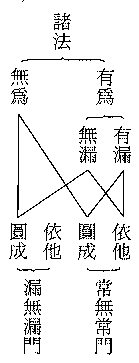



虽说有此二门的说法不同，但真正为圆成实的当体，是在常无常门的无为真如，不在漏无漏门的无漏有为，因这既不是所证的，又不是诸法的法性，虽把它说为圆成实，但不在义说的所谈之外。正因如此，「然今颂中，说初」真如名圆成实，「非」是显示「后」说的无漏有为，亦即不是说净分依他名圆成实。



在此所当注意者，就是这依圆二性，虽说皆是由於悟心的正观，但两者究竟有著怎样的关系，这是我们首当要知道的。讲到两者的关系，真正可说是不即不离的。谓「此」圆成实性，「即」是「於彼依他起上」，不论是在那样的场合，都是永恒的「常」久的「远离前徧计所执」性，简单说，就是没有所执之谓，亦即是离诸过失义，而由我法「二空所显真如为」其自「性」。即圆成依於依他，两者间完全是没有别离的。当然，在分彼此的一点上，两者自然亦不是即一的，真正可说是不即不离。颂文所「说」的「於彼」两字，正是「显」示「圆成实与依他起」的「不即不离」。因为依之於彼，所以不可说是隔离为二；因为彼此不同，所以又不可合之为一。《辨中边论颂》说：『此（依他）中唯有空（圆成），於彼（圆成）亦有此（依他）』。其意可说完全是相同的。为什麼是不即的？假定是相即的话，真如应如依他是有灭的，依他应如真如是不生的，可是事实上，真如是不灭的，依他是有生的，怎麼可以说即？为什麼是不离的？要知真如就是於彼依他上有的，并不是离开依他另有真如，二者的关系密切如此，怎麼可以说离？但於此应注意的，就是在依他上，虽空去徧计执，但并不是直说圆成。



至於颂文所说「常远离」的三个字，是「显」示虚「妄」的徧计「所执」的「能所取性」为徧计执，而这徧计执，不是暂时的没有，乃是「理恒非有」的，所以名常，此体非有，所以名远离。既远离言无计所执，更致前言有什麼用？当知颂中所说的「前言，义显」空只空於所执，亦即空去前所说的徧计执，并「不」是「空」於「依他」起。常远离前徧计所执，既已空去徧计所执，更说性者又有什麼用？当知所说「性」这个字，「显」示圆成实是二空真如，「二空」本身并「非圆成实」，要由二空的观智遮遣徧计的妄执时，证得那所证见的所显示的真如法性，方得说为圆成实。所以常远离前性的性字，是指二空真如。虽说是二空真如，但真如之体不得说空，如是二空真如，是由空观的智力将妄执遣除时之所显现的，好似清风（观智）拂散云雾（二执）时，月体（依他）的光辉（圆成），真正得到皎洁。如果直说真如之体是空，那是大乘空宗的说法，与唯识所说大大不同。为什麼二空不得说为圆成实？要知唯识所说的「真如」是「离有离无性」的。真如性无徧计，所以离有，本身就是法性，所以离无。如说二空就是圆成实，那只可说真如离有，不得说真如离无，因为空相还存在的。



上来所明的三性，如更要略的来说：依他起是依因缘而生起的诸法，其体并不是常住的，它的存在只是假有，亦可说为似有。就中，种子所生的，是有实体实用的实法，如果是分位假立，唯是实用的假法。依他起的诸法实体，名为圆成实性，其存在，当然是真有、真法。如将依他诸法误认为实我实法，那就是徧计所执性，其存在，不用说，是妄有，是无法。依圆二性是由悟心之所观察到的，毕竟是正当的法，徧计是由迷心之所观察到的，毕竟是误谬的法。因此，徧计在妄情上，虽被认为实有，但是在道理上，确实是没有的，所以把它说为情有理无的法。至於依圆二性，在道理上真正是有，但据妄情是没有的，所以把它说为理有情无的法。三性，是对万有显示三样不同的观察，从这观察中就可知万有是怎麼回事。现在图示上述三性的关系如次：



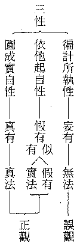



庚五　释后四句



由前理故，此圆成实与彼依他起非异非不异，异应真如非彼实性，不异此性应是无常，彼此俱应净非净境，则本后智用应无别。云何二性非异非一？如彼无常无我等性。无常等性与行等法异，应彼法非无常等，不异此应非彼共相。由斯喻显此圆成实与彼依他非一非异，法与法性理必应然，胜义世俗相待有故。



讲三种自性，共有三个颂，正辨三性的前二颂，已经予以解释，现在来释最后一颂。后一颂中，前三句明三性的不一不异，后一句明依他圆成证到的前后之境。这一段文，正明三性的不一不异。「由前」圆成实於彼一句所说的道「理」，所以我们知道：「此圆成实」性「与彼依他起」性，实在不可说它是「异」，也不可说它是「不异」的。为什麼？依於依圆二性来看，原来这二者，是现象与实性（体性）的关系：象是体的象，体是象的体，两者相依相俟，并不是别异的，因此说为不异，假定有人认为二者是差「异」的，那「应真如」不是依他现象的「实性」。可是事实不然，所以不可说异。然而既有象与体之别，当然不是有为无为属於同一东西，因此可说非一。假若有人认为二者没有差别，那依他是无常的，圆成亦即不得不说为「无常」，因为彼此是相同的。以此，依他与圆成是在非一非异的关系。说象与体非一非异，不承认两者的相即，可说是唯识教显著的特徵。这与《起信论》及其他一乘诸家所说，象即体，体即象，可说完全是不同的。真如，是现象的体，是属所依体，不是当体体，无论怎样不得说为两者的即一，必也不得不出於非一非异之说。一般唯识的学说，在本体论上的见解，比之一乘诸家所说，似乎略有不及，但在唯识，说象体的关系在於非一非异，不得不说真正是最正当的。真如为现象的实性，避免谈到所谓本体，其理由亦即在此。还有，「彼」依他起与「此」圆成实，既然是不异而一体的，那就「应」当「俱」是「净非净境，则本后智用应无别」！这话怎讲？如圆成实，唯是根本净智的境界，依他起是后得智的境界，亦通非净，假定二者不异，那就不唯依他起通净非境，就是圆成实亦应通净非净境。果真如此，那根本智与后得智的照用，就应无有差别。《瑜伽》七十四说：『问：依他起自性何等智所行？答：是二智所行，然非出世圣智所行。问：圆成实自性何等智所行？答：唯圣智所行』。二性有著这样的差别，怎麼可以说为一体？



依唯识说，不但依圆二性是非一非异，就是三性对望亦说非一非异。所谓三性，不是全然别离的三法，在诸法的一一上面皆有三性，所以特说它们之间的非一非异。《摄论．所知相分》说：『复次，此三自性为异为不异？应言非异非不异。谓依他起自性，由异门故成依他起；即此自性由异门故成徧计所执；即此自性由异门故成圆成实。由何异门此依他起成依他起？依他熏习种子起故。由何异门即此自性成徧计执？由是徧计所缘相故，又是徧计所徧计故。由何异门即此自性成圆成实？如所徧计毕竟不如是有故』。《摄论讲记》解释说：『在大乘佛法中说到真俗空有，都是认为非一非异的。现在说到三自性，也同样的说是非异非不异。在同一依他起自性中，由三种异门而成为三性。从同一的依他起性上说，不能说它是不一；从异门安立上看，又不能说三性是不异。异门是在同一事情上，约另一种意义，作另一种说明，或者另一种看法，并非说它就是三个东西。无性说异门密意，与世亲的见解不同。那末，依什麼异门建立此依他起成依他起呢？约依他熏习种子为缘而起的意义，成立为依他起。唯识家说因缘，特重在种子，所以这里说依他起，略去依他而住的意义，著重在这一点上。徧计所执性又是怎样安立的呢？由是能生徧计心的所缘相，又是徧计所现的所徧计影像，所以成为徧计所执性。这与上面释名义中的定义完全相同。圆成实呢？因为如徧计所徧计的义相，毕竟不如是有，就是依他起法因通达徧计执性增益的义相，究竟不如是有，而显出空性，成立圆成实性』。



如上依圆二性的对望，不管那种，都限有法，不约体说；至於现在三性的对望，就是有法、无法，不约性说。今姑举赤色一法，说三性对望的非一非异：讲到赤色，是从诸种的因缘而生起的，所以是如幻假有的依他起。然在错误的观察下，以为它是实有的，因而执著是定实的赤色，并且在妄情之前，亦如何的呈现定实的赤色，这就是徧计所执性。可是在赤色的现象上，常远离定实的执相，有赤色所依的实性，换句话说，赤色常有赤色的原理，有其原理，常得赤色。那实性的原理，就是圆成实性。如此三性因是同在一法上，所以三性无有别体，不得说它们实在是异。然而不得不知的：徧计是在妄执的一点上安立的，依他是在缘生的一点上安立的，圆成是在实性的一点上安立的，各各有它们的分限，不能说它们决定是一。因此，三性相望可说是非一非异的。



现在问道：「云何」依圆「二性」是「非异非一」的？论主答说：「如彼无常、无我等性」，这是解释颂文『如无常等性』所举的譬喻，以显示依圆的非一非异。如彼色等诸法与无常、无我等共相的非一非异。假定有人认为「无常等性与」诸「行等」生灭「法」是差「异」的，「彼」色等诸行「法」就「应」当「非」是属於「无常等」。可是事实，谁都知道，无常等就是色等的无常，不是离开色等法外，另有什麼无常，所以不可说有别异。假定真的完全「不异」的话，则「此」无常等性就「应」不是「彼」色等诸行的「共相」。可是事实，谁亦知道，色等诸行是自相，而无常等是共相，所以不能说完全是同一的。「由」於以这样的譬「喻，显」示「此圆成实与彼依他」起，实是「非一非异」的，既不可说它一，亦不可说它异。因为依他诸「法与」圆成「法性」，在道「理」上，「必」然「应」该是这样的。为什麼？因圆成的「胜义」与依他的「世俗」，是「相待」而「有」的。当知俗是待真而有的，假定没有真，试问观待什麼而说为俗？同样真是待俗而有的，假定没有俗，试问观待什麼而说为真？依於这样殊胜的理趣，所以说彼二性非一非异。



非不证见此圆成实而能见彼依他起性，未达徧计所执性空不如实知依他有故。无分别智证真如已，后得智中方能了达依他起性如幻事等。虽无始来心心所法已能缘自相见分等，而我法执恒俱行故，不如实知众缘所引自心心所虚妄变现，犹如幻事、阳焰、梦境、镜像、光影、谷响、水月、变化所成非有似有。依如是义故有颂言：『非不见真如而能了诸行，皆如幻事等虽有而非真』。



此释最后一颂的第四句颂文，以明依他圆成所证位子的前后。根据这一意思说：行者必须先以无漏圣慧证见了圆成实，然后始能了达如幻的依他，并「非」是说「不」曾「证见此圆成实而」就「能」够「见彼依他起性」的。为什麼要先证圆成其次始达依他？因妄所执力覆彼依他，非要通达所执的无有，证到圆成的真实，是没有办法可以了知的。所以行者在地前等位，「未」能通「达徧计所执性」体的「空」无，无论如何「不」能「如实」的了「知依他有」的。是以要证圆成了达依他，必须先要除去徧计所执，假定不以无分别智先达所执性空真如妙理，那后得智终必不能如实了知依他为有。设若在修行的过程中，生起二空的观智，扫除能障的妄执，依他如幻的道理方得显现。能有力量除去妄执的观智，唯是证得圆成实的根本无分别智，所以要以「无分别智」先「证真如」理「已」，然后从「后得智中方能了达依他起性」的「如幻事等」。要而言之，证圆成而后了依他，在凡夫位，其证如的观智如未少发，绝对不能微於依他的真相，其缘虑，不能不说是错误的。在证如的观智已经发起的圣者领域，始得了解依他如幻的真相。吾人不知唯识无境的玄理，迷执心外的实境，当然对依他不能真实认识。



「虽」说一切异生从「无始来」的「心心所法，已能缘」其各「自相见分等」，然「而」因有能障的「我法」二「执恒」时「俱行」不息的关系，将依他如幻的道理覆障起来，所以「不」能「如实」了「知众缘所引」的「自心心所虚妄变现」，以为它是客观外在的实有自体，所以不能了达依他如幻。为了显示依他起的非真实有，现在特举八喻来说明。《摄论讲记》说：『为什麼要用幻等八喻来说明依他起自性呢？有人於依他起自性的虚妄分别法，生起各种不同的疑惑，为了要除他虚妄法中的疑惑，所以说幻等八喻。实际上，八喻不一定要这样各别的除遣疑惑，是可以互相通用的。现在偏据某一点解说这八喻的差别』。



一、「犹如幻事」：『如幻术所变的象马牛羊，虽不是真实的象马，但象马的幻相，能成为我们认识的对象。依他起性也是这样，虽没有像乱识所见的实有的色等境义，但显现可得，能成为能徧计心心所法徧计所行的境界』。二、「阳燄」：『如春天的阳光，照耀那上腾的水汽，它虽不是水，但能生起渴鹿的水想。色等依他起也这样，虽不是实色，但它现起的倒相，能使心心所生起』。三、「梦境」：『如梦中所梦见的种种境界，虽都并无其事，但在梦中却真会生起怖畏或欣喜的心情，劳倦或舒适的生理感觉。依他起也是这样，虽所现的没有真实，可是有可爱和不可爱的受用差别现前』。四、「镜像」：『如镜中的影像，是没有实质的，因外有本质的关系，镜中自然现起影像来。依他起的爱非爱果也是这样，虽没有爱非爱的实义，但依净不净的善恶业因，自有可爱不可爱的果报现起』。五、「光影」：『如人在灯光下，作种种手势，墙壁上就有种种的影像现起，所谓「如弄影者，有其种种光影可得」。这光下所现出的光影，自然是不实在的。依他起的种种识也是这样，虽没有真实的种种识，但有种种诸识转起。这与阳燄喻的心心法转不同，前者是说没有实境，可以有心法的生起，此中是说没有实心却可以生起种种差别识』。六、「谷响」：『如我们在山谷中呼唤什麼就有什麼回响。这回声，本没有人在说，但听起来好像实有其事。依他起的言说也是这样，虽没有实在的见闻觉知的言说，但可现起种种言说的语业』。七、「水月」：『水中本没有实在的月，然因水的澄静明净，能映出相似的月影来。依他起的定中境界，像变水为地，变地为水等，也是这样，虽不是真实的，但由三摩地的力量，就随种种的胜解不同，现起似乎真实的定境』。八、「变化」：『如善於变化的幻师，以树叶稻草等，变为象马车乘，他明知这象马车乘是假的，但还是要变，因为变的东西，也还有用处。菩萨的受生也是这样，明知诸法无实，但仍变现种种身相，利乐有情』。如上所说的八种譬喻，看来好像一切有「所成」的，实在都是「非有」的，不过因为显现可得，「似」乎是「有」的一样。「依」於「如是」意「义」，所以《厚严经》中「有」首「颂言：非」是「不见」到「真如，而能了」达有为「诸行，皆如幻事等」那样的，「虽」好像是「有，而」实「非」是「真」实的。



己二　结明三性



此中意说三种自性皆不远离心心所法。谓心心所及所变现众缘生故，如幻事等非有似有诳惑愚夫，一切皆名依他起性。愚夫於此横执我法、有无、一异、俱不俱等，如空华等性相都无，一切皆名徧计所执。依他起上彼所妄执我法俱空，此空所显识等真性名圆成实：是故此三不离心等。



上来分别解说三颂的意义，现在总结三颂中所说的三性。於「此」三颂之「中」，主要「意」思是「说」徧计、依他、圆成的「三种自性皆不远离心心所法」而别有，如果离了心心所法，根本就没有三性可得。怎麼知道？分开来说：所「谓心心所」的自证分「及所变现」的相见二分，无不是由「众缘」和合而「生」的，缘生诸法，「如幻事等」那样的「非有」而又「似」乎是「有」，以此「诳惑」世间的「愚夫」，愚夫被它之所诳惑，不了达它的假有似现，而以为它是实有，由此亦可知道「一切皆名依他起性」。被诳惑的「愚夫，於此」依他起上，既不了达它的如幻假有，於是就在上面「横执我法」，或者执著是「有」是「无」，或者执著是「一」是「异」，或者执著是「俱」是「不俱等」，等是等於或执是实是不实，是常是无常的一切执著。但是不是真的如愚夫所执？不！一切所有的妄执，「如空华等」、若「性」若「相」，是「都无」所有的，如是「一切皆名徧计所执」。若於「依他起上」了解「彼所妄执」的「我法俱」是「空」的，根本没有它的实质可得，即「此空所显」的「识」及心所一切相分「等真性」，是即「名」为「圆成实」。所谓缘生无性，无性即空，空即圆成。以「是」之「故」，我们可以确切了知：「此」徧计等的「三」性，都是「不离心」心所「等」的。



显示这三性的关系，《摄大乘论．入所知相分》，举有名的蛇、绳、麻的譬喻：如有人在暗夜中见到一条绳横在大路上，因为不知道它是绳，将之误认为是蛇，大生恐怖的心理。然若仔细的观察，原来被认为是蛇的，其实是一条绳，由於迷执误认，在意识上显现似蛇的义相，以为它是蛇。当知这个误认为蛇的，真正是比况於徧计所执性。那所执的既是妄相，自然不是现相，现相实在是绳。说到绳的体性原来是麻，绳不过是所现的假相，这真正是比况依他起性。至於那麻是绳的实性，所以真可说是比况圆成实性。如是蛇、绳、麻的三者，其体没有差别，所以三性是不离的，同时亦在不即的关系。无性《摄论释》举颂说：『於绳谓蛇智，见绳了义无，证见彼分时，知如蛇智乱』。《摄论》原文说：『如暗中绳显现似蛇，譬如绳上蛇非真实，以无有故。若已了知彼义无者，蛇觉虽灭绳觉犹在。若以微细品类分析，此又虚妄，色香味触为其相故，此觉为依绳觉当灭。如是於彼似文似义六相意言，伏除非实六相义时，唯识性觉犹如蛇觉亦当除遣，由圆成实自性觉故』。《摄论讲记》解释说：『如在幽暗中的一条绳，人们见了，意识上显现似蛇的义相，以为它是蛇。譬如绳上的蛇相，非是真实的，因为这里根本无有蛇在。若使已了知彼绳上的蛇义是无，那误认为蛇的错觉虽灭去没有了，但绳的觉知还是存在的。这比喻众生由无明错觉，徧计所徧计的名言境以为是实有的，若观察到徧计的义无实，以唯识的觉慧，遣除徧计所执性，这实有外义的错觉虽消灭了，但唯有识的感觉，还是存在的。上面虽知道蛇是虚妄的，可是若再进一步，以微细品类的分析这条绳子，便会发现此绳也是虚妄的，知道它是用色香味触为其体相；以此色香味触的觉知为依，那绳的知觉当然就跟著消灭。这样，於彼似文似义所假立的六相意言，虽然用唯识无境的正观，伏除了非实有的六相的徧计性义，犹如用绳的见解，遣除了蛇觉。但这唯识性觉，如绳觉一样，也应当除遣，因为名言相在，还不能亲证法界。要怎样去除遣呢？由圆成实自性的觉慧，才能除遣它，像下文所说的——上来重在悟入依他唯识性』。



己三　分属诸门



庚一　十二门辨



虚空、择灭、非择灭等何性摄耶？三皆容摄：心等变似虚空等相随心生故依他起摄；愚夫於中妄执实有此即徧计所执性摄；若於真如假施设有虚空等义圆成实摄。有漏心等定属依他，无漏心等容二性摄，众缘生故摄属依他，无颠倒故圆成实摄。



从此以下诸门分别，共分十二门，以说明三性与诸法相摄的关系。



一、六无为与三性的相摄：唯识学上说有六种无为，就是「虚空、择灭、非择灭，等」是等於不动、想受灭、真如的三种。如是六种无为，属於三性的「何性」所「摄」？这是「三」性「皆」可「容摄」的。怎知三性皆摄六种无为？如曾听说过虚空等的无为之名，在脑海中潜存著，并不时的分别有虚空等相，由於经常这样数数串习的力量，於是就在「心等」生起的时候，「变」现「似虚空等」无为「相」现，此所现相，前后相似，没有变易，假说为常。正因虚空等六，是「随心」分别缘所「生」的，所以属於「依他起摄」。可是「愚」痴凡「夫」，不知它是心识之所变似，而「於」其「中妄执」以为「实有」，当知「此即」属於「徧计所执性摄」。假「若於真如」上，「假施设有虚空等义」，当知这就是属於「圆成实摄」。如约有漏无漏心解释：假定是「有漏心等」之所变现的虚空等无为，那就决「定属」於染「依他」起；假定是「无漏心等」之所变现的虚空等无为，那就「容」可为依他、圆成「二性」所「摄」。意思是说：如果是清净「众缘」和合所「生」的，那就「属」於清净「依他」起；由於这是「无」有「颠倒」的，所以属於「圆成实摄」。



如是三性与七真如云何相摄？七真如者：一、流转真如，谓有为法流转实性；二、实相真如，谓二无我所显实性；三、唯识真如，谓染净法唯识实性；四、安立真如，谓苦实性；五、邪行真如，谓集实性；六、清净真如，谓灭实性；七、正行真如，谓道实性。此七实性圆成实摄，根本、后得二智境故。随相摄者，流转、苦、集三，前二性摄，妄执杂染故；餘四皆是圆成实摄。



二、七真如与三性的相摄：「如是」像上所说的「三性，与」下所说的「七」种「真如」又是怎样「相摄」的？在没有解答这问题前，先指出「七真如」的名体：「一、流转真如」者，是指所「谓」一切「有为法」生灭不停的「流转实性」。《解深密经语体释》说：『众生在生死中流转，从它的时间上去考察，只见它奔放不已，要想寻求它的最初从何而来，最后指向何处，其先后性是不可得的。这无先后的生死流，就是此有彼有、此生彼生的缘起钩锁，所以说一切行无先后性』。「二、实相真如」，是指所「谓」人法「二无我所显」的「实性」。《解深密经》说为『相真如』。该经语体释说：『讲到相，本有我的种种相、法的种种相两类。法的种种相，谓蕴、处、界有事相等；我的种种相，谓补特伽罗言说相等。无论我相、法相，从他的本身上讲，都没有它的实体性的。以补特伽罗的无实体性说，名为补特伽罗无我性；以诸法的无实体性说，名为法无我性。所以说一切法补特伽罗无我性及法无我性』。「三、唯识真如」，是指所「谓」心染众生染、心净众生净的「染净」诸「法」的「唯识实性」。《解深密经》说为『了别真如，谓一切行唯是识性』。该经语体释说：『了别就是识，《成唯识论》说：「识谓了别」。从认识说：认识外境的内识，名能了别，内识所识的外境，名所了别。然所了别的外境，不离能了别的内识，若离内识，即无外境。如是，不特心心所法的自体是识，就是色等诸法，也是识所变的识相。所以说一切行唯是识性』。「四、安立真如」，是指所「谓」於染污法体所思惟的「苦」谛之「实性」。《解深密经》同样叫做『安立真如，谓我所说诸苦圣谛』。该经语体释说：『安立，是施设的异名。约施设的意义说，四圣谛本都可以名为安立的，现在所以唯苦独得安立名者，因它是四圣谛中最初的一谛，所以别得总称。圣谛，意说唯有大圣佛陀，彻证诸法法性，从清净法界等流安立此苦，苦真是苦，没有错误，非诸诤论安足处所，所以说我所说诸苦圣谛』。「五、邪行真如」，是指所「谓」於染污法因所思惟的「集」谛之「实性」。《解深密经》同样说为『邪行真如，谓我所说诸集圣谛』。该经语体释说：『集谛，通常是指烦恼及烦恼增上所生的诸业说，因由此烦恼、业，才集起生死苦报的。邪行，似唯指十不善道的罪业说，实际是包括烦恼的，以一切邪行的产生，无不由烦恼的冲动而来。所以说我所说诸集圣谛』。「六、清净真如」：是指所「谓」於清净法体所思惟的「灭」谛之「实性」。《解深密经》亦名『清净真如。谓我所说诸灭圣谛』。该经语体释说：『灭，是圣者远离一切系缚烦恼而得无累自在的寂灭涅槃，在这寂灭涅槃界中，没有苦痛的逼迫，没有烦恼的缠扰，没有生灭的动乱，没有一异的对立，一切是清净、自在、妙善的，所以说我所说诸灭圣谛』。「七、正行真如」，是指所「谓」於清净行所思惟的「道」谛之「实性」。《解深密经》亦名『正行真如，谓我所说诸道圣谛』。该经语体释说：『道，是圣者所修的正行，由修正行，一面解决生死的动力因，一面完成涅槃的动力因。如是正行，修到圆满，即得了生死证涅槃了。所以说我所说诸圣道谛』。



如是所说七种真如，是约能诠义所说的，并不是真如体真的有七种差别。假使废除诠言专就体说，实际唯一真如实性，这是我们所不可不知的。若约实性来说，「此七」真如「实性」，在三性中，属於「圆成实摄」，因为它是「根本」及「后得二智」所缘的「境」界。如分开来说：实相、唯识、清净的三真如，是根本智所缘的境；餘流转、安立、邪行、正行的四真如，是后得智所缘的境。以实性说，固然都是属於圆成实摄，若「随相摄」，那就应该这样：「流转、苦、集三」种真如，在三性中，属「前」徧计、依他「二性」所「摄」。为什麼是如此的？分开来说：此三真如，如果是「妄」所「执」的，那就属於徧计执摄；如果是诠「杂染」的，那就属於依他起摄。《中边论》卷中说：『流转与安立、邪行依初二』，就是此意。其「餘」的实相、唯识、清净、正行「四」种真如，「皆是」属於「圆成实摄」。因这唯是圣境圣智之所显的。《中边论》卷中说：『实相、唯识、净、正行依后一』，亦即此意。



三性六法相摄云何？彼六法中皆具三性，色受想行识及无为皆有妄执缘生理故。



三、明三性与六法的相摄。首先这样问道：「三性六法」的「相摄」，究竟是怎样的？论主答说：「彼六法中」一一「皆具三性」。所谓六法，就是有为的「色受想行识」五蕴「及」不生灭的「无为」。为什麼说此为无为的六法皆具三性？因为它们「皆有妄执」，皆是「缘生」，皆具实性之「理」的。如於色等五蕴之中，妄执有其实我实法，是即属於徧计所执；色等五蕴都是众缘生的，所以是属依他起摄；色等五蕴自性本空，所以是属圆成实摄。《中边论》说：『且色蕴中有三义者：一、所执义色，谓色之徧计所执性；二、分别义色，谓色之依他起性，此中分别以为色故；三、法性义色，谓色之圆成实性。如色蕴中有此三义，受等四蕴、界等九法，各有三义，随应当知。如是蕴等由三义别，无不摄入彼三性中』。



三性五事相摄云何？诸圣教说相摄不定：谓或有处说依他起摄彼相、名、分别、正智；圆成实性摄彼真如；徧计所执不摄五事。彼说有漏心心所法变似所诠说名为相，似能诠现施设为名，能变心等立为分别，无漏心等离戏论故，但总名正智不说能所诠，四从缘生皆依他摄。或复有处说依他起摄相、分别，徧计所执唯摄彼名；正智、真如圆成实摄。彼说有漏心及心所相分名相，餘名分别，徧计所执都无体故，为显非有假说为名；二无倒故圆成实摄。或有处说依他起性唯摄分别；徧计所执摄彼相、名；正智、真如圆成实摄。彼说有漏心及心所相见分等总名分别，虚妄分别为自性故；徧计所执能诠所诠随情立为名、相二事。复有处说名属依他起性，义属徧计所执。彼说有漏心心所法相见分等，由名势力成所徧计故说为名，徧计所执随名横计，体实非有假立义名。诸圣教中所说五事，文虽有异而义无违，然初所说不相杂乱，如瑜伽论广说应知。



四、明五事与三性的相摄。所谓五事，就是名、相、分别、正智、真如。如是「三性」与「五事」的「相摄」又是怎样的？「诸圣教」中「说」到它们的「相摄」，有种种的不同，是没有一「定」的。



「谓或有处」，就是有的论中，如《瑜伽》七十四、《显扬》第六及十六，皆「说依他起」能「摄彼相、名、分别、正智」的前四事，而「圆成实性」唯「摄彼真如」一事，至於「徧计所执不摄五事」的任何一事。如《瑜伽》七十四说：『问：三种自性相等五法，初自性五法中几所摄？答：都非所摄。问：第二自性几所摄？答：四所摄。问：第三自性几所摄？答：一所摄』。「彼」《瑜伽》等论为什麼要作这样的说？是从他们对於五事的解释不同而来的。据他们「说：有漏」的「心心所法」所变现的，假定是「变似所诠」为所说之义，就「说名为相」，假定是变「似能诠」而为种种的言说，就「施设为名」，至於「能变」的「心」心所法「等」本身，就建「立为分别」；有漏心等不离戏论，所以有这能诠所诠的差别，出世间的「无漏心等」，因为是「离」一切「戏论」颠倒的，所以「但总名」为「正智，不」再「说」有「能」诠名「所诠」义的差别。相、名、分别、正智的「四」事，虽有有漏无漏的不同，但都「从」因「缘」和合而「生」的，所以「皆」是「依他」起「摄」。《瑜伽》七十四说：『问：若依他起自性亦正智所摄，何故前说依他起自性缘徧计所执自性执应可了知？答：彼意唯说依他起自性杂染分非清净分，若清净分当知缘彼无执应可了知』。此中所说缘彼无执，是缘二空性。由於如此，有漏染分依他，但缘徧计执性，无漏净分依他，则缘二空真如，所以无漏依他通圆成摄。



「或复有处」，如《辨中边论》第二，「说依他起」，只「摄相」与「分别」二事，「徧计所执唯摄彼名」一事，「正智、真如」二事，皆属「圆成实摄」。依此分别，五事为三性之所摄尽。该论颂说：『名徧计所执，相、分别依他，真如及正智，圆成实所摄』。为什麼这样说？因「彼说有漏心及心所」的「相分」，说「名」为「相」，即使有能诠名，亦在相中所摄，是见分相的缘故，「餘」见分及自证分，因为是能缘性，所以说「名分别」。不论是相或分别，都是因缘所生的，所以皆属依他起摄。至於「徧计所执，都无」它的实在自「体」，「为」了「显」示它的「非有」，所以「假说为名」。正因徧计执是无体的，所以於五法中，但为名之所摄，意显所执但在其名，都无实体。最后正智、真如「二」事，因为是「无倒」的，其体又是无漏的，所以属於「圆成实摄」。



「或」复「有处」，如《入楞伽经》第七五〈法品〉「说：依他起性唯摄」五事中的「分别」，不摄其他的四事；「徧计所执」能「摄彼」五事中的「相、名」二事；无漏的「正智、真如」二事，则为「圆成实」性所「摄」。为什麼要这样相摄？因为「彼」经典中，「说有漏」的「心及心所」的「相见分等，总名」叫做「分别」，因为这些都是以「虚妄分别为自性」的。至於「徧计所执」，由於「能诠所诠」的差别，即「随」能计的妄「情」，假「立」能诠「为名」，所诠为「相」，是为「二事」。依名而计於义，依义而计於名，讲到它们的自体，实在是都无有的，就是若名若相亦非，不过假立所执而为相、名而已。



「复有处说」，是指世亲《摄论释》第五卷所说。彼说五事中的「名，属」於「依他起性」所摄，「义（相及分别），属」於「徧计所执」所摄。关於这问题，《摄论讲记》中有说：『由显境名言识的假名（依他起），觉得这是什麼那是什麼，这就是本论说的「缘名为境，取彼相貌」。这似义显现，属徧计所执性』。明显的说明名是依他起，义是徧计执。「彼」为什麼要作这样「说」？原来「心心所法」的「相、见分等」，等是等於自证分及证自证分，「由」於能诠「名」的「势力」，随那能诠名，缘之生起执著，始「成」为「所徧计」，所以「说」依他起「为名」所摄。「徧计所执随」於这个能诠「名」，於中「横计」其义，以为能诠名所表诠的就是那个义，名义是相互一致的，实际名称与义体，根本是不相称的，因为义「体实」在是「非有」的，不过是於非有中「假立」为「义」，於非义中假立义「名」。真正说来，唯有所执之义，无随依他之名。所以义属徧计所执。



如上所引「诸圣教中所说五事」，在「文」字方面看，「虽」则是「有」差「异」的，「而」在「义」理方面，并「无」什麼乖「违」，可说大家所说都是很合於理的，不过比较起来，最「初」瑜伽「所说，不相杂乱」，犹为尽善。这「如瑜伽论」七十二、三、四卷中，「广」为详「说」，我们「应知」。



又圣教中说有五相，与此三性相摄云何？所诠能诠各具三性：谓妄所计属初性摄；相、名、分别随其所应所诠能诠属依他起；真如、正智随其所应所诠能诠属圆成实，后得变似能诠相故。二相属相唯初性摄，妄执义名定相属故。彼执著相唯依他起，虚妄分别为自性故。不执著相唯圆成实，无漏智等为自性故。



五、五相与三性的相摄。「又圣教中」，这没有指明那部经典或论典。在有些圣教中，曾经「说有」所诠、能诠、相属、执著、不执著的「五相」。如「此」五相与「三性」的「相摄」又是怎样的？这是现在所要说明的。其中「所诠、能诠」的二相，「各」各「具」有「三性：谓」若「妄所计」执实有所诠诸法，能诠诸名，那就「属」於最「初」的徧计执「性」所「摄」。前五事中「相、名、分别」三者，其中相、名的少分是能诠相，其餘的少分及全部的分别是所诠相，「随其」三事各各「所应」，不论是「能诠」名，不论是「所诠」相，都是「属」於中间的「依他起」性所摄。至於前说五事中的「真如、正智」二事，真如的全部及正智的少分是所诠相，正智的另一少分是能诠相，「随其」二事各「所」相「应」，不论是「所诠」，不论是「能诠」，都是「属」於最后的「圆成实」性所摄。为什麼是如此的？因「后得」正智亦能「变似能诠相」的。由这种种的分别，所以知道所诠相及能诠相，并属三性。第三能诠所诠的「二相属相，唯」是最「初」的徧计所执「性摄」，不通后二性，为什麼？因所妄计的名之与义，是决定相属的，亦即所谓『依名计义，依义计名』的。第四「彼执著相唯依」中间的「依他起」性所摄，不通初后二性，为什麼？因能执著的法，必然是以「虚妄分别为自性」的。第五「不执著相唯」属最后的「圆成实」性所摄，不通前二性，为什麼？因这是以「无漏」二「智」及俱行品，相见分等及无为法，「为」它的「自性」的。



又圣教中说四真实，与此三性相摄云何？世间道理所成真实依他起摄，三事摄故；二障净智所行真实圆成实摄，二事摄故。辩中边论说初真实唯初性摄，共所执故；第二真实通属三性，理通执无执，杂染清净故；后二真实唯属第三。



六、四真实与三性的相摄。「又圣教中」，如《显扬论》第六「说」有世间所成真实、道理所成真实、烦恼障净智所行真实、所知障净智所行真实的「四真实」。如此四真实「与此三性」的「相摄」又是怎样的？『在没有说明相摄之前，先将四种真实略为解释：什麼叫做世间所成真实？就是在世间人的常识上，共同认为这个就是这个而不是那个，那个就是那个而不是这个，如一茶杯在此，世人见之无不说为茶杯者，大家都是这样讲，不是出於个人的测度或推想，是为世间所成真实。什麼叫做道理所成真实？这所认识的一切，不唯依於世俗的习惯，而是以论理的轨则为标准所建立的，如科哲学者研究事物而获得合理的判断，是为道理所成真实。什麼叫做烦恼障净智所行真实？这所认识的一切，不仅以推理为然，且以三学断去烦恼障，分证真如的实相，为清净智慧之所行的，所以名为烦恼障净智所行真实。什麼叫做所知障净智所行真实？这就是依於前面，再进一步的，断去使心不明事理的极微细所知障，以见万法本如的真实相，是为所知障净智所行真实。明白了四真实的意义，就可说明它与三性的相摄：第一「世间」所成，第二「道理所成」二种「真实」，在三性中，属「依他起摄」，什麼道理？因为是相、名、分别「三事」之所「摄」的。第三烦恼障净智所行，第四所知「障净智所行」二种「真实」，在三性中，属「圆成实摄」。什麼道理？因为是正智、真如「二事」之所「摄」的。可是在「辨中边论」所说，与《显扬》不同：「说初」世间所成「真实，唯」独属於最「初」徧计所执「性摄」。为什麼？因一切世间多「共」依此一处而起「执」的。「第二」道理所成「真实」，徧「通」「三性」所摄。为什麼？因道「理」之法，「通」於「执」及「无执」的，执有能执所执的差别，所执属於徧计执性所摄，能执属於染依他摄；无执通於「杂染」以及「清净」，杂染是依他起摄，清净为圆成实摄。最「后」的「二」种「真实」，同前所说，亦「唯属」於「第三」圆成实摄』。



三性四谛相摄云何？四中一一皆具三性。且苦谛中无常等四各有三性。无常三者：一、无性无常性常无故；二、起尽无常有生灭故；三、垢净无常位转变故。苦有三者：一、所取苦我、法二执所依取故；二、事相苦三苦相故；三、和合苦苦相合故。空有三者：一、无性空性非有故；二、异性空与妄所执自性异故；三、自性空二空所显为自性故。无我三者：一、无相无我我相无故；二、异相无我与妄所执我相异故；三、自相无我无我所显为自相故。集谛三者：一、习气集，谓徧计所执自性执习气，执彼习气假立彼名；二、等起集，谓业、烦恼；三、未离系集，谓未离障真如。灭谛三者：一、自性灭，自性不生故；二、二取灭，谓择灭二取不生故；三、本性灭，谓真如故。道谛三者：一、徧知道，能知徧计所执故；二、永断道，能断依他起故；三、作证道，能证圆成实故。然徧知道亦通后二。七三三性如次配释，今於此中所配三性，或假或实如理应知。



七、四谛与三性的相摄，「三性」与苦、集、灭、道「四谛相摄」又是怎样的？总说一句，「四」谛之「中」，每「一」谛每「一」谛「皆具」有「三性」。如分别的说是这样的：



「且」如「苦谛」之「中」，有「无常」、苦、空、无我的四行相，而这一一行相，「各」各具「有三性」。先说「无常三者：一、无性无常」，因为其体「性常」常是「无」有的，所以是初徧计所执性。「二、起尽无常」，是观缘起法「有生」有「灭」，因诸缘起法实是生灭无常的，所以是第二依他起自性。「三、垢净无常」，谓观垢时无净，观净时无垢，若垢若净，是没有一定的，随其「位」的有所「转变」作如此说，所以是第三圆成实自性。当知真如是没有垢净可言的，说为有垢真如，是在生死位中讲，说为无垢真如，是在断生死时讲。约这分位的不同假名无常，实则不是无常而是常的，所以说为圆成实。次说「苦有三者：一、所取苦」，谓观所取的五蕴是苦，因这是「我法二」能「执」之「所依取」的，所以是初徧计所执。「二、事相苦」，谓观缘起的事相是苦，因为这是以苦苦、坏苦、行苦的「三苦」为事「相」的，所以是次依他起性。「三、和合苦」，谓观和合是苦，因真实法是与一切有漏有为诸「苦相合」的，所以是后圆成实性。再次说「空有三者：一、无性空」，诸法的自「性」本来是「非有」的，而愚夫妄计为有，所以是初徧计所执性。「二、异性空」，谓观缘起有为是有体法，「与妄所」计「执」的「自性」有「异」，异於彼无，无无性故，说之为空，体实非空，缘之为空，所以是次依他起性。「三、自性空」，这是以人法「二空所显」真如「为自性」的，所以是后圆成实性。最后说到「无我三者：一、无相无我」，谓观徧计所执的「我相」本来是「无」有的，认为有我唯是妄执，所以是初徧计所执性。「二、异相无我」，谓观缘计诸法「与妄所」计「执」的「我相」是差「异」的，所以是次依他起。「三、自相无我」，谓观圆成实性，是以「无我所显为自相」的，所以是后圆成实性。



说明了苦谛下四行相各有三性，进而来说「集谛三者：一、习气集」，是「谓徧计所执自性执习气」，就是所执我法、一异、俱不俱等，名徧计所执自性执，而那我法之见，名之为执。我法等虽然没有实在的自体，但能徧心执五蕴等为我法时，逐渐逐渐熏成执种，名为「执彼习气」，所执虽然没有，而依能徧计心，「假立彼名」为徧计所执性。「二、等起集」，是指所「谓业」与「烦恼」，因为是平等而起的，如由烦恼而起业，由业而烦恼增长，此二互为因缘而有，同感苦报名为等起，而惑业苦三为缘起的钩锁，所以是次依他起性。「三、未离系集」，是指所「谓」尚「未离障」的「真如」，亦即是真如集之性，所以是后圆成实性。



说明了集谛三者，再来说「灭谛三者：一自性灭」，灭是「自性不生」的意思，谓徧计所执自性，从来是不生的，所以是初徧计所执。「二、二取灭」，二取就是能取所取，「谓」由「择灭」所得智，能令能所「二取不生」，从所无得灭依他假名灭谛，所以是次依他起性。「三、本性灭」，本性就是真如，「谓真如」之体，本来是寂灭的，从没有生灭的动乱相，所以是后圆成实。



说明了灭谛三者，再来说「道谛三者：一、徧知道」，谓「能知徧计所执」性决定是无有的，从所知为名，所以是初徧计所执性。「二、永断道」，谓「能」永「断」染分「依他起」，从所断为名，所以是次依他起性。「三、作证道」，谓「能证」得「圆成实」性，从所证为名，所以是后圆成实性。「然」而切实说来，最初的「徧知道」，不但能徧知徧计执，亦能知於依他、圆成，所以说「亦通后二」。意思是说：因徧知而断集，因徧知而证真。《瑜伽》七十四说：『问：三种自性几应徧知？答：一切』。证知三性皆应徧知。《显扬论》第六亦说：『徧计所执自体唯正应知，依他起自体应知及应断，圆成实自体应知及应作证』。亦是此意。



如上四谛所说，苦谛下有四种三，餘三谛下各有三，总合有七种三。如是「七三」与彼「三性」相摄，每三各配三性，「如」其「次」第相「配」解「释」，已经随文说出，现在不再重论。然而现「今於此」当「中所配」的「三性，或」者说它是「假，或」者说它是「实，如理」所思「应」可了「知」。这里虽然没有一一指出它们的假实，但在基师《述记》中曾经随文点出，学者如欲了知，不妨细阅《述记》。



三解脱门所行境界与此三性相摄云何？理实皆通，随相各一，空、无愿、相如次应知。缘此复生三无生忍：一、本性无生忍；二、自然无生忍；三、惑苦无生忍。如次此三是彼境故。



七、三解脱门与三性的相摄。空、无愿、无相的「三解脱门所行」的「境界与此」徧计、依他、圆成的「三性相摄」又是怎样的？「理实」三解脱门，一一「皆通」三性：如缘依他起时，了达无徧计执，即是圆成实性。圆成实性是因空所显的，当然就是空境；俱不於此生起愿求，当然就是无愿境；空缘此三是无相的，当然就是无相境。这明显的是说三性俱为解脱门所行境。但这是约总相说，如「随」诸事「相」来说，三性与三解脱门，「各一」相摄：谓「空」解脱门，为徧计执所摄；「无愿」解脱门，为依他起所摄；无「相」解脱门，为圆成实所摄。因是这样次第相摄，所以说为「如次应知」。



「缘此」三性「复」又「生」起「三无生忍：一、本性无生忍」，由徧计所执自性之所建立，因徧计所执的本体是无生的，所以说为无生忍。「二、自然无生忍」，由依他起自性之所建立，因依他起是缘生而非自然生的，所以说自然无生忍。「三、惑苦无生忍」，由圆成实自性之所建立，因证得圆成实性时，彼惑苦不会再生起的，所以说惑苦无生忍。《瑜伽》七十四说：『问：如经中说无生法忍，彼云何建立？答：由三自性故。谓由徧计所执自性故，说本来无生忍；由依他起自性故，说自然无生忍；由圆成实自性故，说烦恼苦垢无生忍。此三种忍在不退转地』。为什麼如是建立？「如」其「次」第，当知「此三」自性，「是彼」三忍所缘之「境」，所以作是建立三无生忍。



此三云何摄彼二谛？应知世俗具此三种，胜义唯是圆成实性。世俗有三：一、假世俗；二、行世俗；三、显了世俗。如次应知即此三性。胜义有三：一、义胜义谓真如，胜之义故；二、得胜义，谓涅槃，胜即义故；三、行胜义谓圣道，胜为义故。无变无倒随其所应，故皆摄在圆成实性。



九、三性与二谛的相摄。如「此」徧计、依他、圆成「三」性怎样「摄彼」世俗、胜义的「二谛」？关於这个，先作总说：「应知世俗」谛「具此三种」自性，至於「胜义」谛「唯是圆成实性」摄。如分开说，世俗、胜义各各有三。「世俗有三」者：第「一」是「假世俗」，即世间世俗，如军、林、瓶、车等，实在没有体性可言，唯有其名假名世俗而已，在四种世俗谛中，属第一假名无实谛。第「二」是「行世俗」，这是指的有为依他，唯是有漏迁流名行，如蕴、处、界等诸有为行，正体是世俗，在四种世俗谛中，属第二随事差别谛。第「三」是「显了世俗」，这是断了染分依他及遣除徧计执所显的真如，在四种世俗谛中，属第三方便安立谛及第四假名非安立谛，前者如苦、集等，后者就是二空真谛，所以名为显了世俗。「如」其三种世俗的「次」第，「应知即此三性」：『第一世俗，心外境无，依情立名，徧计为体，所以属於徧计所执性摄；第二世俗，心所变事，依他为体，所以属於依他起自性摄；第三世俗，心所变理，施设差别，所以属於圆成实自性摄』。



其次「胜义」亦「有三」者：第「一」是「义胜义」，是指所「谓真如」而言，因为妙体离言的真如，是「胜」智所观的境「义」，为胜家所有的义，名为义胜义。在四种胜义中，是属第四胜义胜义。第「二」是「得胜义」，是指所「谓涅槃」，因涅槃於诸义中，是最极殊胜的，过此更无所欲求的义，「胜」的本身「即」是「义」，名为得胜义。在四种胜义中，是属第三证得胜义。第「三」是「行胜义」，是指所「谓圣道」，因於胜位所有的圣道无漏智，是以「胜」法而「为」所缘「义」的，名为行胜义。在四种胜义谛中，是属第二道理胜义。三胜义的前二胜义，是约理说，「无变」无易，是为无为圆成；后一胜义，是约智说，无颠「无倒」，是为离倒圆成。所以「随其所应」，一切「皆摄在圆成实性」当中。



如是三性何智所行？徧计所执都非智所行，以无自体非所缘缘故，愚夫执有圣者达无，亦得说为凡圣智境；依他起性二智所行；圆成实性唯圣智境。



十、凡圣智境门。「如是」像上所说徧计等的「三性」，在凡夫、圣者的二智中，为那一种「智所行」？论主解答说：「徧计所执」自性，既不可说为凡智所行，亦不可说为圣智所行，所以说「都非智所行」。为什麼这是非智所行？因徧计执「无」有它的「自体，非」是属於「所缘缘」，凡为所缘缘，必有其自体。在此有人问道：假定徧计不是所缘缘，最高佛陀的智慧亦应不缘彼，而且不论说缘不缘皆有过失！这话怎讲？假定佛智不缘徧计，不缘当然不会知道它的无有，怎麼可说此应徧知？假定是缘怎样成所缘缘？岂不是两说都不成？现在解答：就亲所缘缘说，佛智绝对是不缘徧计执，因为这不是有体法，怎麼可为所缘？不过就佛别变似无之相，并不是有实在的境体，但可说是应知彼无，不可说是缘彼为无。缘那似无之相，如缘他心一样，都是不缘本质的。别变无相而缘，此相分虽自心变是有，但是如据本质而言，名为缘无智。如缘他人心时，虽不亲得他人定心，然而变心影像相分，缘此相分但自心变，实际应合自心，但是从本言，说为他心智。简单的说：我法的自体确是没有的，如实了知它的无有，名为知徧计，但决不可说缘徧计。《瑜伽》七十四有说：『问：徧计所执自性何等智所行？为凡智耶？为圣智耶？答：都非智所行，以无相故』。亦是此意。不过，约「愚夫」在徧计上「执」以为「有」，而「圣者」在徧计上通「达」为「无」，就是不见心所取上的实我实法，实我实法都是无所有的，如此「亦得说为凡圣」之「智」所行的「境」界。再如「依他起性」，为是凡智所行？为是圣智所行？当知这是为「二智」之「所行」的。《瑜伽》七十四亦说：『问：依他起自性何等智所行？答：是二智所行，然非出世圣智所行』。据此，可知依他虽为二智所行，但在所谓圣智方面，只可说是世间无漏圣智之境，非出世间的无漏圣智所行，因为依他是有为法。其次「圆成实」自「性」，为是凡智所行？为是圣智所行？当知这「唯」是「圣智」所行的「境」界，凡智是不能亲缘的。《瑜伽》七十四复说：『问：圆成实自性何等智所行？答：唯圣智所行』。接著又说：『问：诸观行者通达徧计所执自性时，当言行於相耶？当言行於无相耶？答：若以世间智而通达时，当言行於相；若以出世智而通达时，当言行於无相。如徧计所执自性，依他起自性，圆成实自性，当知亦尔』。



此三性中几假几实？徧计所执妄安立故可说为假，无体相故非假非实。依他起性有实有假：聚集相续分位性故说为假有；心心所色从缘生故说为实有；若无实法假法亦无，假依实因而施设故。圆成实性唯是实有，不依他缘而施设故。



十一、三性是假是实门。在「此」徧计等的「三性中」：那「几」性是「假」有的？那「几」性是「实」有的？现在分别解答如下：第一「徧计所执」性，从「妄」情所「安立」的方面讲，「故可说」它「为假」有的；但若从法体方面来讲，既然是「无体相」的，那里可以说为假实？所以是「非假非实」。要说假实一定要在有体法上讲，无体法如龟毛兔角一样，怎麼可以说为假实？第二「依他起」自「性」，是「有实有假」的两方面的。怎样说依他起是假有的？当知假有共有三种：一、「聚集」假，如瓶、盆、房舍、有情等，都是由很多法一时所集成的，没有一样是单独有的，能集成的虽说是实有的，所集成的不能不说是假，因为离了能集成的各法是不可得的。二、「相续」假，这是在时间方面讲的，如过、现、未来的三世，虽有所谓三世的因果相续性，但那都是在多法多时上而假立的。《义演》说：『今约一个有情从始至终，虽经历五趣多身皆是一人，据一个有情而说。如佛言：昔过去鹿王今我身是。明知但约一人相续身说，身虽有多，法是一故，即据一假有情身说名相续假。或可一人展转相望至今佛身，身者，是假者有情，相续者，显时长也。说假有相今乃成佛，名相续假。过去既尔，未来亦然。如《法华经》说：佛与舍利子授记，未来世过无量劫当得作佛号曰华光。又云：彼即是汝身，宜应自欣庆。声闻身与佛身虽异，莫不人是一人，从今身受，说未来佛，方名相续假。未来身即是今时舍利弗也』。有人说这两种解释中，后一种为好。三、「分位」假，这是指的不相应行，因为它们都是依於色、心等法上，分位假施设的，离了色心等法，没有不相应行的实自体可得。由於具此三假，所以「说为假有」。怎麼说依他起是实有的？当知这就是指的「心、心所、色」等，因为这些都是「从」众「缘生」的，所以「说为实有」。有人说：众缘所生的诸法，其体本来是虚幻的，说它是聚集假还可以，怎麼可以说为实有？要知假实是相互对待的，有实法才可说有假法，假「若无」有「实法，假法亦」即「无」有，「假」法实是「依」於「实因而施设」的。《显扬》十六三性中说：『不应宣说诸法唯是假有，何以故？假法必有所依因故，非无实物假法成立，若异此者无实物故假亦是无，即应破坏二法，二法坏故，杂染之法应不可得，由杂染法现可得故，当知必有依他起』。第三「圆成实」自「性」，在假实二者之中，「唯」独「是实有」的，为什麼？因这是胜义所摄，「不」须「依」於其「他」的众「缘而施设」的。



此三为异为不异耶？应说俱非，无别体故，妄执、缘起、真义别故。



十二、异不异门。「此」徧计等的「三」性，「为」是有「异？为」是「不异」？「应说」这是非异非不异的，所以说「俱非」。为什麼说是非异？因是「无」有「别体」：谓於依他法上，不了它的如幻非有，才成为徧计所执，并不是离了依他，另有什麼徧计执；若於依他法上，离前徧计所执，不再有所妄计，当下是圆成实，并不是离了依他，另有什麼圆成实：可见三者非异。为什麼说是非不异？因徧计是「妄执」性，依他是「缘起」性，圆成是「真义」性，三者有此差「别」，所以不可说非不异。关於三性相望的非异非不异，在前说明依圆相望非异非不异时，已经附带说过，这里不再烦说。



庚二　总结止繁



如是三性义类无边，恐厌繁文略示纲要。



这是总结三性诸门相摄。「如是」像上所说「三性」的「义类」，依《瑜伽》等说，是深广「无边」的，「恐」诸学者「厌」於「繁文」，不能广为论说，所以仅作以上十二门辨，作为「略示纲要」而已。



成唯识论讲记（五）



卷九



丁五　法无自性



戊一　牒义标问



若有三性，如何世尊说一切法皆无自性？



上来说的三自性，是解释违教难，这里说的三无性，亦解释违教难。前段的三性，说来虽有三种，但皆不离於识，所以不违唯识。正因如此，有人问道：假「若」真如你们所说，「三性」是不离於识的，为什麼「世尊」在《般若经》又「说一切法皆无自性」？在道理上讲：既说诸法无有自性，就不应说唯是有识；既说无境而唯有识，就不应说诸法无性。这一问难，确实有它的理由，所以需要善为解答。



戊二　举颂总答



颂曰：即依此三性，立彼三无性；故佛密意说，一切法无性。初即相无性；次无自然性；后由远离前，所执我法性。此诸法胜义，亦即是真如；常如其性故，即唯识实性。



现在先举「颂」文加以解释「曰」：此中初颂四句，总说诸法无自性，并且说明它的所以；次颂四句，是把三无性的各别说明，最后一颂，是明唯识的实性。自『初能变唯三』起，直到现在所说的三性，在境行果的三者来说，全是讲的唯识境。但须稍为分别的：此中的第三颂，是广明真谛境，以前所有诸颂，则是详细的说明俗谛境。



「即依此三性，立彼三无性」，意显《般若经》中所说诸法无性，主要不出三无自性，而这三无自性，实是依於三自性建立的，所以三无自性，其体并不离三自性。说三自性是在表门，说三无性是在遮门。「故佛密意说，一切法无性」，意说虽立彼三无性，事实并不是真的全无自性，佛之所以说一切法无性，当知那是依於密意说的。「初即相无性」，是释相无自性；「次无自然性」，是释生无自性；「后由远离前，所执我法性」，是释胜义无自性。《显扬论》十六说：『颂曰：三自性应知：初徧计所执，次依他起性，最后圆成实。三无性应知：不离三自性，由相无生无，及胜义无性』。该论长行释说：『当知无性不离自性，是故先说三自性义。如是即显三种无性密意故说』。可说《显扬论》所说与本论所说，完全是一样的。「此诸法胜义」，是说此圆成实性，即是诸法的胜义性，而且是胜义胜义谛，即此胜义胜义谛，「亦即是真如。常如其性故」，是解释前句所说圆成实，是真实不虚的。「即唯识实性」，是结说诸法实性的圆成实就是唯识性。



戊三　解释颂意



己一　总释颂意



论曰：即依此前所说三性立彼后说三种无性：谓即相、生、胜义无性，故佛密意说一切法皆无自性，非性全无。说密意言显非了义：谓后二性虽体非无，而有愚夫於彼增益妄执实有我法自性，此即名为徧计所执，为除此执故佛世尊於有及无总说无性。



上来已经举颂总答，现在以「论」解释「曰」：所谓三无性的建立，不是依於别的什麼法，而是「即依此前所说」的徧计、依他、圆成的「三」自「性」，建「立彼后」来所「说」的「三种无」自「性」性。那三种无自性？「谓即相」无自性性，「生」无自性性，「胜义无」自「性」性。因为是这样的缘「故」，所以「佛」就以「密意说一切法皆无自性」，其实并「非性」是完「全无」有的。换句话说，依他、圆成的二性是有的，真正说为无性的只是徧计所执。此中所「说密意」之「言」，是「显」示不是究竟「了义」之谈，而是一种方便权巧之说。假使站在究竟了义的立场，要双明三性三无性，方是不有不无的中道。方便说的意思是：「后」面的依他、圆成「二性，虽」说它们的自「体」并「非」是「无」有的，然「而」由於「有」的「愚夫」众生，对依他、圆成的二性，没有正确的认识，就「於彼」上生起「增益」的执著，「妄执」「有」个「实」在「我法自性」，如是有上加有的妄执，当知「此即名为徧计所执。为」了「除」去众生「此」徧计的增益「执」，所以我「佛世尊」才「於」三自性的「有」体「及无」体上，「总」括的「说」为三种「无性」。《解深密经．无自性相品》说：『胜义生！非由有情界中诸有情类，别观徧计所执自性为自性故，亦非由彼别观依他起自性及圆成实自性为自性故，我立三种无自性性，然由有情於依他起自性及圆成实自性上增益徧计所执自性故，我立三种无自性性』。就是此意。可见三无自性，不是没有后二自性，只是没有最初的徧计执性而已。



己二　问答别明



云何依此而立彼三？谓依此初徧计所执立相无性，由此体相毕竟非有如空华故。依次依他立生无性，此如幻事托众缘生，无如妄执自然性故假说无性，非性全无。依后圆成实立胜义无性，谓即胜义，由远离前徧计所执我法性故假说无性，非性全无，如太虚空虽徧众色而是众色无性所显。虽依他起非胜义故亦得说为胜义无性，而滥第二故此不说。



上释初颂总答，已经告一段落，现在释第二颂，以别明三无性。怎样「依此」三性「而立彼三」无性的？这是首要提出来的问题。三性三无性的建立，其关系是这样的：「谓依此」三性中的最「初徧计所执」性，建「立」那三无性中的最初「相无性」。相无性，在《解深密经》卷二，具说叫做相无自性性。把无性说为无自性而更添一性字，是即指所依的徧计所执性。相是体相之义，意谓徧计所执性，唯在妄情上出现，由於其体相是无，所以说为相无性。为什麼要这样讲？「由此」徧计执的「体相」，不论怎麼样观察，「毕竟」是「非有」的，犹「如」眼中有病所见的「空华」一样。空华在明眼人看来确实是没有的，但在眼睛有了赤眚的病眼者看来说有，自然是靠不住的。《解深密经》卷二说：『云何诸法相无自性性？谓诸法徧计所执相。何以故？此由假名安立为相，非由自相安立为相，是故说名相无自性性』。《语体释》解释说：『什麼叫做相无自性性呢？这是在徧计所执相上建立的。为什麼说这是相无自性性呢？诸法的徧计所执相，是以名计义，以义计名的名义相应法，求它的实自性，是不可得的。常人错误认识上所觉得怎样怎样的相貌，是由假名所安立的相，不是由自相所安立的相，所以是相无自性性。诸法的本身是这样，不藉名言假说它怎样，这是自相安立的法，诸法的本身原非这样，而藉名言假说它怎样，这是假名安立的法。自相安立者有自性，假名安立者无自性。〈胜义谛相品〉说：「有为、无为皆是本师假施设句」；〈一切法相品〉说：「如实了知徧计所执相，即能如实了知一切无相之法」：都是说的假名无实义』。



「依」於其「次」第二「依他」起，建「立」那第二「生无」自「性」。为什麼是这样建立的？因「此」依他起犹「如」幻师所作的「幻事」，是假「托众缘」而「生」起的，「无」有「如」外道所「妄执」的诸法自然而生的「自然性」，所以也就「假说」它「无」有自「性」，并「非」依他起「性」完「全无」有。所谓生无性的生，假定以生为自然生的意思，依他起法是从因缘而生的，当然无有自然生起的性，名为生无性；假定以生为因缘生的意思，依他起法是从因缘而生的，没有外道所妄计的自然性，名为生无性。两说似乎有所不同，但其要，毕竟不外在於遮自然性，就是妄执的自然性是无有的。《解深密经》卷二说：『云何诸法生无自性性？谓诸法依他起相。何以故？此由依他缘力故有，非自然有，是故说名生无自性性』。《语体释》解释说：『什麼叫做生无自性性呢？这是在诸法依他起相上建立的。为什麼说这是生无自性性呢？诸法的依他起相，是依其它因缘的力量有的，不是自然而然的自力有的，约非自然有的意思，所以说是生无自性性。依他缘力而有的法，如无明行的行，是依无明的缘力有的，所以行是依他起。唯识说因缘生法，是依他种子现起的，既仗藉他缘的力量有，当就不是自然而独立有的了。自然生就是无因生，亦即四生中的自生。自生与自然生稍不同者：无因而忽然现起的，是自然生，有因而与果同，自己生起自己的，是自生。〈抉择分〉说：诸行是缘起性的，由因缘力生的，不是自己生起自己，所以是生无自性性。此中意说：因缘力生的依他起是有自性的，现在说它无自性，是无自性生的自然性，不是自相安立的因缘性也没有』。



末了「依」於最「后圆成实」，建「立」那最后的「胜义无」自「性」。为什麼是这样建立的？因所「谓」圆成实「即」是「胜义，由」於它「远离前」之「徧计所执」的我法性，约它没有所执的「我法性」，所以「假说」它「无」有自「性」，并「非」是圆成实的自「性」，完「全无」有。在此略为解释胜义：胜是殊胜的意思，义是境界或是道理的意思，指圆成实性。圆成实性原是殊胜的根本无分别智所有的境界，所以叫做胜义。如是胜义无性，「如太虚空（喻胜义），虽」说「徧」於一切「众色（喻依他起），而」实「是众色无性」之「所显」现的（喻此胜义在依他起上无徧计所显），所以名为胜义无自性性。《解深密经》卷第二说：『复有诸法圆成实相，亦名胜义无自性性。何以故？一切诸法法无我性名为胜义，亦得名为无自性性，是一切法胜义谛故，无自性性之所显故。由此因缘，名为胜义无自性性……譬如虚空唯是众色无性所显，徧一切处，一分胜义无自性性，当知亦尔；法无我性之所显故，徧一切故』。语体释解释说：『为什麼说诸法圆成实相是胜义无自性性呢？因一切诸法的法无我性，是诸法的胜义，这诸法的胜义，也可名为无自性性。法无我性，是一切法的清净智所缘，所以是一切法的胜义谛性；法无我性，是离去独立自在的我的自性之所显的，所以是无自性性之所显。由此因缘，所以说他是胜义无自性性，不是胜义本身没有自性，而是约离徧计执后，显了通达说的。〈胜义谛相品〉说：『若胜义谛相与诸行相一向异者，应非诸行唯无我性，唯无自性之所显现是胜义相』。所以圆成实相的胜义无自性，是离徧计执所安立的，不是在徧计执外，另有一法为圆成的胜义无性』。又说：『虚空徧一切处而无所不在，所以唯是众色无性所显，不是离了无性的众色，另有一个虚空。一分的诸法胜义无自性性，是由诸法的法无我性之所显现，徧一切处而无所不在，当知也是如此』。



胜义无性，虽说是依圆成所立，但又不得不说由於依他而立。为什麼？从遮诠说，无性的无是非义，非胜义性名为胜义无性。据此而言，依他虽为有体法，但并不是胜义，所以亦得名为胜义无性。从表诠说，依他起法「虽」然不是「胜义」，但它确是无漏后得清净胜智所缘的境，据此而言，所以依他「亦得说为胜义无性」。从遮诠、表诠两方面，虽都把依他说名胜义无性，但此中论文唯就遮诠方面，说依他为胜义无性，没有触及表诠的方面。但在《解深密经》卷二说依他为胜义无性，似不同於此说。如该经说：『谓诸法由生无自性性故，说名无自性性；即缘生法，亦名胜义无自性性。何以故？於诸法中，若是清净所缘境界，我显示彼以为胜义（无自性性），依他起相，非是清净所缘境界，是故亦说名为胜义无自性性』。《语体释》解释说：『诸法的依他起相，不是自然生的，由自然生是无自性的，所以说名无自性性。即此无自然生性的缘生法，亦得名为胜义无自性性。为什麼呢？一切诸法中，假定这法是离垢的清净胜智所缘的境界，佛就显示它是胜义，否则即非胜义。缘力所生的依他起相，是世俗智所缘的境界，不是清净胜智所缘的境界，在胜义谛中没有依他的自性，所以说名胜义无自性性。说依他是生无自性，约从因所生建立的，说依他是胜义无自性，约所生法的当体建立的』。现在本论说胜义无性唯在圆成不在依他，究是什麼意思？当知若说依他亦为胜义无性，那圆成实就成第二胜义无性，然「而」今恐依他胜义无性，「滥」彼「第二」圆成胜义无性，所以「此」中但说圆成胜义无性，「不说」依他为胜义无性。



如上所说的三无性：相无性是指徧计所执，因为体相是都无所有的，所以它的无性空，可说非常的明白，没有什麼诤论的。可是生与胜义的二无性，是依依他及圆成而建立的，但因它们不是法体空无，如直说它的无性空，那就并不怎麼分明。因此，二者的无性空，究竟名为什麼，这在学者之间，自来就有执空、体空不同的说明。执空说，是说依他、圆成上的妄执完全空无；体空说，是说依他、圆成上有空无之义。要而言之，执空说，认为生、胜义的二无性，是显依他、圆成的二自性上，徧计妄执的无有，就是说妄执的空无，是为执空之说。体空说，认为生、胜义的二无性，是显依他、圆成的二自性上的法体，就是法体的空无，是为体空之说。彼此之间的说法不同，可说是很显然的。对这执空、体空的二说，各有它们的同情者，就是有些学者随於执空说，有些学者随於体空说。执空之义，三性对望而论空有，以依他、圆成上的空为所执，以依他、圆成上的有为己自性。因此，究竟论说起来，这与三性对望所谈的中道，可说完全同其义趣。体空之义，不是三性对望论空有，而是在三性的一一上谈空有。因此，依他、圆成的有不是偏有，而是可存空的义的，这所谓空的义，是依他、圆成体上的义分，毕竟还是空其所执。虽空所执，但因是依他、圆成体上的空，所以把这归於依他、圆成的体而名体空。因此，如细论究这个，与在一一性上谈中道，可说完全同其义趣。这，既在依他，又在圆成，为一法中道的空的义，是就皆归结於徧计空的最大明徵。以此来观现在所说的体空之空，就是依他、圆成体上的空，亦是完全归於所执，其理可说确然不动。现在虽存执空、体空两说，而实终归於同样的一途。



如此三无自性的空，专在徧计的妄执，如直说为执空，固然未尝不可，但又特说体空，究有如何所显，这是必然会要产生的问题。现在我们说：假定唯说执空，恐怕会要堕於依他、圆成的法体偏有，难以显示中道的法体，为显依他、圆成的中道非有，所以就把所执空，归於依他、圆成的体上，特别名为体空。



关於三无性的说意，在此还得一言的：所谓三无性之说，是一切皆空之义，如以三时教判的范畴来分别，可说相当於第二时不了义之说。正因如此，所以颂文说为『故佛密意说，一切法无性』。基师《述记》说为『总密意说三种无性』。《义林章》卷一说为『以显了言说三种无性非空非有中道教故』。或为隐密说，或为显了说，因此，古来对这异说很多，没有一个定准。如《般若经》说诸法皆空，大概唯是止说无性，没有别说三性上的无性的义分，不用说，这不过是所谓总说密意的无性。如《解深密经》说三无性，是详细的别说三性上的无性的义分，亦即是所谓显了的无性。总说的无性，由别说的无性而说，又以别说分别总说。将这分别时，就为显了之法，如未分别时，自不免唯是浑然隐密之说。因此，《义林章》说为显了言，决不可说是总说无性，而是三性、三无性分别的中道义。是以无性之说，如显了的分别说为三性、三无性，就是唯识所说中道妙教。设唯止於无性之说，不再对它加以分别的说明，所诠显的自然不免是隐密不了的空教。



甲二　显性唯识



乙一　别释前科



此性即是诸法胜义，是一切法胜义谛故。然胜义谛略有四种：一、世间胜义，谓蕴、处、界等；二、道理胜义，谓苦等四谛；三、证得胜义，谓二空真如；四、胜义胜义，谓一真法界，此中胜义依最后说，是最胜道所行义故。为简前三故作是说，此诸法胜义亦即是真如。真谓真实显非虚妄，如谓如常表无变易，谓此真实於一切位常如其性故曰真如，即是湛然不虚妄义。



如上所示的三性、三无性，是明一切诸法非有非空的中道，然究中道的极理，不独是止於如此，因而不得不进一步的，将一切诸法以二谛的法相，明其相依的意义。所谓二谛，就是世俗谛与胜义谛。世俗谛，又名俗谛，亦名等谛；胜义谛，又名真谛，亦名第一义谛。二谛的名称，固然出於佛经所说，但其义理在各宗中无不谈到，而且还详细的谈到。其义理，真正是佛教的大本，诸佛固由此而说法，众生亦由此而开悟。龙树《中论．观四谛品》颂说：『诸佛依二谛，为众生说法，一以世俗谛，二第一义谛，若人不能知，分别於二谛，则於深佛法，不知真实义』。诸宗所谈的二谛旨趣，固然由此可以了知，但是解释其中意义，由於诸宗立足点的不同，因而也就没有一定的标准。



今就唯识所谈，立有四重世俗谛，四重胜义谛，称为四真四俗而说四重二谛。追溯其源，《瑜伽》卷六十四有四俗一真之说，本论此中有四胜义之说。慈恩合此二论而立四真四俗之说。《义林章》卷二设二谛义一章，曾详细的论说到这个。在《唯识述记》、《枢要》、《无垢称经赞》等，对这二谛亦多论说。由此，其为重要的法门，不难了知。



所谓四真四俗究是怎样的呢？就是世间、道理、证得、胜义的四重各有真俗二谛，因而成为四俗四真的四重二谛。现在对照瑜伽与本论所明，图示其关系如次：



　　　　　　　　┌世间世俗谛───瓶衣军林我有情等  

　　　　　┌世俗┤道理世俗谛───蕴等三科─世间胜义谛┐  

　　　瑜伽┤　　│证得世俗谛───四谛因果─道理胜义谛├四胜义─本论  

　　　　　│　　└胜义世俗谛───依诠显实─证得胜义谛│  

　　　　　└一真─非安立一真法界─废诠谈旨─胜义胜义谛┘



先来解释二谛的名义：世俗，是说隐覆空理而名有相的显现，如结手巾而为兔等之形，手巾的相被隐，兔等的相被显。胜义，胜意味殊胜，义有境界与道理的二义。据境界的意思说，显示这是殊胜智，就是无漏智的境界。无漏智有根本智与后得智的二种，根本智的境界是圆成，后得智的境界是依他。据道理的意思说，显示这是殊胜的道理，就是直以真如说为胜义。谛是真实不谬的意思，意味所谓审实不虚。如世俗、胜义的有无、事理之法，都是如实而决不虚谬的。世俗谛的法，隐覆空理而有相显现，不外就是胜义谛法上的假相，所以世俗与胜义得为重重的相望，而这也就是有四重二谛的所以。



所谓世俗，如前所说，是出於《瑜伽》卷六十四，在《义林章》卷二，对之有详细的解说，现在据彼略为说明：一、世间世俗，是迷执瓶、衣、军、林及我、有情等心外实有的境，决不是有实体的。如瓶、衣是由四尘和合所假有的东西，军、林不外是属人、树的聚集。真理被隐覆而唯有世情，终於堕在虚伪，以此名为世间。可是凡夫在妄情上，不论怎样都认为是有，据此情与名的假安立，所以名为世俗。二、道理世俗，是指五蕴、十二处、十八界的三科等法，是心所变的事相，是其因缘所生的法，为法尔道理而立，所以说名道理，事相显现差别易知，所以名为世俗。三、证得世俗，是指苦、集、灭、道的四圣谛理，是心所变现的理，不过这理还很浅显。於中施设染净因果的差别，行人有所趣入，所以名为证得，但其因果相知，所以又名世俗。四、胜义世俗，是指生法二空的真如，亦是心所变现的理，不过这理较为深玄，其妙超一切的有为法，为圣智之所知，所以名为胜义，依假言诠立二空名，所以又名世俗。四种世俗的意义，大体不外如此。因此，基师在《述记》卷一，把这称为：第一假名无实谛，第二随事差别谛，第三证得安立谛，第四假名非安立谛。



依《瑜伽》说明了四重世俗，现在再就本论来说四重胜义。首先要知道的，就是「此」圆成实胜义无「性，即是」一切「诸法」的「胜义」，因为就「是一切法」的「胜义谛故。然」而讲到「胜义谛」，随其浅深的不同，大「略」约「有四种」：第「一」叫做「世间胜义」，如出其体，是和第二道理世俗一样，同是「蕴处界等」三科的事相。其事相不但极为粗显，而且是可破坏的，所以名为世间。但为圣者的后得智所知，胜於前说的第一世俗，所以说为世间胜义。第「二」叫做「道理胜义」，如出其体，是和第三证得世俗一样，同是说的「苦等四谛」因果的体事。有知苦断集证灭修道的因果差别，所以名为道理，如是道理，是殊胜的无漏智所缘的境界，超胜过前二种世俗，所以名为胜义。第「三」叫做「证得胜义」，如出其体，与第四胜义世俗一样，同是指的「二空」所显的「真如」。依著二空的诠门而证得此理，所以名为证得，不是凡愚所能测知的圣智之境，超胜过前三种世俗，所以名为胜义。第「四」叫做「胜义胜义」，是指非安立的「一真法界」，其体性微妙，远离言诠，迥超众法，所以名为胜义，如是胜义，唯是圣者的根本智之所内证，超胜过前四种世俗，所以名为胜义。因此，在基师《述记》卷一，把这四真说为：第一体用显现谛，第二因果差别谛，第三依门显实谛，第四废诠谈旨谛。是为四种胜义的差别。



对照以上所说的四俗、四真，如前图表所示：四俗中的道理、证得、胜义的三世俗，相当於四真中的世间、道理、证得的三胜义，而世俗中的世间世俗，与四真中的任何一真都不相当，至四真中的胜义胜义，与四俗中的任何一俗亦不相当，唯相当於《瑜伽》所说非安立的一真法界。



以上所指四真四俗，是合明三乘的废立。在《义林章》卷二，设三乘深浅的一门，在北本《涅槃经》卷十三，有分别所说的中智、上智的二谛。所谓中智，是指二乘所有的智慧，所谓上智，是指菩萨所有的智慧。若唯约菩萨明二谛，其法大有不同，揭出一图如次：



　　　　　┌世间世俗─瓶衣军林实我实法  

　　　四俗┤道理世俗─五蕴四谛等十善巧─世间胜义┐  

　　　　　│证得世俗─三性三无唯识妙理─道理胜义├四胜义─本论  

　　　　　└胜义世俗─二空真如─────证得胜义│  

　　　　　　　　　　　废诠谈旨─────胜义胜义┘



对於此图有二三所当注意的：所谓三乘合明，世间世俗之法，唯取我执，不取法执，在二乘人，唯执实法，不障其果。然今偏约菩萨说时，不但取我执，更要取法执，因为这是障碍菩萨自果的。又在前之合明，以三科为道理世俗，以四谛为证得世俗。反之，现在约菩萨说，总五蕴、四谛等的十善巧，悉皆摄於道理世俗中。为什麼这样说？原因三科、四谛，不论那种，皆是佛教特殊的善巧。诸论多以三科为道理，以四谛为证得。在三乘合明，不论怎麼样，这是最为至当的次第。不过今约菩萨谈时，在证得世俗中，本含蓄四谛理，固不用说，但据何分三时的中道教而说这是本宗独得的教义？不通同初二时说，以唯识中道的妙理为证得法，那四圣谛，自是小乘教当分的名目，但如以通途的十善巧（蕴、处、界、缘起、处非处、根、世、谛、乘、有为无为）皆为道理世俗，则从其中特别拔出唯识宗教的证得法，不外举三性等为证得世俗。又在前之合明，安立真如，唯是生空所显，今偏约菩萨时，谈二空的所显，其为非安立一真法界，准此可知。



四真、四俗的概要，略如以上所说。然在《义林章》及基师《述记》卷一，对这四真、四俗，又试作四句分别，因而其意义更为明瞭。现在略说它的要领。



以世间世俗为唯俗非真，这法，有名无体，是俗中的极劣，所以不可胜过，唯是假名安立。以胜义胜义为唯真非俗，这法，体妙离言，不可施设，是真中的极胜，所以超过一切。以后三俗与前三真为亦俗亦真，第四的胜义，一切不能胜，待四俗而名胜义，所以前三胜义亦是俗，第一世俗一切不能俗，待四真而名世俗，所以后三世俗亦是真。非俗非真，这不是诸法而是龟毛兔角等。为使人们易於了知，特再列表如次：



　　　　　┌唯俗非真──第一世俗  

　　　四句┤唯真非俗──第四胜义  

　　　　　│亦俗亦真──前三世俗前三胜义  

　　　　　└非俗非真──除前相（龟毛兔角等）



如此，世俗、胜义各立四重，以究诸法，有有体法，有无体法，有体法中，有事法，有理法，理法中，更有因果差别的浅理，有真如法性的深理，深理中，有借二空的能诠而彰显这个的，有离假诠而直契证的，有此诸种的差别，所以真俗各立四重而判明它。现图示其关系如次：



　　　　　　　　　　　　　四俗　　　四真  

　　　　　┌无体─────世间世俗  

　　　诸法┤　　┌事───道理世俗─世间胜义─────事┐  

　　　　　└有体┤　┌浅─证得世俗─道理胜义───浅┐　├有体  

　　　　　　　　└理┴深─胜义世俗─证得胜义─诠┐　├理┘  

　　　　　　　　　　　　　　　　　　胜义胜义─旨┴深┘



因为是如此的，所以真俗相形，对望这个而生重重的关系。因此在《枢要》卷上，设总别相对、别餘相对、总餘相对的三对，更对这个试作重重的细分，详说它们对望的情形。现在在那总别相对中，姑约真俗各别对与俗别真总对，试为解说。



初真俗各别对者，是以四俗四真一一顺次对望而谈。首先，世间世俗谛与世间胜义谛，成有无相对。瓶、衣、军、林等，是假名安立的心外无体之法，蕴等三科，是因缘所生的心内有体之法。其次，道理世俗谛与道理胜义谛，成事理相对。蕴等的三科是事相，四谛的因果是理法。再次，证得世俗谛与证得胜义谛，成浅深相对。这，四谛因果是浅理，二空真如是深理。最后，胜义世俗谛与胜义胜义谛，成诠旨相对。诠指依诠谈旨，旨指废诠谈旨。二空真如是由诠门，一真法界是废诠门。图示如次：



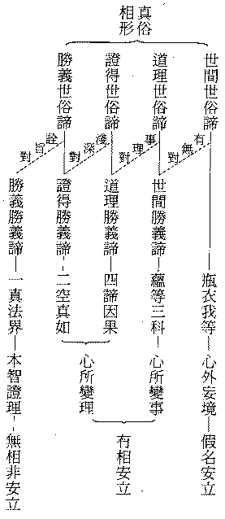



此中，有无、事理等的四对名称，《枢要》卷上说为心境、事理、别总、诠旨。《二十述记》卷上说为空有、事理、别总、诠旨。现在这儿是从《义林章》卷二所明。



其次，俗别真总对，四俗四真别总相对，分别遣悟、断知、解修、觉证。今以如次图显示：



　　　　　　　　　　　　　　　　　　　　┌世间胜义┐  

　　　　　┌世间世俗（遣）──（悟）──┤道理胜义├四真  

　　　　　│　　　　　　　　　　　　　　│证得胜义│  

　　　　　│　　　　　　　　　　　　　　└胜义胜义┘  

　　　　　│　　　　　　　　　　　　　　　世间胜义┐  

　　　　　│道理世俗（断）──（知）──┬道理胜义├四真  

　　　　　│　　　　　　　　　　　　　　│证得胜义│  

　　　　　│　　　　　　　　　　　　　　└胜义胜义┘  

　　　四俗┤　　　　　　　　　　　　　　　世间胜义┐  

　　　　　│　　　　　　　　　　　　　　　道理胜义├四真  

　　　　　│证得世俗（修）──（修）──┬证得胜义│  

　　　　　│　　　　　　　　　　　　　　└胜义胜义┘  

　　　　　│　　　　　　　　　　　　　　　世间胜义┐  

　　　　　│　　　　　　　　　　　　　　　道理胜义├四真  

　　　　　│　　　　　　　　　　　　　　　证得胜义│  

　　　　　└胜义世俗（觉）──（证）───胜义胜义┘



真俗相形的要旨如此。唯诸法的实相，不在唯俗，不在唯真，无俗不成真，无真不成俗。《十地经论》中说：『但真不立，独妄不成』。因此，事理相俟而宛然有法界的万象，有一实的真如法性，决不可认为单真单俗。唯识教理的真俗观，立於相形相对之上，原因实在於此。基师《述记》卷七说：『俗谛若无亦无真谛，以真俗相依建立故……四重俗谛中前三是俗谛，俗谛中第四俗谛是俗中真谛，故俗中定真俗亦是相依；四重真谛中前三是俗谛第四是真谛，即真中真，俗亦是相依；若总四俗真相望，皆真皆俗亦是相依。若无一俗真对何立？无真亦尔，故二谛须有』。因此，在正智缘如之位，有为的万象宛然不失，然其万象宛然之处，是一真法界的胜义谛理无差平等。所以俗事中定有真理，真理中定有俗事，如果缺少任何一种，必将真俗均失，如果失去真俗，实是拨无邪见，违於法界真相。虽然如此，但差别与平等，决不可以混同。就是不泯俗，差别常是差别，不动真，平等永是平等。因此，真俗虽说是相依的，但俗的事相是差别，真的理性是平等，二者不一不异，不即不离，於此，可认明事理非有非空的中道义。诸宗所谈的二谛虽说是不少，但以中道义为其根柢的二谛相依的妙趣，实为唯识独自的深理，是一家所值得夸耀的。慈恩《义林章》卷二说：『可谓义高千叶，理光万代，赞咏吟讽何以畅其欢情？所恨徒响伯牙之琴，虚尽卞和之璧耳』。



上来从各方面说明四俗四真的关系，话似扯得远了一点，现在再拉回来如论文说：「此中」所说的诸法「胜义」，是「依最后」胜义胜义「说」。怎麼知道？因这「是最胜道」品「所行」的境「义」之「故，为」了「简」别「前三」种的胜义，所以特别「作」这样的「说」。不唯如此，当知「此」所说的「诸法胜义，亦即是」我人常常说的「真如」。所谓真如是什麼意思？「真」是所「谓真实」的意思，「显」示不是「虚妄」，这个乃是简别有漏诸法的。有漏是把虚妄分别的不是我不是法，谬执为是我是法而成，像这样的谬执的法，当然是可断的法。如此亦即简掉了徧计所执，徧计是属妄执而非真实的。「如」是所「谓如常」的意思，「表」示没有一点「变易」，这个乃是简别有为的无漏之法。有为无漏虽说是真实的，但还是生灭变易的，并不是常住不生不灭的。如此亦即简掉了依他起法，因为依他起是有生有灭的。圆成实性，因为不是虚妄而是真实不谬的，又是永恒常住而没有生灭变易的，所以说为真如。既然是真实常住的，当然不是前三胜义谛所可比拟。圆成实性，既是如「此真实」不虚，「於一切位」中，「常」常时恒恒时都「如其性」，是真是实，不变不易，所以叫做「真如」。换句话说：「即是」显示真如「湛然不虚妄义」。亦可作这样说：真如虽在一切虚妄变易法中，从未尝动著一丝毫的，是为真如湛然不动义。



亦言显此复有多名，谓名法界及实际等。如餘论中随义广释。此性即是唯识实性。谓唯识性略有二种：一者虚妄谓徧计所执；二者真实谓圆成实性，为简虚妄说实性言。复有二性：一者世俗谓依他起；二者胜义谓圆成实，为简世俗故说实性。



颂文所说「亦言，显」示「此」真如「复有多名」，如叫做「法界及实际等」。《对法论》卷二说：『何故真如说名真如？由彼自性无变异故，谓一切时无我实性无改转故，说无变异。当知此则是无我性离二我故。何故复说此名空性？一切杂染所不行故。所以者何？由缘此故，能令一切诸杂染事悉皆空寂。虽复有时说有杂染，当知但是客尘烦恼之所染污。何等名为客尘染污？谓由未拔所取能取种子故，令依他性心二行相转，非法性心，以诸法法性自性清净故。何故复说此名无相？诸相寂静故。诸相者，谓色受等，乃至菩提诸所戏论真如性中，彼相寂灭故名无相。何故复说此名实际？无倒所缘故。实者谓无颠倒，此处究竟故，名为实际，过无我性，更无所求故。何故复说此名胜义？最胜圣智所行处故。何故复说此名法界？一切声闻、独觉、诸佛妙法所依相故』。此是《对法论》中所说真如、无我性、空性、无相、实际、胜义、法界的七名。此论的本颂，单说胜义与真如的二名，加上论文所说的法界及实际的二名，合为四名。如对照《对法论》说，还有三名包含在等字中。关於这些名称的意义，「如」其「餘」的诸「论中，随」其意「义广」为解「释」，此地不再一一说明。



同时要知道：「此」诸法实「性」的圆成实，「即是」唯识学上所说的「唯识实性」。但讲到「唯识性」，大「略有二种」相对：一、真妄相对；二、真俗相对。真妄相对中又分为二：「一者」是「虚妄」唯识性，就是「徧计所执」性所遣清净；「二者」是「真实」唯识性，就是「圆成实性」所证清净。为什麼说为唯识实性？因现在所说的唯识性，即是第二的真实唯识性，不是第一的虚妄唯识性，「为」了「简」别「虚妄」徧计，所以「说实性言」。『此一对是显示徧计、圆成二性不离依他起性；现在是说依依他起而起的，简去徧计所执。因欲依著依他显示其为实体为圆成，故加上实字，而说为唯识实性』。真俗相对中「复有二性：一者世俗」唯识性，「谓」即「依他起」性，亦即是指依他起的所断清净；「二者胜义」唯识性，「谓」即「圆成实」性，亦即是指圆成实的所得清净。为什麼说为唯识实性？因现在所说的唯识性，即是第二的胜义唯识性，不是第一的世俗唯识性。「为」了「简」别「世俗」依他，所以「说」为「实性」。『此对乃除去徧计的无体法，而於有体法上作为依圆相对；为欲简除世俗的依他而显胜义的圆成之故，乃加实字，故说为唯识实性』。最后再一说的：『现在所说的唯识性，於二对唯识性中，不是虚妄及世俗的唯识性，乃是真实即胜义的唯识性。这即是一切诸法所依的本体』。



乙二　结非了义



三颂总显诸契经中说无性言非极了义，诸有智者不应依之总拨诸法都无自性。



以上「三颂」所「总显」示的，就是「诸契经中」所「说」的「无性」这句话，都「非极了义」谈，所以「诸有」具「智」慧「者，不应依」於这个不了义的无性言教，「总拨诸法都」是「无自性」的，应该了知其中只有初徧计执是无性的，餘依、圆二性并非是无性而是有的。当知此中所说的三性三无性，实是极为重要的，因为它是流转还灭的关键所在，我们绝对不能忽视它。假使於依他上生起妄执，必然会在生死中流转不息；假使了达依他是无性的，不再在上面起执，就可得到涅槃还灭。



关於『一切法无性』的言教，究竟是了义还是不了义的，在大乘学派中是有诤论的。我在《解深密经语体释》说：『诸法无自性教，是佛在般若会上说的。依龙树的见解看，这是佛所说的最彻底最究竟的胜义了义之教，但依本文的观点看，这又是约密意说的不了义教了！其实诸法无自性教，是无所谓密意不密意的，不过胜义生听了不懂，就以为含有秘密意趣了，佛为随顺他的根性，就说是约密意说。诸法是缘生的，小乘学者也承认，但不承认它没有自性；缘生是无自性的，一分大乘学者，说这是秘密意趣，是佛的方便说，一分大乘学者，说这就是究竟了义之教。佛法贵在契机，如果一味的发挥大乘了义之教，不能适合众生的机宜，不但对众生没有利益，即对佛法亦无好处。本经依三性立三无性，约三无性说诸法无性，是对当机说的；《般若经》说一切法皆无自性，是约综合说的』。本此可以知道，所谓了不了义：在当机者来说，就看你懂不懂，懂的就是了义，不懂即非了义；在义理方面说，说得究竟彻底是了义，说不究竟彻底是不了义。是以不能依一家言，说凡说诸法无性的就是不了义，是很难令人接受的。如据佛护、月称二论师说，《解深密经》由三相门分别有无自性及安立了不了义之理，是真正的不了义教！



甲三　行位唯识



乙一　问答总明



如是所成唯识相性，谁於几位如何悟入？谓具大乘二种姓者，略於五位渐次悟入。何谓大乘二种种姓？一、本性住种姓，谓无始来依附本识法尔所得无漏法因；二、习所成种姓，谓闻法界等流法已闻所成等熏习所成；要具大乘此二种姓方能渐次悟入唯识。



「如是」像上所说的二十五颂，於中，初二十四颂「所成」的是「唯识相」，第二十五颂所成的是唯识「性」。说明这些意义的用意，最大的目的，在使有情明瞭依他如幻，证到圆成的真如妙理，因之得到三身万德的佛果，终於悟入唯识实性。可是现在成问题的：就是能入的行者，依照唯识学所说，有五种种姓不同，究是「谁」个种姓，经「於」那「几」个「位」次，又是「如何」的得以「悟入」唯识相性？简单的解答这两个问题：谁能悟入唯识是就人讲的，因为佛果的开觉，根源於生起种子，而种子有有漏的，有无漏的，於无漏种中，有开觉声闻果的，有开觉独觉果的，有开觉菩萨果的，种姓有著这样种种的差别，就是唯识所说的五姓各别。於此五种各别种姓中，「谓」要「具」有「大乘二种」种「姓」的人，方得悟入唯识性。经於几位是就时间多少长短讲，亦即是约经过多少的位次，方得悟入唯识实性。现在论说「略於五位渐次悟入」，不是立刻可以悟入唯识性的。



能证得那佛果的，既然唯是具二种大乘种姓者，不是什麼二乘种姓等所能证得的，那末，大乘种姓既有二种差别，是则「何谓大乘二种种姓」？自是得首先提出来问的问题。论中解答：「一」是「本性住种姓」，略说叫做性种姓。「谓」从「无始」以「来」，即有本有无漏种子，「依附」於菩萨的「本识」中，「法尔」，就是自然而然的「所得」的「无漏法因」。这种本有的无漏种子，未闻正法而无始自成的，亦即没有经过熏习令其种子增长，所以名为本性住种姓。是本来就有这菩萨种子姓类差别，并不是由於现今才有的，所以名为本性住种姓。《瑜伽》卷三十五说：『本性住种姓者，谓诸菩萨六处殊胜有如是相，从无始世展转传来法尔所得，是名本性住种姓』。这本性住种姓，相当於《瑜伽》所举十三住中的种姓住。基师《述记》卷九解释说：『性者，体也，姓者类也，谓本性来住此菩萨种子姓类差别，不由今有名本性住种姓』。这性是不改之义，所谓体性，所谓性来，用恒存不变的意味；姓是种类之义，确实不在那个体性，用那种类的意味。元来种子这个名称，的确是在生起现行位而始这样称呼的，是所谓果俱有的。然若在不生现行位，只可名为种类，就是种子之类，不可名为种子，可知现在所说的种姓，亦是在未现行位的称呼。在未现行位虽亦处处说为种子，但那不管那一种，都是假名的种子，决不是严密的意味。《同学钞》卷九之二说：『凡种姓者姓类之义，未生现行之位种子也，因种类故名种类姓也；生现行时得种子名；虽有未生现行名种子之名，其假云种子也，正论之种类非种子也』。依於此说，其旨可知。《瑜伽》所说『六处殊胜』，诸师料简虽不一定，但依唯识家说：六处，是指第六意处，亦即是指能持的第八识；殊胜，是指无漏种子，亦即是显示所持的因性。有人认为论中所说的『无始来依附本识法尔所得无漏法因』，是具明能持的第八识及所持的无漏种子相。六处如果改为本识，殊胜如说为无漏种，是最恰当不过的。



「二」是「习所成种姓」，略说叫做习种姓。这类种姓，是在发心以后，如果是不定种姓，是回心向大以后，由於听「闻」了「法界等流」正「法已」，以此闻、思、修的三慧之力，一方面熏习有漏善种，另方面增长本有无漏种。此种类姓，发心入於僧祇以来，地前数数听闻法界等流的正法而修习，使得法尔无漏种子渐次增长。指这所增长的种，叫做习所成种姓，因为是由「闻所成等熏习所成」的。这种姓，唯限於地前，不通地上的。至於说到其体，仍旧是前本性住种姓，并不是有它的别体。因此，虽是同一无漏种子，但在未发心位，还未受到闻熏习，名为本性住种姓；到了入於僧祇，真正受到闻熏以去，名为习所成种姓。智周《演秘》卷七说：『无始本因名本性住，闻熏已去方名习性，虽一种子未增、增别，增位不可更得本名』，就是指这意思。不独所增长的无漏种叫做闻熏习，就是能增长的有漏种亦名闻熏习。然无漏种，虽以见道初无漏为现行因缘，但有漏种唯为殊胜的增上缘。漏无漏，能所治，其性是各别的。因此，本论卷二说：『闻熏习中，有漏性者，是修所断，感胜异熟，为出世法胜增上缘；无漏性者，非所断摄，与出世法正为因缘』。如是无漏种子，由於增与未增，所以分二种姓。然在增位的习种姓，又有顿机与渐机的区别，有佛果证入的迟速不同，因而，对那二机的性质，有须予以分别说明的必要。



顿机，详细的说为顿悟之机，是上所说五姓中的菩萨种姓，无始以来，在本识中，唯有法尔无漏的菩萨种子，所以说为决定性的种姓。这机，其性顿大，从初发心位就履修菩萨的行位，不要走何等二乘修行所走过的迂回道路，所以称为顿机，或名直往菩萨。就是直往大乘的修证之谓。渐机，详细的说为渐悟之机，是五姓中的不定种姓，但要除去其中二乘的不定种姓。无始以来具有三乘的无漏种子，所以其修行亦是渐进的，从浅而趣深的，初从小乘之教而证声闻、独觉之果，后回心向大而入於大乘的行位，经菩萨的修行而证得佛果菩提。这机，是渐进的，是从小向大而曾走迂回道路的，所以称为渐机。渐机，自从入於大乘行位以去，与顿机经同样的修行，固不用说，更不承认其间有何等的区别。唯回心向大入於大乘的行位，与从初在大乘位而就修行，其种姓当然是不同的，随著也就立有渐顿的区别。因此，现在总结的说：必须「要具」有「大乘」的「此二种」种「姓，方能」循序「渐」进，「次」第「悟入唯识」相性。



渐机次第悟入大乘唯识，在时间上是要经过三祇行位的履修，不是可以一步登天的。不过要进入大乘所要经过的三祇行位，首先需要除去从来怀抱二乘偏执的残滓，所以有以多劫修行的必要。修行的时劫，在声闻的四果及独觉圣者，是有迟速差别的，决不是完全一样。



如四果中预流果的圣者回小向大，在他回心以后，要经八万劫的修行，方得入於大乘的行位，就是入於菩萨十住中的初住。如是一来果的圣者回小向大，回心以后，要经六万劫的修行，始得入於菩萨初住。如是不还果的圣者回小向大，回心以后，要经四万劫的修行，方得入於菩萨初住。若是罗汉果的回小向大，回心以后，要经二万劫的修行，方得入於菩萨初住。



至於独觉圣者的回小向大，回心以后，经一万劫的修行，就得入於菩萨初住。这是菩萨的机类，就是积植三祇的修行，以证入二转依的妙果。古来大德把这回心向大的时期，称为『八、六、四、二万、十千劫』，顺次配合预流乃至独觉，使人便於记忆。



有关这八万劫等的时期说明，出於北本《涅槃经》卷二十一，在唯识学家以外的诸家，以此作为入於二乘无餘涅槃间的劫数，或为从无餘涅槃起而至初发心住的劫数。唯识学是不承认二乘入无餘后仍得还生，认为这是就不定姓的回心以后而说，且将这劫数的期间，名为相似的十信尚未入於真的十信，或名为假名的菩萨。其菩提心，当然是还没有深固的。要之，这些劫数，在回心时未入行位的期间，不管那种，都是在十信中所谈的。经这期间，始入初住。这真正是大乘的行位，初阿僧祇，就是从此数起。因此，我们可以这样说：十住以上是正科，十信位好似预科，是以唯识学上，不别立十信行位，将之摄於十住中的初住。圆测法师别开这个而立十信行位，有人认为这不是唯识的正义。所以《了义灯》卷七，对这曾经予以破斥。如以图示上来所说，是这样的：



　　　　┌顿悟──────────────菩萨位  

　　　机┤　　　　　┌预流果──八万劫后入菩萨位  

　　　　│　　┌声闻┤一来果──六万劫后入菩萨位  

　　　　└渐悟┤　　│不还果──四万劫后入菩萨位  

　　　　　　　│　　└罗汉果──二万劫后入菩萨位  

　　　　　　　└独觉──────一万劫后入菩萨位



不过要知道的，就是如上所说的渐机，限於有不定种姓中的菩萨种子，如果唯有二乘种子，那是绝对不会回心的，就是二乘的定姓也是如此。为什麼？因彼二乘各证自果，毕竟入於灰身泯智的空寂，更不还生，所以不能回心向大。否定二乘的得以还生，实可说是唯识宗独自的教义，在华严、天台等性宗诸家，认为二乘是可还生的，说他们的入寂，不是真的入寂，只陶醉於三昧的妙酒，暂时有那身心都灭的状态。到了三昧醉酒觉醒了的时候，自然而然的出定还生。因此，二乘回小向大，性宗诸家看来，是必然的结果。对这有详细说明的，是贤首的《起信论义记》。唯识学立於五姓教权之上，断不许趣寂二乘的还生。因而，不认为他们有回心向大的可能！



关於上来所说的顿机、渐机，在菩萨总有智增上与悲增上的二种。智增上的菩萨，就是大智的性分增上，断惑证理的自利善根多，利生化物的利他善根少。悲增上的菩萨，就是大悲的性分增上，久住於生死的苦巷之中，不息奔驰的利乐诸有情，不想疾进菩提之果而求自悟。因此，智增上的菩萨，从初地就舍分段身而受变易身；悲增上的菩萨，到了第七地仍然在受分段身还未能够受变易身。为什麼会如此的？因悲增上的菩萨，以济度众生为本怀，所以特地不断烦恼，留惑润生，经中说为『故留润生』。



何谓悟入唯识五位？一、资粮位谓修大乘顺解脱分；二、加行位谓修大乘顺抉择分；三、通达位谓诸菩萨所住见道；四、修习位谓诸菩萨所住修道；五、究竟位谓住无上正等菩提。



上说具有大乘二种姓者，略於五位渐次悟入，因而现在就此问道：「何谓悟入唯识五位」？就是要怎麼样的方得悟入唯识的五位？所谓唯识五位又是指的那五种？论文解释说：第「一」叫做「资粮位」，在此位中，主要是「修」学「大乘」的「顺解脱分」，筹备趣向佛道的资粮。从初发大菩提心，勤修六种殊胜妙行，乃至十回向的圆满，是为大乘的顺解脱分。但在《对法论》等，说煖等四善根以前所修的，皆可叫做顺解脱分。第「二」叫做「加行位」，就是「修」学「大乘」的「顺抉择分」。如依修行的次序说，是在煖等四善根的过程中，对前所修的加功用行，一步也不放松的勤修。像这样在见道前所修的煖等四善根，叫做顺抉择分。第「三」叫做「通达位」，就是修诸加行的「诸菩萨」，从世第一后心，通达空无我理，进「住见道」之中，亦即是初入地心，是为通达位。第「四」叫做「修习位」，就是已住见道的「诸菩萨」，从初地住心及初地出心，乃至金刚无间心位，在这长时期中「所住修道」，继续不断的修道阶段，是为修习位。第「五」叫做「究竟位」，是说於金刚心后，究竟断惑证理，从此尽未来际的安「住」於「无上正等菩提」，是为究竟位。关於五位的释名、出体以及为三无数劫所摄等，到后会得一一解说，现在在此不须预论。



云何渐次悟入唯识？谓诸菩萨於识相性资粮位中能深信解；在加行位能渐伏除所取能取引发真见；在通达位如实通达；修习位中如所见理数数修习伏断餘障；至究竟位出障圆明，能尽未来化有情类，复令悟入唯识相性。



「云何渐次悟入唯识」？是问究竟要怎样的才得渐次悟入唯识相性，亦即是明悟入唯识的渐次。「谓」发心修行的「诸菩萨」，对「於」所听闻到的唯「识相」，唯识「性」，亦即是所听到的一切法唯有识的道理，在「资粮位中」，经过思惟观察，虽还不能有所体证，但已引生明确的胜解，「能」够甚「深」的「信解」唯识理趣，对於一切法唯识的道理，再也不会有所怀疑的了。进一步「在」第二「加行位」上，继续的对唯识理思惟观察，虽同样的还不能有所体证，但因所修习的现观已经加强，於是「能渐」渐的「伏除所取能取」使之不起，从而「引发」如实「真见」。由加行位再进入通达位，「在通达位」上，修习现观，「如实通达」意言的非法非义，非能取非所取，生起根本、后得的二无漏智，以根本智现证一切法唯有识性，以后得智通达一切法唯有识相。更进一步的在「修习位中，如所」已经「见」到的唯识相性之「理」，从而「数数」不断的继续「修习，伏」除其餘的烦恼，「断」除其「餘」的智「障」。最后到达「究竟位」，全「出」二「障」，功德智慧，悉皆「圆明」。佛果位上的功德智慧不同小乘，所以说圆；二障全出不会再有昧暗，所以说明。到达了这阶段，不但自己彻底的圆满究竟的悟入唯识相性，而且还「能尽未来」际的以此「化」度诸「有情类」，使「令」一切众生亦能同样的「悟入唯识相性」。像这样的循序渐进，是为悟入唯识相性。



乙二　依位别释



丙一　资粮位



丁一　牒科标问



初资粮位其相云何？



上来已经总说五位，此下再来别说五位。於中，最「初」的「资粮位」，它的义「相」是怎样的呢？这是我们首先需要予以说明的。



丁二　举颂总答



颂曰：乃至未起识，求住唯识性；於二取随眠，犹未能伏灭。



首以「颂」文简单的解答「曰：乃至」，是说已发菩提心后；「未起识」，是说还未生起顺抉择分的识；「求住唯识性」，是说在这期间，以能观的智慧要求安住於所观的唯识的实性。可是尽管如此，但对「於二取随眠，犹」还「未能」做到使其「伏灭」而不现行。



丁三　解释颂意



戊一　释前二句



论曰：从发深固大菩提心，乃至未起顺抉择识，求住唯识真胜义性，齐此皆是资粮位摄。为趣无上正等菩提，修集种种胜资粮故。为有情故勤求解脱，由此亦名顺解脱分。此位菩萨依因、善友、作意、资粮四胜力故，於唯识义虽深信解，而未能了能所取空，多住外门修菩萨行，故於二取所引随眠，犹未有能伏灭功力，令彼不起二取现行。



上面举颂总答，此以「论」文解释颂义「曰」：大乘根性的机类，信解唯识道理，「从发」极为「深固」的「大菩提心」那个时候开始，「乃至」一直还「未」生「起顺抉择识」那个时候为止，修习种种的胜行，积集福智的善根，一心「求住唯识」的「真胜义性，齐此皆是」属於「资粮位」所「摄」。为什麼叫做资粮位？因发心的行者，「为」了「趣」求最高「无上正等菩提，修习种种」的殊「胜资粮」。资粮虽说是很多的，但趣求无上佛道的资粮，最主要的不外是福智二者，如这二者的不完具，那是不能获得无上佛果的。菩萨不仅为了自利而求菩提，同时「为」了利益一切「有情」，而精「勤」不断的「求」证「解脱」，在勤求的过程中，虽不能即刻就可获得，但已一步一步的趣向於彼，「由此亦名顺解脱分」。解脱是涅槃之谓。在这位中，欣求解脱，其行是常顺应解脱的因分，所以名为顺解脱分。分是什麼意思？是因支的意思，就是解脱之因，因的一支，所以名分，顺彼解脱之分，所以名顺解脱分。这实是大乘修道的最初位。回小渐悟之机，入於菩萨之道，亦真正以此位为初始。



於「此位」中修行的「菩萨」，能够得到怎样的程度？谓「依因、善友、作意、资粮」的「四」种殊「胜」缘「力」，甚深信解唯识的义理，「於唯识义」理「虽深信解」，然「而」还「未能」够「了」达内在的「能所」二「取空」。为什麼会如此的？由於他是「多住」事相散心的「外门，修」诸「菩萨行」的。如所修的六波罗密、四摄事、四无量等的福智之行以及所修无量的自利利他之行，都是在外门的散心位上修的。



所谓四种殊胜缘力：一、因力，就是具有大乘种姓的行人，对於法界等流的大乘教法，曾经多闻熏习在身心六处，或心相续的赖耶中，熏成了清净的熏习。这闻熏习，是悟入唯识相性的主要因力。《摄大乘论》说为『大乘多闻熏习相续』，就是此意。这是简别二乘等的种姓。二、善友力，是说单有闻熏习还不够，同时还要逢事诸佛等的无量善友知识的因缘。《摄大乘论》说为『已得逢事无量诸佛出现於世』，就是此意。这是简别恶友的违缘。『逢事，指供养、礼拜、赞叹、出家、修学等。既逢遇诸佛为善知识，自然能闻法修行，渐渐的悟入法界。所以，众生不怕不能了生死，只怕不能见佛闻法。多多见佛闻法，是解脱的主要条件』。三、作意力，是说虽然逢遇恶友的违缘，但由决定的胜解，不为其倾动破坏。《摄论释》说为『已得一向决定胜解，非诸恶友所能动坏』，就是此意。当知这是简别任运心。『由多闻熏习亲近善友的关系，对大乘甚深的教法，已得一向的坚固决定的胜解，没有犹豫。有这胜解力，任凭遇到什麼违逆的外缘，或任何思想，都不能使他动摇信念，破坏他对於大乘法的修习』。四、资粮力，《摄论》说为任持力。是说已经积集诸种的善根，亦即是广修了福智资粮。当知这是简别下劣的资粮。如依《摄论》说：『对於某种事业所有堪能担当的力量，叫任持力。对大乘教法，生了坚固的信念以后，进一步的实行六度四摄自利利他的事业——法随法行，即是「已善积集诸善根故」』。具备了这四种，比於二乘姓及恶友缘，任运心与劣资粮，不管那种，都是来得殊胜，所以是胜缘力。有了这四种胜缘力，就成为能悟入善备福德智慧资粮的菩萨。



善备福智资粮的菩萨，由於是依外门修菩萨行，止观的力量固还极为薄弱，定慧的力量亦还不怎麼殊胜，还未忘舍所取著的外相，由「於二取所引」起的「随眠」，固「犹未有能」够「伏灭」它的「功力」，当然也就没有一种力量，「令彼不」再现「起二取」的「现行」。为什麼是这样的？因在这个阶段所修的诸波罗密，仍然执著它的有相，不能了达它的三轮体空，所以二取随眠犹未伏灭。



戊二　释后二句



此二取言显二取取，执取能取所取性故。二取习气名彼随眠，随逐有情眠伏藏识，或随增过故名随眠，即是所知烦恼障种。烦恼障者，谓执徧计所执实我萨迦耶见而为上首百二十八根本烦恼，及彼等流诸随烦恼，此皆扰恼有情身心，能障涅槃名烦恼障。所知障者，谓执徧计所执实法萨迦耶见而为上首见、疑、无明、爱、恚、慢等，覆所知境无颠倒性，能障菩提名所知障。



在前解释初二句中，虽略提到后二句颂，但还没有正式解释，此后正式解释下二句颂。



「此」颂之中所说「二取」的这句话，是「显」示能执相见等「二取」的「取」，并非就是说的二取，因为「执取能取所取」的二取为实有「性」，方得说名二取的。假定以能取所取说名二取，那不是属於执著的二取，如善无记心及后得智，皆有它们的能取见分，所取相分，难道这些二取的种子亦要伏灭的吗？所以这里唯取染心执能取所取为实我实法，方名二取种子。



由「二取」现行所熏成的「习气，名彼」二取「随眠」。既是习气，为什麼又叫随眠？因它常在生死中「随逐有情」，一直如睡「眠」似的潜「伏」阿赖耶的「藏识」中。赖耶到什麼地方受生，它就随逐到什麼地方，一时一刻都不离开赖耶的，所以名为随眠。「或」还可以这样说，它的「随」逐有情，只有使有情「增」多「过」失，不会令有情有什麼好处的，所以「名」为「随眠」。当知此中所说的眠就是增的意思，如贪睡眠的人，越睡越想睡，越睡越会多，不会因多睡了而不想睡。二取习气在身心中活动，只有增加有情的过失，不会减少有情的过失，所以过失的增多，是为随眠的意义。当知这随逐有情眠伏不动的二取习气，「即是所知、烦恼」二「障」的「种」子，并不是指的其他什麼法，所以下面分别解释二障。



什麼叫做烦恼障？所谓「烦恼障者」，就是「执」著「徧计所执」的「实我萨迦耶见」，以此我见「而为上首」，於是「百二十八根本烦恼，及彼等流诸随烦恼」，一一发生活动起来。假定我见这个烦恼没有，其他各式各样的烦恼，也就随之归於乌有。所谓百二十八根本烦恼，其数是这样的：欲界四谛之下，各有十个烦恼，就是贪、瞋、痴、慢、疑、身、边、邪、见、戒，总为四十烦恼，上二界的四谛，各於其下，除去一个瞋字，因上二界是不行瞋的，各有三十六个烦恼，合为七十二，如是三界，计有百一十二惑，都是属於见道的根本烦恼，此外再加属於修道的十六烦恼，见修二道合计，共有一百二十八根本烦恼，如是诸根本烦恼，各有随烦恼的等流，所以烦恼是很多的，多到无量无边的不可计算。不管是根本烦恼还是随烦恼，不特「皆」有「扰恼有情」的「身心」作用，而且还「能障」碍「涅槃」的证得，所以「名烦恼障」。



什麼叫做所知障？所谓「所知障者」，就是「执」著「徧计所执」著的「实」有诸「法」，以法我、我所的「萨迦耶见而为上首」。如指出这所知障的体性，主要的有「见、疑、无明、爱、恚、慢等」诸惑。实际说来，这些都与烦恼障相同的，因为烦恼相应，必然是有所知障的。不过烦恼障的相貌粗，所以有多不同的品类，至於所知障的相貌细，所以不分别它的品类。有了这些烦恼的存在，就能盖「覆」我们「所」要了「知」的一切有为无为的理「境」，使我们不能正确理解一一境为何物，同时又盖覆「无颠倒」的真如法「性」之理，使我们不能亲见诸法的真实性。由於覆此理境，障碍智慧不生，并「能障」碍「菩提」不得现前，所以「名所知障」。



此所知障决定不与异熟识俱，彼微劣故，不与无明慧相应故，法空智品与俱起故。七转识内随其所应或少或多，如烦恼说，眼等五识无分别故。法见疑等定不相应，餘由意力皆容引起。



上面所说的「此所知障」，就与八识相应来说，那它「决定不与」第八「异熟识」相应「俱」起。什麼理由？原因有三：一、「彼微劣故」，就是异熟识的行相极为微细弱劣。不如法执那样的来得粗强。二、「不与无明慧相应故」，就是第八异熟识，如诸论中所说，唯与触等五所相应，不与烦恼等相应的，不像法执那样的必与别境慧及无明相应的，无明迷暗不认识的，慧是能够有所计度，所以强胜的法执有此相应。三、「法空智品与俱起故」，就是菩萨的法空智品，容与第八识俱起的，正应法空智品可与第八识俱，足以证明第八识是没有法执的，反显第七识是有法执的，因为法空智一现起时，那法执就不得现行。至於「七转识内」，所知障唯是俱生的，「随其所应，或」者是「少，或」者是「多，如烦恼说」可知。依於向来所说，第七末那识，有根本四惑及随烦恼八，计为十二，如再加上别境慧，是就有十三法。第六意识具有一切，因为与诸心所皆相应的。前五识有贪瞋痴的三根本惑，中二大八的十随烦恼，合计与十三法俱。前五识为什麼没有法见、法疑、法慢的三根本惑？因「眼等」的前「五识，无」有计度「分别」的作用，所以「法见」、法「疑」、法慢的三根本惑，决「定不」与五识「相应。餘」如法贪、法恚、法痴的三根本惑，「由」於五俱「意」识「力」的发动，所以「皆容引起」它们的活动。



此障但与不善、无记二心相应，论说无明唯通不善、无记性故，痴无痴等不相应故。烦恼障中此障必有，彼定用此为所依故。体虽无异，而用有别，故二随眠随圣道用，有胜有劣断惑前后。此於无覆无记性中，是异熟生非餘三种，彼威仪等势用薄弱，非覆所知障菩提故。此名无覆望二乘说，若望菩萨亦是有覆。



「此」对所知「障」以三性分别，说明它在三性中，「但与不善」及「无记」的「二心相应」，绝对是不与善心相应的。为什麼？因《瑜伽》「论」五十九卷「说：无明唯通不善」及「无记」的二「性」，既然说唯，当然是不通善性的。但通不善及无记，是约三界分别的，就是欲界一分烦恼属於不善，上二界一分烦恼则是属於无记。所知障既不通善性，怎麼可说善心中有法执？当知法执一定是有无明与之相应的。不然，不特《瑜伽》说唯与二性相应，《对法论》卷四亦说欲界烦恼能发恶行的是不善，其餘的烦恼是属有覆无记，怎麼可说无明通於善性？外人挽救说：凡是属於生死有漏的，皆必归於不善性摄，所以我们仍然坚定的认为有无明！不可！为什麼？要知善心是有无痴的，而所知障执是有痴的，「痴」与「无痴等」，就好像光明与黑暗一样，两者绝对是「不相应」的。我们之所以说它们决不相应，由於它们是敌体相反的法，是不可能携手合作的，如无贪与贪就是两个永不碰面的法。



就二障说明它们的宽狭是这样的：在彼「烦恼障中，此」所知「障必有」。因为法执体宽，彼烦恼障较狭，所以「彼」烦恼障，一「定」要「用此」所知障，「为」它的「所依」。《胜鬘经》中说住地烦恼及起烦恼，再分为五住烦恼，说明无明地上所起现行烦恼，刹那顷刹那顷的必与无明相应而起，但与心不相应的为无始无明住地。如此无始无明住地，依唯识说，二乘是不断的，能究竟断尽无明的唯佛与佛。为二乘不断的无始无明住地，就是这里所说的所知障，所以若有烦恼障定必有所知障。如在夜晚迷杌以为是人，就是迷法方起我执最好的证明，是以我执必是依於法执而起的。



说到二障的自体，同以十根本烦恼为体，其体是没有差别的，「体虽无」有别「异」，然「而」其「用」是「有」差「别」的。所谓用别，是说现行烦恼障有障涅槃证得的功用，现行所知障有障菩提证得的力用。正因为力用不同，不妨将体无有异的烦恼分为两种。以是之「故」，假定行者断此烦恼所知的「二」种「随眠」，「随」诸三乘「圣道」的作「用，有胜有劣」的差别不同，所以「断」的时候也就或「前」或「后」的有所差别。行者能断烦恼障，是即显示生空智胜，因不能断所知障，是即显示法空智劣；到了十地菩萨，在修道过程中，唯以断所知障为务，是即显示法空智胜，由於不断烦恼障种，是即显示生空智劣，可见断惑的圣道是有胜有劣的。



「此」所知障既是无记性的，那它在四无记中，究属那一无记所摄？「於无覆无记性中，是」属於「异熟生」无记所摄，「非」是其「餘」的「三种」无记所摄。为什麼？因「彼威仪」、工作、变化「等」的三种无记，「势用」是极为微劣「薄弱」的，既不能「覆」於「所知」的有为无为一切境，亦不能「障」於最高无上「菩提」，所以不可说为所知障的无覆无记。至於说为异熟生无记，因为异熟生的势力极为坚强，通於作意生计度所起，能覆所知障菩提的。



「此」所知障「名」为「无覆」，是望於什麼人说的？是「望」於「二乘」圣者「说」的，因所知障不会盖覆二乘所应得的所依果，在二乘无学的身心中还可现行的，但其所现行的不是染污性的，所以说为无覆。假「若望」於「菩萨」来说，「亦」可说「是有覆」，因覆所知境障大菩提的。灵泰《疏钞》对此有问答说：『如阿罗汉既唯断烦恼不断所知障，所知障既通不善、有覆二性，如何此所知障望二乘即是无覆？答：此所知障若与烦恼同体俱时而起，此所知障即是不善、有覆性，若断烦恼唯独有所知障，所知障望二乘是无覆者，犹如有人若有两手两脚即能杀人，亦能往来造种种事业，其人若被他人斫却一手一脚及斫却半身，此既无半身分，即更不能造诸事业往来等也。此所知障亦然』。所以所知障望於二乘，是属无覆无记。



若所知障有见疑等，如何此种契经说为无明住地？无明增故总名无明，非无见等，如烦恼种立见一处、欲、色、有爱四住地名，岂彼更无慢、无明等？



从此以下解释种种的妨难。首先有人难说：假「若」这「所知障」还「有见、疑等」的烦恼存在的话，为什麼在讲「此种」所知障的「契经」中「说为无明住地」？意思是说：既说无明住地，就不应说有见、疑等，若说此障仍有见、疑等，那就违背此类契经所说。要知这里所说的契经，是指《胜鬘经》说的。经中说：『烦恼有二种，何等为二？谓住地烦恼及起烦恼。住地烦恼有四种，何等为四？谓见一处住地，欲爱住地，色爱住地，有爱住地。此四种住地，生一切起烦恼，起者刹那心刹那相应。世尊！心不相应无始无明住地。世尊！此四住地力，一切上烦恼依种，比无明住地，算数譬喻所不能及。世尊！如是无明住地力，於有爱数四住地，无明住地其力最大』。



《胜鬘经讲记》解释说：『住地烦恼又可分为四种，即是：见一处住地，欲爱住地，色爱住地，有爱住地。这可约二方面说：一、约修行断烦恼说：可分为二种，即见道所断的，与修道所断的。见是证见谛理。见谛时所断的，为迷理的，即迷於真理，障碍正智的烦恼。一旦正见谛理，惑也就息灭了。然见道虽能断迷理的烦恼，但还有未断的——修道所断惑；这是迷事而起的。触境随缘，於事相还生起种种的错乱染著。例如鸦片，嗜好的如以为是有益的，这是颠倒是非；如了解它是毒品，不再以为好的，即颠倒想除。此如见断的见谛所断。可是，虽知鸦片是毒品，瘾来了仍不免要吸它，这是事的染著，如修道所断惑，要逐渐的舍除它。所以说：『理必顿悟，事则渐消』。证见的悟道，不是一切都成就了，还得从现实生活去不断练磨（修），消除不合理的染著。二、约烦恼说，也可分二种，即属於见的，与属於爱的。见惑是思想的错误，如执我执常等。爱是事行的染著，如贪瞋等。今综此二意，解释四种住地：见一处住地，是各式各样的见，集在见所摄的一处，而是见道时一处顿断的。见有执著性，坚定的认为如此……属於爱的，又分为三种，这因为修道所断惑，是三界分断的：欲界的修所断惑，色界的修所断惑，无色界的修所断惑。欲爱住地，即欲界的一切修所断烦恼；色爱住地，是色界的一切修所断烦恼；有爱住地，是无色界的一切修所断烦恼。这都是爱所摄的，所以都名为爱。外道误认无色界为涅槃，不知这仍在生死中，所以名为有——生死的存在爱……但住地是不与心相应的，如心起善时，并无起烦恼相应，而住地烦恼还是潜在的，它不与刹那心同缘同事。这心不相应的，为无始无明住地』。



所知障既通见、疑等的烦恼，为什麼《胜鬘经》唯说无明为所知障？经中所以唯说无明为所知障，因此住地「无明」较为「增」上，超胜於其它的烦恼，所以把它「总名无明」，并「非」是说「无」有其餘的「见等」烦恼。为什麼说无明特别增上？约有三个原因：一就体增说，就是其餘的烦恼，或相应或不相应，那是没有一定的，但一切烦恼心皆有无明相应，那可说是肯定的。二就用增说，就是它的作用，能够迷一切境，障碍一切智慧，令诸行者不能得到无上佛果，不像烦恼那样的没有这作用。三就难断增说，就是这个所知障，不是一般的智慧所能断的，而是要法空智方能断的。由於具有如上的三种增上，所以说为无明增上。



举例来说：「如烦恼种」，只要是属於恶见的，皆归纳在见惑中，「立」为「见一切处」住地，只要是属於欲界所有的爱，皆归纳在欲爱中，立为「欲」爱住地，只要是属於色界所有的爱，皆归纳在色爱中，立为「色」爱住地，只要是属於无色界所有的爱，皆归纳在无色爱中，立为「有爱」「住地」。如是分别的立为四住，我们不能因此说彼烦恼唯是见、爱，没有其餘的烦恼，所以说「岂彼更无慢、无明等」？这样分析起来，我们可以知道：《胜鬘经》说此为无明住地，是专依增盛说的，并不是真的没有见等。



如是二障分别起者见所断摄，任运起者修所断摄。二乘但能断烦恼障，菩萨俱断。永断二种唯圣道能，伏二现行通有漏道。菩萨住此资粮位中二粗现行虽有伏者，而於细者及二随眠止观力微未能伏灭。



「如是」像上所说的「二障」，如以见修所断分别是这样的：假定是由后来邪师、邪教、邪觉观而「分别起者」，那就属於「见所断摄」，因为粗显而易断的；假定不是由邪师等生而是由於无始熏习「任运起者」，那就属於「修所断摄」，因是微细而难断的。如就人分别，什麼人断什麼障是这样的：「二乘」圣者唯求个己的解脱，「但能断烦恼障」，不能断所知障，因所知障不障他的涅槃解脱；如果是大乘「菩萨」，那就二障「俱断」，因为菩萨不但求大涅槃，亦复求大菩提。烦恼障是障涅槃的，所以要断，所知障是障菩提的，所以要断。



但菩萨的断障，由於作意力的不同，所以有先后的差别。如就永断分别二障种子说，在初地的无间圣道就能做到，如就永断任运二障种子说，在十地的无间圣道可以做到，所以说「永断二种唯圣道能」。至於伏二障的现行，不唯无漏道有此力用，就是有漏道亦有此功能，所以说「伏二现行通有漏道」。话虽这麼说，但在诸论典，或说有漏诸道不能断种，因为那是『有相缚故，麤重缚故，不证理故』；无漏圣道不是这样，所以能断二障种子。



最后结归本颂说：行「菩萨」道者，「住」在「此资粮位中」，对於「二」障的「粗」显「现行，虽」然说是已「有」被「伏」，然「而於」微「细」的「及二」障中若粗若细的「随眠」，由於能对治的「止观力」量尚极「微」弱，因此尚「未能」够予以「伏灭」。所谓伏灭，就是将种子的势力压制下去，使之不再生起现行活动。可是在此资粮位中，尚未能够做到，所以说『犹未能伏灭』。



戊三　别释解行



此位未证唯识真如，依胜解力修诸胜行，应知亦是解行地摄。所修胜行其相云何？略有二种，谓福及智，诸胜行中慧为性者皆名为智，餘名为福。且依六种波罗密多，通相皆二；别相，前五说为福德，第六智慧；或复前三唯福德摄，后一唯智，餘通二种。复有二种，谓利自他，所修胜行随意乐力一切皆通自他利行。依别相说：六到彼岸，菩提分等自利行摄；四种摄事，四无量等一切皆是利他行摄。如是等行差别无边，皆是此中所修胜行。



上来已将颂文解释完毕，此下再就其位以辨解行。於「此」资粮「位」上的菩萨，虽说已经修习现观，但还「未」能「证」得「唯识真如」性，所以唯「依」闻思的「胜解力，修」於福智的「诸」殊「胜行」，能於诸法决定了知唯有识性，并且对此获得明确的胜解，「应知」这「亦是解行地摄」。为什麼要这样说？当知解行地所摄的有二位，就是资粮位与加行位，因这二位可以总摄为胜解行地的，意思是说，不但加行位可以叫做胜解行地，就是资粮位亦可叫做胜解行地，因为此位亦是依於胜解修行的。



於此位中「所修胜行，其相」貌究竟是怎样的？大「略」说来，约「有二种」，就是所「谓福」德「及智」慧。什麼是所修的智？就是在所修的「诸胜行中」，假定是以「慧为性者，皆」可说「名为智」，除此而外，其「餘」不以慧为体的，都可说「名为福」。说到胜行当然是很多的，不能在此一一详说，现在「且依六波罗密多」来说，此又可以分为通相与别相。就「通相」说，六波罗密「皆」具福德智慧的「二」种。这话怎讲？意谓与智俱行助成智业的，皆可说名为智，假定与福俱行助成福业的，皆可说名为福。就「别相」说，「前五」波罗密多「说为福德」，因这五度是福而非智性的；「第六」波罗密多说为「智慧」，因这一度是智而非福性的。「或复」以「前三」波罗密多，「唯」是属於「福德」所「摄，后一」波罗密多，「唯」是属於「智」慧所摄，其「餘」中间的精进、禅定二波罗密多，则「通」於福德、智慧「二种」所摄。除此而外，还有的说：依精进修布施、持戒、四无量等，属於福德所摄，依精进修三慧、六善巧观、四谛、缘生法等，属於智慧所摄；依静虑修四无量，是为福德所摄，依静虑修六善巧（蕴、处、界、缘起、处非处、四谛，合说为六善巧）等，则是属智所摄。诸如是类一一分别，真可说有无量无边。



菩萨所修的胜行，除了上述的福智，「复有二种」，就是所「谓利自」利「他」，换句话说，就是自利利他。菩萨行者「所修」的「胜行，随」自己的「乐意力」，所行所为的「一切」功德，「皆通自」利行与利他行。如人行六波罗密，假定唯为自己未来得到果利，是即属於自利行；若人行六波罗密，完全是为利乐一切有情的，那就属於利他行。这是依通相说，假使「依别相说」，所修「六到彼岸」，三十七「菩提分」法，「等」是等於禅支、十八不共法、诸相随好等，都是属於「自利行摄」；所修「四种摄事」，就是布施、爱语、利行、同事，所修「四无量等」就是慈、悲、喜、舍，等是等於大悲、不护、三念住等，「一切皆是利他行摄」。



「如是等」的一切自他利「行」，其「差别」虽说有无量「无边」那麼样多，而「皆是此」资粮位「中所修」的「胜行」。菩萨如是依胜解修胜行，虽还未能伏灭二取随眠，但确是已经极为难得。



此位二障虽未伏除，修胜行时有三退屈，而能三事练磨其心，於所证修勇猛不退。一闻无上正等菩提广大深远心便退屈，引他已证大菩提者练磨自心勇猛不退；二闻施等波罗蜜多甚难可修心便退屈，省己意乐能修施等练磨自心勇猛不退；三闻诸佛圆满转依极难可证心便退屈，引他麤善况己妙因练磨自心勇猛不退。由斯三事练磨其心，坚固炽然修诸胜行。



在「此」资粮「位」中修诸胜行的菩萨，由於止观的功能力用还极障弱，对於烦恼、所知「二障」还「未」能够「伏除」，因而在「修胜行时」遇到障缘，「有三」种事情可能使之「退屈」。然「而」当蒙退屈之念，复「能」以「三事练磨其心」，对「於」自己「所证修」的胜行，得以继续精进「勇猛」的迈进令「不退」屈。



第「一」从听「闻」正法中，听说「无上正等菩提」，不特非常的「广大」，而且非常的「深远」，认为不是自己所能做得到的，亦即觉得自己的力量，无论怎样难以到达这样崇高的地位，於是其「心便」生「退屈」，想去做自己所能做的事。可是再一回想：在无量的世界中，每个世界都有无量的人趣有情，在每一刹那中，都在证觉无上正等菩提，可见成佛并非是件难事，问题就看我们愿不愿意认真去行。所谓『彼谓丈夫我亦尔，不应自轻而退屈』；『彼何人也，予何人也，有为者亦若是』。他人既能证得大菩提，我为什麼不能？只要我肯得努力前进，无上菩提是不难证得的。「引」用其「他已证大菩提者」，来「练磨自」己一颗已欲退屈的「心」，从而就又「勇猛不退」的向前迈进，使得懦弱退屈的心理消除於无形！



第「二」从听「闻」正法中，听说所修的「施等波罗密多」，不是如所说的那麼容易，而是「甚难可修」的。像这样难以修学的波罗密多，是我这样的人所能修的吗？不禁生起绝望之念，於是其「心便」生「退屈」，不敢再作修波罗密多想！可是正当退屈时，忽又「省」察到自「己」的「意乐」，已经得到清净，没有什麼悭贪、瞋恚等的弊恶，以此清净增上的意乐，只要我现在稍加一些功用，便「能修施等」波罗密多，并且修习使之圆满。像这样的「练磨自心」，於是就又「勇猛不退」的向前迈进，不会再作我不能修的一种想法。如有颂说：『汝昔恶道经多劫，无益勤苦尚能超；今行少善得菩提，大利不应生退屈』。是以不论什麼难行，只要肯得去行没有不成的！



第「三」从听闻正法中，听说「诸佛」的「圆满转依」，亦即所谓圆满菩提，具有无量无边功德，要想确切的证得，那是非常困难的，所以说「极难可证」！我是什麼人，怎可有此厚望？於是生起悲观之念，认为佛果菩提高不可攀，不是我这样的人所能证得的，因而其「心便」生「退屈」。可是回转一想：他人略行布施，尚感富乐果报，我修如是清净妙善，怎麼会得空无有果？如是「引他」微因「粗善」，比「况」自「己」的殊胜微「妙」善根之「因」，那有不得菩提妙果之理？有如是因必有如是果，只问我有没有妙因，不必因妙果的圆满而退心。如是「练磨自心」，於是就又「勇猛不退」的向前迈进。如有颂说：『博地一切诸凡夫，尚拟远证菩提果；汝已勤苦经多劫，不应退屈却沉沦』！



菩萨行者在修学的过程中，虽可能遇到违缘而生起三种退屈的心理，「由」於以此「三事练磨其心」，於是道心大大「坚固」起来，越发走上向上的一路，「炽然」不息的「修诸胜行」，从而不再有所退屈！



在此资粮位中，具有四十一位中的十住、十行、十回向的三十心，我想在此对这略为一说。不过这些行位，说得较详细的，是智周大师的《大乘入道次第章》。现在就是依於这个略为说明。



一、十住：从这菩萨初发心时，深深信解唯识之理，将心安住佛法，不少有所摇动。所谓十住，就是发心住、治地住、修行住、生贵住、方便住、正心住、不退住、童真住、法王子住、灌顶住。第一发心住，以菩萨真正发大菩提心而修十信行，得名此位的。所谓十信，又叫十心。其名称、顺序等虽不一样，但在唯识学上，从《仁王经》卷上所明，以此为信心、精进心、念心、慧心、定心、施心、戒心、护心、愿心、回向心。这实是属於修道的初步。圆测大师别开这个而置行位；但在慈恩的正义，是不把这立为行位的。其中信心，是信奉诸法唯识的道理，对之不再生起疑惑。精进心，是善心勇猛而策励三业。念心，是不忘失菩提心。慧心，是以真正的慧简择而不起恶见。定心，是心湛寂而离散动。施心，是好乐施法施财。戒心，是对三聚净戒无所缺失。护心，是能护持正法，又能护持其餘的九心。愿心，是起四弘誓愿。回向心，是将所修的善根回向於佛地。如是，名为十信。真实可说为向上的初步，是广大的发心。此中，后之九心，虽不是信，但以信为主，唯与信相应，所以一样称为十信。唯最初的叫信，其餘不叫做信，可知这十信不是别位。第二治地住，以菩萨净治其三业，并及慈悲一切有情，能生种种的功德，恰如大地能生草木而得名的。第三修行住，以菩萨修殊胜的理观，起上妙的行门而得名。第四生贵住，以菩萨能从法界等流的正法而生殊胜的智解，其种姓尊贵而得名的。第五方便住，以菩萨所修的善根皆能教化有情，为其教化的方便具足得名。第六正心住，以菩萨其心决定，对他人的毁赞，心不为之所动转得名。第七不退住，以菩萨虽闻说三宝、三世的有无，但心坚固而不退转得名。第八童真住，以菩萨三业清净而悟有情世间、器世间，不虚伪（真）无垢（童）得名。第九法王子住，以菩萨解真俗二谛，悟如来所说的法，承袭佛位而至法王子位得名。第十灌顶住，以菩萨其行渐胜，堪受法王位的阶位，拟於国王的即位式（灌顶）而得名的。以上就是十住位，菩萨虽将其心安住於佛法，但所修的六度等行还未殊胜，所以得名为住不名为行。



二、十行：菩萨到达此位，所修六度等行，因为是殊胜的，所以附行之名。十行，就是欢喜行、饶益行、无恚行、无尽行、离痴乱行、善现行、无著行、尊住行、善法行、真实行。第一欢喜行，是说菩萨为大施主，常喜舍一切法，不悔於加行、根本、后得的三时，不求名利，愍念有情，仰慕大法，所以相见深生欢喜恭敬之念，所以名欢喜行。第二饶益行，是说菩萨常受持净戒，不染五欲，降伏众魔，使一切有情立无上戒，得不退地，所以名饶益行。第三无恚行，是说菩萨常行忍辱，谦卑恭敬，和颜爱语，不害自他，悟身空寂，即对怨敌亦能忍耐，所以名无恚行。第四无尽行，是说菩萨在多劫中，虽受种种的剧苦，仍能上求下化念念不止，所以名无尽行。第五离痴乱行，是说菩萨常住正念，对一切法乃至生死入住出胎，皆能不会痴乱，所以名离痴乱行。第六善现行，是说菩萨能知诸法无性相，三业寂灭，无缚无著，且能随类应同教化众生，所以名善现行。第七无著行，是说菩萨经种种的国土，供佛求法，传法灯，度众生，心无厌足，悟诸法的寂灭，对一切无所著，所以名无著行。第八尊住行，是说菩萨尊重善根智慧等，对自利利他行，越发能够修习，所以名尊住行。第九善法行，是说菩萨得四无碍解、陀罗尼门、诸善慧法，常使众生守护正法，不绝佛种，所以名善法行。第十真实行，是说菩萨成就第一义谛，学得诸佛真实的教语，语行相应，色心皆顺，所以名真实行。



三、十回向：菩萨到达此位，其所修的功德，皆作上求菩提、下化众生的回向，所以通名回向。十回向，就是救护众生离众生相回向、不坏回向、等诸佛回向、至一切处回向、无尽功德藏回向、随顺一切坚固善根回向、等心随顺一切众生回向、如相回向、无著无缚解脱心回向、法界无量回向。第一救护众生离众生相回向，是说菩萨修六度、四摄等行，救摄一切有情，脱生死苦，得涅槃乐，是说为救护众生，更入怨亲平等观，对诸有情不见怨亲差别之相，说为离众生相。第二不坏回向，是说菩萨对於三宝，得不坏信而持诸善，回向有情而得善利，所以得此名。第三等诸佛回向，是说菩萨学三世诸佛的不著生死，不离菩提的圣行，修回向事以得名。第四至一切处回向，是说菩萨回一切所修的善根，供养三宝，利益有情而无不至，恰如为真如处而无不有，以得此名。第五无尽功德藏回向，是说菩萨由於忏悔而离一切业障，随喜诸多如来与一切有情所有的善根，回向其功德，庄严诸佛的净土，常作佛事，具足种种的功德，以得无尽的善根而名。第六随顺一切坚固善根回向，是说菩萨以手足、身命、妻子、珍宝等的内外之财，施与有情，见种种的苦者而以身代，常能安住坚固的自性功德，回向这善根而救一切有情，以得大智慧，除灭苦恼而名。第七等心随顺一切众生回向，是说菩萨增长一切善根，安住忍力，闭恶趣门，永离种种的颠倒，不著诸行，回向那所有善根，为有情的功德藏，普徧平等的救济有情，以无差异而名。第八如相回向，是说菩萨成就正念正智，安住不动，寂然不乱，不违一切平等的正法，以所有所修的善根随顺真如而回向得名。第九无著无缚解脱心回向，是说菩萨对於所摄的善根，远离一切缚著，以无著解脱的心回向，以饶益有情而得名。第十法界无量回向，是说菩萨得到大师的记别，说法教化其他有情，严净世间，生无量智等，等同虚空，所谓回向善根，等於法界以名。



丙二　加行位



丁一　牒科标问



次加行位其相云何？



上来已经解释了资粮位，现在继续来解释加行位。所谓加行位，指於前说十回向的第十法界无量回向位的满心，住於唯识的实性以求四善根位。菩萨在前资粮位，圆满无量的福智资粮，后入见道发无漏的正智，为住唯识的实性作准备，不得不更加一段功行而努力，是为加行位。加行，虽亦通於前之资粮位，但因今入见道，是以加行为方便的，由於最近见道，所以特别给予此位的加行之名。现在所要问的，就是「次加行位其」义「相」究是怎样的？自然是首要解决的问题。



丁二　举颂总答



颂曰：现前立少物，谓是唯识性；以有所得故，非实住唯识。



首以「颂」文简单的解说「曰」：所谓「现前立少物，谓是唯识性」的两句，是说有心所变的相，而带相又有所得的观心，所以并没有住於实在的无相唯识实性，如以为此心就是唯识性，那当然是错误的，所以用「以有所得故，非实住唯识」的两句，给予有所得者一个击破。



丁三　解释颂意



戊一　通释加行



己一　总释名



论曰：菩萨先於初无数劫，善备福德智慧资粮，顺解脱分既圆满已，为入见道住唯识性，复修加行伏除二取，谓煖、顶、忍、世第一法。此四总名顺抉择分，顺趣真实抉择分故；近见道故立加行名，非前资粮无加行义。



上来已经举颂总答，现以「论」文解释颂「曰」：加行位上的「菩萨，先於」从「初」发心至资粮位的第一「无数」大「劫」这麼久的时间，「善」为贮「备福德智慧」的殊胜「资粮」，使得「顺解脱分」的善根得已「圆满」，「为」欲「入见道」位以安「住」於「唯识」的实「性」，於是「复」施鞭策「加」功用「行」，希望藉此加行的力量，「伏除二取」随眠。什麼叫做四加行？就是所「谓煖」位、「顶」位、「忍」位、「世第一法」位。《对法论》第十一对这亦有说：『谓诸菩萨已善积集福德智慧二种资粮已，过第一无数大劫已，闻随顺通达真如契经等法如理作意，发三摩地依止定心，思惟定中所知影像，观此影像不异定心，依此影像舍外境想，唯定观察自想影像，尔时菩萨了知诸法唯自心故』。「此」所到达的「四」加行位，又可「总名顺抉择分，顺趣真实抉择分故」。抉是抉断，择是简择，是见道智，亦即择法，抉择即分，名抉择分。抉是简别疑品，因为疑是犹豫，不能有所抉断，择是简别见品，因为见非正见，不能有所简择，以诸圣道能断疑故，亦能有所简择故，所以此智品名抉择分，意显所顺唯是见道一分抉择之分。诸有顺抉择分得以生起的，必先已经生起解脱分，因为一定要创植顺解脱分，才能够得到解脱，才能够生起顺抉择分，才能进一步的入於圣道，方得真正的得到解脱。由於此位邻「近」初地「见道」，所以特别「立」为「加行名」，并「非前资粮」位「无」有「加行」的意「义」。换句话说，前资粮位亦可名为加行，假定前位没有加行，此位加行亦不得成。《对法》八说：『所有资粮皆加行道，有加行道而非资粮』。当知『所有资粮皆加行道』，就是本论说的『非前资粮无加行故』；所说『有加行道而非资粮』，就是本论说的『近见道故立加行名』。既然初资粮位，亦得名为加行，为什麼现在独说此位为加行位？原因由於此位接近见道，所以得加行名。



己二　别释义



煖等四法依四寻思、四如实智初后位立。四寻思者：寻思名、义、自性、差别假有实无，如实徧知此四离识及识非有，名如实智，名义相异故别寻求，二二相同故合思察。



加行位是入见道的方便，所以修唯识、三性观，伏分别起的二障现行。就中，粗的二障虽先已伏，细的二障还未能伏，所以在这「煖等四」加行「法」中，「依」於「四寻思、四如实智」观，以观能取所取皆空，一方面伏分别起微细的二障，另方面伏俱生起的二障粗的现行。所谓「初后位立」者，即四加行的初二位与后二位：依於下品寻思立为煖法，依於上品寻思立为顶法；依於下品如实智立为忍法，依於上品如实智立为世第一法。在此位中所修观行，比之前资粮位，虽说观智殊胜广大，然而不论怎样胜大，仍还止於有漏阶位，未被滋润於无漏的智水，唯止於住唯识性的希求，还未真正到达那个唯识性，所以在其观心前浮现真如的相分，带似识变的相分，思惟为唯识的实性。



所谓「四寻思者」，就是「寻思名」、寻思「义」、寻思「自性」、寻思「差别」，对此所取的境界，作「假有实无」的寻思观。寻思是寻求思察，唯止於推度考稽，还未至於印可决定。其所取境有四法，所以说为四寻思观。所取境本来是有千差万别的，但若把它总归纳起来，实不出於名、义、自性、差别的四法。名是能诠的名言，义是所诠的体义，若名若义，皆有它的自性和差别。自性是名义的体性，亦即色心等各各法体的自相；差别是名义的差别，亦即那自体相上的无常、苦等的差别意义。如是分别，可知名有名的自性、差别，义有义的自性、差别，总计合成六法。寻思名，名为名寻思；寻思义，名为义寻思；寻思名义自性，名为自性寻思，寻思名义差别，名为差别寻思。假有实无者，是说色声等的诸法，在凡夫方面，虽把它执取为实有，但色等的名言，是假名符号上而给他的名目，所以色等名及心等名，也可说做声等心等，因为名言与实义是不相称的。而且叫做名，叫做义的，并不是实有的东西，只是由因缘的和合而假现为色等，如幻如化，那里有什麼实在色等？把这名、义、自性、差别四种假有实无的东西，推求寻思，叫做四寻思观。《成唯识论集解》卷九说：『名者，谓色、受、想等。菩萨於名中寻思，但见名言，不见名体，故知唯意言境，是假非实。义者，即名所诠表，谓蕴、处、界等。谓菩萨寻思其类，但见其类，不见餘义，故知亦是意言，是假非实。名言既唯意之分别，名下之义亦无别体，故离名言分别，无别有义可缘。复寻思名义二种之自性，是假非实。谓色、受、想等名义自性，菩萨寻思自性，唯见是假，不见餘物，故知实无所有，假立自性，譬如假立补特伽罗等。复寻思名义二种之差别，是假非实。谓无常、苦等名义差别共相。谓菩萨寻思差别，但见是假，不见餘物，故知实无所有，假名差别。如是寻思，了达四种皆是徧计执性，悉不可得。如是而知名等四法依识现起，若离识时决定非有』。



四寻思观，虽能观所取的名等四境，离识是不可得的，但唯能做到观所取无，还不能了达能取亦无，现在进一步的想要了知能现识亦不可得，所以修四如实观，以此「如实」智「徧知此」所取名等「四」法，固然是「离识」非有而所取空，复能徧知能取彼「识」离识内境决定「非有」，亦即所谓能取亦空。如是通达能取所取皆空，对之有所决定性的印可，「名」为四「如实智」观。譬如在绳上观蛇，蛇不是真实的，因为它根本是无有的。行者若已了知彼义是没有的，蛇的错觉虽说已灭，而绳觉仍然是存在的，若对这个微细品类再予分析，了知这亦是虚妄的，因这不过是以色、香、味、触为相，以此觉了为依，那绳觉当下就灭，假定绳觉亦灭去了，是就可以真的悟入唯识实性。



在此或者有人问道：名义二者为什麼各别寻求？名义的自性及差别二者为什麼合观？「名义」之所以各别寻求，因为其「相」是各别差「异」的，所以不得不别别观；而名义各各自性及其差别所以合而思察，因为其相是相同的，若知名的自性、差别不可得，必然也就知道义的自性、差别不可得。正因「二二相同」，所以「合」而「思察」。此中，前一『二』字，是指的名义；后一『二』字，是指的自性、差别。《显扬圣教论》说：『此诸菩萨於名事二种，或离相观，或合相观。依名事合观，故通达自体假立，差别假立』。四寻思观，唯限於有漏，唯以所取为对境，唯是加行智。四如实智观，通於有漏、无漏，以所取、能取为对象，通於加行、根本、后得的三智。如上所说两观的要领，今以图示如次：



　　　┌四寻思观─有　　漏─观　所　取　空─加行智  

　　　└四如实智观─有漏无漏─观所、能取空─加行、根本、后得智



四如实智观是由四寻思观所引发的，没有四寻思观亦即没有四如实智观。《显扬圣教论》说：『名寻思所引如实智者，由诸菩萨於名寻思唯有名已，於名如实了知，谓此名，为此义故，於此事中建立，为令世间起想见言说故。若於色等所想事中不为建立色等名者，一切世间无有能想此事是色等，若无想者，无有能起增益执著，若不执著则无言说。若如是如实了知，是名第一名寻思所引如实智。事寻思所引如实智者，由诸菩萨於事寻思唯有事已，如实了知色等所想事性，离一切言说，不可言说，是名第二事寻思所引如实智。自体假立寻思所引如实智者，由诸菩萨於色等所想事假立自体中，寻思唯假立故，如实通达假立自体，非实彼事自体，而似彼事自体显现，又能了知彼事自体，犹如变化、影像、响应、光影、水月、焰火、梦幻，似有体性，是名第三自体假立寻思所引甚深义所行境如实智。差别假立寻思所引如实智者，由诸菩萨於差别假立寻思唯假立性，故於色等所想事差别假立中，善能通达不二之义，谓彼诸事非有性、非无性。由可言说，自体不成就，故非有性；由不可言说，自体成就，故非无性。如是非有色，由胜义谛故非无色。由世俗谛中假立色故，如有性、无性；有色、无色。如是有见、无见等诸差别假立法门。彼一切，由是理趣尽应知。若能如实了知差别假立如是不二之义，是名第四差别假立寻思所引如实智』。



依明得定发下寻思观无所取立为煖位，谓此位中创观所取名等四法皆自心变假施设有实不可得，初获慧日前行相故立明得名，即此所获道火前相故亦名煖。



四寻思观、四如实智观，各有上下二品，合为四品。煖是下品寻思观，顶是上品寻思观；忍是下品如实智观，世第一法是上品如实智观。四观的生起，顺次依於明得、明增、印顺、无间的四定力量，所以四位全以四定为体。现在按照这个次第，将之略为解释如下。



一、「依明得定发下」品的「寻思观」，观「无」实有的「所取」境，以之「立为煖位」。依明得定的明，是指见道无漏的智明，得是获得，在能发最初得到无义忍的定心，所以叫做明得定。「谓」於「此」煖「位中」，开始「创」修下品的寻思「观」，推求「所取」的「名等四法，皆」是我人「自心」之所「变」现的。一般认为这是名，那是义，这是自性，那是差别，好像都是实有的，殊不知乃是「假施设有」，求其名等的实性，「实」在是「不可得」的。由於有了这个认识，所以伏除所取的境。将这顺抉择分的初位叫做煖法，以表「初获」无漏「慧日」之「前」的「行相」。如日从东方刚要出时，总有它的前起明相，当知慧日现起前，亦有它的前方便相，即此慧日前行相，「立明得名」。无性《摄论释》说：『明谓能照无有义智所求果遂，故名为得，此定创得无义智明，故得明得三摩地名』。《了义灯》七说：『论依明得定者，明者无漏慧，今言明者无漏慧明之前相，立以明名。求此前相今者现起，故名为得，即所得名得，明即所得，持业释也』。又如钻木取火，在未得火而将发时，必然是先有煖气，以此煖气为引火的前相；现在修习寻思观，在未得真抉择慧之前，「即此」最初「所获」顺抉择分的无漏「道火前相」，所以「亦名煖」位。无性《摄论释》六说：『譬如最初求得火等煖者，即是煖品善根。譬如钻火煖为前相，此亦如是，真智前相』。古德说：『学道如钻火，逢烟且莫休』，亦即此意。所以修道刚刚有点相应，是不可以有所停止的！



依明增定发上寻思观无所取立为顶位，谓此位中重观所取名等四法皆自心变，假施设有实不可得，明相转盛故名明增，寻思位极故复名顶。



前明煖位，此明顶位。在此位中，「依明增定，发」起「上」品的「寻思观」，复观「所取」是空无所有的，其观法与前位是相同的，所以「立为顶位。谓」在「此」顶「位中，重」行「观」察推求「所取」的「名等四法，皆」是「自」己「心」识之所「变」现，了知名等四法乃是「假施设有」，求其实在自体，「实」是「不可得」的。由於有了这个认识，所以完全伏除所取之境。在此阶段修寻思观，观心渐渐的深入，无漏智慧的「明相转」为增「盛」，亦即智慧的光明增长，所以「名」为「明增。寻思」观修习至此「位」，已经达於至「极」，所以「复名」为「顶」。《摄论讲记》说：『顶也是从譬喻得名，山的最高峰叫做山顶，在那儿可以极目四望，万物瞭然。在上山的过程中，到了山顶，就不会徒劳往还，一定能达到目的。修观也是如此，如达到顶位，对唯识无义之理，更能认识清楚，并且不会再退，所以称之为顶。平常说顶堕，是说那将到未到而退堕，若已到顶，是决不会退的』。灵泰《疏钞》说：『即在顶位中一个慧体性业增故有三种异名：亦名顶，亦名上寻思，亦名明增』。



依印顺定发下如实智，於无所取决定印持，无能取中亦顺乐忍，既无实境离能取识，宁有实识离所取境，所取能取相待立故，印顺忍时总立为忍，印前顺后立印顺名，忍境识空故亦名忍。



前明顶位，此明忍位。於此位中，「依」著「印顺定」而「发下」品的「如实智」，对「於」空「无所取，决定」有所「印持」，对於空「无」实在的「能取中，亦」能随「顺乐忍」。以这为忍位，以表生起印忍之智。在此位中，具有下中上的三忍。就中，以印所取空位为下忍，观能取空位为中忍，印彼能取空位为上忍。为什麼会从所取无而知能取亦无？要知「既」然「无」有「实」在的所取「境」可以「离」开「能取识」而独存，又那里（宁）「有」什麼「实」在的能取「识」可以「离」开「所取境」而独有？因为「所取能取」是「相待」而「立」的，谁也不能离开谁得以单独的存在，所以所执的所取无，那计所执的能取一定也是没有的。



此中忍位有下中上的三品，所以对於印顺定的解释，基师《述记》卷九举二种释：一、以上、下忍为印顺，以中忍为乐顺；二、以下忍为印忍，以中忍为乐顺，以上忍为印顺。在这两种解释，不管那种说法，中忍只是乐顺不是印可，所以缺於忍义。如《述记》说：『中忍虽不印可，顺乐忍可故亦名忍，此中正忍顺忍皆名忍故，不可难言顶等位中亦顺下忍，彼应名忍，初未有忍故，中忍初后皆有忍故，故立忍名，是彼忍类，故亦名忍，不同煖等』。



虽说有此三品忍的差别，但在四善根中，合此总立为忍，所以说「印顺忍时总立为忍」。忍是通二处的，就是印忍顺忍。《摄论》将这说为『有入真义一分三摩地，是谛顺忍依止』。《摄论讲记》解释说：『悟入唯识无义，通达了徧计相无自性；但还没有证圆成实的胜义无性，所以叫入真义一分。这真义一分三摩地，是谛顺忍的依止，加行位的第三位，名为谛顺忍，就是顺乎诸法的谛实性，而忍可於心的如实智』。但像这样的入於真义一分，只是了达所取义空，还不能够做到伏彼能取行相唯识令无。



合上中下的三忍总立为忍，为什麼得印顺定名？原因能够「印前」所取无，「顺后」能取无，并且亦能印能取无，所以「立印顺名」。同时，在此三位当中，既能「忍」可「境」空，亦能忍可「识空」，所以「亦名」为「忍」。所谓忍境空，就是下忍印所取无；所谓忍识空，就是中上忍观能取识无。



依无间定发上如实智印二取空立世第一法。谓前上忍唯印能取空，今世第一法二空双印，从此无间必入见道故立无间名，异生法中此最胜故名世第一法。



前明忍位，此明世第一法位。於此位中，「依无间定发」起「上」品的「如实智」，以此智双「印」能所「二取」都是「空」无，所以此位「立」名「世第一法」。为什麼这样讲？「谓前」忍位中的「上忍，唯」能「印」可「能取空，今」此「世第一法二空双印」，就是不特能印可能取空，亦能印可所取空，其慧力当然胜过前者。「从此无间」无隔越「必」然「入」於「见道」，体证真唯识理，所以「立」为「无间」定「名」。行者修诸加行，到达这个阶段，於「异生」的有漏「法中」，可说以「此最」为殊「胜」，没有那个再超过他，所以立「名世第一法」。《摄论讲记》说：『从前忍位进到世第一位，无间隔的伏除了唯识的能取想，通达了依他起的能分别亦空，此时所依的定心，有无间三摩地，是世第一法的依止。因为世第一法只有一刹那，从忍位无间的引起，就一刹那无间的证入见道，所以在时间上是无间的』。



现在图示上述的要领如次：



　　　　　　〔四善根〕　〔所依定〕〔能观智〕　　　　　〔观相状〕  

　　　　　　┌煖位────明得定──下品寻思─────┐  

　　　　　　│顶位────明增定──上品寻思─────┴观所取空  

　　　四阶位┤　　　　　　　　　　　　　　　　┌下忍──印所取空  

　　　　　　│忍位────印顺定──下品如实智┤中忍──乐能取空  

　　　　　　│　　　　　　　　　　　　　　　　└上忍──印能取空  

　　　　　　└世第一法位─无间定──上品如实智─────印二取空



据此，这四善根位，与小乘所说的名称，虽说是相同的，但那义相大大不同。小乘学者在此位中，就彼四谛而观十六行相为其行相；大乘学者在此位中，是以寻思，如实智观而空二取，以此希求安住於唯识的实性。彼此之间的不同，由此清楚的了知。



如是煖、顶依能取识观所取空，下忍起时印境空相，中忍转位於能取识如境是空顺乐忍可，上忍起位印能取空，世第一法双印空相。



这是总摄上义。「如是」像上所说的四加行位，於「煖、顶」的两位中，「依」於「能取」的心「识，观」於「所取」的境「空」；到了「下忍」生「起时，印」持所取「境」的「空相」；继而到了「中忍转位」，对「於能取识」的观察，了知它「如境」一样「是空，顺乐忍可」修此无能取观；於此再进一步，修到「上忍」生「起」的阶「位」，便能「印」持此「能取空」，认为能取确实是无有的，向前到了「世第一法」，就可「双印」能取、所取的二「空相」。有人这样说：煖、顶二位观察名、义的二者，离识是无，互不相属，是悟徧计执无；进而观察名、义等唯有识量及假名义，是悟依他起有；到了忍、世第一位，双印能所取空，是为悟入圆成实性。当知这是依《摄论》所说『名事互为客』等所讲的。详说可阅《摄论讲记》。



戊二　正释颂意



皆带相故未能证实，故说菩萨此四位中犹於现前安立少物谓是唯识真胜义性。以彼空有二相未除，带相观心有所得故，非实安住真唯识理，彼相灭已方实安住。依如是义故有颂言：『菩萨於定位，观影唯是心，义相既灭除，审观唯自想。如是住内心，知所取非有，次能取亦无，后触无所得』。



上来通释加行，已经告一段落，现来正式解释颂文的本义。总之，加行位上的观心，只是止於有漏的分齐，还未能够发得无漏圣道，因而随其所断的惑，亦唯伏分别起的二障现行，俱生起的二障现行粗自亦得伏，但不能伏灭分别起的二障种子及俱生起的二障种及微细现行。原因就是在那观心上浮起真如的相分，所以不论怎样的加功用行，因为「皆」还「带」有真如「相故」，是以「未能」真正的「证」得唯识「实」性的真胜义谛。所以「说菩萨」於「此四」加行「位中，犹於现前」定中「安立少物」，以为这个就是「唯识」实性的「真胜义」谛，因此颂说『现前立少物，谓是唯识性』。不用说，这是错误的！所谓少物，指变现於能观心上的真如相分，此识变的真如相分，不是唯识实性的无相真如。此所带的相，是在观心之前思惟安立，所以说名为立。正「以彼空有二相」尚「未」泯「除」，而其「带相观心」是「有所得」的观心，不是无相无所得的，所以「非实安住」於「真唯识理」，亦即本颂说的『以有所得故，非实住唯识』的所以。有所得者，就是有所取相，亦即挟带真如的相分，假使以根本智缘真如位，其智冥契於唯识实性，那就绝对不会浮现真如的相分。然而怎样才能到达这个程度？必须要到「彼」空有二「相灭」了「已」后，「方」能真「实」的「安住」於唯识实性，如稍带丝毫的相，就不能契证实性。



「依」於「如是」所说「义」，所以《分别瑜伽论》「有颂言」。当知本论所引的这二颂，在《摄大乘论》同样引有。《分别瑜伽论》，相传是弥勒菩萨说的，可惜已经佚失不传。颂中意思是说：「菩萨於定位」中，「观」察名义等的「影」像相「唯是心」的显现，没有离心的名义自性差别。到了忍位运用四如实智观，悟入了影现的「义」想实无所有，到此阶段，「既」然「灭除」了义想，就能「审」谛「观」察这名义等，「唯」是「自想」心所现。「如是」，既观察到唯是自心，於是便安「住」於「内心」，了「知」其「所取」义想的「非有」；进而灭唯识想，「能取」的心「亦无」。一刹那世第一法以「后」，就能「触」证到平等法性，通达「无所得」的法界。於此两首颂中，可作这样分别：初两句颂是明煖位，次两句颂是明顶位，再次两句明下忍位，第七一句明中上忍位，最后一句是明世第一法。对此二颂，无性《摄论释》卷六，对这有很好的解释，可以参考。



戊三　别释行相



此加行位未遣相缚，於麤重缚亦未能断，唯能伏除分别二取，违见道故。於俱生者及二随眠，有漏观心有所得故，有分别故，未全伏除全未能灭。此位菩萨於安立谛非安立谛俱学观察，为引当来二种见故及伏分别二种障故，非安立谛是正所观，非如二乘唯观安立。



在「此加行位」中，於所修现前定中，既然还安立少物，当然还「未」能够「遣」除「相缚」。『相缚，在印度有两种的解说：一、一切有漏相分，名为相缚。谓以能知的心识去认识所知的诸有漏法时，本应了解它的如幻如化非有似有的，但因有漏的相分力，使能见的见分失却这种力用，且由无明蒙蔽的因缘，不特不能了知有漏的色心等法，是如幻非有，反妄执它有实在的自体。如是，相即是缚，名为相缚。二、第七末那识为相缚体。眼等前六识，对各自所缘的相分，本可了知它的如幻非有的，但因末那识恒时有我痴、我见、我慢、我爱的四惑与他相应的关系，所以就影响到前六识的认识不清，妄执自所缘的境相有实自性。如是，相指相分，缚指末那，相分之缚，名为相缚』。简单的说，心为相之所拘碍，名为相缚。相缚尚且未能遣除，对「於粗重缚」自「亦未能断」灭。『粗重缚，向来也有两种的解释：一、有漏法上没有一种堪任的功能性，名粗重缚。二、烦恼、所知的二障种子，名粗重缚』。如有颂说：『相缚缚众生，亦由粗重缚，善双修止观，方乃俱解脱』。由此二缚缚住众生，使不能出离生死海，要想挣脱这两根强有力的绳索，不再为它之所系缚，最有效的办法就是修习止观，止观修成，就可从二缚中解脱过来，获得生命的自由解放！



既然二缚未能遣断，所能做到的，当然「唯能伏除分别二取」现行，因这分别二取现行，是有「违」於「见道」的，为了入於见道，所以首要把它伏除。虽然如此，但「於俱生」二障现行「及」俱生「二」种「随眠」，由於「有漏观心」带相而观，尚「有」空有二相的「所得」，尚「有」种种不同的「分别」，所以俱生现行「未全伏除」，二种随眠「全未能灭」，因还未得无所得的无漏。



在「此」加行「位」上的「菩萨」，对「於安立谛」以及「非安立谛，俱」是「学」习「观察」的，亦即是双观真俗的。什麼叫做安立谛？安立是施设的意思，就是施设有差别名言的苦等四谛。什麼叫做非安立谛？就是远离差别名言的二空真如之理。此谛通一切法，所以没有差别。此位菩萨在修加行时，假定不作真俗二种观，是就不能引发真相见道，亦复不能伏分别二障种。现在「为引当来」真相「二种见」道，以「及伏」除「分别二种障故」，对於安立谛及非安立谛，虽说要作真俗双观，但为入二空观真如理，特以无差别离名言的「非安立谛，是」彼菩萨「正所观」察，「非如二乘」那样的「唯观」差别名言之所施设的「安立」谛。不过大乘佛法行者，为起游观起胜进道，成熟佛法，降伏二乘，使二乘亦得趣向佛道，所以亦观差别名言之所施设的安立谛。



对这段文的意思，现引《瑜伽论》来补充说明。该论说：『问：若安立谛建立为谛，何因缘故更复显示非安立谛？答：若离非安立谛，二种解脱不应道理，谓於相缚及粗重缚。所以者何？若有行於诸安立谛，彼一切行皆行有相，行有相故，於诸相缚不得解脱，於诸相缚不解脱故，於粗重缚亦不解脱。若有行於非安立谛，不行於相，不行相故，於诸相缚便得解脱，於诸相缚得解脱故，於粗重缚亦得解脱。问：若唯由彼非安立谛，於一切缚解脱清净，何缘显示安立谛耶？答：为令资粮及方便道得清净故』。



戊四　通释界地



菩萨起此煖等善根，虽方便时通诸静虑，而依第四方得成满，托最胜依入见道故。唯依欲界善趣身起，餘慧厌心非殊胜故。此位亦是解行地摄，未证唯识真胜义故。



这是通释界地，亦即辨所依处。此行位的「菩萨起此煖等」四「善根」，在三资粮四加行的七「方便时」，「虽」说「通诸静虑」能入圣谛现观，然「而」最后入时，还是要由世第一法「依」於「第四」静虑，「方」能获「得成」就圆「满」。《瑜伽》六十九说：『虽诸静虑皆能引发，多依第四静虑』，亦即此意。所以要依第四静虑，因这在诸静虑中是最极殊胜的，必要依於殊胜的静虑，方得入於见道。如四无色定就不能为入现观的所依，因四无色定，奢摩他固然是殊胜的，但毘钵舍那却是很劣的，劣观怎能入於现观？《显扬论》十六说：『问：现观何所依？答：唯依静虑不依无色』，就是此意。有以为中间禅皆入现观而入见道，这是正统唯识学者所不承认的，因在任何论典中，都不曾见到有这样的说法，何况《瑜伽》六十九中但说依静虑及初未至定？是以中间禅入现观的说法不得成立。



此四善根，於三界中，依何界起？五趣之中，何趣身起？论说「唯依欲界」人中「善趣身起」，绝对不从餘趣餘界身起。为什麼不能从色无色界起？因在这些诸天当中，他们认为相当安隐快乐，厌患之心很难生起的。说老实话，厌患心少，尚且不能入於现观，何况色无色界的少分厌心亦没有？怎麼能够入於现观？至於欲界的「餘」趣，如三恶趣，「慧」心与「厌心」，都「非殊胜」的，当亦不能依之入於现观。如分别说：色无色界的厌心羸劣，所以不起现观；三恶趣的慧心不胜，所以不起现观；能起现观的，唯一欲界人天二趣，特别是人趣，由於有佛的出世。《显扬论》卷十六有颂说：『极戚非恶趣，极欣非上二，处欲界人天，佛出世现观』。依於此说，假定世间没有佛的出现，纵然生在欲界人天二趣，亦是不能入现观的，因为无人说法令诸众生生厌心的。照这样讲，现在是末法时代，岂不是没有入现观的行者？不！现在虽然是末法时代，但可摄在有佛出世的当中，因为还有人说法，还有人会得生起厌心以求解脱的！



「此」四加行「位」，唯是依胜解力修诸加行，故「亦」如前资粮位「是解行地摄」，不属於证地摄，因还「未」能「证」得「唯识真胜义故」。且《摄论》亦合资粮、加行为解行地。《摄论讲记》说：『在胜解行地的时候，修习现观，还不能现证法界，随於所闻的一切有为无为有漏无漏等教法，以及一切法唯有识性的道理，思惟观察，引生明确的胜解，随解起观』。所以地前的资粮、加行二位，总摄为胜解行地。



丙三　通达位



丁一　牒科标问



次通达位其相云何？



前明加行位，现明通达位。谓於世第一法的次刹那，入於十地中的初地入心，发得一分无漏正智，体会唯识实性真如，是为通达位的开始。所以能够到达这个阶位，亦即显示前面所修的寻思及如实智的观力，发生了效果。至於所谓正智的发得，根本就是本有无漏种子的现行，由於前位的行功，熏增那本有种子，於此见到其现行。通达，意味体会，就是真如的体悟，因而此位又名见道。其「次」所要讲的「通达位，其」义相究是怎样的？这是首要论究的问题。下举一颂以答所问。



丁二　举颂总答



颂曰：若时於所缘，智都无所得，尔时住唯识，离二取相故。



此以「颂」文简单的解答「曰」：假「若」无分别智发生「时」，对「於所缘」的真如理及其能悟所缘真如的无分别「智」，二者冥会「都无所得」的相时，能取的执固然离掉，所取的相亦复离掉，至此乃住於真实的唯识实性真胜义谛；所以说「尔时住唯识，离二取相故」。



丁三　解释颂意



戊一　总释颂文



论曰：若时菩萨於所缘境无分别智都无所得，不取种种戏论相故，尔时乃名实住唯识真胜义性，即证真如，智与真如平等平等，俱离能取所取相故，能所取相俱是分别有所得心戏论现故。



前以颂文总答，此以「论」文解释颂「曰」：谓於前之加行位断舍分别起的二障种子及习气，伏前六识相应的俱生起的烦恼障现行，进一步的修诸现观，其观智较前加行位大胜，真正是以无漏正智体会真如。所以论说：「若」於四善根位修行圆满「时」的「菩萨」，对「於所缘」真如妙「境」及「无分别智」，如实照了，证悟一切，「都无所得，不」复执「取」能取所取的「种种戏论相」。如分别说：不取，是指无能取执；不取戏论种种相，是指没有所取相。观真胜义，名无所得。真如是甚深微妙的理，不是吾人的言语思虑所分别表现的。当理智冥会都无所得相的那个「时」候，是「乃名」为真「实住」於「唯识」实性「真胜义性」，亦「即」是「证真如」，所以真如是证得。冥合能证的「智与」所证的「真如」，没有什麼所得的相，离能所取，绝诸戏论。到这时候，既无智外所证的如，亦无如外能证的智，智如没有高下浅深的差别，所以说为「平等平等」。唯有像这样契证真如的智，才可称为无分别智。这智，是诸智的根本，所以又叫做根本智，普通多以根本智称之。无分别智与真如冥合，「俱离能取、所取相」，因为「能所取相俱是分别有所得心」，是有种种「戏论」相「现」的。为什麼这样讲？因能所取的二相，就是一种分别，是从有所得心之所现起的。现在既然断除分别，得到无分别智，现前少物俱无所得，所以能缘智与所缘如，悉皆平等平等，没有差别可言。《摄大乘论》说：『尔时，菩萨平等平等所缘能缘无分别智已得生起，由此菩萨名已悟入圆成实性』。《摄论讲记》解释说：『这时候的菩萨，那平等平等的所缘能缘无分别智已得生起。能缘智是无分别的，所缘的真如境也是无分别的，在这如智的无分别中，所取能取的行相，都不可得。能所双亡，所以叫平等平等。由此平等平等的无分别智现前，菩萨名已悟入圆成实性了。这亲证法界的圣境，我们是不能想像的。世人的认识，不能超出能取所取的范围，而这所悟的是寂灭的法性，能知的是般若，都非世间所有。虽有时施设法性是所证，般若是能证，但只是随世俗说，实际上能所并泯，难思难议。我们只能说这是离却一切妄执戏论，直觉万有的实相』。



戊二　执辩二分



有义：此智二分俱无，说无所取能取相故。有义：此智相见俱有，带彼相起名缘彼故。若无彼相名缘彼者，应色智等名声等智。若无见分应不能缘，宁可说为缘真如智？勿真如性亦名能缘，故应许此定有见分。有义：此智见有相无，说无相取不取相故。虽有见分而无分别说非能取，非取全无。虽无相分而可说此带如相起，不离如故。如自证分缘见分时不变而缘，此亦应尔！变而缘者便非亲证，如后得智应有分别，故应许此有见无相。



此下广释上颂，先辨正智的有无二分，论中对这举出三家解释不同，逐一分别如下：



「有义」，是第一师的说义。他们认为「此」缘真如的根本无分别「智」，相见「二分俱」是「无」有的，因为本颂所说的离二取相，就是「说无所取、能取」的相、见二分「相」的。《佛地论》中虽有本论的后二说义，但无此论的第一说义。《庄严论》有颂说：『智者了达二皆无，等住二无真法界』。无著的《摄大乘论》，曾引此颂说明见道的现象。与诸胜慧相应的名为智者，於二无性能决定了知的名为了达，所计所执所缘，能缘本来无性名二无性，平等安住名为等住，所取、能取悉皆远离说为二无，如是现证法界不是虚假的，说名为真法界。《摄论讲记》简单的解释说：『有智者的菩萨，了达徧计境与依他心二者皆无，於是就平等的安住二相皆无所有的真法界中』。



「有义」，是第二师的说义。他们认为「此」缘真如的根本无分别「智，相见」二分「俱」是「有」的。因为无分别智，变「带彼」真如「相」而「起」为所缘，方可「名」为「缘彼」真如。带彼真如相起，是即显示有相分，能够缘彼真如，是即显示有见分，所以说见相俱有。「若」说此智「无」有带「彼」真如「相」起而说「名」为「缘彼」真如「者」，那就「应」当这个「色智等」，虽然没有声等相，亦应「名」此「声等智」。事实上，色等智没有声等相，不可说为声等智，所以此根本智决定有其相分。假「若」说此智「无」有「见分」，那就「应」当没有「能缘」的作用，如真没有能缘的作用，怎（宁）「可说为缘真如智」？你千万不可说「真如性亦名」为「能缘」，所以我们「应」当承认「此」缘真如的根本无分别智，决「定」是「有」它的「见分」的！



「有义」，是第三师的说义。此说是护法的主张，被认为是三说中的正义。护法认为「此」缘真如的根本无分别「智」，说它「见」分是「有」固然是不错的，但是「相」分却是「无」有的，如说相分亦有那就错了！「说无相取不取相故」，是据《瑜伽》七十三而说的：『问：於无相界若取其相非无相取，若无所取亦不得成无相之取。若尔！云何名无相取？答：言说随眠已远离故，此取虽复取无相界，不取相故成无相取。问：若无搆获云何成取？答：虽不搆获诸相差别有所增益，然取无相故得成取。问：若无搆获无所增益，此取相状云何可知？答：取胜义故，取无相故，五种事相皆可显现以为其相。问：若不分明可立为取，何故不计诸取灭无？答：灭无无有修作义故，非修观者依於灭无有所修作。问：若尔！云何证知其相？答：自内证智之所证知。问：若尔！何不如其所证如是记别？答：此内所证非证名言安足处故。问：若先无有知无相智，由无有故亦无数习无相智义，无数习故，知无相智既无其因应不得生？答：有相亦得为无相因，随顺彼故。如世间智为缘生出世智，有漏智为缘生无漏智，有心定为缘生无心定。此亦如是』。《瑜伽论》中像这样的有数十番问难，是值得加以一读的。简单的说：无相取，是显示真如无有相分可取的，不取相，是显示正智不取於相的。



如初师说是有见分的，当然不可说是无有，可是「虽」说是「有见分」，然「而」这个见分并「无分别」，假定有分别的话，颂文应说只离所取，不应说是离二取相。正因为是无分别的，所以「说」为「非能取」，但并「非」是能「取」的见分「全无」。如第二师说，此智定有相分，假定没有相分，那就不得名有所缘，现在第三师说，此缘如智「虽无相分」，但不是没有所缘，因为「可说此」缘真如智，能亲挟「带」真「如」的体「相」而「起」，即以这所挟带的真如相，名为所缘，因根本无分别智是「不离」於「如」的，并非变带影像相分名缘於如。例「如自证分缘」於「见分」的「时」候，亦是亲缘，虽「不变」现相分「而」亦得名所「缘」。当知「此」智带相而缘，「亦应」当是这样的。在见道中，此智假定「变」现影像「而」为所「缘」，那「便非」是无分别智「亲证」如理。既然不是亲证真如，那岂不是「如后得智」一样，「应」该是「有分别」的了，那里还可说为根本无分别智？可是事实上，根本智是不同於后得智的，其不同的最大一点，就是根本智无分别的，后得智有分别的。正因如此，所以我们「应许此」缘真如的根本无分别智，是「有见」分而「无相」分的。



戊三　通结二名



加行无间此智生时体会真如名通达位，初照理故亦名见道。



在此位中，或名通达位，或名为见道，立此二种名，现略为解说，以通结二名。菩萨行者在「加行」位中，不断的修习加行，在世第一法次一刹那，「无间」生起「此」无分别「智」时，以此所生起的无分别智，「体会」得唯识实性「真如」，所以「名」为「通达位」。通达，是体会的意思，亦即真如的体悟。此位为什麼亦叫做见道？因在此位，「初」以无分别智，「照」见真如之「理」，所以「亦名见道」。有人问道：若以照理名为见道，二地以上难道不能照理？为什麼唯说入初地心初心名为见道？二地以上能够照理，当然是不成问题的，但因此位是在最初，所以特别名为见道，其餘诸地随别义说。



戊四　广明见道



然此见道略说有二：一、真见道，谓即所说无分别智，实证二空所显真理，实断二障分别随眠，虽多刹那事方究竟，而相等故总说一心。有义：此中二空二障渐证渐断，以有浅深粗细异故。有义：此中二空二障顿证顿断，由意乐力有堪能故。



在见道位，发得根本、后得的二智，以根本智悟入唯识性，以后得智悟入唯识相。「然此」所说「见道」，如再「略」为分「说，有二」种的不同，就是真见道与相见道，这同样是以根本智与后得智分的：以根本智的断惑位，叫做真见道，以后得智的修习位，叫做相见道。以下就这二种见道相加以叙说。



第「一真见道」，是「即」以「所说」的「无分别智」为体，因为唯有此无分别智得以证真，不是其他的智可以与真如契合的。如是所发得的根本智，能够「实证」人法「二空所显」的「真」如之「理」，能够「实断」烦恼、所知「分别」起的「二障」种子「随眠」，并且更伏前六识相应俱生起烦恼障的现行。再说得明白一点：在无间道断惑的种体，在解脱道舍去那个习气，然后证得择灭的理体。所谓真，因在这位断惑证真，都是实在的，不是虚假的，所以说真。然於此不得不注意的：见道，大小二乘，不管那乘，都是在这时候开始发得无漏正智，以不违於谛理的照见。入於这位，小乘是入断惑入位的次第，大乘是入断惑而为入位断惑的顺序。小乘又是断惑得而后证择灭，恰如驱逐了盗贼而后锁门，大乘真智起而断惑种，恰如明来而暗去。《义林章》卷二说：『对治道生，烦恼不起，得无生法，是故说名断彼相应』。这真正是显大乘之意。为大乘而当成佛之时，就是断惑入位的顺序，是以因位为解脱究竟的开始。如是断惑证真，「虽」说经「多刹那」，然后「事方究竟，而」由於其相的相似「相等」，所以「总说」为「一心」真见道。所谓多刹那，是说加行道一刹那修，无间道一刹那断，解脱道一刹那证，胜进道一刹那入，是为多刹那。既多刹那，明知实有三心，为什麼总说一心？因所证的真如体相是一，能证的智不能不说是一，因而一心师只说一心。



真见道的断证经过，有二师的解说不同：



「有义」，是第一师的说义。此师认为「此」见道「中」，证「二空」理，断「二」种「障」，都是渐次「渐」次的「证」，渐次「渐」次的「断」的。为什麼？因所证理是「有浅」有「深」的差别，而所断障及能断智有「粗」有「细」的差「异」，所以不能一时顿证顿断。如是渐证渐断家，实际就是立三心真见道说，为难陀、胜军等之所主张的。他们所以主张渐证渐断，因为有三无间、三解脱，所以说为三心。



「有义」，是第二师的说义。此师认为「此」见道「中」，证「二空」理，断「二」种「障」，都是二空「顿证」，二障「顿断」的。为什麼？因在前加行位时，「由」欲俱断的「意乐力」殊胜，特别「有」此「堪能」。如是顿证顿断家，实际就是立一心真见道说，亦即护法、戒贤等所主张的。他们所以主张顿证顿断，因为有一无间、一解脱，所以说为一心。



渐证渐断家，据『多刹那事方究竟』而立其说，就是真见道三心为究竟；顿证顿断家，不是不承认多刹那说，唯以三心的行相相似，所以根据《瑜伽》五十八，主张真见道一心为究竟。不用说，此中当以后说为正义。如《瑜伽论》说：『其於尔时智行如是建立见道，由二道理。一、广布圣教道理，有戏论建立。二、内证胜义道理，离戏论建立。依初建立增上力故，说法智品有四种心，种类智品亦有四心，随尔所时八种心转，即尔所时总说名一无间所入纯奢摩他所显之心，如是总说有九种心，见道究竟，……即尔所时说名一心。第二建立增上力故，说有一心，谓唯依一证真如智相应心类见道究竟』。



二、相见道，此复有二：一、观非安立谛有三品心：一、内遣有情假缘智能除软品分别随眠。二、内遣诸法假缘智能除中品分别随眠。三、徧遣一切有情诸法假缘智能除一切分别随眠。前二名法智，各别缘故；第三名类智，总合缘故。法真见道二空见分自所断障无间解脱别总建立，名相见道。有义：此三是真见道，以相见道缘四谛故。有义：此三是相见道，以真见道不别缘故。



所谓相见道，如上真见道，虽是真正断证，但更起观心熟练的后得智，拟於真见道的断证而倣学。相有三义：一、相（状）义，就是所谓观唯识的相；二、类义，就是为先前根本智之类；三、似义，就是不是真实的断证。因为有此多种之义，所以将之说为相见道。这后得智的相，就是关於相见的有无，如前所说，有三家的看法不同。



第「二相见道」，有三心说与十六心说的二种，所以说「此复有二」。在这两种说中，先辨三心相见道。「一」者「观非安立谛」，非安立谛，就是真如。谓以三品智心，观非安立谛的真如而得见道，所以说「有三品心」。亦即显示三心见道之意。「一、内遣有情假缘智能除輭品分别随眠」：内是内身，遣是遣除，假是显示没有实在的自体。有情之所以为有情，并不是有它的实在自体，只是内心似有情现而已，众生不了解它是假，妄计以为是实，现在运用智慧，缘彼内身为境，知道它的无实，是为遣有情假的缘智。此智初起，力量还相当的薄弱，所以只能除去輭品分别随眠。此智，缘内身而遣实我的执无之智，所以是生空观智。这是倣效无间道的见分断我执。「二、内遣诸法假缘智能除中品分别随眠」：这是缘内身而遣无实诸法之智，所以是法空观智。这是倣效无间道的见分断法执。由於此智胜前劣后，所以能除中品的分别随眠。「三、徧遣一切有情诸法假缘智能除一切分别随眠」：这是普缘内外一切有情及诸法而遣无有真实我法之智，因此是二空观智。这是倣效解脱道中见分双断我法二执，双证我法二空。由於这最后所生起的智慧，超胜过前二种的智慧，所以能除上品内外一切分别随眠。



行者在此所以起这三心，元来分别起的烦恼、所知二障，各区别为上品粗与下品细，於是成为四种：就是粗分别起的烦恼障，粗分别起的所知障，细分别起的烦恼障，细分别起的所知障。就中，粗惑易断，所以初以下品智（生空智及法空智）断，细惑难断，所以后以上品智（二空智）断。下品智不殊胜，所以各别断除的二障，即以生空智断烦恼障，以法空智断所知障。上品智极殊胜，所以双断细的二障。基师《述记》卷九说：『此中，人法二障（烦恼、所知）各分上下，粗者为上，细者为下，合为四类，然二粗者各别除之，以智犹弱未双断故，若上品智方能双断』。此别断与双断，就是起三心。图示如次：



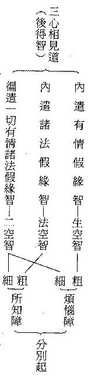



此三心中，第一、第二的「前二」心「名」为「法智」，因为是将有情与诸法，「各别」而「缘」的；「第三」心「名」为「类智」，因与前二智相类，将有情与诸法，作「总合」而「缘」的。



这为什麼叫做相见道？因这是「法真见道二空见分自所断障无间解脱总别建立」的，所以「名相见道」。於此所谓法，是效法亦即模拟的意思，就是效法真见道，并不是实际的断证。第一心在无间道效法生空智的见分，起生空观而习学断我执的相；第二心在无间道效法法空智的见分，起法空观而习学断法执的相；第三心在解脱道效法二空智的见分，起二空观而习学证二空理的相。可是在此成问题的，就是为什麼唯效法见分而不效法自证分？据基师《述记》卷九说：见分行相与真如境是差别的，所以效法见分；自证分与真如境体义是无别的，所以不效法自证分。同时要知道的，就是真见道中，不特有二空的见分，亦有二空的自证分，为什麼不效法自证分？真见道中，二空自证分虽说不无，但不能如彼二空见分亲缘真如，亲缘真如的当然要效法，不亲缘真如的自不用效法。



在此还要交待清楚的，就是二空见分，有无间道与解脱道，随自所断的惑障，就有了四种见分。无间道中，是各别断惑的，所以也就各别的效法人法二见分，因而立初二心；解脱道中，证理是相同的，所以就总合的效法人法二见分，因而立第三心。论说『总别建立，名相见道』，就是此意。现在总上所说，图示如次：



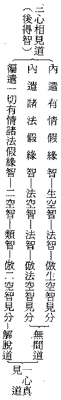



但这三心，究是相见道？抑是真见道？有二家的说法不同。「有义」，就是渐证渐断家义。他们认为「此三」心都「是真见道」，不可说为相见道，「以相见道」是「缘」安立的「四谛」十六心而起的。如《对法》说：『谓真见道缘非安立，非相见道中能缘非安立故』。所以此师肯定的说三心为真见道。「有义」，就是顿证顿断家义。他们认为「此三」心都「是相见道，以真见道」是「不别缘」的。现在既然别缘，证知是相见道。要之，渐证渐断家，以三心为真见道，以十六心为相见道；顿证顿断家，以一心为真见道，以三心为相见道。所以彼此对於这个观点，是有著很大不同的。



二、缘安立谛有十六心，此复有二：一者依观所取能取，别立法类十六种心。谓於苦谛有四种心：一、苦法智忍，谓观三界苦谛真如，正断三界见苦所断二十八种分别随眠；二、苦法智，谓忍无间观前真如，证前所断烦恼解脱；三、苦类智忍，谓智无间无漏慧生，於法忍智各别内证，言后圣法皆是此类；四、苦类智，谓此无间无漏智生，审定印可苦类智忍。如於苦谛有四种心，集、灭、道谛应知亦尔。此十六心，八观真如，八观正智。法真见道无间解脱见自证分，差别建立，名相见道。



前已就三心辨明相见道，现再就十六心明相见道。三心辨相见道，是观非安立谛；第「二」是「缘安立谛」，则「有十六心」。这十六心的相见道，「复有二」种：「一者依观所取」的谛理及「能取」的缘理之智，各「别」安「立法」忍、法智，「类」忍、类智的「十六种心」。基师《述记》卷九说：『所取，谓谛理；能取，谓缘理之智。法忍、法智缘谛理为境，观所取也；类忍、类智缘前智品，观能取也』。《对法论》说：『法智品道，真如为境；类智品道，法智为境』，可说与此所说完全是相同的。



如是十六心怎样别立？是说四谛各有四心，四四为十六心。现在先「谓於苦谛有四种心：一、苦法智忍」：苦是指的苦谛，法是指的苦谛增上所起教法，智是加行道中缘於苦法的智，忍是无漏慧，就是对於前苦法智，加以忍可。以此忍无间智，「观」於「三界苦谛」下的「真如」之理，进而「正断三界见苦所断」的「二十八种分别随眠」。二十八种分别随眠，是指欲界苦谛下的十惑，即所谓五利使五钝使，加上上二界苦谛下各有九惑，就是於十惑中除去瞋，因为上二界是不行瞋的。三界总合为二十八种随眠。「二、苦法智」：『法谓苦如，能缘苦如之智，名苦法智』。此缘苦法的智，如具足的说，应叫苦法智忍智。忍的作用在於断惑，智的功能在於证理，是为忍智二者的差别。由前「忍无间观」，此智得以现前，智现前时，「观前」所观的「真如」，得以「证前所断烦恼解脱」，名为苦法智。「三、苦类智忍」，这就是由前苦法「智」的「无间」有「无漏慧」的「生」起，以此所生的无漏慧，缘「於」前之「法忍」、法「智」的二见分而「各别内证」。从此二心以「后」，直至无学「圣法」，一切由此二心而彼得生，是此第三心的流类，所以说「皆是此类。四、苦类智，谓」由「此无间」忍而有「无漏智生」，此智但缘第三苦类智忍，所以特别「审定印可苦类智忍」。《杂集论》说：『於苦类智忍，内证印可，故名苦类智』。「如於苦谛有」这「四种心」的差别，其他「集、灭、道」的三「谛，应知亦」各有这四种心的差别。如分别说：集谛的四心是集法智忍、集法智、集类智忍、集类智；灭谛的四心是灭法智忍、灭法智、灭类智忍、灭类智；道谛的四心是道法智忍、道法智、道类智忍、道类智。合前苦谛四心，总为十六心。如「此十六心」，属於法忍法智的「八」者，是「观真如」的；属於类忍类智的「八」者，是「观正智」的。



八忍八智的十六心，不是真实的断证，是倣效真见道观。就是论说「法真见道无间解脱见自证分，差别建立名相见道」。基师《述记》卷九对这有不同的说法。一说：法忍是效法无间道的见分，法智是效法解脱道的见分；类忍是效法无间道的自证分，类智是效法解脱道的自证分。一说：法忍是效法无间道，法智是效法解脱道。此二是总效法，不分见分、自证分；类忍是效法无间、解脱二道的见分，类智是效法无间、解脱二道的自证分。虽有这两种说法，但基师以前说为本。如是种种印前智故，所以各各差别建立，而这差别建立，名相见道。现将两种解释中的第一种解释，图示如次：



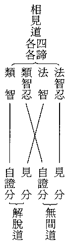



观所取的法忍、法智为什麼是效法二道的见分？观能取的类忍、类智为什麼是效法二道的自证分？如先真见道的无间、解脱的二道，各各有见分、自证分，其见分缘真如的理，自证分缘能证的智（见分）。因此，今相见道的法忍、法智，因为是缘苦谛的真如方面，所以倣效真见道的见分；类忍、类智，因为是缘法忍、法智的方面，所以倣效真见道的自证分。这场合，所缘与所倣是相违的。



二者依观下上谛境，别立法类十六种心。谓观现前不现前界苦等四谛各有二心：一、现观忍；二、现观智。如其所应法真见道无间解脱见分观谛，断见所断百一十二分别随眠，名相见道。



前以观所取、能取别立法类十六种心，此第「二」是「依观下上」八「谛境，别立法类十六种心」。於三界中，其下欲界四谛各具法忍、法智的二种，其上色、无色界的四谛各具类忍、类智的二种，综合成为上下八谛的十六心观。色、无色界所以合说，因为它们不论那种，都是属於定地，其法是相等的，所以合而不分。怎样观法？首先是「观现前」欲界所有的四谛，每谛有法忍、法智的二心，所以就别立法忍、法智的八心；其次是观「不现前」上二「界」所有的「苦等四谛」，每谛「各有」类忍、类智的「二心」，所以就别立类忍、类智的八心。虽说上下界有十六心，然论但举欲界苦谛以为法。所谓二心：「一」是「现观忍」，是指无间道；「二」是「现观智」，是指解脱道。「如其所应」，它的效法是这样的：现观忍是效「法真见道」中的「无间」道的「见分观谛」；现观智是效法真见道中的「解脱」道的见分观谛。为什麼不法自证分？因这十六心偏缘谛理，所以不效法自证分。对这，《瑜伽》五十五有说：『现观边智谛现观，……当知此智第三心，无间从见道起方现在前，缘先世智曾所观察，下上二地及二增上安立谛境，似法、类智世俗智摄，通世出世，是出世间智后所得。如其次第於一一谛二种智生，谓忍可欲乐智，及现观决定智。如是依前现观起已，於下上诸谛中二二智生』。



如是观三界四谛，「断见所断」的「百一十二分别随眠，名」为「相见道」。所谓百一十二分别随眠：欲界四谛有四十随眠，上二界四谛，一一除去瞋恚，八谛减去八瞋随眠，各有三十六随眠。三界四谛综合为百一十二。对此如作较为清楚的说明，是这样的：苦法智忍缘欲界的谛如，倣效真见道中无间道见分，断除欲界的烦恼；苦法智缘欲界的谛如，倣效真见道中解脱道见分，证悟欲界的谛理；苦类智忍缘上二界的谛如，倣效无间道见分，断上二界的烦恼；苦类智缘上二界的谛如，倣效解脱道见分，证悟上二界的谛理。苦谛是这样，餘三谛亦然。



兹将观下上界的十六心图示如次：



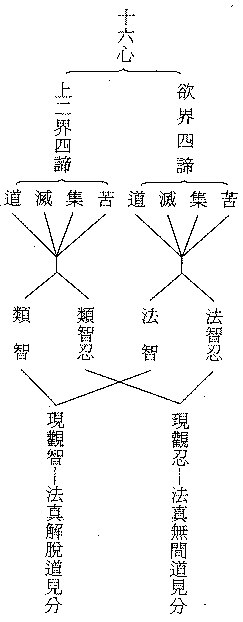



如是所说两种十六心观的前后，诸论所说有不同的。《瑜伽》五五先说上下八谛，次说所取能取；《对法》第九及本论此处先说所取能取，后说上下八谛。慈恩《枢要》卷下，采先说上下八谛，基师《述记》卷九，从先所取能取说，《义灯》卷七综合而为三说：一、先说上下八谛；二、先说所取能取；三、从行者意乐而列前后不定说。虽说前后可以任情而说，但真正为菩萨的观法，在能取所取的方面。



所谓十六观心，小乘所说，不论是名目，不论是配当，可说完全是类似的。不过，小乘以见道立十五心，第十六心的道类智，则被收於修道之中，与十六心见道之说不同。十六心见道说也有异论：《瑜伽》五十五及本论此处，虽将第十六心摄於见道，但《显扬论》卷十，则又将第十六心摄於修道。



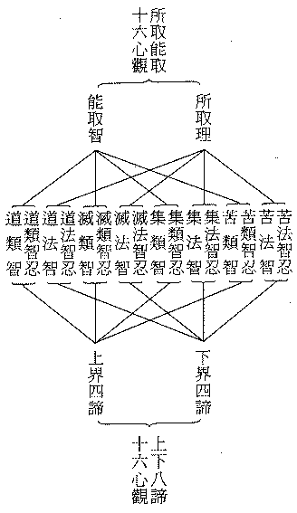



若依广布圣教道理，说相见道有九种心，此即依前缘安立谛二十六种止观别立：谓法类品忍智合说，各有四观即为八心，八相应止总说为一。虽见道中止观双运，而於见义观顺非止，故此观止开合不同，由此九心名相见道。



上来说相见道有二种十六心，是依行者缘安立谛而说的，「若依」菩萨行者，在见道等不作此观，但欲「广布圣教道理」，来「说相见道」，只「有九种心」，而这亦依前义差别之所建立。意谓「此即依」於「前缘安立谛」的「二」个「十六种止观」而「别立」的。所「谓法类品忍智合说各有四观即为八心」，这是一种怎样讲法？以前依观能所取的十六心观：缘如为境的法忍、法智八心合立四观，因为它们的品类是相同的；缘智为境的类忍、类智八心合立四观，因为它们的品类亦是相同的。依后观上下谛的十六心，属於忍品的八忍合为四观，因为同是属於忍的一类，属於智品的八智合为四观，因为同是属於智的一类。如是各有四观，即为八心。观心有八，与观相应的止，照理亦应是有八止，现在不说八种，而将「八相应止总说为一」。观心有八，止唯是一，止观别立，有九种心。在此成为问题的，就是与观相应的止，照理既然有八，为什麼现在总说为一？要知於「见道中」，虽是「止观双运」，然「而」对「於见义，观」是「顺」於见义的，「非」是「止」顺於见义。因为如是，所以「此观止」的「开合」有所「不同」，就是将观开为八，将止合为一，止观合说有九心，「由此九心名相见道」。《瑜伽》五十八说：『其於尔时智行如是建立见道，由二道理：一、广布圣教道理有戏论建立；二、内证胜义道理离戏论建立。依初建立增上力故，说法智品有四种心，种类智品亦有四心，随尔所时八种心转，即尔所时总说名一无间所入纯奢摩他所显之心。如是总说有九种心见道究竟，……即尔所时说名一心』。至於止总说为一心，《瑜伽略纂》第十五说：『即法忍、智为四，类忍、智为四心，名八心。见道双运故，此八俱时有，定品亦八心，但以功能令心住寂静，不同於智能断惑故，言总得一心名，智为八心，故合有九』。



诸相见道依真假说世第一法无间而生及断随眠，非实如是，真见道后方得生故，非安立后起安立故，分别随眠真已断故。前真见道证唯识性，后相见道证唯识相，二中初胜故颂偏说。



上来所说三心、十六心、九心「诸相见道」，都是「依真」之义而后「假说」的。为什麼？因这诸相见道是依「世第一法无间而生」出的十六心以「及」所谓「断」诸分别「随眠」，并「非实」在是「如是」的。亦即这是假说非实断义。《显扬论》十七说：『从第一法无间有三心生，断见所断百一十二烦恼』。《对法论》说：『谓世第一法无间苦法智忍等十六心生，断见所断』。《瑜伽》五十五说：『世第一法无间生三心断见所断』。像这些论中所说，皆约相见道依真假说从第一法无间而生，据实而言，非是无间实能断的，所以说无间及能断，当知皆是假说，并非真的如此。若据实言，应说从前世第一法无间有「真」一心「见道」，然「后方得」三心相见道，再次生十六心等，所以菩萨在相见道中，学习真见道的断证之事，是以证知是假立的。既是假立的，为什麼还要学习？为欲徧知二障二我，所以需要学习。



相见道的三心，既然是从真见道后生，所以十六心并「非」在「安立」谛「后」而「起安立」的，因为「分别」所起的「随眠」，在「真」见道中「已」经「断」了的。正因三心相见道是非安立的，所以不得将非安立因，证於三心非真见道，只可以非安立因证十六心非真见道。



见道既有真见道与相见道的二种，为什麼颂中唯说真见道？如说『若时於所缘，智都无所得』，就是真见道无分别义。颂文所以偏说真见道，因为「前」之「真见道」，在於「证唯识」的实「性」，而「后」之「相见道」，在於「证唯识」的法「相」。於此「二」者之「中，初」真见道较为殊「胜」，所以「颂」特「偏说」。至於证识相的相见道，是属后得智摄，不及根本智胜。



戊五　会通二智



前真见道根本智摄；后相见道后得智摄。诸后得智有二分耶？有义：俱无，离二取故。有义：此智见有相无，说此智品有分别故，圣智皆能亲照境故，不执著故说离二取。有义：此智二分俱有，说此思惟似真如相，不见真实真如性故，又说此智分别诸法自共相等，观诸有情根性差别而为说故，又说此智现身土等为诸有情说正法故，若不变现似色声等宁有现身说法等事？转色蕴依不现色者，转四蕴依应无受等，又若此智不变似境离自体法应非所缘，缘色等时应缘声等，又缘无法等应无所缘缘，彼体非实无缘用故，由斯后智二分俱有。



此明二道为二智所摄以会通二智。「前」之「真见道」，是属「根本智摄」，因为是无相的；「后」之「相见道」，是属「后得智摄」，因为是有相的。至於「诸后得智」，现所要论究的，是不是都「有二分」？论究到这问题，有三师的解说不同：「有义」，是第一师的说义。他们认为后得智，见相二分「俱无」，因为后得智，是「离」了能所「二取」相的，那里还有什麼见相二分？《佛地论》中对这问题，虽有三师说法不同，但无一师同於此说。因该论第一师所说，同於此论第二师义，该论后二师所说，则同此论第三师说。该论后二师的不同何在？就是第二师总说无漏智有见相，但不分别根本、后得二智；第三师则作分别说：根本智绝对是无见相二分的，但后得智见相二分不无，所以全同本论第三师说。「有义」是第二师的说义。他们认为「此」后得「智，见」分是「有」的，「相」分是「无」的。为什麼这样主张？因在《瑜伽论》等的诸圣教中，皆「说此智」是「有分别」的，既然有分别，当然有见分。既然有见分，为什麼没有相分？因「圣智皆能亲照」诸法的理「境」，而凡理境必然是无相的，亦即直取心外本质而非托质而缘的，所以没有相分。既然有见无相，为什麼本颂及诸经论皆说离二取相？当知这是约「不执著」二取而「说离」於「二取」的，并不是真的全无见分。



「有义」，是第三师的说义。前二师的说义不是正义，此师的说义才是正义。依此师的正义说：「此」后得「智」，见相「二分」，完全「俱有」。他的这一说法，是依《瑜伽论》来。如该论七十三「说：此思惟似真如相，不见真实真如性故」。《瑜伽》原文是：『问：若思惟真如即观真如耶？设观真如即思惟真如耶？答：应作四句：有思惟真如非观真如，谓以分别所摄如理作意思惟真如，但见真如相不见实真如。乃至未至正通达位，及通达后作意思惟安立真如』。这是四句分别中的第一句。当知此中所说的思惟，是即显示有见分，此中所说的似真如相，是即显示有相分，此中所说不见真实真如性，是即显示后得智不亲缘如。因此，证明后得智二分俱有。论中的其餘三句亦引如下：『有观真如非思惟真如，谓通达真如时由胜义故非思惟其相；有思惟真如亦观真如，谓通达后相续思惟非安立真如；有不思惟真如亦不观真如，谓离如理所引作意思惟诸相』。第二句是指真见道根本智；第三句是指相见道八观真如各观真如；第四句是指从发心住。



「又」依《佛地论》「说：此」后得「智」，能够「分别诸法」的「自」相、「共相等」，能够「观诸有情」的种种「根性差别，而」后「为说」种种法，以适应各个不同的根性。以此足以证明见分是有的，第一师说没有见分，自不能成立。《佛地论》第三师云：『无漏无分别智，相应心品无分别故，所缘真如不离体故，如照自体无别相分。若后得智相应心品有分别故，所缘境界或离体故，如有漏心似境相现分明缘照，若无漏心缘离体境，无似彼相而得缘者，观所缘论不应说言五识上无似极微相故非所缘。如是境相同无漏心，无漏种起，虽有相似有漏法者，然非有漏，如有漏心似无漏相非无漏故』。



论中「又说此」后得「智」，能够变「现」种种的「身土」，以为一切「有情说正法故」。如他受用身土，就是佛所变似的色，为有情说正法，就是佛所变似的声，假「若不变现似色」似「声等」，那里会「有」什麼「现身说法等事」？既然变似色声，证知相分不无，所以第二师说没有相分，是亦不应道理的！《佛地论》第三对此有清楚的交代说：『若无漏心全无相分，诸佛不应现身土等种种影像，如是则违处处经论』。因为《处处经论》都说佛能变似身土等，我们怎麼能不承认？



再从反的方面证明有相分说：在这转依的通达位，并不是没有相分的，且以五蕴为例：假定如你们说，转依位中色蕴已转，所以不会变现色这样的事，那末，转依位中同样的已转四蕴，理亦应当没有受等，假定真的没有受等，那岂不是如土木一样？怎麼可以称为大觉？既称大觉，证知受等四蕴於转依位，并不是没有，既不无受等，已转色蕴怎麼可说不现色？《佛地论》卷三说：『转色蕴依不得色者，转四蕴依应无识等，则成大过』！



「又」或假「若此」后得「智不」依自本质体「变似」声色等「境」而为所缘，那它「离自体」之「法」的他心、他身土等，就「应」当不是带彼影像而起的「非所缘」缘。若说不带相起亦可名为所缘缘，那「缘色等时」，不但可以缘色，亦「应缘」於「声等」。反过来说亦是如此，就是缘声等时，亦应缘於色等。为什麼这样讲？因缘色等智不带声等相，而缘声等智亦不带色等相的。可是事实不是这样，所以不得说无相分。



「又」若此后得智「缘」於「无」体「法等」，如缘过去未来等的无体法，或缘龟毛兔角的无体法时，假使不变似境而缘，那就「应」当「无所缘缘」。为什麼？因为「彼」法「体」既「非」是「实」有，同时又无所变的相分，怎麼会有所缘缘的作用？所以说「无缘用故」。所缘缘义如果真的不成，不特菩萨不能亲缘於无，就是佛亦不能亲缘於无。



「由」於上面所说的种种道理，「斯后」得「智」，确是「二分俱有」的。绝对不可说二分俱无，亦不可说见有相无，这是我们必须确实把握住的！



最后，引《宗镜录》说：『问：如第六识缘龟毛兔角等时，此所缘境为有为无？若言有者，圣教不应指此喻於徧计所执性是无；若言无者，无法无体，非所缘缘，缘此意识阙所缘缘，如何得起？若言此心无所缘缘者，云何论言亲所缘缘，能缘皆有？若龟本无毛，兔本无角，约此本无喻所执性，由所执我及所执法皆本无故，其能缘心，将缘此等无法之时，由无始来熏习力故，依种生时，从识自证分上变起龟毛等相分及缘此龟毛见分，此相见分与识自证分同一种生，既依种生，是依他性非体全无，不同本来无体龟毛，故得成所缘缘』。《宗镜录》虽就有漏心说，但以有漏心例无漏心，当知亦是如此，是以此后得智一定是二分俱有。



戊六　摄六现观



此二见道与六现观相摄云何？六现观者：一、思现观，谓最上品喜受相应思所成慧，此能观察诸法共相，引生煖等加行道中观察诸法，此用最猛偏立现观，煖等不能广分别法，又未证理故非现观。二、信现观，谓缘三宝世出世间决定净信，此助现观令不退转立现观名。三、戒现观，谓无漏戒，除破戒垢令观增明亦名现观。四、现观智谛现观，谓一切种缘非安立根本，后得无分别智。五、现观边智谛现观，谓现观智谛现观后诸缘安立世出世智。六、究竟现观，谓尽智等究竟位智。此真见道摄彼第四现观少分；此相见道摄彼第四、第五少分；彼第二、三虽此俱起，而非自性故不相摄。



这是说明二见道与现观的相摄。讲到现观，诸论典中，无不说有种种差别。《对法》第十三说：『建立现观略有十种：谓法现观、义现观、真现观、后现观、宝现观、不行现观、究竟现观、声闻现观、独觉现观、菩萨现观』。《显扬论》十七说：『又此现观差别有十八种：谓闻所生智、思所生智、修所生智、顺抉择分智、见道、修道、究竟道不善清净世俗智、善清净世俗智、胜义智、不善清净行有分别智、善清净行有分别智、善清净行无分别智、成所作前行智、成所作智、成所作后智、声闻等智、菩萨等智』。《显扬论》中除了说十八现观，还说有与本论相同的六现观。《瑜伽论》五十五及七十一，并明六现观。《摄论》说十一现观，以明三乘现观各别。所谓现观，严格的说，是以无漏智慧现证诸法实相而得名的。所以现观，一定是现前无分别的证得，不是没有现证而得名为现观的。如分别解说：现是现前，观谓观察，就是真理常现在前，妙智恒能观察，令不间断任运相应，所以名为现观。以何现观？要以出世间的胜智，能除见所断惑，而以无分别的证得。所以现观智是出世间智而非世间智。本论在此说有六种现观，现在所要论究的，就是「此」真相「二见道与」该「六现观」，彼此之间的「相摄」是怎样的？为了解答这问题，首先说明六现观，然后再谈它们的相摄。「六现观者」：



第「一」是「思现观：谓最上品喜受相应思所成慧」。《瑜伽》七十一说：『问：思现观何自性？答：上品思所成慧为自性，或此俱行菩提分法为自性』。思现观所以得名为思现观，就是由思所成慧，令所观境得以分明现前，即思的现观，名为思现观。但是这思向有三品，现在不是以中下思为体，而是以最上品思所成慧为体。为什麼说唯与喜受相应不说与乐受相应？因思现观是欲界中的思慧，如此思慧唯在意识中有，而欲界第六意识，唯有喜、忧、舍的三受相应，根本没有苦、乐二受相应的，虽说色界中的意识有乐受，但上二界又是没有思慧的。至於忧受不是无漏根，舍受不与最上品的思俱，所以说唯与喜受相应。又在欲界之中，假使得以闻法，唯有意识领解，所以说唯与喜受相应。「此」思现观「能观察」一切「诸法」的「共相」，如观诸行无常，或有漏皆苦等，或观一切法真如等，此观是最胜的，所以名观共相而不言观自相。此思现观，能「引生煖等」，於「加行道中观察诸法」，当知这就是从思而起修。在见道前「此用最」极「猛」利，不同加行，所以特「偏立」为「现观。煖等」四加行，虽近於见道，但境界微略，观空无我等，有一定分齐，「不能广分别法」，但观所取无等，「又未」能「证」於四圣谛「理」，所以不得说为「现观」。虽见道等亦不能广分别诸法，但因能够证於谛理，所以立为现观。不特本论说四加行不得立为现观，《瑜伽论》卷七十一亦作此说：『问：无边际智及顺抉择分善根何现观摄？答：非诸现观摄，当知是现观等流』。《摄大乘论》说四加行慧，是现观前的方便，仅邻近於无漏智，而不是真正的无漏智，所以名为现观边。如该论说：『应知如是诸三摩地，是现观边』。证知四加行慧，不得说为现观。



第「二」是「信现观」：这是以上品净信为体。「谓缘」佛法僧的「三宝」以及「世出世间」的诸法，对於三宝以及世间的有漏因果法，出世的无漏有为无为诸法，都能生起「决定」的「净信」。相信三宝确实具有无漏性净功德的，相信世出世间的因果，绝对丝毫不爽的，名为决定净信。现观诸法的现观，本来是慧的作用，现在说信为现观，信体实在不是现观，因「此」净信能「助现观」，使「令」所修的现观，「不」会再有所「退转」，所以亦得「立现观名」。《瑜伽略纂》十四说：『信从相应得名现观』，亦是此意，并非是正现观。



第「三」是「戒现观」：这就是「无漏戒」，而与无漏道共生的道共戒。谓当无漏道法现前时，自然而然的成为戒体，对戒不会再有所毁犯。戒本来不是现观，现在所以把它说为现观，因以无漏道共戒，「除」去「破戒」的「垢」染，使所修的现「观」，益发「增明」起来，所以「亦名现观」。假使没有戒助，慧即成为狂慧，可见在此戒是极为重要的。《瑜伽略纂》十四说：『戒是共有等名现观』，就是戒与现观共有得名为现观的，并非是正现观。



第「四」是「现观智谛现观」：智是能观的智，谛就是非安立谛，此智现观缘非安立谛，所以名为现观智谛。论「谓一切种缘非安立根本、后得无分别智」。此中所说的一切种，是指诸法的真如，依於这一切种所起的缘非安立谛的根本、后得二种无分别智，是名现观智谛现观。真如就说明真如好了，为什麼说为一切种？有人说：『以真如与一切法为体，故以真如名一切种』。有人说：所谓一切种就是真如，这是不对的，因这通取见道、修道的根本、后得的二智，怎麼可说一切种是真如？《瑜伽》七十一说：『问：现观智谛现观何为自性？答：缘非安立谛境慧为自性，或是俱行菩提分法为自性』。《瑜伽》五十五又说：『三心见道是此现观』。接著又说：『又是现观即是见道亦双运道』。



第「五」是「现观边智谛现观」：意「谓」在「现观智谛现观」以「后，诸缘安立世出世」等所得之「智」。这通於一切有漏无漏一切见修道的缘安立谛智。怎麼知道？《瑜伽》七十一说：『问：现观边智谛现观何自性？答：缘安立谛境慧为自性，或此俱行菩提分法为自性』。《瑜伽》五十五又说：『云何名为现观边智谛现观？谓此现观后所得智名现观边智』。意思是说：初现观就是真见道的非安立谛名现，下现观是六现观的通号，边是后边，即此安立谛是在非安立谛的后边，智是缘安立谛的智，谛就是安立谛，此安立谛的智，是非安立谛后的智，所以说为智谛现观后诸缘安立世出世智。



第「六」是「究竟现观」：是「谓」无学道后所生的「尽智」、无生智等的「究竟位智」。《瑜伽论》说：『谓由永断修所断故，所有尽智、无生智生，或一向出世，或通世出世，於现法中一切烦恼永断决定故，於当来世一切依事永灭决定故，名究竟现观』。又说：『尽、无生智等为自性故，或此俱行菩提分法为自性』。若广泛的说，这是通於苦智、集智、灭智、道智、法智、类智、世俗智、他心智、尽智、无生智的十智，而且都是无漏的。以大乘说，小乘罗汉不能得到这十智，只有最后的二智，就是烦恼漏尽之处名尽智，起智缘择灭无为烦恼不生处名无生智。



明白了六现观是什麼，进而就可说明它与二见道的相摄。谓「此真见道」仅能「摄彼第四现观」谛智现观的「少分」。所谓少分，因第四现观，有根本智，有后得智，而这真见道，只能摄彼缘非安立谛的根本智，并不能摄他的后得智，所以说为少分。「此相见道」仅能「摄彼第四」现观谛智现观的少分及仅能摄彼「第五」现观边智谛现观的「少分」。意说相见道摄那第四现观后得智的少分，不摄它的根本智。同时，唯摄相见道，并不摄修道。其次，相见道唯摄第五现观后得智全，并不能摄世俗智全。由於如此，所以只摄少分。至於「彼第二」信现观，第「三」戒现观，「虽」说也与「此」真见道及相见道「俱起」，但能助令不退，令观增明，然「而非」是「自性」之类，所以「不」得说明它们的「相摄」。所谓非自性，是说信与戒，不是慧的同性。因为凡观必以慧为体性，现在所说的六现观，除第二、第三两现观，其餘的四现观，都以慧为体性。既然如此，为什麼不摄第一现观？因为尚未修习。为什麼不摄第六现观？因为尚未现起。



上来虽已说明六现观及与见相二道的相摄，但六现观的成就相怎样，还不知道。现引《瑜伽》七十一说：『问：思现观有何相？答：若有成就思现观者，能决定了诸行无常，一切行苦，诸法无我，涅槃寂静，住异生位，已能证得如是决定，非诸沙门若婆罗门，若天魔梵及餘所能如法引夺。问：信现观有何相？答：若有成就信现观者，或是异生或非异生，或於现法，或於现法及后法中，终不妄称餘是大师，餘法善说，餘僧正行。问：戒现观有何相？答：若有成就戒现观者，终不复能乃至故心断傍生命，不与而取，习欲邪行，知而妄语，饮米等酒诸放逸处。问：现观智谛现观有何相？答：若有成就现观智谛现观者，终不复能依诸妄见而有所作，於自所证而有疑惑，於诸生处而有贪染，现行世相计为清净，诽谤声闻、独觉、大乘作恶趣业，何况能造害父母等诸无间业，乃至不能生第八有。问：现观边智谛现观有何相？答：若有成就现观边智谛现观者，终不於彼他所诘问而生怖畏。问：究竟现观有何相？答：若有成就究竟现观者，终不复能犯於五处，亦不复能乃至故断诸傍生命，不与而取，行非梵行，习淫欲法，知而妄语，蓄积财宝诸妙欲具而受用之，亦不怖畏不可记事，亦不妄计所有苦乐，自作、他作、自他俱作、非自非他为因而生。如是等类，当知是名诸现观相』。从这所说的诸现观相看来，可知不论修什麼现观，对自己都是有大利益的！



戊七　结成见道



菩萨得此二见道时，生如来家住极喜地，善达法界得诸平等，常生诸佛大集会中，於多百门已得自在，自知不久证大菩提，能尽未来利乐一切。



这是结成见道以明入地所得的功德。行菩萨道的「菩萨」，不论在什麼时候，只要「得此」真、相「二见道」，真正悟入唯识的性相，亲证於真如法界，那他立即就「生如来家住极喜地」。登地的菩萨，深入诸佛自证的法界，具有佛慧的气分，是为生如来家。世亲《摄论释》第六说：『由此能令诸佛种姓无断绝故』，是为生如来家。无性《摄论释》第六说：『谓佛法界名如来家，於此证会故名为生，於此所缘胜智生故，转先所依生餘依故，绍继佛种令不断绝。如餘续生餘众同分，所生能生相续不断，托所生家。如是般若波罗密多，证佛法界；名於中生，名真佛子。由此般若波罗密多，於佛法界能正作证，树自相续自在现前故名为生』。如是以般若慧「善达法界」的菩萨，就能「得诸平等」。诸平等，就是《摄论》所说的得一切有情，得一切菩萨，得一切佛的三种平等心性。意显众生界、菩萨界、如来界，虽有三位的差别，而实心性是平等的。『释论解说为：一、有情平等，指一切有情的如来藏性平等不二。二、菩萨平等，指诸大菩萨所起的意乐，所作的事业平等。三、诸佛平等，指十方三世一切诸佛的法身而说。悟入三事平等，即名为菩萨见道』。菩萨见道既然具有这样高深的程度，当然得以「常生诸佛大集会中」，见佛闻法以增进自己的福德智慧。见道入欢喜地已，「於多百门已得自在」，就是能於百世界中作佛，智见能入百法明门，以百菩萨而为眷属等。《十地论》第三说：『经曰：於一念间得百三昧，得见百佛，知百佛神力，能动百佛世界，能入百佛世界，能炤百佛世界，能教化百佛世界众生，能住寿百劫，能知过去、未来世各百劫事，能善入百法门，能变身为百，於一一身能示百菩萨以为眷属』。像这样的於多百门得自在，不是约前后念有此作用说，而是在一刹那中就有这样的功能。正因亲证到诸法真如，而於多百门得大自在，「自知不久」一定能够「证」得佛果位上的「大菩提」，并「能」穷「尽未来」际的「利乐一切」有情。自知能证是自利，利乐一切是利他。



丙四　修习位



丁一　牒科标问



次修习位其相云何？



前已说明第三通达位，现来说明第四修习位。其「次」所谓「修习位，其」修习的「相」貌是怎样的？这就是现在所要说明的。在此我们首要知道的，就是在前通达位，虽已於诸法界深为作证，但为了断除餘障及证转依，还得数数修习无分别智，以期达到所要修学的目的，所以名为修习位，亦名为修道位。



丁二　举颂总答



颂曰：无得不思议，是出世间智；舍二粗重故，便证得转依。



上是牒科标问，此是举「颂」总解答「曰：无得不思议」的根本无分别智，不是世间的俗智，而是能断世间有漏之本的二障，或体是无漏能证真如的，所以叫做「是出世间智」。进而对这出世间的根本无分别智，不断的加以修习，到了相当的时候，断舍俱生的二障种子及其习气，所以说「舍二粗重故」。更进而至於第十地的满位金刚无间道时，一切的二障，都断尽无遗，登於佛位而证得二转依的大果，所以说「便证得转依」。如简单的说：初三句正明此位的相，后一句明此位究竟时，便得到二转依的果。详细的意义，到论文会有说明。



丁三　解释颂意



戊一　释颂转依



论曰：菩萨从前见道起已，为断餘障证得转依，复数修习无分别智。此智远离所取能取，故说无得及不思议，或离戏论说为无得，妙用难测名不思议。是出世间无分别智，断世间故名出世间，二取随眠是世间本，唯此能断独得出名。或出世名依二义立，谓体无漏及证真如，此智具斯二种义故独名出世，餘智不然，即十地中无分别智。



前以颂文简单的答覆，现在以「论」文详细的解释。这段文解释初二句颂「曰」：如是修习位上的「菩萨」，出了通达位的现行，亦即所谓从「见道起」，「为」欲更「断」除其「餘」俱生的二「障」，并且为欲「证得」二种「转依，复」又「数」数不断的「修习无分别智」，於是就踏上修习位，亦有叫做修道位的。前所讲的见道，唯在初地的初入地心，此所讲的修道，时间是相当长的，就是从初地的住心以后，直至第十地的出心，亦即金刚无间道之间，皆名修习位，几乎通於二阿僧祇劫这麼久的时间。在这长时间中，经过十地阶段，於十地内，一一地各以一波罗密行为本行而修其餘的诸行，各各断一重障，各各证一真如。因此，经十地的一一间，所修、所断、所证，不管那种，都成十种。在这十地中，从初地后到第七地，是有漏无漏杂起的，至於观智，当然是以加行的功用为必要，能於一行中修一切行，其间经过一阿僧祇劫，亦即第二阿僧祇劫满。八地以上，是纯无漏的相续，至於观智，是任运无功用的，能於一切行中修一切行，其功德展转增进。从八地到佛果间，又必须经一阿僧祇劫，亦即是第三阿僧祇劫满。在第九地，能做到四辩自在，度生无碍。进入第十地至其满心的金刚无间道，所有的二障断尽无遗，终於到达佛果解脱道，二转依的妙果，朗然而开，修行目的，全部达到。同时要知道的，就是能观的智慧渐渐增进，所观的惑障渐渐断除，是为修习位的大要。



所谓为断餘障，意说在见道位，已经断除分别我法二障，到此修道位中，就要集中力量以断除俱生我法二障。但断俱生二障，不是一般行法所能做得到的，必须无分别智才能断除，所以要数数的修习此智。但是应注意的，就是此修习位，并非唯取此无分别智而为修习，实际亦修十波罗密行的。既然如此，为什麼论中说修习位，唯取无分别智不说餘法？基师《述记》卷九说『今从所缘能断道说，略不说餘』。意思是说此所缘的就是真如，对所缘的真如而说能缘无分别智断惑之道，为修习位。至於其餘的十波罗密行，修道位上的菩萨，当然是要修的，略而不说而已。



「此」所修的无分别「智」，有股特别殊胜的力量，能够「远离」徧计所执的「所取」，所以「说」为「无得」，能够远离徧计所执的「能取」，所以说为「不思议」。正因如此，所以颂说『无得不思议』。「或」者还可这样解说：远「离」一切有漏分别的「戏论」妄执，「说为无得」；违逆生死离诸过失的无漏智，微「妙」作「用难」以「测」度，「名不思议」。所谓戏论，不但是有分别的，而且是有漏的，诸凡有漏有分别的，必然是有所偏执的，所以成为戏论。可是无分别智体，不但是无分别的，而且是无漏的，所以一切戏论远离。如是远离戏论的无分别智，有其不可思议的妙用，所以说为不思议。



此无得不思议智，不是世间的有分别智，「是出世间」的「无分别智」。无分别智就叫做无分别智好了，为什麼叫做出世间？因为此智能够「断」除有漏「世间」的诸染污法，所以「名出世间」。能够断除有漏世间诸法，实际亦即是洞达了我法皆空，唯有洞达我法皆空，始得真正名为出世。『当知空即出世，所以出世不是离这世间的意思，而是在这上面不再执著，不执著就得解脱，解脱是即出世。因而，出是高超或超胜之义，不是什麼出离之义。高超一切世间，超胜一切众生，是名出世』。如把出世看成是离开这个世间，那是对於出世的误解！



世间之所以为世间，必然有世间的根本，为世间根本的是什麼？能所「二取」的「随眠」，实「是世间」的根「本」，有了这二取随眠的存在，必然是有所取著而堕在世间的。「能断」二取随眠的，唯有此无分别智，所以亦即「唯」有「此」智，「独得出名。或出世」的这个「名」称，是「依」如下的「二义」而建「立」的：所「谓」自「体」是「无漏」的，同时又能亲「证」诸法「真如」的。「此」无分别「智」，恰好「具斯二种义」，所以「独名出世」。除此根本智外，其「餘」如后得「智，不」得名为出世，因为它不具这二义。这出世间智，「即」是「十地中」的「无分别智」。



数修此故舍二麤重，二障种子立麤重名，性无堪任违细轻故，令彼永灭故说为舍。此能舍彼二麤重故，便能证得广大转依。



颂文的初二句已经解释，现来解释颂文后二句。行者如果「数」数不断的「修此」无得不思议的出世间智，经过一段相当久的时间，那就可以断舍俱生的二障种子及其习气，亦即颂中所说的「舍二粗重」。二障种子就说为「二障种子」好了，为什麼又「立」为二「粗重名」？以其「性无堪任违」於微「细轻」妙的无漏无分别智。现在数数修习无分别智，「令彼」二种粗重「永灭」，所以「说」之「为舍」。因「此」无分别智，在十地中，逐渐逐渐的，「能」够「舍彼二」种「粗重」，一直舍到最后究竟无有，「便能证得」佛果位上的「广大转依」。



《识论集解》卷九对於粗重即是二障种子有所解释说：『言粗重者，谓二惑种子。释曰：於理及事心无堪能，故称粗重；一切未来惑及业等皆从此生，故称种子。言细轻者，谓一切有流善法种子。释曰：於理及事心有堪能，故称细轻，一切未来信等五根善法皆从此生，故称种子。又云：无所堪能不调柔相，是粗重相。此无堪能不调柔相复有五种：一、现在相，二、刚强相，三、障碍相，四、怯劣相，五、不自在转无堪能相。由有此相，顺杂染品，违清净品，相续而住，是故说为无所堪能不调柔相』。《瑜伽论》说：『於诸自体中所有种子，若烦恼品所摄，名为粗重，亦名随眠；若异熟品所摄及餘无记品所摄，唯名粗重，不名随眠；若信等善法品所摄种子，不名粗重，亦非随眠。何以故？由此法生时，所依自体，唯有堪能。非不堪能故』。论中又说：『有二种粗重：一、漏粗重，二、有漏粗重。漏粗重者，阿罗汉等修道所断，烦恼断时皆悉永离。此谓有随眠者，有识身中不安隐性无堪能性。有漏粗重者，随眠断时，从漏所生，漏所熏发本所得性，不安隐性，苦依附性，与彼相似无堪能性，皆得微薄。又此有漏粗重，名烦恼习，阿罗汉、独觉所未能断，唯有如来能究竟断，是故说彼名永断习气不共佛法』。



依谓所依即依他起，与染净法为所依故，染谓虚妄徧计所执，净谓真实圆成实性，转谓二分转舍转得。由数修习无分别智断本识中二障粗重，故能转舍依他起上徧计所执及能转得依他起中圆成实性，由转烦恼得大涅槃，转所知障证无上觉，成立唯识意为有情证得如斯二转依果。



对颂文『便证得转依』的最后一句，有两师的解释不同。这是第一师的说义。此师认为转依的「依」，义「谓所依，即」是「依他起」。为什麼说依他起为所依？因它能为染净法作所依的。「染」就是所「谓虚妄徧计所执」，「净」就是所「谓真实圆成实性」。为转依的「转」，又是什麼意思？为染净「二分转舍转得」之义。就是登地以上的菩萨，「由」於「数」数不断「修习」出世间的「无分别智，断」除「本识中」的烦恼、所知「二障粗重」，所以就「能转舍依他起上」的虚妄「徧计所执」，并且「能」够「转得依他起中」的真实「圆成实性。由」於「转」舍了「烦恼」，所以就「得」到了「大涅槃」，由於「转」舍了「所知障」，所以就「证」得了「无上」大「觉。成立唯识」的最大用「意」，就是「为」了使诸「有情」，皆能「证得如斯二转依果」。



上来依文解释，大概就是这样。现在我们所要问的，就是与染净别法为所依的，究是指的什麼？是专指第八识？抑指诸有为法？从诸法皆是缘生说，所谓依他，当然通指一切有为法，但现在约无间与染净法俱为所依，则是专门指的第八阿赖耶识，因为其他的色心有为诸法，都是有所间断的，不得为染净别法所依。而且，假定约六、七识为所依，当六、七识正在生起染时，说它与染法为依固然不成问题，怎麼能够与净法为依？反过来说，假定六、七识善心生起时，说它与净法为依自是不成问题，怎麼能与染法为依？由於这样的关系，所以不得不取第八识为染净依，因第八识本身是无记的，可为染净二者所依。



其次，这里所说的转依，与《摄论．彼果断》中所说是相同的。如该论说：『如是已说增上慧殊胜，彼果断殊胜云何可见？断谓菩萨无住涅槃，以舍杂染不舍生死二所依止转依为相。此中生死，谓依他起性杂染分；涅槃谓依他起性清净分；二所依止谓通二分依他起性。转依，谓即依他起性对治起时，转舍杂染分，转得清净分』。《摄论讲记》解释说：『什麼是断果呢？断果，就是菩萨所证得的无住涅槃。这无住涅槃的体相，以舍杂染（其他的译本作舍烦恼）的烦恼而不舍生死事，在那徧计、圆成二种所依止的依他起中，舍染转净的转依为它的体相。二所依的二字，指生死与涅槃。生死是依他起性随染流转的杂染分——徧计执性。对这杂染分，菩萨舍烦恼不舍生死，不舍弃生死度众生，故和小乘所证得的无餘涅槃不同。他虽不舍生死，但已销融了烦恼，故与凡夫的生死轮回不同。涅槃是依他起性上的清净分——圆成实性。二所依止的所依，即通於杂染清净二分的依他起性；这是『杂染清净性不成故』的依他起。转依，即依他起性上的对治道生起时，转舍徧计的杂染分，转得圆成的清净分。这样，果断的无住涅槃，以舍依他的染分，而得依他的净分圆成实为体』。



或依即是唯识真如，生死涅槃之所依故，愚夫颠倒迷此真如故无始来受生死苦，圣者离倒悟此真如便得涅槃毕竟安乐。由数修习无分别智断本识中二障麤重，故能转灭依如生死及能转证依如涅槃，此即真如离杂染性。如虽性净而相杂染，故离染时假说新净，即此新净说为转依，修习位中断障证得。虽於此位亦得菩提，而非此中颂意所显，颂意但显转唯识性，二乘满位名解脱身，在大牟尼名法身故。



这是第二师的说义。此师认为转依的「依」，不是指的染净所依的依他起，而「即是」指「唯识真如」。为什麼？因它是「生死涅槃之所依」的。如世间的「愚夫」，惑乱「颠倒，迷此」唯识「真如」，所以从「无始来」，一直至於今日，「受」种种的「生死苦」，没有一刻的间断。可是出世「圣者」，由於「离」去一切颠「倒」戏论，「悟」达「此」唯识「真如」，所以「便」能证「得涅槃」，而获「毕竟安」隐之「乐」，再不会受到生死苦的袭击。为什麼悟真如就得涅槃？因为涅槃就是真如离去杂染法而得的，并不是两个敌体不同的法。可是跟著而来的问题：生死妄计与真如真实，两者是别体的，可说真如为生死依，涅槃与真如既然没有别体，怎麼可说真如为涅槃依？难道说是一体之法分为能所依的差别？关於这问题可作这样解答：在四种涅槃中，最初的本来自性清净涅槃及最后的无住处涅槃，其体就是真如，固然不可说能所依，但中间的有餘及无餘二种涅槃，是由断障所得的，此二涅槃即是择灭，择灭是假立的，此假涅槃为能依，真如为所依，所以说涅槃依真如。像这样的说法，当然没有什麼不可。



然而怎样能得转依？是「由数」数不断的「修习」出世间的「无分别智，断」除了根「本识中」的「二障粗重」，因而得「能转灭依」於真「如」的「生死」，并且「能」够「转证依」於真「如」的「涅槃」，当知「此即」是「真如离杂染性」。可是有人问道：真如自性好像明珠一样的本来清净，怎麼会有生死杂染？当知真「如」自「性」虽说是本「净」的，然「而」在众生分上，因为其「相」是「杂染」的，所以到了「离」去杂「染时」，就「假说」它为「新净，即此新」所得的清「净」真如，就又「说为转依」。像这样的在「修习位中」，一步一步的渐次「断」除二「障」，到了金刚心后而才开始「证得」。



有人问道：在此位中已转所知而依菩提，为什麼但说转证依如涅槃？为什麼还要立后究竟位？要知「虽於此」修习「位亦」证「得菩提」，然「而」那并「非此中颂意」之「所显」示的，「颂意」所要显示的，「但显转」杂染的唯识相而依「唯识性」的。



转相依性得怎样的身？假定是在「二乘」究竟「满位」，转唯识相，「名」为安乐「解脱身」；假定是在大乘究竟极果位上，转唯识相，「在大牟尼名」为「法身」。牟尼是寂默的意思，善寂空有二边，默契中道之理，是谓牟尼。《解深密经．如来成所作事品》说：『世尊！声闻、独觉所得转依名法身不？善男子！不名法身。世尊！当名何身？善男子！名解脱身。由解脱身故，说一切声闻、独觉与诸如来平等平等；由法身故，说有差别。如来法身有差别故，无量功德最胜差别，算数譬喻所不能及』。对这，《解深密经语体释》有很好的解说，可以参阅。



戊二　修断证义



己一　问答标数



云何证得二种转依？谓十地中修十胜行，断十重障，证十真如，二种转依由斯证得。



从此以下，广显前所说的颂文。「云何」能够「证得二种转依」？这是首先所要提出来问的问题。而在这一问题中，包含了能证因与所证果的二问。下简答说：「谓十地中」，是明所经的位次；「修十胜行」，是明所修的因行；「断十重障」是明所治的断法；「证十真如」，是明所证的真理。由於这四种因缘，「二种转依」果，「由斯」而「证得」。如是四种因缘，是有必然次第：所谓证得转依，不是贸贸然的可以做到，其间是要经过几多位次的，所以最初先明十地。既然知道十地的位次，每一阶位不是随便经过的，而是有其所修行的，所以於十地后，明修十种胜行。既修十种胜行，当然不是无因的，目的是要断障的，所以於十胜行后，明断十种重障。既然断十重障，自必有所证得，所以最后明证十种真如。这是必然而不容紊乱的应有次第，绝对不可将其次第颠倒过来。



己二　依数列释



庚一　明十圣地



言十地者：一、极喜地，初获圣性、具证二空、能益自他生大喜故。



於此先明十地的阶位。所「言十地者」，第「一」是「极喜地」。菩萨来到此位，最「初」断除无始以来的异生性而「获」得「圣性」无漏，「具证」我法「二空」的妙理，不像二乘人唯证我空，由此「能」够成办利「益自」及其「他」有情的两种义利，内心中的欢喜之念到了极点，所谓「生大喜故」，名极喜地，旧译叫做欢喜地。《深密经语体释》说：『一、初地名极喜地者：因为初登地的菩萨，得到两种从来未得到的利益：一、成就大义，就是从此获得成就自己及其他有情的两种义利，所以《摄论》说：「由此最初得能成办自他义利胜功能故」。二、得未曾得出世间心，就是对於从来未得的出世的无漏心，现在得到了，所以《金光明经》说：「得出世心，未得始得」。由这两种因缘，致初悟入正性离生的圣者，内心中生起无限的欢喜与踊跃，所以最初名极喜地』。《十住毘婆沙论》说：『始得法味，生大欢喜故』。《瑜伽论》七十九说：『已入初地菩萨，超过诸异生地，已入菩萨正性离生，由已入故不名异生，超过一切所有怖畏，得未曾得无上法故，常能安住极欢喜住』。《入中论颂讲记》说：『安住极喜此名初，这是说明初极喜地的名称。安住，是不退的意思。初地菩萨，证悟到诸法的空性，以般若慧明见真理，从此只有一直的再向前进，决不会再向后退的，所以说为安住。安住在法性空寂理中，见到从来所未见的，得到从来所未得的，所以生大欢喜，而此亦即名初极喜地』。



二、离垢地，具净尸罗远离能起微细毁犯烦恼垢故。



第「二」是「离垢地」，菩萨在初地，已离去了粗重的犯戒垢，「具」有清「净」的「尸罗」，就是清净戒行。到了这第二地，不但不犯粗戒垢，而且进一步的「远离能起」那个「微细毁犯」的「烦恼垢」，获得戒波罗密多的圆满，所以叫做离垢地。《解深密经语体释》说：『二、二地名离垢地者：入道的圣者，在初地位上，虽已能够远离粗重的犯戒垢，但微细的毁犯，仍不断的现行。二地菩萨成就性戒，证净尸罗，不再同於初地菩萨思择护戒，自然而然的能够远离一切微细的犯戒垢，圆满尸罗波罗密多，所以第二名离垢地』。《瑜伽论》七十九说：『已入二地菩萨，於毘奈耶中，法尔获得止息一切声闻所学自性，能於身语意业清净现行，故能远离诸犯戒垢』。原来戒有性罪遮罪的差别，初地菩萨对於性罪，虽已做到完全不犯，但於遮罪，纵然作意护持，仍不免於有少误犯，可是到了二地菩萨，即此遮罪亦不少犯。二地菩萨所以能够做到这点，原因已经具足别解脱戒、定共戒、道共戒，所以不犯微细戒。



三、发光地，成就胜定大法总持能发无边妙慧光故。



第「三」是「发光地」，此地菩萨，「成就胜定大法总持」，由於定力的深入，克服无明大黑暗，所以从胜定中「能发」出无量「无边」的胜「妙慧光」，所以名为发光地。法指如来的教法，最极殊胜的言教，所以名为大法。《解深密经语体释》说：『三、三地名发光地者：此地菩萨证得诸三摩地，从三摩地中，克服无明黑暗，发出无边的修慧之光；又以得到闻持陀罗尼的因缘，从陀罗尼中，克服无明黑暗，发出无边的闻思之光，所以说能为无量智光之所依止。由三摩地及闻持陀罗尼能发智光，所以第三名发光地』。《瑜伽论》七十九说：『已入三地菩萨，於内获得强盛奢摩他道，由此证得尔燄光明』。《入中论颂讲记》说：『三地菩萨智慧之光，大过一切所知境界，一切所知境界，为菩萨智慧洞达无餘……然此智慧之光，从什麼地方放出来的？如常说的，由戒生定，由定发慧，可以了解到，智慧之光是从定放出来的。因此我们知道：三地菩萨所修的定境，是非常深邃的，所以从定中所发出的智慧之光，能照了一切境界』。无性《摄论释》说：『谓此地中证希有定，能发智光照了诸法，故名发光。得已不失名无退转，诸静虑定说名等持，诸无色定说名等至。……言等至者，正受现前，大法光明所依止者，谓此地中与定相应无退转故。於诸大乘契经等法得智光明，此地是彼所依因地，名为发光』。



四、燄慧地，安住最胜菩提分法烧烦恼薪慧燄增故。



第「四」是「燄慧地」，此地菩萨修习三十七菩提分法，并且「安住最」极殊「胜」的诸「菩提分法」，生起智慧的火燄，焚「烧」一切根本烦恼及随「烦恼薪」皆为灰烬，像火烧毁一切柴薪一样，智「慧」之「燄增」盛，所以名为燄慧地。《庄严论》说：『以菩提分慧为燄自性，以惑智二障为薪自性，此地菩萨，能起慧燄，烧二障薪，故名燄慧地』。《瑜伽》七十九说：『已入四地菩萨，於内获得强盛毘钵舍那道故，建立能烧烦恼智燄，由此能於如其所证一切所有菩提分法安立善巧』。《入中论颂讲记》说：『此地佛子由於勤修什麼法门，而得发出智慧的火燄来的？由勤修菩提分法，所以发出智慧的火燄。菩提分法，简单的说，是指七菩提分，详细的说，是指三十七菩提分法。菩提是觉的意思，分是因或条件的意思。所谓七菩提分，意即本著七个条件去做，就可获得所求证的正觉。所谓三十七菩提分法，是即依於三十七个条件去行，到了修成功的时候，就可证入正觉。为什麼能够如此？因从菩提分法之中，可以发出智慧燄来，而且所发出的慧燄，较之第三发光地所放射出来的赤金色光尤为殊胜，所以说较前发光尤超胜。如举喻说：三地的慧光，如太阳的初出；四地的慧光，如太阳的日中，其光的强弱，可想而知。如日中天的智慧光燄，能破除自我见及为自我见所属的人见、众生见、寿者见等，悉皆徧尽』。



五、极难胜地，真俗两智行相互违，合令相应极难胜故。



第「五」是「极难胜地」，谓此地菩萨所修的智慧，有真智与俗智的两种，而这「真俗两」种「智」慧，一个是知真谛的无分别智，一个是知诸世间书论等的有分别智，二者的「行相」更「互」相「违」，彼此难得合作一致，所以初地到四地，如真智现前时，俗智就不现前，至俗智现前时，真智又不现前，要想二智并观，那是很困难的。可是到了五地菩萨，有种特殊能力，能够「合」此难合的二智，使「令相应」相顺不违，这是「极」为「难」能可贵的，亦是最极殊「胜」的，所以叫做极难胜地。世亲《摄论释》说：『由此地中知真谛智是无分别，知诸世间工论等智是有分别，此二相违，应修令合，能合难合令相应故，名极难胜』。《瑜伽论》七十九说：『已入五地菩萨，超过一切世间智故，超过一切声闻、独觉智故，能升悟入不思议谛极难胜道』。《十住论》又作另一说法：『功德力盛，一切诸魔不能坏故，名难胜地』。《入中论颂》亦说：『大士住於难胜地，一切诸魔莫能胜』。如有魔来扰乱菩萨或和菩萨决斗，无论如何是不能战胜菩萨的，亦即诸魔不论运用怎样的力量，没有不在菩萨面前败退下来的！



六、现前地，住缘起智引无分别最胜般若令现前故。



第「六」是「现前地」：谓入第六地的菩萨，观十二诸缘起支，安「住」於最胜「缘起智」，能「引无分别」的「最胜般若」波罗密智，「令现」在「前」，亲证缘起即空的如性，通达诸法缘起相，离一切染净相，所以叫现前地。无性《摄论释》说：『谓此地中住缘起智，由此智力，无分别住最胜般若波罗密多而得现前，悟一切法无染无净』。《庄严论》说：『不住生死涅槃观慧现前故』。《十住论》说：『降魔事已，菩萨道法皆现在前』。有人解释说：生死涅槃皆是菩萨的魔事，因为生死是凡夫行，涅槃是二乘行，对於菩萨都是不利的。龙树《智度论》说：『除诸法实相，皆菩萨魔事』。此地菩萨既然以般若契证实相，当然是就过诸魔事。《瑜伽论》七十九说：『已入六地菩萨，悟入甚深缘起道理，故於一切行住厌背想，於无相界多住趣向作意思惟』。《入中论颂讲记》说：『六地般若现前，其所现见的是什麼？「现见缘起真实性」。现见，不是现在看见的意思，也不是想像或意会的意思，而是般若慧对缘起法性亲切的体验，亦即通常所说的现证、悟入……六地菩萨，运用他的智慧，观察一切诸法如实的体悟到：即缘起而性空，即性空而缘起，所以说为现见缘起真实性』。



七、远行地，至无相住功用后边出过世间二乘道故。



第「七」是「远行地」：谓入七地菩萨，平衡的以真俗二智观察，而且不加强有力的功用，到达了「无相住」的有「功用」行的最「后边」际，能够「出过世间二乘」出世间之「道」，再进一步，入於八地，就是无功用行，与第八清净地共相邻接，已远行到与八地相距不远，所以名为远行地。世亲《摄论释》说：『虽一切相不能动摇，而於无相犹名有行者，此解功用之言，谓起功用住无相故』。《十住论》说：『去三界远，近法王位，故名远地』。《瑜伽论》七十九说：『已入七地菩萨，於有加行无间缺无相界作意，能极远入，於加行道已到究竟』。《入中论颂讲记》说：『行者从初发心，直向菩提大道前进，到了第七地时，距离凡夫生死的道路，已经很远，几乎快到彼岸的边界，所以名为远行地。到了八地以上，即名大乘不共。如分别说：从初地到六地，所修诸行，有的近於凡夫，有的近於二乘，如四五六地菩萨所修，就很有点同於二乘，但到七地以上，是就绝对不共於二乘了。可以说：七地是大小乘的分水岭，以上是不共菩萨法，以下是共二乘法』。



八、不动地，无分别智任运相续相用烦恼不能动故。



第「八」是「不动地」：谓前七地菩萨，虽已能作一切相的无相观，但还不能放弃有功用行，仍不得自然而然的任运而转。正因有功用行，所以犹有烦恼。到了第八地菩萨，由於「无分别智」的「任运相续」，不特不为有相有功用行所动，且诸「相用烦恼」亦「不能动」，所以名为不动地。无性《摄论释》说：『谓一切相及一切行，悉皆不能动彼心故。第七地中，虽一切相所不能动，不现行故，然不自在任运而转，有加行故；第八地中任运而转，不作加行，无功用故；是名七八二地差别』。《深密经》说：『由於无相得无功用，於诸相中不为现行烦恼所动，是故第八名不动地』。这是但约烦恼不动说为不动。《十住论》说：『若天魔、梵、沙门、婆罗门，无能动其愿故』。这是但约人的不动说为不动。《入中论颂讲记》说：『因在七地，尚是有功用行，虽能刹那出入於定，但还须要少加一点功用，到第八地证法空性，得无生忍，不特念念不失自己的所证，亦复念念继续前进不退，所以名为不动地』。



九、善慧地，成就微妙四无碍解能徧十方善说法故。



第「九」是「善慧地」：谓菩萨入於此地，「成就微妙」不可思议的「四无碍解」，以此法、义、辞、辩的四无碍解，而「能徧」於「十方」世界为一切有情「善说」妙「法」。『无碍力说法，成就利他行』，智慧妙善，所以名善慧地。无性《摄论释》说：『谓得最胜四无碍解，无碍解智，於诸智中最为殊胜，智即是慧，故名善慧。四无碍者，法义词辩：由法无碍自在，了知一切法句；由义无碍自在，通达一切义理；由辞无碍自在，分别一切言辞；由辩无碍自在，徧於十方随其所宜』。《庄严论》说：『於九地中，四无碍慧最为殊胜，於一刹那顷三千世界所有人天异类、异音、异义、异问此地菩萨，能以一音普答众问，徧断众疑』。《入中论颂讲记》说：『谓九地菩萨已经获得清净功德，於诸清净功德之中，为九地主要的功德，是所得的四无碍解……因为得到四无碍解的功德，所以於诸菩萨中，说法最为第一，而此亦为得名善慧的所以』。



十、法云地，大法智云含众德水蔽如空麤重充满法身故。



第「十」是「法云地」：谓入此地菩萨，总缘一切诸法的智慧，譬如徧覆虚空的大云一样，所以名为「大法智云」。众德，是指陀罗尼门、三摩地门的诸多功德。智能「含」彼「众德」，如云层中包含著有「水」一样，有能生彼最极殊胜的功能。荫「蔽」一切「如空粗重」者，太空是广大无量的，像众生无始来的微细障，法智如浮云，可以覆蔽如虚空一般大的惑智二障，使之不得现前。「充满法身」者，如大云可以降注净水，充满虚空，法智能出生无量的殊胜功德，圆满所证所依的法身，所以叫做法云。《庄严论》说：『於十地中，由三昧门及陀罗尼门，摄一切闻熏习因，……於一一刹那，於一一相，於一一好，於一一毛孔，雨无量无边法雨，充足一切可化众生，由能如云雨法故』。《瑜伽论》四十八说：『言大云雨者，未现等觉，若现等觉，能雨大雨作利益故』。《入中论颂讲记》说：『菩萨具有增上殊胜的智慧，即可任运的为众生说法，而所说法如澍大雨一样，所以说「佛子任运澍法雨」。……菩萨名为法云地者，世间之雨是由云而来的，菩萨为众生说法，以法雨滋润众生的善根，如大雨的润泽万物，菩萨以慈悲荫蔽众生，如大云的覆荫万物。菩萨宣说法雨，是从慈悲云中，任运自然而下，生长众生的善根，所以犹如大云……菩萨以如此威德力，圆满成就一切众生，犹如大云徧覆万物一样，所以名为法云地』。



如是十地总摄有为无为功德以为自性；与所修行为胜依持令得生长故名为地。



此中，前一句是总结，后一句释地名。「如是」像上所说的「十地，总摄」一切「有为无为」的「功德以为」其「自性」。有为功德是指四智中的妙观察智及平等性智，因为登地菩萨还在因位，所以不说成所作智及大圆镜智。无为功德是指每一地中所证的真如法性。为什麼此诸阶位皆名为地？地是生长的意思，如大地的能生长万物，又是依持的意思，如大地的为万有所依持。能证的正智，所证的真如，皆能「与所修行为」作殊「胜」的「依持」，并「令」获「得生长」，所以「名」之「为地」。《本业璎珞经》说：『地名持，持一切百万阿僧祇功德；亦名生，成一切因果故，故名地』。能为依持名为地已经知道，但为什麼说有十地差别？无性《摄论释》说：『谓诸菩萨於此地中修习现观，离过离贪，修菩提分观察诸谛，观察缘起，於无相中若有功用若无功用，得胜辩才，逮真灌顶，除灭所知烦恼障等，故此修位有十地别』。



庚二　修十胜行



辛一　释波罗密



十胜行者，即是十种波罗密多。施有三种：谓财施，无畏施，法施。戒有三种：谓律仪戒，摄善法戒，饶益有情戒。忍有三种：谓耐怨害忍，安受苦忍，谛察法忍。精进有三种：谓被甲精进，摄善精进，利乐精进。静虑有三种：谓安住静虑，引发静虑，办事静虑。般若有三种：谓生空无分别慧，法空无分别慧，俱空无分别慧。方便善巧有二种：谓回向方便善巧，拔济方便善巧。愿有二种：谓求菩提愿，利乐他愿。力有二种：谓思择力，修习力。智有二种：谓受用法乐智，成熟有情智。



上来已说十地，现来说十胜行。所谓「十胜行者，即是十种波罗密多」。此十名目，是从六波罗密中的般若开出四种，与其他的五波罗密合说，就成为十胜行。波罗密多，在中国，新译叫做到彼岸，旧译叫做度。其意，是显从生死的此岸，到涅槃的彼岸。亦有译为事究竟的，就是一件事情做完毕了，印度叫做波罗密。此位的修行，元来不限於这十种胜行，是有无量无边那麼多波罗密的。现在该摄众多的波罗密而为十波罗密。菩萨在此位的每一地中，以一波罗密为本行而修诸行，所以十地就变成行十波罗密。现在依其次第，一一解释如下：



第一布「施」波罗密「有三种」，就是所「谓财施，无畏施，法施」的三者。财施，就是怀著清净无染的心，以自己所能有的各种钱财并诸维持生命的资生之具，拿来或者施诸有德的贤圣，或者施诸贫困的众生，使他们不受饥寒的痛苦，使他们得到身心的安乐，使他们得以继续维持其生命。《对法》第十二说：『当知财施能任持身，由饮食等诸资生具摄益受者所依身故』。无畏施，就是众生遇到什麼急难的事，或是自然的灾害，或是人为的祸殃，自己本身没有办法解决时，菩萨能以种种的方便，协助他解决急难，使他不受灾害的逼迫，使他不怖畏於各种祸患，使其除去内心不必要的怖畏，过其安然无畏的自由自在的生活。《对法》第十二说：『无畏施，能任持心，安慰他心，离忧怖故』。还有，由於自己严持如来的净戒，不论在怎样的情形下，不恼害他人以及一切有情，是为无畏施。或者由於施忍的因缘，既不怨恨於有情，亦不打骂於有情，使有情不会对我有所怖畏，是为施无畏。法施，就是以清净无染的心，为诸人群说诸法要，使令闻法的大众，真正的得到法乐，增长自己的善根。所以无性《摄论释》说：『法施者，为欲资益善根』，就是此意。



第二持「戒」波罗密「有三种」，就是所「谓律仪戒，摄善法戒，饶益有情戒」的三者。律仪戒，就是佛教七众弟子所受各种不同的别解脱律仪，教诫众生不作无意义的一切恶行，离去种种的罪恶。虽说这是七众弟子各别所受的，但修大乘行的菩萨，同样要受这七众别解脱律仪，以检束自己的身心，使能真正的利生，所以真正想要利他，定要严格守护自己的净戒。《摄波罗密多论》说：『毁戒无能办自力，岂有势力而利他？故勤善修利他者，於此缓慢非应理』！所以发心利他的菩萨，对於禁作一切罪行的律仪戒，不得不严格的守持。摄善法戒，就是修习一切功德善法，集诸一切清净善根。此戒，当然是离不了前律仪戒的，唯有律仪戒守持得清净，才能如法的集诸善根功德。世亲《摄论释》第七说：『律仪戒者是依持戒，为欲建立其餘二戒，是故安住。所以者何？住律仪者便能建立摄善法戒，由此修集一切佛法证大菩提』。《瑜伽论》四十说：『摄善法戒者，谓诸菩萨受律仪戒后，所有一切为大菩提，由身语意积集诸善，总说名为摄善法戒』。饶益有情戒，就是拔济一切有情，饶益一切有情，毫不做有损於众生的事。世亲《摄论释》第七说：『复能建立益有情戒，由此故能成熟有情』。是以於此三聚净戒中，摄律仪戒实为一切戒的根本。



第三「忍」辱波罗密「有三种」，就是所「谓耐怨害忍，安受苦忍，谛察法忍」的三者。耐怨害忍，就是忍受众生所给予的痛苦。《瑜伽论》四十二说：『云何菩萨耐他怨害忍？谓诸菩萨猛利无间种种长时从他怨害所生众苦现在前时应如是学：如此是我自业过耳，由我先世自造种种不净业故，今受如是种种苦果，我今於此无义利苦若不忍者，复为当来大苦因处。又自他身皆苦为体，彼无知故於我苦体更增其苦，我既有知何宜加苦？又声闻人修自利行不生他苦，况我为他而生不忍』。是以菩萨不论受到众生怎样的打击，总是能够予以高度的忍受，决不因此退屈利诸有情的大业。安受苦忍，就是忍受自然界所给予的痛苦。无性《摄论释》说：『安受苦忍者，是成佛因，寒热饥渴，种种苦事，皆能忍受，无退转故』。原来菩萨在度生的过程中，不但受到生命界的打击，自然界的痛苦亦经常的迫来，如风吹雨打，寒热交迫，不管是怎样的厉害，菩萨都能一一忍受，决不因此而退失利生的初心。谛察法忍，就是菩萨行者，以其透视一切的般若智慧，审谛观察诸法的实相，了达缘起诸法的空无自性，而对这无自性空或诸法不生的谛理，能够忍可於心，深信诸法确是如幻如化的空无有实，确信诸法是生灭不可得的，是为谛察法忍。



第四「精进」波罗密「有三种」，就是所「谓被甲精进，摄善精进，利乐精进」的三者。被甲精进，是说菩萨行者在向无上佛道前进时，不论修怎样的行门，都得有精进不可，为了获得胜行的胜利，必然会要遭遇到不少的战斗，就得如军队上前线作战，须要披起铠甲一样，不得稍为有点大意，以免会败退下来，所以说为被甲精进。《瑜伽》四十二说：『云何菩萨擐甲精进？谓诸菩萨於发加行精进之前，其心勇悍，先擐誓甲，若我为脱一有情苦，以千大劫等一日夜处那落迦不在餘趣，乃至菩萨经尔所时证得无上正等菩提，假使过此百千俱胝倍数时劫方证无上正等菩提，我之勇悍亦无退屈』。像这样的精进，才是真正精进。摄善精进，是说菩萨开始向菩提大道前进时，为更积极的修诸一切善法，乃精进勇猛的不断前进，如准备好了的军队，勇往直前的向前线出发一样。《菩萨本行经》说：『一切众事，皆由精进而得兴起』。是以修诸善行，没有精进不行。《瑜伽》四十二说：『云何菩萨摄善精进？谓诸菩萨所有精进，能为施等诸度加行，成办施等。又由此精进是能修证能成菩提一切善法最胜因缘，餘则不尔，是故如来以种种门称赞精进能证菩提』。利乐精进，是说菩萨行者，不但为自利而精进，亦为利乐有情而精进不已。



第五「静虑」波罗密「有三种」，就是所「谓安住静虑，引发静虑，办事静虑」的三者。安住静虑，是说菩萨行者，在定中住心一境，得到身心的轻安，《瑜伽论》将此说为现法乐住静虑，就是安住於现法乐住而不动。如该论四十三说：『一者，若诸菩萨所有静虑，远离一切分别，能生身心轻安，最极寂静，远离憍举，离诸爱味，泯一切相，当知是名菩萨现法乐住静虑』。无性《摄论释》说：『安住静虑者，谓得现法乐住，离慢、见、爱得清净故』。引发静虑，是说从静定中引发种种神通等的殊胜功德。《瑜伽》四十三说：『若诸菩萨所有静虑，能引能住一切菩萨解脱，胜处、徧处、无碍解、无诤、愿智等共诸声闻所有功德，当知是名能引菩萨等持功德静虑』。无性《摄论释》说：『引发静虑者，谓能引发六神通等殊胜功德故』。办事静虑，是说从定中引发起来的种种神通，能够成办种种利生的事业。这静虑，《瑜伽》说为菩萨饶益有情静虑，《深密》说为引发饶益有情静虑。不论经论中所说名称有怎样的不同，但以饶益有情为其主题。就是以自己在定中所得的神通，或以神通轮引诸邪道众生归向佛法的正道，或以记心轮使未信受的有情来信受如来的正法，或以教诫轮随顺各个不同的众生宣说各种不同的教法，使他们种下解脱的善根。



第六「般若」波罗密「有三种」，就是所「谓生空无分别慧，法空无分别慧，俱空无分别慧」的三者。生空无分别慧，是指通达人空的智慧。法空无分别慧，是指通达诸法空无自性的智慧。俱空无分别慧，就是通达人法皆空的智慧。《入中论颂讲记》说：『法法都是缘起真实性，从法性理体上说，可谓毫无问题，但从悟证方面说，由於智慧的大小，颇有浅深的差别：如小乘圣者也悟证到缘起真实性的，但不彻底，因他所观察的是缘起生命，只能体认到补特伽罗缘起真实性，换句话说，他只能悟证到我空；而大乘圣者从一切法上观察，通达法法无差别的空寂性，也就是说，对我法二空都有所体悟。大小乘的智慧力用不同，佛在经中常举火的譬喻加以说明：如木柴的火与木炭的火，同样是火，但所发生的火的力用，迥然不同。大小乘的智慧虽是一体，但所发生的作用有别：二乘人的智慧狭小，所以只能通达我空；大乘人的智慧广大，所以能了我法二空』。总说一句，所谓空慧，其体实是般若。如分别说：生空是由断我执而证得的，法空是由断法执而证得的，俱空是双断二执而证得的。《瑜伽论》四十三将这三慧说为证觉真如慧，五明处及三聚中决定善巧慧，能作一切有情义利慧。解说当亦不同，可参阅《瑜伽论》。



第七「方便善巧」波罗密「有二种」，就是所「谓回向方便善巧，拔济方便善巧」的二者。回向方便善巧，是约菩萨的大智说，意显菩萨所行前所说的施等六波罗密的种种功德善事，不是完全把它看作是自己所有的，而是要回向一切有情与诸有情共有的，希望众生也因我所修的功德而得一切义利，所以菩萨虽在生死中度生，但不为生死之所困扰，亦即通常所说的不住生死，假定没有大智的洞达空无自性，怎麼肯将自己所有的善根回向众生？又怎能在生死不为生死所困？拔济方便善巧，是约菩萨的大悲说，意显菩萨在生死中的种种活动，完全是为拔济各式各类的有情，假定不是为了有情，菩萨为什麼要逗留在生死而不安住涅槃？菩萨所以不安住涅槃而不息的奔驰於生死中，完全是由悲心之所推动的。无性《摄论释》第七说：『若以前六波罗密多所集善根共诸有情，为欲饶益诸有情故，不舍有情，当知即是不舍生死；若以此善回求无上正等菩提，为证佛菩提故，当知即是希求涅槃』。世亲《摄论释》第七说：『谓以前六波罗密多所集善根共诸有情，此由大悲回求无上正等菩提，不求帝释等富乐果，由了知故不起烦恼，此即般若』。总之，这二方便不出於大悲及般若。以诸善根回求菩提是般若，利乐一切有情是大悲。



第八「愿」波罗密「有二种」，就是所「谓求菩提愿，利乐他愿」的二者。求菩提愿，简单的说，就是佛道无上誓愿成。无性《摄论释》第七，将这说为『及为速证佛果涅槃』。利乐他愿，简单的说，就是众生无边誓愿度。无性《摄论释》第七，将这说为『求到彼岸缘为利有情故』。《瑜伽》四十五说有五种愿：『云何菩萨所修正愿？当知此愿略有五种：一者发心愿，二者受生愿，三者所行愿，四者正愿，五者大愿。若诸菩萨於其无上正等菩提最初发心，是名发心愿。若诸菩萨愿於当来往生，随顺饶益有情诸善趣中，是名受生愿。若诸菩萨愿能无倒思择诸法，愿於境界修无量等殊胜善法，是名所行愿。若诸菩萨愿於当来摄受一切菩萨善法，摄受一切所有功德，若总若别所有正愿，是名正愿。菩萨大愿，当知即从正愿所出』。《摄论讲记》解释愿波罗密多有说：『佛教叫人发愿的用意，就是要吾人将修行集积的功德，用在某一目的上，因为各人的目的不同，故虽同一功德，而所得的结果大有差别。大乘佛法，不愿将有用的功德，消耗於人天、小果上，故特提出愿波罗密多。但发了愿就得实行，所谓「愿为行导」。愿海一定要由行山去填补，才得满足』。依於这一说法，可见《瑜伽论》所说的五愿，就是愿行兼资的。



第九「力」波罗密「有二种」，就是所「谓思择力，修习力」的二者。思择力，简单的说，是以智慧思惟理解，决择观察。力是堪能的意思，由於有思择力，所以有胜堪能，正思决择，看看什麼是应该做的，什麼是不应该做的。修习力，简单的说，是实践那思惟观察的诸法。由於有这修习力，所修的静虑，得有胜堪能，没有怯弱性。综合二者来说：思择诸法而起修习，是名力波罗密多。『由此二力，能令所修的六种波罗密多无间断的念念现行。这二种力，是徧通一切修的，一是理解力，一是实践力』。无性《摄论释》第七说：『此中且说二力，其餘诸力亦摄在中，思择诸法而修习故』。世亲《摄论释》第七说：『餘契经说有二种力，谓思择力及修习力。若虽未有修习力者，由思择力精进修习波罗密多故说，由此波罗密多无间现行，此显示力波罗密多所作事业』。



第十「智」波罗密「有二种」，就是所「谓受用法乐智，成熟有情智」的二者。受用法乐智，是说菩萨由修前六波罗密多，成立不可思议的殊胜妙智，以自己所得的这妙智，在如来的大集会中，受用种种的法乐。成熟有情智，是说菩萨以此所成就的殊胜妙智，观察有情各个不同的根性，以六波罗密多去成熟有情，使之获得解脱。受用法乐是自利，成熟有情是利他，所以这二智具自他二利。无性《摄论释》第七说：『由施等六成立此智，复由此智成立六种，谓数相等种种品类，是则名为受用法乐。由此妙智能正了知此施、此戒、此忍、进等，如所闻法饶益一切有情之类，是则名为饶益有情』。世亲《摄论释》第七说：『由般若波罗密多无分别智自性等故成立后得智，复由此智成立前六波罗密多，由此自为与同法者，受用法乐，成熟有情』。《瑜伽》四十九辨别慧、智二者不同说：『於一切法如实安立清净妙智，当知名智波罗密多。今於此中能取胜义无分别转清净妙慧，当知名慧波罗密多；能取世俗有分别转清净妙智，当知名智波罗密多。如是名为二种差别』。论中还有种种分别，这里不再一一引说。



辛二　诸门分别



此十性者：施以无贪及彼所起三业为性；戒以受学菩萨戒时三业为性；忍以无瞋、精进、审慧及彼所起三业为性；精进以勤及彼所起三业为性；静虑但以等持为性；后五皆以择法为性，说是根本、后得智故。有义：第八以欲、胜解及信为性，愿以此三为自性故。此说自性，若并眷属一一皆以一切俱行功德为性。



上来解释十波罗密的名，此是解释十波罗密的性。所谓性，就是说明它们的自体是什麼。所谓「此十性者」，则是说明十波罗密的一一自体。



第一「施以无贪及」相应思并「彼所起」的「三业为」其体「性」。此中最主要的，当然是无贪，因为唯有对於财物等没有贪著，才能无所悋惜的加以施舍。如果是个贪著财物的人，不说舍不得布施，就是勉强的施舍，如割身肉一样的难过。有了无贪，必然就有与无贪相应的思，由思以发动身、语二业，或亲手布施，或輭语慰问，方能构成布施的功德。《瑜伽》三十九解施自性同本论是一样的：『谓诸菩萨於自身财无所顾惜，能施一切所应施物，无贪俱生思及因此所发，能施一切无罪施物，身语二业安住律仪』。可是《对法论》第十一，只说到三业，没有说无贪。如该论说：『云何施波罗密多相？谓诸菩萨安住菩萨法性菩提心为依止，以悲导心舍一切时所有身语意业』。三业的活动，不是那一度所独有的，而是每一度所有的，不能把它看成是施独有的自性，而应以无贪为施自性的主体。



第二「戒以受学菩萨戒」的那个「时」候，所有「三业」行为活动「为」其体「性」。因为菩萨行者，不论是正在受戒时，或者是在学诸戒时，都要运用到身语意三业的。如分别说：三聚净戒中的律仪戒，固然是重於身语二业的，但在菩萨的立场来讲，不特重视身语的不犯，亦复重视意业的不动。如《文殊问经》说：『若心分别男女非男女等是波罗夷，以三业乃至於树叶欲取，犯僧伽婆尸沙』。可见大乘菩萨戒，是以三业为体的。律仪戒是如此，摄善法戒、饶益有情戒，当然更是通於三业的。惟有从三业的活动中，方能止诸恶业，方能积集善法，方能广度有情。



第三「忍以无瞋、精进、审慧及彼所起三业为」其体「性」。忍是忍可的意思，亦即是慧，唯有以智慧的透视，洞达人我相的不可得，方能堪受一切而忍。无瞋、精进是十一善法中的二德，审慧就是五别境中的慧心所。《瑜伽》四十二对此有很好的说明：『自无愤勃，不报他怨，亦不随眠流注相续，是名菩萨耐怨害忍，即以无瞋及三业为性；若安受苦忍，即精进三业为性；若谛察法忍，即审慧三业为性』。於中审慧非常重要，因为有些无理取闹的来向菩萨大发脾气，菩萨能够运用其般若智慧，对於来侵犯者加以深深的思惟与体认，了知来者本身亦做不得主，是受烦恼之所驱使的，我怜愍他都来不及，那里还可像他这样的大发雷霆？所以有智菩萨是不瞋恼有情的。



第四「精进以勤」勇「及彼所起」的「三业为」其体「性」。如前所说的三种精进，不管精进到那方面，都要以三业表现的，假定没有三业活动，怎麼知道是精进？



第五「静虑但以等持为」它的体「性」。等持，就是三摩地，虽为别境心所的一种，可是现在专约定说，就是以平等持心名为等持，完全是不通於散的。《对法》十一说：『云何静虑波罗密多相？谓诸菩萨安住菩萨法性菩提心为依止，以悲导心起一切种身语意业自在用时，所有一切心恒安住』。照《对法》说，不但通於三业，而且亦通於散，是即菩萨所有的即静而动，即动而静的境界。《瑜伽》四十三说：『云何菩萨自性静虑？谓诸菩萨於菩萨藏闻思为先，所有妙善世出世间心一境性心正安住，或奢摩他品，或毘钵舍那品，或双运道俱通二品，当知即是菩萨所有静虑自性』。依《瑜伽》说，似亦重在以静虑为体。



前五度的各个自性已经说明，「后五」度的自性又是什麼？当知「皆以择法为」其自「性」。为什麼？因诸论中皆「说是根本、后得智故」。如分别说：第六般若波罗密是根本智，后方便等四波罗密是后得智。但这是依胜说，若约《瑜伽》，皆以世出世间加行、正智、后得为体，因为十度皆通漏无漏的。《义演》说：『若从初地至七地以前，即用加行智引生根本，根本引生后得；若八地以上即无加行，但有根本、后得，后得亦引生根本智，此依实义』。



「有义」，是有一类师的说义。他们对於其餘的诸度虽没有什麼不同的意见，但对「第八」愿波罗密有他们的看法，认为愿度应「以欲、胜解及信为」它的体「性」，因为「愿」是「以此三」法「为自性」的，所以愿度不能唯以慧为自性，论中说是后得智者，那是因为唯是后得智中起的。如《摄大乘论》就说欲、胜解为愿的自体，有的论中又说信、胜解为愿的自体，现在此师综合这三者，所以特别说以三法为体。



「此」上所「说」，都是尅就「自性」而言，假「若并」及「眷属」来讲，那应该说，「一一」波罗密多，「皆以一切俱行功德为性」。简单的说，十度总以五蕴为体。有以为忍、精进等，其体不是三业，怎麼可以说为自性？现在我们说：若忍若精进，必有三业的表现，所修的二行方得成就，所以现在说以三业为性，试问有何不可？



此十相者，要七最胜之所摄受方可建立波罗密多：一、安住最胜，谓要安住菩萨种姓。二、依止最胜，谓要依止大菩提心。三、意乐最胜，谓要悲愍一切有情。四、事业最胜，谓要具行一切事业。五、巧便最胜，谓要无相智所摄受。六、回向最胜，谓要回向无上菩提。七、清净最胜，谓要不为二障间杂。若非此七所摄受者，所行施等非到彼岸。由斯施等十对波罗密多，一一皆应四句分别。



十度的自性已经指出，十度的自相又是怎样安立？相就是诸波罗密多的体相。讲到「此十相者」，定「要」由「七」种「最胜之所摄受，方可建立」为「波罗密多」。所谓七种最胜：「一、安住最胜」，就是所谓「安住」於「菩萨种姓」之中。唯识说有五种姓，就是菩萨定姓、独觉定姓、声闻定姓、不定种姓、无姓有情的五类。於此五姓之中，简去其餘四姓，因为不是菩萨种姓的人，不论怎样的修行施等，最多只能感得人天有漏果及二乘的解脱果，绝对不能成为无上极果的正因，所以须要安住菩萨种姓修诸施等，才能成为施等的自相。「二、依止最胜」，就是所「谓依止大菩提心」。菩萨所行的施等，一定要以大菩提心为所依止，亦即是要与菩提心相应，假定离了上求下化的大菩提心，那所行的布施、持戒等，皆不得成为波罗密多。如经说：『不发菩提心而行施等，是为魔业』。可以想见依止菩提心的重要。「三、意乐最胜」，就是所「谓要悲愍一切有情」。当知菩萨的行诸波罗密，不是专门为了自己而修，而是为了利益安乐一切有情的。前依止最胜，重在与菩提心相应，此意乐最胜，则是以大悲心为本，二者是有所不同的。在诸意乐中，要以大悲心怜愍一切有情为最胜意乐，所以说为意乐最胜。「四、事业最胜」，就是所「谓要具行一切事业」。菩萨不论做什麼事，都是以『度生为事业』，假使所行所为的事业，不是具行随顺众生的，那你所行的施等诸行，不特不能满足无上菩提的大果，而且也不得说为殊胜事业。如就所行的施等来说：『内而身心，外而资财，一切的一切，都能施舍』，方得说为事业最胜。布施如此，餘五亦然。假定在行施时，这样有些舍不得，那样有些舍不得，或者拿些不重要的东西布施，那就不得说为事业最胜。「五、巧便最胜」，就是所「谓要无相智所摄受」。无相智，就是无分别智。菩萨在修六波罗密时，不论是修那一胜行，都要为通达一切法性空的无相智之所摄受。如布施时，不见有施者，不见有受者，不见所布施的财物，像这样的通达三轮体空，亦即以经中说的『以无所得为方便』，始是方便善巧最胜。《金刚经》说：『不住色布施，不住声香味触法布施』。如是不住於相，乃真为无相智之所摄受。「六、回向最胜」，就是所「谓要回向无上菩提」。菩萨修施等波罗密多，当然是有其所得功德的，但不以此功德作为人天或小果的资粮，而是全部回向於无上菩提的，亦即作为最高佛果之资粮的。前面的依止最胜，是约修习十度的动机说，现在的回向最胜，是约修习以后的归趣说，二者是有所不同的。「七、清净最胜」，就是所「谓要不为二障间杂」。菩萨在行波罗密多的过程中，既然具有无分别智，当然不会为烦恼、所知二障之所间杂，因为不受二障之所间杂，所以叫做清净最胜。具有这最胜的七相布施、持戒等，方得说为真实波罗密多，假「若」不是为「此七」种胜相之「所摄受」的，那「所行」的「施等」，不得说为「到彼岸」，亦即是世间的施等，不得说为出世波罗密。《摄论》说施等相，只有六种最胜，没有本论所说的安住菩萨种姓，有说将这摄在菩提心中，不须另外别说。



依於前面所说的定义，「由斯施等十」种，「对」於「波罗密多」，是否能够建立，「一一」波罗密多，「皆应」作「四句分别」。现在且以施度为代表：一、有是施而不是波罗密多，如离七种最胜的布施；二、有是波罗密多而不是布施，如依七种最胜而行的持戒、忍辱等；三、有是布施亦是波罗密多，如依七种最胜而行的布施；四、有非布施亦非波罗密多，如离七种最胜而行的戒等五度。依於布施作这四句分别，如果真的明白了，於餘戒等波罗密多，亦有这四句分别，可以比例而知，毋庸再为说明。



此但有十不增减者，谓十地中对治十障、证十真如无增减故。复次，前六不增减者，为除六种相违障故，渐次修行诸佛法故，渐次成熟诸有情故，此如餘论广说应知。又施等三增上生道感大财体及眷属故；精进等三决定胜道能伏烦恼、成熟有情及佛法故；诸菩萨道唯有此二。又前三种饶益有情，施彼资财、不损恼彼、堪忍彼恼而饶益故；精进等三对治烦恼，虽未伏灭而能精勤修对治彼诸善加行，永伏、永灭诸烦恼故。又由施等不住涅槃，及由后三不住生死，为无住处涅槃资粮，由此前六不增不减。后唯四者，为助前六令修满足不增减故；方便善巧助施等三；愿助精进；力助静虑；智助般若，令修满故。如解深密广说应知。



十度自相的安立已经说明，现明十波罗密的不增不减。有人问道：「此」波罗密为什麼「但有十」数而「不增」不「减」？因在所「谓十地中」，所「对治」的有「十」种「障」，所「证」得的有「十」种「真如」，都是不增不减的刚好十数，因而能治能证的波罗密多，不得不是「无增」无「减」的唯有十数。「复次」以下，将十波罗密多分开来说，就是先明六度的不增不减，次明四度的不增不减。菩萨所应修学的施等，为什麼不增不减的但有六数？「前六」所以「不增」不「减」的说唯六数，其原因有如下的六种：



一、「为除六种相违障故」：众生心中，向有悭贪、毁犯、瞋恚、懈怠、散乱、恶慧的六种障蔽，菩萨行者为除去这六种的相违障，所以佛就为说布施等的六度。以布施度悭贪，以持戒度毁犯，以忍辱度瞋恚，以精进度懈怠，以禅定度散乱，以般若度恶慧。



二、「渐次修行诸佛法故」：诸佛法，就是十力、四无所畏、十八不共佛法等。为了渐次修行而证得如是最殊胜的佛法，所以佛陀说有此六波罗密。《摄论讲记》说：『证入佛法，主要是定慧。但不散动——禅定，不是偶然的，必须有不散动的因素；这因素，就是施戒忍进四种波罗密多。由於修前四波罗密多的不散动因，才能得禅定波罗密多。次一慧波罗密多，就是因那不散动而获得的成就。这，因不散动的定力为依止，就会发生智慧。由智慧的启发，能如实等觉诸法真义，证悟法界以后，便能证得一切佛法。约证得佛法所依来说，只要六波罗密多就足够了』。



三、「渐次成熟诸有情故」：菩萨於随顺化导成熟诸有情的过程中，为了渐次使诸有情获得利益解脱，特别运用这六度法门，而且即此六度法门，已经足够化导有情，所以说有布施等的六度。《摄大乘论》说：『由施波罗密多故，於诸有情能正摄受；由戒波罗密多故，於诸有情能不毁害；由忍波罗密多故，虽遭毁害而能忍受；由精进波罗密多故，能助经营彼所应作。即由如是摄利因缘，令诸有情於成熟事有所堪任。从此以后，心未定者令其得定，心已定者令得解脱，於开悟时彼得成熟。如是随顺成熟一切有情，唯立六数，应如是知』。



「此」三种因，「如餘」摄「论」等「广说」，吾人「应」当有所了「知」，这里不再一一烦说。



四、为二道的因门：「又」布「施」、持戒、忍辱「等三」度，是诸菩萨的「增上生道」。如行布施，能「感」得富裕「大财」，多饶珍宝；严持净戒，能感大「体」，就是获得尊贵之身，不论到达什麼地方，都会受到大众尊重；实行忍辱，能感广大的「眷属」，使得一切人群都很乐意的归附於你，成为你最亲切的眷属。由於财富、胜身以及眷属的众多，那你在善趣中一切增上，所以叫做增上生道。次「精进」、禅定、智慧「等三」度，是诸菩萨的「决定胜道」。如行精进，以善方便，能够「伏」除一切「烦恼」；修诸静虑，以定发通，能够「成熟」一切「有情」；修诸佛法，养成智慧，由此智慧，「佛法」得以成熟。有此三大特德，那你在佛法的道路上，就可得到决定性的胜利，所以叫做决定胜道。「诸菩萨道」虽说很多，归纳起来「唯有此二」。於此二道之中，如果缺了任何一种，那道就不得成就。是以六度不增不减的唯有六数。



五、为利生断惑门：「又前」布施、持戒、忍辱的「三种」，是为「饶益」诸「有情」的。怎知前三是为饶益有情的？「施彼」众生种种「资财」，以给予最大的饶益。《深密经语体释》说：『因为布施波罗密多，是以种种资生之具，摄受有情，饶益群生的，所以四摄中的第一，就是布施。衣食财物的施予，是与众生发生关系的唯一媒介物。行菩萨道者，若要接近群众，使群众相信你，依你所指示的去做，首要必须给予物质上的救济，精神上的安慰，所以布施是饶益有情的』。「不损」害、不「恼」乱「彼」诸有情，以给予众生的饶益。《深密经语体释》说：『接近了群众，与群众发生了密切的关系，为了要与所摄受的群众，达到和乐共处的目的，那就非要不行损害、逼迫、恼乱有情的勾当，方能使群众获得饶益安乐！怎样方能做到呢？这就要行持戒波罗密多。由於菩萨行者的严格遵守不杀、不盗等和乐共处的律法，所以不但能做到与所摄受的有情融洽无间，和谐共存，就是人与人间的纷争，也可以持戒的因缘获得解决，所以持戒也是饶益有情的』。「堪忍彼恼而饶益故」，就是忍辱波罗密多。《深密经语体释》说：『群众的相处，虽菩萨行者，做到了不侵犯他人的自由，不妨害他人的行动，但群众中有不遵守共处的轨律，却常常的来逼迫你，恼乱你，使你身心不得安宁，那又怎麼办呢？这唯有实行忍辱波罗密多来克服这个人事纠纷了！因为这样，自己固可少却许多烦恼，就是对方也会因你的忍受而感动得重新做人！假使不是这样，人以什麼态度待你，你也以什麼态度对人，那就只有扩大纠纷，而无以随顺度生了。所以能行忍辱，也是饶益有情的一个最好方便』。从上所说，可知前三度是真能饶益有情的。



而后「精进」、静虑、般若「等三」度，是为「对治」诸「烦恼」的。怎知后三是对治烦恼的？原来众生心中最强有力的一股反动力量，就是人人所说的烦恼，要想不为烦恼所扰，唯有在佛法中修学各种行门，由精进力「虽」还「未」能永「伏」烦恼，永「灭」随眠，但因「精勤修对治彼」烦恼「诸善加行」的关系，彼在内心活跃的烦恼，已经没有力量可以倾动自己所修的善品加行，不能不说精进已发生了它应有力量。可是尽管如此，但为进一步的永远降伏烦恼起见，於是就又集中精力，修习静虑波罗密多，运用禅定的力量，以「永伏」捣乱的烦恼。但仅降伏烦恼是没有用的，如果定力稍为松弛，它又会出来进行活动。为求彻底解决烦恼，就又修习智慧波罗密多，运用刚猛的智慧，「永」远「灭」除一切「烦恼」，烦恼再也不会在身心中发生活动。从上所说，可知后三度是为对治烦恼的。



前三度是利生的，后三度是断惑的。诸菩萨道虽说是很多的，但归纳起来实不外此二，所以诸波罗密多不增不减的但有六数，既不能增多，亦不能减少。



六、为无住涅槃因门：「又由」布「施」、持戒、忍辱「等」的三度，以大悲心而广饶益一切有情，所以菩萨虽可证得涅槃，但「不」安「住」於「涅槃」之中，仍在生死中积集从事利生的工作。「及由」精进、静虑、般若的「后三」度，以大智慧而断灭一切烦恼，所以菩萨虽在生死中大显身手的普利众生，但「不」安「住」於「生死」之中，亦即不为生死之所束缚，仍然过其无累无羁的自在解脱生活。如是六度，「为无住处涅槃资粮」，亦即所谓无住涅槃之因，要想证得无住涅槃，必须广修六波罗密，缺一是都不可的。



「由」於如上所说的六种原因，所以「此前六」波罗密，「不增不减」的恰好有六。不论在任何一个原因中，要想完成菩萨所要完成的任务，都得依照六波罗密去行，不然是不能达到所要达到的目的！



前六唯六的理由，我们已经知道，「后」四「唯四」的理由，又在什麼地方？要知六度之后不增不减的但有四数，那是「为」了「助」成「前六」，使「令修」学圆「满」具「足」，所以「不增」不「减」的唯有四数。如分别说：「方便善巧」波罗密多，是为「助」成「施」、戒、忍「等三」度。意说菩萨行者，为了饶益有情，特地修学布施、持戒、忍辱，以摄受广大的有情，希望与群众发生极亲切的关系，让群众接受我的教化，从而得到佛法真实受用。但要做到这点，须要运用种种方便善巧，不然，不但不能达成度生的任务，反而造成反效果，使众生离佛法而去，有了方便善巧，就能摄受群众，所以方便善巧能助成施等。「愿」波罗密多，能「助」成「精进」度。意说菩萨行者，在修菩提行的过程中，仍经常的为烦恼所困，为使烦恼力逐渐轻微薄弱下来，於是就发大弘誓，由这弘誓愿力的因缘，使烦恼渐渐微薄，因而得以实践精进，所以愿波罗密能助成精进度。「力」波罗密多，能「助」成「静虑」度。意说菩萨行者，为了进一步的降伏烦恼，特又亲近大善知识，从善知识听闻正法，并作如法合理思惟，获得最极殊胜的意乐，使内心安住有所堪能，所以力波罗密能助成静虑度。「智」波罗密多，能「助」成「般若」度。意说菩萨行者，由多闻、思惟、修习的闻、思、修的三慧，就能引发静虑，所谓『从闻思修入三摩地』，就是此意。如是名之为智，由於此智，复能引发出世间慧，所以智波罗密多能助成慧度。



如上所说，我们知道：后四波罗密确能助成前六波罗密，「令」所「修」的前六得到圆「满」。假使前六没有后四的助成，要想修得圆满，未免是就很难，因而对於后四，不可有所忽视！关於此中更深一层的道理，「如解深密」经地波罗密多品「广」为解「说」，依彼「应」可了「知」，这儿不想多为解说。



十次第者：谓由前前引发后后，及由后后持净前前，又前前粗后后细故，易难修习次第如是，释总别名如餘处说。



十度的不增不减已经说明，十度的前后次第现在当说。十波罗密，谁都知道，最初是施，最后是智，现在成问题的，就是「十」度「次第」，为什麼一定是如此的？讲到十度的次第，论中说有四大原因：一、「由前前引发后后」的引发因：谓由前一波罗密多，能够引发后一波罗密多。如由布施等，引生戒忍等。《解深密经．地波罗密多品》说：『能为后后引发依故。谓诸菩萨，若於身财无所顾悋，便能受持清净禁戒，为护禁戒，便修忍辱，修忍辱已，能发精进，发精进已，能办静虑，具静虑已，便能获得出世间慧。是故我说波罗密多如是次第』。二、「及由后后持净前前」：意显由於后一波罗密多，能使前一波罗密多获得清净。如行布施，目的虽在摄益有情，但是必要持戒，唯有严持净戒，布施始得清净；由於实行忍辱，持戒始得清净；由於精进不懈，忍辱始得清净；由於静虑安定，精进始得清净；由於般若明慧，静虑始得清净；乃至由任持智波罗密多，力波罗密始得清净。《对法论》第十一说：『谓戒能持施，乃至慧能持定。谓由具尸罗施得清净，所以者何？由行布施摄益有情，由持戒故不为恼害；乃至如伽陀说无有静虑而不因慧』。三、「又前前粗后后细故」：意说於十殊胜行中，布施是最粗的，所以列在第一，持戒细过於施，所以其次建立，乃至一切行中，智是最极微细，所以在最后说。四、再就「易难修习」说：如十度中，布施是最易修的，所以说在最先，智是最不易修的，所以说在最后。总而言之，易者先行，难者后行，这是行者的常情，所以佛陀说法，也就「次第如是」，使诸行者能够按步就班的去行，不致感到难以做到。十波罗密一一相望，有前前及后后义，但是其中，最初唯前，后一唯后，中间八度，互为前后。至於「释」波罗密多的「总」名及释施等的「别名，如」《摄大乘论》等的「餘处」所「说」，这里不再繁举。无性《摄论释》第七说：『释总名者，施等善根最为殊胜，能到彼岸，是故通名波罗密多』。释别名者，如前所说。



此十修者有五种修：一、依止任持修；二、依止作意修；三、依止意乐修；四、依止方便修；五、依止自在修。依此五修修习十种波罗密多皆得圆满，如集论等广说其相。



十度的次第已经说明，现在说十度的修相应门。怎样修此十度？「此十」波罗密的「修」习，共「有五种修」习的法则：「一、依止任持修」：谓住种姓的菩萨，依於种姓的因力，殊胜自体的果力，上求下化的愿力，简别抉择的慧力，任持具足一切佛法，修行施等波罗密，是名依止任持修。「二、依止作意修」：是说依止与诸度相应的教法，於已得的功德深起爱味，见他人的修度深生随喜，於自他当来胜品度中深生愿乐，於无上正等菩提深切誓求，以此作意修行施等，是名依止作意修。「三、依止意乐修」：是说依於无厌足的广大意乐，起大慈悲怜愍一切有情，并且热切的希望度脱受诸苦恼的有情，以此意乐修行施等，是名依止意乐修。「四、依止方便修」：是说由无分别智摄受而修，如在修诸度时，以无所得为方便，了达三轮清净，如行施时，不见有施者、受者、施物的三种分别，是为依止方便修。「五、依止自在修」：是说到了最高佛果位上，对於所修的诸波罗密多的白法，本来早就修习圆满，无须再续修波罗密的，但为了成熟广大的有情，仍然依於如来的自在身、自在行、自在说法等，任运而自然的修诸施等，是为依止自在修。菩萨行者「依此五」种「修」习的法则，「修习十种波罗密多」，使所修的波罗密多，一一「皆」能获「得」究竟「圆满」。至於五种修的行相，「如集论等广说其相」。这里不再多所论说，如欲知者可参阅《集论》等。



此十摄者：谓十，一一皆摄一切波罗密多，互相顺故。依修前行而引后者前摄於后，必待前故，后不摄前，不待后故。依修后行持净前者后摄於前，持净前故，前不摄后，非持净故。若依纯杂而修习者，展转相望应作四句。



前明十度的修习，此明十度的相摄。讲到「此十」度的相「摄」，所「谓十」度，每「一」度每「一」度，「皆」能「摄」於「一切波罗密多」的。为什麼？因十行相资，是「互相」随「顺」的。《对法论》十二说：『如施方便中一切可得，如舍内外一切身财是施方便，此方便中若舍一切，是施波罗密多；即於此中，若慈悲心，遮防一切损害逼迫恼乱他性，是戒波罗密多；即於此中，忍受遮碍损害疲倦，是忍波罗密多；即於此中，数数发起勇励施心，是精进波罗密多；即於此中，其心纯善，系心一境，不外流散，是静虑波罗密多；即於此中，善取施行如实因果，不取异见，是慧波罗密多；如是乃至慧波罗密多方便中随其所应，当善建立』。施摄九度如此，餘度各摄九度亦然。



「依修前」波罗密「行而引」起「后」波罗密多「者」，是则可知「前」度必「摄於后」，因为后者「必待」於「前」，然后方得生起的，所谓有戒皆是施的；可是「后」者并「不摄前」，因为前者「不待」於「后」，自己能够生起的，所谓有施非戒而戒所不摄施。「依修后」波罗密「行」而「持净前」波罗密多「者」，是则可知「后」度能「摄於前」，因为「前」度必待后度的任「持」，方能得到清「净」的，所谓有施皆是戒的；可是「前」度「不」能「摄」於「后」度，因为前度不能「持」后度令得清「净」，而是自己能清净的，所谓有戒非是施的。「若依纯杂而修习者」，於中有纯修与杂修之别，因而彼此「展转相望」，理「应作」为「四句」分别：一、是施非戒；二、是戒非施；三、亦施亦戒；四、非施非戒。前二是约一行纯修而说；第三是约诸行杂修而说；最后一句是约不修度说。由於纯杂不同，所以有此差别。



此实有十而说六者，应知后四第六所摄。开为十者，第六唯摄无分别智，后四皆是后得智摄，缘世俗故。



前明诸度的相摄，此明诸度的开合。如「此」波罗密多，「实」在说来，「有」其「十」种，然「而」有些经论之中，但「说六者」是什麼道理？「应知」有处说六而不说十，那是因为最「后」的「四」度，是属「第六」般若波罗密多「所摄」，所以就统归在般若度中。有的地方「开为十者」，试问又是什麼道理？那是因为将根本智与后得智分开来讲的，就是「第六」般若度「唯摄无分别」根本「智」，而「后四」度「皆是」属於「后得智摄」，因方便等皆「缘世俗」而得生起的。



此十果者：有漏有四除离系果；无漏有四除异熟果。而有处说具五果者，或互相资，或二合说。



前明诸度的开合，此明诸度的五果。讲到「此十」度所得「果者」：属於「有漏」的「有四」果，就是「除」去五果中的「离系果」，因为离系果是属无漏，有漏法中是没有无漏的，怎麼会得离系果？属於「无漏」的亦「有四」果，就是「除」去五果中的「异熟果」，因为异熟果是由有漏所感的，无漏法中是没有有漏的，怎麼会得异熟果？《对法论》第十二说：『谓能永断自所对治，是诸波罗密多离系果；於现法中由此施等摄受自他，是士用果；於当来世后后增胜展转生起，是等流果；大菩提是增上果；感大财富，往生善趣，无怨无坏，多诸喜乐，有情中尊，身无损害，广大宗族，随其次第，是施等波罗密多异熟果』。然「而有」些经论之「处，说」此十度皆「具五果」，又是依於什麼意思而说？那「或」是约有漏无漏「互相资」助说，就是以无漏资助有漏的时候，说它亦得异熟果，或是以有漏资助无漏的时候，说它亦得离系果；「或」者约有漏无漏「二」位「合说」，所以说具得五果。



十与三学互相摄者，戒学有三：一、律仪戒，谓正远离所应离法；二、摄善法戒，谓正修证应修证法；三、饶益有情戒，谓正利乐一切有情。此与二乘有共不共，甚深广大如餘处说。



前明诸度的开合，此明诸度与三学的相摄。讲到「十」度「与三学」的「互相摄者」，在未论及它们的相摄之前，先出三学的名体。於中，「戒学有三」者：「一、律仪戒」，以在家出家的七众戒为体，就是指的所「谓正远离所应」远「离」的一切品类恶不善「法」。无性《摄论释》第七说：『谓於不善生放逸法，防护守持，由防护诸恶不善身语等业，故曰律仪』。「二、摄善法戒」，以有为无为、有漏无漏的一切善法为体，就是指的所「正修证」所「应修证」的十力、四无畏等一切佛「法」。无性《摄论释》第七说：『摄善法戒者，谓正修集力无畏等一切佛法』。「三、饶益有情戒」，以度群生的活动三业为体，就是所「谓正」式的去做「利乐一切有情」的事业，而使众生得到佛法的受用。无性《摄论释》第七说：『饶益有情戒者，谓不顾自乐，随所堪能令入三乘，舍生死苦证涅槃乐』。这是建立在成熟一切有情上，如四摄、四无量心等行门都是。



「此」菩萨戒「与二乘」戒，「有」他们「共」通的一面，亦有他们「不共」的一面，从不共小乘的一面，建立大乘菩萨的学处殊胜。如杀盗淫妄的一切性罪，不论如来曾经制过或不曾制过这样的戒，只要犯了就是有罪的，声闻人固然不使它现行，菩萨同样的不让它现行，在这点上，大小乘可说完全是共的，没有那个可以例外的。可是关於遮罪的不现行，菩萨与声闻人当然是不共的，亦即由此显出大小乘戒的差别。《摄论讲记》说：『遮罪，要佛制后才犯，未制是不犯的，如过午不食、坏生、掘地等。这本来无关善恶，但以时节因缘，经佛陀制止，那犯了就有罪。因为这是适应时地的关系而制为僧团共守的规则，如果违犯了就不行。关於遮罪，学处中有声闻犯菩萨不犯的，如在安居期中，声闻人纵然知道某一件事情，如果超过开缘以外，出界去做了，对众生有大利益，但为了团体的规则所限，是不能开的，否则就有犯戒的罪了。假使是菩萨，他就不妨出界去做，不但不犯罪而且得大功德。其中，也有菩萨犯声闻不犯的，如对众生有大利益的事情，菩萨应该去做而不去做，就犯了菩萨的遮罪；在声闻人却因谨守遮戒而不犯。所以在这遮罪的不现行（不犯）上，大小乘有著不同。约三业说：菩萨具有身语心的三业戒，不但身犯成罪，心犯也会招过；但声闻唯有身语二戒，要身语犯了才有罪，心中的起心动念，虽是犯戒的方便，但并不成罪。小乘律仪并不是不注重内心的动机，不过单单心思意念，未通过身语二业，是不成罪的。菩萨则虽在心中思念，还没有见之身语二业的实行，已是犯戒了的。因之，菩萨心亦有犯戒而非诸声闻』。



这共不共戒，「甚深广大」，分别起来，非常众多，「如」其「餘」的地方，像《摄论》等所说，这里不再繁举。



定学有四：一、大乘光明定，谓此能发照了大乘理教行果智光明故；二、集福王定，谓此自在集无边福如王势力无等双故；三、贤守定，谓此能守世出世间贤善法故；四、健行定，谓佛菩萨大健有情之所行故。此四所缘、对治、堪能、引发、作业，如餘处说。



前明戒学的三种，此明定学的四种。讲到「定学有四」种差别：「一、大乘光明定」，是指所「谓」从「此」定中，「能发」出无分别的慧光，「照了」一切「大乘」的「理、教、行、果」，其「智光明」无量，所以名光明定。三地名发光定，所以有人将此定配前三地。至此定的胜能，有说除不善障，有说能除流散杂染业障。「二、集福王定」，是指所「谓」在「此」定中，能无碍「自在」的，修「集」无量「无边」的「福」德。王是自在的意思，「如」世间的国「王」，具大自在，有大「势力」，能集多财，没有那个可以与之相等的，所以说「无等双故」。至此定的胜能，有说除著禅障，有说能除味定著静虑。「三、贤守定」，是指所「谓」得「此」定的，「能守」护「世出世间」的「贤善」之「法」而不散失。因为菩萨既了即事而真，自亦能够即散而定。至此定的胜能，有说能除烦恼障，有说能除根本无明障。「四、健行定」，是指所「谓」最高的「佛」陀以及十地「菩萨」，雄猛无畏的「大健有情之所行」的定，健者所行的定，最为刚健，所以名为健行定，亦即所谓首楞严三摩地。《佛地论》卷五说：『三摩地者，谓增上定即健行等诸三摩地，能胜一切世出世间诸三摩地，餘不能胜故名健行；又佛菩萨健士所行故名健行，唯十地菩萨及佛得此定故』。照《佛地论》说，此健行定，唯第十地及佛所得，《首楞严三昧经》亦是这样说法，为什麼有人说这地地皆修？难道不是违於经论所说？当然，约修习圆满言，自如《首楞严三昧经》及《佛地论》说，若约分得来说，是亦不妨广通十地的。如《楞伽经》第十说：『依首楞严定及餘诸三昧，入於初地得』。依照这样讲，说地地皆修，是亦没有什麼不可的了。



「此四」定的「所缘」，是以一切大乘教法，不论是世俗行相或胜义实性，乃至行相果相等，皆是菩萨定心所缘的境，与小乘定心的以小乘教法为所缘不同。无性《摄论释》第八说：『论曰：所缘差别者，谓大乘法为所缘故。释曰：大乘法者，菩萨藏中所有甚深广大教等。声闻等定非所能缘，是故殊胜』。此四定的「对治」，是说菩萨在定中，发出无分别智，遣除阿赖耶识中的一切粗重障。无性《摄论释》第八说：『论曰：对治差别者，谓一切法总相缘智，以楔出楔道理，遣阿赖耶识中一切障粗重故。释曰：无分别智所缘真如，是一切法共相所显，故说此智名总相缘。定能发此能对治智，亦名对治。圣道微妙故如细楔，所治种子其性粗重故如粗楔』。《摄论讲记》说：『怎麼叫以楔出楔？这是譬喻，如竹管里有粗的东西（楔）拥塞著不能拿出，要把这东西取出，先得用细的楔打进竹管去，才能把粗的挤出来。粗的一出来，细的也就出来，竹管就打通了，这叫以细楔出粗楔』。此四的「堪能」，是说菩萨安住於静定中，能不受定力的拘限而受果，能随其所欲的要到什麼地方受生，就到什麼地方受生，像这样自在受生的能力，现在说为堪能。无性《摄论释》第八说：『堪能差别者，谓住静虑乐，随其所欲而受生故。释曰：由此静虑其性调顺有所堪能，随欲饶益诸有情处，不退静虑而往受生。声闻乘中无如是事，所以殊胜』。此四的「引发」，是说菩萨由禅定的力量，能引发随往一切世界自在无碍的神通。无性《摄论释》第八说：『论曰：引发差别者，谓能引发一切世界无碍神通故。释曰：由此定力引发种种一切世界无碍神通』。此四的「作业」，是说菩萨由禅定的力量，能振动等作出十八种的变化。《摄论讲记》说：『引发差别，约从定发通而说，因通力而起的种种作业，即作业差别。能振动一切世界。放种种光明炽然的烈燄。所放的光明，照十方世界无不徧满。本来所不见的他方世界诸佛菩萨，与此界的幽暗处，因光明徧照显示可见。因神通力能令四大体性互相转变，如变地成水，变水成火等。又能随心所念往来十方世界，刹那间即到。卷舒，约空间说，卷须弥入一芥子，舒一芥子纳须弥。约时间说，舒一刹那为无量劫，卷无量劫为一刹那。八地以上的菩萨，一切有情无情的色像，皆可摄入身中，在色身上显现。能应机变化，应以何身得度，即现何身而为说法，随所往而化身与他同类。或显示令众生见，或隐藏令不见。能变魔为天，变天为魔，一切所作都能自在。菩萨的殊胜神通，能蔽伏他一切凡小的劣神通。加被说法者，施与辩才无碍；加被听法者，能施念乐，使他欢喜善解，经久不忘。在说法时，为摄化他方一切有情来集会听法，所以放大光明。引发如是的广大神通，造作这样广大殊胜的事业，为小乘神通所不及的，故名作业差别』。像这种种殊胜，「如餘」《摄大乘论》等「处」详「说」。



慧学有三：一、加行无分别慧；二、根本无分别慧；三、后得无分别慧。此三自性、所依、因缘、所缘、行等，如餘处说。如是三慧初二位中种具有三，现唯加行。於通达位现二种三，见道位中无加行故。於修习位七地以前，若种若现俱通三种，八地以去现二种三，无功用道违加行故，所有进趣皆用后得，无漏观中任运起故。究竟位中现种俱二，加行现种俱已舍故。



前明定学的四种，此明慧学的三种。讲到「慧学」亦「有三」种：「一、加行无分别慧」，这犹有所得的加行慧，仅能做到相似的无分别观，还不能够完全没有分别，严格说来，不得称为无分别慧，因能引发根本无分别慧，所以就从所引发而得名加行无分别慧。「二、根本无分别慧」，此是契证真如的根本智，没有能缘所缘的分别，而为出生一切功德法的根本，所以名为根本无分别慧。「三、后得无分别慧」，是从根本无分别慧所生的，所谓带相观如，能分别一切差别诸相，严格说来，是亦不得称为无分别慧，因是根本无分别慧所生的，所以就从能生得名后得无分别慧。这末说来，可知三慧的主要者，在根本无分别慧。由於这是真正无分别的，所以引发它的加行慧亦称无分别，为它所生的后得慧亦称无分别。



「此三」慧的「自性」，据《摄大乘论》说，离五种相以为自性。所谓离於无作意，离於有寻伺，离於想受灭，离於色自性，离於真义异计度。三慧的「所依」，是以非心而是心的东西为所依的。『无分别智的所依，不是思量分别境义的，所以非心。它是思虑有分别心为加行所引起的，是心的种类，那也不妨说是心』。三慧的「因缘」，是以闻熏习及从闻熏习所起的如理作意为因缘。『因如理作意而闻熏习展转增胜，使赖耶中的杂染分渐减，无分别智才得现前』。三慧的「所缘」，是以无我真如为所缘的。『心法有它的所缘，菩萨的无分别智，虽然能所一如，但同样可以安立它的所缘。不可言说的诸法真实性，於依他起法上把名义相应徧计所执性离去；遣离假说自性，才是诸法的离言实性。这就是无补特伽罗及法无我性所显的真常一味的真如。这无我真如，是无分别智的所缘』。三慧的「行」相，是说『所缘是心的对象，行相是心行於境发生关系的相貌。有无分别智，也有无分别境，但它的行相却不可说。无分别智於所缘中亲证彼所知境，是无有名言相貌的，离言说的真实法性不能说有行相，若世俗智以行相取，就不能亲证真如，不是正觉法性了』。「等」是等於任持、助伴、异熟、等流、出离、至究竟、加行无分别后得胜利、差别、无分别后得譬喻，无功用作事、甚深。如是一切，「如」其「餘」的《摄大乘论》等「处」所「说」。要想知道这些内容，可参阅《摄大乘论讲记》增上慧学。



「如是」像上所说的「三慧」，在资粮、加行的「初二位中」：就「种」子说，「三」慧完全「具有」，因为法尔有无漏种子的；就「现」行说，「唯」有「加行」慧，根本、后得的二慧是没有的，因这二慧是属无漏的，在见道前还未证得真如，怎麼会有这二种慧？「於」第三的「通达位」中：就「现」行说，唯有根本、后得的「二」慧，没有加行慧，就「种」子说，「三」慧完全具有。「见道位中无加行故」，就是指出在见道时，刚刚亲证真如，所以没有加行。「於」第四的「修习位」中：如果是在「七地以前」，不论「若种若现，俱通三种」慧的，因为菩萨在七地以前，位位之中断惑证真，都还须要加功用行，所以亦起加行慧。假使到了「八地以去」，那「现」行就唯有根本、后得「二」慧，加行慧是没有的了，因到无功用的地步，不假加行而得胜进的，所以说「无功用道违加行故」。既然没有加行，是则一步一步的向前进趣，试问运用什麼慧在推动？当知「所有进趣，皆」是「用」的「后得」慧，因为於「无漏观中」，一切都是「任运」而「起」的。就现行说，虽无加行，就「种」子说，「三」慧都是具有的。於第五的「究竟位中」：不论是「现」行，不论是「种」子，都唯「俱」有根本、后得的「二」慧，以根本缘如，以得得利物。至於「加行」慧，不管是「现」行，不管是「种」子，在金刚道后的解脱道中，「俱已舍」去了的。



若自性摄，戒唯摄戒，定摄静虑，慧摄后五。若并助伴，皆具相摄。若随用摄，戒摄前三，资粮、自体、眷属性故，定摄静虑，慧摄后五，精进三摄，徧策三故。若随显摄，戒摄前四，前三如前及守护故，定摄静虑，慧摄后五。



前出三学的名体，此正解说三学与诸度的相摄。假「若」是「自性」相「摄」，各举其当体而言：三学中的「戒」与「唯摄」诸度中的「戒」度；「定」学唯「摄静虑」波罗密；「慧」学「摄」最「后」的「五」度。假「若」是「并」诸「助伴」相摄，助伴理通於三，三学一一具摄十度，所以说「皆具相摄」。假「若」是「随」作「用」说明它们的相「摄，戒」学「摄前」布施、持戒、忍辱的「三」度，因为戒是施的「资粮」；戒是戒的「自体」，戒是忍的「眷属」，所以能摄前三。「定」学唯「摄静虑」波罗密，因为它们是同一体性的。「慧」学「摄后」般若、方便、愿、力、智的「五」度，因为都是以智为体的，亦即以慧自性摄慧自性的。「精进」总为「三」学所「摄」，因为他能普「徧」的「策」励「三」学，使所修的三学，不致懈退下来。《瑜伽》七十八说：『善男子！当知初三但是增上戒学所摄，静虑一种但是增上心学所摄，慧是增上慧学所摄，我说精进徧於一切』。这在《解深密经语体释》，有详细的解说。假「若」是「随」相「显」明其相「摄，戒」学「摄前」布施、持戒、忍辱、精进的「四」度。摄「前三」度的理由，「如前」所说，加摄精进者，由精进力勤加「守护」，使所守戒更为清净，所以亦为戒学所摄。「定」学唯「摄静虑」度，「慧」学能「摄后五」度。



此十位者，五位皆具，修习位中其相最显。然初二位，顿悟菩萨种通二种现唯有漏，渐悟菩萨若种若现俱通二种，已得生空无漏观故。通达位中，种通二种现唯无漏。於修习位，七地以前种现俱通有漏无漏，八地以去种通二种现唯无漏。究竟位中，若现若种俱唯无漏。



前明十度与三学的相摄，此明十度与五位的相摄。「此十」波罗密多，於五阶「位」来说，「五位」的一一位中，「皆」悉「具」足十波罗密多。不过於五位中比较起来，第四「修习位中，其相」是「最」明「显」的，因这修习位，通有漏无漏，且能无边行，所以经说：初地菩萨檀波罗密最为增上，二地菩萨戒波罗密最为增上，乃至十地菩萨智波罗密最为增上。当知经中说的增上，就是此处说的最显。「然」而在资粮、加行的「初二位」，菩萨行者有顿渐的差别：如果是直往大乘的「顿悟菩萨，种」子「通」於有漏、无漏的「二种，现」行则「唯」属於「有漏」不通无漏。为什麼现行唯是有漏？因有一类菩萨在初二位中，烦恼、所知的二障种现，完全没有伏灭，一直要到达初地，方开始顿断分别二障种现，所以特别叫做顿悟，因而在初二位中所修胜行，不论是种是现，唯是属於有漏。为什麼种亦通於无漏？这是约法尔具有无漏种说，既然法尔具有无漏种子，当然就通於无漏。假定是回小向大的「渐悟菩萨」，不论「若种若现，俱通」有漏、无漏的「二种」。为什麼会如此？因他在二乘无学位中，或是在地前的修行过程中，或是断除了分别烦恼的现行，或是已永伏分别烦恼的现行，「已得生空」的「无漏观」智，所以其现行通於无漏，但因俱生现起的烦恼，犹还未能永灭，所以亦通有漏。在第三「通达位中，种」子「通」於有漏、无漏的「二种，现」行则「唯」是属「无漏」，因为到这时候，已经得真见道，证根本智，所以有漏不容再起现行。「於」第四「修习位」中，如果是在「七地以前」，不论「种」子「现」行，「俱通有漏无漏」的二种，因为在这位中，有漏无漏仍然相间而起的；到了「八地以去，种」子虽还「通」於有漏无漏的「二种」，但是「现」行则「唯」属於「无漏」，因彼有漏惑，已被永伏不起。到最后的「究竟位中，若现」行「若种」子，「俱唯」是属「无漏」，因为到这时候，所有什麼惑障，都已彻底断除，所以唯是无漏。



此十因位有三种名：一、名远波罗密多，谓初无数劫尔时施等势力尚微，被烦恼伏未能伏彼，由斯烦恼不觉现行。二、名近波罗密多，谓第二无数劫尔时施等势力渐增，非烦恼伏而能伏彼，由斯烦恼故意方行。三、名大波罗密多，谓第三无数劫尔时施等势力转增，能毕竟伏一切烦恼，由斯烦恼永不现行，犹有所知微细现种及烦恼种故未究竟。



「此」明「十」度在尚未成佛的「因位」中，「有三种」差别不同的「名」称：「一、名远波罗密多」，是指所「谓」行菩萨道的菩萨，於最「初」第一「无数」大「劫」的长时间，修行施等诸波罗密多，虽成就无量功德善法，但因距离最高的佛果位尚远，且仅能於一行中修一行，因而这个「时」候的「施等势力」，仍「尚」非常的「微」弱，「被」诸「烦恼」之所制「伏，未能伏彼」种种活动的烦恼，「由」於如「斯，烦恼」在菩萨的身心中，仍然「不」自「觉」的生起「现行」作用。烦恼既还不自觉的现行，依胜解力所修胜行，当然只有到彼岸的名字。如约位次判别，是属资粮、加行的初二位。《瑜伽》七十八说：『若诸菩萨经无量时修行施等成就善法，而诸烦恼犹故现行，未能制伏然为彼伏。谓於胜解行地，软中胜解转时，是名波罗密多』。可说与此论中所说是相同的。「二、名近波罗密多」，是指所「谓」行菩萨道的菩萨，由第一无数大劫进入「第二无数」大「劫」的修行期间，距离最高的佛果位较近，因为於一行中能修一切行，所以这「时」所修的「施等势力，渐」渐的「增」强起来，虽说这时烦恼仍经常的生起活动，但所修的施等波罗密，「非」特不为「烦恼」之所制「伏，而」且施等的力量，「能」够「伏彼」一切烦恼。「由」於如「斯烦恼」，不能任意的生起活动，要有所作「意方」起现「行」。《瑜伽》七十八说：『复於无量时修行施等，渐复增上成就善法，而诸烦恼犹故现行，然能制伏非彼所伏。谓从初地以上，是名近波罗密多』。由此继续不断的前进，渐渐接近大菩提果，所以名为近波罗密多。如约位次判别，是属通达位及修习位的七地以前，与《瑜伽》所说是一样的。「三、名大波罗密多」，是指所「谓」行菩萨道的菩萨，从第二无数大劫进入「第三无数」大「劫」的修行期间，将得菩提大果，这「时」所修的「施等」波罗密多，更能於一切行中修一切行，「势力」越发「转」为「增」长，而又成就无量善法，菩萨到这地步，由於任运的修一切波罗密多，所以有力量「能毕竟」降「伏一切烦恼，由」於如「斯」，从此「烦恼永」远「不」再「现行」。虽则如此，但「犹有所知」的「微细现」行与「种」子「及烦恼」障的微细「种」子存在，所以仍「未」达到「究竟」。不过由烦恼的不起现行活动，而且能於一行中起无量行，所以名为大波罗密多。如约位次判别，是即修习位中八地以去乃至十地。《瑜伽》七十八说：『复於无量时修行施等，转复增上成就善法，一切烦恼皆不现行，谓从八地以上，是名大波罗密多』。



辛三　总摄义门



此十义类差别无边，恐厌繁文略示纲要。十於十地虽实皆修，而随相增地地修一。虽十地行有无量门，而皆摄在十到彼岸。



上来已说诸门分别，现在再来总摄义门。「此十」波罗密多的「义类」，如果详细的说起来，其「差别」是有无量「无边」的。如《解深密经》及《瑜伽论》七十八，所说诸度的清净相、最广大、无尽相等，本来都应一一加以论说的，但「恐」学者的「厌」恶「繁文」，所以论中只「略示纲要」，其他请读《解深密经．波罗密多品》可知，不想在此多所引说。至於「十」度的修习，「於十地」中，「虽」说地地「实皆修」习，然「而随」其「相增」，又可说是「地地」唯「修一」度。如初地施为增上而修一施度，乃至十地智为增上而修一智度。『约增胜说，固然是一地别修圆满一波罗密多，但就总相修集来说，那就一地中并不唯修一度，是徧修十度的，所以一切地中非不修习一切波罗密多』。无性《摄论释》第七说：『由增胜故说十地中别修十种波罗密多者，谓决定说修差别义为不尔耶？一一地中具修十种波罗密多，是故不应但决定说，此地修此彼罗密多，由增胜言无此过失！此中但说增胜修义不遮修餘。如契经说：初地布施波罗密多最为增胜，其餘一切波罗密多非不修习，随力随分乃至广说』。菩萨行者在「十地」中，所修胜「行」虽「有无量门」那麼多，然「而皆摄在十到彼岸」的胜行中，并不是但说十度不说餘行。



庚三　断十重障



辛一　正释十种



十重障者：一、异生性障，谓二障中分别起者，依彼种立异生性故。二乘见道现在前时，唯断一种名得圣性；菩萨见道现在前时，具断二种名得圣性。二真见道现在前时，彼二障种必不成就，犹明与暗定不俱生，如秤两头低昂时等，诸相违法理必应然，是故二性无俱成失！



上来已分别的说明十胜行，现在继续来说明十重障。讲到「十重障者：一、异生性障」，是指所「谓」依见道所断的烦恼、所知「二障中分别」所「起」而建立的，所以说「依彼种立异生性故」。异生性障，有的地方叫做异生性无明，亦有称为凡夫我相障的。但是有人认为我相障这名称不妥，因为异生性障，不独唯有我见，尚有其餘的一切烦恼，如果说为我相，那就唯有我见，不能包含其他边见等诸烦恼，其范围非常的狭小，没有异生性的范围宽。假定说我言通於二执，所以但说我相障，那应但说我相空，亦应总摄二空，如果真的如此，诸经论中为什麼别说我法？是以说我相障，是不怎样恰当的。本论很清楚的说依二障种子立异生性，是以有说异生性通於种现而立，不知依於什麼作如此说？现在应说：『若身在欲界，即依自欲界二障种子，若能生现，即依此种上立为欲界异生性，乃至上地亦然。由是设身在欲界，以离欲染虽二障不生现行，不得於上立而为上界异生性，故得名为欲界异生性』。《枢要》下说：『若取依此地第八有故得此地名，应第八识自名异生，何须障种？不尔！菩萨十地此地第八识未断，故应成异生。由此应知取依此地第八分别二障种立，性唯染污有覆性故。二障体定，故望二障亦尔』。怎知这是唯染污有覆无记性？因所依的二障种子，是通不善、有覆无记的，所以能依的异生性，亦通染污及有覆无记性。对此有人难说：欲界烦恼是有此二性的，能依的异生性，当亦可说通於二性，但是上界烦恼唯有覆性，能依异生性亦是有覆性，所以知道三界异生性，唯有覆无记性名染污。像这样的说法，在道理上是较为殊胜的。若说通於不染污者，那是据於摄末归本说的，就是第八识的障种是无覆无记性，所以异生性亦是无覆无记性。这样说法自亦可以。



行者在修行的过程中，不论是怎样的勇猛精进，在未悟入见道以前，因还没有了达诸法实相，所以称为凡夫或异生性，就因有这障在。假使入於见道，断除了异生性，悟证诸法实相，是就成为圣者。虽说同样是在见道断，但大小乘却有著不同：「二乘」学者的「见道现在前」的「时」候，「唯断」分别烦恼的「一种」，就可「名」为获「得圣性」，并不须要断去分别所知障；可是大乘「菩萨见道现在前」的「时」候，须要「具断」分别烦恼、所知的「二种」，始可「名得圣性」，假使只断分别烦恼障不断分别所知障，那就不得名得圣性。这是大小乘得圣性的不同所在，所以基师《述记》卷九说：『断分少名小圣，全断尽名大圣』，亦即此意。



於此成问题的：有部宗的学者，认为在见道前舍异生性，无间道起与惑俱得，因而如我所说，若异生性在见道前舍，无漏果起的时候，是就没有凡圣俱成就的过失；现在你们大乘唯识，既是依见所断种立异生性，那就无异承认无间道有惑种俱，此种未舍异生未断，怎麼可说没有凡圣俱起的过失？现在回答他说：异生性既是依分别的二障种子安立的，一旦「二真见道现在前」的「时」候，「彼」烦恼、所知的「二障种」子，「必」然是「不」得「成就」的。「犹」如光「明与」黑「暗」的二者，明来则暗去，二者是决「定不」能「俱生」的。又「如秤」的「两头」，或「低」或「昂」，其「时」绝对是相「等」的，不会有一高一低的现象。为什麼会这样？因「诸」一切「相违」不同的「法」，在道理上，必定都是这样的，所以说「理必应然」。既然如此，「是故」凡圣「性，无」有「俱成」的过「失」！反过来说，假使如你小乘主张无间道可以与惑相俱的话，那倒真的有凡圣俱成的过失！



无间道时已无惑种，何用复起解脱道为？断惑证灭期心别故，为舍彼品粗重性故，无间道时虽无惑种而未舍彼无堪任性，为舍此故起解脱道及证此品择灭无为。



小乘学者又这样的难道：我所说的无间道，还有惑得可以生起，其解脱道与惑得相违的，后来起解脱道还有它的作用，如你大乘唯识所说，「无间道时已」经没有「惑种」的存在，还要「复起解脱道」做什麼？可以说是一点作用都没有的！唯识学者回答说：生起无间道后复又生起解脱道者，约有两个原因：一、无间道的目的希望在於「断惑」，解脱道的生起目的在求「证灭」，所「期」之「心」有「别」，能起之道当然更起，怎麼可说没有解脱道的作用？二、是「为舍彼」惑无堪任的「粗重性」，所以一定要起解脱道，没有解脱道不能舍彼粗重性。因为「无间道」生起的「时」候，「虽」然说是已经「无」有「惑种，而」尚「未」能「舍」去「彼无堪任性」，现在「为舍此」无堪任性，必须再生「起解脱道」，运用这解脱道，一方面断彼无堪任的粗重性，一方面以「证此品」的「择灭无为」。是以解脱道，虽不违惑得，但其用不是没有的。现在有人问道：解脱道中既断粗重，是不是能得无为？《大般若经》三百六十卷这样说：『善现问言：若无为法无差别者，佛何故说习气相续如来永无，二乘犹有？世尊答言：习气相续实非烦恼，二乘身中不能引无义，菩萨身中能引无义，如来永无』。习气不是烦恼，所以断习气不能得无为，唯有断烦恼才能证无为。三乘既然同断烦恼，所以所证无为没有差别。有人说：《般若经》中所说的无义，是无义利的意思。无义利者障圣道智。二乘身中有习气，不能引无义利，菩萨身中习气能引无义利，为圣道智障，如来永无，所以习气不障无为。



虽见道生亦断恶趣诸业果等，而今且说能起烦恼，是根本故。由斯初地说断二愚及彼粗重：一、执著我法愚，即是此中异生性障。二、恶趣杂染愚，即是恶趣诸业果等。应知愚品总说为愚，后准此释。或彼唯说利钝障品俱起二愚，彼粗重言显彼二种，或二所起无堪任性，如入二定说断苦根，所断苦根虽非现种而名粗重，此亦应然，后粗重言例此应释。



这是解释不说业果的疑惑。如《解深密经》等曾说断恶趣诸果及感恶趣诸业，为什麼现在论中没有说到而只说断异生性？现在答说：「虽」说在「见道生」起的时候，确实「亦」能「断」除「恶趣」的「诸业」诸「果等，而今」姑「且说能起」的「烦恼」，因为烦恼「是」业及果的二者「根本」。假定没有烦恼，就不会造恶趣业，自亦不会感恶趣果，现在摄末归本，所以只说烦恼，对诸业及果则略而不说。



「由」於如「斯」因缘，所以「初地」菩萨，「说断二」种「愚」以「及彼」之「粗重」。二种愚者：「一、执著」实有「我法」的「愚」痴，「即是此中」所说的「异生性障」。因未见道的行者，站在异生位的立场，观察生命的自体以及万有的诸法，不了达我法都是没有实在自体的，而於其上产生实我实法的妄执，所以有此妄执的产生，原因就是有这愚痴的存在。「二、恶趣杂染愚，即是恶趣」的「诸业果等」。未入见道的行者，既还是个普通的凡夫，当然不免要造恶趣的业果，所以会造这样的业果，原因就是有这愚痴的存在。其实，不但造恶趣的业果，亦造人天分别所起的杂染业果，所以严格说来，直说恶趣业果，是收摄不尽的。经中既然只说恶趣杂染，当知所谓杂染，实通善趣的分别杂染。



现在成问题的，就是我法二执可以说为愚，业果为什麼亦名为愚？「应知」所起之业及所感之果，其体虽然不是愚，但都属於「愚」的「品」类，如业是由愚而生起的，果是由愚所感得的，与愚脱离不了关系，所以现在「总说为愚。后」面所要讲到的愚，皆「准」於「此」解「释」，到下不再说明。在此有人难说：分别障中，如烦恼障的确是能发业润生的，说它是恶趣杂染愚，固然没有问题，但分别所知障是不发业润生的，怎麼亦可说为恶趣杂染愚？不错，问得很有理，但这里所说的恶趣，是毁訾之言，并不是发业润生名为恶趣，所以并没有什麼不通的地方。



「或彼」初地所要断的二种愚，「唯」独是「说」十使中的五「利」五「钝」使「障品」相应「俱起」的「二」种「愚」，不说其餘的烦恼。如执著我法愚，是明与五利使俱起的愚；而恶趣杂染愚，是明与五钝使俱起的愚，并非决定是指业果。照这第二师的说法：假定无明与身见等五见俱起的名为利愚；假定无明与贪瞋等俱起的名为钝愚；除了说这利钝障俱时无明名愚，不再说餘烦恼。



所谓「彼粗重言」，是「显」示「彼二种」愚的种子，「或」者就是彼「二」愚「所起」的「无堪任性」。这末说来，可知前二种愚是指的现行，现在粗重是指的种子。在此有人问道：假定是说断现行的二愚，这在加行位中已经伏灭无有，为什麼现在又说在无间道断？要知诸烦恼断，《瑜伽》说有二种，就是诸缠断与随眠断，是以现行亦得说名为断。



不管是现行也好，不管是种子也好，现在这里乃是二品所起的无堪任性，它的相状，正「如」《瑜伽论》第十一说的「入」第「二定」「断」彼「苦根」。如该论说：『复次，此四静虑亦得名为出诸受事：谓初静虑出离忧根，第二静虑出离苦根，第三静虑出离喜根，第四静虑出离乐根』。可见第二定是断苦根的。苦根种子，在初定中虽说已断，而今复再断彼苦根粗重。所以「所断」的「苦根，虽」然「非」是「现」行亦非「种」子，然「而」可以「名」为「粗重」。当知此中所说粗重无堪任性，其义也是一样，所以说「此亦应然」。其「后」所要讲到的「粗重」两字，「例此应」该也是这样解「释」。



虽初地所断实通二障，而异生性障意取所知，说十无明非染污故，无明即是十障品愚。二乘亦能断烦恼障，彼是共故非此所说。又十无明不染污者，唯依十地修所断说。



有人问道：初地所断既然是通於二障的，为什麼但说凡夫我相障而不说所知障？现在答说：「虽」於「初地」中见道「所断」的烦恼，「实」是「通」於「二障」的，然「而」就「异生性障」说，「意」思以「取所知」为正。为什麼？因世亲《摄论释》中「说十」种「无明」，望於二乘来讲，那是「非染污」性的，假定取烦恼的话，那十无明就通於染污，因为「无明即是十障品」一类的「愚」。如该论说：『复次，应知如是无明，於声闻等非染污，於诸菩萨是染污』。



人又问道：二乘圣者同样是断烦恼障的，为什麼此中没有说到？现在答说：「二乘」圣者的确「亦能断烦恼障」，但因「彼」烦恼障「是共」二乘的，所以「非此所」要说的。至於所知障是不共二乘的，二乘不能断所知障，所以初地无明但说不染。总之，二乘所能断的，菩萨同样能断，但菩萨能断的，二乘却不能断，现显无明是菩萨所断，为二乘人所不能断的，所以不说。「又」此「十」种「无明不」是「染污者」，那是「唯依十地修所断」而「说」，并不是见道所断，也名为不染污。《摄论．彼修差别分》说：『法界中有十不染污无明，治此所知障，故安立十地』。这就是唯依十地修所断说的。《杂集论》第十四说：『又诸菩萨已得谛现观，於十地修道位，唯修所知障对治道，非烦恼障对治道。若得菩提时，顿断烦恼障及所知障，顿成阿罗汉及如来。此诸菩萨虽未永断一切烦恼，然此烦恼犹如咒药所伏诸毒，不起一切烦恼过失，一切地中如阿罗汉已断烦恼』。由於如此，不说见道所断为十无明数，因为是说不染污的。假定是异生性，那就不得说是不染污。



虽此位中亦伏烦恼断彼粗重而非正意，不断随眠故此不说。理实初地修道位中亦断俱生所知一分，然今且说最初断者，后九地断准此应知。



有人问道：初地见道所断，既通烦恼、所知，为什麼但说断所知而不说断烦恼？现在答说：「虽此」十地修道「位中，亦伏烦恼」，并且「断彼粗重」，然「而」现在所以不说者，因为那「非」是「正意」，正意不在伏烦恼现行，「不断」烦恼的「随眠」，所以「此」中「不说」。人又问道：初地是不是但断分别我法而不断俱生？现在答说：在道「理」上讲，於初地见道位断除了分别的我法，而於「初地」出了入心之后的「修道位中」，「实」「亦断」除「俱生所知」的「一分」。既然如此，为什麼现在但说断分别起的异生性？要知圣者的登地，不论在那一地中，都有入、住、出的三心，现「今」所以唯说断分别起，是「且」就「最初」的入心「断者」「说」，所以不说修所断障。初地既然是约初入心说，「后九地」中所「断」九障，「准此应知」皆从初说。



住满地中时既淹久，理应进断所应断障，不尔！三时道应无别。故说菩萨得现观已，复於十地修道位中，唯修永灭所知障道，留烦恼障助愿受生，非如二乘速趣圆寂，故修道位不断烦恼，将成佛时方顿断故。



有人问道：怎麼知道初地等入地心出见道等已，更断其餘的烦恼？或说十地断时唯断所知障，烦恼种子又到什麼时候才断？现在答说：「住满地中」，就是住地心和出地心，在这当中，所经时间，是相当长久的，所以说「时既淹久」。这里说的时间很久，最简单的说法，就是还要经过二大阿僧祇劫这麼久的时间。因所谓入、住、出的三心，不唯是初地有而是地地有的，所以说为二阿僧祇。所经的时间既然这麼久，「理应」更「进」一步的，「断」除「所应断」的「障。不尔」！假定不是这样，初中、后的「三时道」，就「应无」有三品的差「别」。可是事实不然，三时道是有差别的。所以《杂集论》第十四「说：菩萨」行者「得」谛「现观已，复於十地修道位中，唯修永灭所知障道」。不是修烦恼障的对治道，对此烦恼不特不修对治道以断除它，且「留」此「烦恼障」，以「助」菩萨的悲「愿」，在生死中「受生」，利益广大有情，「非如二乘」人那样的「速」疾断除烦恼以「趣」於「圆寂」涅槃。所以菩萨在「修道位」是「不断烦恼」的，必要「将」到「成佛」的那个「时」候，无间道时「方顿断」除烦恼。这末说来，可知修道位上的菩萨，急於要断的是所知障不是烦恼障。《摄论．彼果智分》有颂说：『烦恼伏不灭，如毒咒所害，留惑至惑尽，证佛一切智』。讲记解释说：『菩萨不把烦恼断尽，祇是伏而不灭，使其不发生作用。如毒蛇能够害人，但牠被咒力所害，就不能发生作用。为什麼伏而不断？因行菩萨道者，不能急断烦恼，不然，就堕入小乘的无餘涅槃了。所以在未成佛前，必须留惑受生死身，至金刚道才断惑尽，证佛一切智。唯识学者说：分别所起的烦恼，初地断；俱生烦恼则伏不起，但也有故意生起的；八地以上，才决定不起烦恼的现行；至俱生烦恼的种子，留到成佛时才完全断尽』。



二、邪行障，谓所知障中俱生一分及彼所起悮犯三业。彼障二地极净尸罗，入二地时便能永断。由斯二地说断二愚及彼粗重：一、微细悮犯愚，即是此中俱生一分。二、种种业趣愚，即彼所起悮犯三业；或唯起业不了业愚。



前明第一异生性障，此明第「二邪行障」。所「谓」邪行障，就是「所知障中」的「俱生一分」，以「及」从「彼」而在众生分上「所起悮犯」身口意「三业」的染行。照《瑜伽论》说，这邪行障后后引发有八种相：最初叫做能退智邪行，由退智故所以有妄念邪行，由妄念故所以有坏百法邪行，由坏百法所以有恶意邪行，由恶意所以有难伏邪行，由难调伏所以有行非道邪行，由行非道所以有不贤良邪行，由不贤良邪行所以有不如义邪行。诸如此类的邪行，在初欢喜地还存在著，正因它的存在，所以就「障二地极净尸罗」，使之不得清净。若从初地前进趣「入」於「二」离垢「地时」，不再依有情身等悮犯三业，那「便能」够「永」远「断」除。「由」於如「斯」因缘，所以在「二地」中，「说断二」种「愚」以「及彼」所有的「粗重」。所谓二种愚：「一、微细悮犯愚，即是此中」的「俱生一分」。未入二地的初地圣者，还不能绝对的做到不犯微细戒行，原因就是有这悮犯的愚痴存在。初地悮犯犹须思择，二地不是这样，好像行路之时，虫自分路离开，任运而自然的不会伤害众生，所以没有悮犯。「二、种种业趣愚，即」是「彼所起悮犯」微细戒行的「三业」。三业毁犯了微细戒行，由於愚痴的予以盖覆，自己还不知道。还有一种说法：前一「唯」是「起业」的愚痴，后一则是「不了业」的「愚」痴。有人问道：所知障不能发润，怎麼会於此中能发三业？当知续生烦恼发犯戒业，是通於所知障的，况且这儿是约悮犯说，所以并不相违。同时要知道的，就是此所发业，并不是招感生死恶果的系缚法，所以这里所说业趣的趣，只是一种毁责之词，不能把它看成能取恶果的能取趣。



三、暗钝障，谓所知障中俱生一分令所闻思修法忘失。彼障三地胜定总持及彼所发殊胜三慧，入三地时便能永断。由斯三地说断二愚及彼粗重。一、欲贪愚，即是此中能障胜定及修慧者，彼昔多与欲贪俱故名欲贪愚，今得胜定及修所成，彼既永断欲贪随伏，此无始来依彼转故。二、圆满闻持陀罗尼愚，即是此中能障总持闻思慧者。



前明第二邪行障，此明第「三暗钝障」。所「谓」暗钝障，就是「所知障中」的「俱生一分」。这一分俱生所知障，有股特殊的力量，使「令所」听「闻」、所「思」惟、所「修」习的「法」，不能明记的时常「忘失」！世亲《摄论释》说：『三、迟钝性，於闻思修而有忘失』，亦是此意。一般说来，初地已得不退，怎麼还会有所忘失？又《瑜伽论．菩萨地》说：胜解行地於久所作所思所说法，有时确是还会忘失的，到了入地以后，那就不会的了，怎麼现在又说有所忘失？现在答说：无漏所得当然是不会忘的，但有漏所得的三慧境犹有忘失，像这样的讲法是也没有什麼不可的！二地所重的在於戒品，定慧还不怎麼深刻，所以「彼」能「障」於「三地」所修的「胜定」及其「总持」，以「及」从「彼」总持与胜定「所发」的「殊胜」闻思修「三慧」。从二地继续前进，到了「入三地时」，修习胜定总持，「便能永」远的「断」除。此地菩萨倍於正法，勤求修习，日夜唯愿闻法，如果听到一句未曾闻法，胜得三千大千世界满中珍宝，其内心的欢喜真是无法可以形容的！此菩萨得闻法已，摄心安住，於空闲处作是思惟，如说修行，乃得佛法。胜定，是指等持、等至，随诸禅无色无漏定。总持，虽说是很多的，在这里，主要是指闻持及法陀罗尼，以念慧为其自体。《瑜伽》四十五说：『云何菩萨法陀罗尼？谓诸菩萨获得如是念慧力持，由此力持闻未曾闻言、未温习、未善通利，名句文身之所摄录，次第错综，次第结集无量经典，经无量时能持不忘，是名菩萨法陀罗尼』。怎麼由此发得殊胜三慧？是说定能亲发修慧，总持能亲发闻思二慧。暗钝障既能障胜定及障总持，当然亦障胜定所发修慧，亦障总持能发闻思二慧。



「由」於入三地断暗钝障如「斯」因缘，所以在「三地」中「说断二」种「愚及彼」二愚所起的「粗重」。所谓二愚：「一、欲贪愚，即是此中」所说「能障胜定及」彼「修慧」的那个愚。此欲贪愚是属欲界所系，由起欲界中的五欲贪，所以就障上二界中的胜定及定所发的修慧。欲贪本是烦恼的一种名称，为什麼现在於所知障中说名欲贪？因「彼」在过去世的时候，此第三愚「多与」烦恼中的「欲贪俱」有，所以「名欲贪愚」，并不是说所知障体名为欲贪。「今」三地中「得」到无漏「胜定」以「及修所成」慧，「彼」障胜定及修慧的所知障的根本，「既」然已经「永」远「断」除，那「欲贪」的枝末自亦「随」之被「伏」。为什麼？因「此」欲贪烦恼，自从「无始」以「来」，就是「依」於「彼」所知障而「转」的。「二、圆满闻持陀罗尼愚，即是此中」所说「能障总持」及「闻思慧」，使之不得圆满的那种愚。为什麼这里不说能障修慧？因闻思慧与闻持陀罗尼，较为相近，所以特别偏说，并不是不障修慧。



四、微细烦恼现行障，谓所知障中俱生一分第六识俱生见等摄，最下品故，不作意缘故，远随现行故，说名微细。彼障四地菩提分法，入四地时便能永断。彼昔多与第六识中任运而生执我见等同体起故说烦恼名，今四地中既得无漏菩提分法彼便永灭，此我见等亦永不行。初二三地行施戒修相同世间，四地修得菩提分法方名出世，故能永害二身见等。宁知此与第六识俱？第七识俱执我见等与无漏道性相违故，八地以去方永不行，七地以来犹得现起，与餘烦恼为依持故，此粗彼细伏有前后，故此但与第六相应。身见等言亦摄无始所知障摄定爱法爱，彼定法爱三地尚增，入四地时方能永断，菩提分法特违彼故。由斯四地说断二愚及彼粗重。一、等至爱愚，即是此中定爱俱者。二、法爱愚，即是此中法爱俱者。所知障摄二愚断故，烦恼二爱亦永不行。



前明第三暗钝障，此明第「四微细烦恼现行障」。所「谓」微细烦恼现行障，就是「所知障中」的「俱生一分」。三地圣者有漏心现起时，还有俱生微细的我我所见可以生起，而这是属「第六」意「识」相应的「俱生」身「见等」所「摄」。说第六识，简别不是第七识，因第七识的俱生身见等，要到八地方伏，不是第四地所能伏的。说为微细，是对前第三地说的，约有三个原因：一、第六识中分别身见说为上品，唯是属於不善的；独头贪等说为中品，通於不善性；现在这俱生身见等，望於前二种是属「最下品」摄，行相极为微细，唯是属於无记。二、这是任运而生，「不」假「作意」而「缘」，不像见所断的要假强思等方生。三、这是无始以来随逐於身、不舍於身，常「远随现行」的，不像分别起的诸烦恼，如果逢到善友或大善知识，指出他所执著的错误，立刻就会舍去。由於具上三义，所以说为微细。如是微细的烦恼现行，能「障四地」的「菩提分法」，使之不得证入四地。如从第三地继续进修前进，到达悟「入」第「四地时，便能永」远「断」除这微细障。



在此有人问道：这微细烦恼障怎麼会障菩提分法？菩提分法看来与此障是没有什麼关系的。现在答说：菩提分法，特别是其中四念住的修习，要观身为不净、观法为无我等，现在由於有身见等的执著存在，障彼念住的观身不净、观法无我等，所以说它障菩提分法。所谓菩提分法，就是四念处、四正勤、四神足、五根、五力、七菩提分，八圣道分的三十七品助道法。大经说：『菩萨住此第四地，观内身循身观，勤勇念知，除世间贪忧，观外身循身观，勤勇念知，除世间贪忧，观内外身循身观，勤勇念知，除世间贪忧。如是观内受、外受、内外受循受观，观内心、外心、内外心循心观，观内法、外法、内外法循法观，勤勇念知，除世间贪忧』。这就是说的四念处观，以身、受、心、法为所缘境，以念慧为其自体。



有人问道：明明是所知障，为什麼说名烦恼？现在答说：因「彼」所知障，在「昔」过去的时候，「多与第六识中」的「任运而生」的「执我见等」的烦恼，是「同」一「体」而「起」的，所以其本身虽为所知，但亦不妨「说烦恼名」。现「今」证入於「四地中，既」已获「得」了「无漏」的「菩提分法」，正式的断去了所知障，使「彼」所知障「便」得「永灭」，所以「此我见等亦」得「永」远的「不」起现「行」。



有人又问：像我见等这些烦恼，为什麼在前三地不断而必要到第四地才断？现在答说：「初」地是「行」布「施」，「二」地是行持「戒」，「三」地是行忍辱，就是行「修」，其「相同」於「世间」。施、戒、忍三称为三福业事，世间有情多有这样去做的，所以菩萨行者在未修证菩提分法之前，虽然亦经常的作三福业事，但与世间相是相同的，并不能显出什麼特色。现在第「四地」菩萨，已经「修得菩提分法」，唯有修得菩提分法，「方」得「名」为「出世」，而有异於世间有情所作三福业事。正因不同於世间的三福业事，所以「能」正「永害」所知障及烦恼障中的「二」种「身见等」。但此所说的永害二身见等，不是说现在开始离去这二身见，而是说初在见道时离去第六识中的分别身见等，现在复离第六识中的俱生身见等尽，名为永害二身见等。还有一种说法，就是所知障中的身见等，是这时候正断，烦恼障中的身见等，这时永不复起，并不是已经断除，所以说永害二身见。



有人问道：怎「知此」微细烦恼现行障，唯「与第六识俱」而不与第七识俱？现在答说：与「第七识俱」的「执我见等」烦恼，「与」生空纯「无漏道」的「性」质「相违」，要到第「八地以去」，无漏道相续不断时，「方」得「永」断「不」再生起现「行」活动，至在七地以前，亦即从初地到「七地以来」，因尚未得纯粹无漏，所以七识俱的我见等，「犹」还能伏灭，仍「得现起」活动，「与餘」贪等「烦恼」作「为依持」。假定此微细烦恼现行障，是第七识所相应的身见等，那应在此第四地就当除灭，如果真的在第四地除灭此身见等，那贪瞋等的诸餘烦恼，亦应在以前就已除灭，因为没有身见等作为依持。可是事实不是这样，所以不是与第七识俱的执我见等。



同时要知道的，就是同样的身见等，但有粗细的不同，现在我们可以说：与「此」第六识俱的身见等较「粗」，与「彼」第七识俱的身见等较「细」，正因粗细不同，所以「伏有前后」，亦即粗的前伏，细的后伏，是为必然的道理，所以「此」微细烦恼「但与第六」识「相应」。



此所伏的身见等，唯是第六识相应的，不是第七识相应的，现在引《解深密经》来说明。经中〈地波罗密多品〉说到烦恼随眠的种类时有三种，就是害伴随眠，羸劣随眠，微细随眠。如是三种随眠：第一种在前五地中就彻底解决；第二种在六、七二地就被伏令不行；第三种要到八地以上方得不起现行。经中既说微细随眠到八地以上方得不起活动作用，证知现在第四地中所伏的，是与第六识相应的，不是与第七识相应的。



所谓第六识「身见等言」，非但指贪瞋痴慢等的本惑及其餘俱起的随惑，而实「亦摄无始」来为「所知障」所「摄」的「定爱、法爱」。定爱，就是得胜定而起的贪爱，亦即是於上界的四禅八定有所味著；法爱，就是於所得大乘十二分教而生贪著。如於初、二地中，由於尚有欲贪，就是贪著五欲境界，所以能障上二界定及无漏教法。若入第三地中，因为断除贪著五欲的欲贪，所以得上界定及无漏教法，由於得到胜定及无漏教法，不禁於此二者又深生贪爱，说名定爱、法爱。此二种爱能障上地法，所以说「彼定、法爱三地尚增」。等到从第三地证「入」第「四地时」，因为得到菩提分法，所以对彼法、定二爱，「方能永」远「断」除，而於胜定及无漏教法得大自在。为什麼会如此？当知「菩提分法，特」别「违彼」定、法二爱的。还有那与身、边见俱起的贪、痴、慢等，亦在此第四地中断，因为作不净观时，能远此贪等的。



菩提分法这一法门，不但大乘菩萨修，亦是共二乘修的，但是二乘人修了菩提分法观就证得二乘的圣果，大乘人修此菩提分法观，为什麼不会像二乘人那样的取证小乘圣果？当知二乘人在修菩提分法时，如作不净观，对之有所取相，并且执为实有，所以但得小乘圣果。大乘菩萨修此菩提分法观，是为徧学一切法门而修的，不但不取著於相，亦复不执为实有，并且以无所得为方便，既不见净与不净，亦不见身与不身，但为无上菩提，不求二乘小果，是以虽如小乘一样的修菩提分法，但不会取证小果。



「由」於如「斯」因缘，所以在「四地」中，「说断二」种「愚及彼」所有的「粗重」。所谓二种愚：「一、等至爱愚，即是此中」所说与「定爱俱」的那个愚。《深密经语体释》说：『行者在三地位上，断除胜定的愚痴，获得等至妙定以后，本可继续前进的，但因耽著妙胜定乐的关系，为这等至爱的愚痴所障，所以不能上进』。「二、法爱愚，即是此中」所说与「法爱俱」的那个愚。此最主要的，是贪爱所听闻的大法。在此地中为什麼能断除这定爱与法爱的二愚？是说观受是苦，就能除去定爱，观法无我，就能除去法爱。属於「所知障」所「摄」的这「二」种「愚」断了，那为「烦恼」所摄的「二爱」，自然「亦」即「永」远「不」再发生现「行」活动。



五、於下乘般涅槃障，谓所知障中俱生一分，令厌生死乐趣涅槃，同下二乘厌苦欣灭。彼障五地无差别道，入五地时便能永断。由斯五地说断二愚及彼粗重。一、纯作意背生死愚，即是此中厌生死者。二、纯作意向涅槃愚，即是此中乐涅槃者。



前明第四微细烦恼现行障，此明第「五於下乘般涅槃障」。所「谓」於下乘般涅槃障，就是「所知障中」的「俱生一分」。由於有此障的存在，所以「令」诸行者，「厌」离苦痛的「生死，乐趣」寂静的「涅槃」，此种厌离乐趣的心理，「同下」声闻缘觉的「二乘，厌」生死「苦，欣」寂「灭」乐，其情形是一样的。由於「彼障」的存在，能障「五地」的「无差别道」，不能有所证入。五地菩萨开始真俗并观，通达法界的生死涅槃，没有它们的差别性，所以一从四地证「入五地时，便能永断」下乘的般涅槃障，证得无差别的真如法界。所以经说『五地菩萨，发十种平等清净心，如实知此是苦圣谛，苦集圣谛，苦灭圣谛，苦灭道圣谛，善知俗谛，善知第一义谛，善知相谛，善知差别谛，善知成立谛、事谛、生谛、无生谛，善知入道智谛，善知一切菩萨地成就次第谛，善知如来智成就谛，乃至为利众生故，世间技艺靡不该习』。



「由」於如「斯」因缘，所以入「五地」时，「说断二」种「愚及彼」所有的「粗重」。所谓二种愚：「一、纯作意背生死愚，即是此中」所说的「厌生死者」。《解深密经》将这说为『一向作意背弃生死愚痴』，同本论的名称是差不多的。《语体释》说：『流转中的生死，在实有自性者看来，似有实有生死可得，亦复有实有生死可了，於是就专门的一向的注意如何弃背苦痛的生死。殊不知生死是幻化的，当下就是寂静的涅槃，并无实在生死可得，亦无实在生死可了。行者这时不了此理，作意背弃生死，就成为愚痴大障了』。「二、纯作意向涅槃愚，即是此中」所说的「乐涅槃者」。《解深密经》将这说为『一向作意趣向涅槃愚痴』，同本论的名称亦差不多。《语体释》说：『寂灭的涅槃，在实有自性者看来，也认为是实有的，所以就一向以来专门注意要怎样方能趣向涅槃。殊不知涅槃也是幻化的，即生死就是涅槃，离生死求涅槃，涅槃根本即不可得。行者这时不了此理，作意趣向实有涅槃，就成为愚痴大障了』。『这二愚痴及彼粗重，为五地圣者所当对治的对象，如不把它对治，就不能证入五地。一入五地，就可解决这二愚痴了』。



六、粗相现行障，谓所知障中俱生一分，执有染净粗相现行。彼障六地无染净道，入六地时便能永断。由斯六地说断二愚及彼粗重。一、现观察行流转愚，即是此中执有染者，诸行流转染分摄故。二、相多现行愚，即是此中执有净者，取净相故，相观多行未能多时住无相观。



前明第五下乘般涅槃障，此明第「六粗相现行障」。所「谓」粗相现行障，就是此「所知障中」的「俱生一分」。意说在前五地中作四谛观，观察染净因果，苦集二谛是杂染因果，灭道是清净因果，若染若净的因果相，认为皆是实有的，以此相望於后所观的缘起细相，是名为粗，所以说名粗相现行障。由於「执有」若「染」若「净」的差别「粗相现行」，於是因「彼」而「障六地无染」无「净」的妙「道」，令诸行者不能证入六地。如进一步的修十二缘起观，以此观智通达缘起毕竟空，了知染净悉皆是平等的，就可从五地证入於六地，当契「入六地时，便能永」远的「断」除这粗相现行障。



经中说此六地的菩萨，以十平等法对治这染净的粗相。那十平等？就是一切法无相故平等，无体故平等，无生故平等，无灭故平等，本来清净故平等，无戏论故平等，无取舍故平等，寂静故平等，如幻、如影、如梦、如响、如水中月、如镜中像、如燄、如化故平等，有无不二故平等。总说一句，就是此地菩萨广推十二因缘流转生灭，皆没有它的真实自性，无自性故所以平等。



「由」於如「斯」因缘，所以入「六地」时，「说断二」种的「愚」痴以「及彼」所有的「粗重」。所谓二种愚：「一、现观察行流转愚，即是此」第五地「中，执有」实在的杂「染者」，属於「诸行流转」的「染分」所「摄」。如观十二缘起的诸行流转，本是属於一种缘起钩锁，要想在这当中找个实有染者的轮转，根本是不可得知，可是观此缘起的行者，不能如实的了达这点，妄执有个实有染者於中不息流转，这当然是属於杂染流转门摄。「二、相多现行愚，即是此」五地「中，执有」实在的清「净者」，因为妄「取」清「净相」的缘「故」，以为实有的净相现前，是最为可喜的。殊不知执有净相，就不能契入无相妙观，多作有相观行，所以说「相观多行，未能多时」的安「住」於「无相」妙「观」当中，像这样的，亦即所谓有相观多无相观少。行者不知这个，所以说为愚痴。进入第六地后，无相观多有相观少，其情形就不同。



七、细相现行障，谓所知障中俱生一分，执有生灭细相现行。彼障七地妙无相道，入七地时便能永断。由斯七地说断二愚及彼粗重。一、细相现行愚，即是此中执有生者，犹取流转细生相故。二、纯作意求无相愚，即是此中执有灭者，尚取还灭细灭相故。纯於无相作意勤求，未能空中起有胜行。



前明第六粗相现行障，此明第「七细相现行障」。所「谓」细相现行障，就是此「所知障中」的「俱生一分」。意说前第六地的菩萨，修十二缘起观，虽能住染净不二，断粗相的染净分别，但仍「执有」生死流转的「生」的「细相现行」，亦复执有涅槃还灭的「灭」的细相现行，未能完全舍弃这生灭细相现行。如是细相现行障，能「障」第「七地」的「妙无相道」，使之不能入七地。如在这个时候修纯无相观，就可从第六地证入第七地。当证「入」第「七地时，便能永」远的完全的「断」除细相现行障，不再受它的困扰。



经中说此地菩萨，修十种方便慧起殊胜道。那十种慧？『所谓虽善修空、无相、无愿三昧而慈悲不舍众生；虽得诸佛平等法而乐常供养佛；虽入观空智门而勤集福德；虽远离三界而庄严三界；虽毕竟寂灭诸烦恼燄而能为一切众生起灭贪瞋痴烦恼燄；虽知诸法如幻、梦、影、响等自性无二而随心作业无量差别；虽知一切国土犹如虚空而能以清净妙行庄严佛土；虽知诸佛法身本性无身而以相好庄严其身；虽知诸佛音声性空寂灭不可言说而能随一切众生出种种差别清净音声；虽随诸佛了三世唯是一念而随众生意解分别，以种种相、种种时、种种劫数而修诸行。菩萨以如是十种方便慧起殊胜行，从第六地入第七地。此菩萨於十波罗密，於念念中皆得具足，如是乃至一切菩提分法，於念念皆悉圆满』。



「由」於如「斯」因缘，在此第「七地」中，「说断二」种的「愚」痴以「及彼」所有的「粗重」。所谓二种愚：「一、细相现行愚，即是此」第六地「中，执有」微细的缘生生灭的「生」相，所以说「犹取流转细生相故。二、纯作意求无相愚，即是此」第六地「中，执有」微细的缘生生灭的「灭」相，所以说「尚取还灭细灭相故」。既还取於还灭的细灭相，对於「纯」粹的「无相」观行，当然就要一向「作意」方便「勤求」加行，「未能」冥合真俗二境，於无相「空」理之「中」，不加作意而「起有」观的「胜行」。到了第七地时，以十种方便智，断除了此障，对於无相观行，自然不专勤求，就可於无相空中，发起殊胜行入。



八、无相中作加行障，谓所知障中俱生一分，令无相观不任运起。前之五地有相观多无相观少，於第六地有相观少无相观多，第七地中纯无相观，虽恒相续而有加行，由无相中有加行故，未能任运现相及土。如是加行障八地中无功用道，故若得入第八地时便能永断，彼永断故得二自在。由斯八地说断二愚及彼麤重。一、於无相作功用愚。二、於相自在愚，令於相中不自在故，此亦摄土相一分故。八地以上纯无漏道任运起故，三界烦恼永不现行，第七识中细所知障犹可现起，生空智果不违彼故。



前明第七细相现行障，此明第「八无相中作加行障」。所「谓」无相中作加行障，就是「所知障中」的「俱生一分」。第七地的菩萨，虽已能够作无相行，但还是有功用的，正因有这无相有功用行的存在，所以就使「令无相观，不」能「任运」而自然的现「起」。



於此顺便辨别一下诸地的障相：如「前」初欢喜地到第五难胜地的「五地」，由於观心的微劣，作「有相观」的时候「多」，作「无相观」的时候「少」；可是进一步「於第六」现前「地」，由於观心的渐增，重在观染净平等的真如，所以作「有相观」的时候「少」，作「无相观」的时候「多」，再进而到「第七」远行「地」，由於断了微细生灭相，不再作有相观，所以观心所观的是「纯无相观」，而且能够恒时相续的作无相观，「虽」无相观已能做到「恒」时「相续」不断，然「而」仍「有」精进的「加行。由」於在「无相中」还「有加行」的因缘，「未能」做到「任运」自在的入无相观，因而也就不能任运自在的欲现相就「现相」，欲现土就现「土。如是加行」，能「障」第「八地中」的「无功用道」，因而也就不能进入第八不动地。《识论集解》卷九说：『七地虽念念入无相观，犹有功用，以七地菩萨，以深智慧如是观察，常勤修习方便，无有一念休息废舍，虽能现身现土，入无量众生界，入无量清净佛土等，未能任运，故以为障』。



如修无功用行，进而「若」从第七地「得」以证「入第八地时，便能永」远的「断」除於无相中作加行障。由於「彼」障「永断」的因缘，就获「得」相土的「二」种「自在」。《识论集解》卷九接著说：『至第八地入一切法本来无生、无起、无相、无成、无坏、无尽、无转、无性为性，初中后际皆悉平等，无分别如如智之所入处，离一切心意识分别想，无所取著，犹如虚空入一切法，如虚空性，是名得无生法忍，即舍一切功用，得无功用法身口意业，念务皆息，住於报行，便断此障』。



「由」於如「斯」因缘，於此「八地」之中，「说断二」种的「愚」痴「及彼」所有的「粗重」。所谓二种愚：「一、於无相作功用愚」，意说於无相观中，本来是不需要再作功用的，但因行者当时不了解这点，仍然作意方便勤求而作功用，念念加行入无相观，是以说之为愚。「二、於相自在愚」，这里所说的相，是指身相及国土。观一切法无碍，随心所欲的要想现起什麼即能现起什麼，如现金银等相，珠宝等相，立刻无不能现，甚至随欲现於大小土等，无不能够做到，不特现土是如此，就是现身亦这样，是为相自在。可是现在为愚痴所惑，不能任运的现身现土，「令於相中不」得「自在」，所以说名为愚。但「此亦摄土相一分」。土的一分，是从相中分别出的一分器世间，相则包含情与非情，自身他身，因为非情器世间等，皆名为相的。



到了「八地以上」，因为「纯无漏道」不加功用而「任运」自然的现「起」，於是「三界」所有「烦恼，永」远「不」再「现行」，远离分段生死，正式超出三界。虽说一切烦恼不再现行，但「第七识中」的微「细」俱生「所知障，犹」然「可」以「现起」。什麼道理？因「生空」无分别「智」及「果」，是「不违彼」第七法我执的。所谓生空智果，就是生空智所引的后得智及灭尽定。简单的说：在这时候，但证生空，法空未证，所以犹有法执。



九、利他中不欲行障，谓所知障中俱生一分，令於利乐有情事中不欲勤行乐修己利。彼障九地四无碍解，入九地时便能永断。由斯九地说断二愚及彼粗重。一、於无量所说法、无量名句字、后后慧辩，陀罗尼自在愚。於无量所说法陀罗尼自在者，谓义无碍解，即於所诠总持自在，於一义中现一切义故。於无量名句字陀罗尼自在者，谓法无碍解，即於能诠总持自在，於一名句字中现一切名句字故。於后后慧辩陀罗尼自在者，谓词无碍解，即於言音展转训释总持自在，於一音声中现一切音声故。二、辩才自在愚，辩才自在者，谓辩无碍解，善达机宜巧为说故。愚能障此四种自在，皆是此中第九障摄。



前明於无相中作加行障，此明第「九利他中不欲行障」。所「谓」利他中不欲行障，就是「所知障中」的「俱生一分」。第八地的菩萨，虽得无相之乐，但於无相寂灭还有所耽著，还不能无功用行去利乐有情，所以「令於利乐有情」的「事中，不欲」精「勤」勇猛的去「行」，而只「乐」意的「修」自「己」的自「利」行。如是不欲去行饶益有情的事，是「障」第「九地四无碍解」的大障。如菩萨进一步的进修，从第八地证「入」第「九地时，便能永」远的「断」此大障，而得四无碍解。



《识论集解》卷九说：『八地菩萨，一切功用，靡不皆息，又一切心意识行皆不现前，乃至菩萨心、佛心、菩提心、涅槃心尚不现起，况复起於世间之心？此地菩萨本愿力故，诸佛世尊亲现其前，与如来智，令其得入法流门中，作如是言：善哉！善哉！善男子！此忍第一，顺诸佛法。然善男子，我等所有十力、无畏、十八不共诸佛之法，汝今未得，汝应勤加精进，勿复放舍！又善男子！汝虽得是寂灭解脱，然诸凡夫未能证得，种种烦恼皆悉现前，种种觉观常相侵害，汝当愍念如是众生。又善男子！汝当忆念本所誓愿，普大饶益一切众生，皆令得入不可思议智慧之门等。以诸佛与如是等无量无边起智门故，於一念顷所生智业，从初发心乃至七地所修诸行，百分不及一，乃至百千亿那由他分亦不及一。何以故？是菩萨先以一身起行，今住此地，得无量身，无量智慧，无量受生，无量净国，教化无量众生，供养无量诸佛，入无量法门，具无量神通等。菩萨住此第八地，以大方便善巧智所起无功用觉慧，观一切智智所行境，所谓观世界成坏等，然后得入善慧地。此菩萨如实知善、不善、无记法行，有漏无漏法行等，得心自在，以四无碍化利众生』。



「由」於如「斯」因缘，於此「九地」之中，「说断二」种的「愚」痴以「及彼」所有的「粗重」。所谓二种愚：「一、於无量所说法、无量名句字、后后慧辩陀罗尼自在愚」。此中包括三种无碍辩：一、「於无量所说法陀罗尼自在者」，就是所「谓义无碍解，即於所诠」的意义「总持」获得「自在」。为什麼？因能「於一义中」而「现」起「一切义」的。二、「於无量名句字陀罗尼自在者」，就是所「谓法无碍解，即於能诠」的教法获得「总持自在」。为什麼？因能「於一名」身、「句」身、「字」身「中」而「现」起「一切」的「名句」文「字」的。三、「於后后慧辩陀罗尼自在者」，就是所「谓词无碍解，即於」种种的「言音，展转」为诸众生，作种种「训」说解「释」，使诸众生皆能了解其所说的言音，获得「总持自在」，能「於」一方「一」念「音声中现」出诸方「一切音声」。可是有种愚痴，障这三种自在，使菩萨不能得到，所以说名愚痴。「二、辩才自在愚，辩才自在者」，就是所「谓辩无碍解」，能够「善」巧的洞「达」众生的「机宜」，并能善「巧」的「为」诸众生作种种的无碍辩「说」，使诸众生了知其为善巧说法者。可是有种愚痴，障碍这一自在，所以说为愚痴。此「愚」之用，「能障此四种」无碍解的「自在」，所以「皆是此中第九」地利他中不欲行「障」所「摄」。



无碍辩解有七种辩，在此顺便一说：一、迅辩，就是口若悬河的要怎麼说就怎麼说，没有一点迟滞。二、应辩，就是能够随机应辩，看你是怎样的众生，就适应你作怎样的说法。三、楗辩，就是须言即言，不会有什麼口吃的现象。四、无疎谬辩，就是所说的教法，都是如来的正法，不会有些邪谬错误的。五、无断尽辩，就是相续连环的一直说下去，没有枯竭的时候。六、丰义味辩，就是不论说一句什麼话，其中都含有丰富义味的。七、一切世间最胜妙辩，就是论说什麼论题，不但具足甚深的义趣，而且如雷声那样的清彻远闻，不是世人的辩才所能胜的。



十、於诸法中未得自在障，谓所知障中俱生一分，令於诸法不得自在。彼障十地大法智云及所含藏所起事业。入十地时便能永断。由斯十地说断二愚及彼粗重。一、大神通愚，即是此中障所起事业者。二、悟入微细秘密愚，即是此中障大法智云及所含藏者。



前明第九利他中不欲行障，次明第「十於诸法中未得自在障」。所「谓」於诸法中未得自在障，就是「所知障中」的「俱生一分」。有了此障的存在，就「令於诸法不」能「得」到「自在。彼障」主要的是障第「十地」中缘於真如的「大法智云及所含藏」的陀罗尼门、三摩地门诸功德等「所起」的神通「事业」。基师《述记》卷十说：『大智法云含众德水充满法身，故所含藏即诸功德所起事业，谓智所起诸大神通』。或说於前第八地中无功用道一切不行，正是障於九地的心自在，到了九地虽得心自在，但於诸法仍还不得自在，所以成为大障。假定在第九地中，不断的续予进修，从而契「入」於「十地时」，那「便能永」远的「断」除此障，不再受它困扰。



「由」於如「斯」因缘，所以於此「十地」之中，「说断二」种的「愚」痴「及彼」所有的「粗重」。所谓二种愚痴：「一、大神通愚，即是此」九地「中障」碍「所起」的「事业者」。意说十地菩萨，通达十地位上的法界相，获得广大的神通，以此神通现起身、口、意的自在三业，自在的做化导众生的事业。《识论集解》卷九说：『由断大神通愚故，此地菩萨智慧明达，神通自在，随其心念，能以狭世界作广世界，广世界作狭世界，垢世界作净世界，净世界作垢世界；乱住、次住、倒住、正住，如是无量一切世界，皆能互作。或随心念，於一尘中置一世界须弥卢等一切山川，尘相如故，世界不减，乃至置不可说世界须弥卢等一切山川，而彼微尘体相如故。或随心念，於一毛孔现一切佛境界庄严之事等。此菩萨能现如是及餘无量百千亿那由他自在神力』。可是未入十地以前，为一愚痴障碍如许神通的现前，所以名为大神通愚。「二、悟入微细秘密愚，即是此」九地「中障大法智云及所含藏者」。意说十地菩萨，通达十地位上的法界相，就是悟入最极微细的秘密境相，因为到此地步，所有因中所悟的境界，唯此最极微细深密。《识论集解》卷九说：『由断悟秘密微细愚故，此菩萨即如实知诸佛如来入微细智。所谓修行微细智，命终微细智，受生微细智，出家现神通，成正觉，转法轮，住寿命，般涅槃，教法住微细智，如是等皆如实知。又入如来秘密处，所谓身秘密，语秘密，心秘密，时非时思量秘密，授菩萨记秘密，摄众生秘密，种种乘秘密，一切众生根行差别秘密，业所作秘密，得菩提行秘密，如是等皆如实知。一切诸佛所有智慧，广大无量，此地菩萨皆能得入，诸佛所有无量大法照，大法雨，三世法藏，於一念顷，皆能安、能受、能摄、能持，是故此地名法云地，授灌顶位，入佛境界，具足十力，随在佛数』。可是未入十地之前，为一愚痴障碍行者的悟入，所以说名为愚。



此地於法虽得自在而有餘障未名最极，谓有俱生微所知障及有任运烦恼障种。金刚喻定现在前时彼皆顿断，入如来地。由斯佛地说断二愚及彼粗重。一、於一切所知境极微细著愚，即是此中微所知障。二、极微细碍愚，即是此中一切任运烦恼障种。故集论说：得菩提时顿断烦恼及所知障，成阿罗汉及成如来，证大涅槃大菩提故。



上来已将十地所有的十障一一说明，现在来说佛地所有的障。在「此」十「地」位上的菩萨，「於法虽」说已「得自在」，然「而」仍「有餘障」存在，「未」得「名」为「最极」。餘障，所「谓」还「有俱生」的「微」细「所知障」以「及有任运」的「烦恼障种」子，要到「金刚喻定现在前」的「时」候，「彼」餘障才「皆顿断」而「入」於「如来地」。在十地的时候，犹有这些餘障存在，所以不得名之为佛。金刚喻定现在前时，二障种子刹那顿断，入如来地方名至极。



有人问道：第十地菩萨与佛地如来，两者的智慧究有什麼差别？现在答说：『如明眼人隔於轻縠覩众色像，一切安住到究竟地，菩萨妙智於一切境当知亦尔；如明眼人无所障隔覩众色像，如来妙智於一切境当知亦尔』。经中又说：『此菩萨虽已修行功德海满，由未能舍三种法故，不名妙觉。一、由未舍劣无漏法；二、由未舍白净无记；三、由未舍有漏善法。至妙觉位方舍此三故』。



「由」於如「斯」因缘，在此「佛地」之中，「说断二」种「愚及彼」所有的「粗重。一、於一切所知境极微细著愚，即是此」十地「中」所还未能断除的最极「微」细的「所知障」。《解深密经语体释》说：『到了第十法云地菩萨的地位，对一切所知的境界所有粗显的执著，都已断除，但还有最极微细的执著未能泯除，也就是说，尚有最根本最微细的所知障在，因而不能证得如来所证的大菩提』。「二、极微细碍愚，即是此」十地「中」所有「一切任运」而自然存在的「烦恼障种」。《解深密经语体释》说：『有这烦恼障种在，就不能证得如来所证的大涅槃』。接著又说：『这二愚痴及彼粗重，为佛地所当对治的对象，如不把它对治，就不能圆成佛果。一入佛地，就解决这二愚痴，证得大菩提、大涅槃了』。是「故集论」第十四「说：得菩提时顿断烦恼及所知障，成阿罗汉及成如来，证大涅槃大菩提故」。就是此意。



在此还要知道的，就是金刚喻定现在前位，就是所谓无间道，所以把它称为金刚无间道位，亦即相当於一般所说的等觉位。不以等觉为别行位而立，以此为第十地的满心，以直接佛果为本宗的正义。所谓佛果，就是解脱道位。在这无间道时所断尽的惑，作为一障计算，加上前面的那个十障，总说为十一障。



卷十



辛二　二障所摄



此十一障二障所摄。烦恼障中见所断种於极喜地见道初断，彼障现起地前已伏。修所断种金刚喻定现在前时一切顿断，彼障现起地前渐伏，初地以上能顿伏尽令永不行，如阿罗汉由故意力前七地中虽暂现起而不为失，八地以上毕竟不行。



如「此」像上所说的「十一障」，总为烦恼、所知的「二障所摄」。可是现在成问题的，就是前标断十重障，明明只有十重障，为什麼现在说十一障？当知现在说十一障，因前说明了十地断障之后，复有著碍二愚的餘障，所以有十一障。《解深密经．地波罗密多品》说：『善男子！由此二十二种愚痴及十一种粗重故，安立诸地』。证知是有十一种障的，不过最后的最极微细障，是佛地断非十地断。



在此进一步的说明二障种现伏断的位次，於中先明烦恼障。「烦恼障中」属於「见所断」的分别起的「种」子，「於」初「极喜地」入「见道」的时候，开始顿断。但这所说的见道，是指真见道说，不是约相见道说，由於惑灭智生，所以说为「初断」。至「彼」烦恼「障」的「现起」，亦即所谓分别烦恼的现行，就直往的菩萨说，在登地前的资粮、加行二位就已渐渐降伏。但於其中还有分别的，就是资粮位中只能伏粗现行，到加行位中才能伏分别的微细现行。但这所谓伏，是由无漏道伏，不是世间道伏，因为世间有漏六行道，但能伏俱生贪瞋及随贪瞋我见后起邻近憍慢等，不能伏分别烦恼。为什麼？因分别惑的力量强，有漏道的力量弱，弱的有漏道不能伏强的分别惑。《瑜伽》五十八说：『若诸异生离欲界欲或色界欲，但由修道无有见道，彼於欲界得离欲时，贪欲瞋恚及彼随法邻近憍慢。若诸烦恼相应无明不现行故，皆说名断，非如见道所断萨迦耶见等』。



至烦恼障中的「修所断」的俱生「种」子，在诸地中是不能断的，要到「金刚喻定现在前」的「时」候，才能「一切顿断」。至「彼」俱生烦恼「障」的「现」行（起）在登「地」以「前」，亦即从加行位中开始，就已「渐」渐的降「伏」，不过到了「初地以上」，便「能顿」时「伏尽」，使「令永」远「不」再现「行」，犹「如」证到「阿罗汉」果的圣者一样。有人问道：假定在初地已经伏尽，为什麼在七地以前有时还起贪瞋等的烦恼？现在答说：是诸菩萨为了度化众生，而且对於烦恼无所怖畏，「由故意力」暂时生起烦恼，於「前七地中虽」仍「暂」时「现起」烦恼，然「而」已能「不」会因烦恼而「为」过「失」！到了「八地以上」，由於道力的殊胜，已能「毕竟不」再生起现「行」活动。《识论俗诠》卷十说：『八地以上毕竟不行者，以八地中无功用故，於九地中心自在故，若登十地法自在故，故后三地化利有情，已得任运及二自在，不由故意起贪瞋等，故说烦恼毕竟不行』。



所知障中见所断种於极喜地见道初断，彼障现起地前已伏，修所断种於十地中渐次断灭，金刚喻定现在前时方永断尽，彼障现起地前渐伏，乃至十地方永伏尽。八地以上六识俱者不复现行，无漏观心及果相续能违彼故，第七俱者犹可现行法空智果起位方伏，前五转识设未转依无漏伏故障不现起。虽於修道十地位中，皆不断灭烦恼障种，而彼粗重亦渐断灭，由斯故说二障粗重一一皆有三位断义，虽诸位中皆断粗重，而三位显是故偏说。



前明烦恼障的伏断位次，此明所知障的伏断位次。「所知障中」属於「见所断」的分别「种」子，同样是「於」菩萨「极喜地见道」的时候「初断」，与烦恼障种刹那顿断。至「彼」所知「障」的分别「现」行，就直往菩萨说，亦是在登「地」以「前」的资粮、加行位中，「已」经渐次渐次的降「伏」。属於「修」道「所断」的俱生「种」子，因为在十地中的每一地皆能为障，所以「於十地中」一地一地的「渐次断灭」，直到「金刚喻定现在前」的「时」候，「方」能「永」远的彻底的将之「断尽」。至於「彼」所知「障」的俱生「现」行，在未登「地」以「前」，就已「渐」次降「伏，乃至」要到「十地，方」能「永」远「伏尽」。



我们知道，六七二识都有所知障的，但是到那一地断什麼障，还不怎麼明白，请再说明一下！现在论中告诉我们：「八地以上」，假定是与第「六识」相应的俱生所知障，是就决定「不复现行」。什麼道理？因二空「无漏观心及」此「果」灭定、后得智等，「相续」不断的现前，「能违彼」第六识相应的俱生所知障，所以使它没有活动的餘地。假定是与「第七」识相应的俱生所知障，在八地位上「犹可现行」。什麼道理？因第七识的法执，要到「法空智果」生「起」的金刚道「位，方」能「伏」断，因为唯有法空智及果，才与法执相违使之不起活动。至於第七识的生空智及果，行相都是很粗显的，还没有力量使第七识相应的我执不发生活动！「前五转识」相应的所知障，在十地中，「设」使还「未转依」而得「无漏」智以降「伏」的话，那就由第六识俱的无漏道殊胜势力而伏於彼，使彼二「障不」得「现起」。



有人问道：假定真的如此所说俱生烦恼十地不断，为什麼《瑜伽》四十八说二障三位中断？如该论说：『又由如是所说十二诸菩萨，经三无数大劫时量，能断一切烦恼障品所有粗重及断一切所知障品所有粗重。於三住中当知能断烦恼障品所有粗重：谓於极欢喜住中，一切恶趣诸烦恼品所有粗重皆悉永断，一切上中诸烦恼品皆不现行；於无加行无功用无相住中，一切能障一向清净无生法忍诸烦恼品所有粗重皆悉永断，一切烦恼皆不现前；於最上成满菩萨住中，当知一切烦恼习气随眠障碍皆悉永断入如来住。当知一切所知障品所有粗重亦有三种：一者在皮粗重，二者在肤粗重，三者在肉粗重。当知此中在皮粗重，极欢喜住皆悉已断；在肤粗重，无加行无功用无相住皆悉已断；在肉粗重，如来住中皆悉已断。得一切障极清净智，於三住中烦恼、所知二障永断。所餘诸住如其次第，修断资粮』。当知这里所说的三位，就是《瑜伽》所说的三住。



论中解说：「虽」说「於修道」的「十地位中，皆不断灭烦恼障」的「种」子，然「而」那个能障修道的无堪任性的「粗重」，在修道的十地位中，「亦」能「渐」次渐次的「断灭。由」於如「斯」，所以《瑜伽论》「说」烦恼、所知的「二障粗重，一一皆有三位断」的意「义」。



可是跟著而来的问题是：假定是烦恼粗重而不是它的种子，那就不是唯三位断，如所知障一样的地地皆断，怎麼可说但三位断？论中解说：「虽」说「诸」地的每一阶「位」皆能「断」於「粗重」，然「而」由於三劫分齐的成满「位显，是故」特就三位「偏说」，不说地地皆断。所谓三劫分齐成满位：是说过初劫得至极喜住，到了第二劫满即得第二无功用住，及至第三劫满即得第三成满住。基师《述记》除了这个理由，还说有其他的六个理由，现在亦略为说明：一、『无漏观心初起、无间、圆满别故』。无漏观心的初起，是指初地见道；无漏观心的无间，是指八地的无漏相续；无漏观心的圆满，是指最高的佛地：当知此亦就三位偏说。二、『现起二障多分、少分、全分无故』。二障的多分，是指在初地中能永断一切分别二障，不论是种子、现行都断尽，名为多分；二障的少分，是指在第八地中，唯能伏烦恼的现行不起，名为少分；二障的无分，是指到佛地中，能断尽俱生的二障，名为多分。三、『一切烦恼分别、俱生永害、不行、毕竟离故』。一切分别烦恼，在见道时就得到永害；一切俱生烦恼，到了八地就不现行；毕竟断除二障的，是最高的佛地。四、『无生法忍少净、多净、极净别故』。於见道位中，俱断分别的二障，名为少净；到了第八地时，无漏观心相续，俱生烦恼不行，名为多净；至於最高佛位，一切有漏断尽，没有丝毫染污，名为极净。五、『初舍异生、分段、变易有差别故』。在初欢喜地，开始舍去异生性；到了第八地，即舍分段生死，圆满佛果位上，变易生死亦舍。六、『於无漏心未得、有相、无相满故』。从初发心以来，直到初欢喜地前，名为无漏未得；进而到达第八地，名为有相已满；最后登於佛地，名为无相已满。



断二障种渐顿云何？第七识俱烦恼障种，三乘将得无学果时，一刹那中三界顿断，所知障种将成佛时，一刹那中一切顿断，任运内起无粗细故。餘六识俱烦恼障种见所断者，三乘见位真见道中一切顿断；修所断者随其所应，一类二乘三界九地一一渐次九品别断，一类二乘三界九地合为一聚九品别断，菩萨要起金刚喻定一刹那中三界顿断。



此明断障的顿渐。「断」烦恼、所知的「二障种」子，若「渐」若「顿」，其行相究是怎样的？还得说明一下。虽说前已明断，但因有二意义，现在特别再问。一、前所说断，但就菩萨而言，未辨二乘断惑，现在对二乘辨断差别；二、前所说断，只是说断而已，未曾分别渐顿，现在更进一步的明小大渐顿断别。



二障有与第七识相应的，有与第六识相应的，现在先明第七识俱的二障，完全是顿断的，没有渐断之义。



假定是与「第七识」相应的「烦恼障」的「种」子，声闻、缘觉、菩萨的「三乘」圣者，在「将」要「得无学果」的那个「时」候，「一刹那中，三界」所有烦恼，悉皆「顿断」。设若是与第七识相应的「所知障」的「种」子，在菩萨「将」要「成佛」的那个「时」候，「一刹那中一切」皆「断」。为什麼是如此的？因与第七识相应的俱生所知，「任运内」执第八以为实我实法而「起」的，不缘於外，「无」有「粗细」的品类差别，所以一时顿断。此中所说的无粗细，是约第七识中的烦恼，如约三界九地说，地地有九品，成为八十一品，此八十一品与非非想处地第六识中九品烦恼一类相似，所以说为没有粗细，实际是有粗细的，如断善的邪见，虽说是一，但并不是没有九品，所以成为能熏。还有一种说法，就是所障相同，断就没有前后，以此名无粗细，但约九地相望，地地皆有九品，并不是说九地所摄总是一品。



假定是与其「餘六识」相应的「烦恼障」的「种」子，那就有顿断与渐断的差别：就是分别烦恼种而为「见」道「所断者」，在「三乘」圣者「见」道「位」的「真见道中」，就可「一切」同时「顿断」。《瑜伽》五十九说：『见断烦恼顿断非渐，所以者何？由现观智谛现观，故能断见道所断烦恼，然此现观与坏缘谛作意相应，是故三心顿断一切迷苦谛等见断烦恼』。但此见道的顿断，与修道九品别断叫做顿，是不同的。因三心见道中，总合三界九地，有分别烦恼障，以为二品：一、由内遣有情假缘智，就是上品烦恼障，若第三徧遣一切有情假缘智，就是下品烦恼障。又内遣诸法假缘智，就是上品所知障，若第三徧遣一切诸法假缘智，就是下品所知障。现在是取上下二品烦恼障名为顿断，不同修道烦恼，修道烦恼有九品，九地之中地地九品断。假定是属「修所断」的烦恼障的俱生种子，那就「随其」根性的利钝「所应」而有渐顿的差别。如有「一类」渐次得果的钝根「二乘」行人，由於「三界九地」的各有九品修所断惑，「一一」地中「渐次」渐次的「九品别断」。如预流果的圣者，断欲界思惑至第五品，名为一来向，断欲界六品思惑尽，名为一来果，因为还有剩餘的欲界三品思惑，所以还要再来人间一次，若断欲界思惑到第八品，名为不还向，到断欲界九品思惑尽，名为不还果，因为欲界的思惑断尽，不会再生到人间来，所以名不还果，寄生在净居天，复断上八地的各九品惑，一直断到第七十一品，名为阿罗汉向，到了最后一品断尽，就可证得阿罗汉果，是为渐次断惑。复有「一类」利根的「二乘」行者，将「三界九地」的九九八十一品的修所断惑，「合为一聚」共成「九品」，於一生中「别」别而「断」，不要经过七生来断。说得明白一点：如九个上上品合为一聚而断，乃至九个下下品合为一聚而断。於此还可分为上中下的三根：假定是上根的，就九品顿断；假定是中根的，先断上三品，次断中三品，末断后三品；假定是下根的，九品一一别断，先断上上品，次断上中品，再断上下品，乃至最后断下下品。如依《杂集论》第十三说，预流补特伽罗有二种，就是渐出离与顿出离。渐出离，好像前说渐次断惑而得出离；顿出离，是说入谛现观已，依未至定发出世间道，顿断三界一切烦恼，品品别断，唯立二果，就是初唯得预流果，后则得无学果，超越中间的一来果及不还果。但这超中二果，是依初未至定中能超，不是依四静虑及三无色定能超，依四静虑及三无色定，不得超中间的二果，只得次第的得第二果及第三果。又《指端经》说：『诸所有色乃至识，若过去，若未来，若现在，广说乃至若远若近，总此一切略为一分、一团、一积、一聚。如是略已，应观一切皆是无常，一切皆苦。乃至广说』。依如是观，但可建立初后二果，由此二果如其次第，永断三界一切见修所断烦恼，无餘所显故，不立第二、第三两果。由此二果已见谛者，唯断欲界修道所断，有餘无餘所显故。又依如是顿出离者，如来於分别经中，预流果无间即建立阿罗汉果。如是补特伽罗多於现法或临终时善辨圣旨，设不能辨由愿力故，即以愿力还生欲界，出无佛世成独觉果。设不辨者未能无餘离诸欲故，即以愿力生欲界者，彼能速证般涅槃故。



上来是说二乘行人利钝根的断惑不同，如果是大乘「菩萨」行者，「要」到现「起金刚喻定」的那个时候，於「一刹那中，三界」九地的烦恼，同时「顿断」，无渐断义。因为这个烦恼，在初地时顿伏，到金刚定，顿断彼种。同时要知道的，就是六识相应的烦恼，二乘行人在见修二位都是可以断的，因他们没有金刚位，大乘菩萨行者，在见道位断及金刚位断，没有修道断的道理。



所知障种初地初心，顿断一切见所断者；修所断者后於十地修道位中渐次而断，乃至正起金刚喻定，一刹那中方皆断尽，通缘内外麤细境生，品类差别有众多故。二乘根钝渐断障时，必各别起无间、解脱、加行、胜进或别或总；菩萨利根渐断障位，非要别起无间、解脱，刹那刹那能断证故，加行等四刹那刹那前后相望皆容具有。



上来是说与第六识相应的烦恼障的断除情形，现在来说与第六识相应的所知障的怎样断法。说到所知障的断除，在唯识学上，二乘人是无分的，唯是菩萨所断的。



假定是与六识相应分别而起的「所知障种」，在菩萨「初地」的最「初」入「心，顿断一切见所断者」，没有丝毫的留存。至属「修所断」的俱生种子，「后於十地」的「修道位中，渐次」渐次「而断，乃至」直到「正起金刚喻定」的那个时候，与前烦恼种子，於「一刹那中方皆断尽」，入究竟位。为什麼会如此？因第六识不同第七识唯缘内境，境无粗细，类无差别，而是「通缘内外」一切境而起的，同时彼所缘境，不论是内是外，皆有「粗细境」别，至於「品类」亦是「差别」而「有众多」的，所以要於十地中分分别断。如粗的就顿断，细的就渐除，缘外的就顿断，缘内的就渐除。因此，第七识所知障种一时顿断，六识所知障种有顿断渐断的差别。



说明了六识相应的所知障种有顿断渐断之别，接著再来一论三乘四道的同异，或说大小乘断障的功用差别。若是「二乘」行者的「根」机是「钝」的，所以在「渐」次「断障」的「时」候，「必」先「各别」生「起无间」道与「解脱」道，「加行」道与「胜进」道。无间道是断惑的道，解脱道是证真的道，必先断惑而后证真，所以无间道在先，解脱道在后，到了解脱时，显示已经断除所应断的惑障。至於加行道及胜进道，「或别或总」是没有一定的。基师《述记》第十说：『二乘加行、胜进可有别别起九品为九品，加行及胜进者』。《义演》对这解释说：『此明加行、胜进必各别起，如起一品加行已，即起无间断一品惑，断惑已即起解脱及起一胜进即出观，出观经少时又更入起加行，次起无间断一品惑已，次起解脱，次起胜进。餘品准知。断地地九品惑，即起九加行、九无间、九解脱、九胜进』。基师《述记》卷十接著说：『或但一加行及但一胜进，故加行、胜进二道总别不决定也』。《义演》对这解释说：『此即约加行、胜进或总也。如一出入观断五品惑时，即先起一加行道，次起无间道断一品惑，次起解脱证灭，又次起一无间断第二品惑，次起解脱道证灭，如是乃至断五品惑已来唯起一胜进道。即起五无间、五解脱、一加行、一胜进。餘断四品或三品等准知。故加行、胜进总别不决定也』。



关於这四道的差别，《杂集论》第九说：『加行道者，谓由此道能舍烦恼。所以者何？由正修如是道时，能渐舍离各别上品等烦恼所生品类粗重一分，渐得转依。无间道者，谓由此道无间永断烦恼令无所餘。所以者何？由此道无间能永除遣此品烦恼所生品类粗重令无有餘，又转粗重依得无粗重。解脱道者，谓由此道证断烦恼所得解脱。所以者何？由此道能证烦恼永断所得转依故。胜进道者，谓为断餘品烦恼所有加行、无间、解脱道，是名胜进。所以者何？为断此品后餘烦恼所有加行、无间、解脱，望此品胜名胜进道』。论中说的所断粗重，是指惑的种子，或指无堪任性；说的转依，是指的第八识；能离识上的一分粗重，名之为得；或成实性亦为转依，得义同前。



假定是「菩萨利根」行者，在「渐」次「断障」的阶「位」，并「非」须「要」各「别」生「起无间」道与「解脱」道，所以与二乘行者是不同的。为什麼？因前品的解脱，可作后品的无间，「刹那刹那」的「能」够「断」惑「证」真。是以「加行」、无间、解脱、胜进「等四」道，「刹那刹那」的「前后相望皆容具有」。如二品解脱道，可作三品的无间道，望起於后成为加行，望初无间成为胜进。基师《述记》卷十对此清楚的说：『如初品无间至第二念即为解脱，此初品无间望第二念即为加行。此解脱道望自第二品即为无间，望初为解脱，望后为加行。至第三无间道望第一为胜进，与第二品为解脱，自品为无间，与第四为加行。第二无间望前即非胜进，但是解脱。此是菩萨十地位中断所知障时分品类排次断法。若别别断一一别起，由能印证及能断惑，复能容豫，复能欣求，故具四道。不尔！便无四义具足』。记中说的『此初品无间望第二念即为加行』，第二念实际就是第二品，意说初品的无间道，望於第二品时，就是加行道。记说『此解脱道望自第二品即为无间，望初为解脱』，意说第二无间望初品，但可说是解脱，不得说为胜进。要知所谓胜进道，一定是依解脱道后起的，才得算为胜进，现在第二无间，望前只是解脱，绝对不得名为胜进，因为到这时候，还未有胜进的。《义演》说：『如断第四品惑时，即第四无间道望前第二品是胜进道，与第三品作解脱道，望自第四品为无间，与后第五品为加行。乃至断第五品，无间道望前第三品即为胜进，与第四品为解脱，望自第五品为无间，与第六品为加行』。像这样的一直断到第九品，可以类推。



上来所说与第七识及六识相应的二障伏断位次，为使人们易於了解起见，特立一表如下，看了这表就会明白断惑的位次。



　　　　　　　　　　　　　　　　　　　　┌现行┬渐伏─资粮位┐  

　　　　　　　　　　　┌烦恼障┐　　　　│　　└顿伏─加行位┴地前  

　　　　　┌分别起二障┤　　　├────┼种子─顿断─真见道无间道┐  

　　　　　│　　　　　└所知障┘　　　　│　　　　　　　　　　　　├初地  

　　　　　│　　　　　　　　　　　　　　└习气─顿舍─真见道解脱道┘  

　　　　　│　　　　　　　　　　　　　　┌现行┬渐伏─地前  

　　　　　│　　　　　　　　　　　　　　│　　└顿伏─初地  

　　　　　│　　　　　　　　　┌前六识俱┼种子─顿断─金刚无间道  

　　　断惑┤　　　　　　　　　│　　　　└习气┬渐舍─地地  

　　　　　│　　　　　　　　　│　　　　　　　└永舍─佛果解脱道  

　　　　　│　　　　　　　　　│　　　　┌现行┬渐伏─初地以上  

　　　　　│　　　　　┌烦恼障┤　　　　│　　└永伏─第八地  

　　　　　│　　　　　│　　　└第七识俱┼种子─顿断─金刚无间道  

　　　　　│　　　　　│　　　　　　　　└习气┬渐舍─地地  

　　　　　└俱生起二障┤　　　　　　　　　　　└永舍─佛果解脱道  

　　　　　　　　　　　│　　　　　　　　┌现行┬渐伏─地前及七地前  

　　　　　　　　　　　│　　　┌前六识俱┤　　└永伏─第八地  

　　　　　　　　　　　└所知障┤　　　　├种子┬渐断─地地  

　　　　　　　　　　　　　　　│　　　　│　　└永断─金刚无间道  

　　　　　　　　　　　　　　　│　　　　└习气┬渐舍─地地  

　　　　　　　　　　　　　　　│　　　　　　　└永舍─佛果解脱道  

　　　　　　　　　　　　　　　│　　　　┌现行┬或伏或起─地地  

　　　　　　　　　　　　　　　│　　　　│　　└永伏─金刚无间道  

　　　　　　　　　　　　　　　└第七识俱┼种子─顿断─金刚无间道  

　　　　　　　　　　　　　　　　　　　　└习气┬渐舍─地地  

　　　　　　　　　　　　　　　　　　　　　　　└永舍─佛果解脱道



庚四　证十真如



十真如者：一、徧行真如：谓此真如二空所显，无有一法而不在故。二、最胜真如：谓此真如具无边德，於一切法最为胜故。三、胜流真如：谓此真如所流教法，於餘教法极为胜故。四、无摄受真如：谓此真如无所系属，非我执等所依取故。五、类无别真如：谓此真如类无差别，非如眼等类有异故。六、无染净真如：谓此真如本性无染，亦不可说后方净故。七、法无别真如：谓此真如虽多教法，种种安立而无异故。八、不增减真如：谓此真如离增减执，不随净染有增减故。即此亦名相土自在所依真如；谓若证得此真如已，现相现土俱自在故。九、智自在所依真如：谓若证得此真如已，於无碍解得自在故。十、业自在等所依真如：谓若证得此真如已，普於一切神通作业总持定门皆自在故。虽真如性实无差别，而随胜德假立十种。虽初地中已达一切，而能证行犹未圆满，为令圆满后后建立。



在依数别释的一科文中，分为四个段落，前面已解释了十圣地、十胜行、十重障，现在来解释十真如。



「十真如者」，显示所证的真如，计分为十种，此下就来一个一个的解释。



第「一徧行真如」，是初欢喜地的圣者断了异生性的惑障所显的一分真理。「谓此真如」在顿断二种随眠以后，为我法「二空所显」的，徧一切一味相，「无有一法而不」存「在」。徧行的行，当知是指一切有为诸行，是示二空所显的真如，於一切行上无不徧有的，所以叫做徧行。在道理上说，这二空真如，实是通於其餘九地的，现在约最初证得位来讲，所以说初地真如名为徧行。世亲论师在《摄论释》中，『谓此法界徧一切行，以无少法非无我故』；无性论师在《摄论释》中，说『此即法空，无有少法而非空故』。前者约人无我的我空真如说，后者约法无我的法空真如说，皆是偏於一边，义理不算圆足。现在本论说为二空真如，包含他们双方所说，显示无有一法而非二空。



第「二最胜真如」，这是二离垢地菩萨离去邪行障所显的一分真理。「谓此」所证的「真如」，是由离犯戒垢而证得的，「具有无边」庄严的净「德，於一切法」中是「最为」殊「胜」的。《辨中边论》说：由无分别智证无边德最胜理以后，复於后得智中作这样的思惟：现在我已证得具论德性真如妙理，所以现我於同出离涅槃性中修治诸行，是为勤修相应出离，此亦最胜就是真如。因为戒是一切德行的根本，同时又是诸行中最胜的，没有那个可以与之对比，亦不是一般人所能测量的，故名最胜真如。



第「三胜流真如」，这是三发光地菩萨断除暗钝障所显的一分真理。「谓」修胜定契证「此真如」实相，从平等真如现起大悲大智「所」起的等「流教法」，望「於」其「餘」不是证得真如所流出的「教法」，这是最「极为胜」的。如此殊胜教法，站在学佛者的立场讲，就是牺牲自己的生命，亦当勤求这样的大法，以促进身心的净化。无性《摄论释》第七说：『第三地中所证法界名胜流义，由通达此知所闻法是净法界最胜等流，为求此法，设有火坑量等三千大千世界，投身而取不以为难』，亦是这一精神的流露。梁《摄论》形容此胜流教法：『从真如流出正体智，从正体智流出后得智，从后得智流出大悲，从大悲流出十二部经，故曰胜流』。此如流教，是最极殊胜的。



第「四无摄受真如」，这是四燄慧地菩萨断除微细烦恼现行障所显的一分真理。「谓」通达法界性中的无我我所而证得「此真如」，从此自然就「无」有我我所的「系属」。为什麼？因这「非我执等所依」所「取」的。如北俱卢洲的人，就是没有什麼系属的。无性《摄论释》第七说：『谓契经等法爱断故，不计我所，观此非自他摄』。世亲《摄论释》第七说：『於此中无计我所、无摄我所，如北洲人无有系属』。照无性、世亲的解释，但说於此真如不计我所等，其范围未免太狭，『应说此如无系属，非我执、我慢、我爱、无明、边见、我所见等所依取故』。



第「五类无别真如」，这是五难胜地菩萨断除下乘般涅槃障所显的一分真理。「谓」通达「此真如」的生死、涅槃，其「类」都「无差别」，而是一味平等的，因为到这地的菩萨，已能将真俗二谛合而为一了，「非如眼等」随诸有情「类有」别「异」。世亲《摄论释》第七说：『谓於此中体无有异，非如眼等随诸有情相续差别各各有异』。梁《摄论》说：『由此法界，能令三世诸佛相续身不异者，众生迷此，万类之异，诸佛证此，居然不变』。《辨中边论》说：『此名相续无差别义，由通达此得十意乐平等净心』。



第「六无染净真如」，这是六现前地菩萨断除粗相现行障所显的一分真理。「谓此」所证的「真如」是无染无净的，既其「本性」是「无染」的，当「亦不可说后」来「方净」。说得明白一点，就是真如在障不染，随智不净，本来如此无染无净的。因为此地菩萨深观缘起，洞达四谛染净因果，无有一法可染可净。世亲《摄论释》第七说：『谓於此中本无杂染性，无染故，既无杂染即无清净』。无性《摄论释》第七说：『谓知自性本无杂染亦无清净，杂染为先后可净故』。与本论所说，可说是一样的。



第「七法无别真如」，这是七远行地菩萨断除细相现行障所显的一分真理。「谓此」所证的「真如，虽」则是由很「多」的能诠「教法」而作「种种」的「安立」，然「而」这所诠的真如，并不随能诠的教法而有差别，亦即真如本身是平等「无异」的。世亲《摄论释》第七说：『种种法无差别义者，谓於此中契经等法，虽有种种差别安立而无有异，若如是知得入七地』。《识论集解》卷十说：『入妙无相观证法无差别，以了种种教法，皆同真如，无二相故。谓诸教法依如建立，如如无异故。又於教法立种种法界、实相等名，而如无异』。



第「八不增减真如」，这是八不动地菩萨断除无相中作加行障所显的一分真理。「谓此」所证的「真如」，双「离增」益、损「减」的二「执」。意思是说：既「不随」著得「净」而「有增」益执，亦不随著断「染」而有损「减」执。「即此」不增不减的真如，「亦」可「名」为「相土自在所依真如」。什麼道理？「谓」诸圣者，假「若」真能「证得此真如已」，不管是现身「现相」，或者是「现」国「土，俱」能获得无碍「自在」，要想怎样现，就能怎样现，不要加以任何功用的。世亲《摄论释》第七说：『不增不减义者，谓於此中杂染减时而无有减，清净增时而无有增。相自在依止义者，谓此法界是相自在之所依止，於诸相中而得自在，名相自在，随所欲相即现前故。土自在依止义者，谓此法界是土自在之所依止，於所现土而得自在，名土自在，如欲令土成金等宝随意成故。若如是知得入八地』。无性《摄论释》第七说：『前诸地中虽亦得此无差别住，然作功用后乃得成，於此地中能无功用随欲即成，故名自在』。



第「九智自在所依真如」，这是九善慧地菩萨断除利他中不欲行障所显的一分真理。「谓」诸菩萨行者，假「若」真的「证得此真如已」，对「於」四「无碍解」，就能获「得自在」，而在人天众中，任运自在的运用四无碍解，善说如来教法，普利一切有情。有人问道：此地既然已得智自在，为什麼说十度十地修智？举无性《摄论释》第七说答：『第九地中由智自在依止义者，谓此地中得无碍辩所依止故，分证得智波罗密多，於一切法不随其言，善能了知诸意趣义，如实成熟一切有情受胜法乐，了知此义得入九地』。依於此说，只分证得并非全得智波罗密。



第「十业自在等所依真如」，这是十法云地菩萨断除於诸法中未得自在障所显的一分真理。「谓」诸菩萨行者，假「若」真的「证得此真如已」，那就可以「普於一切神通作业」，陀罗尼的「总持」，三摩地的胜「定门，皆」能得到「自在」无碍。论中所说的业，就是神通、陀罗尼、三摩地的三种自在业，亦即所谓身等的三业。无性《摄论释》第七说：『第十地中由业自在等依止义者，谓随所欲得身语意业用自在，依五神通随自作业皆能成办，得文义持诸陀罗尼自在力故，能持一切佛所宣说文义无忘，得三摩地自在力故，於诸等至能持能断，随其所欲虚空藏等诸三摩地、三摩钵底而能现前。第十地中所证法界，是如此等自在所依。了知此义得入十地』。



有人这样问道：真如理体是没有什麼差别可言的，为什麼这儿要说有十种真如差别？论主答说：「虽真如性实」在是「无」有「差别」的，然「而随」其所证、所生、能证「胜德，假立十种」差别等名，非真如体实有差别。在此有人又问：当於初地见到真如理的时候，可说已经了知一切，为何还要依后后立此十种？无性《摄论释》第七亦有此问：『入初地时已得通达一切法界，何故复立后后差别』？本论答说：「虽」於「初地」之「中已」能通「达一切」真如之理，然「而能证」真如的妙「行，犹」还「未」曾得到「圆满，为令」能证之行得到「圆满」，所以依「后后」位次第「建立」。无性《摄论释》第七答说：『为欲显示诸住现行，故立后后诸地差别。谓为安住如其所得法界胜住品别现行，非唯证得便生喜足坦然而住』。



己三　总结修证



如是菩萨於十地中，勇猛修行十种胜行，断十种障，证十真如，於二转依便能证得。



「如是」像前所说的「菩萨，於十地」的阶位「中，勇猛」精进的「修行十种胜行」，因而「断」除「十种障」惑，由於断除十种障惑，所以便「证十」种「真如」，由於证得十种真如，「於二转依便能证得」。这几句话，主要固然是总结修证，但亦是生起下文以发论端。如用通常的话说，就是结前起后。



戊三　转依六位



转依位别略有六种：一、损力益能转：谓初二位，由习胜解及惭愧故，损本识中染种势力，益本识内净种功能，虽未断障种实证转依而渐伏现行亦名为转。二、通达转：谓通达位，由见道力通达真如，断分别生二障麤重，证得一分真实转依。三、修习转：谓修习位，由数修习十地行故，渐断俱生二障麤重，渐次证得真实转依。摄大乘中说通达转在前六地，有无相观通达真俗间杂现前，令真非真现不现故；说修习转在后四地，纯无相观长时现前，勇猛修习断餘麤重，多令非真不显现故。



此明「转依位别，略有六种」差别。如是六种转依，出於本《摄论》中，无性、世亲二大论师，对此都有解释。《摄论讲记》说：『究竟的转依，虽是无住涅槃，但从转舍转得的少分全分等建立六种。六种转依，显示离染还净的层次，显示大小二乘的差别』。



第「一损力益能转」，是指所「谓」资粮、加行的「初二位」说。谓「由」过去闻熏「习」的「胜解」力「及」由闻熏习而有的「惭愧」力，减「损本识中」所保存的「染种势力」，增「益本识内」新增加的「净种功能」。如是一损一益，「虽」还「未」能「断」除二「障」的「种」子，真真实「实」的「证」得「转依」，然「而」就是这样，已能「渐伏现行」，所以「亦名为转」。世亲《摄论释》第九说：『损力益能转者，谓损减阿赖耶识中烦恼熏习力故，增益彼对治功能故，得此转依。谓由胜解力闻熏习住故者，谓住胜解行地安立闻熏习力故，得此转依。及由有惭羞等者，於此位中，若烦恼现行即深羞耻，或少分现行，或全不现行』。



第「二通达转」，是指所「谓」第三「通达位」说。谓「由」开始悟入「见道」的「力」量，「通达真如」法性之理，「断」除「分别生」起的烦恼、所知的「二障粗重，证得一分真实」的「转依」，所以名为通达转。在这位中，虽说转依，只是一分而已，因为还未圆满。为什麼只证得一分？因所断的只是分别起的二障，俱生二障仍然存在的，所以所证的二空真如唯是一分。



第「三修习转」，是指所「谓」第四「修习位」。谓在此阶位中，「由数」数不断的「修习十地」的十波罗密「行」，「渐」次渐次的「断」除初地见道所餘的「俱生」烦恼、所知的「二障粗重，渐次」渐次的「证得」诸餘「真实」的「转依」，所以名为修习转。



通达转与修习转，「摄大乘」论「中」所「说」，与此略有不同。彼「说通达转在前六地」。谓於此六地中，以「有」相观、「无相观，通达真俗间杂现前」，即以有相观通俗，无相观达真，「令真非真」有「现不现」。世亲《摄论释》第九说：『通达转者，谓入地时所得转依。於真实非真实等者，谓此转依乃至六地，或时为真实显现因，或时出观为非真实显现因』。《摄论讲记》解释说：『二、通达转：诸菩萨从已入大地至六地，在根本智通达诸法的法性，於真实显现现前住的时候，非真实的义相就不显现；在非真实义相显现现前住的时候，真实的空性就不显现。到第七地才进到纯粹的无相观，所以真妄出入的境界，到六地为止。真实的法性现前，所以叫通达转。从初地至六地总名通达位。《成唯识论》说初地是通达，二地以上叫修习。在大乘经论中，有此二种不同的存在』。又《摄论》「说修习转在后四地」。谓於此四地中，所修的「纯无相观」，能够「长时」期的「现前」，而且「勇猛」精进的「修习」，以期「断」除其「餘」的「粗重，多令非真」实的义相「不」再「显现」。世亲《摄论释》第九说：『修习转谓犹有障者，由所知障说名有障。一切相不显现等者，谓此转依乃至十地，一切有相不复显现，唯有无相真实显现』。《摄论讲记》解释说：『三、修习转：从七地乃至十地的菩萨，一切徧计执性的义相不再显现，无相的真实显现，但这是从它的大体而说。这时，犹有所知障未净尽，七地还有功用，八地菩萨虽做到无功用行的地步，但利他仍是有功用的，所以还须不断的修习到障尽智圆的佛地』。《瑜伽》四十八说：『由是菩萨此住（第七住，亦即是第七地）无间能入第八极清净住，彼第八住一向清净，此第七住犹名为杂，与清净住为前导故，当言此住名不染污，犹未得故当言此住堕杂染污』。



四、果圆满转：谓究竟位，由三大劫阿僧企耶，修习无边难行胜行，金刚喻定现在前时，永断本来一切麤重，顿证佛果圆满转依，穷未来际利乐无尽。五、下劣转：谓二乘位，专求自利厌苦欣寂，唯能通达生空真如，断烦恼种证真择灭，无胜堪能名下劣转。六、广大转：谓大乘位，为利他故趣大菩提，生死涅槃俱无欣厌，具能通达二空真如，双断所知烦恼障种，顿证无上菩提涅槃，有胜堪能名广大转。此中意说广大转依，舍二麤重而证得故。



第「四果圆满转」，这是约「究竟」佛果「位」说的。谓修菩萨道的行者，「由」於经过「三大劫阿僧企耶」（无数）那麼长久的时间，「修习」无量「无边」之多的「难行」而行的诸波罗密多「胜行」，直到「金刚喻定现在前」的那个「时」候，「永」远「断」除了无始「本来」有的「一切粗重，顿」时「证」得究竟「佛果」最极「圆满」的「转依」，从此自利的大业虽已完毕，但仍「穷未来际」的「利乐」一切有情，「无」有「尽」时，所以名为圆满转依。《摄论讲记》说：『四、果圆满转：成佛时，永无烦恼、所知二障，一切义相不显现，而最清净真实的法界彻底显现。这最清净的真实，圆融无碍，能於一切相得自在，无所不能。果圆满即是三德具足：永无有障，诸相不现，是断德；最清净法界真实性显现，是智德；於法自在广利众生，是恩德』。



『上面四种转依，是大乘转依的层层深入，再约大小差别说』。



第「五下劣转」，这是约声闻、缘觉「二乘位」的转依说的。二乘行者的修学，「专」门是为「求」得「自」己的「利」益，根本没有想到怎样去利人，所以一味的「厌」怖生死的痛「苦，欣」求「寂」灭的安乐，结果，他们所能做到的「唯能通达生空真如」，不能通达法空真如，唯能「断」除「烦恼」障，不能断除所知障种，唯能「证真择灭」涅槃，不能证得大菩提果。由於如是因缘，不能有所堪任，所以名为下劣转依。《摄论讲记》说：『五、下劣转：这是声闻、缘觉等的转依。他们唯能通达补特伽罗空无我性，不能通达法无我性，了知唯识，圆见清净的法界性。不悟唯识，也就不知生死涅槃无差别，因此专求自利的小乘，就一向背生死，一向舍生死，这是下劣乘的转依』。像这样的转依，当然不及大乘转依的殊胜。



第「六广大转」，这是约诸大菩萨的「大乘位」转依说的。谓修大乘行的诸大菩萨，「为」了「利他」而「趣」向於「大菩提」，既不厌於生死，也不欣於涅槃，所以说「生死涅槃俱无欣厌」。正因如此，所以大乘菩萨：「具能通达二空真如」，就是不但通达生空真如，亦能通达法空真如；「双断所知烦恼障种」，就是不但能断烦恼障种，亦能断除所知障种；「顿证无上菩提涅槃」，就是不但能证大般涅槃，亦能证得无上菩提。具一切智，「有胜堪能，名」为「广大转」依。《摄论讲记》说：『六、广大转：这是诸大乘菩萨的转依，不唯通达补特伽罗无我性，且兼通达法空无我性：能於生死一切法见到它本来寂静，依依他起而显现的义相本不可得，所以舍无可舍，完成虽断杂染而不舍生死的无住涅槃』。



如上所说的转依位虽有六种，但「此」颂「中」说的『舍二粗重故，便证得转依』，其所取的转依体，「意」唯在於「广大转依」来说的。为什麼？因这是「舍二粗重而证得」的。同时，此广大转，除二乘的下劣转外，可摄其餘的诸转的。基师《述记》卷十说：『圆满转对菩萨说，广大转对二乘说。又圆满转唯如来，广大转在菩萨。今明十地取广大转，要地地中舍二粗重方证得故』。



《摄论》对下劣转与广大转还简别它们的失德。在讲记中说：『下劣转与广大转，虽都是解脱生死的转依，但若诸菩萨打算住下劣转，那就有三大过失：一、只顾自利，不顾一切有情利益安乐事。二、这就违越一切菩萨法，菩萨从大悲生，菩萨应当利生而不应当独善的。如果离去悲心，企图自利，结果，三、不能获得大乘的究竟解脱，与下劣乘的声闻、缘觉同解脱烦恼障，入无餘涅槃，不成其为菩萨了。反之，若诸菩萨住广大转，那就有二功德：一、菩萨在生死法中，以无分别智除杂染分而不舍生死，获得大乘的转依。以此自乘——大乘的转依为所依止，转染还净，於一切法中得自在安乐，与下劣乘的解脱不同。这是菩萨的自利功德。二、菩萨安住大般涅槃的广大转依，能徧於一切趣生中，示现一切有情之身，像观自在菩萨的应以何身得度，即现何身而为说法。那好乐人天果报的，以最胜生的人天果报世间法；若具出离心的，以三乘圣果解脱的出世法；用种种调伏方便，或摄受，或折伏，善巧安立所化有情，使他们各能随机得益，获得人天与三乘圣果的安乐。这是菩萨的利他功德。这自利利他的功德，都建立在发心求住广大转依，才能获得。所以菩萨应发大心，求大果，不应该半途退失』。



戊四　转依四义



己一　能转道



转依义别略有四种：一、能转道，此复有二：一、能伏道，谓伏二障随眠势力令不引起二障现行，此通有漏、无漏二道，加行、根本、后得三智，随其所应渐顿伏彼。二、能断道，谓能永断二障随眠，此道定非有漏加行，有漏曾习相执所引未泯相故，加行趣求所证所引未成办故。



这是正式解释转依的意义。讲到转依，本论卷九举有二解，现在略记认为妥当的一解。转是转舍、转得之义，就是转舍徧计，转得圆成；依是所依之义，指此徧计（染）、圆成所依的依他。因此，以依他为所依而有转舍徧计、转得圆成之谓。然而讲这「转依」的「义别，略有」能转道、所转依、所转舍、所转得的「四种」，我们不可不知，因而现在顺序解释如次：



第「一」叫做「能转道」，这是指能转舍二障，转得二果的智，当知道是智义。即「此复有二」种：「一、能伏道，谓」此智能「伏二障」的「随眠（种子）势力，令」其「不」能「引起现行」的活动。「此」能伏道，在漏无漏方面来讲，「通」於「有漏、无漏」的「二道」，有漏道是指有漏的六行智，无漏道是指「加行、根本、后得」的「三智」。关於有漏道六行，六行〈断障章〉中有说：『此之六行唯有漏方便地，观下苦、粗、障随一为无间道，观上静、妙、离随一为解脱道，唯伏惑非能断。通凡及圣者，在二乘非菩萨。十地菩萨不欣上厌下，以受生故。本地分说：初劫菩萨初资粮位亦用六行，然久修者既不断烦恼而生上界，故不用为胜。然瑜伽论六十九说，圣者不用六行者，依多分说，理实亦用。……菩萨地前分别现行亦伏不起，非是六行，唯识观等势力不行故』。「随其所应渐顿伏彼」，是说地前有漏道，由加行智渐伏二障分别现行，登地见道，亦即所谓无漏道，由根本、后得二智，顿伏二障俱生现行；修道亦由二智渐伏二障。有人说：渐伏是指少分伏，顿伏是指全分伏。如以位次说：在资粮位只能够伏粗的，到加行位就可以伏细的。《唯识章》说：资粮道中渐伏，加行道中能顿伏尽，与此所说不同。「二、能断道」，这唯是无漏智，在三智中，限於根本、后得的二智。此智「能永断」除烦恼、所知的「二障随眠」。唯我们所当知道的，就是「此道（智）」决「定非」是地前的「有漏加行」。因为「有漏」心加行智及有漏后得智，前者是「曾习」道，后者是「相执」之「所引」的，「未」能「泯」伏灭除此「相」，所以不能断惑。为什麼曾习道不能断惑？当知所谓曾习，是就所谓曾得，此曾习道假定能断，即应二障无始不成，因能治道先已起了。虽道曾得而障不亡，所以知道曾习道不能断惑。基师《述记》卷十说：『由无分别智是加行所引，真如是加行所趣求证，即由所引无分别智能证所证真如成办故，能断二障非加行智』。所以能断道不用加行。



有义：根本无分别智亲证二空所显真理无境相故能断随眠，后得不然故非断道。有义：后得无分别智虽不亲证二空真理无力能断迷理随眠，而於安立非安立相明了现前无倒证故，亦能永断迷事随眠。故瑜伽说：修道位中有出世断道、世出世断道，无纯世间道能永害随眠，是曾习故，相执引故。由斯理趣，诸见所断及修所断迷理随眠，唯有根本无分别智亲证理故能正断彼，餘修所断迷事随眠，根本后得俱能正断。



根本智及后得智是不是都是能断道，有两家的看法不同，现在分别说明如下：



「有义」，是第一家的说义。他们认为能断随眠的唯有根本智，后得智是不能断随眠的。因为「根本无分别智」能「亲」切的「证」得「二空所显」的「真理，无」有相分的「境相」，所以「能断」二障「随眠；后得」智「不然」，不特作有相观时，有相分的境相现前，就是作无相观时，相分的境相亦仍然是有的，所以没有断二障的功能，不能说为能「断道」。正因如此，诸经论中，无有说后得智，能够断除随眠。《瑜伽》六十四说：『若安立谛已立为谛，何须复说非安立耶？答：由安立谛取於有相，以有相故相缚未脱，相缚未脱故於粗重缚亦未能断』。照《瑜伽论》的这个说法，证知唯有无分别智断诸随眠。



「有义」，是第二家的说义。他们认为「后得无分别智，虽不」能够「亲证」我法「二空」的「真理」，亦「无」一种「力」量「能」够「断」除「迷理」的见疑等「随眠」，然「而於安立」谛相及「非安立」谛「相明了现前」的时候，由於得以「无」颠「倒」的「证」知，所以「亦能永断迷事」的「随眠」。《唯识枢要》下说：『解前文云：先据断迷理随眠非断迷事；又前约断究竟一切粗重，非因位中断二障种语；又前约有漏安立及无漏安立谛语，非后得缘非安立语，亦无分别相故。即彼论云：若不要缘非安立者，有於净定心顺决择分者，转缘诸谛时，应断随眠等。彼既不尔，故但简有漏等，非为尽理』。初义说后得智不断随眠，在道理上是不怎样完整的，现说后得智能断迷事随眠，才是符合正理的一种说法。假定要分别的话，我们应这样的说：根本无分别智，对於迷事迷理的二种随眠，都能够予以断除；后得无分别智，但能断除迷事的随眠，不能断除迷理的随眠，是为二者最大的差别。基师《述记》卷十亦说：『迷理随眠行相深远，要证彼理方能断之；迷事随眠行相浅，近虽实有相观亦能断之』。



以是之「故，瑜伽」五十五「说：修道位中，有」二种道：一、「出世断道」，就是根本无分别智；二、「世出世断道」，就是后得无分别智。所谓世出世者，拣别不是纯粹的世间，意言是世之出世，名为世出世。有漏道是纯世间的，「无」有「纯世间道（有漏加行智）能」够「永害」二障「随眠」。为什麼？有两个原因：一「是曾习故」；二是「相执引故」。该论的原文是：『又前智於依止中能断见断烦恼随眠，后智思惟所缘故令彼所断更不复起。又前智能进趣修道中出世断道，第二智能进趣世出世断道，无有纯世间道能永害随眠。由世间道是曾习故，相执所引故。如相执所引，如是亦不能泯伏诸相，如不能泯伏诸相，如是亦不能永害粗重，是故彼道无有永害诸随眠义』。



「由」於如「斯理趣」，所以「诸见所断」虽有迷事忿等十法为见断之所顿断，但迷事的随眠是随理观一品断，此「及修所断」的无明、二见及此俱根本并随「迷理随眠，唯有根本无分别智，亲证」我法二空真「理」，方「能」予以「正」式的「断彼」，其「餘」贪、恚、慢、无明及此相应的「修所断迷事随眠」，不唯根本智能正断彼，就是后得智亦能断彼，所以说「根本后得俱能正断」。



兹将能转道中所说，列一简表如下：



　　　　　　┌一、能伏道─有漏、无漏、加行、根本、后得三智  

　　　能转道┤  

　　　　　　│　　　　　┌有义唯指根本无分别智  

　　　　　　└二、能断道┤  

　　　　　　　　　　　　└有义通於根本后得二智



己二　所转依



二、所转依，此复有二：一、持种依，谓根本识，由此能持染净法种与染净法俱为所依，圣道转令舍染得净。餘依他起性虽亦是依，而不能持种故此不说。二、迷悟依，谓真如，由此能作迷悟根本，诸染净法依之得生，圣道转令舍染得净。餘虽亦作迷悟法依，而非根本故此不说。



第「二」叫做「所转依」，这是指能转道的智，为转舍染法、转得净法的所依。「此复有二」种：「一、持种依」，就是所「谓」第八「根本识，由此」根本识「能」任「持染净」诸「法」的「种」子，而又「与染净」的诸「法俱为所依」。地上菩萨修「圣道」时，以此圣道「转令舍染得净」。换句话说：转舍依止本识染分依他，转得依附本识净分依他。所以持种识，有转依的意义。其「餘」的「依他起性，虽」说「亦是」所「依，而」因没有「持种」的功能，所以「此」中「不说」。世亲、无性的二《摄论释》，都是但以阿赖耶识为转依。如无性《摄论释》第九说：『转依，谓即依他起性者，谓心心法依他起性，是诸杂染转灭所依』。与这里说的持种依是差不多的。「二、迷悟依」，就是所「谓真如」，意说「由此」真如，「能作迷悟」的「根本」，因为「诸染净法」都是「依之」而「得生」的。换句话说：迷於这个真如，一切染法依之而生，悟於这个真如，一切净法依之而生。到了「圣道」生起的时候，就能「令舍染」法，转「得净」法，所以名为转依。其「餘」的依他起性，「虽」然「亦作迷悟法」的所「依」，然「而」因为「非」是「根本」，所以「此」中「不说」。



《摄论》但说一种所依，本论说有二种所依，《对法》说有三种所依。如《杂集论》第十说：『何等为三？谓心转依、道转依、粗重转依。心转依者，谓已得无学道证得法性心自性清净，永离一切客尘随烦恼故，名为转依，即是真如转依义。道转依者，谓昔世间道於现观时，转成出世说名有学，餘有所作故。若永除一切所治永离三界欲时，此道自体究竟圆满立为转依。粗重转依者，谓阿赖耶识一切烦恼随眠永远离故，名为转依』。对照起来看：本论说二转依，望於《摄论》较之为宽，因为《摄论》没有说到真如依，望於《对法》较之为狭，因为本论没有说到道转依。不过，如将道摄在能转道中，是则本论亦不缺少道转依。



己三　所转舍



三、所转舍，此复有二：一、所断舍，谓二障种，真无间道现在前时，障治相违彼便断灭，永不成就说之为舍。彼种断故不复现行妄执我法，所执我法不对妄情亦说为舍。由此名舍徧计所执。二、所弃舍，谓餘有漏劣无漏种，金刚喻定现在前时，引极圆明纯净本识，非彼依故皆永弃舍。彼种舍已现有漏法及劣无漏毕竟不生，既永不生亦说为舍。由此名舍生死劣法。



第「三」叫做「所转舍」，就是由能转道的智所转舍的法。「此复有二」种：「一、所断舍」，是指所「谓」烦恼、所知的「二障种」子。意说当无漏的「真无间道现在前」的「时」候，这个种子就被断舍。为什麼？因惑「障」与「治」道二者，是敌体「相违」反的两个东西，正如明暗的关系一样，有这个就没有那个，有那个就没有这个，所以真无间道的智生时，「彼便」不能不「断灭」。怎样叫舍？就是从此以后，「永」远的「不」再「成就，说之为舍」。再说，「彼」二障「种」子，既然是被「断」了，当然「不复」生起「现行」之心，「妄执」实「我」实「法。所执」的实「我」实「法」，本是对妄情之所似有的，实际自性从本以来是就没有的，现在能执的妄情既然断了，所执的我法「不」复再「对妄情」，当「亦」随而「说」之「为舍。由」於「此」义，所以「名」为「舍徧计所执」。很多经论中说断徧计所执，其义全在於此。「二、所弃舍」，是指所「谓」二障之「餘」的非障的「有漏」法及「劣无漏」法的「种」子。这因不是障法，所以不用断舍，但到「金刚喻定现在前」的那个「时」候，「引」起最「极圆明纯净」的「本识」，由於这个纯净圆明的本识，「非彼」餘有漏善法及劣无漏种的所「依」，所以就自行的将之「永」远「弃舍」。到了「彼种舍」去以后，「现」行的「有漏法及劣无漏」，也就跟著「毕竟不」再「生」起，「既」然是「永」远的「不」再「生」起，因而「亦」即「说」名「为舍。由此」道理，「名舍生死」法以及「劣法」。到了这个境界，所谓善恶两亡，有无俱遣，真正成为圆明纯净。



在此将劣无漏再来论说一下，就是劣无漏究何所指？有说但舍二乘的无漏，因为二乘的无漏望於菩萨的无漏，可以说得上是劣。有说不但二乘的无漏是劣，就是菩萨因位未圆的无漏亦名为劣。在这两种说法，有以为后说为善，假定菩萨的因位不收在劣无漏中，那菩萨的因位和佛陀的果位又有什麼差别？况且论中明说『金刚喻定引极圆明纯净本识』，下面第二师又说『住无间道应名佛故，后解脱道应无用故』，由此证知菩萨因位无漏亦名为劣。假定不是这样，论文应有简别，就是渐悟菩萨舍劣无漏，顿悟菩萨无劣无漏，况且不舍怎麼能得成佛？《杂集论》第十四说：『於诸现观位证得后后胜品道时，舍前所得下劣品道，如证得此果所摄道时，即舍此向所摄道，以不复现前故。又即此时集断作证，由得果时永断此所治种类烦恼品粗重令无餘故，证得胜品转依故』。由这可知到得佛时，是舍因位劣无漏的。但这所谓舍，并不是全舍，是转齐而已。



有义：所餘有漏法种及劣无漏金刚喻定现在前时皆已弃舍，与二障种俱时舍故。有义：尔时犹未舍彼，与无间道不相违故，菩萨应无生死法故，此位应无所熏识故，住无间道应名佛故，后解脱道应无用故。由此应知餘有漏等，解脱道起方弃舍之，第八净识非彼依故。



此所弃舍的有漏善及劣无漏，究在什麼时候弃舍？为在金刚喻定前舍？为金刚喻定时舍？为金刚喻定后舍？论说这问题，有二师不同，现略分别如下：



「有义」，是第一师的说义。他们认为「所餘」善及无记的「有漏法种」以「及劣无漏」法，在「金刚喻定现在前」的那个「时」候，悉「皆已」经「弃舍」，因这二者是由二障种而有的，当然就「与二障种俱时」而「舍」。有二障时固然有餘有漏及劣无漏，二障种亡，怎麼还容餘有漏法及劣无漏存在？如恶趣众生所感的恶趣果报，必然是与能感的惑业同时没有的，餘有漏法及劣无漏，当然是与二障种子同舍。依照此师所说的意思看，行者在金刚心中，已得到大圆镜智，不过还不得称为佛，因尚未起解脱道以证於灭。由於如此，无间道生的时候只能舍於粗重，解脱道生的时候方能亲证於灭。



「有义」，是第二师的说义。他们认为在金刚道生起的那个「时」候，「犹」还「未」能说是已经「舍彼」，因彼善有漏法及劣无漏法，「与无间道」是「不相违」的，不舍无碍於无间道的生起，怎麼可说这个时候舍？况且金刚心就是劣无漏，怎麼可说此位劣无漏已无？假定硬要说是金刚心舍，那就有如下所说的四种过失：一、「菩萨应无生死法故」：生死法就是有漏法，假定没有生死法，怎麼可名为菩萨？所以不可说菩萨无生死法。二、「此位应无所熏识故」：此位，是指金刚道位，依通常说，金刚道位，还有所熏的异熟识在，以此异熟识持彼有漏种子，到了金刚道后，解脱道生起时，此异熟识方空。《八识规矩颂》说：『金刚道后异熟空』，就是此意。假定无间道时已经舍去所持的有漏等种，那能持的异熟识，当然亦随之而舍，这末一来，此位岂不是没有了所熏识？三、「住无间道应名佛故」：金刚道位上的菩萨，假定真的已经没有所熏识，那他在无间道位上的时候，就当名之为佛，不得名为菩萨，可是事实这个时候，仍然称名菩萨，未得名之为佛。四、「后解脱道应无用故」：金刚道位上的行者，如果就可名之为佛，其后解脱道的生起，是就应该成为无用。当知解脱道生起的最大胜用，就是证极殊胜转依圆满无所熏识，从而证得最高无上佛果，是以解脱道与无间道，显然是有差别的，假定金刚心已经得佛，试问还用解脱道做什麼？「由此」种种道理，我们「应」当「知」道：二障之「餘」的「有漏」法及劣无漏「等」，绝对不是无间道生时舍的，要到「解脱道」生「起」的时候，「方」能真正的「弃舍」，因为解脱道位，「第八」无垢「净识，非彼」劣无漏及餘有漏法的所「依」。



己四　所转得



庚一　所显得



辛一　总标涅槃



四、所转得，此复有二：一、所显得，谓大涅槃。此虽本来自性清净而由客障覆令不显，真圣道生断彼障故，令其相显名得涅槃，此依真如离障施设，故体即是清净法界。



第「四」叫做「所转得」，就是以能转道的智，由转舍二障而所转得的法。「此复有」其「二」类：「一、所显得」，就是所「谓大涅槃」，其体是真如法性。涅槃是印度话，中国译转过来，或者叫做圆寂，或者叫做灭度，或者叫做安隐。现在说为大涅槃，显示与小乘唯断烦恼所得的寂灭有别。「此」大涅槃，「虽」说「本来自性」就是「清净」无染，然「而由」於为「客」尘烦恼、所知二「障」之所盖「覆」的关系，致「令」清净涅槃「不」得「显」现。到了「真」正的「圣道生」起时，「断」除「彼」烦恼、所知的二「障」，使「令其」本来清净的「相显」，是就「名」为「得涅槃」。如是大涅槃，是「依真如离障」而「施设」的，所以其「体即是清净法界」。涅槃之体本是一如，就是不论在缠出缠，都是一大清净法界，由於在缠未显，离障方得显现，因而说有差别。



辛二　别释四种



涅槃义别略有四种：一、本来自性清净涅槃，谓一切法相真如理，虽有客染而本性净，具无数量微妙功德，无生无灭湛若虚空，一切有情平等共有，与一切法不一不异，离一切相一切分别。寻思路绝名言道断，唯真圣者自内所证，其性本寂故名涅槃。二、有餘依涅槃，谓即真如出烦恼障，虽有微苦所依未灭而障永寂故名涅槃。三、无餘依涅槃，谓即真如出生死苦，烦恼既尽餘依亦灭众苦永寂故名涅槃。四、无住处涅槃，谓即真如出所知障，大悲般若常所辅翼，由斯不住生死涅槃，利乐有情穷未来际，用而常寂故名涅槃。



以真如为理体的大「涅槃」，虽说一切法中同一实相，但就「义」边差「别」安立，「略」说分「有四种」，论中一一列出：「一、本来自性清净涅槃」：意说蕴处界等「一切」诸法「法相」所依的「真如理」体，「虽有客」尘烦恼之所覆「染」，如净明珠处於淤泥一样，「而」其「本性」仍然保持清「净」，并没有随客尘的染污而染污，并且「具」足「无数」无「量」不可思议的「微妙功德，无生无灭」凝然「湛」寂，犹「若虚空」一样的无所动摇，如是湛寂涅槃，不简凡圣的「一切有情平等共有」，不是那个圣者所独有的，「与一切法」的关系，既「不」可说它是「一」，亦「不」可说它是「异」，假定说它是一，真如理性应如一切法是无常，假定说它是异，真如应当不是一切诸法的实性。「离一切相一切分别」者，离一切相是离所取相，离一切分别是离能取相，能所取相皆是不可得的，「寻思路绝名言道断」，是说无能所取的真如，既不是寻思所行的境界，亦不是言语所能宣说的，「唯」是「真」正的「圣者自内所证」的，不是由外而得的。为什麼要把这样的真如理性说为涅槃？因「其」自「性本」来「寂」静的，所以「名」为「涅槃」。



本论这里说的本来自性清净涅槃，与《佛地论》所说清净法界是差不多的。如该论卷三说：『清净法界者，谓离一切烦恼、所知客尘障垢，一切有为无为等法无倒实性，一切圣法生长依因，一切如来真实自体，无始时来自性清净，具足种种过十方界极微尘数性相功德，无生无灭犹如虚空徧一切法，一切有情平等共有，与一切法不一不异，非有非无，离一切相一切分别，一切名言皆不能得，唯是清净圣智所证，二空无我所显真如为其自性，诸圣分证诸佛圆证，如是名为清净法界』。



基师《述记》第十说『释本来自性有十种义』，是说此段论文有十种义：一、本性清净故；二、具妙功德故；三、无生无灭故；四、有情共有故；五、不一不异故；六、离所取相故；七、离能取相故；八、寻思路绝故；九、名言道断故；十、圣者所证故。对照论文，可以知道。



论中说的『一切法相真如理』是出体，指出这是论文卷八明七真如中的第二实相真如，因为这是二无我所显的实性。有人把这说为是一切法的通相真如，有人认为这个说法是不对的，因为真如是不二的，有一切法通相真如，难道还有个一切法别相真如？这是说不过去的，况且七真如中，只见说有实相真如，不见说有通相真如，你凭什麼说以通相为体？有人调和的说：基师说为实相的相，亦即七真如中的实相真如，固然没有错；测师说为通相的相，亦说得过去，因为《佛性论》中，曾经说有通相别相的，不能说没有他的依据。



「二、有餘依涅槃」，略说叫做有餘涅槃。餘依，是残餘的依身，亦即是指异熟的苦果。这是断烦恼障所显的真如，所以论「谓即真如出烦恼障」。这时圣者，「虽」还「有」残餘的「微」细的异熟「苦」果「所依未灭」，然「而」由於烦恼「障」已经得到「永寂」，所以「名」为「涅槃」。《瑜伽论》说：『住有餘依堕在众数，犹有众苦所得转依，犹与六处而共相应』。所说众数，是指五蕴身，身为众苦所聚，所以说为众苦。有微苦者，是说彼虽出离烦恼障，但还未离最后分段身，所以说有微苦。有人问道：既然是有众苦，怎麼说为涅槃？现在答说：微苦虽然尚有，但是障已永寂，所以说名涅槃，以果缚虽存而子缚已尽，无碍圣者的涅槃证得。



「三、无餘依涅槃」，略说叫做无餘涅槃。这是由断生死苦所显的真如，所以论「谓即真如出生死苦」。从前有餘依涅槃更进一步，不但「烦恼既尽」，而且「餘依」的异熟苦果「亦」全「灭」掉，一切「众苦永寂」，所以「名」为「涅槃」。《瑜伽论》说：『住无餘依不堕众数，永无众苦而六处永不相应』。



如上所说的有餘依、无餘依的两种涅槃，在小乘说一切有部，都以择灭为体更无别体，而且其体是众多的，就是随有漏法各得一择灭，有漏法有好多，择灭也就有好多，《俱舍论颂》说『随系事各别』，就是此意。经部说二涅槃无体，但苦因灭处名有餘依，苦果灭处名无餘依，皆是随其所灭假名安立的，不可说它有个实在的自体。大乘是依一真如，随其义别，假立不同的涅槃，同样是无自体的。



「四、无住处涅槃」，这是断所知障所显的真如，所以论「谓即真如出所知障」。以菩萨证得这涅槃时，即得出生悲智，「大悲般若常」常为「所辅翼，由斯不住生死涅槃」。以老话说：由於有了般若智慧的辅翼，就能不住生死而离迷界，不会再为有漏杂染法所染；由於有了大悲心的辅翼，就能不住涅槃而在生死中，大显身手的度化一切众生。如是涅槃生死二俱不住，所以名为无住。菩萨既在生死中，「利乐有情」到「穷未来际」，这利他的妙用明明在活动中，怎麼可以说为涅槃？要知缘此虽起悲智二用，但其「用而常寂」的，亦即所谓体性恒寂的，所以「名」为「涅槃」。



在此对於无住再为说明：由大悲的辅翼而不住於涅槃，是即显示不同於二乘，因为二乘是常住於涅槃的；由大智的辅翼而不住於生，是即显示不同於凡夫，因为凡夫常住於生死的。以是无住之名，是因悲智以立，假定没有悲智，不能做到无住。虽说无住，而实还是应该叫做住，就是『由大智故常住涅槃，由大悲故常住生死』。如果以三德配合来说：大悲是恩德，大智是智德，涅槃是断德，用恩智二德辅翼於断德，是为三德具足，亦即悲智不住的涅槃。如以二利说：由於大智，是即显示自利行圆；由於大悲，是即显示利他行满，菩萨由於双具悲智二行，所以能够完成自利利他。



辛三　凡圣有无



一切有情皆有初一，二乘无学容有前三，唯我世尊可言具四。



上来所说的四种涅槃，最初的一种涅槃，不是真如实相的显现，而是其性本来寂静的，后三种涅槃，是断二障所显的。虽则说是这样的，但四种涅槃的自体不是各别的，毕竟不外是唯一的真如。如分别凡圣及三乘具不具这四种涅槃，那应该这样说：「一切有情」，不管是凡夫还是圣者，「皆」具「有」最「初一」种本来自性清净涅槃。正因为是这样的关系，所以经说『一切有情本来涅槃』。凡夫以及二乘有学，虽具初一涅槃，但未得后三种涅槃。至於「二乘无学」：假定是不定性尚未入地的，有初自性涅槃及二有餘依涅槃，后二涅槃是没有的；假定是定性的，则有最初的三种涅槃，所以说「容有前三」，但没有最后的一种涅槃；假定是直往而已入地的菩萨，有最初的自性涅槃及最后的无住涅槃，没有中间的有餘依涅槃及无餘依涅槃；假定是无学回心而且已经入地的菩萨，有自性及有餘依的二种涅槃及最后的无住涅槃，但没有第三无餘依涅槃；「唯我」大圣释迦「世尊，可」说完全「具」足「四」种涅槃。



在此还要讨论的，就是无住涅槃菩萨能不能证？有的人说不能证得，因为论中明说要出所知障方能证得的。可是《摄论》曾说菩萨有无住涅槃，现在你说没有，试问如何会通？主张不得的人说：如说无住涅槃由菩萨证是可以的，但不能说菩萨已得，如修习位说得转依，并非显示已经得到。有的人说能够证得，因为分断所知所显的真如，是悲智之所依的，怎麼可说没有无住涅槃？况且所证之理名无住处，五地既断背於生死乐涅槃愚，证得那无差别的真如妙理，这不是无住之义是什麼？况且《摄论》明明的说有，怎可随己妄情强通圣教？是以我们应承认菩萨有无住涅槃。



辛四　问答广辨



壬一　如来涅槃



如何善逝有有餘依？虽无实依而现似有，或苦依尽说无餘依，非苦依在说有餘依，是故世尊可言具四。



「如何善逝有有餘依」？善逝，是佛的十种通号之一。逝是往的意思，善逝是即善往。如我人的生命结束，逝可说逝，但不得说为善逝，因我们到什麼地方去，自己是做不得主的，是随业力而转的，佛能自由自在的去，不受任何的束缚和影响，所以说为善逝。一般认为，佛具有餘三涅槃，当然是没有问题的，但说佛具有有餘依涅槃，那就不无商榷的餘地，因照通常的说法，到了佛陀这样最高的果位，是没有苦依了的，假定说佛有有餘依涅槃，岂不等於是说佛的苦依还未穷尽？为了解答这问题，现在论说：在佛方面，「虽无」真「实」苦「依」未尽的有餘涅槃，然「而现」为苦谛等，好「似有」有餘涅槃。这一解释，有人认为不大尽理，因佛现有金锵、马麦等，这不是佛的有餘依涅槃是什麼，怎麼可说而现似有？「或」者约「苦依尽说」佛「无餘依」，但有「非苦」的所「依」身「在」，不妨「说」名「有餘依」。所谓非苦依在，是指佛身中所有的无漏五蕴，而这无漏五蕴不是众苦所依的，所以叫做非苦依。因为是这样的关系，「是故世尊可言具四」。这一解释，有人认为是正确而殊胜的。



壬二　声闻涅槃



若声闻等有无餘依，如何有处说彼非有？有处说彼都无涅槃，岂有餘依彼亦非有？然声闻等身智在时有所知障，苦依未尽圆寂义隐说无涅槃，非彼实无烦恼障尽所显真理有餘涅槃。尔时未证无餘圆寂故亦说彼无无餘依，非彼后时灭身智已无苦依尽无餘涅槃。或说二乘无涅槃者依无住处，不依前三。



佛有有餘依涅槃，经过如上的解说，当然是有其理由，我们无条件接受，可是现在所要讨论的，是有关声闻人的涅槃。「若」照通常的说法，「声闻」缘觉「等」二乘圣者，总认为他们是「有无餘依」涅槃的，「如何有处说彼非有」？像《胜鬘经》中就曾说到二乘人没有无餘依涅槃的，试问这是什麼道理？如该经说：『世尊！阿罗汉辟支佛有怖畏，是故阿罗汉辟支佛，有餘生法不尽故有生；有餘梵行不成故不纯；事不究竟故当有所作；不度彼故当有所断。以不断故，去涅槃界远』。《胜鬘经讲记》解释说：『二乘的有恐怖，由於智德、断德的不究竟，依阿含及毘尼说，证阿罗汉果的圣者，能自记：「我生已尽，梵行已立，所作已办，不受后有」；经律中也常以此赞叹阿罗汉。声闻学者（一切有部）说：我生已尽，生是生分，指烦恼，所以是断集智。梵行——道已立，是道已修成就了，是修道智。所作已办，约证涅槃灭谛说。出家所要作的，是了生死而证涅槃，大事已办，为证灭智。不受后有，是知苦智。现在生死是本有，未来生死是后有，苦果断尽无餘，这一生死了，不再起未来生死，故名不受后有。总合的说：於四谛能知苦、断集、证灭、修道，究竟完成，为二乘圣者所证得的境界。依本经说，二乘於四谛的知断证修，是没有做到究竟的。他还有生死怖畏，故知阿罗汉辟支佛，有餘变易生死法不尽，故仍有生，不能说我生已尽。我生已尽，约知苦智说。《阿含经》摩呾理迦（瑜伽论八三）也有此说。有餘梵行不成就，所以所修的道不纯。契经每说纯一梵行，无漏道行，再没有一些烦恼夹杂，方名为纯。二乘还有烦恼，所以修道还没有到达纯一究竟，不能说梵行已立。二乘为了证涅槃灭，但还不是真正涅槃，如《法华经》说：『我虽说涅槃，是亦非真灭』。应作的事，既不曾到达究竟，而当来还要有所作，这不能说所作已办。不受后有，本经约断集智说。二乘虽断除了四住烦恼，而无明住地还未断，不曾能完全度过彼烦恼大海，当来还有生死，还有所断，这不能说不受后有。上来说明了二乘的智德未圆。因为不尽，不纯，不究竟，所以二乘去涅槃界还远呢！涅槃界，即最清净的无漏法界，这即是二乘的断德未成。《法华经》说：二乘所到达的是中途的化城，去宝所还有二百由旬。由於二乘的有怖畏，得到了二乘智未圆、断未成的结论。也正因为智断没有圆成，所以还有怖畏』。由前四智皆不究竟，所以去如来大涅槃还远，亦即无无餘涅槃。



「有处」，就是《胜鬘经》中「说彼」二乘「都无涅槃，岂有餘依」涅槃「彼」二乘「亦非有」？照《胜鬘经》说，唯有如来得般涅槃，因为他能成就十力、四无所畏等的一切功德；二乘所以不得涅槃，就是未能成就这些功德，至於《阿含经》中说阿罗汉得涅槃，当知那是佛的权巧假说，并不是究竟的真实说。可是现在本论说，所谓二乘无涅槃，不是这样讲法的，是说「声闻」缘觉「等」二乘圣者，报「身」报「智」尚「在」而未灭的「时」候，「有所知障」还未断，「苦」果的所「依」身「未尽，圆寂」的意「义隐」昧不显，所以「说」都「无涅槃」，并「非」是说「彼」二乘圣者，「实无烦恼障」断「尽」以后「所显真理」之「有餘涅槃」。当知这就是依有餘依说二乘有涅槃。「尔时」，就是那个时候，由於二乘圣者，尚「未证」得「无餘圆寂」（涅槃），所以「亦」即「说彼」二乘圣者，「无」有「无餘依」涅槃，但并「非」是说「彼」二乘圣者，到了「后时灭身智已」，所谓灰身泯智，「无」有「苦依」灭「尽」的「无餘涅槃。或」者经「说二乘」都「无涅槃者」，是「依」第四「无住处」涅槃说，「不」是「依」於「前三」种涅槃说。当知这就是依无餘依说二乘有涅槃。既从两方面说明二乘有涅槃，那里可说都无涅槃？《胜鬘经》说二乘都无涅槃，是约别意趣说的。



又说彼无无餘依者，依不定姓二乘而说，彼才证得有餘涅槃，决定回心求无上觉，由定愿力留身久住，非如一类入无餘依。谓有二乘深乐圆寂，得生空观亲证真如，永灭感生烦恼障尽，显依真理有餘涅槃。彼能感生烦恼尽故，后有异熟无由更生，现苦所依任运灭位，餘有为法既无所依，与彼苦依同时顿舍，显依真理无餘涅槃。尔时虽无二乘身智，而由彼证可说彼有。此位唯有清净真如，离相湛然寂灭安乐，依斯说彼与佛无差。但无菩提利乐他业，故复说彼与佛有异。



经中「又说彼」二乘「无」有「无餘依者」，不是约定姓二乘说，而是「依不定姓」的「二乘而说」。因「彼」不定姓的二乘，根性特别猛利，刚「才证得有餘」依「涅槃」的小果，立即「决定回心求无上」的大「觉」，不断烦恼，不耽寂灭。「由」於本其所修的禅「定」力及其所发的大「愿力」，资现身因，不厌生死，「留身久住」於世间，修广大菩提行，随愿度诸众生，「非如一类」定姓声闻，决定断烦恼种，唯求取证小果，永久「入无餘依」，所以说二乘无无餘依。如此，是则上说一类入无餘依者，又是怎麼一回事？「谓有二乘」行人，「深」深的爱「乐圆寂」，怖畏生死大苦，但念空、无相、无作，「得」到「生空观」智，「亲证真如」法性，「永灭」招「感生」死的「烦恼障尽，显」示「依」於离障所显的「真理」，名为「有餘涅槃」。因为「彼能」招「感生」死苦果的「烦恼」障「尽」，於是「后有异熟」果报，就「无由更」再「生」起。「现」在的生命「苦」果，是依过去的惑业所感，如今现苦「所依」的惑业既然渐退，则能依的果报身，自然亦随之「任运」而入於「灭位」。是则「餘」二乘观智及相应心品的诸「有为法，既」然「无」有它的「所依」，当然就「与彼苦依同时顿舍，显」示「依」於「真理无餘涅槃。尔时」，就是证无餘时。这时，苦依与智既然同时而舍，试问谁能证於无餘真理？要知入无餘依的那个时候，「虽」说「无」有「二乘」的「身智」，然「而由彼」二乘能「证」此灭，是故「可说彼」二乘「有」无餘依，并不是说身智在的时候，可说二乘有无餘依。或有人说：既证无餘依涅槃，就当说二乘与佛相等，为什麼要说二乘与佛是有差别的？现在答道：佛与二乘可说有异亦可说无异，这话怎讲？谓在「此位」既然断了烦恼，「唯有」所证得的「清净真如」，而此清净真如，「离」分别「相，湛然」不动，「寂灭安乐。依」於如「斯」意义，「说彼」二乘「与佛无」有「差」别，「但」因二乘「无」有上求「菩提」、下「利乐他」的事「业，故复说彼」二乘「与佛」是「有异」的。



本论说的定姓二乘入无餘时，身智都灭唯有清净真如在，有人误以为无餘依位身智犹在，并且引《瑜伽论》八十说供佛等事为证，这实在是个极大的错误！因在《瑜伽》、《唯识》等诸论，从来不曾看到说无餘依位有色心等。如该论说：『於无餘依涅槃界中而般涅槃，由此因缘皆作是念：某名尊者於无餘依般涅槃界中，已般涅槃，彼以所留有根实身，即於此界赡部洲中，随其所乐远离而住，一切诸天尚不能覩，何况其餘众生能见？彼於涅槃多乐住故，於徧游行彼彼世界，亲近供养佛菩萨中，及於修习菩提资粮诸圣道中，若放逸时诸佛菩萨数数觉悟，彼觉悟已，於所修行能不放逸』。论中说的这段话，是示现无餘涅槃不是真实的，怎可以此作为无餘依位身智犹在的证明？以此证明简直没有懂得该文！



壬三　二障涅槃



诸所知障既不感生，如何断彼得无住处？彼能隐覆法空真如，令不发生大悲般若，穷未来际利乐有情，故断彼时显法空理，此理即是无住涅槃，令於二边俱不住故。



有人问道：烦恼是不善性，说它正感生死，可谓不成问题，「诸所知障」是无记性，「既」然「不」能正「感生」死，怎麼可说「断」了「彼」所知障「得」证「无住处」涅槃？《佛地经论》卷第七说：『所知障者，谓执徧计所执诸法萨迦耶见以为上首，所有无明法爱恚等诸心心法及所发业并所得果，皆摄在中，皆以法执及无明等为根本故』。可是我们不能因为论中说『所发业并所得果』，皆摄在所知障中，就以为发业能感於生，实际所知障是不能正感生死的。现在论答：「彼」所知障虽不能正感生死，但「能隐覆」障蔽「法空真如」，使「令不」能「发生大悲般若」，悲智双运的「穷未来际」的「利乐」一切「有情」，所以「断彼」所知障的「时」候，「显」示出「法空」的真「理」，当知「此理即是无住涅槃」，因为「令於」生死涅槃的「二边俱不住故」。基师《述记》卷十说：『令不发生大悲般若者，真如为所证缘起后得智，后得智即般若，般若能起大悲，故於生死涅槃二俱不住，如既不证悲智不生』。



若所知障亦障涅槃，如何断彼不得择灭？择灭离缚，彼非缚故。既尔！断彼宁得涅槃？非诸涅槃皆择灭摄。不尔！性净应非涅槃。能缚有情住生死者，断此说得择灭无为，诸所知障不感生死，非如烦恼能缚有情，故断彼时不得择灭。然断彼故法空理显，此理相寂说为涅槃，非此涅槃择灭为性，故四圆寂诸无为中，初后即真如，中二择灭摄。若唯断缚得择灭者，不动等二四中谁摄？非择灭摄，说暂离故，择灭无为唯究竟灭，有非择灭非永灭故。



有人问道：烦恼障是能障於涅槃的，断了烦恼障就能得择灭，这是谁都知道的，假「若所知障亦」能「障」於「涅槃」，断了彼所知障，理应证得择灭，为什麼「断」了「彼」所知障「不」能「得」到「择灭」？当知所谓「择灭」无为，是「离」烦恼障的系「缚」所能证得的，但「彼」所知障性非烦恼，「非」同烦恼有股系「缚」有情住於生死的力量，所以断了彼时，但证真如无为，不能得到择灭。因为择灭是由智慧的拣择，离烦恼系缚所得的，断所知障怎麼能得择灭？



有人问道：「既尔」，既然是这样，就是所知障既然不是缚，「断彼」所知障怎麼能「得涅槃」？要知所谓涅槃，亦是解脱缚的。论中答说：要知前面所说的四种涅槃是各各不同的，有的固然是择灭所摄，有的并非择灭所摄的，并「非」是说「诸」有「涅槃皆」是「择灭」所「摄。不尔」，假定不是这样的话，认为一切涅槃皆是择灭所摄，那第一本来自「性」清「净」涅槃，「应」当「非」是「涅槃」，因为性净的理体，原来就是这样的，并不是由断障所得的，亦即不是择灭所摄的。所以说断烦恼得择灭者，因为烦恼这东西，「能」够系「缚有情住生死」中，令之不得出离生死苦海，一旦「断此」系缚有情住生死中的烦恼，就「说」彼「得择灭无为。诸」有「所知障」，如前曾经说过，是「不感生死」的，「非如烦恼」那样的「能缚有情」。烦恼是缚，择灭离缚，所以断彼烦恼时，可以证真择灭。所知不是缚，但障大悲及法空理，所以「断彼」所知障「时，不」能「得」於「择灭」。断所知障既不得择灭，为什麼说为涅槃？这因「断」除了「彼」所知障，「法空」真「理」就「显」现出来，而「此」显现出来的法空「理」，其「相」本来「寂」灭，所以「说为涅槃，非此」无住处「涅槃」，是以「择灭为性」的。因此之「故，四」种「圆寂诸无为中」，最「初」的本来自性清净涅槃与最「后」的无住处涅槃，其体「即」是属於「真如」无为所摄，至於「中」间的有餘、无餘「二」种涅槃，则是属於「择灭无为」所「摄」。如此说来，可见四种圆寂，於六无为之中，有的是可相摄的，有的是不相摄的。



有人又问：假「若」说是「唯」有断烦恼「缚」方「得择灭者」，那「不动」无为及想受灭无为「等」，亦非断缚行，在虚空、择灭、非择灭、真如的「四」无为「中」，属於那个（谁）无为所「摄」？讲到无为的多少，在《五蕴论》中，只说到虚空、择灭、非择灭、真如的四无为；在《百法论》及《瑜伽论》，说有六种无为，就是於四无为外，再加不动及想受灭的二种无为；在《对法论》及《显扬论》，说有八种无为，就是另外再加三性真如，可见诸论典中，说有差别不同，但一般皆说六种无为。



论主答说：如是不动及想受灭二种无为，应该说它是属缘缺不生的「非择灭」无为所「摄」。因这二种无为，论「说」只是「暂」时「离」系，不是究竟离系，有似缘缺不生的非择灭义，所以不是择灭所摄。论说是指《显扬圣教论》第十八说：『谓非择灭等四种离系者，谓缘差脱毕竟离系，简择烦恼究竟离系，苦乐暂时离系，心心法暂时离系』。以此解释非择灭、择灭、不动、想受灭如其次第的为四种无为。后二既然是说暂时离系，明知是属四无为中的非择灭所摄。



有人再问：为什麼不说它们是属择灭？因它们只是缘缺不生，说暂时离，并不是真择灭，真「择灭无为唯究竟灭」，永害随眠，非暂时离，两者性质不同，怎麼可以相摄？「有非择灭非永灭故」者，就是不动及想受灭的二种无为，乃是缘缺所显的非择灭，并不是永灭的，所以不是本性清净的非择灭，本性清净是永灭的。



关於非择灭，《瑜伽》五十三有说：『非择灭法非一向决定，一向决定，有学见圣迹，於卵湿二生、北拘卢洲、无想天、女身、扇搋、半择、无形、二形等生及於后有若爱若取所得非择灭一向决定，餘则不定』。有学见圣迹，是约二乘人入见道说。圣迹，就是四圣谛，四圣谛本是三世如来智所游履之迹。现在初果圣人缘四谛时，名为履迹。得到初果的圣者，再也不会受卵湿的生命，更不会受无形、二形等的生命。及於后有若爱若取所得非择灭，爱取是指润生的烦恼。意说得到初果的圣者，还要受七番生死，因而仍得生起润生的爱取，可是受了第七生后，更不再受第八有的生命，就得一个第八有的非择灭，那能润第八生身上的爱取烦恼，自然亦不得起。虽说这个时候还有润生第八生的爱取种在，但已决定不再生起现行，所以得非择灭。至於其他的法，压伏种子令不生现行，固然是得一非择灭，但因种子还在，一旦遇到缘时，复又生起现行。由於如此，所以非择灭，有一向决定，有的不决定。正因如此，所以有永灭者有永不灭者。



《对法论》第二说有二种应断法，就是诸烦恼及此所依受，受有变易不变易的两种，如其次第，就是苦受、乐受、非苦乐受。此中烦恼是能依，三受是所依。照通常说：由先有乐受为所依而起贪烦恼，由先有苦受为所依而起瞋烦恼，由先有舍受为所依而起痴烦恼，所以三受为烦恼所依。假定烦恼断了，就建立择灭无为，二受断了，如其次第，建立不动及想受灭的二种无为。因此，有人问道：既然断受得二无为，二无为为什麼不是择灭摄？当知种子断了，现行息了，都可说名为断，但是受等是据现行暂时不行说的。假定不是这样，在择灭中，为什麼不摄不动及想受灭的二种无为？现在既不为其所摄，证知是非择灭。



或无住处亦择灭摄，由真择力灭障得故。择灭有二：一、灭缚得，谓断感生烦恼得者；二、灭障得，谓断餘障而证得者。故四圆寂诸无为中，初一即真如，后三皆择灭。不动等二暂伏灭者非择灭摄，究竟灭者择灭所摄。既所知障亦障涅槃，如何但说是菩提障？说烦恼障但障涅槃，岂彼不能为菩提障？应知圣教依胜用说，理实俱能通障二果。



「或」者还有一种解说，就是「无住处」涅槃，「亦」可说是「择灭」所「摄」。为什麼？要知其体虽然不是系缚，但是却「由」法空观智的「真择」灭「力，灭」除所知「障」而证「得」的，所以亦是择灭所摄。於此有人或又生起这样的疑问：前面说无住处涅槃非是择灭所摄，现在又说无住处涅槃亦是择灭所摄，前后说法为什麼有这样的不同？现在特为解释这一疑问说：所谓「择灭」是「有二」种的：「一」为「灭缚」所「得，谓」即「断」除招「感生」死的「烦恼」而所「得」的择灭。约这所缚得说，所以择灭不摄无住处涅槃。「二」为「灭障」所「得，谓」即「断」除其「餘」的所知「障而证得」的择灭。约这灭障得说，所以择灭亦摄无住处涅槃。由是之「故，四」种「圆寂」涅槃，在「诸无为」法「中：初一」本来自性清净涅槃，「即」是「真如」，因为性净涅槃，不依抉择而证得，所以不属择灭。「后三」的有餘、无餘、无住处涅槃，「皆」是「择灭」所摄。至於「不动」与想受灭的「二」种无为：假定是「暂」时「伏灭」的，就属「非择灭摄」；假定是「究竟灭」除的，那就属於「择灭所摄」。



有人问道：所知障不但能障菩提亦能障於涅槃，「既所知障亦」能「障」於「涅槃，如何」诸圣教中「但说是菩提障」而不说为涅槃障？论主答说：你的这一问，非常有理由，可是你要知道：例如圣教「说烦恼障但障涅槃」，难道它真的只障涅槃而「不能为菩提障」吗？事实烦恼障亦能障於菩提少分的。同样的理由，圣教说所知障障菩提，并不是真的只障菩提而不障涅槃，事实所知障亦能障於涅槃少分的。圣教所以说烦恼障涅槃，所知障菩提，「应知」是「依胜用」而说，就是所知障以障菩提的功用殊胜，烦恼障以障涅槃的功用殊胜，所以各别障一，如在道「理」上讲来，二障「实」在「俱能通障」菩提、涅槃「二果」，我们不能单从圣教的表面来看。



辛五　通结所显



如是所说四涅槃中，唯后三种名所显得。



「如是」像上「所说」的「四」种「涅槃」，是从真如理体上的义边差别而分的。就「中」，真正得所显得之名的，不是最初的性净涅槃，而是后三种的涅槃，所以说「唯后三种名所显得」。为什麼初涅槃不是所显得？因为自性清净涅槃，本来就是清净的，并不是由断障所显得的，所以不名所显得。后三涅槃，是断二障所显的，所以名为所显得。



关於这四种涅槃，从凡夫到佛果，是不是全具有，在前论文中虽已说过，但为令人更加明瞭，特以图示如次：



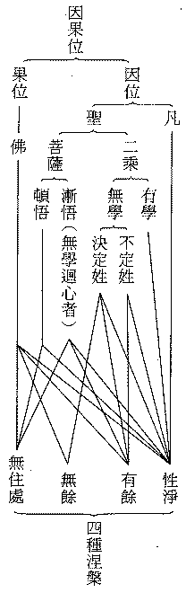



庚二　所生得



辛一　总标菩提



二、所生得，谓大菩提。此虽本来有能生种，而所知障碍故不生，由圣道力断彼障故，令从种起名得菩提。起已相续穷未来际，此即四智相应心品。



上来已说第一所显得，现在来说第「二所生得」。所「谓」所生得，就是「大菩提」。大菩提，中国译叫觉，其体指无漏智。一般说来，无漏正智的种子，从无始以来虽法尔被摄在本识中，但因所知障的存在其间，致被障碍而不得现行，所以说「此虽本来有能生种，而所知障碍故不生」。现在从佛法的修学中，「由」能断的「圣道」之「力断」除「彼障」，就能「令从种」子生「起」现行，「名」为「得」大「菩提」。大菩提是对大涅槃说的。此大菩提，在唯识学上说，是有为法，因为是从种子所新生的。因此，把这叫做所生得。这菩提生「起」来了以后，展转「相续」的「穷未来际」没有断绝之时。我们知道，所知障是心心所分别而生的，现在这菩提，亦心心所无分别起，今转所知障证得大菩提，是以智为体的，所以说「此即四智相应心品」。



辛二　别释智品



壬一　四种智体



云何四智相应心品？一、大圆镜智相应心品：谓此心品离诸分别，所缘行相微细难知，不忘不愚一切境相，性相清净离诸杂染，纯净圆德现种依持，能现能生身土智影，无间无断穷未来际，如大圆镜现众色像。



「云何四智相应心品」？是问四智是什麼。第「一、大圆镜智相应心品」，略说唯叫大圆镜智。这是由转有漏的第八识聚所得的智。有漏的第八识，含藏万有种子，现起五根器界，能为种现的依持，毕竟恒时现起一切境相。「谓此」第八识的「心品」，在因中没有任何计度，到果上远离我我所执，同样是「离诸分别」的。因中行相最极微细，内执受境亦是难测的，到了果上，一切所取能取分别境及行相，都是穷极微细难可了知的，所以说「所缘行相微细难知」。因中能缘三类性境，不缘虚妄的，不会差谬的，到了果上，也就「不忘不愚一切境相」，由此如来名一切种智及一切智。一切种智是缘事的智，一切智是缘理的智。因中虽则相染而性净，但是到了果地，自智光开发以后，所有有漏永亡不存，於是「性相」俱得「清净，离诸」一切虚妄「杂染」。在因中是所熏性，染熏就成为染的，净熏就成为净的，到了果上转成无垢，唯与白净善法相应，离染离杂成为「纯净圆」满具足一切「德」相。纯是纯一而无杂的意思，净是清净而离染的意思，圆是圆满而无缺的意思。基师《述记》卷十又说：纯简因中的无漏，净简一切的有漏，圆简二乘无学所有的功德。「现种依持」，是说为现行功德的所依，为种子功德的任持。简单的说：任持胜无漏的功德种子，变现佛果的诸现行功德法而为其所依。在因中能持种子，能生现行，能现根身、器界，到了果上，同样能为清净现行所依，亦能持彼清净种子，亦「能现」无量「身」，现无量「土」，乃至其餘的三「智」之境皆悉「影」现。而且这个现起，不是一时的，短时间的，能「无间无断」的「穷」於尽「未来际」。如是身土等诸相现於这智品上，犹「如」於「大圆镜」中，影「现」种种的「色像」，所以名为大圆镜智。



《庄严经论》说：『大圆镜智於一切境不愚迷故，智体光明鉴净无垢故，唯无漏德所依止故，一切身土此智能现故，餘三智是此影故』。《佛地经论》卷第三说：『大圆镜智者，谓离一切我我所执，一切所取能取分别，所缘行相不可了知不愚不忘，一切境界不分别知，境相差别一切时方无间无断，永离一切烦恼障垢有漏种子，一切清净无漏功德种子圆满，能现能生一切境界诸智影像，一切身土影像所依，住持一切佛地功德，穷未来际无有断尽，如是名为大圆镜智』。如上二论所说的大圆镜智，与本论这里所说大体是差不多的。



《佛地经》说：『复次，妙生！大圆镜智者，如依圆镜众像影现，如是依止如来智镜，诸处境识众像影现。唯以圆镜为譬喻者，当知圆镜如来智镜平等平等，是故智镜名圆镜智』。世间的镜子有各式各样的形状不同，有的是圆的，有的是方的，有的是椭圆的，有的是长方的，尽管形状不同，而其影现则一。现在所说的镜是圆镜，圆镜高悬能影现出种种形像，所谓佛来佛现，魔来魔现，人来人现，猫来猫现，什麼东西来就什麼东西现，是为影现众像。这是镜子的功用事实，世间人谁都知道的。



世间镜子固然有这样的功用，如来智镜当知亦如圆镜一样，能够现出一切身心世间来，所以依於如来的智镜，什麼内六根、外六境以及缘此根境而生的三智心品及心法。由於是以识为主的，所以总名诸识，即此诸识名众影像，因为种种行相差别，都是由心识所起的。从这大圆镜智生起的影像，是极为分明的，没有一点儿含糊，所以称它为现，因以大圆镜智为缘，才能生彼种种影像的。还可这样的说：处是指的六根，境是指的六尘，识是指的六识。如依这样分别，所谓众像影现，不妨是说十八界的众影像，是随平等性智、妙观察智、成所作智的三智心品而现起的，而三智心品的生起，又以如来镜智相应的净识为缘而生起。如此说来，一切的一切，如影像一样，在大圆镜智中分明显现，大圆镜智也能摄受彼相使之生起。虽说大圆镜智没有能取所取等的种种分别，然而确有一切智影，从大圆镜智现起，如世间的圆镜生起一切影像一样。由於如来能证知一切诸法影像，因而如来能无颠倒的说一切自相共相。至於如来能成无忘失法，亦由此所知影像在一切时，能於如来大圆镜智分别显现。如来的大圆镜智所以唯以世间的圆镜而为譬喻，就因有很多相似的地方。如世圆镜能现种种影像，佛的大圆镜智亦能显现诸法影像；世间圆镜是无分别的，佛的大圆镜智亦是无分别的。由於如此，所以如来妙智，称为大圆镜智。



二、平等心智相应心品：谓此心品观一切法自他有情悉皆平等，大慈悲等恒共相应，随诸有情所乐示现受用身土影像差别，妙观察智不共所依，无住涅槃之所建立，一味相续穷未来际。



第「二、平等性智相应心品」，略说唯叫平等性智。这是由转有漏的第七识聚所得的智。「谓此」第七识的「心品」，在因中有漏位上时，恒向内缘第八识的见分而起我执，於是在一切法上分自分他，立疆立界，种种差别不得平等，而与贪痴慢见恒共相应，不能生起平等大悲。现在从有漏转成无漏时，在内证到了平等理性，在外则「观一切」诸「法」及「自他有情悉皆」是「平等」平等的，再也见不到自他彼此的差别。因有自他平等的思想存於心中，所以「大慈悲等」就「恒」恒时的与之「相应」而起，「随」著登地以上「诸」觉悟「有情」的「所乐，示现」他「受用身土影像差别」，为诸大地菩萨说法开导，使得他们受用大乘法乐。因中的第七识是第六识的不共所依，所以到了最高的佛果位上，平等性智也就成为「妙观察智」的「不共所依」。到了这个时候，由於悲智平等，所以「无住涅槃」，也就依它「之所建立」，而且如大海水一样的「一味相续穷未来际」。《佛地论》说：『建立佛地无住涅槃，更无转易名为一味，无间断故名为相续』。由此智品悟证诸法的平等理性，所以名为平等性智。《唯识了义灯》说：『本释真如名平等性，智缘於此云平等性智』。圆测法师说有情平等，《庄严论》说众生平等智，说法当然是不同的，但比较各说，当以本释为合乎正理。假定说是餘众生平等，试问由什麼能缘众生平等？由於智证真如平等，是一切法的平等性，所以能缘生而为平等。同时说为平等性智，不是说为平等智，当知众生不是平等之性，诸法真如才是平等之性，是以不得说为有情平等。



《佛地经论》有段与本论所说相似的文说：『平等性智者，谓观自他一切平等，大慈大悲恒共相应，常无间断，建立佛地无住涅槃，随诸有情所乐，示现受用身土种种影像』。《庄严论》说：『平等性智缘一切有情，自他平等故，随诸有情胜解，示现佛影像故』。但是像这样的平等性智，怎样才能修习圆满成就？《佛地经论》卷第五说：『平等性智由十种相圆满成就，应知即是十地修果，一一地中略说，各证一平等性，修习圆满成就佛地平等性智，是故说言平等性智，由十种相圆满成就。若广说者，一一地中各证无量平等法性，修习圆满成就佛地平等性智』。



经中接著说有十种平等，论中对这十种平等亦有解说。经中说的十种平等：一、离相差别平等，是说『证得诸相增上喜爱平等法性圆满成故』。经中所说的诸相，就是大人相的三十二相及八十种随形好。如是诸相远离徧计所执自性，说名平等。《金刚经》说：『若见诸相非相即见如来』。唯有不见相而见，方真见到诸佛的相好，如以为有实有的相好在，是就不能真的见到如来，因为你的虚妄分别心没有去掉，怎麼能够见到如来的相好。增上，是指富贵自在。一般认为大富大贵，在这世间就可自在，要怎麼样就怎麼样，殊不知这是错误的。因为我们这个生命体，是由五蕴组合成的，诸蕴如果是各别的，我们固然不得富贵自在，就是诸蕴和合一起，我们同样不得富贵自在，必要诸法合时不舍自性，远离这个没有实体的补特伽罗，方得说为一切富贵自在，远离徧计所执自性说名平等。喜爱，就是一般所说的爱乐，不论什麼喜爱，都由徧计执著力而来，就是顺於吾人情意的，就生起欢喜的贪欲，不顺於自己情意的，就生起不乐的瞋恚，是为差别的不平等。如果断除了徧计所执，因徧计所执而有的喜乐也就无有，说为平等达解。如是所说诸相、喜爱平等，由此证得诸法平等性，名为证得初地。『菩萨最初证得，后后地中渐渐方便修令增长，最后佛地圆满成就』。



二、领受缘起平等，就是『证得一切领受缘起平等法性圆满成故』。以佛法说，诸法皆是从因缘生的，离了因缘根本没有一法可得，是以缘起诸法当体即空。《佛地经论》卷第五说：『无作用义是缘起义，空无我义，无补特伽罗义是缘起义。如是等义缘起自相，是所领受故名领受，或假有情能领受故名为领受，缘起诸法是所领受。如是一切领受缘起，无作用故，空无我故，无补特伽罗故，远离徧计所执自性，说名平等达解。如是所说一切领受缘起平等法性，故名证得。由此证得如前修习圆满成故，平等性智圆满成就。如是缘起平等法性，即一切法平等法性。如说：梵志！一切法性即是缘生缘起法性，悟解此故名为菩提。如佛所见一切法性，如此即是缘起法性』。佛在大小乘经中常常说：宇宙万有的一切诸法，不见有少法是离缘起性的。什麼是缘起性？当知所谓缘起平等法性，就叫做缘起性。佛法行者，能够了解缘起性空，是即得到平等性智。经中亦曾到处说到：『见缘起即见法，见法即见佛』。可以想见缘起在佛法中的重要性。菩萨行者如果真正了达缘起，确实洞悉诸法幻化不实，对於诸法自能作亲切体会的领受，所以名为领受缘起，而此缘起平等法性，於一切处都无差别的，因此名为平等性智。



三、离异相非相平等，就是『证得远离异相非相平等法性圆满成故』。色等诸法的变坏等相，有种种的不相同，这相不是那相，那相不是这相，彼此没有一个是相似的，所以说为异相。如果远离这些各别不同的异相，是就成为诸法共相。如是共相又以什麼为相？当然是以非相为相的。如契经说：『一切法性唯有一相，所谓非相』。非相又是什麼？就是诸法的平等法性。如能了达这个平等法性，使徧计所执毕竟永无，就证得了平等法性。由此证得，如前进一步的修习，使所修习的到达圆满，就是平等法性的圆满成就。论中还有一种说法：远离异相就是无有相，远离非相就是无无相，无有无无，当然就是平等法性。



四、大慈平等，是说『弘济大慈平等法性圆满成故』。佛经中解说慈悲，向来有三种，就是缘一切众生苦而起慈悲的有情缘慈；了达法空缘大乘法而起慈悲的法缘慈；缘法界理以及怨亲平等普观一切众生而起慈悲的无缘慈。如以菩萨的位次修这三种慈悲说：初发心位的菩萨，多分是修有情缘慈；修正行的菩萨，多分是修法缘慈；得无生忍的菩萨，多分是修无缘慈。至於最高的佛陀，虽说是具足无缘大慈，而实三慈皆具的，所以如来能平等的普徧的救济一切有情。这种大慈，当然不是小乘人所有的慈悲，因为小乘人的慈心，只能暂时的少分的给与众生的快乐，不能像佛那样普徧的永恒的给与众生的快乐，所以佛的大慈胜过一切声闻的慈心。像这样的弘济大慈，在因位的菩萨能精勤修习达到圆满成就，平等性智亦即圆成。



五、大悲平等，是说『无待大悲平等法性圆满成故』。佛不但有大慈心，而且有大悲心，且这大悲心亦胜於声闻人的悲心。声闻人的悲心唯缘欲界的少分有情，而佛的大悲是以三界众生为所缘境；声闻人的悲心只能暂时拔除众生的痛苦，而佛的大悲则是永恒的解决众生的痛苦。从此比较看来，可知悲心与大悲，相差得很远。经中说的『无待』，意思是显如来大悲的济拔众生，是无所观待的，而是恒时救济不舍的，就是随众生的所应，随时随刻都在济度众生，没有一时一刻的暂舍，而且亦没有过时而不救济的。是以如来常与大悲相应，从来没有暂起暂转的。《佛地经论》卷第五引经说：『善男子！不应说言诸佛世尊所有大悲，於诸有情暂起暂转。何以故？恒常转故。诸佛世尊乃至大悲无根未立，终不证得无上菩提。如来证得大菩提已，恒作是念：我当安立一切有情诸善根本，若有未悟一切法者我当开悟。如来如是於诸有情常起大悲』。无待大悲以平等性为所缘境，所以也就说它无待大悲平等法性。菩萨在因位中，无间断的修习无待大悲，到了圆满成就的时候，也就是平等性智的圆满成就。



六、随乐示现平等，是说『随诸众生所乐平现平等法性圆满成故』。众生由於根性的不同，好乐的不同，其所好乐的当然亦就有著种种差别。尽管众生有著怎样好乐不同，但佛都能随众生的好乐，示现种种不同的身相。如来本是居於无戏论位，怎麼会像变把戏那样的示现种种身相？当知佛虽居於无戏论位，但由平等性智的增上力，在大圆镜智相应的净识上，可以现出种种如净琉璃那样的微妙色身，令诸有情善根得以成熟。虽说这是有情自心所变似的身相，但在各个众生看来，总认为是心外见如来身，不知是自己的心识之所变似。不过话说回来，假使没有如来大圆镜智所现的身相为缘，众生自心是亦不能变现如来微妙色身。《佛地经论》卷第五引契经说：『由诸如来慈善根力有所示现，令天人等自心变异见如来身如金色等』。又引经说：『若所应化无量有情宜见琉璃末尼宝色，如来即能无碍示现种种琉璃末尼宝色，令彼自心亦如是变』。如是示现一切如来形相平等，当知这形相平等的平等性，就是诸法的法性。像这样的平等性，菩萨在因中修习到了圆满成就的时候，就是平等性智的圆满成就。



七、敬受所说平等，是说『一切众生敬受所说平等法性圆满成故』。这是就如来的语业说的。佛的任何一个语业的表现，不是由自己要怎样说就怎样说的，而是要看这个语业说出来，能不能使有情善根得以成熟？能不能使众生听了生欢喜心得净信乐？假定能的佛就示现这样的语业令众生得闻，假定不能佛就不会现出这样的语业。正因如来所出的一切语言，皆能契合众生的机宜，所以人天等的一切众生，都能无所违逆敬受如来所说。如是语言是诸佛同现的，没有说是此佛所现的语言契机，彼佛所现的语言不契机。因为如此，说为平等，即此平等，名为法性。菩萨在因中对这修习圆满成就，就是平等性智的圆满成就。



八、世间寂静一味平等，是说『世间寂静皆同一味平等法性圆满成故』。有漏五蕴的世间，是有为生灭的，到了五蕴息灭，不再生生灭灭，是就名为寂静，如是寂静，当知就是无为不生灭。世间寂静同归真如圆成实性，所以说名一味。还有一种说法，就是世间指的徧计执性，而此徧计执性只是众生的妄情执著，并没它的实在体性，如此通达说名寂静。如是寂静所显真如，根本没有什麼差别的，所以名为一味。世间寂静既是一味，当然就是平等。菩萨因中修此到达圆满成就，是就平等性智的圆满成就。



九、苦乐一味平等，是说『世间诸法苦乐一味平等法性圆满成故』。世间诸法虽说是很多的，但归纳起来实不外於利、衰、毁、誉、称、讥、苦、乐的八法。《佛地经论》卷第五解释这八法说：『得可意事名利，失可意事名衰，不现（当面）诽拨名毁，不现（当面）赞美名誉，现前赞美名称，现前诽拨名讥，逼恼身心名苦，适悦身心名乐』。这八法，通常说为八风，能不为这八风所动的，现实世间的人可说很少。如是八法，假使将它类别起来，实不外於苦乐，就是四种逆境说名为苦，四种顺境说名为乐。苦乐本是相待的，并没有它的实在性，所以严格说来，实是同一体性。《佛地经论》卷第五引契经说：『圣处世间平等一味犹如虚空，凡愚在世计有差别』。『由彼远离徧计所执，世间八法於一切处皆同一味，即此说名平等法性』。菩萨在因中将此一味修习圆满成就，就是平等性智的圆满成就。



十、无量功德平等，是说『修植无量功德究竟平等法性圆满成故』。这里所说的功德，是指菩提分法的诸功德法。《佛地经论》卷第五说：『熏种长养成熟解脱说名修植。平等性智虽无分别，由佛菩萨智增上力如如意珠，令异身中功德生长成熟解脱。言究竟者，能得三乘般涅槃故。既令解脱，令得世乐不说自成。如是智名平等法性，远离徧计所执性故。或诸菩萨修植无量菩提分等殊胜功德乃至究竟，即此名为平等法性。由此功德如前修习圆满成故，平等性智圆满成就』。



三、妙观察智相应心品，谓此心品善观诸法自相共相无碍而转，摄观无量总持定门及所发生功德珍宝，於大众会能现无边作用差别皆得自在，雨大法雨断一切疑，令诸有情皆获利乐。



第「三、妙观察智相应心品」，略说唯叫妙观察智。这是由转有漏的第六识聚所生得的智。「谓此」第六识的「心品」，在有漏位的因中，善能徧缘一切诸法，所以到无漏的果位，亦即「善」能「观」察「诸法」的「自相共相」，并能不受任何限制的「无碍而转」。果上缘诸法的自共相，神用无方，名之为妙，具缘诸法，名为观察，合起来说就叫妙观察智。又因善巧的观察诸法的自相共相，所能「摄观无量」的「总持定门」。总持是中国话，印度叫做陀罗尼。餘三智虽亦有这样的功德，但是出入诸禅，总持差别，不及此妙观察智。摄就是藏义，观就是观察，以此智品，於总持门，善为观察，亦能摄藏，不会有所忘失的。「及所发生功德珍宝」，珍宝不是世间的财宝，而是所修的六度及所修的道品诸功德宝。并由善巧的观察诸法的自相共相，「於大众会」中，「能现无边」的神通「作用差别」，而且一一「皆得自在，雨大法雨」，转大法轮，「断」除「一切」众生的「疑」惑，「令诸有情皆获利」益安「乐」，是为妙观察智的徧知一切。



《佛地经论》卷第三说：『妙观察智者，谓於一切境界差别常观无碍，摄藏一切陀罗尼门、三摩地门诸妙定等。於大众会能现一切自在作用，断一切疑，雨大法雨，如是名为妙观察智』。此论所说与本论所说，可说完全一样。



《佛地经》说：『复次，妙生！妙观察智者，譬如世界持众生界，如是如来妙观察智，任持一切陀罗尼门、三摩地门，无碍辩说诸佛妙法』。经中说的如世界持众生界，是举喻说明。世界就是通常说的器世间，众生自然是指有情世间。谁都知道，我们有情，是生存在器世间的，当与器世间有著密切的关系。原来器世间是有情心识之所变的，就以这所变的器世间，作为有情生存的天地，是以器界不但能建立众生，而且能任持众生。如来妙观察智，当知亦是如此，就是以妙观察智，建立一切法，任持一切法，使一切法不失。《佛地经论》卷第五说：『陀罗尼者，增上念慧能总任持无量佛法，令不忘失。於一法中持一切法，於一文中持一切文，於一义中持一切义，摄藏无量诸功德故名无尽藏』。又说：『三摩地者，谓增上定即健行等诸三摩地，能胜一切世出世间诸三摩地，餘不能胜故名健行，又佛菩萨健士所行故名健行，唯第十地菩萨及佛得此定故』。无碍辩说，就是四无碍辩，以此为众生辩说妙法，所以说为辩说。诸佛妙法，是指佛果位上的十力、四无所畏等的无量佛法。论中最后解释任持说：『妙观察智转意识得，作用宽广，故能任持一切功德，此智相应第六意识，普与一切功德相应，及能引发诸功德故，说能任持』。



经中还说到一切如来的妙观察智，能顿了知一切所知的境界，好似所知境有众多的相现起。不特如此，论中更解释欢喜因说：如世间有很多可玩耍的地方，像园林泉池等各式各样的娱乐场所，不特供游人玩赏，而且要予以种种庄严绮饰，使得每个人看到，都感到无限欢喜，而且不忍遽然的离去。当知如来的妙观察智也是如此，是有种种可玩的波罗密多、菩提分法等的无量功德，庄严这个妙观察智，令诸菩萨欢喜爱乐，认为亦须求得这样妙智不可，自然而然的不忍放弃自己所应行菩萨行。而且有了这个妙观察智，由诸有情感正法业的增上力，说法界理，起法界教，使诸世间的一切天魔外道异论，不能倾动如来所立的法界理及所起的法界教。



四、成所作智相应心品，谓此心品为欲利乐诸有情故，普於十方示现种种变化三业，成本愿力所应作事。



第「四、成所作智相应心品」，略说唯叫成所作智。这是由转有漏的前五识聚所生得的智。「谓此」前五识的「心品，为欲利乐」地前的菩萨、二乘、凡夫等的一切「有情」，乃「普」徧的「於十方」所有世界，「示现种种」的身土及「变化」等的「三业」，以「成」就「本愿力所应作」的一切「事」业，所以名为成所作智。



关於示现种种变化三业，原因成所作智能成如来化身，而这化身又可分为身化、语化、意化的三种。身化再分为三，就是现神通化、现受生化、现业果化的三种。语化亦分为三，就是庆慰语化、方便语化、辩扬语化的三种。意化则有四种，就是决择意化、造作意化、发起意化、领受意化的四种。如是三业化用，就是各种化身，而这诸化身相，皆由成所作智的增上缘力，激发大圆镜智的相应净识，令起这样的三业化用。《佛地经论》卷第六说：『当知四智一一能起一切作用，就强多分说：平等智起受用身，成所作智起变化身，妙观察智观察一切自相共相、陀罗尼门、三摩地等，大圆镜智能现一切诸法影像。如一一根取一切境非无强用，此亦如是』。



现在首先略说身化中的神通化：如世间众生勤励自己的身业，能做世间三种正当的事业，就是合理的做生意，如法的务农业，精勤的做工等。但世间众生这样的去做，目的唯求个己的利益，假定对自己无利的，是就没有兴趣去做了。但是如来成所作智的勤身化业，不是为了自己什麼好处，而是为了利益一切众生。所以如来所作事业，与众生为自利而勤劳身业，其性质完全是不同的。至於如来示现种种工巧等处，亦不如世间众生技艺高超而起憍慢，而正是为了度化这些贡高我慢的人，佛才示现工巧等，以示自己的胜过世人，降伏自恃技高的傲慢众生。像这样善巧方便的运用悲智，施以神通的教化，令他生起清净信，引诸众生令入圣教成熟解脱。



身业的现受生化是这样的：世间的各类众生，因有受用的身业，所以受用种种的色等境界。当知如来的成所作智，为了教化一切有情，起种种变化受生，同时现生受用境界，如现化於天人中一切生处，示现与众生为同一类，可是不论在那一类中，佛都居於最高的尊贵之位，以摄伏下类的众生，令他们得到利益安乐。如来成所作智现起化身，因有这样的善巧方便，所以能引诱一切众生令入圣教，使之善根渐渐成熟，乃至最后得到解脱。



身业的现业果化是这样的：世间众生由於有领受身业，所以能领受过去所作的善恶业而感得的苦乐果。当知如来的成所作智，现变化身领受化业也是如此，就是如来示现种种身，领受变化所作的一切本事本生难修诸行。佛於过去生中所作的事叫做本事，佛於过去生中所受生类的差别叫做本生，佛於过去生中所修种种难行苦行叫做难修诸行。或佛在现生中发现有类行者以修苦行为解脱因，佛为化导这类众生，特先现变化身，示修种种苦行，进而告诉苦行行者，非唯苦行能得菩提，还要定慧才得菩提。如来以是善巧方便，引诸众生令入圣教成熟解脱。



其次语化中先说庆慰语化：世间众生，特别是像我们人类，总归是要说话的，但这个人说出来的话，使另外一个人听了感到欣慰欢喜，如是展转相传的，大家论说这个话，没有那个不生大庆慰，是为庆慰语。当知如来从成所作智起变化身现微妙音，使到一切众生，亦变现佛的音声，并且听到佛的这样微妙音声，感到有种说不出的欣慰欢喜，那怕是浅智小慧的众生，听到佛所宣畅的种种随所乐法，亦认为说得很好，生起清净的信心，至於智慧高的众生听了，自是更加欣慰无已。如是以是善巧方便，引诸众生到圣教中来，得到成熟解脱。



语化中的方便语化是这样的：世间众生用方便语，能令其他一切众生，从不正当的道路上，走上正当的道路来。如说这是应该做的，那是绝对不可做的，以此方便对人演说，使人知道这是对的，从而依你所说而行，是就达到运用方便语所能达到的目的。当知如来从成所作智起变化身，作种种方便语以教化众生，也是如此。如佛所建立的正学处，告诉人们戒是佛弟子所应学处，假定不如法的遵守清净戒行，佛就对放逸懈怠的人加以毁责，希望他能改过，从此如法守持；对不放逸的人加以赞叹，使他更能戒行严净。如是以是善巧方便，引诸众生令入圣教成熟解脱。



语化中的辩扬语化是这样的：世间众生亦经常的辩论，从不断的辩论中，使不清楚的道理更为清楚，所谓『真理愈辩愈明』，就是此意。所以正当的辩论，在显示真理方面，是有其重大作用的。当知如来依成所作智起变化身，从变化身上发出种种辩论语业，也是如此。佛陀说法，有时不免使众生发生疑惑，为了解除众生的一切疑惑，不得不用论辩的方式，从各个不同的方面，宣说种种的义理，务使众生疑惑得以消除，确认佛所说的是最契合於正理的，是值得吾人信受的。如来以是善巧方便，引诸众生到圣教中来，进而使之得到成熟解脱。



最后说意化四种中的第一决择意化。世间众生有决择的意业，就是运用意的决择力量，认为对自他有利的事，就尽力的去做，如觉与自他有损的事，就避免不去做。像这样的避恶以行善，就是意的决择作用。当知如来的成所作智与意相应时，生起意业，同样有种决择作用。但佛所决择的，是对众生的决择，就是决择众生的心行，有八万四千这麼多的差别，而这八万四千诸垢尘劳心行差别，能障八万四千波罗密多、陀罗尼门、三摩地等。为了对治心行差别的诸尘劳垢，佛陀特别说八万四千法门。如来以是善巧方便，引诸众生令入圣教，使之终於成熟解脱。



第二造作意化是这样的：世间众生有造作意业，因而能造种种不同的诸善恶业，因为任何善恶业的造成，都由意识的构畫分别，假定没有这样的意业，所有善恶业是不能造成的。当知如来成所作智相应的意业，亦能从变化身上，造出种种意业，以化度不同种类的众生。为什麼会如此？因与意识相应的成所作智，能观察一切众生所行之行，而众生的所行所为，不出身口意的三业活动，而这种种行为活动，如来能一一的观照清楚，告诉众生十恶业是不可行的，十善业是可行的。行善有得，作恶有失。如来以是善巧方便，引诸众生令入圣教成熟解脱。



第三发起意化是这样的：世间众生有发起的意业，所以有发起诸业的功能。诸业，在此主要是指身语二业。众生的身语活动，不论是身体上的往来进止的种种动作，不论是口头上的种种语言的吐露，都由意业的推动而后才成的。当知如来成所作智的相应意业，能起化意业也是如此。特别是佛陀语言的宣说，都是宣说种种对治法，以对治众生各式各样的烦恼病，使诸众生听到佛所说的华丽而巧妙的语句，生起高度的爱好之心，并且乐意的依照佛所指示的去行，对治自己内在不良的心理。由於如来有著这样的善巧方便，引诸众生令入圣教成熟解脱。



第四领受意化是这样的：世间众生有领受意业，所以能领受由善恶业所招感到的苦乐果。如所造成的是善业，就领受快乐的果报，如所造成的是恶业，就领受痛苦的果报。当知如来成所作智的相应思能起受意化业，不但领受三世无量法义，且於一一法的实体亦能如实了知，所以对於一向、分别、反问、默置的四种记别，都能无颠倒的记别得恰到好处，使诸众生所应领受的分别领受。由此证知佛的化业，时常的在随逐一切众生，没有一时一刻的离开众生。正因如来有著这样的善巧方便，所以能够引导众生入於圣教中来，终於得到成熟解脱。



壬二　心品名智



如是四智相应心品，虽各定有二十二法，能变所变种现俱生，而智用增以智名显。故此四品总摄佛地一切有为功德皆尽。此转有漏八、七、六、五识相应品如次而得。智虽非识而依识转，识为主故说转识得。又有漏位智劣识强，无漏位中智强识劣，为劝有情依智舍识，故说转八识而得此四智。



上明出四智体，此明转识成智，名智不名识的所以。「如是」像上所说的「四智相应心品，虽各」一「定」具「有」五徧行、五别境、善十一，并所依净识的「二十二法」。但此所说的二十二法，就通因果二位说，因为寻伺唯因不通於果，所以不说。假定依前所说寻伺亦通无漏，那妙观察智应有二十四法。如是二十二法的自体，假定属於「能变」的就是见分，假定属於「所变」的就是相分；或说识的自体名为能变，相见二分名为所变；或说能变是种子，因为是因能变，所变是现行，因为是果能变。如是能变的「种」子，所变的「现」行，同时「俱生」，虽说具有二十二法，但在转依位上，「智」的作「用」最为「增」胜，因它能够决断了达一切，所以特「以智」的这个「名」称来「显」示它。不特如此，而且这「四」智心「品，总摄佛地」的「一切有为功德」无不「皆尽」，因无漏位中，智用增胜以智为主，其餘一切功德，都是智的差别。《佛地经论》卷第三说：『智有四种，大圆镜等，於佛果地诸心心法分位所现，诸功德中智最殊胜以智为名，总摄一切有为德故』。当知此中所说的有为功德，是简别无为功德，因为这里唯明四智，而四智是属无漏有为，假定通说清净法界，那就摄尽有为无为一切功德。所以《佛地经论》同卷接著说：『复次，如是所说法门建立五法，总摄佛地一切佛法，总摄无为诸功德故，闻熏成熟任持一切佛地所摄诸功德故』。



如是四智是由转识而得的，然而转什麼识得什麼智，该是吾人所当进一步有所认识的。现在论说：「此转有漏」的「八、七、六、五」诸「识」的「相应」心「品，如」其「次」第「而得」大圆镜智、平等性智、妙观察智、成所作智的四智。《大乘庄严经论》卷第三说：『次说诸佛智，偈曰：四智镜不动，三智之所依，八七六五识，次第转得故。释曰：四智镜不动三智之所依者，一切诸佛有四种智：一者镜智，二者平等智，三者观智，四者作事智。彼镜智以不动为相，恒为餘三智之所依止。何以故？三智动故。八七六五识次第转得故者，转第八识得镜智，转第七识得平等智，转第六识得观智，转前五识得作事智。是义应知』。《佛地经论》卷第三，对这有二师的说明。初师以正义说：『转第八识得大圆镜智相应心，能持一切功德种子，能现能生一切身土智影像故。转第七识得平等性智相应心，远离二执自他差别，证得一切平等性故。转第六识得妙观察智相应心，能观一切皆无碍故。转五现识得成所作智相应心，能现成办外所作故』。次师以不正义说：『转第六识得成所作，转五现识得妙观察』。将前五识与第六识所转得的智倒转过来说，当然是不正确的，所以前师以正义破说：『此不应尔！非次第故，说法除疑周徧观察非五用故』。



於此成为问题的：智是心所，识是心王，不论未转已转，其体是差别的，怎可说是转八识而得四智？《佛地经论》卷第三亦有说：『如是所说四智转何法得？摄大乘说转识蕴得。何故转心而得心法？非得心法四无漏，心智相应故，假说名智故……此中无漏心心法等智为主故，皆说名智，转识蕴依得四无漏智相应心』。是以「智虽」然「非」是「识，而」智实「依识转」，并不是转识的自体，不过因「识」是心王，能够「为主」，所以「说转识得。又」还有个道理，就是「有漏位」上，「智」的力量「劣，识」的力量「强」，所以名识不名智，但不是完全无智；到了「无漏位中，智」的力量「强，识」的力量「劣」，所以言智不言识，但并不是完全无识。然而「为」了「劝」化「有情依智」以「舍」去有分别的「识」，所以「说转八识而得此四智」相应心品。



壬三　转智位次



大圆镜智相应心品：有义：菩萨金刚喻定现在前时即初现起，异熟识种与极微细所知障种俱时舍故，若圆镜智尔时未起便无能持净种识故。有义：此品解脱道时初成佛故乃得初起，异熟识种金刚喻定现在前时犹未顿舍，与无间道不相违故，非障有漏劣无漏法但与佛果定相违故，金刚喻定无所熏识无漏不增应成佛故，由斯此品从初成佛尽未来际相续不断，持无漏种令不失故。



上面说明怎样的转识成智，现来说明四智是在怎样的位次现起。首先说明「大圆镜智相应心品」是在什麼时候的现起。关於这个有二师的解释不同，依论文分别如下：



「有义」，是第一师的说义。他们认为当「菩萨金刚喻定现在前」的那个「时」候，「即」是大圆镜智最「初现起」的「时」候。为什麼？因在这时，「异熟识种与极微细」的「所知障种」，同「时」「俱」「舍」的，唯有能持清净种识的存在，假「若」说是大「圆镜智」在这「时」尚「未」现「起」，那就「便」应没有「能持」清「净种」子的心「识」。可是事实不是如此，所以必须承认这时现起大圆镜智。《佛地经论》卷第三亦有此说：『大圆镜智相应心品，金刚喻定现在前时，转灭一切有漏种子异熟识等，尔时方得最初现行，一切佛果无漏种子圆满依附，尽未来际常无间断』。



「有义」，是第二师的说义。他们认为「此」大圆镜智相应心「品」，要到「解脱道」的那个「时」候，刚刚「初成佛」时，乃得最「初」的现「起」。什麼道理？因诸「异熟识种」，在无间道中「金刚喻定现在前」的「时」候，「犹」还「未」能「顿舍」，此时所能断的，只是二障种子，未舍有漏善种及劣无漏种，因这二种「与」那「无间道」是「不相违」的。换句话说，金刚喻定无间道，是不遮碍「有漏」善种及「劣无漏」种，「但与佛果」强有力的无漏法是「相违」的。假定认为在金刚喻定现在前的时候，就能空去异熟的话，那在「金刚喻定」时是就没有了「所熏识」，所熏识没有，本有「无漏」种子应皆现前，理「应」已经完「成佛」果，为什麼更待第二刹那的解脱道？「由」於如「斯」，可以确定知道，「此」大圆镜智相应心「品」，从解脱道「初成佛」时现前，直到「尽未来际」的「相续不断」，而且「持无漏种」，使「令」永「不」散「失」。这不是无间道所能做得到的，怎麼可说金刚喻定现在前时即可现起大圆镜智？《对法论》第十说：『究竟道者，谓依金刚喻定一切粗重永已息故，一切系得永以断故，永证一切离系得故，从此次第无间转依，证得尽智及无生智十无学法』。这明明的亦是说要前念金刚心无间道灭已，后念尽智方得生起。当知此中所说的后念，是指后念解脱道。这是镜智心品生起时的正义，我们应接受此说。



平等性智相应心品，菩萨见道初现前位，违二执故方得初起，后十地中执未断故，有漏等位或有间断，法云地后与净第八相依相续尽未来际。



次说「平等性智相应心品」是在什麼时候生起。论中告诉我们：「菩萨」在「见道」时真见道「初现前」的阶「位」，此智心品就得现起。但这不是自力起的，而是由第六引生的。即由第六识转成的妙观察智，引起第七识转成平等性智，因在初入见道中无间道时，妙观察智与平等性智，是同时而起的。有人问道：第七识唯是内执於我，唯是属於俱生，根本没有断惑的能力，怎麼会於初见道时断分别惑？现在答说：由第六识的入二空观，「违」逆第七识相应的「二执」，使第七识的我法二执不能生起，所以在第六识真见道中，顿断分别二障种子初转依时，带起第七识亦转一分无分别智，所以说为「方得初起」。有论中说：『双执末那归种位，平等性智方现前』，就是此意。假定是渐次断的，到「后」来「十地」位「中」，因为俱生二「执」，还「未」能够「断」尽，所以第六识入生法观时观我法空，伏二种执，此智就得现前，假定出了二空观，与有漏心相应时，此智就又不现，因为是这样的关系，所以说「有漏等位或有间断」。到了「法云地」的「后」心，乃成究竟无漏，「与第八」识「相依，相续」无间，「尽未来际」而转。《佛地经论》卷第三说：『平等性智相应心品，菩萨初地初现观时最初现行，从此已去后后地中，修令增长清净圆满，无漏观等现在前时恒常现行，若有漏心现在前时则便间断。如是展转乃至十地最后心时，自此已后尽未来际常无间断。如有漏位阿赖耶识，恒与末那一识俱起，无漏位中大圆镜智，亦应常与平等性智一时而起，故平等智亦无间断』。



妙观察智相应心品，生空观品二乘见位亦得初起，此后展转至无学位，或至菩萨解行地终，或至上位，若非有漏或无心时皆容现起。法空观品菩萨见位方得初起，此后展转乃至上位，若非有漏生空智果或无心时皆容现起。



再说「妙观察智相应心品」是在什麼时候生起。讲到此智心品的生起，有生空观品与法空观品的差别，而且通於大小乘，同是在因中转的。如「生空」妙「观」察智心「品」，假定是在「二乘」，於初「见」道「位」时「亦得」最「初」的生「起」。第六识在因中，有分别我执续诸生死，所以从佛法的修学中，到达见道位时，断除分别障种，生空智果就得现前。从「此」见道以「后，展转」一直「至无学位」，方得究竟，但因二乘人不断所知，所以没有法空智果。设「或」是在渐悟的菩萨，「至菩萨」的十住、十行、十回向的「解行地终」；设「或」是在顿悟的菩萨，要「至」十地的「上位」。在如是等的阶位，假「若非」是「有漏」心，「或」入「无心」的灭尽定「时，皆容现起」三乘生空妙观察智。设若是「法空」妙「观」察智心「品」，要在「菩萨」的「见」道「位方得」最「初」生「起」，因在这个时候，断尽分别法执种及断俱生一分法执，所以能够现起一分无分别智。从「此」生起以「后」，由二地开始，「展转」向上「乃至」十地最后心的「上位」，在此过程当中，假「若非」是「有漏」心不达法空的「生空智果，或」入灭尽定的「无心时，皆容现起」这妙观察智。有漏与彼相违，生空后得不违法执，所以不得现起妙观察智。如是六七二智，皆是因中转的，不同镜智与成所作智，要到果上才转。《佛地经论》卷第三说：『妙观察智相应心品亦在初地，初现观时最初现行，从此已后渐修增长。若有漏心正现前时，或无心时则便间断。如是展转乃至佛果，若入灭定亦不现行』。



成所作智相应心品：有义：菩萨修道位中后得引故亦得初起。有义：成佛方得初起，以十地中依异熟识所变眼等非无漏故，有漏不共必俱同境根发无漏识理不相应故，此二於境明昧异故。由斯此品要得成佛，依无漏根方容现起，而数间断，作意起故。



最后说「成所作智相应心品」是在什麼时候生起。对这，同样有二师的解释不同，依於论文解说如下：



「有义」，是第一师的说义。他们认为「菩萨」在「修道位中」，由於第六意识的「后得」智「引」，此智心品「亦得初起」。《佛地经论》卷第三亦有此说：『成所作智相应心品：有义：初地已上诸位皆得现行，堕法流故』。



「有义」，是第二师的说义。他们认为此智定要到「成佛」的究竟位「方得初起」，在十地的修道位中，是不能引得此智心品的现起。「以」在因位的「十地中」，能变的第八阿赖耶识仍然是有漏的，所以「依异熟识所变」的「眼等」五根，也就不能不随著而成为「非无漏」的，换句话说，眼等五根亦是有漏的。当知「有漏」五根唯与有漏五识为「不共」「俱」有所依，亦即所谓为「同境」依根。如是同境依「根」既然是有漏的，当然不能发生无漏净识，假定说此有漏根能「发无漏识」，那与道「理」是「不相应」的，亦即是绝对不合理的！要知「此」有漏根识与无漏根识的「二」者，望「於」所缘「境」，是有「明昧」差别的。说得清楚一点：无漏根识取境较明，有漏根识取境较昧，这是谁都知道的。「由」於如「斯」因缘，所以「此」智心「品」，定「要」到「得成佛」的那个时候，「依」於「无漏」的五「根」，此无漏智「方容现起」。虽於佛果位上已经现起此智，然「而」仍「数」数的有所「间断」，必假「作意」缘力，方得再行生「起」，不同前三智的长时相续无有间断。《佛地经论》卷第三亦有此说：『如实义者，佛果方起。以十地中有异熟识所变五根非无漏故，能依五识亦非无漏，有漏五根发无漏识曾未见故。於佛果上此智亦不恒现在前，作意起故数数间断』。既以此说为如实义，当是以此说为正义。



此四种性虽皆本有，而要熏发方得现行，因位渐增佛果圆满，不增不减尽未来际，但从种生不熏成种，勿前佛德胜后佛故。



此是说明种性是本有的还是始起的。讲到此四智相应心品的种性，都是本来就有的，要现起就现起，为什麼会有前后因果转依分位的差别？要知「此四种性，虽」说「皆本」来「有」，然「要」藉无漏缘力的「熏发，方得」生起「现行」，不是说要现起就现起的。因从无始以来，就由二障所缠，现在若不藉资粮位中闻大乘法的资熏击起，以及加行位中的上下寻思，怎麼於初入地时得以现行？地前由闻熏习使无漏种增，可是由於熏有胜劣的不同，所以在「因位渐」次渐次的「增」长，到最后「佛果」的究竟位，得以达到究竟「圆满」。圆满以后，就可「不增不减」的相续至於「尽未来际」。为什麼老是这样的不增不减？因佛果位，「但」能「从」无漏「种生」起现行，其所生起的现行，「不」复再「熏成种」子。假定认为到佛果位上还可熏成种子，那就应后佛熏少四智劣於前佛，前佛熏多四智胜於后佛，以前佛先熏后佛后熏，致有胜劣差别。可是事实不然，所以说「勿前佛德胜后佛故」。《佛地经论》卷第三说：『如是四智相应心品种子，本有无始法尔不从熏生，名本性住种性，发心已后外缘熏发渐渐增长，名习所成种性。初地已上随其所应乃得现起，数复熏习转增转胜，乃至证得金刚喻定。从此已后虽数现行不复熏习更令增长，功德圆满不可增故，持种净识既非无记不可熏故，前佛后佛功德多少成过失故』。基师《述记》卷十双取本有、新熏种子，可知这唯是护法正义，既非本有师义，亦非新熏师义。



壬四　四智所缘



大圆镜智相应心品：有义：但缘真如为境，是无分别非后得智，行相所缘不可知故。有义：此品缘一切法。庄严论说大圆镜智於一切境不愚迷故；佛地经说如来镜智诸处境识众像现故；又此决定缘无漏种及身土等诸影像故，行缘微细说不可知，如阿赖耶亦缘俗故。缘真如故是无分别，缘餘境故后得智摄，其体是一随用分二，了俗由证真故说为后得，餘一分二准此应知。



上来是明四智种性的本有，现来说明四智心品的所缘境。首先说明「大圆镜智相应心品」的所缘，此有二师的解释不同，依於论文分别如下：



「有义」，是第一师的说义。他们认为大圆镜智不缘别的什麼境界，「但」以「真如为」所缘「境」，因为它是缘真的根本「无分别」智，「非」是缘俗的「后得智」，而且大圆镜智的「行相、所缘」，都是最极微细而「不可知」的。《佛地经论》卷第三说：『大圆镜智相应心品，若一相说，唯缘真如无分别智，非后得智，所缘、行相不可知故』。与本论第一师所说，完全是一样的。



「有义」，是第二师的说义。他们认为「此」智心「品」，不唯以真如为境，而是徧「缘」真俗「一切法」的。如「庄严论说：大圆镜智於」真俗的「一切境」，都是「不愚迷」的。该论卷第三原文说：『镜智缘无分，相续恒不断，不愚诸所识，诸相不现前。释曰：此偈显示转第八识得镜智。镜智缘无分者，於一切境界不作分段缘故。相续恒不断者，於一切时常行不断绝故。不愚诸所识者，了知一切境界障永尽故。诸相不现前者，於诸境界离行相缘无分别故』。「佛地经」也「说：如来」的大圆「镜智，诸」内六「处」，诸外六「境」，以及根境和合所生的六「识」，有「众」影「像」，分明显「现」。「又此」大圆镜智，「决定」能「缘无漏」的「种」子「及身土等」的「诸影像」。因中阿赖耶识缘三类境，行相所缘都微细故说不可知，所以此智到了果上缘一切境，「行」相所「缘」亦极「微细」，所以「说」为「不可知，如」因中「阿赖耶识亦」能「缘俗」，并不是但缘真如。但这不是说无分别智为不可知，而是约它亦缘世俗境说为不可知。如说根本后得二智的差别，是由缘境不同而来：「缘」於「真如」境的，「是无分别」智的功用，「缘」於其「餘」诸「境」的，是属「后得智摄。其」二智「体」原来「是一」，不过「随用」而「分」为「二」。二智既是一体，生起没有前后，怎可说为后得？当知证真由根本智，了俗则是由后得智，可是「了」达世「俗」，必然「由」先「证真」，所以假立前后「说为后得」，并不是先根本而后后得。不过了俗之智，是由根本智证了真如之后而得的，所以说了俗名后得智。如大圆镜智的一体分二，当知其「餘」平等、妙观二智，亦为「一」体「分二，准此应」可了「知」，到下不用再说。



此第二师说，《佛地经论》卷第三作如此说：『若具相说缘一切法。庄严论说：大圆镜智普於一切所知境界，不愚迷故。此经中说：如依圆镜众像影现，如是依止如来智镜，诸处境识众像影现。言诸处者，谓内六处，言诸境者，谓外六境，言诸识者，谓六种识。如是智上有十八界众像影现，故知此智缘一切法。由此镜智於一切时缘一切法，故说如来具一切智。若不尔者，餘智不定知一切法，如来不应名一切智。如是镜智，内缘自体功德种子，外缘一切若真若俗所知境界，现身土等一切影像。缘真义边名无分别智，缘俗义边名后得智。虽缘一切行相微细不可了知，如阿赖耶虽缘三境，以微细故，亦言缘境不可了知，故不应以不可了知证此镜智。唯缘真如无分别智非后得智。诸心心法，体虽是一义用有多，随用差别分为二智，亦无有过。要达真理方了事俗，故虽一心义说先后，或似后得名后得智，餘亦如是』。此与第二师所说是一样的，不过说得较为详细而已，所以特地引录於此。



平等性智相应心品：有义：但缘第八净识，如染第七缘藏识故。有义：但缘真如为境，缘一切法平等性故。有义：徧缘真俗为境。佛地经说平等性智证得十种平等性故。庄严论说缘诸有情自他平等随他胜解示现无边佛影像故。由斯此品通缘真俗二智所摄，於理无违。



次说「平等性智相应心品」的所缘，这有三师的解说不同，现在依於论文分别如下：



「有义」，是第一师的说义。他们认为平等性智「但缘第八净识」为境，「如」因中的「染」污「第七」末那识，「缘」第八「藏识」为境，其道理是一样的。《佛地经论》卷第三说：『有义：唯缘大圆镜智，如染污意缘阿赖耶为境界故』。与本论第一师所说完全是一样的。



「有义」，是第二师的说义。他们认为平等性智「但缘真如为境」，因为它是「缘一切法」的「平等性」的，如上所说的十平等，就是指真如而言的。《佛地经论》卷第三说：『有义：唯缘真如实际，缘平等性为境界故』。与本论第二师所说完全是一样的。



「有义」，是第三师的说义。他们认为平等性智是「徧缘真俗为境」的。以下引经证缘真如，引论证缘俗谛。如「佛地经说平等性智证得十种平等性故」。十种平等性，就是上面说过的离相差别平等的十种。如「庄严」经论上也「说：缘诸有情」的「自他平等」，是此智的特殊功用。同时，「随」著「他」人的「胜解」力的差别，「示现」无量「无边」的「佛」的「影像」。「由」於如「斯」因缘，所以「此」平等性智相应心「品」，为「通缘真俗」的根本、后得「二智所摄，於」道「理」上讲起来，是没有什麼相「违」的。《佛地经论》卷第三说：『如实义者，此智亦缘一切为境，普缘一切平等性故』。《庄严论》说：『平等性智缘一切有情，自他平等故，随诸有情胜解，示现佛影像故。此经中说：证得十相平等性故，此平等性通真及俗，故缘一切亦无过失！若不缘俗，即不能随一切有情胜解，示现诸佛影像，亦不应以染污末那类平等智唯缘镜智，凡圣异故，违圣教故，餘不类故』。与本论第三师所说完全是一样的，而且向以此说为正义。



妙观察智相应心品，缘一切法自相共相皆无障碍，二智所摄。



再说「妙观察智相应心品」的所缘。唯识学者一致认为：此智「缘一切法」的「自相共相」为境，而且不论缘自相境共相境，「皆」是「无」有「障碍」的，要认识什麼就能认识什麼，是以通为根本、后得「二智所摄」。《佛地经论》卷第三说：『妙观察智相应心品，普观一切自相共相，皆无障碍故，缘一切所知境界』。与本论这里所说，亦完全是一样的。



成所作智相应心品：有义：但缘五种现境。庄严论说：如来五根一一皆於五境转故。有义：此品亦能徧缘三世诸法不违正理。佛地经说：成所作智起作三业诸变化事，决择有情心行差别，领受去来现在等义，若不徧缘无此能故。然此心品随意乐力，或缘一法或二或多。且说五根於五境转不言唯尔，故不相违。随作意生缘事相境起化业故，后得智摄。



最后明「成所作智相应心品」的所缘，这有二师的解释不同，现在依於论文分别如下：



「有义」，是第一师的说义。他们认为此智心品「但缘」色声等的「五种现」实「境」界，超过这个现实境界，则为此智心品所不缘。「庄严论说：如来」的眼等「五根」，每「一」根每「一」根，「皆於五」种「境」界上「转」的。虽然徧於五境上转，但只缘现在而不缘过去未来。《佛地经论》卷第三说：『成所作智相应心品：有义：唯缘五种现境』。《庄严论》说：『如来五根一一皆於五境转故』。此与本论第一师所说，完全是一样的。



「有义」，是第二师的说义。他们认为此智心品，不但能缘现在五种现境，「亦能」缘於过去未来，而是「徧缘三世」一切「诸法」的，因为我们这样讲法，是「不违」於「正理」的。怎麼知道？「佛地经」中曾「说」：如来的「成所作智，起作」身语意「三业」的「诸变化事，决择有情」的种种「心行差别，领受」过「去」、未「来、现在等义」，足以证明能够徧缘三世一切诸法。「若」说此智「不」能「徧缘」诸法，那就应该「无此」功「能」。「然」而事实上，「此」智相应「心品，随」於「意乐」之「力，或」者「缘」於「一法，或」者缘於「二」法，「或」者缘於「多」法。现在「且说五根」一一「於」色等「五境」上「转」，并不是说唯缘这麼一点境界，所以说「不言唯尔」。所以前后之说，并没有什麼「相」互「违」背的地方。此智心品既是「随」於「作意」而「生」起的，「缘」於种种的「事相境」，而「起」诸变「化」的三「业」之事，所以唯是「后得智摄」，不同前三智的通於根本、后得二智所摄。《佛地经论》卷第三说：『如实义者，成所作智亦缘一切，於一切境皆无障故。庄严论说：成所作智於一切界起种种化，无有数量不可思议，作诸有情一切义利。此经中说：成所作智起作三业诸变化事，决择众生八万四千心行差别，宣说对治作四记论，受领去来现在等义。若不普缘一切境界，无此功能。又说：佛心无障自在，一一皆能照一切境；但作意力，或缘一法，或缘一切，且说五根於五境转，不言唯尔故不成证』。此与本论第二师所说，完全是一样的。



经中所说的四记论，就是对诸问者所作的四种记别，亦即四种不同的答覆。一、一向记：如有人这样问：诸有生起的一切法，是不是决定归於毁灭？那应对他一向作这样的答覆：就是生者必灭，这是决定了的，没有改变的餘地。或有人问：三宝是不是真实的？能不能为世间的良福田？那应对他一向作这样肯定的答覆：佛法僧三宝是具有无漏性净功德的，确是世间的良福田，没有半点虚假的。像这样无疑的肯定的答覆，是为一向记。二、分别记：如有人这样问：诸有灭者是不是决定得再更生？那应对他作分别说，显示这是没有决定的。假定仍然具有烦恼的人，在他死了以后当然还要随业受生的，设若是已断烦恼如阿罗汉圣者，在他这个生命结束后，绝对不会再受生的。像这类的问题，应该对他分别记别，不能拢统的答覆。三、反问记：如有人这样问：所谓菩萨十地，究竟谁胜谁劣？那你应该对他先来一个反问，就是你所问的胜劣，望於什麼来问的？假定是望胜解行地的三十心说，当然是初地为胜而三十心为劣；假定是望初地以后的二三地说，当然以二三地为胜而初地为劣。必须先这样的反问，然后说出谁胜谁劣才不会有过失。四、默置记：如有人这样问：实有我性是善的还是恶的？石女儿的颜色是黑还是白的？对於这类问题，应该默而不答，亦即没有答覆的必要。要知本来是无我的，还谈什麼是善是恶？说善说恶岂不是多餘？至於石女根本是不能生育的，那里还有什麼是她的儿子？儿子尚且决定没有，那里还谈什麼是黑是白？如果对他分别是黑是白岂不是变成多餘？所以对於这样的问话，最好的办法就是默然不理，以免益增戏论。像上所说就是四记论，为如来成所作智领受意化的作用。



壬五　四智用别



此四心品虽皆徧能缘一切法而用有异：谓镜智品现自受用身净土相、持无漏种；平等智品现他受用身净土相；成事智品能现变化身及土相；观察智品观察自他功能过失，雨大法雨破诸疑网利乐有情。如是等门差别多种。



上来所说的「此四」智相应「心品，虽」说一一「皆徧能缘一切」诸「法」，然「而」它们缘境的作「用」，显然是「有」很大的差「异」，所以特别分为四智心品。它们不同的作用是这样的：「谓」大圆「镜智」相应心「品」，能「现」起「自受用身」及自受用「净土相」，以执「持」清净「无漏种」子，与因中第八藏识缘境是相同的。「平等」性「智」相应心「品」，能够「现」起「他受用身」及他受用「净土相」，而且都是为登地以上的菩萨所现的。「成事」作「智」相应心「品，能」够「现」起「变化身及」秽「土相」，为他的特别作用。妙「观察智」相应心「品」，能「观察自他」的「功能过失」，於净秽二土中，随诸根机大小，「雨大法雨」，转大法轮，「破诸」众生的「疑网，利乐」一切的「有情」，为他最大的殊胜功能。



「如是」像上所说的种种「等门」，假定一一说起来，其「差别」是有「多种」的。有的在前面已经说过，有的可参阅《佛地经论》，在此不再一一为说，以免烦琐。



壬六　通结前科



此四心品名所生得，此所生得总名菩提，及前涅槃名所转得。虽转依义总有四种，而今但取二所转得，颂说证得转依言故，此修习位说能证得，非已证得因位摄故。



「此」中所说「四」智相应「心品」，就是这儿「名」为「所生得」，而「此」所说的「所生得，总」括一句话，「名」为大「菩提」；至「前」所说的大「涅槃」，则「名」为「所转得。虽」说「转依」的意「义，总有」能转道、所转依、所转舍、所转得的「四种」差别，然「而」现「今但取」第四所显得与所生得的「二所转得」，不取其餘的三种转依，因为「颂说」：舍二粗重故，便「证得转依」的这句话。而这所显得与所生得，正是所证得的。可是现在要问，就是在「此修习位说能证得」，究是因中的能证得？抑是果中的能证得？当知此中明转依果，是约因中将能证得位说，并「非」是就果上「已证得」位说，因为修道的十地，尚是属於「因位」所「摄」，还没有到达佛地的果位。《义演》说：颂中说的证得转依，是佛果上所证所显得，所以此中唯取佛果菩提，涅槃是转依果，不是取的其餘的三种转依。其餘三种转依之中，虽有迷悟依真如之说，然而那是因中所摄。谓在十地中是为悟依，在生死中是为迷依，所以迷悟依是因位摄。即使在十地中修行，断十重障、证十真如时，都是因位能证中收，非是果上所生所显，所以为此中所不取。



丙五　究竟位



丁一　牒科标问



后究竟位其相云何？



上来已解释了五位中的前四位，现在来释最后第五究竟位。而这最「后」的「究竟位其相」是怎样的？这是我们所要知道的。所谓究竟位：『因在前面的修习位，数数地显发无分别智，修诸胜行，二障通通断尽，故二果乃得圆满。论圆满，菩萨还须进修，故不能及；论殊胜，不是二乘的劣果可比。是究极竟了的位，故名究竟位』。实际说来，就是佛果。



丁二　举颂总答



颂曰：此即无漏界，不思议善常，安乐解脱身，大牟尼名法。



这是举颂总答上面的所问；颂文的意义到论文中再解释。於中，「此即无漏界」的初句，是指出其体；其次，「不思议、善、常、安乐」七字，是显它的胜德；最后，「解脱身、大牟尼名法」八字，是简别二乘而显与三乘有别。颂中最初『此』之一字，是指前段所说的所转得的二重转依，亦即是真涅槃与大菩提。



丁三　解释颂意



戊一　释第一句



己一　正释颂意



论曰：前修习位所得转依，应知即是究竟位相。此谓此前二转依果，即是究竟无漏界摄，诸漏永尽非漏随增，性净圆明故名无漏。界是藏义，此中含容无边希有大功德故；或是因义，能生五乘世出世间利乐事故。



此下是以论文解释颂义。「论」中开始说「曰」：在「前修习位」中「所」转「得」的二重「转依」的所证得的大果，「应知即是」这「究竟位」之「相」，所以现在所说「此谓此前二转依果」，不是指的别的什麼，而正「是」属於「究竟无漏界摄」。无漏当然是对有漏说的，「诸」有一切有「漏」，到了这个时候，已经「永」远断「尽」，从此以后，不会再与烦恼相俱，不会再与烦恼相应，不会再被烦恼所缚，不像取蕴那样的於中漏随增故，所以说为「非漏随增」。非漏之所随增的二转依果体，是体「性」清「净圆」满胜「明」的究竟「无漏」，与二乘以及菩萨所得的无漏，是有所不同的。如二乘圣者，虽说已经得到无漏，但与第七识相应的所知细障仍在，所以不是胜明的；至於登地的菩萨，虽同样的得到无漏，但只是得到一分而已，并还没有达到圆满，自不是圆净的；所以二乘与菩萨所得的无漏，都不可说是究竟的。「界是」含「藏」之「义」，意谓於「此」之「中」，能「含容」无量「无边」的甚为「希有」的「大功德故」。如分别说：於大菩提中含容一切有为功德，有为功德名所含，大菩提名能含，因此，举菩提时，一切有为功德皆名菩提；於大涅槃中藏有一切无为功德，无为功德名所藏，大涅槃名能藏，因此，举涅槃时，即摄得一切无为功德。



「或」者界「是因」的意「义」，意说所证得的大果，或为所缘，或为增上缘，「能」出「生五乘世出世间」的「利乐事」业的。灵泰《疏钞》说：『今者便说佛为因能生五乘者：即或约所缘，即佛果上菩提涅槃为缘境，即五乘起善心缘佛果菩提而欣乐故，即生得他五乘道。或为增上缘者，即由佛果上菩提涅槃故，即令五乘众生长善灭恶。展转传说者，或由佛菩提根本智，亲证真如涅槃故，即生后得智，后得智即生大悲，大悲能现佛身说十二分教，令诸五乘有情闻此教已即长善灭恶，故名展转传说。具此等缘方生五乘众生长善灭恶，得世出世利乐事故，故名能生五乘』。



己二　问答广明



清净法界可唯无漏摄，四智心品如何唯无漏？道谛摄故唯无漏摄，谓佛功德及身土等皆是无漏种性所生，有漏法种已永舍故，虽有示现作生死身业烦恼等似苦集谛，而实无漏道谛所摄。



有人这样问道：自性真如「清净法界」，有佛出世，无佛出世，总是那样性相常住的，固然「可」以说是「唯」属「无漏」所「摄」，因为它是一种理法，没有什麼可诤论的，但是「四智」菩提相应「心品」，从种所生的，是佛身中的有为功德，「如何」可说亦「唯无漏」所摄？难道佛身皆唯无漏？讲到佛身是不是唯属无漏，在小乘学派中是有诤论的：大众部的学者，认为『一切如来无有漏法』，所以十八界在佛身中，全是无漏的。佛身既是无漏的，当就无一不是清净。所以在这派的学者中，当然不会提出这样的问题来问。可是，有部系的学者，认为佛身间或还有有漏现前，亦即佛身的十八界，前十五界亦属有漏的，因诸具缚凡夫缘如来身，仍会生起贪瞋等烦恼的。所以在这派的学者中，就会提出这样的问题来问。现在论主答说：四智心品的菩提，因为是属「道谛」所「摄」的，所以说为「唯无漏摄」。如以四谛分别，大家都知道的：苦集二谛是属有漏，灭道二谛是属无漏。道谛既是无漏，属道谛摄的四智菩提，当然亦唯是无漏的。因此，「佛」果位上的十力、四无所畏等的一切「功德」以「及」所有四智并诸所现「身土等」，都从无漏种生，属於道谛所摄，当然「皆是无漏」。因诸「有漏法」的「种」子，在金刚心后「已」经「永」远「舍」弃掉了。



或者有人又问：如来的法报二身固是无漏道谛所摄，但佛所有的诸变化身，示同众生有生老病死及业烦恼，怎麼可说亦是无漏道谛所摄？现在论主释说：如来「虽示现作」诞「生」，入灭的化「身」，或有叱呵身语现起，或入灭前有背痛病苦等「业烦恼等」，看来好「似苦」谛与「集谛，而实」是属「无漏道谛所摄」，并不可以把它看为有漏。於中再略为说明者：佛有时呵斥提婆达多，脸上亦有怒恨的样子，当知这就是身业；佛陀有时呵叱难调的众生，将他说为痴人，当知这就是语业，皆似集谛。王宫中受生是现起，双树下入灭是涅槃，有时腰酸背痛等，皆似苦谛，所以说似苦集谛。但这都是佛陀的示现，不能把它当作真实看，实际应该仍是无漏道谛所摄。



集论等说十五界等唯是有漏，如来岂无五根、五识、五外界等？有义：如来功德身土甚深微妙非有非无离诸分别绝诸戏论，非界处等法门所摄，故与彼说理不相违。



有人引论问道：若佛功德身土等，皆唯无漏所摄，为什麼「集论等说」除后三界，餘「十五界等唯是有漏」？既十五界唯是有漏，如佛有十五界，当亦属於有漏，怎麼可说唯是无漏？设若一定说佛一切唯是无漏，「如来」难道没有「五根、五识、五外界等」的十五界？说佛没有十五界，绝对是说不过去的。《集论》卷第三原文是这样说的：『五取蕴、十五界、十处全及三界、二处少分是有漏』。从《集论》所说看来，十五界是有漏，可说不成问题。关於这问题，有三师解说不同，现在依论文分别说明如下：



「有义」，是第一师的说义。他们认为「如来」所有「功德」及所现的若「身」若「土」，都是非常「甚深」，非常「微妙」的，既不可以说它「非有」，亦不可以说它「非无，离诸」能所「分别，绝诸」名言「戏论」，并「非」是「界、处」、蕴「等」三科「法门所摄」的，不可将这说为五根、五境等，因而也就不可以十五界等有漏为问。要知《集论》所说的有漏，不是约佛身讲的，所以这里所说「与彼」集论所「说」，在道「理」上，并「不」怎麼「相违」。《佛地经论》卷第一说：『如实义者，如来身土甚深微妙，非有非无，非是有漏亦非无漏，非善非恶亦非无记，非蕴界等法门所摄，但随所宜种种异说。餘处说言十八界中，十五有漏，八无记等，但就二乘、异生等境粗相分别，不就诸佛诸大菩萨甚深境界。故餘处说如来非实蕴界处摄，所有善等皆是示现，乃至广说』。《佛地经论》的这一所说，与本论此师所说是相当的。



有义：如来五根、五境妙定生故法界色摄，非佛五识虽依此变，然粗细异非五境摄，如来五识非五识界，经说佛心恒在定故，论说五识性散乱故。成所作智何识相应？第六相应，起化用故。与观察智性有何别？彼观诸法自共相等，此唯起化，故有差别。此二智品应不并生，一类二识不俱起故。许不并起於理无违，同体用分俱亦非失。或与第七净识相应，依眼等根缘色等境，是平等智作用差别：谓净第七起他受用身土相者平等品摄；起变化者成事品摄。岂不此品转五识得？非转彼得体即是彼，如转生死言得涅槃，不可涅槃同生死摄，是故於此不应为难。



「有义」，是第二师的说义。他们认为「如来」所有的「五根、五境」，都是依於殊胜的无漏「妙定」所「生」，为「法界色」一分所「摄」，所以属於无漏，因为佛非是有漏五识界摄，因而《集论》所说有漏五识，决定不是佛所有的。「非佛」以外所餘菩萨以及异生等「五识，虽依」佛妙定所「变」的五根、五境而变为身土，「然」而彼此间的「粗细」是有很大差「异」的：即餘所变者较粗，属於五境所摄，佛所变者较细，「非」属「五境」所「摄」。是以「如来」的无漏「五识，非」是有漏的「五识界」。为什麼这样说？因诸「经」中曾「说：佛心恒」常都是「在定」中的，所谓『那伽常在定，无有不定时』。而诸「论」中又尝「说」：眼等「五识」身，其「性」是「散乱」的。如《对法》第一明六种散乱中：『第一自性散乱者，谓五识身。由彼自性於内静定无功能故』。既然如此，恒在定中的佛心，当然不是其性散乱的五识身。



有人根据上说，作这样的问道：佛的五识如真不是五识界摄，那依五识所转的「成所作智」，理亦不应与五识相应，是则又与什麼净「识相应」？现在告诉他说：成所作智是与「第六」净识「相应」，因由第六净识的观察机宜，能随菩萨、二乘、众生的三类机宜，现「起」分身的「化」导大「用」，所以不是餘识所能相应的。



接著人们又问：假定果真这样，那「与」妙「观察智」的体「性」又「有」什麼差「别」？现在回答他说：二者当然是有差别的：「彼」妙「观」察智，唯能观於「诸法」的「自」相「共相等」，而「此」成所作智，「唯」能现「起」三类分身的「化」用，所以二者是「有差别」的。



外人复又问道：假定真是这样，那末，「此」妙观察与成所作的「二智」心「品」，就「应不」能「并生」，如无性《摄论释》卷第三说：『无处无容非前非后，同身同类二识并生』，所以「一类」智品，「二识」是「不」能「俱起」的，现在成所作智怎麼能与第六识相应？现在答说：假使以前念后念刹那别起来说，就是容「许不」得「并起，於理」是也「无」所「违」背的。要知经说无受身处无容并生的道理，是约同一身中同类二识一时并生说的，并不是约前后别起说的，我说前后别起又有什麼不可？你虽这麼说，但我们仍不承认此二智品是一，因为它们的自性是各别的。外人救说：你们还是没有懂得我的意思，如你了解「同」一识「体」义「用分」二，就知许二智品「俱」起，「亦」即没有什麼过「失」，你为什麼定说二识不俱起？现在破说：你以为这样说法，问题就算是解决，事实不然，前面说过，自性别故，如眼等五识，你为什麼定要执说可以俱起？外人又救说：如合意识别生意识前后间起，试问有什麼违於经说的无同类并？再予破说：和合识体如果认为是异熟，而又说它间生，那体便要间断，后来又继续时，应该名为更生。



「或」说成所作智不是与第六净识相应而是「与第七净识相应」的。为什麼又作这样说？因「依眼等」五色「根，缘」於「色」声「等」的五尘「境，是平等」性「智」中的「作用差别」。怎麼说为差别？「谓净第七」平等性智，为化地上菩萨，现「起他受用身」及他受用「土相者」，是就属於「平等」性智相应心「品」所「摄」；假定净第七平等性智，为化诸异生类，现「起变化」身及变化土「者」，那就属於「成事」作智相应心「品」所「摄」。依於此说，我们知道：同一平等性智，依他受用身上五根缘色等五境，化地上菩萨，就成平等性智，依化身上五根缘色等五境，化地前异生等，就成成所作智。平等性智虽唯是一个，因有二种作用不同，所以名为平等智、成事智。作此分别，试问又有什麼不可？



外人难说：此成所作智心品既与五七净识相应，「岂不此品」亦是由「转五识」而「得」？既是由转五识而得，应说与净五识相应，怎麼可说与第七净识俱？现在答说：虽说成智心品由转五识而得，但并「非转彼」五识「得」此智品，便说此智心品的「体」性「即是彼」五识摄。「如」诸经论中说「转生死言得涅槃」，是约生死灭涅槃显说的，并不是涅槃就是生死，所以说「不可涅槃同生死摄」。因为生死涅槃转未转位，是各有其体的。既然如此，「是故於此不应」提出这样的问题来「为难」，为难亦是为难不到的！



有义：如来功德身土如应摄在蕴处界中，彼三皆通有漏无漏。集论等说十五界等唯有漏者，彼依二乘粗浅境说非说一切。谓餘成就十八界中唯有后三通无漏摄，佛成就者虽皆无漏而非二乘所知境摄。然餘处说佛功德等非界等者，不同二乘劣智所知界等相故，理必应尔。所以者何？说有为法皆蕴摄故，说一切法界处摄故，十九界等圣所遮故。若绝戏论便非界等，亦不应说即无漏界、善、常、安乐、解脱身等。又处处说转无常蕴获得常蕴，界处亦然，宁说如来非蕴处界？故言非者是密意说。又说五识性散乱者，说餘成者非佛所成。故佛身中十八界等皆悉具足，而纯无漏。



「有义」，是第三师的说义。他们认为「如来」所有的一切「功德」以及所现的「身土，如」其所「应」是可「摄在蕴处界」的三科法门「中」的。什麼理由？因「彼」蕴处界「三皆通有漏无漏」的。如凡夫身分所有的就是有漏，而如来身分所有的就是无漏，所以佛无漏亦被所摄。至前所引「集论等」所「说十五界等唯」是「有漏」摄「者」，当知「彼」是「依」於「二乘粗浅境」界「说」的，并「非」是「说一切」凡圣有情的十五界等，皆唯有漏。「谓餘」菩萨、二乘所「成就」的六根、六境、六识的「十八界中，唯有」意根、法境、意识的「后三」界，「通」於「无漏」所「摄」，餘十五界皆是有漏。非谓「佛」所「成就」的十八界亦是有漏。然如来十八界，「虽」说「皆」是「无漏，而非二乘所知境摄」。能知十五界唯是有漏的，是显劣智的境界；佛十五界唯是无漏，诸根相续一一无边，唯佛所有的胜智，方能知道是这麼一回事，其餘的十地菩萨以及二乘圣者，是无法了知的。



「然」而「餘处」如《大般若》以及许多大乘经「说：佛」的「功德」智慧以及身土「等，非」是「界」处「等」所摄「者」，因这是示佛的殊胜功德，亦即表示佛的界处等是纯无漏的，「不同二乘劣智所知」的「界」处「等相」，并非不属界等所摄，在道理上讲，如应摄於界处等中，所以说「理必应尔。所以者何」？是问是什麼道理。诸论通「说」：诸「有为法皆」是「蕴」所「摄」的，佛功德等属於有为，当亦摄在蕴中。诸论又「说：一切」诸「法」，都是「界处」所「摄」。此中所说的诸法，摄尽世出世间的一切法，而世出世法不出三科，佛的功德法当亦为界处所摄。假使佛果位上的诸功德法不是蕴处界摄，那就应当於十八界外有十九界，於十二处外有十三处，於五蕴外有第六蕴。然而所谓「十九界」、十三处、六蕴「等」，是大「圣」佛陀「所遮」而不许可有的。《无垢称经》四说：『观第五大，观第六蕴，观第七根，观十三处，观十九界』。十九界等既为圣所遮止，是知根本不能成立，所以佛的诸有功德，皆不离於蕴处界等。



「若」有人说，凡是「绝」诸「戏论」的，「便非界等」所摄，如来功德身土等，既是绝诸戏论的，当非界处等摄。这个说法是亦不对的，如果这说法能够成立，是则在此颂文之中，「亦不应说」如来功德等，「即」是「无漏界」，是「善」，是「常」，是「安乐」，亦不应名「解脱身等」。现既明白的可以名为解脱身等，怎麼不可说为蕴处界摄？「又处处」经论中，如《涅槃经》、《庄严论》等，「说转无常蕴获得常蕴」，转无常界获得常界，转无常处获得常处，所以说「界处亦然」。怎麼（宁）可「说如来非蕴处界」摄？反过来说，应说如来亦是蕴处界摄。《大般若经》等所以说「言」佛功德等「非」界等摄者，当知这是佛「密意说」，显示非浅智者所知境。



关於转无常蕴获得常蕴，在《胜鬘经》中有两个颂说：『如来妙色身，世间无与等，无比不思议，是故今敬礼。如来色无尽，智慧亦复然，一切法常住，是故我归依』。古德说这是彰如来三身功德：前一颂，是彰如来的化身功德；后一颂，是彰如来自受用身的功德。所谓『如来色无尽』，即是转无常色获得常色；所谓『智慧亦复然』，即是转无常的受想行识四蕴而获常的受想行识四蕴。《胜鬘经讲记》解释后一颂说：『如来法身的微妙色相，是无尽的。佛有无量相，相有无量好，如来色相光明是徧一切处的。但真常大乘经，特著重一常字。常住的，即是无尽、无断灭的。色相常住而无尽，如来的智慧亦复如此，也是常住而无尽的。一切法不外乎色与心；无漏心中以智为主。这即是说：佛的心色都是无尽的』。



接著讲记又说：『在这里可附带说明的，是（因圆果满的）如来有色相呢？还是无色相的？这在中国古代，大有诤论。有人说：佛是无色的。有人说：佛是有色的。研究真常妙有的大乘经根本义，是宣说如来有色的。这是针对二乘而来，小乘如说一切有部等，说佛入无餘涅槃，即灰身泯智，不可谈有色有心。如上座部等，说佛入无餘依涅槃，色是没有了，但能断烦恼的净智，是有的。这即是有心而没有物质的。与大乘近似的大众部说：「如来色身实无边际……如来寿量亦无边际」；「佛徧在」；所以，入无餘依涅槃（也可说不入涅槃的），不但有智，也还有色。大众部等，和《法华》、《胜鬘》等经的思想极近。常住妙有的大乘，评破声闻者说如来涅槃是无色的，所以特重视「解脱有色」。本经赞佛的功德中说：「如来色无尽，智慧亦复然」，即显如来有色义。《涅槃经》说：「如来舍无常色获得常色」。又如《涅槃经》（三）说：「言非色者，即是声闻缘觉；言是色者，即是诸佛如来解脱」。《大法鼓经》也说：「常解脱非名，妙色湛然住」；又说：「诸佛世尊到解脱者，彼悉有色，解脱亦有色」。妙色湛然的如来解脱，显示了真常大乘的特色。如来的究竟果德，是有心也有色的。这在一切众生，是本来具足此清净德相的，名为如来藏。所以说：「如来藏具相三十二」』。



「又」对法第一「说」六种散乱中第一自性散乱者：谓「五识」身，由彼自性於内静定是没有功能的，所以说为自「性散乱」。但那是「说」其「餘」菩萨、二乘所「成」就的有漏五识而言，并「非」是说「佛所成」就的无漏五识，无漏五识绝对不会自性散乱。以是之「故，佛身中」的「十八界」、十二处、五蕴「等」，不但一切「皆悉具足，而」且「纯无漏」所摄，亦即是属无漏界。



戊二　释后三句



己一　正释颂意



此转依果又不思议，超过寻思言议道故，微妙甚深自内证故，非诸世间喻所喻故。



上面解释第一句颂出体，以下解释后三句颂以显殊胜德性。讲到「此」二「转依果」体所具殊胜德性，虽则说是很多，现在且举四种。此文是说第一「不思议」的胜德。谓此二转依的果体，因我人的寻思去寻思它固寻思不到，用我人的言语去议论它亦同样的议论不到，因为其体，「超过寻思」之道，不是寻思的境界，断绝「言议」之「道」，不是言议的境界，真是所谓「微妙」最微妙，「甚深」最甚深，唯大圣者「自内证」知，要用世间的譬喻来比喻它，根本是不可能的，所以说「非诸世间喻所喻故」。正因如此，名不思议。《摄论》以三义解释不可思议相，如论说：『五、不可思议为相，谓真如清净自内证故，无有世间喻能喻故，非诸寻思所行处故』。《讲记》解释说：『第五不可思议为相：法身不可以心思，不可以语议，所以不可思议。一、佛的自觉证智，於真如清净的法界，自内圆证，这唯佛与佛乃能洞达，不是有情所能知的。二、真如法身於一切法中最究竟，没有一法足以与它相齐等，所以无有世间喻能喻的。平常拿虚空等比喻，也只能做到意会而已，实在不能亲切的表达。三、法身无相，徧一切处，这非诸世间的寻思所行处，无分别法当然不能以有分别的寻思去推度。由此，法身以不可思议为相』。世亲、无性《摄论释》第九的解说，大体也是如此，没有什麼不同。



此又是善，白法性故，清净法界远离生灭极安隐故，四智心品妙用无方极巧便故，二种皆有顺益相故，违不善故，俱说为善。论说处等八唯无记，如来岂无五根三境？此中三释，广说如前。一切如来身土等法皆灭道摄，故唯是善，圣说灭道唯善性故，说佛土等非苦集故，佛识所变有漏不善、无记相等，皆从无漏善种所生无漏善摄。



第二明「此」二转依果，颂中「又」说「是善」，因唯是清「白」善「法」为「性」，不同不善及无记，而且能断於黑，所以说名为白。如此白法是不是就是有漏善？与有漏善究竟有什麼差别？当然有差别，且不能说就是有漏善，因自性「清净法界」的真涅槃，是「远离生灭」染污，而最极寂静，「极」为「安隐」的，是一切魔境所不能动的；至於「四智心品」的大菩提，具有微「妙」不可思议的大「用，无方」应物，泽被群生，最「极」善「巧」方「便」的，无一众生不可度化的。如是说来，我们知道，涅槃的无为，菩提的有为，「二种皆有顺益」之「相」，都是「违」於「不善」的，所以「俱说为善」。



在此有人难说：如来四智心品如果真的皆唯是善，为什麼《对法》「论说」十二「处」中五根与香味触三境「等八」处，「唯」是属於「无记」性摄？「如来」身「岂无五根」及香味触「三境」？假定有的话，为什麼说唯善？《对法论》第四原文说：『无记八界者，谓五色根、香、味、触界』。这不是很明显的说八界是无记？关於这问题，「此中」有「三」种解「释，广说如前」有漏等三解，就是有三师的不同解释。现在我们简单的说：《集论》等说五根三境是无记，是依二乘粗浅境说，并非是说佛地微妙境界也是如此，谓餘成就十二处是无记，固然没有问题，但佛所成就的十二处唯是善性，不过这不是二乘所知之境。如要透彻的了解这个问题，可阅前面有关有漏的三种解说。



论中又作这样解说：「一切如来」的若「身」若「土等法皆」是属於「灭道」所「摄」。基师《述记》卷十说『真如等五法皆灭道摄』。所谓五法，是指清净法界及四智菩提。清净法界属灭谛摄，四智菩提属道谛摄，所以总说为灭道谛摄。凡为灭道摄的，必然「唯是善」的，因为诸经论中，「圣说灭道」二谛，「唯」独是「善性」的，况且《对法论》等「说佛」的身「土等，非」是属於「苦集」二谛的。如该论卷第六说：『复有清净世界非苦谛摄，非业烦恼力所生故，非业烦恼增上所起故。然由大愿清净善根增上所引，此所生处不可思议，唯佛所觉，尚非得静虑者静虑境界，况寻思者』？既非苦集，当然是属善性的灭道二谛。至於由「佛」净「识所变」相似「有漏」的「不善」及「无记相等」，一一「皆从无漏善种所生」，并不是真的是不善及无记，所以实际仍然唯是「无漏善摄」。如将从无漏善种所生的相似有漏不善及无记，看成实在的不善及无记，那就大错特错！



此又是常，无尽期故。清净法界无生无灭、性无变易故说为常。四智心品所依常故，无断尽故亦说为常。非自性常，从因生故，生者归灭一向记故，不见色心非无常故。然四智品由本愿力所化有情无尽期故，穷未来际无断无尽。



第三明「此」二转依果，颂中「又」说「是常」。为什麼说它是常？因此二转依果，在时间方面讲，是永无尽期的，决没有间断的时候，而是穷未来际在相续著的。首先以涅槃解释常，是说「清净法界」的真涅槃，原本「无生无灭」的，其「性」从来「无」有「变易」，一直都是如此的，所以「说」之「为常」。其次以菩提解释常，是说「四智心品」的大菩提，以常住真如为所依，由於「所依」的真如是常住的，所以能依的四智心品，其体「无断」无「尽」的「亦说为常」，决不会所依的是常，能依的成为无常。於中应还分别的：无断常是报身的不断常义，无尽常是化身的相续常义。报身的不断常，是约自受用身说，因自受用身从成佛后，始终是这样相续不断绝的；化身的相续常，是约他受用身及变化身说，因这二身时时在度化众生，时时有所断绝的，就是当化缘将毕的时候，二身就在这儿消逝，但随又在别个地方现身，所以名为相续。



对这二身，《摄大乘论》曾有问道：『佛受用身及变化身既是无常，云何经说如来身常？此二所依法身常故。又等流身及变化身，以恒受用无休废故，数数现化不永绝故，如常受乐，如常施食，如来身常应知亦尔』。《讲记》解释说：『受用、变化二身，不是佛的真身，在他现起的方面，确是无常的。那为什麼经说如来身常？这是就他的所依说的，此受用、变化二身所依的法身，是常住的，约所依说，说能依的受用、变化二身也是常住的了。实际上，菩萨众会人天等见到的或现生或入灭的佛，只是餘二身，如来的自证法身是常住的，我们是见不到的。这可以拿水与波作比喻，水性的湛然不动，是法身；因众生机感风波的鼓荡，水中现起波浪，小风小浪，大风大浪，这如受用、变化二身。波浪的体就是水，这是水的一种姿态；水性既常住，波浪也不妨说常，所以法身也体用无碍。但大海的波浪，究竟因风而起，说波浪不是水的真相，受用、变化二身也不是法身。再依二身自体说：等流身就是受用身，因为受用身是从自性身流出，所以又名等流身。这等流身，他恒受用法乐无休废，如世人说，这人常常享受快乐，虽然他所受的乐，并不是常住无间，但可以说他常常受乐；受用身也是这样，他虽不是常住的，但可以说他是常。因为他在菩萨众中，常受大法乐。变化身也可说他是常，以数数现起化诸有情的事业，相续而不永绝。这如世人说某人常施食，虽施食不是常无间断，但屡屡施食，也可说他常施食。这样，变化身虽不常在世间，但随所化的有情，数数示现无尽，也说他是常』。



不但《摄论》有这样的讲法，《庄严论》卷第三亦说三种常：『复次，一切诸佛悉同常住：由自性常故，一切诸佛自性身常住，毕竟无漏故；由无间常故，一切诸佛食身常住，说法无断绝故；由相续常故，一切诸佛化身常住，虽於此灭复彼现故』。准上诸论所说，我们可这样说：法身是自性常，报身是不断常，化身是相续常，三身的常义虽有所不同，而其为常是一。



四智菩提心品，虽则可以说常，但并「非自性常」，因为是「从因」所「生」得的，既是从因生的，「生者」必然仍「归」於「灭」，这是经中一向都这样讲的，所以说「一向记故」。既然有生灭的，怎麼可以说常？若说最初的确是有生的，但到后来并不灭，如果这样讲，不但违於佛说，而且在事实上，从来「不」曾有人「见」过「色心」是「非无常」的。圣教及事实既都无一色心不是无常，为什麼还要说它无断无尽？是以我们现在肯定的说：佛的色身绝对不是自性常，因为是有生有灭的，如其餘的有为法。其餘的有为法，是有生有灭的，所以不是常，佛的色身是有生有灭的，当如诸有为法不是常。



然则「四智」心「品」，何以又说是常？当知这是「由」於「本」誓「愿力」，为了化度一切有情，由於「所化有情无」有「尽期」，能化的四智心品，也就「穷未来际」的「无断无尽」。以是之故，所以说常。《解深密经．如来成所作事品》说：『曼殊室利菩萨复白佛言：世尊！我当云何应知如来生起之相？佛告曼殊室利菩萨曰：善男子！一切如来化身作业，如世界起一切种类；如来功德众所庄严住持为相。当知化身相有生起，法身之相无有生起』。本经说有法身、化身的二身。『如来的化身作业，是由法身的无量功德合集所现起的，这现起之相，就如现实世界是由三界、五趣无量众生的共业所起一样；世界不是由那一个众生的业力所起，当知如来的化身也不是由那一种功德所现』。『十方世界无边际，而有染净的不同，一切众生无数量，而有根性的差别，佛的化身生起，也就随著世界的染净不同，众生的根性差别。而有种种不同的化身』。『说有如来生起之相，是约化而起的化身之相说的，若以转依成满的如来法身之相讲，那是常住不变，不可说有生起之相的。所以说化身相有生起，是可以的，说法身相有生起，就落於颠倒戏论的妄见了』。



此又安乐，无逼恼故。清净法界众相寂静故名安乐；四智心品永离恼害故名安乐。此二自性皆无逼恼及能安乐一切有情，故二转依俱名安乐。



第四明「此」二转依果，颂中「又」说是「安乐」。因这二转依果，不特自身没有逼恼，同时又不「逼恼」有情，使自他皆得离於生死大苦，所以名为安乐。首以涅槃释安乐，是说「清净法界」的真涅槃，所有「众相」悉皆「寂静」，再也没有一点纷扰，所以「名」为「安乐」。次以菩提释安乐，是说「四智心品」的大菩提，「永离」一切的「恼害」，再也没有逼迫性的现象，所以「名」为「安乐」。前真涅槃的安乐，是『无上涅槃寂静乐』；此大菩提的安乐，是『无上菩提觉法乐』。如此说来，不但「此」菩提涅槃的「二」种「自性」是「无逼」无「恼」，而且还「能」利益「安乐一切有情」。所以此「二转依，俱」得「名」为「安乐」。



二乘所得二转依果，唯永远离烦恼障缚，无殊胜法故但名解脱身；大觉世尊成就无上寂默法故名大牟尼。此牟尼尊所得二果，永离二障亦名法身，无量无边力无畏等大功德法所庄严故。体依聚义总说名身，故此法身五法为性，非净法界独名法身，二转依果皆此摄故。



上来已释不思议、善、常、安乐以显二转依果的殊胜功德；现在再释解脱身、大牟尼名法以简二乘显示三乘得果的差别。解脱身，是解脱烦恼障的缠缚而得的果身。声闻缘觉「二乘」圣者「所得」一分的「二转依果」，因为「唯」是「永远离」去「烦恼障」的缠「缚」，仍为所知障之所覆蔽，「无」有成为庄严的十力、四无畏等「殊胜」功德「法」，所以「但」得「名」为「解脱身」，不得名为法身。《解深密经．如来成所作事品》说：『世尊！声闻、独觉所得转依名法身不？善男子！不名法身！世尊！当名何身？善男子！名解脱身。由解脱身故，说一切声闻、独觉与诸如来平等平等；由法身故说有差别。如来法身有差别故，无量功德最胜差别，算数譬喻所不能及』。《语体释》解释说：『如来的法身，是由转依成满所得的，但是讲到转依，不唯佛陀而已，就是声闻、独觉的二乘圣者，也是有舍烦恼，弃生死，得菩提，证涅槃的转依相的。所以从三乘圣者的名义上看，声闻、独觉是通常所说的小乘，佛果为通常所说的大乘，似有不同，可是从三乘圣者的转依方面看，彼此同样的有所舍、所得相，似又没有什麼不同』。佛与二乘究竟有没有差别？这是值得论究的一个问题。说到身，本是积聚的意思，不论凡夫、二乘乃至最高佛陀，都是各有其身的。『所不同的：佛的法身是无量大功德聚，二乘的解脱身是无漏的五分法聚，凡夫的肉身是大苦阴聚。所谓五分法，就是戒、定、慧、解脱、解脱知见。前三是因，后二是果；果上的解脱，就是涅槃，解脱知见，就是菩提。由此可见二乘所得转依，是具有菩提、涅槃二转依果的。他之所以不名法身而名解脱者，从消极方面说，是由於没有大悲愿，从积极方面说，是由於缺乏无量清净功德。因此，他的转依，只能舍烦恼障，离分段生死，得解脱身，不能舍所知障，离变易生死，得清净法身。这样，知道佛与二乘，有平等的一面，也有差别的一面：从其平等的一面看，三乘同破人我执，同证我空理，同出离生死，同一解脱味，同得解脱身，所以经中常说三乘平等平等，本经也是由这解脱身，而说声闻、独觉与诸如来平等平等无有差别的。甚至根据这平等的意趣，说小乘的四果名阿罗汉，大乘的佛果也名阿罗汉。从其差别的一面看，就是如来具有法身，二乘不具法身，由这法身的有无，说有三乘的差别，所以说如来法身有差别故。其不同的差别点，就在如来具有无量殊胜的功德，二乘不具这些功德。所以，以小乘的解脱身与如来的法身相比，其差别不可以道里计，乃至恒河沙数诸有譬喻之所不能及。解脱既不及法身，可知解脱身是不圆满、不究竟的，法身是究竟圆满的。发心修学佛法的人，应以如来的法身为趣向的目标，不应以二乘的解脱身为所追求的对象』！



「大觉世尊」不同於二乘者，由於已经「成就」最极「无上」的「寂默法」，所以「名」为「大牟尼」。牟尼是印度话，中国译为寂默，是幽深玄远，超过语言的一切法性相离言的不二法门。寂默法，简单的说，就是离言法，为一般语言所不能说到的。唯我佛陀大「牟尼尊所得二」转依「果，永离」烦恼所知的「二障」，所以不但名解脱身，「亦名法身」。离了所知障，为什麼就叫法身？因其为「无量无边」的十「力」、四「无畏等」诸「大功德法」之「所庄严」的。又为什麼名为身？因其是具有「体」性、「依」止、众德所「聚」的三「义」，所以「总说名身」。因是之「故，此」之「法身」，不是三身中的法身，而是以真如及四智菩提的「五法为性」的。即以清净法界名为涅槃，四智心品名为菩提，合此二种名为法身，「非」但一种清「净法界，独」得「名」为「法身」。因「二转依果」摄此五法，而五法「皆」是「此」法身所「摄」的。在《佛地经论》卷第二中，初明法身无相功德是总离相，次明受用及变化无中边相是别离相。又总别显示佛德，要由二十一种殊胜功德，是故说名最清净觉。



己二　别明三身



庚一　正明三身



如是法身有三相别：一、自性身：谓诸如来真净法界，受用变化平等所依，离相寂然绝诸戏论，具无边际真常功德，是一切法平等实性，即此自性亦名法身，大功德法所依止故。



「如是」像上所说的「法身」，既是三身的总称，不是任何一身，都得名为法身，是则法身也就「有」了「三相」差「别」。这个三相的差别，是依胜义而分的：如自性身是就具足真常功德等而立，自受用身是就具足如来乃至广大法乐而立，他受用身及变化身是就化度不同众生而立。至於三身的是不是常，在讲第三胜德是常时已说，现在所要论说的，就是所谓三身，佛佛是否同体。据《庄严论》第三说：『彼三种身一切诸佛皆悉平等：由依故，一切诸佛自性身平等，法界无别故；由心故，一切诸佛色身平等，佛心无别故；由业故，一切诸佛化身平等，同一所化故』。可见诸佛的三身，是没有什麼差别的。《摄论讲记》也提到《庄严经论》所说：『大乘庄严经论从「依」、「心」、「业」三方面说明三身；业是利他的，属变化身；心是自利的，属受用身，这受用身，就是自受用的意味；依是自利利他二种功德所依的，属自性身』。对这三身，《摄论讲记》有详细的论说，值得参考，可以取阅。



「一、自性身」：这是指「诸」佛「如来」离垢所显的「真净法界」。如是真净法界，在本论说，为「受用」身与「变化」身「平等所依」的实性，在《摄大乘论》还说它是如来佛果位上一切功德智所依止。「离相」，是说真净法界之中，远离五尘、男、女、生、异、灭的十相。「寂然」，是说真净法界，不是寻思所能寻思得到的，但此所说寻思，不是指四不定中的寻思，而是总指三界虚妄心心所说，意谓三界虚妄心心所所缘不到的。「绝诸戏论」，是说语言所说不到的，说它是有固不是，说它是无亦不是，说它亦有亦无亦不是，说它非有非无亦不是，真是所谓『说似一物即不中』，一切戏论绝，一切语言离。虽说是这样的，但它却「具」有「无边」无「际」的「真常功德」，而且「是一切法」的「平等」真「实」之「性。即此」诸法真如「自性」，不但名自性身，「亦」复「名」为「法身」。为什麼亦名法身？因它是有为无为诸「大功德法」之「所依止」的。如说：『法界一相，即是如来平等法身』。古德有说：『若剩一法不名法身，若有一法不名法身，若无一法不名法身，若欠一法不名法身』。诸功德法所依名为法身，因为身就是依止的意思。



二、受用身，此有二种：一、自受用，谓诸如来三无数劫，修集无量福慧资粮，所起无边真实功德，及极圆净常徧色身，相续湛然尽未来际，恒自受用广大法乐。二、他受用，谓诸如来由平等智示现微妙净功德身，居纯净土，为住十地诸菩萨众，现大神通，转正法轮，决众疑网，令彼受用大乘法乐。合此二种名受用身。



「二、受用身，此有二种」差别，於此二种之中，先说第「一自受用」身，意显这是诸佛如来自己之所受用到的法乐，为酬报三大长劫所修集的无边胜因而感德的。「谓诸如来」於「三」大「无数劫」的长时期之间，不断的「修集无量」无边的「福」德、智「慧」两大「资粮」，引生本有无漏种子「所起无边真实功德及」从镜智所起究竟「极圆」、极「净」、极常而无所不在的「常徧色身」。极圆，是说庄严众相无不具备；极净，是说众多过患无不俱离；极常，是说无间无断恒常如是。如是色身，「相续湛然尽未来际」的「恒自受用广大法乐」。相续，简别不生灭的自性身，因为这是有生灭的；湛然，简别他受用身及变化身，因为这二身时有间断的。这实是唯佛与佛所能知见的境界，亦是唯佛与佛所能受用的境界。假定以酬所感来说，亦可名为报身。



次说第「二他受用」身，这是自己已经自证圆满，为欲化益初地以上的诸大菩萨，所以「诸」佛「如来」特「由平等性智示现」一种「微妙」清「净」的「功德身，居」住於他受用的「纯净土」中，「为住十地」的「诸菩萨」，示「现」广「大」的「神通，转正」如来的「法轮，决」诸「众」生的「疑网，令彼」诸大菩萨，「受用大乘法乐」。《摄论》只说为受用身，没有分为自受用身与他受用身两种，但从它的解释看，则是指的他受用身。如《讲记》说：『二、受用身：它是依於法身而有。法身无一切相，虽然体用圆满，但非众生所能见，因此利益众生的佛事，从地上菩萨的所见上，建立受用身。它依法身而现，从种种诸佛众会所显。就是说：所以知道有受用身，是因菩萨所见的诸佛大集会，在这大集会中的佛是受用身。它在清净佛土弘阐大法，令大菩萨受用大乘法乐。这受用可作两种解说：一、诸大菩萨在诸佛的清净佛土中，以大乘法喜为食，受用重重法味。二、诸大菩萨在诸佛的清净佛国土中，受用清净佛土乐，如西方极乐世界的种种妙乐。一方面，听佛说法，受用大乘法乐。因有这二义，所以能化的佛名受用身。他依法身而不为他依，故不说所依』。从这解释，可知《摄论》所说的受用身，就是本论所说的他受用身。因而本论「合此」自他受用的「二种，名」为「受用身」。



由平等智示现微妙净功德身，古德对这有三种不同的解释：有说以妙观察智击发平等性智，然后由平等性智示现这样的净功德身；有说以平等性智击发大圆镜智，使令现起这样的净功德身，所示现身实际是大圆镜智现的，因从能击的方面讲，所以说为由平等性智示现；有说平等性智本身能够示现，既不假妙观察智的击发，亦不击发大圆镜智。在这三种说中，以后说为正，以初说为非，中说亦可通，因为镜智是诸智的根本。



三、变化身：谓诸如来由成事智变现无量随类化身，居净秽土，为未登地诸菩萨众、二乘、异生，称彼机宜现通说法，令各获得诸利乐事。



「三、变化身」，是「谓诸」佛「如来，由」於「成」所作「事智，变现无量」的「随类」不同的「化身，居」住在「净」土或「秽土，为未登地」的「诸菩萨众、二乘」，并诸「异生」有情，「称彼」各个不同的「机宜」，示现八相成道，或「现」神「通」，或「说」教「法」，或变化其他三业的种种事业以利乐他们，使「令」菩萨、二乘、异生「各」各「获得诸利乐事」。



以上三身，要而言之：自受用身，是自证圆满的色身，以其所依的实性为自性身；以示现利他为他受用身及变化身。就中，为地上菩萨所现的是他受用身，为地前菩萨、二乘、凡夫所现的是变化身。所谓三身，并非是各个分离的，实不外於是一佛所具。有此三身必有三身所居的国土，因而土亦有三土，就是法性土、受用土、变化土。就中，因将受用土开为自受用土、他受用土，所以三身中的受用身，也就开为自他而成四身。四土，顺其次第配合四身。佛身与佛土，是能居所居的关系，彼此同其功德，因为身土必然是相对应的。现图如次，到后再说。



　　　　　┌自性身───────────法性土┐  

　　　　　│　　　┌自受用身─自受用土┐　　　│  

　　　佛身┤受用身┤　　　　　　　　　├受用土├佛土  

　　　　　│　　　└他受用身─他受用土┘　　　│  

　　　　　└变化身───────────变化土┘



在此有人提出这样问题问道：不但《瑜伽论》中明说地前菩萨不生净土，《摄论》亦明说生净土者是别时意趣，现在为什麼说化居净土为未登地菩萨等现通说法？一向以来对这有两种传说：一、《观经》等都曾说到二乘、异生皆得生净土，怎麼可以说为不生？《瑜伽》、《摄论》所以说为不生，是据受用土说，化土为二论所不遮的。二、对於地前菩萨等不生净土之说，《瑜伽》、《摄论》对之都有会通。如《摄论》说：『又如说言，由唯发愿，便得往生极乐世界』。当知这是说发愿为往生之因，念佛为不退之因，只要你肯得发愿往生，一心念佛，久久的积集福德智慧的善根，将来定能往生极乐世界，并不是说一发愿立刻就得往生。多经论中都说地前菩萨等得生净土，怎麼可说不生净土？如进一步说，不但化现净土可以得生，就是报土亦得生的。



庚二　五法三身



以五法性摄三身者：有义：初二摄自性身，经说真如是法身故；论说转去阿赖耶识得自性身，圆镜智品转去藏识而证得故。中二智品摄受用身，说平等智於纯净土为诸菩萨现佛身故；说观察智大集会中，说法断疑现自在故；说转诸转识得受用身故。后一智品摄变化身，说成事智於十方土现无量种难思化故。又智殊胜具摄三身，故知三身皆有实智。



现在是「以」真如及四智品的「五法性摄」自性、受用、变化的「三身」，有二师的解释不同，现在依於论文分别如下：



「有义」，是第一师的说义。他们认为最「初」的清净真如及第「二」的大圆镜智，「摄」三身中的「自性身」。怎麼知道？佛地「经说真如」就「是法身」的，所以证知清净法界是摄自身的。摄大乘「论说转去阿赖耶识」而证「得自性身」的。如该论〈彼果智分〉说：『应知法身由几佛法之所摄持？一、由清净，谓转阿赖耶识得法身故』。《讲记》解释说：『一、清净佛法，转舍阿赖耶识中的杂染熏习，证得法身，这是法身的根本。平常谈转识成智，转第八识成圆镜智，这里又说转赖耶成法身，圆镜智与法身有著怎样的关系？从法身看，它是餘二身的依止；从镜智看，它是餘三智的依止。赖耶本净的法界——解性赖耶是真常，具称性功德；舍染习，在缠的藏性显现，它与净习不二，为一切净法的所依。从本性清净边建立法界，从智光朗鉴边建立镜智。其实，唯识是无义的，无义是唯识的，这是一体的两面。它的特徵，都在所依』。所以证知大圆镜智摄自性身，同时从《摄论》说「圆镜智品」，是由「转去藏识而证得」的这话，亦可证知圆镜智摄自性身。无性《摄论释》第九说：『转阿赖耶识故得大圆镜智』，不是最好的证明吗？「中」间平等、观察「二智」心「品，摄」三身中的「受用身」。怎麼知道？因为有的论上「说：平等」性「智」，示现微妙净功德身，「於纯净土」当中，「为诸」地上或地前「菩萨」，能随所乐「现佛身」像，令其受用法乐。或有论中又「说」：妙「观察智」於「大集会」之「中」，现通「说法，断」决众「疑」，示「现自在」。受用身摄利他，所以论「说转诸转识得受用身」。这末说来，不但平等性智摄受用身，就是妙观察智亦摄受用身。最「后一」个成所作事「智」心「品，摄」三身中的「变化身」。怎麼知道？《庄严论》「说：成」所作「事智，於十方」国「土」中，示「现无量种」类微妙「难思」形量不定的变「化」，住持一切有情利乐事业，所以证知成所作事智摄变化身。《佛地经论》卷第七说：『又前五法摄三身者：有义：前二摄自性身，中间二种摄受用身，成所作智摄变化身。经说真如是法身故，论说转去阿赖耶识得自性身，大圆镜智转第八得，故知前二摄自性身。此经中说成所作智起诸化业，庄严论说成所作智，於一切界发起种种无量难思诸变化事，故知后一摄变化身。平等性智如餘论说，能於净土随诸菩萨所乐，示现种种佛身；妙观察智亦如论说，於大集会能现一切自在作用说法断疑；又说转去诸转识故得受用身。故知中二摄受用身』。除了前后次第的不同，可说与本论所说是一样的。本论接著说：「又智殊胜」，四智「具摄三身」。以是之「故」，可以「知」道：「三身皆」是「有实智」的。如《摄论．彼果智分》说：『如是已说彼果断殊胜，彼果智殊胜云何可见？谓由三种佛身，应知彼果智殊胜：一、由自性身，二、由受用身，三、由变化身』。《摄论》的三身说，无性论师认为三身皆是彼果智，所以三身都有智。自性身是根本智，餘二身是后得智。正因如此，所以本论依彼说三身皆有实智。



但这是无性的意思，世亲的看法又不同：『世亲把受用、变化二身，专摄在随机所见的利他；在自证方面，智与如都摄在自性身中，这与本论的见解吻合。本论的体系：自性身就是法身，佛陀亲证所觉的，佛佛互见的，常住不变；受用、变化二身，随机所见差别而有变化。这是从随机所见而推论到佛陀的本身，从他所见的而立三身。但还有一点，法身、自性身摄尽佛陀圆觉的一切，自证不必说，就是利他也是依法身所起，不离法身的大用，法身总摄一切，可说唯一法身。所以法身由转本识与转识成四智而自在圆满。若从随机所见说，自性身、法身摄自证，是转赖耶所得的，受用身摄利他，是转诸转识所得的』。印顺论师依於此说，列一表是这样的：



　　　　　　　┌变化身……………………………凡夫小乘所见┐  

　　　随见差别┴受用身…………（转转识得）─大地菩萨所见┴变化无常  

　　　　　　　┌自性（法）身─（转赖耶得）─唯佛所见──┐  

　　　随佛自觉┴法身……………（转八识得）…………………┴自性常住



有义：初一摄自性身，说自性身本性常故；说佛法身无生灭故；说证因得非生因故；又说法身诸佛共有，徧一切法犹若虚空，无相无为非色心故。然说转去藏识得者，谓由转灭第八识中二障麤重显法身故。智殊胜中说法身者，是彼依止彼实性故。自性法身虽有真实无边功德，而无为故，不可说为色心等物。



「有义」，是第二师的说义。他们认为五法中的最「初」清净真如「一」法，可以「摄」三身中的「自性身」，大圆镜智是不能摄自性身的。为什麼是如此的？因诸经中皆说清净真如是为法身的，而《庄严论》只「说」佛「自性身本性」是「常」住的，没有说到镜智心品是本性常住的，如此，镜智怎能摄自性身？《佛地论》中引赞佛论「说：佛」的「法身」是「无生无灭」的，而镜智心品是有生灭的，生灭的镜智怎能摄不生灭的自性身？《能断金刚般若论》「说」：受持演说彼经功德，於佛法身为「证因得，非生因」得，而大圆镜智是生因得，必假修习而证，如是生因得的大圆镜智，怎能摄证因得的自性身？《般若论》上亦说：『菩提者名为法身，彼体实无为，是故於彼法身此二（一、受持经；二、演说经）能作了因不能作生因』。「又」《佛地经论》卷七说：诸经论「说：」究竟转依以为「法身」，转依即是清净真如，非对治道，所以知道法身唯净法界真如为性，而且是「诸佛」之所「共有」的。如《对法论》第一说：『自性身者，谓诸善逝共有法身，最极微细，一切障转依，真如为体故』。善逝是佛的通号之一，诸善逝就是诸佛。无性《摄论释》卷第九亦说：『此中自性身者，谓诸如来法身，一切法自在转所依止故』。不特如此，在〈彼果智分〉中，往往说到诸佛法身，都是约共有义说的。如是诸佛共有的法身，「徧一切法」而无所不在，「犹若虚空」的徧一切处，是「无相」而不属形相的，是「无为」而不属有为的，是「非色」非「心」而不是色心的；镜智是有相有为的色心法，怎麼可摄自性身？况且《庄严论》中明显的说：『大圆镜智是受用佛』，是以不得说为摄自性身。



有人问道：圆镜智如真不摄自性身，前师为什麼引《摄论》说转去藏识得自性身？现在答说：「然」《摄论》所以「说转去藏识得」法身「者」，当知那是说「由转灭第八识中」的「二障粗重」种子，「显」得清净转依「法身」，并不是说法身就是大圆镜智，所以镜智不能摄自性身，因说镜智是属受用身的。



有人又问：假定真的如此，前师为什麼引《摄论》说於智殊胜中具有法身？现在答说：当知《摄论》所说於「智殊胜中说」具「法身」，那因法身「是彼」四智心品之所「依止」的，亦即法身为「彼」四智的「实性」，所以说具摄三身，并不是圆镜智品能摄自性法身。如无性《摄论释》卷第九说：『转阿赖耶识得法身故，由阿赖耶识执持一切杂染种子，对治起时，转灭如是一切染种，转得随顺一切无罪圆满功德。譬如世间阿揭陀药，能变有毒令成无毒，故说名转』。如此说来，怎麼可说三身皆有实智？



为什麼镜智不能摄自性身？要知「自性法身，虽」说具「有真实无边」的「功德」，然「而」由於它是「无为」的关系，「不可说为」镜智「色心等物」所摄，镜智色心等物是属有为的。



四智品中真实功德：镜智所起常徧色身摄自受用；平等智品所现佛身摄他受用；成事智品所现随类种种身相摄变化身。说圆镜智是受用佛，转诸转识得受用故。虽转藏识亦得受用，然说转彼显法身故，於得受用略不说之。又说法身无生无灭，唯证因得非色心等，圆镜智品与此相违，若非受用属何身摄？又受用身摄佛不共有为实德，故四智品实有色心皆受用摄。



「四智」相应心「品中」，各各都有它的「真实功德」，如是真实功德与三身的相摄是怎样的？论中告诉我们说：大圆「镜智所」现「起」的「常徧色身，摄」三身中的「自受用」身；「平等」性「智」相应心「品所现」起的「佛身，摄」三身中的「他受用」身；「成」所作「事智」相应心「品所现」起的「随类种种」变化「身相，摄」三身中的「变化身」。但是此中没有说到妙观察智属何身摄，究是什麼道理？关於这个问题，有人这样解说：假定是依受用身为圣者菩萨说法度化，那就属於他受用摄；假定是依变化身为地前菩萨等说法度化，那就属於变化身摄。在《庄严论》中亦曾说到四智与三身的关系；以大圆镜智配属自性身，以妙观察智配属受用身，以成所作智配属变化身，但没有说到平等性智与何身的关系，世亲解说平等性智属於自性身。可见诸论典中，对於四智品与三身的关系，有著不同的说法，是没有定准的。



现在问道：怎麼知道镜智是摄自受用身的？论中答说：「说圆镜智是受用」身「佛」而不是自性身者，因这是由「转诸转识」而「得」其「受用」的。可是跟著而来的问题，就是不但转转识得其受用，转藏识同样会得受用的，为什麼此中不说？论中答说：「虽转藏识亦」能「得」自「受用，然」而这里主要的是「说转彼」藏识以「显法身」，至「於」转染成净而「得受用」的一义，就「略」而「不说」，只是略而不说而已，并不是不能得到受用。「又」如前引赞佛论「说」：如来「法身」是「无生无灭」的，「唯」是清净圣智的「证因」之所证「得」的，不是由生因之所生得的，无相无为「非色心等，圆镜智品」既是有生有灭，又是有色有心，「与此」无生无灭、非色非心「相违」，其自性身当然不是圆镜智摄，圆镜智品定属自受用摄，假「若非」是「受用」身摄，试问又是「属」於「何身」所「摄」？况「受用身摄佛」三阿僧祇修集无量「不共」餘乘所有的「有为」真「实」功「德」及证极净常徧色身？以是之「故」，应知「四智」菩提相应心「品，实有色心，皆」是自「受用」身「摄」。



又他受用及变化身，皆为化他方便示现，故不可说实智为体。虽说化身智殊胜摄，而似智现或智所起，假说智名体实非智，但说平等、成所作智能现受用三业化身，不说二身即是二智，故此二智自受用摄。



「又」还有个道理，就是「他受用」身「及变化身，皆」是「为」了「化他」有情而「方便示现」的，所以「不可说」它以「实智为体」。可是有人问说：圣教明白说变化身智殊胜摄，怎麼可说不是实智？论中答道：「虽说化身」是属「智殊胜摄」，然「而」那不过「似智」所「现，或」者是由「智所」现「起」的，只是「假说」它为「智名」，而其「体实」在是「非智」的。基师《述记》卷十说：『然以自受用实智为体，唯他受用身等不说实无漏智』。《佛地经论》卷第七说：『虽三种身智殊胜摄，法身是智所依证故，化身是智所起用故，似智现故假说为智，亦无有过』。可见《摄论》智殊胜摄三身说，是约似智假说的，不能当作实无漏智看。接著有人复问：前师说平等性智摄受用身，成所作智摄变化身，明说二身就是二智所现，怎麼可以说是体实非智？论中答道：要知前师所引经论所说，「但说平等」性智「能现」起「受用」身，「成所作智」能现起「三业化身」，经论唯说成所作智能起化业非即化身，可见「不说」受用、变化「二身，即是」平等、成事「二智」，所以「此」平等、成事的「二智」，是「自受用」身「摄」。



关於三业化身；《佛地经》颂说：『身语及心化，善巧方便业』。《佛地经论》卷七对这有详细的解释说：此半偈颂，是显成所作智，因为成所作智，能起身化、语化、心化的三种化业。以此三化作度生的事业，能够善为称顺众生的机宜，所以说为善巧，能够加行不绝的到处度生，所以说为方便，即此善巧方便的度化一切，所以说名为业。所谓身语心的三种化业，各各都有三种，现在略说如下：



身化的三种：一、自身相应化业，就是化自身为轮王等的种种形类，及现种种过去所有的本生事，以度化不同根性的众生，使众生从佛所现的自身化业，得到佛法的利益。二、他身相应化业，就是化魔王为佛身等，或变舍利子为天女等，寄在他人身上示现种种变化形类，以度化不同根性的众生，使众生从佛所现的他身化业，得到佛法的利益。三、非身相应化业，就是或现大地为七宝等，或现无量佛化身等，或放光明照耀无边世界，如是等类的各种变化，都是离自他身别现化作的，在这些变化中，有的是有情的，有的是非情的，真是所谓种种形类，放光动地的种种表现。为什麼要作这样的变化，目的是为利乐一切有情的。当知这一切的一切，皆是佛的化身业。



语化业的三种：一、自身相应化业，就是在佛自身，化现微妙的梵音，以种种不同的语业，徧告无边诸世界等，让每个世界的众生，听到佛的清净梵音，受到深深的感化，得到很大的法益。二、他身相应化业，就是佛令声闻诸大弟子，以佛所有的清净梵音，宣说甚深的大乘妙法，当知这不是声闻或菩萨本身所宣说的甚深妙法，而是说的佛的甚深妙法，因为这不是他们自力所能做得到的，皆是如来变化所作。三、非身相应化业，就是佛或变化大山大海，或是变化花草树木，或是化作广大虚空，从这些所化当中，发出清净梵音，宣说种种大法，如是皆名变化语业，以度不同种类的众生，使他们走到佛法的大道上来！



心化业的二种：一、自身相应化业，就是从佛的自心上，化现种种心及心法的影像差别。二、他身相应化业，就是由佛使令他心，亦现种种心及心法的影像差别。这所化现的自他心及心法的差别影像，看起来好像是见分现，实际皆是变的相分。如是变化不是见分的相分，让众生缘到这所化现的，知道这是为度化他们的，他们也就很乐意的向著佛法这条大路走来，终於得到身心的解脱。为什麼不化非情令心相现？要知非情的本身，就是心等所缘的相分，为什麼还要令它有心相现？所以不化非情现心相。



然变化身及他受用，虽无真实心及心所而有化现心心所法，无上觉者神力难思，故能化现无形质法。若不尔者，云何如来现贪瞋等？久已断故。云何声闻及傍生等知如来心？如来实心等觉菩萨尚不知故。由此经说化无量类皆令有心；又说如来成所作智化作三业；又说变化有依他心，依他实心相分现故。虽说变化无根心等，而依餘说不依如来；又化色根心心所法无根等用故不说有。



有人在此问道：他受用以及变化，如果真的不以实智为体，那岂不是与泥塑木雕的偶像一样，怎麼能够说法利生？现在论中答说：当知「变化身」以「及他受用」身，「虽」说「无」有「真实」的「心及」诸「心所」，然「而化现」有「心心所法」，与泥塑木雕的偶像是绝对不同的，因为偶像不能化现心及心所。前引《佛地经论》说，这所化现的实在是相分，不过好像是见分的现起就是。



有人又这样问：生命的肉体是有形质的，说能化现出来当然不成问题，但心心所是无形无质的，怎麼能够化现出来？又怎麼令人知道这是化现的？所以有的论说，心是无形的不可以变化，又说化身无心心法，为什麼这里说而有化现心心所法？论中作此答说：最高「无上」的「觉者」，其「神」通「力难」以「思」议的，不是我们所能测度的，所以佛运用他的不可思议的神通，是「能化现无形质」的心心所「法」的，不能因为我们测量不到，就以为佛不能化现。《佛地经论》卷七，还有这样说法：所谓不能化现无形质法，是就二乘及诸异生的定力说的，因为二乘等的定力下劣，没有力量可以化现无形质法；可是诸佛菩萨有其不思议的定力，从定发通是可化现的。「若不尔者」，假定不是这样变化的话，谁都知道，到了佛陀那样最高的果位，不说烦恼障断得一丝不存，就是所知障亦已断乾净了，当然不会再生起烦恼，可是事实不然，有时还生起贪瞋相的，试问「如来」怎麼还能从报化身「现」起「贪瞋等」相？「久已断」了的烦恼，还能够再生起，所谓断烦恼岂不是没有意义？不是这样的，烦恼断了绝对不会再生起，现在说佛有贪瞋等相的现起，当知这不是实质的烦恼，而是如来之所化现的。



「云何声闻及傍生等知如来心」？这是显示佛陀化现心心所法的第二个证明。就如来的实心说，不但一般众生以及二乘不知，就是等觉菩萨尚且不能知其少分，为什麼现在说声闻及傍生等知如来心？当知这所知的如来心，不是如来的实心，而是如来的化心。所谓声闻等知佛心，如有经说：『诸天亦知佛心，如佛一时深摈众僧，还念欲取梵王悉知。又於一时心念为王如法化世，魔王即知而来劝请。……又诸比丘亦知佛心，如佛将泥洹时，阿那律次第知佛所入诸禅定』。圣教中还曾这样说：有时佛的弟子要派一个侍者给佛陀，五百阿罗汉都很乐意的向佛作礼求为佛的侍者，但佛始终不接受。后来阿那律入定观察佛的意思，知道佛意在於阿难，如日初出照於高山等，这是声闻人的知佛心。经中又说：有次佛到质师长者家去，质师长者家是个大有钱的人家，但是没有儿女，佛特赐给他的儿子。后来佛到一林边，林中有一只猕猴，向阿难索取其钵，阿难不给钵猕猴，可是佛给钵猕猴，猕猴知佛心欲给钵，又向阿难索钵。这就是傍生知如来心。



由於这样的因缘，所以《涅槃经》又说：『人天百万设最后供，唯纯陀供，是佛亲受，餘皆化人，此化人者，皆似有心，令彼人天各各自谓佛受我供故』。「由此经说化无量类皆令有心」。佛陀化无量化人之类皆令有心，目的是为引导他人的效法。如经中说：须达多长者最初见佛，不解礼佛的轨则，老实的坐在佛的旁边。佛知道他不懂，特化作一净居天，光明赫奕，威仪庠序，动止可观，到了以后，首先向佛顶礼，然后再以百千偈语，赞叹佛的殊胜功德。须达多长者看到这现象，知道见佛是有一定礼节的，所以就起而学该天的威仪，向佛虔诚的顶礼。「又」《佛地经》「说：如来」的「成所作智」，能够「化作」不思议的「三业」。关於这所化作的三业，在前已引论予以说明，这里不再重说。



「又」《解深密经》「说：变化有依他心」，就是「依他实心」以为本质，复自变现心心所假相分，而为众生所缘的境。由此可以知道众生所知所见的，皆是如来的似相分法，非真如来，因真如来，是非心可知，非相可见的。经中〈成所作事品〉原文说：『世尊！如来化身，当言有心为无心耶？……善男子！非是有心，亦非无心。何以故？无自依心故，有依他心故』。《语体释》解释说：『如来的化身，不可说它是有心，也不可说它是无心，什麼道理呢？因为是无自依心而有依他之心的。所谓无自依心，是就佛的法身自性无有心法生起之相说的；所谓有依他心，是就依诸善根成熟众生的因缘而有变化心的生起之相说的。这样，可说如来的化身心，是似有而无似无而有的，不可说它决定是有，也不可说他决定是无。换句话说：机感则有，不感则无，所以说无自依心故，有依他心故』。正因如此，论中特说：依他实心「相分现故」。



在此有人又问：如来的变化身，既然是有根有心的，为什麼《瑜伽论》九十八说无根无心？两种说法是不是互相矛盾？不！《瑜伽论》「虽说」如来的「变化」身，「无」能化现若「根」若「心等」，当知那是「依」於其「餘」的二乘、菩萨「说」的，「不」是「依」於「如来」实智所起根心说的。因彼二乘等由劣智所「化」的「色根」及「心心所法」，无有像佛依实智所起根心那样的有自在化他的妙用。因为「无根等用」，所以《瑜伽论》「不说」二乘等「有」化根心。《佛地经论》卷第七说：『但诸化色同实色用，化根及心但有相现，不同实用』。应知彼论所说无根心用，亦是依餘二乘等说，不是依於如来而言。



庚三　身德同异



如是三身虽皆具足无边功德而各有异：谓自性身唯有真实常乐我净离诸杂染众善所依无为功德，无色心等差别相用；自受用身具无量种妙色心等真实功德；若他受用及变化身唯具无边似色心等利乐他用化相功德。



此明三身的功德各异。「如是」像上所说的「三身」，每一身都具有无边功德，当然是不成问题，然「虽」一一「皆具足」无量「无边」的「功德，而」彼此所具的功德，是「各有」差「异」不同的，我们不能把它看成是同一功德。分别来说：第一「自性身，唯」独具「有真实常乐我净」的功德。体非生灭，本性是常，所以具有常德；寂静安隐，无有苦集，所以具有乐德；解脱离缚，得大自在，所以具有我德；白净善法，无诸垢染，所以具有净德，从本以来性净圆明，不与一切染法相应，所以「离诸杂染」；含容众德，无所缺少，能为「众善所依」。虽然具有这麼多的「无为功德」，由其自性如如平等，所以「无」有「色心等」的「差别相用」，因为相用差别，只在生灭门显。第二「自受用身」，是属四智菩提所摄，所以「具」足「无量」圆净「种」种常徧「妙色心等真实功德」，唯是自己之所受用。至「若他受用」身「及变化身，唯」独「具」有无量「无边似色心等」的「利乐他用」的「化相功德」，令诸众生得大利乐，得大受用。《佛地经论》卷第七有与此类似的说：『如是三身为有各别诸功德不？如来法身清净真如转依为相，真实善有本性清净，远离一切杂染法故，一切功德所依止故，一切功德真实性故，说名具足一切功德，无有色心差别功德。佛受用身具足一切色心等法真实功德及为他现化相功德。佛变化身唯具一切现色心等化相功德。是故三身皆说具有过殑伽沙数量功德』。本此可知本论及《佛地经论》，都说三身具有无边功德的。



庚四　三身二利



又自性身正自利摄，寂静安乐无动作故，亦兼利他，为增上缘令诸有情得利乐故，又与受用及变化身为所依止，故俱利摄。自受用身唯属自利。若他受用及变化身唯属利他，为他现故。



此明三身与二利的关系：「又」此如来的「自性身」，如「正」式的说，当然是属「自利」所「摄」，不得说为利他，因为他是「寂静安乐」而「无」利他的「动作」的，怎麼可说为利他摄？如《佛地经论》卷第七说：『又自性身寂灭安乐，正属自利功德所摄』。虽则如此，但从另一角度来说，不妨说自性身「亦兼利他」，因自性身能与诸有情「为增上缘，令诸有情」获「得」一切「利」益安「乐」的，这不是利他是什麼？如该论续说：『为增上缘益众生故，兼属利他』。「又」此自性身「与受用」身「及变化身为所依止」，所以得为自他「俱利」所「摄」。如该论续说：『又与二身俱利功德为所依故，二利所摄』。灵泰《疏钞》说：『复明法身亦通二利：其法身若与自受用身为依故，故法身即是自利摄；其法身亦兼利他，即法身为增上缘，与他受用变化身为依，令他用化身利有情故，其法身即是利他』。如来的「自受用身，唯」独的是「属自利」，不兼利他，因为这是恒自受用广大法乐的。如该论续说：『一、自受法乐分，谓三无数劫修自利行，满足所证色等实身，令自受用微妙喜乐』。至「若」如来的「他受用」身「及变化身」，是就「唯属利他」，不兼自利，因为这是「为他」有情而示「现」的。如他受用身，为地上菩萨所现，令彼受用大乘法乐。如该论续说：『二、他受法乐分，谓三无数劫修利他行，满足所证色等化身，为入大地诸菩萨众，现种种形说种种法，令诸菩萨受大法乐』。至变化身，为地前菩萨以及二乘、异生所现，使得他们各各获得所应得的利益安乐，证知这是专为利他而示现的。如该论续说：『变化身者，唯为利他现诸化相，故利他摄』。



庚五　身土相依



又自性身依法性土，虽此身土体无差别，而属佛法相性异故，此佛身土俱非色摄，虽不可说形量小大，然随事相其量无边，譬如虚空徧一切处。



此下明身土的相依。身是指的正报，土是指的依报。依报的国土，就是世界或地方，有共同依托的意义。如来的「自性身」是「依法性土」为所居住的。所谓法性土，是约法性徧一切土说。如来的自性身，经常的安住在这样究竟圆满的清净法性土中。虽说此能住的自性身与所住的法性土，其体一如而无差别，亦即所谓身即是土，土即是身。为什麼这样没有差别？因自性身土都是真如理，在真如理体当中，还有什麼差别可言？「虽此身土体无差别，而」因一「属」於「佛」，一属於「法，相性」是有差别的。谓以佛义为相，为有为功德法的所依，是诸众德的聚义，为餘二身的自体。谓以法为性，是诸功德的自性，为诸法的自性，能持自性。《佛土章》说：『以义相为身，以体性为土，以觉相为身，以法性为土，体具恒沙真理功德』。这实在就是将自心中的性相，分为身土的两个名称。清凉疏问说：『法性身土，为别不别？别则不名法性，性无二故，不别则无能依所依。答：……依佛地论：唯以清净法界而为法身，亦以法性而为其土，性虽一味，随身土相而分二别』。像这样的讲自性身、法性土，皆是属於清净真如，都不是属於色法所摄，所以说「此佛身土俱非色摄」。身土没有差别我们已经知道，但有没有形量可说？没有！「虽不可说」他们的「形量」是「小」是「大，然」而「随」於诸法「事相」的显现，「其量」是广大「无边」的，「譬如虚空徧一切处」而无所不在是一样的。经说：『譬如虚空徧至一切色非色处』。又说：『普贤身相如虚空，依真而住非国土』。《智度论》第十说：普贤菩萨『不可量，不可说，住处不可知』。当知这都是约法性土说的。



自受用身还依自土，谓圆镜智相应净识由昔所修自利无漏纯净佛土因缘成熟，从初成佛尽未来际相续变为纯净佛土，周圆无际众宝庄严，自受用身常依而住。如净土量身量亦尔，诸根相好一一无边，无限善根所引生故。功德智慧既非色法，虽不可说形量大小，而依所证及所依身，亦可说言徧一切处。



此说自受用的身土。如来的「自受用身」依於何土？「还」是「依」於「自」受用「土」而住，因为不是离身另外有个什麼土的。如是受用土是依那一识之所变现的？「谓」依大「圆镜智相应」无垢「净识」之所变现。圆镜智相应净识为什麼会变现这样的净土？「由昔」过去在因地中，於三大阿僧祇劫的长时间内，「所修自利无漏」的十胜行为「纯净佛土」缘，所以到了「因缘成熟，从初成佛」那个时候起，直到「尽未来际」的时间，彼镜智相应的净识，总是那样「相续」不断的「变为纯」洁清「净」的「佛土」，其土「周圆」无边「无际」，无量「众宝」之所「庄严」，因而「自受用身」，也就「常」时「依」此「而住」，受用大乘法乐。圆测《解深密经疏》说：『此即如来大圆镜智相应净识，由昔所修自利无漏净土种子因缘力故，於一切时徧一切处，不待作意任运变现众宝庄严受用佛土，与自受用身作所依止处』。无量功德众宝庄严的这个受用佛土，其周围量有多大？在十方的每一方，都没有它的分齐，因为没有分齐，也就无法测量，所以十八圆满的究竟清净的自受用土，经中说为『周圆无际，其量难测』。住在此受用土中的身量是大是小？当知能依的身量与所依的土量是一样的，「如净土量」有多麼大，「身量」也就有多麼大，所以说「亦尔」。身上「诸根」所具的「相好，一一」皆是「无」有「边」际的，真如《起信论》中所说：『身有无量色，色有无量相，相有无量好』。为什麼是这样的？当知皆是无量劫来所修「无限善根」之「所引生」的。身土既是这样的无边无际，功德智慧有没有它的大小边际？因自受用身所具的「功德智慧，既」然亦不是属於「色法」，当然不可说它的形量大小，「虽不可说」它的「形量大小」，然「而依」於「所证」的二空真如「及所依」的自性法「身」，是徧一切处而无所不在的，不妨「亦可说言」功德智慧是「徧一切处」而无所不在的。所以要说它的形量大小，是没有办法说得出的。



他受用身亦依自土，谓平等智大慈悲力，由昔所修利他无漏纯净佛土因缘成熟，随住十地菩萨所宜变为净土，或小或大或劣或胜前后改转，他受用身依之而住，能依身量亦无定限。



此说他受用身土。如来的「他受用身，亦」是「依」於「自」己的他受用的净「土」而住。「谓平等」性「智」的「大慈」大「悲」的「力」量，「由」於过去「所修利他无漏纯净」的「佛土」，到达「因缘成熟」的关系，所以就「随住」於「十地」位的「菩萨」，各随其菩萨根性「所宜，变为」各种不同的「净土，或」者是「小，或」者是「大，或」者是「劣，或」者是「胜，前后」有所「改」变「转」易。而且都是最初小劣，其后大胜，各随十地菩萨的智性胜劣，所见有著这样的不同。所谓小大劣胜的情形是这样的：为初地所变的净土望於为二地所变的净土，则初地的是小是劣，而二地的是大是胜，展转乃至为第九地所变的净土望於为第十地所变的净土，第九地的是小是劣，第十地的是大是胜。「他受用身依」於所变现的他受用土「而」安「住」其中。至於「能依」的「身量」大小是怎样的，那是「无」有一「定限」量的。如初地菩萨见一个他受用身，见一百大化佛，见一百个百亿一四天下小化佛，见一百个三千大千世界。初地菩萨所见是如此，二地菩萨以上所见，当然是渐次渐次增加，准如初地所说可知。



论说『随住十地菩萨所宜变为净土』，在《十地经论》卷第三有说：『经曰：诸佛子！是菩萨住此菩萨欢喜地已，多见诸佛，以大神通力大愿力故，见多百佛、多千佛、多百千佛、多百千那由他佛；多亿佛、多百亿佛、多千亿佛、多百千亿佛、多百千亿那由他佛。以大神通力大愿力故，是菩萨见诸佛时，以上心深心供养恭敬尊重赞叹，衣服、饮食、卧具、汤药一切供具悉以奉施，以诸菩萨上妙乐具供养众僧，以此善根皆愿回向阿耨多罗三藐三菩提。是菩萨因供养诸佛故，成教化利益众生法，是菩萨多以二摄摄取众生，所谓布施、爱语、后二摄法但以信解力行未善通达。是菩萨十波罗密中檀波罗密增上，餘波罗密非不修集，随力随分。是菩萨随所供养诸佛，教化众生，皆能受行清净地法。如是如是彼诸善根，皆愿回向萨婆若，转复明净调柔成就随意所用。诸佛子！譬如金师善巧鍊金数数入火，如是如是转复明净调柔成就随意所用。诸佛子！菩萨亦复如是，如是如是供养诸佛，教化众生，皆能修行清净地法，正修行已，如是如是彼诸善根皆愿回向萨婆若，转复明净调柔成就随意所用』。不特初地菩萨是这样的，就是二地菩萨，乃至十地菩萨，地地无不皆然，不过展转增胜而已。



若变化身依变化土，谓成事智大慈悲力，由昔所修利他无漏净秽佛土因缘成熟，随未登地有情所宜化为佛土，或净或秽、或小或大，前后改转，佛变化身依之而住，能依身量亦无定限。



此说变化身土。如来的「变化身」，是「依」自己所变化的「变化土」而住的。「谓成」所作「事智」的「大慈」大「悲」的「力」量，「由」於过去「所修」的「利他无漏」的或「净」或「秽」的「佛土」，因为「因缘成熟」的关系，所以「随未登地」的地前菩萨、二乘以及异生的各类「有情」，随其根性「所宜，化为」种种不同的「佛土，或」者是「净，或」者是「秽，或」者是「小，或」者是「大，前后改转」，没有一定，因随各类众生所宜，致有如是种种差别。佛所修因都是净土，化土本来唯是无漏，既然唯是无漏，当然只有净土，那有什麼秽土？现在所以说为净秽佛土因缘成熟，变现或净或秽的国土，不过是随众生的所宜，并不是佛还有什麼秽净的差别。『如有宜於顺导者，就现净土而摄受之，若有宜於逆化者，就现秽土而折伏之。因而，弥陀现居净土，释迦示生堪忍。经说：『菩萨随所化众生而取佛土』，就是这个意思。净秽大小前后改转者：『净如螺髻梵王见此佛土无非七宝；秽如身子所见唯瓦砾荆棘等。净秽如此，大小亦然』。「佛」的「变化身」就是「依」此变化土「而住」的。所依的国土既然没有一定，「能依」的「身量」大小，当然也是应缘改转，「无」有它的一「定限」量，所似有的见佛是千丈相，有的见佛是丈六相，有的见佛只三尺等』。



上来已将身土相依各别说明，现在再引《佛地经论》卷七所说为证：『如是三身云何形量？法身清净真如为体，真如即是诸法实性，法无边际，法身亦尔，徧一切法无处不有，犹如虚空，不可说其形量大小，就相而言徧一切处。受用身者有色非色，非色诸法无形质故，亦不可说形量大小，若就依身及所知境，亦得说言徧一切处。色有二种：一者实色，二者化色。言实色者，三无数劫修感色身相好等业，转五根等有漏色身，得佛无漏五根等色，无量相好庄严，其身周徧法界称实净土，於生死中业有分限。阿赖耶识所变身形大小不定，且如此界：赡部洲人善业最劣，所得色身极长四肘，东胜神洲善业次胜，身长八肘，如是善业渐渐增胜，所得色身形量渐大，乃至色界色究竟天，感色业中最殊胜故，所得色身一万六千逾缮那量。十地菩萨无漏善根所资熏故，身形转大，如经广说。金刚喻定现在前时，灭一切障，善根势力量无边故，所得色身充满法界徧实净土。大圆镜智相应净识，所变身土无限量故，诸佛识变同处同时，其相相似不相障碍，尽未来际无间无断，依此能令诸佛受用广大喜乐，是故说名受用身土。如是身土唯佛乃知，非诸菩萨五根所证，一一色根能证一切所受境界，无障碍故。是故诸佛无见顶相，无边法音，一切色根作用无限以徧满故。言化色者，由悲愿力，为入大地诸菩萨众，现种种身，种种相好，种种言音，依种种土，形量不定。变化身者，亦悲愿力，为化地前诸有情故，现变化身，通色非色。非色即是变化意业，力无畏等诸功德相，无形质故无有形量，色者变化身语业等，随时随处随众所宜，所现身形其量不定。如经广说』。



庚六　身土同异



自性身土一切如来同所证故，体无差别。自受用身及所依土虽一切佛各变不同，而皆无边不相障碍。餘二身土随诸如来所化有情有共不共：所化共者，同处同时诸佛各变为身为土形状相似不相障碍，展转相杂为增上缘，令所化生自识变现，谓於一土有一佛身为现神通说法饶益。於不共者，唯一佛变。诸有情类无始时来，种姓法尔更相系属，或多属一或一属多，故所化生有共不共。不尔！多佛久住世间各事劬劳实为无益，一佛能益一切生故。



上说身土相依，此明身土同异。讲到诸佛身土的同异，在诸圣教中约义不同，是互有同异的。本论说「自性身」与自性「土」，是十方三世「一切如来同所证」得的，此佛所证的是这样的身土，彼佛所证的亦是这样的身土，所以其「体无」有丝毫的「差别」，如一室的虚空一样，有什麼差别可言？《庄严论》说：『一切诸佛自性身平等，法界无别故』。《佛地经论》卷第七说：『法身实性一切如来皆共有故，无有差别』。《摄论讲记》说：『从诸佛同所依止的最清净法界，同救度众生的意乐，同依法身而现种种度生事业的三种无别说，不能说诸佛法身是不同的，所以当言无异』。本论只说到同的一面，没有说到异的一面，《佛地经论》还说到异的一面，如说：『就能证因有差别故，假说差别』。《摄论讲记》解释论文亦说：『但从有无量依身——无量有情的前后各各悟入法界而现等正觉说，不能说是全同的，所以当言有异』。至於佛的「自受用身及所依」的自受用「土，虽」则说是「一切」诸「佛各」自所「变」有所「不同」，然「而皆」是「无边」无际，互相「不相障碍」。如一室千灯，虽各自发光，而一一光都能徧照全室，光光相似，相涉相入而不相障碍。本论说有不同但不障碍，《庄严论》说这诸佛是相同的，如说：『一切诸佛色身平等，佛心无别故』。《摄论》说诸佛的受用身有同异的两面：『就是约佛的意乐及业的无差别来说，应该说无异；但并不由依止身的无差别，因为有无量依止差别转，所以诸佛的受用身也非不异』。其「餘」的受用、变化的「二」种「身土，随」於诸佛「如来所化有情」的差别，而「有共」与「不共」的不同。



「所化共者」，是说在「同」一「处」所，「同」一「时」间，「诸佛」如来「各」自「变」现「为身为土」，而且此所变现的身土，「形状」互相「相似」，彼此「不相障碍」。《佛地经论》卷七对此有三师的说法不同。其第一师说：『有义：皆共，以一一佛皆能化度一切有情，福德智慧一切平等，三无数劫勤修行愿，同为拔济一切有情求菩提故，如说一佛所化有情即一切佛』。灵泰《疏钞》说：『若共者，即百千诸佛同化作一身一土而来化生故，此一佛中即有十方佛，以诸佛事相杂，犹如大海水，如百流水皆至於佛，若取得海一滴水时，即是取得一切河中水。今此亦尔，若见一个佛时，即见一切佛也』。有更具体的说：『如今释迦化身，若一类众生，昔与阿閦、弥陀、药师、宝积皆悉有缘，应受其化。所化之者身不可分，在贤劫时，阎浮之处，则阿閦如来化一佛身为释迦文，阿弥陀佛亦化一身为释迦文，药师琉璃光亦化一身为释迦文，宝积如来亦化一身为释迦文，同在迦毘菩提树下一时成佛，令诸众生但谓一释迦文佛。如五盏灯同照一物，共发一影，实有多光各发一影，而相杂故谓之为一。如其一人属於五佛，如上所明；若百千人同属五佛，亦如是见五佛为一』。由於如此，所以论说「展转相杂」互「为增上缘，令所化」度的众「生」，在「自」己的心「识」所「变现」上，不见有诸佛身土的差别，「谓於一」佛「土」中「有一佛身，为现」种种「神通说法饶益」。



假定是「於不共」的话，那就「唯一佛变」，意思是说即使见到十方百千化佛，亦觉得是一佛化现诸身。《佛地经论》卷第七说：『有义：不共。以佛所化诸有情类本相属故。是故如来底沙佛时，曾与慈氏同为弟子，佛观释迦所化有情善根先熟，慈氏所化善根后熟；又观慈氏因行先满释迦后满；遂於一处入火光定，令释迦见，七日七夜不下一足，一颂赞叹，令超慈氏在前成佛。又佛将欲入涅槃时，作如是言：我所应度皆已度讫。又契经说：佛涅槃时观一所化，现在非想非非想处，当生此间应受佛化，留一化身潜住此界，先所受身现入涅槃，彼从非想非非想没来生此间，佛所留化为说妙法成阿罗汉，尔时化身方没不现。又诸经中处处宣说：能化所化相属决定。是故诸佛所化不共』。



诸佛所化众生为什麼有共有不共的差别？这因「诸有情类」从「无始时来」，他们的「种性法尔」就是这样「更相系属」的，「或多」众生相「属一」佛，「或一」众生相「属多」佛，或多众生相属多佛，或一众生相属一佛，所以「所化」众「生有共不共。不尔」，假定不是这样更相系属，那很「多」的「佛久住世间，各」各从「事劬劳」的度生工作，「实」在「无」有利「益」，因「一佛」已「能」利「益一切」众「生」，还用多佛做什麼？《佛地经论》卷第七说：『如实义者：有共不共。无始时来种性法尔更相系属，或多属一，或一属多，菩萨因时成熟有情亦不决定，或共不共，故成佛已或共化度或别化度。若所化生一向共者，何须多佛？一佛能化一切生故，唯应一佛常住世间教化众生，餘佛皆应入永寂灭，佛亦不应化餘众生令趣大乘，以无用故，但应化彼令得三乘入永寂灭，以易得故，谁有智者舍易就难、燃灯助日？是故所化非一向共。若所化生一向不共，菩萨不应发弘誓愿，历事诸佛修学大乘，苏达那等亦不应事多善知识诸佛，不应以己所化付嘱后佛，如是等事皆悉相违，是故不应一向不共。虽一一佛有化一切有情功能，然诸有情於无缘佛，不肯受化亦不见闻。虽一一佛尽未来际常住世间教化无量诸有情类，而随所宜现种种化，或现等觉，或现涅槃，或名释迦，或慈氏等，随一化相所度有情言皆度讫。生非想者，宜见释迦化相得度，故留化待亦不相违。若诸如来同一所化，何佛现前而化彼耶？诸佛皆有悲愿力故，不可一化餘皆止息。但有缘佛同处同时，后得智上各现一化，其状相似不相障碍，更相和杂为增上缘，令所化生识如是变，谓见一佛为现神通为说正法。如是等事不可思议，非唯识理不可解了』。



庚七　身土净秽



此诸身土若净若秽，无漏识上所变现者，同能变识俱善无漏，纯善无漏因缘所生，是道谛摄非苦集故，蕴等识相不必皆同，三法因缘杂引生故。有漏识上所变现者，同能变识皆是有漏，纯从有漏因缘所生，是苦集摄非灭道故，善等识相不必皆同，三性因缘杂引生故，蕴等同异类此应知。不尔！应无五、十二等。然相分等依识变现，非如识性依他中实。不尔！唯识理应不成，许识内境俱实有故。或识相见等从缘生俱依他起，虚实如识，唯言遣外不遮内境。不尔！真如亦应非实。



上来所说「此诸身土」，不论「若净若秽」，只要是「无漏识上所变现者」，那就一定「同能变识」一样，「俱」是「善无漏」法。为什麼？因这身土是「纯善无漏」的「因缘」种子之「所生」的，「是」属「道谛」所「摄」，而「非苦集」二谛，证知是无漏的。可是有人问道：如能变识是无漏的，所变身土一定亦是无漏，那末，能变现者是识，所变现者亦应唯是识相，不应有识等的差别，可是事实上，是有色心不同的，这是什麼道理？论中答说：能变虽是识，所变「蕴」处界「等」，从能变识起，总皆「识相」，固然不成问题，但「不必」完全「皆同」，因为是从蕴处界「三法因缘」种子所「杂引生」的，所以不同纯无漏种所变相分也是无漏，亦即是说二者是不能相比的。



此上所说的诸身诸土，假定是从「有漏识上所变现者」，那它就「同能变识」一样，一定「皆是有漏」。为什麼？因是「纯从有漏因缘」种子之「所」引「生」的，「是」属「苦集」二谛所「摄」，而「非灭道」二谛。在此有人问道：如能变识是有漏的，所变身土同样亦是有漏，那末，能变现的识性是无记的，所变现的身土岂不是亦唯无记？现在论答：不！能变的心识虽是无记的，所变的「善等」三性，是「识」的「相」分，「不必皆同」无记识相，换句话说，不妨有三性的差别，因这是从「三性因缘」种子所「杂引生」的。或有说为能变识通三性相分唯是无记的，因为各各是从自名言三性种子杂引生的，所以香味触三境唯是无记，不妨鼻舌身三识通於三性。鼻舌身三识对香味触三境是如此，其餘的眼耳二识对色声二境，第六意识对法尘境，当知亦是如此。至於末那识的种子与第八识得成因缘，所以与所生果必然同是无覆无记。假定不是这样的话，第七识的相分，本唯属於有覆无记性摄，怎麼可以与第八识得成因缘？由这种种论说，证知相不一定同於性的。性是指的三性识体，相是指的识所变相，性唯局限於心，相是属於境界，心是有别於境的，所以不得同性。由於如此，论说『善等识相不必皆同』。



外人又作这样救说：第八识所变的香味触三境所以说它唯是无记，因为能缘的见分是无记的，至鼻舌身三识所变的香味触三境所以说它通於三性，因为能缘的识是通三性。是则色声二境当亦如香味触三境。现在破他救说：鼻舌身三识所变的香味触三境，是属香处味处触处所摄，假定一定要说它们通於三性，那我得告诉你，在诸论中没有明文说到，诸论唯说八唯无记，就是五根及香味触三，香味触三既然唯是无记的，你怎麼可说香等三境通三性？再举例说：如虚空及非择灭的二无为是属胜义无记，可是那能缘虚空等心却是皆通三性的。假定如你所说鼻等三识通三性的，所变香等三境亦必通於三性，是则缘虚空等二无为心是通三性的，那所缘的虚空及非择灭，岂不亦应通於三性？可是事实不是如此，就是缘虚空等的心虽则通於三性，但所缘的虚空等只可说为无记。既然如此，鼻舌身三识能缘通三性，所缘香味触三境不妨是无记。



三性既是这样的差别，「蕴」处界三的异同，「类此」也就「应」当「知」道。意即是说：蕴等识相不必皆同，因是三法因缘种子所杂引生的。对此有人问道：能变的识是实有体的，所变的蕴等身心是如来假化的，怎麼可以说是识类？现在回答说：「不尔」，假定不是这样的话，那就「应」当「无」有「五」蕴、「十二」处、十八界「等」。《识论集解》卷十说：『故知变身变土，纯是利他，如释迦出世国土狭小，海水增盈，弥勒下生世界宽洪，大海水减，菩萨在会，无诸丘坑，声闻众中，秽恶充满。故知宽狭净秽，总是有情心量所感，与佛无预』。



「然相分」、见分是「依」心「识」自体之所「变现」的，所以此所变现的相、见二分，是虚妄徧计所执，而能变现的自证分识性，乃是依他起。依他起法从因缘生，所以是唯识的，徧计所执是虚妄起，没有它的真实性，「非如」能变的「识性」是「依他中实。不尔」，假定不是这样，而说相、见分亦是依他中实，那「唯识」的道「理」，就「应」当「不」能「成」立，因「许」内「识」外「境俱」是「实有」，那里还谈得上是唯识？



「或」者有人作这样说：「识」的自体与「相、见」分「等」，都是「从」因「缘」所「生」，因而「俱」是「依他起」的因缘法。既然如此，相、见二分的或「虚」或「实」，皆「如识」的自体分是一样的。谓依真胜义说，识如幻梦，所变相、见当然亦是虚幻不实的；但依世俗谛说，依他不是没有，所变相、见自然亦是实有不无。这样说来，岂不是有实有境界？假定真是有实境界，那就应说诸法唯境，怎麼可说万法唯识？不然！当知所谓「唯言」，是「遣」心「外」的徧计所执，「不」是「遮」除「内」识所变的相分等「境。不尔」，假定不是像这样的解释，「真如」内境「亦应非实」。事实真如既是实有，境即实的道理亦即成立，那缘真如的心岂容是假？如果是假的，应不缘真如！



庚八　问答总结



内境与识既并非虚，如何但言唯识非境？识唯内有，境亦通外，恐滥外故但言唯识。或诸愚夫迷执於境，起烦恼业生死沉沦，不解观心勤求出离，哀愍彼故说唯识言，令自观心解脱生死，非谓内境如外都无。或相分等皆识为性，由熏习力似多分生，真如亦是识之实性，故除识性无别有法。此中识言亦说心所，心与心所定相应故。



外人难道：如上所说，「内境与识既」然都不是「虚」妄的，「如何」可以「但言唯识非境」？举论答说：「识唯」独是「内」所「有」的，而「境」不特内有，且「亦通」之於「外」，就是内境为依他起，外境是徧计执，因「恐」心内之境，「滥」於心「外」之境，所以「但言唯识」，不立唯境。「或」者因「诸愚夫，迷」於心外之「境」，妄执以为实有，於是生「起」种种的「烦恼」，由烦恼而造「业」，由业而「生死沉沦，不解观心」之法以「勤求出离」生死苦海，为了「哀愍彼」诸愚痴凡夫，特别为「说唯识」之「言，令」其「自」己「观心」，以期从观心中，得以「解脱生死」。如此，所谓唯识无境，并「非」是「谓内境」也「如外」境「都无」所有。「或」说「相」、见「分等皆」是以「识为性，由」於过去虚妄「熏习」之「力」，好「似」有相见「多分」的「生」起，实则唯一识性。这末说来，那不是妄习所生的真如，是不是亦是唯识？当然是的，因为「真如亦是识」的「实性」，所以说言唯识。总说一句，「除」了「识性」，是「无别有法」的。不过还得注意的，就是「此中」所说的「识言」，不唯是指心王，「亦」兼「说」诸「心所」，因「心与心所」是决「定相应」的。由於一切皆不离识，以全内外一切色心，成唯识义。



三　释结施愿分



此论三分成立唯识，是故说为成唯识论。亦说此论名净唯识，显唯识理极明净故。此本论名唯识三十，由三十颂显唯识理乃得圆满，非增减故。已依圣教及正理，分别唯识性相义，所获功德施群生，愿共速登无上觉。



本论讲到问答总结，全论已经解释完毕，现在特再将本论得名所以加以说明，并举释结施愿颂以结束本论。



「此论」之所以得名《成唯识论》，是由前二四颂明唯识相，中间一颂明唯识性，最后五颂明唯识位。以如是「三分成立唯识」的道理，「是故说为成唯识论」。「亦」有「说此论名」为「净唯识」的，这话怎讲？因论中彰「显唯识」的教「理，极」为「明净」透彻，没有一点含混，所以得净唯识名。如珠宝等性，虽说极光洁，但若不磨莹，则无以出光。至「此本论」所以「名」为「唯识三十」者，那是因为世亲论主，「由」五言四句的「三十」首「颂，显」示唯识相、唯识性、唯识位的「唯识」道「理，乃得圆满」的表达若相若性、若因若果、是真是妄、或假或实、有为无为、内外等法。既不须增加一颂，又不可减少一颂，「非增减故」，所以本论依此得名《唯识三十论》或《唯识三十颂》。



最后释结施愿的一颂：初二句是结牒所释，后二句正是回施发愿。现在对之略为解释：「已依圣教及正理」，是说护法等诸大论师，依前所引圣教及比量正理，「分别」解释「唯识」理中若「性」若「相」之「义」，由此解释唯识大义，令诸有情悟入唯识性相妙理，「所获功德」不论是大是小，都不敢占为己有，完全「施」诸「群生」，愿诸群生，或悟唯识妙理，或沾唯识功勋，并且「愿共」自他「速登无上」大「觉」。这是护法等十大论师解释三十颂后所有的最大心愿，可见菩萨不论什麼所行所为，都不是为自己著想的，而是为利益一切众生的。现在这个时代，既然需要唯识思想理论来纠正人类的错误思想，我们亦愿每个学唯识的，弘唯识的，都要从大悲大愿出发，以唤醒人类的迷梦，走到唯识阵营中来，共向无上菩提大道迈进，免得长期的沉沦生死苦海中无以自拔！



佛历二五二一年六月八日　完篇於新加坡般若讲堂静室

