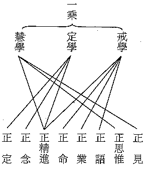

# 成佛之道偈颂讲记（下）(第6卷-第10卷)



> **藏经**：演培法师全集

> **卷／品**：0 卷 · 1 品



---



## 目录



  - [自序](#自序)



---



### 自序



印顺论师的《成佛之道》，是一部有组织有系统的力著，自出版后，依此讲说的，海内外很多，我亦在台在星，曾经多次讲说，但因时为业风所吹，或时受到法缘所牵，每次未能讲完全颂，时感有失听众所望。佛历二五二〇（西元一九七六）年一月起，复於我所重建的灵峰般若讲堂，为诸信众开讲此颂，不意听众中的陈净奘居士，将我所讲每个颂文，很详细的记录起来，每周交来请我改正，暇时我略予以增损，全部完成竟得五十万言左右。有些听众看后，咸认浅白易解，极合初学佛者阅读，请求出版流通以益初机，只好勉强应请将之付印。



当时我讲此颂，是从〈大乘不共法章〉开始，回转头来再讲〈三乘共法章〉，渐及〈五乘共法章〉、〈闻法趣入章〉，最后讲〈归敬三宝章〉。我之所以从后讲到前，原因感到时代的极度紊乱，人心的非常险诈恶毒，不说莫不相干的人，彼此经常怒目相视，就是极友善的人，或曾教导过的人，甚至对他有恩的人，平时尽管貌似友善、或是对你表示恭敬，一旦不能如其所求，或是已达他的目的，立刻将你视为仇人，并用种种手段，使你无法为法为人。



人性堕落到这程度，能不使人大为寒心？人性所以会堕落，决不是单纯的事，而是人世间大问题，人世间最大的问题，实无过於做人忘本，因而一切罪恶本源，可说皆由忘本而来，亦即所谓忘恩负义，做人做到忘恩负义，还有什麼不敢做的？《大智度论》卷九十六〈释萨陀波仑品〉说：『世间小人，因缘事讫，则忘其恩义，作是念：如人乘船度水，既到彼岸，何用船为』？中国俗语说的『过河拆桥』，亦即此意。不过，过去如此，於今尤烈。人与人间关系这样，不是在社会各角落，经常都在表演著吗？谁能否认这不是世间的事实？谁敢说这不在你面前出现？



人心险恶到如此深刻，世乱将濒临毁灭边缘，有心为法为人的佛子，如不激发学佛者发菩提心，共本佛陀的慈悲精神，以最极清净的如来正法，改善凶恶无比的人心，治疗人类恶毒的心病，从事紊乱世界的挽救，势必会有同归於尽一天，这是多麼令人可怕的一幅畫面！想到这点，特先讲大乘佛法，以期每个闻法的大众，特别是富於正义的学佛青年，从大乘佛法的听闻中，同发大菩提心，同修菩萨大行，同行同愿的『成熟众生，庄严净土』，使诸众生，特别是人类众生，改恶向善，同向菩提大道迈进，以完成学佛者应有的使命！



发心严土熟生的菩萨，是要『法门无量誓愿学』的，不可弃舍小乘而架空的学大乘，对「三乘共法」的出世解脱法门，亦当同样要加学习，所以其次讲〈三乘共法章〉。但出世的三乘解脱法门，要以世间的人天乘法戒善为基，而戒善亦为做人的基本道德律，为学佛者所绝对不可忽视，所以接著讲为一切佛法基石的〈五乘共法章〉，以使每个学佛者，先做成一个像样的人。不论学佛者怎样步入修学佛法的正道，或循序的渐次由五乘到大乘，对佛法不能没有个正确认识，因而继讲〈闻法趣入章〉，让诸佛法行者，从所听闻正法，正确趣入佛道，不致误踏邪径！唯仅闻法而得佛法的认识，不能算是一个正式佛子，要使闻法者成为正式三宝弟子，必须经过合法的归依手续，使知三宝的真实功德，亦唯具有真净功德的三宝，才是人群以及众生的真归依处，所以最后讲〈归敬三宝章〉，俾诸每个闻法者，皆成为三宝弟子。



这样倒次讲法的另一动机，是因当时来听《成佛之道》的听众，大都是来讲堂，听我讲经很久，对佛法已有一些认识，如从〈归敬三宝章〉讲起，很难引起听众的兴趣。对初发心者说法，由浅至深，由易至难，循序渐进，引入佛法，这是对的，对久闻法者说法，当不能采取这办法。〈大乘不共法〉所讲的理论，特别是大乘三系的思想差别，不说初发心者不易理解，就是久闻法者亦难搞清楚，因这部分理论，确较深刻得多。论师早在民国三〇（西元一九四一）年，就已创说大乘三大系，并将各系思想，作有条理而明晰的指出。在论师的整个著作中，讲到大乘时，虽到处流露著三大系思想，但在本书只是简要的叙说。论师所判的大乘三系，近於太虚大师所分法性空慧、法相唯识、法界圆觉的三宗。现在所以略说，诚如论师在长行中说：『关於法性般若，上来虽依般若经论而略为解说，如餘系的学者读起来，是会不同情的，所以不能不略说三宗』。



书中因只略说三系，而三系的思想理论，又极甚深最甚深的，所以一般读《成佛之道》的佛法者，到了讲大乘三系的地方，就深感有难以通过之苦。现对来听此书的听众，先讲大乘不共法，让他们对大乘法，特别是大乘三系，有个大体的认识，自亦是一大方便。大乘三大系，是对整个大乘佛法思想理论的判别，涉及全体大乘佛法的经论，如对三大系的各系经论，从来没有接触过的，或虽曾经有所接触，但不知道属於何系，自阅固然难以通过，就是听讲亦难了解。因而当我在讲〈大乘不共法〉时，最初发心来听的，确实是不在少数，但讲到三大系时，就逐渐有人退席。听众听不懂固一大原因，我不善讲说亦一大因素，是以知道大乘佛法，特别是各系的理论，的确甚深最甚深的，对佛法没有点基础，实不容易接受。不过，不能因佛法甚深，就不欲为众讲说，相反的，在尽可能的范围内，更要运用方便善巧，为欲了解佛法者讲说，使对甚深佛法有所认识，不致对佛法发生误解！



本讲记的完成，已经三年有餘，有些当时听众，一再敦请出版，但以时节因缘，迄未能付手民。今年印顺导师老人来星，看看因缘已经成熟，乃恳老人慈悲，便为带台付印，当荷老人慈允，欢喜踊跃之餘，真是感德难忘，昔为《妙云集》及《谛观全集》校对的性滢、慧润、依道、心如四师，现正为老人新撰七八十万言的《初期大乘佛教之起源与开展》鉅著校对，我亦因便请四师继续发心，而此皆是导师老人慈悲所赐。经说：『若不说法度众生，毕竟无能报佛恩』。现我套用这两句：『若不说法度众生，毕竟无能报师恩』。因而，我决做个知恩报恩者，决不敢做个『因缘事讫，则忘其恩义』的小人，除非有大阻力，让我不能继续说法度生！最后，在此诚谢性滢、慧润、依道、心如四师的发心校对！



佛历二五二四年夏历十一月初五日　写於新加坡善住室



成佛之道(偈颂)



归敬三宝章



有海无边际，世间多忧苦，流转起还没，何处是依怙？积聚皆销散，崇高必堕落，合会要当离，有生无不死，国家治还乱，器界成复毁：世间诸可乐，无事可依怙。鬼神好凶杀，欲天耽诸欲，独梵依慢住，亦非归依处。归依处处求，求之徧十方，究竟归依处，三宝最吉祥！正法以为身，净慧以为命，智月朗秋空，礼佛两足尊。三世佛无量，十方佛亦尔。悲愿来浊世，礼佛释迦文。智圆悲无极，断障无餘习，三德等究竟，方便示差别。丘井空聚落，朽故寂无人，彼岸林泉乐，礼法离欲尊。正法妙难思，善净常安乐，依古仙人道，能入於涅槃。依法以摄僧，和乐净为本，事和或理和，礼僧众中尊。敬僧莫呵僧，亦莫衡量僧，随佛修行者，住持正法城。三宝真实德，无漏性清净。化世真亦俗，佛法得长存。自誓尽形寿，归依佛法僧，至心修供养，时念诸胜利。此归依最尊，此归依最胜，不由餘归依，得乐得安隐。所说归依者，信愿以为体；归彼及向彼，依彼得救济。若人自归命，自力自依止，是人则能契，归依真实义。闻法趣入章



由闻知诸法，由闻遮众恶，由闻断无义，由闻得涅槃。如器受於水，如地植於种，应离三种失，谛听善思念。病想医药想，殷重疗治想，随闻如说行，佛说法如镜。趣入正法者，应亲近善士，证教达实性，悲愍巧为说。观德莫观失，随顺莫违逆。佛说满梵行，学者应尊敬。离彼三途苦，不生长寿天，佛世生中国，根具离邪见。生死流转中，人身最难得。忆梵行勤勇，三事胜诸天。难得今已得，精勤修法行，莫使入宝山，垂手叹空归。闻法而发心，随机成差别。下求增上生，现乐后亦乐。中发出离心，涅槃解脱乐。最上菩提心，悲智究竟乐。依下能起上，依上能摄下；随机五三异，归极唯一大。不滞於中下，亦不弃中下，圆摄向佛乘，不谤於正法。五乘共法章



正信归依者，应修於正见，及修於正命，胜进不为难。所说正见者，人生之正观。心净或不净，利他或损他；善行不善行，佛子应谛察。有报必由业，微小转广大，能引或能满，决定或不定，现生或后报，诸业不失坏。随业报善恶，五趣常流转，随重或随习，或复随忆念，由业往后有，薪尽火相传。生死常相续，圣者得解脱，凡圣缚脱异，深信勿疑惑。流转五趣中，身心多苦迫。大地狱极热，近边徧游历，八寒及孤独，是诸苦中极。旁生种种异，吞噉驱使苦。饿鬼常饥渴，不净以为食。悉由三不善，恶行之所感。人中苦乐杂，升沈之枢纽；人本误鬼本，习俗谬相沿。天趣初欲界，色及无色界。身胜寿亦胜，乐胜定亦胜。诸苦由恶业，乐由善业集。苦乐随业尽，修善宜积极。若时能行善，而未作善业，一旦苦果临，尔时复何为？求人而得人，修天不生天。勤修三福行，愿生佛陀前。依资具得乐，依施得资具；故佛为众生，先赞布施福。施以舍以利，由悲由敬别，心田事不同，功德分胜劣。施应如法施，勿随至怖报，求报及习先，希天要名等。克己以利他，坚忍持净戒。以己度他情，莫杀莫行杖，勿盗勿邪淫，勿作虚诳语，饮酒败众德，佛子应受持。五戒尽形寿，众福之所归。加行日夜戒，随顺出离者。不杀盗邪淫，不妄语两舌，不恶口绮语，离贪瞋邪见。诸善之根本，佛说十善业，人天善所依，三乘圣法立。欲乐不可著，散乱多众苦，依慈住净戒，修定最为乐。调摄於三事，心一境名定。渐离於分别，苦乐次第尽。四禅四空处，慈等四无量，佛说诸定法，次第而修习。布施多杂染，禅定向独善，依人向佛道，戒行为宗要。心性怯畏者，佛说应修念。系念佛法僧，戒施天功德。如入光明聚，阴暗一时失。正念弥勒尊，求生彼净土，法门最希有，近易普及故。见佛时闻法，何忧於退堕？三乘共法章



一切行无常，说诸受皆苦；缘此生厌离，向於解脱道。随机立三乘，正化於声闻。解脱道远离，苦乐之二边：顺摄乐行者，在家修法行；顺摄苦行者，出家作沙门。此或乐独住；或乐人间住。或是随信行；或是随法行。虽复种种性，同修出离行。佛说解脱道，四谛与缘起，甚深诸佛法，由是而显示。苦集与灭道，是谓四圣谛。苦者求不得，怨会爱别离，生老与病死，总由五蕴聚。所谓五蕴者，色受想行识，取识处处住，染著不能离。此复由六处，取境而生识。或六界和合，世间苦唯尔。苦生由业集，业集复由惑，发业与润生，缘会感苦果。业有身语意，善恶及不动。业灭如种习，百千劫不失，随业感生死，不出於三界。烦恼贪瞋痴，不善之根本，痴如醉如迷，瞋重贪过深。佛摄诸烦恼，见爱慢无明。我我所摄故，死生永相续。苦集相钩缠，死生从缘起，佛说十二支，如城如果树。无明之所覆，爱结之所系，有识身相续，相续而不已。缘识有名色，从是有六处，根境相涉触，从触生於受，缘受起於爱，爱增则名取，因是集后有，生老死相随。灭应灭於惑，惑灭则苦灭，解脱於痴爱，现证寂灭乐。能灭苦集者，唯有一乘道。三学八正道，能入於涅槃。初增上尸罗，心地净增上，护心令不犯，别别得解脱。在家五八戒，如前之所说。出家戒类五：沙弥沙弥尼，比丘比丘尼，及式叉摩那。於中具足戒，戒法之最胜，殷重所受得，护持莫失坏。极重戒有四：淫行不与取，杀人大妄语，破失沙门性。餘戒轻或重，犯者勿覆藏，出罪还清净，不悔得安乐。能持於净戒，三业咸清净。密护於根门，饮食知节量，勤修寤瑜伽，依正知而住。知足心远离，顺於解脱乘。此能净尸罗，亦是定方便。进修於定学，离五欲五盖。不净及持息，是名二甘露。依此而摄心，摄心得正定。能发真慧者，佛说有七依。增上慧学者，即出世正见。佛为阿难说：缘起义甚深：此有故彼有，此生故彼生；无常空无我，惟世俗假有。此无故彼无，此灭故彼灭；缘起空寂性，义倍复甚深。此是佛所说，缘起中道义，不著有无见，正见得解脱。又复正见者，即是四谛慧；如实知四谛，应断及应修，惑苦灭应证，由灭得涅槃。先得法住智，后得涅槃智；依俗契真实，正观法如是。正思向於厌，向离欲及灭。正语业及命，净戒以为性。始则直其见，次则净其行；足目两相成，能达於彼岸。正勤徧策发，由念得正定，依定起证慧，慧成得解脱。佛说诸道品，总集三十七，道同随机异，或是浅深别。此是圣所行，此是圣所证，三乘诸圣者，一味涅槃城。通论解脱道，经於种熟脱，修证有迟速，非由利钝别。见此正法者，初名须陀洹，三结断无餘，无量生死息。二名斯陀含，进薄修断惑。三名阿那含，离欲不复还。断惑究竟者，名曰阿罗汉，毕故不造新，生死更无缘。此或慧解脱，或是俱解脱。六通及三明，世间上福田。明净恒不动，如日处晴空；一切世间行，不染如莲华。或不由他觉，从於远离生，名辟支迦佛，合说为二乘。大乘不共法章



耻有所不知，耻有所不能，耻有所不净，廻入於大乘。不忍圣教衰，不忍众生苦，缘起大悲心，趣入於大乘。或以信愿入，或智或悲入。或依声闻入，或天或人入。趣入大乘者，直入或廻入，相应诸教法，实说方便说。众生有佛性，理性亦行性。初以习成性，次依性成习；以是待修习，一切佛皆成。发心名菩萨，众生之上首。世出世功德，悉由菩萨有。菩萨之所乘，菩提心相应，慈悲为上首，空慧是方便。依此三要门，善修一切行；一切行皆入，成佛之一乘。菩萨之学处，十善行为本，摄为三聚戒，七众所通行。退失菩提心，嫉悭与瞋慢，障於利他行，违失大乘戒。总摄菩提道，六度与四摄；渐入於诸地，圆满佛功德。身及诸受用，三世一切善，为利诸众生，无惜而行施。下士为己施；中士解脱施；利他一切施，是则名大士。财法无畏施；难施殷勤施。闻施心欢喜，胜於寂灭乐。或有不应施，自他及所为。施以舍心胜，常修於意乐。三轮处处著，是施名世间；三轮空相应，出世波罗蜜。戒断於损他，普施无所畏。失戒众患本，恶趣亦贫困。持戒三善本：增上决定胜；为他净尸罗，则入於大乘。受持净戒者，如护於浮囊。不轻於毁犯，持犯俱不著。摄护於众生，菩萨修忍度。耐怨安受苦，及谛察法忍。瞋他有何益？自他增忧苦。瞋火烧善根，忍则五德具。施戒及安忍，多为在家说。广聚福资粮，是佛色身因。佛说精进度，福智之资粮。无厌心如海，力尽而不止。推延著世乐，自轻心怯弱。满果亦难行，久处於生死，资粮广无边，练心勿退屈！怯弱下劣者，希求易行道。佛有胜方便，摄护於初心。於中殊胜者，往生极乐土，弥陀佛力持，不退於菩提。不舍现法乐，而向於菩提，药师大悲愿，东方现净土。胜解坚固力，欢喜休息力，能修於四力，精进不为难！三乘诸胜德，悉由定慧生。修习止观者，应先修习止；止成观乃成，次第法如是。依住堪能性，能成所作事。由灭五过失，勤修八断行。懈怠为定障，信勤等对治。正念曾习缘，令心不餘散，明记不忘念，安住而明显。圣说是所缘，能净惑障者，或顺於正理，能向於出离。大乘多修习，念佛与念息。念佛由意念，真佛非像佛；观相而持心，善识於方便。念息数随止，非风非喘气。觉了沈与掉，正知不散乱。为断而作行，切勿随彼转。灭时正直行，断於功行失。内住亦续住，安住复近住，调顺及寂静，次最极寂静，专注於一趣，等持无作行：圣说止方便，不越九住心。若得轻安乐，是名止成就。明显无分别，及妙轻安乐，是道内外共，由观成差别。般若波罗蜜，最尊最第一！解脱之所依，诸佛所从出。现证由修得，修复由思闻；善友及多闻，实为慧所依。般若本无二，随机行有别；般若诸经论，於此最亲切。诸佛依二谛，为众生说法：依俗得真谛，依真得解脱。世俗假施设，名言识所识。名假受法假，正倒善分别。自性如何有？是观顺胜义。苦因於惑业，业惑由分别，分别由戏论，戏论依空灭。诸法因缘生，缘生无性空；空故不生灭，常住寂静相。法不自他生，不共不无因；观是法空性，一切本不生。我不即是蕴，亦复非离蕴，不属不相在，是故知无我。若无有我者，何得有我所？诸法性尚空，何况於彼我！惑业由分别，分别由於心，心复依於身，是故先观身。无我无我所，内外一切离，尽息诸分别，是为契真实。真实无分别，勿流於邪计！修习中观行，无自性分别。以无性正见，观察及安住。止观互相应，善入於寂灭。善哉真般若！善哉真解脱！依无等圣智，圆满诸功德！法性本无二，随机说成异。了义不了义，智者善抉择。诸法从缘起，缘起无性空；空故从缘起，一切法成立。现空中道义，如上之所说。一切法无性，善入者能入。或五事不具，佛复解深密。或是无自性，或是自相有。缘起自相有，即虚妄分别。依识立缘起，因果善成立。心外法非有，心识理非无。达无境唯识，能入於真实。或以生灭法，缚脱难可立，畏於无我句，佛又方便摄。甚深如来藏，是善不善因。无始习所熏，名为阿赖耶。由此有生死，及涅槃证得。佛说法空性，以为如来藏。真如无差别，勿滥外道见！方便转转胜，法空性无二。智者善贯摄，一道一清净。成熟众生道，佛说以四摄：布施及爱语，利行与同事。初修菩提心，习行十善业；成就心不退，入於大乘道。以诸胜解行，广集二资粮；经一无数劫，证入於圣位。初住极喜地，生诸如来家，断除三种结，施德最增胜。戒德满清净，名为离垢地。发光地忍胜，慧火除诸冥。进满修觉分，燄慧见无餘。难胜静虑胜，善达诸谛理。第六现前地，慧胜住灭定，佛法皆现见，缘起真实性。常寂常悲念，胜出於二乘。远行於灭定，念念能起入；方便度炽然，二僧祇劫满。进入不动地，无相无功用，尽断三界惑，大愿极清净。以如幻三昧，三有普现身。善慧无碍解，圆净一切力。第十法云地，诸佛光灌顶，智增澍法雨，长善如大云。菩萨所修道，三祇历十地。顿入与渐入，随机有差别。三僧祇劫满，登於妙觉地。佛身最寂灭，平等无分别。如彼摩尼珠，妙用利群生。法性所流身，念念现一切。佛事菩萨事，二乘众生事；三世尽十方，依正悉无碍。於一现一切，一切入於一。十力四无畏，十八不共法，大悲三不护，妙智佛功德。佛住於净土，十八事圆满。与诸菩萨众，受用於法乐。诸法真实义，及证真实慧，无变异差别，是故无别乘。佛得不动身，悲愿化三有，示净或示秽，咸令入涅槃。为除众疲乏，化作可爱城；终示真实相，故唯一佛乘。一切诸善法，同归於佛道；所有众生类，究竟得成佛。



成佛之道偈颂讲记（上）



——佛历二五二〇年一月起讲於灵峰般若讲堂——



一　本颂造作的经过



一般讲解经论或偈颂，大都是选从印度传来，很少自编偈颂为众讲说。可是现在所讲的《成佛之道》偈颂，不是从印度传译到中国来，而是当代中国印顺论师所造的，所以用不著说明翻译的历史。印顺论师造这偈颂的经过是这样的：原於民国四十三年，亦即西历一九五四年，在台北善导寺共修会，每周对广大的信众开示，为使听众正确的了解，从归依到成佛的一条完整路线，所以特自编颂文，循序渐进的讲说，不论初学佛或久学佛者，都听得非常有兴趣，一致认是最有系统的讲说。可是编颂讲说没有完成，论师就回新竹福严精舍，主办新竹女子佛学院。



新竹女院设在山下的一同寺，於民四十六年九月正式开学，论师为对女众授课，特将昔在善导寺编讲的《成佛之道》偈颂，加以扩充编定，作为新竹女众佛学院课本。同时利用授课的餘暇，为偈颂写下简单的解说，发表於《海潮音》月刊，得到各方一致好评，咸认是近代佛教不可多得的佳作。但因论师的法务很忙，不时有人来请示佛法，因而时写时停，直到民四十八年末，为使《成佛之道》颂文及解说早日完成，特到台中王田善光寺度旧历年，利用这环境的安定，不受任何人事的困扰，专心一意的写作，终於完成了二十万字的《成佛之道》。



本书完成后，为应广大信众的要求，乃於民国五十年出版，各方争相请购，不一年就再版，成为宝岛佛教出版界，最畅销的一部书，可以想见是怎样的受到教界重视。不特一般学佛者，对本书爱好阅读，且有用作佛学院讲授的课本，有用以对广大群众说法的依据，真是一时风行教界，没有不知《成佛之道》一书。不特当时如此，就是直到今天，仍有很多学院，用此颂为课本。在学院读书的学生，固因此书而对佛法有系统的认识，就是听闻或阅读此书的人士，因而归投我佛慈座之下，更可说是不知其数，证知本书对佛法行者，有著极为伟大的贡献！



二　本颂作者的小史



本颂作者是印顺论师，从前节叙说中已了知，但论师历史怎样，还得简单的介绍。论师是中国浙江海宁人，生於清光绪三十三年，亦即西元一九〇六年，夏历三月十二日。俗家姓张，父亲名叫学义，母亲陆氏。家庭并不怎样富有，只有农田十亩左右，父亲则在离家七里远的新仓镇，做一点生意，因而可说是个半农半商的家世。普通一个胎儿，要在母胎十月才出生，就是所谓『怀胎十月』，但师在母胎只有七个月就出世，可能由於先天的不足，所以生后第十一天，就患了一场几乎死去的大病，以致从小身体瘦弱，直到年老身体都不怎样健壮。



民国元年（一九一二）师七岁时，严父要带他到新仓镇去读书，就离开了慈爱的母亲。首先是在普通的私塾就读，然后改入初等小学肄业，十岁就在初等小学毕业，十一岁升入开智高等小学，十三岁就毕业於该小学。原因师在初等小学时，成绩非常的优异，立即被插班於二年级，不是从一年级开始读起。在开智高小时，因得明师张仲梧先生教授国文，文学乃有突破性的飞跃进步，奠定后来具有高度文学的基础。到了开智高小毕业，其父看他相当的聪慧，是个可能读书的根器，特令从某中医学医，在三四年的学习中，虽对医药原理略有认识，但对这门知识，缺乏学习兴趣，因而转到母校，前后执教八年。



论师在母校执教的八年中，不特非常认真的教学，受到学生一致的爱戴，且利用教学的餘暇，广阅各类不同书籍，如道书、新旧约等有关宗教哲理的读物，对神仙鬼怪有所迷惑，甚至有决定学仙的趋向。进而开始读些《老子》、《庄子》等书，不时还读一些佛教的经论。但这都是自己在摸索，没有得到任何人的指导。读了这些典籍，於是探讨人生究竟怎麼一回事。正在这期间，不过短短两年，先是慈母的见背，继是严父的去世，深感生命危脆败坏，引起内心极大震动，乃萌离尘绝俗之念。师的立意舍家非家，不如一般盲目冲动，而是受到佛法熏陶，所作的理智抉择。动了这个念头不能自安，乃於民国十九（一九三〇）年，发心到普陀山礼佛敬香，同时看有没有因缘，以完成要求出家的志愿。



到了普陀山，因不认识人，不知到什麼寺庙出家，内心感到相当的徬徨，也许论师出家因缘成熟，后得到般若精舍的主人，亦即被太虚大师誉为『平生第一益友』的昱山法师的介绍，到福泉庵去求出家，当即得到白发苍苍的清念老和尚慈允，就在该庵礼清念老和尚为师，正式落发为僧。清老为取法名印顺，别号盛正。普陀山向有一个特殊惯例，就是任何人在山出家，除了正式的剃度师，还得另拜一位义师。论师是因昱公介绍而得披剃的，所以就礼昱公为义师父。十月十一日出家后，在庵住了没有多久，就奉尊师的慈命，与师兄盛明在十月底，同到天童受具足戒，戒和尚是当时很负盛名的圆瑛法师。戒期圆满后，即回普陀山祖庭，礼祖及拜剃度恩师。



论师从小就喜欢读书，所以在祖庭度岁后，就到太虚大师主办而闻名全国的厦门闽南佛学院，修学佛法以期了解佛法的真理。当时闽院分为甲乙两班，论师投考因为成绩卓越，被插入甲班二年级，这可说是非常突出，而为一般新生所求不到的。闽院在当时办得相当出色，为全国有志求学的僧青年所向往。因为院长是新佛教领袖太虚大师，代院长是负有革新佛教英名的大醒法师，教务主任是对唯识最有深入研究的芝峰法师，其他各科教师亦都是第一流的。不特师资阵容相当坚强，就是环境亦极幽美，更富自由学习的风气，因被认为是最理想的学园，为国内其他任何佛学院所不及，事实由闽院造就出来的僧才，确实不在少数，今日在各地弘法的，仍有很多是闽院学僧。



论师在闽院甲班仅读了一学期，就奉大醒法师命，到福州鼓山涌泉佛学院，为该新创的佛院学生授课，学期结束回南普陀过旧历新年，以为该院开学时再去服务，那知到了次年闽院上学期将要开学时，醒公却将论师留下来，请在闽院为甲班同学讲课，讲的是《十二门论》。为同班同学讲课，不是没有先例，但极难以应付，因为原是同学，假定不善讲说，或者没有内容，不但要受同学责难，甚至弄得下不了台，这是世间常见的事。所幸论师对於般若空义，一向有他独到的认识，讲说亦颇富有组织，因而讲来有条有理，很能引发同学兴趣，并对论师深具好感。一个出家受具不久的初学比丘，即在声誉卓著的闽院，为甲班同学授课，假定没有深厚的学养，怎可做到？



论师自在两个学院教学后，就始终过著教学的生涯，从没有离过教学的岗位。如民国二十三年，奉太虚大师命，到武昌佛学院，指导同学对三论的研究学习，自己对三论亦有更深的认识。七七抗战军兴，到大后方的重庆，立被请到北碚汉藏教理院，为诸同学授课，授课之餘，还在自己的宿舍，为演培、妙钦、文慧讲《摄大乘论》。到民国三十年，又应请担任法王学院最高导师，为该院学僧在课室讲《金刚经》及自编的《印度之佛教》。复为教师演培等数人，讲《中观论颂》於客堂。在法王三年中，论师讲著不息，堪说为法情殷。民国三十三年，法王学院结束，再回汉院授课，讲《性空学探源》。胜利后，回到沪杭不久，应性愿长老请，到南普陀参加戒会，为诸新戒讲戒。由於局势逆转，遂在南普陀成立大觉讲舍，以期续为培植僧才而努力，不意大局迅速恶化，仅一学期不得不宣告解体。



在赤焰将要烧到厦门时，论师从厦门到了香港。在港两三年间，生活固不安定，居住亦常变迁，因没有固定道场，每处都是借用暂居。虽则这样艰难困苦，但讲说及著作，从来没有停过，所以有不少讲记及著作，都在港期间完成。这真可与晋时道安大师，虽生活在不断变动中，仍领众讲学精神相比美！论师除讲说及笔耕，很少在教界作其他活动，但由於德学的崇高，颇受当时香港佛教界僧俗一致尊重。因此，民国四十一年，被选为香港佛教联合会会长，世界佛教友谊会港澳分会会长，前者是香港佛教的最高机构，后者是世界佛教的友谊组织。没有经过任何活动，且在自己完全不知情形下，自然被选出，不难看出港佛教界，对论师的如何尊重！



民四十一（一九五二）年的秋天，论师应中国佛教会请，代表自由中国出席在日本召开的世界佛教友谊会第二届大会，乃於七月十五日左右，到达自由中国的宝岛，为论师生平生活的一大转捩点。不特是年到日本参加会议，於四十六年五月，复应中国佛教会整理委员会，推选为赴泰纪念佛陀二千五百年大会代表，同时又到柬埔寨金边，参加纪念佛陀的大会。除这些国际性的佛教活动，於民四十三年到四十九年间，曾经三度到菲律宾弘法，并任岷尼拉大乘信愿寺及华藏寺的联合上座。在任上座四年期间，集合寺众及诸信众，创办能仁学校，被公请为校长，请信愿寺法务主任妙钦法师为代校长，全权处理校务，成为菲国侨校最有规模，最有成绩的小学。



民五十年，应请来新加坡弘法，并为演培新建的灵峰般若讲堂，主持佛像开光及成立典礼，堪称极一时之盛。新加坡佛教总会，请在玻丽维亚剧院说法三日，每日听众座无虚席，给新加坡佛徒，留下深刻印象。到六十二年，由於法体违和，乃应纽约美国佛教会沈家桢居士邀请，到美国静养，偶亦为善信宣说法要。六十五年，应马来西亚本道长老的函请，南来参加金马仑三宝寺传戒大会为说戒和尚，并在星般若讲堂，小住一个时期。本道长老为论师的同戒，二老的关系向极相契，所以这次在山说戒，二老都特别的欢愉。



论师一向是个不大爱活动的学者，出国参加会议，或者应请弘法，都由各方恳切的邀请，绝对不是自己谋取得来。然而，每到一处参加会议，如果论师发言，都受各国僧俗重视，认为确是精通佛法的论师；每到一处讲经说法，不特得到当地听众的愿乐欲闻，且受到每个听众的恭敬尊重，并求多多的开示法要，证知论师的感人之深。但这不是大吹大擂求得来，而是由论师的德学所感，因论师确有相当的修持以及对佛法精深的认识。



论师从民三十七年到六十七年的三十年间，前后参加过八次传戒大会，都是随喜性质，因受请不得不随喜。在这八次戒会中：两次担任得戒和尚，就是五十六年台中慈明寺举行的传戒大会，六十七年台北松山寺举行的传戒大会，前者是纪念智性老的，后者是纪念道安老的；一次担任教授和尚，那是民四十四年台中宝觉寺举行的冬期戒会；四次担任尊证和尚，最早的一次是性愿长老在南普陀寺传授的千佛大戒，其次是五十八年参加基隆海会寺的传戒胜会，中间两次都是台北临济寺所举行的戒会，担任说戒和尚的一次，是马来西亚金马仑三宝寺的戒会。



论师是位精通三藏的大德，亦是位得到文字三昧的学人，不论长篇短论，或是鉅著讲记，都经过深刻的认真的思考，不是急就章的草率完成，组织固然非常的谨严，理论亦有相当的深度，思想亦复非常的细密，文字的优美更不用说，所以论师所有写作，他人不能增损一字。不特语体文流利通畅，就是文言文亦简洁有力，因而论师任何文字的发表，都受到教界及社会人士爱好和阅读，这在近代佛教界，确不多见。无怪论师到闽院写的第一篇作品，就受到太虚大师的重视，认为是青年僧不可多得的佳作。如没有思想内容的文字，怎会得虚大师的赞美？



论师於民五十九年，除《说一切有部为主的论书与论师之研究》、《原始佛教圣典之集成》、《中国禅宗史》的三部论著，特将历年所讲所写的编为《妙云集》。《平凡的一生》中说：『全集分为三编：上编为经论的讲记，集成七册。中编是专论，如《中观今论》、《成佛之道》等，集成六册。下编是将种种短篇（也有五、六万字的），依性质不同而类编为十一册。全部为三编，二十四册，约三百六十万字，准备次第的重新排印出来』。在写《平凡的一生》时，虽说准备排印，事实於民五十八年，已经次第刊行，到民六十二年全部出版。



论师是个不求名闻的学者，佛教有什麼荣誉事，不特不争取，且总向后退。可是民五十九年，写成《中国禅宗史》，日本佛教学者牛场真玄，读此书后，来信请允译为日文，当得论师允许，待全部译成，来函赞《中国禅宗史》，写得极为出色及有价值，劝以日译本向大正大学申请博士。论师一向随缘，为了不使牛场失望，也就如其所请，并寄一些经历及著述到日本，结果竟为该大学通过，授与论师文学博士学位。本应亲赴东京面试领取，但因论师无意於此，根本未去日本。但该校仍破例授与博士学位，成为中国佛教『划时代的博士比丘』！



论师在大陆时，除剃度的小庙，总在各佛学院讲学，从没有想到自己要建道场。可是违难香港，由於住处数迁，深感诸多不便，得到妙钦法师赞助，乃在新界买一块地，拟建福严精舍清修。嗣以其他特殊因缘，乃将在港拟建的福严精舍，改建於台湾新竹青草湖一山头上。民四十二年九月，福严精舍建筑完成，成为一个独立学团，自是始有自建道场。但这仅可作为内修，为了对外弘化方便，并使精舍内修学众，得一对外宣传实习机会，乃复决定筹建慧日讲堂於台北。幸赖三宝加被及诸信众热心，在台北龙江路附近，觅得建坪四百餘坪的一块空地。



讲堂於民四十九年六月兴建，五十年一月建成，即举行落成开光典礼。从此内修外弘道场俱备，亲近论师的学众，发心自修的在精舍，发心弘化的在讲堂，或是内外互调，一时成为宝岛最有声誉的两大道场，而被认为是如来法幢所在之处。总之，论师是当今最为难得的僧宝，亦是一位最杰出的法将，所以两大道场成立，不是指导学众内修，就是对外信众说法，从未为自己身体设想，以致晚年身体衰弱，少作教学弘化活动，在过隐居潜修生活。虽则如此，仍为海内外正信佛子，目为是维系正法不灭的一盏明灯，可以想见论师在佛教所发生的影响力！



第一章　归敬三宝



有海无边际，世间多忧苦，流转起还没，何处是依怙？



发心修学佛法，以大乘佛法说，没有不以成佛为最高目的，但要达到这最高目的，不是一步就可做到的，而是有其必然的层次，按部就班的逐渐上去，到最后完成佛果的证觉。佛不是那个圣者所有的特号，而是三世一切诸佛的通称，亦即人人都得名为佛的，问题在看你是不是到达这程度。本於此说，可以显示佛法的究竟平等，不像有些宗教所信奉的至高无上的神，是独一无二的，信奉者只可为神子神民或为神的使者，要想也成至高无上的神，是绝对不可能的，这当然是有等级而不平等的，换句不好听的话说，这是一种独裁的宗教，不值得有智者的信奉。人间觉者的佛陀，虽被尊为『圣中之圣』、『天中之天』，但因是人人所能做得到的，所以我们应该向佛学习，希望亦能完成佛的圣德，以与十方诸佛把手并行，不要永远做个无智凡夫。要知诸佛在没有成佛前，和我们一样是个愚痴众生，但因发现了菩提大道，不断在佛道上前进，将自心中的尘垢括尽磨光，成为大澈大悟的觉者，成为功德圆满的圣哲，成为世间的大慈悲父。



诸佛既由修学而得成佛，我们如踏著诸佛的道迹前进，成佛自没有什麼问题，是以每个发心学佛的行者，得先建立必得成佛的信念，然后循著佛所指示的成佛正道，精进而不间断的如法修习，拂除所应拂除的惑障，完成所应完成的圣德，利济所应利济的群生，降伏所应降伏的魔军，那就得到成佛，成为人天之师。学佛者的最后成佛，固决不成问题，但如何修学佛道，仍值得注意。因佛所指示行者，向有所谓人天道、解脱道、菩提道的三条不同路向，在这三条不同路向中，当可由行者自由的选择去走，而到达所当到达的目的地。



但以大乘佛法的观点来说，路向虽有三条不同，而实皆是成佛之道，因为修菩提道以成佛，是不舍人天道及解脱道的，亦即要以此二道为基石，才能稳健的走上菩提道，不致从菩提道上退下来。所以经中每说：『一道一清净，一味一解脱』；甚至在小乘《阿含经》及大乘《法华经》，都说佛法为『一乘道』。佛在经中所以有时说这道说那道，不过是适应各类不同根性而说，如以为有不同的路向，或认为各个路向独立，那是人们认识上的错误，决不是佛说种种道的本意。因此，本书虽告诉我们应怎样的修习成佛之道，但却从归敬三宝说起，好让我们循序渐进以成佛。



本章是明归敬三宝，当知这是踏入佛门的第一步，任何一个人想要学佛，如不先行归敬三宝，不论你对佛具有怎样高度的尊敬，对法具有怎样高深的研究，对僧具有怎样高尚的好感，最多不过说你是个佛法的同情者，绝对不得说你是个佛法的信奉者，因你仍飘流在三宝门外，没有进入三宝的大门，自然也就不能得到佛法的受用，是以归敬三宝成为学佛不可或缺的初步。当知所谓三宝，是苦海的舟航，是火宅的雨泽，是黑暗的明灯，更是佛法的总纲，一切佛法无不是从三宝流露出来的，离了三宝还有什麼佛法可谈？因而归敬三宝实为学佛最重要的一法。



原来人类生存在这世间，不论是个怎样的人，都应有个宗教信仰，然后生命才会有所依托。不然的话，人生之舟，飘流在茫茫人海中，势必感到没有他的停泊处，甚至认为生命的无限空虚。流行在世间而成为世界性的各大宗教，无不竭诚的希望人们信仰，以期解决人生的大问题。佛教是宗教，且是理智的宗教，自亦要人信仰的，且唯有信仰佛教，生命才能获得解救。但信仰佛教，不是口头说说就行，必要举行佛教仪式，才能成为佛教信徒，这就是所谓归敬三宝。三宝各各具有它的殊胜功德，确实能为我们之所依投，我们归敬了三宝，就得佛法的受用。



归敬三宝固是学佛的初步，但当正归敬时，不是泛泛的随人俯仰，而是要有至诚恳切的心才行。如是恳切至诚的这念心，怎麼才会生起？首当了知我们现刻是在三「有」生死「海」中，而这生死苦海一望过去，真是「无边」无「际」的没有一个尽头。这话怎说？要知三有的有，不是别的什麼，是指具有情识的每个活泼泼的众生。众生在生死中所形成的生命长流，向前看，过去无始以来，一个生命接著一个生命的生命流，无边无际的发现不到它的源头；向后看，在未得到生命解放前，还要一个生命接著一个生命的继续流下去，同样无边无际的发现不到它的终结。众生的生命流，在生死海中的无限奔放，好像世间大海那样的没有边际。至於『现在这一生，不过生命大海中泛起的一个浪头而已』。众生的生命在生死大海中，就这样头出头没的没有止息时，试问生命有什麼意义？就以现实生命说，看来好像是不错的，实际它是刹那不住，不断在向死亡进军，有什麼可值得贪恋？佛陀经常开示说：不论怎样宝爱这个生命体，给予它种种最妥善的维护，但当生命到了快要结束时，它会毫不迟疑的说去就去，决不会在世间多所逗留，是以现实生命是虚假不实的！



即此虚假不实的生命，生存在这时间不断推移的「世间」，假定是快乐的倒也罢了，可是事实，任何一个生命的出现，总是苦多而乐少的，甚至纯苦无乐的，即或有时有乐，亦会很快的乐去而苦来，从没有得到自在的生命，是以生命生存在这世间，实在是「多忧」多「苦」的，亦即经中所常说到的『忧悲苦恼纯大苦聚』。仔细想想，的确如此，我们自有生命以来，何曾有过快乐时期？如有认为生命是快乐的，诚如佛说是众生的颠倒。是以佛法行者，要想出离而得解脱，必须肯定生命是苦，假定没有苦的肯定，是不能得到出离的，所以说『无苦无出离』。



如是纯大苦聚的现实生命，假定在一期生命中就告结束，问题还不怎样严重，事实这个生命结束，新的生命继续而来，生命之流一直奔放，从没有停息过，所以说为不息「流转」。《佛说五无反复经》说：『世间俗人，无数劫来，流转生死，迁神不灭，死而复生，如车轮转，无有休息』。这是生命事实，谁也不能否认。生命既在生死中转来转去，当然不会老是停留在某个受生的地方，有时升「起」上生到天上人间，有时「还」要沈「没」到地狱、饿鬼、畜生的恶趣。众生在生死中流转不息，要不外於在这几个舞台上转来转去，从未超出这个范围。



生命在生死苦海中流转，沈没又浮起，浮起又沈没，始终没有一个了时，诚是生命一大悲剧！我们就让它无限期的流转下去，一直使生命悲剧不断上演吗？不能！假定真的就让它去，生命未免太没意义，是以，我们应该求救求护，应该要求解脱自在，应使生命得大解放，不能让生命永远在生死舞台上跳来跳去，受著诸多忧苦的袭击！人类果真有了这个畏生死苦希求解脱的心情，自然就会发起猛利求得真归依处的观念。但是跟著而来的问题，就是「何处是」真归「依」处，何处是可恃「怙」处？自亦不能不特别的慎重考虑！



假定寻求不到真归依处，生命解脱自做不到，是以『何处是依怙』，不能不认为是个重要的课题。但若发现到真归依处，以怎样的心情求归依，自亦同样值得注意。至於归依的心情，通常我们举喻说：如一个人跌落到大海中，随著波浪或东或西的漂流，生命到了生死存亡的关头，总望有个东西依靠，以挽救生命的危亡，不用说，这个求护的心情，当时非常的迫切，所以不论遇到淌来的一根木头，或是开来的一只救生艇，自然就会依靠它，以求生命的得救。当知吾人要求归依的心情诚恳，应如落海者求生那样的真切，那就可以得到所归依者的救济！



积聚皆销散，崇高必堕落，合会要当离，有生无不死，国家治还乱，器界成复毁：  

世间诸可乐，无事可依怙。



归依在佛法说，固极必要，但世间人，有的根本不知要求归依，认为现实世间美满得很，因而一味的贪著世间的乐事，好像世间乐事永远属於他的，如此还求归依做什麼？殊不知一般所谓世间乐事，根本是危脆而不可靠的，随时随刻都有消失的可能，但世人总迷恋著，这不是颠倒是什麼？试看世间有很多人，当他在称心如意时，你要他学佛免谈，不是说时候未到，就是说消极迷信。到称心如意事过去，知道世间原来是梦幻，再来要求学佛修行，敢说已经迟之晚矣。是以学佛要及时，不能推延又推延。世间究有什麼为世人迷恋，不肯及时修学佛法？说来当然很多，现在根据颂文，分别六种如下：



一、「积聚皆销散」，这是世间第一乐事的不可靠。所谓积聚，就是财富的积聚。世人没有不想方设法的，积聚种种的财富，以为财富积聚得越多越好，因他们认为金钱是万能的，只要有了钱财在手，什麼事情都可以做，所以不惜运用种种手段，在社会上谋取各种暴利，恨不得世间钱财都归自己所有。那知财富不论积聚得怎样众多，到最后终归要销解散失的，决不可能永远为你所有。积聚起来的财富销散，不能说是不善保存，不会经营，由於浪费，而实财富是流动的，不会为任何人所能长期掌握，今日为你所有，明日可能就为他有，古人说的『旧时王谢堂前燕，飞入寻常百姓家』，这不是最好的写照吗？何况佛法更说钱财为『五家所共』的，怎能由你自己独有？所谓五家所共，就是大水可以冲走你的财产，大火可以烧光你的财产，盗贼可以抢走你的财产，恶王可以没收你的财产，儿女可以败尽你的财产，且这是随时随刻可能发生的事，亦是经常所能见到的事。不要说得太远，就以暴恶政权执政来说：多少人倾家荡产？多少人扫地出门？多少人因财而死？多少人只身逃亡？到了万恶的越共，更是异想天开的，从逃亡的难民身中，搾尽最后一点金钱，能说财富属你所有吗？是以尽管世间徧地财富，不是我们的不要去积聚它，已是我们的亦当供给社会，保有很多财富做什麼？当知财富，不但不是快乐的源泉，亦不是有办法保障，反而其中潜藏著种种的苦恼，如富人的常被打劫或被绑票，这不是含有忧苦的最好明证吗？是以在世为人，如以为金钱万能，或以为经济第一，必然是错误的，必须承认财富是不可靠的，无论怎样不能为我们的依怙，为什麼要积聚财富？



二、「崇高必堕落」，这是世间第二乐事的不可靠。所谓崇高，是指名位与权位说的。在这现实世间做人，稍为有点能力或办法，没有不争取崇高地位的，一旦将之争取到手，从不见有谁肯把它放下，因有了权位，威风八面的，要想做什麼，就可做什麼，所谓『一朝权在手，便把令来行』，特别是独裁者，不受任何限制，崇高的权位，多麼诱惑人？无怪古今中外有很多人，无不在争取最高的权位，甚至为争权位而不惜牺牲生命，这是中外历史上所一再告诉我们的，但是人们忘记历史的教训，不肯以历史的一面镜子为殷鉴，仍拚死拚活的在你争我夺，能说这不是人们的愚痴颠倒？当知崇高的权位，能不能为你争取得到，固是极大问题，即或侥幸为你争取到了，最后「必」然仍是要「堕落」的，自古以迄今日，可曾有个紧握权位而不倒下去的？有的在位时就被拉下来，有的到死后不得不放下，争取最高的权位，试问有什麼意思？长行说：『近一些说，慕尼黑时代的希特勒，那还了得！可是等到柏林失陷前夕，也就一筹莫展，只有一死了事。史达林主宰苏联三十年，一切荣耀归於史达林。可是尸骨未寒，就被他的党徒清算』。这不过是举两个最现实而为人所熟知的例，诸如此类的，中外历史上，可说还很多。再以最近的例说：当群魔在大陆进行文化大革命时，所谓四人帮是多麼的威风？真是得心应手，呼风得风，唤雨得雨，要打击什麼人就打击什麼人，谁敢不服从的要想有所抗拒？可是到魔头毛泽东倒下，不到两个星期，就被逮捕囚禁，崇高的权位何有？后之视今，你知又有多少得到崇高地位者的倒下？不说人间的崇高权位不可靠，就是佛法说的统一四洲的顶生大王，以十善化天下，到生命结束后，上升忉利天中，帝释分半座给他，与他共治忉利天宫，不能不说他的功德巍巍，可是到了最后，仍从天上坠落人间，终於不免忧愁而死。不唯如此，『那位自称天地之主，人类之父的天帝，也还是不免堕落驴胎马腹去』。试问崇高的权位，有什麼值得依怙？如以崇高的权位，作为生命的依怙，那无疑是错误的，为什麼念念不忘的去追求？



三、「合会要当离」，这是世间第三乐事的不可靠。所谓合会，或是家庭眷属的合会，或是学校师生的合会，或是团体同事的合会，或是社会友谊的合会，或是其他各式各样的合会，彼此果真感情融洽，意气相投，互相关顾，自是极美满而又极理想的，并且在缘起的关系网中，相互协调合作，你关顾我，我照应你，生命自多一重保障，而安心的生存下去！且以眷属的合会来说：一个家庭中的父母儿女、兄弟姐妹以及夫妇，果真相处得很融洽，时刻生活在温煖中，沐浴在亲情中，而所接触到的，无非和乐气氛，就人生来说，自很理想的。但好景不常，随时会变化，如亲情的变为冤家，这不是世间常见的现象吗？再以夫妇的关系说：世间最恩爱的无过於夫妻，一对出双入对情意缠绵的恩爱夫妻，不论走到什麼地方，都会受到人的欣羡，但是曾几何时，一对原来极为恩爱的夫妻，忽然发生情意的突变，不是闹分居，就是要分离，想想这是多麼痛苦的事！特别是到死别的时候，任你夫妇感情好到怎样难舍难离，但是『夫妇本是同林鸟，大限到时各自飞』，『有缘则合，无缘则离』，有什麼力量可使他们合而不离？再以父子母女来说，不论有著怎样高度亲情，但当其中任何一个生命将要结束时，不说没有任何办法可以留住，就是要想代替也代替不了，甚至哭得死去活来，又怎能有益於死者？《五无反复经》说：『大啼小哭，何益死者』？正是透露了这一消息！所以要想亲爱眷属的合会，作为自己生命的依怙，同样是不可能的！因为生离死别，是世间的事实，任何人都不能免的，怎能为生命的依怙？所以迷恋眷属的合会，同样是错误颠倒的！



四、「有生无不死」，这是世间第四乐事的不可靠。所谓『有生』，是指有情生命的出生，任何一个生命的出生，经过一个相当时期后，必然是要结束的，不结束的生命没有，所以说『无不死』。虽说什麼时候死是没有定期的，但死的必然到来却是决定了的，而且不论是个怎样生命，最后定死没有什麼不同，不说愚夫的生命要结束，就是圣者的生命亦要舍。《无常集》说：『若佛若独觉，若诸佛声闻，尚须舍此身，何况诸庸夫』？生而不死怎麼可能？《入行论》说：『昼夜无暂停，此寿恒损减，亦无餘可添，我何能不死』？生命就是在年月日夜的时间推移中，被不暂停的无情时间所消磨了的。如更彻底的说，当你最初入胎受生时，已不断的向死亡路上奔驰，奔驰到死亡终点时，还能逃避一死吗？决定是不可能的。但是愚痴无智的人群，当生命尚存在时，甚至到临命终时，仍然认为今日不死，心心念念的执著不死方面，由於这一念不死心盘旋在脑际，不但不会去奉持如来正法，反而向名利场中去挤，争取一切名利归属自己。佛说众生为求生命久住之所欺诳，自然而然的就会在利养恭敬上，生起猛烈的贪心，假定有人对己所求的利养恭敬有所障碍，则又对他生起猛烈的瞋恚，终於落在烦恼窟中作活计，造作种种的罪恶，引生未来的大苦，这不是自寻苦恼是什麼？死是现实世间铁一般的事实，而随时随地都可见到，但人们为不死之所迷惑，总好像死是他人的事，我是不会死的，殊不知死由生来，有生必然有死，生了又想要不死，怎能做到？但是世人很怪，生是欢喜的，死是不要的，这不是颠倒是什麼？佛法最极重视事实，不但从来不讳言死，且时刻提醒人们注意死的到来，因为死缘是很多的，安住在死缘中的每个生命，好像风中烛一样，随时有被吹熄的可能。佛说生命在呼吸间，入息不保出息，出息不保入息，是世间常有的事！因此，生而为人，应怖於生，不当怕死，怕也是怕不了的。世间有些宗教，随顺俗情要求，高唱什麼长生永生，欺骗贪生怕死的人，真是误尽天下苍生！试观自有人类以来，可曾有一个人得到长生永生的？可怜执迷不悟的人群，明知长生永生的不可得，但仍喜欢听这样的假话，一听说到死就以为不吉利。佛法行者，应坚定『生者必死』的信念，确认生存是不足依怙的。因为死这怨敌，必然要到来的，当它到来时，没有任何力量，可阻挡得了，为什麼要被长生永生的甜言蜜语之所欺骗？假定能常作这样想，自不会执於不死一边，而奉行如来的正法。



五、「国家治还乱」，这是世间第五乐事的不可靠。在这现实世界中，有大小不等的很多国家，据现加入联合国这个组织的，就有一百四十多个国家。每一国家人民，生存其国家中，总希望其国富强繁荣的，一个繁荣富强的国家，对於人民的安全自由，自是较有保障，这从世界的强国，可以明显的看出。因此，有人以为国家的富强繁荣，就是自己最极有力的依怙。试看许多弱小国家的人民，常为超级强国欺凌压迫，不是正好说明这一点？殊不知国家的强弱，是也一直在变动中，过去是强国的，现在衰颓下去，现在是弱国的，逐渐变为富强，岂不也是世间的事实？不说各国的强弱，不断的在变动中，就是一国的治乱，也经常的在转移，从没有一个国家长治久安的，某个时候好像非常安定的治平，可是没有好久就又变为极度混乱，特别是在党治的现代，更是治乱的相互交替。原因搞政治的，各有派系，当这个派系在政治舞台上时，那个派系就在台下捣乱，到了那个派系跃登政治舞台，这个派系又在台下搞鬼，因而使得国家总在治乱不定中。中外历史昭告吾人的固是如此，现实政治告诉我们的也是如此，是则以国家为依怙，岂不是会落空而靠不住吗？所以想要著落於国家的富强，同样是极大错误！



六、「器界成复毁」，这是世间第六乐事的不可靠。所谓器界，就是我们所住的世界，佛法将之称为依报，是人类生存所依止的据点，因为人类总不能两脚挂空的生存下去。无可置疑的，世界，特别是世界的各个社会，物质文明在不断的飞跃进步中。就以现代来说，人类所享受到的，决不是过去三十年代或五十年代所想像到的，因而有人以为只要社会文明，继续向前开展进步，使人生活过得更美满，人生就已有了它的代价，还要从宗教中去求安身立命做什麼？所以追求社会文明进步的人群，认为宗教是没有必要的。但这种想法，当亦错误。社会文明的进步，是不是人生真正意义的所在，固然是个问题，即使退一步说，承认这是人生真正意义之所在，但人类社会的一切活动，都依於所住的器界，如没有这一据点，作为人类活动所依，试问生存在社会上的人群，怎样去作种种活动？而为人类活动据点的器界，不如一般所想像的那样天长地久，是在成而复坏，坏而复成的流变过程中的。当器界在安住期中，社会文明又尚在进步时，你在享受物质文明，似还有些人生意义，一旦到了器界坏时，一切文明与之俱尽，到了那时，人生真义，又将何在？所以『以社会进步为人生真正意义的人物，才是真正空虚的幻想者』！我们不要做个空虚的幻想者，而应确认社会文明的进步，是不足为我们依怙的。



如上种种分析，证知人「世间」的「诸」般「可乐」事，「无」有一「事」是真正「可依怙」的。世人所以觉得这些可为依怙，不过是认识上的一种错觉，并不是诸可乐事，真能为人们依怙。正因人们有这错觉在，终於使得他们不能引发求归依的心情，不能不说是世人的最大损失！现既说明这些不可为依怙，人们当会生起求归依的心情，然而什麼可为归依处呢？这自是一个问题。下面先指明非真归依处，然后再说明真正归依处。



鬼神好凶杀，欲天躭诸欲，独梵依慢住，亦非归依处。



流转在生死中的有情，生命是非常危脆而痛苦的，非得求个归依处不可，但归依的宗教对象，是有各式各样的不同，当我们去求归依时，不得不特别的谨慎，因错归依了对象，不但对归依者无益，反有很大的损害。要知归依了某个对象，不但以他作为生命的依靠，且要以他为典型，作为效法的准则，怎能有所大意？流行世间的任何一个宗教，没有不希望人们归依其教主的，我们如不审慎的抉择，很易为邪魔外道所误导。为使人们正确的有所归依，现特说明三类不是真正的可归依处。



一、「鬼神」不是真正的归依处，因为鬼神之类，不论是宗教界的，或是一般传说的，在祂们的精神界内，不但充满了各式各样的烦恼，且烦恼的炽烈有过於人类，特别是暴恶成性的，为瞋恚心所驱使，不特不会有助人类，且嗜「好凶杀」伤害人群，动不动的来找人群的麻烦，使你不胜其烦的无法应付。『他们所要人类供给的，是牺牲——血肉，甚至要求以人为牺牲。如人而不恭敬供养，或者冒犯了他，就会用残酷的杀害来报复——狂风、大雨、冰雹、瘟疫等』。如我国过去以活人祭祀河神等，就是最好的例子。这些凶恶的鬼神，好像人世间黑社会的人物，当你陷於不幸境遇时，确可给你一股相当的助力，使你度过一时的难关，可是你得乖乖听他的话，不能有一点儿得罪他，如稍得罪了他，就有你好看的。所以生存在这世间，对黑社会的人物惹不得，这是谁都知道的。鬼神的崇拜也是如此，如对鬼神孝敬得不周到，就会惹祸上身，而且赶都赶不走，所谓『请鬼容易送鬼难』，就是此意。『鬼神的崇拜者，每每为了得罪鬼神，弄得家败人亡』，这也不是世间常见的现象吗？因此，要求归依者，千万不要『引鬼入门』，自找麻烦！既然如此，人世间为什麼还会有那麼多人崇拜鬼神？原因鬼神之类，确有一些神力，可以协助於人。虽说如此，由於祂们本身还有种种烦恼，烦恼汉依烦恼汉，怎能使自己得益？又怎能解决自己的问题？所以对於鬼神之流，最好如孔老夫子所说那样的：『敬鬼神而远之』，为最上策！长行说：『从前，大勇法师在北平，想去西藏学密宗，依照密宗规例，请得一护法神，据说是广济寺的狐仙。狐仙来护法了，却反对大勇法师去西藏；要去，他就非捣乱不可。真的是来时容易去时难，费了好大力量，才把他赶走』。这一事实，足为崇拜鬼神者戒！鬼神当然是很多的，然不论是怎样的鬼神，善良的，凶杀的，有福的，无福的，都不值得信奉！



二、「欲天」不是真正的归依处，因为欲界诸天，虽说比鬼神高一级，但毕竟还是「躭」著「诸」般「欲」事的，怎能为吾人归依？讲到欲天，佛经说欲界有六天，就是四大王众天，忉利天，夜摩天，兜率天，化乐天，他化自在天。如是六天为什麼称为欲天？当知所谓欲，主要是指物质的贪欲，男女的性欲，欲界诸天的天人，与人类有情一样的，没有能够远离这两种欲，所以称为欲天。长行说：『欲天中，与人类关系最切的，要算忉利天王释提桓因——帝释了。他崇尚和平，爱好道德，希望人类进步。虽为了天国的统治，偶尔也发动战争，但宽恕敌人，以不杀为主。他成为多神王国的大帝，通过鬼神而统治人间。天女围绕，与中国传说的玉皇大帝相近……在物欲与性欲的享受中，不免骄奢淫佚，沈醉於糜烂的生活，而智慧与德性的精神生活，反而会退落下来』。这是必然的，因偏重欲乐生活，精神生活自就说不上高尚，这在现实人间亦是经常见到的现象。帝释天是地居天，所以亦常来人间见佛闻法，或听佛为其他众生说法，或亲自请佛为他说法。有次他来人间请佛说法，佛陀感於他沈醉在欲乐生活中，为欲乐所困而无以自拔，特为他开示无常的真义，告诉他一切欲乐的享受，都要成为过去的，不要太迷恋它，应当抽点时间修学佛法。当正在闻法时，似乎有所感动，并且向佛表示，这次回到天上，定要好好修行。可是回到天上不久，不说不知道如何修行，就是佛说的什麼，亦忘得一乾二净。目犍连尊者为考验他是否如实修行，特运用神通上升到忉利天，一看，帝释正在天女围绕中，忘乎其形的享受欲乐，那里是在修行？尊者为了惊醒他享受欲乐的迷梦，特以神通使天宫震动，帝释有感於天宫震动，乃知是目连尊者来向他警告，不免感到相当的愧对释尊！享受欲乐而易於堕落的欲天，自身都要求佛陀为归依处，又怎能为我们的真归依处？是以不应以欲天为归依的对象。



三、「独梵」不是真正的归依处，这是约色界的大梵天说的。色界高於欲界，向来分为四禅，就是初禅、二禅、三禅、四禅。初禅分有梵众天、梵辅天、大梵天。梵众天，是指初禅的天众，好像人间的人民；梵辅天，是指辅助大梵的臣佐，好像人间的官吏；大梵天，是指初禅天的天主，好像是人间的帝王，因为是独一无二的，所以称为独梵。『梵是清净的意思，与圣洁的含义相近』。到了初禅天，不但大梵天不会贪恋庸俗的物欲及远离男女的性欲，就是其他诸天也是如此。因而表现於德行方面，慈悲博爱的精神，特别来得昂扬，不是一般宗教者的教主所能及的。佛在经中告诉我们：当大梵天出现在色界初禅时，欲界天以及人类所居住的地球还没有，所谓臣民自也谈不上。可是独梵在大梵天中，想到这个世界应该有个天地，於是欲界以及地球就渐渐的凝成，想到有了地球不能没有人居住，於是人也就出生到人间。由於这些都由梵天的心想而出现的，因而他就『以为天地由他而创造，人类由他而出生』，不免自高自大的狂妄起来，以为宇宙万有的一切，都是自己之所创造的，自己成为世界的创造主，所以说「依慢住」。因为大梵自以为如此，所以印度婆罗门教，也就尊大梵为世间的创造者。就是人类各个阶级，也是从大梵天生的。经说有次大梵为他的臣民说：我是你们的父，你们是从我生的，都是我的子。当他傲慢自大说得兴高采烈时，马胜比丘忽出现在他面前，大梵亦有自知之明，知道刚才所说的一切，可以骗得了梵众、梵辅诸天，但决骗不了体悟缘起真理的马胜比丘，所以见到了马胜比丘，立刻停止他的演说，将马胜比丘拉到一旁说：刚才我所讲的，只是对我的天上臣民讲的，你可千万不能当真，更请不要在我的臣民前，揭穿我的谎言。是则大梵天王，在短短时间中，对诸臣民表现一副憍态，对佛弟子表现一副谄姿，而憍慢与谄媚，都是一种烦恼，一个自己烦恼没有断的，怎能为我们的真归依处？长行说：『他生存一较长的时间——一劫半，便向他的臣民宣说：自己是常住不变，无始无终。印度的大梵天，与基督教的耶和华相合。梵王的净行——克制世俗的情欲，与慈爱精神，原是可称赞的。可惜狂慢的邪说，奴视一切，成为信我者生，不信我者灭亡的大独裁者。一神教的邪毒，泛滥世界，成为罪恶的一大根源。试想：如不是夸大狂，增上慢，这位流转生死苦海的大梵天王或耶和华，凭什麼说创造万有呢？凭什麼说常住而无始无终呢』？是以神教者的独一无二，至高无上的神，决不够资格为人类的归依。



佛法将这世界分为三界，色界除了初禅天，还有二禅天，三禅天，四禅天，再上去就是无色界的四天。天愈高，其定力愈深，离人类亦愈远，自就不会发生什麼关系，虽有少数人信奉以上的诸天，但不能成为广大社会人群共同信仰的宗教，所以对於以上诸天，不但佛法少有说到，就是一般信者亦不多谈。世间宗教，固有各式各样的，要不外於鬼神教，多神教的大神，一神教的大梵或上帝。可是如上分别，我们清楚了知：不论神格有著怎样高低，地位有著怎样优劣，但生死没有了，烦恼没有断，仍是三有海中浮沈不定的众生，并无二致。像这样低级的高级的鬼神之类，尚有赖於究竟归依者的救济，怎能成为人类求归依者的归依对象？所以颂总结说：「亦非归依处」。



归依处处求，求之徧十方，究竟归依处，三宝最吉祥！



轮转於三有海中的有情，特别是有情中的人群，深切的感到生死大苦的逼迫，求「归依」的心情，自然就会生起，有了这念求归依的心，也就会得「处处」去寻「求」所要归依的对象，看看究竟什麼是自己所要归依的对象，如是像这样的「求之」不息，甚至「徧」於四方、四维、上下的「十方」去求，求来求去所遇到的，都不过是些低级或高级的神，初初以为祂们可为自己的归依，可是等到一接触后，原来并非真归依处，因为祂们本身问题尚未解决。不能因为祂们不是真归依处，就此不再去求归依，归依仍要继续求的，如是不断的处处求，终於发现到，「究竟」的真「归依处」，唯有佛教所信奉的「三宝」，三宝之所以为真归依处，因三宝确有救护世间的堪能。佛、法、僧三为什麼称之为宝？因这『都是希有难得的，价值无上的，妙用无比的，所以都称之为宝』。求救护者果以殷重恳切心归敬三宝，就可『化凶为吉，化难成祥，离恶向善，转黑暗为光明，离苦痛得安乐』。诸如此类的吉祥事，都由归敬三宝而来，所以说「最」为「吉祥」。有颂说：『昼吉祥，夜吉祥，昼夜六时恒吉祥，一切时中吉祥者，愿诸三宝哀摄受』。归敬三宝而得三宝哀愍摄受，必然一切无不吉祥。



在此或有以为：这也不是真归依处，那也不是真归依处，唯有三宝才是真归依处，是不是有点卖花赞花香之嫌？或者含有自赞毁他的用意在内？不！绝对不！这『是从事实与理由两方面得来的结论』。事实是这样的：自以为能作救世主的大梵，终於发现不能救自己的儿女，必得另请高明来从中救护，当祂正在有著这个希望时，大圣释迦在人间成为人间佛陀，於是在佛成佛不久，特从天上下来人间，恳请佛为救护世间而说法。本打算不说法而入涅槃的佛陀，经过梵天王的恳请，终於转大法轮以救济人群，不特使得很多人得到救度，就是梵天也离欲得到圣果，成为佛的弟子，做了佛的护法。从这一事实说明，岂不证实唯有佛陀是世间的真实救护者？



至於欲界的帝释天，虽说祂的神格，超过一般鬼神，要想以祂为真归依处，仍是靠不住的。经说帝释天在忉利天的寿命将尽，生命快要结束时，自知离开死期不远，而最使祂感到不安的，就是生命结束后，要堕到猪胎中去做畜生。享惯天福的帝释天，於感忧愁苦恼之餘，仍旧设法挽救自己的这个不幸，首先到初禅天请求大梵天的救护，大梵天是个自顾不暇的天人，那有餘力为他解决问题，於是就又去请求大自在天为祂设法，可是大自在天告诉祂亦无能为力，乃至问徧天上所有诸天，结果总是使祂失望，不得已而来人间到处问鬼问神，甚至向一般外道仙人请问，没有一个说是可以使祂不堕落的。幸而祂还有一点残餘善根，最后遇到大悲救世的佛陀，佛陀对祂方便善巧的开示，使祂一念回心向善，得以保持天国的地位，没有去受畜生的苦报，是以帝释也就成为佛陀的外护。从这一事实说明，不特佛为众生的真归依处，亦复显示徧於十方求归依而不能得，帝释天的经历，是个最好证明。以是因缘，《归依七十颂》说：『佛法及僧伽，是求脱者依』。



为什麼硬说唯有三宝是真归依处？要知是不是真归依处，不是随自己的好乐而说的，是必有其客观条件的，现在不妨说几点如下：一、不论是个怎样的人，只要自己证得无所怖畏无所恐惧的圣位，就有资格为诸群生归依，没有到达这样的程度，好像倒者依於倒者一样，自己都还挺立不住，仍有种种的怖畏，怎能从他获得救护？二、不论是个怎样的人，对於来求归依者，一定要能善巧方便予以化导，使他安住在佛法中，从而成办所要成办的己躬大事，假定不能做到这一点，不说不值得去归依，纵然诚挚的去归依，是亦不能成办所要成办的己躬大事。三、不论是个怎样的人，对於来求归依者，定要具有拔苦与乐的慈悲心，确实为求归依者拔苦与乐，假定是个没有慈悲心的，不说不值得去归依，纵然诚挚的去归依，是亦不能从他得到离苦得乐。四、不论是个怎样的人，对於来求归依者，不是看他供养财物多少而生欢喜，而是看他是不是如法修行以申供养，作为对之生起欢喜的条件，假定不能做到这点，那他就会著眼於你是不是对他供养，有所供养的就为你归依，无所供养的就不为你归依，如此怎能普徧的作为一切归依处？五、不论是个怎样的人，能不能为人的真归依处，就看他的存在，是不是符合真理的？是不是身心清净而没有杂染的？是不是具有无量功德的？是的就值得归依，不是就不值得归依。谁能具有如上的五个条件，谁就可以作众生的依怙，佛法绝对没有朋党观念。但仔细的多方的予以思维分别，能完备的具有这五条件，唯佛与佛，是以佛为世间的真归依处，由於佛是真归依处，所以佛所说的正法，从佛而出家的僧众，亦同样是真归依处。因此，我们要想获得身心解脱，首应至心的对此发生定解，从而应尽形寿献生命的归依三宝！



正法以为身，净慧以为命，智月朗秋空，礼佛两足尊。



上面总说三宝为真归依处，但三宝究有什麼功德，值得世人普徧的归敬，还得予以扼要说明，方能使人生起坚定信念。在说明三宝的功德，先赞佛陀的功德，次明正法的功德，后说僧宝的功德。



佛是梵语佛陀的简称，中国译为觉者。如就通常所说自他关系方面解说，向有三觉的差别：就自己觉悟真理言，名为自觉，不但佛陀得到这样的觉悟，就是声闻圣者亦得到这样的觉悟；就自己觉悟后而又能以此觉悟其他的人乃至一切众生，名为觉他，不但佛陀能做到觉他，就是大乘菩萨亦能觉悟众生；就自觉、觉他两方面都做到圆满无缺，唯佛与佛，不说声闻小果不能做到，就是菩萨行者亦还有所欠缺，唯有统具三觉，方得称之为佛。



佛陀自觉所觉证到的向来有著多种说明，如说觉证法界、法性、实相、实际等，本颂说为觉证「正法」，正法或又译为妙法。长行说：『法是可轨可则的，不变不失的，所以正法是中正而不偏邪的，微妙而非浅显的真理；这是有永久性、普徧性的绝对真理。圆满觉证了正法，才名为佛，所以佛是「以」正法「为身」的，名为法身，也就是绝对真理的具体显现者』。



以体证诸法真理而得法身，像这样的法身可说人人具有，现说佛以正法为身，是约佛已证悟诸法法性说，众生所以还未得法身，是因没有依佛法去修学，将本具的法身显现出来。佛陀不但体证了法身，且以无量清净功德庄严了法身，与众生没有以功德庄严自有不同。古德说：『然而法身虽曰公共，其中须分隐显：众生因烦恼生死所覆，是故隐而不显；惟诸佛修无量功德以生，是故显而不覆』。众生欲想得到法身，不但要将隐覆的烦恼拂除，还要修诸清净功德予以庄严。



佛陀不但觉证真理而成法身，且「以」「净慧为命」完成慧命，所以通常都说佛陀具有法身慧命。慧命的慧，是指离诸烦恼杂染所有的清净无漏智慧。佛陀圆满觉证诸法真理，固然不错，但以什麼而得觉证？当知就是这个最极清净的智慧，由於智慧的最极清净，所觉证的真理也是最极清净，经中说的『最清净法界』，就是指此。当知法界，亦名法身。真理之法既含有普徧性，当然徧一切处而无所不在，从来都是那样圆满而无欠缺的。如凡夫迷於真理之法，真理照样的圆满存在，从来没有减少丝毫；诸佛觉证真理之法，真理还是如原来那样的圆满，并没有增加一丝一毫。假定有丝毫的增减，就不得称为圆满真理。虽则这样说，但就凡夫而言，不得不求真理在身心上实现，否则，就永远飘流於真理门外，不能体见真理之所以为真理。



佛的成佛，或说是法身与慧命的统一，或说是智慧与真理的契合，没有一佛，单有法身而无慧命，或唯有慧命而无法身，因为两者缺一，绝对不能成佛。前说佛的智慧是最极清净的，但清净到什麼程度，现特举喻说明，就是佛的「智」慧，清净得好像没有云翳遮蔽的明「月」那样光辉皎洁，因而由净慧所体证到的正法，也就好像明月「朗」照「秋」夜的晴「空」一样，使得蔚蓝色的秋空，在皎洁的月光中，显得格外清净。『这是说：清净觉照的佛智，彻底证觉正法，正法也究竟清净显现於净慧之中』。真理与智慧，无一不获得究竟圆满清净，是名为佛。古德说：『如月出云际，圆朗彻空』，正是此意。唯此法身，是诸佛所证得的实际理性，而这实际理性是绝对境界，唯有以清净慧体证，才得说为成佛。



法身与慧命到达彻底圆满的佛陀，是有种种功德的，而所有无边无际的功德，都是从法生起的，法所成办的，依於正法的，所以证觉正法的佛陀，值得世间众生的归敬。每个发心学佛者，理当「礼佛两足尊」。礼佛，一般都以为是身礼，而实包含三业礼敬的，就是礼拜问讯是身礼，口头赞叹功德是语礼，内心虔信恭敬是意礼。唯有像这样三业虔诚的礼敬，才能表示我们对佛至诚恳切的真信，不是浮浮泛泛的信仰。两足尊，是对佛的高度赞叹。依於向来所说，佛的福德智慧，无不圆满具足。虽说高级的菩萨，也具有大福德、大智慧，但望於佛陀还不算得圆满，所以唯佛得称两足尊。另外一种说法，两足是指普通的双足，如人类就是两足的有情，但佛在两足的人类中，是最胜最尊贵的，所以名两足尊。两种说法，都是赞美佛德，任何一种讲法都可。要想虔诚的礼敬佛陀，确信佛为真归依处，最要的一著，就是不断的思惟佛的殊胜功德，并且极力的引发至心的定解。



三世佛无量，十方佛亦尔。悲愿来浊世，礼佛释迦文。



佛是十方三世一切诸佛的通称，亦为一切智者所共有的德号，不论什麼人圆满觉证诸法的真理，什麼人就有资格称佛，不像别的宗教只承认一个至高无上的神，信奉其神的任何一个人，虔敬的心无论怎样至诚，最多只能做到神子、神使，要想完成像神那样的神格，绝对是做不到的。本此可知，佛教是最极平等的宗教，主张人人都可成佛的，我们现在学佛，不过是向佛学习，以佛为我们模范，最后必然到达佛那样的地位！



佛既人人可成，发心学佛的人多，成佛的自也不在少数。如从过去、现在、未来「三世」的时间方面去看，不论在任何时间出现的「佛」，都有「无量」无边那麼多。以现在说，当以释迦牟尼佛为主；可是向前看，过去曾经出现过的，有迦叶佛，拘那含牟尼佛，尸弃佛，毘婆尸佛等；但再向后看，未来所将要出现的，有弥勒佛，楼至佛等。过去佛有无量无数，未来佛亦有这麼多。如从东、西、南、北、东南、西南、东北、西北、上、下「十方」的空间方面去看，不论在任何空间出现的「佛」，也是这样众多，所以说「亦尔」。像我们所居住的这个三千大千世界，在十方中是有无量无边那麼多的，而每一世界为一佛所化之区，所以佛也就如世界那样的有无量无边。如东方现有不动佛，药师佛等；西方有阿弥陀佛等；北方世界有成就佛等；南方世界有无垢佛等。时空中既有那麼多佛，我们应归敬那一尊佛？不能分别的说只归敬某一尊佛，而应归敬三世十方一切诸佛。如以分别心於诸佛中，选择某一尊佛，为归敬的对象，是就不像具有广大心量的大乘法器。要知一切过失毕竟皆无，一切功德悉皆成就的佛陀，无一不堪为我们的归依，理应归依一切诸佛，不当於中有所选择，说这佛我要归敬，那佛我不要归敬，假定如此，那是错误的！



虽说一切佛都当归敬，但就我们这个世界说，教主本师释迦牟尼佛，是每个发心归依者，所当特别要归敬的。因释尊与我们的关系太过亲切：如在因中行菩萨道时，发现五浊恶世的众生，痛苦特别来得众多，需要救济也就特别殷切，乃本救苦救难的大「悲」心，忍苦忍难的大「愿」力，誓在秽恶国土修行成佛，「来」此五「浊」恶「世」，救护苦难众生，不忍众生在浊恶世中，长期受诸苦难的逼迫，悲愿力的深广，完全从此看出。佛在经中说：『我不入地狱，谁入地狱』？这不是在口头上唱唱高调的，而是由佛完满的实践出来！此一伟大精神，多麼值得我们赞美归敬！



谁都知道，佛是在二千五百年前，出现在印度苦难地方，经过出家修行的历程，最后终於证觉而成佛，为黑暗的世间带来了光明。当佛未出现在这世间时，世间到处充满了黑暗，众生在黑暗的世间摸索，始终摸不出苦恼世间，真是成为世间的可怜愍者！佛为黑暗世间带来了光明，众生在正觉光明指引下，不知有多少获得生命解放，我们不特别归敬怎麼可以？佛给我们的伟大恩德，真是高如须弥，深如巨海，不但要归敬，且应予以高度的赞美！非特受了佛陀恩惠的我们，应当尊敬赞叹，就是十方诸佛，亦同声赞叹的。如《弥陀经》说：『彼诸佛等亦称赞我不可思议功德，而作是言：释迦牟尼佛，能为甚难希有之事，能於娑婆国土五浊恶世——劫浊、见浊、烦恼浊、众生浊、命浊中，得阿耨多罗三藐三菩提』。佛来秽土成佛，不是没有能力在净土成佛，而是全为救护我们而来。因此，当我们在归敬十方三世诸佛后，应特别敬「礼」本师「佛」，就是此土的「释迦文」。释迦文，是释迦牟尼的异译。归敬一切佛而又特别归敬释尊，好像归依僧是归依一切僧众，但对代表说归依的归依师，我们应格外的尊敬，因他对我们的恩德特别大，我们由他而得进入佛门。



智圆悲无极，断障无餘习，三德等究竟，方便示差别。



佛陀具有无量无边的功德，要想一一赞叹，真是叹莫能穷，所以或以身语意所具的功德赞，或以自利利他所有的三德赞，现在就以后者的三德赞佛，对此三德有所了解，对其他的功德也就可知。



先赞佛的智德：佛的「智」慧，已经到达究竟「圆」满，没有什麼欠缺的了。如对一切法的本性，固然究竟觉了，就是对一切法的特性、形态、作用、关系等，也无不普徧觉察。如以经典中的术语说：觉了诸法本性，就是通达如所有性，即诸法的本性原是怎样的，就如其本性怎样而如实通达。如诸法本性是无自性空的，即能了达它的本性是空，决不於其中执有丝毫的实在自性。觉察诸法特性等，就是洞悉尽所有性，即尽诸法之所有，各各的特性是怎样的，能如它的特性分别清楚，如地以坚固为它的特性，水以润湿为它的特性等，决不会误将水的特性看成是地，亦不会将地的特性看成是水。且对一切所知的认识，如观掌中庵摩勒果那样清楚。一切所知非常宽广，可说是一切的一切，但除佛智能无碍的徧知，其餘所有的众生，都是智量狭小，不能徧知宽广的所知。再就时间来说：佛对诸法的觉知，不但对现在诸法能普徧觉了，就是对过去诸法，未来诸法，亦能无碍的普徧觉了。而佛觉了三世一切诸法，如风行於空那样的无障无碍，决不会有一法能障佛的不知，所以佛名一切种智。众生所以在生死中流转，受诸痛苦的逼迫，没有办法予以解决，问题就在愚昧不知，没有智慧洞达诸法的真相。佛陀得到一切种智，无碍徧知一切诸法，因而不但解决本身问题，获得身心的究竟解放，而且运用自己的智慧，善巧方便的度化众生，使众生亦能得到解放。像这样的成就自利利他，没有广大的智慧怎行？所以佛的圆满智德实值赞叹！



次赞佛的恩德：佛陀不但有深广的智慧，而且有无限的「悲」心，要以一切众生为所救济的对象，决不小心小量的，或以一人、一家、一村、一族，或一地区、一世界，而是徧为一切世界而发心的，亦即没有一个众生不在佛的悲心中救拔，且其悲心的深切，彻骨彻髓，只知有他，不知有己，真是「无」所不用其「极」。如诸众生在这世间是不自在的，但这不自在是由烦恼的系缚，并非有个什麼系诸众生；佛陀行化世间同样是不自在的，但这不自在不是由於烦恼的系缚，而是为大悲心之所系缚，因佛念念以度生为怀，只要见到诸有受苦的众生，悲心就恒无间断的生起，生起的悲心牵你到地狱去救苦众生，你就不得不到地狱去，不由你自由自在的想不去就不去，是为佛的不自在。为什麼要这样？因佛为悲心驱使，无时无刻不在注视众生的动静：不论是见众生堕在愚痴黑暗中，或见众生堕在贪爱大海中，或见众生堕在生死牢狱中，或见众生没在忧悲苦恼中，立刻就奔驰到各个众生的面前，或令远离愚痴黑暗，或者拔出贪爱大海，或令跃出生死牢狱，或令免除忧悲苦恼，如此为悲心牵来牵去，那里还有佛的自在？佛有这样深切的悲心，对众生有这样的恩德，所以理应先礼佛陀的大悲，从而赞美佛陀的恩德！



最后赞佛的断德：断德是约断除烦恼习气说，能断烦恼的不唯佛陀，就是声闻圣者亦同样的断烦恼，但佛与声闻毕竟还有不同，原因在於大圣佛陀，不但断除了烦恼，连残餘的习气亦不存在，可是声闻圣者，烦恼固无餘的断尽，但习气仍然存在，因而不能如佛那样的清净。习气不会障碍生死的解脱，固然是不错的，然而不能不说是种缺陷。如诸声闻弟子中，有的过去骂人骂成了习惯，现在虽从佛法的修学中断除烦恼，但有时仍不自觉的脱口骂出，当知这就是习气。虽说没有恶意，总不怎麼理想。有的尽管平时是怎样的严肃，但有的时候仍不免蹦蹦跳跳，应知这亦是一种习气流露。有的尽管已经破除了我执，可是有时仍然坚执己见，认为自己是对的，同样属於一种习气。诸如此类，声闻圣者中，是有很多的；可是佛陀，已将一切理障、事障的烦恼「断」尽，就是残「餘」的「习」气亦已「无」有，不会像有些声闻圣者，仍有残餘的身语意三业习气表现，亦不如有些悲智并重的菩萨行者，由於内心烦恼的杂染，不能达到像佛那样究竟清净。



长行说：『基督教徒，每说耶和华是圣洁的，其实，他动不动就发怒，杀人千千万万，甚至用洪水来淹没地球，几乎连人类和动物都断了种。狂慢凶狠到这步田地，还能说圣洁吗』？心中充满了烦恼，特别是具有凶狠狂慢的烦恼，那有资格称为圣洁？又怎能为人所归敬？佛教是最没有朋党观念的，不论是怎样一个圣人或神，只要真的圆具一切功德，我们就归敬他，决不看他与我的关系怎样。真能具有功德而又能使我们获得身心解脱的，那怕一点关系没有，我们亦会诚心诚意的去归敬他，设使没有功德而又烦恼重重的，纵然与我们的关系很密切，我们亦不会去归敬他，因归敬他对自己无益。佛教是最理智的，决不感情用事，亦不迷信盲从，徧观世间所有圣者，真能圆满诸功德的，唯佛与佛，所以归依佛不归依天神。



如上所说智、恩、断的「三德」，不是那一尊佛所独有的，而是一切佛平「等」具有的，并且都得到「究竟」圆满，不能於中分别某佛智慧高，某佛智慧小，某佛恩惠大，某佛恩惠小，某佛断惑尽，某佛断不尽，假定在诸佛之间，有大小高低的差别，那就不能说诸佛圆满一切功德，我们也就自然的选择功德圆满的归敬，功德不圆满的就不归敬，这麼一来，那里还可说归敬十方三世一切诸佛？佛佛是平等的，佛佛是道同的，除非不成佛，成佛必一样，如於其中分别胜劣，是就不能了解佛之所以为佛，发心归依者对这一点，必要有个正确的认识。



可是跟著而来的问题，就是从佛在大乘经中，所介绍的诸方佛看，佛佛间无疑有差别：如诸佛的色身，有的是高大的，有的是矮小的；诸佛的寿命，有的长达多少劫，有的短到几十年；诸佛的国土，有的是清净的，有的是秽恶的；诸佛的弟子，有的是众多的，有的是很少的；诸佛的正法，有的住世很久的时间，有的住世只有千年。这是什麼道理？不是明显的有差别？当知诸如此类的差别，不是佛的真实功德有什麼不同，而是为了适应各类的众生，「方便示」有这种种「差别」。如以为佛的真实功德也有这样的差别，那是我们绝大错误，千万不要妄生分别！



丘井空聚落，朽故寂无人，彼岸林泉乐，礼法离欲尊。



上已赞叹佛宝的功德，现赞法宝的功德。颂初两句，举两譬喻，但要分别的读，才可看出两个譬喻：丘井朽故是第一个譬喻；空聚落寂无人是第二个譬喻。现在分别说明如下：



「丘井」，是个没有水的枯井。经说：过去有个旅人在旷野中行走，忽然有个狂象向他奔来，旷野没有掩蔽的地方，生命受到相当的威胁，但人求生的意志总是很强，所以拚命的向前奔跑，跑得没有多远，发现一口枯井，有条枯藤在外，立即攀住枯藤，躲到枯井里去，正在这时，狂象追来，井口小而象头大，对旅人没有办法，只好望望然的离去，旅人始得松一口气，幸未受到狂象吞噬。但是一望井底，发现一条毒蛇，张著血盆大口，好像等他落下，他惊慌的再向外看，井外又有四条毒蛇，赖以维持生命的，仅这麼一条枯藤，而在枯藤的根旁，正有黑白两只老鼠，你一口我一口的咬著藤根，如果咬断立刻就堕井底，正在这麼一个生命的关头，再仰起头来朝上看看，藤上有滴蜂蜜滴到他的口里，竟然忘记生命的危险，还望蜂蜜一滴一滴的滴下来，好让自己享受蜂蜜的甜蜜，你说这个旅人是多麼愚痴！



不要笑这旅人愚痴，当知这是指的我们每个自己。意说众生奔驰在生死旷野中，经常受无常（狂象）之风的袭击，为了逃避无常之风，乃躲到生命枯井内，赖以维持生命的，是生命中的命根（枯藤），而这命根为日夜时间的噬食，随时有使生命结束的可能，况死亡的影子（井底毒蛇）时刻笼罩著自己，再加上四大（井外四蛇）不调的疾病发生，生命实在非常危脆，是个腐「朽」而败坏的东西。但生存在这世间的人们，不知生命的无常苦迫，稍一接触外在的五欲（五滴蜂蜜），不知欲乐如刀头蜜，竟然染著五欲不舍，不但忘记生命的无常，就连因贪五欲而造罪业，会得感受生死的大苦，也都管不了那麼多，能说这不是众生的愚痴？以诸痛苦言，生死大苦最为根本，因有生死的生命苦果，其他的苦才会纷纷而来，如解脱生死大苦，其他诸苦自归乌有。可惜不说一般的苦不能警觉众生，就是为诸痛苦根本的生死大苦，亦不能使众生感到警觉，仍然贪著世间的欲乐，无怪佛说颠倒众生为可怜愍者，要来唤醒众生的迷梦，令踏上解脱的大道！



「空聚落」，印度所说的聚落，等於中国的村庄。村庄原是住人的，可是现在这村庄，空「寂」得「无」有一「人」。经说：过去有个犯了国法的人，为要逃避国王的处罚，特想逃出自己的国境，当他走到一个无人的村庄，由於走得精疲力尽，想在村庄休息一宿，明天再继续向前走。可是想好以后，忽听空中有人说：你不能在此休息，你应继续的前进，要知此村正当的人民虽没有一个，但却是万恶盗贼经常出没的地方，如你不继续前进，虽逃过国王的处罚，但将会伤身在盗贼手中，对你非常的不利，为什麼要住下来？犯人听到空中这声音的劝告，一刻也不敢停留的，振作精神再向前进！



当知这犯人不是别人，正是指的每个修学佛法者，佛法行者在向解脱大道前进时，为了摆脱魔王的控制，一直总是勇猛精进的前去，由於过分的精进勇猛，有时就想在六入村落休息一下。六入为什麼说为空聚落？因六入所组织的生命体，一般总以为内在有个实在自我，殊不知如众生所想像的实在自我，根本是不可得的，如空聚落的无人居住一样。内在的实有自我虽说没有，但当六根触对六尘时，引起有漏的六识，不应该贪的要贪，不应该瞋的要瞋，种种烦恼活动，犹如盗贼一样，劫夺行者的功德法财，结果，不但不能获得生命解脱，有的还因此堕落恶趣，这是非常不值得的。所以佛法行者修学佛法，以求出离三界的牢狱，不但要摆脱魔王的控制，更要不为六根所欺诳，必要继续的向前进，没有到达安全境界，决不可停下来，为烦恼贼愚弄！



前说逃避国法的人，离开盗贼往来的空聚落，继续向国界边沿前进，待到达两国的交界地，既有大河挡住了去路，后面追捕的又快要赶到，其时的紧张不言可知，然再向河那边亦即「彼岸」看去，不但不属这边国王管辖，且有茂盛的园「林」，清澈的流「泉」，如能过去，安全固然没有问题，并可享受种种快「乐」。想到这点，他就毫不迟疑的，无所顾虑的，立刻跳到河中，奋力游往彼岸，到了彼岸，始真正的没有死亡的恐怖，认为来人再也抓不到他，於是放心大胆的休息。



此喻修学佛法的行人，在修道过程中，洞悉六根组织的生命虚假不实，六根触对六境时，不论外境怎样美好，再也不受六根诳惑，既不贪著外境，亦不对之瞋恚，认为一切的一切，无不是如幻如化，於是精进的清修，渡过生死的大河，摆脱魔王的控制，越出三界的牢狱，到达涅槃的彼岸，安住在涅槃宫中，享受不生不灭的寂灭解脱之乐，不会受到内在外在的种种干扰，就可大大休息。



丘井喻是显示『诸行无常』的真理；空村喻是显示『诸法无我』的真理；到达涅槃寂灭是显示『涅槃寂静』的真理。佛於《阿含经》中所说的三法印，就是佛法所要开显的三大真理。长行说：『而涅槃又是通过无常无我而实现的，为一切圣者的究竟归宿，这就是我们要归依「礼」敬的「法」宝』。所谓归依法，也就等於归依三大真理，或是以『涅槃寂静』，为法宝的真归依处。由般若慧证得涅槃，不但是真正归依处，且能究竟离欲。世俗一般修禅定的，到了相当的程度，虽可远离一部分的欲，但在一切离欲中，涅槃为最尊最胜，所以说「离欲尊」。没有证得涅槃的离欲，不唯离欲得不澈底，设若定力有所松弛，欲还可以活动起来，必要究竟离欲才行。



正法妙难思，善净常安乐，依古仙人道，能入於涅槃。



究竟离欲的寂灭涅槃，不特为诸学佛者的归依处，亦是一切圣者的归依处，所以三乘圣者皆依无餘涅槃而得究竟。虽说涅槃为诸圣者之所同证，没有得到涅槃，就不能说完成学佛的能事。可是由於证入的程度有著不同，因而也就说有有餘涅槃、无餘涅槃、大般涅槃等差别。依於向来解说：有餘涅槃是现生证得阿罗汉果的圣者所得，就是所应断的已经断除，所应证的已经证得，但还有过去惑业所感的残餘果报在，亦即现实生命体尚未舍掉，所以名为有餘涅槃。无餘涅槃是真正入於寂灭以后的境界，就是到了生命结束后，不但断其所当断，证其所当证，有漏果报身亦已舍了，没有残餘的生命在，名为无餘涅槃。大般涅槃亦可说是无住涅槃，是佛菩萨所证得的，显示佛菩萨的悲智双运，以大智故，洞彻生死的如幻如化，虽在生死不为生死所转；以大悲故，不忍安住於涅槃独享寂灭之乐，仍来生死度如幻众生，使诸众生皆入无餘涅槃而灭度之。涅槃虽有这样的差别，但同得解脱是无二的。



严格说来，涅槃并不是另外什麼，就是圣者所证觉的「正法」。由这是息生死流，净诸烦恼所自证的境界，唯有证到这境界的，自知是怎麼回事，没有证到的我人，要想思量它怎样，没有办法思量得到，所以说：微「妙难」以「思」议。思议既尚难以思议，要想说明它怎样，当亦相当的困难，不过依於佛陀的开示，亦可从四方面来加以形容：一、正法是「善」，但这不是与恶对待的善，而是胜义的唯一的绝对善。二、正法是「净」，是说烦恼杂染尽管是很污染的，但无论如何不能污染到正法，正法总是保持它本有的纯洁，不特如此，烦恼生起定有所缘，尽管诸法可为烦恼的缘起，但正法不是烦恼杂染等所能缘起的，所以名为最极清净。三、正法是「常」，这是显示它的永恒而超越时间性的，不生不灭，本来就是如此。假定有生有灭，堕在时间性中，就不得说之为常。四、正法是「安乐」，这是显示它没有生老病死、忧悲苦恼的逼迫，缘起还灭门说的生灭则老死灭，乃至忧悲苦恼纯大苦聚灭，所以是安乐的，且是远离系缚的绝对乐，不是其他的乐可以比拟。具有如此四大特色的正法，不但是微妙难可思议的，证得的功德亦复不可思议。所以吾人不特要以正法为真归依处，并要自己去亲证这正法。



正法就是涅槃，然而怎样才能证得涅槃正法？问题很简单，只要「依」著「古仙人」的正「道」，一步一步的向前行，就「能」证「入於涅槃」，获得身心的究竟解脱。所谓古仙人道，就是过去诸佛所曾走过的大道。过去诸佛都是由此大道而得证入涅槃的，今释迦佛亦是循著古仙人道而成佛的，这是古佛的常道，不是释尊亲创的，所以如能依於古仙人道而行，自亦同样可以证入涅槃，问题看你是不是肯得向这条大道去走。



大小乘经中都说到古仙人道，经过是这样的：过去有一个人，披荆斩棘的走上一条山道，是很不容易走的，但在毅力支持下，终於走出荒路，发现康庄大道，循著大道继续走下去，走进一个极为美丽，极为安乐的城市，因而就在其中享受从未享受过的快乐。不用说，发现到的康庄大道，是很多古人所曾经走过的，并不是现在这个人所开辟的，他不过发现而已。为了不使个人独享，特又出来告诉大家，应依这古道入快乐的城市，共同享受其中的快乐。此喻佛所走的解脱道，是古佛所曾走过的，涅槃城亦是诸佛所同入的，现在发现这条解脱道，进入涅槃城享受寂灭之乐，为使一切众生也能得到这寂灭乐，所以告诉众生应走上解脱道，不要长期的在生死道上走来走去。而这古佛的常道究竟是什麼？就是一般所说八正道。



依法以摄僧，和乐净为本，事和或理和，礼僧众中尊。



法宝的功德已经赞叹，今当续赞僧宝的功德。佛证觉正法后，为使众生亦能证觉到正法，乃本初发心的悲愿，开始为众生宣扬正法之音，众生听了正法之音，了解正法就是真理所在，为了体悟宇宙人生的真理，就有很多人来从佛出家，希望以出家者的身份，踏上古仙人的大道，因而佛教开始有了僧众。僧为僧伽的简称，译来中国叫和合众，就是有组织有纪律的集团。任何一个集团，必要有严密的组织，才能发挥它的力用，佛陀深深知道这点，所以特把僧众组织起来。佛是极为民主的圣哲，从来不以自己的权威统理大众，所以律说『我不摄受众』。然则佛以什麼组织僧众？是「依法以摄」受他们，使他们成为和乐的「僧」众。法是什麼？前面说过，是究竟的涅槃，亦人生的正道，因而佛就以此正法，感召追求人生究竟的人群，集合在一个团体中，共同为现实人生及理想人生而努力修学。另一方面，法又是团体共住的规律制度，如没有合法的规律制度，任何一个团体都要瓦解，但使团体巩固所用的规律制度，亦不得随自己的好乐订立，必还要契合人生正道，使大家认为易於遵守才行。佛是一切智者，对这深有体认，所以特本自他共处的完善法则，制为规章法度来组织大众，成为一个最美满的僧团。



以契合人生正道的规制所组合的僧团，是以「和乐净」三者「为」它的根「本」特色，这是一般团体所无法做到的。兹将根本的三大特色，再简要的说明如下：



一、和合：这又分为「事和或理和」的两种。事和有六，名为六和。（一）、见和同解，是说生活在同一团体中，对於佛法要有一致的见解，亦即一般说的思想的统一，不能有见解上的纷歧。如果见解不能一致，你有你的见解，我有我的见解，各有各的见解，要想和合共住很难。（二）、戒和同修，是说生活在同一团体中，对於律制要能共同的遵行，亦即一般说的规制的共守，不能有行为上的偏差。如戒行不能同修，你要这样做，他要那样做，各各行为的不一律，要想彼此和谐很难。（三）、利和同均，是说生活在同一团体中，对生活要能共同的享受，亦即一般说的经济的均衡，不能有生活上的不同享受。如有生活享受得好，有生活享受得差，不能过著一律的生活，要想团体大众和合，自也是不易的。（四）、身和同住，是说生活在同一团体中，身体的行为活动，要能如法如律，中规中矩，不能有拳打脚踢的行为，如经常的彼此动武，同住大众怎能和合？（五）、语和无诤，是说生活在同一团体中，彼此的出言吐语，要能柔和雅正，既不得说含有带刺的语言，更不得互相的泼口漫骂，如经常的出言粗暴，当然就难和合相处。（六）、意和同悦，是说生活在同一团体中，彼此的心意要能保持坦然和悦，不得勾心斗角的乱用心思，我猜疑你，你忌妒我，假定老是在那儿用心机，要想和合相处，自是做不到的。前三和是和合的本质，后三和是和合的表现，但要三业表现得和合，必要先有和合的本质，没有和合的本质，决没有和合的表现。试看世间团体的解体，不是由於思想的纷歧，就是规制的未能共守，再则就是经济的不均。於此三者有一有了问题，其团体没有不发生动摇或崩溃的。大智佛陀，感於这三者的重要，特别以此三和为本质，促进住众的三和表现，以保持僧团的和合。所以任何一个参加僧团的出家僧众，必得严格的一律的奉行六和。理和，是就所证的真理说，亦即是指正法或涅槃。佛弟子虽有出家在家的不同，但所证的真理没有什麼不同，在俗所证的是这真理，出家所证的亦是这真理。佛法所常说的：『心心相印』、『与诸佛一鼻孔出气』，都是这意思。理和，可以说为胜义僧，不但出家者叫做僧，就是在俗者亦叫僧；事和，唯就世俗僧说，且专指出家者说。但佛当时的依法摄僧，重在事和，因为唯有事和的僧团，才能成为住持佛教的中心力量。



二、安乐：僧团所以要做到事和甚至理和，目的在於使诸僧众在僧团中，能够身心安乐，专心一意的修持。天台说：『身安则道隆』。行者要想修持如法相印，不受人事的困扰是很重要的，假定人事方面不协调，经常吵吵闹闹的，必然不能安心修道，怎麼还能使道业日隆？更怎麼能与道相应以及证觉正法？佛陀深知於此，特立和合僧团，好让每个从佛出家者能如法的安心修学。



三、清净：在和乐僧团中的每个成员，从事圣道的修学，必须以众靠众的，互相勉励，互相警策，以使身心如法如律，以使圣道日渐增进；但在未证圣果前，错误是在所不免的，罪恶亦不可能没有，有了罪恶或是错误，不当将之覆藏起来，应该立刻予以忏悔，使之恢复清净，唯有个别分子的身心清净，僧团才能做到健全，不致成为罪恶之地。



『佛制的僧伽，原来是这样完善的集团』。能说佛陀不设想周到吗？能说佛陀不是大智者吗？像这样一个完善的集团，在对个己修养身心方面，可说『是陶贤铸圣的大冶洪炉』，『是使我们得安乐得清净的殊胜因缘』；在就弘法利生方面，可说是最有力量推动正法的集团，亦是最有组织利益众生的团体，所以不能不重视这样的僧团。正因僧宝在三宝中有其特德，佛弟子应归依敬「礼僧」伽。像佛教这样僧团，不是佛教所独有的，任何一个宗教，都有大众集团，如古代的印度，有各种沙门团，现代各大宗教，同样有其僧众，像天主教的僧侣就是。『但在各教的僧「众中」，奉行佛法的僧伽，最为「尊」胜，所以称赞为众中尊』。众中尊的僧伽，为正法的住持者，为法轮的推动者，没有出家僧伽，正法就没有人住持，法轮亦没有人推动。律说：『僧在即法在，法在即佛在』。三宝是否住世间，全看有没有如法如律的僧宝，僧宝关系於三宝的存亡，慧命的延续，我们怎能不归敬僧宝？又怎能不礼赞僧宝？



敬僧莫呵僧，亦莫衡量僧，随佛修行者，住持正法城。



佛弟子大别为出家在家二众，而在家众必须归依出家众，出家的僧宝，既为在家众归依的对象，在家众应如何的尊「敬僧」宝，该是最为切要的课题。尊敬不是口头上说说的，要在三业方面有所表现：如身体的礼拜，语文的赞美，内心的诚敬，唯有像这样的，才是真正尊敬。



僧众住在僧团中，不是无所事事的，是有很多事要做的，如有什麼事需要在家众协助的，就得禀承僧众的意旨，如法的为僧众服务，且要服务得很周到，不使僧众为一些琐事操心，好让僧众安心办道及做弘化工作，这是在家信众所应做的，不要看成是个沈重的负担。



僧众是不从事生产及在俗的一切工作，因而生活的来源，全靠信众的供养，诸如衣服、饮食、卧具、汤药、日常用品等，身为信众的，应随分随力的供养，当然不要勉强。唯有接受信众的供养，才是僧众的正命生活，假定不是如此，就会走上邪命，违背出家的正当生活。



僧众不是每个都是贤圣，或有一些不大理想的，但身为佛子的信众，总得一律的恭敬尊重，千万不可对之生轻毁心，傲慢的将之不看在眼里，这是非常要紧的。现代中国有些学佛的行人，你要他信佛信法不成问题，你要他敬佛敬法亦做得到，可是要他信敬僧伽，是就不免有所迟疑，好像僧宝不值得他信敬的，能说这不是极大的偏差？有的归依三宝后，对自己归依师，还相当的信敬，其他僧人，就不生敬仰。有的对於德学兼具的少数高僧大德，亦能至诚的恭敬尊重，但对大多数僧人，就又另外一回事，当知这同样是错误的。像这样不具足的归敬三宝，怎能从佛法中得到希有难得的殊胜功德？有很多学佛的行人，未能在佛法中得到功德，不反省自己信敬三宝的心不具足，反误以为三宝没有什麼灵验，你说颠倒不颠倒？



不论是个什麼集团，参加的人众一多，依世俗说，必然是『良莠不齐』，依佛法说，必然是『龙蛇混杂』。僧团中的僧人，有的是圣僧，有的是凡僧，有的持戒非常清净，有的犯戒污秽杂染，是亦不可避免的现象。在家学佛的信众，见到如法如律的清净僧宝，恭敬尊重固然没有问题，见到毁法犯戒的不如法僧人，应知这是出家人本身所有的僧事，僧众会按照僧团的规律，予以合理的应有制裁，身为在家的佛子，切「莫」随便的「呵」毁，或呵毁某个犯戒者，或呵毁某部分「僧」人，甚或呵毁整个僧团。在家信众只知如何护法，对僧众事不应过问，设或有什麼宝贵意见，不妨向僧众提出，究应怎样的处理，应由僧众去决定，绝对不可自己主张怎样。要知依於佛陀的制度，任何一个犯戒的僧人，在未依於律制逐出僧团，不说信众不能随便怎样，就是国法也不能予以治罚。设或僧团有什麼争执的事发生，为一国之主的亦只能为之调解，或依律制来表决，不能以自己的意见，要怎样就怎样。信众甚至国家领导人，如不守住自己的立场，妄要这样那样的过问僧事，不是增加僧众的纠纷，就是造成自己谤僧的重罪，对这能不高度的谨慎？



还有重要的一点，就是对出家僧众，身为在家的佛子，既要一律的尊重，更要平等的供养，不可於中妄起分别：这是年高德重的，博学多闻的，智慧深邃的，精进修持的，戒行清净的，是大比丘的，与我同乡的，我就恭敬供养；那是年少无德的，浅学少闻的，智慧缺乏的，没有修持的，戒行不净的，是属女尼的，非我同乡的，就不恭敬供养。如是分别，不是信众应有的态度。



长行说：『因为僧伽犹如大海，有大龙也有鱼虾，有藻苔也有珍宝；大海是不加简别，一样含容的。然世间尽多是这种人，或重持戒的，或重禅定的，或重念诵的，或重威仪的，或重义学的，就此妄生分别，说长说短，某优某劣，拥护谁，反对谁』。诸如此类的，僧众本没事，搞出很多事，以致不能团结为法，能说不是佛教损失？



所以做为信众的，切「莫」以不平等心，妄为「衡量僧」伽的德失。要知僧众功德，是广大无边的，不是一般人所能测度得到，在你看来是个苦恼的僧人，说不定是个证果圣者，怎能以貌取人？很多学佛的人，重视年老的僧伽，对初出家总是轻视，所以中国佛教向来传有这样两句话：『和尚不能老，老了就是宝』。不知德学两无的老僧，除了『马齿徒增』，就是『发白面皱』，再是『耳聋眼花』，要想受用饮食都不可能，还谈什麼佛法功德？反之，一些年轻的僧伽，看来好像很随便，说不定有他实际的修证功德，怎能对之轻视？为了避免轻僧谤僧的过失，最好还是一视同仁的恭敬供养。



从佛出家的僧伽，不论是怎样的类型，男的女的，老的少的，这个种族的，那个种族的，各式各样的，但都同样是「随佛修行者」，并不是到僧团来打混过日，吾人对僧伽应有这样的认识。从现实世间看不难看出：什麼地方有了出家的僧人，立即就会有供僧住的寺庙，寺庙内供有佛菩萨及罗汉的圣像，同时有诸经书，甚至全部藏经，换句话说，就是有了三宝，以供信众归敬。试看现有很多地方有人想学佛及研究佛法，因为没有僧人，无法达到修学佛法的目的。自从佛陀创立了僧团，直到两千年后的今天，佛法所以一直流传下来，可说完全是由僧伽的住持。



无可否认的，就是同样的僧伽，在各个时代中，总有品质的优劣，僧格的高下，凡圣的差别，决不可能都是高僧圣僧。可是集合一切凡圣等僧，成为一个强有力的僧团，「住持」如来的「正法」，使之坚固得好像金「城」汤池一般，任何时代中的天魔外道，不能攻破如来的正法城，就是有时受到暴力集团的破坏，很快又为僧伽恢复，甚至更为发扬光大。如现在佛法徧及全世界，何尝不是僧伽推动的力量？没有僧伽的住持，今天怎麼有佛法？



不说别的，就以每个人信佛学法来说：当你最初对佛法生起信心，或者说是引起兴趣，还是从见到出家僧来，而所见到的出家僧，既不一定都是贤圣，亦不一定都是高僧，但你毕竟因此而信了佛，能说僧伽不是你的胜增上缘？是以佛在经中说：纵然是个破戒比丘，只要身上仍然披著袈裟，就是人天的福田，怎可对僧伽轻毁？长行说：『真诚的在家信众，应特别尊敬僧伽（团体），爱护僧伽，从旁助成僧团的和乐清净；切不可呵毁嫌责，或以权力来从中斗争』。要知在僧团中从事斗争，帮助这派，打倒那派，绝对不是信众所应有的表现！



僧伽之间发生诤执，可说是常有的事，不说末法时代的今天，就是佛住世时，僧伽亦有诤执，不说别人无法调解，就是佛的话也不听，结果只好听其分成两部。一般看来这是不好现象，但佛对诸信众说，这都是僧，都应该供养，你们不能於中妄生分别，这派是对的，那派很不对，只供养这派，不供养那派，如果这样，那就不对。要知『如破金杖为二分，二俱是金』。不能说，这分是金，那分非金，分分皆从金杖所折下来，那有什麼非金之说？在家信众如能了解这点，自然就会对僧普同敬养，僧众也就如法安心修持，或全力的做佛化工作！



三宝真实德，无漏性清净。化世真亦俗，佛法得长存。



如上分别应知：佛是归依的大师，僧是归依的正行助伴，正归依处是为法宝，真能了解於此，就可解脱诸畏。是以『在一切宗教的教主，教理，教徒中，三宝是最圆满，最清净的』。不错，我们对此亦信得过，但到佛灭度后，佛像与一般僧众，是不是也如此，不能令人无疑。是的，现在所有的佛像，或是泥塑的，或是木雕的，或是石刻的，或是玉琢的，或是金银等铸的，或是绢绣纸畫的；所有的法宝，或是三藏的教典，或是古今大德的法义；所有的僧伽，就是一般的出家众。『这称为住持三宝，是佛灭后，佛教流传於世间时的三宝，恭敬供养，依此而归向於真实的三宝』。没有住持三宝，怎能倾向归依？是以对於佛像，不论是畫是塑，不论是雕是刻，不论是琢是铸，不论是好是丑，不应轻谤讥毁，皆当敬为福田。《亲友书》说：『随工巧拙木造等，智者应供善逝像』。所以对於佛像，不应说为这样不好，那样不对，好与不好，是工匠事，不是佛的本身如此。对於经典，不论小乘大乘，甚至一四句偈，都当恭敬尊重，不得抵押贸易，不得放不净处。古有大德见有持经典来者，立刻合掌起立，到了年老不能起身，仍然殷勤合掌，恭敬有如是者，我们怎能不敬？对於僧众，同样要恭敬尊重，不得有毁骂不敬，亦不得分党分派，看成好像是怨敌，假使轻视劣比丘，那就永不得解脱。如自能如法的恭敬三宝，也就会影响其他的人恭敬三宝，三宝就可不断的住世。



佛灭后的三宝住世，是为住持三宝，佛住世时的三宝，则被称为化相三宝。如『释迦佛是佛宝；佛所开示的教说——四谛、缘起、涅槃等是法宝；随佛出家的凡众圣众是僧宝。这是化相三宝，是佛出人间教化时，以此三相为三宝。恭敬供养，依此而归向十方一切佛，正法，一切贤圣僧』。没有化相三宝的出现人间，怎知有十方佛，有十方法，有十方僧？更不会归向十方三宝，因而对化相三宝中的佛宝，更应时刻不忘的，忆念其殊胜功德。



化相三宝与住持三宝，都是现实世间所当归敬的对象，固然不错，但不当以此为满足，而应更深一层的，论究真实归依处，始得归敬的实益。真实的归依处是什麼？应知是「三宝」的「真实」功「德」。三宝的功德，说来当很多，现略说二类：一、佛宝是以无漏的功德为体，但这又得分开来说：依声闻法说，是指戒、定、慧、解脱、解脱知见的五分法身；依大乘法说，是指佛果位上四智菩提所摄的一切无漏功德。法宝是以无漏的正法，或清净涅槃为体。僧宝是以有学无学所得的无漏功德为体，但这得同样分开来说：依声闻乘说，是指四向四果所有的无漏功德；依大乘法说，是指三贤十圣菩萨并含摄声闻、辟支佛所有的无漏功德。『二、大乘教所说：究竟圆满所显的最清净法界（摄得体相业用），是佛宝。少分显现清净法界的，是僧宝。徧十法界而不增不减，无二无别的法界（或名真如、实相等），是法宝。平常所说的一体三宝，常住三宝，都不过此一意义的不同解说。所以，三宝的真实功德——真实的三宝，是「无漏」的，是不与烦恼杂染相应的，也不为烦恼杂染缘起的。又是「性清净」的：无漏的有为功德，称为清净；无为功德，不但是离垢清净，在杂染中，也还是本性清净。无漏而性净的三宝，才是真正的归依处』。像这样的深义，就不是一般学佛者所知。



从理方面，固然是这样说，但佛法在世间，以化世间为主，为了「化」导「世」间，利益人群来说：「真」实的三宝清净功德，固是我们所应信敬的真归依处，但佛世时或佛灭后，「亦」应信敬归依於世「俗」的事相的化相三宝或住持三宝。住持三宝是世俗的，如单归依世俗三宝，难免流於形式的崇拜，甚至走上迷信的一途；真实三宝的功德是胜义的，如专偏重於胜义三宝，难免使人感到太高深，甚至不敢入三宝之门。所以发心学佛的人，必先归依现实事相的住持三宝，循此进而趣向於真实三宝。『佛教的重视「像教」，其理由就在此。住持三宝为事象的，从此表显真实三宝的功德，这才能浅深由之，事理无碍，「佛法」才能「得长存」世间，为一切众生作救护，作福田』。佛是为救护人间而来的，佛所说法更是人们获得解脱的指针，站在佛教徒的立场，无论如何要使佛法永恒的住世，但若没有住持三宝，特别是没有住持僧宝，佛法怎能长存在这现实世间？是以有心要想归投到佛门中来，请从归依住持三宝做起。



自誓尽形寿，归依佛法僧，至心修供养，时念诸胜利。



三宝既是真正归依处，当要发心归依的时候，得先对三宝生起清净无垢的恭敬心，然后长跪合掌在归依本师的面前，依於本师的教导，「自」己立下真切的「誓」愿说：『我弟子某某，「尽形寿，归依佛」，两足尊；尽形寿，归依「法」，离欲尊；尽形寿，归依「僧」，众中尊（像这样的说三徧）。愿大德忆持，慈悲护念，我是优婆塞（女称优婆夷），我从今日乃至命终，护生。归依佛竟，归依法竟，归依僧竟（像这样的说三徧）』。这个归依的仪式，是依大名经及律说的。如是发愿受归以后，在整个生命历程中，都得以三宝为归依对象，而且在日日中要勤修归依，不能有一日忘记三宝，就是遇到生命危殆的因缘，亦当守护自己的信念，不应舍弃所归敬的三宝。要知生命及诸受用，迟早一定是要舍的，假定为了维护生命及受用，放弃三宝的信敬之心，那你生生世世的展转受苦，是无有尽期的。所以不论遇到怎样的恶劣环境，甚至说来开顽笑的，亦不得说我舍归依，或说我非三宝弟子。三宝是难遭难遇的，既然遇到并且归依了，这是内在的福德善根成熟，怎可中途改变自己的心志，或根本不信宗教，或转信其他宗教？所以尽形寿归依的誓言，归依者应切记。



至诚的尽形寿归敬三宝，固显示你信心的坚强，但还得以「至」诚「心」对三宝勤「修供养」。要知我们现在所有的一切乐善，都从归敬三宝来，三宝对我们的恩德很大，为了报恩应乐意的供养。供养佛及供佛的塔庙，最一般的是以香、华、伎乐、烛明、幢、旛、宝盖，乃至敬问礼拜，奉迎合掌，唱种种赞，五体徧礼，右旋围绕，诸庄严具，乃至诸小鸣铃。不但供养现在佛是如此，就是供养三世一切诸佛，十方无边佛塔，都当如此。而且不是一时作这样的供养，乃是经常的作如法的供养，并要自手供养，殷重供养，不散漫心供养，不杂染心供养。供养法，如书写，印刻，或者庄严经典，於经典所在处，同样以香、华、烛明等恭敬供养，不得以污秽物沾染经书。供养僧，是供种种衣服、饮食、卧具、坐具、医药，乃至日常生活所需的种种。对三宝的供养，不论供养什麼，都得选择最上最妙的，不得以佛法认为不清净的，或是僧众不能用的供养。三宝是世间的最胜福田，能生现在未来的一切福乐，所以不论在什麼时候，不论在什麼地方，都当精勤的恭敬供养三宝，假定不发心供养，失去种福的机会，那是最为可惜的。不过最上的供养，还是依於僧众的指导，遵照如来的法教，切实的奉行不懈！



既以如实奉行为最上供养，是则应当怎样的奉行？奉行佛法是要时间的，在这时间就是金钱的现代，俗务非常繁忙的信众，最好如印度的修法，昼三时、夜三时的勤修，次数不妨多，时间不妨短，持之以恒，必会得大胜利。所以修三归依「时」，必要忆「念」归依三宝的「诸」般「胜利」。讲到胜利，略说八种：一、成为佛弟子，要看一个人是不是佛弟子，就看他是不是曾经归依，如归依了而且一直未舍三宝，是就最初入於佛子之数，假定没有归依，不论修怎样善，都不能入佛弟子数。二、为受戒基础，意说由於归依，而能坚固涅槃意乐，进而就可受律仪戒。《俱舍释》说：『受归依者，是受一切律仪之门』。《归依七十论》说：『近事归三宝，此事八律本』。三、能减轻业障，是说归依能净除自己罪障，如帝释天的归依三宝，得以尽除当生恶趣的业因。颂说：『若有归依佛，彼不往恶趣，舍弃人身已，彼当得天身』。於法於僧，亦作这样说。四、能积广大福，是说归依能得广大无边的福德，因所归依的三宝，是最殊胜的福田，於胜福田种诸善根，当得广大无边福德。五、能不堕恶趣，是说归依能不堕入三恶趣中，受诸痛苦的袭击，如前所说帝释天的归依，不堕畜生趣而受猪胎。六、人与非人不能娆乱，是说归依能不受人与非人的非难。如经说：『诸遭怖畏人，多归依山林，及归诸园囿，归所供树木；其归非尊胜，其归非第一，虽依其依处，不能脱众苦。若时有归依，佛法及僧伽，由知苦苦集，正超越诸苦。八支圣道乐，当趣般涅槃，以智慧观见，诸四圣谛理。此归为尊胜，此归为第一，由归此归处，能解脱众苦』。如此，人非人等怎能娆乱？七、一切善事皆得成办，是说归依以后，不论做什麼善事，只要如法的去做，并先供养归依三宝，祈求成就无不易於成办。八、能速成佛道，是说归依以后，依於三宝指示，切实在菩提道上去行，不久就会得证阿耨多罗三藐三菩提。『如能时时忆念归依三宝的种种功德而修习，那对於修学佛道，成就信心，获得希有功德，是非常容易成就的』。所以应当於日日中，昼夜六时勤修归依。



此归依最尊，此归依最胜，不由餘归依，得乐得安隐。



在诸宗教中，没有那个宗教不希望人归信的，但在诸宗教的归依中，「此归依」佛教的三宝，是为「最」极「尊」上的归依，「此归依」佛教的三宝，是为「最」极殊「胜」的归依。这不是佛教者故为赞叹自己的宗教，而是从比较中可以得知的。如教主的差别：佛教所宗奉的佛陀，圆满的具有无边功德，诸餘所有宗教的教主，可不具有这麼多的功德。殊胜赞说：『我舍诸餘师，我归依世尊，此何故为尊？无过具功德』。教理的差别：佛陀的圣教，是从自证的清净法界之所等流出来的，唯最纯正最究竟的言教，能使众生息生死流得大解脱。诸餘宗教所有的教理，可不具有这样的胜用。赞应赞说：『谓应趣应遮，清净及杂染，此是雄尊语，与餘言差别』。徒众的差别：佛教的出家僧众，是随佛修行的，对於世俗的欲乐，能彻底的弃舍，能为诸餘在俗修行者的助伴，领导他们走上佛法的正道。诸餘宗教所有的信众，可不能这样的领导其他的教徒。是以发心归敬宗教者，不要以为归敬什麼宗教都是一样，其实於中大有分别，我们不能不加辨别。



要知我们所以归信宗教，是为要从宗教中，获得安身立命处，亦即佛法所常说的，是为求得生死解脱。可是，『其他宗教的教主，教法，教徒，没有能究竟离染污的，也没有具足功德的，自救不了，怎能为他人作归依处呢』？所以若不加以选择，随便的归依个宗教，如归依了邪魔外道，也决「不」会「由」其「餘」的宗教「归依」，而能使归依者，「得」到有为功德的安「乐，得」到无为功德的「安隐」。安隐，就是安稳，是指涅槃说的，涅槃究竟常乐，为最安稳无忧的。



因此，归依三宝以后，不应再餘归依。《涅槃经》说：『若归依三宝，是谓正近事，终不应归依，诸餘天神等；归依正法者，应离杀害心；归依於僧伽，不共外道住』。佛为人天导师，归依了最高佛陀，自不应再归依大自在天等。大自在天，一般以为是了不起的，尚且不是究竟归依处，何况其餘的诸鬼神等？现在一些神佛不分的信者，既归依佛，仍去拜神，实是极大的错误。归依了无上正法，就当远离杀害诸有情的心，不得随便的或打或缚，以使众生增加苦痛。有些宗教，尽管说是劝人为善，但仍杀害及食众生肉，并且认为上帝创造了动物，就是供给人类受用的，如不杀而食之，是就违背上帝的意旨，这是多麼的颠倒？归依了舍俗僧伽，就不得再归依其他的教徒，甚至共住是都不可的。其他宗教的排他性很强，你和他来往问题还小，如与他共住，他经常的毁谤三宝，说三宝的种种不是，再加上以物质引诱，你的三宝信心若不坚定，就会为他所转，拉到生死路上去，这损害是多麼大？所以归依三宝者，定要清楚的了知内外大师及其教法并诸学法的胜劣差别所在，终於体认到唯有三宝是真归依处，应当尽形寿，舍身命的信受奉行，与三宝相违的任何其他宗教，都不是我们所当归依的！这点，非常重要，务要牢记！



所说归依者，信愿以为体；归彼及向彼，依彼得救济。



佛教中说，归依得有归依体，受戒得有受戒体。「所说」的「归依」，究以什麼为体？是「信愿以为体」。信是深切的信顺，确信三宝是真归依处，并信从三宝的归敬中，确能得到种种的功德。三宝本身既有无边的功德，亦能使归信者得到种种功德，於是立定坚固的志「愿」，诚心诚意的做个佛弟子，依於三宝的教诫信受奉行，恳求三宝威德的加持摄受。此一归依体有股相当的力量，能阻止归依者受其他宗教的诱惑。如现有异教徒来对你说：佛教有什麼值得信奉的，老早成为落伍的宗教，信奉对你有什麼用？不如来信最为适合时代的宗教，当会使你得到信教的实益。你听了这些话，归依体就警告你：不可！我是受了归依的三宝弟子，怎麼可以转信其他的宗教？立刻使你坚定三宝的信念，不会改变自己的信仰！如没有归依的，由於无归依体，任何神鬼邪教，都会拉你过去，仍沈沦生死大海中，永无解脱之期，你说可怜不可怜？信奉宗教就是求得身心自由的，其他宗教教主等，本身问题都还不能得到解决，怎能为他人作归依处？所以归依者所得的归依体，要好好的珍摄保持，不能让它失去，失去了归依体，就不成为佛子，恢复一般俗人的身份！



生命可以牺牲，归依体不可失，如此就可将自己整个身心，时刻的归属於三宝，不会成为魔子魔孙。能这样坚定三宝的立场，就可在在处处的倾「向彼」三宝，归投在三宝的怀抱中，不致有离开三宝的时候。如在十字街头乱闯乱跳而迷了路的小孩，不但失去了母亲的依靠，且由车马的众多，随时有伤身失命的危险，正在这危急关头，忽见母亲远远走来，吓破胆的迷路小孩，自然立刻投入母亲的怀抱，有了母亲的依靠，就会感到安全，不再有所恐惧！发心归依三宝者，应该具有同样的心情。以此心情诚挚的归敬三宝，就可「依彼」三宝的威德，得到苦难的救济。不论吾人苦难有怎麼多，一旦归依三宝，无不得到救济，因为佛陀就是为救济人类而出现世间的，不归依三宝还归依什麼？『总之，从能归依者说，归依是立定信愿，恳求三宝的摄受救济。从所归依的三宝说，不思议的功德威力，加持受归依的，引摄众生，迈向至善的境地』。归依是入佛门的第一步，但这一步非常重要，发心归依者，不得唯是虚言，如果唯是虚言，不是真诚归敬，内外障缘不离，自难得到救济！《归依七十颂》说：『佛法及僧伽，是求脱者依』。现在得到这样具诸功德的三宝为真归依处，能不无限欢喜的时刻倾向三宝？



若人自归命，自力自依止，是人则能契，归依真实义。



依照一般所说，发心归依，表示是对某个宗教的虔诚信仰，并且要求所归依者，给予自己一大助力，以期从这外力的协助，使自己得到身心解脱。世间流行的他力宗教，大都是如此的。可是佛教有不同於世俗的宗教，就是归依者，不得全赖他力的救济，还得本自己的力量去行，如自己不实践实行，全赖他力以解决自己问题，最后必要失望的。为此，佛在涅槃会上，特别教诫诸弟子说：『自依止，法依止，莫异依止』。或有经说：『以自为光，以法为光，莫以异为光』。这明显的要佛法行者，依著自己本身的力量，照著如来正法去修学，始能得到真正的救济，绝对不可依赖外在的大力者。如阿难尊者，在俗是佛的堂弟，出家是佛的使者，与佛陀的关系很密切，以为我来从佛出家，可以仗恃佛的威德神通之力，不须要自己怎样的修持，到了相当的时候，佛陀会得惠我三昧。那知到了遭遇摩登伽女之难，始知各自的身心，原来是不相代的，自己的问题还得自己解决。佛教常说：『各人吃饭各人饱，各人生死各人了』。不说什麼大力者，不能为我们了生死，就是威德自在的佛陀，亦不能替我们解决生死问题，怎可依赖佛陀或三宝力？



长行说：『所以归依的深义，是归向自己（自心、自性）：自己有佛性，自己能成佛；自己身心的当体，就是正法涅槃；自己依法修持，自身与僧伽为一体。佛法僧三宝，都不离自身，都是自己身心所能成就显现的。从表面看来，归依是信赖他力的摄受加持；而从深处看，这只是增上缘，而实是激发自己身心，愿其实现』。归依，定要有这正确的认识。现有很多归依者，不能认清这一点，以为一归依以后，什麼都由三宝慈悲赐予：生意的兴隆，身体的健康，家庭的幸福，儿孙的孝顺……没有一样不赖三宝的加被，等到这一切不能如所望的实现，就又认为三宝不灵，退失对三宝的信心，不怪自己不努力的修持，反怨恨三宝的靠不住，你说这是多麼愚痴无智？所以现在颂说：「若人」在归依三宝同时，「自」己复「归命」自己的身心总和，以使自己的身命奉献於三宝。果能依於「自力，自」己「依止」如来的正法而修，自己解决本身的问题，不像阿难那样的，『恃佛威神，无劳我修』，「是人」就「能契」合於「归依」的「真实义」。果於三宝生起这样的定解而归依，是为归依最极扼要的所在，没有这样的定解而归依，说要从归依中得乐得安隐，那是绝对无法实现而要大大失望的！



第二章　闻法趣入



由闻知诸法，由闻遮众恶，由闻断无义，由闻得涅槃。



归依三宝是入佛门的第一步，入佛门后所当做的事虽多，但最要的一事是多闻正法，唯有多闻正法才能趣入佛道，因为定要无倒了解一切至教，始能没有错谬的走上菩提大道。所以如何多闻正法，该是最为首要课题。许多不解佛法的行者，以为一归依了大事已毕，什麼都凭三宝安排，或有以为入佛门后，应当是怎样的如法修行，还要听经闻法做什麼？他们最大理由，就是阿难尊者，素被尊为多闻第一，结果还不是陷於摩登伽女之难，对个己身心解放，可曾起什麼作用？殊不知阿难的问题，不在他的闻法，而在『一向多闻』，未能从多闻中完成自己的道力。如能从闻而思而修，以完成自己的道力，闻法有什麼不好？所以在大小乘的圣典，佛陀到处告诉行人，要想修学佛法得成，必须多多闻法。正因佛陀有这重要的教授，所以中印祖师及诸大德，无不从多闻中，了解佛法深义。如中印善知识，能以如来正法，战败外道恶论，使佛教发扬光大，不都是从闻法中得来的力量？假定不多闻法，不解佛法真义，试问以什麼武器与外道谬论论辩，以战胜外道的错误思想？



是以自行化他，闻法都不可少，自行如不闻法，不知何为正道，化他如不闻法，不知如何教授，如是怎能达到自行化他的目的？为住持佛陀的正法，为建立如来的法幢，每个归依的佛法行者，特别是负有弘扬佛法使命的出家众，必须多闻佛法不可。如不经常的闻法，佛法的逐渐衰损，甚至灭亡，佛弟子是要负其责任的！如古代印度的大小乘论师，不单听闻学习一切内典，就是声明、因明、工巧明、医方明的世间知识，亦都善巧究竟，那里说是不闻及学习佛法以造诸论典，教授学徒及破外道的思想理论？我国过去佛教最极兴盛的时代，推动如来正法轮的高僧大德，不也都是从多闻及学习佛法中来？就是现代精通佛法的大德，同样是从钻研佛法得来，假定不闻不学习，怎能精通佛法？就是现代中国精通佛法，且有心於佛教流传的诸善士，总是本於为教为人的悲心，毫无保留的以圣典教授爱好佛法者，那里说是学佛而不要闻法？当今佛教的衰颓，原因虽是多方面，但佛弟子不闻法，不能不说是最大原因。我以为欲想中国佛教的兴隆，使中国大乘佛法普徧到世界每个角落去，为佛子者应多闻佛法，从佛法的多闻中，认识佛法的深义，然后就可将所了知的，推广到世界的各地，以使整个人类都来信奉佛法！



如来圣教所以值得多闻学习，实因圣教能无颠倒的，显示趣向解脱的正道，我们只要循著这条正道去行，就可获得身心的究竟解脱。诸如若天若人，所应徧知的，所应断除的，所应现证的，所应修行的，无不善为教授教诫，为世间任何宗教的教主所不能宣说。像这样最极殊胜圣教，我们怎可不多闻学习？再以利他来说，假定自己不如实的了解佛法，怎能为他宣说开示？弥勒大士曾说：『诸欲饶益众生，由道种智成办世间利』。胜者母中亦说：『以诸菩萨，应当发起一切道，应当了知一切道，谓所有声闻道，所有独觉道，所有佛陀道。如是诸道亦应圆满，亦应成办诸道所作』。是以一切佛法，皆当听闻学习，如於一切道中，有一道不能知，就不能开示利乐一切众生。因为如来的一切言教，都是众生的成佛助缘，假定认为这个可以闻学，那个不必闻学，是为极大的错误！不过现未能闻学者，可暂时不去闻学，但不能就此弃舍，应当立下坚定志愿，等我闻学以后不久，智慧能力渐渐增长，是还要学闻一切的。所以真心归依的三宝弟子，应要通达如来的一切圣教，但要通达一切圣教，无疑要从闻法下手，不愿听闻佛法，不说一切圣教无法通达，就是归依三宝，恐亦无法知道，闻法的重要可知。



再说佛陀所说的一切言教，不论是权是实，不论了不了义，都是开示成佛的方便，假定没有从闻法中，对此获得决定信解，凭於自己知见妄执，以为这是成佛的殊胜方便，那是不能达到成佛的目的。或说这是菩萨所应学的，那是菩萨不当学的，如是判别好恶，执为应理非理，是为谤如来正法轮，其过失非常重大的。如有经说：『曼殊室利！毁谤正法业障细微。曼殊室利！若於如来所说圣语，於其一类起善妙想，於其一类起恶劣想，是为谤法。若谤法者，由谤法故，是谤如来，是谤僧伽。若作是说：此则应理，此非应理，是为谤法。若作是言：此是为诸菩萨宣说，此是为诸声闻宣说，是为谤法。若作是言：此是为诸独觉宣说，是为谤法。若作是言：此者非诸菩萨所学，是为谤法』。谤法的罪恶极重，但重到什麼程度？《三摩地王经》说：若有毁坏南赡部洲的一切佛塔及诸圣僧塔，此罪当然很重，但若另外有人毁谤如来契经，其罪较之前者尤重！若有杀尽殑伽沙数的阿罗汉，此罪自亦很重，但若另外有人毁谤如来契经，其罪较之前者尤重！为什麼会造成这样极重罪恶？病在没有多闻佛法，多闻佛法，了知一切圣教，皆是成佛方便，就不会妄起分别，极重罪恶也就不会造成！



说法有说法的功德胜利，闻法有闻法的功德胜利，这是佛法中所常说的，现在首以听闻集中的一颂，来说明闻法的功德胜利。说到闻法，龙树大士在《智度论》中说从三处闻：一、佛在世的时候亲从佛闻，这当然是最理想的，因佛说法最极善巧，最富有启发性，很易使闻法者领解而得开悟。二、佛灭度后从佛弟子闻，佛弟子是代佛宣扬真理的觉音，是由透辟了解佛法而后吐露出来的，自亦易使闻法者得自於心。现在我们都是从佛弟子闻，要想亲闻佛音是不可能的，因佛离开我们已两千五百餘年。但这不是说他方没有佛说法，如西方极乐世界的阿弥陀佛，东方净琉璃世界的药师佛，都还在为众生说法，可是对娑婆世界的我们，无缘听到他方佛的说法，原因就是修行的功夫，还未到达这样的程度。三、从佛所遗留下来的经典闻，就是不但没有因缘听到佛说法，听佛弟子说法的机会亦没有，而渴求佛法的心情又异常殷切，那就不妨阅读如来的经典及大小乘论师的论典，以期从经论中得到佛法的实益。长行说：『从经典闻法，就是自己以古为师』。龙树大士所说的三处闻法，确是非常美满的。不幸我们生在佛灭度后，唯有从佛弟子及经典闻法的两途，其他更无得到佛法的门路。



本颂说闻正法，有四大类功德：一、「由」於听「闻」正法，能「知」道「诸法」。诸法是很多的，如什麼是善法恶法，什麼是正法邪法，什麼是净法染法，什麼是有漏法无漏法，什麼是有为法无为法，什麼是凡夫法圣人法，什麼是世间法出世间法，真是多得不可计数。佛法对这些法，分别得最清楚，如果多闻正法，就知道这一切，而且还明白了解，什麼是应做不应做的，什麼应予多多的修集，什麼应彻底的弃舍。如是依於佛法的指示去行，不但可以做个世间的完人，就是做个出世间的超人也不成问题，这不是闻法的胜利是什麼？对於诸法的认识，在对修学佛法说，确是非常重要的。经中曾说：『若有一法未达未知，不能尽苦边际』。学佛就是为了尽苦边际，也就是彻底的解脱众苦，但若对於诸法没有得到正确的了知，怎能达到尽苦边际的目的？因此，学者应多听闻如来的清净言教，以无倒开示诸法取舍的要义，在这现实世间唯有佛陀，除了智慧深广的佛陀，敢说无人能全没有错误的说诸教法。不过，依於广大的无垢经典，造诸无垢释论所说的义理，是亦值得我们听闻和学习的。总说一句，所有无垢经论，对求解脱者说，都是最极殊胜的教授，都应无分彼此的听闻。



二、「由」於听「闻」正法，能「遮」止「众恶」。众恶，说来很多，有属内心的恶念，如欲杀人或杀害众生，想要盗窃他人的财物，或拟做种种不正当的事，还有各种不同烦恼的活动，有见於身语的恶行，如身体的实际去杀人及众生，正式的将人的财物盗来，乃至发生苟且的行为，或以语言漫骂人，恶意毁谤人，挑拨彼此的感情，说些不三不四的话，妄言的欺骗於人，诸如此类的众恶，可说很多。常人经常在众恶中打滚，还以为做人不错，不知自己是在造恶，这是多麼的错误！假使听闻如来正法，知道什麼是恶，做了会产生怎样的恶果，自然就不会常起恶念，遏止恶心的现前。前说闻法知诸法，可以说是知苦，亦即是苦谛，现说闻法遮众恶，可以说是断集，亦即是集谛，说明世间的杂染因果。特别是遮众恶，在修学方面说，是非常重要的，因为起惑造业，必然要感苦果。如诸众生所有各种逼迫行相的苦受，甚至罗汉在没有入无餘涅槃前所有相续微细之苦，都从先所造集的不善业来，甚至造了极微少的不善业，亦可感发极大的苦果。对这造业感果的事实，如从听闻正法中，获得决定的理解，那就自然会得遮除众恶，不敢再有恶念恶行，而且成为修集一切白法的根本。



三、「由」於听「闻」正法，能制「断」种种「无」意「义」的事。这里说的无意义事，是指外道所修的无益苦行。要求身心解脱，在古代的印度，不唯是佛弟子的要求，其他各类宗教者，除了不承认有解脱的断灭论者，同样有这要求，但是他们虽有此心，然而有些外道学者，摸不著正确的路线，乃误入歧途，修种种苦行。如有的白天在太阳底下晒，有的晚上在床上不卧，有的卧在有刺的荆棘上，有的一丝不挂的裸体，有的粒米不食的挨饿，有的以火熏炙自己的身体，诸如此类的不一而足。他们以为这样的修苦行，使所有的痛苦，在现生中受完，就可得到解脱。不但自己这样的修苦行，教导求解脱者亦这样修。可是在佛看来，这些苦行，都是毫无意义，自找苦吃的愚痴事，根本不能因此得到解脱。假定听闻如来正法，知道这是无益苦行，自然不会去修，而依佛法的正道去行。下句说由闻得涅槃，可说是证灭，亦即是灭谛，此句说由闻断无义，可说是修道，亦即是道谛，说明出世间的清净因果。不修道不能得解脱，这是因果的必然性，但若不修正道，同样不得解脱，所以须修正道。什麼是正道呢？初心求解脱者，自然是不知道，唯有从多闻正法中，方能断除无意义的邪道，修诸如来所开示的正道。



四、「由」於听「闻」正法，如法修行，能「得涅槃」解脱。涅槃解脱，是学佛者所追求的目标，唯有得到解脱涅槃，始能完成学佛能事。可是涅槃在印度宗教界，同样是有各式各样的，如有以无想天为涅槃的，或以有顶天为涅槃的，甚有以吃饱饭不受饥饿苦为涅槃的。不用说，这都不是真正的涅槃，只是或暂离苦，或以禅定为乐。什麼是真解脱？什麼仍在生死？这都不是世间知识所能了解的，必要从听闻正法中，才能获得正确的认识。因佛所开示的言教，确能由安稳道，令息生死暴流，净诸烦恼杂染，获得涅槃乐果，所以真正求解脱者，应多听闻从不欺诳的如来圣教。假定不闻正法，怎知什麼叫做涅槃？又怎能证得究竟涅槃？设或错误的暗证，不特不能获得身心解放，反会造成谤佛谤法的过失，这是多麼危险的事？现有很多学佛的人，终日将了生死得解脱挂在口上，就是不愿意多闻法，认为闻法与得涅槃无关，以致虽认真的在求涅槃，而终於离开涅槃越远，能说这不是不闻正法的过失？《瑜伽师地论．菩萨地》说：听闻如来的正法，到达最后究竟时，能使闻者得到菩提、涅槃二转依果，是为闻法的最大胜利。佛法中的一切功德，都由闻法而来，还能说闻法不重要吗？所以为佛弟子，应多听闻正法。



如器受於水，如地植於种，应离三种失，谛听善思念。



闻法有它的胜利及其重要性，已经知道，但正当闻法时应该怎样，仍得注意，如不专心一致的闻法，是亦难得闻法的功德。关於这，佛在每部经中，都告诫听众说：『谛听！谛听！善思念之』！是要仔细听，好好的思念。本颂现举两个譬喻，说明闻法时应离三大过失：



初喻，「如」天上降下甘露时。甘露在印度被认为是不死之药，人人都想得到甘露，所以就以应量「器」去承「受於」甘露「水」。器是器皿，或钵或杯或瓶等。可是这时，「应」要「离」去「三种」过「失」，才能得到你所要得的甘露。一、如将接甘露的瓶子，倒覆在空地上，不论天空下多少甘露，甘露一滴也滴不进瓶子里。这是譬喻听法的人，不属耳专心注意的听，说法者纵然说了很多法，那你一句也没有听进，好像没有听法的一样。二、如将接甘露的瓶子，是以瓶口向上的，而且接了满瓶的甘露，由於瓶子曾经装过毒素，没有把它洗涤乾净，所接到的甘露，不但不能受用，且有伤害生命的危险。这是譬喻听法的人，用心确是在用心听，因他一向有著自己的成见，或者有他错误的倒执，对佛法抱持怀疑的态度，因而他虽认真的听法，不但不能生起闻法的功德，反而会引发邪见，造成毁谤佛法的重罪。三、接甘露的瓶子，瓶口虽然向上，里面亦无毒素，但因瓶底穿漏，滴进去的甘露，又从瓶底漏出，仍是没有得到一滴甘露。这是譬喻听法的人，身体虽坐在那儿听经，心里确也没有成见倒执，可是妄想纷飞，不是想这样，就是想那样，纵然听进一句半句佛法，但是不久就又全部忘记，佛法同样没有在你身心中发生作用。具这三种过失听法，必不能得到闻法的功德。因此，当你闻法时，「应离」这「三种」过「失」，应该如法的「谛听」，应该「善思」，应该善「念」。



次喻，「如」在「地」上种「植」谷麦豆等的「种」，同样是有三种过失的：一、种子要洒在泥土里，才能发芽抽枝等，假使落在砂石或水泥地上，无论如何是不会发芽抽枝的。这是譬喻闻法的人，要从闻熏习中，播下出世心法种，但这要播在心田里才行，假定不注意领受，怎能播下出世心法种？二、种子洒是洒在泥土里了，但是这块泥土上荆蔓丛生，纵然生起豆芽或谷芽，可是没有办法继续生长，没有经过好久时间就又枯萎，终於一无所获。这是譬喻闻法的人，领受是领受了，但与杂染心相应，为杂染心所盖覆，结果不能得到佛法受用。三、种子是洒在肥沃的土上，又没有荆蔓莠草的障碍，照理是应该会得发芽的，但因没有深藏在土内，不久就被鸟雀啄去，因而无芽生长出来。这是譬喻闻法的人，闻法是在用心的听，心里确也清净无染，可是由於忘性太大，听了就又忘记，不能得到佛法。所以要想从闻法中，得到佛法的实益，应该远离三种过失，应该用心谛听，应该善为思惟，应该忆念不忘！



《智度论》说：『听者端视如渴饮，一心入於语义中』；〈菩萨地〉说：『希於徧知，专注属耳，意善敬住，以一切心，思惟听闻』。所以听闻佛法，不是赶热闹的，亦非凑人数的，而是专信恭敬，为自得法听的，因为吾人身心，不得法水滋润，势必就要乾枯，所以有了闻法因缘，就当端正的坐在那儿，好像口渴要饮水一样，一心一意的入於说法者的语意中，自然就会得到闻法的功德胜利。现在佛教界还有这麼一个不好现象，就是当有人在说法时，闻法者先得查问清楚，看看是不是自己的师父说法，是的就去听，不是就不听，好像闻法不是为了自己得法，而是为了庄严师父说法道场，这真是下而又下的闻法心理！真正是个为求解脱而闻法的，理当只问说法者所说的是不是佛法，不应问说法者是不是自己的师父！



病想医药想，殷重疗治想，随闻如说行，佛说法如镜。



闻法要至诚恭敬，自很重要，但以什麼态度闻法，同样不可忽视，如没有正当态度闻法，是也接受不到佛法，现在颂文告诉我们，要以四种态度闻法。



一、「病想」：病是现实人群所曾患过的，不论大病小病，轻病重病，有病就得求医，谁都知道，且求医的心非常迫切。中国有句俗语说：『小病不医，大病吃亏』。除非不知道自己有病，知道有病一定要医治。世人只知身体上四大不调所产生的病，至於生死大病及贪瞋痴病，从来没有想到。殊不知吾人从无始来，为贪等众病之所逼迫，而且现实身体上的各种病，皆由生死及贪瞋等而来，如是大病是极沈重的，吾人竟然不知自是病者。佛在经中告诉我们：『众生身有三病（老病死），心有三病（贪瞋痴），如来为此而出世』。所以吾人在闻法时，首先承认自己有病，闻法是为听取医生的高见及为服法药而来。假定不承认有病，闻法决不会真切。这一作病想，是最极重要。有了这个观念在心里，以下的诸想都会生起，这个观念如不具有，其他观念皆不得生，是则你的闻法，不过是种游戏，那会真心闻法？人类很怪：说他生理有病，他会非常关心，说他心理有病，他就不大乐意。



二、「医」想：不知自己有病，或者觉得有病，不肯求教医生，病是不会好的。不过人有重病，像现在所说的癌症，糖尿，心脏病，血压高等，必会去求高明的医师，且不远千里的去求，如遇到高明的医师，医师亦能细心的为你医治，告诉你应当怎样调理自己的病，你必很欢喜的接受医师的良言，小心谨慎的依照医师所说的去做，且对医师生起高度的尊敬。现从听闻佛法中，知道自己无始来，就为生死大病及诸贪等重病之所困扰，亦应求医为自己治疗。同时要知道的，就是身心重病，不但不是世间一般医生所能治疗，就是其他各个宗教师亦无法治疗，能治这重病的，唯有无上医王的佛陀，到佛灭后，当然就是说法的法师，亦即天下弘宗演教的诸大善知识，亲近到这样的大善知识，不但要生无限的欢喜，亦应听从师的开示，告诉你的病在那里，应恭敬承事的奉行，设或对师有所供养，不得看成是个负担，认是应有的表示，还得无懈怠的实行。如世间患重病的人，久为病痛之所恼乱，自然会得求医治疗，学佛求解脱生死大病的行人，亦当存有这样的心情求医，求得最高明的医师，应在医师的面前，摧伏自己的我慢，尊重恭敬医师一言一语的指示。



三、「药想」：医生为我人治疗生理上的疾病，不仅指出是什麼病，告诉你应怎样调养，就算完成看病任务，必然还要开个药方，告诉你怎样服药，你得遵照医师指示，每日按照时间服药，身体才得恢复健康，假定拿著药方，说药方怎样好，依方配了药品，只看而不服用，你病怎能痊愈？当知医治身心重病的说法师也是如此，为你教授教诫的修行方法，是要你依著法药去服用的，不是要你熟读各种名相的。举例来说：你的瞋病特别重，告诉你应服慈悲或忍辱法药，以治你的瞋病，从今而后不再发脾气，证明你已服了这剂无上法药，假使仍暴跳如雷的乱发脾气，不论你怎样说慈悲是佛法的宗本，忍辱是庄严身相的妙品，不过说得好听而已，自己从来没有服这法药，试问对你的身心重病何益？又如你的贪病特别大，告诉你应服不净观的法药，从此你的贪病减轻甚至痊愈，显示你已确实服了这剂阿伽陀药，假使仍然见到什麼就贪，不论你怎麼说修不净观，能治贪心的重病，确是非常有效的，同样只是说说就是。《三摩地王经》说：『我虽宣说极善法，汝若闻已不实行，如诸病者负药囊，终不能疗治身病』。《入行论》亦说：『此等应身行，唯言说何益？若唯诵药方，岂益诸病者』？非医致使，亦非药过，是病者自咎！



四、「殷重疗治想」：有病看了医生，不但要服其药，如果是个重病，无数年中未离，不但求医服药，且要长期的服用，大病才得渐渐痊可，如仅服一两次药，是无济於事的。任何重病，没有比生死病来得更重，亦没有比生死病来得更久，是则一旦遇到良医良药，当亦需要久服法药，才能根治生死大病，决不是短时期服用，能够摧伏贪等，获得生死解脱！可是有些佛法行者，一心要求速成，希望立即见效，所以初初修时，非常精进勇猛，等到久久不见生死重病解脱，於是对修行就冷淡下来，甚至放弃不再修习。像这样的服用法药，不论法药有怎样的特效，对你生死重病，是亦无补於事！然而不幸的，就是今日佛教界，像这类修行者，可说很多，以致发心修行的不少，但真解脱生死大病的难见其人！闻法而不修行，专在名相义理上讨活计，固然不对，若修短时期就想解脱，同样是错误的！依正常道说，一生成办不是没有，是由过去久修大行，现生因缘成熟，才会有此成就，不是现生开始修行，就能得到一生成办，这是佛法行者不可不知的，所以行者的修行，要有长期的打算，决不能要求速成，唯有如此，才能继续不断的长期修下去，不致中途失望而懈怠。不然，要想治愈生死大病很难。



佛法不像世间学问那样，只属一种知识的传授，或当作娱乐的消遣品，而是确认自己身心患有重病，为求良医法药而入佛法领域的，所以「随」诸善知识听「闻」正法，应在取舍之间，「如」所「说」的努力修「行」。假定仅是广博多闻的听说一切佛法，对自己所有种种习气毛病，没有发生丝毫影响，是即显示听了等於没听。如真认为善知识所说法，确能根治吾人的生死病，是就应当毫无怀疑的如实奉行，若不精进的如实奉行，决不能了生死得解脱！如人要知脸上有没有污垢黑点，只要照照镜子就知，发现有何污垢，自即将其拂除。不但面上会有黑点，就是心上亦有黑点，但这不是普通镜子所能照出，唯有法镜可以清楚照出，所以「佛」曾「说」过，我所说「法」，犹「如镜」子，是要你反照自己的，经中称为法镜。一般人听说他心中有黑点，或说他是黑良心，那他就很不欢喜。殊不知我人心中的黑点很多，如贪是个黑点，瞋也是个黑点，乃至说有八万四千烦恼，等於是有八万四千个黑点，怎能说没有黑点？又为什麼怕人说黑点？以法镜照自己，亦即反观自心，如发现有黑点，应当心生热恼，恳切至诚忏悔，除去这个黑点，不得让它保留心中，更不得使黑点扩大！『佛说一切法，为治一切心，若无一切心，何用一切法』？此所说一切心，是指烦恼黑点，所以又说：『众生有八万四千烦恼，佛说有八万四千法门』。不论什麼时候听闻正法，等於是以法镜反照自心，让你知道自心有些什麼黑点。有时听法或读经论，深感佛陀将我们的心病和盘托出，既惭愧又欣喜，五体投地的敬服无上医王的佛陀！可是有些佛弟子，听到说出他心病，感到很不自然，甚至不敢听经，这人罪障多麼深重！



趣入正法者，应亲近善士，证教达实性，悲愍巧为说。



了解佛法，自己看经固可，但毕竟不如从通达佛法的善知识听闻。善知识的说法开示，不是随便脱口而出，是经细细咀嚼消化，并以有条理的组织，而后有系统的说出，较之自己读经阅论，确实易於了解得多，可说听讲一次，胜於自读多次。以是佛法行者，要想「趣入正法」，或求解脱，或趣佛道，从师闻法，最为扼要，所以说「应亲近善士」。善士，就是善知识，亦有说为尊重。亲近善知识以求正法，大小乘经中都说到，且非常强调，特别是参访大乘善知识，更是不可忽视的要著。要知吾人身心之中，不论是出生一种功德，或者是灭除一种过失，成为一切善乐本源，完全是从善知识来。所以古德有说：『总摄一切教授首，是不舍离善知识』。求解脱，趣佛道，更无过於善知识。试看世间任何一种手艺，没有从师学习，不会有所成，何况现在我们要到从未到过的圣地，没有善知识的教导怎麼得行？亲近善知识，可说是入佛门后所要走的第一步，不迈开这一步，不能走上佛法的大道。



亲近善知识，固然是重要，但末法时代，相似善知识，到处有的是，如不说明善知识所应具有的德相，随便亲近到相似善知识，对行者是有害而无益的，所以现在先来说明善知识应具的德相。这有多种说法，本颂说有五德，依次分别如下：



一、「证」德，是指三学的修证，如所持戒，得到清净成就，就是所应守的戒行，严持得丝毫不犯。原来我们的心，总是向外奔驰，如就让它奔驰，必会随邪境转，构成犯戒罪行，现以持戒之钩，将心牢牢钩住，予以严厉制伏，自然不会犯戒，而令戒行清净。如所修定，亦由妄心散动，不易寂静下来，现依正念正知，令心寂静安住，定学也就成就。如所修慧，本来不易开发真慧，观择诸法真义，现因依於正定，观慧因而生起，得以清净成就。二、「教」德，是指三藏的精通，能以所了解的佛法，开导指示学法的大众，令诸众生发生无量的信解，知道修持能成怎样的利益，将来能得怎样的结果。这必须自己精通佛法，如不解佛法怎能化众，所以圣教功德的成就，是也绝对不可缺少的。三、「达实性」，是指实性的通达，亦即正法的体悟，由现证慧的究竟通达，自是最为理想的，但若没有到达这一步，由闻思教理而通达，亦可说不错。四、「悲愍」，是说要具有慈悲心，就是善知识的为众说法，不是为了名闻利养，不是为了恭敬赞叹，完全是本於慈悲心，为利众生而说法，因在这世间的众生，无一不受痛苦的袭击，我怎能为利养而说法？所以真正的大善知识，就是终身为众生说法，亦不接受人们赞叹一句。五、「巧为说」，是指说法的善巧，为悲心驱使而为众生说法，自是极为难得的殊胜善知识，但还要巧为善说，使所说法巧便送入闻法者的心中，使他容易了解，速得所说法益。要知诸佛利生，不是以水洗除众生的罪业，不是以手拔除众生的罪业，不是将己所证得的法性，移转到所化的众生心中，而是将诸法的究竟真理，如其本来的样子，清楚的宣说出来，如没有善巧方便，次第的予以引导，听者怎能得法益？所以善巧说法，是亦善知识所应具有的特德。



成就如上所说的五德，就是一位了不起的大善知识，值得每个学佛者亲近。但是像这样的善知识，在过去正法时代，或还易於求到，在当今末法时代，要想得一全德善知识，真是极为希有难得。但是修学佛法，不能没有善知识，没有善知识为修行的指导，在修行上就很难得成就，是则应当怎办？不得已，只好退而求其次，只要某个善知识，对佛法的行解，有一分长处胜过自己，就不妨如法的亲近。《妙臂请问经》曾这样说过：具有全德的善知识，固然最极理想，但若有师不具全德，能有半德，或四分之一，或八分之一的功德，是还可以亲近，如一德无有，能否亲近，就成问题。因照理说，我们应该亲近一个胜於自己的善知识，假使依个劣於自己的善知识，不但不能使我们胜进，反而会使自己退失，亲近善知识，怎能不谨慎？怎能不选择？



观德莫观失，随顺莫违逆。佛说满梵行，学者应尊敬。



不论是个怎样的善知识，全德的，半德的，或是只有少分功德的，要说没有一点缺点，在这世间很少有的。经中说：『唯佛一人具净戒，餘人皆名污戒者』。佛陀圆满一切功德，没有任何缺陷，是无庸置疑的，除佛外，不说世俗的善知识，就是证真的圣者菩萨，到达一生补处最高位的菩萨，仍不得说是最极健全的。是以亲近善知识的我人，不能过於挑剔，应多「观」察善知识的功「德，莫」要「观」察善知识的过「失」。如专著眼於善知识的缺点，就会感到这个善知识，这样也不对，那样也不是，简直一无是处，不说善知识很严峻，你住不下去，就是善知识很慈悲，你也觉得不值得亲近，那你要到什麼地方去亲近善知识？又怎能从善知识得到教益？『因为全德善知识，也不能一切圆满，没有一些缺点的。所以亲近善知识，应随时提醒自己：来这里做什麼？不是为了寻求善知识的过失，而是想要学习师长的长处』。只要师长有一分长处，如举止动静的威仪庠序，如待人接物的慈悲真切，如宣说法要的井然有条，如日常修持的按时不断，如教导徒众的认真不苟，从这种种方面学习善知识的长处，你所亲近到的，那怕只具少分功德，也可从他得到法益。非唯如此，而且随时随地，都有善知识为你亲近，你的功德也就不断增进。儒家孔子说：『三人行，必有我师焉』。在三人同行中，尚有可为我师的，佛教大德这麼多，那里没有堪为我们亲近的善知识？如不具有这样的纯洁观念，说法善知识虽很健全，但因闻法者本身有问题，反而执为有种种的过失，那有什麼办法？



学者亲近善知识时，应当具有怎样态度？最要的是「随顺」善知识的教导，切「莫违逆」善知识的慈意。要知任何善知识，总是喜欢听话的学众，你能听话就更易於得到善知识的教益，善知识看你德行在进步中，自然感到非常欢喜。所以为学者的：一要随分随力的供养种种财物，善知识不一定要你供养，如贪图你的财物供养，那就不够资格称为修行解脱之师，可是为弟子的不能不以胜妙财物供养於师，因这是所应积集的最胜资料；二要为善知识服劳承事，身为善知识的，不论是本身的、是为教的，当然有很多事要办，但一人的精力毕竟有限，所以为弟子的，应随时随刻准备为师服劳，不要感到工作的繁重，你能为师长服劳一份，师长就可多一分时间做其他佛化工作；三要照著善知识的教导，如法的依教奉行，这是令师长最欢喜的一点。《庄严经论》说：『坚固由依教奉行，能令其心正欢喜』。本生论说：『报恩供养者，谓依教奉行』。若不能依教奉行，纵以种种财物供养及为师多方面服劳，不一定是善知识所最欢喜的。善知识的教导学人，主要是希望学者能与佛法相应，苟不依教奉行，怎能做到这点？所以为学者的，应当励力的多做师长所欢喜的事，不做师长所不欢喜的事！



可是问题来了：所谓随师教行，师所教导的如法如律，固当依於教授遵行无违，若教种种不合法律的事，又当怎样？果真所说是非法非律的，当然不能随顺而行，在你不能依教奉行时，应婉转的说明不能奉行的意思。《尊重五十颂》说：『若以理不能，启白不能理』。不能以此原因，就对善知识不敬轻訾而毁谤等，这是非常重要的一点。总之，『修学佛法，如不能如法尊敬师长，想得到佛法的功德，那是完全不可能的。如经上说：「若彼於师，住嫌恨心，或坚恶心，或恚恼心，能得功德，无有是处」』。不说师长慈悲不应如此，就是有时受到师长的严厉责罚，亦当欢喜的不得怀嫌恨心。



善知识的功德是很多的。佛在《阿含经》及《涅槃经》中，都曾大赞善知识的功德。阿难听佛赞叹以后，立刻表示意见说：『半梵行者，所谓善知识』。「佛说」：『莫作是言！纯一「满」净「梵行」清白，所谓善知识』。佛与阿难对善知识的看法，有著很大的不同。阿难以为一个行者，能亲近到善知识，那所修的清净梵行，等於完成了一半，自亦显示善知识的重要。但在佛陀看来，这样仍然不够，应说亲近善知识，所修的清净梵行，已经圆满完成，那里只是一半？佛是怎样的重视善知识！



亲近善知识对自己有这样的功德胜利，所以「学者」对於所亲近的善知识，理「应尊」重恭「敬」，如法供养。《不可思议秘密经》说：『若善男子，或善女人，应极恭敬依止亲近承事尊重。若如是者，闻善法故成善意乐，及由彼故成善加行，由是因缘，造作善业，转趣善行，能令善友，爱乐欢喜。由是不作恶业，作纯善故，能令自他不起忧恼，由能随顺护自他故，能满无上菩提之道，能益趣向恶道诸有情类。是故菩萨应依尊重圆满一切功德资粮』。不亲近或不如法的亲近善知识，佛法的功德胜利固不可得，且会产生极大的过失，甚至堕落恶趣受诸苦恼。



离彼三途苦，不生长寿天，佛世生中国，根具离邪见。



亲近善知识的主要目的，是为听闻如来正法，但佛法中有两句话：『善知识难遇，佛法难闻』。千万不要以为依师闻法很容易，而实非常难得，因这要离八难，才能亲近到善知识，才能听闻到如来正法。现将八难说明：一、地狱，二、饿鬼，三、畜生，这是三难，必要「离彼三途」的「苦」报，才有听闻佛法的机会。一个生命不幸生到三恶趣去，要想听法是不可能的，因在三途受苦都来不及，那里还能听到佛法？即或有些大力鬼王或福德龙王之类的鬼畜，经中亦说他们有时会来听法，但这机缘毕竟很少，且不论他们怎样闻法，要想出家受戒，乃至随佛修行，仍做不到。所以严格说来，闻法修行不是鬼畜所能的。四、要「不生」在「长寿天」中。长寿天，或有说为无色界的四天，四天中的非非想处天，寿高八万大劫，或有说为无想天，此天寿高五百大劫，或有说为欲界诸天，六欲天的寿命也都很长。所以生到天上的诸异生类，都难有机缘闻法修行，佛法不鼓励行者生天，原因在此。五、这末说来，天上恶趣，皆难听闻佛法，当然唯有人类，可是得到人身，不一定能闻法，唯有生逢「佛世」，或佛法住世的时代。生在佛出世前，或生在佛法衰灭后，仍然没有机缘闻法，所以『佛前佛后』是第五难。六、生得人身，还要「生」於「中国」。佛法所说的中国，是对边地而言。不论什麼地方，有佛说法，或僧弘扬佛法，当知这就是中国，与此相反的是为边地。生在有佛法流行的中国，固可听到佛法，生在没有佛法流行的边地，要想闻法自难做到，所以『出生边地』，是第六难。七、纵然生在有佛法流行的中国，生理上如有缺陷，耳聋不能听法，眼盲不能读诵，口哑不能问法，心狂或暗钝到不能明了事理，不说生在中国，就是出生佛世，是亦不能得到佛法，所以『盲聋喑哑』，是第七难，要想免除这难，必须六「根」完「具」。八、出生人世，得到人身，纵然没有五、六、七的三种障难，『可是生长邪见家；或是生长外道教区，外道家庭，或是颠倒邪见，久习成性』，不信三宝、业果、前世后世，不说不会去听法，就是听也不接受，所以『执邪倒见』，或说『世智辩聪』，是第八难。要想避免这难，必须「离」诸「邪见」，思想纯正。



上来所说的八种，通常称为八难，有了其中的任何一种，就成为学佛的障难。但依梵语，应译为『八无暇』，就是有了其中的任何一种，就没有闲暇闻法修行。佛法行者，最要的是远离八难常得其暇。现在我们没有落入八难，得有闲暇闻法修行，该是多麼的为自己庆幸！但在庆幸之餘，千万不要忘记，利用你的闲暇，闻法修行，以免空过这生，落入八无暇中！



生死流转中，人身最难得。忆梵行勤勇，三事胜诸天。



有把人生看得很平常，认为做人没有什麼意义，要他学佛更是没有兴趣，终日昏天黑地的空过这个人生，以为这个生命结束，什麼问题都解决了，既不要怎样做人，更不要如何学佛，像这样的思想，无疑是错误的！要知在这「生死流转」的五趣「中」，虽说人生有它的缺陷，亦具有无边的痛苦，但毕竟还是「人身最」为「难得」。不说恶趣的众生，希望生到人中来，就是天上的诸天，亦望生到乐趣的人间来。欲界的天人，过去为人时，由於修道习气的深厚，或有堪为新证见谛的生命，至於上界的生命，决定没有新得道者，所以最初修道之身，要以人身最为第一，绝对不可看轻人生，若看轻人生，空过人生，那是做人的最大损失！



为什麼说人身难得？佛在《处处经》中说：在生死流转中，恶趣生命结束仍然生到恶趣的，其机会之多，好像大地土那样的多，要是从恶趣生到善趣的人间来，其机会之少，好像爪上尘那样的少；反过来说，善趣生命结束仍然生到善趣的，其机会之少，好像爪上尘那样的少，要是从善趣结束下堕到恶趣中去，其机会之多，好像大地土那样的多。如是可以想见人身是多麼的难得？原因就是我们过去所造的恶业太多，在没有将之对治，苦果亦还未感受，怎能不长时期的往返恶趣？不说不易生到善趣的人间来，就是善趣的名称亦不易听到。所以佛说人身难得，好像在大海中浮沈的盲龟，要想钻入在海里漂流的木孔中去，这是多麼的难以做到！因此，得到这难得的人身，千万不要把它看得很平常，应生难遭难遇之想！



得到这难得人身，虽不是最理想的，任受种种痛苦包围，并有诸多不如意事，甚至人与人间纠纷，亦会层出不穷产生，但佛在经中说：人的「忆」念，「梵行，勤勇」这「三」件「事」，不说三恶趣不及，且还「胜」过「诸天」，诸天亦是望尘莫及的。人身具有这样的殊胜，为什麼自己看不起自己？



忆是忆念，就是忆念过去经验，保存过去历史文化。『因为人类的思考力，推理力，特别发达，这叫做忆念胜』。试观五趣各类的有情，有那趣有情像人类这样保存历史文化？诸天只顾享受欲乐及禅乐，根本想不到其他什麼问题，恶趣有情受苦都来不及，又那里能够思考推理？五趣有情，惟有人类富有历史文化，原因就是思考力，推理力，来得特别殊胜。



梵行就是清净行，亦即富於道德感，不论一个什麼行为活动，都得考虑到是不是道德，合乎道德的，有利人群的，就是牺牲自己，亦在所不惜，不合道德的，与人无益的，就是怎样对自己有好处，亦不轻举妄动的乱为。像这样的克制自己，不为一己利益打算，这种崇高伟大的道德情操，亦不是其他诸趣所能表现的，亦可说其他诸趣，根本没道德观念，是为梵行胜。



勤勇就是精进，亦即俗说努力。人类具有一股旺盛的毅力，不论做什麼有益人群社会的事，只要认为应当做而又值得做的，即使有怎样的艰难困苦，都能本其大无畏精神，忍苦忍难的精勤做去，不达目的决不停止，且都自发自动的去做。试看今日世界各项伟大的成就，有那样不是我们人勤劳不息的做出来的？这种矢勤矢勇的勤勇精神，亦不是其他有情所具，所以叫做勤勇胜。



人类所具胜过诸天的三大特胜，中国儒家亦有说到，那就是智仁勇的三达德。孔子所说的勇，就是佛说的勤勇；仁，就是佛说的梵行；智，就是佛说的忆念，真可说是智者所见皆同。长行说：『人为众生中最可宝贵的，成贤成圣，成佛作祖，都是尊重此人类的伟大，而努力向上所作成的』。你要成佛作祖吗？你要成贤成圣吗？要！就请运用你这难得的人身！



难得今已得，精勤修法行，莫使入宝山，垂手叹空归。



「难得」的人身，现「今已」经「得」到，当然是值得庆幸的，但於庆幸之餘，应当怎样把握这人身，来「精勤」的「修」诸正「法行」？亦即如何利用这现实人身，在佛法中求进步求解脱？当知人生如石火电光般的，数十年的光阴，很快就会过去，无常是不会等你的，说要你去你就得去。是以在佛法中勤修法行，不能拖延又拖延的等待，要立刻在佛法大道上开始前进，那你这难得的人身，还能在佛法中得到法益。因为要度生死的暴流，唯有依此人身的舟航，等到这舟航失坏掉了，要想再得是很难的，所以必要精进勇猛的，昼夜不息的如法修行，不要等到一息不来，空到人间走一遭，未免太可惜了！切「莫使」这宝贵的人身，好像「入」於「宝山」采宝的人那样，虽然见到各式各样的珍奇异宝，但因贪图东看西看的玩耍，没有急急的将宝采取起来，等到太阳快要下山，须要离开宝山回来时，想要采取已来不及，只好「垂」著一双「手」，徒然的懊悔慨「叹，空」空的「归」回家去，懊悔慨叹又有什麼用？得到难得的有暇人身，不在佛法上用番功夫，以解决人生的大问题，世间有那件事的欺诳更有过於此？所以人生在世，应常作正思惟，现我得到这宝贵的人身，怎能让它空无果利的过去？当知无始以来不断的奔驰於恶趣荆棘途中，偶而得以脱离险处，生到乐趣人中，如又让这人身在人生历程中，空无所得的悄悄溜走，这不是对不起自己是什麼？所以我人应常忆念是不是已得暇满人身？假定是的，就得把握人身，不要让它空过！



闻法而发心，随机成差别。



亲近善知识，在听闻正法，「闻」了「法」后，不是了解义理就算圆满，必得随所闻法，「而发心」修学。不发心修学佛法，听了有什麼利益？佛从大觉海中流露出来的佛法，本是一味没有什麼不同的，由於众生的根性，有各式各样不同，所以一味的佛法，也就「随机成」诸「差别」。发心两字在佛教徒口中常常说到，可说已成佛教徒的口头禅，随时随地都听到人说发心。但是真正『说到发心，就是立定志愿，所作所行，以所愿为目标而前进。发心，并不是偶然的起心动念，要发起信愿，达到坚定』。如仅说说发心，是不切实际的。



圆满证觉的佛陀，或已登地的菩萨，为诸众生说法，是极为活泼的，且能识别根机。如仅一人闻法，先观你的根机，你是怎样根机，就适应你的机宜，为你说怎样的法。比方你是根机浅的，就为你说浅法，你是根机深的，就为你说深法，法门的或浅或深，全看根机的利钝。假使有很多人同时听法，由於如来有不可思议神通之力，虽以同一语言说同样法，可是在很多听众听来，各各以为佛是说他所听得懂的话，亦各以为佛是说他所要听的法，真是皆大欢喜的各得法益。《维摩经．佛国品》说：『佛以一音演说法，众生随类各得解，皆谓世尊同其语，斯则神力不共法』。这样，不论听到什麼法门，听者以为是针对自己说的，自然也就以为自己是适应这个法门的根机。



可是一般说法的法师，没有像佛这样的神力，没有识别众生根机的智慧，所以说起法来，不能应机说法，只能将自己所理解的佛法，或将自己所修持的法门，或是一般所能接受的教言，随分随力的为众说出，因而听众听了这类法门，是不是就成适应这一法门的根性，就很难说。如有弘扬净土法门的，原望听者能够信愿念佛，但听者不是这样的根机，不愿念佛而去。或有弘扬参禅法门的，当然希望听者老实参禅，但听者不是这样的根机，不能随你而学。所以听怎样的法门，不一定是怎样的根机，听者必须认清自己的根器。长行说：『例如西藏密法盛行，南方小乘盛行，中国从前禅宗盛行，几乎到处如此，你能说西藏都是密宗根性，南方都是小乘根性，中国从前都是顿悟的根性吗？所以自己是什麼根性，主要依自己所发的心愿而定，切不要读诵受持某种法门，便自以为是什麼根机了。从前，西藏有一喇嘛，修习成佛的密法，结果却证了声闻果。有人以此事问善知识，善知识说：修密法而证小果，总算还好，还有修习密法而成天魔外道呢』！这不是说来吓人的，事实的确是有的。所以听经闻法，尽管多闻熏习，而且什麼法门都听，但决不可以凭自己爱好，偏执唯有某个法门，是最妙最究竟的，究竟什麼法门适合自己，最要紧的还是问自己是怎样的发心，发什麼心，才可修什麼法门，如没有发那样的心，去修至圆至顿法门，鲜有不走上岔路而发生极大危险，这是不得不小心的！



下求增上生，现乐后亦乐。中发出离心，涅槃解脱乐。最上菩提心，悲智究竟乐。



发心修学佛法以期生命的不断向上升华，本有各式各样的，要说是说不完的，但将各种发心归纳起来，要不外於增上生心、出离心、菩提心的三大类，这三大类的发心者，弥勒菩萨在《瑜伽论．摄决择分》，说为下士、中士、上士。如该论说：『复有三士：谓有成就正受非律仪非非律仪所摄净戒律仪，亦有成就正受声闻相应净戒律仪，亦有成就正受菩萨净戒律仪。其中初者为下，第二为中，第三为胜』。因为三士不同，发心当然有别。



「下」品人士的发心，是为「求增上生」心。在此所当知的，佛法中的下品人士，在世间上就是属上品的人士，因他们所表现的，已不是世间一般人所能做到。所谓增上生，是说要求来生所得的果报，比起现实生命来，不论在那方面，都来得较增胜：如现生相貌不大理想，来生得个较为端严的相貌，现生寿命似为短些，来生得个较为长的寿命，现生名誉不太响亮，来生得个较为良好的声誉，现生财富不算太多，来生能得多一点财富，现生权位不怎麼高，来生能得个较高的权位，现生眷属不够美满，来生能得到美满的眷属，现生能力知识都差，来生能得丰富的知识，高度的能力，现生身体太过薄弱，来生得个健康的身体，现生家庭不怎麼和谐，来生能得个和乐家庭，现生难得亲友的协助，来生能得亲友的随时帮忙。诸如此类的，无一不超过此生，是为增上生。



求增上心者，是不是很理想？以佛法观点说，当然不太理想，但亦不能说完全不对，因这毕竟是以正当的方法，要求生命的不断向上，适应此类根性的要求，所以佛陀说有五乘共法，亦即开示人天法门。但这种根性亦有人类，就是愿求再生现实人间及求上生天堂。由於如此，他们既求「现」生「乐」，复求「后」生「乐」。要求现生乐，就是在现生中，能得人生所应享受的快乐；要求后生乐，希望未来的新生命，亦能得到种种的快乐。依於佛法所指示的人天乘法，确实去修持，现乐及后乐，决定得到，不会空过。



从如法修持中，能得现生乐及后生乐，当然最好，若二者不能得兼，只要来生能得福乐，现生刻苦一些，也没什麼关系。佛法行者，大都能够如此，因人对未来总应有个美满的希望。世俗一般人们，只求现生的种种享受，亦即『今朝有酒今朝醉』，至於未来会受到怎样的痛苦，是不在他的考虑之内。另有一些重苦行的，只求现生使生命受种种痛苦的折磨，以为这样未来会得到快乐，殊不知这样做，现生固是冤枉受苦，来生更是苦痛无边。如此都是颠倒邪见，不合如来正见，为佛法所不取。



於三有生死海中，为求现生乐及后生乐，因而发心修行者，佛法将之称为下士。在此所当特别注意的，就是你所发的是增上生心，依之要求成办现前福乐，并求后世善趣圆满，当然是做得到的，但若你去修解脱法，充其量亦不过是得人天福乐，要想完成解脱，是不可能的，因没有发解脱心，怎能得解脱果？同样的理由，就是你发了增上生心，理当循著此心而修戒善正法，你不但没有这样做，反而造作种种罪行，将来堕落自有你份，你不能说我发增上生心，为什麼会得如此苦果？是以发心以后，还得看你行为，不能说发什麼心，就必定得什麼果。



「中」品人士的发心，是「发」的「出离心」。依增上生心，求向上进步，不能说不好，可是不论进步到什麼程度，终归是在三界中轮转，仍受生死苦迫的袭击，并不能真正解决生命的问题。因在三界中，不说生在人间，就是生到天上，而且层层上进，由欲界而色界，由色界而无色界，乃至生到无色界最高的非非想处天，到此就要止步，不能再求上进。最高有顶天的寿命，虽有八万大劫这麼长，但到业尽报穷，仍要堕落下来。古德说：『纵饶生入非非想，不免轮回六趣来』。一旦堕落下来，那是多麼痛苦？是以人天福报并不究竟。



佛法行者经过这样思考，对此产生深刻正确的认识，乃知佛所说的『三界无安，犹如火宅』，的确不是久居之乡，因而发厌离心，要求出离三界，唯有出离三界，解脱无始生死，始能获得生命的究竟解放！发起这样的厌离心，进而修集出世的法行，就能度脱三有苦海，获得「涅槃」的「解脱乐」。『解脱乐，是从离去烦恼而得到的，与世间乐的乐极生悲，乐去苦来，完全不同』。世人所以不能得解脱乐，就是为种种烦恼之所系缚，系缚生命的烦恼绳索，一日不能割断，一日不得解脱，所以要得解脱乐，必得断烦恼绳索。



以生死解脱为目标而发心修行的，有声闻与缘觉两类根性的人，通常总是将之合说为『二乘』。两类根性虽有差别，但发心与结果大体相同。前面说过，佛法以发心为主，亦可说是动机主义者，你有怎样的动机，表现怎样的行为，当会得怎样的结果，这是必然如此，没有什麼差错的。所以发厌离心的行者，不论去修什麼殊胜大乘法门，如修即身成佛的法门，或修见性成佛的法门，那你仍然不过是证得小果，要想成佛是不可能的，因你没有发成佛心，怎能得无上菩提果？当你修了殊胜大乘法门，结果不能如你所希望的成佛，你可不能怀疑成佛的法门，更不能毁谤成佛的法门，这非常重要，不然会得谤法罪。同样的理由，在你发了厌离心后，没有如法修解脱行，反造作种种恶行，不但不能出离三界，就是人天福果亦不能得。因你所发的愿力敌不过你所造的业力。是以如何发心，就当如何修行，你不能说我发的厌离心，为什麼不能出离三界？为什麼人天善报都得不到？中国很多佛法的修学者，不了解这道理，以为发了什麼心后，不管修什麼行，都可得到所要得的果证。事实不是这样，是以应注意发心后的如何修行，不然的话，得到相反的结果，还以为法门有问题。



「最上」品的人士发心，是发的无上大「菩提心」。菩提是印度话，中国译为觉悟，或简单译为觉。『如来果位的一切功德，称为「无上正等菩提」，是以大觉为中心而统摄一切功德的』。佛法行者发菩提心，就是立的要求成佛的大志愿。在三类发心中，这是最高最上最究竟的发心，真正从佛学习，要想得到像佛那样的果觉，必须发此大菩提心。原因中士发的厌离心，只是求得个人的身心解脱，在个己方面，虽说已得究竟，但因忘记大众，忽略大众痛苦，不能算是至高无上的志愿。长行说：『这犹如船舶在中途失了事，大家落在水里。如有人不顾一切，尽力游登岸上，望著水中的难友们，无动於衷，自己舒适的躺下来休息。从脱险来说，那人是成功的；从人类的德性来说，这人是不圆满的』。因他只顾个人的脱险，没有顾及大众的安全，在做人方面，当然有所缺。假使在自己脱险后，仍想尽种种办法，使落海者同得登岸，就可以说是完人。佛法中有些行者，认只求个己解脱，是属独善其身的行为，不能表现佛法救人救世的精神，为了使得自他皆得获救，共同登上解脱的彼岸，所以就发大菩提心，向最高佛陀看齐，以佛为自己榜样，修学自利利他的法门，究竟能够如佛一样的成佛。



发菩提心的上士，在修菩提行的过程中，固然是悲智双运的，就是到了究竟成佛时，亦同样的有其大「悲」大「智」，得到最极「究竟」的大菩提乐，大涅槃乐，也就是通常说的『无上菩提觉法乐，无上涅槃寂静乐』。发菩提心的上士，所以要悲智双运，因有两大工作要做：在向上方面，要做上求佛道的工作，没有高度的智慧是不行的；在向下方面，要做下化众生的工作，没有广大的慈悲是不行的。以此目标而发心修行，才是佛法中的上上发心，上上品人。为什麼这样讲？要知发菩提心，为三种发心中的最上品，由於『菩提心者，如一切佛法种子』。其他两种发心，错是当然不错，但不能得成佛，亦不能度众生，要想成佛度生，唯有发菩提心，如不发菩提心，说是我要成佛，说要说法度生，很难令人信得过的。佛法的真精神，在於救世救人，果能如此而行，就能契合佛意，因佛就是为救护众生而来人间的。不过发菩提心后，就又急急求得个己问题解决，那与菩提心是不相应的，亦不能证得无上正觉。惟愿每个发菩提心的行者，真诚的照著发心去行，即使菩提道上有多少魔障，亦当奋起大无畏力，予以毫不留情的扫除，不完成上求下化的两大任务不止！



依下能起上，依上能摄下；随机五三异，归极唯一大。



上虽说有三士道的差别，但从最终成佛的意义说，一切无非成佛之道，彼此不是完全各自独立的，而是有著相依相摄的关系，兹略分别说明如下：



从相依说：如建三层的高楼，依最下一层为基础，建好基础的下层，才能建立中层，依下中层为基础，才能建立最高的上层，这是谁都知道的原理。如不按照这个层次去做，开始就想建最上的一层，无异是空中楼阁，根本不可能建成。当知佛法所说三士的发心，也是如此：必要「依」於「下」士法，方「能」生「起」中士法，必要依於中士法，才能生「起」上士法。三士道的次第，必然如此，不能躐等。有些佛法行者，心高愿大，一下就想从成佛的法门修起，而且希望即身就得成佛，未免把成佛大事，看得太过简单。这一层次，长行说：『这如龙树菩萨说：「以得增上生，渐得决定胜」；决定胜，就是中上的究竟解脱法。这一次第，本是《阿含经》中所说的「诸佛常法」。提婆菩萨也说：「先遮止非福，中间破除我，后断一切见，若知为善巧」。遮非福，是离恶行善的下士法；破我，是无我解脱的中士法；断一切见，是尽一切戏论的上士法。能知这一先后次第，才能於一切佛法而得善巧。所以提婆菩萨又说：「正等觉说此，方便如梯级」』。不像上楼梯那样一级一级的上，要想一步登楼怎行？



从相摄说：如所建的三层楼，有中层必然就有下层，有最上层自也一定有中下层，这也是谁都知道的道理。当知佛法所说三士的发心，也是如此：「依」於「上」士法，「能摄」得中下士法，因中下士法是上士法的支分，没有中下士法，怎会有上士法？同样的理由，依中士法，定能摄得「下」士法，因下士法是中士法的支分，没有下士法，怎有中士法？《法华经》说二乘到化城，只走了三百由旬，大乘到宝所，要走五百由旬。但二乘所走的三百由旬，就在菩萨所走的五百由旬中，为五百由旬之所含摄，如以五百由旬为终点，三百由旬就是其中的中站。



从相依相摄的观点来看三士法，可说这是贯通一切佛法，善巧一切佛法的最胜方便，吾人对这绝对不能有所忽略。长行说：『太虚大师称下士法为五乘共法，中士法为三乘共法；宗喀巴大师的《菩提道次第论》，称下士法为共下士道，中士法为共中士道。这一「共」字，就是汉、藏智者不谋而合的正见，也就是相依相摄的标帜』。中下士法为上士法的坚固基础，发心行者对此必须获得决定性的理解，不然，就成无上菩提心的障碍，不得不慎重！



三士所修的法门，虽是前后贯通的，但为适应众生的根性，佛陀不得不「随」顺「机」宜，说有人、天、声闻、缘觉、菩萨的「五」乘差别；又不得不说声闻、缘觉、菩萨「三」乘的差「异」。说五乘，重在世间法的说明，亦即以人天众生为主；说三乘，重在出世法的说明，亦即以声闻、缘觉为主。因为根机不同，法门自然有别。但以佛陀慈悲度世说，这都不能畅达如来的本怀，因佛本欲一切众生皆得成佛的，说五乘论三乘，都是不得已的方便，而这方便亦为渐渐引上佛道而说，所以一切法门无非都是成佛法门，「归」宗究「极，唯」有「一」乘，或者说为「大」乘。从佛学习的行者，不一定都得成佛，如趣寂的声闻人，就不能成佛，因他们入於寂灭，不能回小向大。虽有这类根性，而佛不能不说成佛的一乘法。长行说：『例如声闻乘（中士）的修出离行，得涅槃果，而佛在法华会上，认为这是方便说，其实就是大乘法，所以说：「汝等所行，是菩萨道」。《般若经》也说：「二乘若智若断，即是菩萨无生法忍」。又如《法华经》说：「一称南无佛，皆已成佛道」等。一香一华的供养，一举手一低头的敬礼，一称佛名，这些人天善法（下士法），在同归大乘的立场，都是成佛的一乘法』。



不滞於中下，亦不弃中下，圆摄向佛乘，不谤於正法。



如何次第修学佛法，从上所说已经知道。但当次第去修时，在修下士法时，不应滞留在下士法上，在修中士法时，不应滞留在中士法上，应各继续向前进，所以说「不滞於中下」的历程上。修下士法就滞留在下士法上，就成为人天道，修中士法就滞留在中士法上，就成为小乘道，是就不合如来说三士法的慈意。如从日月潭上慈恩塔，当你走到玄奘寺时，或感到疲倦，或觉得太高，停滞在玄奘寺，不想继续上去，虽说玄奘寺的风景，相当幽美，但不登上慈恩塔，视野不那麼开阔，所见又不算太远，总不及更上慈恩塔好。得现后乐及解脱乐，错固是不错的，毕竟没有悲智涅槃乐来得殊胜。发菩提心，行菩提行，修上士法，以成最高佛果为期，所行当然是正常道，可是不能因修大士菩提行，就以为下士法是世间法，中士法是解脱自利法，我是为欲利益诸众生的，这不是我所要修的，作这样的想法，那就大错特错，当知中下士法，是触发真菩提心的所有方便，是修菩提大行的殊胜方便，怎可弃而不修？所以说「亦不弃中下」士法。不但不应弃舍，且应殷重的善为修习，不要误认中下士法，会引导行者趣向人天道或解脱道！



在此或有人问：中下士法既然都是上士法的胜方便前加行，直截了当的修上士法好了，为什麼还要别立中下士的名次？此有两种胜义：一为摧伏行者的增上我慢，就是有些佛法行者，中下士心尚未生起，就以为是了不起的菩萨，对求解脱乐者等，生起轻视瞧不起的心理，殊不知自己连他们都不如，有什麼值得骄傲的？别立中下士法，不应弃舍中下士法，增上我慢就被摧伏。二为广大饶益中下士者，发菩提心的上士，既以利益众生为志，中下士者既求现后乐及解脱乐，当亦在大士的教化之内，理应教他们修这二种意乐，以满他们所愿所求，所以别立中下士法。如其不然，怎能度化这类众生？



因此，修学菩提正道的上士，应要「圆」满的贯「摄」中下士的一切佛法，而同归「向」於一「佛乘」，切切「不」可好高骛远的，说什麼至圆至顿，谈什麼即修即证，『在一味的无边法门中，横生枝节，以致「谤於正法」』。毁谤正法，其过失是很大的。《三摩地王经》说：『若毁此赡部洲中一切塔，若毁谤契经，此罪极尤重；若弑尽殑伽沙数阿罗汉，若毁谤契经，此罪极尤重』。古德亦说：『宁将此身堕地狱，不谤如来正法轮』。为佛子者，应当竭力避免毁谤正法，以免造成极重罪恶！



怎样说是毁谤正法？要知佛所说的一切言教，不论权说实说，都是开示成佛的方便，都应对之同等的尊敬，有些不解是义者，於中妄为颠倒分别，说这类法是成佛的方便，那类法不是成佛的方便，这类法是菩萨所当学的，那类法是菩萨不应学的，诸如此类的判别是与不是，因而造成谤法的重罪！《徧摄一切研磨经》说：『曼殊室利！毁谤正法，业障细微。曼殊室利！若於如来所说圣语，於其一类起善妙想，於其一类起恶劣想，是为谤法，若谤法者，由谤法故，是谤如来，是谤僧伽！若作是言：此则应理，此非应理，是为谤法！若作是言：此是为诸菩萨宣说，此是为诸声闻宣说，是为谤法！若作是言：此是为诸独觉宣说，是为谤法！若作是言：此者非诸菩萨所学，是为谤法』！



长行中说：『毁谤正法，有两类人：一、以为某经某法，不是佛法。这类谤法，可说人人都能发觉，知道远离。二、有人以为我是大根机，不需要中下法。有以为，因果善恶等法门，为下愚人说，与我无关。有以为，大乘法中，只要某部经（甚至是其中的半部），某佛，某咒就好了。有了某经，某佛，某咒，就等於一切佛法，再不用其他了。有以为，只要真实修行，不要闻思经教。这些人，可说是异途同归，都是舍弃了无边经典，舍弃了无边行门。取一滴水而弃大海，却自以为大海尽在於此。这在他们个人，愚痴锢蔽，似乎过失还小；而对於佛法的宏扬，却成为大障碍。这一类的毁谤正法，由於不识佛法纲宗。论上说：「无慧之信，增长愚痴」，愚痴是怎样可怕呀』！这类谤法者，现在不是充斥在佛法的每个角落？为佛弟子谤佛所说法，在情在理，是都说不过去的！法是从佛大觉海中所流出的，是最极清净的法界等流，无一不契合於真理，无一不有益於众生，现在如有什麼不解，只怪自己智慧不够，不能说正法有什麼不是，怎可因不解而毁谤？果能圆满贯摄一切佛法同向佛乘，那就不会毁谤正法，这是值得每个佛弟子所当熟思的！为了摄化各类不同的机宜，使得没有一个众生不在佛法的摄受中，为了徧宏如来的各种法门，使得无一法门不普徧的发扬出去，不谤如来正法，该是应做到的，不然，就将成为佛法的罪人，亦将成为众生的敌人！



第三章　五乘共法



正信归依者，应修於正见，及修於正命，胜进不为难。



佛教是理智的宗教，归依三宝，绝对是智信，或是正信，决不如一般所说的是迷信，这应是每个归依者所当坚信不疑的。但以「正信」三宝发心「归依」，成为正式佛弟子后，依於上说的修学层次，首当修学五乘共法，然后逐渐向上进修。修不是盲目的修，应知有个下手处。



从学佛的理解方面说，「应」该先「修於正见」，就是先具备正确的思想。佛法所说的见，就是现在所说的思想。思想为行为的指针，指导吾人怎样的去行，没有正确的思想，决没有正确的行为，因而正见在佛法是看得很重，甚至有说破见比破戒的过失还重。破戒，是个人的道德行为，充其量将来个人感受苦报；破见，是影响大众的，就是将含有毒素的思想散播出去，被毒害的人是很多的，因而对於思想不得不重视，以免陷入毒素思想无以自拔！佛法所说的见，与一般所说的知识，又略有所不同：知识不说是错误的，就是正确的知识，亦不一定成为正见。『如现在听说地球绕日而转，可说是知识；但伽利略为了这一知识，不惜为基督教所迫害，囚禁，这才是见』。见是从推论而来的坚定主张，自己确认如此，不为他说所动，甚至牺牲生命，亦不放弃自己所得的思想，所以见是坚定而固执的。试看世间很多有思想的宗教学者，或以唯心唯物为思想的哲学者，那个不以思想武装自己，以与其他各种不同的思想，展开无情的激烈的斗争，谁都认为自己的思想是最正确的。不过正确的思想，是『择善而固执之』的。吾人应以正见为依归，放弃不利於己的邪见。『学佛要有正见，如开始旅行，要对旅途先有一番正确的了解，而确信这是到达目的地的正路』。一般所说的知识，虽说不是佛法的正见，但若经常的不断的修习，亦可将之转化而成坚定的正见。同样是佛法所说的正见，但有世间正见与出世间正见的差别。五乘共法中的正见，是属世间的，虽说是世间的，但有股坚强力。如经上说：『假使有世间，正见增上者，虽复百千生，终不堕恶趣』。在世间而言世间，我们能不具有这样的正见？



从学佛的行为方面说，应该先「修於正命」，就是先要有合理的生活。佛法所说的正命，就是一般所说的生活。生存在这世间的每个人，不论有无宗教的信仰，要求生命的生存，就不能没有生活，出家在家佛子，当亦不能例外。生活是生命生存绝对不可少的要素，没有就绝对不能生存下去。但维持生命的一切经济生活，必得都从合法中得来，方得算是正命，若以不正当的手段得来，就名邪命。佛法为什麼这样看重正常的生活？要知世间很多的罪恶，都从经济生活的不正常而来。首以在家学佛者说，不是说一学佛就什麼都不做，而仍要从事各种职业，以谋维持自己及家庭的生活，但你所从事的各种职业，『不但要是国法所许可的，而且还要不违於佛法的』，这就不得不加以选择。正信佛弟子，不得杀生等，是则像屠宰、打猎、捕鱼等杀生的行业，就不得从事，像鸡鸣狗盗的盗窃行业，像卖淫、设妓院等的淫欲行业，像以欺骗为生而走江湖的妄语行业，像酿酒、设酒家等的卖酒行业，虽有较高的利润，佛弟子不得从事，佛法把这总名为不律仪，亦即是属邪命，对佛法的进修，确有很大障碍。长行说：『在抗日战争初期，香港某居士，念佛极虔诚，有一所广大而幽静的别墅，他函请印光大师，离开战区，来香港安住。印老问他，才知他世代以酿酒起家。印老说：你把酒业歇了，我才能来香港，可是这位老居士，舍不得』。从这可以看出一代宗师，行止是绝对不苟且的。再以出家学佛者说，出家是以放弃家庭一切所有而进入僧团的，日常衣食住行的一切生活，都是依赖信众的发心供养，唯有接受信众的四事供养，以维持生命的延续生存，方得算是正命。若以其他方法得来生命生存的资具，就名邪命。如为俗人看风水，替信徒占卜星相，或行医（完全义务，不犯）为人治病，或贩卖如来家业……诸如此类的，都是邪命。现在有人提倡佛教企业化，靠本身力量以维持僧伽生活，不要依赖信众的供养。这一倡导是不是合乎佛法正命，就值得考虑了！



在家信众，如法得来的经济，不随便的浪费，不过分的悭吝，以合理的方法，支配生活费用，是为正命。出家佛子，如法受信众供施，不分别好丑，不贪图利养，以多餘的时间，精进的修持，为信施祝福，是为正命。像这样的唯以正命维生，方得与佛法相应，如以邪命维持自己的生活，不说不能了生脱死，就是人身亦不能保，我们能不慎重的修於正命？现代中国佛教的衰弱，其原因当然很多，佛子不能修於正命，不能不说亦是原因之一。不修正命，不说出家众如此，就是在家众亦然。现在出家众的生活怎样来的？大都是由贩卖如来家业而来，说来怎不令人痛心？至於在家众的生活来源，不合法的是也很多。长行说：『学佛法，一定要职业合法，宁可短期内因职业改变而受到苦痛，决不能长此邪命下去，自害害人』！这是对信众说的，在家学佛者应特别注意！



正见与正命是八正道中的两种，前者是属思想见解方面的，后者是属生活行为方面的，如以思想指导生活，复由生活证成思想，使此二者得以修习成就，那求向上「胜进」，修学出世解脱道及无上菩提道，那就「不为难」了。成佛得解脱都不是难事，求生天上人间，自更不成问题，是以归依以后，应修正见及修正命。



所说正见者，人生之正观。



上面对於佛法「所说」的「正见」，既然说得那样的重要，那它究竟是指的什麼，应该先为学者们指出。长行说：『依人世间的正见来说，就是「人生之正」确见解，也就是正确的人生「观」。观察人生的意义，人生应遵循的正道，从正确观察而成为确信不移的定见，便是正见』。此一解说，简单扼要，值得记取。



说到人生观，在这人世间，不论大人小孩，不论是男是女，无一不具有的，因而人生观也就有千差万别，如所说的悲观的人生观，乐观的人生观等。不用说，其中是有正确不正确的，正确的人生观，能使人们走上正确的人生道路，不正确的人生观，自亦会引人走上人生的迷途，是以如何建立正确的人生观，该是做人应有的态度！



做人要有正确的人生观，学佛应有正确的知见，没有正确的知见，对佛法的修学，非常的不利，会误入魔道。学佛以了生死得解脱为目的，这是每个学佛者所知道的，但生死怎样了，解脱怎样得，不妨慢慢谈，先养成坚定不移的正见再说，因为没有正见，不能达到此一目的，所以必须先修正见。不要以为正见易得，佛说是极为难得的，特别是在家的信众。



如有许多归信三宝的在家佛弟子，初初确是非常发心而虔诚的，既能效法佛菩萨的施舍，又能精通佛法的教典，谁都说他是个标准的三宝弟子。但是到了年龄渐趣老大，身体更复疾病缠绵，为要在世多活几年，看看这个繁华世界，数十年的素食生活，忽然开禁大食其肉，问他为什麼会这样，乾脆说是为了营养，身体没有肉食营养，是就不能支持下去。像这样学佛的人，显示他没有得到佛法的正见，如具有正见，决不会如此。



正信正见的三宝弟子，不论在怎样的情形下，决不会再归诸餘天神等，可是有些在家学佛者，当他一切都很顺利时，还能严格的信守这点，到了遭受种种的打击，不如意事滚滚而来，忘记归依时这一信誓，乃不惜的到处求神，卜卦，占相吉凶，甚至一向为他所排斥的耶稣也去求求，颠颠倒倒的弄得神佛不分，还自以为是正信佛教徒。你说他具有佛法正见吗？当然是没有的。



长行说：『有的经济情形不好，就去求财神；为了想中奖券，去仙公庙求梦。有些人修持精进，到了晚年，为了爱著那必朽的身体，就去修精炼气，向外道看齐。几年前，台北一位佛弟子，听说有修有学，可是为了长寿与健康，去接受移植猴子脑下垂腺的手术，结果送了命』。有修有学的佛法者尚且如此，正见的如何难得可知。不管正见怎样难得，我们仍要修成正见，唯有正见始能了生死，唯有正见始能得解脱，唯有正见始证无上菩提。



心净或不净，利他或损他；善行不善行，佛子应谛察。



正见有世出世间的两种，现说世间正见。世间正见，可分以下四类，对这四类，如能正确的坚定不移的相信得过，是就显示你具有正见。



一、正见有善有恶：佛法所说的善恶，就是一般说的道德与不道德。合乎人生道德的行为就是善，违反人生道德的行为是恶，这是做人首要予以确信的。假定做人认为无所谓道德不道德，自己要想怎麼做就怎麼做，横竖数十年后，一旦生命结束，什麼都没有了，还谈什麼道德不道德？具有这见解的，就是所谓邪见。像这样的思想，在世间多的是，如印度的顺世外道，现在的共产主义等。



佛法对於善不善的说明，不是凭任何个人主观而下断的，而是从内心与事行两方面分析以判的。



（一）、从自己的内心说：吾人的内心活动，无疑是有「心净或不净」的两面。内心的活动是清净的，没有任何杂染，如对欲乐的无有贪著，对於人事的不起恚怒，对於事理的无事痴顽，对於贤善者予以钦崇，对於暴恶者予以轻拒，经常惭愧自己的不足，精进不懈的断恶行善，对三宝等有纯洁的信心，像这样的使心安定清净，名之为善。反过来说，内心的活动是杂染的，不是贪求无所厌足，就是瞋恚暴跳如雷，不是愚痴昧於因果，就是不信三宝因果，不是无惭无愧的不知羞耻，就是放逸懈怠的不肯为善，使心一直在向不正的路上奔驰，名为不善。吾人只要肯得反省，自会发现心的两面，但请不要忘记：不净一面是恶的，净的一面是善的，为使善的增长遏止不善，内心的活动，应多令清净。



（二）、从表现的事行说：吾人任何一个行为的表现，不要以为只是自己的行为活动，而或多或少影响到他人的，且对他人的影响，不是有利的一面，就是有损的一面，如有「利」於「他」的，就是善，如「或」有「损」於「他」的，就是恶。生存在这世间的人，不但与人群有著密切的关系，就是与其他有情也有或多或少的关系，绝对不是孤立的。不但要和乐融洽，而且要互助合作，在此做人的原则下，自己的行为活动，只要有利於他的，即使对自己有损，佛法认为这是善，亦即所谓损己利他，是值得做而应该做的。反过来说，假定这行为表现出来，对他是有相当损害的，即使对自己有高度利益，佛法认为这是恶，亦即所谓损他利己，是不善而不应该做的。吾人如能多多注意，自亦会发现行为的两面，同样不要忘记：损他的一面是不道德的，利他的一面是道德的，为使不道德的行为停止，应向人生道德的坦途迈进！



佛法所说「善行」与「不善行」的差别，就是从这内心活动与对外影响来判别的。行，向来解说为动作，吾人的三业活动都叫动作：『内心的动作名意行，身体的动作名身行，语言的动作名语行』，是为身口意的三业行。三业行的任何一种动作表现，都有善与不善的两面，所以说善行不善行。身为佛弟子，特别是荷担如来家业的「佛子」，对这一切，「应」该时刻的予以审「谛」观察，分别核定，不要将善行看成不善行，不善行看成善行，这是非常重要的一点。果能审核谛察不误，我们的起心动念，行为表现，就不会有差错，也就不致多作不善行。



有报必由业，微小转广大，能引或能满，决定或不定，现生或后报，诸业不失坏。



二、正见有业有报：身心行为的活动，有善有恶的差别，除了极少数的邪见论者，大多数人是都信认的，因而世间亦极重视心行的道德不道德。但善恶行为活动，不是过去就没有，必还有他应得果报。如佛法所说的善有善报，恶有恶报，必须予以坚决的肯定，对此不能有所肯决，善恶的信解，有时就会由怀疑而动摇。如很多做人非常正直的，亦是极为洁身自好的，什麼不道德的行为都不敢做，可是他的人生历程非常坎坷，不论做什麼都不顺利，因而怀疑道德行为的价值，就是我这样本於道德做人，为什麼会有这麼多的不幸遭遇？难道道德行为是没有意义的？动起这样一个疑念，对善恶就会不信，对今后做人是很危险的！『所以不但要正见善恶，还要正见善恶的业报』，继续的努力去恶向善，相信业报迟早会要到来的，不能因现在不幸而怀疑道德的价值！



各类不同众生所「有」各种不同的果「报，必」然是「由」各自所造的「业」力之所招感，不然为什麼会有各个果报的不同？长行说：『有业然后有报，有种种不同的业，所以有各各不同的报；业是非常多，非常复杂的，所以果报也是极多而又是极复杂的』。由业感报的原理，必须深刻的忍信。要知吾人所受的各种苦乐，绝对不是无因无缘而有的，更不是什麼大力者所赐的，而是从自己所造的善不善业来的，造了什麼业就得什麼报，安排得无有丝毫的紊乱，对这无有欺诳的业果决定相，如能获得决定性的信解，是为一切佛子所有的正见。业与报都是极为复杂的，现略说四类如下：



（一）、「微小转广大」的业力：是说最初所造的善恶业，虽非常的微小不足道，但继续不断的做下去，就会逐渐转成极重极大的业力。如造作伤害众生生命的恶业，初初本来不算是怎样的重大，因没有使众生的生命结束，可是做了这一恶作剧后，觉得做得还不错，并没有被人发现，心里不断随喜自己的所为，甚至还要继续的做下去，像这样的意乐增上，所作小恶就会转成大恶，将来亦会感发极大的苦果。《法句经》说：『莫轻小恶，以为无殃，水滴虽微，渐成大器』。又说：『莫思作轻恶，不随自后来，如落诸水滴，能充满大器；如是集少恶，愚夫当极满』。我国古人亦说：『勿以恶小而为之』。是以不要以为小小罪恶，做点没有关系，而实关系未来生命很大，无论如何做不得。俗说：『防微杜渐』，也是此意。又如做了微小的善事，或对贫困的略为救济，或在暗中稍稍的帮人，做后不但不后悔，且认为做得对，时时生欢喜心，且欲尽可能的再做，像这样的意乐增上，所作小善就会转成大善，将来亦能感发极大的乐果。《法句经》说：『虽造微少福，他世引大乐』。又说：『莫思作少善，不随自后来，如落诸水滴，能充满大器；由略集诸善，坚勇极充满』。我国古人亦说：『勿以善小而不为』。是以不要以为小小善行，做来没有意思，而实有很大的功用，应从小善做起使之转大。



（二）、「能引或能满」的二业：引是引业，是说在种种业中，有种强有力的业力，能引发感受五趣中的一趣报体。如或引生天趣的总报体，或引生人趣的总报体，或引生畜趣的总报体，或引生鬼趣的总报体等，名为引业。『还有一类业，并不能引我们感得生死的总报体，却「能」使我们对於这一报身的种种方面，得到圆「满」的决定，叫做满业』。拿人趣的生命果报体说，虽说有各式各样的差别，但人之所以为人没有二致，当知这就是引业所感得的总报。不论现在美容术高明到什麼程度，要想改变人之所以为人的形态，是绝对做不到的，因这是由引业所决定了的。然而无可否认的，就是人在其他方面，是还有种种的不同：如六根，有的是完具的，有的是不具的；相貌，有的是端严的，有的是丑陋的；容色，有的是乌黑的，有的是洁白的；目睛，有的是有威光的，有的是无威光的；音声，有的是嘹亮的，有的是低沈的；身材，有的是高大的，有的是矮小的；寿命，有的是很长的，有的是很短的；眷属，有的是美满的，有的是不美满，诸如此类的差别不同，是由不同满业之所感得。引业，又名总业，是感总报体的业，满业，又名别业，是感别报体的业。要想生而为人，不但要重视总报业的修集，更要重视别报业的修集，不然，纵，然生而为人，其他方面不得圆满。



（三）、「决定或不定」的二业：决定是定业，不定是不定业。要说明这两种业，得从时与果两方面分别。如有些业，要感什麼样的果报，是决定而不可改变了的，但在什麼时候受报，就是在现生，还是在来生，是没有决定的。有些业，受报的时间已决定了，但所感到的是怎样果报，还没有决定。有些业，招感怎样的果报，在什麼时间受报，都决定了，当知这是指的极重业。如造弑父，弑母，弑阿罗汉，破和合僧，出佛身血的五无间业，来生一定堕落无间地狱。来生，是时间的决定；地狱，是受报的决定。有些业，受报的时间与感什麼报，都还没有决定，当知这是指的轻业。为什麼会有定不定受业？《瑜伽．本地分》说：『顺定受业者，谓故思已，若作若增长业；顺不定受业者，谓故思已，作而不增长业』。不过古德有说：一切业都是不决定的，没有什麼决定业，因所造的任何一种业，都有予以改善的可能，问题看你有没有决心改善，有决心改善的，任何极重恶业，都可化重为轻，或者全不定受。诸如能感恶趣的极重恶业，或令变为感受极微小的痛苦，或令於现身中稍为感到一点头痛；或有应长时感受苦报的业，使之变为极短时期的去受，甚至完全不受。长行引《盐喻经》说：『犯了重大恶业的，只要有足够的时间（如老死迫近，就难了。但依《观无量寿佛经》，还有念阿弥陀佛的一法），痛下决心，「修身、修戒、修心（修定）、修慧」，重业是可以轻受或不定受的。这如大量的盐，投入长江大河中，水是不会咸的。反之，虽造作较小的罪，却不知道修身、修戒、修心、修慧，还是要招苦报的。这等於少量的盐，放在小杯里，水还是咸苦的。这是业不决定的有力教证。大乘法中，观业性本空，能转移忏除重罪，也就是修慧的意义。所以，犯了重恶业的，不必灰心，应深切忏悔，修学佛法』。由忏悔防护修学等的力用，损坏能感异熟的功能，纵然遇到其他的因缘，亦定不能感发异熟。明白这个道理，诸有造恶业者，对於自己前途，还感什麼失望？但这是在因位尚未感果而能忏修说的，假使业已转成异熟果位，就没有什麼力量令其徧尽。因而必要现在，针对所造恶业，予以有力忏悔修学。



（四）、「现生或后报」的业力：现，就是现报业；生，就是后报业，是指生命结束后，来生才会感受果报。所谓现报，是说现生造了什麼业，就在现生中感受什麼果，这或是轻业报，或是重业的『华报』。如现在这个生命果报体，是由过去的善恶业之所招感的，其形态等大体是决定的，在没有结束这个生命前，是不可能有怎样重大改变的。如人是直立的有两手两足，这样就是这样，不可能改变为横行的动物，同样的理由，横行的具有四足的猪马牛羊，这样也就是这样，不复可能改变为直行的两手两足的人。轻业既不可能改变这一生的重要果报体，当就可於现生中受其所当受的果报。重业既於未来感受苦乐的重报，为什麼又於现生先受华报？如父母师长对於我们有极重的深恩，理当殷重的报答，反而以增上意乐，背弃他们的深恩，予以无情的打击，残暴而冷酷的对待，像这样的造作诸不善法，就要於现法中受报。反之，假使能以增上意乐，报答父母师长的深恩，服劳奉养，晨昏定省，随顺他们的慈意，像这样的造作诸有善法，同样於现生中受报。如是於诸有情，假使以增上意乐，予以种种的损恼迫害，或予种种的同情慈悲，亦於现生中或受苦或受乐的果报，诸如此类的很多，现不繁说。后报业是说现生造业以后，不说现生不能感果，就是来生亦不能感果，要隔一生，二生，三四五生，乃至百千劫生，然后方能受报。长行说：『所以造业受报，不能专在现生著想，如说：「行恶见乐，为恶未熟，至其恶熟，自见受苦；行善见苦，为善未熟，至其善熟，自见受乐」』。因而须将眼光放远一点，确信所造善恶诸业，迟早必要感果报的。有了这一确信，对现生的遭遇，就不会自怨自艾，又不会怨天尤人，更不会对人羡慕，只要所做是合於人生道德的，美满的人生必要到来。



如上所说，业是有各式各样的，不论业有怎样的不同，但有一点还是绝对相同的，就是「诸」已所作的善不善「业」，在没有感受苦乐果报以前，又没有励力修对治行，更没有证悟而得解脱，那是绝对「不」会「失坏」的。长行说：『有业，就会有果报；今生不受报，来生不受报，就是千千万生，业力照样存在，只要因缘和合，还是要受报的』。经律都有这样的说：『假使经百劫，所作业不亡，因缘会遇时，果报还自受』。是以为佛子者，对自己的行为活动，务要特别的注意，所造业种留下来，迟早是要发芽的，怎样逃避也逃避不了！经中有说：业报到的时候，『非空非海中，亦非山市间，无有地方所，脱之不受报』。想到这点，能不悚然？



随业报善恶，五趣常流转，随重或随习，或复随忆念，由业往后有，薪尽火相传。



三、正见有前生，有后世。佛教所说的善恶有报，不唯是现业现报，而是通於三世以论的，就是过去世种的善因，现在世必然会得善果；现在世种的善因，未来世必然会得善果。反过来说，过去世种了恶因，现在世必得恶果，现在世种了恶因，未来世必得恶果。这就是佛教所常说的三世因果的报应律。虽则是这样说，但不含有命定的意思，与一般说的宿命论，有著显然的不同。因这不是铁定如此的，倘若能够存心向善，善种福田，或仗克诚披露的忏悔力，尚有转旋乾坤的可能，所有祸患是可避免的。一般人虽有信受善恶有报，但重在现业现报的信受，如说前半生种善因，后半生得善果；或是前半生种恶因，后半生得恶果。甚至还有缩短时间说：昨天种了善因，今天就得善果；今天种了善因，明天就得善果。诸如此类的，都就现世说，至於未来的后世，会得善恶的果报，就认为渺茫而不肯信受。殊不知吾人的善恶行为，於现生中就得现报的，虽不能说没有，但是极其少数，看到大多数人没有现世报，因而，或对因果的怀疑，或以为天道无知，於是产生错误的思想，索性表现不正当的行为。唯信现业现报，确是非常危险！



另有一些相信『善恶到头终有报』的人，认为不一定报在自己，因为自己的生命结束，究竟会变成怎样，谁也不知，但又不能不肯定行为的价值，於是就将自己的善恶行为，寄托在子孙的祸福上面，将来子孙的或祸或福，既与我现在的善恶行为有关，我怎能不肯定行为价值以努力向上？所以中国儒家说：『积善之家，必有餘庆，积不善之家，必有餘殃』。这说法，佛法看来，不能成立，不说没有子孙的，善恶业会要落空，就是有子孙的，亦不能保证父子间有著必然关系。如中国历史上有著崇高地位的尧、舜两位古帝王：尧是一位极为贤德的帝王，《史记》上说尧：『其仁如天，其知如神，就之如日，望之如云』。把他说成是个天神一般的人，但他所生的子丹朱，却是一个极为不肖的庸碌平常的人。舜是恭谨孝顺的对待父母，和睦友让的对待弟弟，在民是个大贤人，在君是个爱护老百姓的明君，但生他的父亲，却是一个瞎子，历史上说为瞽叟。本此足以证明父子间显然没有必然的关系，所以说善恶业报在子孙，其理论不能成立的，必须接受佛法的三世业感说，始能说明现生行为与遭遇的不一致，也唯有相信三世业感，才不会因现生遭遇的不美满，而动摇自己为善向上的决心。



还有一些宗教，如极流行的基督教，从今生到来生是相信的，或生到天堂，或堕入地狱，但对前生则不相信。像这样的不信前生，除承认现实生命是由上帝创造的，就无法说明生命是怎样来的，同时对於生命，有种种差别，也就无法合理的说明，自也不能使人生起正确的信念。且如生下来就是瞎子的生盲，为什麼会如此，神教者没有办法说明，只好说神要在他身上显现权力。殊不知这种说法，很难使人信受，因为在这世界，生盲不是一个两个，而是有著千万以上，怎麼可说神的显现权力？信神说的或以为如此，不信神的又作怎麼解释？是以为正信的佛子，不但要正见善恶，业报，还要进一步的对於前生后世，生起坚定的信解，树立正确的知见。要知佛法的三世业感说，不但能说明三世业果，且还予人以永不失望的光明。因任何一个人，不论造成怎样的重罪，纵然感到现生没有办法改善，但也希望未来能够获得新生。要知未来而来的生命，纵然是不怎样理想的，但也不过是生命长流中的一个过程，如果改恶向善的加以变革，仍会获得生命的解放，决不会像基督教那样，在人这个生命结束，宣告他或永生天国，或永受地狱的痛苦！假定真的如此，生命前途还有什麼希望？所以应信佛法的三世业感说。



吾人的生命果报体，既由自己的业力所感，当然就「随」著自己所造的什麼「业」力，感受未来怎样的果「报」。所造的是善业，所感受的果报，自然是在「善」趣的人间或天上；所造的是恶业，所感受的果报，自然是在「恶」趣的地狱、饿鬼、畜生。如是人、天、畜生、饿鬼、地狱，经中合说为「五趣」。我们众生，从无始来，直到今天，总是随著业力的或善或恶，经「常」在五趣中，一生又一生的「流转」不息。趣是趣向的意思，就是随著自己的业力，趣向於到达所要到达的地方，所要到达的地方范围虽然广泛，但总不出天、人等的五处，所以名为五趣。有些地方加一阿修罗，名为六道。阿修罗中国译为非天，就是这类众生，有天人之福，无天人之德。他们多住在大海中，但为数不多，因而，或摄在鬼趣，或摄在畜生趣，或说徧於诸趣，所以就总说为五趣。流转就是轮回的意思，经中，或说为生死流转，或说为生死轮回，其道理是一样的。所谓轮回五趣，不是按著一定的层次，今生生命出现在这儿，来生生命出现在那儿，而是显示生命的上升或下坠，转来转去的，不超出这范围，有时连续的来这人间，有时经常的处在地狱，没有一定的。



众生无始来所造的善恶业，如累生累劫的累进起来，真是多得没有办法可以计算，到了现生当然又造下了很多的业，好者这些善恶业没有他的体积，如有体积，诚如〈普贤行愿品〉中所说：『尽虚空界不能容受』，可以想见业是怎样的众多。但在这麼多的业中，究是那种业到后世去受报，自是一个问题。不用说，在未到达佛果或高级菩萨以前，谁也没有办法可以告诉你那种业是先受报的。不过佛法从三方面说明随业受报的道理：



（一）、「随重」：吾人所造的业有轻有重，这是谁都知道的。所谓随重，就是随所造的重业先去感果。如所造的重大善业，像救活很多的人类生命，或所造的重大恶业，如造五无间业等。不论你意识得到，或意识不到，由这重业非常强而有力，在诸业中占有极为优越的地位，或是有著特殊支配的力量，所以到你生命快结束时，『业相现前』，或见极为可怖的地狱，或见极为快乐的天堂，当知这就是告诉你，或者上升，或者下坠，接著下来，善的重业发生力用，决定牵你到天堂去受乐报，恶的重业发生力用，决定牵你到地狱去受苦报，是为随重业受报，不由得你不去的。



（二）、「或」有「随习」：是说所造的善恶业，并没有什麼重大得了不起，只是普普通通的业力。在生命历程中，虽没有造成怎样重大的业力，但由於不断的在造作，使所造的某种善恶业，成为一种习惯性，不论动身发语，自然造某种业，经过一个时期，也就形成很大力量，所以到了生命将要结束时，你那平时习惯性的业力，这时发生强有力的作用，决定牵你招感来生或苦或乐的果报。最明显的例子，如佛世时的大名长者，是位极为虔诚的佛徒，经常将『南无佛』三个字挂在心头，从来不失念佛正念。可是尽管这样，但他却向佛提出这样的问题：对於念佛功夫，平时我是极有把握的，亦即时时能提起我的正念。但有时走上十字街头，由於人潮的拥挤，车马的众多，只听到各种吵杂的声音，根本忘记了念佛正念，正当这时，忽然发生意外，使我这危脆败坏之身，倒在四衢道中，请问会不会因此而堕落？佛开示他说：不会！因你平时念佛，已经养成一种向佛的善习，即使在街头意外死亡，没有正念照住自己，仍会使你生命向上升华的。如倾向东南而长大的大树，不论由大风吹倒，或由刀斧砍倒，必然会倒向东南方。因而吾人行善，能够造作重大的善业，由重善业引导上生天堂，固是最理想不过的，但若不能做到这点，在平时日常生活中，养成善业的习性，到了临命终时，同样会使你的生命向上。



（三）、「或复随忆念」：是说有些人，在生命历程中，既没有造重大的善业，亦没有造重大的恶业，至於习惯性的善恶业同样没有造，像这样的一个人，到生命将要结束时，自是迷迷糊糊的，不知自己要到什麼地方去，真有所谓何去何从之感！正在这样一个要死不活的当儿，假定忽而想到自己曾经做过某个有意义的善事，并且觉得这善事做得非常有意义，就被这善业拉你上生天堂，感受快乐的果报；假使忽而想到自己曾经做过某个不道德的罪恶之事，且认那时做得不够彻底，就被这恶业拉你到地狱里去，感受苦痛的苦报。对这类庸庸碌碌的人，临命终时如何忆念，非常重要。所以不论什麼人，在他快要临终时，对他最好的安慰，就是说出他生前所曾做过的种种好事，让他能够想起自己的善行，使他内心生起无限欢喜，因任何人对自己的善行总是欣赏的，不但由此所忆念的善业，可以感受快乐的果报，且亦会减轻当时的苦痛。佛法主张对临终人说法，净土宗主张为临终人助念佛号，都是从这一观点出发的。临终一著，普通以为很平常，佛法看得很重要，因为上升或下沈，就凭临终的一念，所以为佛子者，对这应特别注意！



重视临终的一念，固然是不错的，但佛教毕竟不是重死的宗教，生前的如何修诸功德，如何修持用功，是佛法认为更重要的，因平时修持有素，到临终时自有把握。平时若不如法修持，且造极重的恶业，或对恶业的造作成了习性，到临命终时，不说没有人为你说起生前的善行，就是有人为你一再的提起，但因你的恶业力太重，没有办法想起所曾做过的布施、持戒等的功德，更不可能想起三宝所有清净无漏的功德，如是怎能挽救你的生命下坠？是以我望每个佛法行者，要在生前好好的修持佛法，不要到临命终时手忙脚乱的不知所趣！



众生在五趣中的轮转，不是由自己要到那里就到那里，而是听「由业」力之所支配的，业力要你上天堂，你就不得不上天堂，业力要你下地狱，你就不得不下地狱，决由不得自己做主。而一系业力感受到现实生命，经过一期果报的阶段，最后必然要结束的，生命结束不是就没有，而由另一系的业力，使你「往后有」，得到未来的新生命。生命就是这样生了又死，死了又生的形成一股生命长流。如是生命长流，在前后生之间，是不一不异，不断不常的延续，因而使诸众生感到生命非常的奥秘，不能明见生命流的真相，只好随生死以漂沈！



常听人说：生死是一大迷，不知生从何来，死往何去，因而对生命结束后，是不是还有新生命来，就不免感到狐疑，甚而有否定生命延续的！殊不知生死是一铁的事实，谁也不能加以否定，但因一般众生，没有得到清净智，生前究是怎麼一回事，固是一无所知，死后又是怎麼一回事，同样不清不楚，所以感到生死茫然，纵然有些人知道前生怎样，对於前因后果不敢迷昧，认为做人应该依於道德而行，但为一些现实主义者，本於唯物论的邪说，非议什麼前因后果，说人只有这麼短短的一生，到这生命结束，什麼都没有了，这实在是种颠倒见！



吾人虽不知生死的实相，但在修持有素的圣者，特别是具有天眼通的行者，不论是佛法者，或是外道者，运用他们的天眼通，亲见死生的相续，由自己业力所感，自然相信无疑。死生是一大事，佛法行者必要坚定不移的深信，如对死生，特别是生命延续，假定信任不过，很难入佛法门。有人说生死轮回的理论，听起来确实是不错，但不能证见很难信受，因而不知有多少人为此，徘徊在佛法的门外，不愿进到佛门中来，不能不说是人们的误失！要知现实世间我们所不能证见的事物很多，不能因不证见，就不承认其存在，这是谁都知道的事实！



事实死生的现象，并不怎麼难见，问题在於我们能不能依照佛法去做，假定真能依照佛法如法修持，到了相当功夫，或得到清净智，或发得天眼通，亲切的证见，或明白了知，还有什麼可怀疑的？假定不能做到这点，就不能不仰信如来的教说，因佛是天眼所见，净智所知，而后说给我们听，真语实语，不会欺骗我们，对於圣中之圣所说的话都信不过，那还有什麼可说？设若真的不能信受佛语，是亦不妨运用自己的理智，从推理方面求得信解，绝对不可因为不见而不信。事实我们不知经过多少新生命的出现，不过因於死时陷於闷绝不知就是。



生死相续的现象，用任何理论说明，不但难以理解，亦复不易接受，所以颂文特举「薪尽火相传」的譬喻，说明生死相续，必然是如此的，不容我们不信。此喻由庄子所说的『薪传也，不知其尽也』的话而来。如堆积一捆柴薪在那儿燃烧，我们明显看到的现象：当这枝柴薪在燃烧发光时，其他的柴薪似还没有被烧到，但当燃烧著的一枝柴薪快要烧完，而火也快要息灭时，立刻就又燃烧另枝柴薪，使火复大起来而发光。像这样一薪接著一薪的燃烧，是我们所看到的事实。虽说『前薪不是后薪，后火也不是前火，而后火不能不说由於前薪的火而来』。



以喻合法说：当前一生命的活动，由业力的穷尽而停止时，由於潜在的其他业力，经过『后有爱』的熏发，起来重新发展，乃又构成一个新的生命出现，不用说，后一新的生命不是前一旧的生命，前后两生命似有它的不同组织，因而一般以为它们没有什麼关系，殊不知后一生命是依前一生命所潜在的业力而来，不能说是完全无关。有情的生死相续，是这样一生一生的延续著的。虽说是相关的延续，但在死生的两头，不论从时间方面看，或从空间方面看，都有相当的距离，亦是不争的事实，是以死后生前之间，究竟是怎样延续的，仍然是个问题。



佛法为了解决这个问题：认为现实身心的活动，是由过去感得此生命的业力，显现为这一生命的特定形态，这样就是这样，不能有所改变，但当这一特定形态的生命，渐次衰退到业尽而死亡时，活泼泼的生命刹那灭去，现实生命再也不能活动。『然而过去了的身心活动不是没有，这就是「业灭过去，功能不失」（这不妨说是生命的潜在）。等到因缘成熟时，过去的业力，就引发一新的身心活动，开始一新的生命』。《佛法概论》说：『约发现的外表说，从一身心系而移转到另一身心系；约深隐的内在说，从一业系而移转到另一业系』，以明诸行无常的生死流转。



这样说法，还是不易理解，长行说：『现在再以薪火相传来比喻：火烧物时，发为熊熊的火光；这如生命的显现活动。等到烧完了，发光的火燄没有了；这等於一期生命的结束，死亡。火息了，热灰也似乎冷了，如遇到易燃的物件，加上微风的吹拂，又会「死灰复然」起来，又重新发出熊熊的火光；这等於因缘和合时，过去的业力，又会引发一新的生命。死灰复然的火光，不是前火，而与前火有著不可分离的关系；这如后生不是前生，而后生与前生的行业有关。从前火到后火，时间上可以有一间隔；这如后生与前生间，时间与空间，都不妨有距离的。不过，这到底是比喻而已。如约佛法来说，过去了的业力，在如幻的法性空中，本不可说有时空的间隔，只要因缘和合（如人生，要有父精母血的和合等），就能在另一时间，另一空间，忽然的引发一新生命——身心活动的又一新开始』。我以为这一法喻合说，实在是非常好，所以将之全部引来。用『薪尽火相传』的比喻，说明有情的生死相续，庐山远公大师，早就如此引用来说。事实用这喻说，虽还是个比喻，但毕竟使人较为了解，甚至使人相信生死确实是如此相续的。所以佛教缘起的业感论，虽不承认有个什麼轮回主体的神我，但仍然可说明生死的延续不断。



生死常相续，圣者得解脱，凡圣缚脱异，深信勿疑惑。



四、正见有凡夫，有圣人：众生在生死苦海中，头出头没的流转，是不是就这样永远的不息奔驰下去，没有截断生死流的可能？假定就这样无止境的奔放，人生就真的值得咒诅，丝毫没有人生的意义可言！幸而人生不是完全没有它的光辉前途，而是可以超脱现实人生，以完成人生的圆满圣格的。因而信奉佛法的行者，不但要深信有善有恶，有因果业报，有前生后世，更要进一步的正见有凡夫，有圣人，确信现在的凡夫身，可以转为解脱的圣者。唯有这样的正见和确信，才能向圆满人生迈进，冲破黑暗的人生，趣向光明的圣境。如不信系缚的凡夫，可成为解脱的圣者，不但显示人生太过痛苦，亦显人生太过没有前途。学佛的人所以永不失望，就因正见有凡夫圣者。



「生死常相续」，是说一般凡夫经常在五趣中，生了又死，死了又生，一直都是这样相续不断，原因就在凡夫没有做过一番身心磨练的功夫，以致不得不随业而於生死中漂流。假使在生而为人时，值遇佛法并依佛法修行，经过一个相当的时期，得到证悟成为「圣者」，就能获「得」生死的「解脱」。



讲到圣者，可说有世间圣者，有出世间圣者。世间圣者，只在世间可以称为圣者，如以佛法的观点说，不得称为真正的圣者，真正称为圣者的，唯有出世间圣者，原因他们已得出世的清净无漏智慧，体证一切法的真如法性，不会再为世法之所污点，所以被尊为出世的圣者。同样是出世圣者，也有好多不同的阶位。如小乘的声闻四果，称为四圣，大乘的菩萨十地，称为十地，其间当然是有浅深等级的。不管圣者的等级，有著怎样的高低，但有一共同点，就是已经得到净智，已经体悟真理，而这是凡夫所不能做到的，所以凡圣不可同日而语。



生死解脱，在圣者是自觉自证的。但是所谓解脱，究是什麼意思？解是解除的意思，脱是开脱的意思。众生在生死中，为诸烦恼的系缚，好像鸟雀在网罗中，被牢笼系缚住一样，没有丝毫的自由。圣者以自证智现得解脱，觉得没有丝毫可取著的，不说在现证的空性中，如日朗天空那样的，没有一些儿暗影，就是从此出观，回复平常心境，同样是烦恼不起。像这样无著无累的觉证，彻底的断除生死根本的烦恼，就得大解脱，得大自在，得大安乐，成为出世的圣者。如是获得生死解脱，『不但确证未来生死的解脱，对於现生，更能实现解脱的自由』。所以佛法所说的解脱，不是寄希望於未来，而是在现生做到的。



如以现实生命说，凡夫是这『有识之身』，圣者亦这『有识之身』，本没有什麼不同，为什麼会有凡圣差别？问题就在身心活动中，是以什麼为主来分别的。众生向被称为愚痴凡夫，因而凡夫的一切活动，都由无明之所支配，不但种种罪业由此而造成，就是种种烦恼亦由此而产生，於是被这惑业两条绳子，牢牢的把我们系缚在生死中，身心皆不得无累自在。可是出世的圣者，依於佛法的精进修持，豁然大悟的转凡成圣，转迷情的生活为正觉的生活，因而圣者的一切活动，都由净智之所领导，不但营为正觉的合理生活，并能得到究竟解脱，不再受生死的系缚，当然就自由自在了。



对这「凡圣，缚（解）脱」的差「异」，为佛子者，定要「深」切的「信」受，绝对「勿」存丝毫的「疑惑」。如这信受不够，就不能在佛法中进修，当也不可能得到超凡成圣。如对凡圣的差别，能够深切的信受，『就知道有圣者，有解脱；也能信圣者有真智慧，大能力；对於圣者的功德，如三明，六通，十力，四无所畏，十八佛不共法等，都能信受。能这样，就是奉行人天乘法门，现时还不能进求出世解脱的佛法，也能渐渐养成出世法种』，将来总有一天，会成出世圣者，而得生死解脱。



佛法确认有得净智，得真解脱的圣者，而圣者亦必具有种种的功德，这是无可怀疑的事实，如真不能信受圣者及圣者的功德，不但是诽毁事实，且熏成邪法种子，使自己永远以凡夫自居，不能使生命向上升华，这对自己极为不利！可是世间一般愚痴凡夫，在无智愚痴的蒙蔽下，不知自己愚痴到透顶，还自作聪明的，以那凡夫知见，衡量世间一切，自认自己是个愚痴凡夫，既没有成为圣者，亦没有得到净智，神通更谈不上。因而他就想到：人虽被尊为万物之灵，但人之所以为人，亦不过如此而已，那里可由一般人成为超人的圣人？



像这类否定有圣者存在的人，不但愚痴到极点，实亦可怜到极点，真正成为我佛所说的『可怜愍者』！当知事实绝对不是如此，我们决定不能像一般人的见解一样，定要承认具有净智解脱的圣者。具缚凡夫的『有识之身』不理想，是亦不容否认的事实，但不是没有办法可以改善，果能依於佛法如实修行，不断受到般若烈火的锻鍊，有识之身可以转为无漏净身，生死凡夫可以转为解脱圣者，怎可不承认有出世圣者？是以『凡夫与圣人的存在，一定要从深切信解中，引发坚定的正见』。唯有如此，始能从身心净化中，成为离欲解脱的圣者。



流转五趣中，身心多苦迫。



上来说明世间正见的主要内容，要想在佛法中进修，使生命得以升进，这个正见必要予以养成，没有这世间正见，就不要谈如何修学佛法。话虽这麼说，但或有以为：众生「流转」在「五趣」之「中」，时而上生天堂，时而来这人间，时而到三恶趣走走，不断的变换环境，亦未尝不是好事，为什麼定要出离三界五趣？这完全是没有反省不解佛法的妄谈！要知在五趣中流转，不如想像那样美满，而在「身心」两方面，经常受到很「多」痛「苦」的逼「迫」，时常都在过著不自在的生活，怎能说是流转五趣的不错？依佛法说，五趣中的任何一趣，都各有它的痛苦，只是大小多少不同而已。如通常说：三恶趣的苦多乐少，这到下面会要详细的说到，现姑不说；人趣是苦乐参半的，俗说『不如意事常八九』，可知人趣并不怎样好；天趣是享乐的时候多，但也不能说没有它的忧苦，所以『天上的享受，虽比人类好，但只是庸俗的，自私的；那种物质欲乐，精神定乐的陶醉，结果是堕落』。特别是在要堕落时，那他所感受的忧苦，根本不是人类所能想像得到的。如此说来，五趣之中，有那一点，值得我们留恋？为此，下面分别说明五趣怎样的不理想。



大地狱极热，近边徧游历，八寒及孤独，是诸苦中极。



於五趣中，先说地狱趣的大苦。《俱舍论颂讲记》说：『地狱，是依梵语那落迦的意义译的，因为地下有狱，似於世间牢狱，所以得地狱名。这在三恶趣中，是属最苦之处，所以正翻叫做苦器或苦具。有人又作这样分别说：捺落迦译为苦器，就是有情受苦之处，而正式受彼苦的叫那落迦』。地狱，不独佛教认为是有的，而且是各宗教所共同承认的。地狱究有多少种类，不说原始佛教还没决定，就是到部派佛教亦还没有确定，不过经过次第的整理，后代将地狱分为四类，共说有十八地狱。



一、主要而根本的，是八「大地狱」，乃指经论中所常说的等活，黑绳，众合，号叫，大号叫，炎热，极热，无间的八热地狱。因在这些诸地狱中，受到极热猛火的燃烧，使在其中的众生，感到「极热」痛苦的逼迫，大有无法忍受之感！『依经论说：八大地狱，在此地层底下；地球中心，确是充满烈火的。如有时火山裂口，就会喷出火来。佛经与基督教的《旧约》，都有大地裂开，陷身地狱的记载，所以八热地狱，决在地下——地球中心无疑。有人怀疑：这样的火热，怎会有生命存在呢？不知道，众生业力不可思议！有的入水而死，有的却要在水里才能生活。有的埋在土里会死，有的一直生长在土里。众生不可思议，切勿专凭自己的生理情形去推想一切』。



现按八大热地狱的次第，略为解说：（一）、等活：谓此地狱的有情，为诸狱卒将其生命体切断在热铁上，受诸痛苦的袭击，尽管感到怎样吃不消，但不旋转间被冷风吹活，再度受这样的痛苦，名为等活。有说很多有情共同聚集在一个地方，由於业力的增上，种种苦具的渐起，彼此互相残害的闷绝躃地。正在受苦不已时，空中发出这样的声音说：你们这些有情，可再等活过来，於是立即成为活跃的生命，如前那样的相互残害，续受无量无边的痛苦，名为等活。（二）、黑绳：谓此地狱的有情，为诸狱中的狱卒，用黑色的铁绳，将罪人的色身，或畫为四分，或畫为八分，或畫为种种的图案，然后依照黑绳所畫的尺寸，用刀将罪人的身体，或斫或割的令受诸苦，所以名为黑绳。（三）、众合：谓此狱中的有情，或为狱卒驱赶，或为业力所牵，进入二山的中间，以为可自由的活动，那知进入后，两山忽然相合，将罪人压得头破血流，令受种种的痛苦，所以名为众合。（四）、号叫：谓此狱中的有情，想要得到一个居住的房子，立即就有狱卒将之驱入很大的铁室中，初以为有了一个住处，那知立有大火燃烧起来，烧得使他热不可当，因而不禁悲号哀叫，所以名为号叫。（五）、大号叫：谓此狱中的有情，入於火热的铁室，而此铁室层匝有二，被烧得更为热不可当，号叫之声更为凄厉难闻，所以名大号叫。（六）、炎热：谓此狱中的有情，被诸狱卒投入极热燃烧的大铁𨫼中，犹如炙鱼那样的展转燃烧，炽然的铁串，从下贯入，从顶穿出，猛火烧得极为热不可当，所以名为炎热。（七）、极热：谓此狱中的有情，被诸炽然的炎热铁鍱，徧裹整个的生命体，为炎热的大火燃烧，或将罪人放到炽然涌沸弥满灰水的大铁镬中，烧得皮肉破烂血脉乾枯的，唯剩骨锁存在，使诸罪人感到热中最极，所以名为极热。（八）、无间：谓此狱中的有情，受诸痛苦无有间隙，无有间断，无有间隔。初就空间的受苦说，次就时间的受苦说，后就没有快乐的间隔说。由於是这样的无间受苦，所以名为无间。



总之，在这八热大地狱中，不但受著猛火的燃烧，且所接触的都是热铁，不是铁牛铁马，就是铁斧铁锯，不是铁鹰铁蛇，就是铁墙铁壁，不是铁驴铁骡，就是铁床铁衣，用以使诸罪人受苦，而且这不是短时间的，都是寿命极长的，特别是无间地狱，寿长一中劫。所以堕到八热地狱中去，其苦不是我人所能想像的，我人怎能不审慎？



二、「近边」地狱，亦名游增地狱。八热地狱，如前所说，是根本狱，在这根本八大地狱的四门，各各有四附属地狱，四四合为十六增地狱。『增之所以为增，依论（俱舍）文简单说：从本地狱出来的罪人，刚刚才受过很大的苦，不料现在又重遭此苦，所以说名为增』。长行说：『这在八大地狱的附近边缘，是热地狱的流类。每一大地狱，都有四门，从每一门出来，又都有同样的四种地狱。这样，每一地狱有四门，每门有四狱，就共有十六地狱；八大地狱都如此，就总有一百二十八地狱。八大地狱的众生，受苦完了，从每一门出来，就又必然的周「徧游历」这四地狱，从一处到一处，增受苦迫，所以也叫做游增』。十六游增的基本四狱，现在简单的说明如下：



（一）、煻煨：是说受苦的有情，从本八热地狱出来，为求居住的舍宅，不幸踏入火热的灰坑，刚刚下足时，皮肉就被热灰销烂，待再举足时，销烂的腿子皮肉还生，如是再继续的被烧受苦。（二）、尸粪：是说从煻煨出来的有情，又踏入秽粪的坑中，不仅其臭犹如死尸，还有口如锋针的毒虫，穿皮入肉的取髓而食。（三）、锋刃：这又分为刀刃路，剑叶林，铁刺林的三处。刀刃路，是说此中，有多利刀，仰刃为路，罪人游行至此，下足之时，皮肉为之刺截，举足之时，皮肉复生，再受其苦。如是前行，有剑叶林，罪人来入此林，刚刚坐下，一阵狂风，将满树的剑叶，吹落有情身上，斫截身体支节，苦得闷绝躃地，正在这时，复有恶狗来噉其肉。再向前行，有铁刺林，罪人来入此林，以为可以休息，那知一枝枝的铁刺，上下交织的刺入罪人的骨髓，可说已经苦得不得了，那知正在这时，复有铁㭰的大鸟，探啄眼睛而噉食之，想想这是多麼的痛苦？（四）、烈河，又名无极河：是说罪人久经锋刃苦毒的逼迫，刚刚从那逃出来，以为可透一口气，不幸又陷溺於烈河中，被沸腾的灰水，煮得骨肉糜烂，好像於油镬中，猛火煎煮豆类一样，其痛真是苦不堪言。



三、「八寒」地狱：是说在八热地狱之外，还有八寒地狱，或说在铁围山的那边，或说从八热地狱横去一万逾缮那外，是属八寒地狱，不但有凄劲的冷风，且是最黑暗的地方，为日月所不易照到的，所以近来有人推断在南北极，大概是不会错的。所谓八寒地狱，是指疱、疱裂、頞哳咤、臛臛婆、虎虎凡、青莲、红莲、大红莲的八种。现在按其次第，略为解说如下：



（一）、疱：是说住此狱中的有情，遭广大寒风的吹拂，使整个身体的每一部分，冻得发红犹如疮疱一样。（二）、疱裂：是说受罪的有情，不但冻得呈现疮疱，且使所冻成的疱裂开，如溃烂那样的难受。（三）、頞哳咤：是说此中的有情，为严寒迫得不能忍受时，发出頞哳咤、頞哳咤这样凄叫的声音。（三）、臛臛婆：是说此中的有情，为严寒迫得不能忍受时，发出臛臛婆、臛臛婆忍寒的叫声。（五）、虎虎凡：是说此中的有情，受不了严寒的逼迫，发出虎虎凡、虎虎凡的忍寒叫声。（六）、青莲：是说此中的有情，肉体被冻得如青莲华一样，其色青瘀。（七）、红莲：是说此中的有情，肉体冻得如红莲华一样，其色青后变为红赤。（八）、大红莲：是说此中的有情，肉体冻得如大红莲华一样，皮肤裂成百数或者更多。由这种种叙说，可以想见其苦是怎样的凄厉，且这亦不是短时期的，而要经过相当长的时间。《本生论》说：『断无见者於后世，当住寒风黑暗中，由此能销诸骨节，谁欲自利而趣彼』？任何一个要求自利的人，都不愿意到这些地狱中去的。



四、「孤独」地狱：这一地狱，或说在寒热地狱的附近，或说就在这个现实人间，而这人间地狱，有说在大海的近边，有说在深山之中，有说在旷野之处，有说在树林里面，因而可说到处皆有。『这不是众多和集一处，而是少数，或一或二的众生，由於个别的业力，感到这地狱一般的苦报，所以叫孤独』。《俱舍释》说：『如是十六有情地狱，是由一切有情共业增上而成。独一地狱，或由众多，或二或一，别业而成。此等形相差别非一，处所无定，若河，若山，若旷野处，若所餘处，若於地下，悉皆有故』。由於个别的业力不同，所以有这受苦的孤独地狱。



上来所说四类十八种地狱，不但各各有他们所受不同的痛苦，而且「是诸」受「苦」的一切众生「中」，最「极」苦痛的处所，没有那一趣的痛苦超过它的。所以有说：『生死苦中，诸恶趣苦极难忍受，其中复以地狱诸苦极难堪忍。於一日中以三百矛，无间猛刺所有痛苦，於地狱中微苦少分亦莫能比，诸地狱中，又以无间苦为至极』。如是难忍难受的地狱诸苦，在未得到解脱生死以前的众生，谁也不敢说我不会到其中去受苦，事实人人都有堕落地狱可能的。是以对地狱苦，应当生大怖畏，不要造诸罪业，以免堕入受苦。听到地狱是受这麼多的痛苦，仍然若无其事的无所怖畏，照样造自己所要造的各种罪恶，那你将来受到各类地狱的种种苦痛，是就不能说阎王及狱卒的无情，更不能说佛陀不慈悲指示！佛以种种方便显示地狱的诸苦，自己不愿照著佛所指示的修诸善行，应责自己的无知造罪，这，我们应该时刻的加以警惕！



旁生种种异，吞噉驱使苦。



地狱趣痛苦已说，续说旁生趣苦。「旁生」，有的说为畜生，是现实世间所见到的，等於近代人所说的一切动物。动物的种类很多，所以说「种种异」，就是各式各样的差别不同。如空中的飞鸟，水中的鱼龙，地上的走兽，假使仔细的分类，岂不是多得难以计算？以有无足说：蚯蚓等就是无足的，鸡鸭鸟雀等是属两足的，猪马牛羊等则是四足的，其他还有虫类，或是六足的，或是八足的，或是多足的，同样为人们所发现。至於旁生的住处，有的在水中住，有的在陆地住，有的依虚空住，诸如此类的不一而足。於中，有的既可以在水里，亦可以在陆上，更有在空中飞，陆上走，水里游的三栖畜类。长行说：『他们智力的高低，寿命的长短，享受的苦乐，都相差得很远。如龙与金翅鸟等，有的享受还胜过人类呢！然从一般来说，这是非常苦痛的恶趣。经上说：鸟等「心种种故，色种种」。由於近代的研究，对这已部分的得到证明。如鸟兽的眼睛（引发眼识）能分别认识青、红、紫等颜色，那他身上的毛羽，就有种种艳丽的颜色；如不能认识红等，那毛羽就是灰色的，暗黄的。又如昆虫的保护色，有的形态也还像树枝，败叶。这无非因为常住在这一环境，时时认识这些，因而熏习内心，由心理影响生理的组织，以及外表的颜色』。如此说来，旁生的复杂可知。



生为旁生类的有情，最大的痛苦，无过於互相残杀，互相「吞噉」。如诸弱小的旁生，为强有力者之所杀害。俗说『大鱼吃小鱼，小鱼吃虾子』，可以想见牠们是怎样的相互吞噉！长行说：『蜘蛛布网在屋角，就为了捕杀飞虫。青蛙与鸟类的吞食昆虫，食量都相当惊人。躲在树心的小虫，也有啄木鸟来吃牠。蚂蚁平时好吃别的昆虫，就有穿山甲，以蚂蚁为唯一食品。龙王，也还有被金翅鸟吞食的厄难。人类对於旁生，也有残杀吞噉的恶习。有的为了牠们的皮毛牙角，大量捕杀，还美其名为生产。旁生界，实在是无时无刻，都在相互残杀的屠场』！亲友书中这样说：『旁生趣中遭杀害，系缚打等种种苦，诸离寂灭净善者，互相吞噉极暴恶。有因真珠及毛骨，由皮肉故而死亡』。这可说是旁生所受苦的写实。



同时还可看到的，就是旁生类有情，经常为人之所「驱使」，奴役鞭策，种种系缚，根本由不得自己做主，自由自在的想要怎样就怎样，如牛马驼驴大象等，不都是为人之所支配吗？亲友书说：『无自在故由他驱，足手鞭钩及棒打』。总之，旁生界的「苦」迫，多得不可胜说。对这旁生的种种苦迫，应常思惟而生畏惧之心；以求厌患出离，不要堕到旁生趣中！



饿鬼常饥渴，不净以为食。



地狱及畜生趣的苦楚都已说过，现当续说饿鬼趣的痛苦。「饿鬼」，是五趣的一趣，与我国俗说的人死为鬼不同，因为人死以后不一定都去做鬼的。此趣有情所感受到的最大痛苦，就是「常」常感受到「饥渴」的逼迫。欲界众生是不能没有饮食受用的，如人类没有饮食就不能生存。饥是显示没有食的受用，渴是显示没有水的可喝，这必然是相当痛苦的，而饿鬼的感受饥渴，不是短时期如此的，而是常常这样的，其痛苦当然更加难以忍受。



《佛法概论》说：『鬼，常人虽不易见到，但是住此世间的。人类对於鬼的确信，或由於梦见死亡的眷属，或由於疫病及病人的所见所闻，或由於跳神扶乩等神秘现象。其中最主要的，为见到死亡者的孤苦饥渴，如易所说的「游魂为变」』。因此，人们虽不易见到鬼，但不能不信鬼。



饿鬼，从名词说，好像都是不得受用饮食的鬼类，但在佛法说鬼有三类，就是多财鬼，少财鬼，无财鬼。多财鬼，不但不会常感饥渴，且受用相当丰富。唯此又可分为三类：一、弃者，是说专受人类祭祀而生活的，或是子孙对自己的祭祀，或是世人作一般的祭祀，祭祀品於祭祀后，抛弃在大路的旁边，鬼魂就来受用。二、失者，是说以人间遗失的物品，作为自己的食物而生存。如人们到菜市场买日常用品回来，在路上无意的遗失一部份，鬼就以此作为自己的生活受用。弃者与失者，虽可受用到这些，但有时仍然不免遭遇饥渴的苦迫。三、大势，这是指夜叉、罗刹等大力鬼王，他们所享受到的，大体与天福相近。其次少财鬼，是说他们多少可以得到一点饮食受用，这同样可分三类：一、针毛，二、臭毛，三、颈瘿，都因身体的特徵得名。有的纵然遇到饮食，但立刻化为不净的脓血，或专食污秽的饮食，如食粪饮溺等，约这类饿鬼说，是吞噉「不净以为食」物的。无财鬼，是指真正难以受到饮食的鬼说，不说不容易发现饮食，就是发现饮食也不能受用，这也有三类的差别：一、炬口，亦即燄口，就是饮食一入於口，立即化为熊熊火燄，不能受用。二、针口，是说鬼的咽喉细小，犹如针孔那麼一点大，饮食到了口中，无法咽得下去。三、臭口，是说鬼的满口腐臭发烂，纵然饮食无他障碍，自然不得若食若饮。还有对於饮食有外障的，如鬼到达泉海池沼的旁边，本可饮用其水的，但因有餘有情执持枪剑，挡住鬼的去路，不得让他去饮，或者看到那水变为脓血，自己就不乐意的去饮。亲友书中形容饿鬼的痛苦说：『於饿鬼中须依近，欲乏所生相续苦，无治饥渴寒热劳，怖畏所生极暴苦。或有口细如针孔，腹等山量为饥逼，下劣捐弃不净物，尚不具足寻求力。有存皮骨裸形体，如枯枝叶多罗树，有於夜分口燃然，受用口中烧燃食。有下种类诸不净，脓粪血等亦无得，面互相冲有受用，颈瘿成熟所生脓，诸饿鬼中於夏季，月炎冬季日亦寒，令树无果诸饿鬼，略视江河亦当乾』。弟子书形容饿鬼的痛苦亦这样说：『猛渴遥见无垢河，欲饮驰驱彼即变，杂发青污及烂脓，臭泥血粪充满水，风扬浪洒山清凉，檀树青荫末拉耶，彼趣猛燄徧烧林，无量株杌乱杂倒。若奔畏浪高翻滚，泡沫充溢大水藏，彼於此见热沙雾，红风猛乱大旷野。此住其中望云雨，云降铁箭具炭烟，流飞炽炎金刚石，金色闪电降於身。热逼雪纷亦炎热，寒迫虽火亦令寒，猛业成熟所愚蒙，於此种种皆颠倒。针口无量由旬腹，苦者虽饮大海水，未至宽广咽喉内，口毒滴水悉乾销』。饿鬼之苦，真是多得难以说尽。严格说，固以无财鬼为真正的饿鬼，但多财鬼及少财鬼，有时当然会得所要受用的饮食，而多数仍然患著极为饥渴的痛苦，所以总名饿鬼。



悉由三不善，恶行之所感。



三恶趣所受的种种痛苦是果报，有果必有因，如是苦果怎样来的，颂说：「悉」是「由」於烦恼的「三不善」根，造作杀、盗、邪淫、妄语等重大「恶行之所感」得的。任何一种苦果，都是由过去所造集的诸不善业而来，绝对不是无因无缘而来。不说造了极重的恶业，会感极大的苦果，就是造了微少的恶业，亦会感极大的苦报。因而在这世间做人，对自己的行为活动不得不特别注意，稍微大意，造下罪业，未来苦果，够你受的。



三不善根，是指欲界的贪欲、瞋恚、邪见的三种根本烦恼，而这三种根本烦恼，为一切不善法的根源，就是吾人种种不道德的行为，都由这三大烦恼的发动而表现出来的。长行说：『如杀生，有从贪欲而引发的，如为了谋财而害命。有由於瞋恚而引发的，如报怨复仇，或者一时的怒火上冲，就把对方杀害了。也有从邪见而引发的，如外道的为了祭天而杀牛羊；台湾的为了拜拜而杀大猪。杀生如此，偷盗、邪淫等也如此。在这三不善根引发的恶业中：上品极重的，就感地狱报；中品的受旁生报；下品的堕在饿鬼。总之，不起深重烦恼，不作重罪大恶，是不会堕落这三恶趣的』。对这应深切的思念，记取！



人中苦乐杂，升沈之枢纽；人本误鬼本，习俗谬相沿。



五趣中，前已说了三恶趣的苦报，现在续说善趣中的人趣。人是这个世间最现实不过的有情，没有那个人不承认有人的存在，所以说到人我们就会感到最为亲切。但人之所以为人，世学虽有种种的说法，但虚大师曾这样说：『古人讲做一个人要有理性的道德，即现在所讲的人要有人格，就是从理性中发挥道德以完成人格的人……但佛法中则又言人者忍也，言人世上如此的苦，乃这些人偏能忍受得住。此之忍字，有讥其不知厌离苦求出苦的意思』。从人能忍受苦这话看，知道受报在这「人中」，是还有其痛苦逼迫的，不过没有三恶趣痛苦那样深刻，自也有其快乐的时候，可是人类的快乐，自也不及天上的福乐，因而人生是有苦有乐，忽苦忽乐的「苦乐」参「杂」。苦乐参杂的人间，就对修学佛法说，是最理想的环境，因为太苦太乐，均不易受行佛法。如极乐的天堂，一味的享受欲乐和定乐，根本想不到如何修学佛法；极苦的地狱，为诸痛苦之所逼迫，根本没有闲暇修学佛法；由此证知天上、地狱，都不能依於佛法追求真理与自由。可是苦乐参杂的人间，知苦而能厌苦，有多餘的时间，考虑本身问题，如何离苦得乐，所以能依佛法，实现自由，体悟真理。长行说：『在人间，如以刀磨石，愈磨愈利；天上，如以刀切土，就愈切愈钝了』。本此而论，人身不但优胜於三恶趣，就是比天上亦胜一筹，我们应怎样保持这优胜的人身，发挥人身的特长，运用美满的环境，求得生命的解放！



人在五趣中，位居中央，因而成为「升沈之枢纽」。升是上生天堂，众生怎麼会生天的？由於在这现实人间，以人身积集善业而生欲界天，修诸禅定而生色无色界天。如由欲界天上生色界天，由色界天上生无色界天，或由三恶趣上生到天堂中去，当知这都不是在天堂或恶趣造诸善业所感的，而是过去世生在人中，运用人身所作的善业所感得的。同样的理由，堕落於恶趣，多半亦由人身造作的恶业所感。经中还说到有从天上堕落恶趣的，但这亦由天福享尽，过去尚未感报的恶业，现在因缘成熟堕落受报的，绝对不是由於天身作恶而来，因为色界天以上，只有有覆无记烦恼，不可能造作严重恶行。若从最少的极苦地狱，受生到两旁的旁生或鬼趣，当知也是过去生中，以人身所造的恶业所感，决不是由地狱众生造了恶业而来，因堕在地狱中的众生，终日受苦都来不及，那里还有餘暇让你去作恶，亦即是没有造恶机会的。



长行说：『鬼与旁生，除少数的高级而外，大部分是不会造作恶业的。人间的无知小儿，失心的狂者，杀了人，还不负杀人的重罪，何况多数旁生，比小儿更无知，仅凭生得的知能而行动。大鱼吃小鱼，大虫吃小虫，是众生界可悲的现象，是不清净，可以有轻业轻报，但决不会因此而成引业，使众生堕落三恶道的』。



因此，人在有情界的地位，的确是非常特殊，不论下坠或上升，都由人身的行善作恶以为枢纽：由人身造了十恶业，必然会下坠而感三恶趣的果报；由人身修了十善业，必然会上升而感人天的果报。为什麼是如此？由於人类有种特性，就是不论做什麼，只要下了决心，必然做得彻底，所以趣向恶的方面，就成大奸大恶，趣向善的方面，亦成为大善人。不但世间的极善重恶，是由人身所造成，就是解脱，成佛，亦唯人类有此可能。《佛法概论》说：『成佛，是体悟真理，实现自由。佛陀说法，即是宣扬此真理与自由之光。真理与自由，是天国所没有的，有的只是物欲与定乐。诸天是享乐主义者，不能警觉世间的苦难，不能策发向上，所以唯有堕落，不能获得真理与自由。释尊曾说：「我亦是人数」（增含．四意断品）。这可见体现真理而解脱成佛，不是什麼神鬼或天使，是由人修行而成就的。唯有生在人间，才能禀受佛法，体悟真理而得正觉的自在。这是《阿含经》的深义，我们如不但为了追求五欲，还有更高的理想，提高道德，发展智慧，完成自由，那就唯有在人间才有可能，所以说人身难得』。人身是这样的尊贵，我们应珍视人身，不要让人身再失去，进而运用人身以完成解脱乃至证得无上菩提。



人是五趣中的一趣，在这人世间的寿命，虽有长短的不同，但最后结束其生命，没有什麼不同。可是现在所要问的，就是人的生命结束后，究竟是到什麼地方去？这在『升沈之枢纽』的一句颂中，本已说明了生命或升或沈，但因中国向有『人死为鬼』的观念，所以一般不深解佛法的佛子，不知佛说的生死流转，是以「人」为「本」的，透过中国人的旧观念，「误」为以「鬼」为「本」，认为不论什麼人死后，都去做鬼，这实是极大的错误！假定每个人死了真的都去做鬼，还谈什麼随业受报？是不是去做鬼，要看造没有造做鬼的罪业，没有造做鬼的业，怎麼会去做鬼？不造鬼业而去做鬼，佛法说的因果律，岂不是不能成立？因此，相信业果的，绝对不可说『人死为鬼』！然而不幸的，就是这个「习俗」的「谬」说，已经「相沿」成风，要人改变这观念还很难！



长行有段话说得很好：『有些学佛的，觉得要生天，生净土，而同时没有忘记「人死为鬼」的旧观念。於是口口声声说要生天，生净土，同时又作鬼的打算，冥镪、纸屋等，还是照样的准备。做儿女的，也觉得非此不足以表示孝心。不知人死了，随业力流转，生人生天的也不少；念佛的也有往生西方，怎麼一口断定，自己的父母，死了堕落在恶趣的鬼道呢！可能是诬辱父母，不孝之至，中国一般的鬼本论，以谬传谬，由来已久，非从根本上纠正过来不可』。这实在是个非常重要的启示，要纠正这个谬说，非得佛弟子从本身做起，亦即非正确的深信因果不可。依因果律说，我们将来上升或下坠，全看我们现在做人是行善还是作恶，行善必依善业，或上生天堂，或再来人间，决没有去做鬼的道理；作恶必依恶业，或入地狱，或堕饿鬼，或做畜生，也不是都去做鬼。如此，为什麼偏说人死为鬼？特别是在佛法中修净土行者，既以一心求生西方为素愿，为什麼还要作鬼的打算？难道生西方莲华化生不及做鬼好？况且就是不幸去做鬼，鬼有鬼的环境，鬼有鬼的受用，你烧冥镪、纸屋有什麼用？为了奉行正确的佛法，为了不使世人误认佛教为迷信，『人本误鬼本』的习俗谬说，每个佛弟子都应改正过来并导俗人走上正轨！



天趣初欲界，色及无色界。身胜寿亦胜，乐胜定亦胜。



善趣中的人趣已说，现在续说善趣中的天趣。「天趣」望於人趣，不论从那方面说，是都胜过一筹。至这三界的分类，有就有情的自体分，有就有情的居住分，有就神话的空想分，但不论怎样分，印度文化思想中，有此三界的划分，可说是各宗教各哲学派系所共同的。



於此三界之中，最「初」是「欲界」天。欲界之所以为欲界，是因此界的有情，不但是有心有色，且有五欲的享受及男女欲的追求，因而使诸众生被欲乐及性欲之所系缚，经常烦恼不已的不能出离。试看欲界的人世间，多少苦苦恼恼的事，有那样不是源欲而来？所以名为欲界。欲界的范围非常大，包含通常所说的五趣或六趣。至於天趣，只是说的欲界六天。六欲天分为两类，就是地居天与空居天。地居天，是指四天王天、忉利天。四天王天，住在须弥山的山腰，忉利天，住在须弥山的山顶，山腰或山顶，都属於陆地，所以称为地居天。空居天，是指夜摩天、兜率天、化乐天、他化自在天。这四天，都是以空为宫殿而居住，不再属於陆地，所以称为空居天。因所居住的是空，所以不论它的大小。六欲诸天，不论是地居或空居，都有君臣男女的国家形态，与人间大体差不多的，不过他们的福乐享受，不是人间所可同日而语。



在此欲界之上，是为「色」界。色界有情，既有物质（色）的身体与住处，亦有心识的（精神）活动，但已没有欲乐，有的只是定乐。欲乐虽然没有，烦恼并未能离，经常仍为精神与物质之所系缚，不能离开这些，所以名为色界。色界天，一般分为四禅天，是依所修禅定的浅深而分的，但若仔细的分析共有十八天。初禅有梵众、梵辅、大梵的三天；二禅有少光、无量光、光音的三天；三禅有少净、无量净、徧净的三天；四禅有无云、福生、广果、无想、无烦、无热、善现、善见、色究竟的九天。於此四禅天中，初禅天的男女差别固然没有了，但还有君臣人民的国家形态；到了二禅天以上，就都离群独居；世界就是自己的宫殿，不特没有国家的形态，亦不像人间有一共同的器世界。四禅天中的九天，初三为凡夫天，无想为外道天，后五为圣居天，亦可说是相当复杂。



在此色界之上，是为「无色界」。无色界之所以得名无色界，是说此界的有情，不但没有欲界的欲乐，就连色界的物质亦没有，唯有精神在活动，即此精神活动将众生系缚住，使众生不能摆脱他的系缚，所以名无色界。无色界中既没有物质，当不如有色界的有物占领空间，没有方所可以指出是在那里。虽没有处所可指，但依所修禅定的胜劣差别，向亦分为四空处的不同，就是空无边处、识无边处、无所有处、非想非非想处的四天。



如是像上所说的三界诸天，共为二十八天。



天趣的福乐，在五趣中，是最殊胜的，固为人所知，但究有一些什麼特胜，或还为人所不解，现特就四事，略说明如下：



一、「身胜」：是说天上天人的身体，都是非常高大的，不是人间的六尺之躯可比。如最下一层的四天王天，身长就有四分之一的俱卢舍。一俱卢舍有五百弓，四分之一俱卢舍，约合九十丈，亦即一百二十五弓。像这样的一分一分的增上去，到第六他化自在天，其身量为一俱卢舍半。色界有情既还是有色的，当亦有他的身量，但他们的身量，不是俱卢舍可计算得出，而是要以由旬来计算。一由旬合华里十六里。色界最高的色究竟天，身长一万六千由旬，也就身长二十五万六千里。最初的梵众天，身长半由旬，亦有八华里这麼长。想像诸天的身量，是多麼的高大？不但身材高大，身体的端严，也不是人间所及。平常形容一个美丽的女子如天女，这只是一种客气语，真正说来，人间的美女，那里比得上天女？



二、「寿胜」：是说天上天人的寿命，亦都很长的，不是人类的寿命，可与相比。人类北俱卢洲的寿命最长，亦不过千岁而已。诸天的寿命，且以最下的四天王天说，其寿命长五百岁，合人间九百万岁。原因人间的五十年，只是四天王天的一昼夜，像这样以三十昼夜为一月，以十二月为一年，乘这所说的年月日，彼天寿命有五百岁，不是等於人间的九百万岁吗？至於最高的非想非非想处天，寿长高达八万大劫。长行说：『在他的一生中，我们这个世界，大破坏而又成立，成立又破坏，就是八万次了。这样的长寿，真是求长生与永生的所不曾梦想的』。为什麼要以劫来计算寿量？因到色界天以上，没有昼夜的差别，没有其他的计算法，只好用劫数来计算。而劫数的长短，与身量的数量，是相等的。如梵众天的身量是半由旬，他的寿量就是半劫。如是一直推上去，色究竟天的身量一万六千由旬，他的寿量就是一万六千劫。如此说来，可知天上的寿命是极殊胜的。



三、「乐胜」：是说天趣有情享受的快乐，亦胜过人间很多。如欲天有种种的微妙欲乐，俗说：『此曲只应天上有，人间那得几度闻』？证知欲界的欲乐是殊胜的。『色界从初禅到三禅，不再有忧愁苦恼，都有微妙的禅乐。四禅以上，心境平和而安定，比起欲界的烦嚣动乱，初禅到三禅的喜乐冲动，真是幸福极了』！初禅叫离生喜乐地，二禅叫定生喜乐地，都有喜乐的冲动，三禅叫离喜妙乐地，虽没有喜受的冲动，但还有乐受的冲动，因而望於四禅以上的平和安定，当然还有所不及，但较之欲界仍然快乐得多，所以诸天福乐亦极殊胜。



四、「定胜」：是说天趣有情所得的定乐，亦不是人间所想像得到的。如色界的四禅天修四禅，无色界四天修四空定，将此诸定修成，就感四禅四空的果报，到生到天上后，就长期的安住在报得定中，享受定中的无穷乐趣，定乐不是一般欲乐所能比拟的。一旦定力尽了，寿命也就告一段落，又要随业去受报了。不过从诸天的寿量很久，可以想见色无色界的报得定果，是如何的殊胜！色无色界的定胜，固然没有问题，就是欲界的空居天，亦有他的少分定力，同样得到定乐的。



总说一句，在三界五趣中，天趣的福乐，不是餘趣所及。但这仅就享受福乐说，如就修学佛法的环境说，那就不如人间多多了。若要从佛法中修学而得身心的解脱，自还是以人间为最理想，所以佛陀从不鼓励佛法行者上生天堂，因诸佛都是出现人间而成佛的。



诸苦由恶业，乐由善业集。苦乐随业尽，修善宜积极。



一切有情，特别是人类，都是爱乐而不爱苦的，且经常厌苦以求乐的，没有一个愿意堕落到恶趣去受苦，亦没有一个不愿到天上人间来享乐，这是人人可以体会到的事实。但只是这样想，并不能达到愿望，必要认真不苟的，止恶行善才能做到。要知所谓苦，不仅三恶趣有，人类亦有，欲天亦有，甚至证到阿罗汉果的，还有微细的相续苦，然而不论那类有情所感受的苦，是「诸苦」都「由」过去所造集的「恶业」而来，从诸善业发生诸苦，绝对无有是处。至於所谓乐，不仅天上有福乐，人间亦有乐，旁生与饿鬼亦有乐，甚至除了无间地狱的其他地狱，亦有最极微细的乐感，然而不论那类有情所感受的乐，是诸「乐」报，都「由」诸「善业」之所积「集」而来，从诸恶业发生安乐，亦绝对无有是处。是以知道，众生所感受的苦乐，决不是无因生的，亦不是自性有的，更不是什麼大力者为惩罚而加於有情的，完全是从各个有情所造的善不善业有的，假定要想离苦得乐，唯有止恶行善，不能止恶行善，是不可能离苦得乐的。



诸有「苦乐」的果报，既由善恶业的招感，是则苦不会永远苦，乐亦不会永远乐，而是「随」著所造「业」力的穷尽而穷「尽」的。如感非想非非想处天八万大劫福乐的业力，到了八万大劫期满，业力乾枯，福乐也就没有；如感八热地狱中无间地狱一中劫苦果的业力，到了一中劫期满，业力乾枯，苦报也就结束。对这，我们要确实的把握，果能把握住这一点，你对现在所感受的痛苦，不但能忍受，且不会失望，因由恶业所感受的痛苦，迟早会要成为过去的，不会长期的袭击我，原因恶业有穷尽时，只要现在努力的修诸善业，未来的福乐会跟著我来。同样的理由，现在不论享受怎样的福乐，亦不必过分的欢喜，更不得放浪形骸的，花天酒地的乱来，因由善业所感受的当前快乐，不可能永为我所有，到业力乾枯时，福乐也就随之消逝，怎可自恃现前的福乐？



长行对这举喻说：『这譬如年逢荒歉，生活艰难，但这惟有努力耕耘，播种，施肥，灌水，去虫。挨过了饥荒，新谷登场，就可得丰乐了。如年岁丰收，尽管仓廪充足，也惟有努力耕耘，播种，施肥，灌水，去虫。因为不这样，坐吃山空，等到没有可吃的时候，那可就苦了。所以，依於深信业果的正见，厌苦而求乐，那不要管现况怎样，而但知「修善宜积极」。能确立这不问现况如何，但知努力行善的人生观，才是得到了佛法的正见』。如对佛法所说的善恶业果，不能生起决定性的信解，那是不能从佛法中得到受用。佛陀所开示的业果说，是决定如此而无所欺诳的，吾人不得不正信正见。但怎样才能生起这样决定性的信解？唯有从诸如来的圣教去求！



若时能行善，而未作善业，一旦苦果临，尔时复何为？



前说『修善宜积极』的这句，非常重要，所以现在接著劝告我们，要及时的积极行善，不能等待又等待，因为现在所得的人身，是最极暇满的人身，生理上既没有什麼缺陷，心理上亦没有发生颠狂，时间上亦还有相当餘暇，经济上亦没有太大的困难，可说是最好积极行善的时候，假「若」现「时」是「能」修「行善」业的无上良机，而你不能善为把握，悠悠忽忽的度日，让大好光阴从你面前溜走，「未」能利用这宝贵的时间，努力不懈的「作」诸「善业」，那是多麼的可惜！要知暇满人身是不容易得到的，现在得到这难得的暇满人身，怎能让它空无果利的过去？假定真的就这样让它空无果利的过去，试问世间有那件事比这更为愚昧？又有那件事比这更为自己欺骗自己？《入行论》说：『得如是暇已，我若不修善，无餘欺过此，亦无过此愚』！为什麼说得这样严重？要知吾人不断在无暇的恶趣中奔驰，难得一次得脱来这人间，而人间生命是不能永恒存在的，到了招感人身的善业穷尽，人的生命也就宣告崩溃！做人时既没有利用人身行善，「一旦」老死到来，恶业开始成熟，「苦果」又复来「临」，试问到那时候又能怎样止恶行善？所以说「尔时复何为」。



《入中论颂讲记》对此有段话说：『现在我们是人，不但住在顺利的善处，亦复住在顺利的环境中，自由自在的过生活，就当好好的重视戒行，不论在任何环境下，都当本著戒行做人，决不违反所应遵守的戒律；否则，生活在自己可以做得主的顺处，而不好好的把握住这个有利的环境，天天过著纸醉金迷歌台舞榭的糜烂生活，不能自己摄持自己，作些违犯道德的事，那你的前途一定是很危险的！所以颂说：「若时自在住顺处，设此不能自摄持，堕落险处随他转」。为什麼要这样说？原来人类的惰性是很大的，当其环境不顺利时，还能安分守己的做人，所谓「饥寒发道心」，正是此意。可是有些人，在顺利环境中，本可自主的，但因有钱有势，环境太过顺利，为钱势所迷，反而做不得主，胡作乱为，造诸罪恶，由此恶业，堕入恶趣，一切随他业力所转，自己再也不能得到自由自在，到了那个时候，试问你能以那种因缘，始能从三恶道中出来？所以颂说：「后以何因从彼出」』？所以现在有此暇满人身，应当精勤不懈的积极行善，以期离恶趣苦得人天乐，离生死苦得涅槃乐，千万不可让这大好人身空过！最后再引《入行论》的话说：『由依人身筏，当度大苦流，此筏后难得，愚莫时中眠』。亦即如《遗教经》说：『无以睡眠因缘令一生空过，无所得也』。



求人而得人，修天不生天。勤修三福行，愿生佛陀前。



如上所说止恶行善，就可得到人天乐果，这是因果定律，没有什麼可疑，问题就是在人天乘中，修天乘好还是修人乘好？为什麼会有这问题？因在一般人的观念，总认为天上比人间好，修天乘法较为理想，但以佛法说，修人乘更胜於天乘，是以初二句特别说明：「求人而得人，修天不生天」。以所感受的福乐说，不论从那方面讲，人间是比不上天上的，为什麼要『求人而得人，修天不生天』？这当然有道理的，因为人有三事胜过诸天，这在〈闻法趣入章〉中已经说过，但更胜於天上的，就是人间为一修学佛法的最好环境，解脱及成佛，都由人身所成的，所以就初修道说，人身最为第一，即使得到人身，而以南赡部洲人身，为最入道之器，东洲与西洲的人，虽可修学佛道，但不及南洲的人，至北俱卢洲人，根本不堪为诸律仪所依，那就更不用说。正因人身是修道之器，不特诸天於临命终时，要以人间为所生的安乐趣，就是悲愿来浊世的佛陀，亦都出现在这南洲的人间！学佛果以解脱或成佛为最高的目的，就不当羡慕天国的福乐要求生天，应当本於现实人身，修学人乘正法，以求继续的得到宝贵的人身，永远保持人身不失，终於达到『人成佛即成』的目的。至於天乘法，亦是佛说的，当亦可修，但修天乘法的目的，旨在增进所修的善行，不是为生天而修，更不愿将来生天，要知愿力是极殊胜的，有了愿生天国的心愿，必然就会随业生天。修天乘法而不愿生天，像这样的修天乘法就没有什麼不可。不过四禅、四空定的高深天法，仍以不修为上策，因愿力固不可思议，业力亦不可思议，假定愿力敌不过业力，业力牵你上生天国，你不能不生天，那就不知什麼时候，才能从天国出来，妨碍你的早得解脱，是多麼的不值得？所以奉劝每个佛法行者，运用你所难得的人身，修学如来的人乘正法，依人乘行而直入佛道，切勿贪图天国的福乐，修天乘法愿上生天堂，要知修行佛教正法，不是任何身所能做到的，唯有所得这个暇满人身。



修人乘正法为最善，已经知道，但修什麼善业才能报生人天，这同样是个问题。因世间有很多人，在神教者错误的指引下，以为不要自己怎样的修善业，『信就得救』，只要信仰上帝，或向上帝祈求，就可达到上生天国的目的，何必要自己辛苦勤修？这实是一个极大的错误观念！世间那有不劳而获的事？说老实的，如望上帝的救度，那会使你失望的。佛曾不客气的教训这些人说：自己不修善业而一味向大力者祈求，希望大力者将你接到天上去，无异将一块大石投入池水之中，然后站在岸旁祷告，要求大石能浮起来，想想能不能做到？祷求大石浮起不可能，祈求上帝以生天，当知同样不可能。古德说的两句话非常好：『生天自有生天业，未必求仙便得仙』。这是值得记取的两句金言，亦是对祈祷求生天者的当头一棒！然则应当怎样？唯有「勤修三福」业「行」，才能得人天的乐报。三福行，就是布施、持戒、修定，为佛在经中所常说的三福业。不修三福行，妄想得人天果，只是妄想而已，事实是不可得的。然而不幸，就是在这世间，很多不明因果的人，不知实事求是的『勤修三福行』，一味在求人天福乐，那是多麼的颠倒！



得到人天福报，当然是理想的，但要怎样善用人天福报，不为人天福报之所拘碍，甚至在现实人身中，又因作恶而堕落恶趣，这同样是个问题，吾人不得不探究。要想避免这样的过失，最好以所修善根「愿生佛陀前」。诸佛经常出现在人间，如愿在人间，面见佛陀，听佛说法，依法修行，就可不会发生问题。生逢佛世不是容易的，如生逢佛世是最幸运的，所以八难中有佛前佛后难。面见佛陀而闻法，并经常的与诸善人俱，是就显示你『与佛有缘，与法有缘，与无量学佛法的师长道友有缘』。换句话说，就是与三宝有缘，在三宝熏陶下，可以修集很多功德善根。以此功德善根，来生再生人间，『当然会蒙师友的引导启发，归向三宝，见佛闻法修行，又与佛法及无量学佛法的法侣有缘。这样的展转增上，功德增长，不会因作恶而失却人身』。因此，如何善为保持人身，实是学佛者的最要一著，因诸善根功德的增胜，唯有在人间值遇三宝才有可能，假定失人身堕到恶趣去，不但不能继续的修善，就连善趣之名亦不得闻，能不珍摄这个宝贵的人身？以此人身励行人乘正法，并且『日日发愿：「惟愿三宝慈悲摄受！愿得生生世世，见佛闻法」。发此见佛闻法的正愿，修人乘的正行，保证会不失人身，由此而进入佛道』。



佛道既是由人而入的，做人就不能胡涂的过去，更不能依赖鬼神之类的救度，最要的是无过於依佛法修学，而在修学佛法的过程中，最要是勤求清净的智慧，智慧不但能悟解宇宙人生的真理，认识人生的意义与价值，且亦是心灵上的一种重要的德性，如佛成佛后，就是以智慧统摄一切佛德的。没有智慧，不但心灵会变成丑恶愚暗，而且最后还有堕落恶道的危险！所以在世做人，应本纯正的佛法，勤求无染的智慧，去了解诸法真理，净化这现实人生，使人生向上升华，达到佛格的完成！



依资具得乐，依施得资具；故佛为众生，先赞布施福。



前说『勤修三福行，愿生佛陀前』，但三福行是什麼意思，现来分别的解说：先说布施福行。



佛陀是位获得生死解脱的大圣者，来这浊世救护我们众生，当然是为解决众生生死大苦的，可是佛成道后的说法，并没有像现在学佛者那样，开口是了生死，闭口是了生死，生死总是挂在口头上的，但佛不是这样，对於一般众生，总是先说：『如诸佛先说端正法，闻者欢悦，谓说施，说戒，说生天法』。为什麼？因在没有解脱以前，生死总是相续不断，而在生死流中是苦是乐，完全听凭善恶的业力，而使来生比现生进步，生活得比现生更有意义，亦是人类的共同要求，所以佛不得不先说这生天法。闻法的大众果能依此信受奉行，并且植下出世的善根，佛才进一步的为说出世解脱法门。如世间的善行都没有修好，又怎能修出世解脱法门？这是值得佛法行者注视的。於说三福行中，佛又总是先说布施。为什麼？



出生在这世间的人群，不但要「依」衣食住行等「资」生之「具」，才能「得」到人生的福「乐」，就是生命生存亦有赖於资生具，没有就不能继续的生存下去。不说人类，就是一切有情，都由食而得生活而生存的，特别是像旁生，旁生中的最低级动物，如说要得生存的福乐，亦不能离开物质的食物。物质的资生具，不但使人们生理上感到快乐，就是精神上的愉快，亦由丰富的物质而来。人类追求物质生活的美满，是不可厚非的，佛也认为这是人生所必需的，并没有把它看成不当的要求。如有以为佛陀不重视人类的物质生活，那是不理解佛陀之所以为佛陀的说法。试想一个人在世间，没有衣穿而受冻，没有饭吃而挨饥，这是多麼的痛苦？而且佛法者的用功修行，亦必生活资粮的具备，才能安心的用功办道，使所修道一天天的隆盛。所谓『身安则道隆』，就是此意，怎能不重视物质生活？物质生活不具足，怎能身安心安？



物质生活的资具不可缺少，是人人所知道的，问题就是怎样得到这些资生之具。现生的勤劳工作，固可得到资生物，但这只是当前的现缘，还得配上往昔的宿业才行。如过去没有培植，现生纵然勤劳工作，所得资生物不一定很充分。佛法固不忽视现生的努力，但亦重视前世的培福。因此，佛陀开示我们说：「依」於物质的布「施」善业，所以今生「得」到种种物质的「资具」。这是我们不能不信的，如不信过去的培植，今生的贫富差别，就没有办法说明。但由种福而得来的财物，应以多餘的部分，继续施在福田中，以求来生同样的得到这个福乐，那才合於布施培福的意义。如因福业感得的财物，现生不继续的施舍，不但死了什麼带不去，就是在现生中享用，一旦享受完了，从此再也没有，来生当就没有这样的福乐。长行说：『布施功德有大小，福乐也就有差别。这等於将谷子播在田中，将来能得十倍百倍的果实。自然界的一切物资，是众生共业所感的；又依往昔的业力，各摄取部分为自己的而加工享用。业力所感的物资福报，虽需要现生的功力去采集，开发，制造；但如没有施业，没有物资，如贫乏地区，或缺乏某些物资，那一切现缘的功力，也就无法可施了。所以物质的福乐，实在是依於往昔的布施善业而来』。要知现世所有的福乐，都由布施利乐他人而来，假定现在不继续的施舍，怎能得未来的福乐。施舍自己的钱财，决不是无谓牺牲，而是培植更多的福，为自己将来受用，所以要想未来得福乐，请从多多布施做起！



人天众生所求的诸受用具，特别是人类，这可说是灭除痛苦的最要最大的因素，人类没有应有的诸受用具，其痛苦必然是不堪设想的。而诸受用具既由布施福业而来，为增进人生的福乐，所以「佛为众生」说法时，特别「先赞布施」的「福」德，劝人多多的修集布施功德，以此可得物质生活的满足，可得快乐幸福的生活，可以成办解脱的事业，可以完成佛道的进修，是则布施岂得忽视？佛之所以特别赞叹布施的功德，不仅为人类最低生活设想，且亦为建立人间和乐设想，更是把它看成出世圣法根本。所以施有人天乘的布施，有为自己解脱而布施，有为利益众生而行施。没有人天乘的布施，就不能建立和乐的人生，没有为自己的解脱而行施，就不能获得解脱的人生，没有为利生而行施，就不能得到究竟圆满的人生。布施在佛法中有著这样的重要性，佛法行者怎可不依佛说而行施？布施的程度有所不同，而各所得的福乐，并没有什麼不同，所以布施实为佛教最主要的行门。



施以舍以利，由悲由敬别，心田事不同，功德分胜劣。



布施虽有种种的不同，但人天乘的布施，则是重在物质的布施，就是以物质解决人们生活上的困难。但当以财物去布「施」时，必须具备两个重要的条件，就是「以舍」与「以利」。以舍，是说对於所施的财物，定要有种牺牲的舍心，绝对不会有点勉强，假定感到勉强，甚至觉得心痛，那就不能说是布施。或者自己的钱被人借去，结果没有如期归还，纵然自己作牺牲想，不再指望借者归还，是也不得名为布施。还有遗失了的财物，无论怎样找不回来，别人捡去加以受用，不得说为是你布施。以利，是说布施给人或任何畜生，都要使他们得到实际的利益为主，假定以什麼毒品施予众生，特别是人，想毒害众生，使众生不能继续的生存，更不得说为布施。要知佛法所说的布施，其真精神在於损己利人，亦即甘心乐意的，无限欢喜的，牺牲自己的福乐享受，使别人得到美满的享受，不致陷溺在贫困中，过著非常忧苦的生活！大乘佛法中，说到菩萨的布施，有著很大的功德和价值，原因在以利他为目的的，没有那个菩萨的布施，不是以利他为本的。所以布施不能有利於他，决不能称为布施，这可说是布施最极重要的定义。



布施的两大要素已知，布施的对象又指什麼？这同样有两大对象：一、「由」同情的「悲」心而对人类及众生予以布施：在这人世间，人类的悲惨遭遇是很多的，如残疾病的，鳏寡孤独的，在在需要予以温煖的救济。还有生活本来是不错的，突然受到水火风等的自然灾害，生活立刻成为问题，或是遇到战争的祸患，老弱转乎沟壑，求生不得，求死不能，对如此不幸的人群，给予各种不同的财物布施，使他们生命得以生存，就是出於悲愍心的布施。或看到其他众生，将要送到屠宰场时，不忍他们生命就此结束，乃以钱财买来放生，是亦由於悲心而行布施。现代人所进行的慈善救济事业，或像对柬埔寨受战争蹂躏的饥饿人民，予以紧急的有力的救济，免得他们在死亡的边缘挣扎，都是属於由悲而行的布施。二、「由」以尊「敬」心而对长辈进行的布施：如对年老父母的种种孝养，同族尊长的各种供奉，佛法僧宝的恭敬供养，诸如此类的布施，都出於尊敬心，因为父母、尊长、三宝，都是值得恭敬尊重的，亦唯以恭敬尊重心布施，才显得你的诚敬。讲到布施的对象，主要有这两类差「别」。本著这样的动机，布施这样的对象，是为如法的布施，亦是佛所赞叹的布施。



同样是布施，功德有胜劣，是什麼道理？这得从三方面来说：一、由於存「心」的不同，所以布施虽是相同的，但功德必然有著很大不同。所谓存心，就是前说的悲愍心与尊敬心，像这样的存心，有的是很深重的，有的是很淡薄的，有的根本没有这样的存心，随意的高兴的略为布施，如是所得功德，怎麼能够一致？二、由於福「田」的不同，所以布施虽是相同的，所得功德自然不可一概而论。所谓福田，就是布施种福的地方。通常虽说有八种福田，但主要的不外悲田与敬田。像对父母的孝养及对三宝的供养，是就在敬田中种福。可是同样的是敬田，供养自己的父母，胜於供养族中的尊长。不特如此，在三宝福田中，供养初果圣者的功德不及供养二果，供养二果圣者的功德不及供养三果，供养三果圣者的功德不及供养四果，供养四果圣者的功德不及供养菩萨，供养菩萨的功德不及供养无上佛陀。总说一句，一切布施功德，不及施佛功德，因佛这一福田，是最极殊胜的。《四十二章经》较量福田胜劣说：『饭百万须陀洹，不如饭一斯陀含，饭千万斯陀含，不如饭一阿那含，饭一亿阿那含，不如饭一阿罗汉，饭十亿阿罗汉，不如饭一辟支佛，饭百亿辟支佛，不如饭一三世诸佛』，就是此意。至於在悲田中种福，由於可悲愍的对象有别，所得功德是亦不同。如有些身强力壮的人，本可以本身的力量，谋取生活的所需，但因不务正业，以致生活发生严重的问题，不得不以悲愍心同情他，予以应有的物质救济，但是望於老弱残病的人，当然不及老弱残废的可悲，以悲愍心施舍老弱残病，其功德当然胜过对不务正业者的救济。三、由所布施的「事」物「不同」，而分功德的胜劣。如悲愍心是一样的，所种的福田亦一样，那怎麼办？这唯有依所布施的事物，或多或少，或坏或好，来对所得的「功德分」其「胜劣」。所布施的事物多而又好，功德自然就殊胜些，所布施的事物少而又劣，功德自然要差一点，这是谁都知道的。功德的胜劣虽可从这三方面分，但佛法还是以心为重，如贫穷人的一钱一物的布施，但由於他的用心，不论出於悲愍，或是出於尊敬，都非常的真切而深刻，那他所得的功德自然是很殊胜的；至於富有的人以百万千万的布施，但因他的用心，既不怎麼真切，又不怎麼诚恳，所施虽多而所得功德很少。因此，发心行施，最主要的还是看用心如何，并不在於财物的多少，这是佛在经中所常说到的，值得每个行施者的特别注意！



施应如法施，勿随至怖报，求报及习先，希天要名等。



布施是实际利他的善行，不论多少必然有其功德，而功德的大小胜劣，如前所说，是依动机，对象，所施事物而分的，但一般的行施，常含有不纯正的动机，因而对不纯正的布「施，应」该极力的避免，要作「如法」合理的布「施」，最为要紧。所谓不纯正，不如法布施，说来虽然很多，现在略说七类，是「勿」可以做的：一、「随至」施，是指有些人不是自动的发心布施，而是由於乞化的人来到自己的门口，或是募缘的进入自己的门中，假定不多少布施一点，不能使来者就此离去，在不得已的情形下，只好勉强应付一点，而实内心感到很大的不乐意，甚至为此心里难过几天。二、「怖」畏施，是指有些人『发觉到自己的财产，权位，生命，危急而难以保持，怕什麼都失去了，於是乎去布施，希望从布施功德中，得到现生消灾延寿，逢凶化吉的果报。这种布施，是一般信徒常有的现象』。三、「报」恩施，是指有些人受了别人相当的恩惠，现在经济稍为宽裕一点，为了报答他过去对於我的帮助，乃特以酬报他的心理，送或多或少的财物给他。表面看来，似乎亦是布施，实际不是以种福而行施，乃是一种还债的性质。还有一些俗人或学佛人，在遇到环境不顺利的时候，就到神或佛的面前许愿，说什麼如环境好了，我会来酬谢神佛，等到环境确实顺利了，真的以种种物去供养神佛，殊不知像这样的许愿故施，是不合布施真义的。四、「求报」施，是指有些人不是为布施而布施，而是在布施时就希望接受布施的人，将来能够给与相当的酬报，不然就不愿布施。现实世间还可见到的，就是有些人现在乐意帮助他，或者不时的赠送珍贵的礼物，目的在於使他能为自己多出点力，甚至望他能为自己贡献身命在所不惜，这简直是以金钱收买人心，并不是真心布施。五、「习先」施，是指有些人并无意於要行布施，只因世代以及父母展转传下来的芳轨，或以部分的金钱供养三宝，或以一定的金钱捐助慈善机关，或每年拨部分善款专门救济各种灾难，这是历代沿习下来的家风，到自己这一代，虽自己不愿行施，但为保持一贯的家风，也就循例的而行布施。六、「希天」施，是指有些人的行施，不是希望将来能上生天国，享受天上的福乐，就是希望现在获得天神的护佑，能够过著安定而快乐的生活，不致受到不必要的侵扰。七、「要名」施，是指有些人的行施，完全是为自己的名誉，让人称赞他为大善人，才在广大的群众面前，毫不吝惜的慷慨施舍，这是沽名钓誉者流，那里是为悲愍或尊敬而行施？如上所说的七种施，虽不能说没有多少功德，但毕竟不是佛所赞叹的布施，因与布施的真义，完全不相吻合。像这样不如法的行施，《智度论》中有这样说：『有为求财故施，或愧人故施，或畏嫌责故施，或畏惧故施，或欲求他意故施，或畏死故施，或诳人令喜故施，或自以富贵故应施，或诤胜故施，或妒瞋故施，或憍慢自高故施，或为名誉故施，或为咒愿故施，或解除衰求吉故施，或为聚众故施，或轻贱不敬施』，这都是以不纯正的动机而行布施，都是我们所当极力避免的。真正的如法行施，必要本於深切的悲愍心和高度的尊敬心！



克己以利他，坚忍持净戒。



上说布施福业，现说持戒福业。布施，不说不如法施，是不值得赞叹，就是以悲愍心及尊敬心施，虽是极有价值的德行，虽能牺牲自己利益他人，但毕竟是身外物的施舍，稍为有点舍心的人，都能做到，并不是太难的，以施望於持戒，不及持戒功德。持戒能节制内心的烦恼，能使内心得到清净，更能使自己的行为活动，合於人间和乐善生的目标，所以持戒比施舍身外物，更为殊胜和难得。



世间上的人，少有不发展私欲，以求生活的美满，所以想方设法的追求物质的享受，但一个持戒的人，就是要「克」制自「己」的私欲，不让私欲的无限扩展，并从克制私欲中「以利他」，完成彼此间的和乐融洽，不致造成人与人间的磨擦！



如持不杀生戒，不是今日不杀，明日不杀，亦不是只不杀这个人那个人，这个畜生那个畜生，而是从今以后，对任何人，任何生命，都不加以残杀。如是持不杀戒，无异给与整个人类以及一切众生，最极安全的生命保障，使诸人群以及众生，不致经常感到生命的危险！长行举不偷盗、不邪淫说：『如持不盗戒，不是今日不盗，明日不盗，也不只是不盗张姓，王姓，而是从此以后，不盗取一切人，一切众生的资具。所以持不盗戒，是对一切人，一切众生的资财，给予安全不侵害的保障。如不邪淫，不是限定某些人，而是从此以后，对一切异性，决不以诱惑、强暴等手段，为了满足自己的私欲，而破坏其贞操，破坏其家庭的和好。所以，佛赞五戒为「五大施」，这种利他功德，实在比一般布施为大，更有高上的价值』。佛法所说的戒，不单是消极的止恶行善，实还富有积极的同情感，就是我自己所以不这样做不那样做，原因是对他人的同情，不应以我一己的私欲而伤害到他人。



持戒既以克制私欲为主，就得下大「坚」毅的决心，「忍」受内在外在的各种考验。无可否认的，我人的内心，是存有私欲的，且有一股力量，经常驱使我人向这方面发展，当这时候，就得忍受内心的私欲，不得顺著它向外奔驰，以致破坏所当遵守的戒行。谁都知道，外在的环境，非常恶劣，且有股力量，经常诱惑我人，要我人屈服於环境的压力，当这时候，就得忍受外在环境的诱惑，不论客观环境是多麼的美丽，我绝对不会向它屈服，这样就不会毁犯戒行。克制私欲，是件艰苦的事，不如想像容易，因为私欲总是要无限发展的，现在对它加以克制，必然会有种种痛苦发生，如不能忍受，就难以克制，要想不犯戒也就不可能。像这样的坚忍要能做到『宁持戒而死，不毁戒而生』的程度。唯有这样坚忍的克制情欲，克服恶劣的环境，忍受种种的艰苦，才能「持」戒而保持「净戒」，真正做到不毁清净戒行。持戒是有持戒功德的，不论你持戒多久，只要有一次犯戒，过去持戒功德就会全失，这对行者的损失多大？是以佛法行者，不论在任何情况下，都得严格的守持如来禁戒，绝对不可大意的有亏戒行！



以己度他情，莫杀莫行杖，勿盗勿邪淫，勿作虚诳语，饮酒败众德，佛子应受持。



戒的特德已说，现再分别说明五戒、八戒、十善戒的三类戒，而这是五乘共法的戒德，为人天行者必须守持的。人天的戒行，为趣向解脱的基础，佛法行者未得解脱前，必常在天上人间往来，但这要有合理的戒德才能做到，所以不能不重视戒。先说通常所说的五戒。



持戒谁都认为重要，但了解持戒意义的并不多，亦即不知为什麼要持戒，有些佛法行者，听说持戒的功德很大，为求功德而发心持戒，虽说是不错的，但不是理想的。要知佛法所说的戒行，不但是合法则的道德行为，实亦由於同情的流露而表现於行为的。为此，大小乘经中都说明戒是「以己度他情」的，就是以自己的心情，推度他人以及一切众生的心情，发现自己所不愿意的事，别人也是不愿意的，因而自发自动的，克制自己的私欲，决不以他人不乐意的事加之於他人。佛在经中把这说为『自通之法』，近於儒家所说的恕道。《杂含》三七、一〇四四经佛为鞞纽多罗聚落长者说：『若有欲杀我者，我不喜，我若所不喜，他亦如是，云何杀彼？作是觉已，受不杀生，不乐杀生』。杀戒是如此，其他盗、淫、妄等戒亦然。如经中续说：『如上说，我若不喜人盗於我，他亦不喜，我云何盗他？是故持不盗戒，不乐於盗。如上说，我既不喜人侵我妻，他亦不喜，我今云何侵人妻妇？是故受持不他淫戒。如上说，我尚不喜为人所欺，他亦如是，云何欺他？是故受持不妄语戒』。



《佛法概论》说：『所以身语根本戒的受持不犯，不但是他律的不可作，也是自律的觉得不应该作。这例如不杀，不使一切有情受杀生苦，也是给一切有情以安全感。进一步，更要爱护有情的生命。戒，不即是慈悲的实践吗』？所以佛在经中说的『自通之法』，就是儒家说的『己所不欲，勿施与人』的恕道，亦即耶稣说过的『要别人怎样待你，你也要怎样待人』。人与人间的关系是相互的，不是片面的，定要多多为他人想，不要专为自己个人想。如厌苦求乐，不是那个人的要求，而是人的共同要求，我要离苦得乐，就不应夺去他人的快乐，增加他人的痛苦，不特不应该如此，且当救济他人的痛苦，增加他人或同情他人所得的快乐。『所以，克制自己的情欲而持戒，不是别的，就是自通之法，本於慈悲而自愿持戒的。这真是现（世）乐后亦乐的法行』！要求现乐后亦乐的行者，对这法行，不得不特别的注意，免得不能往来天上人间！



五戒，是在家信众所受的戒，律中称为『近事戒』。不论男的优婆塞，女的优婆夷，都是受这五戒。看来好像是在俗的一般德行，而实通於全体佛法的戒德，亦即任何戒行都是以此为基。现将五戒，略释如下：



一、「莫杀」，是不杀生戒。杀生，不论从那方面说，都是罪恶的行为，为佛弟子所应严格禁止的。杀生，就是断了众生的生命，使之不能继续生存下去，而要求生命的生存，为众生的天性，如违反这意志，当然是罪恶的，且不论自己动手解决众生的生命，或授意他人去解决众生的生命，或是同意他人解决众生的生命，其罪都是一样的。不过不存心的误杀，虽要负不留意的责任，但在杀生的罪恶中，是较轻的罪业，并不构成重罪。「莫行杖」，是杀的流类，虽说罪很轻，但不得不注意。『莫行杖』，就是禁止以刀杖瓦石等伤害众生，如以刀杖等伤害众生，虽不致於结束其生命，但亦会使众生受到相当的痛楚，为佛弟子所不应为的。



二、「勿盗」，是不与取戒。不与取，就是别人没有给与我人的财物，我人在别人不注意的情况下，私自拿了过来，就构成盗窃罪。要知他人的财物，是他人的生活所需，如我人盗取过来，使他人生活发生问题，试问你的罪恶大不大？是以『无论是国家的，私人的，佛教的，凡有所系属的（有主的）一切物资，如不得对方同意，加以窃取，强夺，霸占，吞没，就犯了盗戒。依佛法，不能以饥饿，疾病，或者孝养父母，供给妻儿等理由来盗取，盗取的一律成罪』！为什麼这样讲？因在当时印度，有些宗教者，认为为生活所逼，事不得已时，盗取是正当而没有罪的。如《成实论》第七卷〈三业品〉说：『世法经说：若乏食七日，从首陀罗夺取无罪，若命欲断，得从婆罗门取。是人虽以恶业活命，不名为破戒人，以急难故，犹如虚空尘垢不污，是人亦尔罪所不染』。不用说，这在佛教是不承认的。佛教认为只要是以盗心取人财物，不管出於什麼理由，都构成偷盗罪。



三、「勿邪淫」，是不邪淫戒。在俗人的男女结合，发生正当的性行为，自是正当而无罪的。因为夫妇的正淫，为家庭组成的要素，为子孙延续的必须，那里可说有罪？不但男女同意结为夫妇是如此，就是得到保护人的同意，或经公证而结为夫妇，夫妇正淫同样是无罪的。或有以为与不是己夫或妻发生性行为，如果是违反对方的自由意志而无理的强行，固然可说是有罪的，假使取得双方的同意行淫，对什麼人都没有损害，似应没有什麼罪的。但这在佛教看来，虽是相对的获得双方同意，但若没有履行一定的手续，反於该男或女保护者的意志，或是为佛法之所不许的，如受八关斋戒时，仍然认为是罪恶的。所以邪淫，在家信众，必须戒除，不得有丝毫的通融。不然，罪恶是很大的，社会秩序固然因此会扰乱，家庭和乐亦会因此而破坏，使得整个家庭不能调和！



四、「勿作虚诳语」，是不妄语戒。妄语，是欲欺诳人而把假的说成真的，真的说成假的，或使自己得到所能得的利益，或使怨敌得到所能得的痛苦，是为妄语的重大过失。如『不知道的说知道，知道的说不知；有的说没有，没有的说有；是的说不是，不是的说是』。诸如此类的，皆是妄语。还有看到的说没有看到，没有看到的说看到；没有听到的说听到，听到的说没有听到等，同样是妄语罪。有人这样问：设若由妄语使人得到利益，算不算是妄语罪？从佛教立场说：纵然不是恶意，但以诳的动机，对人说出假话，同样是妄语罪。世所承认的妄语，如《俱舍》卷第一六说的『若人因戏笑，嫁娶对女王，及救命救财，虚诳语无罪』的这种说法，在佛教是也不承认的。在这现实世间，因妄语而造成的大罪，可说很多，因而为佛子者，应多说诚实语，不应说虚诳语。



五、勿「饮酒」，是不饮酒戒。前所说的四戒，一般称为性戒，本身就是罪恶；不论受戒不受戒，如果做了，就是犯戒。不了解杀盗淫妄本身是罪恶的人，以为受戒而犯戒才有罪，不受戒纵然做了是无罪的，这是绝对错误的说法，为佛法所不承认。要知杀生、偷盗等，不但佛法认为是罪恶，不容许佛弟子的违犯，就是国法亦对杀生、偷盗者，治以应得之罪，那里可说不受戒就没有罪？现在说的不饮酒戒，是属遮戒，本身虽不是罪恶，但因能使人乱性，佛特为佛子遮止，告诉佛子酒饮不得，我们就得严格守持。假定饮酒是就犯戒，为什麼酒不能饮？主要在酒能乱性，人们饮酒，虽说想饮少许，但每不能自制，到一杯在手时，就会慢慢忘记不能多饮，一杯又一杯的狂饮起来，不到饮醉不肯罢休，一旦喝醉，不但会躭误所要办的大事，而且平时认为不能说或不应做的种种恶行，都会在醉酒后糊涂做出。戒律记有这样一个事实，就是有位虔诚的佛弟子，平时持律本是很严谨的，从来没有随便的乱来，大家公认为标准佛子，可是有日错误的将酒作水饮醉了，竟然在一天中犯了四根本重罪，你说饮酒对行人多麼不利？正因为一天造了四大重罪，所以颂说「败众德」，就是败坏在佛法中所修的种种功德。不特如此，『就是世间的家庭幸福，朋友友谊，事业资财，也每因饮酒而破坏了』。甚至还有因饮酒而亡国的，饮酒的过失岂可忽视？其次，『一切罪恶的根源，就是颠倒无知。而饮酒，使人陷於迷乱颠倒状态；饮酒成习，对於正念正知，是大障碍。有些人，因为常在醉乡，生下儿女来，也精神失常，或者患著严重的白痴症。所以，饮酒虽似乎并非罪恶，而实是障碍智慧，败坏众德的罪魁』。如此，吾人还能任意的买酒狂饮一醉？佛法是重智慧的宗教，那可常在醉乡里讨活计，失去应修的智慧？不论怎麼说，饮酒是罪恶的行为，佛弟子必须滴酒不沾！



如上一一说明五戒，不但前四性戒，是「佛」弟「子」所「应」如法受持的，就是最后不饮酒遮戒，亦当谨严的「受持」不犯，以护持所修的各种德行，并进而趣向以慧为本的出世法门。如其不然，永远在世间流转，那能得到出世解脱？



五戒尽形寿，众福之所归。



如上所说的「五戒」，向来称为「尽形寿」戒，就是在俗的佛子，尽此一报身都要受持，亦即从受三归五戒那时起，直到最后生命结束止，常持不杀生以至不饮酒的五戒。讲到这里，得说明归依与受戒的关系。一般以为归依是归依，受戒是受戒，把归戒看成是两回事，因而中国在俗的信众，发心归依的多，发心受戒的少，殊不知归依时，就是受戒时，不能看作是两回事。假定只归依而不受持五戒，只是假名归依，最多说为结缘归依。归依是尽形寿归依佛法僧，五戒当亦要尽形寿如法受持。怎知归戒是同一时候？如归依时说：『从今日乃至命终，护生』，这不是誓愿受戒是什麼？『戒是本於慈悲的自通法，所以以不杀生——护生为本；不盗，不邪淫等，都是护生的分别说明。有人译「护生」为「舍生」，更明显的是举五戒中不杀生戒为例（受戒时，不一定要说明一切戒条，受比丘戒也如此）。所以归依后再受五戒，不过分别戒相而已』。因此，只要是个真诚发心归依三宝的行人，没有不依佛法受持五戒的，因受五戒是归向三宝的实行。假定只对三宝具有真切的信仰，而在行为上没有一点改善，仍如没有归依前一样的行为，那就显示你对三宝的信仰，并不怎样真切，当亦不够资格算为圆满的优婆塞、优婆夷，所以五戒是在家二众应持的净戒。



但是在俗的人，不论是男是女，习染都很深的，一时要他们全部受持五戒，在事实上有所困难，为此，佛又慈悲的听信男善女自由的受持戒行多少，不勉强的一下就要受持五戒，所以说有一分（持一戒的）优婆塞，少分（持二戒的）优婆塞，多分（持三戒、四戒的）优婆塞，满分（持五戒）优婆塞的四类。为什麼要这样？因为太过严格，五戒非全受持不可，很多人会感到可怕，不敢来亲近信奉三宝，所以不得不方便的分为四类。但最理想的，当以五戒均能受持，为在家佛弟子中最难得的，亦最值得予以赞善的，因而我望每个在俗佛子，仍以受持五戒为尚，不要以为是件难事，不过是做人的基本道德律而已。



同时要知道的，就是将五戒受持得清净不犯，那就成为「众福之所归」，一切福德都因持五戒而汇归到你的身心中。如得了摩尼宝珠，一切珍珠宝贝都会归集来一样。一般看来，五戒是家庭本位的戒德，但戒德的基本原理，都是源此而来，不说别解脱戒不离此，就是菩萨戒亦不例外，如果说有什麼不同，不过是更彻底，更清净就是。一个果真受持五戒的人，绝对不会违犯国家的国法，国家不但不会给你法律的制裁，由於戒行而成为德行高超的人，且会受到社会广大人群的敬重，甚至得到龙天在暗暗中给你护持，使得邪恶的魑魅鬼神离你远远的，不敢以任何不吉祥事加之於你，试想持戒有多麼大的功德利益？再说，『持戒的，不作一切罪恶，心地清净，报生人间天上；也定为定慧所依，引发出世功德，五戒的功德，实在说不尽』！五戒的戒数，比八斋戒，虽似不足，但在尽形寿以及质胜的一点上，仍然胜过下面所要说的八关斋戒。



加行日夜戒，随顺出离者。



已说五戒，续说八关斋戒，亦叫做近住戒。八关斋戒的八支戒是：一、不杀生；二、不盗；三、不淫；四、不妄语；五、不饮酒。这五支，就是前说的五戒，这里不再重说。但不淫戒，在此须要交代一下，就是在受戒的一昼夜中，不但邪淫不可，就是夫妇的正淫，亦要绝对的禁止，好像出家人受持淫戒，不与异性发生关系，所以说为不淫，以简别不邪淫。六、不香华鬘严身，歌舞观听（有将此分为二支的），是不得涂脂抹粉插花洒香水之类，还有严丽贵重的装饰品，不得佩戴在身上的任何部份；歌舞是不能看不能听的，自己当然也不可作，此是远离色、声、香、触四尘，因这都是引起犯戒的外缘，所以不得不远离。七、不得坐卧高广严丽床座，这是重在远离触尘。床座都是为休息疲倦的身体而设，只要能恢复身体的疲倦，大可不需要高广床座，如床座太过高大，很易增憍长慢，贪著憍奢逸乐，所以佛制床座，不得高过如来八指。八、不非时食，就是过午不食，旨在远离味尘。时食，是指明相出，乃至日中，是名食时。非时，是指日影过中一发一线，乃至第二日早晨明相未出，皆名非时。在这非时的时间中，不得受用饮食，所以名不非时食。不非时食，又可说名为斋，如说『斋者，过中不食为体，餘七是戒，为护此斋而立，是为斋支』。



八戒中的后三戒，与出家人完全相同。原因在家学佛的行人，一时不能出家修行，但对出家的生活，却又非常的羡慕，所以佛特制这八戒，作为在家学佛者的「加行」，让他们一「日」一「夜」受持这八支「戒」。是以八关斋戒，可说是佛为在家佛子所制暂时出家的学处。学佛虽不一定要出家，但出家的生活方式，终为希求出离进趣解脱最适当的方式。以此作为训练在俗佛子，过过出家人的生活，训练得习惯出家生活，他日因缘成熟发心出家，是就不会感到出家生活的困难。所以这是「随顺出离」行「者」，如阿罗汉等，学习谨严淡泊的生活。一般以为出家是很容易的，只要剃光头就现出家相，殊不知出家是不简单的，如不经过一番训练，很难安於出家生活。



八关斋戒又叫做近住戒，约有三义：一、近阿罗汉住，是说受行八戒，即是随顺修学阿罗汉法，虽还没有证阿罗汉果，但已近阿罗汉而住。二、近尽寿戒住，是说受行八戒，虽仅一日一夜，在时间上很短，但却是在家二众暂时出家之法，可为出家受尽寿戒的胜因，所以说为近尽寿戒住。三、近时而住，是说受行八戒，只是一日一夜，住戒时间极短，所以说为近时而住。八戒又名长养律仪，是说受行八戒，可使在家学佛的行者，熏习长养出家的善根，善根成熟就可出家，所以名为长养律仪。



八关斋戒，佛制是在一日一夜中受持，大都是在每月的初八、十四、十五、二十三、二十九、三十日的六斋日举行。前三斋日为月之白分三回，后三斋日为月之黑分三回，合为六回。所以在这六斋日受行八戒，因这是印度习俗布施修善的日子。《大智度论》卷十三有说：『问曰：何以故六斋日受八戒修福德？答曰：是日恶鬼逐人，欲夺人命，疾病凶衰，令人不吉。是故劫初圣人，教人持斋修善作福，以避凶衰。是时斋法，不受八戒，直以一日不食为斋。后佛出世，教语之言：汝当一日一夜如诸佛持八戒，过中不食，是功德将人至涅槃』。如此说来，斋日修福，不是从佛教开始的，而是印度所固有的习俗，佛陀不过将这良风善俗，正其偏倚，导归正法，教令於六斋日受持八戒，易一日不食为过中不食。如此，不但於斋日行善灭恶以修己，且藉此以植出家解脱的善根，终於将行者导入究竟涅槃。



受行八戒，最好是在这天早上，到寺院里来，受时，须於出家五众面前受，就是请一出家者为传戒师，如法的传授一日一夜戒，假定不是早晨而於午后受，就不得戒。当天早上受了戒，就得受持不犯，到了明日早上明相出时，所受戒就告一段落。假定下次要再受戒，仍如前一样的请师传授。在家二众有很多的俗务纠缠，不可能长期的过著出家生活，所以佛特制为一日一夜戒以供受持。但据《成实论》说：不必限定唯是一日一夜，随受戒人的发心，或三日五日，或十日八日，或半月一月，甚至於一年，都可以的。最要紧的，於受戒后，受持不犯。



不杀盗邪淫，不妄语两舌，不恶口绮语，离贪瞋邪见。诸善之根本，佛说十善业，  

人天善所依，三乘圣法立。



八戒亦已说过，现续说十善戒。如来所制订的五戒、八戒、十戒、具足戒乃至菩萨戒，皆有授受的仪式，本著仪式传授，受者才能得戒，但十善戒并没有授受的仪式，这是我们所当知道的。虽则如此，但在《华严经．十地品》、《优婆塞戒经》等，《入中论》、《摄波罗密多论》等，都说十善业道为菩萨戒，认为做个菩萨行者，必须奉行十善业道。而且从小乘《阿含经》以来，佛法都以十善业为主要的德行，与五戒并称，如通常说为五戒十善，就知二者是并称的。



关於戒与律，通常都联在一起说为戒律，好像二者是一的，实际戒与律有所不同：『律是佛陀在世时，为当时僧团所制定的规章制度，亦即僧团共住的规约，含有硬性接受的意味，你不加入僧团则已，一旦加入僧团中来，就得严格的遵守，亦即是说，在僧团中，只有僧团的自由，没有个人的自由，这是律的精神。尸罗是戒，如出家众有十戒、二百五十戒等，在家众有五戒、八戒等。这都是合乎道德范畴的意行，而且大都出於自发自动的守持。一个人生存在这世间，不管你受戒不受戒，在自觉自律方面来讲，一定要遵守道德的范畴，不可有丝毫违犯，如受了沙弥戒或比丘戒的，更应严格的受持，如破坏道德的规律，就是毁犯了尸罗，这是戒的精神。比较说来，毘尼的范围大於尸罗的范围，如佛在世为僧团制律，制了不能违犯，犯了，不但毁犯尸罗，亦复破坏毘尼，所以经佛所制的，是毘尼亦是尸罗。简言之，戒是个人的道德律，律是团体共住的规则』。分清了戒与律，就知道所应守。



在此所要问的：菩萨戒为什麼是以十善业为本？当知利他的菩萨，要为众生的榜样，本身戒行不净，怎麼能去利他？所以真想利他，定要严格的守护净戒，戒行不清净，不说不能利他，就是自利亦不成，做菩萨的怎能不奉行十善业？对十善戒不能善修防护，而仍自说自己是大乘菩萨，是求无上正等菩提行者，简直是在诸佛世尊面前，以大妄语欺诳世间！曾有经中说到诸佛如来的成佛，是由十善业道而成的，当然也就成为菩萨的净戒。现在有很多佛法行者，以大乘佛法自视，认为菩萨戒法易於受持，因而舍小戒而取大乘戒，设有不如法的地方，就说我是大乘，大士是不拘小节的，这有什麼关系？以这样的观点修菩萨行，不但成佛没有你的份，而且堕落是决定了的，所以菩萨行者应奉行十善戒，不得以任何藉口，违反菩萨所应奉行的十善戒。



十善业，细分起来，是这样的：身善业有「不杀」生，不偷「盗」，不「邪淫」的三善行，这与五戒所说前三戒是相同的，这里不再重说。语善业有「不妄语」，不「两舌，不恶口」，不「绮语」的四善行，於中不妄语，在五戒中亦已说过。不两舌，又名离离间语，就是不进行挑拨离间，播弄是非，在这边是这样讲，在那边是那样讲，以破坏他人的和好。这是非常重要的，因现实世间所见到的，到处是一片播弄是非声，以致搞得人们互相猜疑，谁也不信任谁，甚至原本是友好的，亦被离间得各奔东西，成为最大的怨家仇敌，你说两舌的过失多大？是以应当不两舌的挑拨离间，而应多说和合语，以促进彼此间的融洽。不恶口，就是不说粗恶语以使人难堪。人之所以说粗恶语，目的在於使他人恚恼忿怒而感不安，如对人不尽情的漫骂，或加以冷嘲热讽，或作尖酸刻薄的批评，或恶意的予以攻讦等。诸如此类的语言，任何人听了都受不了，为什麼要恶口恶舌的这样？所以人与人间应多说和爱语，使人听了感受到相当的愉快。不绮语，就是不说无意义的语言。所说『言不及义』的话，虽然没有什麼特别恶意，但所说的『诲盗诲淫，情歌艳曲，说笑搭讪，或者天南地北』的种种戏言，不但能使人心有所染著，亦浪费自己的大好时光，对自对他两无利益，为什麼要说这些不三不四的话？所以人与人间的倾谈，应多说有意义而有益身心的话，使自他的德行增进。



长行说：『十善业的重视语业，正说明了这是人类和乐共处的根本德行。人类以语言而传达彼此的情意，如人与人间，尽是些妄语、两舌、恶口、绮语，试问人类的和乐——齐家治国平天下，从何说起？语言的传达，虽说「人口快如风」，到底还不易传播，自从有了文字，就能传远传久；加上近代发明的电话、电视等，这一世界的人类意识，更是息息相通，然而息息相通的，充满了妄语，两舌，恶口，绮语（黄色黑色等），我们现在正进入这样的世界。宣传建设人类的永久和平，而违反人类的正常德行，真是缘木而求鱼了』！



意善业有「离贪」欲，离「瞋」恚，离「邪见」的三善行。离贪欲，是说对他人所有的财物，所属的妻室，所居的权位，没有贪求而欲归於自己的意念，能安分守己的过著平淡的生活，离去一般所有的贪欲心。离瞋恚，是说对他人以及有情类，不生起瞋恚忿怒心，以采取对他不利的行动。瞋恚，好像炽然的烈火，一旦燃烧起来，对人及众生，是相当不利的，所以应该远离，不要让它在内心中发动。离邪见，是说远离拨无因果的恶毒思想。有了邪见在内心出现，什麼罪恶都可创造出来，这是佛法行者必须要扑灭的错误思想。『离邪见就是正见，正见有善恶，业报，前生后世，凡夫圣人等』。意业的三善行，虽说是身三，口四的动机，虽未必成行为而表现出来，但在成为善行的一点上，佛法把它说为独立的业道。十善业的反面，自是十恶业，十恶业是要不得的，所以为人特别是为佛法的行人，必须远离十恶而行十善，唯有离十恶行十善，才能成办一切佛法，不然，要想在佛法中，完成所要完成的功德胜果，是绝对不可能的！



佛法所说的「诸善」业，可说多得不可胜数，但最根本而最重要的，莫过这儿所说的十善业，因为一切善业的「根本」，在「佛说」来，就是「十善业」。如我们为什麼会来做人的？将来为什麼又得生於天上的？还不是由於行十善业所得的结果，所以颂说「人天善所依」。《十善业道经》说：『一切人天依之而立』；《海龙王经》说：『诸善法者，是诸人天众生圆满根本依处』，都是此意。不修戒善而得生於人天者，绝对没有这个道理。不但人天的有漏善果，是由十善业行而来，就是出世的三乘圣果，乃至最高的无上佛果，都由十善业之所成就，所以颂说：「三乘圣法」由之而成「立」。《十善业道经》说：『一切声闻，独觉菩提，诸菩萨行，一切佛法，咸共依此十善大地而得成就』；《海龙王经》说：『声闻、独觉根本依处，无上菩提根本依处。何等名为根本依处？谓十善业』，都是此意。不修戒善而欲得三乘圣果，同样没有这个道理。《十善业道经》说：『譬如一切城邑聚落，皆依大地而得安住；一切药草卉木丛林，亦皆依地而得生长』；《海龙王经》说：『一切聚落都城市埠方邑国土王宫，一切草木药物树林，一切事业边际，一切种子集聚生一切谷，若耕若耘及诸大种，皆依地住，地是彼等所依处所。龙王！如是，此诸十善业道，是生人天，得学无学诸沙门果，独觉菩提，及诸菩萨一切妙行，一切佛法所依止处』。十善戒行，在佛法中，是彻始彻终的德行，是任何佛法者，都不可不遵行的。『特别是菩萨行者，更是以十善业为本的。不但初发心的菩萨，要从十善学起，名为十善菩萨，就是登了地的菩萨，其所行的，亦不过是十善正行的深度实践』。十善为五乘的基础，是人人所当修学的，不要把它看得简单。



欲乐不可著，散乱多众苦，依慈住净戒，修定最为乐。



持戒福业已说，现说修定福业。布施能使人得到生活上的安定，确能有利於人群，说它是福业自不成问题；持戒能使自己的德行增进，不致做出种种罪恶的行为，当亦可以说是福业；修定完全是个人的事，有什麼福业可言？错了，要知定是内心的一种修养法，佛法以『自净其意』为主的，但要达到内心的清净，唯有修定才能做到，假使不『自净其意』，布施与持戒都难得到清净心，因而修定不能不说是种善业。



佛法所以重视修定，原因在这罪恶的社会，有两大过患，非修定没有办法克服。一、「欲乐」：人类对於色声香味触以及男女的欲乐，只要觉得适合自己心意的，没有不对它有所贪著。而且，『现在的欲乐，躭著不舍；过去的欲乐，念念不忘；未来的欲乐，盲目的追求著』。殊不知欲乐是「不可著」的，如刀头的蜜，似乎很有味，跟著而来的，实在是苦恼。不说受用以后是苦恼，就是在追求而没有得到时，苦求不已的固然是苦恼，即或侥幸为你得到了，又时时怕失去，同样是很苦恼，一旦真的失去，其苦恼更是不堪设想，对於欲乐的躭著，对自己有什麼好？修定旨在厌尘欲而欣心乐，由於禅定是离欲的，所以修定的行者，开始就呵斥五欲，特别是斥男女欲，认为这些欲乐是一大过患，不厌弃它不能得到心乐。『三界中的欲界，侧重於五欲及性欲，非离这物欲及性欲，即不能得定，不能生色界天，色界是没有这些欲的』。所以佛法的人天行者，特别是欲生色界天的，不修定就不行。二、「散乱」：吾人的内心从来都是散乱的，没有一刻一刹那停止过内心的动乱，因而对於事理不能明确的认识，有时虽想安定的做些什麼，但因不能控制情意的散乱，不但不能安定下来，而且还随著外在的环境，使内心东奔西驰的无有已时，因而各种烦恼也就滚滚涌现，使人陷於「多」忧「众苦」中无以自拔，能说散乱不是我们最大的敌人？如果经常的修定，运用禅定的力量，克制内心的散乱，不为欲乐所转，久而久之，心地安定下来，不但明净的认识一切，且可自由自在的做主，任何外在欲乐的诱惑，都不能动乱自己安定的心地。



修定使自己心净而没有染污的扰乱，不能不说定是一种福业。但依什麼而又住於什麼修定，才能不会产生弊端？现在颂文说：一、「依」於「慈」心而修定，就不会发生流弊，因本利乐有情的慈心修习禅定，心地就很柔和，得定也就容易，到了定境现前，自然不会想到运用定力或由定而发的通力，来作扰乱社会秩序以及有害众生的事。为什麼要讲这个？原因世间有些修定者，从定引发了神通后，或运用通力报仇雪耻，或运用通力聚众作乱，使得人人感到不安，这不是佛法主张修定的本意，且对之给予极为有力的呵斥。还有一些人修定，认为修定有助於健康，可使自己的寿命延长，因而得到欲乐的无限满足，这同样是错误的观念，为佛法所不取的，所以必要依於慈心修定。二、「住净戒」修定，同样不会有不好的现象出现，因为能持清净的戒行，所修得的定也就清净。经中常说『依戒生定』，就是此意。假定不能受持净戒，身语意三业不清净，不说得到净定很难，就是能够成就定力，也不过为外道的邪定，结果，不特不能『从定发慧』，完成出世的解脱，且将成为魔王的眷属，仍然在生死中打滚，与原来修定的本意不符。还有戒行不清净的修定，会在修习的过程中，不是招魔，就是著邪，断送自己的大好前程，对自己是多麼大的损失？所以修定必须住於净戒！



人生在这世间，没有不求乐的，或追求物质的欲乐，或享受男女的淫乐，一般所求的逸乐，大体不出这二种。但这些欲乐，与定乐比较，简直不可同日而语。所以在未修定前，必须承认「修定」是「最为」安「乐」的，且定中所引发的喜乐，是彻骨彻髓的，不是不修定者所能想像得到的。长行说：『定中的喜乐，彻骨彻髓，「周徧浃洽」，如大雨滂沱，从沟渠到池沼，到处大水徧满一样。如能确切信解，修定能引发世间无比的喜乐，那在修习时，就能不系恋外物的欲乐，持之以恒，不断不懈的修去』。有些修定的人，有时感到枯燥无味，放弃禅定的修习，原因就在他们对於定乐没有信解，果能确切信解不疑，要他不修定不可能！



调摄於三事，心一境名定。渐离於分别，苦乐次第尽。



修定能得无比的喜乐，是每个修定者所经验到的，但在正式修定时，应当运用什麼方法？讲到修定的方法，虽说有所不同，要为调摄身心，颂说：「调摄於三事」。三事，是指调身，调息，调心的三事，将这三事调好，就可使精神集中而归於平静。调身在於调摄静坐时的姿势，最重要的，要使身体平直，脊骨不要弯曲，头不前俯后仰，亦不左歪右斜，很自然的使身体挺直，因为安稳的端正而坐，就可气正安适，气正心正，也就易於得定。调息在於调摄静坐时的呼吸，使呼息吸息，均很自然的出入很微，渐渐安静细长，以致做到好像没有呼吸的状态，至此，调息的功夫，可说到达极致。但这不是一下所能做到的，必要不断的练习调摄才行。调心在於调摄静坐时的思念，使纷纭杂乱，东奔西驰，难以控制的思念，调伏得无法向外驰散。然则怎样调法？要你在静坐时注意於某一点，放下心中的一切杂念，不再这样那样的胡思乱想，心就被调伏而听自己指挥，要它住在怎样的境界上，就能住在怎样的境界上，是为调心功夫的成功。还有在静坐时，常有昏沈的现象出现，这也同样的要加以调伏，不然，那是在瞌睡，不是在修定。调治昏沈的最佳办法，就是系心於鼻端，使令心念向上，精神振作，昏沈就可驱除。如是调伏昏沈与散乱，就可修定而得成就。



调摄两字的解说，长行有很好的说明：『调是调伏，调柔，人心如𢘙悷的劣马，不堪驾御；又如恶性牛，到处践踏禾稼，必须加一番调练降伏功夫，使心能伏贴温柔，随自己的意欲而转。所以古来有「调马」、「牧牛」的比喻。调又是调和，身体，呼吸，心念，都要调和到恰好，勿使动乱，才能渐入安定。摄是收摄，使心念集中，勿让他散乱』。是为调摄的意义。



将身、息、心三事调好，如法修习，怎样才能得定？如能做到「心一境」性，是就「名」之为「定」。定在印度叫做三摩地，中国译为等持。等是使心平正而住，既不高扬掉举，亦不低沈惛昧；持是摄持一心，令心不会散乱。这当然不是一下就能做到的，因任何一个初心定的，刚刚将心系念一境，立刻就会妄想纷飞，不能安稳的住在所缘的境上。系念的念，犹如一根绳索，常将向外奔驰的一念心，拉回安住在某个特定的境上，不让它不断的向外驰散，久而久之的这样练习，妄念就会渐渐的停息下来，不再东奔西驰的动乱不停。像这样的再进一步，妄念虽还不能完全没有，但只偶尔的动一动妄念；到了功夫纯熟时，妄念完全不起，能得平等持心，达到心一境性，如得身心轻安，就知快要得定。修定而要得定，最要紧的，就是制心一处，不但消极的止息内心的散乱，更要将心力专注於一点使其强化，必然会得定的。



「渐离於分别」，这是约有无分别来说明定。分别，是说众生心有各种的分别，时而分别这样，时而分别那样，『不是不断的改变所缘，就是不断的更易行解』，从来没有间断过分别。要想习定成功，使心安然住於一境，念念相续的都如此，到了『安住明显』的程度，是为得定。安住，表示心的极其安定；明显，表示心的极其明了；所以入定决不是迷迷糊糊的状态。有人不知安住而又要明显，妄想杂念稍为停息下来，或者入於惛昧不觉状态，就以为已经心无分别。其实，不特初习定的不容易得无分别，就是深入初静虑定，其心还是有分别的，不过不易缘，不易解就是。怎知初禅有分别？因这叫做有寻有伺三摩地，寻就是粗分别，伺就是细分别，既然有寻有伺，证知初禅定是有分别的。进一步修习，从初禅到二禅的中间，得到中间禅，名为无寻有伺三摩地，粗分别虽已没有，细分别仍然存在，也还没有做到无分别。再上一层，到第二禅，名为无寻无伺三摩地，才真正的连细分别也没有。但在二禅定中，也只不过没有系念分别，至於自性分别仍然是有。由於没有寻伺，不会再引发语言，因为语言是由寻伺所引发的。总之，像四禅之类的定，是共世间的，印度很多外道都修这样的定，并不是佛教所独有的，所以『切勿以为心无分别而证得心体本净了』。事实离开这个境界还远得很。『不过约世间法说，二禅以上，就可说超越寻伺的无分别定了』。不过这没有什麼了不起，每个修定者都能得到这样的无分别，如以为最高最上那就错了。



「苦乐次第尽」，这是约有无情绪来说明定。一般说的各种情绪，就是佛法说的忧喜苦乐舍的诸受。在这欲界的人类，有时有从生理引发的苦受，有时有从心理引发的忧受，这是我们时刻可以体会到的。但习定者到了初禅，不论是生理上的苦受，或是心理上的忧受，都已不会再感受到，所感受到的，不是内心喜悦的喜受，就是身心轻安的乐受，而且这是从出离欲乐所引发的。到了二禅，同样的有喜乐二受，但与初禅的有所不同，初禅叫做『离生喜乐』，就是离欲界生而得的喜乐；二禅叫做『定生喜乐』，是从静定中生起的喜乐，没有初禅离欲而生的喜乐，来得那麼跳跃冲动。虽说较为安定，但二者的喜悦，仍然是有跃动的，等到从二禅入三禅，跃动的喜悦也没有了，有的只是乐受，所以叫做『离喜妙乐』。『此定的乐受，到达了世间乐的顶点。所以形容极乐，每说「如入第三禅乐」，当然，这是不能与解脱烦恼的「离系乐」相比的』。修静虑者，再进一步，到达四禅以上，不但喜受没有，就是乐受也无，唯是一味的不苦不乐的舍受，叫做『舍念清净地』，不为喜乐寻伺的灾患所动，所以又名不动。《成实论》十六有说：『问曰：四禅中无乐受，是中云何有爱使？经中说乐受中爱使？答曰：是中有细乐受，但断粗乐故，说不苦不乐，如风动灯，若置密室，则名不动。……四禅亦尔，必有细乐，断粗苦乐，故名不苦不乐』。行者到达第四静虑，没有喜乐的冲动，当然更为幸福！



四禅四空处，慈等四无量，佛说诸定法，次第而修习。



定有种种阶段，是由浅入深的，像现在所说的四禅八定以及四无量心，就是说明修定的浅深不同。



先说「四」根本「禅」，就是初禅，二禅，三禅，四禅，禅在佛法的修学中，是非常重要的一法，原因佛教的各个思想系，都是源於修禅而来，由於禅的不断思惟，佛教思想始得体系化，假定没有如实的修禅，活泼泼的佛教也就不存在。如『没有四静虑、四无色等种种定的修行，试问那里有什麼俱舍宗？佛教所以特别重视定，而且特别重视定的实践，乃因佛教是自觉中心的宗教，而自觉之智非定无以开发，从定开发智慧，运用智慧利剑，斩断烦恼乱丝，始可获得自觉与解脱，所以在佛教的实修上或悟证上，定学是佛教学者所不可忽略的一环』。



禅是印度话，意思是静虑，定慧比较均等，所以佛法特别重视此禅。《俱舍》光记对这解释说：『由定寂静慧能审虑，审虑即是如实了知义，从用及果为名，故名静虑。如契经说：心若在定，能如实了知……有人这样问：假定寂静审虑就叫做静虑的话，那八地等持岂不是都应名为静虑了吗？不然！要晓得，静虑这个名称，是从胜立名的，唯色界定独得胜名，所以色界定立名静虑。怎知色界定独名为胜？（俱舍）论文说有四义：一、诸等持内摄十八支；二、止观均行最能审虑；三、得现法乐住；四、是乐通行』。



四禅以上，有「四空处」定，就是空无边处、识无边处、无所有处、非想非非想处。於此四空处定，前三是从加行安立。《俱舍论颂讲记》说：『即於修定之前，先起加行，厌诸色境，由胜解力，思无边空，加行成时，名为空无边处；其次於加行中，厌无边空，起胜解想，思无边识，加行成时，名为识无边处；再次於加行中，厌无边识，起胜解想，舍诸所有，寂然而住，加行成时，名为无所有处』。最后一定是从根本立名。《俱舍论颂讲记》说：『非想者是说此地中想，无有如下七地的明胜想，等於无想一样，所以名为非想；非非想者，是说此地中想，虽不怎麼明胜，但也并非全无有想，犹还有昧劣想在，与二无心定，全无有想不同，所以名非非想。於此非想非非想处加行位中，缘那根本地的若胜若劣之想，於是就作是念：明胜想是没有的，昧劣想是有的，而此思念，依根本起，由想昧劣，所以从根本立名，不从加行立名』。四空定的定心，虽说更深，但慧力反而昧劣，所以不及定慧均等四禅来得殊胜。



如上所说四静虑及四无色定，名八等至，或称八定。佛弟子固然修这八定，其他外道也同样修得，所以这是共世间的，『约定力浅深来说，这是定的由浅而深的全貌』。就是初禅定最浅，非非想处定最深。



「慈等」，是明慈悲喜舍的「四无量」定。为什麼叫做无量？《俱舍论颂讲记》说：『经中名此以为无量，是从三种无量钩锁而来的，就是由缘无量的有情，而得无量的福，由得无量的福，而得无量的果，因此四行有三无量，所以名为无量。於三者中，初为境无量，次为因无量，后为果无量』。既以无量有情为所缘的对象，当然就会得到无量的福报，所以名为无量。佛说修定得福，多为在家人说，就是著重这四无量。



四无量心的四者：《智度论》卷第二十说：『慈名爱念众生，常求安隐乐事以饶益之；悲名愍念众生受五道中种种身苦心苦；喜名欲令众生从乐得欢喜；舍名舍三种心，但念众生不憎不爱。修慈心为除众生中瞋觉故；修悲心为除众生中恼觉故；修喜心为除众生中不悦乐故；修舍心为除众生中爱憎故』。这对慈悲喜舍，解说极为明白。



如何修这四无量心？现在再为说明：修慈心时，要对广大无量众生善修慈心，就是从一人、少数人、多数人、一国、一天下、一方世界，到十方世界的欲界众生，对之生起充满的慈心，愿诸众生得到所应得的快乐，是为慈无量心。《俱舍论颂讲记》更清楚说：『对这七品的有情，先於上亲起真诚与乐的胜解，如是渐增而至上怨，使上怨的有情，亦与上亲的有情平等，离怨亲的差别，生同一与乐的心，进更普及一切有情，由一村而一乡，由一乡而一县，由一县而一省，由一省而一国，次第扩充，毕竟对一切世界有情，皆唯有这一个平等与乐的心，是为慈无量心的修行。慈无量心的修行是如此，悲喜舍的三无量心，当知也是如此。不过修舍无量时，在七品的有情中，初由处中的有情开始，次及怨亲，最后至於上亲。为什麼这样？因怨亲处中三者，处中与怨，比较说来，是还属於易舍的，最难舍的无过於亲爱，是以以上亲为最后舍』。



所谓七品有情，是将有情先分三品，就是亲友，处中，怨雠。亲友复分父母为上，法与财之交为中，唯财之交的为下；处中唯是一品；怨亦分夺亲友资具的为下，夺己身资具的为中，夺名誉与命及亲友的为上。



「佛」在经中所「说」这些「诸定法」，是要依著「次第而」一步步「修习」。由初禅开始，进而是二禅，如是，由二禅而三禅，由三禅而四禅，一直到非想非非想处。『这是不能躐等的；不过修习纯熟了，也可以超次第或逆次第而修』。对此，诸修定者，应当特别注意！



布施多杂染，禅定向独善，依人向佛道，戒行为宗要。



布施、持戒、修定，为佛所说生人生天的三种福业，依此三福业而修，生人生天不成问题，但在生人生天当中，佛法以生人间为最理想，所以前说『求人而得人，修天不生天』。可是生人，不是要你做个像样的人，就是佛法的目的，而是要你本於人身，渐次的向於佛道，最后终於成佛，才是佛陀化世的本愿。如此，在三福业中，应多重於严持净戒。布施为六度、四摄之首，为菩萨所必修的德目，为什麼不重要？当知一般世人修集「布施」福业，既没有菩提心的支持，亦没有般若慧的透视，所行大「多」是不如法的，含有染污的成份在内，所以说「多杂染」。如前所说各种不如法施，就是杂有烦恼染污的。这样，不论所修施福怎样广大，假定不修清净的戒行，『那连人身都不可得，只能在旁生、饿鬼、阿修罗中享痴福，前途万分危险』。如阿修罗有天人的福德，大力鬼畜亦有高於人类的享受，都由过去修集布施而来，所以在这三趣中享痴福，不能生到人间来做人，原因就是布施不得其法。至於修习「禅定」，自是胜过布施，但在修定时，为避免种种的愦闹，为厌离色声香味触的五欲，或隐遁到山林里去，或特辟一间寂静的房室，专心一意的修定，到了定修成就时，就又独自的享受定乐，因而很易於倾「向独善」其身，浑忘人间世的一切。从修定报生到二禅天以上，那更都是独来独往的，既不能促进人间的和乐，更不能如何的度化众生，这与菩萨接近群众，利益众生的精神，是大相迳庭的，怎能向於佛道？怎能将来得成无上菩提？是以本於现在所得的人身，要想保持未来人身的不失，并要生生世世的「依人」身而渐「向佛道」，不能不以五戒、十善等「戒行为宗要」。『初学菩萨的，名十善菩萨，也是著重十善行的』。



向於佛道所以要依人身，因为『佛法不属於三途，也不属於诸天，唯有人类才是佛法的住持者，修学者。人生如此优胜，难得生在人间，又遇到佛法，应怎样尽量发挥人的特长，依佛陀所开示的方法前进。在没有完成正觉的解脱以前，必须保持此优良的人身』。保持优良的人身，并不是怎样难事，只要依戒善去行就得。依戒而得生於人间，纵然没有多行布施，现生或者贫穷困苦，但不妨碍你的学佛，而且从事实看，越是贫穷的人，学佛越是虔诚。不过依戒得到人身，能随分随力的行施，培植做人的福业，当然更为理想。持戒保持人身，纵然不修禅定，是也没什关系，假使深修定法，躭著禅定之乐，反会生长寿天，成为学佛大碍，因生长寿天，是八难之一。『所以，依人身而引入佛道，应以戒行为主，就是重视人间的道德，健全人格。在这戒行的基础上，应随分随力来布施。如想修定法，应修四无量定，因为这与利益众生的出世大乘法，有著密接相通的地方』。这末说来，我们不但要长期的保持人身，还要在人生的途程中，不得踏差行错，如果走错一步，就又难以人身向於佛道。



心性怯畏者，佛说应修念。系念佛法僧，戒施天功德。如入光明聚，阴暗一时失。



生而为人，不论是佛教徒非佛教徒，并不是每个理智都很坚强的，相反的，倒是很多理智薄弱，心情怯惧，感有种种的怖畏。如生离死别的怖畏，夜晚独行的怖畏，独处静室的怖畏，空闲独宿的怖畏，疾病缠绵的怖畏，死后堕落的怖畏。为这种种怖畏的暗影所笼罩，以致弄得苦恼不堪，这是现实世间随时随处所可见到的现象。



举佛世时的信众说：如摩诃男长者，是个极为虔诚的佛子，听说佛与众多比丘，要离开迦毘罗卫国，到人间各处去游化，心里难过得闻法悉忘，不知什麼时候，才能见佛及诸知识比丘。佛安慰他说：『依此五法（正信、戒、闻、施、慧）修六念处。何等为六？……念如来，当如是念：如来应等正觉乃至佛世尊；当念法、僧、戒、施、天事』。摩诃男听了佛陀这样说，就很欢喜的不再苦恼。又如佛在经中对诸比丘说：『若比丘住於空闲树下空舍，有时恐怖心惊毛竖者，当念如来事及法事、僧事，如前广说。念如来事、法事、僧事之时，恐怖即除』。这因心情怯弱的有情，不能以智制情，所以有种种怖畏！



对这些「心性怯」弱的怖「畏者」，对他说其他的法门，不能使他们得到安慰，所以「佛」特为「说应修」六「念」法门，使心在所念的境上转，依於这些想念而得自我安慰。所以六念法门，对怯弱怖畏者，确有对治作用。



一、念「佛」，就是念佛的种种功德。如佛得到如实智慧的智德，断诸烦恼的断德，救诸众生的恩德，大慈大悲的成就，清净戒行的具足，相好庄严的功德，由於佛有无量无边的功德，如能时常念佛，得到佛的护念，一切恐怖就可灭除。



二、念「法」，就是念佛的正法。如来为众生所说的正法，都是对众生有实际效用的，若能认真的依法修行，不但现生能得无热恼的善果，而且不论什麼时候，都能到达所要到的善处。或有以为佛法既能令人得今世果，为什麼佛的弟子中，有空无有果的？当知这不是正法的问题，而是行者没有如佛所说那样的如法修行，假定能够依法次第修行，没有不得果的。如有病的依於医师所指示的服药，其病没有不痊愈的。退一步说，诸未得道的行者，纵然今世没有得到涅槃，后世会得受到福乐，渐次渐次的亦必当得涅槃，所以行者应常念佛的正法。



三、念「僧」，就是念出家的僧众。僧有声闻僧，如所说的四双八辈，还有辟支佛僧，如所说的缘觉独觉。这些僧众，具有戒、定、慧、解脱、解脱知见等的种种功德，堪为世间的无上福田。还有菩萨僧，亦是佛子所当系念的，因为具有大悲大智，自利利他的种种功德，能为众生的导首。如能经常念僧，就可恐怖消除。



四、念「戒」，就是念自己所持的清净戒。戒有有漏戒与无漏戒的两种，不论什麼戒，如受持清净，是都有功德的。行者念清净戒，不缺不破不穿不杂，因而就有戒德支持，什麼怖畏都无所有。然而究竟怎样念法？《智度论》卷第二十二念僧中说：『如先说念僧中，佛如医王，法如良药，僧如瞻病人，戒如服药禁忌，行者自念我若不随禁忌，三宝於我为无所益』。这麼一想，自然严持净戒。



五、念「施」，就是念布施的功德。施虽有多种，这儿主要是指财施。前说施为三福业之一，亦是一切善法的根本。行者想到我於今生或在过去，曾於三宝福田中，修习如法清净的布施，佛说布施是初助道的因缘，行施所得的福业，始终追随著自己，没有任何力量可以破坏得了的，因而好行布施者，定得种种的安乐，绝对没有什麼苦，甚至最后还能得到涅槃。如是思念，有何怖畏？



六、念「天」，就是念得生天的福乐。佛弟子的念佛法僧的三宝是对的，为什麼要念天？因想到自己曾修布施、持戒的功德，以是因缘，将来必得生到七宝庄严的欲界天，享受天上种种的福乐。如四天王天，是由信罪福，受持戒，闻善法，修布施，学智慧的五种善法因缘上生的，我亦具有这五种善法因缘，将来得生四天王天，绝对没有问题，如此，我还有什麼可怖畏的？所以念胜妙福乐的欲界天报，是除诸怖畏的方法之一。



佛、法、僧、戒、施、天六者，各各都有其「功德」，能经常的「系念」，必然会增加自己的勇气，所以佛特开示六念法门。对於三宝的系念，就是深信三宝能摄受护持自己，对於施戒天的系念，就是深信善因善果的必然如此，不会有丝毫差错的。能坚定不疑的具有如此信念，自然是就犹「如入」於大「光明聚」，所有忧悔怖畏的怯弱「阴暗」，自然「一」下子就会立「时」消「失」，大无畏的以人身向佛道迈进！



六念中的系念三宝功德，能除怖畏，佛在经中曾举喻说：如释提桓因与阿修罗发生激烈战斗时，帝释告诸三十三天以及各级部属说：你们与阿修罗共相战斗时，假定有所恐怖而心惊毛竖，当念我的伏敌之幢，一念这个幢时，恐怖立即消除。如是行者正念三宝殊胜功德，深信三宝在自己的前后左右摄受护持，不会有任何力量可损害到自己，自然心意泰然除诸恐怖！至於系念施戒天的功德，主要是信自己本身的力量，因为做了这些功德，必然会有好结果的，那还怕什麼堕落？长行说：『因为，人不能无病，不能不死，如曾修功德，来生会好过现在，那等於出黑暗而入光明；走出茅屋而进入华堂大厦；免去低级职务而调升高级职务。如能如此忆念，那欢喜庆贺都来不及，还会忧怖吗？其实，值得怖畏的，不是老死到来，而是没有修习归依施戒等功德，空过了一生』。严格说来，世间没有什麼可害怕的，问题在於平时如何多修功德，果能以诸功德充实自己的身心，大可勇猛无畏如实修学佛法。



正念弥勒尊，求生彼净土，法门最希有，近易普及故。见佛时闻法，何忧於退堕？



有些怯弱情深的众生，认为修七支，修六念的功德，固然有股力量可以支持我们，但『总要有一特定的佛，为我们的归依处，才能信向坚定，佛与我们特别有缘，才能护持我们，不会退堕』。可是放眼这个世界，释迦佛已经涅槃，弥勒佛还没有下生人间，我们是不是求生净土以亲近他方佛？由於众生有著这样的要求，所以大慈大悲的释迦世尊，特别开示净土法门，好让众生到净土中见佛闻法。讲到净土那是很多的，经中曾说『十方净土随愿往生』，净土中必然有佛。可是在诸净土中，佛又特别开示「正念弥勒尊，求生彼」弥勒「净土」的法门。



佛在大乘经中，虽说有很多他方佛，但在释迦佛的法会中，亲蒙佛陀的授记，将来在这世界成佛，则是弥勒菩萨，弥勒菩萨为当来下生佛，这是佛法中所共同承认的。在没有来这人间成佛以前，弥勒菩萨现住兜率内院，有所谓兜率净土，亦是佛弟子所共知的。不但未来下生成佛的弥勒，现在是住兜率内院，就是一切当来下生成佛的补处菩萨，都是住在兜率内院，释迦佛未成佛前，同样是居兜率内院。兜率内院是兜率天的一个特别区，是一清净庄严的净土，亦即是天国的净化。《佛说观弥勒菩萨上生兜率陀天经》，就是详细说明这个的。



佛法行者求生兜率净土，不是贪图兜率陀天的种种快乐，而是要去亲近一生补处的弥勒菩萨，因为菩萨现在内院，为无量清净众说法，我们生到兜率内院，亦就可以听菩萨说法，使我们的智慧增进。不特在兜率净土，得见弥勒闻法，且将来随佛下生人间，龙华三会见佛闻法，终於获得身心解脱。所以释尊开示弥勒净土，亦是消除怯弱众生的忧愁怖畏，因不论在内院或来人间，只有一天天的胜进，还怕什麼堕落？可见这一法门的殊胜！



弥勒净土的思想，最初不是重在天国的清净，而是重在实现人间净土。印顺论师的《净土新论》说：『弥勒人间净土的思想，本於《阿含经》，起初是含得二方面的。但后来的佛弟子，似乎特别重视上生兜率天净土，而忽略了实现弥勒下生的人间净土。佛教原始的净土特质，被忽略了，这才偏重於发展为天国的净土，他方的净土。所以《佛法概论》说：净土在他方，天国，还不如说在此人间的好。总之，弥勒净土的第一义，为祈求弥勒早生人间，即要求人间净土的早日实现。至於发愿上生兜率，也还是为了与弥勒同来人间；重心仍在人间的净土』。佛法的净土思想，是这样重视人间净土的实现，那里如一般误解者是逃避现实？现在这个世界，是这样的紊乱，种种扰攘不安，真是逼得人透不过气来，不知什麼时候与世界同归於尽，身为佛子的我们，以促成人间净土的早日实现，以迎接弥勒大士的早生人间，以解救此一世界的众生苦恼！



弥勒净土，过去在中国，是很盛行的，如晋时的道安法师，唐时的玄奘、窥基等诸大师，都是弥勒净土的奉行者。后来由於西方极乐净土的兴起，弥勒净土才逐渐的少人提倡。其实，往生弥勒净土「法门」，在诸所有净土中，是最极殊胜，「最」为「希有」，最为稳当，不是他方净土可以比拟的。原因颂说有三：



一是最接「近」的：弥勒的兜率净土，不但是在这娑婆世界，而且就在这个欲界，离这人间是很近的，不像十方的其他净土，总是离此娑婆世界远远的。如弥陀净土，《弥陀经》说：『从是西方过十万亿佛土，有世界名曰极乐』，想想这是多远？虽说弥陀的愿力宏深，念念不忘十方众生，但在心性高度怯弱的有情，仍然感到可想而不可及，深惧没有能力到那麼远的地方去。不特地点很近，就是时间亦近，如说再过五十六亿七千万年，弥勒就下生人间成佛，修此法门的行者，将来生到兜率净土，虽说还要经过这麼久的时间，但总算已是屈指可数，何况弥勒在人类恳切的愿求下，亦可提早来人间成佛。到那时候，随佛下生人间，参预龙华三会，岂不早得解脱？往生其他净土，虽说可以再来娑婆，但不知要到什麼时候，特别是在弥陀净土下品下生，更不知要到什麼时候，才得来此世界度生。弥勒净土，若时若处，都这样近，当然最为理想。



二是最容「易」的：心性怯弱的众生，都是选择最易最方便的法门修持，在诸净土法门中，无疑是弥勒净土最容易修，因为不论现在的兜率净土，或是将来的人间净土，都是在这欲界的散地，只要能真切的归依三宝，严格的受持清净戒行，不含有杂染的如法行施，再加欲求上生内院的愿力，称念南无当来下生弥勒佛，就可往生弥勒净土，证知这不是太难的事。可是往生其他净土，不是这样简单，就以往生弥陀净土说，不但『不可以少善根福德因缘得生彼国』，而且还要得到『一心不乱』才行。一心不乱是属定的功夫，岂是一般人所能做到的？是以欲想往生他方净土，实不如上生兜率净土容易。



三是最「普及」的：佛法所说的净土是很多的，但如归纳起来，要不外於天台所说的凡圣同居土，方便有餘土，实报庄严土，常寂光净土。常寂光土，亦可说为佛果所得的不共土，此是唯佛一人所居住的；实报庄严土，亦可说为菩萨不共土，或是佛与菩萨所共的净土，在此净土，是没有声闻圣者的；方便有餘土，亦可说是大小圣者所共的净土，不但有大力菩萨，亦有声闻与缘觉；凡圣同居土，亦可说是凡圣所共的净土，不但有圣者，亦复有凡夫。在这麼多的净土中，有的要发菩提心才可往生，有的要发厌离心才可往生，有的但发增上生心，具有人天善根就可往生，如此世界的兜率内院。现在弥勒大士在内院所说的法，有人天善法，有二乘解脱法，有大乘菩萨法，当来下生的弥勒佛亦是说的这些法，使得每个闻法者，都能称机得益，亦即没有那类根性的众生，不因闻法而得益的。要说是三根普被，五姓广度的法门，就是弥勒净土的法门。『在见佛闻法的过程中，向上增进，渐化人天根性为出世根性，化二乘根性为大乘根性，同归佛道。这不像其他净土，连「二乘种姓」都「不」能往「生」，还能应人天根性吗』？是以弥勒净土，值得净土行者求生。



净土为佛法的一重要法门，生到净土最大的好处，就是能见佛闻法，在「见佛」而时「时闻法」的修行过程中，既得佛力的加被，又得法力的摄持，只有使自己的德业，不断的向上胜进，直至於无上菩提，那里还会有堕落？所以说「何忧於退堕」？学佛要求上进，不愿再向下堕，这是应该有的精神，因为真正学佛者，不但不愿意下堕，就是在生死中打滚，也是不愿意的，所以都想了生死得解脱！但由业力的深重，烦恼的不断冲动，谁也不敢保证自己的不下堕，这当然有赖於佛法的加持，总想得以面见佛陀，亲闻金口说法，俾在佛法中向上胜进！



要想做到这点，并不是件难事，有净土法门在，特别是弥勒净土，是最易於往生的，因而奉劝现代以及今后的佛法奉行者，不问你是怎样的根性，只要真诚的归敬三宝，如法的修集布施，严格的受持净戒，切实的愿生内院，你就可以上生弥勒净土，亲近弥勒大士，听闻弥勒说法，不但不会再有所堕落，於无上菩提亦能得不退转！上生兜率净土，不是我说这样容易，《佛说观弥勒菩萨上生经》，曾清楚的这样说：『若有比丘及一切大众，不厌生死乐生天者；爱敬无上菩提心者；欲为弥勒作弟子者……身心精进，不求断结……修诸净业，发弘誓愿，命终之后，譬如壮士屈伸臂顷，即得往生兜率陀天，於莲华上结跏趺坐』。证知上生内院，不是一件难事！



中国一般学佛者，听到说净土两字，立刻就意识到西方极乐净土，原因净土经论传到中国来，经过历代高僧的大力弘扬，似已成为家喻户晓的了，所以弥陀净土在中国，就得到普徧的流行，不说学佛者常念一句弥陀圣号，就是不学佛者亦不自觉的念出一句弥陀圣号，弥陀净土的殊胜，当然没有疑问，亦是值得修学。但从全体佛法的立场说，我们亦得坚定的承认：『净土为大小乘人所共仰共趣的理想界，如天台，贤首，唯识，三论以及禅宗，都可以修净土行，宏扬净土。这是佛教的共同倾向，决非一派人的事情』。关於这点，我们得有一个正确的认识！



在此〈五乘共法章〉中，为什麼只特说到弥勒净土？为什麼不提倡往生弥陀净土？这，我引《净土新论》一段话作为结束：『约佛果功德的究竟圆满说，弥勒净土是不如弥陀净土的；约切身处世的现实世界说，贤劫中人，是希望这个世界的苦痛得到救济……我们学佛，应求成佛的究竟圆满；然对当时当地的要求净化，也应该是正确而需要的。在这点上，弥勒净土的信行，才有特别的意思』！正由於此，在当前的紊乱世界中，弥勒净土是最值得修学的！



第四章　三乘共法



现在开始讲三乘共法。三乘，就是声闻、缘觉、菩萨三类不同的行人。在此首当知道的，就是出世的三乘共法，是建立在世间的五乘共法上的，亦即要以五乘共法为基础，然后才能修出世的三乘共法。五乘共法，虽说有五乘，但中心实在人天乘，就是告诉我们怎样做个像样的人，怎样才能生到天上去，这在五乘共法中都已讲过。在五乘共法中，做好了一个什麼样的人，具备了相当的人天功德，然后才谈得上如何去修出世间法。如果世间的人天功德一点都没有，或者你还沈沦在三恶趣中，不说不会发起了生脱死的厌离心，而且根本就不能修学佛法。不说在恶趣中，不能修学佛法，就是出现在这现实人间，得到相当美满的人身，或者因你认为世间非常的快乐，或者因你做出很多的罪恶行为，或者因你无惭无愧的不能轻拒暴恶，崇重贤善，或者因你一时丧失人性，做出很多伤天害理的事。像这样罪恶满身的一个人，在这世间做人都不够资格，还谈什麼学佛了生死？所以太虚大师说：『学佛先从做人起』。先使自己做成像个人，然后再谈修学出世三乘共法，假使人没有做好，根本不具修学出世法的条件。因而在人天法中，尤其做个像样的人，最为要紧，佛法是不鼓励人们生天的。五乘共法中说：『修天不生天』，就是此意。五乘共法前面已经讲过，现在继续来讲三乘共法。三乘共法既是出世间的，内容当较五乘共法来得深刻，但较后之大乘不共法是又易於了解得多。



一切行无常，说诸受皆苦，缘此生厌离，向於解脱道。



我们现在是人，且是暇满人身的人，以佛法说，这是最极理想的人生，亦是修学佛法的大好人生。但是得此人身，真能学佛的人，放眼看这世间，实在少之又少，原因是在那里？在於一般人有个妄执在，就是妄执无常的一切法，以为是永恒而不变化的，因而想不到怎样学佛。但以佛法的观点说：「一切行」是无常的，在这世间根本没有一个常恒不变的法，法法都在无常演化中。法法，不是指的一法两法，而是指所有一切法，一切法虽说很多，但归纳起来，实不外於生命界法及自然界法。自然界，佛法说为器世间；生命界，佛法说为有情世间；而这情与无情的诸法，没有一法不是在生灭过程中前进，亦即没有一法不向著灭的大目标前进。《杂含》卷第三十四、九五六经说：『一切行无常，悉皆生灭法』。《增含．四意断品》第八经说：『一切诸行，皆悉无常』。诸如此类显示无常的经句，在《阿含经》中可说很多。



《杂含》卷第一、一一经说：『色无常，若因若缘生诸色者，彼亦无常，无常因无常缘，所生诸色云何有常』？经中甚至说：过去在某某佛出世时，世间有很多的大山，山上亦都有很多人住，但经过一个相当时期，不但住的人已经换了无数次，就是那些大山亦久不存在，即连山叫什麼名字，已经没有人记得。中国古语说的：『沧海变桑田，桑田变沧海』，亦明显的表达了自然界无常的意趣，试问世间有那样不是无常的？所以现在颂说：一切行「无常」。如将无常的诸行看成是常的，无疑是众生的颠倒，绝对不能认为正确的认识万有诸行。



依缘起法显示诸行，不论是有情或无情，一切都是生灭无常，而且无时无刻不在潜移变化中，甚至追求到事物的一刹那，亦即短到不可再短的时间，也还是在生灭变化中。佛法说『一见不可再见』，就是不论见到什麼东西，只要是一眨眼间，再去看那东西时，虽说还是原来那东西，且在一般人看来，仍是一模一样的，实则早已不是原来那个样子。西方哲学者说：『一只足不能放在同一河流中』，当知亦是这个意思。因为你将足从河流中提起来，立刻再把它放下去，河水已不是原来的水，原来的水已经不知奔放到那儿去了！



经中佛又开示我们观生灭无常说：『观诸法如流水灯焰』。流水与灯焰，谁都知道是刹那不住的，是时刻变动的，诸行既如流水灯焰，当然是生灭无常的。古来大德亦说：『水淅淅流，於此修无常，最为便利』。意显吾人如不能了解诸行是怎样的生灭无常，只要去观溪涧中的水怎样在流，当会领悟无常的意趣。观诸行无常，在修学佛法方面说，是非常重要的一个课题。《涅槃经》说：『一切耕种之中，秋实第一；一切迹中，象迹第一；一切想中，无常想是为第一。由是诸想，能除三界一切贪欲，无明，我慢』。证知观无常是怎样的重要。



《大游戏经》亦以多喻显诸行无常说：『三有无常如秋云，众生生死等观戏，众生寿行如空电，犹崖瀑布速疾行』。《集法句》中亦说：『犹如瀑流水，流去无能返，如是人寿去，亦定不回还……如以杖畫水，如牧执杖驱，诸畜还其处，如是以老病，催人到死前』。是以只要略为一想，就知内而生命，外而万物，无一不是显示无常。关於生灭无常，不但佛陀开示得非常透彻，就是世间一般好学深思的人，亦能多少推论得到，特别是现代科学者，亦已证实吾人的身体，不断在新陈代谢中，决不能说老是这样，因而我们应该深信诸行是无常的。



生命界的生灭无常，显示得最为透切的，无过於《楞严经》中波斯匿王与佛的对话，现在略为说明如下。首先佛对波斯匿王说：『你现在的身体怎样？是不是已渐渐的变坏』？王回答说：『我现在的身体，看来还是不错的，不过以我的经验，相信总有一天会要变坏的』。佛又问：『如你所说，你现在的身体还不错，怎麼会有一天总要变坏』？王答道：『我这个身体，现在虽说还不错，但我仔细的观察，发觉这个身体，时刻都在变迁，如火烧成的灰，渐渐的会消灭，不能永久保留，所以知道将来会衰坏灭尽』。佛又说：『你有这样的认识，确是极难得，但我还得问你：你现在已经是位六十岁以上的老人，可是你的颜貌与儿时比较起来，觉得会有什麼不同吗』？王回答说：『这是不能相比的！因在童年的时候，我的皮肤组织，非常细嫩光润；到了稍为长大，真是血气方刚，精神亦极饱满；现在年纪老了，头发固然白了，面皮亦已皱了，整个形容憔悴，精神大不如前，怎可与青壮年的时代相比？所以想到这点，恐亦不久於人世了』！佛又问：『你的形体与容貌，变成现在这样，应该不是短时期内所促成的，你说是不是』？王答覆说：『这当然的，任何一个人的身体变化，都是在暗中逐渐的推移，或是随著寒暑的交替，或是顺著时序的变迁，不知不觉的形成今天的状态。我还可以告诉佛陀：当我在二十岁时，虽说正是年富力强的时代，但较十岁那时的童年，我觉已经衰老得多；到了三十岁的壮年，不用说，比之二十岁的青年又不如；现我已经六十二岁的老年，不说不能与青壮年时相比，就是较之五十岁时，我亦认为五十岁还很强壮。因此，我深深的体验到，一个人的身体变化，必然是在暗中推移的，不特不可说是十年一变，就是一年一变亦不可说，甚至一月一天的在变亦不可说，而应说是刹那刹那，念念之间，都在不息的变化，所以我敢肯定这个身体，最后一定会随衰坏而灭尽的，而且这是任何人所不可避免的』！



生命的无常现象，这可说是描绘得淋漓尽致。看了波斯匿王的自白，而仍不能体悟生命无常，那我不能不说他是愚痴颠倒之至！再从现实人间去看：我们前后左右所相识的人很多，但没有经过好久时间，逐渐从这社会人群消失，甚至昨日还看到他生龙活虎般的非常活跃，可是今朝忽然得到某人已经告别人间的消息！像这样活生生的事实，不是向吾人启示无常之理是什麼？所以『一切行无常』，是宇宙万有的定律，任何一个现象界的法，都不能逃避这个『生者必灭』的无常定律！



正因世间一切诸行是无常的，所以佛「说」人生「诸」所感「受」到的悉「皆」是「苦」，没有一种感受可以说得上是快乐的。《杂含》卷第一、第九经说：『色无常，无常即苦』。《别译阿含》说：『无常无有乐』。《杂含》卷第三十九、一〇八五经说：『一切行无常，一切行不恒、不安、非稣息、变易之法』。这些引文都是在无常变易中，显示那不安乐的痛苦，因而经中常说『无常故苦』。意显苦之所以为苦，不是从别个什麼地方来的，而是就在无常演化中表现出痛苦。但这样的说『无常故苦』，不是就一切法说，是专依有情说，因唯有有情才会感受到苦。



讲到诸受，当然是很多的，亦即有情是有各式各样感受的，但经中通常说有三种受，就是苦受、乐受、不苦不乐的舍受。如我们生存在这现实世间，是有种种不理想，不美满，不自在的，这当然是苦，亦即所谓人生是苦，但是就像这样苦痛的人生，还会遭遇到社会界、人事界、自然界的各种痛苦的袭击，真可说是苦上加苦，经中称为苦苦。『一般人以环境的适意为快乐，或以保持心境平和的不苦不乐为安隐。依佛的慧观，这也是苦的。此苦，不是忧愁等苦，是无常义。一切的快乐安隐都在不断的变化；如意称心，平安恬适，都不是一得永得而可以悠久的，是终归於灭坏的。无论怎样的安适，都向此目标前进』。到了快乐有了变化，或者成为过去，痛苦就会跟著来。举最明显的例说：如身体健康，要想做什麼就做什麼，不会感到力不从心，世人都认为这是快乐的，可是在无常演化的法则中，健康的身体，会慢慢的衰弱，到了那时，想做什麼不能做什麼，就会感受到痛苦。又如世人得到一种非常荣耀的事，受到世人的称誉，受到亲友的祝贺，自是心花怒放的乐事。但是不旋踵间，由於某种特殊因缘，递夺你的荣耀，甚至把你斗臭斗倒，那你就会感到苦不堪言。再如有人大富大贵，什麼都能得心应手，车如流水马如龙的，在你屋前绕来绕去，真是满心的无比快乐。可是忽然之间，无数财产被没收了，从很高的地位跌下来了，到了那时，门庭寥落车马稀，再也没有人来看你了，你说是不是痛苦？诸如此类，经中称为坏苦。即使人在极为平淡中过生活，看来好像是无忧无虑的，没有什麼痛苦的感受，但在无常演化的过程中，仍不免有轻微的痛苦来袭，不过不为粗心大意的凡夫之所感受就是。这在经中称为行苦。因而，如将三受与三苦对照起来，可作这样说：苦受是苦苦，乐受是坏苦，舍受是行苦。所以从『一切行无常』观察起来，不能不信佛所说的『诸受皆苦』。



经论有时将这三苦配合三界说：欲界是苦苦，色界是坏苦，无色界是行苦。对这略为说明：欲界虽包含六欲天，但现在说到苦苦，主要是指现实人间及三恶道。三恶道是苦，谁都知道的，当然是在苦苦中讨活计，就是苦乐参半的人间，同样是苦多而乐少的。如吾人正在为病苦所磨，忽然遇到天灾，或者受到人祸，使这苦恼重重的人生，受到更多的痛苦，这不是苦苦是什麼？至於天上，谁亦知道，是快乐的，特别是像色界三禅天妙乐，佛说为世间最大而又最极殊胜的快乐，没有任何一种世乐，可以超过三禅天的妙乐，得到三禅天乐，自是最极理想。理想固很理想，但在无常法则支配下，谁也不能永远的保持这个妙乐，一旦第三禅天的寿命尽，要堕落到人间来，那所感受的痛苦，不是吾人所能想像得到的，当知这就是坏苦。就是欲界天的五欲之乐，其微妙亦不是人间所能得的，更是思衣得衣，思食得食的，要想有什麼就能得什麼，这不是快乐是什麼？然而一旦五衰相现，那所感受的痛苦，同样不是吾人所曾感受过的，当知这亦是痛苦。至於无色界，如一般所说，只有精神的活动，没有物质的存在，即此活动的精神，在无常的流变中，同样是有轻微的痛苦，经中把这说为行苦。



如上所说，证知由於『一切行无常』，不但现实人间所感受的悉皆是苦，三界一切众生所感受的无不是苦，无怪佛说：『三界如牢狱』、『世间如火宅』。对这牢狱般的三界，火宅般的世间，没有得到正确的认识，不想出离是还可以说得过去，设若有了深切的体认，而仍贪恋这苦痛世间，就难邀得人们的同情！身为佛子的我们，「缘此」诸行无常，诸受皆苦，自然就会「生」起「厌离」世间的决心，再也不愿在这生死狂流中逗留片刻，恨不得立刻出离三界，跳出生死苦海，其迫切的心情，『正像处身在火宅当中，急於要跳出火宅一样』。试看一个人陷入火网，有那个人不想急急的从火网中跳出？因为生命毕竟是宝贵的，爱惜生命比爱惜什麼都来得重要！所以为求出离世间的二乘行者，必然是要先发厌离心，有了这个坚定不移的厌离心，确知这个世间是靠不住的，不能为我们永远之所居留，即使居留下去亦是痛苦无穷的，於是自然就会「向於解脱」生死的大「道」，直向寂灭的涅槃之宫迈进，决没有心情愿在这个世间居住。因此，如何发出离心，是出世间三乘共法的根本。假定没有这个厌离心，不论你在佛法中怎样修行，亦不论你在佛法中怎样修诸功德，充其量感得世间的人天乐果，要想出离世间是不可能的。有了出离心，那就完全不同，你所修的任何一个善行，所做任何一个功德，都会随著厌离心转，由厌离心之所摄导，真正成为解脱生死的因行，完成生死的究竟解脱，所以经中把这称为『顺解脱分善』。诸有欲想出离生死而完成解脱者，首先得发厌离心，以此为出世的根本，始能真正得到解脱，如一味的在喊了生死，而不真正发起厌离心，那是永远不能得到解脱的！厌离心为什麼这样的重要？因对三有的过患，没有生起欲离心，那对於寂灭解脱，不会生起欲得心，又怎麼能得解脱？《四百论》说：『谁於此无厌，彼岂敬寂静？如贪著自家，难出此三有』。这麼说来，怎麼能不发厌离心？唯有对生死生起厌离，要求根本断绝生死，不让生死狂流一直流下去，同时更发没有颠倒的要求解脱之心，这才能真正的趋向解脱！但要做到这点，必须经常的思惟诸行无常，所有诸受悉皆是苦。假定没有如实的思惟无常及苦，你说你厌舍生死要求解脱，那不过只是一句虚言，根本没有实质的。然而其中最重要的，还是修习厌生死苦，因为生死大苦，是诸苦的根源，作为诸苦根源的生死大苦，如没有予以彻底砍倒，其他的痛苦也不会息灭。因此，我望每个诚心要求解脱者，请速疾的将厌离心生起来！



随机立三乘，正化於声闻。



在佛法中修出世法，虽同样是发厌离心，但因众生的根机不一，大圣佛陀为他们说法，也就不得不「随」众生的「机」感差别，安「立」了「三乘」的不同。三乘，如前说过，是指声闻乘、缘觉乘、菩萨乘。能行的行者既有三乘的不同，所修的行门自亦不能没有三乘的差异。分开来说：通常是这样的：为声闻行人说的是四谛法，为缘觉行人说的是十二因缘法，为菩萨行人说的是六波罗密法。《法华经》中固然是这样讲，其他很多经中亦这样说。虽则可作这样分别，但如严格的真正说来，出世法的修学，都是观察四谛十二缘起的甚深义。至於六波罗密的修学，不过是显示菩萨所行的广大行，因菩萨不是单为自求解脱而修学，是要广度一切众生以行菩萨道的，所以除了观察诸法的甚深义，更要修诸广大行。



在三乘共法中，虽说随机立有三乘，但佛「正」式所要「化」导的是「声闻」乘；至於菩萨与缘觉，可说是兼带的旁化，不是正式的机宜，所以天台家说为『正化声闻，旁化菩萨』，也是这个意思。要知大乘佛法中，虽说有无量无数的菩萨，且还分为初发心的菩萨及久修大行的菩萨，但在小乘佛法中，只说有两位菩萨，就是已成佛的释迦菩萨与将成佛的弥勒菩萨。已成佛的释迦菩萨，是指他在过去行菩萨道说的，当他正在行菩萨道时，自要接受过去所曾亲近的佛所化导，但现在已经成佛，只可为众生说法，成为说法的教主，不会成为受教者，这是谁都知道的。至於未来成佛的弥勒菩萨，在释迦佛陀的法会中，虽说是个受教者，且得到佛为他授记，说他将来什麼时候，在这世界成佛，但当佛说三乘法时，当前的菩萨行者，只有这位弥勒，自不能说他是主要的当机众。至於缘觉根性的行者，在释迦佛的法会中，虽或比菩萨行者多，但亦不算太多。『缘觉原是无师而独觉的，是不用秉受教法的。但缘觉根性的大迦叶等，在释迦佛出世说法时，也作了佛的弟子；总算在佛的声闻弟子中，有些是缘觉根性。所以，专从此土的释迦佛法来说，主要是声闻乘。在古代，声闻就是佛弟子的通称，也就是听闻佛的声教而悟道的』。正因菩萨行者，只有弥勒一人，而缘觉乘行者，亦是屈指可数，所以三乘共法，就以声闻为正机，亦正因以声闻为正机，下面颂文所宣说的，主要是对声闻人说；为缘觉人说的，只有最后一颂；根本没有说到菩萨如何修学。这，一方面固然是由只有弥勒一位菩萨在说三乘法会中出现，另方面在下〈大乘不共法〉中会讲到。



解脱道远离，苦乐之二边：顺摄乐行者，在家修法行；顺摄苦行者，出家作沙门。



声闻虽是三乘中的主要机宜，可是同样是佛的声闻弟子，但亦有各式各样的不同根性，所以不要听到声闻乘，就以为根性是一，现在先来分别在家与出家的二类，因为任何一个声闻行者，不可能都要出家的，而且，『从归信佛法说，在家出家是一样的。从修证佛法说，也没有多大差别。传说：在家弟子能证得阿那含——第三果，出家能证得阿罗汉——第四果。如在家的得四果，那一定要现出家相。在家人不离世务，忙於生计，不容易达到究竟的境界。所以比喻说：「孔雀虽有色严身，不如鸿雁能远飞」。但也不是绝对不能的，不过得了四果，会出家而已』。佛法行者，虽有出家与在家的身份不同，但追求生死解脱，可说完全一致，没有说是不为解脱而学佛的。原因感於世间的种种束缚，不是为烦恼所束缚，就是为生死所束缚，不是为家庭所束缚，就是为爱情所束缚，且任何一个束缚到来，都把自己缚得紧紧的，有时甚至缚得连气都透不过来，而自己又没有办法解除这些束缚，这才促使自己生起如何得到解脱的要求，然能真使自己得到解脱的唯有佛法，所以这才从佛陀求解脱道。



讲到解脱的要求，不是佛教所独有的，而是印度早就有这解脱思想，而解脱思想什麼时候在印度发生，虽说很难确定的指出，但据一般学者的探讨，约在梨俱吠陀时代，已明显的表现出解脱思想。不过解脱思想与轮回思想是相对待的，有了轮回思想的产生，自然就有解脱思想的出现。解脱思想在印度思想界出现后，渐渐成为印度思想的中心，除极少数的断灭论者，印度学派以及宗教，没有不谈解脱的，因而解脱思想，可说极为复杂。不但诸学派及诸宗教，对解脱的说法有所不同，就是解脱后的风光，怎样实现解脱的方法，彼此意见也不一致。我佛出现以后，从正觉中得到解脱，认为解脱确是众生理想的境界，每个众生都应趣求解脱，而且唯有得到解脱，始能真正得大自在。但佛陀以究竟慧，观察其他教派所说的解脱，并不是真正的解脱，即使他们认为已得解脱，最后终於仍在生死中转，唯有从诸漏得解脱，才是真正解脱，所以佛陀建立他正确的解脱观。正因佛陀所建立的解脱观，是最正确最稳妥最可靠，确能使众生真正获得生命的解放，所以当时诸有求解脱者，纷纷转到大圣佛陀的座下来，以期为诸束缚之所束缚的现实生命，脱诸痛苦的逼迫，完成究竟的不再轮转的漏尽解脱。



印度思想界的解脱观，既有各式各样的不同，如何求得解脱方法，当然也就有所差异。为一般所熟知而又极为流行的两种倾向，就是乐行与苦行。乐行的人，就是一般说的享乐主义者，他们认为人生在世最大的要求，无过於种种快乐的享受，在所享受的种种快乐中，最基本的当然是食欲和性欲。中国儒家说的『食、色性也』，也是此意。因此，世人对这两种欲乐的追求，在一切物欲的追求中，可说最为猛烈，并且盲目的无厌的求其满足。试观世间的人们，有那个不在追求欲乐的享受？正因大家都在追求欲乐的享受，所以也就发生争取的现象，以致搞得社会不安，世界不宁，甚至为求享受欲乐，牺牲生命在所不惜。特别是像印度唯物论的顺世外道，以为人生在世不过数十寒暑，到这生命结束后，什麼都没有了，为什麼不趁生命生存时，好好的享受各种欲乐？如不及时寻求种种欲乐，岂不是辜负了这个生命？如以佛法的观点说，这简直是颠倒之至！在印度还有一类性欲崇拜的徧入外道，『以男女交合为大乐』，并且把这『看作解脱生死的妙法』。於是这一类外道，终日都沉醉在男女欲乐中，不断在为追求男女关系而卖力。如以佛法的观点看，这不但不能求得解脱，而且正是生死的动因！



上面是说极端享乐主义者，现在再说极端苦行主义者。佛陀出世的那个时代，印度的出家外道很多，经中称为各沙门团，是以出家而为沙门，是印度固有的风俗，并不是佛陀创立佛教后才有。但一般的出家外道，都以修苦行而求解脱，认为只要现生将苦吃够了，解脱就会在自己的生命中实现。特别是像耆那教徒，过著极端的苦行生活，而为一般人所受不了。佛在经中所介绍的是这样：如在寒带的地方，到了冬天非常寒冷，有时真可说是滴水成冰，河水结冰有几尺厚，可以在上推动装满货物的船只，但极端的苦行者，要卧在冰冻的冰上以求解脱。又如热带的地方，热起来时，好像是在火炉旁，令人感受不了，但极端的苦行者，要在热天晒在太阳下面，让太阳晒得自己大汗淋漓以求解脱。再如森林中有种荆棘，其刺好像针尖一样的锐利，人们只要稍为接触到它，就会感到相当的疼痛，但极端的苦行者，脱去身上的衣服，仰卧在荆棘上，刺得皮破血流以求解脱。另外，还有耑门吃野菜水菓不用烟火之食的，亦有耑门饮水不吃别的东西的。诸如此类的苦行外道，在印度可说很多。像这样的残害自己的身体，佛法认为是无益苦行，并不能因此得到解脱，这是佛在经中所一再告诉我们的。



大圣佛陀正觉以后，深深的了解极端的乐行与苦行，不能实现身心的自由解脱，所以释尊到鹿野苑为五比丘初转法轮时，一开口就开示不苦不乐的中道行。如《中含．释中禅室尊经》说：『一者，心著欲境不能出离，是非解脱之因；二者，不正思惟，自苦其身而求出离，永无解脱。离此二边，乃为中道』。因此，「佛」为我们所宣「说」的真「解脱道」，是要行者「远离苦」行与「乐」行的「二边」，本著中道的德行去行，才能走上解脱的正道，完成生命的自由解放。但是在此要知道的，就是生存在这世间，不说没有得到解脱，就是得到解脱以后，在未进入无餘涅槃之前，以生活的所需维持生命的生存，仍是不可缺少，不过对生活的所需，必要有相当的克制，不可任意的无厌要求。如有以为学佛者，最低生活的要求，也不需要，那就没有了解佛所说的真义。以佛陀本身论：有人供养佛金缕衣，佛照样会穿在身上，有时著粪扫衣也不以为意；有人供养佛上好饮食，佛照样会吃进肚里，有时受用粗食也甘之如饴，决不在衣食上有所执著，这就是中道行。如非上等的衣服不穿，如非美好的饮食不吃，一味在衣食上有所取舍执著，是就非中道行。生活的受用如此，修行当知亦这样，如不能远离二边，就不能完成解脱。



佛固然是以中道行开示行者，但当时一般求解脱的根机，受到当时印度习尚所染，仍不免有偏苦偏乐的倾向，为了适应这些不同的根性，逐渐引导他们走上解脱的正道，所以在佛的声闻弟子中，就有了在家与出家的两种不同类型。原因佛为大众说法，说的虽是同一教法，但在听者听后：有的领受法益，或是体悟真理，就发心归依三宝，成为佛的在家弟子；有的领受法益，或是体悟真理，就发心从佛出家，成为佛的出家弟子。出家与在家虽同为佛的声闻弟子，但有两点有著显著的不同：一是生活方式的不同：出家众离开家庭，不但不营世俗的事务，就是家庭的财产都要舍弃，因而一旦出家，就以乞食为生，其餘的时间，就安心向道，不得以一般俗事，来妨害自己清修。至於在家学佛者，虽亦同样的应当闻法修行，但不得放弃世人所应做的事，如经商的仍继续的经商，做工的仍继续的做工，行医的仍继续的行医，教书的仍继续的教书，乃至在政府服务的仍继续在政府服务，以正当的工作谋取生活的所需。二是负担任务的不同：出家众离开家庭，所过的生活虽极为淡泊，但没有家庭的事务纷扰，餘暇的时间就来做弘化工作，所以出家所负的责任，以弘法利生为主。所谓『弘法为家务，利生为事业』，正是出家众任务的写照。至於在家学佛的行者，既然照样做世间所应做的事，以合法的方法得到餘润，就得拨出一份作为护持三宝之用，是以如何护持佛法，该是在家众所应负的任务。除在这两方面，显出在家出家的不同，其他，不论就信仰说，就解行说，就证悟说，在家与出家，实在难以分出他们的差别。



在家出家虽同样可以修行证悟，但严格的比较起来，不得不说出家胜於在家，原因居家依於正法修行，毕竟会有很多过患及众多的留难，亦很可能会较出家来得慢，所以讲到了生死得解脱，佛说还是出家来得殊胜，所以有智慧的人，应该很乐意的发心出家。但要真正发心出家，先得不断的思惟在家有很多的过患，出家确有很多的功德，使自己意志坚定起来，然后始能如法出家。在这人世间，做个在俗人，不是富有，就是贫穷。贫穷的人，必然要作种种的追求，不是为衣食奔波，就是为家庭勤劳，其不堪痛苦的情状，在这世间到处可见；富有的人，看来生活是很写意的，但为守护自己的财富，或为增加自己的财富，仍是劳劳碌碌的辛苦，并不能安稳的享受财富之乐。所以不论做个穷人或富人，在家都是不理想的。况且依佛法说，家是一种牢狱，世俗亦说家是枷锁，试问家有什麼好？不说没有钱的不会感到家庭的安乐，就是富有钱财的亦不会感到家庭的安乐，甚至痛苦会比贫困的家庭多，亦是世间不可否定的事实，所以爱好家庭或以为家庭快乐，愚痴透顶的才会如此，如有智慧的人，对家决不作安乐想。不但修解脱行，佛多赞叹出家最为理想，就是修波罗密行，佛亦赞叹出家最为第一，因为三世诸佛未有不出家而得成佛的。



出家既最理想最为第一，在佛的声闻弟子中，为什麼会有很多在家学佛的行者？主要当然由於根性的不同，事实亦不可能人人出家。佛为随「顺摄」受「乐行者」的根机，所以就有「在家」过著世俗生活的人，「修」学佛的正「法行」，或正信归依，或奉行五戒，或行十善行，或修定修慧。如是修学佛陀的正法，或使现实人生更为美满，或於未来得以上生天堂。如佛世时的频婆沙罗王、波斯匿王、末利夫人、须达多长者、质多长者、波斯匿王大臣梨斯达多弟兄，都是极为了不起的在家信众的模范人物。他们，爱护人民的爱护人民，保卫国家的保卫国家，做大生意的做大生意，服务社会的服务社会，并不妨碍他们的修行，照样在佛法中得到成就。像这样的在家学佛，试问又有什麼不可？



佛又为了随「顺摄」受「苦行者」的根机，於是就有「出家作沙门」的人，过著严肃的僧团生活，如法修学解脱的正道。沙门是印度话，译来中国，叫做勤息，是『勤修戒定慧，息灭贪瞋痴』的意思。这本是印度各种出家的通称，但佛教的沙门称为释沙门，以别於其他的沙门团。佛陀初期的出家弟子，『多数是从出家外道处转化来的，如五比丘，摩诃迦叶，三迦叶，舍利弗，目犍连等』。他们过惯出家的生活，一旦接触到佛陀的正法，认为仍是出家修解脱行最好，所以就很乐意的从佛出家。到了出家众一天天多起来，佛陀就开始组织僧团，让诸比丘过著和合安乐清净的生活，既不容许僧众蓄积钱财，亦不容许僧众接近淫欲，发心出家的亦都能做到这点，所以佛世的僧团，既单纯而又清净，实是极为理想。他们在僧团中，除了听佛说法，就是如法修行，特别是按照戒定慧的三学次第而行。为使散乱心而不散乱，就以持戒之钩，钩住向外奔放的一念心；为使未定心而令得定，就依三摩地而如法修；为使未解脱而令得解脱，就如法的修学慧学。像这样的次第修学三学，真不愧为是个出家沙门。所以佛世时从佛出家的僧众，都能依佛所指示的修学解脱正道，而终於得以过著解脱生活！



上来说的在家是乐行者，出家是苦行者，不过是大致的分别，如深一层的观察，不难发现出家者中有乐乐行的，在家者中有乐苦行的。如佛世时，很多在家佛弟子，过著严肃的生活，检点自己的行为，如法的奉持戒行，认真的修学解脱；而出家的佛子中，特别是以不纯正的动机来出家的，或是青年出家多起来时，倾向於乐行的，不能说是没有，不过少数就是，虽则是少数，但佛亦不得不以戒摄僧，总希望每个出家人，过著像个出家人的生活，不得一味的向著乐行发展，假定乐行的出家众多起来，佛教的存在就成问题，所以佛不得不预为防范。



佛为适应众生的根性，摄受在家的乐行者与出家的苦行者，似乎有著很大的不同，但在佛陀的意思，不论出家或在家，主要看你有没有出离心，有了出离心，在生活方面，既不过分的纵欲，亦不过分的禁欲，依著不苦不乐的中道行去行，都有证得声闻道果，获得生死解脱的一天，也就因为如此，都成为佛的声闻弟子，并不因为你是在家出家，对你有著不同的看待。因此，出家在家的佛弟子，应如水乳交融的那样融洽无间，出家众领导在家众如法修持，在家众如法恭敬供养出家众，不应在家出家互相对立起来，以使佛教受到不利的影响！



此或乐独住；或乐人间住。



从佛出家的佛子，虽同样是出家，其根性也不一致，因而所表现的风格亦有不同。「此或」有爱「乐独住」的，经中对於这类出家众，或称为无事比丘，或说为阿兰若比丘。可以作为此类比丘的代表人物，无过大迦叶尊者所领导的集团。他们厌世的观念很重，除了专修头陀苦行，不但什麼事不愿意做，就是说法亦非所愿。如《杂含》卷第四十一、一一三八经说：一时尊者摩诃迦叶，住在舍卫国东园鹿子母讲堂，一天晡时从禅觉，就到佛的面前，向佛至诚顶礼，而后退坐一旁。『尔时世尊告尊者摩诃迦叶：汝当为诸比丘说法教诫教授，所以者何？我常为诸比丘说法教诫教授，汝亦应尔！尊者摩诃迦叶白佛言：世尊！今诸比丘难可教授，或有比丘不忍闻说』。以这样的理由，婉拒佛陀教他为诸比丘说法的慈意。不但一一三八经有这叙说，一一三九经同样有这段的对话，证知他们是不愿为大众说法的。至於住处，他们亦不愿与大众共住，或住在深山穷谷中，或住在石窟旷野中，或住在万人冢墓间，或住在简陋的草庵，或就在树下一宿。不但住的地方不考究，就是穿的亦以粪扫衣为主，吃的更是越简单越好。他们认为出家修行，应该这样清苦自励，不应追求生活的美满。这类无事比丘，不特喜欢独住，而且少事少业，少希望住，不愿有任何人事的纷扰，设若稍有人事的纷扰，宁可离开这地方，到别个地方去住，亦不愿再在这里住下去。当时从佛出家的，像这类根性比丘并不算少！



除了好乐独住的比丘，「或」还有类爱「乐人间」的，经中称为人间比丘。『人间比丘，生活不过分的刻苦，游化人间，过著和乐共住的大众集团生活』。他们住在有组织的僧团里，共同遵守僧团共住的规律，到了应该受用饮食时，就到城市去托钵乞食。虽同样注重个己的修持，但不忘人间的随缘教化，因在僧团中，经常见佛闻法，受到佛法思想熏陶，个己的身行语言，固表现为佛化新人，而游行人间去教化，亦颇得到社会人群的信奉与敬重，特别是大弟子的分化一方，使佛教与社会保持更密切的联系，使人群不致认为出家比丘，都是过著独善其身的生活，所以在人间佛法的开展中，人间比丘的人间游化，确是一股不可忽视的动力。佛世时的佛法化世，假使没有人间比丘的人间游化，相信不会那麼迅速的，开展到社会各个角落去。不特如此，就是大乘佛法的逐渐开拓，亦由人间比丘的这一精神而来！



最堪为人间比丘在人间游化的典型代表，首推被誉为说法第一的富楼那尊者。尊者为了在人间游化，有次特向佛陀请求，让他到边地输卢那国去弘法。佛弟子乐意到人间去推动法轮，自是佛陀所最欢喜的，因为这样，佛法可以普及人间。但佛深知输卢那国的人民非常强悍野蛮，外人到该国去，少能安全出来，所以佛不赞成富楼那到那里去弘法，免得受到生命的危险！但富楼那意志非常坚定，无论如何要去感化这些粗犷的边民。佛陀试探的说：『你去弘法的意志固然可嘉，但若他们不接受你所讲的佛法，甚至给与你无情漫骂，那你怎办』？富楼那肯定的回答说：『我认为那些人民还算不错，只是动口乱骂，没有用手乱打，看来是还可以化导的』。『假定他们真的动手打你，那你又怎麼办』？佛又这样的问。富楼那很爽快的回答说：『我仍认为他们不错，只是用手打打，并未把我打得头破血流，我会运用我的理智，慢慢说服他们，使他们接受佛法』。佛更进一步问：『万一他们一时兴起，竟然挥刀舞剑起来，把你刺得徧体鳞伤，到时你又将怎麼办』？『我以为他们仍是不错，还能保留我的生命，我续可以运用佛法开导他们』。富楼那这样答复佛陀。可是佛再进一步问：『设若他们真的失去理性，不顾一切后果的将你杀死，你是不是仍然觉得他们不错』？『是的，佛陀！他们能杀死我，无异成就我的弘法功德，亦无异於助我早得入於寂灭涅槃，我为什麼说他们不好？是以恳请佛陀慈悲，让我到该国去弘法，以度化这些无智的愚民』。尊者这样斩钉截铁的向佛表示。试想想看，人间比丘的游化人间精神，多麼伟大？多麼值得一般比丘效法？原来，『和乐清净的僧团，能适应环境而获得社会大众的信仰，能净化身心而得个人的解脱』。是以人间比丘，不忽略社会的化导，亦不忽略自己的修持，因而能推动如来的正法轮，使法轮在东西南北的各个社会转个不停，终於获得广大人民普徧接受佛法。



虽说有乐独住与乐人间住的两种类型的比丘，但最根本而又最重要的，是自己如何远离内在的烦恼，而得身心的善为安住。内在的烦恼不离，纵是独住在深山中，仍然会妄想纷飞的，感到极大的不自然；内在的烦恼没有，即使在极为热闹的街头巷尾游化，亦会心如止水的，感到无限的安静，不会为热闹而动心。是以独住或人间住，只是显示行者的有所偏好，不能说那类比丘对或不对。且这两类不同风格的比丘，在佛陀一人的身上，都可找出很好的榜样，以证明两类比丘的皆是。



或是随信行；或是随法行。



佛陀的声闻弟子还有两类：「或是随信行」的一类，「或是随法行」的一类，这两类，不限於出家众，在家众同样有。如以利钝来分别，随信行的机宜是属钝根，以信为主；随法行的机宜是属利根，以智为主。信与智两者，在修学佛法说，是都不可缺少，亦即要信智合一，信固不能没有智，智同样不能没有信，两者缺少任何一种，都是偏颇不全的。一般不知佛法的信仰是智信，反而谤为迷信，不但显示他不了解佛法，且显示他最为不智。如信、进、念、定、慧的五根，五力，都是信智兼说的，那里可说迷信？正因佛法是信智并重的，这才显示佛法的特色，亦才显示佛法与外道的不同。如现在的基督教，一味的教人信，所谓『信即得救』，根本不要人如何理智的去了解。不特过去如此，就是直到今日，他们仍然教人盲从、盲信，要人坚信创世纪所载是历史上的事实，要人坚信所说上帝是宇宙的创始及维护者，要人坚信原罪和得救是基督教信仰的要旨。殊不知这些教人坚信的都没有坚实的基础，早已为全世界接受为一项重要科学理论的进化论之所否定，而且不论在太空在月球，都没有发现他们所坚信的宇宙的创始及维护者的上帝。像这样没有坚实基础的盲信，怎麼能为具有高度理智者所信服？佛法讲信是有智之所支持的，是要信智平衡进展而达到融和的，决不是盲目的信仰，更不是糊涂的迷信。



佛在《涅槃经》中对这有很好的指示说：『有信无智，则长愚痴；有智无信，则长邪见』。世间有很多邪见者流，仗著他们的世智辩聪，以为什麼都知道，这也不肯相信，那也不肯相信，甚至因果亦不信，於是走上否定因果的邪见之路；世间另有很多愚痴者流，你对他说什麼，他都无条件的相信，以致牛鬼邪神无所不信，在他以为信仰是一样的，不论信仰什麼都好，於是走上无所不信的愚痴之路。佛为使我们，不要从迷信中增长愚痴，不要从世智中增长邪见，所以要我们信智合一，以信促进理智的觉醒，以智促使信仰的纯洁。虽说是这样的，但因根性不同，在声闻弟子中，不论在家出家，都有重信与重智的差异，但这只是初学时的偏重，可不能说重信的没有智，重智的没有信。当其重信时，对佛法进修，一切就以信为主体；当其重智时，对佛法进修，一切就以智为主体；但到最后，信智还是融和的，决不会唯信无智，亦不会唯智无信；因为最初进修时，有偏重信与偏重智的不同，所以声闻佛弟子，就形成这两大类。



接著还要说明的，就是『行』字。导师在长行解释说：『是由於一向的惯习而造成特性的意思，如「贪行」、「瞋行」等』。随信行的根性，既然说为随信，显示他们已经惯习於信顺，不论什麼时候接触到佛法，只要善知识告诉他们，应怎样的依法修持，他就立刻的相信，无所怀疑的依指示去行，根本不会进一步的追问，为什麼定要这样的去行，他们信任善知识，一切随信心而转，是以不要对他多所解说，如对他说得太多，他反而感到厌烦，可能不敢修学佛法。假使简单扼要的，直捷了当的，如说老实念佛，他就老实念佛，就可从不断的修习中，渐渐增长自己的智慧，了解念佛确实有它的好处。但法行人不是这样，『他是一向惯习於理性（法）的』，所以善知识对他开示什麼佛法的理论，他不会马上就认为是这样而接受，一定会要向你问个清楚。如说生命无我，他就说现实生命体，大家都说是自我，为什麼佛法要说无我？以何理由说这生命无我？又如诸法皆空，他就说现实世间的万有现象，不论是见到的，听到的，乃至身所触到的，大家都认为是有，佛法为什麼要说是空？以何理由说诸法皆空？对於这些务要对他详细说明，他听了后，再经过自己的思惟观察，分别抉择，获得深刻的理解，然后才深信不疑，如法的奉持不懈。法行人是重智的，根机亦相当锐利，他们要麼不信，一旦真信，不但自己修学非常认真，且还有种力量，接引他人来信佛，所以法行人如多起来，对於佛法的推广，是会起大作用的。



信行人与法行人，虽说重智重信有所不同，但信智的融合不离，并没有什麼两样，如以为重信的信行人，只有信没有智，或以为重智的法行人，只有智没有信，那是绝大的错误！信智虽是相应不离，但因初学时有偏重倾向，以致到了证得圣果，彼此的个性，仍有显著的不同。从这点看，亦可见一个人习惯成自然，要改变他的习性，是就非常的困难！



虽复种种性，同修出离行。



发出离心而为佛弟子的，如上所说，有声闻、缘觉、菩萨的三乘行人，而在声闻行人中，又有在家与出家的两类，而出家比丘中，又有乐独住与乐人间住的两类，同时更有信行人与法行人的两类，而这又是通於在家出家的，可见佛弟子的种类很多。「虽复」说有这「种种」不同的根「性」，而各各表现的风格又大不同，但只要他真能发起出离心，而「同修出离行」，并由修出离行，以得到生死解脱，彼此却是没有两样的。



一般学佛的行人，大都有个特性，就是以自己所修的为主，从而衡量其他佛法行者，是不是如我一样，假定如我一样，那就是不错的，假定与我不一致，就认为要不得。像这样的衡量一切，未免以自我为中心，忘掉了学佛人有种种不同的根性。比方一个法行人，因为他是重智的，当然也就侧重法义的探讨，终日钻在三藏故纸堆中，以求佛法的真义，本没有什麼不是，但在重信的信行人看来，总觉你是个不重修行的人，即使你能精通三藏十二部，说起法来滔滔不绝的如水银泻地，亦不过是说食数宝，终与本分事不相应，所以最近还有人说：『纵能说得头头是道，著述等身，终究是隔靴抓痒，搔不著要处，只能欺瞒外行，在作家眼里，是不值一文的；因为这些除却博得个深通内典的虚荣，与生死了无交涉』。这可说是对法行人的批评，最为典型的代表人物。我真不知他们怎麼知道深究法义的，就是不修行。反过来说，一个重信的信行人，经过善知识的指示，深信不疑的就照著去行，而且笃行得非常真切，本也不可厚非的，因为能行总是难得，但是在重智的法行人看来，这不过是盲修瞎练，纵然一天到晚念佛，但是『口念弥陀心散乱，喊破喉咙也徒然』，往生西方还是没有你的份，更不要说什麼上品上生。专心一意修行的人，是不是盲修瞎练，亦不可一概而论，问题是看善知识的如何教示，善知识教示得非常明晰，听者又听得非常真切，如是依法而行，怎麼可说盲修瞎练？



再以两类比丘来说：爱乐独住的，入山唯恐不深，唯有在深山中，精勤的修苦行，才像是个真正的出家人。或认为不倒单，或不吃烟火食，或唯中午一食，或穿得很破烂，是为出家人的表率，出家就得是这样的。因而对於人间游化的人间比丘，总是看得不大顺眼，认为既然出了家，就不应在街头闲荡，如在人间游来游去，像个什麼出家的样子？他们就不知道人间比丘，不是无缘无故的在街头乱走，而实是在游化人间，希望每个人都能踏上解脱大道，试问又有什麼不好？反过来看，发心在人间游化的，对爱居深山的独住比丘，也表示相当的不满，认为每个出家人，如都住在深山中，佛陀的正法轮，什麼人去推动？没有人推动法轮，佛法怎能流行人间？特别是到了现代，我们常常的听到：佛教应该下山去，僧众应走出山门，如一味的住在深山，或在山门内修行，世间何贵乎有佛教？说来各各有理，不知根性不同，不能勉强一律，内修的内修，外弘的外弘，对佛教不是更为有利？为什麼人人定要同自己一样？如能各自尊重彼此的个性，什麼互相对立的批评，就不会出自不同个性者之口。



更以出家在家二众来说：出家领导在家人共修，在家如法恭敬出家人，这本极为理想而没有什麼问题的，可是在佛教的长期发展中，特别是到了现代，不但彼此关系有了不协调，而且发生互相对立的现象，这真可说是佛教的不幸！如在家信众看到有些出家僧伽，既不能弘法利生，又不能安心办道，更不能严净毘尼，因而觉得出家人不像样，不但不能如法的恭敬供养，且会一片指责比丘声，不是说这个比丘是哑羊，就是说那个比丘毁禁戒，在他们眼中看来，出家人简直一无是处！有时我们还会听到在家信众说：现在的寺庙是不清净的，现在的僧人是贪得无厌的，与其到寺中烧香拜佛，不如在家里用功修行，或组成在家学佛的社团，集合在家的同道共修，不让信众到有僧伽的寺庙去，像这样的忘掉自己是在家学佛的身份，怎够资格称为近事男近事女？因此，出家僧伽也就对在家众有所指责，说他们与出家人抢生意，挂起为同修助念的招牌，实际使出家人不能为死者超度。还有今日出家众中派系林立，事实亦是在家信众所造成的。如归依三宝中的归依僧，本是归依一切出家人，亦即一切出家人皆是自己的师父，但现在一般发心归依者，归依了那位出家人，就只认这个出家人，是自己的唯一师父，对其他的出家人，根本不看在眼里，不特如此，为了护持自己的师父，就批评其他的出家人，或说他没有德行，或说他名利心重，或说他争取信众，或说他没有修持，於是使得出家人，本来没有意见的，由於信徒从中说来说去，使得双方逐渐疏远，终於造成各自派系，彼此老死不相往来，能说在家众不负一部分责任？如果在家出家，各自站在本位，护持佛法的护持佛法，弘扬佛法的弘扬佛法，何致有在家出家的对立？更何致会有互相轻视的心理？又怎会在家人说出家人坏话，出家人说在家人坏话？



佛说众生有种种根性不同，事实确也如佛所说是这样的，所以我们学佛的人，不但要认识自己是个怎样的人，同时要了解别人是个怎样的人，从而互相尊重各自的个性，决不强人非要同我一样，相信佛教界中，不但会减少很多是非，甚至根本没有是非，使得佛教徒间，表现融洽无间，不但出家僧伽，一本六和敬而行，在家出家亦当把手同向解脱道迈进，在家众到了理和同证，成为佛教的真实僧，共同享受解脱风光，或是同尝解脱法味，显示出家与在家的平等，还有什麼人我是非？愿诸佛子切实这样去行！



佛说解脱道，四谛与缘起，甚深诸佛法，由是而显示。



修解脱道的行人，有种种根性不同，前面已经说过，现在来讲所修解脱的法门。佛说法不像我们这样呆板，而是活泼泼的随机而说，你是个怎样的机宜，就对你说怎样的法，机宜有千差万别，佛说法当亦很多，所谓无量无边的法门，就是指此而言。但是总归纳起来，「佛」所「说」的「解脱道」，实不外於「四谛与缘起」法门。离开四谛与缘起，可说没有出世的佛法。四谛，是佛为众生说法的总纲，当佛在鹿野苑为五比丘初转法轮时，就透露了四谛的消息，虽不是一开口就说四圣谛，而是说的不苦不乐的中道行——八正道，但渐次经过整理，就成为佛成道后，首先说的四圣谛。四谛没有详细说到而予以补充说明的，就是十二因缘说。十二因缘是显示佛陀自内证的心理经过，四谛则是佛陀向他说法的纲格。严格说来，四谛与缘起，是二而一的，如常说的，四谛是十二缘起的归纳，十二缘起是四谛的演绎，不能判然看成两个不同法门。



四谛的谛，是真实不虚的意思，亦即确实如此的意思。所谓四谛，是指苦、集、灭、道的四者，虽说是极简单的，但已极正确的开示了世出世间的两重因果：从世间的一重因果看，使我们知道人生世间的唯一特性就是苦，而苦之所以为苦的原因就是集。或有人说：集谛即是苦的原因，苦谛即是集的结果，按照因果的次第，应该先说集后说苦才对，为什麼佛不顺这次第，反而先说苦后说集？当知这是有大道理的，不能认为这样的说法不对。因要化导有情走上解脱之道，必须先要使他了知现实人生是苦，更要使他认识生死大苦是怎麼回事，在生死大海中转来转去流转不息，绝对只有众多的痛苦，不能把它看成有什麼快乐，这样，有情对於生死大苦，就会生起厌离之心，同时也就立起要求解脱之志，所以佛陀慈悲特先说苦。但是人生大苦，不是突然自来，必有它的原因，如不明白它的原因，痛苦是无由解决的，所以佛陀进而指出苦的原因。由於这个关系，集谛说在苦谛之后，苦谛说在集谛之前。从出世的一重因果看，使我们知道生死苦迫的寂灭就是灭，而所以消除苦恼以及达到寂灭的方法就是道。对此亦有人说：佛为众生指出生死大苦，众生亦知生死是逼迫身心的，立即就对生死有所厌离，对於解脱有所希求，理应说了苦谛以后就说灭谛，为什麼於其中间先说集谛？当然亦有理由，因为那个时候，虽说已经有了要求解脱的意志，同时亦极欣得消除众苦的寂灭，但还不明白众苦的原因是什麼，更不知道苦痛的原因是不是可以消除，而对於寂灭解脱的证得，同样是还没有什麼把握，怎可贸然的向解脱寂灭前进？所以不得不先说集谛。对，这很有理由，但灭为果道为因，为什麼又是先说灭后说道？因已知道苦因是可消除的，寂灭解脱是可证得的，但用什麼方法才能除苦而得寂灭，自是一个问题，因而说了灭谛以后，再说趣向解脱之道，所以道谛说在最后。经中对这曾举喻说：如人患了严重的病，是为苦谛，应当知道疾病的原因，是为集谛，有病自然要求病的痊愈，是为灭谛，真正要想得到病愈，应该对症用什麼药，是为道谛。如是像这样的应知、应断、应证、应修，是为四圣谛的次第。



十二缘起，如前说过，与四谛是一体的两面，并不是各别不同的两法。导师《成佛之道》长行说：『主要是从苦迫的现实，而层层推究，寻出苦痛的根源，发见了苦因与苦果间，所有相生相引的必然轨律』。详细指出十二缘起的，就是经中所常说到的：无明缘行，行缘识，识缘名色，名色缘六处，六处缘触，触缘受，受缘爱，爱缘取，取缘有，有缘生，生缘老病死。如是十二缘起，有顺逆的二观：缘起的顺观，是显示生死流转的相依关系，亦即开显苦集二谛的世间因果；缘起的逆观，是显示涅槃还灭的相依关系，亦即开显灭道二谛的出世因果。



如是四谛缘起，向来佛教学者，都把它说成是小乘法，实际在大小乘经论中，不断宣说四谛与缘起，不能把它专当著小乘法看，所以大乘的「甚深诸佛法」，应知亦是「由是而显示」出来，如离开了四谛与缘起，实看不出还有什麼大乘的甚深佛法。在这四谛、缘起法中，都开显了生死流转与涅槃还灭的两大门，所以这是修解脱道的最切要处，亦是修行最不可忽视的法门。



四谛与缘起虽说皆通大小乘，但不无他们的偏重点。导师长行中说：『约偏重的意义说：小乘法著重於苦与集的说明；大乘法著重於灭与道，特别是灭的说明。就以大乘的中观及瑜伽二宗来说：中观者对於空性，瑜伽者对於缘起，都不曾离开了四谛与缘起一步。经上说得好（胜鬘经）：小乘是有量的四谛，有作的四谛；大乘是无量的四谛，无作的四谛。又说（涅槃经）：下智观缘起，得声闻菩提；……上上智观缘起，得佛菩提。佛法，不出四谛与缘起法门，只是证悟的偏圆，教说的浅深而已』。本此，可知四谛与缘起法，贯彻於佛陀一代时教中的，亦是大小乘学者所共同弘扬的，如有把这看成是纯小乘法，是就没有知道四谛与缘起的内容所含有的甚深义。



苦集与灭道，是谓四圣谛。



上来总说四谛与缘起，以下再来分别的说明。先说「苦集与灭道」的四谛。这四谛，唯有圣者才能深切的体悟或知见，而且当圣者体悟到这四谛理，就确信因果谛理的确是这样的，绝对不会再对它有所疑惑，以「是」经中特又「谓」之「四圣谛」。凡夫之所以为凡夫，就因不能通达这四谛义。圣者所以体悟到这四谛理，那是从事实的经验中，或从佛法修学的体会中，确认每个人的生命都是苦痛的，而苦痛的生命是由烦恼与业的集来，但集所招感到的苦迫人生，不是永恒都如此，其烦恼是可灭除的，一旦滋润业力的烦恼灭除，所有招感生死的业力乾枯，不会再有生命的苦果出现，但能对治烦恼，通达涅槃的是戒定慧的三无漏道，这都是真实而不虚妄的，是绝对如此而不容有所改易的。所以《遗教经》说：『月可令热，日可令冷，佛说四谛不可令异。佛说苦谛真实是苦，不可令乐；集真是因，更无异因；苦若灭者，即是因灭，因灭故果灭；灭苦之道，实是真道，更无餘道』。《涅槃经》中亦说：『凡夫有苦而无谛，二乘有苦有苦谛』。自佛开始转法轮，直至最后入灭的遗诫，虽曾说了种种法，而实不出此所说的四谛，所以这是佛陀一代教法的总纲。



佛的一代时教，所以以四谛为总纲，实因佛陀发现人生的种种痛苦，是世间不可否定的事实，为了解脱生命的痛苦，获得生命的安乐，才脱离皇宫所过的优裕生活，去过出家较为严肃的生活，不要长期的为诸痛苦所缠缚。所以现实的苦观，不仅促成佛陀出家的动机，亦是以离现实痛苦为出家的目的。说到现实生命的痛苦，本是当时印度思想界的共同倾向，亦是宗教学者一致的看法，佛陀以其锐利的智慧观察世间，当亦认为现实生命是痛苦的，但对苦的解释以及苦的来源，自与一般宗教学者的观点有所不同，对这，下面会要详细的解说。生命是苦，过去作这样看法，固是极为正确，就是到了二十世纪的现代，也还是不变的真理。不特如此，现在人类的痛苦，可能比过去所感受到的，还要来得深刻与众多，因为现在人类所感受到的某些痛苦，在过去想像都想像不到的，因而现实人生是苦，在现在仍是最正确的观点，任何人都不能说，现在做人是没有痛苦的。所以如何体认人生是苦，是踏上佛法解脱的第一步，假定认为人生是很快乐的，敢说他与佛法是无缘的。因为苦是事实的客观存在，不特过去、现在是充满痛苦的，就是到未来的未来，在你生命没有得到解脱之前，痛苦都不会离你生命而去的。



苦者求不得，怨会爱别离，生老与病死，总由五蕴聚。



现在个别的解说四圣谛，於中先明苦谛。说到苦谛的苦，当然很多，经中有时说为无量无边的苦，但以我们人类所感受的说，最重要的是通常所说的八苦，而这八苦是佛在诸经中所常说到的。「苦者」是逼恼的意思，就是各种痛苦的逼来，恼乱得身心没有片刻的安宁，说之为苦。一、「求不得」苦，生存在这世间做人，没有说是没有他的所求，求而能得当然不会产生痛苦，事实往往不能如所求而得到的。如务农业的，总希求秋天有很好的收成，但是或由乾旱，或由洪水，到了秋天颗粒收成没有，这不是求不得苦是什麼？又如经营商业的，当然希求得到优厚的利润，但由於商场的不景气，或由於世界经济的衰退，或受到战争的影响，或因为社会的紊乱，致使不能获得预期的盈利，当知这也是求不得苦。其他如名誉的远扬，权位的高登，眷属的美满，财富的充足，知识的丰富等，亦都是人人所希求的，但往往不能如一般人所希求的得到，希求得不到所要得的名利等，确是人生的一大痛事！即或有时由於因缘际会，得到你所求得的，但又为了要求保存，希望不再失去，结果不能如所期望的，仍然在不知不觉中失去，这同样是求不得苦。诸如此类的可说很多，经中形容为：『所求若不遂，恼坏如箭中』。其求不得苦的状态，可说表露无遗！



二、「怨」憎「会」苦，在这人世间的人与人相处，不可能都与自己很融洽的，总有一些与自己意见不合的，或本来就有一些怨家仇敌的，如彼此不见面倒也无所谓，但是俗语说的『怨家路狭』，不特会经常的碰到，甚至还会同处共事，要想离开亦离不开，其痛苦的情形实在无法形容，俗语说的『仇人相见，分外眼红』，亦可说将怨憎会苦刻畫得到家。三、「爱别离」苦，人人与自己融洽，固不可能，但也不能说没有极为亲密关系的人，如父母、夫妇、兄弟、姊妹、师生、儿女、朋友，可说都是有最亲切关系的，到现在还有所谓亲密的战友之类。彼此的关系既是这样的亲密深切，当然希望常常的厮守在一起，不说不愿意死别，就是生离亦不愿，可是事实上，生离死别为人生所绝对不可避免的，所以当一个有亲切关系的人，到了永别的时候，固然使人感到无限的悲伤，呛天呼地的苦痛不已，就是短离的时候，明明是件快乐事，亦会有泪流满颊，悲不自胜的场面出现，这在现实世间亦常看到的现象。爱别离，怨憎会这两种痛苦，可说是社会界所给与我们的，因为人不能离开社会人群而独立生存。



四、「生」苦；五、「老」苦；六、「病」苦；七、「死」苦：这是从自己生命体上所产生的四大痛苦。不来这世间做人便罢，来这个世间做人，谁也免不了这四大痛苦。一般世俗的人，不知生是苦本，反而以生为乐，如有什麼人家，有了新生命的出生，总是欢天喜地的大为庆祝，那知就在初生时，便有无量猛烈苦受随逐而生，不特如此，而且生为众苦所依，如由於受生的因缘，便能增长老病死等种种痛苦，因为『生了就不能不老，不能不病，不能不死；老病死由生而来，那生有什麼可乐呢』？更有什麼值得大事庆祝呢？如我们现在这个生命体是由生而来，假定没有受生，怎麼会有这个生命体？有了这个生命体，除非是不幸夭亡，没有不向老境迈进的，当一个人入於老境时，不论容貌、气力、诸根都一一的衰退，再也不像青年及壮年那样的活泼。《广大游戏经》说：『由老令老坏少壮，犹如大树被雷击；由老令耄朽屋畏，能仁快说老出离。诸男女众由老枯，如猛风吹娑罗林；老夺精进及勇势，譬如士夫陷淤泥。老令妙色成丑陋，老夺威德夺势力，老夺安乐作毁訾，老夺光泽而令死』。老，是怎样一种痛苦，不难从经中叙说得知。古来大德有这样说：死苦虽说很重，但其时间很短，可是老苦是很长的，所以老苦重於死苦。又有大德说：老苦好者是渐渐来的，所以还能稍稍的忍受，假使一时顿现老态，那就实在找不到一种可以忍受的方便。老苦到了什麼程度，於此更可了知。病苦虽说在什麼年龄都可到来，因什麼时候都可能有病的，但人老了病就更多，所谓『老病相缠』，正是这个意思。人到老时，生理机能衰退，病魔容易侵入，因而有各式各样的病苦来袭。当一个人没有病时，身体强壮，精神饱满，必然感到轻松，没有什麼不自在的感觉，但是一到病时，身肉渐渐销瘦，皮肤亦渐乾枯，自己悦意受用的境界，因用了会对病体有损，不能受用，自己所不乐意受用的境界，对身体是有益的，不乐意亦得受用，甚至火炙以及刀割等诸粗苦事，亦得忍受的听凭医生处理，不能由自己自由的选择，要想怎麼样就怎麼样，特别是到了病重时，知道生命可能就此结束，其所感受的痛苦，更是不可言喻。《广大游戏经》说：『多百种病及病苦，如人逐鹿逼众生，当观老病坏众生，维愿速说苦出离。譬如冬季大风雪，草木林药夺光荣，如是病夺众生荣，衰损诸根及色力。令尽财谷及大藏，病常轻懱诸众生，作诸损恼瞋诸爱，周徧炎热如空日』。最后再说死苦：死苦的时间虽说很短，但因想到圆满可爱的财位，圆满可爱的亲族，圆满可爱的朋翼，特别是圆满可爱的身体，说是一一都要舍离，其所感受的猛利忧苦，确是亦不易受，无怪有些人快要死时，在病床上滚来滚去，看看环绕在左右的妻子儿女，心里固然老是放不下，想想生前辛苦得来的财产，更是放不下的不能瞑目，可是放不下亦得放下，无常决不会宽恕你，让你永恒的生存世间，是以死时的痛苦，不是笔墨所能形容。《广大游戏经》说：『若死若没死没时，永离亲爱诸众生，不还非可重会遇，如树落叶同逝水。死令王者无自在，死劫犹如水漂木，独去无伴无二人，自业具果无自在。死擒多百诸含灵，如海鲸吞诸众生，犹龙金翅象遇狮，同草木聚遭猛火』。经中对於死时情形的描绘，可说淋漓尽致。是以除对生死得自在者，没有那个人死没有痛苦的。



八、五蕴炽盛苦，意说前面从自然界、社会界、生命界而来的七苦，实际「总」是「由五蕴聚」而有。五蕴为组合我们生命的五大要素，由此五大要素的组合，才有我们生命的出现，有了这生命的出现世间，必然就有如上所说七苦的来袭，因为生命在这世间，不论怎样都不能独自存在，必然要与自然界、社会界发生关涉，关涉到的，不论是顺利或不顺利，总是免不了痛苦，所以不尽的无边痛苦滚滚而来！有情，特别是人类有情，生存在这现实世间，所以会有层出不穷的问题发生，所以会有种种痛苦的不断来袭，根本就是由这五蕴组合的生命体。五取蕴为老病死等一切痛苦的所依，有了五蕴的生命体，要想没有痛苦是不可能的。经说：『有身则苦生，无身则苦灭』。要想没有痛苦，就得厌患此身，使这生命结束后，没有新生命再来。如对生死的五取蕴自性，没有发起真实的厌离，真实的求解脱心，当然亦无由发生。是以不论修学大小任何一乘，厌离五取蕴的意乐最为切要！



所谓五蕴者，色受想行识，取识处处住，染著不能离。



一切痛苦都是源於五取蕴来，但是「所谓五蕴者」，究是指的什麼，现在不得不来解释。佛教的五蕴说，如望於其他的宗教，可说有它特别的独创性。依於向来所说，蕴是积聚的意思，就是同一类性质的，将之聚合在一起说，所以每一蕴中，不是单独的一法，而是包含了很多的事素。不过进一步透视，佛教的五蕴说，不单是积聚的意思，还有分别、分类的意思，有点近於西洋所说的范畴，当然也不完全相同。佛教的五蕴说，既不能把它看成观念论的心，亦不能把它看成实在论的物，而是精神与物质相关相入的组合，这是我们所必须了解的。组合生命体的五蕴，经中一再告诉我们是无常无我的，可是众生总要在生命体中，找出一个永恒的真实的自我，殊不知众生所想要找到的永恒的真实的自我，不过是众生主观上的一种妄想欲求，实质根本没有这样一个自我，有的唯是五蕴的形式或范畴。众生不了解这点，因有种种的痛苦，佛说苦谛也就依五蕴说，并且喻『五蕴像五个拔刀的贼，这正是使众生苦迫，而无法逃脱魔区的东西』。



五蕴的义蕴已经解释，个别的五蕴是「色受想行识」，现来一一说明：



一、色蕴：色字这一名词，在印度思想界，自梨俱吠陀以来就被常用，不是佛陀开始用这个字的。经中以『变碍』说明色的定义，显示色之所以为色，是可碍而又可分的。碍是质碍，表示凡是物质性的东西，不论是大是小，都有它的体积，占有一定空间。如茶杯是物质性的，一看就知它的体积大小，并且占有它所占有的空间，其他物质性的东西，要想放在这同一空间，就没有办法放得下，因那空间已为茶杯之所占领。色既有它质碍性的体积，当然是可加以分析的，亦复是可予以破坏的。现代所说的物质，等於佛法所说的色。近代有人把色蕴的色，或解说为『物质的要素』，或解说为『肉体的要素』。『物质的要素』说，是泛指整个的物质世界；『肉体的要素』说，是专指生命的物质形象。我以为这两种说法是都可以，不过一是泛说，一是专指而已。



二、受蕴：受字这一名词，在古代婆罗门书中，发现不到有说受这样的文献，因在佛陀以前的那个时代，还没有表达感受性这样的话语，所以有人认为受是佛教所发明的，不能求之於印度古代文献。经中说受的定义是『领纳』，就是当我人内心触对客观境界时，将所触对的境界领受在心，引起内心的情感，或感受到它是苦，或感受到它是乐，名之为受。现代心理学上所说的情绪，等於佛法所说的受。不过感受要有感动才能生起，如感受一朵花的颜色是怎样的艳丽，不但这花为我们之所感受，同时亦被这花之所感动，感情固然要与感觉相结合，感觉亦必要与感情相结合，只有感觉没有感情，固然不可想像，只有感情没有感觉，同样不可想像，必须两者的相结合，方有感受性或领纳性，这是我们所不可不知的。



三、想蕴：想蕴亦是承袭婆罗门教思想而来，如《梵书》及《奥义书》中，就常惯用想这个字。它的本义，是知觉或表象的意思，但在《品类足论．辨五事品》里，以取像为性的定义解说想字，就是现在所说的认识作用。当吾人去认识任何一个境界时，内心就摄取那个境相，现起一种表象的作用，从而再对它加以构想或联想等，成为某个境相的概念，依此概念安立种种的语言名词。如科学上发明任何一样东西，最初本没有名字的，但经过构想而成概念时，就为所发明的境相，或安立飞机的名字，或安立火箭的名字，或安立太空船的名字，或安立潜水艇名字等，是为想的最大胜用，假使没有想的这个认识作用，世间所有万象，无法安立其名，所以想蕴是很重要的。



四、行蕴：行蕴的行，在古代印度文献中，亦很少发现，至於佛法用行，一般认为最难理解的术语，但其根本定义，含有造作的意思，不但能造作的叫做行，所造作的同样叫做行，因造作和所造作，均是有为的现象。虽有为的存在都可叫行，但亦可作这样的分别：从自然界说，行可说是形成的意思；从生命界说，行可说是造作的意思。如吾人对境而引起内心时，其心对於所对的境界，必然会采取适当的相应行动加以对付。『如经过心思的审虑、决断，发动为身体的，语言的行动。行，本是思心所，是推动内心去造作的心理作用——意志作用。因此，凡以思——意志为中心的活动，所以一切复杂的心理作用，除了受、想以外，一切都总括在行蕴里』。



五、识蕴：识的定义是了别的意思，就是别别了知或认识客观的对象，《杂含》卷第二、四六经；把识说为别知相：眼识依眼根而了别色，耳识依耳根而了别声，鼻识依鼻根而了别香，舌识依舌根而了别味，身识依身根而了别触，意识依意根而了别法。万有诸法为什麼各有它们的姿态？原来万象的差别相，是由识的了别而有的，所以叫做别知相。『我们的内心，原是非常复杂的。把不同的心理作用分析起来，如受、想、思等，叫做心所。而那内心的统觉作用，叫做心。此心，从认识境界的明了识别来说，叫做识；所以识是能识的统觉』。



万有诸法的现象，说来虽是很多，但实不外被觉、被受、被想、被行、被识的存在。被觉的色法是物质，受想行识是精神。离了这五蕴法，就没有万象可说，万象就是五蕴的现象。不特一切万象，只是这个五蕴，就是轮回在生死中的众生，亦不出这五蕴。众生不了解生命的各种活动，只是精神与物质，亦即不离於五蕴，而於其中妄执有我，或以为这个那个是我的，实在是梦想颠倒。印顺导师《佛法概论》说：『常人及神教者所神秘化的有情，经佛陀的慧眼观察起来，仅是情识的能知、所知，仅是物质与精神的总和；离此经验的能所、心物的——相依共存的——活动，没有有情的实体可得』。



五蕴说的安立，由四识住而来，所以佛说有四识住法门。意思是说有情与烦恼相应的「取识」，不能没有它的境界，而取识所能取的境界，要不外於物质的色，情绪的受，认识的想，造作的思。可是当取识以色为境时，就在色上有所贪著（住），以受为境时，就在受上有所贪著，以想为境时，就在想上有所贪著，以思为境时，就在思上有所取著，所以说为「处处住」。识之所以会贪著这些境界，原因由於有烦恼的相应。烦恼相应的取识，贪著种种境界，或於其中妄执为我，或於其中妄执我所，且牢牢的「染著」它，一时一刻的「不能离」，於是为其系缚而流转生死。如再现实一点说：不论我们染著那种境界，总不能保证那个境界没有变化，当某个境界发生变化时，自然会引起内心的关切，设若境界是向好的方面变，会使我们感到相当的快乐，设若境界是向坏的方面变，会使我们感到相当的痛苦，其实，快乐是短暂的，痛苦倒是真的随著我们不离。所以不论什麼境界，如认为与自己有关，且对它有所染著，特别是所染著的自己生命，一旦到了将要结束而离开这个人间世，那就会感到无比的痛苦，所以五蕴为一切痛苦的根源。



此复由六处，取境而生识。



无量诸苦缘於有情的生命自体而有，生命自体的组合要素，除了上说的五蕴，经中有时又说为六处，这本有内六处与外六处的差别，这里专指内六处言。所以「此」诸众苦的总聚，「复由」於「六处」。所谓内六处，是指眼处、耳处、鼻处、舌处、身处、意处的六者。这六者，不但叫六处，亦叫六根，或称为六入，更有名为六情的。大家知道，凡是有情，特别是人类，都有他的认识作用，但是六识作用的发生，不是自然而来的，必有赖於引发认识的有力因素，这在佛法说为心识生起的增上缘，亦即是这里所说的六处，所以『六处是认识活动必经的门户；通过这六根门，才能发生认识』。《佛法概论》更清楚说：『此六者的和合，即有情自体；为生识的有力因，所以名之为处。六处是介於对象的所识，与内心的能识中间的官能』。我在〈世间的诠说〉一文中说：『六处中的前五处，一方面为生理机构，另方面为感觉器官。外境不论怎样的众多，内心不论怎样的能识，假定中间没有感觉器官，作为它们的媒介，能识的心识是无法去认识所识的境界的，所以六处有它的特别重要性，没有它，不但不能为活泼泼的生命，亦复不能有任何的认识』。心识的发生，内在的六处固不可少，外在的六处亦不能少，必须内外六处的结合，方有心识认识的活动。《杂含》卷八、二一四经明白说：『二因缘生识。何等为二？……眼、色因缘生眼识；耳、声因缘生耳识；鼻、香因缘生鼻识；舌、味因缘生舌识；身、触因缘生身识；意、法因缘生意识』。依於经说，可知吾人的认识，是不能离开内外六处而成立的，就是依於内六处的眼等诸根，摄「取」外六处的色等「境」界，因「而」就能发「生」六识的认「识」。《佛法概论》更说：『意处是精神的源泉。依五处发前五识，能见五尘；依意处生意识，能知受、想、行——别法处，也能徧知过去未来，假实等一切法。我们的认识活动，根源於六处，而六处即有情的一切，所以佛陀常说六处法门』。有情的六识生起活动作用，由於经常与烦恼相应的关系，不但个别的认识六尘境界，而且对於境界有所取著，就是认为对自己有利的，即想方设法的将之贪取过来，设若认为对自己不利的，就又想方设法的将之排拒出去，甚至对它生起极大的恚怒，由这因缘，有情身心自体，自然就常陷在重重痛苦的包围中，没有办法可以脱围而出！这末说来，足以证明众生所以有诸痛苦，实在源於这个身心自体而来，假使没有这个身心自体，怎麼会有种种痛苦？



或六界和合，世间苦唯尔。



纯大苦聚的有情生命自体，其组织的要素，除了上说的五蕴与六处，「或」时佛在经中亦说为「六界和合」。对这，《成实论》曾引经说：『四大围空，识住其中，名为人』。明显的透露出六界亦是组合有情生命自体的要素。《佛法概论》对於界的解释是：『界有特性的意义，古译为持，即一般说的自相不失。由於特性与特性的共同，此界又被转释为通性。如水有水的特性，火有火的特性，即分为水界、火界。此水与彼水的特性相同，所以水界即等於水类的别名。此六界，无论为通性，为特性，都是构成有情自体的因素，一切有情所不可缺的，所以界又被解说为因性』。我在〈世间的诠说〉一文中说：『所谓六界，就是地水火风空识的六者，对此六界组成有情的生命，我曾这样说过：「前五是物质，后一是精神。物质中的前四界，是生命的骨架，属於肉体方面，空是肉体上的窍隙，精神的识界，为生命活动的主体」……是以生命的出现世间，於此六界缺一不可，如果缺少了任何一界，就不能完成此新生命』。地水火风的四界，据《中含》第七《象迹喻经》说，每界都可分为内与外的：内地界，是指吾人生命肉体上所有发毛爪齿皮肤骨肉等的固体性的东西，外地界，是指身体以外所有一切坚硬性者；内水界，是指吾人生命体上所有痰唾脓血大小便利等液体性的东西，外水界，是指身体以外所有一切润湿性者；内火界，是指吾人生命体上所有或高或低不同温度热体性的东西，外火界，是指身体以外所有一切温热性者；内风界，是指吾人生命体上所有呼吸运动轻转自如等的气体性的东西，外风界，是指身体以外所有一切轻动性者。界是领域的意思，显示地水火风四者，各有它们不同的领域，不会含混不清的。空界，就是窍隙，『如脏腑中空隙，眼耳鼻口等空隙，以及周身毛孔，都是空界。换言之，物质的身体，是充满空隙的』。『有情的生命，所以能在世间不断的延续与生长，可说完全得力於空界的容变，否则，生命是无法延续和生长的』。接著下来所要说的是识界，就是了别、取著的六识。但有地水火风空的五界结合，『只能成为无情的器世间，还不能成为有情的生命，如要成为有情的生命，必须仍要认识的心识活动其中，才能成为有情的自体』。「世间」众生在生死六道中受诸「苦」恼，并且苦因苦果的不断延续，推究起来，千万不要以为有个什麼永恒不变的灵，或以为有个什麼真实不虚的自我，当知这都是幻想的产物，实在只有蕴、处、界的三法，所以说「唯尔」。经中常说：『得蕴得处得界』，正是指此。唯此是众生轮转的苦聚，除此要想找出众生苦聚，根本是不可得。佛陀既为我们指出苦聚唯此蕴处界三，我们要想获得生命的解脱，就得针对苦聚加以如法的修治，不然，是不能得到生命解脱的！



苦生由业集，业集复由惑，发业与润生，缘会感苦果。



上来已说苦谛，现在续讲集谛。生命的苦聚是苦果，但它不是偶然而有的，必有招感苦果的原因，当知这就是现在所要说的集谛。众生所有的「苦」果，为什麼会不断的「生」起？原因很简单，是「由」於「业集」。业以思为体，思是能发动的根本意志，众生在生死中感受苦果，一切以思为原动力，思托身语而表现於外的，就有身业与语业，而在内心的思量活动，是就叫做意业。由思所发动的身语意三业，只是造业的工具，由这三业行为活动而造成的业，不是属於善的，就是属於恶的，而这善恶业力的积集，皆有牵引未来新生命的力量，所以未来的生命苦果，就由业力而集起。但是「业」力的积「集」，亦不是本身所能的，「复」是「由」於「惑」的力量所促成的。惑是烦恼的别名，亦是烦恼的通称，这在经论中有各式各样的名称表达它，如结、缚、缠、漏、随眠、瀑流等，都是烦恼的异名。但最根本而又最重要的，是贪、瞋、痴、慢、疑、见，而见又分为身、边、邪、见、戒的五种，合为十种，是一切烦恼的根本，所以特名根本烦恼。从根本烦恼所引生出来的其他烦恼，或者叫做枝末烦恼，或者叫做随烦恼，其数是很多的。是诸烦恼，有的属於感情的，迷於事相的，所以叫做事惑，由於它们的微细难除，不是一下断得了的，要在修道位上渐次渐次断的，所以又叫修惑；有的属於知识的，迷於正理的，所以叫做理惑，由於它在见道位上，一见真理就可断除，所以又叫见惑。有这惑与业的集谛，三有轮回的苦果，是就不尽滚滚而来。



不过在此我们应当注意的，就是集谛虽有惑与业的两者，但是要以烦恼为主要的力量。这话怎讲？第一，烦恼有一种「发业」的力量，就是吾人不论造善业或造恶业，只要是能招感生死苦果的有漏业，都由烦恼在那儿，或直接或间接所引发起来的，假使没有烦恼的冲动，就不可能造成感生死苦果的有漏业。如断了烦恼的出世圣者，虽说同样的有他身心行为的活动，但不会造成招感生死的业力，也就因为如此，不会再有业力所感的新生命出现。第二，烦恼有一种「润生」的力量，就是已经造成的善恶有漏业，但凭业力的本身还是不能感果的，必须要以烦恼水的滋润，才能引发未来的生命苦果。如豆种谷种生芽一样，种子能够生芽本是不成问题的，但若没有水份的滋润，不论你的种子放在什麼地方，都不会生起豆芽谷芽的。由於这样因缘，二乘圣者断了烦恼，虽说还有过去残餘的有漏业在，但因得不到烦恼水的滋润，以致业力渐渐的乾枯，失去了生果的功能，所以阿罗汉圣者不受后有。烦恼有发业、润生的两股力量，所以有情造成有漏业，不论经过好久的时间，一旦因「缘会」遇时，立刻就招「感」生死的「苦果」，要逃是都没有办法可以逃脱得了的。通常以业感缘起，说明生死的流转，严格说来，说得不怎麼明白，应该说是由无明等烦恼而感生死，较为恰当，因单业力实不能感受生死苦果。



业有身语意，善恶及不动。业灭如种习，百千劫不失，随业感生死，不出於三界。



集谛含有业与烦恼的两类，现在再将它们分开来说，此颂先明有关招感生死的业力。业在印度叫做羯磨，它的定义是造作，通俗的说，是作事的意思。『如僧团中关於僧事的处理，都称为羯磨。但从《奥义书》以来，羯磨早已含有深刻的意义，被看作有情流转生死的动力。如《布利哈德奥义书》（四、四、二——五）说：「人依欲而成，因欲而有意向，因意向而有业，因业而有果」。然在佛典中，汉译《杂含》虽偶而也有论到业的，如说：「诸业爱无明，因受他世阴（卷一三、三〇七经）」。「有业报而无作者，此阴灭已，异阴相续（卷一三、三三五经）」。但巴利本缺。业说，为佛法应有的内容，但在佛世，似还没有重要的地位。这要到《中阿含》与《增一阿含》、《长阿含》，才特别发挥起来』。



现在先论业体：意业以意识造作的思心所为体，这在各学派中是没有诤论的，但是说到身语及表无表的业体，学派间就有不同的看法。有部认为：身表业以形色为体，身无表业以大种所造色为体；语表业以言声为体，语无表业亦以大种所造色为体。经部的看法是：为业体的思有审虑思、决定思、发动思的三种，而发动思又可分为动身思与发语思的两种。意业以审虑思、决定思为体，身表业体是能动作身体的动身思，身无表业则是在思心所上假安立的；语表业体是能发动言语的发语思，语无表业同样是在思心所上假安立的。《俱舍论．业品》有颂说：『思及思所作：思即是意业，所作谓身语』。依世亲论师的观点，身语二种表业，都是以思为体的，不承认有部说以色为体。经部学者及世亲论师，所以主张以思为业体，因为思心所法，即意志的活动，能推动我们的身体去动作，语言去表达意思，所以认为思为业体。现在列一图表如下：



　　　　　　　　　　　　　　　　┌以思心所为体─────有部  

　　　　┌思业──意业……………┤  

　　　　│　　　　　　　　　　　└以审虑思决定思为体──经部  

　　　　│　　　　　　　　　　　┌以形色为体──────有部  

　　　业┤　　　　　　┌身表业─┤  

　　　　│　　　┌身业┤　　　　└以动身思为体─────经部  

　　　　│　　　│　　│　　　　┌以大种所造色为体───有部  

　　　　│　　　│　　└身无表业┤  

　　　　└思已业┤　　　　　　　└以思心所种子为体───经部  

　　　　　　　　│　　　　　　　┌以言声为体──────有部  

　　　　　　　　│　　┌语表业─┤  

　　　　　　　　└语业┤　　　　└以发语思为体─────经部  

　　　　　　　　　　　│　　　　┌以大种所造色为体───有部  

　　　　　　　　　　　└语无表业┤  

　　　　　　　　　　　　　　　　└以思心所种子为体───经部



「业有」二类的三业。一、「身语意」的三业，这是从业的所依而分类的。吾人有了这个身体，必然是要有所动作的，而动作不是向恶的方面，就是向善的方面。向恶方面的动作，如杀害众生的生命，偷盗他人的财物，或奸淫别人的妻女。向善方面的动作，如不杀生而救护众生，不偷盗而施舍财物，不邪淫而崇尚礼节。善的动作可说是合乎道德的，恶的动作可说是不道德。不管是善是恶的动作，都能明显的表示出来，一看就知你的动作是善是恶，佛法将之说为身表业。但是你的身体活动以后，不是过去就算了，而是还有一股力量在，亦即所谓潜在的动能，但这潜在的动能，不能表示於外，使人知为善恶，佛法将之说为身无表业。虽说是无形无象无可表见，但它确是潜然的存在，到了因缘成熟时，就会发生感果的作用。身业的表无表业如此，语业的表无表业亦然。如吾人有了这张口，当然是要说话的，而语言的向外透露，同样不是向善的方面，就是向恶的方面。向恶的方面，如播弄是非的两舌，欺骗诳惑的妄语等，向善的方面，如说不两舌的和合语，不欺诳的诚实语等。所说语言，不论是善是恶，都能表现於外，使人知为善恶，佛法将之说为语表业。但是你的语言表达以后，亦不是过去就没有了，而是仍有一股力量在，亦即所谓潜在的动能，但这潜在的动能，不能表示於外，使人知为善恶，佛法将之说为语无表业。虽说无形无象无可表见，但它确是潜然的存在，到了因缘成熟时，就会发生感果的作用。身业与语业的活动，都属於生理的动作，由此动作而有动能的潜存，这都属於物质的。但是意业，属於心理活动。我在《俱舍论颂讲记．分别业品》第四中说：『然於此成为问题的，就是意业有没有表无表性？依多数的小乘学者说：意业是没有表无表的，因为意业自体是思，无从表示表无表性，所以《正理》三十三说：「复有何缘唯身语业表无表性，意业不然？以意业中无彼相故，谓能表示故名为表，表示自心令他知故，思无此事故不名表，由此但言身语二业能表非意」。《杂心》第三弹斥《成实》说：「意思是思自性。有欲令意业是无作（无表）性，此则不然！意非作性故，非色故，及三种故」。可是《成实论》的学者，不但说身语二业有表无表的差别，就是意业也有表无表的不同。如《成实》卷七〈业相品〉后说：「问曰：但身口有无作，意无无作耶？答曰：不然！所以者何？是中无有因缘，但身口业有无作而意无无作。……」。若依大乘，对此亦有诤论，然《瑜伽》五十三卷，说意业有表无表，与《成实》所说，大致相同』。



二、有「善恶与不动」的三业。善业，就是道德的行为，由此能招有漏的可爱乐果；恶业，就是不道德的行为，由此能招有漏的不可爱苦果；不动业是指的什麼？『这是与禅定相应的业。与色或无色定相应的业，当然是善的。但禅定的特徵是不动乱，所以业也叫不动业。这种不动业，能招感色界及无色界的生死。因此，善业与恶业，是专指能感欲界生死的业力而说』。不论造了善恶等的那种业，将来定会感得它所应得的果，这是我们所应肯定而不应有所怀疑的，唯有肯定善恶因果，才能努力去做向上的善行，才不致於因现生遭遇而动摇为善的决心。



佛说造业感果，这是佛教定论，任何学派都是这样讲的，但问题就发生在这里：有情所造的业行，不论是有表无表，不论是善业恶业，佛在经中告诉我们，都是无常生灭的，决不承认业的常住不变。好，业力是刹那无常的，当业灭的时候，果还没有生起，灭了以后的业，是有还是没有？假定说是没有，未来怎麼可以生果？假定说是仍有，究竟是个怎样有法？印顺导师的《唯识学探源》说：『诸行既然刹那生灭，那现在造业的身心，与未来受果的身心有什麼联系？造业的早已灭去，受果的身心却没有造业，那「自作自受」的理论，又如何可以成立……拿业力来说，业是不是无常？业是无常，才生即灭的，那又怎能说业力经百劫、千劫都不失呢？倘使业依旧存在，那又怎麼可以说诸行无常？就是存在，存在在那里？在过去？在现在？在内？在外？从这三世的相续，业力的任持，作进一步的观察时，这流动的生命观，自然会觉到它的深奥难知，有加以理论说明的必要』。



佛教学者对这问题的解决，当然提出很多宝贵的意见，我们在此不能予以详为介绍。颂文现说：吾人所造的各种「业」行，虽说刹那就已「灭」入过去，但它仍可招感它所应感的果报。佛在经中曾经将这比喻为「如种」子，就是从世间植物从种生果的现象，悟出业力将来必然会得感果。如黄豆的从种生果就是这样的：首先它是开花结子，而有种子保留下来，经过一个相当时期，开花结子的黄豆竿，虽说是凋谢枯萎了，但所保留下来的种子，一旦遇到其他的助缘，就又会得生芽、抽枝、发叶以及结子。有情业力的感果，也是这一种现象。经中或又比喻为如熏「习」：好像装过酒的酒瓶，虽说酒已完全倒出，但酒瓶里还有一股酒味在。又如装过极为芬芳的香水瓶子，到了后来虽说香水已经用罄，但是瓶子里仍有残餘的香水味在。由於运用世间这一通俗的譬喻，所以后来在佛教的学者间，就建立起种子说或习气说，以证明业力确实是有感果的功能。



业力是佛法中最主要的论题，虽因业力说曾经普徧的受到人们的信仰，初期佛教没有对这多所论说，但如前说，业行必然要成为过去的，尽管刹那灭为过去，可决不能说是没有，因为招感后果的作用，的确还是存在的，不过是从现实存在转化为另一姿态而已。『这业力的存在，是身口行为所引起的，是生起后果的功能。业力的存在，就是动力的存在』。所以不论什麼时候，只要遇到因缘会合，立刻就会招感果报，没有说是业不感果的。不过在业尚未遇到因缘和合时，仍然潜隐在那儿并未失去，至其所经过的时间究竟多久，是也没有一定，或是经过「百」劫，或是经过「千劫」，或是经过万劫，甚至经过无量数劫，没有感果之前，业力总是「不」会「失」去，一旦遇到因缘和合，照样是会感果的。所以经说：『假使经百劫，所作业不亡，因缘会遇时，果报还自受』。是以吾人应该肯定业力的价值，随时随刻注意自己的身心行为活动，千万不要让我们行为向恶的方面发展。



众生在生死中流转，时而上升到天堂，时而下坠到地狱，时而来升沈枢纽的人间，都不是自己要怎样就怎样的，而是随业力之所牵引的，业力牵引你到天堂，你不愿意去也得去，业力牵引你入地狱，你不愿意去也得去，业力牵引你来人间，你也同样的不得不来，所以说「随业感生死」。《佛法概论》说：『在不断的身心活动中，有无数的业力增长或消灭。这些业力，由於性质不同，成为一系一系的，一系一系中又是一类一类的。如五趣果报，即有人业、天业、地狱业、畜生业、饿鬼业。而每一趣业中，又有种种差别。这种种业力，彼此相摄、相拒、相克制、相融和，成为有情内在极复杂的潜能。现在的身心，为过去某一系类的业力所规定；其他的业，照样存在，现在又加添了不少的新业。虽同时有种种业，由於感得此生的业力，规定了此生的特性——如生在人类，即为人类的特性所限制，仅能在「人类生活」的限度内活动，其他的业，可能暗中活动，给此生以有限的影响，但终不能改变此生的特性。这规定一生的业类，从因缘和合而开展新生的活动，当下即受到自身的限制，特别是不能不渐次衰退到业尽而死亡——常态的死』。是以众生在生死五趣中流转不息，可说完全由於业力的牵引。然而招感生死的业力，必然是与烦恼相应而为烦恼之所引发、滋润的，是以所造的业，不论是怎样的善，亦不论是高到什麼程度，但总不外於欲界、色界、无色界的三大领域上上下下，从来没有得以跳出三界，所以说「不出於三界」。『在这三界以内，永久是生死不了。所以出世的三乘圣法，就是要从根本上消除生死的原因，而不致再受三界生死的系缚；这才能实现佛法大解脱的目标』。



烦恼贪瞋痴，不善之根本，痴如醉如迷，瞋重贪过深。



上来说集谛中的业力，现来说集谛中的「烦恼」。我们常说，烦恼是生命内在的捣乱份子，由於它在内在不断的捣乱，常常使得我们感到身心的极大不安，并且从而造出种种的有漏业，再感未来新生的苦迫生命，是以烦恼确是众生内在的不良份子，应时刻的注意它的活动。说到烦恼当然很众多而又极为复杂的。然不论烦恼有著怎样的众多，但任何一个烦恼发生活动时，必然是会令心相续不断的，处於极为不寂静的状态下，不能获得片刻的安宁，是为烦恼的总相。我们如能善为观察，不难发现一个人在烦恼时，其心必然是动乱的，如心寂静而又寂静，决不有烦恼的活动。



经中，或说有无量无边烦恼，或说有八万四千烦恼，但在这麼多的烦恼中，不得不说「贪、瞋、痴」三者，是一切「不善」法的「根本」，所以叫做三不善根，以这三不善根的贪、瞋、痴为根本烦恼，其他各式各样的烦恼，都会因此而发生活动。导师长行中说：『一切烦恼可以分为三大类：一、贪类；二、瞋类；三、痴类。一切烦恼，无非这三烦恼的支派流类。如爱、染、求、著、悭、谄、憍、掉举等，是贪类；忿、恨、恼、嫉等，是瞋类；见、疑、不信、惛沈、忘念、不正知等，是痴类。众生，都是有烦恼的，但各有偏重。一向惯习於多起某类烦恼，就会造成不同的个性，如贪行人、瞋行人、痴行人。如三类没有偏重的，就称为等分行人。更详细的，有「人情凡十九辈」的分类』。



三不善根既为一切烦恼的根本，现在就来对这略加解说：一、「痴」是愚痴，亦有叫做无明，通常说这对於四谛、业果、三宝自性，不能如实解了，亦即对於真实事理无所了知，说为无明或愚痴。但这不是真的什麼都不明白，或是真的一无所知，而是说它知得不正确，或是说它知上有毛病，以是所了知的似是而非，含有错误性、颠倒性，犹「如」喝「醉」酒那样的模糊，亦「如」著了「迷」那样的错乱，根本不能认识事理的真相。『是的看成不是的，不是的却看作是的；有的以为没有，没有的以为是有。不应该说的而说，不应该笑的而笑，不应该哭的而哭，不应该作的而作。迷迷糊糊，颠颠倒倒，疑疑惑惑，这就是愚痴的相貌；最难根治的烦恼。从他的不知来说，是不知善恶，不知因果，不知业报，不知凡圣，不知事理。从他的所知所见来说，便是：「无常计常，无乐计乐，不净计净，非我计我」。不是对於真实事理的疑惑，就是对於真实事理的倒见』。这种无知，可以说它是染污无知。



二、「瞋」是瞋恚，亦即通常所说的发脾气。吾人在这世间，不论对人对事，只要感到不满意的，或使自己起反感的，就会对它大动肝火，发恚恼心，发粗猛心，发忿怒心，发怨恨心，对於不满意的事或人，想出种种的办法，给与沈重的打击，甚至舞动起刀杖荆棘等，或破坏所不满意的事物，或伤害所不满意的人群，不但因此做出种种罪恶的行为，就是所曾积集的种种功德善根，亦会因一念瞋心的妄动，将之焚烧得无有餘存，所以瞋恚的过失，确是非常严「重」的。以佛法说，人与人及众生间，不论过去或现在，关系都非常密切，彼此应相互关怀，应无条件的同情，不说不应无理取闹的乱发脾气，就是对方有什麼对不起自己的地方，亦当尽最大的努力抑制自己，能不发脾气的最好不发脾气，能够容忍的最好予以容忍，因为不论对自己怎样不利的事，对方已经做出来了，我们纵然发大脾气，亦无补於事实，何必被人把你看得没有修养？一个人如常常的发脾气，不但会使自己身心感到极大不安，对於别人同样亦是一个极大威胁，因为别人不知你的脾气什麼时候到来，如果来了就有吃不消之感，是以时刻预防你的发脾气，免得大家发生不愉快，像这样的做人，自是一大痛事！为了彼此感情融洽，为了自他和乐无间，为了社会安宁无事，为了世界和平无诤，容忍不发脾气，实是极重要事！佛在经中，把瞋看为恶德根源的一种，世间很多罪恶，都是由此而来，所以其过失是很重大的，佛法行者对这瞋恚，不可不严格的控制，以免造成极重罪恶！



三、「贪」是贪爱，染著的意思。吾人不论缘怎样的境界，只要自己认为满意或可爱的，就随逐这个境界而对它有所染著，好像油著到布上，很难予以清洗掉。贪心的染著，不但染著客观的对象，亦复染著生命的自我。世间一般的人们，总以为这个生命是我，因而不论什麼时候，总是爱著生命自我，如果自我受到损害，想尽方法予以维护。与自我相对待的，当然是其他的人，但在众多其他人中，如与自己是有关的，同样会对他有所爱恋，像爱自己的父母、儿女、兄弟、姊妹、师长、朋友等，扩大来说，爱自己的民族，甚至爱人类，但与我无关的，或其他的众生，就不会有所爱染。至於与生命有关的，如财富、事业、声誉、学问等，亦无不有所染著，特别是对他人所有的财物，总是生起非理的贪爱，希望他人所有的财物，应怎样的归我所有，不愿看到他人拥有这麼多的财富。世间问题所以层出不穷的展现，病在人们有著这个贪心，因而贪的「过」失极其「深」切，千万不要忽视贪的活动！不错，贪有时亦会促成我们做出很多的善事，如爱名誉的人，为使声誉远播，不时做些有益社会的慈善事业，以博取大善人的美誉，但因这是出发於自我的爱染，任你怎样肯得行善，总是不彻底不究竟！俗语说：『爱之深，恨之切』，染爱有时会变成大瞋的，这在世间可说随时随地都会有的现象！佛陀说：『爱生则苦生』，不论我们染著什麼，但不能保证所染著的没有变化，一旦所染著的发生变化，那你内心的痛苦比什麼都来得难受。是以贪烦恼，一方面是罪恶的根本，另方面是痛苦的泉源，佛法行者能做到不为贪欲所转，那就很多问题可以迎刃而解！



佛摄诸烦恼，见爱慢无明。我我所摄故，死生永相续。



前说不善根本的贪瞋痴三毒烦恼，是专约欲界说的，特别是约人类说的，因为三不善根中的瞋烦恼，唯有在欲界有情的身心中，才会发生它的活动作用，上生到色无色界，就没有瞋恚生起，《俱舍》所说『上二不行瞋』，就是此意。但是三界有情，都有他们的烦恼，这是谁也不能否认的，所以「佛」在统「摄」一切众生所有的「诸烦恼」中，又特别的说出「见、爱、慢、无明」的四种烦恼。关於这一烦恼的分类，虽说约它的意义，可作不同的解说，但导师在长行中，以三义来说明它，现在引申其义如下：



一、这见、爱、慢、无明四种烦恼，古德将之说为『四无记根』。但这无记是有覆无记，不是无覆无记。有覆无记性是染污的，虽说它们没有怎样严重的恶性，但不能说它们不是烦恼，不过这四烦恼是很微细的，要深入的探讨，始能有所发现。唯识学者向来把这四烦恼，说为第七识所相应的烦恼。如《唯识三十颂》说：『四烦恼常俱，谓我痴、我见，并我慢、我爱』；《八识规矩颂》说：『贪、痴、我见、慢相随』。『意显末那自无始来，在未到达无漏以前，任运不转易的，恒时常相续的，和四根本烦恼相应，且在每个上面加个我字，称为我贪、我痴、我见、我慢。所谓我痴，就是深深的迷执於我，以为这我是千真万确的，因而不明无我真理，常与我见相应。所谓我贪，亦名我爱，就是深深的爱著於我，没有一时一刻的舍离，不特对已得的自身而起贪爱，就是对未得的自身亦起贪爱。所谓我见，亦名身见，是以慧为体的，就是缘於非我的赖耶见分，而妄执为是实有自我，并且深深的染著，决不承认不是我。所谓我慢，就是仗恃所执的我，令心高举起来，总以为自己是最了不起的，不把任何人放在眼中，好像天地间只有自己是最伟大的』（见《八识规矩颂讲记》）。若问一切众生为什麼皆以自我为中心而起活动，原因就是由这内在特性的烦恼在推动的关系。不论怎样一类众生，在他没有体证真理，断除烦恼，成为圣者以前，这四烦恼，常常时恒恒时，都是跟随众生，从来不曾离开过的，所以有这四烦恼的存在，一切活动都是染污而不清净的。



二、佛在《阿含经》中，曾经散说这四烦恼，集合刚好成为一系。如以人类有情来说，吾人身心行为活动，无疑是有其错误的，而错误源於烦恼来，这可分为两类：一是思想上的错误，或认识上的错误，这在经中佛陀说之为见，唯识学上说为六根本烦恼之一的恶见，或叫做不正见，就是指此。如本来不是实有自我的这个生命体，错误的妄认为是我，是为我见。其他错误的思想还很多，现在不去一一说它。不论那种错误思想，只要有了正确的认识，或是有了坚定的悟解，就可把它纠正过来。如以佛法向来所说，小乘或大乘圣者，当其见道的时候，体悟到诸法真理，一切颠倒执见，立刻就会消灭，不再有错误的思想流之所流露。一是行动上的错误，或生活上的错误，这在经中佛陀说之为爱，唯识学上说为六烦恼之一的贪，或叫做爱，就是指此。佛在《阿含经》中，虽经常说到贪，但对贪的意义，似未予以特别说明。不过《阿含》在种种场所说到贪时，其内容是含有多少不同意味的。不管含有怎样不同的意味，在行动上对所接触的事物有所染著，没有什麼两样。要想把这错误改正过来，不是短时间所能做到的，要在生活行为中，不断的予以磨练，时刻的加以照顾，才能逐渐的改正过来。如以佛法向来所说，这要到修道位上，从不断的实践中，始可慢慢的断除。佛法行者在从凡入圣的过程中，虽说陆续的断除部分烦恼，但在没有完全断尽烦恼以前，经中有时说为『餘慢未断』。『慢是微细的自我感，及因此而引起的自我中心活动』。任何一个行者，尽管在断烦恼，但因还有微细自我感的存在，隐隐的傲然以为我能断烦恼，我能体悟真理，当知这就是慢烦恼在作祟。唯有彻底的断尽烦恼，才能从烦恼中解脱过来。佛在《阿含经》中，亦经常的说到无明，无明不是别的，就是声闻圣者所不能断尽的习气，亦即所谓不染污无知。虽说声闻圣者不断习气，但无碍於他的生死解脱。如真把这无明习气，也能断除尽净无遗，那就真正得到究竟清净，不会再有丝毫的染污存在。



三、佛在《阿含经》中，有时亦说无明（痴）为一切烦恼的根本，任何一个烦恼都是源於无明而来。无明是对事理不明白的意思，正因对事理不明白，所以产生种种错误：如在知的方面有所谬误，即属见烦恼；如在情的方面有所错误，即属爱烦恼，如在意志方面有所谬误，即属慢烦恼。现代一般说的知、情、意三者，如不纯洁不正确，就是佛法说的见、爱、慢三种烦恼。像这样的，亦可将这四种烦恼，集合成为一类来说。所以烦恼虽说是很多的，但归纳起来实不外这四烦恼。我们如经常注意这四烦恼活动，就可有力的控制一切烦恼活动。



由烦恼造业而招感生死苦果，大小乘经论中都是这样讲的，但发业润生的烦恼很多，究以什麼烦恼为最根本？亦即以什麼烦恼作为生死的主力？论到这问题，有的经论说以无明为生死本，有的经论说以我我所见为生死本，有的经论说以爱为生死本，有的经论双说无明及爱为生死本。如说『诸业爱无明，因积他世阴』；又说『无明为父，贪爱为母，成此众生』。不过无明与爱，都与我我所有著极为密切而不可分割的关系：就是无明『愚於无我』，贪爱『染著於我』。由於无明的无知，不了解生命体是无我的，而於其中妄执有个实在的自我，因而不论我人是作怎样的活动，总是以自我为中心而出发的，亦即欲以自我来决定一切的，我要怎麼样就怎麼样，不容受到任何的阻碍，设或遇到了什麼阻碍，亦必以自我的全部力量，予以强有力的抗拒。至所做的一切，不论是对不对，因是我自己做的，不但满意自己的所为，并且爱好自己的所为，认为自己所做的没有不对，当知这就是贪爱的染著。『这是一种凝聚的强大向心力。这样的活动所成的力量（业），就是招感生死，而造成一个个众生自体的力量』。众生的生命自体，是诸因缘的组合，本没有众生所执著的那种永恒的独存的自我，但在无知的无明引领下，错误的以为有我，并深深的染著它。正因由於「我我所」见之所「摄」取的缘「故」，这才造成一种向心力，而凝聚成一个一个的生命自体。



现实的生命果报体，是由业力所招感的，当然没有任何问题，但业力所招感的这生命体，其生存的时间是有一定限度的，不能永恒的长期的生存下去，到了业力尽时，生命必然告一结束，此之所以没有如世间一般所妄求的永生、长生。可是当这一生命结束后，并不是什麼都没有，必然还有新生命的继续而来，此之所以没有如世间一般说的『人死如灯灭』，死了什麼都没有。为什麼会有新生命的到来？《佛法概论》说：『等到这一生进入死亡的阶段，从前及现生所造的业力中，由於「后有爱」的熏发，有占有优势的另一系类业，起来重新发展，和合新的身心，成为又一有情。有情的生死相续，是这样的一生一生延续不已』。现在本颂亦说：众生就是这样的在这世间，「死」了又「生」，生了又死，「永」远都是这样「相续」下去，在未解脱生死之前，总是这样茫无了期的，不要以为造了恶业没有关系。



印顺导师在《佛法概论》中说：『佛教缘起的业感论，没有轮回主体的神我，没有身心以外的业力，仅是依於因果法则而从业受报。约发现的外表说，从一身心系而移转到另一身心系；约深隐的内在说，从一业系而移转到另一业系，如流水的波波相次，如灯炷的燄燄相续；诸行无常的生死流转，绝非外道的流转说可比』。这是值得我们记取的一段话，不然，很难把握佛法所说『诸行无常的生死流转』，错误的走上外道流转说还不自知！



苦集相钩缠，死生从缘起，佛说十二支，如城如果树。



上明四谛中的苦谛与集谛，接著本应说四谛中的灭谛与道谛，但因灭谛与道谛是属还灭门，所以留到后面再说，现在先来说明流转门的缘起法门，以配合四谛中的流转说。因为缘起的流转，实即苦集的相生，不过是作竖的说明而已。生命的苦果是由惑业的集因所感，这当然没有问题，但所感得的苦果，不只是受苦而已，仍然不断在活动中，在这活动中，不是起种种的烦恼，就是造种种的业力。『所以「苦」与「集」是互「相钩」引，互相「缠」缚，也就是展转为因果的。明白了这，对「死生」的「从缘」而「起」，已有了扼要的了解』。



缘起说，是佛法的根本教说，亦是不共外道而为佛法的特色。意显世间的一切，不论有情的生命界，无情的自然界，没有一法不是从因缘而起的，亦即没有一法不是由关系而有的，不说存在的一切是由於因缘，就是因缘的本身亦是从因缘而生的。所以万有诸法都是相依相关的，或是彼此对待的相关，或是前后延续的相关，可说没有一法是独立自有的。所以，『神教的创造说，成为不可能。因为，一切由神而生起，而神却是不从因有的。这种为因而不从因有的创造者（神、作者），是非现实的，仅是幻想的产物』。不论神教者怎样自圆其说，认为神可创造一切，但在佛法是绝对不承认的。佛教与神教的主要不同点，可说完全在此。



是则佛法怎样说明众生的生死？佛陀告诉我们『生死无始』。如《杂含》卷十、二六六经说：『於无始生死，无明所盖，爱结所系，长夜轮回，不知苦之本际』。如以十二缘起，说明生死流转，是就含有这个意思。印顺导师《佛法概论》说：『无明缘行到生缘老死，好像有时间前后的，但这不是直线的前后，螺旋式的前后，是如环无端的前后。经中说此十二支，主要即说明惑、业、苦三：惑是烦恼，业是身口意三业，由惑业而引生苦果，依苦果而又起烦恼，又造业，又要招感苦果。惑业苦三者是这样的流转无端，故说生死是无始的，有情一直在这惑业苦的轨道上走。人世间的相续流转，有前后的因果相生，却又找不到始终。像时钟一样，一点钟，二点钟，明明有前后性，而从一到十二，十二又到一，也不知从何处开始。佛在这环形的因果相续中，悟到了因果间的回环性，所以说生死无始。故因与果，是前后必然而又无始终的。如十二支作直线式的理解，那因更有因，果还有果，非寻出始终不可。佛说生死无始，扫尽了创造的神话，一元进化等谬说』。



原始佛教的缘起论，是十二因缘或十二缘起的学说，主要是阐明人生的过程，苦恼的原因，宇宙的实相，解脱的原理。所以有人认为实相论与缘起论一切学说的根源，皆在於这十二因缘说，且由对这十二因缘的解释不同，开展出种种的佛教学说思想，而大小乘的种种诸说不同，实亦导源於这十二因缘说，所以十二因缘说在佛教中，的确是个非常重要的课题，值得每个佛教学者的重视。不过我们要知道的，就是「佛说十二支」的缘起，是说得比较详尽而完备，成为后代佛教缘起说的典型，因而佛教学者不说缘起则已，说到缘起就是十二有支。实则佛陀随顺机宜的差别，而有种种不同的缘起说，不一定要完备的说十二支缘起。



如《阿含经》中说有爱、取、有、生、老死的逐物流转的五支缘起说，因为只这五支缘起，就可说明逐物流转与生死相续的连续，毋须另外多说其他的缘起支。《阿含经》中又有说为识、名色、六入、触、受、爱、取、有、生、老死的触境系心的十支缘起说，因这十支缘起说，同样说明了众生为什麼会在生死中流转，不说其他的缘起支，并没有什麼不圆满。虽说是十支缘起，而实际只有九支，即将六入支含摄在触支里。原因《长含》第十《大缘方便经》，异译《人本欲生经》、《大缘经》的巴利文本，固然皆是说有九支，就是有部论典，说到《大缘经》时，同样是列九支。对这九支或十支缘起，现在且不一一解说，只就识与名色二支一谈。



识与名色的相互关系，《大缘经》中曾有这样的启示：『阿难！缘识有名色，此为何义？若识不入母胎者，有名色不？（阿难）答曰：无也。若识入胎不出者，有名色不？答曰：无也。若识出胎，婴孩坏败，名色得增长不？答曰：无也。阿难！若无识者，有名色不？答曰：无也。阿难！我以是缘，知名色由识，缘识有名色。我所说者，义在於此。阿难！缘名色有识，此为何义？若识不住名色，则识无住处；若无住处，宁有生老病死忧悲苦恼不？答曰：无也。阿难！若无名色，宁有识不？答曰：无也。阿难！我以此缘，知识由名色，缘名色有识。我所说者，义在於此』。识与名色同时相依共存，经文说得可谓非常明白。



在原始的阿含圣典中，并没有完整的十二因缘说的记载，只有名辞上的罗列及少部分的诠释，因而，或五支说，或十支说，没有一定。甚至还可说：四谛中的苦集二谛，亦是说的缘起；惑业苦的三道，同样是说缘起。至於一般说的十二缘起，是从阿毘达磨佛教才开始的。据《大毘婆沙论》卷第二十三以下看，十二缘起是涉及三世补特伽罗轮回转生的过程。如向所说：无明与行的二支缘起，是明过去的状态；生与老死的二支缘起，是明未来的状态；从识到有的中间八支缘起，是明现在的状态。简单说：缘过去的因，有现在的果，以现在的因，生未来的果，是为三世两重因果说。本颂长行说：『十二支，就是十二分。在众生生死延续的过程中，观察前后相生的因果系列，而分为十二。古人称此为「分位缘起」，是很有道理的。也唯有如此观察，才能充分明了生死延续的过程。但缘起的原则是一，而说明是可以多少不同的。研究起来，这十二支，应该是不同说明的总合，所以也不一定专依古人的分位缘起说』。总之，同样是十二支缘起说，由於各个立场的不同，而有种种不同的解说，兹不具论。



缘起十二支的一一解说，到下颂文再为分别，现在说明两种譬喻：一、「如城」：众生在十二缘起的因果网罗中，如环之无端的不息周而复始的转来转去，好像是在四周围绕的城中，不知从城中的那一门出，即或有时发现某个城门可以出去，但又为守卫的军警之所把守，不容你随便的出去，结果，仍然是困处在城中。当知众生在生死中也是这样，虽说不是没有可以解脱的方法，但因为烦恼绳索之所系缚，一直没有办法解开这缘起的绳索，冲出三界的牢狱而得解脱。二、「如果树」：世间的果树，大家都知道，首先是从种子发出芽来，接著茁生枝叶、开花，最后结成果实；而这果实又成为种子，同样会发芽、抽枝、开花、结成果实。虽说在前的不就是后来的，后来的不就是在前的，但它们却有因果的密切关系。像这样的种果相生，一直这样延续下来，没有间断的时候。当知众生生死的延续不断也是如此，如所说的由惑造业，由业感果，总是这样一个生命接著一个生命的延续不断，在没有割断缘起连索以前，总是在生死中头出头没的延续不断。虽说譬喻不一定完全与法相应，但现在以这两种譬喻，譬喻生死缘起的相续，可说是恰到好处。如对众生在生死中相续流转不大清楚，从这两个譬喻中当可明白。



无明之所覆，爱结之所系，有识身相续，相续而不已。



原始佛教的缘起说，很多是从识支开始，所以经说：『齐识而还，不复能过』。是说识与名色有著相互依存的关系：『名色要从识而有，所以说「识缘名色」。但识也还要依托名色才能存在，所以又说「名色缘识」。识与名色相依相缘而存在』。所以『从生命相互依存的见解去考察，发见了识和名色，是展转相互为缘而存在的。观察到识支，可说已经圆满』。但把识看成生死的根本，这又不是佛陀所许可的，学者们进一步的推论，乃於识支以前，加上无明与行的二支缘起，成为完整的十二支，以说明生死本源的缘起。但这不是学者随便加的，因在《阿含经》中，佛曾一再说到：『无明覆，爱结系，得此识身』。此中明显的透露出无明、行（爱）、识的三支，而这三支可以看作完整的、独立的缘起说。因这样关系，所以现在颂文，特就这三支缘起，作一系统说明。



「无明之所覆」，是说的无明支。无明，就是无知。但它不是木石般的一无所知，事实它确是能知的心用，因它所见的不正确，障碍了真实的智慧，不能通达人生的实相，这才叫做无明。经上说：『真义心当生，常能为障碍，俱行一切分，谓不共无明』。『真义就是真理，心就是悟解真理的无分别智。这无分别智对於诸法的真理，原可生起悟解，但有一种法常常能为障碍，使它不能生起。这真义心生的障碍者，在三性位的一切分中恒共俱行。这是什麼法呢？就是恒行不共无明啊』！如是蒙蔽障碍智慧的无明，好像用布物将眼睛蒙蔽起来，使人看不清外界真相。



「爱结之所系」，是说的行支。爱有染著的作用，使人系缚在生死中，无以脱离生死，所以譬喻为结。因为不真知的无知倒执，其他各种烦恼也就纷纷起来，特别是爱在行为上的染著，於是造成或善或恶的种种业行。以是无明与爱行的二者结合，生死的狂流才无限止的一直奔放下去，所以说「有识身相续，相续而不已」。有识身，就是有情的生命自体，相续，就是有情的生死流转。『这也就是，无明为父，贪爱为母，和合而生生死众生的意思。与经说的「诸业爱无明，因积他世阴」，也大体一致。这三事，说尽了生死流转的主要项目』。但如一向所说，出现到这世间来的现实有识生命体，是有取识的结生相续，为一新生命的开始，而这开始的新生命，同样会有无知的无明，会有染著的贪爱，会再感受未来的有识身。众生无始以来，从过去到现在，从现在到未来，一直都是这样不断的相续，无有止境的时候，所以说不已。



在此成问题的，就是一般所说十二缘起，所谓无明缘行，行缘识，横跨在无明与识中间的是行，现在为什麼以爱代替行？虽说爱是行为上的染著，但就通常而言，爱毕竟是指的烦恼，行是指的业行，二者怎可混而为一？本颂长行中说：『行业，不是别的，只是与爱相应的，思心所所发动的行为。所以，三事说的无明、爱、识，与十二支中的无明、行、识，是可以相通的』。任何佛教学者讲十二缘起，都知识是一期新生命的开始，且是不简任何一类有情的，没有结生识，新生命就不可能出现。但这有识结生的新生命，不是无所来的，亦即不是突空有的，而是尚须有股推动识的力量，识才开始完成新生命的结生，推动识的这股力量，就是前生所有业种，而这业就是现在所说的行支。是以，『行业的感果，是离不了烦恼的发业与润生的，无明就是烦恼，是以我我所见为摄导的烦恼的总名。这样，由於过去世的烦恼——无明，有过去世的业——行；从过去世的烦恼与行业，才有现生的生命开始——识。从无明而行而识，说明了从过去到现在的生死历程』。正因为是这样的关系，所以只此三支，就可说明有情的生死。但这只能说明从过去到现在的生死历程，至於从现在到未来的生死历程，还有待其餘诸支的说明。



缘识有名色，从是有六处，根境相涉触，从触生於受，缘受起於爱，爱增则名取，  

因是集后有，生老死相随。



现正解释十二缘起支中的从识到老死的十支。识在经中叫做六识身，如承认有阿赖耶识，那当然是指阿赖耶，若不承认有阿赖耶识，那自是指的意识，亦即是执取识，或有说为结生识，为一期生命的开始。在缘起上，从老死一直向前推，推到识的时候，就可告一段落，所以有些经中，从这识支说起，就可将生命的历程，予以极完整的说明，根本不要再说其他的缘起支。『这因为，推求现实的身心活动，到达识的结生相续阶段，已到了生死业报识的核心』。不过在此要注意的，就是通常所说的六识身，是含摄於五蕴中的识蕴里面的，但是相续结生识，是识蕴外的一个识，有把它说为『意之识』，或有说为意识一般的『意』，因而在学者间，乃产生了七心论的思想，而且唯有六识外的识，才能说明生死的相续，才能说明生命的最初入胎。『后代唯识学者，以异熟的阿赖耶识为中心，来说明生死杂染的一切，可说是吻合佛意的』。因为这个识，不论说为意识的流动，或是说为阿赖耶识，都是内在的持续，生命的开始固然以此识为主导，生命的延续亦是由此识而执持，没有这个识的执持，生命随时会崩溃而结束，根本不可能延续生存的。是以此识对於生命的受生及生命的生存，关系都是非常重大的！



「缘」此结生的「识」而「有名色」支的开展，所以经说『缘识有名色』。名色这个概念，在佛教以前的印度哲学，早就有了。所谓『缘识有名色』，是因识与名色有著必然关系而存在的。色指外在的形体或形象，亦即是属物质，如以生命来说，则是指的生理机构；名是内在表象的意思，是指精神活动，亦即属於心理的各种要素，所以名色是指精神本质与外在形象一致的生命个体。名色既为生命的个体，为什麼不叫个体而叫名色？当知这是有它特别意义的：原因他们是依特殊限定而存立的，假定没有这个特殊的限定，不但没有名可说，亦复没有色可触。好像一朵花，必有它特有的意义，才可把这物象叫做花，假定没有它的特殊性，怎可叫做花？色必依止於一个特殊的限定，才有特殊的色可说，假定没有这个特殊的限定，就没有名符其实的触可说。换句话说，没有名也就没有色，没有色当然也就没有名，名色是触的两面，这在《法蕴足论》卷十二所引《大因缘经》所说可知。同时要知道的：发生名色而为名色依止，使名色形成相依的，是识，因而不但因识而有名色，亦因名色而有识，所以经说『缘名色有识』。即缘名色的存在而表现自己为生命的主体，所以识与名色，是相缘相依的。原因吾人所有身心的活动，是要依於有取识的执取，才能活泼泼的存在，正因有这活泼泼的身心存在，有取识才能有它存在活动的餘地。可见超个人意志的识，虽为开展生命的主体，但它本身仍不能没有依止而存在而活动。举例来说：『正像没有领袖，就不可能有群众的组织活动；反之，如没有群众，领袖也就失去了存在的意义』。总之，根本佛教所说缘起中的识，是有情无情等一切的依止，名色则是由这识的能取及所取的发生而存在，它们之间必然有著相互依存的关系。



「从是」名色而进一步的开展，就会「有」眼、耳、鼻、舌、身、意的「六处」生起，以完成新生命的形体，如来人类受生，人的形态就在这个时候形成。虽说这时已经有了眼等六处，但在母亲的胞胎中，还不能与外境发生接触关系，亦即见色闻声等的功能尚未产生，这一定要等到出了母胎，内在的六「根」方得与外在的六「境」，发生「相」互关「涉」的活动。就生命体说，六处，当然是指眼乃至意的内六处，但必还要有色乃至法的外六处，如是根境十二处的相关涉，方能生长心及心所，所以处是生长的意思。六根六境六识的根境识三者和合而有触，是为吾人认识的开始，所以经说『缘六入处有触』。但在汉译的《大缘经》中，没有说到六入支，直接以名色为触的缘，亦即缘名色有触。这不是说九支缘起为十支缘起的简略，而是经中本来就有九支缘起的这一说法。



在此所应特别注意的，就是缘六入而有触，为吾人的认识开始，亦即是知觉及思惟作用的开始，所以当与外在境界有所接触时，在我们内在认识上，必然会起各种不同的反应：如是合意的反应，经中说为可意触；如是不合意的反应，经中说为不可意触；如是非合意不合意的反应，经中说为俱非触。众生所有的认识，从来都是为无明之所蒙蔽的，经中说为『无明相应触』。所以触对境界后，对於境界的认识，不能正确的了知，从而对境有所执取，产生种种的复杂心理，造成种种的善恶行为，以致轮回於六趣生死中，没有办法跳出生死轮回。假定根境相触而有认识的活动，不但不为无明之所蒙蔽，反而为智慧之所观照，经中说为『明相应触』，正确的认识境界，是虚幻不真实的，不但不对它有所执取，亦不为幻境之所诳惑，如是，就可透出境界的网罗，突破十二缘起的钩锁，获得生命的自在解脱，不再在生死流转不息。证知认识开始，为一重要关头，不得不特别注意！



「从触」的可意不可意，於是就有情绪的生起，所以说「生於受」。受在经中，或说为苦、乐、舍的三受，或说为苦、乐、忧、喜、舍的五受，或随六触生受而说有六受，就是眼触所生受，乃至意触所生受。以三受说：缘可意触而有乐受，缘不可意触而有苦受，缘俱非触而有舍受。乐受，就是愉快的情绪；苦受，就是不愉快的情绪；舍受，就是无所谓愉快不愉快的情绪。六入说、五蕴说、十二缘起说的受，比心理活动的因果关系，来得更为深远，因为心理上的感情，是在一个体验上所感受到的，如不能正确体验，而对它生起味著，就会为感情的苦乐所惑乱，亦即为感情的苦乐所转移，不是陷溺在苦痛的深渊中，就是为世俗的欲乐所颠倒。假使能正确体验，既不对诸受有所味著，亦不为苦乐之所惑乱，那就可以获得解脱。不过还要知道的，就是受不唯是单纯的感觉性，而还含有知觉和感情的，因为感觉、知觉作用和对象，都是意识发展上的过程。特别是知觉，是意识的志向作用与对象合一的状态，所以知觉即是受。如以眼触生受为经验的感觉论，那实不出心理学的说明。但以佛法所说诸行无常看，感觉的对象和感觉的主观，都是刹那演化而没有一瞬停止的，所以不能生真实的感觉，必要缘触始可有受。



受为渴爱的根据，就是基於被动的受，而有能动的爱，所以有情「缘」这或苦或乐的不同感「受」，必然就会对受生「起」深深的「爱」著，渴望所感受到的乐的一面，永远为我所有，渴望所感受到的苦的一面，永远远离於我，所以经说『缘受而有爱』，或简说为『受缘爱』。是以爱的生起活动，源於受的条件而来，因而爱与受二者，互有密接的关系。爱以贪染或希求为本质，不论对生命自体或客观境界，都会深深爱著求其满足而不停息，其状态并且极紧张，同时持有深切的期待，好像一个人的口渴要想饮水。『这时候，已以主动的姿态，对生命与尘世，倾向爱恋而作不得主。此后，只有愈陷愈深，无法自拔』。吾人生命结束以后，得有新的生命而来，就是由这渴爱而来。渴爱所爱的对象虽说很多，但经中常说到欲爱、有爱、无有爱的三爱。欲是指的色、声、香、味、触的五欲，对这五尘境的贪爱和追求，名为欲爱。『贪著物质境界的美好，如饮食要求滋味，形式贪求美观，乃至男女的性爱，也是欲爱之一；这是属於境界爱的』。有爱，即於有情自体起爱，这是属於自体爱。佛法是以有情为本的，所以每称有情的存在为有。如欲有、色有、无色有的三有，如本有、生有、死有、中有的四有，都是指有情说的。无有爱的无有两字，或有解说为繁荣爱，或有解说为生存希望灭无的爱。如以后一解说，无有爱当然是对有爱说的。有人认为：有爱是对生命自体的爱著，属於常见；无有爱是对生命灭无的爱著，属於断见。此一解说，自无不可。但依印顺导师说：『这仍应依古代的解说，即否定自我的爱。凡是缘起的存在，必有它相对的矛盾性，情爱也不能例外。对於贪爱的五欲，久之又生厌恶；对於自己身心的存在，有时觉得可爱而热恋他，有时又觉得讨厌。这如印度的一般外道，大都如此，觉得生活的苦恼，身心的难以调治，因此企图摆脱而求出离……这还是爱的变相，还是以爱为动力；这样的出世观，还是自缚而不能得彻底的解脱』。所以爱并不唯是感官对六境的渴爱，而实是苦集二谛的中心，如此苦集二谛的爱，是希求物欲、存在和更生的。渴爱既是苦集二谛的中心，是则一切有情的生存，必然就与三界形成极为亲密的关系。不过还得注意的，就是缘受而有爱，是从无明和合触所生受，始会深深的生起爱著，假定没有无明与诸受发生关系，虽有诸受现前，终亦不会有爱生起。



『上面，从识的结生，说明了身心的开展过程，以及对境而引起内心的活动情况。触是认识的，受是情感的，爱以下是意志的活动了』。



众生内心既然具有「爱」染，而这爱染的力量，如果不断的「增」强，就进展到「名」为「取」的阶段。取是取著、执著、固执的意思。取的内容，有欲取、见取、戒禁取、我语取的四种。欲取，是对一般的五欲或情欲追求执著；见取，是固执种种的邪说，或执取种种错误的见解，且肯定的认为这是最正确的；戒禁取，是对不净及谬误的戒行为真实净行的执著，亦即执取种种无意义的戒条；我语取，是对生命自我的执取。於中所当分别的：欲取与我语取，是一般人都会生起的执著；见取与戒禁取，唯有宗教家与哲学家才会生起，或受宗教和哲学影响的人亦会生起。总说一句，取是由於错误的意见或方法，而执著自己的意思以为是，名为取。通常所说的这四种取，是取著领域范围内最直接的四种例示，实际还有最高的取著为它们根源的，假定没有这个取著的根源，我们的情欲或自我，是不必等待取而已有的。四种取，是一般取著的具体表现而已。同时，五取蕴的取和十二因缘的取，其义大体是一致的。然而不论是那一种取，只要有所取著，就会造成世间的一切苦难，所以取是恶的，不善的，应该对它的活动有所控制。



如上所说的爱取，都是烦恼的别名，吾人身心的一切活动，皆是源於烦恼而来，正「因」我们的活动，「是」听烦恼指挥的，所以就「集」成「后有」的业种。经中说为『缘取而有有』，或简说为『取缘有』。在十二缘起中，叫做有支。有在自己是自己的存在，在别人是别人自己的存在，但如进一步说，有不但是自他的存在，亦是自他的世界，没有世界的自己，根本是无内容的，所以应说世界就是我，我就是世界，如此说法，才是真理。不过，从自己出发而后再回到自己来，是佛教人本主义的基本立场。但就佛教传统来说：有指欲有、色有、无色有的三有，亦即三界的生命自体。但这里所说的有，实际就是前说的行，而有与行的关系，应说行即有，有即行，既不能说行在前有在后，亦不能说有在前行在后，而这都是指能生起生命的业力说。如分别它们的不同：行是生起现实生命的业力，有是生起未来生命的业力，未来生命所以得再出现，就是有这生命潜在的业力。有是生命的存在，生命的存在就是有，所以有是以取为缘的，亦即以取为条件的。不论爱染或取著都是苦，因取而有的有，当然亦是苦。缘取而有有，就是表示这个意思。潜在的业力既是因烦恼而有，所感受的生命报体当然亦苦。



未来的生命既已潜在在那里，一旦现实生命结束以后，未来的新生命，又会在识的导引下而结「生」，是为又一生命的开始，亦是生命的历史生成。生存的生，并不是孤立的，是与社会、宇宙形成相关的依存存在。同时要知道的，生命的新生，并不是不变的我，而是五取蕴集成的存在我，所以生是苦的。既然生了，就不能不「老」不「死」。如是生老死的「相随」而来，便是未来生死相续的简说。在此所当注意的，就是所谓老死，不唯是生命的衰老及死亡，同时是有无限忧悲苦恼的。通常说的人生所有生老病死的四大痛苦，是从五取蕴的集成而来的。老死是生存过程中的一种现象，是在无常演变的法则下所形成的。原来，名色依存缘起而成为新生命，叫做生，接著刹那住、异的变化，叫做老，那迁流变异影响身体的健康，叫做病，最后离散归於灭时，叫做死。老死都是源於生来的，所以经说『缘生有老死』，或简说为『生缘老死』。《中含．频鞞娑罗王迎佛经》说：『众生因缘相会，连续则生诸法』。是以生命的新生，如望於现在生命的形成，等於是名色。有生必然要死，生而不死，是做不到的，要想不死，唯有不生，在死生的中间，当然就有老病现象的出现，所以生老死相随而不相离的。



佛法的缘起说，虽有五支、九支、十支、十二支缘起诸说，但以十二支缘起说最为完整，亦为后代学者所常说及。但据《杂阿含》卷第十二经典看来，佛陀在未成道前，首先观察生命界所有生老病死的诸苦，看看究有什麼出离是诸痛苦的方法。当时佛陀作这样的观想：人生为什麼会有老死？缘於什麼而有生命的出生？乃至缘於什麼而有有？如是一直追溯到最后的无明，发现有这无明才有行，有行而有识，乃至有生而有老死，是以众生长期的在生死中轮回不息。同时观想要怎样才能免於生死轮回？发现唯有从击破无明下手，无明如果灭了，行灭则识灭，乃至老死亦灭，是就可以获得生死解脱。佛陀成道所修的妙观，就是顺逆观这十二因缘。到了成道以后，说这十二因缘，目的是为众生显示苦的过程及脱苦的经过。



其次，佛陀所作的十二因缘说，是显示现实人生的状态：人生的生老死状态，有、取、爱、受、触、六入、名色、识的种种状态，乃至行与无明的状态，都表显得非常切实，且缘起支的各个状态，各各形成互为相依相关的毫无杂乱，是诸相关相联、互依互存事实，不唯在人生社会如此，就是在自然界，亦形成非常整齐各个系统的世界。特别是在人生精神生活上，十二因缘说对於我们的启示，是迷与悟、善与恶、明与无明、有为与无为的界限，同时告诉我们，这是主观与客观的成立，还显示出爱欲的力量，执著的深刻，生死问题等，而这一切都是现实人生迫切的问题与事实，十二因缘说，乃能对它描写得清清楚楚，决无半点戏论的成份！



再次要知道的，佛陀的十二因缘说，可说是开显空义的过程，因像无明、行、识乃至有、生、老死的本质，没有一样有它们的实体，都是空无自性的。如《杂含》卷第十二、二九六经说：『云何为大空法经？所谓此有故彼有，此起故彼起，谓缘无明行，缘行识，乃至纯大苦聚集……於此二边，心所不随，正向中道……无明离欲而生明，彼无明灭则行灭，乃至纯大苦聚灭，是名大空法经』。这不是明显的表示缘起支的空无自性？又《杂含》卷第十三、三三五经说：『云何为第一义空经？诸比丘！眼生时无有来处，灭时无有去处，如是眼不实而生，生已尽灭。有业报而无作者，此阴灭已，异阴相续，除俗数法……俗数法者，谓此有故彼有，此起故彼起，如无明缘行，行缘识，广说乃至纯大苦聚集起。又复此无故彼无，此灭故彼灭，无明灭故行灭，行灭故识灭，如是广说，乃至纯大苦聚灭。比丘！是名第一义空法经』。在此经中，明显的从缘起的六入支，以示六入的无自性空。有说此经所开显的六入空，是后代大乘空思想的萌芽。其他经中，有关十二缘起空义的记载，可说是很多的，在此不再多引。总之，十二缘起的全体意义，无一不是开显空义的，这是值得我们记取的。



同时还得一说的，就是佛陀的十二缘起说，不唯是原始佛教的重要理论，就是后来大小乘各种缘起说，都是以此缘起为总根源。如业感缘起说，是缘起中行支的开展；爱欲缘起说，是缘起中爱支的开展；赖耶缘起说，是缘起中识支的开展；无明缘起说，是缘起中无明支的开展；空缘起说及真如缘起说，是十二因缘逆观的开展；法界缘起说，是十二因缘顺观的开展。大乘与小乘所有诸缘起说，皆以佛说十二缘起为总根源，可说非常明白。这不是我们现在随意作这样配合说，而是印度佛教史家及各宗佛学专家所告诉我们的，同时亦有各种经典可为引证。同是佛说的十二缘起，后来为什麼会有这麼多的纷歧？当知这是由於学者，从各种不同的角度，解释佛说的十二缘起，所以演绎出佛教的种种学说。虽有种种不同的学说，都是基於佛陀的缘起论而来，所以种种的缘起说，无不吻合佛陀的缘起说，是以每种缘起说，都值得学习探究，以求了解其意义。



最后所要说的，就是十二缘起的三世两重因果：无明与行，是过去的两支因，识、名色、六入、触、受，是现在的五支果；爱、取及有，是现在的三支因，生与老死，是未来的二支果。『同时，前生以前有前生，后世以后（如不了脱生死）有后世。三世因果相续说明，就是无限生死相续的历程全貌』。所以十二缘起，毕竟不出过去与现在、现在与未来的两重因果，并且又可归纳成惑、业、苦的三道。现将三世两重因果列表如下：



　　　　　　　┌无明─惑┬过去二因┐  

　　　　　　　│行──业┘　　　　│  

　　　　　　　│识─┐　　　　　　├过现一重┐  

　　　　　　　│名色│　　　　　　│　　　　│  

　　　　　　　│六处├苦─现在五果┘　　　　│  

　　　十二因缘┤触　│　　　　　　　　　　　├三世两重因果  

　　　　　　　│受─┘　　　　　　　　　　　│  

　　　　　　　│爱─┬惑┐　　　　　　　　　│  

　　　　　　　│取─┘　├现在三因┐　　　　│  

　　　　　　　│有──业┘　　　　├现未一重┘  

　　　　　　　│生─┬苦─未来二果┘  

　　　　　　　└老死┘



灭应灭於惑，惑灭则苦灭，解脱於痴爱，现证寂灭乐。



前说苦集二谛，现再说明灭谛。灭有灭除及寂灭的二义。就灭除说，首要认清生死是一大过患，经常想到无始以来漂流於生死大海，不论是生命自体，或所依住的世间，都是众苦充满的，其痛苦犹如大火燃烧那样的难受，假使现在不想办法解决生死，苦痛的生命还要一直这样漂流下去，可是漂流在生死中，是一切损害的根本，对己是绝对不利的，所以应当予以断除。但是要想「灭」除生死大苦，不再继续的在生死中漂流，佛陀肯定的告诉我们，「应」该「灭於惑」业，而在惑业两者中，尤应以摧毁烦恼为主，因为没有烦恼，纵有很多的有漏业，是亦不会受生的，有烦恼的存在，纵没有过去的宿业，现在亦会造成新业，去感受未来的生命。假使真能把「惑」加以「灭」除，不说现在不会造新业，就是过去所有的业，亦会乾枯不再发生感果的作用。烦恼既然彻底解决，生死的「苦」果，自然也就永远「灭」除。如此说来，可知佛法所说解除生死大苦，不是设法改善外在的环境，而是要你扫除内在的烦恼，单是外在环境的改善，内在烦恼丝毫没有动，最极严重的生死苦迫，是没有办法解决的，学佛行人对此应有真切的了知！



说到灭除烦恼，烦恼是众多的，如枝枝叶叶的去断，很难予以断尽，最好从根本烦恼著手，只要烦恼根本一断，枝枝叶叶烦恼自除。如砍大树一样，只要断了树根，枝叶自然乾枯，设只砍枝摘叶，不特树不会倒，且会更加茂盛。说到烦恼的根本，主要自是愚痴与贪爱。愚痴亦名无明，虽可说是对於一切事理的不明，但极重愚暗无明，是不明无我之理，由於执著有个实有自我，自然就有染著境界的贪爱，贪爱客观境界，为我之所受用。这两者，『一是障於智的，一是障於行的。从修学佛法来说，应该先通达无我，得到无我真智的契证。然后从日常行中，不断的销除染爱。但到圆满时，这都是解除了的。经中时常说：「离贪欲者，心解脱；离无明者，慧解脱」。所以现在说：「解脱於痴爱」。无论是知见、行为，都不再受烦恼的系缚，而且是把烦恼彻底的去除了』。解脱愚痴无明，最为重要一著，是善观於缘起。如《妙臂请问经》说：『於愚痴者，以缘起道』。《稻秆经》亦说：『善见缘起，则能遮除缘前后际及缘现在一切恶见』。愚痴既离，贪爱亦离，因而得以「现证寂灭」涅槃之「乐」。『现证，是亲切的，当前的证会，是无漏的直观体验。体验到的，就是寂灭，得到解脱自在的安乐』。所谓现证寂灭，显示这是现生的确实证得，并非要到生命结束后，才能获得生死解脱，而是在现生中，就能实现解脱自由。这是佛法最大的一个特色，与一般说的死后得到解脱，有著非常不同的异趣。寂灭涅槃是现生自证的，一旦现身自作证而得究竟解脱，自觉人世间的生死解脱，除了感到众苦尽灭，不复能说有个什麼。所以《本事经》说：『究竟寂静，究竟清凉，隐没不现，惟依於清净无戏论之体。不可谓有，不可谓无，不可谓彼亦有亦无，不可谓彼非有非无，祇可说为不可施设究竟涅槃』。如有认为涅槃以后还有个什麼，佛陀告诉我们这是妄情的戏论！



为什麼会如此？因烦恼灭除了：『不但在空性的现觉中，如月朗天空，没有一些儿阴影；即使从此出观，回复平常的心境——世俗智，也自觉得烦恼不起』。烦恼是火辣辣的，经常在身心中燃烧，烧得人们昏天黑地的无限热恼，现在从烦恼中解脱过来，不再受烦恼的热火燃烧，享受到无限平静的清凉，就好像从大火狂烧的火宅中逃出来，领略到安全与清凉，这是何等自在的安乐境界？这一清凉、安乐、自在的境界，『经论中，每以寂、静、妙、离，来形容这灭——涅槃。所说的乐，也不是冲动性的乐感，而是舍去烦恼重担而得来的自在——离系之乐』。



修学佛法的行者，对於烦恼的灭除，就可得生死解脱，如能获得决定性的理解，必然就把烦恼看成是唯一怨敌，为了扑灭这个唯一怨敌，自然就会精进勇猛的修持。一般学佛法者，对於修持不当作一回事，即或修持也不认真的从事，原因就是没有认清烦恼怨敌的大害。老实说，佛法行者，不说不认真修行，不能得生死解脱，就是认真的修行，如没有断除烦恼，同样不能得解脱。是以修学佛法，应以断除烦恼，为最急切要务。若能以猛烈的智慧之火，焚烧一切烦恼的柴薪，销融一切烦恼的绳索，不再为诸烦恼之所系缚，是就真正获得寂静清凉无累自在！



『释尊对於涅槃，除了说明烦恼业苦的不生以外，以「甚深广大，无量无数」来形容。甚深广大与无量无数，即法性空寂，这是超名相数量以上的。如《杂含》卷三四、九六二经说：「如来法律，离诸枝条柯叶，唯『空』坚固独立」。别译作：「瞿昙亦复如是，已断一切烦恼结缚，四倒邪惑皆悉灭尽，唯有坚固真『法身』在」。幻化的身心永灭，惟是性空，唯是法身，这即是涅槃』。当知这样的涅槃，不是现生不死，不是未来永生，是未来的生死苦迫的不再起，於现生的苦迫得自在，从而在自他和乐的行为中，过著解脱自在的正觉的合理生活。



能灭苦集者，唯有一乘道。三学八正道，能入於涅槃。



吾人的生命体上，不论是头部或衣服，如突然为火所烧，必然要想办法扑灭身上的火，以免生命为火烧死。生死大苦逼迫我人，就好像为大火所烧一样，所以我们应当励力的，求在这个生命结束后，不再有新的生命到来。但要做到这点，必须灭除感受未来新生命的原因，只要苦痛的动因解决了，生死大苦固然由此而结束，涅槃解脱亦即由此而证得。但生命长流从无始来，一直在惑业的指引下，延续不断的至於今日，要想截断这个生死长流，不是说说就可做到的，定要修种有力的对治道，才能完成生死的寂灭，所以就来说明修怎样的道，才能得到涅槃的大解脱，以致不老不死的无穷无尽的自由。道是医治生死大病的唯一妙药，如同吾人生了重病，看医生固然很要紧，服药尤为最要一著，假使不肯服药，不论怎样高明的医生，对你的病症是也没有办法的；我们的生死大病也是如此，虽然遇到无上医王的佛陀，为我们开示种种的妙解脱道，但若不去实践实行，你的生死大病怎会痊愈而得无碍自在入於寂灭涅槃？是以如何修道，实为佛弟子的心要，如不依佛指示的去修，不特辜负了佛陀的一番慈意，亦复辜负了自己的本有心灵！



说到「能灭苦集」的道，由於众生的根性不同，佛陀适应众生的机宜，确曾说了很多法门，且每一解脱的法门，都有灭除苦集的功用，但真正能出离生死的，实在是「唯有一乘道」。一乘道，亦可分开来说，只有一乘，或唯一道。乘如向来所说，是车乘的意思，有运载的功用，就是将人或物，从这个地方运载到那个地方。佛所说的法门，能够将诸众生，从生死的此岸，运载到涅槃彼岸，安顿在解脱自在的境地，所以称法门为乘。道是道路，是供人行走的，如我人要到什麼地方去，只要循著通往那个地方的道路走，必然到达所要到达的目的地。佛所说的修持方法，能使发心修学佛法的人，从坎坷不平的生死道路，走上平坦无诸荆棘的光明大道，入於涅槃的妙宫。



在此成问题的，就是佛所说的法门，都有灭除苦集的功用，为什麼现在说『唯有一乘道』？难道真如世间说的『万病一针』？导师长行中说：『众生是同样的生死；生死的根源，是同样的迷执。苦与集的体性是一样的，那出离生死苦的法门，那里会有不同呢？所以佛在《阿含经》中，曾明确地宣说一乘法，也就是「一道出生死」，「同登解脱床」』。因为病是同一生死大病，所用的药当然是一味药，所以不可说有种种道。



为了适应不同的根性，为了方便引导诸众生，佛陀当然说有种种的法门，但是论到出离生死的道体，不能不说是一样而无差别的，正因出离生死的道体是一，所以到了悟证真理时，也就『同入一法性』而无有两样。如是一乘道究是指的什麼？就是通常所说的「三学」，意即要我们应当修习宝贵的三学道。三学，经论中常说为『三增上学』，就是增上戒学，增上心（定）学，增上慧学。『增上，是有力的，能为他所因依的意思。因为，三学有著相依相因的关系，是求解脱者必不可缺的学程。决没有不修戒而能成就定，不修定而能成就慧，不修慧而能得解脱的道理』。是以三学必须次第修学，不可或缺。



虽说三学是最宝贵的所修之道，但是其数为什麼不多不少的唯三？一、观待调心次第其数决定是这样的：吾人的一念散乱心，要想使它不向外奔驰，就得修习戒学；吾人的一念心未得安定，要想使它得到安定，就得修习三摩地或名心学；吾人的一念心未得解脱，要想使它得到解脱，就得修习慧学。像这样的修习三学，诸瑜伽师一切所作，皆能得到究竟，所以唯是三学即可。二、观待得果次第其数决定是这样的：修习戒学而不毁犯戒行，就可得到欲界人天善趣的乐果；毁犯戒行而不如法持戒，就可得到欲界三恶趣的苦果；修习定学而能得到成就，就可感得色无色上二界的乐果；修习慧学而能得到成就，就可得到出世的解脱果。像这样的修习三学，能得世间出世间果，所以唯是三学即可。三、观待所断烦恼次第其数决定是这样的：如法修习戒学，能破坏烦恼的活动；如法修习定学，能降伏烦恼的现行；如法修习慧学，能断除烦恼的种子。因为是这样的，所以唯有三学。



三学数目决定这样的不多不少，我们已经知道；但是三学为什麼要这样的次第，还得略为说明。戒学为一切学的根本，定学与慧学都是依此而生的，所以戒学在前，定学在中，慧学在后。向来亦说：『依戒生定，从定发慧』。就是依於清净戒学，能得第二心乐静定，由於心得静定见如实故，能得第三成就圣见，远离种种恶见，所以三学如是次第。《瑜伽论．本地分》引《梵问经》显此义说：『初善住根本，次乐心寂静，后圣见恶见，相应不相应』。因此，三学次第，决定如此，绝对不容有所倒置。



三学虽可说是一乘道，但佛住世说法时，讲到道谛时，亦常说到「八正道」，认为八正道，亦是「能入於涅槃」的唯一法门。三学，下面还有颂文会要详细的分析；八正道，下面虽有颂文加以解说，但现在不妨略为一谈。



八正道，经论中，有时称为『八圣道分』，有时称为『八圣道支』，意说完成圣者的正道，有不可或缺的八种成分，或是不可或缺的八个条件。八正道，就是正见、正思惟、正语、正业、正命、正精进、正念、正定。『八正道行入涅槃』，『是唯一而不许别异的正道』，有八正道就有圣果，就可得解脱，没有八正道就没有圣果，自也谈不上得解脱。《长含．游行经》说明佛临灭时，对须跋陀罗明确的开示：『若诸法中无八圣道，则无第一沙门果，第二、第三、第四沙门果。以诸法中有八圣道故，便有第一沙门果，第二、第三、第四沙门果』。八正道对於涅槃解脱，有著怎样的重要性，不难於此可以看出。《佛法概论》说：『如来虽说有许多德行的项目，都是不出於八圣道的。如四念处即正念的内容；四正断是正精进的内容；四圣种是正命的内容；四神足是正定起通的内容。五根与五力：信（信解）即正见、正志相应的净心；精进即含摄得戒学的正精进；念即正念；定即正定；慧即依定而得解脱的正见。五根、五力与八圣道的次第内容，大体是一致的。七觉支，偏於定慧的说明。佛法道支的总体，或说为三增上学』。八正道虽说有八支，实际就是戒定慧的三学：如正见、正思惟是慧学；正语、正业、正命是戒学；正念、正定是定学；正精进徧通三学。



八支圣道就是三学，固然是不错的，但它们的次第不同，又是什麼道理？《佛法概论》对这有所说明：『三增上学是有次第性的：依戒起定，依定发慧，依慧得解脱。八正道的以正见为首，这因为正见（慧）不但是末后的目标，也是开始的根基，徧於一切支中，如五根以慧为后，而慧实是徧一切的，所以说：「成就慧根者，能修信根（精进、念、定也如此）；……信根成就，即是慧根」（《杂含》卷二六、六五六经）。慧学是贯彻始终的，八正道的正见，侧重它的先导；三学的慧学，侧重它的终极完成。参照五根的慧根为摄持，即可以解释这一次第的似乎差别而实际是完全一致』。所以八正道就是三学，列表如下：







初增上尸罗，心地净增上，护心令不犯，别别得解脱。



上明三学与八正道，皆可入涅槃的一乘道，虽说八正道的体系最为完整，但现在不妨先来说明三学；於三学中说到慧学时，再来略论八正道，以明佛说道品的一贯性，好让我们依之修学而得解脱。



於中「初」说「增上尸罗」：尸罗是印度话，中国意译为戒，含有平治、清凉等的意思。戒的最大作用，是止恶而行善。要想戒守持得清净，最要是不断思惟戒的胜利，使令内心增长欢喜，认为具戒是最安乐的，不具戒是相当痛苦的。因戒是一切德行的依处，任何一种德行如没有戒就不得成就，好像一切农作物都是依於地的，如果没有什麼灾患，自然就会生长得很好。但佛法所说的戒，不是一条一条的戒条，而是重在戒的实质，这必须重视内心的净治。要知任何一个人的违犯戒行，决不是自己所愿意这样的，而是由於烦恼的一时冲动，自己不能控制这才犯了戒，对佛法的修学，当是一大障碍！但未成圣的凡夫，要完全不犯戒是很难的，所以佛特因事制戒，给与行者有以限制，能因戒的限制，不做不道德行为，内心无有忧悔热恼，而得安乐固然最好，但若仍然不免要犯戒，亦可责成他忏悔，恢复本来的清净！



真正要想戒守得清净，还得从「心地净」做起，如心地清净，就可引发「增上」力，「护」持自己的一念「心，令」心「不」会产生「犯」戒的过失，所以如何『自净其意』，实是护戒的根本。怎样才能做到心地清净？这主要的是信，信以『心净为性』，『即内心的纯洁，不预存一些主观与私见，惟是一片纯洁无疵的心情。有了这样的净心，这才对於觉者，真理，奉行真理的大众，能虚心接受，从「信顺」、「信忍」、「信求」到「证信」。信顺，是对於三宝纯洁的同情，无私的清净心，能领解事理，所以释尊说：「我法甚深妙，无信云何解」（《智论》卷一引经）。世间的事理，如预存主见，缺乏同情，还难於恰当的理解对方，何况乎甚深的佛法？学佛法，要有净信为基础，即是这样的纯洁的同情，并非盲目的信仰。从此而进求深刻的理解，得到明确的正见，即名信忍，也名信可。由於见得真，信得切，发起实现这目标的追求，即名信求。等到体证真理，证实了所信的不虚，达到自信不疑的境界，即名证信——也名证净。证信是净心与正智的合一：信如镜的明净，智如镜的照物。佛弟子对於佛法的不断努力，一贯的本於纯洁无疵的净信。这样的信心现前，能使内心的一切归於清净，所以譬喻为「如水清珠，自净净他」。这样的纯洁心情，为修学正法的根基，一切德行依此而发展，所以说：「信为道源功德母」。以此为善的，可见佛法的德行，对於真理是怎样的尊重』！『从此净信中，发生止恶行善的力量，就是一般所说的戒体』。戒体的获得，不论是在家戒，或出家戒，都是在最初归依三宝那时得的，并不是在宣戒相时得的，宣戒相只是告诉我们应守的戒行是些什麼。所以当归依时，自称我是优婆塞等的当儿，就是你得戒的时候，这是我们所必须知道的。一般不了解这点，以为归依是可以的，受戒是就感到困难，殊不知归依时已得戒体，那里还可以去犯戒？『后来为了郑重其事，比丘、比丘尼戒，才改订为白四羯磨得戒。然如没有净信，白四羯磨也还是不得戒的』。由是可知净信是怎样的重要。如确有归依三宝的信愿，从而正式的归依三宝，必然会依佛僧的开示而依法修行。『归依是回邪向正，回迷向悟的趋向，必有合法的行为，表现自己为佛化的新人。所以经归依而为佛弟子的，又受戒、持戒……归依与持戒，为佛弟子必不可少的德行』。所以佛法行者归戒以后，应当严格的护持净戒，不让它有丝毫的违犯，甚至宁可牺牲自己的生命，不可毁破所受的如来净戒，因为牺牲自己的生命，只不过令此生的寿命告一段落，如果坏破如来的净戒，那就要受堕落的痛苦，永远失去安乐自在的生活，对於净戒能不如法护持？



戒在印度叫做三跋罗，直译应该叫做等护，义译则被称为律仪。《百一羯磨注》说：『此言护者，梵云三跋罗，译为拥护……。旧云律仪，乃当义译，云是律法仪式，若但云护，恐学者未详，故两俱存。明了论已译为护，即是戒体无表色』。基师《表无表色章》说：『律谓法式，仪谓轨范。古有释言：律者类也，仪者式也。种类法式，名为律仪，皆通善恶，故说恶戒名不律仪。今解：唯彼善戒，得名可为法式，可为轨范，故名律仪』。总之，能守护身口七支，根绝犯戒之非者，就名律仪，否则，就是不律仪。《俱舍论》说：『能遮能灭恶戒相续，故名律仪』。



就善律说，约有三种：一、道共律仪，是从无漏圣道而生的。如有学无学的圣者，得到无漏圣道，远离各种烦恼，同时就得道生律仪，以无漏圣道支持，自然不犯诸净戒。二、定共律仪，如诸获得静虑的行者，不论是得根本四静虑，是得未至定，是得中间定，是得上三静虑近分定，皆可得到静虑律仪，以此静虑律仪，能不再作恶而自然的受持净戒。三、别解脱律仪，谓诸净信的在家出家的佛弟子，於信三宝四谛后，愿在佛法中修学，依於受戒的作法，受五戒乃至受具足戒，而后一条一条的受持，可以个「别」个「别」的「解脱」身口恶业的过失。《义林章》说：『别别防非名之为别……戒即解脱，解脱恶故……别解脱者，此戒别名』。我在《俱舍论颂讲记》中说：『受持别解脱律仪的，能别别远离一切罪恶而获得身心自在解脱。如受持不杀生戒，则於此远离杀生罪恶而得解脱。受持不偷盗、不邪淫、不妄语、不饮酒等，也是如此』。如是三种律仪，唯人趣中所能具有，特别是别解脱律仪，唯人中具有，『到了欲界天以上，就只有静虑、无漏的二律仪，而不具别解脱律仪了，别解脱律仪，上面说过，是从师受的，天趣无结界、羯磨等事，所以不成就别解脱戒』。能受别解脱律仪的人类，共有八种差别：一、比丘律仪，二、比丘尼律仪，三、正学律仪，四、沙弥律仪，五、沙弥尼律仪，六、优婆塞律仪，七、优婆夷律仪，八、近住律仪。於此八种中，不论受那种律仪，都要从他人教授而得，亦即是从师而得。因必这样，方可表现戒的效能。但论到从师受戒，亦可分为三类：一、比丘、比丘尼、正学的戒，须依僧伽全体传授，方可得戒。二、沙弥、沙弥尼的戒，须从二师受，方可得戒。三、近事男、近事女、近住的戒，要从一师受，方可得戒。因为八众弟子的别解脱律仪，都要依师传授教诫而得，所以《俱舍》颂说：『别解脱律仪，得由他教等』。导师在长行中说：『一般重戒律的，大抵重视规制，每忽略佛说能净内心的戒的本质。古代禅师，每说「性戒」，是重视内心清净，德性内涵的。但偏重证悟的清净，也不是一般所能得的。其实，佛法是「信为能入」，「信为道源」；真切的净信，誓愿修学，才是戒学的根本』。因此，如何培养真切的净信，如何严持清净的戒行，实为最切重要的。当知戒好像帝释天的一切法幢，可以高标吾人的德行，又戒好像是特效药的伟大药树，可以治一切罪恶的大病，是以吾人应善思惟犯戒的过患，极度尊重珍敬一切戒行。假定不好好的策励修学学处，以为违犯一些戒行，其罪是很轻微的，没有什麼大关系，那你将来就感纯大苦聚！



在家五八戒，如前之所说。



於诸所受的诸律仪中，先说「在家」优婆塞、优婆夷所受的「五」戒和「八戒」。五戒，叫做近事律仪。原来，优婆塞、优婆夷，是印度话，中国译为近事男、近事女，显示居家的学佛男女，能经常的亲近奉事三宝，广修一切善行，所以得此佳名。《婆沙》百二十三释近事有这样的说：『亲近修事诸善法故，谓彼身心狎习善法，故名邬波索迦』。又说：『亲近承事诸善士故，谓彼恒时亲近善士，故名邬波索迦。有作是说：亲近修事精进行故，谓彼恒时爱乐修习速舍生死、速证涅槃精进之行，故名邬波索迦。复有说者：亲近承事诸佛法故，谓彼至诚受持守护诸佛法律，不惜身命，故名邬波索迦』。邬波索迦、邬波斯迦，是优婆塞、优婆夷的新译，同样译为近事男、近事女。八戒，叫做近住律仪，这是佛为居家学佛男女所制暂时出家的学处。居家虽同样可以修学佛法，但因为诸眷属之所围绕，恩爱缠心很不容易摆脱，佛特假藉方便，制一日一夜的近住律仪，让他们作一日夜或过短期的出家生活。所谓近住，向来有三种解释：一、近阿罗汉住，意说受持八戒的在家学佛男女，虽说是一日一夜或短期的，但所修学的是阿罗汉果，纵还没有得到阿罗汉果，而实已近阿罗汉住，所以名为近住。二、近尽寿戒住，意说受持八戒的在家学佛男女，虽说是一日一夜或短期的，但因这是出家法的修习，而实已近出家受尽寿戒的胜因，所以名为近住。三、近时而住，意说受持八戒的在家学佛男女，虽说住戒的时间很短，只有一昼夜的时间，实已极为难得的了，所以名为近住。近住律仪还可名为长养律仪，意说受持八戒的在家学佛男女，虽说是一日一夜或短期的修持八戒，但已可使原来很薄弱的善根会得逐渐增长起来，同时还可熏习长养出家的善根，所以叫做长养。关於五戒八戒，「如前」〈五乘共法〉中「所」已「说」过，这里不再重说。五戒与八戒，如以增上生心，唯求现生与后世的安乐而受持，当然这是属於人天乘法；但若以出离生死的心，受持修学，是亦可以成为出世的戒法。一般不了解这点，总以为五戒是人天乘法，实在是不怎麼对的。



出家戒类五：沙弥沙弥尼，比丘比丘尼，及式叉摩那。



五戒八戒为在家学佛男女的学处，前已说过，现说「出家」男女的「戒」法，其「类」分「五」：一、「沙弥」戒；二、「沙弥尼」戒。『这是出家而还不曾完备出家资格的，可说是出家众的预科』。出家这一制度，并不是佛教所特有的，而是印度早已盛行的制度，佛陀就因见到出家人的形仪，而发心出家以求解脱的。我佛释尊固因出家而成佛，就是三世诸佛亦因出家而得道，所以佛陀成佛后，特建立出家制度，以接引发心出家者，让他们在佛法中出家学道，以断恶生善乃至获得解脱。到了出家众多时，则又建立和乐清净僧团，并将住持正法的责任寄於僧团，以期佛法得以长期的流行人间，自利利他使佛种不断，所以出家制实有它特殊的意义。



沙弥是印度话，翻译到中国来，旧译叫做息慈，新译叫做勤策。息慈，就对己说，是息恶行慈；就对他说，是息世染以慈济众生。勤策，是精勤策励的意思，谓诸沙弥志在作大比丘，所以为诸比丘所勤加策励。还有译为求寂的，意在欲求趣向涅槃圆寂的处所。男的叫沙弥，女的叫沙弥尼，意义完全是一样的。但如只是剃发染衣，虽说叫做出家，而实不入出家五众之数，必要受了十戒，方可入沙弥位。所以沙弥有形同沙弥与法同沙弥两种：形同沙弥，就是已经剃发染衣而尚未受十戒者，意显他们的形相，虽与出家受戒者是一样，但因还没有受戒，其体仍然是俗，所以名为形同；法同沙弥，是说他们不但剃发染衣，且已正式受了十戒，所以名为法同。出家以后受了十戒，方可名为真实出家，亦才算是沙弥或沙弥尼。在戒律中，沙弥还可分为三类：一、年在七岁至十三岁而出家的，叫做驱乌沙弥。因他们的年龄还小，不堪学习坐禅诵经等，所以要他们负责驱除鸟雀飞走的工作，以保持僧团的寂静清净。二、年在十四岁至十九岁而出家的，叫做应法沙弥。因他们的年龄较大，堪能学习读诵坐禅等僧法，如实与法相应，所以名为应法。三、年在二十岁以上七十岁以下而出家的，他们本可依制而受比丘戒的，但因没有得到受戒的因缘，仍然是个沙弥，所以叫做名字沙弥。



出家沙弥、沙弥尼所应受的戒法，同样是十戒。十戒是指：一、不杀生；二、不偷盗；三、不淫；四、不妄语；五、不饮酒；六、不香华鬘严身；七、不歌舞倡伎及故往观听；八、不坐卧高广大床；九、不非时食；十、不捉生像金银宝物。於此十戒中，前九与近住戒相同，沙弥戒只多最后一条戒。前九戒既与近住戒同，当如〈五乘共法〉中所说八戒，现在不用再说。在此成问题的，就是於勤策律仪中，为什麼特别制离金银戒？《瑜伽》五十三说：『由彼勤策，出家众摄，夫出家者，於二种处极非净妙：一者堕欲乐边，嬉戏严身，所行所受皆随所乐。二者蓄积财宝。为除断初非净妙处，施设远离歌舞伎乐乃至非时而食。为断第二非净妙处，施设远离执受金银。由彼金银一切财宝之根本故，又最胜故』。金银等宝物，增长人贪心，所以佛制出家弟子，不拿金银等宝物，拿尚且不可拿，那里还可蓄积？因为是这样的因缘，所以於勤策中制为律仪。



原来佛制出家的生活，愈少欲知足愈淡薄为好，诸如吾人生活上的所需，若衣若食若住若药，皆从乞化得来，只要能维持生命生存就好，根本不容许多所蓄积。衣食尚且不许多所蓄积，何况手持金银宝物？当知金银宝物以及资生之具，如果多所蓄积，就会增长贪心，对修道是不怎样相应的。为什麼又制不非时食？在一般人看来，晚上受用饮食，是应没有什麼关系的，可是应知，出家人以托钵乞食为常法，自己是不开伙食的，如果一日三时去乞食，不但妨碍修持的时间，亦使信徒感到很大不便，所以特别奉行过午不食戒。还有出了家的，不论沙弥比丘，都要完全断淫，所以沙弥十戒中是不淫，不是不邪淫，这与在家五戒又是不同。导师长行说：『后二戒，虽只关於饮食与财物，但在佛的制度中，与不淫戒，显出了出家人的特性：舍离了夫妇关系，也舍弃了经济私有。在我国，虽说僧众是募化为生，但实是采取了经济自决办法。如饮食是自己煮食（这就难怪持非时食戒的少了），财产是自己经营，房屋是自己修建。至於田产收租，经忏论价等，与出家生活的本意，越来越远。所以我国的良好僧众，也每只是严持根本戒而已。严格的说，我国的比丘僧，也许还不及沙弥呢』！无怪莲池大师自署『菩萨戒弟子云栖寺沙门』；蕅益大师自署为『菩萨沙弥』，甚至自退居为三归人；而大师的两位高足，成时、性旦两师，并自称为出家优婆塞；近代弘一律师，虽多以沙门自称，但他论到所守戒品时，则说『就我自己而论，对於菩萨戒是有名无实，沙弥戒及比丘戒决定未得；即以五戒而言，亦不敢说完全，止可谓为出家多分优婆塞而已！这是实话』。近代佛教领袖太虚大师亦尝以偈述意：『愿人称我以菩萨，比丘不是佛未成』。而紫柏、太虚、慈舟三大师，不敢以三师七证身份，为人授沙弥、比丘戒，可以想见古今大德是怎样的重视戒法！



三、「比丘」戒；四、「比丘尼」戒：『这是过著完全远离恶行与欲行的生活，完备僧格的出家人，为僧团的主体』。比丘是印度话，中国译为乞士，通俗的说，就是以乞化为生活而维持生命生存的，深刻的说，更以乞求正法而长养法身慧命的；女的就叫做比丘尼。另外还有怖魔与破恶的二义：魔是魔王，最大爱好，就是贪图眷属多，如有发心出家，受具足戒，羯磨成就时，不特行者会出离三界，还教化众生出离三界，所以这时魔王恐怖非常，感到自己眷属会因此而少了很多。恶在这里是指烦恼，就是受了具足戒的行者，如法的修诸道品，会得断欲去爱，降伏一切烦恼。在因中具有这样的三义，到了证阿罗汉果时，就名应供、无生、杀贼。又有将比丘译为除馑，馑是饥馑，缺乏的意思。如世间众生，没有法财，多所馑乏，为良福田的僧众，世人发心归依供养，就可出生福德善根，除去缺乏法财饥馑，所以叫做除馑。



比丘与比丘尼戒，都叫做具足戒，显示他们所受的戒，同样是完全的。但因男女的生理不同，情意有别，再加上社会关系，不但分别制为比丘、比丘尼戒，而且有著多少不同，如通常说，比丘二百五十戒，比丘尼三百四十八戒，不难看出尼戒要严格得多。同时要知道的，就是比丘、比丘尼，虽同样的受具足戒，但以比丘为尊为首，不论在怎样的情形下，比丘尼都应礼事比丘。这在戒律中，佛陀所明告我人的，不是故意的在擡高比丘的身价。我们不想如来正法久住便罢，假定要求如来正法久住世间，不得不以比丘居於佛教家长的地位。



推究佛教的出家制，佛陀最初并未劝人出家，只是教人发心归依三宝，但归依三宝的行人，年龄可以自主而又具有自由意志的，自动发心从佛出家，佛自也不予以拒绝，只是简单的对出家者说：『善来比丘！於我法中修梵行』，像这样的就算得比丘戒，也就成为比丘。还有更直捷了当的，不说『善来比丘』等，说了三归依的誓词，就算得戒而成为比丘。是以佛法最初只有比丘没有沙弥，当更谈不上要先受沙弥戒。可是经过一个时期，佛法在世间流行，在俗学佛者多起来，有些信徒的儿女，因失去了父母，成为无依无靠的孤儿，佛才慈悲摄受他们，或出家作沙弥，或出家作沙弥尼，乃有为诸沙弥受沙弥戒的一法。『然在僧制中，如年满二十出家的，虽没有受沙弥戒，就直接受比丘戒，也还是得戒的——这是吻合佛制本意的。不过从发展完成的僧制来说，似乎不太理想而已』。虽这样说，但律以比丘律为最主要，亦可从此知道。



五、「式叉末那」戒：式叉末那是印度话，中国译为学法女，新译则作正学女。这是属於沙弥尼以上，比丘尼以下的一级，唯有女众。佛初为大爱道尼说八敬法，其中就有这样的说：『式叉末那学戒已，从比丘僧乞受大戒，此法应尊重恭敬赞叹，尽形寿不得过』。律中佛制男众出家，最初只有比丘，后来加一沙弥，沙弥受沙弥戒，到了年满二十，再与受比丘戒。佛制女众出家，最初亦只有比丘尼，后来加一沙弥尼，再后更添一式叉末那，成为出家女众的三级制。女众为什麼必须别立式叉末那的一级？这有两种因缘：（一）、有曾经结过婚的妇女来出家，而且已经怀了孕的，可是到了受比丘尼戒后，胎相显现生了儿子，致被俗人误会讥嫌，以为出家佛子行不净行，对於清净僧团的声誉，有著非常不好的影响，佛陀有鉴於此，特制女子出家，先与二岁羯磨，用验有没有怀胎，如知确实没有怀胎，方可为她进受比丘尼戒，以免受到世人的讥嫌。（二）、比丘尼戒较为深广，不是容易受持的，加上女性报弱，志意又不坚定，如果随便为之顿受，深恐她们难以奉行，在中途忽又退悔，受到世人极度讥毁，所以制令渐学渐受，於沙弥上更加六法，以便习学大尼诸戒威仪，到了她的心志坚定，再为如法受比丘尼戒。《瑜伽》五十三说：『问：何故世尊於比丘律仪中制立比丘、勤策二众律仪；於比丘尼律仪中制立比丘尼、正学、勤策女三众律仪？答：由彼母邑多烦恼故，令渐受学比丘尼律仪。若於勤策女少分学处（十戒），深生喜乐，次应授彼正学所有学处。若於正学多分学处（加受六法），深生爱乐，不应率尔授彼具足，必更二年久处习学，若深爱乐，然后当授彼具足戒。如是长时於少学处积修学已，次方有力能受广大众多学处，然后於比丘尼律仪，能具修学』。由这两种因缘，所以佛特制立正学律仪。其中第一因缘，『起初虽为了试验有没有胎孕，但后来已成为严格考验的阶段。如在二年中，犯六法的，就不能进受比丘尼戒；要再受六法二年。二年内严持六法不犯，才许进受比丘尼戒，这是比沙弥尼戒严格得多了。女众的心性不定，容易退失，所以在完成僧格（比丘尼）以前，要经这严格的考验……不过，这一制度，我国也许从没有实行，也许印度也不受尊重。因为，沙弥及尼戒，比丘及尼戒，虽各部多少不同，而大致都还算一致。唯独这二年的六法戒，各部的说法不同……这可以想见，这一学法女的古制，早就不曾严格遵行，这才传说纷纭了』。



式叉末那所应学习的六法，《根本说一切有部苾𫇴尼毘奈耶》卷第十八说：『二年内学六法，六随法。六法者：一者不得独在道行；二者不得独度河水；三者不得触丈夫身；四者不得与男子同宿；五者不得为媒嫁事；六者不得覆尼重罪。六随法者：一者不得捉属己金银；二者不得剃隐处毛；三者不得垦掘生地；四者不得故断生草木；五者不得不受而食；六者不得食曾触食』。《四分律》所说六法是：『一者与染污心男子身相触；二者取减五钱；三者杀畜生；四者小妄语；五者非时食；六者不饮酒』。从这六法看，前四法实是勤策律仪前四重戒的轻犯；第五法在勤策律仪中为第九；第六法在勤策律仪中为第五。旧有部的《十诵律》，也说有六法，但名称不同。大众部的《僧祇律》卷第三十九说式叉末那二岁应随顺学十八事：『一、在大尼下沙弥尼上坐；二、式叉不净食大尼净，大尼不净食彼亦不净；三、大尼与得三宿，自与沙弥尼三宿；四、得与大尼授食，除火净五生种取金银钱，自从沙弥尼授食；五、尼不得为说七聚名；六、得语云不淫盗杀妄，如是等忆持；七、八、自布萨、自恣日，入僧中胡跪合掌云：「阿梨耶僧！我某甲清净，僧忆持」，三说而退；九、十、十一、十二、后四波罗夷，犯者更从始学；十三、十九僧残以下若犯一一，作突吉罗悔；十四、不非时食；十五、不停食食；十六、不捉钱宝；十七、不饮酒；十八、不著花鬘』。《行事钞》卷上一说：『式叉末那，六法是其学宗，戒体更不重发』。因为所学六法，不出沙弥十戒，所以式叉末那，体同沙弥。六法戒体，在受沙弥戒时，已经具发，更作羯磨，不过是重行嘱付，并非新发戒体。所以学法女，没有另外的戒体，但受别教，位过沙弥。



如上所说在家、出家七众，再加上近住，共为八众，各各所受的戒法，虽有多少的不同，但所得的清净戒体，有防非止恶的功能，有生长定慧的功德，却是没有两样的。『所以，在家也好，出家也好；男众、女众、童年、成年也好，只要信愿恳切，发起净戒，都是可以依之而解脱生死的』。《遗教经》说：『戒为正顺解脱之本』，确是真实不虚。佛法一切功德，可说皆绕於戒，所以为佛子者，不论是那一级，对於所受戒行，应当清净护持！



於中具足戒，戒法之最胜，殷重所受得，护持莫失坏。



别解脱律仪，依受戒的作法，虽有八种差别，但「於」其「中」，比丘与比丘尼所受的，名为「具足戒」。《戒学述要》中说：『比丘、比丘尼为律仪戒中最尊高者。比丘戒，略则二百五十戒，中则三千威仪，六万细行，广则无量。比丘尼戒，略则三百四十八戒，中则八万威仪，十二万细行，广亦无量。以比丘、比丘尼於受戒时，并得无量无边戒法，量等虚空，境徧法界，莫不圆足，故俱名为具足戒』。奘公新译名为『近圆』。圆是圆寂，亦即涅槃。意谓严格受持比丘、比丘尼戒，是就已经邻近涅槃解脱，所以名为近圆。《南海寄归传》说：『既受戒已，名邬婆三钵那』。其自注说：『邬婆是近，三钵那是圆，谓涅槃也。今受大戒，即是亲近涅槃。旧言具足戒，言其泛意』。《恒水经》说：『持五戒者还生人中，持十善戒者得生天上，能持二百五十净戒者，现世可得阿罗汉、辟支佛、菩萨、佛泥洹大道果』。依此说法，可见比丘、比丘尼戒法，确是即生断烦恼，了生死，得解脱的妙法。吾人应该依此而求解脱，是为最极正确的道路。可是不了解具足戒殊胜的行者，视受戒持戒为一可怕的道路，另外去求什麼了生死得解脱的急径，这不是个极大的错误是什麼？



佛所制的每一戒法，只要能够受持清净，没有说是不可生长定慧的，亦没有说不可了脱生死的，所以严格说来，如欲逃出有为生死，趣入解脱妙城，对如来的戒足，决不可毁坏，毁坏戒足，不但不能步入解脱城，而且必然流转在生死中。话虽这麼说，但比较起来，在佛所制的一切「戒法」中，要以比丘、比丘尼戒「最」为殊「胜」。因为受了具足戒的，不但过著离去五欲及男女欲的出俗的生活，而且位居僧宝，成为僧团的主体，普受人天的供养。佛法之所以特别重视出家二众的具足戒，原因在这物欲横流的世间，一般人都在向物欲方面发展，无厌足的追求物欲的享受，而出家者能严格的过其最极清净的离欲生活，不为任何物欲之所沾染，能说这不是最为难得的吗？所以具足戒的戒法是最极殊胜的！



具足戒既是诸戒法中最极殊胜的，要想得受具足戒，自也不如想像那麼容易。就受戒的年龄说，必须年满二十，方可受比丘、比丘尼戒，而且还要没有任何遮难，就传授的戒师说，佛法盛行僧众很多的地方，必须具有三师七证的十人传授，方可得具足戒，而三师七证的本身，还得戒行清净，年夏已满，具足众德，羯磨如法，始可担任传戒大业。设或是在边地，佛法不怎麼盛行，僧众不怎麼众多，要受具足戒，亦非五师不可，就是以一人为和尚，一人为羯磨，餘三人为僧众。这是慈恩大师在《义林章》中说的。若依《婆沙》、《正理》等的正说，於五人中，以一人为羯磨师，餘四人为僧众。光记、宝疏固依此说，道宣律师也据此说。至於求受在家的五戒、八戒，只须从一师受即可，求受出家的沙弥、沙弥尼的十戒，就须要从二师受。但这比之求受具足戒要十师或五师，实在容易得多。『假使是受比丘尼戒，先要受二年的六法戒，还要从二部受戒，这是怎样的郑重其事！所以，发心受具足戒的，要求三衣，要求师，要得僧团的许可；这是以「殷重」恳切的心情，经众多的因缘和合，才能「受得」具足戒』。具足戒得来是这样的不易，我们应该对它怎样的珍惜，好好的如法「护持」，要护持得像渡海者爱护浮囊一样，要护持得像一般人爱护自己眼目一样。唯有像这样的护持戒行，戒行才能得到清净，也才能够步入涅槃妙城！因此，发心受具足戒的，对所受戒，切「莫」疏忽放逸，『在环境的诱惑下，烦恼的冲动下，「失坏」了这无价的戒宝』！当烦恼冲动时，你得与烦恼斗，不与烦恼决斗，戒行必不会清净，戒行不清净，伏断烦恼的定学慧学不会生起，自然仍会漂流生死！



当知七众所受的律仪戒，为伏惑断惑定慧的根本。《遗教经》说：『因依此戒，得生诸禅定及灭苦智慧』。如此说来，可知以律仪戒为因，则有定慧之果的生起，由这定慧的力量，又可令律仪戒转复清净，所谓戒能净慧，慧能净戒，如人双手，互相磋磨，两皆清净，所以戒为一切功德的根本。《萨婆多论》说：『此波罗提木叉戒，若佛出世则有，佛不出世则无。禅戒无漏戒，一切时有。波罗提木叉戒，从教而得；禅无漏戒不从教得。又波罗提木叉戒，但佛弟子有；禅戒外道俱有。夫能维持佛法，有七众在世间，三乘道果相续不断，尽以波罗提木叉为根本；禅无漏戒不尔。是故於三戒中最为殊胜』。由此更知在佛所制的诸戒法中，律仪戒为最重要，而於重要的律仪戒中，又以具足戒最为殊胜。受了具足戒的，不能依此殊胜的戒法，或生到人天的善趣，或求得生死的解脱，甚至在袈裟下失却人身，未免辜负受此具足戒的初心！



极重戒有四：淫行不与取，杀人大妄语，破失沙门性。



为最殊胜的具足戒中，比丘戒约为二百五十戒左右。但讲到其中「极重」的「戒，有四」，就是四根本戒，亦即四波罗夷。为所餘戒法的所依，所以名为根本；因为此戒的过失最重，所以名为极重。波罗夷是印度话，中国的译名不一：有的译为弃，意说犯了根本重戒的任何一戒，即失比丘的戒体，在僧团中等於是死了，不能再在僧团中住，应弃出僧海边外，所以叫做弃，亦名为边罪。有的译为他胜，就是犯了根本重戒，好像作战的失败投降，为他方取得完全的胜利一样。又如比丘与烦恼魔军战，理应降伏烦恼魔军，但因犯重戒的关系，反为烦恼魔军所胜，受败於他失其所尊，所以名为他胜。有的译为断头法，就是犯了根本重罪，好像人断了头一样，不复再成为活泼泼的生命。有的译为极恶，就是犯了根本重戒，没有那种罪恶，更有过於此的，所以说为极恶。有简单的译为堕，就是犯了根本重戒，将来一定堕入阿鼻地狱受极大苦。



四种极重戒是：一、「淫行」：『人类的生命，由於夫妇的结合而产生。夫妇和乐共处，才能保障种族生存的繁衍，为了保持夫妇的和睦，所以除了合法的夫妇以外，不得邪淫』。但这是就在家信众受五戒说；出家戒对淫欲是完全禁止的。即使过去曾经有过夫妇的关系，一旦出家受了戒，就不得再有性行为，如仍有性行为，不论是与人或其他有情，那怕是极短的时间，都可说是犯根本重戒。『但佛法并非理学家那样的重视皮肉的贞操，主要是因为心有欲意，心生快感。所以如遇到被迫的行淫，而心无欲乐意思的，仍是不犯』。二、「不与取」，就是窃盗，主要当然是财物的窃取。凡是属於别人所有的财物，未得别人的同意许可，存著窃取心将之取来，不论是用什麼手段，都叫做不与取。要知生命的生存，有赖於衣食住等资生物，诸资生物，佛法将之说为外命，如果把它窃取过来，直接间接的威胁到他人生存，当然是不道德的，所以不得偷盗。『不过极重戒是有条件的。依佛的制度，凡窃取五钱以上的，就是犯重。这五钱，是什麼钱呢？古今中外的币制不一，佛为什麼这样制呢？因为当时的摩竭陀国法，凡窃取五钱以上的，就宣判死刑；所以佛就参照当时的国法，制定盗取五钱以上的犯重戒。这样，如犯不与取的，依当时当地的法律，凡应判死刑的就犯重，应该是合於佛意的』。三、杀生，生是生命，指有情说。广泛的说，任何具有情识活动的生命都不得杀，杀了就会有伤我人的慈悲之心，但极重戒，主要是指「杀」人。『即为了实现人类的和乐生存，和乐善生的德行，首先应该维护人类——推及有情——的生存。要尊重个体的生存，所以不得杀生』。此中所说的杀人，不论是自己动手去杀，或是派其他人去杀，甚至为怀胎者堕落胎儿，都同样是犯杀生罪。不特比丘戒禁止杀生，五戒、八戒、十戒中，同样是禁止杀生的。四、「大妄语」：是妄语中最严重的。大妄语是对小妄语说的：如见闻觉知说没有见闻觉知，没有见闻觉知说是见闻觉知，这可说是小妄语，是容许忏悔的；假使没有证到圣果，说我已经证得初果、二果等；设或没有得到神通，说我已经得到神通；乃至没有得到禅定，说我已经得到禅定；没有见到香花鬼神等，说我已经见到香花鬼神等，以此诳惑信众，骗财骗物。『或有互相标榜，是贤是圣；或者故意的表示神秘，使人发生神圣的幻觉。这都是破坏佛教正法，毫无修学的诚意，最严重的恶行』。这一切的一切，都叫做大妄语。



如上所说，是四极重戒，不论是四重戒全犯，或犯其中的一重戒，就「破」坏「失」去了「沙门」的体「性」，也就是失去了出家人的资格。如说：『即非沙门，非释种子，失比丘性，乖涅槃性，堕落崩倒』。沙门是印度话，中国译为勤息，通常说为『勤修戒定慧，息灭贪瞋痴』，如通俗说，就是勤修道法，息灭恶行，方可说为修道沙门。假使犯了四根本重戒，看来你还是个出家人，实际已经完全失去出家人的资格。不但不是比丘，连沙弥也不是。如《律摄》说：（未出家）『前是俗人，无比丘分；后犯戒时，与前俗人体无有异』。律中虽有『与学』之法，然终身夺三十五事，若僧说戒及羯磨时，来与不来，众僧无过。所以《母经》说：『与学已，名清净持戒，但此一身不得超离生死，障不入地狱耳』。导师长行作通俗的说：『如有当下发觉，心生极大惭愧，恳求不离僧团的，仍许作沙弥，受持比丘戒。不过，无论怎样，现生是不会得道成圣的了』！假定自身没有生大惭愧，僧众亦未给他『与学法』，犯了极重戒，过失很大的，将来堕落地狱受苦的时间是很长的。《佛说犯罪轻重经》云：『犯波罗夷罪，如他化自在天寿十六千岁（人间一千六百岁为彼天一昼夜），堕泥梨中，於人间数九百二十一亿六百万年』。犯重戒所受的苦果如此，能不谨慎护持所受的净戒？



餘戒轻或重，犯者勿覆藏，出罪还清净，不悔得安乐。



如上所说的四种极重戒，在佛制的规定中，犯后虽还可以留在僧团，但绝对不容许予以忏悔，可是除了极重戒外，若犯其「餘」的「戒」，或者是「轻」的，「或」者是「重」的，都容许忏悔而亦应当如法忏悔的。且如十三僧残婆师沙，假定有所违犯，其罪就是较重的，但有少可忏悔之理，不过要在二十清净僧众面前出罪，方可忏悔清净，假使少一人不满二十众，所犯罪仍除不了。《毘尼母》说：『犯僧残者亦复如是，有少可忏悔之理，若得清净大众，为如法说忏悔除罪之法，此罪可除。若无清净大众，不可除灭，是名僧残』。所谓僧残，是说这种罪恶属僧，僧中有残，体是有餘，尚有餘残可治。虽说是可忏悔清净的，但要得二十清净僧众，是亦不容易的，所以仍以不犯为妙。有的戒行犯了，要在一个清净比丘面前行忏悔法，承认自己的过错，然后才能得清净，如犯三十尼萨耆波逸提及九十波逸提是。有的戒行犯了，只要自己生起惭愧心，自己责备自己一番，为什麼这样糊涂乱来，罪就可以消灭，如百众学。这都是有关衣食等的小小戒，持是不容易持得如法的，但罪是极轻微的，只要心悔念学，其罪立即消灭。在凡夫位受戒而不犯戒，老实说是不容易做到的，但若可以忏悔的罪，应当立即设法忏悔。



有罪须要忏悔，使其恢复清净，所以「犯」了戒「者」，佛陀特别告诫我们，切「勿覆藏」所犯的罪。要知所谓忏悔，就是将你所犯的罪，公开的发露出来，表示以后不再犯。但这说来容易，做来并不简单，因任何人做错了事，虽明知非常不对，但要他公开出来，总觉得不大好意思。但佛认为，犯罪怕人知道，隐藏在内心里，别人虽不知你有怎样的罪，但你所犯的罪永不得清净，这对你自己是不利的。所以犯了可忏悔的罪，佛陀总是责令犯者忏悔，肯得诚心忏悔，立刻恢复清净。《戒经》中说：『有罪当忏悔，忏悔即安乐』。不特佛法是这样说，中国儒家亦说『过则勿惮改』，『过而能改，善莫大焉』。为什麼要覆藏所犯戒的过失？况且覆藏所犯罪，只是别人不知道，而自己的过失，反而越来越重，那又何苦如此？不特是这样的，由於小小罪的不忏悔，甚至认为小小过患无所谓，久而极重戒亦会因此而犯。《地藏经．地狱名号品》说：『莫轻小恶，以为无罪，死后有报，纤毫受之』。所以犯戒以后，恳切至诚忏悔，是最极重要的。『举喻说：如瓮中藏有秽物、毒素，如把它倒出来暴露在日光下，很快就清净了。如盖得紧紧的，生怕秽气外泄，那不但不会清净，而且是越久越臭。所以，佛制戒律，对於犯重罪而又覆藏的，给予加重的处分』。



不过一般犯戒的人，大都不知自己犯戒，即或知道自己犯戒，亦很少主动忏悔的，在这情形下，具有惭愧心及慈悲心的同住道友，发现某个比丘或是弟子犯戒，觉得不但对其个人不利，即对僧团亦有很大影响，就当好好的从旁劝他忏悔，以免自己将来的堕落，以免影响僧团的清誉。犯戒者如不接受劝告，就当在适当的时候，如诵戒举行忏摩时，公开的将他所犯的罪举出，以期运用僧众的力量，使其痛切的忏悔，恢复身心的清净。这不是有意找别人的麻烦，而是真正的助人为善。《佛法概论》说：『忏悔与持戒，有著密切的关系。所以戒律的轨则，不在乎个人，在乎大众；不在乎不犯——事实上每不能不犯，在乎犯者能忏悔清净。学者应追踪古圣的精神，坦白的发露罪恶，不敢覆藏，不敢再作，使自己的身心清净，承受无上的法味』。不特自己不可覆藏己罪，就是彼此间亦不可互相隐藏，互相隐藏罪恶，并不是种美德。



除极重的四种重罪不可忏悔，其他若轻若重的戒都可忏悔，而且忏悔有一定的方法，只要依照一定方法如法忏悔，就可「出」除所犯的「罪」恶，好像世间犯罪的人，依於法律判处徒刑，到了服刑期满就可出来，仍然是个好人，所以佛弟子出了罪，就「还」复戒体的本来「清净」，恢复原有清净的僧格。忏悔能除去所犯的罪恶，是绝对不成问题的，但不要以为悔除恶业能无餘尽，就不妨先造种种的罪恶，不要防护所应守持的净戒，因犯后横竖可以忏悔的，假定这样想，那是绝大的错误，而且是在造作颠倒堕落的死罪，是非常危险的！《弥勒师子吼经》说：『慈氏！於此圣法毘奈耶说为毒者，谓诸违越所制学处，故说汝等莫自食毒』！



在此还要知道的，就是违犯圣法律的，决不是存心如此的，现在既经僧众的许可，让他如法的忏悔清净，恢复原有的清净僧格，当然仍是个如法僧伽，同住的僧众，不论基於什麼理由，都不得旧案重翻，或对他加以轻视，或对他加以讥讽，或对他加以评击，或对他加以侮辱，说他过去怎样怎样，假使有人这样做，佛陀认为亦是犯戒的。为了保持僧团的和乐，彼此感情的融洽，过去事就让它过去，绝对不可再提！假使同住的大众，经常的算老账，翻旧案，互相揭发过去的不是，不特不能和乐精进的为道，而且势将成为斗争的战场！



佛法所以特别重视忏悔，因为犯了较为严重的戒行，不但影响未来新生命的受种种痛苦，就是对现生亦有极大的影响力，最主要的障碍你不能行善。设若能真诚的发露忏悔，使所犯的罪业得以消除，不但不再会障碍你的行善，且可使你如法的熏修定慧，终於达到证悟解脱的目的。假使不知道如法忏悔，让所犯的恶业一直保留在那里，那就会影响内心的不安，有时想到自己曾经做过错误的罪行，就不免感到无限的懊悔热恼，自责自己为什麼当时这样的糊涂！这末一来，内心固然觉得无限痛苦，修道为善也无能为力，对自己是非常不利的！



大悲佛陀有鉴於此，特别开示忏悔法门，告诉行者只要真切忏悔，大可不必为此悔恼於心，一经忏悔而得清净，你就是个勇敢的健儿，也就没有什麼不可对人说的，心地坦荡荡的无所热恼，「不」再为所造的罪恶忧「悔」，内心自也「得」到「安乐」，没有什麼痛苦萦绕於心。是以忏悔能给人一个自新之路，能让人继续的向上向善，不因曾经犯了某种罪业，就这样的意志消沈下去，以为自己是个不可救药的罪人！一旦从忏悔中，恢复内心清净，心意就会泰然，无量无边善法，就可如法而修，堪忍观察定慧，伏断种种烦恼，完成生死解脱，所以忏悔是必要的。



佛法向来传说，佛成道后的初十二年，虽有人从佛出家，但僧众极为清净，佛并没有制订戒律；到了十二年后，出家者一天天的多起来，而以不纯正的动机来出家的也有，於是僧众就渐渐的有不如法的现象出现，佛陀为使佛法久住於世，乃随弟子所犯的罪恶行为，制订种种不同的戒行，而有开遮持犯轻重各式各样的差别，所以出家众的戒极为深细，不是那麼容易的有所了知，欲想正确而又详细的认识出家众戒，必须研求广律不可，唯有从广律的研求中，才能依於律法而诠量轻重，分别犯不犯，知道什麼可开应遮，何者忏悔还出清净。



能持於净戒，三业咸清净。



从此以下共有两颂，看来好像是佛特别为出家众说的，实际在家佛子亦应如法学习。因为『这是向於（世间道）出世离欲道的必备资粮。著重在戒行，为习定的方便』，所以出家在家佛子，都应同等的加以重视。



戒的意义，有训为警，就是『警策三业，远离缘非』。所以真「能持於」清「净戒」的，那他身口意的「三业」必然「咸」得「清净」。七众律仪，虽依身口戒而得依心戒，使三业得到清净，看来好像是很粗浅的，实际是最为根本的，假定不具这别解脱戒，正定与圣道都无由得生。《遗教经》说：『若人能持净戒，是则能有善法；若无净戒，诸善功德皆不得生；是以当知戒为第一安隐功德之所住处』。又说：『因依此戒，得生诸禅定及灭苦智慧』。可见能生、能证世出世间一切功德的，唯是清净戒行，所以修学佛法的必须持戒，方能在佛法中有所增益。设若有人问到佛法以什麼为教授中心？或有说为能发神通及见本尊为教授中心，殊不知这个答法，是不怎麼正确的，实际应说对於业因业果渐渐决定，而於所受戒应该清净护持，方是佛法教授的中心，假使对於增上戒不能如法防护，那就失去佛法教授的中心，可见佛法对於戒学的重视！



如约比丘比丘尼的具足戒说，有几点应特别注意：一、对所受的别解脱戒，应要予以特别守护，因受别解脱戒的目的，是为生死解脱的，假使毁坏了清净戒足，不特不能逃出生死的牢狱，反而为老病死之所摧毁。好像被诸盗贼所逼的人，原想逃出盗贼的掌握，以期获得生命的生存，但因足患大病不能行，结果仍为贼所擒获，而结束自己的生命。是以佛法行者应严格的守持净戒，设或有所违犯，可以忏悔的立刻忏悔，绝对不可把它覆藏起来。覆藏起来，戒行不特不会清净，反而更行罪恶加重。二、佛所制定的各种轨则，诸如对於师长应该怎样的尊敬，对於病人应该怎样的侍奉，对於闻法应该怎样的如法，对於修定应该怎样的修法，对於求慧应该怎样的求法，都要如法的去实行。还有行住坐卧等的威仪，看来都是小事，但亦同样重要，因为有道无道，从你的威仪中可以看到。甚至穿衣吃饭，佛陀都有规定，身为出家佛子，应该严格遵守，不然，是亦不如法的。要知佛法流行於世间，就得适应世间而不违背世间，方得不为世间的正人君子之所讥毁，假定为社会人士所看不惯，佛法在世间的流行，就要受到极大的阻碍，是以不得不特别留意。三、有些地方是出家比丘比丘尼所不应去的，如舞厅、妓寮、淫坊、酒肆，皆是出家人所不应涉足的，如经常到这些地方去，不但容易生起自己不净的心行，而且亦易惹起社会人群的讥毁，说出家人为什麼到这儿来走动，因而影响他们对佛法的信心。不特不正当的娱乐场所，不是出家人所应去的，就是治理国家的政治机关，真正发心为道而出家的，亦不当常常的跑去，要知出家是为解放自我而为世界的新人，还要到浮沈宦海的机关去做什麼？现在有很多出家的僧众，以能到政治团体走走为荣，可说完全忘记了为什麼要出家，不能不为这些僧众感到悲哀，更不能不为佛教的没落而感到痛心！四、出家而重视学处的，不特重大的罪不可违犯，就是小小的罪亦不可忽视，而应认真的护持，要能做到宁可牺牲自己的生命，不可毁坏佛陀所制的学处，假定有所违犯，不可就这样的随它去，要如佛所说的还出罪犯，精进勇猛的忏悔，恢复戒体的清净。



出家众对於所应受持的净戒，果能如法如律的奉行，不特可以保持僧格的完整，且可引生一切的功德，增长无量无边的福德。《三摩地王经》中说：当佛正法极失坏的时候，或如来圣教将要灭的时候，身为出家的佛子，能於一昼夜中行一学处，所得福德胜过恒沙劫中，以诸妙食及诸灯鬘，供养百亿俱胝佛那麼多的福德！



密护於根门，饮食知节量，勤修寤瑜伽，依正知而住。



对所应受持的学处，真正要想护持清净，须从本颂所说的四方面如实修持，方能切实做到。果能将这四种修法修好，不但可以守护所受的律仪，而且成为引发奢摩他、毘钵舍那的正因，所以这是值得我们如法修学的。现在把这四种修法简略说明如下：



一、「密护於根门」：根是指的六根，由六根是认识的门路，亦是六识劫功德贼的入门处，所以叫做根门。《遗教经》说：『当制五根勿令放逸入於五欲』；又说：『此五根者心为其主，是故汝等当好制心』：就是这儿所说的密护根门。五根是见色、闻声、嗅香、尝味、觉触的，因而一般人总是纵放五根入於五欲中，对五欲作种种不合理的妄求，因而如恶马一样的，将当牵人坠於深深的坑塪，没有办法出离，所以做人假定纵放五根，它会将你牵入三恶道中去，为害是很重大的，不可不特别谨慎，是故真正有智慧的人，对五根应当有所控制，不要随它向五欲方面转，以免受到它的伤害！意根是知一切法的，在六根中居於主导的地位，因五根是冥顽无知的色法，完全是依心而转，以心为主的，所以如欲控制五根，最要莫如控制於心，心才是其中的主宰者。《遗教经》说：『心之可畏，甚於毒蛇、恶兽、怨贼，大火越逸，未足喻也』。是以如何制心，成为重要课题。因在我们的日常生活中，无时无刻不在六根门头转来转去，不是见色闻声，就是嗅香尝味，再不然就是觉触知法，因而对於根门不得不严密的守护，以免烦恼的劫贼进来，劫去我们的功德善根。如六根六境相合时，就有六识的生起活动，於中意识对於六境有所取相，认为合乎自己心意的，就引生贪心对之有所染著，认为不合自己心意的，就引生瞋心对之有所恚怒，不能控制自心，随著烦恼而转，於是造成罪恶，将来就要堕落，好像牛的乱闯，会得踏坏苗稼。现在所谓守护根门，就是要我们在见色闻声等时，不要在六尘境上有所取相，设或由妄念而生起贪瞋等的烦恼，亦当在诸境上不纵放诸根，予以有力的防护而正止息。譬如牧牛的人，执杖看诸牛群，不令纵逸犯人苗稼。假使纵放五根及意根，不但五根贼祸殃及累世，亦复丧失人的一切功德善事，是以行者应时刻的密护根门，不容烦恼劫贼偷偷的进来。密护根门在修持方面，确实是非常重要的，但并不是要你紧闭眼睛什麼都不看，亦不是要你杜塞耳朵什麼都不听，而是要你就在见色闻声时，烦恼发生活动作用，要想办法制伏烦恼的活动，不要随著烦恼团团转。如见到美色当前，不对它生起欲念，当作一般色看待，见到花花的财宝，不对它生起贪求，当作一般草木看，听到美妙的音声，尝到美妙的滋味，触到柔滑的细触，都不对它生起非非之想，要想得到自己所认为好的欲境。诸如此类的从杂染方面守护心意，使心安住在善性上面，不为一切杂染所动。不过要做到这点，须要具正知正念，就是不论外来的境界，或是内心出现的境界，要正确的了知它是好是坏，或是不是含有危险性。对像这样所正知的，不是让它偶一出现，而是时时要提高警觉，刻刻都要予以留意，不得一时一刻的忽视，是为正念。为什麼定要正知？因内外境界的现前，如没有正知正确的去认识它，那你的心就会随著烦恼转，把不好的看成好的，终日盼望境界的到来，而且希望越多越好，那里还能防护制伏劫诸功德的烦恼贼？所以正知是不可少的。为什麼定要正念？因不时刻提高警觉，让烦恼贼悄悄进来，劫走你的所有功德，你还瞢然没有发觉，试问又怎能防护制伏劫诸功德的烦恼贼？如是具有正知正见，就能严密守护根门，能够严密守护根门，就能渐渐制伏烦恼，一切恶法不去造作，一切功德逐渐增长。是以讲到修行，不是如一般所想像的，要具备怎样的条件，而是就在平常日用中著力，才能看出你的真功夫！



二、「饮食知节量」：生命生存在这人世间，由於生理上的需要，物质生活的饮食维持，是绝对不可缺少的，如没有或者是缺少，生命生存就成问题，所以佛在经中特别强调说：『一切众生皆依食住』。但出家人的生活，是依赖施主供给的，亦即由於乞食而维持生活的，应该不要在美味上著想。无论施主供养怎样的饮食，只要能够维持生命的生存，就应感到相当的满足，绝对不可在饮食上有所挑剔！要知任何精妙的色香美味的饮食，经过牙齿的咬嚼，经过咽喉的落肚，经过短暂的消化，除极少部分滋益身体，其他皆变成大小便秽不净，还得抽出时间排泄，试问有个什麼美味？所以在饮食上讲究色香美味，实在是个极大的错误！行者应该时刻的想到：受诸饮食的最大目的，是为维持生命的短时生存，并运用短时生存的生命，如法的精进用功修行，以期得以出离生死。《遗教经》说：『受诸饮食，当如服药』。药是治疗病的，食是治疗饥病，只要能够疗饥就好，所以说：『趣得支身，以除饥渴』。假定不是为此目的受用饮食，专门在滋味的好坏上著想，好的就生贪心多吃一点，不好就生瞋心少吃一点，这那里像是个修道的行人？且修道者的饮食，是由施主供养的，你就得考虑施者所可供养的能力，不应为了美好的饮食而多所贪求。《遗教经》说：『受人供养，趣自除恼，无得多求，坏其善心。譬如智者筹量牛力所堪多少，不令过分以竭其力』。修道的出家行者，本为世人的福田，若一味贪求美好的供养，那就败坏自己所修的圣道，不特不能使施主因施舍而得福，自己亦会因贪求而造下无边的罪恶！因此，对於饮食应该知所节量，既不得吃太饱，亦不得吃太少。吃太饱会使身体沈重，好像负有重担那样的难受，惛惛然的时刻想要睡眠，既无力量如法用功修行，亦全无有堪能断诸惑障。吃太少会使身体虚弱羸劣，同样没有力能修诸善法。因此，受用饮食，应该不多不少的恰如其量。不特出家人要知节量，就是在家人对於经济生活，亦应知所节量，不得无谓浪费。要知经济生活的来源，不如想像的那麼容易，是要经过很多勤劳辛苦的，从勤劳辛苦中得不到所要得的经济生活，固使人觉得非常的忧苦，即使得到所要得的经济生活，为要保存或恐他人的劫夺，於精勤守护中同样要受诸苦。家庭中有时为了生活，彼此间发生激烈的斗争，固是经常见到的现象，就是国与国间的发生战争，多半原因亦是由於经济的掠夺，亦即现在所说为了面包问题。是以人世间为生存所需，不知产生多麼多的痛苦，怎可为了身体健康而贪求美好饮食？所以对於饮食的受用，应如法的善巧思惟：自己方面，想到我的受用饮食，不是为了面色的红润端严，不是为了身体的永恒住世，而是为了善修清净梵行，从而得到断惑证真；在他方面，施主发心的供养於我，不是为了我是他的亲属，不是为了对我有所要求，而是为了求得殊胜的果德，接受施主供养的出家行者，就当成办他的所愿，令他得到殊胜的大果，是为出家行者接受信施应有的精神，不是如此，一味在饮食上讲究，那就虚耗信施，后果是就不堪设想了。



三、「勤修寤瑜伽」：这是精勤修习觉寤瑜伽，亦即是有关睡眠的修持法。人的生命体是血肉做的，不能老是活动而不休息，为了保持身心的健康，为了补充消耗的精力，在规定的时间内，休息睡眠一会，并不是不可，亦实不可少的。但是，什麼时候应当睡眠，什麼时候不应睡眠，佛陀亦曾有所规定：如白天的整个时间，应如法的用功修行，不应睡眠空过光阴，至於夜分十二小时，又应作这样的分配：从晚上六时到十时的初夜，或经行，或静坐，不得有所空过；从午夜二时到早晨六时的后夜，亦或经行，或静坐，不得有所空过；唯有初夜以后的十时到后夜二时开始以前的中夜四时，是正式可以睡眠的时间，虽说这时应该睡眠，但仍勤修觉寤瑜伽，亦即显示在你睡眠的当儿，仍然不忘如何净修其心，使心继续的安住在善行境界中。唯有像这样睡眠，方不致唐丧光阴。《遗教经》说：『昼则勤心修习善法，无令失时，初夜后夜亦勿有废，中夜诵经以自消息，无以睡眠因缘，令一生空过』，就是这个意思。不过在此所应注意的：『然依一切经论开示，中夜是应该睡眠将息的，在初夜静坐时，如有昏沈现象，就应该起来经行，如还要昏睡，可以用冷水洗面，诵读经典。所以，不可误会为：中夜都要诵经，整夜都不睡眠！这也许译文过简而有了语病，把初夜（后夜）诵经译在中夜里，或者「诵经以自消息」，就是睡眠时（闻思修习纯熟了的）法义的正念不忘』。人体毕竟不是铁打的，一定要有睡眠休息的时间，所以中夜应是最好的睡眠时间，从睡眠中长养身体的大种，从而精进的修诸善品，是就有所堪能而得大益，如完全不睡眠，怎能继续修持？又怎能断惑证真？睡眠既是不可少的，到了睡眠的时候应当怎样？应先走出房外去洗脚，脚洗好了进入房中，如法右胁而卧，就是重叠左足於右足上，好像狮子睡眠那样的状态，是最有益於身心的。在一切旁生中，狮力是最大的，狮子卧时，其心最为安稳，不但不畏受到其他动物的袭击，而且还能摧伏其他的动物。修习觉寤瑜伽的行者，亦有很大的势力，摧伏烦恼的魔军，所以应如狮子的卧法。接著所要论究的，就是在睡眠时，应以怎样的意乐而睡？这主要是善取光明想，令在睡时，心中光光明明的，没有黑暗的笼罩，甚至到睡得很熟时，也还是光明一片，好像没有睡的样子，对那闻思修的诸善法义，心多能够随之而转，不会有时刻的忘记。像这样的睡眠，因为不太沈重，随时可以觉醒，不会超过起时，当亦不会做梦，就是有时做梦，亦不会乱梦颠倒，更不会贪求睡眠，照样能修诸善行，而且还作这样想：我今天是这样的勤修觉寤瑜伽及诸善法，明天仍然是这样修，甚至到这个生命结束。果真这样努力进修善法而睡眠，不特可以遮除众多的无义，且亦不会虚耗自己的寿命，所以行者应当勤修觉寤瑜伽！



四、「依正知而住」：这是告诉出家众在日常生活中，不论行住坐卧以及做任何一件事情，都要安住在正知中，以免产生种种的过失。如律所说的往返行仪，应对它有所正知，并要依所正知的出入往返，以免有违行仪而产生错误。再如出门时，应正确了知：什麼地方可去，可去就去，什麼地方不可去，不可去就不去，如沽酒等的五个地方，出家人是绝对不可去的，无论在怎样的情形下都不当去。还有在时间方面，午前是可到聚落的，午后是不可到聚落的，了知以后就当这样行，并应安住在正知上，不得有不正当的想法。如到一个信徒家去，不得贸贸然的随便而入，而应极善防护自己的身心，然后方可入於他家，到了信徒家中，还得依於正知而住。在行走的过程中，不论是无意所看到的种种境界，或是有意预先就见到的种种情形，都得依於正知，不得妄所分别。行走时的手臂肢节，不论是屈是伸，都有一定法度，不得任意的要怎样伸屈就怎样伸屈，而应正知应该伸屈才伸屈，始得如法。至於日常所受用及所受持的衣钵，应该怎样的存放就怎样的存放，应该怎样的保护就怎样的保护，不得随意的放置或任意的毁损，当知这都是信徒供养的，所以应该正知安放，如法爱顾。或有请受曾所未受的十二分教，固应分别了解正知，不能有所错误，就是曾经受过的，不论是自读诵，是为他说，同样要有正确了知，还有与他论议时，所有言说都不能离开正知，离开正知就可能会说错。总之，在每一生活动作中，都应正知现在自己是做什麼的，更应正知这是应该做还是不应该做的，做得是对还是不对的，是不是做得正是其时。诸如此类，都应依於正知而行，才能在一切活动中，现生不为罪染所染，将来亦不堕诸恶趣，就是没有证得的功德，亦会由此而奠下正因资粮。是以佛法行者，特别是出家行者，应依正知而住，亦依正知而行。



知足心远离，顺於解脱乘。



能离开家庭而出家，实是极为难得的，因他放下家庭的一切，专心一意的修出世道，这不是极为难得是什麼？既然如此，日常生活，就当随便一点，不可太过认真，只要可以维持生命，使自己安心修道，其他一切实在不可过分多求，如果恶求多求无有厌足，不但有坏檀越的善心，亦有碍於自己的修道。是以多求而不知足，对自他都不利。试从现实世间看，一个人如到了无求的程度，其品格的冰清高超，没有那个可与之相比。中国说的『人到无求品自高』，就是显示这个意思。一般世俗人尚且以无求为品格的最为高超，何况以修出世道为旨的出家众？对衣食住等的日常生活所需，更应该有所「知足」。人生固然是很苦的，但有很多痛苦，是从不知足来，终日想到这样不够，那样不够，因而不尽痛苦滚滚而来，要想减少人生痛苦，唯有从知足做起。《遗教经》说：『若欲脱诸苦恼，当观知足，知足之法，即是富乐安隐之处』。不但多有所得，要感心满意足，就是少有所得，甚至得到的，不合己心意，也要觉得满足。果能这样，不特不会因所得太少而苦恼，就是烦恼也减少许多，於是修行就能易於上路，生死解脱也就不成问题。



再说一个人的苦乐，与知足不知足的确有很大关系：试看一个知足的人，不论生活怎样简单，总是若无其事的笑口常开，根本没有把物质生活的缺乏当一回事。如孔子最得意的门生颜回：『一箪食，一瓢饮，在陋巷，人不堪其忧，回也不改其乐』。如不具有知足精神，怎能做到不改其乐？《遗教经》说：『知足之人，虽卧地上，犹为安乐』。一个人穷困到卧在地上，连一张床舖都没有，不能不说其生活苦到无以复加，但在知足人的观念中，认为仍是相当的安乐，并不以为苦不堪言。可是在一个不知足者，要什麼就有什麼，生活写意得不得了，但他仍然觉得种种不能称心如意，总是闷闷不乐的，好像有所缺的样子，这在世间亦是到处见到的现象。《遗教经》说：『不知足者，虽处天堂，亦不称意』。天堂一般认为最快乐的地方，很多人希望在这生命结束后，能上生到天堂去，享受种种的快乐，但是不知足者，现在所过生活，虽如天堂那样的美满，但他仍然觉得不称意，那有什麼办法？岂非自找苦吃？



再就一个人的贫富说，并不在於钱财的多少，而在於知足不知足：一个知足的人，稍为有了几个钱，甚至根本没有钱，只要生活过得去，就感到非常满足，不再一天到晚的妄求，像这样的人，看来非常贫穷，在他还以为很富有，并不自觉怎样的穷，所以《遗教经》说：『知足之人，虽贫而富』。如果是个不知足的人，有了十万想百万，有了百万想千万，有了一座房子想两座房子，有了两座房子想三座房子，一直都是这样追求不已，从没有感到满足时，亦从没有认为自己很富有，与人谈起总说钱不够用，这不是贫穷是什麼？所以《遗教经》说：『不知足者，虽富而贫』。因总以为自己很贫穷，所以不断在追求五欲，特别是想尽办法在追求财富，恨不得尽世间的无尽财宝悉为己有，什麼欲境现前，就去追求什麼欲境，时刻为五欲牵著鼻子走，自己一点做不得主，成为五欲的奴隶而不自知，你说这种人可怜不可怜？《遗教经》说：『不知足者，常为五欲所牵，为知足者之所怜愍』！是以生存在这世间做人，生活虽说不能没有，但只要能温饱即可，不必无所知足的妄求，妄求世间的财富，得不到固然是苦，得到亦同样是苦，为什麼要这样的自找苦吃？中国俗语说：『知足常乐』。要想常得安乐，请从知足做起！



真正发心修出世道的，不但要知足不可多求，而且经常的需要远离。说到远离，一般总以为远离人事关系，自己一人独住在清净地方，什麼事都不做，只一味的修行，殊不知这不是真正的远离。因为，人虽在深山中，或是在关房里，但若你的心不能远离，不甘於过安定的独居生活，终日心在向外奔驰，无一时一刻的休息，试问你怎能安心的用功修行？又怎能从修行中得到生死解脱？是以真正远离，不但要做到身远离，更重要的在「心远离」，唯有心远离，不无知足的追求物欲，不妄论人的好恶是非，唯有如此，才能「顺於解脱」的三「乘」法门，而终於达到完成出世解脱的三乘道果的目的。如何做到心远离，该是修学出世解脱道者所当特别致力的！



当知吾人生存在这世间，依缘起法则说，任何人是都不能离群索居的，但与人群发生接触的关系，必然就有很多人事问题产生，互相纠缠得没有办法摆脱，整天忙著在事务上转，不是忙著这事，就是忙著那事，不是接待这人，就是接待那人，不说手忙脚乱的忙个不停，就是说话亦不知说了多少，而且说的都是『言不及义』的，甚至见人说人话见鬼说鬼话，有时连自己都不知说些什麼，想来不禁哑然失笑！还有，『整天说些：「王论，贼论，食论，饮论，妙衣服论，淫女巷论，诸国土论，大人传论，世间传论，大海传论」。总之，这都是增长爱染，不能身心远离，在静处修行的』。所以修出世道的行者，对於这些世论、世业，都要深心的远离，才能认真的修行。《遗教经》中对此有很好的叙述说：『欲求寂静无为安乐，当离愦闹，独处闲居。静处之人，帝释诸天所共敬重。是故当舍己众他众，空闲独处思灭苦本，若乐众者则受众恼，譬如大树众鸟集之，则有枯折之患。世间缚著没於众苦，譬如老象溺泥不能自出，是名远离』。假定不能身心远离，常为惑业苦障所缚，行者为什麼不智到这个程度？



此能净尸罗，亦是定方便。



现为说明从戒增上学到心（定）增上学，特以这两句颂，作为结前起后，使人知道前后文的来龙去脉。



如「此」像上所说的密护根门、饮食知量、觉寤瑜伽、正知而住、知足、远离的六事，真能照著这样去做，必然「能」够清「净尸罗」，亦即使所持的戒行，得以清净而无污秽。当然，佛法行者应重视根本净戒的严持，但为了护持根本重戒的清净，在日常生活中，对饮食的贪求，睡眠的乐著，根门的守护，正知自己的所行，物欲的满足，人事的远离，都不得不特别的注意，假使对这些没有注意得好，对於重戒的毁犯，可能性就会很多。正因如此，『所以佛制戒律，不但严持性戒，并且涉及日常生活，团体轨则，举止威仪。将一切生活纳入於如法的轨范，犯戒的因缘自然就少了；犯戒的因缘现前，也就能立刻警觉防护了。这样，自然能做到戒法清净。所以说到戒学，切勿轻视这些饮食等日常生活，以为无关紧要才是』！事实我们所见到的，就是很多犯重戒者，本无心於犯重戒的，但因未能密护根门，未能节制受用饮食，乃至身心不能远离，以致毁犯重戒，造成极大罪恶！如此说来，行者对饮食等的日常生活，能不密切的警觉防护？



果能做到尸罗清净，当知这「亦是」增上「定」学的「方便」。因持戒是修定的基础，唯有如法的持戒，才得内心的安定，所谓『依戒得定』，就是此意。如不能严持清净，内心一直向外奔驰，试问怎麼能够得定？经中曾经有这样的说：『戒净便得无（热恼追）悔；无悔故欢，欢故生喜；由心喜故，身得轻安；身轻安故，便受胜乐；乐故心定』。原来守持戒行清净无犯，心里就很安然的，不会有什麼追悔，如果进一步的修定，自然容易随顺趣入。是以在日常生活中：对六根门能随时的防护，不随根门染著五欲境界，对所受用的饮食，能够知所节量，亦不贪求其味，对睡眠能适如其份的休息，既不终日昏昏的感到睡眠不足，亦不致过分的睡眠妨碍修行，而对自己所行所为的正念正知，不致糊涂到不知所为何事。这末一来，不但戒行可以保持清净，所有各种定障亦被除去，如果正式修定，自然容易修成。



现在很多佛法行者，甚至西方亦有些人，都知修禅定好，一窝蜂似的要修禅，把禅看成时髦风尚，不修禅好像不是个现代人，但这些醉心於定学的西方人，不特不知道应当怎样从持戒学起，反而认为像嬉痞士之流，是禅者不拘小节的特有风格，纷纷向嬉痞士看齐，搞得西方社会的秽浊不堪，这那里是修定？又怎麼能得定？如这股歪风不吹散，不论西方人怎样热衷於禅，要想得到禅味是不可能的。因对戒学的忽视，使自己的身心一直在烦恼的动乱中，好像船在惊涛骇浪中摇摆不停，试问怎麼能够得定？『就使有一些定力，由於戒行不净，意欲（动机等）不正，也就成为邪定；结果是为邪魔非人所娆乱，自害害人』。这是多麼危险？与修定的初旨又相差多远？是以修习正定，必须依止净戒，假定没有净戒，不说不易得定，得定亦是邪定，非特不能从定，开发无漏智慧，且将为邪魔所执持，永远羁留生死海中，是以欲得正定，必须严持净戒，万万不可像西方嬉痞士那样的，以无拘无束嗜毒颠狂为修定的楷模！



进修於定学，离五欲五盖。



净戒为定的基础，没有戒不能修定，这是一定的道理，上既说了清净尸罗，现在当应「进」一步的依戒「修於定学」。讲到修定，首要做到的，是『离欲及恶不善法』。离欲，是「离五欲」；离恶不善法，是离「五盖」。这两者都是修定的大障碍，必须离去这两种大障碍，方能如法的修习禅定。对此，略为分别说明如下：



五欲，是指世间所有的色声香味触，经中说五欲为地狱五条根，因眼所见的好色，耳所听的好声，鼻所齅的好香，舌所尝的好味，身所触的好触，皆有一股诱惑人心的力量，诳骗众生对它生起贪著追求，以致使我们的一念心，不断的向外奔放。可是修定的行者要想得定，必须摄心向内而不得向外，所以对於五欲定要加以舍离，甚至给予严厉的诃斥，不得善意的加以亲近。但要做到远离五欲，首要认识五欲过患，就是确知它们没有什麼可值得接触的，不说不容易得到五欲，就是五欲为你所得到，不特不会感受到快乐，而且更增加你的痛苦。如大火正在燃烧时，从旁加点儿柴进去，火不特不因此熄灭，反而更为狂烧起来！世人不了解五欲的过患，虽经常的为五欲所恼害，不但不识破它的过患，反而贪著它至死不舍，此之我佛所以说为可怜愍者！要知五欲之为物，如『伪善的暴徒，糖衣的毒药，如刀头的蜜』，实在没有一点可值得我们贪著的，且五欲这些物欲，在时间上不会太久，如石火电光那样的转瞬即灭，试问有什麼值得追求不已？真正有智慧的人，看透五欲的虚假，决不会染著於他，这样染著心不起，是为真正的离欲。古德说得好：『香味颓高志，声色伤躯龄，远之易为士，近则难为情』。做人，为什麼要为五欲的奴仆？为什麼不做高尚的志士？



讲到远离五欲，最难离的无过男女间的爱欲，因『这是以触欲为主，摄得色声香的欲行』。所说触欲，经中是指男女身分，柔软细滑，互相按摩，寒时体温，热时体凉，其他还有种种殊妙好触，没有智慧的愚痴人，不知这个过患重大，经常沈醉在男女欲乐中，搞得恩爱缠缚难舍难离，社会每日不知发生多少男女情爱的绯闻，更不知每日因男女间的关系造成多少罪恶，当亦为人类增加了无数痛苦。『经中形容为：如紧紧的绳索，缚得你破皮，破肉，断筋，断骨，还不能舍离』。如过去有位独角仙人，由於触欲因缘失去神通，於是发大恶愿，令天久不下雨，使得人民没有办法生存下去，国王感到长期这样不是办法，於是下令大臣集议怎样才能下雨，其中有个大臣说：国内不下雨不是短时期的事，恐怕要经过十二年的时间，原因有个一角仙人瞋恚咒不下雨。国王听说十二年不下雨，全国人民岂不是完了？於是设法使该仙人失去神通。当时婆罗捺国有个扇陀淫女，其貌端正无双，说她能坏仙人，并骑仙人项来。结果，女手柔软，触其心动，欲心转生，成就淫事，即失神通，女骑其颈，回到城中，解决久不下雨的问题。由此可见欲的过患很重，佛法行者，特别是禅定行者，如欲修习禅定，必须舍离五欲，因这违反禅定，不离不能得定。



过去有个修道的行者，经常在水边林下修禅，但始终没有一个入处，为此不免感到相当失望。一天夜晚看到乌龟从水中出来，时当深夜，月明人静，忽见有一野干取食乌龟。行者清楚的看到：要吃它的头时，其头即缩起来，要吃它的脚时，其脚即缩起来，经过很久时间，不论野干怎样想食，终伤害不到乌龟丝毫，野干没有办法，只好悻悻然的离去！修道人看在眼里，得到很大的启示，认为修道应学乌龟，所谓『近来学得乌龟法，得缩头时且缩头』；因而所行大有进益。当时道人所得到的启示是：野干，代表净妙的五欲；乌龟，代表修行的行者；首尾四肢，代表吾人的内六根。从无始以来，我人的六根，为物欲所惑，不断的追求，为之缠缚不已，所以沈沦生死，没有办法解脱，假使能学乌龟那样的收摄六根，制心一处，生死解脱自不成问题。五欲的过失，至大而又极为危险，所以行者不得不慎！



其次讲离五盖，是指欲贪盖、瞋恚盖、惛沈睡眠盖、掉举恶作盖、疑盖。如是五者都有一股力量，将诸净心善法盖覆，使其不能发生活力，名之为盖。前明远离五欲，是使外在的净妙尘欲，不会侵入行者的心田，现说远离五盖，是使内在的染心不起，而得意地的光明清净。



弃欲贪盖者，是弃内心中所起的一种欲贪。如行者在正身端坐修禅时，看来好像一动不动的在用功，而实际内心在胡思乱想，时而想到美貌端严的身相而起爱染，时而想到清脆柔和的声音而生贪著，一颗心念念相续不断的妄想分别，好像忘了为什麼会在静坐修禅，根本没有如法的在修行，因而净心善法永远沈没，没有办法使之生长起来，这不是修行的一大障碍是什麼？如觉悟到这点，就当立刻的扬弃，不要让它常常盘踞在心头！贪欲妄念的力量，我们不要轻视它，过患是很重大的，不但可以烧坏我们的身体，亦复可以烧掉我们的善根，是以对之不可不慎！假使经常沈溺在爱欲贪著中，那就不可能进入於道。如有偈说：『贪著甚似水，能没般若津，欲行菩提道，盖贪护真心』。诸欲有这样大的祸患，行者为什麼不能远离？怎样才能舍离？别无其他办法，只有认真修定，到得禅定乐时，自然就不会为心欲欺骗而把它抛得远远的了！



弃瞋恚盖者，是弃内心中所起的一种瞋火。经中曾说『瞋是失佛法之根本』。瞋火在内心中一旦燃烧起来，不但烧得你人昏天黑地，完全失去应有的理智，成为法乐的冤家，善心的大贼，甚至烧去向所积聚的种种功德。要知瞋恚烦恼一生起，各种怨怒就会随之生起，於是盖覆净心善法，对行者的修定是一大碍，所以说之为盖。行者在修定时怎会生起瞋恚？原因当他正静坐时，正念还没有产生前，就在那儿东想西想，忽然想到过去的违情境，或想到这人现在恼我，或恼我有关的亲属，或赞叹我过去冤家。想到过去如此，想到现在未来亦然。於是内心生起恼怒，由恼生瞋，为瞋火所燃烧，终於不能安然的修定，这不是瞋恚的过患是什麼？所以行者在修定时，没有生起瞋恚，当然最好不生，设或生起瞋恚，亦当设法扑灭，不得让它在内心中，继续不断的燃烧，影响自己的修持。



弃睡眠盖者，是指惛沈睡眠。『惛沈是心情昧劣下沈，与睡眠邻近；这是从暗昧相而来的』。意说修定的行者，在正身端坐时，自心既不生贪欲，亦不为瞋火所烧，但是坐在那儿，昏昏然的贪著睡眠，终日在黑暗鬼窟中作活计，根本没有好好的如法修行。不特心情昧劣空过光阴，且破现生乐，后世乐，究竟乐。不要以为睡眠没有关系，当知这是最为不善的恶法，较之其餘的诸盖尤为恶劣。如欲贪等盖，只要一念觉起就可破除，可是惛沈睡眠盖，有时昏睡到好像死人一样，什麼都不觉不知，甚至推他都不知醒，无怪古人说：『熟眠如小死』。所以行者在修定时，必须精进勇猛的醒悟，切切不可一坐下来就低头昏睡，以睡眠因缘而空过一生。《遗教经》说：『无以睡眠因缘，令一生空过无所得也。当念无常之火，烧诸世间，早求自度，勿睡眠也』。修定是要你用功的，不是要你昏睡的，怎可以昏睡代替修定？假使昏睡心过重，亦当设法驱除睡魔。



弃掉举盖者，是指掉举恶作。『掉举与惛沈相反，是心性的向上飞扬；恶作是追悔：是从想到亲属、国土，不死及追忆过去的事情，或乱想三世而引起的』。掉举最主要的行相，是心不寂静而向外流散。修定行者在静坐时，本应於内所缘令心安住，但因想到客观外在的色声等境，觉得这些都是很好的，为境牵心令不自在，自然向外流散不得安定，有障其心安住所缘的作用。一个掉举的人其心向外流散，好像没有穴鼻的骆驼，东奔西驰的狂走，要想予以禁止很难。可是修定的佛法行者，就是要你内心寂静，设若经常掉举，其心自然散乱，要想寂然入定，自然难以成就。是以当知掉举为修定的一大过患，一旦发现它的现前，立刻设法予以制止，无论怎样，不得让它牵动其心，以免影响定的成就！恶作，是恶所作的意思，有的地方叫做悔。就是端坐修定之时，悔前所作种种罪过，因而忧恼盖覆净心善法，所以说名为盖。



弃疑盖者，疑是疑惑，犹豫不决的意思。有了这个疑心存在，就会障碍正信佛法，不得如来无上知见，所以疑亦为众恶本。要知对於佛法没有信心，那你在佛法中，必然空无所得，学佛修行非从信入不可。《璎珞本业经》说：『一切众生，初入三宝海，以信为本』；《智度论》说：『佛法大海，信为能入』。不信，怎麼能入佛法大海？经中又说：『佛门广大，难度不信之人』。没有信心的人，好像没有根的树，不论下怎样大的雨，亦不会受到滋润，同样的理由，没有信心的人，任凭霪怎样大的法雨，亦不能使无信的人得到滋润。由此可知信心的重要！而疑正是信的反面，於三世的时间流中，疑惑我究是怎样的？是不是在三世中流转？有了诸如此类的疑惑存在，就是修行的障碍，不能如法的进修，所以一旦觉知疑惑的过患，就当立刻的舍弃，如有一念疑惑在，就不能从佛法中，得到实际的利益，如无手的入於宝山，虽见珍宝终无所取。



对治这五盖的过失：修不净想以对治欲贪，修慈悲想以对治瞋恚，修缘起想以对治疑惑，修光明想（法义的观察）以对治惛沈睡眠，修止息想以对治掉举恶作。如是修五种想，就可遣除五盖，五盖对治掉了，其心安隐快乐，就能如法修行，好像患重病的人，忽然病除恢复健康，当然是就可以照常工作！



经说定属色无色界的善法，不属欲界所有，一个修定的行者，如心不断的在欲事上转，不能离开欲界的恶不善法，那是不能进入色无色界的善法，凡是修定的人，对这应有个正确的认识。可是有些人，对这忽略了。『念念不忘饮食男女，贪著五欲，对人做事，不离恶行，却想得定，发神通，真是颠倒之极！最颠倒的，道教中有，印度教中也有，听说也有混进佛法中来的。这就是想从男女淫乐中修定，说什麼性命双修啦，身心双修啦！这不单是哄骗愚人，特别是诱惑那些有钱有势，而身心日渐衰老，想纵情享受而乾著急的人物（从前都流行於宫庭、宰官间）。其实，道教徒也有看不惯这股邪风，而予以严正评击的。浅薄的道教徒，都还有知道邪正的，有佛法正知见的，还会错误吗？原来，印度的「三摩钵底」一词，意义是等至——平等能至，指禅定的心境而说。但印度人也称男女性交为三摩钵底——「雌雄等至」，因那时也有心意集中，淫乐徧身，类似定心的现象。这正如现法涅槃的外道，拍拍吃饱了肚子说：这就是涅槃（苦去而安乐）一样。想得定而又舍不得欲乐的，从三摩钵底的字义中，有意无意的杂揉起来，这才修精炼气，在色身及淫欲上用功，而不觉得误入歧途了，这真是可悲可悯』！而这些可悲可悯者，在今日佛教中，似还不在少数，这才实是佛教最大的悲哀，因为不知真相的人，以为佛教就是这样，影响佛教向广大社会推进！今日佛教受到知识份子诟病，甚至予以完全被否定，认为像这样的佛教，不是现实人群所需要的，能说这不是佛教最大的损失吗？殊不知佛教的真义，了生死得解脱，固然需要离男女欲，就是上生色无色界，同样要离男女欲，不离男女的欲乐，根本不能上生色无色界，怎可用此来哄骗愚人，诱惑身心衰老的有钱有势的人，走上这条邪途？



不净及持息，是名二甘露。



佛法虽说定是不可少的，但修定的目的在开发无漏智慧，不是为著身体的健康或长寿，因而此所修定，叫做心（定）增上学，亦即住心法门。对此，佛多教授「不净」观「及持息」念。行者果能从此下手修定，就可开发真智慧。古代把这二者，「名」为「二甘露」门。印度所说的甘露，与中国传说的仙丹，很有点相近，都是不死药，吃了可以长生不死，所以中国人求仙丹，印度人求甘露。到佛出世，把一般人认为不死药的甘露，譬喻不生不灭的涅槃，涅槃确是永恒的不生不灭。修习不净观及持息念，可以出离生死，步入涅槃妙城，所以叫甘露门。



不净观，是对治贪欲，特别是对治淫欲贪胜最有力的法门，修此法门，是取死尸的不净相而修习，称为九想观：一、膨胀想，是观现在面前最极可爱的男女美色，假想这人的生命已经结束成为死尸，即此死尸不旋踵间，好像皮囊吹风那样的膨胀起来，与原来的美貌形相完全不同，是为膨胀想。二、青瘀想，是观膨胀了的死尸，经过风吹日晒，皮肉上呈现赤、黄、瘀、黑、青等的种种斑点，使人有不忍卒看的状态，是为青瘀想。三、变坏想，是观呈现斑点的青瘀死尸，复经风日所变，久之皮肉裂坏，身首足等破碎，心肝肺等腐败，种种臭秽之物，流溢身以外，再也看不到完整的身形，是为变坏想。四、血涂想，是观死尸从头到足，没有一处不是脓血流溢，污秽涂漫，搞得尸首周围没有一点乾净地。五、脓烂想，是观死尸的身上，九孔血脓流出，皮肤骨肉，均悉烂坏，狼藉在地，东一块西一块的臭气转增，令人受不了那臭气的熏习。六、虫噉想，是观烂坏了的死尸，由於脓血的外溢，因而地上的虫咀围来唼食，空中的飞鸟亦来咀嚼，使得尸首更加残缺剥落。七、分散想，是观残缺剥落的尸骨，因为禽兽所食的关系，筋断骨离，首足交横的分裂破散，再也看不到完整的死尸。八、骨锁想，是观分裂破散的死尸，到了最后，皮肉已尽，形骸暴露，只剩下白骨狼藉，如贝如珂，是为白骨想。九、烧想，是观所剩餘的白骨，经过烈火的燃烧，爆裂烟臭四熏，到了薪尽火灭，同於灰土一样。如是九种不净观，虽属假想作观，但确有对治作用，就是能对治欲贪。如大海中飘浮的死尸，虽是令人可怕而没有用的，但沈溺在海中的活人，若攀附在死尸上，亦可使人有活命的作用。佛令我人修此九种不净观法，假使观得想念纯熟，其心不再向外分散，到了三昧成就，贪欲自然灭除，是以不净观，能对治贪欲。



持息念，就是数息观，即以心念数自己的鼻息出入而修定，於中拣风喘气的三种过患，但数鼻中微微若存若亡的气息进出，从一至十，由十复一，数入不数出，数出不数入，如是绵绵密密，心依於息，息依於心，不作其他的妄缘，唯随出入的气息，如记数得分明，没有任何差错，就可将心中的散乱息灭。如详细说，就是数、随、止、观、还、净的六妙门。『还有十六胜行，那是持息念中最高胜的』。所以行者亦应依十六胜行而修，同样是可得定的，行者不可对之忽略。



依此而摄心，摄心得正定。能发真慧者，佛说有七依。



修止的最大目的在於得定，所以应专注於一境而修，不得让心识的飞飏散动，但要做到这点，首先是要摄心。摄心的方法虽说很多，但若「依此」所说不净想及持息念的两大法门，「而」致力於「摄心」的修习，无论怎样，不使心向外散，是就名为修定。所以作这样说，因修道的行者，不论修定或修观慧，当最初开始时，必然要有境相为所缘的。如修不净观，就以青瘀等的不净相为所缘境，修持息念，就以出入的呼吸为所缘境，没有所缘境，是不可能修止的。不但修止如此，修观亦是如此。所不同的：缘境修止，在於摄心不散；缘境修观，在於思惟观察。修止的方法很多，且不论依於什麼方法修，都可达到摄心的目的，但是作为得定的最大障碍，无过如上所说的贪欲与散乱，为了克服修定的这两大障碍，并且最稳当最有效的，不得不说是不净观与持息念的二甘露门。依这摄心法门去修习时，在过程中，如能逐渐远离五欲，断除五盖以及诸不善法，使得定心慢慢的明净开朗，透出诸不善法的阴霾，功德就会发生，净定就可成就，所以说「摄心」能「得正定」。正定是对邪定说的，如诸外道所修的定，含有错误不正确的成份，不能依此开发无漏智慧，因而说为邪定，佛弟子不可去修，唯有正定才是我们所当修学的。但同样的是正定，有有漏的世间正定，有无漏的出世正定，佛弟子修正定，不应以修得世间正定为满足，而应以修得无漏正定为旨趣。



同时要知道的，就是佛子修定，不是为了身体的健康，而是为了开发无漏真慧，真慧如果没有开发，定功就是再深也没有用。但是，定境有著浅深的不同，阶位亦有高下的差别，是则依於什麼定去修，才能开发无漏的真慧？现在颂说：「能发真慧者，佛说有七依」。七依定，是指初禅、二禅、三禅、四禅、空无边处、识无边处、无所有处的七定。通常说有四禅八定：四禅，就是初禅、二禅、三禅、四禅，八定，就是於四禅外，再加空无边处定、识无边处定、无所有处定、非非想处定。在此成问题的，就是既有八定，为什麼只说前七定为发真慧的所依，不说第八非非想处定亦为开发真慧的所依？当知非非想处定，在八定中，虽说是最高而又最深细的，但因心力不够强胜，不能依它而修发真实慧。在此仍成问题的，就是渐修而入定境时，亦即在初根本定禅前，是将到初禅而还不是初禅时，有个未到定，或名近分定，依於向来所说，是亦可以发慧的，为什麼现在不说？不错，最初的未到定，确是有发真慧的力量，但因它是初禅的近分定，把它摄在初禅中，所以这儿不说。同时应知：初禅根本定以前，只有一个未到定，没有什麼中间定。但『在初禅与二禅中间，有名为中间禅的。将到二禅而还没到时，有二禅的近分定。从此以上，每一定，都可以有中间定、近分定、根本定三类。但大概的总摄起来，就是四禅、八定；或者在初禅根本以前，加一未到定就是了』。为发真慧而修定，就当经常作这样思惟：修习奢摩他会有很多的胜利，不修奢摩他则有很大的过患，是以诸有欲求真慧者，应如法的依於能发真慧的七定，精勤勇猛不休不息的修习。



定学的修习，前一再说到，要为摄心令住的修法，但是有关修定的方法，到后〈大乘不共法章〉，会得详细的说到，所以这里不多说。不过修定有一定的姿态，这是行者所不可不知的，所以现在略为指出：修定，不论什麼时候要修，必要有个坐位，或坐在床上，或坐在座上，或坐草敷上，《瑜伽．声闻地》中，说这是佛所许可的。不论是怎样的坐位都好，但要以结跏趺坐为宜，亦即要两腿盘起来，双盘膝的叫做双跏趺，单盘膝的叫做单跏趺。为什麼必要结跏趺坐？这有五种因缘：一是善敛其身，很快会发轻安，因这趺坐威仪，是顺於轻安的；二是结跏趺坐，时间能够经久，因这趺坐威仪，不会令身体，很快感到疲倦；三是结跏趺坐，为佛子所独有，不共外道及其他异论的；四是结跏趺坐，端正身体，很有威仪，令别人见了，易於生信敬心；五是结跏趺坐的修定法，不独释迦佛的弟子具此威仪而修，就是诸佛弟子都是依这威仪而修定的。具备如是修定的五种因缘，端正其身的如法修习，不但很快的可以得定，而且使得惛沈掉举不易生起，所以这是最好修定的姿态，应当这样如法宴坐而修。但结跏趺坐时，不论双跏趺，或单跏趺，最须注意的，是姿势端直，不使身体倾斜，功效更为弘大。



增上慧学者，即出世正见。



道谛所说的道，主要是三学及八正道。三学，前已说了戒学与定学，现在续说慧学。慧学如配合八正道说，就是八正道的正见，亦包含正思惟。综合说：「增上慧学者，即出世正见」。增上慧学的慧，是指无漏清净的究竟真实慧，不是一般世俗所有的俗知俗见。当知出世正见，也是指真实慧，不是世间正见。正见是德行的根本，对於德行有著重要性。《杂含》二八、七八八经说：『假使有世间，正见增上者，虽复百千生，终不堕恶趣』。但这还是属於世间正见，以正见善恶，正见业报，正见前生后世，正见若凡若圣为主。对於这些有了正确的认识，德行自然逐渐纯洁，不会再作种种恶行。《杂含》二八、七五〇经说：『诸善法生，一切皆以——慧——明为根本。如实知，是则正见。正见者，能起正志……正定』。『正见即明慧，是修行的摄导，如行路需要眼目，航海需要罗盘一样』。严格的说：慧不但是现在一切功德的根本，亦是未来一切功德的根本，所有一切功德无不是在慧的领导下所完成的。龙猛菩萨说：『慧为见不见，一切功德本，为辨此二故，应当摄受慧』。如菩萨所修的六度，亦以慧为施等的眼目。有颂说：『若时为慧所摄持，尔时获眼得此名；如畫事毕若无眼，未畫眼来不得值』。我在《入中论颂讲记》中说：『中国向来有畫龙点睛之说：一个极善畫龙的畫师，不论他所畫的龙是怎样生动，甚至跃跃欲飞的样子，如畫好了没有点出牠的眼睛，那你这张畫仍然是一钱不值的，若在畫得极为生动的龙上，明显的点起眼睛来，那你这张畫就价值连城了。吾人所修的功德也是如此，假使没有般若眼来点一下，那你所修的功德，就没有多大价值』。慧对功德的摄取，是多麼的宝贵？



吉祥勇圣者对这有说：『此施等福德，若有妙慧力，如诸金庄严，嵌宝尤光显。慧於彼彼义，增广功德力，如根於自境，由意显其力』。意说：『如以妙金所做成的庄严具，当然已经是极为殊妙，但若能够在这庄严具上，更加嵌饰一块世间最极名贵的帝青等宝，自然更为人所喜爱和敬重。如是菩萨所修的布施持戒乃至静虑的五种金庄严具，假使能够再以拣别抉择是理非理的智慧大宝嵌在上面，那当然就更显出它的光彩，成为世出世间最极希有的了』。好像意识於眼等五根之境，能分别它的功德过失，是功德的就进取，是过失的就停止。又『如信进念定慧的五根，以慧为主导者，有了智慧，就能善巧了知：施信等有什麼功德，悭怠等有什麼过失，进而善巧尽诸烦恼，增长功德所有方便』。如有颂说：『信等根中慧为主，如餘根中须意识；由此为主知德失，亦能善巧断烦恼』。《杂含》二六、六五四经说：『如是五根（信、进、念、定、慧），慧为其首，以摄持故』。都是此意。



世间正见，固然为佛法所不忽略，出世正见，尤为佛法所特别重视，因为唯有出世正见，才能体悟真理，断除烦恼，得大解脱。但所谓出世，不是出离这个世间，而是超过和胜出一般世间的意思。是以修慧的行者，应当经常思惟：具有如实通达无我慧会有怎样的功德，不具如实通达无我慧会有怎样的过失。要知大慧光明没有开发时，愚痴黑暗绝对不可灭除，唯有大慧光明的开发，就可灭除愚痴黑暗，所以对於如何开发慧光，应当随自己的力量所能做得到的，精勤勇猛的修习。有颂说：『故应尽自一切力，於如是慧勤修习』。



慧在印度叫做般若。『在佛法所修的一切功德中，般若是最究竟的；有了般若，可说到了家。体悟真理，解脱生死的大事，已经能够成办；涅槃城大门，已经打开。没有般若，什麼行门，都不能解脱生死。般若又是最根本的；般若是领导者，启导一切功德的进修，与一切功德相应。在三学中，慧学最后，为能得解脱的依止；而在八正道中，却以正见为首。这说明了般若在佛法中的地位，是彻始彻终的；他是领导者，又是完成者』。印顺导师在长行中所说的这段话，把般若的重要性，显示得最为清楚。诸有求出世解脱体悟真理者，能不励力的修习胜慧？



佛为阿难说：缘起义甚深：此有故彼有，此生故彼生；无常空无我，惟世俗假有。



前面说过：『佛说解脱道，四谛与缘起』。『所以说到出世的慧学，也就是通达缘起与知四谛的慧』。不以般若慧通达缘起，固不能获得出世的解脱，对於四圣谛的真理，没有般若慧的证悟，同样不能获得出世的解脱。但能通达缘起以及了知四圣谛的，唯有出世的般若慧。现在先明怎样的正见缘起，亦即如何的通达缘起。



讲到通达缘起，先得说明缘起。缘起在佛法说，是非常广泛的，世出世间的一切法，无不在缘起网中，没有一法可说不是缘起的。但佛法以有情为本，所以说到缘起，每从有情说起，而开显有情的缘起性，特别是说有情在生死中流转，自然是说如上所说的十二缘起。『在一般人的心目中，这不过是烦恼起业，业感苦果的说明；说明了生死的无限延续，并非神造而已』。不但一般人是这样的看法，就是部分的分别法相的学者，也认为不过是如此而已。但像这样的看法，未免把缘起看得太过简单。



实质说来，「佛」在《阿含经》曾「为阿难」宣「说缘起义」，是「甚深」最甚深，难通达最难通达的。不说普通人不容易通达，就是中国所说的玉皇大帝，印度所说的梵天，西方所说的上帝，甚至各宗教所说的魔，都没有办法通达。如《杂含》一二、二九三经佛对异比丘『说贤圣出世空相应缘起随顺法……此甚深处，所谓缘起倍复甚深难见』。可知缘起不如一般所想像的易解，因佛在菩提树下所证觉的就是缘起，假定没有高度的智慧，怎能通达甚深缘起义？不说别的，就以十二缘起说，总摄起来，虽只是说起惑造业，由业感果的相互钩锁，但无始生死的无限延续，就在这因果的相生中，明白的表现出来，照理对这应该有所了解，可是在一般人的观念中，仍然觉得甚深难以理解，就是众生的生死，为什麼老是在这十二缘起的情形下流转不息？因而百思不得其解！原来，『只要是众生，是生死，就超不过这十二支的序列。所以，十二支是生死的因果序列，有著必然性与普徧性的。从因果的不同事实，而悟解到一切众生共同的必然理性，坚定的信解，这才得到了初步的成就。但还要再深入，彻悟更深的真义』。缘起甚深，岂是世间天、魔、梵所能通达？



甚深难解难可了知的缘起法，佛是怎样开显它的呢？《杂含》卷十二的各个经中，不少都这样说：「此有故彼有，此生故彼生」，以明缘起的法则，或说缘起的定义。印顺导师长行中说：『因果的所以成为因果，生死的所以成为生死，都离不了这个——此有故彼有，此生故彼生的定律。这样，就进到了缘起事物的一般理性了。试问：因果到底是什麼意义呢？怎样才会成为因果呢？依佛开示的缘起来说：有，是存在的意思。这不是自有永有的存在，而是生灭的存在，所以又说生，生是现起的意思（约彻底的意思说：存在的就是现起的，现起的就是存在的）。为什麼能存在？为什麼会现起呢？这是离不了因缘的。依於因缘的关系，才能存在的，现起的。那个因缘呢，也是存在的，现起的；他如不是存在的与现起的，就不能成为果法存在与生起的因缘了！那个因缘自身，既然是存在的，现起的，那当然也要依於另一因缘。就是另一因缘，当然也不能不是存在的与现起的了。这样的深刻观察起来，尽世间的一切事事物物，尽一切众生的生死死生，无非是成立於这样的原理：因（有）存在所以果存在，因（生）现起所以果现起。一切都是依於因缘的，也就是离不了因缘的，离了因缘是不能存在的。依这「此有故彼有，此生故彼生」的定律而观察起来，什麼都不是自有的，永有的，一切世间，一切生死，无论是前后的，同时的，都无非是展转相关的，相依相待的存在。展转相关的，相依相待的存在，才能成为因果。所以从佛悟证的：「此有故彼有，此生故彼生」的因果定律，就能正见因果的深义，而不是庸俗的因果观了』！



如是具有普徧性必然性的因果定律，是佛在菩提树下所证觉到的，亦即是佛在证觉时所发现的，并不是佛证觉后所发明的。如《杂含》一二、二八七经，佛对诸比丘说了缘起的流转与缘起的还灭，特郑重的说：『我时作是念：我得古仙人道，古仙人迳，古仙人道迹；古仙人从此迹去，我今随去。譬如有人游於旷野，披荒觅路，忽遇故道古人行处，彼则随行，渐渐前进，见故城邑古王宫殿，园观浴池，林木清净』。是以缘起的因果定律，本来是如此的，永恒是如此的，不过我们凡夫，因被烦恼封闭，不能发现这条缘起大道，当然也就不能步入涅槃故城，安坐涅槃妙宫，享受寂灭之乐，反而在生死中升沈流转，受种种痛苦的袭击！佛陀发现这条缘起大道，并循这条大道步入涅槃妙城，本可悠哉游哉的享受寂灭之乐，但佛不愿独自享受，特又从涅槃妙城出来，将所发现的缘起大道告诉众生，希望每个众生也能循此大道步入涅槃妙城！



依深刻而究竟的缘起因果观，来正观宇宙万有的一切，那你就可正确了解诸法无一不是「无常」的，亦无一不是「空无我」的。先从无常方面观察，不论是存在的诸法、生起的诸法，可说没有一法不是无常的。如个人的生命固是生而又死的，就是有主权的国家亦是兴而又亡的，甚至整个宇宙也在成而坏的过程中。从现象上看，这些都好像相当的安定，但这个安定的现象，只在某个时期内的表现，到最后必然仍要归於灭尽的，这在佛法把它说为一期生灭。在这一期的粗生灭中，还有微细的刹那生灭，显示诸行刹那刹那都在生灭变化中，亦可说是才生即灭的，根本没有一刹那这麼短的时间安住。如推究诸行为什麼是刹那生灭的，原因就是万有都是从缘而起的，从缘而生起的诸行，它的存在当然有赖於诸缘，一旦生起诸法的缘不存在了，所生的诸行自亦归於无有。所以佛法肯定说：不论是大是小的法，只要是依缘而存在而生起的，不得不是生灭无常，如不是生灭无常，就有违缘起定律。因缘所生的一切法，既是生灭无常的，姑就具有精神活动的有情生命说，不论活在世间是久是暂，最后都要结束其生命的，所以佛法不承认有什麼长生或永生，一切都在不断的生灭演化中。



次从空无我说，诸法既是因缘生的，当然是空无自性的，没有它的实在自我。空可通於一切法，就是一切法皆空，但无我可约有情的生命自体说。有情的生命自体，是由各种因缘组合成的，要想在因缘组合的生命体中，找个如一般人所认为的实有自我，无论如何是找不到的。因为缘起和合的生命，时刻在生灭演化中，不可能永恒存在的，亦即不能不是无常的，无常就要受到各种痛苦的袭击，所以《阿含经》中佛一再说『无常故苦』，苦自亦不能不是无我的，所以《阿含经》中佛亦一再说『苦即非我』。像这样的观察无常无我，佛常作这样说：『色（等一切法）无常；无常即苦（不安隐，不自由）；苦即非我；非我者亦非我所。如是观者，名为正观』。要知我之所以为我，是要具有主宰义的，就是在我周围的一切，不但自己能作得主，而且听我自由支配，我要怎样就能怎样，如此方可名之为我。但像这样的一个我，究在生命界什麼地方？不但一般众生没有办法指出，就是宗教哲学者亦同样的指不出，因生命界内所有的，只是蕴处界的各种要素，除了各种要素什麼也没有，即此所有的各种要素，无一不是变化无常的，无常的所以是苦的，苦的所以是不自在的，试问能说什麼是我？请将我指出来看看！指不出一个常恒不变的，独立存在的自我，怎可妄执有我？印顺导师长行中说：『众生，不是别的，只是五蕴呀，六处呀，六界呀；只是身心的因果现象——存在与生起。这一切是不息的流变，那里有常住不变的我？是相依相待的存在，那里有独立的我？不常住，不独存，这那里有自主自由（乐）的我呢』？既然什麼样的我都没有，如说五蕴中有我，或离五蕴说有我，都是颠倒执著，不值得信受，所以应坚信佛陀的无我教授！



印顺导师《佛法概论》说：『世间确是无常的，但如说「无常故苦，苦故无我」，即有点不适合。如这枝粉笔，说它是无常，当然是对的；但说它是苦，是无我，那就欠当了。粉笔是无情的，根本不会有领受，即无所谓苦不苦。没有苦不苦或自由不自由，也不会执著为我。不是我，也不需要说无我。所以无常故苦，苦故无我，是依有情而说。如扩充三法印而应用到一切，那就如大乘所说的「无常故（无我）空」了。空是无自性的意思，一切法的本性如此，从众缘生而没有自性，即没有常住性，独存性，实有性，一切是法法平等的空寂性。这空性，经中也称为法无我。此法无我的我，与有情执我的我略略不同。实在的，常住的，独存的，这个我的定义是同的；但有情所执自我，即在此意义上，附入意志的自由性，这即不同。从实在、常住、独存的意义说，有情是无我空的，诸法也是无我空的。本性空寂，也即是涅槃。这样，诸行无常，诸法无我，涅槃寂静的三法印，徧通一切，为有情与世间的真理』。因为如此，所以颂文说为『空无我』。



缘生的一切法，内而身心，外而器界，既都空无我的，为什麼会有这一切？依佛法说，当知这「惟」是「世俗」的「假有」，如把它看成是实在的，那就成为大错特错，因除了世俗的假有，实质什麼亦没有的。为什麼叫世俗？世是迁流演化的意思，俗是虚浮不实的意思。凡是世俗的，必是迁流不住虚浮不实。从世俗诸法的相上去看，固是如此，站在众生位上看，却将虚浮不实的世俗，看成真实不虚实有其性，因被愚痴无明之所障蔽的原故，如戴有色眼镜看一切，一切如其有色眼镜所见，所以名为世俗。世俗的，必然是假有的，但是所谓假有，不是什麼都没有，是施设而有的意思，亦即假名之所安立的，因假名所安立的，或叫这个，或叫那个，是依因缘而存在而现起的诸法上之所假立的，除叫它假名，实质绝对不可得。众生所以把它看成实在，不过是众生的妄执而已。在智慧高的圣者看来，了知它是因缘和合的假法，体悟它是诸法缘起空，决不会把它看成是实有自性的东西。



缘起诸法虽是假施设有，但它的因果法则历然不乱，这样是这样不能看成那样，那样是那样不能看成这样。《阿含．胜义空经》中，佛曾这样显示无常空无我说：『除俗数法。俗数法者，谓此有故彼有，此生故彼生……』。无常无我的一切因果法，没有一样不是世俗的假有，这可说是非常肯定的一个论题，任何人不能否定这论题的不是。举例说：如人生命体上的六根，接触客观外在的六境，就能引发六识的认识活动，这是谁都知道的。但眼根不见的内在色法，我们怎会知有眼根？知有眼根，是由它的能见色。问题跟著而来的，这能见色的眼根，是实有自体的？是如幻假有的？经中说：『眼不实而生，生已尽灭』。因眼根的有是依缘有的，眼根的生是依缘生的，依缘而有而生的眼根，不能说它是从什麼地方生出的实有自体法。所以经中又说：『眼生时无有来处，灭时无有去处』。《阿含经》中又有处说：『比丘！诸行如幻如炎，刹那时顷尽朽，不实来，不实去』。此中所说的诸行，就是指眼等六根。『它的性质，如幻，如阳燄，刹那变坏的。是因缘和合法，缘合而生，所以生无所从来；缘散而灭，所以灭无所从去。虽然有，却不是实在的。这六处，就是如幻诸行，就是空寂，无自性的缘起。所谓我，就是这六根的缘境生起识、受、想、思来的活动的综合；世俗谛中的我，不过如此而已』。一切法皆是因缘和合，没有真实的自体可得，唯有假名的诸行生灭。生是空法生，灭是空法灭，那里有个实在的眼根生？又那里有个实在的眼根灭？『所以，世间的一切——器界，众生，一色，一心，都是世俗假有，缘起的存在。这是无常无我的，但在展转相关，相依相待下，众生是和合的，相续的存在，流转不绝於生死大海。生死死生的相续不已，也就是轮回不已，苦痛不已』。如此说来，证知缘起而有而生的诸法，毕竟是无常无恒空无有我的，设若定要说法是有，那也不过是如幻如化的世俗假有，决不能把一一法看成有它的实在性。众生不了解这假名的缘起因果，这才在此因果相续上，执有常恒自在的自我。不用说，这是众生的错误颠倒，不是缘起幻有诸法真相。



此无故彼无，此灭故彼灭；缘起空寂性，义倍复甚深。



从缘起的流转门看，众生确是这样在生死中流转不息，一直就那样的从烦恼诸有漏业行，由有漏业行招感生死苦果，在生命苦果上，又起惑造业，再感生死果，好像没有尽头的样子，假使真的这样生死流转下去，所谓生命解放岂不是永远没有希望？不是这样的，若真如此，为了生死得解脱而学佛，岂不是完全没有意义？站在学佛的立场上，不能作这样想，应坚定的深信是可获得生命解脱的！为什麼要这样的坚定深信？当知生死是从因缘而有的，并没有它固定的实质性，如改变杂染的缘起性而成清净的缘起性，立刻就可获得生命解脱，怎麼可说生死之流永远这样流下去没有止息的时候？



最清楚的显示这点，就是佛陀所开示的缘起法门，不唯以『此有故彼有，此生故彼生，谓无明缘行，行缘识，乃至忧悲愁恼纯大苦聚集』的生死流转门，同时以『此无故彼无，此灭故彼灭，谓无明灭则行灭，行灭则识灭，乃至忧悲愁恼纯大苦聚灭』的涅槃还灭门。涅槃还灭，不是生死解脱是什麼？所以生命的能得解脱，是绝对不成问题的。要知佛法推求生命苦痛的原因，不是为了作哲理的探讨，而是为了怎样消除苦痛的原因，以求获得生命的解脱。流转门说，由於无明有，所以行就有，乃至由於生有，所以老死就有，彼此都是依於因缘而存在而生起的，因而没有一法是永恒不变的；『存在的会归於不存在，生起的终归会尽灭。生死法，虽一向在即生即灭中，但由於烦恼业的不断相续，灭而又生，所以苦果也就不断地相续下去』，看来好像是没有尽头的。



但从还灭门看，如果无明灭了，行也就跟著灭，乃至生灭了，老死亦即灭，那里会永远地相续下去？是以生命的能不能解放，问题在於如何截断生死之流的泉源。如生死的奔放，由於业力牵引，而业力的形成，由於烦恼指挥。是以，假使能够对治无明、爱等烦恼的活动，不但不造新的动因，过去宿业亦使乾枯，生死之流自然就被截断无法再流，一切归於平静安定寂灭，这不是生死解脱是什麼？如大海中的波浪，一个推动一个，始终起伏不停，原因就是有风在那儿鼓动不息，如果风不吹动，海就波平浪静，显出海的本来不动的真面目，那里还有一层一层的波浪起伏不停？波浪相续不息，是显示生死流转，到了风平浪静，是显示寂灭涅槃。大海的动态与静态，是海水的一体两面；众生的生死与涅槃，都建立在缘起上，可说是缘起的一体两面，离开缘起，没有生死流转，亦无涅槃还灭。众生所以能从生死趣入寂灭涅槃，原因就是生死是缘起的假名有，没有生死的实在性，假使有生死的实在性，不论你怎样依於佛法认真修学，是都不能得到生死解脱而入於寂灭涅槃，这是我们所必须知道的。



佛法的真义，於缘起性空中，显示诸法的自性不可得，会归毕竟空的最高理性，即无我空寂，亦即自性寂静的涅槃。如妄认诸法是实有自性的，而又说诸法会归於灭无，绝对是思想上的错误，为佛法所不取的，因真实有的不可能成为没有，执著诸法实有，其过失是很大的。佛在《阿含经》中，曾这样说：『不见一法可取（著）而无罪过者』。不论众生执著怎样的法是实有，只要有了实有执著的存在，就会产生种种的过失。因为如此，佛才说种种法以破除众生实有的妄执。如生死法是缘起的，如幻假有的，就不可妄执它有实自性的存在，假定觉得生死有实自性的存在，就要在生死苦海中，长期的为生死大苦所袭击，真正不能出离生死轮回！好在生死是无实自性的，只要能够现觉生死不可得，就可离生死苦获得涅槃的安乐。所以涅槃『寂灭，不是打破什麼，或取消什麼，是说惑业苦本性空寂的实现』。『然一分学者，不能体达佛说的真义，生起执著，认为有三界可出，有涅槃可求；以为生死外别有那善的、乐的、常的涅槃。这不能代表佛说的涅槃。佛证觉的涅槃，即悟入一切法性毕竟空，本来寂静，这即是生死法的实相。入无餘涅槃，也是因生死的本空而空之，何尝有实法可舍，有实法可得』？



正观缘起的诸行无常、诸法无我，就能通达无我、无我所执，就能离一切爱欲，离欲也就等於远离一切烦恼，烦恼是系缚众生在生死中不得无累自在的，现在一切烦恼既然远离，当然就得生命解放而证涅槃了。涅槃是佛弟子所追求的终结目标，但所实现的这终结目标的涅槃，究竟是怎样的？相信人们必然会想知道的论题。说到涅槃究竟怎样，其义是甚深而更甚深的，要说明它实在不容易，因这严格说来，是唯证方知的。若问到底什麼是涅槃，我们只好说涅槃是一切有为法的本性空寂，并不是离开一切有为法，另外有个什麼实质的涅槃。众生本亦可以体现这样的涅槃的，但因为无明所蒙蔽了，所以不但不见缘起诸法的本性空寂，就是缘起的无常无我的业果相续，也不能正确的认识。假定真能正观缘起诸法，体证到缘起法性的空寂，不再对缘起现象有所取著，烦恼也就不会缠缚著你，生死也就得到永息。所以涅槃不是有个什麼，就是身心解脱，也就是法性空寂。当知这都是从缘起的空义而开显的，佛陀亦是为开显空义而说缘起。吾人从缘起的观察中，悟到它的必然理性，归於空寂，亦即得到涅槃。但此『缘起即空』的意义是很深的，不是一般人所能了解的，所以颂说「义倍复甚深」。



缘起甚深，缘起即空倍复甚深，佛在《阿含经》中开显缘起时就这样说：『此甚深处，所谓缘起；倍复甚深难见，所谓一切取离，爱尽无欲，涅槃寂静』。当知此中所说的缘起，是指诸有为法；所说涅槃寂静，是指的无为法。佛法所常说的有为法与无为法，就是约这缘起与缘起空寂性说的。『这所以大乘经中，每以大海譬生死缘起的深广难测；而以最深的海底来形容最极甚深的法性』。法性空寂，不是打破一个现实实有的东西所显出的另外一个什麼实有法，而是一切法的本性本来就是如此的，所以一切是法法平等的空寂性，如以为另有实有的法性空寂，就根本没有体证到空寂之所以为空寂。真正了达法法本是平等空寂性，并不否定一切现象的有生有灭，因为现象界的一切确是有生起与还灭的，怎麼可以否定？否定亦为一般人所不接受，且与世间相违。虽说诸行是有生有灭的，但这只是如幻如化的生灭，不在上面认为有一些实在的，常住的，独存的生灭。由於透辟的体认到生是如幻生，不执著有实在生而起有见，体认到灭是如幻灭，不执著有实在灭而起无见，这样就远离有无二见而契证中道。所以佛法说缘起空寂，不落有见无见而正处於中道之中。



印顺导师长行说：『依一般来说，声闻弟子是渐次悟入的。从无常而通达无我，从通达无我，离我所见，我爱等而契入涅槃。但这是从正观缘起而来的，缘起是与空寂相应相顺的，如《阿含经》说：「如来所说修多罗，甚深明照，难见难觉，不可思量，微密决定明智所知：空相应随顺缘起法」。这是唯证方知的「甚深广大，无量无数，永灭」。换言之，这是没有边际可说的；是超越假名的相对界，而不可以数量说的。也不可以想像为在此在彼的，如说：「於未来世永不复起，若至东方，南西北方，是则不然，甚深广大，无量无数，永灭」。那不是没有了吗？不能说是有，也不可说没有，如说：「离欲灭息没已，有亦不应说，无亦不应说，有无亦不应说，非有非无亦不应说……离诸虚伪，得般涅槃，此则佛说」。总之，这是超越了假名相对界（缘起），而契入绝对界，什麼也不可说，说著也不对。但这是从正观缘起的空寂而悟入，也就是缘起法性的实证』。除了众苦尽灭，除了法性寂灭，还能说个什麼？佛世时有焰摩迦比丘，初以为『世尊所说无漏阿罗汉，身坏命终无所有』，被诸比丘斥为邪见，要他不要毁谤世尊，世尊不会这麼说的，毁谤世尊是有过的，要他立刻尽舍此恶邪见。但焰摩迦仍执著这个恶邪见，并对诸比丘说：『唯此真实，异则虚妄』。诸比丘不能说服焰摩迦，於是就去向舍利弗报告，请舍利弗息灭他的恶邪见。舍利弗对他开示后，复问他说：『如是，焰摩迦！如来见法真如，住无所得，无所施设，汝云何言我解知世尊所说，漏尽阿罗汉，身坏命终无所有』？经过舍利弗开示和诘问，焰摩迦终於觉悟过来，立刻『远尘离垢，得法眼净』，不再执著罗汉灭后无所有。印顺导师在《佛法概论》中说：『如破除我爱，即割断了生死的连索，前五蕴灭而后五蕴不再起，即唯一法性而不可说为什麼。如大海水，由於过分寒冷，结成冰块。冰块的个体，与海水相碍。如天暖冰消，那仅是一味的海水，更不能想像冰块的个性何在。这样，如想像涅槃中的身心如何，或以为小我融於大我，拟想超越的不思议的个体，实在是妄情的测度！所以从有情趣向於涅槃，可说「此灭故彼灭」，可说「如截多罗树头无复生分」。如直论涅槃，那是不能说有，也不能说无，不能想像为生，也不能说是无生，这是超名相数量的，不可施设的』。《杂含》三二、九〇五经说：『如来者，色——受、想、行、识、动、虑、虚诳、有为、爱——已尽，心善解脱，甚深广大，无量无数，寂灭涅槃』。到了这个程度，还有什麼可说？



此是佛所说，缘起中道义，不著有无见，正见得解脱。



如「此」向上所说，「是佛」在《阿含》等经「所说」的，名为「缘起中道义」。要认识缘起，必先知道空，空却自性，才见到无自性的缘起，缘起是本来空寂。缘起是有，空寂是空，即缘起是空寂，即空寂是缘起，是为不落二边的中道，所以不如众生执有执空所想像的那样。但这缘起中道义，不是后代佛弟子说，而是依佛说而成立的。



《杂含》卷第十二、二九七经佛为诸比丘说《大空法经》说：『云何为大空法经？所谓此有故彼有，此起故彼起……若有问言：彼谁老死？老死属谁？彼则答言：我即老死，今老死属我，老死是我。所言命即是身，或言命异身异，此则一义而说有种种。若见言命即是身，彼梵行者所无有；若复见言命异身异，梵行者所无有。於此二边，心所不随，正向中道。贤圣出世，如实不颠倒正见，谓缘生老死……所谓缘无明行。诸比丘！若无明离欲而生明，彼谁老死？老死属谁者？老死则断，则知断其根本，如截多罗树头，於未来世，成不生法……无明离欲而生明，彼无明灭则行灭，乃至纯大苦聚灭，是名大空法经』。所说明明是《大空法经》，而空之所以为空，是在缘起法上显的，但又要人心不随於二边，正向中道，这不是开显中道是什麼？



如上所开显的是不一不异的缘起中道，现再举不断不常的缘起中道一谈。《杂含》卷第十二、三〇〇经说：『时有异婆罗门来诣佛所……白佛言：云何？瞿昙！为自作自觉（受）耶？佛告婆罗门：我说此是无记。自作自觉，此是无记。云何？瞿昙！他作他觉耶？佛告婆罗门：他作他觉，此是无记……自作自觉则堕常见，他作他觉则堕断见。义说法说，离此二边，处於中道而说法，所谓此有故彼有，此起故彼起……』。又如经说：『若先来有我，则是常见；於今断灭，则是断见。如来离於二边，处中说法，所谓是事有故是事有……』。如是不断不常的中道，当知亦是依於缘起而说的，可见缘起中道义，是佛所一再说到的。《杂含》卷第十二、三〇一经说：『世间有二种依，若有若无。为取所触，取所触故，或依有或依无。若无此取者，心境系著，使不取不住不计。我苦生而生，苦灭而灭，於彼不疑不惑，不由於他而自知，是名正见，是名如来所施设正见。所以者何？世间集如实正知见，若世间无者，不有世间灭；如实正知见，若世间有者无有。是名离於二边，说於中道，所谓此有故彼有，此起故彼起……此无故彼无，此灭故彼灭……』。这是佛在那梨聚落深林中待宾舍，为删陀迦旃延说的不落有无二边的缘起中道。



离於有无二边等的中道，可说是佛法不共世间的特色之一，佛法行者对这必须有所把握，始能得到佛法的真实义。世人所以在生死中不息流转，原因就是不能正确的了知缘起，所以始终陷在有无等的妄执罗网中不能出离。佛陀就是发现众生为有无等边见所缠，才为佛弟子宣说诸法缘起，不但佛弟子，就是任何人，如能正观缘起法，有无等的边见，自然不会生起，而契入於中道。如生死大事，以缘起观之，这不过是如幻如化的，既没有一个实在生，亦没有一个实在死，生是缘起的幻生，灭是缘起的幻灭，可说清清楚楚的是事实。但是颠倒迷惑的众生，不知生是缘起的幻生，见到有人出生到这世间来，就以为出生的人是实有的，於是而起实有的坚固妄见；等到发现这个人死去而消失於世间，不知死是缘散的结果，就以为死了的人的确是没有了，於是而起实无的坚固妄见。正因为把人死看成实无，所以世间的人一听到死就害怕得不得了。殊不知死是现实生命在这世间暂告一段落，自身所造的业遇到外缘，还有新生命的到来，怎麼可说实无？又为什麼怕死？把这问题拉长来说：有情在生死中流转，有见众生同样是执为实有的；等到解脱生死而入於涅槃，世人就又执著为实无的。正因把涅槃看成是无，所以世间一般人，不论是听到空，听到无我，听到涅槃，也都怕得不得了，以为什麼都没有了，那还得了！



依佛法修学的佛弟子，依著缘起中道去观察时，见到世间生，固然不会执著实有的生，见到世间灭，不特不会执著实有的灭，而且认为这就是生死寂灭，真正获得生命的自由解放，还有什麼可怕？既然生死寂灭而获得生命自由解放，反显生命出生时决不是实有的，假定实有就当不会依缘而得生死寂灭；可是在未得到生死寂灭前，见到生死世间的集起，如幻的生死不是没有，实无的无见也就不会生起。所以《杂含》有一经说：『正观世间集者，则不生世间无见；如实正观世间灭，则不生世间有见。迦旃延！如来离於二边，说於中道。所谓此有故彼有，此生故彼生……此无故彼无，此灭故彼灭……』。『了解缘起的此有彼有，此生彼生——世间集，所以生起现前时，知道缘起的流转相续，不会觉得一死了事而起无见的。了解缘起的此无彼无，此灭彼灭，当生死解脱时，也不会执有实我得解脱的。总之，一切是缘起的，惟是缘起的集灭，并没有实我、实法，所以不起有见。没有实我、实法，所以也不会起无见的』。



本於上说，证知真能正观缘起，必然能够「不著有」见，也不执著「无见」，依於缘起中道的「正见，得」到生死「解脱」，不会再在生死中滚来滚去。是以诸有欲求生死解脱者，必须依於缘起正观而修，方能达到你所求的目的，假使不依缘起正观而修，生死解脱就没有你份！缘起正观，不是别的，就是三增上学中的慧学，也就是甚深般若，亦是八正道中的正见。因为这些名词虽各不同，而实都是缘起中道观。所以解脱生死，必须以无我我所智慧，通达空性不可。不但小乘学者以性空为解脱门，初期大乘学者亦以性空为解脱门，与后代各个大乘学派所说当有所不同。从这缘起性空一门进去，或者见到无自性空，或者达到空有无碍。龙树大士说：『以无所得故，得无所碍』，就是此意。《中观论颂讲记》说：『无论钝利，一空到底，从空入中道，达性空唯名的缘起究竟相。这样，先以一切法空的方法，击破凡夫的根本自性见，通达缘起性空，转入无碍妙境，不能立即从即空即有，即有即空起修。本论名为《中观》，而重心在开示一切法空的观门，明一切法「不生不灭」等自性不可得』。《中观今论》说：『中道依空而开显，空依缘起而成立。依缘起无自性明空，无自性即是缘起；从空无自性中洞达缘起，就是正见了缘起的中道。所以，缘起、空、中道』，实在是同一的，这是信解佛法以及修学佛法者，所应先有的正确认识。



《中观今论》又说：『缘起即空，是中观大乘最基本而最扼要的论题。自性，为人类普徧成见的根本错乱；空，即是超脱了这自性的倒乱错觉，现觉到一切真相。所以空是毕竟空，是超越有无而离一切戏论的空寂，即空相也不复存在，这不是常人所认为与不空相待的空。然而，既称之为空，在言说上即落於相待，也还是假名安立的。空的言外之意，在超越一切分别戏论而内证於寂灭。这唯证相应的境地，如何可以言说？所以说之为空，乃为了度脱众生，不得已即众生固有的名言而巧用之，用以洗荡一切，使达於「萧然无寄」的正觉。《智论》曾这样说：「为可度众生说是毕竟空」；青目《中论释》也说：「空亦复空，但为引导众生故以假名说」。缘起无自性而即空，如标月指，豁破有无二边的戏论分别而寂灭，所以空即是中道』。『於八不的缘起，即能灭除世间的一切戏论而归於寂灭，这是佛法的究极心要』。这在抉择佛法的缘起正见中，可说有著无比的重要性，因为缘起正观契入空寂，不著有无等的一切执见，才能破除根本无明，出离三界生死牢笼，获得生命解脱自在！



又复正见者，即是四谛慧；如实知四谛，应断及应修，惑苦灭应证，由灭得涅槃。



上说增上慧学即出世正见，而正见是得解脱的眼目，没有正见就不可能得到解脱，以是知道正见的重要。如是重要的正见，不唯知道缘起的集灭，还有见於四圣谛真理的正见。四圣谛及前所说的缘起，是佛法的教纲，世出世间的染净因果，都是依这而建立的，所以经中对这特别重视。印顺导师长行中说：『正见流转还灭的缘起法，是依因而起，依因而灭的正见。但这不是空洞的因果观，有空观，而是无明缘行等的依缘而有，无明灭就行灭等的依缘而无。因果相依的必然性，从中道的立场，如幻假有缘起观中，正确的体见他，深入到离惑证真的圣境。四谛，也是因果的：苦由集而生，灭依道而证，这是世间与出世间的两重因果。观察的对象，还是现实苦迫的人生。从苦而观到集（如从老死而观到爱取为缘，到无明为缘一样），然后觉了到集灭则苦灭的灭谛（如知道无明灭则行灭……老死灭一样）。但怎能断集而证灭呢？这就是修道了。道是证灭的因，也是达成集苦灭的对治。这样，知四谛与知缘起，并非是不相关的（十二缘起也可以作四谛观，如老死，老死集，老死灭，灭老死之道，经中说为四十四智）。所以缘起「正见」，也「即是」知「四谛慧」。不过在说明上，缘起法门著重於竖的系列说明；四谛著重於横的分类而已』。



佛在菩提树下成正觉后，到鹿野苑为五比丘最初所转的法轮，就是四谛法门，也就是所谓『三转十二行相』的法轮，这是每个佛弟子所知道的。到佛在娑罗双树间将入涅槃时，为诸弟子略说法要，仍然不出四谛法门。如《遗教经》说：『汝等若於苦等四谛有所疑者，可疾问之，无得怀疑不求决也』。证知这四谛法门，在佛一代时教中，是彻始彻终的，是以可说四谛为佛陀一代时教的总纲领，后代佛弟子弘扬如来正法，没有不说到这四圣谛的，所以对於四谛教纲，吾人应当特别重视。



现来对这略为分别：佛陀当时开示四圣谛的真理，清楚的这样告诉我们：什麼是苦、是集、是灭、是道；同时还要我们知道那些是苦的，引起苦果的集因又是什麼；苦为什麼必是从集生的，有集为什麼就有苦等，关於四谛的事理，详细的予以分别指示。说到苦，不论是怎样的苦，是真真实实的苦，决没有不苦的必然性，所以《遗教经》说：『佛说苦谛真实是苦，不可令乐』。这是第一转的四行相法轮，目的在使闻法者，对此深切了解坚信不疑。接著佛说苦应知，就是对苦应该要深切的体认，不能对它没有真切的认识，唯有深切体认到苦确实是苦，才会发生厌离世间，求向解脱的动念。世人所以贪著这个世间，不但不知道它是苦，而且认为是快乐的。说到集应该断，集是感苦的动因，不断除惑业的集，不但不能出离生死，且不断的引生苦果，使生命长期的在生死中流转。说到灭应该证，这是解脱的实现，唯有灭除惑业，解脱众苦，体现究竟安隐的寂灭，方可说是得到生死解脱。说到道应该修，道是得涅槃解脱的要因，亦是惑业有力的对治，如不切实的修道，惑业的集谛固无以对治，寂灭的灭谛亦无由证得。这是第二转的四行相法轮，目的在於使闻法者，知道怎样厌苦、断集、证灭、修道，亦即所谓从知而行，从行而得如法实证。为证明知苦断集证灭修道，绝对可以做到，特举自身的经验对诸弟子说：我之所以要你们知苦，实因我对世间是苦这回事，已经深刻透切的了知；我之所以要你们断集，实因我对感苦的惑业，已经无有遗餘的断尽；我之所以要你们证灭，实因我对众苦永寂的寂灭，已经无累自在的究竟证得；我之所以要你们修道，实因我对灭苦之道的真道，已经完整的把它修学完成。我即从知苦断集证灭修道中，完成了生死解脱，实现了寂灭涅槃，你们如能照我所说的去实践实行，敢以保证你们亦能实现我所实现的。这是第三转的四行相法轮，目的在使听法者，从佛自身的经验为证明，『来加强弟子们信解修行的决心』。



佛在一代时教中，虽经常的说到四谛，但不外在初转法轮时所说的三转十二行相法轮。是以为佛子者，如真要依四谛法门去修习时，首要做到的，就是「如实」了「知四谛」：『从四谛的事相，四谛间的因果相关性，四谛的确实性（苦真实是苦等）；从「有因有缘世间（即是苦的）集，有因有缘（这就是道）世间灭」的缘起集灭观中，知无常无我而流转还灭，证入甚深的真实性。应这样的如实知，也就能知集是「应断」的，道是「应修」的，「惑苦灭应证」的。依正知见而起正行，最后才能达到：已知，已断，已灭，已修的无学位，「由」於苦集「灭」而「得涅槃」』。



体悟真理而得解脱的是能证人，如实知见的四谛是所证理，事实确是如此，本无什麼可说，但是体见四谛的那一谛为得道，学者间向有见四谛得道与见灭谛得道的两种说法，且这两种说法彼此诤论得很厉害，向来谁也不承认对方是对的。『然在性空者，这决非对立的。洞见本性寂灭的灭谛，与正见缘起宛然的四谛，也是相成而不相夺的』。这在印顺导师长行中说得很清楚，这里不多繁引。



先得法住智，后得涅槃智；依俗契真实，正观法如是。



如上所说，正见在佛法的修学中，的确有它无比的重要性，且是超过一般德行的。但像这样重要的正见，不是随便可以得到的，而是有它一定的程序，这就是颂文所说的：「先得法住智，后得涅槃智」。为什麼要这样的得此二智？原来这是佛在《阿含经》中对从外道而来佛处要求出家的须深比丘说的。须深是个异常聪明黠慧的人，他来佛处出家的动机并不是很纯洁的，是为盗窃佛法为人宣说，以光大他本来所信的外道集团，但为佛陀的善所摄化，竟在佛法中获得漏尽意解，成为真正的出家佛弟子，这颇出乎那些令他密往僧团出家学道闻说佛法再还外道为众宣说的本意！他初来要求出家的动意，佛陀已深切的了知，但仍令诸比丘度他出家。当他出家约半个月时间，有一比丘对须深说：我们都是『生死已尽，梵行已立，所作已办，不受后有』。因而须深也就展开盗法的技俩，向诸比丘提出很多问题来问，而诸比丘各各答复不同，於是须深深致怀疑，就是诸尊者的所说，前后相违不同，并且没有得到正定，而复记说自知作证，怎麼令人信受得过？就去请问佛陀。佛告须深说：『不问汝知不知，且自先知法住，后知涅槃』。须深听佛这样说，就又请佛开示说：『惟愿世尊为我说法，令我得知法住智，得见法住智』！佛就为他说缘起的流转与还灭后，并说这就是先知法住，后知涅槃。须深经过佛陀这一开示，竟然见法得法，於正法中，心得无畏，向佛诚敬忏悔，说明来此出家，是为盗法而来，现在知道错了，所以深致悔过，请求佛陀允其忏悔！



明白佛陀对须深的开示，就知什麼是法住智，法住智是对缘起因果的决定智，决定认为一切众生的生死缘起，的确是有这无明的因而后有那行的果，乃至由有这有的因而有那生老死的果，决不会没有这个因而有那个果的。这个因果缘起的必然性，不但现在是这样的，过去未来亦这样的，不但人类众生是这样的，其他一切众生亦这样的。对这如有决定性的认识，就是法住智。『这虽然是缘起如幻的俗数法（如不能了解缘起的世俗相对性，假名安立性，而只是信解善恶、业报、三世等，就是世间正见，不名为智），但却是正见得道所必备的知见』。



法住智固然是对缘起因果的正确认识，但涅槃智也不是离缘起的观察而有的：『如依此而观缘起法的从缘而生，依缘而灭，是尽相，坏相，离相，灭相，名涅槃智』。可见涅槃智同样是观缘起而得的。《杂含》卷第十五、二六五经说：『若有比丘於老病死，厌离欲灭尽，不起诸漏，心善解脱，是名比丘得见法般涅槃』。《杂含》卷三十五、九六九经说：『即於彼彼法，观察无常，观生灭，观离欲，观灭尽，观舍，不起诸漏心得解脱』，也就得涅槃智。意思是说行者从缘起的无常观中，发现诸法的刹那生灭，好像石火电光那样的迅速，没有刹那那麼短的时间暂住，真可说是才生即灭的；而且当其生时，生从什麼地方来的，找不到它的来处，当其灭时，灭到什麼地方去了，找不到它的去处，如是寻求不到生灭的所来所至，当下就可契入法性寂灭。经中常说的：『诸行无常，是生灭法，生灭灭已，寂灭为乐』，就是这个意思。『由无常（入无我）而契入寂灭，是三乘共法中主要的解脱法门（还有从空及无相而契入的观门）。所以，法住智知流转，知因果的必然性，涅槃智知还灭，知因果的空寂性；法住智知生灭，涅槃智知不生灭；法住智知有为世俗，涅槃智知无为胜义』：是为二智的差别。没有法住智就不得胜义智，如《中论》说的：『若不依俗谛，不得第一义，不得第一义，则不得涅槃』，其道理是一样的。所以颂中特别说：『先得法住智，后得涅槃智』。唯有像这样的「依俗」谛的缘起因果，而后方得「契」入缘起的「真实」。亦即依俗谛而得第一义谛的意思。『这是解脱道中「正观法」的必然历程，一定「如是」而决无例外的』。诸佛说法都是依先得法住智，后得涅槃智这个程序而说，假定不能先得法住智，亦必不能得到后涅槃智，这是非常重要而必须了知的。



一般不解佛法真义的学者，不知这一次第的重要性，以为修学佛法，只要求得涅槃智就可，还要求法住智做什麼？『特别是备有世间一般知识，年老而求佛法的』，更是如此，不能不说是一大错误！老实说：『对於因果缘起的必然性，四谛的价值决定』，没有修成法住智，涅槃智根本是不可能得的。备有一般知识而年老求佛法者，所以只求涅槃智而不需要法住智，原因他们以为对此早就已经了解，现在还要学习这些做什麼？如花费很多时间求这世俗智，岂不是躭误生死的解脱？殊不知他们所得的世间一般知识，根本是属生死方面的错乱知识，对佛法所说因果缘起的必然性，从来梦都没有梦到过，怎麼可说早就了解？世间所有的一般知识，没有经过佛法的洗鍊，决不可能成为佛法世俗智的，是以要想得到寂灭解脱，不得不先求世俗智，以期对因果缘起的必然性求得一正确认识。



中国很多佛法行者，对於教理不怎麼重视，一味要求怎样得到悟证，所以同他们谈佛法，从来没有要你好好的探究佛法，更没有要你肯定因果缘起的必然，总是和你说心说性，要你如何去修去证，不如是似乎就没有佛法可谈。『於是失去了悟入的必要过程，空谈些心性、空有、事理，弄得内外也不分了』。此之所以中国佛教变得很不纯正，动不动的就与儒家滚成一团，好像儒释是一体的。『其实，儒门大师，即使翻过语录，用过存养功夫，那一位是确认三世因果的？那一位从缘起的流转还灭中求正见的？那一位体见一切众生平等的？根本都没有三世因果决定的法住智，必然是漂流於佛法的门外。理学大师都不能赞同佛法，而要以拒杨墨的态度来排斥佛老，为什麼？就是於佛法没有正见，不知佛法的涅槃智，是依缘起因果的法住智而进修得来。所以，如以为只要谈心说性，或者说什麼绝对精神之类，以为就是最高的佛法，那真是误入歧途，自甘沈沦了』。佛法认为：对因果缘起的必然性不能有所确信，总归是要在生死长流中一直流下去，既然仍在生死中转来转去，不要说人中圣人，就是天国的神，也还是糊糊涂涂的，无限延续於生死死生的狂流，不能解开生生不已的死结，永远是愚痴的凡夫，怎能成为解脱圣者？所以纯正的佛法者，必须本於缘起因果的法住智，如法进修戒定慧的三无漏学，修习到勘破生死根源，彻证无我性，才是解脱的圣者。因为有了这无漏智证的体验，才能截断烦恼的源流，契入法性大海，获得永恒的大自在！



正思向於厌，向离欲及灭。



学佛首要是如何得到正见，没有得到正确无谬的正见，根本谈不上什麼信佛，当更谈不上如何修学佛法。正见的产生是从听闻如来的正法而来，唯有如来正法才会养成分别邪正、真妄的正见。如《杂含》二八、七八五经说：『於法抉择、分别、推求、觉知、黠慧、开觉、观察』，是为抉择正见。但得到正见还是不够的，在得正见后要正思惟。「正思」惟，就是对於正见所见的，作更正确无谬的慎思明辨的，予以深入再深入的思惟，看看正见所见的是不是没有错误？如思惟发现到其错误，那就不得算为正见。是以正思惟的这步功夫非常要紧，因在深入思惟的过程中，确认正见所见的的确是这样的，必然就会「向於厌」离世间的正途迈进，既不会再恋著於生命自我，也不会再恋著於现实世间。如正思惟生命及世间是无常的，无常演化是苦的，不但一切很快的会过去，就是短暂的停留，亦是苦不堪言的，有什麼值得留恋的？经过这麼一度深入的思惟，深切了解生命都是缘起幻化的，对於什麼名闻利养，什麼权力威势，什麼恩怨仇敌，又有什麼放不下的？当然不会再去计较这些！虽则如此，但也不是从此什麼都不去做，相反的，且更积极的做种种的善事，认真不苟的去追求真理，以促进生命的向上！所以佛法说厌离世间，与一般颓废的灰色的人生观不同，在此。假定厌离世间而就什麼都懒得去做，那就不是从深信因果的正见而来的错误，为佛法之所绝对不取的！



正见所见的诸法，不但是无常的，亦复是无我的，如本正见无我而去深入的思惟，就可「向」於「离欲」的正途迈进。这里所说的欲，主要是指欲界的物欲与性欲，为一般人之所染著不舍的，世间很多问题的产生，可说都源於这两种欲而来！殊不知染著於欲，是有种种过患的，染著它有什麼用？世人所以染著於欲，病在执著有个实我，为了自我的享受，自然就会染著欲。现在佛法行者，从无我正思中，体认到自我不可得，自然就离欲而不再有所染著。但是所谓离欲，不是不见不闻，而是在见色闻声中，既不为声色所转，亦不会有所染著，深知这些都是幻化不真实的，转眼之间就成过去，世人或者为它之所诳惑，佛法行者不会为它诳惑的，所以得能向於离欲！



正见所见的诸法，不但是无我的，而且是空寂的，如本正见空寂而去深入的思惟，那就可以向於寂「灭」的坦途迈进。寂灭或是空寂，都指涅槃讲的。《佛法概论》中说：『三印中的涅槃寂静，即是解脱，也即是空。佛曾这样说：「诸行空，常恒、不变易法空，我所空，所以者何？此性自尔」。一切有为法的本性是空寂的；空寂的，所以是无常，无我，所以能实现涅槃』。涅槃是佛法者所追求的目标，唯有到达这一目标，才算完成学佛的能事。现从空寂的正思中向於灭，当然是以涅槃为目标而精进行道的，所以向於灭，是即显示心心念念的向於涅槃。



上来所说的向於厌离、向於离欲、向於寂灭的三者，固在显示佛法行者的内心，从苦迫的世间，向出世的解脱，而实亦即开显佛所说的三法印。《佛法概论》说：『如完备三法印，依声闻常道说，即先观无常，由无常而观无我，由无我而到涅槃，为修行的次第过程。如经中常说：厌、离欲、解脱，这即是依三法印修行的次第。观诸行无常，即能厌患世间而求出离；能厌苦，即能通达无我，无我我所执，即离一切爱欲，离欲即离一切烦恼，所以能得涅槃解脱。这可见三法印的教说，是将诸法的真相与修行的历程，主观与客观，事实与价值，一切都综合而统一了。这是佛陀唯一的希有教法』！本此希有教法以观，出离心自然会生起，而这生起的出离心，在正常声闻道来说，贯彻於解脱道始终，就是依八正道向於解脱，从始至终都不离於出离心的，没有出离心就不会趣向解脱！



正语业及命，净戒以为性。



从听闻正法而得正见所有的智慧，通常称之为闻慧，从深入思惟正见所见所得的智慧，通常称之为思慧，但深入思惟的思慧，不能只是停留於思惟的阶段，必要进一步的依於正思惟，立志要求予以实践，而在行为上表现出来，亦即要使自己的三业合理，与正见所见的因果事理相应。因此，在正思惟的同时，必然会有见於身体力行的戒学，这就是「正语」、正「业」、「正命」三者。正语，就是不妄语、不绮语、不两舌、不恶口及一切的爱语、法语。换句话说，就是我们的口业，要说合法的语言，诸不合法的语言，不论在任何场合，都不应有所吐露，以求口业的清净。正业，是指不杀、不盗、不淫以及一切合理的行为活动，诸有不合理的行为活动，都应竭力的避免，以求身业的清净。正命，是指合理的经济生活。对此正命，不论僧俗，都应如此。『所不同的，出家众的正命，指少欲知足的清净乞食；在家众是依正常的职业而生活。生活方式不同，所以正命的内容不同，但同样要以合理的方法而达到资生物的具足。这不应该非法取得，也不能没有，没有或缺乏，是会使身心不安而难於进修的』。生命生存在这世间，不能不赖物质生活维持，可是维持生命的生活来源，不能不是正当而光明的，如以非法的手段取得生活的来源，那是佛法所绝对不许可的！



正语、正业、正命的三支圣道，如前所说，可知都是以清「净」的「戒」学「为」体「性」的，亦即要以净戒为主的，因身语行为的活动，如不合乎如来的戒行，那里还可说是修学圣道趣向解脱？在此对正命特别再说一下的：出家者的正命，依佛的规定，是靠在家信众的信施，以维持自己的生命，除此而外，任何生活的来源，都不得算是正命。对这说得最为清楚的，无过《遗教经》：『持净戒者，不得贩卖贸易；安置田宅；畜养人民、奴婢、畜生；一切种植及诸财宝，皆当远离，如避火坑。不得斩伐草木，垦土掘地；合和汤药；占相吉凶；仰观星宿，推步盈虚；历数算计，皆所不应。节身时食，清净自活。不得参与世事，通致使命。咒术仙药，结好贵人，亲厚媟慢，皆不应作。当自端心正念求度，不得包藏瑕疵，显异惑众。於四供养，知量知足，趣得供事，不得蓄积。此则略说持戒之相』。经中所说的种种，都是邪命不正当的生活，出家佛子应当一律远离，以免产生种种过失，违反如来清净戒行。可是放眼旷观今日僧众，有几个是过正命生活的？无怪佛教日趋衰颓，僧人为社会所轻视！虽说现在时代不同，或有不适合时代的，但总不能离谱太远，应依律说仔细考虑，可开许者始予开许，不得专向邪命之途竞进，而置正命於不顾！至於在家佛子的正命，当以正当的职业，取得合理的钱财，以维持自己及家庭的生活，对於得来的钱财运用，既不得过於奢侈，亦不得过於节俭，总得适如其量的，过著佛陀所指示的中道生活。『佛法以智慧为本的修行，决不但是理观。理解佛法而不能见於实际生活，这是不合佛法常道的』。所以对於净戒为性的三支圣道，应经常的在实际生活中表现出来，始能显示你是如法奉行解脱道的佛子，对这怎麼可以有所忽视？



始则直其见，次则净其行；足目两相成，能达於彼岸。



上面已说正见等的五种正道，现在对这再综合的一说，以明它们的解行相应。佛法行者修学解脱道以趣向於解脱，开「始」最重要的一著，无过於正「直其见」解，亦即要有向解脱的正见，以正见作为修行的先导，才不会走错路向，当知这就是正见与正思惟的二支圣道。有了先导的正见与正思，接著向解脱道前进时，身语行为的活动必得清净，方不致於受到什麼障碍，所以说「次则净其行」，当知所谓净行，就是正语、正业、正命的三支圣道。清净的戒行，好像可以走路的双「足」，而这两只脚，不但能走路，而且要无病，才能稳健的向解脱道前进，不然的话，必会半途而废。至於正见与正思惟，好像可以看的一双眼「目」，唯有无疾的眼目，始可清楚的见到所应走的路向，不然的话，不是走错路，就会有危险。从现实世间说：任何一个人要到什麼地方去，首要认清所要到达的目的地，认清所要走的路程，然后一步一步的向前走。如是足目「两」方「相」互助「成」，必会安然到达所要到达的目的地，这是什麼人都知道的。世人行路是这样，当知趣向於解脱，在解脱道上奔驰，自也不能例外。所以具有厌离心的行者，在向解脱道前进时，果能正见之目与净行之足相互助成，必然「能」够「达於彼岸」的涅槃，决不会空无有果的。因此，佛在经中开示解脱法门时，总是要行者解行并进，目足兼资，没有正见的眼目，净行的双足，要想入清凉池，绝对不可能，所以佛法不只是理论的说明，更重要的还是在於如法实行，唯有理论与实践打成一片，始能离惑证真而得生死解脱！



正勤徧策发，由念得正定，依定起证慧，慧成得解脱。



前说五种圣道，虽明正见与净行的重要，但具备了正见与净行，还得正式的向解脱道前进，以期从实践中，确实得到悟证。可是在实践过程中，不是马虎所能奏效的，必须还要具有离恶向善、向离欲、向灭的「正勤」，努力於正见及净戒的修学，始能达到自净其心的解脱。正勤，经典中常说为『四正勤』：就是没有生起的恶法，要努力不已的不让它生起；已经生起的恶法，要精进不已的予以扑灭；已经生起的善法，要努力不懈的使它增长广大；尚未生起的善法，要精进努力的使它生起。唯有这样的努力於止恶行善，恶法才能远离，善法才能生长，是以正勤在实践中，确有它的重要性。



不特如此，如以修习三学来说，正勤对之有普「徧策发」推动的力量，换句话说，三学的修习，都不能缺少精进这一动力。如对戒学的修持，要想戒行严持得清净，丝毫都不有所毁犯，没有相当的精进力，时刻对戒行的注意，很难做到不毁犯的，因而必要精进不懈，才能保持戒行清净。试看一般人的犯戒，有心毁犯的少，多数是在无意中，破了某一条戒，对於所应守戒，能不致力防范？再如定学的修习，更要精进不懈的制心一处，始能调伏奔放不息的一念心，逐渐的趋於安静入定。假使漫不经心的修习，不说不能入定，就是定障也不能远离。当知吾人的一念心，一向都在动乱中，不是为外在的五欲之所诱惑，就是为内在的五盖之所骚扰，如不努力的修习，离去内外的定障，那你怎能得定？至於慧学的修习，更不能缺精进力，因为任何一种善法的生起，都以明慧为根本，特别是远离邪僻的知见妄执，更要锋利无比的慧剑，而此明慧是我们向来所没有的，现在要它现起以离惑证真，没有大精进力怎行？如此说来，不论修习三学的那一学，都要精进才能成功。一有懈怠，就不能完成三学的修学，且必常为懈怠之所覆蔽。《正法念处经》说：『懈怠，则是一切不饶益事，亦是一切恶道之本，生死种子，是故世间一切苦恼，由之而生。是故世间若有欲断生死缚者，则应精勤舍离懈怠』。三学的修学，是断生死缚所应走的正确路线，怎能不精进的修习？学佛修行不在迟早，而在是否精进，如能以精进心行道，没有说是不得成就的。如胁尊者，到八十岁时才出家，很多人都讥笑他，说他这麼老出家，不过是滥迹清流，混口饭吃吃而已。胁尊者听到有人这样讥笑他，就自发誓愿说：从今以后，假定不能通达三藏的教理，不断三界的欲染，不得六种神通，具八解脱，终不以胁至席。发过这样的大誓，就依誓精进而行，经过三年的时间，果真实现他所誓。只要具有这样精进的精神，没有不能获得生命解脱的！佛陀不但开示我们要精进行道，自己亦非常的重视精进。如有一次佛於经行后休息时，听到阿难在为众宣说精进胜利时，立刻端正的坐起，以示自己对於精进的崇敬，亦让佛子有所效法。由这更可看出精进在圣道中的重要性，因它徧能策发诸圣道支的努力向前，不致中途退堕下来，吾人能不重视精进？



直其见的正见，净其行的净戒，可说是修定的基础，具备了这两者，当然就可修定，但修定的前方便，要有专一的正念，先修专一的正念，到正念修成就时，才能够正式的得定，所以说「由念得正定」。正念，不但是念念不忘的忆持现前，且是对正见所见的确认，认为正见所见的确实如此。所以正念所念的不是别的什麼，而是与慧相应的念念向於涅槃的正念。因摄心不乱的系念不忘而得一心，是即名为正定。为什麼叫做正定？因这不是世间的一般定，而是与慧相应，并且是趣向涅槃的胜定，没有一点偏邪味著，所以说为正定。要知定不是佛法所独有的法门，而是共於外道的，亦即其他宗教者，同样会修定的。《佛法概论》说：『定本是外道所共的，凡远离现境的贪爱，而有系心一境（集中精神）的效力，如守窍、调息、祈祷、念佛、诵经、持咒，这一切都能得定。但定有邪定、正定、净定、味定，不可一概而论。虽都可作为发定的方便，但正定必出正确的理解，正常的德行，心安理得，身安心安中引发得来』。是以圣道中的正定，实有胜於一般的定。《杂含》二四、六二四经，佛对郁低迦说：『当先净其初业，然后修习梵行……当先净其戒，直其见，具足三业，然后修四念处』。《中含．七车经》满慈子对生地比丘亦这样说：『以戒净故得心（定的别名）净，心净故得见净』。证知要修正定，见正戒净是不可缺少的条件，不然入於邪定，那是很危险的！现在有些佛法行者，为了很快的求得受用，想要立即的有所证得，专门向所谓方便法门中钻，根本忽略『净其戒，直其见』的初步功夫，无怪定没有修成而早就入了魔！我以为佛法行者的修正定，对於戒净、见净应先多下一番功夫以免入魔！



佛法的三学次第修习，总是说依戒得定，从定发慧，所以正定修习成就，必然就「依」正「定」而「起」现「证」缘起寂灭性的无漏「慧」。《佛法概论》说：『从定发慧，也并非得定即发慧，外道的定力极深，还是流转於生死中。要知道，得定是不一定发慧的。从定发慧，必由於定前（也许是前生）的「多闻熏习，如理思惟」，有闻、思慧为根基。不过散心的闻、思慧，如风中的烛光摇动，不能安住而发契悟寂灭的真智，所以要本著闻、思的正见，从定中去修习。止观相应，久久才能从中引发无漏慧。不知从定发慧的真义，这才离一切分别抉择，不闻不思，盲目的以不同的调心方法去求证。结果，把幻境与定境，看作胜义的自证而传扬起来』。这是多麼一大错误！所以从定发慧，假定没有闻、思慧为根基，能不能发慧固然是个问题，即或发慧亦不过是狂慧，对行者是非常不利的，因而对从定发慧的这话，行者应予以特别的注意！



由修慧而发无漏慧，到了出世的无漏「慧」真正得到「成」就，就可断烦恼，证真理，了生死，而「得」完成正觉的「解脱」。行者得到解脱，才算实现依解脱道而行的终极目标，假定修解脱道，没有得到正觉的解脱，那是不能认为已完成修学佛法的目标。佛法以正觉的解脱，为所追求的最高目标，但这必『由修习八正道而成，所以佛说道谛，总是说八正道，誉为八正道行入涅槃』。不过在修八正道时，要依离相，无分别的智慧而修，才能得到正觉的解脱，假使依於取相分别的妄识而修，不论是怎样的修法，都不能得到解脱，这也是必须要注意的！



在此还要特别强调一点的，就是依八正道为趣入解脱的法门，是唯一而不许别异的正道。所以佛临灭时，教诫最后弟子须跋陀罗说：『若诸法中无八圣道，则无第一沙门果，第二、第三、第四沙门果。以诸法中有八圣道故，便有第一沙门果，第二、第三、第四沙门果』。『这是怎样明确的开示！如来虽说有许多德行的项目，都是不出於八圣道的』。对这，《佛法概论》有详细说明，而且说明三学与八正道的次第完全一致，可以参阅，此不繁引。



佛说诸道品，总集三十七，道同随机异，或是浅深别。



前说佛陀说有很多德行的项目，或如常说佛陀说有八万四千法门，亦不外显示德行项目的众多。尽管「佛」所「说」的德行项目是很多的，或者说为「诸道品」，但是将诸道品「总集」起来，经中不外说为「三十七」道品。如是三十七道品，分为如下的七类：（一）、四念处，就是观身不净，观受是苦，观心无常，观法无我的四者，这是重在观慧的修习。（二）、四正勤，就是前面曾经说过的离恶向善的精进。（三）、四神足，又名四如意足，是指欲、念、进、慧的四者。修此不但可以得定，而且可以得通，因定为神通之所依止的，所以称为神足。同时，修这四如意足的定，如真正修成功，心念要想怎样，都可如愿所得，所以名为如意足。（四）、五根，是指信、进、念、定、慧的五者。对这五者修得坚定，成为引发功德的根源，所以名之为根。（五）、五力，亦是信、进、念、定、慧的五者。这并没有另外的自体，不过是五根的增上。《婆沙》百四十一说：『能生善法故名根，能破恶法故名力。有说：不可倾动名根，能摧伏他名力。有说：势用增上义是根，不可屈伏义是力』。所以根与力的自体是一，约其作用不同分别说二。（六）、七觉支，是指念、择法、精进、喜、轻安、定、舍七者。『这是道品中的重要一类，为引发正觉的因素』。甚至可说已邻近於菩提果，所以唯於无漏立觉支名。（七）、八正道，这在前面已经讲过，不再重说。如是三十七种，为什麼都叫道品？『道是菩提的意译，这些都是修行而得三菩提——正觉的不同项目，所以叫道品』。



解脱道所修的道品，不论是属於那一种，只要如法的去修，不走上什麼岔路，没有不得到生死解脱的，所以在《阿含经》中，佛曾说为一乘道，或说一道一清净，为什麼现在总集为三十七道品分为七类来说？是不是说得太多了一点？不！要知类别的虽说为七类，但其「道」体实是同一的。因为众生的生死，虽死生不绝的形成生死长流，但死而又生，生而又死的生死，就是那麼一个，是则解脱生死的道品，当然不会有什麼不同。经中所以有时说为众多的道品，只是「随」顺众生的根「机」不同，不得不作别「异」的宣说。如有的众生需修四念处才得解脱生死，佛就不得不随顺他为宣四念处；有的众生需修七觉支才得生死解脱，佛就不得不随顺他为宣七觉支。佛陀说法完全是为利益众生为主，看以什麼法门能令众生得益，就为众生说怎样的法门，所以道品的差别，是随顺根机不同，不能把道体看成有异。



除了随机说有道品的差别，「或」就个人修学的程序，由前后的不断进展，说「是浅深」的次第差「别」，也就不得不分为七类来说明：如开始修学时，由於四颠倒的对治，当然以修四念处为宜；到了四善根的最初煖位，烧烦恼薪的无漏智火刚要现前时，就得加把力的修四正勤；经过这个阶段，使煖善根渐次增长，进於最高的顶位，就得修四神足以达於巅；修顶善根的行者，为使善根更增圆满，不再有退堕之虞，於是在忍位中勤修五根；但在此位中所修的善根，还不算是最极殊胜，为使所修善根能有降伏烦恼的力量，於是入世第一位更修五力；再进一步入於见道，在见道位中修七觉支；由见道而修道，在修道位中修八正道，以期得以彻底的解脱生死！像这样浅深不等的渐次升进，所以将三十七道品分为七类来说。如是分类说诸道品，是约修行到达某一阶段，举其特胜的意义宣说，实际并不一定是如此的。《佛法概论》说：『释尊随机说法，或说此，或说彼，但人类完善的德行，向解脱的德行，决不能忽略这德行的完整性。否则，重这个，修那个，即成为支离破碎，不合於德行的常轨了』。这虽是就八正道的完整性说，但七类的道品修学，亦未尝不是如是，这是值得我们注意的一点！



此是圣所行，此是圣所证，三乘诸圣者，一味涅槃城。



前面颂文曾说：『佛说解脱道，四谛与缘起』；颂文同时又说：『三学八正道，能入於涅槃』。如是像这样的出世解脱法门，都已依於颂文详细的解说。而「此」都「是」要求出世的「圣」者「所」当修「行」的，亦「是」要求出世的「圣」者「所」应「证」得的。因此，要求出世解脱的佛法行者，不论是修行，或证入，都不能离开四谛、缘起、三学、八正道，这是大圣释迦在《阿含经》中到处开示行者的，吾人对这不能不信受奉行！为什麼？要知『离了这，别无可归依的法门，别无能解脱的途径，别无永恒的归宿』。不特如是，而且这是声闻、缘觉、菩萨佛「三乘诸圣者」，所当同修的出离行，依於这同一解脱行去实践时，同样的领受到这唯「一」的解脱「味」，不会尝到各别不同的解脱味，如所尝的解脱味有所不同，那就不得说是同修出离行。解脱味既为三乘圣者所共尝，当然也就同入「涅槃城」，而得究竟的解脱之乐。经说：『三乘同入一法性』、『三乘同坐解脱床』，就是此意。如三兽渡河，虽入水有浅深的差别，但在同一大河渡过，没有什麼不同。又如三鸟出笼，虽飞行空中有远近不同，但在同一虚空飞行，也没有什麼不同。所以三乘圣者自觉自证的解脱，不论从任何角度说，都是平等一如的。《中含．瞿默目犍连经》说：『若如来无所著等正觉解脱，及慧解脱阿罗诃解脱，此二解脱无有差别，亦无胜如』。



《佛法概论》对这有所分别说：『解脱的平等，约解脱能感生死的烦恼及生死说。如论到烦恼的习气，即彼此不同：如舍利弗还有瞋习，毕陵伽婆蹉有慢习，这是烦恼积久所成的习性。虽然心地清净，没有烦恼，还要在无意间表露於身语意中。声闻的清净解脱，还不能改善习以成性的餘习。这虽与生死无关，但这到底是烦恼的餘习，有碍於究竟清净。古人譬喻说：声闻急於自了，断烦恼不断习气。这如犯人的脚镣，突然打脱，两脚虽得自由，而行走还不方便。菩萨於三大阿僧祇劫修行，久已渐渐的消除习气；等到成佛，即烦恼与习气一切都断尽了。这如犯人的脚镣，在没有打脱时，已设法使他失去效用；等到将脚镣解去而得自由时，两脚即毫无不便的感觉。这解脱的同而不同，还是由於声闻的急於为己，菩萨的重於为人』。『不过，慈悲而偏於消极的不害他，这是声闻；重於积极的救护他，即是从修菩萨行而成佛。佛在这三乘同一解脱的圣格中，显出他的伟大』。佛之所以为佛，声闻之所以为声闻，在这点上，当然显出二者的差别。



通论解脱道，经於种熟脱，修证有迟速，非由利钝别。



『三乘诸圣者』，不论是声闻、缘觉，乃至菩萨，如「通」泛的「论」说他们在「解脱道」的修学中，必然都要「经」历「种、熟、脱」的三个阶段，谁也不能违反这个层次的。所谓种，是说佛法行者，从初听闻佛法，听到无常及苦，感到这世间，没有什麼可留恋，於是生起厌离心来，希望早得出离这个无常苦的世间，因而就从内心的深处，种下了解脱的善根，好像农夫种下种子一样。假定没有种下这出离心种，不论听了多少佛法，亦不论是怎样的用功修行，仍然是在生死中流转，绝对不会获得出世解脱。是以如何种下出离心种，该是求解脱者最初步的功夫。所谓熟，是说单是种下出离心种，并不能就得解脱，必须还要继续的见佛闻法，精进不懈的依法修持，使所种的解脱善根，逐渐逐渐成熟起来，好像种下的荳种，必须予以灌溉，使其生起荳芽，发叶以及开花才行。所谓脱，是说最后解脱证果，因为修学成熟，必然要证果的。如植物的开花而成熟，到了一定时期，会要结成果实，其道理是一样的。种、熟、脱三，可说是学佛求解脱必经的三个阶段，任何一个佛法行者，都不能有所超越，而想一步就得成就的。



既然必要经过这三个阶段，修学佛法者当然会有先后的差别，所以在现实的学佛者中，有的刚一听到佛法，当下就会悟入证果；有的不论怎样听闻佛法，甚至精进不懈的勤苦不息的修持，直到生命结束还不能证果。由於事实有这种现象，所以有些学佛者认为：前者是利根锐智的人，后者是钝根愚昧的人，殊不知并不是这样。现生中「修」行，能不能有所「证」入，而证入的「有迟」有「速」，或前或后，问题不在根的利钝，而在过去生中是不是有过修习，所以说「非由利钝别」。在过去生中，没有种下出世的解脱心种，在现生由於特殊因缘，得以听闻佛法，初生厌离之心，并且修厌离行，当然不会很快的就得证果。如将种子刚刚下到土里去，就想它立刻结果，谁都知道是做不到的。反过来说，假使有人在过去生中，不但早就种下了解脱善根，且修得已经相当成熟，到现生当中，或因见到庄严的佛像，或因听到如来的正法，不要经过很久的时间，甚至不要怎样的修行，就会得到证悟。如六祖惠能大师听到『应无所住而生其心』的经句，立刻就得到开悟，是最好的例子。一般佛法行者，不著眼於六祖过去生中修学成熟，而只顾到现生的立即开悟，於是就想向六祖看齐，以为不要怎样修持及多闻法，就可获得生死解脱，真是未免太过奢望！所以就现生修证佛法说，绝对不能就行者的证入，或迟或速的不同，以决定其根机的或利或钝，这是非常重要的一点！如以悟证的迟速，分别根机的利钝，很可能将利根看成钝根，将钝根看成利根，那是非常不智的！



佛法当然说有利钝根的差别，但那是就随信行或随法行分的。重於依师学习的信行人，一切信任师说而行，是为钝根；重於依自学习的法行人，一切凭智慧的抉择而行，是为利根。长行中说：『重信与重慧的差别以外，凡急求速成的，才是钝根；大器晚成的，才是利根。如以三乘来说：声闻根性是钝，缘觉根性是中，菩萨根性是利。声闻是钝根，从发心到解脱，快些的是三生，最迟也不过六十劫。缘觉的根性要利些，从发心到解脱，最快的也要四生，最迟的要一百劫。菩萨是利根，他要修三大阿僧祇劫才究竟解脱呢』！是以根性的利钝，决不能以证入迟速来分。可是中国的佛法行者，特别是近代一些学佛者，总是站在相反的立场，分别根性的或利或钝，认为唯有速疾成就的是利根，如一生还不能成办就为钝根。可是行人谁也不愿居於钝根，为显自己是上根利智的，於是竞向速成路上走，而急求现证的法门，也就弥漫整个教界，要他三大阿僧祇劫修菩萨行，不但认为时间太久，而且认为这是傻瓜，现生即得成办的，为什麼不去修学？由於这一错误观念，盘旋在学佛者的脑海中，所以中国所高唱的大乘佛法，只成为口头上的大乘，没有实质上的大乘，所谓积极救人救世的大乘精神，早已丧失殆尽，无怪中国佛教奄奄无生气，为社会人士之所诟病，认为像这样无益於人群的佛教，不是今日人类所需要的！急求速成的自以为是真正修学佛法者，而实不知已使佛教受到极大的伤害！因此，我热切的祈求今日佛法行者，自认自己是个利根，要像菩萨那样的，经过三大阿僧祇劫的修行，大器晚成的得到究竟解脱，千万不要做个急求速成的钝根。每个佛法者都能如此，中国佛教将会起死回生的虎虎有生气！



见此正法者，初名须陀洹，三结断无餘，无量生死息。



发厌离心，修解脱道的行者，佛虽随机说有三乘，但主要的是正化声闻，兼带的说到缘觉。既然有所修行，当然有所证果，所以现在再来谈谈圣者证果的经过。首先是说声闻人的修行证果，这就是经论所常说的初果乃至阿罗汉果的四果，此颂先明初果的证入。



佛在菩提树下所证得的是缘起正法，为众生所宣说的亦即是所证的缘起正法，因而解脱行者的修学解脱道，亦即在於如何体「见此」缘起「正法」。如从无常无我缘起法观察中，到达契入缘起空寂性，是就真正的见到缘起正法，或者说是悟入法界性，如再通俗的说，是就体见了诸法真理，而证入初果。初果圣者，印度叫做须陀洹，所以颂说「初名须陀洹」。中国将这，或译预流，或译入流，或译逆流。逆流，是约逆生死流说的，就是到了初果，不再随生死流而转；预流，是约预入圣者之流说的，就是到了初果，已经参预圣者之流，不再是属凡夫之流；入流，是约契入法性之流，就是到了初果，真正的契入法性流，不再飘流於真理之外。经中说到须陀洹果的证入，总是形容为：『知法入法』；或者说为：『见法，得法，觉法，入法，度诸疑惑，不由他度，於正法律得无所畏』。自觉证见法性，认为确是如此，绝对不再怀疑，所以度诸疑惑，得以参预圣者流类。



证得须陀洹果的圣者，《杂含》卷三、六一经有这样的形容说：『於此法（灭）如实正慧等见，三结尽断知，谓身见、戒取、疑，比丘！是名须陀洹果。不堕恶道，必定正趣三菩提，七有天人往生，然后究竟苦边』。依於此说，初果圣者，虽还没有得到生死究竟，但已确实断了生死根本。众生在生死中死此生彼，虽说是由业力的牵引，而实是由烦恼的推动，烦恼才是生死的根源，欲了生死必须断烦恼。讲到烦恼，通常说有见惑与修惑的两种：见惑是见道位上所断的烦恼，一般说为八十八惑，在体现真理时一时顿断；修惑是修道位上所断的烦恼，要在修道不断的修习，一分一分的加以断除，不能全部一时顿断。



见道位上证得初果的圣者，所要断的见惑烦恼，虽有八十八惑那麼多，但在《阿含经》中佛常重点的说为断三结，因为三结在系缚生死烦恼中，属於最极重要的烦恼。烦恼所以称为结，约它能系缚生死说，三结等於是有三条系缚生死的绳子，而且打了三个死结，很不容易予以解开。初果圣者断了三结，等於解开了生死的死结，不要经过好久时间，就可到达究竟苦边，成为不受系缚的自由人！



三结，就是身见、戒取、疑，对这略为解释：身见即是我见，就是妄执有个实在自我，凡夫没有那个没有我执的，以为没有自我就要落空，殊不知我见，正是生死的根本，如不击破我见，生死永不能了。现在初果圣者，以智慧证见无我性，了达我是根本没有的，不再於自身中执有自我，彻底否定实有的自我。由於我见的断除，从我见而来的我所见、断常见、一异见、有无见等，当然也就不再存在。戒取，具足的说，叫做戒禁取见，或叫戒禁取结，是印度外道所有种种无意义的戒行，如苦行、祭祀、咒术等，外道以为这样，可获生命的解脱，实际不是那麼一回事。证得初果圣者，确信如来净戒是最正确的，不会再生起种种邪戒的执著，去作不合理的宗教邪行，自更不信因此而得解脱。疑是犹豫不决的意思，主要是对四谛，缘起以及佛法僧三宝有所怀疑，或疑三宝没有真实的功德，或疑四谛、缘起不是诸法真理。彻见法性的初果圣者，既已面对真理，当然不会对真理有所怀疑，既已与佛及僧心心相印，自亦不会对之将信将疑。对这「三结」，在修行过程中，已使伏而不起，到了彻见法性，乃能「断」尽「无餘」，而且从此永不生起。由於三结的断尽，其他一切见所断惑，自也同时彻底断尽！



佛在经中告诉我们：众生在没有证悟法性以前，亦即没有预入圣者之流以前，未来生死必然还要继续而来，而且无数量的一直这样相续下去。可是证得初果，契入法性以后，由於断了三结，亦即断除八十八使见惑，生死的根本断了，所以「无量生死」从此止「息」，不会再像凡夫那样的，使生死之流一直奔放下去！不特如此，断了三结的初果圣者，从此不再堕三恶趣，原因不但不再造三恶趣业，就是过去所曾造的三恶趣业，由於强而有力的无漏善根，将恶趣业镇压住了，使它不能发生作用，当然不会再感三恶趣的苦果。虽说未来的无量生死息，三恶趣的业果没有，但人间天上的业果仍有，然亦不过只有七番生死，经中说为极七有，就是充其量还要七往天上，七来人间，到七番生死结束，就可永断生死证入涅槃。虽说还有往来天上人间的七番生死，但实已经到了生死的边际，可已看到生死的边缘，不会再像过去那样的一望无际，见不到生死的尽头！小本《杂含》说：『於人天中，七生七死，得尽苦际』。为什麼？因到第七生时，由於圣道已经成就，遇到佛法固会得阿罗汉果，就是遇不到佛法亦得证阿罗汉果。长行中说：『所以在圣位中，初果是最可宝贵的，最难得的！得了初果，可说生死已了（一定会了）』。



二名斯陀含，进薄修断惑。



行者於预流果位，虽已断三界见惑，但还有修惑在，必须继续的修学，设法予以断除，在断修惑的过程中，由所断的惑品多少不同，建立种种不同的圣位。总之，依此继续进修，就可证得第「二」果，梵语「名」为「斯陀含」，中国译为一来。原来初果所剩餘的七番生死，是由欲界九品修惑之所滋润的。依经论所示是这样的：上上品修惑润二番生死，上中品修惑润一番生死，上下品修惑润一番生死，中上品修惑润一番生死，中中品、中下品合润一番生死，下上品、下中品、下下品合润一番生死，合为七番生死。行者证入初果以后，继续不断的努力进修，断除欲界的六品修惑，经过人间天上的六番生死，还剩下下三品的欲界修惑，以此修惑润生的功能，仍要在天上、人间往返一次，受一番生死，所以名一来果。即此一来果，由於「进」修圣道，减「薄」了「修」道所「断」的修「惑」，所以经中名为薄贪瞋痴，意显上中六品的重贪瞋痴已经予以断除，还有下三品的微薄贪瞋痴存在，其力量已不怎麼雄厚，只要一往天上，一来人间，不再延续下去。不过於中还可再为分别的：如只断欲界的五品修惑，名为一来向，显示这是趣向一来果的因道，为向一来果必经阶段。



对此还要说明一点的，就是初果以后的断惑与证得初果的断惑，略有不同。初果所断的烦恼，如前所说的见惑，虽总略的摄为三结，但最重要的是我见，因我见是生死的真正根源，有了它必然在生死中流转。初果圣者，证见无我性后，既然断除我见，生死当然已了。至於未断的修所断惑，虽有滋润宿业的力量，但顶多不过在天上人间往来，且亦只有七次而已。因为我见断了，修惑不能永远润生下去。关於这道理，长行举非常巧妙的譬喻，现在依之略为一说：譬如一棵大树，它的活力完全在根，假定有人将之连根拔起，树的枯死自然不成问题，但也不是立刻枯死的，要到相当时期以后，才会完全乾枯，不复有生可能。在未到达全枯的阶段，其间或还有抽芽发叶的可能，原因就是刚刚拔起的树根，还有吸收水份、养料的能力，使它生命可以继续存在短时期，但因树根的拔起，无论如何不能维持长久，终会全部乾枯死去。假定放在太阳光下暴晒，吸收不到一点水份，自更快速的枯死。拔起的树根，如断除的我见，吸收水份短期存在，好像剩餘的烦恼可以润生，最后必会死去，等於证得初果的圣者，只要不断的进修，终归会要入涅槃的。所以说到了初果，生死已有边际，毕竟究竟苦边。



三名阿那含，离欲不复还。



由二果继续进修，就可升进第「三」果。印度「名」叫「阿那含」，中国译为不来或不还。意说到这阶段，已经「离」去「欲」界九品修惑，亦即把欲界九品修惑全部断尽，上生到色界或无色界，生色界就在色界入涅槃，生无色界就在无色界入涅槃，再「不复还」来到欲界受生，所以名不还果。即此不还果，亦可说为五下分结断。如《杂含》三十四说：『五下分结尽，得阿那含』。又有经说：『永断五下分结，名为不还』。五下分结，就是欲贪、瞋、身见、戒取、疑。为什麼称为五下分结？因这五种烦恼，都有一股力量，感受欲界生死。而欲界望於色、无色的上二界，是属最下的一界，所以说之为下。实际，身见、戒取、疑的三结，早在证初果时已经断除，现在又说断五下分结，是『据集断密作是说，必无五结俱时断理，或二或三先已断故，理实应说於此位中，断二或三得不还果』。所谓断二，就是断尽欲贪及瞋恚的二种烦恼。瞋恚，是专属欲界的烦恼，上二界是没有瞋恚的，所以说『上二不行瞋』。贪惑，不但欲界有，上二界亦有，但三果圣者只能断欲界的贪欲；断了欲界贪欲以后，纵然生命仍在这个现实人间，不但不会染著欲界的五欲，就是男女间的性欲，亦不会有所染著，真正达到离欲的地步。所以证得三果的圣者，不特出家者没有男女欲，就是在家者亦会绝男女欲。本此可知所谓离欲，不说一般凡夫不易做到，就是初、二果的圣者，亦还不能完全离欲，所以说初果有『隔阴之迷』，不过没有凡夫那样的炽烈！



不还果的主要意义，已经略为说明，但在诸契经中，还有七种不还与九种不还的诸多差别。七种不还，是指中般、生般、有行般、无行般、上流般、行无色般、现般的七种。如是七种不还，是约般涅槃的经过不同分的。九种不还，是约行於色界的五种不还而建立的，就是将五种不还，先总立为三种，然后再将这三种各分为三，三三就有九种。总三是指中般、生般、上流般。中般的三种是速般、非速般、经久般；生般的三种是生般、有行般、无行般；上流般的三种是全超、半超、徧没。有行般与无行般，要生色界以后，方得入於涅槃，所以归纳在生般中，不另说。为什麼要分为七种、九种？当知是由业、惑、根三者的差别成的。如就业、惑、根的一一分析，相当烦琐，现不多去分别。如欲对这详细了知，可以参阅《俱舍论颂讲记．分别贤圣品》，当可明白。



断惑究竟者，名曰阿罗汉，毕故不造新，生死更无缘。



证得不还果的圣者，虽说已断尽了欲界九品修惑，但还有上二界七十二品的修惑在，必须继续的进修，「断」除所餘的修「惑」，使其「究竟」净尽，没有丝毫残餘的存在，就可证得第四果，「名曰阿罗汉」了。阿罗汉是印度话，中国通常译有应供、杀贼、无生三义。应供是对乞士说的，意显比丘在因中乞食为活，到了罗汉果位就可应受人天的供养；杀贼是对破恶说的，意显比丘在因中破除种种罪恶，到了罗汉果位就能杀掉烦恼之贼，不再为烦恼之所伤害；无生是对怖魔说的，意显比丘在因中修解脱行时，已使天魔感到极大的恐怖，到了罗汉果位就能证得寂灭无生，不会再有生死的生起。虽说有此三义，但亦有说译『应』就可，意说应受人天的恭敬供养，应杀尽一切的烦恼贼，应证得究竟无生的真理。我以为这一说法，是亦有它相当的道理。



可是在此有一问题需要解决的：欲界的修惑只有九品，断此九品的修惑，立有一来、不还的二果；上二界有七十二品修惑，断尽七十二品修惑，唯立一阿罗汉果，这是什麼道理？小乘《婆沙论》对这解答说：欲界的修惑虽说只有九品，但要超越破除它，并不是件易事，因此在断惑过程中，特立二、三两种果位；上二界的修惑虽多过欲界很多，但要超越破除它，却是轻而易举而不怎麼困难的，所以唯立一阿罗汉果位。



阿罗汉断惑究竟，广泛的说，当然是断尽三界的一切见修烦恼，但佛在《阿含经》中总是说：『五顺上分结断，得阿罗汉』。五顺上分结，是指色贪、无色贪、掉举、慢、无明。『色贪，为色界系的贪爱，其体唯一，就是色界修所断的贪。无色贪，为无色界所系的贪爱，其体亦唯一，就是无色界修所断的贪。掉举，为色无色界所系的枝末烦恼，这有二种，就是上二界的掉举，唯独是修所断的。慢，为色无色界所系的烦恼，有二种，就是上二界的慢，亦唯修之所断。无明，此唯修所断的上二界痴』。关於慢，《杂含》卷五、一〇四经说：须陀洹虽破除烦恼，但还有『餘慢』未尽。『此慢，或称为慢类。这是虽因无我智力，不再起分别的我我所见，但无始来习以成性的内自恃我，还不能净尽，所以还剩有有限（七生或一生）的生死。这需要再经不断的努力，才能彻底根绝，达到究竟解脱的境地』。为什麼叫做五顺上分结？因色、无色界，都在欲界之上，所以称之为上。而色贪等的五种烦恼，於上色、无色分，能为顺益，所以名为顺上分结。只要这五种烦恼在，就可使众生生於上二界，不得超越上二界。现既将这五结断了，系缚三界的一切烦恼，到此就算断尽，获得生死解脱。所以每个罗汉圣者，在现觉没有一毫可取可著时，自然就会唱出：『我生已尽，梵行已立，所作已办，不受后有』，真正确证寂灭无生。



圣者自觉烦恼不起，依烦恼润生而感果的「故」业，即过去以自我私欲私见而造的种种有漏业，到现在也就完「毕」，绝对不会再发生感果的效力，因为没有烦恼水的滋润，业力渐渐的乾枯，所以证得无生的罗汉圣者，无论怎样不会再受生死。不特如此，由於烦恼的彻底净尽无餘，所以也就不会再从自我私欲私见而行动，当然也就「不」会再「造」感生死的「新」业，因而未来的「生死」苦果，自然「更无」生起的因「缘」。如明灯不再加油，不久会归於息灭，其道理是一样的。所以现证阿罗汉果的圣者，虽还有过去业力所感的有漏身在，但到最后入无餘涅槃时，经中说为『前蕴灭，后蕴更不生』，是即清楚的显示没有未来新生命的受生！同时要知道的，就是现生真正证得寂灭无生，对未来生死的解脱，固有高度的自信，就是在现实生命中，亦更能实现解脱自由。所以『生死解脱，不是现生不死，不是未来永生，是未来的生死苦迫的不再起，於现生的苦迫得自在』。



此或慧解脱，或是俱解脱。六通及三明，世间上福田。



预流果等的有学圣者，如前所说，是有多种差别的，阿罗汉果的无学圣者，是不是也有多种差别？有！本颂现在讲有两种，在未依颂解释前，先来谈谈其他多种的阿罗汉。有的地方说有三种阿罗汉，就是本颂所讲的慧解脱罗汉，俱解脱罗汉二种外，再加一种无疑解脱罗汉。有的地方说有六种罗汉，如《俱舍》说的退法罗汉、思法罗汉、护法罗汉、安住法罗汉、堪达法罗汉、不动罗汉。有的地方说七种罗汉，就是於前六种外，再加一不退罗汉。因前第六不动罗汉，有练根不动与本住不动的两种，将练根者说为不动，将本住者说为不退。《俱舍》合此二种为一，所以说六罗汉，《婆沙》将这开之为二，所以说七罗汉。有的地方说有九种罗汉，就是於前七种外，再加慧解脱与俱解脱的两种。若以《俱舍论》的九无学说，那是於七罗汉之外，加上辟支佛及佛，合为九种。在小乘论典中，对这都有解释，现为避免烦琐，不为一一说明。



现依颂文，说「此」阿罗汉有两种，「或」是「慧解脱」的，「或是俱解脱」的。慧解脱者，是说这类罗汉，唯依无漏慧解脱见修二惑而得究竟实证以得名的。《俱舍论》说：『所餘未得灭尽定者，名慧解脱，但由慧力，於烦恼障得解脱故』。以是此类罗汉，虽得解脱烦恼障，但定障还未能远离，虽还未能远离定障，但因依慧解决烦恼证得诸法寂灭性，所以无碍於解脱的获得。俱解脱者，是说这类罗汉，不但以无漏慧解脱见修二惑，并且得灭尽定解脱定障，定与慧都得解脱，所以名为俱解脱。《俱舍论》说：『诸阿罗汉得灭定者，名俱解脱，由慧定力，解脱烦恼，解脱障故』。原来定慧两者，本都可以现前，但因烦恼障等之所障蔽，所以不得现前。现以智慧破除烦恼，其慧从烦恼透出而得解脱；现以灭定克服定障，定从其障透出而得解脱。《阿含经》中很多地方都这样说：『离无明故，慧得解脱；离贪爱故，心得解脱』。经中所说的心，就是定。为什麼说贪爱是定障？因为贪欲，不但是现生苦迫的根本，亦是未来流转的动力，唯有克服以及彻底扑灭贪爱，始能真正得到解脱，所以经中常常这样说：『贪欲尽者，说心解脱』。



长行有段文很好，现在引证於下：『在佛弟子的修证上，如约少分说，都可说有这定与慧的解脱。如依未到定或七依定而发无漏慧的，断见道所断惑，都可说有此二义。但如约全分来说，就大大不同。如修到阿罗汉的，以慧力断尽无明为本——我见为本的一切烦恼，那是不消说的，大家都是一样的。如依定力的修得自在来说，就不同。如依未到定或初禅而得阿罗汉的，就於初禅或二禅以上的定障，不得解脱。即使能得四禅八定，也还不能彻底解脱定障。如能得灭尽定的阿罗汉，无论是慧是定，都得到了究竟解脱』。这实在是值得注意的教授，不要以为修什麼定证果，皆可解脱定障，唯有得灭定者，才可解脱定障。



在此顺便一说时解脱与不时解脱两种罗汉：时解脱，具名时爱心解脱，实际就是六种罗汉中的前五种，是从先来有学位上信解性所生的。《俱舍论颂讲记》说：『所以此五总名时爱心解脱，因恒时爱护自己所证得的果法，所以名为时爱；因心解脱一切的烦恼系缚，所以名为解脱。或简单的说为时解脱，因要等待时机，方能入定及解脱的。所谓待时，约略有六：一、得好食时，二、得好衣时，三、得好卧具时，四、得好处所时，五、得好说法时，六、得好同学时。为什麼要待这些胜时？因前五种的罗汉，是属於钝根性的，假定没有这些殊胜的时缘，那是不能证得罗汉妙果的』。不时解脱，就是六种罗汉中最后不动种性罗汉。《俱舍论颂讲记》说：『因为是属利根的关系，不要等待像上所说的好时机，随时随地都有解脱见修二惑的可能，所以名为不时解脱』。这从学位属利根性的见至性生。



证得阿罗汉果的圣者，不但得到究竟解脱，且具种种功德，这里且说六通、三明。六通是：一、神境智证通，简单说为神足通，就是能作种种的变化，如入水如地，入地如水，要想凌空而去，就可凌空而去，任何高山大海，不能有所障碍，而且隐显自在，一可以变多，多可以变一，或屈伸臂顷至色究竟天，或傍越到达无边世界，或就住在南阎浮提，或能以手扪摸日月，种种神变是很多的。二、天眼智证通，慧晖《俱舍颂疏》，对比肉眼说：『肉眼见近不见远，天眼远近皆见；肉眼有同分彼同分，天眼唯同分；肉眼见前不见后及不见左右，天眼前后左右皆见；肉眼见障内不见障外，天眼内外皆见；肉眼见粗不见细，天眼二皆见；肉眼见昼不见夜，天眼昼夜皆见；肉眼见明不见暗，天眼明暗皆见；肉眼有翳缺，天眼皆无也』。三、天耳智证通，是能听到远近种种音声，而且不论是大声细声，无不听得明了清楚，特别是像人类的各种方言，鸟兽所发的一切语言，天耳通者都能无碍的听懂，没有什麼语言音声，为其所不能了解的。四、他心智证通，是说对有情所有种种的心行差别，亦即他人所有的各种不同的心念，他心通者皆能无碍的具足了知，任何人的起心动念，都不能瞒骗具有他心通者。五、宿住随念智证通，是说对众生过去曾造过什麼业，现在是从天上或地狱来的，都能了了分明的知道，从而针对他的前因后果，给予善巧的教化，使他不再造作罪恶业，改变自己不良的行为。六、漏尽智证通，是说对烦恼是否已经解决？解决的经过情形怎样？是不是已经彻底的断尽无餘？对此都能究竟的了知，不会有丝毫的错误。『六通中的漏尽通，是一切阿罗汉所必有的。其餘的五通，要看修定的情形而定。这五通，不但佛弟子可以修发，外道也有能得五通的。虽然说六通无碍，但所知所见的也有广狭不同，惟佛才能究竟』。这六者为什麼都叫做通？《婆沙》百四一说：『於自所缘，无倒了达，妙用无碍，故名为通』。智是证，是了达义，亦即是通，所以称为智证通。



已说六通，现解三明：一、宿住智证明，是以无学位中所摄的宿住通为他的体性；二、死生智证明，是以无学位中所摄的天眼通为他的体性；三、漏尽智证明，是以无学位中所摄漏尽通为他的体性。以此可知所谓三明，就是六通中的三通。六通中的前五通，虽说通於外道，但此所说的三明，唯阿罗汉专有，因要到阿罗汉位，才能彻底究竟，所以说名为明。神通有六，为什麼独立三明？依《俱舍论》说：宿住智证明，能对治过去的愚暗；死生智证明，能对治未来的愚暗；漏尽智证明，能对治现在的愚暗。三世的愚暗对治掉了。不需再立其他的明，而且神境智证通，唯在工巧处转，天耳智证通，唯能取诸音声，他心智证通，唯能取於自相，没有什麼其他殊胜功用，所以不立为明。



二种罗汉中的慧解脱罗汉，假使能得四根本禅的，自能修发「六通及三明」，而俱解脱罗汉，具有三明六通，更不用说。阿罗汉既具有这样的殊胜功德，当然能为「世间」的上「上福田」，堪受人天的恭敬供养。阿罗汉圣者，以大乘的观点看，固是不究竟的，但在声闻乘的行果中，可说已经到达究竟的果位，所以成为无上福田。是以声闻乘的最高圣者，确是过著极为自由自在的正觉生活，不应由於他的独自解脱而以自了汉视之！



明净恒不动，如日处晴空；一切世间行，不染如莲华。



过著正觉生活的阿罗汉，所以值得我人的恭敬尊重，实因他也具有所应具的功德，是以现在特举两个譬喻，以赞叹阿罗汉的功德希有难得。



一、修学解脱道的声闻行者，不是随意的向解脱道迈进，是发现自我私欲的根源，乃急切的从事自心净化的功夫，期将自我私欲的根源拔除，於是在不断的如法实践中，开发证见无我法性的般若慧，断除以自我见为本的一切烦恼，得到自心的「明」而又「净」，不再为愚暗垢染之所蒙蔽。因此，在触对客观外在的一切境相时，真正做到「恒不」为「动」的程度，不像凡夫那样，触对什麼境界，就为什麼境界所动。动是显示在见色闻声时，对它有一种特别的感受，或者觉得它是合自己心意的，就有贪烦恼的动起，或者觉得它不合自己心意的，就有瞋烦恼的动起，所以凡夫触对境界，没有不为各种烦恼所动。可是阿罗汉果的圣者，由於所应断的烦恼已经断尽，所以不论触对什麼境界，既无所谓合意不合意的感受，当然也就没有若贪若瞋的动起！且这不是偶而如此，而是恒常都是这样，所以说为恒不动。不特对客观境界如此，就是一般所谓名利毁誉，在罗汉圣者的心境上，同样不为丝毫所动。以毁誉说：毁谤称誉，圣者听来，如风过耳，不因听到一句称誉而欣然自喜，不因听到一声毁谤而戚然忧愁，对任何一种风的吹来，都不会妨碍所得的心解脱与慧解脱。经中对这有此宣说：『六入处常对，不能动其心，心常住坚固，谛观法生灭』。像这样的不动而所得的明净，究竟是个怎样的状态？好像日光朗然辉耀於万里无云万里天的碧空中，没有一点儿阴影，所以说「如日处晴空」。长行说：『经中曾有云散日现的比喻：凡夫，如乌云密布，完全遮蔽了太阳。证初果时，如乌云的忽然散开，露出了太阳一样。但乌云太多，还在忽而遮蔽忽而显现的变动中。云渐渐淡了，散了，到末后，浮云净尽』。当知『浮云净尽』，就是罗汉的明净。



二、修学解脱道的声闻行者，最后证得阿罗汉果而完成解脱，就在现实生命中实现，不是要到生命结束后，虽在现生自觉解脱，但没有舍弃有漏报身以前，仍然继续在现实世间生活。诸如未证圣果以前，要吃饭，要穿衣，要来去行走，到了证得圣果以后，照样是要吃饭，要穿衣，要来去行走，有些人间比丘证果后，照样的游化於人间，并没有与广大人群脱节，甚至『他的身体，他的环境，还是世间的有漏法，还是无常苦不净的』。既然如此，那与凡夫又有什麼差别？当然是有的：凡夫生活在世间，经常受杂染的环境所转，不能做到清净无染的程度；罗汉生活在世间，不为任何杂染环境所熏染，始终保持如日光的明净，所以在「一切世间行」中，无所取，无所著，远离一切取相戏论，清净「不染」，真的犹「如莲华」一样。莲花不但出淤泥而不染，而且还『微妙香洁』的到处飘香。阿罗汉不为世染，并有功德香远飏，当知也是如此。是以完成自心净化的罗汉圣者，吹灭一切烦恼系著结缚，心地明净得再也不为世间诸行所染！



或不由他觉，从於远离生，名辟支迦佛，合说为二乘。



出世解脱道的三乘共法，以声闻乘为所教化的主机，但以兼带化导缘觉乘。有关声闻乘的发心、修行、证果，在前都已详细说过，现再简略的说一说缘觉乘。缘觉乘的行者，不论就断惑说，就证真说，就解脱说，就得果说，与声闻人大体是一样的，知道了声闻的一切，当就知道缘觉的一切，所以现在只要说出缘觉与声闻不同的要点，其他不需重复多谈。



一、「或不由他觉」：觉是觉悟缘起寂灭性的意思。就觉悟说，确可看出二乘行者的不同：声闻人是闻佛音声而开悟的，亦即是要依於师长的教诲，然后才能得到真理的体悟，而缘觉人不需师长的教诲，能够无师自悟，在根性方面说，自是胜於声闻的。缘觉的无师自悟，或观十二因缘而独自觉悟，或观飞花落叶而独自觉悟。观十二因缘自悟，有说是出佛世，就是听佛说十二因缘法，独自思惟其法而悟道，有说出无佛世，就是初发心时，曾经值遇佛陀，听缘起法的，但后来的得道身，却在无佛出世的时期，因为其性好乐寂静，不乐意与大众杂居，精进修持到加行满，无师友教自然独悟。观飞花落叶自悟，经过因缘是这样的：过去有位国王，到王家花园游览，见到园中百花盛开，阵阵花香扑鼻而来，内心非常欢喜的在欣赏。可是过了没一会，来了一群采花的宫女，有的在这儿采花，有的在那儿折枝，一下子使得满园的花树，变成另外一种面目，再也没有绚烂的花树可以欣赏。从这现象的变化，国王立刻感受到，世间原来是这样无常的，就在花园静坐思惟，深深体会到不但花树如此，一切的一切无不是如此，就是我这王位又能保持多久？竟然由无常而悟入缘起寂灭，断除了烦恼而证得圣果。这完全是由飞花落叶的外缘而自觉悟无常断惑证理。



二、「从於远离生」：无师自悟的独觉圣者，所有不由他觉的智慧，究是怎样得来？经说是由远离生的。因这类根性，不大喜欢与众杂处，总是离开愦闹的地方远远的，总是离开复杂的人群远远的，不但在因中修行时如此，就是证果后亦复独来独往，所以没有教诲的师长，没有共修的法侣，没有从他学的弟子，亦不能如佛那样的大转法轮，偶而显点神通以化众。虽则如此，但他是现出家相，过著乞食的生活，精严的修十二头陀行，不能不说极为难得，因在没有佛及佛法的时代而出现的。



无师自悟的这类圣者，印度「名」为「辟支迦佛」，中国译为独觉或缘觉。缘觉，或因以其智慧深知诸法因缘而得名的，或因以其观待因缘始得证果而得名的，有出於佛世，有出无佛世；独觉，或因无师友教自然独悟而得名的，或因独自善证寂灭理而得名的。不论由於什麼因缘而成这类圣者，经中又把他分为两类：一类叫做部行独觉，原先本是声闻根性，但到得果时转为独胜，成为独觉，此类是有伴侣的。传说在一个山中，有五百苦行外仙修诸苦行，有一猕猴曾与独觉相近而住，看到独觉行者的威仪严肃，猕猴受此不断的熏染，居然学会了独觉的威仪，不再如前那样的跳跃不停。此猴展转游行到苦行外仙地方，特别显现先前所见的独觉威仪，诸仙看到这样的威仪，对之无不生起高度的敬慕，於是没有经过好久时间，亦皆证得独觉菩提。一类是麟角喻独觉，绝对是只身独居，无任何一个伴侣，好像麒麟只有一角一样。虽有两类独觉不同，但是不藉教法则一。



独觉根性的圣者，虽说略胜於声闻，但亦仅自脱生死，并不能兼济利他，有舍大悲心之障，因而不能至於佛果。由於独觉与声闻的果位是相同的，所以经中常将这两类圣者「合说为二乘」，亦有对大乘而说为小乘的。



成佛之道偈颂讲记（下）



第五章　大乘不共法



现在开始为诸位讲〈大乘不共法章〉。大乘不共法是对三乘共法与五乘共法说的。如前说的三乘共法，望於五乘共法，当是殊胜得多，因修三乘共法的声闻、缘觉行者，已经证得圣果，不会再在生死中沈沦，自不是人天众生所及。人天乘所修的五戒十善等法，虽说是善，但此善法可以屡进屡退，就是有时可以向上升进，亦即所谓生命向上升华，但这现象并没有确实保证，一旦业力穷尽果报完了，那你这生命还要堕落下来。所以人天乘法门虽好，但并不怎样理想，修学佛法的行人，对此应有个正确的认识。



其次所谓三乘共法，就二乘行者已得无漏解脱说，当然是胜过人天乘的，但望於大乘不共法，不能不说他们还没有真正得到究竟，因为声闻缘觉圣者，虽说已获生死解脱，但毕竟只能断除烦恼，还有他们的习气在，不能如佛那样的得到究竟自由，且他们的无漏解脱，偏於独善其身，既未能在生死中度如幻的众生，亦未能广积种种的福德，总之，什麼都不圆满，是以佛法不以二乘解脱为追求的标的，我们对此应有所知。



在此或者有人来问：声闻的极果是阿罗汉，而佛法所说的阿罗汉，不但是指声闻圣者，就是大圣佛陀亦名阿罗汉。如佛在鹿野苑度五比丘后，立即公开的说，世间从此有六阿罗汉。这显示五比丘证果后，固叫阿罗汉，佛陀本身，亦同称为阿罗汉。不但小乘经中是这样讲，在如来十号中，亦有名阿罗诃的，所谓阿罗诃，就是阿罗汉的不同翻译。由此证知小乘声闻人固可叫阿罗汉，最高佛陀同样得名阿罗汉。如此，声闻与佛陀，是平等平等的，似乎没有什麼差别可说。



佛与声闻既然平等无差别的，为什麼我们又说佛陀已得到究竟圆满，而二乘人没有得到究竟圆满？这是很易产生的一个问题。同时我们常常讲到：『三乘同得一解脱』，或『三乘同坐解脱床』。意思是说声闻缘觉所得到的解脱与菩萨最后成佛所得到的解脱，都是平等平等的。不但小乘经中这样说，大乘经中亦这样说。佛与二乘所得的解脱，既是这样的平等，为什麼说二乘人没有得到究竟？这同样易於产生的一个问题。对这两大问题，如不予以合理解答，说二乘不如佛陀，那是很难令人信服的。



声闻人得到解脱，在他们自以为是得到究竟了，所以当他们一得解脱时，立刻向佛陀清楚的说出这样四句话：『我生已尽，梵行已立，所作已办，不受后有』。明白的透露自己已经得到究竟，没有什麼需要去办，一切都已完成。可是站在究竟佛法立场看，自以为究竟的声闻圣者，并没有得到真正的究竟。在此情况下，我佛不得不运用他的善巧方便，对声闻行者再施以教化开导，告诉他们还有很多事要做，并不是真的『所作已办』。经过佛陀这样的开导教化，他们在实际的经验中，慢慢去加以体验，发现自己确实还有很多不圆满的地方！



同时他们在佛陀座下，亦逐渐感到，佛确是究竟圆满的，但佛是怎样成佛的？从佛陀的开示及自己再三思惟，知道佛的成佛，不是像自己这样修的，而是由发广大菩提心，普度一切众生而成佛的，我们没有这样做，怎麼可与佛相比？所以自觉自己是不如佛的。由於他们有了这个自觉，再也不敢认为自己已经得到究竟，要想真正达到佛那样的地位，势必还要进一步的效法佛陀长期修学，单是像现在这样，无论如何是不成的。所以二乘人的不究竟，不但是大乘佛法对他们的看法，就是他们自己亦有这个体认的。因此，我们对这应予肯定。



关於这点，舍利弗尊者，在《法华经》中，曾有很清楚的表示。舍利弗原本是学外道的，因而为外道的邪见之所熏心，既不能得到生死的解脱，亦不能获得真理的消息。后来转到佛教中来，经受佛法的熏染，终於拔除内心的邪见，证到圣果而解脱！《法华．譬喻品》舍利弗对佛说：『我本著邪见，为诸梵志师，世尊知我心，拔邪说涅槃，我悉除邪见，於空法得证』。当他证得空法完成圣果，就自以为究竟，真正得到灭度，不想再向前进。所以他接著说：『尔时心自谓，得至於灭度』。后到法华会上，佛为舍利弗授记，他始『而今乃自觉，非是实灭度』。



《法华经．譬喻品》对舍利弗的授记是：『舍利弗！汝於未来世过无量无边不可思议劫，供养若干千万亿佛，奉持正法，具足菩萨所行之道，当得作佛，号曰华光如来』。舍利弗听佛为他授记，不特踊跃欢喜的感到得未曾有，且深信自己将来一定成佛，除去一向以为自己不能成佛的疑惑。因而恳切的向佛表示：『佛於大众中，说我当作佛，闻如是法音，疑悔悉已除……我定当作佛，为天人所敬，转无上法轮，教化诸菩萨』。从舍利弗的这一表白，可知二乘原来是不究竟的，但慢慢的会得转向大乘，决不会永远停在二乘阶段。



中国佛教向来都说到法华会上开权显实，二乘人始回小向大，向最高的佛果挺进，实际他们老早就感到自己不究竟，迟早会得转向大乘。因而可以理解，真正究竟圆满的佛法，唯有大乘。所以《法华经．方便品》佛对舍利弗说：『如来但以一佛乘故为众生说法，无有餘乘若二若三』。不特此土的释尊所说法如此，十方诸佛所说法亦如此，不特现在佛陀所说法如此，过去未来诸佛所说法亦如此。如〈方便品〉接著说：『舍利弗！一切十方诸佛法亦如是。舍利弗！过去诸佛以无量无数方便，种种因缘譬喻言辞，而为众生演说诸法，是法皆为一佛乘故，是诸众生从诸佛闻法，究竟皆得一切种智』。未来佛说法亦这样，经中有同样的语句，这儿不再引说。



在没有说明二乘怎样回小向大前，先将大乘两字略向诸位解说。大乘小乘这两个名词，虽说常常听到，但不妨再为简单予以解释。



大乘的大，在印度叫做摩诃，译来中国，有大、多、胜的三个意思。对这三字的解说，自各有它的意义。不过根据论典说明，认为虽含有三个字的意思，而实所要讲明解释的，只一大字。既然唯一大字，为什麼要讲多讲胜？当知，讲多是从多显示大，讲胜是从胜显示大，证知唯一大字。多在量的方面讲，意说在大小乘对比中，大乘法的量比小乘法来得多，或者说比小乘法来得广，广的反面是狭，意显小乘佛法的范围非常狭窄，大乘佛法的范围非常广泛，所以多在量的方面讲，形容大乘佛法的广大无边。胜在质的方面讲，意说在大小乘的对比中，大乘法比小乘法来得殊胜，小乘法比大乘法较为下劣，所以胜在质的方面讲，形容大乘法的无比殊胜。正因大乘多於小乘胜於小乘，所以大乘得名为大乘，小乘无论如何是不如的。



现再归纳起来，所谓大有两种，就是含容大与殊胜大。从多显示大，是指含容大说；从胜显示大，是指殊胜大说。如问大乘为什麼叫大？解答是大乘由含容大与殊胜大显示：含容大就量的方面讲，殊胜大就质的方面讲。



含容大，以《法华经》所说三百由旬与五百由旬来说：小乘行人从开始的起点到最后的终点，所走的行程只有三百由旬远，到此告一段落不再向前进，认为自己所要到达的目的地已经到达，进无可进了。但以大乘佛法说，二乘人所认为的终点，不过是菩萨行者所走行程的一个中站而已，前面还有二百由旬的道路需要走，走到五百由旬的尽头，才算到达终点。是则二乘行人所走的三百由旬，自是包含在大乘行人所走的五百由旬之内。同时，佛在《般若经》中，曾经一再说到：『菩萨应徧学一切法门』，没有说小乘行人亦要如此。二乘行人有所谓忍与智，如所说的八忍八智等，可是《般若经》说：『二乘若忍若智皆是菩萨无生法忍』。据此可知二乘人的若境若行若果，无不含容在大乘佛法中，所以小乘佛法并不在大乘佛法外。这一讲法，如以后代大乘学派说，龙树中观学就是主张含容大的，意即大乘含容小乘，并不排斥小乘。



殊胜大，意显大乘所修的一切行门，都超胜於小乘，小乘所修的任何行门，都不及大乘菩萨所修的行门，大乘胜过小乘，亦即菩萨法是不共声闻的，所以称为殊胜大。这一讲法，如以后代大乘学派说，是属瑜伽学派所主张的。由於唯识学家认为大乘佛法胜过小乘，小乘佛法不能包含在大乘佛法中。根据这一意趣，明显有点排除小乘的意思，就是认为小乘不如大乘，小乘不够资格加入大乘佛法的阵营。大之所以称为殊胜大，意在於此。因为这样，大小乘间始终格格不入，不能共同在佛法上携手并进！



大字已解释过，现在解释乘字。乘在通常叫做车乘，有运载的功能作用。如将人和物放到车乘里去，能把他们从这儿输送到那儿，或说运载到那个地方去，名之为乘。乘在这儿是个譬喻，譬喻如来所说的法。原来我们众生从无始来，一直在生死旷野中奔驰不息，而这奔驰的旷野好像是条迷途，不论众生怎样在那儿奔驰，但转来转去的，好像走入八阵图一样，不特找不到一条正道出来，而且自己亦没有力量可以突围。正在这时，佛陀出现到这世间来，针对我们所迷的方向，指出我们所应走的路，因而得以将诸众生，从生死烦恼的此岸，运到涅槃菩提的彼岸，不致再在生死圈中转来转去，所以名乘。由於运载的方法和所到达的目的地不同，所以分为小乘与大乘。小乘如所乘的脚踏车或三轮车，不但不能多载人，而且速度非常慢；大乘如所乘的火车或飞机，不但运载的人多，而且速度非常快，因而大小乘是有所不同的。



大乘两字已简略解说过，现在进而要说的，就是大乘佛法在全体佛法中，是最极殊胜、最极究竟、最极圆满的，绝对不是人天乘的佛法及二乘的佛法所及。如《摄波罗密多论》说：『净慧引发最上乘，能仁徧智从此出，此是一切世间眼，具足照了如日光』。此颂意说：有了清净无漏的智慧，就能引发最上乘的究竟佛法，而这最上乘的究竟佛法，是从佛所证得的最清净法界之所流出。现在教主释迦牟尼，所有徧智固是从这而出，一切诸佛所有普徧了知世出世间所有诸法的智慧，亦同样的从这产生出来，可见佛所有的徧智，不是从人天乘法而出，亦不是从声闻乘法而出，唯有最极殊胜的大乘佛法，才能引发诸佛的徧智。从最胜乘所引发的如来徧智，就是一切世间的敏锐眼睛，能透视世间的万有诸法无有遗餘，好像日光那样的徧照大地一切，没有一样东西看不清楚。



正因大乘佛法的最极殊胜，所以古德说大乘是自他利乐的本源，至於修学声闻乘法，虽能获得生死解脱，但只得到一分利乐，不说不能利他，自利亦还没有圆满，因此不能不进一步的趣向佛乘。《摄波罗密多论》亦说：『无力引发世间利，毕竟弃舍此二乘，一味利他为性者，应趣佛乘由悲说』。严格说来，一个佛法行者，应精勤的去利他，放弃利他的殊胜业，对自利亦不会怎样精勤，发心利他，不但他人及诸众生会得利益，就是自己亦得利益，如以为利他只是他人得益，自己没有一点好处，那是绝大的错误！



佛法重在自他两利，大乘经中处处说到。因而如有人问：佛法能使自他皆得利益解脱，但这利乐解脱的本源是什麼？我们可以毫不迟疑的回答：那本源就是大乘，唯有大乘可使自他得到利益安乐。大乘有著这样殊胜，我们能不恭敬的趣入大乘？果能本著大乘修学，那就不论见到，听到，接触到，甚至内心想到的，无不可以利益众生。因而现我敢以对诸位说：佛法最宝贵的无过大乘，不论我们怎样忙，都应本著大乘去实践实行，以期自他同得圆成佛道。



学佛就是学习佛陀的精神，亦即以佛为我们的榜样，当然就得修学大乘不可。但怎样才能趣入大乘，自是一个问题。依下开始的颂文看，趣入大乘有两种方法，就是回入大乘与趣入大乘。



回入大乘，是指佛法行者，最初没有修学大乘而是修学小乘，可是经过一个相当时期以后，发现自己所修学的并不究竟，还有究竟的大乘佛法在，於是回小向大的转入大乘，是为回入大乘。趣入大乘，是指佛法行者，一开始修学佛法，就走上大乘佛法的道路，并没有转弯拐角的经过小乘的路线，是为趣入大乘。可是现在我们要问：大乘本是一味的，同样是向无上佛道前进，为什麼会有回入大乘与趣入大乘的差别？当知这不是大乘法的本身有什麼不同，而是缘於不同的根性来的。不论是个怎样走上大乘佛道的行者，发菩提心是个先决的条件，假使不发菩提心，决不会走上佛道。『但众生的根性不一，所以引发菩提心的因缘也不同；依此而表现的菩萨风格，起初也多少有差别的』。正因为这个关系，步上大乘佛道的，有回入与趣入之别。



耻有所不知，耻有所不能，耻有所不净，回入於大乘。



此颂是明回入大乘的佛法行者：回入大乘的佛法行者，前面说过，首先是学小乘的，可是同样先学小乘，但回入大乘的时间，彼此亦有所不同的：有的进入佛门，刚刚要学小乘行，但还没有踏上声闻道，或者是没有走了几步，就发现这是不究竟的，为了追求究竟的佛道，立刻回入於大乘，希望循著这条大道，走上佛法的最高峰。有的在声闻道中慢慢前进，已经到达决定性的阶段，亦即佛法所说的忍位，这时行者对於四圣谛理，已能予以忍可决定，确然深信谛理就是如此，本可继续向前进修的，但因遇到一种特殊因缘，不特不再向声闻道前进，反而转向到大乘佛法中来，修学菩萨道。这里所说的忍位，是指小乘四善根的第三位，到了这个忍位，其所修行的时间，可说已相当的长，对四圣谛的真理，虽说还没有证悟，但已有了决定性的体会，不会再对谛理有所疑虑。不特如此，而且《俱舍颂》说：『忍不堕恶趣』。意说忍位中的行者，可以安心专门修学，不要再怕堕到三恶趣中去，受三恶趣中的痛苦逼迫。到了这个程度，不能不说他的功夫已相当深。如果安於此位，没有什麼不是，但此忍位的行者，由於善根的特别殊胜，因缘亦已得到成熟，於是就在此位回入大乘。



有的声闻行者，从忍位进一步的修学，就可趣入世第一位，虽说是还站在异生的立场，但在世第一的后心，只要一刹那的时间，就可证入小乘初果，而成为声闻圣者，如果继续不断的前进，证得二果、三果、四果，是绝对不成问题的，因为他们已是圣者，只有前进不会后退。可是有些初果圣者，在证悟四圣谛理后，亦是由於一种特殊因缘，乃从这个阶段转入大乘，发心修菩萨道了，不能不说他的难得。初果能够回入大乘，二果、三果圣者的回入，自亦不成问题的。有的甚至到了第四阿罗汉果，认识到自己的不究竟，因而发心回入大乘。本此可知，修学声闻法的行者，在各个不同的阶段，都可转入於大乘的。



在此我们还得加以说明的，就是入了无餘涅槃的声闻圣者，会不会再趣入大乘？关於这个问题，看你站在那个立场来讲。唯识学依於《解深密经》，认为证入涅槃的罗汉圣者，有回小向大及不回小向大的两类。能回小向大的，是指能回向菩提的声闻圣者说，就是他们断了烦恼障证得阿罗汉果后，遇到佛菩萨的行化，作为他们的增上缘，以种种大乘法宣说开示给他们听，使他们知道大乘佛法确是殊胜，於是就转到大乘佛法中来，实践自利利他的菩萨行。不能回小向大的，是指一向趣寂的声闻圣者说，就是他们的悲心非常薄弱，一向背弃利益众生的事，不说得不到佛菩萨的方便化导，就是得蒙诸佛施设种种方便化导，劝他们发菩提心，要他们行菩萨道，他们总是如如不动的不为利他而发心，亦即不会转到大乘佛法中来，实践自利利他的菩萨行。所以唯识认为入无餘涅槃界的声闻圣者，是没有回入大乘的可能。但依《楞伽》及《法华》的开权显实说，不特证有餘涅槃的阿罗汉果，可以转入大乘，就是证入无餘涅槃的阿罗汉果，亦可回入大乘。根据这一说法，不论是个怎样修学小乘佛法的行者，总有一天会回入於大乘的，最后终於证得无上菩提。也就因为如此，所以一切众生皆得成佛。



声闻人的回入大乘，可说不成问题，但由怎样因缘回入，我们首要论究。颂中明说从三方面回入，现按次第，简说如下：



一、「耻有所不知」：这是说明回入的第一因缘。小乘行者，不论是在修学佛法的过程中，或已经证得阿罗汉圣果，虽当时或以为是修的究竟道及证的究竟果，但经过一个相当时期，从深深的经验中加以体会，不禁感到：现我证得阿罗汉果是不错的，生死已了，解脱已得亦是事实，可是对万有诸法，并不能普徧了知，亦即还有很多事相，为自己所不认识，不特与最高佛陀相比，显得自己有所不知，就是与诸大菩萨相比，亦同样显得自己有所不知。正因还有很多法为自己所不知，於是不特不再感到究竟，且深深的感到极大羞耻，亦即通常所说的觉得自己非常惭愧！佛是圣者，可徧知一切，我亦圣者，为什麼不能徧知一切，这必还有不如佛的地方，不如佛那样的徧知，根本问题在自己的智慧不够。



讲到佛的智慧殊胜，《法华经．方便品》中说：『诸佛智慧甚深无量，其智慧门难解难入，一切声闻辟支佛所不能知』。诸佛如来的智慧，高深广大到什麼程度可知。如是甚深无量的广大智慧，那里是一切声闻，一切辟支佛所能了知的？所以一个人，如不与他人比，总以为自己了不起，甚至认为天地间唯有自己最伟大，可是如与胜过自己的人对比一下，将会发现自己没有什麼了不起，不但了不起的感觉不会生起，且会深深的感到惭愧，想到他是个人，我亦是一个人，我为什麼还有这麼多的不知？自觉有所不知的人，如不感到相当惭愧，就再无法上进！



大乘《法华经》固如此讲，小乘佛法亦有类似说法。如说小乘法中，只有两大菩萨，就是弥勒与释迦。释迦菩萨已经成佛，有次佛与弥勒说法，任说怎样甚深最甚深的道理，弥勒听来总是觉得津津有味，非常了解佛所说的是什麼道理，可是二乘圣者听来，不但不知佛在说些什麼，就是弥勒菩萨的答覆亦有所不知。这不是显示二乘圣者有所不知是什麼？



再举诸位常听的例说：大乘《华严经》中说佛为四十一位法身大士说圆满修多罗教，二乘人在座如聋若哑的那样，不知佛陀究竟在说什麼，这不是显示二乘圣者有所不知是什麼？是以二乘圣者的有所不知，在大小乘经中到处都有说到。原因就是二乘人的智慧狭劣，无法如佛及诸大菩萨那样的徧知一切。



现在再举一个事实，证明声闻人确是有所不知的。如佛在世时，佛住祇树给孤独园，有天忽然有个在俗的人，走到祇树给孤独园来，请求舍利弗为他剃度，舍利弗用智慧观察一下，发现不到他有出家善根，纵勉强的为他剃度，也不能证得阿罗汉果，於是就婉拒了他，没有接受他的要求。求出家的这个人，又去请求目犍连为他剃度，目犍连运用神通观察他的根性，同样认为他没有出家善根，证阿罗汉果当然更不可能，也就不为他剃度。但求出家的人并不气馁，继续要求其他佛陀大弟子为之剃度，可是没有一个接受替他剃度出家。不接受的原因，就是出家要有出家的善根，没有出家善根，怎可度他出家，纵然度他出家，在佛法中亦不会得到佛法受用。诸大罗汉虽没有一个愿意度他出家，但他求出家的意志非常坚定，大有若不出家誓不罢休的样子，所以最后亲自走到佛的面前，请求佛陀为他剃度，佛陀略为对他观察，立即接受他出家的要求。他不特得偿出家的宿愿，且出家没有好久，就证阿罗汉果。



当佛度他出家时，诸大罗汉还不感觉怎样，以为这是佛陀的特别慈悲，等他证得阿罗汉果时，诸大罗汉就感到相当的惊奇，认为一个没有善根的人出家，怎会证得罗汉圣果？於是有大罗汉向佛请示说：『在我们观察起来，认为这位圣者，根本没有出家的善根，现在他不但出家，且证得圣果，究竟是什麼一种因缘？愿佛慈悲告诉我们』！佛陀告诉诸大弟子说：『在过去无量劫前，这人原是樵夫，一日上山砍柴，遇到一只老虎向他扑来，他很敏捷的赶快爬到一棵树上，虽暂时的逃避了虎难，但老虎仍在树下守著，生命的危险还没有过去，他就怕得不得了，不知怎样才能不被老虎吞食。情急智生，突然想起称念一句南无佛，即此一声南无佛，不但避免了虎难，且种下些微善根，以此善根成为出家的殊胜因缘，并且得以证到阿罗汉果，怎能说他没有出家的善根』？



根据这一事实，可知二乘圣者观察众生的根性，其智力是有限度的，在限度内固然可以观察到，超过了他们所有限度，就为他们所不知。当他们没有发现到这缺点，还不觉得怎样，一旦有所发觉，自然感到相当羞耻，耻自己的有所不知，有所不知就是智慧的狭劣！



声闻人的智慧狭劣，现再以《法华经》所说证明。声闻圣者智慧最为第一的，当然要算舍利弗，可是《法华经》清楚说：假使在这整个世间每个人的智慧，都如舍利弗的智慧一样，不能不说他们的智慧不大，可是集合这麼多人的智慧，共同测度佛的智慧，都没有办法可以测度得到。所以经说：『假使满世间，皆如舍利弗，尽思共度量，不能测佛智』。接著更扩大说：『正使满十方，皆如舍利弗，及餘诸弟子，亦满十方刹，尽思共度量，亦复不能知』。本於经说，更证二乘人的智慧，实在是小得很！



如据《般若经》所说一切智、道种智、一切种智的三智来说，二乘人所得的智慧，只是一切智而已，道种智及一切种智皆没有得到。如此，对於宇宙万有一切诸法，当还有所不能了知。假定说不了解就让他不了解，我横竖已经得到解脱了，为什麼一定要求知道？像这样是就显示这个人不求进步，还有什麼可说？但小乘圣者不是这样，知道自己智慧不够，就想进而求得像佛陀那样智慧，但要得到这样的智慧，就得发菩提心，行菩萨道，到了最后成佛才能得到，所以就从耻有所不知而回入於大乘。



二、「耻有所不能」：二乘圣者在日常生活体验中，不但发现有很多事物为自己所不知，同时亦体会到有很多事情为自己能力所不能做到。如以自己与诸大菩萨相比，觉得很多事情，菩萨所能做的，自己却无能为力，因而就从内心的深处，觉得非常的羞耻，就是菩萨为佛弟子，我们亦是佛的弟子，为什麼菩萨可以做到，我们就没有办法做到？从现实世间看，我们可以知道：一个人如果没有羞耻之心，自然不会要求自己向上，一旦发现自己种种不如人，并且深深的感到惭愧，那他自然而然的就会要求向上。一般人尚且如此，二乘圣者既然耻有所不能，所以就开始回向大乘，希望自己也能如佛菩萨那样的什麼都能做到，不要永远的落在后面有所不能。现举几个例说明如下，就知二乘确有很多不如菩萨。



二乘圣者有种种神通，是无可否认的事实，但二乘人的神通妙用，如与佛菩萨的神通妙用对比，不免就差很多。如《维摩经》中所说的维摩居士，能向东方须弥相世界的须弥灯王佛，借得高八万四千由旬的三万二千师子宝座，以供养在维摩室内诸大菩萨及诸声闻受用。像这样的能力，二乘圣者是绝对不能做到的。不特如此，其得神通菩萨，立刻自变形为四万二千由旬，若无其事的，毫不吃力的，坐上师子座，而诸声闻弟子不能将自己变成高大身，无法坐上这麼高的宝座，证知声闻人有所不能，不如自己所想像的已得究竟。再如维摩室内有一天女，现身以天华散到诸菩萨及诸声闻身上以为供养。所散的天华，落到诸大菩萨身上随即落在地上，没有一片沾在身上，但落在诸大声闻如舍利弗等身上，便黏著在身上，就是运用自己的神通力，亦无法除去身上的华。这不是显示二乘人有所不能是什麼？



还有，像大乘菩萨那样的成熟众生，庄严佛土，又是二乘人所不能做到的。二乘人开始发心修学佛法，就是侧重自利，根本没有想到如何成熟众生，亦不知用什麼方法成熟众生，那里能如菩萨那样的广度众生？二乘人要求清净是不错的，但只求自己内心的清净，客观外在的环境是不是清净，那他是不怎麼重视，正因不重视客观外在的环境清净，所以在二乘人的立场，就绝对谈不上如何去庄严佛土。诸如此类，大乘经中，说得很多，足以证明二乘圣者，有所不能的很多。



以上是就大小乘对比来讲是如此，现再拿舍利弗在《法华经》中所说的话来看，就更证明二乘圣者有所不能。如舍利弗在法华会上，听佛在〈方便品〉说：『普告诸大众，但以一乘道，教化诸菩萨，无声闻弟子』。於是就在〈譬喻品〉中向佛明确表示，这是自己欢喜得从来所不曾有过的欢喜！过去我们虽曾从佛听过这样的大法，并且看到佛陀亲为诸大菩萨授记作佛，我们当时总以为这是菩萨的事，不关我们的事，我们与这似乎无份。失於如来的无量知见，当然深自感到无限悲伤！所以说：『呜呼深自责，云何而自欺』？就是自己责备自己，自己欺骗自己。这话怎讲？因在二乘本身的立场，总以为自己圆满究竟，现在经佛陀开示，知道自己根本没有得到究竟，而自以为得到圆满究竟，这不是自欺是什麼？这不要责备自己还要责怪何人？要知为佛子者，不但大乘菩萨是佛子，我们声闻同样是佛子，不但初地以上的菩萨证得无漏，我们声闻见道以后同样证得无漏。所以说：『我等亦佛子，同入无漏法』。为什麼大乘菩萨得到无漏法后，就有一个特长，能为众生宣说无上佛道，我们声闻行人同样的得到无漏，为什麼没有宣说无上道的能力？所以说：『不能於未来，演说无上道』。从这对比起来，不能不说我们与菩萨差得太多，能不感到惭愧？



舍利弗尊者，通常被尊为逐佛转法轮将，所谓转法轮将，是说他是个转法轮的法将，一向受到一般佛子的崇敬。像这样的一位转法轮将，始终循著佛陀的芳轨前进，不是一个普通的比丘，尚且这样的深自责己，认为自己不能像菩萨那样在佛法中做很多事，何况其他的声闻弟子？如是深自体认，所以就耻有所不能的而回入於大乘。



三、「耻有所不净」：二乘圣者在日常生活的体验中，不但感到自己有所不知，有所不能，且感自己有所不净。关於这点，现在根据经论，举出几个实例，可知二乘圣人确还有所不净，并不是有意贬低声闻行人。《智度论》中曾说一个事实，就是有些罗汉圣者，虽说已经断了烦恼，但在身口意三方面，仍表现出一种不清净的烦恼相，使普通凡夫看来，亦会对他们生起不清净不恭敬心来，可见罗汉圣者还有所不净的。



如佛在世时，有位叫密婆阿罗汉的，过去曾五百世堕在畜生道中做猴子，到我佛出现到这世间，他以善根因缘转生为人，得遇佛陀听闻佛法，并且出家而证阿罗汉果，当是极难得的。可是虽证阿罗汉果，但他有个习气毛病，仍然没法改变，就是如过去做猴子一样的欢喜蹦蹦跳跳，不但在地上蹦蹦跳跳，有时还爬到树上去，从这棵树跳到那棵树，从那棵树跳到这棵树，似乎没有停息的时候。知他是阿罗汉，当不会轻视他，不解他是阿罗汉，把他看成是平常的出家人，必然就要对他生起轻视心，认为做个佛弟子，还这样地下树上蹦蹦跳跳的，像个什麼出家人？这种观念，在一般人心中很容易生起。其实，这是他的内心还有所不净。



《增一阿含经》中说有一个事实，就是佛陀有时住在祇树给孤独园，每天早上七八点钟时，必於给孤独园内慢慢经行，亦即一般说的散步，佛在散步时，舍利弗亦随佛后散步，这是日常行动之一，本没有什麼好说的，可是有一天清晨散步，忽见空中有只老鹰追赶一只鸽子，鸽子在老鹰追赶下，知有生命危险，恐怖得不得了，於是立即飞向到佛陀这边来，佛陀经过鸽子站的地方，受太阳的照射，现出佛的身影罩在鸽子身上，鸽子就安然的无有怖畏，再不怪声怪气的大叫。佛照样向前一步一步的走，接著而来的是舍利弗尊者，尊者经行到鸽子所站的地方，虽同样有身影罩在鸽子身上，但鸽子当时忽又恐怖起来，并在那地方不停的怪叫。由这情形，舍利弗觉得奇怪，请示佛陀说：『佛世尊！你老是断除贪瞋痴三毒烦恼的人，我亦是断除贪瞋痴三毒烦恼的人，你老身影笼罩在鸽的身上，鸽子就很安然的无所怖畏，我的身影笼罩在鸽的身上，当时我并没有丝毫伤害牠的意思，但鸽子则害怕得不得了，这是什麼道理？请求佛陀开示』！佛为舍利弗解答说：『在断除三毒烦恼方面讲，你我的确是一样的，没有什麼差别可说。但我断除三毒烦恼，不但断除它的本身，连它的习气亦断除得一乾二净，可是你虽断除三毒烦恼，但只断除烦恼而已，它的习气并未断除。正因如此，所以你的身影笼罩在鸽子身上，鸽子仍会感到心惊恐怖，怎能与我相比』？从这一事实的叙述，证明二乘人的内心清净是不怎麼彻底的。



《大树紧那罗王经》中也说一事实：大树紧那罗王是位大菩萨，他教化众生的方法非常突出，是专事弹琴以度化众生，但他所弹的琴，不是普通的琴，经说是琉璃琴。度化众生时，固经常弹这琴，在佛的法会中，亦经常弹这琴，而他弹琴所发出的微妙和雅的声音，诚如中国所说『此曲祇应天上有，人间那得几度闻』，是以他所弹出琴的音声，不但人世间难以听到这样微妙的音乐，就是天上的任何天乐，亦不能与他所弹琉璃琴所发出的声音相比。所以当他弹琴时，使没有断惑的四众弟子听了他的琴音，自然而然的会得翩翩起舞。没有断烦恼的四众弟子以及天龙八部，起而歌唱跳舞，本很平常，没什麼感到奇怪，可是已断惑的诸大声闻弟子，听他所弹的琴音，亦会起而既唱歌又跳舞，就不能不使人感到意外！普通阿罗汉这样做，还不算得怎样希奇，使人感到最惊奇的，就是以修头陀行闻名的大迦叶尊者，听了他所弹的琴音，亦不能自主的站起身来，随著琴音在那儿大跳特跳，并且跳得非常有精神。由於这一事实出现，当时法会中有位天冠菩萨，很不客气的对大迦叶尊者说：『尊者！大家都知你最欢喜修头陀行，亦爱在寂静地方修头陀行，更知你是一位最重威仪的圣者，因而僧俗对你都相当尊敬，怎麼今天你亦随著琴音跳起舞来？为什麼你要随著大家一起跳舞？如你老头陀都这样跳舞，设有别个佛法行者跳舞，说他不合律仪，那他岂不要说迦叶头陀都跳舞，我为什麼不能跳舞？后来佛法行者向你看齐，岂不成为佛教一大问题』？



迦叶头陀坦白回答说：『在这世界快要毁灭时，世间有毘岚风狂吹起来，所有树木丛林遇到毘岚风吹袭，都不能保持自己本来样子，总是被风吹得东倒西歪，甚至有连根拔起。现我听到大树紧那罗王所弹的琉璃琴音，好像树木丛林受到毘岚风吹袭一样，不能自持的跳起舞来，那有什麼办法？不是我要这样，我知这样做会失威仪，可是琴音触动我，使我没法保持平时的正常威仪，只好随著大家大跳特跳，以舒一向保持的紧张身心』！



天冠菩萨听迦叶头陀讲后，同样不客气的对迦叶说：『你说听了美妙的音乐不能自持，可是你看看诸大菩萨，不是稳坐在那里安然不动？足见一个人能不能自持，不在外来的琴音触动，而在内心的是否有主。诸大菩萨既然稳坐不动，证明发大菩提心的菩萨，其心清净不随外境而转。如是像大菩萨那样如如不动的精神，我们没有看到没有话说，现既清楚的看到，还有那个不发大菩提心』？天冠菩萨这番话，无疑在责备迦叶尊者，意思就是显示声闻行者，一向是得少为足，一向自以为究竟，可是事实不是这麼一回事，所以遇到特殊外境的到来，就如迦叶所说那样的不能自持。诸大菩萨能够自持，你们声闻为什麼不能自持？如此，声闻行人应赶快的回小向大，发菩提心，向无上佛道前进，唯有这样，才能得到内心的究竟清净。



诸如此类的二乘人的情形，经中说得很多，原因就是诸阿罗汉，虽已断除各种烦恼，但仍各有不同的习气在，即此习气是不清净。中观家讲烦恼，向很简单的说为烦恼与习气。二乘人只断烦恼不断习气，佛陀不但断烦恼而且断习气。如以唯识学说，二乘人只断烦恼障不断所知障，佛不但断烦恼障而且断所知障。如是对比，二乘圣者既然还有习气或所知障在，是即证明还有所不净。



习气或所知障，虽不障碍涅槃的证得，但毕竟是不怎麼清净的，二乘人既没有断除这些，当然还有所不净。如了解到自己还有所不净，假使让它不净就不净，我横竖已了生死得解脱了，还去管它做什麼，当然就不谈，设若觉得这不理想，想要像佛那样得到清净，不让这些不净有丝毫存留，就得发心学菩萨那样的修菩萨行，以求渐渐的断除不净。有了这样的想法和要求，自然就会趣向於大乘，向最高的佛果前进，到证得了最高佛果成为大觉者，像上所说密婆阿罗汉、舍利弗尊者、大迦叶头陀所有种种情形，就绝对不会有。



佛没有像声闻的种种情形表现，经中曾说『我无如是事』，以显示佛与声闻的不同。佛无如是事，从什麼地方可得证明？现在不妨举一事实说明：有个向来喜欢以恶口骂人的婆罗门，一天走到佛的地方来，举过去五百劫的事情，一句又一句的不绝口的骂佛，说佛这也不对，那也不对，把佛骂得不像一个人。如是普通人，不说骂你五百劫事，就是骂你一句两句，无明火会冒起八丈高来，可是佛陀给婆罗门骂了五百劫事，仍然不动声色的若无其事，好像没有听到有人在骂他。婆罗门骂了好一会，见佛还是那样的自乐其乐，於是对佛生欢喜心，认为佛确希有难得，突然改变口吻，用过去五百劫的事，一句又一句的来赞美佛，可是不管你用怎样的善言佳语对佛赞美，佛仍是如如不动的，不会像普通人给人赞美一两句，就飘飘然的快乐得不得了。骂佛，佛不生瞋，赞佛，佛不生喜，证明佛的内心是绝对清净的。



「回入於大乘」：现在把这颂文作一总结：耻有所不知，回入於大乘；耻有所不能，回入於大乘；耻有所不净，回入於大乘：所以这句通上三句。



声闻圣者是否能够回小向大，前面曾略说到，现在再依大乘三大系一说：性空唯名系的学者，站在一切法性空的立场，认为每个声闻都可回入大乘；真常唯心系的学者，站在一切众生皆得成佛的立场，更认每个声闻都可回入大乘；虚妄唯识系的学者，站在五姓各别的立场，将声闻分为两大类，就是定性声闻与不定性声闻，不定性声闻固可回小向大，定性声闻如已证入无餘涅槃，就再没有回小向大的可能。现说声闻回入大乘，是就性空唯名系说的，既不是依於虚妄唯识系说，亦不是依於真常唯心系说。性空唯名系，是主一切法无自性空的，正因诸法是无自性空的，所以声闻人皆得回小向大。假定声闻人有他的决定性，依龙树菩萨看来，声闻就永远为声闻，再也不能回小向大，所以得能回小向大，完全由无自性空的关系，不空怎会回转过来向佛道前进。



不忍圣教衰，不忍众生苦，缘起大悲心，趣入於大乘。



本颂可分两种读法：一、不忍圣教衰，缘起大悲心，趣入於大乘；二、不忍众生苦，缘起大悲心，趣入於大乘。『发心向大乘道，并非一定要经历小乘圣者的果证；相反的，修学大乘法的主机，都是直从凡夫地而发心修学的』。发心修学大乘，最主要的一点，在於发菩提心，如何发菩提心，下面会要讲到，这儿暂且不谈。菩提心的引发，不是突空而来，是有发菩提心的因缘。由於众生的根性不同，遇到的境界有异，发菩提心的因缘，自然就有千差万别。省庵大师在〈劝发菩提心文〉中，说有十种发菩提心的因缘，但还没有把一切发菩提心的因缘包含在里面。



有人发菩提心的因缘很简单，就是见到佛陀的三十二相八十种好，觉得像这样的庄严相好，在这现实世间很少看到，不禁对之生起希求，希望自己将来亦能得到这样的相好庄严。进而想到佛为什麼会有这样相好庄严？知由发菩提心，行菩萨道，最后成佛所得到的。明白佛陀的相好来源，自己如要得到佛陀那样的庄严相好，就得现在发菩提心，行菩萨道，於是发起大菩提心。



有人参加佛陀说法大会，听佛宣说妙法，看到法会是那样的广大庄严，寂静无哗，气氛和谐，真挚无伪，在别的场所从未见过，心中生起一种说不出的欢喜，认为其中必有它的原因，於是进而对这加以仔细推究，发现佛的法会所以这样好，是因每个来参加法会的，都是为听如来教化而来，不是为赶热闹而来，大家闻法若渴，法会自然庄严，像这样的圆音说法，在其他任何宗教团体的集会中，是无法听到的。有了这样感受，想到自己将来如要有这庄严法会，为诸大众宣说甚深微妙大法，现在就得开始发菩提心，於是他就发起大菩提心，当知这亦是发菩提心的因缘。



有人没有因缘遇到佛住世时那样的庄严法会，而是佛灭后才出现到这世间来，有没有发菩提心的因缘？同样会有这样的因缘，就是听到佛教中的大善知识说法教化，从善知识的教化中，深深的受到启发，觉得佛法所说自利利他的理论，的确是不错的，做人尤其是做佛弟子，应从事自利利他的事业，不应专为个人解脱打算，而应利他更重於利己，於是发起大菩提心，是亦为发菩提心的因缘。



有人没有机会听到善知识的讲经说法，但自己对佛法非常爱好，就去读诵大乘经典，从大乘经典的读诵中，为经典所说甚深义理之所感染，为经典所说广大境界之所感动，觉得依照大乘佛法去行不错，且认做佛弟子，应遵照佛陀的开示去行，才是佛陀真子，以是因缘发菩提心，亦为发菩提心的因缘。



有人见到如来威德神通之力，觉得实不平凡，不是一般人所能做到，特别是对刚强众生的教化，假定没有相当的神通威力，怎能使这些众生走上佛法的正轨？要得像佛那样的威德神通，不是心里想想就成，而是必有其因缘的。想到佛是行菩萨道而成佛的，是则自己必须发菩提心，修菩提行，将来才能得到如佛一样的威德神通，於是发菩提心，是亦为发菩提心的因缘。



诸如此类的发菩提心因缘，是有各式各样的，在各式各样发菩提心的因缘中，现在本颂只说两种发菩提心因缘，就是不忍圣教衰与不忍众生苦而发菩提心。如是两种发心因缘，经中佛曾说过。如说：『观佛法衰发菩提心』；或说：『观众生苦发菩提心』。观佛法衰发菩提心，就是这里说的不忍圣教衰，趣入於大乘；观众生苦发菩提心，就是这里说的不忍众生苦，趣入於大乘。



一、「不忍圣教衰」，缘起大悲心，趣入於大乘：佛陀出现到这世间来，为诸众生所说的圣教，是有益世间并利及人群的，甚至可说，什麼地方有佛法的流行，什麼地方就有光明的照耀，由此可以了解佛法流行世间的重要。佛法流行世间既是非常重要，如何使如来正法久住世间，如何推动佛法轮展转徧及世间的每个角落，该是每个佛子不容推诿的责任，亦是每个佛子所当积极负起的责任，这唯有佛子，个个发菩提心，人人推动法轮，佛法才能永恒而普徧的流行世间！



如来出现这世间，为众生宣说圣教，圣教在世间流行，不是长期都那样的，而是要经过正法、像法、末法三个时期的演变，不但释迦佛的教法流行是这样，任何一个佛陀的教法流行，都会有这三期不同。诸佛教法的流行，尽管皆有这样的三期，但三期时间的长短，诸佛则又不尽相同。以释迦佛的教法流行来说：正法是一千年，像法亦一千年，末法则一万年。所以有这分别，事实是这样的：假定教行证三者都能具足，就是佛陀的正法时期；如只有言教与实行而没有证得圣果者，就是佛陀的像法时期；修学佛法的人，设使只研究如来的言教，不但没有证果的圣者，就是真实实行的人亦不可得，就是佛陀的末法时期。正法时期，是佛法流行世间最隆盛的时代，当说不上佛法的衰微；至像法时期的佛法，虽没有正法时代那样隆盛，但大体上还是不错，亦不得说为佛法的衰微；真正说到如来圣教的衰微，不得不说是这末法时代，但这亦还不过是末法时代的开始，佛法流行世间，还有一段时期，只是愈来愈衰，越来越不像样就是。为佛子者能看到佛法就这样衰颓下去，甚至让它从这世间消失吗？稍有佛法观念而又感佛大恩的人当然不忍，这唯有发菩提心趣入大乘，弘扬如来的正法，使如来的正法得以延续不断的流传下去，救济现实人间及诸苦恼众生！



省庵大师〈劝发菩提心文〉第十所说令正法久住发菩提心的因缘，就是这里说的不忍圣教衰发菩提心。省庵大师是清朝康熙年间的人，离现在约三百餘年。在那个时候，如以现在眼光看，也许认为那时佛法非常盛行，但实已经相当腐败。如该文说：『正法像法，皆已灭尽，仅存末法。有教无人，邪正不分，竞争人我，尽逐名利。举目滔滔，天下皆是。不知佛是何人，法是何义，僧是何名？衰残至此，殆不忍言』。那时佛教已经如此，现在佛教自不用说，更加衰残不堪！稍有血性的佛子，如真仔细一想，必会痛哭流涕！佛法衰败到今天这样程度，真正怀抱佛法振兴的有几人？真正发菩提心以住持佛法的又有几人？在这情况下，每一学佛人，应时刻想到：佛法是不是对世间众生有利益的？佛法是不是对人群进化有贡献的？佛法对净化世间是不是有它的效用？假使肯定认为是的，那就不应忍心看到佛法这样衰颓下去！



同时应该想到：佛的教法怎样会流行世间？那你将会发现，这是佛陀过去为了追求正法，不惜牺牲无数头目髓脑，然后才体证到的，证悟正法后，认为这正法，是对世间众生有利的，因而为我们宣说出来。由此知道，佛之所以牺牲无数头目髓脑，求悟正法，目的是为救度众生，假定不是为了众生，佛又何苦牺牲无数头目髓脑以求悟正法？如此，如来教法，假定断送在我们手头，我们怎对得起佛陀？不想佛为我们牺牲头目髓脑，不想佛法确是有益人群社会，你不发菩提心，是还不能怪你，假定想到如此而仍不想办法，使如来的正法从衰微中振兴起来，使如来的正法从衰微中发扬广大，这那里还像是佛陀的嫡骨儿孙？



然则应当怎办？想来想去，没有其他办法，唯有发菩提心，才能使衰颓的佛法振兴起来，才能使如来正法普徧发扬起来，才能使佛陀正法光辉永远照耀这黑漆人间，才能指引人们走上佛法的正觉之路！所以这里说不忍圣教衰，缘起大悲心，趣入於大乘。佛教四众弟子，如真这样去做，佛教前途还是光辉灿烂的！



二、「不忍众生苦」，缘起大悲心，趣入於大乘：这是第二观众生苦发菩提心，亦是大乘经中所常说到的。讲到观苦发心，可说是印度宗教思想共同出发点。因当时印度思想界的一般倾向，认为现实所感受到的一切无不是苦，虽说各个思想都以现实人生为苦，但佛陀的苦观与当时印度思想界的苦观，内容确有实质的不同。佛陀观察现实人生，既从苦观出发，其终结目的，当然在脱苦。所以大小乘的行者，发心修学佛法，皆从观苦出发的。虽同样是观苦，但彼此发心不同，二乘观苦发厌离心，菩萨观苦发菩提心。但既然同以观苦出发，为什麼会有两种发心不同？



当知苦有很多，经中甚至说有无量无边的苦，但在这麼多的痛苦当中，最重要而又最根本的大苦，则是生死大苦，经中形容生死大苦，好像根深蒂固的大树一样，要想解除这个大苦是很难的。不过不发现到这大苦，当不会积极要求解除，一旦发现这苦是众苦根源，就自然要想办法去解除它，一天没有解除内心就不得安宁！同样要解除苦，但产生两种不同观点：



如二乘人观苦发心，深思这是一大苦，如不运用锋利的智慧刀，从根砍断为众苦之源的生死大树，痛苦永远不得解决，是以他们念兹在兹的只是怎样解脱自己的生死大苦，从来不曾想到他人以及众生的痛苦，是不是也要为之解决。因为这样，他们从佛法的实践中，一旦获得生死解脱，认为什麼问题都解决了，至於众生的生死苦，与我没有什麼关系。从这观点出发，自然而然的就发厌离心，厌离现实世间，早求跳出生死苦海！



可是菩萨观苦，虽同样的是观生死苦，但能推己及人，想到不但我有生死苦，其他的人群亦有生死苦，不但我们人类有生死苦，其他一切众生亦有生死苦，现我已知生死是苦，其他的人以及众生，还在迷梦中过活，不但不知生死是苦，反而以苦为乐，染著这个世间，以为这个世间好得不得了，从来没有想到出离世间，求得生死解脱。众生既这样颠倒的过著醉生梦死的生活，我不去开导他们，使从迷梦中醒转过来，还有什麼人去开导他们？即此一念心的激发，於是就发起大菩提心，要求解除自他以及一切众生的痛苦，甚至自己生死问题没有解决都没关系，他人以及众生的生死不能不为之解决，於是自然发菩提心走上菩萨的大道。



如问菩萨观苦为什麼会发大菩提心，答案很简单，就是推己及人，在悲心驱使下，必要先去解决众生的生死大苦，而后再来解决自己的生死大苦，因菩萨当时的内心，不忍看到众生在生死中，为种种痛苦之所逼迫，受种种痛苦之所袭击，所以缘起大悲心，趣入於大乘。



为这两大动机趣入大乘，在今天这个时代看来，都是非常迫切需要的。试看佛教在今天，已经衰败到无可再衰败的地步，如让它就这样的继续衰败下去，敢以老实不客气说，佛法不久就会从这世间消逝，要想修学佛法就再没有佛法可学，你忍不忍心看到佛法就这样的从世间消灭？假定答案是不忍圣教这样的衰败，更不忍圣教这样的消灭，那就请从发菩提心起，使佛法在这世间发扬光大，使佛法流行到世界的每个角落，唯有如此，佛法的存在才有希望。再看众生在今天，特别是众生中的人类，其所感受的痛苦，真可说到了极点，大有一日不能忍受下去的情势，这是明白呈现於世间的事实，谁也不能予以否认，难道我们忍心看到众生一直这样痛苦下去吗？假定答案不忍众生这样的受苦，更不忍众生长期的受苦，那就请从发菩提心起，把众生从痛苦的深渊中救拔起来，使他们得以离苦得乐，不再在痛苦中滚来滚去！所以佛法行者，虽说什麼时候都可发菩提心，而在众生痛苦严重的今天，更是我们发心的时候，假使现在还不发菩提心，试问等到什麼时候才发大心？难道要等弥勒佛出世时才发菩提心？虽说那时亦可发菩提心，但没有像现在这样的需要。现在是佛教衰败的时候，亦是众生最痛苦的时候，正需要发心的菩萨来解决这两大问题，如现在不发心而要到弥勒出世才发心，那是逃避现实，有失佛子精神！不忍圣教衰、不忍众生苦的两种发心，在当前最为迫切需要，我们应立即发菩提心，不可再等待再拖延！



不忍圣教衰而发菩提心，这是重在智慧方面；不忍众生苦而发菩提心，这是重在慈悲方面。发菩提心固然重要，悲智两者尤为重要，没有悲智支持菩提心，菩提心纵然发起，亦会很快退失，如有悲智支持，菩提心就不易退失，证知悲智是不可少的。唯有从深刻的智慧及无尽的悲愿，自发自动的发菩提心，不是被动受人劝说而发心，那你所发的菩提心，不但坚强有力，不会退失，而且容易成就，这是值得我们特别留意的！



或以信愿入，或智或悲入。或依声闻入，或天或人入。



上说发心的大乘菩萨有两种，就是由小乘回入大乘及直接趣入大乘的。现在继续从法与人两方面，说明佛法行者怎样入於大乘。从法方面讲，颂中说有三种：有的是以信愿趣入大乘；有的是以智慧趣入大乘；有的是以慈悲趣入大乘。信愿、智慧、慈悲三者，可称为三德。发菩提心的菩萨，要完具这三德，方可叫做圆满菩提心，如这三方面缺少任何一种，就是有信愿，有智慧而没有慈悲，或有智慧，有慈悲而没有信愿，或有慈悲，有信愿而没有智慧，皆不得算是圆满菩提心，所以真正上了路的发心菩萨，对这三德必须圆满具足，不可忽略任何一德。



学佛行人，开始发心趣向大乘时，由各人的根性不同，对这三德的修学，不一定完全具有，而是有所偏重的。就是有人走上菩提大道，是从信愿而趣入的；有人是从智慧而趣入的，有人是从慈悲而趣入的。这是从三条不同路向趣入大乘的。龙树菩萨在《大智度论》说：『菩萨以种种门入佛道：或从悲门，或从智慧精进门入佛道』。这话说得非常清楚，不要多讲就知。论中又说：『是般若有种种门入，若闻持乃至正忆念者，智慧精进门入；书写供养者，信及精进门入』。本此论文，可知不论从那一门入，精进都是少不了的，唯有精进方得不退。



「或以信愿入」：是重信愿而从信愿门入的根性。如有一类众生，当他趣向大乘时，专门喜欢积集佛所有的功德，且认为积集功德越多越好，到集了无量无边那麼多的功德，最后希望生到一个清净佛国土中去。如现在有很多人发心求生净土，到了净土世界，继续修学佛法。像这类众生，可说是从信愿门入的，以信愿入大乘的根机很多。



从信愿门入的众生根性，如以小乘行人讲，可说是信行人。小乘修学佛法的行者，向分两种，就是信行人与法行人。这两种不同根性的行人，可作这样分别：信行人，是指钝根之类说的；法行人，是指利根之类说的。信行人的行，可作习惯性讲，就是他在佛法的熏陶下，信心已经熏习成为习惯，因而，不论那位大德讲的，不论经论怎样讲的，凡是佛法所讲的，他都无条件的信受奉行，决不对之生起丝毫怀疑，所以经中称他为信行人，就是他们以信行为主。现在大乘学者趣向无上菩提，也有这类根性，所以称为信愿大乘行者。



「或智」入：这是第二类从智慧门入的行者，亦即小乘所说的法行人。法行人的法，是指如来的正法，他们重视听闻佛陀的教法，不但以法为衡量一切的标准，且要从佛法的听闻中，增进自己的智慧，所以他们听了法后，不随说法者的脚跟而转，自己对所闻法，要加一番思惟，经过审谛思惟，认为这法确是值得去实行的，就老实的照著去行。这可说是按照闻思修的三慧次第进修，亦即是从智慧门一步步的趣入大乘，向最高佛果前进，所以称做智慧门入的大乘行者。如是大乘行者，等於小乘的法行人，他们对法养成一种习惯，绝对依法不依人，不论你是怎样有名的大德，或你是怎样具有权威的大善知识，你所讲的话，不定为我信受，要看你讲的，是不是合法？合於法的当然信受，不合法的怎麼能信？他们以智慧为中心，运用智慧抉择自己所修所学。像这类根性的行者，当然就被称为智慧门入的行者。



「或悲入」：这是第三类从慈悲门入的行者，他们的入於大乘，是侧重於慈悲心。这类趣向大乘的菩萨行者，是不共二乘而为菩萨所特有的功德，因在小乘行者当中，发现不到这样行人，在修学大乘方面说，这是最尊贵的，所以说为不共二乘的大乘菩萨。《智度论》中曾说：『有二种菩萨：一者行慈悲，直入菩萨道』。行慈悲入菩萨道的菩萨，纯是为利他而利他的，根本没有想到自己怎样。在慈悲心的推动下，不论发现那类众生有痛苦，立刻就设法为之解除，总希望众生在安定中过快乐生活，设或众生仍在痛苦中挣扎，那比自己所感受到的还要痛苦，如是悲心彻骨髓的菩萨，确是人中至宝，苦恼众生实有赖於他的救济。不论什麼时代，特别是在这个苦恼无边的时代，世间需要很多悲心深重的菩萨，万类有情才能得到真正的超脱，不然，众生只有在生死中沈沦，不知什麼时候才能离苦得乐！



如上所说三类不同根性的菩萨，从信愿门趣入大乘的，在此暂时不谈，从智慧门入及从慈悲门入的两类菩萨，现不妨对之略加比较：从智慧门入，显示这类菩萨的智性特别殊胜，正因智慧的特别殊胜，所以自利功德善根比较多，化他利物的功德比较少，因智慧力强的人，总是侧重自利，以为体悟真理，解决本身问题，应该优先处理，但他既是大乘菩萨，当然不能说他没有利他功德，不过在自他两利的功德比较下，他在菩萨道上，无疑是自利功德多，利他功德少。正因这类菩萨重视自利以利他为辅，所以到了初地，成为圣者菩萨，就已离了分段生死，而只感受变易生死。从慈悲门入，显示这类菩萨的大悲性分特强，正因悲性的特别殊胜，所以利他功德善根比较多，而自利功德当就相对减少，因悲心重的人，必以利他为主，认为自己的问题是次要的，众生的解脱才是大事。但他既然利益众生，就不能说他没有自利功德，而是从利他中以完成自利，所以不要看到菩萨终日利生，就以为他是不修行的菩萨，更不能说他不能得到自利功德。菩萨，必然是要自利利他的，只是以自利为主或以利他为主，如是分别而已，正因有此分别，所以或自利功德多或利他功德多。



大悲菩萨与大智菩萨应怎样的分别？以智为本的大乘菩萨，前面说过，到了初地就舍分段生死而唯感受变易生死；以悲为本的大乘菩萨又是怎样？经论告诉我们，悲心深重的菩萨，到第七地时，还没有舍分段生死，还没有感受变易生死，是以与大智为本的菩萨，显然有著很大的不同。根据这一分析，我们读诵经论：如发现说初地菩萨已舍分段生死而唯感受变易生死，那就当知这类菩萨，是以大智为主的菩萨；设若见说有些菩萨，到七地时还在受分段生死，那就当知这类菩萨，是以大悲为主的菩萨。假定不了解这点差别，在你内心就会生起这样怀疑：同样是个初地以上菩萨，为什麼有的在初地就舍掉分段生死？为什麼有的到七地还没有舍掉分段生死？如要除去这怀疑，就得看这菩萨，是以智为主还是以悲为主，这是非常重要的一点！



以信智悲门入於大乘的三类不同说法，是约从法而入说的，下面再从学佛行人自身方面，如何趣入大乘的三类不同差别。



「或以声闻入」：这是第一类以声闻行者的身份而趣入大乘。以声闻行而趣入大乘的，就是前面说的耻有所不知，耻有所不能，耻有所不净，以回入大乘的。以声闻趣入大乘的，我们认为这类菩萨，走了一段迂回的道路，就是本来不须经过声闻乘的修学阶段，可以直接趣向大乘的，现既经过声闻乘的修学阶段，在这过程中，当然做了一些自利的功夫。尽管如此，等到自觉不是个味儿，就想转向大乘，不论是证圣果后趣向大乘，或是未证圣果趣向大乘，这都叫做回入大乘的菩萨。这类大乘菩萨，确也有他好处，就是证到圣果以趣入大乘，本身的生死问题已经解决，从此以后，就可一心一意的修学大乘，勇往直前的为利众生而服务，再也不要为自己的生死大事而忧虑而操心！由於他们真正解决生死问题，所以一旦回向大乘，就再也不会退回小乘，因自己是从小乘路上来的，深切了解小乘的不究竟，那里还会再退堕小乘之理？



「或天或人入」：这是说的第二类以天人身份及第三类以人的身份而趣入大乘的。这，都可说是直入大乘。直入大乘，是说没有经过声闻这个阶段，一开始学佛就直接的趣向大乘。直趣大乘的菩萨，当然是很理想的，因一开始就学大乘，以度生为己任，非常契合佛陀的本怀。但这要意志坚定，愿力坚强，不然，不管是天趣有情或人趣有情的直入，由於自己的生死问题没有解决，在菩萨道的过程中，或担心自己的生死如何解决，或担心遭遇到各种魔障的扰乱，退失菩提心的可能性很大。这类发心的菩萨，不能不特别防护自己的菩提心，一旦从菩萨道上退下来，如退向小乘还是好的，因个己的解脱，仍有望得到解决，如退向人天路上，那就非常不妙，因从此以后，不但不能再去度生，就是自己生死大事，亦不知道要到什麼时候才得解决！



如是趣向大乘的三类行人，虽是佛在大乘经中所常说到的，但太虚大师对这另有一种说法，我以为亦有其特殊的意义。大师认为这三类行人，可配合佛灭后的三期：就是正法时期、像法时期、末法时期。正法时期，多数是依声闻行而趣向大乘的；像法时期，多数是依天乘行而趣向大乘的；末法时期，则是多数依人乘行而趣向大乘。



为什麼说正法时期多数修学大乘佛法的行者，是依声闻乘而来？要知，不论佛陀住世的时代，或是佛灭后的时代，印度学佛行人，确是多数先修学声闻行的，在修学声闻行的过程中，获得个己的生命解脱，只要稍为受到大乘佛法的熏染，就会转向大乘，从事利他工作。不说别的，但就大家熟知的龙树菩萨讲，他是一位大菩萨固然不错，但最初也是从小乘出家的，且对小乘佛法相当的精通，甚至还有一个时期否定大乘，后来听到大乘法师为他讲说大乘经典，觉得大乘义理确是胜过小乘，这才发心趣向大乘。还有无著、世亲两大菩萨，也是从小乘一切有部出家的，对小乘教理都有相当研究，虽说无著早就修学大乘，但其弟世亲论师，初造五百部小乘论典，专以弘扬小乘佛法为能事，对大乘不但不信，且还经常的毁谤大乘，假使不是经过无著菩萨的感化，根本不会回小向大。根据这一系列的历史证明，知道正法时期多数是由声闻行趣向大乘的。



为什麼说像法时期多数修学大乘佛法的行者，是依天乘行而来？因这一类的大乘菩萨行人，都是以天色身来修学大乘。如是以天乘行趣向大乘的，太虚大师又把它分为两类：一类是专修净土的行者，亦即刚才所说以信愿门入的根性，他们专心一意的修学净土，希能生到净佛国土中去。他们深深感到，在这世间修菩萨行，是有种种阻碍，或种种困难的，不能如法的修菩萨行，所以就要生到极乐净土或他方净土去，以期在净土中，从佛菩萨学习度生的方法，然后再来秽恶国土，行菩萨道度化众生。若是利根性的，在没有生到净土去时，在这现实世间，早就非常欢喜的读诵大乘经典，不但真正发起菩提心，且深深的了解空性道理，所以一旦往生净土，很快就学到度生的方便，自然本著愿行，回到娑婆世界来度化众生。这是以天色身修大乘行的一类。另一类是专修密乘的行者，亦即是专修密法的。依印度佛教史看，佛灭千年后，可说是密宗盛行的时代，太虚大师把它判为密主显从的时代，意显这时代的佛教，密宗非常盛行，一切以密行为主，虽不能说没有大乘显教，但隐藏在密教后，暗暗在那里流行，再也不能如千年前那样的，成为佛教的主流。所以佛教到像法时代，由於密乘为佛教的主流，一般密乘行者，专门从事修天色身，就是以金刚夜叉为本尊，先把自己修成持明仙人，使自己生命在世间活得久点，然后运用这长寿的生命体，从事佛法的教化工作，长期的修学无上佛道。虽说这不是钝根劣慧的人所能做到，但有些密乘行者不能如法的修学佛道，反而『专在修精练气的色身上作活计』，不能不说是个极大的错误！不过利根聪慧的行者，能做到『菩提心相应，慈悲为根本，以方便而至究竟』，当然较为难得！



依天乘行趣向大乘的，大体有如上所说的两类，且不论专修净土的，或专修密行的，最初都还极重瑜伽或三昧，亦即非常重视定的，依照这样去行，『本是天乘行的特质』。但到后来，为使它普徧化，摄收更多机宜，从事天乘的修学，大乘精神就慢慢的走了样，从事净土行的，变成称名念佛，从事密乘行的，变成口头持咒，正因为侧重称名持咒方面，不能如实的去度化众生，不能不说与大乘菩萨的精神背道而驰！



第三类以人的身分趣入大乘而修学大乘佛法的，是指我们一般学佛的人。依太虚大师说，末法时代的人，多依人乘行而入佛道。现在正是末法时代的开始，正是以人乘趣向大乘的时代。依这话看，末法正好是学佛行人发菩提心的时候，不要以生在末法时代而慨叹，更不要在这时代看轻自己，而应积极的走上菩提大道。然则在这末法时代应当怎样？当然以发菩提心为先，而后本著菩提心修学菩提行。修学菩提行，不是要你舍头目髓脑那样的难行能行，只是要你照著十善行去行就是。如你是个在家菩萨，且在政治上负有领导责任的，正好以十善行来治理国家，不但可把国家治理得好，使人民过著安居乐业的生活，并利用餘暇从事佛法的修学，那你就是个人间菩萨。末法时代的我人，能有这样大好因缘来学佛，实是最具殊胜善根的，因而应该运用这个难得的人身，发菩提心行菩萨道，千万不可想像，现是末法时代，根性既钝，环境亦不好，不如急求方便道，早日往生净土，那就与大乘精神不相应，这是应注意的！



同时要知道的，佛陀的出现人间，虽说在度化一切众生，但实以人类为教化的主机，希望人类得以完成正觉。所以『依人菩萨行而向佛道，不但是适应时代的机感，也实在是佛乘的根本坦途』，像这样的一条平坦大道，明白的摆在我们面前，我们不走还要走什麼捷径？敬希每个末法时代的佛子，依人乘行而入佛道，使末法时代得有如来正法普徧流行各地！



趣入大乘者，直入或回入，相应诸教法，实说方便说。



讲到「趣」向进「入大乘」的菩萨行「者」，如上所讲有两类：一类是「直入」的菩萨，一类是「回入」的菩萨。直入大乘的，一开始便向菩萨道迈进，没有兜过其他路线的圈子；回入大乘的，是先走过声闻道的一段路线，在声闻道的过程中，由於特殊因缘的激发，而后才转向到大乘菩萨道的路线上来。如法华会上二乘人的回小向大，是回入大乘的最好证明。



不论是与直入相应或与回入「相应」的「诸教法」，说来虽很多，但归纳起来，不外「实说」与「方便说」的两种。如你是个直入大乘的根性，佛就为你说真实教，以适合直入大乘的根性，希望你能直接的趣向大乘佛道；如你是回入大乘的根性，佛就为你说方便教，以适合回入大乘的根性，让你转个弯再走上佛道。是以佛陀说法，不论是说什麼法门，都是适应众生根性的，不是随自己心意要怎样讲就怎样讲。如以趣入大乘的根性说：实说就是真实教，是对直入大乘菩萨而说的言教；方便说就是方便教，是对回入大乘菩萨而说的言教。



佛为什麼出现到这世间来？当然是为救护我们而来。可是怎样救护我们？自然亦是一个问题。依《法华经》说：『佛为一大事因缘出现於世，开示悟入佛之知见』。可知佛的出现世间，是望每个众生都得成佛。令一切众生皆得成佛说，是如来说法的真实意趣，亦是佛陀出世的本怀，唯有每个众生都走上菩提大道，才达到佛陀出世说法的目的。如佛在菩提树下成等正觉后，立刻宣说华严大教，就是希望每个众生，如佛一样的得到成佛。如此，佛应一直宣示大乘佛道，普为一切众生说佛乘，为什麼又说《阿含》等的方便教？当知这是佛的不得已，因当时有些众生根性，还不能接受成佛的理论，如一味的说，你要成佛，那他不但不修学大乘佛法，甚至人天乘法也不去学，离开佛法远远的，试问你怎样去感化他？佛陀看到这种情形，不得不把真实教暂时不谈，而为众生宣说方便教，告诉来学的众生，你们既不能修学大乘菩萨道，是不是感到人生是苦？如认为人生是苦的，想不想得到生命的解脱？如要，我为你们说方便教，好让你们以声闻行求得解脱，所以佛说方便教，是有它特殊意义的，亦是佛陀的慈悲流露。因为不运用方便诱化众生，众生是不能走上佛道的，所以说回入大乘，是如来的方便教。



佛陀所说的教法，不但小乘法门是方便，《法华经》中还说一个异方便，意思显示小乘法固然是方便，大乘法中同样有方便，这就是《法华经》中说的异方便。异是特别的意思，即方便中的一个特别方便，而这异方便，有的经中亦称胜方便，是即方便中最极殊胜的方便。异方便也好，胜方便也好，是指刚才所讲的像法时代以天色身趣向大乘或专修净土行而趣向大乘的一种方便。所以以密乘行而著重修天色身的，固然是方便中的方便，就是以净土行而一意求生净土的，同样是方便中的方便。佛为针对众生的根性，对喜欢净土行的人，就对他说净乐国土的法门，对喜欢修密乘行的人，就对他说净乐色身的法门。用这『以乐得乐』的殊胜方便来化导他们，使他们走上大乘佛道，这就是《维摩诘经》所说『先以欲钩牵，后令入佛智』的意思。佛陀大慈大悲，不舍一个众生，所以为净土行者说净乐国土，固然是大方便，为密乘行者说净乐色身，同样是大方便，因此，像法时代的异方便，有净土行与密乘行的二大流。现在净土行者，说净土法门是方便中的殊胜方便，不可予以否认，因这确是佛陀的一大方便，假定否认，同样是违背佛陀圣教的，但若把这异方便，看成是佛法的究竟，同样是不合佛陀本怀，这是我们所当特别注意的一点！



如上所说，可知佛陀出现到这人世间来，不但以人类为主要教化对象，且确希望每个人依人乘行趣向佛道，不过为了适应不同根性的要求，不得不施设最大的方便，好让每个众生都能走上佛乘的大道：所以『或为厌苦根性，说依声闻行而回入大乘的教说；这大都是智慧增上的，重於自力的。或为欲乐的根机，说依天行而入大乘的教说；这大都是信愿增上的，重於他力的。如来双开权实二门，这才能使一切众生同归佛道』。可是到了法华会上，佛就『正直舍方便，但说无上道』。



众生有佛性，理性亦行性。初以习成性，次依性成习；以是待修习，一切佛皆成。



这一个半颂文，是明众生得以成佛的原因。「众生有佛性」这话，是根据《涅槃经》说的『一切众生皆有佛性』，『凡有心者皆得成佛』的意思而来。这不但是大乘佛教的重要教说，亦是众生皆得成佛的根本原理。如上所说大乘，不论是回入大乘，或是直入大乘，所趣入的虽有不同，而同为大乘则无二致。大乘以成佛为最高的目标，可是接著而来的问题，就是修学大乘的，为什麼皆得成佛？论这问题，首先得问众生有没有佛性？假定众生根本没有佛性，不论你是直入大乘，或回入大乘，不论你是依声闻行而入大乘，或依天人行而入大乘，你都没有成佛的可能。佛法所以劝人发菩提心，修学大乘菩萨行，希望人人将来皆得成佛，原因在於一切众生皆有佛性，这可说是成佛的根本论题。但讲到佛性是什麼时，大乘佛法中的真常唯心和性空唯名的两大学系讲法，有著很大不同。众生皆得成佛，说来非常简单，看亦非常明白，但其中道理是极甚深的，不特听来不容易懂，就是讲说也不易讲，所以希望诸位对这要仔细用心的听，不可大意的忽略过去！



在没有说明承认众生皆得成佛的学派前，先谈虚妄唯识系对这论题的看法。唯识系的学者向把众生的种性分五大类，就是菩萨种性、缘觉种性、声闻种性、不定种性以及无性有情。在这五大类中，唯有定性菩萨，决定可以成佛，不定种性的有情，虽有他成佛的可能性，但要看他所遇到的缘是什麼：遇到佛菩萨听到大乘佛法的因缘，那他就能成佛；遇到声闻乘的因缘，那他就成声闻；遇到缘觉乘的因缘，那他就成缘觉，所以他的种性是不决定的，可以成为二乘，亦可成为菩萨。定性声闻的种性，决定只可成为声闻；定性缘觉的种性，决定只可成为缘觉，二者都是决定不可能成佛的。无性有情，经中有时称做一阐提人，不但不能成佛，就想成为声闻圣者或缘觉圣者，也同样不可能，最多只能得人天果报而已。唯识学系既把众生明显的分为五类，在他看来，所谓一切众生皆有佛性，自难承认。他们认为众生将来成为怎样的圣者，或者老是做个苦恼的凡夫，一定要照五性差别去说明，且唯如此，才能分清众生种性的差别所在。是以唯识学系，不承认一切众生皆有佛性，亦不承认一切众生皆得成佛，这是我们所要特别知道的。



可是真常唯心系及性空唯名系，皆认一切众生皆有佛性，亦即认为每个人，甚至每个众生，将来都有成佛的可能，而且这一教说的思想，在大乘佛法中，是个强有力的思想，正因这一思想的强而有力，所以唯识学上的五性差别说，除了唯识学者本身承认外，其他大乘学者不接受这一说法，当更谈不上对他的同情和赞成，相反的坚认一切众生皆有佛性，应先予以肯定。肯定这立场后，进而就来解说佛性两字。佛性，性空大乘与真常大乘都同样在讲，但两系的讲法是不尽同的，我们对此要特别的加以注意。明白两系讲法不同，才能知道什麼是真常大乘所讲的佛性，什麼是性空大乘所讲的佛性。



真常大乘说佛性是佛的体性，是每个众生所本来具有的佛的体性，而这本来具有的佛的体性，从无始以来一直到今天，都是现成的，本来具足的，尽管众生在生死中不断流转，迷惑的不知自己是怎样的身份，但佛的成分并不因此失掉，仍完满无缺的具有。经中举喻说：如世间的大山有很多矿藏，从矿藏中开发出来的石头，假定是黄色的，知道其中有金性，就可将它鍊成黄金；从矿藏中开发出来的石头是白色的，知道其中有银性，就可将它鍊成白银。黄金也好，白银也好，都是矿藏中本来具有的，所以可把它慢慢的鍊成黄金或白银。假使矿藏中根本没有黄金或白银的成分，任你怎样锻鍊，也不可能从矿藏所开发出来的石头，鍊成黄金或白银。不过这是约古代说的，如约现代说，由於科学进步，非金属的物质，亦可化合成金，当然又当别论。



矿藏中的黄石具有金性，白石具有银性，是喻众生性中本来具有佛性，正因本来具有佛性，所以现在依照佛法去修学，慢慢的加以磨练，久而久之，本有的佛性光辉，就会显示出来，那时就是你成佛的时候。如有人问到我们能不能成佛？我们的答覆：不但现实世间每个人都可成佛，就是一切众生亦都可以成佛。如有人再问为什麼一切众生皆得成佛？我们的答覆：由於一切众生本皆具有佛性，所以将来皆可成佛，现在所以没有成佛，不是没有成佛的可能性，乃因所具有的佛性，在烦恼的重重包围中，还没有办法把它显示出来，现在如能从事佛法的修学，使佛性透出烦恼的重围，那你立刻就可成佛，成佛怎麼没有可能？



因此，很多真常大乘经中：或说一切众生皆有佛性，或说一切众生具有如来智慧德相，或说一切众生本具如来相好庄严，甚至说众生本来就是佛。本於这立场，佛要每个学佛的人，应深信自己本来就是佛，唯有具备这样深刻的信心，才肯依照佛法去用功修行，逐渐消除包围佛性的烦恼，到了最后一定成佛。是以一切众生皆有佛性等这话，对我们确可发生一股不可思议的力量，而这力量就是使我们自信，自信自己可以成佛，就不会自暴自弃，一直向佛道前进。这样讲佛性，不但易懂，且易接受，这是真常唯心系的讲法。



性空大乘所讲的佛性又是怎样？此系所讲的佛性，只说众生有成佛的可能性，不是说众生本来就具有佛性。这个讲法要特别注意，就是与真常大乘所说众生本有佛性，差别是很大的，千万不可忽略。众生有成佛的可能性，到底是怎麼回事？现在引用《法华经》的四句话说：『诸佛两足尊，知法常无性，佛种从缘起，是故说一乘』。《法华》是一乘究竟的思想，亦即主张人人皆可成佛的，既然人人皆得成佛，当然是属究竟一乘。但这成佛的佛种，是从缘而起的，不是本来有的，因而对众生说来，反不易为一般众生之所信解。



刚才所引《法华经》的四句话，用来解释性空系所说成佛的可能性是佛性，是再恰当不过。诸佛两足尊，是指一切诸佛，一切诸佛在两足之类的生命当中，是最尊最贵而更无超过的。一切诸佛运用其高度智慧，了知万有一切诸法，常常都是无实自性的，亦即性空系所常说的诸法无自性空。诸法既是无自性空，众生将来怎能成佛？当知成佛的佛种，是从众因缘起的，就是我们现在遇到一种特殊因缘，听到如来的清净言音，以此因缘熏习成佛种，将来就有成佛的可能性，可见佛性不如真常大乘所说本来有的，而是从缘起的。



依上真常、性空两系所说佛性的不同，现在不妨方便的将佛性分为两种，就是所谓「理」佛「性」与「行」佛「性」。这两种不同的佛性说，本是印度固有的宣说，当然有其不同的意义，现在且依中观略说佛性义如下。



先讲理佛性，关於这道理，现得从知诸法无性这句话讲起。所谓诸法无性，是说一切诸法，从无始以来，就是无自性的，也就是本性空寂的。『这无性即空，空即不生不灭的法性，可称为佛性的』。如正式用性空系的话说：佛性不是别的什麼，就是一般说的空性，正因空性即是佛性，所以为成佛的因性，亦即是成佛的可能性。依性空系的意思说，诸法假定不是无自性空而有它的实自性，那就没有办法得以成佛。根据这道理，现在要问：人类众生究竟能不能成佛？一切众生究竟能不能成佛？答案是：每一个人以及每个众生，将来都可成佛。为什麼？因诸法是无自性空的，空就是佛性，有此成佛的可能性，怎麼可说不得成佛？



讲到这儿，先略解说自性，不了解什麼叫自性，自也无法了解什麼叫性空。自性这东西，在性空系看来，是众生的生死根本，如不击破自性妄执，生死绝对无法得到解脱。什麼叫做自性？如我手里拿的这支粉笔，一般以为是支实实在在的笔，当知这就叫做实有自性，凡是实有自性的东西，绝对是不可改变的，今天是这样，明天还是这样，后天仍是这样，常常时恒恒时，都是这样。实有自性的东西，既是不可改变的，现在得问：凡夫是不是实有的？如认凡夫有他的实有自性，是则凡夫永远是凡夫，要想转凡成圣自是不可能的，转凡成圣尚且不可能，那里还有成佛的希望？但佛在经中一再告诉我们，只要我们肯得依照佛法去修学，总有转凡成圣的一天，凡夫之所以得以转成圣者，原因就是凡夫没有他的实有自性。《金刚经》对这有很好的说明：『凡夫者，即非凡夫，是名凡夫』。凡夫没有他的实在自性，我们把它说名凡夫，只是假名凡夫。



同样的理由，我们现在是个众生，众生有没有他的实在自性？站在自性见者的立场上讲，当然认为众生是有实自性的，假定真的如此，众生就永远是众生，绝对没有办法转众生而成佛。不错，我们现在确是一个众生，但将来并不是不能成佛，众生将来之所以得能成佛，原因就是众生没有众生的实在自性，众生原是无自性空的，所以可转众生而得成为最高的佛果。



同样的理由，我们现在是在世间，世间法是杂染不清净的，如所说的惑业苦三，经中将之称为三杂染。现在问题来了，经中曾常说到转染成净的这话，是则杂染法有没有它的实在自性？假定以自性见者说，杂染法是有它的实自性的，那佛所说的转染成净，是就没有办法成立，因实有自性的杂染法，永远都是杂染的，不可能改变它的性质，怎麼可以转染成净？佛之所以说转染成净，原因就是杂染法，没有它的实自性，而是无自性空的，正因是无自性空，所以在佛法中不断修学，慢慢可以转染成净。老实说，修学佛法的目的，就是为了转染成净，不能达到转染成净的目的，试问学佛为什麼？



没有学佛前，我们在杂染中打滚，现在学佛以后，仍在杂染中打滚，永远转不出杂染的圈套，那你还要学佛做什麼？当知学佛就是为了转染成净，以期达到成佛的目的，学佛可以得到成佛，证明杂染可以转成净的，亦即证明杂染法没有它的实自性的。



诸如此类，我们可举很多例子证明，现在不要说得太多，简单而扼要的说：假定认为诸法是实有自性而不空的，那就永远没有成佛的希望；假定认为自己将来有成佛可能，就得承认无自性空。如一方面要求自己成佛，而另方面又不接受无自性空，那是不能如你所愿的。这点非常要紧，应毫不含糊的把握住！



空性就是佛性，像这样的空性，《般若经》中一再说，是与一切杂染法不相应，而与一切清净法相应的。因此，佛特善巧的把空性说成佛性，当是佛的最大方便。因众生有个爱有的通病，对他说这个是有，那个是有，他就欢喜，且很认真的照著去行，以求得到所要得的利益，对他说这个是空，那个也是空，他就害怕起来，且认为如真的什麼都是空无自性，我们还要学佛做什麼？修诸功德又有什麼意思？说空，使众生产生这样的恐怖畏惧，不是利益众生之道，所以佛陀就方便善巧的，把空性说成佛性，依此佛性，将来人人都可成佛。众生听了佛这样说，不但不害怕，且开心极了。如人问他你将来怎会成佛？他会毫不迟疑的说，我本来就具有佛性的，将来成佛还有什麼问题？



这样的讲佛性，是佛陀方便说，真正的讲佛性，以性空思想说，是指的空寂性，像这样的空性或佛性，就是颂中所说的理佛性，而这必须承认它是诸法空性，如不承认诸法空性是佛性，那你将来就不能够成佛。



关於这道理，现再引用龙树《中观论．四谛品》里的几句话来证明：『汝说则不因，菩提而有佛，亦复不因佛，而有於菩提；虽复勤精进，修行菩提道，若先非佛性，不应得成佛』。汝说，是指执有实自性者说。佛法行者依照菩萨道去行，将来得成无上正觉，是每个佛弟子所共同承认的，但必须通达空才行，如经说『我以多修空故，得成佛道』。如执实有自性的人说：诸法各各都有它们的实在自性，是则佛有佛的实在自性，菩提有菩提的实在自性。菩提代表法，佛陀代表人，站在无自性的立场讲，人与法是相依而共存的，亦即因人而有法，因法而有人。因人而有法，显示法没有法的实在自性，如法有它的实在自性，那就不应要待人而有法；因法而有人，显示人没有人的实在自性，假定人有它的实在自性，那就不应要待法而有人；人与法既是相依相待而存在的，证明人与法都是无实自性的。



若照实有自性的学者说，佛与菩提既各有它们的实在自性，是则佛的成佛，并不是由发菩提心，行菩萨道，而得无上觉的。不发菩提心，不修菩提行，能不能成佛？站在正常道的佛法立场讲：任何一个大乘行者要想将来成佛，一定要发菩提心，修菩提行，换句话说，是因菩提心行而成佛的。如实有论者说：佛有佛的实自性，不要因待於菩提心行而有佛，佛是现成在那儿的，只要将之显示出来就是。通常说佛为证觉无上菩提而成佛，是则无上菩提的道果，由成佛的佛陀而有。若照实有自性的学者说，菩提道果有它的实有自性，亦是现成在那儿的，并不因有佛的成佛，才有无上菩提道果。《中观论颂讲记》说：『菩提是觉——果智，统摄佛果位上的一切无漏功德，这是约法而言。佛陀是觉者，是证得菩提的大圣，这是约人而言。得菩提所以有佛，有佛所以能证得菩提，这二者是相因而不相离的。如外人所说，各有自性不相依待，那就不妨离佛有菩提，离菩提有佛了。如相因而不离，岂非是缘生的性空』！是以实有自性者所说菩提与佛皆不得成立！



再说，我们现在都是众生，众生所以叫做众生，就因没有成佛，当然也就没有佛的体性。如依实有者的意见说：佛是有其实在自性的，假定原来没有佛性，是就永远没有；因为自性有的佛，一定是始终一如，绝对不会久来没有而后忽然有了。是则我们众生，现在既未成佛，当就没有佛性。既然没有佛性，那你现在虽发大菩提心，并且精进勇猛的，如实的修菩提行，不论是怎样的严净佛土、广度群迷，假定原先没有佛性，不说修三大阿僧祇劫不得成佛，就是修无量阿僧祇劫也不得成佛，亦即永远不得成佛。



事实我们究竟能不能成佛？现敢肯定的对诸位说，我们将来都可成佛，原因人人具有佛性，但这佛性，不是实有自性者所说的实有佛性，而是性空者所说的空性。正因有这诸法空性，现在听闻大乘佛法，激发我们的菩提心，照著菩提行去广行六度万行，到了福智资粮均极圆满时，自然就可成佛，所以人人皆得成佛这话，我们必要坚信不疑。不过成佛既由众缘所成，缘成当然是无自性的，所以主有实自性的，在他们或以为得成佛，而实反而不得成佛。



空性就是佛性的说法，是站在性空系的立场讲的，在听惯真常系所说佛性本有的人，千万不要以为这个讲得不对，因是不同思想系所讲的；同样理由，如听惯性空系所说佛性理论的人，当听到真常系所说佛性为众生本具时，也不要以为这是讲错了，因是依於另一不同思想系讲的。像这样的讲佛性，就称它为理佛性。如是空性的理佛性，是徧一切一味而无所不在的，於一切众生是平等无差别的，所以得为成佛的要因，亦是一切众生皆得成佛的根据，假使没有这平等无差别的空性，一切众生是不是皆得成佛，不免是个问题。



其次讲行佛性。前说空性是佛性，是在理性上讲的，但事实上，究竟怎样成佛，还得看依修习发心而成为成佛的因性决定。这道理，现在借用唯识学上的一句话说明。如《摄大乘论．所知依》中说：『从最清净法界等流正闻熏习种子所生』。成佛必然要有成佛的种子，但这无漏清净的成佛种子是怎样来的，依唯识学说，是由正闻熏习而来，正闻熏习而成清净的成佛种子，就是听闻最清净法界等流正法。法界亦可叫做法性，或称空性。什麼人证得最清净法界？当然是诸佛如来，所谓唯佛与佛乃能究竟。



如声闻、缘觉二乘圣者，虽亦已证清净法界，但不得称为最清净法界，因他们只断烦恼障，还没有断除所知障；诸佛如来，不但断除烦恼障，所知障亦已断尽，所以所证的法界，称为最清净法界。佛是证得最清净法界而成佛的，成佛后不是什麼都告一段落，为大悲心之所驱使，特来生死中救度众生，佛的度生不是运用什麼手段，只为众生说佛所证到的法，因而佛所说的一切教法，都从最清净法界中所流出来的，且与清净法界相似平等，是以叫做最清净法界等流正法。



众生听了佛所说的最清净法界等流正法的影像教，就在心中种下了成佛种子，成为可能成佛的行性。《摄论讲记》说：『譬如某一名胜地，我们从未去过，也不曾知道；去过的人，要使大众前往游览起见，就用摄影机把它映下来，公示大众，并说明经过的山川道路。我们所看到的，当然只是这名胜的影像，并非本质，并非亲历其境，但因此我们心中就留下这名胜的影子，甚至发心前往游历。正闻熏习也是这样，清净法界究竟是怎样，众生没有亲证到，但由佛陀大悲显示出来，众生闻此清净法界等流的正法，也就熏习成清净的种子了』！



一切法空的理佛性，为可能成佛的理性；闻熏而成的成佛种子，为可能成佛的行性。虽有理性行性之别，而实事理一致：理性是无自性空而缘起的，行性亦无自性空而缘起的。假定不是从缘而起，就决定不是无自性空；假定不是无自性空，也就决定不是从缘而起。因为是无自性空，所以是从缘而起，因为是从缘而起，所以是无自性空，两者有著必然的关系。这一理趣，佛在菩提树下成正觉时，就已圆满无遗的通达。如有人问佛在菩提树下证觉什麼，我可毫不怀疑的说佛所证觉的，就是『无性而缘起，缘起而无性』的真理。



如说：『观一切法如虚空不可尽，名不共中道妙观』。佛是依此而成佛的，也就依此而说一乘，并说众生皆有佛性。约理佛性说，虽说一切众生都具有佛性，约行佛性说，是有或无没有一定，因这要待缘而成的。《法华经》说：『佛种从缘起』，正是说的这个意思。从缘而起的这个成佛种子，就是从听闻最清净法界等流正法而来。《法华经．方便品》曾说：『若有闻法者，无一不成佛』。意说：能听到大乘佛法，不论你是什麼样的人，将来没有不成佛的，是以闻法这个因缘，为最重要最重要的，如有闻法因缘，千万不可放过！



《法华经》中又这样说：『声闻若菩萨，闻我所说法，乃至於一偈，皆成佛无疑』。意说不管你是声闻根性的众生，或是菩萨根性的众生，只要你听闻我所说的大乘佛法，不要说是听得很多，就是听讲四句偈，甚至只听到一句，就可肯定你将来一定成佛，没有什麼可以值得怀疑的。



如上所引《法华经》所说闻法的因缘，等於是为『佛种从缘起』这句话加一注释。就是大乘佛法的菩提心种，是从听闻大乘佛法因缘而来，亦即你从听闻大乘佛法中，慢慢将菩提心种熏习在自己的心田，到因缘成熟时，发菩提心，行菩提行，是就这里所说行性佛性。所以理佛性虽为一切众生平等具有，但能不能成佛还得看你有没有行佛性的大乘法种。如你听了佛陀所说最清净法界等流正法，那你就种了大乘菩提心种，亦即种下一个成佛种子，进而发菩提心，修菩提行，当然就可成佛。如现在新加坡有两百万人，人人具有空性，亦即人人有理佛性，但在这两百万人中，真能听到清净法界等流正法的有几人？没有听闻清净正法，是就没有种下大乘法种，亦即没有行性佛性，因而虽具有空性的理佛性，但一时还不能走上菩提大道而成佛。



《法华经》中对这更清楚说：如在过去大通智胜佛的时代，有很多人在法会中，听大通智胜佛说法后，就发起菩提心来，希望将来得以成佛。可是发菩提心的：有的发心以后，就老实的照著去实行菩萨道，结果成佛当然不成问题，如释迦牟尼就是在大通智胜佛那时发菩提心而成佛；有的发心以后，经过一个时期，感於菩萨道的难行，退而去修小乘行，以求证阿罗汉果。虽说菩提行是退了，但菩提心种仍然存在，所谓『一切智愿（菩提愿）犹在不失』，就是此意。所以一旦再遇殊胜因缘时，仍然是可成佛的。



经中对这举个很好的譬喻说：如一个贫穷困苦的人，一天到富有的亲友家里去，富有钱财的亲友，看他虽很贫穷，但照样招待他，这个贫穷的人，可能很久没有吃到这麼好的东西，所以喝酒喝得醉醺醺的不省人事。当他正在喝得大醉时，富有的亲友为了同情他，特将一颗无价宝珠，悄悄的系在他那破烂的衣服里，让他发现有这颗宝珠，可以过一个像样的生活，可是这醉酒的贫穷人，对这完全不觉不知，仍然到处过著乞讨的生活，真是弄得苦不堪言。后来经过富有亲友的点破，这个贫穷人，始知自己原来也是一个大富长者，白白的吃了这麼多苦。



这是譬喻众生在无明醉梦中过生活，不知自己曾经发过大菩提心，所以糊里糊涂的在生死中滚来滚去。虽为无明蒙蔽在生死海中到处漂流，但以前发过菩提心的菩提种子，仍然存在自己的身心中，从没有遗失过，一旦遇到因缘，将你的菩提心种激发起来，将来你照样可以成佛。《法华经》中〈五百弟子授记品〉，诸大声闻听到佛陀为他们授记，始知自己的菩提心种，仍然保存在那个地方，并没有丧失掉，所以五百声闻弟子，个个欢喜得不得了，立即回小向大，趣向无上菩提。据这种种道理看来，证知吾人听了大乘佛法后，那怕在一念中，曾发过菩提心，那你菩提心种就种下去，将来一定可以成佛，因有了菩提心种在，你所修的一切功德，必与菩提心相应，只要从慢慢用功修行中，将包围菩提心种的无明烦恼逐渐消除时，就是你菩提心种逐渐增长时，是以不要以为成佛没有我们的分！虽说成佛人人有分，甚至每个众生有分，但在这儿有个先决条件，就是要听闻正法，特别是听闻大乘佛法，所以佛法特别强调闻法的重要性！闻法既有这样的重要性，每个修学佛法的行者，就得多多听闻佛法，如不听闻大乘佛法以熏发菩提心，要想成佛也就不免很难了！



行佛性是依闻法熏发菩提心而为成佛的因性，但据佛经所说，还可分为两个阶位：一个叫做性种性位，一个叫做习种性位。唯识学上曾说本性住种性与习所成种性的两种种性，但与性空学的讲法略有不同。唯识说从无始世展转传来法尔所得的，叫做本性住种性，若由先前串习善根所得的，叫做习所成种性。性空者说：当我们最「初」开始学佛时，「以」见佛闻法为一种因缘，今天听闻大乘佛法熏习一下，明天听闻大乘佛法熏习一下，如是久久听闻大乘佛法的熏习，终於熏「习成」大乘佛「性」，当知这佛性种子，是由见佛闻法因缘，慢慢熏习成的，好像下种一样，所以名性种性。熏习成种，发菩提心后，如前说过，我们的菩提心不发便罢，一发就永为成佛因缘，再也不会失掉，即使暂时忘掉，或暂退菩提心，而那菩提心种，仍然存在不失。虽则如此，但不能说这大乘性种性，是无始法尔本有的，而是听闻法界等流正法，发大菩提心熏习所成的。有了这菩提心种的存在，其「次」所要做的，是「依」这熏习成的大乘佛「性」，再不断的从修习中加以熏发，使那成佛的清净功能，由下转变「成」中，由中转变成上。大乘功德净能，在这样不断熏「习」下，使它逐渐增胜起来，这叫做习种性。如是久久熏修，经过相当时期，引发无漏清净功德，到那时候，不但是佛的因性，且已分得佛的体性。照通常修学大乘佛法的阶位说，就是到了初地菩萨的阶位，位登初地，等於得到佛的一分，不过还没有圆满成就。



根据这一道理，「以是」知道：为理佛性的法空性，不但众生界是平等平等的，甚至可说与诸菩萨界以及佛界，都是平等平等的，亦即所谓凡圣一如的，还有什麼差别可说？因理佛性不是别的，就是所谓空性，众生是这空性，诸佛菩萨亦是这空性，空性是徧一切处而无所不在的，亦即一切皆如的。《维摩经．菩萨品》说：『一切众生皆如也，一切法亦如也，众贤圣亦如也，至於弥勒亦如也』。假定有一不如，就不得称如。如说众生界、菩萨界、佛界，听来好像有三个名词不同，实际众生与菩萨以及佛都是平等不二的。



一切众生皆有佛性，众生与佛是平等的，如前所说，当信得过，但成问题的，就是具有佛性的众生，是不是皆得成佛？依性空者说，那没有一定，亦即不敢保证，因这还要「待修习」来分别：如甲乙两人，都具有法空性的佛性，可是一个根据自己所有的佛性空性，发起大菩提心，不断的去修习，不断的增长菩提心，不断的增长菩提心的功德，那他成佛自没有问题；可是另一个人，虽具有空性的佛性，但因没有遇到见佛闻法的因缘，没有发大菩提心，没有广修大菩提行，没有增长菩提心的功德，自然还是凡夫，怎能得成正觉？是以能不能成佛，问题不在具有佛性，而在有没有依菩提心修菩提行，如能依大乘法广修六度万行，一步一步的向著佛果前进，「一切」众生的「佛」果，是都可以「成」就，绝对不可说那个可以成佛那个不可成佛。要知众生虽有利根钝根的不同，虽有智慧高智慧低的差别，只要肯得本著菩提心去修习，任何人都可成佛。或有人问：经说一切众生皆有佛性，我为什麼不能成佛？这先得问自己是不是照著菩提心去行？如只说自己有佛性，认为自己应成佛，但一天到晚的在五欲境界上转，不说过了三大阿僧祇劫还是凡夫，就是过了百千万亿阿僧祇劫，也还是个苦恼凡夫，所以不是说你有佛性，就决定保证你能成佛，释尊从没有替我们讲过这样的话，只说众生皆具佛性，一定要照著去实行，实践菩萨行到相当时候，就可成佛，所以现在颂说：『以是待修习，一切佛皆成』。不行而想成佛，是决不可能的！



在此还要略为一说的，就是以空性为佛性的这话，不但龙树中观学这样主张，在世亲论师的《佛性论》中亦有类似的思想。如说：『若依分别部说，一切凡圣众生，并以空为其本』。凡圣都以空为本，显示凡圣皆从空出，虽已明显的说出空为凡圣的根本，但接著更露骨的说：『空是佛性』。据此，证明以空性为佛性，不但龙树菩萨这样讲，在分别说部老早就这样讲了。空是佛性的下面，还有一句重要的话说：『佛性者，即大涅槃』。这儿所说的分别说部，如指小乘学派，就是重视空的一个学派，性空思想从南方分别说部发展起来，可以想见他们的思想是怎样的一致。《佛性论》中又举喻说：众生具有空性是不错的，但遇不遇到成佛因缘是个问题，如不遇有闻法的因缘，纵然具有空性佛性，并不一定就能成佛，反过来说，如认为没有佛性就不能成佛，是亦我们所不能承认的。如我们现在是人，可说具有人性，但人性当中有没有天性？假定说没有天性，那人就永远没有生天的希望，可是在轮回的观点上讲，我们现在虽然是人，但这个生命结束后，可能会上生天堂，原因就是由於空性的关系。同样理由，我们现在是人，因具有空性为佛性的关系，将来当然可以成佛。



再就现实来说，印度有刹帝利、婆罗门两种种姓：假定说现在我是刹帝利种姓，将来有没有可能成为婆罗门种姓？当然可以。设若说我现在是婆罗门种姓，将来有没有可能成为刹帝利种姓？同样可以。由此显示：刹帝利种姓没有实在的刹帝利种姓，婆罗门种姓没有实在的婆罗门种姓；刹帝利种姓是空性，婆罗门种姓亦是空性；正因是空性，所以可为刹帝利，亦可为婆罗门。本於此意，我们现在是凡夫，因为具有空性，现在虽然是人，将来定得成佛。不过刚才讲的一句话要时时记得：虽说人人皆具佛性，但若没有见佛闻法的因缘，纵然具有空性的理佛性，并不一定能成佛。因此，我们能见到佛，固然是最理想，设若见不到佛，能听闻大乘佛法，以熏习菩提心种，是必得以成佛的，所以希望诸位多多听闻大乘佛法，熏习自己的菩提心种，使其增长广大，终於得成正觉。最后我再向诸位肯定的说：一切众生皆有佛性，不但人人皆可成佛，一切众生皆可成佛。



发心名菩萨，众生之上首。世出世功德，悉由菩萨有。



佛由菩萨成，这是谁都知道的，既然一切众生皆有佛性，人人可以成佛，跟著而来的问题，就是可不可说一切众生皆是菩萨？如不可以是为什麼？要知菩萨之所以名为菩萨，是要「发」菩提「心」，才得「名」为「菩萨」的。不说不发菩提心，不可称为菩萨，就是发了菩提心，假使又退失了，其菩萨的资格亦会取消。是以佛法所说是菩萨非菩萨，完全在於有没有发菩提心，发了菩提心的就是菩萨，不发菩提心的即非菩萨。因此，在学佛的立场讲，发菩提心最为重要。除非你不想做大乘菩萨，要想做大乘菩萨，非得发菩提心不可。



不过讲到菩萨有很多阶级不同：有初发心的菩萨，有久修大行的菩萨，有最后身的菩萨，不可一概而论。太虚大师曾经讲过这样的四句话：『我今修学菩萨行，我今应正菩萨名，愿人称我以菩萨，不是比丘佛未成』。有人看到大师的这几句话，说大师太狂，竟然敢称自己是菩萨！殊不知这才真正是菩萨，是自尊自重的表示，因为只要发菩提心，人人都可称菩萨的，太虚大师为什麼不可自称菩萨？除非自暴自弃，不敢直下承当，那才真是没用！大师开头就说『我今愿发菩提心』，发了菩提心的不是菩萨是什麼？经说发菩提心就是菩萨的。



不过一般人听到菩萨两字，立刻想到观音、势至、文殊、普贤、地藏、弥勒，认为像这些菩萨是非常崇高，非常伟大的，那里是一般人可称菩萨？不错，观音、文殊等诸大菩萨，的确非常崇高，非常伟大，但没有小菩萨那来大菩萨，没有低级菩萨那来高级菩萨？所以大师说『我今应正菩萨名』，就是菩萨人人可以做的，不要专门向上看高级菩萨，亦应向下看低级菩萨。大师说『愿人称我以菩萨』，就是希望佛弟子们称他为太虚菩萨，为什麼？因我『不是比丘佛未成』。做个比丘不是简单的，要戒行庄严，要威仪齐整，要如法如律，要和乐清净，像我这样，怎可称为比丘？我才开始发菩提心，当然亦还没有成佛。大师说自己没有成佛，固然是事实，说自己不是比丘，这是大师的谦虚，如大师不是比丘，其他出家人可称为比丘的，我想也就不会太多！



发了菩提心就可称菩萨，这只是初发心菩萨，与文殊等诸大菩萨，是不可相提并论的。虽说是初发心菩萨，还没有修集诸功德，但在诸众生中，你已成为第一，所以说「众生之上首」。不但为一般凡夫之所尊重，而且为二乘贤圣所尊敬。是以对初发心菩萨，不但不可轻视，且应把他当作佛一样想。因佛是由初发心菩萨来的，没有初发心菩萨，那来最高无上的佛？是以佛在诸大乘经中，对初发心菩萨，特别善为护念，好让他们在菩萨道上前进，终於达到成佛的目的！



菩萨得为众生的上首，经中曾举出很多譬喻，说明这道理。如过去帝王时代，生了一个王太子，虽还是个初生的婴儿，但为国家的大臣，那怕年高七八十岁，所谓元老重臣，对这初生太子，都要相当尊敬，因他将来是要做国王的。如是一个初发心的菩萨，为佛子者应当尊敬，因他将来是要成佛的。又如一只老狮生下一只小狮，其餘百兽对牠就会生起敬畏，原因所谓『狮子一吼，百兽皆惊』，狮子的威力是相当强大的。刚生下来的小狮，威力虽还没有发挥出来，但百兽听到生了一只小狮，内心就在那里恐怕，怕这只幼狮将来长大，会威胁到牠们的生命生存。如是一个初发心的菩萨，虽刚开始踏上菩萨道的行程，但诸天魔外道已在那儿害怕，怕他将来成佛，会使魔子魔孙以及外道群，倾向佛道而为佛子，使他们的眷属减少。再如经中所说迦陵频伽鸟，虽还没有生下而仍在㲉中，但牠所发出来的声音，已经超过一切鸟类的声音，没有那类鸟的声音会胜过牠的。如是一个初发心的菩萨，虽还在凡夫位中，但他所行所为，已经超过一切，不是那个凡夫可及得上。经中还说个初月的譬喻，如初一、初二、初三这几夜刚刚出来的月亮，世人称它为初月。佛对迦叶尊者说：『如初月，世人礼敬过於满月』。世人对初月的礼敬，为什麼会超过对满月的礼敬？原因没有初月那来满月，满月是由初月来的。经中接著又说：『如是若有信敬我者，应礼菩萨胜於如来』。佛陀的意思：一般佛弟子，只知尊敬我佛，对於菩萨特别是初发心的菩萨，尊敬就差得多，殊不知这是错误的，因而佛要我们，恭敬尊重菩萨，应超过恭敬尊重佛。为什麼？『从诸菩萨成如来故』。如来之所以成为如来，是由菩萨来的，假定没有菩萨，试问怎会有佛？平常讲到声闻圣者时，总说『从佛口生，从法化生』。本此要问：佛是从什麼生的？现在答覆：佛是从菩萨生的。月称论师在《入中论颂》说：『诸佛复从菩萨生』，就是此意。



诸佛从菩萨生这话，可从两方面说明：一说佛是由修菩萨行而成佛的，如不修菩萨行决不会成佛，证明佛是从菩萨生的；一说佛初发菩提心修菩提行。有的固是见佛闻法而发菩提心，修菩提行，但经说佛出现世间的时间很少，菩萨出现世间化导众生的时候多，因而听菩萨说法而发菩提心的机会多，这岂不是更加证明佛从菩萨而来？是以一个发心菩萨，一开始就为人之所尊敬，其故在此。



佛在世时曾经讲了一部《妙慧童女经》，说妙慧是个八岁的童女，虽则是个八岁的女孩，但与文殊菩萨辩论起来，没有一次不是文殊菩萨失败。通常说，文殊是七佛之师，或说文殊的智慧高超，称为大智文殊，为什麼辩论不过一个八岁的女孩？文殊在该经中表示：妙慧修菩萨行三十劫后，我遇到她听她说法，才开始发菩提心，我发心在妙慧之后，怎麼比得上她？由此证明成佛的诸佛，不一定都是佛所教化的，很多是由菩萨教化，发心修行而成佛的。是以对於为众生上首的发心菩萨，礼敬尊重应该超过如来，绝对不可对初发心菩萨有所轻视！



为什麼要对菩萨如此恭敬尊重？当知「世」间所有的一切善根功德。「出世」间所有的一切善根「功德」，不是从别个地方来的，「悉」是「由菩萨」而「有」的。由有菩萨在这世间教化，我们才知道持五戒行十善，而成就五戒十善的善根功德。如有人问戒善功德善根是从什麼地方来的？我可毫不迟疑的说这是从菩萨来的，假定没有菩萨的教化，我们决不会成就戒善功德善根。又如色无色界的众生，具有四禅八定的功德善根，如问这是从什麼地方来的？同样说是由菩萨来的，假定没有菩萨的教化，同样不会具有这些功德善根。



不但世间的人天善根功德，是从菩萨有的，就是声闻人所修的善根功德，缘觉人所修的善根功德，如三无漏学、八正道、三十七道品的功德善根，没有那样不是从菩萨有的，假定没有菩萨的教化，是诸功德善根在二乘圣者身上，根本不可能有；不但出世的二乘圣者功德善根，是从菩萨有的，就是菩萨本身以及佛果位上的功德善根，亦是从菩萨有。如没有菩萨的教化以及菩萨的修学，试问那来佛菩萨的功德善根？



根据上说，菩萨行者出现在这世间，实在是太重要了，正因菩萨的非常重要，接著而来的问题，就是菩萨怎麼有的？那就是颂文第一句说的『发心名菩萨』。意即是说：只要你发菩提心，当下就是菩萨，像这样菩萨，在世间上，可说很多，只是我们凡夫肉眼，看不到不认识就是。经中每说菩萨现种种身，如观音菩萨现三十二种身，就是现种种身，这只要读一读〈普门品〉就可知道。不过能现种种身的，是大菩萨的作略，不是初发心的所能做到的。讲到初发心的凡夫菩萨，太虚大师有句话说：『愿以凡夫之身，学菩萨发心修行』。这句话是值得我们记取的。无疑的，我们现在是凡夫，但不妨以这凡夫之身，来学菩萨发心修行，那你当下就是菩萨。到你这一生命结束，来生再来做人时，只要没有忘失菩提心，同样是可行菩萨道的，不过是凡夫菩萨而已。至久修大行的大菩萨，以悲愿力行化世间，变现种种不同的身份，度化不同根性的众生，其所发生的效果更大，但这是圣者菩萨的教化，不是凡夫菩萨所能做到的。菩萨在这世间教化众生，说诸善法，或说世间善法，或说出世善法，甚至说国家王法等，以此证明菩萨确在世间，到处随缘教化众生，我们千万不要以为不能遇到菩萨。



初发心的菩萨，一直向菩提大道前进的固有，但发心以后而又退下来的亦不能说没有，如是退菩提心的，经中称为败坏菩萨。虽退菩提心成了败坏菩萨，但佛说这发心者仍然是很难得的，因他做菩萨那时所得功德善根，於来生中或做国王，而这败坏菩萨做国王，与普通国王有所不同。普通国王，贪图国家的名位，贪图无限的权力，贪图种种的财利，贪图世间的欲乐，可是败坏菩萨来做国王，对於一切无所贪求，只是一心一意的如何为人民服务，根本没有国家就是我的这个观念。至对人民态度，犯法的当然要照法律制裁，但比较说来，爱护人民比较多，迫害人民比较少，总希望社会能够安定，家庭能够和乐，社会没有不良份子，家庭没有不孝子女。设或社会或家庭，有个不如法的份子，身为败坏菩萨的国王，根据法律治以应得之罪，使家庭得以和乐，社会得以安宁，目的如此，绝对不会对犯罪者起憎恨心。是以要想世界和平，社会安定，家庭和乐，个人道德充实，最重要的，就是希望世间有菩萨的出现，怎样才能使这世间有菩萨出现？这就要学佛者的发菩萨心，是以现我殷切的希望在座的诸位，本於大乘佛法的精神，人人发菩提心，人人行菩萨道，使这世间成为人间净土，到处充满和乐气氛！



菩萨之所乘，菩提心相应，慈悲为上首，空慧是方便。依此三要门，善修一切行；一切行皆入，成佛之一乘。



上已讲了发菩提心的菩萨根性，有直入与回入的两种不同，同时讲了一切众生皆有佛性，而佛性有理佛性与行佛性的差别，接下来亦曾说明发菩提心，在大乘佛法方面有他的重要性。大乘经中所说发菩提心，有的地方亦称愿菩提心，意显刚刚开始发心，愿求佛道及下化有情。然单有愿没有行，不能完成上求下化的大愿，所以发愿以后，定要见诸实行。佛法常说愿海要以行山来填，就是菩萨所发的愿，好像大海那样的深广，如要把这深广的愿海填满，一定要有万行之山才行。但说到菩萨正行，有三大条件为菩萨行不可缺少。



为菩萨的三大条件，就是通常讲的菩提心，慈悲心，性空慧。不想学佛则已，要想学佛，并望将来能如佛那样的成佛，如是三大要素，缺一不可。不但一般大乘经典是这样讲，《大般若经》亦说到这样三句话：『一切智智相应作意，大悲为上首，无所得为方便』。一切智智相应作意，就是这里所讲的菩提心，亦即《法华经》中所讲的一切智愿；大悲为上首，就是这里所讲的慈悲心；无所得为方便，是说真正的最大的方便为无所得，要能得到无所得，唯有般若空慧，所以无所得为方便，就是这里所说的空慧。



不但《般若经》讲到这三大要素，真常经典如《大日经》，亦曾说到这三大要素：『大菩提为因，慈悲为根本，以方便而至究竟』。大乘经中固常讲到这三点，龙树菩萨的《宝鬘论》，亦以四句颂说明这三大要素：『其本菩提心，坚固如山王，依十方际悲，不著二边慧』。在三大要素中，最根本的要算菩提心，菩提心一旦发起，就要使它坚固不退，坚固得好像山王一样的如如不动。世间诸山可称山王的，当如佛经所说无过须弥山，而须弥山王，不论怎样，总是不动不摇，我们的菩提心，应如山王那样的使它坚固起来，不为世间的顺逆之风所动。至於慈悲，大乘菩萨的悲心，不是对一个人两个人或少数人悲愍，而是要对十方世界所有一切为所悲愍的对象，所以叫做『依十方际悲』。讲到智慧，有偏於有的一边智慧，有偏於空的一边智慧，这都不理想，因它有著，不能成为最极殊胜的方便。菩萨所有的殊胜方便慧，是远离二边，不著二边的中道慧，也就是这儿讲的性空慧。月称论师在《入中论》开头亦说：『大悲心与无二慧，菩提心是佛子因』。同样是说大悲心、无二慧、菩提心三者，是为佛子所必备的三大条件。因而，菩萨之所以成为菩萨，对这三大要素缺一不可。



虽则如此，但佛在大乘经中，为适应各个众生的好乐不同：有时特别强调菩提心的重要，对大悲心与无二慧就略而不谈；有时特别发挥大悲心的特色，对无二慧与菩提心就略而不谈；有时特别侧重无二慧的说明，对菩提心与大悲心就略而不谈。读诵大乘经典，看到这情形时，应知这是如来方便，是偏对某类众生根机作如是说。如对真正发菩提心的菩萨来说，对这三者应该平等重视，不得忽略那一方面。不过刚开始修学时，或侧重菩提心，或侧重大悲心，或侧重无二慧，是亦未尝不可。侧重固然可以，偏重就要不得。偏重，是说在三大要素中，专门偏重於一边，或认为菩提心最重要，其他大悲心与无二慧可以废除不要，或认为大悲心最重要，其他无二慧与菩提心，无关宏旨可有可无，或认为无二慧最重要，其他菩提心与大悲心，有没有都没关系。假定这样，就大错特错，绝对要不得。所以不发心做菩萨便罢，如发心做菩萨，对这三大要素，就得如鼎三足那样的缺一不可，希望诸位把这一定要记在心头。



「菩萨之所乘」，是说大乘菩萨所乘的法门，不是什麼特殊法门，就是这里所说的菩提心、大悲心、性空慧的三大要素。大乘，当然是对声闻、缘觉二乘说的。在此所要特别交代一下的：说声闻乘与缘觉乘，是通因通果的。在因中开始修行时，固叫做声闻乘及缘觉乘，就是证到圣果，如声闻人的初果、二果乃至第四阿罗汉果，仍然叫做声闻，所以这是通因通果的。可是大乘菩萨这个名词，稍微有所不同，就是从你在因中开始发心修行时起，不管是初发心的菩萨，或是久修大行的菩萨，都称菩萨，一旦由菩萨而成佛，就不称为菩萨乘，应称为佛乘或如来乘。说为菩萨乘的，是就因中而言，说为佛乘或如来乘，是就果中而言。如是因圆果满，就成大乘法的全体。



如是像这样的因圆果满，方是大乘的全体，如侧重因中的菩萨乘，大乘的全体，不能完全表现出来，定要因地的菩萨乘与果上的如来乘，完全的做到，才能显示大乘的全体。明白这道理，大乘菩萨所乘的法门，就不难知道。菩萨所乘的法门，就是颂文所说的菩提心、慈悲心、性空慧的三大要素。菩萨所行所为，都要合这三大要素，方可称为菩萨行。



「菩提心相应」，是说菩萨首要发菩提心，发了菩提心后，所修六度万行，都要与菩提心相应，才得成为成佛资粮。如以布施说，不论你是正在发心布施，或布施过后，心里都要在想我为什麼布施？布施的目的是什麼？想到我之所以布施，是为求无上菩提而布施的，是为救济有情而布施的，以此动机而布施，这布施就与菩提心相应。因为同样是布施，动机有各式不同，如不以上求下化而布施，纵然发心作大布施，或得人天的果报，或得解脱的圣果，不一定成为成佛资粮。是以菩萨布施，必定是为上求佛道，下化众生而布施，唯有像这样的布施，才能表现菩萨发心布施的精神。



菩萨所修的一切行门，既然要与菩提心相应，菩提心的重要可知。因此，现在再来谈谈菩提心。菩提心为入大乘之门，没有菩提心就不能入大乘之门。我常对诸位说：不论什麼时候菩提心在身心中生起，纵然其他功德还没有丝毫的生起，但已可说你为大乘菩萨行人；同样的理由，不论什麼时候菩提心离开身心，纵你具有通达诸法空性以及其他种种功德，但亦不能不取消你为大乘菩萨行人的资格，使你退到声闻圣者的阵地。是以佛法行者是否成为大乘，全看有无菩提心决定。因此真正要成为大乘行人，不但要发菩提心，且要坚固菩提心，使菩提心於一刹那顷，都不离自己身心，那就可在菩提道上继续不断的前进而不致退堕下来！



发菩提心这事，在大乘行人说，实在太重要了，因为发心无间，就可称为佛子，不特如此，且你发心以后，纵然还被系缚在生死牢狱中，看来还与一般凡夫没有两样，但佛法行者不得不尊称你为佛真子。《入行论》说：『今日生佛族，今为诸佛子』。《华严经》说：『菩提心者，犹如种子，能生一切诸佛法故』。什麼样的种子，必结怎样的果实，如黄豆种子，不论遇到其他怎样的缘，只可为黄豆芽的因，将来结成黄豆的果，决不会为其它麦芽、稻芽的因，结成麦、稻的果。这是世间的事实，谁都可以清楚知道。



无上菩提心为佛法种子，为成佛的不共因，至於性空慧，则是三菩提的共因。如声闻人证声闻果，缘觉人证缘觉果，固需要般若慧，菩萨人证最高佛果，同样需要般若慧，所以般若慧为三乘的共因，至菩提心，唯是大乘菩萨所有，二乘行人并不需要菩提心，是以这是不共因。是以辨别大小乘，但以性空慧辨别不出，因他们都有性空慧；真要辨别大小乘的差别，唯有从菩提心及广大行方面判别，因这唯是菩萨有的，在二乘行者的身心上发现不到。《宝鬘论》说：『诸声闻乘中，未说菩萨愿，大行及回向，何能成菩萨』？



发菩提心为菩萨的基本要素，任何一个菩萨行者，如有了菩提心，就当把它看成极为希有，对它生尊贵想，一刻一刹那的不离菩提心。发菩提心的菩萨，假定能够如此，一般佛法行者，就当对他礼敬，不应将他当作常人看待！要知菩萨这菩提心，不但是成佛的基因，且在一一刹那中，能很快的净治过去所有的罪障，同时能令微小的善根，得以不断的增长广大。《入行论》说：『此如劫火一刹那，定能烧毁诸罪恶』；又说：『大力极重恶，非大菩提心，餘善何能映』？是以菩提心的殊胜，为每个大乘行者所当时刻记取。



「慈悲为上首」，是说发心的菩萨，不论修何行门，都要从慈悲心出发，以慈悲心为第一。如行布施，不是属於功利主义，而全出於慈悲心，因看到众生受痛苦的袭击，激发菩萨的慈悲心，不忍众生受这样的痛苦，才实行布施以解救众生的困难，存著这样的心而行施，一方面固是由慈悲心之所引发，另方面亦即是与慈悲心相应，唯有与慈悲心相应的布施，才是菩萨所有的布施。所以菩萨在向无上佛道前进过程中，虽说是以最高的佛果为所趋向的目标，而实是以度化苦恼众生为最大的基本，假定不为度化众生，试问上求佛道做什麼？



菩萨发心在於誓拔一切有情出离生死的苦海，所以慈悲心在菩萨，可说是股最大的动力，因为唯有慈悲心重，才能担荷度尽众生的重担，假定慈悲心薄弱，是不能负起这任务的。《无尽慧经》中佛告舍利弗说：如吾人的生命生存，完全是赖出入息为前导，什麼时候出入息停止，什麼时候就宣告生命结束，当知行菩萨道的菩萨，是以慈悲心为成办大乘的前导，什麼时候失去慈悲心，什麼时候就不能继续修大乘道。慈悲心的对象，不用说，是诸生死中的众生，诸菩萨行的发起，固由大悲，诸菩萨行的所依，实在有情，因为菩萨一切是为有情的。



慈悲心既是为众生而有的，但所要救度的众生，不是一个两个或者少数，而是有无量无边那麼多的，如是这麼多的众生，假定是行善的倒还好办，可是多数都是极为暴恶的，要去度化他并不容易，甚至你对他是一片慈悲心，而他反给与你无情打击，根本不把你当作一回事，假定不恒时的修习慈悲心，看到众生这样的穷凶极恶，你会对众生生起畏惧，不敢再去救度众生，那你就会退失大乘而趋向於声闻解脱。为免这个过失，菩萨理应经常修学慈悲，使慈悲心一天天的增长起来，只知一心一意的利益众生，毫不顾虑自己的苦乐，能这样的去做，不但可以圆满一切资粮，而且决定当得一切智位。如是可知，一切佛法的根本，唯在大慈大悲，菩萨行者对这慈悲心，理应须臾不能离的。



同时要知道，菩萨本慈悲心，修诸菩萨大行，最后成佛当然不成问题，但诸佛成佛后，不像声闻圣者那样的入於寂灭，只顾自己享受寂灭之乐，而是仍要尽未来际的，到十方世界去利益众生，但这亦由大悲威力之所驱使，因为悲愿之力驱使佛陀，佛陀不能自主的自然而然的去利益众生，假定没有这个悲愿威力，佛就不成为佛而成声闻了。所以佛为慈悲心之所推动，纵然一切自利已经圆满无缺，但仍尽未来际的度化一切众生。许多大乘经中说佛不住涅槃，根本动因就是大慈悲心。



慈悲心有著这样大的动力，所以行菩萨道的菩萨，不须学习很多法门，只要善受善达一法，所有佛法自然入於菩萨手中。这一法，就是大悲，只要时刻的经常的修习大悲，其他所有的一切佛法，自然来入菩萨手中。经举喻说：如王四天下的金轮圣王，他的轮宝到达什麼地方，一切军众自然跟到什麼地方，丝毫不加勉强；菩萨的大悲也是如此，悲心到达什麼地方，一切佛法自然跟到什麼地方，同样不加勉强。又如吾人的生命生存，只要命根存在，其餘诸根自然亦不失坏；菩萨的大悲也是如此，只要悲心的存在，所有其餘的佛法自然亦会生起。如菩萨的发心广行布施，若有人问菩萨为什麼这样布施？答案很简单，悲心驱使他，不得不布施，假定不布施，其心不安，是以有悲心就有布施，布施之法来到菩萨手中。又如菩萨不杀生而爱护众生，若有人问菩萨为什麼这样爱护众生？答案同样的，由於大悲心驱使，应爱护众生，不得不爱护，假定不爱护，其心不安，菩萨所修诸餘行门也是如此，所以菩萨行者，大悲是无尽的。



「空慧是方便」，是说菩萨行者，不论修何行门，都要有极大的善巧方便，方能契合菩萨精神。当知善巧方便，就是性空妙慧，以此透视自己所行，认为是自己应该做的，决不在这上面生起一念执著之心。如以佛法或财物施於众生，不於其中执著有能布施的人，有接受我布施的人，更不执著所布施的佛法或财物，如此，是就有善巧方便。但这要有性空慧，通达自他以及所施的财、法，都是如幻如化无实自性的，才能不会有所执著。假使没有性空慧的透视，那你在布施以后，时刻在那里记著我能布施，他是接受我布施的，今天布施了好多财物，昨天又拿了多少东西出去布施，是就有所执著，有所取著的布施，是不与空慧相应的布施，也就是没有善巧方便。像这样的布施，虽不能说没有功德，但要以此出离生死，以此成为成佛资粮，就不可能。所以菩萨行施，要使所布施的成为成佛资粮，就得要以性空慧为方便，不执著有能施者，不执著有所施物，不执著有接受布施的人，唯有如此，方能成为成佛资粮，方能趣向无上菩提。是以性空慧，在菩萨行者说，绝对不可少。如少了性空慧，不说布施不能成为成佛资粮，而且时间久了，可能又舍不得布施，那又怎麼可以称为菩萨？



讲了上面三大要素，我们明确知道：一个行菩萨道的菩萨，要修六度万行以及一切法门，都要「依此」大乘佛法的「三」大「要门」去修，唯有依此三大要门「善修一切行，一切行」才得「皆入成佛之一乘」。如再说明白点：有了这三大要素，不但所修的大乘法门，是入於成佛的一乘，就是所修的声闻乘法门，甚至所修的人天乘法门，也都入於成佛的一乘。假定不与三大要素相应，或缺少任何一大要素，不说修人天乘以及声闻乘的法门，不能入於成佛的一乘，就是修大乘的六度万行，也不能入於成佛的一乘，是以三心非常重要，且同等的重要，绝对不可缺一。



从佛法的立场讲，这三大要门，当然把它看成是大乘菩萨行最重要的，但若推广来讲，不但佛法重视这三大要门，就是中国儒家也把它看成是人类应具有的共同的道德行为，如儒家说的『智仁勇三者，天下之达道也』，就是此意。现在告诉诸位：儒家所说的智，就是这里说的性空慧；仁，就是这里说的慈悲心；勇，就是这里所说的菩提心，因菩提心是坚定不移、勇猛向前的一个志愿。虽可作这样比对，但不能不说儒家所有的智仁勇，还没有佛法所说三心来得深广，亦即还不能真正与大乘佛法相应。



如从即人成佛的立场讲，对此还可从深一层的方面去看，就是大乘菩萨的三大要门，并不是外在有的，也不是释迦牟尼佛讲给我们听，才知有这三者，而是每个人本来具有的，正因人类本来具有这三大特胜，所以不但其餘众生不及人类，就是诸天也不及人类。如以人类的三大特胜与这里所讲三大要门配合来讲：忆念就是智慧，梵行就是慈悲，勤勇就是菩提心。是以大乘菩萨所行的三大要门，并不是什麼特别法门，而是将人性所具有的三大特胜，加以发挥充实而已。是以菩提心，勤勇，只是代表人类的一种广大志愿，或叫坚定不移的志愿；所谓梵行，慈悲，只是代表人类的一种普徧的同情，或叫广大无边的慈悲；所谓忆念，智慧，只是代表人类的认识万有诸法的一种智慧。



人类本来具有三大特胜，现在依照大乘菩萨行去行，就是将人类本有特胜的德性，使之加以扩充进展，终於达到完满实现，也就是完成即人成佛的目的。成佛，必然具有法身、般若、解脱的三德，而佛果位上所具有的三德，实是人生德行经过菩萨的实践，达到最极圆满的完成。如人类的勤勇，菩萨的菩提心，到成佛时就成法身德；人类的梵行，菩萨的慈悲心，到成佛时就成解脱德；人类的忆念，菩萨的性空慧，到成佛时就成般若德。所以即人成佛这话，我们应绝对相信，确信是可做到的，因人类本就具有佛果位上的三德特胜，为什麼不能即人成佛？成佛尚且由人而成，何况做个菩萨？当然更加不成问题，是以深望每个学佛的行人，当仁不让的来做菩萨，以实现人间净土。



菩萨之学处，十善行为本，摄为三聚戒，七众所通行。



上面讲到做菩萨的，一定要发菩提心，但所发的菩提心，经又称为愿菩提心，发了菩提愿后，就得修菩提行，菩提行的实践，最要当是受菩萨戒，说到受菩萨戒，自然就连接到归依，因为归戒是一体的，不能把二者分开，就是当你在归依时，也就是你得戒之时，如普通归依时说：『我是优婆塞，从今时乃至命终，护生』，即在你说『护生』两字时，就是你得戒时，一般人不了解这点，以为归依是可以的，受戒就感到有点为难，殊不知在归依三宝时，你就已经得戒。既然得戒，为什麼还要再受五戒？当知再受五戒，是将五戒的戒相，一条一条的为你宣读，让你知道戒是什麼，如法守持就是。



话虽这麼说，但佛有时方便，先为说归依，后再为受戒，为什麼如此？因有很多人，听到受戒就有点害怕，认为戒是不容易持的，由於怕受戒，连归依亦不敢，这麼一来，岂不是将这种人置於三宝门外？因而佛陀慈悲方便，说可先受三归依，到认为可以守戒时，再为你受戒，当知这是佛陀的方便，我们不能把佛陀所运用的方便，看成真实是如此的，事实归依时，就已得戒体。



发菩提心的菩萨受菩萨戒，同样是要先受大乘归依，而大乘归依，是以大乘的信愿为体，亦如普通归依以信愿为体。常说归依时得到一个归依体，而所得的归依体，就是现在所说的信愿。所以发菩提心时，必得先受大乘归依。大乘归依，不是尽形寿的归依，而是『从今日始，乃至证得大菩提』的归依。不但归依的时间拉长，归依的对象亦不同普通的归依佛、归依法、归依僧，而是归依十方佛、归依十方法、归依十方不退菩提愿菩萨僧，当你这样归依时，你就得到菩萨戒。有人说发菩提心很简单，上求佛道、下化众生就可以了，要受菩萨戒做什麼？受菩萨戒要吃素，怎麼可以做到？殊不知既发菩提心，不受菩萨戒怎麼可以？所以发菩提心的菩萨，应该要受菩萨大戒。不过佛陀有时也很慈悲方便，对一时不能受菩萨戒的说：好，不能受菩萨戒没有关系，不妨先发菩提心。但这是佛陀慈悲方便，不能把它看成真实如此，因佛知道，只要你发菩提心，不久，必然会受菩萨戒的。



印顺导师《成佛之道》的长行说：『归依表示了信心的所在，再发菩提愿，愿将所有的一切善根，如诸佛菩萨那样的，为无上大菩提而发心：「未度者令度，未解者令解，未安者令安，未涅槃者令得涅槃」。这也就是一般归依文中，「从今日始，乃至命终，护生」的究极意义』。这是值得我们记取的几句话。



总之，发了愿菩提心，没有不受菩萨戒的，因大乘经论中，到处都说『菩提以正行而为坚实』；或者更彻底的说『若无正行，不得菩提』。是以要想真正得到无上菩提，发心立菩提愿后，一定要进而受持菩提正行，也就是受持大乘「菩萨」的「学处」。学处就是戒，如声闻戒叫做声闻学处，菩萨戒当然名为菩萨学处。学处，是说戒为行者所应学的地方。如大乘菩萨戒，我国向所通行的，是《梵网经菩萨戒本》、《梵网经》所说的菩萨戒，有十重四十八轻，而这十重四十八轻，就是菩萨所应学处，如将这些轻重戒学习清楚，了解於心，那你在向菩萨道前进时，就会知道那一条戒曾经犯过，那一条戒从未犯过。如此，才能稳当的向菩提道迈进，绝对不可受了菩萨戒后，戒本放在什麼地方都不知道，更不可说我受了菩萨戒就好了，还管它什麼重戒轻戒！老实告诉诸位，这是不行的，受了菩萨戒，定要好好的学习你所应学的戒行，不然，违犯菩萨戒，你还不知道，还成什麼菩萨？



菩萨戒虽说很多，但以「十善行为」根「本」。十善行，就是不杀生、不偷盗、不邪淫、不妄语、不两舌、不恶口、不绮语、不贪、不瞋、不痴。初发心的菩萨，应以这十善为学习的基本，经中称为十善菩萨。或有以为十善是很平常的，在这世间，欲生欲界天，除了持五戒，还要行十善，如不行十善，就不能生欲界天，堂堂的一个大菩萨，只行十善有什麼了不起。说实在的，如真能把十善做好，确实是了不起的，千万不要把它看成很简单。经中有说：『十善菩萨发大心，长别三界苦轮海』。发大菩提心的菩萨，果能将十善行修好，就能长别生死苦海，不会再在生死苦海中转来转去，这那里是个简单的法门？严格说来，世间很少有人把十善行修得很好的，初发心的菩萨，能如法的行十善，并且因此而别离生死苦海，我们以为是极为希有难得的，经说菩萨学处，以十善行为本，确是有它道理的。



不特初发心菩萨以十善行为本，就是久修大行的登地菩萨，亦同样以十善行为本，《华严经》中固然这样讲，许多大乘经典都这样讲。假定真是这样，初发心菩萨与登地菩萨，岂不变成一样没有差别了吗？不！久修大行而且已证一分真如理的菩萨，所修的虽是十善行，但其深度与广度，决不是初发心菩萨所能望其万一。以不杀生说：初发心的菩萨虽小心谨慎的守持这条戒，决不随便的杀害众生的生命，但往往在不知不觉间误伤害到微细生命，要想守持得绝对清净很难，可是到登地特别是二地以上的菩萨，不论怎样在地上行走，两脚总好像离开地面一点，不会踏死蚂蚁及微细昆虫，即或将两脚完全踏在地上，蚂蚁之类的微生物，好像有灵感似的，自然而然会走开，不会让菩萨伤害到牠。诸如此类，那里是初发心菩萨所能做到的？正因如此，初地以上的菩萨，同样要修十善行。再如不邪见，如能真正做到，就可得正确的智慧；不瞋恚，如能真正做到，就可显示你有慈悲；不贪欲，如能真正做到，就可得无量三摩地。所以初地以上的菩萨，得到般若的正智，得到广大的慈悲，得到无量三摩地，实都是从修十善行而来。不要把十善行看得很简单，也不要以为菩萨行难行，如你是发了菩提心的，开始要修菩提行，不要想到舍弃头目髓脑等的难行，只要老实的照著十善行去行就是。



菩萨所应学的学处，虽说是以十善行为本，但实际菩萨学处是很多的，不过通常总把它「摄为三聚」净「戒」，就是摄律仪戒、摄善法戒、饶益有情戒，而这三聚净戒，不是任何个人所当守持的，而是佛的「七众」弟子「所」共「通行」的，所以戒律上把这称为通戒，就是一切发菩提心的佛弟子，不论在家出家，不论男众女众，都应共同遵守的一种戒。通戒自然是对别戒说的，如七众弟子各别所受的戒，像在家优婆塞、优婆夷二众，出家比丘、比丘尼、沙弥、沙弥尼、式叉末那的五众，如是七众佛子，各有他们所受的不同戒法，亦即以此不同戒法分为七众。如优婆塞、优婆夷的二众，所受的是五戒，出家的沙弥、沙弥尼，所受的是十戒，式叉末那所受的是六法戒，比丘、比丘尼所受的是具足戒。彼此所受的戒法各各不同，所以叫做别戒。



可是大乘菩萨戒，为佛的七众弟子，只要是发了菩提心的，就得守持三聚净戒。如受了五戒的在家二众，后来发菩提心，就得受菩萨戒，受了菩萨戒后，原名优婆塞、优婆夷的，就可称为菩萨优婆塞、菩萨优婆夷。同样的理由，如受具足戒的比丘、比丘尼，后来发菩提心，就得受菩萨戒，受了菩萨戒后，原名比丘、比丘尼的，就可称为菩萨比丘、菩萨比丘尼。其他沙弥、沙弥尼、式叉末那，类此可知。据此明显知道：菩萨所受的三聚净戒，是七众弟子所应共同奉行的，所以叫做七众所通行。



分析了通戒与别戒，现再略为解释三聚净戒：摄律仪戒，实际就是七众弟子各别所受的戒，戒律中把它叫做别解脱戒，侧重在防非止恶方面，就是告诉我们这样不能做，那样不能做，亦即一切不合法不合理的事，在受了戒的人都不应该去做。如盗取别人的财物，这是绝对不合理法的，做个普通像样的人，都应一芥不取，受了戒的人当更不应盗取别人的财物，如果盗取了，就是犯戒，亦即是犯法。受了戒的人，真能如法守持，就可得到别别解脱，不会被罪恶的行为所束缚。一般不明戒的特殊功用的人，听到佛法所说的戒，特别是摄律仪戒，总是要人这样不可做，那样不可做，以为如来制戒是束缚人的，大有使人动弹不得之概。可是在戒本身来讲，佛陀制戒，不但不是束缚人的，而是真正要人得解脱的，问题看你能不能照著去行，能照著去行，就可别别得到解脱，不能照著去行，自然以为是一大束缚。



对此，通常举例说：如有人参加某个团体，该团体当然有该团体的规章制度，我们参加进去，如你遵守该团体的规章制度，自然觉得在该团体中，非常轻松自在，没有什麼拘束感觉；设若不能遵守该团的规章制度，受到该团体负责人的噜苏，不自反省检点，反以为该团体给予人的种种束缚，不能让人自由自在的活动，岂不是一大错误？摄律仪戒也是如此，我们应该把它看成是一种解脱，不应把它看成是一种束缚，能如此，你就不会觉得戒难守持，更不会把如来所制戒看成是令人可畏，到了这个程度，自然而然持戒清净。



摄善法戒，是说真正行菩萨道的菩萨，不但消极的不作恶，还要积极的修学一切善法，所以菩萨行者，要广修一切佛法，广集一切功德，凡有利益於人的善事，只要自己力量做得到，无不尽力的去做，决不觉得所做的善法功德太多。前面的摄律仪戒，可说是消极的不作恶，现在的摄善法戒，可说是积极的修一切善。如不杀生，能够做到，当然是好，但在菩萨，认为只是这样不够，要进一步，不但不杀生，还发心放生，不杀生是不作恶，放生就是行善。再如不偷盗，菩萨不但不偷，而且还要布施。不偷是不作恶，布施就是行善。



对此，通常举例说：如我们家庭中，有多餘的园地，在这园地上，经常生起一些杂草，看来很不雅观，就要把这杂草拔除，拔除杂草，等於是不去作恶，但仅拔除园中的杂草不够，必须还要培植一些花草树木，才能显出园地的风光，令人看了有股清新之感，当知培植花草树木，是就等於修诸善法，能够经常的修诸善法，是即显示你的身心中，功德善根一天天的增长起来，你的身心也就一天天的光辉起来，这叫做摄善法戒。所以佛陀所制的大乘菩萨戒，绝对不是单单要人不作恶就了事的，而要积极的从事一切善法的实行。



饶益有情戒，是说一个发菩提心受菩萨戒的菩萨，不是专为自己集诸善法功德，而以度化众生为自己的更大本愿，所以不论在怎样的情形下，菩萨都得设法饶益众生。发了菩提心，受了菩萨戒的菩萨，假定不积极从事度化众生的工作，试问成为一个什麼样的菩萨？不客气说，根本不成其为菩萨，所以菩萨定要度化众生，使众生得到利益，假定不去饶益众生，是就违犯菩萨戒。不作恶的摄律仪戒，行众善的摄善法戒，是属菩萨的自利，饶益有情戒，当是属於菩萨的利他，唯有切实的自利利他，才是名符其实的菩萨。



菩萨既以度化众生为最大的本愿，身为菩萨的自己，得特别注意一点，就是要为众生的模范，而这本身就得健全，所谓本身健全，就是自己没有任何缺点，一切都是如法如律，但要做到这点，就得严格的守持摄律仪戒。有人不了解这点，以为声闻戒是很严谨的，不能稍为大意一点，不然，随时随地都会犯戒，认为声闻的律仪戒难持。至大乘菩萨戒较为宽容，甚至认为菩萨可以不拘小节，有时纵然随便一点，没有什麼关系，这实是对大乘菩萨戒的误解！刚才讲过，身为菩萨要为众生的模范，甚至可说要做人天的师表，假使本身的戒行不清净，怎麼可做众生的模范？假使本身的戒行有缺陷，怎麼可作人天的师表？根据这点，应说菩萨戒比声闻戒更为重要，做菩萨的更不可大意随便！千万不要以为我是菩萨，菩萨不妨游戏三昧的做些常人所做的事，假定这样想，你的戒行固然不会清净，你的菩萨资格亦会失去，是以做菩萨的，应该更加严肃的对待自己，应该更要如法的守持净戒！试看诸大乘经所说的菩萨，有那个是威仪不整的？有那个是戒行不净的？因而发菩提心的菩萨，要时刻的检点自己，要认真的护持净戒，要解行相应的向菩提大道前进，免在菩提道上遇到种种的魔障！



同时要知道的，就是声闻律仪戒，只论身犯而不论心犯。如我人现在动了一个杀人的念头，但并没有在身体行动上实际表现出来，那不能算为犯戒，定要实际上运用身体的部份活动，的确将那个人杀死了，才算犯了根本大戒。可是大乘菩萨戒不是这样，不但身犯叫做犯戒，就是心里动了一个念头，我要杀人或要将那我所爱的财物取过来，虽还没有采取实际行动，但你已经是犯了戒。大乘菩萨戒看来是很简单，而实严谨得比声闻戒还要来得严谨。所以发心做菩萨的，千万不要以为我是菩萨，一切可以随便马虎，这是非常重要的一点！



退失菩提心，嫉悭与瞋慢，障於利他行，违失大乘戒。



大乘菩萨戒，不论《梵网经》，《优婆塞戒经》，《瑜伽菩萨戒本》，都说到重戒与轻戒，现在当然不能详细论说，只就重戒略为一论。重戒，《梵网经》说有十种，《优婆塞戒经》说有六种，《瑜伽戒本》说有四种，虽多少有所不同，但杀盗淫妄四根本重戒是通於声闻的，就是声闻行人固不能违犯这四根本重戒，菩萨行人同样不能违犯这四根本重戒，因这是共声闻的，〈三乘共法章〉中已经讲过，所以现说大乘菩萨戒就不再提。诸大乘经都以菩提心为菩萨戒，且这是菩萨的根本戒，不论怎样不能违犯，亦即菩萨行者所应特别护持的。假定做菩萨的，突然对於利益众生的事，生起厌倦弃舍的念头，不想再去积极利益众生，同时想到佛道那样长远，我为什麼要去追求无上菩提？与其辛辛苦苦的勤求无上菩提，不如求得阿罗汉果以自利？等而下之的更去追求世间的欲乐，根本不再去做菩萨所应做上求下化的大业，是即「退失菩提心」，违犯菩萨的净戒。所以真正做菩萨的，绝对不可退失菩提心。



菩提心是菩萨的总相戒，当然不可违犯。现再说四种重戒，为菩萨所有而不共声闻。这是《梵网》十重戒的最后四重，而《瑜伽戒本》一开始就讲这四重戒，这是值得每个大乘菩萨行者所当特别注意的。如此四重戒，《瑜伽戒本》称为四他胜处法。所谓他胜处法，是说菩萨在道理上，应该胜过这四种法不为所扰，但因不能严格的遵守，结果反为四种恶法胜过自己；或说菩萨於菩提道上与魔军作战，理应获得决定性的胜利，但因违犯四种重戒，结果反而败在魔军手下，使魔军得到胜利，所以称为他胜处法。进而将这四他胜处法，略为解说如下：



一、「嫉」：嫉是嫉妒，佛法说为『不耐他荣』，就是看到他人有了什麼光辉荣耀的事，自己心里老是放不下，接著就是对他生起高度嫉妒，认为这个荣耀应该归於我的，怎麼反而被他得去？他有什麼资格得此荣耀？於是在嫉妒心后跟著而来的，自然会故意的毁谤他人，相对的当然就要赞美自己。赞己，就是将自己所有的特长以及各种好处，尽量的向外宣扬出来，好让别人知我具有怎样的功德，使诸利养恭敬滚滚的到我这边来。有人说现在是原子时代或太空时代，不错，时代的确发展到这个阶段，但我认为现在应更称为宣传时代，就是不论什麼人，只要会得为自己宣传，在社会上就会有声誉地位，由於你的声誉好地位高，恭敬利养自然会来。人之所以要自赞毁他，根本就是为的名闻利养，人之所以要对他人生起嫉妒，目的还是为了这个，所以嫉是菩萨的重戒，因为有了这个嫉妒心在，只有对他人生起障碍，那里还会去度化他？更那里还会给与众生利乐？



二、「悭」：悭是悭吝，有时称为悭贪，好像两者总是连系在一起分不开的，实际这是两个不同的烦恼：贪在唯识称为根本烦恼，而悭说为小随烦恼。贪是贪得无厌，就是自己已经有的，仍然感到不怎麼满足，还想这样也归於我，那样也归於我，甚至一切都归於我，是名为贪。悭是悭吝不舍，就是已经属於自己所有的东西，要他现在拿出来，无论如何是舍不得，是名为悭。《瑜伽戒本》说有两种悭，就是悭财与悭法。悭财，就是自己所有的钱财，舍不得拿出来，真可说是做到一毛不拔的程度，这是大家都知道的，不去多谈。悭法，就是自己所懂得的佛法，理应随时随地讲给人听，可是现在这个佛法的拥有者，不说不会自动的为人说法，就是有人来向他请示佛法，他也不会为人说一句半句，甚至对人说：你自己不会去看经论，找来问我做什麼？像这样的就是悭法。身为菩萨的人，理应财法二施，可是现在悭吝不舍，既不能随分随力的施舍财物，亦不肯为人说一句半句的佛法，那里还像是个菩萨？又怎麼能去度化众生？



三、「瞋」：瞋是瞋恚，亦即发脾气的意思。贪虽说是一种过失，但站在菩萨立场讲，瞋的过失大过贪的过失。如说初发心菩萨，贪图很多的徒众，希望自己徒众越多越好，依照世间一般眼光看来，这当然亦是出发於贪，不能说没有过失，但这过失不算太重，因为你贪徒众多，还肯去接近群众，从而去教化群众，所以度生最要的是接近众生，不能接近众生，怎能度化众生？由於接近众生，与众生打成一片，众生才能慢慢的受你度化，走向佛法的大道。假定做菩萨的，不管有理无理，看到人来就对他大发雷霆，动不动就对人发大脾气，久而久之，众生受不了你这一套，看到你这菩萨掉头就跑，那里还会受你教化？是以瞋恨心重的人，很难行菩萨道度化众生，就是你有心去教化众生，没有一个众生肯得为你感化，那你岂不成为败坏菩萨？所以菩萨有了瞋心，不但失去大慈悲心及忍辱，且很容易退失菩提心，是以瞋为菩萨大敌，必须设法绝对避免！别人没有来触犯菩萨，菩萨无理的发瞋恨心，固然不对；或有众生来扰乱菩萨，最初倒没有对他发脾气，可是这个众生接二连三的来扰乱菩萨，使菩萨到达忍无可忍的程度，对他发脾气，固然亦不必，但还情有可原。当知众生为烦恼蒙蔽时，一时失去理智来扰乱菩萨，并不知道自己不对，过了一个时期，到了理智清醒，觉得触恼菩萨是不对的，自发自动的向菩萨忏悔，承认自己的无知错误，请求菩萨接受他的改过自新，菩萨理应接受他的忏悔，如菩萨仍瞋心不息，不肯接受他的忏悔，永远的怨恨他，说他实太可恶，那菩萨也就不成其为菩萨，经论把这说为瞋不受悔戒，过失是很重的。要知做人没有那个没有错误，现在人家承认自己错误，且诚意的来向你忏悔，你不接受人家忏悔，那里还像是个菩萨？所以瞋不受悔戒，是违背大乘菩萨精神的，是不能从事神圣的利他任务！



四、「慢」：慢是高慢，亦即高傲的意思，唯识学上说为『自恃凌他』，同样是属根本烦恼之一。自恃，就是仗恃自己，以为自己了不起，因为有所自恃，自然就会凌他，对他人看不起。如说某人不错，自高自大的就说他是什麼？他有什麼不错？在我看来，他真一无是处。一个人有了『自恃凌他』的贡高我慢心存在，那就没有一人会在他眼里。像这样的自大狂，怎麼能行菩萨道？菩萨必然是要宣扬佛法的，但因自视太高，不肯虚心向人请教佛法，一味自己在摸索，以为自己所摸索到的，就是如来的正法，殊不知他所宣扬的，是似是而非的相似佛法，反而谤说别人弘扬的不是正法，因而《瑜伽戒本》把这叫做谤乱正法戒。如《戒本》说：『若诸菩萨谤菩萨藏，爱乐宣说开示建立像似正法』，这个过失是相当重的。所以同样是弘法，是弘扬相似佛法还是弘扬正法，这差别很大。如有人在弘扬如来的相似佛法，有真了解正法的人好心对他说：『某人！你这样讲，好像不大合乎如来正法』。可是这位高慢心重的菩萨，不但不接受他人指正，反而讲：『你懂什麼？我所弘扬的才是如来正法，怎麼说我讲的不合佛法？真是岂有此理』！像这样自高自大，趾高气扬的，自以为只有自己了解佛法，自以为只有自己真实弘扬佛法。可是站在纯正佛法的立场讲，他那里是在弘扬佛陀的正法？不过是在宣说一些相似佛法而已。宣说相似佛法，实际是在毁谤正法，我慢贡高者还不知道，那里还有资格称为菩萨？如来正法轮，身为佛子者，是绝对不可毁谤，如毁谤如来正法轮，不但没有资格称为菩萨，且一定会要堕落到地狱里去。真正行菩萨道的菩萨，应该特别重视这点。佛法对这所以特别重视，要知正法是指示我人，不是走上解脱道，就是走上菩提道，如你所宣扬的是相似佛法，不能引导众生走上这两条大道，反而引导众生走上三恶道去，你想这个菩萨的过失多大？所以对於佛法，了解就说了解，不了解就说不了解，千万不要照著己见去讲，因很多道理，不能单照字面解释，所以说『依文解义，三世佛冤』。我们宁可少讲几句佛法，绝对不可宣说相似佛法。菩萨是要领导无边众生到一切智海，如你所弘扬的是相似佛法，岂不要将众生领导走上魔道或三恶道？现在假定有位菩萨，贡高我慢心大得不得了，以为今日讲佛法的，除了我还有那个？或说不懂《楞严》，怎能宣扬大乘？有这样的心理存在，就会退失菩提心，就障於利他行，就失去大乘戒，真的不能弘扬佛法，成为败坏菩萨！



发心菩萨怎样会退失菩提心？对上所讲的嫉、悭、瞋、慢四大重戒，如果有所违犯，就会退失菩提心，但不是说四戒皆有违犯才会如此，而是违犯任何一戒，皆有退失菩提心的可能，不要以为菩提心不容易退。以出家人说：你是弘法的法师，他亦是弘法的法师，如你看到他名闻利养好，因而心里不开心，对他生起嫉妒来，从而自赞毁他，那你就会退失菩提心。老实说，像这样的四戒，是很容易犯的，以嫉妒心说，在未断烦恼的凡夫菩萨，没有那个敢说我不会嫉妒，只是嫉妒心的强弱大小不同而已。如说我生来就没有嫉妒心，相信没有那个人会相信。由於这四种心理，都会「障於利他」的菩萨「行」，所以只要犯了其中任何一戒，就是「违失大乘」菩萨的净「戒」，而你也就失去菩萨资格。如比丘犯了四波罗夷，就不成为比丘，其道理是一样。不过犯了比丘重戒，就不能在僧团中共住，现生也不能重受比丘戒。大乘菩萨戒稍为不同，就是发了菩提心，受了菩萨戒，怎样也不会退失，至於说是犯菩萨戒，不过暂时失却戒的功用，可以『如法再受，给以新的熏发，恢复菩提心戒的功德。也就因此，发了菩提心，受过菩萨戒，即使是退证小果，或者退堕到三恶道中，终究要依此菩提心戒的清净善根，回入大乘道而成佛的。这样看来，在大乘法中，没有比菩提心，菩萨戒更重要了』。



总摄菩提道，六度与四摄；渐入於诸地，圆满佛功德。



大乘菩萨的根性是什麼，发菩提心有著怎样的重要性，菩萨所乘的三大要门，怎样会退失菩提心，在前都已讲过，下面所要讲的是菩萨所当修的六度与四摄的行门，虽说这是常常听到的，但在本书中自有它所特色的地方，是以还得按照颂文讲下去，希望诸位注意的听。



学佛最后的目的，当然是成佛，但佛之所以成佛，是要圆满无量无边功德的，没有那尊佛功德不圆满，但所圆满的无量功德，是怎麼得来的，是从行菩萨道，修菩提行积聚来的，并不是突突空空有的，所以真正想要成佛，就一定要行菩萨道。讲到行菩萨道，不但与世间的人天乘有所不同，与出世间的二乘同样有所不同。最大的不同所在：如二乘行者的修学，并不需要徧学一切法门，同样可得解脱，可是大乘菩萨，在诸大乘经中，都说要徧学一切法门，像四弘愿中，就有『法门无量誓愿学』的一愿。因这样的关系，所以行菩萨道的菩萨，心量定要广大，定要徧学一切法门，绝对不可说我学某个法门，或某部份法门，就以为足够。



诸位读大乘经典，或阅古今大德的论说，或许看到说只要修学某个法门就可成佛，不一定要学很多法门。要知经中这样说，是佛依据无量法门中的某一重点法门说的，千万不要以为修学某一法门，将来就可真的成佛，於是不去徧学一切法门，是则你误解佛说这话的意思。因此，真正做个菩萨行者，必须时刻记著『法门无量誓愿学』的这句话，绝对不可小心小量的，只想学一个两个法门，就可完成佛道。说老实的，如得少为足，只修学一两个法门，那是不能成佛的，到你不能成佛时，不要怪佛陀或菩萨在经论中曾说过这样的话。



大乘法门虽说是无量无边，菩萨虽说每一法门都要去修，但初发心的菩萨，或会感到在无量法门中，究竟从何下手？这是必然要来的问题。现在颂文说：「总摄」菩萨所修的「菩提道」，以求未来证得无上菩提，要不外於「六度与四摄」的两大法门。这两大法门如总括说：六度是侧重自利修学方面讲，亦即是重在成熟佛道的方面讲；四摄是侧重摄化众生方面讲，亦即是为利济众生所运用的方便，为摄化众生所决定不可缺少的一种方便。如此说来，六度四摄就包含了自利利他的法门，在菩萨行方面，可说非常重要。



四摄事重在利他，可说没有其他分别，但六波罗密，通常又分自利利他的两大部分，就是布施、持戒、忍辱三者，重在利他方面；禅定、智慧二者，则是重在自利方面；而精进度则通自利利他的方面，就是想要完成自利固要精进勇猛，设要完成利他同样需要精进勇猛，这不是属於自他两利的任何一方面。



如再进一步分析，经说每一波罗密都包含自利利他。如布施，表面看来是为利益众生的，众生因你布施得到实际利益，固可说是利他，而你自己同时也得很大功德，能说其中没有自利的成份吗？同样的理由，如智慧，看来是侧重在个己体悟真理，当然是属自利方面的事，但是教化众生，如没有一个善巧方便，难以把众生摄受过来，是以化他不能没有巧慧，所以智慧亦通自他两方面的。不但最初的布施和最末的智慧是如此，其他中间的四度，同样含有自利利他成份，所以六波罗密的修持，通於自他两利，大乘经中常说到的。



最后所要说到的，就是平常总以为布施就是布施，不是持戒、忍辱等，乃至智慧就是智慧，不是禅定、精进等，一一波罗密都是各自独立的，所以分为六波罗密。可是佛在经中有时融会贯通说，修一波罗密就具足其餘的波罗密。如修布施，不唯布施一度而已，其中就包含了智慧等的五度，因以智慧通达布施的三轮体空，这不是智慧是什麼？自己所有钱物，尚且施舍给人，那里还会盗窃他人财物？当知这就是持戒。菩萨以财物施人时，不但不能得到他人的感德，反而受到他人的侮辱与打击，而菩萨不以为忤，仍对受施的人欢欢喜喜，当知这就是忍辱。菩萨行施不是一时的高兴，而是长期的不疲不厌的尽自己力量所能做得到的去做，当知这就是精进。菩萨行施时总是觉得是件快乐的事，既不为内心的烦恼所动，亦不为外在的环境所动，当知这就是禅定。修布施是如此，修其他的五度，於每一度中，皆具其他的五度亦然。



现在我国很多学佛的人，对於佛法的修学，常常有所偏颇，是以不能如法的修学。事实如真修学大乘菩萨道，千万不要以为只修一个法门就可成佛，必须广学无边法门。一经一论、一个咒、一句佛的得以成佛，是方便说，如将方便看成真实，以为的确如此，不但误解佛意，亦耽误自己成佛的时间。如以求生西方净土说，《弥陀经》中清楚的告诉我们：『不可以少善根福德因缘得生彼国』，怎麼可说一句佛号就得往生西方？强调一句弥陀得生净土的行者，或者会作这样的答覆：善根虽说很多，但无过於念佛善根最为殊胜，功德虽说很多，但无过於念佛功德最为广大，所谓『不可以少善根福德因缘得生彼国』，意思是要你多多念阿弥陀佛圣号，以此弥陀圣号的广大殊胜善根功德，往生净土还有什麼问题？这一解答似乎很好，但与『无量法门誓愿学』的精神并不怎麼相合。是以发菩提心的菩萨，还得从六度四摄修起。



修菩提行的菩萨，所学的法门，当然是有无量无边那麼多，在所修学的时间方面讲，同样是很长不是短时间的事，一般说的即身成佛，敢肯定的说，是没有可能的，世间没有那样便宜的事。所以修学大乘佛法的行人，要常想到佛所说的无量法门，绝对不是一生两生所能修学完成的，一定要经三大阿僧祇劫那麼久的时间，修学自己所应修学的法门，使所修的由浅至深，由小到大，逐渐增加自己的福慧资粮，到最后修学圆满，才真得以成佛。进一步说，所谓三大阿僧祇劫，还是佛陀慈悲告诉我们的一个修学时间，将这时间修到尽头，你就可以成佛。但如真正行菩萨道，不以这个时间为限，因经三大阿僧祇劫的修行，由於种种差别因缘，不一定就能真的成佛，是以发心要发足，亦即要将时间拉长，拉长到从今天发心开始，那怕要经过无量阿僧祇劫广修菩萨大行，也不退失我的菩提心。能这样，就像是个菩萨的样子，也就真正具备大乘菩萨的精神。



有人说：发菩提心，修菩提行，能够成佛，这实在太好了，我亦要发菩提心以实践菩提行，但同你说要经三大阿僧祇劫的时间，说要经无量阿僧祇劫的时间，你或许会说时间要经过那麼久，这那里是我所能做得到的？算了吧，还是修声闻行得罗汉解脱果算了，为什麼定要经过那麼久的时间以求成佛？像这样畏於菩萨道的，不是一个两个而是很多的。众生的心理就这样奇怪，一方面想要成佛，一方面又要求速成，其实成佛那里如想像的那样容易？是以发心成佛的菩萨行者，在心理上一定先要有个长期修菩提行准备，不然没有不败退下来的。



由於成佛要经过相当长的时间，其中必然要分成很多阶段，所以现来解说「渐入於诸地」的一句。诸地，就是通常所说的从初欢喜地乃至法云地的十地。渐入於诸地，就十地本身说，虽是渐次契入的，但以修学阶段说，在未进入初地前，你就得开始进修，经过十住、十行、十回向的三十心的阶位，然后才能证入初欢喜地。前面的三十心，叫做三贤位，后者的十地，叫做圣者菩萨的阶位。十住位的第一叫做发心住，一般说来，在前还有十信心位，不过到了初住，显示你在十信位上的修学，已经修学完成，如没有修学完成，不能入於初发心住，是以在发心住前，叫做十信位。十信位亦可叫做外凡位，就是你虽已经修菩提行，但还在凡夫的阶段上，而且是外凡；三贤位的菩萨，虽可称为贤者，但亦不过是内凡而已，内凡虽比外凡略胜一筹，毕竟还是凡夫菩萨，不过已能做到不再向外奔驰，而倾向於内心的修学了。



前面一再说到，发菩提心就是菩萨，但对初发心的菩萨不要看得太过，从发心到十信位，都还是个外凡，到三贤位才是内凡，如是再向前迈进一步，证入初欢喜地，方成圣者菩萨。以唯识五位说：三贤位是胜解行位，其中包含资粮位和加行位，初地叫做通达位，於入初地时，有入心住心出心，刚刚开始契入初地的一刹那，是为通达位，从第三出心起，就已踏上修道位，亦即是修习位，修习位的过程很久，直至金刚喻定的一刹那，一刹那后，从无间道入解脱道，那就成佛，叫做究竟位。到这时候，就能「圆满佛」果位上的一切「功德」，达成了菩萨发心修学的究竟目的。如上一个一个的阶位修上去，不论进入怎样的阶位，你所应修的行门，如不能修学完成，是不能踏上那个阶位的，由此证知成佛不如想像那麼容易！



唯识学所说的菩萨阶位，只有四十一位，就是十住、十行、十回向、十地，再加上佛地，就成四十一位。菩萨行者用功修行，经过四十一个阶位，就已成佛。至於十信是含摄在初住中的。如配以三大阿僧祇劫的时间：从初发菩提心到入初地前的这个阶段，是为第一阿僧祇劫；从初地到第七地的这个阶段，是为第二阿僧祇劫；从第八地到成佛的这个阶段，是为第三阿僧祇劫。是以成佛不是想一想就成的，必得经过相当长的时间，难行能行，难忍能忍的修诸菩萨行始行。决不如一般密行者所说，即身得以成佛，希望修正常道的菩萨行者，应紧记住这点。



再以真常唯心大乘讲，菩萨修行的阶位，要经过五十二位，就是在三贤位前加十信位，在十地后加等觉位，佛果位称为妙觉位，唯有如是修学，方得真正成佛。如以天台圆教说，成佛不是到妙觉位时才成佛，在初住位就已开始成佛。天台常说破一品无明证一分三德，三德就是法身德、般若德、解脱德，最高佛果完成此三德，初住菩萨破一品无明证一分三德，这不是成佛是什麼？虽说是成佛，但还有四十一品无明未破，不得算是究竟成佛，要到等觉以后，破除最后一品微细生相无明，才算究竟成佛，没有什麼无明需要再破。



从最初发心到最后成佛，必然要经这麼多的阶段，但究竟成佛后，不是什麼都不要做了，还要继续不断的度化众生，因成佛是为度众生的，不是专为自己圆满无量功德，所以要尽未来际的利济众生，千万不要说我今天成佛了，大事已了，可以常住寂光净土中，享受这样那样的快乐。如真作这样想，那就大错特错。发心做菩萨，最终目的，当然是为圆满佛果位上的诸功德，但要完成这个崇高的任务，就得在三大阿僧祇，甚至无量阿僧祇劫中，不断的修学无量法门，而无量法门归纳起来，就是六度与四摄。这是总说，下面再分别的说。



身及诸受用，三世一切善，为利诸众生，无惜而行施。



此下共有五个颂文，解释布施波罗密。对这首颂文，先作这样读法：「身」，为利诸众生，无惜而行施；「诸受用」，为利诸众生，无惜而行施；「三世一切善，为利诸众生，无惜而行施」。像这样分为三个层次读，然后加以解说就会明白其中意义。



布施的最大特色，在能牺牲，就是当行者实行布施时，不论是生命的布施，财物的布施，都要具备牺牲的精神，没有这一精神，是不会去布施的，所以现我肯定的说，牺牲为布施的原则。经中常说布施度悭贪，是则佛要我们布施，旨在要我们打破悭贪，但若没有养成牺牲精神，要打破悭贪很不容易，原因吾人有个通病，就是对於什麼东西，都看成是自己所有的，生命固看成是自己的，身外物同样看成是属自己所有，正因看成是自己所有，为了留给自己受用，你要想他布施，真如《药师经》所说的『如割身肉』。比方现在要你布施十元八元，因你把它看成是自己所有，就好像把你身上的肉割下来那样的舍不得。在这情形下，要劝人布施，是很困难的。如你具有牺牲的精神，更有舍己利他的悲愿，要你布施就没有什麼舍不得的了。是以当我们发心去行施时，首要认识悭贪的过失，惠施的所有胜利。唯有如此，你才肯得认真的行施。



进一步说，布施不但要破悭贪，还要破除我我所执，达到无我我所的大舍，才是布施的真实义。世人没有破除我我所执，不但造成家庭的纠纷，社会的不安，甚至世界大大小小的战争，都是缘此而来，能说这问题不严重吗？我佛深深体认到这点，所以在大小乘经典中，无不劝诸众生发心布施，以期众生养成牺牲的精神，从而破除我我所执，得到生命的解脱！一个佛法行者不能行施，那是不怎麼契合大乘精神的。



先说以自己的身体布施：这里说的身，是指整个生命，包含身心两部分。我们这个身体，是腐烂不净的，生灭无常的，不论怎样保爱它，总归是要离你而去，如不好好的运用它，一旦无常到来时，它会带你到更不理想的地方去。是以我们应该利用它，来为广大社会人群服务，只要自己能力做得到的，社会亦确须要我时，理应无条件的协助社会人群，使诸广大人群获得极大的利益，当你这样去做时，且要欢欢喜喜的，不带一点儿勉强，就可称得上是智者，否则，怎能说你是聪敏人？是以站在修学佛法的立场讲，你能运用你的身体去利益社会人群，使得现实人群得到很大的好处，使你自己将来亦能获得生命的解放，这实在是最极聪敏不过的人。以现实生命为人群服务，难得固极难得，以佛法的真精神说，还不得说是彻底究竟，若能将这梦幻般的无常不净败坏之身，看成始终不属自己所有，就是要你将身体的部分，或整个的生命体，奉献出来，为人类为国家而牺牲，也在所不惜，问题就看我们对这身体有没有这样正确的认识。如在因地行菩萨道时，牺牲无数头目髓脑以利济众生，就是这一伟大精神的流露。



同时要知道的，我们这生命体，严格说来，并不属於自己的。诸位不妨试想一下：没有父母的抚养，你会长大成人吗？没有师长的教导，你会知道这样那样以及各种知识吗？没有朋友的扶助，你会成就你的事业吗？你能保证你的身体不会生病吗？若生了病，没有医药的照顾，你会继续不断的生存下去吗？没有广大社会人群的互相协助，你能活跃於社会做出你所能做出的事业吗？再说我们生命的生存，必要有个生存的地方，你赖以生存的国家，没有法律或警察以维持治安，没有军队以保卫国土，你的生命可以安全生存下去吗？你的财富可以稳妥享受吗？像这样的推论下去，可知我们这生命体，与整个人群有著密切而不可分离的关系，亦即佛法所说是众缘成就的。既然如此，你怎可把它看成是自己的？又怎可不利用它为社会人群服务？服务社会人群，不但是为利济人群，实亦是对社会人群感恩报德。所以当人群需要我们身体予以协助时，就当毫无吝惜以自己的生命，尽力协助需要协助的人群，即或有时为了救济人群，对自己非常的不利，就是牺牲自己的生命也在所不惜，能这样，就真做到以身为利诸众生无惜而行施了。



次说以诸受用布施：诸受用，是指可为自己所受用的一切财物。财物，不论是贵重的，普通的，当它在我们手里时，一般总以为是自己所有的，自己要怎麼样用就怎麼样用，是可自由支配的。虽说现前所有的财物，是经过自己一番努力才得来的，但若你肯仔细一想，那你将会立刻发现，没有广大社会的众缘，试问你的财富从那儿来？不说别的，只以所购的土地说：过去你以一角钱两角钱的代价，买了一大片土地，当时是不怎样值钱的，后来由於社会的发展，每尺卖到三五十元甚至一百元，设若有几十万尺，现在你就变成大富翁，成为富有的阶级。但你要更进一步想：社会没有发展到你所拥有的这块土地，你所有的土地仍是一钱不值，你会拥有现在所有的财富吗？可见现在你所拥有的财富，是社会发展或国家发展所给你的，那应取之於社会，用之於社会，怎可将今天几十万尺地皮赚来的钱，看成完全是属自己所有？世人不明白这道理，当自己还没有富有时，就说社会对自己不公平，一旦到了自己富有时，又不肯将从社会得来的财富，施之於社会，使社会广大人群，同样受用到诸受用物。能明白这道理，那你就真知道社会的互助，亦即能如法的实践佛法所说的布施。



再如你拥有一大片海床，其中含有丰富的石油量，在处处需要能源运用的今天，石油已经成为时代的宠儿，试看沿海国家都在掀起一片探油热，可以得到证明。你有石油量丰富的海床，不用说，当可成富敌天下的大富翁。但若你的石油没有被发现，或虽发现而无法开采，一滴油都不能取用，你还不是穷鬼一个。要想将海床蕴藏的石油，源源不绝的开采出来，供应工业上的用途，那你才能成为名符其实的富翁。可是石油开采出来供应社会的需求，这不是你个人力量所能做到的，是靠社会群众的协助，没有社会群众的协助，你的海床还不只是一片汪洋海水而已，能派上什麼用场？所以你能这样从多方面去想，就可知道一切财富，不是自己个人所有，虽说亦曾经过你的一番努力，或你过去福德所感，但你现生当中，定要社会大众助成，才能得到你所得的财富，是以任何个人的财富，都不得看成是自己的，应看成是社会大众的，所以当社会大众需要用时，我应将我所拥有的，尽可能的拿出来，供诸社会大众的需要，使大众不致受到不必要的痛苦，为什麼不欢欢喜喜的布施？所以布施不是要你拿出什麼，而是原来属於社会大众的，现在再用之於社会大众就是。



为利众生无惜以身行施，现再举个实例：如台湾每年都有台风，小台风还没有什麼关系，大台风必有很大的生命财产损失，因大台风来时，会挟带大量的雨来，使得许多人民被困在大水中，这时就有很多英勇的警察，来救济被困在大水中的人民，宁可牺牲自己的生命，亦不忍看到人民被大水冲走，这就是以身牺牲来解救众生的困难。遇到水灾时如此，遇到火灾时亦这样。诸如此类的舍己为人，在这世间可说所在都有，不要以为这是做不到的事。菩萨行者既以利益众生为己任，这样做可说更是寻常，大乘经中到处看到这种精神。



为利众生无惜以诸受用行施，就是以诸资生具施诸所需要的众生，如饮食、衣服、卧具、汤药、房舍、车辆等都包含在内。这些都是人们生存必须的受用物，有了这些资生物的受用，我们的生命才能继续的生存，这是谁都知道的事实。假定生命所需要受用的资生物，或者根本没有，或者有所缺乏，不但是件极为苦痛的事，而且生存都成问题。发心利济众生的菩萨，看到众生在生存的边缘挣扎，看到众生在没有受用物的苦痛中挣扎，你能忍心不去布施吗？你能眼睁睁的看到众生受苦吗？你能就这样让众生在这世间消逝吗？所以菩萨应以诸受用物行施。



世间一般人们不知诸受用物没有或缺乏的原因何在，以为是社会贫富不均所致，说出什麼有钱的过著奢侈生活，贫困的过著苦痛生活，好像自己的痛苦，是社会不平等加到自己身上来的。殊不知这说法或想法是错误的，佛法决不承认，佛法认为吾人现实所受的痛苦，决不是社会的不平等，更不能责怪社会，而应怪自己过去没有行施培植福德，假定把这诿诸社会的不平，那你对社会就要生起极大的愤嫉，从而搞出社会不安宁的大事，加深社会人群的痛苦，这是绝对要不得的。当今社会有层出不穷的问题发生，未尝不是由於人们这个错误观念所造成！



当然，人生在世不能没有他的诸受用具，没有，确实是很苦的，因而，行菩萨道的菩萨，就得以自己所有的，施与所需要的众生。如天气冷时，发现众生没有衣穿，就得以衣服布施他；如看到一个人没有饭吃，肚子饿得发慌，就得以饮食去布施他；如知一个众生现在病中，没有钱去医治，得不到医药的调理，病情会得更加恶化，就得以医药去布施他，使他恢复身体健康。诸如此类，都叫做以诸受用布施。现见世间的资财都是无常的，今日在你的手中，明日可能就又落在别人的荷包，决不会永远为你所有，当你可以自由支配时，为什麼不发心布施？



以身施诸众生，叫做内施，就是以内在的生命布施；诸受用物施诸众生，叫做外施，就是以外在的财物布施；现在所说的以三世一切善施诸众生，就是将我们过去所修的一切善法，现在所修的一切善法，未来所修的一切善法，都要同样的拿出来布施一切众生，不可把它看成是属自己所有。在此或有人问：财物不是属於自己所有的，是靠广大社会群众来的，身体不是属於自己所有的，是靠父母、师友等栽培的，这都可以说得过去，至於一切善根，明明是自己修得来的，怎可说是不属自己所有？这就难以使人信任得过。好，现我略为解说：吾人所修的一切善法，不论是世间的有漏善法，出世的无漏善法，乃至出世最高的大乘善法，看来好像是自己修得的，因而也就牢牢的执著这一切善法为自己所有，不能分给别人，殊不知这样执著，你的善根功德很小，理应将所修的一切善根功德，悉皆回向一切众生，与诸众生共有，不但希望自己以此善根功德得到福乐，亦望众生以此善根功德得到福乐，不但希望自己以此善根功德得到解脱，亦望众生以此善根功德得到解脱，不但希望自己以此善根功德得到无上菩提，亦望众生以此善根功德得到无上菩提。这末一来，你的善根功德反而更多更大起来。



在此或有人说：我修诸菩萨行，将来我得成佛，这当然没有问题，因这是因果的必然，设若现在将我所修善根功德回向一切众生，一切众生因此而得成佛，是则一切众生就在那儿大睡特睡的等著成佛，岂不很好，为什麼还要自己修行？反过来说，现在有一两位发菩提心的菩萨，把他所修的一切善根功德回向给我，我就因此得以成佛，那我还要学佛做什麼？还要修菩萨行做什麼？错了，道理不是这样，而是将我所修的善法回向给你，以此影响你也来照著这样去做，那你将来也就慢慢的得到人天福报，得到出世解脱，得到无上菩提，不是说我发菩提心后，所修善根回向给你，你就不必修而可以成佛，世间那有这样便宜的事？不过是说将我所修的一切善根，毫无条件的回向给你，使你因此回向影响的力量，触发你也发心去修种种善法，你才能得到你所得的一切，不是说你在那儿睡觉休息，我可送你一个无上菩提让你证得。所以站在各自的立场说，还得靠你自己去修诸善法，并同样的以你所修的一切善法，无所吝惜的回施一切众生。同样的道理，众生接受的回施，亦会感到『无功不受禄』，藉你给与他的这影响力，自己也就勇敢的去修诸善法，以便将来得到人天乐、解脱乐、无上菩提乐。



如上所说，知道布施实是做人的最大美德，人能做到有钱出钱的程度，就得智者对你的称赞，认为你是世间最为难得的人。可是旷观世人，真能肯得布施的，并不算太多，又是什麼道理？当知病在不知资财是无常的，以为可以永为自己所有，殊不知现在钱财在你的家中，等於别人的财物寄存在你那儿，随时随刻会取回去的，而且当钱存在家中，你会时刻为此提心吊胆，时刻感到极大不安，如能将多餘的施诸需要的众生，那你就会感到安然无畏，轻松自在。同时要知道的，世间的钱财多得很，决不会都为你所有，即或你积聚了多少钱财，又以极严密的方法予以守护，要它不离散，绝对做不到，所以佛在经中处处皆说『积聚皆销散』。既然如此，你为什麼广集资财？人间所有的资财，不论是贵重的，或不贵重的，皆如流星一样的飞也似的过去，决定没有永不弃舍的财物，是则你所未曾施舍的财物，与其就让它这样灭为过去，何不拿它来惠施众生？惠施众生不但不是没有，反而真正成为一个有财库的人。所以追求无上菩提的菩萨，对世间的各种财宝，不应有所取著，而应予以施舍，因为诸佛是以能舍一切而证无上菩提的，我亦应当誓愿随佛学习施诸一切所有。



菩萨行者既然愿将自身、财物、一切善法惠施一切众生，当然不应再去贪著资财以供自己受用，如仍贪著这些财物以供自己受用，那就好像很多的大象，为太阳的热力所逼感受不了，就到水中去泡一泡，以求一时的清凉，后从水中到岸上，立即滚在地上，又为灰尘污身，到发现身上脏了后，又到水中去洗，像这样的翻来复去，永没有了期。我们如贪著财物受用，当知亦是如此，就是受用完了就去追求，追求到了又给自己无谓的受用，像这样的为受用而追求钱财，怎麼能得解脱？如能经常的作这样想，自然就不会贪著资财而不惠施。《摄波罗密多论》说：『应念诸佛殊胜行，我自立誓思随学，为除贪著摄持故，以善分别观察心。我身已施诸众生，施身果法我亦舍，我若反贪诸外物，如象洗垢非我理』。当然，在你生存在这世间，自然不能不受用诸受用物，但在你受用这些诸受用物时，应常作为利诸众生而受用是诸财物，不是为自己的享受而受用，忘了这样的观念，为受用而受用，就违犯菩萨施舍的精神。进一步说：如你自己的财物已经施舍给他，并且看成是他所有的了，而再将之拿来作为自己受用，是就成了不与取的过失。所以惠施应知舍心最为重要，对此不可不特别注意。



菩萨有在家、出家的两类，他们对布施是不是有什麼不同？一般而言：在家菩萨是以财施为主，出家菩萨是以法施为主。《菩萨别解脱经》说：『舍利子！若有在家菩萨以七珍宝，充满殑伽沙数诸佛国土，供养如来应正等觉。舍利子！若有出家菩萨开示宣说一四句颂，此所生福极多於彼。舍利子！如来未许出家菩萨修诸财施』。原因出家菩萨犹如出家声闻，是不积蓄金钱财宝的，那里来的财施？在家菩萨可以本於佛法的精神，做社会的种种事业，如经商、做工、务农等，获得合法的利润，以此而行财施，是极为合理的。出家菩萨以求法为主，不可辛勤追求财富而行施，出家而又多方设法积集财宝，对所应守持的净戒，不免会有所违犯，是以佛特禁止出家菩萨积财行施。假定不妨害自己善法的修持，由福德因缘力，得到很多财富，是亦应当如法财施。如现在很多出家菩萨，多数是有大量财富的，假定有人向他乞求，而说我是出家菩萨，依法是不能惠施钱财的，像这样就不合於菩萨施舍精神。是以做菩萨的，不论在家出家，都应如法行施，不可以任何藉口，悭吝自己的财法，不愿施诸有所缺乏的众生，唯有罄其所有的施舍，才是名符其实的菩萨。



下士为己施；中士解脱施；利他一切施，是则名大士。



布施最要的一点，是在养成我们一种牺牲的精神，可是同样的布施，由於彼此的动机和要求不同，其所得的功德自亦有所差别。如发增上生心的「下士」行者，其布施的动机和要求，在於得到人天的福乐，这可说完全是「为己」而行「施」的。原因在他感到现实生命有种种苦难和不理想，都由过去没有实行布施，亦即没有好好培植自己的福德，现在发心学佛，深深了解这点，如再不行布施，未来生命会比现实生命更惨，因而，无论为了现实生命的生活改善，或者为了未来生命的生活美满，甚至将来能够生到天上，享受天上的种种福乐，现在非得实行布施不可，像这样的布施不是为自己行施是什麼？为己行施，以现在话说，完全是功利主义，虽不能说没有他的功德，但这功德极其有限，因为他有所求而行施的，就是现在我拿出一部份钱财出去，将来对於自己一定要有相当的酬报，亦即是有所利益或好处，假定不是这样，要他拿一钱布施，他亦不愿。如此有所求而发心布施，在这世间可说很多。以佛法看，当然是不理想的，但以世间看，亦可说是一种道德行为，长期做去亦是好的。



发出离心的「中士」行者，其布施的动机和要求，在於得到个己的解脱，所以叫做「解脱施」。二乘行者一般以为是不需要行施的，殊不知这个看法不完全对。二乘人的行施，没有菩萨的施心广大，那是真的，要说二乘没有布施，那就不对。不过他们的行施，不是为受施者的离去贫穷困苦，而是全为自己将来的得到解脱。有的二乘根性的行施，当其最初发心布施时，根本就没有想到为自己的未来解脱，可是由於他的因缘殊胜，接受他布施的对象，刚好是佛教的圣者，或者是阿罗汉，或者是辟支佛，他们接受布施后，循例为施者说法，告诉施者生命是无常的，苦的，空的，你应对这现实人生有所了解体认。施者听到圣者对他这样开示，后来对此人生予以确实的反省，觉得圣者所说的话不错，由於自己有了这样一个正确认识，想到现实生命是虚假不真实的，到了相当时候就会告一结束，受我供养的圣者既已得到解脱，我为什麼不求生命的解脱而长期在生死中流浪干什麼？他以这个布施为契机，就种下了出世解脱之因。从经典去看，小乘经中多劝人天行者修布施福，大乘经中更要菩萨广行布施，可是佛对二乘说法，很少开示他们行施，因为二乘行者，认为学佛是为求解脱的，只要得到生命的解脱就好，布施不是解脱之因，不布施有什麼关系？如遇到因缘，随分随力的行施就行，所以他们不把布施看成是个重要的行门。有的二乘行者，当他向解脱道上行进时，原来没有钱财固然不谈，就是有很多金银财宝，亦把它丢到大江大海中去，不愿以之布施贫穷困苦的人，原因就在他们认为布施不能解决问题，有了钱财不但不能放下，反而为诸钱财所累，不如老实的用功修行，早日得到解脱为上策，所以二乘人最不重视布施，就是有时偶而布施，亦不是为了解决他人的困难，而是完全为自己的解脱。所以佛对二乘人不多说布施，原因在此。



发菩提心的上士行者，其布施的动机和目的，完全是为「利他」而行「一切施」的，像这样的为他施舍一切，「是则名」为「大士」。大士，是菩萨的别名。如常说的法身大士，是指证得法身的高级菩萨，实际凡是发了菩提心的，都可称为大士。菩萨布施，不但不同於人天行者，亦不同於二乘行者，而是全为利益人群以及一切众生行施，从来不曾为自己打算，且对来乞求者，不特不会生起厌恶心，且看成是自己的善知识，是为圆满我的布施波罗密而来的，假使不是他的出现，我的布施波罗密怎能得到圆满？



这里说一切施，可从两方面讲：从布施的对象说，在菩萨的心念中，既不分别贫富，亦不分别恩怨，只要是有所需要的，菩萨都将无条件的施舍，决不像世人那样的有著恩怨观念存在。过去曾经对我有恩的，现在他遇上困难，我应该帮忙他，解决他的困难；过去曾经与我有怨的，不管你现在有著怎样的困难或痛苦，不说我没有多钱不会帮忙你，就是我有很多钱亦不会帮忙你，甚至还会幸灾乐祸的，你越有苦难我越开心，我还要帮忙你做什麼？这是世间一般人的心理，以利他为己任的菩萨，决不作此想。对我有恩的，固尽自己的力量所能做得到的去帮忙你，就是有怨的，同样尽自己的力量所能做得到的去帮忙他，是为不分恩怨的一切施，这不是菩萨是绝对做不到的。世间的人，不说有怨的，不会去布施，就是关系较为疏远的，或者根本没有关系的，要他行施都做不到。菩萨行施，不管你是我的恩人也好，怨家也好，与我关系深切的也好，毫无关系的也好，一切人，一切众生，无不平等布施，是为一切施。说实在的，发心布施，应该像菩萨这样不分彼此的一切皆施，才显示出你的心量伟大，如於人群及诸众生中分别彼此，自己欢喜的就布施，不高兴的就不布施，那就显示你的心量狭小。



次从所施的东西讲，只要是菩萨本身所有的，只要是菩萨能做得主的，财宝也好，生命也好，甚至所修的一切善法也好，都可无条件的拿出布施，是为一切施。如人天乘的行者，有的固然肯得布施，但以自己多餘的布施，或者拨出一部份财物布施，是还可以做到，要他将全部财产拿出布施，那就很难，要他以生命布施，就更加做不到。可是菩萨不是这样，不说财物的布施无所吝惜，就是生命的奉献也在所不惜。或有人说：财宝是身外物，要我拿出布施，确实不是一件太难的，因财物去了还可再来，如要以我的生命布施，不说我感到很难，任何人亦会觉得不易，这不是儿戏的事，要知这个生命施舍出去，想再得到这样一个生命，谈何容易！错了，你这样想法是不对的，佛法说的生命布施不是这样。因为一个初发心的菩萨，尽管你的发心是怎样大，毕竟还是个凡夫菩萨，还不能勘破自我以为这生命体，是实实在在的，要你施舍出去，当然是做不到，但到初地以上的大菩萨，本其性空慧通达没有一个实在自我，并且如实的了解这生命体，不过是缘起的和合，根本是虚假不实的，有什麼不可拿去布施？所以高级菩萨能毫无吝惜奉献出宝贵生命！



说到菩萨的生命内施，还得交待一下，就是生命体的施舍，不是什麼人要，就立即施舍的，还要看看实际的情形。菩萨在初发心时，虽已至心的将自己身体，奉献给任何一个众生，但在大悲心的意乐，尚未广大起来前，不论有怎样的人，来向你乞求生命，你都不应将自己的施舍给他，因你的悲心还未充实，时间亦没有到达这阶段，怎可贸贸然的施舍生命？设若勉强的将自己的生命施舍出去，后来感到这样牺牲生命，究有什麼意义？众生为什麼会要我的生命？这末一想，那你对所应度化的有情，生起极度的厌患之情，因而不再去度化有情，以致失坏菩提心种，这是非常可惜的。如《圣虚空库经》说：『非时欲行，是名魔业』。行施行得不是其时，该是多麼危险？是以在菩萨的悲心尚未清净前，不论怎样都不应舍身的，设若悲心已经成就，对自身的施舍，已感到无所谓，那就不妨施舍自己的生命。同时不应为小小的事，就施舍自己生命，应要为很多众生得大利益，方可施舍自己的生命，因为如此，你生命的牺牲，才有相当代价。佛法叫菩萨行者施身，并不是不加分别的，随便要你牺牲生命，而是要在适当的对诸众生有大利益时，才让你牺牲自己以救众人。



悲心充足而又通达空无我时，施舍生命实在不算怎麼一回事。古德有说：『将头临白刃，犹如斩春风』。一般人要被刀斩时，总是感到非常害怕，认为一个活泼泼的生命，就这麼被牺牲了，实在於心难安。可是体达生命无常无我的行者，有人将刀驾在他头颈处，在他感觉好像是斩春风一样，有什麼可怕的？真是到了无所怖畏，无所恐惧的程度！不过这不是初发心的菩萨所能做到，要到初地以上的菩萨，具有悲心及性空慧才可。是以佛法说的以生命布施，决不如一般人说在唱高调，实是可以做到，但在你的力量没有到达这程度前，当然不能随便的施身，可是在你向菩提道前进时，就得时刻的培养这个力量，到了你有这个能力时，就当经常的以身施诸众生，不可说生命宝贵而不愿牺牲。真以悲心救度世间的菩萨，看到众生受诸痛苦的袭击，为悲心所驱使，必会牺牲自己，以救济苦恼有情。菩萨久住世间，到处施舍一切，所以能为利他而施舍一切。不过有时有诸魔众，为了扰乱菩萨，变成一个非常可怜的样子，来向菩萨乞求这样那样，菩萨就不应当施舍给他，施他反而害他，这不是菩萨所愿看到的。总之，菩萨行施应该是无所不施，但在有些情形下，不施并不违反菩萨精神。



财法无畏施；难施殷勤施。闻施心欢喜，胜於寂灭乐。



讲到布施，通常说有三类，就是财施、法施、无畏施。一、「财」施，有两种，就是内财施与外财施。内财施，如前说的以生命布施，现在不再重说。外财施，就是以身外的财物布施，这在前面也曾说到。菩萨以财物施，一方面固可除去自己的贪著，另方面亦可除去众生的贪著，像这样为除自他贪著而行施，是施就可到彼岸。菩萨是学佛的，佛是怎样救度贫苦的众生，菩萨亦应怎样救度贫苦的众生。施是接近众生的最胜方便，所以必须实行财施，设或现在的确没有财物，可以施诸贫苦众生，亦当多方的引发舍心，到了自己有钱财时，自然就可施舍众生。是以如何引发舍心，该是菩萨行施的要著。或问：菩萨行施怎会断除众生的贪著？要知世人经常不断的发生斗诤，根本原因在各自守护自己的钱财，甚至有时会去抢夺他人的钱财，於是世间的斗诤不断发生。现在菩萨以自己的财物，无条件的施诸众生，众生受到菩萨的感化，觉得钱财是身外物，菩萨既无吝惜的施济贫困，我为什麼要做一个守财奴？更为什麼为了钱财与人斗诤？这末一来，不但不会再为钱财与人作不必要的斗诤，且很乐意的将自己的财物，亦拿出来施济贫困人群，这不是断除众生的贪著是什麼？因而，任何一个人的行为活动，都有他的感染力，菩萨不断的行施，自然感召贪著的众生，亦来效法菩萨的行施，是以菩萨行者，在度化众生的过程中，没有不积极的实行布施波罗密的。



虽说菩萨理应无所不施的施舍一切，但在某种特殊的情况下，是亦可以不必施舍。如对严持净戒的行者，供施是不成问题的，但要以清净的食物供养，不得施以残羹剩饭，更不得以葱蒜酒肉等，供施不受用这些东西的行者，至於忘恩负义的人来向你乞求，亦当同样的不予施舍，因为施舍这样的人，他不但不知怀恩感报，且会做出很多的坏事，施他反而害他，所以不应施。



菩萨既然无有少物不施有情，是则应当怎样如法行施？这就要看来求者是否需要，如的确需要，人亦非常好，菩萨适时给与他的助力，他会因而向上向善，做个佛化的新人，这就应该施舍。或有一贫一富来向菩萨乞求，菩萨力量做得到的，给与他们同样的施舍，当然是最理想，设或当时不能满足贫富两方的乞食，那就应先施舍贫者，解救他的燃眉之急。对未能施给的富者，要以善语好好的安慰他，说明不是不肯施你，而是所有的已施给贫人，不要误会我不愿施你！



开始行施，的确是很难的，因吾人一向以来，从外拿进是很欢喜的，从内拿出总有点不舍，特别富有的人，更不乐意行施。对这不愿施舍的对治，《瑜伽．摄抉择分》说有四种：（一）、现在所拥有的财物，你本可以施来求者，但是真正求者，来到你的门前，你反不乐意施，就当作这样想：过去我对施舍，没有养成习惯，以致现在诸多不美满，假定现在还不乐施，将来能不能得到这生命，固然是个问题，即使得到这生命，仍然不肯惠施，那岂不是永远陷在悭贪的深渊？经过这麼一个思念，施心自然就会涌现。（二）、施舍当然要有财物，可是事实上，现在的财物，极度的缺少，维持自己的生活都感困难，那里还能生起舍心以施他？就当作这样想：我於生死流转中，或由於宿业，或系属於他，对他人未曾做过任何有益的事，以致现在受到很多难以忍受的饥渴之苦，假定现我能做些有益人群的事，纵然仍於现法中，产生种种的痛苦，乃至生命的结束，对我仍然是有益的，因而发心惠施。（三）、对於所施的财物，认为是最极可爱的，亦是最胜最妙的，所以有来求者，不能把你心爱的东西施舍，就当作这样想：对现有的财物，如过分的耽著，认为这能使我得到快乐，是则未来所产生的痛苦，真是不敢想像。经过这末一想，自然断除你的耽著心，乐意将所有的财物予以惠施。（四）、有人不见行施会产生正等菩提的胜利，只看到自己所有资财有大胜利，因而发心行施，这在佛法看来是不正确的。因你应这样想：资财有什麼胜利？只会产生极大过失，且资财之为物，很快会离开自己，应当无所顾惜的予以施舍，并且将此施舍功德，回向广大无上菩提，将来得到自由解脱，那你就肯发心布施。不论从什麼角度说，菩萨都应惠施以利众生，引导众生走上佛法的道路，是为菩萨实行布施应有的态度和精神。



二、「法」施，是以自己所了解所实行的佛法，教授别人，使别人了解佛法，得解脱的要素，除了佛法没有任何别法可使人得解脱，因而菩萨如何以法行施，就成为一个重要课题。能为人说法，固然是法施，以经典送人，同样是法施，因经典是佛所说的法，受者得到你的经典，常常读诵受持，就会得到法益，甚至得到解脱。如此法施，不一定会要说法才可做到，而是人人可以做到的，所以佛在经中，常常赞叹书写经典的功德，原因在此。书写经典施舍，要施来求法者，求法者来向你求，你如不施，那就违犯菩萨施舍的精神。



法施，主要是增加别人的知识，开发别人的智慧，世人多数不明事理，菩萨如常为人说法，使人会对事理认识，就不致如一般人有所执著。且就现实生命说，那个不认为是真实的？那个不认为是整个的？那个不认为有他的自由？因而人人宝贵他的生命，如有谁影响他的生命，他会对你纠缠到底。但若菩萨对他说法，告诉他这个生命体，是众缘和合而有的，既没有它的真实性，亦没有它的整个性，更谈不上有它的自由，且由它的造罪，使我流浪在生死中。众生听到菩萨这样的说法，立刻会对现实生命的看法改观，再也不会牢牢的对它有所执著，证知说法是有利众生的。是以菩萨对来乞求正法者，应就所知无保留的说给众生听，绝对不可吝惜所知的佛法不为众生宣说。不过，如来盗取佛法的，或来求佛法过的，不为说法是就没有过失。再如有人来求书写的经典，且确是为自己读诵的，菩萨如有此经书，且可以自由赠送，那就应很欢喜的施舍给他，不应有所吝惜的予以保留，如保留而不施舍，就有很大的罪过。设若已经施舍出去，该经已经不属於我，那就应当对来求者说明，这不是我所有的，我对此经已不能自由支配，将来如有再施给你，那就没有罪过。



三、「无畏施」：人生在世间，有各种怖畏。如遇到国家出现一个暴恶的统治者，时刻会有生命结束的威胁，因而就生活在无限恐怖中，热望出离恐怖的环境，以期求得生命的保障。这时菩萨如挺身而出，给予人民一个安全感，让他们不再感到恐怖，就名无畏施。又如一个国家不上轨道时，到处盗贼蠭起，使得善良的人民，生活在极大恐怖中，如菩萨这时感化打家劫舍的盗贼，使他们不再违害地方，让善良人民过著安定生活，亦名无畏施。再如地方上的恶霸以及地痞流氓，横行於里闾之间，专找善良人民的麻烦，使得他们不能安居乐业，同样会在恐怖中生活，这时菩萨如果出来，向恶霸等晓以大义，说明做人应该互助，不应这样欺压善良，从而使他们改邪归正，再也不去骚扰人民，人民得以无所怖畏，亦名无畏施。诸如此类，是就人与人间所产生的怖畏说的。此外，凶猛残暴的兽类，亦会威胁人类的生存，如狮子、老虎、豺狼等；还有自然界的山崩、地震、海啸、狂风等，都可能会使人有失去生命的恐怖。菩萨本其大无畏的精神，都能给与人群的力量，或从旁协助他，或暗暗保护他，使诸人群没有恐怖，没有威胁的自由，亦名无畏施。



在菩萨的布施中，本来还有多种，但在现颂文中，特又提出两种来说：一、「难施」，这可从几方面来讲：如我现在有这麼一个东西，在别人看来认为是很好的，可是不知我之所以有这东西，并不是随便轻易得来，而是费了很大的力量，花了很多的精神，才有这东西到手，当这东西到手时，就有人来向我乞求，我就毫无难色的施给他，像这样的施舍，极为难得，所以叫做难施，因这不是一般人所能做得到的。再如人们有个最极心爱的东西，向来舍不得拿给人的，甚至给人看看都不愿意，可是发菩提心的菩萨不是这样，不论是个怎样心爱的东西，只要有人来向他乞求，菩萨都能无所为难的，立刻给与来乞求者，决不因是自己心爱的，就舍不得施，叫做难施。更如我们现在所有的财物，单是留给自己用，似还不怎麼够，要想施舍给人，自然很难。可是发菩提心的菩萨不是这样，自己够用不够用是一回事，但如有人来求，必然无所为难的施给他，叫做难施。像这样的难施，看来确是难得，不是一般人所能做得到的，但如对财物看得淡点，自也没有什麼困难，从中国佛教史上看，古来大德高僧能做到这点的，可说很多。



一个人肯得布施，并不怎样希奇，但要拿出最爱的东西布施，或拿出不够的东西布施，或拿出辛苦得来的东西布施，就不简单。虽则这麼说，但如平常养成施舍的习惯，了知任何东西都不会永为己有，要这样做，亦可做到。问题就是一般人看不破，总觉得我所有的东西，为什麼要施舍给你？施舍给你何不如自己受用？这才在世间满眼所见到的，都是悭贪不舍的人！



二、「殷勤施」：普通一般人的布施，不是说没有，但多数都不是自发自动的。如今有个什麼社团，想要举行一个善举，跑到你家来请求帮忙，看在人情上不得不帮忙一点，这不得说是殷勤施。或自以为家里有很多钱，听说那里进行冬令救济，派人拿点钱去参加救济，当然不能说不好，但不得称为殷勤施。还有人来向你求施，最初对他说些难听不堪入耳的话，甚至对他加以冷嘲热讽，然后才勉强的给他一点，这不得叫做殷勤施。菩萨的殷勤施，是以清净心、恭敬心、欢喜心布施，且将所要施舍的财物，笑咪咪的亲手交给他，没有一点勉强的样子，这才叫做殷勤施。为什麼要如此？当知其中有重要的用意在，就是任何人来向你乞求，都是逼不得已的，如稍有点办法，决不会来找你，假定你不殷勤恭敬的，欢欢喜喜的给他，使他自尊心受到伤害，或勉强接受你的，或根本不要你的，在这情形下，不是你的布施功德少，就是你的布施行不成。所以真正发心布施，决不能伤害到对方自尊心，必要使诸受施者，觉得你是真心诚意的帮他忙，他才不会感觉自尊心受到伤害。这是非常重要的一点，施者不可不注意。



不知积聚钱财的过患，不知广行布施的功德，要他布施是件很难的事，即或勉强布施，心里总有些舍不得，甚至很不乐意，特别是比较重大的布施。但菩萨不是这样，没有人来向他乞求，他会找机会去布施，设若听「闻」有人来向他求「施」的声音，不论要求什麼，「心」里总有说不出的「欢喜」。欢喜到什麼程度？不说世间的第三禅乐不会超过它，且还「胜」过二乘圣者所证得的「寂灭乐」，可说是无上的欢喜，欢喜得没有办法形容。在此顺便一谈的：世间最快乐的无过第三禅的快乐，叫做离喜妙乐地。第四禅天虽高过第三禅天，但所感受的快乐，不及第三禅所感受的快乐，其他诸天当更不必谈。现在菩萨听到要求布施的声音，其快乐超过第三禅的快乐，可以想见菩萨是怎样的乐於布施。不特如此，二乘圣者证得涅槃，其所得的寂灭之乐，当更不是世间任何快乐可比，但菩萨听到要求布施的声音，其内心所感受的快乐，亦胜过二乘人所有寂灭乐。为什麼会这样？要知二乘人所得的寂灭乐，虽极为难得，但毕竟是他个人所有的快乐，对众生并没有什麼实际受用，亦即不能使众生与你同样的得到这快乐，菩萨以众生的快乐为快乐，现在众生有了困难，来我这儿要求帮忙，我尽我的力之所能，给与他相当的帮助，使他解除困难，得到身心安乐，看到众生快乐，自己也就觉得非常快乐，所以闻施心喜胜於寂灭乐。同时，菩萨经常还有一个观念，就是菩萨行者要想成无上道，必要将布施波罗密修习圆满，现在有人来向我求施，等於功德送上门来了，我何乐而不为？又为什麼不欢喜？若没有人来向我求施，我的布施波罗密不得圆满，岂不是我一大损失？『而且，自己的财物、身体、知识、技能，如不能好好地使用，一旦损失，死亡了，岂不可惜！有人来乞求，使自己的无常物，能投入波罗密多大海，成为成佛的资粮，无穷无尽，这真是世间第一等好事！所以菩萨闻施心喜，真能体验到「为善最乐」的境界』。是以做菩萨的要实践布施波罗密，的确先要养成施舍的精神，如什麼都不能舍，还谈什麼修学布施波罗密？



或有不应施，自他及所为。



菩萨应该行施，且应一切皆施，没有什麼不可施的，这话当然不错。但事实上，「或」者也「有不应」该布「施」的。为什麼？要知布施的基本原则：对受施者确是有利的，对能施者的道业也是有益的，像这样的布施多多益善，若违反这基本原则，那就不应去行布施，因为布施了，徒然使自己及他人，增加罪恶与烦恼，那又何必如此？不应施的，如说起来，当然很多，现在姑从三方面分别说明如下：



一、「自」：就自己说不应布施是这样的：以财施说，有钱当然应该布施，若经济力量一时还做不到，那就不要勉强布施，亦即俗说不要打肿脸皮充胖子。佛并没有要我们非布施不可，这完全要看各自的经济力量来决定的。经济力量好而不行施，当然不对，经济力量不好，就不必勉强。以法施说，菩萨或是一个弘法的人了解佛法，当然要将你所了解的佛法讲给人听，如不愿讲即要不得，若自己没有真正了解佛法，就不要随便讲给人听，讲错了或随便的乱讲，根本不合佛法的真义，使得别人照著你讲错的话去做，过失是很大的。再以生命施说，能以生命布施众生，当然是难得中最难得的，但这同样要看你的悲心与忍力怎样，如忍力不够或悲心不充，不可作无谓的牺牲。总之，不论做什麼事，都得看自己的力量，绝对不可勉强，过分勉强，会得障碍修行，甚至会退心的。



二、「他」：他是指的接受布施者。布施必然有布施的对象，对象的确是困难的，生命生存已成问题，做菩萨的当应无条件的去协助他，解决他的困难，让他继续生存下去。若来求布施的人，或者是邪魔，或者是外道，或者是疯狂，或者是幼稚，不是作不正常的索求，就是有意来捣乱，那就不应布施给他，如照样的去布施，反而成为过失。以法施说，这本是要人向上向善向解脱的，但邪魔外道不是真的为此而来求法，是来捣乱佛法找佛法缺点的，试问你对他说法做什麼？说了佛法对他又有什麼好处？只有增加他破坏佛法的过失，像这样的不为说法，没有什麼不对。以财施说，有的邪魔外道之流，听说佛教徒大慈大悲，肯得布施以帮助别人，因而特来向菩萨作不必要的乞求，以考验佛教徒是不是真能以财施舍。来者既然来意不善，不是真为财物而来，菩萨是可不必布施他的，如照样的布施他，他反而认为佛教徒是沽名钓誉，种种宣传佛教的不是。



三、「所为」：所为，就是看来求施的人，到底是为的什麼？如是正当的要求，当然要施给他，若是不正当要求，那就不能施给他。如现在有一个人来向菩萨乞求，乞求得的钱财，不是为的生命生存，而是拿去吃白粉，吸鸦片烟，吃海洛因，或迷幻药等毒品，那就不应布施，布施他，反而助成他的杀盗淫等种种罪恶。或有来乞求的，同样不是为了自己需要，而是拿去伤害别的众生，那就同样不应布施，布施他，不但不利於他，且损及其他生命，这是菩萨所不应为的。或有些醉鬼，知道菩萨发心布施，当他酒瘾发时，就来请求布施，菩萨不但不应布施他，且要好好的开导他，说明酒的种种过患。还有一些喜欢赌博的，在他没有赌本时，亦来向菩萨求施，说要把本赢回来，这时菩萨亦不应布施他，布施他，反而增加他赌博的兴趣，认为我赌没有关系，到了没有钱时，可向菩萨去求。还有为了小小事情，来向菩萨乞求生命，菩萨照样不可施，因菩萨这个生命，依佛法行能证得法身，怎麼可以为小小事，损及这个追求大觉的生命？诸如此类的不应施，经中说得很多。现在总结的说：不论以什麼布施，总得对他有益，对自己道业无损，才行，否则，就不应该施舍。



施以舍心胜，常修於意乐。



菩萨修布施波罗密，最重要的一点，是能给与众生的实际利益，但是应知，不说众生有无量无边那麼样多，就是我们人类，其数也不在少，要想普徧的平等的布施每个众生或每个人，实际是不可能做到。以财施说，不管你有多麼多的财产，要想适应广大人群的需要，无所遗漏的一一予以施舍，敢说你的力量还是有所不及。不特如此，经中告诉我们：一个初发心的菩萨，不但没有力量去布施广大的众生，就是本身有时还会遇到经济上的困难，在这种情形下，要他布施，自然很难。因此，现在颂文告诉我们：菩萨发心要求成佛，在佛道前进时，虽说要行布施，但布「施」度的修习，是「以」圆满「舍心」为最「胜」，亦即在平常逐渐养成一切皆能施舍的意欲，所以做菩萨的，应「常修」习胜解的布施，使能施的「意乐」，一天天的增长起来。『什麼叫胜解的意乐施？这是没有实物的布施，是在安静的禅心中，以胜解力，现起广大无量的种种资财，拿来上供诸佛，下施众生。见到他人布施而生随喜之心，还有大功德，何况自心现起种种资财，在悲田敬田中，广行布施呢？这是布施中的善巧布施』。



《瑜伽论．菩萨地》说：『如是菩萨现无财宝，巧慧方便而行布施，此说乃至未证增上清净意乐；若诸菩萨已证增上清净意乐，如已获得超诸恶趣，如是生生必定获得无尽财宝』。菩萨这样以巧慧布施，当然是就没有证得增上清净意乐之前说的，亦即是约没有证得初地圣位之前说的，因在这之前，不可能有无量财宝，但到登地后，证得增上清净意乐，就可获得无尽财宝，不论什麼时候，不会感到资财缺乏，当然仍以资财惠施众生较为实际。设若没有到达这个阶段，不妨先常常的修习能施的意乐，就是我要去布施众生，这叫做胜解布施。



菩萨布施，当然以实际财物施舍最为理想，万一自己力量还不能做到，就得先养成一种能肯施舍的习惯，把这习惯养成了，到你经济好转，就可随时随刻都很乐意布施。所以发心布施的行者，常修施舍的意乐，是最重要的一著。〈普贤行愿品〉中说到广修供养一大愿时，就说要想供养尽虚空徧法界极微尘数那麼多的佛，不是初发心者所能，唯有以一种深深的胜解力，观想自己面前有无量无边那麼多的财宝堆积著，即以此无量无边的财宝，供养无量无边的诸佛如来，是即等於这里说的善巧布施。所以佛法行者，不要以为没有财物就不能布施。



三轮处处著，是施名世间；三轮空相应，出世波罗蜜。



布施等的六度，在印度都叫做六波罗密，波罗密译来中国，或叫到彼岸，或叫事成办，就是到达目的地，或事情成办的意思。布施的修学怎麼能到彼岸？说实在的，布施是不可叫做到彼岸的，布施之所以得名到彼岸，完全是与般若相应的关系，就是以般若为方便，修习种种布施，布施也就可以趣入佛道。经中常说：『五度如盲，般若为导』，由般若领导布施等，布施等得以趣入萨婆若海，当就不成问题。



讲到布施，必有「三轮」，三轮是三处的意思，或三方面的意思。那三方面？能布施的自己是一方面，接受布施的人是一方面，其间所布施的财物等又一方面。必要有三方面，才可成为布施。对这三方面应持什麼态度？这就要看有没有般若，假定没有般若慧的透视，以为有实有能施的自我，以为我是能行布施的人；以为有实有受施的受者，以为他是接受我布施的人；以为有实有所施的财物，所施出的或多或少，或大或小，或胜或劣。像这样的「处处」执「著」，不能以般若慧通达这三方面，如是著相布施，「是施名」为「世间」波罗密多。严格说来，这是不得成为波罗密多的，因不能到达一切智海，现在说为波罗密多，不过是假名而已。布施虽说有三方面，实际不外人法二者：施者与受者，属於人的方面，中间所施物，属於法的方面。普通一般人，不论做什麼，都执著有个实在的我和实在的法，因而为我我所的取著之所系缚，不能出离三界而趣入佛道。



反过来说，当你布施时，对能施的人，受施的人，所施物的「三轮」，使之与无所得的般若「空」慧「相应」，认为没有一个实在的能施者，没有一个实在的受施者，也没有一个实在的所施物，达到三轮体空的阶段，那你这布施就叫「出世波罗密」。真要做到出世波罗密，不说我们凡夫没有办法做到，就是三贤位上的菩萨亦没办法做到，必要登地以上的菩萨，经常与无分别智相应，方得称为真波罗密多。



说到出世，再略说明，因有很多学佛及不学佛的人，对这有个错误观念，以为要离开这世间到另个地方去，才叫出世，但佛法所说的出世，不是这样讲的，而是说『空即出世』，就是当你通达诸法空时，明明是还在这世间，但可说你已经出世。如你是个发心布施的人，通达了三轮体空，事实你还在这世间，并没有离开这世间，可是以佛法说，你已是一个出世间的人，对这世间的一切，不再如过去那样的染著，所有种种表现，与有所染著的人不同，这不是出世是什麼？所以出不能当做出离的意思讲，而应当做高超的意思讲，就是高超於世间或超胜於世间，名为出世。像这样的解释出世，才能真正表现即出世而入世的意趣。老实说，离开这个世间，另外找个出世，根本是不可得的。因此，我们在这世间，最要紧的，就是怎样去通达空，什麼时候你通达空，什麼时候你就成为出世间的人，并不是说这个人不见了，已经出世了，出什麼世？到什麼地方去？那是没有办法回答出来的。



还有波罗密三个字，前面说是事成办，亦有说事究竟的，这究竟是什麼意思？如现在为诸位讲《成佛之道》，到了讲完的时候，有人问你《成佛之道》讲完没有？中国人一定说讲完了，印度则说波罗密，印度人听到波罗密，就知这事已经圆满完成。又如中国大陆过去常常举行讲经法会，或者三月，或者五月，到了圆满结束时，大家都说讲经已经圆满，但是在印度就说波罗密。所以波罗密是圆满的意思，亦即事究竟的意思，或事成办的意思。现在这里说『三轮空相应，出世波罗密』，是即显示你对布施通达三轮体空，那就显示你对布施的修学，已经到达究竟圆满，所以说为『出世波罗密』。



戒断於损他，普施无所畏。



上来已讲施波罗密多，现在续讲戒波罗密多。讲到戒首要知道的，就是真能持戒必有很大功德，设若对戒毁犯自亦有大过失，如对这个真能有所认识，那你自然就会小心谨慎的守持禁戒，不敢稍为有点大意。



戒在经律中，向来分为两大类，就是重戒与轻戒，重戒又可名为性戒，轻戒又可名为遮戒。性戒，你受戒而犯戒，固有很大罪恶，你不受戒而犯戒，同样有很大罪恶，这是学佛人所当特别注意的。如杀盗淫妄的四根本戒，就是性戒，不论你受不受，犯了都有罪过。很多学佛人，不知犯戒的过失重，你要他受戒，他就很乐意的去受戒；若知道犯戒的过失重，你要他受戒，他就感到相当踌躇，不敢随便的接受受戒的劝说，恐怕犯了戒有很大的罪恶。殊不知杀等重戒，受了戒而犯戒，固然有罪，不受戒而犯戒，同样有罪，千万不要以为不受戒就没有罪，这也是佛子所应当知道的。



举例说：如我现在面前有条金条，觉得金条是很值钱的，我就把它盗取过来，可是我曾受过戒，这罪恶当然不轻，就以国法说，你偷了金条，就得受国家的法律制裁。或者有人没有受过戒，同样将这金条偷回来，国家治安机关把他捉来，还不是一样的要照法律制裁，决不可说你捉我做什麼？我又没有受戒？是则知道没有受戒，如盗取了人家的金条，同样是犯重罪的，怎麼可说不要受戒？你如发心受戒，得到三宝证明，你能严格守持，就得三宝加被，受戒又有什麼不好？如受过不偷盗戒，内有戒体的支持，外有三宝的证明，你就不敢随便的盗去别人的金条，设你有了盗取的念头，立刻有股力量在警告你：拿不得？为什麼拿不得？因三宝知道我受过戒，我怎麼可以拿这金条？当知警告你的这股力量，就是你受戒时所得的戒体，你得到这戒体，就有股抗拒力，抗拒你不要去做杀生、偷盗等的非法事。假使你没有受戒，看到光滑滑的金条，你就想把它盗取过来，而且认为这是没有什麼罪恶的，因我根本没有受过这条戒，拿来有什麼关系，反正没有人看到。你说没有关系，事实关系很大，因你偷了人家的金条，同样有很重罪的，怎可以随便盗取？所以佛法所说的重戒，不管你有受没有受，犯了同样是有罪恶。是以吾人要想不犯罪，最好的办法就是受戒，受戒后，由戒体支持你，由戒行约束你，你就不敢犯戒。



前面讲布施时，曾讲到无畏施，最好的无畏施，莫如守持净戒。因为「戒」能「断於损他」，对一切众生，一切人类，都能「普」徧的「施」於「无畏」。这话怎讲？以不杀生说，我们如能严格的守持不杀生戒，在自己就再不会去损害他，在他人就会对自己无所怖畏，因他知道我们不会伤害众生的，众生看到我们当然就没有什麼害怕，这不是普施无畏是什麼？



举例说：如我现在手里拿著一根竹杆，外面一条狗看到我有竹杆在手，牠就会恐怖害怕起来，赶快跑走，原因就是怕我拿竹杆去打牠，使牠身体受到伤害。假定众生知道我是守持不杀生戒的，决不会伤害任何生命，不说我手里有根竹杆，众生不会怕我，就是手里拿把刀或一枝枪，众生同样不会怕我，因牠知道我是一个守持不杀生戒的人。假定我是一个虐待狂，看到狗就要打，看到猫就要杀，众生自然对我生起极大的怖畏，怕我随时随刻会伤害到牠的生命！



次以偷盗说：偷盗所盗取的财物，律中常将之称为外命，是对生命体的内命说的。吾人生命的生存在这世间，必要有衣服、饮食、卧具、汤药、金银财宝等的诸资生具，才能继续不断的生存下去，假使有人把这些资生具盗取走了，无异於剥夺你的内在生命，因而诸资生具称为外命。诸资生具既是维持生命生存的必需品，谁个都要保护这些为自己所有，总是怕有人来盗取或抢劫这些。现在人们知道我是一个严持不偷盗戒的人，家里就是堆满了金银财宝，他也不会怕我去盗取它的，这不是施予众生的无畏是什麼？假定你是一个小偷，人家知道你到处去偷东西，一发现你的到来，就会对你提高警惕，怕你将他家中的财物偷去，可见不持戒，是会有人对你怖畏的。



《遗教经》说：『若人能持净戒，是则能有善法，若无净戒，诸善功德，皆不得生』。据此可知一个人的善法功德，都是由戒来的，没有净戒，善法功德是无由产生的。所以修学菩萨道的行者，必须要修学持戒波罗密多。不能持戒，一切行为活动，不是恼乱众生，就是伤害众生，怎能达成利生的目的？不特如此，自己本身不健全，不但财富不能为你之所保有，就是你的人身亦难保持，试问又怎样利生？所以不论为了自利或利他，严持净戒是菩萨应有的德行，不能马虎大意一点！



失戒众患本，恶趣亦贫困。持戒三善本，增上决定胜；为他净尸罗，则入於大乘。



此中先明犯戒的过失与持戒的功德。「失戒」就是破戒的意思。受戒而又破戒，当知是一切「众患」的根「本」，就是什麼过患都源此而来，而最大的过患，当然是在你生命结束后，会堕落到三「恶趣」里去，而且还会感到一种「贫困」的痛苦。通常说悭贪感贫穷苦，瞋恚感恶趣苦，殊不知破戒亦会感贫穷苦。比方破戒的人堕到恶趣中的地狱里去，地狱亦分为大地狱、小地狱、孤独地狱的三类，如真堕到大地狱的八寒八热地狱里头，那完全是受苦的，根本不分什麼贫富，现在姑且不去谈它，但堕到孤独地狱里去，其所受到的不一定完全是苦，也还有他一点快乐的享受，是超过大地狱为大地狱所不及的，所以说亦贫困。



再以堕到鬼趣说：一般以为鬼趣是以饿鬼为代表，其实鬼趣亦可分为多财鬼、少财鬼、无财鬼的三类，无财鬼才是真正贫困到一点享受都没有，亦即真正叫做饿鬼，少财鬼就有多少的享受，不是饿得什麼都没有得吃，至於多财鬼，如东岳、城隍、土地公公等，其享受比我们人类还好，如人类到城隍庙去烧香，带鸡带鸭之类的去祭祀，那里可说没有享受？又那里可说是贫困？



再以堕到畜趣说：佛经常说『象身挂璎珞』这话，显示象的身上挂有很多非常值钱的璎珞，以庄严象身，想见象的享受多麼高贵，那里是人类所赶得上？特别是在印度，自古就是一个贫穷的国家，很多人民的衣服，都穿得破破烂烂，甚至没有衣服穿的亦多，可说穷苦到极点，那里比得上象的享受？不说印度的大象，有钱人家养只哈吧狗，其所有的享受，亦不是一般人民所能比。可见畜生当中，亦有享受得很好的。最近报载美国有个人死了，留下几百万美金，遗嘱分给四十几条狗，每条狗分到四十餘万美金。由此亦可证明畜生趣中的众生，亦有比人类享受得好的。



另有一个讲法：堕恶趣是由破戒的因缘，有享受是布施的因缘，亦即破戒有破戒的果报，布施有布施的果报，因果报应丝毫不爽的。堕到三恶趣的众生，为什麼会有很好享受？由於过去做人时，肯得布施所感的；生到人趣的众生，为什麼会有很多很贫穷的？由於过去做人时，不知布施的结果。或有人这样想：恶趣众生既然有些有很好的享受，堕到恶趣去享受岂不很好？我敢肯定的对诸位说，这想法大错特错！要知任何众生的福报，都有享尽的时候，要想继续的享福，就得继续的培福，如果享福而不培福，到你福享尽时就很苦了。



举例说：如一斗谷种子，假定可以种两英亩地，你的种子种到田里后，好好的予以培养，到秋天有所收成时，你的一斗谷种子，就可收到几十担谷，那你当然也就可以继续享受这个果实。设若将这斗谷种子，不种到田里去求收成，现在把它舂成米煮饭吃了再说，当然受用这碗饭时，肚子吃得饱饱的，固然非常的开心，但到你吃完以后怎办？岂不是不能再继续的享受？当知我们现在所有的福报享受，是过去生中培植来的，要想未来还得继续享受这样的果报，现在就得好好的栽培，多多的布施贫穷，假定现在不继续栽培，要你布施一文不舍，到你福报享尽时，还有什麼福报可以继续为你享受？



讲到布施，唯人可以做到，如堕三恶趣中，既没有给你布施的机会，亦没有财物供给你布施，这末一来，你在三恶趣中享完你所应享的福报，或仍在恶趣，或生到人间，那你就贫穷困苦，再也没有福乐可以为你享受了。因为这样，我们不能说，堕到三恶趣亦无所谓，因在三恶趣中，横竖有得享受，有什麼可怕的？这是一个绝大的错误观念，千万不可从我们心中滋生起来，要时刻记住『失戒众患本，恶趣亦贫困』的两句话，那你就不会想到恶趣中去享受了！



失戒是众患的根本，持戒又是怎样呢？颂说，「持戒」是「三善本」。什麼叫做三善本？就是增上生的善本，决定胜的善本，入大乘的善本。意说：你想生到人天，应以戒为基础，你想获得解脱，亦应以戒为基础，你想证得无上菩提，同样要以戒为基础，所以太虚大师说：『戒为五乘之基』。



一、以『增上』生心而持戒，那你就得「增上」生，生到人天而得富乐自在的果报。增上生的意思，在前〈闻法趣入章〉已讲过，现在再略一说。所谓增上生，就是未来所得的生命果报，比现在所有的生命果报，来得更为殊胜。不管现在生命感受的是好不好，但总不能永远的生存下去，到了某个时候，生命总归要结束的，未来而来的生命，不论仍在人间，或上升到天堂，总希望比现在的生命好，这叫做增上生。如你有这希望，就得好好持戒，不持戒而求未来新生命比现在好，是绝对不可能的。



二、以出离心而持戒，那你将来就可得到「决定胜」的圣果。『决定，是证得圣果胜法的，一得永得，决定不再退堕生死』。因此可说，一个佛法行者，如想要得到出世的解脱，就非守持声闻解脱戒不可。《遗教经》说：『戒是正顺解脱之本』。不持声闻解脱戒，想得声闻解脱果，是不可能的，所以唯有持戒，是决定胜的善本，任何一个要想走上解脱道的人，都不能忽略这个。



三、以菩提心而持戒，是就显示你的持戒，不但是为自己而持戒，亦是为利众生而持戒，这当然是大乘菩萨的精神，所以颂说：「为他净尸罗，则入於大乘」。《华严经》说：『戒是无上菩提本』，明白表示大乘戒为成佛因。尸罗是印度话，中国译做戒。通常讲戒，总是戒律两字连起来讲，好像这是一件事，实际，戒是戒，律是律，两者有所不同。戒在印度叫做尸罗，律在印度叫做毘尼。毘尼，是僧团共住的规律，等於中国丛林的共住规约。不参加到僧团中来便罢，参加到僧团中来，就得遵守僧团中的规律，用现在的时髦话说，加入僧团，只有僧团的自由，没有个人的自由，个人的一切行为活动，都得合於僧团的规律，不得有任何违犯，设若有何违犯，就得受僧团的制裁，这叫做律。戒是个人的道德行为，唯关於各自的德行。如受五戒、八戒，这都有关个人的德行，你就得将五戒、八戒守持清净，假使有所违犯，那就显示你个人的德行有所亏损。在家众的五戒、八戒是如此，出家众的沙弥戒、比丘戒等亦然。而出家众在僧团中，如违犯规律，是就显示你破坏大众的规矩，问题更为严重。是以戒与律比较，僧团的规律重过个人的德行。以戒律的话说：违犯毘尼也就违犯尸罗，如你不在僧团中，破了尸罗不一定违犯毘尼。现在这里说净尸罗，显示菩萨的持戒清净，唯有自己的戒行清净，始能真正的利诸有情。



通常说菩萨有三聚净戒，就是摄律仪戒，摄善法戒，饶益有情戒。其中摄律仪戒，似专侧重个己身心清净方面，但如现在说，只要是以菩提心而持戒，那怕是七众的别解脱戒，就是菩萨的别解脱律仪，即此菩萨的别解脱律仪，就能利益众生，何况还要修摄善法戒，更何况还要修饶益众生戒？能够利益众生，自更不成问题。



有人以为：我是修学大乘菩萨行的，七众别解脱律仪是小乘戒，我要去受持它做什麼？这是错误的观念！一个菩萨行者，发心度化众生，首先就得本身戒行清净，本身应守的戒行没有清净，不说不能去利他，就是自利也不成，因而真的要想精勤的利他，对於净戒的防范守护，一点也不能随便马虎。《摄波罗密多论》说：『若具正觉戒庄严，勤修一切众生利，先当善净自尸罗，发起清净尸罗力』。又说：『毁戒无能办自力，岂有势力而利他？故劝善修利他者，於此缓慢非应理』。为什麼要这样特别重视净戒？因世出世间所能得到的胜利，皆从戒而生的，所以利他的菩萨，应善守护所当守护的净戒，切勿为了耽著现前的快乐，破坏自己所应守持的净戒。



菩萨的三聚净戒，虽应同等的重视，但摄律仪戒尤为重要。《瑜伽论．摄抉择分．菩萨地》说：『此三种戒，由律仪戒之所摄持令其和合，若能於此精勤守护，亦能精勤守护餘二，若有於此不能守护，亦於餘二不能守护，是故若有毁律仪戒，名毁一切菩萨律仪』。所以发心菩萨，假定执著别解脱律仪，是声闻行者所应守持的，我学大乘佛法的，应该另外学习菩萨所有的学处，对声闻律仪所有开遮持犯的一套，大可不必学习，这真完全不知菩萨戒学的扼要。菩萨戒中曾经一再的说到：摄律仪戒是后二戒所依的根本，没有律仪戒那来其餘的后二戒？因而对此律仪戒，应该特别的注意！



受持净戒者，如护於浮囊。不轻於毁犯，持犯俱不著。



以怎样的心情「受持净戒」，当「如护於浮囊」一样的精神，受持净戒。浮囊，就是古代过河漂海浮在水面上的一种赖以得度河海的一样东西，等於现在的救生衣或橡皮圈。当你在大海中漂流时，赖以维持生命的是这浮囊，因而你不得不特别的爱护它，不要让它有一针孔那样大的孔儿使水进去，如有孔水渗进去了，浮囊就会慢慢沈下，你的生命就成问题。当知菩萨受持净戒，应该也是这样，因为『菩萨在未得忍力以前，在生死大海中，常愿生在人间，见佛闻法，利益众生；净戒就是确保人身而不致失败堕落的浮囊。所以菩萨的受持净戒，「轻重等护」，比声闻人的持戒，还要谨严得多』。为什麼说得这样重要？要知菩萨的持戒，不是怖畏恶趣的痛苦，不是希求世间的王位，亦不是要到善趣来，享受种种快乐，完全是为利益一切有情而守护净戒，假定本身净戒如不健全，是不能利诸众生。



佛在经中曾说：过去有个人坐在浮囊上面，要想过海到那边去，当他到了大海中间，忽然遇到一个罗刹，罗刹本是吃人的恶鬼，但这罗刹很特别，不但不要什麼，也不要吃这人，只是向他要求浮囊。过海的人说：『我这浮囊怎麼可以给你，如果给你，那我不是沈到海底，就是仍然为你吃掉，是以你要浮囊是不行的』。罗刹又狡猾的说：『这样好了，你既舍不得整个给我，那就给我四分之三，或者给我四分之二，如仍不肯，就给我四分之一，再不然，给我微尘那麼大一点也好，你认为怎样』？过海的人深深知道，就是一微尘许也不行的。



这里所说大海，是譬喻生死大海；浮囊，是譬喻所受持戒；人，是譬喻学佛的人；罗刹，是譬喻天魔外道。意说一个学佛的人，要想从生死的此岸，渡过生死的大海，到达涅槃的彼岸，必须严格的守持自己所应守的净戒。当这时候，如有天魔来对你说：『持戒好是好的，但是太过辛苦，我看不如布施，将来可在世间，享受人天福乐，何必去求什麼涅槃之乐』？这时你得站稳自己立场，仍然严格的守持净戒，切勿轻听天魔的话。对净戒的严持，要像爱护浮囊那样的爱护。能够这样，那就绝对不会犯戒，跳出生死大海，到达涅槃彼岸。



所谓「不轻於毁犯」，粗看，好像是对自己讲的，就是对於毁犯戒行的事，不要加以轻视；实际，这不是对自己讲的，是对犯戒的人讲的。戒，老实说，要想每个人都持得清净，实不容易，受了戒的人，总不免有或多或少的犯戒。因而，持戒清净的人，对违犯戒行的人，不应有所轻视，应仍去接近他，使他从犯戒的方面转过来持戒，这才是菩萨应有的精神！假定自认自己为能持戒，对犯戒的人看不起，与他划分界线，双方对立起来，说他是犯戒的人，我是持戒的人，彼此怎能同在一处？像这样采取对立态度，你怎麼还能去感化他？因你与他对立，对方亦会觉得：噢！我是犯戒的人，你是持戒的人，你既看不起我，我还与你来往做什麼？於是他就不接受你的感化！



假定他真犯戒，我不轻视他，不看不起他，且对他寄以相当的同情，认为他的犯戒是不得已的，进而去对他加以安慰，善巧说明他所做的事，虽与佛陀的戒律有所违背，但这是环境使然，不是你自己要这样的，你如能忏悔不再做不正当事，同样是好佛子，不要为此感到不安，好好改恶迁善。你这样同情他安慰他，他觉得你这人不错，就会接受你的教化，而你也就达成度化的目的。是以不轻视毁犯的人，在菩萨度生方面说，是个极为重要的事。如其不然，犯戒众生离得你远远的，你怎样去度化这个毁犯戒行的众生？请想想看！



发心受戒的人为什麼又会犯戒？主要原因有二：一是内在烦恼冲动力太强，烦恼驱使你向外发展，使你把握不住自己，所以不自觉的去犯戒行；一是外在环境诱惑力太强，而你持戒心又太薄弱，因而稍遇环境的诱惑，就随环境所转，不能自主的去犯戒行。是以一个犯戒行者，决不是自己要这样的，都是有他原因的。持戒者看到别人犯戒，如可以忏悔的，我们就得怜愍他，善巧方便的让他发心忏悔，可再成为佛化的新人！设若自以为自己如法守持清净戒行，对毁犯者予以高度轻视，那就很难成为菩萨所修的戒波罗密多。



「持犯俱不著」者，是说持戒固不执著持戒相，犯戒亦不执著犯戒相，能够这样，就成三轮体空的净戒波罗密。为什麼会做到这点？因菩萨的净戒，是与无所得的空慧相应的。以此无所得的空慧，了解持戒等的三轮是空无自性，那你所持戒就成出世波罗密，好像前面说布施时：『三轮空相应，出世波罗密』，其道理是一样的。假定持戒的行者，认为我是一个实在的持戒者，那些为戒所戒的，是我所持的实在对象，每一条戒亦都是实在而不可毁犯的，像这样的持戒，就可说他是世间持戒波罗密多，虽对所受戒持得很严，但不能因此而得到出世。



这在《维摩诘经》说有这样的事实，就是有两个犯了戒，知道自己错了，想问佛不敢问佛，由於优波离是持律第一上座，因而就去请问优波离，优波离如法的告诉他们，应当怎样的忏悔才得清净。正在这时，维摩诘居士到来，对优波离说：他们两个比丘犯了戒，已知这是不对的，且感到非常不安，你当直接除掉他们内心的不安，怎可再增加他们的忧虑？要知罪性是本空的，既不在内，亦不在外，更不在中间，要他如何忏悔罪业？像这样，就是持犯俱不著。但是所谓不著，不是说犯了戒随它去不管它，而是要你知道『持戒犯戒不可得故』。



摄护於众生，菩萨修忍度。耐怨安受苦，及谛察法忍。



在菩萨所修的六波罗密中，我们现在来讲忍辱波罗密多。行菩萨道的菩萨，将来要想成佛，现在就得度化众生，但在度化众生的方便中，不是摄受众生，就是护念众生，所以颂文说为「摄护於众生」。



讲到摄受众生，最大的方便，无过前面所说的布施，唯有实行布施，才能摄受众生，而众生也才能接受你的教化，所以布施在五乘中，虽说各乘都要修这法门，但在大乘菩萨方面，特别显示它的重要性。



讲到护念众生，最大的方便，无过前面所说的持戒，唯有严持净戒，才能爱护众生，慈悲众生，假定不能严持净戒，见到众生就要结束它的生命，试问怎能去度化众生？所以菩萨应时刻的护念众生。



摄受众生及护念众生，都是有益於众生的事，没有那个可说不好。但众生的根性不同，你这样友善的对待众生，众生不一定就对你有好感。如以布施摄受众生，照理那个众生应对你感恩图报，虽在菩萨本身不需要众生这样，但在获得利益的众生，不能不存有这样的心理。可是现有这麼一个刚强众生，明明接受你的财物布施，明明从你那儿得到很多利益，但他不但不感恩图报，当你布施他以后，还在后面说你傻瓜，甚至认为你应给我的，我为什麼要对你表示好感？在这情况下，做菩萨的人，就要实行忍辱，不能忍受众生的冷嘲热讽，不能忍受众生给你无情的打击，那你布施所有的功德，就将完全没有，甚至会从菩萨道上退下来！再如持戒护念众生，使众生生命得以安然无畏的生存下去，照理众生应感激你，可是现在有些众生，不但不向你表示高度的感激，并认为这是自己生存的权利，与你持戒有什麼关系？还有更无理取闹的，就是见到菩萨不伤害他们，不说这是菩萨的慈悲，反而认为是弱者的表示，因而就来扰乱或者伤害菩萨，使菩萨的身心不得安宁，在这情况下，做菩萨的人，就要实行忍辱，不能忍受众生的扰乱与伤害，那你持戒所有的功德，就将完全没有，或从菩萨道上向后转，去做自利的功夫！为避免这个现象出现，菩萨行者，不论在怎样的情况下，都应行布施以摄受众生，持净戒以护念众生，并把施戒所积聚的功德保存起来，不要让它散失，那你就得一定要能忍辱。为摄受众生而行忍辱，为护念众生而行忍辱，所以说「菩萨修忍度」。印顺论师《成佛之道》长行中说：『世间尚且要「相忍为国」；「小不忍则乱大谋」，何况在无量生死中度众生而成佛的大事，那有不修忍而能成就呢！所以菩萨非修忍度不可，而忍成为菩萨的大行之一了！忍是忍耐，忍辱不过是忍的最重要的一项。忍是意志坚定，经得起打击，受得了磨难，不问怎样艰苦，都能保持自己，不受外来的影响，而改变宗旨，或者引生罪过』。



讲到忍有三种：一、「耐怨」害忍：怨害，就是怨家仇敌对自己伤害，或损害我的身体，或破坏我的名誉，或恶意对我诽毁，或有意种种打击，诸如此类的对自己不利，是世间一般人所最难忍受的，但做个菩萨行者，对这种种的人身攻击，都要能够忍受得了，决不因此而动忿恨，认为这不是对方的不是，或是他为烦恼所驱使，或是他为恶势力所摆布，自己做不了主才会如此，况且他这样使我名誉的丧失，使我得不到恭敬利养，不但不是对我不利，而是真正救护了我。因这麼一来，使我断除贪缚，不致趣向恶趣，这不是救护我是什麼？且我是个勤求无上菩提的人，根本不应受到恭敬利养的系缚，现在有人为我解除这个系缚，感谢他都来不及，那里还可对他生起瞋恚，予打击者以打击？假定我这样做，那就太过不智，再说怨家对自己的伤害，究竟伤害到一个什麼？如说伤害到心，心是没有形体的精神，怎会受到他人的伤害？如说伤害到身，更是说不过去，因恶语的漫骂，名誉的毁谤等，都对身体伤害不到。果能想到身心都没有受到损伤，内心欢喜都来不及，那里还会对他瞋恨？所以叫做耐怨害忍。



二、「安受苦」忍：在这世间，乐是很少，苦却很多，因而做人常有很多痛苦随逐於身。《成佛之道》长行中说：『苦是各式各样的：有从外界的无情物来的，如风雨寒热等苦；有从外界的有情来的，如蛇蝎蚊虱等苦；有从自身发生的，就是出家、乞食、游化、修行，也都是会引生苦痛的。这都要磨练心志，安心忍受；不能忍，那不是引起烦恼罪恶，就是障碍自己的修行』。所以对任何痛苦的来袭，都要安然忍受，假使不能忍受，就会在原有的苦上，由於你的妄生分别，更加生起一种心苦，要想安忍就很难了。是以怎样引发安受苦忍，在菩萨的修学过程中，实是极重要的。如在中国的北方，到了冬天就下大雪，下雪气候就非常寒冷，可是正在这时，假定有个地方，或有一人，或许多人，需要菩萨去救度，那你做菩萨的，就绝对不能说，现在外面很冷，我受不了这苦，我不能去救度，假定你作这样想，那你就不能安然忍受自然界所加於你的痛苦。再以天气炎热说，新加坡这地方，可说是很热的，如在中午正是火伞高张时，外面热得不得了，就在这个时候，有这麼一两个人，需要菩萨去救度，菩萨这时在冷气室，享受清凉，非常舒服，你要他去救度众生，他说天热太苦，让我在这里享受一下，是就不能安然忍受天气酷热的痛苦。像这样子，怎能救度众生？所以真正行菩萨道的人，对自然界而来的任何一个痛苦都要忍受。



其次，从有情界而来的种种痛苦，做菩萨的同样要加以安然忍受。这里所说有情加於菩萨的痛苦，不是指的现实社会人与人间的关系，是指豺狼虎豹以及蚊虫之类的动物。不说别的，就以蚊子来说，新加坡的蚊子不算多，还不致於成为严重问题，可是有些地方，一旦到了夏天，晚上走进房间，满房都是蚊子在乱飞，且听到蚊子的嗡嗡音声，蚊子之多，真是无法形容。假定蚊子来扰乱你，这儿咬你一口，那儿叮你一下，有人还不以此为苦，最讨厌的就是蚊子在你耳旁嗡嗡的响，使你没有办法安然入於睡乡。在这种情况下，你得安然忍受，假使不能忍受这些异类有情对於你的骚扰，那你就不能够去度化众生，甚至感到异类有情的讨厌，会去结束牠们的生命。设或这样，请问你怎麼成为菩萨？所以要为菩萨就得忍。



三、「谛察法忍」：这里所说的法，是指万有一切诸法；忍，是指观察诸法的智慧；谛察，是说运用智慧对於诸法的审细谛察，当你审细谛察一切法时，深刻了解一切法的本来无生，因而悟入佛法而忍可於心，是为谛察法忍。如说某一法的无生，你以智慧对它有所透视，当然不会再如凡夫那样的以为一切法有生有灭，如以为万有诸法是有生有灭的，那你就要为生灭不息的万有诸法在烦恼，可是如真了解万有诸法的无生无灭，那你一颗心自然不会随生灭而转动，烦恼也就自然没有。所以这个谛察法忍，重在运用智慧观察诸法无生而安心入理。



瞋他有何益？自他增忧苦。瞋火烧善根，忍则五德具。



上已分别解说三忍，现对耐怨害忍再为说明。因这是人与人间的关系，而为一般世人所最难以忍受的。试想：一个人的身体，谁愿受到别人的伤害？一个人的名誉，谁愿受到别人的破坏？一个人的财产，谁愿受到别人的侵夺？一个人的事业，谁愿受到别人的毁灭？试观现实人间世，很多纠纷的发生，很多敌对的树立，很多循环的报复，很多反抗的出现，有那样不是基於这些原因而来？但是我们要想想：对於各种而来的逆境，亦即所谓人为的打击，你不能够忍受，「瞋」恨於「他」，对他发大脾气，或者有所报复，那究竟有什麼利益？所以说「有何益」？不但没有什麼利益，反使「自」己与「他」人，「增」加很多的「忧苦」，何必如此？菩萨本是要自他两利的，现在由於发脾气，而使自他受损害，这与菩萨的精神相应不相应？你不妨仔细的想一想！



现举易懂的例说：如现在有一个人，瞋恨心大得不得了，甚至由瞋恨心的冲动，竟然无理取闹的，将你一根指头砍下来，这在普通人，当然是受不了，我的指头好好的，你为什麼砍下来？被砍指头的人，不但大发脾气，而且采取报复，也将对方指头砍下来，这叫做以报还报。可是我得问你：当你把对方指头也砍下来时，你的指头会不会长起来？如砍下对方的指头，自己的指头会长起来，虽说也是不对，但还说得过去，事实，砍掉对方的指头，自己仍然缺少一个指头，如是损人不利己，这不是『自他增忧苦』是什麼？这不是『瞋他有何益』是什麼？中国古人亦说：『一怒而安天下』，那你不妨一怒，但若一怒不能安定天下，反把事情弄僵了，你发雷霆般的脾气做什麼？能产生什麼好的作用？是以『以瞋报瞋』，绝对不是解决问题的办法，唯忍能使大事化小，小事化了，什麼事情都可获得合理的解决！



同时要切实知道的，就是现在怨敌所给与我们的各种痛苦，并不是真的由怨敌所给与的，而实是自己过去恶业的发现，亦即所谓自罪自害，关他什麼事？现在他来恼害我，使我受种种痛苦，我如能够忍受，就是消我宿业，感激他都来不及，那可向他发脾气，再为自己造恶趣因？为灭大苦而忍小苦，这是绝对应该的！西藏有位霞婆瓦大喇嘛说：我们现在受到怨家仇敌的伤害，应该承认这是自己过去所造业因而感，如不承认而以为别人有意对你过不去，那就显示你真正不是一个法器，是没有资格修学佛法的，所以我们务必认为一切怨敌损害，皆是自业所感。



再以佛法行者来说：唯以自利为主的声闻行者，遇到什麼怨敌伤害，不能忍受大发脾气，尚且是不合理，何况是个发心利他的菩萨？当更不可瞋恨有情！菩萨是以悲愍为怀的，要时刻的作这样想：不管是个什麼样的有情，在无尽的生死流中，或曾做过我的父母，或曾做过我的师友，或曾做过我的亲属，或曾做过我的友朋，由於诸行是无常的，生命时常在改换，痛苦时常在袭击，烦恼时常在冲动，现虽彼此互不相识，但我做菩萨的，应当对他们致以高度的哀愍，可怜他们的无知乱来，怎可对他们瞋恚而给与打击？



经常对人发脾气，固会使自他增加忧苦，但最重要的还是对自己不利，因为「瞋火」一点燃起来，很快的就会「烧」毁一切「善根」。原来实行如上所说的布施与持戒，确实是能聚积很多功德善根的，而这功德善根又不是轻易得来的，理应将它妥善的保存起来，使它不致受到损坏或散失，但众生往往在不知觉间，由瞋火在内心中的燃烧，将所积聚起来的功德善根，立刻为之烧得丝毫不留，你说这是多麼的可惜！是以，要想做个不与人敌对的人，要想保持自己所有的功德善根，就得下最大的功夫，严格控制瞋火的燃烧，奉行如来的忍辱波罗密。



诸位常常听到：『瞋恚之火，能烧功德之林』。虽说这是老生常谈，但事实的确是如此的，是以我们对於瞋恚之火，不得不时刻的提高警惕，随时设法予以扑灭，不然，对自己是相当不利的。话虽这麼说，但真正做来，不如想像那麼简单。常听人在发脾气后说：明明知道发脾气是不好的，像这样的小事，原大可不必发脾气的，但瞋火在内心中燃烧，迫得我不得不发脾气！由一般人的这种说法，可知瞋火的控制是很不容易的，可是站在佛法的立场讲，明知瞋火是不易控制的，但你仍得设法加以控制，不然，就有下列的五大过失：



一、坏色：这里所说的色，是指一个人的颜色容貌。如一个人经常笑面迎人，始终以笑的姿态，出现在人的面前，因而每个人都对他有著好感，但如一个人动不动的就发脾气，面上现出一种令人非常可怕的样子，别人就会对你生起一种凶恶的观感，无论怎样不会对你有好印象的。乱发或常发脾气，说句不好听的话，男众发起脾气时，就可说他是恶罗刹，女众发起脾气时，就可说她是母夜叉。像这样的表情，绝对是不好看的，所以叫做坏色。反过来说，假定你能忍辱，你的相貌就很庄严，即使你的相貌，长得不大好看，因你以笑面迎人的关系，人们总觉得你这个人很端庄，很大方，因而人们对你的观感，自然觉得非常的亲切。如以佛法的因果律说：一个人在现生中，相貌长得好不好，与过去生中是否发脾气，多少有点关系：如过去生中没有怎麼发脾气，今生的相貌就一定美满庄严；如过去生中动不动的就在那儿发脾气，今生的相貌自然是很丑陋的。生而为人，没有那个不喜欢自己相貌端严漂亮，不但大人如此，就是小孩亦然。不信，你对一个小孩说：你长得很美，她就欢喜得笑起来；再对一个小孩说：你长得丑样，她就难过得哭起来。为什麼会这样？还不是从爱美来，就是人人希望自己的相貌长得好。有时小孩子发脾气大哭大闹，你如对她说，不要发脾气，如若发脾气，就会变成丑八怪，一点都不好看了。小孩为了爱美，被你这麼一说，不再大哭大闹，脾气也就发不起来。是以做人如要相貌好，就得先从不瞋恚做起。



二、失辩：这里所说的辩，是指一个人的辩才。当一个人没有发脾气时，理智非常的清醒，一旦发了脾气，就被瞋火烧昏自己的头脑，於是感情蒙蔽了理智，在这时候，假定与人理论什麼事，明明你是有道理的，因为发脾气的关系，有话说都说不出来，还能与人去辩论吗？不说不能辩论，就是你去辩论，亦绝对失败而不能赢取对方，这叫做失辩，就是失去了你的理智，没有辩才与人争辩，怎麼能够得到胜利？不特如此，到这时候，好的看成坏的，邪的看成正的，非的看成是的，成了一个好坏不分，邪正不辨，是非不别的人，终日颠颠倒倒的，怎麼能与人论辩？所以说失辩。反过来说，假定你能够忍，不随便发脾气，理智清醒，辩才自然敏捷。如现在与人论辩一个什麼问题，那你就能滔滔不绝的，有条不紊的，将论题分析得清清楚楚，头头是道，最后胜利自是属於你的。因此我们要问：在这世间做人，设或与人论说一个问题，是要说得清清楚楚、明明白白的好？还是说得吞吞吐吐，无法表达的好？当然希望清楚说明的好。既想自己的理论，得到最后的胜利，没有漏洞被人抓住，那你在这时候，就得头脑冷静，理智清醒，脾气不要发，感情不冲动，无碍辩才就不会失。



三、善士远离：这里所说的善士，或是指善知识，或是指的益友。意思是说：在我们的前后左右，本有很多良朋益友的，或有很多善知识的，可是过了一个时期，良朋益友不见了，善知识亦不知到那儿去了，为什麼会有这现象出现，自己想想也觉莫名其妙，为什麼他们都离我而去？你如深刻的反省一下，那你就会立刻发现，他们之所以离得我远远的，原来是我动不动的就发脾气，感到难以与我相处，与其大家将来闹得不愉快，不如现在各走各的路，因而善士良友一天天的远离我去，这不是他们不对，是我自己的错误。从而反转过来，立誓从今以后，不再乱发脾气，无论遇到什麼人事问题，都得高度的忍耐。这样，不说离去的善士良友，会得回来与我恢复旧有的关系，就是本来没有什麼好友及善知识，现在由於我的能忍，大家认为我这人不错，从来没有看到我发脾气。这麼一来，一传十，十传百，很多朋友善士，都慢慢的团聚到你的身边来，或者同你论究问题，或者同你谈论佛法，彼此融洽无间，和乐相处，真可说是『诸上善人俱会一处』，是多麼的理想？生存在这现实世间，任何人都不能孤独生活，总希望有些知己聚会在一处，但要做到这点，最要紧的，就是不发脾气，不让瞋火在生命内在燃烧，善士自然而然的围拢在你的身边，没有一个愿意离开你的，并且对你会有高度的好感！



四、毁戒：毁戒，就是毁犯如来的净戒。如有人一开口就骂人，或者是恶口骂人，甚至动不动的就骂人。若问为什麼会这样？根本原因，就是瞋心在作祟，因瞋火在内在燃烧，不以几句话骂骂人，心里感觉到不舒服，於是骂人的话脱口而出。如有时原想跟人家讲几句好话的，但因瞋恚心的忽然生起，反向对方破口大骂，骂得人家不知你在搞什麼名堂，殊不知你这样骂人，已经犯了如来禁戒。照理，做人应对众生慈爱，比方现在有只蚊子在咬你，假定你的心情好没有发脾气，你就轻轻的把牠赶跑，不会结束牠的生命，就显示你能护念众生，当然也就不会犯戒，设若当时你的脾气发作起来，不管生命不生命，一巴掌拍上去，立刻使牠无法生存，这不是犯杀生戒是什麼？又如看到一只狗在门口，本没有讨厌牠，因牠不断在那儿狂吠，使你听了心烦，於是瞋心勃起，不问有理无理，拿起一根棍子，便狠狠打下去，打得狗在地下打滚，你还瞋心不息，又是一棍把牠打死，这不是犯杀生戒是什麼？犯戒因缘虽说很多，瞋恚不能不说是毁戒的重要因缘。是以生而为人，特别为佛子者，要想不会毁犯净戒，首得从不瞋恚做起，如经常的发脾气，要想保持戒行清净，必相当的困难，可见瞋恚之火烧不得，烧起来就不容易扑灭，且会伤害自他，使自他皆增加忧苦！



五、堕恶趣：常常发脾气，表现在行为上，既种种不如法，当就会造下很多的恶业，以此恶业因缘，自然就很快的堕落恶趣，受种种痛苦的袭击，这是显而易见的事！假定你能够忍，什麼都不计较，就不会造诸恶业，所行所为皆合道德轨律，将来当就上生善趣，那里还会向下堕落？



不忍就向下堕落，能忍就向上高升，现在我得问问诸位：做人是忍好还是不忍好？如真正了解上面所说的「忍则五德具」，不忍就有五种过失，相信诸位一定说能忍最好。这没有说错，因发脾气是没有用的，不但不能解决问题，反使问题愈加复杂，是以做人当忍应忍，不要随便的发脾气，以使自己陷入罪恶的深渊！



人与人的相处，彼此发些脾气，虽不能说没有过失，但这过失毕竟较轻，但若你向一个行菩萨道的菩萨发脾气，那过失可就重得多，重到什麼程度？《入行论颂》说：『千劫所施集，供养善逝等，此一切善行，一恚能摧坏』。善逝是指佛，等是等於菩萨贤圣僧。意说不管你供养佛，供养诸大菩萨，而供养的时间，不是一天两天，不是三年五年，而是经过一千劫这麼久的时间，如是你所积集起来供养佛菩萨的功德，自是很多，积诸功德善根虽由慢慢修集而来，且经过极大的艰难，但你要摧毁它，最为容易不过，只要你发一次脾气，就将你於千劫中，供养佛菩萨所集起来的功德，完全摧毁无有遗餘，你说这瞋恚的过失重不重？《入中论颂》亦说：『若有瞋恚诸佛子，百劫所修施戒福，一刹那顷能顿坏，故无他罪胜不忍』。意思是说：假定现在有一个人，对诸大小乘的佛子，特别是菩萨佛子，发起一念瞋恨心，你这个发脾气的人，在一百劫这麼长久时间当中，所修集的布施和持戒的功德，只要在一刹那的短时间中，就被完全摧毁没有些许留存，试想世间那麼多的罪恶，有那种罪恶胜过不忍的过失？不忍过失严重到什麼程度，由此不难想像得知，是以不论怎样不能任意的发脾气！



或有以为：我们现在是个凡夫，要想完全不发脾气，似乎很难做到，是则应当怎办？不错，凡夫不能完全没有脾气，但当你要发脾气时，得先看看对象是什麼？如果凡夫对凡夫，虽说亦不可发脾气，但若控制不住而发脾气，是还可以说得过去，如对菩萨发脾气，你的罪恶就不轻。《入中论释》有说：『菩萨生瞋且坏善根，况非菩萨而瞋菩萨』？所以严格说来，绝对不可对菩萨生瞋。或有以为：一般俗人对佛菩萨发脾气是有可能的，为佛子的想来不会对菩萨发脾气！这倒没有一定，有时你的烦恼冲动起来，在那儿大发雷霆，有人问你为什麼发这样大的脾气？你会这样说：我礼了这麼多年佛，拜了这麼多年菩萨，可是佛菩萨并不灵，我从没有从佛菩萨那儿得到感应，这不是对佛菩萨发脾气是什麼？你不怪自己拜佛拜菩萨不虔诚，反说佛菩萨不灵，这那里是佛弟子所应有的态度？是以对佛菩萨生瞋，不但论中说他的过失很重，《曼殊室利游戏经》亦说：『摧坏百劫所积众善』。瞋恚之为害，可说大得不得了，是以为佛子者，应当恒常修习堪忍，不要有一时一刻失去欢喜之情。如能忍辱不失欢喜，在现法一切时中，固能常得安乐，就是於后世中，亦能获得决定性的胜妙快乐！



再举《法华经》中所说常不轻菩萨所表现忍辱不瞋的精神给诸位听：常不轻堪称是位伟大的菩萨，不论在什麼地方见到我们众生，总是说：『我不敢轻於汝等，汝等皆当作佛』。一次两次的这样讲，听的人倒还不觉怎样，常常听他这样讲，听不惯这句话的人，就对常不轻菩萨发火，亦即对菩萨发脾气。常不轻菩萨见他们对自己这样，不但不对他们发脾气，见到他们照样说：『我不敢轻於汝等，汝等皆当作佛』。这些愚痴颠倒众生，听了尊重他们的话，不但自己不尊重自己，亦不知怎样尊敬菩萨，反非常气愤的说：你这个人真可恶，我已不愿听你这样的话，你还在那里这样说，岂不是故意找我们麻烦？以后不准你再说，如果再说就打你，假定是我们凡夫，你发我的脾气，我也发你脾气，甚至对那些人说，我明明的尊重你们，说你们将来要成佛，你们应该欢喜才对，反说我找你们麻烦，真是岂有此理！可是常不轻菩萨不是这样，仍然说：『我不敢轻於汝等，汝等皆当作佛』。看到他们拿石子打过来，一面走一面说：『我不敢轻於汝等，汝等皆当作佛』。菩萨这样的尊重众生，众生这样无理对待菩萨，这不是对菩萨发脾气是什麼？对菩萨发脾气，如有理由可说，是还可以原谅，但像这样发脾气，简直是无理取闹，你说罪过不罪过？不说对菩萨发脾气是罪过的，就是对普通人发这样的脾气亦要不得！



讲到忍，平常还说到生忍与法忍的两种，如与上面所说的三忍配合：耐怨害忍就是生忍，谛察法忍就是法忍，安受苦忍通於生法二忍。行菩萨道的人，最要紧的是修忍辱波罗密多，不能修忍辱波罗密多，你所行的菩萨道是行不下去的，久了会要退失菩提心的，因此忍辱不能不修。要知『世间不如意事常八九』，我们要问是问不了那麼多，所以不论见到什麼，能见的就多看一看，不能见的就不要见，念声阿弥陀佛好了。同样不论听到什麼，能听的就多听一听，不能听的就不要听，念声阿弥陀佛好了。能长时期的这样修忍辱，那你这菩萨是就差不多了，亦可说忍辱修到家了。最后我要说的，就是当你脾气要发时，立刻念『瞋他有何益，自他增忧苦』。如此，你的瞋烦恼就不会生起。



施戒及安忍，多为在家说。广聚福资粮，是佛色身因。



上面分别说了布「施」、持「戒」以「及安忍」的三波罗密多，现再将这三波罗密多综合一说。六波罗密在福智二资粮方面讲，经典中有各种分析的不同：有说前五度都属福德资粮，唯般若波罗密才可说为智慧资粮；有说施、戒、忍、精进四波罗密属於福德资粮，禅定与般若二波罗密是属智慧资粮；而最通常的分析，说布施、持戒、忍辱三波罗密属福德资粮，禅定与般若二波罗密属智慧资粮，精进波罗密通於福智二大资粮。现在此颂就是将施、戒、忍三波罗密，作为福德资粮来说。从这说明中，我们可以了解一个道理，就是菩萨所修的六波罗密，确是一个成佛的重要法门，我们不想成佛便罢，假定想要成佛，就得实践六波罗密。



现将施、戒、忍三归纳起来讲，有三种特殊的意义：一、从徧通的意思说，六波罗密的修学，不管出家菩萨，或是在家菩萨，都应要学习的，但佛在经中常说：出家众的行者，修学声闻行的也好，修学菩萨行的也好，要以修定修慧为主修科，所谓定慧熏修，就是这个意思。至於布施、持戒、忍辱三者，虽说出家者亦应该修，但毕竟讲得较少，特别有关布施波罗密，出家菩萨也很少重视这法门的修学，如谈到亦以法施为主。所以大小乘经典中讲到布施时，都说出家应以法施，在家则以财施。为什麼如此？因出家者，都住在僧团里，菩萨既住在僧团中，当如声闻一样的遵守僧团的规律，不能储蓄金钱，不蓄金钱，那来财物布施众生？在家菩萨可做各式各样的正当行业，从正当行业中赚取合法的利润，然后从中取出一份布施，所以在家菩萨特别重视财施。出家菩萨假定也像在家菩萨那样重视财物布施，不但不能生大功德，可能还会生起种种过失。因以财物布施，且不谈守银钱戒，容许你可以拿钱，你必定要想办法去找钱，一旦想办法找钱时，你的僧格就会降低，实在是最不智的。我常对诸位说，布施是接近群众的最好方便，但是一个出家菩萨，如常以财物布施，当有很多人围绕在你的前后左右，但这都因看到你有钱而来倾向你的，你能每次都满他们的愿，当然最好，设若有次不能满他们的愿，他们反而对你生起反感，从此又将远远的离你而去。同时，从现实世间方面看，一个人没有钱时，还不至於苦恼，一旦有了钱财，你又重视钱财，反把钱财积聚起来不肯布施。到这时候，你心中时刻在为钱财著想，那里还能行菩萨道度化众生？所以出家菩萨，如说布施，只能以法布施。佛住世时说法，多为在家众说这三波罗密，所以颂文说为「多为在家说」。假定说出家菩萨亦可以财物布施众生，那也只能随分随力的去做，不能像在家菩萨那样的，广聚种种的财物布施。



二、刚才讲过，成佛定要具备二大资粮，就是福德资粮与智慧资粮，唯有把这二大资粮圆满修成，然后才得成佛，成佛必然是福德圆满、智慧圆满，所以佛被称为两足尊。但福慧圆满之果，是从福慧之因修集而成。什麼是福德资粮？现在所讲的施、戒、忍三波罗密，就是福德资粮。资粮两字是譬喻，譬喻我们要出远门时，首先定要准备充分的资粮，所谓充分资粮，如以现在话说，就是带足你所需要用的旅费，那你在路程中所要用的食住行，是就不成问题，所以叫做资粮。古代一个人出门，最要是身上带足所要吃的乾粮，以免在路上受到饥饿之苦，不能到达目的地。现在发心菩萨，要想从凡夫地到达最高的佛地，其路程是相当遥远的，不好好的准备资粮，同样不能达到成佛目的。且所要准备的资粮，不是少数，是要广大的积聚福德资粮，才能如期的完成无上正觉，所以颂说「广聚福资粮」。如布施，不是随分随力的施，要罄其所有的无一不施；如持戒，不是持一戒两戒，凡为菩萨所当遵守的戒，都应严谨的守持，不容有丝毫违犯；如忍辱，不但小小事要忍，就是任何大事都要忍。果能这样的实行布施、持戒、忍辱三波罗密多，是就可以广聚福德资粮了。



三、讲到成佛的佛身，经论当中：有的地方讲自性身、他受用身、自受用身、变化身的四身；有的地方讲法身、报身、应身的三身；但在原始的《阿含》圣典以及初期出现的般若圣典，只讲法身与色身的二身，色身又可叫做生身，就是父母所生身。如我们运用般若智慧，圆证诸法的法界，亦即体悟绝对的真理，然后得以成佛，这体悟到的绝对真理，佛法中将它说为法，或叫做正法，即此正法名为法身，是以菩萨行者，什麼时候体悟真理，什麼时候就证得法身。如证初地时，就可说初得法身，及至到了最高佛果位时，就可说圆证法身。佛除了有这法身，还有他的色身，而这色身，通常说是具有三十二相、八十种好的庄严身，具有这样相好的庄严身，当然是极为难得的，但实际上，佛的色身，是由无边相好之所庄严的。像这样的相好庄严身，是以什麼为因而获得的？当知前所说的布施、持戒、忍辱三波罗密，「是」诸「佛」的「色身因」。意思是说：菩萨行者不想得到相好庄严身，当然不谈，如想得到相好庄严身，就得如法的多多修布施、持戒、忍辱三波罗密，证知这三波罗密，是佛的色身之因，不如法的修这三波罗密，要想得到相好庄严身，是绝对不可能的。



明白这三波罗密多的特性，反转过来也就可知，精进、禅定、般若三波罗密多，是佛多为出家众说的，既是智慧资粮，亦是证得法身的胜因。对照起来看，这是非常明白的，所以颂文就不把它表现出来。



佛说精进度，福智之资粮。无厌心如海，力尽而不止。



前面已讲施等三波罗密，现在接著讲精进波罗密。精进，在修学佛法的过程中，是非常重要的一法，因所要修的一切善法，都要精进力量的策发，才能如法而不间断的去修习，以致达到圆满完成。没有精进这股力量在推动，在支持，你对一切善法的修习，必然会修修停停，要想圆满修成，那就很难。经中显示精进的重要性说：『三世诸佛皆从精进中来』。三世诸佛的成佛，皆从精进中来，唯有精进，才得成佛，绝对没有一个懒惰懈怠的人，得以成佛。懒惰懈怠，不但不能成佛，就是做世间的任何一件事，亦不得成。《海慧请问经》说：『若懈怠者，於佛菩提远中复远』。意说任何一个懒惰懈怠的人，佛果无上菩提，离他是很远很远的。因而一个学佛者，假定说是慢慢来，还是懈懈怠怠的，成佛是没有希望的。经中接著又说：『诸懈怠者，无有布施乃至无慧』。意说一个懒惰懈怠的人，绝对不可能去布施，乃至不可能修智慧。如修禅定，一个初学的人，枯坐在那地方，一定感到辛苦，是以平常尽管他像生龙活虎般的精神饱满，但是一修定时，立刻昏沈起来，无论怎样修不下去，甚至说参一字禅叫做参禅，你说这个人懒怠到什麼程度？经中接著又说：『诸懈怠者，无利他行』。意说一个真正懒惰懈怠的人，你要他去利益众生，他是不会去的，因为度生不是一件很舒服的事，而是一件很辛苦的事，没有精进力量在推动你支持你，你就会想到天气这样热或这样冷，算了，还是不要去度众生，这不是无利他行是什麼？所以《瑜伽．菩萨地》说：『由此精进是能修证能成菩提一切善法最胜因缘，餘则不尔。是故如来以种种门称赞精进，能证无上正等菩提』。意说修学菩萨善法的最极殊胜的一个因，不是别的什麼法门，唯有精进法门才是，除了精进，其他任何行门，都不是圆证无上菩提之因。正因这样，所以佛在经中，用种种的譬喻，称赞精进的殊胜。现在有很多学佛的人，问他要不要成佛？他说要，问他要不要修菩萨行？他说很辛苦。佛是要成的，菩萨行是不要修的，世间那有这样的便宜事？所以坐想成佛，或想即身成佛，我想可能就是经中所说的懒惰懈怠者！



精进说来很简单，实际极为重要，任何一个佛法行者，都不能不依精进而行。《庄严经论》说：所修资粮的诸善法中，要以精进最为第一，因为依於精进，才能得二资粮，才能得到现法乐住，才能成就世出世间善法功德，才能得到三有资财，才能得到极善清净，才能度越萨迦耶见，才能趣证佛果菩提。诸位想想：我们能忽视精进吗？《正法念住经》又这样说：没有精进而一味的随懈怠转，那他是就没有一切善法，且退失现时利益及究竟义利。是以为佛子者，特别是做个菩萨行者，要想趣向佛果菩提，就当常常的依止精进而行。



精进波罗密，照颂文看来，好像是智慧资粮，但「佛说精进度」，是通於「福智」二「资粮」的，换句话说，修智慧资粮固然需要精进，修福德资粮同样需要精进，如不精进，福德资粮没有办法修学圆满，智慧资粮亦没办法修学圆满。所以佛所说的精进，必通於福智二大资粮。像这样勇於为善的精进，它的特性怎样才能形容出来？颂说「无厌心如海，力尽而不止」，是即形容精进之所以为精进，其心犹如大海一样的深广无涯，不休不息的无有疲厌的时候，纵然有时现有的力量已经用尽，但精进向前的一念心永不停止。



『力尽而不止』，龙树菩萨在《大智度论》里，曾讲过这样一个事实：过去有一个晚上行山路的人，在路上遇到了一个山鬼，行人要通过这条山路时，山鬼就挡住那条路不让他通过。行路的人胆子很大，问鬼为什麼不让我走，鬼说不让你走就不让你走，你又怎样？行人听到这样说，立刻就一拳打过去，可是那个鬼很厉害，一拳打到他身上，就黏在鬼的身上，要拔也拔不出来，可是这个行人很勇猛精进，左手打进去拔不出来，又用右手一拳打上去，可是右手又陷入鬼的身上，要拔也拔不出来。两手都陷入鬼的身上，鬼问行人还有什麼办法？但行路的人不回答他的话，飞也似的又是一脚踢过去，说也奇怪，踢过去的左脚又黏在鬼的身上，没有办法拔出来，於是再用右脚踢过去，那知右脚又被陷入无法拔出。两手两脚既都拔不出来，於是鬼又问行人说：你还有什麼办法？立刻拿出来！行人不顾一切的，又用自己的头撞过去，但是不幸得很，头又陷入鬼的身中，同样没办法拔出来！这时鬼又问道：你还有什麼办法？可再拿出来与我拚一拚！行人回答鬼说：我的两手两脚以及头，虽都不能动弹，但是我的心仍然精进不已的一直向前，试问你又有什麼办法控制我的心？山鬼听到行人这样说，觉得这人的胆量真大，毅力坚强，不是一个寻常的人，结果，反而让行人过这条路前进。看到鬼假定怕得不得了，没有大无畏的精进力，无论如何是没有办法通过这条路的。修学佛法的行人精进，也要精进到像这样的一个程度，才算是真精进！



精进通於大小乘，就是小乘行者修学佛法，同样是要精进的。如三十七道品中的四正勤，固然是精进，四神足中进神足，五根中的进根，五力中的进力，七觉支中的进觉支，八正道中的正精进，没有那个不是显示精进的不可少。大乘菩萨的修学佛法，其所需要的精进动力，比声闻人还要来得重要，因声闻人的修学，只缘一境而修就可，是有限有量的，菩萨是以无尽法界为所缘境，是无量无限的。无限无量到什麼程度？如亲近供养佛，其心决不能狭小到，只亲近供养一佛二佛，而应亲近供养百千万亿佛，乃至无量无边那麼多佛。再以闻修法说，你不能说我已听了三五年法，也已照著修了三五年，因而我现在不要再闻修佛法，当知这就是心量狭小，理应闻持修习一切法，不但释迦牟尼佛的法，我们要闻持修习，就是十方三世一切佛的法，我们都要闻持修习，这那里是听几天佛法，或听几年佛法，或听一部经两部经就算满足？应该闻修无量一切佛的法。



再以庄严佛土说，大乘菩萨要庄严佛土，这是谁都知道的，但庄严佛土时，亦不是小心小量的庄严一个佛土两个佛土，而是要庄严无量佛国土的。还有菩萨的度化众生，亦不是度了一两个众生来信佛，就算尽了你的度生责任，是要救度无量无数众生的，甚至如有一个众生未得解脱或成佛，都不放弃度生责任。至於所要断的烦恼，不是部份烦恼，或是少数烦恼，是要断除无量无边的烦恼，任何一个烦恼都不容留存。还有所应修成的功德，不是部份或少数的功德，同样是要圆满一切功德的。



如上从种种方面说，可知大乘菩萨的修学，不论那一方面，都是『穷虚空，徧法界』，什麼都是一切的一切，其心量的广大，那是小心小量的行者，所能望其项背？总之，做菩萨的，必要发大愿，修大行，以求得证大果。诸如此类的一切，没有精进的力量支持推动，怎能成就无量无边的功德？怎能断尽无量无边的烦恼？怎能度脱无量无边的众生？怎能庄严无量无边的国土？怎能闻持修习一切佛法？怎能恭敬供养无量无边诸佛？是以大乘菩萨的精进，是无限无量的，是无有止境的。



虽则是这样讲，但大乘的精进波罗密，还有两点需要特别提出说明：一要持之以恒，不能精进勇猛一会，就又好像若无其事了。佛教中向来有两句话说：『精进心易发，长远心难持』。如说般若讲堂现讲《成佛之道》，这部书很好，我们赶快去听，於是非常容易的发起精进心，可是听了没有三五次，人影都不见了，宁可在家看电视，再也不想来听法了，这就是长远心难持。不特对闻法如此，就是做什麼事，都有这种现象，这可说是人的通病，因而要想维持长远是很难的。但做菩萨的，要想一切一切的成就，就得长远的精进不可。经中对这举喻说：譬如两个人发心爬山，每个人都要爬到那个山的最高峰，但两个人的作风不同：一个人在起步时，就雄赳赳的跑得很快，好像飞一样的直向前冲，不能不说他很精进，可是跑了没有一半路时，气喘如牛的，心既在那儿跳，脚也酸得不得了，要跑再也跑不动了，只好坐下来休息，看到高峰无法上去，当知这不是真正的精进，只是一时的勇猛心。另外一个人开始就舒舒徐徐的，一步一步的慢慢走，看来好像是很慢的，但他毕竟走上了最高峰，海阔天空的看到很多从来没有看过的境界，心胸为之一朗。他为什麼能爬上高峰？原因在他开始走时，没有用尽自己的气力，所以能不休息的，安然走上最高峰，而这也就是所谓真正的精进，或被形容为大踏步的精进。



勇猛精进，亦即所谓暴虎冯河的精神，就是凶猛残暴的老虎，到了一条河的边缘，发出牠的无比威力，要想一跳就跳过去，那知这末一来，或掉到河里，或纵跳过去，由於气力用尽，躺在那儿动也不能动，像这样的精进，试问有什麼用？大踏步的精进，是从从容容的，不急不徐的，一步一步的前进，像这样的精进，才能维持长久。如果『一日曝之，十日寒之』，不论怎样精进，是都没有用的。再以修学佛法说：如说你要发心学佛，最好晚上拜四十八拜，然后才去睡觉。对方听后，就发起精进勇猛心来，不但拜四十八拜，而是拜一百零八拜，像这样的，当然是很精进。可是拜了两三天，腰酸了，背痛了，再也不能拜那麼多拜了，甚至不拜在那儿睡觉了。如问他为什麼不拜？他会说很辛苦拜不下去，或者拜一天停三天五天，这那里可以说是精进？不但不可叫做精进，简直是大懈怠者。所以佛法行者，不发精进则已，发了精进心后，就得在任何情况下，都不得有丝毫的懈怠。要经常的想到：精进有很大胜利，不精进有很大过患，所以身为智者的菩萨，不得有一念厌患精进。



二要无限精进，不是有限的精进，精进一个短时期，就又不再精进了，像这样的精进，同样不能完成菩萨所要完成的一切。现在亦举一喻说：譬如农夫种谷子，到秋天收成时，张三精进勇猛的，赶快将谷子收回，收了一部份，以为够受用了，就回家去休息享受，不想再辛苦的去收谷子。看来他好像是很精进的，实际并不是这麼一回事，因为他的精进有限，不是无限的精进。李四不是这样，他到秋收时候，同样努力去收谷子，但要把谷子全部收回，才算完成收割的工作。看来他好像慢吞吞的，实际他是努力於本位工作，并没有表现任何懈怠的状态。所以将张三与李四对比，应说张三是个懈怠的人，李四才是真正精进勇猛的人，不休不息的在做自己所应做的工作。以此譬喻合法：声闻行者的急求自了，恨不得立刻出离三界，以世间的眼光看，当然是很精进的，但以大乘佛法的观点说，这不能说是真精进。大乘菩萨的勇猛精进心，对所修学的任何一个法门，都要好像大海那样的吞纳百川，坚定不移的无有疲厌，唯有像这样的精进，才可说是真精进。果能这样的精进，尽管佛道是长远的，但你毕竟能很快的得以成佛，假使唯乐很快的成佛，那你反而离於成佛很远。



一个精进不懈的行者，虽有时亦会感到力量的穷尽，但内心的无限精进是永不会停止的。所谓力量的穷尽，可说是多方面的：如身体的力量日渐衰颓，再也没办法去做什麼事情了；或者自己的财力已经用完，想要布施已经无能为力；或者自己做事的能力到此为止，要想为佛教做些什麼事情，已深深的感到无能为力；或者到了某个阶段，自己的智慧力也衰退，再也不能运用智慧，分别邪正是非。这种种的现象出现，有人以为我完了，什麼事情也不能做，於是败退下来，不能达到成佛的目的。要知如上所说的各种力量，虽说已穷尽了，但还有你的一颗心在，你的这颗心应当永不停止的向无上佛道前进，不达到成佛的目的决不停止。能够这样，你的前途还是很光辉的。中国古人有句话说：『哀莫大於心死』。做人最悲哀的，无过你的心死，因你明明还有办法，但受了一次打击，遇到一次失败，你就心灰意冷，认为自己没有办法，再也鼓不起去做自己所当做的事，像这样的承认自己失败，再也无心努力向前，是为真正的失败。假定这次失败了，立志重新来过，继续不断努力，那你就可从失败中再爬起来，最后胜利必然属於你的。所以我们要有『力尽而不止』的精进行去，成佛必有你的份而不成问题的。



如上说来，我们知道，成佛并不是简单的一件事，而是要有百折不挠的精进力，才能完成你学佛的能事。可是有些学佛的人不知道这点，以为成佛很简单很容易的，如他们说，成佛有什麼难？只要坐下来观想即心是佛，是心是佛，岂不就成了佛吗？成佛岂不是很简单？这种人，我们可以说他是增上慢者，成佛那里会得这样简单？总说一句：我们对於成佛这事，既不要看得太难，也不要看得太易，老老实实的循著菩提道，大踏步的前进，总归有你成佛的一天。所以菩萨行者在生死中向佛道迈进，不要想到生死流转的痛苦，自然而然就可稳步的精进不懈。



推延著世乐，自轻心怯弱。满果亦难行，久处於生死，资粮广无边，练心勿退屈！



这六句颂是劝我们不要退失求证无上菩提的一念心。首要承认学佛是件好事，是会得无边功德的事，是真能获得『无上菩提觉法乐，无上涅槃寂静乐』的事，因而应当认为没有比成佛再好的了。所以每个修学佛法的行人，都应以成佛为唯一目标。如此，为什麼有很多学佛的人，不能好好的去修学佛法以完成佛果？论到这个，约有两大原因，使人不能向佛道前进，现在分别说明如下：



一、不想进修佛道，这又有两个原因，就是「推延」与「著世乐」。推延，是说某人本应修学佛法的，是可向无上佛道前进的，可是这人总是在想：学佛的确是很好的，我老早就知道好，学佛以后而成佛，就更理想更圆满。但他总是推延说慢慢来，我现在事情很忙，一点空闲都没有，既然没有空闲，叫我怎样学佛？横竖以后的时间还多得很，到有一天较为空闲的时候，我一定会来好好学佛。像这样的推延又推延，总不肯立刻学佛。殊不知这样推延，究竟推延到何时？且像这样的推延下去，对自己是绝对不利的。因为生命是无常的，随时从这世间消逝，它决不会一而再的等你，到了你这生命结束后，是不是堕恶趣姑且不谈，要想再得人身是很难的。是以不应推延，而应立即学佛。中国古人有四句话说：『明日复明日，明日何其多？事事待明日，吾生已蹉跎』。你如时刻想到生命在呼吸间，怎可明日又明日的推延？如什麼事情，都要等待明日，试问一个人生，究有多少明日？特别是学佛，假定明日复明日的推延，如有这麼一个明日，一口气忽然不来，到那时候，试问你怎样学佛？要学佛也来不及了，一生的大好光阴，就被你这样明日复明日的推延而空过，岂不可惜！纵你这时知道错了，承认自己做人时没有好好的修，实在是一大错误，但『悔之已晚』，亦即这时候来懊悔，未免太迟了！要知无常的袭击，不分年老年少的。如一个六七十岁的老人，看来好像是摇摇摆摆的，但说不定会活到九十岁或一百岁；至於一个年轻人，走起路来像飞也似的，讲起话来声若洪钟似的，然说不定明日或明年就向我们告别！无常随时都会来的，那里可说死是老人的事？又那里可说我现在年轻，早得很，还有六七十年好过？错了，没有一定的！看来好像是个活泼泼的生命，但在不几小时之间，就可能成为一具硬硬的死尸。做人果常想到生命无常，就会感到学佛越早越好，就会觉得非要精进不可，绝对不能拖延又拖延！普贤警策偈说：『大众当勤精进，如救头然，但念无常，慎勿放逸』！对治推延又推延的人最好办法，无过对他说生命无常，人如真正体会到生命无常，没有理由不精进勇猛的用功修行。



著世乐，就是对世间的五欲快乐，时时刻刻的有所染著，这种人，大体是比较富有的，他们认为世间的荣华富贵是享受不完的，为了贪求世间欲乐的享受，要他学佛修行那是很难的。《四十二章经》说：『富贵学道难』，因他要享受世间的欲乐，觉得学佛不必这样早，等我享尽了世间的欲乐，而后再来学佛不迟。对这类有钱有地位不肯立刻学佛的人，应对他这样说：现在你所享受的世间欲乐，在你固然认为是很美满的，但要知道这些欲乐，不能永远为你享受，且亦不彻底不究竟的，随时随刻会成为过去，到那个时候你又怎麼办？何况欲乐之后跟著而来的就是痛苦，你为什麼要染著它？经中常说欲乐犹如刀头蜜，锋利的钢刀头上，涂了一点甜甜的蜂蜜，你如贪图刀头蜜的享受，用舌头去舐一舐，必然『则有割舌之患』，试问有什麼好吃？当知世间的一切欲乐，皆如钢刀头上的蜂蜜，如果去贪著它，对自己是有百害而无一利的。不信，请从现实世间去看，很多人为了贪著世间欲乐，弄得身败名裂，欲乐有什麼值得去染著的？若现在过份的染著世间欲乐，不特影响身体的健康，毁灭自己的声誉，将来还要堕三恶道，受无穷无尽的痛苦，为什麼自己要找自己的麻烦？能常作这样想，自然就会很乐意的修学佛法，认为唯有佛法的修学，始能生起现前以及未来的无边喜乐！



二、不敢进修佛道，就是另有一类众生，虽不致於推延，亦不染著世乐，且认修学佛道是最好的，但想到佛果那样的崇高，所要度化的众生是那样的众多，经过的时间又那样的长远，反观自己根机既这样的浅薄，业障又那样的深重，更加生在这个末法时代，於是「自」己「轻」视自己，内「心」有所「怯弱」恐惧，认为佛道好是好的，但这是利根众生修的，是有智慧的人修的，像我这样一个根钝慧浅，业深障重的人，怎能担当这样重责大任？因为自己有所怯弱，当就不会精进修学！举最现实例说：今年金马仑三宝万佛寺传授万佛大戒，有人劝你去受菩萨戒，你会答得使人哑哑的没有话说。如说：『像我这样可做菩萨吗？有资格去受菩萨戒吗』？这就叫做『自轻心怯弱』。人人都可以成佛，一切众生皆可成佛，你为什麼不够资格做菩萨？除非你自暴自弃不想做菩萨，假定你发心做菩萨的话，一定够资格做菩萨。对於这类『自轻心怯弱』，不敢进修佛道的众生，下面从三方面来对治他的怯弱退屈使之继续前进。



（一）、「满果」，是指圆满的佛果。意说要想得到最高圆满的佛果，不是件简单的事，在所修功德方面，要一切皆能圆满，在所断的过失方面，要一切永尽无餘，假定有一功德没有修习完成，有一过失没有予以断除，是就不可能达到成佛的目的。心性怯弱的众生，听到这样的话后，心里就害怕起来，认为这末多的功德，不是我所能修习完成的，甚至在一切功德中，选择任何一个功德让我来修，我都恐怖不能完成，那里还能修那麼多的功德？因为这样的关系，於是就退屈下来，不敢向佛道前进。同样的理由，不但断除一切过失，是我所没有办法做到的，就是要我把一个过失，加以彻底的断除，亦是我认为很难做到的事。因为这样的关系，於是就退屈下来，不敢向佛道前进。现在我们告诉他，不要怕，你应该要向无上佛道前进，因为只要不断的前进，必然会完成佛道的。如十方世界中，有无数量那麼多的菩萨，每个菩萨从菩萨行的修学中，都能得到成佛，你为什麼不能？当然同样可以成佛。中国向来有两句话说：『彼既丈夫我亦尔，不应於此而退屈』。又有说：『舜何人也，予何人也，有为者，亦若是』。意说只要他人做得到的，深信自己亦能做到，问题在於肯不肯得去做。佛教亦常有两句话说：『没有天生的弥勒，没有自然的释迦』。弥勒之所以为弥勒，并不是天生而为弥勒的，也是在菩萨道中不断的进修，才成为今天的补处菩萨，将来在这世界成佛。释迦之所以为释迦，亦不是自然而为释迦的，同样是在菩萨道的过程中，精进勇猛的修学佛道，才成为今天的人天教主，而来教化我们众生。释迦、弥勒既都可以修学成佛，我为什麼不能？如将这个观念常常放在自己脑海中，那你就有勇气积极的行菩萨道，再也不会说这不是我所能做到的。



不但诸菩萨得以修行成佛，就是过去曾经堕在恶趣的众生，现在成佛的很多，甚至现在还在恶道中的众生，将来同样的得到成佛。试想想看：恶趣众生尚且或已成佛或将成佛，而我现在得到一个殊胜而又难得的人身，难道不能成佛？说老实的，唯有我们人类，依於正行而行，才能得到成佛，恶趣中的众生，亦要来到人类，然后才得成佛，现我已得人身，绝对没有不成佛的理由。你如真能作这样想，自然就不会说，我很惭愧，我业障重，我不够资格成佛。所以很多人听到究竟佛果，是那样的崇高、殊胜、广大，就被吓住不敢向佛道前进。当你向佛道前进时，感到有什麼困难，就当立刻想到，某某菩萨已经成佛了，什麼人已经开始行菩萨道，什麼菩萨不久就将成佛，那你自然就会精神百倍，勇敢前进，相信自己将来必得成佛。如有颂说：『不应自退怯，谓不证菩提，如来谛语者，作此谛实说。所有蚊虻蜂，如是诸虫蛆，彼发精进力，证无上菩提。况我生人中，能知利非利，不舍菩提行，何不证菩提』？很多人听到佛果难以证得，就害怕起来而生退屈，所以叫我们练心勿退屈！



（二）、「难行」，是指难行的苦行。一个真正行菩萨道的菩萨，不但要经过很久的时间，且在长时期间，要行很多的难行之行，然后才能得到成佛。所谓难行之行，就是经典中所常说到的，做菩萨的要能牺牲自己的头目髓脑，甚至整个生命的奉献，而且不是少数的头目髓脑等，是要牺牲无数头目髓脑等。这在久修大行的菩萨听来，并不觉得是件怎样难事，因他们确已在进行著，但在初发心的菩萨听来，说要把自己的手足头目髓脑生命，都要无条件的施舍牺牲，不禁感到非常的困难，认为是自己做不到的，因而就怯弱退屈下来，不敢继续不断的去修学菩萨道。如我们常说：佛观三千大千世界，无芥子许，非我施舍头目髓脑之处。佛在因中施舍头目髓脑之多，不难从这句话中想见。初发心者听来，必然会得害怕。真正行菩萨道，当然要有这种牺牲精神。初发心的菩萨，不说要他牺牲头目髓脑不容易做到，就是要他到医院输血救人，他亦感到相当为难，认为输出那麼多的血，要吃好多有营养的补品，才能恢复我所输出的血。不行，不行，还是不输血的好。诸位想想看，这点做不到，还能要他牺牲头目髓脑去教化众生吗？当然是不可能的。现在告诉他，难行亦得行，慢慢的行去，自然不觉得难！



这种讲法，当然很空洞，不一定能说服他，现举事实对他说：你不要怕难行，只要经常想到自己这生命，从无始以来流转到今天，不知舍了多少头目髓脑。如我在过去生中，曾经做了一只猪，当这只猪被杀死，头归头砍下来，脚归脚砍下来，身体各部分归各部分砍下来，当被屠夫这样一段一段的砍下来时，你说痛苦不痛苦？当然是痛苦的。像这样白白的牺牲一条生命所有的痛苦，你都忍受过去，现在为了要证最高无上菩提，其所得的代价多高多大，为什麼反而不能牺牲头目髓脑？不但做猪是这样的，就是做牛做马亦常牺牲头目髓脑！不但在畜生道是这样，有时堕到地狱里去，特别是堕到无间地狱，如经中说，万死千生，求生不得，求死不能，像那样重大的痛苦都受了，现在行菩萨道，要你一点牺牲，为什麼反而怕苦受不了？这实在不成话说！如吾人身上生了一个毒瘤，时时觉得非常痛楚，经过医生的诊断，认为要想没有痛苦，唯一的办法是开刀，将产生痛苦的病源割掉，不但不会再有痛苦，且可恢复健康，你总不能说不行，开刀太痛苦了，我宁可让它像现在这样的痛苦，要我开刀是不行的。假定真的如此，那你痛苦永远保留在那里，小苦不吃吃大苦，岂不是非常不智！俗语说：『小病不医，大病吃亏』。如对小小的苦让它苦一下，不认为有怎样的困难，那你行菩萨道的精神就会提起来！



同时要知道的，就是菩萨的难行之行，与外道所修苦行，有著很大不同。如现在有个荆棘丛林，修苦行的外道，脱光身上衣裳，仰卧在荆棘上，使自己身上到处皮破血流，刺到肉的部分感到很痛。他们认为这样修苦行，就可以得到解脱。佛没有教我们修这样的苦行，并认为这是无益的苦行。诸位听后或有人问：佛既没有教我们修这无益苦行，为什麼又要我们牺牲头目髓脑？当知佛要我们牺牲头目髓脑，不是说你今天发菩提心做菩萨，今天就要你牺牲头目髓脑，而是要你在菩萨行中慢慢修学，修学到了某个程度，亦即修到忍得成就，修到悲心深入骨髓，通达这生命体原是假和合的，有什麼不可牺牲？到那时候，真能做到要头给头，要目给目，没有什麼不可给众生的，而且行来无事，并不觉得有什麼困难。现在所以不能牺牲，根本原因在於认为这个身体是实有的，我要好好的保护它、爱惜它，稍微碰到一点痛苦，立刻就紧张得不得了。其实这个生命体是如幻如化无实自性的，有什麼值得我们对它珍惜爱护？佛法是要人次第修学，渐次成就的，从来没有苦人所难。



讲到菩萨行者要牺牲无数头目髓脑，最低限度要到证得法空性的初地以上菩萨才能做到，在初地以前的所有菩萨，不论是凡位或贤位，释尊都不会教我们做所做不到的事。经中所以一再讲到牺牲头目髓脑，那是要菩萨行者应有这样一个准备，应该具有这种牺牲精神，不是立刻要你就这样做的。到了你的能力可做得到，才牺牲你的头目髓脑。这样讲来，可知没有什麼做不到的事。中国有两句老话：『天下无难事，只怕有心人』。只要你有这个决心，没有什麼事情做不成功的。如有颂说：『若谓舍手等，是我所怖畏，是未察轻重，愚故自恐怖，无量俱胝劫，曾多受割截，刺烧及解裂，然未证菩提。我今修菩提，此苦有分齐，为除腹内病，如受割身苦，诸医以小苦，能治令病愈，故为除众苦，小苦应堪忍』。菩萨行者如能常常以此观念练习自心，使自己的牺牲精神，一天天的充实起来，你就可以向菩提大道努力迈进，再也不会退失下来。是以在没有到达这程度前，最要紧的，就是怎样充实自己的悲心，怎样养成自己的忍力，绝对不可说这是自己做不到的！



（三）、「久处於生死，资粮广无边」：行菩萨道的菩萨，是住在什麼地方度化众生的？当然不是住在常寂光净土中度众生，常寂光净土中没有众生被你度的，而是要在生死大海中度各类众生。但是问题又来了，就是在生死中度生，不是短时间的事，而是长时期的事，亦即要经三大阿僧祇劫的时间，处在生死中度化众生。生死是一大苦海，并不是好玩的地方。行菩萨道的菩萨，听到生死是这样的痛苦，又要经过这麼久的时间，想想还是算了吧，与其这麼久在生死中，受诸痛苦的逼迫，何不赶快修小乘法门，以求早日了生死得解脱，为什麼要行菩萨道找苦吃？对於这类心生退屈的菩萨，我们应这样告诉他：所谓在生死当中流转，是有两种的。一是凡夫在生死中流转，的确是受生死痛苦的逼迫，甚至会被生死苦逼迫得透不过气来，对这如有真切的认识，必然会要赶快了生死，赶快出离三界。可是菩萨在生死中流转，尤其是初地以上的菩萨，已经了达生死如幻如化，不但不会感受生死痛苦的逼迫，而且还会增长自己的功德。如此长期久住在生死中，试问又有什麼关系？假定能常作这样想，那就可以精进勇猛的去行菩萨道，怎麼会得退转去修小乘法门？现在有很多所谓菩萨，终日在喊世间是苦，赶快要离开这世间，这个世间一天都留不得，那种『如丧考妣』的样子，活像是真的。如他自认我是声闻，这当然是很难得的，亦是值得恭敬赞美的，但如要以菩萨自居，敢说他将成为败坏菩萨，不能在生死中度生。菩萨要在生死中度生，就得无畏於生死，不怕於生死，甚至愿长期的在生死中度生。如一天到晚怕生死，你说你是菩萨，我就不知你是怎样的菩萨！



菩萨不但要久处生死度众生，同时还要积集广大无边的福德智慧二种资粮。如说一个初发心的菩萨，要想将来得到成佛，现在在生死中，就得将福德资粮积集圆满，智慧资粮亦得积集圆满，且这两大资粮，都不是极少数的，都是无量无边那麼多的。初发心的菩萨一听，就在那里想：福德是那麼样的众多，智慧又是那样的深广，那一天那一年我才能完成无量无边的福慧？由於这一念心的生起，於是就生退屈而不敢进修佛道了。对这类众生，我们应对他说：福智资粮虽说无量无边那麼样多，但并不是难以积集的。如说从你最初发菩提心那时开始，为了利益无边的有情，为了求证诸佛的无边功德，住无量劫欣乐修集无边资粮而受菩萨戒以来，不管你在生死中流转，或不在生死中流转；不管你起烦恼，或没有起烦恼；不管你住在散乱心中，或不住在散乱心中；不管你是在睡眠，或不是在睡眠，只要你所受的菩萨戒没有违犯，你的功德就在一天天的增长，是以你的无边资粮，并不难得到圆满。《宝鬘论》有颂说：『如一切诸方，地水火风空，无边如是说，有情亦无边，菩萨普悲愍。此无边有情，欲度诸苦厄，安立於佛位，如是坚住者。从正受戒已，随其眠不眠，及放逸而住，如有情无边，恒集无边福，无边福非难，证无边佛德。若住无量时，为无量有情，求无量菩提，而修无量善。菩提虽无量，以此四无量，资粮非久远，如何不得证』？菩萨行者如能常作这样想，自然就会勇敢的精进不断的修学佛道，不致说这是我所不能做到的。



最后「练心勿退屈」这句，如连接上面三句来读：满果练心勿退屈，难行练心勿退屈，久处於生死练心勿退屈，资粮广无边练心勿退屈。如能经常不断的这样练磨其心，对一个行菩萨道而又想要退下来的菩萨，确是很好的一个支持力量，使这菩萨不会退屈下来！这在《摄大乘论》、《成唯识论》、《瑜伽师地论》，都叫做三磨练心，或叫做三练磨心，以此三者多多练磨其心，的确能使怯弱者坚强起来，无所怖畏的荷担阿耨多罗三藐三菩提。且还可说：果真这样练磨其心，现在有二十个人发菩提心，保证这二十个人，将来一定可以成佛，没有说是做不到的。



怯弱下劣者，希求易行道。佛有胜方便，摄护於初心。



众生根性确是各式不同，如像上说，虽是策励行者向佛道前进，但是有些「怯弱下劣」的众生，仍不能在正常道上向佛果行去，而「希」望「求」得一条「易行道」去行。为什麼会这样？原因一切众生皆得成佛的这一论题，虽说是学佛者之所肯定而不动摇的信念，然由众生的根性不一致，真属大乘根性的众生，对他说无上道，固可当下接受，并且立刻踏上佛道，但是另外有类众生，对他说无上道，并不与他根性相应，原本他是要来学佛的，可是听了你所说的如何行菩萨道，行菩萨道应怎样的牺牲头目髓脑，他反而害怕起来不敢学佛。对这类众生，在佛悲心中，同样是要摄受的，决不会说，你既不能行菩萨道，那就不要到佛教来。佛既同样的要摄受他们，是则以什麼方法来摄受，自是跟著而来的问题。这就要运用一种方便，告诉他们既不能立刻走上菩萨道，不妨慢慢来，我有另外的好方法给你们修。如声闻缘觉二乘根性，佛就没有立即为他们开示无上道，让他们先获得生死解脱，然后再慢慢的使他们回小向大，转到大乘中来。佛陀所以这样做，是适应不同根性的众生而运用的一种方便。



关於这道理，佛在《法华经》中，举一穷子喻，确是非常好。过去有个大富长者，家里财产之多，真是多得不得了，没有办法可以估计，但这长者有个儿子，自幼就离开家庭，一直在外面流浪，过著穷苦的日子，甚至以乞讨来维持自己的生活，展转乞讨到达自己的故乡，既不知道这是自己的故乡，亦不知道有个大富长者是自己父亲，一天恰好讨饭到大富长者家中，在门外远远的看到长者，身上穿的既是珠光宝贝，室内陈设亦是极为富丽堂皇。穷子看到这个排场，知道是个有相当势力的人家，於是心里在想，这不是我所要讨饭的地方，如不漂亮的立刻离开，一味站在那儿乞讨，说不定被这有势力的人把我抓去，使我吃种种苦头，於是害怕得不得了，赶快逃跑到别的地方去。穷子这时明明看到自己父亲，但不认识现前富者，就是自己父亲。可是父亲看到站在门口的穷子，一看就知这是自己亲生的儿子，内心欢喜之餘，立刻派人要他回来，但他怕得躃倒在地，无论怎样亦不肯随来人去。大富长者远远的看到儿子吓得这样，就叫要他回来的人放他走，不要太过难为他，以免使他受到伤害。



可是我们知道，任何一个父亲，总是痛爱自己亲生子的，所以总仍念念不忘自己的儿子，且想到自己有这麼多的财产，如自己的儿子不回来，将由什麼人来继承？想到这点，於是另想办法，将儿子拉回来，另派一个衣服穿得普普通通的人，设法去与穷子接近，然后请他到长者家做除粪的工作。父亲看到儿子这样，真是觉得太过可怜，明明是可享受快乐生活的，却偏偏的要在那儿挑大粪，心里感到多麼难过！后来长者脱下珍贵的衣服，穿上普通的服装，设法与儿子接近，问他工作辛苦不辛苦？工钱是不是嫌少？逐渐把他请回来管账，最后将所有财产都交给他，对诸亲友宣布说：『此实我子，我实其父，今我所有一切财物，皆是子有』。



经中所说的穷子，是指的每个众生，众生长期在生死中流浪，真是穷苦得不得了，一旦看到佛陀那样相好庄严圆满，以为这不是自己所能做到的，於是佛陀运用善巧方便，先使他们『蠲除诸法戏论之粪』，而他们也勤加精进的，心大欢喜，自以为有大所得而感满足。殊不知这是佛陀的方便引诱，然后再於方等会上予以呵斥，般若会上以般若水的调练，逐渐引导他们走上佛道，最后到了法华会上，告诉所有过去修声闻行而得解脱果的罗汉圣者，所行皆是菩萨道，将来都得成佛，以前所以那样说，不过是佛的方便运用。



这里所说怯弱下劣众生，不是指的二乘根性，而是另外一类根性，这类根性，如你问他：成佛好不好？他必回答说：很好。如再问他：相不相信将来可以成佛？他亦必答说：相信。佛既然好，你亦相信将来可以成佛，那你现在就应行菩萨道。可是要他行菩萨道，他立刻表示这我做不到，不是不承认行菩萨道的将来得以成佛，但是想想自己本身的力量，觉得自己是无能为力的。对这类众生应当怎办？如用对待二乘所用的方便，当然是不适合的，於是佛陀不得不对他们另外用种特别方便加以摄化，以免这类众生不得进入佛门。



怯弱下劣的众生，希求一简单易行而又迅速的方便道，理想固然很理想的，但并不合於菩萨的正常道，因任何一个要求成佛而得成佛道的，没有不修菩萨大行或难行能行的。他们只知赶快得不退转，并且希望早日成佛，这类众生不能不说很特别，就是佛是希望成的，成佛的确很理想，但菩萨道最好不要修，因菩萨道修起来很难。可是他就没有好好的想一想，不修菩萨道是不能成佛的。十方世界已成正觉的诸佛，可曾听说有那尊佛不修菩萨道得成佛的？敢说在所有大乘经典中，佛从不曾这样说过，是以要成佛不能不修菩萨行。



龙树菩萨《十住毘婆沙论．易行品》说：怯弱下劣的众生这样说：一个求得不退转的菩萨，求虽可以求到，但要实行很多的难行之行，且要经过很久的时间，然后才可得不退转，在这长时期间，稍为一不小心，就会堕到二乘阵营里去，假使真的如此，那不但非常可惜，且亦非常的不幸！为避免这个过患，在诸佛所说的法门中，假定有易行道的方便，使人很快的到达不退转地，那就最理想了，请你为我说一说好不好？龙树菩萨听到下劣众生这样说，立刻对他们当头一棒，说他们的这个说法，『非是丈夫志干之言』，要想成佛，那可运用什麼方便，使你马上完成佛道？要知一个人真的发愿求无上菩提，在没有得到不退之间，在这长时期中，应不惜生命的昼夜精进，好像救自己头上被火燃烧一样紧急！



菩萨总是很慈悲的，一方面呵责他没有丈夫的气概，认为这不是大丈夫所应有的志向和行为，另一方面又给与他相当的安慰，并仍摄受他说：假定一定要听方便法门，我现在也可对你说。佛法是有无量法门的，在无量法门中，「佛」陀说「有」一种殊「胜方便」，以之「摄护」怯弱下劣的「初」发「心」者，使他不致退失信心，逐渐逐渐趣入大乘。如世间道有难有易：在过去交通不发达的时代，人们出外行走，不是陆道而行，就是水道而行。陆行就是走路，一步一步的向前走，走得满头大汗，精疲力尽，感到非常辛苦，当知这就是难行道。水行就是乘船，顺风顺水的往下流，人坐在船上，不用自己费力，自亦不感到一点辛苦，当知这就是易行道。世间道是这样，菩萨道亦这样，有精勤勇猛的难行而行，始能得到不退转，当知这就是难行道，好像在陆地步行一样；有以信方便的易行，很快的到达不退转地，当知这就是易行道，好像在水路乘船一样。



所谓易行道，就是下面讲的，西方极乐净土法门，东方药师净土法门。求易行道的众生，根性虽是怯弱的，但还希望将来成佛，不过希望不要太过辛苦，找一条方便的容易的路走就是。为了摄受护持这类初发心的菩萨，使他们不致退心，不得不方便的用易行道法门，使他们如法的修学。绝对不可说：我这地方是行菩萨的道场，你能难行能行的行菩萨道，就到我这道场来，如不能难行能行的行菩萨道，就到别个地方去。佛不是这样的：对菩萨道的难行之行，假使一时做不到，没有什麼关系，还是可来学佛，那就是佛所运用的一种殊胜方便，亦即是这里所说的易行道，让你很安心的无所怖畏的，在佛法中慢慢的修，最后必定得到成佛。



易行道的方便法门，在中国佛教中，得到偏颇的发展。如一般所知的念佛法门，的确是属易行道，所以净土宗的学者，向来强调念佛法门，是方便中的最方便，是易行中的最易行。我们认为这说法并没有错，但要特别注意的，就是念佛不是念一佛的名号，而是要念十方诸佛圣号的。所以有颂说：『阿弥陀等佛，及诸大菩萨，称名一心念，亦得不退转』。理论上讲，应该是这样的，但后来的发展，变成『十方三世佛，阿弥陀第一』，念一句阿弥陀佛，就等於念一切佛，一切诸佛无不包含在阿弥陀佛的圣号中，还要念其他的佛号做什麼？同样的理由，我们念菩萨的圣号，也不单是念观世音菩萨，应该是大势至菩萨、地藏王菩萨、弥勒菩萨、文殊菩萨、普贤菩萨都要念，如只念一尊菩萨的圣号，与易行道并不怎麼契合。



进一步说，真正的易行道，不单是称名，还要忆念、礼拜、以偈称赞。忆念，不是口头念念，要在心里思惟，如思惟佛陀所有的相好，所有的功德。再进一步说，真正的易行道，不单是称名、礼拜而已，还要在诸佛面前，或忏悔，或劝请，或随喜，或回向。总而言之，等於普贤菩萨所说的十大愿，所以劝请当中，包含了请佛住世，请转法轮的两大部份。这个法门，说起来是易行道，做起来并不简单。不过比起舍头目髓脑，确是容易得多，但也不像我们现在上早晚殿时，照著十大愿那样唱唱念念。



不错，易行道是为怯弱下劣的初发心者说，而说这方便的最大目的，是为摄护他们的信心，以免他们对学佛的信心也失去。不但龙树的《十住毘婆沙论》是这样说，马鸣的《大乘起信论》也这样说：『众生初学是法，欲求正信，其心怯弱……当知如来有胜方便，摄护信心』。如不以方便摄护众生，使众生完全退失信心，那无异使众生远离佛法，是就非常可惜。所以接引人们进入佛法，是要慢慢的接引，他们到了佛法中来，还要好好护念他们，不要让他们再离开佛门，这没有一种殊胜方便怎麼行？假定没有胜方便摄护信心，进入佛门的固多，退出佛门的亦不会少，是以方便的运用非常重要。



同时要知道的，一个佛法行者，是走菩萨的道路，或走声闻的道路，必然会有很多的艰难困苦，如对这些不能加以克服，那就唯有向后转的一条路，那里还会在佛法的道路中行？假定能克服种种艰难困苦，认为这是修学佛法所避免不了的障碍，如能排除横梗在面前的障碍，仍可在佛道上精进勇猛的前进，最后得到成佛自亦没有问题。如稍遇一点困难或障碍，就开始向后转，那你离佛也就愈远，永没有成佛的一天。所以发心学佛，不管是初发心、久发心的菩萨，都要强化自己的信心，坚定自己的志愿，宁可牺牲自己的生命，佛法不可不学，佛道不可不求，若真能做到这样，那你在佛法的修学，就可真正的得到进步，很快的也就可以证到佛果。所以发了菩提心的，要精进勇猛的向前进，千万不要退失菩提心，千万不要向后退！



於中殊胜者，往生极乐土，弥陀佛力持，不退於菩提。



性情怯弱的众生，虽承认佛果的崇高，并也想得到佛果，但因感於自己的能力，不敢直接的趣向佛道，所以佛陀不吝慈悲，特别运用一种方便，以期这些众生逐渐的走上佛道。不用说，这种方便法门，是乐行的，亦是他力的。所谓乐行法门，是对难行法门说的，难行法门行起来，必然是艰辛困苦，而信愿念佛法门，行起来就较容易，亦不太过辛苦，所以叫做乐行。所谓他力法门，是对自力法门说的，自力法门是依自力而求解脱的，他力法门是仗他力给与自己帮助的。这在宗教界来说，向亦分为自力的宗教与他力的宗教两类。如佛教与印度的耆那教，就属自力的宗教，其他婆罗门教以及主张一神的各个宗教，就属他力的宗教。在自力的佛教当中，后来亦发展为一种他力的法门，但佛法所说的他力法门，与一般他力宗教，是还有所不同。一般的他力宗教，纯粹是靠他力的，自己本身完全无能为力；佛教的他力法门，还含有自力的精神在里面，而是自他力的相互为用的。以此来看，我们可说：禅宗是纯自力的法门，净土是属他力的法门。关於他力法门，在诸大乘经论中，虽说很多，但比较上，且为中国学佛的人所特别重视的，而「於」其「中」最极「殊胜」的，实无过於称念阿弥陀佛圣号，要求「往生极乐」净「土」这一法门。



西方极乐世界，诚如《弥陀经》说，离开我们这个娑婆世界，约十万亿佛国土那麼远，而阿弥陀佛现在仍然在那儿说法度生，是以也就显示他的特别殊胜。讲到这儿，或有人说：诸佛的成佛，必然具有断德、智德、恩德，且这三德的具足，诸佛是平等究竟的，亦即所谓佛佛道同的，何况诸佛所证的清净法界亦是平等一如的，那为什麼要说弥陀净土最为殊胜？当知这些虽是诸佛平等的，但诸佛所用的各种不同的方便，是就不能不说诸佛有所差别。所以『在佛佛道同的平等一法界中，确也不碍差别而显出诸佛的特胜』。如释迦牟尼出现在娑婆世界救苦众生，是就显示释尊的悲心来得特别殊胜，阿弥陀佛出现在西方极乐世界接引十方众生，是即显示弥陀的愿力来得特别殊胜。



讲到阿弥陀佛的愿力殊胜，是因他在过去因中做法藏比丘时，曾经发了四十八个大愿，不仅以此愿力庄严完成了极乐净土，并且以此愿力接引十方世界各类不同根性的众生，因而不管是个怎麼样的众生，只要对阿弥陀佛相信得过，只要愿求往生极乐净土，只要老实念阿弥陀佛的圣号，在念弥陀圣号的过程中，或一日或二日乃至七日，如得到一心不乱，必得生极乐净土。甚至平时纵然不曾念过弥陀圣号，到了临命终时，得善知识的开导，那怕念一声佛两声佛，乃至十念还没有的话，只要念佛念得虔诚，阿弥陀佛及诸圣众，都会来接引你往生极乐。从这意义说来，是就显示出阿弥陀佛的极乐净土，确实是有他特别殊胜的地方。



印光大师在〈赞净土超胜〉一文中说：『九界众生离是门，上不能圆成佛道；十方诸佛舍此法，下不能普利群萌』。九界众生，就是从地狱界直至菩萨界的九界，如是九法界的众生，如离了这个极乐净土念佛法门，那他们就没有办法圆满成就无上佛道，因而九法界的众生，如要圆成无上佛道，是就非要修学净土法门，称念阿弥陀佛圣号不可。反过来说，十方诸佛要想度化众生，假定舍弃了这个净土法门，是就不能度化一切众生。这虽说是更加强调了弥陀净土法门的殊胜，但若真的了解这法门的殊胜，那你自然也就更加真切的称念弥陀圣号，并且得仗弥陀的佛力加「持」，而於临命终时往生极乐世界。



极乐世界所以称为极乐世界，如对照娑婆世界来讲，就不难明白。娑婆世界的物资非常贫乏，不说别的，单以饮食来说，据联合国的调查，每年缺乏食粮很多，因为人口在一年一年的增加，於是大家对於物质的需求，更加来得特别重要，因而不免感到求不得苦。可是极乐世界不然，不特物资非常的丰富，而且如经所说『思衣得衣，思食得食』，你有什麼所需，立刻就有什麼出现，当然不会有什麼求不得苦的现象。在这娑婆世界，由於人事关系，往往不是发生磨擦，就是彼此极为密切，於是，不是有怨憎会苦的袭击，就是有爱别离苦的悲痛，因大家都还有烦恼存在，所以这些痛苦无法避免。极乐世界不是这样，常常俱会一处的，都是诸上善人，彼此相互见面，只有谈修论道，不是互相共勉，就是互相策励，使彼此的道力，一天天的增长，像这样的为道精进，当然没有爱别离、怨憎会的痛苦。反观现在一般学佛的行人，大家见面的时候，总是闲谈杂话，很少论及用功修行得不得法，或说修持有没有进步，像这样的学佛修行，要想生西方了生死，可说是很难的。无怪学佛的人多，得解脱的人少。



再说往生极乐世界，必然是莲花化生的，当然没有娑婆世界众生所有的生老病死的大苦，而且你既生到极乐世界去，只要稍微加以用功修行，就可得到无生法忍。不会再退转的了。设若你能得到上品上生，立刻就可花开，见到阿弥陀佛。所谓『花开见佛，悟无生忍』，就是此意。即使没有得到上品上生，或是中品莲花化生，或是下品莲花化生，虽说当时还没有证得无生法忍，生死亦不可说已了，但若你能逐步逐步的进修，深信自己的生死一定会了，你的用功修行就会一天天的进步，最后终於达到了生死的目的，所以净土法门是最殊胜的。



往生极乐国土，还有一种特胜，就是你在净土中修学，不论经过好久的时间，必然得到阿「弥陀佛」的愿「力」之所加「持」，终而「不退」转「於」无上「菩提」，最后一定成佛。《弥陀经》说：『众生生者，皆是阿鞞跋致』。阿鞞跋致是印度话，中国译为不退转，是说每个众生，不生极乐世界便罢，如生到极乐世界，一定得到不退转。所谓不退转，是很重要的，如在这世界学佛的人，常常劝人要好好用功，以求生到极乐世界去，假定没有生到极乐世界去，一口气不来，能不能再来做人，固然是个大问题，即使能再来做人，能不能知道学佛，又是个严重问题。在这娑婆世界，生命换来换去，是没有把握的，因而应该求生净土，以期弥陀愿力加持，不会再退菩提，是最为理想的，所以极乐净土法门，是最极殊胜的。如自认为自己的心性怯弱，觉得菩萨道不是自己所能行的，又怕在佛法的修学过程中，不是堕在二乘的自了中，就是随业力而在生死海中漂流，那称阿弥陀佛的净土法门，确最值得我们修学，亦最为稳当不过。诸有心性怯弱的众生，何不一入净土之门，以求往生极乐世界？《大集经》说：『末法亿亿人修行，罕一得道，唯依念佛得度生死』。岂非显示这一法门殊胜？『是知念佛法门，乃上圣下凡共修之道，若愚若智通行之法。下手易而成功高，用力少而得效速。以其专仗佛力，故其利益殊胜，超越常途教道。昔人谓餘门学道，似蚁子上於高山；念佛往生，如风帆扬於顺水，可谓最善形容者矣』。行持的难易，从这几句话中，亦可明白看出。原因往生极乐，实在是出苦的要门，亦是成佛的捷径。值此末法时代，这一净土法门，更是佛法行者，欲於现生了脱生死大事，最为可靠最为稳当的法门。



不舍现法乐，而向於菩提，药师大悲愿，东方现净土。



讲到净土，十方世界皆有净土，而且每个净土，都可随各人的愿力而生。你的愿力想生上方净土，你就可以生到上方净土，你的愿力想生下方净土，你就可以生到下方净土，并不限定非生某个净土不可。虽说十方世界有无量无边的净土，但在我们中国佛教界，一向是以西方极乐净土与东方药师净土为主的。而佛所以双开这两大净土法门，是亦有其深长意义的。原来我们众生，不外两大要求，就是求现生乐与后世乐。西方极乐净土法门，是佛为适应求后世乐的众生说的；东方药师净土法门，是佛为适应求现世乐的众生说的。求后世乐的众生，一定对这娑婆世界有所厌患，认为这世界是有种种不理想的，所以佛陀慈悲为说弥陀法门，以适应这类要求后世乐的众生，因在佛陀看来，后世乐最靠得住的，莫过於生到极乐净土，假定就在这个世界，求得后世的人天乐，是并不怎麼理想的，将来仍不免於要受痛苦的，所以佛陀特别开示西方净土法门。但从现实世间看，人类要求后世乐的，固然是很多的，但毕竟居少数，大多数人还是要求现世乐，所以吾佛大慈大悲，特为众生开示东方药师净土法门，以适应这类要求现世乐的众生，让他们在现生中过著美满的生活。



怎知一般佛法行者，都是要求现世乐的？如诸修净土的念佛行人，谁都知道念佛好，可以生到西方极乐世界去，在该世界中，『无有众苦，但受诸乐』。尽管平常说得多麼认真，但是死的真正来临，又不大愿意生西方，或推托说没有往生西方的把握，或说这个世界大体还不错，再过三五十年往生极乐不迟，证知要求后世乐的人比较少，要求现世乐的人比较多。佛陀为了适应这一部份的众生，告诉他们「不」必「舍」於「现法乐」，就是对现前的世乐不必牺牲，同样可以一步步的趣「向於菩提」。这些众生听了，觉得很不错，既然可以享受现前的快乐，而又可以慢慢趣向佛果菩提，因而就踏上佛法的大道，再也不会徘徊在佛法门外！



所谓现法乐，究是指的什麼？诸如身体的健康，生活的美满，家庭的和乐，社会的安定，乃至世界的和平，都包括在内。如有听说世界又要发生战争，人类即将濒於毁灭边缘，大家感到生命危险，於是就说还是快快念佛，早日生到西方去好，可是一旦听说世界和平，人类将有更光辉的前途，於是就又想在这个世界活下去，以待美好的生活到来。正因众生有著这样的心理要求，对现实世界并不怎样的厌离，所以教主释迦牟尼特又开示药师净土。



所谓药师净土，是说有尊「药师」琉璃光如来，在因地中本行菩萨道时，曾经以「大悲」心，发了十二大「愿」，以这样的悲愿，在离我们这个世界，向「东方」去，经过十殑伽沙那麼多的佛国土，「现」起一个与极乐世界一样清净，一样庄严的净琉璃「净土」，摄护初发信心的众生，使众生得以生到该净国土中去，终於得证无上菩提。为什麼说东方净土是重现世乐？因药师如来所发的十二大愿，不是专门要我们去求未来乐的，而是要我们在现生中，样样都很圆满的。如开晓事业愿，是开导一切众生的知识和技能；无尽资生愿，是使众生得到丰富的物质生活；得妙饮食愿，是使众生得到上妙饮食以饱足其身，不致感到生活的困难，不致为饥渴之所困扰；得妙衣具愿，是使众生得到种种上妙衣服，不致贫穷得连衣服都没得穿：像这些可说都是有关现实生活的。诸根具足愿，是说如有众生身体残废，六根不完具的，使之得到六根具足，不致感到身体残缺的痛苦；身心康乐愿，是说如有众生为众病之所逼切，特别是贫穷多苦的人有病，使之种种病患皆悉消除，恢复身体的健康，得到身心的安乐。诸如此类，都是现实人生所重的。安立大道愿，是说如有众生入於邪道，不信善恶因果，否认三宝功德，抹煞究竟真理，使他们舍离邪道而得正知正见，这可说是属於思想纠正。戒行清净愿，是说如有众生在佛法中修学梵行，使他们圆满的受持诸戒，每一戒行都能清净无犯，这可说是属於德行的促进。所以药师净土法门确是重视现生乐的。



东方净土与西方净土，是佛为适应众生不同要求而开示两大法门，所以中国佛教行者，如有人死亡就为念往生普佛，以念阿弥陀佛，使其得以往生极乐，如有人生日就为念药师普佛，以念药师如来，使其得以消灾延寿，从这固可看出两大法门的不同。殊不知念药师佛圣号，虽能使人增福延寿，但念阿弥陀佛圣号，同样会使人寿命延长的，因阿弥陀佛译到中国来是无量寿，无量寿不是显示寿命的延长是什麼？为什麼人死后才念阿弥陀佛？难道念阿弥陀不能使人长寿吗？但为适应众生要求，不得不分为东西两大净土法门。东西两个字如照中国的文字讲：东方是代表生长的意思，如太阳从东方刚刚出现，慢慢的升高，终於如日中天那样的徧照一切，万物的生长也是如此，从此就会蓬蓬勃勃的发展，象徵人们的寿命不断延长；西方是代表归宿的意思，如太阳到了西方就渐渐的落山，终於回归到原来的那个地方，象徵人们的寿命告一段落，这虽有它各别特殊的意义，但不能说念阿弥陀佛不能长寿。



中国有位玉琳国师，在未读到《药师经》前，感於世间人们具有厌离心的少，但是弥陀净土法门，不能摄化那些要求现法乐的人群，未免是个极大缺陷；到了读诵《药师经》后，一向认为有所缺陷的，因而是就有了弥补，亦即没有厌离心而求现法乐的，同样可以生到净土，同样可以得到成佛，於是欢喜得不得了，并且热烈的弘扬药师净土法门，使每个人在不舍现法乐的情况下，而能趣向於佛果菩提。这样，释尊双开两大净土法门，不能不说是最大方便。



胜解坚固力，欢喜休息力，能修於四力，精进不为难。



这首颂是以四种力来助成精进波罗密。一般心性怯弱的众生，所以懒惰懈怠的，不敢向佛道迈进，原因就是不知运用什麼善巧，以促成自己去精进勇猛的修学大乘。现在举出四种力，作为助成精进的方便，能依这四种力去修，精进勇猛的走上佛道，就不会感到什麼困难。



一、「胜解」力：胜解，是指一种深刻的信解。学佛行人，如有一种深刻的信解，自然就会在佛道上精进勇猛的向前奔驰，且信解得越深切，精进勇猛的修学越为有力。信解所要信解的是什麼？是信解善恶业报的因果道理，如以通常的老话说，就是善因善果，恶因恶果，善有善报，恶有恶报的道理，要信受得过，理解得透彻，不为任何理论动摇自己这信解，是为深刻的信解。如以为因果是渺茫的，甚至认为因果是讲给老太婆听的，实质没有什麼善恶因果，不但没有胜解，简直否定因果，过失是很大的。我常对诸位说：做人对什麼都可抱持怀疑的态度，唯对善恶因果不可不信，如对善恶因果信任不过，那就不够资格做佛教徒，所以身为三宝弟子，对佛所说的善恶因果，必须要有坚定不移的深刻信解，从而，任何罪恶的事不去做，任何有益的事多去做，假定信因果而又做罪恶的事，是就无异显示他对善恶因果信解得不够深刻。如真有了深刻的信解，必然会得生起一种乐欲，要求对一切恶业的远离，一切善业的勤修，所以诸论中说：『信为欲依，欲为勤依』。像这样深刻的信解大乘，自然就会要求誓除自他的一切过失，誓引自他的一切功德。



不但对一般的善恶因果，要有不可动摇的深刻信解，就是对菩萨行的功德以及违犯菩萨戒的过失，也要同样具有深刻的信解，因为唯有这样，才能精进勇猛的修菩萨行，才能努力不懈的守护菩萨戒。假定说什麼叫做功德，我只觉得行菩萨道很辛苦，其他什麼都没有所得，这就显示你没有得到深刻的信解。既没有深刻的信解，要你去精进勇猛的行菩萨道，自然是件万难的事！同时要你深刻信解，就是对菩萨戒有所违犯，其过失是很大的，理应严格的守持菩萨戒行，假定你真的照著去行，是就显示你对菩萨戒，有了深刻的信解，且会慢慢的向著佛道前进，假定认为菩萨戒好是好，就是一时没有办法做到，是就显示你对菩萨戒，没有得到深刻的信解。



对过失的灭除清净，对功德的究竟圆满，不是短时间所能做到的，要经多生多劫的修习，且要精进不懈的努力做去，可是反观自身，从不曾为除过失而精进，亦从不曾为完成功德而精进，真正可说徒然的消耗这个有暇人身，未免太过可惜！为什麼？因这有暇人身过去，要想再得这样有暇人身，是很难很难的，所谓是『万劫不复』的。经过这样一想，那你自然就会精进勇猛的修学佛道，以除自他的一切过失，完成自他的一切功德。但这根本前题，还是在於胜解，如没有深刻的信解，决不可能经历多生多劫的精进修学佛道。



二、「坚固力」：坚固力，是一种不动不摇的力量，意显我们不论对於什麼善事发起精进，就得将这所要做的善事努力使之完成，如没有得到圆满完成，即使发生怎样大的困难，受到怎样大的阻碍，决不中途废舍而退。所以在行之前，必须善为观察，看看这是不是我所能做到的，认为自己可以做得到，就不妨精进勇猛做去，认为不是自己所能做到的，就不妨老实的不去做，以免做到一半时退下来反而不好。但要彻底完成所要做的功德善事，没有相当的坚固力是不行的。



很多人有个毛病，就是没有坚强的意志力，不能强化自己，如学佛后的行人，发心立即修行，本来是很好的，但因没有坚强的意志，时而修这个，时而修那个，甚至什麼都要修，结果变成什麼都没有修，因为什麼都没有修成。学习佛法，什麼佛法都要学，所谓『法门无量誓愿学』，但是讲到修，就当一门深入，如你是修净土的，就当老实的修净土，千万不要今天念阿弥陀佛在修净土，明天听说禅宗最好，全世界的人都在重视禅而修禅，於是把念佛法门丢掉了，去修禅，可是禅还没有修三五天，听说有什麼活佛来了，立刻又去灌顶，修密可以即身成佛，於是又去修密，把禅忘得一乾二净，结果，净土没有修好，禅观没有修好，密亦没有修好，胡里胡涂的空过一生，你说可惜不可惜？所以经论当中，一再告诫我们：当你踏入佛门要去修持时，务要审慎的选择那一法门去修时，就得始终如一把这法门修到底，千万不可变来变去的修这修那，以致结果变成『一事无成』！这话怎讲？如你本来修净土念佛求佛接引往生西方的，但念来念去不见阿弥陀佛来接引，於是就改变初衷去修禅，希望很快的得到开悟，那知『有禅无净土，十人九差路』，同样没有办法获得开悟解脱，因而又改变主意修密，希能得到即身成佛，那知修来修去成不了佛，反修得魔里魔气的成为魔鬼，你看冤枉不冤枉？所以行者要有坚固力，始终不二的，坚定不移的修自己所应修！



综合胜解、坚固力说，应当做到怎样程度？如你是修净土法门的，就应老实的念阿弥陀佛，当你一心一意在念阿弥陀佛时，即使释迦牟尼佛此刻现在面前对你说：『阿弥陀佛这个净土法门，是我两千多年前为那个时候的众生说的，已不适合现代根性修，我有一个更殊胜的法门教给你，你如好好的依这法门去修，那你很快就得成就』。假使没有胜解、坚固力，你会觉得佛很慈悲，教我一个更好法门，我当依照这个法门去修；假使你有胜解、坚固力，你会对佛说：『承蒙佛陀慈悲，开示最好法门，但我仍然修持佛陀两千年前所说的净土法门』。能这样，是就显示你不会为人转来转去。但是具有这样力的，在修学佛法的人中能有几个？无怪修学佛法的人很多，能跳出生死轮回的很少。



在所谓坚固力中，还有一股力量，亦是自己所当特别注意的，就是不论修什麼行门，当你正式如法去修时，要相信单凭自己本身的力量，是可把这法门修好的，如有了这个自信，就可强化自己力量，不致希望他力给与自己协助，要知不靠自力而靠他力，他力不一定靠得住的，所以归根结底的说来，佛教毕竟是个自力的宗教，唯有仰仗本身的力量修学，才能真正的得到解脱。就以净土法门来说：一般认为是靠阿弥陀佛的愿力接引，事实阿弥陀佛确是发过这样的大愿，并且大慈大悲的会来接引念佛行人往生西方，可是往生净土的三资粮如不具备，即使阿弥陀佛来接引，你也仍然不能到达西方，这样讲来，可见还要靠自己本身的力量，所以在座诸位如发心用功修行，要时刻的相信自己，强化自己，依靠自己的力量，扫除一切的障碍，断除一切的烦恼，以求得生死解脱！



三、「欢喜」力：这欢喜力，在修学佛法过程中，同样是很重要的，因为不论修什麼法门，都要对它发生兴趣，很乐意很欢喜的修，那就不会懈怠，精进未生的令之生起，已经生起的决不再退，而且对所修的法门不欲有所间断，无有厌足的一直这样修下去。以修净土法门说：如念阿弥陀佛，听到阿弥陀佛声音，假定对这法门没有生起欢喜心，修修就会生厌患心，那决定不能修成功，如在修的过程中，听到佛的声音就欢喜，那就越修越快乐，也就一天天的深入，大有欲罢不能之势！在这时候，假定有人来对你说：『一天到晚念佛做什麼？走，我们看电影去』！你会对他说：『你看你的电影，我念我的阿弥陀佛』。如此修行，是就显示你有进步，亦即证明你的内心，对此法门的喜爱。如在修持的过程中，你作这样的妄想：『人家都去玩耍了，我为什麼这样傻？枯坐在这儿念阿弥陀佛』！那必然就修不下去。所以在修行时，要生起欢喜心，亦即对所修的行门，没有满足的心。如世间的五欲，好像刀头的蜜一样，一般世人尚且感到没有满足，何况修行能得涅槃乐果，怎可有满足之想？能常这样思惟，没有满足的意乐，自然就会生起来。为了圆满所修的行门，应当常常的生欢喜心，不要有一念的厌患。



如把修行生欢喜心，拿来听讲经亦是一样：如对听经闻法，得到一种法乐或者法味，那你对听经自然就有兴趣，那里有经听就很欢喜的到那里听经，将世间的一般俗事完全放下，如有一天没有经听，好像若有所失样子，这就显示你对听经闻法有了兴趣，得到法乐，不听不行。如你听经听了几次，没有得到法味，认为听来听去不过如此，有什麼好听的？於是不再听经。殊不知这不是佛法没有意思，而是你没有得到法味，假定多听得到法味，要你不听你也要听，是以听经闻法，要有欢喜力，要得到法乐。或有以为：现在是讲用功修行，怎麼讲到听经闻法？要知真正听经闻法，实也修行方法之一，如菩萨所修的十法行，就有听闻这一法行，何况闻法不仅是闻，最要还是『随闻入观』，这不是修行是什麼？所以修行要有欢喜力，有了这个力量，修行就可长期的维持下去。



四、「休息力」：休息就是休息，还有什麼力量？或有人会这样想。事实不是这样，休息确实就是力量。如用功修行太久，不论是念佛、坐禅，必会感到疲倦，当感到身心疲倦时，应立刻的休息一下，或到外面走一走，或倒在床上小憩，等到精神饱满时，再来继续的修行，如能经常的保持这种精神，那你对修行就不会起厌倦之心，而能如法的修持，并且还可能的更为精进。假定在你身心疲倦时，而不好好的休息一会，那你对所修的行门，就会感到极端的厌患，以后再也不能精进的去修，对自己确是非常不利的。



有人常常问道：开始用功修行，应修好久时间？根据高僧大德修持的经验说：初学用功修行，时间不要太久，十分至二十分钟就可，经过一段时间的修习，觉得修习很好，可再加五分钟，像这样的慢慢把时间加长，那你用功修行就会有进步。或有以为十分至二十分钟的时间太短，我要修最少一个钟点，像这样的精进勇猛，好当然是好的，但是修了三五次，有的就败退下来，看到座位就烦，没法坐下去，有的从一小时减到三刻钟，慢慢的减到五分钟，都没办法坐下去，毛病就是太过精进，没有好好的休息，以储蓄自己的精力与体力，以致不能持久。



再以所修的功德说：假定某个功德修成功了，你如认为好了，我的功德已修成了，对所修成的功德，感到相当的满足，就会障碍修证更多的殊胜功德，如能认为世间的财物可以嫌多，所修功德决不嫌多，经过一个短时间的休息，就可进一步的努力去修其他的功德。能够这样，那就像瀑流水一样的恒时相续的修持。古德举捉盗的譬喻说：最初要作好好的准备，其次要作未曾到达盗的地方就追，而且要慢慢的追，并须耐得时间的长久，然后始能把盗捉住。假定一开始就不停息勇猛穷追，可是没有追了好远，就感到身心的疲乏，坐下来没有办法起身，不特捉不到盗贼，且等於没有向前进一样，试问这有什麼用？



如上所说的四力，在用功修行方面是非常重要的，应该牢牢记住，假定真「能」照著胜解、坚固、欢喜、休息「四力」而「修」，那你「精进」勇猛的，不休「不息」的去修，是就「不」会感到「为难」了。反过来说，假定不具备这四种力，要想精进勇猛的修行，就不免感到相当的困难，这是我们所要特别加以注意的！



三乘诸胜德，悉由定慧生。



以上已讲四种波罗密多，以下来讲禅那及般若二种波罗密多。於中，先总说，后别解。



声闻人修声闻行，有他所得的功德，缘觉人修缘觉行，有他所得的功德，菩萨行者修菩萨行，有他所得的功德，「三乘」圣者各各有「诸」最极殊「胜」的功「德」，这是修学佛法者都知道的。可是现在所要问的，就是三乘所有殊胜功德，是从什麼地方产生出来的？下面一句颂很清楚的表达说：「悉由定慧生」。《解深密经．分别瑜伽品》说：『一切声闻及如来等，所有世间及出世间一切善法，当知皆是此奢摩他、毘钵舍那所得之果』。经文所说，等於这儿讲的『三乘诸胜德，悉由定慧生』的意思。奢摩他是印度话，中国译为止；毘钵舍那亦是印度话，中国译为观。止与观是因中所修的，定与慧是止观所修成的果。因中修时如修到止观双运，亦即止观修成功时，就叫定慧等持。《解深密经语体释》说：『奢摩他是梵语，译为止，是止息寂静的意思。其体是定，有令心专注而不散乱的特性。《般若经》说「一心不乱」名止，即是此意。行者如要克制内心上万马奔腾般的妄念，唯有运用集中意志的止力，才能达成任务。《遗教经》说：「制心一处，无事不办」；本经（解深密经）说：「心一境性，是奢摩他相」，都是此意。毘钵奢那，此译为观，是审谛观察的意思。其体是慧，有简别抉择而无错谬的特性。行者要想解决盘根错节缠缚身心的烦恼，必须运用照瞩幽微的观力，方能完成目的。《般若经》说「如实见法」名观，即是此义』。



大小乘所有一切善法功德，皆从止观之所出生，不但《解深密经》是这样讲，修信大乘经中亦这样说：『诸菩萨尽其所有大乘信解，大乘出生，应知皆是无散乱心，正思法义之所出生』。由此更可证明三乘所有胜德，不独唯是修止所得成就，亦非唯是修观所得成就，而是止观合作之所成就的，是以菩萨在修学过程中，止与观应是相应不离的。果能做到止观相应不离，不但能成办一切功德，且能断种种的缠缚，所以《解深密经．胜义谛相品》显示超过一异相有颂说：『众生为相缚，及见粗重缚，要勤修止观，尔乃得解脱』。证知止观的修学，确是极其重要的。假定不修止观，不但殊胜功德不能成就，即诸缠缚亦不得脱。



进一步说：止观不但能断除各种缠缚及成就各种功德，而且还能摄取所有一切定。譬如一棵大树，看来是有无边的枝叶及诸花果，茂盛得不得了，但能总摄该一切枝叶等的，不能不说是那大树的树根以为其本。如佛在大小乘经中所说大小乘的各种三摩地，虽说有无量无边那麼样多，但能总摄一切三摩地的，不能不说是这儿所讲的止观。《解深密经．分别瑜伽品》说：『如我所说无量声闻、菩萨、如来，有无量种胜三摩地，当知一切皆此所摄』。是以真正发心欲想修定，不必寻求无边差别定，这样修修，那样修修，而应求一切三摩地的根本，亦即依於止观二者，在一切时中好好修习，以求有所成就。修次下编说：『世尊虽说诸菩萨众无量无数等持差别，然止观二品能徧一切胜三摩地，当说止观双转运道』。修次中编亦说：『由此二品能摄一切三摩地故，诸瑜伽师一切时中应修止观』。虽说如此，但大乘修学者，必须分清止观不同，亦即要认识什麼是止的特性，什麼是观的特性，千万不能混同止与观二者的特性，以免误会禅就是慧，甚至把所修得的四禅，看成是所证的四果，或者刚刚得定，就以为是成佛，那是非常不智的。正因定慧是有分别的：『所以声闻法的三增上学，心增上学以外，有慧增上学；大乘法的六波罗密多，禅波罗密多以外，有般若波罗密多』。定慧这样清楚的分别说明，那可予以混滥？



修习止观者，应先修习止；止成观乃成，次第法如是。



以上已明止观总相，现在分别说明修止修观。讲到怎样修习止观，理应先知止观的修持，在佛法说，是个非常重要的修持法门，所以有些佛教学者说，佛教的止观修习，好像基督教的祈祷，做个基督教的教徒，假定不进行他的祈祷，那基督教就不成为一个活泼的宗教，而成一个死的基督教。同样一个理由，我们可这样说，做个纯正的佛教徒，不论是修学大乘或小乘的，不论是修那一宗或那一派的，都不能不修止观，假定离开止观不修，是就成为一个死的佛教，毫无生气可说。因此，证知止观在佛子方面修持，是具有怎样的重要性。



佛法所讲的禅定、三摩地等，虽都可以把它说成属於定的方面，但最重要的是奢摩他与毘钵舍那。奢摩他就是止，毘钵舍那就是观。《解深密经．分别瑜伽品》所说止观，如把它修好，能包含多少的奢摩他、毘钵舍那？当时佛陀解释说：从我开始教化众生以来，所说无量声闻所有的三摩地，无量菩萨所有的三摩地，皆是如来所说的胜三摩地，可见三摩地是很多的，虽有无量三摩地，但决不可能一个一个的去修，现在这儿所讲的止观二法，是我们所当修的。一个重视修行的行者，果能把止观修习好，那无量三摩地，无不包括其中。



虽说止观应该双修，但在「修习止观」的行「者」，最初下手时，「应」是「先修习止」。按照止观的次第去修，才是正途。中国很多学佛的人，对於止观很欢喜修，这本是对的，但一开始就要修观，不大合乎修学的次第。要想修观不是不对，但应先修习止，待止修成功了，才可进一步的去修观，止观的先后是不能颠倒的，亦即所谓不能躐等的。



既然是以修止为先，就当知道以怎样的方便来修，方不致於懈退？这要先作如法的思惟，想想修止究有怎样的殊胜利益？不修止又有怎样的重大过患？能常这样如法思惟，自然就很乐意的修止，且对这发生极大的兴味，不说不会懈退，就是要他不修，他也欲罢不能。因为时时精进不舍随力学习心一境性的三摩地，於是所修止就得成就。等到「止成」就了，进而再去修观，其「观」亦「乃」得以「成」就，可说是必然的。止没有得到成就，要修观得成就，自是不可能的。因这是止观修习的必然「次第」，尽管对这论题有种种不同说法，但修习止观，其「法」就是「如是」，修习止观行者，不能违反这个次第。虽说其法如是次第，但并不是止观之间，没有它们的相互关系，而是彼此相互促成的，说得清楚一点，止可以促成观，观也可促成止，在止观互相协助下，终於止也修学成就，观也修学成就。



为什麼要先修止后修观？因止观各有它的特性，不能不作这样次第修习。如通常所讲到的增上戒学、增上心学、增上慧学的三增上学，从这三增上学的次第看，明显可以看出，要在定学之后，才可修慧增上学，如增上定学没有修好，是不能进一步的修慧增上学，这是必然而不容有所紊乱的次第。不特小乘所修三增上学是这样的次第，就是大乘所修六波罗密亦同样是这样的次第，如六波罗密的次第修学，必要禅波罗密修好，才可进修般若波罗密。所以行者开始用功修学止观，定要先修止后修观，修学次第绝对如此。



应先修止已经知道，但怎样去修止，自是一个问题，下面虽说会要详细讲到，但现在不妨根据《解深密经》，佛对慈氏菩萨是怎样讲的，略为说明一点。佛说当你去修止时，你得好好的思惟於法，而这好好的思惟於法，不是说修不净观者好好的思惟不净观，修慈悲观者好好的思惟慈悲观，是要好好的思惟如来所说的十二分教。以此十二分教中所说五蕴等义为所缘境，然后如法的去修学，使心安住於所缘境上而不散乱，乃至能生起身心轻安的所有喜乐，是为奢摩他的修习。本此可知，所谓修行，绝对不是盲修瞎练，而是需要从听闻佛法下手，你听了十二分修多罗教，了解了其中的道理，到你快要开始用功修行时，把所听闻过的教法，好好的加以思惟，进一步的去修止，那你就不会走错路。假定一句佛法也不听，一点佛理也不懂，开口闭口说我要修行，试问你怎样修法？中国很多学佛的人，修行修不得法，病就病在这里，还自以为我是怎样用功修行，你说错误不错误？



中国禅宗有句话说：『十字街头好参禅』。这话当然没有说错，十字街头确是可参禅的，问题看你有没有那样的功夫，如你功夫没有到这程度，所谓『十字街头好参禅』这话，不要随便的挂在口头上讲。要知『十字街头』这种地方，不说现在『市虎』不息在奔驰，初发心者不能参禅，就是古代没有『市虎』的奔驰，只是车水马龙的穿梭往还，你还是不能参禅的，所以不要听到『十字街头好参禅』，就当真的到街头去参禅，不但不会有所成就，而且是相当危险的！



所以最初用功修行的人，最好是单独的一人，在极为寂静的空闲处，如法用功修行，就很容易上路，假使在热闹地方，人事关系来往得太密切，自然会有很多牵挂，那里还能如法修止？修止是要将一念心放在一个地方，所谓『心一境性』，才能将止修好。若整天在打妄想，忽而想到这个，忽而想到那个，今天什麼人请我吃饭，明天又是什麼人做寿，像这样的想来想去，试问你怎能修止？所以真的发心修止，定要独处空闲，离开热闹环境，不然，要想把止修成，可说难之又难。



独处空闲以后，就要正式用功，首先作意思惟，这与通常讲修定，其方法似亦不同。一般讲修定，总是要人心里动也不动，如心念有动，就不像修定，现在要你作意思惟，且要内心相续作意思惟，如以某一法为所缘境，就得专心一意的，将心放在这所缘境上，不得东跑西跑的向外奔驰，可是我们这个心活跃得很，时刻都在向外奔驰，从没有一念得以安定。如所缘的对象是不净，当心刚刚放在不净上，忽然间又不知跑到那儿去了，那里能安放在所缘境上？到你发现心已奔向外面，立刻设法把它拉回来，仍放到那所缘境上，可是一刹那间，你的心又不知跑到那里去了。像这样的跑掉了又拉回来，拉回来忽又跑掉，到跑掉时再拉回来，如是常常跑常常拉回来，拉到最后你的功夫到家时，内心就可相续不断的安住在一个所缘境上，果能像这样的用功修行，慢慢就可将止修习成就。



修止成就以后，有个什麼现象？当知修止，实亦等於修定，所以止修成功，是就所谓得定，但在这之前，必有种现象，就是身轻安与心轻安，得到身心轻安，是即菩萨所修的奢摩他。一个修持佛法的行者，要问自己是不是得定，先问自己是不是已得轻安，如得身心轻安，就是得定前奏，亦即得定预兆，等於告诉你快要得定。很多人不了解这点，得到身心轻安，就以为是得定，这实在是错误！真正得定是在得身心轻安后。所以吾人用功修行，绝对不可稍为随便，如不明白修行的次第，或不懂得修行的境界，是要不得的。



前已说明修止，现在再说修观。修观应当怎样修法，《解深密经．分别瑜伽品》，亦说得非常详细。在未正式说明如何修观，先将观察、胜解、舍离三个过程略为说明，这是修观行者在修观时，内心必要经过这三个层次。像这样的讲法，自是很笼统的，现举最明显的实例来说，自然就会确切了解。



如修不净观，要在观九种不净，从膨胀观一直观到火烧观。譬喻一个刚死不久的人，首先呈现在我们面前的，是他死尸的渐渐膨胀，接著就是身上的皮肉，东一块西一块的瘀相，不是这里青，就是那里黄。现以观青瘀相说：当你在修不净观时，观察这青瘀相，就得把这念心，牢牢的系在这青瘀相上加以观察，且要好好的观察这不净相，不但不能稍有一点模糊，并要观得清清楚楚，了知那确是青瘀相，像这样的清楚观察，经过一相当时间后，一点模糊的现象都没有，就叫胜解。对所观察的青瘀相，虽得深刻的胜解，但还得进一步的修持，就是对所观察的那个青瘀相，要慢慢的把它加以遣除，不再把它放在心上。像这样的经过观察、胜解、舍离的三个层次，所修的观慧，就相当不错，尤其是第三舍离，更不能有所忽略，如著在青瘀相上，那观就不能深入，要想修成功也就有所不能！



怎样的先修止，上面已经讲过，「止」如真的修「成」，其「观」自然「乃」亦得「成」。话虽这麼说，但如何修观，还得讲一下。修观，如《解深密经》说，最重要的一点，就是要以观察慧，观得明明显显的，没有一点儿模糊，如是观才修得成。如《解深密经．分别瑜伽品》说：『即於如是三摩地影像所知义中，能正思择，最极思择，周徧寻思，周徧伺察』。无著论师对这曾解释说：正思择，是以最正确的思择，思惟抉择诸法的尽所有性；最极思择，是以最正确的思择，思惟抉择诸法的如所有性；周徧寻思，是以有分别慧，作意取於诸相；周徧伺察，是以有分别慧，作真实观察。像这样的慢慢修，你的观必然修成，且没有不修成的理由。观修成时，或叫忍，或叫乐，或叫慧，或叫见，或叫观，分别解说如下：



忍在这里当作智慧讲，不一定专作忍辱的忍说。如声闻行者所修八忍八智十六行观中的八忍，就是代表一种智慧，还有忍辱中的谛察法忍的忍，同样是说的一种智慧。为什麼叫做忍？如观青瘀想后，确实了解它是青瘀，且忍可於心的认为确是这样，不再对它有所怀疑，像这样的清楚了解，不是智慧是什麼？如在观青瘀想时，假定心里犹豫不决的，这是青瘀相呢？不是青瘀相呢？自己没有办法肯定，是即显示你没有得忍，亦即没有智慧。这末说来，可见忍是智慧，不要看到忍这个字，立刻就想到忍辱方面去。



乐是好乐的意思，就是心里对这一法门，有著非常强有力的好乐，很想对它有所得。但在修任何一法门时，首要对它有个正确的认识，没有清楚而确实的认识，不会对它有所好乐。现对这法门有著强有力的好乐，显示你对它已经有了一个清楚的认识。例如听经闻法，设使你没有一个好乐心，就不会每周六晚上都来，尤其细雨霏霏的晚上更不会来。因知听经闻法是件好事，对身心是有益的，因而对它有所希求好乐，不论在怎样的情形下，都要来听经闻法，一次也不愿放过，所以经中每当佛陀要说法时，听众总是说愿乐欲闻。



慧是简择的意思，见是推求的意思，观是观察的意思，是对所要观察的对象，在内心中加以仔细的推求，简别的予以抉择，看看是不是确实是这样的，如确实是这样的，就得如法修下去。实际说来，这三者没有什麼不同，不过是从粗至细不同而已。同时要知道的，就是五名建立，是约所观的义别，实际是一毘钵舍那。



不但止观的修习，应该先止而后观，就是修定慧，或修禅慧，佛在经中同样是说先修定后修慧，或是先修禅后修慧，这是用功修行的「次第」，必然是这样的，尽管有著种种的说法，但修行的方「法」定是「如是」，不容我们有所改变，颠倒过来先修观后修止。不但这里是这样的讲，《入行论》中也这样说：『当知具止观，能摧诸烦恼，故应先求止』。等到止修好了，进而再修妙观。一个佛法行者，如真具备止观，就可摧毁一切烦恼，正因如此，所以先当修止。但要知道的，就是止修好了，只能暂时抑制烦恼的活动，但还不能解决烦恼，要想从根拔除烦恼，还得在修止后，继续再修妙观，如不续修妙观，烦恼永远的在你身心中，到了止力稍松就又起而活动。



依住堪能性，能成所作事。



止观的修习，既有它的先后次第，现在就来先谈如何修止。修止最要紧的，就是得到住心，「依」於这个「住」心，就可发生「堪能性」。堪能是对不堪能说的：能有一股力量可以担当得起的，叫做堪能；没有一股力量可以担当得起的，叫无堪能。



对於任何善事的修习，吾人本应有股力量可以做到，但事实上，一般人们往往表现出一种有心无力的样子，好像什麼善事都不是自己力量所能做得到的，这在佛法就叫做无堪能性。所以会如此，现分两方面来说明：



一、对环境的诱惑没有力量去抗拒：普通一个人，常为外境所转，稍为有点风吹草动，立刻就认为相当严重，为它所转而不能自安，特别是美好环境的诱惑，更马上随它跑，自己一点不能自主，佛法说为没有定力，若你真有定力，诚如中国古人说的『泰山崩於前而色不变』，任何外界的环境对你诱惑，都诱惑不到你。正因如此，我们要修定功，有了定功，就有离恶向善的精进力，什麼善的事业都可成办。



二、对烦恼的冲动没有力量去克制：普通一个人，不能说没有烦恼，在烦恼没有冲动时，对什麼事都能应付，一旦烦恼冲动起来时，不但不能应付什麼事情，就是克制烦恼的力量亦失去，一直让烦恼那样的冲动，原因就是没有修过止的功夫，如止修成功得到定力，虽还不能扑灭烦恼，但控制烦恼是不成问题的。是以一个修定有所成就的行者，不但不让烦恼冲动，就是烦恼冲动起来，亦能立刻予以有力控制，怎麼能不修止？



行者如能如法修止，修到使自己一念心，安住在所缘境界上，不再东驰西散，就可得到身轻安与心轻安。有了身轻安，身体方面就能精进，有了心轻安，内心方面就能精进，身心都能精进，自然就有一股力量，过去不能做的，现在就能够做，而且精进勇猛的，无所困难的去做，於是就「能」有股力量，作「成所」要「作」的种种有意义的「事」业。



能成所要作的事，究是指的什麼事？就声闻行者说，声闻所要完成的事，都可得到完成。像声闻人所要得的现法乐住就可得到，所要得的殊胜知见，如天眼通等就可得到，所要得的分别慧也可得到，所要得的漏尽解脱，同样可以得到。像这一切的一切，没有不是修止而成的，是以为声闻行人应当修止。就菩萨行者说，菩萨所要完成的事，都可得到完成。像上所说的身心轻安，是由修止而住正定所得的，像各种的神通妙用，亦由修止而住正定所得的，所谓从定得通，意思就是指此。在佛法中修学，如你真能得定，没有不引发神通的，且不要很深的定才能得通。古来大德说有神通，必然定功是很好的。还有得定的菩萨，可以悟入诸法的胜义。最重要的一点，就是菩萨行者，不但是专为自己，而是要利益众生的，菩萨去度化众生，不是坐在那里想想，就可度化得了的，必是要到处奔波，不然怎麼度众生？既然一天到晚的都在动，那与止又有什麼关系？告诉诸位，关系大得很，因在奔波活动中，最要的就是定力，没有定力，怎能活动不已？又怎能去度化众生？所以要想成就种种教化众生的事业，定是绝对不可少的，没有定力的支持，不可能成就众生事。扩大说，佛法说有无量无边的功德，没有一个功德不是由定而来，所以修学佛法的人应该修止，到了止修成功而得正定，那就有所堪能，有所堪能，就能作成所要作的种种善的事业。



本颂所讲的修止修观，是依《解深密经》讲的，唯识学者讲修止修观，大都亦是依《深密经》讲的。或有以为像这样的修法太慢，还是修祖师禅好，一修就可开悟。如像这样的修法，定要依如来言教，那多麻烦！可是不依如来的言教而修，很会以盲引众盲的，引导人家走到错误的路上去，那是很危险的，所以还是老实的依教修习止观。



现在这两句颂，只是告诉我们依止修习有什麼好处，能成种种所要作的善事，知道这一点，你就会肯得如法的去修。修止说来还是较为容易的，到下讲观时就更难。此中所说的修止，与普通所讲修止，最大不同的一点，一般认为修止，只要坐在那里修就好，不必要求去了解，现在说修止，首要听闻如来所说的十二分教，然后再对它加以思惟而修。特别是到讲修观时，对大乘佛教的三大系，都要一一的略为说明，而后才告诉我们怎样去修观，对这没有分别清楚，贸贸然的去修观，同样是有危险，不一定能修成的。



如下所说的修止修观，虽说是很难懂，但若你要修止修观，就得好好的听，不听而盲修瞎练，对自己是不利的。所讲或与诸位在别的地方听的有所不同，但这是依唯识深密教讲的修止观方法，必然会要感到相当的吃力，然若有人真心要想修止修观，对这不能不好好的听，看看应怎样的修止修观，千万不要以为学佛是为修行，修行就是坐在那儿一动不动的修就好，必定要对修止观行的步骤，修止观行的次第，修止观行中有些什麼毛病，用什麼方法除去所产生的毛病，诸如此类都要有所认识，然后去修才能得到真实受用，才能真正完成你所要修的止观。



由灭五过失，勤修八断行。



不论修怎样定，决不可能一帆风顺，在修习过程中，多少有些过失，现依《辩中边论》修道次第，说有五种过失，「由」於要「灭」除这「五」种「过失」，就得必须「勤修八」种「断行」，是以值得发心修定的特别注意。



〈五乘共法章〉中讲到修定时，有『依慈住净戒』的这句话，我们同样不可对它有所忽略。这句颂文里含有两个意思：一是依慈修定，二是住净戒修定，唯有本此修定，才不会走岔路，这是很要紧的，现略说明如下：



一、依慈修定，是告诉我们为了慈念众生而修定，不是为了别的什麼原因。为什麼要这样讲？当知修定的人，各有不同动机，且动机不一定都是纯洁的。有人修定，是为希奇古怪，以为修了定，会有种种希奇古怪的现象，非常好玩的；有人修定，是为满足自己欲乐，以为修了定，身体会强壮起来，寿命会多活一个时候，好让自己享受人间的种种欲乐；有人修定，是为想得神通，以为修了定，必然会引发神通，然后运用神通，既可报复自己的仇敌，亦可得到自己所要得的。诸如此类的修定动机，在佛陀看来都是不正当的，都是有害而无益的，佛弟子不应以这样的动机修定，应依住在慈心上修定，方是修定最纯洁最正当的动机。



二、住净戒修定，是告诉我们要安住在净戒上而修定，所谓依戒生定才是最正确的，因唯依於净戒，身心行为才会清净，才不会时刻的要向外境方面奔驰，而心才能安静下来易於得定。假定身心行为不清净，不但心向外奔放不易得定，且易著魔入於邪道，即使你能入定亦是邪定，将会做出种种自误误人的事，诸如集众造反等的胡作妄为，都是由修邪定而来，我们对这能不谨慎？住於净戒修定，当不会发生这些毛病，希望每个发心修定的人，对此要特别注意！很多修定的人没有入於正道，病就病在没有住净戒修定。



修定所可能产生的五大过就是懈怠、忘圣言、惛沈掉举、不作行、作行。这五大过失，下面会一个一个详细解释，这里只是把它标列出来。既有这五大过失，当然要设法对治，对治它的最好方法，就是勤修八种断行。八断行就是欲、精进、信、轻安、正念、正知、思、舍。这里说的八断行，还有下面说的九住心，是一切正定的方便，不但《瑜伽论》、《辩中边论》、《庄严经论》是这样讲，很多经典当中亦这样讲。唯有依於这样的方便，精进勇猛的修习，始能决定得妙三摩地，假定不依这样的方便，纵然长时期的修习定，也不能得妙三摩地。这是诸经论中所开示的修定方法，我们必要对它得到一个清净的了解，然后去修习才不致於有错误！



懈怠为定障，信勤等对治。



五种过失中的第一过失是「懈怠」，而这就是修「定」的一大「障」碍，因有了懈怠的存在，那你对定就不能有所趣入，纵然有时亦去修修定，但决不能相续不断的修，很快会又退堕下来，所以怎样的灭除懈怠，实是最初修定的最为重要的一著！对治这个懈怠，共有四种断行，就是信勤等，所以说「信勤等对治」。如不修信等四种断行，那你的懈怠是对治不了的。



吾人修定要想得到成就，最重要的是要发现修定，会得种种的殊胜功德，不修禅定，这种种功德不会为你所得。修定而得种种殊胜功德，不是说你想一想就可得，亦不是修一次两次就可得，而是要长时期的修定才行。但这首要对自己所修的定生起信心，深信定是确有它的殊胜功德，深信定只要去修，必然会得成就，更深信自己这样如法去修，同样能得到所要得的定，所以如何不断修习信心，该是最为切要的课题。有了信心还要有耐心，就是本著耐心不断的修习，然后才能逐渐的成就定。在此所以特别说到耐心，因有很多人修定，以为稍微修一次两次就可，假定在一两次中，仍然不与定相应，就以为所修定不能成就，由於这一观念的存在，於是就放弃所修的定，结果真的不能成就定。殊不知定决不是修一两次就行，而是要经相当时期的不断修习，然后才能逐渐逐渐成就，所以耐心非常重要。如没有耐心，定修不成，这不是定不可修，问题在你自己！有很多人修定没有耐心，修修停停，停停修修，试问怎行？修定如何具有高度的耐心，该是一个基本条件。修定所以没有耐心，毛病就是出在懈怠，是以懈怠一起，就得设法将之扑灭，决不能让它继续的盘踞在心田，所以灭除作为定障的懈怠，实是开始修定最重要的一点！



懈怠究是怎样一个象徵？是对所修的一切善事，不论是为自利的善事、利他的善事，当你一开始去实行时，就对它缺乏一种勇气，提不起兴趣去做，总是懒懒散散的那个样子，怎能成就诸功德事？又怎能成就你所修的定？是以无论做什麼事，特别是修禅定的大事，都要有种勇气，精进勇猛的去修，才能扑灭懈怠这一大障碍！其次，吾人不论做什麼事，特别是修禅定的大事，应该认真的去修，假定抱著敷衍的态度去修，认为修与不修没有什麼关系，当知这就是一种懈怠的行为。说老实的，不说修定不能敷衍，做任何一件事，亦不能敷衍，敷衍可说是一事无成。



懈怠是障精进修行的一个烦恼，唯识学上把它看成是大随烦恼的一种。了解懈怠的性能后，要想扑灭它，就非得精进勇猛不可，唯有精进勇猛可以对治懈怠，这是大小乘经论中，到处都这样说的。但在精进勇猛去修之前，还得具备一个条件，那就是一种欲乐，而这欲乐不是普通的欲乐，是一种极为猛利的欲乐，且要长时期的具有这种猛利的欲乐。或有以为佛法总是常常呵欲的，要学佛的人绝对不可为欲所转，现在讲到修定，为什麼反而要人恒常具有猛利的欲乐？欲乐，通俗点说，就是一种希望，亦即一种要求，但这不是恶欲，恶欲的确需要呵责，并且要予远离，现在所说的欲乐，是善法欲不是恶欲，所以需要具备。以修不净观说，假定你对不净观，没有希求好乐之心，不论我说修不净观有怎样的好处，修了不净观能对治什麼烦恼，不净观修成功了，会有怎样的殊胜利益，可是由你对不净观没有兴趣和好乐之心，无论怎样你是不去修的。所以在修任何一种定之前，最重要的是要有这欲乐之心。有了这个欲乐之心，同时深信定具种种殊胜功德，且我非要得到这些功德不可，那就自然而然的，不休不息的，不疲不厌的，精进勇猛的去修，当知这就是欲乐的推动力。



欲乐虽有一股力量，推动精进努力去修，但欲乐还需另外一股力量去推动它，这就是所谓清净信心，以此信心力在推动你，你自然对所修定有所希望和要求，也自然精进勇猛的去修。唯识学上对这有两句话说：『信为欲依，欲为勤依』。这是非常重要的两句话，显示信为欲的所依，欲为精进所依。不论什麼事情，对它没有信心，必然不会对它有所希求，对它没有什麼希求，自然也就不会精进勇猛的去行。我们所以对某一件事精进勇猛的去做，实在是由欲求的推动，证知欲为勤的所依；我们所以对某一件事发生热烈的要求，实在是由对它有著高度的信念，证知信为欲的所依。



《辩中边论》颂说：『即所依能依，及所因能果』，也是显示这个意思。所依就是欲，因为它是勤所依的；能依就是勤，因为它是能依欲的。所因就是欲因，因为深信有诸殊胜功德；能果就是勤果，因由勤修而获得轻安。如是获得身心轻安，於诸善所缘法，其心能如欲转。



如能按照欲、信、勤、安四种断行次第去修，必能灭除懈怠的过失，这一修法在修定的始终过程中，应把它贯彻到底，亦即从开始修以致到达定的修习完成，在整个过程中都应如此去行，但在开始修时，对这应特别重视，不容稍为有所忽略！同时，因为这样去行，能息灭种种颠倒错乱，使诸一切恶行不再生起，而所修的一切善法，皆会强而有力的不为任何恶法之所破坏。又且以此止为所依，能引发神通等的各种变化功德，并能生起通达如所有性的毘钵舍那，很快的能使行者断除生死根本，获得大解脱大自在！对如上所说的种种功德，果能经常予以思惟，认为这些功德都是真实不虚的，那你对於修定，自很精进的去修，而且恒恒时常常时乐修禅定，绝对不会懒惰懈怠的不乐修禅定。



正念曾习缘，令心不餘散，明记不忘念，安住而明显。



五种过失中的第二种过失是忘圣言，对治这过失，主要是修八断行中的第五「正念」这一断行，就是以正念的力量对治我们的忘念，使我们的一念心时刻安住在一个固定的所缘境上，决不让这念心向其他方面奔放流散。如此说来，正念就像一根绳子，把我们一念心牢牢系在一个境界上。牢牢的系在一个境界上，是就看你修什麼定，如你是观佛陀眉间白毫相的，这白毫相就是你所缘的对象，当你以此为对象而缘时，就得将你的心牢牢的系在这境界上，不得忽东忽西的，时而游心於此，时而游心於彼，以致不能清楚缘你所应缘的境界。所谓牢牢的系在一个境界上，说来似乎非常容易，但做来实在不简单，因当你坐好去观眉间白毫相时，最初一两秒钟或还观得清楚，但一下子不知你的心又跑到那儿去了，根本没有系在所应缘的境界上。



或有不信是这样的，那不妨试一试：观眉间的白毫相，观胸前的卍字相，观无常相，如是修净土的，观极乐世界的庄严图也可以，乃至不论你以什麼为所观的对象也好，都得将你心放在那个对象上，不让它向外东奔西跑，你的定才修得成。这要长期的调伏自己一念心才行，不是开始修时就能做到。有时我们看到一个人端坐在那里，眼观鼻、鼻观心的好像认真在修，殊不知他根本在打妄想，一下子想这样，一下子想那样，并没有把心放在所缘境上，你所修的定怎能成就？当然决定不会成就的！



要使一念心安定专注在一个境界上，这是一种什麼力量？当知这是正念的力量，而这正念就好像一根绳子，会将你的这念心牢牢的系在一个境界上，而不致於心猿意马的跳跃不停。如是运用正念的力量，令心安定不动，那你所修的定就易成就。正念所缘的是什麼境界？是缘现前的境？是缘未来的境？不是！是缘过去曾经惯习了的境相，所以说「曾习缘」。如看一样什麼东西，今天看，明天看，常常看，看成一种习惯性，这就叫做曾习缘。如以行者来说：现在将心系念在佛上，但这不是口头念，而是在心里系念在佛上，念念不忘於所系念的佛，如发现心跑到另外一个境界上去了，立刻把它拉回来，仍然放在所系念的佛上，绝对「令」这一念「心不」向其「餘」的地方驰「散」，久之心就可以安定。於根本所缘如何令心不散，实是非常重要的一著，但这必要是缘先所习境，假定从没有习过的境，正念是不会生起的。缘曾习境生起正念后，就可对治『忘圣言』的这一过失！圣言就是圣者所开示的法义，作为自己修止的所缘，如忘了这些法义，试问那以什麼为止的所缘？所以『正念曾习缘，令心不餘散』，确是很重要的，不然，你就不能如法修止。



如是心不餘散的去修，将曾仔细观察过的佛陀相好，在心中一念不忘的，明明白白的记得清楚，所以说「明记不忘念」。如观佛陀的整个面部相好，修前就得仔细看清楚，到正式修时，心中时刻忆念著佛的相好，「安」安定定的「住」在所缘境上，并使所缘境「明」明「显」显的现前，绝对没有一点模糊的情形，是为修念心的最切要处。



在此所当注意的，就是不忘所缘，不是说有人问到你这个问题，你能记忆善知识给你的教示，教你怎样的缘於所缘，立刻可以答覆出来，而是要你令心安住所缘上，前后相续的明白记得清楚，不让它稍有一点儿散动，假定散动让心向外驰散，那你就会失去正念。设若能缘心向外流散那又怎办？当然要设法去调伏它，调伏到它服服贴贴的安住在所缘上才行。好像调象师的调象，用最极坚固的绳索，将狂象系在一棵坚牢的桩上，不让它乱蹦乱跳的狂奔，如不听调伏，就以利钩数数的治罚，务必使它调伏而后已。当知调伏这一念心亦是如此，就是以正念的绳索，将心系念在所缘境上，不让它向外面驰散，假使仍不安住所缘境上，就得以正知的利钩，予以猛烈的治罚，决不容它经常如此，像这样的不断调伏，就可使它自在的安住於所缘上，不会刹那刹那的向外跑！



讲到这里，可知所谓修定，决不像一般人所想像的只是一种昏盹的迷糊境界，如是迷糊昏盹的现象，那就如古德说的『在无明窟中作活计』，根本不是在修定。所以在修定时，如入於半昏盹状态，或入半睡眠状态，是即显示你在昏昧中，自己不知道，还以为一点妄想都没有，这是多麼的错误？所以在修定时，如何明显的记清楚所缘境，同时安定的住在所缘境，确为修止过程中不可忽略的一点。如不清楚的安定的缘於所缘境，是就显示你没有在那里好好修定，要想得定自然是就很难！



可是众生这个心是很古怪的：当你清醒时或明瞭时，你的心就会向外驰散，不能安住於所缘境；当你刚安静时或稍稳定时，你的心就又入於昏昧状态，对所缘境一点印象也没有；修止修成这个样子，是绝对不行的。明了而散乱的心，经中曾举喻说：如古代没有电灯，点一支蜡烛去看墙壁上的畫，不论是佛教的畫，或普通的畫，当没有风时，以烛光观看，是还看得清楚，如有风吹来，使烛光摇摆，就看不清畫面。譬喻吾人在修定时，内心清醒本是最好观所缘境的，但因心里有股散乱之风在吹，吹得你一念心摇摆不定，时而跑到那里，时而跑到这里，结果，对现前所缘的境界，没有办法看得清楚，这不是修止的一种大病是什麼？昏昧而不明了的心，如前所说是在『无明窟中作活计』，根本没有力量缘你所要缘的境界，试问怎能入定？明记的记，是记别的意思。如好的清楚记别它是好，若坏的亦清楚记别它是坏，是为有所记别。修止时，如入昏昧无记状态，那就会有好像在缘所缘境，又好像没有在缘所缘境的现象出现，像这样的修止，敢以肯定的说，是不会有所成就。



现有很多修定的人，根本走错了路线，还强词夺理的说：我们修定是不著相修，与你们修法不尽相同，所谓不著相修，就是无分别修，既是无分别修，还要将心系在所缘境上做什麼？且像这样无分别修，同样可说有修有证的，所以不需要明显而安住的修。不用说，这是一个极大的误会！要知不著相，唯修无分别心，对於住心教授，还是要有所忆念，或对它有所了解，然后专心一意去修，方能令心於境全不分别。假使你对所修的，根本没有了解，或全不忆念，还谈什麼有修有证？如修定时，真能做到不著相无分别，这是各人的境界，我不敢说没有可能，但最初开始修时，就说不著相无分别，我以为是不可能的。即或承认你不著相无分别，但在未到达这程度前，对这不著相无分别，要先有认识，假使根本不认识，怎知这是不著相？又怎知是无分别？如认为在修止时，一想不想的修，这也不想，那也不想，试问你在做什麼？不但我不知道你在做什麼，恐怕你自己也不知道在做什麼。所以修定，一定要有一个方法或步骤，如走错一步，在你或以为是在修定，实际是在『无明窟中作活计』，永远不能得定。所以修定时，必要具有正念、正知二种方便：以正念於根本所缘令心不散，以正知於已散未散将散如实了知，在这两大方便，又以明记所缘念为根本。



圣说是所缘，能净惑障者，或顺於正理，能向於出离。



以正念断行对治忘圣言的过失，前已讲一部份，今再把这问题继续讲下去。首要了解的，就是当你开始去修止时，究应使你的一颗心安住在怎样的所缘境上，然后方能如法的修止，不知自己的心放在什麼所缘境上，要想把止修成功似就困难。「圣说是所缘」，是说大圣佛陀告诉我们，作为修止之所缘的境，是有很多很多的，并未指定那个境为所缘，虽不指定那个境，但亦不是什麼都为所缘，主要还是看你与修的什麼较为相应，就以什麼作为你的所缘。



不过《瑜伽师地论》中说有四种所缘，可作修止者所缘的范围。四种所缘：就是周徧所缘，净行所缘，善巧所缘，净惑所缘。如是四种，为修止所缘的境界。在这四种所缘中，可以选择一种作为自己修止的所缘。第一周徧所缘，还可分别四种，就是有分别影像，无分别影像，事边际性，所作成办。在此先将影像两字略为说明：意说不论你取怎样一个境界作为自己所缘，须知这个所缘并非实在的境相，唯是自己心识所现的影像而已。如修不净观所缘的青瘀相，你就不能把青瘀相看成是实在的，应认这是自己心识之所变现的一种影像。



当你了知所缘的青瘀相，是心识变现的影像，自必对它加以正确的思择，由有思择分别，叫做有分别影像。假定心缘那个青瘀相的影像，没有对它加以思择分别，叫做无分别影像。有分别影像与无分别影像两种所缘，是就能缘方面安立，事边际性是就所缘方面安立。《瑜伽论》对这说有两种，就是尽所有性与如所有性。



如所有性，就是诸法的真理，亦即是指一切诸法当下的真实体性，像这样的一个如所有性，与一般哲学所说构成宇宙最初的原理或本体，不可同日而语。因此，如所有性，不是我们语言所能形容得出，亦非我们心识所能测度得到，假使稍带丝毫主观心识上的分别作用，那就绝对不能体见万有诸法的真理，唯有离去一切虚妄分别，如其所有体性而照了之，方能体见这一不可思议的真理。因而，在凡夫位上，当然没办法了解如所有性的真相，唯有最高佛陀乃能究竟圆满证得这诸法真实性。除了诸佛，说得低点，亦要初地以上菩萨，以无分别智亲证真如，方能通达如所有性是怎麼回事，但还不能到达究竟圆满。如其诸法所有性是怎样，就还它一个怎麼样，是为如所有性，亦可称为真如、法性、实际、实相、如如等。



尽所有性，是指尽其所有的一切法，亦即是指缘起而有的千差万别的现象，千差万别的现象，不论那一法，如一一推究，其边际都是不可思议的，不能单纯的将这一法看成就是这一法，因为万有现象的诸法，没有一法不与其他的一切法发生相摄相入的关系。现在姑以色法讲：色法，一般说来很简单，只是一种物质而已，但若仔细分析，将发现即此色法，与宇宙万有一切诸法，是都有著分割的关系。这话怎讲？要知所谓色法，是有显色与形色的两种：显色又分青黄赤白等多种，形色又分长短方圆等多种。像这样的再分析下去，那它与全法界的一切法，都有极为复杂的关系，是则真正要想了解这一色法，就得尽其所有的一切法，都了解清楚，方知这色法是怎麼回事。



单是这样解说尽所有性，还不能清楚表达尽所有性，因为任何一法，还具有五种相，就是自相、共相、差别相、因相、果相。自相，就是法的特殊相，如仔细观察每一法时，就可发现每一法各有它特殊的形态。俗说：『人心不同，各如其面』。是说每个人的面孔不同，不但不相关的人如此，就是一个双胞胎的人，如作仔细的观察，亦将发现他们的面孔不同。是以每一法各有它自己的特殊状态，叫做自相。共相，就是法的共同相，亦即是指共同所有的一种状态。如色法是无常的，受想行识亦是无常的，乃至万有一切诸法无不是无常的，无常就是一切法的共相。差别相，就是法的对待相，亦即是指互相对待的一种状态。如诸法相互对待时，在一自相中有很多的共相，在一共相中有很多的自相，类中又有类，别中又有别，是为差别相。因相，是指法的众缘相，因任何一法的出现，都由众多因缘集合而成，不是由单独的一个因素而有。如一枝粉笔，不但要有能造的四大及所造的四微，还要加上人工的制造，然后才得成为一枝粉笔，是为因相。果相，是指法的成就相，如粉笔在诸因缘和合下，各种关系达到圆满，完成一枝粉笔，是为果相。



当你发心去修止时，或以如所有性作为自己所缘境，或以尽所有性作为自己所缘境，不管以这二者的那种为所缘境，都要归结到无有边际的那种程度，是为事边际性。



最后说到所作成办，这是就果而安立的。意说当你选择某种所缘境，作为自己修止所缘的影像，或以奢摩他作意所缘，或以毘钵舍那作意所缘，到了止观修成时，你所要成办的事也就完成，如是所成办的事，唯识学上叫做二转依果，是即远离烦恼粗重而得转依的大涅槃果，远离所知粗重而得转依的大菩提果。



周徧所缘已经讲过，现在续讲净行所缘。净行所缘不是别的，就是平常所讲的五停心观，依此而修能使贪瞋等的烦恼，不能继续的生起活动。如修不净观能对治贪烦恼，修慈悲观能对治瞋烦恼，修数息观能对治散乱烦恼，修缘起观能对治愚痴烦恼，修界差别观能对治实有的我执。



讲完净行所缘，续讲善巧所缘。善巧所缘，包含五种善巧，就是蕴善巧，处善巧，界善巧，缘起善巧，处非处善巧。蕴善巧，是说对色等五蕴有所善巧。谓在五蕴的和合中，只有五蕴的假名，既没有实在的自我，亦没有实在的我所，对这如能有所认识，是为蕴善巧。处善巧，是说对眼等十二处有所善巧。谓在十二处中，了知眼等的内六处，为生起六识的增上缘，了知色等的外六处，为六识的所缘缘，更能了知无间灭意为等无间缘，是为处善巧。界善巧，是说对六根、六尘、六识的十八界有所善巧，如知诸界各各都从自种子生，不是无因无缘而有，你能这样有所认识，亦即知道诸法的因缘，是为界善巧。缘起善巧，是说对无明缘行等的十二有支，不但了知它们之间的相关性，并且了知缘起是无常性、苦性、无我性，在这当中，决没有常恒的，快乐的，自我的，是为缘起善巧。处非处善巧，是说对於善恶业果的认识。如从善业一定感受可爱的果报，从不善业一定感受不可爱的果报，是名为处；若从不善业感受可爱的果报，从善业感受不可爱的果报，是名非处。因为善业感善报，恶业感恶报，是合乎一种道理的说法；善业感恶报，不善业感善报，是不合道理的一种说法。对这有所善巧，是为处非处善巧。



五种善巧所缘已经讲过，现在续讲净惑所缘，亦即颂文说的「能净惑障者」。圣教所说的任何一种所缘，依此所缘而去修时，必使烦恼能得清净。能够净治惑障，从修习的过程中，彻底的解决烦恼，固然是净除惑障，就是暂时把烦恼予以克伏，使烦恼不起活动作用，亦可说是净除惑障。烦恼是动乱份子，必要使它暂伏，或彻底扑灭，才能渐渐的引生正定，没有说烦恼不予调伏，而可修成定的。如以所修的共世间定说，通常有两句话：『厌下苦粗障，欣上静妙离』。要明白这两句话，须对照三界上下讲：观欲界叫做苦，观色界初禅天就叫做静；观欲界叫做粗，观色界初禅天就叫做妙；观欲界叫做障，观色界初禅天就叫做离。对下界的苦粗障要有所厌离，对上界的静妙离要有所欣求。欲界望於初禅是这样，以初禅望於二禅，同样可作六行观：观初禅是苦是粗是障，观二禅是静是妙是离。行者要想从初禅天生到二禅天，就得厌初禅天的苦粗障，欣二禅天的静妙离。像这样一层一层的推上去，一直到观无所有处天是苦是粗是障，观非非想处天是静是妙离。行者要想从无所有处天生到非非想处天，就得厌无所有处天的苦粗障，欣非非想处天的静妙离。这所修的是世间道，只能伏惑不能断惑。另外一种净惑所缘，不但能伏惑，而且可断惑，如通常说的修四谛中无常等十六行观，如真能照著这个去修，一定可以断除烦恼。所谓四谛十六行观，如苦、空、无常、无我，是属苦谛下的四种行观；集、因、缘、生，是属集谛下的四种行观；灭、尽、妙、离，是属灭谛下的四种行观；道、如、行、出，是属道谛下的四种行观。四谛各有四种行观，综合叫做四谛十六行观。小乘行人要想证四果，一定要按照四谛十六行观的层次一步一步的去修，到了将这行观修好，就可真正断烦恼证四果，因为这「能向於出离」道的断惑证真，所以叫做净惑所缘。



现在回头把刚才所讲的来个总结：任何一个行者要想修止，定要将一念心放在一个境界上修，然后才能渐次得定。以上根据《瑜伽师地论》所说周徧所缘等的四种所缘，而各种所缘中又分为多种。究以什麼所缘来修，是没有一定的，可由行者自己，从上各种所缘中，选择一种适合自己的性格，作为自己的所缘，安安心心去修，你所修的止一定可修成功。在此最要注意的一点，就是不要听到说修止所缘没有一定，就以为什麼都可拿来修，假定是作这样想，那就大错特错！如以为什麼都可拿来修，好像以仇敌作为自己的所缘，或是以淫欲作为自己的所缘，或以无有知觉的土木瓦石作为自己的所缘，或以荒谬悖理的作为自己的所缘，那不但不能得定，且非常的危险，甚至会著魔发狂！所以当我们发心修止时，千万不要以为什麼都可作自己的所缘。



能净惑障而趣向於出离的，固是修止的最善所缘，另外还有一种契「顺於正理」的，亦可作为修止的所缘，如上所说的五种善巧所缘，都是契顺於正理而能灭除愚痴烦恼的，所以照著这样去修时，就可一步一步的向於正理，而获得诸法真理的体悟。《瑜伽论》中虽说有四种所缘，但在此颂文中，只说能净惑障的净惑所缘及契顺正理的善巧所缘，至於其他的所缘略而未谈。



一般讲修止，好像很容易，但真正修时，不如想像简单，定要有个正确所缘，才能如法去修，假使所缘不正当，既不能断烦恼，也不能契顺正理，又怎麼可以达到出离生死的目的？是以诸位如要修止，千万要选择你所缘境，所要选择的所缘境虽说是很多的，但现在最要的是根据《瑜伽论》所说的各种所缘，从中选择任何一种，专心一意的如法去修，始能将止修成功而得定。



大乘多修习，念佛与念息。



修止所缘的境界，既是那麼多，现在这两句颂，专指大乘修习。首先对照大小乘说：小乘修习止时，在一切所缘中，侧重於不净观与持息念，如前〈三乘共法〉中有两句颂说：『不净及持息，是名二甘露』，声闻法中将这称为二甘露法门，可以想见对此是怎样的重视。原来，不净观是对治贪欲的，持息念是对治散乱的，将贪欲与散乱两种大病加以对治，是就容易得定，所以声闻法中经常要行者修不净观与持息念，而这确也最易入甘露门，获得生死的解脱，进入涅槃的妙城。



「大乘」佛教行者，是「多修习念佛与念息」的二者。念息就是持息念，可说是共声闻的，因声闻众中，固有很多是修数息观的，大乘菩萨行者，修习数息观的同样很多。大小乘的行者，所以修数息观，原因多少偏重於身体，意思修数息观时，如能如法的修，将息调伏得好，对身体的健康，确实是有裨益的。大乘行者，除依念息而修，还有依念佛而修，这是小乘行者所不重视的。小乘行人以了生死得解脱为它的中心，而修不净观最易生厌离心，厌离这个世间而得解脱。大乘行者以成佛为目的，所以特以念佛为主要所修的法门。



本此道理来看，可知念佛法门，不能把它看成是一般老公公老婆婆所念的法门，或以为是老公公老婆婆念来消遣的，而是为了成佛而念佛的，吾人怎能忽视念佛法门？不过在此要注意的，就是一般人的称名念佛，经中把它叫做易行道，虽说是易行道，但若一心不乱，同样可得念佛三昧。现在这里所说大乘念佛，不是重在称名口念，而是重在念佛的相好，念佛的功德，经中称为观相念佛或观想念佛，进一步还有实相念佛。实相念佛，就是当你念佛时，要观想佛是由心起的，如是像这样的念佛，就是实相念佛，能这样的实相念佛，不但可以趣入出世的胜义禅观，且可断烦恼以达到成佛的目的。



一般说到念佛法门，都把它看成是西方净土法门，而实小乘佛法中，就讲到念佛法门，如《阿含经》中所说念佛、念法、念僧、念施、念戒、念天的六念法门，其中第一就是念佛，不过《阿含》所说的念佛极为简单，就是念南无佛，或念本师释迦牟尼佛，还没有说到念他方佛。不管简单的念佛，或念西方净土的阿弥陀佛，现可从浅显的方面来加说明。



从浅显说，念佛，一方面可以忏除我们的业障，另方面可以增长我们的善根。如从来说：『念佛一声，罪灭河沙』，这就是忏除业障；『礼佛一拜，福增无量』，这就是增长善根。像这样讲念佛，其意当较浅显，若深一层亦可这样说：念佛如念佛的相好，念佛的无边功德，是亦可使行者渐次趣於证悟，并不是只除业障及长功德而已。同时更要了解的，就是念佛不单是念佛，还可念诸大菩萨的圣号，如念文殊、普贤的圣号，弥勒、地藏的圣号，观音、势至的圣号等。是以念佛不能限定在念佛的这一点上，而应兼念诸大菩萨圣号的。



再向前推进一步，后来在印度佛教界，如所说的金刚、夜叉等，早期佛教只是把它看成天龙八部之一，可是到了后期佛教，竟然有人将金刚、夜叉等的地位提高，说这不是鬼神之类，而是佛菩萨的示现，正因是佛菩萨的示现，所以修念佛法门的行人，不但可念诸大菩萨的圣号，亦可念金刚、夜叉等，在信心深切的人，甚至把这看成是最高法门。如以原始佛教，或中期佛教的观点衡量，就不得称为念佛法门，而应说是念天法门。如把念佛演变成念天，我以为与念佛法门不大相应，而是佛教进一步的衰灭现象，不能不说是一大憾事！



同时要知道的，就是佛的身相，不管是南传佛教所说的，或是北传佛教所说的，佛相，大体说来，不是解脱相，就是慈和相。意即我们所见到的佛相，总是觉得解脱自在，或是认为慈悲柔和，使人见了以后，有股说不出的亲切之感。但若金刚、夜叉看成是佛菩萨的示现，那就见不到佛的解脱相或慈和相，慈和相一变而为忿怒相，解脱相一变而为放逸相。不信，请看金刚、夜叉相，特别是像夜叉那样青面獠牙的状态，好像非常忿怒的样子，那里还有亲切之感的慈和相？说老实的，任何一个人见到夜叉相，都会感到相当可怕，怎麼会有亲切感？没有亲切感，又怎麼会去亲近？不特如此，从金刚、夜叉身上，还可看到一种贪欲相，众生在世间所以不能得到解脱自在，原因就在有贪欲，为贪欲之所系缚，如佛相由解脱相一变而为贪欲相，佛的解脱自在岂不就失去？失去解脱自在，又怎麼可称为佛？



念佛变成修天，无论怎麼说，都不大对劲。虽有学派认为金刚、夜叉可以念，可以供奉，但因侧重定的修习，就变成念天而不是念佛了。念天而想得到成佛，不说相当困难，简直是不可能，因成佛是由念佛而成，唯有念佛才能达到成佛的目标，现在既是念天不是念佛，对不起，那你最多得以生天，成佛是没有你份的。现有很多人不了解这点，以为念金刚、念夜叉，铃子摇一摇，不但可以成佛，且可即身成佛。如以正常道的观点来看，这是根本不可能的事情！



所以佛法行者，如要真修念佛法门，最好还是转化天乘而为佛乘，转化天乘而为佛乘，意思就是说，你是要念天？还是要念佛？得先比较看看那种好？如认为念佛较念天好，要转化天乘而为佛乘，问题很简单，那你所修所行，都得与菩提心、大悲愿、无二慧的三心相应，设若不与三心相应，就不可能转化天乘而为佛乘，这点希望诸位特别注意！念佛是以成佛为最高目标，假定念得不好而去念金刚、夜叉，是就变成念天，如你幸运好，充其量得以生天，仍在三界中转来转去，不能达到出世解脱，当更谈不上会成佛。是以诸位如要为成佛而修行，千万不要忘记与三心相应而修的这点，唯有如此，始能把握大乘佛法修学的特质！现在有很多佛法行者，明明是在修天乘行，仍是世间生死法，他们不但不知道，反以为是最高最上最殊胜最究竟的法门，实在为之惋惜！



念佛由意念，真佛非像佛；观相而持心，善识於方便。



上面两句颂文总说，现在把它分开来讲。於中，先明大乘念佛是怎样的念法，同样是念佛，不知怎样念法，很难得到念佛的实益。当知吾人开始系「念佛」以佛为所缘而如实修习时，是「由意念」的，不如后来念佛法门侧重口头称名念佛，就是口头称名念佛，最初也还重在意念，并没有忽略意念这点。如通常讲念佛法门时，总是要人口里念得清清楚楚，耳朵听得清清楚楚，心里记得清清楚楚，如是三方面配合，念佛才得到受用，所以称名念佛，同样重视意念，因为唯有如此，念佛才不散乱，假定不是这样，纵然你在那里口念南无阿弥陀佛，而心不知跑到那里去了，从来没有把心放在佛号上，试问这样的念佛有什麼用？所谓『口念弥陀心散乱，喊破喉咙也徒然』，这可说是把口念而不重意念佛过失的态势，全部表露无遗！口念尚且要重意念，现在缘佛相好修止，怎麼可以忽视意念？



如观佛的相好而修，开始将眼睛闭起来，口头完全不出声，专心一意的将精神集中佛的相好上，希望把这相好观得清清楚楚，可是最初这样修时，很不容易使相好清楚现前，即或偶而现前一下，不能继续不断的坚定下去。对这，诸位如试一试，不难就会知道。如你在修之前，先把佛的全部面相看清楚，然后闭起眼来观你先已看清楚的佛相，但是奇怪得很，最初一刹那两刹那间，佛相好像还看得很清楚，一两刹那过去后，佛相就很模糊看不清楚了，是以要想清楚的观佛相好，实在不是很简单的事，亦即不如一般人所想像的那麼容易！



有很多人，不说别人，拿我自己说，自作聪明的，觉得佛相既然不容易观得清楚，索性就请一尊佛像放在面前，一发现佛相观不清楚时，立刻就睁开眼来看看佛像，当你睁眼看佛像时，自然又看清楚了佛相，但一闭眼再去观时，忽又模糊不清起来，像这样的看看观观，观观看看，在你或以为非常得计，殊不知像这样的修下去，永远都没有办法入定，修了又有什麼用？缘佛相而修止，目的在能得定，如以眼识看佛像取相而修，这不是摄心入定，而是心向外门转，心向外发生活动，只有使心散乱，绝对不能集中精神入定。



缘佛相修止以期入定，必要系念所缘的佛相，不断的向内摄心，进而将佛相观得清清楚楚，而所观清楚的佛相，是由意识所安立的影像，不是由眼识所安立的形态，所以不论修止修观，你所缘的那个佛相，都应把它叫做影像，不得说为实质佛相。不但缘佛相修止是这样，以任何一法为所缘而修止，『都是意识所安立的影像而使它安住』，这是我们所不可不知的。



有些人在修止时，略得一点安定现象，使前五识做到前后相续等流，可是佛法行者都知，前五识只有自性分别，没有随念及计度的两种分别，因这两种分别只有第六意识活动时始有，当前五识前念后念都这样相续等流时，当然不会有随念与计度的两种分别，可是修止的行者，这时产生一个错误的观念，以为自己已得无分别定，殊不知这是一个极大错误，事实并没有得到无分别定，因你所认为的无分别，只是没有前五识的随念分别及计度分别，而这无分别是前五识本来就没有的，并不因你修止始有这个现象，至前五识的自性分别，现在仍然是存在的，你何尝得到无分别？如再推到第六识上去讲，修止所得到的些微安定，不但自性分别还没有去除，就是随念与计度二种分别亦还没有远离，在这样的情况下，怎可说是已得无分别定？是则行者所说已得无分别定，显然是认识上的错误，不可不特别注意！



其次所应知的，就是佛灭后的行者，根本见不到真实的佛，当你要观相而去修前，必要先把佛像看得清清楚楚，然后方可缘此摄心修习。但是先前清楚所见的佛像，或是泥塑的，或是木雕的，或是石刻的，或是金铸的，或是纸绘的，或是铜造的，不管从外来所见到的那种佛像，当你正在修的那个时候，你得应当觉得这所缘念的是「真佛」，绝对不可把它当作泥塑、木雕、石刻、金铸、纸绘、铜造的「像佛」。唯有如此修习，到成就时，得到佛陀现前，并为行者放光说法等。如修次下编说：『诸瑜伽师，先当如自所见所闻如来形像安住其心修奢摩他。当常思惟如来身像黄如金色，相好庄严，处众会中，种种方便利益有情。於佛功德发生愿乐，息灭惛沈、掉举等失，乃至明见如住面前，应於尔时勤修静虑』。《三摩地王经》亦说：『佛身如金色，相好最端严，菩萨应缘彼，心转修正定』。当作真佛如法而修，就可得佛现前等的感应，假使作为一般的佛像而修，不但不会有诸感应的出现，而且很难将定修得成功！



如以观阿弥陀佛的佛像来修，首先当然是将阿弥陀佛的相看清楚，到了正式用功修时，就得将佛看成是尊真正的阿弥陀佛，千万不可把它看成是泥塑、木雕、纸畫成的像佛，这样，阿弥陀佛就可现在你的面前，或放光或说法，假使你把所观的佛像，看成是泥塑、木雕、纸畫成的像佛，佛就不会现在你的面前，当更不会为你放光说法。所以以佛相为缘而修止，能修成定是不成问题的，佛现在前亦绝对可以做到，且可放光照耀我们，说法化导我们。如大家所熟知的，庐山慧远大师念阿弥陀佛，曾经三次见佛现前，为他放光说法，诸如此类的，在古德修持中，可说很多，但最要的条件，是把佛像当作真佛看待。诸位如有欲观佛相修止，对此必须特别注意！为什麼特别强调这点？因现在有很多发心修止的人，其心是真切的，用功是认真的，但观佛相修时，将之看成泥塑、木雕的像佛，没有把它看成具有无量功德的真佛，结果，修来修去修不成功，徒然浪费宝贵光阴，这实在非常可惜！



「观」佛「相」为境而努力去修时，当然希望「持」令这念「心」，安定的住在佛相上，不让心不断的向外驰散，但要做到这点，并不怎样容易，必须慢慢的来，且要运用方便，而所用的方便又是很多，行者必须对它有所认识，所以颂说「善识於方便」。善识各式各样的方便，如前所说止所缘相，是意识所安立的影像，而这影像有粗细二分，在这二分中，当先缘粗分，到粗分观得坚固明显，不会再有模糊的现象出现，就可进缘细分，事实自心亦觉粗分易於现起，所以在初开始修时，不要太过勉强的要求细微相现，如太勉强要求微细相现前，不但不能现前，而且气闷心烦，甚至会得著魔，所以最初开始用功，不要太过迫切要求，必须很自然的继续不断的修，久而久之佛相就会现前。等到全部佛相现前，或所缘的眉间白毫相特别明显，就得紧紧的抓住这眉间白毫相来修，并且集中力量来观这眉间白毫相，务必使它渐趋安定逐渐明显。所以当你修止时，在未得到所要得的定，一定要这样继续修下去，千万不可变来变去，一下子观眉间白毫相，一下子观胸前卍字相，一下子观这相，一下子观那相，假定这样的修三摩地，那就成为修止的障碍，结果一相也观不成功！很多发心修定的人，常问修定怎样修法，当知这就是用功的一种方法，如能依此而修，一定可得成就！所以开始修定时，必须依一所缘而修，这是非常重要的一点！圣勇论师於修静虑时，曾显示这意义说：『应於一所缘，坚固其意志，若转多所缘，意为烦恼扰』。《道炬论》中亦说：『随於一所缘，令意住善境』。颂中说『於一』两字，乃是指定之词，就是初初修时，无论怎样，只能缘一所缘境而修。到了粗相安住明显，就可进而修微细相，在修微细相的过程中，如果心力愈亦坚强，『就是《华严经》等所说的佛相，也都有修习成就的可能』。



还有一点须要了解的，就是当你观相而修止时，如前所说，是由意识所安立的一个影像，正因是意识所安立的一个影像，所以观佛相，当然是随我们心力而成就的，既随心力而成就，其间就要因果互相相应。如你缘什麼相是因，什麼相显现就是果，这叫做因果相应。如你现在所缘的是阿弥陀佛相，但所现前的是释迦佛，或你所缘的本是佛相，而所现前的是菩萨相，或你所缘的是立佛相，而所现前的是坐佛相，或你所缘的是黄色佛相，而所现前的是红色佛相，或你所缘的是大身佛相，而所现前的是小身佛相，或你所缘的本是一相，而所现前的有众多相，像这样修的与现前的不一致，就可说为因果不相应。在行者的立场说，不要以为有了佛相现前就好，更不可随著所现起的境相而住，或说不可随逐所现的境相而转，应仍依於起初所修习的根本所缘为所缘境，要始终如一的，前后一致的，如法用功的修，才会有所结果。为什麼要这样说？因有些行者修止，原本是观阿弥陀佛相的，可是见有释迦佛相现前，他就很欢喜的照著这样修下去，在他以为在那里用功修行，实际因果并不相应，因果不相应修，是不能得到修行好处的。所以在我们观相修时，是有各式各样不同方便的，必须对它善为认识，如不善识方便，真的会有危险！



念息数随止，非风非喘气。



上面已将念佛方法略为讲过，现在续讲念息方法。依於「念息」为方便而修止，在用功修行中，同样是一容易得力的法门，古代很多大德是修念息法门的。以前我也曾同诸位讲过，佛在《阿含经》中常说到二甘露门，就是不净观与数息念。意说你能照著不净观或数息观如法去修，是就可以通过这道门而入於涅槃城，当知这里说的甘露，是就代表寂灭涅槃。不净观，不是这儿所要讲的，姑且不去谈它，此中所要说的，是有关数息观。在未讲如何修数息观前，先讲什麼叫做息。照字面讲，息是气息，照经论说，一呼一吸，名为一息。呼是出息，吸是入息，如是一出一入，叫做一息。依这持息念去修，对身心的安定，有著极大的助力。换句话说，持息念对身心，或粗动或安定，有著密切关系，不可等闲视之！



佛法所说的修数息观，与道家所说的修气功，究竟有些什麼不同，我想先来略为分别。佛法行者修数息观，修到差不多快要成就时，就会有种特殊的感觉，感觉小腹这一部份，好像气息充满，平时决不会有这感觉的。当你感觉气息充满，同时会觉得有股暖流在流动，并且随你的气息吸入，立刻感到它直接的透下去，或是到达你的足跟，或是到达你的趾端，然后还会觉得脐下的气息，慢慢的往下沈达，从而再由尾闾沿著我们的脊髓，再慢慢的向上升，从鼻孔里出去，这可说是修数息观必然有的现象。上升的气息经过鼻孔散去以后，有时会有一种幻觉出现，或幻觉有光色，或幻觉有音声，在音声中，或以为佛在对你开示，或以为菩萨在对你讲话。如是幻觉出现，不但经中佛曾这样讲过，古来大德修持亦有这样的现象现前。这显示你身上的气息已经通畅，而且亦是生理上的自然现象。但这现象的发生，并没有什麼神秘可说，不过由於静极而定以后，引起生理上的一种变化而已。当知这是一种幻觉，切勿把它看成是真实的，更不要生欢喜心，亦不要有所执著，绝对不可生自骄自满的心，不然，你可能会退转，或会误入歧途，走上世间一般人学气功路上去，或者走上道家所说修丹田的路上去，那是非常危险的！所以身上发生颤动和发热的感觉等，不但修数息观的佛法行者会有，修一般的气功以及道家的炼丹田，是都会有这现象的，并不是好稀奇的事，我们需要特别注意！如过份的著重在这一点上，那就会偏重身体健康的方面，而忽视由定入观，由观断惑的修学佛法的目的，太过可惜！



修息本有六个步骤，就是数、随、止、观、还、净的六妙门。在这六门中，初三门，确是重在止的修习，后三者，则是依止起观的观法，现在因为是讲修止，所以颂中只说前三种，后三种没有谈到。



一、「数」息：就是在坐定后，以息为所缘，默数自己的呼吸。在将息吸入时，以心引息而下达於脐下；在将息呼出时，心又随息逐渐向上，自鼻中呼出去。如是像这样的一呼一吸名为一息。所谓数息，就是要你在那里从一到十，从一到十的数息，但同样是数息，亦有两种不同，一种数入息不数出息，一种数出息不数入息。数入息不数出息是这样的：在入息时数一，出息时不计数，再入息时数二，像这样的从一数至十，然后回转头来再从一数起。数出息不数入息刚刚相反：在出息时数一，入息时不计数，再出息时数二，像这样的从一数至十，然后回转头来再从一数起。如是一息一息的默数下去，最要的是将数字记得清清楚楚，中间不能忘记，假使杂念现前，使你忘记数计，就得重新从第一数起，务要做到徐徐而数，数到不加功用，自然分明忆念，纯熟不再有所错乱，使能缘的心在所缘的息上转，方可说是数息成就。诸位不要以为像这样的数息很简单，但初学习数息的行者，因还不能控制纷飞的妄念，经常会在中间数错了的。如数一二三四，忽然数到七八，或数五六七八，忽然数到二三，甚至完全忘记数的也有。唯有消除纷飞的妄念，驱除昏昏欲睡的惛沈，才能清楚的不会数错。最容易数错的是顺逆数：从一到十是顺数，从十到一是逆数，顺数数错的较少，逆数数错的很多，所以数息时，不论你是怎样的数法，都得特别的予以注意，既不能妄想纷飞，亦不能惛沈欲睡，唯有心息相依的念念数得清楚，方得身体轻安的功效！



二、「随」息：就是上面的数息法，久久学习得到纯熟，心念也能渐入渐细，安静不再会得忘失，就可放弃数息，不要继续再数，唯用随息方法，使心依随於息，就是使一念心，时刻随息上下出入，做到心息互相相依，心依於息，息依於心，出入息或上或下，心念随息亦或上或下，且很自然不带一点勉强的，到了这个时候，你会觉得气息徧满这个身体，甚至觉得此息彷佛从八万四千毛孔中出入，好像云蒸雾散，到了这个程度，不特记数的散乱会离去，而且感到身心空灵，百病皆可消除。不用说，随息的功夫，较前数息，自是更进一步。



三、「止」息：如上随息的功夫修好，行者就当舍去随修，进而真实的修止息，止息久久修习成功。你的功夫当然更进一步。但是修止息时，最重要的是息诸缘虑，既不念数亦不念随，但是凝寂其心，使得心之与息，如形影的不离。比方我人的身体走到那里，影子必然跟到那里。忽而心息不动，身心泯然入定，不见内外相貌，定法持心，任运不动。但行者在这时，应该作这样想：现我所得的这个定，虽是无为寂静，安隐快乐的，但没有慧为方便，仍不能破坏生死。同时还要想到：现在我所得的这个定，完全是属於因缘的，亦即是阴、界、入法和合而有的，根本是虚妄不实的，我今不见不觉，应当须要照了。这样想了以后，就不会著止而起观分别了。



我们修持息念法门，一定要经过数、随、止的三个阶段，且在这三个阶段中，一步比一步进步，一步比一步深入，这是我们首应了知的。其次当你在修息时，息的出入，最要紧的，就是要细要长为最理想，不可太粗或者太短。但要将息修得细长，亦不是短时间所能做到的，而要经过一个相当长的时间，如一开始就勉强的要息微细而长，很可能会伤气，伤气就要成病，这是我们所应注意的一点。其次你所修的出入息，必须要使它很均匀，绝对不可让它忽而长忽而短，也不可让它出息长入息短，或入息长出息短，必须做到入息与出息长短均匀。再次所应注意的，就是佛法教修念息法门，主要目的在於系心令住，凝寂其心，息诸乱想，千万不可专在身体健康上作想，事实你能把念息法门修好，身体自然会得健康强壮，但这只是修息所得的副作用，不要以此为修念息法门的目的，目的是在系心令住，不要向外奔驰，不要向外流散，终於因此得定，这是我们所不应忘的！



修念息法门，自要把息调好，调息就是调和气息，这可说是下手时一项重要的功夫，千万不可忽视。前面说过，修息以细长为主，因而在调息时，必要把息调得渐细渐长，渐渐微密，微密细长到好像没有呼吸的样子，所以「非风」相。风相，是说出入有声，好像风那样的鼓荡，那是太粗而要不得的。亦「非喘」相。喘相，是说出入虽然没有声音，但是结滞而不通利，好像用刀刮竹一样，一顿一顿的有形可见。亦非「气」相。气相，是说修念息法门时，不但风声没有了，通畅亦极通畅了，但息的出入不细，口鼻仍有气息出入的感觉。最后是息相，是说做到没有风声，没有结滞，没有粗觉，真正达到『出入绵绵』，『悠悠扬扬』，『若存若亡』，『资神安隐』，『情抱悦豫』，才合乎息相的标准。在修息时，如发现风相、喘相、气相，是为不调的现象。假定依此用心，一直的修下去，不但没有利益，反会有所伤害。有些行人在坐禅时，感到心痛的症候，是由於息的不调，要想身心安定，当然是件难事。要想舍弃风、喘、气的三种粗相，唯守住息的细相，应当善巧的调和，令息得在一定的处所。古德说依三法予以调和：一、下著安心，就是行者缘想於心，将心系在脐间或脐下，亦即是专注於丹田，不让它向外驰散。二、宽放身体，就是行者在这时候，一切要出乎自然，不可太过於拘束，拘束反而不能得定。三、应在这个时候，观想自己气息，周徧整个身体，随八万四千毛孔或出或入，通行得无障无碍。像这样的从粗入细，令息微微然的，自然心定神安。如真把息调好，那就一切病患不会发生，其心也就易於入定。



觉了沈与掉，正知不散乱。



现在来说惛沈与掉举的第三种过失，由正知这一断行予以断除。惛沈与掉举两者，是修止最重大的过失。行者修止，诸经论中，本来说有各式各样的过失，但在一切过失当中，要以这两大过失最为上首，所以修止的行者，不但要正确的认识它，还要设法破除它，如不能把它破除，就不能如法修止。



惛沈最大的过失，是障碍对所缘境的明显观察。前面说过，不论修一种什麼法门，最要紧的，就是对所缘境，要观得清楚明显，假使惛沈现前，就不能清楚明显的观所缘境。如以佛的眉间白毫相为所缘境，理应将这眉间白毫相观得清楚明显现前，可是现由惛沈的关系，意识迷迷糊糊的，六情昏昏昧昧的，试问怎能将白毫相观得清楚明显？是以要想对所缘境观得清楚明显，就得打起精神来，使心历历明明的，没有一点惛沈现象，三昧正定始得显现在前，所以惛沈是障明显的大病，必须予以有力的对治。怎麼知道是惛沈相？就是当你在静坐时，心中昏暗无所记录，头一直在向下低垂，当知这就是惛沈的现象。



掉举最大的过失，是对可爱境的染著，使心一直在向外奔驰，不能安然自在的住於一境。修道的人，最要紧的，是心寂静最寂静的才行，假使心好浮动的向外驰散，当就难以栖心道业。初初发心修道，即使摄心归一，尚且难以安定，何况心好浮动的掉举？所以经中喻为无钩的醉象，象不饮酒而醉，要制服它，已是很难，现在既喝醉酒，而又无钩钩住，它的狂乱难制，自是更不用说。所以掉举的过失现前，应当设法予以有力的破除，使心逐渐的安定下来，不要让它专向外面跑。如终日妄想纷飞的，坐在那儿，时而想这样，时而想那样，念念不停的浮动，试问怎能达到无分别住？所以掉举亦是修定的一大障碍，不得不予以对治。



惛沈与掉举，经常将之形容为修定的两大敌人，如不把这两大敌人克服，那就不能得定。不过初修时，这两大毛病，容易觉知，亦易克服，不是现在所要说的，现在所要说的「觉了沈与掉」，是指最极微细的沈掉，如不能觉了微细的沈掉，甚而误以为已经得到定力安稳，那所修止，就停滞在某个阶段，不能再进一步的去修，定功不特不会深入，且会退落下来，这是值得特别予以注意的！惛沈能障明显，掉举能障无分别住，我们必须对它有所认识，假使不能认识微细沈掉，设或有所认识，而不知怎样破除，不说所修的胜观难以生起，就是所修的三摩地亦难生起，所以有智慧者求三摩地，於此道理应当有所善巧。怎样始能认识微细沈掉？『如在修习中，觉得影像不安定，不明显，或觉得心力低弱，不能猛进，这就是微细沈掉存在的明证』。《庄严经论释》说：『念与正知是能安住：一於所缘令心不散，二心散已能正了知』。意说只要正念安住，相续忆念，就能生起「正知」，知道微细沈掉，或是已经生起，或是将要生起，就能控制自己的一念心，使它「不」再向「散乱」流去，而逐渐的安定下来。因此，唯有正知这一断行，可以灭除惛沈与掉举的两大过失！



掉举所以会向外驰散，原因它是贪的一分，贪著任何一种可爱的境界，心就自然不能安住所缘而向外散。《悔赞》一书中有说：『如缘奢摩他，令心於彼住，惑索令离彼，贪绳牵趣境』。意说吾人在修奢摩他时，本应使自己的一念心，於彼奢摩他所缘境安住不动，但是烦恼的绳索有股力量，令心离开那所缘境上，不得让你安住在境界上，特别是贪烦恼这根绳子，因为贪著客观外在的所缘境，它就牵住你的心趣向於你所爱著的境，因而使你的心向外流散，没有片刻的安宁，可见心向外驰是烦恼的作祟，同时证知掉举是贪的一分，即由贪著色声的掉举，於境牵心令不自在，是以其心流散不得寂静。修止时我们可以试验，就是当你发现这念心在动乱不安时，是即显示掉举现象的现前，那你对它就该有所觉了。



惛沈所以会昏昧不明，原因它是痴的一分，身心没有堪能性，对所缘不能得到极为明显，令心往下沈没，当知是为惛沈的现象。如人挑一担东西，不论是五十斤或八十斤，假使身强力壮，挑在肩上会感到很轻松，是为有所堪能。但若担子太重，压在肩上感到受不了，当知是为无堪能性。修定对所缘境，如观得清楚明显，是即显示有堪能性，缘自己所能缘，但是在惛沈时，迷迷糊糊的好像在修，实际在打瞌睡，根本没有清楚的缘所当缘，是即显示无堪能性。换句话说，无堪能性，就是在你修时，身心都没有一种力量，支持你好好用功修行。



惛沈与掉举，严格说来，不但修止是一大障碍，就是念佛闻法，同样是大障碍。如有些人坐在那里，看来也在听经闻法，实际他在那里，不是乱七八糟的打妄想，就是惛惛沈沈的打瞌睡，一句一字也没有听进，如问他今天讲的什麼，他一句也答不出来，原因就为惛沈掉举之所障碍。特别是惛沈一来，根本不知自己是在修什麼。如修次中编说：『若时如盲，或如有人趣入暗室，或如闭目，其心不能明见所缘，应知尔时已成沈没』。如盲，是说好像一个眼睛瞎了的人，看什麼东西都没有办法看得清楚，这个现象现前，当知尔时已经沈没。或如现在有一个人，走到黑暗的房子里头去，初走进时同样什麼也看不见，当知这时也就已经沈没。或如我们张开眼睛，前面什麼东西都清楚看见，但若这时将眼紧闭起来，什麼东西也无法看见，当知这时也就入於沈没阶段。对这种惛沈现象，务要对它正确认识，假定不认识它，明明在那里昏昏欲睡，你还以为今天修得不错，整整修了一个多钟头。事实你在那里昏睡，那里是在如法修定？所以应正确的认识沈掉，予以彻底的扑灭。说到沈没的遣除，诸大经论皆说思惟佛像等诸可欣境及修光明想等，策举其心，使心明显澄清。如修次初编说：『若由昏沈睡眠所覆，所缘不显，心沈没时应修光明想，或由作意极可欣事佛功德等，沈没除已仍持所缘』。在此所当注意的，就是在你惛沈时，千万不要修厌患所缘，因厌患是令心向内摄的，如修厌患所缘，不但不能除去惛沈，且会加重惛沈，所以必须缘可欣境，使心向上策举，惛沈自然除去。所以除灭惛沈最要的对治，无过思惟三宝及菩提心的胜利并得暇满人身大利等的功德。好像在昏睡的面孔上，浇以冰冷的冷水，就可使你立刻清醒过来，昏睡自然消灭於无形。〈声闻地〉说：『威仪应经行善取明相，数修彼相及念佛、法、僧、戒、舍、天六中随一，或以所餘清净所缘策举其心，或当读诵显示惛沈睡眠过患经论，或瞻方所及月星等，或以冷水洗面』。论中所说的经行，是说惛沈很重时，你可放下不修止，到大殿上一步一步的慢慢走，佛法把这叫做经行，等到从经行中把惛沈驱除掉，然后再继续修自己所修的止。



说到掉举的除遣，诸大经论告诉我们，应当思惟嬉戏掉举，会失佛法的利益，不能让它盘踞在心中，应收束自己的一念心，使它安住在所缘的境界上。怎样收束其心，才能遣除微细掉举？经论说，应作意诸可厌事，觉得世间的一切，没有一样值得贪恋，一切都是无常不洁净的，是所应厌患的，能经常的这样作意，使令心意向内摄录，久之，自然慢慢息灭掉举，对原来所缘的境界，就可使心安住其上，不会再向外不断的流散。如修次初编说：『若忆先时嬉笑等事，见心掉举，尔时应作思惟诸可厌事，谓无常等，由此能令掉举息灭。次应励力令心仍於前所缘境无作用转』。《中观心论》亦说：『思惟无常等，息灭掉举心』；又说：『观散相过患，摄录散乱心』。《集学论》亦说：『若掉举时，应思无常而令息灭』。本此可知，当掉举来得太猛，或经过时间太长，可暂时放弃正所修止，专心致力於修诸厌离，可说是最极重要的一个对治方法。在此所当注意的，就是当心掉动时，切勿作意於诸可欣的净境，因这是向外流散的动因，假使缘诸可欣的净境，不特不能除去掉动，反会增加你的掉动，对行者是最为不利的。掉动起时，最要紧的，如《深密经》说，要能做到『心善安住』；或如〈声闻地〉说：『应於所缘善住其心』。如说：『云何持心？谓修止时，其心掉动，或恐掉动，观见是已，尔时还复於内略摄其心修奢摩他，是名持心』。所以修止的行者，应当励力的设法止息粗细的掉散。



为断而作行，切勿随彼转。



行者修止，发现惛沈与掉举，那怕是微细最极微细，这都是一种过失，都应设法断除它，千万不可说随它去，根本不理会它，那就大错特错。或有以为惛沈掉举是最极微细的，要想遣除很不容易，既不容易遣除，就索性随它去不予对治。如是沈掉生时，真的不作功用，当知是大过失，因真不作功用，微细沈掉固没办法除去，所修止行亦不能得到成就，因此行者应灭除沈掉的过失，运用什麼方法灭除这不作行的过失？这唯有『思』可对治得了。思是八断行中的第七个断行，为心所之一，小乘将思说为十大地法的一种，大乘唯识将思说为五徧行的一种，现在有将思说为吾人的意志作用，显示思有一股推动心心所而使有所作为的力量，正因思有这股力量，所以到这时候，「为」了「断」除微细的沈掉，「而」应以思来「作行」，对治那不作行过失！在这情况下，最要紧一点，就是「切勿随彼」惛沈掉举等流或增长下去。随彼转，是说惛沈来了就随惛沈转，让它惛沈下去不去管它，掉举来了就随掉举转，让它掉举下去不去管它，这是绝对要不得的。然则应当怎样作行？『如沈掉不太严重的，那末沈相现前，就举心而使它明了有力；或修观察。如掉相现前，那就下心而使它舒缓；或专修安住。所以在修止的过程中，举心或下心，止修或观修，有随心的情况而应用，以达平衡中正的必要』。关於这道理，古来大德举喻说：如一个人骑马：马有时偏向左，骑马的人发现，就要把缰绳拉一拉，拉牠向右一点，仍然走在路的中间；马有时偏向右，骑马的人发现，就要把缰绳拉一拉，拉牠向左一点，仍然走在路的中间；总以使马向中驰去为标准，绝对不可偏左或偏右。到真正把惛沈掉举遣除，就当仍依本来所修的，安住所缘继续的进修。所以觉了微细沈掉，不忍毕竟予以除灭，《辩中边论》说这是修三摩地的过患，违背慈尊等所抉择的修三摩地的方法，无论怎麼说是要不得的。



灭时正直行，断於功行失。



发现尚有微细的沈掉存在，固应以思来作行，若修到真正「灭」除沈掉的「时」候，那又应当怎样的修？这就应该不要太过努力，让心平等「正直」而行就得，如还作功用而行，反成修定的过失，「断於」这种「功」用「行」的过「失」，唯有应修等舍。这是八断行中的舍断行，是对治作行的第五种过失。修次中编说：『若时见心俱无沈掉，於所缘境心正直住，尔时应当放缓功用，修习等舍如欲而住』。舍为什麼能有对治作用？因舍时不加任何功用，可让心在平等正直的情况下自由进行，所以舍能对治有功用行。但成问题的，就是作行或有功用为什麼成大过失？要知惛沈令心策举，掉举令心内摄，固要防护修习，到惛沈掉举俱不现起时，你还要如前一样的防沈防掉策励而修，不但无补於所修的止，反而使心更加散乱，怎可再有功用的作行？如修次后二编说：『心平等转若仍功用，尔时其心便当散动』。所以应知这时如何放缓其心，但这放缓是谨慎的防有作用，不是放舍持境的力用。所以勤修等舍，非指一切没有沈掉时，而是指摧伏沈掉力时，假定没有摧伏沈掉的势力，那是不可能会有等舍的。说到舍，通常说有受舍、无量舍、行舍的三种，现在所说的舍，是指的行舍说。〈声闻地〉明舍的自性说：『云何为舍？谓於所缘心无染污，心平等性，於止观品调柔正直任运转性及调柔心有堪能性，令心随与任运作用』。意说得此舍时修三摩地，於无沈掉舍现前时，当住不发太过功用。此所缘相，《瑜伽论．声闻地》说：『云何舍相？谓由所缘令心上舍，及於所缘不发所有太过精进』。正当修舍时，亦如〈声闻地〉说：『云何舍时？谓於奢摩他、毘钵舍那品所有沈掉心已解脱』。所以修止的行者，如心已平等安住，还要为了防护沈掉而作行或有功用，是为很大过失。『这如骑马的，如马不偏向左，不偏向右，就应放宽缰绳，让牠蓦直的向前去。这时候，如依旧把马缰拉得紧紧的，马反会因不适宜而走向两边去』。行者修止，到达心平等住时，应修舍舒缓功用，果能这样，心就快要得定了。对於行者来说，对这应当特别注意！



前面说过，修八断行，灭五过失，是依无著大士恭请弥勒慈尊所说《辩中边论》颂而来，该颂原文是这样的：『依住堪能性，为一切事成。灭除五过失，勤修八断行。懈怠、忘圣言，及惛沈掉举、不作行、作行；是五失应知。为断除懈怠，修欲、勤、信、安，即所依、能依，及所因、能果。为除餘四失，修念、智、思、舍，记言、觉沈掉，伏行、灭等流』。修欲、勤、信、安四种断行，对治第一种懈怠的过失，下面有『即所依、能依，及所因、能果』的两句颂文，略为加以分别。太虚大师《辩中边论颂释》说：『欲是所依，勤是能依，勤必依欲而起，以欲乃希望之义，对於修定发生希求，乃勤勇精进而去修定。然有希望，必有所信，信即信仰，因信仰修定的功德，故起希望，故信又於欲因。由欲则发精进，精进所生果即轻安，亦名为定。古言：「知止而后能定，定而后能静，静而后能安」，亦是此义。安即身心上轻安，亦即成就定之象徵，定既成就，即能对治懈怠了』。其他的过失如何对治，看本颂文的解说可知，不必再多加解说。



内住亦续住，安住复近住，调顺及寂静，次最极寂静，专注於一趣，等持无作行：圣说止方便，不越九住心。



这两首颂是讲修止过程中的一个最极重要方法，也是修止所必须经过的九个过程。如从最初开始收摄这念心，到最后由修止而得定，一共有九个阶段，这是《瑜伽论．声闻地》中所告诉我们的。很多发心修定的人，不知修定的进程，亦即不明修行功夫的进度，如现在到了什麼程度，再过一个时期又到什麼程度。因分不清楚自己的进度，所以一开始修定时，就好像立刻得定。果作这样想，敢肯定的说，与修止应有的程序是不相应的。所以真正修止而欲得定，对这九住心的程序，应该有个正确的认识，为此，现在特别略说九住心。



一、「内住」：没有修定的人一念心，一向都是心向外散的，就是外在有什麼所缘境现前，我们的心立刻奔赴到这外在的所缘境，且从不知把这外散的心收回。如一条狗或一只鸡放出去后，不知如何回到自己家里来，就此放失无法收回。现在修止，就是要你从一切外在所缘境上收摄其心，令心攀缘内在的所缘境，并且安住在内心所缘上来，不再让它向外奔放，是为内住。《庄严经论》说：『心住内所缘』，就是此意。虽说这是最初步的功夫，但最不容易做好，因为心向外散惯了，一下要收回来很难。难尽管说是很难，但必要做的一步功夫，如这初步功夫做不好，以下的功夫就更不必谈。



二、「续住」：起初收摄外散的心，由於心的动乱惯了，要使它就范安住在一个境界上很难，好像恶马的奔腾跳跃，不论调马师怎样调伏，要牠安静下来，总是不大听话，且越要牠安静，越是向外跳动。可是经过一个时期的修习，动乱不已的心稍息下来，你要它安住内所缘境，不但可短时期的安住，并於所缘相相续而住，不会再像以前那样一直要向外流散。《庄严经论》说：『其流令不散』，就是此意。到这程度，功夫当然进了一步，如调马师调马一样，不管是匹怎样顽劣的马，经过不断的训练，就会听话而成为良马，其道理是一样的。



三、「安住」：前所说的续住，功夫虽已不错，但还不是没有失念而流散时，亦即有的时候失念，其心仍然向外流散，对修止得定来说，当然还是有影响的，所以必须进一步的如法修习，从修习的过程中，做到忘念一起，心亦向外流散，立刻就会觉了，还复摄心住於前所缘境中。到这时候，心就真正可以得到安住。《庄严经论》说：『散乱速觉了，还安住所缘』，就是此意。古德说的：『不怕念起，只怕觉迟』，亦是此意。只要发觉心向外流散，不让它就这样流散下去，立刻将它拉回来，安住在所缘境上，是即显示你的功夫，又有了进展。



四、「近住」：修次初编说：『前安住心是知散断除，此近住心是散乱断已，励力令心住前所缘』。意说：前之安住，只能做到心向外散可拉回来，现在近住，能做到根本不起忘念，心亦不会向外散失。到这程度，不用说，功夫又进了一步。《般若波罗密多教授论》说：『从广大境数摄其心，令性渐细上上而住』。所以说：『具慧上上转，於内摄其心』。〈声闻地〉亦说：『先应念住，不令其心於外散动』。吾人心念所以向外散动，病在忘念，现在做到忘念刚要起时，有正念力预先觉了，在它还没有生起活动作用时，就对它予以制伏，令心能安定的住於所缘，不会再向外面散动。所谓近住，意说此时已接近於定的成就，而常安住在所缘境上。



五、「调顺」：令吾人心念散动的，〈声闻地〉中说有十相，就是色声香味触的五欲及贪瞋痴的三毒并男女。如是十相，任何一相，都有一股诱惑力量，令心散动向外奔放。现因心已安住，深知定的功德，相对的了知欲的过患。所以以静制欲，内心柔和调顺，绝对不会再因十相的诱惑，令心向外流散奔放。《庄严经论》说：『次见功德故，於定心调伏』，就是此意。就是见到正定所有的功德，令於正定心生极大欣悦，认为得定对自己有大利益，无论怎样要好好的调顺其心，使心不为十种境相所诱，而听自己怎样令他安住所缘。



六、「寂静」：透视散乱是一大过失，不让它散乱固很重要，但若於三摩地止息生欢喜心，同样是要不得的，因这同样会得动乱其心。《庄严经论》说：『观散乱过故，止息不欣喜』，就是此意。同时要知道的，就是各种不正寻思，如国土寻思，亲里寻思，不死寻思，欲寻思，恚寻思，害寻思等，固会扰乱我们一念心，其他如贪欲、瞋恚、惛沈睡眠、掉举恶作、疑的五盖烦恼，亦会扰动我们一念心，现在进而观其过患，以内心的安定功德克制它们，不让它们发生扰乱作用，内心就可得到寂静。但这寂静，不是涅槃寂静，如中夜寂静无声的寂静。



七、「最极寂静」：上说寂静无声的寂静，虽可做到制伏不正寻思等的烦恼活动，但还不能保证完全不现起，在某种情况下，仍然有所活动。可是在行者继续用功下，能有力量做到，在寻思等的刚刚现起，立刻就予以无所保留的除灭，决不容它有一刹那的活动。《庄严经论》说：『贪心忧等起，应如是寂静』，就是此意。《瑜伽．声闻地》说：有时由於失念的因缘，如前所说的各种不正寻思及随烦恼，当然可能还会生起，什麼时候生起，就什麼时候断除，不能忍受它的继续活动。能做到这程度，就名为最极寂静。



印顺导师的长行中说：『前四住心，是安住所缘的过程。但修止成定，主要是为了离欲恶不善法，所以定力一强，从五到七，就是降伏烦恼的过程。心静而又净，这才趣向正定了』。吾人无始以来，内心有各式各样的烦恼活动，修定虽不能彻底的解决烦恼，但有止息烦恼活动的功用。可是说到烦恼的止息，亦不是要止息就止息，而要经过慢慢调伏，如五六七的三种住心，就是降伏烦恼的过程，在修止成定的立场说，这是调伏烦恼极为重要的过程，行者在这过程中，务须认真注意烦恼的活动，一刹那的时间都不能放松，唯有如此才能调伏烦恼。



八、「专注一趣」：行者做到心最寂静，不特外在的不良因素不能动乱它，就是内在的不良因素亦不能动乱它，真正可说快要到了平等正直持心的阶段。从此再进一步的努力修持，就可使心专注於同一，能不断的任运的相续而住。《庄严经论》说：『次勤律仪者，由心有作行，能得任运转』。就是为了令心任运而转，不得不正确的策励自己前进。〈声闻地〉亦说：『由有作行令无缺减，於三摩地相续而住，如是名为专注一趣』。



九、「等持」：是说由修专注一趣，能得自在任运而转，因为功夫纯熟，「无」须再「作」加「行」，自然而然的就可无散乱的相续而住。〈声闻地〉说：『数修数习，数多修习为因缘故，得无加行无功用任运转道，由是因缘，不由加行，不由功用，心三摩地任运相续，无散乱转故名等持』。修止功夫到达这一阶段，可说就要得定。功夫到这程度，一般说是得定，怎可说要得定？当知所谓得定，有得未得轻安二类，假定未得轻安，只可说是奢摩他的随顺作意，不得说是真正的奢摩他。如《解深密经》说：『世尊！若诸菩萨缘心为境内思惟心，乃至未得身心轻安，所有作意当名何等？……非奢摩他作意，是随顺奢摩他胜解相应作意』。



讲到这里，应知修定的方法是有各式各样的，到达的时间也因人有所不同，住心教授当亦说有种种，如前所说的八断行，亦是住心教授的一种。『但从最初摄心，到成就正定，叙述这一完整的学程，依「圣」者所「说」：修「止」的「方便」过程，「不」会超「越九住心」的，也就是不外乎九住心的法门。所以修习止，应依此修习，而认识自己的进程，到了什麼阶段，以免增上慢而贻误了自己』。总之，修习止行，定要依九住心次第引发，不能有所躐等。对这说得最详细的，无过《瑜伽．声闻地》。修止，不说没有得定，就是得定，决不承认那就是所修的毘钵舍那法。所以诸论典中，讲到修止时，都明离九住心外，别说修毘钵舍那法。因中观与唯识所有论典，皆说修奢摩他时，不观察修，唯安住修。若认为一切不分别修，皆是修习甚深空性，那就要为诸有智者之所笑煞！当知奢摩他的自性，唯是心一境性，且是一切奢摩他的总相。慧度教授论说：『应当远离缘虑种种心相意言，修奢摩他』。如把少分无分别定，误为能断三有根本的毘钵舍那，就要会生起增上慢，对自己绝对不利。智者所造论中，说修奢摩他时，唯应止修无分别住，应当时刻记取。



若得轻安乐，是名止成就。



这是告诉我们从修习中，怎样才能真正得到止的成就。修止，不要以为随便修一修就可成就，若问是不是得到止的成就，就看他是不是已经得到轻安乐；假「若得」到身心「轻安」之「乐，是」即「名」为「止成就」。讲到身心轻安之乐，首要知道一点，就是从开始收摄自己一念心那时起，在九住心的过程中，得到一种些微轻快舒悦的现象，不要以为这就是所修成的止，必要感到身轻安心轻安之乐，方可说是所修止得到成功。但仍要注意的，就是严格说来，即使得到身心轻安之乐，那还不过是类似於定，亦即有一点儿像定。所谓轻安，前面说过，只是有所堪能，为得定的前方便，意即告诉你快要得定了，所以说为类似於定，如以为这就是定，那就错了。



是则得到轻安以后又将怎样？还要进一步的身心精进的去修，修到对所缘境，真正能得到自在，真正能有所堪能，方是止的真正成就。很多修止的人，不知道这点，稍为得到一点轻安境界，就以为自己已经得定，正因自以为已经得定，所以就狂妄得不得了，殊不知这不过类似於定而已。修定的人未得定而狂妄，狂妄到什麼程度？狂妄到连自己都不认识了。或以为与佛相等，或以为与大菩萨相等，实在说来还早得很。《解深密经》说：『世尊！若诸菩萨缘心为境内思惟心，乃至未得身心轻安，所有作意当名何等？……非奢摩他作意，是随顺奢摩他胜解相应作意』。修次中编亦说：『如是修习奢摩他者，若时生起身心轻安，如其所欲心於所缘获得自在，应知尔时生奢摩他』。最初少分轻安现象起时，行者还不怎麼觉得，於其中间渐次增长，最后轻安圆满现前，就易觉了其相。轻安圆满现前以后，当然就要得定，但在发定时，行者头顶上面，似有重触现起，但这重触现起，不是种损恼相，而是极为舒适，因为由此无间，能远离心粗重性，其心极为调柔，依这内心调柔轻安所生起的力量，引发身的轻安，风入身中徧於整个身体的每一部份，好像身体中是很满溢的样子，真可说是彻骨彻髓的无所不徧。此身轻安最初生起时，由於风力徧满整个身中，所以觉得极为安乐，以此身轻安极为安乐的因缘，内心中的喜乐更为殊胜微妙。最初强盛大动其心，到这现象渐渐消退，如影随形那样的有妙轻安，无诸散动与三摩地随顺而起。《瑜伽．声闻地》说：『彼初起时，令心踊跃，令心悦豫，欢喜俱行令心喜乐，所缘境界於心中现，从此已后，彼初所起轻安势力渐渐舒缓，有妙轻安随身而行……，心踊跃性渐次退减，由奢摩他所摄持故，心於所缘寂静行转』。到了这时，才可名为得定。这时心为奢摩他之所摄护，就是出定以后，在行住坐卧中，仍有轻安及定的餘势随逐，好像常在定中一样。《瑜伽．声闻地》中，对这亦有交待说：『虽从定起出外经行，而有少分轻安餘势随身心转』。进而要想再修入定，很快的就会入定，生起身心轻安，且能不断的增胜起来，就是多修一次，多殊胜一次，不会再像初修定时那样的困难。



明显无分别，及妙轻安乐，是道内外共，由观成差别。



这四句颂，修定的人，亦当特别注意，因不论那个行者，在修止得成就时，必然会得到由定所引发出来的殊胜功德，而这所引发出来的功德，虽说很多，但作为通徧的定德，诸经论中说有最极重要的三种，第一「明显」，第二「无分别」，第三「妙轻安乐」。简单的分别说明如下：



明显，是说在你得定以后，内心极为明净，不像没有得定的人那样迷昧。正因内心最极明净，所以所缘的境界於心中现起时，也就好像万里无云天空中明月那样的明显，决不会再有迷糊不清的现象出现。如现有个行者，说他已经得定，就得问他定中所缘境是不是很明显？假定是的，当然承认他已得定，假定不是，所谓得定就成问题。因此，行者修止是不是得定，先决的条件，要看行者的能缘心是不是明净及所缘境是不是明显。



无分别，是说修止得定的行者，能做到无分别无功用而任运自然的安住，且了了分明的不曾有什麼作意的功用。论中对这举喻说：得定者的当时心境，好像风平浪静的大海那样澄净，是为无分别的三摩地。但这无分别不是糊里糊涂的什麼都不知道，而实内心是很清楚的。就内心清楚说，可以说是惺惺，就内心无分别说，可以说是寂寂。如是像这样的惺惺而寂寂，寂寂而惺惺，就是此中所说的『明显无分别』。不论修怎样的定，必要完全不起分别，分别这是什麼，那是什麼，如果有所分别，那就不是得定。如以为得定还有分别，那就不是真正得定。这在诸经论中，都是这样说的，所以行者修止，唯应止修无分别住，绝对不可有所分别。



妙轻安乐，是说由奢摩他心一境性住定之后，很快的就会引起身心轻安，且这轻安还会不断的在增长，如那轻安增长量是怎样的，也就增长那麼多的心一境性妙奢摩他。〈声闻地〉说：『如如身心获得轻安，如是如是於其所缘心一境性，转得增长。如如於缘心一境性，……如是如是转复获得身心轻安。心一境性身心轻安，如是二法展转相依辗转相属』。在这样的情形下，所以行者的身上，便起最极微妙的殊胜安乐！



行者在这样的定境中，身心充满微妙殊胜轻安，自然也就生起最大调适，加上具足无诸分别，最极明显的二种殊胜，所以这被认为是无上瑜伽中备诸德相圆满次第的微妙瑜伽。像这样的微妙瑜伽，想要得到自不是很容易的。虽说非常的难得，但不能把它看得很高，因像这样的定，在世出世道中，在大小乘道中，这还「是」属「内外」二「道」所「共」同的，亦即是共世间的定，凡夫都可修得，入小乘道的资格都没有，当更谈不上是属大乘道。《瑜伽论．声闻地》中曾说：修根本第一静虑观粗静相诸世间道，都依此定而引发的。不特如此，就是外道诸仙，亦由於世间道，於无所有定以下诸能离欲的行者，皆须依於此定而趣向於上地的。说得更明白点，像这样定，不是佛教所专有的，是共世间及共外道的。正因如此，世间一般行者，也可修得这样定，所以不要把它看得太高！



诸经论中经常说到四禅、四空定，但这亦不是佛教所创说的，而是印度诸瑜伽师所共修的。如佛在出家后，从事参访生涯，就曾修过四空定中的最后两种定，后来发现这不是究竟道，才放弃了不再修习，去走自己所应走的路线，可见这是共世间的。只修共世间的定，不能分别是世间道还是出世间道，是小乘道还是大乘道，必要进一步的「由」修「观」慧，始得「成」为世出世间以及大小乘的「差别」。如行者先修共世间定，到了得到未到定后，看你怎样进一步的修观，始可显出佛法与世间的差别：如依欣上厌下的六行观去修，使自己的功夫不断的逐渐上升，得以完成世间的四禅定与四空定，当然不成问题，但这仍在三界五趣中升沈，并不能获得生死的解脱。如以无常为观门，渐次渐次入无我我所观，并且觉了三有的过失，厌离生死的苦患，希求寂灭的解脱，由出离心之所摄持，方是声闻乘解脱道所修的定。依此进一步的观法性空不生不灭，不但与大乘般若相应，且为菩提心之所摄持，是就立刻转为大乘菩提道所修的定。这样，固可成为出世的解脱道与菩提道，且成解脱道及菩提道所应有的资粮。因而，佛法行者，不但要修定，且要修观慧，如不修观慧而只修定，不说成佛没有你份，就是解脱生死亦不行。



因这样的关系，所以修定行者，不应以得明显、无分别、妙轻安乐为满足，而应更进一步的修毘钵奢那，无倒引发决定胜慧，永断诸烦恼种为上。可是中国一般偏好禅定修习的行者，只知自己一味的勤修，不但自己不好好的读诵三藏教典，亦要人不要去读三藏教典，认为教典的读诵，虽可以增长知解，但都不过是些葛藤，不特对修持没有帮助，且会障碍自己清修！像这样专心一意的修习，完全不顾圣典的教授，能不能修上路固是问题，即或有时有些修持经验，亦没有什麼了不起，但在行者本身以为了不得，实在是个极大的错误！



如贪欲的欲，凡修定修成功的，没有不远离的，但这离欲，只离欲界的贪欲，并不是真正断欲，有些修定的人，不了解这一点，得定以后，发现身心中不起烦恼，以为烦恼已经断除，不会再为烦恼所扰！殊不知这是极大错误，因为你的得定离欲，只不过是离欲界贪欲，至色无色界的烦恼，只是暂时克服，根本没有破除，所以当行者在定中，身心不起烦恼时，只是不起而已，并不等於断除，所以把这看成断烦恼，自是不明教理所产生的过失！再如定成而得无分别，亦只不过是任运无功用的无分别心，并不是真的得到无分别智的证悟，通达诸法的无自性空，可是不究教典的修定行者，不能正确的了解这点，於奢摩他中得无分别心，就以为是通达诸法实义无分别智，这又是多麼大的一个错误！还有得定行人在出定后，由於还有一股残餘定力，随著活动的身心而转，就以为已经做到动静一如，在行住坐卧中，好像常常在定，因而以为自己的功夫确实不错，殊不知这只是少分的定力相随，到这少分定力亦消失时，就又与一般没有修定的人一样，试问这有什麼值得你欢喜的？我经常的与诸位说：单单定力，既不能使我们得到解脱，更不能使我们得到成佛，真正要想解脱及成佛，定要进一步的修不生不灭的法性空慧，但是不明教理的行人，修得四禅就以为得到四果的固有，得无分别定以为成佛的也有，不能不说是不明教理的错误，亦永远的不能得到出世，成佛自更不用谈。关於这点，一定要分清楚，不然，必会走上岔路，甚至毁谤佛陀及正法轮，而使自己沈沦堕落！这末说来，修定行者，不能不读诵三藏教典，以期从教典中，得到正确认识，依於止观次第，如法善为修习。《菩萨藏经》说：『未知经说诸真实义，唯三摩地而生喜足，即便於此起增上慢，谓是修习甚深义道，终於不能解脱生死。故我於此密意说云：由从他闻解脱生死』。自不读诵三藏教典，亦不从他听闻三藏教典，生死尚不能了，何况得以成佛？所以必须进一步的寻求通达真实性无我空义而修观，引发定解真实智慧才行。



般若波罗密，最尊最第一！解脱之所依，诸佛所从出。



上面已讲禅波罗密，现在续讲般若波罗密。就六波罗密说，前已讲了布施等的五种波罗密，最后般若波罗密现在来讲。讲到「般若波罗密」多，本颂说得非常清楚，是「最」为「尊」贵、「最」为「第一」的。它的尊贵与第一，不特是在诸波罗密中如此，就是在一切无漏功德中亦然。正因如此，所以佛在诸大乘教典中，以无边赞叹的方式，赞叹般若波罗密。如说般若最高，般若最胜，般若最尊，般若最妙，般若最上，般若无等，般若第一。为什麼这样独赞般若？原因不论波罗密有怎样多，但若离开般若，不与般若相应，没有一个可名为波罗密多的。这麼说来，般若怎不值得赞叹？



说到佛法中的功德，本有无量无边那样多，且每一功德都值得赞叹，唯有多多赞叹功德，方能使人去修功德。既然如此，为什麼现在独赞般若？原因，般若是大乘佛法的宗要，亦是一切佛法的根本，佛法如没有般若，即不成其为佛法。若问凡圣的分水岭何在？在於有无般若，有般若相应的就是圣者，无般若相应的就是凡夫。若问世出世间的差别何在？在於有无般若，有般若相应的就成为出世法，无般若相应的就是世间法。若问有漏无漏的不同何在？同样在於有无般若，有般若相应的就成无漏，无般若相应的就是有漏。诸如此类的分别，全在有无般若，佛法对般若的重视，到了怎样一种程度，不难於此可见。我们所以要学佛法，就因佛法有般若，假定佛法没有般若，大可不必学习佛法。世间虽有各式各样的知识学问，甚至有所谓顶尖的知识学问，但在世间的各种知识学问中，就是找不到佛法所说的般若。正因般若是不共世间的，所以我们必要修学佛法，而佛法的特胜，也就由此显出，佛法般若的修学岂可忽视？



现在明明是说般若波罗密多，为什麼说是修观？当知所谓修观，不如一般所想像的，一动不动专门在修，而是要从修习智慧下手，也就是要修般若波罗密多。所以说般若，就是说修观，不要把这看成是截然不同的两法。为什麼说修观就是修般若？因唯有从修观中得到般若，才能解决生死这个大问题。一个修学佛法的人，不论依照什麼法门去修，亦不论是怎样精进勇猛修，假定没有得到般若，烦恼固不能断，生死亦不能了，要想证得无上菩提，就更加不用说。因此，任何一个佛法的修学者，对於般若，千万不可忽视，如忽视般若，那就永远在生死中打转，要想解脱是绝对不可能的！



有很多学佛的人，不了解般若的重要性，以为学佛就是要老实修，果真修到家时，自然会证声闻圣果，或证得无上佛果，要听经闻法做什麼？要修学般若做什麼？诸如此类的讲法，我们平常听得很多。在讲的人以为很对，但在我们听来实是错误。所以到此来听经闻法的诸位，应常记住：学佛首要修学般若波罗密多，且是所有要求出世圣者所应修的，不唯大乘菩萨才要修般若。《般若经》中清楚说：『欲学声闻地，当闻是般若波罗密……；欲学辟支佛地，亦闻是般若波罗密……；欲学菩萨地，亦当闻是般若波罗密』。



我在《金刚经讲记》中说：『三乘学者所以都必须修学般若，因为般若的空无我慧，是解脱生死的不二法门。没有说是不透过空无我慧，而能获得生死解脱的』。要知通达诸法的空无我性，不是静虑等诸波罗密所能做到，唯有般若波罗密才能予以现证。《解深密经．地波罗密多品》说：『观自在菩萨复白佛言：世尊！菩萨以何等波罗密多，取一切法无自性性？佛告观自在菩萨曰：善男子！以般若波罗密多，能取诸法无自性性』。因此，菩萨行者，假定不住般若信解大乘，不论他在大乘中修学那种行门，佛陀终归不会说他能得出离，成佛自是更谈不上！



三乘行者既然都要听闻般若，并依般若如实修持方得解脱，所以现在颂说般若是三乘「解脱」的「所依」，亦即三乘圣者都依般若而解脱生死。分开来说：声闻行者要想得到解脱，必须依於般若波罗密多，缘觉行者要想得到解脱，必须依於般若波罗密多，菩萨行者要想得到解脱，同样须依般若波罗密多。没有般若为解脱所依，解脱就决不能实现！现问诸位：你们学佛是不是要得解脱？如承认是为求解脱而学佛的，那你就不能不修学般若。假使一方面要求解脱，而另一方面不修般若，那你所追求的解脱，必将成为如幻泡影！



进一步说，不但三乘解脱是以般若为所依处，就是「诸佛」正觉亦「所从」般若而「出」生的。龙树《智度论》说：『般若波罗密，是诸佛母』；《般若经》说：『般若波罗密能生诸佛』；《金刚经》说：『一切诸佛及诸佛阿耨多罗三藐三菩提法，皆从此经出』；《心经》更清楚说：『三世诸佛，依般若波罗密多故，得阿耨多罗三藐三菩提』。根据是诸经论所说，就知诸佛都从般若波罗密出生，没有般若波罗密，就没有诸佛出现於世。如释迦佛的出现世间，色身固是由摩耶夫人所生，法身却从般若波罗密生。不特释尊如此，一切诸佛皆然。



般若不但是佛的生母，亦是菩萨的生母。如《维摩经》说：『智度菩萨母，方便以为父』；又如经说：『菩萨善法父，智慧以为母』。这都是拿世间的人群做譬喻的；如世间的任何一个人出生，既以男众为他的父亲，又以女众为他的母亲，必要父母和合才会有个人出现。佛菩萨的出现世间，同样有他们的父母，是以方便为父，般若为母。没有方便与般若这样的父母，诸佛固无由出现世间，菩萨亦无由诞生人间。现我再问：诸位要不要做菩萨？想做菩萨，就得修学般若，没有般若，自以为是菩萨，不过是相似菩萨而已。



讲到这儿，或有人问：般若究是二乘之母？抑是佛菩萨之母？解答这问题，从广泛点说：般若是能出生一切贤圣的，一切贤圣皆依般若有的，所以前说般若是三乘共学的法门，天台依此把这说为共般若。般若的真正功用，在於通达诸法空性，唯有通达诸法空性，才能成为出世的圣者。这末说来，不但菩萨要证得诸法空性，二乘同样要证得诸法空性，对於诸法空性如不能通达，菩萨不是真正菩萨，二乘亦非真正圣者。以是出世三乘圣者，不得不皆修学般若，更不能不通达空性，这是非常重要而不可忽视的一点！



三乘既都依般若通达诸法空性，那为什麼又要分为三乘？这是必然会来的问题。『依般若证入空性来说：「声闻如毛孔空，菩萨如太虚空」，并非质的不同』。声闻人所悟证的是这空性，菩萨人所悟证的亦这空性，空性之所以为空性，就是这麼一个，并无质的不同，所以分为三乘，是从量上分的，就是在量上，三乘所证的，不无大小、广狭的差别。声闻人所证的法性空，好像毛孔空那样大，而菩萨所证的法性空，却如虚空空那样大。毛孔空叫做空，太虚空也叫空，在空之所以为空的性质上讲，是平等平等没有差别可说的，但在量的方面观察，不能不说毛孔空是很小的，太虚空是广大无边的。声闻人所证的法性空，既如毛孔空那样小，当还没有得到圆证；菩萨人所证的法性空，既如虚空空那样大，自然不是声闻人所证可得同日而语，所以声闻人不及菩萨。



经中又举兔、马、象三兽渡河比喻说：这里所说的河，是指法性大河。兔子可以渡过河，马、象也可渡过河，这可说是没有什麼不同，但兔子渡河只能浮在水面，不知河究有多麼深，马的渡河较兔子深入一些，但仍然不能踏到河底，惟有象渡河时，由於牠的身体高大，能够踏著河底而过，知道河水有多麼深。如此，三兽渡河不能不说有牠们的差别。兔的渡河，如声闻人的契入法性流；马的渡河，如缘觉人的契入法性流；象的渡河，如菩萨人的契入法性流。虽说同样的契入法性流，但不无浅深的差别，真正彻法底源的，自然只有最高佛。《法华经》说：『惟佛与佛，乃能究竟诸法实相』，就是这个道理。诸法实相，是出世三乘圣者所共证的，决不能说那类圣者不证，不过二乘圣者所证，还没有达到究竟圆满，究竟圆满证得的，确实惟佛与佛。



依於上面共般若说，的确是这样的，但约般若深义说，亦即约不共般若说，就要看般若与什麼相应，来决定它的价值。印顺导师《成佛之道》的长行中说：『依此，般若是与菩提心相应，大悲为上首的般若；是五度所庄严的般若；是能摄导一切功德而趣向佛道的般若。这样，「般若……但属菩萨」；「能生诸佛」。般若现证法性空，不但不会如二乘那样的趣入空寂，反而是方便善巧，成为一切功德的摄导者，成为一切波罗密多的总相。不论约那一方面说，般若决定是出世圣法的特质，非布施，禅定等所及，而为了生死与成佛的必修法门』。



菩萨所有的般若所以叫做不共般若，《金刚经》说得最为清楚：『为发大乘者说，为发最上乘者说』。大乘与最上乘，都是指修菩萨行的说。离相无住的般若大法，既为发大乘心者与最上乘者说，可见这是属菩萨所有的般若。不特《金刚般若经》是这样说，《解深密经．无自性相品》，胜义生菩萨亦说佛於第二时中所说般若性空大乘，『惟为发趣修大乘者』说。本此可知般若属於菩萨，但属於菩萨的般若，叫做不共般若，唯此不共般若，始能真实的踏上佛法的大道。因此，颂说：『般若波罗密，最尊最第一』。如是最尊最第一的般若，诸佛如来都极尊重，如《大般若经》说：『一切如来应正等觉所尊重法，即是般若波罗密多甚深经典』。诸佛如来尚且这样尊重般若，吾人对於佛说般若能不尊重？所以要真切的尊重般若，因为离了般若，解脱就无所依，诸佛无所从出。是以最后我不得不再向诸位强调：学佛一定要学般若。



现证由修得，修复由思闻；善友及多闻，实为慧所依。



最尊最胜最为第一的般若，通常说有两种，就是世俗般若与胜义般若。一般说的闻思修的三慧，是属世俗般若，现证诸法空性的智慧，叫做胜义般若。如对照向来所说的三种般若，可作这样说：现证诸法空性或诸法实相的胜义般若，是向所说的实相般若；修所成慧和思所成慧，亦即思修慧，是向所说的观照般若；思所成慧和闻所成慧，亦即闻思慧，是向所说的文字般若。如是以二般若配对三般若后，再依颂文解说如下：



胜义般若亦可叫做真实般若，然真实般若要到什麼时候才得现前？是在行者用功修行的过程中，到达能够「现证」诸法空性时，以般若亲切契证诸法实相，当知这般若就叫真实般若，亦即是实相般若。没有到达现证实相的阶段，真实般若无由出现。诸法实相是不可以言宣的，契证实相的般若当亦不可说的，因到这个时候，般若就是实相，实相就是般若，二者根本不可分的。龙树大士在《智度论》说：『般若定实相，甚深极重，智慧轻薄，是故不能称』。浅薄的智慧，是世间的智慧，在世间法说，智慧是不错的，但以之视於般若，那就微不足道。因为现证实相的般若，为世间所从来没有的，怎可以世间智慧称为般若？既然如此，为什麼现在又以智慧解说般若？当知这是佛陀的最大善巧，就是运用一种善巧方便，使众生在佛法的修学中，依世间的固有慧性，逐步逐步的使它进展，进展到超越世间的一般理智，为世间一般理智所不及，就成现证实相的真实般若。如是真实般若，虽不是世间固有的慧，亦即不是一般的理智，但毕竟是依世间固有慧性开展而来，所以不得不叫做般若。至对般若的解释，因世间无适当的辞汇，所以不得不勉强的用浅薄智慧解说。但要记得，这是逼不得已的，千万不要以为智慧就是般若。



现证实相的般若慧，不是突突空空有的，亦不是自然而来的，是有它的因缘和方便的，这就有赖於前面所说的闻思修三慧以促成。因这关系，所以说现证般若，要「由修」所成慧的不断进修，而后才能「得」到，没有修慧的进修，现证般若是绝对不能得到。『修所成慧，是与定相应的观慧』，并不是普普通通的慧。因此「修」也不是盲目的修习，亦即不能自己想要怎样修就怎样修，『又要「由思」所成慧，对法义作深刻的思惟抉择，才可以作为观察的所缘』。如对法义不能作深刻的思惟抉择，只是思来想去的思惟，那是不能得到修慧的。『思慧，又要从「闻」所成慧得来』。闻是听闻无垢清净经论，但这或从佛陀亲闻，或从佛弟子闻，或从经论本身闻，就是自己看经读论。学佛，非从听闻下手不可，由闻而思，由思而修，如是三慧循序进修，方能得到现证般若慧。假定有那个学佛的人，说我学佛只要得到真实般若就好，至於什麼听闻佛法，都不是我所需要的。像这样的学佛，实是一大错误！不闻佛法就没有闻慧，没有闻慧怎麼会有思慧，没有思慧怎麼会有修慧？没有修慧又怎能得现证慧，不得现证慧何来你所要的真实般若？可见学佛不要闻法，是不合佛法的，亦不得真实般若，所以要得真实般若，非从闻思修入手不可！不然，虽说学佛，而实漂流於三藏教海之外，一个漂流於三藏教海之外的行者，入门都还没有入佛法门，怎能得你所求的现证慧？又怎能得到你所要得的解脱？是以我们认为，任何一个佛法行者，听闻佛法最为要紧！



要想解脱，或要成佛，最主要的一点，是要做到由般若的观慧现证诸法实相，但要真正的做到这点，必须修学般若波罗密，而修学般若的最初方便，自是以闻思为主，所以如何亲近「善友」以「及」如何「多闻」，就成首要课题，因这「实为」修学「慧所依止」的。



闻法实是极为重要的，所以佛陀对这特别强调，如诸大小乘经中，处处要人多闻熏习，果能多多听闻熏习，确可增进我们智慧。比方没有听说『般若波罗密，最尊最第一』，没有听说般若是『解脱之所依，诸佛所从出』，我们对这道理，没法了解认识，现在听了以后，知道要得解脱非有般若不可，要想成佛亦非般若不可，这不是从听闻中所得智慧是什麼？



再如一个从未听过五蕴这名词的佛法行人，你问他什麼叫做五蕴，他一定不会答复，因他从来没有听过，怎知五蕴是什麼？可是在听过五蕴这名义的佛法行者，你问他五蕴是什麼意思，他不但立刻会说出色、受、想、行、识的五蕴，且会分别蕴是什麼意思，色乃至识是什麼意思。这不是从听闻中所得的智慧是什麼？而这就是经论中所说的闻所成慧。



如是像这样的从闻而思，从思而修，就次第的完成有漏三慧。《楞严经》中清楚说：『从闻思修，入三摩地』。没有有漏的闻思修三慧，就决不能得到现证诸法空性的般若慧。严格说来，有漏三慧，不够资格叫做般若，现为什麼叫做世俗般若？闻思修三慧的本身，虽不够资格叫做般若，但因胜义般若是由它得的，从因而立果名，所以也就假名般若。没有有漏的闻思修三慧，胜义般若就无由而有，所以对於三慧不可忽视。



不错，闻思修三慧是胜义般若生起的因缘，但三慧中的闻慧又是怎样来的？是由善友及多闻而来，「善友及多闻，实为」闻「慧」的「所依」。这里所说的善友，最高当然是指佛菩萨，其次就是弘宗演教的诸大善知识。是以吾人听闻佛法，毕竟还是要从善知识那里去听，如亲近到真善知识，就不应放过大好闻法的机会！



讲到多闻佛法，诸位勿要误会，以为要广听一切佛法才是多闻。诸位平时来闻法，要诸位记住名相：如说五蕴就要记住五蕴，说十二处就要记住十二处，说十八界就要记住十八界，乃至四谛、十二因缘、三十七道品等，都要一一把它记住。能做到固然不错，但如仅仅记住佛法中的各种名相，是算不得成为多闻的。真正可称为多闻的：在小乘佛法的立场讲，你要真正领会到什麼叫做无常，什麼叫做无我，什麼叫做寂静，果能如此，那怕听到一句无常，或是听到一句无我，你就可以称为多闻。如小乘法中说：『若人生百岁，不闻生灭法，不如生一日，而得见闻之』。意说一个生存在这世间的人，那怕高龄活到一百岁，假使在这长命百岁中，没有听到佛法所说生灭无常的道理，是则白白的活了一百岁，一点做人的用处都没有。反过来说，假使听到生灭无常的道理，即使出生在这世间只有一日，你的这个生命亦可说是不空过，已经得到人生所应得的利益。中国儒家说的：『朝闻道，夕死可矣』，也是此意。如站在大乘佛法的立场上讲：什麼叫做多闻？要能常常听到不生不灭的究竟真理，要能常常听到诸法空性的究竟真理，始可说为多闻；不然的话，不论你听到多少佛法，都不得算是多闻。这点，我们务要特别记住！



讲到这里，有人或许会作这样想：学佛要学般若，这是我们所承认的，但当修学般若时，就老实的去修好了，为什麼还要听闻？听闻对修学般若有什麼特别关系？这种观念在很多学佛人的心中都有。无可否认，这种想法，百分之百是错误的！要知闻法对修学般若，关系很大，不能当作无用，假定认为无用，是就不合佛法。不过要知道的，就是听闻虽不可少，但这毕竟只是修学佛法的初步，不能认为到此为止，假定停滞在这个阶段，那你听闻佛法再多，对於个己身心，不会发生作用，当更不会得到什麼法益。所以在听闻后，还要依所听闻，向思修二慧前进，更要向般若空慧方面开展！如能像这样的听闻，闻法是就不能说没有利益了。如停止在闻法的阶段，甚至把所听闻的佛法，当著一般学问来研究，不能好好的思惟它的实义，不能如法的照著它去实践，那就不是佛法，亦非佛陀说多闻的本意！现如有人问到诸位：你们为什麼这样欢喜听经闻法？你们不妨这样答复问者：我们之所以乐意听闻佛法，因为所闻佛法，实为诸慧所依，唯有慧可以得到大觉大悟而成佛，没有说是没有慧，能得觉悟而成佛。是以每个学佛行人，如要得解脱或成佛，必须记住闻法的重要，不闻法不能达到学佛的目的。



般若本无二，随机行有别；般若诸经论，於此最亲切。



佛为众生开示般若法门，是依什麼意义而开示的？是依缘起而显诸法的胜义空性，假定不是为此，所说般若法门，是就毫无意义。如此，我们就不能不学般若法门。本於佛陀开示般若法门的慈意，我们应怎样修学这一法门？应听闻佛法依此而听，思惟法义亦依此而思，如法修习亦当依此而修，从而到达般若的现证。假定不是如此，那就有负佛陀开示般若的慈意。从「般若」现证的内容说，所现证的不外是诸法空性，或是诸法实相，而这「本」是平等平等「无二」无别的，不能说它有什麼不同。菩萨所证得的是此，诸佛所证得的亦此，若说菩萨与佛有什麼不同，只可说菩萨是部份的分证，佛陀是圆满的圆证，至於体证的内容，绝对是平等平等，不可於中妄加分别。更清楚说：初地菩萨所证得的是此诸法空性，乃至十地菩萨所证得的亦此诸法空性，最后无上佛果所证得的还是这个诸法空性。因此，当初地证得时，就已得佛的气分，古德把这说为『与十方诸佛同一鼻孔出气』。决不能说佛所证的是一法，诸大菩萨所证的又是各各不同。假定真的如此，就不能说『般若本无二』了。



现证般若既本无二无别，佛为众生宣说般若法门是不是也是平等无二？假定亦是平等无二，为什麼经中说有种种差别？当知佛所开示的般若法门，不能说是无二无别，原因众生的根性，众生的好乐，有种种不同，佛为「随」顺众生的「机」宜，适应众生的各个好乐，不得不运用种种方便，对这类众生是这样讲，对那类众生是那样讲，所开示的法义，就有了种种差别。但这不同的差别说，并不表示般若有多种，完全是适应众生根性所能接受的程度，逼不得已作诸差别说。如从法义的千差万别，以为般若真有种种差别，那就大错特错！龙树大士在《智度论》说：『般若是一法，佛说种种名』，就表达了这意趣。如般若是大家所知道的，此外，方便也是般若，菩提也是般若。这种种不同名称，都是随机而异说的。不特如此，『就是如来所开示的同一教典，由於学者的思想方式不完全相同，理解法义而作为观慧的所缘，也就不能全同』。如此，行者用功修行时，在程次先后方面，自然也就会「有」多少差「别」。『这样的师资授受，成为学派，彼此的不同，越发显露出来。总之，根性不同，所以佛法有随机异说，同闻异解，经同论异等现象』。尽管有这差别现象，但千万不要以为般若有诸差别。



唯有般若可为解脱所依，唯有般若可以出生诸佛，学佛行人应当修学般若，该是没有任何问题的，但依什麼为据修学般若才不会踏上错误的道路，应是首先弄清楚。现在颂说：「般若诸经论，於此最亲切」。意思显示：唯有阐扬般若所有的经典以及阐扬般若所有的论典，对修学般若才最亲切不过。因而在经方面，译来中国所有般若经典，是都值得我们听闻学习。不过译来七百多卷的般若经典，要想都来听闻学习，自不可能而难以做到，但在中国一般流行的《心经》，《金刚般若波罗密经》，《仁王护国般若经》，甚至《小品般若经》，过去在中国大陆都很盛行，弘扬的人亦很多，特别是《心经》与《金刚经》，读诵、受持、讲说的更众，所以修学般若，对《心经》、《金刚经》之类的般若经典，应多听闻和修学。



当然，像中国成立的大乘八宗，每个祖师都有他各自的立场和思想，不特各各以此为修证之本，亦复弘扬自己的思想理论，当有他们的殊胜方便，自都值得我们学习。不过如与印度论师们的论典比较起来，是还相隔一层，而这相隔的一层，不是说中国祖师们的行解悟证，有什麼差错，而是在文字上有著差距。中国佛法是从印度传过来的，不论保守的人怎样讲，但依现在看来，译来中国经典，多少有些走样。至於印度论师，直从梵文探究，造成各自的论典，发挥如来教理，自更与佛陀的思想理论相契。因此，现在研究如来的教典，还得依论师们的无倒释论。



依经典而造论，在印度大乘学，虽亦有好多学派，但最主要的不外两大派：一、龙树、提婆二大士所传的中观学派；二、无著、世亲二大士所传的唯识学派。此两大学派，西藏学者称为大乘两大车轨。在这两大派系当中，现在所说的般若诸论，是龙树、提婆依般若经典所造的论典为主。如龙树的《大智度论》，是解释《般若经》的，亦可说是《般若经》的广释，通常称为释经论，就是依经解释而成的论典，论中主要是发挥菩萨的广大行。此外，龙树还造有《中观论》、《七十空性论》、《六十如理论》、《十二门论》、《回诤论》、《宝鬘论》等，这都是依经而造的论典，通常称为宗经论，论中主要是发挥一切法性空的理论。除龙树菩萨所造的论，提婆菩萨亦曾造有一部《百论》，虽说其中重在斥责当时外道们的思想理论，但中心还是发挥一切法性空思想，阐扬一切法性空的观慧。



现在要想修学般若，不得不明白告诉诸位，就是诸般若经以及依般若经而造的诸般若论，是最值得听闻和学习。因这对修学般若，是最亲切不过的。但在诸般若经及诸般若论中，修学般若论典尤为重要，因般若经义甚深最甚深，不依善为解说和阐扬般若经典思想的诸般若论，不但不能了解般若经中的密意和深义，且如没有导者的盲人，走上非常危险的地方，以致丧身失命！是以应依圣龙树及提婆所造的诸论，对诸法性空求得无谬的正见！



诸佛依二谛，为众生说法：依俗得真谛，依真得解脱。



此下先明般若性空的思想理论，以求得到般若的观慧。是以发心修学般若，不如一般所想像的那样，腿子一盘，眼睛一闭，观个什麼，就是修般若。事实不是如此，依此所说的修学般若，要先研究道理，不研究道理，就不能得到般若观慧，不得般若观慧，怎能契入一切法性空？中国修学佛法的行人，大都不了解这点，以为研究道理就不是修行，修行就不能研究道理，因而，修行的看来很多，明理的就寥寥无几！正因如此，修行的人修不上路，不了解佛法的人多，於是佛教一天天的在走下坡，大有一蹶不振之势，能说这不是佛法行人，忽略教理探究所产生的偏差？是以本书在讲修习般若观慧时，特别先大谈佛法的道理，原因就在於此。



要想明白佛法的道理，先得了解佛陀的教化。「诸佛」到这世间来教化众生，是依什麼而为众生说法？是「依二谛」而「为众生说法」。不特教主释迦牟尼是依二谛为众生说法，就是十方诸佛亦依二谛为众生说法。这是诸佛说法的方式或规则，不依这方式或规则说法，就不能使众生得益，所以这一方式非常重要。



二谛，就是世俗谛与胜义谛。世俗谛亦简称为俗谛，胜义谛亦简称为真谛，所以很多经论中说为真俗二谛。对这二谛的解说，最简单的说法：世俗谛，是指一般的常识境界；胜义谛，是指特殊的超越境界。一般的常识境界，是凡夫所认识的境界；特殊的超越境界，是圣智所认识的境界。进而说明谛之所以为谛：谛是真实不虚的意思。你认为是这样，我亦认为是这样，人人都认为是这样，这叫做谛。假定你认为是这样，我不认为是这样，别人更作一种看法，就不得称为谛。



谛是真实不虚的意思，照这定义看来，世俗实不够格叫谛，因世俗的俗，是虚浮不真实的意思，既是虚浮不真实的，怎够资格称谛？要知世俗法所以称谛，不是站在胜义的立场讲，而是站在凡夫的立场讲。举最浅显的例说：如我手里拿的这副眼镜，我称它叫做眼镜，你们有那个说它不是眼镜吗？没有，人人都把它叫做眼镜，眼镜之所以为眼镜，是真实不虚的，所以名谛。假定我说它是眼镜，而事实不是眼镜，别人亦不认为是眼镜，那就不得称谛。谛之所以为谛，定要大家共同承认这法确实是如此的。凡夫认为确实如此的法，但以圣者的观慧来观察时，那就成为虚浮不真实了。因为真理只有一个，假定把胜义谛看成是真理，对世俗谛亦看成是真理，真理岂不有了两个？如有两个真理，其中必有一个相似真理不是真实真理，因究竟而真实的真理只有一个。现请诸位注意的，就是佛虽以二谛为众生说法，但世俗谛是站在凡夫立场而被认为如此的，严格说来不得称为谛的。



在这现实世间，法虽很多，但归纳起来，实不外於精神与物质的两大类法。以众生观点来看这两大类法：精神固然看成是个实实在在的精神，物质亦复看成是个实实在在的物质。正因众生把精神物质都看成是实在的，佛才说我们众生颠倒。举这枝笔来说：这儿是不是确实有这枝笔？任何人看了都认为这是实实在在的一枝笔，或看成是个实有自性的东西。在众生观点上讲，这是千真万确的，一点也没有错，可是以佛陀正觉观察，或以佛陀的般若透视时，发现在这笔中根本没有它的实在自性，有的只是各种条件的假合。各种条件假合的这枝笔，不特我们凡夫说它是笔，诸佛如来亦说它是笔。可是当众生说为笔时，就认为是实实在在的笔，诸佛将之说为笔时，知这不过是假名而已，决不会把它看成是实自体的，不但不看成有实自体，且认为是无自性空。



《阿含经》中佛曾说过这样一句话：『我不与世间争』，就是佛陀不会与世人争论什麼。如『世间说有，我亦说有；世间说无，我亦说无』。如此，还有什麼可争？虽说『世间说有，我亦说有』，但彼此间的意许是不同的。世人说有，认为有是实实在在的有，如有认为不是实有的，那就认为你是错误；佛陀说有，不是实在的有，而是如幻假有，或称为世俗假名有；虽则同样说有，内含完全不同。世人说无，认为无是什麼都没有，如认为有个什麼，那就认为你是错误；佛陀说无，不是什麼都没有叫无，是说无自性叫无；虽则同样的说无，但彼此的意许不同。不要以为我们说有说无，佛也同样说有说无，就以为我们与佛所说一样，那就大错特错！



佛为什麼定要依二谛的规格为众生说法？目的在望我们众生，运用般若的智慧，透视世谛的虚假，「依」於世「俗」谛而「得真」胜义「谛」，再进一步「依真」胜义谛，获「得」生命的究竟「解脱」，甚至达到最高佛果的圆满完成。依这说来，佛陀二谛法门的开示，可说极为重要，我们对之不能有所忽视！



因此，对於二谛，我想再略说明。於中，先讲世俗谛。从字面上讲：世是迁流不息的意思，俗是虚假不实的意思。意即告诉我们：世间所有的一切，都在不息迁流变化中，没有一法不在那里演变，正因诸法在迁流变化中，所以是虚假而不真实的，虽是虚假不真实的，但在凡夫的眼光看来，却把它看成是真实的，所以佛陀把它说为世俗谛，并不是万有诸法的本身可称为谛。



拿人类自身以及与自身相对待的世间万有来讲，佛法统称之为法。人类自身，可说是属生命界，世间万有，可说是属自然界，生命界与自然界，仔细分析起来，虽说法是很多，但要不外於精神界与物质界，而这在凡夫立场，总把它看成是真实的。如是万有诸法，再作另种分类，亦可分为心理、生理、物理的三大方面，而这任何方面，都有它们必然而不容紊乱的因果关系，由於各有它一定的因果关系的存在，所以我们人类从这因果关系中，慢慢对之加以研究，从而发现到：用什麼方法可以控制物质，用什麼方法可以调治身心，用什麼方法可以齐家治国。本著这方法去做，物质可以为你之所控制，身心可以为你之所调治，家国可以为你之所齐治。对这一切，不特一个人认为如此，亦不是少数人认为如此，而是全人类一致公认如此。像这样的一个常识世界，《瑜伽论．真实义品》说为世间真实，佛陀将之说为世俗谛。



在同样的世俗谛中，还可分为两种，就是浅显的世俗谛与深隐的世俗谛。浅显的世俗谛，是人人都可见到和知道的。如自然界中的各种花草树木，山石土粒等，是大家明白看到的，你所看到的是这个，我所看到的亦是这个，并且都认为是真实的。深隐的世俗谛，就不是人人所能见到，如佛法所说的极微，现在科学所说的原子、电子等，绝对不是肉眼所能见得到的，佛法说要借重天眼才能见到，科学说要借重仪器才能见到，因极微小的物质，没有天眼或仪器，确是无法见到的。



再以生命轮转在三世中说：现实生命体是人人所见到的，没有那个人对它存在会有怀疑，但从现在推展到前生，或从现在推展到来生，对这前生与来生，我们是见不到的，不信过去未来的人，可能不承认有前生来生，但信有过去未来的人，自承认有前生与来生，但这前生与来生怎样才能发现得到，自然是个问题，依佛法说，这唯有借重天眼来观察，以此天眼向前看，可以发现前生怎样，以此天眼向后看，可以发现来生怎样。诸如此类，都可叫做深隐世俗谛，不是一般人所能发现到的。



不论是浅显的世俗法，或是深隐的世俗法，在众生习惯的常识的认识上，总认为它是实在的，不了解它是虚假，且这是世间众生所共同如此认识的。不特世间诸所有法是世俗的，就是佛在经中为众生说的五蕴、六处、三界、五趣、起惑、造业、受苦等的诸法，亦同样是属世俗法的说明。因此，在小乘学派中，如说一切有部，认为五蕴、六处、六界等都是实有的。



但进一步对此加以研究，所谓众生习惯性常识性上所认识到的一切世俗法，尽管无可怀疑的把它看成实在，且千真万确的认为如此，可是事实上是经不起研究的，一经研究就将发现，世人公认为实有诸法，原来并不是实有的。为什麼会有这样不同的观点？这当然与人类知识有著相当的关系：在人类知识朴素的时候，所认识到的一切法，自然会看成是实有的，到人类知识进展到某个程度时，对生命界以及自然界的一切一切，所得到的认识是就完全不同。



举例来说：如科学上所发现的原子，在过去某个时期之内，科学家们一致把它看成是最极微细的物质，没有那个物质再比原子小了，如是最小的单元，就是实在的物质。当时对这说法，没有那个人怀疑。可是在科学不断的进步下，慢慢发现到，过去认为最小的实有原子，并不是物质的最后单元，而由很多电子所组合成的一个现象，换句话说，电子比原子还要来得微小，证明过去认为实在的物质单元，到人类知识进步后，知道原来并不是实在的。本於这一原理，我们亦可说，现在科学家认为电子是最微细的物质，到了人类知识更高一层的发展，可能会发现到，所谓电子也不是实在的！



再如我们所看到的青黄赤白的各种颜色，姑以青色来说：你看到的是青色，我看到的亦是青色，人人看到的都是青色，青色是实实在在的青色，没有那个人对它有所怀疑。可是在人类知识不断的进步下，现在科学家告诉我们：人类一向认为实有的各种颜色，并不如我们所想像的是实有，不过是光波的不同变化，因而使我们，有时看到青色，有时看到黄色，假定不是光波不断在波动，青黄赤白的各种颜色，就没有办法可以显示出来。所以世人认为怎样怎样实在的法，并不怎麼可靠。



佛陀从正觉的透视中，深知人类所体认的世间诸法是真实的这一看法，根本是错误的，因世间的万有诸法，没有一法不是由种种因缘所构成的假相，根本没有如世人所认识的那麼一个实有东西，错误的把它看成实有，当然没有认识诸法的真相，如不破除错误的观念，就永远不能认识诸法的真相。本於这一观点，可知世人通常所认为千真万确的东西，到了自己的知识开展，或自己的智慧提高，就可慢慢知道那并不是真实的，在那虚妄不实的内在，还有诸法的究竟真相在，而这究竟真相，就是真胜义谛。为此，佛陀特别宣说二谛，就是在世人共同认识的那个世俗法外，指出还有圣智所认识的胜义谛。怎样才能以圣智通达胜义？当要从佛法切实修学，特别是要修学般若，般若修学到某个程度，就会『依俗谛而见真谛，由虚妄而见真实』。



不过在此所当特别注意的，就是圣者以圣智所通达的胜义谛，千万不要以为是离开世俗谛，另有一个什麼真胜义谛，当知圣智所通达的真胜义谛，就是世人所认识的一切法。世人对它认识错误，所以说为虚浮不实的世俗谛，圣者体认到它真相，所以说为诸法的胜义谛。可见胜义谛不是离世俗谛而有，离世俗谛决无胜义谛。依这解释，可知胜义谛，就在诸法中，亦即在世俗谛的诸法中。如我手中拿的这枝笔，在凡夫看来是真实的世俗谛，但以圣者的智慧观察，这枝笔原是假名无自性空，要在其中找个实有自性不可得，即此自性不可得的空性，就是胜义谛。事实仍是这枝笔，并不离开这枝笔，另有个什麼真实相。唯有如此体会，才能依俗谛而得胜义谛。《中观论．观四谛品》说：『若不依俗谛，不得第一义』，就是此意。



说到这儿，我问一句：学佛是不是要得真胜义谛？假定认为是的，那你怎样才能得到真胜义谛？现告诉你，就在世俗谛上去求胜义谛，假定不依世俗谛而求胜义谛，胜义谛根本不可得，所以此中颂说：『依俗得真谛』。学佛能依俗得到真谛，是就体悟真理，果能体悟真理，亦即实现自由，所以颂说：『依真得解脱』。



众生，特别是众生中的人类，生存在这世间，一切行为活动，都未能契合真理，因而起心动念也好，身语行为活动也好，没有一样与真理相契合的，正因三业不契合真理，所以生存在这世间，为诸痛苦之所包围，真是所谓苦恼无边。假定有问人在世间，为什麼会受痛苦的袭击？原因很简单，就是我们的一切活动，不能契合真理。每人的三业活动，假定能契合真理，不但各个人的问题得到解决，就是整个人类问题亦可解决。所以学佛，如何依俗得真谛，如何依真得解脱，实是极为重要的！



世俗假施设，名言识所识。名假受法假，正倒善分别。



这颂仍是显示世俗谛是不真实的。世俗谛上所有的一切法，前面说过，世人所以把它看成好像是实在的，不过是从惯习的常识的认识而来，并不是万有诸法的真相。因这关系，我们依於佛法修学，本著般若慧去透视，了解这是「世俗」法，不过是「假」名「施设」的，那里有什麼实在可得？如认为诸法是实在的，不但显示你没有了解诸法真实相，反而隐蔽了万有诸法的真相。不认识诸法真相，又怎麼能得解脱？是以欲想得到解脱，必须认识诸法真相，要想认识诸法真相，必须了达世俗假有，这是非常重要的一个程序！



假施设，有的译为假名，显示万有诸法都是假名之所安立的。如这条手巾，假定是抹脸用的，就叫做抹脸手巾，假定是洗身用的，就叫做洗身手巾，假定是抹桌用的，就叫做抹桌抹布，假定是抹汗用的，就叫做抹汗布。诸如此类的，同一样东西，可以替它安立种种不同的名称。现在所成问题的，就是同样一个东西，如我刚才所说，共有四个名称，有名必有其体，是不是有四个体？没有，既没有四个体，证明是假名安立，假名安立的法，那里可说为实在？说为实在，显然是错误的！



诸法的实在自体虽说是没有的，但因缘和合的假法不能说没有，如这条毛巾，说它没有实在自体是对的，说根本没有毛巾就要不得，因这明白的显现在我们面前，怎麼可说没有？有虽是有，只是因缘和合的假名有，绝对不可把它看成是实在的，如认为实在那就是错误！如这条毛巾，我问诸位这是什麼？你们必说这是毛巾，不能说不是毛巾，胡乱的说成另样东西，因毛巾之所以为毛巾，是大家所公认的，怎可由那个人胡乱妄说？



再举一喻来说：如中国向来所说『鱼目混珠』的这句话，虽或有人将鱼目混为珍珠，但鱼目毕竟是鱼目，珍珠毕竟是珍珠，决不因为你把鱼目看成珍珠，鱼目就成为珍珠，亦不因为你把珍珠看成鱼目，珍珠就成为鱼目，珍珠仍要说它是珍珠，鱼目仍要说它是鱼目，才不致於违背世间。假使由各人随便乱说，没有一个公认的假名，人与人间还有什麼思想交流，意见沟通？是以诸法虽是假名安立的，但在世俗的立场讲，世间不能没有这公认的假名，假名还是有它的作用的。



再如中国说的『指鹿为马』这句话，根本就是错误的。因为鹿是鹿，马是马，是两个不同的兽类，所以鹿应说成鹿，如把鹿说成马，人家说你指鹿为马，是就显示你的认识错误，佛法把这说为颠倒！所以大家认为是鹿的，你不能把它说成马，大家认为是马的，你不能把它说成鹿，否则的话，就是世间相违！



既然如此，佛法为什麼要说它是假？因凡夫所认识到的一切，都由种种因缘，或以种种关系而成立的，没有它的实在自体，所以说它是假，虽说是假，但不妨把它叫做这个，称为那个，使人一听到这个名称，就知所说的是什麼，所以叫假施设，或叫做假安立。如科学家发明了一个录音机，当这东西发明以后，原来没有它的名称，为使大家共同认识这是什麼，所以替它安立录音机这个名称，有了这个名称，人人都知这是录音机，当知录音机是个假名。假名，就是常识中的一切。意说吾人於常识中所认识到的一切，没有一样不是假名安立的，假名安立的一切，自没有它的实体，如认为有实体，自是一种错误，亦即不能认识诸法的真相。



「名言识所识」，是说世俗中的一切常识境界，都由名言识去认识的。意说不论是个什麼印象，或者是个什麼概念，显现在我们的心境时，我们立刻对它有所区别，而且明了的觉得：这是什麼东西，那是什麼东西，丝毫没有错误。如木[木*魚]、磬子呈现在我们面前，我们立刻知道，这是磬子，那是木[木*魚]，虽还没有用语言把它表达出来，但与我们用语言说出这是磬子，那是木[木*魚]，可说完全一样，所不同的，一是用语言说出，一是没有说出来，当知这叫做名言识，就是一般世俗的认识。



名言识的认识一切，不但人类众生有，就是其他众生亦有，所以《解深密经．无自性相品》说有三种，就是『由言说熏习心故，由言说随觉故，由言说随眠故』。这三种不同的说法，是约三类不同众生讲的。言说熏习心，是约人类众生说的，人类对於名言，不特最极善为了达，认识最极分明，且说得最极清楚。原因『六识认识六境起诸言说，就有言说的种子，熏习在阿赖耶识中』，所以心识对任何境界的接触，立刻就能觉得它是什麼，而且要以语言说出时，立刻亦能清楚的说出。言说随觉，是就较人次一等的猪马牛羊说的，猪马牛羊亦能明白的，认识牠们所能认识的，当『明白而深刻的认识境时，虽不能很爽快的起诸言说，但因有徧计执存在的关系，不能说牠们没有言说，这就是言说随觉』。如以牛吃草说，当牠正吃草时，虽不能像人那样清楚说出是草，可是在牠心里同样知道这是草，不过不能以很清楚的语言表达出来就是。言说随眠，是就较牛马更次一等的昆虫蝼蚁说的。这些微细动物，生存在这世间，自不能说没有牠们的认识，但牠们所有的认识，不但不能用语言表达出来，亦不及猪马牛羊那样的认识深刻。『然因含有名义性的徧计所执关系，仍是有言说，这就是言说随眠』。



名言识的认识世俗一切，不但人类是这样认识的，其他动物亦有这样的认识，因而这是一切众生所共有的认识，不过有清楚与不清楚，能表达不能表达差别不同而已。在人而言人，人类各种不同知识的根源，都是源於名言识而来，没有这个名言识，人类各种知识就无由产生。名言识所有的各个认识，究竟可靠不可靠呢？在不寻求诸法真相这点上，就世俗公认如此如此说，不能说没有它的作用，但若进一步的寻求诸法真实相，以般若观慧去透视时，世俗所有的各种知识，完全是靠不住而不能成立。



世俗假施设的一切，并不是完全一律的，还可分为名假、受假、法假的三类，所以颂说「名假受法假」。这三假，在《般若经》中常常讲到，如说『观名假至受假，观受假至法假，观法假至实相中』。经中亦有说为『名假施设，受假施设，法假施设』的。《大智度论》说：『行者先破坏名字波罗聂提到受波罗聂提，次破受波罗聂提到法波罗聂提，破法波罗聂提到诸法实相中』。当知论中说的波罗聂提，就是假的意思。



经中所说三假，有它浅深差别以及容易了解与不容易了解的类别。以浅深说：名假最浅，受假次之，法假最深；以易解与否说：名假最易了解，受假较为难解，法假最为难解。现按三假次第，略说如下：



一、名假：吾人不论说个什麼，必有它的名字及名字义的二法。如说火，能照能烧是它的意义，照是属於造色，烧是属於火大，这二法和合就名为火，火是不能离这二法，离这二法有火，就更应有第三用，可是事实上，除了照与烧，更没有第三用，可知二法和合，假名为火。这个火名，不在二法当中，为什麼？因法是二而火唯一，一不可以为二，二亦不可为一，义与名二法不相合。假定二法是相合的，说火时应该烧口，假定二法是相离的，求火时应该得水。由这种种因缘，知道火不在内。但亦不可说火在二法外，假定说火在二法外，当听到火这个名时，不应在二法中生起火想。说在二法的中间可不可以？亦不可以！假定说是在二法的中间，那就没有火的依止处，可是诸有为法，无一没有依止处的。如上分析，可知火不在内、外、中间，但是假名。再用简单易为了知的来说：如我们现在忽然想到印顺导师这个人，同时说出印顺导师这个人，不论是想到或说出都好，在你认为就是印顺导师这个人，且把他看成是个实在的人，这在佛法说，就是所谓名义相应。像这样的名义相应，原来是假施设的，亦即是假名。假定现在不称他为导师，或称为论师，或称为大师，或称为高僧，或根本不去想到他老人家，印顺导师仍旧是印顺导师，并不因为我们不这样称呼或不去想，就没有这样一位导师。从这说来，证明名与义不一定相应，了解名与义不一定相应，听到什麼名就以为有什麼实体的妄执，立即就可扫除。



众生，特别是人类，终日就在名上执著，如有人赞你一句，说你非常难得，好像是位菩萨，菩萨是个极为尊贵的名称，你听了这样赞叹，立刻就在心中，欢喜得不得了，高兴得不得了，就在这个名上牢牢执著；若有人现在骂你一声，说你像个活罗刹，罗刹是个非常凶恶的名字，你听了罗刹这名字，就牢牢的执著，以为自己真的成了活罗刹，心里烦恼得不得了，甚至说出我明明是人，为什麼说我是活罗刹？殊不知赞叹你是菩萨，你并不见得真的成为菩萨，或说你这菩萨不过是假名菩萨；别人说你一声是活罗刹，你并不见得真的成为罗刹，罗刹亦不过是个假名。正因一切是假名安立，不要在这上面妄执为实，假定妄执以为是实在的，那你一天到晚，不是欢喜，就是烦恼，钻不出来，苦恼无边。所以应知世俗一切是名假或假名，千万不要於假名中执为实在！



二、受假：奘法师译为取假。法指宇宙万有的一切法，一切法中的任何一法，都不是独自成立的，是由各个条件的和合物。可是当人类去认识万有诸法时，虽不一定了解那个叫做什麼，但总认为所认识到的一切，就是一个一个的实在体，并不知它是假和合的东西，因而就在诸法上执为实有。殊不知人们所认为实有的，并不有个什麼实在的自体，亦不过是属假施设的。如五众和合的生命体，在人类叫做人，或者叫做众生。《智度论》说：『五众因缘和合故名为众生；诸骨和合故名为头骨』。生命体上的头骨，是由很多的骨骼构造而成，其中并没有实在的头骨可得。同样的理由，众生的生命体，是由五大要素组织成的，其中并没有如我们所认为实在的人。不但众生是如此的，其他的物质也是如此。如这座讲堂，讲堂之所以成为讲堂，并不是一样两样东西之所构成的，而是由砖头、木料、瓦片、水泥、铁条以及其他各种材料之所构成的，当我们听到说讲堂时，立刻泛起讲堂是个整体的观念，并执为讲堂是怎样好，怎样庄严，听到人说讲堂庄严就欢喜，听到人说讲堂不好就烦恼，实在是多餘而不必要的。讲堂实在没有它的实在自体可得，有的不过是各种材料的结合，如各种因素分离开来时，还有一个什麼讲堂？假定有了这个正确认识，就不会执著讲堂实有，更不会为之烦恼或欢喜了！为什麼把这叫做受假？因所认识到的一切，都是种种因缘摄取而成的一合相，对这如有了解，就会破除以复合物为单元的妄执。



三、法假：受假还是比较容易了解的，稍为运用一点常识加以分析，就能知道那是假的，最难了知不易明白其假的，是现在所说的法假。法假，在佛法中，特别是在中观学中，常常要讲到的。在我们人类观念中，整个讲堂是假的，自没有什麼问题，但构成讲堂的材料，不能不说是实有的，像这样一层层的分析下去，分析到最后不能再分时，成为最极微细的单元，佛法叫做自性，科学叫做电子，这是宇宙万有的基本因素，不能说是没有的，如这个也没有，万有诸法怎麼成立？因而牢牢的执著有个实有自性。说别个是假有，人们还能接受，说这个是假有，人们就难接受！原因，这是众生的根本妄执，中观家称为自性见。尽管众生坚执为实有的，而实亦是假施设的，如果离了因缘关系，自己并不能如此的，而且还时刻的受关系的影响和决定，怎麼可以执为实在？如不击破这个根本自性见，不说成佛没有希望，就是解脱亦不可能，如想成佛得解脱，就非击破根本自性见不可！



众生在生死中流转不息，可说就是自性见的作祟。如我们这个生命体，说它内在没有一个实自我，小乘相信确实是如此的，可是他们又说，我虽然是没有，但构成生命的五蕴，不能说没有，假定五蕴没有，生命怎麼成立？此之所谓『依实立假』。五蕴各有它的实自性，以这实自性成立假有的生命，假定实有自性亦不可得，那个假的生命也就无从安立。再进一步来分析色蕴，色蕴是不是真正实有？当知色之所以为色，还是由种种条件构成的，如把色蕴看成是实在的，同样是错误的！小乘学者说：不错，色蕴确是仍由种种条件所组织成的，但组织色蕴的那个最微细的单元，不能说它不是实在的，如果最极微细的极微也没有，试问怎麼会有粗显的色法构成？这末一来，必然就把物质的最后单元，看成是实有自性的东西。可是中观家说，如以般若正观，观这自性，同样是不可得的。到达这个程度，就可破除实有自性的妄执！



如上所说的三假，我们要一层一层的深入，加以最极善巧的分别，才能破除最后执著的根源。但当你去善巧分别三假时，千万不能说什麼都没有，所没有的只是实有自性的那个东西。假定因为分别三假，就以为什麼都假的，甚至认为什麼都没有，那就不是善巧分别三假，这点非常重要，千万不可忽视，否则，就会堕入恶趣空的深坑！



善巧的分别三假固然是很好的，但在世俗的假施设中，还有「正」世俗与「倒」世俗的两种，对这两种不同的世俗，我们同样要对它加以善巧分别，看看什麼是正世俗，什麼是倒世俗。简单的说：正常所认识到的一切，是为正世俗；不正当的错误的认识一切，是为倒世俗。



导师在长行中，举两个例子说明正倒世俗非常好，现在略为分别说明：如在白天当中，在什麼地方，见到什麼人，同他讲了什麼话，或共同的做了什麼事，这是一个明白的事实，而且在我们的了解中，同我讲话的那人，是个真实的人，彼此所谈的话，是真实可靠的话，共同所做的事，亦是实实在在的，无可怀疑，无可否认，别人亦是这样的看法。在世俗法中，是属现实时空中的事实，大家都认为是实在的，因而将之叫做正世俗。设或晚上在睡眠时，梦中梦到与一个人相会，并且与所梦到的人在那儿讲话，当你正在梦时，固然认为千真万确，可是一梦醒来，知道这是虚幻不实，是属颠倒梦想而有。像这样的一种世俗，就可叫做倒世俗。在世俗法中，不但其他的人知道是虚假不实的，就是做梦的本人亦知道是虚假不实的！



梦境的倒世俗，是虚假不实的，世人最易了解，但还有其他的倒世俗，我们亦得知道。如车子在公路上行驶，公路的宽度，从头到尾是一样的，但当车子在公路上行驶时，远远的向前看去，总好像前面的路较狭，没有现在行驶著的地方宽，殊不知这是错误的认识，属於境相惑乱的倒世俗。又如一枝笔直的笔，插在一杯清水的玻璃杯中，从外在去看那枝笔，好像是弯弯曲曲的，这同样是属境相惑乱的倒世俗。



其次来说根惑乱的倒世俗：如我人眼睛没有病时，清清楚楚的看到晴明空，只是个晴明空而已，并没有什麼东西在空中乱舞，但若你的眼睛里头有翳，佛经说为赤眚，通俗说为红丝，显示你的眼根有病，以此病眼来看虚空，就会发现空中有狂花乱坠。实际空中并没有什麼花坠落下来，因为你的眼睛有病，所以看来有花乱坠，当知这是根惑乱的倒世俗。再如我们晚上看灯时，眼睛没病的人，只看到一盏明亮的灯光，若你眼睛有病，那你晚上看灯时，就会在灯光之外，发现有一个光圈，而这光圈实际不是灯上所有的，因而亦可说为根惑乱的倒世俗。



最后再来一说心惑乱的倒世俗：所谓心惑乱，是说我们内心有种错误思想，或有种不正当的知觉，因而不能正确的认识客观境界。如世间一切明白是无常的，或单以因明学上所说『声是无常』的这话来讲：不论从生命界或自然界所发出的音声，必然都是属於无常性的，可是印度有类声常论者，本其一向所有的错误思想，不但不承认声是无常，反而坚执声是常住的。像这样的一种认识，就是属於心识惑乱的倒世俗。



如是像上所说的，或属境方面的，或属根方面的，或属心方面的，都是一种倒世俗，不论那种倒世俗，都容易了解它的错误，最不容易了解它的错误的，是就无过正世俗，因为从正世俗来看世间的一切时，总觉得世间的一切是实在的，生命自体亦是实在的，如要对他说世间是虚妄的，生命是虚妄的，那他总是难以接受的。在这种情况下，就得运用般若正观去观察，才能知道它是世俗的假名。『所以佛每以倒世俗——如水中月、梦境、空花等的虚妄惑乱，喻说正世俗的惑乱不实。如不知这一不同，多少知道一些倒世俗的惑乱不实，知道空花等「易解空」，不能以正世俗为境而观照「难解空」，是不能通达世间真相的』。



所谓易解空，是指水中之月，空中之花，梦中之境等的空无所有，诸如此类的讲给人听，人们易於了解它的是空，所以叫做易解空。所谓难解空，是指现实时空中的事实，像生命体上的生理、心理，像客观外在的物理，在名言识中认识起来，总以为是实实在在的，如要对人说这是空，那人很难信受是空，所以叫做难解空。正因为一般人难以接受正世俗是空，所以佛特运用易解空来显示它，如对易解空有所体认，那就不难了解难解空，唯有体认了难解空，始能通达世间的真相。



世俗谛有倒世俗，有正世俗，修学佛法的人，对这务要善巧的分别清楚，分别清楚正倒世俗以后，进而以胜义慧观察世俗的一切，就可了解世俗的空无自性，而获得自由解脱，甚至完成最高无上菩提。



自性如何有？是观顺胜义。



在这两句颂中特别重要的是自性两字，在龙树的中观学说来，自性是众生的根本执著，众生之所以起惑造业，所以会在生死中流转，就因执有一个实有自性，所以自性为害众生甚大，学佛不得不以击破自性执为主要任务。自性，有译为自体的。中观学者对於自性的说明，首先研究自性之所以为自性，唯有认识自性是什麼东西，然后始能给与自性一举痛击，使它不再为害众生。



说到自性，首要承认它是自己所有的，或者说它本来就是如此的，既是本来如此而自己有的，当然不是从他而有，凡是不从他有，必是单单独独，如用现在话说，是属单元性的，单元性的东西，是对组合性的东西说的，组合性是说要由各式各样的条件所组合成的，单元性的独存性的东西，自不需要什麼其他条件因缘组合。既是独存性的，理应没有什麼变化，没有变化是即显示它的常恒。所以凡可说为自性的，必然具有自有的，独存的，永恒的三个条件。



现在进而所要研究的，就是像这样的一个「自性」，看看究竟是「如何有」的。如是观察自性是怎样有，不是顺於世俗的观察，而是顺於胜义的观察，所以说「是观顺胜义」。顺於胜义的观察，是怎样的一种观察？先顺从三个定义分析，看看有没有具备三个条件的那样的自性。



如以这枝笔来观察：假定认为它是自己有的，就不因它而有，可是事实，这枝笔绝对不是自己有的，而是经由工人的制造，才有这枝笔的出现，证知它不是自己有的。凡是自性的，必是独存的，独存性的东西，必不由於它有，可是仔细分析这枝笔，不难发现它是由种种关系组合，才有这枝笔的产生，证知它不是独存性的。凡是自性的，必是永恒的，不会有任何变化，可是运用胜义观慧观察时，你就发现这枝笔，根本是无常演化的，那里有永恒性的存在？你如常常这样加以分析观察，就会慢慢把这实有自性的执见打破，很快就可获得生命的解脱！



刚才是以笔做例子，以笔而推论到宇宙万有，没有一样有它的实自性，如是从宇宙万有推论到吾人生命自体，同样会发现没有实自性那样的一个东西，所以严格说来，自性是不可得的，如有执有实自性的，那就不妨用这方法加以分析观察，就会体认自性是无所有的。



自性无所有，我们还可从时空两方面加以观察。先从时间方面观察：任何一物的出现，都有它的时间性，亦即是在时间的前后延续中的，我们就得仔细观察，看看什麼是最先出现的，而这最先出现的，为什麼会生起的？经过胜义慧的观察，你会了解时间尚且是幻化的，有什麼实质的东西是最先生起的？再从空间方面观察：任何一物的存在，都是存在空间的，彼此有著相关性，从彼此的相关中，观察它们怎麼成为差别的，又怎会成为彼此独立体？长行说：『约受假来说，观集微成著，那不能再小的，到底是什麼？这是怎样的存在与生起。如以为宇宙的实体是同一的，观察这同一体是什麼，是怎样的存在？一体怎能成为差别？这名为寻求自性，自性是自体，是本来如此的，自己如此的，永远如此的；最小或最大的，最先或最后的。这并不预存成见，想像有个什麼，而只是打破沙锅问到底，追求那究竟是什麼。这虽是名言识，却是一反世俗知识的常途，而是顺於胜义的观察，趣入胜义的』。



再如在报纸常常看到的，就是航行在大海中的船只，因遇险发出求救的讯号，告诉我们在那一天，在什麼时候，在东经几度几分，遇到极大的意外，请求立即设法来救，以免生命的死亡。现在要问：时间究是什麼？本是一个不断的时间长流，在时间长流中，原本没有某月某日某时某分的，现在所以说为某月某日某时某分，是人类替它划分而加以安立的。如今天是二月十九，我说是二月十九，你也说是二月十九，大家都说是二月十九，自然都没有说错，因为公认是二月十九。假定现在有个人说：不对，今天不是二月十九，而是二月十五，我们就会说他讲错了。所以说为某月某日某时某分，是约世俗共许说的，从时间长流本身说，根本没有月日时分差别的。



至於说到地球的东经几度，北纬几度，同样是人类为之划分的，在地球本身并没有经纬线，可是人类将之划分后，自然成为世俗之所共许的。所以船在海中航行，必须遵循经纬线航行，方不致於有触礁的危险；飞机在空中飞行，顺著航空路线去飞，自然不会迷失方向。原因这是大家共同承认应有的航线，所以一接到求救的讯号，知道船只在东经几度出事，立刻就到出事地点去抢救，不会错误，所以世俗共许的，确有它的作用。



时间是虚幻的，空间是非实的，如把年月日时看成是实在的年月日时，固然是属自性妄执，如把东经几度看成是实在的东经几度，同样是属自性妄执，并没有认识时间与空间的真相。在名言识的认识上，而且为世间共许的，说它各有作用，当然无庸否认，如把它看成是实有自性，不能不说是大错特错！



再如这个讲堂，我对大家说，这是我来后建造的，大家听后亦承认是我来后建造的，而当我这样讲时，亦自觉有个自我，可是从没有好好推究一下，我造讲堂的这个我，究是什麼东西？是实有的还是假有的？是独存的还是和合的？是永恒的还是无常的？有没有它的实在自体？可以说：在普通人的心识上，从来没有对这加以推究，只是直觉的习惯的说为我。现用胜义慧加以观察时，推究我是一个什麼东西？有没有它的实在自体？像这样的分析推究，推究到最后无法再推究时，你就知道找不到一个实有自我的那样东西，那就真正顺於胜义而离解脱不远了。



学佛行人在修学佛法时，总说我要用功，我要修行，说要用功修行，绝对没有说错，但在用功修行当中，如执著自我有实自性，执著万有诸法有实自性，那你就是修了三大阿僧祇劫，是也不能得到解脱的，必须在修行的过程中，击破实有自性的根本妄执，才能真正得到解脱。颂说『自性如何有』，就是要我们以胜义观慧，勘破自性的根本不可得。这在修学佛法上讲，是非常重要的。如有人问你修行究为什麼？你不妨说修行是为击破实有自性的妄执，实有自性的妄执一天没有击破，解脱对你自然是没有分的！



苦因於惑业，业惑由分别，分别由戏论，戏论依空灭。



在此要向诸位交代一下的，就是不要以为我在讲道理，而是真正告诉诸位用功修行的方法。前说击破实有自性的妄执，就可真正的得到解脱，但是所谓解脱，解脱一个什麼？就是解脱於苦，因为我们有苦，才会要求解脱，假定没有苦，要求解脱做什麼？讲到苦，当然是指每个人现实身心所有的，亦可说是生命体就是苦，八苦中的五阴炽盛苦，就是指生命的当体说的，有了这个生命体，无尽大苦滚滚而来袭击我们，有时被诸痛苦逼迫得透不过气来，因为如此，我们才要求解脱苦。



不错，解脱的目的就是解脱於苦，进而所要推究的，就是苦从什麼地方来的？颂说「苦因於惑业」。如以四谛说：苦就是苦谛，是果；有果必有因，因是什麼？就是集谛，集谛中包含了烦恼与业，所以苦是因於惑业而来。业又是怎样来的？再加推究，知道「业」是依於烦恼来的，烦恼又名为惑。「惑」所指的烦恼虽说很多，但主要的是指我我所见为主的无明烦恼。进而要问的，就是无明烦恼又是怎样来的？推究到这无明的来源，是「由」不如理的虚妄「分别」而生起的，亦即经中常常说到的，『依不正思惟』而起。有这不正思惟的虚妄分别，无明烦恼自然而然的就会发生活动，所以虚妄分别是个非常不好的东西。



再向前推进一步，我们所要问的，就是众生的心识，为什麼总是这样的妄「分别」，不能如实的了知诸法？当知这是「由」於「戏论」而来。戏论是我们众生错误的根本，如在言说上讲，应说本来不是这样的，而你硬要把它说成这样，这个叫做戏论。如对时间的推究，推究到最原始时，执著有个实有的时间，亦叫做戏论。或如外道问佛灭后，是有是无，是亦有亦无等，或问世界是有边无边，是亦有边亦无边等，同样是戏论。



分别戏论不是离於境相而现起的，当虚妄分别生起那时，直觉到所接触的那个境，实实在在的确是如此，与分别心等无任何关系，而是境界本身就这样的。长行中说：『这不只是妄分别的错觉，在凡夫的心境中，那个境相，也确是现为这样的。这是错误的根本来源，是不合实际的。为什麼？如认识到的，确是实在的，是自体如此的，那与经验的事理，全不相合；也就是世俗的，出世的一切，都不能成立了』。



从上一层一层的推论下来，知道祸源在於戏论，唯有灭除戏论，才能真正得到解脱。但怎样才能灭除「戏论」？唯有「依空」始得「灭」除。换句话说，依於寻求自性不可得的胜义空观，不断的修习就能灭除，亦即要通达一切诸法无自性空，戏论才会为你扑灭。假定不能通达无自性空，要想灭除戏论是不可能的，戏论不灭，虚妄分别自亦不能消除，分别不除，惑业当然继续活动，要想解脱苦自亦不可能。所以佛法行者，唯依空观修习，使虚妄分别心息下来，令般若观慧现前，自然就不会起烦恼，造有漏业，苦体的果报不再相续，是就完成生死解脱。由於如此，所以佛在大小乘经典中，常说空、无相、无愿三解脱门，目的在使众生依此三门入於解脱。虽说有三解脱门，但不要误为三者都要修好才得解脱，而佛真正的意思，是说从空门入可以得到解脱，从无相门入亦可得到解脱，从无愿门入同样可得解脱。现在为了灭除戏论，所以说依空门而得解脱。



讲到这里，再向诸位说明的：诸位听说要达无自性空才得解脱，可能会从空字想到无字，空与无，在中国文字上，意思非常相近的，空就是无，无就是空，因而可能认为空是什麼都没有，如果真的什麼都没有，我们还要修学佛法做什麼？这问题太过严重！但在梵文中讲空与无，意思是相当的不同：无确如中国说的什麼都没有，而空并不是什麼都没有，只是空去加在法上的那个东西，如诸法本来没有实自性的，我们妄执以为有个实自性，空就是空去这个实有自性执，到了这个实有自性执空去，缘起和合的诸法仍然存在，并不因为空去自性执而随之无有。所以我们必要记住：空是空去自性执，不是什麼都没有。



再以佛法所常讲到的极微来说：极微是假名无实自性的，并没有如我们所执著的实有自性的极微。极微之所以叫做极微，凡夫固然认为有这麼一个极微，诸佛同样承认有这麼一个极微，但佛所说的极微与我们众生所想像的极微，是不同的。众生心中所想像的极微，是物质最小的单元，不能不承认它是实有的，假定不是实有的微小极微，怎会组成粗显的物质体？诸佛如来虽也说有极微，但只把它看成是假名安立的，并没有极微的实自性，如对假名安立的极微，看成是实有自性的，那就是妄分别的戏论。必须空掉实有自性的分别戏论，才能真正得到解脱。空既不是什麼都没有，所以学佛的行人，不但不要怕空，而且需要观空，从空而得解脱，假定不了解空，就不能得解脱。一般人所以怕听到空，是怕空了什麼都没有。现在告诉他，空不是什麼都没有，有还是有的，不过是缘起假有，不是自性实有。万有诸法无一不是假名安立的，亦即无一不是缘起假有的，是以我们不能否定万有诸法，只要将万有诸法上的那个自性执空去，不再执著诸法是实有的，你就可以得到解脱，而且不坏缘起的假名有。在这个意义上讲，我们不能不了解空，不了解空就不能扑灭戏论，戏论不灭，怎能得到解脱？可见观无自性空是很重要的。



诸法因缘生，缘生无性空；空故不生灭，常住寂静相。



佛法所以强调一切法是虚妄不真实的，原因就是我们所认识到的，以为它是真实的，与诸法的真相，并不怎麼符合，且亦没有办法，可证实是真实，是以证知凡夫所认为真实的，不过是虚妄分别的戏论，绝对不可就这样承认是真实。为了切实扫除众生的实有感，所以佛特别开示不共世间的缘起法，且这一开示通於佛陀一代时教，大小乘的经典中到处见到，这是值得我们特别注意的如来教示，果能了解诸法是缘起的，就再不会执为实有。



我们如仔细的观察一下诸法，将会发现「诸法」，不论是生命界的身心，自然界的万有，没有一法不是「因缘生」的，非因缘生的法，一个也找不到。所以修学佛法的人，首先得肯定，诸法是因缘生的，法法皆由因缘关系所决定的，无有一法可以说它自己是如此的。说到诸法的缘生，它的定义，如佛经常说到的是：『此有故彼有，此生故彼生；此无故彼无，此灭故彼灭』。经中初是侧重有情说明缘起，到了《阿毘达磨论》，不但说明有情是缘起，万有诸法皆是因缘生的。这本是缘生法的本义，不谈缘生法便罢，谈，就得从有情说到一切，因为大而宇宙，小而微尘，无有一法不是因缘生的。



缘生诸法虽说是很多的，但归纳起来，不外内在的缘生法与外在的缘生法，小乘《阿毘达磨论》中固然是这样讲，大乘龙树《十二门论》亦这样说。诸法既然都是因缘生的，「缘生」的必然是「无性」的。以供佛的花瓶为例：花瓶之所以为花瓶，决不是自己就这样的，而是由泥土、水份、模型、陶师、火烧等各种条件，才完成这个花瓶，除了各种条件，没有花瓶可得。依此推广来说，诚如龙树菩萨在《智度论》说，有为法的现象界固然是因缘，无为法的理想界同样是因缘，无为观待有为而有的，不是因缘是什麼？所以说有为无为的一切法，皆是因缘。



缘生诸法必然是无自性「空」的。什麼道理？前面说过，自性之为物，是自己如此的，自己如此的，就不从因缘生，现说从因缘生，所谓自己如此，当就不得成立，因从因缘生的，不得不受因缘之所支配决定。假定自己如此，就当永恒的这样，不会有任何的变化，可是事实，万有诸法时刻在迁流变化中，没有刹那这麼短的时间不在变动中，证知永恒性的自性不可得。虽说实有自性是没有的，但缘生的诸法，我们不可否定，缘生的诸法，有虽可说有，不过是在世俗谛上假施设有，亦即是假名有，所以空是不碍於假名有的。



缘生诸法虽说是无自性空，不但没有破坏诸法是有，反而真正成立一切法是有，唯此所成立的有，是缘生的假名有，不是众生妄想分别所执著的实有。佛法与世间所争的就在这点：众生不说有便罢，一说有就认为是真实有，可是佛陀说有，只是把它看成假名安立的假有，从来没有把它当作真实的，所以缘生诸法是无自性空。龙树《中观论》说：『因缘所生法，我说即是空，亦为是假名，亦是中道义』，固然是显示此义；《十二门论》说的：『众因缘生法，是即无自性』，同样是显示此义。总之，是缘生的就不能不是无自性，是无自性的就不能不从缘生。



从现实世间看，我们明显发现：万有诸法没有一法不是在那儿，或有或无，或生或灭，生灭有无亦可说是世间的实相。拿我们生命讲：最初从母胎中出生叫做生（以佛法说，生命最初来投胎时就叫做生），到这生命结束时叫做灭（普通叫做死），证明这个生命，有生灭的现象。不但生命是如此，万有诸法无一没有它的生灭现象。如一株花的生起叫做生，到了花枯萎了就叫做灭。对於这一生灭现象，世间的人亦大都知道的，因为这是世间的事实，人人都可发现到的，如有人说没有生灭的现象，那是很难邀得人们信受的。



不过，佛法所讲的生灭与世人所了解的生灭，是也有所不同：佛法所说的生，是因缘和合的假生，佛法所说的灭，是因缘离散的假灭，正因为是假生假灭，所以生不值得欢喜，灭不值得悲哀。世人认为生是实生，有生的实自性，所以见到生就欢喜，灭是实灭，有灭的实自性，所以见到灭就悲哀，为生灭现象所转，陷在或悲或喜中。佛法运用无自性的观慧，深刻观察一切法时，不是不承认诸法有生灭的现象，不过是幻生幻灭，假生假灭，不管它是怎样的生灭不停，由於「空」无自性「故」，当下就是「不生灭」的。



在此还请特别注意的，就是这个不生灭不是离开生灭另外有的，而是即生灭为不生灭的，假使离开生灭另外找个不生灭，那是根本不可得的。如有认为生灭外有个不生灭，这个不生灭也就成为实有的，为佛法所不承认，所以不讲不生灭便罢，如讲不生灭就得承认生灭当下就是。如波与水，要知波就是水，离波那里会有水？波代表起灭不停的生灭，水代表不生灭，所以离开生灭没有不生灭，即生灭的当体就是不生灭，而且『一切法本来是这样的不生不灭』，不生不灭并不是现在新得的，所以是如如不动的「常住」。



世间所有的一切诸法，在凡夫看来，好像是动乱不已生灭不停的，但在诸法的本身说，原是如如常住的。《法华经》说：『世间相常住』，正显示这意思。由於诸法本来是常住的，所以看来好像是动乱的，而实常自「寂静相」的。讲到动乱，必然是在生灭现象上显，有生灭才会有动乱，现在既是不生灭的常住，那里还有什麼动乱相？所以本来寂静。寂静不是离开动乱而有的，亦即动乱的当体就是寂静，离开动乱找不到寂静的。如经中说：『无自性故空，空故不生不灭，不生不灭故，本来寂静，自性涅槃』。当知这都是依缘起法而开显的，所以说缘起不共。



法不自他生，不共不无因；观是法空性，一切本不生。



诸法明明是有生灭的，为什麼定要说不生不灭？为了说明诸法的不生，特别举出此颂来说。不生自然亦即不灭，灭是从生来的，有生才会有灭，不生当然不灭，所以现特重於观察不生。观察诸法不生，是由四门观察，就是自生、他生、共生、无因生的四门。对此四生，亦可归纳起来，简说为有因生与无因生的两种。有因生中，包含自生、他生、共生的三种。所谓生，不超出这四生的范围。《中论．观因缘品》亦说：『诸法不自生，亦不从他生，不共不无因，是故知无生』。



胜义观观无自性空，不是观一法两法，而是观一切法的，是以无自性空的观法，其范围非常广。虽则是这样说，但不是个别的观法无自性，而是归纳起来成为两种，就是观我无自性与法无自性，或者称为我空观与法空观，亦可说为人无我与法无我。现从法无自性观察，就是观察四生不生，不但通达诸法无生，亦即通达诸法无自性空。



佛为什麼要以四生显示诸法的不生？原因当时印度思想界，确有自生等的四种思想存在，不得不针对他们思想错误，显示自生等的不可能。如主张因果是一的数论学者，就是自生论的有力提倡者；主张因果是异的胜论学者，就是他生论的有力提倡者；主张因果亦一亦异的尼乾子学者，就是共生论的有力提倡者，主张无因自然而生的自然外道，就是无因生论的有力提倡者。正因印度有这四种不同的错误思想，所以佛陀特以四生不生破他们的妄执。



诸法是不是自生的？现说是「不」可能「自」生的。『自生是自己生起自己的意思，自体既已经存在，就是已生起；说自体又再说生起，是思想的矛盾』！因此，龙树《十二门论》说：『自即不生，生即不自』。凡可称为生的，必是从因缘生，绝对不是从自己生，自是不能生自己的。如我们的手指，指东指西，指你指他，是都可以，就是不能指自己，所以说『指不自指』。又如刀是割东西的，割草割菜，割麦割稻，是都可以，就是不能割自己，所以说『刀不自割』。再如眼是能见的，见青见黄，见长见短，是都可以，就是不能见自己，所以说『眼不自见』。因而诸法的生起，如说从它自己生的，不要假藉其他因缘，根本是不能成立的。月称《入中论颂》说：『彼从彼生无少德』。是说任何一样东西的生起，如果说是从它自己生的，那是一点德用都没有的，如再换句通俗的话说，是一点意义都没有的！



举例来说：『黄豆是大家共认的，彼此间没有什麼诤论，现在所成为诤论焦点的，即黄豆的生起，是自生还是怎样生的？若如一般学者所说是自生的，那黄豆所生的，应该还是黄豆，不应生芽、生枝、生叶、生花、生果等，可是事实所见到的，黄豆生芽而不是生种，种子既不再生种子，你说自生自，是不能成立的了。如你仍要坚执自可生自，那中间的芽枝花叶等的各阶段，岂不是都没有了？同时，种子生了已后，仍然再生种子，自己有力量可以生起，当就再没有其他的东西，可以阻止他不继续的生，如是尽生死际，应该唯有种生，种复生种，成无穷过』。所以诸法自生的这个说法，是绝对不能成立的。



诸法不从自己生，确实很有道理，於是有人认为诸法是从他生的，如胜论学者就这样主张。但从他生的这个说法，在佛法仍然是不承认的。《十二门论》虽没有说到『他即不生，生即不他』这样的话，但本於『自即不生，生即不自』的说法，实也可以套用这两句来说。所以说诸法从「他生」，同样的不能成立。长行说：『没有生的时候，如没有自体，就没有与他相对的自；没有自，也就不能说是他了。自他的意义都不成立，又怎麼说生呢？如真的是他，是别有自性的他，他是不能生自的，如牛不生马一样』。



他生论者说：你们佛法说诸法因缘生，因缘不是他是什麼？佛法又说诸法依他起，依他起的他不是他是什麼？佛法可以说从他生，我为什麼不可主张他生？不错，佛法是说因缘生的，但缘生是无自性的，并没有因缘的实体，因缘与所生法，都不是别有自性的，所以不妨依世俗，假说因缘叫做他，并不是与自体对立的他体。可是他生论者所说的他，不是假名之所安立的，而是认为有实自体的，从实有自体的他生法，成为自体与他体的对立，於是生就成了问题。因此，佛法坚决否定他生论者的他生，从实自体的他生，就要成为种种的过失！



应知凡讲到生，必有能生所生，现在成问题的，就是能所生法，为是同一自体？还是不同自体？假定不同自体，这法是这法，那法是那法，怎麼可说这法从他那法生？如火燄本是生光明的，如果自体不同可生，那就火燄应该亦可生起黑暗，但事实上，火燄生黑暗，在这世间是绝对没有的。『可是现在以光明与黑暗望於火燄，光明是他，黑暗也是他，他与他之间，没有什麼不同，火燄既能生光明的他，当然亦可生黑暗的他』。事实火燄不能生黑暗，说从他生怎麼可以？是以他生不能成立。



再以母亲生儿子说：母亲有母亲的自体，儿子有儿子的自体，这是我们清楚看到的。母亲是能生，儿子是所生，假定能生与所生是同一自体，岂不是变成了儿子就是母亲，母亲就是儿子了吗？假定真的这样，世间那里还有什麼父子母女的分别？既有父子母女的分别，可见实有的他生是不得成的。设再假定这块黑板是我做的，我是能做的，黑板是所做的，如以他生论者说，能所做是一体的，能做的人就是所做的黑板，岂不人就变成木头？所做的黑板就是能做的人，岂不木头就变成人？这末一来，木头与人没有分别，岂不成大过失？是以实有的他生不得成立。



诸法亦不从他生，在理论上讲是对的。好，自生既不能生，他生亦不能生，自他和合共生，应该不成问题，所以我们主张共生，没有你所说的过失！共生论者认为没有问题的，佛法看来仍不能成立。通常有两句话说：『单自不生，独他不生，自他和合如何能生』？如自有能生性，他亦有能生性，自他合作起来共生，这或者有它的可能性，现在自没有生的可能性，他亦没有生的可能性，自他和合又怎能共同生出一个法来？如一粒沙搾不出油来，两粒沙和合同样搾不出油来。因为沙中没有油性，不说一粒沙两粒沙搾不出油来，就是很多沙和合一起也搾不出油来。



再如眼睛不能看东西的瞎子，一个瞎子看不到东西，如瞎子见不到韦陀菩萨，不说一个瞎子是如此，就是两个三个瞎子集合起来，同样的见不到韦陀菩萨。如真了解『单自不生，独他不生』，就可知道自他和合亦是不能生的，所以诸法亦「不」是「共」生的。在经论中，对自他生都破得很多，就是用各种理由，破自生不成，破他生不成，对於共生不怎样破，因为破了自他生，共生自然不能成立，还要多破做什麼？或说佛法说的因缘和合而生，这不是共生是什麼？如前所说，缘生是无自性的，所以缘合可生，你们执有实自性，所以自他不能共生。



有人这样想道：自生不能生，他生不能生，共生亦不能生，我明白了，诸法原是无因无缘自然而生的。无因论者举例说：如荆棘上的刺，好像针一样尖尖的，试问什麼人把它削成这样的？找不到一个人把它削成尖尖的，就证明它自然而然是如此的，不需要什麼因缘，还不是同样生起。再如乌鸦的羽毛是黑黑的，试问什麼人把它涂成这样的，找不到一个人把它涂成黑黑的，就证明它自然而然是如此的，不需要什麼因缘，还不是同样生起。诸如此类的举出很多例子，证明诸法是无因生的。无因论者认为他们这种说法，是无懈可击的，亦即是找不出他们过失的！



可是佛法认为无因生，更是要不得的，所以颂说「不无因」生。《入中论颂讲记》说：『有因尚不得生，宁得无因而生』？当然是更不可能的了。《中观论颂讲记》说：『果法从无因而生，这在名言上又是自相矛盾的，有因才有果，无因怎会有果呢』？试从现实世间去看，有那一法没有它的因果关系？没有因果关系的，可说一法也没有。假定真的诸法都是无因无缘而有的，那就破坏世间，一切不能成立。最明显的，如长行说：『如无因而生，那十恶五逆的，也许会生天或成佛了，这是怎麼也不可能的』。所以无因而生，在理论上，更是说不过去，必须予以破除！



如上所说，只要是执实有自性的，不论说怎样的生，总是不得成立的。四生既然都不得生，是不是诸法真的就此不生？如果真的诸法不生，那就有世间相违的过失，因为在这现实世间，明白见有诸法生的，怎麼可说诸法不生？诸法生是世间的事实，谁也不能否认，否认也否认不了，不过不是如上所说的四生，而是佛法所说的缘生。『依缘生假名而「观是」无性的，是「法空性」，也就能通达「一切」法「本」来「不生」了』。通达诸法不生，也就是证得无生。经说：『诸法缘生即无生，是中无有生自性』。本此更可知道自性生的不能成立。



我不即是蕴，亦复非离蕴，不属不相在，是故知无我。



同样叫做自性，在法上执著，叫做实有诸法的自性，在生命体上执著，叫做实有自我的自性。前说以般若正观，观一切法无自性空，现说以般若正观，观察我空。要观我空，先当了知什麼叫我。讲到我有两种，就是分别我执与俱生我执。前者是后天的，后者是先天的。众生虽都是执著我的，但我到底是什麼，从来不曾加以考虑，像这样的执著我，就是俱生我执。可是到了宗教家或哲学家，对我加以种种推论，或说这个是我，或说那个是我，乃有种种不同我的理论产生，当知这就是分别我执。



分别我执虽说是很多的，现在这儿略说两种，就是即蕴计我与离蕴计我。现在针对这两种我执加以破斥，显示外道所有的分别我执，根本是不可得的。



「我不即是蕴」，是破即蕴计我的妄执。在印度思想界说，这是一类外道的计执。他们执著有个实在自我，假定问他什麼东西是我，他会立刻说出我之所以为我，就是生命体上的五蕴，离开五蕴自找不到我。计五蕴就是我的，不但数论是这样的执著，其他像这样执著的还很多。佛在《阿含经》说：世间婆罗门及其他沙门团，皆於五取蕴见有我，可见不是少数学派的执著。但据佛陀的看法，说蕴就是我，根本是错误。原因我之所以为我，必须是一的，常的，乐的，可是反观五蕴，五蕴既然有五，证明不是独一的，五蕴时刻在变化中的，证明不是常住的，五蕴组合的生命体，经常受诸痛苦的袭击，证明不是快乐的。五蕴与我的定义既不符合，怎可执蕴是我？若仍一味的坚执为我，『可说简直毫无意义，为什麼？因我就是蕴的异名，何必再要别计为我？所以有说：「计取蕴即我，汝我全无义」』。蕴即是我的妄计，不论从那方面说，都是不能成立的，所以现於『我即是蕴』的中间加一不字，说成『我不即是蕴』，即否定了这个妄执。



「亦复不离蕴」，这是破离蕴计我的妄执。在印度思想界中，胜论与数论都是这一计执的主张者。他们总不肯承认没有一个我，听说即蕴是我不对，认为确有相当理由，因而就又慢慢研究，发现我之所以为我，是离五蕴之外而另存在的，像这离蕴的实在我，不能不承认它是有。可是站在佛陀的立场讲，所谓离蕴有我的说法，同样是不能成立的，因为通常讲我，总是在这身心组合的生命体上执我，现在说离蕴有我，试问你所说的我究竟何在？我们根本没有办法发现到这个我，也没有办法证明离五蕴外有那样的我。假定你坚执离五蕴外有我，这我究是怎样的一个形态？你应清楚的为我们指出，如没办法指出我是怎样形态，你说离蕴有我是不能成立的。为什麼这样说？因离五蕴之外，无有我相可取，怎麼可说有我？《成唯识论讲记》说：『假定你所执我，真的是离蕴的，那就应如虚空那样的无作无受。作是作业，受是受果，而今现见有作有受，就是我们这个身心，离开我们这个身心，试问有个什麼东西作受？虚空是不能作受的，所以虚空不能称我；你所执的我，离於色心和合的蕴法，亦是无作无受的，当如虚空一样的不得说之为我』。现在颂说「亦复非离蕴」，就是显示离蕴执著有我是不可得的。



妄执离蕴有我的学派，听到上面分析，觉得亦有道理，但仍舍不得放弃有我的执著，於是就又想出一个办法来解释，说我虽是离蕴而有的，但我与蕴之间，有著彼此相属的关系，如母子的关系一样，儿子虽由母亲所生的，但母亲生下儿子后，母亲是母亲，儿子是儿子，母子固然是不相同的，可不能说他们没有相属的关系，儿子属於母亲，母亲属於儿子，彼此是互相相属的。像这样的说离蕴之我，该没有你们所说那样的过失！可是站在佛法立场讲，我与蕴是「不」相「属」的。为什麼不可说互相相属？要知我有我的实在独立自体，蕴有蕴的实在独立自体，彼此既各有它的独立自体，怎麼可以相属？所以我蕴相属这个执著，同样是不能成立的。



妄执离蕴有我的学派，听说相属不可能后，觉得相属是不大妥当的，於是转计我与蕴相在。我蕴相在，如水菓放在盘子里，或人晚上睡在床上，是就显示水菓与盘子发生关系，人与床发生关系，这是任何人都可理解的，当知我与蕴的相在也是如此。它们相在的关系，看是谁大以为断：假定我大蕴小，五蕴就在我中，假定蕴大我小，那我就在蕴中，由於这样的关系，所以说它们相在。这个说法，普通人听起来，或许以为有它理由，可是站在佛法立场讲，我蕴是「不」可说为「相在」的。如水菓放在盘子里，我们可清楚的看到有这两样东西，当然可说水菓是在盘子里，你说五蕴与我相在，五蕴组合的具体生命，是我们所明见的，蕴我既然相在，你怎麼知道我在蕴中？或蕴在我中？不论你说我是大是小，我究竟在什麼地方？你应把它指出来，不能由你随便的讲。如说从我的头顶到我的脚底，都可把它叫做蕴，而你所说的我大，大到什麼程度？是比这身体稍大一点？或是大到怎麼样？再如你所说的我小，小到什麼程度？是比这身体稍小一点？或是小到怎麼样？不论说它多麼小，它在五蕴中什麼地方？如果指不出，你说蕴我相在，自是不能成立！



即蕴没有我，离蕴没有我，我蕴相属没有我，我蕴相在没有我，经过这样的观察，既然是都没有我，那里还有一个我？由「是」之「故」，我们「知」道，是「无我」的，亦即像外道所执著的种种分别我，根本是不可得的。世人一般所说的我，是依身心和合相续的统一性，假名之所安立的，如以为有个实在的我，那是绝对的错误！但是还要知道的，就是分别我执的破除，并不能真正的打破我执，亦不能真正得到解脱，要想真正打破我执而得解脱，必须击破俱生我执，俱生我执击破，分别我执不破而自破，因为分别我执是附於俱生我执而来的！印度宗教学派是很多的，分别我执亦有各式各样，所以要想体悟真理，分别我执不能不予破除，所以这儿主要的是破分别我执。



若无有我者，何得有我所？诸法性尚空，何况於彼我！



这首颂，看来很简单，似亦易懂，实际内容有它的深义在，我们不可对它有所忽视！经论中常常讲到我法二空，听惯大乘佛法的人，总以为小乘只通达我空，不通达法空，能通达我法二空的唯有大乘，就因有著这样分别，所以就说小乘不究竟，大乘是究竟的。实际，我空与法空是相互证成的，就是说到我空，法必然也是空的，说到法空，我更是空的。但据佛陀言教看，佛为声闻人多说我空，为菩萨人广说一切法空。为什麼会如此？因小乘人的根机比较钝，而智慧又比较浅，所以多说我空，大乘人的根机比较利，而智慧又较深刻，所以广说一切法空。如有说：『小乘弟子钝根故，为说众生空。……大乘弟子利根故，为说法空』。又如说：『不大利根众生，为说无我；利根深智众生，说诸法本来空』。由於这样关系，佛陀言教确有这样分别的说明。



佛陀虽有这样明显的分别，但不能因此就说声闻乘人，只能通达我空，不能通达法空。『因为，「若了了说，则言一切诸法空；若方便说，则言无我。是二种说法，皆入般若波罗密相中。以是故佛经中说：趣涅槃道，皆同一向，无有异道」。这明白说破了：众生空的无我与法空，只是说明的显了一些，或含浑一些，其实都是般若正观，一乘一味的解脱道。所以说：「我我所法尚不著，何况餘法？以是故，众生空，法空，终归一致」。这是说：能得无我我所的，一定能通达法空。因为观空的意义，都是无自性。观我无自性而达我空，如以此去观诸法，法当然也是空的。不过，「声闻者但破吾我因缘生诸烦恼，离诸法爱，畏怖老病死恶道之苦，不复欲本末推求了了，破坏诸法，但以得脱为事」。这就是急求证悟，直从观无我我所入手，不再去深观法性空了。但这是不去再深求（佛也不为他说法空），而决不会执法实有的。如「若无众生，法无所属」；「无我我所，自然得法空」。这样，声闻的无我，是可以通法空，而不与法空相违反的』。



正因佛为大小乘说法，有著观机逗教的不同，后代的佛弟子对这，就有不同的说法。如西北印度的说一切有系，认为声闻人只能证得我空，法空是没有办法证得的；但东南印度的大众分别说系，认为声闻人不但能证我空，同样亦可证得法空。如我国所流传的《俱舍论》，就是说明声闻人以证我空为主的论典；至所流行的《成实论》，就是说明声闻人可以通达我法二空为主的论典。



小乘学派有这样的分野，后来大乘学派同样有这分别：如从西北印度而来的大乘唯识学派，虽是绝对主张我法二空的，但当讲到我法二空时，总有这末一个分别，就是声闻人只能通达我空，法空是不能通达的，能通达我法二空的，唯有大乘菩萨行人。然从东南印度而来的大乘性空学派，主张我法二空固然不成问题，而且认为大小乘行人，皆能通达我法二空的。这一思想，在性空与唯识者之间，是有很大出入的，我们不能不特别注意！



如我现在依唯识学对诸位说：小乘能不能通达我法二空？我的答覆是不能，因小乘人只能通达我空，法空还没有程度通达，能双达我法皆空的唯有菩萨。可是再次依性空学对诸位说：小乘能不能通达我法二空？我的答覆是能，意即不但大乘菩萨，可以通达我法二空，就是小乘声闻行者，同样可达我法二空。



诸位或有人问：上次你说声闻人不能通达法空，这次为什麼又说声闻人可以通达法空？为什麼前后说得不同？当知这是依於不同学派而作不同的说法，既不能说我上次讲错，亦不能说我这次讲错，而是各有所本的。所以不论对任何问题的论说，首要看他是依什麼学派说的，不能骤然的判断他是错是不错！



现在本颂就是依於性空而开显的我法二空，所以说：假「若」了达众生是「无有我」的，那就必然是无有法的，因而说「何得有我所」？『我所，是我所有法，我所依法。如我的身体，我的财产，我的名位，我的国家……凡与我有关，而系属於我的，就是我所有的法』。意即显示：假定真正通达我空的话，一定也能通达我所是空的，绝对不会通达我空，而仍执著我所实有，所以我空也就法空。反过来说：「诸法」的自「性」，看来好像是真实的，实际「尚」且亦是「空」的，要想求它的实有自性，同样是不可得的。诸法既然尚是空无所有，「何况」那依法而立的「我」？不用说，更是空无自性的，如在上面执著有个实在自我，当然是绝对错误的！



不能通达我我所空，就有我我所执：如在生命体上执著有个实在的我，就是我执。正因执有一个实在的我，於是我的父母，我的儿女，我的学问，我的声誉，我的地位，以及一切属於我的，是为我所，对这有所执著，是为我所执。如执有我者，假定有人要来解决你的生命，你自然会要保护你的生命，因你有执实有自我的我执在。同样的理由，假定现在有人破坏你的眼镜，或将你的眼镜偷去，那你必然会要感到难过和不安，因你有执实有诸法的我所执在。如将这个范围扩大，可以扩大到一切法上去。所以世间人们，有我必然就有我所，我所也就是法，有我才有法，这是一定的道理。假定真的了解没有我，自然也就通达一切法空，那里还会执有实在的一切法？



关於这道理，这样讲了，问题可说已经解决，但接著而来的问题，就是声闻人通达我空，能不能通达我所空？现在的答覆是：声闻人通达我空，自亦可以通达我所空，不过没有进一步的，以无所得的般若正观去观察就是，假定以般若正观去观察时，就可通达我所是空的。由此证知声闻行人，不但可以通达我空，同样可以通达法空，因为观我观法的空无自性，是用同一般若正观的。如以般若正观观我无自性空，通达我无自性，再以般若正观观法无自性空，自亦通达法无自性。是以般若经论，总是说二乘人不是不能通达法空，不过没有进一步的，运用般若正观去观，假定运用般若正观，进一步的深刻观察，绝对可以通达法空。



因而，以中观的思想说：佛法行者，只要是通达我空的，就一定能通达法空，假定没有通达法空，是就显示他我空亦没有通达。从空的意思是这样讲，如从执的方面可作这样说：有我执必然有法执，有法执亦必有我执，能够破除我执，亦可破除法执，假定法执不除，我执也不能破。是以根据中观思想来讲，千万不可说，二乘人只通达我空，不通达法空，而应说既通达我空，亦可通达法空，既能破除我执，亦能破除法执，或说既观我无自性空，亦可观法无自性空，所以不能固执的说，二乘人只通达我空，不能通达法空。这是非常重要的一个说法，值得每个学佛者的特别注意！



对这说得最为清楚的，无过於《金刚经》，如经中说：『若取我相，即著我、人、众生、寿者』。取是执著的意思，假定佛法的修学者，执著有个实在的我相，是就显示他的四相不空，一般都是这样讲的，没有什麼人会怀疑。经中接著说：『若取法相，即著我、人、众生、寿者』。意说假定执著一切诸法，有它的实在自相，或叫做实有自性，那你同样的四相不空，亦即显示你这个学佛者，既不能通达法无自性空，亦不能了解我无自性空，仍然会执著我、人、众生、寿者四相的。进一步说，纵然做到我相不执著了，法相也不执著了，或者说通达我法皆空了，假定仍然执著有个空相在，是还没有真正通达我空。所以经中接著说：『若取非法相，即著我、人、众生、寿者』。非法相就是空相，执著有个空相，既然不能通达我空，当亦不能通达法空。但照小乘有部及大乘唯识说，小乘人通达我空后，虽不通达法空，但无碍於得到解脱，就是声闻人同样可以得到解脱的，但据中观学说，不通达法空，就不得解脱。现在所要问的，就是二乘人究竟得到解脱没有？二乘人当然是得到解脱的，承认二乘人得到解脱，就不能不承认二乘人亦通达法空。



一切诸法尚且是空无自性的，依於诸法所组合成的那个我，当然更是空无自性而不可得。为什麼要这样说？因恐有人这样讲：外在的万有诸法固然是空的，但我之所以为我是不能没有的。可是我们问他：你说不能空的那个我是依什麼有的？当然是依五蕴之法所组合成的。好，能组合的五蕴法尚且是没有，所组合的我怎麼会有？是以真正了解诸法无自性空，绝对不会执著有个实在自我，因为空掉法执，亦必空掉我执，不过恐怕有人会有这个执著，所以作如此说。现在再掉过来说：一切诸法的自性，尚且是空无所有的，何况依彼诸法所组合成的假我？当然更加是了不可得的。



本颂主要是讲我空法也空，这是中观学的坚定不移的主张，我们必须要时刻的把握住它。不过假定有人说，小乘只通达我空，不通达法空，不能说他讲错，因他是据唯识学说的，以唯识而谈唯识，的确是这样讲的，假定说他错，只有依中观的思想说他错。站在中观的立场说他错，就要问他学佛是不是要求解脱？如果说要求解脱，就得观无自性空，而且不但观我无自性空，亦要观法无自性空，所以无自性空，包含我法皆空。唯有通达我法皆空，才能真正得到解脱，也才能真正得到成佛！



惑业由分别，分别由於心，心复依於身，是故先观身。



上面已讲了我空与法空，空是佛法中的重要法门，但是讲到观空，特别是在《般若经》中说到我空，不但是观众生无自性空，而是要观一切法无自性空的。继承佛陀这一意趣，并且把这空义加以发挥的，唯有龙树大士，也就因为如此，所以向说龙树思想，是以空为思想的。但是讲到观空，首要学习般若，唯有般若妙慧，才能真正观空。可是开始修学般若的行者，应从什麼地方下手观起，自是一个主要的课题。现在颂中告诉我们，应先从身观起。在此或有人问：观空就观空好了，为什麼要先观身？当知这有它的深义在的，到下颂文加以详说。



首应了解的，就是众生在生死中流转，是由烦恼与业的力量之所推动，而烦恼与业又是从什麼地方来的？当知「惑业」二者是「由分别」来的。这在前面讲『苦因於惑业，惑业由分别』的两句颂文时，已经详细的讲过，所以这儿只简单的提一提。分别，就是常常讲的虚妄分别。现在进而所要问的，就是这个惑乱的妄「分别」，又是由於什麼有的？「由於心」而有的。我们不妨试想一想，假定没有这个心，怎麼会有妄分别？是以分别一定由心而来。虽因心的妄分别，致使我们起惑造业，流转於生死中，想见心关系我人很大。但是我们人类，能够发心学佛，还是由於这个心，因而不能不说心的非常重要。大小乘的经典中都曾说到：『心杂染故有情杂染，心清净故有情清净』。因而修学佛法的行人，最应特别注意的，就是如何使心得到清净，如心趣向於净的方面，就可趣向涅槃，不会再在生死中流转不息，所以佛法非常重视自心的清净。



可是进而还要加以推究的，就是这个可染可净的心，又是依於什麼在发生活动？当知「心复依於身」。心是一种精神活动作用，但它发生活动时，必要有个所依止处，没有所依止处怎麼活动？因为心是依於身的，所以就形成身心发生密切的关系。唯识学上曾说『阿赖耶识与身藏隐而同安危』。意说心是隐藏在这色身之内，因而彼此发生共同安危的关系。如身体健康，精神就比较强而有力，若身体衰弱，精神也就萎靡不振；精神牢牢的执取这个身体，身体就会继续的生存，精神一旦放弃执持的任务，身体也就立刻崩溃：是为身与心的安危相共。『人类在日常生活中，几乎都是为了此身』。为了爱著这个生命体，所以不得不坚执这个生命体，作为精神活动的场所。因而这个生命体，就成为众生坚固执著的对象。如问世人终日活动忙个不停为的什麼，所得答覆必然是说为这身体。假定不是为这身体，还要劳劳碌碌的忙做什麼？



心所依的这个身体，从出现到结束的一期生命当中，表面看来有它相当的安定性，众生不知它的刹那生灭无常，时刻都在不断变化中，因而总觉它是那样安定的住在世间。如我们常说三五年不见的某人，总说他还是那个老样子，没有一点儿变，是就显示身体有相对的安定性，因而众生就在相对安定性身体上，妄执以为是常，由於执著身体是常，跟著也就著乐净，甚至妄执身体为我，众生所有常乐我净的四倒，可说都是缘於执身而来。但这不妨说是众生的常情，因为身体确有它的安定性，所以人人宝爱这个身体，对之生起妄情的执著。



至於讲到虚妄分别心时，经中常常说为刹那不住，就是刹那刹那都在生灭不停的，如是刹那不住的心的无常，我们只要略为反省就可发现，不难了知它的生灭无常，所以众生很少有执心是常的。假定有人妄执心是常的，从而著乐著净，我们就可说它是反常的心理，亦即是不正常的心态。妄执身体是常，既然是属常态，如一味的这样执著下去，要他发心学佛已是很难，说他能得解脱更不可能。因为这样的关系，「是故」学佛的行人，应该「先观」此「身」，看看这个身体，是不是如所执著的是常？假定身是常的，你对它有所执著，自然没有话说，假定不是常的，你妄执它是常，是就成为颠倒。



观身如何观法？是依四念处的观身不净而观，从这不净观中，果能慢慢的了解到：是身是不净的，是苦的，是无常的，通常以为常的，不过是个幻相，无常的所以是苦的，苦的所以是无我的，这样逐渐的深入观察，那你就可悟入身空，所以学佛应先观身。等到观身通达身空时，对身体的妄爱执著，自然就被降伏，降伏了对身体的妄执爱著，进而观察整个身心以及宇宙万有，无一不是空无自性的。到了这时候，你就通达无我无我所，不再为惑业所困，而真正的得到解脱！



但佛教中，有些学者，以心为主，不但虚妄唯识论者是以心为主，就是真常唯心论者亦是以心为主，因而他们认为佛法行者的修行，应当直下观我们这念心。如天台宗说有众生法、佛法、心法的三大类法，在这三大类法中，众生法太宽，佛法太高，都不适宜我们去观，所以最好的观法，就是直下观心。心识虽说是也有很多的，但当行者去观心时，其他的心识一起丢开，集中观慧唯观第六意识一念心，如把这观好了，一切问题就可解决。以心为主的学派，说这样的观心，不能不说是个好的观法，但对执著现前这个身体的众生，要他直下去观心，是不怎样适宜的，也就不易观上路的，所以对执身是常的众生，最好还是要他们先观身，从观身中以悟入身空。



可是有些学佛行人，由太重视这身的关系，亦即对於自身的染著不息，认为这个身体不能糟蹋，於是专门著重修炼这个身体，要将身体修成怎样的坚固，怎样的好，然后才得成佛。是以很多佛法行者，也就在身体上著眼，要求身体健康而多住世间。殊不知身是危脆败坏之法，不论我们怎样爱护它，不论修怎样的炼身法，最后总归要向我们告别的，绝对不会永恒的住在世间。是以要在身体上修炼成佛，不大契合正常佛法的！



无我无我所，内外一切离，尽息诸分别，是为契真实。



大乘佛法的修学者，以般若正观观无自性空，目的是为契证诸法的真实相，亦即是要通达诸法的空性，唯有到达这样的程度，方可说是完成修学的能事。前面一再说过，诸法虽是很多，但最极重要的，是以「无我无我所」的正观，「内」而观察身心，「外」而观察世界，从而了达「一切」诸法，看来好像是有的，而实无自性空的，求其实有自性，根本了不可得。当正修此般若正观时，如观身心我无自性，是即名为我空观；如观诸法无有自性，是即名为法空观。到将二空观，修习成就时，就可远「离」一切法的戏论颠倒，不会再在一切法上，生起我我所的执著。由於没有这些执著，也就「尽息」所有的「诸分别」，因为分别所分别的，不外我我所的怎样，现在我我所执既然没有，试问还有什麼可分别的？



虚妄不实的各种分别虽然没有，但无分别的般若妙慧却已现前。所以说：『一切法不生则般若生』。正因无分别现证般若现前，「是为契」入一切法的「真实」相。这儿说的真实相，就是《心经》说的『诸法空相』，或诸经中说的空性、法性、法界、实际、真如等，以通俗话说，就是诸法真理。真理本是不可言说的，现在说出这种种不同的名字，虽各有它不同的意义，而实都是假名安立的，如在这些名称上，执著有它的实义，那又成为错误颠倒。因为假名安立的空性等，既没有它的时间性，也没有它的空间性，而是超越时空性，为时空之所不能限制的，既然时空性都被超越，当然也就超脱一切分别妄执，为任何分别之所分别不到的。真是所谓『语言尽竟，心行亦讫。不生不灭，法如涅槃』。为般若所契入的绝对正法，那里还可加以相对的分别？如一分别，是就不是无分别般若所契入的诸法真实相。当用文字语言来说明时，似有能证的般若智与所证的实相理，但正契证时实是能所俱泯的。



以般若正观观察诸法，了达无我无我所，悟入无分别的诸法真实相，不但佛菩萨是这样的悟入，二乘人亦同样是这样的悟入。如《般若经》说：『二乘若忍若智，皆是菩萨无生法忍』。既然如此，佛菩萨与二乘的差别究竟何在？这是必然而来的问题。就悟入无分别性说，三乘实是平等而无任何分别的，经中所以说二乘不如菩萨，不是以慧见分别，是以愿行分别的，就是菩萨不但以般若慧悟入无分别性，且还有他的菩提心与大悲心，将所修的功德，回向利益於他，并且以本愿力，广度一切众生，这那里是二乘所及的呢？又那里可说与二乘无别呢？



进一步说，不但菩提心与大悲愿，为二乘人所不具有，二乘行人不能与菩萨相提并论，就是所证的无分别法性，虽说是三乘同证的，但同中还有些不同，亦不能说完全一样。这话怎讲？当知二乘人证得无分别性，虽於一切法不再有我我所执，并且断除了烦恼障，了生死而得到解脱，如果是个一向趣寂的声闻圣者，亦即到此为止，不能再向前进。但是发菩提心的菩萨行者不然，运用般若正观，通达我法二空，证无分别法性，断除了烦恼障，不即趣入涅槃，还更进一步的深修法空，远离一切戏论，扫除一切习气，不让稍有残餘的习气存留。并依无相有功用行，迈向无相无功用行，直达最极圆满最极清净的法界，以完成无上正觉，才算真正的究竟，而且就是成佛以后，仍然本著悲愿继续度生，决不因为成佛而停止度生的工作。这那里是沈空滞寂安享涅槃之乐的二乘圣者所能做得到的？所以佛法不以二乘为究竟，总是要人发菩提心以度生成佛。佛法的真精神在此，佛陀以一大事因缘出现於世亦在此。是以佛法的修学者，不要以为三乘同证无分别性，就以为三乘平等一如，应更进一步的，追踪佛陀的精神，效法菩萨的发心，本於广大的悲愿，救度一切的众生，完成最高的佛果，方能显示你是一个大乘法器！



真实无分别，勿流於邪计！修习中观行，无自性分别。



前面不是说无分别，就是说息诸分别，可见分别是一不好的东西，所以佛法的修学者，必须要远离分别，而且唯有离诸分别，始能得到无分别的智证。但是讲到「真实」的「无分别」的意义，我们还得对它有个正确的了解，切「勿」似是而非的，「流於邪」外的「计」执，违背佛法所说的正观！为什麼这样讲？因在佛教中，有些佛法的修持者，特别是禅宗的禅师，开示行者如何用功时，总是要人什麼都不思量，就这样的一直去体会，稍为一涉思量，功夫就难上路。由这错误观点，不少佛法行者，把无观察的无分别定，看成是甚深的无分别的智证，这是多麼大的一个错误，要知无分别定与无分别智证，还有很大一段距离，怎可混为一谈？



同时要知道的，就是讲无分别，含义亦是很多，如不善巧分别，笼统说无分别，那得无分别的，是就很多很多，不特有情界会得无分别，就是无情界亦得无分别。如所知道的木头与石头，都是无分别的，难道亦可看成是佛法所说的无分别？如把这些亦看成是佛法所说的无分别，那就未免太笑话了，我想任何人都不会这样看。再如印度有些学者所修的无想定，到了这定修成功时，前六识的心心所法，完全不起活动作用，当亦可说是无分别的，不特不能说他是佛法的无分别的智证，反而把他说成是外道，根本不能得到解脱的。又如通常所说的有漏五识，没有随念分别和计度分别，自然而然的不作意，经论亦把它说为无分别，但同样不是智证的无分别。不特五识如此，就是人们极熟睡眠时，或因某种因缘而闷绝时，同样没有作意的无分别，但这只是极短的一个时间，过了仍然要起分别的，自亦不是智证的无分别。



再以寻思两种心所来说，通常把它说为粗细不同的分别，任何一个有情，只要具有寻思，必然就有分别，但据佛经告诉我们，到了二禅天，称为无寻无思地，不再有寻思的分别，不特二禅天如此，就是二禅天以上亦然。像这样没有寻思的无分别，自亦与无分别慧不同。如把无寻思的无分别，看成是智证的无分别，难道二禅天以上有情，皆已现证无分别性？事实不然，他们仍是三界内的有情，还得在生死中流转的！



如上这样分析起来，可见般若慧的无分别，决不如一般所说的不作意，不寻思，或不起心念等分别。既然如此，经中讲到修习般若时，总是要人不应念，不应取，不应分别，究是怎样一个意思？难道不是要人无分别吗？当知经中所说「修习中观行」的无分别，是以正观而「无」那「自性」的「分别」，并不是要你什麼都不分别，如什麼都不分别，试问又怎样修观？佛陀的本意，自性分别是要不得的，亦即从分别中，认为有个实有自性，是绝对错误的！因有了自性分别在，就不能现证无分别法性，要想现证无分别法性，就不能存有自性分别。是以行者在现证时，『现证的般若，名无分别智；证悟的法性，名无分别法性』。唯有如此无分别，才是真正无分别，其他似是而非的无分别，佛法行者都应加以无保留的排斥，免得落於外道的邪计中无以自拔！



修习中观行为什麼要正观没有自性的分别？因实有自性这东西，诚如前面所说，是我我所执的著处，行者在正观中，如仍有自性分别的生起，那就不能通达我空法空，我执我所执自亦不能离。修习中观正行，以通达我空法空，远离我我所执为主旨，对自性有这东西，怎麼不加分别、抉择、观察？唯有以般若慧分别、抉择、观察万有诸法，於中发现不到丝毫如众生所执著的那样自性有，真的到了这个程度，一向所有的自性分别，就可彻底远离，而得无自性分别。所谓无自性分别，是就观诸法空，不再在诸法中，生起这样那样的执著！



自性分别当然是要不得的，但善巧分别的分别诸法，就不能说完全要不得，如以般若观慧分别那自性分别不可得，亦即是以正观观无自性空的空观，不但不能说它是执著，并应说它是破除自性执著的利器，『而且是通向离言无分别智证的大方便』！因此，修中观行，观自性空，是不可缺的行门。如此，经中为什麼要行者在修般若时，『不应念，不应取，不应分别』？当知经说的不应念，不是要你什麼都不念，而是要你不应念自性有；不应取，不是要你什麼都不取，而是要你不应如自性有而取；不应分别，不是要你什麼都不分别，而是要你不应起自性有的分别。经中的意思如此，佛法者不能误解。



要知分别之为分别，有的固可说是执著，有的不可说为执著，假定不把这个分别清楚，以为什麼分别都是执著，那过失是很大的！如佛所说闻思修的有漏三慧，无可否认都是有分别的，假使分别就是执著的话，难道三慧亦属执著？假定三慧亦属执著，为什麼佛说『从闻思修入三摩地』？又为什麼说『由有漏三慧引发无漏无分别慧』？长行亦说：『如无分别智现前，而不须闻思修慧的引发，那也成为无因而有了』！这是万万不可的，所以不能把一切分别皆看成执著！



以无性正见，观察及安住。止观互相应，善入於寂灭。



修学般若法门，最重要的一点，是得无性正见，有了无性正见，依之如法修习，就可契入真实，亦即可得解脱。因能了知诸法真实，便能永离一切见网，不会再为执见之所笼罩。如光明的出现，黑暗自然消灭。是以如何得到无性正见，实为佛法行者首要课题。所谓无性正见，不单通达无自性空而已，还要见得世俗假有才行。假名有与无性空，在中观学的立场，绝对是相成而不相碍的。说清楚点：正因是无自性空的，所以是假名有的，正因是假名有的，所以是无自性空的。所谓『宛然有而毕竟空，毕竟空而宛然有』，正是这一空有无碍的写照。



要求契入诸法真实的行者，为什麼非要抉择根本正见？因唯赖於根本正见的抉择，所修中观之行，方得没有错误。至於根本正见的抉择，主要是要做到如前所说的空有无碍。换句话说，要对诸法性空的真谛，如幻假有的俗谛，无间获得决定无疑的了解。对这二谛圆融的正见，果能善巧方便的，从抉择中，使之没有丝毫相违的气息，就能得到诸佛究竟的密意。因正见所抉择的性空的空义，是缘起假有的意思，并不是作用空无的意思，假定把性空的空义，看成是作用空无义，就不是善达二谛的正见。



本於佛陀的教说，我们知道，万有诸法无一不是从缘起的，缘起诸法无一不是自性空的。对这『即缘起而性空，即性空而缘起』的善说，如能对它有个无颠倒的了解，那生灭、断常、一异、来去等的诸见，就不可能劫夺或动摇他的正见。假定一方面承认诸法是缘起的，而另一方面又说诸法有其自性，如上所说生灭等的诸见，没有不从他的思想中产生出来！承认诸法缘起而又说有自性，尚且不免诸见的袭击，至那不承认诸法缘起，执著我及世间的实有，当更会落於诸见的网罗，没有办法从见网中脱出！这末说来，可以想见正见是多麼的重要了！



假定没有得到无自性空的正见，依中观者说，不论是修怎样的一种行门，要想悟入诸法空相是不可能的，所以必要先得无性正见。但这也不是从如来的种种言教中，观察抉择了知就算满足，因这还不过是属闻思慧的学习，必须进一步的去修奢摩他以求止的修成，在这过程中，假定奢摩他没有修成，纵然有所观察，亦只散心分别，或说是从教理得到这麼一个认识而已。如不断的修习奢摩他，并从修习中，得到身心轻安，是就表示你所修的正定，已经得到成就。可是如唯住於止修，不以观慧数数思择，是还不能生起正见，这点务要特别注意！



因而，在成就奢摩他后，应进一步的依定修观，迈入修慧阶段，是为修行的次第进展。到了正式开始修观时，应「以无性」空为所缘的「正见」，如法「观察」而修。由於观中分别抉择，所以名为『有分别影像』，不如一般说的全无分别。《解深密经．分别瑜伽品》说：『世尊！此奢摩他、毘钵舍那以何为因』？『善男子！清净尸罗、清净闻思所成正见，以为其因』。从《解深密经》所说看，除了清净闻、思二慧所成的正见为因，还要以清净的戒行为因，而这亦即通常所说『由戒生定』的意思，因为持戒清净，内心欢喜无悔，身心得到轻安，当然就可得定。



有说闻思抉择之后，到正式修时，观察修的诸分别心，皆是一种相执，不当这样的修，理应破除所有一切分别，方可说是如法的观察修。这一说法，无疑是错误的。要知在奢摩他成就后，到正式修毘钵舍那时，数数观察抉择，是最合理的修。像这样善为分别抉择观察修习，经过一个相当时期，再以无性空为所缘而修「安住」，亦即是再修定，如所说的於修观后，即於彼义而修寂止，就是此意。修止是不加分别的，所以名为『无分别影像』，前修安住止，后修观察观，修习观察后，再修安住止，如是止观杂修，皆以无性空为所缘，而成止观双运。



像这样的止观杂修，虽说功夫已经不错，还不能说修观成就，因为如是观慧观察修习，在还没有生起轻安以前，只可名为随顺毘钵舍那，要到轻安生起以后，方得名为真实毘钵舍那。但要得「止观互相应」，达到所谓止观双运，必须经过止观杂修阶段，没有经过这一阶段，是不可能得到止观互相应的。意说对止观二者的修习，最初必是各别用功而修，但得到止观后，即以观慧的观察力，能引生正奢摩他，如是名为止观双运。在这当中，明显的可以看出：观慧观察就是毘钵舍那，观后安住就是奢摩他，而为其殊胜所缘的，就是诸法的空性。



唯有像这样的止观双运，始能逐渐引发无分别智，不是对境全无分别，能够引发无分别智，必要如是以慧观察，不执胜义诸法自性，始得悟入无分别性，证一切法无自性性，所以颂说「善入於寂灭」的无生法性。假定不以观慧修习观察诸法自性的不可得，不特不能灭除所有分别，且亦不能证得诸法空性。从观察中，生起无分别的如实智火，就可烧去分别的大树。佛曾这样说过：譬如两棵大树，为风吹动相触，於是有火生起，其火生起以后，就将两树焚毁。如是行者於修习中，分别观察生起圣慧，复以这个无分别慧，烧彼观察分别，绝诸一切戏论。



善哉真般若！善哉真解脱！依无等圣智，圆满诸功德！



佛法行者必要如法修持，方能悟证诸法实性，这是每个佛法者所知道的，但法门是很多的，不论修什麼法门，如不能引发智慧光明，不但不能契证诸法空性，亦不能断惑而得解脱，所以这儿所说般若波罗密多最为重要。如《解深密经．地波罗密多品》说：『世尊！菩萨以何等波罗密多，取一切法无自性性』？『善男子！以般若波罗密多，能取诸法无自性性』。可见唯有修学般若，始能契入诸法无性。应以怎样方便修此般若，前已大略说过；修此般若有怎样胜利，我们亦明白了解。『这是超凡入圣的不二门，所以特为赞叹』。



「善哉」！以白话说，就是好得很。要知前所说的般若，不是普通法门，而是佛陀亲切觉证后，为众生所开示的「真般若」！如是真般若，不但为超凡入圣的不二法门，亦是一切功德的根本。龙猛菩萨曾这样说：『慧为见不见，一切功德本，为辨此二故，应当摄受慧。明是求法义，及大解脱本，故应先敬持，大般若佛母』。《智度论》中亦说：『般若波罗密，是诸佛母，诸佛以法为师。法者，即是般若波罗密』。本此更可知道，般若是怎样值得尊重和称叹了！



如是能澈底断除惑习而得证觉的甚深般若，『不但不是凡夫外道的智解，也不是有所得小乘与大乘学者的相似慧。从凡情而点出生死的症结所在，给予根本的重点突破，这是不共世间的特法。法性空义，所以是甚深难见，非世间学者所能梦想到的。因此，这是可赞叹的』。般若的值得赞叹，於此可说完全透露了消息！但经论中还有告诉我们的，就是不论所修什麼功德，如有般若慧与之相应，就更圆满理想。如所修的布施以至禅定，固可说是极为殊胜的庄严具，但若再以拣择理非理的慧宝嵌到上面，那就更加庄严希有难得，可知真般若的尊贵！



经中有时说到菩萨的行施，不但外财施的毫无吝啬，就是将自身肉施诸求者，好像从药树上取药给人那样的轻易，既是面不改色的无有怯弱，亦不会对来求者生起慢心。为什麼能做到如此？由於具有现证真实的真般若，假定没有真般若予以有力的支持，怎能做到无所畏惧的施舍生命？如有颂说：『菩萨开慧眼，虽施自身肉，如从药树取，无别无高下』。不特如此，一个真正具有般若的菩萨，能忍人所不能忍，为任何怨敌所不能害。如有颂说：『慧者有忍德，怨敌莫能害，如调伏象王……有慧成大利』。诸如此类的赞美真般若很多，现在不多引说。



不但真般若是值得赞美的，因真般若而得的真解脱，亦是最为值得赞美的，所以颂说：「善哉！真解脱」！众生之所以不得解脱，由於二障的障蔽，而能断此二障的，唯有佛所证觉的真般若。弥勒大士有说：『三轮诸分别，是名所知障，悭等诸分别，是为烦恼障，除慧无餘因，能断此二障』。可见唯真般若能断二障，唯断二障始能得真解脱。真解脱是对相似解脱说的，求身心的解脱，在印度宗教界，是极为普徧的，有的以能得到生天为解脱，有的以得深定境界为解脱，有的以生非非想处天为解脱，甚至还有以肚子吃饱为解脱，这当然都不是佛法所说真解脱！



印度各宗教所说得解脱，所以不得说为真解脱，因为他们的烦恼，根本还没有断除，仍在三界生死中流转，佛法所说的真解脱，是澈底的击破烦恼，真正的解决生死，不会再在五趣中转来转去。如深刻的说，应像《心经》中说：『菩提萨埵，依般若波罗密多故，心无罣碍；无罣碍故，无有恐怖，远离颠倒梦想，究竟涅槃。三世诸佛，依般若波罗密多故，得阿耨多罗三藐三菩提』。运用般若的慧剑，割断一切的惑索，到达像佛菩萨这样的程度，方可说是得真解脱。唯有获得这样的真解脱，才真正的值得赞美，印度宗教学者所说的相似解脱，是不值得赞美的！



菩萨所得的究竟涅槃，固然是真解脱，二乘所得的无餘涅槃，同样是真解脱，因涅槃德是三乘所共的，但像这样真解脱的涅槃德，是依什麼而证得的？是「依无」与「等」伦的般若「圣智」之所圆成的；至於不共二乘的佛果大菩提德，又是依於什麼而证得的？同样是依无与等伦的般若圣智之所圆成。没有般若圣智，佛大菩提固然无由证得，三乘共德的涅槃亦无由证得，唯有得到般若圣智，才能「圆满」涅槃、菩提「诸功德」。前面曾经说过：『若诸菩萨不住般若信解大乘，於大乘中随修何行，我终不说能得出离』。般若重要到什麼程度，於此可见。《般若经》中佛陀一再的说：『欲修声闻乘者当学般若，欲修缘觉乘者当学般若，欲修菩萨乘者当修般若』。般若为最高最究竟的智慧，任何一个佛法行者，不如实的依般若修，要想完成佛法的修学，圆满佛法的诸功德，是绝对不可能的。《三摩地王经》说：『菩萨摩诃萨，应行般若波罗密多，修习般若波罗密多』。般若是这样的尊贵重要，学佛得遇般若法门，如不依此而修，不但辜负佛陀，亦辜负了自己！般若是能灭除烦恼的，烦恼果真予以灭除，诸魔亦皆不得其便。是以佛法行者，欲得一切种智，完成无上菩提，请即发心依般若波罗密而修！



法性本无二，随机说成异。了义不了义，智者善抉择。



前面颂说『尽息诸分别，是为契真实』的真实，就是诸法的真实相，经中亦有说为「法性」的，法性是『徧一切一味相』的，并没有什麼差别，而是「本」来平等「无二」的，如以现在的话说，就是诸法的真理。二乘所以得到解脱，是由证得这法性，诸佛所以得到正觉，亦由证得这法性，菩萨所以得到登地，亦由分证到这法性，所以这是佛教所同证的。《金刚经》说：『一切贤圣皆以无为法而有差别』，就是这个意思。



圣者现证的法性，既是本来无二的，为什麼说有差别？现在告诉诸位：名为法性也好，名为无为也好，确实是平等平等的，不可说它有什麼差别，但因能证者的智慧有大有小，致所证到的法性有浅有深，约所体悟的无为法性浅深不等，所以说有种种差别不同。如广大无际的虚空，徧一切处而无所不在，谁都知道不可说它有彼此的差别，但因依於事物的差别，不妨说有虚空的不同。如依方器说为方空，若依圆器说为圆空。『虚空虽没差别，而方圆等空，还是要因虚空而后可说。这样，无为法离一切戏论，在证觉中都无可取可说，而三乘圣者的差别，却依无为法而施设』。尽管能证的圣者，有种种的差别，不能因此说所证的法性，也有种种的不同。



佛在菩提树下成等正觉，不是正觉到别个什麼，就是缘起诸法的法性，到了为众生说法时，也不是说个别的什麼，而是说出自己所证觉的缘起法性，如离开缘起法性另有所说，所说与所证就不符合，是绝对不可的。所说既是所证的，所证本无差别，所说理应无别，可是事实上，如来的教说，是有种种差别的，这又是什麼道理？要知如来说法，不是随自己的意，要怎样说就怎样说，而是要看众生所能接受的程度，为了「随」顺各个不同的「机」宜，善「巧」为之宣「说」，使众生能接受，自然而然「成」为别「异」！



当知佛所证觉的缘起法性，是甚深最甚深的，一开始就说这样的甚深义，有些众生确实难以接受。如佛最初为法身大士开示这甚深义时，根机浅的听来如聋若哑，不知佛陀说的什麼。佛是为利众生出现到这世间来的，且不是为了部分众生，而是普为一切众生。现在既有众生听不懂佛的所说，不能就此弃而不顾，不特不可如此，且更对之怜愍，於是，本於度生的悲心，运用善巧的权智，再为这些众生宣说所能懂的教法，以期慢慢引导他们，悟入诸法甚深法性。



如何先说小乘，逐渐说到大乘，现在姑且不论。『以大乘法来说，可条别为三大系，太虚大师称他为：法性空慧，法相唯识，法界圆觉。我也曾称之为：性空唯名，虚妄唯识，真常唯心。名称不同，内容大致一样』。这是近代太虚与印顺两大师，对大乘佛法思想的判释。古代大乘教下四宗，虽各都有他们教判，但亦各各有所不同，且都以自宗为最高最了义的，自古迄今一直诤论不休，从没有得到一个满意的结论。近代二大师所判大乘三大系，各系站在本身的立场，同样认为自宗是了义的，他宗是非了义的，谁也不肯承认自宗是非了义的。



各说自宗是「了义」，他宗「不了义」，这也不是各宗学者，自高身价的一种说法，而都各有经典所依的，既各有他的圣教所依，论诤自难得一结论。长行中说：『这是有关於法性的，般若修证的，是不可以儱侗颟顸过去的！到底什麼是了义不了义？到底谁是了义，谁是不了义？「智者」应「善」巧「抉择」，才能彻见佛法的真实宗旨，也明了佛说的方便大用』。为要证悟诸法的法性，必依如来的教说，但同样是如来的教说，而有了义不了义的差别，吾人当依何种教说而求真实？当依了义教说而求通达真实，不得依於不了义教，这是最为重要的！



既然如此，进而所要论究的，就是什麼是了义？什麼是不了义？对这了不了义的差别，必须先要弄清楚才可。如以了义为不了义，以不了义为了义，那就很难悟入甚深法性。要知什麼是了义，什麼是不了义，依龙树菩萨说，要看经中所诠说的是什麼来辨别。假定所诠显的是胜义，就可说它是了义；假定所诠显的是世俗，就可说它是不了义。《无尽慧经》对这明显的说：『何等名为了义契经？何等名为不了义经？若有安立显示世俗，此等即名不了义经；若有安立显示胜义，此等即名了义契经。若有显示种种字句，此等即名不了义经，若有显示甚深难见难可通达，此等是名了义契经』。



接著而来成问题的：显示世俗是不了义，固然是不错的，但怎样的显示它是世俗？显示胜义是为了义，自是亦不错的，但怎样的显示它是胜义？关於这，《无尽慧经》接著解说：『若有由其种种名言，宣说有我、有情、命者、养者、士夫、补特伽罗、意生、儒童、作者、受者，於无我中显似有我，此等名为不了义经；若有显示空性、无相、无愿、无作、无生、不生、无有情、无命者、无补特伽罗及无我等诸解脱门，此等是名了义契经』。这明显的是说：如来开示无我及无生等，绝诸一切戏论，是名了义；如来宣说我及有情等，是不了义。由这亦应了知：所谓无我及无生等是为胜义，所谓我及生等是为世俗。



不但《无尽慧经》是这样说，《三摩地王经》中亦说：『当知善逝宣说空，是为了义经差别，若说有情数取士，其法皆是不了义』。《入一切佛境智慧光明庄严经》亦说：『所有了义是名胜义，故应定知唯无生等说名胜义』。不但经中是这样说，《中观光明论》亦说：『是故应知：唯说胜义是名了义，与此相违是不了义』。般若经论所说的了义，是约义理究竟决了说，这样就是这样，不可再作其他的解说。《中观光明论》说：『何等名为了义？谓有正量，依於胜义增上而说，此义除此，餘人不能向餘引故』。因为如此，所以说为胜义了义。



本於般若经论对胜义了义的解说，什麼是不了义，我们当可了知。假定这个意义，不可如言而取，须引其他意义，解释他的密意，那就不是了义，或说义尚未了。『如诸法无自性的这话，本来是不错的，但你却不能如言执义的以为什麼都是空无自性，必须要作另一种的意义去解释，也就是说要如《解深密经》的明了显示：徧计执是无自性的，依他、圆成是有自性的，而依他起上，遣除徧计执所显的空性，是清净圣智之所缘的。如是分别说明，方是究竟的胜义了义』。像唯识这样引餘义解释其密意，在他虽以为是胜义了义，但在中观说为世俗非了义。



可见什麼是了义，什麼是不了义，在学者间有不同解说，如不对它善为抉择，很难把握真正了义，不把握真正了义，要想远离一切戏论，悟入诸法甚深法性，是亦绝对难以做到。然唯靠吾人解悟了义经义，亦不一定可靠，必须依於论师们的释论，方可解悟真正了义。讲到释论的解释没有错误，唯有圣龙树大士，因而应依龙树大士的诸论，以求得到了义而通达空性，不再为诸戏论之所惑乱。



诸法从缘起，缘起无性空；空故从缘起，一切法成立。现空中道义，如上之所说。



法性般若的道理，是甚深最甚深的，详细说来实在不容易，因而特依般若的经论，对之略加解说，但这样的略说，是依般若经论，本於无性正见，说明无自性空，其他各系的学者，未必同意这样的说法，所以不得不再把大乘三系，所有不同的思想理论，一一为之简单介绍，让爱好佛法的研究者，从三系的互相比较中，知道何者是了义，何者是不了义，从而依如来的了义言教，引发通达无性正见，以契证诸法甚深法性。



在三大系中，现在这一颂半，是依般若、中观等的经论，略说大乘性空唯名系的思想理论。性空唯名系的思想特色，依龙树大士的观点说：世俗谛中唯假名，胜义谛中毕竟空，所以印顺论师立为性空唯名。『这性空唯名论，是大乘佛法的根本思想，也是《阿含经》中的根本大义。凡是初期的大乘经，都异口同音的，认为胜义皆空是彻底的了义之谈』。『龙树依般若经等，说真俗无碍的性空唯名』。〈大乘三系的商榷〉一文中说：『依这一系说，一切法无自性空，为最根本而最心要的。离却性空，生灭无常，不外是断见。真常，更是神我的别名。唯有从性空中，贯彻常与无常，才能契三法印即一法印，安立佛法，开显佛法的深奥』。胜义谛固然是毕竟性空，但性空并不有碍缘起，缘起的即但是假名，所以世俗谛中一切唯假名。如有以为一切唯假名是不彻底的，不能说世俗法都是假名，那就有违性空唯名的特义。现在所成问题的，就是中观者为什麼坚主世俗唯假名？因从世俗谛中去透视，没有一法不是假名安立的，如以正理观察而求自性有，是绝对不可得的。『假名，梵语本为假施设义。不由自性自相而有，依於因缘观待，现为如幻如化的假名』。假名有，并非说实有此名，是说：『如是一切，但以名字故说。是诸名字，亦不生不灭，非内非外非中间住』。『此绝无自性的但有假名，在世谛中法相条然』。如以为世俗唯假名，就是破坏因果染净的诸法，那就误解唯假名的本义。因此，性空唯名系的学者，坚定主张『胜义毕竟空，世俗唯假名』的这一大乘佛法的根本思想，决不与任何学系妥协的！



简要说明性空唯名的得名，现依颂文的次第解说。世出世间的一切「诸法」，不论是精神的、物质的，不论是杂染的、清净的，不论是生命界的、宇宙界的，无一不是「从缘」而「起」的。在早期的《阿含经》中，虽侧重於有情的流转还灭缘起说，而实客观外在的器世间也是缘起的，所以到了阿毘达磨的时代，固已将缘起说到有情与器界的两面，而在龙树的《十二门论》中，也曾说到内缘起与外缘起的差别：内缘起，是指无明缘行等的十二支；外缘起，是指瓶、盆等由泥土、轮绳、陶工等做成。由这足以证明：缘起不但是内在的有情，外在的器界同样是缘起的。不特内外法是缘起，依龙树的《智度论》说，待於有为而施设的无为，不但有为法本身是缘起的，就是无为法也是缘起的。『这样，凡是存在的因果、事理，一切是缘起的存在；离却缘起，一切无从安立』。所谓缘起，是说诸法皆依因托缘而生起，而存在，不是无因而自性有的。



诸法既是依因托缘而起，「缘起」的诸法，不论叫做什麼，都是世俗假施设的，如以般若正观去观时，绝对「无」有诸法的实在自「性」，而是「空」寂不可得的，没有一法可以安立。假定有人认为诸法各有它的实在自性，那不是诸法本身确实有它的自性，而是我们认识上的错误，也是众生流转生死的根源！在此我们所要确实把握住的，就是佛陀的缘起说，要知缘起说，不但是佛法的特质，亦是不共世间学术的所在！如有人问：佛法不共世间的是什麼？我们可以无所怀疑的回答说是缘起，因佛所证觉的就是缘起正法。



佛法所说的无性空，不是如一般所想像的，空是什麼都没有的，染净因果不得成立，认为空是破坏一切，因而有人一听说空，惊恐害怕起来，如真什麼都没有，做人还有什麼意义？学佛又是为的什麼？现在告诉畏空者说：佛法宣说诸法性空，不是破坏一切诸法，而是成立缘起诸法。应知性空的空义，是如幻缘起的意思，不是作用空无的意思。正因诸法是无自性「空故」，所以得以「依缘」而「起」，依於因缘的关系，「一切法」皆得「成立」。是以性空不但不破坏一切法，一切法反而由性空而成立，这可说是性空者的唯一特义，试问空有什麼可害怕的？



性空之所以为性空，是依世俗缘起而显示的，不了解缘起的真义，怎能成立无自性空？依缘起而开显的无自性空，假使不能以不碍缘起的正观，去观它的空无自性，当就不会了解空的真义，对空的真义不了解，自不会相信空之所以为空。不信解空，不是空的本身有什麼问题，而是自己的根性迟钝，智慧浅薄，所以听到诸法性空，不但不能从缘起空寂性中，得到佛法的实际利益，反而莫名其妙的自生烦恼，结果，自己害了自己，这真是我佛说的可怜愍者！也就因此，我佛对於钝根众生，不说一切法性空的法门，以免他们受到极大的损害！



要知由空才能成立一切法，或说由空才能建立生死流转与涅槃还灭，固然是佛说空的本义，而龙树菩萨在《中观论．观四谛品》中，更清楚说：『以有空义故，一切法得成；若无空义者，一切则不成』。《回诤论》亦说：『若谁有此空，彼有一切义；若谁无空性，彼一切非有』。《七十空性论》复说：『由一切诸法，自性皆是空，诸法是缘起，无等如来说』。性空是不碍缘起的，缘起的所以有一切法，虽有缘起的一切法，但都不过是假名有，假名有的即是无自性的。不了解空的，以为空不能建立一切。但在性空者看来，唯有是空的，才能善巧的安立一切。



为什麼唯空才能建立一切？『空是无自性义，世间的一切，都是相依相待，一切是关系的存在。因缘生法，所以是空的；空的，所以才有因缘有而不是自性有。如明白空是无自性义，是胜义无自性，而不是世俗无缘起，即能知由空成立一切了』。实有者以为空不能成立，现我反说执著有实自性，才是真正不能建立一切。这话怎讲？『此自性实有的，不空的，就失却因缘义。因为自性实有的，究竟必到达自己存在的结论。自己存在，还要因缘做什麼？失了因缘，那里还谈得上建立一切』？这不是自性实有不能建立世出世间的因果是什麼？



『但有见深厚的人，总觉得无自性空，不能成立一切，多少要有点实在性，才可以搭起空架来。如一切是空，因果间没有丝毫的自性，为什麼会有因果法则？为什麼会有种种差别？这仍是落於自性见，有见根深确是不易了解真空的』。殊不知『自性是自体实有，自己成立的意思。从时间的前后看，他是常住的，静止的，从彼此关系看，他是个体的，孤立的；从他的现起而直觉他自体的存在看，他是确实的，自己如此的』。像这样一个实有自性物，怎能成立彼此的差别？又怎能成立前后的差别？是以诸法不空而实有，染净因果皆不得成！



空是一切诸法的真实，所以不论理论的说明，行为的实践，生死的解脱，菩提的证得，必须透过空性这一门，才能圆满而正确的表现。话虽这麼说，但必要知道：空是在胜义谛上说的，世俗谛上的假名有，是不能否认的。『所以约世俗假施设说，是如幻而「现」的；约胜义无自性说，是「空」的。幻现不碍性空，性空不碍幻现』。亦即常常说的：『性空即缘起，缘起即性空』。如真透彻了解现空交融，空有无碍，是即诸法的「中道义」。《回诤论》说：『佛说空、缘起、中道为一义』。《中论》颂说：『众因缘生法，我说即是空，亦为是假名，亦是中道义』。《中观今论》说：『缘起、空、中道的同一，为信解佛法所应当先有的正确认识。中观学，就是对此佛陀根本教法，予以深入而严密的阐发者。龙树深刻的把握了这个，窥见了佛陀自觉以及为众生说法的心髓；唯有这，才是佛法中究竟的教说』。『依缘起无自性明空，无自性即是缘起；从空无自性中洞达缘起，就是正见了缘起的中道。所以缘起、空、中道，在佛的巧便说明上，虽有三语的不同，而三者的内容，都不外用以显明事物的本性』。关於这些道理，「如上」讲般若波罗密多时，已经有「所」详细「说」明，现在不再多说。



一切法无性，善入者能入。或五事不具，佛复解深密。



上已略说性空唯名论的思想理论，现来略说虚妄唯识论的思想理论。作为这一思想系的宗依，通常虽说有六经十一论，但经方面，真正可作此系所依的，唯有《解深密经》，其他五经，虽也有唯识说，但不一定作为此系所依。不过说到虚妄唯识系的思想，以玄奘三藏所传的法相唯识，真谛三藏等所传的唯识，唯识虽可说为唯识，而不一定说为虚妄唯识，这是不可不知的。依唯识说，一切法都是唯识所变的，离了能变识没有所变法。能变识虽有八识的心心所，但於其中以阿赖耶识为根本，而阿赖耶识是有漏有为生灭的妄识。唯识论者认为性空论者所说世俗唯假名的这一论题，是不彻底的，应说部分是假名的，部分是真实的，真实的部分为假有的所依，假若假名的实事都没有，不但假名无由建立，一切诸法皆不能建立，这是万万不可的。世俗谛中的真实法是什麼？『就是因缘所生的离言的十八界性。这真实有的离言自性，在唯识论中，又解说为三界的心心所法。意思说：离言的因缘生法，是虚妄分别识为自性的，所以成立唯识』。总之，唯识者以虚妄分别心为体，著重虚妄的依他起性——识成立一切，所以名为虚妄唯识论。



诸法无自性空，在中观者看来，是最究竟真理，没有比这更究竟的，所以说为胜义了义。但这不是中观者故作这样说，而是依《般若经》及《无尽意经》等所建立的理论。唯识学者对於佛说，当然无疑义的承认，但他们根据《解深密经》，对般若所说胜义了义，作为合乎他们心意的一种解说，就是不以义理的究竟不究竟，分别了义不了义，而以说得明了不明了，分别了义不了义。如佛对一论题：说得极为显明易了，不要再作另外一种解释，是就说为了义；假使说得非常深隐微密，需要再作另外一种解释，方能了解其中真义，是就说为不了义。



依佛说的《解深密经》看，佛於《般若经》中所说的胜义法性空，就是说得不怎麼明了，因而不得认为是胜义了义，要像《解深密》这样分别解说，徧计执是彻底无自性的，依他与圆成不是全无自性，而是约另一意义说为无自性的，唯有这样的分别清楚，才可说为真正了义。但在我们看来，唯识者的这一说法，是就根机的程度说的，并不是就空性的本身说的。空性的本身原是究竟的，但因众生的程度浅，接受不了甚深的空义，佛为摄化这类众生，所以到了深密会上，乃方便的说一切诸法无性，是我的密意言说，真正应如我现在说的三种无自性性。



这在《解深密经．无自性相品》中，说得非常明白：『一切法皆无自性，无生无灭，本来寂静，自性涅槃。於是经中，若诸有情已种上品善根，已清净诸障，已成熟相续，已多修胜解，已能积集上品福德智慧资粮。彼若听闻如是法已，於我甚深密意言说，如实解了。於如是法，深生信解；於如是义，以无倒慧，如实通达。依此通达善修习故，速疾能证最极究竟』。本於这一叙说，可知佛在般若会上，为众所宣说的：「一切」诸「法」皆「无」自「性」的这一教言，在像五事具足，福慧完备的这类众生听来，并不认为是个怎样甚深的理论，而是能运用无倒修慧，善为悟入这样的甚深法性，所以颂说「善入者能入」。既然已能契入甚深的胜义法空性，还要佛说《解深密经》做什麼？说了似也没有什麼特殊的功用！



如此，佛说《解深密经》，是为「或」有一些「五事不具」足的有情，听了佛说一切法无性的教言，或是虽信而不了解，或是虽解而是误解，或是根本不信不解，对这类有情，佛不忍放弃，为引他们也能契入法空性，所以特为宣说《解深密经》，以解释自己的密意言说，让他们从这个解说中，了解所谓诸法无性，不能如言执义的，以为什麼都没有，就可心意泰然的无所怖畏！



《解深密经》这样说道：『若诸有情，已种上品善根，已清净诸障，已成熟相续，已多修胜解，未能积集上品福德智慧资粮。其性质直，是质直类，虽无力能思择废立，而不安住自见取中』。这类有情，於五事中，已具四事，至於福智资粮，下品的虽也已积集，但还没有积集上品，通常将之称为能信不解的劣慧有情。他们虽无智慧力量，如实解了般若妙法所阐说的法性空义，但能生起无所怀疑的清净信心，认为这确是佛所说的甚深教理，不了解，这是我的智慧不够，不能因我不了解，就怀疑佛所说的大法，因而我坚定的信仰如来，相信佛说这样大法是不错的。



另外还有一类恶慧有情，由於他们的根性，不怎麼爽直朴素，听了佛说的无自性言教，虽然对之生起相当的信解，但以自己的知见为知见，以为佛说一切法无性，真的是什麼都没有。如《解深密经》说：『谓一切法决定皆无自性，决定不生不灭，决定本来寂静，决定自性涅槃』。由这样坚固执著的因缘，获得无见无相见，得到这样的无相见，就诽拨一切相皆是无相，成为全无所有的恶取空者。结果，性非质直的恶慧有情，虽因信解般若大法，而使福德得以增长，但因错误的安住自见取中，倒解如来所说的空义，因而退失智慧以及无量广大善法！



自以为了解空义的恶慧有情，只是他个己的误解，受害的亦唯他一人，如他发起大心，要弘扬般若空义，从他受教的人，亦会受他误导，同样跟他执著无见，以为真的什麼都没有，当亦会产生种种的过失。如《解深密经》这样说：『复有有情，从他听闻，谓法为法，非义为义，若随其见，彼即於法起於法想，於非义中起於义想，执法为法，非义为义。由此因缘，当知同彼退失善法』。这类见取人，本身可能不是这样的根性，但因受到恶慧老师的误导，因而落於恶取空见的深坑，不能自拔，实是非常痛惜的！是以听经闻法，应亲近善知识，免得受到误导！



见取人虽落於空见，因为信解无性教言，过失还不怎麼重大，另有一类疑谤人，听了恶慧有情的说法，不但不随他的见解所转，反而生起极大的恐怖，认为这不是佛说的，是天魔乱说的。诸法怎可都无自性，假使真的都无自性，一切都没有了，那还得了！因而诽谤甚深经典，造下了极重的罪障。如《解深密经》这样说：『若有有情不随其见，从彼欻闻一切诸法皆无自性、无生、无灭、本来寂静、自性涅槃，便生恐怖。生恐怖已，作如是言：此非佛语，是魔所说。作此解已，於是经典，诽谤毁骂。由此因缘，获大衰损，触大业障』。以此罪业，必堕无间。



复有五事完全不具足的有情，听了一切法无性空的言教，不但不能了解，而且完全不信，认为这是无智的魔说，绝对不是有智的佛说。《解深密经》有一段说：『彼若听闻如是法已，不能如实解我甚深密意言说，亦於此法不生信解，於是法中起非法想，於是义中起非义想，於是法中执为非法，於是义中执为非义。唱如是言：此非佛语，是魔所说。作此解已，於是经典，诽谤毁骂，拨为虚伪，以无量门，毁灭摧伏如是经典，於诸信解此经典者，起怨家想。彼先为诸业障所障，由此因缘，复为如是业障所障，如是业障，初易施设，乃至齐於百千俱胝那廋多劫，无有出期』。像这类人，不但不能从佛法中得到利益，反在佛法中造下无边重罪，是最不值得的！



唯识学者认为一切无自性空，是罪大恶极的。不但本经是这样说，《瑜伽．真实义品》亦有说：『如有一类闻说难解大乘相应空性相应，未极显了密意趣义甚深经典，不能如实解所说义，起不如理虚妄分别。由不巧便所引寻思，起如是见立如是论：一切唯假是为真实。若作是观，名为正观。彼於虚假所依处所实有唯事，拨为非有，是则一切虚假皆无，何当得有一切唯假是为真实？由此道理，彼於真实及以虚假，二种俱谤都无所有。由谤真实及虚假故，当知是名最极无者。如是无者，一切有智同梵行者，不应共语，不应共住。如是无者能自败坏，亦坏世间随彼见者』。《瑜伽论》中亦曾有说：『於色等法实有唯事，起损减执坏诸法者所有过失，由是过失，於佛所说法、毘奈耶，甚为失坏』！不能正确的理解佛法，当然是失坏大乘了！



佛所说法特别是大乘法，都是自利利人，要人向上、向善、向解脱，甚至要人向於无上菩提的，怎可对之破坏？破坏毁谤大乘经典，岂不是罪大恶极者？像这样罪大恶极的人，真正修梵行的有智之者，不说不可与他们共住，就是与他们说话亦不可，免得受了他们的影响，走上破坏佛法的歧途，对己对法都是不利的！唯识经论这样的说法，可说是相当的严厉，因而使得很多学佛的人，不敢信受无自性空的教说，对於性空法门弘扬自是一大障碍！



无自性空的言教，本是究竟了义的，但因有些钝根的众生，或者信而不解，或者信而误解，或者不信不解，为此「佛」陀大慈大悲的，「复」说「解深密」经：『当知我依三种无自性性，密意说言一切诸法皆无自性』，并不是真的什麼自性都没有。一切无自性法虽说很多，但可总摄为三无自性，就是徧计执的相无自性，依他起的生无自性，圆成实的胜义无自性。於此三种无自性中，真正没有自性的唯是徧计执，至於缘起的依他起性，寂灭的圆成实性，是有自性的。经过佛陀这样一分析，钝根浅智的众生听了，知道诸法原来不是完全没有的，有的固然是没有的，有的仍然是实有的。诽谤毁骂不信不解的人，因而不再诽谤毁骂；信而误解以为什麼都没有的，因而不再有所误解；信而不解如来所说义的，因而也就了解，依於佛所说的如实进修，直向菩提大道迈进！



从《解深密经》的叙说来看，可知佛在般若会上所说一切法无自性空，一切唯名唯假，对般若会上五事具足的根性说，不但是究竟了义的，而且能成立一切法，并能依之如法修证；不过『如根机不够，五事不具足，於一切法无自性空，不能成立一切法，或者破坏一切法，这才成为深密难解，而需要佛的浅显解释』。殊不知这都是随顺不同的机宜作这样的分别说，假使离了众生的差别，在法的本身，有什麼了义不了义可说？



或是无自性，或是自相有。



虚妄唯识者从性空者所说世俗唯假名方面去探究，认为一切唯假名的这一说法，是不怎麼妥当的，因为如真世俗皆假，不特因果不能建立，一切法皆不能成立，这过失非常重大。他们认为世俗诸法，应该分为两类来说，就是一部分固然是假名有的，而另一部应该是真实有的。真实有的是自相安立的依他起性，假名有的是假名安立的徧计执性。自相安立的法，是说诸法的本身这样就这样，不藉名言假说他怎样，假名安立的法，是说诸法的本身原来不是这样，而藉名言说他怎样怎样。因为如此，所以自相安立者是有自性的，假名安立者是没有自性的。为什麼这样讲？唯识者的一贯立场，就是『依实立假』，要有实在的，才能建立假法。如说我是假的，但五蕴不能不说它实在，要依实在的五蕴，才有这假我可得，假使假我所依的实事没有，试问假我依何而得建立？



对这，《瑜伽．真实义品》非常清楚的说：『譬如要有色等诸蕴，方有假立补特伽罗，非无实事而有假立补特伽罗。如是，要有色等诸法实有唯事，方可得有色等诸法假说所表，非无唯事而有色等假说所表。若唯有假，无有实事，既无依处，假亦无有，是则名为坏诸法者』。前说假我要有实法所依，后说假法要有实事所依，不论假我假法，没有真实法体，作为它的所依，所谓假我假法，也就根本没有。这末一来，是就起损减者破坏诸法，成为很大过失！所以唯识学者，始终指性空者所说一切唯假名，为恶取空者，与之进行不妥协的斗争！



在佛教的学者中，对於诸法的执著，不是起实有的增益执，就是起实无的损减执，不用说，这两种执都有它的过失，但比较两种执的过失，无疑损减执的过失大过增益执的过失！因增益执生起实有自我的我见，充其量不过不能明了诸法的事相，但不会毁谤因果拨一切皆无；可是损减执生起一切皆无的恶取空者，不但迷於所知的境界，不能明了诸法的事相，而且毁谤因果诽拨一切所知境界，既不能建立万有一切诸法，对如来学处亦不能认真的奉行，将来堕落恶趣是不堪设想的！所以《瑜伽．真实义品》引佛密意说：『宁如一类起我见者，不如一类恶取空者』。



虚妄唯识者的根本立场如此，所以《瑜伽．真实义品》接著又说：『谓由於此彼无所有，即由彼故正观为空；复由於此餘实是有，即由餘故如实知有』。『即由彼故正观为空』，「或」者就「是」说的「无自性」的假有，亦即唯识常常说的徧计所执性。『即有餘故如实知有』，「或」者就「是」说的「自相有」的实有，亦即唯识常说的依他起自性。因而《瑜伽．真实义品》复说：『不於实无起增益执，不於实有起损减执，不增不减，不取不舍，如实了知如实真如离言自性，如是名为善取空者，於空法性能以正慧妙善通达』。这与性空者所说一切唯假名，自有相当的出入。



如此不增不减，不妄取，不错觉，如实而知的离言法性，或说是因缘所生的离言的十八界性，这不是执著而实有性的，从因缘生时，就是这样自性有的，怎可说为假名有？假名有者是这样有的，就是在色等诸法上想像它为怎样，而后如所想像的立出色等诸法的各别名称，或叫做色，或叫做受，或叫做想，或叫做行，或叫做识，广说乃至或叫做涅槃。於此一切色等想法，所安立的各个假名，要想於中找出它的实有自性，那是绝对都无所有的。可是由心所想像的假名中，其自性虽没有，但离言自性不能说没有，当知这就是诸法的法性。而这诸法的法性，我们虽不能体认到，但确为胜智所缘的，胜智所缘得的法性，怎可说为没有？



假所安立的假名有，没有它的实在自性，这是中观与唯识共同承认的，彼此并没有什麼争执，但自相安立的因缘有，两家就有不同的看法：中观者认为缘生是无性的，应该了解它的无自性空，假定於缘生法上执有自性，那就是虚妄分别的戏论相，根本没有了解缘生的诸法；唯识者认为因缘生的依他起法，是自相安立的不能说没有。中观与唯识对这论题，所以有这不同的看法，由於中观说的名言安立来得宽，唯识说的名言安立来得狭而已。



缘起自相有，即虚妄分别。依识立缘起，因果善成立。



世间为什麼会有一切事物的现象？要对这些现象有所了解，得先探究它的原因。当知所以有种种诸法的生起，是由「缘起」而「自相有」的，亦即所谓依他起性。如是依他起性，「即」是「虚妄分别」，也就是有漏的分别识。有漏识通常虽说有八种，但根本分别而为一切法所依止的，是《摄大乘论》所说所知依的阿赖耶识。「依」根本分别的阿赖耶「识」，而「立缘起」所生的一切法。为什麼依阿赖耶识得以安立缘生的一切法？因阿赖耶识中含有各各不同的诸法因性的存在，也就是有所谓无量种子，所以有种种诸法的生起。假使宇宙间唯有一法为因，那就无法说明现实的种种差别现象。缘起而有的各各诸法自相，是由赖耶中无始的熏习而有，赖耶的种子有种种，所以能分别诸法自性的种种。当诸法差别现象生起以后，又熏习各自的种子，含藏在阿赖耶识中。如是以阿赖耶识为种子性，一切「因果」都能「善」巧「成立」。



依唯识说，阿赖耶识与杂染诸法是同时更互为因的。《摄论讲记》说：『由阿赖耶识为种子，生起杂染诸法的现行，这就是阿赖耶识为杂染诸法因；在同一时间，杂染诸法的现行，又熏成赖耶识中的种子，那又是杂染诸法亦为阿赖耶识因了。这本识与转识更互为因的关系，不能说它是异时的。所以唯识家唯从这本识种子与转识互相为因的关系上，安立因缘的道理。除了这真正的因缘，其餘因缘是根本不可得的』。讲记附论中又说：『本论的因缘观，重在种生现，现熏种的同时因果，不同时的都不能成为因缘。种生现，现熏种是同时的，这由现行熏成的新种，为什麼不同时就生现行呢？要知道时间是建立在现行上的。种生现，现熏种的三法同时，也都是以现行法为中心的。现行的生起，必有所从来，所以建立种生现。这现行必有力量能够影响未来，所以建立现熏种。这都是以现行为中心，并不立足在种子上，所以现行虽能熏种，所熏的种在同时中，不能说就生起现行。因为在一刹那中，像心心所等，不容许有两个现行自体并存的，却不妨许多种子的存在；何况助成种子生现的因缘，也还未成就』。



依他缘起而自相有的一切法，不论是因是果都是自相有的，假定不是自相有的，因果皆没有办法成立，这个问题是非常重大的。如是依自相有的种子，生起自相有的现行，是为唯识的因果观，《摄大乘论》把这说为『分别自性缘起』。像这样的『分别自性缘起』，通常叫做『赖耶缘起』，因为是以阿赖耶识为种子性而生起一切杂染现行的。长行中说：『如眼识种子生眼识，耳根种子生耳根，贪种子生贪，青色种子生青色，黄色种子生黄色，有漏种子生有漏，无漏种子生无漏。什麼种子生什麼现行，什麼现行又熏成什麼种子。这种种子性，称为「亲生自果功能差别」，是自性生自性的因果观。不过自种子而外，还要其他的现缘，才能生果，所以叫依他起』。



什麼种子生什麼现行，一一因果丝毫没有错乱的，但是跟著而来的问题，就是阿赖耶识与所含藏的种子，其体是一还是差别？依《摄大乘论》说，诸有『杂染种子，只是以识为自性的功能性，并不是离第八识体外另有一个实在的自体，在这识中安住，所以不可说它是异。但也不能说它不异，本识中有新起的熏习，这新熏的功能性，是先无而后有的，不能说本识也是先无后有。所以从阿赖耶识，由与杂染品类诸法俱生俱灭，后来生起时，就有能生彼杂染品类诸法的功能差别，名为一切种子识。本识与种子，是不一不异的浑融。功能差别，不是说种子与种子，或本识间的不同，是说能生彼法的功能性有特胜的作用』。同时又说：『种子是以识为体性的，并非有一种子攒进赖耶去，在种子潜在与本识浑然一味的阶段（自相），根本不能宣说它的差别』。



心外法非有，心识理非无。达无境唯识，能入於真实。



唯识学上最重要的一个意义，在於有心无境，真能对这有所体认，也就可以悟入唯识，现在这颂就是说明这个意思。如「心」识以「外」客观一切的境相，在吾人初初的看来，好像有实在的外境，其实一切外在境界，皆是虚妄分别心所现的，并「非有」它的实在自体，吾人视为实在的外境，乃是吾人认识的错误。而这错乱的认识，不是现在如此的，无始来的妄熏就是这样的。正因有了这样一个错乱的认识，所以在五蕴的和合上，妄执有个实在的自我，在众缘所起的诸法上，妄执有个实有自性的法，殊不知这所执的实我实法，并不如所执的真是实有，而是虚妄分别心现起时，所显现的种种似义相，属於徧计所执相，实际并没有它独立的自体，是空无自性的。《成唯识论》卷一说：『或复内识转似外境，我法分别熏习力故，诸识生时变似我法。此我法相虽在内识，而由分别似外境现，诸有情类无始时来，缘此执为实我实法；如患梦者患梦力故，心似种种外境相现，缘此执为实有外境』。这几句论文很可作为此两句颂最好的说明。



论中说的内识，是指能变现的见分；外境，是指所变现的相分。由於我法是内识之所变现的，不是心外独立实有的，所以说为似境。虽说相似外境，是由内识所变，实在还是由於我法现行种子相互交熏的力量，不断在活动，而后诸识生起认识时，自然而然的变似我法。假定没有我法的熏习力，怎会从内在心识中，变似外在的我法相？



我在《成唯识论讲记》卷一中说：『此我法相虽说是在内识之中，然而由妄分别的关系，本来不是外在的，反而好似外境的现起。诸有情类，不达我法似境从内识现，其体原来是本空的，从无始来直到今天，缘此似外实内的境相，反而妄执它为实我实法，你说这个颠倒不颠倒……举例来说：如患眼翳的病者及做大梦的梦者，由患病及睡梦的力量，现起种种相似之物，不但不达翳眼所见及梦中所见的境界是不真实的，反而执著患梦中的相似之物以为实有。殊不知正在患病及有梦时，其物固然不是没有的，一旦病愈及梦醒以后，就知其物从来所未有的。经中有说：「如梦中人，梦时非无，及至於醒，了不可得」。此喻我们有情，未悟二空以前，为无明所蒙蔽，以致长夜生死，假定得到二空，了解一切非实，当下就得解脱。当知心似种种外境相现，看来好像是外境相，而实体是自心，因由患梦力不了其虚假，缘此遂执为实有外境，即此执为实有的外境，是为徧计所执性』。



徧计执是假有无自性的，学者间没有诤论，但如前说，唯识学者认为，不论是个怎样假有的法，必然都要依於一个实有的东西，没有实有法为依，假有法决不能出现，假有无自性的徧计执，是依自相有的分别「心识」有的，所以依他起的虚妄分别心识，在道「理」上不能说是没有，所以说「非无」。依他起的虚妄分别心识，也如徧计执一样的没有自性，那就一切诸法以及杂染因果皆不得成立，成为极大的过失！是以唯识学者，不论怎麼样，都要想出办法，说明依他起有，从而依於自相有的心识，成立一切因果！



有心无境唯识义的建立，《解深密经．分别瑜伽品》，佛对慈氏菩萨清楚的说：『我说识所缘，唯识所现故』。语体释解释说：『我说识的识，是能分别的心，是见识，也是指出识的自性。所缘唯识所现的识，是所分别的境，是相识，是依识而现的。能分别的是识，所分别的也是识，所以不可说异』。诸法皆从赖耶种子所生的，虚妄分别为性的，所以一切无不是识。不过在由种子生起现行时，必然会现起能分别与所分别的二相，凡夫不知从种所生一切唯识，以为有独立的实在能取所取，其实所取境是不离能取心，一切皆以心识为性的，离开心识没有实在的外境。



一切外境无一不是唯识所现，可是众生不知境是识变，於是倒执而在生死中流转，虚妄分别为性的阿赖耶识，也就成为轮回的主体。学佛当然不想长期在生死中转来转去，然而怎样才能截生死流以入於真实而得解脱？依唯识学说，唯一的办法，就是修唯识观，通「达」实在「无」有外「境」，所有客观外在的境界，「唯」是心「识」所现而有的，都是虚妄分别心所摄的，绝对没有外境的实在自性。从观行的修习中，果能真的通达无实外境，是就能够做到於依他起上遣除徧计执，亦即通达徧计所执相的空无自性，不会再错乱的执我执法。



虚妄分别识的生起活动，不是突突空空来的，是还要有外在的境相为所缘，现在依观修习，既然通达外境空不可得，虚妄分别为性的内识，当然也就无法生起活动，因为没有了所缘的对象，怎能生起认识作用？所缘境空不可得，能缘识亦无所有，亦即所谓能所二取空，到了这个时候，就「能」悟「入於」唯识的「实性」，或说是悟入圆成实性，或说是悟入一切义无分别名的法界。如此悟入时，能缘智是无分别的，所缘的真如境也是无分别的，在这如智的无分别中，所取能取的行相，都不可得。能所双亡，平等一如，是为无分别智的悟入圆成实性。



对这论题，《辩中边论．辩相品》第一颂说：『唯所执、依他，及圆成实性；境故、分别故，及二空故说』。此颂意思是说：虚妄分别有的诸法，总摄起来不外三自性。唯所执是指徧计所执性，依他，就是依他起性，再加圆成实性。如是三性，可以摄尽一切有漏无漏，有为无为诸法。但此三性应当怎样解说？境故，是解释徧计所执性，显示识所变似的种种境，看来似乎是有，而实无有丝毫实体。分别故，是解释依他起自性，显示能变似种种境的心识，是仗因托缘而生起的，而这仗因托缘生起的诸识，就是三界所有的识心分别，以此分别义解释依他起。二空故，是解释圆成实性，显示依识法中的能所取的二空性，就是诸法的圆成实性，因为圆成实性是二空所显的。



〈辩相品〉中接著有颂说：『依识有所得，境无所得生；依境无所得，识无所得生』。此颂意思是说：由於有能变的虚妄分别心识，变似六尘境，六根有情等，於是就有能取所取的种种有所得法，而事实上，识所变似的境物，根本是无所有的，因为是无所有的，所以说境无所得，由於境是无所得的，不但万法唯识的道理得以成立，了达境无所得的智慧也因之生起。这个智慧生起，了知境是境无自性以后，再进一步的修习观察，不但了达万有诸法空无所得，而且依所缘境的无所得，那能缘识无所得的智慧亦生起，了达能变的识亦是空的，因而证得无相的圆成实。



〈辩相品〉接著还有一颂说：『由识有得性，亦成无所得，故知二有得，无得性平等』。此颂意思是说：虚妄分别的心识中，有能所取的有得法，而这有所得法，皆是心识幻现，实无自体可得，所以虽说有所得法，而实正是成无所得。能取所取的二种有得，既然无实而成无得，所以知道有得无得的二性，原来是平等无差别的。行者果能具有这样的智慧，就得入唯识性趣证中道实相。



虚妄唯识者依有所得有自相的心识，建立生死流转的因果，建立转迷还悟的基点，据性空唯名者看来，虽不怎样究竟了义，但摄化五事不具的众生，使他们逐渐证入诸法毕竟空，确实发挥了它的非凡功用。对唯识者运用这样一个方便善巧，我们亦不得不予以高度的赞美！再以唯识学上的依实立假来说，并不是唯识所创说的，在小乘说一切有部，早就这样的主张。可是有部始终停滞在诸法实有的立场，不能趋向於大乘诸法性空的教说，不特如此，闻毕竟空还感到如刀伤心的不安！现在唯识者依唯识义，解说一切法的实有性，显示诸法无自性，不是真的什麼自性都没有，使执有者不致畏空，实亦有他的殊胜方便！



或以生灭法，缚脱难可立，畏於无我句，佛又方便摄。



前已略说虚妄唯识论的思想理论，现续略说真常唯心论的思想理论。关於这一系的思想，在西藏佛教似没有说到，他们只说中观、唯识为大乘佛法的二大车轨，因而中国也有一些唯识学者，说印度没有真常系的佛法，有的是在中国发展起来的。但这说法，万难得到人的苟同。从印度佛教思想发展去看，无疑为后期佛教的产物。说这一系的佛法思想不怎麼了义是对的，要想根本否定这一思想系是不对的，而且否定是亦否定不了的。不过这是重经的一系，论典是非常少的，所以依於宣说如来藏、如来界、常住真心、自性清净心、众生界、大般涅槃、本有佛性等一分大乘经而立，诸如《如来藏经》、《胜鬘经》、《楞伽经》、《法鼓经》、《不增不减经》、《圆觉经》、《楞严经》等，都是属於真常佛教的经典。至於论典，《大乘起信论》固是真常思想的典型代表，而坚慧造的《法界无差别论》、《一乘宝性论》，其内容亦与真心论的思想吻合。还有世亲造的《佛性论》，亦含有相当的真常思想。由诸经论皆主张众生本有清净真心，且是永恒不变的，依此真常为本而立的思想理论，所以叫做真常唯心论。这在印度后期佛教中以及在中国有些宗派佛教中，确是有它相当影响力的！



真常唯心论的思想建立，实有赖於性空思想的启发，没有性空者的胜义皆空，世俗唯假名之说，可能不会有真常论的思想产生。由於真常者把性空者所说的非、不、无等，看成为万有实体的真常，进而与清净心相合，所以就建立了真常唯心思想。殊不知性空者的本意不是这样。《印度之佛教》说：『一切空即一切真实常净，然即一切如幻假名，非真常者所见「如幻不灭」之真常也』。可见以真常为法本的真常思想，与性空唯名的思想有著不同。吾人对此不得不辨清楚。正因真常思想是受性空思想的启发，所以此系经论的弘扬，较之般若经论要迟一点！



真常思想虽受性空思想的启发，但如探本寻源的穷究此系思想，实从部派佛教的大众、分别说系而来。此两系的学者，常为大乘思想的开导者，对大乘佛教的开展，特别是对真常大乘的影响，都非常重大的。如《婆沙》卷第二七介绍大众、分别说系心性本净思想说：『彼说心性本净，客尘烦恼所染污故，相不清净……彼说染污不染污心，其体无异。谓若相应烦恼未断，名染污心；若时相应烦恼已断，名不染心。如铜器等未除垢时，名有垢器等；若除垢已，名无垢器等』。此说受染的染污心与除烦恼后的不染污心，本性是不变的，可说这是真常思想的先驱。



真常者为什麼非要有个真常不灭的如来藏，以建立生死流转与涅槃还灭？原因就是真常者以及一般神教者，认为性空者所说的如幻缘起的生灭，唯识者所说的一切法生灭无常，对缚脱的建立固成问题，特别是性空与唯识说无实在的自我，对缚脱的建立更是个大问题。可是作为一个佛弟子，对这问题如没有办法建立，还谈什麼修学佛法？佛教大小乘的各派学者，都极重视这一严重问题，并且都要合理的解决这个问题，因而纷纷提出各种不同的主张，尽管所说的有著怎样的不同，但在实有者的立场，总认为要有那麼一个实有的东西才行。



不论是佛法行者，或者是世间学者，既有那麼多的人类众生，「以」为刹那「生灭」的无常「法」，对系「缚」的生死，没有办法为之联系前后生，对从生死趣向「解脱」的涅槃，亦无法为之说明，因而感到生死与涅槃，都「难可」以善为安「立」。既要建立生死涅槃，当然最怕听到无我这样的言教，所以说「畏於无我句」。如《俱舍论》叙述主张有不可说我的犊子系学者说：『若定无有补特伽罗，为说阿谁流转生死』？又说：『我若实无，谁於生死轮回诸趣』？在主有我者看来，如果真的没有我，不特没有那个在生死中流转，涅槃还灭亦是不可能的。



不特《俱舍论》这样说，《异部宗轮论》犊子本宗同义说：『诸法若离补特伽罗，无从前世转至后世，依补特伽罗可说有移转』。还有大乘《楞伽经》亦清楚说：『阴界入生灭，彼无有我，谁生？谁灭？愚夫者依於生灭，不觉苦尽，不识涅槃』。无我固不能建立系缚生死与解脱涅槃，生灭无常亦同样的不能成立因果。『因为，「譬如破瓶不作瓶事，譬如焦芽不作芽事。如是若阴界入，已灭今灭当灭，自心妄想见，无因故」。明白的说：如真的刹那灭了，染净缚脱就都不能成立。所以，「七识，不流转，不受苦乐，非涅槃因」。为什麼不是？只因为「其餘诸识，有生有灭，意意识等，念念有七」。有生有灭，七识所以不成流转涅槃的因依，难道阿赖耶识有生有灭，就可以成立吗？当然不会的。这非真常不可，唯有「离无常过」的如来藏真常清净，才有可能』。



「佛」为摄化以及适应这类众生，乃「又」不得不运用善巧「方便」，对他们加以「摄」导，使他们不致感到生死流转与涅槃还灭无法建立。当知佛所运用的这方便法门，就是佛教界所熟知的如来藏法门。『如来藏是依，是持，是建立。依如来藏故有生死，依如来藏证得涅槃』。这末一来，还有什麼可畏惧的？於是安心的修学佛法。



甚深如来藏，是善不善因。



生灭无常的诸法，既不能作为轮回的主体，亦不能成为缚解的联系，非要有个常住不变的我，才能解决这个问题。楞伽会上大慧菩萨代表众生向佛提出这样的问题，佛为适应这类众生的要求，所以特为宣说「甚深」的「如来藏」，告诉他们如来藏，就「是善不善因」，以之成立生死流转，以之建立涅槃还灭，还有什麼可畏惧的？如七卷《楞伽》卷五说：『如来藏是善不善因，能徧兴造一切趣生，譬如伎儿，变现诸趣……自性无垢，毕竟清净』。『如伎儿的变现诸趣，可说是轮回主体；自性无垢，毕竟清净，就开示了佛身与涅槃的本有』。《胜鬘经》亦说：『生死者，依如来藏……有如来藏故说生死，是名善说』。如来藏是万法的本源，善法固然是依如来藏而有，恶法亦是如来藏的另一面的显现。如一面明净的镜中，有佛有魔的出现，看来好像是不同，实际无非是镜子的一分！严格说来，如来藏原本是清净的，根本没有真实的一法，现在所以说有生死的染法与涅槃的净法，不过是约众生心有无烦恼垢染说的。譬如水性体非清浊，但由秽不秽的关系，所以说有清浊的名称。有泥泞浊乱时，名之为浊，虽浊而水清性不失，假使方便澄渟，是就恢复清净。



为善不善因的如来藏，是甚深最甚深的，不说凡愚不能了知，就是发心的菩萨，也要登地以上的圣者，才能部分的证得，还不能彻底的明瞭，究竟彻证这如来藏的，唯有最高无上的佛陀。如来藏所以得名如来藏，是说究竟圆满的佛，不是要到果位上才有的，就在众生的因地中，无始来就这样成就了的。对这，现引几部经所说如下。



《大方等如来藏经》说：『我以佛眼观一切众生，贪欲恚痴诸烦恼中，有如来智，如来眼，如来身，结跏趺坐俨然不动……一切众生虽在诸趣烦恼身中，有如来藏常无染污，德相备足如我无异。若佛出世，若不出世，一切众生如来之藏常住不变，但彼众生烦恼覆故，如来出世广为说法，除灭尘劳净一切智。若有菩萨信乐此法，专心修学便得解脱，成等正觉，普为世间施作佛事』。



《不增不减经》说：『甚深义者即是第一义谛，第一义谛者即是众生界，众生界者即是如来藏，如来藏者即是法身。舍利弗！如我所说法身义者，过於恒沙不离不脱不断不异不思议佛法如来功德智慧』。『如是甚深义，不特凡夫愚痴不能测量，声闻、缘觉智慧亦不能知，唯有诸佛如来智慧，乃能观察知见此义』。『即此法身过於恒沙无边烦恼所缠，从无始来随顺世间，波浪源流往来生死，名为众生』。『即此法身厌离世间生死苦恼，弃舍一切诸有欲求，行十波罗密，摄八万四千法门，修菩提行名为菩萨』。『即此法身离一切世间烦恼使缠，过一切苦，离一切烦恼垢得清净，住於彼岸清净法中，到一切众生所愿之地，於一切境界中究竟通达更无胜者。离一切障，离一切碍，於一切法中得自在力，名为如来应正徧知』。『不离众生界有法身，不离法身有众生界。众生界即法身，法身即众生界。此二法者，义一名异』。



《入楞伽经》卷第三〈集一切佛法品〉第三之二说：『世尊！如修多罗说：如来藏自性清净，具三十二相，在於一切众生身中，为贪瞋痴不实垢染，阴界入衣之所缠裹，如无价宝垢衣所缠。如来世尊复说恒常清凉不变』。



《胜鬘经》说：『世间言说故有死有生：死者诸根坏，生者新诸根起。非如来藏有生有死，如来藏离有为相，如来藏常住不变』。



《究竟一乘宝性论．一切众生有如来藏品》第五说：『一切众生界，不离诸佛智，以彼净无垢，性体不二故。依一切诸佛，平等法性身，知一切众生，皆有如来藏』。『众生如来藏，真如无差别，有不净有净，及以善净等，如是次第说，众生菩萨佛，如空徧一切，而空无分别。自性无垢心，亦徧无分别，如虚空徧至，体细尘不染，佛性徧众生，诸烦恼不染。如一切世间，依虚空生灭，依於无漏界，有诸根生灭。火不烧虚空，若烧无是处，如是老病死，不能烧佛性』。〈无量烦恼所缠品〉第六说：『佛眼观自法，徧一切众生，下至阿鼻狱，具足如来藏』。『不净众生中，具足如来藏』。〈一切众生有如来藏品〉第五更说：『所有凡夫、圣人、诸佛如来，自性清净心平等无分别。彼清净心於三时中次第：於过失时，於功德时，於功德清净毕竟时，同相无差别。犹如虚空在瓦、银、金三种器中，平等无异无差别一切时有』。



从如上所引的经论看，可知一切众生皆有如来藏，而且众生所以有生死，是依如来藏而有，众生所以证涅槃，是依如来藏而证。假定没有这个如来藏，厌离生死固不可能，乐求涅槃更谈不上。从经论中所说，同时还可知道：众生本具的如来藏，不是空空的一无所有，而是含摄如来一切功德，甚至像佛的三十二相，八十种好都是具足的。现在我们所以没有像佛那样的功德及相好，原因是被贪瞋痴等的烦恼杂染覆藏住了，未能显现出来，假使能专心的修学观行，逐渐远离覆藏的烦恼，如来藏就显现而为法身，所以经中有说：『在缠名如来藏，出缠名法身』。可见众生与佛原来是平等的，现在所以说有众生与佛的差别，问题在於是不是离了烦恼。离了烦恼障的就是佛，未离烦恼障的就是众生。『所以在众生叫众生界，在菩萨叫菩萨界，在如来叫如来界』。《不增不减经》说：『众生界者即是如来藏，如来藏者即是法身』，就是这个意思。



如来藏是本性清净的，无始来就有与如来藏相应的，不可说异，不可分离的不思议佛法，如是不思议佛法显现时，说它依如来藏而有，亦即如来藏为诸善法因，这当然是不成问题的，但不善的杂染生死法，怎麼亦是依如来藏为因？当知阴界入的诸有为法，贪瞋痴等的种种烦恼，从无始来，虽说与如来藏相离而不相应的，但毕竟还是依於如来藏而有的，有了这些有为法及烦恼，自然就在生死中流转不息，所以如来藏为诸不善因。为善不善所依的如来藏，既是常住不变永恒如此，世出世间的染净诸法，当然就都可以成立。在此还有一个问题需要解决的，就是与如来藏相应而不异的不思议佛法，为什麼说依而不说生？因诸不思议佛法，是无为法不是有为法，所以说依不说生，与从因缘生的有为法不同，怎麼可以说生？《胜鬘经》清楚的说：『如来藏离有为相，如来藏常住不变，是故如来藏是依是持是建立。世尊！不离不断不脱不异不思议佛法』。



无始习所熏，名为阿赖耶。由此有生死，及涅槃证得。



如来藏是常住的清净的，阿赖耶是生灭的杂染的，两者怎会发生关系，这实在是值得探究的一个问题。大乘经中，对这有两种说法：虚妄唯识系的学者，认为只有说阿赖耶识就可，不一定要说如来藏。如《解深密经．心意识相品》，虽说有阿赖耶识，没有说到如来藏。真常唯心系的学者，说到阿赖耶，就说到如来藏。如《楞伽经》、《密严经》等，到处说如来藏、藏识、心，当知此中的藏识，就是阿赖耶识。所以如来藏与阿赖耶识，实有它们密切的关系。依如来藏而有生灭心的阿赖耶识，可说是大乘经的共义。



《大乘起信论》依於这一意趣说：『心生灭者，依如来藏故有生灭心，所谓不生不灭与生灭和合，非一非异，名为阿黎耶识』。《起信论讲记》说：『什麼是依如来藏故有生灭心？如来藏，如我们醒著的心，是明明白白地；阿赖耶（生灭心），如梦中的心。梦心是依醒时明白的心而有的。所以，这里的如来藏，就是上文所说的心真如——真心，妄（生灭）心是依真如心而有的，就和梦心依醒时心而有的一样』。但所当注意的，就是『心生灭为本为依的生灭门中，含摄有清净与杂染，随染与还净的两面』。因而依之建立生死流转与涅槃还灭就不成问题。



不过仍然成问题的，就是如来藏原本是自性清净的，怎麼会出现生灭杂染的阿赖耶识？现在颂文说：如来藏虽是自性清净的，但「无始」以来，就为虚妄杂染的戏论「习」气「所熏」染，所以「名为阿赖耶」识。《起信论讲记》说：『阿赖耶识是生灭心，不生不灭是如来藏，即真心，怎麼依真心而有生灭心呢？所以成为生灭心，即不但是不生灭的真心，更有一分生灭的，指有漏刹那灭的虚妄杂染法。不生不灭与生灭和合而非一非异，这才名为阿赖耶识』。长行中说：『分析阿赖耶识的内容，有真相（如来藏）与业相（戏论习气），这二者的和合，就是阿赖耶』。



《起信论讲记》对这举喻说明阿赖耶识是生灭与不生灭的综合说：『阳光是强烈而皎洁的，因为空中有云，把太阳遮了，阳光透过云层，即成为阴沈沈的光。这阴沈沈的光，无疑的，是依强烈而皎洁的阳光有的，如没有皎洁的阳光，阴沈沈的光，是不会有的。但是，这阴沈沈的光，就是太阳光吗？不是的，它是由阳光透过了云层而显现为如此的。因此，我们说阴沈沈的光，是依阳光与云层二者和合而有的。阿赖耶识也如此，依如来藏有生灭心，是不错的；但不仅是如来藏，是依不生不灭（如来藏）与生灭的和合，才成为阿赖耶识（生灭心）的。可是，话又得说回来，即使是阴沈沈的光，它的根源，到底是从阳光而来，不能说它不是光。所以，阿赖耶识的自体，就是如来藏。但不能就此说阿赖耶识等於如来藏；如阴沈沈的光，虽来於阳光的，但还有经过云层的关系，不能说它与皎洁强烈的阳光一样』。这对阿赖耶识的形成，可说譬喻得很好。



如来藏为杂染法熏习而成阿赖耶识，不是论师们的臆说，而是有经为证的。如《楞伽经》说：『如来藏本性清净不生不灭，无始时来为杂染法之所熏集，故名阿赖耶识』。本此可知阿赖耶识，是约如来藏为杂染法熏集得名。《密严经》中亦说：『佛说如来藏，以为阿赖耶，恶慧不能知，藏即赖耶识』。《起信论讲记》解释说：『如来藏即阿赖耶识，此约体而说；但还有阿赖耶不同於如来藏处。《楞伽经》说：凡夫及圣者（指菩萨及小乘四果）因阿赖耶识而有生灭，故修学佛法的，应（将虚妄的杂染种取消）转去如来藏中的阿赖耶名。据实说，如来藏即是阿赖耶自体或真体；不过名为阿赖耶，而且需转去阿赖耶的名称，可见与如来藏少有差别』。虽说少有差别，但毕竟是从如来藏而来，只要转去阿赖耶名，立刻恢复如来藏的自性清净。



阿赖耶识既由虚妄杂染的戏论熏习所成，「由此」习染所熏的种子，亦即不离如来藏真相的业相，当然就「有生死」流转，而於六趣中不断往返。如来藏是永恒常住的，既可说它在阴界入中，亦可说它在众生身心中，是则众生在生死中流转，亦不妨说如来藏在诸趣中往返。如徧一切处而无所不在的虚空，虽不可以分为什麼什麼样的空，但随圆的器皿不妨说为圆空，而随方的器皿不妨说为方空，其道理是一样的。



前说阿赖耶识的内容，有真相的一面，有业相的一面。依於业相的一面而有生死的流转；依於真相的一面当然就有「涅槃」的「证得」。原因如来藏中具有不离不脱不思议佛法，而这清净性的不思议佛法，为清净法界所摄，不是杂染赖耶所摄，所以众生有厌生死苦，欣涅槃乐的可能，正因为有这可能，从而发心修行，破除蒙蔽如来藏的烦恼，显现如来藏的本来面目，就可扭转生死而证涅槃。如来藏为生死涅槃的因依，其故在此。



《摄大乘论》引《阿毘达磨大乘经》颂说：『无始时来界，一切法等依；由此有诸趣，及涅槃证得』。唯识学者引用这首颂，当然是为证明实有阿赖耶识，自然亦是依唯识的意思解说的。如『无始时来界』的界字，世亲解说为一切杂染有漏诸法的种子，无始来有了这些一切杂染的种子，依之得以生起一切有为有漏法，而五趣的流转也就建立。假使依於佛法的修持，灭除一切杂染有漏的种子，就可证得出世的清净涅槃。奘传的唯识学，向来是这样讲。但真谛所传，『说界是如来藏，有这如来藏，才能建立流转还灭的一切法。从本论给予阿赖耶的训释看来，这似乎是真谛所加的。但并不能就此说那种解释是错误，因为在《一乘宝性论释》里，也引有这一颂，也是把界当作如来藏解释的。原来，建立一切法的立足点（所依），是有两个不同的见解：一、建立在有漏杂染种子随逐的无常生灭心上，如平常所谈的唯识学。二、建立在常恒不变的如来藏上，如《胜鬘》、《楞伽经》等。把界解作解性，就是根据这种见解。因著建立流转还灭的所依不同，唯识学上有著真心妄心两大派，真谛的唯识学，很有融贯这二大思想的倾向』。



本性清净的如来藏，为生死涅槃的因依，在真常唯心系的立场，不特认为是无可置疑的，而且坚定的认为是这样的。不过所当知道的，就是清净的如来藏，并不因为众生的生死流转，失去它的本来清净的面目，它仍然是那样清清净净的；到了众生还灭涅槃解脱时，并不因此而增加它的光辉，它仍然原来本有的清净状态，所以经中特地把它说为不垢不净。对真常者所说的如来藏，如有这样的认识，就知与虚妄唯识系有著怎样的不同。



佛说法空性，以为如来藏。真如无差别，勿滥外道见！



为生死涅槃依因的如来藏，如前所引真常经论看，不但是常住不变的，性净不染的，且具足如来智慧德相，并且还有无边相好庄严。诸如此类的不思议佛法功德，既是如来藏所具有的，如来藏随众生流转於生死诸趣，当亦是在众生的身心中之所成就的。像这样的如来藏，很易被人看成是外道所说的常住之我，亦易被人看成是常住清净的大梵，更易被人误为万德庄严的如来，在众生的身心中已具体而微的存在！关於这点，《楞伽经》中，大慧菩萨曾代表一般众生发问，如魏译《入楞伽经》卷三说：『世尊！若尔，外道亦说我有神我常在不变，如来亦说如来藏常乃至不变。世尊！外道亦说有常作者，不依诸缘，自然而有，周徧不灭。若如是者，如来外道说无差别』！



佛恐众生会有这样的误会，加上大慧菩萨的请问，特为抉择如来藏说的真义，显示这与般若会上所说诸法无自性空，实际是一脉相通的，并不违背大乘法性空义，不过为了摄化计我的外道，所以方便的说为如来藏。如魏译《入楞伽经》卷三接著说：『佛告圣者大慧菩萨言：大慧！我说如来藏常，不同外道所有神我。大慧！我说如来藏、空、实际、涅槃、不生不灭、无相、无愿等文辞章句，说名如来藏。大慧！如来应正徧知，为诸一切愚痴凡夫，闻说无我生於惊怖，是故我说有如来藏，而如来藏无所分别，寂静无相，说名如来藏。大慧！未来现在诸菩萨等，不应执著有我之相。大慧！譬如陶师依於泥聚微尘、轮绳、人功、手、木方便力故作种种器。大慧！如来世尊亦复如是，彼法无我离诸一切分别之相，智慧巧便说名如来藏，或说无我，或说实际及涅槃等，种种名字章句示现，如彼陶师作种种器。是故大慧！我说如来藏不同外道说有我相。大慧！我说如来藏者，为诸外道执著於我，摄取彼故说如来藏，令彼外道离於神我妄想见心执著之处，入三解脱门，速得阿耨多罗三藐三菩提』。



宋译四卷《楞伽》卷第二说：『大慧！我说如来藏，不同外道所说之我。大慧！有时说空、无相、无愿、如、实际、法性、法身、涅槃、离自性、不生不灭、本来寂静、自性涅槃，如是等句说如来藏已，如来应供等正觉，为断愚夫畏无我句故，说离妄想无所有境界如来藏门。大慧！未来、现在菩萨摩诃萨，不应作我见计著。譬如陶家於一泥聚，以人工、水、木、轮绳方便作种种器。如来亦复如是，於法无我离一切妄想相，以种种智慧善巧方便，或说如来藏，或说无我。以是因缘故说如来藏，不同外道所说之我，是名说如来藏，开引计我诸外道故，说如来藏，令离不实我见妄想，入三解脱门境界，悕望疾得阿耨多罗三藐三菩提。是故如来应供等正觉，作如是说。如来之藏若不如是，则同外道所说之我。是故大慧！为离外道见故，当依无我如来之藏』。唐译七卷《楞伽》，亦有类似的经文，不再多引，只将其中的两句话录此：『若欲离於外道见者，应知无我如来藏义』。可见佛说如来藏，是为畏无我、畏空众生说的。



不特佛说如来藏是运用这个善巧方便，就是佛说一切众生皆有佛性，亦是用的这个善巧方便，如南本《涅槃经》卷二十五说：『佛性者名第一义空，第一义空名为智慧。所言空者，不见空与不空……空者一切生死，不空者谓大涅槃』。是以众生具有佛性，不是说众生本来就是佛，亦不是说本具如来德相，而是说众生有成佛的可能性。为此，佛特强调佛性就是空，如把佛性或如来藏误以为我，那就大错特错！当知南本《涅槃经》卷八说：『我者即是如来藏义，一切众生悉有佛性即是我义』，乃佛的密意说，绝对不可把它看成是佛的真实说！



《宝性论》卷一对这亦有问答说：『问曰：处处经中说，内外一切空，有为法如云，及如梦幻等，此中何故说：一切诸众生，皆有真如性，而不说空寂？答曰：以有怯弱心，轻慢诸众生，执著虚妄法，谤真如实性，计身有神我，为令如是等，远离五种过，故说有佛性』。同样是说为执神我众生而说的，实际内外一切法皆是空无自性。诸法毕竟空无自性的究竟了义说，在义理上虽说是彻底究竟了的，但无始来众生执有执我惯习了，忽然听说诸法空无自性，确实有些担当不起，甚至有点不敢接近佛法。为此，佛有时不说空无自性，而说诸法毕竟清净。《智度论》卷六三说：『毕竟空即是毕竟清净；以人畏空，故言清净』。



现在本颂依《楞伽经》的意思，特别清楚的说：「佛说」一切「法空性，以为如来藏」，不可把如来藏看成是外道所说的神我。如来藏既是甚深法空性，或是诸法毕竟空无自性，或是直指众生身心当体的本性空寂，就老实的说为空好了，为什麼要说为如来藏？要知如来藏确实就是诸法空性，但因针对不同闻法的根机，所以就作不同方式的宣说。如听无我，听空无所怖畏的众生，认为生命内在确是无我的，万有一切诸法确是无自性空的，佛就直捷了当的说空、说无我，不须转弯抹角的另作他说；但是有些众生听到无我或空，就怖畏得不得了，以为这末一来，一点著落都没有了，那还得了？对於这类众生，不能说不摄化，於是佛陀不得不运用善巧方便，对他们说好像神我一样的如来藏，让他们无所怖畏的入佛门中来，依佛所指示的渐次修学，经过一个相当时期以后，发现自己现在所体会到的，不是自己以前所认为的神我，而是以前听了就怕的空无我性，於是入三解脱门，终成无上正觉！这是佛陀多麼大的一种善巧？能说这不是佛陀智慧的巧为运用？而佛陀慈悲的无微不至，亦可从此得到体认！



诸法的法空性，亦可名为真如，如是法空性及「真如」，都是平等「无差别」的，因这都是徧一切处而无所不在的。真如法空性徧於众生界，一切众生皆有真如法空性；真如法空性徧於万有诸法中，一切诸法皆是真如法空性。《宝性论》说：『法身徧无差，真如无差别，皆实有佛性；是故说众生，成就如来藏』。从真如平等无差别说，不特众生就是佛，众贤圣就是佛，甚至瓦砾亦是佛。所以真如或如来藏，『在众生就叫众生界，在佛就叫如来界。无差别法性，是常恒清凉不变的，佛以此为性，以此为身，所以叫佛性，法身。约真如法性的无差别说，佛是这样，众生也还是这样，所以说一切众生成就如来藏了』。如来藏既是法空性，我们就得把它当作法空性看，绝对不可把它看成是外道的神我，以免与外道的颠倒见混滥，这是非常重要的，所以颂说「勿滥外道见」！



方便转转胜，法空性无二。智者善贯摄，一道一清净。



大乘三大系的不同思想，上来已各系的略为别说，现再对它作一总结。佛於一代时教中为众生说法，无一不是针对众生的机宜而说，因而也就无一不是运用方便而说。如所说的大乘三系，就是适应众生所用的不同方便。从佛所运用的善巧「方便」看，不得不承认展「转」展「转」的，一次比一次来得殊「胜」，特别是像真常系的如来藏说，更可说是佛陀所运用的不思议的大方便，因而也就不得不赞美这是佛陀的最极善巧，假定不是佛的甚深无量的智慧，怎麼会用这麼多的善巧方便？



展转增胜的各个方便，看来好像有不同的宣说，若仔细的从其内在推求，不难发现都在引导众生，现证诸「法」毕竟「空性」，为佛运用方便的旨趣，关於这点，可说是「无二」无别的，不能说佛有不同的慈意！如般若会上性空唯名的教说，固然是要众生以般若慧，现观一切法无自性空，以体证诸法的法性空，为佛运用的一种方便；深密会上虚妄唯识的教说，虽在〈一切法相品〉中，大谈种种的法相，或简略说为三相，但说到修证时，先承认内识是有，遣除外境的实无，再进一步的观察，由於外境的没有，内识也就无法生起，因而到达心境都无所得的程度。於依他起上遣除徧计执，徧计执虽是彻底无的，但因承认依他起的自相有，因而离执所显的圆成实（空）性，也就不能不说它是实在的。以性空的观点说，当然是不究竟的，但不能说没有它的极大作用，因此，不特可以息除种种妄执，而且还能破除种种烦恼。在佛法的修学中，假使能从五事不具进步到五事具足，同样可以现观极无自性，悟证平等不二的法空性。楞伽等会上真常唯心的教说，所说如来藏或佛性等，虽好像有点像外道所说的神我，但讲到如何用功修行时，宋译四卷《楞伽》卷二说有四种禅：『大慧！有四种禅。云何为四？谓愚夫所行禅，观察义禅，攀缘如禅，如来禅。……云何愚夫所行禅？谓声闻、缘觉、外道修行者，观人无我性自相共相骨琐，无常、苦、不净相，计著为首，如是相不异观，前后转进相不除灭，是名愚夫所行禅。……云何观察义禅？谓人无我自相共相外道自他俱无性已，观法无我彼地相义，渐次增进，是名观察义禅。……云何攀缘如禅？谓妄想二无我妄想，如实处不生妄想，是名攀缘如禅。……云何如来禅？谓入如来地得自觉圣智相三种乐住，成办众生不思议事，是名如来禅』。



经中所说的四种禅，是不大容易了解的，现在引印顺论师长行中的解说，较为明白：『修持次第，也还是先观外境非实有性，名观察义禅。进达二无我而不生妄想（识），名攀缘如禅。等到般若现前，就是「於法无我离一切妄想」的如来禅』。本於真常者这一修学次第看来，可说与虚妄唯识者的现观次第，没有什麼两样。



虚妄唯识者与真常唯心者，虽各有他们的修学过程，但到最后仍是得到法空性的现证，与性空唯名者没有一点差别。以究竟佛法说，任何一个大乘行者，不论是依那一系修学，都得悟证平等的法空性，才能完成学佛的能事，假使未证平等的法空性，修学是就没有到家。因而如何悟证诸法的平等空性，该是每个修学大乘佛法行者所应做到的，唯有到达这个境界，才能证得无上菩提。佛曾说过，我多行空，得证阿耨多罗三藐三菩提。



诸法的平等空性，为什麼这样重要？因为唯空可以建立一切法，这在前面曾引龙树《中观论颂》说：『以有空义故，一切法得成』。反过来说，诸法如果不空，一切不得成立，所以《中观论颂》接著说：『若无空义者，一切则不成』。不空，真妄隔别，因果不相及，怎能成立世出世间的一切因果诸法？所以唯空可为一切法所依，亦唯空能建立一切因果诸法，离开了空，没有另外一法，可为一切法依的。但是於空立一切法，不是一般浅智者所能做到，要有『担草束过大火而不烧的大作略』才行，亦即要有深智的利根者，才能於毕竟空中立一切法。



佛法行者既要悟证空性才得成佛，是则三系所走的路线虽有不同，而到达终点毕竟是一样的，亦即《楞严经》中说的：『归元性无二，方便有多门』。因此，修学佛法的「智者」，应「善」巧地「贯摄」一切佛法，使之成为同一妙清净道，同一究竟清净，所以说「一道一清净」，不要於中妄生争执，或说唯此是究竟的，或说唯彼是究竟的，始终在争执中讨活计，不能得到佛法的真义。



《解深密经》在喻叹显了教中，曾举四喻说明，我以为相当好，现引其中两喻，作为这一论题结束。如说：『世尊！譬如毘湿缚药，一切散药、仙药方中，皆应安处。如是，世尊！依此诸法皆无自性、无生、无灭、本来寂静、自性涅槃，无自性性了义言教，徧於一切不了义经，皆应安处……世尊！譬如虚空徧一切处，皆同一味，不障一切所作事业。如是，世尊！依此诸法皆无自性广说乃至自性涅槃，无自性性了义言教，徧於一切不了义经，皆同一味，不障一切声闻、独觉及诸大乘所修事业』。像这样的将法性空的了义言教，徧於一切不了义言教中去，使得一切皆成了义，进而从了义言教中，悟证究竟的法空性而成佛。



成熟众生道，佛说以四摄：布施及爱语，利行与同事。



菩萨行者在向菩提道迈进的过程中，所应实践实行的法门，要不外於六度与四摄。六度，亦即六波罗密，在前已经说过。虽说六度含有自利利他的两大成分，但主要的在於成熟自己的佛道，亦就是成熟在自利方面的，真正纯以利他为目的的，是现在所讲的四摄法，所以颂说「成熟众生」的利他「道，佛」在诸大乘经中，「说以四摄」以摄化众生，使众生纳入佛法的轨道上来。



从现实世间看，不论是个怎样具有成员的社团，小而一个家庭，大而一个国家，或是宗教团体之类，要想得到成员的信任，接受主体人的领导，群策群力的切实去行，使得这个组织内，充满和乐的气氛，紧密的团结一起，不致有不愉快的事情发生，佛陀所说的四摄法，实是一个最好原则。任何一个世间集团，如能本著佛说的四摄以行，必然会很巩固而不致分裂。佛说的四摄法，可说是摄受群众的四种最好方法，如站在菩萨度生的立场讲，亦是摄受众生的四种最好方法。菩萨发心既以利他为务，当然要以四摄来摄化众生，不运用四摄法，要想化导众生也就难了！但菩萨居於领导地位摄化众生，不是为的自己要当领袖，而实是为利益诸群生，因摄导同行同愿的大众，共同向菩提大道前进，假定没有一个悲愿深重的领导者，怎能到达菩提道的尽头？



於四摄中，首要说的是「布施」。佛法说的布施，虽说是有多种，但在这里，主要是以财施，亦即是以财物，给与人的帮助。人们生存在这世间，最要是求生命生存，而维持生命生存，无过於物质生活。对物质生活没有缺乏的人，很难想像物质生活有所缺乏的人的窘境，中国俗语说的『饱汉不知饿汉饥』，也就是这个意思。正当人们生活陷於困境时，菩萨特以物质供给，使他解除目前痛苦，那他内心的感激，真是无以言宣的。当这时候，对他给以佛法的化导，那他是很乐意接受的。佛陀深知这是摄受众生的最好方便，所以於四摄中以布施为首。这一方便运用，现在有些宗教，用得相当有效。如有风行世界的宗教，论他的教义不但很肤浅，经科学证明已不能成立，但仍受到广大人群的信奉，推其原因并没有什麼特别，就是他们肯得以物资救济，如奶粉、鞋袜，甚至医药等。一般人们只图现实的利益，很少有崇高理想的。与其对他说甚深的道理，不如对他作有利的施舍，使他得到切身的利益，进而再对他论说佛法，他就会相信佛法是好的，能解决人生问题，所以财物惠施，是摄化众生的最胜方便。



其次说的是「爱语」。语是语言，也就是说话。人与人的说话，也是一种艺术。会得说话的，说得使人欢喜；不会说话的，说得使人痛心，这在世间是屡见不鲜的。如极知心的朋友，偶因听到几句刺耳的话，良友变成敌人，从此各走各路，再也没有来往。是以说话不能不特别的注意！但这不是说要人专拣好话讲，甚至说些不三不四的话逗人笑，而是要你在说话的时候，不但态度要诚恳，还要和颜悦色的待人，方能使人对你的说话生起共鸣，而你说话的目的也就达到。不特平时互相谈话应该如此，尤其是在人遇到不幸时，更要以柔和的善言慰喻，使得对方减轻不幸的痛苦，绝对不可说些幸灾乐祸的讽刺话，以增加不幸者的痛苦！不论是个怎样的人，总是喜欢听好话的，不愿听到粗言恶语，所以为人应多说些关心他人的话，或者多说一些有益他人的话。特别是利生的菩萨，更要时常出以爱语，到了众生知道你说是为他好，是要他得到身心解脱的。不说你以爱语为他谈佛法，他很乐意的听；就是你以严厉的话斥责他，他亦认为你说得对！所以爱语的运用，在度生方面说，确是极为重要的。如要众生团结在你的左右，接受你佛法的教化，请多说爱语，不要说些尖酸刻薄的话，把众生从你的周围吓走！



再次说到的是「利行」。菩萨既以利生为自己的本愿，那就应当处处为众生的利益出发，不得有丝毫不利於众生的动念，所以，不论是对众生说的，或者是要众生做的，都要使众生切实的得到利益，并且在佛法中增长善根功德，这才可以说是利行。假定所说的话对他没有利益，不论怎麼样都不应当对他说，以免他未见其利先受其害；至於要他做的事，不论是怎样的好事，在他能力未能做得到时，千万不要教他去做，免他感到相当吃力，甚至因此离佛法而去，这是菩萨行者所不能不特别注意的！果能处处为众生的利益设想，时时为众生的利益而行，任何一个众生没有不受你教化的，除非不是你所应度化的机宜。不过话说回来，就是菩萨行者，所言所行，无不是利益众生的。如佛说以佛眼观十方恒沙等国土中的诸大菩萨，为了利益畜生趣中的众生，到了临命终时，将自己的生命肉体，一块一块的割截下来，普徧的分散到各地方，使诸方众生吃到菩萨的肉；对菩萨生起无上的爱敬，以致得离畜生上生到人间，值遇诸佛闻佛说法，并且照著佛所说的去行，渐次渐次的以三乘法，於无餘涅槃而般涅槃，甚至教化众生令发阿耨多罗三藐三菩提。本此可知菩萨无时无处不在利益众生。



最后说到的是「同事」。菩萨化导众生，不是只教众生做这做那，而自己只说不做的。假定菩萨只是口说，不能与众生做同样的事，那是很难博得众生的信任，众生亦未必能依照你所说的去行。如说修布施这个法门，虽说是身外物容易舍，但在一般的人们，要他将财物拿出，还是相当困难的。如菩萨起带头作用，经常无吝惜的施舍，众生看到菩萨这样，自然也就跟著行施。设若菩萨一再的说布施功德怎样殊胜，但若临到要自己行施时，好像割身肉那样的困难，众生怎麼能如菩萨所说的行施？以此例於其他法门，也是如此。再如中国佛教过去所实行的丛林制度，同住僧伽，上自方丈，下至清众，不论是过堂吃饭，不论是上殿诵经，不论是坐香参禅，不论是出坡劳作，不论是日常生活，一律都是一样的，没有特殊的例外，因此，一寺的住持才能无碍的统理大众，不致发生不调和的现象。再如历代以来的高僧大德，弘教也好，参禅也好，念佛也好，持律也好，皆能以身作则的，说自己所实行的，决不会说的是一套，行的又是一套，唯有如此，才能摄化广大的信众！总之，菩萨的摄化众生，要能与众生做同样的事，同甘共苦的过同样的生活，没有不得到众生的信任和拥戴，而且自然的接受菩萨的教化，在佛法中修学！



初修菩提心，习行十善业；成就心不退，入於大乘道。



菩萨行者的修学佛法，当以菩提心为基本，不发菩提心或退菩提心，就没有资格称为菩萨。但发菩提心后，就得本菩提心，修六度以成熟自己，修四摄以成熟众生。但在这个修学中，不是一修就成佛的，而是有其浅深的次第行位，因而现在对这亦来略为说明，以使修学大乘佛法者，得以了知自己的进度，继续不断的向前进修！



大乘佛法的修学者，最「初」要走上菩提道，当以发愿菩提心为主要的一步，但通过了这个第一步，要使菩提心得到成就，还得进一步的「修菩提心」，就是念兹在兹的，想到如何上求佛道，想到怎样下化众生，使菩提心永远在抱，没有一念忘菩提心，这样就不会退失菩提心。如是不断的修学菩提心，於中还有不可忽视的一著，就是受菩萨戒，修「习」奉「行十善业」。或有以为生天也要行十善业，受菩萨戒的菩萨，只是奉行十善业，岂不是极为平常？不能这样讲！『这是大乘常道，以人乘行入大乘，悲增上菩萨的风格』，确实是如此的。



奉行十善的菩萨，经中或称为十善菩萨，或称为十信菩萨，所修学的就是信心、念心、精进心、慧心、定心、不退心、回向心、护法心、戒心、愿心的十心。虽说有这十心，但以大乘信心，亦即菩提心，为修习的主体。为什麼要从信心开始修起？因钝根菩萨发心，对无上菩提，只做到信顺不疑，相信无上菩提确是可以证得，所以说为信心。真信明了以后，从此二六时中，不特念念无有遗忘，就是经过几多生死，亦不遗忘现前习气，所以说为念心。从此以后，对於所观妙境，自觉观慧精纯，唯有前进不退，所以说为精进心。观慧既然精纯，真理也就渐明，慧心朗耀现前，所以说为慧心。慧心虽然现前，没有定力摄持，念起仍会散乱，为使心凝一境，常得湛然不动，安心修习禅定，所以说为定心。如是五心，信能伏疑，进能伏怠，念能伏昏，慧能伏痴，定能伏散，是就成就信、进、念、定、慧的五根。定光开发，明性深入，惟有勇进无退，不得刹那间断，所以说为不退心。心进得到安然，为求百尺竿头，向前迈进一步，与十方诸佛气分交涉，护持一切佛法不失，所以说为护法心。由於保持明觉，心境得到相冥，能以妙力，回光返照，摄境向心，心无心相，境无境相，心境相泯，向佛安住，所以说为回向心。由於心境冥合，发生一种力量，自能如持浮囊而渡大海那样的，护持自己的戒行，不令有丝毫毁犯，所以说为戒心。戒行清净，住戒自在，游於十方，所作随愿，要怎麼做，就怎麼做，所以说为愿心。



像上所说的十信心，看来是很简单，但欲修习成就，并不简单，因初修时，在经十千劫这麼久的时间中，虽不断的行十善道，但仍是有退有进的，并非很顺利的一直向前，其情形好像飘在空中的轻毛，随风东西的没有一定。不过只要一直不退的进修下去，到了满十千劫时，就能「成就」菩提「心不退」，不再退转而「入於大乘道」。所说入大乘道，是指十住位的初发心住，因这真正是大乘道的开始。《本业经》说：『是信相菩萨於十千劫行十戒法，当入十信心入初住位』。又说：『未上住前有此十心名字，谓一信心……十愿心。增修是心一劫二劫三劫乃得入初住中』。住位，是指十住位的初发心住位，因为要到这位，方得不退信心。



有人问道：十信满心与初发心住究有什麼差别？古德认为二者没有差别。不但信满不退，方得入初住位，且可说初住所修的，就是修此十信。要将十信修习圆满成就，不特必须奉行十善业，还要修六度等来协助。至於奉行十善，有五种差别：一、人天十善；二、声闻十善；三、缘觉十善；四、菩萨十善；五、佛十善。十善为一切佛法行者所当奉行的，就是佛亦不舍十善。现在是说菩萨所行的十善。所以经说：『十善菩萨发大心，长别生死苦轮海』。是则初心菩萨，奉行十善业道，如能奉持清净，就可迈上佛道，是以不要把十善业，局限在世间道方面，以为唯是人天所修的。



信心的修习成就，既不是很容易的，心性怯弱的众生，畏难不敢修此信心那又怎办？佛陀当然是有慈悲方便的，就是对於这类众生，不要他立即的修难行道，而方便的为他说易行道，告诉他先修净土行，一心念佛求生净土，到了净土见佛闻法，在佛指导下继续修行，等到自己得无生忍，不再怖畏在生死中打滚，再令修习成熟众生的难行大行。这就是佛说净土法门的慈意。



另外还有一类小心小量的根性，听说从凡夫到佛果，所经生死道路是很遥远的，所化众生根性是很复杂的，所求佛果功德是难以思议的，不说不敢发广大的菩提心，就是发了菩提心的亦忘失，佛陀亦很慈悲方便的，照样的要摄化他们，於是先为说化城，让他们从简短的修行中，得入化城休息一会，然后告诉他们，宝所还在前面，不要耽著化城的快乐，应当继续的向宝所前进，难行能行的修学大乘。佛法的精神在大乘，不论是怎样的众生，佛陀大慈大悲，都要运用善巧方便，逐渐将之导向大乘。



以诸胜解行，广集二资粮；经一无数劫，证入於圣位。



信心修习圆满成就，进入十住的第一发心住，从此就可一直的修大乘道，不会再退转下来，而「以诸胜解」来修「行」。所谓『胜解，是种强有力的认识，得此认识，不特不会被其他学术思想所动摇，且能循此认识，向所追求的目标，不断的实践前进，名胜解行』。在这胜解行地，经说有三十位，就是十住、十行、十回向，通常称为三贤位。如以正常道菩萨修行三大阿僧祇劫说，初发心住可说是初阿僧祇劫的开始。现将三十心次第略说如下：



十住：（一）、发心住，以真方便发起十住心，涉入十信之用，圆成一心之位。（二）、治地住，心的明净，好像净琉璃一样的内现精金，以前的妙心履治为地。（三）、修行住，修就是治，行就是履，没有什麼别法好修，就是对前治地，已经完全明了，因而得无留碍的游履十方。（四）、生贵住，修行有了相当的功夫，智慧渐渐的加重，情爱渐渐的轻薄，於是智明理显，生入法王之家，与佛同受佛分，入如来种，贵胜群臣。（五）、方便具足住，到了这个阶段，情愈薄而智愈明，虽在人天受生，宛有菩萨威仪，自利利他，方便具足，相貌无所欠缺。（六）、正心住，就是在此阶位，非特具有菩萨相貌，而且心相亦与佛同，欲爱净尽，心无偏染，得正心地。（七）、不退住，身心合成，日日增长，从此得住不退之位。（八）、童真住，佛的十身灵相，菩萨一时具足，但因出假的观行未成，入俗的智慧未开，好像青年的童子，还不能佐父齐家。（九）、法王子住，由初发心到第四生贵，都叫做入圣胎，从第五到第八，都叫长养圣胎，於此第九相形具足而出胎，逐渐可以辅弼法王，作度生的广大事业，堪称法王之子。（十）、灌顶住，既为法王之子，堪行佛化事业，於是佛以智慧之水灌洒其顶，好像世间的刹利王子受职灌顶一样。



十行：菩萨修行，在十信、十住的阶位，虽说已经满足自利，但是利他之行未满，所以不得不经此十行位，继续修菩萨的利他行。（一）、欢喜行，为佛子的菩萨，为了摄化众生，广行财、法、无畏的布施，而且不论能施所施，无不皆大欢喜。（二）、饶益行，就是严格的守持菩萨所当守的三聚净戒，以饶益一切众生，不使众生受到伤害。（三）、无瞋恨行，亦名无恚恨，无违逆，就是菩萨在利生的过程中，不论受到众生怎样的打击，都能无违逆的忍辱不瞋，决不对众生有所憎恨。（四）、无尽行，就是随众生的机类，而现各种不同的身相，不论在时间方面，在空间方面，总是精进勇猛的，做到利他无有穷尽。（五）、离痴乱行，菩萨所修的法门，虽有种种的不同，但能配合得恰到好处，一点差错都没有。或说在这阶位，以修禅定为主，禅能离痴，定能破乱，所以名为离痴乱行。（六）、善现行，由於在前远离了痴乱，般若智慧得以善现，而能於同类中现异相，於一一异相各现同相，同异善现圆融无碍。（七）、无著行，菩萨在般若善现后，复得一方便智，以此方便智度化众生，令成无上正觉，但不执著自己的如何能够度生。或运用方便智，於十方虚空徧满微尘，於一一尘中现十方界，做到尘界不相留碍的无所缚著。（八）、尊重行，亦名难得行，就是以愿波罗密，成始成终的做到度生究竟，因为不论什麼善事，无愿是不得成的，愿的尊重可知。（九）、善法行，就是以力波罗密多，善能取法诸佛度生的轨则，并运用此力勇敢的向前，以完成度生的大用。（十）、真实行，就是以智波罗密，将前所修的种种德行，一一使之清净而融归於本来常恒的无为真实。



十回向，菩萨以大悲心救护一切众生，将所度生的功德，或回因向果以上求，或回自向他以下化，或回事向理以观心，所以说为回向：（一）、救护一切众生离众生相回向，就是菩萨救之护之的度化一切众生，但实没有众生相可得，亦即《金刚经》说的『我虽灭度一切众生，而实无一众生得灭度者』。回此不可得心，向彼大涅槃路。（二）、不坏回向，是说菩萨於诸如来、於诸佛法、於诸菩萨法师，皆已得不坏信。菩萨如是安住不坏信时，将诸善根功德，回向於一切智，住此回向时，得见一切诸佛，成就无量净法。（三）、等一切佛回向，是说菩萨随顺修学三世诸佛的回向之道，如是修学回向道时，见一切法，不论是美的，丑的，决不生起爱憎心，平等的看待一切，生起无限的欢喜，如是得到安乐时，复更发心回向诸佛。（四）、至一切处回向，是说菩萨修习一切诸善根时，愿这善根功德的力量，能使自己徧到一切诸佛的地方，供养三世一切诸佛，并将一切善根，悉皆加以回向，作这样回向时，能护持一切佛种，能成熟一切众生，能严净一切国土，能不坏一切诸业。（五）、无尽功德藏回向，是说菩萨以忏除一切业障所起的善根，以礼敬三世一切诸佛所起的善根，以劝请一切诸佛说法所起的善根，以对三世诸佛、一切众生所有善根皆生随喜所起的善根，如是一切善根悉皆回向，决不把它看成是自己所有的。（六）、随顺坚固一切善根回向，是说菩萨离诸业障所有的清净业，具足修行财、法、无畏的各种布施，以此布施所有的善根，回向於法界一切众生，愿诸众生清净调伏，灭除烦恼。菩萨如是住这回向时，常为诸佛之所护念，坚固不退的具足随顺坚固之法，一切金刚所不能坏，於诸法中得大自在。（七）、随顺等观一切众生回向，是说菩萨所积集的一切善根，方便回向一切众生，如是以诸善根回向时，愿一切众生究竟安隐，究竟清净，究竟安乐，究竟解脱，究竟平等，具足十力调伏其他众生。（八）、真如相回向，是说菩萨专意修行，深心不动，成不坏业，趣一切智，终不退转，勇猛无畏，植诸德本，於菩萨道信乐坚固，成就无量净妙善根，勤修一切功德智慧，以智方便而为回向，於世出世间的所有善根，没有丝毫的染著，好像真如那样的究竟清净，不与一切烦恼俱有。善根回向亦是这样，能灭一切众生烦恼，圆满一切清净智慧。（九）、无著无缚解脱回向，是说菩萨对於一切善根，皆能随顺忍可的生尊重心，如是以诸善根回向时，以无著无缚的解脱心，成就普贤的身业，清净普贤的语业，圆满普贤的意业。菩萨住这回向时，尽未来劫的修菩萨行，常无间断的不休不息，虽则如此，但无所依著，因而，得一切智施作佛事，成就菩萨自在神通。（十）、等法界无量回向，是说菩萨安住在法师位，经常的广行法施，并本大慈大悲心，安立众生於菩提，无有休息的饶益，证等法界无量菩萨平等，学等法界的无量菩萨法，入等法界无量回向。



菩萨在这胜解行地的三十位中，虽说「广」修一切法门，但主要的是为积「集」福德、智慧的「二」大「资粮」，而这二大资粮的积集，不如想像的少数，都是广大无边的，所以说为一切的一切，无量的无量，或说是像等法界那样。这在唯识学上，叫做资粮位。在这资粮位上修学菩萨大行，大概要经过好久的时间？颂说「经一无数劫」。就是於三大阿僧祇劫中，要经第一个阿僧祇劫这麼久的时间，广修六度万行，到这时间修习圆满，就能从有漏位「证入於」无漏现行的「圣位」。



於此我们所当知道的，就是在未证入圣位以前，特别是在十住以前的凡夫，虽有恒沙那麼多的众生，发心学行佛法，但属退分善根，退失菩提心的很多，就是经十劫修行十信入於十住，这个入於十住的行者，从初住至第六住，假使修习般若，得以正观现前，复值诸佛善知识的护念，是就可以进入第七住，从此不会再有所退，称为住不退。在第六住的阶段，假使不值佛菩萨善知识，纵然一劫二劫乃至十劫的修学，仍然会退失菩提心的。如舍利弗过去发菩提心，欲从第六住进入第七住，由於遇到不顺的恶因缘，终於仍然退入凡夫。是以在未到住不退时，尽管发菩提心的很多，但退菩提心的亦不少，可见行菩萨道，不如想像那样的容易，非特要自己的菩提心坚固，还得要有佛菩萨善知识护念的善因缘。



至在三十心位修菩萨行，虽是广修无量善行，但在各阶位各有他的重心所在。据《菩萨璎珞本业经》说：在十住位，不论是修四圣谛、八大人觉、八解脱观，乃至六念十种观心所观的法，都是重在空观的观於空性。如说：『如是观一切法空无相故』、『内五法外一切法不可得故』、『入此法性毕竟空故』，『因空、果空、空复空故空空』、『念念入如幻三昧』。诸如此类的这样观於空性，成就空性胜解，就可安住胜义。在十行位十种观心的所观法，不论是『为自得一切种智』、『愿无畏具足』、『求具足三宝』、『为化一切众生』、『为得大慈悲』、『为得四无碍』、『入一切佛国中行』、『於一念中照一切法』、『为自在转大法轮』。诸如此类的以大悲心化导一切众生，就是从空入假的平等观，能够成就一切众生。在十回向位十种观心的所观法，不论是『学习第一义谛，观一切相如不可得』、『以无生智见一切法』、『诸法本无假名生，已有还无假名灭，不空有法假名住』、『异空色集，成大色法故，色相空，刹那刹那成心故，心相空』、『一切法无自无他』，乃至『以自在慧观达一切法而无二，其观慧转转入圣地，故名相似第一义谛观，而非真中道第一义谛观』。诸如此类的观於空假，是为空假平等的观慧。



十回向菩萨修习空假平等的观慧，於无相法中行於中道，就可进入初地法流水中，也就是契入圣者菩萨的欢喜地，本来就可从见道入於修道，在修道位上继续进修，但唯识学者，在十回向后，安立煖、顶、忍、世第一的四加行，名为四加行位，於此位中，次第修习现观，到世第一后心，契证诸法空性，才得入於初地。这是中观与唯识不同的一点，如据《菩萨璎珞本业经》说，在十回向的后心，就可证入於初地，不要再经过四加行位。不过就菩萨行者到这时候，再进一步的加功用行，以期从凡位入於圣位，别开加行位又未尝不可。



初学菩萨多在人间行菩萨行，长行说：『修菩萨行的，是利他为先，所以这三十位（十信位也如此）菩萨，多在人间为政治领袖，施行仁政来普利人群。以功德的大小，而有国王大小的分别。十善菩萨，多为小国王，及以武力统一来施行仁政的铁轮王。十住菩萨，多做统一二洲的铜轮王。十行菩萨，多做统一三洲的银轮王。十回向菩萨，多做统一四洲，不依武力的金轮王。其实，修习十信而失败了的，名为败坏菩萨，也多数感报为国王，施行利人的善政。所以初学大乘菩萨道的，多在人间，不废人间的正法。等到证入圣位，这才徧处人天，随感而应化呢』！这是值得注意的善说，如以为度生的菩萨，是远离人间的，那就大错特错！



初住极喜地，生诸如来家，断除三种结，施德最增胜。



前已说三贤位菩萨，现续说十圣位的菩萨，亦即是明十地位次的菩萨。如像通常所说的菩萨十地，不是那位佛说的，而是十方三世一切诸佛所共说的，不见那一国土中什麼时候出现的如来，不说这菩萨十地的，因这是菩萨向菩提大道前进所必经的过程，唯有这样一地一地的向前迈进，最后才能到达最高的佛地。但这圣者菩萨的阶位，为什麼皆说为地？当知地是能生的意思，如花草树木以及各种珍宝，都是依地而生长而出生的；圣者菩萨现证法空性后，能生种种无漏功德，所以说之为地。



在十地中，最「初」是安「住」於「极喜地」，亦有译为欢喜地的。前来虽已修行一大阿僧祇劫，但始终仍在有漏中转，还没有能够超凡夫地，现在现证法性，分证无上菩提，「生诸如来」之「家」，成为如来家族的一员，不特已经分证成佛，而且决定当得无上菩提，其内心的欢喜欣庆，真可说是到了极点，既已没有什麼斗诤，亦复没有什麼瞋恨。菩萨安住在欢喜地，所成就的欢喜是很多的：如想到自己远离一切世间的境界，远离诸恶趣及凡夫地，远离一切怖畏毛竖等事，所以心里生大欢喜。还有『不活畏，恶名畏，死畏，恶道畏，大众威德畏』，由於通达法性空，不再对这些有所染著，所以永离这些怖畏。同时想到自己已入一切菩萨平等性中，已入一切如来的智方便，已经见到十方世界一切诸佛，已能为一切众生作依止处，所以内心生大欢喜。同时想到自己生如来家，没有那个可以再说他的种族过失，并且发现诸佛所有的一切功德，现在虽还没有具备，但是将来一定成就，所以内心感到有说不出的欢喜！



修菩提行的菩萨，到了现证法性的程度，必然是能断除烦恼的，但初欢喜地菩萨，是属见道，见道虽能断除一切烦恼障，但扼要的说，是「断除三种结」。三种结，是指萨迦耶见、戒禁取见、疑。本来一切烦恼都可叫做结的，但系缚生死最有力量的烦恼，不得不说是这三结。断除这三结，无边生死就有了一个尽头，不致苦海茫茫的见不到生死的边际。运用什麼断除三结？当然唯有无我正见，秉持无我正见的利剑，就可割断三结的绳索，不会再把自己牢牢的系缚在生死中。『断三结证圣果，这是大小乘所共的：小乘证初果是断三结，大乘证初地亦是断三结』。但长行说：『差别是：声闻直观无我无我所，断惑证真。不一定深观法空，所以不能断除习气——所知障。而菩萨是：初学就胜解法空性，深细抉择，后观无我无我所而证入法空性，所以也断三结，而且能渐断习气，习气净尽就成佛了』。这当不是二乘人所能做得到的。



修菩提行的菩萨，既然要自他两利，当然是要广修一切法门，特别是像六度、四摄，更要精勤的修学。因在自利方面，要想求得一切智地，求得如来力无畏不共佛法；在利他方面，要想尽未来际的度化一切众生，使诸众生也能得到最高的佛果，不广修一切法门怎行？但经中约特胜的意思说，菩萨住初地时，以深重慈悲心，於一切物无所吝惜的能施能舍。如《华严经》卷第三十四说：『所谓财谷仓库，金银摩尼，真珠瑠璃，珂贝璧玉，珊瑚等物，珍宝璎珞，严身之具，象马车乘，奴婢人民，城邑聚落，园林台观，妻妾男女，内外眷属，及餘所有珍玩之具，头目手足，血肉骨髓，一切身分，皆无所惜。为求诸佛广大智慧，是名菩萨住於初地大舍成就』。从经中这个叙说，可知初地菩萨，做到内外一切皆施，没有一样不能舍的，所以现在应说，初地菩萨的布「施」功「德」，是「最」为「增胜」的。增胜是圆满的意思，因而亦可说是初地菩萨，所修布施波罗密多得到圆满。但这不是说初地唯修布施，其他法门都不修习，事实其他法门亦修，不过以修布施为主。所以经中又说：『能以大施摄诸众生，善除众生悭贪之垢，常行大施无有穷尽』。证知布施为初地所修的主要法门。



初地菩萨为什麼特别重视布施的实践？原因菩萨是要福慧双修的，而布施为福德资粮的最重要的因素，所以特以布施为主。且入初地的菩萨，真正通达了无我，是以不但身外的财物，能无吝惜的施舍，就是个己的生命，布施需要的众生，亦不觉是件难事，认为这个假和合的生命，本来就不是我的，现众生有所需要，乐得与众生结缘，为什麼要吝惜这个生命？是以初地以上的菩萨，对於生命的施舍，不论是部分的，整个的，都极自然的奉献，没有一点勉强，亦不感到痛楚！假定勉强而又觉得痛苦，那决不能以生命布施的！但以生命的施舍，不说一般的凡夫做不到，就是三贤位上的菩萨亦难行，因而我们听到以生命布施，在自己力量还不能做到，不要效法菩萨的行为，同时亦不要害怕而退心，因佛法不苦人所难，要看你的功夫到了什麼程度，以决定你应怎样做的。



戒德满清净，名为离垢地。



现在来说第二地菩萨所有的功德。於十波罗密中，此地特重戒波罗密的修习，而持「戒」的功「德」，已经做到圆「满清净」。为什麼会如此？原因普通凡夫，要得持戒清净，必须予以极大的注意，而且纵然密切的注意，能不能做到真正清净，还是一个大问题。可是到了二地菩萨，自然的远离犯戒行为，并不要怎样的防范。如以杀生来说，『性自远离一切杀生』，对於一切有生命活动的众生，常生慈悲利益的心念，以恶心恼诸众生都不会，那里还会对众生进行杀害？这末一来，杀生戒当然就守持清净。再以偷盗来说，『性不偷盗』，对他人所有的财物，只要知道是属他的，不说贵重的资生之具，不会对之生起盗心，就是一草一叶，对方没有给与，决不将之取来，而且对他生起慈悲的心念，不欲有所丝毫的侵损！因为这样，偷盗戒也就守持清净。复以邪淫来说，『性不邪淫』，对於一般的妇女，不论是他人的妻妾，是他人所护女，是亲族媒定女，是为法所护女，一念贪染的心都不生起，那里还会有不正当的行为从事？是以对於邪淫戒，也是守持得很清净的。不特身三业是这样的清净，就是口四业，意三业，亦同样是这样清净的。



菩萨这样常无间断的护持十善业道，同时又作这样的想：一切众生所以会堕入恶趣，莫不由於行十不善业，现我知道这是恶趣因，自己既如实的奉行十善正行，亦当劝诸众生奉行十善正行，如自己不这样的行十善正行，要想令他去行十善正行是没有道理的。《菩萨璎珞本业经》卷上说：『所谓自行十善，教人行十善，赞叹行十善者，赞叹十善法』。菩萨这样的奉行护持十善戒，善能增长慈悲的心念，因而身口意三业，达到圆满清净，不会再有微细的犯戒垢，所以「名为离垢地」。同时要知道的，就是此地菩萨奉行十善道法，乃至直到证得无上菩提，终不忘失！



戒法的奉持，说来是容易，实行不简单，普通人持戒，白天密切的注意，虽不致於毁犯，但还不一定完全清净，到晚上睡眠时，就不免有所违犯；可是二地菩萨，不说白天任运自然的不会犯戒，就是夜晚在睡梦中，亦能完全保持戒行的清净，是即显示菩萨意地亦已到达无染的地步。为什麼能到达这样的程度？这当然是日常熏习力之所使然。要知不论什麼事，只要经常的注意，日久就会纯熟而自然，佛子对应守的戒行，如心心念念的专注在上面，不论在怎样的情形下，不敢有丝毫的大意，久久受到这样的熏习，自会安住在净戒上离微细戒垢。



发光地忍胜，慧火除诸冥。



这两句颂是讲第三地菩萨所有的功德。此地菩萨侧重所修的，有说以修禅定为主，有说以修忍辱为主。如《菩萨璎珞本业经》，就说此地菩萨入如幻三昧，修十二门禅，得自在力，可到百千佛土，教化一切众生。《八十华严》亦说此地以修十二门禅为主。首先菩萨从种种观察中，终於感到唯有勤求正法最为重要，至於世间的一般珍宝钱财毫不足惜，同时认为世间没有一样东西，说是难得而值得重视的，难得而值得重视的，唯有宣说佛法的人，因而如经卷第三十五说：『菩萨尔时作如是念：我以一句佛所说法净菩萨行故，假使三千大千世界大火满中，尚欲从於梵天之上投身而下，亲自受取，况小火坑而不能入？然我今者为求佛法，应受一切地狱众苦，何况人中诸小苦恼？菩萨如是，发勤精进，求於佛法，如其所闻，观察而行』。接著是说修十二门禅，明显的是以修定为主。



可是经中续说：『此菩萨，於四摄中，利行偏多，十波罗密中，忍波罗密偏多』。是以颂说：第三「发光地」菩萨，所修「忍」波罗密，特别来得殊「胜」。这不是说其餘的波罗密不修，而只是随分随力的去修，不以它们作为主修的行门就是。



此地所以名为发光地，《解深密经．地波罗密多品》说：『由彼所得三摩地及闻持陀罗尼，能为无量智光依止，是故第三名发光地』。前说菩萨勤求佛法，那怕闻得一句一语，不但感到无限欢喜，而且能无遗忘的记得，於是闻慧就渐增长。前说菩萨修十二门禅，於诸禅三昧能自在的出入，於是思慧也就增长。正因慧力增胜，而从闻思所放出的智「慧」之光，如「火」一样的，能「除诸」有一切的「冥」暗。冥暗，是指贪瞋痴等烦恼黑暗。世间的火，不但有烧的作用，亦有照明的作用，当知智慧之火放出光辉，能够破除烦恼的黑暗。《八十华严》说：『菩萨亦复如是，住此发光地，不积集故，邪贪、邪瞋及以邪痴，皆得断除，所有善根转更明净』。经中又说：『无行无生行慧光，不离禅善巧决定观察智，禅善巧决定观察智，不离善巧多闻』。真能多多的听闻，并能如法的受持，当然就会了解佛法，除去对佛法的不解。



此地菩萨为什麼偏修忍辱？因为深知所度化的众生，根性是各式各样不同的，不论你是怎样的慈念众生，但若遇刚强的众生，不特不领你这份情意，还要给你无情的打击，在此情形下，菩萨不但不同他一样的无理取闹，反而忍辱不瞋的对他更为同情，所以偏修忍辱。



进满修觉分，燄慧见无餘。



此两句颂是说第四地菩萨所有的功德。此地菩萨侧重所修的，有说以修道品为主，有说以修精进为主。如《菩萨璎珞本业经》，就说此地菩萨修『身受心法、正进、如意足、根、力、八正、七觉，是菩萨大行，现亿法身化一切众生故』。《八十华严》亦说此地以修道品为主，经中说得非常详细，於此不为详引。不过同时经中又说：『此菩萨，於四摄中，同事偏多，十波罗密中，精进偏多』。但这也不是说其餘的波罗密不修，不过是随分随力的修。正因是偏修精进，所以现在颂说：精「进」波罗密多修习圆「满」。其精进是怎样的？经中说：『作意修行时，得不休息精进，不杂染精进，不退转精进，广大精进，无边精进，炽然精进，无等等精进，无能坏精进，成熟一切众生精进，善分别道非道精进……是菩萨，若发勤精进，於一念顷，得入亿数三昧，得见亿数佛，得知亿数佛神力，……乃至能示现亿数身，一一身亿数菩萨以为眷属』。想像菩萨的精进是怎样的圆满，而由精进所发生的作用是又多麼广大？此地菩萨为什麼这样重视精进的修学？因为世出世间的一切功德，皆由精进之所积聚的。《菩萨本行经》说：『一切众事，皆由精进而得兴起』，所以特重精进修学。



一切功德善事既然皆由精进而得兴起，是则此地菩萨精进修些什麼法门？是「修」三乘共修的三十七「觉分」。三十七菩提分，平常是常讲的，现在不再解说，只引《八十华严》所说八正道的几句话在此：『此菩萨，修行正见，依止厌，依止离，依止灭，回向於舍，修行正思惟、正语、正业、正命、正精进、正念、正定，依止厌，依止离，依止灭，回向於舍。菩萨修行如是功德，为不舍一切众生故……』。从不舍一切众生来看修三十七菩提分，当然是菩萨的独修法；从依止厌、离、灭、回向、舍来看修三十七菩提分，自是共三乘而修的。



菩萨由於精勤修习菩提分法，所以发出火「燄」似的「慧」光，而且所发出的慧光，较之第三发光地还要来得炽盛。是以『依我「见」而来的著我、著法，种种爱著，都如火烧薪一样，「无餘」永灭，所以叫燄慧地』。《八十华严》卷第三十六说：『譬如金师鍊治真金作庄严具，餘所有金皆不能及。菩萨摩诃萨亦复如是，住於此地所有善根，下地善根所不能及。如摩尼宝清净光轮能放光明，非诸餘宝之所能及，风雨等缘悉不能坏。菩萨摩诃萨亦复如是，住於此地，下地菩萨所不能及，众魔烦恼所不能坏』。反而能伏众魔，永灭一切烦恼，证知他的慧光殊胜。



难胜静虑胜，善达诸谛理。



这两句颂是说第五地菩萨所有的功德。此地菩萨侧重所修的，有说以修四谛为主，有说以修禅定为主。如《菩萨璎珞本业经》，就说此地菩萨入法界智观，修有谛、无谛乃至如来智谛的十六谛，以及五明论一切法，尽在一念心中一时行，现无量身，入一切佛土，受佛法化。《八十华严》卷第三十六亦说：『此菩萨摩诃萨，如实知此是苦圣谛，此是苦集圣谛，此是苦灭圣谛，此是苦灭道圣谛，善知俗谛，善知第一义谛，善知相谛，善知差别谛，善知成立谛，善知事谛，善知生谛，善知尽无生谛，善知入道智谛，善知一切菩萨地次第成就谛，乃至善知如来智成就谛』。接著并且对这诸谛有所解说。经中继续又说：『此菩萨，十波罗密中，禅波罗密偏多』。但这也不是说其餘的波罗密不修，不过是随分随力的修。正因是偏修禅定，所以现在颂说：第五「难胜」地菩萨，所修「静虑」波罗密多得到最极殊「胜」的圆满。



偏修禅定达到禅定的圆满成就，偏修二谛达到二谛的善巧通达，为什麼为此地立难胜名？现以「善」巧通「达诸谛理」说，说来自是非常容易的，但要到达这样的程度，是要经过一段最极艰难的阶段，不是说要通达就可通达的。不说登地以前，很难做到二谛无碍，就是初地圣者，也还观空时不能达有，达有时不能观空。不过从现证法性空出时，『虽说能了知诸行如幻，其实是依胜解力，而不是如实见的。因为，在所知境上，似有实性——戏论相，还是一样的现前，不过经过般若的现证空性，依性空慧的餘力，能了解是无性如幻而已』。长行举喻后又说：『五地以前的菩萨心境，也是那样，见性空时，离一切相，不见一切法。等到了达法相时，又离去空性的证知了。一直是这样的空有不并，互相出没。由於性空慧的不断修证，般若力更强，这才能在现见一切有法时，离去那戏论的实有相，真的能双照极无自性的幻有，与幻有的无自性空。这才是真俗无碍，空有不二。这是经无限的修习而到达的，所以叫难胜』。《八十华严》解释二谛时说：『知俗谛通达一实相故』，这是即有而空；『知第一义谛觉法自相共相故』，这是即空而有。同样是说此地菩萨，做到空有无碍的程度，亦唯如此，才算是真正通达诸谛理。



经论对难胜亦有这样的解说：菩萨在向佛道前进时，总不免是要与魔决斗的，地前与魔决斗，由於自己的力量还不敌魔力，要想屈伏众魔，须赖佛力的加持，初地虽可力敌众魔，但因定力不怎麼深，当正入定时固不为魔扰，一旦出定时仍不免受魔扰，可是到了第五地，由於定力的坚强，任何外魔不能侵扰，所以说为难胜。



第六现前地，慧胜住灭定，佛法皆现见，缘起真实性。常寂常悲念，胜出於二乘。



此六句颂是说第六地菩萨所有的功德。菩萨从初地开始，一地一地的向上进修，现在已是进入「第六现前地」。在此地中所偏修的，《八十华严》卷第三十七说：『此菩萨，十波罗密中，般若波罗密偏多』。现在颂说「慧胜」，亦即显示般若慧的修习最为殊胜，而且已经达到圆满。但这并不是说其餘的波罗密不修，不过是随分随力的修，并没有特别的去修。《华严》虽说住此现前地的菩萨，得入空三昧，自性空三昧，第一义空三昧等的十空三昧门，但一般是说此地菩萨安「住」於「灭」尽「定」中。



灭尽定是二无心定之一，为佛教圣者所修的，依照向来所说，小乘在证三果时，就可得灭尽定，四果圣者的入灭尽定，自更不成问题，不过当『二乘圣者入灭尽定，就以为证於实际，生起入涅槃的意想。《楞伽经》说小乘的醉三昧酒，也就是入灭尽定』。可是修学大乘佛法的行者，到了可入灭尽定时，必要有著充分的悲愿力才可入，假定悲愿力不充分，佛会劝告菩萨，不要入灭尽定，以免入了不得出来，而堕於小乘的窠臼，不得再向佛道前进。在菩萨行者来说，这是特别值得注意的！



到了六地菩萨，由於甚深般若慧的现前，加上大悲大愿的力量之所支持，不但可以入灭尽定，且在灭尽定中，现证诸法空寂性，由於证到空寂性，所以「佛法皆现」在前，且以般若慧了了明「见」，所以叫做现前地。甚深般若现前，其所现见的究是什麼？是现见「缘起真实性」。《入中论颂讲记》说：『现见，不是现在看见的意思，也不是想像或意会的意思，而是般若慧对缘起法性亲切的体验，亦即通常所说的现证、悟入。世出世间的一切诸法，依佛法说，都是缘起空寂性，没有一法有它的实在自体。诸法既是空无实体，现为什麼又说真实？谓诸法中真正可说是真是实的，唯有无实自性的空寂，所以说为真实性。一切本空，现在如其本空而见为空，这不是真实是什麼？所以缘起空寂，即是缘起真实性。六地菩萨，运用他的智慧，观察一切诸法，如实的体悟到：即缘起而性空，即性空而缘起，所以说为现见缘起真实性』。



正因六地菩萨现证空有无碍的缘起中道，所以能运用般若，「常」常的安住在「寂」灭空性中，同时又能「常」常的以大「悲」心思「念」众生，不断的对众生进行化导。《八十华严》卷第三十七说：『菩萨如是观察有为多诸过患，无有自性不生不灭，而恒起大悲不舍众生，即得般若波罗密现前』。《大品般若经》也说：『菩萨住二法，魔不能坏，一者知空，二不舍众生』。这亦可以说是『常寂常悲念』的一种说明。像这样的观空不舍大悲，实践大悲不忘空性，是即大悲与般若的不二。所以古德有说：『慈悲心不碍毕竟空，毕竟空不妨慈悲，虽行慈悲常毕竟空，毕竟空不舍慈悲。是故超凡越圣，称菩萨行，亦是空悲二道』。这是大乘菩萨的特胜，不是二乘人所能做到的，所以「胜出於二乘」。



在悟证缘起真实性方面说，二乘人虽亦可以做到，但由智慧不及菩萨的深刻，所以悟证也就不够彻底，至以大悲度生，更不是二乘所及，所以菩萨所有的悲智，确实是超胜二乘的，二乘无论如何不能与菩萨相比。



六地菩萨既以般若现见缘起真实性，其所修习的当然是以修习缘起观为主。讲到缘起，通常都约三世十二支缘起说，但据《俱舍论》说，佛在经中说有刹那缘起，远续缘起，连缚缘起，分位缘起的四种，所以讲缘起，不一定要约三世说，在一念心中，亦可安立缘起。如所说的刹那缘起，就是於一刹那中，安立十二有支。不但小乘中说到刹那缘起，就是《华严经》的〈十地品〉，说到菩萨如何修缘起时，亦曾说到一心缘起。如《八十华严》卷第三十七说：『三界所有，唯是一心，如来於此分别演说十二有支，皆依一心如是而立。何以故？随事贪欲，与心共生，心是识，事是行，於行迷惑是无明，与无明及心共生是名色，名色增长是六处，六处三分合为触，触共生是受，受无厌足是爱，爱摄不舍是取，彼诸有支生是有，有所起名生，生熟为老，老坏为死』。这一解释可说与小乘相同。



於一心中安立缘起，虽展开大乘唯心论，并对佛法起著影响作用，但《八十华严》卷第三十七说：『菩萨摩诃萨以如是十种相观诸缘起，知无我、无人、无寿命自性空，无作者，无受者，即得空解脱门现在前；观诸有支皆自性灭，毕竟解脱；无有少法相生，即时得无相解脱门现在前；如是入空、无相已，无有愿求，唯除大悲为首，教化众生，即时得无愿解脱门现在前』。如是从缘起观察中，同样是悲智相应的，以悟证空性，以度化众生。



远行於灭定，念念能起入；方便度炽然，二僧祇劫满。



这一颂是说第七地菩萨所有的功德。第六地菩萨欲想进入第七「远行」地，是要继续的修种种方便慧，《八十华严》说修十种方便慧，起殊胜行而入七地。现在择要的略说几种：如菩萨虽修空、无相、无愿的三三昧，但仍慈悲的不舍众生；虽入於观空的智门，而仍精勤的修集福德；虽说远离这个三界，但仍不断的庄严这个三界；虽知一切国土好像虚空一样的无实，但仍能以种种清净妙行，庄严一切国土；虽知诸佛法身本性无身，而以相好庄严其身；虽知诸佛音声性空寂灭不可言说，但仍能随一切众生，发出种种差别的清净音声。像这样的常勤修习方便慧，从来没有一念休息废舍。



此地菩萨所修的定，虽有善观择三昧、善择义三昧、最胜慧三昧等，但最重要的还是入灭尽定，而所入的灭定胜过第六地所入的。为什麼？因此地菩萨，「於」所入的「灭」尽「定」，做到「念念能」够「起」定，念念能够「入」定。《八十华严》卷第三十七说：『菩萨从第六地来，能入灭定，今住此地，能念念入，亦念念起，而不作证』，就是显示这个意思。像这样的出入自在，所以殊胜难得，因为一般入定，都要加行引发，而此菩萨，『不但是要入就入，要出就出，而且是入定就是出定，出定就是入定』。《维摩经》说的『不起灭定而现诸威仪』，也是这一出入自在的表现。菩萨得到这样的灭定，进而以大方便，『虽示现生死而恒住涅槃，虽眷属围遶而常乐远离，虽以愿力三界受生而不为世法所染，虽常寂灭以方便力而还炽然，虽随顺佛智而示入声闻、辟支佛地，虽得佛境界藏而示住魔境界，虽超魔道而现行魔法，虽示同外道行而不舍佛法，虽示随顺一地世间……而不舍离乐法之心』。



七地菩萨为什麼能做到这程度？原因是他不但所入的定非常深妙，而且定中还含般若妙慧，以其妙慧所修的有功用行，不像六地那样的有相，成为无相有功用行。无相是对有相说的：如初地菩萨，以般若妙智，现证法性空，不见一法可得，这当然是无相，但从法性空中出来，以后得智观一切时，仍然会得有相现前，不能做到完全无相。从初地向前进修，直到第六现前地，如修无相作意的话，虽能做到无相现行，但仍然是有相的时间多，并未真正做到无相。可是到了七地，是修无相有功用行，不需有相观的引导，能无间的无相现行，当然胜过前第六地。虽能无间的无相现行，但仍然是要有功用行，望於后之第八地的无功用行，自还有所不如。



在菩萨所修的十波罗密中，此远行地菩萨所修的「方便度」，最极殊胜，殊胜到如火一样的越来越「炽然」。《八十华严》卷第三十七说：『此菩萨，十波罗密中，方便波罗密偏多』。但这不是说其他的波罗密不修，不过是随分随力的修。但这所修的方便，不是什麼其他法门，实际就是一种智慧，而这智慧，或者说为方便智，或者说为后得智，实从般若而来。如分别说：般若重在性空的证悟，经中每说为根本无分别智，或简单的说为根本智；方便重在众生的教化，以适应不同众生根性而运用的，因对众生的教化，如不运用适当的方便，是不能饶益众生的。



菩萨修菩萨行，要经三大阿僧祇劫：前说从发心成就，修到临入现证空性，亦即是十回向后心，是为第一阿僧祇劫满；进入初地以后，为第二阿僧祇劫的开始，如是一地一地的向上进修，到达无相有功用行的第七地满，是为第「二」阿「僧祇劫满」。再前进，迈入第八地，就是第三阿僧祇劫开始，直到最后成佛。《八十华严》卷第三十七说：『菩萨从初地乃至第七地，成就智功用分，以此力故，从第八地乃至第十地无功用行皆悉成就。佛子！譬如有二世界，一处杂染，一处纯净，是二中间难可得过，唯除菩萨有大方便神通愿力。佛子！菩萨诸地亦复如是：有杂染行，有清净行，是二中间难可得过，唯除菩萨有大愿力方便智慧，乃能得过……佛子！菩萨亦复如是：始从初地至於七地，乘波罗密乘，游行世间，知诸世间烦恼过患，以乘正道故，不为烦恼过失所染，然未名为超烦恼行；若舍一切有功用行，从第七地入第八地，乘菩萨清净乘，游行世间，知烦恼过失不为所染，尔乃名为超烦恼行，以得一切尽超过故』。这是一个重要的关头，突破这一重要关头，远行到无相无功用行的边缘，所以名为远行地。



进入不动地，无相无功用，尽断三界惑，大愿极清净。以如幻三昧，三有普现身。



这一颂半是说第八地菩萨所有的功德。菩萨行者欲从第七地进入第八地，由於善修习方便慧的关系，成就无量的福德智慧，远离一切心意识的分别想，对一切法无所取著，犹如虚空一样的入一切法，而这亦就是无分别如如智的所入处。菩萨因此「进入不动地」，『离一切相，一切想，一切执著，无量无边，一切声闻、辟支佛所不能及。离诸諠诤，寂灭现前。譬如比丘，具足神通，得心自在，次第乃至入灭尽定，一切动心，忆想分别，悉皆止息。此菩萨摩诃萨亦复如是，住不动地，即舍一切功用行，得无功用法……一切功用，靡不皆息，二行相行，悉不现前』。因为如此，所以颂说「无相无功用」。



前面说过，第七地虽能做到无相行，但还是有功用的，到第八不动地，不但能做到无相，且还做到无功用。行者功夫到这程度，不但不为烦恼所动，亦复不为功用所动，所以立名为不动地。有无功用的不同，《八十华严》卷第三十八说：『譬如乘船欲入大海，未至於海，多用功力，若至海已，但随风去，不假人力，以至大海，一日所行，比於未至，其未至时，设经百岁，亦不能及。佛子！菩萨摩诃萨亦复如是：积集广大善根资粮，乘大乘船到菩萨行海，於一念顷，以无功用智，入一切智智境界，本有功用行，经於无量百千亿那由他劫所不能及』。有无功用的力用差别有这样大，想见无功用行的殊胜，也就因此，经中亦把它叫做无功用地。其他还有不转地、难得地、童真地等的种种名称，现不具说。



至於菩萨所应断的烦恼，在八地以前，不但没有断尽，有时还利用烦恼，作为自利利他的方便。可是到八地，由於菩萨在此位中，得到善住深心的力量，三界一切所有的修所断的烦恼，自然而然的断尽，不再生起活动作用，所以「断尽三界惑」，得无生法忍，与阿罗汉是一样的。『八地菩萨的无相行，证无分别法性，得无生法忍，都可说与阿罗汉的证入涅槃一致。而断尽三界烦恼，也与阿罗汉一样。所以《十地经》说：菩萨进入第八地，要入涅槃。以佛的加持力，菩萨的本愿力，当然不会像小乘那样入涅槃的。从此进入真正不共二乘的菩萨道』。



第八地菩萨要想入涅槃，《八十华严》卷第三十八有这样的说：『此地菩萨，本愿力故，诸佛世尊，亲现其前，与如来智，令其得入法流门中。作如是言：善哉！善哉！善男子！此忍第一，顺诸佛法。然善男子！我等所有十力、无畏、十八不共诸佛之法，汝今未得，汝应为欲成就此法，勤加精进，勿复放舍於此忍门。又善男子！汝虽得是寂灭解脱，然诸凡夫未能证得，种种烦恼皆悉现前，种种觉观常相侵害，汝当愍念如是众生。又善男子！汝当忆念本所誓愿，普大饶益一切众生，皆令得入不可思议智慧之门。又善男子！此诸法法性，若佛出世，若不出世，常住不异，诸佛不以得此法故名为如来，一切二乘亦能得此无分别法。又善男子！汝观我等身相无量，智慧无量，国土无量，方便无量，光明无量，清净音声亦无有量，汝今宜应成就此事……若诸佛不与此菩萨起智门者，彼时即入究竟涅槃，弃舍一切利众生业；以诸佛与如是等无量无边起智门故，於一念顷所生智业，从初发心乃至七地所修诸行，百分不及一，乃至百千亿那由他分亦不及一』。诸佛如来这样的劝说菩萨，菩萨不但不入涅槃，而且深入生死海中，教化无量众生，庄严无量国土，供养无量诸佛，住无量身语意业，集一切菩萨行。



在十波罗密中，第八地所修的，是愿波罗密多，而且达到极为清净，所以颂说「大愿极清净」。《八十华严》卷第三十八说：『此菩萨，十波罗密中，愿波罗密增上』，就是此意。但这不是说餘波罗密不修，不过是随分随力的修。但愿力清净，不是其他菩萨所及的。由於大愿的极为清净，『所以能於无相无功用行中，起「如幻三昧」，於「三有」中，「普现」一切「身」，普说一切法』。



八地菩萨的普现一切身度化众生，《八十华严》卷第三十八说：『佛子！此菩萨，随诸众生身心信解种种差别，於彼佛国众会之中而现其身：所谓於沙门众中示沙门形，婆罗门众中示婆罗门形，刹利众中示刹利形，如是，毘舍众、首陀众、居士众、四天王众、三十三天众、夜摩天众、兜率陀天众、化乐天众、他化自在天众、魔众、梵众，乃至阿迦尼咤天众中，各随其类而为现形。又，应以声闻身得度者现声闻形，应以辟支佛身得度者现辟支佛形，应以菩萨身得度者现菩萨形，应以如来身得度者现如来形。佛子！菩萨如是於一切不可说佛国土中，随诸众生信乐差别，如是如是而为现身』。像这样的现身度生，好像观音菩萨，应以何身得度者，即现何身而为说法，是一样的。不是那个菩萨如此，凡是到了八地以上，皆能於三界中，普现一切色身。像这样的随意现身，或时菩萨示现佛身，或时佛现菩萨身，究竟是菩萨现佛，抑或是佛现菩萨，不但我们凡夫没有办法了知，就是二乘圣者亦没法测度得到，可知其境界是怎样不可思议！



善慧无碍解，圆净一切力。



这两句颂是说第九地菩萨所有的功德。菩萨在八地中，得到寂灭解脱，不舍大悲本愿之力，随诸如来转大法轮，继续修习如来智慧，十力，四无所畏，不共佛法，因而得入菩萨第九「善慧」地，所有无相无功用行，更为增胜明净。因为此地菩萨，不但自证是无功用的，就是为他说法亦无功用，任运而自然的，善说种种诸法。《八十华严》卷第三十八说：『佛子！此菩萨，善能演说声闻乘法，独觉乘法，菩萨乘法，如来地法。一切行处，智随行故，能随众生根性欲解，所行有异，诸趣差别，亦随受生烦恼眠缚，诸业习气而为说法，令生信解，增益智慧，各於其乘，而得解脱』。因为此地菩萨具有了解世出世间一切法的善慧，所以得能了知众生诸行差别，教化调伏令得解脱！



不特如此，『菩萨住此善慧地，作大法师，具法师行，善能守护如来法藏。以无量善巧智，起四无碍辩，用菩萨言辞而演说法。此菩萨，常随四无碍智转，无暂舍离』。所以现在颂说得「无碍解」。无碍解，就是四无碍辩，或是四无碍智。《八十华严》说：『何等为四？所谓法无碍智，义无碍智，辞无碍智，乐说无碍智』。『此菩萨，以法无碍智，知诸法自相（就是於一一法的自相了解，得到无碍）；义无碍智，知诸法别相（就是对一一法差别义的了解，得到无碍）；辞无碍智，无错谬说（就是於一切语言的运用，得到无碍无错谬的地步）；乐说无碍智，无断尽说（就是随机说法，要怎样说就怎样说，得到无碍无有断尽的地步）』。其他还有种种的解说，现在不烦具引。正因得到四无碍智，所以於一切说法人中，为第一大法师，能於一一尘中，演出不可说法门。



菩萨在此地中，不但善为说法，且『能一音说一切法，为无量差别根性，一时说一切应机的法门，自然而然地不加功用』。《八十华严》卷第三十八说：『佛子！此菩萨，假使三千大千世界，所有众生咸至其前，一一皆以无量言音而兴问难，一一问难各各不同，菩萨於一念顷悉能领受，仍以一音普为解释，各随心乐令得欢喜。如是乃至不可说世界所有众生，一刹那间，一一皆以无量言音而兴问难，一一问难各各不同，菩萨於一念顷悉能领受，亦以一音普为解释，各随心乐令得欢喜。乃至不可说不可说世界满中众生，菩萨皆能随其心乐，随根随解而为说法，承佛神力，广作佛事，普为一切作所依怙』！



菩萨在此地中所修的行门，在十波罗密中，以能「圆」满清「净一切力」波罗密多为主。如《八十华严》卷第三十八说：『此菩萨，十波罗密中，力波罗密最胜』，亦是这意思。但这不是说其餘波罗密不修，只是随分随力的修。



第十法云地，诸佛光灌顶，智增澍法雨，长善如大云。



这首颂是说第十地菩萨所有的功德。入圣位的菩萨，从初地一直到第九地，不断以无量智慧观察，修习种种善法，增长福德智慧，亦常观察如来的十力、四无畏、不共佛法，因而得一切种一切智智受职位，也就是颂文说的「第十法云地」。菩萨到了这个受职位，有大宝莲华忽然出生，尔时菩萨坐在这个莲华座上，身相的大小，正好与莲华的大小一样。当这时候，十方一切诸佛，从眉间出清净光明，灌到菩萨的顶上，所以颂说「诸佛光灌顶」。《八十华严》卷第三十九说：『诸佛智水，灌其顶故，名为受职，具足如来十种力故，堕在佛数』。经中举喻说：『如转轮圣王所生太子，母是正后，身相具足。其转轮王令此太子，坐白象宝妙金之座，帐大网幔，建大幢幡，然香散花，奏诸音乐，取四大海水置金瓶内，王执此瓶灌太子顶，是时即名受王职位，堕在灌顶刹利王数，即能具足行十善道，亦得名为转轮圣王』。菩萨像这样的受了大智职位，以这大智职能行无量百千万亿那由他难行之行，增长无量智慧功德，所以就安住於法云地。



菩萨得到佛光的灌顶，佛光入於菩萨的心中，显示菩萨的菩提智光，与诸佛的菩提智光，达到平等平等，因而菩萨的菩提心宝，也就圆满清净到与诸佛一样，到此很难分别佛与菩萨的差别，因为一切诸佛所有的智慧，虽说是广大无量的，但此地菩萨皆能得，所以虽还没有成佛，但已具备成佛的条件。



菩萨入於此地，为什麼叫法云？因为此地所修的，是以「智」波罗密多最为「增」胜。《八十华严》卷第三十九说：『此菩萨，十波罗密中，智波罗密最为增上』，就是这个意思。但这不是说不修其餘的波罗密，只是随分随力的修。正因以智波罗密为主修，所以智慧之光转更增胜，并能趣入一切智智大海。此地菩萨所有智慧光明，除佛陀外，餘从初地乃至善慧地诸菩萨，所有智行皆不能及。



此地菩萨以这样广大的智慧，接受了诸佛所有的大法雨，进而「澍」大「法雨」，为众生说法，使得每个众生都能受益。如世间的大雨滂沱，到处都充满了雨水，以致三草二木皆得滋润茁长。《八十华严》卷第三十九说：『佛子！此地菩萨，以自愿力，起大悲云，震大法雷，通明无畏以为电光，福德智慧而为密云，现种种身，周旋往返，於一念顷，普徧十方百千亿那由他世界微尘数国土，演说大法，摧伏魔怨。复过此数，於无量百千亿那由他世界微尘数国土，随诸众生心之所乐，霔甘露雨，灭除一切众惑尘焰，是故此地名为法云』。十地菩萨现通说法降大法雨，是从慈悲云中而来，所以生「长」一切众生的「善」根，犹「如」从「大云」而来所降的及时雨一样。



此地菩萨，智慧明达，神通自在，能随众生的心之所乐，示现种种的色身，每一色身庄严具足，有时於自身示现佛身，有时於佛身示现自身，有时於佛身现己国土，有时於己国土示现佛身。诸如此类的现种种身，到十方国土度化众生。菩萨以这样的威德力，以善雨甘露法雨，成就众生的各类善根，是以不论什麼众生，只要得到菩萨的法雨滋润，身心莫不得清凉自在，所以特别立名法云地。



菩萨所修道，三祇历十地。顿入与渐入，随机有差别。



上来已将三贤十圣的诸菩萨位，略为加以说明，现再总结一说。作为一个大乘「菩萨，所」要「修」习的菩提「道」，最初当然是发菩提心，继依所发心受菩萨戒，再则就是依菩提心愿，实践六波罗密及四摄法门，从事自利利他的两大工作。从初发心到最后成佛，其所经过的时间，是「三」大阿僧「祇」劫这麼久的修行。其所经历的行位，除了地前的三贤位，约证入法空性说，是经「历十地」的十个位次。在前虽已各别说过，但因佛智的浅深，而有十地的差别，《八十华严》还举出三大理由，现取其中的一个理由，就是以十相说明菩萨行的不可移夺。如经卷三十九说：『所谓欢喜地，出生大愿渐次深故；离垢地，不受一切破戒尸故；发光地，舍离世间假名字故；燄慧地，与佛功德同一味故；难胜地，出生无量方便神通，世间所作众珍宝故；现前地，观察缘生甚深理故；远行地，广大觉慧善观察故；不动地，示现广大庄严事故；善慧地，得深解脱行於世间，如实而知不过限故；法云地，能受一切诸佛如来，大法明雨无厌足故』。像这样的逐渐升进，是决定而必然如此，任何什麼大的力量，是都不可移夺而改变其次第的。



讲到菩萨修菩提行，经过三大阿僧祇劫，然后始得圆满成佛，在声闻佛教中，虽说已成定论，但在大乘佛教，却有两种说法：一说定经三大阿僧祇劫，如马鸣的《起信论》就是这样主张的；一说不一定是三大阿僧祇劫，因为成佛有快有慢的不同，慢成佛的众生，要经无量无数阿僧祇劫那麼久的时间。至於快成佛的众生，由於根性特别的利，不要经过三大阿僧祇劫，亦可得成佛的。修行成佛，究竟是「顿入」，抑或是「渐入」，是「随」菩萨的根「机」不同，而佛在经中说「有差别」。现本龙树菩萨《大智度论》所说三类成佛的根机，略为分别说明，然后就知根机是有利有钝的，成佛是有迟有速的。



一、如乘羊车而行的根机：羊车走得很慢，这是谁都知道，是以要到达目的地，必经过很久的时间。这是比喻有些菩萨，在初发心时，其动机是很好的，但后来杂有诸恶，时时生起这样的念头，我求无上佛道，并将所修功德，回向无上菩提，像这样修菩萨行的人，经过无量阿僧祇劫这麼久的时间，或者到达佛果，或者不能到达。原因就是这类根机，过去所修的福德因缘薄弱，加上又是钝根，其心又不坚固，所以屡进屡退。好像从来没有读过书的，忽然就想前去应考，当然难得予以录取。对於这类根性的发心，通常有四句话说：『鱼子庵罗华，菩萨发大心；三事因中多，及其结果少』，所以久修不能到达目的。



二、如乘马车而行的根机：马车的行走，不用说，比羊车要快一点，但是要到达目的地，亦要经过相当的时间。这是比喻有些菩萨，在发了菩提心后，渐渐的行六波罗密，或经三大阿僧祇劫，或经十大阿僧祇劫，或经百大阿僧祇劫，然后证得阿耨多罗三藐三菩提。原因就是这类根机，过去曾经种过相当的福德善根，加上根机较为快利，发心又是相当的坚固，终於证得所要证的无上菩提。如曾读过书的，学历虽不怎麼好，但因服务了一个相当时期，从服务中得到丰富的经验，吸取了不少知识学问，加上自己的好学不倦，所以参加什麼应考时，录取的机会就有可能，不致完全失望！



三、如乘神通而行的根机：神通是随念即至的，要到什麼地方，立刻就到什麼地方，其快是无比的。这是比喻有些菩萨，在发了菩萨心后，即时行六波罗密，就得入於菩萨位。这又可分三类：一是如日月神通而行的菩萨，龙树《智度论》中复分二种：有的初发心时，即得菩萨道，入菩萨位；有的小住供养十方诸佛，通达菩萨道，入菩萨位。『菩萨位，虽有多种解说，然依《般若经》说，是顶位，再不堕恶道、下贱家、二乘地了（如约《华严经》的行位说，是发心住）』。二是如声闻神通而行的菩萨，在初发心时，便证得无上菩提，转无上法轮，度无量众生，入无餘涅槃，若一劫或减一劫，留化佛度诸众生。如通常说的初地菩萨分证法性，能於百佛世界，现身八相成道，就是此类菩萨。三是如如来神通而行的菩萨，在初发菩提心时，就与般若波罗密多相应，得六神通，成熟众生，庄严国土。《智度论．往生品》说：『与无量众生共观十方清净世界而自庄严其国。如阿弥陀佛先世时作法藏比丘，佛将导徧至十方示清净国，令选择净妙之国，以自庄严其国』。长行说：『这是方便道菩萨，初地以上到八地。这可见，初发心就圆满成佛，这是怎麼也不会的。但发心就入初地，证阿耨多罗三藐三菩提，是有的；还有更高的，初发心就自利圆满，以方便道度众生了』。



乘神通行的三类菩萨，所以会有这样迅速的成就，当然不是这一生发心修行而成的，而是在过久远以来，就已积集了广大福德智慧，且发心非常坚固的利根行者。《智度论．往生品》说：『次后菩萨大厌世间，世世已来，常好真实，恶於欺诳。是菩萨亦利根坚心，久集无量福德智慧』。正因有著这样的福德智慧，所以一发心就入於圣位。好像对於各种学问都有深刻研究的人，不论参加什麼考试，都能得到高分录取，给予相当高的职位。



发心要想得到成佛的，必须依於菩萨的正常道，按部就班的实践实行，就是在发心后，必须积集福智资粮，坚固自己的心志，养成自己为利根，从而努力不断的修学菩萨行，到了福智圆满时，必会成无上正觉，所以在修学过程中，不要问什麼时候成佛。因果是相顺而不相违的，有如是因必有如是果，学佛应有这坚定信念！



可是现代中国很多学佛的行者，思想行为非常的怪，就是佛要成的，菩萨行不想修，恨不得今天学佛，今天就能成佛。至於自己是怎样的根机？福智资粮是否积集得差不多？都不在他的考虑之内，只是一心一意的想要立即成佛。像这样的要求成佛，老实不客气说，永远是都不能成佛。另外还有一些学佛行人，根机的迟钝，业障的深重，智慧的浅薄，福德的缺少，在他是都承认的，但他对这不想有所改进，反而要修容易成佛的法门，且要求非立即成佛不可，不能即身成佛，一转身来仍在生死中轮转，那怎麼办？由於这种心理作祟，无怪中国佛教界，高喊大乘殊胜的人多，实践大乘殊胜行的人少，因而大乘佛法的精神，也就不能高度发扬起来，不能不说是中国佛教的怪现象！如要扬弃这个怪现象，修学大乘佛法的行者，必须依於菩萨的正常道而行！



三僧祇劫满，登於妙觉地。



菩萨行的修学，要经三阿僧祇劫，到「三」大阿「僧祇劫」的功德修习圆「满」，就从菩萨地跃「登於」最高峰的「妙觉地」，亦即到了佛地而成佛了。『佛的大菩提，称为「无上正等正觉」。正也译为妙，所以佛果是等觉又妙觉』。所以中观大乘与唯识大乘，都不立等觉位，第十法云地后，就是最高佛地，不像真常大乘，於十地后妙觉前，另立一等觉位於其间，或说为四十二位，或说为五十二位。如以佛果是等觉又是妙觉这一观点来说，等觉位实在没有另立的必要。



从法云地向最高的佛地迈进，希望到达究竟的妙觉地，当然还要继续的进修，因为从初地到八地的这个阶段，三界所有的烦恼障虽已断尽，但烦恼的习气，或称为所知障，仍然存在未除，就是一地一地的分分除去，但还没有除得乾净。像这样的习气，声闻叫做『不染污无知』，大乘叫做染污的『无明住地』。对这习气，如不能彻底的扫荡尽净，自会障碍佛地的证得。为了拂除这些残餘的习气，所以续作无相智的进修，使这习气愈来愈薄，而法性空理也就愈来愈为明净。『等到尽净销融，智慧也能更悠久，更广大，更深细的了达一切。到终了时，净治了「於一切所知境界极微细著愚痴」，及「极微细碍著愚痴及彼麤重」，这才究竟圆满成佛：「永无障一切相不显现，最清净真实显现」；也就是「最清净法界」显现。《般若经》说：「一念相应妙慧」，断一切烦恼习气而成佛』。依唯识学说，如来地的二种愚及彼粗重，为佛地所当对治的对象，如不把它对治，就不能圆成佛果。一旦入於佛地，解决这二愚重，就证得大菩提及大涅槃。《集论》说：『得菩提时，顿断烦恼及所知障，成阿罗汉及成如来，证大涅槃大菩提故』。到了这个时候，佛的一切功德，无不究竟圆满，佛的一切智慧，无不朗然皎洁，而所证得的法界性，亦是最极清净的，并且是平等一味的，无有种种的差别。



佛身最寂灭，平等无分别。如彼摩尼珠，妙用利群生。



佛成无上觉后，当有无边功德，而这无边功德，赞是赞不尽的，所以说：『佛功德，赞无穷』；或说：『佛功德，赞莫能尽』。因而现在依佛三身，略赞佛地功德。所谓三身，就是通常说的法性身，受用身，变化身。但龙树《智度论》中，只有二种佛身说：『佛有二种身：一者法性身，二者父母所生身』。现依颂文解说如下：



一、「佛」的自性「身」，或叫做法性身，或简单的说为法身，是约诸法寂灭性说的，所以说为「最寂灭」。法身以法性为体，而为一切功德之所依止的。得到这个法身，就能『永离诸障，一切相不现行』，不再受戏论相之所动乱，所以最为寂灭。任何一位菩萨成佛，圆满证觉到的法身，都是「平等」无差别的。因为这个法身，如以真理来说，不是别的什麼，就是离障所显的最清净的法空性。法空性是「无分别」的，摄尽佛陀圆觉的一切，所以菩提亦是无分别的。如说『如如如如智，名为法身』，就是显示如智的不可分别。如此不可分别的法身如智，『如宝珠与宝珠的光明，不能分别为二一样』。



像这样无分别的法身，能不能为众生说法？这在学者间，向有诤论的：有说法身不能说法，有说法身亦可说法。本颂所说的法身，是约能说法度生说的。《智度论》说：『是法性身，满十方虚空无量无边，色像端正相好庄严，无量光明，无量音声，听法众亦满虚空。常出种种身，种种名号，种种生处，种种方便度众生，常度一切，无须臾息时。如是法性身佛，能度十方世界众生』。这样的度生，犹「如彼摩尼」宝「珠」一样，有种微「妙」的功「用」，能「利」益一切「群生」。『摩尼珠，就是如意珠。能适应众生的需求，出种种的宝物，满足众生的心。宝珠并没有思惟，也不起加行，功用，只是自然如此。佛果的利益众生，也是这样』。



有人问道：法性身既能说法度生，为什麼众生不能见到这法性身佛？龙树在《智度论》回答说：『法身佛常放光明，常说法，而以罪故不见不闻。譬如日出盲者不见，雷霆震地聋者不闻』。这只能怪自己的罪障深重，佛的法性身，实际是常说法化益众生的。



佛所证得的无分别法身，唯佛与佛乃能究竟证知，证得法空性一分的地上菩萨，对这法性身亦仅了知一分，一般凡夫，完全不知。我在《入中论颂讲记》说：『佛的法身，如约涅槃说，是就可以名为般涅槃，如约智慧说，是就可以名为得菩提，或简单的说为菩提及法性寂灭……佛以无分别智，亲证诸法寂灭性，法性平等平等，是为智德；因证法性而得大涅槃，是为解脱德。这本是不可分别的，现在所以说法身如何，是以众生的心境去描写说明的。而且这一法身的说明，唯有在智德上去表现，不可从法性上去讲的；因法性徧一切处，而一切法不皆是佛。说智慧证真如，是即显示要从有情位上，慢慢修习才得成佛，无情是没有成佛之分的。如说以如如智证如如理，以至到达无有如外智，无有智外如，如智平等，才能说是证得法身。所以说佛证诸法性，一定要从大觉大悟上去说明，才能正确无谬，所谓「即诸法如义，是名如来」』。像这样的法身，虽不起怎样的功用，但在众生未空以前，尽未来际的恒常利益一切众生。所以佛成佛后，并未如声闻那样的，安然住在涅槃界中，而仍不休不息的，本於所发大愿，到处随缘度生。



法性所流身，念念现一切。佛事菩萨事，二乘众生事；三世尽十方，依正悉无碍。於一现一切，一切入於一。



二、佛的「法性所流身」，有的叫做法性所生身，或叫做等流身，亦即一般所说的报身。《楞伽经》中则又说为法性等流身。虽有各种的名称，而实就是佛的报身。法身与法性所流身，如以二身说的话，是没有什麼严格分别的。因为佛的报身，是从法性起的妙用，不但没有离开法性，且与法性均等流类，所以名为法性所流身，或名法性等流身。佛之所以从法身中流出等流身，原因佛的法身，唯佛与佛乃能穷见，登地菩萨虽可见到少分，但毕竟不怎麼彻底，为使地上的大菩萨亦能见到，所以特从大悲愿中，显现无边功德庄严相的法性所流身。『流是流类，等流，无边的功德庄严，都是法性的等流，如光与热为太阳的等流』。假定一定要问法身与报身有什麼差别，可简单的这样说：法身是约自证寂灭性说，报身是约从法性等流现起而说，从这可说二身当然略有不同。



无边功德之所庄严的法性所流身，在每一「念」每一「念」中，都能显「现」出「一切」，这可说是法性所流身的最大特色。但所现的一切，不是凡夫所能见到的，唯有登地菩萨才能见到。所现的一切，有如下种种：



（一）、现「佛事」：如现佛身具有无边的功德，显现佛身具有种种的相好，显现佛土是怎样的清净庄严，显现说法的法会是怎样的圆满，听众又是怎样的众多，显现说法的音声是怎样的徧布，众生听了得到怎样的利益，显现佛的寿命有无量无边时劫那麼久远，显现佛的智慧是怎样的甚深无量，显现佛的神通是怎样的广大无边，显现佛的如何利益种种的众生，显现佛是在怎样的种姓中受生，出家的经过怎样，成佛时怎样与诸魔搏斗，乃至最后入涅槃的情形，无一不清楚的显现。



（二）、现「菩萨事」：如现菩萨最初是怎样发心的，受菩萨戒的自誓受还是师前受，怎样本著发心行自利利他的六度四摄法门，到了什麼程度就能周游十方世界，怎样在十方世界中亲近诸佛以及供养诸佛，听了十方诸佛的说法怎样能够闻持不失，如何救度各类不同的众生，种种难行难忍的菩萨行是怎样去实践的，过去种种本生的事又是怎样的，同样的从等流身中清楚显现出来！



（三）、「二乘」事：如现声闻人最初发心是怎样的，声闻弟子究有多少，他们各各修的是怎样的行门，有那些弟子是游化人间的，有那些弟子是住阿兰若的，行头陀行是怎样行的，那些弟子先入涅槃的，弟子们的各个根性怎麼样，还有缘觉人的最初发心是怎样的，有多少缘觉人的这种根性，缘觉人的作风又是怎样的，诸如此类的二乘人事，亦从法性等流身中，清楚的显现出来！



（四）、「众生事」：如现六趣所有的众生，是诸众生，有种种不同的住处，有种种不同的名字，有种种不同的形态，有种种不同的生活，有种种不同的享受，受苦的是怎样的受苦，享乐的是怎样的享乐，怎样从善趣堕入恶趣的，又怎样从恶趣上生善趣的，五戒十善是怎样修的，四禅八定又是怎样修的，为什麼有的生在富贵家，为什麼有的生在贫穷家，过去曾经做过帝王的，现在怎麼会沦为乞丐，诸如此类的众生事，在法性等流身中显现出来！



如是像上所现的佛事、菩萨事、二乘事、众生事，综合就是十法界的凡圣事。而这麼多事的显现，不是个别的渐次而现，而是於一毛孔中顿时显现的。



除了显现圣凡的正报，复还显现种种的依报。佛法所说的依报，就是一般说的宇宙，为时空之所架构成的，所以包含时间与空间的两面，而这同样在法性等流身中之所显现。如「三世」事，就是约显现时间说的。时间有过去，有现在，有未来。过去叫做前生，现在叫做今生，未来叫做后生，像这样的三世事，是怎样在演变的，亦即是怎样从过去而来现在的，又怎样从现在去未来的，在法性等流身中，一幕一幕的显现，使人了知时间是怎样的。不特如此，时间还有它的长短的假相，如极短的一念，如极长的一劫，一念就是无量劫，无量劫就是一念，在等流身中清楚的显现，让人知道时间的如幻如化。



如「尽十方」事，就是约显现空间说的。在广大的十方空间中，有无量无数不可说不可说的世界，而诸世界的形相，又是种种差别的，或者是圆的，或者是方的，或者是非圆非方的，或如水旋形的，或如山焰形的，或如宫殿形的，或如树形的，或如华形的，或是正形的，或是侧形的，或是杂染的，或是清净的，或者是大的，或者是小的，或是受苦的，或是享乐的，如是种种不同的世界，或以一切宝庄严为体，或以一切宝光明为体，或以种种色光明为体，或以一切庄严光明为体，或以不可坏金刚为体。诸如此类的微尘数那麼多世界，皆从等流身中一一清楚的显现，使人知道世界有无量无数之多。



如是像上所现的，或是各个不同世界的「依」报，或是十法界圣凡的「正」报。『这一切，有各式各样的事，从一念到无量无数不可说不可说劫，从一微尘到十方无量无边不可说不可说世界。无限时空中的无限依事正事，在念念中显现，都是「无碍」的。因为，法性所流身，徧一切处，无处不在；也就无一法而不在法性所流身中。法性所流身是无差别的，尽虚空，徧法界，等真如的，所以不离法性所流身的一切，也展转无碍而无二无别』。



最后说「於一现一切，一切入於一」，是显示一多无碍，重重无尽的境界，现引《八十华严》卷第四十七两段文，从时间与空间来证明这道理。如说：『一切诸佛恒在正定，於一念中徧一切处，普为众生广说妙法；一切诸佛恒在正定，於一念中徧一切处，普为众生说无我际；一切诸佛恒住正定，於一念中徧一切处，普入三世；一切诸佛恒在正定，於一念中徧一切处，普入十方广大佛刹；一切诸佛恒在正定，於一念中徧一切处，普现无量种种佛身；一切诸佛恒在正定，於一念中徧一切处，随诸众生种种心解，现身语意；一切诸佛恒在正定，於一念中徧一切处，说一切法离欲真际；一切诸佛恒住正定，於一念中徧一切处，演说一切缘起自性；一切诸佛恒住正定，於一念中徧一切处，示现无量世出世间广大庄严，令诸众生常得见佛；一切诸佛恒住正定，於一念中徧一切处，令诸众生悉得通达一切佛法，无量解脱，究竟到於无上彼岸』。这不是於一念的时间中，显现一切是什麼？



经中接著又说：『一切诸佛能於一尘，现不可说不可说诸佛出兴於世；一切诸佛能於一尘，现不可说不可说诸佛转净法轮；一切诸佛能於一尘，现不可说不可说众生受化调伏；一切诸佛能於一尘，现不可说不可说诸佛国土；一切诸佛能於一尘，现不可说不可说菩萨受记；一切诸佛能於一尘，现去、来、今一切诸佛；一切诸佛能於一尘，现去、来、今诸世界种；一切诸佛能於一尘，现去、来、今一切神通；一切诸佛能於一尘，现去、来、今一切众生；一切诸佛能於一尘，现去、来、今一切佛事』。这不是於一微尘这麼小的空间中，显现一切是什麼？



其他如经中说的：『一切佛刹严净之事，皆令平等入一刹中』；『如是尘数无边刹，俱来共集一毛端』；『悉知三世一切刹那，即一刹那决定无二』；『悉知三世一切佛刹，即一佛刹决定无二』；『悉知三世一切佛语，即一佛语决定无二』；『悉知三世一切诸佛所有善根，同一善根决定无二』；『三世一切佛刹入一佛刹』；『或无量劫入一劫』；『十方所有佛，尽入一毛孔』。这，或显示一切时间入於一时，或显示一切空间入於一尘，岂不明显的显示一切入於一吗？诸如此类一现一切，一切入一，在《华严经》中随处有说，当知这都是佛的不思议事。



十力四无畏，十八不共法，大悲三不护，妙智佛功德。



圆明自在，究竟无上的最高佛陀，不但证得最清净的法空性，而且具有无量无边的功德，但这麼多的佛功德，为法性所流身所摄，所以讲到等流身，顺便说些佛功德。佛有无量无边的功德，是显佛的功德众多，经中或有说为一百四十不共功德等，当然不是现在所能尽说的，所以颂中特别举出为佛法者所共知的几种，略为一说。



（一）、佛有「十力」的功德，而这亦可说是佛身所依的主要功德。十力是：是处非处智力，业异熟智力，静虑等至智力，知根上下智力，种种胜解智力，知种种界智力，至处行智力，宿住随念智力，天眼无碍智力，漏尽智力。对这十力，个别解释的地方很多，兹不具说。至於力的意思，我在《入中论颂讲记》中说：『诸佛如来所有十力，是从智慧而来的，而智慧的唯一特色，在於对诸法的善为抉择，所以佛在经中告诉我们说：善能抉择诸法，是十力本性。本性，就是本有自相的意思』。《大智度论》龙树菩萨曾提出问：佛力本是无量无边的，为什麼经中总是说十力？不错，诸佛确是有无量力的，但以度化众生方面说，说有十力足以能够成办度生的大业，所以但说十力，不须将佛的一一力说出。



（二）、佛有「四无」所「畏」的功德，显示佛对所做的自利利他的工作，有著绝对的自信，确信所做的自利功德已经圆成，所做的利他功德亦已圆满，如有以为不是如此的，在佛是毫无怖畏的。四无畏指的是：说一切智无畏，说诸漏尽无畏，说障道无畏，说苦尽道无畏。由於有绝对自信，所以能坚定不移，因佛所提出的这四大论题，不但有透彻的了解，且体验得非常真切，不论什麼人提出反对的意见，佛都不会改变自己的论题，所以说为无畏。



（三）、佛有「十八不共法」的功德，显示这十八种功德，不但不共於凡夫，就是与小乘也不共，为佛所独有的。十八不共法是：身无失，口无失，念无失，无异想，无不定心，无不知已舍，欲无减，精进无减，念无减，慧无减，解脱无减，解脱知见无减，一切身业随智慧行，一切口业随智慧行，一切意业随智慧行，智慧知过去世无碍，智慧知现在世无碍，智慧知未来世无碍。这十八不共法的自相又是怎样的？《入中论颂》说：『由彼不可夺，不夺为自相』。这话怎讲？讲记中说：『因佛常常时恒恒时，没有一丝误失，外道天魔等，要想在佛的身心中，寻求一点空隙，以得其便来扰乱佛陀，这是绝对做不到的。由於佛的任何方面，为他人之所不可夺，所以即以不夺为十八不共法的自相』。



（四）、佛有「大悲」的功德，因佛念念以救护众生的苦恼为目的，悲心深彻好像入於骨髓一样，见到众生的痛苦，就好像自己的痛苦，一日不能将众生的痛苦拔除，一日内心就不得安。四无量心中虽亦说到大悲，但望之这儿所讲大悲，是就不免显得他小。或有说佛心中的悲心为大，餘人心中的悲心为小。至於菩萨所有的大悲，望於二乘固然可说是大，望於佛陀仍可说小，所以唯有佛陀的大悲，是最真实的大。《智度论》卷第二十七说：『以大慈悲力故，久应得涅槃而不取证，以是故，一切诸佛法中慈悲为大，若无大慈大悲便早入涅槃』。



（五）、佛有「三不护」的功德，是说如来的三业活动，不论在什麼时候，都是清净无染的，根本不须要怎样加以防护。《大乘义章》十九说：『如来三业，纯净离过，不须防护，名三不护。诸阿罗汉三业，虽净常须防护，方能离过，如来异彼，是故宣说三不护』。原因佛的三业活动，常与智慧俱的，所以能自然的纯净离过。还有一种说法，就是如来三业，清净无有过失，不怕人知而加藏护。



（六）、佛有「妙智」的功德，就是通常所说的一切智，道种智，一切种智等。『一切智是契证诸法空性的智慧，道种智是通达事相的智慧，一切种智是能做到即平等空性是差别事相，即差别事相是平等空性，所谓理事无碍，空有交融的现见诸法实相，亦即以此现见而为一切种智的自相』。如以圣者分别，向来有这样说：二乘所得的是一切智，菩萨所得的是道种智，佛陀所得的是一切种智。如《般若经》说：『须菩提言：佛说一切智，说道种智，说一切种智，是三种智有何差别？佛告须菩提：萨婆若是一切声闻、辟支佛智，道种智是菩萨摩诃萨智，一切种智是诸佛智』。分开来固可作这样讲，而实菩萨具前二智，诸佛三智皆具。於此三智之中，当然仍以一切种智最为殊胜。一切种智不但是佛智为佛所独有，而且它对三世中的一切诸法，不论大小精粗，都能无碍通达。特别是在通达诸法实相时，能不为世间的一切戏论风所动。好像大海中水，风不能动，因为大海甚深，波浪不能生起。一切种智深入法性实际中，如大海的甚深，所以世间戏论风不能倾动。



如上所说的六类「佛功德」，在佛的立场说，不但是最极清净的，而且是最极圆满的，所以值得赞叹！



佛住於净土，十八事圆满。与诸菩萨众，受用於法乐。



具有如上那麼多功德的法性所流身「佛」，当然亦有他的住处，而所住的国土，自是「住於净土」的，不像化身佛那样的，有时住於秽土。且所住的净土，不是普通净土，而是以「十八事圆满」来表显的，当然极为殊胜。如是殊胜的净土，既不可以说它在东方，亦不可以说它在西方，或说它在上下的那一方，更不可以大小论这净土。



所说十八事圆满的净土，在《佛地经》及《解深密经．序品》，曾经将之详细的列出，而《摄论．彼果智品》在别释净土时，亦将这〈序品〉全部引用，并说这是百千大乘经的通序，可见法性所流身所居的净土，是极为殊胜的。现在顺著〈序品〉经文的次第，配合十八事圆满来说明。



（一）、显色圆满，是说薄伽梵住在最为殊胜而具光曜的七宝所庄严的大宫殿，或说大宫殿因七宝的庄严而有殊胜的光曜，由於有殊胜光曜的七宝，所以从大宫殿中，放出极大的光明，照耀一切无边世界。



（二）、形色圆满，是说佛所住的大宫殿的形态，有无量的方所，而且每一方所，或者是园林，或者是水池，或者是台阶，无不以种种极为微妙的华文、雕刻、彩畫，参差其间予以粉饰，显得极为华丽美观。



（三）、分量圆满，是说这大宫殿的周围，不论那一方都是无边无际的，要想测量它的面积分量，是一般人所不能做到的，可以想像它的分量，广大到什麼程度。



（四）、方所圆满，是说佛所住的大宝宫殿，其方所及地点，超过了三界所行的地方，不是三界内的爱执者所能行得到的，因这宫殿不是属於三界所系的业果，所以住在众德庄严的大宫殿中，不会生起为我所有的执著。



（五）、因圆满，是说佛所住的大宫殿，不是三界有漏业所成的，而是以胜过出世间的出世善根为因而生起的，既不是无因有的，当亦不是由大自在天，或现在一般说的上帝之所创造的。



（六）、果圆满，是说佛所住的大宫殿，是以最极自在的佛果位上清净无漏识为它的体相，亦即是以如来大圆净智相应净识任运变现的，并不是离识以外而有的，所以以净识为体，而为法性所流身的所依止处。



（七）、主圆满，是说众德庄严的大宫殿，为净佛国土的首都，是以如来为主，而为佛世尊所住持摄受的。好像世间的每一国家，都有它的首都，为一国之主的，必然都是住在首都，以发号施令的。



（八）、辅翼圆满，是说佛住大宝宫殿中，为净佛国土的法王，所以时有诸大菩萨，云集在首都的法王座前，或听佛说法，或助佛扬化，以辅翼佛陀，使佛化得以顺利的推动，如观音、势至为阿弥陀佛的辅翼一样。



（九）、眷属圆满，是说佛住大宝宫殿中，并不是只有佛陀一人，还有无量无边的天龙药叉等的八部眷属，常所翼从。好像世间的统治者，决不是寡头的个人，还有广大的群众，从属於他而为他所统治的。



（十）、任持圆满，是说佛住大宫殿中，所有翼从佛陀的菩萨以及天龙等，佛常为他们宣说适合他们根性的大乘佛法，以这大乘法味的喜乐，资养他们的五分法身，使他们任持安住，不致感到身心的饥渴。



（十一）、事业圆满，是说佛住大宫殿中，不是无所事事的，独自享受种种的快乐，而是经常在作化度一切众生的义利事业，亦即不断在做有利众生的事，或令众生离苦，或使众生得乐，从来没有空过了的。



（十二）、摄益圆满，是说佛住大宫殿中，不但将身心中的一切烦恼缠，均已蠲除乾净，而且种种天灾横祸，亦使消灭无餘。佛固然得到这样的利益，围绕於佛陀的诸菩萨等，亦同样的得到这清净的利益。



（十三）、无畏圆满，是说在净佛国土中的佛及菩萨，均已远离了烦恼、五蕴、死、天的四魔，解脱魔王的羂索，不再惧怕诸魔的侵扰，安然无畏的住在大宫殿中，做自己所应做的度化众生的事业。



（十四）、住处圆满，是说佛所住的大宝宫殿，其妙饰庄严的程度，超过了一切菩萨、一切声闻的庄严住处，而是唯以如来自己的功德庄严为所依处，所以经说：『过诸庄严，如来庄严之所依处』。



（十五）、路圆满，是说佛菩萨住的庄严净土，亦有他们的游行道路，而这是以大念、大慧、大行为所游路。大念即是闻所成慧，大慧即是思所成慧，大行即是修所成慧。修这三慧的道路，能游於庄严净土中。



（十六）、乘圆满，是说佛菩萨所住的净土，不但有游行的道路，亦有游於道路的车乘。经说：『大止妙观以为所乘』；无性《摄论释》说：『以乘止观游三慧路』。意说乘於大乘的止观车，游行於三慧的妙路当中。



（十七）、门圆满，是说佛菩萨所住的净土，既然有了游往净土的道路，当也有进入净土的妙门，唯有通过这道妙门，才能进入大宝宫殿，而这就是大空、无相、无愿的三解脱门，所以三解脱门有著重要性。



（十八）、依持圆满，是说佛所住的大宫殿，不像世间宫殿那样的依地建立，而是以无量净妙功德，种种七宝众所庄严大宝华王之所建立的。大宝华王不是别的，就是最殊胜、最尊贵、最清净、最自在的心华。



如是像上所说十八圆满的净土，是佛的法性所流身之所居住的。法性所流身，亦可名为受用身。就佛本身受用说，名为自受用身；就诸大菩萨受用说，名为他受用身。佛住在净土中，所受用的是什麼？是受用广大法乐，如任持圆满所说的『广大法味喜乐所持』。佛住在净土中，经常的弘宣大乘佛法，使诸在佛净土中的菩萨，以大乘法喜为食，受用种种的大乘法乐。由於如此，所以说佛「与诸菩萨众」，都在清净佛土中，「受用」重重无尽的大乘「法乐」，无时不沐浴在法乐中。



诸法真实义，及证真实慧，无变异差别，是故无别乘。



通常说到佛的成佛，都说证觉无上菩提，但是说到证觉，如用语言表达，必有能证与所证的两面：所证的是「诸法真实义」，或说是诸法寂灭性，亦有说为诸法法空性，是不生不灭真实如此的，不论佛出世或不出世，总是这样不生不灭的，不会有丝毫的改变，而这也就是一切法的真相。所以经上说：『一切法自性不可得，是为一切诸法之自性』。众生不知它的自性不可得，以为真实是如此的，殊不知这是自性见的作祟，并不能体认诸法的真相。能「证」得「真实」义的，唯有佛的真实智「慧」，而这真实智慧，同样离於生灭相的。在法性空中，所证的真如与能证的智慧，都是「无变异」而无「差别」的。大乘经论所常说的：『以如如智缘如如境，无有如外智，亦无智外如』，正是智如不二最好的说明。僧肇大师说：『以离分别性的妙慧，缘离分别性的妙境，智境一如，才能通达诸法真实义』。也就是这个意思。至於我们平常说为能证智与所证如，不过是依世俗而假安立的，当正现觉法性空时，境智是融为一味而不是对立的。



功德圆满的法性所流身，在清净庄严的佛土中，为诸大乘菩萨说法，究竟是说五乘？抑或是说三乘？还是说的唯一大乘？我在《入中论颂讲记》中曾这样说：『佛为众生说法，旨在除去众生烦恼，而烦恼的能否断除，问题在於能不能如实了知诸法真实义，能够了知诸法真实义的，就一定可以断除烦恼，反之是不可能的……能证智所证理，既是一体无别，则於彻见真理以后，而为众生所说教法，当然亦是无差别而平等一味的了，所以说：故佛为众说，无等无别乘。无等，是显所说之理的究竟，再也没有可以与之相等的；无别乘，是显唯有一乘，没有所谓三乘、五乘的差别。《法华经》说：「唯有一乘法，无二亦无三」。有的经中说有三乘，当知那是佛的方便引导，最后终归要会於一乘的。成佛唯有一道，解脱唯有一路，不应说有诸乘差别的』。在理论上确实是如此的，「故」法性所流身佛，为大菩萨所说的法，唯是一道一清净的一佛乘，「无」有「别乘」。如果说有其他诸乘，那都不过是佛的方便说，实质唯是一佛乘。



佛得不动身，悲愿化三有，示净或示秽，咸令入涅槃。



三、化身：上来已说法身功德及法性所流身所居净土并自他受用法乐，现在续说化身所有的各种度化事业。法性所流身，是为地上大菩萨所示现的，化身，是为初发心的菩萨、二乘以及凡夫所示现的。长行说：『依法身而起法性所流身，如依太阳而有光与热，光与热徧一切处，但不能离於太阳。化身却不同了，如水中的月影一样，只是经水的反映而现起月的影子』。《入中论颂讲记》说：『说到佛的化身，大小乘又有不同的看法。小乘说：出现於王宫的释尊，具有种种相好，是佛的真身，亦即是报身，其餘示现他方国土，乃至变化种种异类，方是佛的化身。大乘说：在这人间八相成道的释尊，是化身而非真身，因在他方国土以及十方国土所示现的，既是化身，在这南赡部洲所示现的，当然亦是应化人间而度生的化身，一切都是化身，可以说为真身的，是佛的法性身，不是凡小所能见得到的』。同样是佛化身，大小乘有著这样不同的异说。



「佛」陀证入寂灭空性而「得不动」法「身」，是不生不灭，不来不去，根本是没有动相的，亦即所谓寂然不动的。但由「悲愿」力的不断激发，不忍看到生死中的众生，受诸痛苦的袭击，为了「化」度「三有」中的受苦「众生」，特再现起化身重来三有生死中，所以不论怎样类形的化身，都是有生有灭，有来有去的动相，而为凡小众生所能见到的。《法华经．譬喻品》说有长者，见到古老腐朽的舍宅，大火从四面烧起，自己虽能於此所烧之门安然得出，但为救在火宅中游戏的诸子，不让他们为火之所烧害，乃设种种方便，入大火宅之中，告诉他们所玩，得以争出火宅，其道理是一样的。所以佛的重来三有，不是为个己好玩而来，完全是为救拔三界火宅中的苦难众生而来，以教化众生得阿耨多罗三藐三菩提的。



为化众生而示现的化身佛，目的既在化导众生，当随众生的机宜，示现不同的身相，所以佛的身相，有高千丈的大身，有如释迦的丈六金身。身相既有大小，寿命亦有长短，所以佛的寿命，有长百劫、千劫的，有如释迦的仅八十岁。因而佛住世间的寿命，不得由自己做主的，完全是看所化众生来决定的，有所度化的众生，就继续的住下去，所应度化的度尽，就示现入於涅槃。



佛陀的示现，当然是在某一国土中的，而所「示」现的国土，或者是「净」土，「或示」现「秽」土，是也没有一定的。一般所说释尊出现在这娑婆世界，《弥陀经》中亦说佛於五浊恶世，得阿耨多罗三藐三菩提，当然是浊恶秽土，但是《维摩经》中，螺髻梵王对舍利弗说，你不要以为佛土是不净的，我所见到的释迦牟尼佛土，是最极清净的，清净得好像自在天宫那样。所以一般以为秽土的，假定众生智慧有所增进，在在处处，都可成为净土。长行说：『如极乐世界，也是化土，但依净土论说，如圆修五门成就——智慧、慈悲、方便、回向功德成就，也就能入圆满报土』。是则国土的净秽，问题还是在於众生，在佛是无所谓清净不清净的，因为佛陀深心清净，依於佛的清净智慧，所见国土没有不是清净的。



在此成问题的，就是化身佛所示现的，不论是身是土是寿，为什麼有种种的差别？主要由於众生的根性不同，所以示现不能不有所差别：如《维摩诘经．香积佛品》第十，维摩诘对众香世界的诸菩萨说：此五浊国土的娑婆众生，其性极为刚强，很难予以教化，所以释迦佛陀，特别为说刚强之语，对诸众生加以调伏。经说：『言是地狱，是畜生，是饿鬼，是诸难处，是愚人生处』。像这些，就是说的苦切语，为诸众生说苦切语，目的是希望众生不要在危险苦恼处受苦。因为刚强难化的众生，唯有对他说苦切语，始能使他走上佛法的正轨。这是佛所运用的折伏法门。设若另有一些柔和众生，佛对他们说法又是一种论调，就是多说爱语，告诉他们是怎样的清净，怎样的自由，怎样的美满，怎样的安和，让众生听了，自然发心修行，走上佛法的康庄大道。这是佛所运用的摄受法门。



化身佛出现到世间，虽说种种的法门，但得成就众生的，主要是折伏、摄受二门。而这是适应众生所运用的不同方便，我们不能在这当中，生起优劣的想法。如众生治病所用的药，不论是贵重或便宜的，只要能治愈病就是好的。佛以大悲愿力，应化三有世间，运用二大方便，教化一切众生，目的无非「咸令入」於「涅槃」，出离生死苦海，最后得成佛果。因为目的如此，所以说有种种。再举例说：吾佛世尊在很多大乘经中，用种种不同的赞美之词，赞美诸佛的净土，让大众生起爱慕净土的心，要求往生净土，可是净土中的诸大菩萨，要来娑婆世界参加释尊法会，其净国土中的佛总是告诫要来的菩萨，不要对娑婆秽土的一切生轻慢心！如《维摩诘经．香积佛品》，香积佛答应众香国的菩萨来娑婆后，对他们告诫说：『摄汝身香，无令彼诸众生起惑著心。又当舍汝本形，勿使彼国求菩萨者而自鄙耻。又汝於彼莫怀轻贱而作碍想。所以者何？十方国土皆如虚空。又诸佛为欲化诸乐小法者，不尽现其清净土耳』。有时说秽土修行，有种种的障难，不易得到成就，要想修行成就，最好往生净土；有时说秽土修行比净土更容易，如经说在秽土中修行一日，胜过在净土修行一劫这麼久的时间。这种种不同的说法，看来好像是矛盾的，实则是对不同众生作不同说，并不是不可融会贯通的。



为除众疲乏，化作可爱城；终示真实相，故唯一佛乘。



『佛以一大事因缘出现於世』，本欲化导众生悉皆成佛的，但因有些众生，听到佛道长远，吓得不敢修学，佛陀以善方便，深入众生之性，知其志乐小法，所以特为宣说易修易学，易了生死得解脱的二乘法门，是诸志乐小法的众生听了以后，就发心认真的修学。对这，《法华经．化城喻品》举喻说：如有一位聪慧明达的商主，领导一群商人到宝洲去采宝，不但路途相当的遥远，且所经过的又是险难恶道，是诸商人走了一半的路途，感到行旅的艰险，就对领导的商主说：我们走得非常的疲乏，同时觉得相当的怖畏，前途既还这样的遥远，不如退还不去算了。正在这时，聪敏的大商主，「为」了「除」去大「众」所感到的「疲乏」，免得前功尽弃，乃以极大方便，「化作」一个「可爱」的「城」市。然后向疲乏的大众说：你们赶快继续前进，前面没有好远的地方，就是所要到达的目的地，到达目的地，进入一大城，不但可享受种种快乐，要到宝所亦不成问题。於是疲乏的众商人，鼓起餘勇继续前进，终於很快的步入化城，得到自己所要得的，一切无不感到满足，於是生起安隐之想，认为这儿极为理想，不复想到要去宝洲取宝。可是等到商人休息一会，精神恢复了，疲倦消除了，商主灭除化城，再对众商人说：你们刚才休息的那个大城，是我化作让你们休息的，可以取宝的宝洲还在前面，你们应当继续的前进，以期真正的取得珍宝。众商听到这话，於是大步迈进，终於到达所要到达的宝所。当知佛陀也是这样，知道众生心的怯弱下劣，以方便力为说二乘法，到了行者依之修行而证阿罗汉果，以为得到究竟涅槃。佛陀这时「终」於又对二乘圣者说：你们所作还未完全成办，你们所得涅槃亦非真实，不过已经近於佛慧，因而乃又为之开「示真实相」，要他们应当大发精进，唯有证到佛的一切智，得到十力等的佛法，才可说是得到究竟真实的涅槃。《法华经．化城喻品》说：『世间无有二乘而得灭度，唯一佛乘得灭度耳』。颂文接著说：『诸佛方便力，分别说三乘，唯有一佛乘，息处故说二』。以是之「故」，可以知道，佛虽说有三乘，其实「唯一佛乘」。长行说：『佛说一乘，经论中虽约种种的意义说，然总不外乎：如实道无二无别，所以终归於一极』。是以唯一乘法，是大乘佛法的共同思想，不过性空大乘与真常大乘，对一乘的解释有所不同就是。这说来话长，现姑且不谈，以免扯得太远！



一切诸善法，同归於佛道；所有众生类，究竟得成佛。



这是〈大乘不共法章〉，最后总结的一颂：显示世出世间的「一切诸善法」，无不「同归於佛道」；显示「所有」一切「众生类」，无不「究竟得成佛」。这是非常重要的一个结论，亦将大乘佛法所说的，一切众生皆得成佛的要旨表出。因而，我们不但要坚信一乘是佛的究竟法，同时，我们亦要深信自己将来必定成佛。



讲到诸善法，当是表示善法是很多，如通常说的世间人天善法，出世间的三乘善法，无一不是善法，而这一切善法，不论是一念善心，一毫善行，都可会归佛道，所以前面有颂说：『依此三要门，善修一切行；一切行皆入，成佛之一乘』。千万不要於中分别：某些善法是可会归佛道的，某些善法不可会於佛道的，因为不论什麼善法，只要是与菩提心、大慈悲、性空慧相应相契的，就可成为佛道的善行。所以真正的善法，不可妄作分别的。长行说：『有些论师，於法起自性见，这才说：这是有漏善法，这是无漏善法，这是二乘善法，这是佛善法。随众生的情执来分别，善法就被分割为不同的性类。虽然现实众生界，确是这样的，但约契理来说，就不是这样。善法就是善法；善法所以有有漏的，无漏的，那是与漏相应或不相应而已。如加以分析，有漏善是善与烦恼的杂糅，如离烦恼，就是无漏善了。所以古代有「善不受报」的名论。众生的流转生死，是由於烦恼及业。生人及天，并不由於善法，而是与善法相杂的烦恼。一切众生，「初一念识异木石，生得善，生得恶」，生来都是有善的，所以都有向上，向乐，向光明的趣向。不过没有以佛道为宗时，就演成种种歧途，种种外道，生人，生天。如一旦发见究竟目标，归心於佛乘时，这一切都是成佛的方便。所以，向佛一举手，一低头；「一称南无佛，皆已成佛道」……所以，一切众生类，不是没有善法，而只是还没有贯彻。但有了善法，向上向光明，终究会向佛道而迈进的，也就究竟要得成佛的』。因此，『所以修学佛法的，应不废一切善法，摄一切善法，同归於佛道，才是佛法的真实义趣』。导师的这一段话说得很好，所以录此作为本颂结束！

