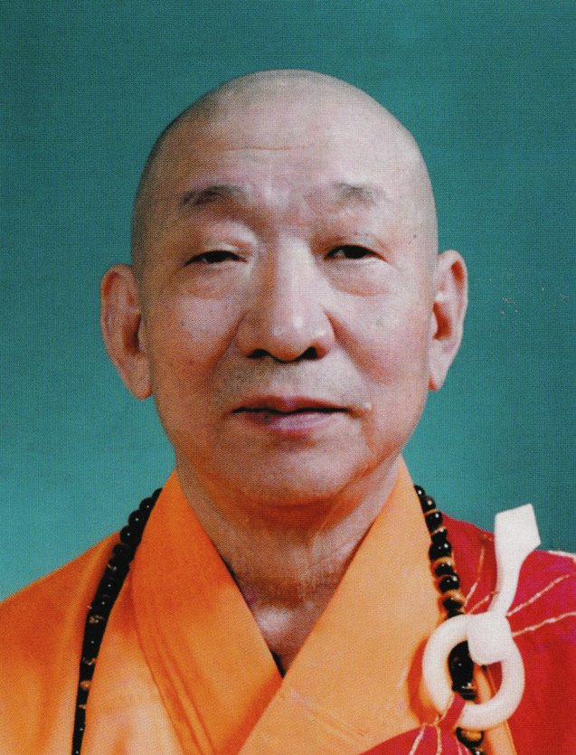
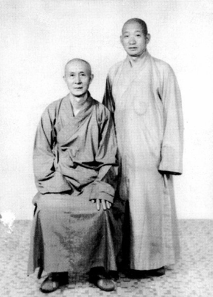
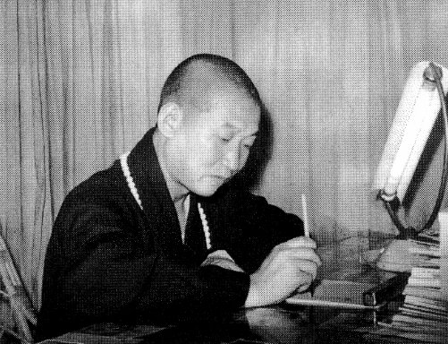
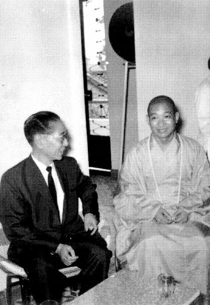
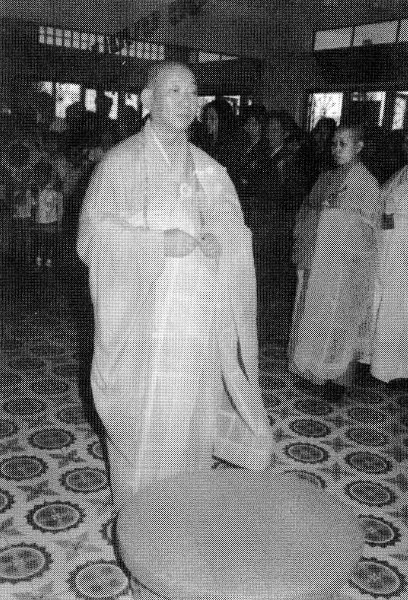
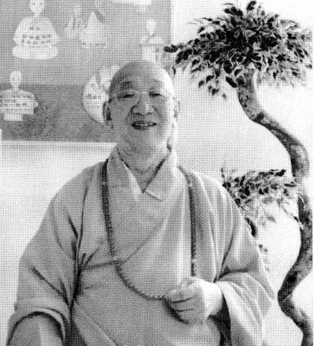

# 演培长老传略



> **藏经**：演培法师全集（演培法师全集）　**编号** YPa001　**卷次** 1 卷　**篇幅** 7,263 字

> **卷／品**：0 卷 · 0 品



---







演培法师(西元 1917~1996)



演培长老传略



长老名演培，俗籍江苏扬州邵伯镇管家庄人氏，生于公元一九一七年，俗姓李，学名宝良。父李公国踞，母李吴玉太夫人。兄弟四人，长老居其幼，另有姐妹二人。祖以农耕为业，至国踞公为补家计，兼营商贾，颇有收入，乃成小康。全家信佛，二兄并舍俗出家，法名道禅，出家道场，离家不遥。依乡俗，凡新戒剃度，须留顶发少许，由父母执刀亲手剃除，以示正式允其出家为僧。斯时，长老年方十二，乃随父母前往参与此落发仪式。道场尚为此一因缘，举行法会，极为慎重其事，其他寺院之出家众，也前来参与法会，至为隆重。



二兄在寺人缘极佳，故寺中师长见长老年幼、纯真聪颖活泼，无不慈爱有加。法会期满，盘桓数日憧憬出家生活，竟不愿随父母回家。但父母坚欲携回，折腾良久，嗣经其二哥坚决保证等过年后，即护送其弟回家，父母始放心归去。过年后其二哥将前往受具足戒，逼其同行返里，长老坚不与兄偕行，并礼高邮福田庵常善和尚剃度出家。



长老八岁启蒙于家乡私塾读百家姓、千字文、三字经、大学等书，已初具根基，时福田庵也设有私塾，常善和尚即命长老再入该私塾，读论语、孟子。一面读书，一面为庵作务，并下田工作。先后六年间，学业与道业并进，略有成就。



公元一九三五年值长老十八岁，邻县宝应城内之福寿禅院传授千佛三坛大戒，礼聘常善和尚为戒期知客，长老乃随和尚前往受具足戒。闻讲《沙弥律仪要略》时，其中列有沙弥十戒法及二十四威仪门并五十三小咒。长老资质聪颖，第一个能背诵如流，深为各引礼师之器重，被指定为沙弥头。其中有一引礼师系镇江超岸寺当家师，对长老尤所推赞，嘱咐于受戒后，应前往佛学院深造，学修较深佛理，以便将来弘扬佛法。受戒毕，即将此意禀告常善和尚，但不为所准，偕回祖庭。同时为庆祝长老当时圆具大戒，特设斋邀请诸护法到寺里申贺。



设斋日，香客踊跃，席及一半，常善和尚突站立致词云：「老衲现已年高，无法多问寺务，现演培已受大戒，堪付大任，即日起即任其为住持，请诸位护法，继续护持。」言毕，掌声雷动，无不赞成。长老当场莫知所措，深造心愿受挫折，而于住持一职，则意趣索然。不得已，以回家省亲为词，禀告常善和尚，当蒙获准。回家省亲毕，即前往上海，初住法藏寺，学做法事，得百三十元，惟感经忏非出家心愿，时有续祥法师者，深知其意，乃介绍前往观宗寺求法。



宁波观宗寺专弘天台教学，设有初级学戒堂及高级研究社和最高级弘法社。长老先由初级经高级而最高级，年半期间，顿超三级。但该寺重讲解，而不重文字研究，长老有感不足，时有同学相告：「欲学文字般若，须往闽南佛学院」。



两年后，适逢闽院招生，长老即前往就读，就读半年，因缘不调，而行离去。时大醒法师在江苏淮阴觉津寺办学，长老即偕同学妙钦、达居二法师前往就读。唯日寇侵华野心已露，全国青年皆受军训，僧青年亦受救护训练。



一九三八年七月七日，日寇终于芦沟桥掀起战火。八月十三日，松沪并开辟战场，五六同学随慈航上人逃难到香江。此时战火徧布全国，军民同胞正浴血抗战，长老认为国家兴亡，匹夫有责，无法久住香江，时闻太虚大师于陪都重庆北碚，设汉藏教理院，硕学大德云集，为全国最高佛教学府，乃与白慧、妙钦、达居、文慧等同学，跋山涉水前往该院求学，路途之艰辛，有如义净、玄奘二大德之印度求经。



既至重庆，住长安寺，礼太虚大师，大师赞彼等万里求法，心愿可嘉，特允入院旁听，自由选课。长老即选法尊法师所开《菩提道次第广论》、《辨了不了义论》。又选法舫法师开讲《俱舍论》，及印顺法师所开《阿含讲要》。印公慈悲，并特为长老、妙钦、文慧等人于静室中讲授《摄大乘论》。印公教学重思想熏陶，使对佛法能有较新、较深认识，长老受益匪浅。







西元 1977 年与印顺导师摄于新加坡



长老二十五岁时，奉太虚大师命，前往四川合江法王寺筹办「法王学院」，因感自身年轻，所学不深，乃恭请印公前往任最高导师。自此，印公即被佛教界尊呼为「导师」。导师莅院，开讲《金刚经》、《印度之佛教》并为长老等四教师开讲《中观论颂》，长老为之笔记，终成《中观论颂讲记》一书行世。



一九四五年八月十四日，日寇宣布无条件投降，导师与妙钦法师准备前往收复之沦陷区说法，唯当时交通困难，且至翌年清明前后始循西北公路，转陇海铁路东下，经数月始达上海。时虚大师住上海玉佛寺，乃前往礼座。大师垂示后即命长老前往杭州，主持「武林佛学院」，院址设于灵峰寺。该寺院至为残破，且交通不便，但环境清净，确为办学、读书、修道之好地方，虚大师旋派会觉法师前往任院长。会觉法师为武昌佛学院第一届毕业生。儒学、佛学造诣俱深。妙钦法师亦来学院讲《俱舍论》，因师资坚强，声誉满播沪杭，各地僧青年，纷纷前往求学，络绎于途。正当教务蒸蒸日上之际，创院未及三年之时，共匪乱起，时局紧张，而导师应性愿长老之请，前往厦门参加戒会，离开杭州，人心动摇。



一九四八年冬，导师并应性愿长老之请，于南普陀创办「大觉讲舍」，长老与续明法师也应邀前往。长老并委任教务之职。唯好景不常，战火又延烧至闽南，长老即与仁俊法师先行至香港，导师及续明法师亦陆续抵港，留港三年，内心时感不安。



一九五二年，应在台之李子宽居士邀请，前往接办大醒法师所创「台湾佛教讲习会」。乃于是年农历二月十九日到台，接办讲习会，受教学僧为男女合班，共四十餘人。长老认为男女同班，实不方便，乃力主男女分班，并获赞成。将女众迁往中坜圆光寺受教，男众仍留新竹灵隐寺。但分班后男学僧仅十餘人，彼等浸润日僧习气，在会受教时著僧服，出门则著西装，与大陆学僧风格、道风大异其趣。一时颇感困惑，经依理调伏，逐渐依制著服，严守戒法。毕业时仅剩十二名学僧，先均已成法将。







摄于善导寺　方丈室



一九五七年秋，应任台北善导寺任住持，任满三年后请辞。



一九五七年，导师在新竹开办女众佛学院，自任院长，长老被聘为副院长。因当时长老已出任台北善导寺住持，每周仅任四小时教课，为负实际院务。



同年，长老也曾应泰国京城龙华佛教社之请，前往宣讲佛经。同时，越南超尘法师也函请顺道前往越南说法，乃应邀前往。又接柬埔寨法亮法师函请，前往该国为侨胞说法，一次出国，云游三国，法雨普被异城，声誉远近闻名。







民国五十年与袁子建大使摄于越南



长老到泰弘法，于龙华佛教社开讲《大宝积妙慧童女经》，复于中华佛教会、光华佛教会各作三日专题讲演。再接莲华佛教社社长翁通戊之礼请，作三次通俗讲演。在泰三十四天，共说法三十次，其他机缘开示也频密。由泰国飞柬埔寨，受法亮、圣扬二法师等数百人机场迎接。驻锡正觉寺讲《八大人觉经》，并于莲林寺、莲光精舍、观慧寺各作一次通俗讲演。



一九六三年五月，长老由越南飞新加坡，应慧圆长老尼之请，出任慈航菩萨道场灵峰菩提学院住持。后重建，并于一九六七年完成，易名灵峰般若讲堂，为当时新加坡唯一说法讲堂，于一九七九年辞任。







民国六十三年摄越南妙法寺



公元一九六五年一月，飞檀香山，驻锡知定法师主持之华侨佛教会说法。旋飞旧金山，于美洲佛教会、纽约中华佛教会及洛杉矶等地弘法。



长老除办僧教育及弘法之外，并勤于著述，先后出有《谛观全集》共七百万言，内分「经释」、「律释」、「论释」、「释述」、「杂说」五篇，共二十八册，为甚具价值之学术成就。又有，《成佛之道偈颂讲记》、《心经讲记》、《药师经讲记》、《弥勒大成佛经讲记》、《胜鬘经讲记》等书，集为《谛观续集》十二册。长者为利导有情，随机设教，应病与药，一律用语体文述说，使读者能即读、即知、即行、即修是度生之良法，救众生之宝鉴。



一九六七年十二月，长老返台，住台北荣民总医院作全身健康检查。应日月潭玄奘寺董事会聘请为玄奘大师灵骨塔寺住持。翌年晋山升座。当日冠盖云集，达三千餘人，极一时之盛，各方所送匾额多达数十面之多，可见长老德望之隆。后因海外弘法，难以分身兼顾寺院，乃予恳辞住持之职。



同年，台北「慧日讲堂」与「法藏寺」合作，以慧日讲堂为院址，开办太虚佛学院。应印海及常觉法师聘请长老为院长。两年后，太虚佛学院移至新竹福严精舍，并更名为福严佛学院。然时长老已驻新加坡弘法，分身乏术，仅能任名义院长。



一九七七年，基隆月眉山住持晴虚法师发心创办「华文佛教学院」，再三函邀任院长，长老即转介道安长老充任。道安长老圆寂后，晴虚法师专程前往星洲相请，长老深感盛情难却。后台北松山寺传授三坛大戒，聘长老为羯磨和尚，戒期圆满后，方至「华文佛教学院」开示。



又，台南竹溪寺办有佛学院，长老任该院导师，於回台期间，亦皆慈悲前往为学僧授课。



一九九〇年，应高雄元亨寺菩妙和尚之礼请，任元亨佛学院首任院长，期间只要返台，即至学院为学生们开示。



长老一生，与佛教教育结不解之缘，教导僧众，无以数计。但弘法活动之辛劳，更不下于佛教教育之付出。



长老悲智双运，德学兼备，故深为四众弟子所尊重，住持道场，普度众生者，海内外一如。



公元一九八一年，长老于新加坡榜鹅区觅得一地七万餘尺，兴建福慧讲堂，创办新加坡佛教福利协会，积极推动佛教福利活动，发扬佛教慈悲救世精神，按月分发救济金、救济品给贫困无依老人及不幸家庭，到医院慰问病者，访问，带温暖与快乐给残障人士，不幸儿童等慈济措施，发动捐血，捐肾及捐献器官运动以无畏施拯救生命垂危的不幸者。除定期号召信众捐血之外，并举行大规模的捐肾研讨会，肾脏保健展览会，邀请专业人士以其专业看法深入地与佛教观点比较研讨。这项措施，不但吸引社会人士关注，踊跃参加，并当场填写捐肾卡支持长老的呼吁。除此之外，长老提倡人间佛教，常以佛法带到实际生活中去，更不遗餘力主催各项座谈会，讨论如何促进社会人群道德，如何促进彼此睦邻关系，如何引导青少年不涉足于吸毒等现实问题，以纠正世人对佛教脱离现实之错误观念。



公元一九八五年长老举办慈恩林安老院，收容无依无靠老人近百，老人们多属体弱多病，不良于行，且大部分还是瘫痪卧病者，急需长期护理，虽聘有专人照顾，长老还是于百忙中，定时巡察慰问老人，深获老人敬仰，对长老感激敬重。



除敬老抚弱之外，长老也深悉教育新生一代的重要性，而于教育方面做出贡献。同年间，长老也兴办一所幼儿护理中心，名为慈恩托儿发展中心，旨在为工作中父母而设，延聘专职师资，给予全日制照顾和教导工作，天真活泼小娃娃们，每当长老到托儿发展中心巡视彼等学习及生活状况时，必团团围住长老，「师公」之声叫不绝口，可知彼等对慈祥可亲长老爱戴一斑。



长老所办的托儿服务中心与安老院，最大特色，乃是新加坡唯一提供素食服务的佛教托儿所与安老院，旨在于切实符合佛教慈悲戒杀的精神。小娃娃与老人家们也非常喜爱，实为彼等种下善根，乃长老一番苦心。



长老在推动佛教慈善事业之餘，对社会佛教青年，也不忘予以培植教育，从儿童，青少年到成人都能接受佛化教育的熏陶，对传播佛教真理，利生事业贡献至巨！



在福慧讲堂里有各种增益教育性活动，佛学班、佛理研讨会、图书馆已是一般儿童、青少年所熟悉的。所以，每逢周末，他们必按时到讲堂，渡过健康愉快的星期日。更有意义的是，大部分的成员都是一家大小都来上佛学班以及其他活动。为训练学员从小培养纪律，互亲互爱及和乐的群体精神而成立了福慧童军，深获家长的支持与赞许，各个佛化家庭互相关怀照顾，一片和气，难怪人数逐年剧增，目前的讲堂实有不敷应用的情况。这又是长老在弘法、培育弘化人材方面的一项鉅绩。



长老对社会福利事业积极推动之贡献，为社会人士及政府所激赏，实至名归，乃于一九八六年及一九九一年荣获新加坡共和国总统颁膺公共服务勋章及公共服务星章。一九九二年且受总统委任为新加坡总统宗教和谐理事会佛教代表，与各大宗教代表共致力于促进新加坡的宗教和谐。



获颁奖章的长老，从不以此为荣而疏缓工作进度，相反地，他更积极推广慈善服务以求更广泛地为需要帮助的人提供救济与辅导。



最显著的乃于一九九二年兴建洗肾中心。有鉴于患肾病者与日俱增，换肾的机会却十分渺茫，洗肾的设备与收费又十分昂贵。最不幸的是，患肾病者多是中下层阶级，患肾病无形中增加他们的经济负担与精神威胁。长老体恤他们的困境，于是，倡议建洗肾中心，一方面提供经济上的援助，同时也给予家庭辅助，真正地照顾病人本身及其家庭。这项计划深得社会人士支持与赞许。



文明社会迅速发展必会产生后遗症。生活水准提高是发展中国家的需求，它也为一些贫困家庭带来更大的经济难题。许多家庭问题，个人情感问题与社会、学校带来种种压力也造成某些人的思想不平衡，像如此的社会问题也是慈悲长老所关注而且正积极处理之中。于是成立一所家庭服务中心，名为：开心停留站，专为民众提供上述服务。



现代的人，父母大多是职业人士，经常家中就只有剩下年长的长辈及幼小的孩子。当父母出外工作时，这一老一小的问题就接踵而来。于是，长老也为协助现代年青父母的精神压力而兴办老人日间护理中心及学生日间服务中心，分别提供服务照顾老年人，尤其是行动不良或生病初愈的老人，提供消遣、膳食、日常护理、医药照顾及物理治疗。对在籍的学生则除膳食之外，还聘专业教师负责教导会考功课，以免学生在没有父母的监督下，交上损友或到处流荡的危险。



一九九四年间，长老又兴建了福乐林（社区老人院）、获生文化培训中心，以及一所青松安乐之家，为前嗜毒者提供一系列的训练和辅导课程，让他们能重新步入社会过新生活。这是多麼不容易的使命，慈悲的长老坚持学佛所学，行佛所行，难行能行，精诚意志，致力为教弘法为众生拔苦的精神和奉献，令人敬仰！



长老的人间佛教概念，使他对现代社会的贡献更加显著。只要有助于佛法的宣流，他必不遗餘力，全力以赴。长老对文化艺术方面也十分重视。因此，在长老「福慧讲堂」就成立了阵容庞大的儿童、青少年、乐龄合唱团及舞蹈团，通过表演艺术以发扬佛教的精神特色，曾前后举办过「慈声飞扬」、「心弦」及「旋律90」慈善音乐晚会并为洗肾中心筹款，表演更为人所激赏。



为庆祝卫塞节而举办了卫塞佛教文化艺术展91，深得国内外艺术界人士的支持，展出作品两百餘件，展出非常成功，令人惊叹佛教文化艺术之美。



长老德高望重，故于一九九一年任光明山普觉寺住持。宏船长老圆寂，被信托会公推委任为该寺新住持。是年五月九日在光明山普觉寺举行晋山仪式，国内外高僧大德云集，场面庄严隆重，为新加坡开埠以来最盛大的寺庙住持晋山仪式，约八千人出席这场盛会。



长老虽常驻新加坡，若为弘法、度生、讲戒有请求者，必不辞山海之遥，毋远弗届欣然满其所愿。长老之行愿是菩萨行，亦佛行也。实末法期之一大法柱。



长老深研经、律、论，誉之为「三藏法师」亦无不当，每有传戒法会，多被聘为三师和尚之一，各次戒会如下：



一九五五年　台中宝觉寺戒会任教授和尚  

一九六七年　台中慈明寺戒会任教授阿阇黎  

一九七四年　雾峰万佛寺戒会任得戒和尚  

一九七四年　马来西亚三宝万佛寺戒会任教授和尚  

一九七八年　台北松山寺戒会任羯磨和尚  

一九八四年　台中慈善寺戒会任羯磨和尚  

一九八四年　马尼拉信愿寺戒会任教授和尚  

一九八六年　台中乾灵寺戒会任得戒和尚  

一九八六年　高雄元亨寺戒会任羯磨和尚  

一九八七年　台中雾峰佛寺戒会任得戒和尚  

一九八七年　基隆灵泉寺戒会任得戒和尚  

一九八七年　王田善光寺戒会任得戒和尚  

一九八八年　新加坡佛教总会戒会任教授和尚  

一九九一年　新竹福严精舍戒会  

一九九五年　马来西亚槟城极乐寺戒会任教授阿阇黎



每次戒会均为新戒子讲戒，如《梵网戒经》、《沙弥律仪要略》、《毘尼日用》、《比丘戒本》等，诲人不倦。



长老为人勤俭耿直，不善辞令，然讲经说法却滔滔不绝，法音宣流，听者无不受惠。演公对佛法了解之深渊，这与平日博览佛经，深入研读有很大关系。除了应邀赴国外说法，传戒之外，就深居简出福慧讲堂，默默地为培育弘法人材，宣扬佛法而俯首写作著书，奉献毕生所研之佛法，怎不叫我等肃然起敬！演公长老的简朴生活方式，为人端正耿直之风，实为我们学习的模范。







民国八十五年摄于新加坡



长老自谦虽届「退休」高龄，仍身负重任，会务繁身，讲经说法办学施教，从未言倦。乃至圆寂前，还为信众演说《金刚经》，并办佛学班为研究生讲解《唯识三十颂》。长老突然示寂，确为四众莫大损失。最令弟子们痛惜的是长老慈悲为怀，倡议兴建观明医院，正拟续展宏图，证知世缘告尽，遂舍报内院。长老此生勤修福慧，圆满充实，法音宏流，恩泽四众，悲心悯怀，福惠群生，自身却两袖清风，拂尘西归！长老传奇的一生，犹如新加坡著名书法家潘受先生所言：衣钵谁传佛道慈悲勤讲演，痼瘰在抱杏林辛苦念栽培。



长老圆寂於新加坡福慧讲堂，一九九六年十一月十日（丙子年九月三十日），世寿八十，僧寿六十八，戒腊六十三。十一月十六日上午於福慧讲堂举行告别仪式，恭请新加坡佛教总会主席——隆根长老主持起棺说法，后发引至光明山普觉寺举行荼毗仪式。一路上数万善信夹道於滂沱大雨中跪送灵柩，如此的天人交集，内心的感激涕零，尽在法雨甘露淋洒中表露无遗。



第二天（十一月十七日）上午，长老的弟子们从灵灰中捡出不计其数之舍利子和舍利花，一部份供奉於福慧讲堂，一部份由其徒净明、净华法师等迎请回台湾，先供奉於高雄元亨寺。并於同年十二月六日於元亨寺光明楼举行赞颂大典，下午旋即恭奉於新竹福严精舍福慧塔院永远安厝。当天受到新竹佛教界诸位高僧、大德等在凛冽寒风中列队迎接，印公导师亦上塔院拈香，足见长老高雅之德行矣！



一九九七年一月九日集世界各国高僧、法眷、星洲政府长官、善男信女等约五千人於福慧讲堂举行「演培长老圆寂传供赞颂大会」，其庄严隆重之盛况，尤让人缅怀追思。

