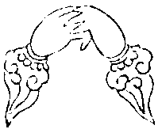
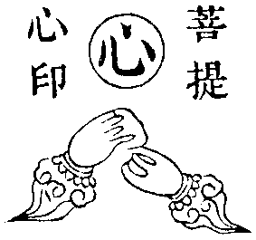

# 大乘本生心地观经浅注(第4卷-第8卷)



> **藏经**：卍新纂大日本续藏经（新纂卍续藏）　**册次** 第 20 册（X20）　**编号** No. 367（X0367）　**部类** 本缘部　**卷次** 3 卷　**篇幅** 163,597 字

> **卷／品**：8 卷 · 15 品



---



## 目录



- [大乘本生心观经浅注卷第一](#大乘本生心观经浅注卷第一)

  - [大乘本生心地观经序](#大乘本生心地观经序)

  - [序品第一](#序品第一)

- [大乘本生心地观经浅注卷第二](#大乘本生心地观经浅注卷第二)

  - [报恩品第二上](#报恩品第二上)

- [大乘本生心地观经浅注卷第三](#大乘本生心地观经浅注卷第三)

  - [报恩品第二下](#报恩品第二下)

- [大乘本生心地观经浅注卷第四](#大乘本生心地观经浅注卷第四)

  - [厌舍品第三](#厌舍品第三)

- [大乘本生心地观经浅注卷第五](#大乘本生心地观经浅注卷第五)

  - [无垢性品第四](#无垢性品第四)

  - [大乘本生心地观经阿兰若品第五](#大乘本生心地观经阿兰若品第五)

- [大乘本生心地观经浅注卷第六](#大乘本生心地观经浅注卷第六)

  - [离世间品第六](#离世间品第六)

  - [厌身品第七](#厌身品第七)

- [大乘本生心地观经浅注卷第七](#大乘本生心地观经浅注卷第七)

  - [波罗蜜多品第八](#波罗蜜多品第八)

  - [功德庄严品第九](#功德庄严品第九)

- [大乘本生心地观经浅注卷第八](#大乘本生心地观经浅注卷第八)

  - [观心品第十](#观心品第十)

  - [发菩提心品第十一](#发菩提心品第十一)

  - [成佛品第十二](#成佛品第十二)

  - [嘱累品第十三](#嘱累品第十三)



---



## 大乘本生心观经浅注卷第一



清神京栴檀寺沙门　来舟　浅注



△九、总释名题



题为一经之总目，故先释之，欲后人知其大义也。大者，拣小为义，以声闻不达唯心，但依六识三毒，建立染净根本，纵证极果，无非一罗汉耳。以其未有大心，未发大愿，未行大行，未证大果，但依小就，是为小乘。此经最初安一大字，使知非小乘法，乃大乘法门也。乘者，运载得名，如世之舟车，人若乘之，可以从近至远，自此达彼。心地观门，亦复如是，人若悟之行之契证之，亦可即凡夫到圣位，即生死到涅槃，所谓一切诸佛本所乘故，一切菩萨皆乘此法到如来地故。应知大乘二字，一切摩诃衍法通称，如《大乘妙法莲华经》，《大乘百法明门论》等，唯本生等五字，方为本经之别名也。夫本者，万法之根源也，生者，万物之资发也。《语》云：「君子务本，本立而道生。」信矣哉。是知圣人垂训，无不令人悟本生道，合乎天心，达乎至理，一言之下，转凡成圣，庶不负圣人之心也。是以此经劈头下本生二字，欲披读者参究自己之根本，乃当人即体之佛性，然佛性既悟，智慧自生矣。以其即理起智，体用并彰，故云本生。心地观者，出本生之正义也。恐人不解本生之旨，复云本即心地，观能生道。一经正旨，全在於斯。然有总别二释。总释如经云：「众生之心，犹如大地，五谷五果，从大地生。如是心法，生世出世，善恶五趣，及於圣凡，乃至以是因缘，三界唯心，心名为地。能观心者，究竟解脱；不能观者，究竟沉沦。」是知如来自释心地之观法也。良以经中既云生世出世，善恶五趣，及於圣凡，意在迷之即是妄心，能生业果；悟之即是真心，能生圣果。其所重者，观字为要也。然观者，即灵知反照，一念相应，诸惑顿空，涅槃本具，始知众生本来是佛。故曰能观心者，究竟解脱也。其不能观者，对境攀缘，如犬逐块，自然究竟沉沦，永堕生死矣。《华严》云「一切唯心造」，亦同此义也。所以佛说此经，立此题，欲见题知经，读经解义，起智观照，究竟成佛，初不辜其本意也。别释者，心有二种：一真心，即众生之佛性，万法之实相也；二妄心，即众生之业本，缘境之识心也。然真妄虽别，不离一体。地者，譬喻也，亦有二义：一乘载义，谓大地广博，坚厚有力，一切山河草木，及诸有情，皆地能乘载故；二生长义，谓有情无情，皆依地有，复能增长故。心亦如是，谓真心随缘而成万法，即生义。种现熏发，即增长义。既依心现，犹不离心，即乘载义。良以种现熏发，又引起妄心。由不知万法唯心，执心外有法，复能取著，则我法二执，顿然生续。又复缘之，则万法全彰。不缘，则诸法本寂。既缘之则有，即乘载义。(如眼中有翳，妄见空华，华依翳现。若翳病既除，空华自灭。)以上心地二字，为所观之境，观为能观之智。谓依心作观，还观自心。然观有三种，即空假中也。空非断灭，乃即心真体之胜用也。然真性如虗空，空观如日光。光与空合，无所分别。是以正观之时，不见万法与真性冥合，弥满清净，不见一法当情为空也。经云：「佛为弥勒说心地法门，若人一经耳根，摄念观心，熏菩提种，不久得成菩提。」是知既此摄念观心，即空慧自照，离妄绝相，当体即真，是名空观观真如也。二假观者，即报四恩而发心，住兰若以修行，事相观察，是为假观。降伏妄想，深生惭愧也。(四恩者，即父母恩，众生恩，国王恩，三宝恩。修行者，即佛教安住四无垢性，一心修行十二头陀，以三观门修忍辱行，名真出家。谓观诸众生是佛化身，观自身为真愚夫，此为一观。又观诸有情作尊贵想，观自身为奴仆想，此为二观也。又观众生作父母想，观自身作男女想，即三观也。常作是观，或被打骂，终不加报，善巧方便，调伏其心。四无垢性者，谓衣服、卧具、饮食、汤药，如是四事，随其所得，粗细称心，远离贪求，是无垢性，皆假观也。)三中道观，观一切烦恼万法，会为自心，了达此法，堪证菩提，所谓涉有不碍。观空即诸法而证实相，不著空有，为中道观也。如〈功德庄严品〉及〈观心品〉等说。是知空观观即心之真谛，假观观即心之俗谛，中观观即心之第一义谛。是为理事互融，究竟解脱之极致也。以上皆一经之所诠，经为能诠。又梵语修多罗，此翻圣教，或翻席经、契经等。今减席契，但存经者，以此方圣教称经，意合此方，故名经也。又具贯、摄、常、法四义，谓贯穿所诠之义，摄化所被之机，常则今古不易，法则凡圣同遵。又地为喻，本生等为法，大乘为能称，本生等为所称，心为一经之体，观门为修证之用。总言体、用、法、喻为名，能、所合标，共立一题。



△十、别解文义。二：初、解序三：初、依经序题。



------



### 大乘本生心地观经序



述明始终，略陈梗概，令后人知其源委也。又序如东西之墙，观墙则知一宅之浅深，见序则知始末之大义也。



△二、序主朝代



唐宪宗皇帝制



唐为国号，序译经之朝代也。李氏继隋有天下，国号大唐，宪宗第十主也。讳纯，顺宗太子。帝刚明果断，志平僭叛，能用忠谋，不惑群议，卒收成功。唐之威令，几於复振，足为中兴主也。宪宗为谥号。谥法：谓博闻多能曰宪。宗者，尊也，法也，主也。以正法化世，尊为人主，为世所宗，故曰宪宗。皇者，君也。古帝王唯伏牺、神农、黄帝为三皇。谥法：靖民则法曰皇。帝者，亦君主也。《吕氏春秋》曰：「帝者，天下之所适；王者，天下之所往。」《尚书》五帝：谓少昊、颛顼、高辛、唐尧、虞舜，是为五帝。夏、商、周为三王。唯嬴秦得天下，始称皇帝。自谓道过三皇，功高五帝，故称始皇帝。已后凡天子皆称皇帝。今经之序文，乃唐朝宪宗御制也。制者，谓裁度制作也。



△三、正释序文三：初、发语叹世，分二：初、正叹情欲。



噫！夫物我既殊，嗜欲方炽，六根陷因缘之境，七情奔利害之场。葢缠其真，执缚於妄，爱恶攻内，纷华荡前，心类腾猿，身若狂象。



夫者，起语辞。噫者，恨声也。乃自恨不识本真，妄生情欲等，亦叹辞也。物我二句，正述迷真。良以心周法界，万法同真，天地与我同根，万物与我一体。兹因无明不觉真如，随缘转成业识，更生见相二分。由相分似境，见分取著，不达唯心，故见分转成我执，相分转成外境。所谓自心取自心，非幻成幻法，故曰物我既殊。(既者，已也。)欲即五欲，谓财、色、名、食、睡，或色、声、香、味、触，皆是众生所欲之境。嗜者，好也，欲也，乐为也，即能取之心。方炽者，贪欲之盛也。此但标六根，下释之。眼、耳、鼻、舌、身、意，皆能发识，为六识之根本，故云六根。陷者，坠落不能自拔也。然根既发识，取著为因；境即六境，勾引为缘。以根尘勾取，展转愈盛，众生汩没於中，故云陷因缘之境也。(六尘即色、声、香、味、触、法，皆有染污义，故曰六尘。)七情谓喜、怒、忧、惧、爱、憎、欲。奔者，驰逐也。以顺境得意为利，逆境夺利为害。场者，处也。谓人有七情，皆逐境牵，可谓三界处处皆为造业之场地也。葢缠下，明心被境迷，众生全无自由分也。葢者，覆也，障也。有五种：一贪欲，二瞋恚，三睡眠，四掉悔，五疑。一切众生有此五惑，葢覆真性，障蔽妙明，於诸正道不能明了，依用得名，故谓之葢。缠者，系缚义。有十种：即嗔、覆、睡眠、戏、掉、无惭、无愧、悭、嫉。有此十惑，触事粘著，如蚕作茧，自己系缚，亦从用得名，故谓缠也。真者，即当人之佛性。由此五葢所覆，十缠所缚，真性不能解脱，故曰葢缠其真。执者，是众生著物之心，不出我法二种。因妄想不达二空，谓身有主宰，即我执；心外有法，即法执。由是种种取著，不能自脱，故曰执缚於妄。爱恶下，谓既不达万法唯心，妄生取著，顺境生爱，逆境生恶，逐境生心，故曰攻内。且约惑言。纷华者，即徧缘诸境，造种种业。荡者，任运无忌。前者触目皆然。所以缘虑不定，犹猿猴之腾跃；身逐境牵，如狂象之奔驰。故曰心类等。



△二、结迷不返二：初、叹自不能明。



岂复悟菩提之性，息尘埃以自明；了真如之理，本空寂而为乐。



岂复者，谓不能反照也。通下二句。菩提此云觉道，乃真性之别名。悟即惺觉，乃达本之智用。谓菩提本有，因迷不觉，故不能反照也。尘埃者，事缘也。谓尘事扰扰不休，妄心念念不息，岂能急流之中，息心悟本，反明其本性乎？真如者，不妄不变，亦佛性之别称。理者，体也。荡无纤尘，故曰空寂。达则成佛，故曰为乐。又寂然无为即本觉，了谓照了即始觉，乐者谓性分之受用。总言菩提之性本有而不悟，尘埃之事本无而不明，真如之理自具而不了，其法性之乐岂可得乎？故序主结叹如此也。



○问：菩提性，真如理，为同为别？答：即同之别也。凡言菩提，约智说。凡言真如，约理说。谓即理之智曰菩提，即智之理曰真如。故菩提曰性，即智性也。真如曰理，即理体也。学者知之。



△二、结自不能救。



不有妙觉，其孰拯斯溺乎？



妙觉即是妙悟，结上既不能悟菩提了真如，是自己无有妙觉也。其孰下，结自不能救也。拯谓提㧞。溺谓沉没。斯者此也，指前嗜欲葢缠等。谓人迷於嗜欲等，如人堕於淤泥之中，力不自出也。不有即无，孰者泛说之辞，此言众生逐境自溺，迷不自悟，若无妙觉自拔，其谁能救之哉。以上发语叹世竟。



△二、幸遇真诠四：初、智人传法迷流得度。



由是至人开法，大士传教。济群迷於彼岸，澌诸妄於此门。



由是者，承上起下之辞。承上众生自不能救，起下佛能提拔也。至人即佛，谓佛乃人中之至者也。(天上天下，唯佛独尊，故称之为至人。)开谓开示，启闭为义。法即心法，轨持为义。谓轨物生解，任持自性故。良以诸佛之所证，菩萨之所修，众生之本具，皆不出灵明知觉，故谓之心。修持成道，故谓之法。佛既证之，愍物不知，故开化指示，欲人亦知之，以见大圣公物之心也。大士即菩萨之称。凡西天东土，历代祖师，宣演佛法，展转流通者，皆称大士。教谓训导之言。传谓宣布於世。群迷即众生不悟佛性者。彼岸喻涅槃，以生死喻此岸有苦，涅槃如彼岸有乐，惑业如河中之水。教喻舟航，菩萨如使船之人。世间众生，若依教奉行，如登舟上岸，可得离生死，度惑业，证涅槃。故云济群迷於彼岸也。澌者尽也。诸妄即十八界。此门即此经也。谓依经作观，则诸妄顿销，故曰澌诸等。(门取通义，喻此经乃成佛之达道，故通也。)



△二、妙观心地生灭归如。



不灭不生，视色空而俱泯；无来无去，观性相以皆如。



上句泯妄，下句会真，皆归功於法门也。生灭即是妄心，色空皆是妄境。两不字，即作观销妄功夫。谓人依此法，妙观心地，顿然而返妄归真，故色空俱泯矣。(泯者，尽也。)来去，即迁流不住。两无字，即不动之真心。如人妙观心地，融会万法，皆归本性，一性常住，故曰皆如。



△三、真理难解必借能诠。



然则泯色空者，非言无以极其致；如性相者，非文无以会其归。设斯筌蹄，纳诸逵路。



然则二字承上之辞。致者，至也，极尽之意。归者，反也，趣向之意。文谓文章，言谓语言，皆属能诠。谓道以言显，理借文彰。泯色空者，牒定上文，反显若非言语彰表，自不能泯绝妄境，达入极致也。如性相者，亦牒上文，反显若非能诠之文，奚悟所诠之理？既不自悟，则不能会妄归真矣。筌者，捕鱼竹器也。蹄者，兔迹，亦作罤，取兔器也。此二皆喻能诠之文，意谓鱼兔喻所诠之理。是则圣人设教，用文字语言诠表心法，世人方得见性明心。逵亦路也。纳者，领也，得也。谓修行人得文言而悟真理，如行人得路，欲达所归，终无阻滞矣。



△四、结显圣教归恩於佛。



此葢西方神人之大教也。



此者，指前能所诠表。葢者，且作语辞。西方，指天竺国。神人，即佛。大教者，尊称之意。谓神人设教称性之谈大矣哉。也字，结语辞。(不称佛而称神人者，乃赞美其灵妙莫测之意，非鬼神之神可比也。)



△三、述明来历二：初、西域来源二：初、牒定经名。



大乘本生心地观经者。



△二、释迦亲说。



释迦如来於耆阇崛山，与文殊师利、弥勒等诸大菩萨之所说也。



初句说经之教主，次句说经之处所。与文下，举首兼众，皆所被之机也。释迦者，佛之姓也，此云能仁，谓能有应物之巧，仁有惠物之恩。如来者，倣同先德号，十号之首也，谓身相智慧皆同古佛，如先佛之再来。又云乘如实道来成正觉，谓从本垂迹也。经是佛说，故佛为教主也。文殊师利，此云妙德，此菩萨久成正觉，果后行因，辅佛扬化，示为菩萨，故以妙德称之焉。弥勒，此云慈氏，谓慈隆即世，悲臻后劫。此二举首等者，兼众因请法问佛，发起大教，即当机众也。



△二、东土来源三：初、梵本初来之代。



其梵夹，我烈祖高宗之代，师子国之所献也。宝之历年，秘於中禁。



梵者，西域之称号，谓葱岭以西皆为梵种也。梵夹，即梵本。我，即宪宗自称。烈祖，高宗谥号也。谥法：秉德尊业曰烈。乃唐之第三主也。代，谓朝代，乃梵本初来时也。师子国，乃天竺之别国，谓君王有道，四海来宾，故将法宝献之也。秘者，藏也。中禁者，宫院也。历年者，谓经历之时远也。



△二、圣主披阅合机。



朕嗣守丕业，䖍奉昌图。听政之暇，澡心於此。以为摄念之旨，有辅於时；潜导之功，或裨於理。且大雄以慈悲致化，而朕生而不伤；法王以清净为宗，而朕安而不扰。敷教于下，用符方便之门；励精以思，是叶修行之地。无为之益，不其至乎。



朕者，天子之自称。嗣者，继续也。守者，执守也。谓祖宗所建，我但执守保之也。丕业，即大业。天子以天下社稷总为一大基业。图者，图𦘕也。因神物负图而出，圣人𦘕卦后，以一切山河国土总为皇家一大图𦘕，故称皇图。昌者，盛也，亦嘉祥也。䖍者，诚也。谓祖宗大业，我但兢兢业业以保之，故曰䖍奉。奉，犹尊也，言其不敢轻慢也。政，谓国事。听，即经理。暇，谓闲暇。澡，谓洗涤。此旨即本经之义理，总谓天子日理万几，凡经理国事之毕，少有闲暇，必洗心涤虑，参究此经，以为收摄杂念，静观真理，有辅佐时政之益也。(补者，助佐也。谓当时之政，万几不止。若散心批判，或有误失，因参究静观，从静中详察，必合正理也。)故曰有辅於时。潜者，密也。导，谓引发。裨者，助也。理，即体也。乃朝政君臣纲常之大体。由披览此经，有回心向道，移风易俗，而於国体或有助佐之功。或字，言活意决也。潜导者，由朝习暮观，日积月累，不知不觉，深合佛旨。以佛理会国理，可谓皇天无二道，圣人无两心。自古佛道通儒，故於国理有所裨助也。且大下，转释辅裨之功。且，谓语辞，或借曰辞。大雄，指佛，《法华》云「大雄猛世尊」。谓佛有大慈，能与众生法乐；大悲，拔众生之苦恼。化，谓教化、度化也。而朕下，谓朕六根具足，且通利，皆佛慈悲之力所加也。法王，称佛自在为义。以清下，谓佛之正理，居尘不染，浊世不污，为清净之宗。以朕临大位已来，身体平和，宫眷无恙，四海晏安，有太平气象，故曰安而不扰，亦佛清净之力所加也。岂不与天下国家为一大助乎？敷教下，是欲敷设佛教，训惠於下之意。下，指百官万民。符者，辅也，所以辅信也。又汉制以竹长六寸，分而相合，故曰符之言扶也，谓两相扶合而不差。今序主用此意，取佛教合儒也。方便门者，乃天子教民之法，谓君王以仁义道德教民为方，万民依教奉行，则得其便利。门者，出入之达道门，即方便也。总言天子欲张设佛教，用辅王法，恰好两相扶合而不差。励精下，是天子欲修行得其所也。励者，勉力也，有修饰振起之意。叶与协字同，谓协和之意。天子以修身治国，必然祖述尧舜，宪章文武为修行。今精思佛理，有协和之地，如〈报恩品〉，与国体大同。观心地法门，其与穷理尽性，两相扶合。无为者，谓真如不变，即体无为；随缘不变，即用无为。动而常静，寂照体同，真无为也。益者，增胜也，嘉祥也。既有辅於国，则於国家有增胜之福，嘉祥之美也。不其，是反显辞，正显佛经利益至矣尽矣。



△三、传诏翻译流通三：初、标定译意。



夫如是，得不演畅真宗，阐弘奥义者也？



夫者，起语辞。如是者，指法辞，即指前无为之益。得不者，亦反显辞。演畅阐弘，皆是流通之义。真宗奥义，总谓佛理之精。意谓经有如此之益，岂可秘於内宫，而不流通於世乎？者也，结语辞。



△二、义学翻经。



乃出其梵本於醴泉寺，诏京师义学大德罽宾三藏般若等八人翻译其旨，命谏议大夫孟简等四人润色其文，列为八卷，勒成一部。如来秘藏，历尘劫而初开；大乘真理，超沙界而方证。烛其昏昧，示以津梁，俾披阅之者甘露洒於心田，晓悟之者醍醐流於性境。



乃者，继事之辞。出者，自内而外，将梵本传出宫外，在於醴泉寺中，寺乃译经之处也。诏者，宣也。京师者，都名也。京谓大，师谓众，言天子居处，必以众大称之也。义学下，皆译经之人。义者，宜也。谓博览佛经，悟通性理，文旨合宜，兼通儒典及诸子书，谓之义学。大德者，称谓辞有道德，学闻者为高僧，故以大德称之。罽宾者，西域国名，乃译主之生处也。三藏即经律论三法，乃译主之德称也。谓学通三藏，故以三藏称之。般若云智慧，乃译主之名也。等者，兼众也。八人未详其名，皆译人也。翻译即变易之谓，又替代之意。良以梵本至此，皆西域梵书字义，此方人皆不识，必用兼通两国语言者，先将此方之字，替代西域之字，再将此方之语句，又易梵书之语句，如将归命易南无，觉者易佛陀等，方识言音之字，谓之翻音。或梵文有二合、三合、弹舌、引等，当以此方何字代之，委问华梵，务使相当，是谓翻语。旨者，经之义理，语为能诠，义为所诠，然既解能诠，则解所诠，故知翻文即是翻旨也。命谏下，序润文之人。命谓勅命，即使令之意。谏议者，言官也。大夫者，以言官举荐才能，乃扶树人才之尊官也。孟简乃大夫姓名，餘三未出其名，但以等字兼之，皆承命之人。润色者，以译人或字句拙俗，文法繁蔓，不合此方之文者，四人删改推敲，确定文字，滋以华美，谓之润色。列者，分也。勒者，收络也。谓分为八卷，勒成一部。秘藏者，即如来之心法，非机不授之者。尘劫者，时久也。谓隐塞之时已久矣。初开者，翻译之始通也。(尘劫者，以大地所有微尘，较量隐塞之劫数。一尘对一劫，尘既无量，劫亦无量。此但显久，亦非量言量也。)夫百千劫不遇佛出，及佛出世，又非时不说。及至说时，但存西域。及至此方，又珍藏於中禁。至宪宗方译，是为初开。逆推穷源，诚以微尘较劫，犹不足为喻也。然宪宗创译流通，(亦大)有恩於世者矣。幸哉！得法之人，何可报乎？大乘下，谓真如性理，非薄福者通得。故以沙较界，以界较人，显其遇此经者，非易易耳。沙者，即河中所有之沙。界者，在世之国土。超，谓过越之意。言沙界者，以河中之沙，一沙较一世界。沙既无量，界亦无量。此亦非喻为喻。方证者，契道之谓。然此句对前，却觉难会。有二义释之：一、如来西域说经，幸流我国，翻译流通，令人见闻参悟，方可证入。以西域至此方，经历国土之多，比若河沙。此方人不离寸步，证佛真理，可谓超过沙界矣。(意在经历世界，不曾翻译。虽有沙界中人，不得其旨，不能亲证。至此译出方证，亦庆幸之甚也。)二者谓大乘法宝，非薄福者修证。必我国大唐众生，有福且慧，方能亲证。沙界虽多，不遇此旨，不能修证。此方人证，可谓超越沙界矣。《法华》云：「无量国中，乃至名字，不可得闻，何况受持读诵。」此亦如是，二义皆通。昏昧者，众生无明障慧，愚不自觉。此经妙观，如烛能照性天，能破昏惑。故云烛其昏昧。津谓渡头，梁谓桥梁，示谓指示。意谓生死如大河，烦恼如河中之水，非渡船桥梁，自不能过。指出此经为生死中之桥梁，而众生得渡矣。俾披下，正明众生得益。俾即使令也。披者开卷也。阅者观览也。者字指披阅解义之人。甘露，云不死之药，一滴沾唇，善能死中发活。喻此经心地妙观，人若遵行，可以脱离生死，高证涅槃何异於甘露洒心乎。然心之言田者，有生意故。谓迷心能生烦恼，悟心能生智慧。意在除迷生慧也。晓悟者，亦解旨之说。醍醐是西域上味。性境亦心地之别称。流即灌入也。古谓醍醐灌顶，言得法味之真醇性。言境者，为智之所照。如是履地，故以境称。以上二句，皆谓能悟此旨者，喻甘露洒心。能发真智者，如醍醐润性。



△三、结归朝代。



嗟叹不足，披玩岂忘，亦既书写，聊为序引。虽离诸文字，讵假发挥，而启其宗源，式存年代。时我唐御天下一百九十有四年也。



嗟叹是感发声也。不足者，即不尽也。意云不见佛性如失至宝，虽位极人尊尚未离生死、未闻正法，犹未免随业所转无自由分。今幸得正法发明本性，如获至宝喜极反悲，嗟其得之晚矣，所以叹之不尽也。披玩岂忘者，欲朝夕不离也。亦既书写者，翻译誊录也。聊为序引者，述明大义也。虽离下，纵夺结代。虽是未尽之辞，文字即序文诸是语辞。讵者，岂也。假即用也。发挥即是显发。谓正法本离文字，岂可以序文引发哉？虽然今为启其宗源、计其朝代，又不得不序之也。御者，统也。治，理也。我是宪宗自称，谓译成作序之时，乃我大唐统御天下，自高祖已来一百九十四年也。



唐罽宾国三藏般若等奉诏译



△二、注经二：初、译人。



罽宾，此云贱种，北印度境。末田底迦既得其境，立五百伽蓝，於诸异国买鬻贱人，以充役使，用供众僧。末田底迦入寂灭后，彼诸贱人自立君长，遂以为国。今译主是彼国人，人依国显，故三藏等如序中解。



△二、经文三，即序、正、流通三分也。分者，三段各有分限也。谓诸经皆有序分、正宗分、流通分。始自晋时襄阳道安法师。判节诸经，皆具三分。谓圣人设教，必借缘兴，将命微言，先彰由致，故有序分。由致既彰，当陈正说，谈本义之玄微，开众生之觉路，故有正宗。正说既周，转相传受，使海众之奉行，冀遐方於万古，故有流通。虽判三分，彼时弘法者恐不合佛意，多不遵行。后有亲光菩萨《佛地论》到，亦有三分：一、教起因缘分，二、圣教所说分，三、依教奉行分。与此序、正、流通义合。彼时弘法者始能遵行。所谓分经雅合於亲光，此之谓也。是知道安大师为震旦千古之下科判之始祖也。



△初、序分二：初、品名。



------



### 序品第一



序有三义：一、次序，二、由序，三、述序。谓六种成就列於经初，作开章之首引，故为次序。如来入定放光现瑞，为发起之端，是为由序。师子吼菩萨覩光相警众，说如来以慈悲出定必说妙法，略述佛意，是为述序。梵语䟦渠，此翻为品，以义类同者聚为一段，故为品也。诸品之始故名第一，然有通序、别序。从如是我闻去，至各礼佛足退坐一面，为通序，以诸经通有故。从尔时世尊去，至品尽，为别序，以别事发起故。



△二、经文二：初、通序四：初、标信与闻。



如是我闻：



亦名六种证信序。谓诸经通有如是我闻，一时佛在某处数行文，言有此为证，是为佛说，宜起敬信。如无此者，则非佛说，不足信也。故云证信。如是者，准《智论》云：「六种成就中，为信成就。以如是二字，乃信顺之辞。谓佛法大海，信为能入。信则言如是，不信则言不如。是故五位，信位居初。」又十一善法，信亦为首。信心之前，更无胜法。依此信本，解行证始立。故刘虬云：「圣人说法，但为显如。唯如为是，故称如是。」我闻者，闻成就我，即阿难五蕴假我。闻谓耳根发识，废别从总，故云我闻。合上如是，为指法之辞。云如是之法，我从佛闻。我有四种：一凡夫徧计执我，二外道神我，三小大乘人假我，四法身真我。今拣非餘，故云假我。以圣人我执已断，乃随世流布，用辩主宾，假称为我。上云废别从总者，谓既曰耳根发识，合云耳闻。云我闻者，以耳为六根之别，我为一身之总，以废别耳，从总我故。



△二、时主及处。



一时，佛住王舍城耆阇崛山中。



一时，谓时成就，即良时也。世事合会，尚待昌期；大法弘宣，岂违嘉运？又师资道合，说听究竟，故言一时。不拘春夏秋冬、子午卯酉等时，以佛说法四十九年，总为一大时教故。佛者，具云佛陀，此云觉者，谓自觉觉他，觉行圆满。自觉者，悟性真常，了惑虗妄，拣凡夫之不觉。觉他者，运无缘慈，度有情众，拣二乘之自了。觉满者，五住究竟，因尽果圆，即妙觉，拣菩萨之分觉，为说此经之法主。六成就中，主成就，即释迦牟尼佛也。住者，居止也，通能所。能住即佛，所住即王舍城等处。王舍等者，处成就也。昔为驳足王，与千王共立宫阙之城，故名王舍，乃摩竭提国之都城也。(诸经疏中所引，皆云驳足王。《大论》又云须陀须摩王。或梵语不同，或驳足是翻过之言。梵语不同者，彼有五天竺国，语言各别。且如本朝国宝，汉人名钱，满州名者哈，蒙古名嘲素，彼语亦然。)耆阇崛，云灵鹫，亦云鹫头峰，谓山形如鹫鸟之头，以形势彰名。因佛为灵明大圣，居此说法，故名灵鹫。今存梵语者，即尊重不翻。又此数句，是佛将涅槃时，阿难请问：一切经首，当置何语？佛命置如是我闻，一时佛住某处，同某人，使天下后世，知佛法有源本，非世人可妄作也。复有三意：一断疑，二息诤，三简邪。有此三意，佛命置之经首。断疑者，阿难升座，感相好如佛，众起三疑：一疑佛重起，二疑他方佛来，三疑阿难成佛。及举如是等语，三疑顿息。息诤者，若不言我从佛闻，是自有制作，则诤论起矣。简邪者，谓外道邪法，经首皆置阿忧二字。阿者言无，忧者言有。外道谓万法虽多，不出有无为吉。佛法异彼，故云简邪。



△三、广列听众八：初、二乘声闻众五：初、举类。



与大比丘众。



此下皆众成就，谓座下无人，说将谁听？与者，共也。阿难云：非我一人从佛所闻，与众同故。愈为证信。大者，器量尊重，为天王等大人所敬，有大道故，有大用故，有大知故，故言大。比丘者，《净明疏》云：「或言有翻，或言无翻。有翻者，此云除馑。众生薄福，在因无法，自资得报，多所馑乏。出家戒行，是良福田，能生物善，除因果之馑乏，故言除馑。言无翻者，名含三义：一、破恶，二、怖魔，三、乞士。戒防形非，定除心乱，慧悟想虗，能破见思之恶，故名破恶。既能破恶，魔罗念言：其既出家，复化餘人，俱出三界，乖於魔意，魔乃愁惧，故名怖魔。夫在家人，三种如法：一、田，二、商，三、士，用养身命。出家之人，佛不许此，惟乞食自济，身安道存，福利檀越，故名乞士。」众者，梵语僧伽，此翻和合。众事和无别，众法和无别，理也。



△二、标数。



三万二千人。



众数诸经多少不同，但标本会有三万二千。



△三、叹德



皆是阿罗汉，心善解脱，慧善解脱，所作已办，离诸重担，逮得己利，尽诸有结，得大自在，住清净戒，善巧方便，智慧庄严，证八解脱，到於彼岸。



阿罗汉，旧翻无著、不生、应供，或言无翻，名含三义：无明糠脱，后世田中不受生死果报，故云不生；断九十八使烦恼尽，故名杀贼；具智断功德，堪为人天福田，故言应供。解脱对缠缚言，以众生为无明覆慧，生死缠缚不得解脱，此罗汉见思已尽、生死已离，心故解脱；无明糠脱，慧性无障，慧故解脱。心即性体，慧即智用。善为赞辞，反显凡夫之不善也。所作已办者，即惑尽真穷别无所作，道果已证别无可办也。重担者，生死也，谓生死不离如重担压身。诸字有二说：一者助语辞，二者虽喻生死亦兼烦恼及业多，故曰诸。今已离矣，故曰离诸重担。逮者及也。己利即自利，此是声闻不同菩萨己利利人，但图自身灭尽三有见思结惑，使三界因亡果丧，故曰尽诸有结。有即三界中因果不亡之意。结者缚义，即见思因果也。得大下，既离三界结缚，则三明六通从心所欲，惟利无害自在而已。大者谓但离结缚已是自在，复能神通随心，故曰大自在也。住清下，既无见思，则自性无浊曰清，当体不染曰净，清净无犯曰戒，为圣人之依止曰住，故曰住清净戒。善巧下，二句略有利他之德。智慧有二种：生空智以自利，方便智以利他，自他两利之功庄严性体故。



○问：上曰己利，解中说不同菩萨两利，此中又言有利他之德，不亦相违乎？答：但不同菩萨随类现身，应机说法，如观音三十二应等。此虽利他，但随缘善巧，亦必不无。如身子之智慧，迦旃延之论议，富楼那之说法等。若全不利他，此皆无用，可乎？况此尊者有内秘外现之迹，何槩言之？八解脱，即罗汉修八背舍定所得者。有八种解脱，不被内外八事所缚，故曰解脱。(博览学者，必欲明者，请看《大明三藏法数》。)到於彼岸者，借喻显法。岸者，水际也。即大河两边之乾地，有此有彼。此岸喻生死，彼岸喻涅槃。河中之水，喻见思烦恼。谓因修八背舍定，故得解脱。以定为船筏，能乘此船，则离生死，渡烦恼，而达涅槃，受享法乐矣。已上叹德竟。



△四、列名。



其名曰：具寿阿若憍陈如、阿史彼室多、摩诃那摩、波帝利迦、摩诃迦叶、憍梵波提、离波多、优楼频螺迦叶、那提迦叶、伽耶迦叶、舍利弗、大目犍连、摩诃迦旃延、摩诃迦毗那、真提那、富楼那、弥多罗尼子、阿尼楼䭾、微妙臂、须菩提、薄拘罗、孙陀罗、难陀、罗睺罗，如是具寿阿罗汉，有学阿难陀等，各与若干百千眷属俱。



自陈如至阿难二十二人，皆众中上首，举首该众也。复分无学、有学，谓真穷惑尽，更无所学，故名无学；以研真断惑，正在学位，故名有学。自陈如至罗睺罗，皆无学罗汉；自阿难等，皆有学，即前三果也。今无学众首称具寿者，或者梵语未详，若据义，即长老之称，谓年高腊长，故称具寿。



○阿若憍陈如，即母族二人之一，是佛舅氏之类。《法华疏》云：「阿若，名也，此翻已知。或言无知，非无所知，乃知无也。又翻为解。《楞严》云：『我初称解，具云解本际，乃第一解法者也。』憍陈如，姓也，此云火器，婆罗门种。其先人事火，从此命族，亦名憍陈那，梵音不同耳。」



○阿史彼室多，此尊者翻译名义不出，故华梵未详。



○摩诃那摩波帝利迦，摩诃云大，谓道大行大，称赞辞也。名亦未详。



○摩诃迦叶，此云大龟氏。其先代学道，灵龟负仙图而应，从德命族。时人多以姓召，其实有名。名毕钵罗，即树名。父母祷树神而生，从树得名。大者，称辞，或简别辞。因佛弟子中多名迦叶，如十力三迦叶波，此尊者非彼，故以大称。或翻饮光，以身光照耀，能吞饮日月之光，故以为名。以往因中，将金涂佛形像，以感世世生生身色金光。



○憍梵波提，此翻牛呞。昔五百世曾为牛王，牛若食后，久之复出嚼之，故曰呞。《楞严》云：「於过去世轻弄沙门，感世世生生有牛呞病。佛命天上安居，犹恐世人谤之感报。」



○离波多，此云星宿，父母祷星宿而生，从求处得名。



○优楼频螺迦叶，此云木瓜林，近此林居故。孤山云：「木瓜癃，以胸前有癃如木瓜故。」



○那提迦叶，那提，河名，近此河住，依处立名。



○伽耶迦叶，孤山云：「伽耶，山名，即象头山。近此山住，依山立名。」此三尊者，即在家兄弟三人，以长兄归佛，弟皆从之。



○舍利弗，此云鹙子，连母彰名。舍利是西域鸟名，此翻鹙鹭，其眼明丽，尊者之母眼似之，遂称鹙女。弗字即是西域子字，谓鹙女之子，子是尊者智慧第一人也。



○大目犍连，姓也。各拘律陀，亦树名，祷树神得子，因以为名。然既以有名，而却以姓称者，以时人多召其姓故。或翻采菽氏，菽即豆名，以先人好食豆，因以命族。此尊者神通第一人也。



○摩诃迦旃延，此云文饰，论议第一人也。



○摩诃迦毗那



○真提那。此二尊者亦名义集不出，华梵未详。



○富楼那、弥多罗尼子，此尊者连父母彰名。富楼那云满愿，父名也。弥多罗尼云慈女，母名也。唯子是尊者，谓满愿慈女之子，说法第一人也。《法华》云：「自舍如来，无能尽其言论之辩。」



○阿尼楼䭾，或曰阿尼楼豆，或云阿那律，皆梵音不同耳。此翻如意，或云无贫。过去饿世，曾以稗饭施辟支佛，感九十一劫天上人中受如意乐，以无所馑乏，故曰无贫。是佛堂弟，天眼第一人也。



○微妙臂，此不像梵语，亦未详。或臂妙过人，以臂彰名。



○须菩提，此云空生，亦云善吉，亦云善现，亦云善业。其生之日，家室皆空，故云空生。父母惊异，请问占师，师占云吉，故名善吉。其后宝藏复现，故名善现。禀性慈善，不与物诤，及其出家，见空得道，兼修慈心，得无诤三昧，是以常能将心护物，故名善业。此尊者，解空第一人也。



○薄拘罗，此云善容，色貌端正故，亦名重姓。《中阿含》异学人问：「汝八十年起欲想否？答：不应作如是问。我八十年未曾起欲想，尚未曾起一念贡高，未曾受居士衣，未曾割截衣，未曾倩他衣，未曾针缝衣，未曾受请，未曾从大家乞食，未曾倚壁，未曾视女人面，未曾入尼房，未曾与相问讯，乃至道路亦不共语，八十年常坐不卧。」荆溪云：「弘法之徒，观此龟镜。」



○孙陀罗难陀，孙陀罗云好爱妻名也。难陀云欢喜己号也。简放牛难陀，以在家时爱妻，故连妻标名。此尊者是佛亲弟，净饭王次子也。



○罗睺罗，此云覆障，六年处母胎所覆障故。此是佛子，又曰罗云。有翻宫生，太子出家，太妃在宫，何得有娠？佛共净饭王於后证明，是太子之亲子，是宫之所生，因名宫生。有云：太子出家六年，耶输生子，释种皆疑。由是太妃耶输，於高楼之下，设一火坑，抱子登楼，焚香祝天：「若是太子遗体，令我母子无恙。若有非事，令我母子皆焚。」祝毕，涌身入火。尔时火坑化为清凉池，母子无恙。由此对天证明，群疑皆息。如是具寿阿罗汉者，结上无学一类也。



○有学阿难陀，更举有学一类也。阿难，此云欢喜。佛成道日，斛饭王生子，家使来白净饭王言：「贵弟生男。」王心欢喜，故以为名。又举国欣庆，亦名庆喜，亦翻无染。虽残思未尽，随佛入天人龙宫，见女人心无染著故。等者，即总摄一般学众也。各与下，各者，各自也。与者，共也。即无学、共无学一类，有学亦尔。若干者，有数存其中，多而不能备举，泛说若干百千。眷属者，师者称资为眷属，谓是我法眷属，我弟子是我统属故。俱者，皆也，谓皆在於此也。



△五、结众。



各礼佛足，退坐一面。



礼足者，弟子事师之常仪，然皈敬宜诚，必不可疎也。退坐者，尊卑坐次之定礼，然节文有制，位不可乱也。师资一时之合会，法则百世之式瞻，天下后世之执弟子礼者，亦将有取法於斯欤。



△二、大乘菩萨众五：初、举类。



复有菩萨摩诃萨。



正音云菩提萨埵，菩提佛道名也。萨埵此云大心众生，有大心入佛道故。又云开士、始士，即心初开故、始发心故。古本又云高士，既翻译不定，故留梵音。又《大论》释菩提名佛道，萨埵名成众生，即用诸佛道成就众生故。又云觉有情，谓上觉佛道下化有情，自他兼利之尊号也。摩诃萨者，摩诃云大，萨即萨埵，谓菩萨中之大者，即地上等觉，不同三贤故称为大。



△二、标数。



八万四千人俱。



△三、叹德三：初、总叹位邻妙觉。



皆是一生补处大法王子，有大威德如大龙王。



皆是，总指也。一生者，非生死之生，即因移果易也。现居等觉，万行已满，万德已全，真理已极，但存一分生相，无明未尽，若用十种金刚喻定，一刹那间无明断尽，即入妙觉，以转等觉成妙觉，谓一生也。补者，填也。处即佛位。如前佛正法像法已尽，后佛填补其位，故曰补处。大法王子者，以佛为法王，菩萨为子，皆能担荷佛事，故有子义。一切菩萨，皆为佛子，独等觉位，极隣大觉，故称大法王子。大威德者，皆具折摄两门，有威可畏，有德可尊。如大龙王者，借喻显尊，王者统摄群龙，大者为至尊，喻等觉菩萨，一切三贤十地，皆是等觉所统，推为尊上，故以为喻。更有多意，以龙为阳物之灵，且乃鳞虫之长，兴云致雨，喻菩萨之慈悲，倒海移山，比菩萨之忿怒，出乎其类，喻菩萨之至尊，隐乎其渊，喻菩萨之深定，大德无名假喻，略明其一二而已。



△二、别叹万德庄严二：初、总标。



百福圆满。



福者，德也，善也，祥也，诸顺之总称。百者，数之满称，如百事百般等。如佛具万德，非止一万，亦佛德之总称。菩萨之德亦尔，非止一百，亦诸德诸善一切嘉祥皆备，故曰圆满。



△二、别叹六：初、叹圆光破暗德。



身光照耀，犹如千日，破诸昏暗。



此谓菩萨通身放光，能破诸暗，照耀之胜，喻如千日并出。且如一日能照一四天下，千日之照，分量无限也。世间昏暗虽多，不及地狱，众生堕此，业力所感，无日月灯光，常居黑暗，众苦所集，莫甚於此。若蒙菩萨身光摄照，息苦停酸，此谓大悲拔苦之光也。如善道人天中众生，虽不在暗，心地不明，逐境造业，不知出要，亦是黑暗。若蒙圣光触身，遂生渴仰，转愚为智，可以回心向道，求出生死，即大慈与乐之光也。故云破诸昏暗。



△二、叹两智兼利德二：初、叹实智自利德。



智慧澄彻，逾於大海，了达诸佛，秘密境界。



智慧即理体之觉照也，然有自照觉他之别，此四句且约自照说。澄彻者，等觉之智虽带生相无明，似有如无，所以惑不能浊曰澄，尘不能障曰彻，即依本觉所起始觉，用此始觉反照本觉，无浊无碍即寔智也。逾如大海者，海水喻寔智，水之清湛如智之澄，海之量大如智之彻。逾者过也，谓海量虽大终有边际，智无边际以竖穷横徧故。海水虽清遇风起浪，智则不尔，故曰逾。以上为能证之智。了达下，为所证之理。秘密境界，即诸佛心地。非机不传非时不说者，了达二字通能所，了谓照了，达为契证，能了达即寔智，所了达即秘密境界。本是诸佛心地而称境界者，是智之所照如是履境也。



△二、叹权智利他德。



然大法炬引导众生。於生死海作大船师。怜愍众生犹如赤子。於一切时恒施安乐。名称普闻十方世界。



既云大法，必度大机。法者，即修因证果之规则。炬者，火把也。然者，烧也。然大火炬，喻说大法。因众生二执障重，晦昧佛性，自不能觉。故菩萨说法，引导其心，令除二执，获二空，如秉炬破暗也。此二句，且约破迷成悟之恩也。下二句，喻离苦得果。生死无边，喻如大海。众生受生死，如堕海中，力不自出。菩萨度之，如乘船救溺。既得登舟，则达彼岸。即拔苦得果之深恩也。怜愍下，即同体大悲。观众生如赤子者，谓佛性体同，如父子之体同也。岂不於一切时，恒施妙法，令其远离诸苦，受享法乐哉。既有如此之恩，故名称普闻十方世界。令彼众生，闻名而慕，仰德而皈。受度之者，又不止於一处也。(以上生死兼变易，众生亦兼权小。)



△三、叹和光妙用德。



自在游戏微妙神通，已能善达诸总持门，具四无碍辩才自在，已得圆满大愿自在，妙善成就事业自在。已能善入三昧自在，具足圆满福德自在，常为众生不请之友。



科云：和光者，即方便善巧权智之妙也。既曰自在游戏，又曰微妙神通，属身业，可谓随类现身，应机说法，皆菩萨游戏三昧，居尘不染也。世人玩景取乐为游戏，君子且和而不流，何况菩萨现一切身，作种种事，说种种言，若顺行，若逆行。顺行如文殊之现杜顺，弥陀之现丰干；逆行如观音之现婬女，普贤之现璞劳等。皆妙用不测为神，自在无碍为通，天眼龙睛，看他不出，故曰微妙。(杜顺者，乃唐初帝心和尚，是为东土华严初祖，作《法界观》等。《楞严正脉音义》云：「师有一弟子，要朝五台，亲见文殊。师云：『不必远去。』示一偈曰：『游子漫奔波，台山礼土坡。文殊只这是，何处更觅他？』弟子不止要去，师曰：『既尔，有书二封带去，一封到某处下与璞劳，一封再到某处下与柳青娘。』弟子接书拜辞，先到璞劳所徧问，答者曰：『我这里一母猪，名曰璞劳，将非是乎？』母猪见书而死，更有七小猪亦死。次到柳青娘所问人，人曰：『妓女也，在酒楼陪子弟饮酒。』遂至楼下，青娘在楼上长伸右臂，接书览毕，遂於楼上立化。此人正往台山，乃见一老人曰：『君子何往？』曰：『台山见文殊。』老人曰：『文殊却不在此，今在陕西长安度生杜顺和尚是也。』其人闻已，嗟叹不止，乃曰：『吾师是也。』遂回至黄河，水涨七日。待至水落过河已，知老师回首七日矣。」是则圣人现身，顺行逆化，人皆不测，住世必不泄漏。既已泄漏，必不住世矣。丰干者，吕丘胤患头痛，名医莫能治。丰干长老诣其所，以水喷之即愈。后知为弥陀化身也。)已能下，出游戏之本。达即通达，善即深妙。总持者，即总一切法持。无量义。属意业。又云诸者，谓总持非一，即陀罗尼之华言。如《法华》云：「所谓旋陀罗尼、百千万亿旋陀罗尼、法音方便陀罗尼等。」又《圆觉经》云：「无上法王有大陀罗尼门，流出一切真如、佛性、菩提、涅槃及波罗蜜，教授菩萨。」此亦如是。既位隣大觉，何所不备也？从总持门中流出，其顺逆之事，皆与妙理不相违背。门者，是出入之达道，故能现通也。具四下，属口业，明说法之本。辩谓分析，才谓才能，无碍即通畅。谓明辩才华融通舒畅，极成无过，为教诫之德也。辩才言四者，即法无碍，谓世出世法所说契理故；二、义无碍，谓於一法中分析出差别义趣故；三、言辞无碍，谓一音说出，殊方异类皆能解语故；四、乐说无碍，谓四悉应机，诲人不惓故。自在即如意之谓。已得下，大愿者，即最初二利之志向也。上文既三轮应物，无不随心合其本志，所以圆满悠然自在也。妙善下，结上前文。妙善皆赞辞。成就事业，即结上身口二业。善入三昧，结上意业。圆满福德，为不请友，总结三轮不请，正显无缘之慈。若请而后现，乃情见之悲。菩萨不然，但随缘随机，随其所感，无私而应，不然而然，故云自在也。(问：既云随感，与应请何别？答：请谓诚心哀求，不请即无意求应。如众生受苦作念，是为能感。菩萨随感而应，是谓不请之友。又问：不求而应，请之何如？答：不求尚应，何况诚求。此言不请友，正真大悲。纵请而后应，亦非情见也。)



△四、叹事上利下德。



经无量劫勤修六度，历事诸佛不住涅槃，断诸烦恼讲说妙法，无量世界化利群生，制诸外道摧伏邪心，离断常因令生正见，而无往来动摇之相，非严而严十方佛土，不说而说妙理寂然，住无所住度人天众，无所不受广大法乐。



经无量劫下，谓菩萨修因，非一世也。勤修，谓念念不忘，行持不怠也。六度，即布施度悭贪，持戒度违犯，忍辱度瞋心，精进度懈怠，禅定度散乱，智慧度愚痴。(布施必兼三檀，谓财施、无畏、法。持戒必兼三具，谓摄律仪、摄善法、摄众生。忍辱必具事理，事忍即生法两种，生谓蚊蠓鸟兽及诸恶人种种扰害，菩萨之心坚固不动，是谓生忍。法忍即寒风冷热不动其心，此二皆事忍。理忍即所证之法不作证想，是谓理忍。精进亦有二种，一自修不惓，二利他不惓，一有惓怠则退堕矣，故念念见新是菩萨行。禅定必是那伽，於四威仪无时不在定中，故诸识妄想顿然销灭。智慧亦有二种，即权寔二用，以寔智照破无明能证真理，自利也。权智鉴机说法度化众生，利他也。更兼普贤万行，总是修因之道。)历事诸佛者，历有二义，一谓历一切时，从菩萨发心已来至尽未来际，凡有成佛者无不承事亲近供养习学道法。二谓历一切处，凡十方世界所有诸佛皆能承事，如华严一微尘一毛孔皆有诸佛成道，皆有普贤行行等。不住涅槃断诸烦恼者，不字贯下句，不住涅槃亦不断诸烦恼。涅槃此云圆寂，谓真性本圆、妄惑本寂，菩萨善达。既真性本圆，涅槃即我自性，何必又住？是以不住。既妄惑本寂，烦恼本来自空，即我菩提又何劳断之？是以不断。假若涅槃定住、烦恼必断，与二乘同科，岂得为菩萨乎？讲说下，正出不住不断之意。妙法者。法即真心远离言相，一涉语言便成不妙。今却云讲说者，意在利他也。用言解释，曰讲说若不假语言开示诠表，则众生无入道之门，故用讲演分别说向於人，令彼闻言悟道，是修行见道之初门，又不得不用讲说也。虽用言说不著言相，谓即言忘言亦复不失其妙，故云讲说妙法。无量下，正明讲说非一处、利化非一人。世界既云无量，菩萨水月化身亦复无量。既曰化身又非一类，可谓尘刹分身随类而现也。化利之机既曰群生，不出十类兼诸圣凡，如观音三十二应无异也。以上叹菩萨摄授之慈。制诸下，又叹折伏之威。外道者，不达唯心，心外取法，谓心游道外名为外道。诸者，外道非一种，如事火崇水，计常计断，牛狗戒等。制者，以正破邪之谓。邪心者，谓心本不邪，因从邪教，亲近邪师，熏以成种，染习成邪。摧伏者，即折挫降伏也。或神通现奋怒之相，或智慧施转邪之言，令彼心服，返邪归正。彼断常者，即邪见之差别。断者，谓一死便了，不受后有。如云清气归天，浊气归地，一灵真性，还乎太虗，皆断见也。常者，谓人死还生人，物死还生物，即自然外道，全不知善恶业缘，受报好丑。因者，即种子。离者，除也。谓菩萨既能摧伏，令彼反邪归正，一切邪种皆除也。令生正见者，谓既能转邪，正见则现，知有三宝，分真析妄，永不再堕邪见深坑矣。而无下，正释上义。事佛说法，利生摧邪之妙用也。谓菩萨真身不动，而应徧十方，乃感应道交，不可思议。如月印千江，水不上升，月不下降，一时一月，影临众水。故曰无往来之相也。非严而严者，有二藏：一者是威严，释前虽摧伏邪外，是不怒之威也。二者庄严，亦有二义：一谓正报，众生受菩萨教化，皆能改恶从善，反邪从正，以善为庄严也；二者谓依报，世界向有浊秽者，凡菩萨应化之处，皆转秽成净，以洁净为庄严也。由菩萨圣净之德，自然成就，故曰非严而严。一处如是，处处皆然，故曰十方佛土。不说而说者，是真说妙法，有二义：一者不说，是自证之理，本无言说。而说者，是应机借言，不妨有说也。然虽有说，不著言相，不著名相，此又说而无说也。二者唇舌不动，玅理全彰，不属文字，故曰寂然。住无所住下，又明菩萨度生之妙，亦有二义：一者无所住，是自证之真，理无定相，何所住乎？上一住字，是能证之真智，但与理相合，成究竟之义，亦强名曰住。虽住而无住，故曰住无所住。度人者，将自所证，又度化人天。二者显应化无方，谓尘刹现身，无一定所住之处。上一住字，正是无处不在，即一身复现刹尘身，一一徧礼刹尘佛，於一尘中尘数佛，各处菩萨众会中。既应身无方，故度化者众，众即多也。无所下二句，文似颠倒，若将上句作下句读，则顺。法乐者，法性之乐，谓法性体中，无诸业苦，故乐。广大者，即称性周徧。又曰无所不受者，谓法性体中，所含恒沙性德，一得皆得，故曰无所不受。即菩萨公众之心，将自所证，度他亦证也。



△五、叹破魔成道德。



披精进甲，执智慧剑，破魔军众而击法皷，身恒徧坐一切道场。



菩萨修行断惑，是与群魔交战，一时懈怠，则为魔缚，故加精进，如身披甲，不为魔伤。梵语魔罗，此云杀者，谓伤杀慧命，损害法财之者。喻诸烦恼，如贪魔害解脱，瞋魔害正性，痴魔害性慧，慢魔害谦恭，疑魔害正信，邪魔害正见等。菩萨一加无漏智慧照之，则诸惑皆灭，如秉利剑斩贼。此精进智慧，皆降魔之利器也。破魔下二句，正喻临时之用。皷有策进之功，如交锋之时，营门击皷，助威催战，故官兵奋勇，力破群贼。云法皷者，谓妙法如皷，即临时之定慧也。观照如击，加勤勇无间，所以诸魔皆破，方成正觉。故曰身恒徧坐一切道场，见太平之象也。然道场言一切者，如《华严》卢舍那佛在阿兰若法菩提场中，一处成道，则同时十方世界，乃至微尘毛孔，皆有如来成道。所谓身恒徧在一切处者，与此同。道场有事理二义：事道场，如幽静之处，是修证菩提之场地也；理道场，即自性本具圆定，可谓真阿兰若，正修行处也。



△六、叹觉悟群品德。



吹大法螺，觉悟群品，一切有情悉蒙利益，闻名见身无空过者。具三达智，悟三世法，善知众生诸根利钝，应病与药无复疑惑。布大法云，澍甘露雨，转不退转智印法轮，闭生死狱，开涅槃门，发弘誓愿，尽未来际度脱群生。



吹螺者。借喻比法，故云法螺。螺有警醒义，谓此等菩萨既能成道，又能觉悟群生说法警众，犹如吹螺警人也。譬我大清春秋二季，九门吹螺为号令，令八旗兵将闻号警心，修理甲胄演武操戈，以备国家有时之用。菩萨亦尔，说生死事大无常迅速，令所警之众为生死苦发菩提心，故云一切有情悉蒙利益。闻名下，深明胜德。受化者广，或闻名仰德，或见相归依，如未发心者发心，已发心者修行，已修行者增进，已增进者证果，故云无空过者。具三下，明菩萨观机说法机教相投，如良医之用药也。三达，法数不出，拟是三明之别称，谓宿命明能知过去已往自他一切染净因果，天眼明能知现在一切染净因果，漏尽明能知未来自他一切染净因果。能达三世，故曰悟三世法因。悟明三世之法，所以善知众生诸根利钝。根有二解：一者根即因也，知其已往或修因或造业，故感今生利钝之不等。二者现世六根利者，惑薄智深一闻千悟得大总持，则与说大乘圆顿终寔之法。或惑重根钝者，则方便与说四谛因缘，或说人天戒善等法，令其修证。是则法无剩语，人无废机，故如良医，应病与药。以上众生病药，皆有二种：一、约六道凡夫病，即是见思之惑，有漏之业，分段生死，药即是研真断惑修行之法。若六道再分，有善恶差别，随机之教，亦复不同。二者、出世圣人，亦有二种：一、声闻一类病，即是界外尘沙烦恼，及变易生死，法执不亡，故观三界寔有，怖如火宅、厌如杻械。如此之机，菩萨随与法药，说依正不二，染净同源，涅槃生死，等若空华，当体寔相，令其回小向大，发菩提心，行普贤行，即声闻而成菩萨也。二者、始教菩萨，虽心外无法，犹须转染成净，历修三祇，亦不达染净皆空，唯一真如，犹是病也。如是之机，菩萨教之，与顿圆法药，令其一念心空，即名为佛，不依地位渐次而证，及一真法界，令其十信满心即摄五位，成等正觉。如此见机之彻，教与之当，故能教所教，皆无疑惑矣。布大下，谓大法。有荫覆之恩，故如云；有润泽之德，故如雨；有回生之力，如甘露；是法王之宝，故如印；有摧运之功，故如轮；能塞断生死，故如闭狱；能契入涅槃，故如开门。何谓也？良由众生为烦恼焦心，生死逼迫，犹如酷暑。若得大法庇护，不令烦恼所焦，亦不为生死所逼，如云能消暑也。众生不遇圣人，未闻大法，无慧水滋心，枯焦极矣。一闻大法，能滋心地，而慧种发生，如雨之滋田也。众生未闻正法，恣心造业，伤害法身，损夺慧命。若闻正法，令法身常住，慧命不夭，如甘露之洒心也。菩萨自八地以去，无功用道，任运流入萨婆若海，故云不退转。复将此法又传与人，人若得之，能摧碾惑业，运入菩提，如车轮之运用也。众生未闻正法，不知自心作佛，不知万法皆如。一闻正法，遂能印定一切众生皆当作佛，一切万法当体寔相，如印文之取信也。众生为生死所缠，犹如牢狱。若闻正法，依而行之，塞断生因，永不更造，如闭狱之不入也。性净涅槃，自心本具，因迷不悟，何能得入？一闻正法，遂反妄归真，一超直入，如开门入室也。已上诸喻，虽菩萨之胜德，若非弘愿摄持，纵能度生，亦不能久。因发弘誓愿，所以尽未来际，度脱群生。已上别叹万德庄严已竟。



△三、结叹不久成佛。



此诸菩萨不久当得阿耨多罗三藐三菩提。



阿耨等，此云无上正等正觉，即佛果之全德也。然前既所叹，功无不全，德无不备，是为位隣大觉，所以结云不久当得等。



△四、列名。



其名曰：无垢菩萨、弥勒菩萨、师子吼菩萨、妙吉祥菩萨、维摩诘菩萨、观自在菩萨、得大势菩萨、金刚藏王菩萨、地藏王菩萨、虗空藏王菩萨、陀罗尼自在王菩萨、三昧自在王菩萨、妙高山王菩萨、大海深王菩萨、妙辩严王菩萨、欢喜高王菩萨、大神变王菩萨、法自在王菩萨、清净雨王菩萨、药王菩萨、药上菩萨、疗烦恼病菩萨、宝山菩萨、宝财菩萨、宝上菩萨、宝德菩萨、宝藏菩萨、宝积菩萨、宝手菩萨、宝印手菩萨、宝光菩萨、宝施菩萨、宝幢菩萨、大宝幢菩萨、宝雨菩萨、宝达菩萨、宝杖菩萨、宝髻菩萨、宝吉祥菩萨、宝自在菩萨、栴檀香菩萨、大宝炬菩萨、大宝严菩萨、日光菩萨、月光菩萨、星光菩萨、火光菩萨、电光菩萨、能念慧菩萨、破魔菩萨、胜魔菩萨、常精进菩萨、不休息菩萨、不断大愿菩萨、大名称菩萨、无碍辩才菩萨、无碍转法轮菩萨。



佛、菩萨之圣号，古德有解释、不解释之辩。有谓：佛具万德，一言难尽，恐失全德，故不解释。有云：虽有万德，且依名释义，亦可举一该餘。如尧仁、舜德、禹俭、汤宽，岂尧独仁而不德乎？舜独德而不仁乎？圣人之德，举一所长，诸德皆具，所以解之。今从后意，然亦不敢广释，恐后贤厌繁，故略解之。



○无垢菩萨，以烦恼为垢，染污佛性。今既位隣大觉，五住垂尽，故名无垢。



○弥勒，此云慈氏，以慈隆即世，悲臻后劫故。



○师子吼者，以说法无畏，如师子哮吼故。



○妙吉祥者，即文殊翻过之名。以菩萨示现生时，有十种祥瑞：一光明满室，二甘露盈庭，三地涌七珍，四神开宝藏，五鸡生凤子，六猪娩龙豚，七马产麒麟，八牛生白泽，九仓变金粟，十象具六牙。十种瑞相，皆不可测，故曰妙吉祥菩萨。



○维摩诘者，金粟王如来化居士身，此翻净名，谓居尘不染，以净为名。以神通辩才皆不可测，方等会上曾弹斥权小故。



○观自在者，谓观世言音，寻声救苦，现身说法，无私普徧，故曰自在。



○得大势者，即大势至也。谓菩萨举动之时，大地震劝，警觉群心，魔王畏惧。



○金刚藏王者，谓所证性德，聚积如藏。性之坚利，喻如金刚。金刚体用，能坚能利。坚则物不能坏，如性德之体。利则能坏万物，如性德之用。总言体则常住，用能降魔。体用自在，故尊为王。



○地藏王者，世间万法，皆从地生。地为宝藏，喻菩萨誓愿弘深，一切功德，皆从愿生。愿即如藏，法喻为名，故曰地藏。主执幽冥，随愿自在，故尊为王。



○虗空藏王者，此亦借喻显名。世间万法，皆虗空包含。虗空即藏，虗空喻法性，谓法性周徧，包纳冲䆳。法性即藏，取舍自由，故尊为王。



○陀罗尼自在王者，梵语陀罗尼，此云总持，以心包万法，能持万法，故自在为王。



○三昧自在王者，梵语三昧，此云正定，谓不离正定，现诸威仪，故自在为王。



○妙高山王者，此亦借喻显名。梵语须弥卢，此云妙高峰，峰即山也。四宝所成，镇坐大海，高出群山，为诸山中王。菩萨所证之道亦尔，妙明尊上，群贤不及，自在为王。



○大海深王者，前一位道高如山，此一位道深如海。又喻山者，偏约理明。此喻海者，偏约智显。即权寔二智，两利自由，故尊为王。



○妙辩严王者，辩即口才，妙即玄奥，用明辩才，华即权说。寔以说法之功，庄严自性，权寔自在，故尊为王。



○欢喜高王者，自证道高，喜为人说，自他兼利，尊上为王。



○大神变王者，善用神通，变化不测，降伏魔外，悠悠自如，故尊为王。



○法自在王者，己所证法，说向与人，权寔不二，理事融通，自在为王。



○清净雨王者，自证之道，荡无纤尘，故曰清净。度生说法，润泽群生，故喻如雨。利生之德，尊敬为王。



○药王者，在因为世良医，治人身病；在果应机之法，治人心病。举世欢喜，故尊药王。



○药上者，此与前位是因中兄弟，事药理药，尊兄上道，故为药上。



○疗烦恼病者，众生烦恼如病，菩萨法药能疗能治心病，故以为名。



○宝山者，山中出宝，故为宝山。山喻法身，宝喻性德，法身含德，如山出宝，故以为名。



○宝财者，法财真宝，亲证为号。



○宝上者，诸宝之中，法宝为上，菩萨既证，故以为名。



○宝德者，所证众德，尊重为宝。



○宝藏者，法王大宝，蕴积如藏。



○宝积者，积诸法宝，运用无失。



○宝手者，手出珍宝，济诸贫类。



○宝印手者，手持宝印，掌世间权。心持法印，掌法王权。



○宝光者，菩萨放光，摄授有情，举世蒙恩，尊重为宝。



○宝施者，法宝施人，公心不悋。



○宝幢者，竖法如幢，尊上为宝，摧邪显正，故以为名。



○大宝幢者，摧邪显正，徧一切处。



○宝雨者，所说之法，润众生心，智种慧芽，从兹发现，故名宝雨。



○宝达者，寔智自照，达己为宝。权智照他，达机为宝。



○宝杖者，撑持法门，如杖拄物，敲拨众生，死中发活，智慧神通，喻如宝杖。



○宝髻者，如来顶髻尊密为宝，菩萨相好类同於佛。



○宝吉祥者，诸吉祥中安乐为最，菩萨智通护持法界，国无三灾、人无八难，以安乐为宝。



○宝自在者，得大法宝，所向如意，以自在为宝。



○栴檀香者，此香涂身，水火不害。菩萨运通，加护众生，生死烦恼，皆不能害。



○大宝炬者，以智破迷，如秉炬破暗。



○大宝严者，大乘法宝，庄严法身。



○日光、月光者，日月舒光，乾坤朗耀，般若真光，真俗并明。



○星光者，列宿排空，银光点翠，万德攒心，般若添明。



○火光者，火能发光，转暗成明。心能发光，转识成智。



○电光者，电光最速，霹𮦷随轰，智光照机，神通随现。



○能念慧者，众生业苦，菩萨能念。菩萨智慧，照利众生。



○破魔者，定慧相资，五魔并断。



○胜魔者，魔胜众生，迷徒堕壍；智胜群魔，觉岸高登。



○常精进者，精心不杂，进心不惓，常住在世，化利人天。



○不休息者，自他二利，永不休息。



○不断大愿者，四弘誓愿，铭刻於心。



○大名称者，万德归心，佳名普称。



○无碍辩才者，明辩才华四种无碍。



○无碍转法轮者，菩萨转法，纵横无碍。众生得法，展转流通。已上列名竟。



△五、结众。



如是无垢菩萨摩诃萨等，各与若干百千眷属俱。



如是，为指法之辞。指上所列之名，以无垢为首等。诸同类眷属，即所领之弟子。人各多少不同，故曰若干。若百若千，总是不定。师资皆在，故曰俱。大乘菩萨众已竟。



△三、天龙八部众分八：初、天众二：初、欲界诸天众四：初、标数举类。



复有亿万六欲天子。



复有者，更有也。法会之众不唯二乘与菩萨，更有诸天等，数标亿万总言其多。六欲者，谓上下有六重，皆有饮食睡眠婬欲，故皆称欲。天者自然意，谓楼台宫殿宝树华池随心所现，妙景珍玩美馔天衣亦逐意而成，亦有臣民男女，故未免色欲。然虽有色欲，与人间不同。诸天皆化生，不入胞胎、身无精血，但以神交非与身搆，上下六级愈上愈轻。天子即王。六重者，一四王天在须弥山半腰，东西南北各居一埵，各统二部鬼神，各护一洲，离地四万二千由旬。



○二忉利天，在须弥山顶居中，是帝释东西南北各统八天，共三十三天，离人间八万四千由旬。四王忉利皆为地居，天虽居山顶山腰，下有微碍，故为地居。此二天欲念若动，男女交抱，其心即歇。未动二根，以交抱为欲。



○三、夜摩天，梵语夜摩，华言时分，亦名善时。谓时时畅快，乐善为名，故曰善时。以莲华开合分昼夜，故曰时分。此天依空而居，欲念若动，但男女执手而歇。



○四兜率天，亦梵语，华言知足，於五欲境知止足故。(五欲者，即色、声、香、味、触。)此天亦依空而居，欲念若动，男女相笑即歇。



○五化乐天，谓自化五尘之欲而娱乐，故亦依空而居。



○六他化自在天，谓假他所化五尘以成己乐，亦依空而居，或云即魔王天也。此上二天，欲念若动，但男女眼视而歇。(偈曰：四王忉利共相抱，夜摩执手兜率笑，化乐他化眼相视，此是六天真欲乐。)



△二、次第列名。



其名曰：善住天子、威德天子、普光天子、清净慧天子、吉祥天子、大吉祥天子、自在天子、大自在天子、日光天子、月光天子。如是等天子，释提桓因而为上首。



善住者，谓住持善道，足为天子。



○威德者，形容威重，德化优餘。



○普光者，身光普照。



○清净慧者，慧根不染，故曰清净。



○吉祥、大吉祥者，菩萨示现善法诲人，最为吉祥。



○自在、大自在者，自在即化乐天王，大自在即他化自在天王。既为天王，随心所欲，皆自在故。



○日光、月光者，日月丽天，乾坤朗耀，能破昏暗，与世有恩。如是等天子，通指已上者，释提桓因(云能作，能作忉利天主故)即帝释。《大智度论》云：「昔有婆罗门姓憍尸迦，与知友三十二人共修福德，命终皆生须弥山顶。憍尸迦为天主，名帝释天。三十二人为辅臣，周围列居，而帝释独居其中。」又《净名疏》云：「昔迦叶佛灭后，有一女人发心修塔，报为天主。有三十二人助修，报为辅臣。君臣合之，为三十三。」为上首者，即统摄诸天也。若论在上，更有空居天王，而必以帝释为首者，以其诸佛出世，唯梵王、帝释供奉香华，请佛说法故。凡佛说法，左有梵王，右有帝释，请法有功，故为上首。



△三、彰本叹德。



悉皆爱乐，大乘妙法。愿随奉事，三世如来。入不思议，秘密境界。庄严诸佛，众会道场。



悉皆下，现天王身行菩萨道。大乘妙法即诸佛心印，既云爱乐即菩提心，观愿随二字是自在意，乃助佛扬化也。随事三世如来者，必历古今更兼未来，此明外护不思议。入不下，又叹内契不思议。秘密者，非时不说非机不传。境界者，真如之别称，须智理冥合方可云入，乃证同佛证之德也。庄严道场者，愈显弘护也。如今时之法席有见道衲子，即法众之庄严，而诸佛会中有圣众辅佐，亦佛会之庄严也。此解全约大权示现者说。又一解：爱乐大法者，方始发心也。愿随事佛者，学佛道法也。必历三世者，弘愿无尽也。入佛境界者，因满证果也。庄严道场者，感恩助化也。此解约寔行利根者说。葢此二解各有所据，观三世二字前解甚通，观爱乐二字后解亦顺。



△四、结显天众。



各与若干百千眷属俱。



△二、色界诸天众四：初、标数举类。



复有恒河沙色界天子。



色界者，色即色质，有身形故。谓虽离欲界秽恶之色，而有清净之色。始从初禅梵天，终至阿迦尼咤天，凡有一十八天，并无女人，亦无欲染，故名梵天。梵者，净也。谓无饮食，无睡眠，无婬欲，皆是化生，尚有色质，故名色。界者，限也，别也。谓三界分限，各别不同故。(十八天者，即梵众天、梵辅天、大梵天、少光天、无量光天、光音天、少净天、无量净天、徧净天、福生天、福爱天、广果天、无想天，此十三天属凡。自无烦天、无热天、善见天、善现天、色究竟天，是五那含圣流寄居，共十八，亦名禅天，修有漏定故。)恒河沙者，此河径过四十里，沙细如面。凡过量之数，以沙较之，一沙一天，总谓多多如沙。天子同前解。



△二、次第列名。



其名曰：大光普照天子、无垢庄严天子、神通游戏天子、三昧自在天子、陀罗尼自在天子、大那罗延天子、圆满上愿天子、无碍辩才天子、吉祥福慧天子、常发大愿天子。如是等天子，光明大梵天王而为上首。



大光普照者，据叹德处，既云悟佛秘密，又趣菩提不退转，是为大权菩萨现天王身摄化同类耳。既是菩萨则身光普照，令触光者皆得胜利。



○无垢庄严者，据迹而言，既离欲染，故曰无垢，以清净为庄严。据本而言，离有漏惑为无垢，得无漏慧为庄严。



○神通游戏者，现天王身，亦是游戏三昧。



○三昧自在者，三昧云正定，据迹而言，即有漏禅定；据本而言，即无漏禅定。定有自在，故以为名。



○陀罗尼自在者，既得总持，所以自在。



○大那罗延者，那罗延翻天力士，谓天力最大，具大神力，降伏诸魔，摄受群类。



○圆满上愿者，唯成佛度生为上愿，必行愿相资，故得圆满。



○无碍辩才者，明辩才华，说法无碍。



○吉祥福慧者，漏无漏福兼利之慧，最为吉祥故。



○常发大愿者，欲证菩提，愿不间断故。



○如是等下，乃结上十名等。其无数光明大梵天王结为上首者，前十名不可定住是何天，以经无显文故。唯此大梵天王虽无显文，定是初禅，以内有觉观，外有言说，可以统摄诸天，故为上首也。



△三、彰本叹德。



悉皆具足三昧神通，乐说辩才，历事诸佛三世如来，菩提树下坐金刚座。破魔军已，证菩提时，徧至众会，皆於最初劝请如来转妙法轮，开甘露门，度人天众，善悟诸佛秘密意趣，於大菩提不复退转。



神谓天心，通为慧命，从三昧发出，自在无碍，假乐说，辩才足知，诲人不倦，所以历事诸佛，有辅化之德也。三世下，谓经历非一世，事佛非一人。既云历三世，必含横徧十方。凡佛成道，必欲请法。梵语菩提，此云觉道，是佛果号。树非菩提，因佛在树下成菩提道，以所证目，名曰菩提树。金刚者，是五金之刚宝名也。形如荞麦，色如紫金，最坚最利。坐金刚座者，金刚非座，谓佛坐之座，喻如金刚。魔不能惑，如金刚之坚；能破魔军，如金刚之利。而必须破魔，方能成道者，必然之理。魔有多种，皆能害道，令心不安，皆为魔事。如五住烦恼、二种生死及诸阴魔，菩萨破之，无明将尽，变易将离，而天魔恐怖，统诸魔军，特来扰害。或现美女身，或施威神力，百计千方，欲害禅定。菩萨以金刚定力，魔不能害，逃遁而去，是谓破魔。群魔既破，一念相应，即入妙觉成佛，故曰破魔军已，证菩提时。徧至下，正叹请法之德。会者，主宾合集也。众会者，非止一时一处也。谓三世之会，十方之会等。凡诸佛成道之时，此等诸天，承三昧，运神通，一时徧至。谓分形散影，无处不在，无时不现，故曰徧至众会。皆於下，谓诸佛成道，但能自利，不假说法，焉能利他？故始成正觉，必劝请说法也。然如来说法，喻如转轮者，有二义：一、摧碾义；二、运载义。凡车轮转处，一切瓦礰皆碎，亦能运载诸物自此达彼，喻诸佛说法转入众生心中，摧碾惑业运至菩提，故曰转妙法轮。开甘下，谓如来妙法犹如甘露。门有通义，喻佛言教。佛与人说法喻如开门，若人从教而入得甘露洒心，可以惑破障除超然而出生死矣，故曰度人天众。善悟下，叹得佛心法。秘密有三种，谓身、口、意。身密者，如来一身不变随机所见不同，或大或小、或善或恶、或慈或威、或胜或劣，皆不可思议，故曰身秘密。口密者，一音说出随机不同，或闻戒善、或闻谛缘、或闻六度，皆不可思议，故曰口密。意秘密者，观机审察一切运度，唯佛自知餘皆莫测，故曰意密。意趣者，复出秘密之精微也。然既能善悟，是得诸佛心法也，所以於大菩提不复退转。据此叹德，乃法身大士现天王身行菩萨道辅佛扬化也。(不退有三：一位不退，二行不退，三念不退。华严明初住得如来一身无量身，具三不退。若以不次寄次说者，则七信名位不退，八信已去名行不退，初住已去名念不退。又入空名位不退，入假名行不退，入中名念不退。若圆教初住分具三德，名三不退：般若是位不退，离二死故；解脱是行不退，诸行具故；法身是念不退，证寔相故。此说皆以菩萨之德叹之。)



△四、结显色众。



各与若干百千眷属俱。



△二、龙众三：初、标数举类。



复有四万八千诸大龙王。



梵语那伽，此云龙。《说文》云：「龙者，鳞虫之长，能幽能显，能大能小。春分而登天，秋分而入地。有鳞曰蛟龙，有翼曰应龙，有角曰虬龙，无角曰螭龙，未升天曰蟠龙，总云神灵之物也。」今云龙王者，乃龙中之王，统摄群龙故也。诸经皆云能护佛法，为善神故。凡佛说法，皆有龙众。



△二、次第列名。



摩那斯龙王、德叉迦龙王、难陀龙王、䟦难陀龙王、阿耨达池龙王、大金面龙王、如意宝珠龙王、雨妙珍宝龙王、常澍甘雨龙王、有大威德龙王、强力自在龙王，如是等龙王，娑竭罗龙王而为上首。



摩那斯，此云大身，亦云大力。修罗排海水淹善见城，此龙萦身以遏海水，故曰大身。



○德叉迦，此云现毒，亦云多舌。



○难陀、䟦难陀，乃兄弟二龙也。难陀此云欢喜，䟦云善，常护摩迦提国，风不鸣条，雨不破块，雨泽以时，国无饥年。故瓶沙王年为一会，以报，百姓闻皆欢喜，从此得名，即目连所降者。



○阿耨达池，此翻无恼。《阿含经》云：「雪山有池，名阿耨达池，中有五柱堂，龙常处此，从所依池得名。」



○大金面者，或面貌金色，从此得名。



○如意宝珠者，颈下有珠，名曰如意。



○雨妙珍宝者，龙有神力，亦有慈心，怜念贫乏，故雨珍宝故。



○常澍甘雨者，甘雨即顺时细雨，谷稼成熟故。



○有大威德者，有威可畏，有德可尊，威伏魔怨，德化良善。



○强力自在者，强犍也，壮盛也，因力盛自在为名。如是等下，结为上首。娑竭罗此云醎海，此方海水醎，乃依海立名。上首即领众。



△三、叹德结众。



悉皆爱乐大乘妙法，发弘誓愿恭敬护持，各与若干百千眷属俱。



既乐大法即菩提心，又弘愿护持即菩萨行，亦不可思议也。



△三、药叉众三：初、标数举类。



复有五万八千诸药叉神。



药叉，讹曰夜叉，此云勇健，亦云暴恶，亦云轻健。有三种：一在地，二在虗空，三天药叉。地药叉但以财施故不能飞，空、天二药叉以车马施故能飞行。此神即修行带杀心者，如今五岳四渎称帝称王者是。《楞严》有三品：上品为大力鬼，中品飞行夜叉，下品地行罗刹。



△二、次第列名。



大师子王药叉神、转轮光照药叉神、妙那罗延药叉神、甚可怖畏药叉神、莲华光色药叉神、诸根美妙药叉神、外护正法药叉神、供养三宝药叉神、雨众珍宝药叉神、摩尼钵罗药叉神，如是等诸药叉神，僧慎尔邪药叉神而为上首。



大师子王者，师子表无畏，以威伏群类，自在为王。



○转轮光照者，此有二解：或佛转法轮，光照而至；或自能转法，光照众生。前解是寔行药叉，次解是菩萨现身。



○妙那罗延者，那罗延云天力士，此神加妙者，力大不可思议。



○甚可怖畏者，以形恶彰名，既在佛会，必外恶而内慈也。



○莲华光色者，借喻为名。莲华居泥不染，出水香洁，故有光有色。此神虽在药叉，不为恶习所加，如出水莲华，光色可爱。



○诸根美妙者，此神以六根聪利，形貌端严，故称美妙。



○外护正法者，以护法为名。



○供养三宝者，知三宝为尊，供养为敬。



○雨众珍宝者，以慈行彰名。



○摩尼钵罗者，摩尼云如意，钵罗此云极，谓如意极也。或项带此宝，所求如意。或心如此宝，所证如意。无不尽义，故以为名。



○僧慎尔邪。华梵未详，待后参考。



△三、叹德结众。



悉皆具足难思智光、难思智炬、难思智行、难思智聚，而为众生制伏恶鬼，使得安乐能延福智，守护大乘令不断绝。各与若干百千眷属俱。



既曰难思，必不可测。足知此神现药叉身，行菩萨道。智光则能照机，智炬则能破暗，智行则能行佛道，智聚则蕴积权寔。为生制鬼，正现折伏之威；使安延福，全彰摄授之慈。守护欲法幢之永建，不绝见佛日之恒明。



△四、乾闼婆众三：初、标数举类。



复有八万九千乾闼婆王。



此云香阴，亦云陵空之神，不噉酒肉，唯香资阴(阴即是身)，是帝释缘幢倒掷之乐神，在须弥山南金刚窟住。天帝若作乐时，此神身有异相出，然后上天。亦云寻香行，帝释欲作乐时焚香，此神寻香而至。



△二、次第列名。



顶上宝冠乾闼婆王、普放光明乾闼婆王、金刚宝幢乾闼婆王、妙音清净乾闼婆王、徧至众会乾闼婆王、普现诸方乾闼婆王、爱乐大乘乾闼婆王、转不退轮乾闼婆王，如是等乾闼婆王，诸根清净乾闼婆王而为上首。



宝冠以见严首之尊，放光则知体相之德，金刚宝幢有降魔之用，妙音清净具助化之功，徧至普现皆有感应之灵，爱乐转轮不无利他之美，诸根清净如美玉之无瑕，是以统领本部而为上首也。



△三、叹德结众。



皆於大乘深生爱敬，利乐众生恒无懈倦，各与若干百千眷属俱。



初二句见护法之深，次二句见护生之切。(此神皆具菩萨之德，莫作常流会。)



△五、阿修罗众三：初、标数举类。



复有千亿阿修罗王。



此翻无端正，男丑女美故。又翻非天，此神果报最胜，邻次诸天，而非天也。在因之时，怀猜忌心，虽行五常，欲胜他故。又作福带瞋，为下品善，感此报身。《楞严经》云：「有四种修罗。若於鬼道，以护法力，乘通入空，此阿修罗从卵而生，鬼趣所摄。若於天中，降德贬坠，其所卜居，邻於日月，此阿修罗从胎而出，人趣所摄。有阿修罗，执持世界，力洞无畏，能与梵王及天帝释四天争权，此阿修罗因变化有，天趣所摄。别有一分下劣修罗，生大海心，沉水穴口，旦游虗空，暮归水宿，此阿修罗因湿气有，畜生趣摄。」



△二、次第列名。



罗睺罗阿修罗王、毗摩质多罗阿修罗王、出现威德阿修罗王、大坚固力阿修罗王、美妙音声阿修罗王、光明徧照阿修罗王、鬭战恒胜阿修罗王、善巧幻化阿修罗王，如是等阿修罗王，广大妙辩阿修罗王而为上首。



《华严经》云：「罗睺阿修罗王，本身长七百由旬，化形长十六万八千由旬，於大海中出其半身，与须弥山齐。」《文句》云：「此翻障持，化身长八万四千由旬，举手掌能障日月之光。」毗摩质多罗，此云净心，亦名种种疑。现威坚力，则降魔护道，而遇敌不退。妙音光照，则鉴机说法，而受化不遗。鬭战则摧邪扶正，巧幻则利众随宜。广大妙辩者，必具悬河之口，翻锦之义，作上首而有餘也。



△三、叹德结众。



善能修习离诸我慢，受持大乘尊重三宝。各与若干百千眷属俱。



修习，谓操持佛道。善能，是称赞得旨。恃己陵他为我慢，种现俱销曰离诸。然我慢非一种，故曰诸。如自恃豪门宦族而陵人慠物者，或以多闻博识陵人慠物者，或以辩口利辞陵人慠物者，但有所长陵他不及，皆为我慢。此神既修佛道，必皆断之，故曰离。大乘者，即心地法门。受持者，必离言见道。三宝者，即佛法僧通称。宝者，尊重也。佛为两足尊，法为离欲尊，僧为众中尊。三宝住世，如苦海之慈航，长夜之明炬，火宅之雨泽。归依者福增无量，礼念者罪灭河沙。有此胜益，故尊重之。有三种三宝，恐繁不叙。(此修罗亦具菩萨之德，莫作常流。)



△六、迦楼罗王三：初、标数举类。



复有五亿迦楼罗王。



此云金翅，翅翮金色，两翅相去三百三十六万里，颈有如意珠，以龙为食，即金翅鸟神也。



△二、次第列名。



宝髻迦楼罗王、金刚净光迦楼罗王、速疾如风迦楼罗王、虗空净慧迦楼罗王、妙身广大迦楼罗王、心不退转迦楼罗王、广目清净迦楼罗王、大腹饱满迦楼罗王、有大威德迦楼罗王、智慧光明迦楼罗王，如是等迦楼罗王，宝光迦楼罗王而为上首。



宝髻者，顶上有肉髻，尊上如宝，故以为名。金刚，取喻同前。其体不染曰净，其用有照曰光。此神所证之体用，义如金刚也。金翅之飞利，故速疾如风；净慧之濶彻，故量如虗空。妙身广大，依形体为名；心不退转，从志愿立号。广目清净，而不为诸尘所障；大腹饱满，而常沾法乳充心。莫以食龙为饱，以叹德有饶益众生之句，以饶益为饱满也。威德俱大，见折摄之双行；智慧光明，有二利之全德。宝光者，约所证之体，坚实如宝；即体之用，照物如光。既体用并彰，故为众中之领袖也。



△三、叹德结众。



悉皆成就不起法忍，善获饶益一切众生。各与若干百千眷属俱。



不起，即是无生。若成就此法，不见三界内外，有少法生，有少法灭。如是无生无灭之法，证之於己，忍之於心，如人饮水，冷煖自知，故曰法忍。此句叹自利之德。善获饶益，叹利他之德。饶益者，谓丰饶利益。此神以愿力所加，或增福，或延寿，如求官位得官位，求男女得男女，及消灾解厄，降与吉祥，皆为饶益之事，一切是所益之机。



△七、紧那罗众三：初、标数举类。



复有九亿紧那罗王。



此翻疑神，似人，头上有一角，故号人。非人，乃天帝法乐之神，居十宝山，身有异相。帝释升天，即上奏乐佛说法，此神亦弦歌而颂佛法门。



△二、次第列名。



动地紧那罗王、妙宝华幢紧那罗王、宝树光明紧那罗王、善法光明紧那罗王、最胜庄严紧那罗王、大法光明紧那罗王、受持妙法紧那罗王、妙宝严饰紧那罗王、成就妙观紧那罗王，如是等紧那罗王，悦意乐声紧那罗王而为上首。



动地者，或神有神力，举步动地，警䇿人心，或弦歌美妙，动人心地，故目此名。妙宝华幢者，幢表摧邪，为护道之寔行，华表因行，为入道之真资，故以妙宝称之。树能阴覆，有清凉之德，光能破暗，有照了之德，神具此德，尊重可尚，故以宝称。善法光明者，谓克证善法，则心光自明。最胜庄严者，诸庄严中，妙法为最，体悟妙法，故以为名。大法光明者，全体起用，理智为名，妙法唯心，受持则悟，妙智为宝，则严饰特尊，成就妙观，则智理冥合，悦意乐声，必从弦管见道，灵机拔萃，故为上首也。



△三、叹德结众。



皆悉具於清净妙慧，身心快乐自在游戏。各与若干百千眷属俱。



清净下，谓心光朗鉴，照物为慧。在浊不污曰清，居尘不染曰净。不染不污为妙，得心应身为快乐。从体起用，故曰自在。妙应无方，故如游戏。



△八、摩睺罗伽众三：初、标数举类。



复有九万八千摩睺罗伽王。



此云大腹行，是地龙，即大蟒神腹行也。《净名疏》云：「即世间庙神，受人酒肉，悉入蟒腹。或毁戒邪谄，多嗔少施，贪嗜酒肉，由戒缓故堕。鬼神多嗔，虫入其身而唼食之。亦名莫呼洛。」此解约业报身说。此经中称王者，谓统摄其类，亦菩萨现身也。



△二、次第列名。



妙髻摩睺罗伽王、具大威德摩睺罗伽王、庄严宝髻摩睺罗伽王、净眼微妙摩睺罗伽王、光明宝幢摩睺罗伽王、师子胸臆摩睺罗伽王、如山不动摩睺罗伽王、可爱光明摩睺罗伽王，如是等摩睺罗伽王，游戏神通摩睺罗伽王而为上首。



妙髻者，顶有肉髻，美妙为名，具大下，威德所以服众，严髻所以非俗，净眼以见妙道，光幢以表摧邪，师子以表无畏，不动以表特尊，爱光以表智明。逍遥物外，故曰游戏。妙用不测，故曰神通。众中领袖，故。



△三、叹德结众。



已能修习善巧方便，令诸众生永离爱缠。各与若干百千眷属俱。



已能下，谓具诸权智也。善巧则不露形迹，方便则不拘规模。令诸下，爱即贪爱，谓爱境虽多，色欲为重。贪欲爱色，为生死之因；众若缠缚，为生死之果。或恩爱缠绵，或业果相续，众生愚痴，迷不自觉，故菩萨现身於同类及同事，善巧摄化，务令回心，不贪色欲，种现俱亡，故曰永离。既不作因，终不受果，可谓大权随类摄化妙行耳。各与下，结众。



○常途云：戒急乘缓则生天，为乐境所摄，不暇见佛闻法，报尽还堕，有坠无升。若乘急戒缓，则堕七部鬼神。因戒缓故堕，因乘急则不忘本愿，不舍佛法，所以常近佛闻法，以法熏修，有升无坠。若乘戒俱急，则出世成圣。若乘戒俱缓，则直堕三涂。此则常途槩论如此。今经不然，天龙八部皆是大权示现，统摄群类，令见佛闻法，作出世因。若不假菩萨现王身诱化，八部天龙皆永迷矣。信哉，菩萨之恩何所报也。已上天龙八部众竟。



△四、轮王士庶众四：初、诸轮王众五：初、轮王云集。



复有他方万亿国土转轮圣王：金轮转轮圣王、银轮转轮圣王、铜轮转轮圣王、铁轮转轮圣王。



轮王出於增劫，释迦出世正在减劫，何有轮王？所以首标他方国土。言万亿者，显多非定数也。《长阿含经》唯言金轮王有金轮宝现，若据《俱舍论》，则四王各有轮现也。今经亦云及七宝千子等，足知四王皆有七宝也。今经列名金轮为首者，先尊后卑故。若论增劫次第，则铁轮居先。《大智度论》以人寿一增一减为一小劫，谓人寿八万四千岁时，历过百年寿减一岁，至十岁则止，复过百年又增一岁，如是增至二万岁时，有铁轮王出，独领南阎浮提一洲，诸国有不顺化者，王则现威列阵令其皈伏，然后於彼劝化人民修十善道，是名铁轮王。



○二铜轮王，谓人寿增至四万岁时，有铜轮王出领东南二洲，诸国有不顺化者，王至彼国，宣威布德，令其归顺，於是劝化人民，修十善道。



○三、银轮王，谓人寿增至六万岁时，有银轮王出，领东南西三洲诸国。有不顺化者，王至彼国，威严所加，即便臣伏。於是劝化人民，修十善道。



○四金轮王，谓人寿增至八万四千岁时，有金轮王出，统领四洲，以十五日沐浴升殿，有金轮宝忽现於前，轮有千辐，光色具足。若王欲往东方，轮则东转，乃将诸兵众随其后行。金轮前又有四神引导，轮所住处，王即止驾。南西北方随轮所至，亦复如是。於四天下普劝人民修十善道。



△二、七宝相随。



及与七宝、千子眷属，庄严无量象马车乘，无数宝幢悬大宝幡，华鬘宝葢缯彩白拂，种种珍奇妙宝璎珞，涂香末香和合万种微妙殊香。



七宝者：一、金轮宝。其轮千辐，径一丈四尺，具足毂辋，雕文刻镂，众宝间错，光明洞达，天匠所成，非世所有也。谓转轮圣王既得此宝，随王心念，轮则为转，按行天下，须臾周帀，是为金轮宝。



○二、白象宝。谓圣王旦时升殿，有白象宝忽然出现，其身纯白，其首杂色，口有六牙，牙七宝色，力能飞行。若王乘时，一日之中周遍天下，朝往暮归，不劳不疲，若行若立，首尾不动，目不邪视，安详温润而有德。若行渡水，水不动摇，亦不濡足，是名象宝。



○三、绀马宝。青赤色马，其王清旦升殿，有绀马宝，忽然现出髦𩮻贯珠，洗刷之时，珠则堕落，须臾之间，更生如故。其珠鲜洁，色胜於前，鸣声远闻，一由旬内，力能飞行。王若乘之，按行天下，朝去暮回，力不疲惓，马脚触尘，皆成金沙，是名马宝。



○四、神珠宝。其王升殿，有神珠宝忽然出现，其色莹洁，无有瑕颣，夜悬空中，随国大小，明照内外，如昼无异，是名珠宝(即是如意宝)。



○五玉女宝，谓颜貌端正，色相具足，身则冬温夏凉，於诸毛孔出旃檀香，口出青莲华香，言语柔輭，举动安详，食自消化，非同世间女人有诸不净，是名女宝。



○六、典财宝。又曰典宝藏臣，其王欲得财及七珍宝时，典藏臣举身向地，地出七宝；向水，水出宝；向山，山出宝；向石，石出宝。是为典财宝。其人宿福深厚，眼能彻见地中伏藏，有主无主皆悉知见。其有主者，皆与卫护；其无主者，取供王用。(又名主藏宝。)



○七主兵宝。又曰典兵臣，又曰将军宝。其王意欲得四种兵，若千若万，乃至无数。顾视之间，兵即已办，行阵严整，是谓主兵。其人智谋雄猛，韬略独出，即诣王所，白言：「大王有所讨伐，不足为忧。若欲象、马、车、步四种兵者，臣即能办。」



○千子(法数不出，留神再考)眷属，即千子臣众。王若行时，前后卫护，即是庄严。无量下，广列庄严。象马，即对马等。幢幡等，即銮驾。幢者，用诸缯彩作圆筒，按五色，有层次下垂。其上有六角宝葢，六角各有缨络。或小旛垂下，或用宝庄，或用线绣。用长竿，竿上插金钩，半幢系於钩上，用力士持之前导，作摧邪之表。旛亦如是，但圆者为幢，扁者为旛。华鬘者(察字义，鬘是美发也。经中往往用之，不知何意。将非译人之忽略，幔之误也。今作幔释，即帷幕也。以华贯之，故曰华鬘)，葢即伞葢，悬王之上。涂香等，以水沐浴，其味则幽，故曰涂香。末香，即香面也。和香，众香合成者。万种言多，妙则奇，殊则胜也。



△金轮王，太子绍位之时，取四大海水以灌其顶，方绍父位。



△三、献供赞佛。



各执无价众宝香𬬻，烧大宝香供养世尊，以妙言词称赞如来甚深智海。



他方轮王既来见佛，不敢轻慢，故执炉焚香以表亲近之诚。以妙下，或赞相好，或赞神力，或赞禅定，皆用妙音佳句旌表佛德。甚深智海者，如来权寔二智，喻如大海深不可测量不可度，唯佛与佛乃能知之。



△四、白佛述志。



而白佛言：「世尊！我今不求三界有漏人天果报，唯求出世阿耨多罗三藐三菩提。所以者何？三界之中人天福乐，虽处尊位先世福尽，还生恶趣受无量苦，谁有智者乐世间乐？」



称佛为世尊者，谓世出世间唯佛独尊故。我今下，述志三界，即欲界、色界、无色界，皆凡类众生受报之处也。有漏者，堕落也，谓漏落性德法财也。即是凡夫生死因果，以我执不亡因果皆漏，如破器不堪盛物也。如见思之惑、身口之业、轮回之果，此三若存，不能出世，则遗漏於三界永受生死矣。人天果报虽是善道，皆属有漏生死，故此不求也。《法华》云：「若生天上及在人间，贫穷困苦、爱别离苦、冤憎会苦，如是等种种诸苦，众生没在其中。」又云：「三界无安犹如火宅。」然既云不求，即厌生死苦也。唯求下，发菩提心也。阿耨下，此云无上正等正觉，是佛所证之极果，正是轮王所慕之道也。所以下，徵释前意，谓所以人天为善果而不求者何也？谓三界人天福位虽尊，而安处虽乐却不得久常，良由先世福业所致，故现生受其福报。其实乐非常住，久必坏生，终有堕落。故曰：先世福尽，还生恶趣，受无量苦。呜呼！人生世间，所作之业，善恶差别，皆熏成种子，於藏识中所含，若善种胜而熟，故先受善报。若再修善事，转次愈高。若贪乐不已，不作善业，则八识中所含恶种成熟，必退善果，而入恶道，受无量苦。理之必然，何可逃哉？而不言恶道，言恶趣者，趣者，向也。谓三途恶报，是其趣向也。地狱有刀山剑树、铜蛇铁狗等苦，饿鬼有担沙负石、填河塞海等苦，畜生有负重致远、鞭杖临身等苦。以苦类实多，故云无量。谁有下，反显智者之不求也。上一乐字，音要，欲也。下一乐字，音洛，快乐也。谁有，是泛指之辞，即那有也。谓那有智者，欲贪世间五欲之乐，而反不求菩提耶？(正显轮王是智者。)



△五、作礼结众。



作是语已，一心合掌，各与若干百千眷属俱。



一心则见志纯，合掌则表归敬。



△二、诸国王众五：初、举类。



复有十六诸大国王。



封疆曰国，自在为王。佛将入灭，将后事皆嘱托十六国王者，即此王也。



○夫王者必立德立功，可大可久，经之以仁义，纬之以文武，深根固蒂，贻厥子孙，一言一行，以为轨范，垂之万代，为不可易。帝力可以镇万邦，王威可以伏兆民，故如来金口之遗嘱，鶴林之顾命，虑四众以微弱，恐三宝而衰坠，托国之威风，借王之势力，故委寄於帝王，仗勅以流通也。今佛欲说心地法门，故此诸王云集。



△二、列名。



迦毗罗国净饭大王，摩伽陀国频婆娑罗王，波罗奈国迦斯大王，有于陀国于阐大王，娑罗国王迦毗那王，如是等十六大王及诸小王。舍卫国主波斯匿王，名曰月光，而为上首。



迦毗罗，犹半梵语，全曰迦毗罗皤窣都。迦毗罗，此云黄色；皤窣都，此云所依处。上古有仙曰黄头，依此修道，故立此名。或义翻为能仁住处，即佛降迹之处，在大千世界之中也。净饭者，梵语阅头檀，此翻净饭，或翻真净，谓王以真道净德而化行天下，即佛父也。今如来道场父王亦至者，不以子为子见也，以子为大圣故，尊道仰德，亦千古之一遇，岂肯憍倨自尊而眇视圣人乎？如《法华》大通智胜佛成道，其父转轮圣王同王孙妃后皆至道场，亦为难遇也。摩伽陀，此云善胜，又云不害，劫初以来无刑害故。或曰摩伽提，梵音不同耳。频婆娑罗，此翻为颜色端正，或翻色相殊妙，以色相目名也。波罗柰，此云江遶城，或云鹿苑，国是都名。迦斯大王者，国主也，其名华言未详。有于陀国、于阐大王，此皆无考，以《翻译名义》不出。娑罗，此云坚固，是树名。今以树名国，或国多此树，故以为名。迦毗那，亦未详。小王者，即一切散粟王，如诸侯之类。舍卫，此云闻物，以宝物多出此城。亦翻丰德，谓国丰四德，即财宝五欲，多闻解脱，此是国名。王名波斯匿，此云胜军。《仁王经》云：「此王已於过去十千劫龙光王佛法中为四地菩萨。」名月光者，别经未见此名，或波斯匿是王号，月光是本名。而为上首者，统摄诸王故。



△三、叹德。



悉皆具足福智神通，有大威德如转轮王，一切怨敌自然降伏，人民炽盛，国土丰乐，无量佛所种诸善根，常为诸佛之所护念。庄严劫中千佛出现，如是诸王常为施主；贤劫之中千佛出现，如是诸王亦为施主；於当来世星宿劫中千佛出现，当为施主；乃至未来一切诸佛出现世间，如是诸王以本愿力，常行檀施饶益有情，随宜善入诸方便门。虽作国王，不贪世乐，厌离生死，修解脱因，勤求佛道，爱乐大乘，化利群生，不著诸相，绍三宝种，使不断绝。



福智下，福是百祥之总称。有福所以边邦宁静，坐享太平；有智所以正法教人，万民乐业。神通者，神谓天心，通为慧命。自天心发通，妙用不可思议也。古德云：君者，群也。能群天下万物而除其害者，谓之君。班固曰：「其君天下也，炎之如日，威之如神，涵之如海，养之如春。譬草木之植山林，鸟鱼之毓川泽，参天地而施化，岂云人事之厚薄哉？」此非王之神通而何耶？有大威德者，其仪容端重，不怒而严，威也；以正道自居，仁义惠物，德也。《洪范》曰：「无偏无党，王道荡荡；无党无偏，王道平平。」如转轮下三句，显王之威镇也。人民下二句，彰王德之感发也。以上皆现世之德果。无量下，已往之福因。然种善必欲佛所者，以佛为福田，故所谓良田下种，而收获必重矣。其善之言诸者，显非一种，必万行齐修，自他两利，即因深也。常为下二句，缘胜也。护者，保护；念者，爱念。谓保护则能降魔，令志不能退；爱念则与说法，令智必能增。可谓因深缘胜，福慧增广之德也。庄严下，明愿力深广，行檀度之德也。庄严劫下，是过去千佛；贤劫下，是现在千佛；星宿劫下，是未来千佛。乃至，是超略之辞。犹言不止於此，乃至未来一切无量诸佛，当出於世，此诸王等，乘本愿力，广行布施，饶益有情也。檀度必具三种，有情且约贫乏者说，饶益且约财施说。又云随宜善入诸方便门者，又不止於财施一种。务要曲顺时机，以法施、无畏施，令彼从化矣。虽作下，述志。凡国王者，贵为人尊，富有四海。穷域之珍，五欲之乐，孰不染其心哉。然此等诸王，不贪而且厌者，可谓富贵不能淫其心，而五欲焉能夺其志者，葢为生死之事大也。修解脱因者，别指即是檀度，通说即是离尘。佛道二字，是三乘因果之总称。爱乐下二句，是菩萨之别为。佛道且约自利，化生复能利他。化乃菩萨之教诲，利即群生之获益也。又群生有二说，别说即是兆民，总明则该十类。不著诸相者，心境皆空也。良以诸相二字，总指众德。如布施则弥纶三世，教化则方便随宜。及解脱之因，二利之道，不假我法二空，终落有为之果，故空之者宜矣。又檀施随宜等，假观也。不贪世乐，空观也。不著诸相，即空有并遣，中道妙观也。绍三宝下，总结。以上三观圆修者，总为绍隆佛种，令慧命常住矣。(布施三种者，财施、法施、无畏施也。又布施能摄六度，谓欢喜惠人即檀度，於财物欲乐不染著即戒度，勤布施即精进，不著施相即禅度，欲求菩提即慧度，布施不嗔即忍度。)



△四、来仪。



为听法故，供养如来，广修珍膳，严持香华，来至佛所。



听法者，为道之切也。供养者，诚敬之表也。珍膳必假广修者，见多品也。香华必欲严持者，庄重也。如此之来仪，不著王道之尊，足见佛道重於王道也。



△五、结众。



各与一万、二万乃至千万诸眷属俱。



眷属者，即种族及诸臣民也。可见现国王身，行菩萨道，率领眷属，令知有三宝，广作福慧，是为主者之洪恩也。



△三、王夫人众五：初、举类。



复有十六大国王夫人。



《语》云：「邦君之妻，为君夫人。」此众既是大国，即同此方之妃后，不称妃后而称夫人者，随国也。良以在家女众，有闺门之隔，若不假菩萨现妃后身，率领宫官贵人及诸彩女而见佛闻法者，彼且不知有三宝，又安能进道哉？所以王妃先行，欲其上行下效，然后万民女众，皆能从化矣。



△二、列名。



韦提希夫人、妙胜鬘夫人、甚可爱乐夫人、三界无比夫人、福报光明夫人、如意宝光夫人、末利夫人、妙德夫人，如是等夫人，殊胜颜夫人而为上首。



韦提希，此云思惟。《观经》云：「惟愿世尊，教我思惟，教我正受。」即苹婆娑罗王之后，阿阇世王之母也。妙胜鬘者，胜鬘非梵语，鬘即美发，此夫人以头发美妙为名，即匿王之女，逾阇王妃也。甚可爱乐者，本是菩萨示现王妃具足圣德，孰不爱乐？当知爱乐二字，是敬重意，非染情也。三界无比者，菩萨无漏胜德，而界内有漏之相好，安能比之哉？福报光明者，虽有王妃之福，不著报相，自然道光朗耀，故曰光明，又为智光也。如意宝光者，谓心珠发明，故曰宝光。末利者，梵语，此云鬘，亦美发为名，是波斯匿王之后也。妙德者，福慧具足也。殊胜妙颜者，圣德在心，妙颜彰外，德相具足，故为上首也。



△三、叹德。



已能善入无量正定，为度众生示现女身。以三解脱修习其心，有大智慧福德圆满，无缘大慈无碍大悲，怜愍众生犹如赤子。



正定者，性定也。体无二法，清净本然，圆融周遍。今云无量者，有二义：一者显定体无限量，即竖穷横徧之义。二者体本一法，用处无量，正显其多，依用立名。入者，摄用归体之谓。善者，赞美之辞。不入而入，名为善入。已者，久也。谓善入正定，其已久矣。为度下，广显利他之德。所谓应以女人身得度者，即现女人身而为说法。以三下，自利之修门也。有大下，二利之根本也。三解脱者，即大乘菩萨之修门，非同二乘空、无相、无作可比。(二乘，一空解脱者，用我空观，观诸法无我我所。无相者，既空无我，则无男女一异差别之相。无作者，既空无相，自谓所作已办，梵行已立，我执已尽，不受后有，更有何事可作？亦无志愿。)今菩萨三解脱，即是性净、修成、起用三观门也。性净者，菩萨观照自性本净，圆明现成，不受纤尘，即是解脱，乃空观也。修成者，菩萨又观若自恃天真，终无克证，故发寔慧，从性起修，即假观也。不住修相，则证寔相，故曰修成寔慧解脱也。三起用者，即利他观也。既证寔相，达万法唯心，心通法徧，从体起用，方便随缘，虽万用全彰，不离本际，为方便净解脱，即中观也。修习其心者，谓虽是菩萨，其因中未尝不是凡夫修成也。福智圆满者，二利之本也。圆满成就自利因，圆满所以利他故。假无缘无碍之慈悲，怜众生如赤子也。以诸众生与自己同一体性，而众生迷不自觉，如赤子之无知，菩萨得不悲愍乎。然既曰无缘之慈，其现身度化，又不止女身一类也。必随类现身，随机说法，如观音十方诸国土，无刹不现身，方是菩萨无缘无碍慈悲也。



△四、来仪。



以本愿力得值世尊，为欲听法来诣佛所，瞻仰尊颜目不暂舍，以无量种人中上供奉献世尊，及以无数妙宝璎珞供养如来。



大义与前科国王来仪大同，故不繁叙。



△五、结众。



各与若干百千眷属俱。



△四、僧俗等众二：初、标类显诚。



复有百千无央数人，比丘、比丘尼、优婆塞、优婆夷，诸婆罗门、刹帝利、薜舍、戍达罗，及诸国界长者居士一切人民，是诸大众发清净信起殷重心，宿种善根生值佛法，为求出世起难遭想，来诣佛所一心合掌。



比丘二众，如前解。优婆塞，此云近事男。优婆夷，此云近事女。谓在家男女，归佛受戒，当亲近承事诸佛法故。又云清信士、清信女，谓清净戒行，信有佛法也。婆罗门，此云净行。劫初种族，山野自闲，故人以净行称之。(肇公曰：「华言外意。其种别有经书，世世相承，以道学为业。或在家，或出家，多恃己道术，我慢人也。」又义云：承习梵天法者，其人种类，自云从梵天口生。四姓中胜，独取梵名。唯五天竺有，餘国即无。诸经中梵志，即同此名。正翻净裔，称是梵天苗裔也。)刹帝利，肇公曰：「王种，或翻田主。劫初人食地味，转食自然粳米。后人情渐伪，各有封殖，遂立有德处平分田。此王者之始也，故相承为名。」其尊贵自在，为王种族也。薜舍，即是毗舍，此云商估。戍达罗，亦名首陀，此云农田。此四种，即西域四姓也。长者，或年高德重，博学多闻，有长人之德，人尊为长者。居士，即居家有道，洁白自持者，故人以居士称之。以上举类。是诸等，显诚。发清净信者，凡深忍乐欲而不疑者曰信，反显纤疑在念，则信不净也。今曰清净者，即正信不疑也。又曰：信世间法不为清净，信出世间法为清净。殷重者，显诚。宿种等，述有往因。生值等，庆今遇佛。为求等，明其来意。谓百千劫不遇佛法，今幸遇佛世，其难之一也。既遇佛世，闻法又难，及闻佛法，遇大乘者更难。然今既已遇佛，请必说法，虽难而却不难也。若不求出世之法，徒遭佛世矣(遭即遇也)。以为求出世，故来佛所，但一心合掌，於中缺文，应云顶礼佛足，必译人遗漏也。



△二、结领同众。



各与若干百千眷属俱。



△五、发心外道众二：初、举类显诚。



复有无数诸外道众，苦行外道、多闻外道、世智外道、乐远离外道、路伽耶陀外道、路伽耶治迦你外道而为上首，成就五通，飞行自在，发希有心，为听法故，来诣佛所。



不信三宝，不达唯心，以心游道外，谬计邪执，名为外道。苦行者，如投针卧刺，拔发熏鼻，持牛狗戒等，将谓苦因已尽，乐果自来，是为邪求，故判外道。多闻，非正教之多闻，乃是外道。经书，如四韦陀典、五明论等，以学为名。世智者，能通世间数术，或诸子百家，恃小聪明而不解正法者，通为外道。乐远离者，即是远离尘世，乐居兰若。意欲清心寡欲者，未甞不是求道之心，而却判为外道者，以其不遇圣师，未闻正法，盲修瞎炼，虽居兰若，终无正证，非外道而何哉？路伽耶陀，此云善论，亦名师破弟子，又翻恶对答，以问答不通正理，故为外道。



○路伽耶治迦你，翻译不出，疑是逆。路伽耶陀，此云左世，亦名恶论，亦名弟子破师，即左道惑世。以其所计不顺世间，故为外道。据恶论强辩，故为上首。成就五通者，即天眼、天耳、宿命、他心、神境，皆能透彻，故名五通。然虽具通，较之圣人，不啻霄壤，无非依稀而已。飞行自在者，即是神境。通谓乘空而行，其势如飞，物无阻碍，故名自在。(西域外道具五通，此方外道又不知通有几何。若不具，只名邪人求外道而不得。)发希有心等，出来意也。举世罕遇曰希有。如佛未出世，外道六师，憍邪惑众。国王长者，尊之为师。而忽闻有佛，其智慧辩才，神通妙用，皆超越於己，故渴仰归敬，而来听法。意必返邪归正，舍己从他。此亦大权，因事摄化，将权引寔，故率众诣佛也。



△二、结领同众。



各与若干百千眷属俱。



△六、非人鬼神众二：初、标类举诚。



复有无量无数非人饿鬼，谓无财鬼、食人吐鬼、恼众生鬼、食洟唾鬼、食不饱鬼、毗舍阇鬼、臭极臭鬼、食粪秽鬼、食人胎鬼、食生子鬼、食不净鬼、生吉祥鬼。如是诸鬼，毗卢陀伽大鬼神王而为上首，舍离毒心归佛法僧，悉皆卫护如来正法，为听法故来诣佛所，五体投地渴仰世尊。



世典云：鬼者，归也。谓人死，肉骨归土，血归水，魂气归天。其阴气薄然独存，无所依也，故为鬼。此说与佛经不同。佛经有十法界，谓四圣六凡。其六凡又分善恶，各有三道。其恶道有三，谓地狱、饿鬼、畜生。然则鬼神各有其类，亦有父母妻子等，但属阴道人，为阳道人不能见。《婆沙》云：「鬼者，畏也，谓虗怯多畏。又威也，能令他畏其威也。」鬼有多品，如《正理论》说，恐繁不叙。饿鬼，即针咽鬼也。腹大如山，咽细如针，不得饮食，常受饥虗，故为饿鬼。无财鬼者，谓无福德故，不得饮食，如针咽炬口，亦饿鬼之别名。食人吐，食人洟唾，其饿可知。恼人者，即暗中害人，不饱亦饿鬼。毗舍阇者，为势力鬼，所受富乐，类於人天。臭极臭者，即臭毛鬼，谓毛利而臭，食粪秽等四种可知。



○生吉祥者，即大力鬼中之善者。如世间人求福求寿者，则与降福加护，能生吉祥。毗卢陀伽者，华梵未详，是统领之王，故为上首。



○舍毒害心下，即反恶归善也。以未归佛时，皆有毒心，暗中害人。既归三宝，皆为善神，故曰舍离。卫护者，乘愿力也。(问：如来神通无量，何用鬼神卫护？答：佛威广大，固不用彼为尊。佛表敬故，侍卫守护也。)五体投地者，即两手两膝及头，皆能至地，如泰山崩，以表至诚也。渴仰者，以未闻正法，无慧滋心。仰望正法，如渴思浆。



△二、结领同众。



各与若干百千眷属俱。



△七、鸟兽王属众三：初、标类举诚。



复有无量无数禽兽诸王，命命鸟王、鹦鹉鸟王，及师子王、象王、鹿王，如是一切诸禽兽王，金色师子王而为上首，悉皆归命如来大师，为欲听法来诣佛所，各随愿力供养世尊。



二足而羽为禽，四足而毛曰兽。兽者，守也。言力多不易可擒，先须围守而后可获。又在野曰兽，在家曰畜。今禽兽亦听法列为众者，谓果报虽殊，佛性同故。后文白言请法，足知亦大权引类也。命命者，《杂宝藏经》云：「雪山有鸟，名为共命。一身二头，神识各异，同共报命，故曰命命。」鹦鹉，《说文》云：「能言鸟也。」《山海经》云：「青羽赤喙，人舌能言。」师子王下，皆兽名也。《大论》云：「师子王，清净种中生，深山大谷中住。方颊大骨，身肉肥满，头大眼长，光泽明净，眉高而广，牙利白净，口鼻方大厚寔，齿密齐利，吐赤白舌，双耳高上，髦发光润，身上广大，肤肉坚著，修脊细腰，其腹不现，长尾利爪，其足安立，以身大力，从住处出，优脊嚬呻，以口扣地，现大威势，食不过时，显晨朝相，表师子王力。」象，《异物志》云：「象之为兽，形体特伟，身倍数牛，目不逾豕，鼻为口役，望头若尾，驯良承教，听言则跪，素牙玉洁，载籍所美，服重致远等。」鹿，山野之兽，寿长若仙，亦名仙兽，牡者有角金色。师子王既毛具金色，有德之表，为一切禽兽王之总统，故曰上首。悉皆下，表诚归命者，是将自己之命归投於佛，以佛为师，故曰大师。(师者，法也，人之模范也，教人以道之称，又宗主。)为欲等虽禽兽而知听法，为求出伦故来佛所，各随等即欲作福因兴供也。



△二、呈因欲果。



而白佛言：「惟愿如来，哀受我等微少供养，永离三途恶业种子，得受人天福乐果报，开阐大乘甘露法门，速断愚痴当得解脱。」时诸鸟王作是语已，一心合掌瞻仰如来。



唯愿下三句，哀恳纳受意也。鸟兽之所献供者，乃自惭其身当恶报，而感因必在前生也。抑今生再不作福因，而来生愈不及今生矣。所以望佛纳受，以佛为福田。若纳之则为下种，而善果有所望。三涂必当永离，业种自然消灭矣。(三涂是果，即地狱、饿鬼、畜生。恶业谓感三涂之亲因，即杀、盗、婬、贪、嗔、痴之现行种子也。因现行熏成者为种子，又为业之亲因也。良以种子熟则发现行，由现行则能招果。乘果又当造业，由业又能熏种。所以惑业苦三，轮回不息。此鸟兽王欲永脱之，奇哉奇哉。)得受下，正求善果也。开阐下，更求出世间法。又曰大乘者，意不图小果也。大乘是法，甘露是喻。良以甘露一滴，起死回生。大乘一言，转凡入圣矣。法门者，门有通义，乃出世之达道。所谓以佛教门，出三界苦也。速断下，意欲一生顿证，不历三祗。愚痴即无明，解脱即涅槃。时诸下，叙仪表三业之诚敬耳。(夫此鸟兽王，不唯见佛献供，而且感慨求法。愚痴必欲速断，解脱定要当得。何乃？三才之最灵者，无过於人。人而不为，吾末如之何也已矣。)问：经云白佛，惟愿等，鸟兽可能人言乎？答：有三义：一者禽兽各有语言，人虽不解，而佛解也。二者因来仪之诚，则感佛力加之，故虽鸟兽，亦能人言也。三意感，鸟兽虽不能人言，而意言即心中默念，佛自知之矣。



△三、结领同众。



各与若干百千眷属俱。



△八、琰魔王吏众二：初、标类举诚。



复有百千琰魔罗王，与无央数诸大罗刹种种形类，及诸恶王幽冥官属校计罪福，狱吏刑司承佛威力舍离恶心，与琰魔罗王同来听法，而白佛言：「一切众生以愚痴故，贪五欲乐造五逆罪，入诸地狱轮转无穷，自业所因受大苦恼，如世蚕茧自为萦缠。惟愿如来雨大法雨，灭地狱火施清凉风，开解脱门闭三恶趣。」时琰魔罗王作是语已，种种珍宝供养如来，一心恭敬遶百千帀。



或云琰魔，此云静息，以静息造恶者不善业故。或翻遮，谓遮令不造恶故。或翻双王，兄及妹皆作地狱主，为鬼官之总司。兄治男事，妹治女事，故曰双王。又名法王，《瑜伽论》「问：为能损害，为能饶益，名法王？答：饶益众生故。若诸众生执到王所，令忆念故，遂为现彼相似之身，告言：『汝等自作，当受其果。』由感恶者，新业更不积集故业。(尽已，脱苦有期。)由饶益众生，故名法王。」此赡部洲下过五百逾缮那，有琰魔王国，纵广亦尔。罗刹即是狱卒，其形可畏不一，故云种种诸恶。王即秦、广、楚、江等。或典十八狱者，亦称王。幽冥官即，官即司官，属即眷属，狱吏即判官，刑司即掌刑法之者。校计罪福者，即校量推审之意。或簿籍察考，或业镜照验。以恶业为罪，加之苦刑；善业为福，令生人天。承佛下，归恩於佛，谓承佛威神恩力所加，方能舍离恶心，故与琰魔同来听法。反显若非佛力，则不暇听法。何也？此王等若权现，即是菩萨，则不必论；若实迹，亦是恶因所感，亦当受苦。又办王事，焉有暇工？(别经云：「阎罗王一念之恶，便总狱事，自身受苦，亦不可论。阎罗大王昔为毗沙国王，与维陀始王共战，兵力不如，因立誓愿：『愿我后世为地狱主，治此罪人。』十八大臣及百万众，皆悉同愿。毗沙王者，今阎罗王是。十八大臣，今十八狱王是。百万之众，牛头阿旁是。」《地狱经》云：「昼夜三时，有大铜镬，满中烊铜，自然在前。有大力鬼，卧王热铁床上，铁钩擘口，烊铜灌之，从咽彻下，无不焦烂。彼诸大臣，亦复如是。」故为受苦。如不受时，各典所司之事，焉有暇工哉？)白佛下，请法。一切不出十类五欲，即财、色、名、食、睡，或色、声、香、味、触，皆可欲者，是为业缘。五逆者，谓弑父、弑母、弑阿罗汉、出佛身血、破和合转法轮僧。若世论弑君，更为大逆。愚痴为因，五欲为缘，造罪为业，入诸地狱为果，蚕茧为喻，萦缠不能自脱也。惟愿下，请法。火喻地狱之苦，雨即水也，以水能灭火，而风能解暑，此二皆喻法力能救众苦。解脱即涅槃，开门如说法。门者通义，以通出三界。闭为塞义，不令再入。以上请法为慧种，下供养为福因。遶谓旋遶，帀谓周帀。必欲周帀旋遶者，有二义：一者是佛仪范，二者为道义。周旋之表。



△二、结领同众。



与若干百千眷属俱。



△四、总结众集。



各礼佛足，退坐一面。



礼足为见佛之敬，退坐为听法之仪。师资合会，礼有定则。言各礼佛足者，乃以最尊之头顶，礼如来卑下之两足，显敬之极而礼之诚也，亦弟子事师之定仪矣。退坐一面者，既礼足已，羽翼以坐，亦尊卑有序之定则也。以上通序竟。



△二、别序(正为发起之由致也)二：初、宾主会集二：初、序佛威仪。



尔时，世尊坐宝莲华师子座上，其师子座色绀瑠璃，种种珍奇间错严饰，颇梨宝珠以为其茎，紫磨黄金作莲华叶，其莲华台以摩尼宝而为华须，八万四千阎浮檀金大宝莲华而为眷属。



尔时者，大众集会，师资道合，当尔之时也。世尊者，即释迦牟尼佛出世独尊号也。座谓床座，形似莲华，师表无畏，宝为尊称，以佛身就座，两足跏趺，故曰坐等。色绀下，明宝座之体相也。宝色青赤曰绀，宝体透彻曰瑠璃，以绀瑠璃宝为座之体也。种种下，显座之庄严也。珍奇即诸宝之总称，间错显庄配之杂糅，以上为莲座之总相也。颇梨下，别显。茎为华身，叶即莲瓣，台谓莲果，须即华蘂。摩尼云如意。八万下，显德之不孤有眷属也。阎浮檀金，金中之胜金也。良以圣人用度，须有表法，非同世人徒爱华饰。座表本觉之体，佛表始觉之智，佛坐其座者，表始觉合本觉成究竟觉也。然本始二觉，人人本具，亦自有成佛之因及庄严之果也。又莲华表因，佛表果，而佛坐其华座者，表果依因成故也。又种种，表性体本具万德也。八万下，表八万四千法门皆依性有，故为眷属也。座为莲华形者，以居泥不染，出水香洁，用表本觉之性在生死而不染、在涅槃以独尊，如来证之，因圆果极，应念而成菩提也。葢如来示此以无言之道，而表发人心者矣。(师表无畏者，师子为兽中之王，更无所畏，表佛为人中师子，亦无所畏，故名师子座。)



△二、序众钦诚。



为诸大众，前后围遶，供养恭敬，尊重赞叹。



佛居其中，众遶於外，如群星之拱北辰；尊重在心，供养献物，若诸侯之见天子。供养则香华罗列，玉帛交陈；恭敬则踧踖与与，严肃情意；赞叹则发言称颂，比兴合宜。如华严赞颂，各据一门。



△二、发起源流二：初、如来正发三：初、威仪表德。



时，薄伽梵於师子座结跏趺坐，威仪殊特，犹如四宝苏迷卢山，处於大海自然逈出；如百千日照耀虗空，放无量光破诸昏暗；亦如俱胝圆满月轮独处众星，放清凉光明朗世界。



薄伽梵，亦名婆伽婆，一名六义。唐玄奘大师明五不翻，中含多义不翻。六义者，《佛地论》云：「自在炽盛与端严，名称吉祥及尊贵，如是六德义圆满，是故彰名薄伽梵。」自在者，谓如来不为烦恼所系缚故。炽盛者，谓如来猛𦦨智火，洞达无际故。端严者，谓如来三十二相，庄严妙好故。名称者，谓如来圆满菩提，法界普闻故。吉祥者，谓如来所到之处，凶灭福生故。尊贵者，谓如来圣凡拱卫，十界独尊故。结跏趺坐等者，以两足交蟠，足心朝上，正身端重故。犹如下，借山显德，喻佛身也。苏迷卢，即是须弥，此云妙高峰，以(黄金、溜璃、白银、玻瓈)四宝所成。处者，住也，谓安住海中，出水有八万四千由旬，落群峰之高，故曰逈出。(须弥喻佛身者，有三义：一者高大，量不可测，为四洲之主，欲天之依，喻佛道大，为九界圣凡之所依故。二尊重，为群山之王八风不动，喻佛威仪庄重为百灵之宗魔不能惑故。三众宝所成，喻佛具万德故。有此三义故喻须弥。)如百千下，喻佛之光也。如一日历天乾坤普照，况百千乎？喻佛身光能破众生痴暗故。(痴暗即无明也。)亦如下，喻佛智光。俱胝是梵语，此云京，以十兆为京，数之多也。俱胝满月，喻佛智之胜，且一轮满月清光朗耀，已夺群星之明，况俱胝之多乎？月言清凉者，如酷暑之时热不可受，月上则凉能消热恼，故喻佛智具足如月之满。惑不能染如月之清，能破烦恼如月之凉。众星喻百灵，显佛独胜也。又日月止照四天下，佛智能照十法界，虽以百千日俱胝月喻之，犹有所不及。何也？日月虽多终有限量，佛智无限量故。



△二、定感诸天二：初、入定能感。



入有顶天极善三昧，名心璎珞宝庄严王；住此定已，身心不动。



若论佛定，本无出入，无时不在，无处不定。今从无入处示入者，因众著相，亦应机示之也。三昧，此云正受，解如前。有顶极善者，亦借喻显定。有顶即非非想天，为三有之极。顶极善者，是赞辞，位至顶天，可谓至高至善，喻佛定之高远如之。名心下，出佛定之称谓也。世间璎珞珠宝所成，喻如来心定，万德所聚，是为法性之庄严也。身心不动者，定之相也。如寒潭皎月，远水孤峰，巍巍荡荡，不可思议，安得不感发诸天耶？良以如来为世出世间之大圣，言则成经，用则成法。今既入定，是为直指人心，见性成佛之处也。如公案云：世尊升座，文殊白椎曰：「谛观法王法，法王法如是。」今定亦然，将佛之所证、生之所具法性万德，只在身心不动处觌面示出，是谓无言说法也。欲人直下会得，即是悟佛知见，是为顿悟。显佛入定，是为顿教。若不会得，又待如来出定。呜呼！可谓阳春白雪，不利庸愚。



△二、诸天献供三：初、无色诸天供。



时，无色界一切天子，雨无量种微妙华香，於虗空中如云而下。



无色界天无身形有识心，今却云雨华香者，既无身形而能雨者，有二义：一者、无业果色、有定果色，谓定中现相见佛供佛；二者、虽无身形有神力，定中发通见佛献供，有何不可？



△二、色界诸天供。



色界诸天十八梵王，雨众杂色无数天华，百千万种梵天妙香，徧满虗空如云而下。



文义明显。十八梵，如前列众处。



△三、欲界诸天供。



六欲诸天及天子众，以天福力雨种种华，优钵罗华、波头摩华、拘物头华、芬陀利华、瞻卜迦华、阿提目多华、波利尸迦华、苏摩那华、曼陀罗华、摩诃曼陀罗华、曼殊沙华、摩诃曼殊沙华，於虗空中缤纷乱坠，而供养佛及众法宝。又雨天上无价宝香，其香如云作百宝色，以天神力香气徧满此诸世界供养大会。



初言诸天是臣民之通称，更及天子方是天王。福力雨华者，谓由因中修福、果上受福，但举心供佛华香自至，是福力中自然而现，物随心变品类不同，故曰种种。优钵罗，此云应瑞，或云青莲华，又云灵瑞，非人间常有之华。若轮王生时此华方现，轮王未出世间绝无，或天上有之故雨供佛。雨字去声呼之，自上落下曰雨。波头摩，此云红莲华。拘物头，此云地喜华，或云黄莲华。芬陀利，此云白莲华。瞻卜迦，此云小黄华。阿提目多(旧云)善思夷，或翻龙䑛华，其草形如大麻，赤华青叶，子堪为油亦堪为香。波利尸迦，此云夏生华，又翻雨华，雨时方生故。苏摩那，又曰须曼那，此云善摄意，又云称意华，其色黄白而极香，树不至高大，止三四尺下垂如葢。曼殊沙，此云柔软，又云赤华。摩诃云大，曼陀罗此云适意，又白华。缤纷乱坠者，缤纷杂貌，又盛貌，谓众色交杂从空坠下，遥观错彩如蝶舞长空，俯视芬芳若锦铺大地，如是供佛及众法宝。众谓大众，即三宝普供也。又雨天上无价香者，谓有色无香，若聪明之欠德，恶得为君子哉？所以雨华而更雨香也。其香如云者，谓香烟缥缈似祥云之旋太虗。作百宝色者，谓香色交光犹诸珍之攒华岳也。以天下谓神力不可思议，所以香云普徧供养大会，大会即是灵山法众，主伴交参无类不供也。定感诸天已竟。



△三、婆伽现瑞二：初、变定施通二：初、变定。



尔时，世尊从三昧起，即於本座复入师子奋迅三昧。



前科入定，身心不动，默感诸天，而诸天献华供香者，亦有所表。定表即动而静，诸天雨华表虽静而动，然主宾同会表动静不离当处，天雨华香又表因果只在片时。华表因，华色之多者，表因非一种，必具万行。香表信，谓非信不能行因，无因不能成信。而后又云供养大会，谓主伴皆供，主即是佛，佛表自心果佛，而华香供佛，总表因能成果也。又供众者，又表无类不具此因也。不离当处，不出片时，而因果具足矣。然此科既云出定而复入定，亦有表。前表即动而静，故入。此表即静而动，故起。起而复入，表正动而静，正静而动，可谓动静同源。葢佛意深厚，是以表显释之。幸无厌繁。三昧，以师子奋迅为名者，亦有表法。然世间师子，兽中之王，表无畏也。奋者，张扬也。迅者，速疾也。以师子之性爱绣絿，雌雄戏舞最速，不见师子，只见金光，表喜之至也。用此名定者，表佛喜之甚，欲说心地法门，满佛心愿也。(师子奋迅三昧，出《法界次第》，有此定名，借喻显法。如世间师子奋迅，为二事故：一为奋除尘土，二能前走却走，㨗疾异於诸兽。此三昧亦如是，一则奋除障定之惑，二能出入诸禅，㨗疾无间，异於诸禅。三昧而具出入二义：一入禅奋迅者，谓离欲界不善法，有觉有观，而入初禅。如是次第，入於二禅、三禅、四禅、空处、识处、无所有处、非非想处、灭受想定，是为奋迅入也。出禅奋迅者，从灭受想定起，还入非非想定。从此定起，还入无所有处定。如是识处、空处、四禅，至初禅出散心中，是谓奋迅出也。然虽引於此，为其名同，义未全同。何也？以彼即九次第之别名。既以灭受想为极，是小乘定。今经大乘，故不全同。所以注中别释，智者思之。)



△二、施通二：初、总标。



现大神通，令此三千大千世界六种震动。



定为体，通为用。从体起用，则妙义全彰。此即娑婆世界是佛一化之境。三千大千者，谓三次言千，总为大千，非是三千个大千也。如一日月、一须弥为一四天下，以一千四天下为一小千世界，一千小千世界为一中千世界，一千中千世界为一大千世界，故名三次言千，总一大千也。而於中百亿日月、百亿须弥、百亿四天下为一娑婆世界，方是如来一个化身所统之境。故此震动警发人心，而於中获益也。六种者，即动、涌、振、击、吼、𪹼，不出形、声二种。动、涌、𪹼为形，振、击、吼为声也。(摇扬名动，泛上为涌，有声为震，警物为击，重响为吼，开裂为𪹼。凡地动之重者，必有开裂之处也。)



△二、别释二：初、变相严净。



谓动、极动、徧极动，涌、极涌、徧极涌，振、极振、徧极振，击、极击、徧极击，吼、极吼、徧极吼，𪹼、极𪹼、徧极𪹼。又此世界东涌西没、西涌东没、南涌北没、北涌南没、中涌边没、边涌中没，其地严净，悉皆柔软。



直动为动，四天下动为极动，大千普动为徧极动，餘五亦然，即别经中动、徧动、等徧动也。每一种有三相，合三六总一十八相，表净十八界也。又此下别出动涌之势，谓东涌西没等，涌即上起，没即下落，非淹没不见也。其地下二句，谓娑婆本是秽土，是众生染心所感，今以神力严净者，亦事理双彰也。事即神力所使，变染成净，以警发人心；理即喻人心地，谓人心本净，为惑所污，则成不净，今以严净表之，欲令即染翻净也。其地本坚实，今却东涌西没，虽坚而佛之神力使之柔软，坚表人心之迷，坚而不悟，今佛欲令转迷成悟，故以大地柔软表之也。



△二、群生获益。



滋长卉木利益群生，令三千界无有地狱、饿鬼、畜生，及餘无暇恶趣众生皆得离苦。舍此身已，生於人道及六欲天，皆识宿命，欢喜踊跃同诣佛所，以殷重心顶礼佛足，持诸珍宝无数璎珞，悟三轮空以报佛恩。



卉为草之都名，更兼百谷苗稼。木为树之总称，亦兼华果园林。滋长者，是谓无情草木获益也。群生，是一切有情众生获益也。令三千界无地狱等者，即佛慈悲神力所使，反三恶而成三善道也。地狱者，从义立名，谓地下之狱，名为地狱。《婆沙》云：「赡部洲下，过五百逾缮那，乃有其狱。」然此地狱，有大有小，谓八寒八热等，以世间造作极重恶业者，堕於其中。然亦随因感果，受报不同，总为地狱。饿鬼有三种：一谓罪业极重者，积劫不闻浆水之名；其次者，但伺求人间，荡涤脓血粪秽；又其次者，时或一饱。即造作恶业众生，由悭贪故，生於此道。畜生者，谓披毛戴角，鳞甲羽毛，四足多足，无足有足，水陆空行等。即造作恶业众生，由愚痴故，生於此道。及餘无暇恶趣众生者，有二解：一即人道中造恶业者，无暇是只管造恶，无闲暇之工者，亦为人中之恶趣也。二即无间地狱受苦众生，无量受苦，时时逼体，故无闲暇真恶趣也。皆得离苦者，令恶业顿除，恶报即灭以上，显世尊拔苦之悲也。舍此身已下，显与乐之慈。舍身者，前报已空。生人天者，后果即得。皆识宿命者，天具五通自知，而人道则无。因佛力所加，亦识宿命也。欢喜下，谓感佛深恩也。欢喜是心中之乐，踊跃是外现之相也。殷重谓诚之极，顶礼谓敬之至。持诸下，表敬见之礼。悟三下，见报答之功也。三轮者，即自无我执，外无法相，亦遣自证之心。即我法二空，空性亦遣。如是悟证，实为深报佛恩也。(问：悟三轮空，但是自利，何为报恩。答：既能自利，即是报恩。良以六种振动，元为惊发人心，令其回心向道。今既悟空，真理自证，合佛圣意，即报恩也。)以上自恶道而人天，从人天而顿悟。既悟三空，必入圣伦。然如上所解，皆依文释义，尽归恩於佛。若文外取义，亦惟心之所现，但借佛力为胜缘耳。良以如来动地严净等，实是外缘，警发三恶。众生遇斯胜缘，一念心空，则三途顿息，生人天中。又悟三空，则菩提自现矣。若以教判，以但归恩於佛，方是始教。若心空自证，即顿教。若自恶道生人天，自人天而修三空，已经时久，犹不出如来动地。少倾之间，即延促无碍，又有圆教义也。



△二、正明现瑞三：初、如来放光。



尔时，如来於胷臆间及诸毛孔放大光明，名诸菩萨游戏神通，使不退转阿耨多罗三藐三菩提，其光明色如阎浮檀金。



胷臆毛孔放光之处，如来胷前有卍字相，为万德吉祥文，从此放出，亦表光具万德。一诸字，即八万四千毛孔皆能放光。胷前之光为主，诸毛之光为伴；又一毛之光为主，诸毛之光为伴。以见主伴之光互照互入，光光相摄重重无尽，总一光藏圆融无碍。名诸下，就义显名。因主伴交光如菩萨之游戏，神通妙用不可思议也。使不退转下，前胷臆表体，诸光表智，其体则一智用无量。阿耨等即极果，既云不退，则知必证阎浮云胜。金谓光中之色闪烁如金，故以檀金喻之。



△二、光中现相二：初、现六凡相二：初、依报世界相二：初、总相。



此金色光普照三千大千世界及餘世界。



三千大千世界是此界，餘界即大千之外十方世界也。此界为主，诸界为伴，然既蒙光照，亦能光融，界亦同光，重重无尽，皆世界之总相如此也。



△二、别相。



乃至百亿妙高山王，一切雪山、香山、黑山、金山、宝山，及弥楼山、大弥楼山，目真隣陀山、摩诃目真隣陀山，小铁围山、大铁围山，江河大海流泉浴池，及以百亿四大洲界，日月星辰、天宫龙宫诸尊神宫，并诸国邑王宫聚落，琰魔罗界所有一切八寒八热诸地狱中。



乃至二字，超略之辞，指能照为言，谓此光不唯但照总相，乃至亦照别相。妙高即须弥，百亿即须弥之数。王者，言须弥横海，群山不及，独尊为王。一切者，谓每界中皆有此等诸山也。雪山，即如来修道之处。弥楼，此云光明，即七金山，以金为体，故有光明。目真隣陀，此云石山。摩诃云大，即大石山。铁围大小皆七金山外围绕须弥作外护者。江河等易知。四大洲，即须弥四面：东胜神洲，南赡部洲，西牛贺洲，北俱卢洲。日月下，总该万象及诸宫殿。天宫，谓诸天各有宫殿。龙宫者，谓江河湖海皆有龙王所住之宫宅。诸神，即五岳四渎，称帝称王者为尊。及诸鬼帅等，各有宫殿宅宇。并诸下，次及人间封疆之国，宰治之邑，村庄集市为聚落。琰魔罗界，即幽冥之中。一切下，出幽冥之别相，有八寒八热，诸多地狱之相也。



△二、正报众生相。



罪业众生受苦之相，乃至十方畜生、饿鬼受苦之相，一切世间五趣众生受苦乐相，如是皆现於此金色大光明中。



初二句乃地狱中受苦之相也。如铜蛇铁狗刀山剑树等逼迫害人，令其寒酸恐怖无所逃遁之相状也。以上皆约娑婆一界中地狱苦相言之，而於中缺文，义含鬼畜及诸杂趣乃至十方者，是娑婆之外该尽有漏众生之相也。畜生下别出鬼畜，然与本界互有隐显，以本界地狱显鬼畜隐，此则鬼畜显地狱隐，葢译人之巧耳。一切下，通举杂类，世间即人世间、天世间等，其类甚多故云一切。五趣即三恶道及人天二道，趣者向也、归落也，然此五道果报是众生趣向归落之处也。苦乐相者，言三途为苦相，人天为乐相，以五欲称心欢喜受之，故云乐相。此与《法华》云「善恶业缘，受报好丑，於此悉见」同，故云如是皆现等。现六凡相已竟。



△二、现诸圣相二：初、总标。



又，此光中影现菩萨修行佛道种种相貌。



虽言菩萨，亦含诸佛。



△二、别列二：初、别现释迦因果相二：初、总明因果。



释迦菩萨於往昔时作光明王，最初发於阿耨多罗三藐三菩提心，乃至菩提树下得成佛道，娑罗林中入於涅槃。



释迦是佛姓也。此云能仁，以能为应物之巧，仁为兼利之慈，以慈悲为姓也。称菩萨者，是道前之号也。於往下，明因中曾为大国王，名曰光明。此王最初发菩提心，乃已植成佛之本也。然非菩提心，不能成佛故。树名菩提者，即毕钵罗树。言树非菩提，以坐此树下成菩提道，以所证菩提彰树之名，依主释也。得成佛道者，即雪山修行，腊月八日覩明星出，忽然大悟，诸惑全空，达性本有，故云成佛。此成道之始也。娑罗下，又明其终。内该谈经三百餘会，说法四十九年，然后化缘已毕，方於娑罗林中入於涅槃。娑罗者，此云坚固。入於涅槃者，即收迹归真之谓也。(以冬夏不改，故名坚固。皮青白色，叶光润，又翻高远，言形量最高，森耸出於餘林也。又云鶴林，又曰双林，谓四方皆双故。以东方双者喻常无常，南方双者喻乐无乐，西方双者喻我无我，北方双者喻净不净。方面皆悉一枯一东，荣方一双在佛之后，西方一双在佛之前，南方一双在佛之足，北方一双在佛之首。入涅槃已，东西二双合为一树，南北二双亦合一树，皆悉垂覆如来。其树惨然，皆悉变白。)



△二、别明因果二：初、明经历之时。



於其中间，三僧企耶，百万劫中。



僧企耶，或云阿僧祇，此云无央数。央，尽也。谓人天中能知算数者，极数不能知之，是名一阿僧祇。如是经历三次，名三僧企耶。乃久之又久，不可思议之长时。又云百万者，总言时长也。乃是释迦从始发心，於中行道所经之时。有如此者，皆在放光一少时间能现。可谓十世古今，始终不离於当念矣。



△二、明所行之道二：初、通明诸行。



所有一切慈悲喜舍、八万四千波罗蜜。



慈悲喜舍，为佛四无量心。一慈无量，为爱念众生常求乐事，随彼所求而饶益之。二悲无量，谓愍念一切众生受种种苦常怀伤感，即拔苦救之令得解脱。三喜无量，凡见众生离苦得乐，其心悦豫忻庆。四舍无量，即於所缘众生无憎爱心名之为舍，复念一切众生同得无憎无爱无恨无瞋无怨无恼，故名舍无量心。八万四千波罗蜜者，梵语波罗蜜，此云到彼岸。谓生死如此岸，烦恼如中流，涅槃为彼岸。菩萨以八万四千法门，自他兼利得达涅槃，故以到彼岸为喻也。(《贤劫经》佛告喜王：「菩萨修习行法，自第一光耀乃至分舍利，凡三百五十度无极法门。一一法门各有布施、持戒、忍辱、精进、禅定、智慧之六度，共成二千一百度无极。於诸贪欲、瞋恚、愚痴等分四种众生，各以此二千一百度无极教化而开觉之，合成八千四百度无极。一变为十，总成八万四千度无极法门。此之法门为三界无上良药，为百千种人除八万四千尘劳也。」广如法数说。)



△二、别现因果三：初、往昔因行相。



乃於过去，作金轮王，王四天下，尽大海际，人民炽盛，国土丰乐，正法化世，经无量劫，一切珍宝，充满国界。时彼轮王，观诸世间，皆悉无常，厌五欲乐，舍轮王位，出家学道。或於大国，为王爱子，弃舍身命，投於饿虎。或作尸毗王，割身救鸽。或救孕鹿，舍鹿王身。或於雪山，为求半偈，而舍全身。



过去者，现在已前通称过去，即往古之时也。金轮王，如前通序中解。王者，去声呼，兴也，盛也。以身临天下曰王。四者，即四部洲，如前解。皆是金轮所统，故曰王四天下。尽大下，总言统摄之宽。人民下，显太平气象也。正法，即十善法或出世法。化世，即教化世人为善也。经无量劫，时之久也。一切下，谓国土之盛时。彼下，谓发心之缘，言正在丰盛太平之时，彼王急流中看破世间万法皆是无常。(即世界有成住坏空，有情有生老病死。)厌五欲乐者，言彼王观察现前虽乐，乐坏苦生皆是无常，且贪乐之中造种种业，故厌之，所以舍位出家学道。以上是轮王学道之相。或於下，舍身𫗪虎相，如《报恩经》说：佛因中为萨埵王子入山游戏，见一饿虎，虎有七子，虎瘦嬴弱不能行动，虎之母子命将不久。萨埵王子遂念人生在世，虗生浪死，空无利益，不如舍身救得虎命，与彼结缘，发愿将此求菩提道。尸毗王割身救鸽者，尸毗此云与，即檀度之意。佛因中为尸毗王时，有一怖鸽飞至王所，求王哀救，遂有鹰亦飞於前，索鸽欲噉，言：「是我食，汝若救彼，则我命休矣！王何怜彼而苦我哉？」王念鹰饿，遂自割身肉，以代其鸽救孕鹿。舍鹿王身者，佛因中曾作鹿王，统摄群鹿。有一孕鹿，身怀有子，为猎人所获，欲杀。鹿王见之，谓猎者曰：「彼身有孕，杀一死二，我愿代之，勿杀彼身。」猎人见之，怜爱其仁，自心亦惭：「畜类知仁，我何作恶？」遂洗心悔过，誓不杀生。雪山求偈者，佛因中在雪山作仙人学道，未得真传，徒修苦行，知其未真，处处求法。尔时天人现罗刹身，在山上诵偈曰：「诸行无常，是生灭法。」仙人闻之，遥瞻礼拜，白罗刹曰：「甘露净法，但得半珠，惟愿仁者，直向我说。」罗刹曰：「我腹饥饿，无力何言？若欲得者，与我供养。」曰：「仁欲何供？」罗刹曰：「惟人肉热血，可充我饥。」仙人曰：「若向我道，情愿供之，愿舍全身，求此半偈。」罗刹曰：「生灭灭已，寂灭为乐。」仙人欢喜，遂书写於木石等处，速上山投身作供。尔时罗刹元是帝释化现，即现本相，顶礼至敬曰：「汝若成佛，先当度我。」是为半偈舍全身。出《涅槃经》。若论因行无量，今则以略该广，一切万行，何所不现？



△二、现世始终相六：初、受生相。



或现受生於净饭王家。



现受生者，如佛三祇行满，寄居於兜率陀天内院，作护明菩萨。彼时观物兴悲，遂驾日轮香象，托胤王宫，在迦毗罗国。以净饭国王为父，摩耶大夫人为母。夫人於二月八日，往毗蓝尼园无忧树下，举右手摘华，从右脇而诞。彼时九龙吐水，沐浴金身。遂周行七步，目顾四方曰：「天上天下，唯吾独尊。」此乃从本垂迹降生也。《普耀经》云：「普放大光，照三千界。」《周书异记》云：「昭王二十四年甲寅之岁四月八日，江河泉池，忽然泛涨，井皆溢出。宫殿人舍，山川大地，咸悉震动。其夜有五色气，入贯太微，徧於西方，尽作青红色。昭王即问太史苏由：『是何祥耶？』苏由曰：『有大圣人，生於西方，故现此瑞。』昭王曰：『於天下何如？』苏由曰：『即时无他，至千年后，声教被此。』昭王即遣镌石记之，埋在南郊天祠前。」



△二、出家相。



舍后宫六万彩女，及舍种种上妙伎乐，逾城出家。



因游四门，遂发心出家，舍金轮之尊，天下之富，五欲之丰，彩女之乐，乘白马，随车匿，天神捧马足，乘空而行，故曰逾城出家。逾者，超过也，言城不能隔。出家有二种，一出世俗家，二出三界家。既是果后施化，与世间人做样子，三界家早出久矣，且作出世俗家，所谓富贵不能淫也。



△三、苦行相。



六年苦行，日食麻麦。



苦行者，谓既舍金轮宝位，至於雪山，有道可求，不知有身，寒风逼体，酷暑侵身，乃至雀巢於顶，蛛纲於眉，芦芽穿膝，麻麦充饥，一切恶兽毒虫，何所不犯，已经六年，可谓孤㷀极矣，总不退志，所谓贫贱不能移也。



△四、破魔相。



降诸外道。菩提树下，破魔军已。



外道者，心游道外，不知自心大道，向外驰求，故名外道。降谓降伏。尔时如来，或以神通折伏，或以智辩评论，令彼负堕而归，是谓降诸外道。(此句置破魔成道之后则顺。)破魔军者，梵语魔罗，此云能夺命。谓菩萨於菩提树下，将成道时，大地震动，放大光明，隐蔽魔宫。时魔波旬，即令三女，乱其净行。菩萨以神力故，变其魔女，皆成老母。魔王大怒，徧敕部从，上震天雷，雨热铁丸，刀轮器杖，交横空中，挽弓放箭，箭停空中，变成莲华，不能加害。群魔忧戚，悉皆迸散。是为破魔之相，所谓威武不能屈也。



△五、成佛相。



得阿耨多罗三藐三菩提。



得者，证也。阿是梵语，此云无。耨多罗，此云上。三藐，此云正等。三菩提，此云正觉。合云无上正等正觉。谓佛果之上更无有法，故云无上。是中道，故云正。与众生佛性同，故云等。拣凡夫之不觉，故云觉。拣二乘之偏觉及菩萨之分觉，故云正觉。是佛所证之极果也。接前破魔军已放大光明即便入定，於腊月八日覩明星大悟究竟成佛，是为成佛相也。



△六、总结光现。



有如是等百千恒沙难思行愿，一切相貌悉皆顿现於此金色大光明中。



此结如来因中所发之愿，所行之事，诚然千态万状，喻若恒沙，经家不能徧叙，故云一切等现世，始终相已竟。



△三、八处灵塔相三：初、总标。



又此光中影现如来不可思议八大宝塔。



不可思议有二义：一者宝塔神应不思议，谓佛虽入灭，有宝塔在世，一切有情供养礼拜之间，由神应所加，令彼有情获福益寿，或利根者明心悟道，如是之益可思议乎？二者塔之数量不思议，良以如来水月化身有百千亿世界如恒河沙，一界有此八塔，界界皆然，多多无量，岂可思议哉？梵语塔波，此云灵庙，亦云高显，世间造此藏佛舍利，尊重称之，故云宝塔。



△二、别列八：初、降生处宝塔。



拘娑罗国，净饭王宫，生处宝塔。



拘娑罗即迦毗罗之梵，语不同耳。虽曰王宫，实在毗岚园无忧树下，是佛降生之处，乃造宝塔以表灵迹焉。



△二、成佛处宝塔。



摩伽陀国，伽耶城边，菩提树下，成佛宝塔。



八大灵塔，经中说在泥连河边成正觉，故建塔供养。此经云在伽耶城边，而两不同者，非不同也。泥连河是伽耶属境，河近此城，即是城边成佛，如前解。此处建塔，令后人见塔仰德，发心修道也。



△三、初转法处宝塔。



波罗柰国鹿野园中，初转法轮度人宝塔。



梵语波罗柰，此云鹿苑。此经华梵并举，以园在此国，故波罗云国，鹿野云园。古时国王在此养鹿，故名鹿园。初转法轮者，以佛始成正觉时，在此说四谛法，度五比丘等。人即五人，乃父族三人，母族二人也。故建塔供养，用表正法始兴之处也。(波罗柰，一翻江绕城，都城也。北印度境园，是此国之属境，连都彰名。)



△四、辩外道处宝塔。



舍卫国中给孤独园，与诸外道六月论议，得一切智声名宝塔。



舍卫，此云丰德，国丰四德，如前解。给孤独者，是须达长者德号，乃波斯匿王之大臣，能供给一切鳏寡孤独，人称其德，故曰给孤独园。是给孤独长者布金而买，建立精舍法堂，请佛安居说法。有诸外道九十五种，与佛辩论，经历六月，皆各负堕。彼诸外道，极口称扬，为一切智，从此如来声名远布，故此建塔作制外之表也。



△五、神异处宝塔。



安达罗国曲女城边，升忉利天为母说法，共梵天王及天帝释十二万众，从三十三天现三道宝阶，下阎浮时神异宝塔。



安达罗，未见翻译。曲女城者，因曲女立名。中印度境昔有大树仙人栖神入定，经数万岁从定而起，见王百女诣宫来请，唯幼稚女而充给使，仙人怀怒便恶呪曰：「九十九女一时腰曲。」从是之后名曲女城。忉利，此云三十三，四方各有八天，中有帝释总统，共名三十三天。为母等者，母即摩耶夫人，生佛之后得生此天，如来成道欲报母恩故升天说法，梵王帝释统十二万众卫护。随佛现三宝阶者，因佛升天日久，世人不见如来，终朝伫目，佛因彼感故以神力现三道宝阶。阶谓阶级，即自下而下层次也。令人见之，神异惊人，皆得见佛生大欢喜。阎浮，即南阎浮提也。建塔供养者，见佛虽大圣，不忘母恩，大孝之表也。



△六、说大乘处宝塔。



摩竭陀国王舍城边耆阇崛山，说大般若、法华、一乘心地经等大乘宝塔。



国名如前解。王舍城者，即摩竭陀国城名也，如大清国北京城都名也。王舍为名者，前虽略出，其义未详，今出本因，幸勿厌繁。



○《大论》云：「昔有须陀须摩王，是王精进持戒，常依实语。晨朝乘车，将诸彩女，入园游戏。出城门时，有一婆罗门求乞，而语王言：『王是大福德人，我身贫穷，当见愍念，赐自多少。』王言：『敬如来告，当相布施，须我出还。』作是语已，入园澡浴嬉戏。时两翅王，名曰鹿足，空中飞来，於彩女中，捉王将去。诸女啼哭，号动一国，惊城内外，搔扰悲惶。鹿足负王，飞还本处，将王置九百九十九王中。须陀须摩王言：『我不畏死，自恨失信。我从生来，初不妄语。今日晨朝出门时，有一婆罗门来从我乞，我时许言：还当布施。不虑无常，辜负彼心，自招斯罪，是故啼耳。』鹿足王言：『汝意欲尔，畏此妄语，听汝还去。七日布施婆罗门讫，当便来还。若过七日，我有翅力，取汝不难。』须陀须摩王得还本国，恣意布施，立太子为王，大会人民，忏谢之言：『我智不周，初治多不如法，当见忠恕。如我今日，身非己有，正尔还去。』举国人民及诸亲戚，叩头留之：『愿王留意，慈荫此国，勿以鹿足鬼王为虑，当设铁舍奇兵。鹿足虽神，不足畏之。』王言：『不得。』而说偈言：『实语第一戒，实语升天梯，实语为大人，妄语入地狱。我今守实语，宁弃身寿命，心无有悔恨。』如是思惟已，王即发去，到鹿足所。鹿足遥见，欢喜而言：『汝是实语人，不失信要。一切人皆惜身命，汝从死得脱，还来赴信，汝是大人也。』鹿足又言：『汝好说此，今当放舍。九百九十九王亦布施汝，随意各还本国。』由此千王共居，故名王舍城。」耆阇崛，如前解说。大下，佛在此山说诸大乘，故建宝塔供养者，用表一乘大法，出自此也。



△七、现疾处宝塔。



毗舍离国庵罗卫林，维摩长者不可思议现疾宝塔。



毗舍离，此云广严，又云广博严净。其国宽平，名为广博。城邑华丽，故名严净。庵罗卫，或云庵摩罗，此云柰，果名也。其果似桃非桃，似柰非柰。又翻为难分别，又云生熟难分。林者，谓树多成林，是古佛现迹之处。维摩，此云净名，乃古金粟如来现长者之名也。不可思议者，昔在方等会上，示现有疾。佛遣文殊，率领罗汉等，至彼问疾。彼长者请饭香积，借座灯王。毛吞巨海，芥纳须弥。弹偏斥小，叹大褒圆。三十二菩萨，各谈一不二法门。独维摩一默，千古奇绝。文殊极口称赞，为真不二法门。其神通智辩，非意路之可测，非语言之得实，故皆不可思议也。遂建宝塔供养。(用表神辩。)



△八、圆寂处宝塔。



拘尸那国，䟦提河边，娑罗林中，圆寂宝塔。



国名，如前解。䟦提，半梵语，全云阿利罗䟦提，是拘尸那国属境。此云有金河，以金沙混流故。河边有娑罗林，如前解。圆寂，谓真本圆，妄本寂，真常道果之称。如来七十九岁，至此林中，说《大涅槃经》。说经已，即入灭，是佛圆寂之处。故建宝塔供养者，用表佛虽大圣，尚有终期，生死凡夫，岂能常久也。(《涅槃经》云：「二月十五日，临涅槃时，出种种光，大地震动，声至有顶，光徧三千。」即《周书异记》：「穆王五十二年壬申之岁，二月十五日旦，暴风忽起，发损人舍，伤折树木，山川大地，皆悉震动。午后天阴云黑，西方有白虹十二道，南北通贯，连夜不灭。穆王问太史扈多曰：『是何徵也？』对曰：『西方大圣人灭度，故现相耳。』」)



△三、显结。



如是八塔大圣化仪，人天有情所归依处，供养敬恭为成佛因。



初句指定。八塔下，出佛意。大圣，即佛。化仪者，谓度化之仪则。言佛在世时，佛能说法，令闻言悟道；佛不在世时，遗此宝塔，令见相明心。以见塔即如见佛，为一切人天众生所归依处，供养则能获福，恭敬则能长智。总言一色、一香、一瞻、一礼、一赞、一扬等。心能敬佛，即心是佛，岂非成佛之因乎？



△二、别结释迦因果相。



如是音声及诸影相，而於三世难思议事，悉皆现入大光明中。



此结形声二事，不出一光也。如是音声者，总指如来因中果上语言说法之音声，降魔制外之音声，又一切有情之音声，若天若人，乃至猿啼虎啸、莺声燕语之声，兼一切无情风声雨声等。及诸影像者，即法界差别种种形影，此约横说。三世等者，约竖言。乃过去无量劫因行事，现世一切因果事，未来灭后，遗塔流教，人人遵行，乃至尽未来际，一切差别形影，及於一切染净因果，总不出一光少时之间耳。



△三、总明诸圣差别相。



又十方界三世诸佛及大菩萨，道场众会神通变化希有之事，及诸如来所说妙法皆如响应，於此金色大光明中无不见闻。



十方下，显竖穷横徧也。以横徧十方无量诸佛法界，而无处不徧也。竖贯过去、未来、现在之三世，而无时不贯也。及大下，广显十方三世诸佛为主，亦十方三世诸大菩萨为伴。道场即成道之场，场即处也。如阿兰若法菩提场，或说道之场，如华严七处九会，乃至微尘毛孔，皆是说道之场也。众会即大众，谓菩萨、声闻、天龙八部、一切器世界主，万灵皆集，故云众会。神通，如一毛孔现宝王刹，微尘里转大法轮，及一为无量，无量为一，小中现大，大中现小，或降伏诸魔，制诸外道，皆为神通变化希有之事。以上皆是所现之事相。及诸下，不但见相，亦闻说法，谓徧一切处，尽一切时，凡有所说一切权实、顿渐、小大、偏圆种种教法。皆如响应者，响谓空谷之应声，以释迦放光如大声，十方如空谷，影现如响应，所谓随声则应，不失其时矣。故结云皆如等。



○夫如上所现瑞相，皆大不思议之境界，与华严何别？俨然四法界、十玄门，皆一光所现。且如所见境界，即事法界。光能周徧，表理法界。如光中境界，任运不拘，即理不碍事。如万境纷然，而一光不动，即事不碍理。此即理事无碍法界也。如无边境不出一光，光不出佛之一身。一身只约化身说，不过丈六则小，尽十方三世境界则大，犹不出佛一身。即小中现大，事事无碍法界中广狭自在无碍门，所谓无边刹海，自他不隔於毫端也。如来放光，不过暂时，而却圆现三世之事，又是延促无碍，为十世隔法异成门。谓三世各三为别，一念为总，故名十世。三世区分，不相杂乱，故云隔法。三世互在，递相成立，乃为异成。所谓十世古今，始终不离於当念也。如再以义会，此方释迦放光摄十方，十方诸佛皆各放光相摄，光光交映，则重重无尽，又为因陀罗网境界门。又诸佛说法为主，菩萨亦说为伴，都在光中。一佛为主，诸佛为伴。又诸佛互为主伴，菩萨亦尔。主伴交参，同时顿唱，为主伴圆明具德门也。广则恐人厌繁，略出大义。若微细发明，十门皆具，学者可以意会也。良以文显义深，恐屈圣经，又不得不指陈也。如来光中现相一大科已竟。



△三、众喜请法三：初、序发心。



一切众生遇此光明、见彼瑞相，皆发无等等阿耨多罗三藐三菩提心。



此即法会大众见相发心者，因光中之相，善因善果，恶因恶果，孰不趣吉避凶，改恶从善？又见菩萨修因，诸佛成道，复闻诸佛说法，孰不见贤思齐？且大不思议之事，孰不有之？但以迷心自闭，有体无用，假若一念回心，返照本性，诸惑本空，岂不顿然成佛？所以大众发心也。云无等等者，等是平也，同也，相齐也。谓出世之法，独菩提心为最上，再无有相等之法与此心相等也。华严百喻不如菩提心，所以前文云「大圣化仪，为成佛因」，正此说也。



△二、序作念。



时诸大众覩佛神力不可思议，叹未曾有，各相谓言：「如来今日入於三昧，放大光明照十方界，得见如来往昔所有难思议事，调伏恶世邪见众生，令生信解趣向菩提。希有如来！能为一切世间之父，无量劫中难可得见。我等累劫修诸行愿，得遇三界人天大师。」



神力，即动地放光现瑞等。未曾有，即从来未见者。各相谓言者，彼此作念也。如来今日下，正述念事也。难思议事者，即舍身𫗪虎，割肉救鸽等事。调伏下，述明如来难思之事。调谓调理，见摄授之慈。伏谓降伏，见折伏之威。恶世，即五浊交作，混障自性，以世道不良，故曰恶世。邪见，即外道之谬计，或拨无因果，执断执常，见不正也。令生信解者，谓佛今现相，善恶邪正，因果昭然，令人信有因果，悟解本性也。趣向者，即回心向道也。菩提者，所向之道果也。能为慈父者，赞佛悲心益重也。一切世间者，显非一种，即有情世间、无情世间、智正觉世间，该尽依正圣凡，显佛能摄授调护，如慈父之爱子也。以上皆作念之言句。无量下，自述累劫修行，今得始遇，见喜庆之难遇也。尊佛能模范人天，故为大师。



△三、序请法。



「惟愿慈尊，哀愍世间，从定而起，说甚深法，示教利喜一切众生。」作是语已，瞻仰尊颜，默然而住。



拟知佛既光现奇相，必有奇说，故哀恳以请之，曰惟愿慈尊等。从定起者，请佛出定也。说深法等者，即请法之辞，以法义玄奥曰深，无人能到曰甚深，为佛自证之道也。示谓开示，教谓训导，此二字是能被之教，下二字是所被之机，获益欢喜，故云利喜。一切下，结显仰望也。以上如来正发已竟。



△二、大士傍通二：初、长行二：初、经家序德三：初、标名行。



尔时，会中有一菩萨，名师子吼，三僧企耶修行福智。



此菩萨借喻立名也。师子为兽中之王，更无所畏。若哮吼时，百兽潜踪，飞禽堕地。菩萨以此为名者，谓诸惑将尽，二死垂亡，将证妙果之人，何所畏哉？如证说出，无不称性，则天魔拱奉，外道归依，故将师吼为喻焉。三僧下，明修行经历之时长也。梵语僧企耶，此云无量数。菩萨因中，经历三企，於三企中，无时不修。若通言，六度万行，皆为福智之因。若别论，则檀度精进，为福之因。如持戒、忍辱、禅定、智慧，皆智之因。然智有二种：一、自利，观照成道之智；二、利他，鉴机说法之智。因三企修行，令得福智具足，所以能师子吼，降魔制外。



△二、述圣位。



於贤劫中，次补佛处，受灌顶位，作大法王。



上科修行福智，因行已满，此则位当等觉，后心贤劫，即现在与释尊同在一劫也。次者，转次也。承因至果，只一转次，即入妙觉，究竟成佛。补者，填也，续也。处，即位也。谓前佛劫尽，后佛续位，故云次补佛处。受灌顶位者，《楞严经》云：「如国大王以诸国事分委太子，彼刹利王世子长成，陈列灌顶，名灌顶住。」乃借喻比位也。如转轮王以金缾盛四海水，王执金缾灌太子顶，即绍王位。此则佛见菩萨因圆行满，以佛智水灌溉，则入妙觉，故云作大法王。或灌顶菩萨既受佛智水所加，则辨才无碍，虽未入妙觉，已作法王矣。



△三、显圣德。



四向观视海会大众，发大音声而作是言：



科云圣德者，以观视大众，欲发言警䇿，以见菩萨公物之心，不忍不说，即是圣德。经家序德已竟。



△二、发言警众二：初、正以警众二：初、自陈己过以警䇿群心四：初、陈发心时远。



「我於往昔无量劫中，已发阿耨多罗三藐三菩提心。」



菩提心有三种：一者、正念真如法故；二者、乐积一切诸善法故；三者、利乐一切诸有情故。即自他两利之公心也。



△二、陈历事诸佛。



「历事恒沙，一切诸佛。」



诸佛为胜缘，历事为胜因。事者，无所不作之谓。尊奉不辞卑贱之劳，操履不惜炎寒之苦，求道必至无上菩提，学法岂厌三僧祇劫？可谓因深缘胜，福慧深广矣。故云历事等。



△三、陈所遇胜会。



「曾有第一众会道场，见不思议神通变化。」



此述诸佛神应境界第一道场，无过华严不思议等，即十玄妙用也。



△四、陈今遇光相。



「未甞覩此金色光明，影现一切菩萨行愿，及现如来种种相貌，令见三世难思议事。」



谓昔之所见，未甞不奇，犹未及今日之奇，而今日之奇，犹奇於昔日之奇也。然光中境相，孰不共见，而菩萨犹述者，恐人忽略，故以言称奇，䇿发大众，不可空过，必留心以待佛，故下科劝之也。



△二、劝众钦诚以速求大法二：初、正以劝众五：初、劝众诚心瞻仰。



「惟愿仁者一心合掌，瞻仰尊颜。」



惟愿者，急劝之辞。仁者，称众之言，称呼大众为仁德之人(仁为君子全德)。一心则诸缘放下，合掌则礼敬钦诚，尊颜即称佛貌，瞻仰则翘勤五体，伫佛慈惠也。



△二、拟佛定起说法。



「从定而起，授甘露药，除热恼病，令证法身常乐我净。」



甘露，即不死之药，喻佛所说之法。以众生迷真逐妄，堕落生死，比如丧却法身，损害慧命。如来出定说法，如甘露洒心，令法身不死，慧命重生也。热恼病，即是烦恼焦心。生死逼迫，心地不能清凉，曰病。佛用法药医之，其病即除。令证法身者，以法性为身，故云法身本然自有。众生未悟，佛令悟之，以智合理，是为亲证。常乐我净，是涅槃四德。谓佛证涅槃，体具四德。一、常德者，不迁不变之谓也。性体虗融，湛然常住，历三世而不迁，混万法而不变，故为常德。二、乐者，安隐寂灭之谓也。离生死逼迫之苦，证涅槃寂灭之乐，故名乐德。三、我者，自在无碍之谓也。然有妄我、真我。若外道凡夫，以五阴身强立主宰，执为我者，是妄我。若佛所具八种自在为我者，是真我，故名我德。四、净者，离垢无染之谓也。诸惑净尽，正法满足，如大圆镜，了无纤翳，故名净德。(八自在我者：一、能示一身为多身；二、示一尘身满大千界；三、大身轻举远到；四、现无量类，常居一土；五、诸根互用；六、得一切法如无法；七、说一偈义，经无量劫；八、身徧诸处，犹如虗空也。)



△三、述佛慈悲熏修。



「是诸如来有二种法，於三昧中不复久住：一者、大慈，二者、大悲。依大慈故，与众生乐；依大悲故，拔众生苦。以是二法，於无数劫熏修其心而成正觉。」



有二法不能久住者，正是佛之慈悲熏心，不忍自己受享法乐也。一者下，标。依大下，释。与众生乐者，佛岂将乐实授与众生耶？若然，则众生不劳自修矣。当知佛与众生之乐者，但与众生说出世法，人若遵行，可得乐果，归恩於佛，即佛之授与也。拔苦亦然，佛与说离苦法，人若修断，则苦因既灭，苦果不生，亦归恩於佛，谓佛能拔苦也。佛以多劫慈悲熏心，岂肯常居大定，不向人说耶？故曰不复久住。(问：适言佛但说法，令人自行，如是则佛无拔苦神力，何观音尚救八难，而佛反不及乎？答：苦之重者，无过生死。若世间人，病苦刑苦牢狱等苦，若诚心感动，佛力可加，令其免苦。若实生死之苦，必假自修自断，方能离得，岂可以轻而难重乎？)



△四、拟佛定说心地。



「世间众生多诸苦恼，以是因缘，如来不久从三昧起，当为演说心地观门大乘妙法。」



此言佛具同体慈悲，必说心地之观法也。良以一切众生，法身本具，皆与佛同，以不能反照觉悟，恒造有漏生死业因，故感有漏生死苦果，而与诸如来法身虽同，果报各异，故云多诸苦恼，以受苦为感佛因缘，是以如来不忍久居大定，必然出定说心法之观门也。大乘妙法者，法即是众生心，妙字是称赞辞，然心之所以为妙者，有不变随缘之义也。以一体不变，用能随缘，缘有二种，一染二净，随众生无明惑业之染缘，则成无边生死；随诸佛戒定慧等之净缘，则成无上菩提。虽生死菩提不同，而心之本体不变，以其不变之本体，即众生成佛之真因，其因正随缘而不变，故云妙法。大乘是能诠之教，诠此心法也。大亦赞词，以所诠心法既大，故能诠亦大也。今佛出定，欲说此法，令人观之也。然心地二字，即众生本觉之体，观门即众生觉了之智，若智能照理，合乎本觉，即究竟觉成佛矣。然则有缘众生，若闻大法，解大理，起大智，破深惑，证妙果，亦不难也。若人不为，吾末如之何也已矣。今菩萨恐众忽略，故以心地警之也。



△五、结劝速求大法。



「告诸大众：无求一切人天福乐，速求出世阿耨多罗三藐三菩提。」



佛所说法，固是佛之慈悲，今菩萨极口劝勉，亦见菩萨之慈悲也。谓人天福乐，有漏无常，报尽还堕，必求阿耨菩提，尚不堕二乘，何况凡夫生死耶？是以警策焉。正劝已竟。



△二、徵释所以二：初、徵起。



「所以者何？」



此则总蹑前义徵之，义在下科。



△二、释义五：初、释光色殊胜。



「今日世尊从胸臆中放金色光，所照之处皆如金色。」



金为诸宝之宗，既放金色光，此光亦为诸光之宗也。然光虽佛放，而现在诸人面前，亦诸人之光也。然光表本智，人所不减，故以警之也。



△二、释佛意甚深。



「佛所显示意趣甚深，一切世间声闻、缘觉尽思度量所不能知。」



佛意甚深，惟佛与佛乃能知之，而一切群贤皆不可测也。《法华》云：「不退诸菩萨，其数如恒沙，一心共思求，亦复不能知。」菩萨尚然，岂止声闻缘觉而已哉。理宜声闻不测则为深，菩萨不测则为甚深。既显示甚深，必有大益，故以警策。



△三、释凡夫迷流。



「汝等凡夫不观自心，是故漂流生死海中。」



此言大警发人心也。谓凡夫所以有生死者，由不观察觉悟自心故。生死喻如大海者，海有深义，喻生死深远，从无始已来，若不遇佛闻法修行，纵至尽未来际，永无出离故。又海有大义，喻生死无边，天上人间，皆不能免故。又海有漂流义，喻众生生死轮回，无止息故。又海有丧命义，喻众生堕於生死，淹没法身故。又海有宝义，珍宝多从海出，喻人生死身中，蕴藏法宝故。又海有度义，若得般筏，能达彼岸，喻人生死之中，若急流闻法修行，如乘船筏到涅槃故。因海有多义，故以警之也。



△四、释诸佛修证。



「诸佛菩萨，能观心故，度生死海，到於彼岸。」



心本一体，迷悟有殊。众生不观，永溺苦海。圣贤能观，故到彼岸。《起信》云：「依一心法，有二种门：一者心真如门，二者心生灭门。」生灭门中有二义：一觉义，二不觉义。真如即一法界大总相法门体，所谓心性不生不灭等，此即一切圣凡本体也。又云：「觉义者，谓心体离念。离念相者，等虗空界，即是如来平等法身。」是知觉义，即此经观字，所谓始觉也。由能观心地，故悟本有之真心也。离念者，即杂念顿歇，达妄本空也。然则妄念既空，真理既觉，即是平等法身，所以度生死海，到於彼岸也。总言不觉义边流出生死，觉义边出生诸佛。《华严》云：「应观法界性，一切惟心造。」此菩萨又以诸佛观心，警策众生也。



△五、结显示胜缘。



「三世如来法皆如是，放此光明非无因缘。」



此结佛佛道同。非无者，正显有因缘也。以放光现瑞，乃为说此心地之因缘耳。(问：前云未尝覩此金色光明影现种相，今又云三世如来法皆如是，不亦自语相违乎？答：一切圣贤有权有实，前言未覩者，为权以权说，不知显奇警众。此云法皆如是者，为实以安慰人心，非圣人之语言相违也。)



△二、大众钦诚。



是知众会闻大士言，心怀踊跃得未曾有。



是知之知字，当作以字方稳。此用个知字，或译人之误，或誊录之讹。然则后人披读作是以看，为承上之词。以前大士种种劝勉，故踊跃欢喜，喜之甚也。



△二、偈颂二：初、标能颂之人。



尔时，师子吼菩萨摩诃萨欲重宣此义而说偈言：



长文而后有偈颂者，具五义故。龙树《毗婆沙》云：「一、随国土，天竺有散华、贯华之说，如此方序后铭也。二、随乐欲，有乐散说，有乐章句。三、随生解，有因散说得解，有因章句得解。四、随利钝，利者一闻即悟，钝者再说。五、为集众有先后，先到者闻长行，后到者闻偈颂。或长文未出，颂中补之者，而偈颂之言大约如此。」



△二、正明所颂之偈二：初、颂主宾会集二：初、总赞佛德。



「敬礼天人大觉尊，恒沙福智皆圆满。金光百福庄严相，发起众生爱乐心。超过三界独居尊，功德最胜无伦匹。」



如来德超九界，恩加圣凡，一切圣凡，孰不归敬？敬存於心，礼形於外，故顶拜赞扬，皆为敬礼。天上人间，佛为大觉，世出世间，唯佛独尊，故以大觉称之。次句赞福智，三句赞相好。百福者，以因中修百种福，感果中一相好。相即三十二相，义兼八十种好。每一相好，皆是因中百福所成。今则种种相好，庄严其身。金光者，非赞所放之光，以佛身金色，则全身明净，皆是金色，故云金光。若照应后句，业现其前，赞所放之光亦可。但赞之太早，且约相好说。发起下一句，以相好庄严，感人爱敬故。超过一句，赞佛独尊。功德一句，通赞独胜。伦者，类也。匹者，比也。即天上人间，及一切圣凡，再无与佛相类可比者。《华严》云：「刹尘心念可数知，大海中水可饮尽，虗空可量风可系，无能尽说佛功德。」



△二、别赞佛德十二：初、赞佛神通。



「普用神通自在力，随所造业现其前。我以天眼观世间，一切无有如佛者。」



此预赞光相归佛，神用自在，故以天眼观察，无有如者。如即同也。眼有五种：一、凡夫为肉眼，遇障则留碍。二、天眼，以天人鬼神及诸佛，皆自然见物，无有障碍，名曰天眼。三、慧眼，以智慧为眼，即是般若，能见空理，一切天人则无，唯罗汉至佛皆有，以见空理，是为慧眼。四、法眼，谓照了万法，能观俗谛，一切众生远近、善恶、染净、因果，分别不错，故为法眼。菩萨与佛皆具，声闻则无。五、佛眼，具前四种，尽十方，徧法界，一切隐显巨细，如千日并照，无不了知，故为佛眼。今云天眼观察，故无所不见，一切圣凡皆不及佛也。然虽说天眼，以四眼在菩萨通为法眼，故见之彻，若诸天之眼不及也。



△二、赞佛相好。



「希有金容如满月，希有过於优昙华。」



初句赞佛圣容。黄色光艶，故曰金容。圆明皎洁，故如满月。次句赞圣容之难遇，过於优昙。然优昙者，华名也。此云灵瑞，为金轮王之瑞华。以轮王不出，此华不现。轮王若出时，此华先出，为王出之先兆。世人见华，则知有圣王出世。葢非时不出，华固难见。喻佛圣容，固亦难见也。



△三、赞佛福智。



「无边福智利群生，大光普照如千日，愚痴众生长夜苦，蒙光所照悉皆除。」



初句，如教人布施及供养三宝，则得福报之利；教人悟道修行发无漏智，则得圣智之利。群生不唯凡夫，亦兼二乘也。无边者，过量之谓。以九界众生品类虽多，佛能教化皆令得之，以众生无边故福智亦无边也。大光普照者，有三义：一、身光普照，能破世间昏暗，如千日并照则不容私暗，令尽法界圣凡皆触光得乐故；二、智光鉴机说法无所不照，亦如千日能破众生无明痴暗故；三、道光普闻，亦如千日无处不闻，令人天仰德从化故。愚痴下，正明获利。言众生被无明所覆、生死所缠而不自觉，故曰愚痴。昏昧不惺如处长夜，不得三光举动则堕坑落壍，故苦也。若蒙佛身光触之、智光教之、道光被之，人如遵行，则长夜之苦、愚痴之暗顿然而除之矣。



△四、赞佛因行。



「我观如来昔所行，亲近供养无数佛，经历僧祇无量劫，为众生故趋菩提。常於生死苦海中，作大船师济群品，演说甘露真净法，令入无为解脱门。三僧祇劫度众生，勤修八万波罗蜜。」



初句明因昔，谓已往所行即是万行，则因深也。次句供佛，则缘胜也。经历僧祇，则时长也。为众下一句，显公心不忍独善也。常於下二句，大悲拔苦也。生死喻海，法如船，佛如师。济即渡也。群品即所济之众生，品格不同也。演说下二句，即大慈与乐也。本绝妄缘曰真，荡无纤尘曰净，轨悟自心曰法。甘露为喻一滴，入口则起死回生，喻真法片言则超凡入圣。令入无为下一句，皆喻离系。果门喻教法。如来演说如指门，人能行之如入门。既入其门，必达堂奥，不受苦缚，故曰解脱。三僧下，结上度生时长。勤修下，结自修道。广波罗蜜云到彼岸，如前解。八万即总数，必兼四千，即转八万四千尘劳而成八万四千法门。



△五、赞成正觉。



「因缘果满成正觉，住寿凝然无去来。一一相好周法界，十方诸佛相皆然，甚深境界难思议，一切人天莫能测。」



因缘果满有两说。若对果满，缘字必错，当用圆字。谓因既圆，则果亦满，故成正觉。若缘字不错，另作一解。果字不作果报说，当训相得之意。谓万行为因，诸佛为缘，此二相得而满，则成正觉也。住寿一句，即亲证法身。住谓安住常住，寿即寿量。然则既以法性为身，仍以法性为寿。凝然则本不动摇，常住则实无来去。一一下，亦有两说。一者以相好表化身。周法界，即周徧法界。连上句言法身不动，此句言应徧十方。是则无私而应，不动而徧故也。二者称性。葢法身凝然周徧，而化身一相一好，皆能称性周徧。此则借相好表法身矣。十方下，会诸佛道同。甚深下二句，结叹难思。以上不动而徧，称性而周，其义神奥，深固幽远。言之则词丧，思之则意绝。故一切人天，焉能测之哉。



△六、赞佛体用。



「诸佛体用无差别，如千灯照互增明。智慧如空无有边，应物现影如水月。无边法界常寂然，如如不动等虗空。」



初句蹑前体用无差即是道同，如一佛相好周徧法界，诸佛亦然互不相碍。下句喻如千灯共室，一灯之光充满一室，诸灯亦然，光光周徧互不相碍，重重交映互相增明，即十玄门中一多相容不同门，为事事无碍法界也。智慧下，即权实二智。以实智证理，理既无边故智亦无边；权智应机，机既无边而智亦无边。应物下，喻权智应物。如水中月，水不上升月不下降，一时一月影临众水，百千化身亦复如是，尘刹现形随机说法故。无边下二句，寂然不动皆喻虗空，皆是体义。前句应物是用义，所谓一体不变而用能随缘，用正随缘而当体不变。又寂然不动理也，应物现影事也，为理事无碍法界也。



△七、赞佛万德。



「如来清净妙法身，自然具足恒沙德，周徧法界无穷尽，不生不灭无去来。法王常住妙法宫，法身光明靡不照。」



当知如来二字，解处不同。如解法身，谓即如而来，虽来而如。如是体，来是用。体如镜，用如光。葢依镜有光，光不离镜。所谓无所从来，亦无所去，故名如来。清净者，约体言，以本无混杂，亦无染著之谓。妙字犹带用义，然虽具用义，本无系缚，以无系为妙。法身者，法即是性，以法性为身，故名法身。自然下一句，是性具德用德相也。如三空、四智、五眼、六通，乃至无量百千陀罗尼门，本无数量，喻若恒沙。自然者，即不然而然，性分本有之谓。具足者，是无欠无缺之谓也。周徧下一句，是匝满义。葢上句言性具之德，此句言法身之量。然本无分量，以周徧法界为量，故无穷尽也。不生下一句，是常住义。谓本来不生，究竟不灭，亦释上寂然二字。无去来者，即不动义，释上如如二字也。法王即佛，以法身自在为王，故曰法王。宫是王宅，即法性土也。谓法身常住法性土中，本无生灭，曰妙法。由法王依止，故喻如宫也。总是寂义。法身下一句，又是照义。光明者，即智光也。靡者，无也。谓称法身而无所不照也。



△八、赞佛神应。



「如来法性无罣碍，随缘普应利群生，众生各见在其前，为我宣说甘露法。」



初句言随应之本，谓如来法性本自空有不羁，故无罣碍。罣者是网罗不脱之义，碍者留阻不透之义。由无罣碍，所以下句随缘普应，即水月化身，群生有感随之而应，皆有大益，故云利群生。众生下二句显佛身，密令众生随机所见，在佛面前闻佛说法，法能投机喻甘露。为我二字是众生欢喜自庆意，然则各见二字正是随机，不同或大或小。《楞严》云：「随众生心，应所知量。」



△九、赞佛大悲。



「随心能灭诸烦恼，人天众苦悉皆除。破有法王甚奇特，光明照曜如金山，为度众生出世间，能然法炬破昏暗。众生没在生死海，轮回五趣无出期，善逝恒为妙法船，能截爱流超彼岸。」



随心下二句，承前甘露之益，所以能灭烦恼离苦也。烦恼即见思二惑，皆是昏烦之法恼乱心神，内兼造业为苦因，能感人天为苦果。苦言众者，逼迫者多也。如老病贫寒、恩爱别离、冤家聚会等，三苦八苦充之无量，因闻甘露之法能滋心地，令彼转迷成悟断集修道，故云悉皆除。破有下，叹佛妙用也。有谓因果不亡生死相续，言三界之内善因善果、恶因恶果等，佛能自破故自成佛。又说向於人能教他破，亦令成佛归恩於佛，故叹奇特。光明下，赞佛光胜如同金山。为度下二句，正显破有。法炬喻所说之法，谓法如火炬即能破昏暗，喻惑为所破，以佛能说法如然火破暗也。众生二句，正显众生之昏暗，以其昏迷造业没於生死，如堕海不能自出，只在生死往复，不出五趣升沉，故云轮回。善逝下，叹佛能度之。善逝即佛，善者妙也，逝者往也，谓即三界而离三界为妙往菩提。号妙法船者，言妙法如船，法喻双举，以佛能说法妙合人心，人皆受度，佛为驾舩之人，所以用船度人，人若受度反妄归真，如截流出海得达彼岸，彼岸喻涅槃



△十、赞佛大慈。



「大智方便不可量，恒与众生无尽乐，能为世间大慈父，怜愍一切诸有情。」



初句是佛权智善巧，故云方便，即七方便也。谓五停心、别相念、总相念、煖、顶、忍、世第一。(五停心者，停即止也，住也，心即缘虑识心也。谓众生多贪者，以不净观治之；多瞋者，以慈悲观治之；多散乱者，以数息观治之；愚痴者，以因缘观治之；多障者，以念佛观治之。修此五法，能止住五种妄心，故名五停心。二、别相念者，别谓各别，相谓行相，念即观也。谓四念处观身不净，观受是苦，观心无常，观法无我，四种行相各别不同，故名别相念。三、总相念者，以身受心法四种一念俱观，如观身不净，则如受心法皆不净，乃至观法无我，则知身受心皆无我，故名总相念。四、煖位，从喻立名，以前别相总相念处，观於四谛之境，能发相似之解，伏烦恼惑，得佛法气分。犹如钻木求火，火虽未现，先得煖相，故名煖位。五顶位，谓修四谛法，所得相似之解，转复增胜，定观分明，在於煖位之上。如登山顶，观望四方，悉皆明了，故名顶位。六忍位者，即忍可也。谓由前所得相似之解，增进善根，於四谛境，堪忍乐欲，故名忍位。七世第一位者，世即世间也。谓修四谛行，至此渐见法性，将入初果，虽未得圣道，而於世间称为第一，故名世第一位。)以上七种，皆是入圣道以前之方便也。不可量者，谓就权引实，终入佛道，所以不可测量，故曰恒与等。乐即出世善果，谓一成永成，再无有尽。能为下，谓既能与乐，以见如来真为大慈悲父，怜愍有情也(有情不独凡夫，亦兼二乘)。



△十一、赞佛难遇。



「如来出世甚难值，无数亿劫时一现。譬如优昙妙瑞华，一切人天所希有，於无量劫时一现，覩佛出世亦同然。是诸众生无福慧，恒处沉沦生死海，亿劫不见诸如来，随诸恶业恒受苦。我等无数百千劫，修四无量三解脱，今见大圣牟尼尊，犹如盲龟值浮木。」



初二句直叹难遇。譬如下，借喻比难。如昙华现瑞则人天叹其希有，然其所以希有者，以於无数劫时方一现耳。覩佛下，合喻。言如来出世之难遇亦如优昙，故曰同然。是诸下，谓佛既难见，以未及见时不知作福故无福，既无圣师点化故无慧。恒处下，谓由乏无漏福慧，且又造业为苦因，故恒处生死海中为苦果，亿劫长时不能见佛，所以但随恶业恒受其苦也。以上明众生已往之难遇也。我等下，庆今之幸遇。由百千劫已来修四无量心、三解脱观，承此功德今生方能得见大圣牟尼，即世尊也。犹如下，比喻。谓须弥山下海中有一眼之龟、一孔之木，若龟入木孔则出海溺，然木经三千年方一经过，流之且速，其盲龟待之欲入，若踊身脱孔又待三千年。木孔喻佛，龟喻众生，然喻佛之难遇如此也。此菩萨借喻，正为提撕大众，既遇佛世岂可空过也。夫我等末世下凡，即今虽不能亲见亲闻，现今披读如佛面谈，若不依教出苦，一日无常又不知待几千年矣。



△十二、愿世随佛。



「愿於来世恒沙劫，念念不舍天人师，如影随形不暂离，昼夜勤修於众智。惟愿世尊哀愍我，常令得见大慈尊，三业无倦常奉持，愿共众生成正觉。」



此菩萨感佛圣恩，故发愿随佛也。来世之劫长，喻如恒沙，念念不舍者，以佛为天上人间之宗师，善能模范人天，故愿如形影相随，不忍暂离，葢欲佛作胜缘教授故也。无著十八住有不离佛世时住，正为此也。昼夜下，谓上既依佛为师，故勤修不减昼夜。众智即佛智，或二智、三智、四智，乃至一切种智，充之则至於无量，故曰众智。惟愿下，求佛加被也。以上虽发愿随佛，犹恐力不自由，复望哀愍，常令得见。三业下，谓身无倦常行佛行，口无倦常说佛法，意无倦常参佛理，所谓尊奉秉持，不敢怠惰也。愿共下，回向也。正言如三业之所持，昼夜之所修，原不为自身独善，亦不愿人天小果，愿与一切众生共成正觉(正觉即佛果也)。良以前经家叙德，谓此菩萨於贤劫中，次补佛处，受灌顶位，为大法王，可为千佛之数。何此偈中重重发明佛世难遇，如昙瑞之难逢；佛身难见，类盲龟之值木。又愿世世不离见佛，昼夜勤修，愿佛哀怜，常令得见果，何谓也？然此菩萨实不为己，葢为警策众生，自省自愧耳。将谓菩萨尚然，而我等尘劳中人，当何如哉？假若有缘善人，一念警省，观想佛性，深究佛旨，亦生难遭之想，发惭愧之心，则精进大愿，必欲菩提偶然大悟，则生死顿空，亦为诸佛一数，庶不负师吼菩萨之谆谆也。以上颂主宾会集一大科已竟。



△二、颂发起源流二：初、颂如来正发二：初、颂定感诸天二：初、颂入定能感。



「今者三界大导师，座上跏趺入三昧，独处凝然空寂舍，身心不动如须弥。」



初句标佛为引导之师也。方颂入定便称导师者，良有意也。以后文入定则感天，放光则现瑞，将圣凡染净因果皆现在诸人面前，是佛说法不用语言。假如人若忘言默会直下承当，则佛意机心觌面了然，不亦佛为三界一大引导之师乎？次句颂趺座入定。独处下，形容定体空寂。舍者，以法性为房舍。法身如安处之人，而法身之佛入法性之舍，而能所凝然身心不动，故喻如须弥。



△二、颂诸天献供二：初、总颂圣凡献供。



「世间一切梵天魔，莫能警觉如来定。此界他方凡圣众，悉知调御住於禅，广设无边微妙供，奉献能仁最胜德。」



警觉者，谓省察知觉也。莫能者，不能也。梵天者，净居天也。以离下界粗浊五欲，净居於禅定，为禅味所著，不觉佛定。魔者，乃欲界顶天，假他福力，化成五欲，自己受用，故曰魔王。又广化七珍，多增宝媛，为色欲所迷，亦不觉佛定。此界即是娑婆，他方即是别土。凡即三界内者，圣即出三界者。小大乘人，通称为圣。圣者，正也。谓发正心，入正定，得正果，永离生死，方为圣人。悉知下，谓魔王粗心，不觉佛定。惟有大凡诸天，及出世圣者，知佛性定。禅即定也，调御即佛。广设下，既知住禅，必说妙法，欲作福因，故所献供也。(发菩提心者，现居三界，虽未成圣，能发大心，行大行，通名大凡。)



△二、别颂三天献供四：初、颂欲界诸天供。



「六欲诸天来供养，天华乱坠徧虗空。十善报应无价香，变化香云百宝色。徧覆人天无量众，雨杂妙宝献如来。香气𣱦氲三宝前，百千伎乐临空界。不皷自鸣成妙曲，供养人中两足尊。」



四王天、忉利天，上至他化自在天，通为六欲，义同前解。十善下，明所供之香华妙宝，香云宝色，百千伎乐，不皷自鸣，不作而曲，皆从因中行十善行，感报如此，应用自在也。无价者，谓天香贵重，谁敢作价，故云无价。(十善者，一不杀还放生，二不偷盗更喜舍，三不邪淫还梵行，四不妄言说真实言，五不绮语说直语，六不两舌说和合语，七不恶口说善法，八不贪更解脱，九不瞋还欢喜，十不邪见知因果也。)两足尊者，即是福足慧足。福足则人天供养，慧足则应物鉴机。



△二、颂色界诸天供。



「十八梵众雨天华，及雨杂宝千万种，梵摩尼珠妙璎珞，众宝严饰天妙衣，大宝华幢悬胜幡，持以供养牟尼尊。」



摩尼云如意，以如意宝珠贯成璎珞及天妙衣等供养者，以福田难遇故也。大义同长行。(问：前云梵天魔皆不知佛定，何得又颂梵众兴供。答：有二义，一或言总意别，前虽带梵天，意在魔众。二者或梵众不觉，而梵天诸王皆菩萨化身，使之令觉。既能省觉，岂不近佛兴供而作福因也。)



△三、颂无色诸天供。



「无色界天雨宝华，其华广大如车轮，雨微细香满世界，供养三昧难思议。」



供养三昧者，以三昧正定是法身全体，拟之则错故难思，言之则乖故难议。无色供佛，前列众文中有辩。



△四、增颂龙王修罗供。



「龙王修罗人非人，奉献所感珍妙宝，各以供养天中人，乐闻最胜菩提道。」



此长行无，颂文补出。人非人，即七部鬼神也。所感者，对能□说，以龙王等见佛威仪福智，谓福田难遇，将欲□供，慨发於心，是为诚心感格，所以诸珍妙宝应心而现，以诚心为能感，珍宝为所感也。乐闻下一句，言七部鬼神虽因中戒缓为堕落，却急务教乘熏成菩提种子，今见佛入定拟度，必欲出定说法，故好乐而闻之也。天中人者，诸部经文未有此称，必译出时誊录之错也，即天中天无疑矣。然必欲天中人者，谓天中之圣人即佛也。定感诸天，大科已竟。



△二、颂婆伽现瑞二：初、颂变定施通二：初、颂变定。



「时薄伽梵大医王，善治世间烦恼苦，师子频伸三昧力。」



薄伽如前。大医王者，谓医能治病而有庸者良者，庸者不但不能愈病而反增病，何也？由不知病之源委、脉之微细，而用药又不知轻重，以随自所见谬用其药。然在医者未尝不是好心，而反增其病者，葢学之不精而用之不当也。此喻外道不悟自心，邪执谬计，认邪为正，以邪传邪，各立一教，呼祖唤圣，憍倨自尊，不知廉耻，心无惭愧，将世间良人子弟引归於妖魅魍魉，其与庸医增病何别哉？良医喻佛能知机之利钝、惑之重轻、解之深浅、行之勤怠，所以随机说法，善巧方便，务令彼行能断烦恼，出离生死，转凡成圣，将无始已来生死病源一言而愈，岂非出世间之大良医哉？故云善治等。师子频伸者，前长文云奋迅，此云频伸，即奋迅之别称也。三昧云正定力者，即神通妙用也。



△二、颂施通。



「六种震动徧三千，以此觉悟诸有缘，於此无缘了不觉，随彼人天应可度。见佛种种诸神通，瞻仰月面牟尼尊，以净三业皆云集，如来能以无缘慈。饶益众生成胜德。」



震动，准前。以此下四句，随机别见也。以此二字，蹑前定力震动。觉悟二字，元为警觉众生，而却有觉者，有不觉者，其故何哉？葢只在有缘无缘耳。所谓佛虽大圣，不度无缘之人。非佛不度，以彼自无缘而业力自障，不自觉知也。故云觉悟有缘，无缘不觉也。随彼下二句，又别出有缘之机，随彼应度者，虽是教与机投，而彼可度之机，见佛神通有种种不同，然所见既不同，则知受教亦不同也。瞻仰下二句，言来机之诚也。月面者，言佛面圆满，如中秋之月，以净三业，正显诚意也。谓沐浴其身，谨慎其口，秉正其意，以见来仪之诚，无过於此。云集，言众来之多，如云聚集，合为一众也。如来下二句，言佛无缘之慈，饶益之普，不以无缘不度而伤其胜德也。由前云觉悟有缘，无缘不觉，然则众生虽无缘自障，而佛却不忍遗之，或以神力加之，令彼暂见，或以威力降伏，令彼归从，故佛能以无缘之慈，令彼饶益，方见佛之胜德也。变定施通一科已竟。



△二、颂正明现瑞二：初、颂如来放光。



「胷臆放此大光明，名诸菩萨不退转。如劫尽时七日现，炽然照曜放千光，世间所有诸光明，不及佛一毛孔光。无量无碍大神光，徧照十方诸佛刹，如来福智皆圆满，所放神光亦无比。其光赫奕如金色，徧照十方诸国土。」



劫尽七日现者，天地之始终谓之劫。劫尽坏时，火灾将起，而彼时一切人民皆作恶业，遂使天久不雨，所种不生，诸水泉源皆悉枯竭。久久之后，风入海底，取日宫殿，於须弥山边置日道中，徧照世间，草木凋落。如是一日乃至七日，次第而出，消竭海水，大地烟起，乾坤洞然，直至梵天，悉皆荡尽等(出《法苑珠林》)。梵语劫波，此云分别时节。然今所用者，不取坏劫，但喻佛光之胜也。且如一日历天，乾坤朗耀，何况七日并照之光？显其愈胜也。今佛光之胜，取此为喻，故云炽然照曜放千光。世间下二句，较量。如世间最胜之光，无过日月，纵至梵天，身光虽胜，犹不及如来一毛之光。然一毛称性，周徧法界，况全身耶？无量无碍者，如日月独照四天下，须弥之上照之不及，况十方何能照之？显其有分量也。逢山对境，不能透过，显其有碍也。今佛光反此，上尽有顶，下尽阿鼻，横徧十方诸佛世界，故云无量无碍等。如来下四句，结赞。赫奕者，光胜也。



△二、颂光中现相二：初、颂照依报世界相。



「大圣金光影现中，悉见世间诸色相。三千大千诸世界，所有一切诸山王，四宝所成妙高山，雪山香山七金山，目真隣陀弥楼山，大铁围山小山等，大海江河及浴池，无数百亿四大洲，日月星辰众宝宫，天宫龙宫诸神宫，国邑王宫诸聚落，如是光中悉显现。」



圣者，无所不通之谓也。不假习学生而知之，谓听无不聪，视无不明，思无不彻，用无不中，贯三才，应万物，与天地同功，岂冐名尸位而称之哉？如三皇、五帝、周公、孔子。今颂言大圣者，惟吾佛世尊，竖彻如理之际，横穷法界之边，会万法为自己，了生死即涅槃，天中天，圣中圣，故谓之大圣也。餘准长行解。



△二、颂照正报圣凡相三：初、颂释迦因果相二：初、颂因中苦行相二：初、历颂诸相十三：初、颂割肉救鸽相。



「又现如来往昔因，积功累德求佛道。如来昔在尸毗国，曾居尊位作人王，国界珍宝皆充盈，常以正法化於世。慈悲喜舍恒无倦，能舍难舍趣菩提，割身救鸽尝无悔，深心悲愍救众生。」



初二句总标，如来下别显尸毗救鸽。长行略颂中增广三四二句，显其位极人尊。国界一句，显其富有四海。常以一句，显正法化世。正法者，若世间法即是戒善，若出世法即谛缘度等。慈悲一句，即四无量心。能舍一句，即檀度也。难舍者，即头目髓脑国城妻子世人，我执不亡言之即瞋，谁敢乞化？菩萨则不然，有佛道可求，不知有身命可得，故凡有乞者尽能施与，不知其为难也。末二句以割肉救鸽，验其虽难而却不难。菩提为佛果，趣者向也，谓承因向果也。深心悲愍，正见菩提心也。



△二、颂雪山求道相。



「时佛往昔在凡夫，入於雪山求佛道，摄心勇猛勤精进，为求半偈舍全身，以求正法因缘故，十二劫超生死苦。」



一切圣贤，皆是有血性的凡夫做成。故云往昔在凡夫。次句求道必欲入山者，以离尘劳，易摄其心故。世人所以不肯求道者，皆以世缘边重，生死边轻。圣人反此，生死边重，世缘边轻。所以诸缘放下，收摄其心。勇猛则遇难不怯，精进则成道为期。为求半偈，能舍全身者，正显勇进之实行也。以求下，结上义。以半偈虽微，是出世之正法。由舍身精进，超十二劫。超字理当在十二劫之上。(问：人之所重者，身命也。纵有慕道之心，何至於全舍身命，不亦迂乎？答：身命者，道之累也。半偈者，至理之言也。人得正理，则超凡入圣。贪身背道，则永没沉沦。闻半偈如得宝珠，舍全身如脱弊屣。庆幸且有餘，何迂之有。不但释尊能行，如此方杨子厌为悬疣，孔圣朝闻夕死。此皆以道为重，而不惜其身命者也。)是知圣人非不爱其身命，但身之与道，不能两全。故不得不舍身而取道也。虽然，非我空者不能。(当知舍身之说，后人酌量。果如菩萨人法双空者则可，若二执未空者则不可。以我执不亡，道眼未发，徒增业苦，於道何益。)



△三、增颂布发供佛相。



「昔为摩纳仙人时，布发供养然灯佛，以是精进因缘故，八劫超於生死海。」



佛因中二僧祇时，曾布发掩泥，供燃灯佛，以精进因缘，又超八劫。



△四、颂舍身救虎相。



「昔为萨埵王子时，舍所爱身投饿虎，自利利他因缘故，十一劫超生死因。」



如长行。



△五、增颂流水救鱼相。



「流水长者大医王，平等救护众生故，济鱼各得生天上，天雨璎珞来报恩。」



佛因中曾为良医，偶见鱼池水涸，鱼命未几，遂借王象驼水灌满其池，更济以食，则鱼得全生。流水复念：「水之与食，但救其生，不能救其死。然我当以佛法度之，趂其有缘，不可不度。」遂遶池称念宝积如来名号，更诵十二因缘法。其池中鱼数满十千，以闻法故，舍却鱼身，生忉利天。复以天眼观之，则知其故。时十千天子各持璎珞，放光诵德，来报流水之恩。是知流水即佛之故身，今光中亦现。



△六、增颂翘勤赞佛相。



「七日翘足赞如来，以精进故超九劫。」



如来因中见古佛相好光明，心生渴慕，遂翘一足，一足著地，赞佛相好功德。以精进所持，七日不怠，犹超九劫。



△七、增颂象王投猎相。



「昔为六牙白象王，其牙殊妙无能比，舍身命故投猎者，求佛无上大菩提。」



因中为象王六牙。彼有猎人，见此白象，深爱其牙，谓：此牙若得，进之於王，王若见赏，则脱我穷苦。将欲图之，惧象力大，展转思惟，无有良计。回告其妻，妻曰：「我闻白象六牙，定非凡物，将菩萨之化身，不可害也。」夫闻其言，次日复至象所曰：「我闻菩萨能舍难舍，我欲汝牙脱我穷苦，未知可否？」象愍其穷，遂投身与猎者曰：「我身全舍，任汝所取。」遂发愿言：「以我舍身功德，愿我生生不堕三涂，不生人天，不欲小果，愿求无上菩提。」



△八、增颂施眼相。



「或作圆满福智王，施眼精进求佛道。」



有福则为王，有智则施眼，欲福智圆满，故能施眼。以眼不施，则福不圆；不施眼，则智不满。何也？非能舍难舍，而檀度不满，福奚具足？眼为智因，由舍眼故，所以智满。以此求佛，必有所克。



△九、颂鹿王舍身相。



「又作金色大鹿王，舍身精进求佛道。」



昔者菩萨身为鹿王，有金色力势逾众，仁爱普覆群鹿恭从。所游近苑牧人以闻，王率士众合围逼之。鹿王乃知垂泣而曰：「尔等斯厄厥訧由我也，吾将没命济尔群小。」鹿王就索下前两足曰：「登吾踊出，尔等可全矣。」群鹿如之咸获免矣，身肉决裂血若流泉，躃地才息其痛难言，群鹿啼呼徘徊不去。人王覩其体残血流丹地，不见鹿众曰：「斯者何以？」鹿王对曰：「执操不淑禀命为兽，寻求水草以全微命，干犯国境罪应就重，身肉虽尽两髀五藏完具尚存，惟愿大王给一朝饍。」王曰：「尔何缘若兹乎？」鹿王本末陈其所以，人王恻然为之流泪曰：「尔为畜王，含乾坤之弘仁，毁命以济众。吾为人君，苟贪好杀残夭所生。」即布重命勅国黎庶：「自今绝猎勿贪鹿肉。」裂䌇举鹿安厝平地。群鹿覩其王仰天悲号，各前䑛疮分布采药呾咋传之。人王覩焉重为抆泪曰：「君以子爱育其众，众以亲恩慕其君，为君之道可不仁乎？」自斯绝杀尚仁义，天即祐之国丰民熈，遐迩称仁民归若流。此是佛在因中现异类身行菩萨道，今亦光现也。



△十、增颂身施夜叉相。



「为迦尸国慈力王，全身施与五夜叉。」



未见源委，姑留待察。



△十一、增颂施妻子相。



「又作大国庄严王，以妻子施无悋惜。」



因中作王，以布施无悋庄严其德，故以名焉。凡有索求不逆其意，名流八方。时文殊师利欲往试之，化作少年婆罗门，从异国来到於王所，欲乞王为奴、夫人为婢。王甚欢悦，与夫人说：「我今已许，尔意若何？」夫人亦喜。时王及夫人随其所行，道人曰：「既为奴婢，当踱跣而行(踱音铎，跣音尠，谓徒足履地即不容穿鞋也)。」亦遵其命，乃至将王及夫人各卖一处不容合会，心亦欢喜全无悋色。文殊赞言：「善哉，善哉！」以神力故，将王及夫人如从梦惺未离当处，此是舍妻之一事耳。假有瞋恚悋惜，则不能圆满檀度矣。



△十二、增颂舍头目相。



「或为最上身菩萨，头目髓脑施众生，如是菩萨行慈悲，皆愿求证菩提道。」



舍头，如大光明王佛，因中作王，欲行檀度，难舍能舍。外国闻之，令旃陀罗来於王所，欲乞王头。王曰：「甚善！吾当舍之。」只恐群臣阻隔，不果其愿，遂嘱大臣：「勿违我愿。」大臣计议，各将金头以易王首，乞者不𠃔。王闻其事，谓大臣言：「彼旃陀罗是我知识，成全吾愿。汝等阻之，不为忠顺。」诸臣见王，志莫能夺，举声大哭，震动天地。王问乞者：「汝何不割？」乞者答言：「恐怖群众。」尔时其王自割其首，奉与乞者。尔时大地震动，日无精光。又佛告众言：「如来因中舍金转轮王，头有千颗，方满檀度。」此乃舍头之一事耳。舍目髓脑者，佛因中作忍辱太子。父王有重病，求药无良。时有逆臣，欲害太子，伪称曰：「一生无瞋人眼目及诸髓脑，用此和药，服之病愈。」太子闻说，对逆臣言：「我一生来，心不动瞋，似是其人。若父病果愈，万死不辞。」遂剜其目，断取骨髓，和药令服。父病大愈，太子命终。此是舍目髓脑之一事耳。末句回向佛道，今此光中，一一皆现。



△十三、颂轮王出家相。



「佛昔曾作转轮王，四洲珍宝皆充满，具足千子诸眷属，十善化人百千劫，国土安隐如天宫，受五欲乐无穷尽。时彼轮王觉自身，及以世间不牢固，无想诸天八万岁，福尽还归诸恶道。犹如梦幻与泡影，亦如朝露及电光，了达三界如火宅，八苦充满难可出。未得解脱超彼岸，谁有智者乐轮回？唯有出世如来身，不生不灭常安乐。」



前六句，颂王富贵，及十善化人。百千劫者，显非一世，解见长行。时彼下十句，是悟世无常，为出家之缘。时彼一句，能觉自身。觉是心上猛然之智，而世人为五欲所染，昏迷本性，虽终日奔驰，不以为苦，生死不保朝夕，谁肯省察？随业而生，任运而死，万劫千生，无有了期，惟智者猛省。觉身无常及以一句，又觉世间依报，亦转变不牢，定有坏灭。无想一句，谓不但世人，便是诸天。至无想天，将浮想现行，伏定不起，内守幽闲之境，认作至道。经八万岁，定力尽时，犹坠人间，转坠恶道，故曰福尽等。岁字不稳，劫字之误耳。犹如下三句，作喻观察。谓人间天上，依正两报，如梦幻泡影，即有而无。亦如朝露电光，不能久住。又喻三界如宅，八苦充满喻火，而八苦逼身，犹火烧宅。未得下二句，是厌世求脱之意。然未字最活，如三界五欲，人若乐著，则不能脱，若厌苦求脱，则未尝不脱。解脱二字，即离系之谓，正对众生之系缚言。葢众生为五欲所染，生死所缚，如蚕作茧，自缠自受，故未能解脱，难超彼岸，彼岸即涅槃。谁有下，谁字亦活，谓愚者乐著，则入轮回，智者不著，则能超脱。然则谁有智慧之人，乐於轮回者哉。唯有下二句，仰慕真乐之意，谓天上天下，皆为五欲生死所缚，不能解脱，而能超脱者，唯有如来能出尘世，能离生灭，能得真常安乐涅槃。常则永无生灭，安则不被业牵，乐则不受诸苦，所以永出轮回，高登觉岸矣。前长行有舍轮王位，出家学道之言，而颂中无者，寄於谁有智者乐轮回之中也。



△二、总结全现。



「如是难行菩萨行，一切悉现金光内。」



△二、颂果上灵塔相三：初、颂总标八塔。



「又此光中现八塔，皆是众生良福田。」



世间土地，能生五谷，资养身命，名曰土田。如来八塔，能生百福，资养慧命，故云福田。



△二、别颂八塔。



净饭王宫生处塔，菩提树下成佛塔，鹿野园中法轮塔，给孤独园名称塔，曲女城边宝阶塔，耆阇崛山般若塔，庵罗卫林维摩塔，娑罗林中圆寂塔。



与长行同。



△三、结显供养。



「如是世尊八宝塔，诸天龙神常供养，金刚密迹四天王，昼夜护持恒不离。」



天龙供养者，谓见塔即如见佛。有二义：一者佛恩浩大，不忘恩德故。二者既为福田，良田下种故。金刚密迹者，本是菩萨现护法神，持金刚杵，以杵彰名，故名金刚。外现恶相，人所不测，故云密迹。四天王者，即欲界初天，离地四万二千由旬，在须弥山半腰。东西南北，各有一埵。东方名持国，居黄金埵，领二部鬼神，保护东洲。南方名增长，居琉璃埵，亦领二部鬼神，保护南洲。西方名广目，居白银埵，领二部鬼神，保护西洲。北方名多闻，居水晶埵，领二部鬼神，保护北洲。昼夜护持不离者，随愿力故。(问：宝塔既为福田，又有人天供养，必欲护持者，何也？答：佛在世时，魔王常来。诸佛入灭，以佛在世，令魔宫不安，且损魔眷属。佛既入灭，留塔住世，亦表佛在，恐魔来伤毁。故此护持，又随本愿，故来守护也。又问：经云「昼夜不离」，注中又云「天王各护一洲」，且八塔各在一方，一身何能徧护？答：有二义：一者如世间总督，住在一处，威镇八方。且有属官，各守一洲一县。此亦如是，住居一处，威镇无方。且各有所部鬼神，或差遣护持，归功於王，即王护等。二者外现天身，实是菩萨。其分身散影，所谓一体不动，周徧十方，何疑哉？)以上颂释迦因果相已竟。



△二、增颂造塔获福相。



「若造八塔而供养，现身福寿自延长，增长智慧众所尊，世出世愿皆圆满。若人礼拜及心念，如是八塔不思议，二人获福等无差，速证无上菩提道。如是三世利益事，於此光中无不现。」



此颂造塔功德。初句标住，次句明现世福寿，增长一句明现世智慧，世出一句结显。良以福智两全又增大寿，一切世间谁不尊敬？以福寿延长即世间之愿圆也。增长智慧又为众所尊，即出世之愿满也。以见造塔功德不可思议矣。若人下，明礼拜心念功德不测。二人下，较福。如礼念之人及前造塔之人，二人获福等无差别。速证下，结显。如是二人不唯得世间之福，且於无上菩提速证也。如是下，总结三世。谓生处及说法等塔是现世，因中苦行等是过去佛，今未及涅槃，现出涅槃处塔是未来，故曰如是三世等。



○上云造塔之福，如《甘露皷王经》云：「若人以泥团造窣堵波，大如阿摩勒果，上安相轮，刹竿如针，覆葢如枣叶，中安佛像同𪍿麦，下葬舍利如芥子，其福胜以满四洲金宝供养四方罗汉之福。」据此则知造塔之福殊胜也。《法华》云：「聚沙为佛塔，皆以成佛道。」又〈天授品〉云：「天王如来灭度之后，全身舍利起七宝塔，诸天人民以香华、璎珞、幢幡、宝葢礼拜供养，无量众生得阿罗汉果，无量众生悟辟支佛，不可思议众生发菩提心至不退转。」据此则知速证菩提者宜矣。是知大乘之人根利，礼念之间顿悟者，不减住世之功。又如来慈悲大愿，德化优餘，故流风扇於后世，有若此之利焉。



△三、增颂云集供众三：初、颂云集圣凡。



「十方佛土诸菩萨，神通游戏众灵仙，万亿国土转轮王，寻此光明普云集。」



初句即圣，次句下即凡。灵则通如万灵百灵，仙则别是灵之一类耳。神谓妙用不测，通谓自在随心，游戏即神通之运用也。以上菩萨等来处云十方，轮王之本国云万亿，如是殊方凡圣，因寻此光普皆云集者，其故何哉？葢为佛世之难遇，大法之难闻也。



△二、颂神力兴供。



「各以神力来供养，雨如意宝奉慈尊。诸天伎乐百千种，不鼓自然出妙音，天华乱坠满虗空，众香普熏於大会。宝幢无数诸璎珞，持以供养人中尊。」



初句标来意，次明宝供雨(音玉)。言自上而下，或停空中，或积尊前，各表来意之敬。如此诸天下六句，总是天上华香等贵重珍琦之所供养者，亦显来意之诚，及为法之切耳。(问：菩萨天仙，皆有神通，则所供之物，自上雨下，不知轮王何如？答：轮王虽无神通，却有诚心愿力，所供之物，随愿而转，亦可从空雨下，有何疑哉？)



△三、颂伽陀赞佛。



「微妙伽陀赞如来，善哉能入於三昧，现不思议大神力，调伏难化诸有情。」



伽陀即孤起颂，以美词嘉德曰赞，善哉等皆赞词也。大神力者，即动地以警策群心，放光以罗列因果，皆是如来三昧定中之显发，皆人天不能测量者，故谓神力。调伏下，正明神力之功効，谓众生刚强邪见实难教化，今见光中影相善恶因果俨然不昧，岂不趣吉避凶改恶从善乎？善哉世尊，善能调伏也。以上如来正发一大科已竟。



△二、大士请法四：初、正请转法。



「惟愿世尊从定起，为诸众生转法轮，永断一切诸烦恼，令住无住大涅槃。」



惟愿者，是大士为众恳切之词。从定起三字，请佛出定也。若论如来那伽常定，无不定时，今从无定动中现出定相者，正显如来一片婆心，亲切为人之处，只在一坐凝然，而妙法全现矣。然在大士等，未尝不体佛意，奈何凡夫不入？是故菩萨恐负佛意，复请出定。为诸下，明出定之意。众生言诸者，不唯六凡，亦兼小圣，皆为所被之机也。法轮者，有通别两说。通者，一切权实顿渐皆为法轮；别者，即今心地观法。今大士与佛意通。请转者，心地法为能被之教。转者，传也。法即众生之心及观心之智。轮者，有运动之相，谓出自佛口，运入众生心中，令其参究神会，而至豁达大悟，有此功効，故请转轮。永断一句，悲能拔苦意。既云一切烦恼，则该尽五住。凡夫为见思所烦恼，乱心地造有漏业，感分断生死所缠，权小为无明所障，虽得圣果，犹不能高证菩提，仍为变易生死所局，总是如来之悲境，所以请佛说法以断之。若灭现惑，存种子，则对境还生，心种现皆亡，是为永断矣。令住一句，慈能与乐意。涅槃是佛所证无灭无生真常道果，加一大字，拣非小果。令住二字，指能住之智。无住二字，即所住之理。理即涅槃。然既云无住，而又云能住所住者，葢本无能所，今在解释训晓，不得不分能所。若夫智理冥合，证无所证，住无所住，则清净本然，方得无住也。又云无住者，拣二乘有住，以彼能所未亡故。是知上住字是契入意，下住字执著意，必智理两亡，是为无住，不同二乘有住也。



△二、来仪表诚。



「如我等类心清净，从万亿国来听法。」



初句我是大士自称。如者，自指之辞。等类者，非我一人兼於同类。心清净者，有两说：在菩萨则我法双亡曰净，在人天则心无杂念曰清。次句表诚。言不辞远方而来者，为听法故。万亿者，如娑婆止云一国，此名万亿。从彼来者，有二意：一者远意，谓经历之国有万亿之多；二者徧意，谓一体不动，应徧十方万亿国土，无所不在。今言来者，亦不来而来，不听而听。然则大士尚尔，佛岂不然？佛在定时，即动而定，不说而说；纵然出定，即定而动，说而无说。前意於文则顺，后意於理实合，两意皆可。



△三、三昧献供不妨。



「以三昧力常谛观，於我微供哀纳受，能施所施及施物，於三世中无所得。」



前二句求佛纳供，后二句三轮体寂。初句望佛定中观察证明我心。微供者，微薄之供，谦辞也。即前各以神力来供养，雨如意宝供慈尊等。必哀恳纳受者，为不负来意也。能施下，表显。今事门头一法不少，故望纳受。於三下，遮显。实际理谛一法不立，故云无所得。能施者，即自己约人说。所施者，指他约佛说，即受我所施者。施物，即供品约宝珠等说。三世之世字，当事字看。无所得者，即三事皆不可得。谓不知有我，不知有佛，不知有物，三轮体空，如理之供也。又三世者，约一念具足三世说。如一念未起即过去，正起一念为现在，念已即未来。此言一念具足三世供佛。又云无所得者，谓正在一念三世，而不妨三世一念，至一念犹无，可谓心空境寂，称性之供也。葢供佛之诚，无过於斯矣。



△四、总结供养。



「我等安住最胜心，供养一切十方佛。」



最胜心，即无所得心安住，如同宴坐。谓宴坐於实际理谛，即是我等。以无所供而供诸佛，故曰供养等。又最胜心者，理也。供养下，事也，用也。可谓一心不动，而用通十方。如普贤云：「一身复现刹尘身，一一徧礼刹尘佛，於一尘中尘数佛，各处菩萨众会中。」是则圆融周徧，横彻十方，竖贯三际，无处而不供，无时而不供。至哉大士，无以加矣。以上序分已竟。



------



## 大乘本生心地观经浅注卷第二



清神京旃檀寺沙门　来舟　浅注



△二、正宗分



自佛出定称叹以去，〈嘱累品〉以前，凡十一品经文，或因请开示，及逐境随机，或因缘训晓，或譬喻比况，或长行未尽，复假偈颂重宣，总为发明心地，示诸观门，乃法王之正印，全部之所宗，故名正宗。大科分四，初佛谈心地熏修引发四恩应报(即二三两卷是也)，分二：初、品题。



------



### 报恩品第二上



居上爱下，锡之以惠曰恩；在下感上，酬之以诚曰报。以父母、众生、国王、三宝四种，皆有大恩，理宜酬报，故立品名。



△二、经文二：初、正谈心地熏修，分三：初、出定称叹二：初、出定。



尔时，世尊从三昧安详而起。



摄用归体为入，从体发用曰起，从容自得曰安详。三昧即定，然既从定起，必谈心法，故为正宗之首也。



△二、称叹二：初、标叹善哉。



告弥勒菩萨摩诃萨言：「善哉，善哉！」



对众发言曰告，极口称赞曰善哉。又善哉者，善之至也。意在下科。



△二、释成善意。



「汝等大士、诸善男子！为欲亲近世间之父，为欲听闻出世之法，为欲思惟如如之理，为欲修习如如之智，来诣佛所供养恭敬。」



夫佛在定时，师子吼菩萨述佛光明，警觉大众，复有请佛出定说法之偈。今既出定，却对弥勒称叹者，正显大圣无人我相，无情见心，无非随告一人，普及大众，故曰汝等大士，实无他意也。大士亦菩萨之别称也。男子言善者，谓诸大士上修佛道，下化众生，担荷重事，能说能行，是以嘉美称之也。下出正意。为欲者，述其专也。亲近等，美其诚也。世间之父，即是如来。惟我世尊，统摄大千，化育情众，一切圣凡，皆为佛子。故自称为父者，非妄大也。(世间有三种：一有情世间，即十类凡夫。二器世间，即大千依报。三智正觉世间，即声闻缘觉菩萨也。)法能规持，略有二种：一世间法，凡一切纲常伦理经书，皆能规物生解，克志成名。二出世间法，凡一切谛缘六度经论，亦能规物生解，究竟证果。今拣非世间，故云出世，即心地观法也。(出世法者，如说而行，能除烦恼，能离生死，能证涅槃，非徒然也。)如如理者，即真常妙体也。以本来自有曰如，本无生灭曰如，如为成佛之性体曰理也。如如智者，即体之用也。理如镜，智如光，乃人之真心灵觉照用也。然法之言闻者，以非闻不知本有也。理之言思者，以参究必有𢜫法也。智之言修者，以操履必发真慧也。良以无漏三慧，乃诸佛成道之梯航，故佛述之。末二句结赞其诚。



△二、许说妙法五：初、显佛真慈。



「我今演说心地妙法，引导众生令入佛智。」



心虽义广，且约如如智说。地能乘载生物，必约如如理说。然智必托理，如地乘载；智依理有，如地能生。妙法者，即心地之美称也。心之所以称妙者，以迷之则为凡夫，悟之即成圣人。实不可得而思议者，强称曰妙。引导令入者，佛之作成也。佛智即菩提，若入佛智，众生即佛。以见世尊为人，亲切如此。



△二、叹法难遇。



「如是妙法，诸佛如来过无量劫时乃说之。如来世尊出兴於世，甚难值遇如优昙华。假使如来出现於世，说此妙法亦复为难。」



过无量等，只言佛不易遇、法不易闻。如来下，正显难遇。出兴者，谓成佛已久，以其果后兴悲再来垂化，非时不出，故喻优昙(梵语优昙，此云灵瑞，或云应瑞，亦非时不现，比佛之难遇如此)。假使下，又显遇法之难亦如此华。何也？良以心地法门，智者闻之立成正觉，愚人闻之不悟反谤心，因谤堕苦，佛为护机故不轻说。《法华》云「诸佛出於世，悬远值遇难，正使出於世，说是法复难，能闻是法者，斯人亦复难，譬如优昙华，时时乃一现」者，此也。所谓阳春白雪不利庸愚。



△三、徵释所以。



「所以者何？一切众生远离大乘菩萨行愿，趣向声闻、缘觉、菩萨，厌离生死，永入涅槃，不乐大乘，常乐妙果。」



初徵，次释。所以佛难遇，法难闻者，何也？以众生志之不大也。菩萨行愿，当求而远离；声闻智果，不当而趣向。生死本空，妄生厌离；化城涅槃，忻然永入。真常真乐，本是妙觉之果，却舍大从小，故云不乐。以其志之不大，所以如来隐而不说也。然非佛不说，乃机之不受也。(化城涅槃者，《法华》以二乘涅槃喻化城故。)常乐妙果，即是如来涅槃四德。妙即净德，果即我德，解准初卷。



△四、佛离四失。



「然诸如来转於法轮，远离四失说相应法：一、无非处，二、无非时，三、无非器，四、无非法。应病与药令得复除，即是如来不共之德。」



此正显法之合机也。然，是语辞。诸如下，正明说法离四种失。相应法者，凡有所说，与物合宜，自不废言，外不废机，是为相应；弗则两失矣。此但标一。无下，别明。处者，是说法之所在。然当住则住，则无过失。翔而后集，正谓此也。无非时者，以是其时方说，则无过失。假若非时强说，未免失言矣。《法华》云「世尊法久后，要当说真实」，亦言其待时也。无非器者，器即受道之资，必是其人方说，则无过失。假若非人强说，令彼生谤，不唯失言，且害人堕苦，是为失。佛心不作，是为无失。无非法者，正显投机之教，两得其宜矣。应病下，更以喻明。佛喻良医。一切烦恼惑业，如病众生，如害病之人。以佛观处、观时、观人、观法，皆得相宜。喻如良医知病知药，必药病相投，则无病不瘳矣。以无四失，故曰相应。令得复除者，若就喻说，复字错矣，当是服字，即是令彼服药，得除其病。法合如来说相应法，令彼修行，能除生死也。若作复字亦可，则犯绕舌，不如服字为顺。即是下，结。不共德者，以佛应机说法之德，不与二乘共也。此科总释上科。佛既出世，法犹难闻者，只因机小法大，忍而不说，必待机熟而后说，所以难闻也。(佛德不共二乘者，如舍利弗智慧第一之人，犹不净错施，炉𫖔数息，不利冢人。智者尚然，何况餘人。)



△五、结显难闻。



「声闻、缘觉未得自在诸菩萨众不共之境，以是因缘难见难闻。」



此声闻至不共之境，一气读之。不共之境，正是菩萨游戏神通，净佛国土，成就众生，非二乘所及，故不与共。何也？以菩萨我、法二执皆无，能达万法唯心，心外无法，烦恼即菩提，生死即涅槃，所以得大自在。而声闻、缘觉但空我执，法执全在，所以观三界如牢狱，厌四生如痈疮，虽心自在，未法自在，其资禀不及，不堪大化，以是因缘，难见难闻也。



△三、观心成道。



「菩提正道心地法门，若有善男子、善女人，闻是妙法一经於耳，须臾之顷摄念观心，熏成无上大菩提种，不久当坐菩提树王金刚宝座，得成阿耨多罗三藐三菩提。」



菩提为智果，正道为心法。拣外道之邪，权小之偏，故云正道。借地为喻，以大地能持万物，例心法能持万德。总属所诠之法门，喻能诠之教。以门有通义，能达堂奥。法有通义，能悟自心。法喻双举，故云心地法门。以上能诠所诠，总是大法也。若有下，男子女人，皆约大机以达耳为闻。正道即法。玄微曰妙。暂时曰须臾。一经下，谓所闻不多，而时之且促。(以上闻慧兼思。)摄念等为修慧。念即妄想，摄即止念。观即回光反照，心即本觉灵知。如一念不生，尘劳顿歇，直下归真矣。熏成下，若较如来究竟菩提，固且未然，恰好熏成菩提智种也。不久下，谓目前虽未即证，实乃不待多时，故曰不久等。(菩提树者，谓菩提非树，因坐树下，成菩提道。树以道彰，故有此名。王者，尊称也。金刚亦非座，以自证智理，喻金刚之体用。座以喻显，宝亦尊称。故曰金刚宝座。大哉圣教，圆顿真诠。既云不久得成菩提，可谓歇即菩提，一生事办。真似还丹一粒，点铁成金；至理一言，转凡成圣。如我等末世下凡，一过其目，顷刻闻之。岂不熏成圆种，千佛有分乎。)



△二、引发四恩应报二：初、长者恶大求小以为知恩报恩二：初、经家标名叹德。



尔时，王舍大城有五百长者，其名曰：妙德长者、勇猛长者、善法长者、念佛长者、妙智长者、菩提长者、妙辩长者、法眼长者、光明长者、满愿长者，如是等大富长者成就正见，供养如来及诸圣众。



城名，解见初卷。长者乃居士之尊称，谓居家有道，尊长之者，谓之长者，不必胶住十德。(天台解《法华》，长者具十德，彼独喻佛则可，此乃通称，故不可。)五百约实数，不必表法。其列名中，皆随德立名，或以智名，或以理名等，不必逐释也。但成就正见者，见乃人心之分别，知有三宝，合理为正，反此为邪矣。然既有正见，知有三宝，所以供佛，意在求法，及供诸圣，意在获福，为良田下种因，盛世之难遇也。(诸圣众者，皆僧宝，如文殊、弥勒、身子、目连等，皆圣僧也。)



△二、长者自陈己志二：初、因见恶闻(因见光中所现苦行，恶闻如来称赞大乘)，分二：初、明佛赞大乘。



是诸长者，闻是世尊称赞大乘心地法门。



此乃经家叙置为恶大之端。



△二、述光中所见。



而作是念：「我见如来放金色光，影现菩萨难行苦行。我不爱乐行苦行心，谁能永劫住於生死，而为众生受诸苦恼？」



念者，是未出於口心上之思虑也。我见下，正明所念。不爱即恶。能行苦行之心即菩提心，苦行即菩萨所行之事，如舍身命等。谁能下，不敢领荷之辞，正是志小怖大之本念也。如言我等深恶苦行，谁是能行之人？良以小知不知大知，小年不知大年。菩萨身境全空，三轮体寂，延促无碍，理事融通，便能一念万年、万年一念。假使刀山挂骨、剑树穿身，经无量劫，受无量苦，行无量行，总无一念分别之心，恐怖何在？今众长者，我见自封，不敢担荷，反成憎恶，亦常人之情见耳。



△二、正述己志二：初、见佛之仪。



作是念已，即从座起，偏袒右肩，右膝著地，合掌恭敬。



此见佛之常规也。袒者，露也。以左肩著袈裟，露其右臂，示执作之形。右膝著地，如奴见主。敬佛之诚，无过於此。



△二、陈白之言二：初、陈恶大。



异口同音前白佛言：「世尊！我等不乐大乘诸菩萨行，亦不喜闻苦行音声。所以者何？一切菩萨所修行愿，皆悉不是知恩报恩。何以故？远离父母趣於出家，以自妻子施与所欲，头目髓脑随其愿求，悉皆布施受诸逼恼，三僧祇劫具修诸度八万四千波罗蜜行，越生死流方至菩提大安乐处。」



异口下，总为因其所见，而恶其所闻也。所以下，徵释之。言菩萨所行，不为知恩报恩者，盖世俗之见耳。意谓世间行孝者，自有温凊甘瀡之奉，慎护发肤之诚。立身於朝，扬名於世。不亏其体，不辱其身。乃至家财之广，子孙之胜。是为知恩报恩之极致耳。然世俗之见，大槩如此。犹不知晨昏之省，甘瀡之奉等，但利其生，不利其死，资其现身，不能资其神道也。所以圭峰云：「假使终身坟[音*(巳/土)]，卒世蒸尝。虽展孝思，不资神道。焉足为报恩乎？然必能报劬劳之恩者，莫若发菩提心，行菩萨道。是为智者至慈至孝，最上报恩也。」又云远离父母，趣於出家等，总不知出尘之表，无漏之行。至於舍头目髓脑，为满檀度者，志在舍有漏身，求无漏道。但知有道，不知有身也。必於三祇修证者，假如千寻大海，非一勺而涸，九仞重楼，非一日而就，然众生惑业之深，生死之广，不止千寻，诸佛无上妙道，功德重重，何止九仞，必经历三祇，如实履践，於中满六度，销惑障，离生死，而后方能亲成万德之慈尊，讵可易易成之哉。八万四千波罗蜜行，即是八万四千法门，解见头卷。大安乐处，即是佛果无餘涅槃也。此上约渐教菩萨，诚能如是，故生恐怖如此也。假如顿教菩萨，如龙女一献宝珠，顿满诸行，於刹那顷，变成男子，成等正觉，三十二相，八十种好，顿往南方无垢世界，普为人天说法者，三祇不离当念，万行圆於片时，众长者在这里，又当何如哉。抑观众长者之名号，亦大权示现，欲以显发四恩，作弄引耳。若必以实迹长者视之者，失其所以长者也。



(三僧祇劫修菩萨行者，谓初地以前三贤位中经一僧祇，初地至七地又一僧祇，八地至十地又一僧祇。八万四千尘劳者，尘即染污义，谓种种邪见烦恼劳役不息，轮转生死无有尽时。若论尘劳，根本不出十使。於十使中随以一使为头，则九使为助，遂成一百。约三世各成一百，共成三百。而现世一百时促，不论相助。於过去未来二世二百，又各以一使为头、九使为助，共成二千。合前现在一百，共成二千一百。又约多贪多嗔多痴等分四种众生，各有二千一百，共成八千四百。又约四大六衰各有八千四百，总成八万四千尘劳也。)



(○十使者，即贪、嗔、痴、慢、疑、身见、边见、邪见、见取、戒取。言使者，即使令义。如贪瞋动时，令人造业，以用得名。四大，即地、水、火、风。六衰，即是六尘，能衰损善法故。)



△二、陈乐小。



「不如趣向二乘道果，三生百劫修集资粮，断生死因，证涅槃果，速至安乐，方名报恩。」



不如下，志在小果。罗汉、辟支，皆名二乘。道果者，道谓因行，即戒、定、慧等，为能修之道法。果谓涅槃，即惑尽真穷所证之断果。三生百劫，即修道之时。又云速至安乐者，以果位中无有生死，即是安乐。然既云速至，又云三生百劫，何速之有？今有两义：一、约实说，因见菩萨历三僧祇以为至远，以远较近，纵经三生乃至百劫之长，较菩萨三祇犹为最近。二者、言同意别，以现前之身为一生，断尽见惑证须陀洹为二生，以后断尽思惑证罗汉果为三生。百劫即是百年，以劫乃时分之称谓，纵经百年，较之菩萨无量劫中行诸苦行何如哉？修集资粮者，从喻得名，如庄生云：「游千里者，三月聚粮。」进道之者，以戒、定为资粮，资慧命故。大乘以三贤为资粮位，长者等志在小乘，如小乘戒、人空定、尽智、无生智，皆为入道证果之资粮也。生死因，即见、思二惑断尽，见、思所证者为涅槃果。速至下，以罗汉位中分段生死已尽，不受后有，一切苦事逼迫不著，以为安乐。名报恩者，意谓我依佛教，如说而行，了生死苦，证涅槃乐，不违佛命，即报佛恩。又复在家修行，不离父母，犹报父母之恩矣。以上长者恶大求小，以为知恩、报恩一大科已竟。



△二、如来广赞四恩，引其回小向大。



○此因长者等恶大求小，为志愿，为报恩，是以如来即说有四种恩应报，可谓应病之良药也。如来说已，长者问佛：如是四恩，当云何报？所以佛教非菩提心，餘不能报也。由是五百长者，皆发菩提心，是佛应机之大方便耳。故云引小向大也。分三：初、通为五百六：初、赞许说与恩处二：初、称叹。



尔时，佛告五百长者：「善哉，善哉！汝等闻於赞叹大乘，心生退转，发起妙义，利益安乐未来世中不智恩德一切众生。」



若据退大取小，则无可赞。今所赞者，是发起妙义，有利於不知恩德众生，故能感佛心，极口称赞曰善哉。发起妙义者，有权实两说。若据实说，此长者等，虽说报恩，志在小果。今佛所赞者，诚不知妙在何处，唯佛自知妙在。就此一说，方应病与药，发起四恩教法，引入菩提之妙义，便於一时流通后世，岂不为未来不知恩分众生，知恩报恩乎？若据列长者名中，皆有菩萨德相，今权现退大向小，与佛说四恩应报作引耳。有内秘外现之妙义，据前后经文，实义为正。若据名中有实，权义为正。



△二、诫许。



「谛听！谛听！善思念之！我今为汝分别演说世、出世间有恩之处。」



谛听者，诫其审详而听，不可卤莽。又谛听者，重辞也。善思者，欲言中得旨，莫著言相也。念之者，令正念观心，莫作妄想也。分别演说者，详明恩义也。分者，析也。别，即解也。於一恩字，分析成四，解出多义，极力宣扬，故为演说。世出下，泛许恩处。国王、父母、众生，乃世间恩处。三宝，为出世间恩处。



△二、广说四恩应报三：初、总标。



「善男子！汝等所言未可正理。何以故？世间之恩有其四种：一、父母恩，二、众生恩，三、国王恩，四、三宝恩。如是四恩，一切众生平等荷负。」



未合正理者，责其泛说，犹不知其名数及恩之所以也。何以下，徵未可之义。世间下，正列名数。谓父母有养育之恩，众生有互生之恩，国王有覆焘之恩，三宝有济度之恩。荷负者，被戴也，或顶戴也，领受之义。言四种深恩惠泽一切，故曰平等负荷。



△二、别显四：初、父母恩二：初、总申名义。



「善男子！父母恩者，父有慈恩，母有悲恩。母悲恩者，若我住世，於一劫中说不能尽。」



慈恩者，慈谓慈爱，爱子者莫过於父。如庭训求师，通诗习礼，所当供给，不悋家财，情深虑重，念念不忘。悲恩者，疼子为悲，谓子从母出，偏爱为疼。一劫不尽者，过量之言，只云母恩深重，言莫能尽矣。



△二、广显深恩三：初、粗以较量。



「我今为汝宣说少分。假使有人为福德故，恭敬供养一百净行大婆罗门、一百五通诸大神仙、一百善友，安置七宝上妙堂内，以百千种上妙珍膳，垂诸璎珞、众宝衣服、栴檀沉香，立诸房舍、百宝庄严、床卧敷具，疗治众病、百种汤药，一心供养满百千劫，不如一念住孝顺心，以微少物色养悲母，随所供侍，比前功德百千万分不可校量。」



少分者，略言梗概也。谓父母之恩难以尽言，且借喻粗比。假使者，虗设之义。谓假若有人为求福故，广兴供养有道之人，我以诚感，彼以德应，感应之交必加我於福，故曰恭敬等。婆罗门，此云净行，则华梵并举也。或翻净裔，言是梵天之苗裔。今云净行婆罗门者，有拣别意。谓虽同彼裔，别有清净梵行者，我当供之求福。若无拣意，则言之雷同矣。神仙者，仙即迁也，谓转粗身为细质，易短寿作长年。神即神通，有神通之仙，故名神仙。五通者，一足不履地，二知人心命等，三回眼能见千里物不能阻，四呼名即至，五石壁无碍，故名五通(不与漏尽人同)。善友者，同志为友，而道德善於我者为善友，此皆所供之人。一百是人众之数。安置者，谓安排个所在，令彼居止。堂，即所在也。七宝下，显诚敬之极。堂则曰妙宝，食则曰珍饍，品类则曰百千，衣服又曰众宝，房舍则以众香为木，床具则曰百宝庄严，恐病则备百种汤药，璎珞外垂，诚心内秉，如是经历千劫之长，其兴供之人，可谓至矣。以此求福，福必胜也。此为能较量，不如下为所较量。若供养悲母，福过於彼，但用孝顺心时，则一念不必前之千劫，物色则曰微少不必前之丰设，供侍则曰随所不必前之宝堂，所得功德，比前供仙等所得之福，千分不及此之一分，万分亦尔，故曰不可校量。虽悲母恩力所加，亦子之孝顺所感也。然悲母既尔，慈父亦然，非孝母不孝父，盖因母有偏爱，故以别明焉。



△二、细与分别十：一、未形之恩。



「世间悲母念子无比，恩及未形始自受胎，经於十月行住坐卧，受诸苦恼非口所宣，虽得欲乐饮食衣服而不生爱，忧念之心恒无休息，但自思惟将欲生产，渐受诸苦昼夜愁恼。」



未形者，未及有形也。如生之以后，则见其身量之大小，颜貌之差别。未胎以前，故云未形。念念欲子，已是施恩，及乎受胎，愈不待言矣。在生藏之下，熟藏之上。下文云：「吮母乳根，噉母之身血。」於十月之间，受苦无尽。因念子在腹，纵有欲乐，珍食妙衣，总不生爱。忧念之心，恒无休息者，但念将产，必受诸苦，故不分昼夜。



△二、将产之恩。



「若产难时，如百千刃竞来屠割，遂致无常。」



临产之时，为母大难，故云产难。既云如千刀屠割，痛不可忍，命在呼吸，故曰遂致无常(谓生死不可定也)。



△三、乳哺之恩。



「若无苦恼，诸亲眷属喜乐无尽，犹如贫女得如意珠。其子发声如闻音乐，以母胷臆而为寝处，左右膝上常为游履，於胷臆中出甘露泉。」



无苦恼者，即已生无恙也。母得子如贫得宝，子之发声，母闻若音乐之美，校之未生以前，虽得欲乐而不生爱何如哉？彼时则苦，此时则乐，为有子也。以母下，言在襁褓不离母怀，故以胷臆为安寝之处，既以胷臆为床，则以膝为游履之处，胷中出乳以资其命，喻如甘露昼夜常生，如泉不竭，因母恩甚重，故极力形容之如此也。



△四、怜爱之恩。



「长养之恩，弥於普天；怜愍之德，广大无比。世间所高，莫过山岳；悲母之恩，逾於须弥。世间之重，大地为先；悲母之恩，亦过於彼。」



长养，即养育也。弥於普天者，恩之大，无所不覆也。怜愍下，文喻皆显，不烦释。



○杨子云：「父母，子之天地与。无天何以生，无地何以形。」摭华云：「天悬象，地载形。父受气，母化成。」《诗》曰：「哀哀父母，生我劬劳。无父何怙，无母何恃。出则衔恤，入则靡至。父兮生我，母兮鞠我。抚我育我，长我畜我。顾我复我，出入复我。欲报之恩，昊天罔极。」(昊天者，《尔雅》云：「春为苍天，夏为昊天，秋为旻天，冬为上天。」昊，大也。盛夏之天，阳光暑气，充乎六合，无有穷极。百谷苗稼，芳草园林，由此成熟。天有此恩，未曾有心辞於劳苦。父母亦尔，复厚於我。回乾就湿，乳哺养育。咽苦吐甘，慈训长成。怜念之心，未曾暂舍。如此恩德，未曾辞於劳苦。故父母之恩，比昊天也。)



△五、怨言子堕。



「若有男女背恩不顺，令其父母生怨念心，母发恶言子即随堕，或在地狱、饿鬼、畜生。世间之疾莫过猛风，怨念之微复速於彼，一切如来金刚天等及五通仙不能救护。」



明知有恩，反而不顾，曰背。背恩即不孝，不顺即忤逆。怨念者，恨起於心；恶言者，语出於口。父母既怒，子即随堕。现世则天诛雷击，死后则必堕三涂。世间下，喻风猛则摧木折华，怨言则凶临祸至。天诛如倪九，雷击若徐氏。至於佛圣之不能救者，盖逆罪也。



(青田木灶山居民倪九，惑於妇言，不孝其母。母衣食不充，遇事不许开口。值秋禾方熟，令母舂新谷，烹鸡治饭。同妻食毕，以餘付母。母喷不下咽，涕泣告天。是夜烈风骤雨，有大石自山巅裂，正压倪九寝榻。复破左壁而出，止於㵎西，其母无恙。比晓，村人聚观，室已空矣。母绕崖寻泣，止得幼孙数血，指粘於石尖，而子妇莫知死所矣。陈中州快其事，因作诛逆崖记。)



(○徐氏者，龙游民。兄弟二人，相距十餘里，五日一轮养母。兄甚贫，弟稍丰，兄供母𫗴粥不给。轮内尚缺二日，语母曰：「且往弟家，迟当补缺。」母往弟门，弟不纳，曰：「兄供未满。」母语以兄意，坚拒如初。母闻饭熟，乞少充饥。弟密令妻取饭甑置床，覆以被，母乃垂泣。还未里许，雷电交作，有神自篱外入，提饭甑击之，遂震其妻於门，夫死於室。夫天无言，报何速乎？)



△六、子孝获福。



「若善男子、善女人，依悲母教承顺无违，诸天护念福乐无尽，如是男女即名尊贵天人种类。或是菩萨为度众生，现为男女饶益父母。」



承顺无违，即是行孝。孝能格天，所以诸天护念。福从孝生，乐从顺得，愈后愈胜，故曰无尽尊贵。天人种类者，谓行孝之人，不堕三涂，常在人天，便成种类。三界之内，人身难得为贵，诸天愈上为尊，或是下，佛用此言，劝发众生，谓不但人天种类，犹是菩萨现身。夫孝力能动天地，则董永赐妻，刘殷得粟。孝念感格鬼神，则成妻脱全家之难，张氏免雷诛之因。



(董永，西汉时人，家贫无以葬父，卖身佣工，得钱营葬。上帝怜之，降织女为妻，日织一绢赎其身，产一子，织女升去。景帝时举孝亷，为中尉。子仲舒，武帝初以贤良对策第一，仕至江都王太傅，为世大儒。)



(○晋刘殷，七岁能尽孝养。曾祖母王氏，盛冬思菫，已不食者一夕。殷乃号泣於泽中，哭声不绝，仰奠皇天，普垂慈愍。忽若有人言曰：「止，止！」殷收泪视地，便有菫生，持归奉母。又夜梦神谓曰：「西篱下有粟。」寤而掘之，果得十五鍾，铭曰：七年粟，以赐孝子刘殷，使得备养。)



(○晋陵城东顾成妻钱氏，曾在母家。时疫势甚盛，转相传染，有一家数口皆死者，有巷不留数人者，病者亲戚不敢过问。顾成先得是疾，父母诸子及妇凡八口，俱伏枕待命。钱氏闻言，欲趣视，父母力阻之。钱氏曰：「翁姑生死大事，忍心不归，禽兽何异？吾往即死，不敢望父母过视。」只身就道，明见鬼物，相语云：「诸神皆卫孝妇归矣。吾不速避，谴责不小。」八人俱得活。此是本朝顺治十一年甲午三月事。)。



(○监官县顾得谦妻张氏，梦神告曰：「尔宿业明日当遭雷火。」张惺闻雷，自分必死，嘿想曰：「死固不免，奈姑老惊恐何？」遂换衣出门，远立桑树下，俄闻空中有声曰：「此念上帝已知，特数汝死矣。」既而天果开霁，张氏无恙。此即感格天地。)



△七、以孝较恩。



「若善男子、善女人，为报母恩，经於一劫，每日三时割自身肉以养父母，而未能报一日之恩。所以者何？一切男女处於胎中，口吮乳根饮噉母血，及出胎已幼稚之前，所饮母乳百八十斛，母得上味皆与其子，珍妙衣服亦复如是，愚痴鄙陋情爱无二。」



为报母恩下一段，世间所无之事，无非假设较量。子尽其诚，无过於斯，犹不能报一日之恩者，可谓投身不足报洪慈，殒命何足报深泽？悲母之恩，昊天罔极矣！所以下，徵释。谓子在母胎，吮乳根，饮噉母血，如此之恩，何可报也？及出胎已，幼稚之前，所饮母乳，人不知数，唯佛现量而知。以日积月累，有百八十斛，如此之恩，何可报也？得上味，则自不忍食，留及与子；得妙衣，亦不忍自用，亦思其子。宁自危身，安立其子？至年长大，训以仁义。总言天下之恩，莫过父母，虽子尽其诚，莫能及也。如此之恩，何可报乎？愚痴则不晓事理，鄙陋则人不齿目，唯母心中，情爱无二。呜呼！凡为人之子孙者，若不诚孝，禽兽不如；呼之为人，理应愧死。



△八、慈爱生天。



「昔有女人远游他国，抱所生子渡殑伽河，其水暴涨力不能前，爱念不舍母子俱没，以是慈心善根力故，即得上生色究竟天作大梵王。」



此引古显恩。渡河者，因无船筏及无伴侣，唯抱其子，只身涉水，故曰渡河。女身力弱，水且瀑涨，故力不能前。假若弃子摔手，稍觉有力，未必有死。因爱子不忍弃掷，所以母子皆没矣。因慈心善根力故，生色界顶天作梵王。此但言母恩，宁死不忍弃子。以爱重情深，感而生天，其母之恩何如哉？他经亦说：有一生孝养父母，得生梵天。亦显父母恩重。(《阿含经》云：「若复有人，以父著左肩上，以母著右肩上，至千万岁，衣被饮食、床榻卧具、病瘦医药，即於肩上放𡱁放尿，而犹不能报父母之恩。」又《婆沙论》云：「如经所明，佛告苾刍：『当知若有孝子，一肩担父，一肩担母，经於百年，处处游历，犹非真实报父母恩。若有孝子，能劝父母於佛法僧因果等法，未信者信，已信者增长，无净戒者劝受持戒，有悭贪者劝令惠施，无胜慧者劝修胜慧，令善安住，以自调伏，乃名真实报父母恩。』」)



△九、广明十德。



「以是因缘，母有十德：一名大地，於母胎中为所依故。二名能生，经历众苦而能生故。三名能正，恒以母手理五根故。四名养育，随四时宜能长养故。五名智者，能以方便生智慧故。六名庄严，以妙璎珞而严饰故。七名安隐，以母怀抱为止息故。八名教授，善巧方便导引子故。九名教诫，以善言辞离众恶故。十名与业，能以家业付嘱子故。」



大地者，《胎经》云：有「福之人，在母腹中，如楼台宫观，重重妙境，受快乐故。无福者，随业转变，所见不同。」故以母腹为大地，为子依托之德也。二能生者，谓子本无形，子从母出，故有能生之德。三能正者，谓母能爱子，时时调理，以手抚摩，令子之眼耳鼻舌身，不致伤损，是为能正五根之德也。(问：现有五根不全者，何如？答：是子前生缺德，报感今生，或自己失调，以致伤损，非母使之不全也。)四养育者，谓随其四时，衣食转换，将就扶养，令寒暑得宜，所以子渐增长者，是母扶养之德也。五名智者，以母爱其子，恐有愚陋，故种种方法，随便引发，令子生智，故子之明敏者，亦母所引发之德也。六名庄严者，以母爱子，故以璎珞珍宝绫锦，庄饰严好，不惜其费，是母爱子庄严之德也。(问：富贵之家，便能庄严，贫贱之家，将何庄严？答：此言母德爱子，无所不至，贫寒之家，虽无此物，亦有此心也。)七名安隐者，以怀抱乳哺，及移乾就湿，令子止息得安，母之德也。八名教授者，教即训诲，授即说与，以母爱子，善巧方便教训之，令其依言效学，意兼请师供读等，此为教训引导之德也。九名教诫者，与前不同，前乃教其种种善事，礼乐文章，此乃教其止恶防非，远离诸过，乃为赤心警诫之德也。十名与业者，谓子既长成，又通事理，遂将家业付与，令其担荷，此为究竟付嘱之德也。付即交与，嘱即叮咛。



△十、较量贫富。



「善男子！於诸世间，何者最富？何者最贫？悲母在堂，名之为富；悲母不在，名之为贫；悲母在时，名为日中；悲母死时，名为日没；悲母在时，名为月明；悲母亡时，名为暗夜。」



父母在堂，有所依怙为富；父母去世，子无所依为贫；父母在堂，教子以智，启子之明，如日当中，无所不照；父母去世，不闻善言，如日已没；父母警诫，不生愚昧，犹如月明；父母不在，率意任为，愚昧失事，如同暗夜。以上细与分别已竟。



△三、结劝行孝。



「是故汝等勤加修习孝养父母，若人供佛福等无异，应当如是报父母恩。」



是故二字，承上特恩。汝等下，劝孝。谓勤加则不可怠惰，修习则不可草丛。孝则省其晨昏，养则奉其甘旨。加之以敬，奉之以诚，可以消灾，可以增福，可以延寿。故如供佛之福等，无有异也。又云应当者，结劝叮咛。谓母子之天性，人间之大伦，非分外之强劝，乃自然之当为也。以上父母恩已竟。



△二、众生恩三：一、互为父母。



「善男子！众生恩者，即无始来一切众生轮转五道，经百千劫，於多生中互为父母。以互为父母故，一切男子即是慈父，一切女人即是悲母。昔生生中有大悲故，犹如现在父母之恩，等无差别。」



一切圣凡，法身皆同，随业受报，各有差别。以众类中受生，名曰众生。恩者，即无始来，互为父母，故有大恩。以轮转五道，改头换面，肉眼不见，妄识难明，互相为害，失其本恩。惟佛世尊，佛眼之见，宿智之明，知其源委，察其因果。众生痴暗，固违其情，如来既明，不忍不说。奉劝读书君子，莫谓荒诞生谤，信之为幸。五道者，即天道、人道、地狱道、鬼道、畜生道。修罗隐於天道，故名五道。轮转者，以众生随业不定，忽上忽下，忽死忽生，如车轮之回转，自无始来，经百千劫，未有休息。然既互为父母，故一切男子皆是慈父，一切女人皆为悲母。以昔生生有大悲故，犹如现在父母，等无差别。



△二、反恩为怨。



「如是昔恩犹未能报，或因妄业生诸违顺，以执著故反为其怨。何以故？无明覆障宿住智明，不了前生曾为父母所可报恩，互为饶益者，名为不孝。」



昔恩未报者，不假佛说，尚不能知，何能有报？或因下，谓不但不报，而更结新怨也。妄业者，日用之事缘。违顺者，事缘之合离。如日用之事务，合心者为顺，不合者即违。如两人共一美事，皆欲得之，彼得而此怨，此得而彼怨，至於相争相谤，积而为讐，历劫穷劫，怨不能解。执著二字，正是我相，由我相则起彼相，而轮回根本，皆从此出矣。何以下，徵。既宿有互为父母之恩，而今反相争怨者，何故？释曰：以无明覆却宿世智明，故不能明了前生互为父母所可报之恩也。然既互为父母，理当互为饶益，今不唯不报而反讐，故佛斥之名为不孝。然众生既以无明覆慧，烦恼覆心，所以知无圣人神圣之明，见无圣人洞彻之照，以至互相讐害者，故为如来之悲境，不忍不说。若夫有缘亲遇佛旨者，不洗心悔过而思报恩者，可为不孝。



△三、结劝报恩。



「以是因缘，诸众生类於一切时亦有大恩，实为难报。如是之事名众生恩。」



初句承前，互为父母之因缘也。一切时，即三世也。众生既曰诸类者，又不止人道一种，兼诸十类。有情以何类不具佛性？何类不曾受生？实有大恩，实难酬报。如是下，结。以上众生恩已竟。



△三、国王恩三：初、总标胜德。



「国王恩者，福德最胜，虽生人间，得自在故。」



封疆曰国，国主为王，位居九五，王四天下，故为国王。恩者，以福泽天下，惠民以德，是为王恩。边疆宁静曰福，仁风浩荡曰德，一人福德超越天下，故曰最胜。虽生下，正出王义。别经云：初地菩萨，阎浮提为王，教化天下，位临人间。然既是菩萨，不当在人世为王，以其大悲愿力，为统摄天下，教化人间，降生在世，不与人同，以随心所欲，谁敢不从？故曰虽生人间，得自在故。



△二、别明胜德十一：初、诸天护祐。



「三十三天诸天子等，恒与其力常护持故。於其国界山河大地，尽大海际属於国王，一人福德胜过一切众生福故。是大圣王以正法化，能使众生悉皆安乐。」



三十三天，即忉利天，在须弥山顶，帝释尊天傍，统三十二天，共数三十三。诸天子等，天子为王，等即所部臣佐。常与力者，力即福慧两种，与者天力所加，因君王有道，兆民赖之，天神祐之，故云常护持。故於其下，显太平景象，既以正法化世，故为圣王，因一人福德普泽，所以能令众生悉得安乐，皆王之大恩，福被遐方也。



△二、正喻国体。



「譬如世间一切堂殿，柱为根本；人民丰乐，王为根本，依王有故。亦如梵王能生万物，圣王能生治国之法，利众生故。如日天子能照世间，圣王亦能观察天下人安乐故。」



喻中柱为堂殿之本，而众木所依故。如王为人民之本，而兆民所依故。谓兆民丰乐，皆王德所感也。梵王生物者，乃是西域外教相传，谓劫初之时，梵王能生万物。佛今借此为喻，如王生治国之法，人得安乐之利，归恩於王，故云利众生。故日天子照四天下，人能成办诸事，恩莫大焉。喻王有照临之德，或巡幸於外，或究察於内，能知民风，识邪正，辩真伪，推善恶，使奸邪不得其权，正人不失其位，自然国风大振，民得其安，故云人民安乐。故梵王能生万物者。(西域涂灰外道并诸婆罗门，共执自在天是万物之因。谓此天有四德：一体实，二徧，三常，四能生万物。又计此天有三身：一者法身，体常周徧，量同虗空，能生万物；二受用身，在色天之上；三变化身，随形六道，教化众生。故执此天是常是一，是万物因，是涅槃因。然外道虽有此执，实非其然。)



△三、德化感祥。



「王失正治，人无所依。若以正化，八大恐怖不入其国，所谓他国侵逼、自界叛逆、恶鬼疾病、国土饥馑、非时风雨、过时风雨、日月薄蚀、星宿变怪。人王正化利益人民，如是八难不能侵故。」



王为国体，休咎相关，故兆民之所依也。良以君王一人为天下则，所谓上老老而民兴孝，上长长而民兴弟。王既失正，民心离散，至於不规者有之，故曰人无所依。当知佛元说有道之君，而先明无道者，是对显故，亦使人知之也。若以正化下，谓君王有道，正纲常、立风化，以仁义化行天下，是为正化也。自然灵祇相助，八难不侵。不言难而云恐怖者，谓此八事若行於国者，必祸加於民，欲求不怖而不可得也。所谓下，出名。他国侵逼者，或外国，或邻邦。侵者，兵逼於境，未免民庶逃窜，其恐怖之一也。自界，即本国。叛逆，即本国大臣主兵者，背恩反国，为恐怖之二也。恶鬼疾病，即异病。瘟疫流行，诚为大怖。国土饥馑等，三事易知。日月薄蚀，星宿变怪，皆灾象也。谓上天垂象，人必有灾，警策人心，不敢为非。以上八种，若国王无道，邪事则侵。若人王正化，民得其安，自然人喜神钦，感格天地。如是八难，故不能侵矣。



△四、爱民如子。



「譬如长者唯有一子，爱念无比，怜愍饶益，常与安乐，昼夜不舍。国大圣王亦复如是，等视群生如同一子，拥护之心昼夜无舍。」



长者爱子，恩加一人；国王爱民，恩泽天下，爱民如子，诚为圣德，念念在民，故昼夜无舍。



△五、善恶相关。



「如是人王令修十善，名福德王；若不令修，名非福主。所以者何？若王国内一人修善，其所作福皆为七分，造善之人得其五分，於彼国王常获二分，善因王修，同福利故。造十恶业亦复如是，同其事故。一切国内田地、园林所生之物皆为七分，亦复如是。」



十善不出三业，即身三、口四、意三也。



(善，即顺理之义。谓行此十法，皆顺理故。然有二种：一者、止，二者、行。止，则止息己恶，不恼於他；行，则修行胜德，利安一切也。)



(○一、不杀生，谓不害一切物命，是止杀之善。既不杀已，当行放生之善也。)



(○二、不偷盗，谓不窃取他人财物，是止盗之善。既不盗已，当行布施之善也。)



(○三、不邪婬，谓不邪婬欲事，是止婬之善。既不邪婬，当行梵行之善也。)



(○四不妄语，谓不起虗言诳惑他人，是止妄语之善。既不妄语，当行实语之善也。)



(○五、不两舌，谓不向两边说是谈非，令他鬪诤，是止两舌之善。既不两舌，当行和合利益之善也。)



(○六不恶口，谓不发麤犷恶言，骂辱他人，是止恶口之善。既不恶口，当行柔和輭语之善也。)



(○七、不绮语，谓不庄饰华丽之言，令人乐闻，是止绮语之善。既不绮语，当行质直正言之善也。)



(○八不贪欲，谓不贪著情欲尘境，是止贪之善。既不贪欲，当行清净梵行之善也。)



(○九、不瞋恚，谓不生忿怒之心，瞋恨於人，是止瞋之善。既不瞋恚，当行慈忍之善也。)



(○十不邪见，谓不偏邪异见，执非为是，是止邪见之善。既不邪见，当行正信正见之善也。)



(○反此则为十恶矣。)



王能教民修十善法，诚为福德。仁君假若不令修省，民则率意必行十恶。既纵民行恶，名非福王。所以下，徵释。所以教人修善为福德王，不令修善为非福王者，何也？释曰：若国内一人修善，其所获福皆为七分，造善之人得其五分，於彼国王常获二分。以此人之善事，是王所教化方修，故与王同利。且一人善福，王获其二，天下人行善，则王福无量矣。善既如是，恶事亦然。故曰：造十等田地园林，所生之物皆为七分，仍以二分与王者，以王教民稼穑故。此言王之福与非福，只在教民为善不为善耳。



△六、善法同天。



「若有人王，成就正见，如法化世，名为天主。以天善法，化世间故；诸天善神，及护世王，常来加护，守王宫故；虽处人间，修行天业，赏罚之心，无偏党故。一切圣王，法皆如是。如是圣主，名正法王。」



正见者，见之正也。如法化世者，王之德也。以十善化行，公直如天，曰天善。法名天主者，以虽在人间，善同天德，故赏罚既无偏党，乃法度之正也。然有道之君，百灵相助，理必然矣，故云诸天等。以一例餘，故云一切圣王，法皆如是。末二句结为圣王。



△七、成就十德。



「以是因缘成就十德：一名能照，以智慧眼照世间故；二名庄严，以大福智庄严国故；三名与乐，以大安乐与人民故；四名伏怨，一切怨敌自然伏故；五名离怖，能却八难离恐怖故；六名住贤，集诸贤人评国事故；七名法本，万姓安住依国王故；八名持世间，以天王法持世间故；九名业主，善恶诸业属国王故；十名人主，一切人民王为主故。一切国王以先世福成就如是十种胜德。」



初句承前以赏善罚恶因缘，所以成就十德。此总标，下别释。每句皆初句标名，次句释义。能照者，谓天下之事，不致蒙蔽也。以王有智慧为眼，能察天下之事，故云照世。凡故字，皆本句结辞也。二庄严者，以王有广大福智，故有大福，则致天下宁静，而民享太平。有大智，则能照察奸邪，不敢作乱。有大慧，则能立法兆民，遵其纪纲。如是则诸恶皆除，万善全彰，岂不以善为国中一大庄严乎？所谓楚国无以为宝，惟善以为宝也。三与乐者，谓君王有道，与民同乐，故因王福智，八荒不致交侵，四民不致离乱，五谷之丰，礼乐之盛，所以万民得其安乐，皆王力使然，归恩於王，故曰与乐。四名伏怨者，怨者讐也，伏者跧也，屈己从他曰伏。以王虽有道，不无背恩之徒，或前世之讐，致今生之怨者有之。敌谓外国不规之流，将欲侵犯，虽有逆举，以王有圣德，且大智大略之所感发，不敢妄为，善令回心皈向，以不用干戈讨伐，故曰自然伏故。五名离怖者，既为有道之君，自有百灵相助，所以八难不能加之於国，何怖之有？六名住贤者，谓国君用贤，则贤人必集，或钦风不远千里而投，仰德岂辞䟦涉而至？夫用贤辅国，为天下之大体也。评国事者，谓品论国家之政事，即调和鼎鼐，爕理阴阳，所以天下大治，是为王之大德也。七名法本者，本谓国体，法谓轨度，万姓所以依王者，以王为体，民为用，用不离体，故依王住，所以礼乐征伐自天子出，人得其法，便於安住也。八持世间者，世间即天下，持谓保持，以天下虽天下，人之天下，而安危属於国君，以君正则安，不则危矣。此谓有道之君，以天王法保之也。天王即四天王，能摧邪扶正，各保一方，国君保持，亦复如是。九名业主者，业谓世间诸所作事，善恶不定，皆属国王，如形直则影端，根深则果茂，谓王善则民善，王恶亦尔，故云善恶诸业，属国王故。十名人主者，人即万民，民得其主则不乱，如纲之有纲也。此言天下不可一日无君，故云一切人民，王为主故。下总结，谓一王如是，诸王皆然，故云一切。先世即是前生，以前生作福果，感今生成就十德，葢善恶因果，必不唐捐也。



△八、百灵潜护。



「大梵天王及忉利天，常助人王受胜妙乐；诸罗刹王及诸神等，虽不现身，潜来卫护王及眷属。王见人民造诸不善不能制止，诸天神等悉皆远离，若见修善欢喜赞叹，尽皆唱言：『我之圣王。』龙天喜悦，澍甘露雨，五谷成熟，人民丰乐。」



国王有道，公正无私，天神爱敬助护者宜矣。民造恶不能制止者，另说一等无道之王，王既无道，民亦无道，造诸不善，王又不能制止，是无纲无纪，纵民行恶，故天神不喜，皆悉远离亦宜矣。若见修善下，复指前文有道之王，於中缺文，当加若诸人民见王修善，於文则顺，与义则合。欢喜赞叹等者，是万民欢呼之喜声，故云尽皆唱言我之圣王。此乃人喜，下则神欢，故龙天喜悦，澍甘露雨，所以五谷成熟，人民丰乐矣。



△九、隣国咸归。



「若不亲近诸恶人等，普利世间咸从正化，如意宝珠必现王国，於王隣国咸来归服，人与非人无不称叹。」



初二句是反显有等亲近恶人者，如西域外道六师等皆为王师，以邪法惑王而邪即是恶。今言不亲近者，是不近六师徒党，则以正法化行天下者，故曰普利世间咸从正化。如意宝珠必现王国者，即天之降与祥瑞也。国得此宝，诸事无不如意故。然祥瑞不必一定降如意宝珠，凡凤皇来仪、麒麟出世、或德星现於天、或灵芝生於地等，皆为祥瑞也。言必现王国者，以善能格天、感应道交，理之然矣。於王下，即尘中作主、化外来宾，所以隣国归服者，感王之德也。非人即鬼神等称叹者，美王之道也。



△十、恶人神诛。



「若有恶人於王国内而生逆心，於须臾顷，如是之人福自衰灭，命终当堕地狱之中，经历畜生备受诸苦。所以者何？由於圣王不知恩故，起诸恶逆得如是报。」



善恶圣凡，唯心所造；三涂恶报，自业所招。善王境内，不遵王化，背恩忘义，忽起逆心，自业所牵，天龙所罚，所以福衰祸至，不免三涂之报也。所以下，徵释。谓所以一念之恶，必历三涂，而业轻报重者，何也？释曰：由於圣王不知恩故，非圣王使之然也。因自起恶逆，得如是报。



○判曰：由一人起之於前，必有多人佐之於后，不规之事，无所不作，坏仁王之道，伤风化之淳，自造自感自受，报若影响，观者得不警心乎？



△十一、善人获福。



「若有人民能行善心，敬辅仁王尊重如佛，是人现世安隐丰乐，有所愿求无不称心。所以者何？一切国王於过去时，曾受如来清净禁戒，常为人王安隐快乐。」



此明遵王道者，受善报亦如影响也。能行善心者，谓善念起於心，善事行於外，但能遵法，即是敬王辅正。若仁王得善人，用之在位辅国，如车之得轮，鸟之得翼，则必正法能行矣。加之敬王如佛，此人现世安隐，愿求必遂。所以一句，徵谓所以能行善心，敬辅仁王，亦人道之当然，遂感现世之安，而所求亦复称意者，何也？释曰：以一切国王，於过去世，曾受佛戒，以王受佛戒，即佛弟子。此善人敬王，即如敬佛，感佛力所加，获报如是。



△三、总结胜德。



「以是因缘，违顺果报皆如响应，圣王恩德广大如是。」



以是一句，接前二科也。违者，即前恶人神诛；顺者，即前善人获福。违顺如声，果报如响，因果昭然，谁敢不信？末二句，总结王恩。



△四、三宝恩二：初、总标三宝。



「善男子，三宝恩者，名不思议，利乐众生，无有休息。」



三宝即佛法僧，恩即惠泽也。名不思议者，略明宝义。利乐二句，略明恩义。谓所以为恩者，以利乐众生无有休息故。夫既利生无休，则必心莫能测、言莫能诠，故名不可思议也。



△二、别明广示二：一、如来正示三宝三：初、佛宝二：初、正明佛宝三：初、总标佛德二：初、修证功德巍巍。



「是诸佛身真善无漏，无数大劫修因所证，三有业果永尽无餘，功德宝山巍巍无比，一切有情所不能知，福德甚深犹如大海，智慧无碍等於虗空，神通变化充满世间，光明遍照十方三世。」



是字，指法之辞。诸佛身者，即真身也。真善无漏者，略标身义也。无数下二句，释真善二字。言从无数大劫之长时，修因所证之实果非同幻化，故为真善之身。三有下二句，释无漏二字。漏者，落也、失也。谓一切凡夫五住烦恼皆具，身口诸业皆全，分段生死不息，失却法财落於生死，故云漏。佛既业果永尽，故云无漏。三有者，即三界中因果不亡，因必有果，故名三有。业果者，业乃众生造作事用，虽善恶不同，以二执不亡皆属有漏。然业必兼惑为感果之因，生死随应为酬因之果。永尽者，佛以真无漏智断之，因尽果亡再不复生，故曰永尽。无餘者，拣有餘。谓二乘断惑但尽，见思无明未尽，故云有餘。唯佛见思无明皆尽，更无餘剩，故曰无餘。功德下二句，谓前云业果永尽但为无过，今云功德等更显有德，以修因为功、证果为德。巍巍者，高貌。宝山者，取喻。谓山中有宝，故名宝山。喻佛真身富有万德，相海无边，巍巍乎群灵罔及，故云无比也。一切下，显佛自证也。有情既云一切，不但凡夫，亦兼二乘、菩萨，皆情惑未尽，通为有情。不知者，谓初地尚不知二地之证，况佛乎？《法华》云：「惟佛与佛，乃能究尽诸法实相。」显他不能测量也。福德二句，大海竖，喻深不可测。智慧二句，虗空横，喻广不可穷。智慧有权实，以实智证理，理智究竟，故云无碍。以权智利生，妙能投机，亦云无碍。以无碍故，等於虗空。等者，同也。以上佛身，真善无漏，等体大也；福德甚深，等相大也；神通变化，等用大也。神谓虗灵莫测，通谓感应无方。变化为随类现身，感应如万川映月，故云充满。光明下二句，双结体用。谓报身以智为体，以照为用。内以智光照真法界，外以身光照映十方。十方则横徧，无处不照；三世则竖穷，无时不照。如此功德，有情岂可测量哉？



△二、警策凡流不觉。



「一切众生，烦恼业障，都不觉知，沉沦苦海，生死无穷。三宝出世，作大船师，能截爱流，超升彼岸。诸有智者，悉皆瞻仰。」



众生虽通二乘，今则且约凡夫。烦恼即见思二惑，能障真性为烦恼障。业即业障，有漏诸业亦能障道。都不觉知者，正明所障也。谓凡夫为惑业所障，不知有佛性，亦不知任运造业为苦因。所以沉沦下二句，显果报亦报障也。因不觉造业为生死因，所以有坠无升，故云沉沦。如人堕海受沦溺苦，生而复死死生不息，故云无穷。此上皆众生之迷晦也。三宝下，正显大恩。以人堕苦海力不自出，必借船筏以渡之。能截爱流者，截者断也，属智；爱者情爱，属惑。以法为船，佛如船师，所以能截爱流超登彼岸。苦喻生死，海水喻烦恼，彼岸喻涅槃。又三宝如船师，说法如截流而渡，人若依教修证，如乘船筏渡爱流苦海超升彼岸矣。末二句结劝，谓三宝既有恩，智者不可忽略，悉皆瞻仰从化，勿负佛恩矣。以上总标佛德已竟。



△二、别述三身二：初、总标三身大义二：初、标一体三身。



「善男子等，唯一佛宝具三种身：一、自性身，二、受用身，三、变化身。」



△二、略明三身大义三：初、第一佛身。



「第一、佛身有大断德，二空所显，一切诸佛悉皆平等。」



此乃法身佛也。断德即是涅槃，断者除也尽也，以诸惑净尽所显之德，故云断德。二空所显者，释义。二空即我空法空，谓因断我法二执则显出我空法空，以我法二空所显真如离二种生死清净本然即断德。体大者，拣小，以小乘亦有断德故。一切下二句，会同平等者，显诸佛法身体无二故。



△二、第二佛身。



「第二、佛身有大智慧，真常无漏，一切诸佛悉皆同意。」



此即报身如来也。有大智德，即是菩提。真常无漏，即是释义。而真则无妄，常则不灭。以五住惑尽，当体圆满，再不落於生死，故曰无漏。一切同意者，意字或智字，故字之误也。葢报身如来以智为体，故大字拣小同前。



△三、第三佛身。



「第三、佛身有大恩德，定通变化，一切诸佛悉皆同事。」



此化身佛恩也。有大恩德，即是度生。定通变化者，释义。谓从定力运神通，千百亿化，随机变易，种种不同，众生获益，是为大恩。一切诸佛，悉皆同事者，现身说法，皆化佛能事故。



△二、别释三身差别三：初、自性身佛。



「善男子！其自性身无始无终，离一切相，绝诸戏论，周圆无际，凝然常住。」



法身如来以自性为身，故曰自性身。此句标体。无始下，皆为释义。谓已往莫测其初，故曰无始；未来莫穷其际，故曰无终。既无始终，即无生灭，为法性体。离一切下二句，显当体无过。一切相者，该摄极多，谓报化身佛具诸相好，此法身则无，及二种生死、五住烦恼、圣凡因果、染净境界，於中全空，故曰离一切相。以一切名相语言分别彼此，幻妄不实皆为戏论，法性体中亦无，故云绝诸。周圆下二句，显徧常之德。充满法界曰周圆，绝诸分量曰无际。凝然则从无始际本有不遗，常住则尽未来际究竟不灭。



△二、受用身佛二：初、总标二身。



「其受用身有二种相：一、自受用，二、他受用。」



△二、别名二身二：初、自受用身五：初、行满将欲成道。



「自受用身，三僧祇劫所修万行，利益安乐诸众生已，十地满心，运身直往色究竟天，出过三界净妙国土，坐无数量大宝莲华。」



初句标举。三僧祇劫者，指修因所历之时也。僧字上缺一阿字，是译人欲四字成句，故略一字耳。华言无数时，此三僧祇，且约释迦修菩萨道时之分限也。《俱舍论》「问云：既云无数，何复言三？答曰：言无数者，显不可数，非无数也。」初僧祇者，谓如来始从古释迦佛至尸弃佛，值七万五千佛，名初阿僧祇也。(论云：释迦文佛先世作瓦师，名大光明。尔时有佛，名释迦文，到瓦师舍寄宿。瓦师以草座、灯明、石蜜三事供佛，发愿云：「我於当来作佛，如今佛名无异。」故今作佛，亦号释迦文也。梵语尸弃，又云式弃，华言火也。)二阿僧祇者，谓如来次从尸弃佛至燃灯佛，值七万六千佛，名二僧祇劫。(然灯佛者，《大论》云：「佛初生时，身光如灯。后至成佛，遂名然灯。彼时释迦佛号曰儒童，以五茎莲华〔现〕佛。及礼佛足，见地污湿，即解鹿皮衣覆之。掩泥不足，乃解发覆地，令佛蹈而过之。佛因记曰：『汝自此后九十一劫，劫号为贤。汝当作佛，号释迦牟尼。』」)三僧祇者，谓如来次从然灯佛至毗婆尸佛，值七万七千佛，名第三阿僧祇。(梵语毗婆尸，亦名维卫，此云胜〔觐〕。)所修万行下三句，明因满也。(万行言多，非止一万。从六度增广至於无数，约总数说。且言万行，凡一切难舍能舍，难忍能忍等，总为万行。)利益安乐下，明因中利他行法。以悲力拔苦则安，以慈力与乐则乐。十地满心者，谓从发心修行，凡断一分惑，证一分真，从十信位至於十地，则有五十位。以地前四加行，信前乾慧，总为五十五位。真菩提路至法云地，慈荫法云，覆涅槃海，则因心满矣。运身下，谓因心既满，将成佛时，运动神通，身能直往色究竟天。(《起信》云：「现一切世界最高大身，在此天成佛。」)必欲在此天成佛者，有二义：一、宗《起信疏》云：「以寄十王，显其十地。」然第十地菩萨寄当此天，即於彼身示成菩提。二、己义，谓三祇行满，果报将成，必欲极高尊贵处成佛，以表佛位尊贵高远之故也。出过三界者，谓虽在彼天，而犹非彼天，所谓即三界离三界也，故云出过。净妙国土者，即实报庄严土也。为报佛之所依，故云国土。即界离界，故曰净妙。坐无数下，既现最高大之身，所坐者必无数量之大华也。必竟坐华者，以华表因，佛表果。佛坐华上，表因能成果故，果必托因故。华言无数量者，表因果皆绝数量故。华必言莲者，表因果全彰故。而华大必绝数量者，表非意路分别，显其不可思议故。



△二、海会尊重供养。



「而不可说海会菩萨前后围遶，以无垢缯系於顶上，供养、恭敬、尊重、赞叹，如是名为后报利益。」



不可说，大数之极也。海会者，众会之多也。谓众聚为会，众多为海。菩萨为辅佐之伴，前后围遶，如群星之拱北辰也。以无垢缯系顶者，乃菩萨之供物也。缯谓缯纩，即䌷帛绫罗之类。无垢即白色。系谓悬挂，即如素帛，或为幢幡，或为宝葢，而悬挂於佛顶之上。幢幡表摧邪显正。宝葢表阴覆真慈。无垢表佛所证者，乃白净法。系於佛上者，表尊胜最上之道也。供养必假恭敬者，供之诚也。尊重又加赞叹者，美其德也。如是名为后报利益者，以如是二字，指前三祇行圆，十地心满，菩萨围遶，将欲成佛，有此胜事，是为后报之利益。然后报对前因说，前因为菩萨行，后报为如来果。



△三、惑尽究竟成佛。



「尔时，菩萨入金刚定，断除一切微细所知诸烦恼障，证得阿耨多罗三藐三菩提。」



入金刚定者，定力坚利，喻如金刚。起一念相应慧，无明顿断，则入妙觉成佛，是为成道之利具也。一切微细所知等者，摄尽诸惑二障。所知二字，却不是障，元是我法二空所显之理。而既云所知，则必有能知。以能知是智，而知其所知。以能所未亡，即名为障，能障理故。谓所知不是障，被障障所知。又曰理障，亦名智障，最极微细故。诸烦恼者，即五住惑。烦恼即障故，名烦恼障。又名事障，能障人天胜妙好事故。以其二障除，二死尽，二空圆，二德满，故究竟证得阿耨菩提，始得其实报身也。



△四、发明真身寿量。



「如是妙果，名现利益。是真报身，有始无终。寿欲劫数，无有限量。初成正觉，穷未来际。诸根相好，徧周法界。」



如是二字，指定之辞。妙果者，谓妙觉之果，即阿耨菩提也。名现利益者，言既已成佛，即是现身利益。是真报身者，真谓非幻，报谓酬因，是实行修成真实果报，非应化之随现也。有始无终者，谓因满成佛即有始，究竟不灭即无终。寿欲劫数无有限量者，此句欲字有二说：一者、或是量字，后人错书有之；二者、不错，即是所欲依果。今将错就错，依欲说之。且如寿者，即是寿量，谓报身如来以如如智契如如境，依境发智，以智照境，境智冥合，即是报身。今云寿量，以境既无量无边，常住不灭，而智亦同境，常住不灭，以智为寿量。欲者，即所欲依果。依果，即果上所依庄严境界等，亦无限量。初成下四句，明报身之量。诸根，且约六根言。相，谓通身形貌，胜妙殊绝，有九十六种大人相。好，即随形好，谓随形美丽，灿若芬华。别经云：「一身无量相，一相无量好，一好无量光明。」所住依果，亦复无量。徧周一句，谓所照之境，即是法性。以法性徧周故，一切诸根相好，皆能称性，徧周法界也。法界有二说：一者、法即法性，竖穷横徧，无处不在，无时不在。界，即分限。今非界言界，性即是界，当体立名。二者、法即依正圣凡，各有规则。以规则为法，各有分限为界。如十法界等，虽有二种，且约法性说。以诸根相好，皆能称性，故云徧周。



△五、分别转识成智二：初、正明四智差别二：初、总标四智。



「四智圆满，是真报身，受用法乐。」



△二、别明四智四：初、大圆镜智。



「一、大圆镜智。转异熟识得此智慧，如大圆镜现诸色像，如是如来镜智之中，能现众生诸善恶业，以是因缘，此智名为大圆镜智。依大悲故恒缘众生，依大智故常如法性，双观真俗无有间断，常能执持无漏根身，一切功德为所依止。」



大圆镜智者，谓从喻为名，是所转之智性净圆明能照万法，喻如圆镜。转异熟识者，即能转之识，谓智从识转故。异熟者，即阿赖耶别名。从无始至八地名阿赖耶，此云藏。藏者藏也，以含藏种子故。有三义：谓能藏、所藏、我爱执藏。从无始至解脱道名毗播迦，此云异熟。有云：从不动地前藏识名舍，以后为异熟。葢具变异而熟、异时而熟、异类而熟，故名异熟。《唯识》云：「到佛果位转异熟成无垢识，转第八相应心品成大圆镜智。故云大圆无垢同时发，普照十方尘刹中。」此经直言转识成智，著相宗学者不必辩难。今云转者，即是变异，谓因变则果熟矣。如大下六句，喻法释义。初二句，喻如大圆镜悬於当堂，一切色相皆现於中。如是下，合。谓如来镜智之中，一切众生善恶因果等皆能显现，如同镜中。以是下，结名。依大下，正明镜义。依大悲故恒缘众生者，即俗谛，以众生业果生死是可悲之境故。依大智故常如法性者，即真谛，如镜有光光还自照故。双观二谛等有悲智相导义，谓以智导悲虽观俗谛不堕有为，以悲导智虽观真谛不落无为，以之互观互导至尽未来际常住不灭，故云无有间断。常能下，显能执持。无漏根身者，即佛地诸根相好等一切功德，亦性分本有万德法财持而不失，故云无漏。为所依止者，谓佛位若无此智根身功德，则无所依止矣。葢因中持种、果中持德，皆显大用也。



△二、平等性智。



「二、平等性智。转我见识得此智慧，是以能证自他平等无二我性，如是名为平等性智。」



平等性智者，从所证得名，是所转之智也。观一切法，自他有情，悉皆平等，故立此名。我见识，即第七末那我执之根本，为能转之识。见字，即分别在凡位。由此分别，计我我所，於一切法，分自分他，强立疆界。由分别故，不得平等。贪等四惑，恒共相应，今转成智。我法二执既无，智性周徧，无所分别，故得平等也。自他平等者，是所证之理。谓理本平等，无自无他，智为能证。若智有分别，亦不平等。由得无分别智，方能证之。故曰得此智慧，是以能证。无二我性者，二我，即我与我所。以我见识未转时，执第八识见分有主宰为我，以一切产业妻子等为我所有，故云我所。无字是能遣，即转成之平等智，二我为所遣。然既能转识成智，则二执顿空矣。性是所证，故云无二我性。如是下，结名。(问：法相宗说第七识，但思量第八见分为我，不言分别，无别功能。今注中说见字，即分别计我我所等，类同第六，恐与法相相违，何以简别？答：思量者，分别之细相也。但任运缘之，属俱生，思惑第七之功能也。分别者，思量之麤相也，属染习，即见惑第六之功能。今则借麤释细，为明显故。然经中既言自他平等，二无我性，据此则知既执第八见分为我，岂得不执第八相分为我所？看经学者，勿得胶柱。虽言分别，终非第六。)



△三、妙观察智。



「三、妙观察智。转分别识得此智慧，能观诸法自相、共相，於众会前说诸妙法，能令众生得不退转，以是名为妙观察智。」



初句标名，从摄持所观诸境立名。清凉云：「神力无方称之为妙，缘自共相名为观察。」此为所转之智。分别识是能转之识，即第六意识。能观下，能智之妙用诸法，该尽一切圣凡依正染净因果等。自相共相者，自相即色心等法各别有相。共相者，即一切色心有为之法，皆同无常苦空无我不净，法法皆同，故曰共相。又云：圆成实性为诸法同体，名共相。依他起性为各别有体，名自相。於众下，正显此智。妙观察用说诸妙法者，即投机之教法也。先用妙智观察众生根有利钝、惑有厚薄、智有浅深等，然后随机说法。以法能投机，故云妙法。与众生有大恩者，全在於斯。能令下，显众生闻法所获之益。不退有三：一、位不退，不生三涂等。二、行不退，不生边地等。三、念不退，知宿命等。有云：八地已去，以无功用道任运流入萨婆若海，为不退转地。以是下，结名。(随机说法者，即对小机说小教，如四谛因缘等。对大机说大法，即始终顿圆等。自受用身能说法者，后科有辩。)



△四、成所作智。



「四、成所作智。转五种识得此智慧，能现一切种种化身，令诸众生成熟善业，以是因缘名为成所作智。」



此从所作三业立名，谓成就如来度生应所作之事业。转五种识等者，五种即前五识，谓眼识、耳识、鼻识、舌识、身识。识为能转，智为所转。能现一切下，明此智大用，即随机现身变化三业，成本愿力所应作事，及一切神通妙用，降伏魔怨善巧方便也。令诸下，明现身度生功効。成熟者，即未发心者令发，已发心者增长，懈怠者策进，精进者得果，所谓未成者成，已成者熟业，即是众生日用诸事，由成熟皆转为善业及无漏业等。以是下，结名。



△二、结显功德无量。



「如是四智而为上首，具足八万四千智门。如是一切诸功德法，名为如来自受用身。」



此明四智为首而增广，则具足八万四千智门。其八万四千有两说：一则如前长者述志恶大注中叠数，但彼曰波罗蜜行，此曰智门；彼是菩萨因行，此是如来果智，不得全同。今另作一解：然人有八万四千毛孔，及到果上皆成智慧门。更有一说：凡夫有八万四千尘劳门，及至成佛皆转成八万四千智慧门也。此说更妙。尘劳叠数同前。如是下，结名。



△二、他受用身三：初、明身土相好说法。



「诸善男子！二者、如来他受用身，具足八万四千相好，居真净土说一乘法，令诸菩萨受用大乘微妙法乐。」



他受用身者，对己言人，以别人为他，即十地菩萨为所被之机也。令他领纳获益为受用身，是佛身谓报身，如来现胜应身说法，令他十地菩萨领受佛法用享法乐，从利他处立名，故云他受用身。具足下，明相好不同，化身止具三十二相八十种好，此身具足八万四千相好，此亦如毛孔之数，良以凡夫微躯小量，则有八万四千毛孔，今既成佛尊特之身，其量极大，所以毛孔皆成相好光明也。真净土者，亦实报庄严土也。真即实有显非幻境，净即庄严显无尘秽，唯佛与十地菩萨依止，餘者不见，故名真净土。说一乘法者，即心地法门为能被之教，诸菩萨即所被之机。令诸菩萨受用等，正释他受用名，谓名因实显，故大乘即一乘，或说万法惟识则曰妙，或说三界惟心则曰微妙，大乘为能诠，微妙法为所诠，菩萨得旨则受用法乐。



△二、明十身说十地法二：初、总标。



「一切如来为化十地诸菩萨众，现於十种他受用身。」



应十地机，现十种身，皆后胜於前。此但标定，次有释文。



△次、别列二：初、分释前三地。



「第一、佛身坐百叶莲华，为初地菩萨说百法明门。菩萨悟已，起大神通，变化满於百佛世界，利益安乐无数众生。」



此第一佛身，化初地菩萨也。华品最多，必欲坐莲者，有所表法，取其居泥不染，出水香洁。佛今成道，如出水莲华，道香普熏，洁白自持。又华表因，佛表果，果必托因，如佛坐华。华叶百数者，亦有所表，如《华严经》名相，凡举一事一名，皆有十种。疏主云：「十为满数，用表圆义。」此亦如是，凡百千万，皆为满数，亦表圆义耳。为初地下，为者，与也。是如来悲愿之心，初地为所为之机。此菩萨从地前世第一位，一念相应，断尽分别二障，得证徧满真如，为真见道，名曰欢喜。以能见道，故喜也。百法明门者，为能被之教法，数有百种，即色法十一(五根、六尘)、心法八(即八识心王)、五十一心所(总有六位，谓徧行五、别境五、善十一、恶根随烦恼二十有六、不定有四。是八个心王所使之法，故名心所法也)、二十四不相应法(一、得至不和合性，不与王所相应故。上共九十四法，是世间法)、六个无为法(虗空无为至真如无为，是出世间法也)。总名百法明门者，明即智慧，门有通义，即教法。以非智不能明教，故曰明门。菩萨是所被之机。悟者，𢜫法也。以菩萨明悟入门，悟此百法，惟一心地得其体也。起大下，明从体起用。以神通变化，满於百世界中，变化百种身，亦说百法明门。利益下，是展转教化，代佛宣扬，上报佛恩，自满本愿。



「第二、佛身坐千叶莲华，为二地菩萨说千法明门。菩萨悟已，起大神通，变化满於千佛世界，利益安乐无量众生。」



千叶者，即增百为千，亦满数表圆义也。二地即离垢地，离一切微细破戒之垢，故名离垢。从此地起修道去，每地断一分俱生无明，证一分真理，所谓二执俱生地地除是也。菩萨悟已下同前，但变百为千，以位高则明增也。



「第三、佛身坐万叶莲华，为三地菩萨说万法明门。菩萨悟已，起大神通，变化满於万佛国土，利益安乐无数众生。」



此地为发光地，从二地既离垢染则成三地，净体发光故以为名。餘亦同前，但变千为万，以位高法胜故也。



△二、例明后七地。



「如是如来渐渐增长，乃至十地他受用身，坐不可说妙宝莲华，为十地菩萨说不可说诸法明门。菩萨悟已，起大神通，变化满於不可说佛微妙国土，利益安乐不可宣说，不可宣说无量无边种类众生。」



渐渐增长者，谓从四地已去至十地，莲华转次而增，法门及佛界亦倍倍而长，即地位渐渐高，法门重重胜也。不可说者，乃大数之极，再加不可宣说，谓极之又极也。餘者易明。



△三、结显十身证道。



「如是十身皆坐七宝菩提树王，证得阿耨多罗三藐三菩提。」



此结十种他受用身，皆示现在七宝树王之下成佛，而不离树王坐宝莲华，应十地之差别，现明门之多少。清凉云：「不离树王，罗七处於法界」是也。文中虽无不离之句，而义实具之。以上受用身已竟。(问：前科云自受用身者，既曰自受用，显其因圆果满，所得法乐，唯自受用，不容他知，始得名实相应。何其所转之智，有妙观察，成所作俨然，皆利他之事用，与他受用身利生何别？答：报身是一，用处不同，故有自他之分。前则既转识成智，具足利他之德，实未行利他之事，且以自得边立名，故曰自受用身。然后承四智之用，便能现身说法，令他眼见耳闻，受用法乐，故云他受用身。)



△三、变化身五：初、即报垂化。



「诸善男子！一一华叶各各为一，三千世界各有百亿妙高山王，及四大洲、日月星辰、三界诸天无不具足。一一叶上诸赡部洲，有金刚座菩提树王，其百千万至不可说大小化佛」。



此言即报身而施变化身，大小不同。先明化身所依之境。一一华叶者，即前报身所坐之莲华。或百叶千叶万叶至不可说者，每一华叶之上，皆有一三千世界，为一化佛所统之依报。一叶如是，叶叶皆然，故曰各各。此标定总相也。下出别相。妙高即须弥翻过之名。以众宝为体曰妙，耸出群山曰高，巍镇诸岳曰王。各有百亿者，谓一个三千世界之中，须弥四洲日月等，皆有百亿之多。四大洲即各须弥之四面者，日月星辰皆空中列宿。以上总别皆依报也。三界诸天亦兼世人为正报。众生无不具足者，谓依正皆全也。一一下又别明。诸者，即是百亿赡部洲，且指须弥南面说(一面既尔，三面亦然)。谓金刚座菩提树王，皆有百亿。大小化佛者，即三类化身，大化千丈，小化丈六，及随类化。文虽不显，义应有之(为字当现字看，谓一一叶中现出三千世界等)。



△二、各现成道。



「各於树下破魔军已，一时证得阿耨多罗三藐三菩提。如是大小诸化佛身，各各具足三十二相、八十种好。」



各於树下示现成道，义兼投胎、降生、出家、苦行等。破魔军者，魔是梵语，全梵为魔罗。此云杀者，亦云能夺命，谓能夺智慧之命。杀害出世善根有四种，谓蕴魔、烦恼魔、死魔、天魔。既示现成佛，必四魔俱破。今云魔军者，别约天魔说，在欲界第六(他化自在天，此魔王寄居此天，非实报天王可比)。若人勤修胜善，欲起生死之时，而此天魔统率魔众，为作障碍，发起种种扰乱之事，令修行人不得成就出世善果。破魔者，谓佛以禅定神通，令彼恐怖而退，遂始觉一念相应，合於本觉，则能成佛，故云一时证得等。三十二相者，即大人相，以表佛身众德圆极，人天中尊，众圣之王也。一足下平满如奁底，二千辐轮相，乃至三十一眉间白毫相，三十二顶上肉髻相，亦名无见顶相。八十种好者，一指爪狭长，薄润光洁，乃至手足胸臆，吉祥德相，妙好具足。(成道言一时，相好言各。各者，谓百亿赡部洲，百亿金刚座上，百亿化佛，不前不后，一时成菩提道。一一化佛，皆具相好之如此。)



△三、随机说法二：初、总标随宜。



「为诸资粮，及四善根，诸菩萨等，二乘凡夫，随宜为说，三乘妙法。」



为诸下，以三贤位菩萨为资粮位。资粮者，从喻得名，如人远行必备口粮以资身喻，菩萨进道之者必以福慧为资粮助其行故。四善根者，即地前四加行，为出世地上之善根。诸菩萨等，通指地前，此为大乘一类，二乘即小乘罗汉等。以上虽大小不同，皆为圣类凡夫，且约人天以上皆所被之机。随宜下，标能被之教。权实不一，即实开权为三乘，借权说实为妙法。



△二、别释随宜四：初、应菩萨。



「为诸菩萨说应六波罗蜜，令得阿耨多罗三藐三菩提，究竟佛慧。」



菩萨，是大乘机。应字，即随宜之意。六波罗蜜，即大乘教。六者，一布施，即财法无畏之三也。二持戒，即摄律仪善法众生之三聚也。三忍，辱有六相，一力忍，不忘嗔而但不报也。二忘忍，雅量容物，处辱如无。三反忍，反己自责，不尤人也。此三未必得理。四观忍，外人内身，皆达如梦。五喜忍，喜其能成我之忍力，如力士试力而喜也。六慈忍，怜彼加辱者愚痴，而发愿度之。此三非得至理不能也。(此出《楞严正脉》。)四精进，专而不杂曰精，勇往不退曰进，此普对诸度万行，悉皆专勤也。五禅定，即止观，谓止则绝妄，观则照理也。六智慧，了妄达真，即始觉也。若合本觉，则能成佛。以前五种，若无此智导之，尽属有漏之行，但能生天。因有般若导之，凡行一行，皆达三轮体空，人法双亡，是为无漏行也。梵语波罗蜜，此云到彼岸，谓离生死此岸，度烦恼中流，到涅槃彼岸。此一为所趣之理，前六种为能趣之行。令得者，令字归佛，谓佛说此法，令人行之。得字在机，机若行之，则得之也。阿耨等，准前解，即佛所证正真之道也。究竟佛慧者，究谓照察，竟谓极尽，佛慧即菩提。结上阿耨等



△二、应辟支。



「为求辟支佛者，说应十二因缘法。」



辟支为二乘之上者，较菩萨则劣，以未发菩提心故；较声闻则利根，以断见思更侵习气故胜，声闻未尽习气故劣。梵语辟支迦罗，此云独觉，亦云缘觉。独觉出无佛世，谓无人说法教之者，但自观万物消长，四时运化，悟世无常，反照自心，不随生灭，遂悟无生，所以成道，从智得名，故名独觉。二、缘觉者，出有佛世，闻佛说十二因缘，修还灭门，观灭无明，则诸支皆灭，遂证真谛理，从因缘得名，故名缘觉。然既云佛为说法，定为缘觉，而非独觉也。十二因缘者，为投机之教也，展转感果为因，互相由藉为缘。十二者，以共有十二支：一、无明(即过去见思及习气，体即是痴，迷暗为性，无所明了，故曰无明属惑)，二、行(谓过去造作有漏诸业，名之为行，由惑造业，故云无明缘行)，以上为过去二支因也。三、识(识有了别义，以业成故，牵生三界，投托母胎，故云行缘识，以前二支为过去二支因，此识下为现在之果)，四、名色(名即是心，谓心但有名，而无形质也，色为色质，即身也，谓从托胎已后，至第五个七日，名形位，生诸根形，四支差别，故云识缘名色)，五、六入(谓从名色已后，至第六个七日，名发毛爪齿位，第七七日，名具根位，六根开张，有入尘之用，为六入，故名色缘六入，入即根也)，六、触(谓出胎已后，至三四岁时，六根虽触六尘，未能了知生苦乐想，但名触，故云六入缘触)、七受(谓从五六岁，至十二三岁时，因六尘触对六根，即能纳受前境好恶等事，虽能了别，然未能起淫贪之心，故云触缘受)，以上为现在五支果。八爱者(谓从十四五岁时，至十八九岁，贪於种种胜妙资具，及婬欲等境，然犹未能广遍追求，故云受缘爱)、九取(谓从二十岁后，贪欲转盛，於五尘境，四方驰求，心生取著，由爱生著，故云爱缘取，此之爱取，又为未来生死因，属惑，与过去无明同)、十有(谓因驰求诸境，起善恶业，积集牵引，当生三有，故云取缘有，亦为未来生死之因，属业，与过去行同)，此为现在三支因也。十一生(谓从现世善恶之业，后世还於六道四生中受生，故云有缘生)、十二老死(谓从未来受生已后，五阴身熟已还坏，故名生缘老死)，此二属未来二支果也。此为流转门生起相，更有还灭门修断相，即无明灭则行灭，乃至老死忧悲苦恼灭，以辟支一类之机，根利先断无明，则十一支齐断，证真谛理也(虽云无明，实是见思及习气，非根本无明也。问：既为见思断无明，即是断见思，与声闻先断见思何别？答：声闻但断见思，不能断习气，又声闻渐断，辟支顿断，所以不同)。



△三、应声闻。



「为求声闻者，说应四谛法，度生老病死，究竟涅槃。」



声闻者，即是闻佛说四谛之声。证真谛理者，谓之声闻。四谛，谓苦谛、集谛、灭谛、道谛。四皆为谛者，审实不虗之义。苦集二谛，为世间因果。灭道二谛，为出世间因果。苦者，即现受果报身，有生老病死，及三苦八苦等，逼迫为性。(三苦者，即苦苦、行苦、坏苦。八苦者，即生老病死为四苦。更有贫穷困苦、爱别离苦、怨憎会苦、五阴炽盛苦。等者，兼求不得苦。凡一切违境，临时皆能逼迫。佛未出世，人皆不觉，虽遭大苦，不以为患。吾佛成道后，指示於人，令人𢜫觉，始知其为苦也。)集者，即惑业两种，招感为性，是能招生死之因。(前生贪嗔痴等十使烦恼，发动身口，造作有漏之业，招感今生受此果报。今生再作，又招感来生果报。佛未出世，人所不知。佛成道后，指示於人，令人警省，起智断除，是为知苦而必断集。以集既不生，则不受来果也。)灭者，谓寂灭之理，可证为性，出世间果也。(二乘之机，既知苦断集，世间因果即离，可向何处为归著？佛遂说三界外有涅槃，不生不灭，常住安隐，受享法乐。即二乘人所证人空，有餘涅槃也。)道者，为出世间因，以可修为性。(略即戒定慧，广则三十七品助道法。谓四念处，四正勤，四神足，五根，五力，七觉支，八正道。二乘人修此，断集谛因，证灭谛果，乃研真断惑之功夫也。)度者，教化也，提拔也。以生老病死等苦，世世不离。如人堕坑，力不自出。佛说此法，令人修证得度，不受生死。如救人出坑，归恩於佛，为能度之师也。究竟涅槃者，究谓研穷究察觉照功夫。竟者，了毕义。谓烦恼已断，生死已离，涅槃已证，不受后有，故为究竟涅槃。



△四、应人天。



「为餘众生，说人天教，令得人天，安乐妙果。」



以上为三乘受道证圣位者说。虽小大不同，皆出三界，了脱生死。此外更有未熟之机，不能於此修证。是以如来曲随方便，说人天法，令彼行之，不堕三涂，不失善根。所以说五戒令持，十善令作，可得欲界人天果报。或戒善之上，再加四禅八定功夫，遂得色界无色界之果报。此为总说。若更分析，且如人道一类，有贫富贵贱寿夭苦乐之不同者，葢因前生所行之戒善，优劣亦不同，故随因感果，受报各异。闻者依教奉行，故得人道中差别果报。人道既尔，天道亦然。问：前云人天皆苦，此又云安乐妙果者，何其相反？答：前对圣位所证涅槃，说人天为苦。此则又对三涂之极苦较之，则人天为乐。又加妙字拣别者，如人间庶民较王臣，王臣为妙。以人较天，天果又妙等。皆随类胜者为妙也。



△四、结属化身。



「诸如是等大小化佛，皆悉名为佛变化身。」



诸如下，通指上文。应知此言有意，恐人闻大化千丈滥同报身，故此指明皆为化身也。



△五、通释疑难。



「善男子！如是二种应化身佛，虽现灭度，而此佛身相续常住。」



此科恐有疑者，谓既是应身，则变幻不实，皆有灭度，故以此文释之曰：虽现灭度，而此隐彼显，非是实灭，故云相续常住。良以本无隐显，隐显随机，若佛常住不灭，众生不生难遭之想，恭敬之心，故不实灭，示现有灭。佛有此说，彼疑销矣。



△三、结显佛恩二：初、总示大恩。



「诸善男子！如一佛宝，有如是等无量无边不可思议利乐众生广大恩德。」



一佛宝下，虽通指前文，且约他报应化说，千变万化，随机演教，方便合宜，就中委悉，岂能尽言？诚然无量无边，皆为利益安乐无量众生，是知佛恩广大，诚不可得而思议者也。



△二、别明众德三：初、明十号。



「以是因缘，名为如来、应、正徧知、明行圆满、善逝、世间解、无上士、调御丈夫、天人师、佛、世尊。」



如来法身，真如平等，本绝名相，惟证自知。以无名号中，而假立名号，实为众生施设也。令彼闻名知德，远近瞻依，以是因缘，名为如来等。如来者，从本垂迹号。如为本证真如，来为迹现应化。谓从如实道，来成正觉，正是倒驾慈航，示身说法，非广大洪恩而何耶？应即是应供，堪为福田号。以万行圆成，福慧具足，应受人天供养，作良福田，饶益有情，岂非洪恩耶？正徧知，为徧知法界号，亦名正等觉。谓具一切智，於一切法，无不了知，故号正徧知。以一切法，平等开觉一切众生，成无上觉，故名正等觉。以其正徧知觉，觉悟有情，是为大恩也。明行圆满者，果显因德号。明即智慧，行即趣橾。以身口意，正真清净，於自愿力，一切皆行。因自修圆满，亦能令人圆满，是为大恩也。善逝者，妙往菩提号。谓以无量智慧，能断诸惑，妙出世间，能趣佛果，故号善逝。以先自成佛，警策凡众，是为大恩也。世间解者，即达伪通真号。谓世间出世间，因果诸法，无不解了。所以即世间一切虗伪幻境，皆能融达真如实相，亦示於众生，同证此道，是为大恩也。无上士者，为证无等等号。业惑净尽，更无所断，於天人凡圣之中，第一最上。既证无上，圣凡归从，是为大恩也。调御丈夫者，摄化从道号。谓具大丈夫之力用，而说种种诸法，调伏制御一切众生，令离苦果，得大涅槃，是为大恩也。天人师者，模范人天号。谓非独与四众为师，所有天上人间，魔王外道，释梵天龙，悉皆归命，依教奉行，俱为弟子。以模范人天，诚为大恩也。佛者云觉，即自觉觉他，觉行圆满，为三觉圆明号。以既能觉他，故为大恩也。以上十号为差别，各显一德。惟世尊为总称，谓圆收十号。出世独尊，即出世独尊号。然既具诸德，孰不从教？是为如来广大恩德也。



△二、显六德。



「善男子！一佛宝中具足六种微妙功德：一者、无上大功德田；二者、无上有大恩德；三者、无足、二足及以多足，众生中尊；四者、极难值遇，如优昙华；五者、独一出现三千大千世界；六者、世、出世间功德满一切义。」



具足下，总标六德。一者下，别释。田者，从喻为名。如世间田地，若种於鹻地，求苗不得，反丧其种。喻人供养邪见外道，不唯无福，反失正见。若供养净行长者，虽是白衣，由彼净行，少可获福，如种沙地，所得则薄。若供养父母，获福殊胜，报在梵天，报虽殊胜，凡而未圣，固为浓田，犹不出生死。若供罗汉、辟支，获福则胜，如种厚地，所获虽多，如地狭少，粮亦不多。如供养菩萨，获福无量，犹不及佛，以佛为世间、出世间无限量之浓田。人若诚信，获福无量，再不著相，三轮体空，则得无漏出世大菩提果，故曰无上大功德田。二、明恩德。然恩有多种，如父母於子孙有天性之恩，如遇败子犹恨。国王於天下有大恩，然有罪则罚，逆叛则诛。唯佛以无缘慈、同体悲，冤亲平等，拔苦与乐，尽法界之处，极三际之时，念念度生，所以佛恩浩荡，诚为无上大恩也。三、明尊德。无足下，明众生品类不同，佛独为尊。无足如蟒蛇等，二足如人仙诸天及禽鸟等，多足如四足之兽、多足之虫等。此显如来随类现身，在天同天，为天中之王；在人同人，为人中之尊；在一切异生无不现身，同类於中独尊。以尊摄卑，令其从化，所以为微妙之德也。四、明隐显德。佛无处不在，无时不现。遇无缘众生，则隐身不现，令生渴仰，谓佛难值。如心生恋慕，至诚感动，佛则现身，令生难遭之想，喻优昙之难遇也。五者下、明特恩德。谓法身平等，充满无量世界，应化随缘，独出娑婆。然三千大千世界，即娑婆世界也。显娑婆众生根利苦多，故佛怜愍独出之。如此正显大恩也。(问：佛心平等，法界齐现，独出娑婆，不亦违乎？答：佛心虽等，随感则现。此方众生根利多，苦为能感，佛则随应。如十方佛土各有主佛，众生从化，非我佛不现，但随缘随分耳。)六者下，明究竟德。世间功德，即人天因果；出世间功德，即三乘权教。满一切义者，即第一义。满者，究竟义，会归义。言佛即一而三，言三即一，以即权入实，故曰满一切义。《法华》云：「其所说法，皆悉到於一切智地。」



△三、结常利。



「依具如是等六种功德，常能利乐一切众生，是名佛宝不思议恩。」



此结如来利生，以六种功德为依凭器具。常能利乐下，结佛能事。如上所依之德，或为福田，或为智种，施之以恩，布之以德，或示之为同类，或应之以隐显，无非随缘普应，曲顺时机，及种种因缘，种种譬喻，广演言教，究竟皆得一切种智，故云常能利乐一切众生。是名下，总结深恩也。



○良以结处既云佛恩不思议，答：会同《华严》有十种：一、发心普被恩，(谓如来最初发菩提心，修习胜行，成就功德，皆为普被法界群生，咸令利益安乐也。)二、难行苦行恩，(谓如来往昔因中，舍头、目、髓、脑、国城、妻子，剜身千灯，投形饲虎，雪岭亡躯，如是苦行，积劫行之，皆为利益众生也。)三、一向为他恩，(谓如来积劫修诸功德，不顾自身，但为度脱一切众生，未曾一念自为於己也。)四、垂形六道恩，(谓如来随六道身，一一应现於六道中，救济群苦，令得安乐，是为垂形六道恩。)五、随逐众生恩，(谓如来见诸众生，无有出离生死之心，长劫不舍，故运平等大慈，随逐救济，令其离苦，得安隐乐也。)六、大悲深重恩，(谓如来见众生造恶，如割肢体，心生痛切，不能自安。复覩众生堕三恶道，受种种苦，心大忧恼，即起大悲而救护之。若见作善，生大欢喜。)七、隐胜现劣恩，(谓如来为大乘、小乘之机，而起胜应、劣应之用。如说华严，则为普贤等诸大菩萨示现实报胜应之身，有十莲华藏世界海微尘数微妙相好无尽功德。若说三乘之教，则隐胜妙之相，但彰三十二相劣应之身，二乘及小教菩萨方蒙利益。是为隐胜现劣恩)，八、隐实施权恩(谓如来观诸众生根器狭劣，隐蔽大乘实教，乃以三乘权法诱引众生，而令成熟，然后以大乘而度脱之。为隐实施权恩)，九、示灭令慕恩(谓如来若久住於世，薄德之人不种善根，不生难遭之想，是故示现灭度，令诸众生知佛世难遇，心怀恋慕，便种善根也)，十、悲念无尽恩(谓如来悲念一切众生，故留餘福教以救济之。如示同人寿住世百年，而八十即入灭者，则留二十年餘福，以荫末法弟子。复留三藏教法，广令众生依之修行，皆成圣果，悲愍爱念，利益无穷)。以上十恩，生《华严疏钞》，与前六种会益大同。为此明爽，故引证之，幸勿厌繁。以上正明佛宝已竟。



△二、兼释转难四：初、长者以众生不见为难。



尔时，五百长者白佛言：「世尊！如佛所说，一佛宝中无量化佛，充满世界利乐众生。以何因缘，世间众生多不见佛受诸苦恼？」



此长者等不知众生业障自蔽，故起疑以难之曰：据佛所说，无量化佛，无处不有，无时不现，理应徧一切处，尽一切时。至於尽未来际，众生皆各处处见佛，时时见佛才是。以何因缘，现今众生多有不见，受诸苦恼？意含佛不能救，而佛恩何在耶？



△二、如来以盲不见日为喻。



佛告五百长者：「譬如日光天子，放百千光照明世界，而有盲者不见光明。汝善男子！於意云何？日光天子而有过否？」时长者言：「不也。世尊！」



喻中谓杲日丽天，六合朗耀，岂为盲者而掩其光乎？长者於喻上自明，遂答不也。不者，不也。意明盲者自障，非日过也。



△三、以众生罪障不见合喻。



佛言：「善男子！诸佛如来常演正法利乐有情，是诸众生常造恶业，都不觉知无惭愧心，於佛法僧不乐亲近。如是众生罪根深重，经无量劫不得见闻三宝名字，如彼盲者不覩日光。」



诸佛下，谓诸化身如来於十方三世普应群机，如日光照明世界也。是诸下，合盲者不见。常造恶业者，恶字但属有漏，较佛无漏胜用皆属恶业，以其能招生死故。都不觉知者，正是众生无明自障故。无惭愧心者，恣心自恃放旷造业，上不畏天、下不惧人，总言不惧因果故。於佛下，正明不行善道。良以三宝为长夜中明灯能破诸暗，如苦海中慈航能度生死。世间智者理应亲近，而无惭之人心不欲乐，不乐则不信，既无信乐则不亲近，既不亲近则无善言熏习。如是下，正言有恶。罪根者，即是恶种，深则自不能拔，重则力不能动。经无量下，正明从迷积迷，历无量劫自障自背，不得见闻三宝名字。如彼下，合喻盲人不覩日光，岂日光之咎耶？且如即今住世三宝常在於世，不信之人若逢不逢、或见非见，岂三宝之咎耶？所谓佛虽大圣难度无缘，信哉！



△四、以成就善根者得见。



「若有众生恭敬如来，爱乐大乘，尊重三宝，当知是人业障销除，福智增长，成就善根，速得见佛，永离生死，当证菩提。」



恭敬尊重，乃受道之资；爱乐大乘，乃渴仰之至。业障销除即无障，福智增长则有机。善根成就，如清水现前；速得见佛，犹月影随至。障销见佛，必然生死永尽；福智增长，何愁不证菩提？此言机熟则能感佛，佛则随应。然则不离当处，直在一时，三宝皆见矣。良以恶业者不见，佛固未尝隐；善根者得见，而佛亦未尝来。《法华》云：「常在灵鹫山，及於诸住处，众生见劫尽，大火所烧时，我此土安隐，而众见烧尽。」然据此，则知见与不见，只在能感与不能感耳。以上佛宝一大科已竟。



△二、法宝三：初、举佛例法。



「诸善男子！如一佛宝有无量佛，如来所说法宝亦然，一法宝中有无量义。」



初三句为能例，如来下为所例。末二句正标法义。一法者，如《起信》云：「所言法者，谓众生心。」(出其法体，谓如来藏心，具和合不和合二义。和合有随缘之用，不和合有不变之体。)无量义者，《起信》云：「是心则摄一切世间出世间法，依於此心，显示摩诃衍义。何以故？是心真如相，即示摩诃衍体故。是心生灭因缘相，能示摩诃衍自体相用故。云云。」截流而言，一切事理依正染净因果，千差万别，故云无量义。总一法宝，该尽无餘矣。



△二、正明法宝二：初、总举标列。



「善男子！於法宝中有其四种：一者、教法，二者、理法，三者、行法，四者、果法。一切无漏，能破无明、烦恼、业障。」



一切者，总指四种法，以无漏二字显德，谓法无烦恼，不堕生死，故云无漏。能破无明等者，无明即诸惑之总称，痴暗为性；烦恼即无明之差别，扰乱为性。业障者，业即身口之作用，有漏无益，障蔽正道，故名业障。能破者，谓依教则见理，据理则起行，行即无漏定慧，以智起惑亡，不造诸业，故云能破；以惑尽真穷，则能证果，果中无惑，俱名能破。



△二、别以释成四：初、略释四义。



「声名句文名为教法，有无诸法名为理法，戒定慧行名为行法，无为妙果名为果法，如是四种名为法宝，引导众生出生死海到於彼岸。」



教为圣人被下之言，非声名句文莫能诠表，故以声等为教体也。若以教摄机，非声无以可听，声是教主之梵音也。若以诠求旨，非名无以彰表，故皆为教体。一字为名，能诠自性。两字三字等为句，句诠差别。如说眼但是一字之名，独诠眼之自性。若再加一字，谓天眼，此则为句，能诠差别，令人生解，拣非肉眼等。文又为名句之所依。又名则次第行列，句则次第安布，文则次第联合。以声属色法为实，名句文是声上曲屈建立是假。以名体假实相资，总为教体。以文随於义，义随於文，文义相随，理无差舛。此但论能诠，故曰教法。又教者较也，谓圣人说教，欲人较法也。有无二句名理者，谓所诠道理，有即事，无即理也。事则因果全彰，故曰有。理则纤尘不立，故曰无。此二为教之所诠也。戒定二句名行法者，行谓能行，以戒为根本，三聚洁白，皎如氷霜，自能生定。定谓不动，妄念不生，如澄浊水，清水现前，名之为定。以定能生慧，慧能照理，亦能破惑。加之精进勇猛，六度圆修，万行两利，非此不能证果，故曰行法。无为二句名果法者，是行之所证故。妙者，有诸功能故。复加无为者，离诸生灭故。又无为即不变之体，妙即应机之用。如三明、四智、五眼、六通，无量百千陀罗尼门，体用兼备，是为果法。如是二句结名，引导三句显益。以法有方便，故能引导。法有智力，故出生死。法有断德，故到彼岸。



△二、诸佛所师。



「善男子！诸佛所师即是法宝。所以者何？三世诸佛依法修行，断一切障得成菩提，尽未来际利益众生。以是因缘，三世如来常能供养诸波罗蜜微妙法宝，何况三界一切众生未得解脱而不能敬微妙法宝！」



诸佛下二句，标指法为诸佛之师也。所以一句，徵起。谓法是佛说而反为师者，果何谓乎？三世下，释。谓诸佛依法修行故，以法有规持能生正解，规之能行持之不失即是修行，故能断障成道，所以尊法为师也。障言一切者，有三种故：一、名烦恼障，以见思诸惑昏烦扰乱心神不安，能障人天胜妙好事故。二、名业障，谓身口日用有漏诸业能障正道故。三、名报障，谓众生果报即是生死，能障涅槃不能成道故。障非一种，故曰一切尽。未二句，述有远功。谓佛纵灭度，法宝不灭，流通世间永作轨范，故云利益众生。以是下，结显佛敬因缘有二解：一、约义，谓法即是心，为成佛之亲因，故曰因。又法有规则，依之为助缘，故曰缘。由法具因缘二义，能令诸佛成道，所以常能供养等。二、就文，因即是缘，谓因由缘故合为一义，以是断障成道之因缘故，所以三世如来常能供养，以其有恩为酬报故。波罗蜜云到彼岸，即是法宝，诸佛依之能达彼岸故。微妙是赞辞。佛既依此成道，则知尊重可嘉，供敬如此。何况下，以圣较凡斥责警众。



△三、述己求法。



「善男子！我昔曾为求法人王，入大火坑而求正法，永断生死，得大菩提。」



人王不惜位尊，火坑不辞丧命者，惟道可求，不知有身，如此之诚，所以一闻正法，即高证菩提。然如此引己，元为警众。



△四、广以喻明。



「是故法宝能破一切生死牢狱，犹如金刚能坏万物；法宝能照痴暗众生，如日天子能照世界；法宝能救贫乏众生，如摩尼珠雨众宝故；法宝能与众生喜乐，犹如天皷乐诸天故；法宝能为诸天宝阶，听闻正法得生天故；法宝能为坚牢大船，渡生死海到彼岸故；法宝犹如转轮圣王，能除三毒烦恼贼故；法宝能为珍妙衣服，覆盖无惭诸众生故；法宝犹如金刚甲胄，能破四魔证菩提故；法宝犹如智慧利剑，割断生死离系缚故；法宝正是三乘宝车，运载众生出火宅故；法宝犹如一切明灯，能照三涂黑暗处故；法宝犹如弓箭矛稍，能镇国界摧怨敌故；法宝犹如险路导师，善诱众生达宝所故。」



共十四种譬喻，各就一义。首则生死比牢狱者，言其笼系不能自出也。若依法修行，能破生死，不被笼系，比如金刚能坏万物。金刚喻法宝，万物喻生死。次则日光照昼，能破世间昏暗，喻法宝照心，能破无明昏暗。然痴即无明也。三、贫乏者，非无世间财宝，言无功德法财也。如摩尼珠者，此珠若得，随心所欲，珠能出之，比如法宝，人若证之，无量法财一时具足故。四、天皷不击自鸣，诸天闻之，乐不自胜，喻自性法宝，人若悟之，踊跃欢喜，受享法乐故。五、言天宝阶者，人得登之，可以升天，喻戒善法宝，人若行之，亦能生天故。六、船能渡人，离此达彼，喻法能渡人，超凡入圣故。七、轮王能伏叛贼，喻法宝能破三毒故(即贪、嗔、痴。毒害众生，如贼害国)。八、珍衣能覆躶形，喻法宝能治无惭故(无惭者，无恶不作，上不畏天，下不惧人。法明因果、善恶、报应，犹如影响，令彼生惭愧故)。九、金刚甲胄，人若披之，敌不能害，反破其敌，喻禅定、智慧法宝，魔不能害，而能破四魔(烦恼魔、死魔、五阴魔、天魔)。十、人为生死系缚，犹如枷鎻。智慧法宝，犹如利劒，善能劈枷断鎻故。十一、言三界无安犹如火宅，三乘法宝如羊鹿牛三车，诸子乘之则运出火宅三乘，圣教人若乘之则运出三界故。十二、云三涂者，一火途即地狱道，其处受苦众生常为镬汤炉炭及猛火烧心，葢由众生无慈悲心、常怀嗔忿致感斯报，涂即道也。二刀涂即饿鬼道，其处受苦众生常受刀杖驱逼等苦故曰刀途，葢由众生无惠施心、常怀悭贪致感斯报故。三血途即畜生道，其处受苦众生强者伏弱，互相吞食饮血噉肉，葢因众生无智慧心、愚痴不了致感斯报故。是则三途众生愚痴覆慧名为黑暗，而法宝如灯能破痴暗，诸暗顿销转愚成智故。十三、言生死烦恼通如怨敌，以时时扰害人则不安，法宝神用智慧如弓箭，无漏禅定如矛矟，能镇唯心国土摧伏生死怨敌故。十四、涅槃喻宝所，生死如险路，行人如客商，法宝如导师，喻中明求宝客商若遇导师则避险趣夷能达宝所，法中明修行行人若得法宝则永离生死高证涅槃故。善哉法宝神用无量，虽以种种喻明犹难尽义，所以向下结文云不可思议者，诚哉斯言。



△三、结显深恩。



「善男子！三世如来所说妙法，有如是等难思议事，是名法宝不思议恩。」



此总结法宝恩重，难尽赞扬，思不能极，言不能宣。以上法宝竟。



△三、僧宝三：初、总标三种。



「善男子！世、出世间有三种僧：一、菩萨僧，二、声闻僧，三、凡夫僧。」



梵语僧伽耶，此云和合众。其和有六，谓戒和同修、见和同解、身和同住、利和同均、口和无诤、意和同悦。世出世间者，谓世间即凡僧，出世间即圣僧。菩萨下，标名(僧具六合，且约凡僧说)。



△二、别释圣凡二：初、圣僧。



「文殊师利及弥勒等，是菩萨僧。如舍利弗、目犍连等，是声闻僧。」



文殊师利，此云妙吉祥，解见初卷列名，餘皆如前。



△二、凡僧二：初、具戒说法僧三：初、据德标名。



若有成就别解脱戒真善凡夫，乃至具足一切正见，能广为他演说开示众圣道法，利乐众生，名凡夫僧。



戒有二种，一约理，名道解脱，道谓证得道理无犯，本来解脱。二约事，名别解脱，谓三业七支，各各防非，清净无犯，皎如氷霜，名戒。不为事缘尘劳所缚，名解脱。以别别解脱，故为别解脱戒。成就者，谓得之也。真善者，称赞也。言其虽是凡夫，而心真戒善，是为真善凡夫也。乃至二字，虽是超略之词，亦为总说之谓，故云具足一切正见。以其德相固多，而正见为本。然正见言一切者，以其凡有见闻种种事物，不为邪惑，不被境迷，事事见真，物物合道，故曰一切正见。以上戒与正见，但约自利能广，下又能利他。演说开示，即代佛扬化，为说者之能诠。众圣道法，为说中之旨趣。即是所诠众圣者，品类固多，且约四圣，谓声闻、缘觉、菩萨、佛。道谓道果，为圣之所证。法谓教法，为圣之所修。於中教有权实，法兼定慧，总为能被之教也。众生乃所被之机，谓闻其所说，得其法利，享其法乐，以见僧宝之施恩也。末句结名，谓烦恼未断，生死未离，虽作沙门，未及圣证，故名凡夫僧。



△二、销释疑难。



「虽未能得无漏戒定及慧解脱，而供养者获无量福。」



此科恐有疑者，谓既云凡夫，生死烦恼全在，何得与圣僧同科？此科释之曰：虽未等云云，戒定慧固为入道之具，奈我执未亡，故属有漏。虽在有漏，此人戒行清净，正见利他，若供养者，获无量福。意谓佛在世时，佛能说法，佛不住世，道在人弘，能说佛法，与佛无异，所以获福之胜者此也。



△三、会圣真僧。



「如是三种名真福田僧。」



此结圣凡虽殊，福田无异。



△二、毁戒正信僧五：初、正显。



「复有一类名福田僧，於佛舍利及佛形像，并诸法僧圣所制戒深生敬信，自无邪见令他亦然，能宣正法赞叹一乘，深信因果常发善愿，随其过犯悔除业障。」



言复有一类者，是前三种之外，另有一类，与前三种同名福田僧。此但标名。於佛下，释义。谓此等敬信三宝，既无邪见，必具正见。此但自利。令他下，又利人。因具正见，宣说三乘正法，又除人之邪见，故云令他亦然。一乘者，乃最上之心法，善能褒美，故云赞叹。乃大解佛法之人也。因果如影响，邪见者不信。此人具正见，不惟信，且深信。常发下，愿乃人心之所欲，固有多种。此言善愿者，必菩萨四弘誓愿也。然既发善愿，则有两利之心，非菩萨乎？但未证圣贤，谁能无过？随其过犯，觉而能悔，善莫大焉。过犯如薪，能悔如火。纵有业障，一悔皆空。具大惭愧，诚为可嘉。所以与前僧均名福田者，此也。



△二、较胜。



「当知是人信三宝力，胜诸外道百千万倍，亦胜四种转轮圣王，何况餘类一切众生！」



外道邪见，此僧正见，正能破邪，胜之一也；轮王能说十善，此人能说佛法，胜之二也；又十善但免三途，佛法能出三界，胜之三也。若论神通，大凡不及小圣；若论发心，小圣不及大凡，此乃大凡也。然既发菩萨四弘誓愿，小乘圣人犹且不及，何况轮王外道及世俗沉流乎？



△三、释疑。



「如郁金华，虽然萎悴，犹胜一切诸杂类华；正见比丘亦复如是，胜餘众生百千万倍，虽毁禁戒，不坏正见。以是因缘，名福田僧。」



科云：释疑者。因云：复有一类，名福田僧。又云：随其过犯，悔除业障。又云：胜诸轮王。恐疑者云：毁佛禁戒，是法门罪人，纵能悔过，免罪幸矣。若谓作福田僧，而复胜於轮王者，深为可疑，故将此喻释之。如郁金华，乃华中之最胜者。初开正鲜时，群华失色，虽至萎悴，犹胜杂华。何也？种类之胜也。正见下，合喻。谓正见比丘，能信三宝，能识因果，复能深赞一乘，且发善愿。然身虽比丘，心是菩萨，身虽毁戒，正见不坏。若一念反照，罪业全空。如广额屠儿，放下屠刀，千佛一数。正见之人，一念心空，即名为佛。下结名。以是不毁正见因缘，名福田僧，何必又疑？



△四、较福。



「若善男子、善女人等供养如是福田僧者，所得福德无有穷尽；供养前三真实僧宝，所获功德正等无异。」



此言供养获福与前同者，以其罪性本空，而正见本同，故供养之人，获福无异也。虽然，凡具眼学者，当知佛意。如经云：「随其所犯，悔除业障。」又云：「虽毁禁戒，不坏正见。」此言全德君子，百中无一。倘有对境逢缘，忽然有犯，过后追悔不及，是有惭之人。所以如来极口称赞：虽毁禁戒，不坏正见。言其有惭愧追悔，是为正见。假若狂慧学者，恣纵其心，数数放肆，以此为据者，为谬解佛旨，尤为谤经。思之慎之。



△三、总结僧恩。



「如是四类圣凡僧宝，利乐有情恒无𫏐舍，是名僧宝不思议恩。」



二种圣僧，其神通变化，折摄两门，及方便随宜，种种教化，恩深无量，固不待言矣。如二种凡僧，如来所重者正见，所赞者是说法，再加善愿所持，诲人不倦，以之法灯相续，慧焰联芳，如慈航普驾，苦海度生，诚为僧宝，恩不可量矣。然则弘法之人，若正法住世，亦不为难。若像末之间，世道交丧，人心轻薄，加之五浊障重，恶事纷然，而於中弘法者，非慈悲为室，忍辱为衣，法空为座者，则不能矣。以见末法弘经，真为僧宝也。以上如来正示三宝一大科已竟。



△二、因问重申宝义三：初、长者疑问宝名二：初、正问。



尔时，五百长者白佛言：「世尊！我等今日闻佛法音，得悟三宝利益世间，然今不知以何义故，说佛、法、僧得名为宝？」



意谓称佛法僧则可，皆称宝者，不知何义。此但述疑。



△二、请说。



「愿佛解说，显是众会及未来世敬信三宝一切有情，永断疑网，得不坏信，令入三宝不思议海。」



愿乃请者之志诚，众会乃现前之大众，未来是后世之大众。永断下，谓疑惑不解如堕网中自不能出，愿一言决之不复更疑，故云永断。得不下，谓信后复疑是信之有坏，一信永信不复更疑是得不坏信。其所重者解说也，谓分解细说必有发明者，三宝恩大故喻如海，脱诸情谓故不思议，归恩於佛故云令入(显是之是乃示字之错也)。



△二、佛以十喻领答二：初、称叹能问。



尔时，佛告诸长者言：「善哉，善哉！汝善男子！能问如来甚深妙法，於未来世利益安乐一切众生。」



因问宝名深合佛意，故乃嘉美其言曰：善哉善哉。以其宝含多义，借问宣明利益者众，故赞曰能问等。



△二、十义喻明二：初、总标十义。



「譬如世间第一珍宝具足十义，庄严国界饶益有情，佛、法、僧宝亦复如是。」



上四句喻，下二句合，义在下科。



△二、别以开明。



「一者、坚牢。如摩尼宝，无人能破；佛、法、僧宝亦复如是，外道、天魔不能破故。」



此喻不坏为宝。摩尼宝者，其体最坚，若有破者，则不名宝，以喻佛法僧宝亦不能破也。以佛为大圣，具深禅大定，慧辩无穷，侵之则天魔脑裂，论之则外道皈依，固不能破。法有规则，体用双彰，权实无碍，以正义坚密，何可破耶？僧能秉教，慧鉴照明，四悉化物，显正摧邪，亦莫能破，非宝而何哉？



「二者、无垢。世间胜宝，清净光洁，不杂尘秽；佛、法、僧宝亦复如是，悉能远离烦恼尘垢。」



此以无垢为宝，初句法喻双举，下皆倣此。次三句喻，后四句法合胜宝。如辟尘珠，不与尘合。三宝亦尔，以佛离五住，法本离欲，僧秉净戒，以远离尘垢，故名为宝。(法喻双举者，如标举无垢，喻之与法，二皆无垢，故为双举。)



「三者、与乐。如天德瓶能与安乐；佛、法、僧宝亦复如是，能与众生世、出世乐。」



此以有德与乐为宝。天德瓶未见出载，今以字义释之。瓶即器名，天即天上，谓天上有瓶，其瓶有德，以德处为名，曰天德瓶。既曰有德，亦必兼福兼威，则能除凶辟邪，消灾延寿。人若得之，则得安乐，归功於瓶，故云与乐。三宝亦尔，人依五戒十善，得世间乐，谛缘六度等，得出世乐，归恩於法，故以宝名。



「四者、难遇。如吉祥宝希有难得，佛、法、僧宝亦复如是，业障有情亿劫难遇。」



此以吉祥为宝，宝名吉祥，又曰难遇，非世间常有之宝也。若有缘遇之，则必致祥。三宝亦尔，亦非世间常有也。如百千万劫，不遇佛世，法是佛说，僧是佛子，难则皆难，遇则皆遇。且如现今，虽佛入灭，住世三宝，处处皆有，随缘演法，禅律通行，薄福众生，业障难遇。然住世三宝尚尔，别相三宝可明矣。言吉祥者，如赞三宝偈云：「有佛住处龙天喜，无僧赞法鬼神愁。」非宝而何？其所重者，别相三宝也(法报化身，佛宝也；教理行果，法宝也；菩萨罗汉，僧宝也。义兼说法，正见凡僧)。



「五者、能破。如如意宝能破贫穷，佛、法、僧宝亦复如是，能破世间诸贫苦故。」



此以济贫为宝。如意宝珠，随人所欲，出诸珍财，能破人之贫穷也。三宝亦尔，人若求之，出诸法财，能破人之生死也。以人无智慧，永堕生死，不得法财，即是贫穷。若人亲近三宝，转愚成智，具诸功德，即是法财。



「六者、威德。如转轮王所有轮宝能伏诸怨；佛、法、僧宝亦复如是，具大神通降伏四魔。」



此以降魔为宝。诸怨者，或隣国有讐，或诸侯叛国，不顺侵犯为怨也。时转轮王或振威以警，或操戈以伐，轮宝随向，则怨贼丧胆，随即归伏矣。三宝亦尔，以神通智慧降伏魔怨，是为宝也。四魔者，即烦恼魔、五阴魔、死魔、天魔。



「七者、满愿。如摩尼珠，随心所求能雨众宝；佛、法、僧宝亦复如是，能满众生所修善愿。」



摩尼即如意之梵语，此与第五大同小异，彼约破贫为宝，此约满愿为宝也。



「八者、庄严。如是珍宝庄严王宫；佛、法、僧宝亦复如是，庄严法王菩提宝宫。」



此以庄严为宝王宫，以珍宝为庄严，喻菩提以三宝为庄严也。法王即佛，菩提，佛所证之道果，佛依道住，如王居宫。谓佛以能觉为庄严，法以轨持为庄严，僧以和合为庄严。



「九者、最妙。如天妙宝最为微妙，佛、法、僧宝亦复如是，超诸世间最胜妙宝。」



既云天妙宝，必圆和透彻，光耀诸天，触处通灵，越诸群类，以微妙尊胜为宝也。三宝亦然。既云超世，则见闻读诵，罪灭河沙，礼念归依，福增无量，亦以尊胜为宝也。



「十者、不变。譬如真金，入火不变；佛、法、僧宝亦复如是，世间八风不能倾动。」



此以常住为宝。真金不惧火炼，三宝岂惧境迁。八风即称讥苦乐，利衰毁誉。(问：佛法真常，固不能变。得道圣僧，亦不能变。如二种凡僧，尘劳堆头，强作佛事，逐境逢缘，未必不流。何为不变。答：正见之僧，身处世缘，心居尘外，随而不流，岂为转动。若世俗常僧，不在此论。)



△三、结显神变无量。



「佛法僧宝，具足无量神通变化，利乐有情𫏐无休息，以是义故，诸佛法僧说名为宝。」



以上十喻，发挥无非梗槩。若具足发明，更有无量，神通则现明王像，摧伏魔怨；变化则现随类身，摄授有情。凡僧虽无神通变化，却能智辩降魔，伏诸外道，融通无碍，方便随宜，即是神变。利乐谓凡情获益，无休谓永远瞻依，据德彰名，诚为大宝。以上别显四恩已竟。



△三、结劝。



「善男子！我为汝等略说四种世、出世间有恩之处。汝等当知，修菩萨行应报如是四种之恩。」



此结四种恩重故劝，非菩提心、菩萨行，难以报之矣。然虽为结劝，实乃提撕警觉，令其回小向大，此为关要也。以上广说四恩应报已竟。



△三长者请问报恩。



尔时，五百长者白佛言：「世尊！如是四恩甚为难报，当修何行而报是恩？」



长者闻佛所说，知有四恩，因以思惟：若无父母，谁能养育？若无国王，天下不安。若无三宝，无能度化众生。虽无现世之恩，却有已往之恩。不知则已，知必当报。今欲报之，不知何行方合其宜？故问。



△四、如来教发大心三：初、标举三种十行。



佛告诸长者言：「善男子！为求菩提，有其三种十波罗蜜：一者、十种布施波罗蜜多；二者、十种亲近波罗蜜多；三者、十种真实波罗蜜多。」



此是佛答长者报恩之行。佛意谓欲报四恩，须假上求菩提、下化众生，除此别无可报也。经中为求一句为能发之心，有其下为所行之行。三种十波罗蜜有标无释，但出总名者，葢佛知有十，恐繁不叙，但出总义。引人发心波罗蜜多云到彼岸，如前所解。一布施十者，本经无十种名，当如《华严》十种施藏：一分减施(若得美食要与众生然后方食，餘物亦然)，二竭尽施(随其所有一切皆施，饶益於彼尽命无悋)，三内施(身命手足头目布施以救病人)，四外施(王位乃至种种外财悉施与人)，五内外施(身及王位悉是无常，求者与之)，六一切施(国土髓脑妻子会当别离，以此皆施不悋)，七过去施(过去诸法十方推求都不可得，毕竟皆舍)，八未来施(观未来诸法皆不可得，毕竟皆舍不作妄想)，九现在施(观诸行如梦不实，无有贪著)，十究竟施(此身危脆不坚，应以舍彼充满其愿)。亲近十种法数，不出本经分释，又名布施。今解仍以前十种布施，但不著相，则近於理。即是十种亲近，於理无违(问：此解云，但不著相，则近於理。然则《华严》檀度菩萨，皆为著相，可乎？答：如华严不思议境界，檀度菩萨固不著相。然彼所重者檀度，且言布施。此中约忘相，用表近理。合一开二，於理无违。何疑乎)。十种真实法数，亦无如本经释文。亦但云，发菩提心，劝众同发一四句偈，施一众生，使向菩提，名为真实。然既云施一众生，仍为布施中之法施。当知法施，乃菩萨十度中檀度之法施也。然如来既言十种，理应法施钦诚，十度圆具。如说法无染，即戒波罗蜜。遇逆心空，即忍辱波罗蜜。诲人不倦，即精进波罗蜜。说而无说，即禅定波罗蜜。随说自照，即慧波罗蜜。随机巧示，即方便波罗蜜。欲众成道，即愿波罗蜜。令他发解，即力波罗蜜。辩才无碍，即智波罗蜜。皆从菩提心中流出，称其法性，所说无不真实也。



△二、略述三义拣别四：初、明布施拣真实。



「若有善男子、善女人发阿耨多罗三藐三菩提心，能以七宝满於三千大千世界，布施无量贫穷众生，如是布施但名布施波罗蜜多，不名真实波罗蜜多。」



善男等，指发心之人，不拘在家出家男女。摄尽阿耨等，是所向之道。心为向道之念，必具三心四愿。能以下，是所施之财。七宝，即金、银、瑠璃等最重之珍。满於下，七宝充满之处。布施下，受施之人。夫能发之心曰菩提，所施之财曰七宝，所施之处曰大千，惠施之人曰无量。此虽假设，若神通菩萨亦不为难，檀度行中诚可嘉矣。但名下，拣别。谓如是布施虽为妙行，皆属财施，不名真实。然真实者，法施也。必拣别者，以财施利生不利死，能济贫穷不能济业苦，据后文虽为妙行不为报恩也。



△二、明亲近拣真实。



「若有善男子、善女人发大悲心，为求无上正等菩提，以自妻子施於他人心无悋惜，身肉、手足、头目、髓脑乃至身命施来求者，如是布施但名亲近波罗蜜多，未名真实波罗蜜多。」



此布施中，可谓竭尽施、一切施，不顾身命，实为菩萨檀度之极，犹拣云但名亲近，谓不顾身命，唯道是亲近於正理，诚为妙行。犹拣未名真实者，谓如此行檀度，只是自破悭悋，自离二执，不能利他，不名报恩。然此所重者，独许说法度生，为真实报恩也。



△三、明真实拣前二。



「若善男子、善女人发起无上大菩提心位无所得，劝诸众生同发此心，以真实法一四句偈施一众生，使向无上正等菩提，是名真实波罗蜜多。前二布施未名报恩。」



此与前二发心是同，但前二为上求佛果自利边重，虽有利他无非布施。此中云位无所得者，尚在凡夫未得圣位，而能劝众同发大心，是肉身菩萨公世之心也。以真下，正明所说之法。真谓真如非妄非变，实谓实相万法归真。若向这里惠人，虽一偈之少四句之微，其所利者且施一人，使此一人趣向菩提唯此为重，故以结名方是真实波罗蜜多。前二下，拣云彼之两种未曾说法不名报恩，当知此人仍在凡夫，将真实之法说一句度一人，是利他边之最劣者尚为报恩，何况入圣位广说法度多众，愈不待言矣。



△四、真实能报四恩。



「若善男子、善女人能修如是第三真实波罗蜜多，乃名真实能报四恩。」



《法华》迦叶等云：「佛恩广大，无量亿劫，谁能报者？手足供给，头顶礼敬，一切供养，皆不能报。若以顶戴，两肩荷负，於恒沙劫，尽心恭敬。又以美膳，无量宝衣，及诸卧具，种种汤药，牛头栴檀，及诸珍宝，以起塔庙，宝衣布地，如斯等事，以用供养，於恒沙劫，亦不能报。」今经是佛金口所说，以真实法，说一句或四句，劝一众生，使向菩提，乃名真实能报四恩。吁！弘法沙门，理宜珍重。



△三、徵释真报所以二：初、徵。



「所以者何？」



徵意谓前二布施，一以七宝充满大千，供无量众，乃举世之不能行者；一以头目髓脑身肉手足，不惜身命，乃布施中最难者，反不及说法之少分。然说法者，纵称真如，说向实际，亦解法者之易为，何此胜彼劣之如此？诚哉！不知其何也矣。



△二、释。



「前二布施有所得心，第三施者无所得心。以真法施一切有情，令发无上大菩提心。是人当得证菩提时，广度众生无有穷尽，绍三宝种使不断绝，以是因缘名为报恩。」



前二有所得心者，谓彼发心之人，若非满世之珍财及髓脑之不悋者，不能满自己檀度。是人欲满自己檀度，得证菩提，方发施心，是有所得之心也。第三无所得心者，牒定。以真下，释。真法者，即称真理说出之法，施与一切有情，令一切有情发无上大菩提心，独为利他，别无可图，是无所得心。又正说之时，不著人相，不著法相，三轮体空，亦云无所得心。是人二字有两说：一者、即是有情之众，既闻妙法，既发大心，遂如闻而悟，如悟而行，如行而证，是彼自利，复能利他，故云广度等。二者、仍指本人，既能说法利他，岂不自行自证？且凡位尚能利他，何况证菩提时，自能徧一切处，尽一切时，教化有情，不可测量，故云广度众生，无有穷尽。绍三下，明转相传受，化化无穷，故曰绍三宝种，使不断绝，以绍隆佛种，为真实报恩也。二说俱通。



△五、长者发心获益。



尔时，五百长者从佛闻是昔所未闻报恩之法，心怀踊跃，得未曾有，发心求趣无上菩提，得忍辱三昧，入不思议智，永不退转。



此是长者闻说报恩之功效也。夫五百长者前闻佛说心地熏修大乘之法，心生憎恶亦不欲闻，意谓久受勤苦方可成就，将欲近证小果以为知恩报恩。尔时佛愍其愚，又喜其知恩报恩之意，未免将机就机应病与药，遂说四恩应报。至此闻说非菩提心不能报恩，突然而法喜充怀，故云心怀踊跃，即喜之至也。得未曾有者，谓报恩之说已往未尝不闻，而未有如此亲切详细，遂能劣心顿息大志方兴，故云发心等。忍辱三昧者，谓消息拨转脱体大悟，然所悟之理是自知之法，毕竟向人吐露不出为忍辱，一心不动为三昧，但辱字为带语辞也。亦无生法忍之别名，悟得此法无少法生无少法灭，忍可默契之谓也。入不思议智者，智即菩提，入即契合，以灵知契道，非言议心思，故云不思议智，乃分得佛智也。永不退转者，位登八地也。



△六、合会闻法获益。



尔时，会中八万四千众生发菩提心，得坚固信及此三昧；海会大众悉得金刚忍辱三昧，悟无生忍及柔顺忍，或证初地得不起忍；无量众生发菩提心，住不退位。



菩提心。如《起信》云：有三种：一者正念真如法故，二者乐集一切诸善法故，三者欲拔一切众生苦故。大乘菩萨以此为成佛之本，若不发此心，纵至殒命亡身，尽为魔事。坚固信者，即闻知四恩，发心欲报，一信永信，再不退转，故云坚固。此三昧者，亦指信，谓由信坚固，物不能转，即是三昧。大众言海会者，海为会水之总处也，故天下众流皆归於海，海能聚纳，海取大义，借此为喻。今如来法会，他方此界一切圣凡云集於此，如海会水，故名海会。金刚忍辱者，忍辱同上科解，金刚取坚固义，谓得此三昧，一忍永忍，物不能转，如金刚之体。坚悟无生忍者，谓了达诸法本无生灭，谛审忍可，妄念顿息。柔顺忍者，谓於理於事悉能随顺，能达事理皆一实相，谛审忍可而无违逆，故曰柔顺忍。或证下，不起忍者，不起对起说，谓地前尚有分别二障，以分别为起，到初地二障已离，故云不起。审实默契，故曰忍。无量下，不退位有三：一、位不退，谓别教菩萨从初住(即圆教初信)断见惑，二住至七住断思惑，则永不退失超凡之位，名位不退。二、行不退，谓别教从八住已去至十行位中，伏断尘沙之惑，永不退失菩萨之行，名行不退。三、念不退，谓别教菩萨初地已去破无明惑，则永不退失中道正念，名念不退。今经但云住不退位，或亦浅深不同。大槩言之，此上二科皆经家叙置之文，□□通为五百大科已竟。



△二、结劝受持二：初、正劝广令流布。



尔时，佛告五百长者：「未来世中一切众生，若有得闻此《心地观．报四恩品》，受持、读习、解说、书写、广令流布。」



受持下，即流通之行。合则惟四，开则成八，谓受则信顺领纳，持则担荷奉行，读则熟文解义，习则参学染神，解则分疏注释，说则讲演分别。纪文为书，誊钞曰写，亦兼刷印，总谓流布之行也。



△二、指明现未功德二：初、现世增延福寿。



「如是人等，福智增长，诸天卫护，现身无疾，寿命延长。」



诸祥为福，神解为智，由法力所加，诸天卫护，所谓百福骈臻，神解转盛也。无疾则身安，命延则寿长，皆人之所欲，亦由法力所加，神力所护，此现身之益如此也。



△二、当来果证菩提三：初、命终往生内院。



「若命终时，即得往生弥勒内宫，覩白毫相超越生死，龙华三会当得解脱。」



此后世功德也。谓广令流布之人，各随愿心智力，或受或持，或解或说等，专住不移，故得随愿往生。内宫即是内院，此亦随愿往生也。弥勒有内院外院，而外院凡居，尚有堕落，内院圣流，无有生死，应知此人必带惑往生也。以但能受持读习等，未及断惑，乃有相之行，承法功熏，自己愿力，直生彼宫。覩白毫相者，似乎未见慈容，但见毫相耳。超生死者，谓既生内院，虽未亲见慈容，亦蒙慈力摄受，不致堕落，即是超越。龙华下，《弥勒下生经》云：弥勒菩萨，即於出家之日，便得成佛，坐於龙华树下，华林园中，三会说法，故云龙华三会。第一会，度九十六俱胝(华言百亿)声闻众，即释迦正法中，能作佛事，自种善根，或教他种，或七宝铜铁泥木等，造佛形像，或𦘕像及窣堵波，若大若小，以香华供养。由是善根力故，至弥勒成佛时善得人身，於第一会中剃发出家，乘宿愿力便得涅槃。第二会者度九十四俱胝声闻众，彼云：若王民人等於今释迦如来正法中能为法事，於大乘经典或律或论若读若诵，或恭敬供养，或於经卷以诸杂彩而严饰之。由是善根力故，至弥勒如来成正觉时善得人身，於第二会中剃发出家，乘宿愿力便得涅槃。第三会度九十二俱胝声闻众，彼云：若诸众生於释迦如来正法中能为僧事，自种善根或教他种，於每月初一日或初八日十五日，设斋供养比丘比丘尼，或供养修禅定者，或供养诸说法者，或施坐具等供养众僧。由是善根力故，至弥勒成佛，於第三会剃发出家，乘宿愿力便得涅槃。



○当知今经但云命终往生内宫覩白毫者，若与彼经对看，似未覩佛面。且依菩萨内院滋培，待下生时随之。同下，初会说法，当得解脱。解脱有二种(出《宝性论》)：一、性净解脱，谓众生性本清净，而无系缚染污之相，故名性净解脱。二、障尽解脱，谓众生有烦恼之惑，障蔽圣道，不得出离。若离此障，即得自在，是名障尽解脱。是知本经云当得解脱者，即障尽解脱也。以前受持解说之功，随其愿力，带业往生。虽云超越生死，其实承弥勒摄授，不至堕落。须待随之下生，闻法断惑，始得障尽，究竟解脱矣。此约一类钝根者说。利根者，下科另显。



△二、随意见佛闻法。



「十方净土，随意往生，见佛闻法，入正定聚。」



此亦承前广令流布之功，亦未断惑，随意带业往生十方净土，能见十方诸佛，能闻诸佛正法，能入正定聚。既能入定，则定能发慧，慧必证道，此则较前为利根之机。



△三、速证菩提种智。



「速成阿耨多罗三藐三菩提。如来智慧。」



此文本是前科所证，今特另作一科者，为显三等机故。谓钝根者，由信心坚固，既生内院，须待下生龙华三会，始得解脱。所经时长，未得速证，故判钝根。次科根稍利，亦带业往生十方净土，得见佛闻法，不同前人但覩毫相，未得亲见亲闻。此人根利愿深，故得见佛闻法。既入正定，必能发慧，亦得速证。然虽速证，犹仗佛加。此第三科为最利根者，但能受持读习，一念染神，诸惑顿空，立成正觉，故曰速成。等如来智慧者，即得一切种智也。



○问：速成等本是前科，今另开之，恐谬佛意。答：若论文势，实属前科，不当另立。若就速成，另立亦通。何也？后文殊章中，判此经为顿教。今则文虽随前，约义另立。故释云：一念染神，诸惑顿空，立成正觉，故曰速成。是知利根遇顿教，如鸟飞山，展翼即到。所以初科钝根者渐成，次科虽利，犹待往生。此则一念顿成，犹不待往生矣。古德云：随义不随文，万无一失。得义学者，不必胶柱。



○再问：既云顿教，何必又分三等有渐成者？答：顿约教说，渐约机说。何得以机难教？



------



## 大乘本生心地观经浅注卷第三



清神京栴檀寺沙门　来舟　浅注



△三、别为智光二：一、品题。



------



### 报恩品第二下



本是一品，分为两本，故有上下。



△二、经文四：初、智光钦诚请法二：初、经家叙置。



尔时，王舍大城东北八十由旬，有一小国，名增长福。於彼国中，有一长者，名曰智光，其年衰迈，唯有一子。其子恶性，不顺父母，所有教诲，皆不能从。遥闻释迦牟尼如来，在王舍城耆阇崛山，为浊恶世无量众生，宣说大乘报恩之法。父母及子，并诸眷属，为听法故，赍持供具，来诣佛所，供养恭敬。



此叙重颂四恩之源委也。智光长者，为当机请法之人。王舍城下，叙长者梓里，是彼国之人，从彼来此也。智光，即长者之名。衰迈，叙长者之老，出其年过从心，有龙鍾之状也。惟有下五句，正叙源委。长者为父子有天性之恩，子既恶性，不受教诲，假如经之於官，教之以刑，犹恐伤其天性之慈也。今遥闻世尊在耆阇崛山，说报四恩之法，故率领合家，赍持供具，不辞三千餘里之劳，而来见佛求法。不唯但令恶子改恶从善，而更令发菩提心，得忍辱定。善哉长者！可谓慈父矣！可谓善教子者矣！(一由旬四十里。)经有父母二字，或长者年虽衰迈，尚有父母；或长者及妇，为子之父母。(问：智光长者八十由旬之外，遥闻如来说法，是亲闻耶？传闻耶？且由旬有三等：上者八十里，中者六十里，下者四十里。便依下者，犹有三千二百里之遥，岂一日而至乎？如何前文才毕，就叙长者请法，何闻之易而来之速耶？答曰：如来有三密，其口密，一音说出，沙界齐闻，如同座前，何况三千餘里之近，岂得不闻？观长者来仪最诚，必与佛有缘。假若无缘者，业力自背，便是座前，犹不见闻，又何况三千里之外乎？其来之速者，既与佛有缘，必宿有善根，自己克诚所感，佛必遥加。乘佛神力，可以顷刻便至。感应道交，不可思议，有何疑哉！)



○(三密者，身密、口密、意密也。)



△二、智光请法二：初、先申来意。



而白佛言：「我有一子其性獘恶，不受父母所有教诲，今闻佛说报四种恩，为听法故来诣佛所。」



獘者，陋也，不堪也。恶之言獘者，谓卑陋之恶，甚不堪也。据长者之言，虽有宿缘，自为尚轻，为子实重。因不受父母教诲，欲仗佛慈悲，开示训导之。以四种恩中，有父母恩，故来听受，令其改恶。不惟不失父子之情，且顶戴如来洪化之恩，莫能忘也。



△二、恳请宣说。



「惟愿世尊，为我等类及诸眷属，宣说四恩甚深妙义，令彼恶子生孝顺心，此世当生令得安乐。」



惟愿，是恳词。为我下四句，通为合家请。令彼下四句，别为恶子请。再据末后二句，可见慈父之恩，为子之极也。谓不孝忤逆，现世令人所憎，或天龙所诛，死后必堕三途，受苦无量。今蒙佛化，欲反恶逆心，成孝顺心，现世人所恭敬，后世生天，故云此世当生，令得安乐。呜呼！可谓欲报深恩，昊天罔极矣。



△二、如来赞善诫述二：初、赞善诫听。



尔时，佛告智光：「善哉！善哉！汝为法故，来至我所，供养恭敬，乐闻是法。汝等谛听！善思念之。」



赞善者，非独赞诚，亦赞其慈也。以其来意，元为子故。谛听者，是诫嘱之词。若长者之来，便不嘱亦诚。而子之恶，犹不得不诫也。谓言前不宜造次，须审详精思，深入其义，初不负其来意也。善思念之者，是劝嘱之词。善思，即正思也。谓如来称正理而说，汝等须如理而思，勿得错会佛意也。念者，嘱其不可遗忘也。(凡阅者讲者，此善思之言，会旨不可太深。以子之恶性荒唐，且收其狂妄耳。)



△二、述诚获报二：初、泛述得轮王果报。



「若有善男子、善女人，发菩提心为闻法要，举足下足随其远近，所践之地微尘数量，以是因缘感得金轮转轮圣王，圣王报尽作欲天王，欲天报尽作梵天王，见佛闻法速证妙果。」



若有下，是泛叙一切人但能发心，特来闻法，皆感轮王等报也。法要者，佛旨为法，截径为要。又佛语虽多，以心地为要也。翘步曰举。落足为下，即步行也。路长为远，路短为近。以足履地曰践。依地获福曰随。但微尘下，二句欠明。当知地乃众尘积聚所成。佛意必谓其行步经历之地，所有之尘数，随脚步之远近，则较尘数之多少。以是举心听法之因，䟦涉劳苦之缘，必感生轮王等报。以一尘较一世，随微尘数量之多少，得轮王等报。从一生至一生，亦如尘数之多少也。然其果报转次益胜者，以其诚心倍增，而果报倍胜也。见佛下，又不止天果之报，仍得见佛闻法，速证菩提之大果报也。应知更有深义。如其人间修戒善凡定，纵得轮王梵天之报，为天乐所摄，不暇见佛闻法，何况速证菩提耶？然此来者，举心之诚，䟦涉之苦，经历之远。其诚心听法，以佛法染神，熏成圣种。虽梵天之报，不为乐境所缚。所以念念见佛，时时听法。圣种发动，则不历僧祇，可以一生成菩提道。显其为顿教大乘也。



△二、确明智光之果报。



「汝大长者及餘众等，为於法故来至我所，如是经过八十由旬大地微尘，一一尘数能感人天轮王果报。既闻法已，当来证得阿耨多罗三藐三菩提。」



初句佛称智光，次句所统之眷属。为於下，明所感果报，谓汝为法故，自汝家中发足来至我所。如是举足下，足经过八十由旬大地之尘数，随一一尘数能感果报，从一生至一生，世世生生受轮王等报，亦如尘数之多也。以上但言举心远来所感之报如此。既闻下，谓既至佛所亲闻说法，所感之报岂止人天而已，然当来必证菩提矣。



△三、如来说偈重示二：初、承前许说。



「我虽先说甚深四恩微妙义趣，今复为汝重宣此义。」而说偈言：



△二、正说偈言二：初、颂佛圣德三：初、人天尊胜德。



「最胜法王大圣主，一切人天非等伦。」



人间天子得人中自在为人王，佛於法中自在为法王。主者，君领也。圣者，至人也。大者，尊称也。谓二乘从须陀洹以上至四果皆称圣人，而辟支第一皆小圣也。大乘从初地至等觉皆为大乘圣人，然佛又在等觉之上。唯佛为大圣主者，以小大贤圣皆为眷属，惟佛为主尊也。最胜者，超越之称，胜之至也。次句伦者，谓比伦。凡一切人间天上再无与佛相等比伦者，所谓天上天下惟吾独尊矣。



△二、相好神通德。



「具诸相好以严身，智海如空无有量，自他利行皆圆满，名称普闻诸国土。永断烦恼餘习气，善持密行护诸根，百四十种不共德，广大福海悉圆满。三昧神通皆具足，八自在宫常游乐，十方人天及外道，无有能难调御师。」



初句易知。次句叹佛权实二智，如海之甚深，如虗空之无量，释前最胜无等之义也。自他二句，即果显因德号也。由自他皆利，德尊果满，所以十方国土，闻名而敬，仰德而皈，孰不从化？以上叹两利之德。永断下二句，叹离过护持之德。永断一句，五住究尽即断德。(习气即现行，种子虽尽，而所餘者为习气。如瓶盛毒，毒虽倒尽，尚有餘滓，再将水洗，滓者虽除，气味未除。然瓶喻人身，毒喻现行，烦恼细滓如种子，再将深智断之。然种子虽除，餘熏未尽，如瓶中气味未除也。罗汉断见思惑，种现俱尽，餘习尚存，如身子之嗔、毕陵之慢等是也。唯佛五住种现俱尽，餘习亦除，所以究竟成佛。)善持一句，显智德持也。密行者，谓佛有三密，密谓神奥叵测，行即自在随机。一身密，一切人天随机，所见不同，或见大身，或见小身，或慈或威，若善若恶等。二口密，一音说出，远近同闻，随机各解等。三意密，即自他并照，权实一体等。然佛之三业，九界不知，惟佛自知，故称三密。由智德故，保护不失，故曰善持。诸根者，以众多曰诸道本为根，即三密利物所积之善根也。以善字贯下，即善持密行，善护诸根。百四十种不共德，有标无释，法数不出。然既云不共，必佛自得者，唯佛与佛究竟证彻，不与权小共有，乃叹佛所证之别德也。广大一句，叹佛福德。以称性周徧曰广大，深远不测如大海。以因中修福，果中具足，故云圆满。三昧一句，叹体用也。三昧即性定之体也，神通乃灵变之用也。体用不缺，故云具足。八自在一句，叹涅槃四德也。宫即王之所居，喻涅槃法性为八自在，我之所依游也。性无染浊即净德，八自在即我德。我即自在义，及常乐二字，四德皆全矣。总言有大三昧，有大神通智慧，故能随机示现，体用不失，故曰皆具足。自在有八义：一、能示一身为无量身；二、示一尘身满大千界；三、大身轻举远到；四、现无量类，常居一土；五、诸根互用；六、得一切法，如无法想；七、说一偈义，经无量劫；八、身徧诸处，犹如虗空。是谓八常。游乐者，即自在意。谓既云自在，则称真游戏，受享法乐，永劫不坏，即常乐二德也。十方下二句，叹智辩超拔德。谓佛具神通故，降伏诸魔；具大辩才故，制诸外道；有方便善巧故，化利人天。所以一切人天、外道、天魔，谁敢辩难於佛哉？调御师，即佛能调理人天，统御凡圣，模范一切之称也。



△三、智辩说法德。



「金口能宣无碍辩，虽无能问而自说，如大海潮时不失，亦如天皷称天心。如是自在唯佛有，非五通仙魔梵等，难思劫海修行愿，证获如是大神通。我入三昧大寂室，观察诸根及药病。」



佛有四种辩才，随法随义，如悬河泄水，无所阻滞，故云无碍辩。无问自说者，以佛能知机，当说则说，不假请问。若不当说，问亦不然，只显知机知时也。如大下，喻佛智自在，正释无碍辩才。以有感则应，喻如海潮。无私说法，喻如天皷(天皷不击自鸣，能诠表法义。不可思议，喻佛无私说法。然天皷既称天心，佛法必称机感也)。如是二句，结佛自有也。难思二句，出智通之源委也。我入二句，颂观机说法，如良医之治病也。大寂室者，大寂即定，智依定住，如人入房。三昧即定名，大寂即定义。诸根即众生宿种善根，不同有漏无漏等。病喻烦恼，药喻定慧。病为所治，药为能治。以病有浅深，故药有差别。必观其病色，察其脉理，可一剂而愈矣。佛亦如是，观察众生，惑有厚薄，智有浅深。说投机之法，令彼行之，可以顿断烦恼，顿出生死。如服药病愈。



△二、重颂前文二：初、颂佛谈心地熏修。



「自出禅定而赞叹，三世佛法心地门。」



初四字颂从三昧安详而起，出即起也。长文详颂中略举而已，以心地法门是三世诸佛通修之法，所以称赞解准二卷长文。



△二、颂引发四恩应报二：初、颂长者恶大求小。



「时诸长者退大心，乐住二乘自利行。」



解如长行。



△二、颂如来广赞四恩二：初、颂佛智甚深二：初、颂总标佛智引发。



「我开大智方便教，引入三空解脱门。」



此明如来即实开权也。智即权智，方便即权教。借此权教，引入三空之门。权教即广赞四恩，为能引三空。解脱即引入之道。当知此解脱，与二乘三解脱门，名同义别。然既云三空，当是我空、法空、俱空。我空是断我执烦恼所证涅槃，法空是断法执烦恼所证涅槃，俱空即人法双空亦不著空理者，是离所知障所证最上涅槃门为达道。谓由此三空之门，得入无上涅槃，得大解脱故。



△二、别颂权小莫测。



「如来意趣莫能量，唯佛能知真秘密。利根声闻及独觉，勤求不退诸菩萨，十二劫时共度量，无有能知其少分。假使十方凡圣智，授与一人为智者，如是智者如竹林，不能测量其少分。」



此与《法华》叹智大同。意趣即大智，秘密即方便。教谓佛意之趣向，能三能一，即一而三，言三即一。至於双遮双表，遮表同时。如是莫大之方便权巧，向人说出，无非是佛真秘密门。唯佛能知，餘皆莫可测量也。利根下，显不能测量之人。声闻独觉虽利，犹是小乘。不退菩萨是大乘。於十二劫之长时，同共拟度测量，不但不得全分秘密，便是些须少分，犹不能知，且约本土贤圣说。假使下，更及十方一切凡圣之智，皆授与一人，为一人之智，可为尽十方无比之智者。又如此无比之智者，不止一人，假如多多无量，如竹林之繁茂，如此多人，尽思度量，犹不能测其少分。然佛智之难测可知矣。何谓也？葢佛智即权而实，贵乎荐取，不贵测量。以测量是有为心路，识心拨度，愈思而愈远矣。《法华》云「非思量分别之所能解」者，此也。应知佛说四恩，及一时应病之药。令退失大心之人，知此四恩应报，必须发大心，修大道，行大行，自利利人，当证菩提，始能报恩。如是之权巧，岂可测量乎？



△二、颂四恩应报二：初、斥凡愚迷背恩处。



「世间凡夫无慧眼，迷於恩处失妙果，五浊恶世诸众生，不悟深恩恒背德。」



此斥人世凡夫但有肉眼，蒙之则蔽，触之则伤，只能缘尘引识造业，无有智慧为眼，不见四恩应报。妙果有二义：一、谓能孝父母，报在梵天，以梵天为妙果。二、以无上菩提为妙果。谓由无慧眼尚不知报恩，焉能见道？无上菩提岂可得乎？故皆失却也。五浊下，出迷失之由。以五浊障重恶业繁兴，世间众生但知缘尘分别贪嗔造业，所以不悟深恩恒背其德。



△二、说四恩令生正见二：初、总标四恩。



「我为开示於四恩，令入正见菩提道。」



佛说四恩，原为引生正见。正见即慧眼，菩提即佛果。道者，路也。谓佛说四恩，为引发正见，当证菩提之道路耳。



△二、别释四恩五：初、父母恩二：初、总申名义。



「慈父悲母长养恩，一切男女皆安乐，慈父恩高如山王，悲母恩深如大海。若我住世於一劫，说悲母恩不能尽，我今略说於少分，犹如蚊虻饮大海。」



始生我者曰父，爱念情深曰慈。母者，乳也，子从身出。乳者，哺也，又慕也，为婴儿之所慕之也。长养之恩，后文自有。以父母有恃怙之恩，故男女得其安乐也。父恩如山，母恩如海，言其不可测量也。若我二句，乃过量之言，直显恩重故也。我今下，言多分固不能说，略且说其少分耳。犹如一句，比喻也。谓父母之恩，如海水汪洋不可测量。我说少分，犹如蚊虻饮海水，大海之水不曾动著。喻我虽说此，其广大之恩亦不曾动。夫世尊大圣犹出此言，则知父母之恩诚不可量，世人君子可不孝乎。



△二、广显深恩三：初、颂粗与较量。



「假使有人为福德，供养净行婆罗门，五通神仙自在者，大智师长及善友。安置七珍为堂殿，及以牛头栴檀房，疗治万病诸汤药，盛满金银器物中。如是供养日三时，乃至数盈於百劫，不如一念中少分，供养悲母大恩田。福德无边不可量，算分喻分皆无比。」



此与二卷长行全同。言不如者，不及也。谓一念举心时之促，少分供养物之微。以悲母恩田无量，子虽一念少分供养，所获之福亦无量者，由悲母之恩田厚重，所加如此。算分者，即算法自少至多之分量也。喻分者，譬喻极尽之比况也。皆无比者，谓供养五通仙人，及师长善友，以举世之珍，百劫之长，所获之福，若较量一念少分供母之福者，彼以算分至多之分量，及譬喻极尽之比量，所获之多福，犹不及供母之少分耳。如此过量之言，正显恩深难报。呜呼，凡为人子者，遇此圣经，竭力进孝，犹不能报少分之恩矣。



△二、颂细与分别十一：初、颂未形之恩。



「世间悲母孕其子，十月怀胎长受苦。於五欲乐情不著，随时饮食亦同然，昼夜常怀悲愍心，行住坐卧受诸苦。」



愍念曰悲，胎藏曰孕。五欲为众生之乐境，言不著者，非全不著，但欲乐之心轻耳。以腹中有子，恐有危难，故不甚著也。随时下纵饮食之美，亦不甚贪，以忧子故，所以昼夜悲愍如此(五欲即财、色、名、食、睡，或色、声、香、味、触)。



△二、颂将产之恩。



「若正诞其胎藏子，如攒锋刃解肢节，迷惑东西不能辩，徧身疼痛无所堪。或因此难而命终，六亲眷嘱咸悲恼，如是众苦皆由子，忧悲痛切非口宣。」



生产曰诞。胎藏子者，谓胎腹中所藏之子也。百节疼痛，如锋刃解体，此总形容临产之苦。或因产而致死者，往往有之。故举家哀号，六亲悲痛，皆由子故也。佛所以极力形容者，欲人知悲母之恩重，克诚行孝报之也。(六亲有三，己六亲，即父母兄弟姉妹。父六亲，即伯叔兄弟子孙。母六亲，即姑姨兄弟儿孙。)



△三、颂乳哺之恩。



「若得平复身安乐，如贫获宝喜难量，顾视容颜无厌足，怜念之心不𫏐舍。母子恩情常若是，出入不离胸臆前，母乳犹如甘露泉，长养及时曾无竭。」



准长行大同。



△四、颂怜爱之恩。



「慈念之恩实难比，鞠育之德亦难量。世间大地称为重，悲母恩重过於彼。世间须弥称为高，悲母恩高过於彼。世间速疾唯猛风，举心一念过於彼。」



天性之慈，系爱之念，鞠养之恩，诚然大地不足较其重，须弥无以比其高，猛风犹难喻其疾矣。葢猛风喻疾者，只言念子之切也。



△五、颂怨言子堕。



「若有众生行不孝，令母𫏐时起恨心，怨念之辞少分生，子乃随言遭苦难。一切佛与金刚天，神仙秘法无能救。」



前科猛风之喻长行，元在此科。若随文用，有二义。前科用者，喻念子之切，如猛风之疾。若归此科，言猛风有摧折之力，喻父母怨恨之力也。秘法者，仙术也。良以子之不孝，父母怨恨，随言遭苦，而佛仙莫能救者。非不能救，葢佛仙不救逆子也。(宋临川县人王四，事父不孝。父不胜忿，欲赴诉於官。王四持钱二百，赶上疾呼曰：「以是为纸笔钱。」投父怀中。父行未半里，雷雨大作，急避人家。雨止而出，闻其子已震死。趋视之，钱乃在子脇下，与肉相连。及探怀中，已失之矣。此乃怨念遭苦之验也。)



△六、颂子孝获福。



「若有男女依母教，承顺颜色不相违，一切灾难尽消除，诸天拥护常安乐。若能承顺於悲母，如是男女悉非凡，大悲菩萨化人间，示现报恩诸方便。」



承顺不违，子之道也。而感佛天加护者，葢助人行孝也。若能下四句曰非凡、曰菩萨者，乃称赞之词，无非劝人行孝故也。(京师赵居先，父年九十一，母年九十四，性皆严急。居先夫妇侍奉勤谨，孝行克谐。每夕焚香为父母祈祷三尸神，上奏天帝，遣飞天大神每日监察。见其心专意一，赐七子三婿，皆列官职。居先身证仙果，可谓非凡之证也。)



△七、颂以孝较恩。



「若有男子及女人，为报母恩行孝养，割肉刺血常供给，如是数盈於一劫，种种勤修於孝道，犹未能报暂时恩。」



前五句言孝行之极，末句较量犹不足报者，极言其恩深难报也。皆准长行。



△八、复颂慈爱愍念。



「十月处於胎藏中，常啣乳根饮胎血，自为婴孩及童子，所饮母乳百斛餘。饮食汤药妙衣服，子先母后为常则，子若愚痴人所恶，母亦恩怜不弃遗。」



初二句，胎中之恩。次二句，乳哺之恩。婴孩者，襁褓之时。童子者，离襁褓时。谓自出母胎至离襁褓，所饮乳食百斛有餘矣。呜呼，身自母出，如天地之生万物；复从母育，如雨露之滋百嘉。至於衣食之先后，爱念之情深，虽须弥无以比其高，太虗难以较其广。诚哉，欲报深恩，昊天罔极。



△九、颂慈爱生天。



「昔有女人抱其子，渡於恒河水瀑流，以沉水故力难前，与子俱没无能舍。为是慈念善根力，命终上生於梵天，长受梵天三昧乐，得遇如来受佛记。」



前七句与长行全同，惟第八句长行无。颂中补出，谓母恩慈重，心同佛心，宁自舍命，不忍弃子。此人不唯梵天受乐，将遇如来授与成佛之记有之也。良以心既同佛，即心是佛，即心作佛，因中果上修证之法。如来说与，是佛授记。自忆领纳，坚持不忘，是受佛记。



△十、颂广明十德。



「一名大地二能生，三能正者四养育，五与智者六庄严，七名安隐八教授，九教诫者十与业，餘恩不过於母恩。」



十德之外，更有言不尽者，为餘恩，皆准长行。



△十一、较量贫富



「何法世间最富有？何法世间最贫无？母在堂时为最富，母不在时为最贫。母在之时为日中，悲母亡时为日没。母在之时皆圆满，悲母亡时悉空虗。」



初二句为徵，三四二句释之，五六二句有照临之恩，皆准长行应知。颂与长行，互有隐显。长行有月喻为显，无空虗为隐。颂中无月喻为隐，有圆满及空虗为显。谓母在堂时，把持家业，不致耗散，调教人口，不致离背，故云圆满。母若亡时，自得其便，财帛或有耗散，人眷或有乖离，故云空虗。虽然，此犹浅论。据理而言，父母者，子孙之天地也。不唯能生，亦能葢载。一日无之，物无所依矣，可乎？然人子之无父母者，如万物之无天地也。眼不见生我之亲，耳不闻教我之言，无恃无怙，是为空虗。



△三、颂结劝行孝四：初、正劝行孝。



「世间一切善男子，恩重父母如丘山，应当孝敬恒在心，知恩报恩是圣道。不惜身命奉甘旨，未曾一念亏色养，如其父母奄丧时，将欲报恩诚不及。」



初句，是佛呼召现前大众，亦兼未来世间一切众生，虽呼男子，亦兼女人。次句，警醒之谓。恩重二字，当在父母之下，以显父母恩重，犹如丘山。应当下，是佛劝教之语，谓父母之恩，既重如山，子宜克诚，晨昏省近，鞠躬奉养，理之当然，故曰应当。孝者，谓善事顺於道，不逆於伦也。敬者，谓不敢轻慢也。《语》云：「至於犬马，皆能有养，不敬何以别乎？」故必敬之，方尽人子之道也。又嘱恒在心者，言其风雨闲忙，不可片时遗忘也。若如此行之，是为知恩报恩，乃圣道所摄。良以儒之大孝，无过於舜，舜为圣人；释之大孝，无过於佛，佛为圣人，经云「大孝释迦文」是也。甘旨者，美味也，即所奉饮食。不惜身命者，谓人子非不爱身，为有亲可敬，纵至御车执作，殒命亡躯，亦不敢辞也。未曾下，亏者，阙少也。一念者，时促也。色者，有二义：一者，观父母之容颜，若欢容之色，子当喜之，自念侍奉得宜；若病色怒色，子当恐惧，兢兢业业，忖我不能善事也。养者，即所奉之甘旨也。二者，所奉品色，择其精细者奉亲，粗者自用也。未曾者，即不曾也，谓古圣先贤，侍奉二亲，色养得宜，念兹在兹，不曾一念亏欠也。如其二句，愈加警策，谓人生在世，未有长生不死之者，现今父母在堂，若不谨慎事奉，如有不测，奄丧之时，将欲报之，诚不及矣。奄丧者，忽死之谓。



△二、引己劝孝二：初、正引自己三：初、修行为母。



「佛昔修行为慈母，感得相好金色身。名闻广大徧十方，一切人天咸稽首。人与非人皆恭敬，自缘往昔报慈恩。」



昔字不独指今生，通言已往多生也。为母必欲修行者，谓佛之行孝，又非世人之行孝也。世人行孝，无非现世，令父母身安心乐，是为得宜，犹不能资神济道，虽孝不足为大孝也。若修行成道，自己离苦，亦令父母离苦，自己成道，亦令父母成道，故云修行为慈母，方为大孝也。感得下，明因孝感报。谓一念举心，修行为母，遂感相好金色，名称普闻，人天供养，较之人世之孝感何如哉。自缘一句，结缘者，缘故也。自者，发心之初也。谓我自往昔，一念发心，历修诸行，以报慈亲之恩，是这等缘故，方感金色等报。



△二、为母说法。



「我升三十三天宫，三月为母说真法。」



摩耶夫人，生佛七日遂亡，神生忉利天。如来成道，念母恩深，升忉利天，三月说法。欲母闻法，高证脱离生死。(虽生忉利天，较之人间快乐寿长，犹不免分段生死，报尽还堕。故佛说出世间法，谓之真法，令其永脱。)



△三、母悟无生。



「令母听闻归正道，悟无生忍常不退，如是皆为报悲恩，虽报恩深犹未足。」



大乘根器，一闻大乘真法，则悟入无生之法，真常之道，永不退转，似证圆教初住位也。后二句言母虽获益，佛心未足者，以其恩深难报故也。夫佛所说法，令母离生死，成圣道，犹言未足。而世人君子，自忖比佛何如哉。



△二、兼引目连。



「神通第一目犍连，已断三界诸烦恼，以神通力观慈母，见在受苦饿鬼中。目连自往报母恩，救免慈亲所受苦，上生他化诸天众，共为游乐处天宫。」



目犍连，具神通之罗汉也。佛弟子中，罗汉以上，皆具神通。此尊者为最，故云第一。三界烦恼，不出见、思二惑。分别曰见，即粗惑。谓从於邪教，及於邪师，不合正理，邪谬分别，总为八十八使。使为驱役之义，能驱役一切众生，流转生死。言见惑者，谓意根对法尘，起诸分别，故以分别曰见。妄念凡有十种：一、身见(谓於色、受、想、行、识五阴之中，妄计为己身故)，二、边见(依於身见，计断计常，随执一边，故云边见)，三、见取(谓於非真胜法中，谬见涅槃，生心取著故)，四、戒取(谓於非戒中，谬以为戒，取以进行故)，五、邪见(谓无明不了，邪心取理故)，六、贪(於诸欲境，引取无厌故)，七、嗔(於逆情之境，起诸忿怒故)，八、痴(於诸事理，迷惑不了故)，九、慢(自恃才德富贵，轻蔑於他故)，十、疑(谓迷心乖理，犹豫不决故)。此之十使，历三界四谛下，增减不同，共成八十八使。葢欲界苦谛下，十使全具。集、灭二谛下，各有七使，除身见、边见、戒取(此三使皆依苦谛而立，集、灭二谛则无，故除之)。道谛下有八使，除身见、边见(此二使亦依苦谛所起，道谛无苦，故除之)。是以四谛合为三十二使也。色界、无色界四谛下，皆如欲界。更於每谛下，又除一嗔使。故一界有二十八使，二界合为五十六使，并前欲界三十二使，总成八十八数。偈云：「苦下具一切，集灭各除三，道谛除二见，上界不行嗔。」(谓上二界纯是禅定所受乐境，虽具种子，不起现行。)思惑有八十一品，谓欲界有贪、瞋、痴、慢四种思惑，色界、无色界各有贪、痴、慢三种，三界共为十使。又按三界九地，每地各有九品，谓上上、上中、上下、中上、中中、中下、下上、下中、下下，九地共有八十一品。前之见惑至初果断尽，思惑从二果以上断之。若断欲界前六品，证斯陀含，此云一来果，欲界还一往来故。再断后三品思惑，证阿那含，此云不来果，谓再不来欲界受生故。八十一品断尽，方出三界，证罗汉果。尊者，诸惑断尽，始得神通。以神下二句，用天眼通观察慈母，见在饿鬼中受苦。目连二句，乘通往救。上生下二句，承救生天。《盂兰盆经》云：「大目犍连始得六通，欲度父母，报乳哺之恩。即以道眼观视世间，见其亡母生饿鬼中，不见饮食，皮骨连立。目连悲哀，即以钵盛饭，往饷其母。母得钵饭，便以左手障钵，右手抟食。食未入口，化成火炭，遂不得食。目连大呌，悲号涕泣，驰还白佛，具陈如此。佛言：汝『母罪根深结，非汝一人力所奈何。云云。』至佛告目连：『十方众僧，七月十五日僧自恣时，当为七世父母及现世父母厄难中者，具饭百味五果，汲灌盆器，香油锭烛，床敷卧具，尽世甘美，以著盆中，供养十方大德众僧。承众圣之道，其德汪洋，令现世父母福乐百年。若七世父母生天，自在化生等。』」是为目连救亲之源委也。



△三、二福较量。



「当知父母恩最深，诸佛圣贤咸报德。若人至心供养佛，复有精勤修孝养，如是二人福无异，三世受报亦无穷。」



此颂不惟释迦目连，凡一切诸佛，三乘圣贤，无有不报亲恩者。若人下，较福。假如一人供佛，一人供亲，如是二人，所得之福，平等无异。受报者，受福报也。三世有二说：一者所感之福，非一世便了，乃至三世，极至无穷。无穷者，无有穷尽也。二者三世，即自身为一世，遗与子孙为二世，共为三世。更有餘勋，遗与后世，故曰无穷。



△四、慎终追远五：初、为子堕苦。



「世人为子造诸罪，堕在三涂长受苦。」



为者，专欲也。疼，爱也。言世人为子，无所不至。或以饮食为子，造一切罪，谓烹羊宰杀等。或因衣被等为子，造一切罪，养蚕煑茧等。或为子求功名，造一切罪，如害他成己等。上句是因，下句是报。造罪之人，不能上升，故堕三涂，即地狱、饿鬼、畜生也。此言但知疼子，不知后报。三涂如前说。



△二、子迷不知。



「男女非圣无神通，不见轮回难可报。哀哉世人无圣力，不能拔济於慈母。」



父母为子，堕三恶道。世间男女，肉眼凡躯，故不能见，何能救之。哀哉者，伤感之辞。既无圣力神通，毕竟不能拔济矣。幸有佛力，以待下科。



△三、劝修冥福二：初、明金光拔苦令悟。



「以是因缘汝当知，勤修福利诸功德，以其男女追胜福，有大金光照地狱。光中演说深妙音，开悟父母令发意。」



初句承上不能拔济父母之因缘。汝，指智光兼恶子等。当知者，示令晓解之词。勤修福利等，如来教与之法，谓汝既不能拔亲出苦，须从佛言修设冥福，仗承佛法荐之，或礼佛修忏，或施食兰盆，或造佛修塔，或诵呪看经，故云诸功德。以其下，承法获益。追者，随逐也。谓父母魂魄杳冥，人不能见，随逐亲亡之日，作殊胜福以荐之，是为追荐。有大下，见其功効也。深蒙法力，能感佛放金光下照地狱。光中下，金光说法也。或说无常、苦、空、无我、不净等，或说六度大乘心地法门等。深妙音者，以一音中具足多种法门，随机所解各有开悟。令者，使也，即法力使之也。发意即是发心，谓既能开悟必当发心，或发声闻辟支佛心，或发菩提心，此是孝顺男女修诸功德，报恩拔济之如此也。(金光说法者，不唯子之大孝所感，犹显佛之慈悲广大也。)



△二、明一念悔心罪除。



「忆昔所生常造罪，一念悔心悉除灭。」



此言父母之灵魂，虽在地狱，由闻金光说法，顿知宿命所造之罪也。忆者，即忽然想起之意。昔所生者，即在生时，或多生往昔时也。常者，更从无始已来恒常也。造罪不出身口七支也。一念下，谓既能闻法开悟，忽然追悔，则罪苦除灭矣。所谓心若灭时罪亦亡是也。以上但明深承佛法胜力，且能灭罪。(一念者，时促也。以利刀断九十纸为一念。)



△四、随愿往生。



「口称南无三世佛，得脱无暇苦难身。往生人天长受乐，见佛闻法当成佛。或生十方净土中，七宝莲华为父母。华开见佛悟无生，不退菩萨为同学。获六神通自在力，得入菩提微妙宫。」



既从苦中灭罪脱离，知是佛力，故口称佛号，欲求往生也。南无，此云归依，或云归命，谓既承佛力，则我身命归向於佛。三世佛者，不定是那佛，或过去，或现在未来，随举一佛名号。得脱下，承佛号功德，顿脱苦难也。无暇者，谓受苦无闲暇也，即无闲无住，名阿鼻地狱，此言蒙佛哀救，得脱苦身也。往生下，即随愿往生也。人天为世间之乐，复能见佛闻法，必当如法修行，当来成佛，又为出世间之大乐也。或愿十方净土，欲莲华化生者，亦遂其志。华言七宝者，非世间草木之华。以莲华为父母者，谓不受胞胎之苦也。华开下，谓此处发愿，欲得往生者，彼国土中，有七宝水池，莲华发出，发愿之人，神入华中，莲华遂开，化生之身，依托於莲台之上，亲见十方诸佛，悟入无生法忍，与不退菩萨，为其伴侣。同学者，同学佛法也。然既为同学，必互相提撕，令无明顿开，神通自在，假智力契入，得证菩提，如人入宫也。(假如不见金光，不闻妙法，自不开悟，纵有菩提宫殿，无非宫墙外望而已，何能入之哉。)故云得入等。以上皆孝子贤孙，修斋作福，追荐之功，能令父母往生成道，故有此益也。



△五、结显劝孝。



「皆是菩萨为男女，乘大愿力化人间，是名真报父母恩，汝等众生共修学。」



此是佛称孝子，既拔父母出苦，又得随愿往生，得入菩提，非世间凡流所为也。定是菩萨示现，乘本愿力，教化人间，是真报恩。与人间子孙做标格，故现为男女。末句叮咛结劝修学。汝等二字，指智光所领逆子及眷属等。佛所以重颂报恩者，实为此众，故结劝如此。



○《父母恩重经》云：「佛告大众：『人生在世，父母为亲。非父不生，非母不育。是以寄托母胎，十月怀身。岁满月充，子母俱显。生堕草上，父母养育。卧在拦车，父母怀抱。含笑未语，和和弄声。饥时须食，非母不哺。渴时须饮，非母不乳。子若饥时，咽苦吐甘，推乾就湿。非父不亲，非母不养。慈母养儿，去离拦车。十指甲中，食子不净。子饮母乳，八斛四斗。计论母恩，昊天罔极。呜呼慈母，云何可报。至於行来，东西隣里，井灶碓磨，不时还家。母忽心惊，两乳流出，即知我儿。家中忆我，即便还家。』又云：『其儿遥见母来，或在拦车，摇头弄脑。或复曳腹随行，呜呼向母。母为其子，曲身就下，长舒两手，摩拭尘土。呜呼其口，开怀出乳，以乳乳之。母见儿欢，儿见母喜。二情相交，恩爱慈重，莫复过是云云。』又云：『既生长大，朋友相随，梳头摩发，欲得好衣，覆葢其身。弊衣故破，父母自著新好绵帛，先与其子。至於行来，官私急疾，倾心南北，逐子东西，横簪头上。子渐长大，为与索妻，得他女子。父母转疎，私房室内，共相语乐。父母年老，气力衰微，终朝至暮，不来借问。或复父孤母寡，独守空房，犹如客人，寄止他舍，常无恩爱。或无襦被寒冻，苦辛厄难，遭之太甚。年老色衰，多饶蚤虱，夙夜不卧，长吟叹息。何罪宿愆，生此不孝。或时呼唤，瞋目惊怒，尽不从顺。妇儿骂詈，低头含笑云云。』」



○评曰：孝子贤孙，世间固有，或不孝者，多如世俗常流，母不如此，儿不如彼者，百中无一。良由无始已来，迷真执妄，颠倒行事，根本既成颠倒，故枝末一一皆然。因父母恩重，子多违背，故不得不引，令人知之，未免葛藤，幸勿厌繁。父母恩已竟。



△二、众生恩三：初、正颂有恩。



「有情轮回生六道，犹如车轮无始终。或为父母为男女，世世生生互有恩。如见父母等无差，不证圣智无由识。一切男子皆是父，一切女人皆是母。」



有情即是众生，以众生皆有情识故。轮回喻六道者，以一切众生皆随业转故。造善业随善业，则天上人间受善报，如车轮上转。造恶业随恶业，则地狱三涂受恶报，如车轮下转。若恶报满遇善缘，又生人天。若善报满恶念起，又坠三涂。呜呼，一切众生从无始来，若不遇佛法，或遇佛法迷不信受，或有信受不肯修行，或有修行而朝勤夕怠未及证道者，纵至尽未来际，无有止息之时，故喻如车轮无有始终也。此二句但明六道生死，尚未说出有恩。或为下二句，方明互为父母，互为男女，一生而至百生，一世而至百世，既有父子之恩，岂无手足之情，故曰互相见恩也。如见一句，是佛教与一体同观，令见一切众生如同父母等无差别。不证一句，是佛叹惜既不曾证得无漏圣智，且有堕胎之迷，改头换面，虽互有恩，肉眼凡情无由而识。一切下二句，是佛极口劝人不可拣择，普观一切男女皆是父母，心中自念，我生生无不从此受生，理应常怀报恩之心欤。



△二、诫勿怨嫌。



「如何未报前世恩，却生异念成怨嫉？常须报恩互饶益，不应打骂致怨嫌。」



如何二字，是责怪之词。言众生有落阴之迷，虽前生累世为父母有恩，现今改头换面而不自知，故未能报。却生一句，谓不但不报，且将恩反讐，少不相顺，互为异念，或成怨嫌，或生嫉妬。故佛叹惜曰：如何等。常须一句是劝勉，令人互相报恩，彼此饶益，勿得辜负宿恩也。不应一句是叮咛劝嘱，或家中奴婢，或执劳运力之人，或同乡邻里，乃至他乡远客。前既云六道轮回，甚至於驼骡物类，勿得鞭杖，勿得毁辱，亦不可怨恨讥嫌，常存知恩报恩之心。倘有违情触犯者，不可加报。念是我前世父母，焉敢动嗔。呜呼！世人君子，果依佛言，世间绝无相争相杀之事，永享太平。世人斥佛为异端者，吾不得而知之也。



△三、劝令发愿。



「若欲增修福智门，昼夜六时当发愿：『愿我生生无量劫，得宿住智大神通，能知过去百千生，更相忆识为父母。循环六趣四生中，令我一念常至彼，为说妙法离苦因，使得人天常受乐。劝发坚固菩提愿，修行菩萨六度门，永断二种生死因，疾证涅槃无上道。』」



初二句，谓既蒙如来开示，岂得不知恩报恩。佛说若人欲得增修福智得其门者，须当昼夜发愿以助其志也。良以修之言增者，转盛也。谓前生修福修智，今生人道又信佛法，今生再修则愈修而愈胜，是为增上福智之果也。门为能通，以修因为门，由因证果，如人从门而入方到堂奥也。福因即布施等，智因即听教参究等。昼夜下，正劝发愿也。谓行无愿而无归，愿无行而罔据，是知报恩。必欲发愿者，谓众生已往有恩，人固不知，特勤修福智以愿求通也。六时者，如子时行道发愿，丑时静坐休息，寅卯亦然等。愿我下，发愿之言也。生生至於无量劫之长时，不堕落阴之迷，愿得宿住之智。宿住即宿命也。大神通即六通也。所谓天眼遥观，天耳遥闻等。能知下二句，由得宿智神通，能知百千生中互为父母，忆念不忘识知有恩。循环下，是乘通救苦也。环者铁圈也，循者旋绕也。喻六道轮回如蚁子顺环而行，周匝往复无有穷尽。趣者归向也。在六道中数数受生数数受死，以六道果报为趣向之处，故曰六趣。四生者，在胎卵湿化四类中受生，故曰四生。令我下，谓既得神通，於一念顷，常至於彼六道四生之中，为说投机之教，故云妙法。离苦因者，既闻法已，改恶修善，不造杀盗淫妄之业，是绝苦因。然既离苦因，定不堕三涂苦果也。此句但言离苦，下句方言得乐。然既闻妙法，须行众善，为人天之乐因。承因感果，使其得生人天善果，受享快乐也。劝发下，勉彼证道也。发菩提愿，心之真也。坚固者，志之决也。所以修行菩萨六度法门，前四度修福，后二度修慧。由禅定智慧二度，永断二执烦恼，永离二种生死。因即我法二执，涅槃即无餘断果，无上道即菩提智果。由劝之诚，故成之速，故曰疾证等。此则又从人天中，劝令发心修道成佛。报恩之道，可谓至矣尽矣。良以众生有恩，人固不觉，何能报之。其所重者，是发愿求通，承智说法，令彼众生依言证道，是为报恩也。(二种生死者，即凡夫分段生死，二乘变易生死。)以上众生恩已竟。



△三、国王恩三：初、颂总标胜德。



「十方一切诸国王，正法化人为圣主，国王福德为最胜，所作自在名为天。」



长行但云国王，颂兼十方一切，彼略此广，谓一王福德自在，如是一切诸王亦然。初句标定，次句显恩。仁义道德为正法，以仁义化人，是为圣主。三四二句，谓既以正法化人，所感福德最胜自在，可谓人中之天。何也？以王既有道，故行之以道，有德则使民以时，纲常不乱，人心得安，自然天助人归，感戴如天矣。



△二、颂别明胜德十一：初、颂诸天获祐。



「三十三天及餘天，恒将福力助王化，诸天拥护如一子，以是得称天子名。」



初二句准长行解，三四二句长行无，颂中补出。诸天护王如父护子，以王心合乎天心故，如父子一体是为天子。



△二、颂正喻国体。



「世间以王为根本，一切人民为所依，犹如世间诸舍宅，柱为根本而成立。王以正法化人民，如大梵王生万物，王行非法无政理，如琰魔王灭世间。王所容受奸邪人，象蹋华池等无异，如日天子照世间，国王化世亦如是。日光夜分虽不照，能使有情得安乐。」



初二句为法，次皆为喻。舍宅喻国，柱根喻王，谓房无柱而不立，如民无王则无依。王以二句，谓既以正法教民，民则效行，生人善根，喻如梵王能生万物。梵王喻国王，万物喻万民之善根。此言上行下效，则天下安矣。王行下四句，反喻。谓假若国王无道，行於非法，失其国政，於理有亏，喻如琰魔王摧逼人命，令人寿不长生，故云灭世间。非法者，谓乱纲常，失伦理，王道不正之谓也。上二句自行无道，国政已亏。下二句又容奸邪辅国，愈加乱常，未免上下欺瞒，国体大乱。如王蟒篡位，曹操欺君，皆因主失大体，邪人得入之故也。象蹋一句，喻乱。谓莲华池内，下有玉藕，上有菡萏，碧波澄湛，清香袭人。若狂象入池，践蹋奔走，可惜华藕皆坏。此喻奸邪乱国，亦复如是。知日下四句，复喻圣王照临之恩。如日照穹苍，能破世间昏暗，令天下人成办诸事。天子照临，亦复如是。时时照察，奸邪不入，诸弊不行，所以天下太平，万民乐业。故云国王化世亦如是。日光下二句，喻动静合宜。谓天子有时巡幸照察，如日照昼。此谓有时不巡幸，亦如日光虽不照夜，人却得其安眠受乐。总喻有道之君，天下安泰也。



△三、颂德化感祥。



「王以非法化於世，一切人民无所依。世间所有诸恐怖，依王福力不能生；人民所成安隐乐，当知是王福所及。世间所有胜妙华，依王福力而开敷；世间所有妙园林，依王福力皆滋茂；世间所有诸药草，依王福力差诸疾；世间百糓及苗稼，依王福力皆成实；世间人民受丰乐，依王福力常自然。」



初二句，喻君王失政。本是前科失政之结文，而安於此科者，与福王对显。故既非法化世，民无所依。对显正法化世，民有所依也。世间下方，是圣王有福，兆民赖之也。诸恐怖者，如他国侵逼，自界叛逆等，因王有道，福德所辟，一切灾害，皆不能生。颂上长行八种恐怖也。人民下十二句，开颂万物赖之之恩也。总言人民之安，华木之胜，园林之茂，百谷之实，丰乐之象，皆依君王福力所加。王之大恩，人莫能报。



△四、颂爱民如子。



「譬如长者有一子，智慧端严世无比，父母恩爱如眼目，昼夜常生护念心。国大圣王亦如是，爱念众生如一子，养育耆年拯孤独，赏罚之心常不二。如是仁王为圣主，群生敬仰等如来。」



喻中唯有一子，已是爱念，何况内具智慧之资，外具端严之相，是为奇子。所以父母加恩，爱如眼目，常生护念之心，乃天下父母之通情也。国大下，法合。王喻长者，众生喻一子。养育耆年，爱老也。拯济孤独，怜寡也。幼而无父曰孤，老而无子曰独。既能拯济，王之仁也。赏善罚恶，王之道也。心常不二，王之公也。古今仁王，大体皆然。如是下，结为圣主。所以群生敬仰如佛者，理之宜矣。(问：喻中一子，有智慧端严之资，所以父爱。法合众生，未有全德，何所爱乎？答：众生业报不同，佛性不异，即合一子。虽报感习漏不同，性含万德不异，是以佛念。众生有佛，性具万德，所以一体同观。)



△五、颂善恶相关。



「仁王化治国无灾，万姓恭勤常安隐，国王无法化於世，疾疫流行灾有情。如是一切人非人，罪福昭然无所覆，善恶法中分七分，造者获五王得二，园林田宅悉皆然，所税等分亦如是。转轮圣王出现时，分作六分王得一，时诸人民得五分，善恶业报亦皆然。」



初二句，仁为王之全德，谓上有治国之道，下有遵法之安也。恭者，遵敬明教。勤者，克念奉行。所以国无灾疫，常得安隐也。三四二句反此，既无治世之法，民则无所忌惮矣。故善神不加，灾祸速至。疾疫即异病，亦兼刀兵饥馑，所谓灾必逮夫身矣。如是二句，承前言善恶昭彰，无所隐覆也。一切人非人者，人指恭勤之万姓，非人指造业之狂徒。恭勤者，天降与福。非人者，天降与灾。昭昭然无所藏覆，所谓惠廸吉，从逆凶也。善恶下诸句，方明与王相关，皆准二卷长行。转轮下三句，又引轮王证明国王。谓转轮圣王出世，纯以善道化人，既六分得一，民得其五；世间国王，岂得不然。虽六七略殊，王福不二。末句结显善恶业报，虽是万民之因果，究其源委，皆系於王之善教与不善教耳。故云亦皆然。此一段，王者亦可警心焉。



△六、颂善法同天。



「若有人王修正见，如法化世名天主。以依天法化世间，毗沙门王常拥护，及餘三天罗刹众，皆当守护圣王宫。」



初二句，既修正见，所行如法。以如法之道，教化世间，故得天主之名也。或如三皇之教，简而素者；或如五帝之教，详而文者；或如三王之教，密而严者。必上行下效，民听之而不违，皆为如法化世。三四句，释天主名。以依天法化世，故名天主。良以天有四时运化生成之德，王有赏善罚恶教化之功，为体天之德，行天之道，故得其名焉。毗沙下，谓君王有道，有灵相助也。毗沙门，此云多闻，乃北方天王之名也。餘三天者，即东方持国，南方增长，西方广目也。罗刹众者，为天王所统之部罗等。守护，即卫护也。



△七、颂成就十德。



「圣王出世理国时，饶益众生成十德：一名能照於国界，二名庄严於国土，三名能与诸安乐，四名能伏诸怨敌，五名能遮诸恐怖，六名修集诸圣贤，七名诸法为根本，八名护持於世间，九名能作造化功，十名国界人民主。」



诸句与长行同，唯第九彼云业主，谓善恶诸业属国王故。此颂名能作造化功，亦言别义同，谓造作化世之功不出善恶二种，皆属王故也。注准长行。



△八、颂百灵潜护。



「若王成就十胜德，梵王帝释及诸天，夜叉罗刹鬼神王，隐身常来护国界。龙王欢喜降甘雨，五谷成熟万姓安，国中处处生珍宝，人马彊力无怨敌。如意宝珠现王前。」



诸句皆与长行同，唯国中二句长行无。颂中补出，谓处处生宝有二义：一谓君王有福，财神献宝者有之；二谓王以善法化世，人人皆善，处处皆善，唯善为宝也。人马彊力者，虽圣王化世，亦防不测之敌，故养人马以福力所加，天龙所助，故能兵彊力壮。纵有怨敌，闻之胆丧，不敢举心，自然边彊宁静，故无怨敌。



△九、颂隣国咸归。



「境外诸王自宾伏。」



境外者，本国之外也。宾者，称臣。伏者，归伏也。



△十、颂恶人自诛。



「若生不善於王国，一念起心成众恶，是人命终堕地狱，受苦永劫无出期。」



有道之君，既以正法化世，百姓万民，理宜体王之心，遵王之教，行王之道，人人可成尧舜，何愁天下不太平？可谓知恩报恩也。假若背恩无义之徒，倘有一事乖心，便生恶心加谤，虽一念之促起，不妨万恶随生。至於不规叛国者有之，所谓罪从心起，报从心现，故命终堕苦，永无出期者，非天降地涌，神加鬼附，皆自作其因，自受其果也。然世人往往见有怨尤君者，当警心焉。



△十一、颂善人获福。



「若有勤神助国王，诸天护念增荣禄。」



此明知恩报恩之人。勤谓慇懃，神谓精神。言既知王恩，须要慇勤効力，神色精爽，助佐王道。如萧曹扶汉，房杜辅唐，君臣一体，感格於天。自然诸天护念，荣有封爵，禄享千鍾矣。(问：有官位者，可以辅王。如世间小民，何如？答：虽不在位，若能发此心，亦为报恩。)



△三、颂总结德八：初、明戒德熏修。



「智光长者汝应知，一切人王业所感，诸法无不因缘成。若无因缘无诸法，说无生天及恶趣，如是之人不了因，无因无果大邪见，不知罪福生妄计。王今所受诸福乐，往昔曾持三净戒，戒德熏修所招感，人天妙果获王身。」



此明人王今生圣德，皆从前世持戒中来。由戒胜故感果尊，劝人生信也。初句呼名训晓，次句明因能感果。一切者，有两说：一谓一切人王，一谓一切因果。以王虽至尊，亦随业所感。业有善恶，报有精粗。此且泛言，未出何业。一王如是，王王皆然，故曰一切。诸法下一句，扩充指示。谓不唯人王一种，寔乃广该诸法。无不因缘成者，正显有因缘也。如谷麦种子为生芽之亲因，耕种水土为资发之助缘，故有苗生。亦如人间子弟，内有聪明之资为因，外有诗书教读为缘，则有功名成就。次句反显，若无缘有因不能成，若有缘无因亦不能成。一法如是，法法皆然，故曰无诸法。说无下四句，斥非。说者，乃阐提不信之言。说天为自然之气，清而上升者为天。岂有人行善事，死得生天之理。恶趣，即三涂。又不信行恶事，死堕恶趣之理。如是下，斥其愚痴。不了因者，谓不能明了善恶之因，感生善恶之果。无因下，出不了之故，谓此等既拨无因果，为大邪见。人不知者，正出邪见，谓此人既堕邪见，不知罪为恶因，福为善果。生妄计者，谓此等既不信罪福，将有何得？以邪执妄计为得也。妄计者，或执身见、边见、有无、断常，总为邪见。以上四句，因王有善业，能感尊果，恐人不信，故有此斥。王今下四句，正明有因有果也。初句指现果，次句指宿因，三句明戒德熏成种子为因。修者，即现行持戒为缘，戒为能感，果为所感，指果明因，故云所招感。第四句正是所感妙果。人天有二义：一者、国王为人中之天，故曰人天；二者、由前持戒之因，不但人间为王，亦能生天为天王。然天上人间，凡为王者，皆为妙果，以上下对显，故曰人天。



△二、明劝人持戒二：初、正明戒品三：初、上品法王戒。



「若人发起菩提心，愿力资成无上果。坚持上品清净戒，起居自在为法王。神通变化满十方，随缘普济诸群品。」



此长行无颂中补出，谓发上品心，得上品戒，感上品法王果报也。以菩提心为因，持戒为行，愿为引导，以三种力资助成果，而果云无上者，佛果也，故云起居自在等。起居者，动静也。谓动与道合，静与神会，不亏於心，冥契於理，故随宜自在，为法中王，法王即佛也。此但得体。神通下，起用。随类现身，应机说法，故曰变化。十方诸国，无不现身，故曰神通。必具慈威之相，折摄之门，故曰随缘。其所说者，戒善谛缘六度等法，所被者广，故曰普济群品。此言现今为王，乃前世持戒中来，今生再从上品戒愿资成，必当成佛，又不止在人王也。



△二、中品轮王戒。



「中品受持菩萨戒，福德自在转轮王，随心所作尽皆成，无量人天悉遵奉。」



此明中品心得中品戒，感轮王果也。此等虽持菩萨戒，我相未除，未得无漏，但感轮王之报。



△三、下品犹王戒三：初、下上品大鬼王。



「下上品持大鬼王，一切非人咸率伏，受持戒品虽缺犯，由戒胜故得为王。」



《楞严经》中修禅持戒带杀心者，所感果报。云：「杀心不除，尘不可出，纵有多智禅定现前，若不断杀，必落神道。上品之人为大力鬼，中品则为飞行夜叉诸鬼帅等，下品当为地行罗刹。」彼注云：大力鬼者，即五岳四凟尊帝尊王者，此经云大鬼王是也。次句非人者，即彼经诸鬼帅等及地行罗刹，是鬼王所统率者。三四二句结，谓虽有缺犯，堕鬼道中，由戒力殊胜，犹得为王。



△二、下中品禽兽王。



「下中品持禽兽王，一切飞走皆归伏，於清净戒有缺犯，由戒胜故得为王。」



《梵网经》亦云：「受菩萨戒，纵有毁犯，堕诸类中，皆得为王。飞归禽王，走归兽王。」禽王即凤鸟，兽王即师子。



△三、下下品琰魔王。



「下下品持琰魔王，处地狱中常自在，虽毁禁戒生恶道，由戒胜故得为王。」



琰魔，或云琰罗，此翻静息，以能静息造恶者不善业故，即阎王之别名。以其受戒毁戒，当堕地狱，受无量苦，只由戒胜故，犹得为王，反治罪人，故云自在。



△二、结胜劝持。



「以是义故诸众生，应受菩萨清净戒，善能护持无缺犯，随所生处作人王。若有不受如来戒，尚不能得野干身。」



初四句劝持。虽曰净戒，我执未除属有漏戒，但感人王报所重者，善能护持不可缺犯，故若再加无漏定慧，当菩萨位中不止为王也。若有下，虽是反显，亦是以轻较重。假若不受菩萨净戒，求得野干之身犹不可得，言其当堕地狱受无量苦。野干虽亦恶道，尚不受诸苦刑，较之地狱犹觉难得，何况人天为王乎？应知如来赞戒法最胜，为入道之本，所谓因戒生定，因定发慧，名为三无漏学。是以慇懃劝人持戒，非因戒胜令人毁戒，学者慎之。野干，山兽也，群行夜鸣。



○此说当辩。如世间万人之中，未尝有一二人受戒。将非举世间人，皆当堕落乎？当知佛法是活句。经中所言者，是世间最恶之人，忤逆邪见，有堕无升，无所逃遁者。而幸有三宝可依，假若回心向道，受佛大戒，得免地狱。若不受戒，定无逃遁。非言举世皆堕也。(问：经云「持佛净戒，感生人王报。」此言可疑。何也？现今天下沙门，持戒比丘且不论。如在家居士，受佛戒者，亦不胜数。若人人受戒，人人作王，则天下之王，亦无数量。可乎？答：受戒者固多，能持者少。纵有能持，长远者少。纵得长远，精持者少。经不云乎「善能护持无缺犯。」且道持戒者无限，无缺者几人？应知佛言方便，无非显胜劝持。果如佛言，终身无犯。将来果报，纵不得王，亦可生於王家，为王眷属。或生大臣宰官之家，亦为贵族。何必皆王？)



△三、颂结显王因。



「是故王者非无因，戒业精勤成妙果。国王自是人民主，慈恤如母养婴儿，如是人王有大恩，抚育之心难可报。以是因缘诸有情，若能修证大菩提，於诸众生起大悲，应受如来三聚戒。」



是故者，承上持戒感王之文。非无因者，正显有因。以精勤戒业，即是王因。妙果，即王位也。国王下，显王之胜恩。既为万民之主，须以慈仁之心，怜恤百姓，如母养儿，恤之育之，无所不至矣。如是二字，指慈恤之恩，抚育之德，难以酬报也。以是下，承上劝持。谓世间仁王，因戒得果之因缘。凡诸有情，若能发起大菩提心，修行大乘戒定慧品，决证无上大菩提果，是为自利。於诸下，若再发大悲之心，度生之念，非戒为根本者不能。故劝云，应受如来三聚戒。应受者，佛在世时，一切王臣受职之时，先受菩萨戒，有善神护祐，然后受职，必大吉祥。三聚者，摄律仪戒，诸恶不作，身心清净故。摄善法戒，众善奉行，又於清净身心中，积诸功德，植众德本故。摄众生戒，利乐一切诸有情故。然既自他皆利，又为当来成佛之本也。(聚者，总处也。谓每一聚中，含多义故。如诸恶众善，利乐一切等。)



△四、颂教修忏法二：初、明所忏之罪。



「若欲如法受戒者，应当忏罪令消灭。」



此但劝罪业应忏也。如法受戒者，即上品心也。应当者，是教与之词，梵语忏摩，此云悔罪。罪即多生现世种种过愆，若不忏令消灭，於戒有妨，於德有亏，所以云当忏。



「起罪之因有十缘，身三口四及意三，生死无始罪无穷，烦恼大海深无底。业障峻极如须弥，造业由因二种起，所谓现行及种子，藏识持缘一切种。如影随形不离身，一切时中障圣道。」



此释罪之种子现行皆有因缘也。谓世出世间非因缘不能成立。诸事有通别两说。别者，谓亲因、助缘，前文已解。通说者，如今经云起罪之因有十缘，谓因即是缘，如因由缘故也。此句标住，下句释之。身三者，身家所作之业有三：杀生、偷盗、邪婬。口四者，妄言、绮语、两舌、恶口。意三者，即贪、瞋、痴。由此十业因缘，从无始来生死相续造种种罪，故曰无穷。烦恼不出九十八使，烦扰心地恼乱性情，深远无底犹如大海。种现熏发业力障道，高峻无极喻如须弥。造业下，明业果相续也。由因二种起者，又出十缘之因由也。所谓下，正明二种现行，谓现前所起之行，即杀、盗、婬等十种事业。种子为现行之因，即前生造业熏习成者为种子。藏识者，即阿赖耶翻过之言。藏者，藏也，谓含藏种子依用得名。持即含持不失之义。缘即身三等十业之缘，种由缘滋故曰持缘。因教忏罪且约恶种，义兼善种故云一切。如影下，谓种现相依如影随形不离自身，如是於一切时中能障圣道。



「近障人天妙乐果，远障无上菩提果。在家能招烦恼因，出家亦破清净戒。」



此出障道之深过也。人天妙果，须从戒善中来。若有杀业能障慈悲，盗业能障解脱，婬业能障梵行，乃至贪障布施，嗔障忍辱，痴障智慧，能障人天胜妙好事。既无好事为因，岂得人天妙果？故云近障等。无上菩提，必种现俱断，断性亦无，始得相应。今既种现熏发，时时不断，菩提妙果，又奚得成哉？故曰远障等。后二句，释前二句义。谓在家男女，每以事务攀缘，招集烦恼，为生死之因，故能障道(事务攀缘，即现行。招集，即熏成种子)。出家受戒，有始无终者，皆因种习不离，遇缘则发，所以破戒。戒体既破，定慧何生？是以无上菩提不成者，为此所障也。以上明所忏之罪已竟。



△二、明能忏之法。



「若能如法忏悔者，所有烦恼悉皆除。」



此但总标忏法。别经云：「业报至时，非空非海中，非入山石间，无有地方所，脱之不受报，唯有忏悔力，乃能得除灭。」今谓欲得人天妙果及无上菩提，当除烦恼业因。然欲除业因，别无良方，唯有忏悔一法。又所重者，如法二字，谓洗心恳祷於三宝前，尽情发露，不得隐晦。故已往之罪，乘忏消灭；未来之罪，不敢更造。果能如是，即是如法。故经云若能等。



「犹如劫火坏世间，烧尽须弥并巨海。忏悔能烧烦恼薪，忏悔能往生天路，忏悔能得四禅乐，忏悔雨宝摩尼珠，忏悔能延金刚寿，忏悔能入常乐宫，忏悔能出三界狱，忏悔能开菩提华，忏悔见佛大圆镜，忏悔能至於宝所。」



此广喻忏法也。谓忏法喻劫火，烦恼喻须弥，巨海喻中。劫火起时，世间所有须弥大海，无不烧尽。法中洗心忏悔，一切烦恼结业，荡然皆空。良以众生我慢心高，比如须弥。贪欲心深，犹若巨海。自既不能除却，忏能除之，故喻劫火。第三句，烦恼总收种现，是三界生死之因。第九句，三界狱，是生死之果。谓三界笼系，此若牢狱。若能忏悔，烦恼即空，不来三界受生死果，故云能出。烦恼如薪，忏法如火。忏法灭罪，如火烧薪。此四句，皆喻灭罪之力大也。其餘八喻，皆喻生善修因证果也。谓忏能除障，人天妙果有期，故喻生天之路。既能生天，则得四禅之乐。障缘既无，所求遂意，如雨摩尼之珠。惑业既忏，不作生死因，不受生灭报，得证法身寿量，故喻如金刚，常住不坏。既证法身，则具常乐等四德，是其所依，故喻之如宫。障缘既尽，妙行无遮，故喻如开华。心光发明，法界圆照，故如大镜。因忏灭罪，而得证果，故喻得至宝所。呜呼！忏悔之力，不惟灭罪，亦能证果。世人君子，不可不行此因。王德由戒，欲得戒者，应当求忏，所以展演至此。



△五、颂教修二观三：初、总标二观。



「若能如法忏悔者，当依二种观门修：一者、观事灭罪门；二者、观理灭罪门。」



初二句标定，次二句出名。



△二、别明二观二：初、事观灭罪三：初、总标三品。



「观事灭罪有其三，上中下根为三品。」



△二、别列三品三：初、上品灭罪法。



「若有上根求净戒，发大精进心无退，悲泪泣血常精恳，哀感徧身皆血现。系念十方三宝所，并餘六道诸众生，长跪合掌心不乱，发露洗心求忏悔。惟愿十方三世佛，以大慈悲哀愍我，我处轮回无所依，生死长夜常不觉。我在凡夫具诸缚，狂心颠倒徧攀缘，我处三界火宅中，妄染六尘无救护。我生贫穷下贱家，不得自在常受苦，我生邪见父母家，造罪依於恶眷属。惟愿诸佛大慈尊，哀愍护念如一子，一忏不复造诸罪，三世如来当证明。如是勇猛忏悔者，名为上品求净戒。」



初句标定其人，次句教与精进。谓精心不杂，进道不倦，是为行人入道之本。若有一念退息，则诸事不成，故教心不可退也。悲泪血现者，恳感之诚也。悲为惭愧感伤，泪因痛心目出。至於泣血血现者，乃悲痛之至也。系念三宝并及六道者，以佛性是同一体等观也。此是佛教与三宝固尊，六道亦不减。不作圣凡想，不作尊卑想，不作染净想。是我所依，是我福田，是我师家，是我灭罪之所。故向之求忏，所以长跪合掌，一心不乱。发露则轻重之罪皆空，洗心则纤细习染皆净。呜呼！如此求忏，何罪不灭？何福不生？惟愿下，更求哀愍。我处下，出所恳之意。无所下，依者，托也，安也，托身所以安止也。因处生死轮回，故无圣道所依。生死喻长夜者，谓虽具佛性，为无明所覆，如处长夜冥冥不见三光者。然既无圣人神圣之明，又无圣人洞彻之照，所以将生死以为寻常而不自觉也。具缚如蚕虫作茧，心狂如猿猴蹈枝。三界喻火宅者，以妄染六尘如火，三界依报如宅。我如宅中之人，以六尘系念，能感生死，依托三界，业苦所逼，何异大火烧宅。既无救护者，可谓孤㷀极矣。贫无圣人定慧之财，穷无圣贤品级之位，落下凡卑贱有漏之家，常受众苦，故不得自在也。凡不达唯心者，通为邪见家。凡不发菩提心，通为恶眷属。惟愿下，结请佛加。谓念我无依，护我长夜，愍我具缚，哀我狂乱。众生具佛性，如一子之无偏也。令我转邪见而成正见，顿悟真常。离恶眷而得善眷，不造诸罪。脱贫贱而具法财，圣道有期。出火宅而驾白车，悠悠自在。绝妄染而融六尘，以见诸佛之救护。转生死而证涅槃，方为大觉之慈尊。一忏下二句，言再不造罪，请佛证明。末二句，总结。如是二字，通指上文。既能精进恳求，洗心改过，是为勇猛丈夫，真实忏悔者，可谓上品求戒人也。(应知勇猛二字，是大丈夫果敢当为。如大将破重围，少有胆怯，则为人所擒矣。此则从无始来，一切陈愆宿业，无量无边。若不假勇猛精进，洗心求忏，罪不能除也。)



△二、中品灭罪法。



「若泪交横不觉知，徧身流汗哀求佛。发露无始生死业，愿大悲水洗尘劳。涤除罪障净六根，施我菩萨三聚戒。我愿坚持不退转，精修度脱苦众生。自未得度先度他，尽未来际常无断。如是精勤勇猛者，不惜身命求菩提。」



泪横流汗者，恐惧之表也。因有诚信知业缠绵累积深厚，则知一失人身万劫不复，三涂苦报定不能免，理应肝胆崩裂，何惧过此？若不假佛力提拔，眨眼之间便受，所以泪汗交流哀求於佛也。发露下，述罪。愿大下，洗心。谓我无始来积习尘劳染污佛性，求佛大悲心中出甘露法水洗我心中尘垢(即烦恼也)。涤除下，涤亦洗也。罪障亦尘劳也。净六根者。以心上烦恼妄想若除不造诸罪，罪根既除则无障道之缘，眼不为玄黄朱紫及男女美色所惑则眼根净，乃至意不为法尘所染则意根净，六根若净是为受道之资也。三聚戒。如前解。归恩於佛故云施我也。我愿下，发愿。谓佛既施我三戒，我心坚持不退为自利之愿。精修下，又发利他之愿也。自未下，如《楞严》云：「自未得度先度人者，菩萨发心自觉己圆能觉他者，如来应世我虽未度誓欲度脱一切众生。」此亦如是也。尽未下，如地藏菩萨之愿，众生度尽方证菩提，地狱未空誓不成佛，故云常无断即永远度生也。如是下，结句可知。大哉！虽是如来教与，非大乘根器者谁敢发此？



△三、下品灭罪法。



「若有下根求净戒，发是无上菩提心，涕泪悲泣身毛竖，於所造罪深惭愧。对於十方三宝所，及以六道众生前，至诚发露无始来，所有恼乱诸众生。起於无碍大悲心，不惜身命悔三业，已作之罪皆发露，未作之罪更不造。」



此段与前大同，不必繁释，但身毛竖者，恐怖之极也。



△三、结显三品。



「如是三品忏诸罪，皆名第一清净戒，以惭愧水洗尘劳，身心俱为清净品。诸善男子汝当知，已说净观诸忏悔，於其事理无差别，但以根缘应不同。」



如是二字指法之辞，指前三品也。皆名第一者，戒体大同。次二句释，谓水能洗身、惭愧洗心，故以惭愧喻水也。三品之人既皆以惭愧之水洗涤尘劳身心，身净不作染业，心净不起烦恼，表里俱为净品，故皆第一。诸善下，令其晓解，故曰当知。於其下，会同。倾诚求忏形现於外者曰事，清净戒品道冥於心者曰理，此会事理大同，故曰无差。但以下，拣别。谓事理既同而又判三根者，但以根性种习优劣为缘，随根缘所判故应当不同。又一解，根者即正因佛性，三等人皆具为成佛根本。缘者即缘因佛性，三等人不同，皆推於前生累世所遇善缘熏成习气，是为缘因佛性，故致今生虽至心求忏等，皆由种习引发，所以轻重不同耳。然佛分三等者，亦随种判也。初科所重者，泣血血现，虽无度他之语，义该也。中科所重者，泪横流汗及二利之语，未及血现故劣於初，二利之心超於后也。此科虽发菩提心，是同未见二利之愿，虽有毛竖惭愧之心，无非改往修来，故判下根也。是以事理皆同、品格各异，又见同中有所不同也。



△二、理观灭罪三：初、正明理观。



「若欲修习观正理，远离一切诸散乱。著新净衣跏趺坐，摄心正念离诸绿。常观诸佛妙法身，体性如空不可得。一切诸罪性皆如，颠倒因缘妄心起。如是罪相本来空，三世之中无所得。非内非外非中间，性相如如俱不动。真如妙理绝名言，唯有圣智能通达。非有非无非有无，非不有无离名相。周徧法界无生灭，诸佛本来同一体。」



初句标定。远离以下，皆所作之功夫。远离者，乃止散入寂，六根不外流逆，回光内照也。著新衣者，表内外洁白也。跏趺坐者，即两腿交蟠，足心向上，俗呼双搭膝，定相也。摄心则妄不生，离缘则尘不扰，纯观真理，故云正念。常观下，谓功夫不可间断也。法身者，法性为身，谓诸佛报应二身皆别，唯法身体同，以即同而别曰诸佛，虽别而同曰妙法身。下句正释法身，言法身之体性圆明净彻，中不容他，故如空而不可得也。一切下，会妄归真。必以真智观之，一切罪性本空，皆为真如，即是灭罪。颠倒下，出起罪之故。而众生现今造罪者，以其向无真智为迷真，心外取法为逐妄，以迷真为颠，逐妄为倒，是此颠倒因缘，所以妄心造罪起，即妄心现行，缘尘分别也。如是下，释罪性皆如。谓性即体，相即表，体既即真，相无可表，故云本来空。应知空字是遣相之词，但不著罪相，全相皆性，体即真如也。三世下，转释本空。谓於过去观之罪相已灭，未来观之罪相未起，现前观之罪相即如，故云三世无所得。非内下，遣处。内指根，外指尘，中即根尘两楹之间。谓观内之六根，乃唯心之见分，了无罪相；观外之六尘，亦唯心之相分，罪相亦无；观根尘之两间，又无所表示，罪相何有？故知罪之性相全空，当体如如，本来不动也。真如下，遣言。谓罪之性相既皆如如，而真如妙理绝诸名言，以真则无妄，如则不动，妙则虗融，理无二体。所以离名字相，离言说相。但假名言，皆是妄想。非真非如，故以绝字遣之也。唯有下，更出深义。问：既绝名言，则无表示，何能入道？答：唯有圣智，不起分别观照之，故能通达无碍也。非有下，遣心缘相。谓真智照理时，非有则遣俗，非空则遣真。非有无者，遣亦有亦无。非不有无者，又遣非有非无。可谓离四句，绝百非，至遣无可遣之处，则离诸名相，法法全真矣。又有一解，二义皆通。非有非无同前。非有无三字，印定之词。谓非有非无是遮门，非不有无又是表门。此句不字，即是上句非字。不上的非字，又是遣辞。谓非是决定非有非无，故云非不有无，即非是不有不无也。总言上遣有是遮门，此遣无是表门。若有遮无表，恐落空见戏论；有表无遮，恐落有门戏论。所谓遮表同时，理事无碍。又云离名相者，谓遮门离著有之名相，表门离著无之名相，有无皆离，中道妙观也。周徧下二句，会同佛体也。以上理事无碍，理事圆融。尽法界而充融，无生灭而了义，是诸佛之本体，亦众生之佛性，故曰周徧等。呜呼！众生佛性，既与诸佛体同，理宜称性起修，悟性成道，不唯不负佛教，亦复不负己灵。庶有缘道侣，行之为幸。(问：有属俗谛，有名有相，可以遣之。无是真谛，无名无相，何又遣之？答：对俗言真，真亦非真。《楞严》云：「言妄显诸真，妄真同二妄。」所谓金屑虽贵，落眼成尘。故皆遣之也。)



△二、更愿佛加。



「惟愿诸佛垂加护，能灭一切颠倒心，愿我早悟真性源，速证如来无上道。」



愿佛加护者，以上虽有事理观门，犹恐无始已来，业力深厚，自生是非，观不能成。故愿佛力加护，灭颠倒心，悟真性源，即是见道也。末句谓因悟成道也。若夫果依佛教，可以一世成功，故云速证等。(问：前云，自未得度先度他，尽未来际常无断。注中云，如地藏之愿，众生度尽，方证菩提。此中又愿速成。前后相违，其义何通？答：前是从大悲心中，度生之切。所以云：尽未来际，常远度生，无有间断。故比地藏，乃度生门中极则也。此又云：证道之速者，谓带惑度生，智通未彻，所度有限。复愿速成者，具大神通，施大慧辩，分形散影，随类现身，应机说法，则所度无限。是以度生之愿如彼，成道之愿如此也。又度生不碍成道，即事而真；成道不碍度生，即真而事。活泼家风，何必拘住。)



△三、能灭诸罪。



「若有清信善男子，日夜能观妙理空，一切罪障自消除，是名最上持净戒。若人观知实相空，能灭一切诸重罪，犹如大风吹猛火，能烧无量诸草木。」



清信者，清雅信士也。日夜能观者，不可间断也。由不间断，能降妄想。所重者，能观二字，即观照之时，不著昏沉，不起妄想，以正智观真如，如明合空，无分别心，无能所相，见功夫相应如此。妙理者，真如之别名也。空者，真如之妙理也。真则无妄，如则不动，离妄绝相，唯一真空。然既唯真空，而於中一切罪障之种子现行，不用消除，而自消除矣。故云一切等。是名下，结归持戒也。由清净持戒为根本，而戒能生定，定能发智，智能照理，理智之中，罪障了不可得，故云自消除。若人下，牒前喻释。前云妙理，此云实相，名别体同也。犹如下，谓观如火，愿如风，一切重罪如草木。以事理二观，能消重罪，如火烧木，烟灭灰飞，故云犹如等。



△三、诫勿轻说。



「诸善男子真实观，名为诸佛秘要门，若欲为他广分别，无智人中勿宣说。一切凡愚众生类，闻必生疑心不信，若有智者生信解，念念观察悟真如，十方诸佛皆现前，菩提妙果自然证。善男子等我灭后，未来世中净信者，於二观门常忏悔，当受菩萨三聚戒。」



诸善男子者，通称法会大众也。真实观者，若作一种，即是理观；若作二种，真即理观，实即事观。谓恳祷求忏，皆是实事。秘要者，秘谓以心印心，非机不传；要谓一念心空，速证菩提门。即理事二观，为成佛之达道也。若欲下，是叮咛付嘱流通之意。谓诸佛心要，汝等岂可自得而不传乎？若向他人广演分别，必要择机之可否。如无智之人，即是非机，所谓黄流不注瓦缶，故禁之曰勿宣说。一切下，释义。谓无智之人，愚昧久矣，一闻之间，必生犹豫。或疑佛非圣，或疑法非真，或疑己非人。既不生信，至必毁谤。此则不唯失言，反令众生堕苦，无益有损，不如不说为嘉矣。以上嘱非机莫传也。若有下，明是机当说。以彼既有智，一闻生信，必能解义。念念之间，观察自照，悟明真如。不唯不失其人，且道有所传，人有所益矣。何也？彼人一悟之间，十方诸佛，皆现在前，神力加护，令彼菩提妙果，自然亲证矣。善男下，结嘱。谓佛在世时，佛能教化；佛入灭后，未来世中，全赖於汝机。言净信者，以净则心无杂念，信则正念不疑，是为受道之资。故当授与二种观门，於事观中，常令忏悔。先净三业，当受菩萨三聚净戒。义含理观，证真成道。



△六、颂应请戒师三：初、正请圣师外护。



「若欲受持上品戒，应请戒师佛菩萨，请我释迦牟尼佛，当为菩萨戒和尚，龙种净智尊王佛，当为净戒阿阇黎，未来导师弥勒佛，当为清净教授师，现在十方两足尊，当为清净证戒师，十方一切诸菩萨，当为修学戒伴侣，释梵四王金刚天，当为学戒外护众，奉请如是佛菩萨。」



初句标人，次句标师。谓有智之人，欲受上品戒者，应请上品戒师，必依圣凡二种，圣即诸佛菩萨也。请我下，指名。谓大千界内，皆我释迦教化，理宜先请，当为汝等作受菩萨戒和尚。(梵语释迦牟尼，此云能仁寂默。能仁是姓，以能行仁慈，故为种姓也。寂默是所证之理，寂然默证之道也。梵语和尚，此云力生，谓弟子之道，从师家口力所生也。)龙种下，命请阿阇黎。(龙种净智尊王，即文殊大士已成之佛号也。梵语阿阇黎，此云规范，或云正行。南山钞云：「能纠正弟子行故。」《四分律》明五种阿阇黎：一、出家阿阇黎，所依得出家者。二、受戒阿阇黎，受戒作羯磨者。三、教授阿阇黎，教授威仪者。四、受经阿阇黎，所从受经，若说经义，乃至四句偈者。五、依止阿阇黎，乃至依住一宿者。和尚及依止多已十夏者为之，上四师皆多已五夏者为之，此即受戒阿阇黎也。)未来下，命请教授师。弥勒现在菩萨位中，当来下生方得成佛，故称未来佛。以龙华三会引导众生，故曰导师。现在下，命请十方现在诸佛为证戒师，即尊证也。两足尊者，足谓满足，即福足、慧足。福足则圣凡供养，慧足则化利群生。十方下，命请十方菩萨为同学伴侣。以众生受佛戒即入诸佛位，德不孤必有邻，故请菩萨常为伴侣，当切磋琢磨纠正功夫者也。虽皆圣师圣伴，若无外护恐有魔外扰乱，故请释梵四天王金刚密迹当为外护以防魔事。末句总结。(金刚亦称天者，二十诸天有之也。)



△二、及请现前戒师。



「及以现前传戒师。」



以上圣师，无非神力加护，助以生智，令发胜解，冥中摄授，成就戒体也。其所赖者，还是现前凡位传戒之师。彼必口教戒法，及进止威仪也。天台云：「师有匠成之能，弟子具资禀之德。资则舍父从师，敬师如父。师之谦让，处资如弟。」南山云：「佛法增益大，实由师资相摄。互相敦遇，财法两济。日益道深，行久德固，皆赖此矣。」所以求戒者，必择其戒德清净、赤心为人者为师。依彼受戒，戒体必得。从彼学律，律仪必成。以彼善教我故也。若夫师无率诱之心，资缺奉行之志。二彼相舍，妄流鄙境。欲令戒固道光者，焉可得乎。理应凡位戒师，不止和尚一位，必十师皆具也。



△三、结劝报恩受戒。



「普为报於四恩故，发起清净菩提心。应受菩萨三聚戒，饶益一切有情戒，修摄一切善法戒，修摄一切律仪戒。如是三聚清净戒，三世如来所护念，无闻非法诸有情，无量劫中未闻见。」



此因四恩德重无可酬报，故劝发菩提心求菩萨戒，以三聚净戒皆可报之。饶益下，正释三聚。向者云：摄律仪戒在先，谓诸恶不作如戒而持，又名止持，以能止一切恶事故。摄善法戒在次，谓众善奉行，亦名作持，以能作一切善事故。再次方名饶益有情戒，谓丰饶利益诸有情故。即自己持戒亦说法劝导令他受戒，自悟圣道亦能提撕令他悟道，自发神解博览佛法亦令他人博览佛法，如弘宗竖教建立法幢者是也。向之所说以此为次第。今经以饶益有情戒在先者，以报恩心切，唯利他之事急，或传戒传宗传教第一利他之行也。可以上报四恩，何恩不报？下资三有，何有不资？所以居先者，葢为此也。善法在次者，菩萨善法以布施等六度扩之为万行，以广行善法为报四恩也。律仪在后者，谓正人受戒岂有违犯之理？不待持之自然不犯故也。良以三聚净戒所以能报者，以父母生我，国王统我，皆望我行善，我当以善法报之。众生虽有恩，改头换面，或在人道，或在异类，我当不作众恶，令彼安隐，已为报恩。何况广善济彼神识，令彼增福获益，即为大报恩处也。三宝有恩，无以为报。我当秉佛净戒，建佛法幢，行佛妙道，开化有情，饶益一切，可以报之也。如是下二句，结劝。谓如是三聚净戒，是三世如来之所护念，汝等岂得不受乎？无闻下，警众生信。无闻二字有两说：一、即无闻比丘，生无想天，以空定自持，虽佛出世，不能见闻。二、或世间痴迷之辈，为世务所缠，不暇见佛闻法，亦名无闻。非法者，即邪见外道。以道之不同，纵佛说法，彼不愿见，何况得闻？所以无量劫中，虗生浪死，未得闻见。如来以此警策者，欲有缘善人，受佛净戒，闻佛正法，生难遭想，恭敬心必欲行之，始不负如来之叮咛也。



△七、颂广引劝持三：初、赞三世如来因戒得果三：初、正明诸佛获益。



「唯有过去十方佛，已受净戒常护持，二障烦恼永断除，获证无上菩提果。未来一切诸世尊，守护三聚净戒宝，断除三障并习气，当证正等大菩提。现在十方诸善逝，俱修三聚净戒因，永断生死苦轮回，得证三身菩提果。」



过去下，谓诸佛皆从凡夫中来，乃引佛以劝众也。护持者。保全不失曰护，秉受不离曰持。《法华》云：「精进持净戒，犹如护明珠。」《涅槃》云：「如渡海者，爱惜浮囊。护持戒体，亦复如是。」由护持故，皎如氷霜，定慧自现。所以二障烦恼，永断无餘矣。(二障，烦恼障、所知障。)由戒力，断障为因。由戒因，证道为果。过去诸佛既尔，未来现在亦然。永断下，别释现在获益。与前二世，互有隐显。前二但明断障及习气，唯除生死因，未明断生死苦，则因显果隐。何也？以其既除其因，果必不生矣。此则但明离苦，未及显因者，以其戒含定慧，即断障之因，而苦果方得不生也。得证三身者。约法报化三身说。皆由清净持戒，得证如此。(三障者，谓业障、报障、烦恼障。)



△二、喻明戒德胜益。



「超越生死深大海；菩萨净戒为船筏，永断贪瞋痴系缚；菩萨净戒为利剑，生死崄道诸怖畏；菩萨净戒为舍宅，息除贫贱诸苦因；净戒能为如意宝，鬼魅所著诸疾病；菩萨净戒为良药，人天为王得自在；三聚净戒作良缘，及餘四趣诸王身；净戒为缘获胜果。」



生死无边，喻如大海。菩萨净戒，犹如船筏。船筏能渡大海，喻净戒能度生死也。次二句，三毒如绳，系缚众生故。净戒如剑，能斩系缚故。五六二句，生死喻崄道多怖者，以无常不保朝暮，人身易失难得也。净戒如舍宅者，以能生定慧，人若依之，如崄道得宅，不生怖畏也。七八二句，谓有生死无法财，则贫穷下贱，多受苦恼。戒为如意宝者，以有求必应，能如众生之意也。良以如意能出珍宝，贫穷之苦既除，则致大饶富，喻戒生定慧。生死之苦必除，则凡夫成佛矣。鬼魅二句，谓众生之邪见诸病，喻如鬼魅所著。如来以净戒良药，人能服之，善能遣鬼躯魔，反邪归正。人天四句，谓人天两道，王为自在之尊，皆由前生持戒为缘，故得今生为王。此明人天为果，净戒为因缘也。餘四趣者，即修罗、地狱、饿鬼、畜生之四，但能受戒，皆得为王。各类之中，以王为胜，故云胜果。应知人天两道，是能受能持者为因，但未及发无漏圣慧，未及断惑，所以感而为王。餘四趣者，是能受而后破戒者，因破故堕落四趣，因戒胜故，犹得为王。此显戒德之胜者，意在劝持也。



△三、承益劝王敬戒。



「是故能修自在因，当得为王受尊贵。应先礼敬十方佛，日夜增修清净戒，诸佛护念当受持，戒等金刚无破坏。三界诸天诸善神，卫护王身及眷属，一切怨敌皆归伏，万姓欢娱感王化。是故受持菩萨戒，感世出世无为果，三宝常住化於世，恩德广大不思议。过未及现劫海中，功德利生无休息，佛日千光恒照世，利益群生度有缘。无缘不覩佛慈光，犹如盲者无所见。」



是故二字承前，以能修净戒为王自在之因，当得为王故受尊贵之果。此二句承前起后。应先下，谓今生之尊贵既从前生持戒中来，今生既得为王还应礼敬诸佛。一者感恩不忘，二者更求卫护。日夜下，谓前生持戒今得为王，今生又能受戒，是为增上修持也。诸佛下，又明受戒利益，谓持戒之人有诸佛护念，良以戒为定慧之本、成佛之因，举心受戒心则同佛，感应道交所以护持爱念。是以王者理当受持，由护持故无破戒之獘也。等金刚者，以金刚物不能坏，喻戒净獘不能惑也。三界下，由王之戒体坚固德重神钦，故感三界诸天善神，不唯卫护王之一身，及王妃眷属皆得安乐矣。所谓一人有福众人赖之，以其有德有护，所以一切怨贼敌国闻王持戒有道，皆能纳欵归伏。本界之万姓欢娱者，感王化之恩也。是故下，承前显益，以戒德能感世间及出世间无为之果，然无为果是烦恼生死皆空，所证之涅槃无所作为，故曰无为。世间果报正在生死之中，奚得无为？因译经者，欲七字成句，故混沌而说，意在言总义别。谓持有漏戒，感人天为王，属有为果。持无漏戒，三界因亡果丧，高证涅槃，属无为果。次下诸句，显三宝常住恩大。以三世时长，故名劫海。於劫海中，利生常住，故无休息。佛日者，以日能照昼，不能照夜。佛之智慧，幽显普照，故云佛日。千光者，言光之胜也。以佛光普照，昼夜常明，能破众生生死黑暗，故曰利益群生。虽然，佛为大圣，须度有缘。无缘之者，对面不见。虽佛有慈光普照，彼业力自障，故如盲人无所覩见也。不唯盲人，且如城东老母，与佛同生一世，不能见佛。又舍卫城中，九亿人家，三亿见佛闻法：三亿闻知有佛，未得亲见：三亿本所不见，亦复不闻。呜呼！不唯佛世不得见佛，即如今时，禅教律徧於天下，常住世间善知识，每日开堂据座，无缘不信者，且不见不闻。非知识不慈，声教不被，是彼自障自蔽，无如之何也已矣。夫遇此经者，深当警策。



△二、赞法宝一味随机各解。



「法宝一味无变易，前佛后佛说皆同。如雨一味普能沾，草木滋荣大小别，众生随根各得解，草木禀润亦差殊。」



法之言宝者，谓模范人天，轨持贤圣，为诸佛之母，以尊胜为宝也。一味者，显法之精纯不杂，唯一真如，法味当体常住，故无转变改易也。前佛即过去古佛，后佛即未来者，意兼我佛正说为现在。说同者，会诸佛别无二道，唯一法也。如雨下，是佛与听者销疑。恐有疑者，谓现见如来说之不同，何谓也？由是佛与销疑曰：如来说法，原是一音普被，如一雨普沾，因众生根器不同，闻解各异，非佛说有差别，乃众生自有差别，亦如草木随根茎之大小，受润增长品类之各别也。《法华》云：「虽一地所生，一雨所润，而诸草木自有差别。」然非天地之私，乃草木自私也。《净名》云：「如来一音演说法，众生随类各得解。」以人天之机，闻成戒善之法；二乘之机，闻成谛缘之法；菩萨之机，亦随根性所闻者，始终顿圆之差别不同，故云各解。问：说此何为？答：佛本一心，法本一味，佛以一音所说一味，普欲众生见性成佛，显佛法恩重，故有此说。



△三、赞僧宝开化权实并行三：初、正显圣僧开化。



「菩萨声闻化众生，如大河水流不竭，众生无信化不被，如处幽冥日难照。如来月光甚清凉，能除众暗亦如是，犹如覆盆月不照，迷惑众生亦如是。法宝甘露妙良药，能治一切烦恼病，有信服药证菩提，无信随缘堕恶道。」



初二句，谓世间常有圣僧教化，相续不断，如大河之水，波浪相续，昼夜常流不竭也。竭者，乾也，尽也。菩萨喻水，相续如波。众生下，明非信不入。有信之人，触处逢渠，常蒙开化；无信之人，即是阐提。不具信根者，虽有圣僧开化，不能被之也。然圣僧普被群机，如日照穹苍；而无信根者，如自处幽暗。虽日有普照之光，不能照幽冥之处，故云难照。如来下，言圣人教化，不唯菩萨、声闻，如来亦能现化人间，如月光之照世。月有二益：一、能破暗；二、能清凉。如酷暑之际，热不可当，月上之时，能销暑气，故得清凉。上句为喻，下句为法，故云能除众暗亦如是。应知法喻互有隐显，以喻中除热益显，破暗益隐。下句法合反此。犹如下，谓月能普照不照。覆盆之下，喻佛光普被，不被迷惑众生。以众生迷惑，如盆覆地，故曰亦如是。又与前圣僧不度无信者会同耳。法宝下，甘露，此云不死之药，故云妙良药。虽有起死回生之功，不能治必死之人。法宝亦尔，能治一切烦恼生死之病。有信者，闻解修行，可证菩提，如人服药，必得长生也。假若无信，阐提闻之，不信反谤，必堕恶道也。良以法遇信根者，如清凉池，四面皆可入；法遇一阐提，反成火坑，不但不得清凉，触之则烧，入之则死。呜呼！可不慎欤！(梵语一阐提，此〔语〕信不具。)



△二、明众生承恩获益。



「菩萨声闻常在世，无数方便度众生，若有众生信乐心，各入三乘安乐位。如来不出於世间，一切众生入邪道，永离甘露饮毒药，长溺苦海无出期。佛日出现三千界，放大光明照长夜，众生如睡不觉知，蒙光得入无为室。如来未说一乘法，十方国土悉空虗，发心修行成正觉，一切佛土皆严净。一乘法宝诸佛母，三世如来从此生，般若方便无间修，解脱道成登妙觉。若佛菩萨不出现，世间众生无导师，生死崄难无由过，如何得至於宝所？以大愿力为善友，常说妙法令修行，趣向十地证菩提，善入涅槃安乐处。」



圣人开化，曲顺时机，善巧方便，活泼法门，其数无量，所为者度生而已。若众生有信乐之心，则随其根性，各入不同，故有三乘果位。然位固差别，其所证之理，同一安乐也。以其见思通惑已断，更无扰心者，故安。分段生死已离，不受逼迫，故乐。(三乘者，即声闻、辟支、权教、佛乘。)此即众生承恩获益如此也。如来下四句，反显以如来出世固然，不出世时，众生尽入邪道。(如九十五种外道，事火崇水等，各立门庭，非理谬计，拨无因果。以道之不正，故为邪道。举世之人，不闻正法，皆入於邪道网中也。)甘露，喻佛教法，能出生死。毒药，喻外道邪说，能堕苦伦。此言佛不出世，则不闻佛法，如永离甘露。然世间既无圣师，则众生必归邪道，受邪说，如饮毒药。可谓从冥入於冥，永不闻佛名。故云长溺苦海，无有出期。(苦海，即生死。期者，时限也。)佛日下，复明从佛出苦也。谓佛既出世，如日丽天，乾坤朗耀，三千界内，放大光明，能令众生改邪归正得出苦伦也。长夜喻无明，以人有无明障蔽妙明，起惑造业轮转生死，如处长夜。不见三光者，佛以身光照世，智光照心，口光教诫，所以能照众生无明生死长夜也。众生下，言众生为无明所覆，如长夜大睡之人昏昏不觉，一蒙佛光照破无明昏暗，始知生死睡梦皆空。入无为室者，此言生死大梦既空，得证无为涅槃，如人入室有所依止也。如来下，拣前显实也。前所说者是三乘权教，令人证三乘涅槃，然未说一乘实法，虽证三乘涅槃犹权而不实，故云空虗。发心等，指佛因中说，由佛始则发一乘心修一乘行，所以成正觉之果也。一切等，如华严一处成道，处处皆能成道，凡微尘毛孔皆为佛土，故云一切。以一处庄严处处庄严，一处清净处处清净，故云皆严净。葢由一乘法宝能生妙果，究竟成佛如母生子，故称法宝为诸佛之母也，故云三世等。般若下，会佛三德。般若有三种：曰实相，曰观照，曰文字。由文字启观照，从观照达实相。梵语般若，此云智慧，以智慧作入道之方便。回光内照。功夫专住，故云无间。修为大乘无间道，即观照般若也。解脱道者，由观照入理，则诸惑空、二死尽，如鸟之出笼，故云解脱。妙觉即佛果，登者即证。谓才得解脱，即入妙觉成佛矣。然妙觉即本觉法身，德体大也。解脱即出缠，相大也。般若即观照，用大也。谓依体起用、以用合体，则得解脱。故证究竟果，位如此也。若佛下，又反显。言佛菩萨不出现时，人无引导之师，奚得修行之路哉。生死下，谓如人发心，至珍宝处求宝，必得引导之师，可以避崄行夷，方达宝所。假若无师引导，崄难尚且不知回避，焉能得达宝所乎。佛喻尊师，众生喻求宝之人，崄难喻生死，宝所喻佛果。以喻显法，则知佛恩广大矣。以大下，结显佛恩。谓佛有大愿摄持，从理涉事，与世人为师为友，说法引导，令人修行，趣向十地，高证菩提，善入涅槃。(《起信》云：「十地菩萨。於色究竟顶天。现最高大身。究竟成佛也。」菩提即智德。涅槃是断德。以佛涅槃为安乐处。)



△三、大悲隐胜现劣。



「大悲菩萨化世间，方便引导众生故，内秘一乘真实行，外现缘觉及声闻。钝根小智闻一乘，怖畏发心经多劫，不知身有如来藏，唯欣寂灭厌尘劳。众生本有菩提种，悉在赖耶藏识中，若遇善友发大心，三种鍊磨修妙行。永断烦恼所知障，证得如来常住身，菩提妙果不难成，真善知识实难遇。」



初四句，正明隐胜现劣，曲成开化。内秘者，自隐也。一乘实行，即菩萨之大德。外现者，示小乘之相，意在以权引实也。钝根下，释义。因众生久受生死，智小行劣，乍闻一乘大法，则生怖畏。意谓菩萨发心，必长劫度生，久受勤苦，然后成道。而小智之人，所以必生怖畏。由是大悲菩萨，屈尊就卑，示现为声闻缘觉，与其同事摄化，引之发心，令先证小果，将之诱之，然后令其回小向大，得证菩提。此显圣人权便之心，无所不至也。不知下，出怖大之故。谓小智之人，不知自己身中有如来藏，唯欣寂灭小果(即二乘灰断涅槃是也)，厌恶尘劳生死，所以小就也。众生本有下，渐令从权入实也。以众生身中，有在缠如来藏，即是阿赖耶识。而本有菩提智种，悉在赖耶藏识中所含(应知赖耶藏识，华梵并举。梵语阿赖耶，华言藏。藏者，藏也。以含藏一切种子故。菩提智种，亦藏识所含。)若根性纯熟，得遇善友，引权入实，令发大心(即菩提心也)。三种者，戒定慧也。鍊者，冶金也。磨者，瑳磨也。此二字，借字显修。谓行人承善友之教，以戒定降伏其心，能断烦恼。如石磨物，转有成无。以磋融万法，归於一心。如炉鍊金，锁散成锭也。既会万法唯心，亦会延促无碍。再不怖佛道长远，亦不惧久受勤苦。故云修妙行。永断下，谓一念相应。断烦恼障，离我执，证人空涅槃。断所知障，离法执，证法空涅槃。既断二执，离二障，则证得如来常住法身。可谓从权入实矣。末二句结。谓菩提妙果，非心外别有。每在心目之间，未甞离却片时，固不难成。所难者，真善知识，实难得遇。灭有缘者，得遇真善知识。以向上好处提撕，如点铁成金，复何难哉。如龙女遇文殊，立地成佛。夹山遇船子，篙头见道。以上广引劝持已竟。



△八、颂教知法要。



「一切菩萨修胜道，四种法要应当知：亲近善友为第一，听闻正法为第二，如理思量为第三，如法修证为第四，十方一切大圣主，修是四法证菩提。汝诸长者大会众，及末来世清信士，如是四法菩萨地，要当修习成佛道。」



一切菩萨，通标发心之人。修胜道者，为发心起修之行。四种下，指修行法要，令修行者决定奉行，故云应当知。亲近下，正出四义：第一、要亲近真善知识。亲者拜之为师，近者莫离左右，晓夕不可自怠，至於执爨负舂，陆沉贱役，未甞惮劳，欲彼规范我也。所谓打头不遇作家，到老反成愲懂，此第一难事应知也。次、闻慧真善知识。凡所说出，皆是正法，我当听闻。再次、思慧。如其所闻而思量，言言销归自己，句句契合本心。再次、为修慧。如其所思而修之，行起解绝，离心意识，以正智照理，五蕴当下皆空，诸苦一时齐度，智理契合，名为亲证矣。以上四种，十方大圣通修之法，故云十方等。汝诸下四句，结劝诸长者。因智光一人，兼为五百，傍及一切，故云大会众。此为叮嘱现前大众，下句及为未来大众。清信士者，即清雅信心之士也。如是下地字，即四种法要，是菩萨成佛之因地也。要当下，谓欲成佛道者，须要当行四法，履践而修，薰染而习，庶其佛道可成矣。以上因国王恩重尊贵。推其前因，从清净持戒中来，因之广赞戒法。欲求净戒，先当忏悔。忏法门中，又开出事观、理观。受戒须求圣师，防魔更求外护，乃至广引三宝，竭力劝持。反覆数层，终结四法，以见如来赤心，为众不厌。词繁亦非好繁，葢慈悲太切也。以上国王恩已竟。



△四、三宝恩二：初、总牒四恩。



「善男子等应谛听，如来所说四恩者。」



△二、别颂三宝三：初、颂佛宝二：初、总颂佛德。



「佛宝之恩最为上，为度众生发大心。三僧企耶大劫中，具修百千诸苦行。功德圆满徧法界，十地究竟证三身。」



三僧企耶，如二卷解。大劫者，法数云：劫有三种：一、小劫，人寿十岁，百年增一岁，增至八万四千岁为一增。又自八万四千岁，百年减一岁，减至十岁为一减。如是一增一减，为一小劫也。二、中劫者，如前二十番增减，为一中劫。三、大劫者，谓成、住、坏、空，各二十番增减，为一大劫。具修苦行者，即断惑证真之间，历行诸道，六度齐修，自他广利，以操履万行为功，因功获义为德，功德全备，故云圆满。徧法界者，约处显德，有三义：一、佛因中行行尽空，法界何处不到？经云：「观三千大千世界，乃至无芥子许，非是菩萨舍身命处。」二者、果显，因德名称，普闻十方世界。三者、凡行一行，皆能称性，性体周徧，行亦周徧，此为因圆。十地下，谓果满，以初从发心，经历位次，从信至住，乃至十地，究竟成佛，竖经三大阿僧祇劫，始证三身果佛也。三身者，即法、报、化三，一证皆证矣。



△二、别颂三身四：初、颂法身二：初、正明断德。



「法身体徧诸众生，万德凝然性常住，不生不灭无来去，不一不异非常断。法界徧满如虗空，一切如来共修证，有为无为诸功德，依止法身常清净。法身本性如虗空，远离六尘无所染，法身无形离诸相，能相所相悉皆空。如是诸佛妙法身，戏论言辞相寂灭，远离一切诸分别，心行处灭体皆如。」



法身者，以法性为身，其体周徧，竖徧一切时，冥通三际，横徧一切处，充满十方，圆褁十虗，包纳冲䆳。今言徧诸众生者，谓法身非佛独具，乃四圣六凡皆具，以众生皆有佛性故，佛性即众生之法身也。但凡夫在缠未脱，不能悟证，虽具其体，未得受用。今因智光父子以警策之，令其自省，知有法身众生可以成佛也。万德者，即一切功德，法财、禅定、智慧等，乃性分本具之德用，非修成新得，故云凝然常住。应知法身有二义：一、富有万德，如上所解；二、荡无纤尘，如下解。不生下，谓生灭、去来、一异、断常，皆属有门对待，法身无为，绝诸对待，故云不生等。法界一句，似有颠倒，应云徧满法界则顺，若不然，应云法性徧满，或直言法身徧满，文义皆顺。今法界二字在上者，译人之语倒，或誊录之讹书，凡讲者以顺为妙。如虗空者，借喻显法，因虗空亦能徧满故，然犹分喻，未得全同。《楞严》云：「虗空在真心内，如片云点太清里。」一切下，显诸佛共证之体用也。有为二句，显法身为诸善之所依，有为即菩萨之万行，化佛之作为，有所施为，是名有为功德。无为即所证之道，如如理智，无所作为，是名无为功德。依止等。正显法身为功德之所依。然诸善功德，既依止法身，则无不融之。以法身清净，故一切清净。法身真常，故一切真常。如万流归海，同一醎味。故下八句，皆明离过绝非也。能所相者，有形则有相。既无形体，则无相表。既无相表，焉有能所。应知能所二字，是对待法。如因色显空，色为能显，空为所显等。以能所皆离，故云悉空。戏论下，遣言。谓但有言相，皆呼唤他不著。以言无得理之功，故云戏论。当知寂灭二字，不可就理说。以言不能道，为寂灭故。远离下二句。如圣凡依正，染净因果，皆为分别，故云一切。法身当体本无，故云远离。心行处灭者。心即妄心，行处即妄心。缘境灭者，即缘他不著也。以妄心行处，皆不可得，离心缘相也。上戏论灭，离言说相。远分别，离名字相。总言本性空寂，一法不可当情。所谓法身无为，不堕诸数。



△二、结劝修证。



「为欲证得如来身，菩萨善修於万行，智体无为真法性，色心一切诸佛同。譬如飞鸟至金山，能使鸟身同彼色，一切菩萨如飞鸟，法身佛体类金山。」



此谓佛既能证，汝等亦当证之也。如来身，指法身。菩萨，指能修之人。万行，即从因至果之功夫。谓欲得从因至佛果者，须善修万行，然后方可证得也。然必欲万行者，行乃菩萨修行之功能，及利他之善法。功夫门中，起一切智，断一切惑，离二种死，究竟涅槃，方能亲证，岂易易而成之哉。又非自行不能证体，非利他不成庄严。法身以万德为庄严，非万行不能圆满。故智体下二句，必因果相同也。智体无为者，智即菩萨之觉照，乃始觉也。真法性，即本觉也。以始本究竟，皆离分别，故云无为。此言智理皆与佛同也。下句又言色心亦与佛同。色即五根(眼根耳根鼻根舌根身根也)六尘(即形显二种色相，声香味触法)。心即意根赖耶，及前六识心王，五十一心所。然色心二法，开之则为五蕴、十二处、十八界，故云一切。诸佛同者，言诸佛以无为之智，契无为理时，一切色心等，皆融为真如法性，所以成佛。意谓汝等菩萨，因修得证，亦当与佛同也。次二句，举喻。譬如飞鸟，落至金山，以金山色胜，能使鸟身同彼金色。一切下，合。谓菩萨如鸟，法身如山。菩萨一证法身时，一切色心，亦皆融为真如法性，即与佛同也。



△二、颂报身二：初、自受用身。



「自受用身诸相好，一一徧满十方刹，四智圆明受法乐，前佛后佛体皆同。虽徧法界无障碍，如是妙境不思议，是身常住报佛土，自受法乐无间断。」



《唯识论》云：「自受用身，谓诸如来三无数劫修习无量福德资粮，所起无边真实功德。又极圆净，常徧色身，相续湛然，尽未来际，常自受用广大法乐。」又云：「诸根相好，一一无边。」此经云：「自受用身诸相好，一一徧满十方刹。」与彼论同。《起信》云：「身有无量色，色有无量相，相有无量好，所住依果亦有无量种种庄严，随所示现云云。」满十方刹者，即彼论常徧色身。彼云一一无边，此云一一徧满，即是以大圆镜智证得圆满报身，充满华藏世界无漏五蕴，称性周徧故也。四智下，谓报身如来转识心品成此四智(即大圆镜智、平等性智、妙观察智、成所作智)。圆明者，满分也。法乐者，法性自在，当体为乐，正是自所受用，非他所知也。前佛后佛等，与诸佛会同也。谓但能证得体无差别，故曰皆同。虽徧下，释疑。恐疑者云：既相好徧满十方刹土，则与境界妨碍，於理何通？故释云：相好虽徧法界，却无障碍。此但标定。下释言：如是相好与诸境界，身境相融互不相碍，皆虗灵玄妙不可思议，岂容意路疑之哉？即彼论云：「如净土量，身量亦尔。」是身下，明报身所依之刹土也。报佛即自他受用之总体，土即实报庄严土，是身即自受用身，常住即恒常居住於实报土中。彼论云：「自受用身还依自土。」谓圆镜智相应净识，由昔所修自利无漏纯净佛土因缘成熟，从初成佛尽未来际，相续变为纯净佛土，周圆无际众宝庄严，自受用身常依而住。经云受乐无间者，即从初成佛尽未来际，受享法乐无有间断，与彼论同。



△二、他受用身三：初、身土相好说法。



「他受用身诸相好，随机应现无增减。」



《唯识论》云：「他受用身，谓诸如来由平等智示现微妙净功德身，即诸相好也。」本经二卷长行云「具足八万四千相好」，故云诸。此颂云随机应现者，即应机示现也。无增减者，谓真体不动用能随现，不现而现本体不减，现而无现本体不增。此科长行详此，但略明耳。



△二、十身说十地法。



「为化地上诸菩萨，一佛现於十种身，随所应现各不同，展转倍增至无极。称根为说诸法要，令受法乐入一乘，彼获神通渐增长，所悟法门亦如是。下地菩萨起智慧，不能了达於上地，能化所化随地增，各随本缘为所属。或一菩萨多佛化，或多菩萨一佛化。」



长行云「一切如来为化十地诸菩萨众，现於十种他受用身。」今初二句，即此且作标文，随所二句释之。各不同者，即十身不同也。展转下，总颂十身差别，展转即转次也。倍增者，后胜於前加倍也。至无极者，长行云「第一身坐百叶莲华，为初地菩萨说百法明门等，乃至坐不可说妙宝莲华，为十地菩萨说不可说诸法明门等。」彼详此略故云至无极，而无极即前不可说也。称根下二句，释上不同及倍增之义。称者随也，根者资禀也。诸法要者，即百法千法等。令受法乐等者，即佛令彼十地等随根所证受享法乐浅深不同，虽浅深不同，趣入一乘是同，所谓从权入实也。以上皆约佛说。彼获下，约机说。彼即十地菩萨获神通者，如长行云「菩萨悟已起大神通，变化满於百佛世界，利益安乐无量众生」是也。渐增长者，亦后胜於前之意，神通既尔法门亦然，故云所悟等。下地等者，正明各证浅深不同。如初地菩萨虽起智慧，不知二地事，以前前为下，后后为上。然所以不知者，葢无明所障也。以地地断一分无明，证一分真理，初地未断二地无明，为彼所障，故不能了达也。能化等者，明机教相称也。能化即佛及所说法门，所化即各地之机也。随地增者，谓随其转次之地渐渐增长也。本缘者，本即各地之资禀，缘乃开化之由致，谓各地之资禀即为开化之由致故也。为所属者，属即当也，依凭也。以本缘为依凭，所以说证之不同也。或一下，正显不同利钝各别。或有一种虽具大乘根器，而钝一佛不能化度，如周利盘特伽五百比丘共教一偈，得前遗后，得后遗前。此亦如是，必待多佛者，以佛多则缘胜，其经历时长，勿令间歇，久而图之，然后成道。或有等最利根者，人虽至多，若百若千，至无量数，因其根利，一佛可化，如至理一言，转凡成圣。《法华》云「无量菩萨从海涌出，皆是文殊师利之所化度者」是也。



△三、结显十身证道。



「如是十佛成正觉，各坐七宝菩提树，前佛入灭后佛成，不同化佛经劫现。十佛所坐莲华台，周徧各有百千叶，一一叶中一佛土，即是三千大千界。一一界中有百亿，日月星辰四大洲，六欲诸天及四禅，空处识处非想等。」



初二句，结显成道。十佛者，应十地各现之十佛，皆现成道也。各坐下，皆准二卷长行。次二句可疑，前后照应，不当有之，突然而出，不知何为。今作释疑解之。恐疑者云：法身常住，无生无灭，未知报身胜应有生灭乎？故释之曰：前佛入灭后佛成，不同化佛经劫现。良以前科自受用报身有始无终，尽未来际，究竟不灭，自是常住。此言他受用报身既应十地菩萨，是为胜应身，亦随机感而现。前佛者，乃初应十地所现之身。入灭者，以隐身为灭，非断灭之灭。虽十地为大机，亦有时不感，佛亦隐身不现，故以隐为灭也。后佛成者，以先隐者为前佛。若大机再感，佛又随应，是为后佛。成者，生也。不言生言成者，有顿渐之别。生者，如化佛示现出胎为生，未免渐次长大，然后成道。今且言成者，谓顿现也，不必受生，其相好光明自然成就。然佛之现与不现，在机之感与不感耳。不同下一句，简别也。谓报身如来虽有隐显，真身常住，不同化身如来经历多劫始得一现。十佛下，广明座胜之相也。上言成道虽在树下，此言说法实有华台。周徧者，即初地周徧百佛世界等。各有百千叶者，言总义别。言总则云各，义别即若百若千。如初地华台有百叶，二地千叶等。下充扩其境相。以一一叶中有一佛土，应知叶非荷叶，即华瓣也。下句言佛土却又非小，即是三千大千世界。每一界中有百亿日月等及四禅天。空处即空无边处天，识处亦然。非想即非非想处天。等者，即无所有处天。(若更详明，如一须弥、一日月星辰、一四大洲、一六欲，上有初禅天覆之，但言小世界，不得言千。如是一千小世界上覆二禅为小千世界，如是一千小千世界上覆三禅为一中千世界，如是一千中千世界上覆四禅为一大千世界。以三次言千，名为三千大千世界，则有百亿日月等四空天在上。良以一叶中有大千，如初地百叶则有一百大千世界，二地则有一千，乃至十地则有不可说大千世界。前后发明，则重重无尽，即华藏世界也。呜呼！他受用身境界之胜，诚哉不可思议矣。)



△三、颂化身。



「其四洲中南赡部，一一各有金刚座，及以菩提大树王，尔所变化诸佛身。一时证得菩提道，转妙法轮於大千，菩萨缘觉及声闻，随所根宜成圣果。」



其四下，指化佛出处。四洲者，即大千界内百亿四洲，每一四洲中皆有南赡部洲，亦有百亿南洲，一一南洲之中各有金刚座菩提树王，是为变化身佛成道所依之处也。尔所下，为能依。化佛既有百亿树王，宝座亦有百亿化身，在此百亿树下一时成道，既现成道必转妙法於百亿大千世界之中矣。以教能投机故云妙法。其所被者三乘之众，故云菩萨等。随所一句有二义：一者、随其根宜各成圣果，即菩萨缘觉声闻教是三乘因果皆权；二者、随所根宜开权也，成圣果者入实也，始则从权各证三乘圣果，终则入实皆成一乘佛果，一处既尔处处皆然，故云一一等。然前解文顺义浅，后解文略义深，宁可从深不失妙义。



△四、总结三身。



「如是所说三身佛，最上无比名为宝。」



此言四恩之中，佛宝为上也。



△二、颂法宝三：初、总举标列。



「应化二身所说法，教理行果为法宝。」



应化二身者，应即劣应，随感而现，在天同天，在人同人等。身之大小，容之善恶，一切不定，随缘赴感，如空谷达响，皓月临池，实无往来，令彼闻见者是也。化身者，化现身也。如驾日轮香象，托胤王宫，游四门而生怖，逾宫城而出家，入雪山以修道，覩明星而成佛等。本来久远成佛，又复果后施化，化现成佛，故名化佛。如是二佛，皆能说法。其能诠之声名句文曰教，所诠之道义差别曰理，如理进修曰行，行满所证曰果。如此四法，皆能轨持，通称曰法。为世所重，故尊为宝。



△二、诸佛所师。



「诸佛以法为大师，修心所证菩提道，法宝三世无变易，一切诸佛皆归学。我今顶礼萨婆若，故说法宝为佛师，或入猛火不能烧，应时即得真解脱。」



初二句，佛因法修，成菩提道，故以法为佛师也。法宝下四句，正释师义。谓古今一致，凡圣同尊，故云无变。诸佛通依，故云皆学。萨婆若云：一切种智，即是佛果也。顶礼者，虽是尊果，实在敬因。以果从因成，特归恩於法，故说法为佛师也。末二句，出宝义。谓法能轨持，真空无相，自古未遗，究竟不灭，故云入火不烧。人若依教奉行，剋体修证，一刹那间，得真解脱，故云应时等。(火不能烧者，约所诠为法，固不能烧。若约能诠，只约声名句文，尤不能烧。若约白纸黑字，未必不烧。何也？以纸墨乃无常之物，假若诚心感格，亦不能烧。以其佛法初来，五岳道士，欲与腾兰二师，较其真伪。明帝命各将本经，驾火烧之，不坏者为真。尔时道经烧尽，佛经不坏，由是道士归佛。虽然，重在感格，非概言之。)



△三、广以喻明。



「法宝能摧生死狱，犹如金刚碎万物；法宝能作坚牢船，能渡爱河超彼岸；法宝能与众生乐，譬如天皷应天心；法宝能济众生贫，如摩尼珠雨众宝；法宝能为三宝阶，闻法修因生上界；法宝金轮大圣主，以大法力破四魔；法宝能为大宝车，能运众生出火宅；法宝能为大导师，能引众生至宝所；法宝能吹大法螺，觉悟众生成佛道；法宝能为大法灯，能照生死诸黑暗；法宝能为金刚箭，能镇国界伏诸怨。三世如来所说法，能利众生脱苦缚，引入涅槃安乐城，是名法宝恩难报。」



此与二卷长行，互有隐显增减不同。准长行有衣服、甲胄、利剑三喻，却无吹螺之喻。今颂中补出螺有警䇿之功，以法诠众生佛性，令人觉悟成佛，如吹螺警众也。餘如长行解。彼既详释，故不重注。三世下，总会诸佛共说，意在勉信也。能利下，别显脱苦解缚之恩。引入下，别显引入成道之恩。是名下，结显法恩难报。(应知苦缚通因果，徧三乘。因有三种：一、谓凡夫见思惑业，为有漏生死之苦因，分段生死为苦果，因果皆能缠缚，故名苦缚。二、声闻不发菩提心为苦因，变易生死所缚为苦果，亦有缚义。三、菩萨以无明未尽为苦因，未得亲证菩提，犹在变易为苦果，故略有缚义。)以上法宝恩已竟。



△三、颂僧宝三：初、颂总标三种。



「智光长者汝谛听，世出世僧有三称，菩萨声闻圣凡众，能益众生为福田。」



称者，称呼也。大乘者呼曰菩萨，小乘者呼曰声闻，生死已尽者称圣人，未尽者称凡夫。田者，种五谷之地也。若人下种子於地，则秋得其粮，僧宝如之。若人亲近供养，则得其福，故名福田。(应知称字或种字之错书有之，谓三乘各有一种。)



△二、颂别释圣凡二：初、颂圣僧二：初、菩萨僧。



「文殊师利大圣尊，三世诸佛以为母，十方如来初发心，皆是文殊教化力。一切世界诸有情，闻名见身及光相，并见随类诸化现，皆成佛道难思议。弥勒菩萨法王子，从初发心不食肉，以是因缘名慈氏，为欲成熟诸众生。处於第四兜率天，四十九种如意殿，昼夜恒说不退行，无数方便度人天。八功德水妙华池，诸有缘者悉同生，我今弟子付弥勒，龙华会中得解脱。於末法中善男子，一抟之食施众生，以是善根见弥勒，当得菩提究竟道。」



菩萨僧，二卷长行最略，出名而已，颂中却详。文殊华梵，详见头卷列名。大圣尊者，谓久成佛道，带果行因，辅佛扬化，尊胜之称也。三世下，释义显恩。谓不唯一佛推让，乃三世诸佛尊之为母。谓竖言则古之今之后之，故曰三世。横言则东方西方乃至下方，故曰十方。总言十方三世。一切如来为凡夫时，始令发心义兼终至成道，皆是文殊教化之力，是为上益诸佛也。一切下，亦复下益有情。或闻名则慕其德，或见身则知其圣，或覩所放之光及光中所现之相，并见随类化现之身，能令众生皆成佛道。以其神妙之力，教化之恩，诚然难可思议也。(发心者，即菩提心也。不出三心四愿。)弥勒下，别显慈氏之恩。从初等，出慈氏之名。所以为慈氏者，以从初发心，不食众生之肉，以众生皆有佛性故。又历世已来，互为父母故。是以恻隐之心，何忍食之。以是不食肉因缘，故名慈氏。良以畜类众生皆有佛性，而世人宰杀为食，充其口体。但贪一时之美，不知结累世之冤。请观宰杀之人，或尖刀刺心，或断喉劈壳，或剥皮刮鳞，至於抽肠拔肺，敲骨打髓，令彼苦痛丧身，而不以为然。且世人以一言诋訾，终身怀恨。何况杀身食肉，岂不含冤抱屈。若反复来生，岂不讐报哉。《楞严》云：「人死为羊，羊死为人。经百千劫，互相食杀。」又《楞伽》云：「为利杀众生，以财网诸肉。二俱是恶业，死堕呌唤狱。」呜呼！圣言谁敢不信？幸有缘善人及早回心断杀戒肉，再加劝善放生广行慈济。若然，不唯慈氏为慈氏，而人皆为慈氏矣。为欲下，显恩。兜率此云知足，是欲界第四天有内院外院，弥勒安处内院作护明菩萨也。如意殿者，即内院说法之堂殿也。四十九种，法数不出，义显深密之谓。不退行者，是弥勒说法劝行三不退之行(三不退解见前文)，大约终圆之实法也。方便者，或小始之权法，充之则因缘譬喻等，故云无数。八功德水者，以水有八种功德：一澄清德，二清冷德，三甘美，四轻软，五润泽，六安和，七饮时除饥渴等患，八饮已能养诸根四大故。妙华池者，如极乐世界有七宝水池，内有莲华，念佛众生托质其中。此亦如是，必是妙宝莲华摄授，有缘持念发愿往生者悉皆同生，即莲华化生也。我今下，佛曾嘱累弥勒，将现今未度之弟子付之，令其龙华初会说法教化得真解脱。龙华等如二卷解，於末二句别嘱未来末法弟子，显龙华有三会说法及与授记者，皆释迦之弟子，义谓初会度正法之弟子，二会度像法之弟子，三会度末法之弟子，此皆阿含会上授记弥勒嘱托之事，今但述之。善男下，亦兼女人。但有一抟之食施与饥饿众生者，虽微少善根皆能得见弥勒，当得菩提究竟成道，显弥勒之恩亦难可酬报也。以上但显文殊弥勒二人，义兼诸大菩萨，凡有利他者皆为圣僧也。



△二、声闻僧。



「舍利弗等大声闻，智慧神通化群生。」



智慧如舍利弗，神通如目犍连等者，如富楼那之说法，迦旃延之论议，皆能度化群生也。或问：圣教斥声闻不能度生，此经云化群生，岂不相违？答：佛所斥者定性，声闻灰身，泯智证灰，断涅槃时，不敢复来三界度生，唯图自了，故斥之不如菩萨。然所斥者定性，非不定性者可比，况舍利弗等本是大权，岂有不度之理乎？假若毕竟不能度生，其智慧、神通、辩才、论议，皆为无用矣。思之！又问：方等会上，净名所斥者，非身子辈乎？答：应知净名、身子等，皆是一类大权，意在斥权警实也。今经是佛亲口所说，岂可以彼难此耶？



△二、颂凡僧二：初、具戒说法僧。



「若能成就解脱戒，真是修行正见人，为他说法传大乘，如是福田为第一。」



解脱即别解脱戒，解见二卷。



△二、毁戒正信僧。



「或有一类凡夫僧，戒品不全生正见，赞咏一乘微妙法，随犯随悔障消除，为诸众生成佛因，如是凡夫亦僧宝。如郁金华虽萎悴，犹胜一切诸妙华，正见比丘亦如是，四种轮王所不及。」



戒品不全者，谓既能受戒，岂不欲持？良有犯者，所谓好正而固邪，欲洁而偏染，葢宿习业种使然也。虽有毁犯，正见不迷，犹有利他之心，赞咏一乘，说微妙法(赞即美言叹德，咏即吟咏称颂，说即讲演分别，皆正见利他之德也)。随犯下，或遇境逢缘，有一时之迷，不觉随彼所转为犯，正是宿习所牵，不由自己者也。随悔者，即是正见，谓随即有悟，追悔不及矣。障消除者，所谓罪从心起，还从心灭，犯罪如薪，悔心如火，以火烧薪，灰飞烟灭，故云障除。为诸一句，似与前句颠倒，当置於一乘微妙法下，随犯一句，当安於如是凡夫之上，则见文义皆顺矣。然则既能赞咏妙法，即传佛一乘心印，熏入众生之心，岂不为成佛因种耶？又既随犯随悔，业障已除，如是凡夫，有大惭愧，亦得为僧宝也。如郁金华，虽萎悴时，犹胜诸华，以其品格不同耳。下二句合喻，郁金华喻正见，萎悴喻毁戒，诸华喻四种。轮王等，谓正见比丘，虽毁禁戒，不毁正见，所以惭愧追悔，则心空罪灭，犹胜轮王。何也？轮王虽位极尊胜，恣纵其心，深著五欲，不得心空及第，故喻显胜如此也。



△三、颂总结僧恩。



「如是四类圣凡僧，利乐有情无𫏐歇，称为世间良福田，是名僧宝大恩德。」



凡僧徧於天下，圣僧应於十方。凡僧则慧焰联芳，圣僧则应显常住。如是则何处不见僧？何时不说法？故云利乐有情无𫏐歇。然既有利乐之德，故为众生良友。福田者，诚然矣。末句结恩。以福田故，所以为宝。能利乐故，所以有恩。



△五、总结四恩二：初、正结。



「如我所说四恩义，是名能造世间田，一切万物从是生，若离四恩不可得。」



造者，生也。田即是地，万物苗稼，皆从地生曰田。田喻四恩。世间者，约有情世间说，即父、母、国王等四种。如父能生我，母能育我，是以父母为生我之田。国王有道，天龙卫护，风雨顺时，民得安乐，所以万物滋生，归恩於王，以王为生物之田。三宝化世，灭恶生善，转凡成圣，故三宝为生道之田。众生之恩，义在互生，宿为父母，故一切万物，皆从四恩滋发而生。末句反显若离四恩，皆不可得也。



△二、引喻。



「譬如世间诸色尘，能造四大而得生，有情世间亦复然，由彼四恩得安立。」



譬如下，世间，即器世间也，如大地、山河、草木等。色尘言诸者，有差别故。如眼家所对者，有形色之大小，显色之青黄等，更有香、味、触三种，眼不能见为不可见。有对色，即香对鼻，味对舌，触对身，兼声对耳，皆色尘也。能造言四大者，即地、水、火、风，以能生万物，故名大。色尘，即所造之色、香、味、触为四尘，该尽一切万物，随举一物，观之有色，嗅之有香，尝之有味，合之有触，以色、香、味、触能迷真性，故呼之为尘。然必以地等为能生者，地即土也，万物依土而生，非水不能滋润，乾燥不生，故水为能生。火乃煖气，万物必温煖方生，是以火为能生。风能活动，万物有所资发，故风为能生。若非四大，万物不能自生矣。下二句，合喻有情。世间，即是众生，合世间色尘。四恩，合四大，谓由有四恩，有情、众生所以安立也。大哉世尊！为一智光父子，彻头宜颂，所谓诲人不倦，无过於佛，诚然佛宝之恩，不可思议。以上如来说偈重颂已竟。



△四、智光父子发心三：初、智光承教请问报恩二：初、赞叹知恩。



尔时，智光长者及诸子等，闻佛所说四种大恩，得未曾有，欢喜合掌而白佛言：「善哉，善哉！大慈世尊！为浊恶世不信因果、不孝父母、邪见众生，说真妙法利乐世间。」



智光及诸子，是当机请法之人。闻佛所说，心得明悟，作庆幸想，不觉忻忭盈怀。故云得未曾有，欢喜合掌也。而以法喜充心，言表於外，不觉极口称赞双言。善哉以上，叹其奇闻也。大慈一句，方乃赞佛。慈必兼悲，四无量心，一慈皆备。以出世独尊，故云大慈世尊。为浊下，正赞慈意。浊即五浊。因五浊障性，触事不良，故云恶世。为字，正见真慈，是佛能为之心。(为字，训与也，所以也。谓如来所以说与之慈心也。)不信因果者，邪见也。良以因果二字，世出世间，确实感应善恶，业缘受报好丑，必如影响不爽。而世人为迷惑所障，动执生疑，於因果杳然，故云不信。违背父母，故云不孝。此皆世人迷惑颠倒，故能招感生死，沦溺三途。今佛从慈悲心中，说出四恩戒忏之法，诚为真实妙法，利乐世间也。(称真理说出，故名真法。投机之说，是为妙法。良以佛说父母恩，警觉不孝众生，令行孝道。以行孝故，感生善道，即是利乐。然不孝者，必不忠。以佛说国王恩，令彼不忠之辈，发忠良心，酬君王之德。或现世成名，或后生善处，故为利乐。不信因果众生，以佛说众生恩，令知历劫以来，互为父母，因改头换面，迷而不知。令彼知因识果，回心向善，当得善果，是为利乐。邪见众生，非理谬计，拨无因果，执断执常。佛说三宝恩，以正破邪，发起正信。可谓真实妙法，利乐之至也。)



△二、承恩求报。



「惟愿世尊说报恩义。我等既悟甚深四恩，而今未知修何善业而报是恩？」



长者父子闻法欲报，不负所闻。子有孝亲之心，父有入道之志，可谓知恩报恩，初不辜其来意也。



△二、如来教与十波罗蜜二：初、述前广说。



佛告长者：「善男子等！我为五百长者先已广说。」



如二卷中详细发明。



△二、略为分别四：初、正教报恩深处。



「而今为汝略说少分。若善男子、善女人为得阿耨多罗三藐三菩提，精勤修行十波罗蜜，若有所得未名报恩；若人须臾能行一善，心无所得乃名报恩。」



少分者，略说也。若善等是能求菩提之人，阿耨菩提是所求之佛道。精勤者，不可怠惰也。十波罗蜜者，二卷文中有三种：曰布施，曰亲近，曰真实。虽有十度之标，却无十度之名。今亦如是，有标无释，但说利益。若准二卷独说布施，今既无布施之名，何必泥住？还依寻常十度解之何妨？梵语波罗蜜，此云到彼岸。借喻显法，前已解过，为初学不妨再说。如世间大河，这边为此岸，那边为彼岸，河心为中流。此岸有苦，彼岸有乐。如世间人为苦所逼，欲逃此苦求达彼岸，奈河水所隔不能自渡，须待船筏渡之。良以此岸喻生死，彼岸喻涅槃，中流喻烦恼，船筏喻布施等十法。若人念生死苦发菩提心，欲求佛果大涅槃者，奈烦恼不能自断，须行布施等能度诸惑，如乘船渡河也。且如布施能度悭悋烦恼，得达解脱彼岸矣。彼九法皆然。持戒度违犯，忍辱度嗔心，精进度懈怠，禅定度昏散，智慧度愚痴，方便度守空，愿心度退缩，力能度怯弱，智能度无明。以此十种能度十蔽，令人成道，即如乘船得达彼岸矣。若有下，以有所得是著相法，能所未亡尽堕有为功用，奚得为报恩哉？言其不合佛意也。若人下，正教与真实报恩之法。谓若人须臾之间能行一善，心无所得，即能所皆空三轮俱寂，分合佛意乃名报恩也。如其一善既尔，十度亦然，可谓知恩报恩与佛志同。



△二、徵释深义所以。



「所以者何？一切如来触无所得，乃成佛道化诸众生。」



蹑上文所以心无所得，自利可矣，更名报佛恩者，有何益也？言一切如来未成佛时，以触无所得，乃得成佛。触字当训向字，言凡有所向，一切事理，能所两空，空相亦离。如《圆觉经》云：「远离为幻，亦复远离；离远离幻，亦复远离。」此则方为真无所得，於理相合，始能自他两利，故能成佛化众也。



△三、劝行深法报恩。



「若有净信善男子等，得闻是经，信解、受持、解说、书写，以无所得三轮体空，窃为一人说四句法，除邪见心，趣向菩提，是即名为报於四恩。」



不疑曰信，悟理曰解，领纳为受，奉行为持，释义为解，讲演为说，染翰为书，模畫为写，以上皆是二利之行也。以无所得为标，三轮体空为释。由前云无所得者，恐人不解此，如来自释，所谓凡行一行，不知有我，则我执空；不知有法，法执空；空亦不著，是离法爱。若如此行，是为三轮体空。且为自利，窃为下利他。然既为利他，而必窃为者，以劣显胜也。劣者，谓孤陋寡闻，语言拙俗，不能於高堂广众中说，只可私窃处为一人，又不能多说，随其所解，说四句法。四句虽微，是佛正法，正能破邪，亦能成道。凡一切事理法行，皆达三空，方为二利深法也。除邪二句，二利皆可。若约自利说，以著相为邪见，能达三空为除。既达三空，乃是趣向菩提之妙行耳。若作利他说，令他人亦达三空，除邪见，向菩提，以公物之心必不无也。若果能行之，四恩皆报矣。



△四、重徵转释教化。



「何以故？是人当得无上菩提，展转教化无量众生令入佛道，三宝种子永不断绝。」



此徵最重。谓必以三空说法，为报恩者果。何以故？以是人三轮体空，自他两利，是成佛正行，当得无上菩提。必授受相传，故曰展转教化。展转即授受也。无量者，必自少而多。自今而后，愈后而愈广。故所化者，有无量众生，皆成佛道。三宝不绝者，绍隆佛种也。然既令佛种不断，故为报恩之实行也。(是人即能说四句之人。)



△三、智光父子闻法获益三：初、智光得不退转。



尔时，智光长者闻是偈已，得忍辱三昧，厌离世间，得不退转。



此是经家叙置忍辱三昧，不必别说。即闻前诸偈，及心无所得之句，得大冥悟，默契於心。如忍事人，凡有所辱，不与人辩，默忍於心。此亦如是，冥悟於心，未曾呈解，故经家叙之也。三昧云正受，谓不受诸受，於道相合，自得受用，故云三昧。厌离世间者，由闻心无所著，是入道妙行，方知世间六尘，触处皆著，故生厌欲离。此是初心人最好念头，为后出家。案若夫深位菩萨，尚不著空，何况染尘？所以常游三界，随事度生，又何必生厌？此初心人比他不得，故厌之，所以求离也。得不退转者，不必约三不退位次说，且说既得冥悟，厌离尘世，这点念头，不敢退转。所以四卷中方求出家，五卷中请佛说清净乐远离行之法，佛始教与十二头陀。葢依前后文义照应，且浮浅说如此。若从义不从文，智光既是大机，则一念不退，已入地上，破无明惑，永不退失中道正念，可谓地上菩萨矣。两义俱存。



△二、子等发菩提心。



时诸子等八千人俱得此三昧，皆发无等等阿耨多罗三藐三菩提心。



此三昧亦忍辱也。阿耨等可知。无等等者，谓诸发心中菩提心最，菩提可等餘心，更无别心可等菩提。此说是举首兼众之谓。又有一说，等谓平等，言再无相等之心与菩提心等之，故云无等等，以华严百喻不及故。



△三、会众得法眼净。



四万八千人亦证三昧，远尘离垢，得法眼净。



此即法会先在之众也。三昧同前。远尘等，是从心无所得中所得之益。尘有麤细，垢有浅深。麤即六尘，细即法执。垢有浅深者，浅即妄识，深即智爱。法眼者，法即法身，眼即真智。谓此等根利，一闻心无所得，顿然心境皆空。法执空，即远尘也。智爱无，即离垢也。既离智爱，真智显露，亲见法身，故云得法眼净。《楞严》云：「想相为尘，识情为垢，二俱远离，则汝法眼应时清明。」即此谓也。以上谈佛心地熏修引发四恩应报已竟。



No. 367



------



## 大乘本生心地观经浅注卷第四



清神京外栴檀寺沙门　来舟　注



△二、智光发心出家请佛除疑说法二(此科内含三卷，大义即四卷、五卷、六卷)：初、正投出家述疑请法二：初、品题。



------



### 厌舍品第三



厌者，憎恶也。舍者，脱离也。智光因闻心无所得，名为报恩。反思尘事之繁扰，心不能静，以厌恶求离，舍俗出家，故名厌舍。



△二、经文四：初、正陈疑问四：初、经家叙仪。



尔时，智光长者承佛威神，即从座起顶礼佛足，恭敬合掌而白佛言：



承佛威神者，谓佛见智光，因闻前品发其大志，故以神力加之令彼腾疑，致请经家归恩於佛，故叙之。



△二、感恩述怀。



「世尊！我今从佛闻是报恩甚深妙法，心怀踊跃得未曾有，如饥渴人遇甘露食。我今乐欲酬报四恩，投佛法僧出家修道，常勤精进希证菩提。」



心怀等二句，有通别两说。通谓闻佛说偈重示四恩，更加戒忏微细发明，向所未闻今得闻之，故踊跃称叹未有也。别者即心无所得一句是亲切处，从此得悟故云得未曾有。然未曾有即是无所得，所谓三轮体空也。以妙达佛意，凡一切自他两利事理之中必达三空，方是真实契道之行。长者一闻不觉忻忭盈怀，故曰踊跃。向佛呈解故云未有。以悟为得，得无所得真无漏法。如饥二句，谓已往不得一乘法味如饥，未得智水灌既如渴，今闻妙法开我襟怀充足本志，如饮甘露饥渴皆除也。以上皆是感恩。我今下述怀，谓既得悟法宜知恩报恩，故投三宝出家修证也。然报恩必欲出家者，据佛言以无所得心方为报恩，假若在家为俗事扰扰不得心净，故求出家离尘，必三空易得，故云希证菩提。



△三、引昔述疑二：初、赞在家疑三：初、说法唯心。



「佛大慈悲，於一时中，在毗舍离城，为无垢称说甚深法：『汝无垢称！以清净心为善业根，以不善心为恶业根，心清净故世界清净，心杂秽故世界杂秽。我佛法中以心为主，一切诸法无不由心。』」



毗舍离，此云广严。无垢称，即是净名。以无垢即净，称即是名，乃维摩诘翻过之言也。甚深法者，即惟心之法。以清净下，正标惟心。良以清净心，即三轮俱寂；不善心，即恶念纵横。盖心为发业招报之本，故曰根。下文释之，如形直影端，容妍像丽。然心既清净，则寂照无为，不著诸法，即无漏心。从此净心所现世界，自然瑠璃为地，七宝庄严，无所不净，故曰心清净故，世界清净。下二句反此。以心既杂秽，从秽心现出，故见便利不净，瓦砾荆棘，亦无所不秽，故曰心杂秽故，世界杂秽(心兼圣凡，界兼情器)。我佛下，结一切诸法，该尽十法界依正。《华严》云：「应观法界性，一切唯心造。」此经云：「以心为主，无不由心。」故天如大师造《唯心十法界图》，本此也。



△二、称赞在家。



「『汝今在家有大福德，众宝璎珞无不充足，男女眷属安隐快乐，成就正见不谤三宝，以孝养心恭敬尊亲，起大慈悲给施孤独，乃至蝼蚁尚不加害，忍辱为衣慈悲为室，尊敬有德心无憍慢，怜愍一切犹如赤子，不贪财利常修善舍，供养三宝心无厌足，为法舍身而无悋惜。如是白衣虽不出家，已具无量无边功德。』」



既云在家，足知无垢称乃居士也。有大下，叹德。以大福德三字总称也。下皆别显。以众宝下，现世福果也。男女下，现世德表也。不谤三宝即是正见，约一体三宝说，以正见了达自性觉悟即佛宝，自性轨持即法宝，自性和合即僧宝。以不达自性者为谤，能达自性为不谤。然谤必不信，不信则不悟，此则因信达悟是为正见也。以孝下，叹其孝养尊亲为众善之本，此为现世之福相，又为当来之福因也。且约自利说。起大下，又叹利他，谓能给孤独乃至蚁不加害等，乃现世之德相，又为当来之德因也。忍辱下，衣能遮体不露丑形，喻忍能遮恚不露嗔形。又衣能护体寒不能入，忍能护道祸不能入，盖忍为入道之大本也。慈悲下，以室能容身，喻慈能容物。又室喻圣人所证之精奥处，以圣学尽於精奥，必慈悲彰之也。慈悲即仁，假有一物不被其泽，不满仁道之分量。菩萨能发此心者，无生不度，无物不容，亦义含法空为座，但是缺文。若不法空，皆是有为功用，焉得后文授记菩提耶？尊敬有德者，亦见己之有德也。心无憍慢者，即法空为座之德也。何以知然？良以憍有八种，慢有七种，不假人法双空，难以制伏。怜愍一切如赤子者，慈悲室之德也。不贪等至於舍身无悋，满檀度也。如是二字，指无垢称。虽不出家者，虽是活辞，言虽现居士身，却行菩萨道，故云已具等。即前檀度摄六万行齐修，故云无量功德。(憍有八种者，谓壮盛憍、性憍、富贵憍、自在憍、寿命憍、聪明憍、行菩憍、色憍。慢有七者，谓慢、我慢、过慢、慢、过慢、增上慢、卑劣慢、邪慢。以陵他曰慢，自恃为憍。)



△三、兼以授记。



「『汝於来世，万行圆满，超过三界，证大菩提。汝所修心，即真沙门，亦婆罗门，是真比丘，是真出家。如是之人，此则名为在家、出家。』」



万行圆满因具足，证大菩提果具足。超过三界者，必离分段生死，义兼不唯独超三界，亦复超越三乘，亦离变易生死也。以上授与来记。汝所下，赞现世修行，以凡夫修身，菩萨修心。真沙门者，不以身为沙门，以心为沙门也。假如身被法服，而心不入道者，但名字比丘耳。身虽白衣，而心能入道者，真比丘也。虽有妻子，心出三界者，真出家也。以上皆是佛言，智光述之，意在有疑。



△二、斥出家疑三：初、正斥六群。



「世尊或有一时，於迦兰陀竹林精舍，为其恶性六群比丘，说教诫法而告之言：『汝等比丘！谛听，谛听！入佛法海，信为根本；渡生死河，戒为船筏。若人出家不护禁戒，贪著世乐毁佛戒宝，或失正见入邪见林，引无量人堕大深坑，如是比丘不名出家，非是沙门非婆罗门，形似沙门心常在家，如是沙门无远离行。』」



《大智度论》云：竹林精舍在耆阇崛山中，其地平坦严净，胜於餘处。佛曾於中说法，故有精舍。迦兰无翻，即园名。精舍谓精雅堂，舍即法堂也。六群者，於佛世时，聚集成众，作诸非威仪事。群出队入，故名六群。一、兰陀，即车匿，释种也。二、迦留陀夷，此云黑光。此二人性多贪痴，不受人语，住迦尸黑山聚落，作诸非威仪事。时黑山聚落诸优婆塞来白佛言：「六群比丘於彼聚落作诸非法。」佛令阿难同六十比丘往彼作驱出羯磨。二人知之，出一由旬外，迎请阿难，即求忏悔言：「我所作非善，从今已去，不敢复作。」即同阿难还至佛所。三、文陀达多，四、摩醯沙达多，五、马师，此三人性多愚痴，不受人语。六、满宿，性多瞋恚。此四人皆释种，常作非威仪事。因不受人语，故云恶性。六人各聚众不法，故云六群。佛为说教诫法者，即教诲警诫，欲彼改过成善也。汝等下，正教诫之言。谓佛法如大海，信为能入，且为根本。如十一善法，信为其首，乃入道之原也。以上二句勉信，足知向之不信也。渡生死河，戒为船筏者，勉戒，足知向之不戒也。若人下，皆斥辱易知。深坑，指地狱说。如是下，指名痛斥。谓貌似佛子，心非佛子，故云不名出家。以其形具僧体，心不染道，故云非是沙门。以身居聚落，心无净行，故云非婆罗门。以俗情未退，解脱未成，故云无远离行(能超尘离见，方为真远离行。六群未得，故以斥之)。



△二、说远离行。



「『远离之行，有其二种：一身远离，二心远离。身远离者，若人出家，身处空闲，不染欲境，名身远离。身虽离故，心贪欲境，如是之人，不名远离。若净信男，及净信女，身居聚落，发无上心，以大慈悲，饶益一切，如是修行，名真远离。』」



远离下，标举列名。身远下，释义。出家者，弃舍祖业，割爱辞亲，为身出世俗之家。空闲者，或深山穷谷，或清雅园林，安居进道，不为声色所惑，故曰不染欲境。以其身安道存，即身远离也。身虽下四句，乃反显痛斥之。若净下，明真远离行，不落形迹，故云若男若女。如其居尘不染，信道不疑，故名净信。聚落者，乃五欲繁华之处。无上心者，即凡心而发佛心。大慈悲者，即尘劳而行佛行。有自他两利之功，故云饶益一切。如是下，结赞。良以修行一事，元不局在家出家，要在绝妄明真，超凡入圣者，可以承当。若夫狂心未歇，逐境攀缘，虽处深山，系念尘世，如是之流，出家俗汉，生死业根。所以佛斥非远离行者，斥之当也。有等身虽在家，心游觉海，五尘融为自性，六念合入菩提，仍从大悲心中，流出妙行，饶益有情，如是之人，即缠出缠。是以如来极口称扬真远行。



△三、六群获益。



「於是六群，恶性比丘，闻是法音，得柔顺忍。」



凡性恶者多刚，刚者多逆。今闻佛斥，生大惭愧，恶性顿释，直下柔顺。所谓狂心歇处，即是菩提。虽然，犹归於世尊应病之良剂耳。是知净名会上，弹偏斥小，叹大褒圆，即如是矣。



△四、求佛决答四：初、述疑赞请。



「然今我等虽信佛说，各各怀疑意未决定。善哉，世尊！能断世间一切疑者，於一切法得自在者，真实语者，无二语者，是知道者，是开道者。惟愿如来为我等辈及未来世一切有情，舍於方便说真实法，永离疑悔令入佛道。」



然为转文之辞，虽是未毕之语，因佛已往皆真实语，不敢不信，奈心中不了，未免怀疑，故云虽信。疑非一人，故云各各。意欲出家，因斥六群，故未决定。以上述疑。善哉下，赞佛意在求实也。以佛语不定，取舍两难，望佛实说，故先称善哉。此为总赞，下为别赞。能断疑者，赞佛智透彻也。於法自在者，赞权实一体也。真实语者，赞称理之说也。无二语者，言之决也。知道者，谓佛能亲证也。开道者，谓佛能指示也。以上如此称赞，意望一决，所以下文哀恳，故云惟愿等。我辈，谓现前大众。未来，即后辈众生。方便属权，而明知抑扬是权，又不得不疑，故望佛舍之。唯说真实，是亲切之恳，以一言剖断，更不犹豫，故云永离疑悔。直下翻身，便趋觉海，故云令入佛道。



△二、复陈己见。



「今此会中有二菩萨：一者、出家，二者、在家。是二菩萨善能利乐一切有情而无休息。如我惟忖：『出家菩萨不及在家修菩萨行。』」



有二菩萨，是两种人皆行菩萨道者。出家，谓抛别六亲剃除须发者。在家，谓六亲合会居尘不染者。是二下，谓形别道同也。善能者，应物曲巧。利乐者，得意亡言。有情言一切者，乃不择其机。无休息者，乃诲人不倦。惟忖者，己意推度。出家不及在家者，以其抛别父母以无养亲之道也。



△三、徵释所以。



「所以者何？昔有金轮转轮王，发阿耨多罗三藐三菩提心，厌离世间无常苦空，舍轮王位如弃洟唾，清净出家入於佛道。是时后宫夫人婇女八万四千，见王出家各怀恋慕，心生号恸生大逼恼，起爱别离如地狱苦。金轮圣王初受位时，所感宝女及王千子大臣眷属，共伤离别舍位出家，号泣之声满四天下，此诸眷属各作是言：『我王福智无量无边，如何见弃舍我出家？哀哉苦哉！世间空虗，后今已去无依无怙。』」



初句徵，谓所以出家反不如在家修行者何也。昔有下，释。金轮王出於增劫，释迦出於减劫，未尝亲见或展转闻知，故云昔有金轮王。解见初卷。发阿等，即能发之心。厌离等，是发心之本。无常者，谓世有迁流，界有成坏，人有生死，物有转变，皆为无常所逼，故曰苦。终归灭尽，故曰空。因厌苦空，故舍王位。以撒手弗顾，故云如弃洟唾。以纤尘不染，故云清净出家。以修行证果，不负其志，故云入於佛道。是时下，宫眷哀号，悲恸恋慕，如人子之丧考妣也。如地狱苦者，以地狱罪苦为业火所逼，爱别离苦亦为忧火所逼，比如地狱，非真地狱也。以上先述夫人婇女等悲恋如此。金轮下，又述宝女千子及诸臣民等别离之情状如此也。号泣下，以四海之内皆为王民，君为臣民之主，君既出家，人无所依，而何处不知，何人不痛，故号泣之声满四天下也。世间空虗者，乃哀痛无依之词。应知此乃智光推度，出家固妙，唯此伤慈，又何忍心哉。



△四、转申疑难。



「若有净信善男子、善女人，归佛法僧发菩提心，舍离父母出家入道，父母怜愍恩念情深，离别悲哀感动天地，如涸辙鱼宛转於地，爱别离苦亦复如是，如彼轮王眷属之心。出家菩萨饶益众生，云何娆害父母妻子，令无量人受大苦恼？以是因缘，出家菩萨无慈无悲不利众生，是故非如在家菩萨具大慈悲，怜愍众生利益一切。」



此又引净信男女念生死求解脱，未尝不高尚其志。其父母哀号不舍，亦世人之常情。如涸下，取喻。辙者，车轮所辗之迹。涸者，枯也。鱼入枯辙，宛转必死。比父母哭子，肝胆碎裂，与鱼无别。故云爱别离苦亦复如是。如彼下，与前喻会同。当知前喻乃以下悲上，此喻以父悲子。其上下虽别，而悲痛是同也。盖以上二种，但是引事。出家下，方是疑难。谓菩萨所以出家者，元为饶益众生。若如上二事，不唯无益於父母等，而反成娆害，不得不疑。故曰云何。以是下，蹑住前文，责其大过。上不念父母鞠养之恩为无慈，下不念妻子恩爱之情为无悲。至亲至爱者，尚不能顾，况众生耶？故云不利众生。是故二字承前。非如下，结显。谓在家菩萨，上不离父母，下不离妻子，慈悲怜愍皆具。岂不是怜愍众生，利益一切者耶？良以法不孤起，教藉缘兴，不假疑难，则出家大益，何以兴焉？然智光之见，犹未脱俗。引生死之根，为利生之益，不亦悲乎？(生死根者，恩爱也。恩爱不离，生死罔脱。故此言根。)



△二、佛与决疑三：初、赞责不当。



尔时，佛告智光长者：「善哉，善哉！汝大慈悲，劝请我说出家、在家二种胜劣。汝今所问出家菩萨不如在家，是义不然。」



善哉者，赞美其请，欲佛分别胜劣，意有利他之美，所以称善。重称者，善之至也，意在不得此举，不得闻出家之妙。汝今下，又责其不当者，因不知出家之底蕴也。



△二、徵释所以。



「所以者何？出家菩萨胜於在家，无量无边不可为比。何以故？出家菩萨以正慧力，微细观察在家所有种种过失。」



所以虽引佛言，犹责其不然者，何谓也？谓出家者有慧力故。然慧之言正者，有拣别意。良以出家菩萨，高尚其志，参求知识，得闻正法，引发正智，复以智慧入理深究，故云微细观察。以不致荒唐曰微，不致粗浮曰细，始觉内照曰观，会事归理曰察，此出家之胜也。凡读者当於微细观察，断一断在家等。另举言在家者，虽有出世之心，未免尘劳之累，不能徧参知识，不暇博览圣教，则正慧无由而生焉。更有五欲浊心，贪求系念，及逐境攀缘，故云种种过失。(此处智光应有一问。问曰：如佛所说出家之胜者，昔日称赞无垢称名真出家，何得佛语相违耶？世尊应答：无垢称者，金粟如来之现身也。为在家毕竟不能出家者，现居士身，行菩萨道，故我称叹其德，为引在家行道之方便耳。若夫真实入道，诚让出家，则见前后照应，文义相接。)



△三、广说诸喻九：初、贪如大海喻六：初、标立喻本。



「所谓世间一切舍宅积聚其中不知满足，犹如大海容受一切大小河水未曾满足。」



世间即三界之内，舍宅即五蕴之身。阿赖耶识如宅主，谓众生识性主人，依五蕴而住，故将五蕴身呼舍宅。下皆倣此。又舍宅能容物，喻人之贪心。下句正明其贪。凡诸可欲五尘，虽能积聚，犹不知足，而譬如大海吞流无异。前云种种过失者，此其一也。



△二、举譬吞流。



「善男子！香山之南、雪山之北，有阿耨池，四大龙王各居一角。东南龙王白象头、西南龙王水牛头、西北龙王狮子头、东北龙王大马头，各从四角涌出大河：一、殑伽河，其水所至，白象随出；二、信渡河，其水所至，水牛随出；三、缚刍河，其水所至，狮子随出；四、私陀河，其水所至，大马随出。如是大河，一一河各有五百中河，中河各有无量小河，是大、中、小一切众水皆入大海，然此大海未曾满足。」



阿耨池，《西域记》云：「南赡部洲之中，有阿那婆达多池，华言无热恼，或曰阿耨达池。(有云：阿耨达，梵语之讹也。良以五天竺国梵言不同，余意谓非毕竟讹也。)在香山之南，大雪山北，周八百里，金、银、铜、铁、琉璃、颇胝，饰其岸焉。金沙弥漫，清波皎镜。大地菩萨，以愿力故，化为龙王，於中潜宅，出清冷水。是以池东面金牛口，流出殑伽河，绕池一匝，入东南海。池南面金象口，流出信渡河，绕池一匝，流入西南海。西面琉璃马口，流出缚刍河，绕池一匝，流入西北海。池北面颇胝狮子口，流出徙多河，绕池一匝，流入东北海。或曰：潜流地下，出积石山，即徙多河之流，为中国之河源也。」(殑伽，此云天堂来，见从高处来故。信渡，此云验河。缚刍，此云青河。徙多，此云冷河。皆从池中流出。)然本经与彼少异者，彼曰：龙王是菩萨化现，此经未言。此经明出龙王形相差别，曰白象头、水牛头等，彼则未出。又彼曰：河从池之四面，各有流出河口，如金牛口、金象口等。此经无河口名，且曰：河从四角流出。然彼此互有隐显则可，惟面之与角相反无准者，或角者是河流所归之海，曰角则无疑矣。然经中明云：各从四角涌出大河者，或译人之误面为角，亦未可知。再不然，必西域记误角为面，亦未可知。虽今经作喻，事出假设，然名相之疑，不可不辨。餘文易知不解。(此经私陀，即彼徙多。)



△三、以法合喻。



「世间众生所有一切居处舍宅亦复如是，聚诸珍宝从四方来，悉入宅中未曾满足，多求积聚造种种罪，无常忽至弃舍故宅。是时宅主随业受报，经无量劫终无所归。」



世间众生，指能贪之人。聚诸珍宝，即所贪之物。舍宅即身，故云亦复如是。合前大海吞流也。聚诸下，四方，合上四大河。诸珍宝，合上中河、小河及无量流派。悉入下，合前众流归海等。多求积聚者，得一望二，得少望多，乃至愈得愈为不足者，亦众生常情，与彼大海未曾满足无异也。多求下，明因贪造业者，盖为多求必失正，或谋财以丧德，或希色而昧心，皆不应而强作，至於图夺伤杀等，故名造种种罪。无常忽至者，死时不保朝暮也。弃舍故宅者，死尸已撇也。宅主，即阿赖耶。识随业者，即业牵识走也。业谓引业，即在日所作善恶事务，薰成业种，由业牵引，随业受报，而众生无自由分也。呜呼！若不遇诸佛菩萨大善知识，开示发心，克志修道，不唯今生不能脱离无常，乃至尽未来际，终无所归，反显惟见佛性，证菩提，为所归向也。



△四、释明宅义。



「善男子！所为宅者即五蕴身，其宅主者是汝本识。」



五蕴者，即色受想行识也。然色蕴虽宽，且约自己父母所生者高低肥瘦容颜差别为色法，后四总一心法。受者，谓领纳前境觉知违顺者是。想者，於所缘境记忆不忘者是。行者，谓念念迁流新新不住者是。识者，了别前境含藏种子者是。五法谓蕴者即藏义，以含藏佛性故。本识即识蕴，前五蕴为通说，本识别显，即众生带惑之佛性也。然佛性在五蕴身中，如人依宅而住也。



△五、智者不受。



「谁有智者乐有为宅？唯有菩萨安乐宝宫，离老、病、死、忧、悲、苦、恼。若有利根净信深厚善男子等，欲度父母、妻子、眷属，令入无为甘露宅者，须归三宝，出家学道。」



有为即众生造业，有所作为故。谁有二句，激励之言，谓有智之者，必不乐著五蕴为依，必不贪著五尘造业。唯有下，菩萨即智人。宝宫喻涅槃，菩萨依之如住宫室。涅槃为断德，而於中烦恼皆尽，生死永亡，故云离老病等。若有下，劝修。一闻千悟为利根，决志不疑为净信，信之笃实为深厚。善男子等即净信之人。欲度父母者，是我世尊劝人尽其子道，如目连之救母也。度妻者，尽其夫道，如佛度耶输也。度眷属者，尽其父兄之道，亦如佛度罗云及难陀等。无为即涅槃。甘露喻菩提。宅者依托也。凡夫依宅住，圣人依菩提涅槃住。须智理契合，故云令入。须归下，正劝也。须者必用也。归者依向也。以三宝为依托，得其良师也。出家有二种：剃除须发者始出世俗家，超脱生死者更出三界家。学道二字即止观定慧能悟能行者也。盖因智光有出家之志，犹豫不决，故如来特用法喻一抑一扬，亦乘时应病之良药也。



△六、以偈重颂。



尔时，如来重说偈曰：



此标举也。偈颂有二种：一、祗夜，二、伽陀。祗夜谓重颂，即颂上长行。伽陀云孤起，不颂长行，孤另颂之。



「出家菩萨胜在家，算分喻分莫能比。」



此正颂初二句，颂喻本也。算谓筹算，以数较计，知其分量者是。分即分数，谓以在家较量出家者，尽其算数之极，犹不及出家之一分。喻分者，谓譬喻比之尽其极，亦不及出家之一分，故云莫能比。此但标定，下喻释之。



「在家逼迫如牢狱，欲求解脱甚为难。出家闲旷若虗空，自在无为离系著。谛观在家多过失，造诸罪业无有边。」



此不颂长行，突然而出，为孤起颂。如牢狱者，但言有拘碍，不得自在，故云逼迫。俗语云：儿女金枷，妻子玉鎻。为情缘所迫，恩爱缠缚，欲求解脱，似觉为难，故比如牢狱，非骂人也。出家闲旷者，谓上无王差所系，下无妻子牵连，孤云野鶴，无所罣碍，故喻虗空自在。无为者，喻所得之道果，即离系果也。谛观等二句，因出家闲旷，对显在家过失。良以世间牢狱，不禁无罪之人；在家过失，正显有情自造。逐境运用为业，恶业成就为罪，罪之多曰无边。古德云：「十缠十使，积成有漏之因；六根六尘，妄作无边之罪」是也。



「营生贪求恒不足，犹如大海难可满。阿耨达池龙王等，四角涌出四大河，大中小河所有水，昼夜流注无𫏐歇，然彼大海未尝满，所贪舍宅亦如是。」



此正颂贪喻也。初句是法，次下皆喻。运用活计曰营生，希望谋取曰贪求，愈得愈求曰不足。故死心禅师云：「冷笑富家翁，营生忙似箭。囤里米生虫，库中钱烂串。日里把秤称，夜来点灯算。形骸似傀儡，莫教绳索断。」良哉斯言！世间富翁，大约如此。次句大海，喻贪心。四河为总、中、小，又是四河分开之流派耳。总该一切江、河、淮、济，昼夜流注，无𫏐时停歇，皆归於海。然彼大海，未尝满足，此但为喻。末句法合。所贪舍宅者，即具贪心之身也。合上大海，故云亦如是。



「在家多起诸恶业，未尝洗忏令灭除，空知爱念危脆身，不觉命随朝露尽。琰魔使者相催逼，妻子屋宅无所随，幽冥黑暗长夜中，独往死门随业受。诸佛出现起悲愍，欲令众生厌世间，汝今已获难得身，当勤精进勿放逸。在家屋宅深可厌，空寂宝舍难思议，永离病苦及忧恼。」



此段孤起警策，令人著眼。初句明业，谓在家者有妻子产业，五欲交心，以心随境动，而身口随心，则何业不造乎？然人非圣贤，孰能无过？假有惭愧者，洗心求忏，可令灭除。如身浊不净，洗之则洁矣。今云未尝者，盖在家人五欲堆头，以为常事，任运不知，何能求忏？固此积习之久，则为堕缘矣。哀哉！空知下，广明生死迅速以警之也。且世人明知肉身危脆，谁不保之？然危者不得久安，脆者知其必死，是以爱之念之，丰衣足食，医之药之，欲求长寿，却不肯洗心求忏，戒定修心，故曰空知。所以日往月来，死时将至，犹未晓解，故云不觉。朝露者，即清晨露水，日出则尽，一息不还，呜呼死矣！琰魔即是阎君，使者即是鬼使，催逼者不容展限到此。万般将不去，唯有业随身，故云妻子等。幽冥黑暗，即是地狱。经云：「铁围两间，幽暗之处，名为地狱。人死有罪者，必入其中。」独往者，言至亲不能相随，权势不能相救，唯孤魂自逝，投入死门。随业受者，业谓生前所造之因，受是领纳地狱之苦。盖魂随业引，苦随业受，如影随形，莫能迯之也。诸佛下，出佛本意。谓佛所出世者，以慈悲愍念，说无常苦空，生死迅速，令人厌生死苦，发菩提心，证无上道。(颂中无发心证道者，义该也。)世间有二种：一、无情器世间，有成住坏空；二、即有情众生世间，有生老病死。二皆无常，故令厌之。欲因厌求脱，即佛之慈悲也。汝今下，诫嘱也。难得身，即是人身。以六道中，唯人身难得。故裴相序《圆觉》云：「鬼神沉幽愁之苦，鸟兽怀獝狘之悲，修罗方瞋，诸天正乐，可以整心虑，趣菩提，惟人道为能耳。」可谓六道中，独人身难得也。下句劝修。谓既得人身，不可空过，须发勤劳心，起精进行，勿得放逸。下句正出可厌。如前文云「逼迫如牢狱，贪望如大海」等，意在令离也。空寂者，亦如前文「出家闲旷，等若虗空。」宝舍者，谓出家人，以戒定慧品，蕴於身中，如舍盛宝，故云宝舍。难思议者，亦如前文「出家菩萨，胜於在家，无量无边，不可得比。」意在劝人必行也。永离病苦等，其义最深。谓身病、心病。忧恼者，即五住烦恼，心病也。病苦者，即二种生死，身病也。出家成道，不复更生，故云永离。



「诸有智者善观察，当求净信善男女，欲度父母及眷属，令入无为甘露城。愿求出家修妙道，渐渐修行成正觉，当转无上大法轮。」



此颂智者不受生死也。承上在家之过，出家之功，既明於前，是以智者善须观察之。当求下，是颂长行若有净信深厚善男子等。奈何当求二字，文义不顺，宜用若有二字，则与长行照应。然诸有智者一句，是颂长行谁有智者等文。故知若有二字，前后无违。若用当求二字，无味之甚。纵然将错就错释之，终不顺义。或译人之错，或誊录之讹。假若必就当求释者，作佛命智者当观察求机说。若净信欲度父母之人，愿求出家修行妙道，必欲渐渐修行成等正觉者，汝当为他转无上大法。何也？彼既出家修行妙道，渐成正觉，非无上大法，不称其机。应知此解，於义则可，应长行则不可。思之。



△二、石火烧木喻四：初、正说譬喻。



「复次，善男子！出家菩萨观世舍宅犹如石火，深生厌患。何以故？譬如微火能烧一切诸艸木等。」



石火者，如打石所出一星之火。而深生厌患者，谓一星之火虽微，放荡能烧万顷之荒，故厌患可畏。譬如二字雷同犹如，当改石火虽微，於标释皆顺。



△二、以法合喻。



「世间舍宅亦复如是，贪心求覔驰走四方，若有所得受用不足，於一切时追求无厌；若无所得，心生热恼日夜追求。是故世间一切舍宅，能生无量烦恼之火，为起贪心恒无知足。世间财宝犹如艸木，贪欲之心如世舍宅。」



舍宅即众生身，后皆倣此。亦复下，合喻。以身合宅，贪合石火。贪心求覔等，言希望无厌，合上石火烧木亦不知厌。然求覔必使驰走者，贪之表也。谓念起於心，形动於身，使之不得自由，亦如石火蔓延，触处皆烧，不能自息也。若有下，谓求之称心受用，愈得愈不足，而圣人观之如火可畏，众生更加追求，且尽一切时而无厌足，此言称意则滋贪。若无下，又因贪不得，热恼生瞋，以瞋助贪，而贪之愈急，故云日夜追求。言追求者，即不当贪而强贪，未免劳身劳心，此又因贪见痴也。是故下，蹑上显害。能生无量烦恼火者，言其根随诸惑顿然皆起，又不止上之三种也。为起下，因害推本。皆为起一念贪心，恒无知足使然也。世间下，结合前喻。谓财宝如草木，下句当云贪欲如石火，而不言石火。言舍宅者，舍宅即是众生，舍宅即火也。良以艸木为石火烧尽，财宝为贪心摄尽也。



△三、结喻火宅。



「以是因缘，一切诸佛说於三界名为火宅。善男子！出家菩萨能如是观，厌离世间，名真出家。」



初句蹑前。由一贪心引诸烦恼，昼夜逼迫，苦身劳心，是这等因缘，所以一切诸佛说三界无安，犹如火宅，正欲令人厌离此也。然因缘有两解：一、则通说，如因由缘故，谓一念举贪，引起无量尘劳烦恼，以能引为因缘也。二、别说，亦可亲生为因，即贪心；助法为缘，即财欲。由世间财欲等诸惑勾引为缘，贪心始发，以因缘付合无量苦，生种种逼迫，非火宅而何哉？善男下，结劝。



△四、以偈重颂。



尔时，如来重说偈言：



「出家菩萨观世宅，犹如人间微少火，一切艸木渐能烧，世宅当知亦如是。众生所有众财宝，更互追求常不足，求不得苦恒在心，老病死火无时灭。以是因缘诸世尊，说於三界为火宅。若欲超过三界苦，应修梵行作沙门，三昧神通得现前，自利利他悉圆满。」



初句标定，次二句颂喻。世宅下，颂法合。众生下，明贪心转盛。更互者，非一人举世皆然。追求者，苦心也。常不足者，谓追求称心犹自不足，贪之愈盛也。求不得苦者，谓求之不得苦逼於心引起瞋也。老病下，言火者，非独贪心一种，而老病死等皆为火也。无时灭者，相续也。火宅详如《法华》，恐繁不引。若欲下，颂前结劝。梵行即净行，谓心不起贪方为梵行。作沙门者，劝出家也。三昧等，乃出家修行所得功德也。良以梵行戒也，三昧定也，神通乃定力发出之大用也。自利下，言两利之功皆慧也。以始觉观照自利之慧，复起后得智鉴机说法利他之慧，二慧皆足故云悉圆满，总言戒定慧三学为沙门成道之大本也。



△三、石窟丧命喻二：初、标举宝藏。



「复次，善男子！爱乐出家当观舍宅，如彼深山石窟之中有大宝藏。」



如后合文，石窟喻舍宅，即自身也。宝藏喻善根，喻义在后，此但标举耳。



△二、别喻父子八：初、长者大富。



「譬如长者唯有一子，其家大富，财宝无量，奴婢、仆从、象、马无数。」



此一科喻广合略，若不配释难尽其详，理宜长者喻佛(不必引《法华疏》长者具十德，只泛言有德者，皆有长者之称)。其家喻三界，从理涉事应身三界为教主，依止三界故以为家。家者统也，统身家於其中也。财富无量者，总喻如来法财万德，一切功德皆具足也。奴婢仆从为男女使用之人，或喻权智随实智使用，或喻八部鬼神随佛护法如仆随主也。象马喻法门，无数言多种，《法华》云「种种因缘、种种譬喻、广演言教、无数方便」等是也。唯有一子者，喻诸众生业果虽别同一佛性，故佛观众生犹如一子。



△二、命终付业。



「是父於后忽遭重病，名医良药不能救疗。长者自知将死不久，即命其子而告之言：『凡我所有一切财宝付嘱於汝，勤加守护，勿令漏失。』既付嘱已，即便命终。」



忽遭重病者，喻佛示生三界与民同患，如九恼臂痛等。医不能治者，喻诸定业，如金鎗马麦等。自知将死不久者，如佛自知涅槃时至也。命其子等者，喻佛遗教也。一切财宝，喻戒定慧品之法财也。付嘱下，喻佛嘱累云依我四念处住戒，为汝等大师，勿丧法身，勿损慧命，不可退失菩提心等，即勤加守护勿令漏失之。言即便命终者，喻双林入灭也。



△三、痴儿耗业。



「时长者子不顺其命恣行放逸，既损家业财物散失，童仆迯逝而无所依。时彼老母心怀忧恼，遂得重病即便终殁，其子贫穷无所恃怙。」



子，喻生死。凡夫不顺命者，喻佛徒遗言教，人不遵行也。恣行放逸者，喻众生贪求五欲，无所忌惮也。损家财，喻自迷真性。童仆迯，喻善神远离。无所依者，无善可恃也。老母亦终者，以父母皆喻佛方便，权智喻父，以实智及慈悲喻母。谓众生不遵行佛法，造罪无机，佛虽慈悲，亦因之息化，即如母终。其子贫穷者，无圣人之法财如贫，无圣人之果位如穷。无所恃怙者，以母亡失所恃，父亡失所怙，内合众生造罪，不得诸佛权实二智恃怙，孤茕极矣。



△四、采薪获宝。



「遂投山谷，拾薪采果，货鬻自给。彼时遇雪，入石窟中，权自憩息。然此窟中，是昔国王藏七宝所，无能知者，经数百千年，逈绝人迹。时彼贫人，业因缘故，偶入窟中，见无量金，心大欢喜，得未曾有，因而分割若干分金造立舍宅，若干分金为娶妻财，如是奴婢，如是象马，随心所欲，皆如其意。」



初三句，喻心逐境牵，业能感果。如货鬻来果，不失为自给。此一喻历三生也。痴儿、耗业、采薪等，喻前阴身。遇雪者，雪是寒物，喻死时也。入石窟者，喻中阴身投托母胎也。权自憩息者，喻后阴身报成，出胎为人时，前阴业息也。古国王，喻自己法身。七宝，喻性中所具法财功德。经百千年，逈绝人迹者，喻众生迷失性宝，其来无始也。时彼贫人下，喻虽迷性宝，却有多劫善根因缘，得受后身。如彼人入窟，见无量金者，谓多劫善种成熟，今得富报。分割其金至皆如其意者，喻丰衣足食，受享五欲，功名富贵，所事称心也。(问：前科痴儿耗业，喻众生迷失性宝，造诸恶业。既造恶业，何感善报？答：八识含种有二种：一谓新薰，一谓宿种。新薰虽恶，未熟而隐；宿种虽远，成熟而发。今言受善报者，宿习善种成熟，所以先受善报，有何疑乎？)



△五、群贼劫害。



「作是计时，有诸群贼为趂走鹿到於窟前，见此贫人以金分配，遂舍其鹿杀人取金。」



作是下，喻众生正受五欲，为乐所迷之时也。群贼，喻琰魔。使者，即无常。杀鬼杀人，即鬼使勾魂，不让人情。取金，即所作诸业，随之去矣。现前财产，不属已有也。应知此节，大警人心哉。所谓昨日庙堂，今归黄土。贺者才临，而吊者随至。呜呼哀哉。



△六、以法合喻。(上之配释者，因文长汗漫，喻无所归，是以逐节配之，至此方是如来自合。当知前文亦遵此配，不为杜撰。)



「异痴凡夫亦复如是，深著世乐，不乐出离深山石窟如世舍宅，伏藏金宝犹如善根。琰魔使者即是群贼，随业受报堕三恶道，不闻父母三宝名字，丧失善根。」



初二句总合意，该痴儿耗业等义。深著世乐，合窟中分金，皆如其意。世乐，是世间五欲财利。深著，是众生染著之心。不乐出离者，谓世人为五欲所迷，只恐贪之不多，求之不巧，享之不久，谁肯念生死，求出家，离烦恼，正显愚痴凡夫也。深山等法，喻对合言。喻中深山石窟，即如世间之舍宅。五蕴，身也。伏藏金宝，犹如宿习善根，感今生之富贵。琰魔使者，即是群贼。随业受报，堕三恶道等，此言在日不修出世之行，贪恋五欲，又造恶因，死之必堕恶道也。然恶道之中，不闻父母三宝名字者，谓地狱中，举目所视，皆牛头阿傍，铜蛇铁狗等。身之所受，皆刀山挂骨，剑树穿身等。口中所噉，皆镬汤洋铜，焦丸铁糜等。耳之所听，皆喝骂斥咤，刑具受苦之声。呜呼，何闻三宝之名，那见父母之面哉。若堕饿鬼道中，肢节火然，乃至担沙负石，填河塞海，如是恶业所障，便是三宝、父母觌面相对，亦自障不见。畜生愚痴障性，或有见者闻者，而愚痴不识，亦虽见闻，而实不见闻也。又畜生知母不知父，纵然知母，亦愚痴颠倒，罔闻伦类，丧失善根者，可谓一失人身，万劫不复矣。



△七、结劝出家。



「以是因缘，应当厌离，发於无上大菩提心，出家修道，希成妙觉。」



初句承上深著世乐至丧失善根之因缘。应当下，劝离是分所当为之事也。盖厌尘者出尘，修道者成道，当以菩提心为因地心，妙觉为果地觉。虽然，假若在家繁扰，必多作少成，理应出家修道，如鸟出笼，无上妙觉庶其可望，故云希成。



△八、以偈重颂。



尔时，如来重说偈言：



此标章，下正颂。



「爱乐在家诸菩萨，观於舍宅如宝藏。譬如长者有一子，其家大富饶财宝，奴婢仆从及象马，一切所须无不丰。於后长者身有病，举世良医皆拱手。」



此颂长者大富喻。初句即深著世乐不欲出离之人。诸菩萨者，称呼也。如前文云在家菩萨、出家菩萨。观於舍宅者，警策在家之人，令自己观察己身也。如宝藏者，长文以金宝虽喻善根，然喻中因贪宝藏遭贼劫杀，彼法合因著世乐堕落三途，故佛教与应如是观。此二句标住，下正颂譬喻，六句皆同长行。拱手二字，言长者病重必死医不敢治，如摇头拱手皆告辞不应之意，喻佛示灭势不能留。



「临终告命诸亲族，付嘱家财与其子，教诲令存孝养心，当勤享祀无断绝。」



此颂临终付业。告亲族者，喻佛留法要，须同人天八部等。孝养享祀等者，皆喻依教奉行，佛种莫断也。



「是时其子违父命，度纵愚痴多放逸，老母怀忧疾病身，又因恶子寻丧逝，眷属乖离无所托。」



此颂痴儿耗业。父母，皆喻佛。权智，喻父实智。慈悲，喻母。恶子，喻凡夫。不信正法，如违父命。能生恶见，如纵愚放逸。寻者，俄也。丧逝，喻佛隐身不现，配准长行。



「拾薪货鬻以为常。往彼山中遇风雪，入於石窟而𫏐息。窟中往昔藏妙宝，已经久远无人知。樵人得遇真金藏，心怀踊跃生希有。寻时分配真金宝，随意所欲悉用之。或以造舍或妻财，奴婢象马并车乘，校计未来无能舍。」



此颂采薪获宝，与长行大同。



「群贼因鹿到其前，是彼怨家会遇时，遂杀贫人取金去。」



此颂群贼劫害。因鹿者，杀人取金之由致也。喻中群贼，因逐鹿见珍财以杀人，贼为贫人之怨家。法中杀鬼，因随业见寿尽以追命，鬼亦世人之怨家。



「愚痴众生亦如是，石窟犹如世间宅，伏藏真金比善根，琰魔鬼使如劫贼。」



此颂法合，世间即众生，世间宅即身，餘皆准前。



「以是因缘诸佛子，早趣出家修善品，应观身命类浮泡，勤修戒忍波罗蜜。当诣七宝菩提树，金刚座上证如如，常住不灭难思议，转正法轮化群品。」



此颂结劝出家也。初二句，谓众生虽有善根受享五欲，而阎罗老子不顺人情，无常杀鬼有何面目？故云以是因缘。诸佛子三字，是佛呼召警觉之辞。早趣下，佛劝智光等趂早出家。修善品者，乃劝行人履践之功夫也。善品不出三学六度，此为直劝。下文令自观身乃父母精血合成无常有死，观命乃识息煖三连持数尽即亡，如浮沤水泡虗幻无坚以警策之。勤修戒忍等六度，举二者言，非戒无以为基，非忍触境则退，此二为入道根源，万行之首引也。波罗蜜云到彼岸，良以本於戒忍资以万行，而功圆行满则究竟成佛，故云当诣七宝等。七宝表觉支，菩提即智果，树表仁，覆座表断果，金刚表坚，则成报身佛也，故云证如如。即法如如智，合法如如理，理智究竟自然常住不灭矣。然本是凡夫遂成佛果，推本则始於出家，是以出家至於成佛之功德，诚哉不可思议也。以上成佛为自利，末句利他，以其既能成佛理宜转法，亦自然之道也。



△四、密观辩毒喻七：初、毒杂甘露。



「复次，善男子！世间所有一切舍宅，犹如杂毒甘露饮食。」



舍宅亦众生身。甘露云不死之药，喻佛性不灭。毒能害命，喻烦恼惑心。杂谓混杂，喻众生五蕴身中虽具佛性，却又具足一切烦恼种子。以有烦恼则招感生死，以有佛性则修证成佛，故云犹如等。《起信》云：「生灭与不生灭和合，非一非异，成阿赖耶识。」此则标举大本也。



△二、聪子辩毒。



「譬如长者唯有一子，总慧利根，达迦楼罗秘密观门，能辩妻药善巧方便，父母恩怜爱念无比。时长者子为有事缘，往至鄽肆未及归家。」



子，喻出家菩萨。长者，喻在家父母。此喻出家者，不惟自利，亦能救父母出苦。所谓一子出家，九祖生天，实利也。喻中子有聪利之资，能博览群书，能通辩毒之术。喻出家人，因参近知识，博览正教，能辩邪正因果等。迦楼，即金翅鸟王，颈有如意珠，以龙为食，亦能辩毒。而后食之，乃妨害也。辩毒之术，借彼为名耳。秘密者，口传心受，不许多人共得之法。喻佛心印，非机不传。善巧方便，喻权法也。亦可秘密，喻实智。观门，喻权智。父母下，皆喻中虗文，不可强配。若欲配者，事缘，喻修行。至鄽，喻利他。未及归家，即出家也。



△三、亲服毒药。



「尔时父母，与诸亲族，欢喜宴乐，具设甘饍。时有怨家，密以毒药，致饮食中，无人觉知。是时父母，不知食中，有杂毒药，遂令长幼，服杂毒食。其子后来，父母欢喜，所留饮食，赐与其子。」



父母宴乐，喻任运度日也。甘饍喻佛性，怨家喻无明。以无明不觉真性，随缘转生三细及至六粗，岂非怨家乎？岂非毒药杂於甘饍乎？众生因迷不觉，如父母不知有毒也。喻中父母不知令人服之者，假设之虗文。法中，以无明所覆十二类生，孰不具之也？子从父生，烦恼本具，义如留与。



△四、子药解毒。



「是长者子未须饮食，念迦楼罗秘密观门，便知食中有杂毒药。其子虽知父母服毒，而不为说悮服毒药。所以者何？若觉服毒更加闷乱，毒气速发必令人死。即设方便白父母言：『我且不食如是饮食，𫏐往市中却来当食。何以故？我先买得无价宝珠，留在柜中而忘封闭。』於是父母闻说宝珠，生欢喜心任子所往。子遂驰走诣医王家，求阿伽陀解毒妙药。既得此药疾走还家，乳酥粆糖三味合煎和阿伽陀。作是药已白父母言：『惟愿父母服是甘露，此是雪山阿伽陀药。所以者何？父母向来悮服毒药，我所𫏐出，本为父母及诸人等，求得如是不死妙药。』」



子能辩毒不食者，喻出家菩萨以正法考验，不受烦恼也。子知父母服毒，而不为说等者，喻出家菩萨虽知父母具烦恼生死，且不轻说。何也？恐其不信，反生其怒，怒必生谤，谤则堕苦，何异毒发而死？即设方便等，喻出家菩萨虽不受诸烦恼，犹不敢向人自夸，如子不敢直说，云我且不食等。𫏐往市中等者，如出家菩萨向父母言：「我虽出家，尚未参学，待参学后，再来省近。」何以下，徵释。买得宝珠，喻向来闻过佛法，心地法门诚然无价。留在柜中，喻赖耶持种而忘封闭，是不曾封闭，喻心法种子内薰，渐渐增长。父母闻说下，喻出家菩萨父母闻知参学修道，亦欢喜不留，任子所往。子遂驰走，诣医王家下，喻出家人学无常师，有道者便参医王，喻佛菩萨或大善知识，如钦风不远千里而趋，故云驰走。阿伽陀，此云治一切病，故云妙药，喻一乘大法，即至理一言，转凡成圣也。得药还家，喻大道已成，回家度亲也。如佛升忉利天为母说法，目连入地狱救母超升等。乳酥粆糖三味合煎者，喻大乘戒定慧品缺一不可也。和阿伽陀者，喻道借修成，修凴法证也。作是下，白父母服药者，如子既成道，为亲说法。惟愿者，喻劝勉也。甘露者，赞法也。言雪山者，雪是白色，喻一乘白净法，为诸佛所证者，已向我说也。所以下，徵释上义，喻中为救父母求药，法中为度父母求法也。不死之药，喻一乘心法，即是众生自有之真心，虽自心本具，非求不能自悟，故曰求得等。本有不遗，究竟不灭，故喻不死。依教修行，见性成佛，故喻妙药。



△五、吐毒延寿。



「於是父母及众人等，心大欢喜得未曾有，即服妙药吐诸毒气，便得不死更延寿命。」



父母等欢喜，喻教投机也。良以子对母言，法喻皆信，服药喻修行，吐毒喻断惑，不死即离死，既能断惑，果则不生，再不受生死之苦也。更延寿命者，喻得证法身，真常不灭也。



△六、以法合喻。



「出家菩萨亦复如是，过去父母沉沦生死，现在父母不能出离，未来生死难可断尽，现在烦恼难可伏除。以是因缘，为度父母及诸众生，激发同体大慈悲心，求大菩提，出家入道。善男子！是名舍宅，如杂毒药入甘美食。」



初二句总合救亲。过去下，言三世父母出家能度。过去即前生。沈者，重也。坠，堕也。沦者，溺也。淹，没也。谓生死如巨溺，沉沦即堕於生死，如人堕巨溺，淹没不能自出也。现在即今世，不能出离者，如业果缠缚，谁肯求脱？未来即后世，言难可断尽者，不能尽之也。以上言果。现在下，烦恼明因，谓种现熏发，不假定慧，诚难伏除。以是下，谓以是父母不能自度因缘，所以子即出家度之。激发下，谓父子至亲，如法身皆同，故云同体。父母受苦，子何忍心？故激同体大悲，心欲救之。然既曰同体，该尽含生，又不止只救父母也。将欲救之，求大菩提者，誓愿成佛也。所以始则出家，终则入道，或以神通提拔，或以智辩说法，能令过现父母断惑证真，永离生死。是故尽人子之孝，追远之诚，诚不辜佛化，不负己灵。盖出家之功，可思议哉！善男子下，结文不全，但结初科，意在以总摄别，应知佛言自在也。(激发者，逆境动心也。)



△七、以偈重颂。



尔时，如来重说偈言：「世间所有诸舍宅，说名杂毒甘美食。」



此颂毒杂甘露。



「譬如长者有一子，聪明利智复多才，善迦楼罗秘密门，能辩毒药巧方便。子有事缘往𨞬肆，𫏐时货易未还家。」



此颂聪子辩毒，与长行同。



「父每宴乐会诸亲，百味珍馐皆具足。有一恶人持毒药，密来致之於饮食。其子是时不在家，父母为儿留一分，举家悮服杂毒药。」



此颂亲服毒药。初二句，喻众生贪五欲，恋尘劳，亦犹是矣。长行言怨家，颂中言恶人，盖怨家即是恶人，喻根本无明也。长行言甘饍，颂言珍馐，通喻佛性也。密来下，喻无明杂佛性，不知不觉也。子不在家者，喻大乘根器，即世间而离世间也。举家，喻五道凡夫，皆服无明毒也。为儿留一分者，因同分无明，除佛一位，其餘凡圣，通具如留。



「子念观门知有毒，即便奔驰到医所，求得伽陀不死药。三味和煎药已成，遂白诸亲速令服，如是所服如甘露，差诸杂毒皆安乐。」



此颂子药解毒也。初句以观门辩毒，喻正知见人知因识果也。奔驰等，喻念生死苦投佛出家也。求不死药，喻亲证妙法而当体常住，故云不死。三味和煎，喻戒定慧品正助相佐也。白亲服药，喻子既成道度化父母也。所服如甘露者，喻大乘一言心得明悟也。差字去声呼，即解毒愈病之义，喻子能说法父母奉行诸惑皆尽，出生死证涅槃，故云安乐。



「一切信心善男子，出家修道亦如是，为济父母及众生，所服烦恼诸毒药。狂心颠倒造诸罪，永沉生死忧悲海，割爱辞亲入佛道，得近调御大医王。所修无漏阿伽陀，还生父母三界宅，令服法药断三障，当证无上菩提果。尽未来际常不灭，能度众生作归依，毕竟处於大涅槃，及佛菩提圆镜智。」



此颂以法合喻也。初三句，合子求良药，救亲所服。下三句，即惑业苦三，合父母服毒也。割爱辞亲，即是出家。应前为济父母及诸众生，所以出家，良以辞亲实为救亲，割爱始为真爱。若世俗恩爱不忘，生死不出，而自救不暇，焉能济人耶？然必欲割爱辞亲，而后成道者，盖以恩爱牵连，为生死业根，是以割之辞之，一心不乱，正念修行，方入佛道矣。调御即佛，惟佛为出世间大医王，以权实二智，三乘法药，能治众生生死大病。所以出家者，须要投佛，故云得近无漏。阿伽陀药，略喻戒定慧，广喻三十七品道法。应知此药，该尽一切权实顿渐诸法，皆为断惑证真之良剂也。所修二字，该义亦广，即一切观鍊熏修趣进之行，以无间道，达解脱道，而后果成是也。还生下，可谓倒驾慈航，从理涉事，应身三界，度化父母，及诸众生也。令服法药者，法性之药，名为法药，喻所说之法也。令服者，喻劝勉令修也。断除三障者，令业障报障烦恼障，因尽果亡之谓也。当证下，谓三障既除，二死则尽，即是菩提涅槃，故云当证等。尽未下，谓自证而后，又复度生也。毕竟下，是令所度之人，证涅槃及圆镜智也。当知此颂，展转三次，始则子念父母，出家成道，成道而后，度父母成道，父母既成，又度众生成道。此之功德，皆归最初，一念出家，能获三世之益，故出家功德，不可思议也。



△五、㬥风不住喻八：初、举喻暴风。



「复次，善男子！出家菩萨常观世间一切舍宅，犹如大风不能𫏐住。」



大风喻五尘境界，不能𫏐住者，所谓境随心现，心逐境牵，是则五尘大风，激动心海，妄识浪生，相续不断。



△二、徵起合喻。



「何以故？善男子！在家之心，恒起妄想，执著外境，不能了真，无明昏酔，颠倒触境，亦常不住，恶觉易起，善心难生，由妄想缘，起诸烦恼，因众烦恼，造善恶业，依善恶业，感五趣果，如是如是，生死不断。」



妄想即六识分别，外境即现在六尘执著，为俱生细惑法执分别也。良以真如常住，清净洞然，本无外境及诸众生，特由无始一念不觉，而有无明晦昧真性，由是真性随缘转成业识，依业识故复起转、现二相。转即见分，现即相分，所谓无明不觉生三细者是也。然见相二分互相引发，以转相欲见带出相分，如人瞪目妄见空华。由有相分，以不了唯心引起见分，由不达唯心执为实有，既执为实是为六尘，由六尘境界激动心海转生诸识，本非外境，因执成外遂成法执烦恼。真即真如，了即明了，不能者正是法执所障也。无明即痴，昏暗为相，众生被迷昏昏如醉，逐妄迷真心外取法，故云颠倒触境。亦常不住者，种现薰发相续不断故。恶觉易起者，恶觉即邪见，亦为心上不善种子念念增长，故云易起。由邪念恶念增炽，所以善心难生也(此约无漏善说，然无漏善种非无因无明所覆，恶种力强不能发起，故曰难生)。由妄想缘者，妄想即是恶觉，约种子说。起诸烦恼者，由妄想种子发动为缘，引起一切尘劳烦恼。烦恼不出根随二种(根本有六，谓贪、瞋、痴、慢、疑、不正见。二十随烦恼，谓随其烦恼分位差别等流性故，一忿、二恨、三恼、四覆、五诳、六谄、七憍、八害、九嫉、十悭。此十为小随因，各别起故，如忿忿然后方有恨等。中随有二，即无惭、无愧。大随有八，即不信、懈怠、放逸、昏沉、掉举、失念、不正知、散乱。此八为大者，如有不信，则有餘七等具)。因众二句，谓因烦恼起於心，业用形於外，故云造业。造者，作为也，有善有恶。善者，即有漏善种成熟发起者(善种者，或前生，或现世，自己曾作善事，如布施、造像、斋僧、济贫等，薰成种子，存八识中含。或自虽未作，见他行善，自生渴仰，亦薰成种子。如善种成熟，则发现行，令人行善事。恶种亦然，此二种子，强者先发)。恶者，亦为恶种成熟，发起现行，令人行恶。然此二者，各有轻重差别，皆为现身所造之业，善恶不同。依善二句，又以善恶二业为依凭，招感五趣后果(本有六趣，今合修罗归天道故。言五趣者，向也，是众生数数受生，数数受死，归向之处也。五者，善趣有二：一、天趣，即三界诸天，虽上下优劣，品格不同，皆随自类善业所招感故。二、人趣，亦有差别，如中国边外，极尽八荒，凡头上脚下者，皆为人。然人虽一等，品格天渊，有君臣百姓，贫富贵贱，寿夭苦乐，种种差别，皆随自类因之所招感。至於三途恶报，非天降地涌，神差鬼使，皆自作随类恶业为因，自业招感恶果为报)。如是下二句，指上判定生死相续，故云不断。两个如是，非重辞也，通指前文相续之义。如妄想起於妄心，妄心发现妄境，因取妄境为实，起诸烦恼。复由烦恼造业，因业感果，总为惑业苦三。如是钩鎻连环，相续不断，故云如是如是。



△三、别举无漏。



「唯有正见不颠倒心作诸善业，因三善根及以信等，增长无漏法尔种子，能起无漏三昧神通，如是如是证圣相续。若伏妄想修习正观，一切烦恼永尽无餘。」



正见，翻前不正见。然不正见，即五利使见惑之本，能使拨因果，执断常，事火崇水，一切凡夫外道，信此堕邪，即邪见也。正见者，无漏智慧本也，能分邪正，识圣凡，明因果，达事理，不为邪惑，不为境瞒，一切贤圣，用此见道，即有分别智也。不颠倒心者，翻前颠倒触境，以心外执法为颠倒，会法唯心，是不颠倒，是以心倒则法法皆倒，心正则事事皆正，故云作诸善业。盖上二句，即返妄归真见道之智，作善业，即身口运用二利之行也。三善根者，即不贪不瞋不痴，能生一切善法，无漏圣道，依此成也。信等者，即十一善法，信为其首，於实德法，深忍乐欲，能清疑浊，如水清珠，能清浊水，为诸善之首。百行之源等者，举一该餘。增长无漏等者，谓十一善法，以三善根为本，是以翻贪瞋痴成戒定慧，戒定慧为无漏圣学根本。然根本既成无漏，信等助佐皆成无漏，以无漏法念念相续，故云增长。法尔者，自类当然之词，即上句无漏诸法。种子者，由前无漏现行薰习成因，含於藏识，是为种子。能起无漏下，谓种子增长成熟，发起无漏体用。三昧即定体，神通即妙用，皆妙用不可思议，故云神通。两个如是者，指法授受不尽之义。如前无漏种子为因，发起无漏定通为果，故曰证圣，即亲证圣果也。相续即授受义，如慧焰联芳，法脉永嗣也。若伏下，正明承续。师既授资，资当奉行。若欲降伏妄想，须当修习正观。观如热汤，妄想如氷，热汤消氷，不久皆尽，故云一切烦恼永尽无餘。盖五住既尽，义兼二死，亦必永亡也。



△四、当机问观。



尔时，智光长者白佛言：「世尊！修习正观有无量门，修何等观能伏妄想？」



长者谓大小教乘皆有观门，如五停心观及诸止观等，随机所说差别不同，故云无量。不知何观相应，能伏妄想？故问。



△五、佛授妙观。



尔时，世尊告长者言：「善男子！应当修习无相正观。无相能伏妄想，唯观实性，不见实相。一切诸法体本空寂，无见无知，是名正观。」



叮咛嘱之分。所该作曰应当。即事观理，为修精进无间，云：习正能破邪，观能破妄，以无分别智照诸万法，名为正观。无相者，当照之时，不作依正想，不作圣凡解，不作烦恼想，不作涅槃想，一切有为无为顿然皆空，故云无相，即大乘空观也。妄想即烦恼总称，今既无相，故云能伏。伏即降伏，具二义：浅则如石压草，惟止现行不起；深则除根，种子亦灭。唯观下，释正观义。应知性相二字，性为相之理，相为性之表，谓一切诸法皆真性，随缘变现，有种种相，相即是性，故性相一体，二皆是真。然虽一体即真，若行人初作功夫，唯观性，不见相。一切下，释上唯观不见二义。然既是真性变现，当体皆性，故云唯观实性。相乃幻化，故云不见实相，谓不见实有诸相，即会相归性也。末二句结名，承上体本空寂，所以无见无知，是名正观。良以知见皆无者，非独无所见所知，理应能所皆无，则事障理障二皆空矣，方是称真正观也。



△六、观成获益。



「若有佛子安住正念，如是观察，长时修习无为妄想猛风，寂然不动，圣智现观，证理圆成。善男子！是名贤圣，是名菩萨，是名如来阿耨多罗三藐三菩提。」



正念，谓冥心菩提，不容间断，故云安住。如是观察者，即前唯观实性，不见实相也。长时下，非朝勤夕怠，须要久久精进也。修习即观，无为即正。然修习必欲无为者，假若有所作为，即涉妄想，焉能成观乎？谓正作观时，不作观想，即是无为。又修习无为四字，性修互导之义。无为即性，修习即观。谓性体无为，非观不能证性，故云修习，是以修导性。观虽能证，非性不能摄用，故云无为，是以性导修。体用相资，理事无碍，妙观也。妄想喻猛风者，以猛风能摧艸木，喻妄想能害性德。今因正观无为，故寂然不动矣。圣智即本觉，现观即始觉。及至始本究竟，是为证理。以证理之时，方知本来圆成，非从外得。(问：圣智与理，为同为别？答：理如镜体，寂然不动。圣智如光，称体明耀。又智即真性菩提，理即性净涅槃，二不离故。)善男子下，结名。谓如此修证，在因为贤圣(贤即三贤，圣即十地)为菩萨；在果是名如来等。



△七、结成报恩。



「以是因缘，一切菩萨为伏妄想永不起故，为报四恩成就四德，出家修学息妄想心，经无量劫成就佛道。」



为字平声呼，训当，乃总结前文，又兼劝修菩萨为能修之人，妄想为所伏之惑。为报四恩者，以前云出家成道方报四恩故也。四德者有二义：一者谓四恩不报名为无德，出家既报则成有德，每报一恩成就一德。二者如文，既证阿耨菩提，则得常乐我净四德也。出家之上再加是为二字，读之则顺，为结归前文也。无量劫者有二义：一约渐证，须历三祗，欲满四洪誓愿，利他心重故经历时长。二约顿证，虽言无量，正观之中一念万年，万年一念虽历多劫，一生而就，如善财一生圆旷劫之果也。前义归渐教，后义即顿教，此经为顿教，文虽似渐义实归顿。



△八、以偈重颂二：初、颂执妄。



尔时，如来重说偈言：「出家菩萨观在家，犹如暴风不𫏐住。」



此二句重颂暴风，喻众生之妄想念念相续，如风之不住也。



「亦如妄执水中月，分别计度以为实。水中本来月影无，净水为缘见本月。」



此喻乃孤起颂也。长行无颂中，补出初二句，喻境从妄现。水喻妄想，月影喻身境万法。天上必有真月喻真如。妄执，即众生识心取著，为我法二执。良以诸法身境本无，由识心妄想为缘，真如随妄缘变现。众生痴迷，不达唯心，妄执实有，於身境中计有主宰者为我执，计心外实有万法者为法执，故云分别计度等。第三句，喻妄体无实。第四句，因执妄见也。水喻妄想，净喻能感。本月，即天上本有之真月。此言水中月影，虗假无实，以痴人不了，妄谓本月法合在次。



「诸法缘生皆是假，凡愚妄计以为我。即此从缘法非真，妄想分别计为有，若能断除於二执，当证无上大菩提。」



此颂法合水月也。初二句，诸法即身境，万法合上月影，缘即妄计合上净水，凡愚即具惑凡夫，妄计即识心分别以为我者，如《圆觉经》云：「妄认四大为自身相，六尘缘影为自心相，将妄身缘影计我我所也。」第三句释初句，此字即初句，诸法从缘者，谓诸法本无，由妄计为缘，从缘生故，所以当体非真，释初句皆是假三字也。第四句释第二句，谓我非实有，以妄想分别计为实有，合月影非有，由净水为缘，妄见有也。盖妄想是俱生思惑，分别是利使见惑，计即分别，由分别故，虽无而见有也。若能二句，谓有缘善人既遇此经，转愚为智，照破二执皆空，无上菩提不求自得，即是灭妄明真，超凡入圣，故云当证等。



「凡情妄想如黑风，吹生死林念念起。四颠倒鬼常随逐，令造五种无间因。三不善根现为缠，生死轮回镇相续。」



此合前暴风喻也。生死如林木，妄想如黑风。念念起者，双关二义：一约妄想，二约生死。起者相续义，谓妄想有生灭相续，生死亦反复相续。又风有摧引二义：一风能折木，约死说；二风亦引发，约生说。言生死本无，由妄想感发故有生，亦妄想催逼故有死也。四颠倒者，身受心法也。谓身本父母精血所成，当体不净，众生计之为净，一倒也；受本是苦，计之为乐，二倒也；心本无常，计之为常，三倒也；法本无我，计之为我，四倒也。见理不真，如魍魉鬼，世世不离，故曰常逐，即见惑也。三不善根，应置此下，即贪嗔痴三毒思惑也。现为缠者，由种子发起现行，熏发不离，犹如缠缚，不能自脱也。是以三毒四倒，皆是妄想，合黑风也。令造下，因即恶业。五种无间，即地狱果也。谓诸有情，随所造业，受诸苦报，无有间断，故名无间。五者，一趣果无间(趣即向也。众生无问男女老幼贵贱，及天龙鬼神，罪业所感，堕在地狱，悉同受故)，二受苦无间(谓诸有情，若堕地狱，则於剑树刀山，镬汤炉炭，洋铜铁汁，备受众苦，无有休歇)，三时无间(谓诸有情，堕此地狱，历劫受罪，无时间歇)，四寿命无间(谓诸有情，堕此地狱，从初入时，至百千万劫，一日一夜，万死万生，受苦无间)，五身形无间(谓地狱纵广八万由旬，一切有情，於中受苦，一人亦满，多人亦满)，是为五种无间地狱果也。因谓生前造作恶业为能感，亦有五种：一弑父，二弑母，三弑阿罗汉，四出佛身血，五破羯磨转法轮僧。令造者，谓使令也。由此四倒为利使，三毒为钝使。使令众生，造作诸业，乃举重该轻，但云无间。以上三句，为起惑造业，末句随业受报。生死即苦果也。轮回不止生死，亦兼六道。镇者，按也，压也。谓生死压伏，谁敢不受。相续有二：一生死相续，二业果相续。天上人间，皆不能免。有缘善人，当生恐怖，及早回心，求出世道。不然，大限到时，随他去也。慈亲孝子，不能相救。哀哉！



△二、颂真修。



「若人闻经深信解，正见能除颠倒心，菩提种子念念生，大智神通三昧起。若能修习深妙观，惑业苦果无由起。」



此泛颂三慧也。闻即闻慧，信解思慧。然信必不疑，解必参悟，用处绵密，故云深也。正见者，为信解之本。若非正见，则邪信邪解矣。盖明能破暗，正能除邪，正见一发，颠倒妄想顿然而灭，属修慧。此二句但是断惑之功，为现世三慧也。菩提下，似推往因，释前起后。释前者，由往昔菩提圣种念念生发，所以无漏三慧始能顿现。大智下，正明起后。由菩提种子念念发生，所以三昧之体、大智之慧、神通之用顿然皆起矣。然有大智则能说法，有神通则能降魔，有三昧则能发用，千变万化利益众生，皆从闻经信解正见中来也。若能下，劝结。言妄想生死本空，菩提涅槃本具，若能修习深远妙观，惑业苦三无由而起，则菩提涅槃居然可证。



「唯观实相真性如，能所俱亡离诸见，男女性相本来空，妄执随缘生二相。如来永断妄想因，真性本无男女相，菩提妙果证皆同，妄计凡夫生异相。三十二相本非相，了相非相为实相。」



此正颂妙观也。长行云「唯观实性，不见实相」，颂又云「唯观实相」者，当知长行斥相妄，独显性真。谓真性体中不见诸法实有之相，唯性是真，故云唯观实性。颂中会相归性，谓诸法之相全体即性，皆是真如。故知实相即是实性。《楞严》云「幻妄称相，其性真为妙觉明体。」故云唯观实相。真性如能所一句，释观字深义。言正作观时，不见能观，不著所观，故云俱亡。诸见者，於诸法之上妄起分别，故曰诸见。今既能所俱亡，心境皆空，而一切妄见皆无，故曰离矣。男女下，颂前一切诸法体本空寂。男女该尽有情，性相该尽万法。本来空者，谓真如实际之中不容一法。(问：真如实际即性，此颂只可云诸相本空，而却云性相皆空者，何也？答：对相言性，性亦未真也。)妄执下，言众生见有者，因妄想执著为缘，真如随缘出生二相。二相者，其义亦多，且约男女为二相。如来下，颂妄想灭尽即是如来。以真性体中本无男女二相，如眼中翳病若除，空华自灭矣。菩提一句，颂众生本来是佛。若一念反妄归真，证得之时，与诸佛不二。故曰皆同。妄计下，斥妄。谓妙果本同，众生自迷。异相本无，凡夫妄计。因妄想见有，故云生异相。亦如目有赤眚，妄见灯轮也。(问，前云妄执随缘生二相，已明此义。何得再出，似觉重繁。何也？答，此与前文大同小异。大同者，皆真性中本无，因无明妄现。小异者，前为真如随缘，此为众生妄见。故不同耳。)三十二相下，遣圣凡见也。谓真性之中，不唯无男女诸相，便是如来三十二相，犹是应缘假现。故云本来非相。了相下，谓若人修习观时，不唯不著男女万法之相，亦可照了如来之相，当体非相。不著佛见，不著法见，则圣凡情尽，而尽性亦无。是为实相也。(问，此云遣相，遣何等相？若言毕竟遣圣凡依正等相，此则一切全空，与理事无碍相反。犹恐落空亡之见，且於法性中相违。请何以教我？答：但遣执，不遣法也。谓妄想若除，万法全真。《楞严》云，「此见及缘，元是菩提妙净明体」是也。)



「若人出家修梵行，摄心寂静处空闲，是为菩萨真净心，不久当证菩提果。」



梵行有二说：一、即戒行，身心洁白皎如氷霜故；二、凡所作为不起能所故。摄心即最初一步功夫，心即妄想杂念，摄即收束反照。寂静乃无相观成，如一念不生浩然无际，即前梵行之实，而且约心言。处空闲者，约处言，意谓修行人必宜闲静故。然空闲亦寂义，离诸喧閙幽静安然，正是心境俱寂。是为下，显道成之相。菩萨即出家具道之称，真净心是离妄绝染之名。由前处空闲则外境不入，摄妄心则杂念不生，顿然即妄成真、即染成净。既曰真心，可谓狂心歇处即是菩提，故曰不久当证。不久亦顿义。



△六、造立舍宅喻八：初、标立喻本。



「复次，善男子！出家菩萨日夜恒观世间舍宅，一切皆是烦恼生处。」



舍宅即众生身。



△二、徵起喻释。



「何以故？如有一人造立舍宅，以诸宝物而自庄严。造此宅已而作是念：『今此舍宅是我所有不属他人，唯我舍宅最为吉祥，他人舍宅所不能及。』如是执著能生烦恼，由烦恼故，我、我所执而为根本，八万四千诸尘劳门更相竞起充满宅中。」



喻虽假设，世间凡夫惑业果报大约如此。初句承标徵起，谓一切皆是烦恼生处果。何以故？如有下，喻明。谓假如世间有一人造立舍宅等，良以喻中以造宅为起烦恼之本，以诸下二句为起爱之本，造此下五句为分别之本，唯我下四句为我慢憍慠之本。如是执著者，指前诸本妄生我见也。执谓守持，著谓认真。能生下，谓执著故，则能引生种种烦恼。是知造立舍宅则妄念起，以宝庄严则爱心起，是我舍宅则分别起，我宅吉等则憍慢起，若希望增盛则贪心起，坚守不舍则悋心起，若他人侵占则嗔心起，坚执固守则痴心起。由是我法二执俱生，分别烦心受恼皆依此起，故曰能生烦恼。由烦下，蹑上。由种种烦恼则我见增炽，我即自认为我执我所，即舍宅庄严等是我所有为法执。而为下，正明增炽。由我法二执为本，则八万四千诸尘劳门更相竞起(八万四千约十使三世叠满其数，二卷长者自陈己志，小注中说过)。更相竞起者，或因贪动瞋等互相引发争竞起矣。充满宅中者，谓因一造宅一切烦恼顿起，至於八万四千可谓充满矣。又宅指身说，亦可如不离一身也。此上为喻虽假设为能，例下文徵释合喻亦不出此。



△三、重徵合喻。



「所以者何？在家凡夫深著五欲，妻子眷属、奴婢仆使悉皆具足，以是因缘，生死病死、忧悲苦恼、怨憎合会、恩爱别离、贫穷诸衰求不得苦。如是众苦如影随形、如响应声，世世相续恒不断绝。如是众苦非无所因，大小烦恼而为根本，一切财宝追求而得。若无先因不可追求，假使追求亦无所获。」



初句徵曰：所以为一造宅至於烦恼充满者，意在於何耶？下释。在家凡夫合造宅之人，五欲妻子等合宅，悉皆具足合庄严等。以是因缘者，即五欲妻子为生八苦之由，致合造宅之缘。生老下，合烦恼。由前缘感发故今世有生苦，谓在母身之中受胞胎拘缚之苦，出胎时受冷风吹体如生牛剥皮之苦，蕴熟为老受龙鍾衰恼之苦，五脏失调身则有病受肢节疼痛呻吟难奈之苦，蕴坏曰死受痰绝气尽之苦，冤憎合会则受恼苦，恩爱别离则受悲苦，贫穷诸衰则受忧苦，求之不得则受困苦，此为八苦也。如是下，承上结显如影等。复以喻例，言有形则有影，影不离形故云随形；有声则有响，响不离声故云应声。然妻子等喻形声，八苦等如影响也。世世下，显常。谓一生而续多生，一世而增百世，出生入死改形易报，经百千劫恒不断绝。如是下，又穷究源本。非无所因者，正显有因也。因即烦恼故为根本，根本六惑为大烦恼，二十随惑为小烦恼。而为下，谓大小烦恼虽为根本，若无助缘，亦不能招苦故。一切下，显助缘。财宝乃五欲境之一法，兼妻子等五欲具足，皆为助发资缘。因有财宝等为缘，引起烦恼。因烦恼起於心，追求造业形於外。由惑业追求为因缘，故受诸苦恼也。以上谓有因无缘因不自生，必待缘助方生也。若无下，又显有缘无因亦不能生。谓若无烦恼先起之因，虽有财宝五欲之缘助之，亦不能追求造业矣。假使下，详推所以。谓若无缘助，假使勉强追求，亦无所获之苦果矣。总言由五欲引烦恼，由烦恼起追求，由追求造业，故受生老病死忧悲苦恼之果报。假若世间无五欲之妄境，则无烦恼。既无烦恼，必无追求。既不追求造业，则八苦果报无由而生矣。总合前喻。若不造舍宅，则不生烦恼。既无烦恼，不执我法。既无我法二执之根本，则八万等尘劳无由而起矣。只可总喻总合，不可逐句强配。



△四、结示追求。



「善男子！以是义故，一切烦恼追求为本。若灭追求，无量烦恼悉皆断尽。」



前义外有五欲引起烦恼，而后追求造业相继受苦。以烦恼为本者，彼从次第生起说。此科以追求为本者，别约造业说。以是义故者，蹑上一切财宝追求而得之义故。一切下，谓虽烦恼在心，因追求则引发。此追求又为烦恼之本，即惑业互相薰发之谓也。若灭下，人若修行，先断追求，不造诸业。既不造业，亦不薰种。故粗细烦恼虽有无量，一念不生之时，一时断尽矣。应知生起自细而粗，修断从粗而细。



△五、劝离引偈。



「然今是身众苦所依，诸有智者当生厌离。如是，去世迦叶如来为诸禽兽而说偈言：『是身为苦本，餘苦为枝叶，若能断苦本，众苦悉皆除。汝等先世业，造罪心不悔，感得不可爱，杂类受苦身。若起殷重心，一念求忏悔，如火焚山泽，众罪皆销灭。是身苦不净，无我及无常，汝等咸应当，深生厌离心。』」



然是语辞，是身指众生自身说。众苦所依者，谓惑依身起，业依身造，苦即身受，惑业苦三皆依身有，故为众苦之所依也。诸有下，劝离。既身为苦本当生厌恶，离之可也。不拘何人何类，但能离之皆为智者，故曰诸有。如是下，引古证今。谓如是身为苦本，非我一佛所说，去世迦叶如来亦说。为禽兽说者，盖佛所说法不择其机，或鸟兽欲脱其伦亲近於佛，或佛怜鸟兽，佛性是同业果有异，若彼脱伦因之说偈也。是身下，标定。餘苦下，释之。餘者是身之餘，外者如贫穷困爱别离等种种诸苦，以身如树茎，餘苦即如枝叶。此二句指示晓解之言。若能下，训导劝修之意。断苦本者，本虽指身断须除业，恶业不造则苦果不生，故云众苦悉皆除。汝等四句，释明前义。汝等下，指类出本。谓由汝先世造业，罪心不悔，乃为招身之本。此释初句之苦本也。感得等二句，明因业感报。杂类，即异类禽兽。谓因汝前生，罪心不悔，为能感之因；受禽兽身，为酬因之报。头前尾后，故不可爱；常怀恐怖，是为苦身。若起下，劝修殷重。心，即诚心也。一念求忏，众罪皆销者，以罪性本空，由心所造，心生则罪生，心灭则罪灭，故一念真心悔过，罪性当下即灭矣。悔心如火，罪如山泽艸木；忏能销罪，如火烧山，艸木尽矣。末四句，结劝。谓是身也，生死逼迫为苦，脓血杂乱为不净，自无主宰即无我，生灭不停即无常。前二句警策，后二句劝离。



△六、禽兽获益。



「尔时，无量诸禽兽等闻此偈已，於一念心至诚忏悔，便舍恶道生第四天，奉觐一生补处菩萨，闻不退法究竟涅槃。」



第四天，即兜率陀天，弥勒内院。奉者，承侍也。觐，即见也。一生补处菩萨，即是弥勒。一生者，再一下生人间，即能成佛。补处者，补即候补，处即佛位，现居菩萨之位，以当来下生，始能成佛，故以菩萨称之。此言禽兽闻偈，至诚忏悔，便舍禽兽恶道之身，得生彼天者，以其罪性本空，业果如梦，但一念心空，当下即灭，志与道合，故生彼天。又闻弥勒菩萨说不退转法，闻即闻慧，义含思修，至於究竟涅槃，是当成佛果也。夫真源本净，惑业全空，由念起以迷心，逐迷心而造业，随限量则六道分然，悟真心则空明阔彻，人中无信，亿劫轮回，鸟兽倾诚，片言成道。且佛法难闻，人身难得，今既幸得人身，复闻如来大教，若迷心不开，坚执不入，罪心不忏，妙观不修，自心忖量，人道何贵？可谓甘心苦趣，束守死门，无救无归，可悲可痛。裴公云：「人而不为，吾末如之何也已矣。」



△七、结劝成道。



「善男子！以是因缘，今此苦身犹如舍宅，一切烦恼即为宅主。是故，净信善男子等发菩提心、出家、入道，必得解脱一切众苦，皆当成就阿耨多罗三藐三菩提。」



以是因缘者，指前鸟兽始终之因缘。应知此句义含佛性本具、罪性本空，所以一念心空罪性即是佛性，以即心是佛故至究竟涅槃也。今此下，劝勉。先合前喻。现今所具苦身犹如喻中所造舍宅，一切大小烦恼即为造宅之主，意谓舍宅本无由宅主营造而有，义合人身苦果本无由烦恼起业而成。是故下，承上劝修。男子！言善、言净信者，以非善不能信道、非信不能成善，信之不净犹致多疑，信之净者则深忍乐欲发心出家为入道之资，既得入道必能脱苦，成就菩提则不难矣，故云皆当等。



△八、以偈重颂。



尔时，如来重说偈言：「出家菩萨恒观察，舍宅所生诸烦恼。」



此标立喻本也。



「如有一人造舍宅，种种珍宝以严饰，自念壮丽无能比，不属他人唯我有。工巧所修最殊妙，世间舍宅无能及，如是分别生执著，以我我所为根本。八万四千诸烦恼，充满舍宅以为灾。」



此正颂譬喻。前九句与长行全同，唯第十句以为灾三字长行无，颂中欲七字成句加之。灾者，病也，即长行执著诸烦恼等是也。今不言烦恼而言灾者，谓法性真体清净本然，忽起无明，转生烦恼，发业受报，烦心劳身，即法性真体之灾病耳。



「世间一切诸男女，六亲眷属皆圆满，以是因缘生众苦，所谓生老及病死，忧悲苦恼常随逐，如影随形不𫏐离。诸苦所因贪欲生，若断追求尽诸苦，是身能为诸若本，勤修厌离趣菩提。三界身心如舍宅，烦恼宅主居其中。」



此颂法合男女，泛说有情众生及六亲眷属之身，合前舍宅也。(六亲有三种：一、自己六亲，即父母兄弟姊妹；二、父六亲，即伯叔兄弟子孙；三、母六亲，即姑姨兄弟儿孙。通为六亲。)因缘生苦等者，或因自身功名富贵，或为六亲恩爱牵连，以此因缘故生众苦。所谓下，出苦相也。以生等八苦人不能免，故云常随逐。如影下，喻明身及六亲如形、众苦如影。然形影既不𫏐离，喻苦身亦不能𫏐脱矣。诸苦下，明苦本。以现世诸苦推究所因，皆前生贪欲所生也。贪欲有二种：一、贪婬欲，为受身之本。《法华》云：「诸苦所因，贪欲为本。」又经云：「一切众生皆由婬欲而正性命」是也。二者、贪五欲。经云：「众生以五欲财利故，现受众苦，后受地狱、饿鬼、畜生之苦。若生天上及在人间，贫穷困苦、爱别离苦、怨憎会苦，如是等种种诸苦，众生没在其中。」若断下，劝修。谓若断追求，不造诸业，则粗惑先尽，细惑亦销，不作苦因，诸苦自尽矣。是身下，指苦。再劝苦本者，为造苦因之本，亦为受苦之本。勤修厌离四字，似语倒转换可也，必先厌而后修之也。末二句。合喻。谓三界内凡夫身心，如喻中舍宅。此句以法合喻，下句却是将喻合法。言喻中宅主，因造舍宅，起诸烦恼，而具烦恼之宅主，居住其中。意谓宅主因宅生恼，不离宅中而恋宅。如界内凡夫，因身受苦，犹不离身而恋身。以法喻互显，合明大义。(三界一句之心字，是带语。以上诸喻，皆以舍宅喻身心，即赖耶识喻宅主。今云身心舍宅者，译经者欲七字成句，兼带言之。其所取者，在身不在心。以下句烦恼，即心之差别，喻宅主。学者应知，不必强辩。)



「汝等应发菩提心，舍离凡夫出三界。」



此二句，结劝成道也。上句劝发心，下句劝出界。谓既能发菩提心，必修无漏道，方得舍凡夫果报，永出三界，得证菩提矣。应、发、舍、离及出，皆劝词也。



△七、痴子违父喻七：一、标喻长者大富。



「复次，善男子！出家菩萨常观在家，犹如大国有一长者，其家豪富，财宝无量。」



出家下，举喻本。犹如下，举喻。大国，喻凡圣同居土(佛有四土，且约同居)。长者，喻佛(佛具三身，且约化身)。其家下二句，喻佛富有万德，法财无量。



△二、父子相袭行善。



「於多劫中，父子因缘相袭不断，修诸善行名称远闻。是大长者所有财宝皆分为四：一分财宝常求息利以赡家业，一分财宝以充随日供给所须，一分财宝惠施独孤以修当福，一分财宝拯济宗亲往来宾旅。如是四分曾无断绝，父子相承为世家业。」



喻中多劫者，从祖上以来久远之谓。父子言因缘者，即顺次生子为因，承上接续为缘，故云相袭不断。袭者继嗣也，喻前佛入灭后佛补处是也。修诸下，明长者盛德因行诸善，名因德表、德藉名彰，所以名称远闻则见高风四达而无处不知，而喻佛权实利物十界同尊也。是大下，明行善远闻之实行也。财宝分四者，以见长者仁慈有公物之德，喻佛大悲大智普利之德也。一分下，喻佛实智证理德，佛依本觉发始觉，同长者出本求利，以始觉合本觉成究竟觉，同长者收利赡养家业也。一分以充随日供给所须者，喻佛权智应物德，能以折摄两门随机施设，以权智为实智之所用，以充实智之所须，合长者将财宝供给自己所须也。一分惠施孤独者，显长者恻隐之德，以物施人曰惠，故云惠施。幼而无父曰孤，老而无子曰独，以能济孤独乃仁人之心也。此与下文皆喻如来大悲设教德。教有二种：一小教，二大教。此喻说小教内兼人天戒善，如长者施财也。以人天未得无漏，小乘未发大心，非佛同类故同所济。陌路孤独以修当福者，谓长者惠施以修当来自己之福，喻佛施教虽为利他却成己德，亦当来自己福也。一分拯济宗亲宾旅者，宗亲者同一祖脉，宾旅者与己志同有时困乏，长者有仁厚之德拯拔周济之，喻佛施大教令彼修证。宗亲喻此方大机，宾旅喻他方菩萨。如是下，结为世家，喻三世如来相继教化，亦出世间之世家也。



△三、痴子恣纵五欲。



「后有一子愚痴獘恶，深著五欲恣行放逸，违父母教不依四业，起诸舍宅七层楼观，倍於常制众宝严饰，瑠璃为地宝窻交映，龙首鱼形无不具足，微妙音乐昼夜不绝，受五欲乐如忉利天，鬼神憎嫌人天远离。」



一子之愚恶者，喻诸凡夫也。以愚痴则不识因果，獘恶则能造诸业。由愚痴故，深著五欲。由獘恶故，恣行放逸。违父母下，正显愚痴之实也。盖愚痴獘恶，喻俱生思惑。深著五欲，喻分别见惑。且喻起惑。恣行放逸，喻造诸业。违教二句，喻不信佛言，不依佛教。四业，喻佛权实二智，小大二教也。起诸舍下，正明放逸所为之事，奢侈之极矣。此乃喻诸凡夫之业果也。舍宅，喻身。七层楼观，喻七趣果报(七趣，即地狱、饿鬼、畜生、人道、天道、修罗仙道)。虽善恶不同，生死同也。且喻七趣总报。如其众宝严饰等，又喻七趣别报。至龙首鱼形者，显楼阁房舍，雕刻彩畫，奇奇恠恠，而无不具足也。其於音乐之美，昼夜之欢，五欲之乐，诚然尊贵如天(问：如人天等善报，可以喻此。至於三途恶报，何乐之有？答：此但喻七趣报，别有轻重不同，皆惑业所招，还自所受，岂可以苦乐为难耶)。鬼神等二句，显奢侈不训之极。至於鬼神憎、人天离，喻圣凡相远之义也。然善神既憎，凶事将至矣。此喻诸天有衰相，人物有病灾，皆死之先兆也。



△四、招灾焚业丧命。



「於是隣家，忽然火起，猛焰炽盛，随风蔓延，焚烧库藏，及诸楼台。时长者子，见是猛火，起大瞋心，速命妻子奴婢眷属，入於重舍，闭楼阁门，以愚痴故，一时俱死。」



风火烧宅，虽七级重楼，不能免死。喻无常杀鬼到时，虽诸天至尊，犹不能免也。良以隣家喻业，火喻无常。痴子见火起，命妻子登楼，不能免死。喻世间人见生死逼迫，修有漏定，生禅空二天，将欲免死，亦不可得也。喻中子违父教，以愚痴故，所以丧命。法合众生，不遵佛教，以迷惑故，而受轮回。



△五、佛生合喻父子。



「在家凡夫亦复如是，世间愚人如长者子，诸佛如来犹如长者，不顺佛教造作恶业，堕三恶道受大苦恼。」



合文最明，但唯显三途，未彰七趣。盖佛大慈悲，警策世人，令人畏苦发心，虽说三途，义兼七趣。古德云：「从义不从文，百无一失。」今从义释也。



△六、结劝厌离成道。



「以是因缘，出家菩萨当观在家，如长者子不顺父母，为火所烧，妻子俱死。善男子等！应生厌离人天世乐，修清净行，当证菩提。」



初句承前，以是不顺佛教，堕苦因缘故。凡出家菩萨，当观在家时，如同痴子想，深生厌离，舍人天之乐，修行证果，不负出家之志也。



△七、以偈重颂。



尔时，如来重说偈言：「出家菩萨观在家，犹如长者生愚子，其家富有诸财宝，久远相承无阙乏。先世家业传子孙，一切资产为四分，常修胜行无过恶，名称徧满诸国土。金银珍宝数无边，出入息利徧他国，慈悲喜舍心无倦，惠施孤贫常不绝。」



初二句标举法喻，次十句颂父子相袭行善资产。为四分者，准长行喻佛权实二智、小大二乘。出入息利者，谓出则取利，入则息利，喻佛以利他之功成己之德，即是息利。徧他国者，喻佛法利周徧十方也。慈悲下，长者四无量心，惠施孤贫常无断绝，喻佛之四心尽未来际法施无量也。



「长者最后生一子，愚痴不孝无智慧，年齿已迈筋力衰，家财内外皆付子。子违父命行放逸，四业不绍堕於家，造立七层珍宝楼，用绀瑠璃作窻牗。歌吹管弦曾不歇，常以不善师於心，受五欲乐如天宫，一切龙神皆远离。」



此颂痴子恣纵五欲也。痴子既言最后生者，足知以前更有肖子。而肖子喻受道之机，即菩萨等。今痴子不孝无慧，喻凡夫愚痴不解佛旨。良以众生之痴，犹彼痴子之痴也。年齿下，喻佛智断二德。《法华》以年高学广喻佛智德，衰迈根纯喻佛断德。今经亦然，故喻智断二德。家财付子者，喻佛说教遗与众生也。子违父命，喻众生不遵佛教也。行放逸者，喻众生不惧因果也。四业下，皆准长行。不善师心者，师者法也，谓心之所用皆是恶法，故云不善。又师者军旅也，喻众生烦恼众惑攻心，如军旅之交战也。五欲等，皆准长行。(师字或施字之误。)



「隣家欻然灾火起，猛𦦨随风难可禁。库藏珍财及妻子，层楼舍宅悉焚烧。积恶招殃遂灭身，妻子眷属同殒殁。」



此颂招灾焚业丧命也。虽隣家之延火，实积恶之所招也。儒典云：「积不善之家，必有餘殃。」殒殃即死也。妻子皆死者，餘殃也。



「三世诸佛如长者，一切凡夫是愚子，不修正道起邪心，命终堕在诸恶趣，长劫独受焚烧苦，如是展转无尽期。」



此颂生佛合喻父子也。焚烧苦者，谓恶业感报三途苦逼皆如焚烧。如是下既曰展转，义兼七趣，七趣轮回即展转也。然三途兼七，长行有辩。



「在家佛子汝当知，不贪世乐勤修证，厌世出家修梵行，山林寂静离诸缘。为报四恩修世德，当於三界为法王，尽未来际度众生，作不请友常说法。永截爱流超彼岸，住於清净涅槃城。」



此颂结观厌离成道也。初句呼召训晓，次句戒贪劝修，三四二句修行。必欲山林者，以外离喧杂，妄尘不入，则必妄心易销矣。诸缘即是五尘，以尘为助发，能引妄心故劝。若欲修行，必要离缘，始得修胜德者，即如前章作无相观是也。为报四恩者，当重看，以智光为闻四恩，请佛重说，故佛以多喻劝令出家修道，可以报之，以满智光之本愿也。为法王者，即是成佛。作不请友者，即是承愿度生，不待请而自至也。常说法者，悲心之感发也。而世人所不见者，业力自障也。爱流即是见思无明，彼岸即是涅槃。截者断也，住者居也，谓既断见思无明，则住涅槃彼岸矣。然涅槃喻城者，城乃防非御敌，涅槃亦然，防五住之非，御二死之敌也。涅槃言清净者，拣二乘涅槃，细惑未尽，不名清净，此佛之涅槃，故名清净也。良以佛劝出家修道，必证法王者，自不负出家己利之志，又尽未来际，度化众生，作不请友，复满利他之愿，而如是自他两利之功，不辜佛教，不负己灵，可谓真报四恩者也。



△八、童女作梦喻八：初、标举法喻。



「复次，善男子！出家菩萨观於世间一切舍宅犹如大梦。」



△二、合家欢乐。



「譬如长者，有一童女，年始十五，端正殊妙。尔时父母，处三层楼，将其爱女，受诸欢乐。於夜分中，母女同宿，在一宝床，而共安寝。」



长者等事出假设，故以为喻。但比三界娱乐凡夫，其五欲之欢，合家之乐，大槩如此，不必又将长者喻佛。



△三、梦娉生子。



「於是童女梦见父母娉与夫家，经历多年，遂生一子，端正殊妙，有聪慧相，日渐恩养，能自行步，处在高楼。」



梦事虽虗幻之境，然亦独头意识所现影像，当体无实，妄生分别。良以童女梦中嫁夫生子，喻尽世间人伦之道也。然子有殊妙之相，聪明之资，其母必爱，此又喻尽世间恩爱也。能自行步，处在高楼，又喻尽世间名高显达之者。



△四、子堕虎食。



「因危堕落，未至於地，见有饿虎，接而食之。是时童女，倍复惊怖，举声号哭，遂便梦觉。」



因危堕落者，危谓高危，喻人间虽贵，天上虽高，然报尽还来，堕落诸趣也。饿虎喻琰魔王，可知一切有漏之福，纵至非想之定，犹不免铁面老子之手也。其梦中惊怖号哭，又喻尽世间恩爱别离之苦也。梦觉者，喻大智慧人，忽然𢜫悟，方觉万法唯心，生死是幻也。



△五、梦觉知羞。



「尔时父母问其女言：『以何因缘忽然惊怖？』时女羞耻不肯说之，其母慇懃窃问其故，时女为母密说如上所梦之事。」



父母问女，如世间未悟之人，问已悟之人，云何便悟？然彼悟人，有口道不出。何也？盖此一著，如人饮水，冷煖自知。古德云：「到这里，三世诸佛，口挂壁上；历代祖师，望风截舌。」密说者，如善知识，或机缘语句，或棒或喝，就中一点消息，毕竟向人吐露不出，便是如来。无非因缘譬喻，方便开示，其自觉圣智，亦不能道。如彼童女，虽密说梦，必不能得梦中之事。良以梦事颠倒，醒后所以羞耻；喻生死颠倒，悟后反成大笑矣。



△六、以法合喻。



「善男子！世间生死有为舍宅，长处轮回未得真觉，尔所分位恒处梦中。生老病死三界舍宅，如彼童女处於梦中，虗妄分别亦复如是。琰魔鬼使忽然而至，如彼饿虎於虗空中接彼婴孩而噉食之，一切众生念念无常，老病死苦亦复如是。」



世间，该尽三界依报生死，且约六凡分段。有为即有情，舍宅即众生，身长处即是不离，轮回即是生死，真觉即是本觉，未得即是迷惑。尔所是指辞，分位即六道果报。如人有人之分位，天等亦然，其恒处分位如在梦中也。良以众生真如本觉，动静之间未尝离却片时，而任运不觉徒受生死，实为世尊大可怜愍之事，所以种种譬喻晓训於人也。生老下，正合喻中童女，故云虗妄分别亦复如是。以上通合梦中娉夫生子喜乐之事也。琰魔下，合饿虎食子也。琰魔即是阎罗鬼使，即是追魂取命者。生死不保朝暮，故云忽然而至。如彼下，又提喻帖合。一切下，复以法合。念念无常即是行阴，迁流催逼不由自己，而无常杀鬼忽至，不顺人情、不惧权势、不受财贿，亦不能推托。呜呼！只得随他去也。到此慈亲孝子不能相救，功名富贵尽非己有，可谓万般将不去，唯有业随身，何异饿虎食子？故云老病死苦亦复如是。



△七、结劝修道。



「谁有智者爱乐此身，以是因缘观於生死，长夜梦中发菩提心厌离世间，当得如来常住妙果。」



谁有二句，言活意决。正显愚者爱身，智者厌身。而厌身者，必求出离；爱身者，必受缠缚。缠缚者，永堕生死；出离者，必证佛道。以是智者不爱因缘故，观察生死无明，如同长夜；诸事无常，犹如梦中。发菩提心下，正结劝修道。



△八、以偈重颂。



尔时，如来重说偈言：「佛子至求无上道，当观舍宅如梦中。譬如富贵大长者，有一童女妙端严，随其父母上高楼，观视游从甚欢乐。」



初二句，标举法喻。次四句，颂合家欢乐。喻尽世间父子之情，富贵之乐，不过如此。



「女向楼中作是梦，分明梦见适他人。后於夫家诞一子，其母爱念心怜愍。」



此颂梦娉生子也。适者，嫁也。诞者，生也。餘准长行。



「子上高楼躭喜乐，因危坠堕於虎口。遂乃失声从梦觉，方知梦想本非真。无明暗障如长夜，未成正觉知梦中。生死世间常不实，妄想分别亦如是。唯有四智大圆明，破暗称为真妙觉。无常念念如饿虎，有为虗假难久停。宿鸟平旦各分飞，命尽别离亦如是。往来任业受诸报，父母恩情不相识。哀哉凡夫生死身，轮转三涂长受苦。」



初二句颂子堕虎食，次二句颂梦觉知羞。无明下，颂法合之文。未成下三句，不惟凡夫分段生死不实如梦，便是二乘权教之果，如止化城，《法华》云「无有餘乘若二若三」，皆如梦中也。唯有下二句，当文外加徵，如云二乘权果犹梦未实，然实证者其谁乎？曰唯有四智等。四智者，即转八识心品所成者，如二卷中解。大圆明即大圆镜智也。暗即无明，破通能所，谓智为能破、暗为所破，是以无明既破生死全空，妄想尘劳应念化为真觉妙明矣。无常下，法喻易知。宿鸟二句，别以喻明。林中宿鸟一宿同眠，平旦各飞，喻尽世间恩爱别离，故曰亦如是。往来即是轮回生死，任业即是魂随业转。亡者无自由分受诸报者，且约五道凡夫各随本业受报差别，然有堕胎之迷改头换面，虽父母之恩、骨肉之情，谁能知之？故曰不相识。哀哉，叹辞也。所谓惑业袭习报应纶轮，尘沙劫波莫之遏绝，故云轮转等。



「若知善恶随业感，应当忏悔令消灭。一切人天妙乐果，惭愧正见为所因，应发坚固菩提心，被精进甲勤修学。」



此颂结劝修道也。善恶二业，轻重不等。恶业重者，即五逆十恶，人死之时，本业牵引，或杀鬼擒捉，直堕阿鼻大地狱中，五无间苦，无所不受。若五逆十恶，造不全者，堕有间狱，受苦或间歇。若再轻者，受报亦轻。《楞严》云：「轻生有间，重生无间」等。鬼道亦然。如毁谤三宝，悭悋之极，加嫉妬障碍。如是重者，堕饿鬼，如针咽炬口，支节火燃。次少轻者，担沙负石，填河塞海。再轻者，食人不净等。畜生之业者，如其伤人伦，败风化，欺瞒盗物，或借贷不还，即堕其类。重为毛群，轻为羽族，酬人宿债，或酬命债等。若从三途罪满，初出为人，必愚痴暗獘，六根不全，贫穷下贱，为人所使。恶业既尔，善业亦然。若从礼事三宝中来者，必有聪明之资，豪富尊贵，亦随本业轻重，受报不同。若上品有漏戒善，引生诸天，亦有轻重。若但行戒善，生六欲天，加之有漏禅定，感生禅天。若修空定，感生四空天。若虽行戒善，动嗔怒者，感生修罗。良以善恶业缘，受报好丑，谁敢不信？若知下，承前劝离。谓诸天虽胜，犹有生死，理宜求出。若欲免苦，欲脱其伦，须求忏悔，消灭诸障。若不忏悔，必不能离。然忏悔之功不可思议，故佛急劝。应当等一切下，别明善道。即果推因，上句果，下句因。既云惭愧正见为人天因，反显不惭愧为畜类因，邪见为妖魅因等。应发下，结劝。良以人天之果虽妙虽乐，而佛所劝者，未尝教发人天有漏之心。而世尊大慈，往往劝发者，皆菩提心，且要坚固。然人天戒善，佛非不劝，盖有漏因果不足劝也。是知菩提心尤不易发。其所劝发者，元为修行，而更加精进。复喻如被甲者，恐其佛道长远，倘一念退缩，则懈怠随生，反成徒衒虗名，终无实果，可不惜乎？是故如来勉之，言精进必假坚固，如大将被甲胄，不惧强敌也。意在克证故耳。应知颂文与长行、修证二事，互有隐显。以长行但云当得如来常住妙果，不说修学。而颂文但云发心修学，不云证果。盖译人之巧耳。意在果必因成，而因终证果也。



△九、众商采宝喻八：初、标举法喻。



「复次，善男子！出家菩萨观於舍宅，如牝马口海出於猛𦦨，吞纳四渎百川众流，无不烧尽。」



此卷共九喻。前八皆喻烦恼生死之差别，种种警策，种种劝勉，必令发心出家，求无上果，方可脱离也。今第九别为警策已发心后修行边事，须求善知识引导，庶其不遭堕落，理宜珍重。当知舍宅虽喻人身，义含总别。总喻三界一切凡夫，别喻自己一身。善男下，谓出家菩萨。既已出家，理宜反观在家之时，五蕴舍宅，具真妄二心。真心即佛性，妄心即烦恼。真心如大海，浩然无际，具足法宝。妄心如牝马口海，出於猛焰。然此牝马口海，有二功能：一能纳流，二能烧尽。(三途果报，身口恶业，五住烦恼，皆可喻火。)四渎者，江河淮济。百川者，众流之别称，喻界内一切五欲之境。贪喻纳流，嗔喻猛焰，且作喻本标住耳。



△二、众商求师。



「譬如往昔罗陀国中，有一菩萨名妙得彼岸，然是菩萨有慈悲心常怀饶益。有诸商人入海采宝，将是菩萨同载船舶，皆达宝洲度於崄难，而无所碍到於彼岸。」



罗陀，华言未详。既云往昔，又指出国名及菩萨名，必是前代实事，今借来作喻也。菩萨者，道心人之总称，即引导之师也。名妙得彼岸者，以有慈悲导众之心，真实之语，加善神护佑，行不遭难，且识路迳崄夷，心达彼岸，故据实德彰名，喻诸佛及善知识，慈悲利物，指津导人也。然是下，叹德。诸商，喻出家人举心修行，求证菩提，如入海采宝。将者，举心也。同载者，欲共船指示也。洲者，海中现出陆地也。洲中出宝，故曰宝洲，喻佛果也。海中大船曰舶，避险行夷云度，不遭危难曰无所碍，遂志得所云到彼岸，即到宝洲之岸也。然喻中洲有众宝，非导师不能达；法中性具法宝，非佛师不能证。



△三、后商哀请。



「后时菩萨，年渐衰老，已经百岁，起坐扶策，力不能前。有一商主，诣菩萨所，礼拜供养，白菩萨言：『我欲入海，求诸珍宝，永离贫穷，得大富贵，今请菩萨，与我同往。』尔时菩萨，告商主言：『我今衰老，筋力微弱，不能入海。』商主复言：『惟愿大士，不舍慈悲，哀受我请，於我舶中，但自安坐，是我所愿。』」



应知前科喻约佛在因中行菩萨行时说，此科约佛到果上说。年渐衰老者，年谓年高学满，喻佛智德。衰谓根志纯熟，喻佛断德。百岁者，寿之满数，喻佛证法身万德具足也。起坐下，喻佛既证法身，理宜常寂光中受享法乐。有一下，商主，喻后学求佛之机，而佛虽爱享法乐，亦有感必应也。商主诣拜等，喻诚心感格。我欲下，述志，喻请佛开示也。离贫穷，喻舍生死。得富贵，喻求佛果。今请下，欲佛必应，开示引导之谓也。尔时下，推阻不去者，喻佛看验其机，若非机不肯传与心法也。商主下，述愿显诚之至，喻众生真心大机发动也。良以喻中非诚且不能感导师，况佛法杳冥，非至诚焉能应之哉？



△四、受请引导。



「尔时，菩萨受商人请，乘大舶船入於大海，向东南隅诣其宝所。」



此喻上说最明。若以法合，大舶船喻大乘实教，大海喻一乘心法。向东南隅诣其宝所者，东南为巽地，具柔顺德，喻佛权法，以权法能随顺众生。宝所喻佛果义，谓乘大教入大理，顺权达实究竟佛果也。



△五、猛风易处。



「时遇北风，漂堕南海，猛风迅疾，昼夜不停。」



北风者，北为坎，乃险陷之地。於中风起，即险风也。南方离为虗明之地。然则险风喻生死催逼，虗明喻声闻但空三昧。应知此喻，初则举心求宝，如人发心成佛。导师引向东南，喻佛观众生根不甚利，且令从权。向渐教中入，未免经历时长。其机心恐怖，谓佛道长远，难以近成，欲望小果易就。一念初起，犹如猛风。念念欲进，如猛风不住。志向有餘涅槃，如漂堕南海。又猛风迅疾不停者，喻涅槃欲证而未证愈，加功进行，如猛风之不停也。当知猛风具二义：一喻生死催逼，一喻行人之志愿。然凡夫生死，固喻猛风，而犹不知。二乘志愿，纵证涅槃，犹未免变易生死。虽圣凡不同，生死不异，故皆喻猛风也。(问：此经顿教，何又从权？答：此因智光心欲出家，持疑未决。佛恐退堕，故以从权入。未免惊风胃浪，经历时长。而不如一念决定，直入菩提，是为顿入。应知佛用此喻，有深意存焉。)



△六、利害双举三：初、随风见利四：初、随风见金。



「经於七日，见大海水，变为金色，犹如镕金。尔时众商，白菩萨言：『以何因缘，水变金色，有如是相？』菩萨告言：『汝等当知，我今已入黄金大海，无量无边紫磨真金，充满大海，金宝交映，有如是相。汝等既能超过正路，堕此海中，各自勤求，设诸方便，还归北方。』」



事上显然。但法上欲证无上菩提，须从人天经历而过。人天超小果，宝位则至矣。今到金色海者，喻人道也。此文以下经历诸海，通喻六道善恶开合配之。今人道喻金者，金为诸宝之首，喻诸贤圣皆人道中成。所谓拯心虑趣菩提，唯人道为能耳。喻中商主白菩萨者，喻修行人既投师从教，有疑当问之义也。菩萨告言，即承问开示也。我今下，喻佛开示人身难得，嘱其珍重勿得退堕之义也。汝等下，喻佛深为警策。正路，喻心地法门。超过二字，当错过二字看。谓举心元为从心地法求菩提果，今虽人身难得，犹为错过了也。各自下，劝修方便。即存心注念还归北方者，北方即此岸，喻生死。如行人修证，既得人身，不可忘却生死。归者，即归念生死不可放肆之谓。(上云诸海喻六道善恶开合者，言六道为善恶两种为合，又将善恶二种分为人天等为开。)



△二、复见真珠。



「复经数日，见大海水变为白色犹如珂雪，菩萨告言：『汝等当知，我今已入真珠大海，白玉真珠充满海中，珠映水色有如是相，汝当尽力设诸方便还归北方。』」



商主不问者，缺文也。菩萨告言等，训晓也。法中白海，喻欲界天道也。如行人修进自人道，勤修戒善，得达彼天。白玉真珠等，喻天上有视东忘西之乐境。汝当下即佛慈，警策天福，虽乐久必坏生，勿得淹留。住此当奋力前进，念生死苦如，还归北方。



△三、见玻瓈宝。



「复经数日，大海之水变为青色如青瑠璃。菩萨告言：『我及汝等已入青玻瓈海，无量无边青玻瓈宝充满大海，玻瓈之色交映如是。』」



此喻色界诸天果位也。如修行人戒善之上，加有漏禅定，得达彼天。青玻瓈等，喻禅天之乐。此中无还归北方者，理应有之，但是缺文，义兼警诫。同前。



△四、见红色宝。



「复经数日，大海之水变为红色犹如血现。菩萨告言：『我及汝等已入红玻瓈海，无量无边红玻瓈宝充满大海，宝色红赤交映如是。』」



此喻无色界天。红玻瓈等，喻彼空定乐境。其警策勉进，亦同前二。(问：警策等义必有者，何谓也。答：欲界诸天，尚有视东忘西之乐，何况禅空二天。若非诸佛菩萨提撕警策，且非果计果，认为涅槃，何由能得如来果位也。再问：喻中导师菩萨，与众商同船，便於警䇿法中，岂佛菩萨随之行耶。答：教中云，三界天王，皆不思议菩萨现身，与其同事摄化，令彼脱伦，即是导师义。)



△二、因风堕苦七：初、水中火现。



「复经数日，水变黑色犹如墨汁，遥闻猛火𪹼裂之声，犹如大火烧乾竹林，炽然烽㶿甚可怖畏，如是相貌曾未见闻。又见大火起於南方，犹如攒峰高逾百丈焰势飞空，或合或散光流掣电，如是之相未曾见闻，我等身命实难可保。」



此喻三途恶道，境相差别也。以上四科，喻人天善果，极於四空。非非想天，报尽则堕，不免三途。当知此下诸喻，於修行行人，大有警策。良以水变黑色者，喻人间四相，天上五衰。凡衰相现前，将死不久之谓也。猛火𪹼裂之声，偏喻死相。四大分张，觔绝骨离，神识惶惶，苦声悲恸，是为死火烧然之相也。又遥闻者，喻未及堕彼，先有衰相，如同遥闻。以上偏喻死相，策发人心也。若通喻三途者，地狱以火为体，无不烧然。饿鬼肢节火然。畜生道中，虽无火烧，而愚痴之火，未免焚烧也。炽然者，火胜之貌。烽㶿者，烟密之貌。甚可怖畏者，喻三途恶趣，闻之胆寒，孰不惊怖。以上三途苦相，大槩如此。又见大火起於南方者，南方前文，喻二乘。但空三昧，即小果涅槃，何得言火义。如天台释《普门品》，有果报火，恶业火，烦恼火。果报火，即三途受报烧然之火。恶业火通三界，如人间四相、天上五衰，皆业转变，但有烧义，非实火也。烦恼火通三乘，如今所言，小果尚有尘沙无明，何况诸天？然不唯小果便是菩萨，犹有根本无明变易。生死喻中，犹如攒峰高逾百丈等者，无非显盛。然火势以烧为害，二乘人躭著涅槃，沉冥滞寂，灰断缠空，不发菩提心，不行菩萨道，观三界如火宅，於佛菩提为害非细，故以盛猛之火喻之，因害菩提为火，亦非实火也。其焰势飞空、合散、掣电等，形容火相法中，不必逐句强配，但以大义合之。未曾下，假设怖畏而已。若夫二乘果人，躭之为乐，岂知是火？唯佛观之，有害法身，以慈悲故，似有怖义。故菩萨戒中，若发声闻、辟支佛心者，为犯菩萨戒；须发菩提心者，为佛弟子。然火义虽通三乘，今且约三界说，权小义兼耳。



△二、菩萨警众。



「於是菩萨告众人言：『汝等今者甚何怖畏？何以故？我等已入牝马口海皆被烧尽。所以者何？由诸众生业增上力，自然天火能烧海水。若是天火不烧海水，一日夜中一切陆地变成大海，所有众生悉皆漂没。然今我等遇大黑风，漂流如是牝马口海，我今众人餘命无几。』」



喻中菩萨告众，内合如来说法。甚何怖畏，正喻佛说无常、苦、空、四相、五衰等警觉之。何以下，徵释可畏之义。谓人之妄心具诸烦恼，能造恶业，能感生死。如入牝马口海，其性分所具法财功德，皆为妄业烧尽。所以下，重徵再释。喻中由众生增上业力所感，自然天火烧海。水则世间陆地安平，世人所以居止，五谷草木所以发生。假若天火不烧，则一昼夜间大地人物皆遭淹没矣。然今下，正以警众。言天火烧海，虽於世间有益，但人不可触犯。设若触之则烧，入之必死。故结云餘命无几(即活不久也)。喻上如此易解。法合水喻生，火喻死。假若有生无死，则有情众生世间不能容矣，何异水淹大地等。增上业力喻行阴迁流，故有生有死。黑风喻无明。然前喻生死，此喻无明者，随文定义。而法喻多有转变者，但以义合，不以文拘。佛义活泼，勿得以喻难法。盖喻上因风吹船故，流入牝马口海。法上因无明薰真如，则堕入於妄心矣。我今下，喻佛说警世法。如生死事大，无常迅速。又喻上由导师警策众商，所以悲号。法上由佛开示行人，所以警心焉。



△三、众悲求救。



「尔时，舶船有千餘人，同时发声，悲号啼哭，或自拔发，或自投身，作如是言：『我等今者，为求珍宝，入於大海，遇此险难。哀哉！苦哉！以何方便，得免是难？』时，千人等至诚归命，或称悲母，或称慈父，或称梵天，或称摩醯首罗天王，或称大力那罗延天。」



千人悲号者，意在有死无生，至於拔发投身，愈显悲伤之至也。喻人之死时，孰不恐怖。作如是言等，即自陈己过，元为贪图，不期遭苦。苦哉者，叹声也。以何等者，求脱离也。至诚下，祈祷求神。摩醯首罗云色究竟，即色界顶天，三目八臂，骑白牛，执白拂者，为三界之尊，神通自在，故以求之。那罗延云天力士，亦可救人也。喻上易明法，合修行人或戒体有犯，或定力不坚，衰相现时，惭愧悔过之义。祈祷求神，喻妄本逐末，向外驰求，或发人天等愿，不能了脱生死也。与此求神无效等无异也。



△四、觌面求师。



「或有归命得岸菩萨，敬礼大士而作是言：『惟愿菩萨济我等辈。』」



此喻一切修行人，求脱之心虽同，其知见各别。有向外驰求者，亦有提撕本参者。故知别求者枉然，顾本者获益。然得岸菩萨有两喻，一内二外。一喻内具参究自心之菩萨，仍救自心之苦难。二喻外求佛圣皈命救我，得免生死。



△五、菩萨安慰。



「尔时，菩萨为是众人离诸恐怖，而说偈言：『世间最上大丈夫，虽入死门不生畏，汝若忧悲失智慧，应当一心设方便。若得善巧方便门，离诸八难超彼岸，是故安心勿忧惧，应当恳念大慈尊。』」



喻中菩萨，或喻佛，或喻一切知识，必有格言教之也。世间下，安慰之言，如大丈夫视死如归。若法上，会之如说，生死如幻，不可多忧。若忧之过度，慧不能发，死不能离。故当专住一心，设修方便法门。若得善巧，惟心法门参之。果若悟得惟心，则八难皆超矣。慈尊即是自心佛也。(八难者，即地狱、畜生、饿鬼、盲聋瘖哑、世智辨聪、佛前佛后、北俱卢洲、长寿天人。若堕此八难中，不能见佛闻法，不能了脱生死，故此为难。)



△六、发愿济众。



「於是菩萨说此偈已，烧众名香，礼拜供养十方诸佛，发是愿言：『南无十方诸佛！南无十方诸佛！诸大菩萨摩诃萨众！四向四果一切贤圣，有天眼者、有天耳者、知他心者、众自在者，我为众生运大悲心，弃舍身命济诸苦难。然今我身有一善根，受持如来不妄语戒，无量生中未曾缺犯。若我一生有妄语者，今此恶风转加增盛。如是戒德非虗妄者，愿以此善回施一切，我与众生当成佛道。若实不虗，愿此恶风应时休息，如意便风随念而至。然诸众生即是我身，众生与我等无差别。』」



喻虽假设，亦表真诚。若修行人，痛念生死事大，无常迅速，洗心求忏，自有感应，与喻无异也。烧香表信，礼拜表诚。然喻中菩萨，信诚祈祷，元为济众救苦得乐。若法合菩萨，有二义：一喻诸佛及善知识，神力道力，加被护佑，令其离苦得乐(神力道力等，合前焚香祈祷等喻)。一者菩萨喻自心慈悲，发自心之诚信，求自心之诸佛，救自心之苦难。所谓应观法界性，一切唯心造是也。良以诸佛菩萨，四向四果，及三明六通，皆自心本具。若发佛心，则能成佛。菩萨声闻，亦复如是。若心外求法，无有是处。然今下，明戒为感应之本。而戒品虽多，语言为重。盖妄语从妄心中出，实语从真心中出。今以实语感格，故恶风休息，便风随至矣。然诸下，明心佛众生，三无差别。良以喻上如是，法上亦然。出家菩萨，用真实语，持坚固戒，根深蒂固，一切定慧枝叶，自然发生无上菩提，庶其可望矣。(一切贤圣者，通大小乘。大乘以十住、十行、十回向为三贤，初地至十地、等觉、妙觉皆为圣。小乘以五停心、别相念、总相念、煖、顶、忍、世第一为七贤，四果四向为圣。四果者，即须陀洹为初果，斯陀含为二果，阿那含为三果，阿罗汉为四果。四向者，未及到果，向果不久之义也。如断惑，将八十八使见惑全断，为初果。若断之未尽，少有遗餘，只名须陀洹向。若再断思惑，分三界九地，每地有九品，谓上、中、下，若断尽欲界前六品思惑，名斯陀含果。若断至五品，只名斯陀含向。若再断后三品残思尽，名阿那含果，不来欲界受生。若断三品未尽，乃至二品，只名阿那含向。再将上二界八地七十二品思惑断尽，名阿罗汉果。若断之未尽，至七十一品，只名阿罗汉向。)



△七、随愿脱苦。



「是大菩萨发起如是同体大悲无碍愿已，经一念顷恶风寻止，便得顺风解脱众难。」



喻中菩萨，以同体之悲，真实之语，无碍之愿，便得解脱众难。然不负其众商之请，诚可为之师矣。若法上诸佛，大悲实语，固不待言也。(喻中菩萨，以戒德实语，固能感格脱难。如此法中，理应诸佛教导，众生遵行。亦可以三途离难，人天脱伦，永离生死，高登彼岸。假若佛虽善教，而众生不行者，亦未必然。当知今约遵行说之也。)呜呼！师明资顺，所以脱苦。假若名字知识，自无实德，自己苦难，尚不能离。欲脱人之苦难者，无有是处。是故为人师者，必己利而后利人，己达而后达人。若夫自己昏昏，欲使人之昭昭者，是为无惭之人，可不羞死耶？而参师学道者，空有慕道之心，不下真实之苦。徒衒虗名，将谓修行无効。此等之流，不唯不能成道，且有谤法之愆，亦不以羞死乎？



△三、回头到岸。



「得至宝所获诸珍宝。尔时菩萨告商人言：『如是珍宝难逢难遇，汝等先世广行檀施，得值如是众妙珍宝。昔修施时心有悋惜，以是因缘遇是恶风。汝诸商人所得珍宝，须知限量无使多取，以纵贪心后招大难。汝等当知，众宝之中命宝为最，若存其命是无价宝。』时商人等蒙菩萨教，生知足心不敢多取。尔时众人得免灾难获大珍宝，远离贫穷到於彼岸。」



喻中既能脱难得达宝所，其师又警是宝难遇，复以因果之事示之，谓先世之广施为因，今得珍宝为报；前世之悋心为因，今遇恶风亦报。又戒其无使多取，以纵贪心后招大难，复警之以命宝为最，实菩萨之格言也。时商下，尊师量取，亦众商之知足也。尔时下，结到彼岸，然喻固如此。内合法者，言行人既到宝所，即合佛位，而称性法财无不具焉。菩萨警众，合诸佛证明，或知识印证等须知限量。戒无多取者，合宜中道平等也。纵心招难者，合不从中道，而偏空则招二乘沉冥之难，偏假则招有为系缚之难，以堕落二边背却菩提，故为大难矣。所谓不著空有栖神中道妙证真常，是为现量亲证也。命宝即合慧命，而慧命真无价也。时商下，合尊教克中归恩於佛。得免灾难远离贫穷者，合五住究尽二死永亡。获大珍宝到於彼岸者，合亲证菩提涅槃也。



△七、以法合喻。



「诸善男子！出家菩萨亦复如是，亲近诸佛、善友、知识，如彼商人得遇菩萨，永离生死到於彼岸，犹如商主获大富贵。世间所有有为舍宅，如牝马口海能烧众流；出家菩萨亦复如是，审谛观察在家过失。汝善男子！不染世间诸五欲乐，厌离三界生死苦难，得入清凉安乐大城。」



初二句，总合前喻。亲近下，别合差别。出家菩萨，合商人。诸佛善友知识，合妙得彼岸菩萨。谓出家人亲近真善知识，如商人得彼菩萨也。然法喻合明，其文最显。但有为舍宅，即五蕴身具。生老病死，八苦五浊，合牝马口海，能烧众流。盖喻中火能烧水，如法中死能克生也。在家过失，不过五欲，恐有忽略。又嘱审谛观察世间五欲，即合喻中金色宝海等。不染及厌离，合前各自勤求，设诸方便。三界生死苦难，合猛火烧水。得入二句，合前息风到岸。清凉者，生死如大火炬，涅槃如清凉池。苦身如牝马口海，涅槃如安乐大城也。此为正合之文。而前喻中逐节有合释者，以喻中汗漫文长，而合文尚远，落落无归，不得不合。然亦法古，不为杜撰(法古者，如天台解《法华》火宅等喻，合文最远。所以喻文中逐节配释，使学者因喻知法。今亦如是，故曰法古。杜撰者，古时有杜光庭，自撰道经，谓是天尊所说，是为杜撰，言其自专也)。



△八、重颂法喻。



尔时，如来重说偈言：「出家菩萨观舍宅，如牝马海烧众流，譬如往昔罗陀国，有一菩萨名得岸，具大富智巧方便，无缘慈悲摄有情，得是菩萨乘舶船，商人获宝超彼岸。然是大士年衰老，不乐利他好禅寂，有一商主请菩萨，欲入大海求珍宝。」



初二句标举法喻，次十句颂众商求师具大富智之富字，或福字之错也。以有福故达宝所，有智故识险夷，喻佛福智两足。餘文准前。



「惟愿大士受我请，令我富饶无阙乏。」



此颂商主哀请也。喻行人诚心感佛，或志愿求师。初句哀请之言，次句哀请之意。



「於是菩萨运大悲，即便受请乘舶船，时张大帆遇顺风，直往东南诣宝所。」



此颂受请引导也。喻如来随缘赴感，以度群机。菩萨喻佛，船喻教法，风喻善根，东南喻权法，宝所喻实果。谓先以权乘引导，后以一乘证果，如长行解。



「忽遇暴风吹舶船，漂堕南海迷所往」。



此颂猛风易处也。喻中因多生悋心，所感暴风迷其所往。法上因行人以无明薰真如忽生退怯，畏佛道长远欲就小果，故迷佛菩提也。南海喻二乘但空三昧，以退失大心有向小之意，故如猛风易处。



「经过七日大海水，悉皆变作黄金色，紫磨黄金满海中，宝映光现真金色。复经数日大海水，变为白色如珂雪，真珠珍宝满海中，所以海水成白色。又经数日大海水，变作绀青如瑠璃，青玻瓈珠满大海，所以水作绀青色。又经数日大海水，悉皆变作红赤色，红玻瓈珠满海中，故变水色同於彼。」



此下皆颂利害双举。先颂随风见利，喻未证小果，先历人天也。初四句喻人道，次四句喻六欲诸天，再次四句喻色界禅天，末四句喻四空天。法喻皆准长行。



「复经数日大海水，变为黑水如墨汁，如是天火所焚烧，海水尽皆如墨色。此海名为牝马口，吞纳四海及众流，一切船舶若经过，有人到此多皆死。天火炽盛如山集，𪹼裂之声如雷震，众人遥见心惊怖，号呌搥𮌎白大师。」



此颂因风堕苦也。黑水喻人间有四相(即生老病死)，天上有五衰(即华冠萎悴，脇下汗流，目睛瞬动，眷属不和，不乐本位，是为五衰)。凡衰相现时，诸天大生恐怖，自知将堕不久，如海水忽变黑色，谁不恐怖？准长行牝马口海喻妄，心吞流喻贪，大火喻嗔(问：人间有嗔，故可喻之。教云：诸天无嗔。此天火喻嗔，恐与圣教相违，可乎？答：诸天纯乐嗔，不行现行，非无种子。若衰相现时，嗔心发动)。有人到此，多皆死者，喻天上人间皆不能免。天火下二句，喻死相现前，业火烧身，四大分张，如火𪹼裂。呌苦之声，犹如雷震。众人下二句，喻回心向道，如白大师。良以初发菩提心，求无上道，非佛师不能引导。又畏佛道长远，欲向二乘。然二乘未就，先历人天，此皆凡夫众生常情也。及至人天，虽善果犹不能免生死。及至死相现时，道心复举，克志求离，知其苦固心造，佛亦心成。故下文有感应，如影响焉。



「於是菩萨起慈悲，不惜身命垂救护，暴风寻止顺风起，渡於险难至宝所，各获珍琦达彼岸，永离贫穷受安乐。」



此颂回头到岸也。初二句，喻诸佛及善知识，亲切为人，权实利物。不惜身命，喻从法垂应也。暴风寻止者，喻无明顿息也。顺风起者，喻本觉内薰，真智将现也。渡於险难，喻二死永亡也。至宝所者，喻亲证涅槃也。末二句，喻受享法乐，皆归恩於佛也。



「出家菩萨亦如是，亲近诸佛如商主，永离火宅超真觉，犹如商人归本处。世间所有诸宅舍，如彼牝马大口海，出家常厌於在家，不染世间离五欲。乐住空闲心不动，善达甚深真妙理，或处人间聚落中，如蜂采华无所损。四威仪中恒利物，不贪世乐及名闻，口中常出柔輭音，麤鄙恶言断相续。知恩报恩修善业，自他俱得入真常。」



此颂法合。初二句合总喻。诸佛合喻中菩萨，谓出家行人亲近诸佛，如商主亲近菩萨也。火宅犹为别喻，宅喻三界依报，火喻八苦五浊，若从佛教修行能出三界火宅。真觉者，谓真如本觉也。当体无妄曰真，当体不迷曰觉，只因无明晦昧驰背自迷，如云笼月月本不失，今依教开心群迷顿超真觉自现，如云敛长空冰轮独照也。犹如下，合喻。归本处，即到彼岸也。以生死如他国，涅槃如本处。世间下二句，法喻可知。出家二句，发觉之初心也。世间五欲乃人之乐境也。在家凡夫以痴心染著，故不离世间汩没生死，是故出家学者常生厌离而不染著，则妄念息矣。乐住下，心境皆寂。善达下，理智契合。然初住空闲心虽不动，始为入道之初步，未必全获二空，至於善达更复甚深，以见功夫纯静人法皆空，称真妙理始得亲证也。或处下，明既证真理，然后随所度生无一定之处，故云或处(处音触)，即人间聚落热閙场中大作佛事也。如蜂下，蜂喻证理之人，华喻聚落五欲，然蜂虽采华而蜂无情见华无所损，喻证理之人虽在聚落五欲堆头，自心妄念全空，五欲不入，所谓长安虽閙，我国晏然。此二句标住。四威下，正明利他。以行住坐卧为四，威则体重，仪则有法；又威则可畏，仪则可法；又威则折伏，仪则摄受。既於四威仪中利物不倦，故云恒利不贪等。正明清净说法，名尚不著，何况世乐？口中下，明说法之善巧。即言辞柔软，悦可众心，可谓利他之善权也。麤鄙恶言，岂出正人君子之口？故云断相续，是为弘法人千世之龟镜也。末二句结。如此利物，可谓自他两利，共入真常(至道无妄曰真，永无生灭曰常，即所入之涅槃也)。凡如此行持，是为知恩报恩，是为出家善业。当知前八句合喻大义；次八句为孤起颂，明二利规模；末二句结劝报恩也。良以智光长者等，因闻四恩，欲以酬报，投佛出家，有疑未决，请佛决之。是以如来以九重譬喻，详细发明，显出家闲旷，犹若虗空，在家笼繁，种种过失。至此九喻已竟，胜劣已分，所以结劝，令其莫忘报恩之心，莫退出家之志，以尽如来一片婆心。如此以上，佛与决疑一大科已竟。



△三、求佛出家五：初、当机深悟佛旨。



尔时，智光及诸长者一万人俱，异口同音而白佛言：「善哉！世尊！希有！善逝！如是！如是！世尊所说微妙第一，善巧方便饶益有情，如佛所说。」



闻佛法喻详明，群疑顿释，始知出家之胜，故极称善哉希有也。善逝者，称佛妙往菩提号。与上句世尊，总是称佛如是。如是者，领悟之辞。世尊下，述领悟之旨。谓教能合机曰妙，旨趣详细曰微，称实之谈曰第一，借喻显法曰善巧方便，发人正解曰饶益有情，悟从佛得曰如佛所说。



△二、出家离苦求乐。



「我今悉知世间舍宅犹如牢狱，一切恶法从舍宅生。出家之人实有无量无边胜利，由是我等深乐出家，现在、当来恒受法乐。」



犹如下，是智光厌恶之比况也。言在家有六亲妻子恩爱牵连，虽有出世之心而难免五欲之事，心有餘而力不足者，盖为家缘笼系不能自脱，如人在狱何异哉？一切恶法者，不出见思惑业，皆从恩爱五欲中生。以上显在家之过如此也。出家下，极言胜利解脱之无尽也。良以既已出家，如鸟出笼自在无碍，故得解脱。实有胜利者，略言近则人天供养鬼神护持，远则果证菩提受享法乐，加之神通变化利物随心，皆出思议之表，故云无量无边。由是下，决意出家现在等，欲求妙证也。谓我若有缘则今生成道，不然则当来成道，意在决志成佛，故云恒受法乐。



△三、如来印赞劝众。



尔时，世尊告诸长者：「善哉！善哉！汝等发心乐欲出家。若善男子、善女人，发阿耨多罗三藐三菩提心，一日一夜出家修道，二百万劫不堕恶趣，常生善处受胜妙乐，遇善知识永不退转，得值诸佛受菩提记，坐金刚座成正觉道。」



初一行，即赞智光及五百长者出家志决，再不生疑，故曰乐欲。善男下，普劝大众，令其发心。谓一念举心，恶业顿空，所以永无恶趣之分，故云不堕。以无漏善愿感发善处，故曰常生。善处者，即人天善报之处也。然虽生人天，不为人天所迷；虽受胜乐，亦不为胜乐所染。盖为无漏圣种所持，名为妙乐。以上明圣志不亡也。遇善下，明善缘接化。谓承其善种善愿，世世得遇真善知识，提撕接引，令其善根增长，永不退转，以至善根缘熟，得值诸佛授记，成正觉道。(值者，遇也。诸佛授记者，非一切佛皆与其记，但一佛授与记莂，则与诸佛同耳。)金刚座者，座表所证之理，不坏不灭，喻金刚之坚也。良以发心出家一昼夜者，但言志之未决，行之未永，尚感如此之报，何况智光等。其志已决，必一世道成者，不在此例，乃以劣显胜也。



△四、警策持戒最难。



「然出家者持戒最难，能持戒者是真出家。」



长者将欲出家，如来警策持戒最难者，以藏识之中所含婬杀种子，念念相续而行，人似如不由己者，所谓好正固邪，欲洁偏染，盖业种使然也。能持戒者，起无漏圣智，消灭积习种子，所谓一念不生，即心是佛，是名真实出家。



△五、长者决愿成道。



时，诸长者白佛言：「世尊！我等持戒修诸梵行，愿我速出生死苦海，愿我速入常乐宝宫，愿我广度一切众生，愿我疾证於无生智。」



持戒梵行，遵从佛命也。愿我下，发愿述志。生死必兼二种，苦海义兼五住，常乐亦含我净，宝宫即喻涅槃。生死愿出，涅槃愿入，二皆愿速者，以度生之心急也。意谓不成佛道，度生不广，若得成佛，则具无量神通，无量智慧，或以神通提拔，或以智慧随应，及至分形散影，随方利物，令其闻名归依，见相从化，受道者众，故云广度一切。夫既发自他两利之愿，身虽未及出家，其心已成菩萨矣。但末后二句，似文义不顺，当疾证一句，置於宝宫之下，为自利之智，随接度生，是为利他之悲，其文顺义显，学者知之。无生智者，类同小乘，似罗汉断三界见思，烦恼已尽，知诸缚已解，更不三界受生，是名无生智。今以前后照应，前愿广度一切，乃菩萨愿也。后云得无生法忍，又云入如来秘密境界等，是知无生智者，非小乘智也。今依名释义，分为两说。其一或智光虽求出家，虽发大愿，然於教义名相，未必全通，故随口发愿，言虽滥小，意实在大。二者或译人忽略，误置其名，今则将错就错，释为能证无生法忍之智，故名无生智也。



△四、世尊命度三：初、佛命大士令度。



尔时，世尊告弥勒菩萨及文殊师利：「如是长者付嘱汝等，劝令出家受持净戒。」



智光等求佛出家，今世尊却命菩萨分度者，有二义：一者从事，二者表法。从事者，佛命弥勒等劝度，即佛度也。表法者，弥勒表悲，文殊表智。良以非悲不能度生，非智不能自证。以悲智相导，故见两利之功。然则合之则双显，离之则各兼。双显则悲智互导，各兼则皆有隐显。如弥勒悲显智隐，若非智暗导，久之则著生死。如文殊智显悲隐，若非悲暗导，久之则沉涅槃。是知以智导悲，不堕生死。以悲导智，不堕涅槃。若相背而实相合也。(弥勒表悲者，以弥勒此云慈民，慈必兼悲。)



△二、大士领旨分度。



时九千人於弥勒前，出家修道，受持佛戒；七千人俱於文殊前，出家修道，受佛禁戒。



此后皆经家序文也。然出家必言修道者，谓出家本为修道，若不修道，徒衒虗名，出家无益。修道不离定慧，定慧必依戒生。领纳戒品曰受，秉任为持，必义兼止作也。定慧则履践曰修，达理为道，义兼权实也。良以人数九千七千，共一万六千，理应人各八千。今以九千七千分者，不无所表也。盖九表九有，非悲不能救苦，所以归弥勒，望其拔苦与乐，出九有生死，得涅槃法乐。七表七方便人，非智不能入实，所以归文殊，望其引小归大，出小道化城，入一乘宝所。(九有即欲界及色界四禅，无色界四空，共为九因果，不亡云有也。七方便者，即小乘五停心、别相念、总相念、煖、顶、忍、世第一，是为小乘七种方便。若非文殊大智，自不能回小向大，则永堕化城，难归宝所。是以从智归实，故文殊度化表之耳。)



△三、分别所获胜益二：初、出家胜益。



如是人等既得出家成就法忍，入於如来秘密境界不复退转。



法忍者，因前持戒修道，以道证法，默忍於己，是自得之益也。如来秘密境界者，乃诸佛之证境，深固幽远，无人能到，即是法忍。入者，成就义，有智理契合之益也。不复退转者，一入永入。



△二、闻法胜益。



无量万人发菩提心，至不退转位；无数人天远尘离垢，得法眼净。



菩提心，即成佛因心，不出三心四愿。自利利他不退转，当八地位。远尘离垢，即断分别二障也。(烦恼障，所知障，二种分别。)法眼，即见道之智。以能见道，故名眼。以离二障，故云净。以上正投出家述疑请法已竟。



------



## 大乘本生心地观经浅注卷第五



清神京外栴檀寺沙门　来舟　注



△二、既出家已请佛说法。



智光长者等既决志出家，佛命弥勒、文殊分领剃度。既剃度已，复请世尊说出家功德及乐远离行，亦入道之当然，故有此品。科分为二：一、智光请问无垢行业二：一、品题。



------



### 无垢性品第四



夫万法唯心，当体本净。葢因横生妄念，逐境攀缘，情垢於性，惑迷於真，是以因果招感，汩没生死。若不遇圣师，不闻正法，将欲复乎本元无垢之体者，不亦难乎。今智光请佛说乐远离行，佛令安住四无垢性，所谓衣服、卧具、饮食、汤药，随有所得，粗细称心，远离贪求，是无垢性。然贪求即俱生思惑，而思惑既离，无明垂尽，一性澄清，当体无垢。依义命题，故名无垢性品。



△二、经文二：一、经家序仪。



尔时，智光及诸长者既出家已，齐整法服，五轮著地，礼如来足，合掌恭敬，白佛言：



出家有二种：一则剃除须发而被法服，受佛禁戒，未及断惑者，名出世俗家。若见思惑尽，超离生死，证涅槃果，名出三界家。今智光且约世俗名之。法服即袈裟，齐整即端庄。如此方衣冠之国，若陋亵尚不能会亲友，何况见至尊乎。今智光等既被法服，不敢陋亵，故曰齐整。然衣正於外，必诚存於心也。五轮者，即一首四肢皆至於地，如泰山崩，故云著地。以自己至尊头顶，礼佛卑下两足，故云礼足。合掌者，是礼足已毕，平身之时，两掌相合，为归依之表。以上皆身业之诚。恭敬者，如臣见君，焉敢肆慢。敬发於心，属意业之诚。白言请法，即口业之诚。葢三业䖍诚，弟子见师之常轨也。



△二、当机正请三：一、述闻前法披剃。



「世尊！我等从佛闻所未闻，在家所有种种过失，发菩提心，厌离世间，剃除须发而作比丘。」



闻所未闻者，上闻字，是长者等从耳根发识听闻之闻，约耳说。下闻字，即佛所说旨趣，约法说。佛以九喻例之，其言之铿锵，义之爽快，诚向日之所未闻，今始闻之也。发心者，疑消志决，定愿成佛之心，曰菩提心。世间者，含三界因果。厌者，憎恶也。离者，不欲住而欲出之也。因闻佛说在家过失，深为憎恶，情愿解脱，所以剃除等。比丘，义翻乞士，谓上从诸佛乞求妙法以资慧命，下从檀越乞化饮食资养色身，具此二义，故云乞士。五不翻中，此为佛弟子尊重不翻也。



△二、泛问乐远离行。



「惟愿如来、应、正等觉，为我等类及诸众生，演说出家殊胜功德，令得闻者发清净心，乐远离行，不断佛种。」



惟愿者，恳祈之辞。如来即十号之首，应即应供，正等觉即正徧知。而不言正徧知言正等觉者，葢译人用意不同。此言佛觉中道，谓正位理中本无增减，故云等即平等也。略称三号，义兼十号，总为称佛名含圣德也。为我等类者，举众请法，显其不独为己，实有公物之心也。演说下，正请意。谓前闻九喻显出家之胜，既有功德欲求增广，故云演说。清净心等有二义：一者、不染世间妻子恩爱，亦不为名利所污，出尘之行曰远离。乐者，志之所欲也。葢好乐远离尘世之行法，为沙门之正行也。良以尘世既离，一心不染即无垢性。然既得出尘之要，转相继述，故云不断佛种。此乃浮浅说。二者、既发菩提心，则正念真如、双空二执，达万法唯心不落空见，理事融通浩然无际，所谓尘消觉净即真远离行，一道恒然便是佛种不断也。



△三、详问住修三事。



「世尊大恩无缘慈悲，怜愍众生如罗睺罗，出家菩萨应云何住？云何修习无垢之业？云何调伏有漏之心？」



有缘行慈，度之则易，乃佛之常事，不为大恩。以无缘慈悲，方为大恩也。缘有二种：一者、世法以连系为缘。即世俗父子及六亲等，有恩爱牵连，凡有苦难，於己连心，不得不救，是为世俗有缘。假若陌路之人，受诸苦难，於己无干者，纵仁人见而愍之，亦未尝实救，是为无缘。然世俗必救有缘者，乃世间常情恩爱，理之当然也。二者、佛法以感应为缘。如世间善人，知有三宝，若有苦难，归依持念，诚心敬礼，此为能感之缘。圣人随感而应，或现身，或冥救，令其脱苦，此为有缘之慈。无缘者，即世间庸愚之类，不信三宝，不敬圣贤，不识罪福因果者，是於佛无缘。而佛见此类，偏怜其愚，愍而救之，为无缘慈。是为大恩大慈悲也。怜愍下，正赞如来大恩大慈，能救无缘之众，如同有缘之子，故云如罗睺罗。罗睺者，即佛在家之生子也。以上是智光等感佛真慈大恩也。出家下，请法。谓既能出家，理宜修道，故以三事问之。一、谓住者，即用心所依之处，安住不离之谓。知其必有，不知其则，故曰应云何住。二、修习者，即依教奉行之谓。以操持为修，渐进为习。三、调伏者，即调理制伏，乃断惑之别称。有漏心者，即妄想我执，以执我造业，漏落生死。今欲调伏，不知其要，故问云何。葢安住则有所依托，修习则必加奉行，调伏则决志断惑。然修证大义，全在於斯欤。



△二、如来诫许逐一分别三：一、称叹。



尔时，世尊赞叹智光诸比丘等：「善哉，善哉！是真佛子，能为未来一切众生问於如来如是此事。如是，如是！如汝所说。如来世尊怜愍众生，平等无二犹如一子。」



佛赞者，重其言而发起教，合乎佛心也。真佛子者，如身虽出家心不染道非佛弟子，今智光等方才出家便问修证，能继佛志是为真子。如是此事者，即前三问。如是如是者，问之当也。如汝所说者，印其赞佛大恩及无缘慈悲之语也。怜愍下，佛观众生皆具佛性，有佛性者皆得成佛，故以佛性平等犹如一子，印前如罗睺罗之语也。



△二、诫许。



「汝今谛听，善思念之，吾当为汝分别演说。」



专闻曰谛听，参究曰善思，铭刻不忘曰念之。诫其勿得荒唐草草，吾当下许说。



△三、正说三：一、牒标三事。



「出家菩萨如是住，如是修行无垢之业，如是调伏有漏之心。」



应知此语具理事二义。理者惟如为是，如即真如之理，是即印证之谓。依真如理安住其心，惟此为是，故曰如是住。次句亦依真如理中起修，乃依理起修，全修即理，即无垢之业。再次句亦依真如调伏有漏之心，应念化为无上知觉也。事者且作标住，释在后文。然非事不能起行，非理不能达真，须理事兼修，可以即凡成圣。



△二、当机愿闻。



「唯然，世尊！愿乐欲闻。」



△三、广说诸观三：一、如来广说三：一、说应住二：一、标住体。



尔时，佛告智光比丘：「出家菩萨住如是心，常作是观：」



末二句理事双标，如前所解。



△二、明住法六：一、三世因果观。



「我得人身，诸根具足，从何处没，来生此间？我於三界中，当生何界？於四大洲，复生何处？六道之中，受生何道？以何因缘，得离父母、妻子、眷属，出家修道，免八难身？」



此观为系缚散心，收摄杂念之关要也。我得下，令专心究察，我今现得人身，且诸根具足，父母未生前，我之诸根从何处殒殁，来生此间。此谓从前生至今生之观也。我於下，又作自今生至来生，当生何界。以上竖观三世也，下横观方所。四大洲，即须弥四面，东西南北之四洲也。六道可知。以何下，又观现世出家因缘也。八难身者(地狱、畜生、饿鬼、盲聋瘖痖、世智辩聪、佛前佛后、北俱卢洲、无想天)，谓今既出家，免此八处受生，故云免八难身。然佛教作观，即是禅师家与个话头，令其疑著。然竖观三世，莫知来去，横观方所，亦无著落。咦！若是伶俐汉，直下猛省，则三世四方，不离当处，本来不动，住个甚麼？



△二、三劫遇佛观。



「庄严劫中过去千佛皆已涅槃；星宿劫中未来千佛未出於世；贤劫之中现在千佛，几佛如来出现於世，化缘将尽入般涅槃？几佛世尊未出於世？是诸众生根缘未熟、未闻正法，复於何时当来弥勒，从兜率天下生人间现成佛道？」



三种劫名，未见解释。今略明大义，再俟参考。庄谓庄重，严谓端严。谓千佛继化，正法当行，一切圣凡，皆具道德。互相隆重曰庄，相好威重曰严。劫即时分，以圣凡有德，而劫依德显，故曰庄严。其佛华光佛为首(此过去古佛，非身子所成之佛)，至毗舍浮佛，数满一千。既云过去，故曰涅槃。星宿者，借喻为名。谓千佛继化，尊贤者众，如群星列宿，不可计纪其数，故以星宿名时也。其佛以日光为首，至须弥相，亦数满一千。既云未来，故云未出於世。贤劫者，依人立名。贤者，良也，善也。以千佛继化，引众导迷，令人知三宝，识因果，明罪福，分贤愚，正风化，而钦遵佛化。贤善者众，劫以贤彰，故曰贤劫。其佛以拘留孙佛为首，终至楼至，数满一千。非过非未，故云现在。几佛下，又令定中观察。以拘留孙佛，俱那含摩尼佛，迦叶佛，化缘已尽，入般涅槃(即敛迹归真也)。释迦牟尼佛，虽未入灭，亦化缘将尽。将者，不远也。未出世者，弥勒师子，乃至楼至，皆未出世也。以上教与定中观佛，专心住此。向下又别观众生。是诸者，指现前同出家者言。根即善根，缘即因缘。未熟者，谓过去千佛已灭，我等未见。未来千佛未出，我等不见。虽现在贤劫中，唯见释尊。其餘已灭及未出，皆未能见。是我等善根因缘，尚未曾熟。既不能见佛，又奚能闻法哉。令其心生惭愧也。复於下，谓释尊灭后，复於何时得见弥勒下生成佛哉。以之心生渴仰，恋慕於佛，自然杂念顿息，正念纯熟，即心之住处也。(前问云何应住，此即住心处也。)兜率，此云知足。《下生经》云：「当来下生时，出家便成正觉。於龙华树下，三会说法，授记释迦正法中弟子。」故有仰慕。此约教观，故有此解。若作话头参，既过去佛已灭，未来佛未见，现在佛又没个著落。忽然一念贯通，三劫不离当念，千佛不离自心。直下承当，当体常住。



△三、忖己惭愧观。



「於我身中，有何善业？戒定慧学，当有何德？过去诸佛，皆已不遇，当来世尊，得见不耶？我今现在，诸凡夫地，三业烦恼，何罪为重？一生已来，造何罪业？於何佛所，曾种善根？」



此忖度自己在家有多种过失。今既出家，身为比丘，著佛袈裟，虽受佛戒，未及相应，於我身中有何善业？然善业即戒、定、慧三无漏学。我於三学之中，戒体未纯，定未澄凝，慧光未发，是以观察自惭，故云当有何德。良以戒心清净，皎如氷霜，久则生定，定久发慧，以无漏慧焰烧烦恼薪，出生死狱，证涅槃果，一切圣贤皆由是矣。返观自学未成，当加精进，此乃住心切要功夫也。下又观佛过去者，固不能遇。当来下，不耶者，两可之辞。我今下，又观己身虽今出家，尚为凡夫，三业烦恼何罪为重？三业者，身、口、意也。身业有杀、盗、婬，口业有妄言、绮语、两舌、恶口，意业有贪、瞋、痴，此为见思二惑九十八使根本也。何者是推审词，即自己推察一生已来造何等罪业。葢佛命观此者，欲人起惭愧心，发坚固志，专住不致流散也。於何下，又观一介凡躯今得出家，必於往昔曾种善根，又不知在何佛所在种之。



△四、难免无常观。



「我此身命能得几时？是日已过命随减少，犹如牵羊诣彼屠所，渐渐近死无所逃避，身坏命终生於何处？三恶道苦如何脱免？」



别经中，佛问比丘：「生死在几许？」一僧答曰：「只在年载之间，所谓今年不保来年。」佛言：「未知生死在。」又问一僧：「生死在几许？」曰：「在月餘间，今月不保来月。」佛言：「未知生死在。」又一僧曰：「生死不保朝暮，今朝不保来朝。」佛言：「犹未知在。」唯末后一僧曰：「我观无常迅速，只在呼吸之间，出息不保入息。」佛言：「善哉！善哉！汝善知生死者也。」良以本经此观，大有警策人心者。言我肉身及识息煖三连持之命根，能得几时？言其必不久常也。是日下，作喻警发。是日，即此日也。已过者，即今日。到晚分，一日已尽，而我之身命，亦随之减少矣。犹如下，比喻。羊喻身命，牵喻日迁，屠喻杀鬼，所喻死地，渐渐近死喻命随日减，无所逃避喻生死难逭。身坏下，法合。身命合羊，三恶道合屠所，如何脱免合无所逃避。然则人能牵羊，羊至屠所必杀；日月催人，人至寿尽必死。以至随业转变，轮回生死，此皆妄习所招，固不能免。若悟菩提本无所有。



△五、智者不乐观。



「然我此身爱乐长养，念念衰老，无时暂停，谁有智者爱乐此身？」



爱乐身命长养容颜固是凡夫之常情，念念衰老行阴不停亦凡夫之不能免者。谁有下，明智者不爱。智者即是诸佛菩萨，谓大智之人观身如毒蛇，弃身如涕唾，何爱之有？意在重道不重身也。然非全不重，葢身之与道不能两全，是以重身不免生死，重道必证菩提。所以初心之人当如是观。



△六、如来结劝三：一、正结叮咛。



「智光当知，出家菩萨常於昼夜如是观察，勿贪世间受五欲乐，精勤修习未尝暂舍，如去顶石、如救头然，心常忏悔过去先罪。」



昼夜观察者，功夫不可间断也。贪为妄心，五欲为妄境。境能牵心，心能著境，造种种业。今佛命观察勿贪，则妄心不起，妄境不入，伏则两寂，断则两亡。是故心法皆空，则成二智(人空智，法空智)，非专心志一者不能，故劝精勤修习等。如去下，喻明功效也。谓心法未空时，如石压顶。今既已空，如去顶石，自觉轻安矣。如救下，谓生死苦逼，如头上火然，未免苦痛。今二执既无，则生死不逼，如去头上之火，保全身命也。然说之则易，行之恐难。又命心常忏悔过去先业，以陈愆既除，现业易断矣。



△二、结标四性。



「安住如是四无垢性。」



此为结前标后。结前者，因智光请问：出家菩萨应云何住？世尊答：住如是心，谓安住真如实际，唯如为是。恐其难会，又教与五种观法，又恐著事忘理，至结劝之后，急处一提，曰：安住如是。故此为结前也。标后者，四无垢性，后文追释，在调伏一科已后。问：此二句结前未详、标后无释，何也？答：佛言自在，何必强追？答：应住已竟。



△二、说调伏三：初、标定头陀。



「一心修行十二头陀，调伏其心如旃陀罗。如是，佛子！是名出家。」



一心者，心之纯也。修行者，纯心之功夫也。梵语头陀，华言抖擞。抖擞者，起举也。谓发起精神，举其正念。即比丘调心法，当离愦閙，不乐庄饰，心绝贪求，无诸憍慢，清净自修，以求无上正真之道。故有十二种头陀行：一、住阿兰若处。(梵语阿兰若，此云寂静处。谓比丘当住於空闲寂静之处，身离愦閙，心离欲尘，永绝攀缘，求无上道。是为第一头陀行也。)二、常行乞食。(谓比丘离诸贪求，不受他请，常行乞食，以资色身，助成道业。若得食时，或好或恶，不起分别增减之念。若不得食，亦无嫌恨，得与不得，心常平等。是为头陀行也。)三、次第乞食。(谓比丘乞食之时，不著於味，不轻众生，不择贫富，平等一心，次第而乞。是为头陀行也。)四、一食。(谓比丘修道，应作是念：「我求一食，尚有所妨，何况小食、后食？若不自损，则失半日之功，不能一心行道。」是故断数数食，受一食法。是为头陀行也。)五、节量食。(谓比丘所乞之食，当作三分。若见渴乏者，以一分施之。又减一抟食，至空静处，置净石上，施诸禽兽。若不见困乏者，但食三分之二，亦留一分，不得尽食。如此则身轻安隐，易消无患，不废行道。若贪心极噉，则腹胀气塞，妨损道业。是故节食，为头陀行也。)六、过中不饮浆。(浆，即果浆、蜜浆之类。谓比丘行道，於种种浆，日若过中，悉不得饮。若饮者，则心乐著，贪求无厌，不能一心修习善法。是故过中不饮浆，是为头陀行也。)七、著獘衲衣。(谓比丘不贪服饰，不求好衣，但於聚落中，拾陈旧废弃之物，浣濯令净，作为衲衣，御寒蔽体而已。若贪新好，则多追求，以损道行，又能招致贼盗。是故著弊衲衣，为头陀行也。)八、但三衣。(三衣，即僧伽黎、郁多罗僧、安陀会也。谓比丘少欲知足，衣取葢形，不多不少，如白衣之人，畜种种衣。及外道苦行，裸形无耻，皆不合中道。是故佛弟子，舍此三过，但受三衣，是为头陀行也。)九、冢间坐。(谓无常、苦、空之观，是佛法之初门，能令厌离三界。比丘住於冢间，常见死尸，臭烂狼藉，火烧鸟啄，则无常不净之想，易得成就。是故冢间坐，为头陀行也。)十、树下坐。(谓比丘於冢间不得道者，当至树下，思惟求道。如佛生时，成道、转法轮、般涅槃，皆在树下，有如是因缘，是故比丘如佛所行，当於树下坐，是为头陀行也。)十一、露地坐。(谓比丘在树下坐，如住半舍，荫覆凉乐，故生爱著。又虑雨漏湿冷，鸟屎污身，毒虫所扰，於是思惟，露地而坐，随意快乐，月光徧照，令心明利，易入空定。是故露地坐，为头陀行也。)十二、但坐不卧。(谓比丘四威仪中，坐为第一，食易消化，气息调和，可以入道。若懈怠睡眠，诸烦恼贼，常伺其便，若行若立，心动难摄。是故比丘常当安坐，胁不至席，是为头陀行也。)调伏下，谓调理妄心，摄伏烦恼，故如上说。栴陀罗，此云杀者，是西域贱姓，比此方娼门，更加秽恶，所以动止存心，不与物争。如者，比如也。谓比丘既行头陀行，但取低心忍辱，不与物争，如栴陀罗，不取品类。何也？以比丘乃尊重佛子，岂取卑贱之人为喻哉？



△二、广明观喻二：初、徵起。



「智光比丘以何义故，说名真实修沙门行如栴陀罗？」



真实沙门，即调心佛子也。



△二、别释二：一、作喻。



「其旃陀罗每游行时，手执锡杖不敢当路，若人逼近振锡令闻，於大众中心行谦下不敢轻慢，被呵责时心无怨恨未尝加报，骂辱鞭挞默然受之。何以故？自知下姓不阶众流，以是因缘被瞋无报。」



别经云：「旃陀罗行，摇铃标帜。」此经云：「手持锡杖，逢人振锡。」而不云摇铃者，以西域五天竺国，或彼此制度不同，不可以彼难此也。振锡令闻者，因不敢同良人共路而行，或彼避己，或己避人，此为路中事。若在会场，或在聚落，避不及者，必谦下自卑，不敢轻人。若被他呵责，尚不敢怨恨，岂敢加报。至骂辱鞭挞，而甘心受之者，以自知姓卑故也。阶者，等级也。众流，即大姓贵族流类。葢为自贱彼贵，等级不同之因缘，虽被人责，不敢加报如此。



△二、法合二：一、形同婴儿观。



「智光当知，出家菩萨亦复如是，剃除须发形同婴儿，执持应器依他活命，身著袈裟如被甲胄，杖锡而行如持𫓴矟，执智慧劒破烦恼贼，修婴儿行饶益一切，是故一切三毒利箭不入真实沙门之身。」



初句呼名警省，故曰当知。出家下二句，总合前喻也。然彼旃陀罗自知下姓，不阶众等，所以行时则避路，会人则谦卑，被呵则无怨，骂辱则甘受。良以恶人尚知自忖被瞋无报，况出家人不自观耶？凡对境逢辱，忍而受之，庶得两安矣。假若一不忍让，恶业顿生，旃陀罗犹且不如，沙门安在哉？剃除下，别以法喻释之。婴儿即孩子也。女曰婴，男曰儿。顶无长发，颏无髭须，沙门既剃，其形同彼。然婴儿责不加报，显其淳朴也。是以出家者，其形既同，其德亦尔，显有忍辱故。应器即沙门所用之钵。依他活命者，以头陀比丘不自熟食，依他檀越施食，活我身命，亦如婴儿依乳也。大将被甲胄壮胆，不惧兵矢，喻比丘著袈裟存忍，不惧凶恶。大将持𫓴执剑，能破怨贼，喻比丘杖锡秉智，能破烦恼。以调柔忍弱，名修婴儿行也。葢能忍无争，是比丘之实德也。然既有实德，必令他敬重，或称扬颂德，故云饶益一切。三毒即贪瞋痴，能伤性德，故喻如利箭。世间愚夫不忍无慧，恣纵三毒，受其所害。沙门不尔，以忍辱智慧能破三毒，故结云不入真实沙门之身(以能忍进道为真实沙门也)。



△二、三种对治观二：初、标三观。



「出家菩萨以三观门修忍辱行，名真出家。」



△二、释三观。



「观诸众生，是佛化身；观於自身，为实愚夫。」



此为圣凡智愚观。既观一切众生如佛化身，我当敬重之。反观自身既为愚夫，理应忍耐，纵遇人所辱贱鞭挞，当作此观：彼圣我凡，彼智我愚，彼为教我度我。当作此想，反生庆幸，而三毒自息矣。



「观诸有情，作尊贵想；观於自身，为僮仆想。」



此为尊卑主仆观。凡遇辱境触身，当作此观：彼主我仆，彼尊我卑。然主子责仆，而仆敢加报哉？常作此观，烦恼氷释矣。



「又观众生作父母想，观自己身如男女想。」



此为父子天性观。若逢违境，当作此观：彼父我子，我自彼生。若遇打骂，如父教子。常作此想，而嗔恚自息矣。



△三、结劝常观。



「出家菩萨常作是观，或被打骂终不加报，善巧方便调伏其心。」



前问云何调伏有漏之心，佛则教与三观。如是对治，是为善巧方便法门。彼有漏妄心，久则自伏，化为无漏智慧矣。



△三、追释四性二：一、徵起。



「智光比丘！汝等谛听。云何名为四无垢性？」



以前应住结文云安住如是四无垢性，为结前标后。然有标无释，且说调伏行。今调伏说已，又当徵起，故曰云何等。以前标随释，不为追释。以标释之间隔调伏一段，促徵再释，为追释也。



△二、释义四：初、总释四性。



「衣服、卧具、饮食、汤药，如是四事随其所得，麤细称心远离贪求，是无垢性。」



少欲知惭，沙门本分也。



△二、重徵明益。



「诸比丘等！以何因缘，如是四行名无垢性？智光当知，诸佛如来三十七品菩提分法皆从此生，佛法僧宝常不断绝，是故得名为无垢性。」



初四句重徵。智光下，出明深益。三十七品即四念处、四正勤、四神足、五根、五力、七觉支、八正道，其行相准《三藏法数》。菩提分法者，菩提云觉道，即能成佛果之觉道也。分法乃支分助道之别法也。皆从此生者，此即四无垢性。良以初心比丘虽发胜心修菩提道，若不得圣传不知修法，未免杂念攻心圣业罔就，是以佛命但於日用衣食四事随分知足不起爱憎，则菩提分法念处正勤等自微至著依此而起矣。葢佛日之常悬、法灯之续焰、贤圣之联芳、三宝不断者，此为由致，故曰皆从此生也。是故下，结显。是令三宝不绝之故，因功得名为无垢性(以四事知足不起杂念为无垢性也)。



△三、偈颂前科。



尔时，世尊而说偈言：



此标举，下正颂。



「智光比丘汝谛听，出家菩萨所应作，无缘大慈摄众生，犹如一子皆平等。」



此追颂诫听也。以佛观众生佛性平等，故如一子，皆如长行。



「发菩提心求正觉，应作三种成佛法。」



此追颂标举三事也。三种，即前应住、修习、调伏三种，为成佛之法则。葢菩提正觉为佛果，发心求之为佛因，由因致果，理之当然，故云应作。



「心常住四无垢性，常修十二头陀行，下心犹如旃陀罗。」



初句颂标文，次二句颂调伏等，准长行解。



「四威仪中作是念：『十方无量诸菩萨，刹那刹那趣圣道，彼既修证我亦尔，如何流转三界中，恒居生死无量苦？我今是身住何界？六道轮回处何道？胎卵湿化受何生？身口意业於何修？所造罪中何者重？三性之心何心多？』」



此颂三世因果妙观也。行住坐卧不失尊严，人见而畏之曰威，大人动止有法令人效之曰仪，皆不失正，故曰四威仪。作念即观心省察也。十方下正是所念之胜缘，谓菩萨刹那趣道，彼既修证我岂不然，故云亦尔，此乃修行人增上之心也。下则观察自己。如何二字是徵审之辞，又嗟叹之辞，意谓菩萨之初基亦人也，而我亦人也，我与菩萨佛性是同，现今流转三界恒居生死受苦无量，如何佛性同而果报异耶？大约我业在前生未曾修证故也。住何界者，谓我今是身现在此界，不知后身住於何界，此意在中国难投也。六道之中如车轮回转升沉不定，我於来世不知居处何道，胎等四生又不知何类受生，此意在人身易失难得也。身口一句，观我现世身得出家是为尊重，佛子自忖於三业中何业所修，义兼戒定慧品当有何学，意在恐其退堕也。所造一句，又观现世未出家时杀盗等罪何者为重，意在恐其招报也。三性一句，又观从生以来於善恶无记三性中何心多发，意恐不得纯善也。如是一一省察生大惭愧，则杂念日减善业日增，入道初门善莫大焉。



「如是微细观察已，大慈大悲恒相续，大喜大舍为先心，为有缘者说妙法。」



此别颂四心也。如是一句因观三世因果毕已，遂发四无量心。四心皆称大者，大即无量也。爱念曰慈，谓菩萨爱念一切众生常求乐事，随彼所求而饶益之，称性无量故名大慈。愍念曰悲，谓菩萨愍念一切众生受种种苦，常怀怜愍拯救济拔令其得脱，称性无量故名大悲。庆他曰喜，见众生离苦得乐，其心悦豫欣庆无量，故名大喜。平等曰舍，於所缘众生无憎无爱名之为舍，复念一切众生同得无憎无爱、无瞋无恨、无怨无恼亦复无量，故曰大舍。以其刻刻在念名恒相续，皆为度生之本，故曰先心。为有下，谓虽具四无量心念念度生，犹不能度无缘之人，故云为有缘者说妙法。(问：前云行无缘慈，此为有缘者说法成有缘慈，其相反何也？答：彼为圣位菩萨或道后诸佛，具大神通无量智慧，众生虽至无缘，彼以神通折伏、或以智慧宣扬，令彼无缘众生亦可得度，纵不受化亦可结缘。此为初心菩萨现具比丘身，未得神通、未离烦恼，纵勉强为说彼亦不受，然不唯不受而反生毁谤令彼堕苦，不如先度有缘者为佳也。)



「昼夜修心不暂停，如去顶石救头然。」



此颂如来结劝之文。不暂停者，无间道也。长行云：「昼夜观察，勿贪五欲。精勤修习，未甞暂舍。」然既不受五欲，则心空矣。而欲亦不能染心，则境空矣。良以心境既空，则得轻安，妙乐随顺。故云：如去顶石，如救头然。夫人为五欲所压，如石压顶，而不知重。贪爱攻心，如火烧头，而不知苦。可谓如羊近屠，难免其死。是以佛命初心比丘，常作是观，皆得脱离。实为离尘之妙药，脱苦之神丹矣。



「念三观门常不离。观诸有情是佛身，唯我独处於凡类，一切众生等尊贵，我为僮仆居卑贱。世间众生同父母，我如男女行孝养，被他打骂不瞋嫌，勤修忍辱无怨嫉。」



此颂对治三种观法，皆准长行。



「四事供养心不著，是则名为无垢性。」



正颂四无垢性也。四事，即衣服、卧具、饮食、汤药。心不著者，即粗细称心，不起分别。是则下，结名。



「三十七品菩提分，及以如来果报身。如是殊胜无漏法，四无垢性为根本，不放逸行常修习，是名出家真佛子。菩提智种念念增，无漏圣道皆成就，速得超於无量劫，端坐华王法界中。福智二严皆圆满，无边利海利群生，由无垢性皆成熟，证获如来常住果。」



此正颂重徵明益也。长行略颂文增广，前但云三十七品菩提分法皆从此生，佛法僧宝常不断绝，此中果报身即佛宝，殊胜无漏法即法宝，不放逸出家佛子即僧宝，皆从四无垢性所生，故为根本。不放逸行即前不受五欲惭愧忍辱等，此但离过常修习则见有功，故下结名，谓如是行持是名出家真正佛子也。菩提二句，由前常勤修习，所以智种增长，自然五住惑尽二死皆亡，不唯不漏於凡夫，亦复不漏於二乘，故曰无漏圣道即是佛果，以惑尽真穷故皆成就也。速得下二句，显顿证也。良以渐教修行必历三祗，顿教修行一世超越，如善财一生事办、龙女立地成佛等无异也。华王者，宝莲华座也。以佛坐显尊故为华王。端坐者，正坐也。法界者，谓一莲华称法性当体周徧，非界言界，以一莲华即一真法界也。义含一处，成道时尽法界一切尘尘刹刹皆有如来成道也。又华表因、佛表果，果托因成如佛坐华。福智下，显两足称尊也。有福则感圣凡供养，有智则能成道说法，以福智二种为果上庄严，故曰二严，以二种具足故曰圆满。以上五句且约顿成。自利说无边下，又显自利而后利他也。良以前文既义含一处，成道时一切刹海皆能成道。然则既尽刹海成道，岂不尽刹海度生？理宜尘尘刹刹利生说法。然既徧一切处，亦徧一切时，竖穷横徧，以尽圆顿之旨也。(刹者，刹土也，即是世界之别称。又刹以海言者，宽广也。无边者，周徧也。有本言劫海者，错也。)下二句，结显推因。以上种种利益，逆流穷源，皆由四无垢性惭愧知足，则能感福。由三观忍辱无诤，则能感智。今到果上，两足庄严，尘刹度生，故曰田无等。常住果者，约法报二身说。法身果无始无终为常住，报身有始无终为常住。若应化身果，机感则现，缘尽则灭，有始有终。若以圆融之义，三身圆现，法报体同，事不离理，法不异应，皆为常住果也。(此颂始於四无垢性及十二头陀，泛泛然类小始二教。至此则不唯终实，实同圆顿。而先轻后重者，以智光始发道心，恐其不能顿入，且令以四事随得，勿起贪等，随分知惭，行十二头陀。及至三轮体空，人法双亡，顿然超证，理事圆融，究竟成佛。以知世尊摄化之巧，为人之彻，无过於斯焉。)



△四、详明四性三：一、明衣服卧具知惭获益二：一、长行六：一、教其知惭生福。



「复次，智光比丘！出家菩萨於所著衣不应贪著，若细若麤随其所得，恒於施者为生福田，勿嫌麤恶。」



所著衣不唯袈裟一种，凡遮体御寒者，皆为衣也。不应贪著者，戒之也。粗细但随檀越之所施也。嫌者，憎也。勿嫌粗恶者，令施者获福也。随处知惭，即无垢性也。果依佛所教，不唯与檀越作福田，实乃自己之福也。



△二、戒莫邪秽贪求。



「不得为衣，广说法要，起诸方便，与贪相应。世间凡夫，为衣服故，非法贪求，造不善业。」



不得者。戒止也。然比丘以广说法要为利他之行，今戒之者，非戒说法，但戒其不得为贪求衣服广说也。起诸下，不唯戒说法一种，凡举心设法皆为方便，与贪图相应。若然，则瞋痴妄想无所不起，焉得为无垢性哉？世间下，拣别。如士农工商各有服色，若不守本分越格求精，是为非法不知惭愧，至於种种作践杀害妄为，即是造不善业，而未免招感恶果。出家菩萨切宜戒之，故云不得。



△三、警策贪求堕苦。



「堕於恶道，经无量劫，不遇诸佛，不闻正法。受苦毕已，复生人间，贫穷困苦，求不得苦，昼夜逼迫，衣不蔽形，食不支命。如是众苦，皆由先世为衣服故，多杀生命，造种种罪。」



前为能招之因，此为所招之果。堕者，坠落也。恶道，即三途。经无量劫者，言其一堕其中时，长不能自出也。不遇下，谓圣人难遇，正法难闻。而人道中尚有不见三宝者，何况三途。良以前生不遵佛化，自恃造业，未结佛法胜缘，所以堕入恶道，故不能见佛。佛纵有大悲㧞苦之力，而自己恶业自障，犹不能见之。既不见佛，岂得闻法。然则诸佛说法且不论，即今法道当行时，其地狱饿鬼，焉得见闻。畜类虽不系狱，谁容入於法堂。呜呼，佛法因缘，不可不结。受苦毕已下，罪满出狱。纵生人间，餘业未尽，犹不免贫苦逼迫，衣食不给。如是下，结其皆为衣服多杀生命造罪所致也。吁，世人但知衣轻裘，服绫锦，不念养蚕煑茧，杀害生物，是为无惭，故感受诸苦。伏愿有缘善人，纵不能舍绫锦，弃轻裘，亦可当生惭愧欤。



△四、结劝如法知惭。



「出家菩萨即不如是，随其所得，不嫌麤恶，但怀惭愧，以充法衣。」



经云：「有惭愧者，可名为人。若无惭愧，与诸禽兽不相异也。生则令人憎贱，死则难免三途。」出家菩萨离欲知惭，故云即不如是。法衣者，如法之衣，谓随其所得，粗衣不憎，上妙不喜，不为衣转，惭愧知足，虽未心境皆寂，亦与道相应，故云法衣。



△五、广明十种胜利十：一、覆身修善利。



「得十胜利：一者、能覆其身，远离羞耻，具足惭愧，修行善法。」



初句总标，下则别释。出家沙门，衣不择粗，则贪妄灭；具足惭愧，则正智增；修行不著修相，即无漏善法，承此可入圣位矣。



△二、远毒修道利。



「二者、远离寒热及以蚊䖟、恶兽、毒虫，安隐修道。」



粗疎袈裟，不唯遮体，且御寒拒热。衣既护体，毒虫不能伤；善神护祐，恶兽不能害。内绝贪求，外无扰乱，则安隐修道，不亦胜利乎？



△三、相貌远邪利。



「三者、亦现沙门出家相貌，见者欢喜，远离邪心。」



粗疎袈裟不唯远毒御寒，且亦现出沙门出家知足之相，加之方袍圆顶脱俗之表，进止威严尊重之貌，内有实德外有重名，是故众生欢喜从化邪心自离。



△四、宝幢尊重利。



「四者、袈裟即是人天宝幢之相，尊重敬礼，得生梵天。」



幢有摧邪显正尊胜之德，袈裟亦尔。著袈裟者，邪见自离，正智日增，有高远尊胜之表，令世人见之，尊重敬礼，得生梵天。有两利之功，善莫胜焉。



△五、灭罪生福利。



「五者、著袈裟时生宝幢想，能灭众罪、生诸福德。」



此名比丘著衣之时，当生尊重，犹若宝幢。宝幢喻袈裟，言其不可轻慢也。良以龙被一缕，尚脱金翅鸟王之难，况具戒沙门乎？灭罪生福，理之必然。



△六、远离贪爱利。



「六者、本制袈裟染令坏色，离五欲想不生贪爱。」



西域以白色为上品，起人贪爱，是以佛制袈裟，染为坏色。制即裁正制度，坏即青黑木兰。令比丘著衣之时，想佛本制，既染为坏色，必令我不起爱心。一衣尚然，何况五欲？由此存心，妄想自灭。然妄心歇处，即是菩提，袈裟之功利之胜矣。



△七、永断烦恼利。



「七者、袈裟是佛净衣，永断烦恼作良田故。」



是佛净衣者，以佛著袈裟永离烦恼，为能断烦恼之衣，故为净衣。良田者，以田能生禾，喻衣能生道亦能生福，故曰良田。



△八、消业增善利。



「八者、身著袈裟，罪业消除。十善业道，念念增长。」



烦恼为罪业之根，业为生死之本。前科既烦恼永断，此当罪业皆除。然罪除善生，理固然矣。始则从微至著，渐成无漏菩提，故曰念念增长。



△九、良田增长利。



「九者、袈裟犹如良田，能善增长菩萨道故。」



前曰良田始成之相，今曰良田增长之相。从凡至圣，曰菩萨道。



△十、由胄防害利



「十者、袈裟犹如甲胄，烦恼毒箭不能害故。」



袈裟元表忍辱，喻为甲胄者，能防毒箭，不能害身。如忍辱无嗔，能防烦恼，不能害道矣。袈裟护道，为菩提大本，故云胜利。



△六、引证三乘共修。



「智光当知，以是因缘，三世诸佛、缘觉、声闻清净出家，身著袈裟，三圣同坐解脱宝床，执智慧剑破烦恼魔，共入一味诸涅槃界。」



以是者，承上但怀惭愧因缘，所以三乘圣人始而出家继而秉戒。袈裟表忍辱，卧具表解脱。良田袈裟遮体不漏丑形，故表忍辱护德不现怒色。卧具安身远离逼迫，故表解脱超然不受尘累也。宝床即卧具之类，是知卧具前文有标后文无释，至此以宝床略显耳。慧命破惑如剑斩魔，故云慧剑。诸涅槃者，即三乘人所证之果。共入者，以床表解脱，由解脱故方能至果，故云入。然界言诸味言一者，以见权实并彰，诸为三乘权果，一乃上乘法味，葢理入一实、权表有三耳。是知以上破烦恼入涅槃莫大功德，皆从惭愧中来，听读之者理宜珍重。



△二、偈颂。



尔时，世尊而说偈言：



但标举。下正颂。



「智光比丘应善听，大福田衣十胜利。」



此颂诫听标益。



「世间衣服增欲染，如来法服不如是。」



此颂法服拣邪也。欲染即非法贪求，法服即粗细随分，不如是者，不同在家之贪求也。



「法服能遮世羞耻，惭愧圆满生福田，远离寒春及毒虫，道心坚固得究竟。示现出家离贪欲，断除五见正修持，瞻礼袈裟宝幢相，恭敬生於梵王福。佛子披衣生塔想，生福灭罪感人天，肃容致敬真沙门，所为不染诸尘俗。诸佛称赞为良田，利乐群生此为最，袈裟神力不思议，能令修植菩提行。道芽增长如暑苗，菩提妙果类秋实，坚固金刚真甲胄，烦恼毒箭不能害。」



此颂十种胜利也。初二句，颂前覆身修善利。前云修善，颂言福田，葢福田即善也。远离等二句，颂远毒修道利。前云安隐修道，颂云道心坚固者，既寒暑不逼毒虫不扰，所以安隐自然道心坚固究竟菩提也。示现等二句，颂相貌远邪。然颂与长文互有隐显，长文相貌显离贪隐，颂文反之者，以既现出家相貌，自然离诸贪欲。前云见者欢喜远离邪心，是令他人远邪，颂中却言自断。前云邪心即颂中之邪见，邪乃五见之总称，以邪谬分别故名邪见，即五利使也(谓身见、边见、邪见、戒取见、戒禁取见)。正修持者，谓五见既除正见自现，从正见中修故名正修。瞻礼下一句，颂宝幢尊重也。瞻谓目视，礼谓拜礼，约身言恭敬约心言。既观袈裟如宝幢尊重高显，又能破邪扶正，所以心敬身礼表里皆诚，故感生梵王之福也。佛子下二句，颂灭罪生福利。长行云宝幢想，颂云生塔想，葢塔云高显即同宝幢。前言福德颂感人天，葢福德者感人天也。肃容下二句，颂远离贪爱也。肃谓端肃，容谓形容，敬谓庄重。既著坏色袈裟为尊重佛子，必行止端肃不致荒唐，身心庄重不致轻浮，此则具大威仪表表大人，佛印为真沙门(沙门云勤息，谓勤修善法止息恶事也)。不染诸尘者，诸尘即五欲也。上句约身表，下句显实德。假若外现威仪内著贪图则非沙门，以其外肃内净方为真实沙门也。诸佛下二句，颂永断烦恼也。言袈裟出尘之表，诸佛赞为良田，必一切道德福寿自此生矣。然既能自利亦能利他，故曰利乐等。袈裟下二句，颂消业增善也。神力实非袈裟，以袈裟能出神力故。何也？以比丘既著恶念不生，久而成定定能发慧，而神通智力何所不出？脱人意表，故不思议。袈裟既有神力能发行人智勇，所以菩提行法已生者修饰增长，未生者栽植令生，故云能令等。道芽下二句，颂良田增长也。苗实之喻增长之功，自因至果总归袈裟之功也。坚固下二句，颂甲胄防害喻。准长行



「我今略赞十胜利，历劫广说无有边，若有龙身披一缕，得脱金翅鸟王食。若人渡海持此衣，不怖龙鱼诸鬼难，雷电霹𮦷天之怒，披袈裟者无恐畏。白衣若能亲捧持，一切恶鬼无能近。」



此颂结略该广也。若有下八句，前云袈裟具神力，此正显神力也。《海龙王经》云：「有龙王白佛：『如此海中无数种龙，有四金翅常来食之，愿佛拥护令得安隐。』於是世尊脱身皂衣告龙王：『汝取是衣分与诸龙皆令周徧，於中有值一缕之者，金翅鸟王不能触犯，持禁戒者所愿必得。』」又大海之中有诸毒龙恶鬼及大鱼等，渡海之人生大恐怖，若人捧持毒龙敬佛不敢扰害，雷电霹𮦷上天之怒气，披袈裟者纵有大过雷不忍诛(雷能警䇿，电能照察，雷之迅𪹼急疾者为霹𮦷)。白衣是在家常人，或家宅不安鬼神作乱，若捧持袈裟鬼不能近。以上皆神力之验也。是知袈裟为佛净衣，有善神卫护故有此威，不然无情之物何能之？夫袈裟出尘之表，诸佛制之，善神护之，鬼神畏之，比丘披之生道，白衣捧之除殃，具不尽之灵妙者，亦由人心信与不信耳。葢信者必敬，故有所感降之於百祥，不信则生谤，亦有所感岂不降之於百殃乎？慎以敬之。



「若能发心求出家，厌离世间修佛道，十方魔宫皆振动，是人速证法王身。」



此颂惊魔证道，以结出家之功効也。《楞严》云：「一人发真归元，此十方空皆悉消殒，云何空中所有国土而不振裂？」《正脉》云：「发真归元者，言住大定入圆通者，真显妄破，归无二之本心也。空皆销殒者，应念将化无上知觉也。国土振裂者，内动外感也。」然彼既如是，此岂不然？今云出家厌世修道，即入发真归元之大定，真显妄破之奇功魔宫。故此振动，义兼远害降魔，而后方能成道矣。法王即佛，速证即顿证，此方结出家之功効如此。葢《楞严》独显定力，此经亦兼袈裟，皆显神力，不可思矣。



△二、明乞食除贪十种胜利二：一、长行三：一、标徵十利。



「复次，智光菩萨！出家佛子常行乞食，应舍身命，不断是心。所以者何？一切有情皆依食住，是以乞食利益无穷。汝等当知，出家菩萨常行乞食，有十胜利。云何为十？」



常行乞食等者，谓修行人若无饮食，身疲力倦命且不支，岂能进道？若得饮食资益於身，心安体健乃可进道矣。应舍身命不断是心者，当知身命非必定应舍，但言不可怠惰，不避风雨念念提撕，然一有怠惰则诸行皆丧矣。故曰不断是心。是心即乞食心也。有二意：一者为离四邪命食，故《大智度论》云：「诸比丘等当以乞食清净自活，不应以下口、仰口、方口、维口四种邪命食以自活命也。」下口食者(谓种植田园和合汤药以求衣食而自活命)，仰口食者(谓仰观星宿日月风雨雷电霹𮦷术数之学以求衣食而自活命)，方口食者(谓曲媚豪势通使四方巧言多求而自活命)，维口食者(维即四维也，谓学种种呪术卜算吉凶以求衣食而自活命)。以上离四邪命为乞食之一意也。二者破饿外道邪见，有等外道自以吞饥忍饿为解脱法，枉自饥饿，不知徒受困苦安能解脱？故佛教比丘常行乞食资身助道令他生福，不以饥苦为道也。



△二、分条别释十：一、活命自由益。



「一者、常行乞食以自活命，出入自由不属他故。」



出入约安居处说，以佛制比丘日中一食、树下一宿，出则乞食资养色身，入则行道参究本性。自由者，出家人孤云野鶴，内无妻子罣碍、外无世务攀缘，以道为乐，故云自由。不属他者，他即人情事务也。



△二、说法起善益。



「二者、行乞食时，先说妙法，令起善心，然后自食。」



檀越施食，沙门施法，以见食法二施，自他兼利之胜益也。又乞食令他种福，说法令他种慧，是为化利人天之妙行。



△三、化他生福益。



「三者、为不施人发大悲心，为说正法，令起舍心而生胜福。」



前科为不善者说妙法，令彼起善，护彼不堕三途。此科为不施者说正法，令起舍心，护彼不堕贫贱。故云生福，可谓大悲矣，可谓胜利矣(其所重者，大悲说法也。假若不能说法，又无净行，乞丐无异，胜福何生)。



△四、福智无穷益。



「四者、依佛教行，增长戒品，福德圆满，智慧无穷。」



前云常行乞食，化他说法，即佛教行人。钦遵不违，远离邪命，即是依佛教行。增长下，谓心无贪求，身无罣碍，表里既净，即是增长戒品。戒能生定，定能发慧，内具慈悲，外彰万行，自他兼利，一切功成。义兼人天供养则福圆，凡圣赞扬则德满。又能应机说法，则见智慧无穷，不亦两足尊乎？故云胜利。



△五、消慢起敬益



「五者、常行乞食，於七、九慢自然消灭，众所恭敬，是良福田。」



七慢者，恃己陵他，贡高自大，於佛法中，自谓满足。所计不同，故有七种：一慢(谓同类相傲也。於相似法中，执己相似。又於下劣中，执己为胜)。二过慢(於同类相似法中，执己为胜。或复他人胜於己处，执为相似，言我与他同)。三慢过慢(於胜争胜，他本胜己，而反执己胜他，是为慢过慢)。四我慢(恃己陵他也。倚恃自己所能，欺陵他所不及)。五增上慢(未得谓得，未证谓证也。本未得上圣法，谓我已证上圣之法，即大妄语)。六卑劣慢(以劣自夸也。谓己但有下劣少分之能，反自矜夸，以彼多分之能，不及於我也)。七邪慢(自实无德，妄为有德，执著邪见，不礼塔寺，不敬三宝，不诵经典)。以上为七慢。九慢法数不出，惟恐上於父母，下於子姪，而争胜者。兼前七种，共为九慢，再俟参考。自然消灭者，谓沙门外著袈裟，内存忍辱，常行乞食，则贡高自退，憍慢亦除。是为有德之人，谁不恭敬，令他种福，能消信施，故曰良田。



△六、当得顶相益。



「六者、於乞食时，当得如来无见顶相，应受世间广大供养。」



无见顶相者，是佛三十二相最上之相也。谓顶上有肉，高起如髻，在青螺发中。一切人天二乘菩萨，皆不能见。是佛因中常行乞食，感发而成。比丘亦尔。我今乞食，当得此相。应受下，谓因中乞食，果上应供。(当得二字，是行人之愿也。以乞食为因行，顶相为果德。然既感顶相，必究竟成佛。要知行人正乞食时，三轮俱寂，二执全空。能乞之心，天眼龙睛，觑他不著。有如是因，方感顶相之报。若夫人我攻心，贪瞋交作。求一人天果报，犹恐未能。顶相奚得哉。)



△七、住持三宝益。



「七者、汝等佛子，随学此法，住持三宝，饶益有情。」



此法即常行乞食之法。随学者，随从佛教，习学不违。住持三宝者，安心佛道，觉照自心，是为住持佛宝。依教奉行，轨持不失，即住持法宝。与众同住，和合无瞋，即住持僧宝。绍隆三宝，常住於世，为人天轨范，出世慈航，故云饶益。



△八、戒无希望益。



「八者、於乞食时，不得为求饮食起希望心，赞叹一切男子、女人。」



乞食之法，在随缘知足，故不得起希望之心。假若希望求食，谬加称赞，是为阿䛕谄诈尊重。佛子！故不如是，益在止贪。



△九、平等行慈益。



「九者、行乞食时须依次第，不应分别贫富之家。」



不分别是平等行，谓法性平等，本无高下，当称性循。乞远离情见，可谓慈航普驾之胜益矣。



△十、佛喜为缘益。



「十者、常行乞食，诸佛欢喜，得一切智，最为良缘。」



依教奉行，乞食为缘，得一切智。所以佛喜一切智者，以乞食所以资命，命在所以修道，道成所以起智。智知一切法，约所知法上得名，故名一切智。然此道与智，皆从乞食活命中来，所以乞食为得智之良缘也。



△三、结略该广。



「智光菩萨！我为汝等略说如是十种利益，若广分别无量无边。汝等比丘及未来世求佛道者，应如是学。」



△二、偈颂。



尔时，世尊而说偈言：「智光菩萨汝谛听，出家大士应离贪，当发出世修行心，乞食头陀为根本。凡夫住於有漏食，圣者悉依无漏食，有漏无漏诸圣凡，一切无不依食住。我为汝等诸佛子，开演出世三利行，三世如来所称赞，乞食功德有十利。」



此颂诫听标益也。大士即菩萨之称。应离贪者，谓出家人借食助道随得便用，勿得希望美食，即是离贪。头陀虽有十二，以乞食为本。凡夫即泛常之夫，但知穿衣吃饭饥飡渴饮而已。住者依止也，依饮食资养方能住世。有漏者，以人有我执、食有生灭故，即后文段触思识四食也。以未得真常皆有堕落，故名有漏。无漏者，即禅悦法喜为食也。有漏无漏下，双结圣凡。谓圣凡品格虽殊，莫不皆依食住。(食者本无漏与不漏，然漏不漏只在人耳。如界内凡夫我执不亡，不出三界，漏落於人天等，故名有漏。三乘圣人我执已尽，不落三界受生，故名无漏。)二利者，即自利利人。如乞食资身借身修道为自利，令施食之人供养获福为利他。然食虽兼四，且约段食。三世下二句，结显标益。



「偏称此行最为胜，出入自在无系缚。先令施主发初心，令趣菩提然后食，为除悭贪说妙法，能趣大舍无量心。依大师教行乞食，增长无量诸梵行，七九种慢自除灭，为诸人天所尊敬。如来顶相不可见，转妙法轮化十方，尽未来际传此法，令不断绝三宝种。若为饮食起妄心，不应赞叹诸男女，起大慈悲平等意，不生分别贫与富。清净乞食佛所赞，一切种智从此生。」



此正颂十利。初二句颂长行第一利，此行即长行乞食之行也，以其离贪助道最为胜利故。无系缚者，既常行乞食，孤标自得无罣无碍，即长行不属他故之义。先令下二句，颂第二。先令发心者，即是说法开示令未发心者发心，故曰初心。令趣菩提者，即前文善心，长行只言善心，颂中令趣菩提，所谓能令施主趣菩提之善心也。趣者向也，谓向果之初心也。然后食者，即乞食之人愿行也。如未及受食先举其意，愿施食之人先证菩提，祝愿之次方乃食之，非是施主实成道后乞者方食。为除下二句，颂前第三。为除悭贪者，即长行为不施之人，因彼悭贪不施故说妙法，广赞布施功德以投彼悭者之机，故云妙法。因法投机令悭者大悟，故能趣向大舍，所谓打破悭囊运出宝藏，故云无量心也。依大下二句，颂前第四。大师即佛，梵行即前戒品，义兼福智。七九二句，颂前第五。如来下二句，颂前第六。长行云应受世间广大供养，颂云转妙法轮化十方者，互有隐显，以长行但云受供不云说法，是受供显说法隐，颂中反之。若前后照应，因转法轮教化十方所感人天供养，其意则全。尽未下二句，颂前第七。传此法者，即除贪乞食之法，转相传受能令三宝常住，故云不断绝。若为下二句，颂前第八。长行云不得为求饮食起希望心，颂云若为饮食起妄心，若字不顺，只当用不字为妙。不应下当增为食二字，即不应为食赞叹男女，与长文合。起大下二句，颂前第九。前云须依次第，颂云平等，葢次第即平等行慈也。清净下二句，颂前第十。前云佛欢喜，颂云佛所赞，葢因欢喜所以称赞一切种智，即佛智也。从此生者，谓逆流穷源皆从乞食生起也。良以乞食离贪即是无垢性，以无垢性中起无漏行，具无量德终证佛智，而出世之益何胜此乎？故标胜利者宜矣。



「三世如来出於世，为诸众生说四食，段触思识为其四，皆是有漏世间食。唯有法喜禅悦食，乃是圣贤所食者，汝等厌离世间味，当求出世无漏食。」



此颂结显胜益也。佛谓众生皆依食住，食有四种。今初二句标定，第三句列名。段谓行段或分段(有资益之义，谓以香味触三尘为体，入腹变坏资益诸根，故言段食。古译经律皆为抟食，以手抟取故。后译复言浆饮等不可抟取，遂译为段食)、触食(触即对也。谓六识所对色等诸尘，柔软细滑冷暖等触而生喜乐，俱能资益诸根，故为触食。又一切鬼神触气而食，故名触食也)、思食(思谓第六识思想可爱之境，生希望意而能润益诸根。如人饥渴至饮食处，望得饮食而身不死，故名思食也)、识食(识以执持为义，即第八识也。由前三食势分所资，能令此识增胜执持诸根，故名识食。又无色界天及诸地狱众生不用饮食，独有第八识执持长寿，故有食义)。葢此四食俱约界内，故曰皆是等。唯有下二句，为无漏食。法喜者，即闻法欢喜而能充饥，故有食义。禅悦者，即无漏禅定寂静安闲，其心怡悦而能充满，故有食义。不用世间四食，是为圣贤食也。《法华》云：「法喜禅悦食，更无餘食想。」汝等下二句，结劝。然世间之食虽具四种，而佛命乞食者，乃段食也。今又劝离者，谓佛对初进沙门离四邪命，常行乞食，除贪去慢，资益诸根，无非助道之缘而已。然久之亦不可恋著，意在欲求出世之道，须求出世之食，必当参究佛法，见道而喜。又禅定怡神，可资慧命，是为无漏。此亦回权入实之谓也。又寻常乞食，不作食想，不知有我，能所两忘，三轮俱寂，虽段食亦为无漏矣。



△三、明恒服弃药十种胜利二：一、长行三：一、指明标徵。



「复次，智光菩萨出家佛子，於诸医药不应贪著。若有病时，他煎药已，所弃舍药，诃梨、毗梨及阿摩勒，取是等药即应服之，乃至一生服所弃药，於诸药等常生知足，如是名为真实沙门出家佛子。恒服弃药，是人获得十种胜利。云何为十？」



此医药中无垢性也。弃药者，即他人煎饮所餘之渣为弃药，谓弃之不用也。良以四大不调，或五脏不和，皆谓有病，须医药以治之，仍用投症者可愈。未闻他服所弃之渣，已取为药。若以医书论，无味之甚矣。今佛用之者，良有二义：一事，二理。事者，如弃药无力，亦未尝投病，而欲其功効者，乃三果之力也。用果作引，无病不治矣。此乃如来现量之知，勿以世论为难也。三果者，一诃梨，此云天主持来，此果为药，功用至多，无所不入，亦无所不效也。二毗梨，具云毗梨耶，此云精进果，若用此果，有追寻病根之力也。三阿摩勒，树叶似枣，华白而小，果如胡桃，味酸甜，可入药用。此三果共弃药煎之，或为丸为散亦不定。以上约事说，实用弃药，奈三果此方无。若然，在西域则可，在此方则未可也，不可胶柱。二约理表，事药治身，理药治心。良以心病虽多简略，不出六种：一贪病，於世五欲，希望无厌，出家比丘，用布施药，发解脱心以治之。二放逸作恶病，当用戒药治之。三、嗔病，当用忍乐治之。四、怠病，用精进药治之。五、昏沉妄想病，用禅定药治之。六、痴病，用智慧药以治之。广至八万四千尘劳皆病，当用八万四千陀罗尼药以治之。问：六度固有药义，而未甞弃之。然用表弃药者，何所取法？答：六度之法，诚为超凡之妙剂，入圣之神方。诸佛用之，治五住烦恼诸病，离二死之苦殃，证一乘之妙域，固未甞弃之。而凡夫众生，不信因果，不省罪福，放逸造业，甘心苦趣，束手死门，虽有六度良药，背驰弗顾，非弃而何哉？今佛借事表理，应服者则服，事事知足，处处达真，名为真沙门佛弟子也。恒服下，标十胜利、三果名，或表戒、定、慧。(华山止持会集引根本百一羯磨云：有五种果，若食非时，若病无病，并随意食。一、阿梨勒，此云天主持来。二、毗醯勒。三、庵摩勒，即岭南餘甘子，形似梹榔，食之除风。四、末粟者，即胡椒。五、举苃利，即蒟酱。蒟音举，亦可作药。)



△二、正明十利十：一、息贪正念益。



「一者、为求药草，不近他人，永息贪求，安住正念。」



既为他人所弃之药，处处有之，取来便用。不近他人者，即不向外驰求也。永息贪求者，不起妄想也。安住正念者，道心不退也。



△二、观门成就益。



「二者、不净观门易得成就，出世之心能得坚固。」



佛令初心多欲之人，作不净观，谓澄思静虑，通身内外三十六种不净，九孔常流，深生厌恶，欲心不起，即五停心观之一也。彼为正观，此用弃药助之，易得成就者，谓弃舍之物，污浊可厌，与观相应。然正助相兼，则功夫得力，而道心自固，观法可成矣。



△三、速证禅悦益。



「三者、於诸珍味恒不贪著，速证正智，䬸禅悦味。」



恒不贪著者，谓遇则随缘、过不妄想，贪心歇处正智现前，念与智合故曰证智。禅为定体，智从禅出还能觉禅，如舌飡味。



△四、知足解脱益。



「四者、於诸世间一切财物，常能知足，早得解脱。」



古人云：知安则荣，知足则富。世谛尚然，况沙门乎？既服弃药，三毒皆消，於诸财物，一念不生，即是解脱。



△五、亲近善友益。



「五者、不近世间一切凡夫，亲近出世清净善友。」



因服弃药，永离贪求。心如藻雪，行若氷霜。是以不近凡夫，则五欲不能染。亲近善友，则道念必能增。



△六、知惭解脱益。



「六者、由不嫌恶诸弃药等，於麤饮食亦得解脱。」



情生於爱，业发於情，以情爱攻心，贪欲炽盛，忻美厌粗，人之常情。由是佛命比丘，饮食弃药，双离爱憎，则解脱道成。



△七、世间尊重益。



「七者、於所重药永不希望，一切世间无不尊故」。



所重药者，即世人所贵重者。永不希望者，言出家佛子，唯道可修，身虽有病，已无私囊，岂为残躯妄登檀府之门耶？应知佛所戒者，戒其不当为而强为者，非戒其当然而不然者。假若檀越以贵重之药，诚心供养，若毕竟不受，尤为不可。何也？檀越供养，元为求福，况沙门以利他为重，己若不受，彼不果愿，己亦伤慈，岂其然乎？葢佛所戒者，乃无人供养者，不得希望也。自然德感尊敬，神鬼护持，故云一切世间等。



△八、证得法身益。



「八者、速能调伏诸烦恼病，证得如来常住法身。」



烦恼兼五住，病亦兼二死，调伏即修证功夫，速即顿义。谓烦恼既亡，生死亦尽，证得法身，常住不灭。



△九、永断烦恼益。



「九者、永断三界一切烦恼，能疗众生身心重病。」



此承前益，一切烦恼既已永断，生死病根自既已除，以大悲心起利他行，又能调伏众生身心之病，益见两利之功也。



△十、得大菩提益



「十者、能顺佛教修菩萨行，福智圆满得大菩提」。



能顺者，遵行佛教。能服弃药，即无垢性。修菩萨行者，不出六度，义兼利他。以利他则福圆，自修则智满。福智圆满，究竟成佛，故曰得大菩提(大菩提者，佛之智果也)。



△三、结嘱流布。



「智光当知！我为汝等略说弃药十种胜利。如是妙行，去、来、现在出家菩萨皆共修学，汝等应当为诸众生演说流布无令断绝，即为如来广设供养，世间所有财敬供养所不能及，於菩萨行不复退转，速证无上正等菩提。」



如是妙行者，即服弃药，亦兼衣服、饮食，乃三世菩萨共修之行也。汝等下，嘱累流通。无令断绝者，续佛慧命也。即为下，较胜。然为字有二音两解：一音唯。谓为者，当也，是也。当是如来以无垢性法供养众生，以佛观众生有佛性，无修法，故为说此，令彼修证，是佛以法供养众生也。有种种胜利，故云广设。应知此解，於无令断绝下，略断一断说。言虽是汝等演说流布，奈经是佛说，即是如来供养也。此为一解。二者、音未。为者，与也，指智光等说。谓汝等为诸众生演说流布者，即是与如来广设供养，以代佛演说，不违佛命，即是供佛也。世间下，较量。於菩萨行下，亦指智光等因修获益说。二解皆通。



△二、偈颂。



尔时，世尊重说偈言：「智光比丘汝善听，出家所服无垢药，菩萨妙行此为先。众生有病如己病，以大悲恩救众苦，复用慈心施安乐，最上妙药与他人。」



正颂良药救人也。既云弃药，何得无垢？大约垢净从心，以心离贪求，则自心清净，物随心转，虽弃药入口，岂不洁乎？复以三果助之，而何病不愈哉？第三句自利，妙行通说，即诸行也。此字别说，即弃药也。乃叹法奇特，故说为先。第四句利他，言众生皆有佛性，与己同具，故彼之有病，如自己有病也。以大下，既言大悲，必有公物济世之恩，故曰救苦。复用下，既能救苦，必得安隐，则有洪仁惠德之慈，故曰安乐。最上一句，蹑前救苦施乐，皆是妙药施人也。良以前云药，具事理二义。若事上说，众生有身病，则受苦不乐。今以投病之药，令彼得痊，自然安乐，乃救身病之妙药也。若理上说，药即是法，善用投机之法，能治众生心病，以众生有烦恼生死，故苦而不乐。今与说法，令彼依法修行，即为服药，断烦恼根，出生死苦，自然受享法乐矣。



「前人所弃而自服。菩萨不择贵贱药，但疗众病令安隐，取他所弃之餘药，饮食以充治所疾。取他弃药有十利，三世如来共称赞。」



此颂弃药自服也。夫为菩萨者，不惟能行人所不能行之行，今亦能服人所不欲服之药。然良药济人，弃药自服。葢菩萨之所以为菩萨者，实常人之所不及也。



「虽求医药不近他，永息追求住正念，不净观门易成熟，而能远作菩提因。不著甘味离诸贪，当求法喜禅悦食，於世财宝能知足，获得无漏七圣财。舍彼凡愚不共住，亲近圣贤为良友，由是不嫌众弃药，亦於饮食断贪求。珍膳妙药不希望，世间所有咸尊重，能疗身心烦恼病，悟得真如法性身。永断三界诸习气，证得无上真解脱，能顺佛教趣菩提，福智圆成报身果。」



此颂弃药十利也。初二句，颂长行第一。不净下二句，颂长行第二。菩提因，即长行出世之心。而能远作等者，以近为不净观之助缘，远为菩提果之助因也。不著二句，颂前第三。於世下二句，颂前第四。七圣财者，一、信财(信即信心，谓信能决定受持正法，以为成佛之资。信为道本，故名信财)。二、进财(进即精进，谓未得见谛，而一心精进，求出离道，以为成佛之资，故名进财)。三、戒财(戒即戒律，谓戒为解脱之本，能防三业之非，能止三业之恶，以为成佛之资，故为戒财)。四、惭愧财(惭者惭天，愧者愧人，谓既能惭愧，则不造诸业，以为成佛之资，故名惭愧财)。五、闻财(闻为三慧之首，闻必能思，思必能修，谓若能闻佛声教，则开发妙解，如说而行，以为成佛之资，故名闻财)。六、舍财(舍，即舍施。谓若能运平等心，无憎无爱，身命资财，随求施与，无所悋惜，以为成佛之资，故名舍财)。七、定慧财(定慧，即止观也。定则摄心不散，止诸妄念；慧则照了诸法，破诸邪见。邪见既破，诸见不生，为成佛之资，故亦为财)。然既云圣财，则知珍财助贪，圣财助道矣。舍彼下二句，颂前第五。由是下二句，颂前第六。断贪求，即前文得解脱义。珍饍下二句，颂前第七。能疗下二句，颂前第八。永断下二句，颂前第九。此颂与长行文别义同。长行云：一切烦恼，通现行种子。此云：诸习气，独约种子。前云：「能疗众生身心重病」，利他边义急，颂云：「证得无上真解脱」，在自利边急，然己利而后利他，二义不失。能顺下二句，颂前第十。前云：得大菩提。颂云：成报身果。然菩提，即报果之菩提也。



「汝等佛子皆修学，当坐金刚真道场。」



此颂结劝当修也。修学二字，具止观定慧，兼六度等，皆依四无垢性为根本故。金刚真道场者，即等觉位金刚心解脱道前，无间极力，至坚至利，能断无明生相微细惑体故。取喻金刚真道场者，即一乘实际理中，为称性道场也。当坐二字，即智与理合，如身坐座。当知此处若渐修，则竖经五十五位真菩提路，方至於此。若利根者，顿修一刹那间，妙观相应，根本无明尽，便入妙觉，究竟成佛矣。此经顿教，当依顿说。以上追释四性大科竟。答前应云何住之问也。言追释者，以标辞在先，广释在后，中隔调伏一段，调伏之后释之，故名追释。以知佛语自在，然亦三义互参，且依多义者定科耳。



△三、说修习。



此答：云何修习无垢之业？分三：一、如来正教修摄其心二：一、长行五：一、教住兰若。



「复次，智光！出家菩萨远离喧閙，住阿兰若修摄其心，无量千岁以求佛道。」



梵语阿兰若，翻云寂静处。远离喧閙者，不为五欲所惑，住阿兰若，即静处安居。或山间，或林下，不为声色所惑之处，皆名兰若，为修行人所依之境也。修摄其心者，为所行之道，出家菩萨为能修之人。良以妄心放荡，若野马狂猿奔驰不息者，葢为尘世之引发也。是以佛命出家人离诸尘世，自然境寂心安，易於修习。纵有已熏种子，假戒定慧降之断之，是谓修摄其心也。无量下，正显延促无碍也。谓在此幽静之所，大忘人事，不知有身，亦不觉时长，一念万年，万年一念，虽曰无量千岁，不失顿义。



△二、引圣证成。



「三世如来离诸喧閙，寂然闲居，万行增修，证菩提果。缘觉、声闻一切贤圣，证得圣果亦复如是。」



如来是已成之果，万行为道前之因，依果谈因，意在劝人修证也。一佛既尔，佛佛皆然，故曰三世。诸喧閙者，乱声惑心，所以离之。寂然者，幽静无为，所以居之。如是则心空境寂，人法双亡，故曰闲居。不修而修，故曰万行。成一行而诸行圆具，证一位而诸位顿彰，故曰增修。然既云万行，必经位次，即诸位中历修之万行也。又修为次第之功夫，证谓亲得之实果，依修成道，故曰证菩提果。此独约佛乘说下，别举二乘。缘觉，从十二因缘成道者。声闻，闻佛四谛声教证果者。一切贤圣者，通举三乘。人各有贤位圣位之不同，而从凡入圣，亲证实到者，皆依兰若静处修成，故云亦复如是。夫利他须在尘世，自修实让山林，可谓静修龙天喜，居尘佛祖忧。假若居尘不染，非上上根人，则不能矣。然通论修行，必从静谧。



△三、标徵十德二：一、标徵。



「其阿兰若有十种德，能令证得三菩提果。云何名为十种胜德？」



△二、分释十一威仪自在德。



「一者、为得自在住阿兰若，四威仪中不属他故。」



出家元为离尘，若不从静，尘俗何异？又自在非为偷安，意为修证也。因为修行，方住兰若，四仪可知。不属他者，唯此一句为胜德。他者，人事也。若在尘中，为他六亲境缘牵引，有不由己者。今居兰若，不属他缘牵扰，幽静自在，成道必易，非胜德而何？



△二、离我我所德。



「二者、离我我所，名阿兰若，於树下时无执著故。」



我即我执，妄执五蕴身中有主宰故。我所即我所有，若妻子眷属，或功名财物田产等，此执心外实有，即是法执。今居兰若，外境不扰，自心不动，我法二执，若伏若断。既二执不起，一性幽静，乃自心即阿兰若，此约理说。若於树下等言，树下即阿兰若，此约事说。佛制日中一食，树下一宿，诸缘顿断，一念清修，达万法唯心，故无执著，非胜德乎？



△三、无爱无畏德。



「三者、於卧具等无所爱著，由斯当卧四无畏床。」



卧具者，卧身之具也。在家人或雕床缯枕起人爱著，或因爱生贪纵情障性。出家比丘岩树为房、草铺为座，惭愧知足，故无所爱著。由斯下，因功致德。斯者，此也。即因无所爱著道力日增，修得如来大休歇处，故曰当卧。等无畏表床，非无畏即床，此皆佛德。行者分具安然无畏，道在其中如身卧床，故曰四无畏床(四无所畏者，即一切智无所畏、漏尽无所畏、说障道法无所畏、说尽苦道无所畏)。



△四、三毒远离德。



「四者、阿兰若处，三毒微薄，离贪、瞋、痴所缘境故。」



三毒即贪瞋痴。微薄者，非是全无，以山中幽静，既无所缘之境，三毒不发现行，故曰微薄。然久之必种现皆灭，由依兰若，故获斯益。



△五、不求五欲德。



「五者、乐阿兰若，修远离行，不求人天五欲乐故。」



五欲有二种：一、财、色、名、食、睡，为众生所欲之境，故名五欲。或色、声、香、味、触，为五根之所缘，亦为五欲。初句乐字，举行人渴慕之心也。修行，即兰若中所作之功夫也。远离，即心不缘境，一切不著之深定也。下二句既云不求五欲，志在无上涅槃，是为胜德。



△六、修习佛道德。



「六者、能舍喧閙，住闲寂处，修习佛道，不惜躯命。」



为修佛道，所以舍閙从寂也。不惜躯命者，谓大丈夫唯道为慕，不惜其劳不知有身也。假若爱惜躯命，未免惮劳畏苦，少有回护则志惰行疎。今言不惜，是为大德。



△七、事业易成德。



「七者、爱乐寂静，世间一切事业易得成就，无障碍故。」



寂静即阿兰若，一切事业即戒定慧等，乃成佛之事。无漏之业皆寂静中生，故曰易得成就。若心有所惑，行有所阻，是为障碍。今心寂境空，故无障碍也。



△八、易成出世德。



「八者、世出世间一切事业易得成就，无障碍故。」



前科虽云戒定慧等成佛之事，且约因位修行边说，此科约证果说。世出世间者，即不离世间果，而得成就出世间果也。果上事业，如神通妙用，三昧解脱，餘如前说。



△九、百千三昧德。



「九者、阿兰若处是三昧空，能得百千大三昧故。」



梵语三昧，此云正受，定之别称也。然烦恼生於动，三昧成於静，一定既成，诸定皆应。三昧空者，谓定中不受诸法，云空三昧。又云能得五千者，谓定体无二，事有千差，应万事而一心不动，即百千三昧也。



△十、无碍大智德。



「十者、清净如空以为舍宅，心无障碍得大智故。」



阿兰若中无尘事所扰故云清净，荡荡无为故云如空，行人依之犹如舍宅故。心无障碍者，谓真心体上五住惑尽因行已满故。得大智者，即佛智菩提果成故。



△四、劝住莫离。



「智光当知，阿兰若处有如是等无量功德。以是因缘，出家菩萨誓舍身命不离山林。若为听法、供养病人、师僧、父母，出阿兰若、入聚落中，宜速还归於兰若处。」



誓舍身命，不离山林者，为正劝以决其志也。然人非不爱其命，但较於道者，不能两全。是以欲速成道，不觉有身。纵至危急坎坷之时，宁可舍身，不离山林。假一离之，则心逐境牵，被境所迷，而难得收摄矣。若为听法等事，而不容不去者，则亦听出，无非暂许。而聚落为讲法之处，必有师僧病人。或省近父母，或供养师僧，或看望病人。虽然，犹不可逐境随流。故曰：宜速还归。



△五、遇阻作观。



「若有因缘未得归者，应作是想：『今此聚落犹如山林，所得财物虗假如梦，若有所得不应贪著。』如是佛子是摩诃萨。」



初二句谓路远不能到者，或天晚来不及者，或有急事为人苦留者，皆为阻隔因缘，身虽未归心不放舍，故佛教与应当观想聚落即是山林也。所得财物下，是檀越供养财物或𫎪资等，犹不得染污其心以满檀信之愿，而不得不受者，遂达三轮体空，故言虗假如梦等。然则如是观想，入廛市而应缘，随风波而利物，无往而非兰若也。末二句结云如是佛子是摩诃萨，摩诃云大，言其此等之人不惟是菩萨，且是大菩萨也。



△二、偈颂。



尔时，世尊而说偈言：「远离喧閙处寂静，此是神仙所居处。」



此正颂教住兰若也。神仙居住，长行无文，应知取喻神仙者，非重其人，但重其处也。以名山洞府为神仙隐迹之乡，幽静绝尘，故如兰若，但取静义，不取仙行。



「三世菩萨求菩提，於兰若中成正觉，缘觉声闻诸圣众，亦於此处证菩提。住阿兰若获十利，能令证得三乘果。」



此颂引圣劝修也。长行云如来，颂云菩萨者，以如来为菩萨道后之果，菩萨为如来道前之因，葢前果后因非不同类。餘五句与长行同，但获十利一句寄标於中。



「自在游行如师子，四威仪中无系缚，山林树下圣所乐，无我我所名兰若。衣服卧具无系著，坐四无畏师子座，离诸烦恼名兰若，一切贪爱无所著。常居物外厌尘劳，不乐世间五欲乐，远离愦閙寂静者，弃身舍命求佛道。能住寂静无人声，於诸散乱心不起，世出世间诸善业，心无障碍皆成就。由是兰若为根本，能生百千诸三昧，以大空寂为虗空，行者身心无障碍。」



此正颂十种胜德也。初二句颂前第一师子兽中王随所到处无所惧畏，比丘住兰若亦复如是，随心自在无所系缚。山林下二句，颂前第二。衣服下二句，颂前第三。离诸二句，颂前第四烦恼，即前三毒。长行云离所缘境，颂云一切贪爱无所著，理应贪爱之下加之境二字，谓一切贪爱之境无所著，葢上句标下句释也。常居二句颂前第五物外，即阿兰若。厌尘劳不乐五欲，即长行修远离行。远离下二句颂前第六愦閙，下隐一住字，应云远离愦閙。住寂静者，下句身非毕竟弃、命非毕竟舍，但言为求佛道精进勇猛，不可护惜身命生怠惰故。能住下四句颂前七八，前二句颂前乐住寂静。无人声三字释寂静义，葢有声则动、无声则静也。於诸下谓散乱出於喧杂、定慧成於幽静，然既无人声，散乱之心无由而起也。后二句颂第八一切事业易得成就等。前但云事业属总相，颂分别世出世间为别相。谓世间为有漏善业，即第七；出世间为无漏善业，即第八。心无障碍者，蹑前七八。由心不散乱，则无烦恼障，令世间善事成就。由寂静无声，极至心法两亡，则所知障亦无，出世善业皆成就故。由是下二句，承前七八，颂前第九。以大下二句，颂前第十。大空寂者，非断灭空也，即真空妙体，为前百千三昧之所依。以真空为体，三昧为用，故为虗空之为字不当理，应是如字。谓真空妙理，周徧圆融，包纳冲䆳，犹如虗空。或虗空二字，是前舍宅二字，誊录者误，亦未可知也。行者即能修之人，欲证法身，契真心全体解脱者，故无障碍也。良以长行云得大智，约菩提说。颂中言身心，即法身真心，约涅槃说。总是佛果之别相。



「具足如是十胜利，是故众圣常居止。」



因有胜利，所以圣居。颂前结显劝住，众圣通指三乘，果人亦指果推因也。言未成圣果以前，修道之时，常居兰若，非成道之后常居也。



「智光汝等诸佛子，若欲速成一切智，乃至梦中莫舍离，阿兰若处菩提道。我灭度后发心者，而能住於兰若处，不久当坐宝华王，证得法身常乐果。」



此颂证得法身也。一切智即一切种智，欲七字成句故略一种。(一切种智者，能以一种智知一切道、知一切种，是名一切种智，即佛智也。)阿兰若下，谓菩提即道，依兰若修成，故以处云道也。我灭下，我即如来自称，亦随世假我也。灭度有二义：一、约理言，以佛能灭除五住烦恼，度出二种生死，证得真常道果，故云灭度。二、约事言，即示现隐迹归真。谓灭度后者，指尽未来际众生。发心者，即后世发心之人。而能下，言依止之处。不久者，言其顿成。坐宝下，明成佛仪相。宝华王即佛坐之莲华，以尊重故称宝称王。证得下，成法身四德常乐果。四德之二义亦兼四，总谓菩提、涅槃，皆从兰若中出。(随世假我者，以我有四种：一、凡夫徧计执情我，谓五蕴身中有主宰故。二、外道神我。三、二乘假我，我执己断不当称我，以随世流布以辩主宾，假称为我。四、如来法身真我，唯佛独证。然法身真我本无生灭，今言我灭度后者，且约随世之假我言之，不当称我而称之者，故云假我也。)以上如来广说一大科已竟。



△二、闻者获益。



尔时世尊说是法时，无量百千初发心者，於无上道得不退转；时智光等诸菩萨众，得陀罗尼具大神通；百万人天发菩提意悟三解脱。



初发心者，乃始入闻法之人。於无上道得不退转者，因闻四无垢性各十种胜利，又闻住阿兰若十种胜德，所以见贤思齐，初发大心，於无上佛道得不退转，意在决定修证，亦望果修因之胜心也。智光等得陀罗尼，此云总持，即真心本体，总含万德，圆悟妙体也。具大神通者，体中大用也。良以智光因远闻佛说报四恩法，为子不肖，欲度其心，不辞长途之遥，亦不惮䟦涉之苦，遂统众而来，求佛说法。既闻法已，又求报恩之行，决意出家。然己既出家，子亦出家，於是所统之众，同心出家。今闻〈无垢性品〉始终胜益，皆豁然圆悟，得总持德，可谓不历僧祗获法身也。夫此等菩萨，不唯不负己灵，亦复不负佛恩也。然其来意，元为教子，今父子皆悟其天性之恩，父子之道，亦无以加矣。其子者，不惟佛恩难报，抑且碎身殒命，亦不能报父母万分之一也。呜呼至哉，百万人天下，以其既闻佛法，已觉人天有漏，生死难逃，遂发大心，悟三解脱，亦伟丈夫哉。(三解脱，一性净解脱，以悟自性本净，不染诸尘，当体解脱。二悟修成解脱，谓自性虽净，现被见思惑障，若不修行，难以克证。三悟方便净解脱，遂起观行善巧方便，发起实慧，可以从体起用，芥纳须弥。)



△三、佛释后益二：一、劝持流布。



尔时，如来告诸大众：「若有净信善男子、善女人，得闻如是四无垢性甚深法门，受持、读诵、解说、书写。」



前科经家叙置，此科如来亲说。若有下，标闻持之人。非指现前，乃泛说后世有缘人也。净谓尘事不染，信谓决志不违。如是男女，必为受道之资也。得闻下，标所听之法门。即四无垢性也。甚深下，释义。即事证理云深，速成佛道云甚深。法有轨持，门有通义。谓从此法门，达入实际也。受持有二义：一、事受持，手捧目观，心口不失。二、理受持，智与理冥，秉任不失。读谓熟文解义，诵谓背念不忘。解即科文疏义，说即讲演分别。书为染翰成章，写即刊刻印施。皆为流通法化，续佛慧命者也。



△二、正明后益四：一、所生处益。



「如是人等所生之处遇善知识，修菩萨行永不退转，不为一切诸业烦恼之所扰乱。」



初句指前受持秉教之人，次句明来世所生之处。遇善等即是胜缘，由今生受持等熏成圣种为亲因，遇善知识必有指示为外缘。引种子发起现行，故云修菩萨行。决志欲成，故云永不退转。不为下，既从无垢性熏成净种，自然资禀洁白，故不为诸惑所乱也。



△二、现世获益。



「而於现世获大福智，住持三宝得自在力，绍继佛种使不断绝。」



现世即今生也。得闻大教，即是获福。既能读习等，必然获智。安心立行，为住持三宝。良以佛法僧皆称宝者，以能度人之生死，能破人之痴暗，能生人之智慧，圣用神妙，故皆称宝。得自在力者，以念念栖神於三宝，从受持等处发出智慧，不涉强为，故云自在。力即智用，能破邪显正为力用也。以其转相传授，能令三宝常住，故云绍继佛种等(依法成佛，法为佛种。展转流通，即为绍继)。



△三、后生兜率。



「命终必生知足天宫，奉觐弥勒，证不退位。龙华初会，得闻正法，受菩提记，速成佛道。」



知足，即兜率之华言。天宫，即内院。奉觐，即侍奉觐见。由奉觐则必学道，以弥勒为师也。证不退位者，既生兜率，圣道有期，故云不退。至弥勒成佛，三会说法，初会闻记，即得成佛。由绍继佛种，获此胜利也。(别教菩萨，从初住位中断见惑，二住至七住位中断思惑，永不退失超凡之位，故名不退位。)



△四、随愿往生。



「若欲愿生十方佛土，随其所愿而得往生，见佛闻法，究竟不退阿耨多罗三藐三菩提。」



以前受持读习等为因，以发愿为助缘。由此因缘引发，则能随愿往生。既得往生，则见佛闻法，於阿耨菩提自然究竟不退也。以上如来正教修摄其心大科已竟。



△二、大士疑问兰若修证三：一、品题。



------



### 大乘本生心地观经阿兰若品第五



依经题而立品题，言是心地观经之〈阿兰若品〉，依主释也。以品中问答阿兰若修证之事，依所问答立名。



△二、经文一、长行六：一、经家叙仪。



尔时，会中有一菩萨摩诃萨名常精进，承佛威神即从座起，偏袒右肩右膝著地，合掌恭敬而白佛言：



常精进者，内发三心，外修万行，於己不足，於物不倦，依己愿行，故立嘉名。然此品必假常精进发起者，以虽居兰若，但是境寂，若非精心不杂，进道不倦，恐有始而无终，故有此举。一以决疑，一以警策。承佛威神者，谓兰若中修证之事，乃诸佛共修道场，於中违顺境相，惟佛自知，不假问答，难决众疑，实为大事。若非佛力所加，便是常精进，亦且问之不及矣。由是经家看出，是以叙之。



△二、述旨疑问。



「世尊！如佛所说，阿兰若处是菩提道场，若有发心求菩提者，不应舍离阿兰若处。是兰若中有多众生，虎、豹、豺、狼、毒虫、恶兽，乃至飞鸟及与猎师，不识如来、不闻正法、又不敬僧，此诸有情无复善根远离解脱，何故如来令修学人往阿兰若速得成佛？」



如佛下，至不应舍离阿兰若处，皆佛所说，今菩萨述之。是兰下，方为举事述疑。意谓佛言：兰若修证，速得成佛。现今山林之间，幽寂闲旷，即是兰若。其中现有多种众生，如虎豹等，乃至飞鸟，此乃通举禽兽。猎师者，山中捕兽之人，乃别举人类中一种好杀者，种类颇多，此略举耳。菩萨意谓，佛言一切众生皆有佛性，有佛性者皆当成佛。彼等众生既有佛性，又居兰若，且无五欲所惑，又无人情所牵，正好修行，皆可成道，方见住兰若之功効也。不识下，正明徒居无益。既不识如来，又不闻正法，且不敬僧，无复善根，远离解脱，显是有损无益也。何故下，承疑怪问。谓如此无益之处，佛令人修，谓成佛且速者，果何益乎？



△三、哀请决疑。



「惟愿世尊为诸众生，分别解说决疑令喜，发菩提心使不退转。」



意谓如来决疑，使发心者不退其志。



△四、如来赞许。



尔时，佛告常精进菩萨：「善哉，善哉！善男子！汝以大慈问於如来清净解脱，饶益未来诸修行者，功德无量。谛听，谛听！善思念之！我今为汝分别演说阿兰若处种种功德。」



善哉者，赞辞也，即佛喜之义。重赞者，喜之至也，谓教不孤起必待缘兴，由问而说以尽详细，不惟决众之疑，实乃增广其益也。汝以大慈下，佛述常精进之问意，非实不知，知而故问，实为大众正显真慈，所以佛赞清净解脱者，即是兰若中静德。胜益饶益下，述彼问中之大益也。谛听下，诫听许说。



△五、当机应唯。



「唯然，世尊！愿乐欲闻。」



△六、如来正答四：一、直斥非当。



尔时，佛告常精进菩萨：「如汝所说，阿兰若处得成圣者，山林之中多诸众生，以何因缘不得成佛？是义不然。」



如汝所说者，即据汝所说也。阿兰下，佛述菩萨之问辞，惟末后一句直斥其非，故曰不然。



△二、徵释所以。



「所以者何？彼诸众生不识三宝、不知厌足、不识善恶，於山林中虽有世间种种珍宝，而不能知伏藏之处，菩萨摩诃萨即不如是。」



所以直斥不然者，何也？谓汝所引彼诸众生，且不识三宝，愚蠢之极，何得与修行人同伦而疑之哉？彼众生，即虎、豹、禽兽及诸猎师。谓禽兽愚蠢无知，猎师性恶好杀。由愚痴故，不识有三宝；由性恶故，自不知厌足，恣心造业，不识善恶因果。如此等类，可为道器乎？於山下，别举显愚。谓山间、林中皆有珍宝伏藏，由彼愚痴，且不知其处。然世间珍宝尚不知处，何况出世法王大宝，又焉能证之哉？是以智人不与禽兽同，故结云：菩萨摩诃萨即不如是。夫细详佛语，亦有点化，谓居山而不入道者，禽兽无异；而贪求害道者，猎师无异。噫！盲修老衲，亦可惊心。



△三、正明住意。



「善男子！菩萨能知佛、法、僧宝是出世宝，七珍伏藏是世间宝，悉能辨其种种色相，知其所在而不贪求，亦不乐见，何况取乎？菩萨出家，发坚固心，不惜身命，舍离父母、六亲、眷属，乐住山林。」



佛法僧宝表真谛，故名出世宝。谓能达真谛则出三界，诚为宝矣。七珍伏藏表俗谛，名世间宝。若达俗即真亦出三界，真俗一体真俗历然，故云悉能辩其种种色相等。不贪求者，表达而不著，乃心境皆空也。亦不乐见等者，绝诸妄念也。菩萨出家下，结显劝住。(伏藏二字可疑可辩，以经云禽兽等不知伏藏之处，谓愚痴故。且如伏藏者，即古人将金银珍宝，或避兵逃难不能随带，且埋藏於地中，曰伏藏。彼时惟埋者知之，及后彼人既殁，他所不知。然此事处处皆有，亦常事也。今云禽兽等不知，是愚痴所障，此则可疑。若谓禽兽不知，而世间聪明者理宜知之，现今世间非无宝藏，谁能识之？抑聪明者尚且不知，何况禽兽？又云菩萨能知七珍伏藏，若深位菩萨具天眼者，固不待言自然能见。而经中说者，是初心学道之人称之为菩萨，未得深位何得而知之？然今所辩者有二意：一、或借事表法，如注中说。二、或伏藏，非埋伏之藏。或是鑛藏，如金鑛银鑛皆在山中，禽兽不知而智人能知也。只因经文欠明，故有此辩，未免饶舌。)



△四、存想固志四：一、念依报无常。



「常作是念：『假使三千大千世界，劫尽之时七日并出，火灾炽然焚烧万物，日月星辰妙高山王，及七金山、铁围山等，时至皆散。』」



常作下，观想也。以作观观，想劫坏时七日并出(解见初卷)。大千俱坏，依报无常，是知此观元为坚固其心，谓大千尚坏，何况此身？



△二、念正报无常。



「三界之顶，非非想天。八万劫尽，还生下地。转轮圣王，千子围遶。七宝眷属，四洲咸伏。寿命报尽，须臾不停。」



非非想，乃诸天最上者。以有漏定，伏住妄想，不行现行。虽存种子，复将种子念念生灭。中一半生相，亦伏不行。唯存种子灭相，认为法性涅槃极果。然八万劫内，定力胜时，种现俱伏。过八万劫，定力衰微，则种子生机发动，妄念渐起，苦不可言。久之则堕，或生人间等。故曰八万劫尽，还生下地也。此举最上一天，尚不免堕，餘天可知矣。转轮圣王，人中最尊者，有千子。此子之多，人间所无。七宝具足，眷属随护，亦世人不及。富之极，贵之至矣。以威镇四洲，无不宾伏。尊之极，威之至矣。末二句，言寿尽之时，符到便行，不容少待。故云须臾不停。此举人中最尊者，犹不免无常，餘可知矣。以上皆身外傍观无常之相，有如此者。



△三、念自身无。



「我今亦尔，假使寿年满一百岁，七宝具足受诸快乐，琰魔使至不免无常。」



初句以己例他，故云亦尔。人间之寿，百岁者希，贫多富少，况七宝具足？此是行人净心观察，谓我年纵百寿，富至七宝，受诸般快乐，无非风前之烛，草头之霜，不能常保。有时琰魔使至，未免随他去也，故云不免无常。夫诸佛菩萨，皆是凡夫修成，不假如此对治，何能生厌离心，成菩提道耶？庶有缘智人，以此鉴诸。



△四、承志发愿二：一、总以发愿。



「作是思惟：『我今不知代其父母及诸众生修菩萨行，当得金刚不坏之身，还来三界救度父母。』作是愿已，住阿兰若，为诸众生发弘誓愿。」



我今不知等，自生惭愧也。言我无圣人神圣之明、洞彻之照，且自顾不暇，何能替代父母及诸众生修菩萨行哉？当得下，即是发愿。金刚不坏，即法报二身成佛当得也。还来下，谓既得成佛，则倒驾慈航回入三界，承其神通，凭其智慧，救度父母，亦救众生。作是下，结承愿住静，深蓄厚养，决志修证，此犹不忘父母之恩及众生之苦，可谓菩萨愿也。



△二、别分等级四：一、三根发愿。



「上根菩萨发是愿言：『愿我未得成佛已来，常於露地常坐不卧。』中根菩萨发是愿言：『愿我未得成佛已来，於树叶中常坐不卧。』下根菩萨发是愿言：『愿我未得成佛已来，於石室中常坐不卧。』」



道本曰根，优劣不同，利钝亦别。此显同居兰若，志愿不一，故分上中下三等。其上根下，正明发愿。未得下，谓心发之后曰已，佛果已前曰来。中间经历，时限不定，常坐不卧，必於露地者，判为上根。以其志强行苦，不惮风雨，不畏寒暑，有道可求，不知有身，以睡眠昏瞢丧智，堕无记性，智者不欲，故决志不卧，常坐参究，以证道为期，可谓千圣唤不回头者，为上品也。树叶中者，此有两说：一者，中字或是下字之误，以前人在露地，此人在树下，有枝叶荫覆，略遮霜露耳。二者，或以树叶铺衬为座，身坐其中，以隔寒气，其志同前，但居止不同，判为中根也。石室者，即山岩之下，或山洞之中，皆为石室，不立烟火，不蓄餘物，出则乞食，归则静坐，其决志成佛，与前二同。但以石室栖身，可避风雨，略御寒暑，以其苦行少劣，判为下根。夫石室孤身，倾心为道，亦世人之所不能为者，尚判为下根，较之今人居止於高堂大厦，红炉煖阁，绫罗为衣，油面为食，受檀信之脂膏，劳行人之血汗，往往为世缘所转，贪瞋所系者，又判为何根也？理宜惭愧。



△二、结显功德。



「如是三根出家菩萨坐三种座，各作是念：『过去菩萨坐於此座，而能证得陀罗尼门功德自在；过、现、未来诸菩萨等，皆於此座得陀罗尼修证自在。我亦如是，今坐此处，必当成就於陀罗尼而得自在。』」



陀罗尼云总持，谓总一切法，持无量义。又护善遮恶，名曰总持。以能持万德无量法财不失，能护一切无漏善法不退，能遮一切有漏恶业不入，依用立名，故曰总持。即三世诸佛所证之涅槃也。门者，通义。谓依体起用，此门而出；即妄明真，此门而入。《圆觉经》云：「无上法王有大陀罗尼门，流出一切真如、佛性、菩提、涅槃及波罗蜜，教授菩萨。」以发用为名也。功德自在者，以修因为功，克证为德，超越生死，受享法乐，故曰自在。此单约过去言。过现下，通约三世。我亦下，以他证己，以己效他，故曰我亦如是。今坐此座者，或露地等，必当成就者，是为勇猛心，秉丈夫志，以证为期，至死不退。



△三、未成厥志。



「若未成就得自在者，终不舍离阿兰若处。」



应知自此科起，至后常坐不起，是名菩提阿兰若行，共二十六种，皆云终不舍离阿兰若处。然虽同一科，文义各别，下文自知。此中自在有二种：一、观境自在(谓菩萨以正智慧，照了真知之境，及能通达一切诸法，圆融自在，是以立名)，二、作用自在(谓菩萨以正智，照了真如之境，即能从体起用，现身说法，化诸众生，而得自在)。若能成就者，则於处处现身说法；若未成就，则常坐常修，终不舍离阿兰若处。意谓三世菩萨，皆从此证，我何人哉，离此别图，终不可也。



「或有菩萨未得圆满四无量心，终不舍离阿兰若处。或有菩萨未得圆满五神通力，终不舍离阿兰若处。或有菩萨未得圆满六波罗蜜，终不舍离阿兰若处。或有菩萨未得圆满善巧方便，终不舍离阿兰若处。」



四无量心，即慈悲喜舍四种利他心也。五神通力者，即天眼遥观，山壁不隔；天耳遥闻，万籁不惑；身境变化，神妙不测；他心举意，不说而知；宿命生死，首尾圆照。此五种皆灵妙不测为神，自在无碍为通。力者，应用之义。六波罗蜜，即六度，解见初卷。善巧方便，即权智用权法，投机应时，令他从化。



「或有菩萨未能调伏一切有情，终不舍离阿兰若处。或有菩萨未能圆满四种摄法，终不舍离阿兰若处。或有菩萨未能修习六念之法，终不舍离阿兰若处。或有菩萨未能成就多闻智慧，终不舍离阿兰若处。或有菩萨未能成就坚固信力，终不舍离阿兰若处。或有菩萨未能断除六十二见，终不舍离阿兰若处。」



有情者，谓有情识分别，乃众生之别称也。以情有善恶，分别有邪正，摄尽胎卵湿化，故名一切调伏。是菩萨利生作用，具折摄两门。调谓调理，摄受善人。伏谓降伏，折辱恶辈。令彼有情知有三宝，回心向道也。四种摄法者，谓布施、爱语、利行、同事。菩萨为化导众生，用此四法摄受有情，使其依附，然后导以大乘正道。《维摩经》云：「先以欲钩牵，后令入佛智」是也。一布施摄(谓菩萨以财法二种布施摄众生也。若众生乐财，即以财施摄之。若乐闻法，即与说法，以法摄之。众生既蒙二施利益，因是生亲爱心，依附受道，得住真理，故名布施摄)，二爱语摄(谓菩萨随顺众生根性，善言慰喻，则一切众生乐闻善言。因是得闻，所以生亲爱心，依附受道，得住真理，故名爱语摄)，三利行摄(谓菩萨起身口意善行，利益一切众生。因是生亲爱心，依附受道，得住真理，故名利行摄)，四同事摄(谓菩萨以法眼明见众生根性，随其所乐，即分形示现，同其所作，使其各沾利益。因是生亲爱心，依附受道，得住真理，故名同事摄)。六、念法者，念谓冥记不忘。其念有六：一、念佛(谓念佛具足十号，大慈大悲，智慧光明，神通无量，能㧞众苦。我以清净质直之心亲近佛，心生欢喜。以欢喜故，身得快乐。以快乐故，其心得定。以得定故，其心平等。修念佛观，必趣涅槃。是名念佛)。二、念法(谓法是如来所有功德，即十力、四无畏等。我以清净质直之心亲近法，心生欢喜。乃至修念法观，必趣涅槃)。三、念僧(谓僧是如来弟子，得无漏法，具戒、定、慧，能为世间作良福田，应当恭敬。我以清净质直之心亲近僧，心生欢喜。乃至修念僧观，必趣涅槃)。四、念戒(谓念诸禁戒，能遮诸恶烦恼。我以清净质直之心得亲近戒，心生欢喜。以欢喜故，身得快乐。至其心平等，以修念戒观，必趣涅槃)。五、念施(谓念己所施，获得善利。一切世间为悭嫉所覆，我於今者得离如是悭贪之垢，住舍心中，於一切物心无悋惜，持用布施。既布施已，我心应喜。以喜心故，身得快乐。至其心平等，修念施想，必趣涅槃。是名念施)。六、念天(谓念欲界天等，悉因往昔戒、施善根，得生彼处，受天快乐。我亦现有如是戒施功德，舍命之时，必生彼天。以念天故，离於恶法，心生欢喜，修念天想，必趣天道，是名念天)。多闻者，达耳不忘为闻。多者，如阿难尊者，闻佛权实顿渐差别诸教，如缾注水，点无渗漏，故为多闻。智慧者，因闻佛言，觉了中道，远离二边，极成无谬，故名多闻智慧也。坚固信力者，决定知见也。凡闻佛说一切圣凡染净因果，深忍乐欲，决定不疑，为善法之首，万行之先，圣道之根源也。若始信而复疑，不为坚固。以永信不疑，是为坚固信也。从信发用，万行圆修，为信之力也。六十二见者，谓外道邪见，於色受想行识五阴法中，每一阴起四种分别(以分别曰见)，则成二十见。约过去现在未来三世论之，成六十见。以断常二见为根本，共成六十二见。(四种见者，谓於五阴中，如计色大我小，我在色中，为一见。又计我大色小，色在我中，为二见。又计即色是我，为三见。又计离色是我，为四见。一色阴上，起此四见。餘受想行识，皆有四见，皆为邪见。)



「或有菩萨未能修习八种正道，终不舍离阿兰若处。或有菩萨未能永断二障习气，终不舍离阿兰若处。或有菩萨未能圆满随病与药微妙智慧，终不舍离阿兰若处。或有菩萨未能圆满大菩提心，终不舍离阿兰若处。或有菩萨未能圆满恒沙三昧，终不舍离阿兰若处。或有菩萨未能成就无量神通，终不舍离阿兰若处。」



八正道者，有八种法，不依偏邪曰正，通至涅槃曰道。一正见(谓修无漏道，见四谛分明，破外道有无等种种邪见，是为正见)，二正思(谓见四谛时，正念思惟，观察筹量，令观增长，是为正思惟)，三正语(谓以无漏智慧，常摄口业，远离一切虗妄不实之语，是为正语)，四正业(谓以无漏智慧，修摄其心，住於清净正业，断除一切邪妄之行，是为正业)，五正命(谓出家之人，当离四种邪命利养，常以乞食自活其命，是名正命)，六正精进(不杂名精，无间名进，谓勤修戒定慧道，一心专精，无有间歇，以证道为期，名正精进)，七正念(谓思念戒定慧正道，及五停心助道之法，堪能进至涅槃，是名正念)，八正定(谓摄诸散乱，身心寂静，正住真空之理，决定不移，惺寂相导，是名正定)。二障习气者，一理障(谓本觉心源，湛然清净，由无明妄染，碍正知见，不达真如之理，是名理障)，二事障(谓众生由无明障覆，生死相续，无由脱离，触途成滞，是名事障)。习气即二障种子(由无始无明烦恼，薰成二障种子，沉细杳冥，难以断除，至等觉后，心一念相应，始能断之)。二障习气若尽，则入妙觉成佛矣。随病与药微妙智慧者，即方便权智也。如应以声闻法得度者，说应四谛法等，总谓投机之教，如应病之药，从喻得名也。大菩提心，即三心四愿等。恒沙三昧者，用处不同，随用名别，广如恒沙故。神通略则六种，谓天眼、天耳，乃至漏尽，广亦无量，佛果方具故。



「或有菩萨以定通力，见十八空而心不惊，如是大事若未成就，终不舍离阿兰若处。或有菩萨未能圆满一切智智，终不舍离阿兰若处。或有菩萨未得圆满一切种智，终不舍离阿兰若处。或有菩萨未得修习三十七种菩提分，终不舍离阿兰若处。或有菩萨未得圆满十地万行，终不舍离阿兰若处。或有菩萨於百劫中未能修行相好之业，终不舍离阿兰若处。」



定谓禅定，通谓透彻。深位菩萨，圆明定中，心法皆空，当体清净，彻照无碍，是为定通之力。见十八空之见字，非眼见，亦非分明为见，乃以寂而常照为见也。然虽能照见，如镜照物，了无情谓，故心不惊，兼亦不喜。修行至此，方大事成就。假若未就，终不离兰若之中，所谓决定志也。十八空者，一、内空(内即身内，有三十六种不净，九孔常流，净相不可得故，是名内空也)。二、外空(外即外色，谓愚夫为欲染故，观所著色，妄以为净，求其净相，亦如我身，净相不可得，虚幻无实，是名外空)。三、内外空(谓我身不净，外亦如是，外身不净，我亦如是，一等无异，如幻如化，净相不可得故，名内外空)。四、空空(谓内身、外身、内外身俱空，而犹执空成病，复以空法而破三空，是名空空)。五、大空(谓十方世界，是四大造色，假名日出处为东方，日没处为西方，如是方相，以世俗故有，若第一义中，则一法不可得，是名大空)。六、第一义空(诸法中最第一法，名为涅槃。涅槃之法，空无有相，是名第一义空)。七、有为空(五阴等法中，无我、我所及以常相，皆不可得，是名有为空)。八、无为空(无所作为，则非有相。今对有为，故说无为。若有为法既不可得，则无为法何所可著？是名无为空)。九、毕竟空(谓以前八空，破一切法，令无遗餘。既无诸法，亦无空可著，是名毕竟空)。十、无始空(谓世间众生，无有始相。如今生从前世因缘有，前世复从前世有。如是展转，无始亦不可得，是名无始空)。十一、散空(谓五阴和合，故有人相。若智慧分别，破散五阴与人，则空无所有。如辐、辋、辕、毂，众合为车。若离散，各在一处，则失车名，是为散空)。十二、性空(谓一切诸法，自性本空，皆从因缘和合而生。若不和合，则无是法。如是诸法，性不可得，故名性空)。十三、自相空(谓一切法，有二种相：一者、总相，二者、别相。总相，生灭不住，本无今有，已有还无，皆是无常。二者、别相，如地有坚相，水有湿相，火有煖相，风有动相。如是二相皆空，是名自相空)。十四、诸法空(谓五阴、十二处、十八界法无有实相，一切皆空，无取无舍，远离一切诸见，是名诸法空)。十五、不可得空(谓一切诸法及因缘毕竟皆空，俱不可得故，是名不可得空)。十六、无法空(谓诸法已灭，是灭亦无，名无法空。又谓过去未来法名无为法，如是无为法亦空，是名无法空)。十七、有法空(谓诸法从诸因缘和合而有，是法体本不实，名有法空。又谓现在一切法及无为法名为有法，如是有法皆空，亦名有法空)。十八、无法有法空(谓无法有法相不可得，名无法有法空。又谓过去未来现在一切诸法皆不可得，亦名无法有法空)。一切智智者，法数不出，谓一切智中之智，即《楞伽经》中出世间上上智是也(谓佛菩萨观察一切诸法寂静之相，不生不灭，得如来地，超出声闻缘觉之智)。一切种智即佛智，解见前文。三十七种菩提分者，大小乘人通用。二乘修道，独断我执，证我空真如。大乘菩萨，我法二执齐断，证二空真如。今是菩萨修证之法，故曰菩提分者，皆菩提支分也。



○一、四念处：身、受、心、法为四处。谛观无常、苦、空、无我、不净，冥记不忘，深生惭愧，决意成道，为入道初门，故曰念处。一、身念处。(观此色身皆不净故。)二、受念处。(观领受好恶等事，悉皆是苦故。)三、心念处。(观此识心生灭无常故。)四、法念处。(观诸法从缘生，皆无我故。)



○二、四正勤。正谓不邪。勤谓不怠。一、已生恶令永断(谓一切恶法若已生者，当精勤一心决剔，令其永断)。二、未生恶令不生(谓一切恶法若未生，当精勤一心遮止，令其不复萌生故)。三、未生善令生(谓诸善法若未生时，当精勤一心勇猛，令其发生故)。四、已生善令其增长。



○三、四如意足，谓所修之法，如愿满足也。一、欲如意足(谓希慕所修之法，如愿满足故)。二、精进如意足(谓於所修之法，专住一心，无有间杂，如愿满足故)。三、念如意足(谓於所修之法，记忆不忘，如愿满足故)。四、思惟如意足(谓心思所修之法，不令忘失，如愿满足故)。



○四、五根。根即能生之义。谓此五法，能生一切善法：一、信根(谓信於正道故)。二、进根(谓修正法，无间无杂故)。三、念根(谓於正法，记忆不忘故)。四、定根(谓摄心不散故)。五、慧根(谓於诸法，观照明了故)



○五、五力。力乃力用，能破恶成善，从用得名。一、信力(谓信增长，能破诸般疑惑故)。二、进力(谓精进增长，能破身心懈怠，成办出世间法故)。三、念力(谓正念增长，能破一切邪念故)。四、定力(谓定根增盛，能破乱想，发诸禅定故)。五、慧力(谓慧根增长，能止三界见思之惑，发真无漏故)。



○六、七觉支，谓支分觉了之义，各有支派分齐故。一、择觉支(谓拣择诸法之真伪故)。二、精进觉支(谓修诸行法无间杂故)。三、喜觉支(谓契悟真法得欢喜故)。四、除觉支(谓断除诸见烦恼故)。五、舍支(谓舍离所见念著之境故)。六、定觉支(谓觉照所发之禅定故)。七、念觉支(谓思惟所修之道法故)。



○七、八正道同前。十地者，即初欢喜地，乃至第十法云地。万行，即普贤行门，实有无量。今约总言，且名万行，非定数也。百劫修相好者，佛有三十二相、八十种好，皆多劫修成。因中修百种福，感果上一种相好。一相如是，相相皆然。业，即因中所行之行业也。



「或有菩萨未得圆满如来四智，终不舍离阿兰若处。或有菩萨未能圆满证大涅槃，终不舍离阿兰若处。或有菩萨坐金刚座，未能证得阿耨多罗三藐三菩提，常坐不起，是名菩提阿兰若行。」



四智即佛转八识心品所成者，一大圆镜智(谓如来真智，本性清净，离诸尘染，洞彻内外，无幽不烛，如大圆镜，洞照万物，无不明了故)。二平等性智(谓如来观一切法，与诸众生，皆悉平等，以大慈悲心，随其根机，示现开导，令其证入故)。三妙观察智(谓如来善能观察诸法圆融次第，复知众生根性乐欲，以无碍辩才，说诸妙法，令其开悟，获大安乐故)。四成所作智(谓如来为利乐诸众生故，普於十方世界，示现种种神通变化，引诸众生，令入圣道，成本愿力所应作事故)。大涅槃者，华梵准前，唯大字拣二乘之有餘非大，此必如来无餘大涅槃也。金刚座者，表义亦准前，谓等觉菩萨，已证实相之理，但生相无明未尽，遂起大智，利如金刚，念念无间，一念相应，照破无明，生相究竟成佛，用金刚智成道，座依智名，故曰金刚。阿耨等，此云无上正等正觉，乃一切诸佛究竟果号也。常座不起者，决意成佛之志也。末二句总结，谓如上诸说，是名能证菩提之阿兰若行。



△四、结证菩提。



「善男子！出家菩萨发菩提心入於山林，坐三种座鍊磨身心，经三大劫而修万行，证得无上正等菩提。」



山林，即阿兰若。三种座，即露地、树叶、石室。鍊磨身心者，鍊谓销鍊，如销鑛出金，为证真功夫。磨谓研磨，如磨尘亮镜，为断惑功夫。鍊身则常坐不卧，鍊心则永悟不迷。三大劫者，谓成、住、坏、空各二十番增减为一大劫，如是三次为三大劫。经谓经历，从一劫至三劫也。修万行者，谓三劫之中所作之事为行，行实无量，略云万行。末二句，因行证果也。良以初发心时入山修道，常坐不卧，固为丈夫之志。若夫必历三大劫者，又非初心者能为，必见道之后、修道之时有大智慧，一世之中能作三僧祇劫佛事，如善财一生圆旷劫之果，直至菩提而后已。假若不然，不惟文有参差，且顿教何归？应知佛言义活，不得胶柱。



△二、偈颂二：初、标章。



尔时，世尊重说偈言：



△二、正颂五：初、引证令信。



「昔诸如来因地时，住阿兰若离尘处，伏断烦恼所知障，超过三界证菩提。」



长行无文，乃孤起颂也。昔者，古时也。引古如来成佛以前，曰因地时，举能修之人。下句必住兰若，始能伏断烦恼者，以其幽静离尘，烦恼易断，菩提易成，是为诸佛通依之处也。烦恼即九十八使，皆昏烦之法，恼乱心神，能障人天胜妙好事，故曰烦恼障。所知者，非障，乃所知之理，由智爱著，故能成障，即法爱能障所知之理，故名所知障。伏约现行，断约种子，戒定慧为能断，二障为所断，以二障既除，菩提自成，故曰超过等。此总标，下分释。



「过去菩萨修行愿，以阿兰若为舍宅，阿僧祇劫修福智，十地究竟证三身。」



此颂菩萨深益。先明过去者，已证也。初标人，次句举处，三句举经历之时。修为因，福智为果，末句证果。《起信论》十地菩萨於色究竟顶天现最大身成佛，即此也。三身者，酬因之报为报身，自性理具者为法身，为利他所现者为化身。斯言过去菩萨皆兰若修证得此三身也。



「未来菩萨求佛果，入於深山修妙行，断除二障生死因，当证三空真解脱。」



此颂未来者当证也。三空即人空、法空、俱空。真解脱者，若菩萨无明未尽为相似解脱，唯佛位无明永灭为真解脱。深山亦兰若静处，妙行即三空观门。



「现在十方诸菩萨，修持万行住空闲，不惜身命求菩提，念念证得无生智。」



此颂现在者，现证也。空闲者，谓空阔幽闲，即是兰若。无生智者，若罗汉惟断见思惑尽，不受三界分段生死，名无生智。今菩萨所修，非二乘可比，即不受二种生死之无生智，乃佛智也。餘义同前。



△二、广明深益。



「若欲速证深三昧，因修妙定超神通，阿兰若处心无诤，能变大地为七宝。若欲游戏十方国，往来自在运神通，供养诸佛利群生，住阿兰若无畏处。欲证有无如幻智，了达诸法本来空，住阿兰若菩提场，令众亦入真解脱。」



此颂与长行文有转变，不必强配。深三昧即是大定，智理冥合曰证。前云无生智，必契无生理，故证深定也。因修者，出三昧之因，即研穷履践之功夫也。妙定即是深三昧，谓此妙定因修始得故。超者，解脱也，神通大用也。阿兰下，出妙定神通之出处也。谓因住兰若，尘事不扰，心无分别，故得无诤三昧。然三昧即是妙定，从定发用，故有神通。能变等，正出神通之功用也。谓有神通者，搅长河为酥酪，变大地作黄金，此云七宝者，亦神通之所变也。若欲下二句，亦神通之运转也。以游戏十方，往来自在，周旋不滞，妙用无方，故曰运神通。供养下，正明往来之事。供诸佛为上求，义兼请法修证之功。利群生为下化，亦兼现身说法之惠。皆深三昧中全体大用功德也。住阿等，结归住处。兰若云无畏者，以尘世中有五欲扰心，能令造业，固可怖畏。兰若中既无五欲，一种安闲，故云无畏。欲证下二句，谓凡夫著有，有固如幻。二乘著空，空亦如幻。智谓照了，达即契合。乃用始觉观照，了达诸法本来自空。今虽见有，如幻如化，故云如幻智。(有本云：欲证有为如幻智，但为字义浅，独约凡夫。无字义深，亦兼二乘。今从深义解。)住阿等一句，亦功归其处也。菩提为所证之果场，即兰若之处。谓欲证菩提，须从此得，故曰住阿等。且约自利令众一句，为利他真解脱，亦无诤三昧。谓己既证之，亦令他证，以见两利公物之心如此。



「若欲速得如如智，证会诸法如如性，尽大劫海利群生，当住兰若空寂处。若人欲得难思智，妙高山王纳芥子，山王芥子不坏相，入於兰若神通室。若人欲得无碍智，以一妙音演说法，随类众生各得解，当住兰若修妙观。若欲无生及无灭，应现十方诸国土，放光说法利群生，莫离兰若空寂室。」



颂义，愈后愈胜。此颂圆顿深益，皆出兰若也。初二句，谓诸法当体皆如，凡夫识心不达。必利根者，依如起智，智亦同如，曰如如智。由智融会，诸法皆如，曰如如性。智性冥合，究竟成道，是为自利。尽大下，利生大劫甚远，喻海之深，故曰劫海，乃尽未来际之别称也。此约竖言，义必横徧，但是缺文。利群生者，既云群生，必种类不同，善恶分别，情性乐欲，各随其机，岂易利哉？若非徧一切处，尽一切时，无私而应，不谋而成，分形散影，如月落百川者，则群生不能利矣。当住，不推本由处也。若人下，又明大不思议之智，能作大不思议之事。妙高，即须弥共十六万八千由旬之高，容纳於芥子之中。此但显容山王一句。显妙不坏相者，谓芥子不坏小相，妙高不坏大相，即小中现大，於事事无碍。法界十玄之中，广狭自在。无碍门，谓一芥称性，所以能纳，恢恢焉犹有餘地也。入於一句，入者，归也，即归本由处，於兰若成功也。神通室者，谓阿兰若为发神通之房室也。若人欲得下，又明说法之智，由得无碍智慧，所以一音说出众义皆具，故为妙音。随类各解者，似觉语倒应云众生，随类则顺正显其妙，谓人天乘解为戒善及有漏定慧因果之法，二乘解为四谛，辟支解为十二因缘，菩萨解为六度及唯心法门等，於十玄中即同时具足相应门也。当住一句，亦推本由处修妙观者，谓因住兰若方修妙观，因修妙观方得妙智，由得妙智方发妙音，所以推其源本皆归於兰若中得也。若欲下，又出一义，无生无灭即真常妙果，此亦自利应现十方，放光说法亦为利他。放光者，为愍三途众生受苦无暇，复假业障不能见闻，菩萨所以放拔苦光以照之，令其息苦停酸，乘光脱化说法犹为善道，众生得见闻者，令其闻言从化，故云利群生。如观音十方诸国土无刹不现身，故云应现等。莫离一句，推本同前。



「若以足指按大地，令十方界皆振动，覩相发心除邪见，当住兰若观自心。若欲诸佛出现时，最初献於微妙供，檀波罗密皆圆满，住阿兰若修妙行。若人於佛涅槃时，最后供养成檀义，永断贫穷及八难，誓愿住於兰若中。若欲福智皆圆满，未来诸佛临涅槃，受佛付嘱广弘愿，住阿兰若修六念。若於诸佛涅槃后，结集遗法度众生，助於诸佛赞真乘，住阿兰若空寂舍。」



足指动地，乃神力警策人心也。覩相下，谓既以神力动地骇动众心，能令众生覩相发心，亦令邪见众生反邪归正。有如此志愿者，非住兰若不能，非观照自心亦不能，故结云当住等。然观为智照，心即真性，以观智照融三界万法皆惟自心，故能克证真体，所以运通振地警物转邪也。若欲下，又明圆满檀度，亦从兰若诸佛出现，即从本垂迹示现成佛时也。最初如释迦成道，有牧女献香糜，如来受供始得成佛。檀波下，加一皆字，有兼义故。以喜舍无悋即布施，心不贪染即持戒，能所皆空即忍辱，念念欲舍即精进，专住不退即禅定，不著施想即智慧，以一献供六度齐修，故曰皆圆满。住阿下，归处同前。若人下，明献最后供者，如释迦入灭，纯陀献最后供，使檀度满足也。永断下，明献供为因，永断贫穷不受八难为果。贫穷者，名同义别，非无世间财位者为贫穷，谓始修之人无出世法财为贫，无贤圣果位为穷。总言欲永断贫穷及永离八难，必誓住兰若始得成就也。八处皆难，不得见佛闻法，故名八难。一在地狱难，(谓南赡部洲之下，过五百由旬，有八寒八热等狱，皆名地狱。众生因恶业所感，堕於彼处，长夜冥冥，受苦无间。障於见佛闻法，故名在地狱难。)二在畜生难，(谓畜生种类不一，亦各随因受报。或为人所畜养，或居山海等处，常受鞭打杀害。又或互相吞噉，受苦无穷。障於见佛闻法，故名在畜生难。)三在饿鬼难，(谓饿鬼有三种：一其业最重者，长劫不闻浆水之名。二其业次重者，唯在人间，伺求荡涤脓血粪秽。三其业轻者，或时一饱，加以刀杖驱逼，填河塞海，受苦无量。障於见佛闻法，故为难。)四在长寿天难，(谓此天以五百劫为寿，即色界四禅中无想天也。言无想者，以其心想不行，如氷鱼蛰虫。外道修行，多生其处。障於见佛闻法，故名为难。)五在北郁单越难，(梵语郁单越，此云胜处。谓此处感报，胜东西南三洲。其人寿一千岁，命无中夭。为著乐故，不受教化。是以圣人不出其中，不得见佛闻法。故北洲亦名难。)六盲聋瘖痖难，(谓此等人，虽生中国，而业障深重，诸根不具，值佛出世而不能见，佛虽说法亦不能闻为难。)七、世智辩聪难。(谓世间之邪智聪利者，唯务躭习外道经书，不信出世正法，名世智辩聪难也。)八、生在佛前佛后难。(谓佛出现於世，为大导师，令诸众生离生死苦，得涅槃乐，人有缘者，乃得值遇。其生在佛前佛后者，由业重缘薄，既不见佛，亦不闻法，故名佛前佛后难也。)若欲福智下，欲是菩萨之举念，福智是道成之果圆。未来乃后世之通称，此言若遇未来诸佛临涅槃时，必欲付嘱后事，令其广愿承当，我则受佛所嘱，亦从兰若中修证始得，故曰住阿等广。弘愿者，谓既受佛嘱，担荷佛事，非弘愿摄持，不能度生矣。须如弥陀四十八愿，或如药师十二大愿等。六念同前。若於下，正明续佛慧命也。凡诸佛住世，说过一切大小乘法，佛虽入灭，遗法在世，故曰遗法。待佛涅槃已后，须当结集，永远流通，与佛住世相等无异，故云度众生。及助於一句，通指代佛扬化说，或咏歌颂德，或讲演敷陈，或注疏解释，通曰赞之。真乘即是佛法，末句亦推本准前。



「人天大师薄伽梵，难见难遇过优昙，若欲奉觐修供养，当住兰若弘悲愿。众宝之尊法为最，成佛化利皆由此，如人欲得常听法，住阿兰若修梵行。始从今身至佛身，常愿发心弘正教，乃至未得大菩提，念念不舍阿兰若。若人欲报父母恩，代於父母发誓愿，入阿兰若菩提场，昼夜长修於妙道。若欲现世增福智，当来不堕八难中，如是有情发善心，住阿兰若修悲愿。」



人天二字，亦凡圣通称也。如凡人、圣人、诸天、义天等。大师，指佛以模范人天，故为大师。薄伽梵，亦佛，含多业不翻。一名六义，解见前文。次句，显佛难遇。比如优昙者，优昙，此云应瑞，为金转轮王之瑞华也。轮王不出，此华不现。华若现时，随有金轮王出，故曰应瑞。言其难见也。过者，超也。言见佛之难，犹过於优昙之难见也。若欲下，谓必欲见佛奉供者，亦从此修，更发悲愿以引导，庶其可以见之也。(斯言静处修定，定中见佛，或定中发通愿力，引导十方世界，何佛不见。)众宝一句，显法尊胜也。成佛一句，显自成化他。皆由此者，亦指兰若。所谓法为佛师而成道，佛能说法而利生，莫不由此兰若引发故也。如人二句，泛指世间人，假如亦欲听法，因而成佛者也。须从兰若梵行中修证。始从二句，谓成佛法化，亦不出这里。今身，即现世之凡身。佛身，即道后之果身。至者，超略辞。言自凡身已后，至佛身以前，於两楹之间，常发心愿，自欲成佛之大志，欲弘正教之大愿，传法度生之正行。正教即如来之心法，义兼权实。弘教即广大流通，义含六种，如受持读诵等。乃至一句承上，谓弘法度生，必经长时，乃至未得菩提之间，始终克志，不忘兰若，故云念念等。若人下四句，言欲报亲恩，代亲发愿也，须从这里修道始得。若欲下四句，文义显然。八难同前。以上六十八句，总为一科。内诠诸佛菩萨，始从凡夫，终至成佛，一切诸行，自利化他，不尽其言者，莫不皆从阿兰若中修证所出。是故如来极口称颂之如此也。(应知兰若之名则同，兰若之义不同。有事有理。事兰若，即山间林下，凡一切幽静之处，外离五尘，内收杂念，一性安闲，可以进道。理兰若，即自性本静，清真洞然，行人悟彻，理事圆融，可谓真阿兰若，正修行处。良以非事不能入理，所以初心凡夫，须从幽静处参究。非理不能成事，所以悟明本性，会事皆如。然后运通设化，万行齐彰。是以常精进明知而故问，如来极口以宣扬。无非要人因事入理，依理起用，理事离别，究竟不二。)广明深益一大科已竟。



△三、结颂三世。



「三世菩萨求真觉，得道涅槃兰苦中，是故名为大道场，三乘圣众皆同处。菩萨厌苦入山林，为度群生求圣道，自未成佛先度他，六道四生皆悲愍。」



真觉即佛，得道即初证，涅槃即入灭。菩萨为修证之人，求者是能发之心。葢初二句，总言三世圣人从始发心中至成道，义兼说法度生终至入灭，始终八相皆兰若中修成也。是故一句，蹑上结名。大道场亦指兰若。三乘一句，开广之说不唯菩萨一类，总收三乘圣人皆同其处。菩萨下四句，转明上义，谓前之三世菩萨所以求真觉者，元为厌苦故入山林，为度群生故求圣道。自未下二句，结其心不出悲愍，其处不出兰若，山林即兰若也。



△四、通颂三根。



「上根菩萨居露地，中根菩萨居叶中，下根菩萨居石室，未成佛道常不卧。三世菩萨住兰若，得陀罗尼自在力。」



陀罗尼有三种，谓多字、一字、无字。多字即种种神呪，一字即唵字、吽字等，无字即诸佛心法。且约体言，自在力；约用言，谓依体起用，不然而然，故名自在。餘如长行。



△五、引已结证。



「今我誓同菩提心，未得总持恒止此，得大菩提在兰若，入大圆寂由住处。菩萨起於金刚智，断惑证真成妙觉，广化众生游聚落，为求寂灭乐山林。万行因满果亦圆，尽未来时度群品。」



我者，佛之自称也。初二句，言道前之修行。次二句，言道后之始末。总持即陀罗尼，心即因心。菩提是智果，圆寂是断果。菩提言得，圆寂言入者，即始终不出这里。故曰：在兰若，由住处。葢此四句，引己证他也。菩萨下六句，复引他同己也。乐山林者，亦归功於兰若。始终两利之因果，总不出此矣。(以上为一兰若中修证。长行偈颂，不厌其重。改头换尾，不惜其繁。无非为智光父子，及尽未来世一切初机。只恐信之不切，行之不久，徒落空亡。所以频频数数，叮咛若此。足见世尊一片婆心，彻随彻骨。而我等众生，何可报也。)



△三、获益。



尔时，世尊演说如是出家菩萨阿兰那行，无量菩萨证极喜地，恒河沙等无量菩萨永离相用微细烦恼证不动地，不可说不可说菩萨摩诃萨断一切障入妙觉地，无边有情发无等等阿耨多罗三藐三菩提心，九万七千众生远离尘垢得法眼净。



极喜地，即初地圣果也。谓一闻兰若修证有此胜德，顿然我法二执分别即空，遂证初地为真见道，所谓分别二障极喜无是也。相用微细烦恼者，既曰微细，即二执俱生细惑也。相用者，谓行相功用也。二地以去为修道，所谓二执俱生地地除是也。自二地至七地通属有功用行，以今闻兰若功德顿然永离，因离有功用行，故证第八不动地也。以八地以去属无功用行，任运流入萨婆若海，故云永离相用等。不可说不可说者，乃大数之极量也。谓如许菩萨断一切障者，不惟直断二障，及初起生相一念全空，入妙觉地究竟成佛矣。无边有情者，即人天散众之类。发无等等下，约最利之机，一发一切发，一证一切证，所谓初发心时即成正觉，故曰无等等。九万七千众生等者，解准四卷之末。



○以上大士疑问兰若修证一大科已竟。应知此品，因常精进疑问，故佛广赞兰若如此。然文多从事，义亦兼理。事即山谷园林，理即自己本性。即先悟毗卢性海，为真住兰若。后入普贤行门，即於中修证。假若不悟本性，不力实修，纵历尘劫，无非有为功用。於菩提何干，住山何益？呜呼，岂不闻古德云乎「死后便作看山鬼，西方依旧黑瞒瞒。」思之。



------



## 大乘本生心地观经浅注卷第六



清神京栴檀寺沙门　来舟　浅注



△三、乐远离行代佛广赞。



由前世尊广说兰若功德胜利，在会之众，闻之获益，深感佛恩，其后来者，不得亲闻。由是乐远离行菩萨，恐失胜利，且兰若功德，即自己所证之远离行法，遂发大慈广利之心，助佛法化，广赞兰若，离诸恐怖。法相事理，正释傍喻，法会之众，多有开明，故有是科。又分二：一、离世一品乐远正赞二：一、品题。



------



### 离世间品第六



世间有三种，一尘劳烦恼世间，二三界依报世间，三界外小果世间。谓尘劳挠心，依报笼身，小果障大，皆不能脱离生死，岂能高证菩提哉。是以菩萨广说兰若离诸恐怖之事理法相等，能令闻者发心入山修道，一切尘劳五欲不能惑心，一性闲闲，澄潭秋月，是为离尘劳烦恼世间也。果若烦恼既断，生死亦离，不来三界受生，是离三界依报世间也。然既离三界，则高证菩提，究竟涅槃，又岂系於小果声闻耶。是必二执皆除，二死永断，界外小果世间亦离也。(二死永断者，前二断分段生死，后一断变易生死也。)



△二、经文四：一、经家序置。



尔时，会中有一菩萨摩诃萨，名乐远离行，承佛威力从坐而起，於大众中为诸菩萨说阿兰若行，普告一切诸菩萨言：



菩萨既以乐远离行为名，必亦从兰若修行成道，故立嘉名焉。盖乐为能发之心，下三字为所行之行，必初则山林隐迹厥志不移，肉脱烦恼外离世界，如鸟出笼超诸尘累，从起行处得名，故云乐远离行也。承佛威力者，以佛为教主，凡一切法皆出佛口，今菩萨代说非无因自专，盖为佛之威神所加令彼说之也。为诸下，既大众中单提为菩萨说者，显其兰若修证而犹不堕小乘，须大机堪任也。



△二、菩萨代宣四：一、标定徵起。



「出家菩萨住阿兰若，应作是念：『以何因缘远离世间，修阿兰若清净妙行？』」



初三句标定。以何下，徵起。谓既已出家，既住兰若，理应作念提撕，必有所为之因缘。凡举措之间，莫忘其本也。意在厌生死、慕涅槃之因缘。所以出家等远离世间者，即是出家住静。然世间虽有三种，且约世俗尘劳言之，皆因世谛情状，恩爱牵连，违顺交作，时时扰心，不得自在。所以一旦出家，身住兰若，其所为者，清净妙行耳。是知此句提醒大众，大有警发人心者矣。以其心离浊染曰清，身脱尘累曰净，存诚观照曰行，截径不难曰妙。



△二、诫众诚听。



「诸佛子等！一心谛听！我承佛力，今为汝等分别演说阿兰若行。」



△三、大众乐闻。



诸菩萨言：「善哉，大士！为我等辈及未来世求菩提者，惟愿说之，我等乐闻。」



由前提醒，孰不感发，如渴思饮，故云愿说乐闻也。



△四、广为分别三：一、标住兰若所为。



是时，乐远离行菩萨告诸大众：「一切世间多诸恐怖，出家菩萨为厌世间种种恐怖，舍离父母及诸眷属，住阿兰若修远离行。」



一切下，前虽标徵未及道破，此则指出焉。谓尘劳扰心之烦恼非止一事，惊恐怖畏之苦境非止一法，故曰多诸，又曰种种。如依报世间有笼系拘碍不得超越之恐怖，行阴迁醒无常迅速不得自由之恐怖，虽二乘涅槃如止化城不能高证菩提得少为足之恐怖。所以出家者，为厌恐怖割爱辞亲，故舍父母等修远离行，欲求解脱欲证菩提方住兰若故也。(舍离父母一事，以世典论之名为不孝，今以佛法论之正为大孝。良以辞亲正是爱亲，舍父母却是孝父母。何也？如真行沙门离尘出世，能救七世父母出苦，如释尊及目连等。古德云：一子出家九祖升天，非图自利也。)



△二、徵起种种恐怖。



「云何名为种种恐怖？」



△三、详明恐怖非一二：一、略说三：一、法说众过。



「或有菩萨而作是念：『我为恐怖，一切烦恼从我生故。』或有菩萨而说我所，是为恐怖，一切烦恼我所生故。或有菩萨而说七慢，是为恐怖，种种慢不敬善人故。或有菩萨以彼三毒而为恐怖，造无量罪堕恶道故。或有菩萨以彼五欲而为恐怖，耽著世乐堕八难故。」



作念者，提撕也，言其不可忘也。恐怖者，逆事逼迫，心不安也。如神色惶惶为恐，心惊毛竖为怖。一切下，出可怖之相。烦恼即见思二惑，亦兼无明。从我生故者，出烦恼所起之本。以一切众生妄计五蕴身中有主宰为我，是为我执。因有我执，烦恼顿起，为生死根，故以我执为恐怖也。或有下，又出我所。即我所有之物，总该一切功名产业等，认为心外实法，即是法执。依我法二执，不了本空，种种分别，一切烦恼皆从此生。依此烦恼，造诸有漏生死业因，感发有漏生死业果。由业果相续，实为恐怖也。七慢虽别，贡高是同。不敬善人者，略示慢相也。夫善人者，行善人也。以诸恶不作，众善奉行，为人天之本，出世之基。若人亲近，必有引发之善言，开人之茅塞。既我慢不敬，塞绝言路，善不能生，恣心作恶，招感恶报，非恐怖而何哉(七慢名相，准五卷中)？三毒即贪瞋痴，为俱生惑。以惑起於心，动发身口，造诸恶业。惑业为因，恶道为报。所谓一失人身，万劫不复，深为恐怖之极者也。五欲者，即财色名食睡，皆为众生可欲之境。世人染著不舍，则被其害，故为恐怖。耽著者，乐之至也。世乐即是五欲。世人耽著造业，故堕八难之报障。以其障道招苦，深为恐怖矣(三毒八难，皆准前解)。



△二、喻明毒害三：一、取喻毒蛇。



「譬如世间有七步蛇，当害人时毒力炽盛，出过七步即便命终。一蛇毒力尚能损人，何况五蛇共为伤杀，毒力转盛命难得全。」



蛇，毒虫也。七步者，谓此蛇伤人，行七步则死，毒之甚也。五蛇，喻五欲。然蛇虽至毒，但能伤身，不能伤道；但害一世，不害累世。五欲为害，岂止伤身，更损慧命；岂毒一世，殃及累劫。以种现薰发，世世相续，可不畏乎？



△二、以法合喻。



「世间五欲亦复如是，一一欲乐各能引起八万四千微细尘劳迷惑愚夫，令堕地狱、饿鬼、畜生及餘难处受大苦恼，何况具足贪著诸尘如恒河沙！」



初二句总合。一一下，合前大害。谓每一欲乐引起贪爱以痴为本，若少有不顺复能生嗔，由是邪见诸惑顿然皆起，至於八万四千微细深惑，如云弥空能障日月，大地冥冥不见三光，未免堕坑之患。愚夫昏懵取著造业，致堕三途八难，故云受大苦恼。以上五欲略示总相尚遭大苦，何况下，以少况多，总不出日用之间五尘之内，滋广无量略类恒沙，历劫以来丧法身伤慧命，招生死堕恶道，岂止如五蛇但害一世之身乎(八万四千尘劳准前)？



△三、结显障道。



「无数诸佛出兴於世说法教化，隙光迅疾终不得见，常在恶道犹於自家，处无暇中如戏园观。」



人皆有佛性，为成佛之因。由妄想自迷，而不能觉。由是诸佛出世为圣师，说法为助缘。贵乎师资道合，觌面相授。以之脱生死，证涅槃，法化可期矣。奈何诸佛出世，说法教化，而应化随机，料亦不久，故喻如隙光之迅速。隙光，如透孔隙之光，眨眼便过矣，故云终不得见。又诸佛出兴之时短，众生堕苦之时长，所谓佛前佛后，亦何能见之耶。常在下，正言不出恶道也。犹於下，喻如自己家务。既处在无闲暇之中，言其不由自己也。如戏园观者，又作一喻。言三途轮转，如游历自己园观一般。盖业力所牵，轮转不息，何由得能见佛闻法哉。凡修行人，如是观察，则妄想渐退，而道业日增矣。(如戏园观者，异喻也。盖园观为乐境摄心，故每欲游玩。而恶道乃纯苦之极，以恶业牵引，三途往复。故圣人讥刺，以异喻为喻焉。)



△三、引古证成六：一、飞蛾投火喻。



「过去有佛，欲令众生厌舍五欲，而说偈言：『譬如飞蛾见火光，以爱火故而竞入，不知焰性烧然力，委命火中甘自焚。世间凡夫亦如是，贪爱好色而追求，不知色欲染著人，还被火烧众来苦。』」



此引古佛说五欲为害之颂，令生厌离，引喻警䇿也。飞蛾爱火，如人爱色。然色非婬欲之色，乃眼家所见一切男女相貌之色，金银珠宝之色，及一切玄黄朱紫惑人之色。因色生爱，因爱起贪，因贪而求。求之云追者，即非理之求也。良以众生为财色所惑，未免丧心失性，劳神费力，恶求苦求。至於飡风宿水，卧雪眠霜，是为现受众苦。由丧心非理，后受三途之报，何异飞蛾入火丧命哉。还被一句，合委命自焚，言色欲如火，逼迫如烧。众来苦三字不稳，当用受众苦三字代之。若不换字，则别作一解。众即众苦不一，来即未来。谓不但今生受苦，亦种现薰发，及未来后世，常受其苦也。



△二、群鹿中箭喻。



「『譬如群鹿居林薮，贪於丰艸而自养，猎师假作母鹿声，群鹿中箭皆致死。世间凡夫亦如是，贪著种种可意声，不知声能染著人，还受三途诸苦报。』」



此明声欲之害也。前四句引喻，后四句法合。喻中，众木为林，艸芒为薮，群鹿居林，食艸饮水，亦天然本分。忽遇猎师，假弄音声，类同母鹿。群鹿爱声，奔驰就处，被猎师射死。世间下，法合。凡夫合群鹿，可意之声合假声。然耳家所对之声虽有多种，惟男女歌笑、婬词美曲及一切丝竹管弦、琳琅玉珮之声最能惑人。凡夫贪著，合群鹿就处；因染造业，受三途报，合群鹿中箭而死。盖声欲之为害也，不亦甚乎？



△三、蜜峰爱香喻



「『譬如蜜蜂能飞远，游於春林采众华，为爱醉象颊上香，象耳因之而掩死。世间凡夫亦如是，爱著一切受用香，不知香能染著心，生死轮回长夜苦。』」



此明香欲之害也。蜜蜂采华，亦本分也。象乃巨兽且醉，虽颊上有香，而不可犯。蜜蜂不知其害，而落颊取香。象因颊痒，遂摇头动耳，掩之而死。然蜜蜂但知贪香，不知就死。而世间凡夫，亦复如是。爱著一切可欲受用之香，因贪造业，受苦遭报，沉溺生死，合蜜蜂取香而死矣。盖香欲之害，亦可惊人。(香虽多种，轻重有别。惟男女身分之香，及一切烹煎鱼肉等香，最能惑人。因香贪取，未免非理丧德，故受苦报亦宜矣。)



△四、龙鱼贪饵喻。



「『譬如龙鱼处於水，游泳沉浮而自乐，为贪芳饵遂吞钩，爱味忘生皆致死。世间凡夫亦如是，舌根躭味以资身，杀他自活心不平，感得三涂极重苦。』」



此明味欲之害也。龙鱼水居，游泳自乐，亦本分也。偶被渔翁垂钓，遂不本分，贪饵吞钩，因爱味忘身而死矣。凡夫亦尔，因舌根贪味，杀他生命，取其血肉，资养口体，以杀生贪味，其心不平，感堕三途，受极重苦，何异鱼贪芳饵而丧命耶？葢贪味之为害，不可不慎。



△五、白象贪染喻。



「『譬如白象出山泽，自在犹如师子王，欲心醉乱处昏迷，追寻母象生贪染。一切凡夫亦如是，趣彼妙触同狂象，恩爱缠缚不休息，死入地狱苦难量。』」



此明触欲之害也。白象居山，尊重白在，犹如狮子，亦本分也。由欲心醉乱，则不本分，追寻母象，贪染生狂，故昏迷失正也。凡夫亦尔，趣彼妙触，即男女触乐，欲心躁动，染著不止，同彼狂象，以恩爱缠缚而不休息，遂堕地狱。然此文容辩，良以世间众生，男婚女配，亦人间正伦，纵然狂妄，未尝败伦，何至地狱受无量苦。拟其必是非理求和，强奸图覇，败人伦，丧风化，如狂象之失正也。故入地狱者，宜矣。呜呼，邪欲之害，实可畏哉。



△六、总结远离。



「『世间男女互贪求，皆由乐著诸色欲，人天由此故缠缚，堕坠三涂黑暗中。若能舍离贪欲心，住阿兰若修梵行，必得超於生死苦，速入无为常乐宫。』」



贪者乃俱生之细惑，求者乃身口之奔驰，男女皆然，故曰互贪。此明日用之所为也。皆由下，出互贪之因也。色欲者，通指五欲为所贪之境，乐著二字最重，为能贪之妄心，此乃缠缚坠堕之因也。人天下二句，受报皆由乐著起於心属惑，贪求形於外属业，虽在人天善道犹受生死缠缚之果。堕坠下，谓人天道中虽受缠缚犹为善果不至甚苦，若再造业未免又堕於三途恶道也。黑暗者，有通别二义，别即地狱冥冥不见三光故云黑暗，鬼道亦然，唯畜生一类犹被日月之光未尝黑暗故云别，若通说三涂众生愚痴昏晦无智慧之光皆同黑暗也。以上因贪欲堕苦证前恐怖之实也。若能下四句，劝离取证，然初句劝离，次句劝修，三句明因修出苦，四句明离苦得乐。常乐宫即涅槃四德之二，义亦兼四，皆兰若修行成就也。以上略说一科已竟。



△二、广说二：一、长行八：一、明恐怖多种境相三：一、贪酷为因。



「或有菩萨以贪多财而为恐怖，自己财宝恒求积聚而不受用，何况能施贫乏众生？於己财宝深生贪著，於他财宝欲令损减。」



贪等为人天通惑，犹不为甚，以多分者为过也。财即金银诸宝，为可欲之境，恐怖为堕落之因。自已下，明贪之至也。於已下，不惟酷贪，尤生妬忌。然则以酷贪妬忌为堕苦之本，是以智人观之，岂不惧哉，故云恐怖。



△二、三途为报。



「以是因缘，命终之后，堕大地狱，受无量苦，如是苦报，名为第一正感之果。从地狱出，受畜生身，身常劳苦，水艸不足，经多时中，酬损他财，如是众苦，名为第二正感之果。受是罪已，生饿鬼中，因饥渴苦，无量千劫，不闻浆水饮食之名，其咽如针，其腹如山，纵得饮食，随变为火，如是苦身，名为第三正感之果。」



初句承前酷贪妬忌之因缘，即现世恶因已成。命终下招感之果应若影响也。名为下结显为三途之初报，故名第一。酬因不爽故曰正感也。从地下为第二重报，谓地狱受苦虽言无量，终有了毕之时。从地狱出又受畜生之身果也，身常劳苦等报也。经多时下，酬还宿债也。与元负人或作驼骡牛马等以运力酬之，或作猪羊鸡鹅等以身命血肉偿之。如是下结为正果者，以其损他利己此当酬偿，因果相应故云正感也。受是罪已下，又为第三重报，生饿鬼中者果也，因饥渴下报也。良以前生为人积聚悭悋，拔一毛而利天下者有所不为，故无片福资身，遂感饥渴不闻浆水之苦。由妬忌他荣损他肥己，故感纵得饮食随变为火之苦。盖因果相当故结为正感矣。夫唯一多贪财宝悭悋不施，又云於他财宝欲令损减，是此之因感三途报。详夫惟一贪悋亦庸人之常情，何致如此？其所重者在令他损减之中则无所不至，杀盗婬妄无所不为，是以欺天害理特甚，故获斯罪宜矣。



△三、转生餘报。



「毕是罪已来生人间，贫穷下贱为他所使，於诸财宝所求难得，於一切时而不自在，如是餘报名相似果。」



初句三途报尽，次句人道受生。贫穷下，餘业之报。良以因中贪悋不施，感贫穷下贱之报。由损人利己，故感为他所使之报。於诸下，转释上义。而求财之难得者，悋之餘报也。一切时不自在者，如枷鎻牢狱等，损他利己之餘报也。三途之外，更有未尽之苦者，皆曰餘报。相似果者，谓虽得人身，受枷鎻系缚、牢狱笼禁者，相似地狱。为人所使，执劳运力，加之愚蠢无知者，相似畜生。如贫穷下贱，衣食不给，常忍饥虗者，相似饿鬼。皆为等流果也。



△二、明兰若离怖得果四：一、总标知怖求脱。



「一切菩萨分明知见如是因果，常生恐怖欲求解脱，由是恐怖远离眷属住阿兰若。」



初举能知之人。以菩萨称者，谓出家人发菩提心行远离行，因德目号故称菩萨，非文殊、普贤等始名菩萨也。分明知见下，明所知之因果也。分明者，透彻也。知见者，晓解也。或依教惺悟，知其善恶报应因果不昧之相，一切明了故曰知见。常生恐怖者，知因惧果也。欲求解脱者，将出生死欲证佛果也。由是下，结显所为。



△二、广示恐怖之相十九：一、渴爱追求怖。



「或有菩萨以渴爱心而为恐怖，於诸未得一切财宝日夜追求，生渴爱故。」



财宝为所爱之境，渴心为能爱之贪。谓人爱财宝，如渴思饮也。日夜追求者，苦心谋望也。以此为恐怖者，谓众生造业，由此起矣。庸人不悟，任运而作。智人思之，必有恶报，以恐惧欲离，故居兰若。良以君子爱财，取之有道。既曰日夜追求，必有非理图覇等，故招恶报者宜矣。



△二、我法二见怖。



「或有菩萨我、我所见而为恐怖，为诸烦恼作依止故；或有菩萨以诸法见而为恐怖，与所知障作依止故。」



分别曰见，我我所即我法二执，解见前文。作依止者，谓因有我见，引生烦恼，因有烦恼，造诸恶业，随其恶业，受诸苦报，所以我我所见，为招苦之端，故深为恐怖也。法见者，於所证真如法上，少有微细执著，即是法见。所知障者，於所证真法，知有所证，爱著不舍，故为所知之障。然既依法见起障，於理不能透脱，故为恐怖。



△三、邪疑断常怖。



「或有菩萨六十二见而为恐怖，入邪见林难出离故。或有菩萨疑为恐怖，於真正法生疑惑故。或有菩萨以彼断见而为恐怖，执无后世拨无因果，生大邪见入地狱故。或有菩萨以彼常见而为恐怖，执五趣身恒常决定，随善恶业无变易故。」



依五阴各起四见共二十见，再约三世共六十，加断常二见共六十二，总为邪见。以邪见如稠林执迷即入，然既入邪见染习成种，将故反邪归正实觉为难，所以智人观之实为恐怖也。疑者不决，及闻正法反生犹豫，当决不决难以成道，故为恐怖。断见者，谓人死永灭，执无后世之受生，不信善恶报应，是为拨无因果，即大邪见入地狱者所感之报也。以既拨无因果，不唯自堕亦令人闻，不能改恶从善，亦不能返邪归正，极至断灭佛种，故感斯报也。常见者，执人死还生人，物死还生物，五趣即五类，人天与三途共为五类。恒常决定者，正是常见。谬计随善下二句，结释常义，谓随人作善作恶，世世常在人道受生，无有变易之理，人道如是物类亦然，故曰无变易故。以上四种总为恶见，违正害理，菩萨以正见观之，岂不为之恐怖耶？



△四、嫉、掉、不信怖。



「或有菩萨以彼嫉妬而为恐怖，不耐他荣怀恶心故。或有菩萨常以掉举而为恐怖，心不寂静生散乱故。或有菩萨以不信心而为恐怖，如人无手虽至宝山终无所得，无信手者虽遇三宝无所得故。」



嫉妬为名，不耐他荣等释义。掉举为名，心不寂静等释义。能障定为业有三种(一身掉，坐以不安，身好游走，不暂息故。二口掉，发言无拘，谈说不止，好喜吟咏，争竞是非，无益世间，戏论语言等。三心掉，恣情放逸，纵荡攀缘，思惟文艺，妄想贪图，诸恶觉观等，身心不宁)。经约心掉，义兼其二。不信心者，於实德能不忍乐欲，心秽为性，能障净心，惰依为业。如人下，以手喻信，盖手能持物，人若无手，虽至宝山，终无所得。无信下，以信合手，人若有信，遇三宝时，能得法财，资益慧命，终证菩提。无信之者反此，故云无所得故。以上三种，皆丧德障道，故发心菩萨深为恐怖。



△五、无惭无愧怖。



「或有菩萨以彼无惭而为恐怖，内无羞耻常造诸恶，业障无明难见佛故。或有菩萨以无愧心而为恐怖，外无羞耻弃恩背德，生死轮回堕三涂故。」



无惭者，《百法》中随烦恼也。无惭即名内无羞耻等释义，良以无耻起於心，造恶形於外，造恶即业，业能障道，故名业障。无明者，非根本痴暗无明，乃是业能障道，无般若智明，故曰无明。然既障般若之智，故难见佛，是以正人君子深以为怖也。无愧即名外无羞耻等为义，人无羞耻，则无所不为，所以弃恩背德，作生死因，堕三途果，是以发心菩萨深为恐怖也。



△六、忿恨忘失怖。



「或有菩萨以忿恨等而为恐怖，能损自他互为怨结，於多劫中障佛道故。或有菩萨以彼忘失而为恐怖，於所闻法不能忆持，忘失文义增愚痴故。」



忿恨，《百法》中小随烦恼也。忿者，依对现前不饶益境，愤发为性，能障不忿，执杖为业。今经云能损自他等者，即释义也。然忿即暴怒，能丧己德，故曰损自。承怒鬬争，亦能损他。良以我既忿恨於彼，宁免人之不忿恨於我哉？故云互为冤结等。恨者，《百法》云：「由忿为先，怀恶不舍，结冤为性，能障不恨，热恼为业。」总为恶法，能障佛道，故菩萨之所以恐怖也。忘失者，标名。於所闻下，释义。由增长愚痴，功德皆丧，是以菩萨亦为恐怖。良以多闻能生实智，智能断惑，智能证真。然既能忘失，不能资智，有堕无升，岂得无畏乎？



△七、不善黑业怖。



「或有菩萨乃至一切不善黑业而为恐怖。何以故？一切不善是生死因，轮转三界不得出离，於是无量无边恐怖皆能障碍出世胜法。」



行善为白业，作恶为黑业，乃至一切总该之辞，言其诸恶皆备也。然黑业既云一切，恐怖自有无量，且为生死之因，所以障道。出世胜法，即是佛道。但三界之界字，恐是途字之误。何也？以黑业不能上转故。



△八五、盖憎恶怖。



「或有菩萨以五种盖而为恐怖，五种烦恼覆盖菩萨菩提心故。或有菩萨以憎恶心而为恐怖，於诸众生无怜愍心，修菩提行多退转故。」



五盖者，贪欲、瞋恚、睡眠、掉悔、疑，以此五种皆能障道，故曰覆盖等。憎恶属嗔，能障慈愍，故云於诸等。是以好憎恶者，不近善友，纵修菩提，多退转故。



△九、破戒忧愁怖。



「或有菩萨以破戒垢而为恐怖，污秽圣法难得果报。或有菩萨以彼忧恼而为恐怖，妄想炽然失善业故。」



戒定慧品，为入道之具，戒体既破污秽，净德能障定慧，圣法善果，何得而成哉？故为恐怖。修道之人，心贵凝静，无漏善法，由是而生。若忧兕扰心，则烦恼顿起，纵修善法，多生妄想，以散乱障道，故为恐怖。



△十、恶作狂死怖。



「或有菩萨以恶作心而为恐怖，於所修善生追悔故。或有菩萨而说狂醉是为恐怖，不识善恶无尊卑故。或有菩萨以非时死而为恐怖，不住正念归无常故。」



恶作心者，不定心所也。《百法》云：「恶所作业，追悔为性，障止为业。」恶字音悟，憎嫌也。不定者，谓恶先所作之善事即恶心，若恶先所作之恶业即善心，故云追悔为性。然既能追悔，心则散乱，故云障止为业，止即定也。今经云：於所修善生追悔者，属恶心。故为恐怖。狂者，躁妄心高之谓。醉者，人为酒酣之谓。以妄念躁动，心地昏迷，语言颠倒，犹如醉人，故云不识善恶尊卑。然修行人观之，故为恐怖。非时死者，横死也。不住即失，由失正念，逐境为非，或遭王难，或被天诛，遂至横死，故云不住等。良以身为道本，借身修道，既死非命，道无所依，岂不恐怖哉？



△十一、妄语颠倒怖。



「或有菩萨以妄语业而为恐怖，生生世世所有言说，一切众生不信受故。或有菩萨以四颠倒而为恐怖，由四颠倒轮回生死，起烦恼业不求佛故。」



妄语者，语言不实也。如不见言见，见言不见等，此犹为小。妄语大者，谓己成圣，或云悟道。如天来龙来，神来鬼来，旋风土鬼，皆至我所，惑人求利，望人尊敬等。此犯根本戒，永弃佛法边外，如人斩首，不复更生，故曰恐怖。生生世世下，非释妄义，乃属来报。以其今生妄语所感，不惟现世人不信受，更及后世，凡有所言，人皆不信。夫不实之言，其害甚矣。四颠倒者，依身受心法，妄生倒计。谓身本不净，计之为净；受本是苦，反计为乐；心本无常，计之为常；法中无我，妄计为我。是为颠倒。然世谛凡夫，通作此解。由是不识正法，迷惑造业，故招感轮回生死等。以迷却佛性，故不求佛。由是发心菩萨，实为可怖也。



△十二、恶友五蕴怖。



「惑有菩萨而说恶友是为恐怖，随不善友造恶业故。或有菩萨以五蕴魔而为恐怖，是五蕴身从烦恼生，生已即起无量烦恼，因诸烦恼造不善业，由诸惑业堕大深坑，以是因缘而生恐怖。」



同志为友，相交善於兄弟者为友。善者，志同而交心合道为善友。假若志之不同，交之损德，反为害道者，故为恶友。人若随之，不觉熏染，造诸恶业，迷失善根，故为恐怖。五蕴魔者，五蕴可知。梵语魔罗，此云杀者，杀慧命故。是五蕴下，释魔义。以现在五蕴之身，是从前生烦恼生故。生已下，复明三世因果，谓现生已在之身。凡对境随时，又复引起无量烦恼。因诸下，又明因现起烦恼，发动身口，又造诸不善业，复成后世之因。由诸下，谓惑业既办，未免死后堕大深坑(深坑即是地狱)。以是下，结。谓三世因缘果报，皆从五蕴身起，岂不为之恐怖哉。(应知五蕴之身，虽烦恼依之而生，然菩提亦依之而证。是以诸佛菩萨，皆借身修道。若有缘善人，息妄明真，烦恼化为智慧，生死转为涅槃。然则向日恐怖，应念而成法喜矣。所谓一切惟心造。)



△十三、烦恼诸魔怖。



「或有菩萨以烦恼魔而为恐怖，大小烦恼能续生死，退菩提心堕恶道故；或有菩萨厌患死魔而为恐怖，发菩提心未得不退，身坏命终生退转故；或有菩萨以诸天魔而为恐怖，天魔眷属充满欲界，障修道人退菩提故。」



烦恼不出根、随二种。根本有六，谓贪、瞋、痴、慢、疑、不正见。魔为害道者，如贪魔害解脱，嗔魔害忍德，痴魔害智慧，慢魔害正性，疑魔害决定信，恶见害正见，以烦恼即魔持业释也。随烦恼总有二十，谓小随有十，即忿、恨、恼、覆、诳、谄、憍、害、嫉、悭；中随有二，即无惭、无愧；大随有八，谓不信、懈怠、放逸、昏沉、掉举、失念、不正知、散乱，故云大、小烦恼。能续生死者，如前解。退菩提心等者，菩提心有三：一、直心，正念真如法故，由有烦恼故失正念；二、深心，乐集一切诸善法故，由有烦恼能障善法；三、大悲心，欲拔一切众生苦故，由有烦恼必嗔，障大慈悲，不能拔苦度生，故云退菩提心。堕恶道者，因烦恼造业，业牵堕苦，故以害道堕苦为魔耳。死魔者，死即魔也，由有身命能发心证道，死魔既至，未免一旦皆休，故云未得等。天魔者，天非是魔，以魔在天居，依住处得名，即魔王也。眷属充满欲界者，即部落等，凡一切夜叉、罗刹等，未皈佛时通属魔众，魔多贪欲故充满欲界。障修下，正明恐怖，如《楞严经》中受、想二阴未尽之时，此魔害道退失初心，是以菩萨根器人大为恐惧。



△十四、无记八难怖。



「或有菩萨以无记心而为恐怖，於诸善法不能进修，空过长时退善业故。或有菩萨以彼八难而为恐怖，堕八难者从冥入冥，生死长夜难遇明故。」



非善非恶，为无记心。良以大乘修行，定慧圆明，惺寂互导，庶几不堕昏沉掉举。始见工夫绵密，正念分明。今言无记者，心无善思，亦无恶思。所谓形同枯木，心若死灰。凡夫外道见之为奇，菩萨观之深为恐怖，以障慧心故耳。《楞严》云：「内安幽闲，犹为法尘分别影事。」即此也。於诸下，正明恐怖障道。以菩萨六度等出世善法，全在精进操持，以为修道之行。若堕无记定中，虽历长时，空无所获，与无想天同其伴侣。现世退失善业，报尽念生，三途有分矣。八难，准前解。从冥下，释义。凡堕难处者，皆不能见佛闻法，增长愚痴，迷昧佛性。如长夜冥冥，不覩三光者，故云难遇明故。应知明非日月之明，乃三宝为明也。以佛者开化之明，法有轨持之明，僧有弘法之明。既堕难处，所以难遇，未免一切皆失矣。



△十五、地狱三途怖。



「或有菩萨观彼地狱而为恐怖，一堕地狱经无量劫，受大苦恼难解脱故。或有菩萨堕畜生道而为恐怖，傍生道中受愚痴报，经无量劫难出离故。或有菩萨覩饿鬼道而为恐怖，於恒沙劫受饥渴苦，难可值遇佛法僧故。」



三途亦八难之数。然既明八难，又说三途者，非重也，乃八难中之苦重者，故以别明三种。皆初三句标名，以下皆为受苦之相。夫一堕三途，经无量劫，不得解脱，不遇三宝，不闻正法，障道之甚者，无过於此。菩萨观之，尚生恐怖，而世人荒唐，却为不然。呜呼！一作其。因果终不失。



△十六、三界终堕怖。



「或有菩萨想欲界生而为恐怖，烦恼杂起造诸恶业堕三途故。或有菩萨以彼色界而为恐怖，有覆烦恼能障定故。或有菩萨以无色界而为恐怖，三界之中最为寂静犹如涅槃，有情妄执而为究竟，劫尽命终坠地狱故。」



三界内皆有堕落，通属恐怖之处。想欲界生者，想字莫作妄想看，当是菩萨猛惺之智，因发此智方知欲界之非，字同义别故。欲界者，界内有欲染故，即饮食婬欲睡眠皆具，下至地狱上至他化自在天，通属五趣杂居地，所以烦恼杂起，见思二惑全在也。以造五趣因受五趣果，善恶不定故云杂起。造诸下，别明恶道因果，即恐怖之实也。色界者，有身形也，亦名梵世，梵者净也，以离下界诸欲染故。又名禅天，谓舍俱禅有漏定力，饿时入定而饱，倦时入定而爽，然较欲界称为净居。而犹为恐怖者，以其有覆烦恼能障定故。有覆者，障义染义亦覆蔽义，以其初禅为离生喜乐地，以离下界之生得受禅天之乐生大喜悦，以喜能障道故云有覆，而我执不忘故有烦恼。障定者，障即覆义，能障无漏圣定，慧不能生故名恐怖。一地既尔上三亦然，喜乐覆心故云有覆。无色界者，谓无身形拘碍，惟存识心耳。三界下，显胜也。最为寂静者，以有漏定力压伏妄心，现行不行至非非想天，犹将妄想种子半分生相伏住存，一半灭相认为涅槃，相似不真，故云犹如。较之禅天故为至静，若较圣定有所不及，以存灭相种子故。有情下，谓非果计果，然虽与涅槃相类，而实非涅槃也。良以涅槃断感为无漏定，此天伏惑为有漏定。断惑如斩艸除根永不复生，伏惑如石压艸根在土故依然不死，故云劫尽命终等。劫者，长时也，谓定中寿限劫数甚长，如八万劫等，言寿限劫尽时此天命终也。必坠地狱者，有二义：一者因彼定中虗静认为涅槃，忽然妄念初起是为衰相，知其必死由是生谤，谓阿罗汉身遭后有，由谤法故堕耳。二者虽在定中，八万劫前恶业种子含藏未断，定中不觉，劫尽之时发起现行，随业受报未免堕苦。坠地狱者，酬恶因故。呜呼，若未及真穷惑尽，纵至非非想天犹不免堕，所谓三界无安犹如火宅，於修行人大有警䇿，故云恐怖。



△十七、趣生厌死怖。



「或有菩萨数数生死而为恐怖，生邪见家，难出离故。或有菩萨厌离生死而为恐怖，死此生彼，常受苦恼，障菩萨行，求涅槃故。」



数数者，频数也。众生自无始来，迷真认妄，久受轮回，而不知返。以父母精血，已识种子，三缘和合，虗妄受生。及至限尽，三缘别离，虗妄受死。如是相续，不知几百千万亿番。而凡夫荒唐，不自觉照，唯菩萨观之，深大恐怖。生邪下，出恐怖意。良以邪见不独外道，一切众生，迷真逐妄，不悟正理者，通为邪见。由不悟正理，沈没深坑，欲求出离，实不可得，故云难出。厌离下，明入道之本，盖不厌则不离也。死此生彼者，即六道轮回也。常受苦恼者，六道果报也。障菩萨行者，众生为苦境逼迫，烦恼焦心，而何得舒怀行菩萨行哉？故云障。求涅槃者，蹑前厌苦生怖，仰慕涅槃，断诸烦恼，举心欲得，故云求之。良以涅槃云圆寂，谓真本圆，妄本寂，实不用求，天然自有。奈何迷晦久矣，被无明深惑所障，以致不求则不得。是以初心菩萨，不得不求。然虽欲求之，现被生死缠缚，又不得不恐怖也。



△十八、语言心意怖。



「或有菩萨以世间语是为恐怖，心常散乱妨善业故。或有菩萨以心意识而为恐怖，所缘行相不可知故。」



世间语言有多种，其善恶邪正品格天渊，而槩谓之恐怖者，以其修道之人贵乎寂静不贵喧杂，虽诗礼文章之语言藻雪华丽，在功名分上则可，在修行人分中则不可，所谓金屑虽贵落眼成尘，以障道故皆为恐怖。心常下，正述恐怖之义，若不厌恶求离则心常散乱，为彼所转妨其善业，故初心菩萨不得不怖。若夫深位菩萨又当别论，以世谛语言皆合道，谁家弦管不传心，何怖之有？心意识者，总指八识之王，义亦兼所。盖心即第八赖耶识，以积起名心，谓积诸种子起现行故；所缘者三类性境，谓根身器界种子也。意即第七末那，以思量曰意；所缘者第八见分，为自内我故。识即前六，以分别名识，唯第六作意分别，前五皆随念分别；所缘者第六缘法尘，前五缘五尘。经以第八识亦言恐怖者，为我法二执之根本，故末二句释恐怖义。行相者，能所之差别也，以能缘即随念计度分别为心行之虑相，所缘即五根六尘现量比量该尽万法流行之相也。不可知者，心之迷昧也，由八种识则起二执，由二执故心外取法执为实有，不知所缘能缘唯一真心，因迷理障性所以恐怖也。



△十九、总结在缠怖。



「若在俗家由斯恐怖，昼夜相续扰乱善心，不能证得无恐怖法。」



俗家者，世俗之家也。由斯之斯，指上十八科，皆世俗家。昼夜之间，非此则彼，及种现薰发，故云相续。善心者，通世出世间。世间善心，即信、渐、愧、无贪、无嗔、无痴、轻安、不放逸、行舍、不害。而凡我相未空者，皆为有漏世间善心也。若我执顿空，皆为无漏出世善心也。无恐怖法者，即阿耨菩提。然菩提人所本具，由上种种恐怖所障，故不能证得。以上广示恐怖之相已竟。



△三、萨埵证果之相。



此对前科，在家既为种种恐怖障道，不能证得无恐怖法。今引三世菩萨，因离俗出尘，依止静居，始能断障成道。



「过去菩萨住阿兰若，皆能证得无恐怖法，即是阿耨多罗三藐三菩提。未来菩萨住阿兰若，悉皆当得无恐怖法阿耨多罗三藐三菩提。现在十方诸大菩萨住阿兰若，断一切障，得无恐怖阿耨多罗三藐三菩提。」



三世菩萨因观世间种种恐怖，始则发心求脱出家秉戒，为离恐怖故住兰若也。一切障者即种种可怖之法，断者即无漏定慧，念念无间能断一切障道之法，故云得无恐怖等。是以三世菩萨皆依兰若离怖得道。故下劝修。



△四、结劝兰若修证。



「汝等当知，随应修学三世菩萨，摄念身心住阿兰若，调伏妄想永无恐怖，究竟阿耨多罗三藐三菩提。」



摄念身心者，摄即收摄，念即提撕，谓摄身心，念身心也。然摄身则身不游荡，摄心则心不外驰，念身则终归无常，念心则刹那生灭，此即出尘入道之资也。调伏者，调谓严理工夫，惺寂绵密之定。伏谓降伏妄想，断灭种现之智。妄想即诸惑之通名。永无下，即惑尽道成。究竟者，谓一了百当，更无遗餘之谓也。以上明兰若离怖得果已竟。



△三、住兰若存想追本二：一、总标我见为本。



「复次，出家菩萨住阿兰若，当作何业？作何等念？日夜常作如是思惟：『世间所有一切恐怖皆从我生。』」



业为操履之行，念谓提撕之心，何为徵起之辞？日夜下，释念。然思惟即念，而必日夜常作如是思惟者，所谓苟日新，日日新，又日新也。世间下，明所思之过也。一切恐怖者，仍前十八科。皆从我生者，正谓存想追本也。因有我见，则诸惑顿生，而既能存想，正是菩萨入道初门也。



△二、别释我见差别。



「一切恐怖著我生故，一切恐怖我为根本故，一切恐怖我爱生故，一切恐怖我想生故，一切恐怖我见生故，一切恐怖我为住处，一切恐怖因我生故，一切恐怖分别生故，一切恐怖烦恼生故，一切烦恼我爱生故。」



著者，坚执不离之谓。我者，执身中有主宰故，即是我执。由有我故，一切恐怖烦恼因果顿然而生，故曰根本。爱者，染情不舍，对境粘著，因爱取著，因取造业，随业受报，故云一切恐怖我爱生故。我想者，谓忆念不忘我故。我见者，分别五蕴有我故。由想念分别，则恐怖生故。我为住处者，由其执我为恐怖之依托故。因我生故者，恐怖之滋发也。分别生故者，与前我见不同，即我所也。谓分别我之所有，恐怖之助发也。烦恼生故者，以烦恼为诸惑之总名，恐怖为业果之别，谓别因总有故。一切烦恼我爱生者，因爱则生贪，违爱则动嗔，迷恋即痴，憍爱即慢，欲取不决即疑，总谓一切根随皆依我爱引发故。



△四、反究离过当住。



「若我住在阿兰若处，不能舍离我、我所执，不应住是阿兰若中，不如还住白衣屋舍。何以故？若有我想，不应住止阿兰若处；若有补特伽罗相者，不应住止阿兰若处；若人具有我、我所执，不应住止阿兰若处；若有法见，不应住止阿兰若处；若有具此四颠倒执，不应住止阿兰若处。汝等谛听！若有修行依涅槃相，不应住止阿兰若处，何况更起诸烦恼相！」



此谓大丈夫言必从志，动必成愿之谓也。良以我我所执既为生死根本，而我今既住兰若，誓必离之。假若不能，是为沽名钓世，徒衒虗名，君子有所不为也。故云不应等。不如下，同俗语云：若不修行，不如还俗。白衣指在家也。何以下，徵起再释。谓若不离我我所执者，不应住者何也？若有下，谓举心住兰若，实为断除一切烦恼恐怖，而成无上菩提。若仍有我想，是为愚夫之志，住之无益。故云不应等。下乃广举。补特伽罗云数取趣，谓数数受生死也。假若仍受生死者，不应住之也。法见有二：一、世间法，即五尘也。凡夫及二乘，皆心外取法，妄起分别，故云法见。二者、定中所证之理，以人法皆空，而守理之智不忘，即微细分别，亦云法见。四、颠倒执，即身受心法，妄执常乐我净。若此执不忘，不如不住也。以上皆约惑业等说。汝等下，约出世间法。谓不但不离世间，法不应住。若有修行依止所证涅槃，有涅槃相者，即是智理不空也，犹不应住。何况下，以胜况劣。谓著涅槃者尚尔，况烦恼乎？烦恼言相者，以根随作用，不忘为相，毕竟如何可住？所谓忘能所空智理，而妙达菩提者，庶其可住也。



△五、正显离过当住。



「汝等谛听！若有不著一切相，应当安住阿兰若处，是名当坐无著道场，一切诸法皆不可得。若心调柔无有诤论，应当安住阿兰若处；於世因缘都无所著，应当安住阿兰若处；於色、声、香、味、触等法无依止者，应当安住阿兰若处；於一切法有平等见，应当安住阿兰若处；於四威仪能调自心，应当安住阿兰若处；能舍一切诸恐怖者，应当安住阿兰若处。」



此之七种，皆功夫边事。不著一切相者，乃心法皆空，影像亦离之功夫也。如是之人，可以住之。是名下，出其深义。谓阿兰若处为事道场，不著为理道场。一切下，释无著义。以皆不可得，即是无著。作回光内照之功夫，久之自然心法皆空。再将空性亦无，始名不著一切法。若有所著，是为所知障，犹不当住之矣。心调柔者，向日急性，今则调和；向之刚强，今则柔软。心气温良，久之自然真穷惑尽矣。无诤论者，以向之言差则诤，不平则论。今既退居兰若，须作三界万法唯我自心之观，更何诤论哉？因缘有多种，不能尽言，皆初起为因，资助为缘，能惑人心也。今既住兰若，於世间法一切因缘，善者不慕，恶者不憎，是名都无所著也。色、声、香、味、触，五尘也，等兼法尘诸根及十八界。因世谛之人，根尘相对，则能生识，根尘为识之依止。今云无所依止者，作六根返照之功夫。作之纯熟，尘既不缘，根无所偶，而根尘识心，应念化为无上知觉矣，谁为依止哉。於一切法有平等见者，乃达万法皆如之功夫，在圣不增，处凡不减，是为平等见也。於四威仪能调自心者，行则身不乱步，心不邪思。住则身不倚壁，心不外缘。坐则身不低缩，心不倦怠。卧则身不翻覆，心不昏沉。如是身则有威可畏，有仪可则。心则澄潭皎月，智理皆如是。为降伏其心，始不负住兰若之志也。能舍一切诸恐怖者，凡违境动心，不觉惧畏，皆为恐怖。今既住兰若，倘有虎狼恶人，及诸山鬼精恠等，有时扰乱，惊吓於人。若随境生怖，为彼所转，进道之心何在。此言能舍者，作人法双亡观。能达人法皆空，则一切恐怖，不舍而自舍矣。以上七则，如法奉行，方名真住阿兰若处。兰若即道场，皆兼事理二义，学者知之。



△六、正明有德当住二：一、结前起后。



「诸佛子等！以要言之，於诸烦恼得解脱者，应当安住阿兰若处。」



诸烦恼不惟见思，更兼无明解脱。不惟空无相无作，亦兼二死永亡。乃结前离过，起后有德。



△二、正列众德。



「若得成就涅槃因者，应当安住阿兰若处。能善修行四无垢性，应当安住阿兰若处。若有少欲能知足者，应当安住阿兰若处。具足多闻有智慧者，应当安住阿兰若处。若能修行三解脱者，应当安住阿兰若处。永断能缚烦恼结者，应当安住阿兰若处。能审观察十二因缘，应当安住阿兰若处。所作已办者，应当安住阿兰若处。舍诸重担者，应当安住阿兰若处。证悟真如深妙理者，应当安住阿兰若处。」



涅槃是究竟佛果，因即菩提心也。成就者，圆满也。谓此心坚固不退，即无间道为能成之因，涅槃为所就之果。此言菩提心坚固者，可当住之也。四无垢性者，於饮食衣服卧具医药为四，而随分勿贪勿嗔等，即是无垢。如是能行，为善修也。少欲知足者，乃具足惭愧者是也。具足多闻智慧者，具足即是满分，多闻即是学广。以学广必生实智，智足必能证理，慧足必能说法。果有如是标格，可以住之。三解脱者，即空、无相、无作三法也。以三法自在，故曰解脱。一空解脱门，谓一切法皆从因缘和合而生，自性本空，无我我所。若能如是通达，则於诸法而得自在，故曰解脱。二无相解脱门，谓既知一切法空，故观男女一异等相，实不可得。皆能如是通达诸法无相，即得自在，故曰解脱。三无作解脱门，又云无愿。谓若知一切法无相，则於三界无所愿求。若无愿求，则不造作生死之业。若无生死之业，即无果报之苦，而得自在，故曰解脱。如法奉行，是为能修。由此三法，通入涅槃，故皆为门。能缚烦恼结者，缚即缠缚，结谓结滞。即十缠十使，为能缚能结。一切众生被缠缚故，不能出离生死，不能得证涅槃，是为众生生死根本也。言永断者，是修行人决定真无漏智，一时顿除，不复更生，是为永断。有如是志者，可以住之。十缠者，一无惭(惭即惭天，谓人於屏处作诸过恶，不自羞耻故)，二无愧(愧即愧人，谓於人所见处为诸过恶，不知羞耻，不知改过故)，三嫉(嫉者妬也，谓见他人荣富，必生妬忌不平故)，四悭(悭者悋也，谓於世间赀财，及出世间法财，不肯惠施故)，五悔(悔者恨也，谓所作之过，蔕（音帝）芥脑臆，不能自安故)，六睡眠(睡眠者，谓人昏懵不惺，常乐睡眠，无所省察故)，七掉举(掉举者摇动也，谓心念动摇，不能摄伏，於诸禅观，无由成就，身口掉动故)，八昏沉(谓昏钝沉坠也，即神识暗昧，懵然无知，不加精进之功，遂致沉坠海故)，九瞋忿(谓恚怒也，即人於违情之境，不顺己意，便发恚忿，忘失正念故)，十覆(覆者藏也，谓隐藏所作过恶，惟恐人知，不能悔过故)。十使者，即驱役之义，谓贪等十惑，皆能驱役众生，流转三界，结滞生死也。一贪使(引心取境为贪，谓於一切物及顺情之境，引取无厌故)，二瞋使(忿怒之心为瞋，於一切违情之境，即起忿怒故)，三痴使(迷惑之心为痴，谓於一切事理，无所了明，妄生邪见，起诸邪行故)，四慢使(自恃轻他之心为慢，谓由恃己种姓富贵才能，轻蔑於他故)。五、疑使(迷心乖为疑。为疑，谓若修戒定等法，不别真伪，暗钝无明，犹豫不决故)。六、身见(谓於名色阴入界中，妄计有身，强立主宰，恒起我见故)。七、边见使(谓於断常中，执断非常，执常非断，但执一边故)。八、邪见使(谓谬执取理，不信因果，断诸善根，作一阐提行故)。九、见取使(谓於非真胜法中，谬计涅槃，心生取著。及行道之时，虽入种种观门，而真明未发，谬计所得为真为胜，心生取著故)。十、戒取使(谓於非戒中，谬计为戒，取以进行。如外道妄持牛狗等成，执为正戒故)。以上十使，乃见思二惑根本，开之为九十八使。缠缚正性，结滞生死，故名能缚烦恼结。十二因缘者，谓展转感果为因，互相由藉为缘。即过去二支因(无明缘行也)，现在五支果(识、名色、六入、触、受)，现在三支因(即爱、取、有)，未来二支果(即生、老死)。能审观察者，谓据理推详曰观察，即推因智也。微细究明曰能审，即审因智也。若自无明观至老死，为顺观无明流转门生起相。若自老死观至无明，为逆观无明还灭门修断相也。《因缘经》云：「还灭门中有七十七智。从老死观察曰：有何由故而有老死(即推因智)？如是老死复从何缘(即审因智)？由是观察，则知现今老死必从生有。谓有生则有老死，故知生为老死之因缘。此初观老死有此二智。又例观过去未来老死亦从生有，则有六智。然后以住法智决定，则知三世老死皆从生有，故有七智。由是老死一支既决，再观生支从有支而有，亦有七智。如是逆次推至行支，共有七十七智。不推无明者，以无明横起无因，故不推审。由是决志断无明，无明灭则行灭，乃至老死忧悲苦恼皆灭。」此言果能审察断之者，可以住之。所作已办者，只言能发之心。即如见思已断，不受后有之者。谓能发此心，可以住之。舍诸重担者，即分断生死必尽之谓。以生死不得解脱，如重担压身。大丈夫发勇猛志，决定舍离者，可以住之。虽言分段生死，亦兼变易也。证悟真如深妙理者，以体绝诸妄曰真，当体不动曰如，权小莫测曰深，居尘不染曰妙，圣凡道本曰理，猛然𢜫觉曰悟，亡言默契曰证。乃大乘顿教之机，一悟即证，不落阶级者，可以住之也。以上共十八种，皆先明实德，次结应住。其文最显，故略释名相耳。良以阿兰若处，必有实德为生死。修大道者，借居幽静，易成圣果，是以可住。如或不然，莫劳卖弄。



△七、喻明兰若无怖五：一、略以草木为喻。



「汝等当知，阿兰若处种种药草、大小树木生阿兰若，曾无恐怖亦无分别。」



草木无情，何得恐怖？然虽无情识，却有滋长。假借为喻，以其因生兰若，斧斤不入，得保长生。云无恐怖，以其无情，故无分别。与下科菩萨作忘情之喻焉。古德云：「兰植中途，必无经时之翠；桂生幽壑，终抱弥年之丹。」此之谓欤。



△二、略以菩萨合喻。



「菩萨摩诃萨住阿兰若亦复如是。」



略合无恐怖、无分别，义在下科。



△三、又复以喻合喻。



「观自身心犹如枯树、墙壁、瓦砾等无有异，於一切法无有分别。我观身心犹如幻梦，中无有实念念衰老，其息出已更不复入，由善恶因随业受报。是身无常速起速灭，是身虗假终不久停，如是身中无我我所、无有情、无命者、无养育者、无士夫者、无补特伽罗者、无作业者、无有见者，如是等相本来空寂，犹如虗空亦如泡沫。」



观身心如木石者，乃忘情妙观，能离我执，即我空也。於一切法无有分别者，即离法执，得法空也。以上为总观，我观下又为别观。幻梦为喻者，当体无实也。念念者，生灭之行相。衰老者，自觉其无常。息出不入者，虽生即死也。由因受报者，识随业转也。是身下，转释幻义。虗假下，转释梦义。无我我所者，重观二空也。无情者，大忘人事也。无命者，心如死灰也。无养育者，当体无生也。无士夫者，尊重心灭也。无补特伽罗者，不作生死趣向也。无作业者，三轮体空也。无有见者，影像皆亡也。下四句，总结。如是等相者，总蹑上句。本来空寂者，谓非今作观方空，盖当体本来自空也。《圆觉》云：「知是空华，即无轮转。非作故无，本性无故。」下虗空水沫，不实易明。



△四、结合如木无怖。



「常应念念作如是观，一切恐怖皆得解脱，如彼树木无有恐怖。」



初二句，结劝功夫不得间断也。次二句，出观之功効也。末二句，结合观成之相也。树木直言无情，义合二空也。恐怖者，总该二死之因果也。无有二字，总结忘情也。



△五、结成阿耨菩提。



「时诸菩萨得大安乐无畏生处，是名菩萨住阿兰若求阿耨多罗三藐三菩提。」



此结观成果圆之相也。得等二句，即所证涅槃断德也。(断者，尽也，离也。谓五住烦恼皆尽，二种生死永离，更无所畏，得大安乐，故名曰德。)是名二句，指功由住处得也。阿耨等，即佛果之全德也。夫佛性本具，即心是佛，由妄想执著而不证得，故圣人教与作观。观之悟真本有，了妄本空，功无间断，菩提遂成矣。《华严》云：「应观法界性，一切惟心造。」圆觉云：「知幻即离，不作方便。离幻即觉，亦无渐次。」妙哉至言，实为还丹之妙药，出世之良方。有缘斯遇，如说而行。若不成功，无有是处。



△八、广明法相兰若。



「复次，出家菩萨住阿兰若昼夜相续，应如是观。」



此总为一科，分二十一段，以便解释。初则总标观相。已前诸科，反复发明住阿兰若，离诸恐怖，成诸功德。末后总结究竟成佛。此则广明诸佛法财万德，究竟极果，皆以阿兰若为出处也。此标举一段，是教与应作，贵无间断，故云相续。如是二字，指法之辞。以下诸段，方是正观。



「是阿兰若善能修习四无垢性安乐之处。是阿兰若善能修习知足之处。」



此约无垢性生知足天，从兰若中出也。初句标定。应知阿兰若三字，具事理二处。若事上说，离乎人境，潜居深山幽谷，无诸喧杂之处，不染五欲之境，是为事兰若。然既得境寂，心亦安闲，妄想不生，惺寂相导，如澄潭皎月，是为理兰若。是以理无事助而难纯，事非理成而无益。理事相资，心境俱寂，是真阿兰若。下皆倣此。善能修习者，以事理兼备，曰善曰能。四无下，由心境俱寂，是真无垢，是真安乐。知足，是兜率之华言。谓心境空处，即是知足。(应知佛法是活句，亦颠拈倒用，无不可也。若云是阿兰若，善能修习等，是字为指法辞，约事兰若说。或山间林下，一切幽静处，皆为兰若。若云安乐之处，是阿兰若，此约理说。谓因能修习四无垢性，所以贪染既歇，一性安闲，性即兰若。是字当即字看。凡披阅高贤，不得拘文害义。此总有二十一段。此段既尔，诸段皆然。)



「是阿兰若於诸烦恼得解脱处；是阿兰若具足多闻智慧之处。」



此约离烦恼得解脱，多闻智慧皆从心境俱寂处得。



「是阿兰若伏断烦恼所知障处；是阿兰若能入三种解脱门处。」



此约断烦恼入解脱，皆从兰若中出也。二障准前，伏谓制住现行不行，断谓永灭二执种子。三解脱亦准前解，由心境俱寂，易得解脱，故云能入。



「是阿兰若善能证得八解脱处；是阿兰若善能观察十二缘处；是阿兰若善能断除业障之处。」



此约修八背舍所得者，谓八解脱、十二因缘，同前身口七支所作之业，能障净行，故名业障。以上三事，皆由心境空寂而得，故云善能。皆从此出，故云处也。



「是阿兰若能得初果预流之处，是阿兰若能得第二一来果处，是阿兰若能得第三不还果处，是阿兰若得第四果阿罗汉处，是阿兰若证得辟支佛果之处。」



此约得四果及辟支，皆从兰若中出也。初果，梵语名须陀洹，汉言预流。预谓参预，流谓流类。二乘初断见惑，预入圣流，皆从兰若中修行亲证，故指兰若为得果之处也。二果名一来者，梵语斯陀含，汉言一来，谓人间断惑只一往来也。良以见惑初果已断，思惑是俱生细惑，修道位中断之，亦名修惑。然其惑最细，不能一生顿断，故按三界九地各分九品次第而断，惟欲界九品最雄猛难断。上上一品独润二生，故天上、人间往来二番始能断之；上中、上下共润二生，又复二番往来方能断之；中上一品独润一生，又一往来断之；中中、中下共润一生，又一往来方能断之。断至五品名二果，向六品皆断，名第二斯陀含果也。总言六番天上、六番人间，断尽前六品思惑，二果始成。良以既证二果，又名一来者，以欲界后三品思惑尚在，由其下上一品独润半生，下中、下下共润半生，故更来人间一次断之也，故名一来。第三、名不还果者，梵语阿那含，汉言不还。由在二果时，断后三品残思未尽，名三果；向三品全尽，方证三果也。名不还者，由前共七番往来，断尽欲界九品思惑，以欲界因亡故，再不还来欲界受生，故名不还。寄居四禅、五不还天，断上界四禅、四空，共七十二品思惑，若断至七十一品，只名阿罗汉；向七十二品全尽，证得阿罗汉果也。辟支佛果既断见思，更侵习气，较菩萨不及，较罗汉则根利，以罗汉尚有习气在，辟支则无，故利。此言四果、辟支虽人力所证，若非兰若，亦不易成，故兰若是其出处也。问：如二果尚一来人间断惑，居住兰若可矣。若夫三果人寄位四禅，不来人间，兰若何说？答：有二义：一者、溯流穷源，虽居禅天，最初发迹，从兰若出故；二者、阿兰若翻寂静处，既入四禅，苦乐双亡，方为真寂静处。若据前解，具理、事二种，其四向、四果及辟支所证空理，为智所依，皆名兰若。



(以上七番往来断惑者，约常途钝根者说。若佛在世时，诸大尊者一生顿证阿罗汉果，不在此例。又必七番天上人间者，以人间苦重，不能一番顿断，以天上为休歇处，故往来渐次断之。见根钝之如此。)



(○问：此经顿教，明此渐修者何为？答：此不论顿渐，只言阿兰若是证道之出处也。)



「是阿兰若已办所作得自在处；是阿兰若舍诸重担得轻安处；是阿兰若证得二空真如之处。」



此段三种功德，皆从兰若中出也。初则四果未成，为所作未办，四果成就，真穷惑尽，为所作已办。得自在者，即见思已空，生死已离，不受后有，加之三明六通，山壁不隔，所至随心，故云自在。次言重担者，即是生死，诸者不独分段，亦兼变易，轻安即是涅槃，谓重担已离云轻，不受逼迫云安也。再次言二空者，即人空法空，以人法二执既空，所证之理，不妄不变，故曰真如。以上三种，亦以兰若为能办能得能证之处。



「是阿兰若能修无量大慈心处；是阿兰若修证无量大悲心处；是阿兰若能善修习喜无量处；是阿兰若善能修习舍无量处。」



解见前文处亦同前。



「是阿兰若能发菩提心处；是阿兰若菩萨修持到十信处；是阿兰若复次进修到十住处；是阿兰若展转增修到十行处；是阿兰若展转修行十回向处。」



此段从发心至回向五种功德位次，皆从兰若中出也。菩萨修持到十信处者，以菩萨乃大乘之机，修持大乘之行，信等乃大乘之位也。信者闻说，即心作佛，深忍乐欲，决志不疑是也。乃三贤之首，万行之先，故首明之。然欲从凡流趣入圣位，必以信为先导，始自信心，终至愿心，总为十信，以作菩萨真修方便也。进修到十住处者，前但信而未入，此则因信而修，因修而入，分与理证曰住，智能依理，如人住宅也。进谓增益之勤，修即践境之行，到者因功至得之谓，十者谓菩萨约位进修，以始觉为本，由信而入，入则能住，始自发心，终至灌顶，次第十位，后胜於前，通为十住也。展转增修下，谓从前至后曰展，次第而进曰转，修之又修曰增。修十行者，由前十住进修功满，已成佛子，自得己利，而利他之行未成，是故至此广行饶益，随顺众生，令其欢喜，纯是利他，故名行位。然行有浅深，始自欢喜，终至真实，有十种利他法门，故名十行。十回向者，回即回转，向即趣向，起大悲心，救度众生，回转十行之善，向於三处：一真如实际是所证，二无上菩提是所求，三一切众生是所度。以能回之心，及所回善行，向彼万类，圆满梵行，等入法界，以前后十位，故名十回向。以上始自发心，终至回向，皆归功於兰若中修证所成也。然自心照应，亦不失其理事二种也。



「是阿兰若善能修习四善根处；是阿兰若修行六度波罗蜜处；是阿兰若修行初地至十地处；是阿兰若证得六根清净之处。」



此段四种功德，皆从兰若中出也。四善根，即四加行也。谓加行之善，为入地之根，故六度等可知。初地至十地者，谓从地前世第一位，一念相应，断尽分别二障，得证徧满真如，则入初地也。然谓之地者，以菩萨所证之理，一切佛法，依此发生，如地生物，亦有浅深，始自欢喜，终於法云，通为十地。六根清净者，谓眼耳鼻舌身意，各离妄见妄闻等，不为妄染所污，即父母所生之眼，彻见三千大千世界之色，耳能普闻三千大千世界之声，乃至意能徧知三千大千世界之法，无染无障，故曰清净，亦从理事兰若中成就故也。



「是阿兰若善能证得天眼通处；是阿兰若得天耳通及宿住智、生死智明、神境、他心如是通处；是阿兰若有惭愧处。」



此段六通，及惭愧功德，皆从兰若中出也。六通，解见前文。宿住智，即宿命通也。生死智明，即漏尽通也。谓生死诸漏已尽，所得智明，如无生智，漏尽明是也。神境，即工巧，如身上出水，身下出火等十八种神变自在是也。他心，即他人举意作念，不劳口诉，已能分晓者是也。惭愧，同前。如是功德，亦从兰若中出。



「是阿兰若不放逸处；是阿兰若修五根处。」



此约两种功德，亦不出此。不放逸者，精进三业，於所修断，防恶修善为性；对治放逸，成满一切世、出世间善事为业。五根，即信、进、念、定、慧五法，为入道根本，故曰五根。



「是阿兰若证得无量无边三昧之处；是阿兰若能得恒沙陀罗尼门证自在处。」



此段二种功德亦出於此，三昧体同，用处差别，名目不同，故有无量陀罗尼。云门者，有通义，以能持能放，持之则万法为一，放之则一为万法，体用双行，理事无碍，故云自在。



「是阿兰若悟无生忍；是阿兰若永出三界断生死处；是阿兰若得不退转。」



此段三种功德皆出兰若也。无生无灭之法，一念𢜫觉见性为悟，如人饮水冷煖自知曰忍。不退转者，即进道勇猛无倦，千圣唤不回头，必得不移之志也。若作三不退转，亦如前解。



「是阿兰若降伏一切众魔怨敌，销除业障见佛闻法；如是之处是阿兰若得佛不共最上法门。」



此段约降魔得最上法，皆出兰若也。古德云：道高一尺，魔高一丈。梵语魔罗，此云杀者，谓伤杀法身，损害慧命者也。一切者，即烦恼魔、死魔、天魔、五阴魔。此等诸魔，从无始来，根本怨家，惟天魔独害修定之人，或入心腑，或附傍人，扰乱行者。此言以大定智力除遣，名为降伏。身口七支有漏之业，能障圣道，故名业障。今既销除，无复障碍，故得亲见诸佛，闻诸佛法，指兰若是其处也。不共等者，谓不与二乘共，唯佛独证，是为最上法门也。良以非事兰若，则五欲扰乱，不能降魔除障等，而能降能除，即是定慧智力，却又为理兰若。



「是阿兰若修习戒蕴清净之处；是阿兰若出生无漏三摩地处；是阿兰若能生般若证解脱处；是阿兰若能生解脱知见之处。」



此段明五分法身，亦从兰若中出也。戒蕴即是戒身，蕴者积聚义，谓积聚色受想行识，成众生身故。人能持戒，即是修习，身心无犯，故云清净。三摩地即禅定别名，不著定相，名为无漏，即定身也。从幽静处成，故曰出生，般若云智慧，即慧身也。解脱依戒定慧，离诸系缚，当体自在，即解脱身也。解脱知见者，谓由得解脱，则妄想皆空，於是本智真明，能知能见，是为解脱知见身也。此五分法身，是转五蕴所成，学者应知。良以五蕴固为积聚义，而五分法身，亦为积聚义，即戒、定、慧、解脱、解脱知见，五种共聚为身也。谓众生若能持戒，修习定慧，行诸净业，则能转此五蕴色身，而为五分法身是也。涅槃经云：因灭是色，获得常色，乃至受想行识，亦复如是。一转色蕴成戒身，(色蕴者，即眼耳鼻舌身诸根积聚之名。戒能防止身三口四之法，谓众生若能持戒坚固，得身清净，则戒体成就，无持无犯，此即转色蕴而成戒身故也。)二转受蕴成定身，(受蕴者，即六识领纳六尘积聚之名。定即正定，谓众生若能修习无漏禅定，则根尘泯净，离诸散乱，此即转受蕴成定身是也。)三、转想蕴，成慧身。(想蕴者，即意识思想六尘积聚之名。慧即智慧，谓众生若能悟诸妄想皆是虗妄生灭，则意地明净，照了无碍，此即转想蕴而成慧身也。)四、转行蕴，成解脱身。(行蕴者，即造作种种诸业积聚之名，因此业行而有缠缚。解脱即自在义，谓众生若能不作诸业，则脱其缠缚而得自在，是名转行蕴而成解脱身也。)五、转识蕴，成解脱知见身。(识蕴者，即和合积聚之名。解脱知见者，知即智知，见即眼见，即无生智眼自在照了。谓众生若能照了识心皆是虗妄分别，则无生之智眼自在明了，此即转识蕴成解脱知见身故也。)此说出《大明三藏法数》。此中行与别经不同，别经皆云行蕴以迁流生灭为义，此以造作名义。葢迁流即动义，造作亦动义也。又迁流属内转之用，造作属外运之行也。



「是阿兰若得三十七菩提分法；是阿兰若能得解脱十二入处；是阿兰若永离有漏十八界处。」



此段约助道法及三科功德，亦从简若中出也。三十七菩提分法，解见前文。解脱十二入处者，十二即六根六尘，各有所在。云处入者，谓根能入尘，趣境义也。尘亦入根，引识义也。解脱者，对众生受缠缚言，谓众生若能忘尘尽根，所谓尘既不缘，根无所偶，则二皆解脱故。十八界者，界即分限，因众生心色俱迷，故开色为十界，开心为八界，令其观此色心二法，皆从虗妄因缘而生，能令众生起惑造业，轮转生死。若达此妄缘无有实体，绝名离相，则不为惑染所迷，亦不为生死缠缚，皆归功於兰若，为能得之处也。(开色为十界者，谓眼耳鼻舌身五根，及色声香味触五尘，皆属色法，故开之为十也。开心为八者，谓眼识、耳识、鼻识、舌识、身识、意识，及意根法尘，皆属於心，故开心为八界。有云：法尘属色，谓五尘泄落缘影，为意识所缘，为不可见有对色，故属色法。有云：法尘无实体，体即是心，故属心法。有云：一半属色，一半属心，应云十分半色，七分半心，方尽其义。总言根尘识，三六共十八，各有边界，分用不同故耳。)言有漏者，即凡夫迷位，每被分隔，不能融通，则触途成滞，漏落於生死，故名有漏。若人返妄归真，应念化成无上知觉，故云永离有漏。结归同前。



「是阿兰若微妙观察十八空处；是阿兰若容受一切诸法空处；是阿兰若增长十善法生之处。」



此明诸空十善，亦从兰若中出。十八空，解见前文。观察，即照了之智。微妙，即究竟之称。若非微妙观察，焉能悟彻空理？容受下诸法空，即是十八空。但容受二字，於前不同。前观察，即始觉之智；此容受，约本觉之理。以本觉量无不周，体无不徧，是以一切空理，皆归本觉。如水合水，似空合空。《楞严》云：「观相元妄，即一切法空。观性元真，即如来藏。」故本觉容之，合为一理也。十善法者，善即顺理之义。谓行此十法，皆顺於理，故曰善。然有二种：一止，二行。止息己恶，不恼於他。行持胜德，安利一切。十者，一不杀生(不害一切物命，即止杀之善。既不杀害，当行放生第一善也)。二不偷盗(谓不窃取他人财物，即是止盗之善。既不盗已，当行布施之善)。三不邪婬(谓婬即邪作。若不行婬欲事，即是止婬之善。既不邪婬，当行梵行清净之善)。四、不妄语(谓不起虗言，诳惑他人，即是止妄语之善。既不妄语，当行实语，为口业第一善)。五、不两舌(谓不向两边说是谈非，令他鬪争，即是止两舌之善。既不两舌，当说和合语之善)。六、不恶口(谓不发粗犷恶言，骂辱他人，即止恶口之善。既不恶口，当行柔和輭语之善)。七、不绮语(谓不庄饰华丽之言，令人乐闻，即是止绮语之善。既不绮语，当行质直正言之善)。八、不贪欲(谓不贪著情欲尘境，即是止贪之善。既不贪欲，当行清净梵行之善)。九、不嗔恚(谓不生忿怒之心，瞋恨於人，即是止嗔之善。既不嗔恚，当行慈忍之善)。十、不邪见(谓不偏邪异见，执非为是，即是止邪见之善。既不邪见，当行正信正见之善)。以上三事，结处同前。



「是阿兰若增长坚固菩提心处；是阿兰若三世诸佛赞叹之处；是阿兰若一切菩萨恭敬赞叹如是之处。」



此有三种功德，亦从此出菩提心。言坚固者，不退成佛之志也。增长者，愈后而愈胜也。由是经长时而不怯，遇违境而益新。心既坚固，菩提易成也。三世下，惟兰若处能断一切恶，能得一切善。从因至果，归功於处。所以诸佛称赞，菩萨恭敬故也。



「是阿兰若毗婆尸佛於尼俱陀树下成道；是阿兰若尸弃如来於尸利沙树下成道；是阿兰若毗舍如来阿尸婆多树下成道；是阿兰若俱留孙佛无忧树下成等正觉；是阿兰若俱那含牟尼如来优昙树下成等正觉；是阿兰若迦叶如来娑陀树下成等正觉；是阿兰若释迦如来於毕钵罗树下成道之处。」



此明七佛成道皆从兰若中出，过去庄严劫末后三佛，现在贤劫最初四佛，总为七佛。一、毗婆尸，亦名维卫，此云胜观，真圆惑尽之号也。《俱舍》云：「三无数劫满，逆次逢胜观，然灯宝髻佛，初释迦牟尼。」於胜观佛初种相好，故尊毗婆尸为七佛之首。尼俱陀，或云尼拘律陀，此云无节树，义翻杨柳，名虽不同，树体是一，佛在此下成道。尸弃，此云火，火能烧物，喻智能断惑，依智立名故。又云持髻，持谓秉持，髻即顶髻，以无分别智持佛心顶故。尸利沙，即此方合昏树，有二种：名尸利沙者，叶实俱大；名尸利𫘝者，叶实俱小。虽大小不同，总为一类，佛在此下成道故。毗舍，具云毗舍浮，华言徧一切自在，谓烦恼断尽，於一切处无不自在故。阿尸婆多，翻译未出，却有尸多婆那，或即此。梵语不同，此翻寒林，人入寒畏故，佛坐其下成道。俱留孙，此云所应断，谓能断一切烦恼永尽无餘故。於贤劫中第九减劫，人寿减至六万岁时，出世成佛，为千佛首。无忧树者，梵语阿轮迦，华言无忧华树，佛坐其下成道故。俱那含牟尼者，华言金寂，谓金则明现，寂则无碍故。《大智度论》又名迦那迦牟尼，华言金仙，谓身金色故。人寿减至四万岁时，於阎浮提出世成佛。树名优昙者，此云灵瑞，佛将出世，此树先华，知有佛出，佛以应之，坐此成道故。迦叶，华言饮光，谓身光显赫，饮蔽诸光故。人寿减至二万岁时，出世成佛。娑陀树，华梵未详，佛坐其下成正觉故。释迦牟尼，华言能仁寂默，能仁是姓，寂默是字，以寂默故，不受生死，以能仁故，不住涅槃，悲智双运，利物无穷，故立此号。而人寿减至一百岁时，出世为贤劫中第四佛。毕钵罗树，即菩提树，树高数百尺，屡经残伐，犹高四五丈，佛坐其下成正觉故。以上七佛，皆树下成道。然树必在山，山树皆是阿兰若，葢为诸佛成道之本故。不惜文繁，反复发明，务令实信，以见乐远离，行菩萨一片婆心也。



「汝等当知，阿兰若处有如是等无量无边功德胜利。」



此结显功德胜利。兰若功德实有无量，如上所出犹为少分耳。



△二、偈颂。



尔时，乐远离行菩萨为诸大众而说偈言：「出家菩萨住兰若，当作何念及何业？世间所有诸恐怖，皆从我见我所生，若能断除我我所，一切恐怖无所依。」



此颂住兰若存想追本也。初二句，谓既已出家居住兰若，心中当作何念及作何等功业。第三句，正教与存想追本。诸恐怖者，即一切惑业苦报有漏因果能缠缚逼迫，凡夫任运不觉不知，圣智观之实为恐怖，此但究察第四句方能归本。我见即分别我执，我所即法执妄执，心外有法是我所有，故名我所。生者，引起义，谓恐怖本无依我而有，故云皆从我见我所生。若能下，明灭妄归真之义，谓一切恐怖既从我生，亦可断除当依我灭，若能发菩提心秉丈夫志起智照之，自然五蕴皆空二执俱灭，然所依二见既空，一切恐怖瓦解氷释矣，故无所依。



「若有能执我见心，毕竟不成菩提道，涅槃常住皆无相，何况烦恼非法相！」



此颂反究离过当住也。初二句，有我见者，永堕生死，不能成道。三句对显，谓圣人所证涅槃，当体真常，了无生灭，故云常住。皆无相者，即涅槃本体，无烦恼相，无生死相，无我相，无法相，亦不可著涅槃相。若知有涅槃可证，亦为法执不忘，尚不可也。何况下，以胜况劣，是知烦恼即我见等。非法相者，该尽一切凡夫外道见思诸惑，彻底虗妄，了无真实，故云非相也。反显一切圣凡见忘，方冀菩提有分尔。



「不著诸法及众生，心无诤论修正念，四威仪中调伏心，应入兰若常寂静。能断烦恼心知足，住於兰若空寂舍。」



此正显离过当住也。解见长行。



「入三解脱无相门，住於兰若离尘垢。能观十二因缘法，四谛二空真妙理，世间八法不倾动，如是大士住兰若。」



此正明有德当住也。兰若中离诸尘垢，自然境寂心空，故三解脱易入也。八法即是八风，谓利、衰、毁、誉、称、讥、苦、乐。此八法，世间所爱所憎，而能扇动人心，名之为风。苟心有主持，安住正法，不为爱憎惑乱，即八风不能倾动之者。(八风者：一、利风，凡得可意之事，利益於我者，身心皆喜，为此生贪，是为利风扇动，为利所转也。二、衰风者，失可意事，伤感悲凄，为彼所转也。三、毁风者，阴为讪谤，知之生怒，为彼所转也。四、誉风者，阴为赞美，知而生喜，为彼所转也。五、称风者，阳为赞美，不觉喜悦，为彼所转也。六、讥风者，阳为诽谤，不觉生怒，为彼所转也。七、苦风者，违境逼迫，身心烦恼，为彼所转也。八、乐风者，凡好缘好境，适悦身心，为彼所转也。以上八种，皆常人不由自己者，不觉随彼转动，是为八风。)二空，即人空、法空。真妙理，即二空所证之真如。如是下，结。大士，即菩萨之别称。谓能具如上诸德，是为真住兰若之人。



「能观自身如枯木，亦如水沫及幻梦，不著二边平等相，如是萨埵住兰若。罪业缠缚无常身，本来虗假元无实，我法二执及罪相，於三世中不可得。自身他身无有二，一切诸法亦如是，谛观法性无去来，如是菩萨住兰若。栴檀涂身及赞叹，以刀屠割并骂辱，於此二人无爱憎，如是菩萨住兰若。」



此喻明兰若无怖也。初二句，即忘身。无我观三句，正释。既无我见，亦无边见，二边即断常二见也。或事理我法等，各执一处，不能融通者，皆属二边。是以二边即病，不著即药。既不著二边，一切事理我法断常等，皆融为真如一体，故云平等相。萨埵即是菩萨。如是一句，指人归处。罪业下，转释。水沫幻梦，不惟无常，且虗假无实矣。二执为因，罪相为报。三世不可得者，谓过去已灭，现在不实，未来无形，皆如梦幻水沫，故云不可得。自身下四句，释上平等相。自他无二，固是平等。会一切法皆无二相，故云亦如是。谛观者，如理观察也。法性者，万法体性也。无去来者，万法皆如也。然去来即是生灭，良以法性无生，而众生妄见，如病目空华，赞有本无，何有去来之相哉。如是下，结。栴檀下四句，又深释前义。假如一人，以栴檀涂菩萨之身，顺境也。美言虽叹，爱语也，而菩萨却不生欢喜。再有恶人，以刀屠骂辱菩萨，皆逆境也，菩萨亦复不生瞋怒。然於此二人，既无憎爱之心，是为我法皆空。合前枯木之喻，是了无情味之人。下句结。谓如是菩萨，是为真住兰若之人。(应知枯木只可为喻，但取无情味耳。若必定身心全同枯木者，亦木石无心，名为外道。是知大修行人，寂照互导，不落一边。以寂边暂同枯木，以照边则枯木犹不足为喻也。)



「出家乐住阿兰若，昼夜应作如是观：阿兰若处真道场，一切如来成正觉；阿兰若处妙法空，出世正法之所生；阿兰若处圣所尊，能生三乘圣道故；阿兰若处圣所宅，一切圣贤常住故；阿兰若处如来宫，十方诸佛所依故；阿兰若处金刚座，三世诸佛得道故；阿兰若处涅槃宫，三世如来圆寂故。」



此下皆颂广明法相，从兰若出也。初二句，标住作观。次二句，出诸佛之本源。妙法者，即众生心，能摄一切世间出世间法。出世间法，即真如不变之体。世间法，即真如随缘之用。然正随缘而不变，亦正不变而随缘。随缘则万境全彰，不变则纤尘不立。无可赞而赞之，强赞曰妙。亦无可名而名之，强名曰法。故云妙法。空者，即纯真体中无妄，故名空，乃真空也。妙者，有感则应，乃大用也。如是出世正法，皆从兰若所生者，穷流归本也。向下兰若是同，获益则别。以能成圣道，故圣所尊。以圣贤常住，故喻如宅。为诸佛依止，故称曰宫。以诸佛从此得道，故喻如座。所得之道，具坚利二义，又目之曰金刚。以诸佛在此圆寂，又名之曰涅槃。



「阿兰若处大慈室，菩萨住此修慈故；阿兰若处是悲田，三世诸佛修悲故；阿兰若处六通室，菩萨於此游戏故；阿兰若处大无畏，能断一切恐怖故；阿兰若处三摩地，诸求道者得定故；阿兰若处陀罗尼，诸持呪人神力故；阿兰若处善法堂，增长一切善法故；阿兰若处菩提室，菩萨修道得忍故。」



十六句，皆上句依处立名，下句依名释义。谓依此修慈，故名慈室；依此修悲，又名悲田；於此游戏，名六通室(游戏者，谓不离灭定，现诸威仪)；能断恐怖，名大无畏(即四无所畏也)；修道者依之得定，故曰三摩地(云等持，谓平等任持，双离沉掉)；依之持呪，能获神力，故曰陀罗尼(谓总持，总一切法，持无量义。此言静处持呪，必有感应，达妙通神，用不可测，故曰神力)；依之增长善法，又曰善法堂；又依之得忍，故曰菩提室。葢千功万德，皆从兰若修成，亦赞之不尽矣。此为反句释。若顺句释者，如兰若既如慈室，所以住此能修慈心等，可以意得(得忍之忍字，必究竟契道之谓。然既以菩提为室，菩提云觉，修行人依本觉起始觉，以始觉合本觉，则究竟证道，默得於己，即是忍义)。



「若欲永超三界苦，菩提涅槃当修证，徧周法界利群生，应居兰若菩提室。」



此结劝从兰若修证也。若欲二字，是警人发心之辞。三界云苦者，以其生死逼迫，五浊交聚。若是勇猛丈夫，理宜超出，则永脱苦沦，不受生死矣。下句为所慕之果，理宜修证。菩提为智德，涅槃为断德。修谓研穷，证谓实践。此句为自利。徧周下，利他。法界兼三土，群生兼圣凡。(三土，除性土，皆佛利生之处。)《华严》云：「如来一处成道说法，则尽十方徧法界，乃至尘尘刹刹转大法轮。一切三贤十圣，及凡类众生，皆沾慈化矣。」故曰周徧。应居下，劝住。谓若欲超三界，证菩提，利众生，非兰若远尘离欲之处修证，则不可得。故尊兰若为菩提之室。



「所修六度四摄法，回施三有及四恩，自他俱入甘露城，同证一如真法界。」



此颂回向同证涅槃也。六度四摄义兼万行法门，皆菩萨两利之功，不忍自善其身，复将自所修证法门回己向他曰施也。三有者，即三界众生因果不亡白三有。四恩有二种：一如长途，谓天地葢载恩、日月照临恩、皇王水土恩、父母养育恩。二如本经，谓父母恩、众生恩、国王恩、三宝恩。自他下总收十法界。甘露城喻涅槃果中本无生灭，如饮甘露之不死也。一如即一真如法界。《华严》云：「四生九有同登华藏玄门，八难三途共入毗卢性海。」此之谓欤。



△三、如来印证。



尔时，乐远离行菩萨摩诃萨为诸大众说是法已，佛言：「善哉，善哉！善男子！汝为大众及未来世求佛道者，分别演说阿兰若处殊胜功德，利益安乐现在、未来一切众生，趣向菩提正真觉道。汝所成就无量功德，千佛共说不能穷尽。」



尔时下十九字，皆经家叙置之文。因菩萨代佛宣扬，深合佛义，故佛极口嘉美，双称善哉。汝为下，出赞美之义。分别演说下，谓於一兰若说出许多利益。始则发明恐怖有多种缠缚之境相，次则发明兰若离怖得果之始终，再次发明存想追本以我见为恐怖之宗，又次发明离过显德归兰苦为成佛之本，及借喻显法广明法相差别，以偈重宣深究圣凡趣证，回向三有以见慈济之心，酬报四恩均入无为之化，自他俱利法界同登，故云殊胜功德。充之则正真之道，一字法门海墨书之不尽，功德难量空界尽而无穷，以助化之德功归於菩萨，故诸佛共赞犹不能尽矣。



△四、海众获益。



尔时，会中智光菩萨、无量阿僧祇菩萨大众，闻阿兰若最胜功德，即得闻持陀罗尼门；无量众生发无等等阿耨多罗三藐三菩提心，得不退转；千亿众生远尘离垢，得法眼净。



得闻持陀罗尼门者，即一闻千悟，获大总持。餘益准前。以上离世一品乐远正赞已竟。



△二、〈厌身〉一品弥勒问观二：一、品题。



------



### 厌身品第七



以厌身为题者，以文中有观身不净可厌之观，故加之种种喻，明深为憎恶。葢不厌则不离，由厌身心修无垢行，亦助道之本也。



△二、经文二：一、问正住兰若，於身何观二：一、经家叙置。



尔时，弥勒菩萨摩诃萨即从座起，偏袒右肩右膝著地，合掌恭敬而白佛言：



△二、弥勒正问。



「世尊！我等既悟出家菩萨摩诃萨厌离世间住阿兰若，调伏其心修无垢行，然此菩萨住空闲处，自於是身应作何观？」



调理三业，制伏妄心，即是兰若。修证清净操持，即是无垢行门。此但述前意，然此下方为正问。此非弥勒不知，为利乐有情，故有是问。空闲处，即兰若之华。言自於是身者，指修行人现在之身。观者，是修行人定中发慧究察之智。应作何三字，谓所应作者，必在何观，惟何字为问辞。葢如来设教，巧被初机，随病用药，种种不同，如五停心观等。因观法有多种差别，故问何观。



△二、如来赞许诫听当说二：一、赞诫乐闻。



尔时，佛告弥勒菩萨言：「善哉，善哉！善男子！汝为众生起大悲心，请问如来入圣智观妙行法门。汝当善听，今为汝说。」「唯然，世尊！愿乐欲闻。」



入圣下二句，是佛述观中胜益也。圣者正也，智者觉照也。观为能入，圣为所入，智为观中究察之用，即是始觉。妙行即修观之功夫，法门即趣证之要路。良以即凡心而成佛心，依本智而达圣智，须从这里入，故曰妙行法门也。下诫听易知。



△二、如来正说五：一、佛与分别二：一、标作诸观。



「善男子！出家菩萨住阿兰若，求阿耨多罗三藐三菩提时，四威仪中微细观察，是有漏身三十七种不净秽恶，是不可爱、是不坚牢。」



此为诸观之总标也。四威仪下，求菩提之法则也。谓行住坐卧之间，动则合宜，静则有法，行不致於卤莽，坐不致於昏散，所谓有威可畏，有仪可则，故曰威仪。微细观察者，正出所观之境有三十七种，详究曰观察，深沉曰微细。三十七种皆言不净秽恶者，分三种：一、外相十二，谓发、毛、爪、齿、眵、泪、涎、唾、屎、尿、垢、汗也。二、身器十二，谓皮、肤、血、肉、筋、脉、骨、髓、肪、膏、脑、膜也。三、内含十二，含即含藏，谓肝、胆、肠、胃、脾、肾、心、肺、生脏、熟脏、赤痰、白痰。以三十六种加身为总相，以总别发挥，共三十七，而九孔常流，一切皆是不净，所谓隔囊臭物，智者不爱，如梦幻泡影，故不坚牢，堕於生死，故曰有漏。由作此观，深生厌离。



△二别分诸观二十九：一、秽器盛蛇观。



「当观此身犹如坏器，外以杂彩金银七宝巧饰庄严，内以粪秽种种不净填塞充满，雨肩担负随器而行，其有见者皆生爱乐，不知器中盛满不净。有六黑蛇常在此器，一蛇随动器即破坏，毒害臭恶竟无所堪。」



此正喻之文。坏器者，土器也。显其易坏，谓根本是土。外以金镶银钿七宝庄严者，以见美观，喻人身外粧饰也。内以粪秽填塞者，喻三十六种不净也。两肩担负随器而行者，喻我执不忘随身保重也。其有见者皆生爱乐者，喻以颜貌尊敬也。不知器中下，喻人颠倒不自省察也。六蛇在内者，喻身心六病也。一蛇随动下，喻无常不保朝暮也。毒害臭恶下，喻无常苦空无我不净，智人之所不爱也(身心六病法合自有)。



「世间之人庄严其身，如彼彩畫盛不净器。贪瞋痴三，名为心病；风黄痰癊，名为身病。内外六病能害身心，如彼六蛇居於器内，一一蛇动，器即破坏；一一病发，身即无常。善男子！出家菩萨处於空闲观察是身，名为第一不净观相。」



此以法合喻。初四句合坏器，贪等六病合蛇，故云蛇动器坏，病发身亡。善男下，结观相名。



△二、死狗不净观。



「出家菩萨於日夜中，又观自身臭秽不净犹如死狗。何以故？彼身亦是父母不净，为生缘故。」



观身如死狗者，虽人物品类不同，不净可厌是同。何以下，徵起释之。有三义：一者、臭秽可厌，二者、死狗无常，三者、缘生不实。若微细观察，更隐深义。若向不净处生厌，无常处警心，不实处悟空，豁然大悟。既是缘生，即无自性，当体即真。不净化为真净，无常即是真常。如目病既除，空华亦灭。问：此与前科何别？答：前科约现在观，此科亦兼死后观。是以各科。(缘生不实者，谓一切情与无情，皆不自生，从因缘而生。且人道一种，以父精、母血、己识、种子，三缘和合，虗妄有生。若因缘别离，虗妄名灭。既从因缘生灭，则知当体不实。大悟之后，真性不灭，即我法身。)



△三蚁台象破观。



「出家菩萨又观自身如蚁子台，安住众蚁。时有白象来至台边，以身触台，台即崩碎。善男子！此台所谓五蕴之身，白象是为琰魔罗使，身归后世如象坏台。」



此乃无常观也。蚁子即细虫，台即土台，为蚁子之依处。安住众蚁者，谓台在则蚁安也。善男下，法合。土台喻身，众蚁喻命，以识、息、煖三和合连持，为人命根，依身而住，身在命在，如众蚁依台。白象喻无常杀鬼，然白象触台而台蚁皆坏，喻杀鬼取人则身命皆亡。末后二句，法喻双结。呜呼！果若观此无常，生大警觉，顿发无漏正智，照彻五蕴皆空，度出一切苦厄，超生死不相关之地，了鬼神觑不破之机，管教无常杀鬼望空捉影，无处下手。



△四、芭蕉无实观。



「出家菩萨又观自身而作是念：『我今此身从顶至足，皮肉骨髓共相和合以成其身，犹如芭蕉中无实故。』」



此乃无我观，亦空观也。先观自身，皆众相和合，共成一身，聚之则有，离之即空，自无实体，主宰安在哉？故取喻芭蕉，以芭蕉无实质，众叶缠裹，外实内虗，剥去一叶，又有一叶，是以叶在则在，叶尽则空，亦无主宰也。若是法喻参究，豁然大悟，便知真空随缘成相，万相当体即真，色空相即，理事融通，猛觉了然，千佛一数。



△五、如土附墙观。



「出家菩萨又观自身无有强力，皮肉薄覆如涂附墙，亿万毛发如草生地，微细风大出入毛孔。谁有智者当乐此身？刹那刹那衰败转故。」



无强力者，言其不坚，亦无常观也。是以身不自身，以皮肉薄覆，而似身然。既言薄覆，已觉无常，犹如泥涂附墙，暂遮空隙，终不坚久。毛发生於皮肉，如草生於地，地指墙上土皮也。是知墙皮生草，久必坠落，孔隙自开，出入透风，不久倾倒。风大入身，亦复如是。谁有下，深生厌恶。刹那刹那者，行阴迁流也。衰败转者，将死不久也。若作观之人，既知无常，忽然醒觉，是谁衰败？身后何归？一念相应，则大梦惺觉，始知本无生灭，当体是佛。



△六、养蛇取害观。



「出家菩萨又观自身，如养毒蛇而取其害。我今虽以饮食、衣服资长是身，而不识恩，毕竟还令堕於恶道。」



此为苦观也。毒蛇喻贪瞋痴，每每毒害性德，众生恣纵，犹如养蛇。是知纵贪则希望无厌，毒害解脱德；纵嗔则忿怒伤杀，毒害法身德；纵痴则任运昏迷，毒害般若德。三德既丧，三业滋多，所以死堕恶道，岂非自取其害耶？是以菩萨既作此观，深生惧畏，发大勇猛，如大将破重围，奋力突出，则三毒化为三德，苦恼顿成乐果矣。



△七、冤家诈亲观。



「出家菩萨又观自身：譬如怨家诈作亲友伺求其便，而将毒药断彼命根；我身如是，本非真实，终致无常，非圣爱故。」



此无我观也。怨家诈亲认之，则必断身命。喻我见诈亲执之，则必断慧命。是以大根菩萨，若向这无常身中，会得真常者不灭，管教冤家纳欵，讐敌归命。



△八、水泡起灭观。



「出家菩萨又观自身如水上泡，虽复妙好瑠璃珠色，刹那因缘起灭无恒，有为念念不久住故。」



此无常观也。水泡即浮沤，视之如珠，取之随灭。身亦如是，观之似真，刹那则灭。菩萨若向这里会得，则全泡即水，真性常住，返见娘生之面，不异如来圆满报身。



△九、乾城不实观。



「出家菩萨又观自身如乾闼婆城，虽现相状而不实有，今者我身亦复如是。」



此空观也。乾城即是海市，蜃鱼之气结为城垣楼阁等，观之似真，当体无实。今者下，法合我身亦尔，现有即无。经云：「初生即有灭，不对愚者说。」若向这里冷眼看破，乾城化为性土，幻身即是真身矣。



△十、影像非真观。



「出家菩萨又观自身犹如影像，我身亦尔，虽有非真。」



此亦空观也。日下之影，镜中之像，影不离形，像不离镜。若会影归真，全像即镜，始知众生本来是佛。



△十一、强敌侵掠观。



「出家菩萨又观自身，譬如外国强盛怨敌；今者我身亦复如是，烦恼怨敌侵掠善根。」



此苦观也。涅槃如本国，生死如外国。本国有主公，外国有怨敌。主公喻法身，怨敌喻烦恼。法身具足万德，烦恼侵掠善根。菩萨在这里观察一念，顿悟烦恼即菩提，生死即涅槃。如怨敌顺为良将，侵掠转为奇功矣。



△十二、朽宅崩坏观。



「出家菩萨又观自身如朽舍宅，虽加修葺，当必崩坏；我身亦尔，虽加爱念，当必无常。」



此亦无常观也。又观下，喻。我身下，合。良以智者观之。朽宅何必修葺，速登长者之车。无常亦复莫惊，便见遐龄之寿。(长者之车，如《法华》火宅，喻长者引诸子出宅，先以三车诱引，后以一车等赐。三事喻权，一车喻实。今借彼喻，如无常苦空等观为权，因此见性成佛为实。权观如羊鹿牛之三车，成道如登大白牛车。从权入实则同，故略引喻。)



△十三、近怨怀怖观。



「出家菩萨又观自身，如近怨国，城邑人民常怀恐怖；今者我身亦复如是，於念念中畏无常怨。」



此亦苦观也。怨国喻生死，城邑喻自身，人民喻六根。喻中怨国，虽不侵掠，此城邑中，人因近故，常怀恐怖。法中无常，虽未即至，修行菩萨，不由念念惊心。然惊心者，必定用心，用心者，必能运智，运智则必出生死矣。如彼近怨城，主或修仁布德，令彼望风来宾，或聚将练兵，亦令闻声胆碎矣。



△十四、爱火烧身观。



「出家菩萨又观自身，如无量薪为火烧𦶟，然是猛火曾无厌足；我身亦尔，以贪爱火烧五欲薪，其心增长亦复如是。」



此苦观也。贪爱五欲，如火烧薪。贪爱增长，如火无厌。若菩萨一念返观，贪爱化为智慧，五欲化为真如。智理相契，当处逍遥。(五欲二字，莫作财色等看，即受五欲之身也。以贪爱在心，劳苦在身。其心愈爱，其身愈劳。如火烧薪，薪必烧尽。烦火逼身，身亦无常。故曰：其心增长，亦复如是。)



△十五、慈母怜子观。



「出家菩萨又观自身如新生子，慈母怜愍恒加守护；我身亦尔，若不守护病之身心，即便不能有所修证。」



此无常观也。子失其母则死，身不守护则病，病则不能修证，如子死不能续宗。故菩萨观之，益加谨慎，护身修道，如护子续宗也。但病之身心一句，当改之字作害字读则顺。谓若不守护，病害身心，良以身病心忧，愁恼障道，岂非害乎。



△十六、洗炭无益观。



「出家菩萨又观自身本性不净，譬如有人厌患炭色，设诸方便以水洗之，经无量时黑色仍旧，乃至炭尽终无所益。我身亦尔，有漏不净，假使海水尽未来际，洗之无益亦复如是。」



此乃不净观，令生厌恶，增长道心也。良以炭色本黑，洗之经年，终不能白；身本不净，洗尽海水，亦不能净。菩萨观之悟之，一旦返妄归真，山河大地，根尘识心，应念化成无上知觉。到这里，谁能洗谁？谁能恶谁？



△十七、如油沃薪观。



「出家菩萨又观自身，如油沃薪以火焚烧，又遇大风势不可止；是身亦尔，名五蕴薪，沃贪爱油，纵瞋恚火，愚痴风力无有休息。」



此乃无常观也。沃者，灌也。薪，即柴薪。油沃薪而火焚，遇大风而炽盛，则徧烧林野，势不可止。喻贪润身而瞋助，乘痴风而力强，则能烧性德，愈莫可穷。若菩萨著眼，试看观音照见五蕴空处何如？



△十八、恶疾多病观。



「出家菩萨观於自身犹如恶疾，四百四病所住处故。」



此苦观也。四百四病者，如《僧祇律》云：「风病一百一，火病一百一，水病一百一，杂病一百一。」可谓大患莫若有身也。然病为身之累，犹身为道之累。菩萨观之，一念我法，二执顿空，则恶疾转为妙用，诸病尽作神通。(《根本律》云：「病有二种：一、饥渴为主病，二、四百四病为客病。诸病缘不出三种，谓风、热、痰𭼭。此三种病，以三药能除：油除风气，酥与石蜜除黄热病，蜜及陈沙糖能除痰𭼭。杂病者，应尽用上药治之。」)



△十九、虫住无常观。



「亦如大肠，八万四千虫所住故，是无常处，出息不还即无常故。」



此不净观，亦无常观也。有云：身有八万四千户虫，徧在一身。此则但云大肠有之，然直取不净观用之，不必较量。又观是身是无常处等，即无常观。故结云：出息不还，即无常故。大约菩萨作观，亦如禅师参话头疑处多悟，此观无常、苦、空，多厌处转身。假若番转面皮，八万餘虫变作通身手眼，无常客队识取不动。主公到那时，方知无常、不净等观，真为换骨神丹，又作敲门瓦子。



△二十、瓦石河水观。



「亦如非情，神识易脱同瓦石故；亦如河水，刹那前后不暂住故。」



上三句无我观，下三句无常观。良以非情即无情，神识即第八识。谓身本有情，而喻如无情者，以识神易脱，自无主宰故。然易脱即是易死，以业牵识走，即便离身，片时不在，类同无情，故将瓦石为喻焉。是知此文皆可三支比量，如身是有法，自无主宰为宗，因云识神易脱无常故，同喻如瓦石。良以瓦石易脱无常，瓦石无主宰，例知身之神识易脱无常，亦如瓦石自无主宰。故下句亦可为量，谓身是有法，以生灭为宗，因云刹那前后不𫏐住故，同喻如河水。但文外立宗，少不齐耳。



△二十一、压油婴儿观。



「亦如压油，於一切事受劳苦故。无所依者，犹如婴儿失父母故。」



此苦观也。压油不取造恶，但取劳苦，喻人生一世，逐境奔驰，亦复如是。无所依者，谓背觉合尘，喻如婴儿失母，故无所依。葢婴儿喻自身，父母喻佛性。若人依经作观，一旦背尘合觉，便是婴儿见母。



△二十二、虾蟆如穴观。



「无救护者，犹如虾蟆，蛇所吞故；如穴无底，心、心所法不可知故。」



此亦无常及苦观也。无救护者，谓迷失佛性，世不免死。无常到来，实无可救。喻中虾蟆遇蛇，固无所救。法中人遇杀鬼，亦无可救。地陷之坑为穴，深无其底，人堕於中，不能出故。此为喻心心所法。合喻，谓人没於中。不可知者，有二义：一、穴乃天现，深不可测。喻心心所，体即是妄，任运造业，人不自知。但经中可知二字不顺。或喻中说知字，当是测字，言穴深无底，人不可测。若法上说可字，当作能字，言心心所法，任运造业，人之昏迷，自不能知。凡看经者，不可胶柱活泼为妙。心即心王，有八。心所即心之所使，有五十一。八王者，谓眼识、耳识、鼻识、舌识、身识、意识、末那识、赖耶识。心所五十一者，即五徧行、五别境、十一善法，烦恼有六，随烦恼有二十，不定有四，共五十一。如心王举动，心所随之。一切众生，自无始来，迷真起妄，堕入其中，自不能出。如人堕穴，相等无异矣。菩萨观之豁然，踏番深穴，招安杀鬼，则天下太平，四民乐业。(八种识缘境自在，故称为王。)



△二十三、无厌断常观。



「恒不知足，於五欲乐心无厌故；恒不自在，断、常二见所系缚故。」



初三句，贪不知足，如海纳百川。苦身劳心，即苦观也。五欲，即五根之所对，色、声、香、味、触，违者生憎，顺者生爱，无有厌足。菩萨观察，自知如来藏中性德法财充满法界，到此反观向日五欲之贪、顺心之乐，皆可一笑。恒不下，既云恒不自在，正为断常转变，自无主宰，即无我观。菩萨悟此，转断常而证真常，化邪见而成正智。



△二十四、无惭死尸观。



「不生惭愧，虽蒙眷属养育，弃舍生故。亦如死尸，於日夜分，近灭坏故。」



初三句认贼为子观，亦苦观也。其文不全，义不明爽，应云：譬如有人弃舍生子，认贼为子。然其贼子虽蒙其父当亲眷属养育恩深，不生惭愧，造种种业，遗累其父，又劫家宝。若以法合，自身，合有人；迷真心，合弃亲子；认妄心，合认贼子；妄心放肆，合子不生惭愧；造业自身，随业受报，合遗累其父；丧却法财，合劫家宝。假若一旦返妄悟真，如识真子，擒捉贼子，则家宝复生，宗嗣得续也。亦如死尸下，别是无常观。自身不觉，如同死尸行阴迁流，念念无常，终归於死。亦如死尸於日夜时分将近灭坏，此但言不久。若夫菩萨观察时，忽然死中发活，则知常住不坏。



△二十五、受苦依身观。



「唯受诸苦，於一切处无真乐故；为苦所依，一切众苦依身住故。」



此皆苦观也。诸苦不止违境，一切不止三界。应知二乘涅槃，如止化城，未为真乐。良以三途之重苦，人间之八苦，人皆知之为苦。若诸天之喜乐，染著於心，逼不自由者，在诸天受之为乐。以佛观之，犹然是苦。《法华》云：「三界无安，犹如火宅。」众苦次第，相续不断。岂止违境为苦，而乐境非苦耶？然菩萨观之，既一切处皆无真乐，毕竟真乐在甚麼处？忽尔於苦恼堆头，急急逼拶，将自心迷惑顿开，性天朗耀，则知诸苦极处，皆是本如来藏妙真如性矣。次观云：身为苦之所依，所以众苦依身而住。若菩萨观之，则知我见为招苦之本，遂用无分别智，顿断我执。则皮既不存，毛无所附。



△二十六、空聚空寂观。



「如空聚落，於是身中无主宰故；毕竟空寂，徧计所执妄搆畫故。」



初三句无我观，次三句空观也。聚落，如集场马头之类，所谓积聚居民，歇落行客之处也。然既云聚落，贵乎有人，而於中无人，故名空聚。喻五蕴身中无主宰，如聚落无人。於是下，法合。以众生身为四大假合，行阴所迁，业缘所转，欲生而偏死，好正而固邪，既不自由，岂有主宰？然菩萨如是观之，既无主宰，现今活泼泼的是谁？向这里动问一声，主人即应。下句又是一观。毕竟空寂者，法性也。良以法性清净，荡无纤尘，如好眼对晴空，清虗湛然，实无一物。徧计下二句，即依真起妄也。徧计者，谓周徧计度，即意识妄念，理中实无，因执成有。搆者，造作也。畫者，彩画也。如梦中搆造房屋，五彩庄严，梦中执有，醒后全空，故曰妄搆。岂止醒后方空，然正梦即空也。菩萨观察，会得梦中人即是醒中人，了达梦中境唯心自现，亦觉醒中境亦惟心所现，是则徧计顿入，圆成万法本来自性。



△二十七、空谷船舶观。



「如谷中响，皆是虗妄所显现故；亦如船舶，若无船师即漂没故。」



初三句空观，次三句无我观也。空谷之响，闻之实有，谷中本无。亦喻自身之虗假，随业缘妄现。观之似有，理中亦无菩萨。若夫会响归声，则脱体大悟矣。亦如下，小者曰船，大者曰舶。船舶喻人身，船师喻佛性。谓有船无师，船即漂没。喻身无佛性，身即死尸。佛说此观，正欲菩萨即船会师。若与船师相见，则立达彼岸矣。



△二十八、大车到岸观。



「亦如大车运载财宝。何以故？乘於大乘到菩提故。」



以上诸观，皆是无常、苦、空、无我、不净。佛说此观，令出家菩萨生厌离心，修远离行。独此末后一喻，令菩萨观之，向无用中择出大用。大车喻身，财宝喻法。然身虽无常、苦、空，菩萨赖此为入道之具。何以下，徵释。徵曰：身既无常、苦、空不坚之体，何能运载为入道具？释曰：乘於大乘，到菩提故。然上一乘字，身能受法之意，如车能载。大乘二字，合上财宝，即大乘法。若非身临耳听，心领神会，凭何证道乎？故三世诸佛，皆从凡夫修证，方得菩提。良以从前诸喻，令人厌之又厌，恐中加恐，所以重示不惜其繁，直至末后急处一提，令彼恐怖厌恶之人，一跃而登岸矣。大哉！圣经应病之良药也。



△二十九、总结到岸。



「善男子！出家菩萨日夜观察，非不爱惜如是之身，欲令众生出生死海到彼岸故。」



以上诸观，非教一人徧作诸观，葢欲令人或一或二，日夜观察。非不下，释人伏疑。恐疑者云：既身为道具，理宜保重，何必山林险处？又且日夜观察，不胜其劳，宁有君子不爱身否？所以如来释之曰：非不爱惜，但身之与道，不能两全。若以身较道，护身则疎道，永受轮回；若重道轻身，则能到彼岸矣。



△二、结成法要。



尔时，世尊说是法已，告弥勒菩萨摩诃萨言：「善男子！修如是行，此则名为出家佛子所观法要。」



如是行，即指诸观。以其厌身求道，依说而行，必到彼岸，不涉纡曲，故云法要。



△三、劝令流布。



「若有佛子发菩提心，为求阿耨多罗三藐三菩提，住阿兰若，修习如是三十七观，亦教他修如是法要，解说、书写、受持、读习，远离一切我、我所执，永断贪著五欲世乐。」



佛证菩提，所以成佛。是以佛言：若有能发菩提心，为求菩提道者，名为佛子也。以上既发此心，既求此道，须住阿兰若，修习如上三十七观为自利，亦转教人修为利他。复将如是法要，或解说，则分文释义；或书写，则展转誊文；或受持，则领纳秉任；或读习，则解义熟文。远离下，又复叮宁，谓或自修作观，或解说等时，不著我相，不著法相。然不著我相，则我执空；不著法相，则我所空。是则二执既空，心境两忘，故曰永断等(能贪即我执，五欲即我所，如五欲是我所有，亦法执)。



△四、究竟成德。



「速能成熟不坏信心，求大菩提不惜躯命，何况世间所有珍宝！现身必得究竟成满一切如来金刚智印，於无上道永不退转，六度万行速得圆满，疾成阿耨多罗三藐三菩提。」



速能成熟者，因修法要故。不坏信心者，克志不移故。求大菩提者，资禀超达故。不惜躯命者，唯道是求不知有身故。何况下，以重较轻解脱不悋故。现身必得者，一生事办不历僧祇故。究竟成满者，自证不减佛证故。金刚智印者，即佛心法故。於道不退者，益显精进故。度行速圆者，圆顿修证故。疾成菩提者，良马见鞭影而追风千里故。以上诸观诸喻，初会似类小始，究竟实为圆顿，依浅入深正是此经之妙。



△五、闻品成行。



尔时，会中八万四千新发意菩萨，深厌世间得大忍力，不复退转於无上道；百千婆罗门发菩提心，成熟信根得不退转；三万六千善男子、善女人，远尘离垢得法眼净。



厌世者，出世之助缘也。葢不厌则乐著五欲，焉能成行哉？得大忍力者，别经云：「初地菩萨多修檀度，餘非不修，但随缘随分。二地多修戒度，三地多修忍度。」若以彼证此，既云忍力且大，非证三地者，不能不复下於无上道。不但位行不退，即一念也无，皆地上位也。发菩提心者，向为婆罗门，本净行之家。今一闻诸观不净可厌，遂发大心，顿入初住。华严百喻，较之不如。信根者，万善之本，而因成信根，万善皆备矣。其远尘离垢等，解见前文。(较之不如者，《华严经》有一百譬喻，较量发菩提心者，百喻不如此心。)



------



## 大乘本生心地观经浅注卷第七



清神京旃檀寺沙门　来舟　浅注



△三、弥勒疑佛往语，重问兰若修证。



因佛阿兰若品中，反复发明三根修证之益，加之乐远离行菩萨又复代佛宣扬，广示胜益，以致弥勒腾疑，亦代众申请，故有此科。分二：一、品题。



------



### 波罗蜜多品第八



梵语波罗蜜多，此云到彼岸，借喻得度为名。然彼岸对此岸言，如此岸有苦，彼岸有乐。假如有人欲舍苦求乐，须乘船筏渡过大河，方达彼岸受诸快乐。良以此岸喻生死，彼岸喻涅槃，大河喻烦恼，六度喻船筏。是以如来经中广明六度种种法门，葢为众生业果相续不得解脱，如在此岸受苦。所以佛命依布施等六法遵教修行，能除六獘，能出生死，能达涅槃，如乘船渡河得到彼岸矣。又六度各有三种，临文自见。



△二、经文二：一、弥勒疑问二：一、经家叙置。



尔时，弥勒菩萨摩诃萨白佛言：



事从因起，教借缘兴。若非弥勒示问，佛虽真慈，何由说示？



△二、正陈疑问四：一、疑佛今说。



「世尊！以何因缘慇懃称赞住阿兰若修菩萨行，而不称赞住於餘处修菩萨行？」



餘处指兰若之外者，如城市聚落有人烟之处也。然佛不虗示，示必有由，故以何因为问。



△二、引昔证今。



「如来一时在灵鹫山，为诸菩萨广说法要，而作是言：『菩萨或时止婬女家，亲近屠者示教利喜，无数方便饶益众生，为说妙法令入佛道。』」



一时者，指前师资会合，说听缘聚之时也。山以灵鹫称者，以形势为名也。鹫是鸟名，山形似鹫鸟之头，亦名鹫头峰，而不名鹫头。名灵鹫者，尊称也。以山本非灵，而灵者佛圣也。然佛与菩萨，多在此山说法，因人灵而彰山灵也。诸菩萨即大乘机，法要即大乘法。葢法即众生心，而心摄一切法，故云法要。广说者，如一字法门海，墨书而不尽是也。或时下，是弥勒於广说之中，略提一二句，证明与今说相反。婬女及屠者，为西域下贱之家，人若亲近，易从染习，却教菩萨止之近之，何其优游放旷。至於弦歌酒肆，无所不可，皆菩萨行而示教利喜。无数方便者，如顺行逆化，无非饶益众生。至於世谛语言，皆为妙法，令人依之向之，令入佛道。(昔之所说者，为深位菩萨，具足无量神通智慧者说之也，何所不可。如婬房酒肆，无非解脱之场。剑树刀山，普现色身三昧。是知菩萨之名虽同，而菩萨之神力智力不同也。然非弥勒不知所以，故问者葢为疑者请之也。)



△三、今昔相违。



「世尊今日为新发意所说妙法而不如是。」



新发意者，为初发菩提心大凡夫也，即五百长者及智光父子等。所说妙法者，即以前诸品种种观门，皆不出兰若修证，与昔相反，故云而不如是。



△四、为众申请。



「然我等类亲於佛前得闻深法无有疑惑，惟愿如来为未来世求佛道者演说甚深微妙真理，令菩萨行无复退转。」



然我下，述自无疑。惟愿下，为后人请之。甚深等，即今昔不违之意。



△二、如来决答二：一、正释疑问三：一、长行广示五：一、标定两种菩萨。



尔时，佛告弥勒菩萨摩诃萨：「善男子！发阿耨多罗三藐三菩提心求菩提道，有二菩萨：一者、在家，二者、出家。」



在家名菩萨者，即深位贤圣，示居士身，行菩萨道，如净名等是也。出家者，即初心大凡，心虽有餘，而定力不足，所以必居兰若，远离尘事，庶无恙也。所谓弱羽直可缠枝，婴儿犹应傍母，岂得与深位中菩萨同日而语耶？



△二、略叙二种差别。



「在家菩萨为欲化导，婬室、屠肆皆得亲近；出家菩萨则不如是。」



为欲下，即随类现身同事摄化，所谓先以欲钩牵，后令入佛会，皆不可思议者也。出家者，才出尘缘道力未坚，若再入市廛恐遭登伽之难，故云则不如是。(登伽之难者，《楞严经》阿难尊者因平等行慈不择微贱，被摩登伽女婬术所加，遂遭大难。)



△三、分叙二种品格。



「然此菩萨各有九品：上根三品皆住兰若，无间精进利益有情；中、下二根诸菩萨等，随宜所住方处不定，或住兰若、或居聚落，随缘利益安隐众生。」



各者，即在家出家皆有九品。上根等言虽通在家，今且约出家初心者说，令其离尘不染也。无间下，即所作之工夫也。专住曰精，直往曰进，不可间断，故曰无间精进。以其自能操守进道，而孰不从化哉？故云利益有情。中下二根随宜者，谓随其所当宜者则住，故云方处不定。或住下，正明不定。随缘下二句，明自行化他二利也。然三根虽皆有利他之德，葢上根者速就，中下者少疎。此科皆约初心者说，深位菩萨不在此例。(各有二字通在家出家，应知言通意别多在出家。何也？若在家上根三品既住兰若，无间精进何为在家？以其言活意决，学者知之。)



△四、承前叮咛令观。



「如是行门，汝应观察。」



如是二字，指上在家出家三根九品，操持为行，能入为门也。汝指弥勒，傍及大众，远及未来诸众生等。应观察三字，为劝勉辞，所谓佛既说之，汝应行之。又观字有二义：若去声呼，即无分别始觉之智，属修慧；若平声呼，即有分别心存想深究，故曰观察，即思慧。今约初心人说，既云观察，应即思慧，义亦兼修。



△五、广明出家胜法六：一、深位不拘其处。



「复次，善男子！出家菩萨修习佛道，已得无漏真实之法，随缘利乐一切有情。」



既明已得无漏等是得理之人，不同初学，所以随缘利乐等，意在不拘其处，何必一定兰若耶？



△二、未得须求胜缘。



「若有佛子未得真智住於兰若，要得亲近诸佛菩萨；若有值遇真善知识，於菩萨行必不退转。以是因缘，诸佛子等应当至心求见一佛及一菩萨。」



兰若中修证，正为初机者说。既云未得真智，乃我法二执未亡，尚在有漏。非静处不能摄心，故云住於兰若。非圣师难发真智，故云要得亲近。假若不遇圣师，必须参拜明眼真善知识，觌面指示，令其能行，使菩提道心必不退转也。以是者，蹑上值遇圣师等之因缘。诸佛子等下，结劝应求。然求之必欲至心者，葢非至心不能感动也。然既云至心求见，则感应道交，或静中现身说法，或梦中授与真诀，所谓众生心水净，诸佛影现中。



△三、指名劝当修学。



「善男子！如是名为出世法要，汝等咸当一心修学。」



成佛之心，众生皆具。但得其缘者，随缘悟入；不得缘者，向外驰求。然汝等既具此心，既闻此法，又遇胜缘，岂得不修？故我世尊极口劝勉，一心修学。一心者，诸事顿断，正念参究，所谓用心一处，无事不办也。



△四、兰若易证菩提。



「复次，善男子！出家菩萨厌离世间住阿兰若，省用功力得圆满八万四千波罗蜜行，速证阿耨多罗三藐三菩提。」



此下正答弥勒之问也。以前问云何称赞兰若不赞餘处，故今答之。意谓餘处即是世间，五欲扰心难以进道，正是菩萨厌恶欲离，又何足以赞乎？是知厌世为出家之缘，修证为出家之本，须要兰若为修行之处。然处所幽静道果易成，故曰省用。功力得圆满下，谓众生有八万四千尘劳，今用定慧观察忽然顿空，则尘劳转为智种，生死化为涅槃，其阿耨菩提觌面现成，故曰速证。



△五、徵释易满三度。



「所以者何？若舍名利住山林者，於身、命、财必无悋惜永无系属，自然易满三种波罗蜜多。」



所以者，蹑前唯何字为徵起意，谓阿耨菩提必待住兰若而后速证者何也。若舍下，释。谓既舍在家名利居住山林者，必轻生重道以证为期，观身如草上之霜、命若风中之烛、财帛似空里浮云，故曰必无悋惜。是故身命财帛无能系累於心，所以菩提易成，故云自然等。三种波罗蜜多者，即下文檀度及亲近真实三种也。应知阿耨菩提为智果之总相，三种波罗蜜为菩提之别相。又菩提为自利，三种兼利他，故徵意在彼、答意在此。又前云圆满八万四千波罗蜜行，此但三种者，以略该广也(山林中幽静即是阿兰若)。



△六、因问重明诸度二：一、弥勒问施。



弥勒菩萨白佛言：「世尊！住阿兰若出家菩萨不畜财宝，以何因缘能得圆满檀波罗蜜？」



此问极当，谓菩萨修证，以六度为因，六度之中，檀度为首，且檀能摄六，今从佛教，身住兰若，又不畜财物，将欲行檀，而何所施乎？若檀度不行，则六度不满，既因行不足，果何证哉？故问云以何因缘等。



△二、如来广示四：一、正答檀度。



佛告弥勒菩萨摩诃萨：「善男子！住阿兰若出家菩萨，入於聚落所乞之食，先以少分施於众生，又以餘分施於所欲，即得名为檀波罗蜜；以自身命供养三宝，头、目、髓、脑施来求者，即得名为亲近波罗蜜；为求法者说出世法，令发无上菩提心故，即得名为真实波罗蜜。善男子！是名出家菩萨成就布施波罗蜜多。」



此科佛意谓布施何必财宝，只表心无悋惜，但解脱处即是布施。然修证虽在兰若，乞食须当聚落，将所乞之食，若遇饥饿众生，自未食时，先以少分施之，即布施也。(此有两说：一、既已得食，偶遇贫饿之人，以怜愍不忍，自虽未食，先当分食以济之。一者救人，一者结缘，乃修行人慈悲为本，亦理之当然也。二、既云少分，即是念供之次，出食施於鬼神，然鬼神即是众生。)又以下，先明未食之前，此明已食之后，餘分即所食之餘也。施於所欲者，即饥者欲食，渴者欲饮之人，亦当然也。即得下，结名华梵。准前，即前科三种之一檀度也。以自身命等，谓有道可求，而不知有身等，上供三宝，下施求者，然布施之中，身命为重。结名曰亲近者，相期之谓也。葢有脱尘之志者，亲於道而不亲於身，近於理而远於事者也。又君子非不实爱於身，但较之於道，不能两全，只得难舍处能舍，乃菩萨行也。此即前科三种之二也。然既以亲理近道，岂得不高登彼岸乎？故此结名为亲近波罗蜜。为求法者下，谓己利而后利他，为檀度中之胜者也。良以求法者，必有出世之心，而应求者，必说出世之法，令彼发菩提心，亦必成无上道，是则两利之功，无以加矣。结名真实彼岸者，谓名义相当，达理之谓也。即前三种之三也。以下诸度，皆本名为一，凡不惜身命，皆曰亲近，凡所利他，通曰真实，皆准此。



△二、开明诸度九：一、戒度。



「复次，善男子！出家菩萨住阿兰若故，修十二头陀之行。若行步时，看二肘地不损众生，即得名为持戒波罗蜜；坚固禁戒不惜躯命，即得名为亲近波罗蜜；为求出世说法教化，令发无上菩提之心，即得名为真实波罗蜜。善男子！是名出家菩萨成就持戒波罗蜜多。」



十二头陀，如五卷调伏科中解。二肘地者，佛一肘三尺六寸，人一肘一尺八寸。今约人言，谓人之二肘三尺六寸也。具戒比丘行不傍观、前不远望，凡行步时看二肘地，为不敢损伤微细昆虫，可谓慈悲之至也。然犹不独慈悲一种，且专住一心不生妄念，进步安详又启人敬心，所谓有威可畏、有德可尊。即得下，结名。以上三聚戒中，约摄律仪戒说。坚固禁戒者，氷霜皎洁菩萨戒也。不惟身不违犯，且对境逢缘亦不动心，所谓如渡海者爱惜浮囊，故云坚固。不惜躯命者，如《梵网经》说：「为法灭身请法不懈，及烧身烧臂烧指。若不烧身臂指供养诸佛，非出家菩萨等。」即得下，结。亲近之名者，谓亲尊佛戒、近敬於理，能达彼岸故。此即摄善法戒也。为求下，初句欠一者字，是为求法之人。亦如《梵网》云：「见后新学菩萨，有从百里千里来求大乘经律，应如法为说等。」令彼闻者发菩提心，以利他之德归功於己，故为真实波罗蜜。此为利乐有情戒也。善男下，总结，可知(此乃皆约大乘菩萨戒说)。



△二、忍度。



「复次，善男子！出家菩萨住阿兰若，能灭瞋恚得慈心三昧，亦无毁辱一切众生，即得名为忍辱波罗蜜。若为一人说一句法，令发阿耨多罗三藐三菩提心，即得名为真实波罗蜜。善男子！是名出家菩萨成就忍辱波罗蜜多。」



能灭嗔恚者，谓他人加辱於菩萨而不动其心者，曰灭瞋也。得慈心三昧者，不惟不嗔而反生慈愍，怜其彼愚。亦无毁辱下，即己所不欲勿施於人也。即得下，结名。若为下，以忍辱但能自利，说法又为利他。然为一人说一句，非拘辞也。葢为一人既尔，众多亦然，但令发菩提心为重结。为真实行者，谓既具菩萨之名，实有称真之行也。善男子下，总结其名(此少亲近一科，必誊录者遗落，不必穿凿也)。



△三、进度。



「复次，善男子！出家菩萨为令众生得成佛故修精进行，未得成佛福智羸弱，不贪安乐、不造众罪，於昔菩萨行苦行中深生欢喜，翘敬宗仰常无休息，以是因缘即得名为精进波罗蜜。弃舍身命如捐涕唾，一切时中未尝懈怠，即得名为亲近波罗蜜。遇有缘者说最上道，令趣无上正等菩提，即得名为真实波罗蜜。由精进心，如是十行，过去不退、现在坚固、未来速满。善男子！是名出家菩萨摩诃萨成就精进波罗蜜多。」



为令下，出精进之本怀，非独自为也。以一切众生皆有佛性，为无明所覆、业网所缠不能成佛，故自修精进先自成佛而后度之也。未得下，释先成之意。谓自未成佛福智羸弱，犹恐众生痴迷不省难化，故先自成佛具神通智慧，可以折伏、可以说法，以投机之教、神变之通，众生可以得度也。不贪下，又转释先成之意。有两说：一者、不贪自己安乐；二者、亦为不造众罪，故先成之也。於昔下，倣古遵行。谓已往菩萨所行苦行中深生欢喜，是为投机也。然非精进不能成佛果，非苦行不能显精进，今欲能行苦行令精进之愈坚，以精进之坚必成佛之速，所以翘敬宗仰之。翘者亦勤也，如鸟张翼而望食。敬者恭伏於心，宗者尊取其则，仰者渴慕之诚，故行之必克，所以云常无休息。以是下，结名因缘，指宗仰苦行说。弃舍下，即轻生重道为法忘躯，以一切时未甞懈怠，所以亲於理而近乎道，故结云亲近等。遇有下，以亲近但能自利，此下方能利他。最上道者，如圆顿终实之教也。令趣下，欲承教证果也。然说法必遇有缘者，以易度故结名。真实者。以其说法称真如实际之说，令彼趣进菩提亦称真如实际而证，名实相应，故据实结名也。由精进下，因行成益也。十行者。即十度所行之行也。过去下，正明三世所成大益，谓於过去精进既云苦行，则根深蒂固所以不退；现在精进誓欲度生志无怯弱，故云坚固；未来菩提不待长时，故云速满。善男子下，据实结名。



△四、禅度。



「复次，善男子！出家菩萨住阿兰若修习三昧，为摄诸法令不散失，入诸解脱永断边见，现於神通化彼众生令得正智，断烦恼本入真法界，悟如实道当趣菩提，以是因缘即得名为禅定波罗蜜。欲令众生如我无异，悉得满足调伏有情，不舍三昧不惜身命，修此三昧即得名为亲近波罗蜜。为诸众生说深妙法，皆令趣向无上菩提，即得名为真实波罗蜜。善男子！是名出家菩萨成就禅定波罗蜜多。」



三昧云正受，禅定之别称也。诸法即布施、持戒、忍辱、精进及后五度等。摄者，把持义。令不散失者，正明三昧把持之力也。且如布施，若无三昧把持，则涉妄想分别，散作有为功用，纵然获福，皆是有漏。此由三昧摄持，不生妄想，触向无为，尽成无漏。功用所感者，必菩提妙果也。此一种如是，诸度皆然，故曰入诸解脱。然入者，契合也。诸者，指九度兼万法。因三昧摄持，逐境逢缘，不为物转，可谓万事纷然，一心不动，故曰解脱。永断边见者，不独外道断常为边见，正显诸度万法，未得禅定摄持，未免事理各执一边，皆属边见也。以上且约自利德体也。现於下，依体起用也。谓现身神变，通诸圣凡，皆不测之用也。化彼众生，令得正智等者，起利生之悲也。以自离边邪，自得正智，令他亦尔。以自断烦恼，亦令他断本，即无明为一切烦恼之根本也。入真法界者，即一真妙理，诸佛所证理道场也。悟如实道者，悟即见道，如即真如，实即实相，良以真如实相为万法之本体，若悟之则万法融为一真，皆为实道也。当趣菩提者，即究竟佛果也。此上皆先自利而后利他。以是下，承上结名。欲令下，纯约利他显慈悲之极也。然已受化者令得正智，更有化不及者，遂发愿言欲令众生如我无异，亦回向众生也。调伏下，如上虽具利他之慈、回向之愿，似未及亲临今之调伏，方为现身说法也。不舍三昧者，即动而静也。不惜身命者，显利他心切不以身命为重也。又利他门中不作而作，化利十方作而无作，当体未动可谓亲理近道，故结云亲近波罗蜜。为诸下，显定中说法也。然既在定中，不说而说曰妙法，亦说而无说曰深妙法。皆令下，使彼受化众生趣向佛果也。即名下，结为真实者，以定中说法称真如实，故名真实。善男下，总结定名。



△五、慧度。



「复次，善男子！出家菩萨处於空闲，亲近供养诸佛、菩萨、一切智者，常乐听闻甚深妙法，心生渴仰，恒无厌足，善能分别二谛真理，断除二障，通达五明，说诸法要，能决众疑。以是因缘，即得名为般若波罗蜜。」



处於空闲者，谓以身居止，曰处空闲，即是兰若也。亲近下，依前禅定德体，此显大用全彰。既云亲近供养诸佛菩萨，即是不起灭定，现诸威仪，以一身能现百千身，至无量身云，徧至无量诸佛国土，供养无量诸佛菩萨也。一切智者，有两说：一者即佛菩萨为一切智人，二者一切大心众生皆为智者。意在不惟供佛，亦供众生也。然亲近供养则获福，常乐听闻等则种慧。然所听之法，随类各解为妙法，大机实入为深妙法，圆顿无上为甚深妙法。以求法心胜，故生渴仰，欲法门誓学，故恒无厌足也。善能下，又承慧度说法，即众生誓度也。二谛真理者，一真谛，乃一性真实之理也。所谓实际理地，本无差别，是非双泯，能所俱寂，指万像为真如，会三乘为实际(三乘者，声闻乘、缘觉乘、菩萨乘)，称真理说，故为真谛也。二俗谛者，显一性缘起之事也。所谓佛事门中，不舍一法，劝臣以忠，劝子以孝，劝国以治，劝家以和，弘善示天堂之乐，惩恶显地狱之苦，及一切因缘果报等，就世俗发明，故曰俗谛也。然二谛皆云真理者，谓真谛当体即真，俗谛即事而真，二皆不失其至理也。二障，即烦恼障、所知障。烦恼能障好事，亦名事障。所知是所证之理，非障因。於所知理上执著为障，却能障理，亦名理障。障者，谓遮蔽义。真智不能透脱，从用得名。菩萨以慧度辩才，示其体相，令人断之也。五明者，有五种事理，透彻无碍，故曰五明。一声明，声即声教，明谓明了。即世间文章算数建立之法，皆悉明了通达故。二因明，因即万法生起之本。谓世间种种言论，及图书印玺，四大五行，万法之因，悉皆明了故。三医方明，即医治之方法也。谓世间种种病患，或癫癎蛊毒，四大不调，鬼神呪诅，寒热诸病，皆悉明了故。四工巧明，即工业巧妙也。谓世间文辞赞咏，乃至营造城邑，农田商贾，种种音乐卜算，天文地理等，皆悉明了故。五内明，内即佛法内教也。谓以持戒治破戒，以禅定治散乱，以智慧治愚痴，乃至种种染净邪正，生死涅槃，对治之法，皆悉明了故。与此五法，明了无碍，故曰通达五明。说诸法要者，诸法该尽一切世间出世间法。要者妙也，少能摄多之谓。《华严》云：「一切唯心造。」以智慧辩才，能会万法，皆归一心。心即诸法之要也。决众疑者，疑谓犹豫不决，或疑人疑法疑己等。菩萨急中一言，令彼决断，得成正信也。下文结。以是善能分别因缘故，即得名为般若波罗蜜。梵语般若，此云智慧。波罗蜜，准前。



「为求半偈，弃舍身命，不惮众苦，至大菩提，即得成就亲近波罗蜜。」



为半偈舍全身，如我世尊因中舍身供罗刹求半偈，而唯知有法不知有身也。不惮众苦至大菩提者，亦如世尊因中作国王，发愿勤求无上菩提，击皷宣令四方求法，因拜阿私仙人，采果汲水拾薪设食，乃至以身而为床座，但知有师不知有己。然彼时资以为因，今成佛果，故云至大菩提。一切菩萨须如是行，以亲道疎身近师远位，故以结名即得成就等。



「於大会中为人说法，於深妙义无所秘惜，能令发起大菩提心，於菩萨行得不退转，常能观察我身、兰若及菩提心、真实法身，如是四种无有差别。如是如是观妙理故，即得名为真实波罗蜜。善男子！是名出家菩萨成就般若波罗蜜多。」



大会中说法，必具无畏辩才也。深妙义者，即佛心法，惟证者方知，所谓言语道断，心行处灭，本绝思议，故曰妙义。今却为人说者，以理由言彰，借言显理，故假若毕竟无说，则慧度无用矣。无所下，秘者，谓蕴以自知，惜者护之不说，此皆悋法之愆，乃弘法人之大过也。今云无所秘惜者，在初学要因，言以见道，故如其所学而诲人，如其所证而证人，有公物之心，无悋法之过也。能令下，四句，成利他之功効也。常能下，令观察日用之工夫也。欲理事融通，结为真实，故我身即观自身为能依兰若之人，又观兰若为我身所依之处，此二皆属事法也。菩提心为欲证菩提之心，即智乃成佛之因也。真实法身，谓真如法性为身，乃欲证之果也。此二皆约理说。如是四种，即指上身处因果之四法。无有差别者，因妙智观察，即事而真，融通无二，所谓三界与我同根，万法与我一体，故曰如是如是。上如是指法辞，下如是印证辞。观妙下，结上起下之句。即得下，结真实之名。善男下，结般若之总。



△六、方便度。



「复次，善男子！出家菩萨住空闲处，常能修习方便胜智波罗蜜多，以他心智能了有情意乐烦恼心行差别，应病与药悉令除差，自在游戏神通三昧，发大悲愿成熟众生，诸佛之法无不通达。以是因缘，即得名为方便善巧波罗蜜多。」



方便者，方者法也，便者利也。菩萨用胜智观机，以善巧之方便於利物，亦古佛之旧方，学而行之，故云修习。念念观察度生之事而不休息，故云常能。由此自他俱达彼岸，故云波罗蜜多。他心智者，即他人之心念，菩萨以智通之皆能晓解，故云能了。有情等，有情者即一切众生通称，以有情识故依妄识为名也。意乐下，意即他人之心念，乐即他心之欢喜，烦恼即心之愁苦，心行差别即意路之杂念，此皆约所观之机言。应病与药者，病谓众生之心念，药谓菩萨之善巧，如多贪众生令作不净观，多嗔众生令作慈悲观等。悉令除差者，即修行出苦，如良医下药手到病除(差字去声，呼病愈也)。自在游戏等，以无私应物如月落百川曰自在，随方变现若风过太虗曰游戏，皆为奥妙灵通，不离当处故曰神通，即动而静故曰三昧。大悲愿者，方便之本也，成熟众生悲愿之实也。诸佛下，二句法不出权实小大，通达即是究竟明了。以是因缘下，承上结名。



「为欲饶益诸众生故，於身、命、财都不固惜，即得名为亲近波罗蜜多。为诸众生怨亲平等，说微妙法令入佛智，即得名为真实波罗蜜多。善男子！是名出家菩萨成就方便善巧波罗蜜多。」



於身命财都不固惜者，正谓亲近於道尚不知有身命，况财物乎？固谓坚守，惜谓鄙悋，菩萨以大慈悲利生心切，岂肯固守身物而不为他耶？然世间仁人义士欲成其德者，如荆轲豫让等尚不惜身命，况菩萨乎？即得下，据德结名，故云亲近等。怨亲平等者，正是菩萨大忘人事处，以观佛性平等，岂得怨者疎而亲者益乎？说微妙法者，大乘教也。令入佛智者，大乘果也。以称真实之行，故结真实之名。善男下，总结。



△七、愿度。



「复次，善男子！出家菩萨入於山林，为诸众生常能修习愿波罗蜜，心恒观察诸法真性非有、非空、中道妙理，於世俗事悉能辩了，为化有情恒修慈悲，以是因缘即得名为愿波罗蜜。」



愿者心之所尚，即自他两利之志向也。心恒下二句，诸法不出十八界及一切染净因果等。真性即诸法真实体性，在有情谓佛性，无情谓法性，此为所观之境也。非有下，正明真性之义，谓诸法真实之性，视之无形故非有，随感则应故非空。有即俗谛，空即真谛。然既云非有非空，则空有不缠、真俗不覊，名为中道。妙理二字，即不缠不覊中道义也。以上皆约观理说。於世俗下，皆约观事说。俗事即一切善恶邪正差别缘起，菩萨用智辩明无不了然，此乃菩萨二利之本也。为化有情下，即利他之愿也。葢人无慈悲，必不能利他。以是下，结名。(问：慈悲云何为修？答：以念念不忘度生之事，即修也。)



「以四弘愿摄受众生，乃至舍身不坏悲愿，即得名为亲近波罗蜜。说微妙法辩才无碍，若有听闻毕竟不退，即得名为真实波罗蜜。善男子！是名出家菩萨成就愿波罗蜜多。」



四弘愿，即众生无边誓愿，度至佛道无上誓愿。我乃至下，谓身命不顾，悲愿不舍，结为亲近者，悲愿之实也。说微下二句，谓法不在深玄为妙，贵乎合机，所谓即实而权为妙，权不失实为微妙，判决真伪曰辨，用能合理曰才，以明辩才华权实自在，故曰无碍。若有听闻下，明众生得益也。然既云不退，足见妙法之真，辩才之实也。结名为真实彼岸者，亦据实立名也。善男子下，总结愿名。



△八、力度



「复次，善男子！出家菩萨住阿兰若，以正智力善了有情心行黑白，能为众生说相应法，令入大乘甚深妙义，即能安住究竟涅槃。以是因缘，即得名为力波罗蜜。」



力者，智之实用也。心行，即意识妄念。黑白，谓善恶之别称。葢白为善念，黑为恶念。能为下，谓教与机投，曰相应法。如众生心念黑业，为说地狱三途，果报不失。如心念白业，则说戒善因果，影响相随。令入大乘等者，如说世谛语言，皆合如来至道。即能安住等者，如说人天小教，会归阿耨菩提。涅槃云究竟者，谓佛果之称，非死亡之谓也。以善观心行，说法投机，即智之有力也。故结名曰以是因缘等(涅槃，此云圆寂，谓真理本圆而不缺，妄惑本寂而元无。亦云灭度，谓灭除五住烦恼，度出二种生死)。



「以正智眼照见五蕴空寂之理，能舍身命利众生故，即得名为亲近波罗蜜。以妙智力化邪见众，令断轮回生死恶业，趣向常乐究竟涅槃，即得名为真实波罗蜜。善男子！是名出家菩萨成就力波罗蜜多。」



以智为眼，故名智眼。照见二字，即观照般若也。五蕴不独一身，该尽色心诸法也。空寂理者，有二义：一者缘起性空，无物义也；二者即事而真，归如义也。《楞严》云：「菩萨於其自住三摩地中，见与见缘并所想相，如虗空华本无所有。」即无物义也。又云：「此见及缘元是菩提性净明体。」即归真义也。能舍下，菩萨既以正智能照蕴空，则存泯自由不为物累，以利生为本愿，舍身如脱衣与道相应，故结云亲近等。以妙下，明利生之实也。妙智即妙观察智，能观众生邪正心行等。复以智力说法教化，令邪见者转邪意，兼作恶者从善。轮回生死者，生死约总相说，轮回约转变说。谓人中造恶死堕三途，三途报尽若遇善缘又生人天，如车轮回转互有高下，生死为果，恶业为因。令断者。既闻菩萨教诲，不造生死业因，不受轮回之果，归恩於菩萨，故曰令断。趣向下，谓转凡成圣也。涅槃为总体，常乐为德相。常谓生死永尽，乐谓众苦永亡，故云究竟涅槃。即得下，方为智力之真实，故以结名。善男下，总结。



△九、智度。



「复次，善男子！出家菩萨住阿兰若，於一切法了知善恶，远离邪见，摄受正法，不厌生死，不乐涅槃，即得名为智波罗蜜。」



智有多种，略言有二：一、如理智，二、如量智。如理智者，谓以如实之智彻见实际之理，妙极寂静无增无减，是名如实智也。如量智者，谓以究竟通达一切境界，若见众生乖於理智则成生死，若见众生称於理智则得涅槃，是名如量智也。今经云於一切法了知善恶者，即观察分别不为物瞒也。远离下，正见分明也。以拨无因果断常谬执名为邪见，而不为邪惑故曰远离。以反妄归真心融万法名为正法，达法秉持故曰摄受。以上善恶邪正了然，即如量智也。不厌下，谓实际理地生死本空，何厌之有？涅槃本具，何乐之有？所谓涅槃生死等空华惟一真如，即如理智也。由此智度得达彼岸，故名智波罗蜜。以上虽名智度，且约自利。(了知及远离互有隐显，然了知即始觉初起照了，不为善恶业转，故曰了知。远离即始觉功用，以无间道一念相应，不为邪见所迷，故曰远离。良以邪见总兼诸惑，善恶亦兼业果。了知则善恶亦兼邪见，远离则邪见亦兼善恶。了知则业显惑隐，远离则惑显业隐。二义互兼，乃译人之巧耳。又摄受正法者，摄谓收摄，受谓容纳，即收摄业果等皆容纳於正法。如《楞严》云「五阴四科会为妙真如性」，皆智之力也。)



「不爱自身怜愍众生，於身命财恒修大舍，即得名为亲近波罗蜜。以微妙智为诸众生说一乘法，令入阿耨多罗三藐三菩提，以是因缘即得名为真实波罗蜜。善男子！是名出家菩萨成就智波罗蜜多。」



不爱下，谓常人爱身，仁人愍物，庸夫重财，智者重道。今菩萨愍物重道，故不爱身，亦复不重财命，是为恒修大舍也。大舍者，即冤亲平等。舍己为人因，亲仁重道，故结名亲近波罗蜜。以微妙智下，出智之实也。以能达权实一体，故曰微妙。说一乘法者，一佛乘也。为教理二义。令入下，属行果二义。然非妙智不能说一乘，非一乘不能起妙行，非妙行不能证入菩提妙果。以是下，结。谓以是能说一乘令入菩提因缘故，即得名为真实等。善男下，总结成名。(问：此度与前慧力二度，其名各异，文义似同，不知何所分别？伏乞教我。答：本为六度，开之为十，应知后五度皆慧度开出。是以方便为慧度之权巧，愿度为慧之志向，力度为慧之了达，智度为慧之究竟。故知开之成五，合之惟慧而已。今约开说，大同小异。大同则文义彷佛，小异则未免差殊。且如力度所重者，化邪向正；智度所重者，直说一乘。又力度方照蕴空利物，未显能所两忘；智度则不厌生死，不乐涅槃，且令入阿耨菩提。如前慧度，圆融互备，无所不通。葢开合之义，学者知之。)



△三、随机广开八：一、重徵八万四千。



「善男子！如是等波罗蜜多，以何义故说为八万四千差别？」



应知此科，应前兰若易证菩提科中，佛言：「菩萨厌离世间，住阿兰若，省用功力，得圆满八万四千波罗蜜行，速证菩提。」然彼但标定及释之截要之谈，且说三种十度，至此十度既周，故此重徵。曰：以何义故，说为八万四千？但彼言行，此言差别。然差别者，即行之差别也。此但徵起，释在下文。



△二、释明四种差别。



「汝等当知！为多贪者分别演说二千一百波罗蜜多，为多瞋者分别演说二千一百波罗蜜多，为多痴者分别演说二千一百波罗蜜多，为等分者分别演说二千一百波罗蜜多。」



贪谓希望无厌，多谓欲境非一。如财色名食睡，色声香味触，一切可欲，触处皆贪，故云多贪。为一切众生通病也。分别演说等者，为对治之法。良以如来说法，如良医治病，对症之药，一剂而痊。众生贪病有多种，故说二千一百，以投其病治之也。(二千一百等，如《贤劫经》云：「菩萨修习行法，自第一光耀，乃至分舍利，凡三百五十度无极法门。各有布施、持戒、忍辱、精进、禅定、智慧之六度法，共成二千一百度无极。」言度无极者，谓事理行满，度生死流，登涅槃岸，无有穷极也。)以上贪既如是，瞋痴等分亦然。等分者，即非贪非瞋非痴时，平怀无念为等分。连上瞋痴，各具二千一百。皆言波罗蜜多者，如度贪欲者，以生死为此岸，解脱为彼岸。以二千一百法门为般筏，贪欲如大河。所谓乘二千一百法门之舟船，离生死此岸，度贪欲大河，到解脱彼岸。其瞋痴等分，例此可知。



△三、结成根本转倍。



「善男子！於如是等二千一百波罗蜜多以为根本，转增上倍，遂成八万四千波罗蜜多。」



转增上倍等者，一变为十，遂成二万一千。多贪多嗔等，各具二万一千，共成八万四千。



△四、结为利他法门。



「如是等法皆利他行。」



应他之病，故为利他。



△五、自利调伏之行。



「善男子！若有众生其性难调，闻是法已心未调伏，即为宣说八万四千诸三昧门，如是妙法皆自利行。」



其性下，谓知其本性难以调伏者，菩萨为彼说八万四千波罗蜜法令其调伏。闻是下，谓彼众生虽闻未信，其性未调、其心未伏，即是教不投机，未免别作一种。即为宣说下，所谓换引不换药务令彼服，故换转名目曰三昧门。三昧云正受，以八万四千各有当然之理即是正受，以善合其机即为妙法。下二句结皆自利者，不以说法者结名，以受法者结，既能调伏其心是为彼人之自利也。



△六、利他调伏之行。



「若有众生其性难调，闻是法已心未调伏，即为宣说八万四千陀罗尼门，如是妙法皆利他行。」



是法指前八万四千三昧门。再不投机者，又作蜜语陀罗尼说。然有多字、一字、无字之别。无字者，即向上心法，而不容言说，惟证乃知。一字等者，神呪也。如唵字、吽字，为一字陀罗尼，其神妙功効，不可思议。多字者，广如楞严、尊胜等，次如消灾、吉祥等。葢陀罗尼，此云总持，谓总一切法，持无量义。神呪之名，应众生病。亦有八万四千，乃诸佛密意，发彼神识，令彼心通法徧，务令受教，是为妙法利他之行也。门有通意，谓从法入道，如从门入宅。(如来说法，不出显、密两种。显如诸教，密即总持。因机有差别，故法有种种。然教从三慧而入，呪从持诵而灵，及至明心契道，等无差别。所谓归源性无二，方便有多门，此之谓欤。)



△七、自叙调伏众生。



「善男子！我为调伏一切有情说如是法，及以无数善巧方便，现种种相教化众生。善男子！以是义故，一切人天普称如来名为导师。」



我为下，明利他之行也。如良御之调马，亦如巧梓之用木。调谓理其三业，伏谓治其性情。佛为能调伏之师，有情为所调伏之机。说如是法者，即上八万四千波罗蜜及三昧门皆为显说圆通，八万四千陀罗尼门皆为密说圆通。及以无数善巧方便者，又不止八万四千，充之为无量法门，皆为投机之法，葢不出四悉檀也。《法华》云：种种因缘、种种譬喻，广演言教，无数方便引导众生，令离诸著。即此谓也。现种种相者，即应天同天、应人同人等，总谓随类现身、应机说法，皆为教化众生。善男子下，结佛为师。以是一句承上现身说法种种利益能感人心，故一切人天普称如来名为导师，谓能引导之师也。



△八、现未修习除障。



「善男子！未来、现在诸佛世尊，悉皆修习八万四千波罗蜜门、八万四千诸三昧门、八万四千陀罗尼门，永断八万四千微烦恼障、八万四千微所知障。」



未来下，会三世一致诸佛道同。悉皆下，其名数法门皆同前说。永断下，微烦恼障有八万四千者，以十使烦恼为根本，随一使为头、九使为助，遂成一百。约三世各有一百，共成三百。而现在一百时促，不论相助，於过去未来二世二百。又各各一一使为头、九使为助，共成二千。合前现世一百，共成二千一百。又约多贪多瞋多痴等分四种众生，各有二千一百，共成八千四百。又约四大六衰各有八千四百，总成八万四千烦恼。头数甚多，故名微细烦恼障。然所知亦应其数者，如断一分烦恼、证一分真理，於所证理上知有所证，故名所知。执著不忘故以为障，随彼烦恼故亦有其数也。(四大即地水火风，六衰即色声香味触法，能引识缘虑衰损善法也。)



△四、总结证果。



「皆诣兰若菩提树下，坐金刚座，入金刚定，降伏一切天魔怨已，证得阿耨多罗三藐三菩提。」



此指未来现在诸佛，既能修习种种法门，能断种种烦恼，临证果时，皆诣阿兰若法，菩提场中，树王之下，金刚座上。(树言菩提者，树非菩提也。因在树下，成菩提道，树以道彰，故名菩提。座言金刚者，亦座非金刚，以金刚喻道，佛所证道，其体最坚，如金刚体，物不能坏，用能破惑，如金刚之利，能破万物。定亦名金刚者，佛所入定，一切天魔外道，皆不能破，如金刚之坚，能降天魔，能制外道，亦如金刚之利也。)降伏一切下，谓佛。佛成道时，震动魔宫，故群魔竞来，种种威吓，欲破佛定，故名魔怨。佛以定力，令彼恐怖，逃遁而去，故曰降伏等。证得下，即究竟成佛也。



△二、偈颂重宣二：一、标章。



尔时，世尊欲重宣此义，而说偈言：



△二、正颂十一：一、洪赞三宝。



「超过三界大法王，出现世间化群品，恒河沙等诸菩萨，入佛甘露智慧门。」



初句赞佛，以佛能顿超三界，为大法王，谓应机说法，权实并行，於法自在，故名法王。次句出佛本怀，以佛从法身，垂应化身，曰出现世间，化谓教化群品，即五乘种性之众生，然佛之所以出现者，葢为教化也。三句明所被之众，皆是大机，故名菩萨，以人数之多，故以恒沙称之也。四句即所成之果，智慧乃般若翻过之言，有二：一实相般若，即所证之理；二观照般若，为能证之智。门为通义，谓由智入理，智为能入，从能入得名，故以智慧为入理之门也。甘露云不死之药，取喻智慧一证永证，如饮甘露不死也。本是佛智，今化菩萨亦能入之，故曰入佛等。於中法王佛宝，智慧门法宝，诸菩萨僧宝，即大乘三宝也。



△二、弥勒启问。



「历劫得道慈氏尊，以大悲心而启问：善哉无垢法王子，智慧能开真佛乘。」



历劫得道者，《法华》云：「过去日月灯明时为求名菩萨，自彼以来至未来成佛，其所经历之劫数极多。」故言历劫得道，显行之深也。慈氏即弥勒之华言，以慈悲为姓故云慈氏。二句颂请问，三句颂佛赞。无垢者，谓现居补处之尊，惑尽果圆寄位等觉，在十地之上故尊，以惑尽故名无垢。佛为法王，弥勒能继述佛事，故名法王子。智慧二字赞词，谓智慧者方可为众请问真佛乘，即一佛乘圆实教法也。开者启发也，谓由此一问佛乃演说，归功於请者故赞能开。



△三、许说诫听。



「我以师子无畏辩，说大乘中趣觉路，汝等一心善谛听，转授未来所应授。十方世界可使空，无令断尽出世道。」



师子兽中王，威伏群类，哮吼时，群兽潜踪，飞禽堕地。今佛自喻，凡佛到处，诸天拱服，百灵皈依，故喻佛为人中师子也。无畏辩者，以佛具四无所畏、四无碍辩，显正破邪，天魔脑裂，外道潜踪，喻师子哮吼，故曰无畏。次句以言诲道。为说大乘等，为所说，凡一切终实了义，通为大乘。此经犹如诸大乘中，能趣妙觉之路迳也。妙觉即佛果，此经种种观法，能趣进妙觉，故名觉路。三句诫听。四句许说。转授即传说，将自所证之道，传授於人故。未来者，指后世学人。所应授者有二义：一者即佛本怀，分当诲人，故曰应授。二者即所应授与之人，令择机故。末二句释应授，意谓世界不可空，亦可使之令空，惟出世心地观法，无令断尽。然无人传授佛法，则灭叮咛嘱累，故云无令等。



△四、分别品格。



「将求解脱出世道，不过三根九品类。上根三品诸兰若，中下随缘化世间。所求道果等无差，同说真如佛性海。」



将求者指未来求道之人。解脱等即心地观法也，谓能观心地故能出世得大解脱，心地为道。次三句准长行。末二句谓根性虽三等、品虽九种，只因人之利钝不同，所以分别有差。然所求之道果平等无差，如千迳九逵王城不二故。同说下，正释等义。谓所以等无差别者，以佛於三根九品人中所说者，同一真如佛性。如大海无边容纳百流，以众流入海同一醎味。此经亦尔，能会三根九品同入佛性故。



△五、真智利益。



「已获无漏真大士，随宜应现济群生。开示有空不二门，自利利他无间断。」



初句颂弥勒等，既有请益之心，必有流通之志，故以真大士赞之。已获无漏者，赞自成之道，永无坠落故。次句利他，出真大士义。随宜者，顺机相应故。应现者，随感现身故。如观音三十二应等，以九法界圣凡，皆有所求之法，亦有各品之障，或冥感，或显求，冥应则救苦，显应则说法，故曰济群生。开示下，广上显济也。或分释，或合解。分者，如《阿含》四有，因果条然，《般若》入空，泯相除执。合解者，空即有，随缘义也，有即空，不变义也，空有不著，不二门也。第四句，结二利之德，以传佛心印，相续无穷，故无间断。



△六、未得应修。



「未得无漏诸佛子，应正勤修三种学，善根回向施众生，一心专念佛菩萨。」



佛子，即发大心之凡夫也。既云未得无漏，正在有漏，所以次句劝修。理当曰应，合道曰正，精进曰勤，调理曰修。三种学者，指前即三根，指后即三度。第三句谓不唯自修，更兼回向，谓回己所得向於众生，愿一切众生同得胜益，即施与也。一心下，恐道力未坚，对境而坠，须专住一心，求佛菩萨神力加护故。



△七、发愿常亲。



「愿我常覩佛菩萨，无边庄严功德身，若使恒闻法雨音，普得同沾心不退。以身常处於地狱，非不亲近大慈尊；以身常处於轮回，非不亲闻微妙法。以是因缘诸佛子，系心常念天人师。」



无著十八住，有不离佛世时住，亦有愿佛教授住。然佛菩萨为圣师摄授，岂不发愿常亲乎？次句，赞佛菩萨相好，如《华严》如来十身相海，皆因中无边功德庄严成就。若使下二句，既愿常覩佛身，岂不恒闻法雨？以如来一音说出，随类各解，故曰普得同沾。然法言雨者，比如上天落普雨时，一切草木皆得生长滋茂，终至华果敷实。比人闻佛法，能令道心不退，终至阿耨菩提。以身下四句，更发深愿，谓宁可我身常处地狱。然地狱为极苦之处，岂可处之？乃虗设之辞。只愿常近，慈尊之愿也。非不亲近者，反显辞，正谓常亲也。轮回即生死，谓宁受生死，不舍闻法。末二句，总结常亲。以是常愿覩佛闻法因缘之佛子，定要系心常念，不可暂忘。天人师，亦佛所谓克诚而感，必欲随感而应，如月映川。



△八、广颂诸度八：一、颂檀度。



「若有佛子修圣道，发起无上菩提心，厌世住於兰若中，亦得名修三种度。每日自食先布施，兼将法宝施众生，三轮清净是檀那，以此修因德圆满。当知证获波罗蜜，唯由心净不由财，若有染心施珍财，不如净心施少分。财施即得名檀度，此波罗蜜非二三。」



前四句易明三种度，即前檀度亲近真实三种波罗蜜。亦得二字是例长行之辞。每日下，正明檀度，颂前乞食少分施饿众生等，以沙门不存财，此即财施也。兼将下，法施也。三轮下，无相施也。即自身与物并受施之人名三轮。清净指心说，谓不著我相、不著法相、不著受施人相，名为三轮。体空檀那即布施之梵言也。以此修因者，谓乘此檀度为能修之因行，加之三轮清净之德，檀度始得具足，故曰圆满。当知二字警令晓解之辞，以克体入道故曰证获，得达彼岸故曰波罗蜜。唯由下明布施之实，谓能达彼岸者虽从布施中得，其所能达者唯由三轮心净无相之施方能克证，岂有漏财物能之哉？故不由财。若有下二句，以染净二心较量其功，染心者希望果报，而所施之珍宝财物尽属有漏之因。不如下正较量，净心者不望果报，虽少分之微而为无漏之施克证之实，是故染心之施珍宝虽多有所不及也。财施下，会华梵立名。此波下，拣后二度，言其是檀度，非第二亲近、第三真实，故云非二三。此颂长行能得圆满檀波罗蜜。



「能施身命及妻子，如是得名亲近度。若有求法善男女，为说一切大乘经，令发无上菩提心，乃名真实波罗蜜。慈悲净信具惭愧，摄受众生离於贪，愿成如来无上智，财法二施名初度。」



初句布施中极尽施也。既不爱身即亲於德而近於道者，故次句立名。若有下二句，颂法施之实。男女云善者，情性温良为受道之资。法云求者，慕道之真而用心之纯也。然既有如是大机，堪为说大乘经令彼修证，以其人法相宜也。一切者，诸大乘之通称，谓随机教导非一槩说与也。令发下，正明相宜之效。菩提心言无上者，显是佛道菩提也。故下句结名。真实者，以其不妄曰真，不虗曰实，如此行施方达彼岸也。慈悲下，具惭愧德。摄授下，明利他行。可谓自生惭愧离贪，亦复令他离贪也。愿成下，回向佛道也。财法下，结成。初度即檀度也。



△二、颂戒度。



「坚持菩萨三聚戒，开发菩提离生死，拥护佛法住世间，能悔误犯真持戒。」



三聚者，即大乘摄律仪戒，诸恶莫作；大乘摄善法戒，众善奉行；大乘利乐有情戒，无生不度。聚者，具足也。略则十重四十八轻，广则三千八万至於无量。开发下，明持戒之功也。开者，退其迷惑。发者，引起正智。菩提为智德，离生死即断德。总上二句，因戒成道也。拥护下，令法久住也。误犯者，向本无心，事出偶然，过而能悔，即是惭愧，故结名真实持戒者也。凡受戒弟子，以此鉴诸。



△三、颂忍度。



「伏瞋恚心慈悲观，当念宿因对怨害，不惜躯命救众生，是名忍辱波罗蜜。」



忍辱能伏自瞋，慈悲能愍他愚。观谓察其宿因，故曰当念宿因。即前生怨害，今世相对，不免遭辱，彼报宿讐，我当受之也。良以宿因杳冥，愚人莫测，对境互憎，怨害转深。唯智者不然，凡逆境临时，不动声色，涵养自如，当念我未负彼，彼来犯我，定非今生，必由前世，所以遭辱，不动其念，反责自己之非，彼以刚来，我以柔应，彼以辱加，我以笑迎，虽有宿怨，末如我之何也已矣。不惜躯命者，承前慈悲，为救彼愚之故。众生即加辱之人，谓彼人若不知慈悲，必欲加害者，为酬宿冤，必不护惜躯命，而反发愿救之者，见忍辱之实，慈悲之切也。是名下，结成忍度。



△四、颂进度。



「能行难行不𫏐舍，三僧祇劫常增进，不共染污恒鍊心，为度有情求解脱。」



难行者，苦行也。如投身殒命，为法忘躯，陆沉贱役，身为床座等。葢菩萨为道，不知有身，不辞其苦，不厌其劳，故云能行。如是刻刻在念，故云不𫏐舍。三僧下，不厌时长，转愈增进也。不共即不同，谓菩萨之精进，不与凡夫染著五欲者同，亦不与二乘染著涅槃者同。故恒时修鍊其心者，正显进度也。然鍊者，非道家鍊丹之鍊，此乃不著空有，纯鍊自心，中道了义，为真修鍊者也。为度下，显利他之心盛，必自求解脱，然后令人解脱，似不难矣。乃二利之功，显真实进度也。(问：经中往往言速证，今却又言三祇，未免生疑。答：圆顿之机，念劫圆融，虽历三祇，犹不离当念，岂可凡情拟度乎。)



△五、颂禅度。



「出入三昧得自在，变化神通游十方，为断众生烦恼因，三摩地门求解脱。」



三昧即禅定，自在即安闲。虽言出入，无非表定而已，然性定不动实不在出入之间也。应知行住坐卧无非妙定，天眼龙睛觑视不著，始得真实自在也。变化下，定中大用也。所谓不离性定现诸威仪，变化如观音之随现，神通如净藏之转邪，至分形散影水月化身，不动而升、不思而徧，十方诸国土无刹不现身，故曰游十方。为断下，出神通游戏之故。烦恼言因者，谓烦恼为众生生死之因，教化门中度生为重，欲令出苦须断苦因，故曰为断。等三摩下，谓既有利他之心，亦从定中救之令脱也。梵语三摩地，此云等至，谓双离沉掉曰等，由定达道曰至，亦禅定别称，以从定入道又喻为门。(三摩一句有两说：一、如注中但求字改救字说；二、以本文有求解脱之求字，似乎在机，谓众生烦恼即散乱妄想，今欲断之，虽承菩萨之智通，无非作胜缘，断之犹须自己，非禅定不能解脱，故求之，谓求禅定以脱之也。是知为断二字前义为正，求等三字后义为正。)



△六、颂慧度。



「若欲成就真智慧，亲近菩萨及如来，乐闻出世妙理门，修达三明断二障。」



真智即是般若。初句标定，下句正释。要遇胜师引导，故云亲近。必欲出世，须假妙法轨持为门，始能入道。必听师教，故曰乐闻。是知修行人得遇真师难，得闻妙法难，不假亲近乐闻，奚可得乎？然则妙理言门者，以门为成佛之达道。如清凉云：「得其门也，等诸佛於一朝；失其旨也，徒修因於旷劫。果若得门会旨，修达三明，能断二障，则不难矣。」(三明，谓天眼明、宿命明、漏尽明。二障者，即烦恼障、所知障也。)



△七、颂方便度。



「能知众生心差别，随病与药令服行，慈悲善巧应根宜，方便利生度群有。」



能知者，必观察属慧心差别，是众生意念不一，如念何事、思何事、修何事等，乃知机也。随病下，喻应机说法也。病喻众生惑业，药喻菩萨法门。服者即是吃药，行者即是遵行。喻中服药者病痊，法中能行者障尽。慈悲下，释随病。与药者，即是善巧方便。群有，即是众生也。



△八、颂智力兼愿。



「观一切法真句义，不著中边离有无，净智无间会真如，二利均平周法界。智力能了众生性，为说相应种种法；智力能入众生心，令断轮回生死本。智力能分黑白法，随应取舍各了知，生死涅槃本平等，成就有情离分别。」



初句，观即能观之智，一切法为所观之教理。教法为三乘之权，真义会一乘之实。句即名言，属能诠。真义为句中之旨趣，为所诠。不著下，谓会得句中之义，必不著二边，亦不执中道。离有无三字，释上不著。以有即常见，无即断见，释上边字也。然既离二边，中亦不立，是为真智照真理，当体周徧，何论中边哉？故曰不著等。净智下，成上二句义。智言净者，以无分别为净。葢能观不唯句中之义不著中边，而仍徧观一切万有诸法会融无间，皆为常住真如也。二利者，谓菩萨既会真如自利，复能以此利他，令其皆会真如，方为真实二利，故曰均平。周法界者，有两说：一者、由自他既利，皆证周法界之真如，约所证理说；二、则菩萨既会此道，便能周徧法界，均利众生，此约处说。智力能了下，明有分别智，能照众生情性、种相、体用差别，故为说相。应等者，即应以声闻乘得度者，说应四谛法等，故云种种。入众生心者，合机曰入，由智力应机说法，能与众生心念相合故。令断下，谓既知心念不同皆是妄想，能招生死为轮回本，故为说法令其离妄绝根，故云永断。能分黑白法者，分谓分别，黑白即善恶二业，而恶业为黑成办三途，善业为白成办人天。随应取舍者，择其可度也。各了知者，皆能晓了本末也。生死下二句，结智力胜德，谓法性平等本无二体，因众生横起无明转成业识，然业识之体半真半妄，迷之即有生死，悟之即是涅槃，遂成二法。今以智力照之，法性之中求一涅槃尚不可得，况生死乎？故曰本平等。成就下，谓既云平等实无分别，因有情之妄念自生分别，故菩萨与之说法令彼离之，即是真觉全体也。佛归功於菩萨，故云成就等。以上智力二度原为一体，开之成二合之则一，今合之也。然十度缺愿者，凡文中有趣向之志发心度生皆为愿度。隐而不显者，以佛为法王於法自在，故开合随便无不可也。以上颂诸度已竟。



△九、随机广开。



「如是十种殊胜行，摄入八万四千中，随其品类胜法门，乃名菩萨波罗蜜。」



初句牒定十种。次句谓略之则为十度，广之则为八万四千。今以广摄略，故云摄入等。随其品类者，有两说：一者如长行为多贪者分别演说二千一百，后三亦然，则共成八万四千，皆为对治殊胜法门。二者以众生品格不同、惑业亦异，如贪重者令行檀度，以布施度悭贪；恶业重者令行戒度，以戒能治恶等。至於八万四千，各随其类，无非应病之药，故云胜法门。乃名下，结归彼岸。如其若广若略，皆令离生死、证涅槃、高登彼岸矣。(摄入下一句，解中虽云以广摄略，其文不顺，义亦隐暗。假若以略摄广，如檀度能摄六；若以广摄略，向所未闻，纵然强释，终是不顺。若改作能摄八万四千门，谓以十度能收多门，文义皆顺。何也？以长行有八万四千波罗蜜，颂中无之，葢摄入十度之中也。若不敢违经，仍作以广摄略亦可，不若颠拈倒用。且作以略摄广理长，或辩之不当，请高明者另出手眼。)



△十、自他广利。



「八万四千三摩地，能灭众生散乱心。八万四千总持门，能除惑障销魔众。」



三摩地，即止观之梵言也。古德谓方便随缘，止亦禅定之别名也。能灭等者，即三摩之胜用也。散乱心，即八万四千烦恼，三摩治之，亦应其数也。总持，即前陀罗尼之华言，谓护善遮恶，故名总持。能除惑障，能销魔众，以总持神应，故云能除。其八万四千叠数，同长行解中说。



△十一、总结流通。



「大圣法王方便力，三种法要化众生，教网垂於生死海，置彼人天安乐处。」



十界独尊为大圣，权实自在为法王，虽皆称佛，一显人中之尊，一显法中之主。方便力，指上十度八万等，皆是善巧作用，随机开演，故三种法要正明方便，即上波罗蜜、三昧门、陀罗尼，开合不等，以投机为要，必受教者广，故曰化众生皆方便之力用也。教网者，佛以五乘圣教，收罗众生，故九界圣凡，不出如来范围之内，故以网喻。垂於下，以上施下曰垂，凡佛用处，皆为垂示，以众生生死深远，犹如大海，佛於生死海中，说法度生，如大海中散网取鱼也。置彼下，置谓安置，人天等五字作三解，人天为三界内善道，虽未离生死，现不堕三涂重苦，且令善根不退，然后再将人天善道，受化众生，安置於安乐之处，葢安乐处，即界外涅槃，再次究竟至於无上菩提，方为大安乐处也。应知化众生三字则通，谓通於九界圣凡，以佛较之，皆曰众生，故人天二字则拘，但拘於人天两道，故总言界内有分段生死，界外有变易生死，是以现身三土(谓他受用土，方便有餘土，凡圣同居土)，法用四悉(即四悉檀，谓悉者徧也，檀者施也，佛以四法徧施有情，一世间悉檀欢喜益，二为人悉檀生善益，三对治悉檀破恶益，四第一义悉檀入理益)，或用三昧门之显说，或用陀罗尼之密义，以此显密，圆通究竟，皆达彼岸矣。



△三、闻品获益。



尔时世尊说是法时，八万四千忉利天子断诸界障证欢喜地，无数百千六欲天子悟无生忍得陀罗尼，十六大国王得闻持陀罗尼，无量四众闻菩萨行或得不退地、或得三昧门、或得陀罗尼、或得大神通，或有菩萨证得三地乃至十地踊跃欢喜，无量百千诸人天等发阿耨多罗三藐三菩提心不复退转，八千人天远尘离垢得法眼净。



诸界障者，即异生性障也。自三贤加行之内，凡始入初地，断异生性障，证徧满真如，得大欢喜。从得道时，立名曰欢喜地。悟无生忍者，或云初住得大总持，无生无灭，忍可於心。以下随机各解，证入不同，皆如本文。远尘离垢等，亦准前解。以上正释疑问已竟。



△二、再答转问二：一、品题。



------



### 功德庄严品第九



佛答弥勒所问，广明四德庄严自身，故立品名。



△二、经文四：一、弥勒示问三：一、述承佛语。



尔时，弥勒菩萨摩诃萨白佛言：「世尊！如佛所说，住阿兰若功德成就当得作佛。」



此出佛言，为生疑之本，弥勒述之。下申疑问。



△二、徵起疑问。



「菩萨云何修诸功德，而能住是阿兰若中？」



云何二字，为疑问辞。此中诸字有二义：一、诸者，多也。因前文佛说三种法要开之，各有八万四千，皆为胜功德故。意谓兰若中人，道力未充，功行未备，云何能行八万四千差别法门？此解承前疑之，故问也。二者、不承前但不知而问。谓佛说功德成就，当得作佛，不知云何修诸功德？此说诸字轻，但作助语辞。即如修何等功德，方能住是兰若，当得成佛？前后照应，二义皆通。据佛答处，后义为正。



△三、哀请求示。



「惟愿世尊为我解说。」



△二、如来开示四：一、总答一德堪住。



尔时，佛告弥勒菩萨摩诃萨言：「汝善男子！当修学者但有一德，是人应住阿兰若处求无上道。」



总答：标住。



△二、徵释一德源委。



「云何为一？谓观一切烦恼根源即是自心，了达此法堪能住止阿兰若处。」



观者，为究察之智。一切下，所察之惑烦恼，总为五住地(即见一切住地、欲界住地、色界住地、无色界住地、无明住地)，开之则为八万四千根源。即是自心者，觌面指出也。心有二种：一、真心，即常住妙明、不动周圆、妙真如性，为生佛共具之体也。然既曰真心，而却为烦恼本者，以其倐然不觉，妄依真起，种种烦恼依之而生。若离真心，烦恼何有？如尘依镜起，离镜无尘故。二者、妄心，然妄亦有二：一、即阿赖耶识，为诸识根本，其体半真半妄。半真即是真如，半妄即是无明。谓依赖耶转生二分：一、转相见分，二、现相相分，连上赖耶为无明。三细因见分带出相分境，而相分遂能显现。见分不觉自心所现，将谓心外实有，反生取著，遂有能所，激动心海，则诸识浪起，转生六粗(一、智相，为法执俱生；二、相续相，即法执分别；三、执取相，即我执俱生；四、计名字相，即我执分别；五、起业相，即造作有漏诸业。六业系苦相，即是六道果报)。《楞伽》云，「藏识海常住，境界风所动。种种诸识浪，腾跃而转生。」由是一切烦恼，皆从此起。故为烦恼根源也。二即第六意识，见思诸惑，皆因此生。故知真妄二心，皆为烦恼根源也。了达此法者，以返妄归真之智，为能了达。此法即指自心，为所了达。如大智慧人，照了妄惑本空。意识转为妙观察智，赖耶转成大圆镜智。复乎本真，当体是佛。堪能下，谓若有如是等机，堪能不负住阿兰若，何必备修诸度。所谓识得一，则万事毕矣。(问：法相宗中，说转八识相应心品成镜智，转第六识相应心品成妙观察智。识体但能转染成净。此解但云转识成智，不亦违乎。答：相宗贵乎分别，性宗贵在融通。便云转识成智，有何不可。古德亦有此说，勿得以相难性，达义可也。若谓必定分别，才是佛说三界唯心。且道一心之外，诸识诸品，在甚麼处。)



△三、再徵法喻反释。



「所以者何？譬如狂犬被人驱打，但逐瓦石不逐於人。未来世中住阿兰若新发心者亦复如是，若见色、声、香、味、触、法，其心染著，是人不知烦恼根本不因五境从自心生，即此名为未能善住阿兰若处。」



狂犬逐石，人所共知，此为喻。未来下，法合。新发心者，即举心住静修行常人。言未来者，在如来灭后末法之中也。亦复如是者，总例前喻。若见下，根能对境，正合逐石。其心染著者，如眼对色，引起眼识及同时意识，遂分别诸色。耳对声时，引起耳识及同时意识，流逸奔声。餘四亦然。以逐境攀缘，与夫狂犬逐石等无异也。是人下，释逐境攀缘意。言其烦恼根本即是自心，色声等五境亦是自心。由不知故，只作心外实有五境，妄生取著。所谓自心取自心，非幻成幻法。即此下，谓如是之人，虽有好静之心，不识其本，名为未能善住者也。应知不因五境之因字不稳，恐是知字之误。若必作因看，无味之甚也。今作知字为正，言其是人不知烦恼根本即是自心。此句但斥不识心，亦复不知五境亦是自心(五境即色、声、香、味、触也)。不言法尘者，以是五境泄落缘影，不出五境故。而不言五境即是自心，却言从自心生者，谓真心随缘转变相分境。然境依心现，全境即心。譬如影依镜现，全影即镜。由不知故，所以自心见分，取著自心相分。总不达二皆唯心，只作心外别有。作如是见解，故不为善住者也。



△四、结前起后广释三：一、结前。



「以是因缘，乐住寂静，求无上道。」



△二、开后五：一、深究迷倒根本。



「一切菩萨摩诃萨等，若五欲境现前之时，观察自心应作是念：『我从无始至於今日，轮回六趣无有出期。皆自妄心而生迷倒，於五欲境贪爱染著。』如是菩萨名为堪住阿兰若处。」



但发菩提心者，皆称菩萨。言摩诃萨者，谓菩萨中之大菩萨也。此但称呼而已，实指初心者说，非深位者可比，如说大心、大量、大德、大人，皆称呼也。若五下，是佛教与作观察法。五欲境即是五尘，若其色等现前时，必与眼等对，正对之时，猛然观察自心。应作下，即观察义。无始下，妄心，指业识言。而生迷倒者，即转生意识分别，以不识自心即迷，心外取法即倒，故於五欲境贪爱染著者，皆是妄心为根本也。如是下，结名堪住。良以经文必有隐意，意谓既识妄心取著，则不得逐境攀缘，然心不逐境，则心境自空，二执自断，可为利智之机，方可与兰若相应，故得堪住。假若不出隐意，显文则缺，与下科相反，思之。



△二、是人速证菩提。



「若有人问：何等有情於未来世当得作佛？应指是人於当来世出三界苦、破四魔军，速成菩提、入佛智慧，一切世间天龙八部、阿苏罗等皆应供养。」



因上科自识妄心，不逐攀缘，成道有分，恐疑者不决，故言若有人问等。此是佛向弥勒说：假若有人问汝，佛度众生皆欲成佛，不知何等有情未来成佛？意在有情类广皆有佛性，但不知何类何人而得成就。此疑者俗汉大约如此，应指下，亦是佛令弥勒答彼问者之言。是人者，即前能识妄心之人，於当来世速成菩提。意在既识妄心，妄心则空，妄心空时即是真心，不从外得，所以成佛。出三下，叙将成之义。三界苦，即生死。四魔军，即烦恼魔、五阴魔、死魔、天魔。谓佛佛成道必破四魔，如四魔既破，菩提即成。入佛智慧者，入即合也，谓始觉合乎本觉，成究竟觉，为入自心佛之智慧，还成自心之本佛也。一切下，出应供德。谓既能成佛，为世出世间之福田，则一切世间等皆应供养。以上因识自心当得成佛，以见住兰若之功効如此，非惑世偷安假名者可比。



△三、劝人供养获福。



「若善男子及善女人，以清净心供养如是住阿兰若真善佛子，所获福德无量无边。」



佛为已成之佛，住兰若识自心者，即当来之佛，为一切众生之福田，天龙尚应供养，何况於人？故劝供养，获福无量。



△四、例出供母功德。



「若复有人以众珍宝供养悲母，所获功德亦无差别。」



偶尔引例供母功德者，应知世尊为报四恩故，广说悲母恩重。自彼已来，经历文长，恐人忽略，对此较功，忽然一提，警策於人。身从母有，德从母教，应知悲母即堂上活佛。父亦如是，子能以珍宝供养，所获功德，与供佛者无异。所谓在家孝父母，何必远烧香。



△五、徵释当证菩提。



「何以故？是人当得阿耨多罗三藐三菩提，转正法轮度人天众，绍三宝种使不断绝，当为众生作归依故。」



此科应移於供养父母一科以前。续文曰：供养如是住阿兰若真善佛子，所获福德，无量无边。遂接何以故？是人当得等。徵曰：彼住兰若之人，虽识自心，无非自利，而能供养者，获福至於无量无边者。是何以故？是人下，释。以是人既识自心，则当得阿耨菩提，即未来诸佛一数。其有供养，即是供佛，所以福胜也。将供母一科，移於此后，其文则顺，其义亦当。假若不然，在家父母，虽有慈悲，无非恩爱，且不出生死，何至菩提？多是翻译之后，誊录者将徵释一科遗漏，错补於供母之后，请具眼者看。



△三、广释二：一、非机莫住三：一、邪见贪财莫住。



「复次，善男子！有二种法系缚行者，令不堪任住阿兰若：一者、爱乐断见邪法，二者、爱乐财宝乐具。」



有二下，标住。一者下，释。爱乐即邪种之所欲，断见即拨无因果，邪法即事火崇水等。良以二见之种子既存於心，二见之现行必发於外。然既曰断邪，总该五利，即是见惑。二者下，即五钝之贪。然爱乐即贪，义兼五钝，即是思惑。总言见思之惑，如蚕作茧，自缠自缚，故曰系缚等。此心不忘，此行常作，纵住兰若，枉然无益矣。故曰令不堪任住等。应知令字，似佛说与弥勒，凡遇此等，令彼莫住。



△二、憍慢恶法莫住。



「又，善男子！有二种人不堪居住阿兰若处：一者、具足憍慢，二者、恶大乘法。」



陵他曰慢，自贵谓憍。憍则不欲苦行，慢则眇视正修。慢能障道，纵住无益，故云不堪大乘法宝。一言之下，心地开通，立证菩提，求之犹恐不得，恶之必招重苦。然既恶，必谤三途业因，求人身犹恐不得，居兰若何益？故曰不堪居住。



△三、邪见破戒莫住。



「又，善男子！有二种人不应居住阿兰若处：一者、邪见，不信佛语；二者、身自破戒，策役持戒。如是等人不应居住阿兰若处求无上道。」



初四句标。一者下，释。如是下，结。良以士农工商皆从其教，信而能行必克其志，况佛弟子乎？不信佛语反成邪见，外道同宗住之何益？二者。谓三学戒为根本，持之能生定慧菩提可期，破之失其根本徒劳无益。策役下，谓自既破戒犹不知惭愧，反以驱策役使持戒之人，譬如罪人欲使官长真为可笑，不惟无惭且更加憍傲矣。故下，结云如是等，以其二皆失本不应居住，然住且不许，况求道乎？呜呼！凡弘法沙门理宜自鉴。



△二、正机当住二：初、四德当住十一：一、总持等四德。



「复次，善男子！具四种德，应当安住阿兰若处。云何为四？一者、名闻，总持不忘；二者、分明，能解妙义；三者、正念，常不放逸；四者、随顺，如教而行。善男子！若有佛子成就如是四种胜德，应当安住阿兰若处，修菩萨行，求无上道。」



复次下，标。云何等，徵。一者下，释。善男下，结。名闻者，名谓名相，如性相、五阴、六入等。闻即三慧之首，如耳根发识，览佛教义，持而不忘，即是总持，属闻慧。能解妙义即思慧，如闻必参究其落处，豁然贯通，会得闻中旨趣，是为能解妙义。正念者，即菩提心，念念不忘真如法故。不放逸即是正念。《百法》云：「精进三根(即无贪、无嗔、无痴)，於所修断，防修为性；对治放逸，成满一切世、出世善事为业(防修者，於所断恶，防令不起；於所修善，修令增长)。」随顺者，随即不违，顺即依从，如佛教导，依而行之，兼上即是修慧。善男子下，总结。四种胜德者，即上闻、思、修三慧及菩提心，是为成佛之大本，受道之良器，可谓人地相宜，故云应当等修。菩萨行者，且约观心，良以六度万行微细妙门固有无量，但初心菩萨焉得广行？故且专住正念，观究心地为能究之智，无上道即所求之果。葢用智遣识，一念不生，不求而求，求即无求。无上妙道本是自心，非证言证，证亦无证，非同常人妄心用事，故云胜德。



△二、慈悲等四德。



「复次，善男子！出家菩萨复有四德庄严自身，住阿兰若求佛智慧。云何为四？一者、大慈，二者、大悲，三者、大喜，四者、大舍。善男子！如是四法能生一切福德智慧，利益安乐无量众生，速证无上大菩提法。」



标、徵、释、结同前，后皆倣此。慈悲喜舍即四无量心，纯是利他之行。如是下，明因行致福。能生等者，以四心利他为功能成己德，所以一切福智皆由此生也。利益安乐下，正言利他大益。悲能拔苦即救人利益，慈能与乐即安乐利益，喜能说法即教诫利益，舍能等观即普恩利益。速证下结大菩提法，即智断二德。



△三、头陀等四德。



「复次，善男子！出家菩萨复有四德，持戒清净能至菩提。云何为四？一者、恒住四无垢性，二者、常行十二头陀，三者、远离在家出家，四者、永离谄诳嫉妬。善男子！一切菩萨依此四法，永离生死得大菩提。」



菩提为究竟之果，持戒为万行之基，戒行清净则万行皆成，以承因得果，故曰能至菩提。四无垢性，即饮食、衣服、床座、医药四法，随分不贪不嗔为无垢性，以不起贪等则其性自净矣，故云无垢。十二头陀皆如前解。不可间断，故云常行。远离下，即是乐远离行，在家多染五欲，出家或执小乘，若行远离行者，不惟离诸五欲，亦复不近小乘(出家，小大二乘通称，亦有出家外道，此离小外也)。谄诳嫉妬者，皆随烦恼，葢谄者媚佞於言，诳者诡诈於行，嫉人之好、妬人之能，一有此心则不足论矣，故曰永离。善男下，结。



「复次，善男子！出家菩萨复有四法，永离生死得大菩提。」



此文有标无释，定译人遗漏，不劳强释。



△四、持戒等四德。



「复次，善男子！出家菩萨复有四法摄一切善。云何为四？一者、净持禁戒复有多闻，二者、入诸三昧能具智慧，三者、得六神通兼修种智，四者、善巧方便又不放逸。善男子！如是四法，三世菩萨共所修学，汝等佛子亦应修习，疾证广大无上菩提。」



戒言禁者，止持也。持言净者，洁白也。《法华》云：「清净持禁戒，犹如护明珠。」多闻者，以持戒之人性不昏浊，故佛法入心永不忘失，即是多闻。三昧者，定之本体实无多种，今言诸者，以体从用显，以用有差别故立诸名。入者，摄用也。谓摄用归体名入。诸定能具智慧者，定之观照也。然定有智慧，如镜有光不为物瞒也。得六神通者，定之大用也。六种准前。种智者，即一切种智、道种智，皆佛智也。兼修者，拣但修也。因上得体发用虽具六通，若不熏修种智恐堕小乘，故要兼修也。然二乘之智但除我执，如来之智必我法二执兼断然后得之，断即是修，故曰兼修。善巧方便，即随宜利生。不放逸，同前。善男下，结。三世共修者，是一切圣人通修之法也。是以非戒不能成定，非定不能发慧，非神通不能大用，非多闻不识权实，非善巧不能应机，以自他二利、因果始终皆从此得，故云共所修学。汝等下，劝修。谓三世菩萨共所修学，汝等佛子岂得不然？故云亦应等。



△五、布施等四德。



「复次，善男子！出家菩萨具四种法，於菩萨行得不退转。云何为四？一者、布施，二者、爱语，三者、利行，四者、同事。善男子！如是四行，趣菩提路利生根本，一切菩萨皆应修学。」



布施等四，皆为摄持众生之法，乃方便权智，善能摄化有情，使其依附，然后导以大乘正道。《维摩经》云「先以欲钩牵，后令入佛智」是也。一、布施摄，谓菩萨二种布施摄众生故。若众生乐财，即以财施摄之；乐法，即以法施摄之。众生既蒙二施利益，因是生亲爱心，依附受道，得住真理，故名布施摄。爱语者，谓菩萨随顺众生根性，善言慰喻，则一切众生乐闻善言。因是生亲爱心，依附受道，得住真理，故名爱语摄。三、利行者，谓菩萨起身、口、意善行，利益一切众生。因是生亲爱心，依附受道，得住真理，故名利行摄。四、同事者，谓菩萨以法眼明见众生根性，随其所乐，分形示现，同其所作，使其各沾利益。因是生亲爱心，依附受道，得住真理，故名同事摄。善男下，结云：如是四行，纯为利他，故云根本。一切下，劝修。



△六、观察等四德。



「复次，善男子！出家菩萨复具四德，住於兰若持戒清净庄严自身。云何为四？一者、观察自无本性，伏断二执证无我故；二者、他身亦无本性，於怨亲所离憎爱故；三者、身心快乐，心、心所法无分别故；四者、得平等智，生死、涅槃无差别故。善男子！如是四法，一切菩萨所应修习，汝等佛子亦当修习远趣无上正等菩提。」



持戒清净。言庄严自身者，以心广体胖，德现於颜色，复有善神卫护，威仪可观，为修证之本，所谓德润身矣。观察等者，即菩萨所作工夫。自无本性者，应知本性非佛性为本性，以众生日用，皆认妄识为本性，当体不实，对境则现。所以佛命观察，坚者为地，湿润为水，煖相归火，动转归风，病中不能作主，死来不能自留，本性何在哉。凡妄念起时，作如是观，则我执自伏，种现自断矣。(伏者现行不起，断者种子亦灭。)他身亦无本性者，以己例他也。谓我既无我，彼岂彼哉。由是我人四相，顿然皆空，则向之怨者不憎，亲者不爱，是为持戒清净，庄严自身也。三者下，谓以上二执既空，身不奔驰，则身自在，心不逐境，则心自在，故云快乐。心即八识心，王所即心所，以本性既无，分别何有，则王所诸法，应念化为无上知觉矣。四者下，明转识成智。得平等智者，以我执既空，第七识不缘第八见分，为自内我，则七识当处化为平等性智。下句生死涅槃无差别者，由得此智，则观生死不异涅槃，如空华即是空性。涅槃不碍生死，如空性即是空华。然华空无二，随见者之不同。谓病目者见华，好眼者不见。若诸佛分上，求空性不可得，华相安在哉？通为一觉，故无差别。如是四德，自利显，利他隐。善男下，结劝，可知。(问：前云速证，又云疾证。此结又云远趣。后文又云经大刧海。然速疾与远历相反，是义云何？答：速疾者，由机利观妙，不涉纡曲，可一生圆旷劫之果。远者，正显所证者高远，不在下位，非遥远之谓也。又云经历劫海者，谓众生无边，利他心切，不辞长时，誓欲度之等。所谓先悟毗卢性海，后入普贤行门。虽历劫海，愿力摄持，不觉其为时长也。而念劫圆融，有何相反？)



△七、度生等四德。



「复次，善男子！一切菩萨复有四愿，成熟有情住持三宝，经大劫海终不退转。云何为四？一者、誓度一切众生，二者、誓断一切烦恼，三者、誓学一切法门，四者、誓证一切佛果。善男子！如是四法，大小菩萨皆应修学，三世菩萨所学处故。」



即四弘誓愿也。有情即是众生，以众生有情识故，依妄识立名也。成熟即是度化，然一切众生於五欲每亲、净行疎远，於生死熟练、於涅槃罔知，今以四愿将欲反之，故云成熟有情。住持者，绍隆不断义。三宝即佛法僧，宝即重义，以四愿中成佛即住持佛宝，学法即住持法宝，菩萨自身及所度众生即僧宝。经谓经历，劫海谓时长，不退转者誓愿所摄，虽历长时不觉其长也。誓度众生者，依苦谛境而发誓也，谓菩萨徧观六道众生等类皆被生死诸苦所逼，故发誓愿欲度脱之令出三界故。誓断一切烦恼者，依集谛境而发誓也，谓菩萨谛审烦恼惑业无量无边能招生死苦果流转三界无有穷尽，故发誓愿欲断除之亦令众生皆断故。誓学一切法门者，依道谛境而发誓也，谓菩萨谛审一切道法无穷无尽皆能通至涅槃，自既学已亦令一切众生共学故(法门者即戒定慧等开之无量，法能轨持，门有通义，谓持诸道法通入佛位)。誓证一切佛果者，依灭谛境而发誓也，谓菩萨谛审菩提之果最胜无有过上，自成就已普愿一切众生咸皆成就故(佛果言一切者，谓菩提涅槃为一切诸佛共证之果，故云一切佛果)。善男下，结劝。大小菩萨者，以得道深位地上等觉为大，地前三贤为小。又三贤中入理住行回向为大，信位及初发心者为小。皆应修学者，正劝。三世所学者，引证。



△八、爱乐等四德。



「复次，善男子！出家菩萨复有四法，住阿兰若持戒清净。云何为四？一者、爱乐空性，空所显故；二者、得无恐怖，证三昧故；三者、於诸众生起大悲愿；四者、於二无我，无厌背心。善男子！如是四法，一切菩萨入圣要门，依此四法断二障故。」



持戒清净者，如《杂阿毗昙心论》有四种持戒：一、希望戒，希即希求，望即期望，谓求生天及餘善处，坚持禁戒故。二、恐怖戒，谓畏堕恶趣、畏恶名称，坚持禁戒故。三、顺觉支戒，谓随顺七觉支庄严其心，坚持禁戒故(七觉支如《三藏法数》)。四、清净戒，谓无漏戒，能离烦恼垢染故(此即声闻缘觉无漏道品所发之戒也)。今云出家菩萨虽初发心志同大觉，犹非声闻缘觉之清净也。云何下，徵。一者下，释。空性即第一义真空实性也。爱乐非情见之爱，为菩提增上之志，谓由有此心终能克证，故云空所显故。葢空性人皆本具世间人，为五欲所迷故不能显，今则因住兰若心地清净，如云散空澄故真空显现，然真空不动即是性定，所以戒能生定，斯之谓也。得无下，恐怖有多种，唯二种生死实为大恐，而三昧亦有多种，唯性定为总体，由持戒清净故空性显现即是性定，性定之中无诸生死故无恐怖，由定所成故云证三昧故。以上二种且约自利，於诸众生起大悲愿者复能利他，然性定既成利器已备，发大悲愿亦令他成也。二无我者，即人无我、法无我。然人法之中本无有我，但凡夫不了，於无我中计我极盛，所谓我身我名我衣我物等，於行住坐卧语言之间，乃至我能布施、我能持戒等，因此颠倒备起一切烦恼生死行业。今菩萨既住兰若，由戒定发慧，如实照了五阴之法本空，假名之人何在？故二皆无我也。无厌背心者，拣凡夫及二乘也。谓凡夫迷空著有，二乘厌有著空，凡夫系生死背涅槃，二乘背生死向涅槃，以二皆各著一边不合中道。今菩萨即我无我、即法无我，不厌烦恼、不背生死，理事无碍、空有互融，方是大乘真二无我，不同凡夫声闻有厌背心。善男下，结成圣要。言入圣要门者，谓厌有著空非为圣要，无厌无背真为要门。依此下，结。断二障者，以空所显故则烦恼障断，大悲无厌则所知障断(声闻人观法无我者，观色等五阴之法内无主宰，即法中无我非同菩萨，五阴亦空当体实相)。



△九、舍见等四德。



「复次，善男子！出家菩萨复有四法，住阿兰若，善持禁戒，庄严其身。云何为四？一者、永舍我见，二者、舍我所见，三者、离断常见，四者、深能悟解十二因缘。善男子！如是四法，能除毁禁，守护净戒，庄严其身。」



我见即我执分别，我所见即法执分别，因二见不忘永沉生死。今菩萨住阿兰若，不於身中分别有我，亦不於身外分别我所，我法二执皆空，断常二见亦灭。深能悟解下，因缘准常。深悟即逆观穷至无明，能知三世因果以无明为根本，义含断无明证真理，如是观察是为正见。善男下，结除守护。



△十、观蕴等四德。



「复次，善男子！出家菩萨住阿兰若，又观四法能护禁戒，妙行增修，趣求佛智。云何为四？一者、观察五蕴生灭，二者、观十二处如空聚落，三者、观十八界性同法界，四者、於俗谛法无舍、无著。善男子！如是四法，一切菩萨所应修学。是故，佛子！住阿兰若，一心修习，求无上道。」



凡夫五蕴念念生灭，所谓爪生发长气销容皱，一刹那间九百生灭，菩萨如是观察知身无常。二者下，观察根尘十二处皆因缘和合则生，因缘别离则灭，於中无我亦无我所，当体全空如空聚落者，谓落聚中无人故空，喻根尘中无我也。以上二种皆空观也。三者下，即融根尘识三皆归一真法界，中道纯真中道观也。四者下，假观也。以不离俗谛假相故曰无舍，以虽在俗谛居尘不染亦不忘真故云无著，即假成真亦中道观也。善男下，结劝。



△十一、成就等四德。



「复次，善男子！出家菩萨住阿兰若，具足四种持戒清净庄严自身。云何为四？一者、成就不见身观；二者、成就不见语观；三者、成就不见意观；四者、远离六十二见，善能成就一切智观。善男子！若有佛子成就如是四种清净，现身证获正性离生，乃至速证无上菩提。以是因缘，汝等佛子观如是等四种法门，断四恶道、证四涅槃，尽未来际度诸有情，令证阿耨多罗三藐三菩提。」



前三种因戒能生定，定中观察自己身口意三业皆因缘成就，以缘生无自性故皆不可得，然不见三业惟证一真也。六十二见总属见惑，邪见为本。远离者，谓定中观察见依身有，而自己三业尚空，既无所依诸见何在？自然氷释矣。善能成就下，谓邪见既空正智自现矣。言一切智者，由证此智观一切法皆是真如，即是正智。善男下，结证劝修。现身下，以其一切邪见既空，则正性现身亲证矣。离生即再不受生，亲获法身故。乃至者，超略辞，必有经历位次。又言速证菩提者，谓虽历诸位而不住著，如鸟上山一飞到顶，故云速证，即是顿成。以是下，承上结劝。四恶道即三途修罗，四涅槃即常乐我净。尽未下，即度生成道不厌长时。已上种种功德庄严，皆从清净持戒中来，故劝。



△二、八德当住五：一、八种三昧。



「复次，善男子！出家菩萨住阿兰若，具足八种三昧清净庄严自身。云何为八？一者、独坐兰若三昧清净，二者、远离绮语三昧清净，三者、远离五欲三昧清净，四者、调伏身心三昧清净，五者、饮食知足三昧清净，六者、远离恶求三昧清净，七者、远离因声起爱三昧清净，八者、为众说法不求利养三昧清净。善男子！应当修习速证无上正等菩提。」



具足下，标。云何下，徵。一者下，释。善男下，结劝。最初出家为离尘世故住兰若，须独居宴坐收视反观即是三昧，纤尘不著即是清净。然三昧即定，清净即戒，乃定共戒也。远离绮语者，即口业四过之一，独坐为身戒，此为口戒。然口业四过举一该四，亦定共口戒，故云三昧清净。五欲者，即是五尘。远离者，即眼不观色返观自性，耳不听声返听自性，乃至身不觉触返觉自性，亦为定共，故云三昧清净。后皆倣此。调伏身心者，如身不违犯则身调伏，意不妄想则心调伏等。饮食知足即四无垢性之一，但能随分不涉妄想，当体即戒。远离恶求者，言不当求而求之是谓恶求，今定中清净恶求永断，故云远离。因声起爱者，谓顺意之声心生染著是谓起爱，今返闻自性不为声转，故云远离。为众说法不求利养者，即慈悲利物说而无说，不存影相即是三昧，尚不知有身岂复求利，即是清净。善男下，结劝。



△二、八种智慧。



「复次，善男子！出家菩萨住阿兰若，复有八种智慧清净。云何为八？一者、五蕴善巧智慧清净，二者、十二处善巧智慧清净，三者、十八界善巧智慧清净，四者、二十二根善巧方便智慧清净，五者、三解脱门方便智慧清净，六者、能灭一切烦恼善巧方便智慧清净，七者、能灭随烦恼善巧方便智慧清净，八者、能灭六十二见善巧方便智慧清净。善男子！如是八种智慧清净，汝等菩萨当勤修习，速证无上正等菩提。」



五蕴即色(五根六尘)、受(心法领纳前境)、想(心上浮想)、行(迁流转动者)、识(第八了别三类性境)。皆名蕴者，谓此五种覆藏佛性，从用得名。良以五蕴、十二处、十八界，总为色心二法。於此三科，开合随机有三：一为愚於心而不愚於色者，故合色开心，说为五蕴(合色者，将五根六尘合为一色蕴故。开心者，将一心法开为受想行识故)。又为愚於色而不愚於心者，故合心开色，说为十二处(合心者，将受想行识合为一意根。开色者，将一色法分成五根六尘故)。为色心俱愚者，将色心俱开，说十八界(开心者，将一心分为六识意根。开色者，将一色法分为五根六尘)。皆言善巧智慧清净者，智慧乃自心之灵用也。以未住兰若时，逐妄迷真，混浊不净，反堕为妄想分别。今既住兰若，离诸尘秽妄想，化为智慧分别，即成善巧。然善巧即是权智，到此不唯自利，亦复度生。谓应时接物，方便随机，不乖於理，犹合於事。如幻人用事了无情，谓心法俱空，是谓智慧清净也。二十二根者，即二十二法、五徧行(谓触、作意、受、想、思)，五别境(即欲、胜解、念、定、慧)，善法十一(即信、精进、惭、愧、无贪、无嗔、无痴、轻安、不放逸、行、舍及不害也)，意识一(谓同时心王也)。此二十二法言根者，以随戒故，戒为入圣之根本故。凡心王用事，此二十一种皆能随佐。诸恶不作，众善奉行，是谓善巧方便。於所用事，心无染著，是谓智慧清净也。三解脱门(即空、无相、无作)。准前所解，一切烦恼者，不出见、思二惑及根本无明。亦言善巧方便者，谓贪起时，以喜舍对治；嗔起时，以欢喜对治；虽痴为迷惑，亦时时进学，久而生慧，可以对治；慢心动时，以恭谨对治；疑心动时，以决定信对治；恶见起时，以三世因果、善恶报应以对治。如是对治，则一切烦恼转为正智，自然洞彻融照，远离分别，故曰能灭。是为智慧清净也。随烦恼有二十，谓小随十，中随二，大随八。随佐心王故，不违根本故。今亦言能灭善巧方便者，无非以相应法对治，令其消灭故。六十二见，解见前文。总以我见为主，依五阴虗妄分别，更约三世断常增满其数。今依戒生定，依定发慧，能令彼见瓦解氷消。善男下，结劝。随烦恼名义，解见前文。



△三、八种神通。



「复次，善男子！出家菩萨住阿兰若，复有八种神通清净庄严自身。云何为八？一者、於诸色法，得无障碍天眼善巧方便神通清净；二者、於诸声境，得无障碍天耳善巧方便神通清净；三者、於诸众生心、心所法，得无障碍他心智善巧方便神通清净；四者、忆念过去生处、死处，得无障碍宿住智善巧方便神通清净；五者、能往十方无数佛刹，得无障碍神境智善巧方便神通清净；六者、能知众生漏尽、未尽，得无障碍漏尽智善巧方便神通清净；七者、能灭一切烦恼，得无障碍无漏智善巧方便神通清净；八者、现见自身一切善根回向众生善巧方便神通清净。善男子！如是八种神通清净，十方菩萨同所修学，汝等菩萨亦应修习，速证无上正等菩提。」



神通者，乃自性本具之妙用也。凡夫为无明障隔而不能通，今住兰若，从戒生定，依定发用，灵妙通神，触处无碍，故曰神通。以神通自在，令法身不孤，是谓庄严其身。然神通虽发於定，体实本於兰若，成就皆兰若中功德也。一者下，分别八种：一、谓天眼通。诸色法是眼根所对之尘，凡一切山河大地，万象森罗，形显二种，以凡夫肉眼对之有碍，故不为通。今菩萨以无漏戒定发出，妙用虽寄於眼，实称性之灵照，故能周徧十方，举目普视，无有障碍，是为天眼。既以戒定发出，即是善巧方便也。又普见无碍即善巧，用是利他即方便，无障无碍是为神通。如镜照相，了无沾染，故云清净。天眼既尔，天耳亦然，但换色为声，餘皆准前。三、他心通。诸众生该尽含生，凡意举念，一切善恶邪正差别，菩萨具通者，皆能知之。心心所法者，虽为诸识通名，今且约六七二识说，以第七执我，第六计度，种种分别。心王既尔，心所亦然。以前五第八皆随念分别，不计名言，故且不论。今虽言六七，而计度分别全在第六。言他心智者，即能知他人之心念也，从用得名耳。以戒定发通为善巧，运通利物为方便，能知他心即神通，无障无碍即清净。四者、宿命通。忆念者，即记忆不忘也。过去者，即前生累世也。生处死处者，不出天上人间四生六道。受命曰生，舍命为死。言宿住智者，能知宿昔住世之智也。得无障碍者，无落阴之迷也。以戒定发通即善巧方便，能知宿命即是神通，无落阴之迷即是清净。五者神境通，能往下，虽往十方顷刻而至，义兼供佛度生，复顷刻而还，云雾不障山河不隔，皆不可思议，故名神境智。若论神境二字即是工巧，谓身上出火身下出水等十八种皆可不测，依工巧立名，亦名神境通也。以能运神通即善巧，运通利他为方便，巧超思议曰神通，通而不著即清净。六者漏尽通，谓能知者即菩萨之智也。众生漏尽未尽，即所知之境也。凡我执已尽为漏尽，我执尚在为未尽，然能知众生得无障碍者，即菩萨之漏尽智也。以定能发通为善巧，运通利他即方便，能知众生即神通，不著通相即清净。七者灭惑通，一切烦恼不出见思，尘沙无明为所灭之惑，菩萨一念心空，诸惑顿尽生死顿亡，如明破暗了罔沉习，故名无漏智。以依定发通即善巧，运通利化为方便，顿灭烦恼即神通，心空绝迹即清净。八者回向通，现见自身者，即自身所得之道也。以无善不作熏成无漏之种，故名善根。回向众生者，菩萨以公物之心回己向他，普欲众生共得此道。以定能发通即善巧，回己向他即方便，利物不测即神通，心无所著即清净。善男下，结劝。十方下，乃举他劝修也。影响不乖，故言速证等。



△四、八种清净。



「复次，善男子！出家菩萨住阿兰若，现身获得八种清净。云何为八？一者、身业清净，二者、语业清净，三者、意业清净，四者、正性清净，五者、正念清净，六者、头陀清净，七者、离谄清净，八者、一念不忘菩提心清净。善男子！若有佛子住阿兰若，具足如是八种清净，现身成就无边善根，不复退转阿耨多罗三藐三菩提。」



自性澄湛曰清，当体洁白曰净。不出三业，开为八种：一者身业，身者形体也，即父母之所生，四大之所成。世间人有三种恶业：一者杀生，或自杀，或教人杀，或闻杀欢喜，或身虽未动，举意欲杀，被此杀业，能障善根，混浊自性，不为清净。菩萨戒如氷霜，内外洁白，一切轻重杀业，一念不生，何况身动，故曰清净。二者偷盗，凡一切财物资具，不与而取，或强劫，或窃取，能障解脱，混浊自性，故不清净。菩萨戒体，皎如氷霜，一切轻重盗业，一念不生，是名清净。三婬业，一切自婬，教他婬，一念不生，何况身犯，亦如氷霜，故云清净。以上身业三种也。二者语业，凡一切言语之间，有四种过，故不清净：一妄言，谓见言不见，不见言见等，凡一切语言不实，皆为口过。二者绮语，谓形容妖仪，摸写婬态，耻他门户，诬贤善名，浮薄无德，是为口过。三者两舌，谓向此说彼，向彼说此，才间君臣，离他骨肉，谄佞无德，是为口过。四者恶口，不善之言，斥辱良善，暴戾无德，故为口过。世俗之人，非此则彼，混浊自性，能障实语，故不清净。菩萨正德，於此四种，一念不生，何况口道，故曰清净。三者意业，亦有三种，谓贪、嗔、愚痴，种现熏发，障道污性，故不清净。菩萨贪心转为解脱，嗔心转为忍辱，愚痴化为智慧，三毒种现俱销，故云清净。四者正性，即尘中作主，随流得妙，不为物转，是谓正性。藻雪皎如，故云清净。五者正念清净，冥记不忘曰念，以志在於道曰正念，纯真不杂曰清净。六者头陀，此云抖擞，尘劳顿息，妄念氷释，故云清净。七者离谄，语言称性，正大无私，谄媚既离，故云清净。八者一念不忘菩提者，谓正念真如，头头合道，则无往而非净也。善男下，结成善根不退菩提。



△五、八种多闻。



「复次，善男子！出家菩萨复有八种多闻清净庄严自身。云何为八？一者、尊敬和上、阿阇黎多闻清净，二者、远离憍慢生谦下心多闻清净，三者、精进勇猛多闻清净，四者、安住正念多闻清净，五者、为求法者说甚深义多闻清净，六者、不爱自护毁他多闻清净，七者、常能观察一切善法多闻清净，八者、听闻正法如说修行多闻清净。善男子！如是八种多闻清净，汝等菩萨皆应修习，速证无上正等菩提。」



多闻者，闻多学广也。然多闻之人，不为邪障，能生正智，性学澄湛，故云清净。智能证性，学能润身，即庄严自身也。一者下，正显多闻之德。和尚是梵语，翻力生。《舍利弗问经》云：「夫出家者，舍其父母生死之家，入法门中，受微妙法。葢师之力，生长法身，出功德财，养智慧命，故曰力生。」从教导弟子边立名，功莫大焉。又和尚亦翻近诵，以弟子年少，不离於师，常逐常近，受经而诵，故云近诵，从弟边立名。又云：知有罪，知无罪，从究察弟子持犯立名。然和尚既能生长法身，养智慧命，此恩此德，理宜尊敬故。阿阇黎，此云轨范，谓轨持弟子，遵行法范，故有五种，恐繁不录。亦弟子之学，由师轨范所成，故宜尊敬。因有多闻，不乖正理，不违教义，不妄不漏，故云清净。二、陵他自贵，为憍慢无学之人，空负高心，麤卤无德多闻之人，平等合道，退己敬他，故云谦下，亦为远离。三、精进下，谓多闻之人，以精进则壮其志，以勇猛必成其功，然虽精进不致奔驰，虽勇猛不致卤莽，即多闻清净也。四、安住正念者，谓多闻之人，栖心中道，举止合宜，不妄不变，故云清净。五者、既为求法者说甚深义，见多闻之实，无悋法之愆，故云清净。六者、谓多闻之人，於自不爱，有过不护，於他不毁，如理而说，如道而行，即为清净。七者、谓多闻之人，常能观察一切善法，用作轨持，又能范众，性不违背，是为清净。八者、谓多闻之人，如其所闻，如师所说，如法修行，亦不著相，即为清净。善男下，结劝。以上如来开示已竟。



△三、灭后功德二：一、修习得不退转。



尔时，世尊说如是等菩萨行已，告弥勒菩萨摩诃萨言：「善男子！我涅槃后后五百岁法欲灭时，无量众生厌离世间、渴仰如来，发阿耨多罗三藐三菩提心，入阿兰若为无上道，修习如是菩萨愿行，於大菩提得不退转。」



后五百岁等者，乃如来灭后，正法像法将尽，末法中之数年也。谓正法一千年，像法一千年，末法一万年。今言后五百岁，乃末法一万年初之五百岁也。彼时之人，无修无证，但以鬪诤，忘失正念之时也。葢谓法有盛衰不同，故分五五百岁也。第一五百年解脱坚固，解脱即自在之义，谓诸比丘於正法初五百年，不攻异学，唯务大乘，利益众生，解脱自在，坚固不变也。第二五百年禅定坚固，谓诸比丘於正法后五百年中，厌离生死，求证涅槃，顿息攀缘，深修禅定，坚固不变。第三五百年多闻坚固，谓诸比丘於像法初五百年中，少持戒律，怠习禅定，唯尚多闻，依语生解，坚固不变。第四五百年塔寺坚固，谓诸比丘於像法后五百年中，少习禅定，喜种福田，修理塔寺，坚固不变。第五五百年，鬪诤坚固，谓诸比丘於末法初五百年中，不修戒律，唯尚鬪诤，增长邪见，坚固不变也。呜呼！后五百岁，尚在末法之初，且鬪诤坚固，邪见不堪，此五百年后，又不知何等坚固耶？言法欲灭时者，正是鬪诤坚固之时。无量下，谓虽鬪诤坚固，幸有此经垂世教化，令诸众生见闻读诵，知在家尘世之苦，慕出家兰若之行，厌离世间(如前种种譬喻，言在家之苦，故厌欲离)，渴仰如来本经之教，知兰若清高，修习观行，故发阿耨多罗三藐三菩提心云云。大菩提，即佛果智德也。得不退转者，谓有观行之真修，愿力之所摄，兰若之可依，菩提之所望，种种有据，所以称怀遂志，增进工夫，故得不退者，赖有此经也。



△二、更遇龙华成佛。



「如是发心无量众生，命终上生覩史天宫，得见汝身无边福智之所庄严，超越生死证不退转，於当来世大宝龙华菩提树下，得阿耨多罗三藐三菩提。」



如是下，即厌世渴仰修习之人，由修习仰慕不退其心，命终上生覩史天宫。覩史，即兜率之梵语不同耳。得见汝身者，汝指弥勒，亦由行人愿力经力所加，弥勒摄授故生於彼。无边福智之所庄严者，既生兜率必在内院，则相好之福、般若之智未尝不具足，故曰庄严。超越生死者，以外院有生死、内院无生死，故言超越。证不退转者，前云於大菩提得不退转，彼约行不退，既到内院亲见弥勒，承其法力功德得念不退。当八地位於当来世大宝龙华等者，当来指弥勒下生成佛之时，在龙华树下三会说法皆得受记。得阿耨菩提者，有两说：或蒙弥勒授与成佛之记即是得菩提，或此等无量众生既厌世渴仰修习之功得生内院，又蒙授记因行已毕，一刹那间承记获果，亦不离龙华树下随记而成，所谓功勋积於累世，成道只在刹那间也。



△四、闻品获益。



尔时，世尊说是法时，二万五千新发意菩萨於菩提行将欲退转，闻如是法发坚固心，超十信位至第六位；三万八千净行婆罗门永断邪见，得大法忍及陀罗尼；七万六千人皆发无等等阿耨多罗三藐三菩提心。



新发意者，其志未坚，信若鸿毛，忽上忽下，向日虽慕菩提，犹恐不得，将欲小就，故云退转。今一闻如是心地观门，随机修证，皆得菩提。且有内院休息，龙华成佛，遂发坚固信，一信永信，不复疑矣。故能超证至第六位，即等觉也。然信位一，住位二，行位三，向位四，地上五，等觉六也。净行婆罗门者，华梵并举也。以梵语婆罗门，华言净行，故谓在家斋戒清净，亦能修行。向日或有外道所惑，将有邪见者，今一闻此法，则邪见氷释，不复更惑。且得大法忍及陀罗尼，皆属地上差别功德。无等等者，菩提心可等一切，更无一法可等此心，即最利之根，发心顿证者也。



------



## 大乘本生心地观经浅注卷第八



清神京外栴檀寺沙门　来舟　注



△四、文殊启问心地，用观佛果必成。



由二卷之首，正宗之初，世尊从三昧安详而起，告弥勒等云：「我今演说心地玅法，引导众生，令入佛智。」乃至「若有善男子、善女人，闻是妙法，一经於耳，须臾之顷，摄念观心，薰成无上大菩提种，不久当坐菩提树王金刚宝座，得成阿耨多罗三藐三菩提。」然彼虽标定，未及详明。时有五百长者，不信大乘，佛为就机，一时权便，且说四恩应报，引入菩提。自尔已来，或因前起后，或随问释疑，或法或喻，短颂长篇，多赞出家，广明兰若，及种种观门行德。然心地二字，於彼诸品，虽义具而文隐。由是文殊大士，恐失大利，特问：「云何为心？云何为地？」佛答：「三界唯心，心名为地。」以完未了之公案也，故有此科。分二：一、品题。



------



### 观心品第十



观心二字，诠尽全经，今略释大义。观指一切修行人，能观无分别智，心为所观之境。如经云：「三界之中，以心为主。能观心者，究竟解脱；不能观者，究竟沉沦。众生之心，犹如大地，五谷五果，从大地生等。一切凡夫，亲近善友，闻心地法，如理观察，如说修行。如是之人，能断二障，速圆众行，疾得阿耨多罗三藐三菩提。」释曰：既云如理观察，谓如如理中，清净本然，周徧法界。今用妙智，谛观三界万法，一切染净因果，皆缘生无性，当体即真。由是妄想，化为真智，生死即是涅槃，万法全是真如。所以二障顿空，众生皆圆，菩提即证，未离寸步，本来是佛。且略释大义，备在经文。



△二、经文二：一、文殊问三：一、经家叙置。



尔时，文殊师利菩萨摩诃萨即从座起，整衣服，偏袒右肩，右膝著地，曲躬合掌白佛言：



△二、正问心地。



「世尊！如佛所说，告妙德等五百长者：『我为汝等敷演心地微妙法门。』而此道场无量无边人天大众皆生渴仰。我今为是启问如来：云何为心？云何为地？」



初六句，是文殊述佛开示之语，即二卷初我今演说心地妙法等。其实正对弥勒，傍及大众，只因妙德等五百长者闻大乘法，将欲退息，作发起之端，引起全部，故今文殊述之。不述告弥勒，且述告妙德等，亦文殊随便述之也。而此道场下四句，亦述大众仰慕之心，如枯渴之思饮，如赤子之望母也。我今下，正问心地。



△三、哀恳垂慈。



「惟愿世尊无缘大慈、无碍大悲，为诸众生分别演说，未离苦者令得离苦，未安乐者令得安乐，未发心者令得发心，未证果者令得证果，同於一道而得涅槃。」



佛观众生皆有佛性，有佛性者皆当作佛，不待结缘而后度之与乐，故曰无缘大慈(慈能与乐)。无碍大悲者，谓阻隔不通曰碍，如度有缘而不度无缘，是通於有缘而碍於无缘也。以佛慈平等不择怨亲皆与拔苦，故名无碍等。分别下，欲将心地二字分释真妄辨别因果，展演其旨以尽其义，故曰演说。未离下，正明演说之益。然此四句皆通凡小，谓凡夫未离四相逼迫之苦(四相即生老病死)，小圣未离变易生死之苦(因移果易故曰变易)。佛若开演心地，凡夫不为四相所逼，小乘不为变易所移，故曰令得离苦。未安下，谓凡夫离四相曰安，证涅槃为乐；二乘离变易为安，证菩提为乐。佛今开演，令彼凡小离二种不安，获二种乐处，故曰未安乐者令得安乐。未发下，或发厌离三界心，或发无上菩提心，欲佛开演令彼发之。未证下，或证二乘果，或证如来果，彼既未证必不知修证之方，愿佛说与令其证之。以上义通权实，各随机故也。同於下，谓以上四事言虽通权义乃从实，故曰同於一道。一道即佛道也。涅槃亦即如来无餘大涅槃也。



△二、如来答七：一、答问仪式五：一、经家叹德。



尔时，薄伽梵以无量劫中修诸福智所获清净决定胜法大妙智印，印文殊师利言：



薄伽梵，含多义不翻，如前解。无量劫中者，远叙多生已经之时，数超意表，故曰无量。修诸福智者，因行也。如《法华》云：「佛曾亲近无量百千万亿诸佛。」释曰：既能亲近，必能供养，即是修福。又曰：「尽行诸佛无量道法。」释曰：此即修智。所获下，由因致果也。纤尘不染曰清净，一获永获曰决定，又彻了不疑曰决定，权实一体曰胜法，称体周徧曰大智，朗鉴真俗曰妙智。以智喻印者，印即天子之玺、百官之章，印之於纸则取信也。今以如来之智印定文殊为诸佛母，令诸大众信为古佛，非释尊之弟子，今经家叙之令取信也。



△二、如来赞美。



「善哉，善哉！汝今真是三世佛母，一切如来在修行地，皆曾引导初发信心。以是因缘，十方国土成正觉者，皆以文殊而为其母。然今汝身以本愿力现菩萨相，请问如来不思议法。」



双叹善哉者，合佛志愿也。心地法门是佛本志愿说者，由此一请跃然而说，故深赞也。汝今下，印证为佛母。一切下，释佛母义。然母能生子亦能成子，喻文殊以大智慧生人正信亦成人果觉，故印之曰真是佛母。一切下，正出能生能成之义。良以信之与果皆从文殊开示，引之发心导之修证，有此生成之德也。以是下，结成佛母。十方国土者，皆指同居土言。成正觉者，即是诸佛。意谓从等觉断生相，证妙觉究竟成佛，皆赖文殊引导之功，故为母也。《华严》文殊表根本智，以非智不能成佛，如非母不能生子也。然今下，赞果后行因。本愿者，谓本是古佛现为菩萨。相貌者，葢为辅佛扬化也。请问下，明代众申请。然心地法门离言相脱意表，贵乎默契，岂容意路言说，故云不思议法。



△三、诫听许说。



「谛听！谛听！善思念之，吾当普为分别解说。」



初二句诫听，次二句许说。应知普为二字应文殊之请辞曰而此道场无量无边人天大众皆生渴仰，故世尊云吾当普为。分别下，亦应文殊之问辞云何为心、云何为地及为诸众生分别演说，故如来应之曰分别等。



△四、当机领诺。



「唯然，世尊！我等乐闻。」



△五、叹佛四智。



尔时，薄伽梵妙善成就一切如来最胜住持平等性智种种希有微妙功德。



此叹平等性智也。妙善成就者，即转凡成圣变化之功，非思量分别之所能解，无有称而称之曰妙。转第七识心品化为平等性智，故曰成就。一切如来为能证之人，最胜住持为所证之法，以尊重超表曰最胜，体证秉任曰住持。佛为最胜之人，成就最胜之智。然智称平等性者，以法性平等智能称性，故智亦平等。种种下，正显平等义。情与无情类多无数，故云种种。由得此智，万法不以无情观，众生不以有情观，一味平等唯佛所证，故云希有。微妙功德者。利他德也。谓既观一切众生万法真如平等，故随根示现开导证入，皆获平等与己无异。



(微妙者，不测也。谓众生根性不同，佛能随之说三乘法，开示引导，然后会权入实，皆令证入佛乘，故曰皆获平等。与智相合，即权入实，不可思议，故曰微妙功德。)



(○《唯识论》云：「如来观一切法，与诸众生，皆悉平等。以大慈悲心，随其根机，示现开导，令其证入。」与经文别而义同也。)



已能善获，一切诸佛，决定胜法，大乘智印。



此叹大圆镜智也。唯智印二字，是镜智义。上三句，显诸佛同证也。善获者，非声闻之苦修也。以大乘教中，但转第八识心品成智，不然而然，故曰善获。最上法门，诸佛必证，故曰决定。镜智普照，故曰胜法。智印者，显镜智之功能。如圆镜悬於空中，森罗万象，影印镜中。镜不离影，影不离镜。影即镜，镜即影。虽影镜相即，而不妨影镜各分。以喻显智，智照万法，全法皆智。是亦智法相即而条然，理智互融而各体。理事无碍，不可思议。故曰大乘智印。(《唯识论》云：「转第八心品，成大圆镜智。谓如来真智，本性清净，离诸尘染，洞彻内外，无幽不烛。如大圆镜，洞照万物，无不明了。」亦与此经，文别义同。)



已善圆证一切如来金刚秘密殊胜妙智；已能安住无碍大悲，自然救摄十方有情。



此叹成所作智也。已善下，即转前五识心品成智。一切下，金刚为喻，取坚利之体用也。秘密即定体，如金刚之体坚，魔不能坏也。殊胜妙智者，即从体起用，因定起智也。已能下，正出智之体用。安住即体之不动，大悲即用徧十方。神通变化，随类利生，如空谷答响，皓月临池，故云无碍。救谓大悲拔苦，摄谓慈能与乐。有情即所为众生，乃圣人所应作事，故曰成所作智。(《唯识论》云：「如来为欲利乐诸有情故，普於十方世界示现种种神通变化，引诸众生令入圣道，成本愿力所应作事。」)



已善圆满妙观察智，不观而观，不说而说。



此叹玅观察智也。已善下，即转第六识心品成智。圆满，即是成义。既得此智，善能观机说法，故曰妙观等。不观下，正释妙观察义。良以不观即是无心，而观即是能照。从无分别智中起分别用，虽能观察，不被物转。亦如镜照相，镜亦无心。然既不观而观，观即无观也。不说下，不说即是无言，而说即是现言。亦如天皷无心而能说法，所谓默即说也。然既不说而说，亦说即无说，所谓说即默也。可谓真妙观察智。(《唯识论》云：「如来普能观察诸法圆融次第，复知众生根性乐欲，以无碍辩才说诸妙法，令其开悟，获大安乐。」亦与此经义合。)以上四智，非佛说，亦非文殊所叹，乃经家叹之耳。(结集之人为经家，非译人为经家也。)因四智义深，故分为四段释之。



△二、正答所问四：一、总标心地。



是薄伽梵告诸佛母无垢大圣文殊师利菩萨摩诃萨言：「大善男子！此法名为十方如来最胜秘密心地法门。」



初五句经家叙置。诸佛依文殊成道，故曰佛母。无垢者叹洁白德，谓若存法执染污性地为垢，文殊古佛现身早已尽矣，故云无垢。因是古佛故云大圣，既现菩萨辅弼世尊，故佛又称大善男子。此法下，始标名目。为诸佛通修之法故云十方，非时不传故云秘，非机不授故云密，凡得此者成佛故云最胜，灵明之性谓之心，轨持成道故云法，一切功德相好皆从心生故云地，悟此一心通入佛位故云门也。所谓诸佛之心印、众生之达道、教网之弘纲、禅门之要关也。



△二、广演差别分二十五科。一、凡夫顿悟。



「此法名为一切凡夫入如来地顿悟法门。」



一切凡夫者，乃皆有生死之类也。如来地者，即佛果位也。欲离凡夫生死，入如来果位者，须悟此心。悟者，非知解可比，即止绝妄心，专住正念，忽然迷惑顿销，亲见本性，如大梦觉，是为真悟。若依稀瞒顸，便是野狐禅，非悟也。顿者，不待多时，亦无位次，一念不生，正智忽现，是为顿也。《楞严》云：「狂性歇处，即是菩提。」始知生死本无，涅槃本具，博地凡夫，本来是佛。据此，则为顿教大乘。



△二、菩萨正路。



「此法名为一切菩萨趣大菩提真实正路。」



菩提者，佛位之智果也。凡得菩提者成佛，佛乃道后之果号。菩萨为趣向菩提之人，是道前之因号。惟菩萨证佛果，如鲲化鹏，理必然矣。真实正路者，路即达道。真者不妄，拣外道之邪执。实者非虗，拣二乘之权道。正者不偏，拣权教之未中。大者尊称，拣权小之未达。此谓菩萨为大机，菩提为大果，心法为大理，正路为大教。所谓由大机，从大教，悟大理，证大果。《楞严》云：「现在诸菩萨，今各入圆明」是也。



△三、诸佛宝宫。



「此法名为三世诸佛自受法乐微妙宝宫。」



宝宫者，为王之所依，喻心地法门为佛之所依。法乐即性具之德，唯证方知，故云自受。一佛如是，诸佛亦然，故云三世等。



△四、有情宝藏。



「此法名为一切饶益有情无尽宝藏。」



宝藏者，为盛宝之聚也。以多宝为藏，喻此法门。若有情得之，则饶益无尽。然珍宝只益一世，法宝益之无穷。(若换作饶益一切有情，则见文顺。)



△五、菩萨智处。



「此法能引诸菩萨众，到色究竟自在智处。」



菩萨虽为大机，须从此经引发也。到色等者，《起信论》云：「十地菩萨於色究竟天现最高大身，究竟成佛。」自在智处者，即佛果。唯佛五住惑尽，二种死亡，亲证菩提智果，受享法乐，故云自在。智处之处字，约义说，即真理为智之所依，如人依处；约文说，仍是色究竟天。



△六、后身导师。



「此法能引诣菩提树，后身菩萨真实导师。」



前科色究竟天为成报身佛处，此菩提树为成化身佛处也。如释尊於毕钵罗树下成菩提道，以菩提名树，故云菩提树。后身者，谓从无始已来受身无量，至於今生成道为最后之身，一刹那间成佛，再不受二种生死，故云后身也(此约果报身说，莫以应化为难)。真实导师，即此法门，有缘斯遇顿然发心，依之修证归功於经，故尊此法为导师。



△七、满愿宝珠。



「此法能雨世出世财，如摩尼宝满众生愿。」



雨音玉，自上而下曰雨。财谓法财，世间法财即戒善有漏禅定，出世法财即无漏称性禅定。智慧三昧解脱等经为能诠，心地及法财为所诠，人若披览悟此，法财具足，如经中雨出也。摩尼此云如意，谓如众生之意也。凡有求者，此宝中即出，故云满众生愿。良以经中雨法财，摩尼雨珍财，法喻对看，文义可知。



△八、诸佛本源。



「此法能生十方三世一切诸佛功德本源。」



诸佛皆悟心地成道，故以心地为本源。



△九、能销恶业。



「此法能销一切众生诸恶业果。」



法依悟证，诸惑顿销，业果自无。



△十、从愿如印。



「此法能与一切众生所求愿印。」



众生有愿必求，若遇此经，求之必得，感应道交，岂可思议。印者，信也。谓有求则应，信之如印矣。



△十一、能度险难。



「此法能度一切众生生死险难。」



众生不独凡夫，亦兼二乘。生死不唯分段，亦兼变易。人间八苦为难，诸天五衰为险。又界内生死为险，界外偏空为难。若依此法修证，皆能度之。



△十二、能息苦浪



「此法能息一切众生苦海波浪。」



苦海喻生死，以五浊逼迫，不由自己，故云苦海。波浪喻烦恼，前念灭，后念生，如波浪相续。又三界如苦海，生死如波浪，依法修行，皆能顿息。



△十三、能救急难。



「此法能救苦恼众生而作急难。」



急难者，紧急之难也，如枷鎻囹圄等。但而作二字，於文欠顺，将而字当自字看则明矣。谓苦恼本无，众生自作，祸到临时，岂能逃遁？若有缘遇此，转恶从善，则急难化为功德，苦恼转为乐境，是为能救。



△十四、能竭苦海。



「此法能竭一切众生老病死海。」



生老病死，人皆有之，皆约五蕴身言。谓蕴成曰生，蕴熟曰老，蕴危曰病，蕴坏曰死。不言生者，以生为众生顺习，餘三为众生违境。若能依此修证，则老病不生，死海顿竭。



△十五、成佛种子。



「此法善能出生诸佛因缘种子。」



法为佛母，依法成佛，如母生子，故曰出生诸佛。然佛性为亲因，此法为助缘，种子犹为教法之所薰，谓由前生或今世，偶闻此法薰成种子，资发因性，复遇此法为引起之缘，故从种子发起现行，遂能依教修行，圆满成佛，归功於经，故云善能出生等。



△十六、破暗如炬。



「此法能与生死长夜为大智炬。」



生死场中，无有智慧，如长夜不具三光。若遇此法，依之作观，则真智现前，无明顿灭，可谓千年暗室，一灯能破，故云智炬。(炬者，火把也。然木生火，能破黑暗，喻依经起智，能破无明。)



△十七、助勇如甲



「此法能破四魔兵众而作甲胄。」



甲胄者，临阵护身之具也。有二益：一能助勇，二能无畏。喻此经观法助行人之勇，不畏四魔。四魔谓烦恼魔、死魔、阴魔、天魔。魔云杀者，能杀法身慧命故。若遇此法，依心作观，如被甲破敌，则烦恼顿销，生死亦尽，天魔远遁，不受后有，阴魔何在？



△十八、标指如旗。



「此法即是正勇猛军战胜旌旗。」



旌旗者，军阵之标具也，正喻此法。战即交锋，谓生死惑业，为人怨敌，行人破惑。如正军讨贼，虽有勇猛之力，交战之势，必假标具为指挥，则战之必胜。喻此法之观门，为行人破惑之指挥也。



△十九、摧运如轮。



「此法即是一切诸佛无上法轮。」



妙法如轮有二义：一、摧辗义，能破惑故；二、运载义，达彼岸故。人若乘之，则能成佛，故曰无上法轮。



△二十、摧惑如幢。



「此法即是最胜法幢。」



依心作观，仍观自心，忽然顿悟邪惑皆空，如幢摧邪也。



△二十一、策进如皷。



「此法即是击大法皷。」



皷有催阵之功，法有策进之力，故云法皷。如来说法，令人进道，如击皷摧兵也。



△二十二、警众如螺。



「此法即是吹大法螺。」



螺有警省之功，经有启悟之方，大法如螺，故云法螺。如来说法，如吹螺警众也。



△二十三、尊如师子。



「此法即是大师子王。」



师子为兽中王，此法为法中王，取尊重义。



△二十四、师吼降魔。



「此法即是大师子吼。」



师子哮吼，百兽脑裂。此法宣演，魔外惊惶，故为喻焉。



△二十五、赏罚如王。



「此法犹如国大圣王善能正治，若顺王化获大安乐，若违法化寻被诛灭。」



国大圣王，即是天子，善以正法治世。诸候及百姓，顺从其治者，则称赏受乐，违则必罚矣。寻者，疾也，谓不待其时也。然罚之必欲诛灭者，逆罪也。法亦如是，法喻圣王，观喻正治，一切众生喻诸候百姓。若依法作观，究竟解脱，如大安乐。不能观者，则究竟沉沦，如违之遭诛也。以上二十五喻，广演差别，显法利之胜。先能警发人心，启人乐欲。后方正答，亦世尊之巧示，非好繁文。



△三、正教心地。



「善男子！三界之中以心为主，能观心者究竟解脱，不能观者究竟沉沦。众生之心犹如大地，五谷、五果从大地生。如是，心法生世、出世，善、恶、五趣，有学、无学，独觉、菩萨及於如来。以是因缘，三界唯心，心名为地。」



主者，君领也，宰治也，以喻真心为圣凡依正之君主故。良以真心随缘能成三界依正万法，会诸万法仍是一心，故为三界之主也。能观下二句，谓智者遇此圣教依教能观，即以无分别智照见五蕴万法依正圣凡了不可得，则不为五蕴所覆，亦不为圣凡所隔，亦不被生死所缠，度过一切苦厄，故云究竟解脱。不能下反此，谓凡夫不觉外道邪观皆不能透脱，仍在生死，故云究竟沉沦。清凉云：「得其门也，等诸佛於一朝；失其旨也，徒修因於旷劫」者是也。以上总出心字之义。众生下喻明地字，故云众生之心犹如大地。五谷下出地功能。五糓者，黍(粟稷)、菽(众豆)、麻(芝麻胡麻等)、麦(大麦小麦)、稻(粳糯)。五果者，核(枣杏等)、肤果(梨柰等)、壳果(椰子胡桃等)、桧果(松栢子等)、角果(大小豆等)。谓地有生诸糓果之能也。如是下，以心合地。谓心能执持，即心是法，故云心法。生世出世者，即心之功能也。谓心随染缘，则生世间依正等法；随净缘，则生出世间依正等法。善恶五趣，即世间正报。善谓人天，恶即三途。有学无学等，即出世间正报。研真断惑为有学，即三果四向；真穷惑尽为无学，即四果罗汉。而独觉出无佛世，义兼缘觉。菩萨为道前因人，亦该贤圣；如来为道后果人，出世独尊。以是下，指因结答。谓以是心能生道之因缘，所以云三界唯心等。应知三界，义兼内外。以生世间善恶五趣，即是界内；以生出世独觉菩萨等，故该界外。既随染净二缘，生世出世善恶凡圣等，故知三界内外依正，总是唯心。以心生圣凡，故心为地。



△四、断障成道。



「一切凡夫，亲近善友，闻心地法，如理观察，如说修行，自作教他，赞励庆慰。如是之人，能断二障，速圆众行，疾得阿耨多罗三藐三菩提。」



凡夫既言一切，犹不独指界内。如天台云：「别教十信菩萨为外凡，三贤位菩萨为内凡。」亲近下，虽言善友，实乃求师，乃圆顿师友也。又师者，非独凡类，亦兼诸佛也。谓师友有教授之功，故必亲近也。闻心地法者，法即此经，为成圣之缘。以非法不能轨持，故须闻之也。如理观察者，即空观也(谓理中无物，惟一真空)。如说修行者，义兼诸行，即依教奉行也。自作教他者，两利之功也。赞谓美言叹法，励谓勉力劝人。加之庆己庆人，以法慰众，即假观也。又如说修行一句，亦中道观。所谓涉有不碍观空，即诸法而证实相。良以如来所说，意在中道。如说修行，即行中道。故知为中观也。如是下，显修行功効也。谓既修中观，不著空即断所知障，不著有即断烦恼障。故曰能断二障。速圆众行者，速圆拣非渐修，众行拣非偏悟。所谓一修一切修，一断一切断，一成一切成，一证一切证。由是众行既圆，故疾得阿耨菩提。此皆圆顿上乘之旨也。



△三、兼释转难四：一、文殊转难六：初、引佛所说。



尔时，大圣文殊师利菩萨白佛言：「世尊！如佛所说，唯将心法为三界主。」



且牒佛语，义在下科。



△二、问心何为染？



「心法本元不染尘秽。云何心法染贪瞋痴？」



文殊据真疑妄，谓心法本元灵明洞彻清净湛然，故云不染尘秽。然尘秽即无明妄想诸烦恼等，此则判定一心本净也。云何下，述疑。谓既云心法理应清净，其贪瞋痴元是染法，与心相反，故问云何等。此因小乘教中言六识三毒建立染净根本，尚不言赖耶识，何况真心哉。今既言心法生世出世善恶五趣，则为心染三毒，与妄心何别。良以真心有不变随缘二义，文殊但知不变之体，不知随缘之用，故述之辩之。然非实不知，为诸众中有疑者而故问也。



△三、述心法本空。



「於三世法，谁说为心？过去心已灭，未来心未至，现在心不住。」



此言三世不可得心也。谁说为心者，即是说谁为心也。虽狐疑不定，而言活意决也。过去下，正述三世不见心。言过去求心，过去之时已灭；若未来求心时，尚未至；若现在求心时，则不住。谓念念迁谢，新新不住，石火电光，眨眼便过。求三世尚不可得，心何所表焉？



「诸法之内性不可得，诸法之外相不可得，诸法中间都不可得。」



此又显三处不可得也。诸法不出十八界，随拈一法，皆有体相。体中曰内，体表曰外。性相二字，皆约真心说。若谓诸法之内，求心之体性。奈诸法之体，坚实无空，真心何在。故曰性不可得。若向诸法之外相求心，然所见皆物之相，非心之相。故曰相不可得。若向诸法内外两楹之中求心，奈何物里仍内，物表仍外。表里求中，且不可得。而中间尚无，真心何依哉。故曰都不可得。(都者，言中既不可得，而心亦不可得。)然则不可得者，非断灭见。乃心法纯真，不受染污故。



「心法本来无有形相，心法本来无有住处。」



此则结无形处也。本来无者，谓非今所辩始无，以其本来当体元无。《金刚经》云：「凡所有相，皆是虗妄。」是以形相住处，皆不可得。



△四、述五目不覩。



「一切如来尚不见心，何况餘人得见心法？」



心即如来全体法身，如眼有见，不自见眼。心即是佛，安能自见？虽佛眼犹不能覩也。餘人非独凡夫，乃至菩萨。谓凡夫全迷，菩萨带惑，故不能见。良以餘人不见，犹非如来之不见也。如来全体即心，故不自见。餘人为无明所障，故不能见。便是地上等觉见真如，犹隔罗縠观月，实未了了见之也。问：心既无形，何又言见？答：此非眼见，以大觉为见。又问：经云初地菩萨为真见道，何得不见？答：由断异生性障，无有分别，所显真理，初能觉之，是为见道，乃分见也。非全见，以法执俱生尚在故。



△五、明从妄生法。



「一切诸法从妄想生。以是因缘，今者世尊为大众说三界唯心。」



初二句标妄，三句承妄，末三句归妄。是知文殊与佛，唯心是同，其义各别。文殊谓真不容染，亦不生法。能生法者，妄想也。故曰：一切诸法，从妄想生。以是妄想，为生法之因缘。据此，则知今为众说三界唯心者，乃是妄心，非真心也。而佛义全归真心，以其随缘现相为生。如镜体无尘，亦随缘现相。虽万相纷然，镜体不动，亦无染著。真心亦尔，虽万境全彰，一心不动，何妄想能而真心不能耶？故后有种种喻法，显真心随缘之用也。



△六、哀求解说。



「愿佛哀愍，如实解说。」



如实等者，如真如、实际分解而说。毕竟云何生法不碍真理？



△二、佛以喻释二：一、牒前所问。



尔时，佛告文殊师利菩萨言：「如是，如是！善男子！如汝所问，心、心所法本性空寂。」



文殊所问，但言心，未言心所。今佛言心所者，谓心王、心所同一类故。是则心王、心所皆真心，随无明转变而现体，即是真如。汝所问本性空寂者，即述诸法内外性相不可得，以不可得即本性空寂也。



△二、诸喻类释。



「我说众喻以明其义。善男子！心如幻法，由徧计生种种心想，受苦乐故。心如水流，念念生灭，於前后世不𫏐住故。」



心如幻法者，如绾巾所成之兔，呪草所成之龙，为幻成之法，故名幻法。喻上幻法本无，由幻术所成，而见有幻术者，成幻法之缘也。以随缘成相，故有幻法。心亦如是，本来无相，由无明徧计为缘，生种种心(即八种识及诸心所)。心想为徧行心所之一，义亦兼餘。受苦乐者，即有情众生，随类受报，所谓无众生处见众生，无苦乐处受苦乐，皆真心随染缘义也。然正随缘时，真体不变，依旧澄湛，荡无纤尘也。心如水流者，水喻真心，流喻诸法。然水本不流，随风缘等，而妄见流相，故前灭后生，无𫏐时之停住也。心亦如是，本无生灭，由妄想缘，见诸生灭，亦无𫏐住故也。



「心如大风，一刹那间历方所故；心如灯焰，众缘和合而得生故；心如电光，须臾之顷不久住故；心如虗空，客尘烦恼所覆障故；心如猿猴，游五欲树不𫏐住故。」



此下诸喻，俨然似妄心作用。但妄心无体，忽起忽灭。体即是真，妄为心上之迷。若觉迷迷灭，觉不生迷，唯一真心。今所喻者，皆随染缘，有种种用，生诸万法。所以佛云：「三界之中，以心为主，有随缘义。」故若会妄归真，始无二法。当体是真，学者知之。风者，大块之噫气。刹那间者，时之促也。历为经历方所，即所过之处也。谓风本无形，有时而动且徧也。心亦如是，本自无形，亦有时而现，尽其所感，无不徧也。心如灯𦦨者，谓灯焰本无，由油炷火，众缘和合，而得生焰。心亦如是，应缘和合，而能现之。如摇扇则风现，凿井则空现，击石则火现，人感则现人，物感则现物等。前喻能徧，此喻能现。心如电光等者，电取忽现即灭，故不久住。心则随现即灭，生灭同故。《楞严》云：「当处出生，随处灭尽。幻妄称相，其性真为妙觉。」明体如空者，虗空无物，云能障之，虽障不坏空体。喻真心无物，客尘烦恼所障，亦不坏真体(客尘为喻，客言不住，尘言不定，喻见思二惑)。猿猴蹈树，而不𫏐住，喻心随五欲，现诸识故(五欲即色、声、香、味、触)。六识缘境，亦无住故。问：猿猴喻妄心则可，今喻真心何谓？答：真心为主，妄依真现。解中诸识即妄心，亦真心之所现。今借妄显真，故喻真亦可。



「心如畫师，能畫世间种种色故；心如僮仆，为诸烦恼所策役故；心如独行，无第二故；心如国王，起种种事得自在故；心如怨家，能令自身受大苦故。」



畫师但言工巧，作模涂彩，最可观故。心亦如是，现出世间诸畫图故(一切山河大地，情与无情，树木华卉，千态万状，可为𦘕图耳)。僮仆随主人策役，真心随烦恼策役(只言随染缘有作用，如僮仆有能干，随主役使也)。独行者无伴，喻三界唯心，更无二法。国王起种种事者，如礼乐征伐，自天子出，唯天子自在，喻真心随缘，成种种事，全体不变，亦自在故。怨家者，已往有讐，念念欲报，如卧棘甞胆，故云自身受苦，喻心随恶缘，枉入生死，令身劳碌，恒受诸苦故(喻中实受大苦，如昼夜不安等法中，虽入生死，自体不变，亦分喻也)。



「心如埃尘，坌污自身生杂秽故；心如影像，於无常法执为常故；心如幻梦，於我法相执为我故；心如夜叉，能噉种种功德法故；心如青蝇，好秽恶故；心如杀者，能害身故。」



尘埃秽身，喻烦恼污德也。影像非真，亦无久常，而愚者执常也。心亦如是，所现之相，即真心之影，众生不了，执为实有故。幻梦非真，梦中之人，执为实有，若大惺悟，知梦本空故。又见幻之人，执幻为有，幻灭之时，知幻本无。然梦幻皆喻我法二相，本非实有，愚人不达，执为我故。心如夜叉者，喻心随恶缘堕恶道。如夜叉噉人肉，喻恶道伤功德故。青蝇好秽恶，喻心随染缘著五欲故。杀者能害身命，喻心随恶业能害慧命故。



「心如敌对，常伺过故；心如盗贼，窃功德故；心如大皷，起鬬战故；心如飞蛾，爱灯色故；心如野鹿，逐假声故；心如群猪，乐杂秽故；心如众蜂，集蜜味故；心如醉象，耽牝触故。」



敌为讐敌，伺为窥伺，见讐人有过，则能侵害故。此喻心随恶业，侵害善事故。盗贼能窃财物，喻心随恶业，能窃法财故。皷能催阵，助战不怯，喻心能催志，起精进故。飞蛾爱灯，不知伤身，喻心能爱欲，不知损德故。野鹿逐假声而丧命(猎人巧作，类母鹿之声，群鹿皆集，猎师人射之，即逐假声丧命)，喻心随声而迷真。群猪乐秽而为乐，喻心得财利而欢呼。众蜂集蜜，喻心著五尘。醉象耽牝触(牝即母象，触即交遘)，喻心贪婬秽。以上共二十七喻，通喻真心随差别缘，成种种业。类妄心而实非妄心，乃真心不变之大用也。人若迷之，则为业果；悟之，则为大用。此因文殊说妄想能生，而真不受妄。故佛以种种喻，说真心随缘现相，故为三界主。《华严》云「应观法界性，一切唯心造」是也。应知文殊约体言，故云真不受妄；如来约用言，故能随缘。



△三、深谈心法七：一、释妄心本空。



「善男子，如是所说心、心所法，无内、无外亦无中间，於诸法中求不可得，去、来、现在亦不可得，超越三世非有非无，常怀染著从妄缘现，缘无自性，心性空故。」



如是所说者，指上诸喻也。心即八个心王心所，法即五十一个心所。无内无外等，准前解，谓诸法中求心了不可得也。去来下，亦三世不可得，故曰超越。非有者，谓无色无声。非无者，谓昭昭灵灵。常怀染著者，带妄说真也，以藏识含染法种子也。从妄缘现者，遇境生现行故也。缘无自性，即法空也。心性空，即心空也。(缘即五尘，心即王所。)心境空处，即是真心。所谓即一切法，离一切法，真心之谓欤。



△二、释真心本寂。



「如是空性，不生不灭，无来无去，不一不异，非断非常，本无生处亦无灭处，亦非远离非不远离。如是心等不异无为，无为之体不异心等，心法之体本不可说，非心法者亦不可说。」



如是空性者，指前心法皆空，所显真空妙性也。此句标定，下皆释义。万法缘聚而生，此性不生；万法缘散则灭，此性不灭。既无生灭，则显真常也。来去者，往还也。谓时有迁流，物有往还。性无往还，显当体不动也。理无二法故一，事有千差故异。此性随缘成事故不一，自体不变故不异。断常者，即外道之边见也。此性不著二边，故曰非断非常。本无生灭处者，谓众生有生死定处，万物有成坏定处。此性如水上葫芦，触著便转；日中宝石，色无定形。生灭尚无，云何有处？凡有违境，厌之则远离；有顺境，爱之则不远离。此皆妄心用事，憎爱如此。真性不然，无诸情谓，故皆非之。如是下，即前不生不灭等妙性也。然心之与性，称谓虽别，体则是同。无为即如如理，谓真理不动，无所作为，故名无为。心者，即随缘智用也。心不异无为者，智与理冥；无为不异心等者，理与智冥。是为双表。心法等二句，是为双遮。若无为唤作心法，强安其名，故云本不可说。若唤作非心法者，话为两橛，故亦不可说。



△三、徵释离过。



「何以故？若无为是心即名断见，若离心法即名常见，永离二相不著二边。」



初句徵上两不可说之意。若无下，释。谓若无为之理毕竟是心智者，则智有理无，失其真心不变之体也。故云即名断见(断灭心体之见)。若离心法者，离者，非也。谓若无为毕竟非心智法者，则理智各体永堕无为之常，失其真心随缘义也。故云即名常见。以上皆反释其非。永离下，方出正义。二相，即心相、无为相。离者，不执著义。谓不执无为相，则不失随缘义，即永离常见也。不著心相，则不失不变义，即永离断见也。然所以永离不著者，恐人执著以为定相，故此永离扫人情见耳。二边，即断见、常见。上文遮表不定者，恐落二边之定见，故皆不著。



△四、达悟见真。



「如是悟者名见真谛，悟真谛者名为贤圣。」



如是二字，指上永离等二句。悟者，即醒会也。谓若醒会此道，则永离二相，不著二边，即合中道纯真，故云名见真谛。见即悟也。悟真下二句，承悟定名。谓悟之浅者为贤，悟之彻者为圣。



△五、释心平等。



「一切贤圣性本空寂，无为法中戒无持犯亦无大小，无有心王及心所法，无苦无乐。如是法界自性无垢，无上中下差别之相。何以故？是无为法性平等故。」



一切贤圣者，引已成之贤圣也(十住、十行、十回向为贤，十地、等觉为圣)。性本下，明贤圣所证之无为真谛，性即真谛之体也。本空寂者，但标定，谓本来空寂，非致之始空也。无为下，正释寂义，谓真谛无为法中本来平等，当体不动亦复不变，故名无为，即空寂义也。戒无持犯者，为性具之戒，本无止作之持，亦无破毁之犯也。亦无下，通拣差别，谓无为平等，故无贤圣之大，亦无凡愚之小也。心王带妄，心所亦然，而无为真谛纯净无妄，故亦无之。然凡夫有生死苦，圣人有涅槃乐者，皆有对待也。今无为心法绝诸对待，故求圣凡尚不可得，苦乐何在哉？故皆无之也。如是法界者，即指住无为当体，即一真法界也。自性下，出体相，谓无为心法以自性无垢为体，无上中下三等差别为相(总遣情见分别也)。下又徵释，谓无为法中一切都无者，何故？释曰：是无为法性平等故，若有持犯大小苦乐等，则不平等，失其所以无为也。



△六、万法归一。



「如众河水流入海中，尽同一味，无别相故。」



众河水喻前差别，诸法海喻无为心法，谓众水入海同一咸味，诸法归心同一无为，无为心法实无差别故。



△七、更释无别。



「此无垢性非实非虗；此无垢性是第一义无尽灭相，体本不生；此无垢性常住不变最胜涅槃，我所净故；此无垢性远离一切平等不平等，体无异故。」



无垢性者，谓性无垢染，故释前科无别相义。垢即差别义，因性无垢染，故无别相也。然无垢即是无为，但标定。非实下，释义。以本无定相，故非实；现有作用，故非虗。如镜现相，镜相分明，体无异故。次四句，初句标体，次句会义。谓此无垢性，即是诸佛所证第一义谛，亦标定。下二句，更释深义。谓第一义中，无终尽断灭之相，其体本来不生。因其不生，所以无灭。无生无灭，真无垢性也。再次四句，谓不但只与第一义同，更常住不变，即是诸佛所证之最胜涅槃也。然涅槃有三种，此乃性净涅槃也。言最胜者，以自性本净，真圆妄寂，非二乘可比也。我所一句，出涅槃所具之德也。净即净德，我所即我法二执。以其二执皆净，故为净德。上句常住不变，即常德；义兼本来自在，即我德；性无诸苦，即乐德。四德具足，故曰最胜也。末四句更遣平等之执。以前文皆遣差别之相，说性平等。若执著平等，犹为所障。故云此无垢性，远离平等及不平等。然远平等，则离理障。远不平等，则离事障。以无事理对待，故云远离。一切等体无异者，异即差别也。谓凡有对待者，皆为差别。故以其真体无异相，故皆远离。此则遣情离执，乃真无垢性也。良以无垢即无为，无为即心地法。此上因答文殊之问，故有多释。葢问处深，而答之详矣。以文殊转难云：心法本元不染尘秽，云何心法染贪瞋痴等。故佛前科诸喻，则知心法随缘，而万用全彰，答云何心法染贪等问。今此深谈心法科中，方答心法本元不染等问。则知心体不变，而纤尘不立也。葢如来说此，正要修行人知随缘以遣执，观不变以证真。故有此说。



△四、结劝修观。



「若有善男子、善女人，欲求阿耨多罗三藐三菩提者，应当一心修习如是心地观法。」



善男子等皆大乘之机，阿耨菩提为大乘之果，一心修习为大乘之行，心地观法为大乘之教理，具教、理、行、果四法。然佛意欲人依心地之教，则观心地之理，须修观心之行，即证阿耨菩提之果，似乎不难。假若不信不行，岂止今生不能成菩提道，纵使千生万劫，亦无出苦之期也。悲哉！



△四、以偈重颂二：一、标章。



尔时，世尊欲重宣此义，而说偈言：



△二、正颂七：一、颂文殊启问。



「三世觉母妙吉祥，请问如来心地法。」



佛为大觉言，觉母即佛母也。妙吉祥即文殊之华言，解见初卷。次句述问，谓哀恳为请，求决为问。



△二、颂总标心地。



「我今於此大会众，开演成佛观行门，此法难遇过优昙，一切世间应渴仰。」



初二句总标，次二句劝信。



△三、颂二利功深。



「十方诸佛证大觉，无不从此法修成。我是无上调御师，转正法轮周世界，化度无量诸众生，当知由悟心地观。」



此颂易明，即会同诸佛，自证度生，皆由同悟心地，同修心观也。



△四、颂广演差别。



「一切有情闻此法，欣趣菩提得授记。一切有缘得记人，修此观门当作佛。诸佛自受大法乐，住心地观妙宝宫。受职菩萨悟无生，观心地门徧法界。后身菩萨坐觉树，入此观行证菩提。此法能雨七圣财，满众生愿摩尼宝。此法名为佛本母，出生三世三佛身。此法名为金刚甲，能敌四众诸魔军。此法能作大舟船，令度中流至宝所。此法最胜大法皷，此法高显大法幢。此法金刚大法螺，此法照世大法炬。此法犹如大圣主，赏功罚过顺人心。此法犹如沃润田，生成长养依时候。我以众喻明空义。」



初句劝闻，次句明益。菩提为果，欣趣为志。谓欣然承志，欲得趣向菩提。有如是志向者，必得如来授记。(前文云：若有人问：何等众生，於未来世，当得作佛？应示：是诸人等，於未来世，必得成佛。是诸人，即修观者。必得成佛，即是授记。)次二句，劝修成佛。诸佛下，颂前诸喻。大法乐，即诸佛自证自所受用者。称性之乐，名大法乐。此句为果，下句明行。谓专住一心，如大地之不动。观照不移，如居宝宫(宫喻观门)。受职菩萨者，即灌顶受职，将补佛处之菩萨也。悟无生者，悟即觉悟之智。无生义兼无灭，即所悟之理。观心地门者，谓悟非徒然而悟，由观心地法门，忽照贯通心地为悟也。徧法界者，谓所悟无生之理，竖通横彻，故此但云悟也。后身下二句，明证。即等觉菩萨，一生成佛也。云后身者，对前旷劫，生死无边。今将证道，再不受二种生死，故以等觉为最后身也。觉树，即菩提树。菩萨坐此树下，入此观行，证菩提果也。七圣财者，即信等七种，为出世间法财。一切众生，行此七法，资成道果，故曰圣财。一信财。(信即信心。谓心能决定受持正法，以为成佛之资，故名信财。)二进财。(即精进。谓未见真理，而一心精进，求出离道，以为成佛之资，故名精进财。)三戒财。(戒即戒律。谓戒为解脱之本，能防身口意之非，止身口意之恶，以为成佛之资，故名戒财。)四、惭愧财。(惭者，惭天。愧者，愧人。谓既能惭愧，则不造恶业，以为成佛之资，故谓惭愧财。)五、闻财。(闻为三慧之首，闻必能思，思必能修。谓若能闻佛声教，则开发妙解，如说而行，以为成佛之资，故谓闻财。)六、舍财。(舍，即舍施。谓若能运心平等，心无憎爱，身命资财，无所悋惜，以为成佛之资，故名舍财。)七、定慧财。(定慧，即止观也。定则摄心不散，止诸妄念。慧则照了诸法，破诸邪见。以为成佛之资，故名定慧财。)以心地法门，能出七种圣财，满菩萨心愿故。如摩尼宝珠，能雨七珍，亦满众生心愿也。(七珍，谓金、银、琉璃、砗磲、玛瑙、珊瑚、琥珀。)以下诸喻，各比一种功德。如佛母船甲等，皆如长行解。唯如沃润田二句，孤起颂也。沃者，灌溉也。田者，生谷之地也。良以田喻众生心地，一向烦恼焦热，不能生定慧功德。如地枯旱，不能生苗。若遇此法，资以开心，能生智慧，故如沃润田也。生成下，法喻兼明，皆乘其时。如田中五谷，芽出为生，日增曰长，禾熟为成，皆依其时也。如生必依春，长必依夏，成必依秋。然非时雨润之，犹不能成。喻修行人遇此经，如苗得雨，以滋其无漏善种，遂能发心，如生必逢春。再依心作观，如长必依夏。依观证果，如成必依秋。皆乘其法，而依其时也。我以一句，结明空义。空即真空，无为之法，非断灭空也。



△五、颂正教心地。



「是知三界唯一心，心有大力世界生，自在能为变化主。恶想善心更造集，过现未来生死因，依止妄业有世间，爱非爱果恒相续。」



是知二字，指其晓解之辞。三界唯一心者，颂前三界之中，以心为主等文。心有大力等，喻真心随无明缘，有不思议业力，则能转变依正二报，故曰生。《楞严》云：「晦昧为空，空晦暗中，结暗为色。」(解曰：无明以晦昧为相，谓真如不觉，无明横起。真如随无明缘，全法界心，则现晦昧顽虗空。空晦下，谓顽空与晦昧，久则结成无情世界。色即山河大地之色。)世界有二种：谓无情依报世界，有情正报众生世界。《楞严》又云：「色杂妄想，想相为身，即正报也。」(解曰：色即地水火风四大之色，妄想即被迷所动之念，实无自体。以妄想属心，揽四大之色，色与妄想混杂，妄执想心所揽之妄相，遂认为身。)自在下，正显心为三界之主。以随缘有不变之体，故曰自在。正不变而却又随缘，故曰能变。皆心之全体大用，故曰自在等。恶想下，别颂正报相续之义。谓既有正报，又能起业，故善恶之心不等。集谓招集，意谓既能造善恶之业，则招集善恶之果。此业则为三世生死之因，故曰过现等。依止下，明由因感果也。谓既依妄业为因，招感世间为果，故知妄业为果之依止也。然果必从因，是以善业感生可爱之果，恶业感生非爱之果。由是因果不断，感应无穷，故曰恒相续。此颂谓真心本非善恶，而能成善恶因果者，有随缘义也。



△六、颂诸喻类释。



「心如流水不𫏐住，心如飘风过国土，亦如猿猴依树戏，亦如幻事依幻成，如空飞鸟无所碍，如空聚落人奔走，如是心法本非有，凡夫执迷谓非无。」



初句，谓心随妄转，迁流不住，故如流水不息也。心能徧缘，如飘风之过土也。心专五欲，如猿猴之戏树也。随无明缘，建立诸法，如诸幻事，依幻术而成也。徧缘无碍，如鸟飞空也。似有而无，如空聚落也。能招生死，如人奔走也。末二句，结成迷执。如是者，通指前颂。心法者，心即妄念，法即五欲。非有者，即无也。谓既随妄转，其心法本来自无，而现今见有者，以凡夫不了，执迷取著，故云非无，非无即有也。如空华本无病目者，妄见应知。大意谓真随妄转，妄性本空，而真体不变也。(心法非有者，有二义，即真心随缘所现之法，如梦幻泡影，本来非有。二者，真心即法，不属有无，不但妄空，真心亦无有也。但有对待，皆无实义。《楞严》云：「言妄显诸真，妄真同二妄。」)



△七、颂结劝修观。



「若能观心体性空，惑障不生便解脱。」



若能下，谓虽是凡夫执迷认有，假若迷中受教观照心体，则真性本空，一切惑障再不能生，是则不劳弹指便是解脱。然解脱者，非独离苦，实乃成道也。



△五、助以神呪四：初、标举说呪。



尔时，如来於诸众生起大悲心，犹如父母爱念一子，为灭世间大力邪见，利益安乐一切有情，宣说观心陀罗尼曰：



此乃经家叙置之文。既起大悲，即佛爱众生如父母之爱子也。为灭下，出说呪本意。谓经法虽留於世间，恐邪见者错解佛意，故与说呪。谓正能破邪，纵有邪执异见，承呪神功尽皆除灭矣。此显破邪利益也。下二句通为一切，谓凡有受教之人，观力不成忧疑不乐者，但能持呪自见功効，故曰利益等。陀罗尼此云总持，为护善遮恶故宣说以助之也。



△二、正说神呪。



「唵(一)　室他(二)　波罗(二合)底(丁以反)(三)　吠惮(四)　迦卢弭(五)」



陀罗尼，《大论》云：「秦言能持。集种种善法，能持令不散不失。譬如好器盛水，水不漏散。一切不善根心，遮令不生。若欲作恶罪时，持令不作。是名陀罗尼。」肇公翻总持，谓持善不失，持恶不生。又云：诸佛密义，但令受持，随缘获益，亦不出遮恶生善之功也。既是密义，则不容解释。若假知解拨度，则密义丧矣。今从密义，但说华梵功効而已。(若好广学者，请看《楞严正脉》呪后解释。)



△三、呪印轨则。



尔时，如来说真言已，告文殊师利菩萨摩诃萨：「如是神呪具大威力。若有善男子、善女人持此呪时，举清净手，左右十指更互相乂，以左押右更相竖握，如缚著形，名金刚缚印。成此印已，习前真言盈满一徧。」



善男女，为持呪结印之人。举清净手者，谓临持呪时，必以净水盥沐其手，将两手高举至胸前作印。良以如来说经实欲令人修行，而修行之善者无如作观。然观亦有多种，从要不出心地观门。若此观成时，则诸观之益皆备矣。然虽观门最要，犹恐行人妄生邪解，故如来大慈又说呪以护之。犹恐呪力不成，复命结印以助呪。左右下，正明结印用法。然十指更互相叉者，如焰口施食图样，有内相叉、外相叉之分。今但云相叉，未分内外，取之无准。然虽无准，现今施食图样如召罪印，小注解亦名金刚缚图样内乂，但不全同。彼以二中指直竖如针，此则十指皆内乂也。以左押右者，用左手大母指押右手大母指，即是以左押右。竖握如缚著形者，竖即向上，握即曲指互入掌中。缚者，如绳缠缚之相。其名曰金刚缚印者，金刚取坚利之义。坚者，谓结成此印，一切鬼神魔外所不能动。利者，谓此印结成，有威神之力，能降魔制外。缚谓制缚，令妄念不生，摄令成定。成此印下，谓印成然后持呪。只一徧者，如神丹不用两粒，至理岂在多宣耶？



念呪



金刚缚印。



△四、较量功德。



「胜於读习十二部经，所获功德无有限量，乃至菩提不复退转。」



十二部经，即小乘九部，大乘三部(前已解过，此不繁出)。经无大小，以修行为要。如他经修行，必经位次，或历长时。此经以观行顿成，复加印呪相助，如风帆扬於顺水，瞬息千里矣。故云功德无量等。



△六、菩提心印二：一品题。



------



### 发菩提心品第十一



以上观门呪印等，皆备於前，只欠众生发菩提心耳。如经云：「自觉悟心，能发菩提。此觉悟心，即菩提心。」以发心立名，故名发菩提心品。



△二、经文三：一、经家叙仪。



尔时，薄伽梵已能善获一切如来灌顶宝冠超过三界，已得圆满陀罗尼自在，已善圆证三摩地自在，妙善成熟一切智智、一切种智，能作有情种种差别。是薄伽梵为诸众生宣说观心妙门已，告文殊师利菩萨摩诃萨言：



薄伽六义在前已释，佛之别称也。已能下，叙佛善得诸佛最上之道也。灌顶者。表法也。如金轮王太子长成，取四海水以金瓶盛之，於月十五日众臣次列焚香作乐，老王亲手执瓶灌太子顶，是时太子即位，老王退之。用此作喻，谓佛得诸佛心印，如灌顶受职也。冠表最上，宝表最尊，故曰超过三界。已得下，陀罗尼云总持，谓总一切法持无量义，总叙如来法藏无尽，权实并行故曰自在。三摩地云等持，谓平等任持双离沉掉，即定慧圆融亦云自在。妙善即因行，成熟则果圆。一切智智、一切种智皆佛智也。能作下，叙佛智之用，即随机设教种种不同，故云差别。是薄伽下，结叙。告文殊下，叙佛发言。



△二、薄伽示众五：一、如来许说发心。



「大善男子！我为众生已说心地，亦复当说发菩提心大陀罗尼，令诸有情发阿耨多罗三藐三菩提心速圆妙果。」



初三句结前，亦复下许后。大陀罗尼即神呪，有威力故称大。人能持之，神力内催，必当发心成道，故云令诸等。此经往往言速证速圆者，顿教无疑矣。



△二、文殊述请销疑。



尔时，文殊师利菩萨白佛言：「世尊！如佛所说，过去已灭、未来未至、现在不住，三世所有一切心法本性皆空，彼菩提心说何名发？善哉，世尊！愿为解说，断诸疑网令趣菩提。」



如佛所说者，述佛前文说过之言。过去已灭等，即三世不可得也。三世所有下三句，述佛言中之旨趣也。彼菩下二句，方是疑问，谓既说一切心法皆空，又说发心，意欲求佛向心法空处，亲切指出何等名心，何名为发。善哉下，哀请分解再说。既说心空，又说发心，如何不与自语相违。断诸下，谓犹豫不明，如堕网中。如一言决了，则必进道，故曰断诸等。



△三、佛示空法遣见三：一、法说。



佛告文殊师利：「善男子！诸心法中起众邪见，为欲除断六十二见种种见故，心心所法我说为空，如是诸见无依止故。」



诸心下，佛言：我说心空者，一时之方便也。诸心法者，即一切心王心所也。起诸邪见者，谓一切凡夫外道依此心法妄生异见，凡夫执有则我见起，外道依心则边见起，皆不合正理通为邪见，乃至充广则有六十二见，惑人正性伤害功德，皆依心之过也。为欲断除下，出佛本意也。六十二见解见前文。种种见者，即身边等见。心心所下，正述空义。谓心王心所对境则有、离境则无，念念生灭自无实体，故我说空。如是下，出心空功效。谓我说诸心既空，则诸见异计无所依止，如皮既不存毛无所附矣。葢为除异见故说心空也。



△二、喻说。



「譬如丛林蒙密茂盛，师子、白象、虎、狼、恶兽潜住其中，毒发害人，逈绝行迹。时，有智者以火烧林，因林空故，诸大恶兽无复遗餘。」



丛林喻心法，恶兽喻诸见。良以恶兽害人一世之生身，恶见害人累世之法身。智者喻佛以火烧林，绝其住处，兽则不存，故曰无复遗餘。喻佛说心空，亦绝异见依处，则断常诸见，不断而自绝，亦无遗餘矣。



△三、法合。



「心空见灭，亦复如是。」



心空合烧林，见灭合兽绝，法喻相当，故云亦复如是。



△四、更遣空病五：一、徵释除遣(前科遣外道邪见，此科遣众生烦恼)。



「又，善男子！以何因缘立空义耶？为灭烦恼从妄心生而说是空。善男子！若执空理为究竟有，空性亦空，执空作病亦应除遣。何以故？若执空义为究竟者，诸法皆无因无果，路伽耶陀有何差别？」



以何二句，徵起立空之义。为灭下，释义。因众生烦恼皆从妄心生起，是以一念妄动诸惑顿生，故知心为烦恼之病根。为除病根故，或云内外不可得，或云三世不可得，是知心灭则烦恼无所依矣，故曰为灭等而说是空也。善男子下，又以重空遣单空。佛言：我说空者，元为遣烦恼。假若众生不解佛意，执住空者为究竟有(即是烦恼实无，而空理为实有)，则知空性亦不可留，亦当空之，故云空性亦空(上空字即遣烦恼之空，下空字是为重空。又遣前之空性，即以空遣空也)。执空下二句，出遣去义。谓空性能遣烦恼，空元是药，若执著必空，空亦成病矣。然既成空病，故亦除遣。何以下，重徵再释。谓执空为实，佛判为病者何故？释曰：若人执迷不了，以空为究竟义者，则世出世间一切诸法皆无因无果，反成拨无因果外道，则与路伽耶陀相等无异，故曰有何差别。恐成空病，焉得不遣？(路伽耶陀，此云恶论议，即拨无因果外道也。)



△二、应病药喻。



「善男子！如阿伽陀药能疗诸病，若有病者服之必差，其病既愈药随病除，无病服药药还成病。」



阿伽陀，西域药名。此云能去众病，又翻圆药。「华严」云：「阿伽陀药，众生见者，众病悉除。」能疗诸病者，即仙药也。故云：有病者服之必差(病除曰差)。下二句曰：病愈药除者，正义也。言其病既愈，药即随止，不可再服。末二句谓：药虽至妙，有病者可服。假若无病服之，药反成病。如来说法亦尔。如何伽陀药，能除众生烦恼妄想、颠倒邪见、种种心病？众生如说修行，如病服药，一切生死邪见等病，皆能除之矣。亦当惑除智亡，不存影相，则人法皆空，与道相契。如病愈药除，无有异也。假若惑除执空，则重增空病。如彼无病服药，而药还成病者，亦无异也。古德云：「弃有著空病亦然，犹如避溺而投火。」



△三、以法合喻。



「善男子！本设空药为除有病，执有成病，执空亦然，谁有智者服药取病？」



初二句，谓如来本意。设空法者，谓除众生执有之病，合前有病服之必差。执有下二句，合前无病服药，药还成病。谁有二句，结智人不著空有。谁者，活字眼，即那有也。谓那有智人无病服药自取病者，虽反显而言活意决也(不重无病服药，但重服药取病)。



△四、结成正义。



「善男子！若起有见，胜起空见；空治有病，无药治空。善男子！以是因缘，服於空药除邪见已，自觉悟心能发菩提。此觉悟心即菩提心，无有二相。」



有见是凡夫执著，空见即外道邪计。然不唯外道拨无因果为空见，便是二乘涅槃犹为著空之见。二见各执，固皆不合正理。若夫二见比较，宁可有见胜似空见？故曰若起等下二句，释上胜空之义。良以凡夫著有，尚知有因有果，有邪有正，及善恶圣凡等。眼前虽不能直会空有不二之妙心，犹不敢拨无因果，可以用般若空慧之药治之。故曰空治有病也。假若有见虽除，毕竟著空，以空为是，则凡夫不信因果，反成邪见。二乘趣进涅槃，坐守偏空，亦成空见。(《法华》云：「但念空无相无作，於菩萨法游戏神通，净佛国土，成就众生，不生喜乐。」即著空之病也。)是知凡夫堕一阐提，二乘堕於定性，皆不能成无上菩提。其害非细，无可救也。故曰无药治空(即不能治著空之病也)。善男子下，正答前问，谓以是以空治有因缘故，令执有众生服於空药，(空药即心心所法皆空，三世求心了不可得。)除彼执有之见也。自觉下，正明获益，谓彼见既除，忽然从自己醒觉，大彻大悟，不从外得，即自心觉悟还悟自心，故云自觉悟心。从觉悟中正念真如法故，正念真如即菩提心，故曰能发菩提。下二句指上定名，故曰此觉悟心即菩提心。又恐人话为两橛，(话为两橛者，恐疑者闻能发菩提，将谓有能发所发为能所二相。)复叮咛云：无有二相。(因前文殊问云：如佛所说，过去已灭，未来未至，现在不住，三世所有一切心法本性皆空，彼菩提心说何名发？今佛答云：自觉悟心能发菩提。)



△五、自觉四义二：一、标徵四义。



「善男子！自觉悟心有四种义。云何为四？」



△二、凡圣二释二：一、标定各二。



「谓诸凡夫有二种心，诸佛菩萨有二种心。」



△二、分别凡圣三：一、凡夫二心。



「善男子！凡夫二心其相云何？一者、眼识乃至意识因缘自境，名自悟心；二者、离於五根心、心所法和合缘境，名自悟心。善男子！如是二心能发菩提。」



识者，分别义。前五随念分别，意识计度分别。良以眼根对色尘，引起分别之念，但初起一念，未假名言，谓之眼识。又能引起同时作意，计度分别，谓之意识。乃至者，超略辞。声尘引起者为耳识，香尘引起者为鼻识，味尘引起者为舌识，触尘引起者为身识。既从五尘引起，即各缘自分境。前五皆随念缘性境，唯意识微细分别法尘，谓之计度。三境皆缘，谓性境、带质境、独影境。因缘自境，名自悟心者，正出凡夫悟心也。因者，由也。缘者，了别也。自境者，眼识以色尘为自分境，乃至意识以五尘谢落之影法尘为自分境。由缘自境，忽尔醒发，即是凡夫自悟之心也。二者下，明共缘自悟。根即眼等有生识义，故名根。离於五根者，谓眼不对色，乃至身不对触，不用五根为离也。心心所法，和合缘境者，即意识内缘也。心即意识心王，心所即徧行别境等，五十一个全具。谓意识心王举动诸所，皆随王所和合，共缘内境时。然内境有善恶不等，缘者即於善恶境参究体会，豁然惺发，觉照本有，即自悟心也。善男子下，总结。梵语菩提，此云觉道。葢自悟心即是觉道，故曰能发菩提。问：二皆用识，此二何别？答：前者既云眼识等，眼即是根，谓眼根对色尘时是用根，倐尔引起随念分别，即名眼识缘境，是为根识皆用。眼既如是，餘五亦然。其二离於五根者，是不用五根。然既不用五根，亦不用五识，独用意识王所内缘法尘，是为共缘也。(私谓祖师禅教学者离心意识参，今如来禅却要人用心意识参。如世间聪明贼子，举家憎恶皆欲逐之，如祖师家教离之也。然如来用者，亦如聪明贼子举家不用，内有识者爱彼聪明，种种劝谕令其改过，从新重用之。而此贼子虽能坏事亦能成事，愤勇当先则有封侯之贵。是以此经用识心缘境亦能自悟也。虽禅家令离，固用他不得，亦复少他不得。即今参话头者岂非识心耶？起疑者岂非识心耶？但不可执著耳。如灵云覩桃华而悟道，岂非眼识？香严闻击竹以明心，岂非耳识？以上二人似与第一者同。如堂中正作工夫，提话头起疑时忽然悟道，似与第二同。纵不全同，今尊佛意谓识心有用亦能悟道，如《楞严》二十五圣、陈白圆通，根尘识心皆能悟道，故有此辩。取之舍之，又只在各人会之耳。)



△二、贤圣二心。



「善男子！圣贤二心，其相云何？一者、观真实理智，二者、观一切境智。」



观真下，以凡夫用识故云缘，圣贤用智故云观。观者不起分别如镜照相，智为能观，理为所观，真实理即真如实际之理，谓智与理契而不妨智理条然，即观真理之智也。二者下，即观事之智，以一切境即事也。葢前即空观，此即假观，然会事归理假即是空，理不碍事空即是假，空即假则不著空，假即空则不著假，不著二边即中道观，此即贤圣悟门也。



△三、结成四心。



「善男子！如是四种名自悟心。」



凡夫以缘境自悟，贤圣以观照自悟，各有二种，故结云如是等。



△五、详明观印六：一、文殊问观。



尔时，文殊师利菩萨白佛言：「世尊！心无形相亦无住处，凡夫行者最初发心，依何等处观何等相？」



心无形相者，谓真心浩然无际，虗彻灵通，实非大小方圆可见，故无形相。内外中间亦不可得，故无住处。此二句标定大义。凡夫下，正是疑问。意谓贤圣用智自有入处，奈凡夫识心用事，佛教观心。然心既无住处，向甚麼处依止？故云依何等处。既无形相，观个甚麼？故云观何等相。(应知此问犹从〈观心品〉中能观心者究解解脱中来，非文殊不知，乃为众请问也。)



△二、如来说与。



佛言：「善男子！凡夫所观菩提心相，犹如清净圆满月轮，於胸臆上明朗而住。若欲速得不退转者，在阿兰若及空寂室，端身正念，结前如来金刚缚印，冥目观察臆中明月，作是思惟：『是满月轮五十由旬，无垢明净，内外澄彻，最极清凉。』月即是心，心即是月，尘翳无染，妄想不生，能令众生身心清净，大菩提心坚固不退。结此手印，持念观察大菩提心微妙章句，一切菩萨最初发心清净真言。」



凡夫下，谓菩提即心，心实无相。今从无相中作相，亦佛方便与凡夫众生作观心之表，故云犹如清净圆满月轮，於胸臆上明朗而住。此因凡夫用识教与系心作观之法也。以答文殊问中，心无形相，观何等相？佛言：借月表心。故云犹如月轮也。於胸臆上朗然而住者。亦答心无住处，依何等处？佛言：借胸臆间用表观心之处也。若欲下，更说加行。谓若凡夫众生欲速得不退转地者(即超证八地也)，恐尘世中五欲骚扰，心不能净，必居止於阿兰若幽静之处也(阿兰若指山间林下，是为离诸喧杂之处也)。及空寂室者，纵不得山间树下，当在空闲寂室之中，亦可端身则表定，正念则发慧也。又教结印者。恐端身正念时，或有邪魔所扰，或有宿业所障，妨定不成时，故结印以护之。能令邪魔远遁，宿业销亡，则正念必能成就矣。冥目者，半开半合。观察者，存想注念。臆中明月者，即所表之心法也。作是思惟者，正教作观之运想也。月轮五十由旬者，轮之量也。一由旬四十里，五十由旬二千里，大也。无垢下三句，月净表心净。月即是心，心即是月者，观成之相，不觉有心，不觉有月，混为一体也。尘翳二句，惑尽情亡之相。能令下四句，即观成功効也。结印者，乃前所说金刚缚印，用表身轮。持念寄口，观察在心，总该三轮相应之力也。大菩提心微妙章句，即呪名。一切菩萨下，显义。谓持此呪者，能发大心，惑魔不扰，故曰清净真言，即神呪之美称也。



△三传与真言。



「唵(一)　菩地(二)　室多(三)　牟致波(四)　陀耶(五)　弥(六)」



呪义同前。



△四、说呪威神。



「此陀罗尼具大威德，能令行者不复退转。去、来、现在一切菩萨，在於因地初发心时，悉皆专念持此真言，入不退地，速圆正觉。」



初四句明现世功効；去来下，明助成三世速证功効。



△五、详示观仪。



「善男子！时，彼行者端身正念都不动摇，系心月轮成熟观察，是名菩萨观菩提心成佛三昧。」



△六、较量显胜二：一、灭罪功德。



「有若凡夫修此观者，所起五逆、四种十恶及一阐提，如是等罪尽皆消灭。」



五逆，即弑父、弑母、弑阿罗汉、出佛身血、破和合转法轮僧。四种十恶者，非有四种十恶，种字定是重字，誊录者误加禾旁，即比丘四种重罪也，即婬、杀、盗、妄。犯者，不与众僧共住为弃罪，诸佛不容忏悔者是也。十恶有二：一者、犯菩萨戒十波罗夷罪，为十恶也：一、杀；二、盗；三、婬；四、妄语；五、酤酒；六、说四众过；七、自赞毁他；八、悭惜加毁；九、瞋心不受诲；十、谤三宝。二者、即身业之杀、盗、邪婬，口业之妄言、绮语、两舌、恶口，意业之贪欲、瞋恚、邪见，共为十种恶业是也。一阐提，此云信不具，即谤佛法外道。以上诸罪，皆极重者，定堕阿鼻地狱。若一念回心，修此观门，更加呪印，如是等罪，尽皆消灭。



△二、获禅功德二：一、标徵列名。



「即获五种三摩地门。云何为五？一者、刹那三昧；二者、微尘三昧；三者、白缕三昧；四者、起伏三昧；五者、安住三昧。」



三摩地，即三昧别称也。门者，通义，谓从三昧门入达佛位故。



△二、逐一释义六：一、刹那三昧。



「云何名为刹那三昧？谓𫏐想念满月而住。譬如猕猴，身有所系，远不得去，近不得停，唯困饥渴，须臾住止。凡夫观心亦复如是，𫏐得三昧，名为刹那。」



众生意识妄念，自无始来，逐境攀缘，刹那不住，故如猕猴也。今则欲摄其心，故云想念满月而住。(想念，即系心之法。满月，即胸臆上月轮表心者是。若如念作观，妄念不动，故曰住。)𫏐者，促时也。因散乱久矣，不能常摄，且以三昧定力，𫏐止其念，故如猕猴之身有所系等，喻训晓之。唯困饥渴者，喻不能徧缘诸境也。须臾住止者，喻妄念𫏐止也。凡夫下，法合结名。



△二、微尘三昧



「云何名为微尘三昧？谓於三昧少分相应。譬如有人常自食苦未曾食甜，於一时中得一虗蜜，到於舌根增胜欢喜，倍生踊跃更求多蜜。如是行者经於长劫食众苦味，而今得与甘甜三昧少分相应，名为微尘。」



以微尘立名者，只明定力才得少分耳，故云少分相应。譬如下，人喻修观者，苦喻世间尘劳，甜喻三昧静境。一时食甜欢喜更求多蜜者，其人得蜜味之甜，方知向食之苦，而故欲求多也。喻初修凡夫一时少分与三昧相应，以静中之乐方知向日散乱之苦，而亦更求深定如彼求蜜也。如是行者下，虽是合文，实乃法喻并言，故云甘甜三昧。以少分下，结名(虽曰少分，已觉功夫入手不肯放下，所以多求)。



△三、白缕三昧。



「云何名为白缕三昧？谓凡夫人自无始时尽未来际，今得此定。譬如染皂，多黑色中见一白缕；如是行者於多生死黑暗夜中，而今方得白净三昧，名之为缕。」



白缕为喻，即白色丝缕也。借此显定，故云三昧。凡夫下，明已往之久也。尽未下，明未来之久也。今得此定者，意谓凡夫自无始以来，若不遇此观，纵至尽未来际，未免常在生死黑暗中也。何幸今得此定，是於菩提有分也。譬如下，正说喻。然黑中见白者，何胜喜幸？以其从来未见，今则始见，故喜也。如是行者下，法合。以生死黑暗长夜，合喻中之染皂黑色也。而今方得白净三昧者，合喻中见一白缕也。谓久在生死，忽得三昧，不被烦恼扰心，何胜其喜也。然既云黑中见白，似初见道之义。名之为缕一句，译人欠稳，当云名如白缕为正。



△四、起伏三昧。



「云何名为起伏三昧？所谓行者观心未熟，或善成立、未善成立，如是三昧犹称低昂，名为起伏。」



观心未熟者，未得纯熟也。此但标住。或善下，释。良以工夫未熟之时，起落不定。有时定慧调匀，故云或善成立。有时偏枯不均，故云未善成立。如是下，指定结名。如善成则昂，未成则低。昂者为起，低者为伏。从工夫得名，故曰起伏三昧。(问：前云黑中见白，解为见道。今又云起伏者，将非见道而后又迷耶？答：前解见道者，似见道也。未及纯真，犹有恍惚。总言未纯，𫏐许而已。)



△五、安住三昧。



「云何名为安住三昧？修前四定心得安住，善能守护不染诸尘。如人夏中远涉沙碛备受炎毒，其心渴乏殆无所堪，忽得雪山甘美之水、天酥陀等，顿除热恼身意泰然，是故三昧名为安住。」



修前下二句，谓初从凡夫发心修定自浅至深，可谓愈后愈熟打成一片而不致流散，故云心得安住也。善能下，出安住之相也。诸尘即所缘之境，染即能缘之心，今不染即守护，可谓心境寂寂定慧如如，安住之相是此也。如人下，更喻三昧之乐相也。夏中者，即酷暑之际。人者，远涉行路之人。沙碛者，言路途无土纯是热沙，而上则日炙下则沙蒸，故云备受炎毒也。其心渴乏殆无所堪者，即渴极无救待死之时也。忽得下，即救渴解乏也。然渴乏既解则得大安乐，故云身意泰然也。应知此文有喻无合，若合之，如人之人，喻修定行人。夏中炎热，喻生死中具诸烦恼也。远涉沙碛者，喻久受生死也。备受炎毒者，喻五欲攻心烦恼取著恒受众苦也。其心下二句，喻生死因果无可相救也。忽得下，喻不期而遇幸得此经依修此定也。天酥陀，喻此经最上法味也。顿除热恼者，喻顿除生死，显是顿教大乘也。身心泰然者，喻定中受享法乐也。



△六、定成果德。



「入此定已，远离惑障，发生无上菩提之芽，速登菩萨功德十地。」



初句即安住三昧，定力成就也。惑障不出烦恼、所知二种，因定即灭，故曰远离。发生下，乃菩提初起之相，故曰芽。速登下，乃定成顿证之德也。然既登十地，必将欲成佛也。《起信》云：「十地菩萨於色究竟天现最高大身，究竟成佛。」今登十地，又曰功德，言十地菩萨以无间道任运相应为功，一念生相无明尽，即入妙觉成佛，曰德也。以上薄伽示众一大科已竟。



△三、闻品获益。



尔时，会中无量人天，闻此甚深诸菩萨母不可思议大陀罗尼已，九万八千诸菩萨等证欢喜地，无量众生发阿耨多罗三藐三菩提心。



无量人天，总标也。闻即所闻之经及陀罗尼呪。九万下，分别功德也。证欢喜地，即初地也。无量下，初发大心也。既曰阿耨菩提，超过二乘倍倍矣。



△七究竟成佛二：一、品题。



------



### 成佛品第十二



广明印呪助观，究竟成佛，故名成佛品。



△二、经文八：一、经家叙置。



尔时，薄伽梵能善安住清净法界，三世平等无始无终，不动凝然常无断尽，大智光明普照世界，善巧方便变现神通，化十方土靡不周徧。是薄伽梵告文殊师利菩萨摩诃萨言：



此经家叙佛三身圆现应物德也。能善下六句，叙佛法身性土也。以身与土冥，不可思议，故曰能善。能住即身，所住即土，能所凝然，故曰安住。法界者，一真性土也。法谓法性，界即是土，亦非界言界也。清净者，性土之德相也。以当体澄湛曰清，荡无纤尘曰净。三世平等者，约竖言，但标住。无始无终下，释义。谓法身如来本无生灭，故无始终。尽一切时，无物可迁，故曰不动。真常独立，故曰凝然。永无二死，故曰常无断尽。乃叙佛法身体不迁动，身土冥然，无时不在，无处不徧之谓也。大智光明，普照世界者，叙佛报身也。谓报身如来以智为体，内以智光照真法界，外以身光照应大机是也。善巧方便，变现神通等，叙佛应化身也。以随机应物，故云善巧方便。十界同伦，故曰变现神通。水月分身，随感必应，故曰化十方土靡不周徧。以上叙佛三身应物已竟。是薄伽下，叙告文殊。



△二、标列三密。



「瑜伽行者观月轮已，应观三种大秘密法。云何为三？一者、心秘密；二者、语秘密；三者、身秘密。」



瑜伽云相应，谓手印、真言、观想三种互应，故曰瑜伽。行者，指修观之人。观月轮，即前文云月即是心，心即是月。已者，即观想成就也。应观下，更教与相应秘法以助之也。



△三、逐一分别八：一、心秘密



「云何名为心秘密法？瑜伽行者观满月中出生金色五钴金刚，光明焕然犹如镕金，放於无数大白光明，以是观察名心秘密。」



满月表心，即理也。五钴表五尘，即事也。乃表依理成事之观也。(钴者，支分也。譬如金器云几钴。)皆金色者，金为黄色，表中道。既依理成事，不著理，亦全事皆理，不著事，乃中道观也。金刚表坚利，光明表般若，焕然显光之胜，即五钴各分也。犹如镕金者，即合为一体也。放於无数大白光明者，表白净法不堕数量也。良以凡夫取著五尘，造种种业，随业受报，永在沉沦，总是染浊。所以佛命行人修观，观想月轮从胸前出，因心无相，用月表之。出生下，表融五尘即法身，如金刚之体坚也。光明下，表即体之智能破诸惑，如金刚之用利也。五钴光明焕然者，表全理成事，即一而多也。犹如镕金者，表事事皆理，即多而一也。放於下，表理事无碍，皆由净法周徧圆融，不拘数量也。以是下，结成心观。



△二、口秘密。



「云何名为语言秘密？」



「唵(一)　地室多(二合)婆尔罗(二合)(二)」



「此陀罗尼具大威力，一切菩萨成佛真言，是故名为语言秘密。」



秘谓非口所传，密谓非心所测。然既非口传而现今说之者，所谓无言而言，言即无言，借言表呪名真言是也。此陀下，说呪威神也。能降魔制外，故云具大威力。三世诸佛因呪助成，故云成佛真言。是故下，结名。



△三、身秘密。



「云何名为身秘密法？於道场中端身正念，手结引导无上菩提最第一印，安置胸臆心月轮中。」



手属身根，结成印相，能护外缘不入，能引真智证理，皆不可思议，故曰秘密。道场者，或兰若中，或林树下，端身正念即定相。手结下，正明身秘。无上菩提是佛果，最第一印为秘法。安置下，明安印之处。心月轮中者，表法不离心也。



△四、教与印相。



「善男子！我当为汝说其印相。」







「先以左右二大拇指，各入左右手掌之内，各以左右头指、中指及第四指，紧握拇指作於手拳，即是坚牢金刚拳印。次不改拳，舒左头指直竖虗空，以其右拳著於心上，右拳小指紧握左拳头指一节。次以右拳头指之头，即指右拳拇指一节，亦著心前。」



经文甚明，不必再解，但出图样耳。



△五、出印相名。



「是名引导无上菩提第一智印，亦名能灭无明黑暗大光明印。以结此印加持力故，十方诸佛摩行者顶，受大菩提胜决定记，是大毗卢遮那如来无量福聚大妙智印。」



无上菩提人人本具，以迷妄自背而不能返，今既发心欲得修证，恐有阻隔，故假此印以助之，令心不退直向菩提，是为引导有向道之益，故名第一智印也。能灭下，又明破惑之益也。良以心既向道、智光愈明，一切无明痴暗自然消灭，故云大光明印。以结下，加持即是持呪，以呪之神功摧发曰力，是以印能引观、呪能助印，三业既正为能感，十方诸佛为所感，如水澄月现感应道交，故有诸佛摩顶授记。然既云胜决定记，则知成佛必矣。是大下，总结智印。梵语毗卢遮那，此云遍一切处，即法身如来之名也。无量下，显智印。称法身之无量，福亦无量，故云福聚大妙。智印者。印即是福聚，以称性无量故曰大，超出情谓故曰妙，引证菩提故曰智印。



△六、教与观相。



「尔时，行者结此印已，即作此观：一切有情共结此印，持念真言，十方世界无三恶道、八难苦果，同受第一清净法乐。我今首上有大宝冠，其天冠中五佛如来结跏趺坐。我是毗卢遮那如来，圆满具足三十二相、八十种好，放大光明照十方界，利益安乐一切众生。如是观察，名入毗卢遮那如来最胜三昧。」



一切下，是如来教与公物之心，不忍自成，而欲法界众生共成也。作观者。即诸缘不动，正念运想。我既结印，观想一切有情共结此印。又云：持念真言时，亦观想一切有情皆持真言。若自己观成，而一切皆成矣。十方下，又观想拔苦与乐也。十方者，遍一切处，必兼尽一切时。无三恶道者，地狱化为天堂，鬼畜立成善道，八难皆得解脱，苦果转为乐果也。以性中本无众生妄受，今令返妄归真，故诸苦顿息也。以上即自离苦时，一切皆离，乃大悲拔苦之印观也。同受下，谓自己受乐时，一切皆乐。称性之乐，故云法乐。乐而不著，故云清净。同佛所证，故云第一。又显大慈与乐之印观也。我今下，观自己身相，同毗卢相。如今所造毗卢佛，头戴五佛冠是也。我是下，自观自身全体即毗卢。其相好光明，照界利生，皆我法用。此又全体即佛之印观也。如是下，结名。(毗卢即法身佛，三十二相等即化身佛，光明照界即报身佛。今行人自达，可谓即凡而圣，即一而三，言三即一。又自成时，众生皆成，可谓事事无碍。一多相即，大不思议境界，故云最胜三昧。)



△七、借喻比观。



「譬如有人悟迦卢微妙观门，自作是观：我身即是金翅鸟王。心意语言亦复如是，以此观力能消毒药，一切恶毒不能为害。」



譬如下，假设作观之人。迦卢，华梵未详。然既云我身即是金翅鸟王等，理应观亦如是，谓人作此观，全身即是金翅鸟王。以此下，明观成利益。以金翅鸟能辟诸毒故，一切恶毒所不能害。



△八、法合观益。



「凡夫行者亦复如是，作降伏坐身不动摇，手结智印密念真言，心入此观能灭三毒，消除业障增长福智，世出世愿速得圆满，八万四千诸烦恼障不能现起，恒河沙等所知重障渐渐消灭，无漏大智能断，金刚般若波罗蜜现前圆满，速得阿耨多罗三藐三菩提。」



行者合喻中，有人亦复如是，总合前喻。坐言降伏者，以三业相应，魔不能入，故立此名。身不下四句，合前悟迦罗观门也。能灭三毒等，合前能消毒药也。增长福智等三句，及后无漏大智下，合前我身即是金翅鸟王，心意语言亦复如是也。烦恼不现，所知障灭者，合前一切恶毒不能为害也。良以能灭惑障，能增福智，及大智能断，般若现前。既云速得阿耨菩提，即是由究竟成佛，皆观印真言之力成就，而诚为广大灵通不可思议之法门也。



△四、文殊称赞。



尔时，文殊师利菩萨白佛言：「希有，世尊！希有，善逝！如来出世过优昙华，假使出世说是法难。如是心地三种秘密无上法轮，实能利乐一切众生，入如来地及菩萨地真实正路。若有众生不惜身命修行此法，速证菩提。」



善逝者，称佛能善往菩提之号也。然虽以希有赞佛，实赞此法，以观印真言破恶增智速成菩提，可谓善往菩提者也。如来出世固难，说此心法观印等犹难。何也？以是时方说，皆喻优昙之难遇也，故云假使等。如是下，称赞三种秘密，谓得此成佛故云无上，功不唐捐故云真实，为成佛之达道故云正路也。若有下，明法门虽胜须得其人，果得正人君子，遇此法门深生庆幸，有道可图不知有身，故云不惜身命等。假如一有顾利害之心护惜身命，未免有始无终，未必速成，岂法门之不效？乃行之不力也。学者珍重之。



△五、甲胄妙观三：一、略标名义。



尔时，佛告文殊师利菩萨言：「若有善男子、善女人，欲得修习三种秘密成佛妙门，早获如来功德身者，当著菩萨三十二种大金刚甲，修此妙观，必证如来清净法身。」



欲得下，欲者，要也。即举心要得修行习学也。皆诸佛之心法，故曰秘密。而修此成佛，故曰法门。此但举能证之观也。早获下，即所证之佛果也。当著下，明助道之胜行也。言其欲习妙观成佛，先发四弘六度大愿，由愿护持行，如甲胄之护身也。然甲能护身，亦能破敌，喻四愿六度，亦能自利，亦能利他。以甲胄既成，作观之时，惑不能障，魔不能侵，故曰必证等。



△二、徵名广释。



「云何名为三十二甲？一者、於无量劫为众生故，不厌生死受苦大甲。二者、誓度无量有情，乃至蝼蚁不舍大甲。」



此二以大悲普济为甲，然甲胄虽多，不出菩萨四弘誓愿及六度法，谓既欲得法成道，须发弘誓度生，而菩萨行中理之当然也。於无量下，谓成道虽欲速证度生，不厌时长者，得延促无碍之力也。不厌生死受苦者，以能达生死不碍涅槃也。誓度下，正明大悲普济也。然度生不独人道一类，乃至蝼蚁之微，其佛性是同，不忍遗之，故云誓度。此二即众生无边誓愿度摄。必借甲为喻者，以甲胄护身不怯强敌，喻弘愿护心不畏难事，精进度摄也。



「三者、觉悟众生生死长梦，安置三种秘密大甲。四者、拥护佛法，於一切时犹如响应护法大甲。」



三以悲智为甲，四以护法为甲者，以众生为无明所覆，生死所缠，无中受苦，如在长梦，而不知本无也。是以菩萨说法，警策令悟，更与安置三种秘法。有此悲智，不惧烦难，故如大甲，乃众生誓度摄(三种秘密，即心秘作观，口秘持呪，身秘结印是也)。四者护法如响应者，谓有感即应，弘护如甲也。应知拥护有二种：一者如弘法之处，有天魔外道，扰乱破法，才能举心，菩萨随应，则降伏诸魔，制诸外道，是为拥护也。二者观机授法，葢非机不授，亦为护法。此二皆禅慧二度，及法门誓学中摄，以随机应变，非学不能。



「五者、永灭能起有无二见一切烦恼金刚大甲。」



此以禅慧为甲也。能起者，即诸惑之种子，能起现行故。有无二见，即断常二见。一切烦恼，该尽五住粗细诸惑。良以首言永断者，乃行人之大志，而诚如披甲破强敌，故云金刚大甲，即烦恼誓断及精进禅慧三度摄。



「六者头目髓脑妻子珍宝，有来求者能舍大甲。七者家中所受一切乐具，永不贪著能施大甲。」



此以檀度为甲也。而檀度不惜髓脑者，令断我法二执也。一切乐具不贪，能施者亦难事，乃破悭助勇之甲胄也。此二亦烦恼誓断摄。



「八者、能持菩萨三聚净戒，及不舍离头陀大甲。」



此以戒行为甲也。三聚者，摄律仪戒，摄善法戒，利乐有情戒。身心无犯，皎如氷霜，故曰净戒，即戒度也。头陀云抖擞，即精进。意谓抖擞精神，能破尘劳，乃破惑之别称，亦兼度生利物。此誓断烦恼，誓学佛法摄。



「九者、著忍辱衣，遇诸违缘，毁骂鞭打，不报大甲。」



以此能忍为甲也。柔和忍辱，能敌强暴，真为甲胄。良以不忍则动瞋，现诸丑形，忍能遮丑，如衣遮身也。此修行人最难之事，故以甲胄喻之。即是忍度，亦誓断烦恼摄。



「十者、教化所有一切缘觉、声闻，令趣一乘回心大甲。」



此以智慧为甲也。定性声闻，诚亦难化。令趣一乘者，非权智般若，不能即慧度也。回心者，谓转权入实，回小乘归大乘，发菩提心是也。乃众生誓度摄。



「十一者、譬如大风昼夜不歇，度诸有情精进大甲。」



此以精进为甲也。但风喻可疑，古今大风未尝不歇，将非毗岚风起不歇坏也乎？若然，大风即毗岚风，译人欠详。喻菩萨利物度生，精进不倦，如风之不歇也；能破众生烦恼生死，如风之坏世也。亦众生誓度摄



「十二者、身心寂静，口无过犯，修行解脱三昧大甲。」



此以定力为甲也。身不掉举身寂静，心不散乱心寂静，口无过犯口寂静，三业俱寂不染纤尘，正是修行中三解脱也。三昧即禅定，亦烦恼誓断摄。



「十三者、生死涅槃无有二见，饶益众生平等大甲。」



此以定慧为甲也。生死涅槃，本无二相，体即真如。以凡夫迷时，妄见生死，自谓圣人断惑，高证涅槃，妄起分别，故云二见。今佛令修行人作观照察，悟万法唯心，生死本空，即是涅槃。如是二见顿除，则能成道，是为自利也。饶益众生，又能利他，以真心平等，众生共具，我既能证，彼岂不然？故以公物之心，或顺行逆化，复令他证，是为丰饶利益於众生也。此皆难行能行，如披甲不惧敌，故取喻焉。众生誓度，佛道誓成，及禅慧二度摄。



「十四者、无缘大慈利益群品，恒无厌舍与乐大甲。」



此以慈为甲也。普观众生皆有佛性，不待有缘而后度之，以结系怜爱为有缘，寻常陌路为无缘，今无缘尚能与乐，何况有缘，故为无缘大慈也。群品不惟凡类，义兼小乘，恒无厌舍者，慈之不惓也。与乐者，但授与佛法，令其心开见道，受享法乐也。或如常不轻授佛性记，亦为与乐，是为大慈与乐。甲及众生誓度法，施檀度及精进度摄。



「十五者无碍大悲，救摄一切无有限量拔苦大甲。」



此以大悲为甲也。有感则应不失其时，故曰无碍大悲。救摄一切者，救即拔苦，如观音救八难离三毒是也。摄谓摄受，亦如观音应二求受璎珞是也。以不定方所亦无期限，故无限量也。是为大悲拔苦甲，亦度生愿及檀度摄。



「十六者、於诸众生无有怨结，恒作饶益大喜大甲。」



此以大喜为甲也。宿怨必解，现怨不结，欢喜摄受，念念不忘，故云恒作饶益。亦誓度众生及慧进二度摄。



「十七者、虽行苦行不惮劬劳，恒无退转大舍大甲。」



此以大舍为甲也。惮者，畏也。劬者，勤也。因慈悲欢喜，虽勤劳度生，不惮其烦，亦不知有身，不知有苦，不知有自他分别，不知有亲疎拣择，以平等普视为大舍也。此法门誓学，众生誓度，及精进度摄。



「十八者、有苦众生来菩萨所，代彼受苦不厌大甲。」



此亦大悲救苦为甲也。老病死苦，人不能代，杻械枷鎻，不禁无辜，何能代之？是知菩萨大悲，或遣化人转换为替代，或运神通转换为替代，或亲身示现彼人之相，冥中转换以代之。虽受众苦，必不生厌者，会万法唯自心，不知有苦，向何生厌哉？亦誓度众生，及精进禅定二度摄。



「十九者、如观掌中阿摩勒果，如是能见解脱大甲。」



此以天眼为甲也。掌中观果，言见量之易也。能观远近，犹如掌果，中无隔碍，故云解脱天眼通也。然见之不隔，必度生不难，此亦法门誓学，众生誓度，及禅度摄。



「二十者、见五蕴身如旃陀罗，损害善事无著大甲。」



此以无著为甲也。既有五蕴为身，必有我执造业，令无漏善事不成，故如旃陀罗损害善事为喻也。菩萨我法二执全空，故云无著。以无著故，随流得妙，无非佛事也。乃誓断烦恼及戒定二度摄。



「二十一者、见十二入如空聚落，常怀恐怖，厌舍大甲。」



此亦定慧为甲也。六根六尘为十二处，言入者，以根能照境，而境能入根，境能引根，而根亦入境，有互入之用也。一根既尔，根根皆然，故云十二入。聚落言空者，於中无人也。然聚落贵乎有人，入中无人，则生恐怖。菩萨观此根尘，皆缘生无自性，当体不可得，故怀怖生厌，必欲舍之也。良以尽法界，无非根尘之处，将欲舍之，向甚麼处去？是知菩萨以真如妙观，达根尘万法唯心，心外无法，即是舍离，亦法门誓学，及禅慧二度摄。



「二十二者、见十八界犹如幻化，无有真实大智大甲。」



此亦以智为甲也。十八界，即六根、六尘、六识，各有种类分限，故云界。此亦以无分别智观照之，了无其实，如幻如化者，相妄也。然相妄之处，性即是真，则法执顿空，不造诸业，触处无碍，当体解脱，亦法门誓学及定慧所摄。



「二十三者、行一切法同於法界，不见众相证真大甲。」



亦以般若为甲也。与前科不同。前以相妄，独显破妄之智。此则会相归性，能达三界万法，同一真如法界。故云不见众相，是为能证真如之大智也。(既证真如，即是成佛。)乃法门誓学，佛道愿成，及定慧二度摄。



「二十四者、掩他人恶，不藏己过，厌离三界出世大甲。」



此以厌世为甲也。既能掩恶，必能扬善，君子之德也。既不藏过，必假忏悔，心口之实也。既厌三界，必求出离，成道之器也。亦佛道誓成，及慧度摄。(问：此经大乘，机必大根。既厌求出，二乘何别。答，博地凡夫，纵发大心，若不厌求离，焉能出世。且约凡夫说，若深位菩萨，又当别论。)



「二十五者、如大医王应病与药，菩萨随宜演化大甲。」



此亦以智慧为甲也。应病与药者，药病相投，而一剂病愈也。以手到病除，故名医王。喻菩萨随宜演化，一言投机，众生受度，然非深位菩萨不能也。非前科初心者可比，乃佛道誓成，众生誓度，及慧度摄。



「二十六者、见彼三乘体本不异，究竟回心归一大甲。」



此以智慧辩才为甲也。三乘即声闻乘、辟支佛乘、一佛乘，其品格虽殊，佛性是同，故云体本不异。然三乘是权，一乘是实，菩萨以无碍辩才与之会三归一，同入佛乘，无权实之分，令彼回心归於佛道，当得成佛，亦度生愿及慧度摄。



「二十七者，绍三宝种，使不断绝，转妙法轮度人大甲。」



此亦智辩为甲也。欲得绍隆三宝，佛种不断者，须得代佛扬化，传法度生，以投机之教，受化者广，故云妙法轮。度人者，非智慧辩才，忍辱柔和则不能。虽因度人为甲，实以忍辱智辩为甲也。乃佛道誓成，众生誓度，及忍慧二度摄。



「二十八者、佛於众生有大恩德，为报佛恩修道大甲。」



既云修道，非定慧为甲不能也。佛为众生从本垂迹，建立法门，誓度众生，同成佛道，是为佛之大恩也。而诸众生虽投身殒命，不能报万分之一也。言为报佛恩修道者，以修道必能成道，成道必能度生，而不违佛命，不负己灵，自他皆利，始报佛恩也。此法门誓学，佛道誓成，及精进、忍、慧三度所摄。



「二十九者、观一切法本性空寂不生不灭无垢大甲。」



此亦以智为甲也。以无分别智观一切法皆清净洞然，了无一法当情，故云本性空寂。下二句释义。以凝然不动故不生灭，荡无纤尘故云无垢。以观智为甲，乃佛道誓成，定慧二度摄。



「三十者、悟无生忍，得陀罗尼，乐说辩才无碍大甲。」



此亦以智辩为甲也。性本无生亦复无灭，忽然觉了故云悟，默契於心故曰忍也。陀罗尼为佛心印，得此则当成佛，即实智证道之谓也。乐说辩才者，权智度生之谓也。即权达实故云无碍，护生成道故云大甲，乃佛道誓成、众生誓度及定慧二度摄。



「三十一者、广化有情坐菩提树令证佛果一味大甲。」



此以法施檀度为甲也。前科悟无生忍乃自成佛果，为自利之智也。此又广化有情坐菩提树令证佛果者，全属利他也。一味者，一乘法也。以既能广化令证佛果，必无三乘五性之别，故云一味亦成道度生及法施檀度摄。



「三十二者、一刹那心般若相应，悟三世法无餘大甲。」



此以般若为甲也。刹那者，时之促也。般若者，观照之智也。一刹那心等者，即少时之间发心，便与般若相应。以此般若照三世万法，为一般若自心，所谓心外无法，故曰无餘。此佛道誓成，及定慧二度摄。



「是名菩萨摩诃萨三十二种金刚大甲。」



总结可知。



△三、结成福利。



「文殊师利菩萨！若有善男子、善女人，身被如是金刚甲胄，当勤修习三种秘密，於现世中具大福智，速证无上正等菩提。」



初句是佛呼名，菩萨二字似乎译人误加也。以佛称弟子，但呼其名，不以菩萨为尊称也。若有下，举能修之人。身被下，明修习之具。儒典云：「工欲善其事，必先利其器。」此亦如是，以金刚甲胄为利器，修三秘密为善事。於现下，正显功効也。然既云现世，则不待长时；既云具大福智，则成两足之尊。究竟觉道，故云菩提；中道了义，故云正等；出世独尊，故云无上；一生事办，故云速证。



△六、文殊赞谢。



尔时，大圣文殊师利菩萨摩诃萨及诸大众，闻佛所说三种秘密心地妙法，及三十二金刚甲胄一切菩萨所应学处，各脱无价璎珞宝衣，供养毗卢遮那如来及十方尊，而赞佛言：「善哉！善哉！薄伽梵，演说无边菩萨行愿，利益安乐一切众生，舍凡夫身使入佛地。」



善哉已前，皆经家叙置也。尔时下，叙能赞之人。闻佛下，叙所闻之法。各脱下，叙供养之具。闻法必待供养者，谢法之表也。供养必脱璎珞者，取贵重也。又供以衣者，以脱衣必赤体，表解脱得见本体也。供养毗卢遮那佛者，表智因必达法身也。及十方尊者，表诸佛道同也。赞佛者，以感谢必借言表也。善哉下，方是文殊赞词。演说下，述表佛意也。无边菩萨行愿者，所被之大机及所行之大道志愿也。然行即三秘妙观，愿即金刚甲胄也。然非愿不能引行，亦非行不能成愿，以行愿相导，是为真实利益也。而能令一切凡夫众生趣入佛地，可为大安乐处矣。



△七、发愿流通。



「今者我等海会大众，为报佛恩，不惜身命，为诸众生，徧诸佛土，分别演说此微妙法，受持读诵，书写流布，令不断绝。惟愿如来，遥垂护念。」



为报佛恩及度众生，必以不惜身命为愿者，以入五浊恶世，嗔浊难化，必假忍辱以待之。设或一顾身命之为重者，佛法必不能行，而众生必不能度，则佛恩亦不能报之矣。所以菩萨纵有恶骂捶打，皆悉能忍，而目前虽不能从化，亦可以久而图之也。徧诸佛土者，其弘法又不止於一处也。为诸众生者，其度生又不止於一类也。分别犹不止於一法，演说犹不定於权实，以即实而权，不妨分别，即权而实，不失微妙。度生以演说为重，所以居先。修行以受持为重，所以次之。读者熟文解义，诵者吟咏资神，染翰为书写，颁行为流布，竖徧一切时，横徧一切处，令法轮常转，三宝永住，故云令不断绝也。惟愿下，哀恳佛加也。言遥垂护念者，谓本师在娑婆，流通徧他土，不假佛力遥加，恐自力不能也。护者不致退堕，而念者必在垂慈也。



△八、闻品成益。



尔时，大会闻此妙法得大饶益，不可称计无数菩萨各得证悟不退转位，一切人天皆获胜利，乃至五趣一切有情断诸重障得无量乐，悉皆当得阿耨多罗三藐三菩提。



所闻是同，会处各异，所以证有浅深，位有等次，无不皆以阿耨菩提为果证也。以上正宗分大科已竟。



△三、流通分。



上科发愿流通，据理判之，当入流通分。奈有闻品获益一科所隔，多译人安置失详。今将错就错，𫏐寄於彼，但将嘱累为流通分二：一、品题。



------



### 嘱累品第十三



叮咛付托曰嘱，赖尔宣传为累。良以佛住世时，佛自宣说，后世弘通，贵在得人。以得人则兴，失人则废，故有付嘱，流布遐方万古，为品题依用得名也。



△二、经文十三：一、如来告众。



尔时，释迦牟尼如来告文殊师利菩萨等阿僧祇海会大众言：



文殊大士既为佛母，辅佛扬化，出於本心，何待嘱托而后为耶？葢非古佛不能证，非智者不能担，故托文殊一人而普告众会，意在证明取信耳。梵语阿僧祇，此云不可数，以数多无量，故云海会。



△二、叙己修成。



「我於无量那庾多百千大劫，不惜身命、头目、手足、血肉、骨髓、妻子、国城、一切珍宝，有来求者悉用布施，修习百千难行苦行，获证大乘心地观门。」



那庾多，即那由他之梵言，不同耳。此云千万亿至百千大劫者，只言时长也。不惜身命等，总言苦行，即檀度也。有来求者，悉用布施之言，然说之则易，行之实难，佛能行之，故自叙警众也。修习下，难行苦行，虽云百千，总不出六度所摄，万行圆修也。获证下，谓心地法门非徒然而得，皆从苦行中获证也。葢未及付嘱而先示此者，令生珍重故也。然则如来大圣尚不易得，法会大众岂作等闲也。应知檀度但能修福，餘五皆能成道，非戒不能生定，非定不能发慧，非精进忍辱不能成终，非慧不能证果。虽以五度成道，若不行檀度，则果中不具相好众德，亦无人天供养，所以诸度之中檀度为首，故佛总述警众之如此也。



△三、嘱累流通。



「今以此法付嘱汝等，当知此甚深经，十方三世无上十力之所宣说。」



初二句正嘱累。将法委托曰付，以言叮咛曰嘱。当知下，证诸佛共说，非一己私谈也。良以三界唯心，即心为地。能观者究竟解脱，不能观者究竟沉沦。由是人天莫测曰深，权小犹迷曰甚深。亦总诠正宗之始末，故曰经也。无上十力即佛，谓诸佛皆具十种智力，能知一切唯佛为上。更无上者，以智目佛，故云无上。十力者：一、是处非处力(知一切因缘果报定相，从如是因缘生，如是果报不生，如是果报悉知之故)，二、业智力(知一切众生过现未来诸业诸受故)，三、定力(知一切诸禅三昧故)，四、根力(知他众生诸根上下故)，五、欲力(知他众生种种欲乐故)，六、性力(知世间种种情性故)，七、至处道力(知一切道至处相故)，八、宿命力(知一世乃至百千世中姓名苦乐寿命长短等故)，九、天眼力(见众生生时死时善道恶道等故)，十、漏尽力(自知我生已尽不受后有故)。



△四、说经妙益。



「如是经宝最极微妙，能为有情一切利乐。於此三千大千世界十方诸佛国土之中，所有无边诸有情类，傍生、饿鬼、地狱众生，由此大乘心地观经殊胜功德威神之力，令离诸苦得受安乐。如是经力福德难思，能令所在国土丰乐无诸怨敌。」



经以宝称者，贵重也。谓心地之法观者成佛，故尊贵如宝也。经属能诠，因所贵能故曰经宝。次句标妙。能为下，正释妙义。於此下，充满法界该尽含生，皆此经所益之类也。由此下，显经之神功也。令离下，显神力之効也。如是下，明妙超意表也。能令下，明国土之利也。以其封疆宁静故无怨，雨旸顺时故丰乐。



△五、喻同如意。



「譬如有人得如意珠置於家中，能生一切殊妙乐具；此妙经宝亦复如是，能与国界无尽安乐。」



珠名如意者，谓珠能出宝，如人之所意，故名如意。喻此经宝，人若妙悟无尽法财，亦如意故。然珠置家中，能生乐具，喻经在之处，能生吉祥，故云此妙经宝，亦复如是。法乃诸佛慧命，凡圣福田，所以天龙护佑，风雨顺时，自然受享太平丰盛之乐。又令作观之人，速发神解，受享法性涅槃之乐，故曰无尽安乐。



△六、喻同天皷。



「亦如三十三天末尼天皷，能出种种百千音声，令彼天众受诸快乐；此经法皷亦复如是，能令国界最胜安乐。以是因缘，汝等大众住大忍力流通此经。」



三十三天即忉利之华言，在须弥山顶，四方各八天，共三十二，中间帝释统之，总名三十三天。皷在彼天，故名天皷。末尼，此云如意，以如意名皷者，谓自然出音不用人击，如彼诸天之意，故云如意。又能宣演十善因果等法，故曰种种警䇿。诸天不敢放肆，令彼天众受享自然天福，故云快乐。此经下法合，经合天皷，故云法皷亦复如是。能令下，正明法皷之益，以经诠权实诸观诸义，善投众机依教奉行，得证妙果永离二死，故云最胜安乐。以是下，承前复嘱。然流通必嘱忍力者，以末法弘经众生恶见不信，必加柔和忍辱方便待之，久而可以从化也。



△七、较量显胜二。一、文殊问福。



尔时，文殊师利菩萨白佛言：「世尊！希有如来！希有善逝！乃说甚深大乘微妙心地观经，能广利益大乘行者。唯然，世尊！实为深妙。若有善男子、善女人，能持此经乃至一四句偈，如是之人得几所福？」



如来善逝，十号之二。两个希有，为赞辞也。乃说下，正赞希有。以其心地之妙，利益之广，非佛不能尽其详。今能说之，举世罕遇，故云希有。唯然者。谛信之辞。实为下，明信之义。若有下，指人问福。良以大乘行者，一遇此缘，如鲤跃龙门，喜幸之甚，而固不待问，自有胜福也。假如士农工商，各有其务，或忙中偷闲，受持一偈，如是之人，未尝无福。愿今说之，令彼生信，故云得几所福。



△二、佛与较量四：一、七宝供佛功德。



尔时，薄伽梵告文殊师利菩萨言：「若有善男子、善女人，於恒河沙三千大千世界满中七宝，以用供养十方诸佛，为一一佛造立精舍七宝庄严，安置供养佛及菩萨满恒沙劫。彼诸如来所有无量声闻弟子，亦以供养一切所须，如供养佛等无差别。如是诸佛及声闻等般涅槃后，起大宝塔供养舍利。」



若有下，泛举世间男女假欲求福须是供佛。於恒河下，出供佛堆宝之处最大也。良以一个三千大千世界量不可测，况以恒沙较之哉。满中七宝者，即以七宝堆满沙界以用供养，然供一佛犹不尽其诚，故供十方诸佛。又复一一佛造立精舍以安之，复以七宝以严之，不唯供佛兼之菩萨，如是供养不惟徧一切处，而且尽一切时，故云满恒沙劫。彼诸下，不惟供佛及诸菩萨，又复供诸声闻，同佛无异。以上皆现世供养也。如是下，又明灭后之供养也。般涅槃，此云入灭度。以宝建塔而复供养舍利者，显始终之诚也。舍利者，即灵骨也。夫世间众生诚无此事，假设为喻以较其福也。但於终缺徵审感福之文者，意在因供致福自然无量。



△二、四句流通功德。



「若善男子、善女人，𫏐闻信解此心地经一四句偈，发菩提心，受持读念，解说书写，乃至极少为一人说。」



若善下，出持经之人。𫏐闻拣非久参，信解拣非疑钝。谓此心地法门，纵不能全闻普说，如一句四句之微，但从菩提心中流出正信，冥悟於己，达境惟心。若受持为日课，或读念以熟文，或解说以讲义，或书写以流行，乃至如四句及片言，其文辞极少，为众不多。此但举行，较在下科。



△三、较量供福不及。



「以彼种种供养功德，比此说经所获功德，十六分中不及其一，乃至算数譬喻所不能及，况能具足受持读习广为人说，所得福利不可限量。」



初二句即提前供佛功德，比此下正较量。而独言说经者，以其持经虽具六种，而讲说为上也。其前供养诸佛等所获功德，十六分中不及说经之一，乃至算数譬喻所不能及者，以其著相不著相、漏无漏之不同耳。良以彼人未甞不诚其供，未甞不多其处，未甞不广其缘，即诸佛未尝不胜，且尽长时之永。以彼功德至多，而反不及至少者，葢彼徒获福，此并兼慧。福能助身，慧能助性。助身则身得荣耀，助性则性得融通。是知自性融通，则高登佛位可期。身虽荣耀，犹未免生死轮转。然尚不及片言之功，况全部哉？故云况能具足等。不啻勺水之较大海，萤翼之比须弥，愈复不足唇齿矣。若夫前人之供佛者，不见有佛，不见有物，能所顿断，影像俱忘，是为般若导之不令住相，即为布施到彼岸。岂此能独达，而彼之不能耶？今较量显胜彼人，且约住相者说。



△四、女众流通功德二：一、正叙六种流布。



「若有女人发菩提心，受持读习书写解说此心地经。」



前科中已有善女人，而此科独明者，葢女人正信者尚少，况菩提心哉？佛慈警发，故偏言之。受持下，即六种之功(或此或彼，不必全六)。



△二、更明现未之福二：一、后身不堕八难。



「如是女人为最后身，更不复受，不堕恶道八难之处。」



此明因功脱苦也。最后身者，一切众生，从无始来，久受生死，不得为后身。今则得遇胜缘，喜得受持，等承经功德，再不受苦沦，定克圣望，故为最后身矣。恶道八难准前。



△二、现身十种胜福。



「於现身中感得十种胜利之福：一者、增益寿命；二者、除众病恼；三者、能灭业障；四者、福智倍增；五者、不乏资财；六者、皮肤润泽；七者、为人爱敬；八者、得孝养子；九者、眷属和睦；十者、善心坚牢。」



此明因功获福也。经诠法性，法性不夭，故感增寿之报；法性无病，故能除病；法性无障，故能除障；性具福智，故持者倍增；经具功德，则不乏资财；性德润身，故皮肤润泽；法性尊特，故感人爱敬；持经者即是孝佛，故感孝养之子；持经者心气温良，故感眷属和睦。第十善心坚牢者，由念道之切，而进道之恒，薰成金刚圣种，安有不坚之理哉？



△八、在处应供。



「文殊师利！在在处处，若读、若讽、若解说、若写书经卷，所住之处即是佛塔，一切天、人非人等，应以人中、天上上妙珍宝而供养之。所以者何？若此经典所在之处，即为有佛及诸菩萨、缘觉、声闻。何以故？一切如来修行此经，舍凡夫已，得阿耨多罗三藐三菩提，一切贤圣皆从此经得解脱故。」



所在之处徧於诸方，故云在在处处。若读若讽下，言六种各专其一也。以经诠法身舍利，故有经之处即如佛塔也。一切下，明可供养之人。谓有经之处既如佛塔，故一切天人皆应供养。天即四王以上者，人即日月以下者，非人即七部鬼神(七部即八部，除天之外谓乾闼婆等是也)及诸鸟兽等。以果报虽别而佛性是同，以供佛者皆得成佛，故云应以人中天上贵重之物供养之。所以下，徵释应供之意。若此下，谓经在之处即是住世三宝。何以下，又重徵。一切下，再释。谓一切如来修行时，皆依此经心地熏修观门三秘。所以舍凡下，明因修。得益已者，即生死永尽也。得阿耨等，即佛果必成也。一切下，总结归经。收尽贤圣皆依此经解脱也。葢因观门之广，故收机之重也。故云一切等。



△九、灭后胜利四：一、法师同佛。



「文殊师利！我涅槃后后五百岁法欲灭时，若有法师受持、读习、解说、书写此心地经，众经中王，如是法师与我无异。」



后五百岁即鬬诤坚固之时，人多上慢、正法难行，加之邪道炽盛，佛法将於扫地，故云法欲灭时。虽此经载於方册，而弘通贵在得人，故云若有等。受时下，明法师非一种，皆为流通圣道。若夫建大法幢，唯解说为最。何也？以利他之道贵乎开示，意在众生从化者多矣。众经下，谓经诠心地，心统万法，故尊为王。如是下，法师即能持能说之人，我即如来自称。与我等者，因法胜则显人尊也。又能全身担荷彻底为人，秉智慧之宝炬，破幽暗而恒明，具无碍之辩才，转妖邪以归正，故曰如是法师与我无异。



△二、供师获福。



「若有善男子、善女人，供养尊重此法师者，即为供养十方三世一切诸佛，所得福德平等无二，是名真法供养如来，如是名为正行供养。」



法胜人尊故可供养。即为下，一切诸佛应化虽别法身是同，弘法之人虽末世凡躯，本发心愿道同诸佛慧命不异，故供一师即同诸佛也。所得下，因供致福。既法师同佛，故所获福德与供佛福德平等无二。是名下，谓供养之时至诚尊重，以敬人即是敬法，而心法相合，是名真法供养如来也。如是下，结显。谓供养之时心与道合即是正行，故印为正行供养。



△三、徵释其义。



「所以者何？是大法师在无佛时，为浊恶世邪见有情，演说甚深心地经王，使离恶见趣菩提道，广宣流布令法久住，如是名为无相好佛，一切人天所应供养。」



初句徵起。谓所以供养法师与供诸佛功德平等者，义在於何也。是大下，释之。正谓佛在世时，佛能教化；佛不在世，法师教化。为浊下，显其难行之能行，故道同诸佛也。论时也浊，论机也恶，其见也邪。然此法师能於浊世恶辈邪见有情之时，不畏其浊恶，不厌其邪见，演说甚深心地经王，可谓浊恶世之津梁，幽黯室之明炬，故使离恶见，趣菩提。至於弘徧十方，故云广宣流布。使佛脉常存，故云令法久住。如是者。指其人。名为下，尊其号。虽无三十二相、八十种好，以其道同於佛，名为无相好佛，何其尊哉？一切下，结劝应供。



△四、供者佛记。



「若有善男子、善女人，合掌恭敬此法师者，我授无上大菩提记，是人当得阿耨多罗三藐三菩提。」



合掌下，谓敬之诚。我授下，谓酬之当。无上等，即是佛果。授者，即是说与记者，令彼不忘。谓因中说与果记当来，是名授记。是人即得记之人，由因致果，故云当得等。



△十、报恩利益四：一、明报恩读念。



「若人得闻此心地经，为报四恩，发菩提心。若自书，若使人书，若读念通利。」



心地经者，一部之总名。为报四恩等，乃发心之所为。四恩，即父母、众生、国王、三宝四种也。原夫妙德等五百长者，闻心地法，不欲乐闻。佛为引彼发心，说四恩应报，非菩提心不能报之。妙德等闻之，遂能发心。佛今虽不明提其人，意在引彼劝众也。然既闻此经，既发大心，须当流通。故劝云：若自书，若使人书，亦兼刻印，更要熟文，故有读念(念即诵也)。文熟而后生慧，必深悟佛旨，故曰通利。虽书持读念，皆有利益，惟通利为重。通者，文义互融。利者，纵横无碍。



△二、明获福无边。



「如是人等所获福德，以佛智力筹量多少不得其边。」



筹者，算也。量者，度也。然佛智不能筹量者，谓称性之福，无可较也。



△三、明诸天卫护。



「是人名为诸佛真子，一切诸天、梵王、帝释、四大天王、诃利底母、五百眷属、你罗䟦多大鬼神王、龙神八部、一切听法诸鬼神等，昼夜不离，常当拥护。」



既通利佛旨，有继述之功，故为诸佛真子也。一切下，正明卫护。梵王，即色界天主。帝释，即忉利天主。佛佛成道，请佛说法者，此二天也。四大天王等，皆外护也。诃利底母，即鬼子母之梵言。你罗䟦多，即鬼子母之子名也。为大鬼王，五百眷属是其所统。昼夜不离者，一为听法，一为拥护。听法者为己，拥护者承愿。



△四、明增长慧辩。



「如是佛子，增长念慧与无碍辩，教化众生令种佛因。」



增长则自利，教化则利他。然利他必假无碍辩者，谓末世弘经受道者寡，须假辩才以警众也。令种佛因者，内有隐意，良以根有利钝，智有浅深，惑有重轻，功有进怠。或有根利智深惑轻而精进者，能於言前顿悟，不待多言为赘辞，则片言只字令其承当也。其次或根利智深而惑重少怠者，与分别开示，令其发心行道，虽不能顿成，久之可以见道也。再其次者，即钝根无智，且障重多怠，正用无碍才华，假之因缘譬喻，令其生信，知有三宝，目下虽不能克证，与之薰习成种，作当来成佛之正因，故云令种佛因也。



△十一、临终见佛二：一、明见佛三业不乱。



「文殊师利！如是善男子、善女人临命终时，现前得见十方诸佛，三业不乱。」



善男女，仍是闻经通利之人。临终见佛者，谓父母所生之身，既以精血成形，终有殒灭，故云临终。然一生所办受持通利之功，未来圣位，人所未见，寄於临终境相，则知因果之昭然矣。葢见佛不乱，即定也。定能生慧，故下文有三十种清净。



△二、明三业各有十益三：一、明身业十种清净。



「初获十种身业清净。云何为十？一者、身不受苦，二者、目睛不露，三者、手不掉动，四者、足无伸缩，五者、便溺不遗，六者、体不汗流，七者、不外扪摸，八者、手拳舒展，九者、容颜不改，十者、转侧自如。由经力故，有如是相。」



此身业不乱，为清净得法之人，受享法乐，虽果报身，临终之时，不受支节疼痛之苦也。目睛不露者，半开半合，入定之相，见外知内，其自得之如此也。三、四亦定相，谓向无蕴养，临终之时，如螃蠏下汤锅，未免手脚忙乱，此则不掉不缩，即坐脱之相也。五、六亦定相，若世间常人，皆随业转者，则便溺污身，津流满面，此则不遗不流，定力之持也。七、八亦定相，常人慞惶无措，故向外扪摸，空手成拳，恨徒然一世，此则外不扪摸，舒展自由者，乃三昧受用之表也。九、十亦定相，若常人面现死相，身重难移，此则面不改容，身犹转侧，皆三昧自如之相也。由经下二句，结归经力。



△二、明语业十种清净。



「次获十种语业清净。云何为十？一者、出微妙语；二者、出柔輭语；三者、出吉祥语；四者、出乐闻语；五者、出随顺语；六者、出利益语；七者、出威德语；八者、不背眷属；九者、人天敬爱；十者、赞佛所说。如是善语皆由此经。」



言为心表，邪正难逃，故发言见道也。微妙语，句里藏机；柔輭语，宛欵成权；吉祥语，圣流嘉兆；乐闻语，文义合机；随顺语，方便善巧；利益语，听众开迷；威德语，权实并彰；不背语，正直无私。人天敬爱，则同佛无异；赞佛所说，则恩归於佛矣。如是下，结归经力。



△三、明意业十种清净。



「次复，十种意业清净。云何为十？一者、不生瞋恚；二者、不怀结恨；三者、不生悭心；四者、不生妬心；五者、不说过恶；六者、不生怨心；七者、无颠倒心；八者、不贪众物；九者、远离七慢；十者、疾欲证得一切佛法圆满三昧。文殊师利！如是功德，皆由受持、读习、通利、解说、书写深妙经典难思议力。」



因得法喜，故不瞋恚。由达怨亲平等，故不怀结恨。得大解脱，心，故不悭。法性和合，故心不妬。法性含容，故不说过恶(寄心於口)。会他同己，故不生怨心。返妄归真，故无颠倒。法宝自具，故不贪众物。达圣凡同体，故远离七慢。既悟即心成佛，故疾欲证得等。一切下，即富有万德，一证皆备矣。文殊下，结归经力。



△十二、结嘱生信。



「此心地经，於无量处，於无量时，不可得闻，何况得见，具足修习？汝等大会，一心奉持，速舍凡夫，当成佛道。」



万法唯心，即心为地。一切诸佛，皆从此生。故云心地经。於无下，明非处非时，亦不轻传也。良以凡外为邪迷所障，说之恐令生谤。二乘为涅槃所缚，说之犹恐持疑。所以法会必择其处，诲人必待其时。不啻夫优昙钵华，时一现耳。何况下，以轻况重。既云无量处时，求闻名字不可得，何况得见。然见者，即目覩全文也。具足修习者，即依教奉行也。汝等下，结劝。大会，则不择圣凡。一心，则诸缘放下，奉持，则作观研真。速舍凡夫，则生死永断。当成佛道，则菩提果圆。夫一期事毕，又能结劝奉持。最后真慈，诚难酬报。良以金口亲说无量处不可得闻，我等何幸得生中国，亲遇圣经。又云：於无量时不可得闻，我等从无始至今，不知几千万亿生，今始得闻。故知佛语，诚不虗设。然虽得见闻，无非方册。求达深义，反复懵然。何也？以教流中国，自唐宪宗翻译已来，将千载未有注疏，不便讲演。以致善男信女，罔闻其义。(舟)偶承佛力，谬疏真诠。与诸后人，略通一线。自揣德寡，亦惭愧汗颜焉。



△十三、海会奉行。



尔时，文殊师利法王子等无量大菩萨，智光菩萨等新发意菩萨，阿若憍陈如等诸大声闻，天龙八部、人非人等，各各一心受持佛语，皆大欢喜，信受奉行。



此亦经家叙置。文殊一类，深位菩萨也。智光一类，初心菩萨也。阿若等一类，是佛影响弟子众也。天龙等类，护法众也。凡圣交参，同缘一会，同闻随解，秉任奉持，故云各各等。身心庆快，故云皆大欢喜。如是修证，故云信受奉行。



来舟以此解经功德，祝愿皇图永固，帝道遐昌。佛日增辉，法轮常转。君圣臣贤，父慈子孝。五谷丰登，兆民乐业。复愿生身父母宗祖六亲，脱苦超生，往生净土。更愿剃度恩师、嗣法和尚，及授戒十师等，大寂定中，高增品位。亦愿自身，复愿亡徒自璇、自瑄，及本寺先亡后化法子禅侣等，承经功德，早登觉岸。及诸助刻缁素道伴，现身增延福寿，当来共证菩提。四恩总报，三有均资。法界含灵，同圆种智。

