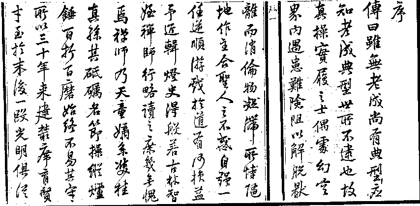
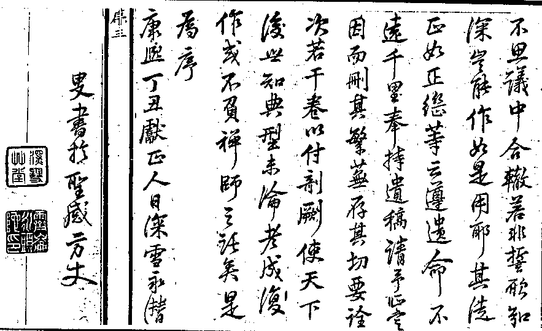

# 盛京奉天般若古林禅师语录



> **藏经**：嘉兴大藏经（新文丰版）（嘉兴藏）　**册次** 第 38 册（J38）　**编号** JB429　**部类** 般若部　**卷次** 6 卷　**篇幅** 54,566 字

> **卷／品**：0 卷 · 3 品



---



## 目录



  - [序](#序)

  - [序](#序-1)

  - [古林智禅师语录序](#古林智禅师语录序)



---



### 序



古林禅师，亦吾徒之特异者也。浮屠之学，非善幻多术之谓，所贵了脱生死耳。彼盖於去来之际为尤异。何异乎？异其生死自主焉。可死即死，欲未死即复生，期死则又死。乙亥仲冬既望，跏趺坐逝一夕矣。次旦，忽起如平时，一一指示立塔及荼毘事，从容至晦日，手书招故人与别，送之出门，经行院中。夜半，归丈室凝坐，命弟子燃香二寸始入，见端居不动，手腕温软，题偈墨汁尚淋漓几上，非去来自主而能若是乎？则岂非吾徒之特异者乎？及举火时，烟燄发五色，龛开，现金色毘卢像，衣折数珠宛然，舍利无数，一齿不坏。异乎？不异？余连岁瓢笠南北，得於诸方传述者如此。今春息影谢客，经函禅榻，昕夕掩关，适深雪艸堂霁仑法兄过访庵中，具伊蒲而别，留古林语录索序。是时晴雪初消，庵中探春盛放，下帘呼茗，取一编向花香灯影间披读终卷，觉舍利光、毘卢金像彷佛从侧理中出，为合爪赞喜久之。夫余与古林同出双桂一支，既不可以不文辞，遂略其语言文字，而摭拾生死一事纪之，缄寄深雪，当广示学人，使知古林者果了脱生死，去来自主，而为吾徒之特异者也。



鹧鸪头陀超斯撰



------



### 序











------



### 古林智禅师语录序



古公得法语公，语公得法雪公，雪公得法破山和尚，破和尚得法密云老人，多奇，诸方能言之。古公，余乡人，志亦彷佛。少弃家参学，顿悟第一义，藏峨嵋山中，成自了汉，不欲诸方知有古公。余曾披缁衣，混迹麋鹿，或倚扁舟武陵溪上，骋望江湖，记桃花开落，浮游餘景。而世路播迁，古公不获卧云松，余不获辞簿书，乃相遇於辽之左。此间昔有讲、律，无宗。粤东剩公，发焚修，继赤公，古公於是翕然知曹洞、临济剩公出自爨下，始末尤奇。详其语录，赤公东，剩公左右之；古公来，赤公周旋之。古公怀其素志，甘啮冰雪，执牧竖事，而大法将行，润泽



汤沐，种菩提於寸心，消泡影於八识，人天共推，此古公所不能自已者也。遂登般若座，阐破山旨，三期般若，成大丛林。剩公、赤公有志未行者，饭贫衣寒，恤病孩委，弃敛暴露，古公悉举之，故人人以古公为归。若其机锋触发，作狮子吼，用破山之奇为正，用正为奇，莫可把鼻，真不愧为破山后人。余与古公往来凡八年，转治江右，将别古公，情思黯然，念关东风俗朴厚，得三大和尚开示一切，今为乐土，且当事宽简，僚属多暇日，而万里之行，其何以别我古公？公曰：「子行矣，其序我语录。」余何辞？惟述予之所知见，及聚散之不得於志者，以告诸方。然古公云水人也，他日或握手茅庵渔浦，望朔云塞月，如家常话，则又未必不如其志也。谨序。



时康熙乙卯岁菊月九日，奉天府通判升江西广信府同知楚武陵旧衲弟季浑拜手题。



古林智禅师语录目次



卷首序文



卷第一盛京般若禅寺语录



卷第二辽阳如来禅院语录



卷第三辽阳建宁禅寺语录  

普说



卷第四奉天府东前山台大悲禅寺语录  

机缘  

颂古  

小佛事  

法语



卷第五偈上



卷第六偈下  

行状



古林智禅师语录目次终



古林智禅师语录卷之一



> 侍者正继记录



嗣法门人正灯编辑



住盛京般若禅寺语录



康熙壬子岁冬十月，受当道护法缙绅善信暨本寺监院等请，於腊月朔日进院。



当日山主杨明俊率众请上堂。至法座前曰：「拽杖云程蜀地来，真风不二任安排。今朝对众亲拈出，只要人人莫自埋。」遂升座。拈香：「奉为今上皇帝圣寿万岁万岁万万岁。」次拈香曰：「奉为本府京兆在任尊官，伏愿高迁禄位，永固寿基。」复拈香曰：「此一瓣香，不是岭头密付，亦非鸡足传流。昔在蜀中遭毒手，而今塞外恨难酬。𦶟向炉中，供养先住贵州木皮庵、现在武陵德山传曹溪正脉第三十七世语嵩裔大和尚，用酬法乳之恩。」遂敛衣就座。上首白椎毕，师曰：「一瓢一笠过三韩，拄杖横担没底篮。倒跨杨岐跛驴子，好收沩老牯牛关。魔宫虎穴全身入，铁壁银山尽底翻。独显大机施大用，不传金色旧金襕。」遂提衣角问大众曰：「既是不传金襕，此衣甚麼处得来？莫有道得者麼？试出道看。」问：「师唱谁家曲？宗风嗣阿谁？」师曰：「不是弥勒前，亦非释迦后。」曰：「恁麼则昔日般若，今朝和尚。」师曰：「谩劳涂污。」曰：「峨嵋亲得旨，塞外大敷扬。」师曰：「赚杀汝。」问：「马祖一喝，百丈三日耳聋，意旨如何？」师曰：「赤心片片。」曰：「黄檗为甚麼吐舌？」师曰：「识法者惧。」乃曰：「自蜀散席，万里到来，得遇杨山主留住此地，又蒙章京王、佟两公，又得京兆别驾陈、季两公，及护法善信皈依，成此般若丛林，坚请山僧升座，勉强应命，藏之不得。既藏不得，分明露现，试问诸人见不见？若曰见，实相之体本非青黄赤白、长短方圆，亦非见闻觉知之法，且作麼生见？若曰不见，又道藏之不得，为甚麼不见？」拈杖卓曰：「莫被拄杖子瞒始得。看看，拄杖子穿过汝等髑髅，𨁝跳入汝等鼻孔里去也，汝等还觉寒毛卓竖麼？」复卓一卓，下座。



佟望年等请上堂。问：「青莲一瞬，金色知归。作家到来，以何相待？」师曰：「饱餐明月，烂嚼清风。」曰：「忽遇无舌人来，又作麼生？」师曰：「无底橐子满盛堆。」曰：「谁知别馆池塘里，一对鸳鸯畫不成。」师曰：「只缘生落处，切莫厌家贫。」曰：「今日已逢王膳宴，大家拍手唱哩啰。」师曰：「三十年后有人证明在。」问：「如何是诸佛出身处？」师曰：「云收山露顶。」僧曰：「意旨如何？」师曰：「河冻水凝流。」乃曰：「释迦出世，达磨西来，广设权变，随机应化，无非教人踏著本地风光，识取自己面孔。於斯荐得，可以荷负宗乘，全身提掇。管取三世诸佛合掌皈依，历代祖师低头俯伏。坐微尘里转大法轮，於一毫端现宝王刹，不是神通玅用，亦非法尔如然。乃人人具足，个个圆成，一段本有光明，经过尘沙劫数，不曾移易丝毫。且道此光落在甚麼处？」顾视左右曰：「两眼豁开全体现，纵横无处不亲亲。」



李广寂请上堂。蓦拈拄杖曰：「大众见麼？人人有眼，必定是见。」喝一喝曰：「闻麼？个个有耳，必定是闻。闻见分明，复是何物？若向这里转得身、觑得透，便可大方独步，高握权衡，兴慈运悲，驱驰佛祖。苟或未能，只须打叠身心，向三条椽下、七尺单前，竖起脊梁高著眼，厮结眉毛仔细参。忽然踏著消息子，不妨与山僧拄杖打个折合。」遂卓一下曰：「努力今生取办，逗遛万劫难逢。」



刘金环、陈宽阔等请上堂。「槌下荐得，平地生尘；句外承当，无风起浪。第一义谛作麼生观？若乃忘机守默，已被维摩占先；拟欲展演词锋，又落能仁之后。若是行棒行喝，德山临济用过；若更拈槌拈拂，马祖百丈曾施。到这里恁麼也不得，不恁麼也不得，恁麼不恁麼总不得，作麼生委悉去？」挥拂一下，曰：「一把柳丝收不得，和烟搭在玉栏杆。」



田加祯请上堂。问：「如何是道？」师曰：「阿谁不踏著。」曰：「如何是道中人？」师曰：「往来无罣碍。」曰：「经曰：『唯此一事实，餘二则非真。』如何是一事。」师劈头一棒，曰：「会麼？」僧罔措。师曰：「直截提持犹不会，忙忙业识几时休。」乃曰：「今朝冬月一，钟鼓相催逼。未动脚跟前，好个真消息。迎请到法床，未免涉阶级。休把古人语，将曲当作直。一即六，六即一。赤须胡，胡须赤。驴觑井，井觑驴。不湿脚，脚不湿。通身与遍身，何必共不必。斑虎唤作猫，总是妄分析。愚拙这里绝商量，未容启口打折脊。若能直下解翻身，一生参学大事毕。」



僧录司陈宽阔请上堂。问：「须菩提岩中晏坐，天雨四花。今日僧录同众贲临，是何奇特？」师曰：「道义相亲话岁寒。」曰：「闲持经卷倚门立，笑问客从何处来？」师曰：「不是苦心人不知。」问：「佛未出时如何？」师曰：「清贫常乐。」曰：「佛已出时又如何？」师曰：「浊富多忧。」乃曰：「此事无拈弄处，无启口处？」遂拈拂子挥一挥，曰：「无拈弄处，已拈弄了。」又竖起问曰：「识此物否？无启口处，已启口了。」顾左右曰：「汝等何不领会？若向这里见得分明，闻得透彻，一念返本还源，即具顶门正眼。无边刹海，自他不隔於毫端；十世古今，始终不移於当念。净裸裸，绝承当。赤洒洒，没回互。诸圣同躔，众机顿赴。苟或未然，莫将闲学解，埋没祖师心。」



实清众等请上堂。「觅心觅性，正如守株待兔；穷玄穷妙，大似张网兜风。盖不知真随妄转，法逐缘迁。如澄清大海，浪起风生；似皎洁太虚，云兴雨作。自蔽妙明，枉劳神体，昧却灵山直指，辜负少室别传。」复举拂子挥一挥，曰：「这一著子，非从外得。昭昭日月，森罗顿现於灵光；荡荡目前，彼此无分於实际。非文字相，离见闻缘。一道平等，山河匪碍。尘尘成现，刹刹圆明。万像之中长独露，千峰顶上现全身。」



实袭请上堂。问：「祖师未西来时如何？」师曰：「支那夜夜家家月。」曰：「已来时如何？」师曰：「几处讴歌几处悲。」问：「一切诸佛皆从此经出，如何是此经？」师曰：「脚跟下荐取。」乃曰：「我本无心有所希求，今此宝藏自然而至。敢问大众，上是天、下是地，左是路、右是溪，前是功德主、后是慈恩寺，宝藏在甚麼处？众中还有道得者麼？如无，山僧自道去也。」震威一喝，下座。



报恩寺都管觉宗请上堂。「八年烂卧镐京地，今日重登曲录床，正恁麼时难启口，全无佛法可商量。菩提涅槃阳焰水，佛性真如闪电光，非佛非心空打橛，即心即佛肉剜疮。与麼与麼冰求火，不与麼是贼抱赃，见色明心犹未彻，闻声悟道妄承当。众中若有英灵客，试出当机共举扬，莫学丈师亲马祖，休同临济个颠狂，不劳据捉虎头尾，掀翻玄要播诸方。既是掀翻玄要，如何又播诸方？恁麼中不恁麼，不恁麼中却恁麼，到这里孰敢正眼觑著？且道其中还有恁麼人麼？」遂起，拈杖卓一卓，曰：「举头天外看，谁是个中人？」



宽宝、张忠成请上堂。问：「翠岩一点不点，意旨如何？」师曰：「向前，向尔道。」僧便进，师便喝，僧拟议，师便打。问：「穷子得宝，不知是何宝？」师曰：「煞好一问。」曰：「请师酬价。」师便打，曰：「是多少？」僧拟议，师又打。问：「如何是佛？」师曰：「千山路南去。」曰：「弟子不会。」师曰：「横河水西流。」乃曰：「风不待月而凉，火不待日而热。般若堂内安禅，瞬息过了一月。连日屡屡上堂，贵要禅流休歇。若能当下知归，便乃超宗越格。若涉拟议思量，白云万里不绝。果能是非齐泯、善恶都忘，掀翻玄妙关、打破无明窟，迥出威音王、高超毘卢顶，透声透色绝遮栏、盖天盖地无向背。」喝一喝，下座。



陈实一领众请上堂。问：「达摩西来不立文字，和尚为甚麼说法？」师曰：「汝在甚处见山僧说法来？」曰：「恁麼则昔日达摩曾敷演，今朝般若又重兴。」师曰：「莫谤他好。」问：「古德曰：『释迦、弥勒犹是他奴。』他是个甚麼人？」师曰：「灭佛种族汉。」曰：「他具何面目？」师曰：「将此深心奉尘刹。」乃曰：「若一向举扬宗乘，所谓法堂前草深一丈。山僧今日事不获已，放开一线道，通个入路。」竖起拂子，曰：「大众识这个麼？在天成象，在地成形，在四时作寒暑，在日月为照临，在人则竖，在畜则横，在有情动转施为，在无情森罗显焕，刹刹尘尘露现，头头物物全彰。诸佛识此，具一切种智；菩萨识此，成就诸般波罗蜜；独觉识此，向无佛世显大神通；声闻识此，得八解脱；天人识此，悟无生法；修罗识此，安住忍地；地狱识此，知罪性空；饿鬼、畜生、四生九类、一切有情识此，随其根性各得受用。若向这里会得，拂子现神变相，化作无边身菩萨，大千普应去也。」喝一喝，卓拄杖，下座。



信官穆清格请上堂。「乾坤之内，宇宙之间，中有一宝，秘在形山。达摩九年面壁觑不破，瞿昙三百餘会道不著。摩醯三眼也难见，大悲千手也难摸。历代祖师，古今知识，咬定牙关，一场懡㦬。今日般若不免拈出供养大众，及大地有情无情，同一眼见，同一耳闻，同一受用。」良久，曰：「季冬严寒，各归煨火。」



侍僧美然领众请上堂。问：「昔沩山问仰山曰：『山河大地，日月星辰，唤作事得麼？』仰山曰：『如是，如是。』意旨如何？」师曰：「山僧今日不答话。」曰：「万派千流归渤海，七金五岳总须弥。」师曰：「犹是葛藤在。」乃举：「石室见僧来，拈起拄杖，曰：『过去诸佛也恁麼，现在诸佛也恁麼，未来诸佛也恁麼。』圆悟曰：『过去诸佛不恁麼，现在诸佛不恁麼，未来诸佛不恁麼。』」师曰：「一人在孤峰顶上喝风骂雨，一人在十字街头截铁斩钉，有擒有纵，有杀有活。且道：恁麼的是？不恁麼的是？然虽如是，放过则二俱作家，点检则二俱失利。何也？恁麼、不恁麼，两没交涉。山僧则不然。」拈拄杖，卓一卓，曰：「过去诸佛在这里，现在诸佛在这里，未来诸佛在这里，还有检点得出的麼？」良久，曰：「三段不同，收归上科。」



祁天长请上堂。问：「气宇昂藏来震国，一言不契羞惭极。心怀涂毒嵩山坐，分骨分髓太狼藉。狼藉即不问，因甚递相钝置？」师曰：「蛊毒之家水莫尝。」曰：「饮者何如？」师曰：「死。」僧喝，师曰：「相随来也。」僧掩耳而出，师曰：「脑后见腮，莫与往来。」问：「如何是法身边事？」师曰：「利名尽处江山窄，烦恼忘时世界宽。」曰：「如何是法身向上事？」师曰：「任运腾腾随分度，更嫌何处不风流。」乃曰：「世尊拈花，迦叶破颜，四七分芳过东土；达摩面壁，神光断臂，二三流派到南能。佛佛授手，祖祖传灯，到此始分二派，向后又成五宗。临济宾主互换，云门顾鉴圆融，沩仰父子投机，曹洞君臣合从，法眼直指唯心，各自建立门风。瞎驴一支茂盛，烜赫浩浩轰轰，枝枝叶叶无数，三十四传天童。威声振动寰宇，六处万人兴隆，亲传嗣有十二，超群让我师翁。九坐道场无匹，后来独踞巫峰，双桂堂前杯酒，时人尽丧其中。今日正眼看来，灼然道在人弘。」喝一喝曰：「会麼？不见道：道无隐显，遇缘即宗。法无去来，因时而会。然虽如是，犹是建化门边事。若论向上一著犹未在。如何是向上一著？直下一槌皆粉碎，乾坤大地尽光辉。」



示众。「百日安禅将一半，己躬下事莫迟疑，寸阴有限嗟谁惜？一念回观返自思。锁却狂猿勿浪走，牢拴劣马住奔驰，胸中有物荡教尽，足下无丝不用除。厮结眉毛咬定齿，精懃脑后痛加锤，心心似解倒悬急，切切如同救火时。烈焰亘天浑不顾，翻身直透万重围，须弥倒卓虚空碎，拶破娘生铁面皮。始识顶𩕳具只眼，当阳直截照无私，纵横倜傥忘羁绊，触处随缘乐自如。若不如斯深负己，营求声誉作何为？相酬园菌愧无愧，泣泪坡前悲弗悲，珍重诸公当省力，身沉苦海实难移。」



冬至日，实利领众请上堂。「乌兔奔忙晓夜催，流光又尔一阳回。虚空碾得无藏处，万象齐来芥里埋。大众！还知芥子安身处麼？」竖起拂子曰：「山河大地、草木丛林，全承此力。天以此而清，地以此而宁，日以此而照，月以此而明，君王以此万国来宾，宰辅以此为政治民，百姓以此共乐升平，衲僧以此运用无尽。」顾左右曰：「切莫错认。且道阴卷阳回一句作麼生道？冷冰未得随横水，春信将来寄雪梅。」



刚实首请上堂。问：「学人乍入宗门，求师指示。」师曰：「早晨洗面，莫教摸著鼻孔。」曰：「摸著时如何？」师曰：「冤害杀人。」问：「摩腾入汉，已涉繁词。达摩西来，一场特地。今朝升座，将何表示？」师曰：「蜀中留不得，塞外任人嫌。」曰：「莫就是和尚为人处麼？」师曰：「家里已无回日信，路边空有望乡牌。」曰：「恁麼则千里仝风去也。」师曰：「长行书不尽，短偈绝人闻。」曰：「长安处处家家月，几处笙歌几处愁。」师曰：「抓著般若痒处。」乃曰：「煆生死，显超宗越格之规模；炼圣凡，彰全杀全活之机用。所以马祖一喝，百丈三日耳聋；宝寿令行，镇州一城眼瞎。黄檗三顿棒，临济全身担荷；龙潭吹灭灯，德峤直下承当。」蓦竖起拂子曰：「这一队老汉，同无量佛祖，尽在拂子头上演大法义、转大法轮。汝等信得及麼？若信得及，法法本自圆成，念念悉皆具足，不劳修证，得大受用。且道受用一句作麼生？不起纤毫修学心，无相光中常自在。」下座。



道元领众请上堂。老宿能仁问：「时有阿私仙来白於大王。」师曰：「说个甚麼？」曰：「我有微妙法，世间所希有。」师曰：「破草鞋。」宿无语。师震威一喝，曰：「会麼？」曰：「不会。」师曰：「不会微妙法，会得破草鞋。」乃曰：「谈玄七七说无说，一瞬青莲浑漏泄。因此后来传直指，明人往往成途辙。炉内火红，庭前雪白，谁道融融只一色？簷前鹊噪，枝上鸦鸣，谁道关关只一声？日日东来，日日西去，谁道如如不迁义？已离南楚，今过北塞，谁道巍巍不动身？不识这些消息子，空认山河作眼睛。」



善信人孙添寿同妻李实航请上堂。问：「庞公将家赀沉於湘水，今日孙氏施财饭僧，与庞公是同是别？」师曰：「眉分八字，两耳垂肩。」曰：「且道承谁恩力？」师曰：「东风昨日至，花发树头春。」曰：「深闺帘幙千家月，落日楼台一样风。」师曰：「逢人但恁麼举。」乃曰：「阿呵呵，是甚意。口吃饭，鼻出气。一不成，二不是。赤洒洒，明历历。非心机所择，非计较所及。六祖曰不会，达摩道不识。谩曰北斗藏身，休道南山鳖鼻。中原至宝难酬价，西江一口易得吸。般若堂内众禅和，磨裈擦裤半百日。半百日，浮逼逼，浮逼逼，总为不识丘乙己。蓦然撞著仲尼门下短命底颜回。啐，原来是这个。可知礼，可知礼，在这里。」遂拈拂子拂一拂，曰：「在者里。腊月三十日到来，也是开眼见鬼。」



腊八日，实悟请上堂。问：「尽大地是个般若门，为甚把手拽不入？」师曰：「为他脚根点地，鼻孔撩天。」曰：「和尚前日道杀佛杀祖杀阿罗汉，是甚麼意？」师曰：「只许狞龙会，不许跛鳖知。」乃曰：「眼听音声耳见色，舌闻香臭鼻言说，身分善恶意觉触，六月严寒腊月热，男身入定女身出，盏子落地破是碟，柳树著箭桑迸汁，石人吃棒空流血。如斯见得明白，方知黄面老汉未离兜率已降皇宫，未出母胎度人已毕，岂待毘蓝园内方名为生，夜睹明星方名曰悟？及至三叹奇哉，分禅教律四十九年，屙漉漉地多少落节，引得后代儿孙将祖宗家丑尽底扬出，免教后人向明星下妄想边讨悟分迷。然虽如是，正当恁麼时，还有为释迦老子雪屈者麼？若有，出来与般若拄杖子相见；若无，更听一偈：水云开关人天径，珍重时人努力行，打破目前关捩子，莫教杓卜听虚声。」



传学领众请上堂。「若论第一义，个个顶𩕳上如如不动，人人脚跟下了了分明，非玄非妙、非异非如、非闻见觉知。所以道：才起一念见他，便隔一座须弥；才起一念知他，便乃沾黏点污。若能屏脱见闻觉知，直下领略得去，见则便见正法眼藏昭昭溢目，知则便知涅槃妙心晃晃通身，於一毫上现恒沙诸佛之全身，於一念中现无边众生之世界。然则如是，犹是闭门造车，未是出门合辙。且道合辙一句作麼生？落霞孤鹜齐飞，秋水长天一色。」



元旦日，实融请上堂。「今上祝延一瓣香，炉中𦶟向露堂堂，十方世界无藏覆，函盖乾坤悉已彰。举目分明没渐次，莫教拟议更思量。」



杨登科请上堂。乃挥拂，曰：「这里会去，甚省心力，便可荷负吾宗。众中还有恁麼人麼？如无，智上座不识好恶，向第二义门头为诸人重重话会去也。若论此事，不论僧俗、男女、贤愚、贵贱，悉皆具足，毫无欠少，只为根有利钝、见有淆讹，向是非边、声色里转却。不见道：名言滞於心内，恒为缘虑之场；实际在於目前，翻作名相之境。若得正眼圆明，见刺尽除，一法不堕缘尘，万法本无罣碍。所以，卢老不识字，顿明佛意；白兆不识书，圆悟宗乘。到这里，须是有节操、极慷慨、斩钉截铁汉始得；若是畏刀避箭、碌碌之徒，看即有分。既然如是，且道具足个甚麼？」喝一喝，曰：「雪后始知松柏操，事难方见丈夫心。」



僧妙智请上堂。举：「德山小参示众曰：『老僧今夜不荅话，问话者三十棒。』时有僧出礼拜，山便打。僧曰：『某甲话也未问，因甚打某甲？』山曰：『你是甚处人？』僧曰：『新罗人。』山曰：『未跨船舷，好与三十棒。』圆悟曰：『德山大似金轮圣王，寰中独据，四方八表，无不顺从。等闲布一敕、施一令，直得草偃风行。若不是这僧，争见杀活擒纵，威德自在？』法眼曰：『大小德山，话作两橛。』圆明曰：『大小德山，龙头蛇尾。』雪窦曰：『德山握阃外威权，有当断不断不招其乱底剑。虽则直截单提，各能扶竖。德山要且只扶得末后句，未扶得最初句在。且作麼生是最初句？大鹏欲展摩霄翅，谁顾奔腾六合云？』」师曰：「奇持因缘，须以奇特激发；殊胜大事，须以殊胜举扬。圆明有验人句，法眼有超宗眼，圆悟顺水推船，雪窦迎风把舵。虽然各出手眼，成得个什麼边事？若是山僧，待他道：『某甲话也未问，因甚便打？』复打曰：『可杀不识好恶。』当时德山下得这一棒，不惟截断天下人舌头，也免得他道个龙头蛇尾。」



耿门吕氏请上堂。问：「新建般若则不问，因斋庆赞请师宣。」师曰：「东山雨过松添翠，横水增流浪更深。」曰：「恁麼则尘垢尽除光始现，乾坤大地露全身。」师曰：「莫著相。」乃曰：「重整颓纲，阐扬法化。非金石心肝生铁铸底脊梁，亦不能弘持此道。岂志浅之流而能为之。虽然如是恁般说话，如仰面寻地，低头觅天。」



信官王养民请上堂。问：「掬沙献佛，果感轮王。设斋饭僧，斯成何美？」师曰：「介尔景福，锡尔眉寿。」曰：「古柏烟笼清昼永，满庭兰蕙彩衣欢。」师曰：「一任纵横。」问：「无眼耳鼻舌身意，因甚又道见闻觉知？」师曰：「扶过断桥水，伴归明月村。」曰：「恁麼则个中若了全无事，体用何妨分不分。」师曰：「泥里洗土块。」乃曰：「若是明眼汉，不游诸佛机关，不堕祖师窝。曰明如杲日，宽若太虚。放旷逍遥，有甚麼事。然到者里，必同道者方知，同得者方证。且道作麼生说个同得同证道理？莫是菩提涅槃真如佛性得麼？莫是人境俱夺照用同时得麼？莫是即心即佛非心非佛得麼？莫是人我是非得失双忘者麼？总没交涉。不见道：拟剔眉毛早错过，才涉思量隔万山。」



张常信请上堂。问：「给孤长者舍金布园而求功德，今日张公领众设斋，有何功德？」师曰：「重若泰山抬不起，深如沧海掬难乾。」曰：「与麼则随家丰俭去也。」师曰：「种粟得粟。」乃曰：「正令全提，贵在临机直截；当阳显现，须教当下知归。到这里不假拟议思惟，只要全身担荷，直得有佛处不得住，无佛处急走过，上无攀仰，下绝己躬。所以道：衲僧家行则廓尔周沙界，坐则芥子纳须弥，把住乾坤都失色，放行大地没遮拦。且道众中还有恁麼人麼？若有，试出相见；若无，未免气急杀人。」



解制，实隆请上堂。问：「久默斯要，不务速说。师还荅否？」师曰：「荅。」其僧蓦擒一僧，曰：「请师荅话。」师便打，曰：「正贼走却，掳赃人受罪。」乃曰：「今朝正是元宵节，百日炉锤今日歇，拂子茶条来报怨，剜心剖腹没人测。山僧何故不知休？犹自饶唇鼓美舌，为要人人两足尊，与伊拔出顶𩕳楔。圣贤具足凡夫法，凡夫具足圣贤诀，石头尚自将头点，衲子如何不自瞥？若是吾门过量汉，未容登座早通彻，果能如是彻根源，解未解兮结未结。著佛衣兮行佛行，入佛室兮称佛杰，犹然还自不知晓，未免重重话直截。锣鼓喧喧花炮响，家家户户尽欢悦，装龙办鬼满街跳，般若真机浑漏泄。一切音声是佛声，一切众色是佛色，大洋海底撞金钟，须弥山王头脑裂。惊起法身藏北斗，森罗万象骨筋折，不是西天秘密传，亦非东土系驴橛。直下不能明了去，汝自东西我自北。」拽杖，下座。



古林智禅师语录卷之二



> 侍者正尚记录



嗣法门人正悟编辑



住辽阳如来禅院语录



康熙癸亥夏四月八日进院。



尤成伯、王成功等请上堂。「山僧搭底是千佛衣，大众礼底是万佛忏，千佛万佛总归一佛。那一佛？」挥拂子，曰：「阿弥陀佛！佛在那里？」竖起拂子，曰：「在山僧拂子头上放大光明，全身独露，示以梵音，高声唱言：『吾身充满於世间，吾音普顺十方国，喻如虚空含万象，於诸境界无分别。处处遍坐道场，头头威光烜赫，若向者里见得，始识吾门妙诀。为悯阎浮诸苦趣，所以分身不可说，梯航三有济四生，提振纲宗宏正脉，只得人人脚跟下荦落，个个顶𩕳上廓彻。苟或未能见分明，抖擞精神须自策，放开胸次冷如冰，竖起脊梁硬似铁，声色名利尽剿除，机关理性都教瞥，猛然打破这些子，一念万年无变革。』」以拂子打圆相，曰：「至道无难，为嫌拣择。」以拂子入袖，曰：「见四众都有拣择，抽身退入毛端去，山僧代彼重饶舌。何也？诸佛法身入我性，我性同合如来辙。」



北堡周应元等请上堂。「今朝冬月十五，行者撞钟擂鼓。那识教外单传，本无一字可吐。权向方便门头，直指诸人开悟。阿谁使汝鞠躬，那个教伊退步。语默动静分明，当机了无回互。更若拟议思量，何如抱赃叫苦。果能直下承当，一认村歌社舞。珠取东海骊龙，须捋南山猛虎。扶整旧日风规，扫尽今时露布。直得露柱灯笼，悉皆成佛作祖。」



地藏寺僧同袁文明请上堂。「千河水冻，万壑林凋。潭冰三尺，冷非一朝。物理有更变，时节不相饶。一阳才复长，群阴便剥消。莫嫌霜凛凛，休道冷萧萧。可思枯坐面壁，翻忆雪立齐腰。可叹人心浇薄，惭惶祖道寂寥。虽有攒眉蹙目，无非外寂内摇。安得大乘根器，翻身透出青霄。行解相应齐著力，大家复把古风招。」



腊八日圆戒，胡朝辅请上堂。「三千年来，举世尽道释迦老子是今日半夜子时明星出现，正眼圆明，殊不知正是刺瞎黄面双睛。何也？不见道：知一切法即心自性，成就慧身不由他悟。既无他悟，世尊睹明星的又是个甚麼道理？」蓦竖拂子，曰：「若向这里的当得去，则与丹霞、高沙弥同一鼻孔、同一知见，把臂共行，何须般若开阐尸罗，重劳汝等登坛羯磨？因甚如此？为他已知本性无非自性戒，正所谓戒外无戒，又何戒哉？苟或未能，且与汝等绳上加绳、扭上带扭。不是老僧束缚，因汝等从无量劫来昧却了无非自性，执人执我，向外驰求，被四相流入生死苦海之中，轮回不息。若不先以波罗提木叉辔勒身心，向止持作犯处洞明自己法性身，身心茔彻，超然物表，如斯之际，觅其能受戒人与所持之戒皆不可得，微细开遮之名相复何有也？且道凭恁麼力得如是事？」良久，曰：「众生受佛戒，即入诸佛位，位同大觉已，真是诸佛子。」



吊水楼弟子(正纯、正照)请上堂。「碧霞深处结禅期，云水四来相共依，若有超宗越格汉，何妨出众决情疑？提持祖印与玄要，辅弼丛林展化基，不待九旬已满后，棒头三十奉酬伊。且道有恁麼人麼？若无，且听饶舌。」喝一喝，曰：「太子河中水，千山顶上松，松水交参处，荐取主人翁。」



正月十五日，陈僧纲领众请上堂。「弥天和气，匝地春风，玉苑梅花放，银河冰水溶，处处笙歌社舞，家家灯月辉红，头头显示少林旨，一一宏开鹫岭宗，觌体分明无向背，尘尘尽是主人翁。委得底丹霄独步，未明底正好用工，莫待眼盲耳聩，四缘散乱匆匆。若是英灵汉子，竖肯自昧心胸，一回坐断千差路，运用纵横处处通。」



除夕，小参。「众兄弟！休放逸，人生世间如驹过隙，个个自知又去一岁矣。古人喻修行人临末稍头，似今夜一般手忙脚乱，请各自检点，看手脚稳当也未？老汉不敢望汝等逆浪兴波，也要先识些子惭愧，看这口中食、身上衣，一一出自檀信脂膏，劳他监院都管种种作务，堕指裂肤，夙兴夜寐，辛勤料理，所为何事？不过要汝等厮结眉毛、竖起脊梁，剋期取证，然后不舍本愿，导利众生，同归至化之中，共享无为之乐，则彼此有益。岂料你们不能尽却今时，到被今时所惑，虽入云堂，形留神往，坐禅遣香，请益无能，开示不晓，所谓参禅禅不会、学道道不识。那晓者不知不识，正是个好消息，不肯承当，返去那边？这里全不思此形骸不是容易得来的，他日抛此形骸不是容易得去的，若不称此时节讨明落处，异日眼光落地，何时有出头分？如是愤发，顿起疑情，立金石心，将个本参横咬竖咬、昼参夜参，参来参去，伎俩尽、心境忘，忽然迸破疑团。啐！原来是这个道理。然后行遍天下无踪迹，言满天下无口过，终日吃饭咬不著一粒米，终日穿衣挂不著一缕丝，扬一眉森罗腾辉，瞬一目万象失色，高揖释迦、不拜弥勒，随处安闲、随处自在。且道甚处得与麼力？」以拂子左右挥，曰：「著！著！都在这里。」



小参。「一岁光阴又掷空，两堂云水漫推聋，好思身后遭他苦，快向言前叩己躬。迷去头头成窒碍，悟来处处悉圆融，莫教错过此时节，浪死虚生无尽穷。若是吾门过量汉，潜行必与古人同，拚身直趣菩提路，铁壁银山尽透通。虽然与麼，究竟将来犹在途中，直得拈一茎草作丈六金身，将丈六金身作一茎草，还未是他住脚处。不住且置，腊尽春回一句又作麼生道？」竖起拂子，曰：「不世优昙花正发，大千沙界悉馨香。」



元旦，上堂。「满空瑞气蔼祥光，时为拈香祝圣皇，四海安宁歌岁稔，万邦平静乐时康。尧风恰似和风溥，舜日宛如佛日长，顽石昆虫皆踊跃，乔松庭柏尽敷扬。棒头喝下明宗旨，五叶一花遍界香。大众！还委悉麼？个个相逢都一笑，旧时人物换新装。」



屈佛宝孺人对灵小参。「金刚正体包括十虚，自他不隔於毫端；般若智光弥满六合，古今不离於当念。净裸裸、赤条条，有甚生死去来？正所谓：处生死流，骊珠独耀於沧海；踞涅槃岸，桂轮孤朗於碧天。况佛宝夫人淑德幽闲，四教母仪不愧三迁，持斋念佛，乐施好善，今年七十一岁，无疾怡然顺化，可见平生向善之验矣。佛宝一夫人还委悉麼？莫不有生，须知有不生者；莫不有死，须知有不死者。且道如何是不生不死者？」遂以拂子打圆相，曰：「曾见林宗二老来，尘中有术脱尘埃，今朝就路归家去，步步莲花火里开。」



上堂。「斯地廿年前数请，今偕云水入山来，当阳句子亲拈出，只要人人正眼开。根本若正，眼若洞明，则处处七通八达；根本不正，眼若瞇[目*麻]，则头头撞壁面墙。不见道：孤峰顶上透得，闹市街头不妨和泥合水；闹市街头透得，孤峰顶上不妨目视云霄。」蓦竖拄杖，曰：「汝等还透得麼？我不敢轻于汝等，汝等皆当作佛。」卓拄杖，下座。



孝子金国梁等荐严，请小参。「学道先须达本，本立而道自生；行善以孝为先，孝存而善乃具。为善不达，其本非善；为道不先，其孝非道。如何是道？」以拂打○相，曰：「会麼？清虚之理，佛祖罔窥，毕竟无身，生死何立？理则如是，如亦不存。诸仁者！若会得生以不生生为生义，则知海会居士七十八年前众缘和合而生，如阳燄翻波，觅共生相了不可得；会得死以不死死为死义，则知海会七十八年后众缘离散而死，如空花落影，觅其死相了不可得。既生无生、死无死，金刚正体独露堂堂。如何是金刚正体？」良久，曰：「离名离相周沙界，迥出三乘不假修。」



官纯衡请上堂。「至理洞明，会千差于物表；玄机独脱，融万象于毫端。头头上显，物物无偏，花放不萌树上，凤鸣无影山前。木人把板云中拍，石女吹笙过碧天，不是四料简，亦非三要玄。天龙往竖指，庵主空举拳，任伊役使释迦、奴呼弥勒的到来，不敢当前。般若这里法令当台，如太阿锋、似大火聚，触犯不得。既触犯不得，唤作阴阳时节得麼？唤作语默动静得麼？唤作迷悟智愚得麼？唤作棒喝主宾得麼？到这里，佛祖犹难知，凡夫岂易识？信手拈将来，不费纤毫力。既然恁麼，为甚凡夫不识？皆因执著难忘，随情放逸。即今老僧不惜唇皮，只要现前缁素同尽大地众生明这触犯不得的一著子去。且道：如何是触犯不得的一著子？」以拂子左右挥，曰：「谁知夜睹明星事，一念回光尚宛然？」



庠生顾进朝请为母对灵小参。「记得前月十七，弟子应缘事毕，生死本无去来，圣凡两途不立。既不立，正清向什麼处安身立命？」竖拂，曰：「会麼？若会得，始知正清六十九年前生本不生、六十九年后死本不死，正体如如，灵光不昧。何也？为伊了得生不以生为乐、死不以死为苦，苦乐无拘，迥脱生死去来之相。」顾左右，曰：「老僧无说，汝等无闻。即今一句又作麼生？」挥拂子，曰：「一超直入如来地，脚下莲花步步生。」



裴世文荐女，请对灵小参。「生本不来，死本不去，不去不来，中也不住。诸仁者！还识不住的麼？」竖起拂子，曰：「这一著子，天不能比高，地不能比厚，日不能比光，月不能比照，世界不能比大，河海不能比深，须弥不能并峙，虚空不能包藏，至大至微、至柔至刚，纵横左右，洞彻十方，窥测无门，随机便应。」挥拂子，曰：「还知落处麼？前日梧桐凋一叶，人间何处不惊秋？」



佟国祥荐母，请对灵小参。「秋风秋雨声如泣，似痛善人回首急。孝子虔诚请老僧，超亡得度波罗蜜。我有一句子，不惟正溥得度彼岸，纵是六亲九族、四生三有、天地日月、情与无情，悉皆承此恩力一时度脱了也。且道是那一句子？」竖拂子，曰：「唤作拂子则触、不唤作拂子则背。不得有言、不得无语，不得向意根卜度、不得抛向无事甲里。如此理会得去，始识乾坤以此而立、世界以此而成、天地以此而覆载、日月以此而照临、国王以此而安治天下、宰辅以此而调理万民、历代佛祖以此而传正法眼、一切知识以此而接物利生、僧俗以此而修身齐家、蠢动含灵以此而改头换面、正溥以此而示现生灭相，实无生灭。既无生灭，且道即今在甚处安身立命？」挥拂子，曰：「弥陀接引惟心净，九品莲台仍旧登。」



接引寺云台禅师荐师，请小参。「汝师今去本无去，印老昔来本未来，历历分明全体现，好看铁锯舞三台。既然全体现，即今在甚麼处？」竖拂子曰：「来也，来也。在拂子头上现色身三昧，告众曰：『当处出生，挂片云於太虚，云性不动；随处没尽，灭一沤於湛海，沤性无亏。在天同天，在人同人，透一切色，超一切声，刹刹尘尘无住著，非心非佛绝罗笼，是圣是凡难卜度，遍周沙界无覆藏。』」复以拂子畫○相曰：「圆湛一轮常独耀，孤光万古照乾坤。」



王有福荐母夏正果，请对灵小参。「生从何来？处处黄花九月开。死从何去？行行鸿鴈飞不住。去去来来合本人，生生死死有根据。只要回头仔细观，始知自己安身处。脱体无依任自由，西方东土无疑虑。」



为王夫人对灵小参。「阎浮幻体有生死，个里真常没往来，一念不生清净土，万缘寂静涅槃台。休拟议，莫疑猜，差错毫厘隔九垓，直须恁麼承当去，朵朵莲花火里开。莫有承当者麼？为王夫人通一消息。」良久，无人出，蓦以拂子打圆相，曰：「了明这点无生意，脱下凡胎入圣胎。」



北塔院众班吉为荐文部大喇嘛请小参。拈拄杖卓一下，曰：「生不离这里来，死不离这里去，此处即是他方，他方即是此处。敢问众等：还识汝师大喇嘛麼？即今在般若拄杖头边吹大法螺、系大法鼓、演大法义、作大佛事，只须剔起眉毛，切忌当面错过。若是个汉，向般若未动脚前、未开口先直下领略得去，不惟父母师长、佛恩国恩一时尽报了也。既然如是，且道即今大喇嘛在甚麼处？」复卓杖一下，曰：「不离当处常湛然，觅则知君不可见。」



吴正省居士请荐先考小参。「思报劬劳意念坚，法轮转处利无边，迷云散尽性天朗，昏障销融心月圆。迥脱三涂离苦海，顿除八难越人天，金台逐步相推引，去到西方坐宝莲。」



为印真左善世对灵小参。「本无今有，笑看阳燄翻波；已有还无，喜见空花落影。生也如是，水流原在海；死也如是，月落不离天。」遂以拂子打○相，曰：「且道这个是生耶？死耶？有耶？无耶？」复挥一挥，曰：「若向这里委悉得去，始识无边刹海，自他不隔於毫端；十世古今，始终不离於当念。便可以无相中现相、无身处现身。虽居一相中，一相中收他不得；虽居一切处，一切处罗笼他不住。虽然恁麼，犹落在生死窠里。毕竟如何得不落生死窠里？」遂振威一喝，曰：「竹密不妨流水过，山高岂碍白云飞？」



古林智禅师语录卷之二终



古林智禅师语录卷之三



> 侍者正续记录



嗣法门人正巡编辑



住辽阳建宁禅寺语录



康熙己巳岁冬十月朔日进院。



本寺监院率众请上堂。「多年不肯顺人情，老迈无端颠倒行。自是业缘无避处，且邀明月下襄平。大众！既到这里，莫有共相激扬者麼？」良久无出，乃曰：「金刚宝剑，久藏匣中。今朝拈出，孰敢当锋？妖邪尽丧，狐兔潜踪。三世诸佛，总立下风。正法眼藏，让谁立宗？十世古今，一时流通。正恁麼时，天高地厚，海晏河清。处处村歌社舞，家家啸月吟风。且道到院一句又作麼生？」喝一喝，曰：「举头天外看，谁是个中人？」



李基蓁请上堂。「佛说一切法，为度一切心。我无一切心，何用一切法？既无心，又无法。」遂竖起拂子，曰：「这个消息从甚麼处得来？大众还识这个麼？诸佛未出世、祖师未西来，这个也不曾减一丝毫；诸佛出世、祖师西来，也不曾增一丝毫。亘古亘今、无生无灭，盖天盖地、透声透色，无譬可喻、无言可说，达磨不识、世尊无得，现前大众，如何凑泊？须是恁麼人，方解恁麼事。苟或未然，钓竿斫尽重栽竹，不计功程得便休。」拈杖卓一下，曰：「神功已极三千界，睿算仍过亿万年。」



盛京掌教李巩请上堂。「佛心无义，立义即失；佛法无言，著言则迷。所以道：眼若不睡，诸梦自息；心若不异，万法一如。试问大众：那个是不睡的眼？那个是不异的心？若向这里了当会得去，如化一道清风，透荆棘林中无挂无碍；若一毫不了，如著一领破絮袄，便有东扯西拽，无有出期。累他从上乃佛乃祖，念彼群幽千方百计向无方便处屈垂方便、无言教中权设言教，令脱一切苦恼，得逍遥快乐去。今日建宁短於权化，无法可说，何当掌教八官师同众檀远来请法？到此不得已，借襄平城为口、以金银库为舌，说无说之说，令现前大众闻无闻之闻，个个顿断情缘、瞥脱意解，直下了明这一著子。且道：如何是这一著子？」以拂子左右挥，曰：「自从舞得三台后，拍拍原来总是歌。」



潘有成请上堂。「圆通门广启，选佛场宏开。举扬大般若，众善积灵台。直得遍界绝罗笼，当阳无取舍。柰有老比丘，无事中生事，行菩萨行，立精进幢，建万佛道场中来。如是则无一不同法性、等太虚。尘尘刹刹，万佛放光。如理如事，普应十方。正所谓殊胜中最殊胜，奇特处更奇特。到这里教老僧说个甚麼？若是举古举今，行棒行喝，尽是从前拈过了也。不如总莫动著，只将现前公案试问诸仁。」遂竖拂子曰：「见麼？非但万佛，三世诸佛，历代祖师，古今贤圣，天下大和尚，尽在拂子头上吹法螺，击法鼓，横出直入，施大机用，提持正法眼，阐扬解脱道，与一切人抽钉拔楔，解黏去缚。若有利根上智，向老僧未举拂子已前见得，始知一处透，千处万处通明。一光明，千光万光普照。且道正恁麼时如何？」挥拂子曰：「无相光中万佛现，一道清虚亘古今。」



护法胡朝辅请上堂。「一檀设供，个个口中知盐识酱；四众云臻，人人眼里辨俗分僧。头头不昧，事事分明。为甚麼问著自己本参话头，便乃划断十虚，觌面千里？向后也说我曾结一制解，一期来取，笑识者埋没己灵。汝不见释迦老子睹星悟道曰：『我观一切众生俱有如来智慧德相，皆为妄想执著，不能证得。』而今只要诸人心空境寂、内外无依，忽然觑破这一著子，谩道一个话头，千万话头一时觑破。所以善财童子弹指入弥勒楼阁，顿见阿僧祇庄严，于一一庄严中见阿僧祇世界，於一一世界中见阿僧祇宝光，於一一光明中见诸佛菩萨，於一佛一菩萨中见无量劫来种种修因、种种证果、托胎出胎、出家成道，乃至说无量法、度无量众、入涅槃、分舍利，皆不出一弹指顷。所以道：十世古今，始终不离於当念；无边刹海，自他不隔於毫端。大众聚首建宁，来朝一月，难道不如他一弹指顷？且道是法不灵、人不灵也？还是古时法不同今时法？还是今时人不同古时人也？试道道看。如道不得，老僧自道去也。」良久，弹指一下，下座。



上堂。「鹫岭单提向上机，迦叶一笑承当；少林密传正法眼，神光三拜担荷。佛佛授手，祖祖相传；印印无差，机机圆证。向荆棘林中辟开活路，红尘堆里巧觅生涯。拈起也，天回地转；放下也，草偃风行。无非建立此个宗风，要人直下承当。若是个顶𩕳具眼的汉子，向缁素未动念请法已前、老僧未出方丈已前承当得去，始识百川异流同归大海，千重万匝只出一源。所以道：三世诸佛也恁麼，历代祖师也恁麼，天下大宗师也恁麼，老僧也恁麼。且道：恁麼底事一句作麼生？」遂震威一喝，曰：「鹤有九皋方翥翼，马无千里谩追风。」



上堂。「千山顶峭巍巍，浩浩松风谈般若；太子河活泼泼，溶溶水月露真机。若也如斯荐得，始知灵源不昧，万古徽猷。所以法随法行，无处不遍；心随心用，何处不周。故能出没卷舒，纵横自在。束虚空作柱杖子，也打他不得；合百千万聚雷作一喝，也惊他不动。更有甚麼生死去来，地水火风，声香味触，都卢是个真实人体。虽然恁麼，犹是闭门造车，未是出门合辙。如何是出门合辙。」喝一喝曰：「大千沙界海中沤，一切圣贤如电拂。」



祁凤鸣请上堂。「朔风凛烈，天木飞花，解脱门八字打开，正法眼顶𩕳独露，净裸裸、赤洒洒、清寥寥、白滴滴，沟渠瓦砾悉生光彩，奇珍异宝咸皆失色。何也？一片本地风光，现成琉璃世界。若是个正知正觉，向这里直下，一见一切见、一了一切了，声色翳障全消、见闻之源亦脱，不堕千圣机关、不游诸祖窠窟，纳须弥於芥中、掷大千於方外，举一机千机截断、拈一事万事齐彰。所以，乃佛乃祖提持此事，贵要大地众生脚跟下洞明这本地风光，运出自己珍，堆山积岳，成就他受用，海晏河清，作一切奇特事、立一切殊胜因。苟或未然，只恐犹有变迁。且道变迁个什麼？飘飘瑞雪下，树树银花发，红日照当空，阿㖿仍旧泥。滑，滑。」



报恩寺盛宇、白塔寺法海请上堂。「万岭千山觌面寒，一河三岔似龙蟠，个中佛法如何说？直要诸人著眼看。所以，诸佛顶𩕳上一著，诸佛觑不见；衲僧脚跟下一事，衲僧踏不著。倘若觑见，瞎却他眼；忽地踏著，丧却汝命。建宁则不然，诸佛顶𩕳上一著，衲僧觑得见；衲僧脚跟下一事，诸佛踏得著。诸佛踏著即是衲僧，衲僧觑见即是诸佛。何也？不见道：诸佛法身入我性，我性同共如来合。若能如此会得，心、佛、众生三无差别，更不假一点心思意解，转辘辘地、活泼泼地，无事不周、无法不备。苟或未然，不惜眉毛重重相为。」遂以手握拳，示曰：「见拳麼？」复展开，曰：「而今却是掌。」复问，曰：「见掌麼？」复握，曰：「而今却是拳。展开时，遍界分身，尘尘独露；握著时，佛觑不见，密密绵绵。能展、能握，最妙、最玄，全机、全用，无党、无偏，隐显纵横无间隔，从来千圣不同廛。」



观音寺文宇同大宁寺如嵩请上堂。「至理洞明，会千差於物表；玄机独脱，融万象於毫端。头头总是妙用，物物无非真宗。诸仁直下荐得，何劳百日施功？只因情生智隔，无端百匝千重，累他先圣垂慈，设立期限陶融，向无事中生事，直要个个圆通。今日建宁开佛祖炉鞴，用向上钳锤，不论有情无情、人我是非、生死凡圣、去来起灭，到此镕尽。若有个铜头铁额底汉子向这里翻身跳出，也须照顾眉毛。只如三世诸佛在火燄里转大法轮，火燄为三世诸佛说法，三世诸佛立地听，且道火燄说的是个甚麼法？」喝一喝。



腊八日，万寿寺僧祖春请上堂。「忽睹明星正眼通，微尘刹土悉圆融。清波匝地开银浪，直至而今阐化宗。大众！今日子时是黄面老子，三千年前在正觉山上、菩提树下，因睹明星，豁开正眼，三叹奇哉，曰：『我观大地一切众生，皆具如来智慧德相。只因根尘遮闭，不能证得。』诸人若能顿断根尘，则世尊底见处便是诸人见处，诸人底见处便是世尊见处，似水合水，空合空。又如水银落地，大珠大圆，小珠小圆。长者长法身，短者短法身。头头方便，事事现成。虽然如是，且道明星未出，正眼未开，智慧德相又在甚麼处？」喝一喝曰：「十二时中君自得，得时莫作等闲看。」



千山龙泉寺宽如请上堂。「金刚正体，般若智光。历历无渗漏，明明绝覆藏。他方与此界，廓彻无遮障。佛祖立地听，火燄转大藏。草木共山林，顺方悉低向。刹说炽然说，妙义广无量。单提向上宗，阿谁不仰望。」竖拂子曰：「还见智光麼？若乃见得彻去，便能丹霄独步，垂手今时。苟或未见，拂子不免打葛藤谩诸人去也。」复竖起曰：「三世诸佛向此光里生凡育圣，接物利生。历代祖师向此光里以心印心，流通正脉。天下一切大和尚向此光里揭示人天眼目，提持格外宗风。四生九有一切万类向此光里东涌西没。山河大地万象森罗向此光里成立现前。大众向此光里坐卧经行，参玄探妙。今日请法缁素向此光里种福修因。老僧向此光里激扬祖道，直指明心。且道此光未发时，无佛无众生消息，无山河大地形迹。汝等又向甚麼处委悉。」喝一喝。



甘泉寺老宿清风请上堂。「跳过金刚圈，细嚼栗棘蓬。三脚驴子倒跨，游遍南北西东。龟毛绳缚猛虎，兔角杖策狞龙。颠倒阴阳掌握里，驱驰佛祖不留踪。百千三昧恣游戏，方可提持向上宗。」蓦举拂子向空作点势，曰：「这一点落在什麼处？海神知贵不知价，留与人间光照夜。」



除夕，今醒请小参。「痛惜韶光飞电掣，一年不觉虚抛撇，叮咛我辈探元人，抖擞精神惯猛烈。声色利名都扫尽，机关理性俱除绝，正念提撕清似玉，脊梁竖起硬如铁。豁开耀日金刚眼，始识元风真妙诀，银碗昼鸣翻旧案，铁牛夜吼换新节。从教万绪与千端，自是七通穿八穴，善应随方解缚黏，入廛垂手抽钉楔。己躬下事甚分明，佛祖家风浑漏泄，为要时人气分同，愚痴老汉苦饶舌。团𪢮共唱无生曲，一会灵山迥不别，将此深心奉刹尘，传持莫尽无穷劫。若还逐色随声去，碌碌营生忙不迭，业海滔滔何日枯，爱河滚滚几时竭。目前弗肯回光照，秪为情生而智灭，可谓年来浇薄甚，缁流多与道相隔。虽然身在禅床上，外寂中摇怎合辙，愧杀恁麼说用功，饮他滴水须防噎。忽然四大各离散，地狱辛酸何处雪，受报彼中一昼夜，便同世上五千劫。翻思死后沉沦苦，莫若生前先打彻，拼身掀倒面前关，物物头头体会得。体会得，眼著屑，不著屑，真奇特，情与无情转法轮，山河大地炽然说，且道说个甚麼？」良久，曰：「腊尽春回空劫外，觉花香遍尘沙国。」



尤成伯请上堂。「新春祝圣热炉香，弥覆乾坤透十方，万国九州归至化，八弦四表乐安详。和风宛若宗风溥，舜日端如佛日长，个个相逢作揖笑，天然一段好时光。大众！这个时光与百千万亿劫不移易一丝毫，百千万亿劫与这个时光不移易一丝毫。既然不移易一丝毫，日往月来、冬去春回，是何意旨？秪为人心变态迷却本源，不达境惟心，起种种分别，故被山河大地新旧所转、色空明暗去来所迁。若能回光返照，向自己脚跟下见得这段时光，便达境惟心，分别即不生。正所谓：年来年去，去来不动乾坤；岁旧岁新，新旧一般时节。如是，则毘岚偃岳而常静，江湖竞注而不流。且道：是神通妙用？是法尔如然？」喝一喝，曰：「木马摇铃天外飞，泥牛吼出春消息。」



信官常祥请上堂。乃竖拂子，曰：「见麼？」又敲案，曰：「闻麼？即此见闻非见闻，无餘声色可呈君，个中若了全无事，体用何妨分不分？所以道：心不是佛，认心即乖；智不是道，立智则迷。道本无为，佛亦无相，若能於无相无为处辨得一切诸相悉皆是佛、一切所为悉皆是道，可谓诸佛体之号三菩提、菩萨修之成六度行、海慧变之为水、龙女献之为珠、天人散之为无著花、善友求之为如意宝、圆觉悟之为十二缘起、声闻证之为四谛人空，及至诸大宗师个个所悟不同，或吹布毛、栗棘蓬、柏树子、乾屎橛、三脚驴、南山鳖、云门扇子𨁝跳上三十三天，𡎺著帝释鼻孔，东海鲤鱼打一棒，雨似盆倾。」遂拈杖，卓一卓，曰：「诸佛心髓、祖师密奥，十成八字打开，遍界全彰殊妙，纤洪、长短、黑白、方圆，一一绝罗笼，处处无回互。若乃信得及去，如壮士屈伸臂顷，岂假他人餘力？若更情存限量，落在见闻，才涉思惟，白云万里。且不落见闻一句作麼生道？」喝一喝，曰：「绣出鸳鸯无背面，不知谁解觅金针？」



瀋阳袁秉彝请上堂。「本分衲僧操履，岂肯造次？克家宗匠提持，必达渊微。若非万煆千锤，终是承虚接向。所以道：祖师西来意，针劄不入；庭前柏树子，斧凿不开。若能向劄不入处忽地凿开，翻身跳出天外，举步踏翻大地，步步趯出佛来，抬头撞破虚空，头头全机大用，纵横卷舒，与夺自在，可以拈禾茎作栗柄，易短寿为长年，一为无量，无量为一，坐微尘里转大法轮，於一毫端现宝王刹。把住也，峰峦倒卓，江海截流；放下也，大地生光，森罗显赫。且道其中有恁麼人麼？」喝一喝，曰：「要提无相毘卢印，须向千峰顶上行。」



姚正悟、厉云程请上堂。「寒梅早放，和风开劫外之花；冻柳才舒，杲日揭目前之意。一一应时及节，头头显现宗乘，篆不雕之心印，转微妙之法轮，玄要洞悉，权实分明。若乃见得彻去，无一不是当人二六时中应机接物的现成活计；若未见得，切须抱定本参，於凡圣去不得处莫容走作。才见走作，即当提起本参，於意根下一截截断，参到万里无寸草处，蓦然㘞地一声，迸破疑团，方将释迦老子三百六十餘会、历代祖师千七百则种种关头、种种机用一一七通八达，始信水潦参马大师，才见，被师一踏踏倒，潦便大悟，起来拍掌呵呵大笑曰：『百千法门、无量妙义，我於一毫头上识得根源去。』岂不庆快生平、受用无尽？大众！此犹是曲为今时，未是衲僧分上事。如何是衲僧分上事？」良久，以目顾左右，振威一喝，下座。



杨九荣请上堂。「尽大地是个解脱门，物物头头皆证入；遍乾坤无非如来藏，绵绵密密悉包容。盖天盖地、亘古亘今，孤迥迥、峭巍巍，如太阿锋、似大火聚，近则燎却面门、触则丧身失命。若是个汉，不以眼见、不以耳闻、不以意想、不以口言，直下领略得去，千人万人罗笼不住、千圣万圣呼唤不回。如是，则扬一眉，乾坤失色；瞬一目，遍界光辉。可以促三僧祗为一念、延一念作三僧祗，或向孤峰顶上壁立万仞、或在十字街头合水和泥，无奇特中立奇特、无殊胜处显殊胜，虽然浩浩应机，要且如如不动。然虽到此田地，更须知有向上一著。如何是向上一著？」挥拂子，曰：「万古碧潭空界月，再三捞摝始应知。」



吕从新请上堂。「今朝元日，好个时节，心月孤圆，慧灯烜赫，交光相照，透尘沙国，一一发明不二，头头显示非别，秪要诸人静裸裸万象光吞、赤洒洒诸尘气绝，果然大用现前，自是千差共辙，何妨修罗宫里打坐、兜率院中安歇，生擒带角虎兕、敕点飞龙跛鳖？然虽恁麼，犹未是衲僧极则。如何是衲僧极则？」竖起拂子，曰：「见麼？若能见得，自是机如电掣，谁敢犯其锋铓？喝似雷震，孰能御其威烈？苟或未见，任从踏遍名山、踢翻岁月。个事且置，且道高挂钵囊、紧峭艸鞋向甚麼处去？」喝一喝，曰：「解开布袋，放出春风，端的百花林里过，悠然香透遍虚空。」



普说



立春日，实正请普说。「欲知佛性义，当观时节因缘。时节若至，其理自彰。试问大众，是甚麼时节？莫是立春时节麼？莫是三请时节麼？莫是钟鼓齐鸣，四众临筵，想问想答时节麼？堕在常情，料掉没交涉。莫是宾主俨然时节麼？莫是山僧不惜眉毛，鼓两片皮，说禅论道，举古谈今时节麼？莫是竖拳竖指，一棒一喝，万象交参，心镜一如时节麼？堕在圣解，料掉没交涉。须知山僧终日言谈，不曾动著舌头道出一字。诸人寻常侧耳谛听，不曾闻著一言。诸人与般若，各各有一段本有光明，辉腾今古，迥绝罗笼。圆陀陀，光灼灼，各不相知，各不相到。若能返照回光，将从前所见所知，玄妙理性，露布葛藤，是非得失，情尘意想，尽底脱却。向这里豁然瞥尔，踏著本地风光，便与微尘佛祖、天下知识，同一眼见、同一耳闻，同一体相、同一作用，始识火焰与三世诸佛说法，三世诸佛立地听。别人被他日时使，我却使得他日时。到此方不畏生死，不爱涅槃，任缘放旷，无不解脱。非唯汝等如此，至於乃佛乃祖、乃圣乃贤，无不悟此个时节。释迦悟此时节，便叹曰：『奇哉奇哉。上至诸佛，下至蠓蚁，具有如来智慧德相。皆因妄相执著，不能证得。』卢能悟此时节，放下柴担，竟走黄梅，和偈曰：『菩提本无树，明镜亦非台。本来无一物，何处惹尘埃？』德山悟此时节，将疏钞焚曰：『穷诸玄辩，若一毫置於太虚；竭世枢机，似一滴投於巨壑。』后入门便棒。临济悟此时节，便道：『原来佛法无多子。』三拳一掌之后，入门便喝。长庆悟此时节，便曰：『也大差，也大差，卷起帘来见天下。有人问我意如何，拈起拂子劈口打。』茶陵悟此时节，便曰：『我有明珠一颗，久被尘劳羁锁。今朝尘尽光生，照见山河万朵。』圆悟悟此时节，便曰：『少年一段风流事，只许佳人独自知。』庞居士悟此时节，解道：『男大不婚，女大不嫁，大家团𪢮头，共说无生话。』乃至挠铃打鼓，吹笛插锹，大雄虎，南山蛇，美狮子，钩狞龙，犊鼻裈，苕帚柄，破沙盆，铁酸馅，吹布毛，五味饭，三脚跛驴，露地白牛，现成公案，放你三十棒。亘古亘今，一切宗师，无不是悟此个时节。非但吾门如是，即伯阳亦悟此时节，便骑牛过关，遇尹喜说道德。仲尼悟此时节，便曰：『吾道一以贯之。』曾子悟此时节，便答曰：『唯。』般若恁麼说，此时节还谛当也未？众中忽有个傍不肯的出来，心愤愤，口悱悱，掀倒禅床，喝散大众，拽下座前，乱捶一顿，曰：『宁可永劫受沉沦，不从诸圣求解脱。和尚既登宝座，何得举此陈烂葛藤？』山僧且向明窗下安排，著热炙盏子，与伊茶吃。何也？恁麼人难得。」



白塔寺法海老宿请普说。「般若无能应此期，四来云水乍相依。当阳句子亲拈出，试问诸人知不知。」竖起拂子曰：「知此物麼？老僧罪过。」遂挥拂子曰：「此是北京城跑鹿山东胡同王老妈苕帚柄一把，为甚麼在建宁手里？不见道：张三有钱不会使，李四无钱会使钱。」复曰：「生不知来处，死不知去处。谓之无常迅速，生死大事。只这一大事，诸佛为此出世，祖师为此西来。天下和尚不惮劳苦，拨艸瞻风，废寝忘餐，拼身舍命，亦是为此一事。汝等发心出家，难道不是为此一事。既为此事，何得仍旧忙忙宇宙、碌碌营生，[毯-炎+畏][毯-炎+畏]𣯧𣯧、[毯-炎+罔][毯-炎+罔][毯-炎+兩][毯-炎+兩]，东隈西混，虚度韶光，汩没本真，空消信施。岂不闻：得此人身如辊芥投针。目前不了，万劫难寻。诸兄弟，即此一会，实非小缘。急须奋勇猛心，发坚固志。毕竟要了明此事，方使自由。不被业缘牵绊，生死沉沦。未有生成弥勒、自然释迦，莫不是从苦心劳力，磨炼出来。汝但将平生所见所闻，恶知恶觉，凡情圣解，残羹馊饭，倒瓶相似，尽底倾出，泡洗乾净，无点气息，单提本参一句话头，绵绵密密，猛力参究，明白处要不明白，不明白处要明白，丝毫莫放走作，如初生时无异，茶饭不知，东西不辨，到斯时自有个冷灰爆豆的日子。初参先要明话头，如参万法归一者，要知何处是万法？作麼生是归一？既知归一，须知一又归於何处？若知归处不明，青州布衫一句，犹是隔帘见月。知此一句，若不知临济三度问三度打的道理，尚涉言诠。若知打意不明，僧问赵州西来大意，庭前柏树子，则终成儱侗。是故毫厘有差，天地悬隔。如参竹篦话头者，唤作竹篦则触，不唤作竹篦则背，不得有语，不得无语，不得意根下卜度，不得飏在无事甲里，不得於举起处承当，不得遶床掉臂行，一切总不得，速道速道，拟议便打。如此参去，自有省发，莫错认举起处是心，打的是性，又谓打的便是不触不背的旨趣，总是韩卢，未成狮子。不见道：不是心，不是佛，不是物。如参父母未生前本来面目者，或参念佛底是谁者，一一见得，更须要知。香严曰：『如人口咬树枝，手不攀枝，脚不踏枝。有人来问祖师的的意，若不答，负他问意；若答他，又丧身失命。毕竟作麼生？』如此明了，方知生从何来，死从何去的道理。知得生死去来一著子，则转得身，通得气，无关不透，无法不通。正所谓：自从踏著曹溪路，了知生死不相干。到这里与佛祖同一眼见，同一耳闻，同一鼻孔，把手共行，始不负汝等出家的志愿耳。切莫学闲言闲语，滑嘴弄机，於生死事有何交涉？你看他雪岩与修上座同做工夫，岩要与修说一句话，三年也未得。岩东边去迎他，修便向西去了；岩西边去迎他，修便向东去了。直至三年后有个见机，然后在水边林下才得一会。岩曰：『我三年要与兄说一句话，也不能得。』修曰：『学道人生死事大，此事未明，那有闲工夫说话？』你看他古人做工夫如此勇猛，三年不曾说一句话，方有得力处现前。大众亦如古人恁麼做去，决不相赚。故曰：不是一番寒彻骨，争得梅花扑鼻香。」



清风寺住持师慧见请普说。乃竖起拂子曰：「若论这一著子，本来现成，有何迷悟，岂假修证？只为时人从无始来，业识浓厚，昧却自己，执著有为，认虚妄为根本，迷真性入爱缠，被人我众生受者，流入生死轮回，而不知返累他。先圣不得已，设立权宜，禁足调心，故因人原在一事一物上，生种种知见，受种种果报，故令人於一言一句上，坐断种种知见，遂将一句话头，横参竖参，参极不休，自然穷则变，变则通，打破无明窠窟，透出凡圣关头，永断生死轮回。如何是生死轮回？先须辨明日用寻常，何处有生死轮回，何处无生死轮回，有处急须截断，勿教相续。我今问你，昨夜睡著时，一念不生，昏昏沉沉，无生死轮回；今朝觉来时，心未有缘，醒醒历历，无生死轮回；与人谈笑，心无所著，无生死轮回；胡思乱想，不住三际，无生死轮回。譬如将个铜炉来，凡情圣解，六道轮回便有也。何故？起心爱乐，不与相争，及致人死，将铜炉去，以此堕落地狱；或有想得，切如饥渴，诡计骗去，以此落於鬼趣；或贪盗去，转他畜酬；或有威势夺去，舍人后受修罗；或以炉惠施善友，因仁义致人道；或用供佛，福报生天。则生生死死，死死生生，番来覆去，三界九有，无穷无尽，因炉起矣。此是凡情，如何是圣解？或有参学者，见炉便言：『炉是我本性，我眼能见。此炉有变坏，我之见性，不变不坏，不堕轮回。』此是先尼外道，以炉有生灭，见无生灭，半生半灭半不生灭之见也。或言：『炉起於微尘，是我之神，我本性虽空即有。』是常见外道执有者也。或言：『万物无常，终归变坏，炉坏无成，人死归空。』此断见外道执无者也。或言：『炉性本无，无即是炉，亦有亦无。』此矫乱外道也。或言：『炉有是无，其无亦无。』此空见外道也。因执一不变，心外有法，略说四种，广有九十六种，各执四种之中一种，堕在外道。或有因炉精进力参坐，见身心世界与炉齐空，了无一法，以此为得，是色蕴魔。或有见炉定中说法，变化无穷，谓之刹说、尘说、无情说，亦是色蕴魔。前是色空为蕴，此是色有为蕴。或有见前种种境界，便生心领纳，是受蕴魔。或见好境入心，不能忘置，便生邪想，此是想蕴魔。或因想著邪，无师救政，转生流念，是行蕴魔。或有因上种种，认为佛法，是识蕴魔。一魔生，五魔并到，此皆执在本来面目、主人公、念佛的谁等话头上，要讨个本性妙心，所以用贯肚皮里想头，通身是五蕴盖覆，不能离心意识参出圣凡外去。执在事上，误落蕴界。略说五，广有千万，岂五十种而已？向来期主说他先兄曾著魔境，请为众说破岐路上事情，直到极顶。今日是清风寺住持设供，老僧不辞口业，念汝等初参，恐落此类，不得不先为说破。或有忽得前后际断，身心世界荡然一空，永不再生有见，将一切法扫灭尽尽，有甚棒喝玄要？君臣主宾，一味乾乾净净，空空田地空空月，讨甚工夫蓦鼻牵是也。此是声闻气分。或有不堕此见，见炉起於无明，众生不知，故有轮回。今见无明本无，则无老死苦恼，此是缘生性空。大乘初门，泊在无处快活，不入大乘道，故名缘觉。於此更进，於炉见得起於微尘，邻虚为因，水调风炼，心识虚空，与见相缘，和之合之，假名为炉。既解诸缘聚会而生，则不坏此炉。诸缘本不相到，而无炉之自性，缘即是空，空即是缘，两下辊作一团，分合不得，所谓是诸法之空相，不可言生，不可言灭。炉见之非垢，性见之非净，此炉在凡不减其性，在圣不增其性，此是地前菩萨禅。更进则因缘生，性空不得；因性空，缘生不得。两头俱断，此是入地禅。前是双照，此是双遮，已上是菩萨正禅也。此去超十法界，直到极顶，无凑泊处，无下手处，方是如来禅、祖师禅。又从如来顶上透出格外，所以道：末后一句始到牢关。不见香严闻击竹声，大悟曰：『一击忘所知，更不假修持。动容扬古路，不堕悄然机。处处无踪迹，声色外威仪。诸方达道者，咸言上上机。』仰山去勘，更拶之。严又曰：『去年贫，未是贫；今年贫，始是贫。去年贫，无卓锥之地；今年贫，锥也无。』仰曰：『如来禅许你会，祖师禅未梦见在。』严又曰：『我有一机，瞬目视伊。若还不会，别唤沙弥。』仰曰：『师弟会祖师禅也。』」师曰：「祖师如来且置。」复指炉问曰：「我今再问汝等，此是什麼？若说铜炉，著有了也；不说铜炉，著无了也；或说是不是，矫乱了也；若总不说，落空了也；若口挂壁上，堕生死了也；若掉臂而去，不上机境，似长爪梵志了也。此六路生死，四方上下围困住你，你作麼生得脱？向这里寻得条活路，打开六路生死，迥出凡圣，则从前所说这些落索，无一毫干碍得你。正所谓：数声清罄是非外，一个闲人天地间。且道有恁麼人麼？」推倒铜炉，下座。



普说。「万物含灵，俱有缘性。因有缘性，便有生死，而有轮回，六道受苦无了日。劳我世尊千万劫，调心炼性，难行能行、难忍能忍，得燃灯授记，权开方便，法演三乘。人天说五戒十善，圆觉说十二因缘，菩萨说六度万行。阐扬七七，涅槃时至，文殊请再转法轮。佛曰：『我四十九年，未曾说著一字，是我曾转法轮耶？』先在灵山，拈花示众。众皆罔措，独迦叶一笑。佛以正法眼藏，付托迦叶。祖祖相传，传到达磨，过我东土，得遇神光，虔侍九载，断臂安心。临灭徵众，独神光三拜，得传祖印。后有丹霞烧佛，云门打佛，自此用这棒者不少。古林幼得此棒之力，历遍中华。沧桑更换，流到瀋阳。缘遇众善弘法，蒙京兆陈公题请创寺，立佛祖基业，为法忘躯。重整颓纲，开堂三韩。约计六六之年，本无可说，空自虚张。今老无力，宜还故土。唾些残瀋，淹死大唐。免得他行善者著善，行舍者著舍，持戒者著戒，能忍者著忍，参禅者著禅，智慧者著智，明教者著教，念咒者著咒，观鼻者著观，数息者著息，明心者著心，见性者著性，悟道者著道，得果者著果，成贤者著贤，登圣者著圣。教他去著，他便落空；教他去空，他便著实；教他空实莫著，他便惊疑怖畏。除非是从残瀋中淹死过来的。才识得这条痛棒，方作天地间一个闲人。共一切含灵，修斯祖庭，报佛深恩。愿人人登萨婆若多，个个证妙圆种智，我无间然矣。珍重珍重。」(此师临圆寂前一日语。)



古林智禅师语录卷之三终



古林智禅师语录卷之四



> 侍者正慧记录



嗣法门人正灯编辑



住奉天府东前山台大悲禅寺语录



康熙庚午岁秋七月望日进院。



兴国寺天宗等请上堂。拈香曰：「身轻似叶任风扬，万里餘程到瀋阳。今日复蒙兴国请，栴檀炉𦶟九天香。」上首白椎毕，乃曰：「古人道：三世诸佛向火焰里转大法轮。又道：火焰为三世诸佛说法，三世诸佛立地听。试问大众：且道火焰为诸佛说的是甚麼法？」以拂子打○，曰：「若向这里会得，始知般若未动脚先、兴国未起念前，四十八愿早已宣过。苟或未能，且听一偈：二百一十亿佛刹，当年法藏悉观知。今日古林重举出，阿谁不是丈夫儿？」上首结椎，下座。



龙凤寺满藏，张名魁、孙应选起华严会，请上堂。「微尘中经卷，明眼人始能拈出。所以世尊曰：『始从鹿野苑，终至跋提河，於是二中间，未曾说一字。』既未曾说，即今看的五部从甚处得来？」蓦举拂子曰：「若向这里见得彻、觑得透，不须弹指，楼阁门八字打开，正法眼一时流通。释迦、弥勒、文殊、普贤、善财童子、五十三师，尽在山僧拄杖头上放光动地，转大法轮，与一切众生抽钉拔楔、解粘去缚。苟或未然，正好披忍辱铠、操智慧剑，灭三毒、破魔网，步步踏著实地，心心契证真如，作不可思议功勋，成无量殊胜奇特，直得千古万古只如今，前佛后佛无异道。所以《法华》曰：『是舍惟有一门而复狭小。』虽然狭小，三世诸佛尽从个里出去。出去且置，毕竟佛在甚麼处？」喝一喝曰：「高高峰顶无消息，深深海底没踪由。」



散会，朱宗仁等请上堂。「炎炎暑伏正中时，才值开经又满期，痛惜韶光容易度，时流休把自心欺。众中莫有不欺自心者麼？」遂举起拄杖，曰：「若唤作拄杖子，便犯当头；不唤作拄杖子，又欺自己。恁麼也不是，不恁麼也不是，恁麼不恁麼总不是，毕竟作麼生委悉去？」又卓一下，曰：「向者里通条活路始得。」



七月十四日，起盂兰会，请上堂。「以法说法无别法，以佛见佛无异见。佛法见闻总现成，当阳直下要亲荐。」举起拂子曰：「见麼？」又击案曰：「闻麼？者一著子，非佛非法，非见非闻，非有非无，非异非如。等闲拈丈六金身当一茎草，将一茎草作丈六金身。於一毫端现宝王刹，坐微尘里转大法轮。所以道，一切时，一切处，一切见闻知觉，一切分别取舍，一切受用，一一俱是诸人二六时中应机接物现成的活计。佛佛授手，唯授此心；祖祖相传，唯传此妙。乃至西天四七也恁麼，东土二三也恁麼，天下列刹相望诸老宿也恁麼，山僧也恁麼。且道恁麼一句作麼生道？」掷拂曰：「虽然旧阁闲田地，一度赢来方始休。」



中元节，请上堂。「丁一卓二是般若体，七纵八横是般若用，耀古腾今是般若光，烹金琢玉是般若力。若能有如是力、彻如是光、得如是用、具如是体，便见十世古今始终不离於当念，无边刹海自他不隔於毫端。」遂以拂子打圆相，曰：「自从一授灵山记，直至於今愿不忘。」



煆白骨，小参。「目连今日度母，般若此时煆骨，入圣何须开颐？堕凡不必频𫖹。八两原是半觔，五斗须还一斛，头头物物现成，刹刹尘尘具足。只为憎逆爱顺，所以东出西没，既失顶上玄珠，便去水中捞摝。若能直下回光，便见本来面目。」



上堂。「彩云影里仙人现，手把红罗扇遮面。急须著眼看仙人，莫看仙人手中扇。」拂衫袖曰：「者是彩云影。」挥拂子曰：「者是红罗扇。作麼生是仙人面？团耶方耶？长耶短耶？红黄黑白耶？诸仁者！不用看他，只须自看。蓦地看破自己面孔，始识侬家面孔。识得侬家面孔，方见仙人面孔。面孔且置，且道适来者一络索落在什麼处？」震威一喝曰：「雾露云霞时起灭，长青自古一般天。」



示众。「古之为道学者，痛念生死如救头然，劳形枯骨，废寝忘餐，行住坐卧，如聋似哑，时刻照顾本参，犹恐打失话头，己事未得分明，终不与人闲论。侍师必恭必敬，不敢动恼一念，惟恐不称师意，方是真实衲子。未见今时学者全没信心，轻薄狡猾，形虽相同，心多诡诈，到师面前无丝毫真念，一味捏鬼捏怪，问著不知羞耻，不是指东话西，便是胡喝乱跳，做尽伎俩，自心难瞒。若是为他加以逼拶，便设计较，辞去僻处，竖憍慢幢，打自大鼓，诳惑聋俗，只图眼前快乐，不思乐是苦因。如是之流，正是野狐种族、破法魔魅，玷辱先人，污染吾辈。我今苦口叮咛，要汝知惭识愧，不然听便还俗，各去当差，鸡栖凤巢，非吾同类。」



示众。「操履本分，一著不受，恶辣钳锤，岂得成器？必要具一片金石心肝、生铁脊梁，始能趣向，直下将人我是非、好恶长短一时坐断，如太阿锋、似涂毒鼓，触著则丧身失命，岂寻常细事？果到恁麼田地，更须刻苦励志，向大炉鞴中几经煆炼，时节到来，不妨出来导诱群盲，利生接物，自是惊群，如狮子哮吼，百兽脑裂，金翅擘海，直取龙吞，堪报不报之恩，共助无为之化。今日与大众聚会在此，也是前缘，必要将此一件大事彻透，始不负十方檀施。且道这一件事作麼生透？」喝一喝，曰：「匹马冲开龙虎阵，单刀直入破重围。」



示众。「古德教人作偈作颂著语者，盖大事已明，师资唱和，试学者才性利钝。今汝等己事未明，一向在文字上作见解，岂非大错？你们病痛，山僧尽知。盖作诗作偈，有你们下手处、有你们注脚处、有你们卜度处，所以个个肯作意思索。至於本分事上，无你们下手处、无你们注脚处、无你们凑泊处，所以不肯承当。殊不知这无下手处、无注脚处、无凑泊处，正是个好消息。古德曰：『百尺竿头更进一步。』又曰：『悬崖撒手。』到这里，直须努力拼却性命一上始得。努力且置，即今有一句子，不落文墨、不拘音韵，三世诸佛摸不著，历代祖师和不齐。诸兄弟！还有和得者麼？若和得者，痛与三十棒；和不得者，亦痛与三十棒。何故？棒头有眼明如日，赏罚分明作者知。」



示众。「此个事在诸佛分上不曾增，在众生分上不曾减，只为群迷妄情浓厚，蔽却本明，执人执我，心猿扰扰，耽能耽所，意马腾腾，六贼纵横，三毒焰炽。堪嗟！如斯学道，佛性愈求愈远。若是真正丈夫的实要明斯事，须开特达怀，发大坚固志，寻常动静中，两脚踏实地，情识妄缘尽净屏息，佛法玄妙彻底掀翻，单提一句话头，朝参暮究，念念弗舍、心心无间，莫管年穷岁尽、节换时移，一念万年始终不易，必以悟为则，餘皆是甚热碗鸣声？古之造道衲子，怕怖生死如救倒悬，冬不炉、夏不扇，尚无剪爪工，岂暇闲叨呾？时刻照本参，生怕落昏散。事善知识！必恭必敬，三二十年不惮辛勤、不嫌琐亵，把己躬下事透彻得乾乾净净、明明白白，后出头来惊天动地，方是真参实悟的学者。所以赵州三十年不杂用心、香林四十年打成一片，那有不下苦心苦志、真履实践，每日间只在是非中、烦恼里作活计，而能悟道明心？也大便宜。诸仁者！山僧今夜造口业，絮絮叨叨，为要你们发愤精进，勿教当面错过，时不待人，焂忽白首，百无一长。愧乎？否也？兹愧不愧且置，眨眼三十夜到来，黑面老子打算饭钱，那时莫怨山僧不早为道破好。」



示众。「昔日灵山殃迦叶，后来少室累神光，黄梅夜度卢行者，临济瞎驴冤祸长。冤祸且止，试问诸人：识这一队汉落处麼？即今现在，汝等诸人六根门头昼夜放光，乃至乾坤大地、万象森罗、明暗色空，无一不在此光发现。只如光未发时，无诸佛众生消息、无山河大地形迹，汝等诸人在甚麼处安身立命？若也知得，不妨出来与山僧拄杖打个折合，各垂只手，光耀丛林；其或不知，且向三条椽下、七尺单前竖起脊梁，高著眼看，他日蓦地相逢，不妨与方丈通个消息。」



慈洪、普照、振衣，同众学者入室，求开示。师曰：「近日参禅者多，悟道者鲜，过在甚麼处？盖人无恒心、少节义，不肯真实操履，只爱搬弄虚头，不以己事为极则，反以利名为实有。虽入门来，不念无常迅速、苦海沉沦，只将古今公案、历代语言筑一肚皮，贵图口舌利便。此等如蛾扑火、如蚕作茧，或见先辈安心断臂、负舂系桩、三登九上、坐破蒲团，便生退屈曰：『释迦如来经三大阿僧祗劫修来，才得睹星悟道。我等凡夫，岂能成佛作祖？』不信有悟入之门，所谓不信己殊胜，甘为下劣人，便将难之一字以为藉口。古德曰：『此番难再来，不知是何面孔？』恁麼则不难於今生也。何不再看屠儿证果、龙女成佛、水潦一脚、保福招手，悟道何易哉？有向册子上钻寻卜度，向知识口边得些涎唾，就便云：『不过如此，何用苦修方名悟道？』便纵意造业，为害不小。不见《法华经》曰：『是法非思量分别之所能到。』《圆觉经》曰：『汝以思惟心测度，如取萤火烧须弥。终不能得。』古德曰：『拟将心意学玄宗，大似西行却向东。』或有做了些痴工夫，忽认得个昭昭灵灵，无形无相，有知有识底，便说是了，者个便是我本来面目念佛的主人公也，便是临济赤肉团上真人也，便是志公四大有相中的无相也。又引波罗提尊者『在眼曰见，在耳曰闻』，傅大士『夜夜抱佛睡，朝朝还共起』等颂为证，便道：『生也不妨，死也不妨。』若果如斯，便了何故祖师颂又曰：『学道之人不识真，只为从前认识神。无始劫来生死本，痴人唤作本来人。』」又曰：「我今问汝，汝若认昭昭灵灵是汝真实，为甚麼瞌睡时又不成昭昭灵灵？若瞌睡时不是，为甚麼有昭昭灵灵？汝还会麼？此是认贼为子，是生死根本，妄想元气。既瞌睡时做不得主，生死到来，怎麼生折合？一生胡乱做去，岂但赚人，皆自赚耳。或有不唧溜者，处处染污。一者情不透脱，谓一切世间善恶好歹、是非顺逆等境，也须处置停当，不肯放下，恐伤仁义，致人议论务尽小节，硁硁然终日没在事中。一者理不透脱，将一切佛经大小乘清浊等语，当作实法挜在胸中，及闻知识所说，主其先入，不能去短就长，如绵搭絮，清溷不已。殊不知情为生死根本，理为所知障难，不肯向此两路截断，纵涉遍丛林、参遍知识，无能相救矣。所以临济曰：『道流！尔欲得如法见解，但莫受人惑，向内向外逢著便杀，逢佛杀佛、逢祖杀祖、逢罗汉杀罗汉、逢父母杀父母、逢亲眷杀亲眷，始得解脱，不与物拘，透脱自在。』或有真实为道来参知识者，知识有直截全提者、有与话头者，伶俐底直下领略，根性迟钝者千没柰何、万没柰何，贵图知识说破，知识婆心岂肯害他？必要他自己㘞地一声，始得真实受用，不被天下人瞒。他便道知识吝法，不向他说，掉臂而去，撞入天魔野干队中，一一为他妄评妄论。初学闻其语已，如毒入心。悲哉！枉用前功，搭狮子皮作野干鸣，将吾师拈花直指之旨翻成讲席，到处教坏世间男女，千佛出世不通忏悔。今现前诸兄弟，幸往昔愿力深，不落此数，甘同般若，共守寂寥，切勿虚废光阴，精勤愤志，定要亲见一回，方可续佛慧命，广导群迷，报佛祖君亲师友浸恩。努力！努力！」



原书阙。



机缘



问：「如何是乾矢橛？」师曰：「逼塞虚空。」曰：「如何领会？」师曰：「普天匝地。」僧礼拜，师曰：「会礼拜不会礼拜？」僧拟议，师打曰：「臭气熏人。」



问：「如何是佛性？」声未绝，师便打。曰：「道甚麼？」曰：「佛性。」师曰：「山僧是僧，去问佛。」曰：「和尚岂无方便？」师便打，僧礼拜，师复与一踏，曰：「棒打有醒，脚踏有餘。」



问：「青州布衫重七觔，意旨如何？」师曰：「七零八落。」曰：「某甲无处摸索。」师曰：「问取隔壁张裁缝去。」



问：「如何万法归一？」师曰：「三头六臂。」曰：「毕竟一归何处？」师叉手当胸立。曰：「学人不会。」师打曰：「鱼腮乌嘴得人憎。」



问：「如何是金刚王宝剑？」师曰：「触不得。」曰：「因甚触不得？」师打曰：「头落也不知。」僧伫思，师复打曰：「还不拖者死尸去！」



问：「不历化城，竟登宝所时如何？」师曰：「脚跟下好与三十棒。」曰：「恁麼则学人获宝也。」师曰：「呈似山僧看。」僧近前便拜，师打曰：「错将鱼目认明珠。」



巨怀呈偈了，师展手曰：「此是文字，将无文字底来。」怀拟议，师劈胸一拳曰：「会麼？」曰：「不会。」便拜。师曰：「是谁拜出弟子？」师曰：「又道不会。」



一僧作礼曰：「弟子无语问和尚，但只稽首赞叹。」师曰：「赞个甚麼？」僧拟对，师掌曰：「向这里骂山僧去。」



问：「劫火洞然，大千俱坏，未审这个坏也无？古人一曰坏，一曰不坏，毕竟坏底是，不坏底是？」师曰：「二俱不是。」曰：「毕竟如何？」师曰：「狮子咬人，韩卢逐块。」



一僧送师骨往千山，问曰：「先师迁化向甚处去也？」师指千山曰：「会麼？」曰：「不会。」师曰：「青山原不动，浮云自往来。」



问：「如何是西来意？」师曰：「何不问自己意？」曰：「如何是自己意？」师曰：「寻常还思山僧麼？」曰：「常思和尚，无由礼觐。」师曰：「只这是。」其僧有省。



问：「如何是般若境？」师曰：「万木荣纡，一溪浩渺。」曰：「如何境中人？」师曰：「饥餐麦粥，倦卧茸草。」曰：「人境不立时如何？」师遂劈面一掌，曰：「是立不立？」僧罔措。复示曰：「人境不立时，劈面无情掌。是个血性儿，当下知痛痒。」



见一僧看经，师问：「看甚麼经？」曰：「《金刚经》。」师曰：「经是谁说？看是何人？」僧无语。师示一偈：



「看经不识看经人，徒自区区劳眼神。欲得不劳神与眼，分明识取此真经。」



有僧嘴极利，一日问曰：「佛说魔说，是一是二？」师劈嘴一拳曰：「且道是一是二？」僧拟议，师复打。遂示偈曰：



「才开口问，麤拳便打。烈焰红炉，岂容得假。煆尽虚浮，始识道雅。早知阇黎，认鹿为马。」



颂古



升座



拟动脚跟落二三，重登曲录不羞惭，那时若值忤逆者，大好都卢掀座翻。



拈花



口难开处把花拈，百万人天尽了然，惟有饮光犹未瞥，受他祸及永缠绵。



痛棒



三顿乌藤打不开，如何别去又归来？冤深恨恼麤拳掌，拖累儿孙遍九垓。



棒头有眼察秋毫，定业从来不可逃，六百餘年冤祸事，如何今日又重遭？



青州衫



一归何处问谂老，一领布衫荅来巧。今日重新提掇出，元来是吾旧皮袄。



麻三觔



如何是佛麻三觔？问处分明荅处亲。好看陌上二三月，那个枝头不带春？



新妇骑驴阿姑牵



新妇骑驴阿姑牵，不用区区苦著鞭。若是仲尼真弟于，自然知道化三千。



俱胝一指



学道何须向外求，无钱那买好风流，就中消息难为说，只向人前竖指头。



夹山落水



劈脑一挠毒种深，点头三下苦难任，从斯命丧华亭手，闻者至今亦痛心。



洞山冷煖



秋去畏寒欣煖屋，夏来怯暑喜凉风。若能这里全知晓，积劫无明当下空。



楼子闻唱



整袜时逢对酒楼，忽闻清唱语风流，从斯顿断脚跟线，去住纵横得自由。



四喝



金刚宝剑，谁人敢当，未曾举动，杀活全彰。



金毛狮子，孤峰独立，爪牙未施，妖狐绝迹。



探竿影草，看验凡圣，不待开口，早知邪正。



当阳一喝，解粘去缚，全机大用，有杀有活。



牧牛颂



拨草寻牛



岩[(壑-土)-又+巠]崎岖千百重，松林一带白云封，前来觉在峰巅上，寻到峰巅又别峰。



蓦然见迹



踏破芒鞋活路通，圣凡相遇岂留踪？从容拽著捶云杖，直下追从宇宙中。



追步见牛



溪山历尽路途穷，枝叶凋残彻骨风，回首白云飞散处，一轮杲日正当空。



得牛贯鼻



烟霞拨尽露形踪，犹恋春山芳艸茸，蹄角分明将鼻贯，这番把住始圆融。



牧护调驯



童子规绳常在手，牛儿劣性渐轻柔，饱山饱水从他便，放去收来任自由。



骑牛归家



岭畔溪边意更奢，不萌枝放扑香花，扬鞭倒把牛斜跨，笛韵声声转到家。



忘牛存人



牧童无事意悠悠，眼底青山不见牛，枕石高眠松月下，鞭蓑箬笠挂云头。



人牛双忘



双忘人事了无功，脱体玲珑法法通，一道威光机莫测，千红万紫尽同宗。



返本还原



枢机未动是真归，彻底圆明本地辉，迥迥寒光无向背，纵横处处露全威。



入廛垂手



昔年曾欠犁耙债，今日随时相为酬，泥水浑身岂暇顾，披毛戴角日优游。



小佛事



为盘山了宗和尚起龛。「江于掷钓几经稳，忽得金鳞便转头，万叠云山留不住，落花流水任悠游。恭惟了宗禅师，天童后裔、盘山的嗣，年逾古稀、德迈时辈，操打破虚空底钳锤、奋喝散白云底意气，曾在燕京数十年大阐宗风，后来此土化所难化、度所难度，今日化缘毕备，更须知老和尚生未生、死未死、来未来、去未去，正恁麼时如何？」以杖卓一卓，曰：「起。」



举火。「遍处参寻，始得顶𩕳具眼；多年操道，才能肘下悬符。几据大刹，数返皇都，正宜利生接物，岂期掉臂抽身？今日幸有得力儿孙，请予为你祖饯云程。且道饯程一句作麼生？」以火炬打○，曰：「一道红光才举处，当空宝月镇长明。」



赞像。「咄！这行藏，有甚好，人天将汝为师表。胸中佛法没丝毫，临济正宗灭却了。灭却了，一轮皓月千门晓。」



为正园关夫人起棺。「生成道骨信前缘，好善乐施天命年。今日西归撒手去，莲台宝座尚巍然。」



举火。「偶寄阎浮半百秋，临行俞道两同俦。相辞眷属一杯酒，始信去来得自由。如何是自由一句？」以火炬打○，曰：「烈焰光中开正眼，莲花国里任悠游。」



为佛宝屈孺人举火。「七十一年如闪电，临行何会挂条线。喻将谷响万千斤，换得空花七八片。快收拾，莫留恋，音中好听吾言饯。翻身跳出苦娑婆，去见弥陀金色面。」



为杨居士起棺。「此番自怪西来急，恰值杨公回首日，渐源曾问死与生，道吾回言道不的。道不的，无伦匹，老汉今朝重指出。」以杖指棺曰：「寄迹阎浮稀有年，而今顿断世情缘，翻身跳出娑婆影，去到西方坐宝莲。」



举火。「此方缘尽莫徘徊，烈燄光中好自裁，直去不劳他接引，各人坐下有莲台。」



为赤翁和尚下火。「染衣为弟兄，付法论叔祖。今日来烧伊，谩道吾莽卤。」撺火炬曰：「分明佛法没人情，烈燄光中超万古。」



为屈海会居士举火。「娑婆劳苦休贪恋，极乐安闲归去来，火燄为君重说法，不须回首更徘徊。屈海会若能直下会得，始识生因死而生、死因生而死，二俱坐断，无彼无此。既无彼此……」，撺下火炬，曰：「这个𫆏？」



与正照起棺。「幻寄阎浮望顺年，释儒道教久钻研。今朝就路还家去，安乐池中坐宝莲。果能恁麼去麼？」喝一喝曰：「不离当处常湛然，觅则知君不可见。」



举火。「正照正照，谛听吾教。顿断牵缠，顶𩕳直透。娑婆多苦，极乐最妙。去托莲胎，弥陀欣笑。」以火炬打○相，曰：「更向火里现全身，逼塞虚空绝至要。」



为顾孺人举火。「出也空，没也空，空到真空空不空。」撺下火炬，曰：「若能识得真空去，巍巍独坐大雄峰。」



为裴氏女举火。「前身斯女是灵照，暂往人间走一遭。见世俱贪名利索，故将绳系教人瞧。椿萱五内痛难忍，请我指伊路一条。称此火光逼直去，西方接引好逍遥。」



为佟正溥孺人举火。「住世五十一，今朝缘事毕，翻身透碧空，处处无踪迹。」以火炬打○，曰：「既无踪迹，者个𫆏？遍界纵横无去住，随方运用任游戏。」



为夏正果孺人举火。「出没似浮沤，圣凡如梦幻，沤幻总非真，一切俱莫恋。夏善人，好自荐，火里翻身看是谁，弥陀百亿毫端现。」



为王太夫人起棺。「诰封恭人，抖擞精神，尽情收拾，勿染纤尘。超苦海，越迷津，识取无生本不生。山野与汝来指路，大千沙界任纵横。」



举火。「娑婆应世从心年，忽地抽身卸万缘。自性弥陀亲证得，任生佛国任生天。」以火炬打圆相曰：「毕竟生天生佛国。一把红光才举处，圣胎早已结青莲。」



为松林居士举火。「松林松林，急著眼听，娑婆六十二，今日万缘停。莫拟议，好惺惺，真空在处显威灵。」撺下火炬，曰：「布袋与君焚却去，浩歌一曲似忘形。」



为明心举火。「明心明心，听吾重徵。八年为我，劳碌精神。属望百年赞助，柰何寿不由人。今既吉祥而化，自是越格超群。」撺下火炬，曰：「助汝无情一炬火，永证金刚不坏身。」



为善祯禅人举火。「有变迁兮无生死，无变迁兮有死生，要知生死端的意。」撺下火炬，曰：「烈焰亘天只这是。」



为晓廷居士举火。「四十餘年如电行，来时何似去时清？要知端的去来意，烈焰场中善自明。」遂撺下火炬。



为无疑上人举火。「飒飒秋风遶故园，飘飘落叶便归根，既然撒手西方去，九品莲花返本源。疑上座，听吾言，这段风光已具足，大千何处不称尊？」



为文部大喇嘛举火。「如来昔日偃卧示寂，文部今朝端坐告终。名驰西域、德播关东，诸方景慕，班吉云从，朝官敬仰，世祖兴崇。本望万里前程，岂期一场幻梦。今既抽身长往去，透过金圈栗棘蓬。」以火炬击龛曰：「大喇嘛，急磨砻，真空在处露威雄。」撺下火炬曰：「万里神光连顶没，大千杲杲一轮红。」



为真修上人举火。「涅槃不动没生死，寒暑更迁行杀活，直下两头齐坐断，天长地久乾坤阔。惟我真公上人，薙发于徽宗律主，得戒於正宇禅师，生平截铁斩钉，操履提持向上，面有十分春风，胸无一毫伎俩，三韩重其为人，四众方来欣向。今朝撩起便行，可作时人榜样。」撺下火炬曰：「吾今助汝一星火，直透威音现真相。」



为户部正堂妙供夫人举火。「出也全机见，没也全机见，坐断两重关，独露本来面。伏惟妙供夫人亲见盘山信道无倦，德性如玉如金，道念自镕自煆，正好养乎其真、乐乎其善，岂期百年顷刻世缘更变，忽然撒手西归，毕竟难逾大限。今日孝子虔诚，请为夫人祖饯，更有末后句，重为通一线。」以火炬打○相掷下，曰：「烈燄光中绽白莲，无边刹海都开遍。」



为印真左善世起棺。「暖日薰风四月天，百花开发满林园。印公玩景贪游赏，惹得行人都泪涟。恭惟印真老善世，禅净一如，福慧具足。神机如彻电，智辩似渊源。提佛祖之纪纲，条条有例；立丛林之规范，事事森然。名传海外，德播中原。今日化缘毕备，可谓耀后光前。且临行一句作麼生道？」卓拄杖曰：「途中受用从来具，此去如登到岸船。」



举火。「当阳直指莫拟议，迥脱根尘始瞥地，无欠无餘绝正偏，亘今亘古没移易。老掌教，能事毕，临岐一句重相为，胜热门中信步登，毘卢顶上恣游戏。」



法语



示恒修禅人



立志办道，切宜坚猛。自凡夫直入圣域，岂小缘哉？必要将从前妄想见解，世智辨聪，彼我是非，一时尽底脱去，直下如死人已绝气息，到本分地上大休大歇，然后向枯木死灰里豁然契证，始信释迦以无法而得授记，卢老以无物乃付衣钵。所以曰：以无所得心，修无所得行，行虽与人同，而常与人异。到此切不可造次为人，但只韬光晦迹，守本分、忘人世，待霜露果熟，龙天推出，应缘顺时，开拓人天，立一机、垂一句，普使有情无情并仰威光，同受庥荫。若无因缘，只恁度时，不欲人知，作个绝学无为真道人可也。



示禅宗上人



实要了明此个大事非艸艸可得，先要具一片金石心肝、一双雪白眼睛，把向来所闻所见底玄妙理性、殊胜奇特掷向他方世界，休存一丝毫许，打叠得乾乾净净，单提己躬下大事，猛著精彩，暮究朝参，心心无间，参来参去，参到佛祖说不去处、行不到处，扑倒起来，鼓掌呵呵，元来是这个道理，方与三世诸佛把手共行，历代祖师同一鼻孔，始不负尔出家一番也。若是依依稀稀，今日三、明日四，只是妄想堆里做来做去，疲劳厌倦，自生退息，反归咎於禅不灵，出得门去，无所不为，谩道薙发了脱生死，更欠黑面老子饭钱在。珍重，珍重。



示慧广禅人



唯此法门至简至近，不劳多闻，只要实悟。如六祖大师卖薪，一闻「应无所住而生其心」，即便了当，岂不是至简至近哉？后到黄梅，和偈曰：「菩提本无树，明镜亦非台；本来无一物，何处惹尘埃？」若是个汉，於此省去，略较些子，更要将心待悟，何时而达？又不闻韶国师曰：「通玄峰顶，不是人间；心外无法，满目青山。」到这里还有甚佛祖可成、禅道可参？然斯事本无奇特，只要人信得及，刻期取证，不是说了便休。想你我遇斯大难，万里流来，得全躯命。今得为僧，必要拼死做一番，莫学时人记几句口头语，以当了事。明眼人觑见，未免吐骂。上座必欲作脱体衲僧，当如我语，切莫放逸，自有推门落臼之时。若能脚跟点地，不妨来噇山僧手里白棒；若是虚诞浮华，只图眼前热闹，有鬼神兮妒君福，有阴阳兮促君寿。勉旃！勉旃！



示虚白行者



汝佐山僧筑静室、建茶房，费尽辛苦，吾非不知本意，留尔同居，与尔断除宿习，说破末后句子，柰尔魔事纷纭，不得已而却汝，自此日远一日矣。汝岂不闻先哲行履如慈明，更衣入戎马队中，去参汾阳、雪峰，三到投子、九上洞山，皆为道德，不顾危亡，始得万古为人天师范？岂是今人轻人我慢，入门不为道德，反要师家以人情回顾？稍有回顾不到，便生许多是非，说长说短，只窥探他人行径，不顾自己生死，各执管见，不信棒喝为人，或执几句之乎也者讲论为长、或执写经持念为长、或执礼拜磨筋苦骨为长、或执一句死话头将心待悟为长？诸如此类，自塞悟门，流入邪见，不是出家了脱生死，原为设法讨吃而已。岂知信施粒米出自血汗，不明心地，如何消得？一息不来，定是酬他去也。袈裟下失人身，岂不痛哉？汝既决意出家，吾今不得不与汝道破，惟恐走错路途，难以相救。倘能一念知非，但向无佛无众生处努力穷究，日久岁深，自然田地稳密，始不负与尔薙发一番也。珍重！珍重！



复净空上座



阳城一别，倏忽三载，上座想有大进益处，参学人必借此世磨励，不可因循彷佛，趁色力强健，讨明落脚处，不枉出世阎浮走一遭。然此个事，非造次颟顸所能为也，必要具一片金石心肝，棒打不回、千磨不退，如云门折足、夹山落水，古人励志苦行，载在方策者，不胜屈指，必如此行履，方有少分相应。岂似近时人，入得门来，自高自大，不究自己本分，只探他人行径，不信教外单传，只学之乎者也，记得两句白话，就去诳他聋俗，我自破老人处来的，我是忞山翁处来的，便称知识，以图口体。悲夫！若不明心达本，信施粒米难消，一息不来，定是披毛戴角酬他去，岂不痛哉？吾不当造此口业，但思昔在蓉城，曾有针芥机缘，岂得不直心相为？想上座聪慧明达，博古穷今，自是发愤超群。虽然如是，更须拼身舍命向前始得，切忌寻章弄句，论古论今，终是杓卜听虚声耳。复示一偈：



弃本逐末事可吁，只缘病目见差殊。豁然除却眼中瞖，始觉从前是自污。



寄林眉上人



山僧为汝处，是汝不知。若是知之，不是这个行履。畏刀避剑，非是汉子。若是个汉，必要就严师益友互相砥砺，譬如美玉无瑕，须假良工琢磨，方得成器。不然，终成废物，有何用处？不见仲尼道：「仁者先难而后获。」伯阳曰：「多易必多难。」从上圣人无不教人从难处做起，果负真诚，自然忘其难而致其易。若图其易而舍其难，未见有生成弥勒、自然释迦，所以安心断臂、踏碓系桩、雪峰饭头、沩山典座，只要了明己事，不惮勤劳，出来个个为人天师。世间那有吃现成饭、睡现成床，横草不拏、竖草不拈，而便求得佛法、了得生死？山僧近日不爱与人打葛藤，柰尔随山僧在初，不忍负尔，举则公案问汝荅得，许汝在彼把茆盖头荅不得，急须买草鞋行到水云庵与汝道破。薙发修行贵图见性，即今性在甚处？见得性要了生死，生死到来作麼生了？了得生死要知去处，眼光落地向甚麼处去？速道！速道！然而到这里道得也出不得，这里道不得也出不得，这里道得道不得总出不得，这里毕竟作麼生道？



古林智禅师语录卷之四终



古林智禅师语录卷之五上



> 侍者正达记录



嗣法门人正如编辑



偈



挽了宗和尚十首(附临终语)



四月十五日，了宗和尚到寺见予，把手曰：「汝若请我，弃老命还汝。」故临终有是语曰：「来时曾说，端的应口，真狮子儿，随处哮吼。」又「见我许下，彼时不信，今日果然，头正尾正。」



树头忽尔听鹂鸣，日破浮云世界清，休向颜渊问颜路，从来人子讳爷名。



俱胝提刀勘侍者，盐官索扇验沙弥，师今问汝生前事，教我如何说向伊。



三度问来三度打，一番呼唤一番应，如何更问娘生面，茶饭阿谁去奉承。



离心意识圣凡缘，洞达无依触处玄，拈起纤毫无不是，何分生后与生前。



昼夜慇懃却是谁，那堪更著痛针锥，太平治业元无相，雨顺风调物物宜。



本色风流是事周，何劳特地问生由，纵然箭筈锋铓迅，也落机关第二筹。



人人有个娘生面，觌体分明何不荐？惹得老翁布葛藤，漫劳千古为方便。



未生前底事崎岖，若个男儿解到之，未到拚身宜急到，莫贪途乐操虚脾。



未生前事有何疑，问著人人攒著眉，屋远途长天黑了，师徒拖了一身泥。



问得分明颂得亲，而今宜假不宜真，等闲抛出砖头去，也当黄金谢主人。



十可行偈



晏坐



寻常兀坐不思量，銕脊撑撑铸就刚，七破蒲团才好矣，清风明月话头长。



入室



威风八面有谁当？佛祖闻惊胆丧亡，任你铜头铁额汉，到来无不尽归降。



出坡



三阵梆催个个忙，搬柴运水好商量，艸鞋绳断担头脱，把住虚空较短长。



粥饭



粒粒尽从香积来，禅流咬著莫疑猜，精勤参透庐陵意，不二维摩笑眼开。



洗衣



百衲飘飘如柳絮，千针结结似星垂，莫嫌破碎难湔浣，病骨多年幸得披。



扫地



扫尽从前旧滓渣，笑看帚上放昙花，而今和柄俱无用，抛出当阳验正斜。



经行



饭后经行七佛仪，金砖布地许阇黎，等闲踏遍阎浮界，正眼看来脚未移。



念经



嗟叹此经人不晓，多因纸上徒纷纷，入息不居出不染，宾卢尊者始超群。



拜佛



金身庄在宝华楼，缁素时参便磕头，自拜不知还自起，看他著甚死来由。



道话



主宾和合道相同，顿脱身心内外空，觌面言谈亲会得，大千沙界悉圆融。



示念经僧



五千餘轴止儿啼，念到驴年枉自疲，句外豁然明了去，随机到处度群迷。



示禅人



三十餘年忽过了，五千里路访吾侪，稽首和南相见底，问渠端的是谁来。



林硕



林若若还参得禅，老僧何用竖空拳？脚跟下事未相委，一座须弥在眼前。



林若



遍地黄花满眼秋，登高宾主话绸缪，林闻若解这些子，一喝千江水倒流。



林闻



明空底事近如何？郁郁黄花三度过，生死关头打未破，枉闻般若演摩诃。



明空



万境万缘都放下，单提向上祖师机，悬崖峭壁翻身转，秀宇何常不佛齐。



秀宇



禅堂阒寂甚，个事何人闚，不识安心旨，遍智莫无疑。



遍智



休将文字当逃禅，须识壶中别有天，老衲剖心相为汝，莫教林体负残年。



林体



老僧善恶莫思量，冷则围炉热取凉，只有这些痛快处，行人识得岂寻常。



老僧



般若往还七八秋，艸鞋债要老僧酬，而今且应他期去，踏破回来好聚头。



林粲



勤劳执役过三年，脱尽皮肤顶骨穿，再向南方游历遍，归来要尔继灯传。



林璧



哭杨公



计得旧年分袂时，牵裳问我订归期，今来君又归西去，教我如何不泪垂。



题自像



举世难看这老衲，胸中佛法没些些，自把虚空拶出髓，恶名流落遍天衢。



示徒求戒



众生心佛不别，烦恼菩提无差，只因迷悟隔天涯，凡情圣见堪嗟。梦中重重做梦，沙里深深算沙，争如直下了无遮，现成一著何奢。



示众杂言



空门得入赖前缘，志念要坚，行力要坚。忘餐废寝苦钻研，顿断牵缠，愤勇当前。水穷山尽见根源，识得单传，拈美三玄。随缘触处自方圆，住也乐然，去也乐然。功成坐断圣凡津，迥出法身，认得本人。拈来物物自相亲，不分比邻，不分主宾。逢场作戏任天真，宗也敷陈，教也敷陈。横行沙界不染尘，觅个知音，了却前因。尘亡暂悠游，叹浮生似蹴毬。劳劳碌碌苦贪求，若个肯休，那个肯丢。蜃楼海市焉能久，谩怀忧，不明个事，来去最堪愁。



一派湾澴四面山，俄移囊钵挂其间。唇嘴都卢绝，跻攀孰并肩，清风明月伴我闲。孤光迥迥照人寒，惟有飞云去又还。阿谁识得这清安，水潺潺，树鸟深林把佛参。



至理平常，离相忘名，拚却身心做一场。虚空打破，透出圆光。超脱苦海，乐无穷，妙难量。



万事无常，阿谁痛伤，知音何不早回光。牙关咬定，竖起脊梁。把住虚空，称斤两，较短长。



个事堂堂，莫论短长，是与非何必较量。一念顿断，万虑皆忘。身虽处世，意清净，心清凉。



心了无事，逍遥城市，顺世随缘聊相寄。虽处世间，行超十地。应如是作，如是用，如是为。



这些些子，圣凡皆同，行人透出妙无穷。不拘廛市，岂论山中。任自逍遥，自快乐，自圆通。



费尽辛艰，透脱尘寰，佛不为将何去参。真空物我，无碍清闲。有甚宾主？甚五位？甚三关？



道无难易，只要愤志，庭前柏树用绳锯。绳木忽断，触翻大地。看是何境？是何机？是何意？



示众四首



大德胡为到此方，毫无佛法可商量，再三觅我安心旨，好肉何须剜作疮。



云水相逢般若堂，柰何愚拙绝商量，若将伎俩抵生死，屈杀老胡远渡江。



一灯续焰百灯明，岂是之乎者也行？利刃吹毛握在手，挥时遍界绝埃尘。



惭愧虚名处处扬，从来不识古文章，一条白棒传心印，任尔时流道短长。



示禅人二十七首



廿载相从穷此事，一时豁达悟真空，顶𩕳触瞎摩醯眼，普照乾坤万国中。



普照



涉遍江南数十年，今来塞外话枯禅，言前若解翻身去，一切时中恒定然。



定然



三番到此已三年，放下身心著意研，明悟脚跟亲点地，始知鼻孔自撩天。



明悟



鼻祖阶梯进步行，头陀密意不囊藏，自家桶底一番脱，始信西来道德长。



德长



眉毛剔起究真空，铁壁银山彻底通，不是心兮不是佛，更将何物唤徽宗？



徽宗



曾向千山把鼻穿，重来般若学耕田，四蹄头角成轩过，更要精勤顾尾颠。



成轩



行要实行心要虚，经行坐卧处寻渠，忽然拨转闲关捩，活泼灵通始惠如。



惠如



内调海众费慇懃，外助山僧又尽心，铁石肝肠恁麼去，到头始不负双林。



双林



谢汝远来行苦行，乱捶一顿当人情，慧明冷处重知痛，却骂山僧手太轻。



慧明



既来者里要心真，心若真时道易亲，除却道心能著眼，慈光迥出见全身。



慈光



百日慇懃般若堂，工夫到处始馨香，多生道业目前现，积劫尘劳当下忘。



金道人



百味调和手段强，饱他云水满寮房，身心为众何相似，清雨汪汪洒大荒。



清雨



顿除妄念泯真念，识得左之与右之，贤圣位中留不住，世间何处可安伊。



左之



彻义还须善自调，变生成熟勿辞劳，叮咛无甚闲家具，剔起眉毛下一刀。



彻义



超参志气破重围，散乱昏沉净尽挥，万里青天无点翳，一轮红日自融晖。



融晖



枯木龙吟仔细听，骷髅眼里有瞳人，他时迸出瞳人眼，万象森罗一度新。



枯木



志念如山屹不摇，四威仪处死心调，一声㘞地开双眼，生死轮回当下消。



不摇



主藏灵文谁个看？到来无不为轻安，沉沦本体出非易，失却袈裟复更难。



海藏



刀耕火种为林行，暮究朝参扣己躬，直下若能领略去，纵横处处自融通。



林行



万境万机消息尽，一知一见杳无存，明明此道无人识，负了少林格外论。



林格



十年服役最方圆，鼻孔昂藏贯彻天，他日禅林嗣法去，始终到处有因缘。



林嗣



妙年进步急提撕，执侍巾瓶绝见知，生死关头研不破，灼然辜负古林眉。



林眉



攀缘起倒不相离，林厚何曾明得伊？年老为僧少及第，两门俱是操虚脾。



林厚



论是论非何日了，图闲图静几时休，百年瞬息成虚度，林目睁睁何处求。



林目



过去奚须临后想，未来何必预先愁，现前些子不能了，可惜住山林念头。



林念



一入丛林恒用心，恒心万境自平沉，诸根脱却尘缘尽，才识祖师的意深。



林恒



闹市山林本现成，何须矫强费追寻？通身脱落皮肤尽，一点圆明曜古今。



林本



念佛偈五首



弥陀一句最分明，日用寻常总现成，只要自家看得破，红尘堆里任纵横。



弥陀一句日新新，截断万缘一念真，蓦地顿忘斯一念，毘卢顶上现全身。



一句弥陀密密绵，声声字字意昭然，等闲荐得声前意，笑杀诸方五味禅。



一句弥陀在目前，祗缘情妄隔三千，若能顿断根尘去，触处逢渠得自然。



念佛应须心念真，念真万境自平沉，好看念尽真忘处，一点圆明照古今。



示建庵



袈裟之下莫狐行，砖镜勤磨日月明，照见本来真面目，始知不枉费工程。



即事别众



滇黔聚首至芙蓉，平地无端鼓黑风，莫谓临岐无一语，普贤元不住峨峰。



送餐霞居士



为官须要行慈忍，出处常怀济物心，不负当年付嘱事，大家出手拯沉沦。



示僧看经



四十九年无一字，分明直截为君宣，柰何不觅根头意，只去枝边把叶拈。



示了尘居士



学道先须一念真，念真何患道难成，万缘泯处常光现，历历分明是了尘。



因僧数数归家示偈



出家未透死生关，何得归家便不还，倏忽报缘颠倒转，那时空悔自痴顽。



示大方



一法不存犹未玅，万机休歇一非真，更须拶碎娘生面，始识大方独步人。



示明心



将心除妄妄难遣，著意明心心转深，这里若能领会去，死生凡圣尽平沉。



示正体



正体堂堂无背向，切须坚猛力行持，悬崖万仞翻身转，始是金毛狮子儿。



示德林



▆来学道要坚心，百炼红罏不变金，一念之中轻放逸，德林翻作棘荆林。



示修造僧



剪荆伐木建云堂，风送招提满院香，直下不能休歇去，更於何处费思量。



示一僧贪睡



久参尚自引针锥，初学贪眠非所宜，不是吾今妄责汝，释迦曾咄蚌螺蛳。



示本源



舍妄归真扣己参，何劳涉水与登山，饶君踏遍阎浮境，未达本源总是闲。



与辩才



万事随宜莫强攀，休论城市与山间，但除自己胸中病，勿向他人纸上钻。道性醇和餘习尽，觉心圆净露真颜，苟非动转昭然见，端的难逃生死关。



示无生居士



一念无生是事灰，不劳穷究自心开，脚尖踢出西来意，物物头头自偶谐。



送实常居士



偶来此地遇知音，外护山僧意转深，试看长松不凋落，与君同保岁寒心。



送常居士



云水形骸万里人，萧然瓢衲乍相亲，六根可向无生破，一笑能谐不染因。当世宰官成佛种，现前宦海出迷津，公家伯仲机缘好，共赏寒山雪里春。



因士举瑞岩主人以偈示之



目前识破本来空，岂用频频唤主翁，我若念他他念我，不如撒手自西东。



即事荅友



道人随处任悠游，何必将来系念头，纵遇黑风翻鼓浪，几曾没却钓鱼舟。



看血书华严



数年偃息处茅堂，一卷华严一炷香，纵有嘉宾来见访，更无心绪与商量。



送慈林



一回微处一回新，秪要阇黎识本人，有日脚跟亲点地，始知吾道出常情。



送别驾季公



学佛为官是事谐，休将迷悟挂心怀，但能学佛行慈忍，处处莲花火里开。



选官选佛梦中梦，应马应牛迷外迷，触碎虚空无向背，随缘处处乐便宜。



示全安



恁麼到底恁麼去，放下从头放下参，更问个中端的意，圆明觉性始全安。



示建庵



入此门来扣此禅，经行坐卧痛加鞭，等闲踏破波心月，万仞峰头去建庵。



送能仁老宿



幻躯已过古稀年，自远来参般若禅，踏破能仁旧面孔，始知生死不相关。



示无忧



天命之年正好休，知非知止自无忧，四威仪处恒提起，荐取透关第一筹。



示洪居士



不须断发著袈裟，个事从来本不差，只要诸根脱落尽，一微尘里绽心花。



示步步



至诚一念莫他驰，时刻精专仔细思，直到圣凡情尽处，始知步步不离伊。



示正授



自幼多年侍座傍，执劳负役把身忘，好看低首和南句，是处无非正授方。



示正融



奔南逐北走西东，踏破铁鞋始正融，到此宜须高著眼，莫教错认主人翁。



示正让



斯门既入莫张乖，拨火添香善自裁，撞著曩时正让面，不虚弃道就僧来。



示正立



参禅一著最捷径，脚跟须当正立定，踏破娘生鼻孔时，头头物物总相应。



示正续



侍师心念莫支离，出入分明绝是非，等闲荐得西来意，正续绵绵度苦迷。



示正巡



娘生面目甚分明，何用区区觅正巡，秋至梧桐应见落，春来杜宇遍闻声。



示正随



起在人前睡在迟，正随函丈勿相违，蓦然踏著关捩子，揭地掀天播有违。



示正守



粒米施来重若山，未明道食怎生安？不能当下了生死，正守心城也是闲。



示正节



为僧须把尘缘绝，暮请朝参叩正节，他日脚跟亲点地，始知吾道非常测。



示正传



半路抽身不著便，到头一著费钻研，若能这里全知晓，更让阿谁续正传。



寄圆融



别来已三载，底事竟若何？几番寒与暖，花开见也麼。



参禅偈



参禅参直指，始得明自己，瞥尔缘虑生，纷然是非起；密护在真诚，精操惟至理，拨转上头关，孤高谁匹尔？参禅宜直截，拟议成途辙，提起没底篮，盛却南山鳖；一法印万象，三藏绝言说，汝若不相应，我屈向谁雪？参禅这一著，非是寻常作，拾起龟毛绳，紧把虚空缚；踢开雪峰毬，拈过普化铎，这回才分明，两眼见寥廓。参禅事非常，切勿乱思量，求佛被佛瞒，求法被法障；过去不可追，未来休指望，现前一著子，拟议不了当。参禅休争胜，只要明自性，真机元平等，至理无欠剩；目下不承当，转身何处证？一踏连底空，尘尘总相应。参禅宜急速，切记勿轻忽，休将圣量心，沉埋尘劳窟；北秀勤拂拭，南能无一物，这里如未晓，屈杀天真佛。参禅要铁汉，不受尘物绊，截断圣凡情，超过彼此岸；纵横任自由，屺与佛祖伴，随处利群生，出语如闪电。参禅勿乱猜，必要心死灰，但教忘能所，自然绝张乖；脚跟稳立定，只待顶𩕳开，得翻真受用，方显俊良才。参禅要英杰，不被境缘摄，昼夜勤精进，动静加猛烈；铲去有无念，扫除是非穴，蓦然得迸破，始是大休歇。参禅要老辣，切忌弄狡猾，必要拼身命，如登阵撕杀；妖魔并狐兔，一时尽勦拔，大地狼烟绝，无处不通达。参禅休绻恋，光阴急如电，趋此色力强，真实下履践；拈却秘魔叉，夺取石巩箭，任他佛祖来，都卢做一串。参禅须实参，不是图偷安，我山连根倒，欲海尽底乾；须臾勿放纵，动静著眼看，必要亲见地，莫教受他谩。参禅要绝嚣，切忌被尘挠，尘境才萌动，识情炽然烧；贪痴暂时长，道念顷刻消，可怜此等辈，袈裟换羽毛。参禅勿匆匆，工夫要得中，紧则成执著，缓便转疏慵；紧缓两相称，犹未尽圆融，一齐都放下，出门路路通。参禅须绝爱，精勤莫懈怠，耕破八识田，漏乾七情海；千魔与万难，金石心无改，只待骷髅穿，风光何时买。参禅不下工，正眼作麼通，堪怜学步者，踹他旧脚踪；守株那得兔，张网岂兜风，弄到头颅白，依然睡梦中。参禅莫打诳，必要大志量，休说人是非，但除自业障；战退魔军阵，扫尽烟尘瘴，纵横当宇宙，佛祖难近傍。参禅要孤硬，孤硬识邪正，千百亿法门，一时都除竟；单提向上宗，忘却己身命，蓦地通消息，极目真如性。参禅莫乱解，先要绝情爱，一念不干怀，万境自空坏；竖起铁脊梁，休惜臭皮袋，迸破面门时，始得大自在。参禅要志节，始得发愤切，举足碎魔宫，赤身游虎穴；缚住走盘珠，截断虚空舌，直下悟无生，超出尘沙劫。参禅要自勉，切忌随他转，莫论有与无，管甚深与浅；一点灵虚现，万事任舒卷，功夫到此时，宜当高著眼。参禅休卜度，理事要尽却，铲去圣凡心，顿除名相缚；寸怀虚豁豁，一念空索索，少存分别心，依然成大错。参禅休弄假，正念宜紧把，内外尽除扫，身心全放下；勿认奴作郎，休指鹿为马，定要见分明，莫畏棒头打。参禅莫莽卤，何必论今古，打破赵州关，摇动岩头橹；一直透长安，那怕境内阻，果能恁麼去，超佛并越祖。参禅最简直，惟贵信得及，一道无向背，千门绝阶级；满眼菩萨光，通身如来力，好个解脱门，深嗟无人入。参禅要自责，日用发愤▆，三毒尽蠲除，六尘岂能惑？揣模穷至理，必以悟为则，顶𩕳具只眼，认出真弥勒。参禅宜愤志，超越真俗谛，放下众缘心，挽回第一义；烁开波旬胆，洞见能仁智，如此了了知，利他还自利。参禅不坚固，未免走错步，撞入荆棘林，便曰菩提路；可怜恁麼人，全不知恐怖，奔波度一生，到头无所措。参禅没巧拙，只贵心无惑，曾不问闲忙，岂暇论语默；当下绝狐疑，始识真奇特，拈起一茎艸，现万亿佛国。参禅无言说，渠宜自愤策，亦非毒攻毒，不是楔出楔；吸尽沧溟水，踏碎澄潭月，一喝分宾主，可称英灵杰。参禅无言说，只要工夫切，顿断无绳索，掀翻系驴橛；纵横任自由，妙用非他决，狮子吼一声，野狐头脑裂。参禅不下力，学道有何益，饶汝说千般，争如行一尺；胸中闹攘攘，脚底黑膝膝，老病蓦临头，可怜谁痛惜。参禅真妙诀，能断生死业，指石石点头，棒空空流血；沧溟口吸乾，大地毛吞摄，火焰转法轮，圣贤俱听说。参禅非等闲，一念固如山，拟向遭他惑，将离成自瞒；葛藤千七百，彻底尽掀翻，桶箍脱落了，三界没关栏。参禅勿浪走，牢把意城守，来去本无尘，何劳强抖擞；但能知邪正，不复分妍丑，若是金毛儿，自然解哮吼。参禅绝伎艺，勿被文字蔽，万论共千经，了然无一字；休将口头语，当做真实义，必要见得亲，堪能成法器。参禅无剩语，切忌莫错举，饶尔说多般，怎如悟少许；当真悟道人，直截相为汝，蓦地自肯时，堪为般若侣。参禅不增进，空与般若近，嘴上甜似蜜，胸中利如刃；贡高我慢心，肯听谁教训，任你到驴年，也无般若分。参禅偈已竟，说破参禅病，要识般若心，尽除骄矜性；诚重劳便轻，师友时亲敬，只待自点头，方续佛慧命。参禅偈四十，珍重同门客，文字尚无有，何须论平亥；祖师道不会，诸佛言无得，你若不相信，我拳劈面掴。



古林智禅师语录卷之五终



古林智禅师语录卷之六下



> 侍者正永记录



嗣法门人正巡编辑



偈



除夕



残年节令兹宵尽，新岁春光向晓来，灯火通明瑶殿起，旃檀满𦶟瑞烟开。乍闻火炮驱魔疫，又听更筹起禁台，大地胜观惟普济，众僧和合共舒怀。



雪中示众



纷纷雨雪没生涯，跛鳖无端美海沙，未举毫前先会得，一微尘里绽心花。



萌芽枯木喷琼花，还借东风力一些，天地乾坤新万象，天成景致最堪夸。



半日淋漓半日晴，世情变态岂能评，己躬下事未相委，一吸不来那里生。



呼吸死生谁不知，如何开眼恣愚痴，话头一句未分晓，要出轮回待几时。



动念那知生死胎，得开怀处且开怀，灵台幸是无遮盖，何事行人返自埋。



出家须要志冲天，心念如同铁石坚，拨转上头关捩子，大千沙界一毫端。



浮生倏忽六旬多，一事无成柰若何，衣钵堪怜将坠地，曹溪正脉孰担荷。



爱憎交缠何日了，死生相续几时休，古今多少英灵客，尽作阎浮一土丘。



为僧切忌莫偷闲，拚却身心透祖关，㘞地一声空粉碎，森罗万象露容颜。



主宾无事坐团𪢮，抖搜枯肠拾旧篇，笑杀满堂云水客，鼻头输与冻侬穿。



吊越公宿影堂



塞外探玄者，轮君第一人，身归越宝所，眼出透金尘。遇剩传心印，逢嵒转法轮，真同松柏操，雪后自青青。



因僧疑十念口占示之



世人念佛莫迟疑，金臂遥伸时接伊，千百十声招引去，柰何错把自心欺。



偶感示众



嗟叹韶光劈箭急，到来忽过冬初一；己躬下事贵融通，千圣顶𩕳宜委悉。撇却万缘冷似冰，单提一念明如日；系桩踏碓为何事？立雪齐腰因甚底？拶到心空及第时，西江一口不留滴；分身遍惜苦娑婆，五浊波中把钓掷。闲向毘卢顶上行，闷登弥勒楼中戏；参禅未得到如斯，负了当初投佛地。三十夜来始觉忙，精神恍惚无巴鼻；阎罗老子没慈颜，换面改头谁痛惜？泣泪坡前当等闲，托生园内岂儿视？诸公努力愤精懃，莫把光阴来虚弃。



示徒



为僧莫爱闲，精进休纵顽，晨钟暮鼓念随班。热莫辞难，寒莫辞艰，见闻知觉尽除删。祖师开尽情扣彻，始不愧人间。



示云台上人



云台争似钓台高，钓台未及法台腰，三台掀却无踪迹，才能平步去通霄。



同宁一心印二大士除夕偶作



乌兔循环晓夜催，时人犹自笑粧呆，都云今岁今宵尽，更喜明年明日来。



他事多端争理论，己躬一点不思裁，知音相聚诚难得，千古奇逢真快哉。



前山台大悲寺回禄廿年，弟子辈欲恢复而力不及，后有章京王公请山僧重新赋以纪胜



此地荒残已有年，而今幸得继前贤，拨开尘雾神驹起，扫尽烟氛师子旋。花雨纷纷笼翠柏，景云片片结青莲，王公建此非无意，曾受灵山嘱在先。



前山突兀遶高冈，先哲从斯建法幢，一道清泉疑锡卓，四围古树觉神将。尽从慈化龙头座，若慕真风虎侍傍，愧我生平无所事，何缘也到此行藏？



示众十首



逐色随声昼夜忙，几曾回首暂思量，可怜多少英雄汉，睁眼明明跳沸汤。



百岁光阴一刹那，修行趁早莫蹉跎，今生若不明斯道，换却皮毛又若何。



人生尘世事千般，扰得身心颠倒颠，不做一回亲斩断，翻来覆去受他牵。



善念衰微恶念多，眼光落地苦如何？入汤鳞甲凭谁做？负重泥牛带泪拖。



谈玄特地有来由，问著依然没话酬，心口相违瞒自己，业河漂荡几时休。



深嗟世务冗如麻，般若门头路转赊，多少水边林下客，不知几个得归家。



明知是幻复他求，劝尔从今放下休，识得其中消息子，生来死去有何忧。



一句弥陀做话头，单提不用别参求，工夫彻透疑团破，铁佛通身也汗流。



二六时中紧用工，或行或坐莫教松，忽然踏碎毘卢顶，格外全提掌握中。



咬定牙关勿放松，路头穷处更加工，蓦然识得娘生面，全体悠游处处通。



双峰杂咏四首



随处结庵养病身，别无一物待嘉宾，地炉榾柮高烧起，瓦罐烹茶三两巡。



自笑山僧野兴多，倦时打睡醒时歌，茫茫三万六千日，争似云房一刹那。



云自高飞水自涟，梅花雪月任争妍，分明父母生前事，乌用渠侬复更宣。



一钵一囊一榻眠，一池荷叶补衣穿，自惭福德从来薄，懒向人前竖指拳。



遇变途中寄徒



泡幻俄惊半百秋，飘然浑似岭云游，昨离承德杨家寺，今寓囊平吊水楼。世道易迁谁觉了，真空难透自知休，来朝又向他山去，何日师徒再聚头。



二郎洞



孤峰顶上石玲珑，避暑时来到此中，人说分明同世界，我言别是一家风。



统山独居



耻将踪迹落人间，梦幻形骸寄此山，兀坐何须天送供，图闲懒为客高攀。自惭无德将谁傲，亦任时人骂我顽，惟有白云知此意，山前飞去又飞还。



思乡



秋风秋雨洒南窗，天外离人思故乡，怕听寒蛩深夜语，看看两鬓白如霜。



九日



万里孤身寄艸堂，疏篱种菊晚来香，忘情懒作登高例，茗瀹茱萸兴转长。



塞外送杨公归奉天



法门凋落古风微，似我杨公近代稀，一片身心同铁石，仔肩般若复光辉。却非愚拙心无住，自是金汤福有归，转盻十年同一日，芒鞋又别思依依。



送伏庵昆仲



一夏相从瞬息过，己躬下事细研磨，灰心直截穷生死，立志真参忘佛魔。拈却须弥岂有碍？踏翻沧海了无波，弟兄未到如斯地，切忌如何又若何？



九月早雪



山愁秋老头先白，水畏冬寒面结冰，独我也无愁与畏，地炉深凿煖闲僧。



送陈明英居士



一榻同眠三二秋，临行无物可相酬，聊将两句无文偈，送与知音作话头。



山贼侵扰，僧无住处



寥落宗风值此时，此身何处可安之，云山有警难容住，城市无名不教栖。



送人坐汤



心本无尘焉用洗，躯因有患始求汤，一阵昏迷苏转后，通身汗透便清凉。



坐雪



阳和未透春消息，满眼颠狂雪乱飞，捉影痴猿踪易觅，寻羯饿蚁穴难归。山家富贵琼花树，渔父风流鹤氅衣，独赏安禅孤寂处，恍同趺坐水云矶。



初至瀋阳寄住徽宗寺



水边林下已多年，一旦移居到市廛，夜半蒲团人静后，依然明月满霜天。



身披破衲一孤僧，历尽崎岖万里程，举目遍观无蜀客，可怜肝胆向谁倾。



除夕



此夕应知留不住，明朝春色为谁来？遥闻爆竹临风响，不见梅花对雪开。



寓瀋阳水云庵与雪槎陈公同居



乘秋散步白云堂，直截提持不覆藏，半偈便堪空万法，一瓢直欲压诸方。朝朝茗灶云生栋，夜夜疏櫺月满床，觌露本来真面目，有谁这里敢承当？



劝雪槎陈公出世



瞬息韶光度七旬，满头白发暗惊春，虽拈诗句堪怡性，争悟禅机更适神。涤净万缘真洒落，纵酣五欲苦沉沦，劝君早入莲华社，同作逍遥自在人。



至关东廿载，忽梦澹竹、丈雪二老人



几欲归乡归未得，长思师友隐深忧，路因遥远音书绝，人到年高心志休。山畔懒行方禁足，林中暂息又惊秋，自来多少怀人梦，半在湖南半益州。



七旬老僧要游五台，一偈诘之



当初常爱历山川，鸡足峨嵋几到巅，屈指百年才过半，欲游两脚不如前。千山咫尺难登陟，一榻横斜易坐眠，老大未能明此理，长途枉费铁鞋穿。



适意歌



此事明了无所累，三韩地面聊相寄，随缘到处便为家，不避讥嫌唯适意。秫饭半瓢克我肠，於诸苦乐何求忮，全无佛法可参论，永昼和衣惟打睡。饶你旃檀讲席尊，争如野老闲嬉戏，追风良驷不同群，灵翮仙禽讵受系。动止安详时悠悠，蹁跹缓步入城市，花街柳巷恣吾情，大笑狂歌没拘忌。哩哩啰啰如痴憨，这里本没西来意。



是非歌



是非汉，是非汉，因甚被他苦相赚。只顾嘴头圆，不顾舌头烂，世间一语造非言，铁围万劫受羁绊。这三寸，休易看，轻轻触动将人难。庸愚怎免不生沉，贤哲犹然遭活陷。同室操戈同袍叛，清门净户生魔乱。正信皈依佛子们，与他不必诤相判。要休歇，各自观，须知万法皆如幻。但自八风不动摇，任他四大分离散。阐提种，忤逆惯，瞒心昧己逞能干。迷所以迷业似海，堕之又堕罪如山。譬多狠，喻转顽，当时佛记下无间。非是天人师不救，皆因无法可捞摸。要知非，即改过，痛追奸巧用如何。我若弄他他弄我，翻来复去业笼罗。从今后，绝差讹，灵台不昧体安和。长将善念如流水，浸润良田利益多。动静处，勿蹉跎，精勤细把善心磨。拨转上头关捩子，踏翻脚下葛藤窝。方知善逝元非佛，始识波旬不是魔。者回拍掌呵呵笑，地狱天堂安乐窝。



石城



太子河连城半边，童谣雀破自唐传，水包山去山包水，船送人来人送船。潭底有天行日月，林间无地著尘烟，灼然此处堪容懒，且伴云松老岁年。



梨皮隅西来庵偶成



村落平平山作城，西来兰若结中心，左边一派汪洋水，石畔千株松柏林。茶熟偶逢佳客至，饭餘独许老僧吟，而今道法成何用，不若清闲卧翠岑。



山居偈



峰顶结庵乐事多，晨钟空寂鸟𮚥歌，园头供众时新果，庄主开田香稻禾。老衲激扬传直指，禅那梵呗演摩诃，闹篮志士如闻得，斩断红尘出网罗。



斩断红尘出网罗，披云啸月免讥诃，石牛产犊人谁信，砖镜重明我自磨。无事懒游新世界，虚名难换拙头陀，闲将法界图开玩，一轴丹青值几何。



一轴丹青值几何，倦时打睡醒时歌，随情玩月过西涧，取性观山上北坡。贵客豪门耻寂寞，野夫岩穴笑奔波，谩言一日三秋胜，万载宁如一刹那。



万载宁如一刹那，刹那证得六波罗，但听月色临帘幕，那许风尘到薜萝。扰扰名场成队入，寥寥松舍少人过，山翁自得山居趣，一任桑田转绿波。



一任桑田转绿波，诸根痛策莫随他，明心物物无非道，昧性头头尽是魔。利己缁流真可愍，损人德士更堪呵，云间静者何饶舌，为要人离憎爱窝。



为要人离憎爱窝，高明莫笑语言无，原非文字穷生死，那得工夫辩理魔？本有额珠焉用觅？现成心镜不须磨，高山流水如神会，觌体分明说向他。



觌体分明说向他，知音自是不差讹，一堆热火是非厂，三尺寒冰阒静窝。蓦地打开关捩子，翻身跳过死生河，法轮常转原无间，逼塞虚空利益多。



逼塞虚空利益多，须臾寄迹勿蹉跎，幻身渐灭如残烛，劫运长流似逝波。一点圆明容易昧，百年皮袋恐难磨，若能直下通霄去，拍手高歌唱哩啰。



拍手高歌唱哩啰，不须持钵觅檀那，半池荷叶衣无尽，数树松花食尽多。诸境空闲几道者？群峰围遶一岩阿，希逢世寿满千百，何苦攀缘身类梭？



何苦攀缘身类梭，皆因识不破婆娑，荣枯但看花开谢，聚散犹如水结波。捉影痴猿喻岂谬，见鞭良马譬宁讹，所言个个都知道，静夜思量细切磨。



静夜思量细切磨，灵台黑白事如何，功名富贵暂时乐，老病死生永远魔。只为当人不了绝，致令积劫转娑婆，苟能一念忘情谓，越过无涯业海波。



越过无涯业海波，逍遥物外最安和；困眠峰顶难磨石，渴饮山根不断河。飒飒风吟鹫岭调，潺潺水韵少林歌；此中尽足供娱乐，说甚莲邦古佛陀？



说甚莲邦古佛陀，这些快乐岂容他，黄精拾去重重炙，蕨粉收来细细磨。怪石玲珑如虎踞，古藤盘绕似龙窝，若非独步大方者，争敢来斯伴绿萝。



争敢来斯伴绿萝，赤条条底圆陀陀，即心即佛承当错，非佛非心旨不讹。有念难通西祖意，无心易堕落空魔，若能打破有无句，好读山人颠倒歌。



好读山人颠倒歌，上中笑览下痴诃，只因方寸昏迷重，所以胸怀嫉妒多。谄媚野狐当道路，知宜玄豹隐山窝，末流五浊真堪痛，无法激扬挽汝何。



无法激扬挽汝何，时殊事异更淆讹。慈云悲雨人稀少，虿尾狼心世尽多。身事无非击石火，舌尖奚必美干戈。目前不了心头事，他后如何越柰何。



他后如何越柰何，今生切勿复蹉跎，心田铲尽顽根蒂，性海安然没浪波。万里慈云弥宇宙，一轮皓月照山河，客来有问真消息，不似寒山隐石阿。



不似寒山隐石阿，相逢把手笑青莎，团𪢮芋熟地炉内，璎珞粥香沙托锅。食著便能思懒瓒，知因始解罚维那，这些些子难相为，必要檀那亲自和。



必要檀那亲自和，阳春白雪咏无多，修逢幼妇便知妙，牙遇子期始解歌。碓嘴开花红朵朵，磨盘结果绿陀陀，时人若得尝其味，不厌千岩万丈坡。



不厌千岩万丈坡，朝参暮究力勤磨，引针刺体却疲倦，圆木枕头遣睡魔。顽石知音尚点首，为人学道怎空过？恁麼勤勇行将去，免逐尘情汩世波。



免逐尘情汩世波，披襟散步自吟哦，沉沉碧嶂翠烟里，曳曳云霞带练拖。峰顶猿啼月到牖，树稍雀噪日来坡，阐扬法化诸方在，容我相期石畔过。



容我相期石畔过，飞禽走兽一团和，悬岩峭壁人踪少，曲水环山幽趣多。不假龟毛拴醉象，何须兔角出瓶鹅，更来问我庵中事，笑指江边月在波。



笑指江边月在波，缘何到此总懡㦬？孤峰顶上行踪杳，枯木嵒前叉路多。影响宁通真实义？虚头争辨异端魔？谁知的的休心处，直在行人不与麼。



直在行人不与麼，浑然透出葛藤窝，杖头拨转三千界，拂子挥乾四海波。没底蓝藏过去佛，无须锁闭未来魔，驱耕夺食谁堪任？潦倒而今许自歌。



潦倒而今许自歌，祖风零落孰担荷？曹溪路上前进少，熊耳山头退后多。不念系桩舂米碓，堪怜带雨种松坡，假衣觅食偷闲者，可惜空将岁月磨。



可惜空将岁月磨，无端犹自结冤魔，含沙射影图阴害，恶贯盈时受折磋。大好回心监错盎，莫教累识罹森罗，突然打破孽城寨，山外横眠自在多。



山外横眠自在多，从今更莫梦南柯，蒲团坐破重编草，云衲飘零复剪荷。有路青山来却少，无门地狱去偏多，最怜此等无明辈，何法才能觉照他。



何法才能觉照他，叮咛著眼视灯蛾，吐丝蚕冗投汤镬，贪饵金鳞近炙锅。富贵虽然藏宝玉，到头未免赴阎罗，看他洗耳钓台客，青史遗名不较多。



青史遗名不较多，纷纷趋境苦张罗，才观果熟猿抛子，又见枝枯鸟别窠。谁肯休心穷至奥，孰能垂手起沉疴，面墙道者非无意，为愿人人醒困魔。



为愿人人醒困魔，无穷妙义总包罗，枕头跳跃僧通碍，锡杖飞腾军撒戈。露柱闻知笑破口，灯笼亦去问弥陀，弥陀此景也难对，水鸟山花漏泄多。



水鸟山花漏泄多，含灵不省陟嵬峨，宗师的训实难泯，佛祖真慈岂易磨。粉骨碎身还未报，明心见性始酬他，柰何寄在空门下，暗射金毛当甚麼。



暗射金毛当甚麼，无如效巩释愆多，全身不顾投深涧，半个何须接续他。莫怪山僧谈往事，端教平地息风波，人间尽得离残害，出处悠然有甚魔。



出处悠然有甚魔，半间茅屋乱云阿，荷锄种树雪消涧，倚杖看松春满坡。缥缈烟霞笼万壑，徘徊月影映千波，夜深兀坐息群动，一盏孤灯对碧萝。



一盏孤灯对碧萝，如斯境界会无多，饮光微笑皆闲事，善现悲啼当什麼。七破蒲团徒吃苦，三登投子枉逶迤，除非到此方才信，不是其人怎柰何。



不是其人怎柰何，利名捷径隐松萝，山头琴韵希逢扣，市井巴歌众聚和。微涉凡情犹刻粪，但存圣解类同魔，见闻觉知忽翻转，凡圣由来共一窝。



凡圣由来共一窝，才分彼此隔天河，石头认虎轻投箭，弓影疑蛇妄受疴。昧己西天成东土，开怀震旦转毘那，花丛竹径谁堪适？饭后鞋穿喜更拖。



饭后鞋穿喜更拖，苍苔厚处坐柔和，水潺石上声前咏，风动枝头劫外歌。谷口樵吟声远远，浦中渔乐笑呵呵，贪观不觉晴空晚，花雨时来安乐窝。



花雨时来安乐窝，齁鼾一觉道情多，风摇柳尾如挥拂，水滴簷头似羯磨。前后葡萄结满架，周围笋蕨长盈坡，山家受用人间少，更愿天宫作什麼。



更愿天宫作什麼，不如本分自调和，禁猿勿使攀伤树，驭马休教践踏禾。一性圆明超佛祖，万缘歇尽远天魔，无心野老犹多事，出入常将拄杖拖。



出入常将拄杖拖，拨云散雾搅黄河，大禅四下真宗显，临济三遭正法荷。伏虎岩前登绝岭，降龙海底渡沧波，非惟打杀紫胡狗，能使群生出苦窝。



能使群生出苦窝，侬家敢避水泥拖？卢陵米粥陪虀菜，赵老布衫套艸蓑。日把云锄躬策众，夜将禅板自巡魔；惭惶於此年年去，大法难兴鬓已皤。



大法难兴鬓已皤，皮囊自笑变常多，寒来暑往如飞矢，暗去明还似运梭。坐卧经行偏觉重，火风地水不均和，幸而独有麤拳辣，问著连腮立辨讹。



问著连腮立辨讹，须弥倒卓藕丝窝，轰轰烈势如涂毒，凛凛威雄似太阿。木马嘶风升忉利，泥牛吼月出烟波，禅流为甚不能领？看我眉毛在也麼。



看我眉毛在也麼？言言语语勉禅和，剜心剖腹痛谁晓？按剑投戈讪我讹。大象焉能游免径？金毛岂肯踞狐窝？横身百艸巅头过，才识吾门妙用多。



才识吾门妙用多，也能吸海竭长河，魔宫虎穴赤身入，蝎尾蛇头垂手摩。捏聚放开端在我，逆行顺走不繇他，世人若作歌词会，笑倒前山柰若何。



笑倒前山柰若何？宗风到此渐消磨，才闻剩济亡嗣续，复见嵒乘断接荷。为甚能仁苗裔少？只因调达子孙多，渠侬不是闲陶论，难忍袈裟就地拖。



难忍袈裟就地拖，强将折筋搅深波，偷心学道鼠搬库，执法修行蚁拽磨。可惜韶华虚度了，现成衣食争消他，叮咛报与劳劳者，眨眼轮回劫似梭。



眨眼轮回劫似梭，浮生何苦自羁罗，忙忙业识贪无尽，扰扰尘缘事转多。难把黄金填逝海，易将白骨委荒坡，除非得达本源水，洗净乾坤秽浊波。



洗净乾坤秽浊波，幽深之处落闲多，松寮菊径超同业，石壁藤床绝比阿。行看众花开烂熳，坐听群鸟语音和，个中谩道要成佛，动动念头已是魔。



动动念头已是魔，那堪如此嘴波波，莫疑火佛无因果，可省阿僧有罪过。人说愚蒙多不信，我言伶俐费搓摩，老僧舌短婆心切，一任诸贤笑与诃。



一任诸贤笑与诃，果然不出世笼罗，本来面目光虚掩，火宅尘劳垢转多。四面焚烧谁肯替，千般债累自家驮，苟能露地跨牛背，踏破生生业障窝。



踏破生生业障窝，脱然潇洒证无多，这边转盻能移改，那畔凝然永不磨。一个团房一个衲，半边鸟道半边河，问侬住此谁为侣？前后三三共一荷。



前后三三共一荷，同餐同饮复同屙，松间打坐松间卧，石上徘徊石上歌。瓮里虽然粮食少，园中幸结蓏茄多，菜根足把饥仓补，何用持盂去觅他。



何用持盂去觅他，自家已刈早田禾，破沙盆内盛明月，折脚铛中煮碧波。新有山畦共四亩，幸无杂役及差科，衲僧虽少牙爪具，不用如之与若何。



不用如之与若何，长年相伴壁嵯峨，惭惶室内传衣少，愧杀山头挂钵多。百万愁中生乐想，纤毫喜处动弦和，因斯日日堆堆坐，懒向人前鼓棹歌。



懒向人前鼓棹歌，都卢唇嘴破茅窝，任他木叶纷纷落，尽尔江心叠叠波。劫火焚空终不变，毘岚偃狱岂能讹？谁曰我独证如是？此事人人总不和。



此事人人总不和，微存知见隔千波，宁教解与行相应，勿使形同心复讹。可叹明因成果少，深嗟岐路错行多，都从声色中求佛，不识稍头尽属魔。



不识稍头尽属魔，寻常犹自逞喽啰，浅言浮理何难衒，重载深泥弗易拖。讲主归山非别意，隐僧火屋只因他，劝君勿执化城坐，更向前途有宝窝。



更向前途有宝窝，万般遮障万般魔，泯心衲子须臾到，执念禅和百岁蹉。滞尾牛曾越户牖，无毛鹞已过新罗，倘然再问寻常事，年老形衰懒出坡。



年老形衰懒出坡，偏能信口演伽陀，根尘迥脱孰非我，寂照虚融谁是他。识得毛端现法界，方知芥孔纳山河，嚣尘难信真三昧，却道禅人说话讹。



却道禅人说话讹，宁知心镜未揩磨？家家地里乘时种，户户机中不住梭。刚见路傍芳艸合，又看水面落花多；眼前境物如斯变，谁肯回头觅旧窝？



谁肯回头觅旧窝，有来动步路先讹，观空禅客尚难到，著有劳生岂易过。叠障崔巍霜气重，连溪匼匝月光多，此中消息谁相委，惟许风鸣万籁歌。



惟许风鸣万籁歌，无情说法孰能和，灵云曾见桃花笑，玄老亲闻[泳-永+偃]水过。击竹香严贫彻骨，望竿禅衲耻临河，初时唤作玄中妙，今日思量已可呵。



今日思量已可呵，眼中金屑怎存他，相知惟有明窗月，道契还推觌面峨。山不嫌人常作伴，月偏爱我往来过，为人若肯效山月，何必蒲团观息波。



何必蒲团观息波，倚栏且听唱樵歌，牧童美笛横牛背，麋鹿啣花过碧坡。雨霁云开天界静，空明海湛日融和，客来强伴松堂坐，脱粟藜羹滋味多。



脱粟藜羹滋味多，尘寰林下两相讹，人情可比乾城出，佛法还同海市过。竹影洗溪仍有浪，谷风吹叶尚餘柯，纷纷境趣鲜能会，惜把金貂换绿蓑。



惜把金貂换绿蓑，子规啼血孰闻他，因心起妄妄遭苦，由爱生身身受磨。转报三途无住脚，循环六道不停梭，声前未得亲看破，永落煎熬烦恼魔。



永落煎熬烦恼魔，除非解把己躬摩，通条直路超三界，顿断情缘越四河。刹刹全彰本地印，尘尘显示无生歌，这回认得从前面，活佛来时打杀他。



活佛来时打杀他，榻边肯放别鼾呵，桃生后苑花开嘴，冰泮前溪雪转波。岭畔苍松鸣夜月，簷前翠竹奏天歌，寥寥世道非同昔，且落茅庵受用多。



且落茅庵受用多，现成家业好山河，采将黄土湾边竹，笕取清泉直到锅。午夜狂岚摧倒树，黎明满院拾残柯，安闲虽是人人爱，不会消闲屈了他。



不会消闲屈了他，报生园菌体空麼？或施或受留心判，参话参禅著意摩。吹去毫端明的旨，驮来万斛岂为多？就中理趣未融彻，漫掷丝纶钓月波。



漫掷丝纶钓月波，华亭点首意如何，吾侪老矣难兴复，诸子年青易琢磨。肥马轻裘非本色，麻鞋竹杖得安和，祖庭秋晚那堪论，梦里惊闻杜宇歌。



梦里惊闻杜宇歌，觉来搜肚欲如何？客情已到云中少，道趣幽然静里多。土面灰头僧一个，地炉瓦罐菜三窠，陈年尽日无人事，犹厌孤猿月下呵。



犹厌孤猿月下呵，夜长无柰忆乡何，眼前风雨留沙漠，梦里云山当少峨。受法恩师游甚处，同心益友阻干戈，故园七载乱离动，定是僧稀空刹多。



定是僧稀空刹多，何时复睹旧关河，户门不扃禹烟静，路物无遗舜日和。山野浑忘插锹计，云游遍得扣长歌，翻思幼礼普贤去，登了大峨登四峨。



登了大峨登四峨，脚头踏破万重波，才赢宗祖桑田返，又作儿孙牛马磨。瓦砾成堆乱卞壁，玄珠愧杀溺浑河，我侬非是无慈济，要待英灵自恁麼。



要待英灵自恁麼，锋铓不犯越仙陀，忘机制马星辉座，定力收猿水洗阿。叶落钟声催露骨，风平磬响转金波，分明底事拟相问，老拙懒将麤掌磨。



老拙懒将麤掌磨，且拈锄去斫荒坡，空中鸟迹诚难觅，水底鱼踪非易摩。花在不萌枝上放，凤停无影树头歌，后生休把己灵昧，漫道宗门深奥多。



漫道宗门深奥多，宁知眼在面堂窝，日时都向忙中度，躯壳尽从闹处磨。吃饭穿衣无把著，生来死去有劳他，此身若不今生悟，血泪泥途倩孰拖。



血泪泥途倩孰拖，回头进步释前讹，打开宝藏济人物，运出家珍利己他。石女调琴声细细，木童拍板笑呵呵，此时此境谁能会，一段晴光迥大罗。



一段晴光迥大罗，无边沙界悉通和，梅花雪里馨香远，柏子庭中茂盛多。山北山南无犬吠，寺前寺后有莺歌，打开户牖当轩坐，叠叠青山拥太河。



叠叠青山拥太河，飘飘黄叶乱离柯，水流溪口鱼游戏，云压枝头鹤觅窝。野径藤封樵客退，澄潭瀑响卧龙过，登门莫问祖师意，庵主从来不会他。



庵主从来不会他，官家岂去刈茅驮，尽他黄面指天地，那管白头度渭河。拾菌晒乾留供客，采薇挑嫩现炊锅，大悲踪迹许谁领，梅老犹然得一摩。



梅老犹然得一摩，庸流且谩理机梭，禅宗尚恐污心地，世事焉能落眼窝？风色满天添野兴，云光半榻助成歌，等闲刮入骚人耳，笑倒西来古达磨。



笑倒西来古达磨，乾坤大地尽翻过，圣凡藏入蟭螟眼，物我咸归纤芥窝。德老忙乘木上座，瑞岩急把主人诃，翻怜此意对谁道？痛把胸头只自摩。



痛把胸头只自摩，平生心事付流波，空中每见花盈目，镜里时观发渐皤。二鼠侵藤消几几，六蛇攻箧没多多，鼓声歇处戏场散，好唱莲池扯淡歌。



好唱莲池扯淡歌，名山胜水费鞋多，存心断妄妄犹甚，执念寻真真转讹。鸡足峨嵋身已到，普贤迦叶意云何？即今再问诸兄弟，倒却门前刹竿麼？



倒却门前刹竿麼，住山谩道事无多，栽蔬冒雨登南圃，移柳披蓑过北阿。香积尘生归化主，华鲸声吼运长坡，担头脱落生缘露，始信前人悟不讹。



始信前人悟不讹，足盐足酱味调和，惭无实德匡徒众，愧把虚名辱翠峨。藿食卉衣平昔愿，吹金馔玉古今诃，从他嗤我特迂阔，蔚蔚新枝双桂多。



蔚蔚新枝双桂多，填沟塞壑满峰罗，不须石下从空洒，何必坛前涌地河？这里难容佛祖住，等闲却放水云过，阿谁携手堪同调？独自跏趺乱草窝。



独自跏趺乱艸窝，榔梅果熟愈群疴，满林乔木满林竹，一片烟霞一片坡。弥勒楼中闲放步，毘卢顶上任狂歌，下方三万六千日，不当云房半日过。



不当云房半日过，非同残局烂樵柯，万机万境俱消息，一解一知尽洗磨。虚却片心无罣碍，空闲两耳没非诃，人人说道西方好，谁识西方元是他。



谁识西方元是他，贪途苦把铁鞋磨，弃波觅水愚迷甚，怖镜寻头狂妄多。直下了明真极乐，脚尖踢出萨婆诃，头头弥布金栏楯，处处全彰宝网罗。



处处全彰宝网罗，难容不信展秋波，身心寂灭圆通少，逆顺是非利害多。淡饭麤茶同美膳，竹椽茅屋类仙阿，世间金玉何为贵，安乐一生胜过他。



安乐一生胜过他，乐中之乐会无多，绝粮喜供山中客，有舌聊吟惺世歌。秋至栽培陶令菊，夏来续植远公荷，睡餘饭后无些事，门立遥观鸟絮窠。



门立遥观鸟絮窠，夕旸不觉落前坡，微开双眼昏沉少，竖起脊梁定力多。土块击开事理透，明星现出色空和，行人倘辨如斯意，倒靸芒鞋登上坡。



倒靸芒鞋登上坡，柰何知己惜无多，幽泉石涧闲游步，巨壑深林且放歌。水月山花自合已，眼声耳色孰嫌他，掀帘俄尔忆长庆，忽睹飞鸦过曲阿。



忽睹飞鸦过曲阿，翻思扭鼻泪成波，自从昔日祖风振，直至今朝趣味多。寓目近看庭柏吼，娱怀远听紫芝歌，恁麼试问参玄辈，五叶花开见眼麼。



五叶花开见眼麼？撑天拄地大根柯，芳菲虽共炎凉转，果实宁随造化那？祖道一肩任重远，济宗万古振巍峨，这场漏逗难遮掩，付与同人信笔和。



付与同人信笔和，莫教落在识情窝，莲花迥出淤泥净，古木生从幽谷多。有句朗吟同慧远，无文默会是维摩，老僧非是自矜语，不下工夫柰若何。



古林智禅师语录卷之六终



行状



奉天般若古林智禅师，湖广长沙朱氏子。幼失怙恃，颠沛万状。六岁至峨嵋脱白，侍双桂十数年，屡遭毒打。后因木墩打中腿肚，遂有省焉。二十受具，历参诸方。末与德山语嵩裔机契，而受记莂。出住奉天般若、辽阳建宁、如来诸刹。师於康熙乙亥十一月十六日夜间坐逝。迨天晓，自思来去不明，恐人捡点，复苏。至本月三十日辰刻，手书邀穆魁吾居士飞奔方丈。师下床接曰：「受你数十年供养，无可酬荅，谢汝两掌。」遂於士面上左右各打一掌，大笑而坐。士曰：「和尚举动十分精爽，何故出此诳言？」师曰：「汝不识老僧。」士求和尚手脉评之，曰：「脉上并无一些病，何出此言？」师曰：「汝不识老僧，我明日定去。」僧俗见师诀绝难留，悲泣请师垂示。师曰：「汝等好俗气，我岂真死耶？我时时在汝等面门出入，汝等不识。汝等存善心作善事，定生西方；存歹心作歹事，定堕三涂。明明放著，何用我说。」谈笑过午，饮食倍常。凡殡殓等事，茶毘日期，立塔地方，分付妥当，推逼相别。众不忍散，师携手送出山门。一士拉住，不放师回。凡过往人，围绕数层，说的说，哭的哭。有不信者，说是明日，即辨真假。约有起更时候，方散脱身。师回院内经行，夜半方归方丈静坐。约至寅时，呼侍者问曰：「什麼时候？」侍者荅以五更。师曰：「吾当行矣。」遂点灯，设供器纸笔，安置几上。又炷香，命侍僧曰：「香燃二寸许，推门看我。」书偈曰：「东方寅，我即行。菩萨接，弥陀迎。」端坐寂然而逝。二侍者推门视之，师巍巍不动。侍者痴视良久，唤大众曰：「和尚圆寂矣。」大众齐至成服，手腕尚温，墨迹未乾。三日入龛，师容颜如常，遍身柔软。三七茶毘，送者万数。初发火时，烟燄五色。少顷，龛门自开，现金色毘卢像。大众俯伏合掌，佛声动地。从辰至午，骨竖端坐。衣文数珠，宛然不坏。舍利无数，一齿不坏。世寿七十有三，僧腊六十七。塔于本山。语录六卷。



行世弟子马三贵拜述



板存楞严寺流通。

