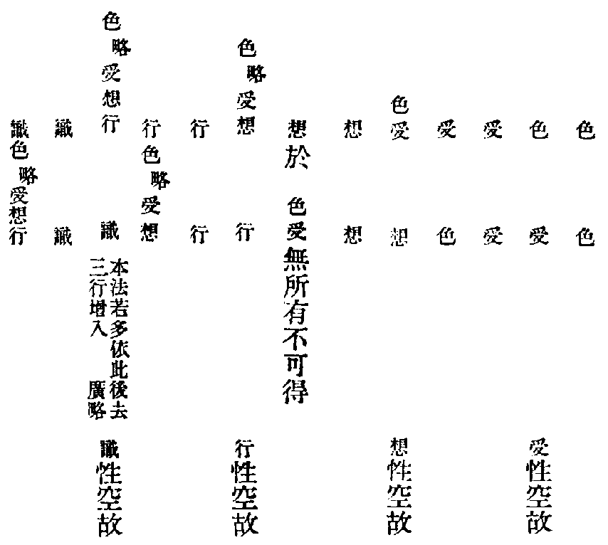
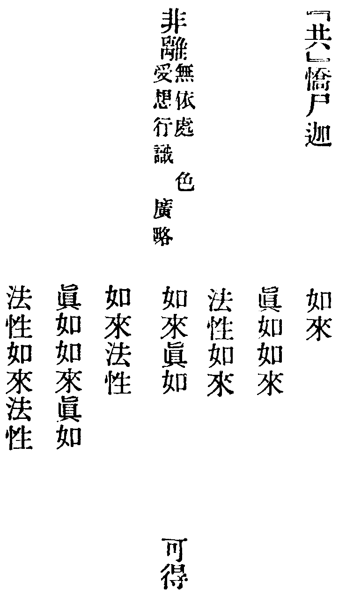
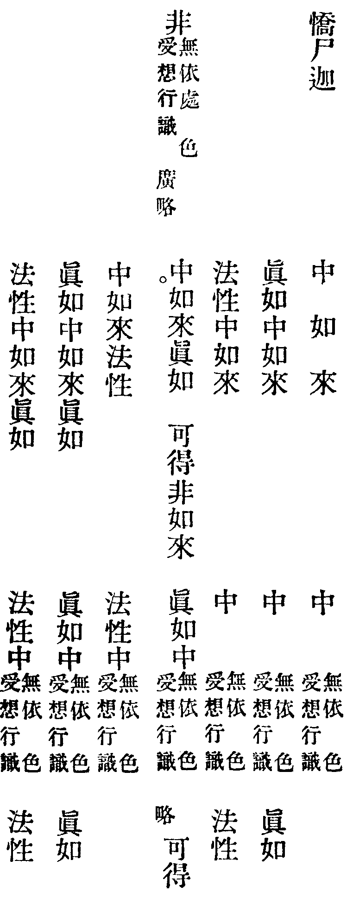
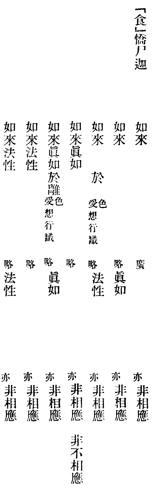

# 大般若经关法



> **藏经**：卍新纂大日本续藏经（新纂卍续藏）　**册次** 第 24 册（X24）　**编号** No. 448-A（X0448）　**部类** 般若部　**卷次** 6 卷　**篇幅** 42,963 字

> **卷／品**：0 卷 · 31 品



---



## 目录



  - [No. 448-B 大般若经通关法序](#no-448-b-大般若经通关法序)

  - [翰林侍讲学士金华宋濂序](#翰林侍讲学士金华宋濂序)

  - [△初分相应品第三之二](#初分相应品第三之二)

  - [△初分教诫教授品第七之一](#初分教诫教授品第七之一)

  - [△初分相应品第三之二](#初分相应品第三之二-1)

  - [初分教诫教授品第七之一](#初分教诫教授品第七之一-1)

  - [△初分赞大乘品第十六之六](#初分赞大乘品第十六之六)

  - [△初分随顺品第十七](#初分随顺品第十七)

  - [△初分无所得品第十八之一](#初分无所得品第十八之一)

  - [△初分观行品第十九之一](#初分观行品第十九之一)

  - [△初分天帝品第二十二之五(入)](#初分天帝品第二十二之五入)

  - [△初分诸天子品第二十三之一](#初分诸天子品第二十三之一)

  - [△初分受教品第二十四之一](#初分受教品第二十四之一)

  - [△初分学般若品第二十六之一](#初分学般若品第二十六之一)

  - [△初分求般若品第二十七](#初分求般若品第二十七)

  - [△初分叹众德品第二十八](#初分叹众德品第二十八)

  - [△初分校量功德品第三十之四](#初分校量功德品第三十之四)

  - [△初分赞般若品第三十二之三](#初分赞般若品第三十二之三)

  - [△初分难信解品第三十四之一](#初分难信解品第三十四之一)

  - [△初分校量功德品第三十之二十八](#初分校量功德品第三十之二十八)

  - [△初分难信解品第三十四之二十四](#初分难信解品第三十四之二十四)

  - [△初分赞清净品第三十五之一](#初分赞清净品第三十五之一)

  - [△初分著不著相品第三十六](#初分著不著相品第三十六)

  - [△初分说般若相品第三十七之二](#初分说般若相品第三十七之二)

  - [△初分难闻功德品第三十九之二](#初分难闻功德品第三十九之二)

  - [△初分佛母品第四十一之三](#初分佛母品第四十一之三)

  - [△初分不思议等品第四十二](#初分不思议等品第四十二)

  - [△初分坚等赞品第五十七之二](#初分坚等赞品第五十七之二)

  - [△初分多问不二品第六十一之二](#初分多问不二品第六十一之二)

  - [No. 448-D 后序](#no-448-d-后序)

  - [No. 448-E 重开大般若经关要序](#no-448-e-重开大般若经关要序)



---



> 般若通关法，连环妙难思。如来甚深智，  

> 统摄受无遗。雪月施巧慧，千载仰芳规。  

> 雪窦四世裔。本觉守一师，昔曾结经社。  

> 流通愿力丕。复有承璋辈，居家勤受持。  

> 韪哉竹林主，随喜诵孳孳。岁岁开胜会。  

> 恩有图齐资。冀度无量众，同证正徧知。



> 旹正德壬辰蒲月日峨山月潭　敬题



------



### No. 448-B 大般若经通关法序



大般若波罗蜜多经凡六百卷，唐三藏法师玄奘所译，卷帙纷纭，浩如烟海，学者未易背之。凤城雪月大师大隐发其巧智，创为通关之法，而四明演忠律师省悟，重为编定，而益加精严。其法畫十二图，用十三法、二十九界、八十四科为之都。凡诸图所列，或齐行，或各行，或单位，或避位，或间位，或加法，或钩锁连环，或广略不过一千言，间总摄初分难信解品一百三卷，无一字或违。噫！亦异矣。先是，浙水东见者甚鲜，逮宋淳熈中，有异僧载经行甬东，暗诵弗休，大姓沃承璋以为疑，抽一二卷试之，其诵如初卷，且出关法以授承璋，承璋乃刻版流通。元至正初，黄岩沙门绝璘琚公获拾仪真，归刊云峰证道院，未几毁於火。雪山成公尝受经于绝璘，思继前志，复重刊而行之，增以佛国白禅师所解名相，系诸关后，使人了知义趣云。惟般若尊经，乃统摄世出世间色心诸法，皆归实相，其功用不可思议。譬如四大海水，茫无边际，摄之入一毛孔，无所增减，而彼大海本相如故。所谓舒之则大包无外，卷之则小入无内者也。雪月以方便智造是通关之法，一弹指顷，能背其经六分之一，其饶益群生甚大。雪山父子又能笃意传布，唯恐或后，皆不负先佛嘱累者矣。虽然，真觉性者中，一辞不立，光明殊胜，洞照无碍。大阿难等结集入藏诸文，一一自光明中发现。读是关者，傥能於此求之，则山河大地，有情无情，咸成文句身，不待较繁简於卷帙之间也。雪山徧参诸方，尝主藏钥于灵隐景德禅寺，其卫道之志，葢皦然云。



------



### 翰林侍讲学士金华宋濂序



No. 448-C



大般若波罗蜜多经关法第一



菩萨戒弟子　诸景　赞



> 稽首诸佛母，清净最上乘，苦海驾舟梁，  

> 暗涂悬日月，坚利金刚杵，摧灭烦恼山。  

> 震吼师子声，碎裂野干胆。释主默持定。  

> 魔兵自陨销，宝掌摩尼珠，五彩应方现。  

> 天宫共食器，百味随心生，句数超僧祇。  

> 智度越边际。聚兹高广义，撮成秘密关。  

> 简束尽三编，开敷逾半部。循环妙严偈。  

> 宛转光明轮，重网影森罗、行树音交错。  

> 破此微尘内，流出大千经。能於一念间，  

> 徧游无量劫，悟修跻觉地，书诵积殊勋。  

> 闻听起初缘。轻谤招来种。仰穷有顶界。  

> 下彻阿鼻中，皆由妄见分，不达真归处。  

> 了四相如幻，知万法本空，同登般若船。  

> 疾到菩提岸。



(夫关念此经者，须细寻题目起尽，及将前赞，用为标关首也。先看指法注字，然后晓本法位，有添削移改，入关上下始末，一一有次。约三百卷，分为六䇿，向下五䇿，须寻上卷赞，赞文字字标目，指法准此。　奘法师八十卷，今当此部第五䇿流行。)



No. 448



天台石梁迟月堂释　永隆　排定



色　受想行识



眼处　耳鼻舌身意处



色处　声香味触法处



眼界　耳鼻舌身意界



色界　声香味触法界



眼识界　耳鼻舌身意识界



眼触　耳鼻舌身意触



眼触为缘所生诸受　耳鼻舌身意触为缘所生诸受



地界　水火风空识界



因缘　等无间缘所缘缘增上缘



缘所生法　(及)(从)



无明　行(乃)识名色六处触受爱取有生(至)老死愁叹苦忧恼



布施波罗蜜多　净戒安忍精进静虑般若波罗蜜多



内空　外空(乃)内外空空空大空胜义空有为空无为空毕竟空无际空散空无变异空本性空自相空共相空一切法空不可得空无性空自性空(至)无性自性空



真如　法界(乃)法性不虗妄性不变异性平等性离生性法定法住实际虗空界(至)不思议界



四念住　四正断(乃)四神足五根五力七等觉支(至)八圣道支



苦圣谛　集灭道圣谛



四静虑　四无量四无色定



八解脱　八胜处九次第定十徧处



空解脱门　无相无愿解脱门



一切陀罗尼门　一切三摩地门



极喜地　离垢地(乃)发光地焰慧地极难胜地现前地远行地不动地善慧地(至)法云地



五眼　六神通



佛十力　四无所畏四无碍解十八佛不共法



大慈　大悲大喜大舍



三十二大士相　八十随好



无忘失法　恒住舍性



一切智　道相智一切相智



预流果　一来不还阿罗汉果



独觉菩提



一切菩萨摩诃萨行　诸佛无上正等菩提



------



### △初分相应品第三之二



『稽』



复次舍利子诸菩萨摩诃萨修行般若波罗蜜多(入关)



不见  

(色)  

(广)  

若相应若不相应



(受想行识)



(色呼：复次，餘上、下界，从不见起、色起，至佛菩提，入我、有情本法。内绿所生法，上添从字、生字，下添诸字，一向广至无明。后入欲界二段，方入布施。至四谛后，入十善四段本法，方入四静虑。大慈界添入四无碍，下方言十八佛。一切相智下，添一切相微妙智，却入一切智智。并永拔二段，方入四果。至菩提后，入我十七法，为上、下界二段，方入正经。)



欲界　色无色界(上二段无明后入)



十善业道　五近事戒八近住戒



施性福业事　戒性修性福业事(上四段四谛后入)



一切智智　永拔一切烦恼习气(上二段一切相微妙智后入)



我　有情命者生者养者士夫补持伽罗意生儒童作者使作者起者使起者受者使受者知者见者(上二段菩提后添便入正经)



舍利子！由是因缘，应知诸菩萨摩诃萨修行般若波罗蜜多，当言与般若波罗蜜多相应。复次，舍利子！诸菩萨摩诃萨修行般若波罗蜜多，不观空与空相应不相应，不观无相与无相相应不相应，不观无愿与无愿相应不相应。何以故？舍利子！空、无相、无愿皆无相应不相应故。舍利子！诸菩萨摩诃萨修行般若波罗蜜多，与如是法相应故，当言与般若波罗蜜多相应。复次，舍利子！诸菩萨摩诃萨修行般若波罗蜜多，入一切法自相空已，不观色若相应若不相应，不观受、想、行、识若相应若不相应。是菩萨摩诃萨不观色与前际若相应若不相应。何以故？不见前际故。不观受、想、行、识与前际若相应若不相应。何以故？不见前际故。不观色与后际若相应若不相应。何以故？不见后际故。不观受、想、行、识与后际若相应若不相应。何以故？不见后际故。不观色与现在若相应若不相应。何以故？不见现在故。不观受、想、行、识与现在若相应若不相应。何以故？不见现在故。复次，舍利子！诸菩萨摩诃萨修行般若波罗蜜多，不观前际与后际若相应若不相应，不观前际与现在若相应若不相应，不观后际与前际若相应若不相应，不观后际与现在若相应若不相应，不观现在与前际若相应若不相应，不观现在与后际若相应若不相应，不观前际与后际现在若相应若不相应。不观后际与前际现在若相应若不相应。不观现在与前际后际若相应若不相应。不观前际后际现在若相应若不相应。何以故？舍利子！三世空故。舍利子！诸菩萨摩诃萨修行般若波罗蜜多，与如是法相应故，当言与般若波罗蜜多相应。



(入首关上界，复次起下界，不观起上下界，一法各尽，呼后舍利子结。)



『首』



复次，舍利子！诸菩萨摩诃萨修行般若波罗蜜多。



不观一切智与  

(过去)  

(广)  

若相应若不相应



(色)



(受、想、行、识)



何以故？尚不见有  

(过去)  

(略)



(色)



(受、想、行、识)



况观一切智与  

(过去)  

(略)  

若相应若不相应



(色)



(受、想、行、识)



(上界复次起下界不观，入三世上下了，结入五蕴至佛菩提界，界上下呼。后舍利子结内增上缘下入，及从缘所生法，除本位共在下界。大慈界流入四无碍下，无明已去，一广、二略。佛十力下界有略，内无真如、四果、独觉、菩萨行、正等菩提、五界至一切智，直入后佛菩提二段了，却入佛智相即、菩提相即二段了，入关。)



过去　未来现在



佛　菩提



复次，舍利子！诸菩萨摩诃萨修行般若波罗蜜多。



不观一切智与  

(佛)  

若相应若不相应。



(菩提)



亦不观  

(佛)  

与一切智若相应若不相应。



(菩提)



何以故？一切智即是  

(佛)，(佛)  

即是一切智故



(菩提)(菩提)



(上文於本法佛菩提了入，单是佛智相即，至一切智故。又入菩提相即，只二回念过结了，却入诸字关本。)



舍利子！诸菩萨摩诃萨修行般若波罗蜜多，与如是法相应故，当言与般若波罗蜜多相应。



『诸』



复次，舍利子！诸菩萨摩诃萨修行般若波罗蜜多。



不著  

(色)  

(广)  

有



(受、想、行、识)



不著  

(色)  

(略)  

非有



(受、想、行、识)



(上界复次起，下界不著起。每一上下界了，至有显，呼首字关。舍利子！结从不著色有，便言不著色非有。次言四阴有非有，便换色常至无常。四阴一同乐苦，直至有愿下去。准此关为十六，合为八法。遇有一法广，十五法略。内缘所生法入增上缘下，独觉添在罗汉下，大慈界入无碍解下。有广略至菩提，呼前结入正经一段。)



常无常  

乐苦  

我无我  

寂静不寂静  

空不空  

无相有相  

无愿有愿(入正经)



舍利子！修行般若波罗蜜多菩萨摩诃萨，不作是念：我行般若波罗蜜多。不作是念：我不行般若波罗蜜多。不作是念：我亦行亦不行般若波罗蜜多。不作是念：我非行非不行般若波罗蜜多。舍利子！修行般若波罗蜜多菩萨摩诃萨，与如是法相应故，当言与般若波罗蜜多相应。



○大般若波罗蜜多经卷第十一。



------



### △初分教诫教授品第七之一



尔时，佛告具寿善现：汝以辩才当为菩萨摩诃萨众宣说般若波罗蜜多相应之法，教诫教授诸菩萨摩诃萨，令於般若波罗蜜多修学究竟。时，诸菩萨摩诃萨众及大声闻、天、龙、药叉、人非人等咸作是念：今尊者善现为以自慧辩才之力，当为菩萨摩诃萨众宣说般若波罗蜜多相应之法，教诫教授诸菩萨摩诃萨，令於般若波罗蜜多修学究竟，为当承佛威神力邪？具寿善现知诸菩萨摩诃萨众及大声闻、天、龙、药叉、人非人等心之所念，便告具寿舍利子言：诸佛弟子所说法教，当知皆承佛威神力。何以故？舍利子！诸佛为他宣说法要，彼承佛教精进修学，便能证得诸法实性，由是为他有所宣说，皆与法性能不相违，故佛所言如灯传照。舍利子！我当承佛威神加备，为诸菩萨摩诃萨众宣说般若波罗蜜多相应之法，教诫教授诸菩萨摩诃萨，令於般若波罗蜜多修学究竟，非以自慧辩才之力。所以者何？甚深般若波罗蜜多相应之法，非诸声闻、独觉境界。尔时，具寿善现白佛言：世尊！如佛所𠡠：汝以辩才当为菩萨摩诃萨众宣说般若波罗蜜多相应之法，教诫教授诸菩萨摩诃萨，令於般若波罗蜜多修学究竟。世尊！此中何法名为菩萨摩诃萨？复有何法名为般若波罗蜜多？世尊！我不见有法可名菩萨摩诃萨，亦不见有法可名般若波罗蜜多，如是二名亦不见有，云何令我为诸菩萨摩诃萨众宣说般若波罗蜜多相应之法，教诫教授诸菩萨摩诃萨，令於般若波罗蜜多修学究竟？佛言：善现！菩萨摩诃萨但有名谓为菩萨摩诃萨，般若波罗蜜多亦但有名谓为般若波罗蜜多，如是二名亦但有名。善现！此之二名不生不灭，唯有想等想施设言说，如是假名不在内不在外不在两间，不可得故。



『佛』



(善现当知！)  

譬如  

(我)  

(广)  

但是假  

(名)



(复次，善现)  

(色)  

(法)



○如是  

(名)  

假不生不灭，唯有想等想施设言说，谓  

(之)  

为  

(我)



(法)  

(色)



如是  

(有情。命者。生者。养者。士夫。补特伽罗。意生。儒童。作者。使作者。起者。使起者。受者。使受者。知者。见者改)  

亦但是假  

(名)



(法)



○如是  

(名)  

假。不生不灭。唯有想等想施设言说。谓为  

(有情乃至见者)  

(略)



(法)



如是一切但有假名，此诸假名不在内、不在外、不在两间，不可得故。



如是，善现！若菩萨摩诃萨、若般若波罗蜜多、若此二名皆是假法。



如是  

(假法)  

不生不灭，唯有想等想，施设言说谓为菩萨摩诃萨、谓为般若波罗蜜多。



(法假)



及此二名，如是三种但有假名，此诸假名不在内、不在外、不在两间，不可得故



(上初卷，正经呼之字，餘不呼。关眼触为缘终，便入内身至幻事，色至幻事，并从佛字复次起。我从善现当知起，从内身至幻事，一广一略，却呼但是假名。至初圆相，直跳入第二圆相，如是名假。去幻事终，叠起结经。)



内身所有头、颈、(乃)肩、膊、手、臂、腹、背、胷、脇、腰、脊、髀、膝、腨、胫、(至)足等，外事所有草、木、根、茎、枝、叶、华、果等物，过去、未来、现在一切如来、应、正等觉。



幻事(乃)梦境、响、象、阳焰、光影。若寻香城(至)变化事等。



(内假法，法假四字，前我至眼触为缘九段，初五顺互起，后四逆互起，从内身至幻事，并是呼顺假法。)



如是，善现！诸菩萨摩诃萨。修行般若波罗蜜多时。於一切法名假法假乃教授假。应正修学。



(上至幻事了结经入母关)。



『母』



复次善现。诸菩萨摩诃萨。修行般若波罗蜜多时。



不应观  

(色)  

(广)(略)  

若  

(常)  

若  

(无常)



(受、想、行、识)



(色至菩萨行常一法，复次起乐苦十九法，不观入至眼触为缘，应云眼触为缘所生乐受、苦受、不苦不乐受，下界同。除本法内诸受二字，至缘所生法，但云不应现从缘生法陀罗尼。上下界无一切字，移独觉在罗汉下，只有常无常是广，乐苦至不可得是略，上下界齐行。)



常无常  

乐苦  

我无我  

净不净  

空不空  

有相无相  

有愿无愿  

寂静不寂静  

远离不远离  

有为无为  

有漏无漏  

生灭(内空真如改生灭为隐显)  

善非善  

有罪无罪  

有烦恼无烦恼  

世间出世间  

杂染清净  

属生死属涅槃  

在内在外在两间  

可得不可得



(上一段双关束作二十段，至下第一十七卷入驾字关。单关分为四十一，法常无常至不可得。单关七卷佛菩提在下界，双关十三卷菩提归上界。)



『清』



复次，善现！诸菩萨摩诃萨修行般若波罗蜜多时，若菩萨摩诃萨、若般若波罗蜜多、若此二名，俱不见在有为界中，亦不见在无为界中。何以故？善现！诸菩萨摩诃萨修行般若波罗蜜多时，於一切法不起分别、无异分别。善现！是菩萨摩诃萨修行般若波罗蜜多时，於一切法住无分别。



能修  

(布施波罗蜜多)  

亦能修  

(净戒、安忍、精进、静虑、般若波罗蜜多)



善现！是菩萨摩诃萨於如是时，不见菩萨摩诃萨，不见菩萨摩诃萨名，不见般若波罗蜜多，不见般若波罗蜜多名，唯正勤求一切智智。何以故？善现！是菩萨摩诃萨修行般若波罗蜜多，於一切法善达实相，了知其中无染净故。



(陀罗尼上下界有一切字)。(从能修起布施，至一切智终，方叠起。善现结经，上下齐行，只有内空真如苦圣谛，改能字下修字作住字，大慈界归四无碍下无大士界)。



『净』



复次，善现！诸菩萨摩诃萨修行般若波罗蜜多时，应如实觉名假施设、法假施设。善现！是菩萨摩诃萨於名、法假如实觉已。



不著  

(色)  

(广)  

(入)



(受、想、行、识)



有为界　无为界有漏界无漏界



我　有情命者生者养者士夫补特伽罗意生儒童作者受者知者见者



异生　圣者菩萨如来名相



严净佛土　成熟有情方便善巧



所以者何？以一切法皆无所有，能著、所著、著处、著时不可得故。



(眼处至诸佛，关我至善巧，终方叠起。所以结经从不著起关眼触界，应云：眼触为缘所生诸受，若乐、若苦、若不苦不乐。下界同上。缘所生法归增上缘下，应云：及从缘所生法，无明后入四界。般若下添方便、善巧、妙愿、力、智波罗蜜多陀罗尼上。下界除一切字，独觉归罗汉下。)



『最』



如是，善现！诸菩萨摩诃萨修行般若波罗蜜多，於一切法无所著故，便能增益布施、净戒、安忍、精进、静虑、般若、方便善巧、妙愿、力、智波罗蜜多。



亦能增益  

(内空、外空等)  

(广)



亦得菩萨最胜神通；具神通已，从一佛国至一佛国，为欲成熟诸有情故，为欲严净自佛土故，为见如来、应、正等觉；及为见已，供养恭敬、尊重赞叹，令诸善根皆得生长；善生长已，随所乐闻诸佛正法皆得听受；既得听受已，乃至安坐妙菩提座，证得无上正等菩提能不妄失，普於一切陀罗尼门、三摩地门皆得自在。如是，善现！诸菩萨摩诃萨修行般若波罗蜜多，应如实觉名假、法假。



(从亦能入关内空起，至一切智终，上下界连念内空真如，改增益为安住苦圣谛，但云亦住苦集灭道圣谛。解脱门位，但云空无相无愿解脱门。便於解脱界后，入关亦能趣入二句经文。然后入陀罗尼，祗三摩地上无一切。从陀罗尼至一切智，并改增益为圆满，方叠起亦得一段结经。)



亦能趣入菩萨正性离生，亦能安住菩萨不退转地。



『上』



复次，善现！所言菩萨摩诃萨者，於意云何(入)



即  

(色)  

(广)  

是菩萨摩诃萨不？不也，世尊



(受、想、行、识)



异  

(色)  

(略)  

是菩萨摩诃萨不？不也，世尊



(受、想、行、识)



(色)  

(略)  

中有菩萨摩诃萨不？不也，世尊



(受、想、行、识)



菩萨摩诃萨中有  

(色)  

(略)  

不？不也，世尊



(受、想、行、识)



离  

(色)  

(略)  

有菩萨摩诃萨不？不也，世尊



(受、想、行、识)



(上界复次起，并本法齐行，逐行上下界了，呼异色去，即离五行关。法尽仍起眼处，至一切智无明，除愁叹苦忧恼。五字下去，上至梁字，例同陀罗尼。上下除一切，亦至梁字，例同。)



『乘』



尔时  

(佛告具寿)  

善现！汝观何义言  

(入)



(复次)



即  

(色)



非菩萨摩诃萨



(受、想、行、识)  

(广)



异  

(色)



非菩萨摩诃萨



(受、想、行、识)  

(略)



非  

(色)



中有菩萨摩诃萨



(受、想、行、识)  

(略)



非菩萨摩诃萨中有  

(色)



(受、想、行、识)  

(略)



非离  

(色)



有菩萨摩诃萨



(受、想、行、识)  

(略)  

(耶)



(具寿善现白言：)  

世尊！若菩提，若萨埵，若  

(色)  

若  

(受、想、)



(略)



(行、识)  

尚毕竟不可得。性非有故，况有菩萨摩诃



萨！此既非有，如何可言



即  

(色)



是菩萨摩诃萨



(受、想、行、识)  

(略)



异  

(色)



是菩萨摩诃萨



(受、想、行、识)  

(略)



(色)



中有菩萨摩诃萨



(受、想、行、识)  

(略)



菩萨摩诃萨中有  

(色)



(受、想、行、识)  

(略)



离  

(色)



有菩萨摩诃萨



(受、想、行、识)  

(略)



(眼处至一切智终，并从小书复次起色。从尔时具寿起离终，蕴下有耶字，上界无，向下界例同。承上除小书，具寿直取世尊后，方叠起世尊一段结经。此关法在第十七卷中，即至离各二徧，即色了便入四蕴，行行例同。内世尊至可言二行，本法内当中秪一徧，向下海字关例同。)



世尊，菩提萨埵及色等法既不可得，而言即色等法是菩萨摩诃萨，或异色等法是菩萨摩诃萨，或色等法中有菩萨摩诃萨，或菩萨摩诃萨中有色等法，或离色等法有菩萨摩诃萨者，无有是处。佛告善现：善哉！善哉！如是，如是，如汝所说。善现，色等法不可得故，菩萨摩诃萨亦不可得，菩萨摩诃萨不可得故，所行般若波罗蜜多亦不可得。善现，诸菩萨摩诃萨修行般若波罗蜜多时应如是学。



『苦』



复次，善现！所言菩萨摩诃萨者，於意云何(入)



即  

(色)  

(广)  

真如是菩萨摩诃萨不？不也，世尊



(受、想、行、识)



异  

(色)  

(略)  

真如是菩萨摩诃萨不？不也，世尊



(受、想、行、识)



(色)  

(略)  

真如中有菩萨摩诃萨不？不也，世尊



(受、想、行、识)



菩萨摩诃萨中有  

(色)  

(略)  

真如不？不也，世尊



(受、想、行、识)



离  

(色)  

(略)  

真如有菩萨摩诃萨不？不也，世尊



(受、想、行、识)



(色至一切智，并复次起内，不关真如一界、陀罗尼门、上下界，除一切海字，关例同。)



『海』



(尔时，佛告具寿)  

善现！汝观何义言  

(入)



(复次)



即  

(色)  

(广)  

真如。非菩萨摩诃萨



(受想行识)



异  

(色)  

(略)  

真如。非菩萨摩诃萨



(受、想、行、识)



非  

(色)  

(略)  

真如中。有菩萨摩诃萨



(受想行识)



非菩萨摩诃萨中。有  

(色)  

(略)  

真如



(受想行识)



非离  

(色)  

(略)  

真如。有菩萨摩诃萨  

(耶)



(受想行识)



具寿善现。白言世尊。若色。若  

(受想行识)  

(略)  

尚毕竟不可得，性非有故。



况有色真如及  

(受、想、行、识)  

(略)  

真如？此真如既非有，如何可言



即  

(色)  

(略)  

真如。是菩萨摩诃萨



(受想行识)



异  

(色)  

(略)  

真如。是菩萨摩诃萨



(受想行识)



(色)  

(略)  

真如中。有菩萨摩诃萨



(受想行识)



菩萨摩诃萨中。有  

(色)  

(略)  

真如



(受想行识)



离  

(色)  

(略)  

真如。有菩萨摩诃萨



(受想行识)



(眼处至一切智终。并从小书复次起。中有耶字。上界无。下界有。具寿至可言。当中二行。只一徧念。同乘字。内有结经。在第十七卷中起世尊结)。



世尊。色等法及真如既不可得。而言即色等法真如是菩萨摩诃萨。或异色等法真如是菩萨摩诃萨。或色等法真如中有菩萨摩诃萨。或菩萨摩诃萨中有色等法真如，或离色等法真如有菩萨摩诃萨者，无有是处。佛告善现：善哉！善哉！如是，如是，如汝所说。善现，色等法不可得故，色等法真如亦不可得，法及真如不可得故，菩萨摩诃萨亦不可得，菩萨摩诃萨不可得故，所行般若波罗蜜多亦不可得。善现，诸菩萨摩诃萨修行般若波罗蜜多时应如是学。



(第一十七卷中入驾字关，至二十三卷本法二十段，在前母字关内，分为四十一法。)



『驾』



复次，善现！所言菩萨摩诃萨者，於意云何(入)



即  

(色)  

(广)  

增语是菩萨摩诃萨不？不也，世尊



(受、想、行、识)



即  

(色)  

常  

(略)  

增语是菩萨摩诃萨不？不也，世尊



(受、想、行、识)



(眼处至一切菩萨终，散在诸卷为头，并从复次起，同不可得终。此关次即字，连上一法常无常，至不可得四十一法尽方起。复次入眼处一法，诸头例同。上下界双行，细寻题目，一一标题品内之数。从第一十七卷至二十三，并同用此关。)



『舟』



(尔时，佛告具寿)  

善现！汝观何义言  

(连下关)  

(入)



(复次)



即  

(色)  

(广)  

增语非菩萨摩诃萨  

(耶)



(受、想、行、识)



具寿善现答言：世尊！若  

(色)  

若  

(受、想、行、识)  

(略)  

尚毕竟不可得。



性非有故，况有  

(色)  

增语及  

(受、想、行、识)  

(略)  

增语？



此增语既非有，如何可言：即  

(色)  

(略)  

增语是菩萨摩诃萨



(受、想、行、识)



(此舟字关色，尔时起上下齐行，眼处至菩提并从舟字。复次起逐上下一界连梁字关，从善现起二十法至不可得二十段，一一从善现去换苦乐方入舟字，眼处去依母字关，合为二十法。内佛菩提归上界，内无下界。时有二关，耶字各除世尊，下若字各及增语三字下去，独觉例然。)



『梁』



善现！汝复观何义言(连上关)(入)



即  

(色)  

(略)  

若  

(常)  

若  

(无常)  

增语非菩萨摩诃萨  

(耶)



(受、想、行、识)



世尊！若  

(色)  

(略)  

(常无常)  

尚毕竟不可得。



(受、想、行、识)



性非有故，况有  

(色)  

(常无常)  

增语及  

(受、想、行、识)  

(略)  

(常无常)  

增语！



此增语既非有，如何可言：即  

(色)  

(略)  

若  

(常)  

若  

(无常)  

增语是菩萨摩诃萨



(受、想、行、识)



(眼处至诸佛，并从小书复次起，一一各入梁字关，各至不可得二十段本法，一一从梁字善现去换苦乐，至不可得换眼处，起舟字。)



------



### △初分相应品第三之二



〔天〕第五(之二)　『稽』(色起我终)正经『首』(过去起菩提终)『诸』(色起至识界眼终)



第六(之三)　『诸』(眼触起菩提终)正经



------



### 初分教诫教授品第七之一



〔地〕第十一(之一)　『佛』(我起至幻事终)前有正经『母』(色起至地界终)



第十二(之二)　『母』(因缘起五眼终)



第十三(之三)　『母』(佛十力起菩萨行终)『清』(布施起一切智终)『净』(色起至诸佛入方便善巧)『最』(内空起一切智终)『上』(色起缘生法终)



第十四(之四)　『上』(无明起一切智终)『乘』(色起至四念住终)



第十五(之五)　『乘』(苦圣谛起一切智终)正经『苦』(色起至五眼终)内不关真如海字关同



第十六(之六)　『苦』(佛十力起一切智终)『海』(色起至陀罗尼终)



第十七(之七)　『海』(极喜地起一切智终)正经『驾』(色)眼处色处(同复次起总不可得终)



第十八(之八)　眼界色界眼识眼触眼触为缘(已下六卷总复次起同不可得终)



第十九(之九)　地界因缘缘所生无明布施



第二十(之十)　内空真如四念住苦圣四静虑



〔玄〕第二十一(之十一)　八解空解陀罗尼极喜五眼



第二十二(之十二)　佛力大慈大士相无妄一切智



第二十三(之十三)　预流独觉一切菩萨(复次起至不可得终)色(入舟字连梁字至不可得终)(已下佛菩提归下界)



第二十四(之十四)　眼处色处(总复次起同不可得终)后诸卷例同眼界(复次起远离终)



第二十五(之十五)　眼界(有为起不可得终)色界眼识界(复次起不可得终)



第二十六(之十六)　眼触眼触为缘(复次起不可得终)地界(复次起无我终)



第二十七(之十七)　地界(净起至不可得终)因缘缘所生(复次起不可得终)



第二十八(之十八)　无明布施(复次起不可得终)内空(复次起有相终)



第二十九(之十九)　内空(有双起不可得终)真如(复次起不可得终)四念(复次起世间终)



第三十(之二十)　四念(杂染起不可得终)苦圣四静(复次起不可得终)八解(复次起无我终)



〔黄〕第三十一(之二十一)　八解(净起至不可得终)空解(复次起至不可得终)陀罗尼(复次起有罪终)



第三十二(之二十二)　陀罗尼(有烦恼起不可得终)极喜五眼(复次起不可得终)佛力(复次起有相终)



第三十三(之二十三)　佛力(有愿起不可得终)大慈(复次起不可得终)大士相(复次起有罪终)



第三十四(之二十四)　大士(有烦恼起不可得终)无忘一切智(复次起不可得终)预流(复次起无我终)



第三十五(之二十五)　预流(净起至不可得终)独觉一切菩萨(复次起至不可得终)诸佛(复次起远离终)



第三十六(之二十六)　诸佛(有为起不可得终)内有三纸结经教诫品终



天台石梁迟月堂释　永隆　排定



色　受想行识



眼处　耳鼻舌身意处



色处　声香味触法处



眼界　色界(乃)眼识界及眼触(至)眼触为缘所生诸受



耳界　声界(乃)耳识界及耳触(至)耳触为缘所生诸受



鼻界　香界(乃)鼻识界及鼻触(至)鼻触为缘所生诸受



舌界　味界(乃)舌识界及舌触(至)舌触为缘所生诸受



身界　触界(乃)身识界及身触(至)身触为缘所生诸受



意界　法界(乃)意识界及意触(至)意触为缘所生诸受



地界　水火风空识界



苦圣谛　集灭道圣谛



无明　行(乃)识名色六处触受爱取有生(至)老死愁叹苦忧恼



内空　外空(乃)内外空空空大空胜义空有为空无为空毕竟空无际空散空无变异空本性空自相空共相空一切法空不可得空无性空自性空(至)无性自性空



布施波罗蜜多　净戒安忍精进静虑般若波罗蜜多



四静虑　四无量四无色定



八解脱　八胜处九次第定十徧处



四念住　四正断(乃)四神足五根五力七等觉支(至)八圣道支



空解脱门　无相无愿解脱门



五眼　六神通



佛十力　四无所畏(乃)四无碍解大慈大悲大喜大舍(至)十八佛不共法



一切智　道相智一切相智



无忘失法　恒住舍性



一切陀罗尼门　一切三摩地门



真如　法界法性不虗妄性不变易性不思议界虗空界断界离界灭界平等性离生性法定法住无性界无相界无作界无为界安隐界寂静界本无实际究竟涅槃



预流向(乃)预流果　一来向一来果不还向不还果阿罗汉向阿罗汉果独觉向独觉果菩萨摩诃萨三藐三佛陀



极喜地　离垢地(乃)发光地焰慧地极难胜地现前地远行地不动地善慧地(至)法云地(添法)



异生地　种性地(乃)第八地具见地薄地离欲地已办地独觉地菩萨地(至)如来地(添法)



声闻乘　独觉乘大乘



------



### △初分赞大乘品第十六之六



异生、　声闻、独觉、菩萨、如来。



善现！前际(异生)不可得，后际(异生)不可得，中际(异生)不可得，三世平等中(异生)亦不可得。所以者何？善现！平等中过去未来现在(异生)皆不可得。何以故？平等中平等性尚不可得，何况平等中有过去未来现在(异生)可得！以我、有情乃至知者、见者不可得故。



(上段再从善现起，换下声闻，只二回了，入后正经改品了，入正经一纸)。



善现，诸菩萨摩诃萨修行般若波罗蜜多时，住此三世平等相中，精勤修学一切智智，无取著故速得圆满。善现，是名菩萨摩诃萨三世平等大乘相。若菩萨摩诃萨安住如是大乘相中，超胜一切世间天、人、阿素洛等，速能证得一切智智利乐有情。尔时，具寿善现白佛言：世尊，善哉！善哉！如来、应、正等觉善说正说菩萨摩诃萨大乘。世尊，如是大乘最尊最妙，过去诸菩萨摩诃萨於此中学，已得一切智智；未来诸菩萨摩诃萨於此中学，当得一切智智；现在十方无量、无数、无边世界一切菩萨摩诃萨於此中学，今得一切智智。是故大乘最尊最妙，一切智智真胜所依。佛告善现：如是，如是，如汝所说，过去、未来、现在诸菩萨摩诃萨，皆依大乘精勤修学，速证无上正等菩提，是故大乘最尊最妙。



------



### △初分随顺品第十七



尔时，满慈子白佛言：世尊！如来先令尊者善现为诸菩萨摩诃萨宣说般若波罗蜜多，而今何故乃说大乘？具寿善现即白佛言：世尊！我向所说大乘，将无违越般若波罗蜜多耶？佛告善现：汝向所说大乘，於般若波罗蜜多悉皆随顺无所违越。何以故？善现！一切善法、菩提分法、若声闻法、若独觉法、若菩萨法、若诸佛法，如是一切无不摄入般若波罗蜜多。时，具寿善现复白佛言：世尊！何等一切善法、菩提分法、若声闻法、若独觉法、若菩萨法、若诸佛法，皆悉摄入般若波罗蜜多耶？佛言：善现！



『暗』



若(布施波罗蜜多、净戒波罗蜜多)



(上下界连念，内除八解脱，全叠空解脱门，无忘失法，后入结经。)



善现！诸如是等一切善法、菩提分法、若声闻法、若独觉法、若菩萨法、若诸佛法，如是一切皆悉摄入般若波罗蜜多(入)



『涂』



复次，善现！若  

(大乘)  

若  

(般若波罗蜜多)  

(广)



(静虑)



(色)



(受、想、行、识)



欲界  

色、无色界  

善法非善法  

有记无记法  

有漏无漏法  

有为无为法  

世间出世间法  

诸如来  

佛所觉所说法律



(从大乘般若至真如终，上下界并若字起内六识，下界无若字。六度逆行布施添波罗，便入五蕴无明，后入欲界。止世间七法了，入四静虑至一切陀罗尼，入诸如来二法，入内空真如，后入结经。一切智在不共法下。)



如是等一切法，皆非相应非不相应、非有色非无色、非有见非无见、非有对非无对，咸同一相，所谓无相。善现，由此因缘，汝向所说大乘於般若波罗蜜多悉皆随顺无所违越。所以者何？



『悬』



善现！大乘不异般若波罗(广)，般若(略)不异大乘。何以故？若大乘，若般若(略)，其性无二、无二分故。



(从般若起六度逆行，添二波罗，下界亦呼善现，至无忘失法终，内三智入在不共法下，下去例同失法，后入蕴界处等空不空法，有结经一段改品，从此直至杵字关，内空真如在三摩地，后入声闻乘。)



蕴界处等空不空法(入结经)



善现！由此因缘，汝向所说大乘於般若波罗蜜多悉皆随顺无所违越，若说大乘则为已说般若波罗蜜多，若说般若波罗蜜多则为已说大乘，如是二法无别异故。



------



### △初分无所得品第十八之一



尔时，具寿善现白佛言：世尊！(前际、后际、中际)菩萨摩诃萨不可得(入)。



世尊！(色)无边故，当知菩萨摩诃萨亦无边。



『日』



(色起大乘终，上界呼世尊，下界不呼。一切智入不共法下，真如后入声闻乘、独觉乘、大乘三法，内独觉乘、大乘不呼世尊。月字例同。)



『月』



世尊  

(即)  

(色)  

(广)  

菩萨摩诃萨无所有不可得



(离)  

(略)



声闻乘。独觉乘。大乘(日坚关同)。声闻补特伽罗。独觉。大乘补特伽罗。



(色起止，大乘补特伽罗终，上界呼世尊。无明方略即广，离略三智入不共法，下离四无所畏乃至一切相智，后别添道相智。一界真如略时，云离法界、法性乃至实际、究竟涅槃。独觉、大乘补特伽罗亦不呼世尊。)



世尊！我於一切法，以一切种、一切处、一切时求菩萨摩诃萨都无所见竟不可得，云何令我以般若波罗蜜多教诫教授诸菩萨摩诃萨？世尊！菩萨摩诃萨但有假名，如说我等毕竟不生，诸法亦尔，都无自性。世尊！色等诸法毕竟不生，若毕竟不生则不名色等。世尊！我岂能以毕竟不生般若波罗蜜多教诫教授毕竟不生诸菩萨摩诃萨？世尊！离毕竟不生亦无菩萨摩诃萨能行无上正等菩提。世尊！若菩萨摩诃萨闻作是说，其心不惊、不恐、不怖、不沉、不没亦不忧悔，当知是菩萨摩诃萨能行般若波罗蜜多。时，舍利子问善现言：何缘故说前际菩萨摩诃萨不可得，后际菩萨摩诃萨不可得，中际菩萨摩诃萨不可得？何缘故说色等无边故，菩萨摩诃萨亦无边？何缘故说即色等菩萨摩诃萨无所有不可得，离色等菩萨摩诃萨无所有不可得？何缘故说我於一切法，以一切种、一切处、一切时求菩萨摩诃萨都无所见竟不可得，云何令我以般若波罗蜜多教诫教授诸菩萨摩诃萨？何缘故说菩萨摩诃萨但有假名？何缘故说如说我等毕竟不生？何缘故说诸法亦尔都无自性？何缘故说色等诸法毕竟不生？何缘故说若毕竟不生则不名色等？何缘故说我岂能以毕竟不生般若波罗蜜多教诫教授诸菩萨摩诃萨？何缘故说离毕竟不生亦无菩萨摩诃萨能行无上正等菩提？何缘故说若菩萨摩诃萨闻作是说，其心不惊、不恐、不怖、不沈、不没亦不忧悔，当知是菩萨摩诃萨能行般若波罗蜜多？尔时，具寿善现答舍利子言：如尊者所云何缘故说前际菩萨摩诃萨不可得，后际菩萨摩诃萨不可得，中际菩萨摩诃萨不可得？者，(入)



『坚』



舍利子  

(有情)  

(广)  

(无所有)  

故，前、后、中际菩萨摩诃萨不可得  

(关)



(色)



(受、想、行、识)



无所有  

空  

远离  

无自性



(无所有呼舍利子，空、远离、无自性不呼舍利子。)



何以故？舍利子  

(有情)  

(广)  

无所有、空、远离、无自性中，前、后、中际菩萨摩诃萨皆不可得故。



(色、受、想、行、识)



舍利子！非  

(有情)  

(略)  

(无所有)  

(有异)  

(上下连合，下同)



(色、受、想、行、识)



非  

(前际)  

菩萨摩诃萨有异



(后际)



(中际)



舍利子！若  

(有情)  

(略)  

无所有



(色、受、想、行、识)



若  

(前际)  

菩萨摩诃萨，如是一切法，无二无二分。



(后际)



(中际)



舍利子！由此缘故我作是说  

(前际)  

菩萨摩诃萨不可得



(后际)



(中际)



(此关有情起，大乘终。前四法开，分上下界广。后九法合，连上下界合时，一广入略。上眼色二处各除处字，地除界字，苦下除圣谛，布施除波罗三解脱，空下除解脱门三智入。不共法下，内空真如在陀罗尼后。内空真如一法广，十二法略。真如下除究竟涅槃四字。略时云法界法性乃至本无实际合，略时云真如法界乃至本无实际入。声闻等三乘各为一界入结经。)



尔时，具寿善现复答舍利子言：如尊者所云何缘故说色等无边故，当知菩萨摩诃萨亦无边者(入)



『利』



舍利子  

(色)  

(广)  

如虗空。



(受、想、行、识)



所以者何？舍利子！如虗空  

(前)  

际不可得，以彼中边不可得故说为虗空



(后)



(中)



(色、受、想、行、识)  

(合略)  

亦如是  

(前)  

际不可得。



(后)



(中)



何以故  

(色)  

(略)  

性空故。



(受、想、行、识)



空中  

(前)  

际不可得，亦以中、边俱不可得，故说为空。



(后)



(中)



舍利子，由此缘故我作是说：



(色)  

(略)  

无边故，当知菩萨摩诃萨亦无边。



(受、想、行、识)



(上界呼舍利子起，至声闻乘终。本法内依坚字三开一合，广略亦然。合略时，眼处色处除处字，地界除界字，苦除圣谛，空除解脱门。内三智入不共法下，真如不除。四字合时，云真如乃至究竟涅槃。下界单略时，云法界乃至究竟涅槃。至声闻乘为上界，独觉大乘为下界。上下界合略时，全叠界终入后关。金字同。)



『金』



尔时，具寿善现复答舍利子言：



如尊者所云何缘故说  

(即)  

(色)  

等菩萨摩诃萨无所有不可得



(入)



(离)  

(者)



舍利子  

(色)  

(广)  

(色)  

(略)  

性空。何以故  

(色)  

(略)  

性空中  

(色)  

(略)  

无所有不可得故。



菩萨摩诃萨。亦无所有不可得非  

(色)  

(广)  

非  

(色)  

(略)  

性空。



何以故。非  

(色)  

(略)  

性空中  

(色)  

(略)  

无所有不可得故。菩萨摩诃萨亦无所有不可得。



(至此下界，不呼舍利子，入后仍结。)



舍利子！由此缘故我作是说  

(即)  

(色)  

(广)  

菩萨摩诃萨无所有不可得



(离)  

(广)



(此关上下界各行。至舍利子结时，先上界即离了，次下界内一切智、一切相智入不共法，下道相智自作一界。内结文离字，内佛十力即广离略，内空真如一广九略。真如略时，云法界、法性乃至实际、究竟涅槃。声闻乘准上。关外有声闻补特伽罗为上界，独觉、大乘补特伽罗为下界终。)



尔时，具寿善现复答舍利子言：如尊者所云何缘故说我於一切法，以一切种、一切处、一切时求菩萨摩诃萨都无所见竟不可得，云何令我以般若波罗蜜多教诫教授诸菩萨摩诃萨者？(入)



『刚』



舍利子！(色)性空故(罗文钩鏁关)。







舍利子！我於如是诸法，以一切种、一切处、一切时求菩萨摩诃萨，亦无所有不可得。何以故？自性空故。



(此关换本法时，从前舍利子起，上下界尽了，呼后舍利子结本法，一一拆开。本法若多，依后三位增入眼耳处。上下界疉时，除上处字，餘准此。只内空真如及四果有略，餘一向广。六度添四波罗三智，在无忘法前，陀罗尼后，入内空真如。内真如界，本无实际，开为二法。极喜等十地，地添法一徧了，除法字，再入一偏。异生十地，添法除法，准上四果。独觉、向果、菩萨、三佛陀，同为预流向一界，亦有添法字，除法字各一徧。内二十地疉时，除地字，入后般若教诫等法结经。)



菩萨摩诃萨  

般若波罗蜜多  

教诫教授(结经)



舍利子。由此缘故。我作是说。我於一切法。以一切种一切处一切时。求菩萨摩诃萨。都无所见。竟不可得。云何令我以般若波罗蜜多。教诫教授诸菩萨摩诃萨。



尔时，具寿善现复答舍利子言：如尊者所云何缘故说菩萨摩诃萨但有假名？者，舍利子！菩萨摩诃萨名唯客所摄故。时，舍利子问善现言：何缘故说菩萨摩诃萨名唯客所摄(入)



『杵』



(善现答言：)  

如  

(一切法)  

(广)  

名唯客所摄。



(舍利子)  

(色)



於十方三世无所从来，无所至去，亦无所住。



(一切法)  

(略)  

中无名名中无  

(一切法)  

(略)，非合非离，但假施设。



(色)  

(色)



何以故？以  

(一切法)  

(略)  

与名俱自性空故。



(色)



自性空中，若  

(一切法)  

(略)  

若名，俱无所有不可得故。



(色)



(逐下界了，入后结经，节节如是)。



菩萨摩诃萨名亦复如是唯客所摄，於十方三世无所从来、无所至去亦无所住，菩萨摩诃萨中无名，名中无菩萨摩诃萨，非合非离但假施设。何以故？以菩萨摩诃萨与名俱自性空故，自性空中若菩萨摩诃萨、若名俱无所有不可得故。舍利子！由此缘故我作是说：菩萨摩诃萨但有假名。



(此关上界小字，舍利子起，至声闻乘终。内声闻乘为上界，独觉乘、大乘为下界。无六度、一位、六通，除神字，只无明、内空、真如二种。十地有略，餘一向广。一切智在失法前，真如略时，法界乃至究竟涅槃。无预流向一界，摧灭字同。)



『摧』



尔时，具寿善现复答舍利子言：如尊者所云何缘故说如说我等毕竟不生者？(入)



(从此去，内空依本位，下准此。)



舍利子  

(我)  

毕竟都无所有，既不可得，云何有生？



(有情至见者)



(色)



(受、想、行、识)



(下界不呼舍利子，无四谛及真如界，下关同。一切智在失法前，三摩地后，入二种十地，至独觉大乘终，分上下了入。结经下灭字关同。)



舍利子！由此缘故我作是说：如说我等毕竟不生。尔时，具寿善现复答舍利子言：如尊者所云何缘故说诸法亦尔都无自性？者，舍利子！诸法都无和合自性。何以故？和合有法自性空故。时，舍利子问善现言：何法都无和合自性？善现答言：(入)



『灭』



舍利子！(色)都无和合自性。



(上界舍利子起，下界不呼色至声闻乘，终入后舍利子结。)



舍利子！由此缘故我作是说：诸法亦尔，都无自性。



(下烦字关本法终，结结用此。)



『烦』



复次，舍利子！诸法(非常)亦无散失。何以故？若法(非常)，无尽性故。时，舍利子问善现言：何法(非常)亦无散失？善现答言：(入)



舍利子！(色)(非常)亦无散失。



(此关换法遇色。从复次起，上界呼舍利子，下界不呼四谛，依本位无真如。预流向二位下去至吼字，例同陀罗尼了，入二种十地。声闻乘分上下界，直至吼字。依此色至声闻乘终，依灭字关结经换。非乐止无为准此。)



非乐  

非我  

寂静  

远离  

空  

无相  

无愿  

善  

无罪  

无漏  

无染  

清净  

出世间  

无为



『恼』



复次，舍利子！一切法非常非坏。时，舍利子问善言：云何一切法非常非坏？善现答言：



舍利子！(色)非常非坏。何以故？本性尔故。



(色至声闻乘终下界不呼舍利子入后一切善法结经)。



舍利子！以要言之，一切(善)法非常非坏。何以故？本性尔故。



善  

非善  

有记  

无记  

有漏  

无漏  

有为  

无为



(前八法并从一切入后，至无为了有，都结经一段)。



舍利子！由此缘故我作是说：诸法亦尔，都无自性。尔时，具寿善现复答舍利子言：如尊者所云何缘故说色等诸法毕竟不生者(入)



『山』



舍利子  

(色)  

本性毕竟不生。何以故？非所作故。



(受、想、行、识)



所以者何？以  

(色)  

乃至  

(识)  

作者不可得故。



(此上界舍利子起，下界不呼至色，下乃至唯取最末一法。四静虑、三解脱门、三智、声闻乘三位处不呼，乃至并全叠。五眼等二位处准此。吼字同色至声闻乘，入结经。)



舍利子！由此缘故我作是说：色等诸法毕竟不生。



『震』



尔时，具寿善现复答舍利子言：如尊者所云何缘故说若毕竟不生则不名色等？者，舍利子！如是！如是！若毕竟不生则不名色等。何以故？(入)



舍利子！(色)(广)本性空故，若法本性空则不可施设若生、若灭、若住、若异。由此缘故，若毕竟不生则不名(色)(略)。



舍利子！由此缘故我作是说：若毕竟不生则不名色等，空无生法不可说故。



(下界亦呼舍利子。内六度八解脱下，有略至声闻乘终，呼前结经。外吼字，有正经一段。)



『吼』



尔时，具寿善现复答舍利子言：如尊者所云何缘故说我岂能以毕竟不生般若波罗蜜多，教诫教授毕竟不生诸菩萨摩诃萨？者。



舍利子！毕竟不生即是  

(般若波罗蜜多)  

(般若波罗蜜多)  

即是毕竟不生。



(菩萨摩诃萨)  

(菩萨摩诃萨)



何以故？毕竟不生与  

(般若波罗蜜多)  

无二无二分故  

(此上二回读过结)



(菩萨摩诃萨)



舍利子！由此缘故我作是说：我岂能以毕竟不生般若波罗蜜多，教诫教授毕竟不生诸菩萨摩诃萨？尔时，具寿善现复答舍利子言：如尊者所云何缘故说离毕竟不生亦无菩萨摩诃萨能行无上正等菩提者？(入)



舍利子！诸菩萨摩诃萨修行般若波罗蜜多时。



亦不见  

(般若波罗蜜多)  

(广)  

异，毕竟不生  

(般若除亦字)



(菩萨摩诃萨)



(色)



(受、想、行、识)



何以故  

(若般若波罗蜜多，若菩萨摩诃萨)  

(略)  

与毕竟不生无二无二分故。



(色乃至识)



(此关上界，并从舍利子起。先般若，上界无亦字。次菩萨，下界有亦字。何以故，若般若，并若菩萨，连念五蕴，上下界各有亦字。合时唯取下界末一法。内四静虑等，并依山字例，全叠至声闻乘终。)



舍利子，由此缘故我作是说：离毕竟不生亦无菩萨能行无上正等菩提。尔时，具寿善现复答舍利子言：如尊者所云何缘故说若菩萨摩诃萨闻作是说，其心不惊、不恐、不怖、不沈、不没亦不忧悔，当知是菩萨摩诃萨能行般若波罗蜜多？者，舍利子，诸菩萨摩诃萨修行般若波罗蜜多时，不见诸法有觉有用，见一切法如幻事、如梦境、如像、如响、如光影、如阳𦦨、如空华、如寻香城、如变化事都非实有，闻说诸法本性皆空深心欢喜。舍利子，由此缘故我作是说：若菩萨摩诃萨闻作是说，其心不惊、不恐、不怖、不沈、不没亦不忧悔，当知是菩萨摩诃萨能行般若波罗蜜多。



------



### △初分观行品第十九之一



『师』



尔时，具寿善现白佛言(入)



世尊！诸菩萨摩诃萨修行般若波罗蜜多观诸法时。



於  

(色)  

(广)  

不受不取，不执不著，



(受、想、行、识)



亦不施设为  

(色)  

(略)



(受、想、行、识)



(上界从世尊起，下界於字入佛十力，后入真如界，依第一䇿本法下去至释字。准此，真如后无上正等菩提为上界，三智为下界，了入无忘失法，至陀罗尼终入后世尊。)



世尊！诸菩萨摩诃萨修行般若波罗蜜多时，不见  

(色)  

(广)



(受、想、行、识)



何以故？以  

(色)  

(略)  

性空无生灭故



(受、想、行、识)



(上界世尊起，下界不见入，至陀罗尼终，本法同上，便入子字关。)



『子』



世尊  

(色)  

(广)  

不  

(生)  

则非  

(色)  

(略)



(受、想、行、识)  

(灭)  

(受、想、行、识)



所以者何  

(色)  

(略)  

与不  

(生)  

无二、无二分



(受、想、行、识)  

(灭)



何以故？以不  

(生)  

法非一、非二、非多、非异。



(灭)



是故  

(色)  

(略)  

不  

(生)  

则非  

(色)  

(略)



(受、想、行、识)  

(灭)  

(受、想、行、识)



(真如内，除不虗妄性、不变异性八字，至释字同此。上界呼世尊，从色不生至陀罗尼终，改不生为不灭。色至陀罗尼内，无忘法前，添无上正等菩提为上界，除诸佛二字。三智为下界，至释字关例同。内所以者何一句，及何以故一行，下界不念，准此换法。下声碎二字，关上界呼世尊。色至陀罗尼终，有正经一段，入裂字。)



『声』



世尊  

(色)  

(广)  

不二则非  

(色)  

(略)



(受、想、行、识)  

(受、想、行、识)



『碎』



世尊  

(色)  

(广)  

入不二无妄法数



(受想行识)  

(后有正经)



时，舍利子问善现言：所说菩萨摩诃萨修行般若波罗蜜多观诸法时者，何谓菩萨摩诃萨？何谓般若波罗蜜多？何谓观诸法？尔时，具寿善现答舍利子言：如尊者所云何谓菩萨摩诃萨？者，舍利子！为有情类求大菩提亦有菩提故名菩萨，彼如实知一切法相能不执著故复名摩诃萨。舍利子言：云何菩萨摩诃萨能如实知一切法相而不执著？善现答言：



『裂』



舍利子！菩萨摩诃萨如实知  

(色)  

(广)  

相而不执著。



(受、想、行、识)



(上界舍利子起，下界如实知入有正经一段，终同上。)



时，舍利子问善现言：何等名为一切法相？善现答言：若由如是诸行、相、状表知诸法是色、是声、是香、是味、是触、是法、是内、是外、是有漏、是无漏、是有为、是无为，此等名为一切法相。尔时，具寿善现复答舍利子言：如尊者所云何谓般若波罗蜜多？者，舍利子！有胜妙慧远有所离故名般若波罗蜜多。舍利子言：此於何法而得远离？善现答言：此於一切烦恼、见趣而得远离，此於一切六趣、四生而得远离，此於一切蕴、界、处等而得远离，故名般若波罗蜜多。又，舍利子！有胜妙慧远有所到故名般若波罗蜜多。舍利子言：此於何法而得远到？善现答言：(入)



『野』



舍利子！此於  

(色)  

(广)  

实性而得远到  

(故名般若波罗蜜多)



(受、想、行、识)



(上界舍利子起，下界於字入，一一下界皆有，故名般若波罗蜜多，上界不呼也。至陀罗尼终，呼后舍利子二句，经文都结入。)



舍利子！是谓般若波罗蜜多。



『干』



尔时，具寿善现复答舍利子言：如尊者所云何谓观诸法者(入)



舍利子！诸菩萨摩诃萨修行般若波罗蜜多时，观  

(色)  

(广)  

非  

(常)  

非  

(无常)



(受、想、行、识)



非乐非苦  

非我非无我  

非净非不净  

非空非不空  

非有相非无相  

非有愿非无愿  

非寂静非不寂静  

非远离非不远离



舍利子！是谓观诸法。



(上界遇常一法，呼舍利子起。下界观字起，餘八法。换苦乐至远离，呼前舍利子二句，逐界结。上下界齐行，至远离换。眼处并广陀罗尼终，一行都结。)



舍利子！诸菩萨摩诃萨修行般若波罗蜜多时，应如是观诸法。



『胆』



时，舍利子问善现言：何缘故说色等不  

(生)  

则非色等？善现答言  

(入)



(灭)



舍利子  

(色)  

(广)  

(色)  

(略)  

性空。



(受、想、行、识)  

(受、想、行、识)



此性空中，无  

(生)  

无  

(色)  

(略)



(灭)  

(受、想、行、识)



舍利子！由此缘故我作是说  

(色)  

(略)  

不  

(生)，非则  

(色)  

(略)



(受、想、行、识)  

(灭)  

(受、想、行、识)



(上界呼舍利子，及第二行我作是说，下界并不呼。从受想起，上下界逐行尽。入第二行，一广四略，至陀罗尼终。改不生为不灭，并在此关。从时舍利子起，至陀罗终，须逐一行法尽。)



『释』



时，舍利子问善现言：何缘故说色等不二则非色等？善现答言(入)



舍利子！若  

(色)  

(广)  

若不二，



(受、想、行、识)



如是一切皆非相应非不相应、非有色非无色。



非有见非无见，非有对非无对，咸同一相，所谓无相。



舍利子！由此缘故我作是说  

(色)  

(略)不二则非  

(色)  

(略)



(受、想、行、识)  

(受、想、行、识)



(上界呼舍利子，下界若字入如是二行，至我作是说，一徧念过却入色。下界例同陀罗尼终内，真如在十力后，至此住依本位，无上正及三智同。)



〔洪〕第六十一(之一)　『暗』(布施起无妄法终结)『涂』(大乘起真如终)『悬』(般若起至蕴界处终)改品『日』(色起至大乘终)『月』(色起至大乘伽罗终)『坚』(有情起眼界终)



第六十二(之二)　『坚』(耳界起无忘失法终)



第六十三(之三)　『坚』(陀罗门起至大乘终)『利』(色起至声闻乘终)『金』(色起至色处终)



第六十四(之四)　『金』(眼界起声闻补特伽罗终)『刚』(色起至色处终)罗文钩鏁



第六十五(之五)　『刚』(眼界起极喜地除法终)



第六十六(之六)　『刚』(异生地添法起般若教诫授终)『杵』(一切法起四念住终)



第六十七(之七)　『杵』(空解脱起声闻乘终)『摧』(我有情起声闻乘终)结经『灭』(色起至声闻乘)『烦』非常非乐(同色起并声闻乘终)非我(色起内空终)



第六十八(之八)　『烦』非我(布施起声闻终)寂静　远离　空　无相　无愿　善　无罪　无漏(并色起俱声闻乘终)无染(色起至内空终)



第六十九(之九)　『烦』无染(布施起声闻终)清净　出世间无为(并色起俱声闻乘终)『恼』(从色起至无为法终)『山』(色起至声闻终)『震』(色起至无相解脱终)



第七十(之十)　『震』(五眼起声闻终)『吼』(般若起声闻终)结改品『师』(二回并色起陀罗尼终)『子』(色起不生至内空经)



〔荒〕第七十一(之二)　『子』(不生布施起陀罗尼终)不灭(色起陀罗尼终)『声』(色起至陀罗终)『碎』(色起至陀罗终)正经『裂』(色起至陀罗终)正经『野』(色起至陀罗终)



第七十二(之三)　『干』(色起至陀罗尼终)



第七十三(之四)　『胆』(不生不灭二番俱色起并至陀罗尼终)『释』(色起陀罗尼终)



天台石梁迟月堂释　永隆　排定



色　受想行识



眼处　耳鼻舌身意处



色处　声香味触法处



眼界　色界(乃)眼识界及眼触(至)眼触为缘所生诸受



耳界　声界(乃)耳识界及耳触(至)耳触为缘所生诸受



鼻界　香界(乃)鼻识界及鼻触(至)鼻触为缘所生诸受



舌界　味界(乃)舌识界及舌触(至)舌触为缘所生诸受



身界　触界(乃)身识界及身触(至)身触为缘所生诸受



意界　法界(乃)意识界及意触(至)意触为缘所生诸受



地界　水火风空识界



苦圣谛　集灭道圣谛



无明　行(乃)识名色六处触受爱取有生(至)老死愁叹苦忧恼



内空　外空(乃)内外空空空大空胜义空有为空无为空毕竟空无际空散空无变异空本性空自相空共相空一切法空不可得空无性空自性空(至)无性自性空



真如　法界(乃)法性不虗妄性不变异性平等性离生性法定法住实际虗空界(至)不思议界



布施波罗蜜多　净戒安忍精进静虑般若波罗蜜多



四静虑　四无量四无色定



八解脱　八胜处九次第定十徧处



四念住　四正断(乃)四神足五根五力七等觉支(至)八圣道支



空解脱门　无相无愿解脱门



五眼　六神通



佛十力　四无所畏(乃)四无碍解大慈大悲大喜大舍(至)十八佛不共法



无忘失法　恒住舍性



一切智　道相智一切相智



一切陀罗尼门　一切三摩地门



声闻乘　独觉乘无上乘



极喜地　离垢地(乃)发光地𦦨慧地极难胜地现前地远行地不动地善慧地(至)法云地(及)(法)



异生地　种性地(乃)第八地具见地薄地离欲地已办地独觉地菩萨地(至)如来地(及)(法)



(已上系主默二关法本项内增减依本项)



预流　一来不还阿罗汉



预流向预流果　一来向(乃)一来果不还向不还果阿罗汉向(至)阿罗汉果



独觉　独觉向独觉果



菩萨摩诃萨　三藐三佛陀



菩萨摩诃萨法　无上正等菩提



二种十地



(已上是持字至自字依此法接声闻乘至二种十地终)



预流　一来不还阿罗汉



预流向预流果　一来向(乃)一来果不还向不还果阿罗汉向(至)阿罗汉果



独觉　独觉向独觉果



菩萨摩诃萨　三藐三佛陀



菩萨摩诃萨法　无上正等菩提



声闻乘　独觉乘无上乘



(已上陨字至味字，用此法接陀罗尼至声闻乘。)



------



### △初分天帝品第二十二之五(入)



『主』



善现！如来之心不住  

(布施波罗蜜多)  

(广)



(净戒等)



何以故？以  

(布施波罗蜜多)  

等不可得故



(上界呼善现，下界不住起布施，至异生法内，一切智在陀罗尼后，直至自字。准此，至一切智了，入声闻乘后，添后二位，直跳入极喜、异生二种。十地上下界末，各添及法二字，至异生地，呼如是善现，结入默字，十地同。)



预流及预流向果，　一来、不还、阿罗汉及一来、不还、阿罗汉向果；



独觉及独觉菩提，　菩萨、如来及菩萨、如来法。



如是，善现！如来之心於一切法都无所住亦非不住。(总结)



『默』



时，具寿善现谓舍利子言：如是菩萨摩诃萨。虽住般若波罗蜜多。而同如来。於一切法。都无所住。亦非不住。所以者何。(入)



舍利子。菩萨摩诃萨。虽住般若波罗蜜多。



而於  

(色)  

(广)



非住非不住。



(受想行识)  

(亦)



何以故？以  

(色蕴)  

等无二相故



(上界舍利子起，下界於字入，逐一界尽呼。何以故？结至声闻乘添，主关内预流、独觉二位本法了，直入极喜。异生添及法准前色，至异生呼后结。)



舍利子！菩萨摩诃萨於般若波罗蜜多随非住非不住，以无所得为方便，应如是学。



------



### △初分诸天子品第二十三之一



尔时，会中有诸天子窃作是念：诸药叉等言词呪句，虽复隐密而尚可知，尊者善现於此般若波罗蜜多，虽以种种言词显示，而我等辈竟不能解。善现知彼心之所念，便告之言：汝等天子於我所说不能解耶？诸天子言：如是！如是！具寿善现复告彼言：我曾於此不说一字，汝亦不闻，当何所解？何以故？甚深般若波罗蜜多文字言说皆远离故，由此於中说者、听者及能解者皆不可得，一切如来、应、正等觉所证无上正等菩提其相甚深亦复如是。天子当知！如佛化身，化作无量苾𫇴、苾𫇴尼、邬波索迦、邬波斯迦俱来集会，复化作一能说法人，於此众中宣扬妙法。於意云何？是中有实能说、能听、能解者不？诸天子言：不也！大德！善现告言：如是，天子！一切法皆如化故，般若中说者、听者及能解者都不可得。天子当知！如在梦中，梦见有佛教诫教授菩萨、声闻。於意云何？是中有实能说、能听、能解者不？诸天子言：不也！大德！善现告言：如是，天子！一切法皆如梦故，般若中说者、听者及能解者都不可得。天子当知！如有二人处一山谷，各住一面赞佛、法、僧，俱时发响。於意云何？此二响声能互相闻、互相解不？诸天子言：不也！大德！善现告言：如是，天子！一切法皆如响故，般若中说者、听者及能解者都不可得。天子当知！如巧幻师或彼弟子，於四衢道幻作四众及一佛身处中说法。於意云何？是中有实能说、能听、能解者不？诸天子言：不也！大德！善现告言：如是，天子！一切法皆如幻故，般若中说者、听者及能解者都不可得。时，诸天子复作是念：尊者善现於此般若波罗蜜多，虽复种种方便显说欲令易解，而其意趣甚深转甚深、微细更微细，难可测度。善现知彼心之所念，便告之曰：



『持』



天子当知  

(色)  

(广)



非甚深、非微细



(受、想、行、识)  

(亦)



何以故  

(色)  

(略)  

深细性



不可得故



(受、想、行、识)  

(亦)



(上界呼天子，下界受想起，添二亦字。内布施、预流各有略，内预流略云：一来向一来果，乃至阿罗汉向阿罗汉果。无空解脱至极喜地，连念二回，初一徧单，后一徧地，地添法字。异生地准此，入定字关。)



『定』



时，诸天子复作是念：尊者善现所说法中，不施设  

(色)  

(广)



(受、想、行、识)



何以故  

(色蕴)  

性等不可说故



(上界呼尊者起，下界不施设起，至异生地法二种，十地准持字关入正经。)



尊者善现所说法中，亦不施设文字、语言。何以故？文字、语言性等不可说故。尔时，善现知诸天子心所念法，便告之言：如是！如是！如汝所念。诸法乃至无上菩提，文字、语言皆所不及故，於般若波罗蜜多无说、无听亦无解者。是故汝等於诸法中，应随所说修坚固忍。诸有欲住欲证预流、一来、不还、阿罗汉果，亦依此忍而得究竟；诸有欲住欲证独觉所得菩提，亦依此忍而得究竟；诸有欲住欲证无上正等菩提，要依此忍而得究竟。如是，诸天子！诸菩萨摩诃萨从初发心乃至究竟，应住无说、无听、无解甚深般若波罗蜜多，常勤修学不应舍离。时，诸天子心复念言：尊者善现於今欲为何等有情说何等法？善现尔时知诸天子心所念事，便告之曰：天子当知！我今欲为如幻、如化、如梦有情说如幻、如化、如梦之法。何以故？如是听者於所说中，无闻、无解、无所证故。时，诸天子即复问言：能说、能听及所说法，皆如幻、如化、如梦事耶？善现答言：如是！如是！如汝所说。如幻有情为如幻者说如幻法，如化有情为如化者说如化法，如梦有情为如梦者说如梦法(入)



『魔』



天子当知  

(我)  

(广)  

如幻、如化、如梦所见。



(有情等)



何以故？以  

(我)  

等自性空故



(上界天子起，下界有情去我界，后入五蕴界界呼。何以故？结至无为界终。异生后入无为界，十地各添法一徧，准前持字。无为界了呼天子，都结入兵字。)



有为界  

无为界



天子当知！由此缘故我作是说：如幻有情为如幻者说如幻法，如化有情为如化者说如化法，如梦有情为如梦者说如梦法。



『兵』



时，诸天子问善现言：今尊者为但说我等？



(入下五行，俱入如幻后。所以者何？结。)



色等乃至阿耨多罗三藐三菩提  

如幻、如化、如梦所见



为亦说微妙寂静究竟涅槃



邪？善现言：诸天子！我不但说我等、色等乃至阿耨多罗三藐三菩提



亦复宣说，微妙寂静，究竟涅槃



天子当知！设更有法胜涅槃者，我亦说为



所以者何？幻、化、梦事与一切法乃至涅槃，皆悉无二、无二分故(改品)。



------



### △初分受教品第二十四之一



尔时，具寿舍利子、具寿大目连、具寿执大藏、具寿满慈子、具寿大迦多衍那、具寿大迦叶波等诸大声闻，及无量百千菩萨摩诃萨，同时举声闻善现曰：所说般若波罗蜜多，如是甚深难见难觉，非所寻思超寻思境，微妙寂静最胜第一，唯极圣者自内所证，世总慧人所不能测，於如是法谁能信受？善现答言：有菩萨摩诃萨住不退转地，於此甚深难见难觉，非所寻思超寻思境，微妙寂静最胜第一般若波罗蜜多能深信受。复有已见圣谛及漏尽阿罗汉，为满所愿，於此般若波罗蜜多亦能信受。复有善男子、善女人等，已於过去无量无数百千俱胝那庾多佛所，亲近供养发弘誓愿，植众善本利根聪慧，诸善知识所摄受者，於此甚深难见难觉，非所寻思超寻思境，微妙寂静最胜第一般若波罗蜜多亦能信受。何以故？(入)



『自』



如是人等，终不以  

(空不空)  

分别  

(色)  

(广)



(受想行识)



亦不以  

(色)  

(略)  

分别  

(空不空)



(受想行识)



(空不空后，乃至远离七法色，一界尽换眼处。上界呼如是人等起，下界不以起。每界遇空，一法上广，餘六法并略。内布施四念住、佛十力、预流、向果等四界，并广极喜地。下界秪略中间五地。苦谛布施一切智本法，前后并如上主默二关色，至极喜地终。)



有相无相  

有愿无愿  

生不生  

灭不灭  

寂静不寂静  

远离不远离



------



### △初分学般若品第二十六之一



时，天帝释心生是念：尊者善现智慧甚深，不坏假名而说法性。佛知其意便印彼言：如憍尸迦心之所念，具寿善现智慧甚深，不坏假名而说法性。时，天帝释即白佛言：尊者善现於何等法不坏假名而说法性？佛告。



『陨』



憍尸迦  

(色)  

(广)  

但假名，如是假名不离法性。



(受、想、行、识)



具寿善现不坏如是色等假名而说色等法性。



所以者何？色等法性无坏无不坏，是故善现所说亦无坏无不坏。



(上界呼憍尸迦，下不呼苦谛。布施准主默关，一切智依元位，声闻移在菩萨法后，向下例此，都结呼憍尸迦。)



憍尸迦！具寿善现於如是法不坏假名而说法性。具寿善现语帝释言：憍尸迦！如是！如是！如佛所说。诸所有法无非假名。憍尸迦！菩萨摩诃萨知一切法但假名已，应学般若波罗蜜多(入)



『销』



憍尸迦！菩萨摩诃萨如是学时，不於  

(色)  

(广)  

学。



(受、想、行、识)



何以故？憍尸迦！是菩萨摩诃萨不见  

(色)  

(略)  

可於中学



(受、想、行、识)  

(故)



(色至声闻乘终，上界呼憍尸迦，下界不於起。内四念住、佛十力、预流向三，下界广。)



『宝』



时，天帝释问善现言：



大德！何缘菩萨摩诃萨不见  

(色)  

(广)



(受、想、行、识)



(上界呼大德，下界不见入)。



『掌』



(善现答言：)  

憍尸迦  

(色)  

(广)  

(色)  

(略)  

性空故。



(受、想、行、识)  

(受、想、行、识)



菩萨摩诃萨不见  

(色)  

(略)



(受、想、行识)



憍尸迦！菩萨摩诃萨不见  

(色)  

(广)  

故，不於  

(色)  

(略)  

学。



(受、想、行、识)  

(受、想、行、识)



何以故。憍尸迦！不可  

(色)  

(广)  

空见  

(色)  

(略)  

空故。



(受、想、行、识)  

(受、想、行、识)



憍尸迦。不可  

(色)  

(广)  

空於  

(色)  

(略)  

空学  

(故)



(受想行识)  

(受想行识)



(逐四行尽换眼处，上界呼憍尸，下受想起悬，不见不可。下界入处逐行，下界双行，内空真如，一广八略，一来向云：乃至阿罗汉果去。)



憍尸迦！若菩萨摩诃萨不於空学，是菩萨摩诃萨为於空学。何以故？无二分故(入)



『摩』



憍尸迦！若菩萨摩诃萨不於  

(色)  

(广)  

空学。



(受、想、行、识)



是菩萨摩诃萨为於  

(色)  

(略)  

空学。



(受、想、行、识)



何以故？无二分故。



(上憍尸起，下不於起界界尽呼。何以故？结秪预流向界广色，至声闻乘终入后段尼。)



『尼』



憍尸迦！若菩萨摩诃萨於  

(色)  

(广)  

空学，无二分故。



(受、想、行、识)



(色至声闻乘终，上界呼憍尸迦，下於字入，至此苦谛地界后入，布施真如后入，上同。)



『珠』



憍尸迦！是菩萨摩诃萨能於  

(布施波罗蜜多)  

(广)  

学。



(净戒等)



何以故？无二分故。



(上呼憍尸，下能於起内布施苦谛，依元位不移至声闻乘终入五字)。



『五』



憍尸迦！若菩萨摩诃萨能於  

(布施波罗蜜多)  

(广)  

学，无二分故。



(净戒等)



是菩萨摩诃萨能学无量、无数、无边不可思议清净佛法。何以故？无二分故  

(入)



(布施至声闻乘终，上界呼憍尸迦，下界能於起逐一界尽呼是菩萨一段结。)



『彩』



憍尸迦！若菩萨摩诃萨能学无量、无数、无边不可思议清净佛法。



是菩萨摩诃萨不为  

(色)  

(广)  

增减故学  

(入)



(受、想、行、识)



(上界呼憍尸，下不为起，逐一界用后应字关。何以故？结内苦谛布施，准前主、默二关，向下并同色，至声闻乘终。)



『应』



憍尸迦！若菩萨摩诃萨不为  

(色)  

(广)  

增减摄故学，无二分故。



(受、想、行、识)



是菩萨摩诃萨不为  

(色)  

(略)  

摄受坏灭故学。何以故？以色蕴等无二分故



(受、想、行、识)



(上界呼憍尸，下界不为起，逐界呼。何以故？结布施预流向广色至声闻乘终)。



『方』



(时，舍利子问善现言：)  

善现！菩萨摩诃萨如是学时。



不为  

(色)  

(广)  

摄受坏灭故学



(受、想、行、识)  

(邪)



(上呼善现，下不为起色至声闻乘终入现。)



『现』



(善现答言：)(如是，如是，舍利子！)  

菩萨摩诃萨。



(时，舍利子问)(善现)(言)(何缘)



如是学时，不为  

(色)  

(广)  

摄受坏灭故学。



(受、想、行、识)



(现字关二徧，同色起。声闻乘终，第一徧上界呼如是，下界不为起；第二徧上界善现起，下亦不为起。内言字秪有色有，餘云善现何缘。)



『天』



(时，俱寿善现答)  

舍利子  

(言)



菩萨摩诃萨如是学时，不见有  

(色)  

(广)  

是可摄受及所坏灭。



(受、想、行、识)



亦不见有能摄受  

(色)  

(略)  

及坏灭者。



(受、想、行、识)



何以故？以  

(色蕴)  

等若能若所内外俱空不可得故。



(上界呼舍利子，下界不见起只色一法。有言字内，布施预流向广色，至声闻乘终，入后一段。舍利子)。



舍利子。若菩萨摩诃萨於  

(色)  

(广)



(受、想、行、识)



(上下界俱从於字起，只色一法呼舍利子。声闻界分为三段：入、结。)



不见是可摄受及所坏灭，亦不见有能摄受及坏灭者而学般若波罗蜜多，是菩萨摩诃萨能成办一切智智。时，舍利子问善现言：菩萨摩诃萨如是学般若波罗蜜多，能成办一切智智邪？善现答言：菩萨摩诃萨如是学般若波罗蜜多，能成办一切智智，於一切法不为摄受坏灭而方便学故。舍利子言：若菩萨摩诃萨於一切法不为摄受坏灭而方便学者，云何能成办一切智智？善现言：



『宫』



舍利子！是菩萨摩诃萨行般若波罗蜜多时。



不见  

(色)  

(广)，(略)  

若  

(生)  

若  

(灭)



(受、想、行、识)



取舍  

染净  

集散  

增减



何以故？以(色蕴)等性空无所有不可得故。舍利子！是菩萨摩诃萨如是学般若波罗蜜多，能成办一切智智，以无所学无所成办为方便故。



(上界遇生灭，呼舍利子起。餘四法并下界，并从不见起，逐一本法。何以故？结一广四略，内四念住、佛十力、预流向，并广色至声闻乘，分上下界终。)



如是，舍利子！是菩萨摩诃萨行般若波罗蜜多时，於一切法不见若生若灭、若取若舍、若染若净、若集若散、若增若灭而学般若波罗蜜多，则能成办一切智智，以无所学无所成办为方便故。



------



### △初分求般若品第二十七



尔时，天帝释问舍利子言：大德！菩萨摩诃萨所行般若波罗蜜多当於何求？舍利子言：憍尸迦！菩萨摩诃萨所行般若波罗蜜多，当於善现所说中求。时，天帝释谓善现言：今尊者舍利子所说，将非大德神力，大德为依处邪？善现告言：憍尸迦！此非我神力，非我为依处。天帝释言：是谁神力？谁为依处？善现报言：是如来神力，如来为依处。天帝释言：大德！一切法无依处，如何可言舍利子所说是如来神力，如来为依处？善现告言：憍尸迦！如是！如是！如汝所说。一切法无依处，是故如来非所依处亦无所依，但为随顺世俗施设说为依处。(入)



『共』







(真如不避本位，食字关同。遇换本法处，初一徧呼憍尸迦。先从非离起入关，一广六略，便入单非，亦呼憍尸。一段一广十三法，略上下二可得。一法尽，方受、想、行、识、色至法性可得。换眼处内，预流向广。苦谛布施准前。主默关向下同。无依处至声闻乘终。)







『食』







(此关二番，初番单从憍尸於字起，至法性上界呼如来，下界於字起，行行法法，总言非不相应七行尽起。第二番亦呼憍尸，呼於离色，至於离法性七行尽了。换眼处亦二番，至声闻乘终了，呼后憍尸总结。第二番下界亦从於离起，内预流向广，本法移改，依上主默字关本。)



憍尸迦！彼尊者舍利子所说，是一切法非离非即、非相应非不相应，如来之神力、如来为依处，以无依处为依处故(入器字正经)。



尔时，具寿善现复告天帝释言：憍尸迦！汝先所问菩萨摩诃萨所行般若波罗蜜多当於何求者？(入)



『器』



复次，憍尸迦！菩萨摩诃萨所行般若波罗蜜多。



不应於  

(色)  

(广)  

(添)  

求，不应离  

(色)  

(略)  

(添)  

求。



(受、想、行、识)



(受、想、行、识)



所以者何？若  

(色)  

(略)  

(添)  

若离  

(色)  

(略)  

(添)



(受、想、行、识)



(受、想、行、识)



若菩萨摩诃萨，若般若波罗蜜多，若求如是，一切皆非相应非不相应、非有色非无色、非有见非无见、非有对非无对，咸同一相，所谓无相。何以故？憍尸迦！菩萨摩诃萨所行般若波罗蜜多，



非  

(色)  

(广)  

(添)  

非离  

(色)  

(略)  

(添)



(受、想、行、识)



(受、想、行、识)



所以者何？如是一切皆无所有性不可得。由无所有不可得故，菩萨摩诃萨所行般若波罗蜜多。



非  

(色)  

(略)  

(添)  

非离  

(色)  

(略)  

(添)



(受、想、行、识)



(受、想、行、识)



是故菩萨摩诃萨所行般若波罗蜜多。



不应於  

(色)  

(略)  

(添)  

求  

不应离  

(色)  

(略)  

(添)  

求



(受、想、行、识)



(受、想、行、识)



(色字关内，第一番单一徧色起至声闻乘，第二番从添字入真如为一番呼，复以憍尸法性同第三以法性为一番亦呼。复次乃添字入悬处，下界入色至关尽，不应离方换眼处，此内云一来向乃至阿罗汉果)。(改品)。



------



### △初分叹众德品第二十八



(时，天帝释白善现言：大德)  

菩萨摩诃萨。所行般若波罗蜜多。是大波罗蜜多。是无量波罗蜜多。是无边波罗蜜多。



(善现告言。如是如是。如汝所说。憍尸迦)



憍尸迦



诸预流者。於此中学得预流果。



(若过去。若现在。若未来)



诸一来者。於此中学得一来果。诸不还者。於此中学得不还果。诸阿罗汉。於此中学得阿罗汉果。诸独觉者。於此中学得独觉菩提。诸菩萨摩诃萨。於此中学能成熟有情严净佛土。证得无上正等菩提。



(上是入品正经。分为二番。至此呼。前善现起。第二番内有三世。至此入关)。



『百』



憍尸迦  

(色)  

(广)  

大故



(受想行识)



菩萨摩诃萨。所行般若波罗蜜多亦大。所以者何。以(色蕴)等前中后际皆不可得。故说为大。由彼大故。菩萨摩诃萨所行般若波罗蜜多。亦说为大。



(色起至声闻乘终。逐一界呼。所以者何。结换眼处。上界呼。憍尸后有都结)。



憍尸迦。由此缘故。我作是说。色等大故。菩萨摩诃萨所行般若波罗蜜多亦大。



『味』



憍尸迦  

(色)  

(广)  

无量故



(受想行识)



菩萨摩诃萨所行般若波罗蜜多亦无量。所以者何？以(色蕴)等量不可得故说无量。憍尸迦！譬如虗空量不可得，色蕴等亦如是量不可得。憍尸迦！虗空无量故，(色蕴)等亦无量。(色蕴)等无量故，菩萨摩诃萨所行般若波罗蜜多亦无量。



(上界呼憍尸迦色起，至陀罗尼终)。



〔日〕第八十一(之五)　『主』(布施起异生终)改品『默』(色起至异生地终)『持定』(并色起至异生地法终)『魔』(我起至真如终)



第八十二(之二)　『魔』(布施起无为终)『兵』改品『自』(色起空不空至真如界终)



第八十三(之三)　『自』(布施起至极喜地终)



第八十五(之一)　改品『陨销宝』(俱色起并至声闻终)『掌』(色起至地界终)



第八十六(之二)　『掌』(苦谛起声闻终)『摩尼』(色起至声闻终)『珠』(布施起至声闻乘终)



第八十七(之三)　『五』(布施起声闻终)『彩应方』(并色起同声闻乘终)



第八十八(之四)　『现天』(并色起同声闻乘终)『宫』(色起至耳界终)



第八十九(之五)　『宫』(鼻界起声闻终)正经改品『共』(无依处起至眼界终)



第九十(之二)　『共』(耳界起至四静虑终)



〔月〕第九十一(之三)　『共』(八解脱起声闻乘终)



第九十二(之四)　『食』(色起至布施终)



第九十三(之五)　『食』(四静虑起声闻乘终)结经



第九十四(之六)　『器』(色起一切智终)



第九十五(之七)　『器』(陀罗尼起声闻乘终)真如(色起至真如终)



第九十六(之八)　真如(布施起声闻终)法性(色起至耳界终)



第九十七(之九)　法性(鼻界起至预流向终)



第九十八(之十)　法性(独觉起声闻终)改品『百』(色起至声闻终)『味』(色起陀罗尼终)



憍尸迦！由此缘故我作是说：



色等  

(无量)  

故，菩萨摩诃萨所行般若波罗蜜多亦无量(别本对续添此一法)



(无边)



憍尸迦  

(色)  

(广)  

无边故，菩萨摩诃萨所行般若波罗蜜多亦无边



(受、想、行、识)



所以者何？以(色蕴)等，若中若边皆不可得，故说无边。彼无边故，菩萨摩诃萨所行般若波罗蜜多亦说无边(至声闻乘念前憍尸迦)(无边故结)。



第九十九(二十八之二)　无量故(预流起)至(声闻乘)无边故(色起声闻乘)



凤城　雪月大师　大隐　排定



色　受想行识



眼处　耳鼻舌身意处



色处　声香味触法处



眼界　色界(乃)眼识界及眼触(至)眼触为缘所生诸受



耳界　声界(乃)耳识界及耳触(至)耳触为缘所生诸受



鼻界　香界(乃)鼻识界及鼻触(至)鼻触为缘所生诸受



舌界　味界(乃)舌识界及舌触(至)舌触为缘所生诸受



身界　触界(乃)身识界及身触(至)身触为缘所生诸受



意识　法界(乃)意识界及意触(至)意触为缘所生诸受



地界　水火风空识界



苦圣谛　集灭道圣谛



无明　行(乃)识名色六处触受爱取有生(至)老死愁叹苦忧恼



内空　外空(乃)内外空空空大空胜义空有为空无为空毕竟空无际空散空无变异空本性空自相空共相空一切法空不可得空无性空自性空(至)无性自性空



真如　法界(乃)法性不虗妄性不变异性平等性离生性法定法住实际虗空界(至)不思议界



布施波罗蜜多　净戒安忍精进静虑般若波罗蜜多



四静虑　四无量四无色定



八解脱　八胜处九次第定十徧处



四念住　四正断(乃)四神足五根五力七等觉支(至)八圣道支



空解脱门　无相无愿解脱门



五眼　六神通



佛十力　四无所畏(乃)四无碍解大慈大悲大喜大舍(至)十八佛不共法



无忘失法　恒住舍性



一切智　道相智一切相智



一切陀罗尼门　一切三摩地门



预流　一来不还阿罗汉



预流向预流果　一来向(乃)一来果不还向不还果阿罗汉向(至)阿罗汉果



独觉　独觉菩提



菩萨摩诃萨　菩萨摩诃萨行



诸如来应正等觉　佛无上正等菩提(○一切法)



○大般若波罗蜜多经卷第一百六。



------



### △初分校量功德品第三十之四



尔时，会中所有四大王众天乃至色究竟天，同时化作种种天华、衣服、璎珞及香鬘等，踊身虗空而散佛上，合掌恭敬俱白佛言：愿此般若波罗蜜多在赡部洲人中久住。何以故？



乃至般若波罗蜜多在赡部洲人中流布，当知此处佛宝、法宝、苾刍僧宝久住不灭，於此三千大千世界乃至十方无量、无数、无边佛国亦复如是，由此菩萨摩诃萨众及殊胜行亦可了知。(世尊)随诸方邑有善男子、善女人等，以净信心书持如是甚深般若波罗蜜多恭敬供养，当知是处有妙光明，除灭暗冥生诸胜利。



尔时，佛告天帝释等诸天众言：如是！如是！如汝所说。



(至此再入前乃至一段正经中，不呼世尊至胜利字，却入时诸天众。)



时，诸天众复化种种上妙天华、衣服、璎珞及香鬘等而散佛上，重白佛言：若善男子、善女人等於此般若波罗蜜多，志心听闻、受持、读诵、精勤修学、如理思惟，广为有情宣说流布，是善男子、善女人等魔及眷属不得其便，我等诸天亦常随逐是善男子、善女人等勤加拥护令无损恼。何以故？是善男子、善女人等，我等诸天敬事如佛或如近佛尊重法故。尔时，天帝释白佛言：世尊！若善男子、善女人等於此般若波罗蜜多，志心听闻、受持、读诵、精勤修学、如理思惟，广为有情宣说流布，是善男子、善女人等非少善根能办是事，定於先世无量佛所，多集善根、多发正愿、多供养佛、多善知识之所摄受，乃能於此甚深般若波罗蜜多，志心听闻、受持、读诵、精勤修学、如理思惟。



应为有情，宣说流布  

(世尊)



(尔时，佛告天帝释言：如是，如是，如汝所说。憍尸迦！)



欲得诸佛一切智智，当求般若波罗蜜多；欲得般若波罗蜜多，当求诸佛一切智智。何以故？诸佛所得一切智智，皆从般若波罗蜜多而得生故；如是般若波罗蜜多，皆从诸佛一切智智而得生故。所以者何？诸佛所得一切智智不异般若波罗蜜多，如是般若波罗蜜多不异诸佛一切智智，诸佛所得一切智智与此般若波罗蜜多。



当知无二亦无二分



(是故般若波罗蜜多功德威神甚为希有)



(上一段正经二回，念初世尊起，第二尔时起，便有小书。是故一行入关，只生字至祗字，内空真如有略，餘并广。内布施为使，本法在内空前，无预流一界。其预流向独觉二位，为使则有，行法则无。内预流向行法有略，直从陀罗尼门后，入菩萨摩诃萨行，至无上正等菩提，此二位无上界也。只随字改菩提为阿耨多罗三藐三菩提，逐关内更有增减，请详本项。)



『随』



尔时，具寿庆喜白佛言：(世尊！)何缘不广称赞(布施等)(广)，但广称赞般若波罗蜜多？



(上下界连呼，换内空至阿耨，并从小书世尊起，全叠五波罗蜜，不言般若，全叠四谛三脱门，至心字关，同添四圣谛三解脱门。)



『心』



佛言：庆喜  

(汝今)  

当知由此般若波罗蜜多。



(庆喜)



与彼  

(布施等)  

(广)  

为尊为导故，我但广称赞般若波罗蜜多



(换内空至菩提，并从小书庆喜内本，法同随字。)



『生』



佛言：庆喜！於意云何？若不回向一切智智而修(布施波罗蜜多)(广)，可名真修(布施波罗蜜多)(略)不？庆喜荅言：不也！世尊！佛言：庆喜！要由回向一切智智而修(布施波罗蜜多)(略)，乃可名为真修(布施波罗蜜多)(略)。



(换净戒至菩提，并从佛言起内空真如苦谛，改而真下修字为住字，各逐下界终时，叠起此后。故此二行，结经结文时，全叠三解脱门。结文略时，但云内空。乃至无性自性空真如，例同结文，但云於彼苦集灭道圣谛。)



故，此般若波罗蜜多於彼(布施、净戒、安忍、精进、静虑波罗蜜多)为尊为导故，我但广称赞般若波罗蜜多。



『句』



具寿庆喜复白佛言(世尊)：云何回向一切智智而修(布施波罗蜜多？佛言)(广)：庆喜！以无二为方便、无生为方便、无所得为方便修习(布施波罗蜜多)(略)，是名回向一切智智而修(布施波罗蜜多)(略)。



(换净戒至菩提，并从小书世尊起，不呼小书佛言。从句关至祗字、内空、真如、苦谛，并改修习为安住，而修改为而住。)



『数』



具寿庆喜复白佛言：(世尊)以何无二为方便，回向一切智智修习(布施等)(广)(合)？以何无生为方便、无所得为方便，回向一切智智修习(布施等)(略)(合)？



(换内空至菩提，并从小字世尊起。布施只是般若，有波罗蜜。苦谛但云安住苦集灭道。圣谛全叠三解脱门。依僧字本，同上下界一般。)



『超』



佛言：庆喜  

(汝今)  

当知，以  

(色)  

(开)(广)  

无二为方便。



(庆喜)  

(受、想、行、识)



无生为方便、无所得为方便，回向一切智智修习  

(布施等)  

(广)(略)(合)



(上界呼小书庆喜，下从悬处以字入。色界单关布施起，换内空至菩提。并眼处、色处，二界关一界，从布施起，换内空至菩提。并从小字庆喜起，眼界至意界，六界关一界，起终同前。上广下略，略处内空、真如、苦谛、地界等，单关内空至菩提，更互为头，并不避本位。三解门，一依生　二关例，同色至菩提为使，并入此关，合时上下界一般。)



『僧』



具寿庆喜复白佛言  

(世尊！)  

云何以  

(色)  

(广)  

无二为方便、无生为方便、无所得为方便？



回向一切智智  

修习  

(布施等)  

(广)  

(佛言)



庆喜  

(色色)  

(广)(略)  

性空。何以故？



以  

(色)  

(略)  

性空与



(布施等)  

(略)  

无二无二分故



(彼)



(换受想至菩提，从小书世尊起，不呼小书佛言。内空真如苦谛菩萨行菩提，呼彼字。内第十四卷苦谛，无彼字。一界关从具寿起，二界六界又地界等关，从小书世尊起，各逐下界终时，呼此后庆喜二行。结经正关和结色位，全叠六度布施。除波罗，全叠三解门。内空至菩提，更互为头，并不避本位。只有上界言等，广注在超字关。布施乃至四静虑等，不呼彼字。本法移位，细於随字关详审。)



庆喜！由此故说：以(色)等无二为方便、无生为方便、无所得为方便，回向一切智智修习(布施等)(略)。



(色等上界，单者不言等。)



『祗』



庆喜当知！由此般若波罗蜜多故，能回向一切



智智，复由回向一切智智，能令修习  

(布施等)  

(广)  

得至究竟。



故此般若波罗蜜多於  

(彼)  

(布施等)  

(略)  

为尊为导



(换内空至菩提，并从庆喜起，布施内空真如、苦谛、陀罗尼、菩萨行、菩提。呼彼字，广处全叠四圣谛，略处云苦、集、灭、道圣谛。广略全叠三脱门，略处不叠般若，略处静虑有波罗蜜多。)



『智』



尔时，天帝释白佛言：世尊！云何名说相似般若、静虑、精进、安忍、净戒布施波罗蜜多。佛言憍尸迦。若善男子善女人等。说有所得般若静虑精进安忍净戒布施波罗蜜多。如是名说相似般若静虑精进安忍净戒布施波罗蜜多。



(从宿字函至寒字，本法布施有广略，在内空前，苦谛在真如后，无预流一界，独觉菩萨行上各添一切，佛菩提上添诸字，无此三仁上界。)



时，天帝释复白佛言：世尊！云何诸善男子、善女人等说有所得(般若)波罗蜜多，名说相似(般若)波罗蜜多？



(佛言：)  

憍尸迦！若善男子、善女人等，为发无上菩提心者



(复次)



说  

(色)  

(广)  

若  

常  

若  

无常



乐  

苦



(受、想、行、识)  

我  

无我



净  

不净



若有能依如是等法修行(般若)，是行(般若)波罗蜜多。复作是说：行(般若)者。



应求  

(色)  

(略)  

若  

常  

若  

无常



乐  

苦



(受、想、行、识)  

我  

无我



净  

不净



若有能求如是等法修行(般若)，是行(般若)波罗蜜多。憍尸迦！若善男子、善女人等如是



求  

(色)  

(略)  

若  

常  

若  

无常



乐  

苦



(受、想、行、识)  

我  

无我



净  

不净



依此等法行(般若)者，我说名为行有所得相似(般若)波罗蜜多。憍尸迦！如前所说，当知是说有所得相似(般若)波罗蜜多。



(常乐我净四法，逐界齐关。上界常一法了，便入下界常，然后换苦乐，上下准知。至般若为使，六识总广，直至无明始略。静虑等五为使，六识皆四广八略。五度为使时，从时天帝释起，换眼处至菩提，从上小书复次起)。



复次，憍尸迦！若善男子、善女人等，为发无上菩提心者宣说(般若)波罗蜜多，作如是言：来！善男子！我当教汝修学(般若)波罗蜜多，若依我教而修学者，当速住於初极喜地、二离垢地、三发光地、四焰慧地、五极难胜地、六现前地、七远行地、八不动地、九善慧地、十法云地。憍尸迦！是善男子、善女人等以有相为方便、有所得为方便及时分想，教他修学(般若)波罗蜜多，是说相似(般若)波罗蜜多。



(上一段亦号正经，六回重念，只关六波罗蜜内般若呼。复次，餘五憍尸起，六回关毕，方入结经细详。)



复次，憍尸迦！若善男子、善女人等，为发无上菩提心者宣说般若波罗蜜多，或说静虑波罗蜜多，或说精进波罗蜜多，或说安忍波罗蜜多，或说净戒波罗蜜多，或说布施波罗蜜多，作如是言：来！善男子！我当教汝修学般若乃至布施波罗蜜多，苦依我教而修学者，速证声闻乘及独觉地。憍尸迦！是善男子、善女人等以有相为方便、有所得为方便及时分想，教他修学般若、静虑、精进、安忍、净戒、布施波罗蜜多，是为宣说相似般若乃至布施波罗蜜多。复次，憍尸迦！若善男子、善女人等，为发无上菩提心者宣说般若波罗蜜多，或说静虑波罗蜜多，或说精进波罗蜜多，或说安忍波罗蜜多，或说净戒波罗蜜多，或说布施波罗蜜多，作如是言：来！善男子！我当教汝修学般若乃至布施波罗蜜多，若依我教而修学者，速入菩萨正性离生；既入菩萨正性离生，便得菩萨无生法忍；既得菩萨无生法忍，便得菩萨不退神通；既得菩萨不退神通，能历十方一切佛土，从一佛国至一佛国，供养恭敬、尊重赞叹一切如来、应、正等觉，由此速疾证得无上正等菩提。憍尸迦！是善男子、善女人等以有相为方便、有所得为方便及时分想，教他修学般若、静虑、精进、安忍、净戒、布施波罗蜜多，是为宣说相似般若乃至布施波罗蜜多。复次，憍尸迦！若善男子、善女人等告住菩萨种性者言：若能听闻、受持、读诵、精勤修学、如理思惟甚深般若波罗蜜多，决定当获无量无数无边功德。憍尸迦！是善男子、善女人等以有相为方便、有所得为方便作如是说，是说相似般若、静虑、精进、安忍、净戒、布施波罗蜜多。复次，憍尸迦！若善男子、善女人等告住菩萨种性者言：汝於过去未来现在一切如来、应、正等觉，从初发心乃至证得无餘涅槃所有善根，皆应随喜一切合集，为诸有情回向无上正等菩提。憍尸迦！是善男子、善女人等以有相为方便、有所得为方便作如是说，是说相似般若、静虑、精进、安忍、净戒、布施波罗蜜多。



『度』



尔时，天帝释白佛言：世尊！云何名为宣说真正般若、静虑、精进、安忍、净戒、布施波罗蜜多？佛言：憍尸迦！若善男子、善女人等说无所得般若、静虑、精进、安忍、净戒、布施波罗蜜多，如是名为宣说真正般若、静虑、精进、安忍、净戒、布施波罗蜜多(入)。



时，天帝释复白佛言：世尊！云何诸善男子、善女人等说无所得般若波罗蜜多，名说真正(般若)波罗蜜多？



(佛言：)  

憍尸迦！若善男子、善女人等，为发无上菩提心者宣说  

(般若)  

波罗蜜多。



(复次)



(作如是)  

言：汝善男子！应修  

(般若)  

波罗蜜多



(复作是)



不应观  

(色)  

(广)  

若  

常  

若  

无常



乐  

苦



(受、想、行、识)  

我  

无我



净  

不净



何以故  

(色)  

(广)  

(色)  

(略)  

自性空。



(受、想、行、识)  

(受、想、行、识)



是  

(色)  

(略)  

自性  

(即)  

非自性，



(受、想、行、识)  

(亦)



若非自性即是(般若)波罗蜜多。於此(般若)波罗蜜多，



(色)  

(略)  

不可得。彼  

常无常  

亦不可得



乐与苦



(受、想、行、识皆)  

我无我



净不净



所以者何？此中尚无  

(色)  

等可得，何况有彼  

常与无常



乐之与苦



我与无我



净与不净



汝若能修如是(般若)，是修(般若)波罗蜜多。



(上下界常一德至此换眼处，至诸佛从小书复次起，乐我净三次第皆从复作起，四法毕方起。此后憍尸结六度为头，次第皆从时天帝释起)。



憍尸迦！是善男子、善女人等作此等说，是为宣说真正(般若)波罗蜜多。



(此度字，关上下界齐行，常一德独运，德未备而复作，起四周毕，乃憍尸结。五蕴既然，向下例尔。内五眼无妄失陀罗尼入关，此下单者，不言皆字。上界单者，不言等字。谓独觉菩萨行菩提，并不言等。内四向四果，至此单云预流向等，不言果也。此二十卷四法，各关此后一纸正经。是一百六十五卷中，关布施至佛方念起，此后经文入越。)



复次，憍尸迦！若善男子、善女人等，为发无上菩提心者宣说般若波罗蜜多，或说静虑波罗蜜多，或说精进波罗蜜多，或说安忍波罗蜜多，或说净戒波罗蜜多，或说布施波罗蜜多，作如是言：来！善男子！我当教汝修学般若乃至布施波罗蜜多。汝修学时，勿观诸法有少可住、可超、可入、可得、可证、可受持等所获功德及可随喜回向菩提。何以故？於此般若乃至布施波罗蜜多，毕竟无有少法可住、可超、可入、可得、可证、可受持等所获功德及可随喜回向菩提。所以者何？以一切法自性皆空都无所有，若无所有即是般若乃至布施波罗蜜多。於此般若乃至布施波罗蜜多，毕竟无少法有入有出、有生有灭、有断有常、有一有异、有来有去而可得者。憍尸迦！是善男子、善女人等作此等说，是说真正般若、静虑、精进、安忍、净戒、布施波罗蜜多。以是故，憍尸迦！诸善男子、善女人等应於般若波罗蜜多，以无所得而为方便，受持、读诵、如理思惟，当以种种巧妙文义为他广说，宣示、开演、显了、解释、分别义趣令其易解。憍尸迦！由此缘故我作是说：若善男子、善女人等於此般若波罗蜜多，以无所得而为方便，受持、读诵、如理思惟，复以种种巧妙文义，经须臾间为他辩说，宣示、开演、显了、解释、分别义趣令其易解，所获福聚甚多於前。



(此后越字关本法入)。



(教)  

赡部洲  

(第一百六十五卷末，至西牛货洲终，一百六十六起，置西牛货洲了，方入北俱卢洲)



(置)



(教)  

赡部洲，东胜身洲



(置)



(教)  

赡部洲。东：胜身洲。西：牛货洲



(置)



(教)  

赡部洲。东：胜身洲。西：牛货洲。北：俱卢洲



(置)  

四大洲



(教)  

小千界



(置)



(教)  

中千界



(置)



此  

(教化)  

三千大千世界



(置此)



於  

(教化)  

十方各如殑伽沙等世界



(置此)



於  

(教化)  

十方一切世界



(入越字关，本法只赡部洲呼。复次，餘东胜身洲至一切世界，并从若善男子起，各从令住预流果一法起，赡洲至一切世界终，换一来果。同上至不退转地了，换边际关。从有善男子去，用后尾越字，至独觉位了，换尾)(入关)。



『越』



复次，憍尸迦！若善男子、善女人等



教  

(赡部洲)  

诸有情类皆  

(令住预流果)



(令住一来果)



(令住不还果)



(令安住阿罗汉果)



(令安住独觉菩提)



(发无上正等觉心)



(住菩萨不退转地)



(至此了，换边字关。)



於意云何？是善男子、善女人等由此因缘得福多不？天帝释言：甚多！世尊！甚多！善逝！佛言：憍尸迦！若。



『边』



复次，憍尸迦！若  

(此)  

(赡部洲)  

诸有情类皆趣无上正等菩提，有



(於)



『际』



复次，憍尸迦！若  

(此)  

(赡部洲)  

诸有情类皆於无上正等菩提得不退转，有



(於)



善男子、善女人等於此般若波罗蜜多，以无量门巧妙文义为他广说，宣示开演显了解释，分别义趣令其易解，复作是言：来！善男子！汝当於此甚深般若波罗蜜多，至心听闻、受持、读诵、令善通利、如理思惟，随此(至独觉后换尾)



憍尸迦  

(一切预流及预流果)  

皆是般若波罗蜜多所流出故



(一切一来及一来果)



(一切不还及不还果)



(诸阿罗汉、阿罗汉果)



(一切独觉独觉菩提)



复次，憍尸迦！置(赡部洲)诸有情类。



(上越字位内，等觉心及不退位，结文转处换尾，此后是。)



般若波罗蜜多所说法门应正信解，若正信解则能修学如是般若波罗蜜多，若能修学如是般若波罗蜜多则能证得一切智法，若能证得一切智法则修般若波罗蜜多增益圆满，若修般若波罗蜜多增益圆满便证无上正等菩提。憍尸迦！是善男子、善女人等所获功德甚多於前。



(边际关至此便呼，后复次结)。



何以故？憍尸迦！一切  

(初发阿耨多罗三藐三菩提心)  

菩萨摩诃萨。



(不退转地)



皆是般若波罗蜜多所流出故



复次，憍尸迦！置(赡部洲)诸有情类。



(际字关，至一切世界结了，便入聚字关。)



『聚』



复次，憍尸迦！若善男子、善女人等，教(赡部洲)诸有情类皆趣无上正等菩提，复以般若波罗蜜多无量法门巧妙文义为其广说，宣示开演显了解释，分别义趣令其易解。有善男子、善女人等，教一有情令於无上正等菩提得不退转，复以般若波罗蜜多无量法门巧妙文义为其广说，宣示开演显了解释，分别义趣令其易解。憍尸迦！后善男子、善女人等所获功德甚多於前。



复次，憍尸迦！置(赡部洲)诸有情类。



(聚字关，起赡部洲，终西牛货，细详。)



------



### △初分赞般若品第三十二之三



(从兹字至义字，依卷前排定。逐界法，只布施在内空前，苦圣谛在真如后。)



『兹』



复次，世尊！菩萨摩诃萨般若波罗蜜多。



於  

(眼界)  

不作  

大  

不作  

小



集  

散



有量  

无量



(色界等)(一广四略)(亦)



广  

狭



有力  

无力



世尊！我缘此意，故说菩萨摩诃萨般若波罗蜜多名大波罗蜜多。



(上界呼，复次下於字起，逐下界有亦字呼。前世尊界界结，不避本位至一切法，眼界至一切法，后外一切法，连念大小便，入集散及无力五法)。



『高』



世尊！若新学大乘菩萨摩诃萨。



(复次)



依般若、静虑、精进、安忍、净戒、布施波罗蜜多，起如是想：如是般若波罗蜜多



(不)



於  

(色)  

(一广、四略)  

不  

作  

大  

不  

作  

小



集  

散



有量  

无量



(受、想、行、识)  

亦



广  

狭



有力  

无力



世尊！是菩萨摩诃萨由起此想非行般若波罗蜜多



(何以故？)



(此关从色至一切四回，初徧依般若不作起，第二除不单作起，第三入不依般若不作起，第四不依般若除不只言作起。遇色加五波罗蜜，单呼世尊。起眼处至一切法，从复次起，并不避本位内一切法，连念五法，了呼小字。何以故？了入广字关同。准上一百七十六卷，处改不衣。)



『广』



世尊！若菩萨摩诃萨起如是想：如是般若波罗蜜多



(复次)



於  

(色)  

若作  

大小  

不作  

大小



集散  

集散



有量无量  

有量无量



(受想行识)，(一广四略)



广狭  

广狭



有力无力  

有力无力



世尊！如是一切皆非般若波罗蜜多等流果故。



(所言换尾处呼世尊，是菩萨摩诃萨名大有。)



世尊！是菩萨摩诃萨名大有所得，非行般若波罗蜜多。



何以故？非有所得想能证无上正等菩提故



(所以者何？)



(此关二徧，前一徧依前逐界结，后一徧色起换尾逐界结。内一切法不连，念五法了，呼所以者何，便入义字关。)



『义』



(世尊)  

(有情)  

(一广、十二略也)  

无生  

故，当知般若波罗蜜多



亦  

无生



无灭  

无灭



无自性  

无自性



无所有  

无所有



(色)  

空  

空



无相  

无相



无愿  

无愿



(复次)  

(势力)



远离  

远离



(受、想、行、识)  

寂静  

寂静



不可得  

不可得



不可思议  

不可思议



无觉知  

无觉知



势力不成就  

不成就



世尊！我缘此意，故说菩萨摩诃萨般若波罗蜜多名大波罗蜜多。



(此关遇有情呼世尊换色，至下并呼复次世尊。内般若避本法位，有情起预流终，从暑字至律字例改。苦谛在真如后，布施在内空前，用菩萨十地四果除四向，独觉除一切。)



------



### △初分难信解品第三十四之一



(此品逐界并依第五策法)。



『撮』



(具寿)  

善现(复白佛言：世尊！)(如是！如是！如汝所说。)不勤精进，未种善根，具不善根。



(佛言：)



为恶知识所摄受者，於  

(佛)  

所说甚深般若波罗蜜多实难信解



(此)



(再读佛言，此有二段，初呼具寿善现问一徧，次佛答一徧，并至难信解。)



具寿善现复白佛言：如是般若波罗蜜多云何甚深难信难解？(入)



佛言：善现！(色)(广)非缚非解。何以故？以(色)(略)无所有性，为(色)(略)自性故。



(换受想至菩提不呼善现)。



『成』



复次，善现！(色)(广)(前)际非缚非解。何以故？(色)(略)(前)际无所有性，为(色)(略)(前)际自性故。



(前际色呼复次起至佛菩提三际，准知换后际中际三际，上界不言善现。)



『秘』



(具寿)  

善现  

(复白佛言：世尊！诸有。)



(佛言：)  

(如是如是，如汝所说。)



不勤精进、未种善根、具不善根、恶友所摄、随魔力行、懈怠增上、精进微劣、失念恶慧补特伽罗，於此般若波罗蜜多实难信解。(再读佛言：)所以者何？(入)



善现！(色)(广)清净即果清净，果清净即(色)(略)清净。何以故？是(色)(略)清净与果清净，无二、无二分、无别、无断故。



(上界言善现密字关同入)。



『密』



复次，善现  

(色)  

(广)  

清净即  

(般若波罗蜜多)  

清净。



(一切智智)



(般若波罗蜜多)  

清净，即  

(色)  

(略)  

清净。



(一切智智)



何以故？是  

(色)  

(略)  

清净与  

(般若波罗蜜多)  

清净，无二、无二分、无别、无断故



(一切智智)



(先关般若至菩提，次一切智智菩提，各从复次起，般若避本位，上界善现。)



我  

有情  

命者  

生者  

养育者  

士夫  

补特伽罗  

意生  

儒童  

作者  

受者  

知者  

见者



(此十三法，先齐行一，次各行是第二，添智各行是三)。



『关』



复次，善现！(我)清净即(色)(广)清净，(色)(略)清净即(我)清净。何以故？是(我)清净与(色)(略)清净，无二、无二分、无别、无断故。



(先齐行关，色只上界我呼。复次，善现！换有情至见者不呼也。五蕴下界至见者了方换。眼处至诸佛例同。各行亦在此关上。善现！)。



『简』



复次，善现！(我)清净故(色)(广)清净，(色)(略)清净故一切智智清净。何以故？若(我)清净，若(色)(略)清净，若一切智智清净，无二、无二分、无别、无断故。



(十三法添智，上界呼善现)。



『束』



复次，善现！(贪)清净即(色)(广)清净，(色)(略)清净即(贪)清净。何以故？是(贪)清净与(色)(略)清净，无二、无二分、无别、无断故。



(贪瞋痴各从复次起)。



『尽』



复次，善现！(贪)清净故(色)(广)清净，(色)(略)清净故一切智智清净。何以故？若(贪)清净，若(色)(略)清净，若一切智智清净，无二、无二分、无别、无断故。



(上界呼善现，束字同)。



『三』



复次，善现！(色)清净故(受)清净，(受)清净故(色)清净。何以故？是(色)清净与(受)清净，无二、无二分、无别、无断故。



(此钩鏁关色至佛菩提，并单承法六识，不呼及字，只一卷)。



〔盈〕第一百六(之四)　『随』(布施起阿耨终)『心生句』(并布施起同菩提终)『数』(布施起五眼终)



第一百七(之五)　『数』(佛十力起菩提终)『超』色(布施起菩提终)(一界关一界)眼处　色处(并布施起同菩提终)(二界关一界)眼界等六界(布施起四静终)



第一百八(之六)　眼界等六界(八解脱起菩提终)地界(布施起菩提终)(从此已下一界关一界)



第一百九(之七)　无明　内空　真如　苦谛(并布施起同菩提终)布施(布施起至四静虑终)



第一百十(之八)　布施(八解脱起菩提终)四静　八解　四念　空解　五眼(并布施起同菩提终)



〔昃〕第一百十一(之九)　佛十力　无忘　一切智　陀罗尼　预流向(并布施起同菩提终)



第一百十二(之十)　独觉　菩萨行　菩提(并布施起同菩提终)『僧』色(布施起菩提终)眼处色处(布施起苦圣终)



第一百十三(之十一)　眼处　色处(四静起菩提终)(号二界关一界)眼界等(布施起舌界内空终)(六界关一界)



第一百十四(之十二)　(身界　意界)(并内空起同内空终)眼界等(真如起八解脱终)



第一百十五(之十三)　眼界等(四念住起)　鼻界(无忘失法终)



第一百十六(之十四)　舌界　(身界　意界)(并无忘失起同无忘失终)眼界等(一切智起菩提终)地界(布施起内空终)



第一百十七(之十五)　地界(真如起菩提终)无明(布施起菩提终)内空(布施起内空终)



第一百十八(之十六)　内空(真如起菩提终)真如(布施起五眼终)



第一百十九(之十七)　真如(佛十力起菩提终)苦圣(布施起菩提终)布施(布施起五眼终)



第一百二十(之十八)　布施(佛十力起菩提终)四静(布施起菩提终)八解(布施起佛十力终)



〔辰〕第一百二十一(之十九)　八解(无忘起菩提终)四念(布施起菩提终)空解(布施起佛十力终)



第一百二十二(之二十)　空解(无忘起菩提终)五眼(布施起菩提终)佛十力(布施起无忘终)



第一百二十三(之二十一)　佛十力(一切智起菩提终)无忘(布施起菩提终)一切智(布施起菩提终)



第一百二十四(之二十二)　陀罗尼　领流向(同布施起总菩提终)



第一百二十五(之二十三)　独觉　菩萨行　菩提(同布施起并菩提终)『祇』般若(庆喜起菩提终)



〔宿〕第一百三十六(之三十四)　『智』般若(色起至四静虑终)



第一百三十七(之三十五)　般若(八解脱起至菩提终)静虑(色起至鼻界终)



第一百三十八(之三十六)　静虑(舌界起无忘终)



第一百三十九(之三十七)　静虑(一切智起菩提终)精进(色起至无明终)



第一百四十(之三十八)　精进(布施起菩提终)



〔列〕第一百四十一(之三十九)　安忍(色起至四净虑终)



第一百四十二(之四十)　安忍(八解脱起菩提终)净戒(色起至舌界终)



第一百四十三(之四十一)　净戒(身界起至陀罗尼终)



第一百四十四(之四十二)　净戒(预流向起至菩提终)布施(色起至内空终)



第一百四十五(之四十三)　布施(真如起菩提终)(有正经)



第一百四十六(之四十四)　『度』般若(色起至身界终)



第一百四十七(之四十五)　般若(意界起四静虑终)



第一百四十八(之四十六)　般若(八解脱起预流向终)



第一百四十九(之四十七)　般若(独觉起菩提终)静虑(色起至鼻界终)



第一百五十(之四十八)　静虑(舌界起真如终)



〔张〕第一百五十一(之四十九)　静虑(苦圣谛起一切智终)



第一百五十二(之五十)　静虑(陀罗尼起至菩提终)精进(色起至耳界终)



第一百五十三(之五十一)　精进(鼻界起内空终)



第一百五十四(之五十二)　精进(真如起至无忘失终)



第一百五十五(之五十三)　精进(一切智起菩提终)安忍(色起至色处终)



第一百五十六(之五十四)　安忍(眼界起无明终)



第一百五十七(之五十五)　安忍(布施起至空解脱终)



第一百五十八(之五十六)　安忍(五眼起菩提终)



第一百五十九(之五十七)　净戒(色起至意界终)



第一百六十(之五十八)　净戒(地界起至四静虑终)



〔寒〕第一百六十一(之五十九)　净戒(八解脱起至独觉菩提终)



第一百六十二(之六十)　净戒(菩萨行起至菩提终)布施(色起至舌界终)



第一百六十三(之六十一)　布施(身界起苦谛终)



第一百六十四(之六十二)　布施(四静虑起陀罗尼终)



第一百六十五(之六十三)　布施(预流向起菩提终)『越』赡部洲(预流一来不还)至(西牛货州终)



第一百六十六(之六十四)　北俱卢州(不还果起一切世界终)赡部洲(阿罗汉果起独觉菩提起等觉心起换尾赡部州)并(一切世界终)



第一百六十七(之六十五)　赡部洲(不退转地起一切世界终)『边』(皆趣换头)『际』(皆於换头赡部起一切世界终)『聚』(赡部起西牛货州终)



〔来〕第一百七十四(之三)　『兹』(眼界起一切法终)『高』依般若(色起至布施终)



第一百七十五(之四)　依般若(内空起一切法终)(不作)依般若(色起无忘失终)(作大)



第一百七十六(之五)　依般若(一切智起一切法终)(作大)不依般若(色起一切法终)(不作)



第一百七十七(之六)　不依般若(色起一切法终　作大)(何以故入)『广』(色起内空终)(若作)



第一百七十八(之七)　『广』(真如起一切法终)『广』(换尾色起至五眼终)



第一百七十九(之八)　『广』(佛十力起一切法终所以者何入)『义』(有情起无明终)



第一百八十(之九)　『义』(布施起至预流终)(避般若本法位)



『暑』第一百八十二(之一)　『撮』非缚(色起至菩提终)『成』前际后际(同色起并至菩提终)(中际)(色起至菩提终)



第一百八十三(之二)　『成』中际(布施起菩提终)『秘』果(色起至菩提终)『密』般若(色起至菩萨十地终)



第一百八十四(之三)　般若(五眼起菩提终)『密』一切智智(色起至菩提终)『关』我(是十三法齐行色至眼处终)



第一百八十五(之四)　我(色处起　眼界　耳界　鼻界)至(舌界终)



第一百八十六(之五)　我(身界起　意界　地界　无明)至(布施终)



第一百八十七(之六)　我(内空起　真如　苦谛　四静虑)至(八解脱终)



第一百八十八(之七)　我(四念起　空解　菩萨　五眼　佛十力)至(无忘失终)



第一百八十九(之八)　我(一切智起　陀罗　预流　独觉　菩萨行)至(菩提终)



第一百九十(之九)　『关』我(是十三法各行色起)有情(色起至菩提终)命者(色起至无明终)



〔往〕第一百九十一(之十)　命者(布施起菩提终)生者(色起至菩提终)养育者(色起至菩萨十地终)



第一百九十二(之十一)　养育者(五眼起菩提终)士夫(色起至菩提终)补特伽罗(色起至菩提终)



第一百九十三(之十二)　意生　儒童(并色起同至菩提终)作者(色起至舌界终)



第一百九十四(之十三)　作者(身界起菩提终)受者(色起至菩提终)知者(色起至菩萨十地终)



第一百九十五(之十四)　知者(五眼起菩提终)见者(色起至菩提终)『简』我(是十三法添智各行色起)有情(色起至耳界终)



第一百九十六(之十五)　有情(鼻界起菩提终)命者(色起至菩提终)生者(色起至无明终)



第一百九十七(之十六)　生者(布施至菩提终)养育者(色起至菩提终)士夫(色起至无明终)



第一百九十八(之十七)　士夫(布施至菩提终)补特伽罗(色起至菩提终)意生(色起至菩萨十地终)



第一百九十九(之十八)　意生(五眼起菩提终)儒童　作者(并色起俱至菩提终)



第二百(之十九)　受者　知者(并色起同至菩提终)



〔秋〕第二百一(之二十)　见者(色起至菩提终)『束』贪(色起至菩提终)瞋(色起至无明终)



第二百二(之二十一)　瞋(布施起菩提终)痴(色起至菩提终)『尽』贪(添一切智色起至菩萨十地终)



第二百三(之二十二)　贪(五眼起至菩提终)瞋痴(并色起同菩提终)



第二百四(之二十三)　『三』钩鏁(色起至菩提并单成法关)



------



### △初分校量功德品第三十之二十八



尔时，佛赞天帝释言：善哉！善哉！如汝所说。憍尸迦！若善男子、善女人等书写如是甚深般若波罗蜜多，众宝严饰，以无量种上妙华鬘、涂散等香、衣服、璎珞、宝幢、幡葢、众妙、真奇、伎乐、灯明，尽诸所有供养恭敬、尊重赞叹，依此经说如理思惟。有善男子、善女人等书写如是甚深般若波罗蜜多，施他、受持、广令流布，此二福聚后者为多。何以故？由施他者能令无量无边有情得法喜故。复次，憍尸迦！若善男子、善女人等能如般若波罗蜜多所说义趣，广为有情分别解说令得正解，是善男子、善女人等所获福聚，复胜施他此经功德多百千倍。憍尸迦！敬此法师当如敬佛，亦如奉事尊梵行者。何以故？憍尸迦！当知般若波罗蜜多即是如来、应、正等觉，当知如来、应、正等觉即是般若波罗蜜多，当知般若波罗蜜多不异如来、应、正等觉，当知如来、应、正等觉不异般若波罗蜜多。何以故？憍尸迦！过去未来现在诸佛皆依般若波罗蜜多精勤修学，证得无上正等菩提。憍尸迦！尊梵行者当知即是住不退转地菩萨摩诃萨，是菩萨摩诃萨亦依般若波罗蜜多精勤修学，证得无上正等菩提。憍尸迦！声闻种姓补特伽罗亦依如是甚深般若波罗蜜多精勤修学，证得预流、一来、不还、阿罗汉果；独觉种姓补持伽罗亦依如是甚深般若波罗蜜多精勤修学，渐次证得独觉菩提；菩萨种姓补特伽罗亦依如是甚深般若波罗蜜多精勤修学，超诸声闻及独觉地，证入菩萨正性离生，复渐修行证得无上正等菩提。以是故，憍尸迦！若善男子、善女人等欲以无量上妙华鬘、涂散等香、衣服、璎珞、宝幢、幡葢、众妙、珍奇、伎乐、灯明，尽诸所有供养恭敬、尊重赞叹现在如来、应、正等觉，当书如是甚深般若波罗蜜多，以无量种上妙华鬘、涂散等香、衣服、璎珞、宝幢、幡葢、众玅、珍奇、伎乐、灯明，尽诸所有供养恭敬、尊重赞叹。憍尸迦！我观是义，初得无上正等觉时作是思惟：我依谁住？堪谁受我供养恭敬、尊重赞叹？作是念时，都不见有一切世间若天、若魔、若梵、若沙门、若婆罗门、人非人等与我等者，况当有胜！复自思惟：我依此法已证无上正等菩提，此法微妙甚深寂静，我当还依此法而住，供养恭敬、尊重赞叹。何谓此法？所谓般若波罗蜜多。憍尸迦！我已成佛，尚遵如是甚深般若波罗蜜多，依上而住供养恭敬、尊重赞叹，况善男子、善女人等欲求无上正等菩提，而不於此甚深般若波罗蜜多至心归依精勤修学，以无量种上妙华鬘、涂散等香、衣服、璎珞、宝幢、幡葢、众妙、珍奇、伎乐、灯明，尽诸所有供养恭敬、尊重赞叹！憍尸迦！若善男子、善女人等求声闻乘或独觉乘，亦应於此甚深般若波罗蜜多志心归依精勤修学，以无量种上妙华鬘、涂散等香、衣服、璎珞、宝幢、幡葢、众珍、妙奇、伎乐、灯明，尽诸所有供养恭敬、尊重赞叹。何以故？憍尸迦！如是般若波罗蜜多能生菩萨摩诃萨众，从此菩萨摩诃萨众生诸如来、应、正等觉，依诸如来、应、正等觉，声闻、独觉而得生故。以是故，憍尸迦！若求大乘、求独觉乘、求声闻乘诸善男子、善女人等，皆应於此甚深般若波罗蜜多至心归依精勤修学，以无量种上妙华鬘、涂散等香、衣服、璎珞、宝幢、幡葢、众妙、珍奇、伎乐、灯明，尽诸所有供养恭敬、尊重赞叹。所以者何？求声闻者於此般若波罗蜜多精勤修学，究竟证得阿罗汉果；求独觉者於此般若波罗蜜多精勤修学，究竟证得独觉菩提；求大乘者於此般若波罗蜜多精勤修学，究竟证得阿耨多罗三藐三菩提。



尔时，佛告天帝释言：



(复次)  

憍尸迦  

置赡部洲  

诸有情类。



置赡部洲、东胜身洲



置赡部洲、东胜身洲、西牛货洲



置四大洲



置小千界



置中千界



置此三千大千



置此十方各，如殑伽沙等



若善男子、善女人等教  

小千界  

诸有情类



赡部洲



赡部洲、东胜身洲



赡部洲、东胜身洲、西牛货洲



赡部洲、东胜身洲、西牛货洲、北俱卢洲



中千界



化三千大千世界



化十方各如殑伽沙等世界



化十方一切世界



皆令修学  

(十善业道)



(四静虑、四无量、四无色定、五神通)



於意云何？是善男子善女人等，由此因缘得福多不？天帝释言：甚多，世尊！甚多，善逝！佛言：憍尸迦！若善男子善女人等，书写如是甚深般若波罗蜜多施他读诵，若转书写、广令流布，是善男子善女人等，所获福聚甚多於前。何以故？憍尸迦！如是般若波罗蜜多秘密藏中，广说一切无漏之法，声闻种姓补特伽罗修学此法，速入声闻正性离生，得预流果、得一来果、得不还果、得阿罗汉果；独觉种姓补特伽罗修学此法，速入独觉正性离生，渐次证得独觉菩提；菩萨种姓补特伽罗修学此法，速入菩萨正性离生，渐次修行诸菩萨行，证得无上正等菩提。憍尸迦！如是般若波罗蜜多秘密藏中，说一切无漏法者，所谓(布施波罗蜜多)



(六度并广念至一切三摩地门便入。及餘文句，四静虑上加无漏二字，四谛初洲加智字，餘无四谛法。无相加解脱门，不关十地。无忘失法，只有三洲有也。)



及餘无量无边佛法，皆是此中所说一切无漏之法。憍尸迦！若善男子、善女人等教一有情住预流果，所获福聚犹胜



教化○  

南赡部洲  

○诸有情类，皆令修学  

(十善业道)



南赡部洲。东胜身洲



南赡部洲。东胜身洲。西牛货洲



南赡部洲。东胜身洲。西牛货洲。北俱卢洲



小千世界



(四静虑、四无量、四无色定、五神通)



中千世界



如是三千大千世界



十方各如殑伽沙等世界



如是十方一切世界



何以故？憍尸迦！诸有修行  

(十善业道)  

不免地狱、傍生、鬼趣。



(四静虑、四无量、四无色定、五神通)



若诸有情住预流果便得永脱三恶趣故，况教令住一来、不还、阿罗汉果所获福聚而不胜彼！憍尸迦！若善男子、善女人教(赡部洲)诸有情类皆住预流、一来、不还、阿罗汉果，所获福聚不如有人教一有情令其安住独觉菩提。何以故？憍尸迦！独觉菩提所有功德胜预流等百千倍故。憍尸迦！若善男子、善女人等教(赡部洲)诸有情类皆令安住独觉菩提，所获福聚不如有人教一有情令趣无上正等菩提。何以故？憍尸迦！若教有情令趣无上正等菩提，则令世间佛眼不断。所以者何？由有菩萨摩诃萨故，便有预流、一来、不还、阿罗汉果、独觉菩提；由有菩萨摩诃萨故，便有如来、应、正等觉证得无上正等菩提；由有菩萨摩诃萨故，便有佛宝、法宝、僧宝，一切世间归依供养。以是故，憍尸迦！一切世间若天、若魔、若梵、若沙门、若婆罗门及阿素洛、人非人等，应以无量上妙华鬘、涂散等香、衣服、缨络、宝幢、幡葢、众妙、珍奇、伎乐、灯明，尽诸所有供养恭敬、尊重赞叹菩萨摩诃萨。憍尸迦！由此当知若善男子、善女人书写如是甚深般若波罗蜜多施他读诵，若转书写、广令流布，所获福聚胜前福聚无量无边。何以故？如是般若波罗蜜多秘密藏中，广说一切世、出世间胜善法故。



由此般若波罗蜜多秘密藏中所说法故。



(此八行并从由此般若起)。



世间便有  

刹帝利大族、婆罗门大族、长者大族、居士大族  

○施设可得



四大王众天、三十三天、夜摩天、覩史多天、乐变化天、他化自在天



梵众天。梵辅天。梵会天。大梵天



光天。少光天。无量光天。极光净天



净天。少净天。无量净天。遍净天



广天。少广天。无量广天。广果天



无繁天、无热天、善现天、善见天、色究竟天



空无边处天、识无边处天、无所有处天、非想非非想处天



布施、　净戒、　安忍、　精进、　静虑、　般若波罗蜜多(由此般若起六度并广念，餘亦广去)



预流、一来、不还、阿罗汉及预流向预流果、一来向一来果、不还向不还果、阿罗汉向阿罗汉果



独觉及独觉菩提



一切菩萨摩诃萨及诸菩萨摩诃萨行



一切如来、应、正等觉及诸无上正等菩提



(四谛解脱门并加)。



复次，憍尸迦！若善男子、善女人於此般若波罗蜜多，受持、读诵、如理思惟。



(憍尸迦)  

是善男子、善女人等所获福聚  

(胜於)  

教化  

(南赡部洲)  

诸有情类。



(亦胜)



皆令安住十善业道、四静虑、四无量、四无色定、五神通。



(添洲时从憍尸迦起)。



第一百三十(三十之二十八)　有正经(一段)赡部洲(十善起)至(菩提)二洲(十善起)至(菩提)三洲(十善起)至(菩提)终



第一百三十一(三十之二十九)　赡部等四洲(十善起)至(菩提)小千界(十善起)中千界(十善起)至(菩提)三千界(十善起)至(而不胜彼)终



第一百三十二(三十之三十)　三千界(住四果起)至(菩提)殑伽沙界(十善起)至(菩提)十方世界(十善起)至(菩提)赡部洲(四静虑起)至(菩提)终



第一百三十三(三十之三十一)　二洲(静虑起)至(菩提)三洲(静虑起)至(菩提)四洲(静虑起)至(菩提)终



第一百三十四(三十之三十二)　小千界(静虑起)至(菩提)中千界(静虑起)至(菩提)三千界(静虑起)至(菩提)殑伽界(静虑起)至(百千倍故)终



第一百三十五(三十之三十三)　殑伽界(令住独起)至(菩提)十方界(四静起)至(菩提)於此般若(胜於起)至(十方界有一段经不通关)



------



### △初分难信解品第三十四之二十四



『编』



复次，善现！般若(换头)波罗蜜多清净故(色)(广)清净，(色)(略)清净故一切智智清净。何以故？若般若(换头)波罗蜜多清净，若(色)(略)清净，若一切智智清净，无二、无二分、无别、无断故。



(次受想行识至佛菩提，换静虑为使至菩提，都八十四头，用编字关，每色起头呼。复次上界法安善现，下界不呼善现，一广二略遇，乃至有略遇，使避本位不呼，凡至圆相处，即佛菩提终。)



『开』



复次，善现！一切智智清净故(色)(广)清净，(色)(略)清净故般若(换头)波罗蜜多清净。何以故？若一切智智清净，若(色)(略)清净，若般若(换头)波罗蜜多清净，无二、无二分、无别、无断故。



(从第二百四十四卷末用开字关般若色起，转头用一切智智在前，从此关入后四十卷止。第二百八十四卷经文前后卷头，各添大般若波罗蜜多经初分难信解品第三十四之二十四，各随数增之)。



色　受想行识



眼处　耳鼻舌身意处



色处　声香味触法处



眼界　色界(乃)眼识界及眼触(至)眼触为缘所生诸受



耳界　声界(乃)耳识界及耳触(至)耳触为缘所生诸受



鼻界　香界(乃)鼻识界及鼻触(至)鼻触为缘所生诸受



舌界　味界(乃)舌识界及舌触(至)舌触为缘所生诸受



身界　触界(乃)身识界及身触(至)身触为缘所生诸受



意界　法界(乃)意识界及意触(至)意触为缘所生诸受



地界　水火风空识界



无明　行(乃)识名色六处触受爱取有生(至)老死愁叹苦忧恼



布施波罗蜜多　净戒(乃)安忍精进静虑(至)般若波罗蜜多(作使加五波罗蜜多)



内空　外空(乃)内外空空空大空胜义空有为空无为空毕竟空无际空散空无变异空本性空自相空共相空一切法空不可得空无性空自性空(至)无性自性空



真如　法界(乃)法性不虗妄性不变异性平等性离生性法定法住实际虗空界(至)不思议界



苦圣谛　集灭道圣谛(作使加二圣谛)



四静虑　四无量四无色定



八解脱　八胜处九次第定十徧处



四念住　四正断(乃)四神足五根五力七等觉支(至)八圣道支



空解脱门　无相无愿解脱门(作使加解脱门)



菩萨十地



五眼　六神通



佛十力　四无所畏(乃)四无碍解大慈大悲大喜大舍(至)十八佛不共法



无忘失法　恒住舍性



一切智　道相智一切相智



一切陀罗尼门　一切三摩地门



预流果　一来不还阿罗汉果(使加二果)



独觉菩提



一切菩萨摩诃萨行



诸佛无上正等菩提



〔秋〕第二百五(之二十四)　般若波罗蜜多(色起○)静虑(色起○)



第二百六(之二十五)　精进波罗蜜多(色起○)安忍(色起○)



第二百七(之二十六)　净戒波罗蜜多(色起○)布施(色起○)



第二百八(之二十七)　内空(色起○)外空(色起○)内外空(色起)至(鼻界终)



第二百九(之二十八)　内外空(舌界起○)空空(色起○)大空(色起)至(无明终)



第二百十(之二十九)　大空(布施起○)胜义空(色起○)有为空(色起)至(八解脱终)



〔收〕第二百十一(之三十)　有为空(四念住起○)无为空(色起○)毕竟空(色起○)



第二百十二(之三十一)　无际空(色起○)散空(色起○)无变异空(色起)至(无明终)



第二百十三(之三十二)　无变异空(布施起○)本性空(色起○)自相空(色起)至(布施终)



第二百十四(之三十三)　自相空(内空起○)共相空(色起○)一切法空(色起)至(真如终)



第二百十五(之三十四)　一切法空(苦圣谛起○)不可得空(色起○)无性空(色起)至(无明终)



第二百十六(之三十五)　无性空(布施起)自性空(色起○)无性自性空(色起)至(无明终)



第二百十七(之三十六)　无性自性空(布施起○)真如(色起○)法界(色起)至(内空终)



第二百十八(之三十七)　法界(真如起○)法性(色起○)不虗妄性(色起)至(菩萨十地终)



第二百十九(之三十八)　不虗妄性(五眼起○)不变异性(色起○)平等性(色起○)



第二百二十(之三十九)　离生性(色起○)法定(色起○)



〔冬〕第二百二十一(之四十)　法住(色起○)实际(色起○)



第二百二十二(之四十一)　虗空界(色起○)不思议界(色起○)



第二百二十三(之四十二)　苦圣谛(色起○)集圣谛(色起○)



第二百二十四(之四十三)　灭圣谛(色起○)道圣谛(色起○)



第二百二十五(之四十四)　四静虑(色起○)四无量(色起○)四无色定(色起)至(无明终)



第二百二十六(之四十五)　四无色定(布施起○)八解脱(色起○)八胜处(色起)至(无明终)



第二百二十七(之四十六)　八胜处(布施起○)九次第定(色起○)十徧处(色起)至(苦圣谛终)



第二百二十八(之四十七)　十徧处(四静虑起○)四念住(色起○)四正断(色起)至(四念住终)



第二百二十九(之四十八)　四正断(空解脱起○)四神足(色起○)五根(色起○)



第二百三十(之四十九)　五力(色起○)七等觉支(色起○)



〔藏〕第二百三十一(之五十)　八胜道支(色起○)空解脱门(色起○)



第二百三十二(之五十一)　无相解脱门(色起○)无愿解脱(色起○)



第二百三十三(之五十二)　菩萨十地(色起○)五眼(色起○)六神通(色起)至(无明终)



第二百三十四(之五十三)　六神通(布施起○)佛十力(色起○)四无所畏(色起)至(内空终)



第二百三十五(之五十四)　四无所畏(真如起○)四无碍解(色起○)大慈(色起)至(内空终)



第二百三十六(之五十五)　大慈(真如起○)大悲(色起○)大喜(色起)至(菩萨十地终)



第二百三十七(之五十六)　大喜(五眼起○)大舍(色起○)十八佛不共法(色起)至(一切陀罗尼终)



第二百三十八(之五十七)　十八佛(预流果起○)无忘失法(色起○)恒住舍性(色起○)



第二百三十九(之五十八)　一切智(色起○)道相智(色起○)一切相智(色起)至(舌界终)



第二百四十一(之五十九)　一切相智(身界起○)陀罗尼门(色起○)三摩地(色起)至(眼界终)



〔闰〕第二百四十一(之六十)　三摩地(耳界起○)预流果(色起○)一来果(色起)至(眼界终)



第二百四十二(之六十一)　一来果(耳界起○)不还果(色起○)阿罗汉果(色起)至(耳界终)



第二百四十三(之六十二)　阿罗汉果(鼻界起○)独觉(色起○)菩萨行(色起)至(鼻界终)



第二百四十四(之六十三)　菩萨行(舌界起○)佛菩提(色起菩萨行终)般若(色起转头身界终开字一切智智在前)



第二百四十五(之六十四)　般若(意界起○)静虑(色起○)精进(色起)至(舌界终)



第二百四十六(之六十五)　精进(身界起○)安忍(色起○)净戒(色起)至(眼界终)



第二百四十七(之六十六)　净戒(耳界起○)布施波罗蜜多(色起○)



第二百四十八(之六十七)　内空(色起○)外空(色起○)



第二百四十九(之六十八)　内外空(色起○)空空(色起○)大空(色起)至(鼻界终)



第二百五十(之六十九)　大空(舌界起○)胜义空(色起○)有为空(色起)至(意界终)



〔餘〕第二百五十一(之七十)　有为空(地界起○)无为空(色起○)毕竟空(色起)至(菩萨十地终)



第二百五十二(之七十一)　毕竟空(五眼起○)无际空(色起○)散空(色起○)



第二百五十三(之七十二)　无变易空(色起○)本性空(色起○)



第二百五十四(之七十三)　自相空(色起○)共相空(色起○)一切法空(色起)至(耳界终)



第二百五十五(之七十四)　一切法空(鼻界起○)不可得空(色起○)无性空(色起)至(鼻界终)



第二百五十六(之七十五)　无性空(舌界起○)自性空(色起○)无性自性空(色起)至(耳界终)



第二百五十七(之七十六)　无性自性空(鼻界起○)真如(色起○)法界(色起)至(耳界终)



第二百五十八(之七十七)　法界(鼻界起○)法性(色起○)不虗妄性(色起)至(意界终)



第二百五十九(之七十八)　不虗妄性(地界起○)不变易性(色起○)平等性(色起)至(无明终)



第二百六十(之七十九)　平等性(布施起○)离生性(色起○)法定(色起)至(布施终)



〔成〕第二百六十一(之八十)　法定(内空起○)法住(色起○)实际(色起)至(苦圣谛终)



第二百六十二(之八十一)　实际(四静虑起○)虗空界(色起○)不思议界(色起)至(苦圣谛终)



第二百六十三(之八十二)　不思议界(四静虑起○)苦圣谛(色起○)集圣谛(色起)至(菩萨十地终)



第二百六十四(之八十三)　集圣谛(五眼起○)灭圣谛(色起○)道圣谛(色起)至(菩萨十地终)



第二百六十五(之八十四)　道圣谛(五眼起○)四静虑(色起○)四无量(色起)至(菩萨十地终)



第二百六十六(之八十五)　四无量(五眼起○)四无色定(色起○)八解脱(色起○)



第二百六十七(之八十六)　八圣处(色起○)九次第定(色起○)



第二百六十八(之八十七)　十徧处(色起○)四念住(色起○)四正断(色起)至(色处终)



第二百六十九(之八十八)　四正断(眼界起○)四神足(色起○)五根(色起)至(舌界终)



第二百七十(之八十九)　五根(身界起○)五力(色起○)七等觉支(色起)至(无明终)



〔岁〕第二百七十一(之九十)　七等觉支(布施起○)八圣道支(色起○)空解脱门(色起)至(布施终)



第二百七十二(之九十一)　空解脱门(内空起○)无相解脱门(色起○)无愿(色起)至(意界终)



第二百七十三(之九十二)　无愿解脱门(地界起○)菩萨十地(色起○)五眼(色起)至(地界终)



第二百七十四(之九十三)　五眼(无明起○)六神通(色起○)佛十力(色起)至(内空终)



第二百七十五(之九十四)　佛十力(真如起○)四无所畏(色起○)四无碍解(色起)至(真如终)



第二百七十六(之九十五)　四无碍解(苦圣谛起○)大慈(色起○)大悲(色起)至(四静虑终)



第二百七十七(之九十六)　大悲(八解脱起○)大喜(色起○)大舍(色起○)



第二百七十八(之九十七)　十八佛(色起○)无忘失法(色起○)



第二百七十九(之九十八)　恒住舍性(色起○)一切智(色起)至(一切相智终)



第二百八十(之九十九)　一切智(陀罗尼起○)道相智(色起○)一切相智(色起○)



〔律〕第二百八十一(之一百)　陀罗尼门(色起○)三摩地门(色起○)预流果(色起)至(耳界终)



第二百八十二(之一百一)　预流果(鼻界起○)一来果(色起○)不还果(色起)至(苦圣谛终)



第二百八十三(之一百二)　不还果(四静虑起○)阿罗汉果(色起○)独觉菩提(色起○)



第二百八十四(之一百三)　摩诃萨行(色起○)正等菩提(色起)至(一切菩萨摩诃萨行)



卷终，入后关法(有为过去二位呼，复次未来现在呼，善现起)。



复次，善现  

(有为)  

清净故  

(无为)  

清净  

(无为)  

清净故  

(有为)  

清净。



(过去)  

(未来现在)  

(未来现在)  

(过去)



(未来)  

(过去现在)  

(过去现在)  

(未来)



(现在)  

(过去未来)  

(过去未来)  

(现在)



何以故？若  

(有为)  

清净，若  

(无为)  

清净，无二、无二分、无别、无断故。



(过去)  

(未来现在)



(未来)  

(过去现在)



(现在)  

(过去未来)



螺溪勘证比丘(仲南)



钱塘府郭施水同详勘比丘(省悟)



勅补天台山门僧正监坛选练知寿昌寺事长堂供主讲经论赐紫明智大师(体卿)。校勘



重勘证修排：嘉禾胡(照)、云间张(守宗)、吴(诚)、盛(旦)、吴(知礼)、沈(宣)、沈(先)、纪(言)。



天台石梁迟月堂释　永隆　排定



色　受想行识



眼处　耳鼻舌身意处



色处　声香味触法处



眼界　色界(乃)眼识界及眼触(至)眼触为缘所生诸受



耳界　声界(乃)耳识界及耳触(至)耳触为缘所生诸受



鼻界　香界(乃)鼻识界及鼻触(至)鼻触为缘所生诸受



舌界　味界(乃)舌识界及舌触(至)舌触为缘所生诸受



身界　触界(乃)身识界及身触(至)身触为缘所生诸受



意界　法界(乃)意识界及意触(至)意触为缘所生诸受



地界　水火风空识界



无明　行(乃)识名色六处触受爱取有生(至)老死愁叹苦忧恼



布施波罗蜜多　净戒(乃)安忍精进静虑(至)般若波罗蜜多



内空　外空(乃)内外空空空大空胜义空有为空无为空毕竟空无际空散空无变异空本性空自相空共相空一切法空不可得空无性空自性空(至)无性自性空



真如　法界(乃)法性不虗妄性不变异性平等性离生性法定法住实际虗空界(至)不思议界



苦圣谛　集灭道圣谛



四静虑　四无量四无色定



八解脱　八胜处九次第定十徧处



四念住　四正断(乃)四神足五根五力七等觉支(至)八圣道支



空解脱门　无相无愿解脱门



菩萨十地



五眼　六神通



佛十力　四无所畏(乃)四无碍解大慈大悲大喜大舍(至)十八佛不共法



无忘失法　恒住舍性



一切智　道相智一切相智



一切陀罗尼门　一切三摩地门



预流果　一来不还阿罗汉果



独觉菩提



一切菩萨摩诃萨行



诸佛无上正等菩提



------



### △初分赞清净品第三十五之一



『敷』



(尔时具寿舍利子)  

白佛言：世尊！如是清净  

(最为甚深)。



(时舍利子复)



佛言：如是毕竟净故。舍利子言：何法毕竟净故说是清净(最为甚深)？佛言：舍利子！(色)毕竟净故说是清净(最为甚深)。



(最为甚深尔时起，极为明了至无生无显，并从时舍利子起，上界呼舍利子，下界不呼色，至菩提内极为明了般若起，逆呼五度至菩提终。)



极为明了  

不转不续  

本无杂染  

本性光洁  

无得无观  

无生无显



『逾』



(时舍利子复白佛言：世尊！)  

如是清净不生  

(欲界)。



(舍利子言)



佛言。如是。毕竟净故。舍利子言。云何如是清净不生(欲界)。佛言(欲界)自性不可得故。如是清净不生(欲界)。



(换色界无色界，各从小书舍利子言起，方入正经了。入关上下界，各呼舍利子言色起，至菩提终。)



时，舍利子复白佛言：世尊！如是清净本性无知。佛言：如是毕竟净故。舍利子言：云何如是清净本性无知？佛言：以一切法本性钝故，如是清净本性无知(入)。



舍利子言：(色)(广)性无知即是清净。佛言：如是毕竟净故。舍利子言：云何(色)(略)性无知即是清净？佛言：自性空故，(色)(略)性无知即是清净。



时，舍利子复白佛言：世尊！般若波罗蜜多於一切智智无益无损。佛言：如是毕竟净故。舍利子言：云何般若波罗蜜多於一切智智无益无损？佛言：舍利子！法界常住故，般若波罗蜜多於一切智智无益无损。舍利子复白佛言：世尊！清净般若波罗蜜多於一切法无所执受。佛言：如是毕竟净故。舍利子言：云何清净般若波罗蜜多於一切法无所执受？佛言：舍利子！法界不动故，清净般若波罗蜜多於一切法无所执受。尔时，具寿善现白佛言：(入)



『半』



世尊，我清净故(色)(广)清净。佛言：如是毕竟净故。世尊，何缘而说我清净故(色)(略)清净是毕竟净？善现，我无所有故(色)(略)无所有是毕竟净。



(上下界并呼世尊，色起至菩提终，内预流果至菩提，并改无所有作自相空。)



世尊！我清净故一切智智清净。佛言：如是毕竟净故。世尊！何缘而说我清净故一切智智清净是毕竟净？善现！我无相、无得、无念、无知故一切智智无相、无得、无念、无知是毕竟净。世尊！无二清净无得无观。佛言：如是毕竟净故。世尊！何缘而说无二清净无得无观是毕竟净？善现！无染净故毕竟净。尔时，具寿善现复白佛言：(入)



『部』



世尊！我无边故(色)(广)无边。佛言：如是毕竟净故。世尊！何缘而说我无边故(色)(略)无边是毕竟净？善现！以毕竟空、无际空故是毕竟净。



(上下界并从世尊起，色起至菩提终)。



尔时，善现复白佛言：世尊！若菩萨摩诃萨能如是觉知，是为菩萨摩诃萨般若波罗蜜多。佛言：如是毕竟净故。世尊！何缘而说若菩萨摩诃萨能如是觉知，是为菩萨摩诃萨般若波罗蜜多即毕意净？善现！以毕竟空、无际空故成道相智。世尊！若菩萨摩诃萨修行般若波罗蜜多，不住此岸，不住彼岸，不住中流，是为菩萨摩诃萨般若波罗蜜多。佛言：如是毕竟净故。世尊！何缘而说若菩萨摩诃萨修行般若波罗蜜多，不住此岸，不住彼岸，不住中流，是为菩萨摩诃萨般若波罗蜜多即毕竟净？善现！以三世法性平等故成道相智。



------



### △初分著不著相品第三十六



尔时，具寿善现白佛言：世尊！住菩萨乘诸善男子、善女人等若无方便善巧，於此般若波罗蜜多起般若波罗蜜多想，以有所得为方便故，弃舍、远离甚深般若波罗蜜多。佛言：善现！善哉！善哉！如是！如是！如汝所说。彼善男子、善女人等，於此般若波罗蜜多著名、著相，是故於此弃舍、远离。具寿善现复白佛言：世尊！云何彼善男子、善女人等，於此般若波罗蜜多著名、著相？佛言：善现！彼善男子、善女人等，於此般若波罗蜜多取名、取相，取名、相已，耽著般若波罗蜜多，不能证得实相般若，是故彼类弃舍、远离甚深般若波罗蜜多。复次，善现！住菩萨乘诸善男子、善女人等若无方便善巧，於此般若波罗蜜多取名、取相，取名、相已，恃此般若波罗蜜多而生憍慢，不能证得实相般若，由斯彼类弃舍、远离甚深般若波罗蜜多。复次，善现！住菩萨乘诸善男子、善女人等若有方便善巧，以无所得为方便，於此般若波罗蜜多不取名相、不起耽著、不生憍慢，便能证得实相般若，当知此类名不弃舍、远离般若波罗蜜多。具寿善现即白佛言：甚奇！世尊！善为菩萨摩诃萨众於此般若波罗蜜多，开示分别著、不著相。尔时，具寿舍利子问具寿善现言：菩萨摩诃萨行般若波罗蜜多时，云何为著及不著相？善现答言：舍利子！住菩萨乘诸善男子、善女人等若无方便善巧，行般若波罗蜜多时，



『循』



若於  

(色)  

(广)谓空，起空想著。



(受、想、行、识)



(五蕴上下界不呼若字，换眼处上界有若，餘同正经。)



若於过去法谓空，起空想著；於未来、现在法谓空，起空想著。复次，舍利子！住菩萨乘诸善男子、善女人等，若无方便善巧行般若波罗蜜多时。



『环』



若於  

(色)  

(广)  

谓  

(色)  

(略)  

起  

(色)  

(略)  

想著。



(受、想、行、识)  

(受、想、行、识)  

(受、想、行、识)



过去法　未来现在法。



(五蕴上下界，不呼若字，换眼处至菩提了，入三世分上下界，上界有若向下，同后入妙关。)



具寿善现复白佛言：世尊！菩萨摩诃萨应云何行般若波罗蜜多？佛言：(入)



『妙』



善现！菩萨摩诃萨行般若波罗蜜多时。若。



不行  

(色)  

(广)  

是行般若波罗蜜多。



(受、想、行、识)



不行  

(色)  

(略)  

若  

常  

若  

无常  

是行般若波罗蜜多。



乐  

苦



(受、想、行、识)  

我  

无我



净  

不净



何以故？善现  

(色)  

(略)  

性尚无所有，况有  

(色)  

(略)  

若常若无常！



(受、想、行、识)  

(受、想、行、识)



若乐若苦，我若无我，若净若不净。



(上界从善现起，下界不行入至常等四法，逐界一法至蜜多后入乐苦，内上界呼。何以故？善现！结至不净，下界不呼。何以故？善现！逐界依此。)



『严』



(复次)  

善现！菩萨摩诃萨行般若波罗蜜多时  

(入)



若不行  

(色)  

(广)  

圆满及不圆满，是行般若波罗蜜多。



(受、想、行、识)



何以故？善现！若  

(色)  

(略)  

圆满及不圆满，



(受、想、行、识)



俱不名  

(色)  

(略)  

亦不如是行，是行般若波罗蜜多。



(受、想、行、识)



(色呼复次眼处等，上界呼善现一行，下界从若不行入至菩提终入正经一段)。



尔时，具寿善现白佛言：世尊！甚奇！如来、应、正等觉善为大乘诸善男子、善女人等，宣说种种著不著相。佛言：善现！如是！如是！如汝所说。一切如来、应、正等觉善为大乘诸善男子、善女人等，宣说种种著不著相，令学般若波罗蜜多，离诸染著速得究竟(入)



『偈』



(复次)  

善现！菩萨摩诃萨行般若波罗蜜多时，



若不行  

(色)  

(广)  

著不著相，是行般若波罗蜜多。



(受、想、行、识)



(只色一法呼。复次，上界呼善现入，下界不行，入至菩萨十地终。)



------



### △初分说般若相品第三十七之二



『宛』



证(布施波罗蜜多)，(广)毕竟净法。说(布施波罗蜜多)，(广)毕竟净法。



(上界证说了，下界同上入)。



尔时，具寿善现复白佛言：世尊！如是般若波罗蜜多云何清净(入)



『转』



(佛言：善现！)  

(色)  

(广)(略)  

清净故般若波罗蜜多清净？



(世尊！云何)  

(受、想、行、识)



(再读：世尊云何？)。



善现！(色)(略)无生无灭、无染无净故清净，(色)(略)清净故般若波罗蜜多清净。



(此三得上界。佛言：善现！下界受想入。次世尊！云何一行五蕴？准初三，善现！一行上界至蜜多清净，下界同一广三略。色至菩提入虗空一法，改佛言为复次布施广般若避本位)。



『光』



(复次)  

善现  

(色)  

(广)  

无染污故般若波罗蜜多清净  

(入)



(佛言：)  

(受、想、行、识)



世尊！云何  

(色)  

(略)



(受、想、行、识)



善现！(色)(略)不可取故无染污，(色)(略)无染污故般若波罗蜜多清净。



(色一法呼，复次眼处下去并呼。佛言：上界呼世尊，云何下界不呼？第三行上界呼善现，下界不呼色至虚空，同转字关法。)



『明』



(复次)  

善现  

(色)  

(广)  

唯假说故般若波罗蜜多清净  

(入)



(佛言：)  

(受、想、行、识)



世尊！云何  

(色)  

(略)



(受、想、行、识)



善现！如依虗空二事响现，(色)乃至(识)亦复如是唯有假说，(色)乃至(识)唯假说故般若波罗蜜多清净。



(预流合略时，除上乘字)(此遇色呼。复次，下去并佛言中行上界呼。世尊！云何至后善现一行，换眼处云眼处乃至意处？向下但取逐界末一法色，至虗空终例同)。



『轮』



(复次)  

善现  

(色)  

(广)  

不可  

说  

故般若波罗蜜多清净  

(入)



(佛言：)  

(受、想、行、识)



世尊！云何  

(色)  

(略)  

得



(受、想、行、识)



善现  

(色)  

(略)  

无可  

(说)  

事故不可  

(说)  

由此般若波罗蜜多清净



(受、想、行、识)  

(得)  

(得)



(此关二徧，色至虗空，先不可说，次不可得，俱至虚空，逐界呼。由此十字，结遇色呼。复次，善现！上界呼。世尊！云何下界不呼？如换眼处下去，逐界并呼。佛言：)。



『重』



(复次)  

善现  

(色)  

(广)  

不生不灭、不染不净故般若波罗蜜多清净  

(入)



(佛言：)  

(受、想、行、识)



世尊！云何  

(色)  

(略)



(受、想、行、识)



善现  

(色)  

(略)  

毕竟空故不生不灭、不染不净。



(受、想、行、识)



(呼轮字关，由此至清净十字，逐界结遇色呼。复次，换眼处呼。佛言：上界第二行呼。世尊！云何末行善现却呼轮字关，由此十字逐界结色，至菩萨十地终？一、广，二、略，改品。)



------



### △初分难闻功德品第三十九之二



『网』



憍尸迦！菩萨摩诃萨行般若波罗蜜多时(入)



若於  

(真如)  

(广)  

非住非不住、非习非不习，是为住习  

(真如)  

(略)



(法界等)  

(法界等)



何以故？憍尸迦！是菩萨摩诃萨观(真如)乃至(不思议界)前、后、中际不可得故。



(上界呼憍尸迦，下界若於入至观乃至时，逐界本法末句言一广一略，四谛、四静虑、三解脱门、一切智、四果并广，八解脱有略云乃至十遍处)。



『影』



(尔时，舍利子)  

白佛言：世尊！如是般若波罗蜜多  

(最为甚深)



(难可测量)



(时舍利子复)



(最为无量)



佛言：如是，舍利子  

(色)  

(广)  

真如  

(甚深)  

故般若波罗蜜多  

(甚深)



(难测量)  

(难可测量)



(受、想、行、识)



(无量)  

(无量)



(此关三徧，初甚深呼尔时，次难测无量二徧，并呼时舍利子至入色，并至菩提终。上界呼舍利子三徧，并有前入经一行，一向广真如，不避本位。)



『森』



尔时，舍利子白佛言：世尊！云何菩萨摩诃萨行般若波罗蜜多？佛言：



(复次)舍利子！若菩萨摩诃萨行般若波罗蜜多时，



不行  

(色)  

(广)  

(甚深)  

性是行般若波罗蜜多



(难测量)



(受、想、行、识)



(无量)



何以故？舍利子  

(色)  

(略)  

(甚深)  

性则非  

(色)  

(略)



(难测量)



(受、想、行、识)  

(受、想、行、识)  

(故)



(无量)



(此关三徧，上界呼舍利子，下界不行，入下界了呼何以故，一行内下界无何以故舍利子六字，换眼处至菩提，一广二略。再从复次起，换难测量色至菩提，一依甚深后，换无量色至菩提，遇色呼复次下界　有故字，后入正经。)



尔时，舍利子白佛言：世尊！如是般若波罗蜜多既最甚深，难测无量难可信解，不应在彼新学大乘菩萨前说。忽彼此甚深般若波罗蜜多，其心惊惶、恐怖、疑惑不能信解，但应在彼不退转位菩萨前说。彼闻如是甚深般若波罗蜜多，心不惊惶、不恐、不怖亦无疑惑，闻已信解、受持、读诵、如理思惟、为他演说。时，天帝释问舍利子言：大德！若在新学大乘菩萨前说如是甚深般若波罗蜜多有何过失？舍利子言：憍尸迦！若在新学大乘菩萨前说如是甚深般若波罗蜜多，彼闻惊惶、恐怖、疑惑不能信解或生毁谤，由斯造作增长能感堕恶趣业，没三恶趣久处生死，难得无上正等菩提，是故不应在彼新学大乘菩萨前说甚深般若波罗蜜多。尔时，天帝释复问具寿舍利子言：大德！颇有未受记菩萨摩诃萨问说如是甚深般若波罗蜜多不惊、不恐、不怖者不？舍利子言：有！憍尸迦！是菩萨摩诃萨不久当受大菩提记。憍尸迦！若菩萨摩诃萨闻说如是甚深般若波罗蜜多，其心不惊、不恐、不怖，当知是菩萨摩诃萨已受无上大菩提记。设未受者，不过一佛或二佛所，定当得受大菩提记。尔时，佛告舍利子言：如是！如是！如汝所说。舍利子！若菩萨摩诃萨久学大乘、久发大愿、久修六种波罗蜜多、久供养诸佛、久事诸善友，闻说如是甚深般若波罗蜜多，其心不惊、不恐、不怖，闻已信解、受持、读诵、如理思惟、为他演说，或如所说随力修行。(入)



『罗』



善现！若菩萨摩诃萨行般若波罗蜜多时，於(布施波罗蜜多)(广)不起不思议想，是菩萨摩诃萨修行般若波罗蜜多速得圆满。



(上界呼善现，下界於字入界，界是菩萨结。)



『行』



尔时，具寿善现白佛言：世尊！如是般若波罗蜜多理趣甚深，谁能信解？佛言：善现！若菩萨摩诃萨已久修六波罗蜜多，已久种善根，已供养多佛，已事多善友，是菩萨摩诃萨能信解此甚深般若波罗蜜多。具寿善现复白佛言：世尊！齐何应知是菩萨摩诃萨已久修六波罗蜜多，已久种善根，已供养多佛，已事多善友？佛言：(入)



善现！若菩萨摩诃萨行般若波罗蜜多时。



不思惟分别  

(色)  

(一广二略)  

(单)



(相)



(受、想、行、识)



(性)



何以故？(色)乃至(识)不可思议故。善现！齐此应知是菩萨摩诃萨已久修六波罗蜜多，已久种善根，已供养多佛，已事多善友。



(上界呼善现，下从不思惟入单相性了结。何以故？逐界本法末句，地界有略，从内空去。若有略处，结内有乃至二字。若不略，便连念上下界内无明，后入二界分上下，欲界、色无色界。)



『树』



具寿善现白佛言：世尊！如是般若波罗蜜多极为甚深。佛言：如是(入)



善现  

(色)  

(广)  

甚深故般若波罗蜜多甚深。



(受、想、行、识)



是故般若波罗蜜多名极甚深。



(下界不呼善现色至菩提般若避本位)。



『音』



具寿善现白佛言：世尊！如是般若波罗蜜多是大宝聚。佛言：如是！能与有情功德宝故。(入)



(预流除上果字)。



善现！如是般若波罗蜜多大珍宝聚，能与有情  

(十善业道、四静虑、四无量、四无色定、五神通)  

(广)  

宝



(布施、净戒等)



(逐界并从善现起，下界了，呼宝字。自十善业道，并布施、净戒等，入内空真如。改四谛作诸圣谛宝，便入八解脱去。内三解脱门，云空、无相、无愿解脱门。至菩提，云诸佛无上正等菩提，转法轮宝入。是故一行结经并广。)



是故般若波罗蜜多名大宝聚。



------



### △初分佛母品第四十一之三



『交』



佛言：善现！甚深般若波罗蜜多(入)。



由不缘(色)(广)而生於识，是为不见(色)(略)故名字(色)(略)相。善现！由如是义，甚深般若波罗蜜多，能示诸佛世间实相，名诸佛母。



(上界由字起，下界不缘入。下准上，一广、二略。至菩提，呼前善现结。)



(前一行结，向下至错破字关，同用此结，请细详入。)



『错』



复次，善现！甚深般若波罗蜜多，能为诸佛显世间空，故名佛母，能示诸佛世间实相。世尊！云何般若波罗蜜多，能为诸佛显世间空？善现！甚深般若波罗蜜多，能为诸佛



显  

(色)  

(广)  

世间空



(受、想、行、识)



(上下界同，至菩提了结用交字，关结同。)



复次，善现！甚深般若波罗蜜多，能使如来、应、正等觉令诸世间受世间空、想世间空、思世间空、了世间空。



(又结同交字，关入破字)。



『破』



复次，善现！甚深般若波罗蜜多，能示诸佛世间(空)想，名诸佛母，能示诸佛世间实相。世尊！云何般若波罗蜜多，能示诸佛世间(空)相？善现！甚深般若波罗蜜多



能示诸佛  

(色)  

(广)  

世间  

(空)  

相



(受、想、行、识)



(上界能示起下受想，入色至菩提了，用交字结换，下十段准空。)



不可思议  

远离  

寂静  

毕竟空  

无性空  

自性空  

无性自性空  

纯空  

纯无相无愿



(此十段，并从色至菩提，并用交字结，至纯无愿了，呼复次都结。)



复次，善现！甚深般若波罗蜜多，能示诸佛世间相者，谓令不起此世间想、他世间想。所以者何？以实无法可起此世、他世想故。



------



### △初分不思议等品第四十二



(尔时，起初从世尊入甚深至为大事故而现於世五段内，后四段并世尊入。第二行，从佛言至甚深五段内，后四段不呼佛言，便呼甚深去。第三行，世尊云何入甚深，都关三节，逐段关至事故而现於世，了入正经。)



(尔时，具寿善现白佛言：)  

甚深般若波罗蜜多为  

(大事)  

故而现於世。



(世尊)  

(不可思议事)



(佛言：善现！如是！如是！如汝所说。)  

(不可称量事)



(无数量事)



(世尊！云何)  

(无等等事)



善现！一切如来、应、正等觉  

(以普救拔一切有情，无时𫏐舍而为大事)



(所有佛性、如来性、自然法性、一切智智性，皆是不可思议事。)



(所有佛性、如来性、自然法性、一切智智性，无有情类而能称量。)



(所有佛性、如来性、自然法性、一切智智性，无有如实知其数量。)



(所有佛性、如来性、自然法性、一切智智性，无与等者，况有能过！)



甚深般若波罗蜜多，为此  

(大)  

事故而现於世



(不可思议)



(不可称量)



(无数量)



(无等等)



具寿善现复白佛言：世尊！为但如来、应、正等觉所有佛性、如来性、自然法性、一切智智性不可思议、不可称量、无数量、无等等，为更有餘法耶？佛言：善现！非但如来、应、正等觉所有佛性、如来性、自然法性、一切智智性不可思议、不可称量、无数量。无等等。(入)



『此』



善现  

(色)  

(广)  

亦不可思议。不可称量。无数量。无等等



(受想行识)



(上界呼善现，下界不呼色，至菩提了，呼后善现，都结入微。)



善现，一切法亦不可思议、不可称量、无数量、无等等。善现，於一切法真法性中，心及心所皆不可得。



『微』



(复次)  

善现  

(色)  

(广)



不可施设不可思议、不可称量、无数量、无等等性



(受、想、行、识)  

(亦)



(遇色呼：复次，上界善现入下界，不呼色至菩提终一向广也。外尘字关上界呼：世尊！何因缘下受、想入色至菩提一向广？)。



『尘』



(具寿善现白佛言：)  

世尊！何因缘故  

(色)  

(广)



(受、想、行、识)



不可施设不可思议、不可称量、无数量、无等等性



(亦)



『内』



(佛言：)  

(色)  

(广)



不可施设思议、称量、数量、平等不平等性  

(故)



(善现)



(具寿善现白佛言)  

(受、想、行、识)  

(亦)



(世尊！何因缘故？)



(此二徧，初色呼佛言，上界呼善现，下受想入至菩提，上下并有故字，一向广。后徧色呼具寿，上界世尊何因缘故，下受想入至菩提，无故字，入流字。)



『流』



(佛言：)  

善现  

(色)  

(广)  

自性



不可思议、不可称量、无数量、无等等。



(受、想、行、识)  

(亦)



无自性故  

(色)  

(略)



不可施设思议、称量、数量、平等不平等性



(受、想、行、识)  

(亦)



(上呼善现)。



------



### △初分坚等赞品第五十七之二



(从致字函至雨字例改本法，从色处后十八界是总节为五行，亦分上下界，然后入地界至菩提。内致字函改菩萨十地呼极喜十地，分上下界，后同。雨字函无十地。)



眼界　耳鼻舌身意界



色界　声香味触法界



眼识界　耳鼻舌身意识界



眼触　耳鼻舌身意触



眼触为缘所生诸受　耳鼻舌身意触为缘所生诸受



『出』



(何以故)  

诸天子  

(色)  

(广)  

离故有情离



(受、想、行、识)



(上界呼诸天子，下界受想起色至菩提，外添一切智智界，终前三智本法不动无明，除愁叹忧恼，只致字函入大字布施至智智号，二界关多界。)



『大』



(复次)  

诸天子  

(色)  

(广)  

离故  

(布施、净戒、安忍、精进、静虑、般若波罗蜜多)  

(广)(略)  

离



(受、想、行、识)



(换使呼：复次，上界诸天子起，下界受、想、入，是二界关多界，如五蕴关。布施至智智，换眼处为使，例同。一广一略为使，则上下历然。本法乃统成一贯，须避位。从内空起至内空为使时，一广后一向略。真如界向下，例同。至一切智智为使，了至菩提终。有都结经一段：无明除愁叹苦忧恼，布施广苦，除圣谛空，除解脱门、陀罗尼门。下界行法，无一切字为使，则有。预流行法，无果字为使，则有。)



(改品)



诸天子！若菩萨摩诃萨闻说诸法无不远离，心不沈没、不惊、不怖亦不忧悔，当知是菩萨摩诃萨行深般若波罗蜜多。



------



### △初分多问不二品第六十一之二



『千』



(佛言：善现)甚深般若波罗蜜多。



(上界呼甚深，下从於字入色，至菩提终。)



於  

(色)  

(广)  

不思惟一切相，亦不思惟一切所缘，如是不思惟  

(色)  

(略)



(受、想、行、识)  

(受、想、行、识)



『经』



(具寿善现复白佛言)  

世尊！若菩萨摩诃萨不思惟  

(色)  

亦不思惟  

(受、想、行、识)  

(广)



云何增长所种善根？若不增长所种善根，云何圆满波罗蜜多？若不圆满波罗蜜多，云何能得一切智智？



(换眼处至菩提，并从世尊起。)



『能』



(佛言：)  

善现！若时菩萨摩诃萨不思惟  

(色)，亦不思惟  

(受、想、行、识)  

(广)



是时，菩萨摩诃萨便能增长所种善根；所种善根得增长故，便能圆满波罗蜜多；波罗蜜多得圆满故，便能证得一切智智；



(上界从善现入)。



『於』



(所以者何)  

(善现)  

诸菩萨摩诃萨要不思惟  

(色)  

亦不思惟  

(受、想、行、识)  

(广)



(具寿善现复白佛言：)  

(世尊！何缘？)



乃能具足修诸菩萨摩诃萨行，证得无上正等菩提。



(此关二徧，初所以者何，只色上界呼善现至菩提，次具寿去色上界呼世尊，何缘亦至菩提终。)



『一』



(佛言：)  

善现！若菩萨摩诃萨思惟  

(色)  

思惟  

(受、想、行、识)  

(广)



则染著欲界、色、无色界。若染著欲界、色、无色界，不能具足修诸菩萨摩诃萨行证得无上正等菩提。若菩萨摩诃萨不思惟(色)，不思惟(受、想、行、识)(略)，则不染著欲界、色、无色界。若不染著欲界、色、无色界，则能具足修诸菩萨摩诃萨行证得无上正等菩提。是故，善现！若菩萨摩诃萨欲修菩萨摩诃萨行，欲证无上正等菩提，当勤修学甚深般若波罗蜜多，不应思惟染著诸法。



(上下界齐行色，至菩提终)。



具寿善现复白佛言  

(世尊！若菩萨摩诃萨精勤修学甚深般若波罗蜜多，当於何住？佛言：)  

(入)



『念』



(善现！若)  

菩萨摩诃萨精勤修学甚深般若波罗蜜多。



(世尊何缘？)



不应住  

(色)  

亦不应住  

(受、想、行、识)  

(广)



(此二徧并色起，俱至菩提。初具寿入，小书世尊一行正经。次徧亦呼具寿至，佛言直入。世尊何缘，初善现若起，次上并世尊何缘起。)



佛言：善现！若菩萨摩诃萨精勤修学甚深般若波罗蜜多，於一切法无执著故。



『间』



不应住(色)，亦不应住(受、想、行、识)(广)。



(上界单，下界有亦字，至菩提入结经后是。)



何以故？善现！是菩萨摩诃萨不见有法可於其中而起执著及安住故。善现！如是菩萨摩诃萨以无执著及无安住而为方便，行深般若波罗蜜多(入平经)。



『徧』



复次，善现！若菩萨摩诃萨作如是念：



若能如是无所执著、无所安住  

(行)  

深般若波罗蜜多。



(修)



是  

(行)  

般若波罗蜜多  

(再读)。



(修)



我应如是  

(行)  

深般若波罗蜜多  

(悬处皆再读)



(修)



善现！是菩萨摩诃萨由如是念取相执著，远离般若波罗蜜多。若远离般若波罗蜜多，则远离静虑、精进、安忍、净戒、布施波罗蜜多(入)。



亦远离(内空、外空)(广)。



(上下同行，内空至菩提入结经一段，内无四果及独觉位，本法游字同。)



何以故？善现，甚深般若波罗蜜多於一切法无所执著，非深般若波罗蜜多有执著性。所以者何？善现，甚深般若波罗蜜多都无自性可於诸法有所执著。是故，善现，诸菩萨摩诃萨修行般若波罗蜜多，於一切法及深般若波罗蜜多皆无执著。



『游』



复次，善现！若菩萨摩诃萨修行般若波罗蜜多时，起如是想：此是般若波罗蜜多，我行般若波罗蜜多，则是徧行诸法实相。善现！是菩萨摩诃萨由起此想，便退般若波罗蜜多。若退般若波罗蜜多，则退静虑、精进、安忍、净戒、布施波罗蜜多(入)。



亦退(内空、外空等)(广)。何以故？善现！甚深般若波罗蜜多是一切种白法根本，若退般若波罗蜜多，则为退失一切白法。(上是结经)。



『无』



善现！过去未来现在诸佛不以  

(四念住)  

(广)  

故护念是菩萨摩诃萨



(四正断等)



(上界呼善现，下界不以入至菩提，终入正经。)



尔时，具寿善现白佛言：世尊！诸菩萨摩诃萨虽多处学而无所学。佛言：善现！如是！如是！如汝所说。诸菩萨摩诃萨虽多处学而无所学。何以故？善现！实无有法可令菩萨摩诃萨於中学故。具寿善现复白佛言：世尊！如来为诸菩萨摩诃萨或略或广宣说六种波罗蜜多相应之法，若菩萨摩诃萨欲证无上正等菩提，於此六种波罗蜜多相应法教，若略若广皆应听闻、受持、读诵、令其通利，既通利已如理思惟，既思惟已审正观察，正观察时心、心所法於所缘相皆不复转。佛言：善现！如是！如是！如汝所说。复次，善现！诸菩萨摩诃萨於诸如来所说六种波罗蜜多相应法教，若略若广勤修学时，应於诸法如实了知略广之相。具寿善现复白佛言：世尊！云何菩萨摩诃萨於一切法如实了知广略之相？佛言：



『量』



善现。若菩萨摩诃萨。如实了知  

(色)  

(广)  

真如相



(受想行识)



是菩萨摩诃萨。於一切法。如实了知略广之相。



(界界结色至菩提。上善现。下如实)。



尔时具寿善现。白佛言。(入)



『劫』



世尊。云何  

(色)  

(广)  

真如相  

(真如不避位)



(受想行识)



诸菩萨摩诃萨。如实了知。而於中学。於一切法。如实了知略广之相。



(佛言)  

善现  

(色)  

(略)  

真如无生无灭。亦无住异。而可施设。是名  

(色)  

(略)  

真如相



(受想行识)  

(受想行识)



诸菩萨摩诃萨。如实了知。当於中学。於一切法。如实了知略广之相。



(此关只色一法有。尔时至佛言。及中间小书。佛言眼处。上界并呼世尊。下界云何入。中诸菩萨一行。只一徧念。次善现一行。上界有。下无。直读至真如相。受想了。诸菩萨一行。逐界结)。



『悟』



(复次)  

善现。若菩萨摩诃萨如实了知  

(色)  

(广)  

实际相



(受、想、行、识)



是菩萨摩诃萨於一切法，如实了知略广之相。



(上呼善现，下如实入是菩萨界界。结文至菩提)。



『修』



(尔时具寿善现。白佛言)  

世尊。云何  

(色)  

(广)  

实际相



(受相行识)



诸菩萨摩诃萨。如实了知  

(而)  

於中学。於一切法。如实了知略广之相  

(佛言)



(当)



善现。无  

(色)  

(略)  

际是名  

(色)  

(略)  

实际相



(受想行识)  

(受想行识)



(此色起呼尔时。眼处呼上界。世尊起下界云何。入第二行中呼而於中学。只色有小书。佛言上呼善现。下无字入。倒转再读。诸菩萨一行。言当於中学除下佛言。至菩提终)。



『跻』



(复次)  

善现。若菩萨摩诃萨如实了知  

(色)  

(广)  

法界相



(受想行识)



是菩萨摩诃萨。於一切法。如实了知略广之相。



(换眼处。上界善现起。下如实入。是菩萨一行界界结经。至菩提终)。



『觉』



(尔时具寿善现白佛言)  

世尊！云何  

(色)  

(广)  

法界相



(受、想、行、识)



诸菩萨摩诃萨如实了知  

(而)  

於中学，於一切法如实了知略广之相



(当)



(佛言)  

善现  

(色)  

(略)  

界。虗空界。是名  

(色)  

(略)  

法界



(再读)  

(受想行识)  

(受想行识)



此  

(色略)  

法界



无断无别。而可施设，是名  

(色略)  

法界相



(亦)



(下界不呼善现。略字处，入至法界相了，再转念诸菩萨一行，言当於中学色。换眼处，例同至菩提终。下界有小书亦字。第三行善现下，有下项逐法不一，开摆如后。餘法依经，若关逐法时，请依此入地关。)



眼界至眼识界(上下界各添法字)



眼触界　耳鼻舌身意触界(上下无法字)



眼触为缘所生诸受法界　耳鼻舌身意触为缘所生诸受界(无法字)



地界(不言法界下界同)　水火风空识界



真如(不言法界下界同)



无忘失法法界　恒住舍性界(无法字)



『地』



佛言：善现！菩萨摩诃萨行般若波罗蜜多时。



应於  

(色)  

(广)



(学不增不减)



(不生不灭故学)



(亦)  

(受、想、行、识)  

(亦)



(不起作诸行，若有若无故学。)



(前两法用上亦字，后一法用下亦字)。(遇色呼佛言，上界呼善现，眼处至菩提，下界有亦字。此关三徧，初不增减，至菩提次，却入书字关，至菩提了，再於地字入不生不灭，又入书关，再於地关不起作，又入书关内苦圣谛了，便入八解脱，至一切三摩地门为上界，一切陀罗尼门为下界)。(书字同)。



『书』



具寿善现白佛言：世尊！菩萨摩诃萨行般若波罗蜜多时(连上关)。



云何应於  

(色)  

(广)



(学不增不减)



(不生不灭故学)



(受、想、行、识)  

(亦)



(不起作诸行，若有若无故学。)



(相拣连地字关，上界呼世尊，下界云何入，遇色呼具寿，三徧例前，至菩提终。)



〔律〕第二百八十五(之一)　『敷』(最为甚深　极为明了　不转不续　本无杂染　本性光洁　无得无观（并色起同至菩提终）　无生无显（色起至无明终）)



第二百八十六(之二)　(无生无显)(布施起菩提终)『逾』性无知(色起至菩提终)『半』我清净(色起至菩萨十地终)



第二百八十七(之三)　『半』(五眼起菩提终)『部循』(同色起并至菩提终)(各有正经)『环』(色起至三世终)



第二百八十九(之三)　『妙』(色起至无忘失法终)　改品



第二百九十(之四)　『妙』(一切智起菩提终)『严』(色起至菩提终)『偈』(色起菩萨十地终)



〔吕〕第二百九十三(之二)　『宛』(布施起菩提终)『转』(色起至虚空终)『光』(色起至四静虑终)



第二百九十四(之三)　『光』(八解脱起至虚空终)『明』(色起至虚空终)『轮』(色起至菩萨十地终)



第二百九十五(之四)　『轮』(五眼起虚空终)『轮』不可得(色起至虚空终)『重』(色起至菩萨十地终)　改品



第二百九十八(之二)　『网』(真如起菩提终)『影』(色起至菩提终)『森』甚深(色起至五眼终)



第二百九十九(之三)　『森』甚深(佛十力起至菩提终)难测量无量(同色起俱至菩提终)(入正经)



〔调〕第三百一(之五)　『罗』(布施起菩提终)『行树』(同色起并菩提终)『音』(十善业起至菩提终)　改品



第三百七(之三)　『交错』(同色起并菩提终)『破』(空　不可思议　远离　寂静　毕竟空　无性空)(六段并色起菩提终)



第三百八(之四)　『破』(自性空纯空)(无性自性空纯无相无愿)并(色起俱菩提终)『此微』(同色起俱至菩提终)改品



第三百九(之二)　『尘内流』(同色起俱至菩提终)　改品



〔致〕第三百四十三(之二)　『出』(色起至一切智智终)『大』(二界关多界使　色　眼处　色处　眼界　色界　眼识界　眼触　眼触为缘)(并布施起至一切智智终)(地界布施起至四念住终)



第三百四十四(之三)　『大』(地界空无相起至一切智智终)(无明　布施　内空　真如　苦谛　四静虑　八解脱　四念住　空解脱)(并布施起至一切智智终内有避位)



第三百四十五(之四)　『大』(极喜地　五眼　佛十力　无忘失　一切智　陀罗尼　预流果　独觉　菩萨行　佛菩提　一切智智　结经)(并布施起至一切智智终避位)　改品



〔雨〕第三百五十二(之二)　『千经能於』(俱色起同至菩提终)



第三百五十三(之三)　『一念间』(俱色起同至菩提终)『徧游』(俱内空起至菩提终)



第三百五十七(之七)　『无』(四念住起菩提终)『量劫悟』(同色起至菩提)『修』(色起至无明终)



第三百五十八(之八)　『修』(布施起菩提终)『跻觉』(同色起俱至菩提终)



第三百六十(之十)　『地书』(同色起俱至菩提终)



------



### No. 448-D 后序



夫宝藏五千卷，唯般若六十函，列在前陈，最为巨袠，经闻尚寡，周览尤艰。有石梁永隆阇梨，性海圆明，天机精敏，研穷大法，联集秘关，广包半部之多，都束六编之内，舒眸可尽，开卷无烦。起於辛丑之秋，成於癸卯之夏，罄二祀勋修之力，雨大千信乐之根。武林施水省悟，天台都正体卿，仰庆妙缘，共图精校，中绝一毫之谬，圆该万法之空。螺溪开士仲南，解诵素深，探磨益至，慕求净施，专事流通，或抽板楮之赀，或出印镌之费，以至陈一指之力，起一念之心，所见所闻，所赞所毁，同承法忍，直趣莲胎。



时嘉祐八年夏六月望日弟子诸珣叙



------



### No. 448-E 重开大般若经关要序



夫大千经卷，唯证乃知；般若幽关，非言所转。由如来甚深之智力，假名字流演於雄诠，而众生尚以昏蒙，惧其浩博，是故见闻盖寡，读诵尤稀。致古今大士之善权，历唐宋诸师之巧便，集为关目，括彼灵编，以六册之要枢，收半部之妙典，能令手不执卷，常阅是经，足不逾尘，徧游法会。予比於秀郡，迨及胥城，劝率上根，结兹经社。有云间弟子胡照、张守宗、徐沔等，谓斯关要，寔助流通，乃募信心，将期镂版。是使广长舌相，再覆於三千；清净梵音，复闻於兹世。此之法施，非小因缘，其功德不可思量，非算数之所能及。辱以序引，见属鄙文，聊志岁时，以塞勤命云耳。



时政和乙未仲夏吉日，住长水寿山法真大师　守一　谨题



(四明鄞县太原沃　承璋，男　景珉，新妇唐廿二娘，孙会，汝贤，　汝弼，　汝泾，合家等，开版印施流通。)



(太岁淳熈有七庚子仲夏望日谨题)



No. 448-F



夫般若者，离言说相，离文字相，离心识相，离思惟相，乃至见闻觉知，偏计分别，种种离故，能离所离，亦皆远离。得之之谓圣，失之之谓凡，圣凡一如，得失何间。唯人信之为难，信而解之尤难，无修而修之，无证而证之，难之又难者也。故云失念恶慧补特伽罗，於此般若波罗蜜多，实难信解。以难信解故，恶友所摄，随魔力行，懈怠增上，精进微劣。是以破有法王，眼不堪见，不得已而降生於迦维罗，成道於摩竭提。从波罗奈至拘尸那，三百餘会，说半说满，说偏说圆，皆悉从般若流出，靡不般若所统摄也。以故龙猛大士，称般若经为三藏根本。此经初传中华者八部，才现半珠，尚有未尽。后三藏法师玄奘，取梵本於西域，译成六百卷，世称全宝。文既天悠，辞仍海濶，管见蠡量，无以识其边涯矣。宋雪月大师大隐，创为通关之法，言不过数纸间，总摄初分难信解品一百零三卷之文，与经符契，毫无谬误。自非大师巧方便智，其谁能致此？学者以为平地登昆山，自时随喜背之者多矣，流通亦代不乏人。有螺溪仲南开士深究解诵，兼又化施弘传。及政和年间，寿山守一禅师亦率上根结经社。时嘉禾胡照、云间张守募缘镂梓，唯浙水东见者甚鲜。大姓沃承璋得之於异僧，又刻板流通。道者未烧，持来授余，盖璋之所弘印本也。余曾见般若第十六会竹林园说广赞，受持转读，供养流布。顾吾今精舍名曰竹林，异部先退，梵刹重兴，与彼迦兰陀园事迹颇同。此处此时，而谁可废受持？由是明读熏诵，岁开胜会，以期透脱般若玄关矣。峨山潭老和尚赐偈称善，然未及弘传。爰有梅田素岳居士素崇此法，欲杀青刊布，公之於丛社，以资故考素僊居士冥福，兼增在堂慧性禅尼寿算，孝敬之实可嘉尚矣。因略述颠末，俾读者知其来由云尔。



旹正德四年岁次甲午佛降生日



竹林沙门祖益谦岩拜书



喜藏山长老印行大般若通关法。



> 一卷之中一百三，月师巧妙转司南。  

> 善哉推挽流行手，般若法轮超苦甘。



> 甲子秋日卍山老衲手书

