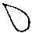

# 金刚经郢说



> **藏经**：卍新纂大日本续藏经（新纂卍续藏）　**册次** 第 25 册（X25）　**编号** X0488　**部类** 般若部　**卷次** 1 卷　**篇幅** 40,828 字

> **卷／品**：0 卷 · 5 品



---



## 目录



  - [No. 488-A 自序](#no-488-a-自序)

  - [通序](#通序)

  - [别序](#别序)

  - [通序](#通序-1)

  - [别序](#别序-1)



---



### No. 488-A 自序



原夫理根於性，性必有所受之途；形区於命，命必有收造之府。真一之雌，握筌藏领，良弥䆳矣。是以圣灵言道，缈追声臭之无；觉德开宗，扪绝色空之寂。自有入无，自无而入无无，犹之万象生於太极，太极生於无极。本末精粗，理迹相并，循模归化，候亦随之。在昔先民，阐之凿矣。𮨇入无而不能出有，非脱颕之妙也；无极而不能立极，非凝独之用也。故体无者，又贵彻於无非无；而宗极者，又环通乎物物极。物物极，则一中非中，而随时皆中。已发之和，即未发之中，体用一贯矣。无非无，则执空非空，而色相归空。不生之相，即不灭之空，根尘无二矣。大道所由同源，而渊修亦遵共辙也。慨自淳风既邈，埈气弥氛。建标之立，替真於岸分；逐影之驰，矜得於樊篱。枭智之儒，入室而掺戈；流遁之夫，抱𬒈而衒玉。缘使真言滞於竞辩，宗谛杂於奇裘。是否[卯/貝]乱，名实乖僭，赝璞盈前，精华愈竭。不惟姬孔失其传，而迦文亦罕其嫡。呜呼！以水救水，以火救火，命之益多，畴能定乎？盖心无垢净，犹水无清浊。珠沉之则清，象入之则浊。清浊虽同一水，而不得言水外无象无珠。则所以澄之扰之者，即心也，非心也。非心也，即心也。此《金刚般若波罗蜜经》，所以勤勤恳恳於降心无住，而为万法之宗也。第守法而不明无法，则本觉未圆，觉由识昧，故又归宅乎舍法。然舍法而不先修行，则因地不立，果亦难成，故又发药於断灭。夫断灭者，执空以为空。见空而不见法，空即累法。不断灭者，随所见而皆空。以空治见，见即圆空。所以善舍得舍，舍为登岸之津梁。而托舍求舍，舍即沉沦之坠石。善空成见，见即明镜之加磨。而灭见为空，空犹暗室之求照。故曰一切有为法，如梦幻灯翳。盖自有为以归空，而非灭为以貌空。至人灵响，双理环结。云章昺郁，较若列眉。无如世之说者，但曰无为已耳，空相已耳。於是真心向学而失之者，以寂灭为空，以了独为无为。名心向学而失之者，以不灭为空，以任放为无为。至於江湖日下，而刑名货利，结权惎傲，禽业兽毒，溷聚饕淫，无不可自标以菩萨之目矣。嗟夫！佛之所以度人者，度人於出生死之门也。降心以净其尘，无住以精其进，布施以济其功，空相以究其竟，四者不可边举。若能净能进而不思究竟，半途之废也。直取究竟而不必精进，不揣其本而齐其末也。喜施喜度而不自了义，下品之檀也。能自了义而不能利他觉他，非无上菩提也。梅子熟有时，风静水自定。救此弊者，莫若专明解行。解行深到，究竟自圆。予生也钝，不能有知。然末法之惧，岂无憬乎？偶因持诵真经，率尔遂多筌蹄。既不能超所见于语言文字之外，抑且赘其喙於章句演说之间。盖绝理而谭宗，则吾岂敢？若因文以显义，或有取焉。愚者千虑，必有一得。𫇴荛之言，圣人所择。则勺海一掬之勤，舖地一毛之効，或亦觉皇所在宥哉？第较诸旧疏，杜撰实多。知我罪我，当必相半。故不敢倚重于名题，并不敢借光於硕誉。良惧兼葭冠玉，涉累鸿宗。聊自述其所见如此，以俟十方慧眼论定云。



南湖圃人徐发



攷异



按《金经》有五译，而世之诵者，秦译也。然近本多与古本不同，要亦历有增改。以愚观之，总不如古文之妙，况灵迹真源，何可增改耶？尝闻老僧说，诵《金经》者，功德最神，但错一字即无騐。可不慎诸？今悉遵赵子昂石本刊录，其与近本不同，及诸家有攷证者，并存於此。



第二分应云何住，今本作云何应住。按住字已非实相，不当更添应字。然会译原本，秦、周俱作应住，惟魏译作应云何住，则赵刻亦非无所本也。



十三分，今本或少是名《般若波罗蜜》七字，而赵刻有之。然会译本实无此七字，今亦以赵本理近，世多从之，故仍存。



十四分应生瞋恨，今本或作瞋眼。按会译并赵刻俱作恨。



忍辱波罗蜜如来说非忍辱波罗蜜下，今本又有是名忍辱波罗蜜七字，会译并赵刻俱无。按第一波罗蜜句是结上语，故义全；忍辱波罗蜜句是启下语，故不全，不当添足。今依赵本。



为利益一切众生下，今本多一故字，会译、赵刻俱无，今删去。



十七分，佛告须菩提：若善男子、善女人，发阿耨多罗三藐三菩提心者，今本无若字，赵刻、宗泐、奉勅注皆有。此是论现在，故有若字。语气甚活，当从。



二十四分，百分不及一下，今本又有一百字，或於千字下多一分字，魏译、赵刻俱无，句读不明，有碍理解。



二十六分，尔时世尊而说偈言，周、魏译皆作言字。今本作偈曰，系俗笔所改。依赵本作言字。



三十分，是微尘众宁为多不下，今本添须菩提言四字，会译、赵本俱无。



若全经则字，今本多改即字，凡二十餘见。则、即二义虽不甚远，而语气微有不同。即乃已然之词，则乃未然之词。如转轮圣王则是如来，语气甚活，改作即字，便一板呆煞，所以有轮王实同如来之误解。他如若心取相则为著我、人、众生、寿者，如然灯佛则不与我受记，如实有佛则不说是微尘众，诸则字俱断断不可改。其餘虽义或两可，而雅俗自别，俱依三译、赵本改正。



按：诸译不同甚多，惟秦译最简，出之最先，以后渐增渐详。葢创者难为力，而继者易为工，理固然耳。顾增华饰美，不如还淳反朴之得其真。所以世本独尊秦译，良非无谓。今攷异文，亦不能尽述。独魏译十二分，第颇简要，足为章句发明，并附参攷。



如是我闻至敷坐而坐，为序分第一。



时长老须菩提至善付嘱诸菩萨，为护念付嘱分第二。



世尊善男子至愿乐欲闻，为住分第三。



佛告须菩提至但应如所教住，为如实修行分第四。



须菩提！於意云何至则见如来，为如来非有为分第五。



须菩提白佛言至一切贤圣皆以无为法而有差别，为我空法分第六。



须菩提！於意云何？若人满三千大千至此法无实无虗，为具足功德较量分第七。



须菩提！若菩萨心住於法而行布施，至何况书写、受持、读诵、为人解说，为真如分第八。



须菩提！以要言之，至果报亦不可思议，为利益分第九。



尔时，须菩提白佛言至如如不动，为断疑分第十。



四句偈言，为不住道分第十一。



佛说是经已下，流通分第十二。



此十二分，第比道安为详，比昭明为略，颇得纲领。而须菩提重问以后，皆作断疑，尤为正见。又十七分，须菩提重问善男子善女人发阿耨多罗三藐三菩提心，魏译於前则曰云何菩萨大乘中发阿耨多罗三藐三菩提心，於后但曰云何菩萨发阿耨多罗三藐三菩提心，除去大乘中三字，显有浅深二义。葢所谓大乘者，即如来法也。后问不言大乘者，显就现在修菩萨行言也。其文亦足为三世因缘一证。予於既脱稿之后，得阅此本，颇自幸其不大盩戾于昔人。因思袁了凡先生曰：「看《金刚经》有不会处，但读各译自见。」益为信然。



又陈真谛译本云：如如不动，恒有正说。应观有为法，如暗、翳、灯、幻、露、泡、梦、电、云。所谓恒有正说，犹云恒言中有成说也。予谓末后四句，乃相传古偈，此亦一证。既成书，钱登明兄示予三译本，始得见之。又中峰禅师《略义》云：「如来於第四时，说《般若经》六百卷，《金刚经》乃其一也。议者於六百卷之纲目，以融、通、淘、汰四字摄之。葢如来尝於第二时，在鹿苑转四谛法轮，证诸小乘，入有餘涅槃。以未称本怀，由是第三时维摩弹斥，使其耻小慕大。然后广说般若一味真空，专为小乘人融其所执，通其所滞，淘之汰之，如涤秽器，便之清净，然后以上乘圆顿甘露之味注之。但《金刚经》局於文约，几不能句读，义意深䆳，寄之六百卷间。於中或有不能通处，正不必致疑，但存一念深信，久当自解发。」按所谓一味真空，专为小乘人融其所执，通其所滞，此语足尽金经全蕴。盖小乘人与初学佛人不同，其功行已深，特未造大乘耳，正所谓有为法也。故曰：「一切有为法，应作如是观。」其论尤足为四句偈发明。因思昔赵吴兴师事中峰，手书此经，施师展读，今石刻是也。谅其中字句，经二巨眼，决无谬误。则予之攷异，悉遵石本改正，亦足宪矣。



又第六分无法相亦无非法相下，《集解》谓旧本又有无相亦非无相句，故弥勒偈曰依八八义，则今按留支译曰无法相亦非无法相，无相亦非无相，真谛译曰无法想无非法想，无想无非想，诸译同一辙，则旧本确矣。然赵刻亦无，相沿既久，不敢擅增，但余详味末后八分，如佛双收，实有此二义，葢就过去如来言则曰相，就现在佛言则曰法，理即一揆，文实异趣，故余于章句中分别出之，葢此二语实提纲挈领之要也。大约佛语必举全体，而后德易堕边见，故删去之，此即中峰所谓不可通解处是也。譬如孔子只重一仁，孟子复兼举义，说一仁而义自在其中，兼举义则仁反似非全德，此圣贤地位有不同处，后之学者自须究极根抵，不可以耳食师说，便依样画葫芦也。



又三十二分，若有善男子善女人发菩萨心者，萨字俗本多误作提字，按《会译》原本、赵刻石本、宗泐奉勅注本、云栖《𫔇论》皆萨字，葢此句正结完十七分空生为现在祇园会上善男子善女人问菩萨行意，故前於实义则既曰菩萨亦如是，又曰通达无我法者名真是菩萨，於福德则曰此菩萨胜前菩萨所得福德，至此尽处则又曰若善男子善女人发菩萨心者，前后照应脉络如线，若改作菩提便泛滥无绪，此章法所以不可不明也。



说略总论(十则)



佛法有宗教二门，要其竟讫，原属一归，如儒家生知学知，同归于圣耳。今宗门只说顿悟，无论不须注脚，并经亦尽饶舌。予思《楞严》谓精觉妙明，非因非缘，亦非自然，则不惟教不必立，宗亦何有？然释迦升座，文殊举棓，五百外道见影而走，为何复有许多言教至三千五百餘卷？葢佛性人人所具，而钝根利根万有不同，故《楞严》又曰：「理则顿悟，事非顿除。」所以〈见道品〉后，毕竟又说修道，犹如《中庸》诚明明诚，不可偏废，乃有三无漏学、四种律仪等序以引进之。要之，明觉虽圆，非言教不为功，时雨之化，有其候也。若执途人而名之顿悟，彼岸焉得有许许迹耶？近日宗门颇号极盛，而教法讫以不明，良由取捷径而厌劳功。究之，捷取原无到岸，而厌劳徒自丧真。高者罔罔半生，尽成魔障；劣者缘尘反缚，造业益深。故予兹集，务从粗浅训诂，但使初学易知，寻门得路，自能升堂入室；行积功深，自能了空悟彻。不徒为言荃添蛇足，要使忘言者弗坠八无相。若大智龙象，衣中有珠，固无藉此萤照矣。  

《金经》注家无虑数百种，钧天广乐已张，何复须下里巴人？然有不能自已者。窃见从来注疏皆以禅宗参话、旧德举义编缀成书，兼之昭明三十二分蔽锢眼光，即有翻脱窠臼、扫却畦町，而零杂琐碎不求章脉、不辨前后浅深，故取义愈博而经旨愈晦。夫举义参话犹儒家时文制萟也，随拈一题便有一番议论，要非到家不得本文真面目，譬之时萟摘段做讲说，谁能理会题神书气耶？予素性读书不喜注疏，故兹集亦专取经文讽诵，潜思默悟者数年，不意经中自有天然层级问答因缘，即弥勒偈亦已指出，奈从来讲家因循成说直取空相，并弥勒偈语亦多错解，不知此经原从有相说到空相，借须菩提三世异相之疑说到三世一法之无相，专在如来与佛有过去现在分别相，故十七分后空生重问佛法，而佛言无我法以破其异相，今说者俱不致分别，所以后来种种疑窦、种种敲剥俱似重衍相见，如来之问有四层、福德较胜之例有九级，拙者再四申理而不觉其冗，巧者曲意穿凿而不觉其谬，将迦现一番问答浅深源委全然埋没，譬之掩塞门路、夸言堂奥，岂是真见？此予所为不能自已也。今姑略标一二领要取正法眼，餘见说中，葢非徒好异以显前人之疎，实恐因循以重后人之误耳。  

如来，旧解但曰真性自如，如理而来，不指何人。说者则谓佛即如来，如来即佛，经旨空相，何必分疏。予谓此是究竟实理，若诠注演说，则如来本释迦佛因地法身号，乃过去相也。故此全经须菩提所称如来，意中实指佛，而佛却就因地答，故屡称如来。所说如来，常说如来灭后，昔在燃灯佛所，与我授记，当得作佛，葢然灯亦号如来也。《圆觉经》文殊师利菩萨白佛言：「大悲世尊，愿为此会，说於如来本起因地法行，使未来众生求大乘者，不堕邪见。」所谓因地，亦指过去，此经特省文耳。所以佛首答降心，次答无住，又次答见如来，三问三答，前后圆彻。佛大法段，实止于此。要此乃千古如来相传心法，故佛亦自名为经。至五分以下，乃又因须菩提问信心奉持，而推广言之，曰无取，曰无说，曰无得，曰第一希有，曰忍辱布施，曰消灭罪业，皆不出降心修行无住无相之义。此予所谓如来法者，实指过去之如来也。然须菩提本以如来称佛，而佛不自认，焉知佛与如来不别有法乎？於是十七分又亲切为现在祇园会中诸菩萨问现在佛之法，佛则以无我法破之。我字虽从四相中来，而语意实对照过去如来，然无我正是我与如来无异相处，故即以然灯授记作佛证之，又以三世心不可得阐之，下又以佛与如来两相比竝问之。葢至此佛始和盘托出，自认为如来，而须菩提亦了然佛即如来，三世无二相矣。於是更将未来众生申问一番，而三世一法粲然大备，末后段段将佛与如来三世竝勘到底，尽归无相一法，此祇园会上问答因缘真面目也。要自异相说到一相，故曰不一亦不异，由三世说到一法，故曰如是知，如是见，如是信解，不生法相，此正所谓三世如来也。今诸家混混，不得不辨。  

四句偈，一切有为法四句是也。葢此偈乃自古流传之偈，人所稔闻稔知，故於末后出之，其义实包佛法全体。后人错解有为法三字，但以一空诠之，又倒装在后，故忽而疑之，不知佛法不堕一边。《楞严》曰：「空心现前，长断灭解，则有空魔入其心腑，乃谤持戒，名为小乘。菩萨悟空，有何持犯？是人则破佛律仪，误入人罪，当从沦坠。」《涅槃经》曰：「一切众生不退佛性，名之为有，决定得故。」《智度论》曰：「无智人闻空解脱门，不修功德，但欲得空，是为邪见，断诸善根。葢由不得般若波罗蜜法故，入阿毗昙门则堕有中，入空门则堕无中，入蜫勒门则堕有无中。」《宝云经》曰：「非无人故，名之曰空，但法自空，非色灭空。若以得空而依于空，佛说是人则为退堕。善男子！宁起我见，积如须弥山，莫以空见起增上慢。所以者何？一切诸见以空得脱，若起空见，则不可治。」故《宗通》曰：「应云何住？所谓住者，非如凡夫住于相，亦非如二乘人住于空，乃住于真如实际，非假非空，中道谛也。云何降伏其心？所谓降伏者，非如凡夫所修按伏六识，亦非如二乘所修断灭七识，乃八识心田微细习气，以真如熏之，令转识成智，譬降贼众为良民，此正所谓有为法也。葢佛法实非一空所了，故全经皆从有法说到无法相，末后又明白说出，不作断灭相，所以取喻六事。六事皆自有入无，佛法亦自有为而入无为，故曰一切有为法。若经中所谓降心无住，信心奉持，第一希有，忍辱布施，应无住而生其心，成於忍，修一切善法，不作断灭相。持於此经，为人演说，皆所谓有为法也。而皆底于无法相，故曰应作如是观。此即所谓无餘涅槃，乃真空也。」今说者将有为法三字，误作众生界内迁流造作等解。不思弥勒偈曰：「於有为法中，得无垢自在。」明明指出中字得字。若舍法而求空，乃顽空，非真空矣。岂此偈正义耶？予看一部金经，千言万语说来，只了得此偈此义，故将何以故一句接出，明是宪章祖述相传要诀。乃有谓二十六分四句者，不悟二十六分上文有尔时世尊而说偈言等字，则为世尊问答间一时所唱可知，何得预先道著？况二十六分后独不可持诵演说乎？又有谓我相人相四句者，不知释偈原有体裁四种：一阿耨窣覩婆，二伽陀，三祗夜，四缊駄南。初皆以三十二字为一偈，葢即古体四言八句也。后渐变而或五言或七言，则偈自有偈体。若四相等句为偈，何处不可为偈，而但称四句乎？至有以《金刚般若波罗蜜经》八字分作四句者，有以四句诠义究竟便称偈者，又有谓一句二句三句乃至四句及十百千句者，更为穿凿。竟不知牟尼珠光自现空中，而无人肯信也。  

过去心不可得，现在心不可得，未来心不可得三句，乃全经关键。正因空生重问，有分别相，故以三世心皆不可得破之。所以历叙五眼，层层说来。要知三世世界众生诸心，甚是难知，而佛悉知，故为奇特。若今解者，谓一日一时中，有此三种心，援引《未曾有经》作证。不知《未曾有经》，妙吉祥菩萨救度杀业人，要见一念转头，迅速成佛之意。故就一时中，分别过去现在未来，引人起信。若此经从上佛法无我来，与一时三心何涉？若一时中三心，何必远取五眼世界众生，郑重言之如此？况《未曾有经》本文，亦云三世俱不可得，故原未尝专属一时也。至如庄严佛土，葢言诸菩萨在如来佛土会上，设庄严想否。或乃谓实实建造殿宇等相，身如须弥山王，是喻言无可得意。故上特加譬如二字，明非实语。乃或以为实言三丈金身，若尊重弟子，言如弟子之恭敬佛耳。乃倒装文法，释典极多此例。所谓释教用逆，西方语气如此，即如是我闻、不也世尊，俱是倒装。他如於意云何、何以故等句，俱倒提逆入，全经实理皆然。所以四句偈，亦留末后。葢语气如是，故文法章法皆如是。乃或以为若佛之尊重高弟文殊普贤等，不知师之敬弟，毕竟不如弟之敬师。岂如是甚深经典，如佛塔庙，而仅同于师之敬弟乎？身相之问，凡四举矣。如理实见分之身相，色身相也。乃就过去现在粗迹而探之，由浅及深。故曰：凡所有相，皆是虗妄。正即境引悟佛机之妙。如法受持分之三十二相，法身相也。法身非耳目所及，因世界非世界，微尘非微尘，以见法身，亦非真相。此较色身非相，已深一层。至离色离相分，以色身问佛，以法身问如来，皆非具足，而皆名具足。则见皆非见，而非见皆可名见。其理乃圆，较前更深。若法身非相分，可以三十二相观如来否。观与见不同，见在彼，观在我。见在外，观在内。其义比前三问，最为入微。故须菩提曰如是如是，亦妄想未净处。佛乃以轮王反醒之。前后四言，身相浅深层次，显有不同。而说者一概玄言，茫无分别。以至须菩提应三十二相观如来上，强添不可字。如是如是，改作佛语，注谓错简。转轮圣王则是如来，则字改作即字，实作轮王与如来一相说。又以佛可以具足色身见，不配八十种好。如来可以具足诸相见，不配三十二相。俱属杜撰。总由佛与如来，三世因缘，不曾分别明白，致此臆猜。后人相沿传习，膏肓深锢，遂将迦文正法，永为障蔽，良可浩叹。故予不揣，一一正之。知我者释人矣，罪我者释人矣。(按须菩提言：如是如是，以三十二相观如来。魏译留支，实改作不以相成就，得见如来。佛言：如是如是。而唐玄奘译《大般若经》，亦从之。然此乃后人报佛恩之意，实不必也。)  

弥勒偈亲承佛教，自宜为滴派大宗，但句语简略，向以参义视之。近者《集解》、《𫔇论》，始分系经文，逐段注释，可为印月之妙。予於最后得阅，不意三世要义瞭然脗合，无如从来说者亦多昧昧，不惟分释经文前后错误，而三世宗旨更多异解，总由成见锢蔽，不肯移舟就岸，反执认璞为鼠，故予特标简端，并为诠注其略。如：「自身及报恩，果报斯不著，护存己不施，防求于异事。」此正释但应如所教住也。旧说移作不住色布施，不住声、香、味、触、法布施解，与果报义何涉？「调服彼事中，远离取相心，及断种种疑，亦防生成心。」此正释可以相见如来不之问也。故天亲菩萨开列二十七疑，亦於此始。旧说亦作应如是布施，不住于相解，尤远。「分别有为体，防彼成就得，三相异体故，离彼是如来。」此正释若见诸相非相，即见如来也。以上降心无住布施，皆是有为体，非真如来，以有三相之异也。三相：化身、应身、法身。离却应、化，独显法身，方是真如来。此正因空生以现在之佛称如来故，特为指明三身异故，以显三世因缘。说者乃以行施住为三相，亦谬。然其说实本于天亲论，予不能无膺托之疑也。以后凡言三身，不一而足。如「应化非真佛，亦非说法者」，应化正指过去如来言。依彼法身佛，故说大身喻，法身正指现在佛言。葢以形相论，则化身为过去，应身为现在，法身三世皆有。以本体论，则应化皆为过去，法身为现在。故下又曰：「法身毕竟体，非彼相好身。」言现在之佛，虽具法身，毕竟是形相，非真法相。以非相成就，非彼法身故。言过去如来，虽有法身，究竟亦非真法所在。佛与如来，两两并说，显有浅深。但同归一非相，而又皆不离于法相。故下又曰：「不离于法身，彼二非不佛。」故重说成就亦无二，及有所谓二者，正并指佛与如来。故下又曰：「如佛法亦然。」如即如来，非若字虗语也。今人因不分别此节两称具足诸相，遂重衍叠出，茫无著落。又曰：「非是色身相，可比知如来。诸佛唯法身，转轮王非佛。」此以内观言，故三十二相亦为色身，浅深益显。又曰：「去来化身佛，如来常不动。於是法界处，非一亦不异。」言若来若去，若坐若卧，乃现在佛应化之相，非真如来相。然同在法界中，则虽不一相，面亦不异体矣。此去来坐卧，实指现在佛言，当作应身。因与如来对看，故曰化身。不一，正照上二字。葢佛语至此，始自明认如来，故曰非一亦不异。又曰：「化身示现福，非无无尽福。诸佛说法时，不言是化身。」葢说法者皆化身，佛无法相，故曰不言是化身。以上偈语，惓惓于化身法身者，所谓三相异体，故正三世一法之要也。其末又彰明较著，而总结之曰：「观相及於识，器身受用事。过去现在法，亦观未来世。观相及受用，观于三世事。於有为法中，得无垢自在。」葢统全经三世大旨而言，观相及识，正於三世一法中，得无垢清净之真法，何等明白晓唱。此予所取献而自信者。不意从来谬误，将总收八句单证，为人演说，如如不动。不知所谓三世，及过去现在未来等语，竟何著落。将弥勒一片苦心，亲承真谛，垂教后人，翻成疑障，不得不辨。  

昭明三十二分，各标四字，亦如天亲标二十七疑，但标大意，不循章句，故致后人浅观，讥其割裂。然摘取四字，实得全经浅深要领，大非无见地者。其是非亦有数条，为略言之。如第九、第十，自四果以至如来菩萨庄严佛土，皆不可取、不可得，正所谓一切贤圣之差别也。文义贯串，不可分截，而昭明分之，后人遂多支离见解。又如慧命须菩提以下，别起问端，明为未来众生说法，而昭明不分出，此则昭明之疎也。然既为唐僧灵幽感梦所增，则昭明时或原无此六十二字耳。若第二曰大乘正宗，以降心为大乘全体。第三曰妙行无住，标出行字，极得窾要。今人以体用合说，乃究竟之论，而非入门诠解。第四如理实见，足标全经宗旨所在，与后人作开逗疑端者大不同。第十八曰一体同观，最得三世一体之义。第二十曰离色离相，以色身法身二相并列，尤有分晓。二十六曰法身非相，标出法身二字，分别更细。二十九曰威仪寂静，只就现在释迦佛说，尤得三世因缘。三十二曰应化非真，亦就现在释迦说，观其取义精确，一字不苟，俱从全经理会浅深得来，绝非近人看东遗西、瞻前失后，深合三世如来宗旨，与弥勒偈实相表里。今人以其分段之疎，而并忽其标义之妙，妄谓昭明杜撰，真鹓鶵之吓凤，蜩鸠之笑鹏也。予初读之，亦颇觉无绪不足恃，及既卒业，而后知高辛之先我，空谷足音矣。乃特与弥勒偈并列简端，以资参证。其餘诸家，足资经文真面目者，采录一二，总不欲徒夸奥博，以欺人耳目也。  

无著、天亲二菩萨论，近世所最宗仰者。然其论本从弥勒偈来，却不甚相合，或亦神圣各自显其所得，不必拘拘於形迹也。若二十七断疑，正因经文纡回无迹，段落难晓，故从立言所以然处，寻出有此二十七层发意因缘，乃为凡庸众生当有此种种疑窦，故借须菩提问答间开示之。今人过於依傍，反失经旨，并为略举大意，以资参考。如初断求佛行施住相疑，言行施乃实实功用，何得无相？况既曰住，是明有地位语，凡庸人岂不疑惑？故下以如来身相问之。葢身相乃有形之相，有形虽变，而如来常在，则诸有为功用之相，皆不足存矣，其理不过如此。而说者谓行施本为求佛果，是相多一层折，反觉韬晦。至谓行施住即弥勒偈中三相，夫行施二字，岂得拆作二相耶？二、断因果俱深难信疑，身相乃因地修行之相，如来乃现在法相之果，能见非相之相，即见如来，正因果俱深。而说者乃以施住为因，佛相为果，能修行自然成佛，有何难信？空生不宜鄙近至此，佛虽为庸人说法，亦未必浅观至此。三、断无相云何得说疑，《集解》有或云不可以身相见佛，此须菩提之言也，如何於自语生疑？乃谓是恐后来众生有此疑，正不得拘拘，可谓善理会天亲断疑者矣。愚意所谓无相，即上文无法相也。既无法相，为何诸如来皆说法？故下以有得有说不破之说者，乃远追不以相见如来。上说且谓释迦云何于菩提树下得法说法，此处所称如来，何曾佛肯自认耶？四、断声闻得果是取疑。因上文云：如来所说法，皆不可取，不可说。恐人疑如来大乘不可取下，此声闻乘或有可取，故复以四果及佛菩萨一一证之，要见皆不可取意。说者又添出须陀洹等各取自果，如证而说。经文本谓四果皆不自得，乃添出一层在前耶？五、断释迦然灯取说疑。六、断严土违於不取疑。七、断受得报身有取疑。三疑皆归无取章旨，正眼光远照，脉理清彻处，则经文是故须菩提！诸菩萨摩诃萨以下，当作总承六问。而说者以三疑分截，遂单顶庄严，所谓转得三湾，便不识前路矣。若譬如二字断，当作借喻说，而天亲实诠得报身，乃从实理上会意来，今人亦泥看。八、断持说未脱苦果疑。乃即本章须菩提涕泪悲泣，有见于第一希有之法，不当复存身命相也。故即第一非第一下，紧紧接出忍辱非忍辱以醒之。而说者乃远缠外财，较胜感得人天苦果等语，亦殊葛藤。九、证无体非因疑。无体即弥勒偈所谓道也，即指上文如来说一切诸相即是非相，又说一切众生则非众生。二说字即道字，即无体。恐人疑无体之言不能为证果之因，故下以四种实智明之。而说者亦远缠持经较量，甚是不必。十、断如遍有得无得疑。即从上此法无实无虗来。无实无虗，言上四种智之实相也。无体言说有如此实相，岂不曰人人皆可有得乎？然非心不住而实实行之，虽闻言能信，究竟何益？故下以心住而行、心不住而行两并明之。时说又远缠一切贤圣句，不必。十一、断住修降伏是我疑。无我固是此章章旨，然亦就空生重问有异相意，故摘出我字言之，即从实理处深求细说亦无碍。葢佛语本八面玲珑，不必拘拘，所以天亲断疑亦从实理说。然须菩提重问，不过疑佛与如来有异相耳，实无我见在胸中。而说者遂谓空生疑意，既无我，谁为降住？谁为修行？将我字吊起在前，反似穿凿。十二、断佛因是有菩提疑。因上文言实无有法，恐人不信，疑佛於因地不能无菩提也。提字，今本误作萨字，且为转解。不知上文说有四相则非菩萨，所以者何？以实无有法发菩提心也。此以下皆实明无菩提心，岂是萨字耶？十三、断无因则无佛法疑。言无因地之菩提，则亦当无现在之佛法矣，故下以如来名字解之。葢不惟现在之佛如是，即过去诸如来无不如是，故诸如来一切法即佛法。至此，佛才自明与如来一法，故断疑中亦指出佛法二字。十四、断无人度生严土疑。此人字，从上譬如人身长大来，大身非大身，是人亦非人矣，将谁度生？将谁庄严佛土？要知此人字，不是人我之人，乃即身字意，故下即以我当灭度众生、我当庄严佛土，则非菩萨明之。十五、断诸佛不见诸法疑。即从上无我法是真菩萨来，言度生、庄严皆非菩萨，而无我法者乃真菩萨，则岂诸佛皆不见有诸法乎？故下以三世心不可得明之。葢心不见三世，故佛亦不见诸法，正是实理，而佛与如来一法，隐然在言外矣。十六、断福德例心颠倒疑。颠倒，即世俗心也。言三心即不可得，岂果报亦不可得乎？不能无疑，故下以福德无实明之。要见福德之多，专以无性故则无法，菩萨非真无福德，而颠倒心亦可以绝矣。十七、断无为何有相好疑。上文无我、无法、无二世、无福德，皆是无为也。言既如此，诸法皆无，何以佛有应化身，如来有诸相法身？两并言之，显有浅深，庸众疑情，总属一窦，故断疑亦总言之。而说者因浑作一佛看，乃强以天亲论八十种好、三十二相分配，不知天亲论亦是总言，何曾分说？八十种好、三十二相，皆法相也，有何分别？十八、断无身何以说法。疑言：既无三身诸相，何以又能在世说法？葢欲并说法尽遮于无也，故下以无法可说明之。天亲云：「若如来色身相好不可得见，云何言如来说法？」正是此意。说者乃谓既无色身，何处发声？是反将无法要说做有法矣。十九、断无法如何修证。疑因上文诸法皆无，则现在作佛，将如何修证？此正亲切问现在佛也。故经文前称如来，此独称佛。前以有得、无得两意并问，此以有得为无得一意专问，正为如何修证疑人指开门路，乃了义语，与前大不同。天亲论云：「若如来不得一法，名无上菩提，如何离上上证，转转得无上菩提？」所谓无上菩提，正诠以得为无得之为字也，眼光极细。所谓离上上证，转得无上诠，如何修证，亦高一层。说者又远缠第三、第十等语，直作不得菩提说。此是句读不明，不知浅深之故。二十、断所说无记非因。疑上言修一切善法得菩提，意持经演说毕竟无记性，或非因果所系，故下又以福德较胜言之。然此亦是巧於生发，指引后人处。若论经文，实段段有福胜作结，未必如是拘拘也。解者亦当善理会，不必泥执。二十一、断平等如何度生。疑言：众生既是平等，皆有佛性，何必又要如来度生？下乃以实实无度顺证之，即是首章实无众生得灭度者解。而说者乃谓如来度生，实有高下，实不平等，大非经旨。二十二、断以相比知真佛疑。以相观如来，譬如认羊作虎，岂得比于真知？故以轮王醒之。观与见不同，故特曰知。说者不悟观见之浅深，仍以法身相好等话，重衍叠见，直是隔靴搔痒。二十三、断佛果非关福相疑。承上言以相内观，亦可谓微细节目矣，犹且不可，然则佛果全然无相矣。葢全经敲剥非相，至此直是一毫不可著念，焉得不起顽空之疑？故下急以莫作断灭相缴定，而说者又以福德果报溷入，经旨反晦。二十四、断化身出现受福疑。上文言此菩萨胜前菩萨所得功德，言现在诸说法菩萨也，故曰化身出现。下文佛亦明以现在去来坐卧明之，要知现在说法者，虽是化身，而仍有真法身在，则受福不亦宜乎？然既曰菩萨宜受福德，则化身与法身无异，而又曰无所从来，亦无所去，则法身与化身又不一，岂不疑惑？故二十五曰断法身化身一异疑。而下文乃以尘界实理明之，要见化身法身之异，由于尘界起见，若尘界之见泯，又何法与化之异乎？至此佛与如来，三世一法，已和盘托出，而说者犹不悟三世之理，不知化身法身等字，将何著落？观此则二十七疑，实与弥勒偈相表里，而说者只浑浑也。二十六、断化身说法无福疑。前言菩萨宜受福矣，此又何复疑化身无福也？葢因若去若来节，宜受福意实在言外，不曾明说。而下章又言知见信解皆不生法相，故复疑化身说法无福也。下乃以最胜之福明之。然此最胜之福，专在不取相之如如。何也？如来实法如是也。此一语，实是全经宗旨，全部总结。下四句偈，只诠得此意。然恐庸众不晓，但以寂灭为如如，故又以何以故跌出偈语明之。偈语正从有为法中看出无相，不是纯任无为一边。故二十七疑曰：入寂如何得说疑？要见如如与偈义，正不是顽空入寂也。天亲云：「若诸佛如来常为众生说法，云何如来入涅槃？」亦是为庸众人浅见说想。说者遂以涅槃二字，实诠如如不动，乃又以顽空诠偈语。不知解疑者，正要反其所见。若以顽空诠偈语，直是入寂不说法矣，岂是破疑之意？予看二十七疑，专为庸众人寻门觅路，无头绪中讨出头绪。一片苦心，段段从上文想来，绝无支蔓。不意后人过为穿凿，舍近求远，反使经文韬晦。真是邢和遭弃，宝劒蒙尘。不有识者，谁能正之？予因诸疑，虽是恒情所不免，然终非章句段落可分。若倚为墙壁，反多葛藤，故不敢录。但近来说家所最宗尚，乃逐段分列经文之傍，以备学人参照耳。  

佛法不可以文字求，乃谓非如文士呫哔揣摩，雕琢字句为工，点染声韵为格也。若前后伦次，浅深照应，乃心声自然之理。即世俗人稍知文义者，出言谈吐，定有一番起讫头绪，前后照应。况神灵至圣，一指毫端，放出天人世界秘文灵象，而谓演说般若，反仅同于婆子之叮咛，村夫之嘈[口*?*〡]乎？此予所最不敢信者。莲池云：「金刚文字，似重非重，不重而重，极难注脚。」《金刚正眼》云：「诸家所论十七分后，有言前之未尽者，有言我法粗细者，有言重问发菩提心者，有以非人而不出己者，有以引他为自把柄者，俱在梦中说梦。」此真报佛恩语也。《不思经》文本曰：「闻是章句，受持读诵，为人解说。」则佛说此经，原自有章法句法可解可说，何致捕风缚影，各逞臆见乎？余谓此经语气回环，操放之间，浅深层级，直是一笔，极有规矩，文章颇与《大学》、《中庸》相似。今姑以愚所见略陈之。若见非相之相，则见如来，此一语实全经宗旨也。兴末后如如不动，并古偈全义相照应。如如不动，非相之相也。一切有为法，应作如是观，即见如来也。昆仑阿耨达池，与大海尾闾，呼吸相通，此其象矣。舍此无所谓彼岸者。若降心修行，则渡海之筏也。空相无住则舍筏，是非降修不能渡海，非空相无住不能登岸。此如来实法全体，即诸佛众生一切法也。何也？葢诸佛众生，有过去现在未来之异相，而无异心。过去心不可得，现在心不可得，未来心不可得。故过去者当如是知，现在者当如是见，未来者当如是信解，皆归不生法相。譬如万川印月，总是一月，月满万川，同归无月，正所谓三世如来也。若乃降心者必先信心，故於信心之问，独详降心，曰不取，曰无得，皆降心之无住也。修行者必先持行，故於奉持之问，独详修行，曰成就第一，曰忍辱布施，皆修行之无住也。葢降心为解，修行为行，解行成就方为到岸，然犹非舍筏之登。至於受持读诵，不知轻贱，但得阿耨多罗三藐三菩提不可思议功德，而后直是彼岸如来矣。然此特因空生之进问信持，而广为演说，实与首章无二义。譬如前殿后殿，佛土虽殊，庄严则一，经传异体，洵非诬耳。至如十七分后，论现在佛法，以无我为实，要见如来法即佛法也。二十一分后，论未来众生法，以平等为实，要见佛法，即众生法也。三世一法，非彰明较著者乎？然三世之中，又兼三世。如问信心，曰：众生得闻，现在相也。问奉持，曰：后五百岁。未来相也。佛法，曰：三心不可得。众生，曰：是法平等，无有高下。则经纬三世，贯串无迹。虽织锦雕虫，无以过是；蛛丝马足，不足为喻。真神龙变化，出没非常之妙矣。洎乎三问既终，乃即二法双结。如来三十二相，既不可见，并不可观，几於断灭矣。故遂以莫作断灭相，挽定非相之相。佛无去来，又无尘界，亦几於四相皆空矣。故又以是名我见、人见、众生见、寿者见，挽定非相之相。佛与如来，皆有非相之相，而众生皆在其中。两佛同归一相，三世原无二理。如如不动，宛然呈现。谓见如来，其谁不然？乃遂一语，跌出牟尼宝光。千圣传心要诀，只此一偈；全部《金经》宗旨，只了此一偈。如神龙之得珠归海，忽然大地云收雾散，一片晴空。真天造奇文，自然灵笔。玉书金简，不足比其精；八会十华，不足追其奥。而乃谓不当以文字求，抑何谬也？若乃段段以福果为劝徵，又段段以空相为究竟。层层浅深，尤有精意。如首章大法福德之后，结以非相，其喻为四虗空。葢如来非相之相，正虗空象也。非四虗空，不足以当如来实法之比拟，固有分量矣。若信心福德，属贪薄一边，故以七宝布施较。而不取为解中之解，则为三千大千世界之七宝；无得为解中之行，更进一层，则为恒河沙三千大千世界之七宝。同为七宝较量，奢约不同也。若持行福德，属瞋薄一边，故以身命布施较。而般若第一为行中之解，则为河沙身命；忍辱布施为行中之行，亦进一层，则为尽日。河沙身命，同以身命较量，而稀密不同也。然所谓布施者，皆世俗人之布施。至降修两至，心行兼到，底于痴薄，出离三界，直为荷担如来菩提矣。乃即以佛所供养诸佛功德较，其为不同，更何如也？若乃十七分以后，皆就说法言。说法近于解，而未及行。虽究竟实理，即解即行，然所谓实无有法，无法可说，莫作断灭相，是名我人等见，皆解一边，故亦皆以七宝较。而无我法，则以三千大千七宝，且曰无福德故，则又隐然一虗空同相也。平等法，以须弥山七宝较，且曰譬喻算数所不能及，则又隐然一不可思议同相也。如来无断灭相，则亦以河沙世界七宝较，而且曰不受福德，则亦隐然一虗空同相也。佛於四相非见为见，则亦以无量阿僧祗七宝较，而但曰其福胜彼，则亦隐然一不可思议同相也。至其所称较量福德之人，亦各有不同。如信心不取为解之初，则布施七宝者称人。以后信心无得及三层持行所较者，皆称善男子、善女人。至解行兼后，则佛竟自举以较矣。至佛法无我、众生法平等两较，福德亦皆称人。而如来无断灭相较，独称菩萨。而佛法是名，四相见亦称人。若首章言如来实法，则直以虗空较而无所称。其中浅深显然不苟，地位主客确有伦次，而说者茫无分别，窃恐未安。昔法达禅师诵《法华经》三千卷，六祖谓曰：「汝但执口念为功课耶？何异牦牛爱尾也。」师曰：「岂解义不劳诵经耶？」祖曰：「迷悟在人，损益由汝。所谓心迷《法华》转，心悟转《法华》。」师蒙启发，遂以偈颂曰：「经诵三千卷，曹溪一句亡。未明出世旨，宁歇累生狂。」故《楞伽》云：「因语见义，如灯照色。菩萨亦尔，因语言灯，入离言说。」余不敢以荃蹄为鱼兔，然鱼兔未得，亦不敢夸言六经为糟粕也。愿与有志菩提者共证之。  

儒与仙佛，皆言道矣。然道原於天，天一则道一；道根於心，心一则道亦一。经生家守古人传习之末，不悟性命精微之要，妄分彼我，角立门墙，猥以释氏为异端。夫孔孟之所谓异端，岂释氏哉？葢释有五戒，犹儒有五德，其似是而非者，谓之异端。儒之异端，犹释之外道。故孔子所攻者，心逆而险，言伪而辨，行僻而坚，顺非而泽，记丑而博，乃邓柝、尹何、少正卯之流。而老聃则目为犹龙，伯夷、柳下惠则称逸民，至宰嚭问道，独指西方圣人。夫老聃即迦兰仙人之类，而夷惠则舍国太子、忍辱菩萨也，岂孔子之所谓异端乎？孟子所辟者，无父无君，乡愿乱德，乃惰四支，纵耳目，好货财，私妻子，不顾父母之养，正杨氏为我之贼也，非以辞荣养生为无父也。饔飧并耕，桐棺布被，以市恩天下，誉则归己，毁则归人，正墨氏兼爱之巧也，非以遁世修性为无君也。故庚、列、庄、慎，清静虗无，与孟子同时，不闻有訾议，而伯夷、柳下且为清和之圣，於陵仲子、匡章、徐夷犹欲倚门墙则招之，则孟子异端，岂释氏之谓乎？昔上古神人，吸风饮露，乘云气，御飞龙，游乎四海之外，使物不疵疠而年谷熟，即儒传之无怀葛天，而释教所谓梵仙也。夏商以上，神灵鬼物之事，显著甚多。周穆之日，化人乃来，遗像於石。至秦世复见，由余识焉。故颜渊不饮酒，不茹荤，孔子谓祭祀之斋非心斋。庄子生不布施，死何含珠，为施於人而不不忘，非天布也，即不住相布施之义。而隐几丧偶，偕来忘我，鱼乐蝶梦之类，直是不语禅机，指头参话，与柱拂举棓何异？然则孔孟以前，曷常无释教哉？若汉明求像，白马西来，特流通贝文之始耳。今观《四十二章经》曰：「人事天地鬼神，不如孝其二亲，二亲最神。」又曰：六情已具，生中国难；奉佛道，值有道之君难。其理初不悖忠孝。迨魏晋以还，崇奉既广，其徒不纯，不能阐扬大道，专以因果报应，供养布施，恫愒人主，聚敛财宝。至唐世益甚，於是姚元之有外求之论，韩昌黎有迎骨之谏，要亦正教中刮磨淘汰之助矣。特其附会孔孟，指斥异端，不能无文士之习焉。而后之腐儒，遂相牵引，以为扶翼道学之盟主。嗟乎！夫所谓道学者，岂有外於明心见性哉？今即《金刚》一经言之，无我相、人相、众生相、寿者相，即喜怒哀乐之未发也。一切众生，我皆令入无餘涅槃而灭度之，即欲立欲达，我道一以贯之也。应无所住而生其心，即致知止善之学也。是法平等，无有高下，即天命之性也。实无我法，无法可说，即率性之道也。闻是章句，受持读诵，为人解说，即修道之教也。如如不动，即上天之载，无声无臭也。非相之相，即易之无极而不住相，即乾元用九之用也。种种福德果报，即祯祥妖孽之理，与汤诰福善祸淫，洪范休徵咎徵也。故屠纬真曰：「儒与仙佛，其理实一，而造用成就，微有不同。」予谓究竟亦无不同也。孔子曰：「朝闻道，夕死可矣。」此实究竟之理，而性与天道，特罕言之。葢可以心得，而不可以言传，非鄙薄而外之也。所以宋世大儒言道者，往往取资义学，周、程、张、朱、苏、陆、黄、秦，皆所不免，而近世为尤甚。然近世儒者，多以名为累，必阴资其说，而阳避其名，且操戈焉，以掩葢其窃取之陋。呜呼！我不知何以为母自欺也。数百年来，惟管东溟先生一人，独明目张胆言之，而天下卒未敢有昌明之者，则何也？非尽儒之彼见不销，而亦由於释之自晦其教也。葢译之宗与教，犹儒之率与修、诚与明，不可偏废。而今之释者好言宗旨，不屑教品，乃浮慕乎顿悟成佛之易，而不知实修实行，於是儒者愈疑其说之空虗诞远而不可合，此道之所以不明也。发书生耳，乌敢言道？顾常奉教先人，不肯以名实自遁。幼年读性理诸书，中岁亦窥释典，皆不能有所得。近自蝉蜕游都，始简笔墨，稍亲鹿苑，纵观象教，深信此道实出一源。而其所异者，特威仪动作、语言文字间耳。夫威仪动作乃理道之粗迹，而语言文字亦风土之异音。苟得其精，何必以粗迹为表见？苟见其同，何必以异音为真假？每见近世法喜皈依，必以离家出俗为异。夫难提尊者、道玄居士，岂尽离家出俗乎？但得五戒精意，何处非最上菩提？又见近世支那撰述，必以梵义方言为体。夫白马四十二章、青牛五千餘文，岂尽梵义方言乎？但合迦文真旨，何妨我用我法？故余於此，直将最浅近语敷演真谛，务使雅俗共赏，儒释参同，庶几稍符广为人说之教，以彰明大道同源之理云尔。



附记



(发)窃意此岂亦三生石上一公案耶？葢予生平惟好古，无他长，尤敬佛书，深信此种道理，天壤间实实有之，心性中实实具之。顾惑溺举业家，雕虫蠹楮，虗靡四十餘春，如一吷也。辛丑岁，尝梦高山绝壁间，有石像幅巾袈裟朱履者，仰视之，輙自喜为前世，因傍揭联句曰：「胸含万岭千秋雪，目送长江一片云。」觉而异焉。自是颇有问径蔗园意，因尔焚弃笔墨，为玄水之游，放袋叉手，实自还其本来也。无何，浪迹京邑，又复十载，幸奚囊中《南华》一帙、《宗镜》一卷，不致放废。时从尘氛喧会之侧，展阅一二，真不啻清凉散，荡涤心胸矣。及见诸世故，升沉得失，儵忽迁变，人情𡾟险，同於芒刃，益深省悟。归而杜门息虑，遂多暇日，乃以《金经》课诵，修嗣续因。则又恒苦目疾，每学禅坐冥接，或於夜分晨清，理会大意。窃见其中前后层次，极有浅深照应，章法段落，直与儒书不异。不知何故，从来注疏，零碎叠复，茫无贯串，因以己意试为疏之。初亦非欲问世，不意一二月间，屡感异梦，如佛像、天书、星斗、云汉，及彩笔、雕墨、赠买扇籍等事，凡数十见。甞一夕，三四梦稍合，瞑即形僧佛异像者。於是不禁自惊自疑曰：「岂比卤莾杜撰，果有当于密谛乎？何遂烦幽贶若此！」自是更觅诸家旧德疏论，及各译原本证之。不意杜撰所见，亦时时颕露於前人，特相沿成说，不肯离窠脱臼，而三世因缘，则直与弥勒偈符契。於是遂不自揣，张胆而言，谬成章句，然犹未敢孟浪灾梨也。九月朔，且以筵卜之天及大士，得吉。既望，又以龟卜之神，得从。十一月朔，又有恒修长老为予跪请大悲签，得句云：「梦中说梦获多才，身外浮名总莫猜。水远山遥难驻足，贵人一指笑颜开。」葢予於沉迷说海之际，得破疑城而直出者，实始正眼梦中说梦之句，不意佛语首及之，婉如面命，更可异也。於是率尔授梓，究未决其孰为庄生，孰为蝴蝶矣。恒修，南昌人，行脚禾中，冬夏不著芒鞵，人号赤脚和尚。近岁募修三塔寺大悲阁钟楼，里人多敬信之。癸丑，又属修天宁佛阁，师以钟楼未完，有待也。七月大风，佛阁东倚欲颓，里人急呼匠搘之，尚未用力。是夕，师禅坐阁中，至夜分，异香黂郁，如数百人邪许者，柱斗间格格有声，心知为神助也，闭目不动。迨天明起视，则东西皆中绳矣，惟南北尚稍倚。明日，师为予言之，里人皆知佛阁之神牮，而不知师坐其中也。师亦不与人言，葢实修功行者



旹康熈十有二年，岁在癸丑，仲冬南至之七日，智普又识。



章句



经曰：闻是章句，为人演说。葢章句者，演说之要领也。故诸经皆有品分，章句明别，学人易於寻伺。独此《金经》，文义奥衍，而昭明分第，又非章句之真，故人多异解，兹特正之。



------



### 通序



(法会因由，分前半段，　凡二十九字。)



------



### 别序



(法会因由分后半段，　凡四十二字。)



正宗



经一章言：如来法也，无相为心法，布施为行法，若见非相之相，为如来实法。



(善现启请分，　大乘正宗分，　妙行无住分，　凡四百六十字。)



说经之一章，言信如来法者，以不取、无得为实，应首章心法也。



(正信希有分，　无得无说分，　依法出生分，　一相无相分，　庄严净土分，　无为福胜分，　尊重正教分，　凡一千一百三十二字。)



说经之二章，言持如来法者，以般若布施为实，应首章行法也。



(如法受持分，　离相寂灭分，　持经功德分，　凡一千一百二十二字。)



说经之三章，总言信持如来法者，有非相之果，以应首章见如来实法也。



(能净业障分，　凡二百零七字。)



说经之四章，言佛法无我，即如来法也。



(究竟无我分，　一体同观分，　法界通化分，　离色离相分，　非说所说分前半，　凡一千二十七字。)



说经之五章，言众生法平等，即佛法也。



(非说所说分后半，　无法可得分，　净心行善分，　福智无比分，　化无所化分，　凡三百六十九字。)



说经之六章，言如来无相，亦非无相也。



(法身非相分，　无断无灭分，　不受不贪分，　凡三百七字。)



说经之七章，言佛无法相，亦无非法相，遂言古偈以结之，如来实法全矣。



(威仪寂静分，　一合理相分，　知见不生分，应化非真分前半，　凡四百二十一字。)



流通



(应化非真分后半，　凡四十四字。)



全经正文凡五千一百六十字。



读法



凡语意截然可断者为句(点在字傍)。或语意趋下，语气相联而句长，姑作分断者为读(点在字下，音逗)。



凡全经宗旨前后相应要句用●，眼目用



◎，各章语意趋重要句眼目用◎，立言分别处用



，逐段义理初见处用○，遂句中著意字眼不可忽处用



。



凡佛语与须菩提语转换处用﹂。



(以上



务为标题醒眼，方便人寻伺要领，非同文士评隲浮华之例，读者鉴之。)



No. 488  

金刚般若波罗蜜经郢说



嘉兴智普居士　徐发　诠次



标名



金刚般若波罗蜜经(般音拨，若音惹)



金，西方之精。刚，坚也。般若，梵义智慧也。波罗蜜，梵义彼岸，犹言至极处。此经宗旨，言人心有至坚之智慧，皆可以造道而至于极也。葢人心清净，原有真慧，但为物欲所蔽，于是识蕴萌生，不得见道。若能空诸相而生于忍，如其真慧归诸清净，则离此到彼，离尘作佛矣。



------



### 通序



如是我闻：一时，佛在舍卫国祗树给孤独园，与大比丘众千二百五十人俱。(比，去声。凡比丘之比，皆倣此。)



通序。晋释道安所定。昭明总下文为法会因由分。按《释迦谱》云：「佛将涅槃，六群比丘问：『结集法藏，一切经初安何等语？』佛曰：『当安如是我闻。一时佛在某处而说是经。』因凡经皆有此起，故以为通序也。」今从之。如是我闻，犹言如此者，乃我所闻。我，集经者自我也。《谱》云：「阿难。」佛，释迦牟尼。佛，梵义觉也。有自觉、觉人二义。舍卫，国名。其国太子名祗陀，常舍所种树之园，与长者须达拏，给养孤独贫人，故名祗树给孤独园。比丘，梵义有怖魔、净戒、乞法、乞食等义。大比丘，德高行修之称。千二百五十人，统言一时所闻佛说法之众有如此。《释谱》凿凿有其目，不必泥。总见此经乃众所共闻，非私撰耳。



------



### 别序



尔时，世尊食时，著衣持钵，入舍卫大城乞食。於其城中，次第乞已，还至本处。饭食讫，收衣钵，洗足已，敷座而坐。(饭食之食去声。)



别序，亦道安所定，专序祗园一时演法之由，故谓之别序。世尊，举世所尊仰者，崇称佛也。食时，当食之时，佛法过中不食，此午前也。衣，僧梨衣。钵，所以贮食。次第乞，沿门乞，不择贫富也。饭食，重造饭以食，所以蠲洁也。敷座而坐，垂衣於座，结趺而坐，即禅坐也。言此以见佛之行住有节，仪容有度，皆清净持戒之相也。



正宗



凡佛说起，至经义尽，谓之正宗，亦道安所定，诸经皆然。后人以经义深长，文句繁衍，学人难於理会，乃有品分之分。故昭明於此经，作三十二分，不过约取每段大意，标出四字，以便学人寻伺，原非章句。即天亲菩萨二十七疑之例，特稍集其要耳。予见后人依傍二家太过，转展误谬，由於贪求实义，不辨语脉虗神，不知浅深要归所在。故十七分后，问语重复，而解者遂多穿鉴，不知经文明曰：「闻是章句，为人解说。」则此经中，原自有章法句法。有章法句法，则必有起伏段落，浅深层次。所谓语脉虗神，正实理之门户也，谁能不由门户而见堂奥者乎？予是以据本文之起伏段落，次为八章，究实理之浅深层次，显出三世一法。庶几初学者，寻门得路，然后登堂入室，不致窜越径窦，庶有稗于诠解焉。若乃禅宗顿悟，一语半偈，便了生死，诚无藉此老婆子矣。



时，长老须菩提在大众中即从座起，偏袒右肩，右膝著地，合掌恭敬而白佛言：「希有，世尊！如来善护念诸菩萨，善付嘱诸菩萨。世尊！善男子、善女人发阿耨多罗三藐三菩提心，应云何住？云何降伏其心？」



佛言：「善哉，善哉！须菩提！如汝所说，如来善护念诸菩萨、善付嘱诸菩萨。汝今谛听，当为汝说。善男子、善女人发阿耨多罗三藐三菩提心，应如是住、如是降伏其心。」



「唯然，世尊！愿乐欲闻。」



(长，上声；降，平声；乐，入声)。



此一节，问答初机莫逆之概也。长老，尊德之称。须菩提，长老之名。梵义曰善见，亦曰善吉，亦曰空生。袒肩、膝地、合掌，释仪也。希有世尊，世所无有之尊德也。如来，凡佛至极之号。真性自如，随化而来，谓之如来。按佛本是如来转化也。须菩提所问如来之号，实指过去如来言。故下文复以见如来，正答其问也。护，爱护也。念，顾念也。故偈曰：「加彼身同行。」付未得者，付之。嘱已得者，坚之。故偈曰：「不退得未得。」菩萨，梵义未入圣位之贤者。善男子，即比丘。善女人，即比丘尼。阿耨多罗三藐三菩提，梵义无上正徧正觉。无上即无尚，莫以加也。正，不邪。徧，不隘。正觉，至正之智慧性。发此心，即修道之心。住，安住，犹言究竟归栖之地。降伏，制之使不放逸。葢心为万善之根，亦为万识之使。得其制，则为圣为佛。失其制，则为业为小人。为圣为佛，即究竟归栖之地矣。善哉善哉，赞叹之词。如汝所说，如汝所问如来法也。谛，审也。当为汝说，当以如来法为汝说也。如是住，如是降伏，先为虗词。如其所问，应之以见，一一分辨也。唯然，应诺之声。愿乐欲闻，志所慕而心所喜之欲闻也。叙此以见佛之善教，须菩提勤学之意。



佛告须菩提：「诸菩萨摩诃萨应如是降伏其心：所有一切众生之类，若卵生、若胎生、若湿生、若化生，若有色、若无色，若有想、若无想、若非有想非无想，我皆令入无餘涅槃而灭度之。如是灭度无量、无数、无边众生，实无众生得灭度者(此是降心之寔)。何以故？须菩提！若菩萨有我相、人相、众生相、寿者相，即非菩萨。」(相，去声，后同。)



此一节正答降伏其心也。摩诃萨，梵义大菩萨。一切众生，指下九种卵胎湿化，皆以四大五阴和合而成，谓之欲界天。离欲界但有色而已，谓之色界天。离色谓之无色界天。又有空无处、识无处二天，谓之有想天。又无所有处，谓之无想天。又有顶一天，谓之非有想非无想天，以有细想而无粗想也。愚按梵义如此，不敢强解。然以理推之，窃谓佛法惟心，心之灵明不生不灭，非儒家所谓形质之心也。故心之所见有清浊粗细，即有色想有无等天。而众生之心入某天者，即为某天之众生。故释典所言天人凿凿有相，天人不净亦堕恶道。所以同称众生，竝资佛度也。无餘涅槃，梵义谓烦恼既尽，五阴亦灭，但有真常自性，曰涅槃。并真常亦无可证，曰无餘涅槃。灭是去其识蕴，度是脱其生死轮回。《圆觉》所谓有性无性，皆成佛道也。葢佛法慈悲，以度生为用。见众生现在瞬息，过去业报无穷，现在救济，不如向后超度之恩深。故儒家以博施济众为圣功，而佛家以无餘涅槃为广大，所见有不同耳。实无众生得灭度者，言此灭度之真性，本众生所自具，不假造作。我亦随顺真性化度之，初无功用。故虽度尽众生，而不见为度生。若见为度生，即是著相，非菩萨矣。四相该上九种在内，对我而言，谓之人，众生皆是也。所憎恶者，谓之众生。所乐慕者，谓之寿者。广而言之，则六道为众生，诸天为寿者。约而言之，则贤愚爱憎而已。然此本所以答降心，而言度生空相者，葢度生为降心之功用，而空相即降心之真体。非空相不足以见降心之自成，非度生不足以见降心之成物。成己成物，总为一心之量。即体即用，乃为第一之常。故偈曰：「广大第一常，其心不颠倒。利益深心住，此乘功德满。」葢下文所谓无住布施，即度生无相之心，而推之修行也。非有两层，故曰功德满。



「复次，须菩提！菩萨於法应无所住行於布施，所谓不住色布施，不住声、香、味、触、法布施。须菩提！菩萨应如是布施，不住於相。何以故？若菩萨不住相布施，其福德不可思量。须菩提！於意云何？东方虗空可思量不？」



「不也，世尊。」



「须菩提！南西北方四维上下虗空可思量不？」



「不也，世尊。」



「须菩提！菩萨无住相，布施福德亦复如是不可思量。须菩提！菩萨但应如所教住。」(行，去声；不，上声。)



此一节，正答应云何住也。法本无住，上言无相，其义尽矣。此特因空生有应住之问，故即以无住为住答之，正佛理之圆玅也。其义实与儒家止善相近，故先言降伏而后言应住，亦如儒理先明亲而后止善。然须菩提问则先住而后降者，问者疑义未柝，答者条理必贯耳。复次，又言也，文势相连而别起一义也。后凡言复次，例皆倣此。法，佛法也。行，功行也。佛法虽止一心，而必见诸行事，则布施而已矣。布施所该甚广，约而言之，则一施财，二施法，三施无畏；合而言之，则灭度众生即布施也。但上以心言，故曰无相；此以行言，故曰无住，其理一贯。色声香味触法，谓之六尘，亦曰六识。六识起于六根，即眼耳鼻舌身意。言凡为六根所感一切布施，此正不住相布施也。然布施似于损己利物，故凡人不能无相。不知此不住相布施者，其果为福德，如四维上下虗空之不可思量。则布施无相，福德亦无量矣，人奈何不为修行哉？故又呼须菩提而告之曰：菩萨但应如所教住。葢以无住为住，乃真住也。实总结上文两节之意，但文气似贴应无住布施上。此亦佛语灵妙处，读者勿以文害义，庶为得之。



(初断行施住相疑。)「须菩提！於意云何？可以身相见如来不？」



「不也，世尊。不可以身相得见如来。何以故？如来所说身相，即非身相。」



佛告须菩提：「凡所有相皆是虗妄，若见诸相非相即见如来。」(应空生所称如来。)



此一节，正答如来法也。葢空生首问如来善护念付嘱，其意本问佛法。特以佛因地有如来之号，故称如来，佛亦即因地如来法应之。故全经所称如来，皆属过去之化身。佛乃如来之应身，属现在。现在有身相，过去无身相，其理甚易晓。佛正欲於浅近处引入妙义，乃即境而呼空生以问之曰：可以身相见如来不？身相，化身之相也，过去即灭。故空生遂以实对，而却引如来所说身相即非身相为证。则空生意中，亦自有别领会矣。故佛亦乘机而正告之耳。如来所说，意是当时有此传习之说，空生引以为证。若谓如来即佛，不必分别，则此经专以三世异相之疑，统归一相，皆无从领会矣。观此，则空生意中，亦未常以佛与如来混作一人。此章为泛问因地如来法，不必疑矣。凡所有相，皆属虗妄。此正空相之实理，佛法之大源也。葢佛法以一心之灵，不生不灭，亘古不断。故百年旦暮，形骸如寄。凡所有相，皆六根六尘，为无明识蕴所熏染。则今现在虽有身有相，与过去之无身无相，讫何异乎？故曰皆是虗妄。然而形骸尘识之外，自有真性，乃实相也。实相无相，即为法相。但凡人执相，故不能见法相。若能空诸相，则法相见矣。故又曰：若见诸相非相，即见如来。就眼前浅近，引入深义，以究无相宗旨。而即以完空生发问之意，正佛机之妙，文义双绝者也。故偈曰：「分别有为体，防彼成就得。三相异体故，离彼是如来。」三相，应身、化身、法身也。有为，即指身相。须菩提谓不可以身相见，犹有过去现在之见。故曰：三相异体故。若泯三相之异，则见非相之相，即见如来。故曰：离彼是如来。偈语甚明，今人多误解。



右经一章。言如来法也。无相为心法，布施为行法，若见非相之相，为如来实法也。



发谓《金刚般若波罗蜜经》之目，本佛所自名，经文可见。然方在演说之始，而遂谓此经於理未合，故先德多疑之，讫无定论。予观《楞严》论诸实义尽，文殊亦请如何奉持，佛遂唱经目。后又言天狱诸趣及奢摩他魔事，皆推广餘义，故温陵以结经分助道分别之。今此首三节实尽宗旨，末后说出见如来，尤有祖述宪章之意。以后反覆辨论，总不出此，故称是经显有了义。予因分此为经，亦温陵之意也。



须菩提白佛言：「世尊！颇有众生得闻如是言说章句生实信不？」



(二、断因果俱深难信疑。)佛告须菩提：「莫作是说。如来灭后后五百岁，有持戒修福者，於此章句能生信心，以此为实。当知是人不於一佛、二佛、三、四、五佛而种善根，已於无量千万佛所种诸善根，闻是章句乃至一念生净信者。须菩提！如来悉知悉见是诸众生得如是无量福德。何以故？是诸众生无复我相、人相、众生相、寿者相，无法相亦无非法相。何以故？是诸众生若心取相，则为著我、人、众生、寿者；若取法相，即著我、人、众生、寿者。何以故？若取非法相，即著我、人、众生、寿者。是故不应取法，不应取非法。以是义故，如来常说：汝等比丘知我说法、知筏喻者，法尚应舍，何况非法。」(三、断无相云何得说疑。)「须菩提！於意云何？如来得阿耨多罗三藐三菩提耶？如来有所说法耶？」



须菩提言：「如我解佛所说义，无有定法名阿耨多罗三藐三菩提，亦无有定法如来可说。何以故？如来所说法，皆不可取、不可说，非法、非非法。所以者何？一切贤圣皆以无为法而有差别。」(此一语是下章四果佛菩萨伏脉。)



此一节言信心以不取为实也。言说章句总指经文，然空生意自偏在非相之相即见如来上，葢犹恐众生疑不能见也。实信，深信此般若可以见如来也。后五百岁，据梵义有五五百岁，此后五百岁乃末世法坏之际，故偈曰：恶世持戒修福与信心为实，有戒定慧三意，其次序如是耳。善根，不贪不瞋不痴也。净信，清净无相之信也。悉知悉见，佛心感通也。佛答之意，谓此法之实岂难信乎？虽彼恶世尚有信者，但此信者必种善根已久，故能清净其信，有无量福德，何也？葢信以不取相为实也。无相不惟无四相，而且无法相无非法相，葢法即四相，四相即法，原无二体，故有法即有四相，若曰无法则四相之障更何尽乎？所以法与非法皆不应取，譬如渡者舍筏，法之所以应舍也，然非筏何以得渡，则非法又岂可取乎？此信心之所以清净为实也。一切贤圣，学佛已到未到之谓，即下四果及佛与菩萨皆以无为法而有差别，言贤圣差别等级虽多而总不出无为法，佛意又谓信心者何以不应取法乎？葢法本无有定名也，何不即思如来之所得与所说安在乎？须菩提乃以佛所说之义推之，而知如来法果不可取不可说，且原无法原无非法，且不惟如来为然，而一切贤圣高高下下皆然，则信心者以不取为实，又何疑乎？



「须菩提！於意云何？若人满三千大千世界七宝以用布施，是人所得福德宁为多不？」



须菩提言：「甚多，世尊！何以故？是福德即非福德性，是故如来说福德多。」



「若复有人於此经中，受持乃至四句偈等，为他人说，其福胜彼。何以故？须菩提！一切诸佛及诸佛阿耨多罗三藐三菩提法，皆从此经出。须菩提！所谓佛法者，即非佛法。」



此一节，言不取之报。三千大千，言世界之多。七宝，谓金、银、琉璃、珊瑚、码碯、真珠、玻黎。然《释迦谱》所谓七宝具足，又一金轮，二白象，三绀马，四神珠，五玉女，六主藏臣，七主兵臣，不必泥也。上言不取信心，乃贪绝也。故以七宝布施之福，较量从其类。如无相不住福报，以虗空较量，各有深意。是福德，即非福德性。言本无求福之心，亦不取意。如来说福德，多就世人所见言。然不贪能舍，福德报之，原是实理。诸经说因果，皆是此意。但佛语不著一边。此经指前问答如来法一章。葢佛因过去逢事如来，今为弟子演说者，实如来法也，故尊而名之为经。前此须菩提只认是佛说，故但曰章句。自此以后，须菩提亦称经矣。曰：当何名此经？曰：甚深经典。语气可见。四句偈，一切有为法四句也。此偈实该佛法之全体。相传古偈，人人稔知，故特於末后出之。乃至四句偈等，分明自首至尾之谓。一切诸佛，即一切贤圣之意。要见一切贤圣，皆以无为为体，而皆从此经出。则此经以非法为法，其理贯矣。佛语前后照应，脉络分明。但萦回纡折，出没无迹，故不易晓耳。



(四、断声闻得果是取疑。)「须菩提！於意云何？须陀洹能作是念：『我得须陀洹果。』不？」



须菩提言：「不也，世尊！何以故？须陀洹名为入流而无所入，不入色、声、香、味、触、法，是名须陀洹。」



「须菩提！於意云何？斯陀含能作是念：『我得斯陀含果。』不？」



须菩提言：「不也，世尊！何以故？斯陀含名一往来，而实无往来，是名斯陀含。」



「须菩提！於意云何？阿那含能作是念：『我得阿那含果。』不？」



须菩提言：「不也，世尊！何以故？阿那含名为不来，而实无不来，是故名阿那含。」



「须菩提！於意云何？阿罗汉能作是念：『我得阿罗汉道。』不？」



须菩提言：「不也，世尊！何以故？实无有法名阿罗汉。世尊！若阿罗汉作是念：『我得阿罗汉道。』即为著我、人、众生、寿者。世尊！佛说我得无诤三昧，人中最为第一，是第一离欲阿罗汉。世尊！我不作是念：『我是离欲阿罗汉。』世尊！我若作是念：『我得阿罗汉道。』世尊则不说须菩提是乐阿兰那行者，以须菩提实无所行，而名须菩提是乐阿兰那行。」



(五、断释迦然灯取说疑。)佛告须菩提：「於意云何？如来昔在然灯佛所，於法有所得不？」



「不也，世尊！如来在然灯佛所，於法实无所得。」(六、断严土违於不取疑。)



「须菩提！於意云何？菩萨庄严佛土不？」



「不也，世尊。何以故？庄严佛土者即非庄严，是名庄严。」



(总承上六问。)「是故，须菩提！诸菩萨摩诃萨应如是生清净心，(即无得意。)不应住色生心，不应住声、香、味、触、法生心，应无所住而生其心。(七、断受得报身有取疑。)须菩提！譬如有人，身如须弥山王。於意云何？是身为大不？」



须菩提言：「甚大，世尊！何以故？佛说非身是名大身。」(无得是真得。)



此一节言信心以无得为实也。须陀洹，梵义入流，谓断三界见惑已尽，可入圣流也。斯陀含，梵义一来，谓断欲界九品思惑中，前六品已尽，后三品尚在，须更来欲界一番受生也。阿那含，梵义不来，谓九品俱尽，更不来欲界也。阿罗汉，梵义无学，谓断色界、无色界思惑俱尽，更不受三界生死，无法可学也。无所入，无不来，无往来，无所得，只无相一意。无诤，不恼也，谓不起众生之烦恼。三昧，梵义正持，谓任缘一境，守正持之，离诸邪妄，故为入定之正法。人心烦恼皆自欲起，故得无诤三昧者，谓之离欲阿罗汉。阿兰那，梵义寂静，亦云无事，即无诤意。庄严佛土，言恭敬佛相也。葢心上以佛土为庄严而恭敬之，即是著相，非真庄严。故偈曰：「非形第一体，非严庄严意。」清净无相为第一体，譬如取喻也，以明非实说。须弥山，释典谓四天下之中，日月所环绕。王，尊称。佛法不分有色无色，有想无想，皆谓众生，故有狮王、蛤王、树王、鵞王等名。佛意承上文一切贤圣皆以无为法而有差别，乃须菩提所知也。故以诸佛品地历历问之，自四果而上至于如来，自如来而下至于菩萨，精之则为菩提，粗之则为佛土，皆不可以作念有得。于是总而结言之曰：是故须菩提，诸菩萨摩诃萨应如是生清净心。不取即清净心，葢因诸菩萨实无所得如此，故不当有取。不住声香味触法，即是清净。无所住而生其心，即是生清净心。特恐人疑别有所谓清净心，故复以经中不住无住盘旋束定，而又以生其心缴出能生信心之章旨，真天地至文也。山王一喻，总是不取无得意，而是名大身，又非真无取。故偈曰：「如山王无取，受报亦复然。」言虽受报而无取，则非无报可知。今人因昭明於罗汉下分截，遂将清净不住单顶庄严，而上文种种无处安顿，又凿出许多疑端，强为过文，甚是支离。



「须菩提！如恒河中所有沙数，如是沙等恒河。於意云何？是诸恒河沙宁为多不？」



须菩提言：「甚多，世尊！但诸恒河尚多无数，何况其沙！」



「须菩提！我今实言告汝，若有善男子、善女人，以七宝满尔所恒河沙数三千大千世界，以用布施，得福多不？」



须菩提言：「甚多，世尊！」



佛告须菩提：「若善男子、善女人，於此经中，乃至受持四句偈等，为他人说，而此福德，胜前福德。复次，须菩提！随说是经，乃至四句偈等，当知此处，一切世间天、人、阿修罗，皆应供养，如佛塔庙，何况有人，尽能受持读诵。须菩提！当知是人，成就最上第一希有之法。(此是下章忍辱、布施伏脉。)若是经典所在之处，则为有佛，若尊重弟子。」



此一节言无得之报，而遂以第一希有启下文受持实相之义也。恒河即浲河，梵语多耨河，译者转音，今北人亦转为浑河、黄河。以其沙数为河之数，又以诸河之沙数为三千大千世界之数。七宝满之，甚言七宝之多耳，亦见无可取之象，葢借喻义，故下又以实言告汝别之。无得亦贪绝，故亦以七宝布施较量而胜之。复次以下，又言此经之胜，葢不唯福德胜于财宝布施，而又能成就最上第一希有之法，则岂徒信心而已，更当知所以供养尊重也。随说，随举一二义说之。天，诸天。人，世人。阿修罗，果报最胜，势力无畏，能摄持世界，与天帝争权，但瞋性最重，故次於天人，却能为佛护法。此种有胎、卵、湿、化四生。尽能读诵，尽始尽终而读诵之。最上，诸乘之上。第一诸法，第一希有，世界所少。复次以下，正言一念净信实相。此经随举一二义说之。一切天人阿修罗，皆供养如佛塔庙，况其人能尽始尽终而读诵者，必能成就最上第一希有，则净信若是，岂不宜哉。隐然逼出下章奉持之问矣。若是，犹言如是，即指上言成法受报如是。故此经不惟诵说当敬，即非诵说之时，而安置所在之处，亦如有佛所在，当以弟子事师之意尊重焉。此正教人信心之实也。若尊重弟子，言若弟子之尊重本师，倒装文法。如不也世尊一例，释典极多，此种文句，所谓释教用逆也。旧说谓如佛之敬高第文殊、普贤等，谬甚。供养说法之人，尊重说法之地，两意实一贯。



右说经之一章。言信如来法者，以不取无得为实，应首章心法也。



愚按：经文本曰：我为汝说。又曰：闻是言说章句。又曰：如我解佛所说义。又曰：不能解我所说。前后不一而足。要见佛之所谓是经，原是崇奉如来祖述之意，而非自谓所说也。法不憍上，儒释一理。今人学佛之心，岂不曰佛语即经乎？要之，佛意原有不同，故前称是经，而后称所说，亦如儒家称引尧、舜、诗、书之例。兹予於信心问后，别为说经，亦以明佛尊法自谦之心耳。



尔时，须菩提白佛言：「世尊！当何名此经？我等云何奉持？」



佛告须菩提：「是经名为金刚般若波罗蜜，以是名字汝当奉持。所以者何？须菩提！佛说般若波罗蜜，则非般若波罗蜜，是名般若波罗蜜。须菩提！於意云何？如来有所说法不？」



须菩提白佛言：「世尊！如来无所说。」



「须菩提！於意云何？三千大千世界所有微尘是为多不？」



须菩提言：「甚多，世尊！」



「须菩提！诸微尘，如来说非微尘，是名微尘。如来说世界非世界，是名世界。须菩提！於意云何？可以三十二相见如来不？」



「不也，世尊。不可以三十二相得见如来。何以故？如来说三十二相即是非相，是名三十二相。」



此一节，言奉持以般若为实也。般若，即上文第一希有之法。葢佛法以智慧为根本。《道神足经》云：「般若波罗蜜，是诸佛之母。故又名第一波罗蜜。」凡人修行，须先照了本性无物，一切无明识蕴，皆为后起之尘网，然后可以空诸相，积功行。犹《大学》以致知格物为先事。能致知，然后知止而能得。儒有知行，释有解行，其理一也。般若即解耳。此经专教人以智慧空诸相，而空诸相即是智慧。若一著意，便属有相。故又曰：则非般若波罗蜜，是名般若波罗蜜。然既已立此名义矣，而又若不必有此名义，恐人疑惑。故下遂以如来无说证之，而以微尘世界三十二相騐之。要见般若之理如此，则奉持者当何如乎？微尘世界，形相也。佛真性中，一切皆空。故山河大地，皆非实相。空处正是实处。佛法如是，非喻烦恼之谓。三十二相，如来感果法身之相。法身原非耳目所及，故不可得见。此意亦浅近。然比初问色身见，又进一层矣。言此以见世界微尘佛相，皆无真相，正是般若实相。则能奉持般若者，其果当何如乎？盖已逆取较胜身命布施之意也。



「须菩提！若有善男子、善女人，以恒河沙等身命布施；若复有人，於此经中，乃至受持四句偈等，为他人说，其福甚多。」



此一节，言奉持般若之报。承上言所谓般若，实义如此。故能奉持者，其福德胜于布施身命。葢布施身命者，但能空身命相耳。彼奉持般若者，能空微尘世界三十二相，则身命其毫末矣。岂但能布施身命者可及哉？奉持般若，瞋绝也。故以身命布施较量，亦从其类。或曰：般若何以为瞋绝？凡人瞋性，只起于有身相。空相者无身，身且无之，何物可瞋？玩下忍辱布施，至于割截身体而不瞋恨，其理自明。故偈曰：「苦身胜于彼，希有及上义。」苦身即瞋绝之谓。然希有第一之上义，又能胜之。则知希有义中，已包瞋绝。故下文以第一忍辱竝论。



尔时，须菩提闻说是经深解义趣，涕泪悲泣而白佛言：「希有，世尊！佛说如是甚深经典，我从昔来所得慧眼，未曾得闻如是之经。世尊！若复有人得闻是经，信心清净则生实相，当知是人成就第一希有功德。世尊！是实相者则是非相，是故如来说名实相。世尊！我今得闻如是经典，信解受持不足为难。若当来世后五百岁，其有众生得闻是经信解受持，是人则为第一希有。何以故？此人无我相、人相、众生相、寿者相。所以者何？我相即是非相，人相、众生相、寿者相即是非相。何以故？离一切诸相，即名诸佛。」



(八、断持说未脱苦果疑。)佛告须菩提：「如是，如是。若复有人得闻是经，不惊、不怖、不畏，当知是人甚为希有。何以故？须菩提！如来说第一波罗蜜，即非第一波罗蜜，是名第一波罗蜜。须菩提！忍辱波罗蜜，如来说非忍辱波罗蜜。何以故？须菩提！如我昔为歌利王割截身体，我於尔时无我相、无人相、无众生相、无寿者相。何以故？我於往昔节节支解时，若有我相、人相、众生相、寿者相，应生瞋恨。须菩提！又念过去於五百世作忍辱仙人，於尔所世无我相、无人相、无众生相、无寿者相。是故，须菩提！菩萨应离一切相，发阿耨多罗三藐三菩提心。不应住色生心，不应住声、香、味、触、法生心，应生无所住心。若心有住，则为非住。是故佛说：菩萨心不应住色布施。须菩提！菩萨为利益一切众生，应如是布施。如来说：一切诸相，即是非相。又说：一切众生，则非众生。(九、断能证无体非因疑。)须菩提！如来是真语者、实语者、如语者、不诳语者、不异语者。须菩提！如来所得法，此法无实无虗。(十、断如遍有得无得疑。)须菩提！若菩萨心住於法而行布施，如人入暗，则无所见。若菩萨心不住法而行布施，如人有目，日光明照，见种种色。须菩提！当来之世，若有善男子、善女人，能於此经受持读诵，则为如来以佛智慧，悉知是人，悉见是人，皆得成就无量无边功德。」(此是下章消灭罪业伏脉。)(解，去声，支解之解，如是读。)



此一节，言奉持以布施为实也。趣，向也。涕泪悲泣，因闻般若空相，至于世界身命皆空，故感而生戚，正是须菩提信心实相。后佛语不惊不怖不畏，忍辱布施等，谓正破此意也。第一希有功德，即成佛也。葢般若实相，即是非相，般若非相，即是离一切相，离一切相即名诸佛，非第一希有功德而何？故佛以如是如是许之，而遂即其涕泪悲泣之意以醒之曰：所谓希有实相者，必闻是经而不惊不怖不畏者也。何也，葢般若为希有者，非仅能解而已，必见诸修行也。解则谓之第一波罗蜜，行则谓之忍辱波罗蜜。何也，非忍辱不能不住布施，非不住布施，何以成就希有之功德而为佛乎？歌利，梵义极恶无道。时佛在山中修道，王常出猎倦寝，王诸妃私来礼佛，佛为说法。王觉而怒，问佛何名为戒，意佛窥妇人非戒也。佛答：「忍辱为戒。」王即割佛耳，佛不动，又割鼻，亦不动，又截手足，亦不动。但见白乳涌出，感应四天王，雨沙飞石，大风拔木，掷于王所。王乃怖畏，长跪忏悔。佛言：「我心无瞋，亦如无贪。」王不信，即立誓：「若真实无恨心，此身平复如故。」设是愿已，身即平复。忍辱仙人，大约同此意而不同时耳。两引皆证无相之实行也。下乃以正意说。应不应，应离相故不应住。不应住布施故。割截忍辱而无瞋，可见忍辱为布施之根本，则忍辱波罗蜜，即第一波罗蜜矣。利益众生，又是推言布施之实相也。真语不伪，真性中语。实语不虗，实理中语。如语不变，如义中语。不诳不异，不欺人耳，即指上忍辱等事。此乃佛过去时事，恐人不信，故自表其不欺，然仍以如来为号。下又曰：如来所得法，无实无虗。则又兼趋忍辱布施全理，正佛机圆妙，笔墨之灵也。明暗之喻，言实行如见实理，则布施即般若，解行合一也。解行合一，非佛而何？故下遂以则为如来成就功德，结还须菩提所谓成就第一希有功德即名为佛之意，而奉持之实相亦完矣。近说于第一波罗蜜，与忍辱波罗密处，分作两截，上下支离，文义遂不贯。



「须菩提！若有善男子、善女人，初日分以恒河沙等身布施，中日分复以恒河沙等身布施，后日分亦以恒河沙等身布施，如是无量百千万亿劫以身布施。若复有人闻此经典，信心不逆，其福胜彼，何况书写、受持、读诵、为人解说。须菩提！以要言之，是经有不可思议、不可称量、无边功德，如来为发大乘者说，为发最上乘者说。若有人能受持、读诵、广为人说，如来悉知是人，悉见是人，皆得成就不可量、不可称、无有边、不可思议功德，如是人等则为荷担如来阿耨多罗三藐三菩提。何以故？须菩提！若乐小法者，著我见、人见、众生见、寿者见，则於此经不能听受、读诵、为人解说。须菩提！在在处处若有此经，一切世间天、人、阿修罗所应供养，当知此处则为是塔，皆应恭敬作礼围绕，以诸华香而散其处。」



此一节，言奉持布施之报，而以最上大乘，启下文灭罪得菩提之意也。初中后，谓一日三时。一日三时，以恒河沙等身布施，极言布施之多耳。然此亦非诞语，只要善理会。假如出一言，发一语，但是利人，不思利己便是。若为生民主及宰官者，起念作一善事，天下苍生受惠，实有一日三时恒河沙布施之理。岂必投躯舍身岩，方为身命布施耶。发心菩提，广运无涯，谓之大乘。超三乘之上，即大乘亦不能及矣，谓之最上乘发。发此最上乘之心，故受持读诵，广为人说，即可得成就最上乘之功德，荷担如来菩提法也。若乐小法者，见解未真，痴性未灭，四相森罗，岂能信奉乎？般若忍辱，为奉持实相瞋绝也。故皆以身命布施，较量而胜之，亦从其类。



右说经之二章。言持如来法者，以般若布施为实，应首章行法也。



「复次，须菩提！善男子、善女人，受持读诵此经，若为人轻贱，是人先世罪业，应堕恶道。以今世人轻贱故，先世罪业，则为消灭，当得阿耨多罗三藐三菩提。须菩提！我念过去无量阿僧祇劫，於然灯佛前，得值八百四千万亿那由他诸佛，悉皆供养承事，无空过者。若复有人，於后末世，能受持读诵此经，所得功德，於我所供养诸佛功德，百分不及一，千万亿分，乃至算数譬喻所不能及。须菩提！若善男子、善女人，於后末世，有受持读诵此经，所得功德，我若具说者，或有人闻，心则狂乱，狐疑不信。须菩提！当知是经义，不可思议，果报亦不可思议。」(至此方结完信持二问。)



此一节，总言信持成就及果报也。承上二章，言信心奉持之实义如此，福报如此，而人犹疑者，则以其痴性未绝也。人心有三毒尘障蔽，转展相生，故不能成佛。若贪瞋虽薄，而痴性不灭，犹堕邪见外道。世人责报现在，不知过去未来总是一性，故报有先后。但见持经信佛之人，未免轻贱，遂多疑之，此正是痴性种子。故信心奉持者，苟既纯熟，而且又能不以现在为疑，则其人慧力已定，般若已圆，是必真得菩提者，其福果更何可量哉？葢得菩提，即是佛果，故下遂以供养承事诸佛，较量所不能及，而其成就可知，福德至极可知矣。不能具说，犹如虗空之不可言。狐疑不信，亦与痴为类。葢持经至此，心行皆纯，信持皆空，直是一非相如来，故其果报至于不可思议，要即取譬虗空之意也。以上说经有三层信持，犹首章有三层实法，皆解行自然之理，亦圣教自然之序也。分之则浅深各见，合之则究竟一源。学者能由言相出离言说，庶为得之。



右说经之三章。总言信持如来法者，有非相之果，以应首章见如来也。



以上三章，语气段落如是，实理照应如是。细分之，则信心不取，心法中之解也，其相虗，故以三千大千七宝较胜三千大千虗相也。信心无得，心法中之行也，其相实，故以恒河沙世界七宝较胜世界实相也。奉持般若，行法中之解也，其相虗，故以恒河沙身命较胜恒河沙身命虗相也。奉持布施，行法中之行也，其相实，故以三时身命较胜三时实相也。两法各结，以天、人、阿修罗皆当恭敬。而心法之恭敬，则曰如佛塔庙，若尊重弟子，亦虗相也。行法之恭敬，则曰即为有佛作礼围绕，以诸华香而散其处，亦实相也。若第三章总言果报，则消灭罪业，虗相也，故曰当得菩提，亦心法之虗相。供养诸佛功德，实相也，故曰算数不能及，亦行法之实相。各各双行，皆兼解行虗实两义。葢释之解行，即儒之知行。《大学》必先致知，而后能修齐治平。《中庸》必先慎独，而后能参赞化育。佛法必先降心，而后能不住布施。其理一贯，昭如日月。近者诸家章句不明，故多误解。此予特创而辨之，要亦自尽其书写读诵，广为人说之勤已尔。



(十一、断住修降伏是我疑。)尔时须菩提白佛言：「世尊！善男子、善女人，(此处不复举如来。)发阿耨多罗三藐三菩提心，云何应住？云何降伏其心？」



佛告须菩提：「若善男子、善女人，发阿耨多罗三藐三菩提心者，(若字、者字，是未然口吻，与前问过去不同。)当生如是心：我应灭度一切众生。灭度一切众生已，(切已，指示口吻，亦与前不同。)而无有一众生实灭度者。(前得灭度，是就功効说；此云无寔灭度，是就我心说。)何以故？须菩提！若菩萨有我相、人相、众生相、寿者相，则非菩萨。所以者何？须菩提！实无有法发阿耨多罗三藐三菩提心者。(十二、断佛因是有菩提疑。)须菩提！於意云何？如来於然灯佛所，(此方是佛自称过去相。)有法得阿耨多罗三藐三菩提不？」



「不也，世尊。如我解佛所说义，佛於然灯佛所，无有法得阿耨多罗三藐三菩提。」



佛言：「如是，如是。须菩提！实无有法如来得阿耨多罗三藐三菩提。须菩提！若有法如来得阿耨多罗三藐三菩提者，然灯佛则不与我授记：(才是明明说出。)『汝於来世，当得作佛，号释迦牟尼。』以实无有法得阿耨多罗三藐三菩提，是故然灯佛与我授记，作是言：『汝於来世，当得作佛，号释迦牟尼。』(十三、断无因则无佛法疑。)何以故？如来者，即诸法如义。(正是自解意。)若有人言：『如来得阿耨多罗三藐三菩提。』须菩提！实无有法佛得阿耨多罗三藐三菩提。须菩提！如来所得阿耨多罗三藐三菩提，於是中无实无虗，是故如来说一切法皆是佛法。须菩提！所言一切法者，即非一切法，是故名一切法。须菩提！譬如人身长大。」



须菩提言：「世尊！如来说人身长大，则为非大身，是名大身。」



(十四、断无人度生严土疑。)「须菩提！菩萨亦如是。若作是言：『我当灭度无量众生。』则不名菩萨。何以故？须菩提！实无有法名为菩萨。是故佛说：一切法无我、无人、无众生、无寿者。须菩提！若菩萨作是言：『我当庄严佛土。』是不名菩萨。何以故？如来说庄严佛土者，即非庄严，是名庄严。须菩提！若菩萨通达无我法者，如来说名真是菩萨。」



此一节须菩提再问现在佛法，而佛言无我法也。前此须菩提本问佛法也，因佛屡称如来，故疑佛别有法。至此乃即现在善男子善女人而申问之，佛答一如前说，而但专其指曰实无有法，又曰一切法无我。葢佛至此才认如来是我矣。前此空生谓如来即佛，佛则推而远之。今此空生疑佛有异，则又亲而合之。不即不离，非一非二，正佛机妙用，所以破空生有相之疑也。故下遂证以然灯授记，当得作佛。则无法即佛法，佛法即如来法，又何异哉？诸法如义，言诸法如其真性，有儒家率性意。无实无虗，即真性之体。真性一切皆具，又一切皆空。真性一切无异，则一切法皆是佛法，又何疑佛与如来有二法乎？此佛法佛字，泛谓学佛之法。然所谓一切法皆佛法者，但就破疑而言。若论实义，则所谓一切法者，亦无相矣。故又曰实无有法。人身长大，亦是喻意。言一切法为佛法，而又云非一切法者，譬如谓人身长大，非以形相为大，乃以法相为大也。是紧紧缴明上文之意，不必另作法身实讲，方得譬如二字语气。菩萨亦如是，正答空生所问。现在菩萨，又就譬如之意而申言。亦不当作灭度众生之我见，以合如来无四相之旨。要见无相，故无法耳。文义回环，上下一贯，不可离说。离说，即非此经真面目矣。庄严佛土，亦是著相。意就现在学佛人言，故加我当二字，作虗语以禁之。葢空生所以重问佛法者，原为现在祗园会上诸菩萨开门路也。故前既反覆以明实无有法，而此又两呼菩萨。若作是言以正之，良由诸菩萨看得今日别是一番境界，定与如来不同，皆由我见不净之故。因我见不净，而遂别求我法，此空生重问之障蔽也。故又明言以结之曰：通达无我法者，真是菩萨。亦可谓深切著明矣。



(十五、断诸佛不见诸法疑。)「须菩提！於意云何？如来有肉眼不？」



「如是，世尊！如来有肉眼。」



「须菩提！於意云何？如来有天眼不？」



「如是，世尊！如来有天眼。」



「须菩提！於意云何？如来有慧眼不？」



「如是，世尊！如来有慧眼。」



「须菩提！於意云何？如来有法眼不？」



「如是，世尊！如来有法眼。」



「须菩提！於意云何？如来有佛眼不？」



「如是，世尊！如来有佛眼。」



「须菩提！於意云何？如恒河中所有沙，佛说是沙不？」



「如是，世尊！如来说是沙。」



「须菩提！於意云何？如一恒河中所有沙，有如是沙等恒河，是诸恒河所有沙数佛世界，如是宁为多不？」



「甚多，世尊！」



佛告须菩提：「尔所国土中所有众生若干种心，如来悉知。何以故？如来说诸心皆为非心，是名为心。所以者何？须菩提！过去心不可得，现在心不可得，未来心不可得。」



此一节，言心无三世之别，以明无我法也。葢须菩提所以疑佛有异法者，由于三世异见也。故以五眼无三世心破之。见障内色而不见障外者，曰肉眼。内外俱明，曰天眼。照了诸相，曰慧眼。观机设教，曰法眼。普观法界，曰佛眼。恒河沙世界，甚言众心之多。然五眼中实有此理。如华严会一毛孔中皆有一华世界是也。与信心不取章不同。如来悉知若干种心，正五眼所见也。然其所以能知者，非徒五眼之神通，由于法心与尘心不同。尘心有过去现在未来之异相。法心无相，故曰不可得。言佛心中清净一常，不可得此三种尘心。故诸法如如，总是一法，总是一无法。何必以过去现在之异，而疑佛与如来有异法乎？故偈曰：「依彼法身佛。」依，倚著之义。言须菩提倚著现在报身相一边，故疑有异。而佛乃倚著法身相为言，以破之也。偈意皆照三世而言。葢须菩提问法因缘，实有三世异见。故佛屡以身相破之。自此以后，更不一而足。熟诵偈句自见。



(十六、断福德例心颠倒疑。)「须菩提！於意云何？若有人满三千大千世界七宝，以用布施，是人以是因缘，得福多不？」



「如是，世尊！此人以是因缘得福甚多。」



「须菩提！若福德有实，如来不说得福德多；以福德无故，如来说得福德多。」



此一节言无我法福德也。无我法与不取法同义，故其福德亦胜於七宝布施。福德无实，亦是无我不取意。不取法则法愈实，不取福德则福德愈多。无我法正是实法，无我福德是真福德也。然不言较胜，亦见佛法不自憍上之意。



「须菩提！於意云何？佛可以具足色身见不？」



「不也，世尊。(十七、断无为何有相好疑。)如来不应以具足色身见。何以故？如来说具足色身，即非具足色身，是名具足色身。」



「须菩提！於意云何？如来可以具足诸相见不？」



「不也，世尊！如来不应以具足诸相见。何以故？如来说诸相具足，即非具足，是名诸相具足。」(十八，断无身何以说法疑。)「须菩提！汝勿谓如来作是念：『我当有所说法。』(答重问意才完。)莫作是念。何以故？若人言：『如来有所说法。』即为谤佛，不能解我所说故。须菩提！说法者，无法可说，是名说法。」



此一节，合言佛与如来皆无相，而且皆无法可说，结完实无我法之意。葢上文既明无我法者，由于三世一相也。故遂以佛身现在之色相，与如来法身之相，并列而两证之，曰：我今虽得作佛矣。然所以得成就佛果者，在此有为之色身，能具足而自显为佛乎？不乎？葢佛之所以为佛者，原有法身在，而非此色相之身也。故须菩提遂以不应对，而佛之无我信矣。佛乃又呼须菩提而问之曰：如来虽过去不可得见矣，而三十二相，八十种好，留传人间，则法相自在也。汝以为如来之法身，果在此诸相之具足乎？不乎？葢如来诸相，亦相传应化之相，非真法相也。故须菩提亦以不应对，而如来之无法相又信矣。佛无我，则现在之佛，即过去之如来。如来无法相，则过去如来之法，即现在佛法。安所见为我法者乎？此时佛才显言与如来合一之故，所以破空生重问之疑。故下曰：莫作是念，我当有所说法。此我法，正与前通达无我法者相应。而说法者，尚为谤佛，况谓有我法哉。其儆戒空生，亦深且切矣。此处并不言福果，尤见佛不自增上之意。



右说经之四章。言佛法即如来法也。



自此以后，诸说谬误多矣。无论灭度众生、然灯无得、远迹相同，即具足色身、具足诸相两问，明明有佛与如来两号，而说者不分别。况前此三问相见，皆谓学人得见如来不？今此见下，不复有指是言佛自呈见。故偈曰：「法身毕竟体。」正诠色身问也。现在之佛，色身即法身，故曰法身毕竟体。又曰：「以非相成就。」正诠诸相问也。如来以非相为宗，则并所谓三十二相、八十种好之法身，亦非真相矣，故曰：以非相成就。葢如来为过去之佛，故以诸相为法身。相虽稍异，而总为法身，则总非不佛。然其所以成佛者，皆不在此，又非不在此，故曰：「不离于法身。」彼二非不佛，故重说成就。亦无二及有下，言无法可说，亦兼如来与佛并言，故曰：「如佛法亦然。」如，如来也。偈语简文，率多此例。所说二差别，不离于法界，则岂可取为说法乎？偈语亦甚明显，今人多臆猜，总由佛与如来不分别故耳。



尔时，慧命须菩提白佛言：「世尊！颇有众生於未来世，闻说是法生信心不？」



佛言：「须菩提！彼非众生、非不众生。何以故？须菩提！众生、众生者，如来说非众生，是名众生。」



此一节言未来众生法与佛无异也。须菩提既闻佛法与如来法无异，则过去现在无异矣。而佛言三世心皆不可得，则岂未来亦无异法乎？故又疑而问之。慧命犹慧性，前向上言曰慧眼，此向后言曰慧命。葢佛言三世心不可得，本有结前启后之机，而空生能悟，故曰慧命。非众生，言真性与佛无异。非不众生，不修真性便与佛异耳。若能学佛，自空众生之相，此真得众生之性，完众生之实者。《楞严》所谓根尘同源，缚脱非二也。葢佛法与儒理只是一性，此性亘天地而不变，岂以世之久远而有异乎？故佛答只就众生之名号上阐发，而未来不必言，其理自见矣。



(十九，断无法如何修证疑。)须菩提白佛言：「世尊！佛得阿耨多罗三藐三菩提，为无所得耶？」



佛言：「如是，如是！须菩提！我於阿耨多罗三藐三菩提，乃至无有少法可得，是名阿耨多罗三藐三菩提。复次，须菩提！是法平等，无有高下，是名阿耨多罗三藐三菩提。以无我、无人、无众生、无寿者，修一切善法，则得阿耨多罗三藐三菩提。须菩提！所言善法者，如来说即非善法，是名善法。」



此一节，言佛本无可得之法，与众生平等，以明佛无异之意也。须菩提因上言众生非众生，然则佛岂亦如众生乎？故以得为无得。问：得为无得，乃不著空相一边，正佛法真体，故佛答：如是如是，乃至无有少法可得。乃至二字，亦是先有后无意。平等，无有高下，兼佛与众生说四相，亦就佛与众生人我间互看。无字与前空相不同，此言无论人我众生寿者，凡修善法，皆可得菩提，正上章非众生，是名众生意也。善法，修善心行善行之法，就众生言，若使易知，亦不外降心布施，正众佛无异耳。



(二十、断所说无记非因疑。)「须菩提！若三千大千世界中，所有诸须弥山王，如是等七宝聚，有人持用布施。若人以此般若波罗蜜经，乃至四句偈等，受持读诵，为他人说，於前福德，百分不及一，千万亿分，乃至算数譬喻所不能及。」



此一节言众生平等法福报也。须弥山王世界中独尊者，有喻佛意，言众生持经福德胜之，隐然见众生成就即能胜诸佛功德，则众生非众生可知矣。



(二十一、断平等如何度生疑。)「须菩提！於意云何？汝等勿谓如来作是念：『我当度众生。』须菩提！莫作是念。何以故？实无有众生如来度者。若有众生如来度者，如来则有我、人、众生、寿者。须菩提！如来说有我者，则非有我，而凡夫之人以为有我。须菩提！凡夫者，如来说则非凡夫，是名凡夫。」



此一节又合言如来不度众生，亦无众生受度，以见如来、众生皆无我法，结完佛无异之意。实无有众生如来度者，与实无有众生得灭度者不同。前言无相，是众生不受度；此言无我，是无众生可度。则非凡夫，无凡夫之相；是名凡夫，有凡夫之实。《宗镜》四禅云：「信正因果，能不忻厌而修者，是凡夫禅。」为第二，胜于外道有忻厌者。然无忻厌亦是无我，若并无忻厌之相，亦归无相，则真所谓非凡夫，是名凡夫矣。此正人无我、法无我，人法俱空，即心自性也。



右说经之五章。言众生法即佛法也。



按须菩提问未来世众生，紧贴上文未来心不可得发意，语脉机锋，逼真一线，然昭明联作一分，总入佛法中，故后人遂多误解，此章法所以不可不明也。以下六节，又申言如来与佛，皆无法相，无非法相，归於古偈之实法，以完首章非相之相意。



(二十二、断以相比知真佛疑。)「须菩提！於意云何？可以三十二相观如来不？」须菩提言：「如是，如是！以三十二相观如来。」



佛告须菩提：「若以三十二相观如来者，转轮圣王则是如来。」



须菩提白佛言：「世尊！如我解佛所说义，不应以三十二相观如来。」



尔时，世尊而说偈言：「若以色见我，以音声求我，是人行邪道，不能见如来。」



此一节，言如来不可以相求也。不可以相见，如来前此空生蚤已会心，至此岂反迷闷？故唐译曲为回护，颠倒其文。世或信之。不知观与见不同。见是外见，耳目所及；观是内观，心意所致。见是彼触形迹所起，观是我设虗空所造。故见浅而观深，见粗而观细。见则初学可除，而观则慧命所不能尽。所以空生至此，犹曰如是。正明镜之微尘，不能逃于牟尼之照也。转轮圣王，梵义四天下之王，亦有三十二相，故曰则是如来。言若但以相取，则轮王岂亦如来耶？反言以探之，使自思耳。此时空生顶门一针矣。故曰如我解佛所说义，不应以三十二相观如来。所说义，指一向所说之法义。此一解字，有费许多心思意。葢则是如来下，不添一字，明明是一句不真不假的口角，故须菩提亦深思细勘而得之。所以须菩提下有白佛言三字，世尊上有尔时二字。大约经中若尔时，若复次，若白佛言，皆为特起之例。或一意而两翻，两时叙说。要知佛理深妙，原自有精思审言之侯也。偈有四种：一阿耨窣睹婆，二伽陀，三秪夜，四缊䭾南。初名不论长行偈颂，但数三十二字为一偈，四言八句也。此以五言，或亦有时代之不同耳。色，形相也。音声语言，文教也。二语兼无相无法意。邪道，非实法也。不能见如来，不能见如来之真法相也。葢三十二相，亦名法相。然乃报身之法相，非真法相。真法相，则无相是矣。宗泐注云：「问意谓可於应身相好中，观见法身相否？」正是此意。



(二十三、断佛果非关福相疑。)「须菩提！汝若作是念：『如来不以具足相故，得阿耨多罗三藐三菩提。』须菩提！莫作是念：『如来不以具足相故，得阿耨多罗三藐三菩提。』须菩提！汝若作是念发阿耨多罗三藐三菩提心者，说诸法断灭。莫作是念！何以故？发阿耨多罗三藐三菩提心者，於法不说断灭相。」



此一节，言如来虽无相，而又非断灭相，正无非法相之意也。凡佛说法，必兼有无两义。故文亦随滚随扫，随扫随救。如首章，凡所有相，皆是虗妄，扫也。若见诸相非相，则见如来，救也。次章，不应取法，扫也。不应取非法，救也。全经语气，纯是此例。然毕竟未曾明言有处。以人心除无入有易，除有入无难。特於此处，重说如来无法无相。究竟之际，乃明言以告人曰：不说断灭相。其立教之意，深且圆矣。故宗泐云：「大乘所修福德之因，所得福德之果，但离取著之相，不同小乘断灭之见。」诚哉。



「须菩提！若菩萨以满恒河沙等世界七宝持用布施，若复有人知一切法无我，得成於忍，此菩萨胜前菩萨所得功德。何以故？须菩提！以诸菩萨不受福德故。」须菩提白佛言：「世尊！云何菩萨不受福德？」



「须菩提！菩萨所作福德不应贪著，是故说不受福德。」



此一节，言如来法究竟之福报也。前诸福报、信心，不取章称人，解之始也。其餘皆称善男子善女人，解行之间也。唯首章与此，皆称菩萨，葢对如来法而言，解之尽，行之至也。前后不同如此。无我，无为也。忍，无生法忍也。得成於忍，无为中之有为法也。此语亦兼有无。葢凡夫持有易，持无难。菩萨学佛将成之人，持无易，持有难。故曰：得成于忍。持有于无，非忍不克，此理最微。故偈曰：「得胜忍不失，以得无垢果。」言无我之后，而得胜真胜也。真胜不著一边，此时以忍力持之而不失，便是佛果成就，其福德自然胜诸菩萨矣。此即儒家至诚无息，久则徵之候。在此经，为《金刚般若》之真诠。一部全经之舍利，乃特於如来法尽处出之。千里来龙，结穴在此。不受福德，无福德相也。又以不应贪著，拴定而福德多，意自在言外。葢已成菩萨者，瞋痴易绝，唯贪难免。有取有得，皆贪也。故亦以财宝较胜，而又单提贪著戒之。绵里细针，用意深矣。



右说经之六章。言如来无相，亦非无相也。



(二十四、断化身出现受福疑。)「须菩提！若有人言：『如来若来、若去、若坐、若卧。』是人不解我所说义。何以故？如来者，无所从来，亦无所去，故名如来。(二十五、断法身化身一异疑。)须菩提！若善男子、善女人，以三千大千世界碎为微尘。於意云何？是微尘众宁为多不？」



「甚多，世尊！何以故？若是微尘众实有者，佛则不说是微尘众。所以者何？佛说微尘众，则非微尘众，是名微尘众。世尊！如来所说三千大千世界，则非世界，是名世界。何以故？若世界实有者，则是一合相；如来说一合相，则非一合相，是名一合相。」



「须菩提！一合相者则是不可说，但凡夫之人贪著其事。」(著音灼。)



此一节，言佛不可以相求也。上既明如来无相，非断灭相矣。故此以下，又言佛无相，亦非断灭。四相之见者，以同归非相之相。如来即佛，至此才显。去来坐卧，亦就现在言。葢现在去来坐卧，乃色身事。色身乃如来之应化，而非如来之法身也。如来法身，实无去来。故偈曰：「去来化身佛，如来常不动。」然佛既是如来化身，则实在法界中。其身虽与如来不一，却亦不异矣。故偈曰：「於是法界处，非一亦不异。」然此二句意，非经文所有。乃弥勒恐人疑佛实与如来有异，故特为补出。要之，佛虽不自言，亦意中语也。世界碎为微尘，喻言以法身为化身也。故《集解》曰：「界喻真身，尘喻化身。非微尘是名微尘，非世界是名世界。犹云非化身是名化身，非法身是名法身。葢佛法惟心，微尘世界，皆五阴和合而成，非心所有。微尘世界既空，则法身与化身又何在。故能不作世界相，乃是真法界，方得见如来。意谓众生疑佛有去来，皆因以世界碎为微尘之见耳。若能知世界非世界，微尘非微尘，则能空相。能知夫去来非去来，而佛之真相有在矣。」一合相，犹云是和合相。葢至此，佛乃显然以如来自认，而明告彼众生，不可著去来之相认如来。此又以世界并微尘实法证之，则佛真无我相矣。故此节，与前不可以相观如来节对照看，自然结搆也。



「须菩提！若人言：『佛说我见、人见、众生见、寿者见。』须菩提！於意云何？是人解我所说义不？」



「不也。世尊！是人不解如来所说义。何以故？世尊说我见、人见、众生见、寿者见，则非我见、人见、众生见、寿者见，是名我见、人见、众生见、寿者见。」



「须菩提！发阿耨多罗三藐三菩提心者，於一切法应如是知、如是见、如是信解，不生法相。须菩提！所言法相者，如来说即非法相，是名法相。」



此一节言佛虽无法相，而又非实无众生等断灭见者，亦无非法相意也。见字与相字不同，相就触言，见就性言。因前章言不可说一合相，恐人疑佛於四相断灭，不知佛正以非四相为四相，故能度众生而成佛。如《楞严》所谓五阴本如来藏妙真如性。若必欲断灭四相之见，舍四相外又何佛性？故曰：是名我见、人见、众生见、寿者见。此意实与莫作断灭相对照。如是知，知无法无非法也。如是见，见无法无非法也。如是信解，信解如是无法无非法也。然文虽单结佛法，而义实兼三世。故与过去心不可得，现在心不可得，未来心不可得相应。正见佛与如来不一不二，众生与佛平等无高下，所谓三世如来之实法也。佛说至此，八甖舍利和盘托出矣。然犹恐人偏执边见，乃又以不生法相缴定空相，而又以非法相是名法相还出真相。文义双精，理法兼到。远有远照，近有近应。虗有虗脉，实有实线。散之则头头是道，合之则究竟一源。粗之则节节断续，精之则首尾一贯。真天地之至文，神灵之奇笔也。



(二十六、断化身说法无福疑。)「须菩提！若有人以满无量阿僧祗世界七宝，持用布施；若有善男子、善女人，发菩萨心者，(结完十七分现在菩萨之问。)持於此经，乃至四句偈等，受持读诵，为人演说，其福胜彼。云何为人演说？不取於相，如如不动。(二十七、断入寂如何说法疑。)何以故？一切有为法，如梦幻泡影，如露亦如电，应作如是观。」



此一节，言佛法究竟之果报，而因以古偈结出全经实法也。三世佛法，彻上彻下，故以无量阿僧祇布施，较胜阿僧祗劫世。无数菩萨心，指前章真是菩萨之心。云何福德之多，葢以真如空相之人，演真如空相之法故耳。如如一如，真常之性，有者有之，无者无之，毫不造作，纯然真静，心静则慧，性静则得，所谓定水澄清，心珠自现。葢真能具此法者，然后能演此法，福德之多，不亦宜乎！即《中庸》所谓苟不固聪明睿知达天德者，其孰能知之意。故偈曰：「化身示现福，非无无尽福。」诸佛说法时，不言是化身，言必有法身而后可以说法也。一切有为法，言一切有相之法，只对前皆以无为法而有差别，无为两字，反照便得。凡灭度众生，不住布施，信心持诵，第一忍辱，无我无法，一切善法，生心成忍，知见信解皆是。但一住相，便非。做尽许多事业，只不住相，方是无为之为，即无相之相矣。梦幻泡影露电六事，皆空相也。然皆非无体之空，皆自有为而入空。如梦非感不成，幻非术不显，泡无水不起，影无质不现，露无天气不降，电无地气不升，皆自有而入无。自有为以至无为，二义双成，实佛法全体。故偈曰：「非有为非离。」言虽非有为，而亦不离有为也。又曰：「诸如来涅槃，九种有为法，妙智正观故。」言自古如来涅槃之法，皆从此九种有为中，以妙智正观而得也。妙智正观，正是从有为中看出无为，而得真常实相也。又弥勒偈，「见相及於识」八句，是总释古偈之义，以结全经之宗旨也。见相，凡所有相。识，分别相。器身，形质之身。言分别有相，即如此九种之相，皆形质受用之事，而非真相。若能知此，便是正观。遂将此正观之法，观于三世皆如此九种之非真相，则於有为法中，而得无为自在之真相，所谓无垢法也。无垢，即是清净无相。此八句，实总结全经三世一法之义。



右说经之七章。言佛无法相，亦无非法相，遂言古偈以结之，而如来实法见矣。



愚按：法身非相以下七分，明明以如来与佛两并双收，显出合一之义，故予分为二章。以见佛与如来同归实法。四句偈，即诸相非相之体，而能作如是观者，即见如来首尾相应，实理如是，文义如是。旧说将有为法三字看坏，注谓众生界内造作迁流，但以一空字了之，不见佛法全体，故不知此偈之妙。不知本文明有法字，弥勒偈又添出中字、得字，何等明白。陈真谛译本於如如不动下曰：「恒有正说，应观有为法，如暗翳灯幻，露泡梦电云。」所谓恒有正说，岂非自古相传之成说乎？应观有为法，岂非即指全经诸法乎？此予所谓一部《金经》，只阐得此偈宗旨，非敢臆说也。



流通



佛说是经已，长老须菩提，及诸比丘、比丘尼、优婆塞、优婆夷，一切世间天、人、阿修罗，闻佛所说，皆大欢喜，信受奉行。



流通分，亦道安所定。优婆塞、优婆夷，谓在俗男女，能敬奉三宝，受持五戒者，一离杀生，二离不与取，三离邪淫，四离妄语，五离饮酒，谓之优婆戒。



金刚般若波罗蜜经郢说(终)

