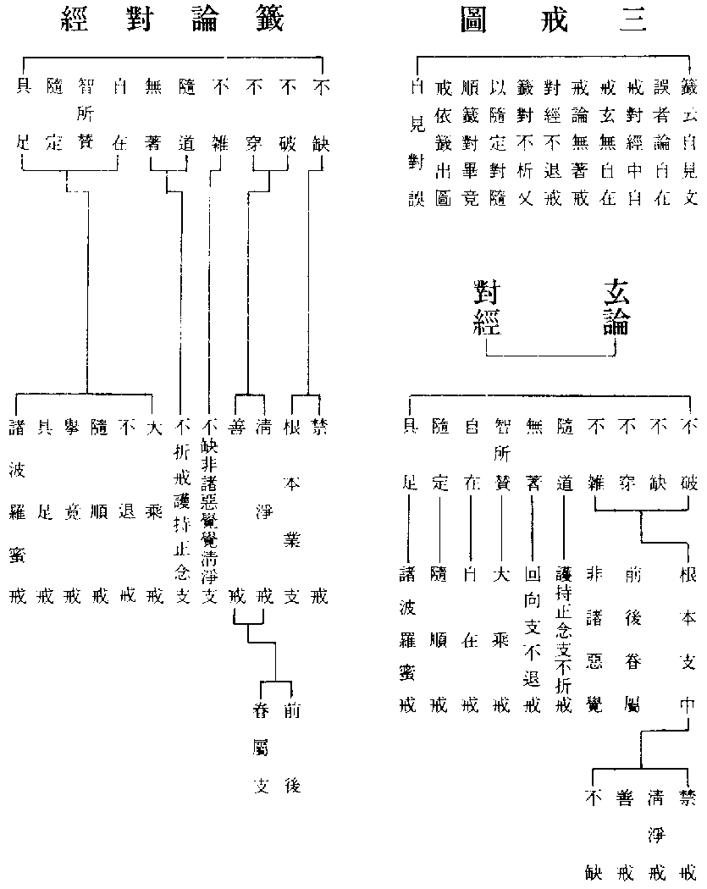
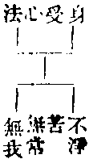
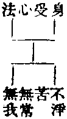
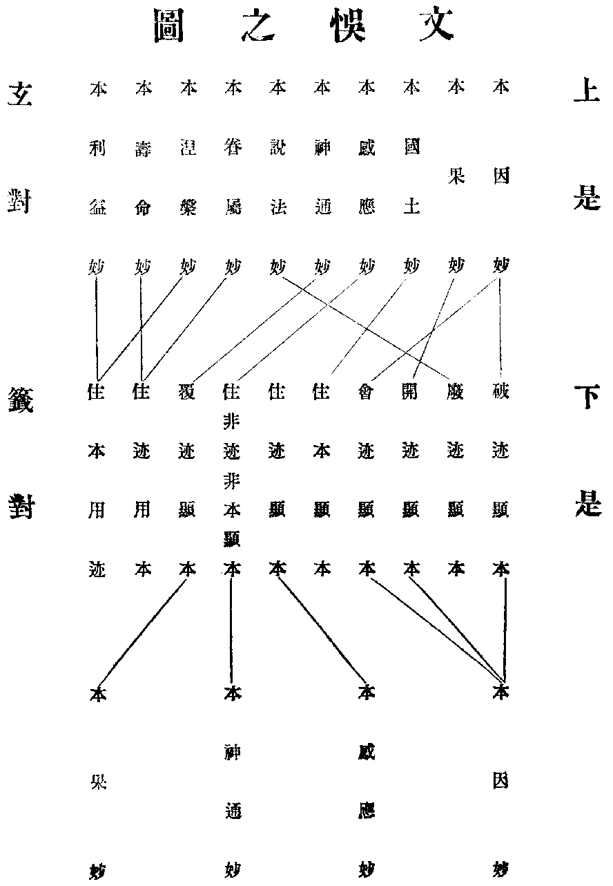

# 法华经玄签备捡



> **藏经**：卍新纂大日本续藏经（新纂卍续藏）　**册次** 第 28 册（X28）　**编号** X0588　**部类** 法华部　**卷次** 4 卷　**篇幅** 78,233 字

> **作者（译者）**：丹丘沙门　有严　注

> **卷／品**：12 卷 · 2 品



---



## 目录



  - [No. 588-A 玄签备捡序](#no-588-a-玄签备捡序)

- [玄签备捡卷第一](#玄签备捡卷第一)

  - [缘起序](#缘起序)

- [释签卷第二](#释签卷第二)

- [释签卷第三](#释签卷第三)

- [释签卷第四](#释签卷第四)

- [玄签备捡卷第二](#玄签备捡卷第二)

- [释签卷第五](#释签卷第五)

- [玄签备捡卷第三](#玄签备捡卷第三)

- [释签卷第六](#释签卷第六)

- [释签卷第七](#释签卷第七)

- [释签卷第八](#释签卷第八)

- [玄签备捡卷第四](#玄签备捡卷第四)

- [释签卷第十](#释签卷第十)



---



### No. 588-A 玄签备捡序



丹丘沙门　有严　述



昔我祖以辅教为重任，如来所遣，行如来事，斯之谓乎。所著释签十卷，其词典，其理诣，适足为敏於学者。因兹以了玄文，因玄以洞经目，因目以达心要，而入甘露之门。以此，其或后学习读未久，尚患玄签之文，其言隐而难援，引影而略，虽迟回於简编之间，何暇寻究他文，以博闻见。(愚)甞於元丰年中，幸藉讲贯，次更锐意捡讨，遂輙加注释，以易其难，以广其略。文中有传写笔误者，又刊正之。岂独自防违缪，亦以少毗晚秀修学之美，析为四卷，以备捡阅，因命曰备捡。或达者读之，无谓加水於乳，投石糅金，以参合衒惑为诮。



> 时第七宝叶新天子即位改元元祐丙寅夏五月哉生魄再治始於樝庵序



No. 588



------



## 玄签备捡卷第一



### 缘起序



君山



今岳州博物志云：洞庭君山，帝之二女居之，曰湘夫人。又荆州图语曰：湘君所游，故曰君山。



除馑男



分别功德论云：世人饥馑，色欲比丘除此爱馑之想，故云除馑。



普门子



普门，乃名也。下文只书普之一字，人或云云，今疑是脱却门字也。据阳羡蒋防为普门作文集序云：普门，姓何氏，魏吏部尚书晏之后，其胃世孙，常州仪兴县尉玠之子。公甞战文于场，后抽簪朝廷，谢去尘俗。居岳州南岳寺，方丈之中，唯儒书、佛经、铜缾、锡杖、麻衣、葛屦而已。贞元八年季冬六日，示灭于君山僧馆，春秋八十有四，僧腊四十五。有门人昙环，得公遗文二百餘篇，勒成十卷云。



属辞



属音祝。礼记经解云：属辞比事，春秋教也。



成列



谓罗列。



开合之旨



诸法章段，皆有开合，亦无出于四教也。今且明五章十妙开合之相。五章开合，如玄文第一。三种开合，谓五种、十种譬喻等。若十妙开合者，如心、佛、众生三法名合，各具十妙名开。又十妙名合，一百二十重妙名开。又境妙名合，七科谛境名开。智妙名合，二十番智名开。乃至利益妙名合，十番利益名开。餘妙准知。又迹门十妙，开因合果。本门十妙，开果合因。



十子既往



灌顶多闻法，慎发持寂照。顺真智韬定，发智操履俗。智晞习静道，势慧开普明。摄众净辩强，记慧普现像。



幽赞



周易说卦云：昔者圣人之作易也，幽赞神明而生蓍。幽赞者，韩康伯云：幽，深也；赞，明也。谓伏牺作易，深明性命之理也。普门以荆溪深明於智者之道，与圣人作易同。



方绝



唯圣人述作，方绝人之疑。



三转遂周



昔於波罗奈转四谛法轮。



一乘载导



今复转无上最大法轮也。



蒙求



周易蒙卦云：匪我求童蒙，童蒙来求我。谓儿童不知所从而多蒙蔽，故来求我。击去蒙昧之情，故曰初六发蒙。



不远而复



章安多闻，十子既往。圣人之道，不远而再复者，有荆溪师在焉。复卦云：初九，不远复，无祇悔。



志学



礼云：有志於学。



振於



振举也。谓举起於先达者之上。



无适



适音的，亲也。论语云：无适也，无莫也。君子无亲踈。



以虗受人



易咸卦曰：君子以虗受人。说者谓夫欲感人之心者，必须空虗其心，受纳於物，无所弃遗。何妥云：虗心受人，不间不拒，物皆归己，君子之志也。荆溪禅师慈心接物，若是。



嶋夷作难



作难者，安禄山也。禄山本胡人，自范阳举兵犯阙，玄宗避难幸蜀，禄山僭称大燕王，据洛，为安庆绪所杀。后广平王率兵一十五万讨贼，斩首六十万级。退至代宗，又西蕃侵京，万姓劳苦，天下丧乱，也。



侚



辞润切以身从物曰侚。



僶俛



上音泯，下音免，谓俯仰也。



暴露



暴，音仆。谓无屋以庇风雨。孟子云：秋阳以暴之。又薄报切。



思逸功倍



神思逸豫，而功业多矣。礼云：师逸而功倍。



洋洋乎



深广貌。



肯綮未甞



綮，苦挺切。庄子云，庖丁谓文惠君曰，臣之所好者道也，始臣解牛之时，所见无非全牛，三年之后，未甞见全牛，臣以神遇，不以目视。技经肯綮之未甞。郭象注云，技之妙也，常游刃於空，未甞经槩於微碍也。释音云，肯者，著骨之肉也。綮者，牛之骨肉交结处也。此引庄子一句，以比登门之徒有利根也。



耻躬不逮



逮，及也。论语孔子云：古者言之不出，耻躬之不逮。注云：古人之言不妄出口，为身行之不及也。此比登门之徒望涯退者，有钝根也。



大科不举



玄中大科之意，先德往往有失。提纲。



观象得意



周易畫卦，皆以象言，如乾龙坤马之类是也。易曰：象生於意。故可寻象以观意，乃至得意在忘象，得象在忘言。佛教亦尔。



击其大节



古人作咏歌，皆击竹而和之。文选云：汉女击节。今普门法师作序，击扬发挥释签之大义，如击节而和。



天王



孔子修春秋，得正统者书天王，谓天子法天行道，故号天王，今谓玄宗也。



陕郛



陕谓西蜀也。郛，郭也。玄宗避禄山之祸幸蜀，年则癸卯岁也。次年丙辰。



月，贞于相



尔雅：六月为且，七月为相，八月为牡。贞，正也，谓正当七月也。



句逗



逗亦句义圆其语耳，解在笺难。旧引古诗二月轻霜春逗遛以释句逗，非矣。逗遛本稽留之义耳，如云逗遛不进、逗遛蛮落是也。



迦竺



一姓迦摄，名摩腾；一姓竺，名法兰也。



台衡



天台智者，衡阳南岳。



纵有第一



如蒲州泰法师，不曾听学，自解经论。时人语云：蒲州不听，泰。



推众不受



推，吐回切。大师谢遣门徒曰：初瓦官四十人共坐，二十人得法；次年百餘人共坐，二十人得法；次年二百人共坐，减十人得法。徒众转多，得法转少，妨我自行化道。可知群贤各随所安，吾欲从吾志也。



王制



礼记篇名也。汉文帝博士所集井田。方里为井者，孟子云方里而井，井九百亩是也。十井为乘等者，包以古之大国不过百里，以百里赋千乘计之，每十井为一乘，是方一里者十为一乘，方一里者百为十乘。开方之法，方百里者一为十里者百，每方十里者一为方一里者百，其赋十乘，方十里者百则赋千乘，地与数适相当，故曰适千乘也。此乃夏之公侯，殷之国也。



托胎灵瑞



母氏梦香烟五彩，轻若雾，萦回在怀，欲拂去之。闻人语曰：宿世因缘，寄托王道，福德自至，何以去之？又梦吞白鼠等也。



诞育徵祥



诞生之夜，神光满室，兼辉隣里。



髫齓



髫音条，始生发也。齓音嚫，毁齿也。礼云男子八月而生齿，八岁而毁齿也。



精诚



甞於长沙像前发愿，誓作沙门，荷负正法，为己重任。精诚感通，梦佛像授金色臂，摩其顶焉。



从师访道



始依慧旷律师，兼通方等。后寻南岳之时，属陈齐边境，兵刃所衡，轻生重法，涉险而去也。



临终示相



见观音来迎，言：他方华整，相望甚久，缘毕应时，吾等相送。又自言：吾位居五品。



灭后应验



或见放光，或闻弹指，或跛者拜起，足乃自伸。



叹恨不闻



止观十境见境毕，后分弗宣。次第禅门开为十章，一大章，二释名，三明门，四诠次，五心法，六方便，七修证，八果报，九起教，十归趣。果报等三，亦不复说释净名经，只至佛道品而已。后诸品亦不复秉笔。



宫墙



论语，子贡曰：譬之宫墙，赐之墙也及肩，窥见室家之好；夫子之墙数仞，不得其门而入，不见宗庙之美也。



钻之弥觉其坚高



论语，颜渊爱孔子之道，喟然叹曰：仰之弥高，钻之弥坚，瞻之在前，忽然在后，弥，益也。谓孔子之道，高坚不可穷尽，恍惚不可形像，仰而求之则益高，钻研求之则益坚，瞻之似若在前，忽然又复在后耳。



如饮大河



大品云：如渴者饮河，不过自足。又庄子云：偃鼠饮河，但知饱腹。



【玄】或引经论诚言，符此深妙



如标体大师引一经二论毕，章安又引身子同入法性名同，及大经声闻但见於空等诚言，以符深妙之旨。



【玄】或标诸师异解，验彼非圆



如下文释宗中，有师用权智为宗，权应明三，三是今经所弃，云何取所弃为宗？又有师万善中取无漏为宗，斥云此太局，又滥小涅槃，并非圆义之例。



中间迭废，唯废无开



如华严废二，鹿苑废三之类。



具如下说



文在位妙，废位中明。



留逗后缘



下玄文云：四阿含经成前人事善，逗后人事善。释签云：结集已留被末代。



如后如前



如莲华前后也。今废迹立本。乃是约机。华前而莲后耳。



若辨同异



第七云：通论本迹只是权实，别论高下宜用本迹，横论真伪宜用权实。本迹约身约位，权实约智约教等。



开废会三



玄云：开三显一，正就约理，傍论约教。废三显一，此正废教，若不废教，树想还生。会三显一，正就於行，人法俱会耳。



三根互转，得利钝名



疏云：先世值佛闻法，自有转下中为上，俱於法说得悟；自有转下为中，闻譬喻得解。下者不转，三周乃了。



【玄】发众圣之权巧



记主合引涌出菩萨以释之。如下方诸菩萨，各带无数眷属，说种种法，心无所畏，此权巧也。又云：我从久远来，教化是等众。此名为发，却不用此而指迹门。富楼那等，拂迹中弟子之迹。谓之显本者，寄昔迹而显今本耳。更详。



𧂐聚



𧂐应作积。



不论麤妙及以广狭



不以迹中麤狭，本中妙广，以判二用。



接近废偏



近远约喻，偏圆约法，二义同。



大师序意，一往似局



通於六尘，局於音声。



章安一往似通



局在音声，称之为经。



诸法诸经等体



诸法体者，下文云：毗卢遮那遍一切处，不出四谛，悉用实相为体。净名云：从无住本立一切法。诸经异名，或真善妙色，或毕竟空，或如来藏，或中道等。诸行体者，有信行、法行及十乘体。



别序具五



集众现瑞，疑念发问，答问。



六瑞



说法、入定、雨华、地动、众喜、放光。



四种，阿难



欢喜贤典藏海。



以小准大，亦应可知



小者，大论云：道品开三脱，三脱开涅槃，涅槃是无漏。又云：声闻缘空修三脱，菩萨缘诸法实相修三脱。城有三门，若入此即发真无漏。伏道名三三昧，断道名三解脱。大者，伏道空，三昧即空观，无相即假观，无愿即中观。断道三解脱，即是三德耳。



以圆斥三



如弥勒为兜率天王等说不退转行，乃至为净名诃云：无以此法诱诸天子。又云：当令此诸天子舍於分别菩提之见。疏云：方便菩提，无人有教。若执不舍，障入一实。故大经云：自此已前，皆名邪见。是故须舍等。



以圆斥藏



如舍利弗於林中宴坐，净名诃云：夫宴坐者，不於三界现身意，是为宴坐。疏云：身子不以趣佛慧入上诸禅，必静处端身敛念，方得入定。身如木石，心如死灰等。真宴坐者，以趣佛慧，於九大禅及三乘定随意即入，是名不於三界现身意也。经又云：不起灭定，现诸威仪，是为宴坐。疏云：不思议定有体有用，故能不起灭定，现十界威仪。如阿修罗琴，随人吐韵。



以三教斥藏



如目连为居士说法，净名诃云：不当如仁者所说。疏云：是用衍门三教，别破目连三不当。一者、外如法相说，内如法相解，是用通教即空斥不即空，破说法不当道理。二者、外当了根缘，内善知见得无罣碍，是用别教破不当根缘，不得四无碍也。三者、外慈念众生，内念报佛恩，是用圆教破不当佛心。能用三教说法，即是如法说也。



若历七重及以四教



七重乃二谛也。有通者，是泛示谛耳。随情者，情性不同说随情异，如顺盲情种种示乳。随情智者，情谓二谛，二皆是俗，若悟谛理乃可为真，真则唯一，世人所见名世谛，圣人所见名真谛。随智者，圣人悟理非但见真亦乃了俗。有别者，以随情等三历四教成七二谛，合二十一谛，具如二谛境中所用。



礼记第七



孔子曰：大道之行也，与三代英，丘未之逮也，而有志焉(大道，五帝时也。英，俊选之光者。逮，及也)。大道之行也，天下为公，选贤与能，讲信修睦(公，共也。禅圣授圣，〔不〕家之睦亲也)。故人不独亲其亲，不独子其子(慈孝之道广也)，使老有所终，壮有所用，幼有所长，矜寡孤独，皆有所养(无匮乏也)。今大道既隐(隐，犹去也)，天下为家(传位於子。传，文专反)，各亲其亲，各子其子，货力为己(俗狭啬。为，于伪反。啬，音色)。大人世及以为礼，城郭沟池以为固(乱赋繁多，为此以服人也。大人，诸侯也)，礼义以为纪，以正君臣，以笃父子，以睦兄弟，以和夫妇，以设制度，以立田里，而兵由此起(以其违大道敦朴之本，教令之稠，其弊则然。老子曰：法令滋章，盗贼多有)。



【玄】甚微，智



经云：自体本来空，有不二不尽。又云：离念及心道，智起佛境界。论云：自体本来空，智自空故。此自体空，有不二不尽。如是取句，显离三种空摄：一、离谤摄，二、离异摄，三、离尽灭谤摄。又甚微义者，经云：自性常寂灭，不灭亦不生。论云：常寂灭者，自性离烦恼故，非先有染后时离故。不灭者，非一往灭，为不舍利益众生故。不生者，出世间故。如是此智不住涅槃世间中故。如是观行甚微、依止甚微、清净甚微、功德甚微。



通简迹中一切因果横竖等



因，谓六度万行等之因。果，谓燃灯佛与记等果。横，谓十方分身等。竖，谓华台受职等。



【玄】自行二智



如疏中云：一切种智名实智，道种智名权智。又自行之权，道前方便，约诸法门是权智，无若干者是实智。



掷象



经云：太子与弟难陀、调达出园捔力已，调达前行，见一大象，以手搏之而毙。次难陀出，见象当途，拽之道旁。后太子出，见象用左手提起，右手托而掷之。象堕林外，地为之作坑也。



见净如梵天



净名经云：螺髻梵王语舍利弗：我见释迦牟尼佛土，清净如自在天宫。舍利弗言：我见此土，丘陵坈坎，荆棘砂砾，土石诸山，秽恶充满。



巨身



经云：彼时佛与无量百千之众生恭敬围达而为说法，譬如须弥山显于大海等。



细身



偈云：始在佛树力降魔，得甘露灭觉道成也。



【玄】恐畏，欢喜，厌离，断疑



经云：佛以一音演说法，或有恐畏或欢喜，或生厌离或断疑，斯则神力不共法。疏云：畏苦，喜灭，厌集，断道。又畏苦世界，欢喜厌离，为人对治，断疑第一义也。



二处引楞伽经



第三云：经云无位，唯此一文。上下诸文尽明位次，然多辨通、别，少明藏、圆。若论智、行，通其四教，验知方等明矣。又云：楞伽人云：此经开权。若尔，何故此斥二乘。



土圭



周公居摄四年，欲求地中而营王城，於是建都。用圭长尺有五寸，夏至日中半，立八尺之表，北得影尺有五寸，影与土圭等，此为地中。郑司农云：凡日影於地，千里而差一寸。



见土复秽，得法眼净



经中佛以足指按地，即时大千世界珍宝严饰等。舍利弗言：本所不见，本所不闻，今佛国土严净悉现。后摄神足，於是世界还复如故。求声闻乘三万二千人得法眼净。



及俗众室外为说无常



经云：以方便故，现身有疾。以其疾故，国王、大臣、长者、居士、王子、宰官等，无数千人，皆往问疾。居士因以身疾，广为说法云：诸仁者，是身无常无强，无力无贤，速朽之法，不可信也。为苦为恼，众病所集，智者所不怙也。



【玄】三道四果



三道，三乘也。四果，三乘加佛，如下文释。



【玄】寂场



灵裕法师寺诰云：祇园有莲华藏世界，以七宝庄严，谓之寂灭道场。卢舍那佛说华严经於此。



此与方等恐畏等



向引经及疏已注。



不定者，即指胜鬘等



古师谓别有经非渐顿摄，而明佛性常住者，胜鬘、金光明是也。此名偏方不定教。玄文斥云：殃掘之经六年所说，列次第众，委悉餘经弹斥明常，分明餘教应同入次第。今判作偏方不定，净名亦弹斥，那得引同次第？



举一以例



前但云於此是显，於彼是密，若是后文一多为例，亦可前文中云於一是密，於多是显，或於多是密，於一是显。



问者加说，名字咸同



般若时，十方问者悉名憍尸迦，说者皆号须菩提。



大遒



疾由切。误也。字应作猷。猷者，美也。尚书云：以阐大猷。



时世念



过现未世，初中后时，前次后念。再言之者，谓多时多念。



即指法身地



签下文云：法身地者，自本地真因初住已来，远鉴今日乃至未来大小众机，故云我本行菩萨道时。又文句记云：法身本意者，若望十方无时不应，今准此方未设化前，乃至久远未结缘来，并名法身地。



直述所解



经云：善说如来真实功德。诚如所言，等。



领所不及



经又云：如来复有无量无边功德，汝等若於无量亿劫说不能尽。



故互说之



本时既有长久短近，迹时亦有长久短近，但迹中久近与本时有异耳。玄文近近，近须兼远，此迹中近远也。又云远远，远须兼近，此本中远近也。故云互说。



自是一边



或作途。



弥勒初以伏疑潜难



疏云：难因请生。请云：佛子文殊！愿决众疑。文殊难云：若疑，应问：众既不疑，我何所答？弥勒释云：四众欣仰，瞻仁及我。今云弥勒难、文殊释，知是写误也。本是文殊难耳。



文殊释云我见等



疏云：文殊广引先佛曾说法华，弥勒疑云：诸佛赴缘，人时各异，古佛虽名法华，今佛何必如此？文殊断云：我见灯明佛乃至欲说法华经。此文乃是弥勒疑，文殊释。



正证



多正。



十山



雪山香山轲梨罗山，乃至苏迷卢山。



【玄】开示悟入，【玄】亦约行次第



与前释不同者，以开等四摄诸义故。



只由宗用



名体教相，大略是同。唯宗与用，於五双中，一一各别。



新旧医，如餘文说



旧医外道，新医释迦文出涅槃，具如笺难中具引。



父去留药是施权，其父还来是显实



此二句旧签元无，越本中增加也。况父之来去，本喻圣人垂应生灭，且非留药，药必偏圆并留，来须胜劣俱应，又何甞留药唯权、还来显实？若喻权实者，如疏云：过未各有形声、权实二益。形二益者，经云：自说名字不同、年纪大小，大即胜应、小即劣应。声二益者，经云：种种方便说微妙法。方便权也，微妙实也。若要句类，当云形声劣小是施权，形声胜妙是显实。



如前所用



前文云既不会正体摄属何法，乃至云并他经所说，非今经体。



十界三道，以下文分别约十界故



玄引正法念云：𦘕人分别五彩，图一切形，端正丑陋，不可称计。原其根本，从𦘕手出。六道差别，非自在等作，悉从一念无明心出。无明与上品恶行业合，即起地狱因缘，如𦘕出黑色。乃至无明与上品善行合，即起天因缘，如𦘕出白白色等。



------



## 释签卷第二



【玄】墨印



墨谓文墨，用结集故。如佛弟子从佛闻法，亦旋书于贝叶。故分别功德论云：迦旃延撰集众经，最妙要慧，呈佛印可是也。又十住婆沙云：佛欲灭度，告阿难云：汝从今后，依契经，莫依人。或有比丘言：我现从佛闻等，应捡经律印之。如国家墨诏、墨勅、墨旨同。



【玄】一切行苦，一切行无常，一切法无我



般若经云：有诸天人，多贪著乐，为破彼故，说一切行苦。沙门婆罗门等，乃长寿天，多起常见，为破彼执，说行无常。外道邪见，执身有我，为破彼故，说身无我耳。



教行两文不同



玄云：无二者，谓有无皆楷定，故。



更立苦为四印



净名疏云：三法印，印声闻经。何者？若苦、无常、空，合无我及以寂灭。空、无我，即空解脱门；寂灭、涅槃，即无相解脱门；无常、苦，即无愿解脱门。又俱舍疏云：声闻经理弱，故须三印：治破爱观无常，治破见观无我。若入苦忍、真明，俱得寂灭。又无常等三，是能趣行；寂灭、涅槃，是趣果。



【玄】择精进喜治之



善别真伪为择，不缪行无益之行为进，得真法喜为喜。



【玄】除舍定治之



善断烦恼之境，为除不忆虗伪之境，名舍。於禅不起见爱，名定。



【玄】随依一觉



辅行云：定慧各三，随用一，得益使止，无假徧修。



【玄】若十因缘



语出大经，谓十二因缘中，除未来老死二也。过去善种，在无明等中，可受道故。



【玄】记鸽



祇桓寺有鹰逐鸽，佛谓舍利弗言：此鸽於恒沙大劫中，常作鸽罪讫，得出轮回，后得人身，经五百世，乃得利根，乃至三阿僧祇劫，行六度行，十地具足，作佛度众生。



仰覆世界



华严经中说世界多种，有净世界、垢世界、仰世界、覆世界等。天亲十地论释云：倒住者，不造舍宅住故；正住者，造舍宅住故耳。



孔子四德



论语云：子以四教：文、行、忠、信。正义曰：文谓先王之遗文。行谓德行。在心为德，施之为行。中心无隐谓之忠。人言不欺谓之信。此四者有形质，可举以教天下，故孔子必先之。



【玄】赏延于世，刑故无小



二句并尚书大禹谟第三文也。延世者，谓人谪罸不可延及后世之子孙，唯赏功可及耳。刑无小者，天子法天行道，凡刑戮不可以輙小。



更有不同之相



若云八万四千法藏即苦谛，八万四千尘劳即集谛，八万对治门即道谛，八万六波罗蜜即灭谛。



通教六地与罗汉齐



止观云：但六地名离垢，只可与阿含齐，不得与罗汉齐。第七、方便般若，出假化他，用此名目为便。若取七地齐罗汉，约诸地对果向，七地正与第四果齐。对果向者，下玄文云：铁轮位於通是乾慧地，三十心是性地，八人见地是欢喜地。薄地向果，向即离垢，果即明地。离欲向果，向即𦦨地，果即难胜地。已办地向，果即现前地，果即远行地。



从别以明别



上一别字恐误，应云从通以明别，以法宝即通验之，知是通尔。



小乘



疏云：语诸作人，即示念处，能破四倒，勤断二恶，生二善。咄！男子！是警觉勤作纷动，令舍散入静，修如意足，入顶位也。当加汝价，煖法观中不能发真，如意观中能发无漏也。好自安意，得五根安固难坏，入忍位也。所以者何？我老汝少，佛具智断名老，汝居道始名少，入世第一也。更与作字，即八正入见道中。虽欣此遇者，思惟未尽，犹居学位，未得无难，故二十年中常令除粪。



能得神通



能字恐是如字耳。以疏云能履深水如神通。



有本无第三句



谓无於诸世间一句。



【玄】教那忽是第四时



光宅谓涅槃是第五时，法华是第四时。若言是者，法华与般若同味。



大品、习应品二乘如萤火虫



经云：菩萨能作是念：我当行六波罗蜜，乃至十八不共法，成阿耨菩提，度脱众生，令得菩提。譬如萤火虫，不能作是念：我力能阎浮提普令大明。声闻支佛亦尔，不作是念：我行六度等。



验知音破



破，应作有。



【玄】法，不住法



禅波罗蜜中解观心无心法不住法中云：知心数为法，心王为心，受想行三阴为法，识阴为心，所缘为法，能缘为心，能生为法，所生为心，所观之境为法，能观之智为心。



彼佛法界亦兼於果



彼止观约心明佛十如，故今签云：寄果明理性。彼云：缘因为相，了因为性，正因为体，四弘为力，六度万行为作，智慧庄严为因，福德庄严为缘，三菩提为果，大涅槃为报。并寄果耳。



诸佛尚亦不说



佛尚三止，岂可自輙云十界各具权实？今以九界为权，且依显耳。



广释十如



广恐应作通字。



彼叙外人而执定计



计因中有果也。经云：有诸外道作如是言：因缘和合则有果生。若众缘中本无生性而能生者，虗空不生亦应生果，虗空不生非是因故。以众缘中本有果性，是故合集而得生果。所以者何？如隄婆达欲造墙壁，则取泥土，不取彩色；欲造𦘕像，则集彩色，不取草木；作衣取缕，不取泥木；作舍取泥，不取缕线。以人取故，当知是中各能生果；以能生果故，当知因中必先有性。



譬中譬合



多譬合二字。



尽智无生智



辅行第十引毗昙云：尽智者，谓我知苦，乃至知道。无生智者，谓我知苦已，不复更知，乃至修道已，不复更修。真位究竟，名为解脱。证真之后，能为他说，名为知见。



中含二十七



二十七人者，学人有十八，谓四向、三果、信行、法行、信解、见得、家家、一无间、五那含、为中生、行不行、上流。无学九人，谓退分、护分、思分、住分、达分、不动分、不退分、慧解脱、俱解脱，共二十七人。



三果下，疑



疑上脱释字。



若生实报，则不取小乘无漏为因，如餘文



下玄第二云：断别惑生变易者，如初地初住断惑是也。以顺道法爱为因，无明为缘，生变易土。又云：地地皆有万行，福德为因，无明为缘。



因缘如止观第五文



彼云：因缘有逆顺。顺生死者，有漏业为因，爱取等为缘。逆生死者，以无漏正慧为因，行行为缘，俱损生破惑。顺界外生死，亦以无漏慧为因，无明等为缘。若逆生死，即以中道慧为因，万行为缘，俱变损易生死，故。



不心轻畜生



不慢心。



以下，后文



多一下。



因缘生死



因缘生死即初地已上，有后生死即第十地，无后生死即金刚心。



慧眼菩萨



问云：如来相好，为有报也？为无报耶？文殊言：如来色身有报，法身无报。复问云：去贪欲，内心净，获大果，六度之法，非无报相，如何得成法身耶？文殊言：如来法身，有耶？无耶？慧眼曰：色身是有，法身是无。如我观察如来身者，非报非无报。



【玄】借三种为譬



上观第五不思议境末，具有三譬，谓如意珠、雨宝、三毒惑心及眠中、梦事。



寰中



法界为城，法王所都。法王无偏，理性无外。



此中多意，不复委释



阿含中，佛告比丘：有四马：一、见鞭影即便惊悚，二者、触毛乃惊，三者、触肉乃惊，四者、彻骨方觉。经中，初合闻他聚落无常即惊，次合闻己聚落无常生厌，三者、合闻己亲无常生厌，四者、合己病苦方厌。大经亦以四马喻生、老、病、死，故知二经并喻三藏中意。今借喻四教，快马喻圆，如贪欲即是道等。已上并辅之。



------



## 释签卷第三



或存或没



存则境妙中二，谓谛缘也，洎感应说法，眷属利益等也。没则智行三法，神通等也。



三仙



一、迦毗罗明二十五谛谈因中有果：一者、从其冥初生觉，过八万劫前冥然不知，但见最初中阴初起也。亦云世性，谓世间众生由冥初而有，即世间本性也。餘二十四谛具如彼。二、优楼僧伽，三、勒沙婆。



二天



一、毗纽天外人，计梵天生四姓，口生婆罗门，臂生刹帝利。摩醯首罗天，此云大自在，能倾覆世界，如是仙天外人俱事之。



从无明至老死，有十一番，但十个中间，一一皆生十二支，故十中间有一百二十



彼经：过行比丘白佛：如我所学十二因缘甚深之法，我今当说。无明缘行便生十二，行缘识便生十二，识缘名色便生十二，名色缘更乐生十二，更乐缘六入便生十二，六入缘爱便生十二，爱缘受便生十二，受缘有便生十二，有缘生、老、病、死、忧、悲、苦、恼便生十二。皆是捡印本官经？因缘品中作如是说也。常途云名色缘六入，而彼文云更乐，恐更乐只是名色耳。又合云受生爱，而彼云从爱生受，又阙触、取，况只说八支十二耳。若销今文，从无明至老死，须云十二番。若十个中间，应云无明生行，十二行生识，十二识生名色，十二名色生六入，十二六入生触，十二触生受，十二受生爱，十二爱生取，十二取生有，十二有生生十二，则有十中间一百二十支也。圣意难量，或经本中误，学者更详。



正是今文第二解



第二、是亦有差别，因是缘起故。



三者、不生苦爱



似多一者字。



连缚等四



婆沙委论具有四种十二因缘：一者、刹那；二者、连缚；三者、分位；四者、远续。后三只是三世十二因缘，以约能顺生后等受名也。言一念者，非谓极促一刹那时，谓善恶业成，名为一念也。



色界、无色界无名色



若欲界中名者，即初托胎时之妄念也。色者，初认父母二滴以为己有也，上二界无此故耳。



还生色者，入无餘界



上流般。



欲，有三法随逐



淫、眠、食。



餘二句可见



无色续无色，色续色。



亦可喻圆门本有



有应作无。



【玄】破此，如止观中说



只是不思议境中，非纵横并别及横竖八句，推捡情计以显无耳。



前二指前竟



似多前二两字。



三种意生身



楞严经中意生三种：一、入三昧乐意成身，则三、四、五地心寂不动故也；二、觉法自性意成身，即八地中普入佛刹，故以法为自性；三、种类俱生无作意成身，谓了佛证法。成之与生并从果说，此约通教及以别接竖判次位。初文虽云五地，亦兼七地即入空位也，八地即当入假位也。种类俱生云了佛证法，即是入中属佛种类，未必自证。若接入别，七地已前入别十住，八地已去接入十行，知佛证法是入回向，并非证道，故名意生。仍本为名，兼不接者共结此位，故并云地。辅行中释此，更开五、七、九种之相。



向是生死，背是涅槃



若据来者向义，则不痴是来义也，应须云向是涅槃也。又云去是背义者，则痴是去义也，应须云背是生死。今此二句向背可疑，若据二乘则以背生死向涅槃为义，菩萨则以背涅槃向生死为义。今非辨二乘菩萨向背，且以背涅槃向生死是俗，背生死向涅槃是真，以明中道耳。甞略捡宝箧经，未见其文，请后贤更委捡之。



故成无三智



多一无字。



【玄】从三生二，从二生七等



释云：烦恼生业，烦恼有三，谓无明、爱、取，以生行、有，此乃三生二也。行生名色五，并生老死等，此乃二生七也。七生三可见。



【玄】盆器、米面



疏释云：禅体含支林如盆器，生空麤如米，法空细如面。



十住菩萨但见其终，不见其始



此大经二十五文也。净名疏八释云：当知无明无本，故十住见终不见其始，诸佛如来见终见始。记释云：十住见终者，但以最后得名为终。由断一分，见一分终，故云见终。其实无明不可云终。佛断最后，后相如初，故云见始。其实无明不可云始。若定终始，何名无住？若计无明有始终者，是谓法性有始终也。以全法性定无明故，亦全无明体是法性。问：若尔，过在大经。答曰：不然。有事有理。若从事说，若见法性始，即见无明终；佛见法性终，名见无明始。无始之始，名无明始；无终之终，名法性终。若从理说，应知二法俱始并终，况此二法自无二法，俱无始终。若从事理相待以说，从理故即，从事故离。始终亦尔。约非事理而论事理，於无始终而云始终。大经之文带别论圆，从事相待，故作此说。



八相虽异



涅槃云：八相名苦，所谓生、老、病、死，乃至五阴盛生。如是八苦法者，是名集；无八法处，名灭；十力、四无畏等，名道。



抟等四食



段食，入腹则消。触食，对前根、境、识三和合为相。思食，希可意境时，有资盛义，此通三界。识食者，由前三食势力盛故，势方增长。



譬喻者(毘昙师名)，阿毗昙中正量部异师为譬喻者，毗婆阇婆提说八苦



今未暇捡毗昙，且依婆沙出之。论云：分别论者作如是说：若有八苦相，是苦是苦谛；餘有漏法，是苦非苦谛。招后有爱，是集是集谛；餘爱及餘有漏因，是集非集谛。招后爱尽，是灭谛；餘爱尽及餘有漏因尽，是灭非灭谛。学八支道，是道是道谛；餘学法及一切无学法，是道非道谛。若作是说，诸阿罗汉但成就苦灭二谛，不成就集道二谛。所以者何？招后有爱，诸阿罗汉已断尽故；学八支道，得阿罗汉果时，皆已舍故。然论中不释餘有漏法非苦谛等，今诚消之。既云阿罗汉，恐是对自他言之。阿罗汉谛，若必谛真。若他有漏法，是他之苦，非我谛苦，及乃至道谛，皆以自他相对而辩。学。



眼智明觉



文句释云：若法忍为眼，法智为智，比忍为明，比智为觉，餘三谛亦尔，故成十六心。三根人各得十六，成四十八行。



知诸入为门，至餘如苦谛等



经云：知诸入为门，亦名为苦，是名中智；分别诸入有无量相，悉是诸苦，非诸声闻、缘觉所知，是名上智。乃至知识分别相，是名中智；分别是识有无量相，非诸声闻、缘觉所知，是名上智。如是等义，我於彼经亦不说之(中间知界，知色、受、想、行皆结，是名中智；分别诸界有无量相等，是名上智等语，例前后可知)。又知爱因缘能生五阴，是名中智；一人起受无量无边，声闻、缘觉所不能知，能知一切众生所起如是等爱，是名上智。如是等义，我於彼经亦不说之，故今注餘如苦谛。是灭谛中不可称计，与道谛中亦无量无边，两句之下皆云：非诸声闻、缘觉所知，是名上智。如是等义，我於彼经亦不说之，其义与苦谛是同，故但注云如苦谛。



世谛即第一义谛



世谛即苦集，第一义谛即道灭。第十二云：五阴和合称言某甲，凡夫众生随其所称，是名世谛。解阴无有某甲名字，离阴亦无某甲名字，出世之人如其性相而能知之，是名第一义谛(云云)。文殊白佛：若以真实为实谛者，真实之法即是如来、虗空、佛性。若如是者，如来、虗空及与佛性无有差别。佛言：文殊，有苦有谛有实，乃至有道有谛有实。善男子，如来非苦非谛是实，虗空非苦非谛是实，佛性非苦非谛是实(云云)。非苦非谛是实者，下智妙中用对四种四谛。



广释释世谛



多一释字。



圆破通等



通应作别。



经文不次



空假中次也。彼云：一切法趣假，色尚不可得，空趣不趣中。



诸文用义，以初证藏



因缘所生法之一句。



下文自有两品属藏



十二因缘品、破邪见品。



实语是虗语



下文云：起语见故，生死浩然。签释云：教本是实，凡情执之成见，见即烦恼为因，故苦果浩然不息。又云：实谛虽妙，执故成麤，如执中异边，执空异有。



前是废权观



签中先以次第三观，竖对四四谛竟。次以一心三观，总对四四谛。则前之废观为麤，次之开观为妙。开废同时，谛观体一也。



【玄】妙胜定经



佛言：我昔共文殊师利共诤二谛，死堕三途，经无量劫，吞铁丸，从地狱出，值迦叶佛，为我解说有无二谛。迦叶佛言：一切诸法，皆无定性，汝言有无，是义不然。一切诸法，皆悉空寂，此二谛者，亦有亦无。汝但知文，不解其义。



【玄】二生菩萨



今玄文判二生属三藏菩萨，若辅行中明大乘二生者，引大经佛说观因缘智四种不同得菩提异，说是语时十千菩萨得一生实相，五千菩萨得二生法界。章安释云：三乘同观第一义谛智解不同，一生二生乃是破无明一品二品，实相是别理，法界是圆理，即是利根接入别圆，破无明已八相作佛，是佛果出外义也。但观诸经会末得道，即识所说共别之意，小大二生学者辨之。



齐初僧祇初皆名尔前，故容有堕



常途论初阿僧祇即离五障在外凡位，第二阿僧祇在煖位，第三阿僧祇在顶位。初祇在外凡尚容有堕，况复尔前乎？



何必第三阿僧祇末始恶道出



记主意云：第三、僧祇之始，已离五障，何必至末耶？离障之义，三说不同。小四教中云是初祇，今此签文云三祇始。若俱舍中，百劫修相业时，方离五障。故论云：从修业菩萨得定，名生善趣贵家，具男念坚固也。



观於恶友及恶知识



友字误。经云：观於恶象。



恶知识者，坏无量身



经中云：坏无量善身。



臭身、净身等



恶象能坏不净身，恶知识能坏净身；恶象能坏肉身，恶知识能坏法身。



【玄】旻据佛果，出二谛外



辅行云：庄严云出，开善云不出，由三乘共学菩萨有但不但。古人不晓利钝两根，但诤佛果出与不出，终未见今开合之意。故知二家各得今文利钝一边，仍不知出外别照中道之境，用中道智进破无明故也。若不能知钝根依教与二乘人同证真谛，当知二师各得片意。若得今意，出与不出，义皆悉成。



【玄】进不成三，退不成二



通利根人，受别圆接。若只云二谛外无别理可照者，是进非通别圆之三也。设照别理，又退非藏通果佛之二法进退之失也。



【玄】约四假明二谛



大论但论三假。言四者，有人云：法假未见所出。若二十三家者，即光宅、敬脱、慧超并诸王侯，各咨二谛於昭明，而昭明悉答之。



根欲



十力中有根力、欲力。根力者，佛知他众生诸根上下相，如实遍知。欲力者，佛知他众生种种欲，如实遍知，无能坏、无能胜也。



如世第一，隣近於真，尚有多品



如身子上，目连中，餘皆下。



【玄】小云发障大云发障



云能翳月，譬惑能障真。云开见月，障灭智净。发者，开也。



始自迦罗



外道名也。为初教所破者，皆见惑阴入也。故曰：长阿含破外道。



世情多种



疏：第九、作多想经，在圣行品中。



名世、句世、缚世等



经云：云何名世？男女瓶衣，车乘屋舍等。云何句世？四句一偈等。云何缚世？卷合系结，束缚合掌等。云何法世？如鸣椎集僧，严鼓戒兵，吹角知时。云何执著世？如望远人有染衣者，生想执著，言是沙门，非婆罗门。见有结绳横佩身上者，便生念言：是婆罗门，非沙门也。



五种世法，名与前异



与人、我、众生、兔角等异。



【玄】如缘灭生使



四谛中灭本，非使因缘谛，遂生於七使。



西方经何量



彼疏云：外国经多度者，少何量者，记主易其语耳。



业即金等



经云：我今多有金银等。疏云：金即别教理，银即通教理。大品所谈真谛不出此二。



如三周中各有异名



疏云：初周名法说，通则具三：如优昙钵罗华，时一现耳，即譬说；若我遇众生，尽教以佛道，即因缘说。中周别名譬喻，通亦具三：我先不言皆为化菩萨，即法说也；於二万佛所，常教化汝，即因缘说也。下周通亦具三：众又清净，令入佛慧，是法说；有一导师，是譬喻说。而作三周者，从多从正，欲令名字不滥，各据一意耳。



【玄】自是一边



有本作一途。



止观中判三假文



以三藏判为随事三假，衍门三教为随理三假。



彭城寺嵩法师



徐州彭城寺，嵩云：佛不应常住，临终时其舌先烂。



畜八不净



经云：诫畜不过八种，皆名不净：一田宅园林，二种植，三贮积糓帛，四畜养人仆，五系养禽兽，六钱宝贵物，七毡褥釜镬，八象金饰床耳。



摄大乘明十种胜相，分为十品



一、依止胜相净不净法，即依止阿梨耶识。二、应知胜相，谓应知自性惑。三、应知入胜相，谓知三性能成入及所入，即唯识也。四、入因果胜相，谓入唯识因，是六度在通达位中入果，即是通达位中转成果也。五、入因果修差别胜相，即六度四德，在欢喜等十地中地地差别。六、於修差别依戒胜相，谓十地中一切戒诸恶不作。七、依止心学胜相，谓依止修习妙定。八、依慧学胜相，谓以慧为依止，即无分别知。九、学果寂灭胜相，谓灭差别智，即是无住涅槃。十、智差别胜相，即是如来智，离一切随眠障等(云云)。本论三卷，无著菩萨造。论中将十胜相分作十品，一一解释。又世亲菩萨作论释之，为十二卷。又义疏八卷，共二十三卷，并是明十胜相之义。前言三性者：一、依他起自性，二、遍计所执自性，三、圆成实自性。依他性者，谓依他起自性，实唯有识似义显现之所依止。云何依他起？何因缘名依他起？从自熏种子所生，依他缘起，故名依他起。生刹那后，无有功能，自然住故，名依他起也。二、徧计性，谓执诸行相生颠倒，缘何境界？取何相貌？由何缘成实？二者、清净圆成实。已上并论中文。



【玄】不思议四句，破执



前云无明之心，不自、不他、不共、不无因，四句皆不思议。若有四悉檀因缘，亦可得说。



一三三一



彼云：以止缘於谛，则一谛而三谛；以谛系於止，则一止而三止。譬如三相在一念心，虽一念心而有三相。止谛亦如是，所止之法虽一而三，能止之心虽三而一。以观观於境，则一境而三境；以境发於观，则一观而三观。



即是如来虗空佛性



佛告文殊：言实谛者，名曰真法，又名无有虗妄，又名大乘，又名一道清净，无有二也。有常乐我净，名为实谛。文殊难言：若以真实为真谛，真实之法即是如来、虗空、佛性。若如是者，如来、虗空及与佛性无有差别。佛云：有苦有谛有实，有集有谛有实，有灭有谛有实，有道有谛有实。善男子，如来非苦非谛是实，虗空非苦非谛是实，佛性非苦非谛是实。文殊言：所言苦者，为无常相，是可断相，是为实谛。如来之性，非苦、非无常、非可断相，是故为实。虗空、佛性非复如是。



婆沙中，尊者波奢说四谛



世谛、第一义谛亦难明了，今依婆沙出之。七十七云：脇尊者曰：一谛者，谓四圣谛各唯有一，唯一苦谛无第二苦，乃至道唯一道无第二道，故说一谛不违说四。复次言一谛者，谓一灭谛，为欲遮遣餘解脱故。以诸外道说四解脱，即四空处也。复次言一谛者，谓一道谛，为欲遮遣餘道谛故。以诸外道说多道谛，谓自饿为道、卧灰为道、饮风饮水、食果食菜、露形卧棘、或执不卧、或著弊衣、或服药、或断食等为道，如是非道。若佛说真道者，谓正见等八支圣道也。复次言一谛者，谓一灭谛，永舍一切生死苦故。又一谛者，谓一道谛，能断一切生死因故。餘契经中说有二谛：一世俗谛、二胜义谛。其义云何？有作是说：於四谛中前二是世俗谛，男女行住及瓶衣等是世俗事，入苦集二谛中。后二谛是胜义谛，诸出间真实功德皆入道灭二谛中。复有说：前三谛是世俗谛，苦集中有世俗事故。佛说灭谛如城如宫如彼岸，诸如是等世俗施设灭谛中有，是故灭谛亦名世俗。唯一道谛是胜义，世俗施设此中无故。评者曰：四谛皆有世俗、胜义。苦集中有世俗者，义如前说。苦中有胜义者，谓苦、空、无常、无我理。集中有胜义者，谓集因缘生理。灭中有世俗者，佛说灭谛如园、如林、如彼岸等。灭中有胜义者，谓灭、静、妙、离。道有世俗者，佛说道谛如船、如筏、如石、如山、如梯、如凳、如台、如观、如华、如水。道中有胜义者，谓道如行出。乃至云：尊者世友作如是说：能显名是世俗，所显法是胜义。复作是说：随顺世间所说名是世俗，随顺圣贤所说名是胜义。又大德说曰：宣说有情瓶衣等事，不虗妄心所起言说，是世俗谛。宣说缘性缘起等理，不虗妄心所起言说，是胜义谛。(已上正文)论文甚广，诸尊者说四谛各各不同，今亦略节耳。本为不识灭如园林、道如船筏，及捡论文，而论中不释。今曲释云：城宫园林可以栖止，如涅槃可住。船筏可以度人，如道谛可以出生死。



三界利钝一十九使



见利有十，谓身见等。思钝有九，谓上上等。且约一九见思，共论十九。



居在界外，莫不皆有十二支，如止观摄法中



止观云：若迷权理，则有界内相应独头等无明(云云)。若迷实理，则有界外相应独头等无明。故宝性论云：二乘之人，虽有无常、苦、空、无我对治，於佛法身，犹是颠倒，即是无明。独头无漏智业，为行三种意生身，亦是五种意生身。意即是识，身即名色、六入、触、受。无明细惑戏论未究竟灭，即是爱、取。烦恼染、业染、生染未究竟，即是有三种意。因移即是生，其果变易即是老死。辅行第五文末销释。



故云空、不空边，则分对两处道灭



故云者，指下文五三谛中也。空对界内道灭，不空对界外道灭。



苦集例此



但俗是界内苦集，中俗是界外苦集。



【玄】圆俗意通



言云云者，具六凡、二乘、菩萨、十如之异。



------



## 释签卷第四



至非想者，语其所依，乃至初禅



此定不缘识处，故名非想；不缘不用处，故名非非想。三界顶禅，世为极妙，外道计之以为涅槃。四禅各有支林喜乐等，外人亦计之为涅槃。今略四三二禅，故云乃至耳。



【玄】六艺



礼乐射御书数具如笺，难中解。



【玄】毗尼生信爱



论云：若於正法毗奈耶中，有少信爱，即信名爱，故名信爱。於正法中有信爱者，说缘道谛信；於毗奈耶中有信爱者，说缘灭谛信。问：此煖善根，具十六行，缘四圣谛，何故此中但缘道、灭谛，非苦、集耶？答：依胜说故。谓四谛中，道、灭胜故，出生死苦。



【玄】正法是三谛，毗尼是灭



论云：有说於正法中有信爱者，说缘三谛信；於毗尼中有信爱者，说缘灭谛信。



【玄】如佛为满宿



论中满宿，本二人也。谓马师满宿文云：如佛为马师并宿二比丘说：此二愚人，离我正法及毗奈耶，譬如大地去虗空远。佛告马师井宿言：吾当为汝说四句法，汝欲知不(云云)。此中何者是四句法？有说四圣谛是。所以者何？彼不见谛，造恶行故。有说四念处是。所以者何？彼由颠倒，造恶行故。有说四正勤是。所以者何？彼懈怠，造恶行故。乃至四沙门果、四静虑等，此二人於正法毗尼中，无少分煖。毗尼多种，谓时毗尼、方毗尼、种性毗尼、家毗尼、明毗尼、罸毗尼、犯毗尼、圣毗尼、贪毗尼、嗔毗尼、痴毗尼中，何毗尼耶？答：有说是罸罪毗尼，有说是犯毗尼，有说是贪嗔痴毗尼(已上正文)。毗尼律中，亦翻为灭。若说是贪嗔痴毗尼者，乃是三毒灭矣。大经亦云：马师满宿，无有煖法。何以故？於三宝所无。信心论作井宿、井满，二音少殊。



【玄】是其意趣



论中问云：煖有何意趣？答：先所修习一切善根，谓从布施乃至七处善，皆以回向解脱，是其意趣。问：煖依何而起？答：依自地起。问：煖依何为因？答：前生自地同类善根。问：谁为所缘？答：四圣谛。问：以何为果？答：顶以煖为近功用果。问：谁为等流？答：后生自地同类善根。问：谁为异熟？答：色界五蕴。问：有何胜利？答：能与涅槃作决定因，有说得煖定。问：不断善有几行相？答：十六行相。问：为缘名？为缘义？答：名义俱缘。问：为闻所成？为思所成？为修所成？答：唯修所成。为欲界系？为色界系？答：唯色界系。为有寻有伺？为无寻有伺？为无寻无伺？答：具三种(签云有觉有观等三，名别义同)。为乐根相应？为善根相应？为舍根相应？答：三根相应(玄加随所说)。为一心？为多心？答：多心。为可退？为不可退？答：可退。



并一具缚人，合七十三人



具缚者，先时未以世道断修惑，此名具缚人也。更有断修惑一品至五品者，此五人兼前具缚为六人也，至见道中名初果向。颂云：断次三向二者，第二向也。谓於凡位断第六品或七、八品，名断次三。此有三人，至见道中名第二向，趣一来果也。又云：离八地向三者，第三向也。谓先凡位断欲修惑第九品尽，或断初禅乃至无所有处惑尽者，名离八地。此有六十四人，谓断欲九品为一，断上地各九为九人，七九六十三，兼前一人成六十四人，此六十四人至见道中第三向，趣不还果也。是则六十四人并前断五品五人，又断六、七、八为三人，并具缚一人，共七十二人。俱舍、婆沙说同。



【玄】三三昧



签云：有觉有观等，但是名耳。若其义者，修证中云：有觉有观三昧，谓根本禅乃至特胜、通明、背舍、胜处，各有相应心数及诸功德等，名有觉有观三昧。无觉有观三昧者，谓诸禅中间乃至特胜、通明、背舍、胜处，各有中间与观相应心数及诸功德，名无觉有观三昧。无觉无观三昧者，谓从根本二禅乃至有顶及灭受想定相应诸功德，名无觉无观三昧。此三三昧更无别法，但是总诸禅以为三分耳。



例前九品亦越次故



前煖三顶三，次师以煖之下上越入顶位，以顶之中上越入忍位，根性不同，故记主云耳。



言离界地，自下升上



舍义者，如下引俱舍释圣由失地舍。



此等只是判四善根



论云：四种皆色系，云何差别？答：四善根虽同色界，而有可动、不可动，有有留难、有无留难，有可断、有不可断，有可虑、有不可虑，有可退、有不可退。诸可动、有留难、可断、可虑、可退中下者，名煖；上者，名为顶。诸不可动、无留难、无断、无虑、不可退中下者，名忍；上者，名世第一(云云)。以玄文只略说顶法，签中既云判四善根，故更出论文以广其义。



不动等是后二善根，准此可知



谓不为外尘所动，久住忍位，并世第一中无难不断，善根不退，为五逆。



【玄】生下，小信。此法不久停，故言下小



论第六：问：云何名顶？答：於佛法僧生小量信。又问：何故名顶？答：如山。顶谓如山，人不久住，若无诸难便过此山更至餘山，若无诸难便进至忍，若有诸难便退住煖。问：何故此信名为小量？尊者妙音作如是说：欲界名小，以下劣故。此在欲界，故名小量。又此顶位於佛法僧生小量信者，说缘道谛信、於法生小量信、有缘灭谛信。问：缘道灭谛可尔，是可信事、是生信处故。不说缘苦集者，烦恼恶行及所得果，犹如粪秽深可厌患，不应於中而生信乐也。



但不信三宝



论云：世尊为波罗衍拏摩纳婆说偈云：若於佛法僧，生起微小信，儒童应知彼，名已得顶法。问：此顶善根，十六行相，观四圣谛，何故世尊为摩纳婆说信三宝？答：彼於三宝，愚惑不信。然三宝希有，难可值遇，欲令信解，故为说之。有说：彼摩纳婆为苦所逼，欲求出要，来诣佛所，说是颂言：为苦所逼诸众生，不知出要来诣佛所，唯愿为说除众患，如热所逼入凉池。出苦之要，无过三宝，故佛为说於三宝信。有说：欲令所化於佛法中深生信重，故佛为说於佛法僧生微小信。若佛为说四圣谛者，所化有情便作是念：我等何用信重如是烦恼恶行、颠倒见趣及所得果苦集谛为？若佛为说佛法僧宝，彼便踊跃深生信重(已上正文)。言不信者，岂有煖位不信三宝？若不信三宝，何以禀教而位至煖耶？此或是语未禀教前。若以深生信重之言验之，或多一不字。以凡愚时不信重苦集，但言三宝耳。摩纳婆，梵音，此云少年净行，亦云儒童。儒者，仁也。



【玄】若世尊说苦集是可信敬，即受化者



此一句，下文略依论加便作是念一句，则使义易解。论云：若佛为说苦集，便作是念：我无始来，为此鄙劣烦恼恶行及所得果，扰乱逼迫，宁可信乐？若说道灭，便深信乐，不欲舍离。故於此中，偏论道灭也。



【玄】尽信四谛



论云：信有二种：一信可，二者信乐。於道灭谛具二种信，於苦集谛虽无信乐而有信可，故苦集谛亦生於信。故脇尊者言：为厌患苦集故，称赞道灭。谓此道灭寂静美妙，止息对治下劣鄙秽苦集法故。



【玄】於此三时，多诸留难



论云：於三时中，诸业烦恼极与行者而作留难：一、从顶忍入时，能感恶趣诸业烦恼极为留难。义言行者若入忍位，不复受诸恶趣生，我於谁身受异熟果？二、圣者离欲染时，能感欲界诸业烦恼极为留难。义言行者若离欲染，於欲界生定不复受，我於谁身受异熟果？三、得阿罗汉果时，能感后有诸业烦恼极为留难。义言行者若得阿罗汉果，定不复受一切生死，我於谁身受异熟果等耳。



亦不得起



疏云亦不起得修。



以观苦故，起能得得修彼苦下等



疏云：以观苦故，故能起得。修彼苦下，四、行相也。今文多一得字。



皆慧为体



论云：皆慧五除得者，出体也。此煖等四念住性，皆慧为体。若并助伴，皆五蕴性。(彼疏云：有定共戒为色蕴，餘四可知。)此煖等四，有能得得。助伴体中，得非煖等四善根体，故言除得等。餘同签文耳。



从苦谛起，一忍一智



观於欲界苦谛境，有无漏生，断苦下十使，名苦法忍，第一心也。次起一刹那，名苦法智，择灭无为，第二心也。次观上界苦类忍，名第三心。断上二界烦恼，证择灭理，名苦类智，第四心也。次观欲界集，名集法忍，名第五心。得集法智，名第六心。次观上界集类忍，名第七心。得集类智，第八心。次观欲界灭法忍，名第九心。得灭法智，名第十心。次观上界灭，名灭类忍，第十一心也。得灭类智，名十二心。次观欲界道，名道法忍，名第十三心。得道法智，名第十四心。次观上界道类忍，名第十五心。次起一刹那，名道类智，名第十六心。



【玄】除灭一切道



总灭之也。上下二道，缘行俱除。



【玄】见谛眷属不相离



从不胜见谛已下至何况有漏，并说见道功德，谓世第一不能胜也。见谛眷属者，论云：现观边所修世俗智是见道眷属，随属见道慧力殊胜。此法不尔(此法指世第一，下同)，又岂能胜杂修静虑？然彼等至(彼指见道)及所感生不共异生。此法不尔，又岂能胜初尽智时所修善根？然彼修时离一切障所依清净。此法不尔，又岂能胜空空、无愿无愿、无相无相三摩地？然彼尚能厌恶圣道，况於有漏？此法不尔。



熏禅



第四禅先修得已，更以多念无漏相续现起，从此引生多念有漏，从此复生多念无漏，如是渐渐减少，乃至最后二念无漏，次后引生二念有漏，无间复生二念无漏。夹熏加行成就相，次唯一念无漏，次复唯有一念有漏，无间复生一念无漏，名根本成。俱舍云：成由一念杂(云云)。夹熏者，谓前后无漏、中间有漏，使多念等漏俱成一念无漏，故言夹熏。生五含者，由熏禅有阶差，谓下、中、上、上胜、上极等。



前诸位义



多一位字。



【玄】不净安般



数息，观也。经云：安之言生，般之言灭。根本诸禅，从数息起。



【玄】依未至为最，依初禅为胜，中间为长



未到定者，欲界定后，泯然一转，不见欲界定中身首、衣服、床铺，犹如虗空。身是事障，障去身空，未来得发，名未到定也。依禅门中，二三禅后，皆有中间。今此文中，初禅之后，二禅之前，有禅定者，名中间也。



妙音师说：或七加欲界，依欲界身



疏云：妙音师说：煖、顶通依七地。於前六地者，未生、中间及四静虑，更加欲界。依欲界身九者(休论文)，谓煖等四依欲界人、天身起，除北俱卢、人趣、三洲及六欲天也。九处身起唯依欲者，能厌苦故。前三善根，三洲初起，后生六天亦续现前。第四善根，天亦初起，谓四善根唯一念故，故人、天趣皆得初起。三界女得二者(牒论)，此四善根唯依男、女，非扇搋等(扇搋者，黄门也)。前三善根，男、女得二。且男得二者，谓男得男善根及得女善根；女得二者，谓女得女善根及得男善根，故名得二。以煖等三，男转形为女，女转形为男，故煖等三女，男得二。第四女亦尔者(牒论)，第四善根，女得二种，同前煖等，谓女得女善根及得男善根，以女形转为男。若第四善根，男唯得一，谓男唯得男善根而不得女也。已得女身，非决择故耳。



圣由失地舍，异生由命终



明舍义也。圣舍煖等四善根者，由失地舍。谓此地善根若迁上地，此便有失。失此地时，善根方舍。若此地死，还生此地，不失地故，故煖等不舍。若异生舍，异生无见道资，故命终舍。(已上俱舍疏中正文。)今更引婆沙论释之。论云：若得忍已，便违恶趣。彼扇搋等身形鄙陋，是人中恶趣。若得忍等殊胜善根，必更不受彼类身故。问：得忍异生於命终位，既舍众同分，亦舍忍否？设尔，何失？若舍者，应堕恶趣，故乃言不堕恶趣。又若舍者，何故异生命终时舍？圣者不然。若不舍者，何故业蕴及六种蕴俱不说耶？如说：异生住胎藏等，俱成就身业。答：此应言舍(云云)。异生命终定舍於忍，善根劣故。异生依此地起此类善根，若有命终还生此地，舍同分故，上决定舍。况此善根是色界法，经欲界生，而当不舍？



煖必至涅



脱一槃字。



第一，入离生



疏云：离生者，见道名也。



【玄】欲委知，向彼寻



初对诸善根亦有差别：对闻所成名最，对思所成名胜，对不净观持息名长，对煖名尊，对顶名上，对忍名妙。次对与今玄文同。又论云：此至边顶名最，上品摄故故名胜，作吉祥故名长，体此进故名尊，性坚牢故名上，满所愿故名妙。又能作苦法忍无间缘名最，超过一切异生善根名胜，映夺一切世俗善根名长，能逮胜德名尊，无二分故名上，似无漏故名妙。又异生最后心故名最，能开圣道门故名胜，根猛利故名长，以於一切顺决择分此最上故名尊，折伏一切烦恼怨故名上，引爱果故名妙。



------



## 玄签备捡卷第二



**译者**：丹丘沙门　有严　注



释签卷第四(六纸玄三十九)。



亦须徧集



集应作习。



具如止观记料简同异



记引大论云：下地诸惑，因地未断，至树下时，以九无碍、九解脱合为十八，八忍、八智合为十六，为三十四心。是俱舍顿断之意也。婆沙云：下八地惑，初修禅时已断，唯非想地九品全在(云云)。俱舍、龙树俱不应误。俱舍取修禅时已断惑竟，不复更断。智论依餘部，虽有漏断，未名为断；至树下时，俱断非想，八地俱得名为无漏也。



如止观第五记



只是化他境中四悉檀各破四性之文耳。如世界中破性者，彼云：或说心具一切法，如云：三界无别法，唯是一心作。或说缘生一切法，如云：善知识者，是大因缘，所谓化导。或说因缘共生一切法，如云：水银和真金，能涂诸色像。或言离生一切法者，如云：十二因缘非佛所作等，其性自尔。餘三悉檀各破亦尔。



但缘六道中可爱十如等



六道中且如三涂，以表苦为相，恶报为性，摧折色心为体，登刀入镬为力，此皆苦耳，又可名爱耶？今言可爱者，只是贪爱五尘，能招三途之果，果中说因，故云可爱也。言可憎者，嫌恶五尘，起嗔恚心，亦招恶果，此亦果中语因耳。



故斥通无



偏教无谛是权，故无。



超越三昧



能超诸地自在入出。一超入三昧。离诸欲恶入初禅。从初禅超入非非想。从非有想非无想处起入灭受想。从灭受想起还入初禅。入二三四禅亦如是。二超出三昧。次第亦尔。



初二文者



多二字。



若不转麤成妙



多不字。



化他之权，意亦如是



虽云我亦如然，化他之权，终非自行之权。



震地逸敷



雷声震地而不闻，锦绣逸敷而不见。



【玄】通经之论，岂得为妙



下文指中论兼别含通，故为麤。



权、实俱立



既云施权故立，则　化他之权及化他之实二俱立也。俱破者，化他权实并为所废，故。



若开若会



约理则权实俱开，约行则权实俱会。



烦恼障及智障，具如止观第六



彼云：空假二观，当彼破惑，名之为智。今望中道，智还成惑。此惑是中智家障，故名智障。又中智不废，故名智障耳。



六界十如，结摄一切异名



如是相摄十二因缘中行、有，如是性摄无明、爱、取，如是体摄名色乃至老死，如是力摄无明、爱、取能生业力，如是作行、有能为苦作业，乃至如是报摄行、有招名色、报。摄四谛者，相、性摄集，体摄苦，作力、因缘又摄果报及苦。摄二谛者，六道、十如摄四教之俗等。具如下文诸境开合。



【玄】圆权则通



照不思议十二因缘生是俗，照不思议十二因缘灭是真。真俗不二，生灭同时耳。



於一一大，开为四句



若谓地是有，有即实，实是坚义；若谓地是无，是亦有亦无，是非有非无，皆是坚义。今明毕竟不可得亡，是坚性也。水性不住，谓水为有，有即是住；乃至谓水是非有非无，亦即是住。今不住有四句，亦不住无四句。风性无碍，谓有四句是碍。火大不实，火不从自生乃至不无因生，本无自性，赖缘而有，故言不实。观色既尔，受、想、行、识一一入於如实之际。



遇善知识，受如法教



二句下各有一难字。



无尽转解脱火



转字误，应作轮。彼经云：婆罗门告善财言：善男子！我唯得此菩萨无尽轮解脱。如诸菩萨摩诃萨大功德𦦨，能烧一切众生见惑，令无有餘，必不退转。而我云何能知能说？又云：修学书算即事法，即得悟入一切功巧神通智法门(云云)。印等法下，经中无门字。



一、百落叉



十千为万，十万为一，落叉。



内外颗粒



经作其内颗粒。



知众生数至如来名数



经云：能知众生数，能知诸法品类数，能知诸法差别数，能知一切三世数，能知一切众生名数，能知诸法名数，能知一切诸如来名数等。经之法名数下多一法字。



黡



於琰反。面上黑子也。



为取十乘观法



增数至十，与十乘数齐，未必从增三已去，全同发心破徧等也。意谓修二法又入增修三法，修三不入增修四法等，自少至多，故云始终。无谓十数与止观十乘，名别义同，臆说令齐。况复四至八，只是道品耳。



餘行是当门得益，而为始终



如三法中闻思修有三，谓三慧体、三慧行、三慧果、三慧用等，餘行例说可知。



初一行中若始终论亦须具十



始不思议境，终离法爱。



释系缘义



文云：系缘是止，一念是观。



初四念处



初字误，应云因四念处。



结成双非



净名疏云：诸法毕竟不生不灭是无常义者，三藏明麤细生灭无常，是无常非无常义。若了诸法非生非灭，横计生灭，故以四句捡生叵得，即无有灭，是则不生不灭即无常义。五受阴洞达空无所起是苦义者，三藏明麤细五阴，此是苦非苦义。衍门体达本无麤细之苦，妄见故有，体有即空，不见苦相，名无所起，即是苦义。诸法究竟无所有是空义者，三藏所明生法二空，此只是空非空义。行中体此诸法即真如实相，真空本来无有我与无我，妄计有故，说於无我。若不得我，亦无无我。我与无我，本来无二。无二者，即无性。无性之性，即真无我义也。法本不生，今则无灭是寂灭者，三藏所明以有还无，名寂灭涅槃，此只是寂灭非寂灭义。衍门明诸法从本来常自寂灭相，即大涅槃，不可复灭，即真灭义也。乃至云：通途释衍中五义亦得，即是圆五义。



阴等十境，唯在三教



人见斯文，便谓圆教不立阴境，意云：理净无染，有何阴乎？遂为之臆说多矣。今详斯文，是开权之义耳。指前三教不即之阴是圆性阴，同在一念，念体即是，而为圆人初心观境。今试引文述义而质之云：且如璎珞经中所谈，自有佛土，纯说圆教，无三教名。若纯说圆，圆初心人既无阴境，如何发轸而观心耶？又涅槃经中说法性五阴云：色是佛性者，三十二相，如来常身，常不改故，是故说色名为佛性。受是佛性者，如来真实之乐，谓毕竟受、第一义受，是如来常受。想是佛性者，如来真实之想，名无想想，无想想者，非众生男女想，是如来常想。行是佛性者，行名寿命，行因缘故，获得如来常住寿命。识为佛性者，乃是如来平等之心。又云：因灭是色，获得常色，受、想、行、识亦复如是。五阴常住，诸大乘经无不备载。又今玄文示三谛境中初俗谛，引大品云：众生色、受、想、行、识。又云：无等等色、受、想、行、识。记主云：五阴即是俗谛，阴既至佛，当知俗谛亦通至佛。若曰无阴，圆但真中，欠俗谛也。又云：前之三教初心灭阴，圆教初心一阴一切阴，谓百界五阴，咸空、假、中之谓也。又文句记亦云：二教初心，皆灭阴入；别教初心，亦且破阴。唯圆即观，一念三千，三谛具足。是则一心一切心，一身一切身，一土一切土。既云身心，何尝无阴？又既云三千三谛具足，若不立阴，只合谈二千耳。仁王经云：法性色、受、想、行、识，此实智真身亦有五阴，应化因缘亦有五阴，众生性德之理亦有五阴。又智论云：菩萨不应作是念：我以真智慧，令色等诸法清净而住其中。何以故？法无住处，如地住水，水住於风，风住空，空无所住。本无住等，前际是生死，后际是涅槃，俱不可得，是无阴也。俗谛是事。若大品云：一切法趣色，是趣不过色，是法界大都者，则有阴。三谛本一，有无体同，名为性阴，不可思议。以由众生迷此性阴而起事阴，故止观中令观事阴显乎性阴。破秽污阴已，住实相阴中，故曰如来妙色身等。予不肖，敢当反说。何者？藏、通真理，如云外月，是不说有阴也。别教谈中，理不具阴，而理在阴外，待破九界阴已，方得显中。若尔，是前三教不立阴，圆教立阴明矣。今寄语晚秀，孰为思之？无谓圆教无阴而为教旨。



前四中圆



约四教判浅深中文。



故重别辨



应云：辨别。



根本先坏



标四夷也。



大妄居首



释根本妄也。谓我得上人法，我已入圣智、圣法等。四分、十诵，从不净观已上，至四果来，若云我得，皆犯重。又自说有信、戒、施、闻、智，辨无漏信，生、法二空智，天、龙、鬼、神来供我，四禅、四空定等，皆犯。今之世无教眼瞑昧之徒，皆称悟者，诚大妄也。



三宝交互



盗戒也。盗钱满五犯重，盗境甚多，且语三宝言交。互者有二种：一三宝互，二当分互。交者，谓知事取僧粮食器具及以牛马为佛像，并得正重，将佛法物僧用亦尔。若佛塔有物乃至一钱，以施主重心故舍。诸天及人於此物中应生佛想塔想，乃至风吹雨烂不得[卯/貝]宝供养，以如来塔物无人作价故。又律云：佛殿塔上翎毛落地亦不得用，以诸天皆作佛想故。当体互者，谓本造释迦改作弥陀，本作大品改作涅槃，本作僧房改充车乘，皆望前境理义可通，但违施主心得互用罪。今之主教者多有强索常住饮食米面，有取殿堂香油钱烛，輙自私用，虽资身於一朝，当陷苦於千劫，使有识者见之得不为寒心哉！



未善媒



媒人戒也。持男意语女，持女意语男，成妇私通，皆残罪。律文要三时具者方结残：一、谓受语，二、往陈说，三、还报知。若具二，结兰；具一者，结吉。僧祇：劝归妇早还者，犯兰。又云：为他求好马种和合故，亦犯兰。



房



房戒有二：一者、无主僧不处分过量房戒；二者、有主僧不处分房戒。无主房戒者，具有五：一、须人经营，妨修道业；二、多论云：长己贪结，坏少欲知足故；三、处处乞覔，恼乱人、非人　趣，不生信敬，坏灭正法，令不久住故；四、专任自由，不乞处分，容障僧事，多恼乱故；五、戒自损行，违其慈道，坏梵行故。六缘成犯：一、无主；二、为己；三、自乞求；四、过量不处分；五、过量不处分想；六、房成，结犯残罪。言重者，四分云：长佛十二搩手，广七搩手。准五分，佛搩手长二尺。若尔，是广二丈四尺，长一丈四尺。难处者，中有虎、狼、蚁子处也。又四衢道中，多人聚戏，婬女市肆，放牧恶兽等，皆难处也。妨处者，律云：乃至不容草车回转。又是人田园并官地，居士、外道、比丘尼地，并是妨处也。有主房戒者，律云：此房属己身，若死，远去不还，随意分处。若与三宝、亲友、白衣，自卖取钱，随心自在，唯不得卖。地记云：来善。今注者，欲人善之。



安疑衣



三衣一钵，入道之标帜也。衣须应量染作青黑木兰色，量是色是，然后加法护明相等，不然一生无衣。若受人信施，则为施所堕。



钵



须铁瓦作之，应量熏已，加法受持等。五分云：畜木钵者，犯偷兰。僧祇云：畜木钵者，是外道标故，义须毁之。南山云：学大乘语者，媒房非法，尚自不知，又岂知衣钵。



受食



资身之物，受须有益。不思方法，食则得罪。律制多法：一制受意，为断窃盗。二能受人，为具戒比丘清净持戒无毁故。三所对境比丘，不得自取食。若无净人处，自烧器安水，净人下米自煑。若熟，从他受。乃至受食法有六，僧祇中只加三受。举要言之，凡食𪎊饼羮果，一切可食物，并须从净人边受。纵雪雹，无净人处，听自取食。有者应受，不尔者犯盗。世多禅徒益食，谓之营福。而不知自犯恶触，又使受食者死堕饿鬼中，及诸恶报。盖不曾听学，迷教故也。



受药



药有四种：一者时药，谓𪎊、饭、乾饭、华果、细末磨食、藕、萝卜、米汁、乳酪等，从旦至中圣教听服。二者非时药，谓酥、油、蜜、石蜜、生果汁，要以水净听饮。三者七日药，谓糖、浆、生酥、熟酥、五种脂，受者听以水净得饮。四者尽形药，谓胡椒、毕𦭞、诃梨勒，此药不任为食名尽形药，体听久服方能除患。形有三种：一、尽药形；二、尽病形；三、尽报形。已上等药并须从净人边受已，对首加法方可服用，唯除时药不须加法。受法如律中。



屏坐



屏处与女人坐戒。谓可作婬处也。多论：闭户无人犯堕，户外有人吉。若与姉妹、若净人睡眠、痴狂、婴儿，虽有是人，亦则名犯。



露坐



与女人露坐戒。十诵：与女人露地坐，随起随坐，随尔数堕。若坐时相去一寻堕，一寻半吉，二寻无犯。



说法岂求男子



与女说法过限戒也。律云：若不请者，听齐五六语。若请说者，若问义，随多少。五分律：由五六语便得解，便制戒。四分云：五语者，色、受、想、行、识，无我也。六语者，眼、耳、鼻、舌、身、意，无常也。为女说法须男子者，有智男子解人情语，可作证明，乃俗男子也。不求别女人证明者，女人情欲同。



宿



与女人同室宿戒也。比丘与女同宿，或女后至，或比丘后至，二人俱至，若亚卧随脇转侧，一一犯提。与大母、畜生、若人、黄门、二根人宿，若比丘日昼卧，女人立者，亦犯。



载



与比丘尼同船戒也。俗女共船亦犯。律中：除直度，并船师失济上下水者，不犯。



【玄】偷兰遮



此翻大障，谓犯之者能障善道，此乃犯戒之方便也。明了论云：是重罪方便。律中或次僧残后者，由是戒分所收罪名重也。如初二篇远近方便及独头正罪、破僧、盗四钱之类。或提舍尼下者，则威仪所收名轻。律中多义，兰名不一，谓因果、轻重、独头等。其相如何？如欲趣婬境，初起心时结吉罗，若身心进趣时则结轻兰，至彼摩触则结重兰。餘三夷前方便皆尔，成事则结夷罪也，后起庆快心亦结吉。下篇唯二方便，谓轻吉、重吉。果兰亦名独头，谓用人皮、石钵灌下部。若因兰者，谓婬前方便；若轻兰者，谓瞋心裂破三衣；若重兰者，谓破僧等。今云前眷属者，语内兰耳。果兰更分三品：上品者，如破转法轮僧、盗四钱、盗僧食，其谓十方常住物及十方现前亡五众物，但无满五之义，并婬非道及盗非人等，并上品摄也。中品者，如破羯磨僧、盗三钱、作僧残境，僧残境者为他出不净，并触二形人及黄门人发爪相触等，并中品摄也。下品者，恶心骂僧、盗一钱、用人发、食生肉、剃三处毛，三处者谓腋下及大小便道也。又以酥蜜灌下分向，谓下部也。



又畜石钵，及裸形露身行，著外道衣，鸟毛衣，皮衣，餐风服气，并外道法，如此者，并下品摄也。据目连问罪报经，一犯兰罪堕泥犂中，经人问岁数五十亿六十年。



舍堕已下，及诸经所制，皆名为餘



梵语尼萨耆波逸提，此云舍堕。玄从十三僧残已下，名后眷属。非律出者，名餘。签从舍堕已下，并诸经所出者，名餘。玄签二说，进否不同。玄从僧残已下，名后眷属。签从舍堕已下，名后眷属。一不同也。又玄以二十四戒名餘，签以舍堕已下名餘者，或恐记主谓舍堕是根本僧残之餘，或文误，学者详之。



【玄】方等二十四戒



经中云：若有菩萨，见饥饿众生来求饮食，不与者，犯第一戒。婬欲无度，不择禽兽者，犯第二戒。见比丘畜妻子，说其过者，犯第三戒。见人忧愁不乐，更增他嗔者，犯第四戒。於旷路值财輙取者，犯第五戒。餘戒(云云)。



从受得边



得正法戒，本是发得，今云受者，恐因受而发，或恐误。



非诸恶觉



涅槃疏云：离八恶觉：一、欲，二、恚，三、恼，四、亲里，五、国土，六、不死，七、轻慢，八、族姓。



利衰等八



得利便悦，衰恼便忧，毁辱即嗔，称誉即喜，称赞情悦，讥刺便恨，逢苦怀感，遇乐生逸。



屠儿伽咤缘



阿阇世王害父命已，而登王位。屠儿伽咤来谓王言：善恶诸业，悉无果报。何以知之？我忆七世生人天上，恶若招报，何以生人天耶？因疑此事，乃往问佛。佛言：汝因过去施辟支佛食，发於邪愿：我常杀牛羊为业故，七生人中，七生天上。







【玄】不动不退等



经云：不为色声所动，不堕三恶，不退为二乘，不为异见邪风所动。



【玄】是名善解



净名经云：一切法不生不住，乃至一念不住，如梦如𦦨。其知此者，是名奉律，是名善解。



【玄】应别有菩萨众



若开权已，同圆梵网，无别藏通佛及三乘之人。四、分别脱戒也。



小吉与僧残共篇



小吉者，在五篇之末，故名也。梵语突吉罗，此云恶作。律分为二：在身名恶作，在口名恶说。吉相如何？乃诸篇之方便也，仍有故误。且如婬戒，发心欲起，而未动方便；若发不善心欲动，身口并入，故作摄也。若心不正念，戏笑妄语，乃至衣钵、饮食、服药、大小便利、坐卧语默，常尔一心。若违者，误作也。若忏悔者，罪有轻重，重则对首，轻则责心。言僧残者，即十三僧伽婆尸沙。犯此戒者，毗尼母云：如人为他所斫残，有咽喉在，故名也。若忏悔者，有四种法：一、治覆藏情过；二、治覆藏罪；三、治残情过，即六夜摩那埵也；四、治残罪，即二十僧出罪。此并律中残吉忏法名别之相也。今言一槩对首，何以知然？四分往来媒嫁，即梵网交会婬色也。又四分假根谤，即梵网无事谤他良善人也。又四分受坏僧法，即梵网破羯磨转法轮僧也。经云：若犯四十八轻者，对首忏悔，罪便得灭。当知僧残在大乘中，并轻垢摄。



六夷



沽酒说人过，自赞毁他悭，谤三宝。



式叉



此云学法女。居大尼之下，在沙弥尼之上，受六法练心已，方受尼戒。六法者，谓染心相触、盗人四钱、断畜生命、小妄语、非时食、饮酒。四分云：十八童女，应二岁学戒。又云：小年曾嫁，年十岁者，与六法。十诵云：二年者练身，六法者练心。



【玄】地地生爱味



大论云：初得禅定，一心爱著，是名为味。问曰：一切烦恼皆能深著，何以但名爱为味？答：爱与禅相似。何以故？禅先摄心坚住，爱亦专著难舍耳。



次文言禅



次应作初。



具在修证中



禅波罗蜜有十大章，第七修证章中，具辨根本至无漏，各有修证相。



【玄】麤细住



若身端心摄，气息调和，觉此心路泯然澄静，怗怗安稳，蹑蹑而入，其心在缘而不驰散者，此名麤住。从此心后，怗怗胜前，名为细住。



【玄】持身法起



麤细住时，自然身体正直，不疲不痛，如似有物扶持身力。



【玄】欲界定



麤细住后，或一两日，或一两月，稍觉深细，豁尔心地作一分开，明身如云如影，定法持心而不动乱，虽复空净，而犹见有身心之相，未有支林功德，此名欲界定。



【玄】八触



谓动、痒、轻、重、冷、煖、澁、滑。八触是四大：动、轻是风，痒、煖是火，冷、滑是水，重、澁是地。



【玄】六行观



因果合论，共十二行。初欲界果，明苦麤障者。行人厌欲界底下色心，饥渴寒热，刀杖所逼，名苦。此身三十六物，屎尿臭秽，名麤。此身质碍，为山川石壁所隔，名障。次色界果者。攀上净妙，出色界乐上，故名胜。身如镜像，故名妙。获五神通，山壁无碍，名出。名为六果。更有六因，具如禅门中。



【玄】八圣种



疾病等四及无常四，前四对治方法是事观，后四缘是缘谛观行。修行此观法，有总有别。总者，谓以八观观彼四阴和合不实。别者，前之四除治四阴事，受如病，想如痈，行如疮，识如刺以无常等治於四阴，无常观识，苦观於受，空观於想，无我观行。以有此八，易生厌离，修习无漏。今玄文中以不列名故出之。



即以四句捡之，名为析破



第三、既云观析，应云心动乱者，四句捡之，为因二法故动？为不因二法故动？为共？为无因等？如止观中，於世禅中一一四句推捡，谓内婬法尘与意根合，自他共等。若不推捡，随禅受生。修有漏禅者，禅门中问云：菩萨道应说诸法实相甚深空定，何故说於凡夫四禅世间有漏生死虗诳之法？答：不然。菩萨知五欲、五盖从因缘生，无有自性，空无所有，舍之甚易。众生颠倒著此欲事，贪少弊乐，而离禅中深妙定乐。菩萨为度是众生故，起慈悲心，修行禅定，离五欲、五盖，入初禅，次第入二、三、四禅。故以禅法教化众生，不令损失法身慧命。



【玄】舍念及方便



禅门第五云：观修六行者，於初禅第六默然心中，厌离觉观，初禅为下。若知二法动乱，逼恼定心，故为苦；从觉观生喜乐，定为麤。此觉观法，障二禅内净，名障。攀上胜者，二禅内净安稳，名胜；喜因内净而发，名妙。若得二禅，即心得出离。今欲远离二禅，依三种方便：一、不受不著故得离；二、诃责故得离；三、观㭊故得离。广如禅门。



【玄】分别邪正



止观第九云：若心缘众生决定得乐，想心甚分明，而所缘处不见众生得乐，是内不隐没而外隐没。或有内心明净，外见众生得乐，是内外俱不隐没。隐没者邪，不隐没者正。又四无量禅，依根本发是有漏，依不净等发是无漏。有漏者邪，无漏者正。



【玄】诃下攀上，皆有方便



今立引禅门第六空处一方便为例。诃下者，行人欲修空处定，深思色法过罪。所谓若有色身，则内有饥渴、疾病、大小便利等苦，外受寒热、刀杖、刑罸等苦。又一切色法，系缚於心，不得自在，即心之牢狱，令人受恼。此略说色过之相。攀上者，赞叹虗空无色，则无此过。此处寂静，无众恼患。所以明诃责者，即是习六行观之相耳。



【玄】若作对治，则复别途



六妙特胜通，明慧性多少等。禅门云：此是随机之说，若随对治，则与此相违，具如前五门中意。五门意者，禅定对治四分烦恼，出生八万四千尘劳。又复五门次第浅深不同：初息门，即是世间凡夫禅；次不净门，即是出世间禅，诸声闻人所行也；次慈心门，即是凡圣二人为大福德，修慈入四无量心；次因缘门，即是辟支佛人所行；次念佛门，即是大菩萨之所行也。



大小偏圆，皆习此定



且如六妙门大小等者，禅门云：菩萨从假入空观名为观，从空入假观名为还，空假一心观名为净。若能如是修者，当知六妙门即是摩诃衍三世诸佛入道之初门，小则是藏通入道方便耳。通明特胜准知。



但方便各别期心不同



六妙门特胜通明，皆先修二十五方便。此三种禅，通世出世期。心不同者，若求生天得有漏报，若求涅槃证解脱果。



次第亦别



禅门第七云：十六特胜，有定有观，能发无漏，不随二边，故名特胜。问：若尔，应在观禅后说，净禅行法既胜，亦应在后？答：今明禅定力用浅深之相，非是对缘利物之时。所以者何？背舍胜处，悉是得解之观，力用既大，断结义强。今此特胜，唯是实观，能见身内三十六物，其用劣弱，不能断结，故前说。



【玄】佛言：游止三、四，出生十二



游止二句，出瑞应经。今销游止者，以心诣息，止於散乱故也。言三、四者，六妙门云：因数息故，出生四禅、四无量、四无色定。十二者，有二不同：一者、修四禅等因，随禅受生十二处为果；二者、今文云修证合论，乃修六、证六也。修数者，调和气息，从一至十，摄心在数。证数者，觉心任运，从一至十，不加功力。修随者，舍前数法，一心依随，知息出入无分故意。证随者，心既微细，安静不乱，觉息长短，徧身出入。修止者，息诸缘虑，不念数随，疑寂其心。证止者，身心泯然，入定不见内外相貌。修观者，於定心中，以慧分别出入息相，如空中风，身、受、心、法皆无自性。证观，心眼开明，彻见三十六物及诸户虫，破四颠倒。修还者，反观观心从何而生？为从观心生？为非观心生？证还者，心眼开发，反本还源。修净者，知五阴净，无妄分别。证净者，三昧正受，心无依倚。已上并禅门文。



婆沙中至六事不同



论云：此持息念，由六因故，应知其相：一、数，二、随，三、止，乃至六、净。



数有五



捡论校之，而见同异。



一满数，从一至十



与论全同。



二、减数从三至一



与论半异。论云於二等为一等，今云三，非也。



三增数，从一至三



亦半异。论云於一等为二等，今云为三，非。



四聚数，出入各六



此全异也。论云：乱数，谓数过十。有餘师说：於入谓出，於出谓入，名为乱数。复有说者，数无次第。(已上正文)



释签文云：聚各六。未知记主据何处文，亦未可以为全非。



五、净数出入各五



论云：於五入息，数为五入。於五出息，数为五出。



先数入息



南山云：老人气虗，宜先数出息，后数入息。此亦随便宜。



心皆随至



论作随逐至逐，义同。



亦观四大差别之相



论云：观息风已，复作是念：此风聚中有四大种，此四大种生诸造色，此所造色是心心所依止处故也。



都观五阴五相



下一五字，恐是之字耳。论云：行者观息为先，展转徧能观五取蕴。



起念处观，乃至世第一



论云：转此入出息观，起身念住，乃至法念住。



净者，苦法忍去



论云：净者，从煖乃至无学。有说：四种顺决择分亦是转摄。净者，谓从苦法智忍乃至无学。有说：从四念住乃至金刚喻定皆是转摄。有烦恼故未名为净，尽智起后方名为净也。



属慧性



论：问云：此持息念自性是何？答：慧为自性。然此聚中念力增故，说名为念。如四念住本性生念，慧为自性。



依欲界身，通三禅



论云：有出入息，有入出息地。入出息地者，谓欲界及下三静虑。无出入息地者，谓第四静虑(云云)。论文甚广，举要言之，行者观欲界身入出息，初禅入出息，乃至第三禅入出息，皆苦、空、无常、无我，如病、如痈、如箭等。



三未至



禅门云：初禅前有未到，今二禅何故复说未到地？答：舍利弗毗昙说有四未到、四中间禅，今由此义故，更说有未到及中间也。二禅中间者，行者既能深心诃责初禅觉观，觉观既灭，五枝及默然悉谢，已离初禅，二禅未至，於其中间亦有定法，亦得名禅，但不牢固，无支林等扶助之法，其心篾篾屑屑，此是二禅未到之相。餘三、四禅未至之相，准说可见。



随止可见



旧人云文误，应云随净，今谓非误也。以数随止三，乃是止法，餘三属观。玄文但释数，不释随止，故曰可见。转净属观，故云略无。



【玄】知息长短，对欲界定



息观调心，心既静细，则能照了麤住、细住及欲界定。



【玄】知息徧身，对未到定



从欲界定，入未到地定，知觉定身及定法，悉皆虗假。息之出入，徧身微微，如有如无，照了分明，染著心薄。



【玄】除诸身行对初禅



从未到地定，入初禅时，身心明朗，修禅之身，后当坏灭，故名除诸身。



【玄】对四念处



止观云：见息出入已，次见身中三十六物。若对道品，是身念处；心受喜、受乐、受诸心行，是受念处；心作喜、心作解脱，是心念处；从观无常至弃舍，是法念处。



声非报法



俱舍云：声非报。疏释：声云何不从果报生？随欲生故。若尔，於假名论中，云何说由永离恶口，修不恶口戒故，得大人梵音相生？餘师说：声从第三传，从业生声。霜佉四大，从霜佉四大生声。餘师说：第五转，从业生声，果报四大生声。增长四大，从长四大生声。等流四大，从等流四大生声。



【玄】两胜处，位在初禅



一、内有色相，外观色少；二、内有色相，外观色多。初禅尚浅，故有色。



【玄】三、四胜处，位在二禅



三、内无色相，外观色少；四、内无色相，外观色多。二禅渐深，故说无色。



【玄】后四胜处，位在四禅



大论以青黄赤白为四胜处。



【玄】十一切处以八色两心更相淡入



淡，去声，呼如𦘕师，淡色也。八色者，青、黄、赤、白、地、水、火、风也。两心者，空、识也。淡色者，取少青色，使一切处皆青等。淡心者，一心缘无边虗空而入此定，依阴、界、入苦、空、无常，心生厌离。又一心缘识处，准说。



【玄】间穬



间，去声，呼穬，古猛切，稻芒也，恐非此义，应作矿。矿，金璞也，不淳一之义，谓间且杂耳。



胜处但在第三背舍



一、内有色相，外观色少；二、内有色相，外观色多；三、内无色相，外观色少；四、内无色相，外观色多。并青、黄、赤、白，并在第三净背中，练八色光明，受三禅徧身之乐也。



一切处但在第三、四、五背舍



以未能灭受想故，摄属第三、四、五也。所以者何？三净背舍中，练八色故；四虗空背舍中，灭根本四禅及灭三背舍，并四胜处、八一切处中色故；五识处背舍，舍虗空缘识故。故知一切处无出此三、四、五也。



唯背舍禅过非想处至灭受想



第八名受想背舍，以修此禅者，能灭受想诸心数法故。所以者何？以佛弟子厌患散乱之心，欲入定休息，而以涅槃法安著身中，故云身证而受想灭。



灭受想



止观云：灭非想非非想三种受想，而身证灭受之法，以成解脱。记释云：灭非想三种受想者，若法行比丘作是思惟：若有识想、触想及虗空想，若修无想，永灭此想。想虽有三，并是所灭。又灭大地通心所中受想心所，是故通名灭受想也。婆沙云：是定亦灭餘心所法。何故但云灭受想耶？答：有云：唯灭此二。有云：此二胜故。有云：亦灭餘心所，且从胜说(云云)。又问：此定为是有心？为是无心？答：尊者陀提婆说云有心。若无心者，云何说从彼定起名死耶？如有比丘，於日初分，欲乞食去。时天大雨，恐损衣色，立誓入灭定，乃雨止。雨经两月乃止，比丘定起即死。色界不须段食，入则经久。问：灭定何别？答：灭是一刹那，定是久相续。问：心不动名定。此定无心，云何不动？答：虽无心不动，有四大相续耳。



【玄】色是无教法



成论云：教无教新，名表无表，即无表色也。



【玄】大经云：无色界色，非诸声闻所知



声闻得天眼，何以不知无色界色？有人云：是如来藏色，故不知。今难：如来藏色，岂局无色耶？须知声闻随所修禅，报得天眼，有下不知上之义也。涅槃云：二乘所得清净天眼，若依欲界四大眼根，不见初禅；若依初禅，不见上地等。今为引经以明例义。迦叶品问云：涅槃之义，为色非色？如来例云：如非非想天，亦色非色。若非色者，云何得住、去、来、进、止？如是之义，诸佛境界，非二乘所知。今释其义。经中如来既以无色天色例於涅槃，以答迦叶。当知二乘涅槃解脱者，真空无相也，是故非色。如来涅槃解脱者，显法性阴也，是故亦色。非非想天亦色非色，如涅槃亦色非色。非声闻所知者，语势指佛境界对。



【玄】位为言念处，无后品



对位道品，四念处在外，凡若有修念处得入位者，是无正勤等后诸品也。



彼文六度，一一皆九，名字并同，如云自性施



论云：自性施者，谓菩萨思愿与无贪俱，不於身起身口业，於法财施正律仪处。二、一切施者，谓舍身名内施，舍乐具名外施，凡一切物，未有不舍者。三、难施者，谓菩萨有少财物，自忍贫苦，施与他人。四、一切门施者，谓自物，若劝他得物，若自集布施，若父母妻子，若善友大臣亲属，悉皆施与。五、善人施者，谓信心布施，恭敬布施，自手施时，不侵他施。六、一功行施者，谓无依施，广施，欢喜常施，器施，无非施。七、除恼施者，谓须贪乘施乘，乃至所须，皆悉施与。八、此世他世施者，谓施财施法无畏，令诸众生今世后世安乐。九、清净施者，谓不留难，不异见，乃至不背，而不求恩，不求报。论文甚广。



------



## 释签卷第五



变为无缘一切法想



前三教六度皆成无作，前三慈悲皆无缘。慈悲具道品诸波罗蜜，离五怖畏，具二十五三昧。



【玄】三品，十恶



大经明杀有三：若杀蚁子并畜生，名下杀；若杀凡夫至阿那含，名中杀；若杀父母、阿罗汉者，名上杀。餘恶可例之。若准未曾有经，以十善分三品，谓下品十善是一念顷，中品十善是一食顷，上品十善是从旦至午。反此者，是三品十恶也。据此，亦可义分一日、一月、一年等三也。大经约境，未曾经是约时。



【玄】行类相貌



大论释云：行是菩萨三乘，异於他人，以行表知也。类者，分别诸菩萨是。退是不退相貌者，以行类种种因缘，得知不退菩萨相也。



遮流约智用，亡照约智体



若顺玄文，中道双遮双亡为体，双流双照为用。虽无心亡二照二，亦任运寂知中道。此与常途中道，以双遮为体，双照为用，其义大同。若据此义，应亡遮亡约智体，流照约智用也。今记云：以即等而流为用，即亡而照为体。见体用平，遮或写误。学者详之。



【玄】徧舍十法界名檀



皆如幻不可，取。



心无所下



不自高而下於人。



六及十八



六谓动、起、涌、震、吼、觉。又一一各三，谓动、徧动、等徧动，直动为动。四天下动为徧动，大千动为等徧动，餘五亦尔，为十八。



觉力者，善、不善



第二十六云：成就四力，离五怖畏。五者谓不活、恶名、众中死、恶趣，是为五怖畏。何等为觉力？於善不善法如实知，有罪无罪、习近不习近、卑法胜法、黑法白法、有分别法无分别法、缘起法非缘起法如实知，是名觉力。何等为精进力？谓四正勤。何等为无罪？谓无身口意之罪。何等为摄力？为四摄事：惠施、爱语、利行、同事。不习近者，谓不善法不应亲近。胜法者，四摄中惠施则法施最胜，爱语中应时说法，利行中令不信者生信，同事中阿罗汉乃至须陀洹各以果授，净戒者以戒授，皆同事中最胜。白法者，十善法，餘诸经中不释。今谓道品分别三无为无分别，果向是缘起，真谛非缘起，餘有罪黑法等反显可知也。



宽狭巧拙长短曲直



大至变易故宽，小出分段故狭；大化他故巧，小自调故拙；断无明故长，断通惑故短；析色故曲，即中故直。一一以小大释四双之相，仍须分别两经四力有异。



广发诸愿



经云：此欢喜地，发大誓愿：愿受一切佛法轮，愿一切佛菩提，愿护一切诸佛教，愿持一切诸佛法，广大如法界，究竟如虗空。又发愿云：愿一切世界，佛兴于世，从兜率天没入胎等(云云)，广大如法界，究竟如虗空。又愿云：愿一切菩萨理行，愿广大无量；又愿三界六趣，一切生处，我皆教化；又愿一切世界，如帝网差别，种种不同，知皆明了，现前知见。已上诸愿，皆结句云：广大如法界，究竟如虗空。



国土身



经云：国土身，小相、大相、无量相、垢相、净相、广相、乱住相、倒住相、平正相、方网差别相。天亲十地论释云：国土身者，千等世界差别，应知净不净世界差别，广等世界差别，皆善分别之。



智身



经云：是菩萨善知智身，善思量相，善知实观相，果行所摄相，世间、出世间差别相，三乘差别，共、不共相，乘、不乘相，学、无学相。论云：闻、思、修差别，果行智，世间、出世间差别，皆如实知。



法身



经云：是菩萨知法身平等相，知不坏相，知转时假名差别相、众生非众生相、法差别相，知佛法僧法差别相。论云：知法身平等相者，无量法门平等一法身故，如闻取故，随所化众生根性相应时说差别故，有根无相差别相故，知一相差别皆悉应知。



虗空身



经云：知虗空身无量相、周徧相、无形相、不异相、无边相，知显色身别异相。论云：知虗空相者，知无尽相、徧相、不可见相、无障碍相、无为相、能通受色相，因色分别，皆悉能知。此四身者，人或迷之，往往臆说，今节经论以示之。其餘六身，稍似可识，故置而不节。



因缘三有



摄大乘谈七种生死：一、分段，谓三界果报；二、流来，谓迷真之初；三、反出，谓背妄之始；四、方便，谓入灭二乘；五、因缘，谓初地已上；六、后有，谓第十地；七、无后，谓金刚心耳。



既三谛常，破於三常



识处定，谓识相续不断为常，此乃见思常、尘沙常、无明常。三谛破者，玄文云：非三无为常、化用常、常乐常。



即最后文是



彼文五婴儿最后者，是圆婴儿也。



疏释意同



疏云：徧行婴儿，文为五：一、大字婴儿，二、无智婴儿，三、不作婴儿，四、黄叶婴儿。以此五婴儿对释今文藏、通等五。



又婴儿者，厌生死苦等



欣厌婴儿经中有广略二释。初略释者，知生死过是识苦集，见涅槃乐是识道灭。次广释者，有断不断，此约集谛，正使有断习气、不断习气。有真不真，此约苦谛，生死中无涅槃则不真，离生死有涅槃此则有真。有修不修，此约道谛，四倒惑等是不修，四念处等是修。有得不得，此约灭谛，利使钝使名不得，见道修道名写得。已上断真修得并是经文，章安节释耳。



后文无譬



玄中所引经文，前文有譬，后文无譬。其文如何？能说大字，不见昼夜，不造作大小事，杨树，黄叶，此四是有譬也。又云：非道为道，以能生道微因缘故，即同二乘婴儿。此是无譬。又经中譬后复云：若有众生厌生死时，如来则为说於二乘。此又是经中后文无譬也。



【玄】非道为道



经云：若有众生於非道中作真道想，如来亦说非道为道。非道之中实无有道，以能生道微因缘，故说非道为道。疏：释金譬妄净，木牛譬妄乐，非道譬妄常，木男女譬妄我。



【玄】不能起住来去语言，如经



经云：如来亦尔，不能起者，如来终不起诸法相；不能住者，如来不著一切诸法；不能来者，如来身行无有动摇；不能去者，如来已到大般涅槃；不能语者，如来虽为一切众生演说诸法，实无所说。疏：释云：不起，譬常，不起边中诸法之相；不住，譬净，不著生死、涅槃；不来，譬我，不从浅至深，动摇彼、此；不语，譬乐，寂灭、涅槃不可言说。



彼文具释三障



经云：烦恼障者，贪欲、愚痴、瞋恚等。业障者，五无间罪重恶之病。报障者，地狱、畜生、饿鬼、诽谤正法及一阐提。如是三障，名为大病。



已上是象



从凡野二四牙已下是象，若大小等乃牛耳。经云：如十小牛不如一大牛，十大牛不如一青牛等。



钵揵提



此云坚固。



那罗延



此云金刚，亦云钩鏁。力士。



圣儿行同



圣应作婴。



【玄】寒风索衣



甞一日洌寒𪹼竹，如来索三衣覆体。大论九恼。



兴起行经七恼



具如笺难中，备引。



戒圣行文，末证初不动地



十一云：菩萨修治如是清净戒时，即得住於初不动地。云何名为不动？是不动地中，不为色声香味所动，不堕地狱饿鬼畜生，不退声闻辟支佛地。乃至云：不为四魔所动。



定圣行文，末证堪忍地



十一云：菩萨观身有三十六物，四大虗假。作是观已，得四念处。得念处已，则得住於堪忍地中。菩萨住於地中，则能堪忍贪欲恚痴，寒热饥渴，蚊䖟蚤虱，乃至骂詈楚挞，一切苦恼。



慧圣行文，末证无所畏地



十三云：菩萨得是行已，则得住於无所畏地。菩萨住是地，则不复畏贪恚愚痴生老病死，亦复不畏三恶道苦，乃至亦复不畏受二十五有生。菩萨住是地中，不复畏堕如是恶中，亦复不畏沙门婆罗门等。



慈悲喜文末一子地



经云：菩萨修慈悲喜已，得住极爱一子之地。譬如父母见守安稳，心大欢喜。菩萨亦尔，视诸众生同於一子，见修善者生大欢喜。又如父母见子遇患，心生苦恼。菩萨亦尔，见众生为烦恼病之所缠切，心生愁恼忧念如子，身诸毛孔血皆流出。



舍文末证空平等地



经云：菩萨修舍心时，得住空平等地。空平等者，不见父母兄弟怨等。云何名空？所谓内空(真谛空)、外空(俗谛空)、内外空(二俱空)、有为空(生死)、无为空(涅槃)、无始空(三谛相即，不见无始)、性空(三谛体性)、第一义空(真中体即)、空空(一切空)、大空(三谛相即)。菩萨得如是空门，则得住於空平等地也。



前三是事



疏云：今亦一往别、圆两判。别判者，即理而事，慈、悲、喜与爱相扶，故制一果；舍心扶空，故独一果。若圆判者，上明一慈即悲、喜、舍，慈即徧摄一切诸法，无法不收，果岂隔别？特是文略，亦是互现耳。



未若初地与无畏同结



即指玄文登地时，不为二边所动，乃至云俱得自在，名无畏地之文也。



狙公



司马彪云：典狙官。



【玄】大品云：从初发心行生修



大论八十三卷中解释签引经云：色是寂灭故，色是虗诳故，色不实故。此乃是经中释行之一义也。若生修者，经云：云何生般若波罗蜜？如虗空故应生。云何修般若波罗蜜？诸法破坏故应修。(已上并是经文)



论释云：色是寂灭者。佛答：五众是一切世间心所行结缚处，涅槃是寂灭相。菩萨以般若利智慧力，能破五众，通达令空，即是涅槃寂灭相。出住六情中，还念寂灭相，知世间诸法皆是虗诳不实，是名行。般若无定相，不可得说，言语道断如虗空，故言生。又虗空中无有法生，虗空亦不能有所生，故名生。菩萨得般若已，入深禅定，观诸禅定及禅定缘皆破坏。何以故？般若波罗蜜舍一切法，不著相故，是名修。又云：一弹顷六十念，念念生灭。云何一心常念萨婆若，不令餘念得入？答：心有二种：一者念念生灭心，二者相续次第生，总名一心。是时不令贪恚等心久住，以能障般若故，念少则不能为害，此为初心菩萨故说。大菩萨则行餘善法，皆与般若和合，餘心不可入等。签引释云：行在乾慧地等，是论中引古人释耳。今具引论文，使学者识行生修之相。



说极恶



涅槃病行中，现极恶身，如聋如痖。说极恶法，如狂如痴。签又云：婴儿行后无病行。自古诸师，指前第十现病品为病行品。捡此品中，不见极恶等言。



【玄】木牛杨叶



疏云：杨树喻妄常，黄叶喻妄净，木牛木马喻妄乐，木男木女喻妄我。



应释出所以



文句记云：三番皆自行。初以双非为入，双照为出。次番出入相对，本相即故，出入之名，亦更互得。此两番约三谛说。次无量去，约二谛说。



【玄】慈七善



只是十真之理善耳，慈心能与修七真者之乐故也。



三摩䟦提



或云三摩提，此翻正心行处。



得法华意，初后俱顿



成圆五行也。初以圆心修圣行等，自行化他，一切皆顿，终不一向尚理尚事，故云於涅槃不用此次第意耳。



行宗智用



若智前行后，文义俱便。前文云：智是三德之解，行是三德之观。又云：智是般若，行是解脱。又云：智即名字，行即观行相似等。若据此文，须云智宗行用。若欲曲销，亦有义也。但不与常途三德及前文相符，学者自详。



以祭四海



礼记十四祭法曰：燔(音烦。)柴於泰坛，祭天也。瘗(於滞反。)埋於泰折，(之设反。)祭地也。用骍(私官反。)犊。埋少牢於泰昭，祭时也。相(如羊反。)近(巨依反。)於炊坛，祭寒暑也。又祭日月星等。尚书云：望于山川，徧于群神。注云：九州、大川、五岳、四渎之属，一一望祭之。群神，谓丘陵坟衍，古之圣贤皆祭也。



神宝自应



宝有七，谓轮、象、马、珠、女，并藏臣、兵、臣。



【玄】发



备音。



爱见皆属於见



八十八使中，十使下，五利五钝，钝者属爱。三界合论有五十二使，属思。此见惑上之思耳。



【玄】定邪聚



谓邪定聚。



应不至堋



音朋，射埒也，即垛。



七戒



身三口四。



【玄】性念处



毗昙中有人释云：观无生浅，名为相深。观无生，见细法皆生死苦谛，名性念处。有人专用慧数，缘无生空理，破邪因缘、无因缘颠倒执性，一切智外道也。



共念处



以禅定助道，正助合修，亦名事理共观。经云：亦当念空法，修心观不净。毗昙云：观生空，名为空法。修心不净，从不坏内外色，以不净心观之，名初背舍。又以不净心观外色，乃至超越三昧，以禅定破身净受乐、心常法我之颠倒，以事助道，名共念处。



缘念处



缘佛三藏十二部经文言，及一切世间名字。又大论释四境云：一切色法名身，十入及一入少分是色。色属身，六入为受，六识为心，想行名法。通一切境界，皆名缘念处。有人言：十二因缘境，慈悲皆名缘念处等。



皆属於见



十使下，五利见，五钝爱。虽八十八使中有五十思，并属於见，非九地障事思也。



四观通观四境



谓观身不净，受心法皆不净，皆苦，皆无常，皆无我等。



境别观总



境总观别



若此圆照之境别观总，应云一一观总观四境；境总观别，应云一一境四观观之。更详。



二、三类知



二者，二二合观有十二，谓身受合、身心合、身法合，又受身合、受心合、受法合，又法心合、法受合、法身合，又心法合、心受合、心身合。三者，三三合观有八，谓身受心合、身受法合、受身心合、受身法合、心身受合、心受法合、法身受合、法受心合。



【玄】三、结



谓身见、戒取、疑。身见生六十二见，戒取则生一切苦行，疑则於过去一切处生犹预。



掉、慢、无明、色染、无色染



俱舍颂曰：色无色二贪，掉举慢无明。释云：一色贪，二无色贪，三上二界掉举，四二界慢，五二界无明。由此五种，能令有情不起上界，名顺上结分。以贪过重，故两界别。论掉举，说高举也。是贪家等流果。



由二不超，欲由三复，三复还下



疏释云：由贪、嗔二不超欲界，设有能上至有顶，由身见等三还生欲界。故说贪、嗔如守狱卒，身见等三如防罗人，故名顺下分。有餘师说：下谓有情界生也。及取下界，谓欲界也。问：预流果云何说断三结？答：颂曰：摄根门故三。言摄门者，谓身见即苦门，戒禁取即苦、道二门，疑通四门，谓四谛也。摄根者，边见依身见转，取身依戒禁取转，邪见依疑转。



【玄】一、种子



断欲惑第七品至第八品，名阿含向。超断至第八品，名一种子。九品尽，名果。



四双八辈



论谓四向四果。



乏道



十大经释云：沙门名乏，那名道。如是道者，断一切乏，修一切道。以是义故，名八正道为沙门那。从是道中获得果故，名沙门果。



利钝菩萨所见不同



利根受接者，见佛常住；钝及二乘，见佛灭度分舍利等。



【玄】须陀洹若智若断，皆是菩萨无生法忍



止观第六：问云：三乘智断既齐，何故二乘名智断，菩萨名法忍？答：忍因智果，故十五心名忍，十六心名智。又二乘取证，宜智断为名。菩萨一分思尽，一分自在生，故品品死，品品生。能忍生死劳苦，不入涅槃，名忍耳。



当知如佛地



智论云：菩萨坐七宝菩提树下，入第十地，名为法云。十方诸佛唱言：某方某国某甲菩萨，坐道场成佛，是名十地。当知如佛。



此中问意，与止观稍似有殊



止观问云：三乘共断，其义已显，用何为据，更独开菩萨地？答：大论三处判焦炷，三处菩萨断惑，乾慧是伏惑，尚得为初焰。今取八人真谛为初焰，有何不可？辅行六云：大论七十五灯炷品云：十地有二：一、菩萨初地为初焰；二、声闻见地为初𦦨；若独菩萨地，即欢喜地为初焰。论文既以菩萨初地而为初𦦨，故今取之以为况释。於共伏道尚得以为菩萨初𦦨，今但退取共断位者为独菩萨初𦦨，有何不可？故知此文别判通教菩萨位也。



焦炷



大品有灯炷品，论释：灯喻菩萨道，炷喻无明等烦恼炎，如初地相应智慧。乃至云：金刚三昧相应智慧，焦无明等烦恼炷。



【玄】五行十功德



十功德文，在高贵德王菩萨品中，涉经文五卷，解释甚广，今录示十德之名云。



○一者有五：一、不闻者闻。二、闻已能为利益。三、能断疑惑心。四、慧心正直无曲。五、能知如来密藏。



○二者、修大涅槃，昔不得而今得，昔不见而今见，昔不闻而今闻，昔不知而今知。



○三者舍慈得慈，得无缘慈。



○四者，根深难拔，自身生决定想，不观福田及非福田，修净佛土，灭除诸有，断除业缘，修清净身，了知诸缘，离诸怨敌，断除二边，是名十事。第四者，唯修九事，不修净土。



○五者诸根完具，不生边地，诸天爱念，常为天魔沙门刹利等守护，得宿命智。



○六者、得金刚三昧，悉能破坏一切诸法。



○七者、有四法为涅槃近因，谓亲善友、专心听法、系念思惟、如法修行。



○八者、断除五事，所谓五阴；成就六事，所谓六念：心善解脱、慧善解脱。



○九者，初发五事，谓信及直心，并戒亲近善友洎多闻。



○十者、修习三十七道品，入大涅槃常乐我净，为诸众生分别演说大涅槃经，显示佛性等。辅行云：五行文末，虽再释初地功德之相，以十功德对於十地，文相宛然。



六住



地持云：从初发心住至十地，束为六住：一、性种住，二、解行住，三、净心住，四、行道迹住，五、决定住，六、究竟住。解行住是初地，方便净心住是入初地，乃至究竟住是第十地。止观释种性住云：若人无有种性，虽生善道，数退数进，不得在菩萨六人数中。若种性处成就，无有退失，数数增进，得是一人也。净心入初地者，得出世间心，离凡夫我障故。行道迹住，从二地至七地，住修道也。决定住者，八地、九地，报行不退也。究竟住十地者，学行穷满。



【玄】地持九种：戒、定、慧



只是六度，皆九中义也。九戒者，谓一自性戒，二一切戒，三难戒，四一切门戒，五善人戒，六一切行戒，七除恼戒，八此世他世戒，九清净戒。九定者，一自性禅，二一切禅，三难禅，四一切门禅，五善人禅，六一切行禅，七除恼禅，八此世他世禅，九清净禅。九慧者，名亦同耳。



与大论中因中总别，果上总别



论释四智云：或言因中权实，故言道慧、道种慧。入空为实慧，入假为权慧。或言果上权实，故言一切智、一切种智。直缘中道，名多一切智；双照二谛，名一切种智。或言因中总别，果上总别。直言道慧、一切智名总，各加种者，故名别也。



------



## 玄签备捡卷第三



**译者**：丹丘沙门　有严　注



释签卷第五之餘。



孟浪



语出庄子。彼注云：犹率略也。又音漫烂，无取舍之谓也。又云：不精要也。



其法仍存



留化后缘。



在彼中三



应云三中。



【玄】宝性论云：二乘於无漏界生三种意阴。释签云：二乘在彼三中之一



论中三种意阴，即是声闻、辟支佛、大力菩萨也。若云三中之一，二乘已是於二也。之一之言，为指何耶？论中无文，今恐记主取楞伽三种意生身来销论中之三。若经中三种者：一、入三昧乐意成身，即二乘入空也；二、觉法自性意成身，即八地入假也；三、种类俱生无作意成身，即入中也。以二乘之人未具假、中，但三昧乐，故云一耳。



言意阴者



论中仿髴有此语耳。由意生阴。论云：意生阴身。作意生阴。论云：无明住地，与行作缘。意即是阴。论云：因无漏业，生於意阴耳。



同於悲境



经云：维摩谓须菩提言：汝与众魔及诸尘劳等无有异，谤佛毁法，不入众数，不得灭度。汝若如是，乃可取食。



止观第三末借下成高



文在第七。彼问云：璎珞第三观初地现前，今云河，或在八地，或在初住？答：借义相成。或借高成下，故云八地；或借下成高，故云初住。记释云：借别八地成通教下，借别初住成圆教高。



安乐行五种法师



广释文在法师品疏。



论有三施，谓资生、无畏法



摄论中无性师释云：以无染心，如实宣说契经，名法施。以无染心，施资生具，名财施。无畏施者，谓救损害，济惊怖。又引瑜伽论云：财法无畏各有三：一、清净如法物，二、调伏悭悋，三、调伏积垢。此财三也。一、拔师子虎狼等畏，二、王贼畏，三、水火等畏。此无畏三也。一、无倒说法，二、称理说，三、劝修学。此法施三也。



【玄】私谓：五品是圆家方便，乃至云如三藏之五停心



章安私对。若前之四品，与止观中引四念处配对稍别，今更引之。欲见其别相。



随喜，是圆家慈停心



彼文云：圆家以信理除疑惑，今文以随喜除嫉妬。



读诵明利，是圆家数息停心



彼文云：读诵除於秽染。



说法是圆家因缘停心



彼文云：圆以慈故有说，说无秘吝。今文说法治多痴。



兼行六度，是圆家不净停心



彼文云：圆以六度，度於六蔽。今文兼行治多贪。然五品弟子，品品三观，观力尚治一切细惑，又何独五耶？今二师所对，各且一往。从强而论。



亦有人云：六根清净，名为顿义



古人云：据何得知渐圆之教，四住先落？答：如引仁王长别苦轮，既云别苦，知是渐顿。如引法华六根清净，云肉眼等，知是顿顿。义例喻云：此一家义，前后皆引仁王以证法华。法华无漏意根，仁王长别三界两经，皆是四住先落。无漏与长别，当知二处文义全同。



应须观察如是三法



离十恼乱戒，修摄其心定，一十八空慧。



耆婆为阇王。总说六喻



今撮经文为之颂曰：譬如月开优钵罗，众生心善亦开敷，亦令行路人生喜，修习涅槃亦如是。一至十五光增长，善根增长亦复尔，十六减至於三十，喻如烦恼渐消减。如盛热时得月光，能使众生贪毒除，月光一切皆爱乐，甘露法味亦如是。经十八卷，疏十一卷。



以智替忍



涅槃云智断，仁王云忍，忍智是同，故以智名，而替忍名。



十四忍



伏信顺无生，各开上中下，共成十二忍，寂灭忍开二。十地为下忍，等觉为上忍。



十方说十住者



华严经说十住时，十方各过一万佛刹微尘数世界，有十佛刹微尘数菩萨，来诣於此曰：我等同名法慧，所从来国，同名法云，皆名妙法。彼佛所说十住文句义理，亦复如是。



初欢喜地等



经中不列欢喜十地等名，品末既云菩萨住是十地中，行六波罗蜜乃至十八不共法，过乾慧地乃至过菩萨地住於佛地，是菩萨十地记主，谓欢喜等地。



修治地业



初地有十：一、深心坚固，二、於一切众生中等心，三、布施与人乃至十实语。第九地具十二法，知八部语而为说法，并处胎成就乃至降生、出家、庄严佛树、一切功德成满具足等。



佛言：无人乘



须菩提问：是乘从何处出？到何处住？佛言：是乘从三界中出，至萨婆若中住，以不二法故。无相法不可出，色空相不出三界，亦不住萨婆若；受、想、行、识亦如是。乃至云：须菩提！是乘无所住，以不住法故。汝问谁当乘是乘出者，无有人乘是乘出者。何以故？是一切法皆无所有，初地非得非不得，乃至十地非得非不得。以一切法不可得故，乘是摩诃衍出三界，住萨婆若。



轮扁



符殄反。司马彪云：轮扁，斵轮，人名。



而上



时掌反。



徐则甘而不固



甘，缓也。



疾则苦而不入



苦，急也。



有数存焉



数谓术也。



【玄】徧体无邪曲



似多徧字。



------



## 释签卷第六



说有调魔



经云：汝等声闻不应畏魔，若魔作佛来，汝当精勤坚固其心，魔自当去。等。



通一切法，准此可知



今引一文以例一切。经云：声闻、缘觉於结业、於果报而生怖畏，学大乘者无畏。



七住已上



生法师云：未免形累，故托土自居。八地已上，永绝色累，照体独立，神无力所，土复何为？生公意：七住已前，既有形色，须居国土。八住已上，且无色身，但神智而已，不须依土实报，土何为耶？别住、圆住，皆无此义。



【玄】应约十住明三依



已十地例。



【玄】后身菩萨，乃至亦先断思



三藏菩萨也，名伏为断。俱舍婆沙云：下八地惑，初修禅时先已断竟，唯无想九品全在。辅行云：修禅时已断惑竟，虽有漏断，未名为断。以彼验此，知是名伏耳。



证道八相，具如华严



八相经论出没不同。若华严中八者，五十八云：或见菩萨住兜率天，或见入胎，或初生，或出家，或成道，或降魔，或转法轮，或入灭。今签中不出降魔。大乘亦说降魔者，五十九云：菩萨有十义，亦现降魔。谓为浊世众生乐於鬪战，欲显菩萨威神力故，为教化调伏诸魔军故，为显示菩萨所有威力世无能敌等故。具有十义如彼。



【玄】设开十地为三十



仁王於十地中，地地各开始生、生生、终生，此三十生，悉皆是空。



【玄】圆家不开十住，合取三十心



合者，只十品耳。合圆家三十心，与别相等，与而为论。地向齐。



大论第十问诸佛功德



龙树释经，逐段问答。



【玄】不共菩萨，则不废义



此约中实，故不废。若向云佛智尚废，乃至通教废者，权智教耳。



迭兴至小



如云：佛成道初，欲说圆观无圆机，又欲说别说通皆无机，是故说三藏也。



【玄】元禀通教



今论迭废，是废藏入通，不同元禀通人。论废。



【玄】三理善



能施人所施，物受施者三，皆空。



或废位，权入权入实



恐多入实二字，以下句自有入实。



此句全阙



前废中第二四句，四教菩萨并阙之。今废中四句，若就别菩萨自辨者，阙第三句，故云阙二乘边，以无住果菩萨故也。



方名为绝，具如前说



前文云灭绝，绝灭。



不同不定



若不定教论发者，是约昔教。今经开四教初心，显妙入位，故云稍似不定。



【玄】行伍



行音杭。伍者，周礼云：五人为伍。谓参伍也。



【玄】卓出



应作卓。



随闻远近多少



久远劫闻。近前世闻。一经一品则多。一句一偈则少。



生熟行之浅深



行浅生，行熟深。



二乘的无



无显露入妙，决麤入妙。



广引分别功德品文



五品弟守，文出此经。前文释五品，义广。



【玄】因缘三界



前引摄大乘，注已。



九念处



辅行云：三藏三乘各三通，三乘共一别方便，中三登地一及圆，一。



九人生方便



藏二。通三。别三。圆信一。



多唅



胡绀反，谓吐哺也。经中单作无。



婴儿譬信



文在大经疏。五、释四相品。



一、心十戒



篇聚者，因缘所生法也，定共道共即空也，智所赞自在即假也，一切具足即中也。有约理性，有约修德。



广以因果自他类例等释



文中苦破梨耶辨权乘毕，遂示圆中三法，有性有修行人所乘，因乘有三也。过荼无说，果乘亦三也。自行运毕，运他亦三也。又下文以十种三法类同，亦无出因果自他也。



别显一科



圆三法为一。



三对六句



初四一对，二三二对。



第三对不殊初对



体即用故，实相是空，与初对体即空故，高是同也。实相是如来藏，与初对体即用故，如藏为广是同也。若尔，何故再说？只由第二非高非广，故第三云是高是广。



如来藏，具如占察



经云：心者，则无一切境界差别之相，寂静一味，名为真如第一义谛自性清净心，湛然圆满。复次，彼心名如来藏，所谓具足无量无边不可思议无漏清净之业，以诸佛法身从无始本际来，无障无碍，自在不灭。乃至云：一佛身即一切佛身，一切佛身即一佛身，诸佛法身徧一切处，圆满不动。



真修望缘修，亦有二义



若执真修定能破计，更有缘修可破，何开相耶？



具如初文释众生法中



文云四趣如是相者，即恶相，表堕不如意处。如是性者，黑自分性，乃至果报，一一有法有喻耳。



凡位一始终，圣位一始终



似位始终，真位始终。



若离若合



离为十三，合为一三。



且立远近



第九识远，第六识近。光明玄义云：识名觉了，是智慧异名。庵摩罗识是第九不动识，即是佛识。阿梨耶随眠烦恼与无明合，是菩萨识。阿陀那恶生死、欣涅槃，是二乘识。波浪识是凡夫第六识。



大圆镜智



佛地论云：如依圆镜众像影现，如是依止如来智镜诸处境识，众像影现。



平等性智



证得一切领受缘起，平等法性圆满成故。



妙观察智



住持一切陀罗尼门、三摩地门无碍辩才，说诸妙法。



成所作智



示现种种，引诸众生，令入圣教。



此中不取。第九



此恐应作彼，今是取第九。



【玄】驾乘阗门而出



以圆教门，出生死苦。



黄衣满路



人或议之，衣何故黄？今详地狱黑色，饿鬼青色，畜生赤色，修罗黄色。以讲者多慢，自恃陵人，成修罗业。



三、大乘



光明玄云：运荷名乘。理性虗通，任运荷诸法，名理乘。智随於境，如盖随函，名随乘。得果得机，名得乘。



翻名解义



彼云摩诃袒持陀罗尼，翻为大秘要。方等者，或言广平，今言方者，法也。种种方法四门，入凉池。



应云八千，即持品



旧经误作八十人，故章安云八千。今录彼疏以校今签。疏云八十者，一云应言八千，如持品中八千得记者是也。出经者误为八十。二云外国有八十人受记，此文不来故无。三云此非人数，乃是指於诸老声闻年已朽迈，於法华中得信解。八十年者，谓年八十也。



如前释众生法及止观十如亦皆破者



众生法中引经云：为令众生开佛知见。众生若无佛知见，何所论开？又广解十如中云：唯佛究尽，岂非佛性？止观中云：世间人可笑。以涅槃明佛知众生有佛性，判为极常；法华明佛知一切法如是性，判为无常。岂可以少知为常，多知为无常？



经合譬意，譬无我等



疏云婴孩者，著邪常，故言得病。是女愁恼下，譬说无我之药，有三：一者、佛智观机；二者、得机设化；三者、断邪我。初文者，权智起悲，故言愁恼。覔无我机，故言求医。次良医既至，即得机施化。设三种药，譬无常、三修、三因。告女人下，断邪我。此中乳譬真我非时，故言莫与。苦味涂乳者，譬以无我覆於真我，如苦与甜，其性相违。其儿渴乏下，譬邪我病息。次明药销。真我缘起，故言渴乏。我、无我相违，故言毒气。无我治邪，邪消药息，故言药消。洗乳者，譬真我教与如来藏。我是佛性者，一切众生悉有真常我性。



言无子者，有四义



曾捡本论，论只云稽首智度无等佛，若今签文引无子四义。甞捡印本官经并诸处藏中写本，经音论音并不见，今藏中经论释音是行陷出。更别有智升法师撰开元录二十卷，圆照法师撰正元录三十卷，又有人撰龙龛手鉴，若今藏中释音不见。此四义者，或在升照二公录并手鉴中，明不定。



体悟无生理，名为无子



若更有种子，何谓无生？



佛最居长



六人犹有烦恼种子。



无明蔽中无有智慧种子



若释众生，则可云无有智慧种子。今赞佛智，只应云智慧中无无明蔽种子，未详。



等觉照寂



顺自行照寂，顺化他寂照，亦一往耳。



此则具如生起中意



生起中云：实相之境，本自有之，故最居初。解理生智，智为行本，智行及境，三法为乘，登於诸地，乃至眷属行行，开佛知见，得大利益。



具如行妙初说



文云：此之妙行，与前境智，一而论三，三而论一。前境说如法相，相亦具三，名秘密藏。前智是如法相解，解亦具三，如面上三目。今行是所行，所行如所说，行亦具三，如伊字三点。



【玄】但以世间名字四悉檀中，而论感应能所



前四签已引止观，化他境中四性，破计。



五百群贼。



钞劫为害。波斯匿王捕获已，各挑两目，贼称佛名，遂有凉风吹香山中种种药气，遂得眼见如来。



三假四句破竟



破因成假四句者，为因感故应，不因感故应？为共、为无因故应？又为因应故感，不因应故感？为共、为无因故感？上来以四句推因成假。虽假不可得，现见感佛之心，念念不断，执而起著。更於相续假中，旧经云：为当前念灭，后念生？为前念不灭，后念生？为共、为无因？若相续假中推捡不破者，转入相待假中推之。何者？推相续假虽不可得，犹计有心待於无心。更须推云：为待无心生心？为待有心生心？为共、为无因等。



【玄】如上、中、下，根、茎、枝、叶



疏云：信根戒茎，定枝慧叶，小根人天，中根二乘，大根菩萨。



鬼中有一



须论感佛也。或有宿善闻法。待舍鬼报死。地狱中机方可发。



发有远近



若上有下机、佛机，至菩萨界发者近，至地狱界发者远。若下有上机、地狱有佛机，至鬼界发者近，至菩萨界发者远。



下果求於上果



地狱果重，鬼等果轻，乃至佛果殊妙故，上求。



下因，发於上因



三恶因中。回求戒善。发人天因。观空假中。发三乘因。乃至人天三乘。次第迭论。发於上因。



若约化他



菩萨化他，亦成自感。故等觉十地已还，皆以善恶相带为机。



二十五三昧中四意



一、诸有过患，二、本法功德，三、结行成，四、慈悲破有。今文有本法功德，文云：修无垢三昧是也。又有慈悲破有，文云：拔地狱黑业苦。若据玄文，有黑业恶、见思恶，则非无过患也。故签云：略无耳。



与变易苦



五人沉空为乐。



判不同相对二门



一、苦乐与三昧慈悲相对；二、机关等相对。约机判麤妙者，九界机麤，佛界机妙。约应判麤妙者，三佛应麤，圆佛应妙。此之二门，亦无出十界机应麤妙。



餘之二门



谓三十六句相对，并别圆相对二门也。三十六句中，宜显有人天。三教机则麤，佛界机妙。又别麤圆妙，玄中不判。



不言接别



止观中为成观故，但以界内理接界外理。



【玄】四微



色香味触。



诸法般若，三十六句



彼云：诸法生，般若生，诸法不生，般若不生，诸法亦生亦不生，般若亦生亦不生，诸法非生非不生，般若亦非生非不生。初句更开为四者，谓诸法生，般若生，诸法生，般若不生，诸法生，般若亦生亦不生，诸法生，般若非生非不生。二三四句，各四亦尔，是十六句。次说般若生，诸法生，般若生，诸法不生，般若生，诸法亦生不生，般若生，诸法非不生。又般若不生，般若亦生不生，般若非生非不生，各开四句。



------



## 释签卷第七



树不作念：若取枝叶，及皮身等



经中合法，只云：是大涅槃微妙经典亦复如是，能除一切众生恶业、四波罗夷、五无间罪等。若枝、叶等，经中不合。疏云：旧云：根譬法说，叶譬譬说，取身譬理味，取皮譬文言。



后二寄名、数中辨



二谓次第虗实。



【玄】鼻最委悉，取其互用



鼻闻香知好恶覩天宫，则鼻有眼用；读经说法闻香能知，则鼻有耳用；诸树华果实及苏油香气闻香能知，则鼻有舌用；乃至染欲痴恚闻香能知，则鼻有意用。



十种六根



且如眼根，五眼之外更加智眼、光明眼、出生死眼、无碍眼、一切智眼，是为十；餘根亦尔。



无记化化



大论：问云：释迦化作无量千亿诸佛，云何一时能说法耶？答：如来变化无量三昧，不思议力故，无量百千一时语默。声闻之人化不作化，是故灭后不留化事。如来灭后能留化事，如佛无异，故云化。复作化。



饿鬼状，出大论



第十六云：饿鬼中饥渴故，两眼陷，毛发长，东西驰走。欲趣水时，护水神以铁杖逆打。设无守神，水自然竭。或时天雨，雨化为炭。或有饿鬼，常被火烧，如劫火时，诸山火出。或有饿鬼，羸瘦狂走，毛发蓬乱，以覆其身。或有常食屎尿，涕唾呕吐。或至厕边，伺求不净。或形如烧树，咽如针孔。或有自破其头，取脑而䑛。或形如黑山，铁鏁鏁头等。以先世恶口，好出麤言，加被於人，人皆憎恶，见之者如雠。以此罪故，堕饿鬼中。彼文又连示地狱状也。奉请捡读。一者可以畏慎，二者可以起慈悲心。



三品戒



毗拔律云：若发心我今求道，当救一切众生，众生皆借寿命，以此事受，是下品輭心，虽得佛戒，犹非上胜，云何中品？若言我今正心向道，解众生疑，我为一切作津梁，亦能自利，复能利他，受持正戒，云何上品？若言我今发心受戒，为成三聚，趣三解脱门，正求泥洹果，又以此法导利众生，令至涅槃，令法久住。



各各对之，为上中下



第三云：持事戒有三品：上品天报，中品人报，下品修罗报。又中品有上中下，即四天下人。又上品有三，谓诸天各有品秩。又持理戒空假中三各有三品：空三者，下声闻中缘觉上通菩萨；假三者，下三藏菩萨中通出假菩萨上别菩萨；中三者，下别菩萨中圆菩萨上。唯佛具净戒。



应言上上品乃至下下品乘



圆上上。别上。通下。藏下下。四品对二乘者。通缘觉上上。通声闻上藏。缘觉下藏。声闻下下。



无孤起事。重颂事



二颂之中，非全无事。今尅取二颂中所不颂者，如伽陀第四义，谓随事剋分别是。



櫰



息羊反。



次颂意下，释释



多一释字。



【玄】一切诸佛，还本国时



大论三十三释目多伽云：净饭王令五百释出家，将至舍婆提城，令身子度后，将还本国等。诸佛二字恐非。



爴



论音云：古麦反。谓以爪护持而取肉也。



[卯/貝]



莫候反。易财也。



【玄】作赤目鱼，施诸病者



大论云：过去世时，人民多病黄白痿熟。菩萨尔时身为赤目鱼，自以其身肉施诸病人，以救其疾。



救於泫溺



大论云：昔菩萨作一鸟身，在林中住。见有一人，入於深水，为水神所衒。水神衒法，著不可解。鸟知解法，至香山中，取一药草，著其衒上，绳即烂坏，人得脱去。今玄文作泫，是胡犬反。论中作衒。论音云：应作罥，古犬反，取兽绳也。论云烂坏，知是绳。



本起因缘等



论云：本起因缘经、云经、法云经、大云经各十万偈。



及喻疑中辨



彼云：若渐开出四，如开拳为指，唯指无拳。合四为渐，如合指为拳，唯拳无指。存渐则教唯有四，没渐则教唯有七。俱存必一边无体，立八则体狭名宽。



微尘数品



品应作偈。华严论序云：经有三部：上一部有三千大千世界微尘数偈，一四天下微尘数品；中一部有四十九万八千八百偈，一千二百品；下一部有十万偈，四十八品。龙树尊者因游海藏，观前二部非世所传，乃诵后部，归于五天。



若初诠法性，恐增邪倒



本计自然，若最初谈法性自天然而增其自然，计。



二处菩萨



和融二处文也。初云正诠思议之俗，此俗与二乘合论。次云若为三藏菩萨，思议俗是离辨。二文虽少异，俱俗正真傍，故特言之。



餘例初句，思之可知



净名疏释云：三藏明麤细五阴，此是苦非苦义；衍门体达本无麤细之苦，妄见故有，体有即空，不见苦相，名无所起，即是苦义。三藏明生法二空，此只是空非空义；衍门体达即真如实相，不须破折，是真空义。三藏明人无我，只是无我非无我义；衍门实相真空，本来无有，我与无我，本来无二，无二者即无性，无性之性，即真无我义也。三藏所明以有还无，名寂灭涅槃，此是寂灭非寂灭义；衍门明诸法从本来常，自寂灭相，即大涅槃，即真寂灭义也。本来无有生死，亦无涅槃生灭，真空不二之理，即是真寂灭义。



何故结句皆归四枯，言是无常等



此并疏中文意也。彼答云：若破真入中，结真成枯，中自成荣，如涅槃明。二鸟双游，常无常俱，真无常义，不得离常。



渐如旃延



净名以通教五义诃旃延，故云渐。



顿如空生



经云：若须菩提不断痴爱亦不与俱，不坏於身而随一相，不灭痴爱起於明脱，以五逆相而得解脱，乃可取食。此是以圆诃故名顿。



二鸟双游



如下第十签注引。



一俗随三真转



幻有为俗，幻有即空为真，此俗随通真转。又幻有为俗，幻有即空不空共为真，此俗随别真转。又幻有为俗，幻有即空不空，一切法趣即空不空为真，此俗随圆真转。



真只有二



空真中真。



观心十二部经



或有人闻而未见，今略节之於此。彼云：观心即空、假、中，便是直说，名修多罗。重复观心即空、假、中，便是祇夜。观心即空，发一切智即假，发道种智即中，发一心三智幻，是和伽陀受记。观心即空、假、中亦空，观心即假、空、中亦假，观心即中、空、假亦中，名不重颂。观心即空、假、中，三无差别，非前思后觉，名无问自说。观一念心必托缘生，即空、假、中，名因缘生。住、灭三相在一心中，即空、假、中亦复如是，名譬喻。观心即空、假、中，性德之理亦即空、假、中，修德始末亦即空、假、中，名本事。观心即空、假、中，地狱已上乃至诸佛即空、假、中，名本生。观心即空、假、中，横周法界，竖彻菩提，名方广。观心即空、假、中，复是未曾有。观心即空，从缘生故，众缘无生，是故即空。何故即假名之为空？空但有字，字是假设，故空即是假。假之与空不出法性，法性即中，即空故不当，即假故不断，即是中道。如是研核，名为论议。



能谓眷属



谓应作为。



愿为马载



过去劫中，佛为国王，太子在山修道。时天帝释化为猕猴，谓太子曰：善哉！若太子得佛之时，吾乞为马载。



亦如大挐太子



佛昔为大挐太子，好喜布施，被父王摈出，置檀特山中。有一道人，名阿周陀，年五百岁，太子礼之。陀乃问曰：欲何所求？太子答曰：求摩诃衍。周陀曰：太子若得无上道时，我作第一神通弟子。即目连也。挐，女猪反。



【玄】调达是宾伽罗



文在大乘论。



阿阇世是不动



普超经说：阇世从文殊忏得柔顺忍，命终入宾叱罗地狱，即入即出，生于上方，得无生忍。弥勒出时，复来此界，名不动菩萨。



萨遮尼乾，是大方便



萨遮尼乾经云：我佛国土有诸外道尼乾子等，皆是如来力故，为欲示现不可思议方便境界故，诸外道皆是住不思议解脱门。



波旬



翻为恶者。



【玄】蹴



子六、反。



【玄】普现菩萨



经中普现色身菩萨。



道品不同，各开三脱



止观云：三十七道品到无漏城，城有三门。藏三门者，苦下无我，空是空门；灭下四行，是无相门；集道下八行，苦下二行，是无作门。通三门者，苦集如幻，化即空门；知空无空相，即无相门；空相虽无，犹计观智，既无能所，谁作空观？名无作门。别三门者，从假入空，名空三昧；知空非空，出假化物，无复空相，名无相门；进修中道，不求中边，名无作门。圆三门者，一空一切空，不见四门分别之相，非真非缘，无谁所作？



亦如止观记，兼引楞伽经



彼云：若就观行明五逆者，五法逆世，故云五逆。楞伽云：杀无明父，害贪爱母，断睡眠怨，坏阴和合，断七识身。若有作者，现证实法。



业愿通应，莫不观心



业生观者，三观之业，资显法身。愿生观者，心数即空、假、中，与中道合。神通观者，三一难思。应生观者，谛智相冥，一一即空、假、中，是业等。托事观。



对事立称，观道不专



约法门观心者，如方便父、智度母，正是约心。但以所问父母妻子乃至车乘等，事境既多，观不专一。若专一者，於一事中专空假中。



横竖不及



迦叶领解只领二乘，况十法界同成佛道，餘八法界都不涉言，是横所不及。又七方便从浅至深皆入实智，餘五方便都不在言，是为竖所不及。



阿鼻想



有。云何鼻旨梵音，楚夏耳华言，无间又无遮，又无救。



黑绳



先以黑绳拼量支体，后方斩锯。又谓彼有情业感铁鏁，状如黑绳锯解。又彼有情筋脉，皆化作黑绳锯解。



众合



彼之有情，众多苦具，俱来逼身。又彼有情，将受苦时，周匝有山，一时合逼，故名也。



八增皆十六



八捺落迦四面门外各有四，所谓煻煨等四。



一煻煨



谓热灰也。煻煨没膝，有情入彼，才下足时，皮肉与血，并皆焦烂，举足之时，又平复如故。



二、屎粪



此狱屎粪，满中有虫，觜利如针，穿骨食髓。



三锋刃



此狱仰布刀劒以为大道，有情下足时皮肉碎断。又有劒叶林，风吹劒叶著於身骨肉零落。有劒刺林，林有铁刺，彼诸有情逼上树时其刺向下，逼下树时其刺向上。其刺铦利，才刺支体心肝分列，诸铁觜虫奔争食之。



四烈河



此狱满中热醎水，有情入中浮没蒸煑，骨肉靡烂，如大镬中满盛灰汁煑豆米等，猛火下燃，豆米在镬回转不停。



增



释：四狱增也，谓增满热醎水故。煻煨增，谓增满煻煨没膝故。屎粪增，谓增满屎粪泥故。锋刃增，谓刀劒林、铁刺林、剑叶林增故也。



哳咤



哳音哲。咤，陟加反，又陟嫁反。以寒甚，口不能开，但作哳咤声。臛臛亦尔。



八圣种



前已笺。



若成就地狱



如有机在地狱中方可发者，圣人亦令谤法堕地狱，如胜意之缘。



及坏非想



非想有漏修，无漏王三昧，方坏耳。



前三，具如正法念



不杀戒，生四天处。不杀不盗，生三十三天处。加不淫，生𦦨。摩天处。



得绳



准有部立，以得得渐，以后得得於前得，故使往业能至未来，身死得谢，未来报起。如一业成，以一大得得於业法，相续不断，故名绳也。



【玄】饕餮



上他刀反，贪财也。下他结反，贪食也。



三趣因



内具烦恼，外加恶友，又不随喜一善，又无惭愧。



【玄】两片无漏夹熏



前已笺。



仍不明五圣



准玄文中云：九次第定熏修，有漏成无漏，是那含业？非不明也。故云略。



如救头然



大经云：如救头火然。又佛本行集云：已具大怖惧，如救头上火。



【玄】兼除四思



欲界四品，除乃家家义，又云四恶趣、四思，又可云十使中贪、嗔、痴、慢四。



十三昧



四洲、六欲。



如前广释



智妙中节节释之，如云：十信信果头真如，为求此理，起十信心，十住正习空等。又云：中道乃是果头，能显初心学者仰信此理，如藕丝悬须弥山等。



如前第二记



前引大论云：般若出过无量无边，故云无等。又佛於一切众生中无等，故般若无等。



境妙中明二谛意



文云：寂场已来为法华弄引，又灯明佛来、大通佛来，又本成佛来，又本行时道而为众生作华台方便。



如为华台



如应作而。



自是一边，即是其事



引法华论证，故云即是。彼论云：莲华出水，义不可尽，离二乘浊泥水故，入大众中坐，如菩萨坐莲华上，非坐草华也。乃是菩萨闻一圆道，证一圆果，处华王界，同舍那佛坐莲华台。自华严已来，并大通及本成已来，皆为众生作华台方便。乃至云：若本初入华台者，自是一边；其未入者，如上方便不息。



三、辨依教



科语误，只是第二结耳。



【玄】不入二乘人手



华严经语手也。能执物，喻信能受道。彼经云：菩萨手时时发愿云：愿未来世得於信手。



七益者等



多一等。



为见像



见应作现。



义，立七益之名，为今经七益



下文约凡师弘经以论七益，既非入位进发，故是义立耳。



一一文义皆云差即无差



疏释种相体性中云：诸种差别，如来能知。一切种只是一种，差别即无差别，无差别即差别相。体性约十界、十如，若论差别，即十界相；若论无差别，即佛界相。差别、无差别、无差别、差别等体性例尔。



【玄】知法非法



法者，禅波罗蜜中云：名心所法，或五阴法。知或无名即我等者，初心修观，知生空与佛等。知法无涅槃等者，知法空与佛等。



------



## 释签卷第八



肇公虽有本迹，言



彼云：以多宝之本，垂释迦之迹。



三、引本文



是我方便，诸佛亦然，药草喻品文也。诸佛法久后，要当说真实，方便品文也。此二迹中文耳。大师之意，下文既拂迹已，通得引用以显本意。记主谓本，误矣。



中间相望，互为本迹



若论久远，应如下文云：本证已后，方便化他，开三显一。发迹显本者，还指最初为本；中间示现发迹显本，亦指最初为本；今日发迹显本，亦指最初为本；未来发迹显本，亦指最初为本。今互为之言，或指体用耳。



既於法华唱灭



日月净明德佛说法华经毕，告一切众生喜见菩萨：汝可安施床座，我於今夜涅槃。



【玄】同居方便二土



以教对土，通教方便也。同居方便，通人同见。佛入灭。



本因四义



本文智行位三义耳。



先受宝海记，宝海次授弥陀记



经中有王，名无诤念，有一千人，眷属宝海，佛俱为授记。佛告无诤念王：西方去此百千亿国，有世界名安乐，汝於是国作佛，名无量寿(云云)。经说宝海有三亿弟子，皆初发心，宝藏悉记。今云宝海次受弥陀记，是多写却宝海二字也。又宝藏授观音记言：善男子！汝於一切众中生大悲心，今当号为一切光明功德山王如来。今签云字汝为观世音者，恐误，观世音乃因名耳。



綩𫄧



綩，绣裳也。𫄧，席也。正作莚。



天衣不同



释论云：四天王衣重二两：忉利一两，夜摩十八铢，兜率十二铢，化乐六铢，他化自在三铢。欲界天衣从树边生，形如薄氷，皆有光明。



【玄】无十方佛



释论云：若佛於声闻法中，言有十方无量佛，众生当言佛易可遇，不勤求脱。不值此佛，当遇彼佛。如是懈怠，不勤求度。若闻唯有一佛，甚可难遇，便勤行精进。小乘无他佛，是此义也。



䴰



与力反。亦麦也。



特牛



牡，牛也。牡，莫厚反。雄曰牡，雌曰牝。



【玄】此中大有义



大经云：凡夫如乳，须陀洹如酪，斯陀含如生酥，阿那含如熟酥，阿罗汉、支佛如醍醐。此三藏五味也。又云：须陀洹、斯陀含如真乳，阿那含如酪，阿罗汉如生酥，支佛、十地菩萨如熟酥，佛如醍醐。此通五味也。又云：众生如牛新生，血乳未别；声闻、缘觉如酪，菩萨之人如生熟酥，诸佛如醍醐。此别五味也。



别佛起道场，说次第五味



信住行向，地对五味。



已今本迹，犹是一往



具足应须辨事理，乃至权实四句，其义方足。应云理本事迹，理迹事本，俱本俱迹，其餘例尔。



已迹今本，如前分别



中间被拂。



已实今权



最初为已实迹门为今权。



俱权俱实



本成已后为远权，迹门已前为近权，名俱权。最初为已实，本门为今实，名俱实。



事理四句



已理今事、已事今理、俱事俱理，最初为已理，迹门为今事；中间为已事，本门为今理；本成后为远事，迹门前为近事；最初为已理，本门为今理。体用等例说。



例知有三



一、寂光之后有所证者。二、所证浅深。三、被拂。



经中释迦



大悲经凡四译：一、智通。二、僧迦达磨。三、金刚智。四、不空。四、经中不见释迦於证法明如来所学习道法，或在他经。



【玄】故约此指彼



今因法指智行位三妙，迹因法指迹佛行因，本果法指久证三轨，迹果法指四佛近所证法，及二十四心。



【玄】或可将本人示迹人



生四弟子而示迹佛，则有异前文以佛显佛。



【玄】或将迹法显本法



本弟子所证证迹佛之证。



四恒离车



离车，梵音也，此翻边主。其国多义让，五百长者迭为王。



乃至视毒能杀人者



经云：诸佛世界诸大菩萨悉来集会，及阎浮提一切大众亦悉来集，唯除迦叶、阿难二众，阿阇世王及其眷属，乃至毒蛇视能杀人。蛣𧏙蝮蝎蝮，方六反，亦蛇也。虿丑迈反，毒虫也。螫施只反，虫行毒也。蝗子毒虫名。尔雅云：蝝，蝮蜪。注云：蝗子未有翅。



十六恶律仪



一、为利养羔羊，肥已转卖；二、为利屠杀；三、养猪䐗，肥已转卖；四、为利买已屠杀；五、养牛犊，肥已转卖；六、为利买已屠杀；七、养鸡令肥，肥已转卖；八、为利买已屠杀；九、钩鱼；十、猎师；十一、劫夺；十二、魁脍；十三、网捕飞鸟；十四、两舌；十五、狱卒；十六、呪龙。



周那



玄云：纯陀，梵音楚夏耳。纯陀，此翻妙义。



白长者



经中是白佛耳，非白长者。以次佛答：勿作是言，知是文误。



於其舍涅槃



舍下脱一食字，今捡文证之。第三云：阿难白佛：周那设供，无有福利。何以故？如来最后於其舍食，便取涅槃。佛告阿难：勿作是言，周那为获大利，乃至生天等。若涅槃经本双林示灭章安云：若见佛自行乞食，到纯陀舍，食檀茸羮，中夜入灭，舆向双林。此是小机所见也。



作寄金譬，但寄年少，不寄老人



经云：诸比丘白佛：譬如老人年百二十岁，餘命无几。有一富人缘事欲行，以百斤金寄是老人，而作是言：以是宝物而用寄汝，我他日还，还时归我。是老人命终，所寄之物悉皆散失(云云)。乃至云：世尊！若以法宝付属阿难等者，不得久住。盖诸声闻悉皆无常故，如彼老人。应以佛法付属诸菩萨，得久住故，如彼壮人。受他寄物百金者，章安云：喻百句解脱。



广明护法



如云：护持正法者，不受五戒及诸律仪，带持刀劒弓箭，护持清净持戒比丘。



【玄】彼经虽一两处说



佛答迦叶云：我初坐道场，亦有菩萨来问此义，乃是元初圆满始坐，非方便道场也。又云：久於无量劫来成佛，此亦如法华成佛久远。



【玄】今经正明发迹，乃至云：虽一两处少说



寿量品云：常住不灭。又云：世间相常住。



【玄】所破之麤，例更是妙



迹中十妙既麤，以此之麤破三教境、智、行等之十麤，此三教麤例更妙不？答中以智例惑，所破四住麤既是妙，能破惑智岂不妙耶？



亦得是法



法既已定事理之法，不应云在本则事理俱理，在迹则事理俱事。又在本则教行俱教，在迹则教行俱行。须事理教行一一各别，盖约定偏、定圆、定事、定理、定教、定行等。若约论权实者，在迹则事理俱权，乃至在本教行俱实，在迹则教行俱权。



本地五重为本



昔经已说事理乃至权实皆是迹，今经所说久远事理乃至权实皆是本也。



初依境开，已是约理



如开十二因缘境中云：岂有思议之麤，异不思议妙？只体思议即不思议，乃至无谛境。后结云：诸谛境可说为麤，不可说为妙，不可说亦不可说是妙亦妙也。



虽开身事



相身者，如云：或说己身，或说他身。开事者，如云：或示己事，或示他事。



须甄於果



例位上下，则知浅深。



餘未破无明



生身菩萨，有至一生得三菩提者。其餘眷属，随惑判释位次浅深。



【玄】损生增道



性云云者，例生身菩萨五益、四益，可知。



无生忍化



化应作位。



从发心处，即是六根



经云：有八世界微尘数众生，皆发阿耨菩提心。



以待后佛



指弥勒也。分身诸佛各带一侍者，见是地涌菩萨，皆不识一人又从何来。是诸佛各告曰：有弥勒菩萨。次后作佛，已问此事。佛将答之。



如下疏



即指玄文。



颕首造数



周礼保民，教国子六艺：一五礼，二六乐，三五射，四五驭，五六书，六九数。言九数者，一方田，二粟米，三差分，四少广，五商功，六均输，七方程，八羸不足，九旁要，但要略知数耳。



臯陶



下音遥。



略破列



多列。



从缘通摄



缘谓缘助福、缘资智。



但是戒圣行初



谓不缺不破，不穿不杂，但制身口，未修定慧。



亦在戒圣行中



不缺等四，渐至定共。



亦是戒圣行前之理体



大经云：菩萨闻大涅槃，闻已生信，信戒定慧性中元具等。



如第三境妙中已略解竟



玄第二末七种二谛开麤显妙中，引法华论云莲华出水义。今但引文者，义已前解。



喻有八种，谓顺喻



顺喻者，经云：如天降雨，沟渎皆满，以至小坑、大坑，乃至小河、大河、大海满。如来法雨亦复如是，众生戒满，以至三昧满、涅槃满。



逆喻



大海有本，所谓大河；大河有本，所谓小河；乃至大坑、小坑、沟渎，以雨为本。涅槃有本，所谓解脱；解脱有本，所谓诃责；诃责有本，所谓持戒；持戒有本，所谓法雨。



现喻



众生心性犹如猕猴取一舍一，众生取著六尘无暂住时。



非喻



如我昔告匿王：有人从四方来，各作是言：有四大山从四方来，欲害人民无逃避处。四山者，即是众生生老病死。



先喻



譬如有人贪著妙华，采取之时为水所漂；众生亦尔，贪著五欲，为生、老、病、死之所漂溺。



后喻



如法句经说：莫轻少罪，以为无殃，水滴虽微，渐盈大器。



先后喻



譬如芭蕉生果则死，愚人得养亦复如是，如骡怀姙命不久全。



徧喻



经中以三十三天上波利质多树为喻，如今取莲华喻。



体、宗、用三料简之相



文云：体若是二，体即非体；体若不二，体即非宗；宗若不二，宗即非宗；宗若是二，宗即非体。乃至云：宗非显体之宗。



【玄】亦用譬譬之



从圆因缘，施三因缘，废三因缘，立一因缘，开三因缘，显一因缘，亦以此譬譬之。乃至智行利益，例皆譬之。



三种示现修平脊



喻云：师子修脊。合喻云：三、示现修脊。修者，长也。记主增种、平两字。三、示现，论无文。



疱



疋効反。



𭉨



经中作𭪿，子累反，口也。



如前释法中



前总解十如毕，次别为四番释之：一、四趣。二、人天。三、二乘。四、菩萨佛。



【玄】大经言：是味真正，停留在山



如来性品云：譬如雪山有一味药，名曰药味。其味极甜，在深丛下，人无能见。有人闻香，即知其地当有是药。过去世中有转轮王造作木筩以接其药，其味真正。王既没已，其后是药或酸、或醎、或苦、或淡等。是药停留在山，凡人薄福，加工掘凿而不能得。复有圣人出现於世，以福因缘，即得是药。善男子！如来秘藏其味亦尔，为诸烦恼丛林所覆，无明众生不能得见。一味者，譬如佛性以烦恼故，出种种味，所谓地狱、畜生、饿鬼、天、人、男、女、非男非女。



𣫘



应作㲉，口木反，又分管反，卵壳也。



【玄】道灭可知



石莲内华譬界内，道华须譬界内灭。石莲内华台譬界外，道莲譬界外灭。更详之。



【玄】茎，即慈悲等



菩萨欲拔苦集而起大悲，欲与道灭而起大慈，五行以慈悲为首，故如茎也。亦可别譬戒圣行业，即智慧者，诸行须慧。亦可别譬慧圣行须，即三昧者，行须定成。别譬定圣行开敷，即解脱者，如圣行证三地，梵行证两地，乃至极果。



【玄】倚，荷



倚，应作猗。伎，谓立也。



棠



应作塘，谓触也。



【玄】𪡋喁



上验下颙，鱼口向上而动也。



【玄】华田



田应作填，谓填满也。



道时众生等



三十一云：云何无量义说无量名？如佛名如来，亦名阿罗诃，亦名三藐三佛陀，亦名船师，亦名导师，亦名正觉。复有一义说无量名，所谓五阴，亦名颠倒，亦名四念处，亦名四食，亦名四识住(疏云：除色已，餘四阴即四识住)，亦名为有，亦名为无，亦名为道(谓能通也)，亦名为时(因於实法有假名时)，亦名众生，亦名为世，亦名第一义，亦名三修，谓身、戒、心、慧，签脱戒字，亦名因果，亦名烦恼，亦名解脱，亦名十二因缘，亦名声闻乃至人、天、过去、现在、未来。



【玄】出生例此



教出生，行出生，义出生，结成三慧。



【玄】佥然



音签。尚书云：佥曰於鲧哉。注：佥，皆也。



译经有五失



一者、胡言尽倒，而使从泰，是一失本也。二者、胡经尚赞，秦人好文，传可众心，非文不合，是二失本也。三者、胡经委悉，至於欢咏，叮咛反覆，或三或四，不嫌文烦，而今裁斥，是三失本也。四者、胡有义说，正似乱辞，寻向其说，文无以异，或一千，或五百，刈而不存，是四失本也。五者、事以合成，将更傍及，反腾前辞，已乃后说，而悉除此，是五失本也。若大宋译场中明五失者：二、正倒失；二、文质失；三、取舍失；四、删前单后失，谓译家不善经意，佛作广说，以厌繁故，而删其前，单其后，使文不相贯；五、广略失，此与安师说失同。



三、不易



智迳三达之心，覆面所陈，圣必因时，时俗有异，而删雅古以达今时，是一不易也。愚智天隔，圣凡叵阶，乃欲以千载之上微言，使合百王之下末俗，是二不易也。阿难出经，去佛未久，大迦叶令五百罗汉迭察迭书，令离千年，而以近意裁彼结集之文，罗汉兢兢若此，末代之凡夫平平若是，岂将不知法者猛乎？是三不易也。若宋译场中明三易者：一、凡圣有异，一不易也；时代不同，二不易也；愚智悬隔，三不易。



嚼食与人



什公云：天竺国甚重文藻，但改梵为秦，虽得大意，殊隔文体，有似嚼食与人，非徒失味，乃令人呕哕。哕，乙劣反，逆气也。



今古共以法为经



以字以，脱一法字以。玄云：旧用三种签牒。玄云：虽别立三，若尔，须云以三法为经，或是文略。



【玄】於食等者，於法亦等



疏云：若知圣法事中，於食等者，事法亦等，化他慈悲平等，不应舍贫从富。以食不等故，慈悲观行，皆悉不等。



【玄】左回诠恶，右回诠善



如六书转注，左转为考，右转为老是也。左逆右顺，如律说左遶麦藉，为神所诃。夫左右者，若自南自西，自北自东者，名左，如考字也。自南自东，自北自西，名右，如老字也。以考老为左右，亦可识逆顺。



如梵书十一点，加於本音，成十二字



特就译场中请问，彼云：天竺字源有十七字及三十四字，如此方制字，六书中有转注、会意之类也。梵字始从一字增添点划至十一字，并本初一字共成十二字，亦可直将梵字并书字有十一划成本字，并加本字成十二字。



如此劝学



以一墨字徧摄诸法，使学者晓悟，此是大师劝喻意也。劝或是勤字。



与夫



夫语辞也，或恐只是人字耳。



三藏至血鯹气



三藏即菩提流支也。春秋书记周时二百餘年事，其间杀君三十六，亡国五十二，兵戈日寻，并非义战。书有血鯹，以此。



无窄隘



经云：又解脱者，无有迮隘。譬陜路不受二人并行，解脱不尔。如是解脱，即是如来空色相，即名并行。



非住果德



制御众生，亦应用权。



并是具度



具如幰盖，是发菩提心，与无作四谛相应。丹枕中车，内枕是安心车，外枕是识通塞，皆与般若相应。



乃至广破



且如理六度中，圆般若波罗蜜是显理之要，去果最近。三十七道品通乎四教，若前之三教，去果弥远。况圆道品与圆度是同，何得强分而为远近耶？



【玄】十二门论



论是龙树菩萨造。谓因缘门、观有果无果门、观缘门、观相门、观有相无相门、观一异门、观有无门、观性门、观因果门、观作门、观三时门、观生门。



诸佛大人所乘



论云：诸佛最大，是乘能至，故名为大。又能灭众生大苦与大利事，故名为大。又观音得大，势至、文殊、弥勒菩萨等大士所乘，故名为大。次私斥中，大人佛不行，故名乘。岂应以不行证因果乘者，论中不释。古人意云：观音菩萨等未至极果，须行大行；佛已至果，不须更一切法。不是事，不是证，不是体，名为证体也。亦名证体。



【玄】是轩



轩应胪。



次唯识



应作释。



广说四种，略说一种



二十二云：三印者，一者一切有为法念念生灭皆无常，二者一切法无我，三者寂灭涅槃。行者知三界皆是有为生灭作法，先有今无，今有后无，念念生灭，相续相似生故，可得知见。如流水灯焰，相似相续故，人以为一。众生於无常法中常颠倒故，谓去者是常住，是名一切作法无常印。一切法无我，诸法内无主、无作者、无知、无见、无生者、无造业者，一切法皆属因缘，属因缘故不自在，不自在故无我相不可得，是名无我印。问：何故但作无常，一切法无我？答：不作法无因无缘故，不生不灭，不生不灭故，不名为无常。复次不作法中不生著心颠倒，以是故不说是无常，可说言无我。有人说神是常徧知相，以是故说一切法中无我。寂灭者是涅槃，三毒火灭故，名寂灭印。问：寂灭印中何以但一法，不说多？答：初印中说五阴，二印中说一切法皆无我，第三印中说二印果，是名寂灭印。一切作法无常，则破我所外五欲等，若说无我，破内我法，我我所破故，是名寂灭涅槃。行者观作法无常，便生厌世苦。既知厌苦，存著观主，谓能是观。以是故，有第二法印，知一切法无我。於五阴、十二入、十八界、十二因缘中，内外分别，推求观主不可得，是一切法无我。作如是知已，不作戏论，无所依止，但归於灭。以是故，说寂灭涅槃印。问：摩诃衍中说：诸法不灭一相，所谓无相。此中云何说一切有为作法无常，名为法印？二法云何不相违？答：观无常，是观空因缘。如观色念念无常，即知为空。过去色灭坏不可见，故无色相；未来色不生、无作、无用、不可见，故无色相；现在色亦不住、不可见、不可分别知，故无色相。无色相即是空，空即无生无灭。无生无灭，其实是一，说有广略。问：过去、未来色不可见，故无色相；现在色住时可见，云何言无色相？答：现在色亦无住时。若法后见坏相，当知初生时坏相常相随逐，以微细故不识(云云)。问：佛说声闻法有四种实，摩诃衍中有一实，今何以说三实？答：佛说三种实法印，广说则有四种，略说则一种。无常即苦谛、集谛、道谛，说无我则一切法，说寂灭涅槃即是尽谛。既云广说四种，故今缘出。



公、侯、伯、子、男



五侯，古之治民主也。秦始皇废之，分天下为三十六郡，立大守治之，知州始也。



【玄】詃



音罥，诱也。



各可所尊



大自在天略，罗仙等。



宗计



谓从毗纽天生，从世性生等。



齐桓公正而不谲



谲，古穴反，诈也。句出论语。正者，按左传僖王四年春，齐侯侵蔡，蔡溃，伐楚。楚子使与师言曰：君处北海，寡人处南海，风马牛不相及也。不虞君之涉吾地，何故？管仲对曰：昔召康公命我先君太公曰：五侯九伯，汝实征之，以夹辅周室。赐我先君履，东于海，西至于河，南至穆陵，北至无棣。尔贡包茅不入，王祭不共，无以缩寡酒，人是徵。昭王南征不复，寡人是问。是正而不谲之事也。杜预云：包，束也。茅，青茅也。束而灌之以酒。昭王，成王之孙，南巡守，涉汉，船坏而溺。周人讳而不赴，诸侯不知其故，故问之(云云)。齐桓公。周僖王时，五覇之长。管仲相齐。



周公制礼



文王之子名旦。周礼、仪礼，皆其制也。若礼记者，孔子弟子各有增益。洎汉文帝时，戴德、戴胜等述王制。



五经



礼记经解曰：温柔敦厚，诗教也；疏通知远，书教也；洁静精微，易教也；恭俭庄敬，礼教也；属辞比事，春秋教也。



七经



诗、书、礼、乐、易、春秋、论语。秦焚书，乐经亡矣。



九经



易诗书。又春秋开三传，谓公羊糓梁左氏。又礼开为。三，谓周礼仪礼礼记。



三坟



坟大也。三谓伏牺、神农、皇帝之书，以谈大道。



五帝之书



尧、舜谈仁义之道。



六韬



周书名六，谓文、武、虎、豹、龙、犬，或语秘谶。



三礼



周礼仪礼礼记，或夏、殷、周之三。



天文



日月星辰以成文。



地理



山川原隰，以条理。



系



易中有上系、下系辞。系者，以下续上之义也。



象



序中已解。



彖



彖断也。六十四卦皆有彖辞，谓断卦中之吉凶。易略例曰：夫彖者何也？统论一卦之体，明其所由之主也。约以存博，简以济众，其唯彖乎！义可见矣。



社，谓后土



礼记曰：共工氏之子后土为社。郑康成注云：共工氏之子后土，能平九州，故祀之以为社。



稷谓后稷



厉山氏之子孙柱及周弃为稷。郑注云：厉山氏，其子孙柱，能植百谷。夏之衰也，周弃继之，祭为稷神。



獭，二月祭



礼记月令曰：獭取鱼以祭天，故二月中气，獭祭天以鱼。



犲，八月祭



犲，祭兽，谓捕兽以祭天也，本是九月耳。犲、獭皆所以祭者，见天子以谨宗庙也。



去奢，去泰



老子道德经曰：圣人去甚，去奢，去泰。河上公注曰：甚谓贪婬声色，奢谓服饰饮食，泰谓宫室台榭。此三者处中和无为，则天下自化。



三面之罗



史记云：汤出，见野张网四面，祝曰：自天下四方皆入吾网。汤曰：嘻！尽之矣。乃去其三面，祝曰：欲左，左；欲右，右。不用命，乃入吾网。诸侯闻之曰：汤至德矣。及禽兽。



张陵为大蟒所吞，乃至，云得仙者



高道传云：天师道陵了辅，汉汉留侯六代孙，建武十年正月生於吴天目山。桓帝永寿二年九月，太山迎於云台峰，白日上升。今签云大吞蟒者。蜀记云：张陵，后汉顺帝时人，客学於蜀，乃入鹄鸣山中。山在益州晋原县西。自称天师，侮慢人鬼，即身受报。嘉平末年，为蟒所噏。子衡奔出，寻无所得。畏负清议之讥诫，乃假设权方，以表灵化之迹。生縻鹄足，置石崖顶。谋事办毕，尅期发之。至建安元年，遣使告曰：正月七日，天师升玄都。东民山獠，蚁集关外。灵台治民等，稽首再拜言：伏闻圣驾玄都，臣等长辞阴接。尸尘方享，九幽方夜。衡入久之，乃出而诡称云：五旋驾辰华，尔各还所治。净心持行，存师念道。衡密抽游罥鹄，直衡虗空。民獠愚戆，佥言登仙。陵造道书，以惑百姓。从陵受道者，出米五斗，世号之为米贼。其欺罔天地罪人矣，何升天之有乎？此与玄光法师辨惑论其说同。鹄，胡沃反，鶴之类，仙人所乘鸟也。今信州龙虎山授箓者，亦张天师，乃是其远族耳。



嵆康为鍾会所谮



晋书云：嵆康字叔夜，有奇才，美词气，而土木形骸不自藻饰。康家贫，甞与向秀共锻於大树下，以自赡给。颕川鍾会，贵公子也，故往造焉。康不为之礼，而锻不辍。良久会去，康谓之曰：何所闻而来？何所见而去？会曰：闻所闻而来，见所见而去。会因此憾之，遂言之於文帝曰：嵆康言论放荡，非毁典谟，帝王者所不容，宜因衅除之，以淳风俗。帝既眤听，遂害之。康将刑东市，大学三千人请以为师，弗许。时年四十，海内之士莫不痛之。帝寻悟，而恨。



若次下



次应作此。



【玄】无为无欲



老子曰：道常无为。又曰：上德无为。言无欲者。又曰：常无欲以观其妙，谓要妙也。



息诸夸企



夸应作跨，企应作跂。老子曰：跂者不立，跨者不进。王注云：物尚进则安安，故曰跂者不立，谓不可久立矣。跨者不行。注云：自以为贵，而跨於人，众共蔽之，使不得行。御曰：跂者，举踵而望也。跨，以跨夹物也。以喻自谓见求明，明终不得，何异夫跂求久立，跨求行履乎？



绝圣弃智



河上公注云：绝圣制作，反初守元，五帝畫象，仓颉作书，不如三皇结绳无文。御注云：绝圣言教之迹，则化无为。弃凡夫智诈之用，则人淳朴。淳朴则巧伪不作，无为则矜徇不行。



虗无其道



老子曰：见素抱朴。谓抱素守真，不尚文饰。



大雇其宝



论云：毗耶离梵志名曰论力，诸利昌等大雇其宝物，令与佛论。取其雇已，即於其夜撰五百难，明旦与诸利昌至佛所等。今签云明难，写倒也。本难字在明字上。



而若自爱著



论中若字作各。



------



## 玄签备捡卷第四



**译者**：丹丘沙门　有严　注



如意摩尼



摩尼，或云只是如意珠。记主云：若据法华经中，摩尼珠璎珞、如意珠璎珞，此似有异。今玄云颇梨，签云摩尼，学者详之。



估客金匠，准此说之



与而言之曰得，夺而言之则无。



恐体滥故



三轨成乘，即离体一。体一则滥，剋取真性。



若据显体，亦秪应是法身德



取性三合为法身，是所显体。



意亦如前



如前文云，为此义故，简出正体。



【玄】呌唤求食



火宅喻品偈云：又诸饿鬼，裸形黑瘦，发大恶声，呌呼求食。疏释云：外人宣说有我，望得道果，故云呌唤求食。



亦是横计四门差别



彼云：或约有门明三谛，如盲闻贝。或约空门明三谛，如盲闻粖。或约空有门明三谛，如盲闻雪。或约双非明三谛，如盲闻鶴。辅行释云：贝声虽空，贝体是实，喻有门。米粖柔软，可喻空门。雪有非有，可喻双亦。鶴飞在空，而不住空，可喻双非。四譬。本譬外道执邪常乐，终不见佛道真常乐净。乳之真色。



一指二指



大经？如来性品云：云何佛性难见难入？佛言：如百盲人为治眼故，诣良医所，即以金錍决其眼瘼，以一指示之。问言：见不？答言：不见。复以二指、三指示之。问言：见不？答言：少见。章安释云：即以三谛为三指。初指喻真谛，不见中性；二指喻真、俗二谛，亦不见性；三指喻一谛，即三谛。故云少见，即十住也。



初句但闻



多，但闻字。



如名异



义异耳。



历軄备位如用异



似多写此七字，况用异文了。



张仪



签文少误，今取史记正之。张仪列传云：(签作世家)仪甞从楚相饮，而楚相亡璧，门下意张仪，曰：贫无行，必此盗相君之璧。共执仪，掠鞭数百，不服，醳。於是谒见苏秦，困，数让之曰：以子之材能，乃自困辱至此，吾宁不能言而富贵子，子不足收也。谢去之，遂入秦。苏秦已而言其舍人曰：张仪天下贤士，向者召辱之，以激其志耳。(餘阴奉车马文与签文同)仪既相秦，为文檄告楚相曰：始吾从若饮，我不盗璧而笞我，善守汝国。史记惠王签作慧，又背秦签作背踪。



范蠡



史记勾践世家云：勾践覇越，范蠡称上将军，以为大名之下，难以久居，为书辞勾践曰：臣闻主忧臣辱，主辱臣死。昔者君王辱於会稽，所以不死者，为此也。今既雪耻，臣请从会稽之诛。勾践曰：孤将与子分国而有之，不然，将加诛于子。范蠡曰：君行令，臣行意。乃装其珠玉，与其徒属，乘舟浮海以行，终不反。於是勾践表会稽山，以为范蠡俸邑。蠡浮海出齐，变姓名，自谓鸱夷子，耕于海畔，苦身勠力，父子治产，居其无何，致产千万。齐人闻其贤等，又自谓陶朱公，复要约父子耕畜，废居候时，逐什一之利，居无何，则致赀巨万。言居无何者，谓无几也，言其非久耳。



【玄】熊渠



熊应作雄。



【玄】学数则舍大



毗昙数论，学此者则舍成实，以诚实分通大故。或舍衍门之大善地论，则弹斥中论。



【玄】世性



谓世间众生，由冥初面有，即世间本性，僧佉外道计之。



【玄】微尘



邪计此身从微尘生四大五阴身。



次释中二：列章



二下，应云初列章。



【玄】如喜见城



须弥山顶，帝释有城，名为喜见，文在大论。



【玄】在第五不可说藏中



犊子者，附佛法。外道因读舍利弗毗昙，自制别义言：我在第五不可说藏中，云何外道计色是我，离色有我，色中有我，我中有色？犊子道人又自作义云：不生不灭，如幻如化。龙树斥云：是邪人法。



【玄】观空即氎



如论云：如坐禅人，观放端氎，作地、水、火、风、青、黄、赤、白等想，或复都空。是故端氎但有名字，从一极微色、香、味、触以为实相，假名毛分。毛分者，毛中小分，名为毛分。故极微等，皆名毛分。毛合聚故，故名为毳。论释甚广。



【玄】毗纽天生



俱舍云：第三禅顶天也。大论云：徧净天者，四臂，捉贝，持轮，骑金翅鸟。劫初一人生海水上，脐中生莲华，梵王生於莲华下，作是念言：何故空无众生？作是念时，他方有八天子化生。八天是众生父母，毗纽天是梵王父母。外道计梵天生四人：口生婆罗门，臂生刹利，脇生毗舍，足生首陀。



从缘故有，无生故无



大经云：不可定言乳中有酪、乳中无酪。若言定有者，云何而得体味有异？若言定无者，何不生兔角(云云)？是乳灭已，因缘成酪。何等因缘？若酢、若煖，是故得名从因缘有(云云)。明与无明亦如是。若与烦恼者，名为无明；若与一切善法俱者，名之为明。



细对佛性，由缘修显



乳中有酪者有门，乳中无酪者空门，亦非对二门。



【玄】见他得乐



七、周行慈，想他得下中上乐。



破见观之，如中论下两品所明



有中论二十七品，广谈中理。如偈云：不生亦不灭，不常亦不断，不一亦不异，不来亦不去，能说是因缘，善灭诸戏论等。至第二十六十二因缘品云：众生痴所覆，为后起三行，以起是行故，随行入六趣。三行者，身、口、意也。第二十七破邪见品，破五阴假名六十二见等。



【玄】若得前意



前云数存隣虗，论破隣虗，隣虗有无，未免二见。



【玄】六群



多论云：二人善解算数阴阳，说法论议而多欲，难途、䟦罗是也。又二人深通射道，善解毗昙而多痴，迦留陀夷、阐陀是也。又二人善音乐戏笑，说法论议而多瞋，马师、满宿是也。



不违佛所制



六群比丘作制戒缘起。佛制二已，是六群更不再犯，故云圣人不重犯。



【玄】若下，二、行



苦无常行，是无作门。



【玄】缘中不自在，当教胜处



八背舍中，内有色相外观色，又内无色相外观色，而於缘未自在。若修八胜处，内有色相外观色少，内有色相外观色多，虽然转变自在，而未广普，是故更观青、黄、赤、白，皆一切处。



【玄】或总一



以身总受。



总二



以身总受心。



功德黑暗



功德天女、黑暗女、姉妹不相舍，大经喻生必有死。



常乐观察诸对治门



维摩诘，此翻净。无垢称居士，以三德立号，所谓苦、乐，常、无常，净、不净，我、无我，实、不实，归依、非归依，众生、非众生，恒、非恒，安、非安，为、无为，断、不断，涅槃、非涅槃，增长、非增长，增上、非增上。章安释云：味俗为苦，沉真为乐；沉真为苦，分别为乐。常、我、净等，亦复如是。又沉真为苦，大涅槃为乐；沉真为乐，大涅槃为苦。乃至增上、非增上，亦复如是。问：恒与常何异？答：不从因缘为常，始终不异为恒。此等皆是二边之病，互为药病，名之为门。



即、不即、即



多下，一、即。



【玄】尼犍性实



计罪福苦乐，尽由前世，要必当偿，今虽行道，亦不能断。



【玄】周璞郑璞



郑重玉璞，若有得者，与其厚赐。周人闻之，规期其厚赐。周人风俗，名死鼠为玉璞，乃将诣郑。郑人笑之曰：此死鼠耳。



【玄】偷安庄老



彼云：恶魔比丘退戒还俗，以佛法义偷安邪典，压八万十二之高，就五千二篇之下。



泾浊渭清



本泾清渭浊。



【玄】，别门就圆智



先明次第智，此说地前；后明圆智，此说向后或先明圆智此说向后次明次第智此说地前。



【玄】圆门证别智



或先明圆智此说信后后明次第智此说住前；或先明次第智此说住前，后明圆智此说住后。圆次第智义不同别。



别门说果不纵



或先明果纵，此说地前。后明果不纵，此说向后。或先明果不纵，此说向后。后明果纵，此说地前。



【玄】圆门说果纵



或先明果不纵，此说信后。后明果纵，此说住前。或先明果纵，此说住前。后明果不纵，此说信后。然圆德因果，俱从性起，并非纵横。今为分别，类别纵横耳。



【玄】涅槃即生死，显四枯



本是显四荣。言四枯者，指生死体全是涅槃，故言枯耳。或写误。



皆有门前序中门相



九段之文皆有三义：言门前者，指正说之前也，皆先别次圆。若正说中，如融不融门，先寄破会明圆融不融，次约经明融不融、即不即，亦先别次圆是也。序中门前正说之相者，即徧不徧并约经文判前后，下去皆尔。



止观记具注解



今引彼文注之，使讲习免捡。



譬如长者(佛也)多有诸牛(教也)，色虽种种(随机)，同共一群(理一)，付放牧人(弘教)，令逐水草(被机)，唯为醍醐(常住)，不求乳酪(人天二乘)。时放牧人𤛓已自食(弘教者自益)，长者命终(佛灭)，所有诸牛悉为群贼之所抄掠(盗佛教法)。贼得牛已，无有妇女(无慈)，𤛓已自食(利养)。群贼相谓：长者畜牛，唯为醍醐，不求乳酪。设何方便而得之耶(钦慕)？我等无器(非根)，虽复得乳，无安置处(设复持戒，非常住本)。复共相谓：唯有皮囊可以盛之(人天阴果)。虽有盛处，不知钻摇，浆犹难得，况复酪酥(无定慧方便，名不知钻摇。似道尚无，况复真常)？尔时群贼为醍醐故，加之以水(起见)，以水多故，一切皆失(起见堕恶，失人天果)。



已上并辅行注文也。南山律师云：古者讲华严经，唯一卷疏。於后法师，作三卷疏。今时讲者，十地一品，出十卷疏。各逞功能，竞显华词。文字浩博，寄心无所。今时愚人，竞求於名，不求於法。法尚不可著，何况著文字。故大集经云：经文是一，讲者异说。各恃己见，坏乱正法。天神瞋故，三灾俱起。以是因缘，佛法淡薄。如一斛水，解一升酪。看似酪色，食则无味。谛思讲论，人情测佛。佛智境界，岂人能测。已上并南山律师垂训也。且大经大集，诫人穿凿太甚。愿熟读之。



皆须先明横竖，次明不二



如修德境中云：心起必托缘，为心具、为缘具、为共具、为离具。当知四句求心不可得，三千亦不可得，此四横句也。又云：既横得，应一念灭生三千耶？亦灭亦不灭、非灭非不灭生三千俱不可得，此竖也。非纵非横亦不可得，此不二也。又辅行云：不思议境穷实相底名竖，包十法界名横。发心上求名竖，下化名横。又上求下化名竖，依境发誓名横。安心实理名竖，六十四番名横。乃至无著入位名竖，离似三法名横。又总论一一十自相望名横，一一至极名竖。一一实相非横非竖，一切横竖俱破，即不二也。



至后二品方可入理



二品如前注。十二因缘品、破邪见品。



先叙昔门



三周七喻，皆先叙昔。如譬喻品，以三车叙昔大车次开。信解品，以穷子叙昔付财次开。药草喻品，以三草二木叙昔一地生一雨润次开。餘品例之。



【玄】桷



音角，谓椽也。说文云：秦谓之椽，周谓榱，齐鲁谓之桷。



综



子宋反，持丝之交也。或可作总。作孔反，谓聚东也。



次二，句句



多一句字。



次开章解。初释



应云开章解释。初简字体中。



三修



三修有三，谓邪、劣、胜。劣者，世间颠倒见相续谓常，适意可悦谓乐，转动运为谓我，愚痴所覆唐无毫益。劣者，依半字教破於邪执，无常破常，无乐破乐，无我破我，三界皆无常，诸有悉非乐，一切空无我。胜者，依佛胜教破於劣修，谓常、乐、我，法身常恒无有变易，游诸觉藏欢娱受乐，具八自在无能遏绝。如是修者入秘密藏，名胜三修。



指向不异惑染



八识真同一。



不与染俱



九识。



【玄】通判三入



入应作人。



后昙无竭为说，即法身也



论问云：昙无竭菩萨为生身？为法身？有人云：是法身。若生身者，云何能令十方佛赞，复令萨陀波仑得六万三昧？今言已断无明，必出分段等。



妙觉，对住前为二句



住前贤贤妙觉圣圣。



四教之文，本分四句



四教义中虽各具四，核名定实，只是四耳。今更引彼文示之，使此文易见。彼云：三藏者，教说无常即是三乘，同禀入道即是通别，为菩萨说弘誓六度即是别，说一切种智令入佛果即是圆。通教者，说戒定慧岂非三藏？教道种智岂非别教？说一切种智岂非圆教？别教者，亦说戒定慧，亦说无生理，亦说中道一切种智也。圆教者，亦说戒定慧，亦有真空之理，亦有历别阶级法门也。是则四教四名虽复互通，研其理实，当教立名，不可混滥。



恐文误故，故间书之



或消云：若作渐圆、圆渐者，中间二圆，恐人作圆圆读之，故一渐以间二圆。或消云：恐玄误，故签为间之，作渐圆、圆渐更详。



黄绢幼妇，外孙齑臼



乃绝妙好辞四字耳。签文少误。后汉书列女传云：曹娥者，会稽上虞人也。父盱，能弦歌，为巫祝。汉安二年五月五日，於县溯涛迎婆娑神，溺水死，不得尸。娥年十四，乃㳂江啼哭，昼夜不绝。旬有七日，遂投江而死。至元嘉元年，县长度尚改葬於江南道傍，为立碑焉。注云：娥投衣於水，祝曰：父尸所在，衣当沉。衣乃随流至一处而沉，娥遂与衣俱没。会稽典录云：上虞长度尚弟子邯郸淳，字子礼，时甫弱冠，而有异才。度先使魏朗作曹娥碑，文成未出。会朗见尚，与之饮宴，而子礼方至。尚问朗碑文成未，朗辞不才。因使子礼为之，操笔而成，无所点定。朗嗟叹不及，自毁其草。即后汉桓帝时也。传中作第签云：有息本桓帝，今云顺帝，读签不妨知之耳。



值佛多少



四依品云：若有众生於一恒河沙诸如来所发菩提心，然后於恶世中不谤是经，而不能为人分别演说；二恒正解信乐，亦不能演说；三恒受持书写，虽为他说，不解深义；四恒广说十六分中解一分义。



后跳即未来益相



疏释云：师子奋迅者，或云将前之状，此表未来益相。



【玄】今题来证义



题应作提。



前来开合之义



如迹门开因合果，本门开果合因。



文悮之图







如前明体，即指十妙之中中道实性



前文云正显体者，即一实相印也。七二谛中，取中道为体。次云智妙中简，乃至十妙，一一简出正体。



------



## 释签卷第十



【玄】袖衿



衿，衣领耳。应作襟，谓心襟也。



阡陌



路也。东西曰阡，南北曰陌。



聿



循也。谓循述。



普贤三若



若应作昧。



第五会二品



二应作三。



三十七品



经有四十八品数，今则有三十九品，盖旧译。



不明行位之意



住中圆融是圆住，行后历别是圆接别。



如观众生品即是叹大



经云：譬如幻师见所幻人，菩萨观众生为若此也。譬如智者见水中月，如镜中见面像，如热时𦦨，如呼声响。乃至云：菩萨观众生为若此也。疏今通云云，譬即通、圆二教之意。



称叹文殊及净名等，即是褒圆



经云：文殊白佛言：彼上人者，难为酬对，深达实相，善说法要，辩才无滞，智慧无碍。此乃圆褒净名也。洎至文殊入室已，维摩言：善来，文殊师利！不来相而来，不见相而见。文殊言：居士！若来已，更不来；若去已，更不去。所以者何？来者，无所从来；去者，无所至。所可见者，更不可见。此乃圆褒文殊也。疏释：若以来相而来，则非善来。今文殊以不来相而来，故叹言善来。何者？若诸凡夫皆有爱见，此取相而来；若诸声闻破假入真而来，此乃曲径取偏，真相而来；三藏菩萨伏结而来，取相未断；通教菩萨从体假见真，入见地乃至入菩萨位而来，此二谛相而来；若别教初心历别三谛，入初地而来，此依三谛相而来。此等皆非不来相而来。若圆教知四不可说，即不见相，而能观中道无缘大慈，化法界众生同来寂光，是为不来相而来也。问：来与见何殊？答：来是三智，见是五眼。一心、三智将果望因，心、心寂灭，自然流入妙觉大海，故言不来相而来；五眼转明，至果位时，圆见法界，故云不见相而见。



用三教如诃目连，是叹大



前云是三教斥藏，今云叹大。经云：目连为居士说法，维摩诃云：不当如仁者所说。夫说法者，无说无示；其听法者，无闻无得。譬如幻士为幻人说法。此乃用通教诃也。又云：当了众生根有利钝，善於知见，无所罣碍。此乃用别教诃也。又云：以大悲心赞于大乘，念报佛恩，不断三宝，然后说法。此乃用圆教诃也。



如诃身子，是褒圆



前云斥藏，今云褒圆，前已注。



慈悲愿行，如问疾品



文殊问：居士！是疾何所因起？其生久如？当云何灭？维摩答言：从痴有爱，则我病生。以一切众生病，是故我病。若一切众生得不病者，则我病灭。乃至云：以己之疾愍於彼疾，当识宿世无数劫苦，当念饶益一切众生，当作医王疗治众疾等。



佛道品



文殊问维摩诘言：菩萨云何通达佛道？答言：若菩萨行五无间，而无恼恚；至于地狱，无诸罪垢；至于畜生，无有无明；至于饿鬼，而具足功德；行色、无色界道，不以为胜；示行贪欲，离诸染著；示行瞋恚，於诸众生无有恚碍；示行愚痴，而以智慧调伏其心。乃至云：示入於邪济，而以正济度诸众生；现入诸道，而断其因缘。疏云：十二因缘有三种道，谓烦恼、业、苦，一切非道。不出此三。何者？十界摄一切道，九皆非道，唯佛法界名为佛道。六道是有为十二因缘，三乘是无为十二因缘，不能体达是解脱，皆非佛道。若知一念十二因缘具十界三道之理，即三如来种、三种佛性，是不思议智理，即是非道，通达佛道。又云：观此五逆因缘所生之心，即空、假、中，是无垢三昧；五逆之因，即是烦恼道、业道之非道；三途之果，是苦道之非道。最恶因果尚通达佛道，其餘理然。而无恼恚者，即是通达本无逆恶；而行逆者，即是以无所受而受诸受，教无数人得出地狱；乃至通达畜生无有无明等过，即是不退三昧等。



事理殊绝，如不思议品



疏云：不思议有二：一、明三德不思议，二、明本迹依土不思议。初有三种：一、真性，二、实慧，三、方便。经云：诸佛、菩萨有解脱，名不思议。若菩萨住是解脱者，能以须弥内芥子中。有解脱者，即是真性；住此者，即是实慧；能以须弥内芥子中，即是方便。三德解脱，即理绝也。本迹依土不思议者，经云：维摩诘以神通力往东方，度三十六恒沙国土须弥灯王佛所，借三万二千师子之座，座高八万四千由旬，并入室中，无所妨碍，乃至断取大千世界，如陶家轮著右掌中，掷过恒沙世界之外等。疏云：前品空室表土，但明寂光毕竟空寂。此但是法身本上不可思议，未明迹居不思议相。今用神力致座，明迹居净、秽土，现不思议事。须弥大海，地、水、火、风集在一国，示一切人。如是等事，於依报中现不思议莫测之相。



香积品是事殊绝



经中维摩诘以神通力，示诸大众。上方界分四十二？河沙佛土，有国名众香，佛号香积。其国香气，比於十方诸佛世界人天之香，最为第一。时维摩诘化作菩萨，往香积取饭。彼国有九百万菩萨，至维摩诘舍。时维摩诘化作九百万师子之座，严好如前。是诸菩萨皆坐其上。



入不二法门，是理外绝



经中三十二菩萨各说不二法门讫，文殊师利问维摩诘言：我等各说已，仁者当说何等是菩萨入不二法门？时维摩诘默然无言。文殊师利叹曰：善哉！善哉！乃至云：无有文字语言，是真入不二法门。疏云：三十二菩萨各说入不二法门，此约情悟以释也。净名杜口，是真入不二法门者，此就理释也。若就照中名不二者，即是照而双寂，亦名为入。双照二谛，名之为二。即是寂而双照，亦名为出。是则二而不二，入之与出，皆就悟论。法者，所照二不二之法也。门者，还是照二不二法，通达无滞，名之为门。



又於经初，已开常宗



经初指纯陀品，疏云：经明佛性是其正宗，初若不开，后何所蹑？良以初请一体之佛作主亲师，一体之亲施其常命色力，一体之主施其常安，一体之师施其常辩，令其身内一体三宝佛性，显自他内外等无差别。上根利智已同纯陀，为未解者至哀叹中开秘密藏，安置诸子悉入其中，长寿、金刚次第相摄，迦叶、师子等广显佛性。若初开宗不明佛性者，为开何义？何义为宗？



十仙



阇提、首陀、仙尼、迦叶、须䟦陀罗等。



十功德



文对十地。



法身地



前文又云：法身本意，若望十方，无时不然。今准此方，未施化前，乃久远未结缘者，并名法身地。



文殊承旨



佛告文殊师利：汝行诣维摩诘问疾。文殊言：彼上人者，难为酬对。乃至云：当承佛圣旨，诣彼问疾。



广论因疾调伏慰喻



疏云：以三教慰喻，即为信行人；用三观调伏，为法行人。文殊问维摩诘：慰喻、调伏，意在请出三教、三观。若将成上室外经者，即用通教慰喻，从假入空观调伏，成上国王、长者说法弹诃；若别教慰喻，从空入假观调伏，成上诃十弟子；若圆教慰喻，从空、假、一心三观调伏，成上弹诃菩萨。若将成下文者，通教空观，为观众生品作本；若别教假观，为佛道品作本；圆教中观，为入不二门、香积二品作本。不取三藏者，此摩诃行义也。未入室明四教者，为折伏、弹诃凡夫著乐故。然经中慰喻在前，弹诃在后。经中文殊问言：菩萨！应云何慰喻有疾菩萨？维摩诘言：说身无常，不说厌离於身；说身有苦，不说乐於涅槃；说身无我，而说教导众生；说身空寂，不说毕竟寂灭。疏云：此用通教慰喻。又经云：以己之疾，愍於彼疾。疏云：是用别教慰喻。又经云：当作医王，疗治众病。疏云：是用圆教慰喻也。调伏者，文殊师利言：居士！有疾菩萨云何调伏其心？居士言：有疾菩萨应作是念：今我此病，皆从前世妄想颠倒诸烦恼生，谁受病者？一切皆空，唯有空病，空病亦空。疏云：是用空观调伏。又经云：是有疾菩萨以无所受而受诸受，我既调伏，亦当调伏一切众生。疏云：是用假观调伏也。又经云：彼有疾菩萨应作是念：如我此疾非真非有，众生病亦非真非有。疏云：是用中观调伏也。疏文甚广。



法界融通



今取清凉法师文注之。彼云：法界者，统唯一真，总该万有，即是一心。心融万有，便成四种法界：一、事法界，界是分义，一一差别有分齐故；二、理法界，界是性义，无尽事法同一性故；三、事理无碍，法界具性分义，性分无碍；四、事事无碍，法界一切分齐，事法一一如性融通，重重无尽。华严经云：法性遍在一切处，一切众生及国土，三世悉在无有餘，亦无形相而可得。是故理即事故，圆融不碍行布；事即理故，行布不碍圆融。一一尘刹一切刹，一一尘身一切身，广狭胜劣难思议，净秽方所无穷尽。此并华严法界之大略耳。



普贤徧入



善财童子观普贤菩萨身相支节，一一毛孔皆有不可说不可说佛刹海，一一刹海皆有诸佛出兴于世，大菩萨众所共围绕。又复见彼一切刹海种种建立、种种形状、种种庄严等。又云：普贤菩萨於一一世界海中，出一切佛刹微尘数佛化身云，周徧十方一切世界，教化众生。又普贤一毛孔中，一念所入诸佛刹海，过前不可说佛刹微尘数；如一毛孔，一切毛孔悉亦如是。善财童子於普贤菩萨毛孔刹中，行一步，过不可说不可说微尘数世界；如是而行，尽未来劫，犹不能知一毛孔中刹海次第、刹海藏、刹海差别、刹海普入、刹海成、刹海坏、刹海庄严。乃至云：入众生界，知众生根，教化调伏诸众生智，所住甚深大慈悲等，皆不可思议。



文殊



尔时，世尊放无数光，徧照东方十佛国土；南、西、北方，四维、上、下，亦复如是。彼一世界中，皆有百亿阎浮提，乃至百亿色究竟天；一一世界中，各有百亿如来。彼十方各有一大菩萨，一一各与十佛刹微尘数诸菩萨俱来佛所。其大菩萨所从来国，谓：金色世界；本所事佛，谓：不动智。又东方百世界亦如是，有大菩萨，名：文殊师利。又东方千世界，又东方百千世界，又东方百万世界，又东方一亿世界、千亿世界、百千亿世界、那由他世界，乃至不可说尽虗空世界，一一世界中各有文殊师利，各有十佛刹微尘数诸菩萨俱来诣佛所。从来国，谓：金色世界；本所事佛，谓：不动智。一切处文殊师利各说偈赞佛。



弥勒



善财童子白言：唯愿大圣开楼阁门！弥勒弹指，其门即开。善财入已，见其楼阁，广博无量，同於虗空，阿僧祇宝以为其地，阿僧祇宫殿、门闼、窻牖、阶陛、幡幢、缨络、缯带皆阿僧祇。善财童子目见其身徧在一切诸楼阁中，具见种种不思议自在境界所。弥勒初发菩提心时，如是名字，如是种族，如是开悟，如是善根，住如是寿，在如是劫，值如是佛，乃至刹土行愿等，悉皆明见。或见弥勒最初证得慈心三昧，从是已来，号为：慈氏；或见弥勒修诸妙行，成满一切诸波罗蜜；或见得忍；或见住地；或见为转轮王，或为护世，或为释天及为魔王、梵王；或见处地狱界，在饿鬼处，或畜生道，放光济度，调伏众生；或见降神母胎，诞生八相，成道乃至无量无数一切境界。於楼阁中悉皆覩见已，弥勒菩萨即摄神力，弹指作声，告善财言：善男子！法性如是，所现之相如是，自性如幻、如梦、如影、如像。又曰：有解脱门，名：入三世一切境界不忘念智庄严藏等。



广以十义



一、始见今见。二、开合不开合等。



高丽



音梨。汉书云：高勾丽、天竺呼此国为矩矩叱医说罗，华言鸡贵，以彼国重鸡，故以名也。勾音沟。



三论



中百十二门。论。



食檀羮



前已笺。



迦留陀夷



文在下引。



意仍少别



大经云：一切众生皆具首楞严定，首楞严定亦名般若、亦名金刚三昧、亦名师子吼、亦名佛性。今所引者，以通兼别故也。何者？经释众生具首楞严定，故云有五种名。若通论者，师子吼乃至般若各具五名，於理无失。虽皆无失，然五名中佛性是通，通定慧故。般若、师子吼从慧为名，金刚、首楞严从定立号，皆从强也。以彼止观中义兼三德，故云少别。



於餘名生因



前已笺。



不堕诸数



阴界。



乳𮙬



丑容反，此非也。字应作潼，经音作多贡反，又朱用反，乳汁也。



注诃辞问答空声



经中问云：唯，阿难！何为晨朝持钵住此？答：世尊！身小有疾，当用牛乳。维摩诘云：止！止！莫作是说。如来身者，金刚之体，诸恶已断，众善普会，当有何疾？勿谤如来，莫使异人闻此麤言。於是阿难自慙：得无近佛而谬听耶？即闻空中声曰：阿难！如居士言，但为出五浊恶世，现行斯法，度脱众生。行矣，阿难！取乳勿慙。又云：仍广於经者，问答诃辞，广於乳光。



阿难言



天帝位尊，何能近此腥秽牛耶？



与汝作乳种



种字经偈只作乳𮙬。



蜎蝡



上渊下輭。



更有五偈



偈云：我作人已来，饮乳甚大久，及在六畜中，亦尔不可数。世间愚痴者，亦甚大众多，不知作布施，后因悔无益。我乃前世时，悭悋坐牴突，复随恶知识，不信佛经戒。使我作牛马，于今十六劫，今乃值有佛，如病得医药。持我所饮乳，尽与满钵去，令我后智慧，得道愿如佛。



上下二十劫



上生天，下生人。



故净名安慰阿难



本空声慰，耳。



引经题



维摩诘经亦名不思议解脱经。



【玄】七百涅槃



七百下脱是无常三字。



华严其深



其应作甚。



难，渐中五时



时下脱竟字。



【玄】列次第众



应云列众次第。



所谓名与色，斯是声闻宗



经中次云：名及色异种，声闻缘觉乘，解脱唯有名，不说有形色，一切诸如来，解脱有妙色。签文不云三者，从略也。若欲知者，经云：云何名为主？所谓三种受，是则声闻乘，斯非摩诃衍。如来第一常，闻无常生受，若闻法僧减，是二俱受生，是名摩诃衍，所说三受义。



无垢施女经八。声闻乃至佛记



得无垢女经云：八声闻者，谓舍利弗、目犍连、迦叶、须菩提、富楼那、离婆多、阿㝹楼䭾、阿难。八菩萨者，谓文殊师利、除恶菩萨、宝幢不迷、见障、一切罪、观自在、辨聚不迷。此八菩萨并八声闻入城乞食。舍利弗曰：我等心住如色三昧，一切人民得闻圣谛。目犍连曰：我心安住如色三昧，一切人民有魔业等。(餘六声闻各有所说。)文殊师利曰：我心安住观察如色如是。若入城中，城门户窻壁器庄严。除恶菩萨曰：我心观察如色如是。(餘六菩萨亦各有说。)时波斯匿王女得无垢见之，问舍利弗言：佛说大德智慧第一。彼智慧者，为常无常？二俱不可(云云)。又问文殊师利曰：仁者善解如来甚深解脱。云何甚深？文殊言：实际甚深。女曰：以彼实际非实际故。如是彼智者，则非是智。文殊曰：无有言语得实际者。女曰：若无所得，则无言语。出过言语，故无所得(云云)。女与声闻菩萨说已，诣佛所。佛记是女过阿僧祇劫作佛，号无垢笑忆念幢王如来，世界名无量净妙功德庄严无二乘众等。



【玄】已如前难



前云各有第二法轮转。



已如前难



破云：般若时，诸大弟子皆转教说法，应知褒贬不应在般若后。



提，谓说五戒等



提谓经有真伪二本。隋翻经学士费长房三宝录云：宋孝武世，元魏沙门昙靖於北台撰。其文云：东方泰山，汉言岱岳，阴阳交代，故云岱岳。於魏世出，应云魏言，乃曰汉言，不辨时代，一妄也。泰山即此方语，乃以岱岳译之，两语相翻，不识梵魏，二妄也。不可具述。藏中旧录别有提谓经一卷，谓诸经语同，但昙靖加之，足五方五行，用石糅金，致成疑耳。今大师所引者，非昙靖本。



六衰



有云：即六根为六尘所败衰，故云六衰。



不起法忍



不者，无也。起者，生也。即无生法忍也。净名疏云：当知不起法忍，秖是无生。记又云：不起只无生异名。



尔时未有僧宝



佛至波罗奈国，为五人转四谛法轮已，方有法僧差别名。若提谓长者经在奈国已前说，故无僧也。



六因



记云：所作因者，不碍於他。相应因者，心心数法同相同缘，共相应故，如亲友知识和合成事。共因者，一切有为法更相佐助，互相成济。自种因者，过去善法与现在善法为因，现在善法与未来善法为因，恶无记法亦复如是。徧因者，苦集谛下十一徧使。报因者，行善恶因，得善恶报。是名六因也。



四缘



如上五因，名为因缘。心心数法次第无间相续而起，名次第缘。心心数法托缘生故，名为缘缘。诸法生时不生障碍，名增上缘。又心心数法从四缘生，无想灭定从三缘生，除於缘缘。诸餘心数不相应行及色从二缘生，除次第缘及缘缘。餘有为法劣故，无有从於一缘生者。心心数法从五因生，除於徧因。无漏心心数法从二缘生，谓相应、共及无障碍。



俱舍、五因成性



论云：能作及俱有，同类与相应，徧行并异熟，许因唯五种。言成性者，是缘种类。於六因中，除能作因，所餘五因是因缘性。



五三。彼引楞伽



文多五之一字。



十喻



如幻如焰水中月，虗空如响如乾城，如梦如影如镜像，如化。



方广



西域附佛法外道名也。自以聪明，读佛十喻，自作义云：不生不灭，如幻如化。龙树斥云：是邪人法。



【玄】已如前说



前云我与无我，其性不二，不二之性，即是佛性。如此遥指明文，炳然。



八术



喻也。谓吐下涂身，灌鼻熏洗，丸散经合，常无常具，如笺难引。



故知仍存小教中开



楞伽又云：我若听许声闻食肉，我则不名住慈心者。我不许弟子食肉。凡是肉者，於出家人悉是不净。今云仍存小教中开者，恐不指楞伽云开，乃指律文也。以律中开有病者食五种脂，及乳、酪、鱼、肉；若无病者，一切不得。僧祇云：不得从屠家乞肉汁。



【玄】无所间然



论语：孔子曰：禹，吾无间然。注云：孔子推禹功德之盛美，言已不能复间厕其门。今借语势，谓若不依二谛，更有何法可厕其间？



【玄】导师云何得生



经云：权智以为父，实智以为母，一切诸导师，从此二法生。



二鸟俱游



签文写误。今录彼文，令此文易了。经中佛告迦叶：鸟有二种：一名迦隣提，二名鸳鸯。游止共俱，不相舍离。是苦、无常等法亦复如是，不得相离。迦叶白佛：云何是苦、无常、无我，如彼二鸟？佛言：异法是苦，异法是乐；异法是常，异法无常；异法是我，异法无我等(云云)。善男子！虽修一切契经诸定，未闻如是大涅槃时，咸皆一切悉是无常。闻是经已，虽有烦恼，如无烦恼，即能利益一切人、天，晓了自身有佛性故，是名为常。乃至无我亦复如是(云云)。疏云：此品答前云何共圣行婆罗迦隣提，此还举鸟以况於行，以为答问。能喻是婆罗迦隣提，所喻是双流共行。旧解不同。或言：婆罗是双，迦隣是鸟。然婆罗翻为坚固，何得言双？或言：娑罗是一只，邻提是一只。此乃两类，不得是双。或言：娑罗一双，隣提一只(签附)。引下文云：鸟有二种：一名鸳鸯，二名隣提。此乃两类，为两双。或言：娑罗翻为鸳鸯(签多引证云三字)。问中问娑罗，答中言鸳鸯，类异义同，乃以鸳鸯替於娑罗。或言：隣提(签误娑罗)无翻。或翻为天鶴，引第六云：(加泥洹)鴈鶴舍利。然汉不善梵音，只增诤竞，意在况喻。取其雌雄共俱，飞息不离，以况一中无量，无量中一而无量，呼为双流，乃名共行。问：为凡与圣共行？圣与圣共行？凡与圣共行？(签作圣与凡共。)他解云：观生死无常，不识涅槃常；观涅槃常，不识生死无常。二解不明。如但识金不识𨱎，但识𨱎不识金，精识二物，乃是双观。苦乐、我无我亦如是。圣如是行，凡亦如是，故言共行。此不应尔，与譬相违。譬明二鸟俱游。如汝所释，一鸟极下之生死，一鸟极高之涅槃，升沉硕乖，双游不显。假令二鸟俱双，游下不游高，游高不游下，双游不成。又一家引半满约一法，双游约二法。若取生死无常，佛果是常，共为满者，两物各异，棃㮈体别，安得是满？夫双游者，观生死中有常无常，观佛果中亦常无常。取生死涅槃两常为一双满，取生死涅槃两无常为一双半，即是两法共起，乃曰双游。今明义皆不尔。两常俱起，乃是二雄俱飞；两无常起，乃是二雌并飞。与譬相背，双游不成。今言双游者，生死具常无常，涅槃亦尔。在下在高，双游双息。即事而理，即理而事。二谛即中，中即二谛。非二中而二中，则双游义成，雌雄亦成。事理双游皆成，横竖具足，无有缺减。此中备有凡与凡共行，凡与圣共行，约人法分别俱成，故言鸟喻。(已上正文。)将疏对签，文可见矣。



如前三句



凡与凡共等三句。



【玄】𪢒



应作嗽，音朔。谓以口噏。



龙宫三本



前已笺。



微尘数品



品应作偈，签引品数亦写误。世界成就而经中无说法品，为於明法品耳。无尽品是无尽藏耳。



中间之渐



始、中、终。



且置藏等



不约教论，渐。



或对等



分别浅深曰对，一音普被曰并，斥夺偏小为破，融通诸法为会，教足为盈，教缺为缩，更任意消释。



更须约教



顿渐不定三大纲中，虽有对并等义，须约化法四教，教教各有顿渐等三。如下文玄中，今当教各判五味文，是。



为毕定，为不毕定



大论九十三云：须菩提闻法华经中说：於佛所作少功德，乃至戏笑，一称南无佛，渐渐必当作佛。又闻跋致品中(大品无此品)有退不退。又闻声闻人皆当作佛。若尔，不有应退。如法华经中说毕定，餘经说有退不退。是故今问：为毕定？为不毕定？佛答：菩萨是毕定。须菩提心以入涅槃为毕定，是故问佛：为何道中毕定？佛答：不毕定。二乘但於大乘中毕定。求佛道者有上中下，是故问：为初发意？为阿鞞䟦致？为后身？佛答：三种菩萨皆毕定，毕定者必当作佛。



逝多林会



感通传天神云：华严经入法界品云：逝多林园，即祇园中耳。



帝释以事曰



句绝。



【玄】三百比丘



般若经佛记云：从是已后六十一劫当得作佛，皆号大相。论云：施时以手举物，显示为相，故因为名。



舍利弗於法华中记



闻应作问。彼经下文又云下，引文繁略，今捡经正之。经云：世尊不虗所言真实，故能第二、第三授我等声闻大弟子记。我等必当如释迦牟尼如来，决定不虗，无有疑也。文殊师利！於汝意云何？我等当得阿耨菩提否？文殊语舍利弗：於汝意云何？犹如枯树更生枝不？



犹如野马



庄子曰：野马，尘埃也。郭象注云：游气也。又崔氏音义云：天地间气，如野马驰也。尘埃者，崔云：天地间气，蓊郁似尘埃。扬译人用庄子语喻授记事，其体不实如野马。



【玄】地，土砂



脱一石字。



但有五味



但应作俱。



【玄】及一乘



一、应作二。



声闻为下善



云云者，缘觉为中善，菩萨为上善。若圆三善者，以佛道声令一切闻有上中下。又从圆三开别三者，如云：菩萨声闻、菩萨缘觉、菩萨菩萨。从别三开通三，通三开藏三。若论合者，准上例说。其合。



烈经文竟



烈，应作列。



【玄】第百卷云：法华是秘密



论云：般若波罗蜜法。而法华等经说阿罗汉受决作佛，如大药师用毒为药。



於密复



复下脱深。



【玄】时，节节有异



多一节字。



故云相通



或谓四藏，或谓四教，四义皆通。



前三如文



秘密不定顿，三。



然教定体



然应作妍。



诸四皆尔



诸行语不语不可思议、诃责语不可思议、烦恼语不可思议、清净语不可思议，诸行音声乃至清净音声不可思议，乃至诸行多闻、清净多闻不可思议等。



佛为世尊



续云：过於三界。



地持第七



七、应作九。



十二住摄一切位



十二住者：一、性种住，谓自性贤善，一切佛法种子在身中，离麤烦恼故。二、解行住，谓菩萨初发心来，得清净心地所有诸行，名解行住。三、欢喜住，谓种诸善根，出生菩提，离五怖畏，名欢喜住。此三住摄第一欢喜地。四、增上戒住，谓具足性戒，恶戒不行，广大哀愍，善根清净，此摄第二离垢地。五、增上意住，谓於大菩提，炽然精进，闻正法故，不惜身命，此摄第三明地。六、增上慧住，谓世俗净智，真实三昧，菩提分法，如实观察，此摄第四𦦨地。七、谛相应住，谓因菩提分法，观察真谛，功德增长，无餘思惟，此摄第五难胜地。八、缘起生灭相应住，谓善能观察，有因缘苦生，有因缘苦灭，无障碍智，显现在前，此摄第六现前地。九、有行有开发无相住，谓因上六、七、八三种慧故，开发修慧，於念念中，具足十波罗蜜，及一切菩提分法，非如餘住。此第九住中，复有八住：一、欢喜住，二、住离恶戒垢，三、住愿增长，四、住入道，五、住入世间所作，六、住入甚深法门。此第七住，起一切佛法，满足助菩提法，次第入第八住，一向清净，此摄第七远行地。十、无行无开发无相住，此摄不动地。十一、菩萨无碍住，此善慧地。十二、最上住，此摄法云地。



第七住菩萨，即当第七远行地



若依向对第七，本对第五难胜地。言对远行者，是第九有行，有开发住中第七住耳。论文一卷，释十一住，文相甚广，撮略以住摄位耳。



【玄】四家释



地论不见四家之言。



先结生



应云结先生，后。



满於傍正



满应作简。



述，禀师作意



多，一作字。



【玄】最后闻常者，涅槃经



者下脱一说字。

