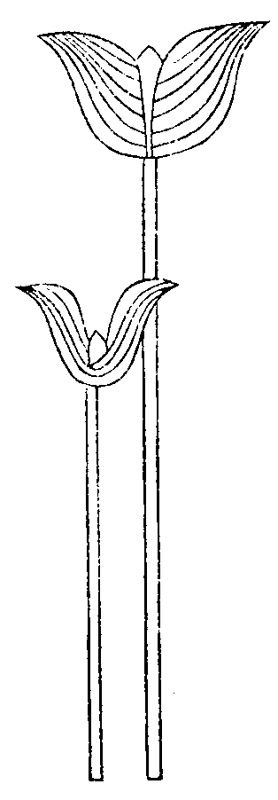

# 法华经显应录



> **藏经**：卍新纂大日本续藏经（新纂卍续藏）　**册次** 第 78 册（X78）　**编号** X1540　**部类** 法华部　**卷次** 2 卷　**篇幅** 67,413 字

> **卷／品**：0 卷 · 5 品



---



## 目录



  - [No. 1540-A 法华经显应录序](#no-1540-a-法华经显应录序)

  - [江州太平兴国宫楼钥序](#江州太平兴国宫楼钥序)

  - [序](#序)

  - [后序](#后序)

  - [No. 1540-B 刻法华经显应录序](#no-1540-b-刻法华经显应录序)



---



### No. 1540-A 法华经显应录序



西竺之教，其高处至不可思议，有历劫赞扬所不能尽。其神通发现，摄魔救苦，虽非人力所及，皆其餘事也。然其教所以盛行於世，亦赖此为多。



法华经凡三译，而鸠摩罗什所译，举世诵之，功德效验，昭然显著，传记所载非一。葢此经实如来秘密之藏，非思量分别之所能解，故其神异如此。乡僧宗晓，朝夕诵习书写，甞刺血书之。又集古今简䇿之言，凡二百餘事，遂成巨编，皆有依据，将版行於时，以助流通。一日，访其所居，萧然自适，与之语，贯穿教乘。问：何以不出领众？曰：非所敢当也。因出此书，求余为序。余曰：



黄面老子本不欲言大藏所见，与夫龙宫海藏之所秘，无边无尽，其实本不曾言，况此经之舛，见於餘事之餘者乎？子既集之，而余又序之邪？请不已，漫书以授之，且语之曰：子欲了此而后游方，它日一登宝所，悟明本性，筌蹄且将忘之，而况此乎？晓曰：唯。



庆元四秊中秋日显谟阁直学士太中大夫提举



------



### 江州太平兴国宫楼钥序



法华经显应录目次



卷上



------



### 序



> 古圣(凡七事竝见本经)



　多宝听经宝塔涌现　释迦为王求经无倦



　不轻菩萨流通法华　喜见然身供养玅经



　玅音远来听法华经　昔四比丘修习法华



　普贤菩萨劝发流通



> 高僧(凡一百七十三人)



　天竺国摩诃罗比丘　炖煌三藏护法师



　姚秦三藏什法师　长安叡法师



　虎丘生法师　南岳思大禅师



　天台智者大师　南山澄照律师



　京兆慈恩法师　五台清凉国师



　高丽光禅师　荆州成禅师



　终南超禅师　天竺观法师



　章安总持禅师　天台璪禅师



　庐山志禅师　荆州悦禅师



　天台越禅师　钱唐观法师



　梁朝满法师　庐山庄法师



　后周命法师　天台明法师



　河阴䆳法师　成都生寺主



　高昌国绪师　会稽义法师



　羌地达上人　吴兴旷法师



　长沙亡名僧　古亡名二僧



　冀州羽法师　临川绍法师



　庐山庆法师　广陵冏法师



　临缁明法师　越州慧法师



　京师侯法师　京师进法师



　京师果法师　庐山瑜法师



　钟山益法师　法华台宗法师



　庐山登法师　餘杭志禅师



　天衣飞云大师　越州明法师



　京师豫法师　京师匮法师



　京师辩法师　沙门澄法师



　金陵云法师　后周远法师



　扬州方法师　真乘净法师



　三藏竭法师　朗法师



　秦州昭上人　元魏乘法师



　齐州湛法师　江陵迁法师



　南㵎观法师　荆州忍禅师



　玉泉懔法师　鄂州朗法华



　东岳坚法师　越州伦法师



　齐州超法师　岐州慈禅师



　湘州崇法师　扬岐州二僧



　眉州泰法师　成都恭上人



　荆州隐禅师　庐山充法师



　黄州秀上人　齐州生法师



　苏州亮法师　伯济显禅师



　荆州喜法师　终南通法师



　牛头通法师　苏州旻法师



　骊山达法师　雍州俗上人



　古高寂师　悟真寺僧



　玄法寺僧　雉山寺僧



　扬州聪法师　栖霞向法师



　终南诚法师　苏州琰法师



　越州藏法师　襄州㧞法师



　汴州逈法师　京师证法师(附萧子良)



　长沙安法师　江都向法师



　宝通法师　苏州仪禅师



　汴州照师　荆州奘法师



　绛州辙禅师　山阴义法师



　天台修法师　明州端法华



　京兆素法师　嘉禾三白和尚



　温州楚法师　越州莒法师



　东京诲法师　潭州青衣寺僧



　杭州孤山寺石壁经　苏州法华院石壁经



　杭州日观大师　湖州端师子



　明州莹教主　明州久法华



　苏州梵法主　湖州明悟法师



　温州褒法师　南屏清辩法师



　湖州颕法师　杭州雅阇梨



　杭州渥法师　餘姚异阇梨



　钱唐聪上人　秀州照法师



　乌镇湛法师　明州明智法师



　明州无畏法师　杭州照阇梨



　衡州南上人　明州𫟡大师



　明州实禅师　明州澄照法师



　明州月堂法师　明州和法华



　明州佐法华　明州岳林寺莲经



　明州鉴宗师诗　明州全法华



　天台国清寺莲经



卷下



　洪州达禅师　牛头山融禅师



　明州太白禅师　湖州迹禅师



　湖州天下上座　西京大圆禅师



　苏州遵法师　西河韵法师



　东京章法师　并州伦僧录



　五台英法师　京师隣供奉



　卢山超法师　洛京真法师



　潭州亡名僧　宣城山神僧



　成都府僧　相州昂法师



　杭州智觉禅师　泗州德法师



　杭州岩法师　衡岳云上人



　蕲州光法师　京师言法华



　姚江恩法华　灵峰古禅师



　卢山可禅师　明州亲法华



　明州纯法华　明州戒讲师



> 高尼(凡一十三人)



　洛阳馨法师　司州贤法师



　江陵寿法师　江陵玉法师



　山阴宣法师　高邮华手尼



　河东尼信师　东京法忍二师



　荆州姉妹二尼　润州润法师



　京师尼通师



> 信男(凡三十二人)



　庐山刘遗民　并州诵经灵舌



　长史张畅　贞节处士庾诜



　魏州刺史崔彦武　并州书生



　江陵岑文本　临沂王梵行



　临沂王淹　吴郡陆淳



　杨州严法华　京师史呵誓



　冯翊李山龙　隆州令狐元轨



　河东董雄　陇城袁志通



　秦州慕容文䇿　绛州癞人



　京师高文　萧铿并婢素玉



　抚州优婆塞　冀州张秉



　无为军李遇　台州左伸



　临安府范俨　嵩山晁待制



　明州陆郎中　明州杜信



　明州吴振　明州陈世禋



　庆元府汪敬　明州王文富



> 信女(凡一十四人)



　陕右马郎妇　淮宁姑嫂二人



　南宋王慧称　苏刺史女使



　长安陈氏　宁州费氏



　台州任徵君女子　高安太守嫂



　颕州妓卢媚儿　湖州妓杨韵



　临安府郭道人　明州沈氏



　明州赵氏使　明州朱如一



------



### 后序



法华经验应录目次(终)



No. 1540  

法华经显应录卷上(并序)



四明石芝沙门　宗晓　编



昔永明智觉禅师以大辩才著赋五首，谓华严感通、金刚证验、法华灵瑞、观音现神、神栖安养。其所以黼黻圣教，鼓舞群机，可谓有大功於像运矣。然赋所由作，特以歌咏赞扬为事，至於事迹始末，非传记不能周知。故华严则有感应传，金刚则有应验录，法华则有灵瑞集，观音则有感应集，净土则有往生传。谛观博覧，则知佛法灵异之验，不一而足。今灵瑞一集，世有二本，有单题灵瑞，有续灵瑞集。单题灵瑞者，内列六十事，不载纂集之人，唯嘉祐中有杨曦者为之序。此本旧有，近再刊锓，但其间不指所出道俗，无别诸祖事迹，缺於纪载，有此疎陋，殆非典刑。续灵瑞集者，迺大观中吴兴元颕法师增新续旧，开为十科，始自普贤证明，终於香光表瑞。此本差胜，颇格前非，无何板籍久亡，往往不及见者多矣。窃惟法华至典，实诸佛降灵之大本，群生达道之渊源，亚圣大士之所劝发，上首诸天之所护持。当今若出家，若在家，无不倾诚读诵，极意修治。傥神功伟迹不登简籍之中，则前言往行将不闻於世，又何以为劝信之端哉？宗晓滥膺释服，志乐闻持，深嗟旧集未全，续本又缺，於是徧加讨核，大藏三朝僧传及内外典章，隐显毕收，新旧竝列，总二百三十九事。先示古圣为首，次以四例分别，曰高僧，曰高尼，曰信男，曰信女，析为两卷，号法华显应录焉。葢取诸台宗现世身口所感胜相，名显机显应之谓也。预斯录者，率皆凝神实相，覃思真乘，坚操足以压松篁，精诚足以贯金石。故徵应之恪，犹箫诏之致仪凤也。以是贻诸将来，一人解而千万人劝，莫不朽宅知焚，高原发濬，即乘高广大车，直造甚深境界，是所愿焉。若夫所载之人，或但有其事而无其应者，兹又显机冥应者也。览者悉之。庆元戊午仲春初吉，宗晓谨序。



古圣(凡七事竝见本经)



多宝听经宝塔涌现



过去有佛，号曰多宝，其佛行菩萨道时，作大誓愿：若我成佛灭度之后，於十方国土，有说法华经处，我之塔庙，为听是经故，涌现其前，为作证明。今多宝如来塔，闻说法华经故，从地涌出，赞言：善哉！善哉！多宝有愿，其有欲以我身示四众者，须集彼佛分身。诸佛集已开塔，多宝分座，释迦同座，而说法言：圣主世尊，虽久灭度，在宝塔中，尚为法来，诸人云何不勤为法？



释迦为王求经无倦



佛告四众：吾於过去无量劫中，求法华经，无有懈倦。於多劫中，常作国王，发愿求於无上菩提，心不退转。为於法故，捐舍国位，委正太子，击鼓宣令：四方求法，谁能为我说大乘者，吾当终身供给走使。时有阿私仙人，来白王言：我有大乘，名妙法华经，若不违我，当为宣说。王闻仙言，欢喜踊跃，即随仙人，供给所须，采果汲水，拾薪设食，乃至以身而为床座，身心无倦。于时奉事，经於千岁，为於法故，精勤给侍，令无所乏。尔时王者，释迦文是。时仙人者，今提婆达多是。由提婆达多善知识故，令我具足六波罗蜜，成等正觉，广度众生。



不轻菩萨流通法华



乃往古昔，最初威音王如来像法之中，增上慢比丘，有大势力。尔时有一比丘，名常不轻。是比丘凡见四众，皆悉礼拜赞叹，而作是言：我深敬汝等，不敢轻慢。汝等皆行菩萨道，当得作佛。而是比丘，不专读诵经典，但行礼拜。四众之中，有生瞋恚心不净者，恶口骂詈言：是无智比丘，从何所来？我等不用如是虗妄授记。众人或以杖木瓦石而打掷之，避走远住，犹高声唱言：我不敢轻於汝等，汝等皆当作佛。以其常作是语，故号之为常不轻。是比丘临欲终时，於虗空中，具闻威音王佛先所说法华经，悉能受持，即得六根清净，广为人说。是法华经时，不轻者，释迦文是。若我宿世不受持此经，为他人说者，不能疾得菩提法华文句。问曰：释迦出世，踟蹰不说。不轻一见，造次而言，何也？答：本已有善，释迦以小而将护之。本未有善，不轻以大而强毒之。南屏清辩蕴齐颂曰：宝劒未施藏玉匣，七星寒影已荧荧。殷勤说向傍人道，内有龙泉不可轻。



喜见然身供养玅经



过去日月净明德佛，为一切众生喜见菩萨及菩萨、声闻众说法华经。是菩萨乐集苦行，一心求佛，满万二千岁已，得现一切色身三昧。得此三昧已，即作念言：我得是三昧，皆是得闻法华经力。我今当供养於佛及法华经。我虽以神力供养，不如以身供养。即於佛前，而自然身光明徧照八十亿恒河沙世界。其中诸佛同时赞言：善哉，善哉！是真精进，是名真法供养如来。其身火然千二百岁。命终之后，复生日月净明德佛国中净德王家，而白父言：我先供养佛已，得解一切众生语言陀罗尼，复闻是法华经。乃至彼佛灭度之后，喜见即於八万四千舍利塔前，然百福庄严臂，七万二千岁而以供养。文句释曰：喜见顿舍一身，复烧两臂，轻生重法，命殒道存。



玅音远来听法华经



释迦牟尼佛放肉髻光明，徧照东方百八万亿那由他恒河沙等世界。过是数已，有净华宿王智佛国，彼有菩萨名曰玅音，久已植众德本。是菩萨欲从净华宿王智佛国，与八万四千菩萨而来至此娑婆世界供养於我，亦欲供养听法华经。于时玅音菩萨於彼国没，与八万四千菩萨俱共发来。时多宝佛告玅音言：善哉，善哉！汝能为供养释迦牟尼佛及听法华经故来至此。



昔四比丘修习法华



往昔有四比丘，於法华经极生殷重，卷舒秘教，甘露未沾。由是结契山林，共期佛慧，幽居日积，衣粮单尽，一飡万里，云霄之志，可得言哉！其一人云：吾等四穷，尚不存身，法当安寄？汝三人宜以命奉道，我一人者当给所须。自尔振锡门闾，以求供给，虽寒暑代谢，甘喜无愠。以故三人功圆事办，一世之益，当无量生。其一人者，数涉人间，屡逢声色，坯器未火，难可护持。偶见王者出入，车驾喧阗，生心动念，爱彼光荣，功德熏修，随念受报，人间天上，常得为王，福虽不赀，亦有限也。三人既得道果，会而议曰：我免樊笼，功由此人，彼躭果报，增长有为。从此死已，当沉火坑，幸其未坠，正宜设化。一人云：此王著欲，而复邪见，若非爱钩，无由可拔。一人可作端正妇，二作聪明儿，儿妇之言，必当从顺，如宜设化，果获改邪。时国王者，即玅庄严王，今华德菩萨是。其妇即净德夫人，今光照庄严相菩萨是。而昔二子，即净藏、净眼，今药王、药上二菩萨是。说四圣之前因，以故此品标名，本事委示，如法华文句。南屏颂曰：昔年聚首寂寥溪，三步青云一堕泥。小技略施甘折角，大家抚掌蹑天梯。



普贤菩萨劝发流通



尔时，普贤菩萨从东方来，而白佛言：我於宝威德上王佛国，遥闻此娑婆世界说法华经，与大菩萨众共来听受，惟愿世尊当为说之。若人於如来灭后，云何能得是法华经？佛告普贤：若人成就四法，於如来灭后，当得是法华经：一者为诸佛护念，二者植众德本，三者入正定聚，四者发救一切众生之心。如是成就四法，必得是经。普贤白佛言：於后五百岁浊恶世中，其有受持是经典者，我当守护，除其衰患。是人若行若立，读诵此经，我时乘六牙白象，与大菩萨众而自现身，供养守护，亦为供养法华经故。其人若於法华经有所妄失，一句一偈，我当教之。文句释曰：佛举四法，冠罩一经，法华之重演，佛慧之再宣，远来劝发，其义如此。南屏颂曰：徧吉寻声得得来，巨灵才辟绝纤埃。象王何事频移步，为爱芬陀满砌苔。



高僧(凡一百七十三人)



天竺国摩诃罗比丘



昔天竺国，有一阿兰若比丘，名摩诃罗，大读摩诃衍，德行弥著。国王正信，甞布发掩泥，令比丘蹈。又有比丘，来白王言：此人不多读经，何大供养？王言：我曾一日夜半，欲见此比丘。即至其所，见彼在一窟中，读法华经。有一金色光明人，乘白象。王合掌供养，我方亲近，彼即灭没。我问：大德！以我来故，金色光明人灭耶？比丘言：此是徧吉菩萨。徧吉自言：若有人诵法华经，我当乘白象来教导之。我读是经，徧吉自来矣。徧吉，即法华经中普贤菩萨也。我闻是已，礼足而退。是故我今，常当供养。(大智度论)



炖煌三藏护法师



三藏昙摩罗察，此云法护，月支国人。八岁离俗，凡是经书，过目成诵，日记万言。西游诸国，通三十六种语言书诂训音。久居炖煌，时号炖煌菩萨。自西晋武帝时，赉梵夹到洛阳，既而博覧五经史传。至永康中，於长安青门外大寺中，译正法华经一部十卷，仍为四众敷讲。又翻餘经，共一百五十四部，咸奉𠡠流通。时隐居深山，山有清泉，澡漱给用。一日樵人触秽，忽尔枯涸。护叹曰：人之无德，遂使清泉辍流。既乏所须，吾当去矣。言讫，清泉复涌。支遁赞曰：护公证寂，道德渊美。微吟穹谷，枯泉漱水。邈以护公，天挺弘懿。濯足流沙，倾拔玄致。(梁高僧传)



姚秦三藏什法师



法师鸠摩罗什，秦翻童寿，龟兹国人。七岁出家，日诵千偈。其母甞擕至月支国，见一罗汉曰：此沙弥至三十五，若不破戒，当大洪佛教，度无数人。戒若不全，止才明法师而已。母唯其言。一日谓曰：方等深教，应大阐真丹，唯尔之力，但於尔自身无益耳。什曰：大士之道，利彼亡躯。若使大法流传，能洗蒙俗，虽身当𬬻镬无恨矣。时符坚据关中，太史奏云：有德星现外国分野，当有大智人入辅中国。坚曰：朕闻西域有罗什，将非是耶？即遣吕光率兵伐龟兹。光既获什，回至凉州，闻符坚为姚苌所害，乃据关外，僭号后凉。苌崩，子兴袭位。庙庭俄生连理树，逍遥园葱变为茝，以为祥瑞。遂伐吕隆，迎什入长安，待以国师之礼。兴於逍遥园引诸沙门听什讲说，什辩通华夏，览旧经与胡本乖谬，以弘始八年於草堂寺与僧䂮等八百餘人对旧经考校，译此玅法莲华经一部七卷。兴曰：法师聪明超悟，天下无二，可使无嗣乎？遂以妓女十人逼之。自是净行者耻闻其事，师至讲说，必先告曰：譬如臭泥生莲华，但采莲华，勿眎臭泥。后忽感疾，即语众云：因法相遇，殊未尽心，无何缘谢，所译法华等经幸共流布，若所译无谬，愿焚躯后舌不焦烂。言讫而终。至於阇维，舌果不灰。委见梁僧传及晋书南山感通传。韦天曰：什公聪明，善解大乘，彼自七佛已来传译，得法王之遗寄也。俗以陷戒为言，此不须议，什位三贤，非悠悠者也。



长安叡法师



释慧叡，冀州人。执节清峻，参学游方，至南天竺国界，殊方异典，无不洞晓。秦主姚兴召见，睹其风韵含吐，即大激赏，称为四海标领。昔法护译正法华受决品云：天见人，人见天。什译妙法华至此，乃曰：此语与西域义同，但言过质耳。叡曰：将非人天交接，两得相见？什喜曰：实然。其领解高出若此也。翻译才毕，命叡讲之。叡乃品酌幽玄，开为九辙：一、昏圣相扣辙，即序品；二、涉教归真辙，为上根人；三、兴类潜彰辙，为中根人；四、述今通昔辙，中根领解；五、彰因进悟辙，为下根人；六、赞扬行李辙，即法师品；七、本迹无生辙，多宝不灭为本，释迦不生为迹，本迹虽殊，不思议一也；八、举因徵果辙，即涌出、寿量品；九、称扬远济辙，即随喜品。已去讫经流通也。叡又著经序，见大藏本经。又有二十八品，生起荆溪，师称大有眉目。师常回弘赞善利，愿生西方。临终之日，洗浴更衣，烧香礼拜，合掌向西坐。卒时见五色香云，从房而出。世称什门四圣，生、肇、融、叡，师其一也。(见梁高僧传九辙，出法华文句第八记。)



虎丘生法师



师讳道生，从师姓竺。年在志学，吐纳清新，人皆畏服之。常以入道之要，慧解为本。故钻仰群经，不惮劳苦。遂往关中，禀承罗什。辩问超卓，咸称神悟。后遁迹虎丘寺，有讲台石，至今存焉。一时居半塘，诵法华经。忽有一雉，常来听受。一日不见，师念之。夜入梦云：某因听经，遂获改报。今在某家为儿子。待过数年，却来奉事。洎师询之，果尔。及出家，无何，童子之年便命终。因瘗于林。一夕，俄而放光，辉照塘坞。乡人异之，启看，乃获一舌，生青莲华。因是起塔，后葺成寺，即今半塘寺是也。师甞建言：善不受报，顿悟成佛。而守文旧学，以为邪说。师对众发誓曰：若所立不违经者，於舍寿时，踞师子座。后译大涅槃，果符所说。师即升座讲敷，听者悟悦。法席将毕，忽麈尾纷然而坠，端坐正容而逝，似若入定焉。时人语曰：生叡发天真，故知秀出者。即此矣。(半塘寺迹见续灵瑞集，餘出梁高僧传。)



南岳思大禅师



师讳慧思，生于武津李氏。幼梦梵僧劝令出家，遂即入道。立志日唯一食，不受别供。十年专诵法华，七载常行方等，九旬常坐修一行三昧。由兹精进之功，彻见三生行道事迹。续诣北齐慧文禅师所，諮禀禅法。长夏摄心，夏满受岁。慨无所证，放身倚壁。背未至间，豁然开悟法华三昧及餘大小法门。后止光州大苏山，道俗福施，造金字般若、金字法华。众请讲二经，即与敷叙，莫非幽赜。次至南岳，见林泉竦净，乃曰：此古寺基也。依言掘之，果获殿趾器皿。又往岩下，乃曰：吾先世在此坐禅，为贼斩首，由此命终，有今世也。佥共寻觅，乃得枯髅。师得而顶戴，因起塔以报昔恩。陈宣帝诏住栖玄寺，道俗颙仰。甞往瓦官，遇雨不湿，履泥不污。或现身大小，或寂尔藏身。瓶水常满，有若天童给侍。或问师位，答曰：吾十信位耳。临终日，大集门学说法，闻者寒心。乃曰：若有十人，不惜身命，常修法华般舟三昧，当尽供给。如无此人，吾即去矣。苦行事难，竟无答者。因即敛念唱言，众圣相迎，泯然命终。感异香满室，远近咸闻。寿六十四，即陈大建九年也。自有佛法以来，多重义门。唯师双弘定慧，发言致远。南北禅宗，莫不遵承。甞蒙普贤摩顶，涌生肉髻，见者希奇。行大慈悲，奉菩萨戒。不服皮革缯纩，唯麤布艾衲，冐犯风霜。凡所著述，口授成文。历世浸久，诸文散落不存。唯法华安乐行义，及发愿文行於世。(唐续高僧传)



天台智者大师



陈、隋二国师智𫖮，裔出颍川，世居荆州华容县。师即常侍陈起祖之仲子。母徐氏，夜梦香云萦怀，因而有娠。至於诞育，室现神光，舜目重瞳，尧眉八彩。七岁往伽蓝，僧口授普门品，一举通利。十五於长沙像前发誓，愿作沙门，荷负正法。十八出家湘州果愿寺。二十剃发受具，即往大贤山诵法华经、无量义、普贤观。历于二旬，三部终毕，口诵金文，手正经像，心神爽利，又乐禅悦。续诣大苏山，礼思大禅师。思见而叹曰：昔日灵山同听法华，宿缘所追，今复来矣。因授与普贤道场四安乐行，昼夜苦到，如教研心。经二七日，诵法华经，至药王舍身，诸佛同赞，是真精进，是名真法供养如来。到此心悬苦行，豁然入定。照了法华，若高辉之临幽谷；达诸法相，似清风之游太虗。思印之曰：非尔弗证，非吾莫识。所入定者，法华三昧前方便也；所发持者，初旋陀罗尼也。纵文字法师千群万众，寻汝之辩，不可穷矣。吾久羡南岳，恨法无所委。汝可传灯化物，莫作最后断佛种人。师奉严训，遂振锡金陵，住瓦官寺，首开法华玄义。自是敷扬凡八载。其后徒众转多，得道者少，即避世守玄，隐居天台。初宴息於银地，时经行於东南峰，或居方丈，诵法华经而入三昧。众魔恶鬼，竞来恼害。师於禅定中，亦不觉神之变怪。一时讲诵法华，感普贤乘白象蹑驾于前。说法则五时八教，判释一代群经，罄无不尽。天台之教，实自师始。寻赴诏出金陵，讲大论於大极殿，敷仁王於光宅寺。陈主三礼，以示尊敬。会隋吞陈，因憩锡庐山。至开皇中，炀帝居蕃，请为菩萨戒，师乃赐智者之号。后归老天台，一夜忽梦大风吹坏宝塔。是时诏书连徵，至石城像前，遽云：有疾。遂顾命弟子唱法华经，而自赞曰：法门父母，慧解由生。本迹旷大，微玅难测。辍斤绝弦，於今日矣。又曰：吾不领众，必净六根。为他损己，退居五品。吾诸师友，观音来迎。言已，加趺而寂。即开皇十七年丁巳仲冬念四日未时也。春秋六十，坐四十夏。𠡠封灵塔于佛陇西南峰，每岁时遣使开塔羞供。最后开封，则不见全身矣。吴越钱王甞追谥法空宝觉之号。自师入灭，距今年凡六百二载。师弘教观，不畜章疏，唯纵悬河之辩。讲诸经外，说法华玄句，以开玅解。次演止观依解，以立正行。故荆溪曰：非玄义无以导，非文句无以持，非止观无以达，非一家无以进。斯之谓欤！大矣哉！救世明道之书，见於台宗三部矣。师之化导六十餘州，其道久而益明。凡诸事迹，详于别传及天台十二所道场记。



南山澄照律师



律主道宣，丹徒人也。父吏部侍郎钱申。母娠而梦月轮贯怀，既而又梦梵僧语曰：汝所姙者，梁朝僧祐律师。祐即南齐剡溪隐岳寺僧护也。宜从出家，大弘佛教。洎长年十五，母忆所梦，即听离俗。所业诵法华等经，莫不通利。十六落发受具，专学毗尼，后竟中兴。此道善继优波离者也。师三衣皆纻，一食唯菽。蚤虱纵生，形同土木。在处必感神物，奉华果，供天馔。或失足前阶，而那咤扶护。或筑宝坛，而神僧礼赞。自乾封已后，天人络绎而来，共师谈论律相等事。故师所著疏钞，得佛元意，以其通神明而然也。天下后世宗之。其道防非止恶，是曰南山教焉。师作法华弘传序，冠于经首。旨趣宏远，言辞高妙。百王不易，千古宣通。其陈本愿曰：庶得早净六根，仰慈尊之嘉会。速成四德，趣乐土之玄猷。(行实见大宋高僧传。)



京兆慈恩法师



师讳窥基，唐蔚迟敬德之犹子。父金吾卫将军宗。母裴氏，夜梦吞月而孕。生甫六岁，聪慧过人，即著兵书数千言。时三藏玄奘西游，得一童子，善记问，因擕谒宗。宗呼基拜奘，使诵所著书。奘数目童子记文，诵毕，奘绐之曰：此古书耳。宗未之信。奘令童子覆述，一言不遗。宗怒剽窃，将杀之。奘就丐出家，基曰：听我三事：御荤色、晚膳，即出家。不然，宁伏劒死。奘爱其俊朗，佯而肯焉。入道，居大慈恩寺。善解大小乘，凡是论疏，一覧无差。先是，奘公自西域受戒，贤论师、瑜伽师、地论、唯识宗旨未有继之者。师一禀承，或宗或释，撰述百部，名曰百部论师。师随处化徒，获益者众。东行博陵，有请讲法华经，遂造法华玄赞大疏一十卷。其释首题曰：操宏纲之极唱，旌一部之都名。法含轨持，绾群祥以称妙；华兼秀发，总众美而彰莲。建言立宗，阐扬奥义。北地宗师，常多讲贯。(师言行委见大宋僧传。出家时事出释氏编年。)



五台清凉国师



释澄观，姓夏侯氏，山阴人也。依应天寺出家，诵法华经，十四过恩得度。首学南山律藏，次於金陵传三论，复往天竺习华严大经。晚止苏州，从荆溪禅师传天台止观，听法华、维摩等经。又参牛头忠、径山钦，得南北两宗禅法。师博学深究，识量宏远，著华严贞元等疏，塑像写经，不可殚举。甞发十大愿，为终身所修：一、但三衣一钵，不畜餘长；二、当代名利，弃之如遗；三、目不视女人；四、影不落俗舍；五、长诵法华经；六、长读大乘经；七、长讲华严经；八、一生昼夜不卧；九、不惑众伐善；十、不退大慈悲。师生历九朝，为七帝门师。宪宗甞召入讲华严大旨，畅悦圣怀，𠡠有司铸印，迁国师，统冠天下缁徒。年一百有二岁，身长九尺二寸，目夜发光，昼视不瞬。才供二笔，声韵如钟，梵僧称是文殊后身。茶毗，舌如红莲，舍利光润。相国裴休奉𠡠撰碑。(生历九朝下见释氏编年录，餘竝大宋高僧传。)



高丽光禅师



沙门玄光，海东熊州人。少厌俗尘，专修梵行。洎长，遂越沧溟，求中国禅法。於是观光上国，行衡山参思大禅师。思察其根器，授以四安乐行。光利若神锥，无坚不犯。禀而行之，俄证法华三昧。思印之曰：汝之所证，真实不虗。当还本国，施设善权，敷扬吾教。光顶礼而别，即返锡江南。附舟至于大洋，偶见彩云雅桨，绛节而至。空中声曰：天帝召海东玄光禅亲於宠宫，说亲证法门。光拱手避让，唯见青衣前导。寻入宫城，不类人间官府，无非鳞介鬼神。既登宝殿，次陟高台。如问而谈者，凡七日。事毕，王躬送别。光复登舟，舟人谓泛洋不进者，半日而已。光遂至熊州翁山结茆，乃成梵刹。其升堂者，一人证火光三昧，一人证水光三昧。餘如众鸟附须弥，皆同一色。光之示灭，罔知攸往。南岳祖堂，列二十八位，光居一焉。(大宋高僧传)



荆州成禅师



僧慧成，澧阳段氏子。为僧止十住寺，诵法华、大品二十餘卷。后随方问道至庐山，与天台𫖮禅师相见。因闻南岳思大和尚，即往谒之。既见倾仰，欲学定业。思曰：卿一生章疏之功，与吾炙手，犹不及热。虗丧功夫，惜哉！成即发愤，烧弃章疏，以夜达旦。开眼坐禅，凡十五载。思又令入法华般舟道场，消障三年。复示以正法，遂证解一切众生语言三昧。较闭目入观，开目便失者，霄壤矣。思曰：智𫖮先发三昧，后证总持。慧成及之，二子解行齐矣。成即诣荆州枝江建寺，道德所及，不日而成。陈帝累召方至，与受戒法而返。时将超化，乃讲涅槃。忽智者自玉泉至，冥相符会，共谈玄理，良久而逝。(续高僧传)



终南超禅师



师名慧超，生丹阳沈氏。性温而𥙿，自幼从释，专课法华。远闻光州思大禅师定慧双明，毗尼兼善，乃与智者虗心絜己，抠衣请业。思曰：超之神府得忍人也。及游衡岭，复与智者同涂诵经。移岁后，隐终南。八载行道，倍隆三慧。及大业承运，爰发诏书，延入禁中。大唐伊始，荣重京师。师自入道，即诵莲经，五十餘年，万有餘徧。洎寝疾将终，召众告曰：往返吾之常也。长生不忻，夕死不戚。第一义空清净智观，是吾凭杖。言已，向西而逝。遗言令露尸松石，以施禽兽。弟子依教，停一月餘，颜色如生。还累塔以窆之。(续高僧传)



天竺观法师



释真观，姓范，钱唐人。其母以诵药师、观音求嗣，得师。师少有节操，舌紫罗纹，手现奇相。诵法华经，日终一卷。从师听十诵律，超胜前标。忽梦人曰：汝有大根，何守小道？师遂学摩诃衍，质疑明难，搪揬玄门。时谚曰：钱唐有真观，当天下一半僧。师与智者年腊相齐，为法兄弟，高谈寂照，金石相宜。后於灵隐山建南天竺寺居焉。常讲法华以为心要，受持读诵，躬自书弘，五种法师於斯乎在。每盥洗遗渧，地不为濡，人皆异之。一日，皐亭神请讲法华，感神舍祠为寺。有司马李子深请讲涅槃，至现病品，梦三人把旛告云：净居天遣迎。续便卧疾，梦与智者同辇翼佛还山。觉而叹曰：昔谓六十二应终，讲法华力更延一纪，今七十四复致斯验，生期毕矣。乃启手足曰：欲出生死，宜须持戒、修定、学慧、弘通正法，勿空过也。时闻空中妓乐之声，至于中夜加趺而寂。师即下天竺灵山寺开山始祖，行业神异。昔章安顶禅师手撰别传纪德，岁久弗存，今唯见之於续高僧传。师冢塔犹在，慈云式忏主甞重修之，具载灵苑集。其略曰：师志在佛乘，道契惟极，出不顺帝王公侯大势所临，处不为博艺辨达大名所乱，轩轩然于世表，邈乎不可得而拟。今土门自开，一无遗物，又不知全身从多宝以证经乎？像佛陇以化往乎？谨作诗六首，永奉标识云：王侯曾不屈(师隋主三𠡠问劳，秦王二延总府，皆辞疾不就)，个是出家身，白骨已为土，清风犹𪷤人。冢隳方事葺，寺废亦重新，独有不濡地，无人继后尘(餘诗如集)。



章安总持禅师



师讳灌顶，总持吴越王谥号。师生於章安吴氏。始在孩孺三岁时，便能随母称三宝名，时共惊异，因立小字，名曰非凡。入道能日记万言，玄儒竝务。禀承天台定慧之法，继祖克家智者，凡所说法，皆师记录成文。晚止称心精舍，长讲法华，化流嚣俗，神用无方。时有法龙村人，去山三十里，染患将绝，其子奔来求救。师为转法华经，焚栴檀香，病者遥闻香气即愈。乐安南岭，地曰安洲，碧树清溪，人径不通。师往观览，留连不舍，乃发誓曰：若使斯地夷坦，吾当来此讲法华经。曾未浃旬，白砂徧涌，平如玉镜。师偿先志，乃往讲焉。又甞於摄静寺讲涅槃经，值海宼劫掠，师撞钟就讲。贼入，见兵旗耀日，持弓执戟，人皆丈餘，因尔退散。师以贞观六年於国清示疾，无论医疗，而室有异香，告弟子曰：弥勒经说：佛入灭日，香烟若云。汝多烧香，吾将去矣。言已而逝。时有智睎禅师，先贞观元年入灭，临行告言：吾生兜率，见智者坐一宝座，行列有人，唯一座独空。天曰：却后六年，灌顶禅师升此说法。焚香验意，即慈氏降灵。计岁论期，审睎言不谬。(孤山闲居编)



天台璪禅师



沙门智璪，姓张氏，清沂人。年十七亡。二亲染患至笃，知无生意。夜忽见月，遂念月光菩萨，因而得差。深知三宝是我依凭，即往安静寺出家。挺志高迈，言行俱实。逖闻智者，悟解超群。遂抵台岭，伏膺受道。智者察其根器，乃遣行法华三昧。洎修至二七，初夜坐禅，乃见一九头龙，从地涌出，上升虗空。明日白师，师曰：此表九道众生，闻法华经，将来之世，破无明，入法性空耳。又甞於宝林寺，要期法华三昧。启修初夜，如有人来，摇动户扇。师问之，答曰：我来者灯耳。频经数过，答问如前。寺有慧成禅师，闻其事而言曰：彼堂内从来有大恶鬼，今闻此声，是必相害也。天晓，扣户问之，见其犹在，甚喜。成因以报永阳王，王即遣数十兵吏，执杖防护。师曰：命由业也，岂在防护？谢而去之。至第二夜，鬼即入来，徧打东西。於三七日，恒尔为恼。师坦然无惧。行法将讫，见一青衣童子，称赞善哉，言已不见。师德行兼全，为智者辅佐。凡九回朝，现天子善始令终。寿八十三而卒。(续高僧传)



庐山志禅师



师会稽顾氏子，发蒙出家，师事天台智者。智者见其形神洒落，高放物表，取名大志。诵法华经，索然闲静，音声清啭，听者忘疲。后於卢山甘露峰行杜多行，有时投身猛兽，彼皆避去。飡粒若尽，唯以饼果继命而已。如是七载，禅诵不休。晚尸福林寺。会大业中，屏除佛教，慨大法陵迟，遂身著孝服，於佛堂中恸哭三昼夜，誓舍形骸，伸明正教。即往东都，上表曰：愿陛下兴隆三宝，贫道当然一臂於嵩岳，用报国恩。帝许之。遂设大斋，七众通集。师绝粮三日，登大棚中，布褁其臂，灌之以蜡，如炬然之，光照岩岫，晃然大明。众见苦行，痛入心髓，而志形色不变。或诵经文，或赞佛德，或为众说法，声声不绝。烧已下棚，加趺入定，七日而卒。师留愿文七十餘纸，意在共诸众生为善知识。见者感激于怀，无不堕泪。(续高僧传)



荆州悦禅师



僧道悦，俗张姓，荆州人也。十二出家玉泉寺，器识沈䆳，安贫苦节，长诵法华，以为德业。玉泉智者创置，未有钟磬，师於泉源得怪石一片悬之，每诵经卷通，辄扣一下，声韵清彻，闻者肃然。幽冥之徒，屡有祥感，知而不传。甞患水，服急如鼓，一夜诵经，水忽流注，洪瘇顿消。时朱粲为𡨥劫掠，唯悦守寺，贼令引路，师曰：僧非引路人，浮幻形骸，任从白刃。贼敬而恕之。时汉阳王请为戒，师以彩服赐之，悦不受，王曰：何不著绢帛耶？悦曰：蚕衣损命，乖忍辱之名；布服俭素，表慈悲之相。王曰：仲由不耻夫子见称，沙门慈忍，固其然也。(续高僧传)



天台越禅师



僧智越，生於南阳郑氏，少有脱俗之志。父为求婚，方便求免。时岳阳殿下领荆州，异其为人，遂为剪发。后随方问道至金陵，值智者阐化，洁己请业，深达禅要。而又精持戒品，诵法华经万有餘部，瓶水常满，人皆异之。智者学徒虽众，而越为上首。临海露山精舍，智者命越影响，二十年间，恂恂善诱。寻於国清寝疾，右脇而化，感山崩地动，道俗咸见闻。(续高僧传)



钱唐观法师



等观，生于富阳孙氏。为僧已后，闻智者开法佛陇，遂往依承，专诵法华，兼能讲说。贞观中，赴餘杭法忍寺讲。忽一夜，见神人曰：吾钱唐臯亭祠神也。师甞经过庙庭，弟子巡游不值，今故特来求授戒。法师即为然香秉宣。至明日夜半，沐浴更净，召慧法师说三观义。乃曰：此吾亲承智者口授。言已，加趺面西，称彼佛名及天台智者尊号，奄然命终。(灵瑞集)



梁朝满法师



罗什法师，於长安译法华经二十八品。长安宫人请讲提婆达多品，此品淹留在内。江东所传，止得二十一品。梁有满法师，讲经一百徧，於长沙烧身奉法，仍以此品安持品之前。彼自私安，未闻天下。陈有南岳思大禅师，次此品在宝塔之后。晚以正法华勘之，甚相应。今则四凟混和，见长安旧本。故知二师深得经意。(法华文句)



庐山庄法师



比丘法庄，淮南人，十岁出家，为庐山远公弟子。性率素止，苦行标名，诵法华经，自为恒业。常於静夜，隣者每闻师房前有兵仗羽卫之声，岂无故而然哉？(续灵瑞集)



后周命法师



师慧命，姓郭氏，晋阳人。道亲物疎，州闾赞重。十五诵法华经，两旬之间，终始通利。寻事剃落，专修法华忏法。以周天和三年仲冬五日，面西加趺正坐，覩佛来迎，合掌而寂。合众同梦天人下地，幢旛映日。又有闻奇乐异香，称赞善哉之者。(续高僧传)



天台明法师



师旧名法京，姓朱，会稽人。年少聚沙为塔，蒿艾为殿，合掌称佛。忽遇乞食僧劝之曰：汝可往天台山出家，彼有初依菩萨说法化世。儿即奔往，便侍智者为弟子。智者笑曰：宿愿力故，今得相遇。於是晓夕左右，伏膺无懈。师因教诵法华经一部，兼修忏法。后随侍智者入庐山，即於陶侃瑞像阁内，要制法华三昧。俄见一僧云：汝法名未胜，应改为普明，则照了三世矣。自是从改为号。晚旋归国清，所居之房乏水，师想念石上忽流泉。又甞铸丈六卢舍那像，感异人施金而隐。一时於赤城松林中现身，高数十丈。章安顶禅师亲见之，仰观师之作用，岂聊尔之人乎？(续灵瑞集)



河阴邃法师



僧昙邃，不详氏族出家，止河阴白马寺。蔬食布衣，日诵正法华经十卷，兼通旨为众讲说。忽夜梦一人扣户云：欲请法师九旬讲经。邃不允，固请乃赴。似觉未觉，忽见身在白马坞神祠中，弟子一人亦预。自是每日密往，餘无知者。一日寺僧过祠下，偶见两高座，邃居北座，弟子居南。颇闻讲说之声，又闻异香馥郁。道俗相传，咸称神异。夏竟，神施白马一疋、白羊五头、绢五十疋，以充讲嚫。师呪愿受之而去。后不知所终。(梁高僧传)



成都生寺主



僧生，蜀郡𮠁人，俗袁氏。少为僧，以苦行闻。成都守宋丰请主三贤寺，诵法华经，又习禅定。甞於山中诵经，忽有一虎来蹲于前，彻章乃去。后诵习次，常见四神人左右侍卫。年虽垂老，行业弥坚。洎感疾，即付嘱门人，趺坐而化。(梁高僧传)



高昌国绪师



高昌僧法绪，德行严峻，饭蔬饮水。后入蜀，居刘师冢。间行头陀行，虎兕见而不伤。常处石室，诵法华、维摩、光明三经。忽於一夏，在石室中，左脇命终，七日不坏。香气袭人，每夕放光，照彻数里。乡人异之，即於尸上为起冢塔。晋时人也。(续高僧传)



会稽义法师



法义师，俗姓竺。十三岁入道，专勤梵行，诵正法华经。住瓦官寺，后迁会稽宝山精舍。咸和二年染疾，诵习无亏。夜梦一僧，为出肠胃，洗涤垢秽。洗已，还纳腹中。梦觉，疾即痊愈。晋帝甞宣至禁中，从受五戒，供奉殷厚。至大和年，不疾而化。𠡠市新亭岗，起塔安窆。今中兴寺是也。(灵瑞集)



羌地达上人



晋隆安中，僧慧达於山北陇掘甘草。时羌人饥荒，捕人而食。达为所获，寘之栅中，择肥者先食。达惧甚，一心称观音名，诵普门品。人取尽，唯达与一小儿在，命祇一日耳。达终夜持念不舍。至旦，忽一虎自艸中逃出，咆吼震山。诸羌畏走，虎乃啮栅作穴而去。达与小儿奔走得免。(台宗别行义疏)



吴兴旷法师



法师竺法旷，俗臯氏，寓居吴兴。志操高卓，戒行渊深。本师寝疾，旷为祈诚礼忏，凡七昼夜。因感五色光明照室，其病即差。后止於潜青山石室，每言法华为会三之旨，无量寿为净土之因。常吟咏二部，有众则讲，平居则诵。谢安为吴兴守，特往展敬。晋简文帝召至，命斋忏以遣妖星。晚迁禹穴昌原寺，为百姓拯救危苦，莫不效验。有人常见师行坐间，每有鬼神数十辈卫於前后。享年七十六。常侍顾恺作传纪德。(续高僧传)



长沙亡名僧



西晋建兴二年，长沙县西一百餘里，有青莲华两本，生於陆地，道俗争观。因掘其地一丈二尺，得一瓦棺，而莲出於棺之坏处。刘棺视之，有髑髅栓索，其莲根生于齿颊间。时有说者曰：昔有僧不知名氏，诵莲经十万部，不疾而化。遗言使衣帋服，以瓦为棺，此其是矣。今驿亭故基建寺，号曰莲华者是也。(见洪觉范文字禅集)



古亡名二僧



范阳王侯寺僧，失其名，诵法华经为常业。初死，权殓隄下。后改葬，骸骨竝杇，唯舌不坏。又雍州有僧，亦诵法华，隐白鹿山，感一童子供给。及终，置尸岩下，餘骸竝枯，其舌如故。(出三宝感通录)



冀州羽法师



僧法羽，冀州人。年十五，操志出家，为慧始弟子。始戒行精严，修头陀行。羽挺拔勇猛，深达师道。因诵法华经，誓欲仰轨药王，烧身供养大乘。时伪秦晋王姚绪镇蒲坂，羽以事白王。王曰：入道多方，何必殒命？不敢固违，幸愿三思。羽誓志既重，即服香油，以布缠体，灌以油蜡。诵药王品，即以火自燎。道俗竞观，咸生悲悼。(梁高僧传)



临川绍法师



慧绍，不知出处。孩孺时，母哺鱼肉即吐，自是不茹荤。八岁出家为僧，通法华经，苦行标节。后随师僧要，止临川招提寺。常念佛恩之重，誓欲舍身以报。乃雇人斫薪於东山石室，积高一丈，中开一龛。即还寺告师，师谏不从。於是剋日就山建八关斋会，阖境云奔，盈满山谷。至夜，绍自行香，执烛然薪，入龛而坐，诵药王舍身品。火沿至额，犹闻经声。大众忽见一星，大如斗，直下火中，俄而升天。咸谓天宫迎接之瑞。绍甞谓同学曰：吾烧身处，当生梧桐木，切莫伐之。其后三日，果尔而生，道俗异之。宋元嘉念八年也。(梁高僧传)



庐山庆法师



僧慧庆，广陵人。宋元嘉中，居庐山。学通经律，精严戒行。遇夜诵法华、维摩等经，每闻暗中有弹指赞叹之声。甞於小雷遇风，船将沈，庆一志诵经，以求安济。船在浪中，觉有扶挽之者，倐忽到岸。自是诵习，至老不倦。(法苑珠林)



广陵冏法师



僧道冏，姓马，扶风人，弃家礼道懿为师。师病，遣冏等四人至霍山采鍾乳，入穴数里，跨木渡水，三人溺死，火炬又尽。冏素诵法华经，念观音号，有顷，见一光如萤，追之得出。又甞与同学四人南游上京，方夜，乘冰渡河，中流冰破，同学莫能济，冏唯凭诵念，忽然脚下如有一物载之，复见赤光引前，遂达于南㵎寺。又一夜入定，适见四人御一宝车，请冏乘之，冏登车，忽见身在本州沈家桥侧，路侧有一人坐胡床，指挥众人曰：向者只令知师住处而已，何屈远来耶？当速送还。既归寺，众皆不知师之往返，时宋元嘉中也。(梁高僧传)



临缁明法师



宋建初中，有僧普明，少出家。性纯素，常蔬食布衣，以法华、维摩为日课诵。时有别衣别座，未甞混杂。每诵至劝发品，即见普贤乘象前立。诵维摩时，即闻空中有倡乐之声。乡人王道真妻病革，请师持呪。方入门，病者闷绝。忽见一物如狸，长数尺，从狗窦出，其病即愈。又甞行水旁，有巫者云：神明见明法师，悉皆奔走。(梁高僧传)



越州慧法师



沙门法慧，生于夏侯氏。自成童，有卓识。及剪青螺，言行益峻。宋大明年，东游禹穴，归老天柱峰。课诵法华，终身匪懈。受用清淡，蔬食布衣而已。常居一阁，不涉人间者三十餘年。王侯税驾，无复得见。唯周颙以信解兼深，特与相接。时有慕德瞻礼者，或因颙次，得一见之。(梁高僧传)



京师侯法师



僧侯，俗龚氏，世为西凉人。宋孝建中至京师，凡法华、维摩及金光明经，率二日通一徧，如是者殆六十餘年不辍。后於京城后岗辟一石室，为禅诵之所。一日感微恙，索汤盥漱，整肃容仪，合掌而卒，年八十九。师自十八岁至于舍命，日影小蹉，即空斋而过。(梁高僧传)



京师进法师



师名慧进，吴兴姚氏子。少为人游侠，年四十乃省。因出家，止京师高座寺，专修梵行。唯味淡薄，誓诵莲经。用心劳苦，执卷即病。因发心造法华经一百部，以忏往过。於是日收施利，造经既足，病亦随差。后倍讽持，回诸福业，愿生西方。一日忽闻空中言曰：如汝所愿，必得往生。至齐永明三年，无疾而化，寿八十五。(梁高僧传)



京师果法师



僧慧果，豫州人，幼不荤茹，止京师瓦官寺，诵法华等经。甞於厕中见一鬼致敬云：昔作维那，小不如法，堕噉粪鬼中。某甞有钱三千，埋柹树下，法师慈悲，愿取之为植福。师即告众取钱，为造法华经一部以悼之。后忽梦此鬼谢曰：已得改报，大胜前日。宋泰始中也。(梁高僧传)



庐山瑜法师



师讳僧瑜，俗姓周，吴兴人也。弱冠出家，行业纯备。於庐山南，建招提寺以居之。常持莲经，未甞少替。一日谓友人曰：结累三涂，情形故也。情将尽矣，形亦宜捐。药王之辙，独何远哉。遂积柴为龛，设斋辞众。是日云雨交零，乃发誓曰：若我舍身无悔，天当晴朗。不然，即霶霈矣。言已，雨果霁。至夜入龛，合掌趺坐，诵药王本事。火𦦨至体，其坐自若。众见紫气腾空，经日不散。时年四十四，即宋孝建二年六月三日也。过后十四日，瑜之旧房，忽生双桐树。枝叶丰茂，贯坏直耸。识者以为娑罗双树，剋炳泥洹之道。瑜之庶几，故见斯瑞。因号双桐沙门。吴郡张辩，为平南长史。亲见其事，为之赞曰：悠悠玄机，茫茫至道。出生入死，孰为至宝。(其一)自昔药王，殊化绝伦。往闻其说，今睹斯人。(其二)英英沙门，慧定心固。凝神紫气，表迹双树。(其三)其德可乐，其操可贵。文之作矣，式飏髣髴。(其四)　(梁高僧传)



钟山益法师



师名慧益，广陵人。出家寿春，后憩竹林寺。气节卓越，精诵法华。誓愿焚身，作真法供。凡在见闻，毁赞尤多。初绝粒，食酥油。后断酥油，服香丸。虽四大绵薄，而精神警正。宋孝武深加敬异，遣使谏止，不从。以大明七年佛生日，於钟山南，置镬办油。乃诣阙辞帝，帝见改容。师再三嘱以佛法而退。帝亲驾见临，时四众奔集。师乃入镬，缠以吉贝，灌之以油。将欲发火，帝复止之。益确固不从，且曰：微躯贱命，何足介圣意？愿乞度二十人出家，为佛法助。𠡠许之。益执烛，自然合掌，诵药王品。火至眉睫，犹闻其声。众见悲恸，响震山谷。帝忽闻空中笳管之声，异香芬馥，尽日方还。是夜，帝又梦益振锡而至，复嘱以佛法。翌日，帝设大会，度二十人。𠡠於烧所，建药王寺云。(梁高僧传)



法华台宗法师



僧法宗，临海人，幼好游猎。甞於剡川射中孕鹿，忽堕胎生子，母犹衔箭䑛子。宗悔曰：贪生爱子，有识皆同。遂摧弓折矢，断发为僧。分卫自资，日唯一食。六时礼佛，以忏往愆。常吟咏法华、维摩二经，响闻四方。士女从受归戒，凡三千餘人。开拓所住，以为精舍。因诵为目，曰法华台。(梁高僧传)



庐山登法师



僧登师者，止匡庐大林寺，通诵法华，昼夜不息。一日，忽见空中有一银殿，渐下于房，忽变成金殿。师遂入殿，坐起经行，如是三载。晋安王闻之，累诏奉迎，因暂下山。王与四众，严持香华，从师乞戒。登曰：白日喧杂，心多散乱，当於清夜受之。至夜，正说戒相，三归依时，师之口吻，忽放光明，徧照大众。众见光明，竞拜喧閧，师即不语，光便收敛。师云：本欲受戒，那得见光？喧閧光现，但是受戒祥瑞，未是得戒正缘，今更从初。大众默然。师又说法，还复放光，众又喧閧，因而且止。明日再来，师即辞别归山，所现金殿，还复如故。一日，忽谓同人曰：今登金殿，不复回也。即於是日，倐然超化。(灵瑞集)



餘杭志禅师



东晋时，有僧法志，结庵餘杭山，诵法华经，朝夕不懈。有雉巢于庵之侧，每闻诵经声，则翔集于座傍，若侍立听受状，如是者七年。一日憔悴，师抚之曰：汝虽羽族，而能听经，苟脱业躯，必生人道。明旦遽殒，师即瘗之。及夜，方假寐，梦童子再拜曰：我即雉也，因听师诵经，得脱羽类。今生于山前王氏家为男子，右腋犹有雉毳，见可验也。僧诘朝至其家，问之果然。王氏一日设斋，志方踵门，此子遽然曰：我和尚来也。举众异之，擕以示志，志抚之曰：此我雉儿耳。遂解衣周视其腋下，果有雉毳三茎。至七岁，宜听出家，父母唯之。至时入山，十六落发，以腋有毳，命名昙翼，授与莲经，不遗一字。志师归寂，翼即为此山第二祖矣。



天衣飞云大师



师讳昙翼，氏族先因，已见前篇。既为僧已，随方问道。初诣庐山，依远法师，了悟宗乘。续入关中，礼观罗什，讲译经论，通达无碍，得大辩才。后与同学昙学东游会稽，因抵秦望山，别朵五峰双㵎，气象雄胜。因伐石诛茆，为住山计，专诵法华，仅于一纪。一日将曛，有一女子，身披彩服，手擕筠笼，内有白豕一只，大蒜两根，立於师前，泣而言曰：妾山前某氏女，入山采薇，路逢猛虎，奔遁至此。日已夕，草木阴翳，豺狼纵横，归无生理，敢托一宿可乎？师称嫌疑，坚却不从。女则两泪哀呜，师不得已，让以草床，即蒙顶诵经。至于三更，号呼疾作，称腹疼痛，觊师视之。师投以药，女子痛益甚，呌不绝声，曰：傥得师为我案摩脐腹间，庶得少安，不然即死。佛法以慈悲方便为本，师忍坐观，不一引手见救耶？师曰：吾大戒僧，摩娑女身，此何理也？恳求之切，即以巾布裹锡杖头，遥以案摩。斯须告云：已不必矣。翌晨，女出庭际，以彩服化祥云，豕变白象，蒜化双莲。女子足蹑莲华，跨象乘云，而谓师曰：我普贤菩萨也。以汝不久当归我众，特来相试。观汝心中，如水中月，不可污染。言讫，缥缈而去。尔时天上雨华，地皆震动。乡人闻见，莫不称叹。是日，太守孟公𫖮方晨起视事，忽见南方祥云氤氲，光射庭际，而云下隐隐有金石丝竹之音。访问，得师普贤示化状，遂并师之道行闻于朝廷。即奉𠡠建寺，额号法华(即今天衣寺是)。时晋安帝义熈十三年也。师享寿七十，圆寂此山。寺僧即真身而加塑焉。历唐武废教，众以其像藏于寺南树腹中，得不毁。吴越国武肃王特谥飞云大师云(师事迹，僧传、珠林皆纪之。天衣又有本传、实录，所有异同处，谨详而录之)。



越州明法师



沙门弘明，生于会稽嬴氏，出家云门寺。节行孤高，人所具瞻。诵法华经，坐禅礼忏，六时不辍。感净瓶之水常满，人谓天诸童子给侍也。一日坐禅次，忽有一虎蹲伏于前，久之乃去。续往永兴石姥岩入定，亦有山精来恼。明以腰绳系之，精逊谢求脱。即曰：后不敢来。自尔绝迹。齐永明年也。(梁高僧传)



京师豫法师



僧慧豫，黄龙人。少务学，游京师，止灵相寺，徧参名师。或闻臧否人物，辄塞耳不听。诵法华、大涅槃等经，又习禅定。一日寝卧，忽梦三人扣户，衣冠鲜洁，执盖相迎。问之，答曰：法师应死，故来奉迎。豫曰：小缘未了，可延一年否？遂诺而去。至明年是日，复梦三人如初，因尔而卒。亦齐时也。(梁高僧传)



京师匮法师



齐朝僧法匮，俗阮氏，少依枳园寺出家。秉性恭默，诵法华经，以为行业。凡得嚫施，聚以造像。其家侨居京师大市。一日还家，又至定林，复在枳园。后三处考核，皆见师来中食。此日即回旧房，奄然卧卒。其尸香软，手屈二指。众审其证，二果矣。梁武服膺神异，幸其寺设斋，奉𠡠安葬。(梁高僧传)



京师辩法师



齐有炖煌沙门超辩，幼颕悟，操履深静。居京师，后自京师达建康，适东越。寻礼名师还都，止定林寺。闲居养素，毕命山林。法华七轴，日课一徧。心敏口从，恒有餘力。礼千佛名，凡一百五十餘万拜。不出门者三十餘年，寿七十三而寂。葬全身于寺南，僧祐立碑纪德云。(梁高僧传)



沙门澄法师



䟦澄年二十，出家为僧，根器鲁钝，罔然无所措。立志誓诵莲经，以求西迈。日记一行，或得半偈。如是勤苦，至八十岁，方通一部。一日加坐入定，忽见朱衣神人，手持请疏曰：天帝奉迎大德䟦澄。师曰：生来愚钝，随分诵持，专祈极乐。忉利虽是胜处，非所愿也。神人辞去。又一时梦七宝大塔，身居第五层，望见七宝城阶，无有涯际。外有二金刚，执杵两立；数十青衣，手执白拂，以拂阶道。澄问，答曰：此是西方宝城，阶道来迎。䟦澄梦觉，即语弟子曰：汝将吾衣钵，营大众斋。又言：汝等此时见千佛否？答云：不见。又曰：觉非常香气否？答云：咸闻。言已向西，奄然而化。(灵瑞集)



金陵云法师



法师阳羡人，俗周氏。其母始生，见云气满室，因以云为小字。七岁出家，立名法云，俊朗英秀，卓绝於时。亮法师见而叹曰：吾之神明，殊不及云，此子必栋梁大法矣。师年三十，讲法华、净名，机辩风生，学徒辐凑。梁武敬之，𠡠主光宅寺。云自息慈，即雅尚法华，研精累思。曾往幽岩，独讲是经，列石为徒，折松作拂，自唱自导，兼通难问，而又文疏稠叠，前后繁映。甞於一寺，讲敷此经，忽感天华，状如飞雪，满空而下，延于堂内，升空不坠，讲讫乃去。时志公道超方外，或来云所曰：吾欲解师子吼，请师为说。师即升猊剖析，志弹指曰：善哉微玅矣。武帝一日以天亢阳，问志曰：何计得雨？志曰：云能致雨，当请云师讲经。云讲法华，至其泽普洽，天即大霈膏泽。仪同袁昂曰：家有常供养僧发愿，愿如云之慧解。忽梦一僧曰：云法师灯明佛时，已讲此经，那可卒敌也。(续高僧传)



后周远法师



慧远为僧，器量非浅。身长九尺五寸，腰有九围。登座说法，雷动蛰惊。时周武欲废释道二教，召诸沙门，竝赴殿集。帝叙曰：朕受天命，养育黎民。世传三教，考定至理。儒则礼义忠节於世有，宜须立之。且真佛无像，遥敬在心。而佛塔崇丽，此实无情。何能恩惠，不足留之。朕意如是，诸德如何？于时五百餘僧，失色无言。远出众曰：陛下云真佛无像，诚如所言。但耳目生灵，赖经闻佛，藉像表真。若废之，则无以兴敬。帝曰：虗空真佛，咸自知之。远曰：汉明已前，经像未至此土，何以不知？帝无对。远曰：若不藉经教者，三皇已前，未有文字，应晓五常耶？帝无对。远曰：若以形像无情废之，则国家七庙，岂有情耶？帝曰：七庙，朕亦不以为是。远曰：若废七庙，则不尊先祖，何谓存儒教耶？若三教俱废，则将何以治国乎？帝亦无对。远曰：陛下今以王力，破灭三宝。地狱不拣贵贱，何不怖之？帝曰：但令百姓得乐，何辞地狱？远曰：陛下以邪见化人，百姓当与陛下同趣阿毗，何乐之有？帝怒，𠡠诸僧且退，后当更集。帝自此行虐，佛道二教竝废。远乃潜居汲郡西山，专诵法华、维摩，各满千徧。理窟更深，浮囊不舍。至大象中，微开佛化。大隋之初，再预薙落，名驰帝阙下。𠡠授洛州沙门都，匡任佛法。远虽辞免而不允，即而位之。(续高僧传)



扬州方法师



沙门智方，蜀地人，播名扬越，词义清富。讲法华经，至宝塔品宝塔高玅五百由旬，纵广二百五十由旬之语，乃曰：何必昔佛国土，有此高玅？即此扬州福地，亦甚庄严。至如弥天七级，共日月以争光；同泰九层，与烟云而竞色。方井则倒垂荷叶，圆桶则侧布莲华。似安住之居南，类尼佉之镇北。耳闻目见，庶可联衡。其出语成章若此。时有宝海法师，甞对武帝敷扬。是日在座布难曰：经中三变土田，此方改秽令净，亦能变凡成圣否？方曰：化佛甚多，陋故须广。凡圣自尔，何劳改变？海又难曰：若尔，则六十小劫，谓如食顷。但是圣覩凡，不能睹凡圣俱睹、凡圣俱圣乎？方笑曰：高座何曾道此？乃是自道自难耳。海觉失言，乃调之曰：三隔木升，何谓智方？方寻声曰：既瓦砾洿池，那称宝海？众笑而散。(续高僧传)



真乘净法师



慧净，真乘人。家世业儒，生知天挺。日诵八千言，罕有俦比。至於名简帝心，官僚仰止。贞观十三年，𠡠三教学士於弘文殿抗论。召净讲法华经，道士蔡晃讲道论。晃问曰：经称序品第一，未审序第何分？净曰：如来入定，放光雨华。为破二之洪基，作明一之由渐，故曰序也。第者为居，一者为始。序最居先，故称第一。晃曰：第者，弟也。为弟则不得称一，言一则不得称第。两字矛盾，何以会通？净曰：向不云乎：第者为居，一者为始。先生不领前言，而谬陈后难。晃曰：师言不出唇，何所可领？净曰：菩萨说法，声震十方。道士在座，如迷如醉。晃曰：野干说法，何由可闻？净曰：天宫严卫，理绝兽踪。道士神惛，谓人为畜。天情大悦，合座欢踊而散。净之枢机，吾教其若斯焉。(续高僧传)



三藏竭法师



宋元嘉初，有黄龙沙门昙无竭者，精勤苦行，常诵法华普门品，与徒属二十五人西游天竺，备经险难，竭志弥坚。既达舍卫，路逢群象，竭䖍心诵念，遂感师子从林逃出，象即奔退。复有野牛群吼而至，将欲加害，竭励念如初，忽有大鹫飞来，惊散无踪，因得免脱。(法苑珠林)



朗法师



僧法朗，诵持莲经有功。一夜，梦入冥冥。官问所业，即提笔判云：三恶道塞，人天路通。见佛勤行，化城莫止。可示天宫，见当来处。(灵瑞赋注文)



秦州昭上人



魏永泰中，秦州丹岭寺有僧僧昭，赋性间逸，常乐游观。一日至荥山，见瀑布之下有一岩穴，遂行入。可五六里，复出穴，向东北行石㵎数里，忽见一屋，飞尘没膝，四望深林。须臾逢一僧，年六十许，云眉丈餘，盘挂耳上，忻然相接。问之，答曰：我同学三人来此避世，一人未返，一入灭定。乃问：今日何人为王等？遂取糓穗捣之，具膳。僧问昭曰：汝常诵甚经？昭曰：诵法华经。僧撼头曰：大好精进业。即指东屋格：上许经竝我诵者，欲得闻否？昭合掌唯然，僧便诵之，声韵朗彻，达于宵旦。昭苦睡，僧曰：但自睡，我常如此。明晨又设食，昭谢而辞退，僧亦不留，但言：我同学出去，汝若值之，必大开悟。昭既返，即结友重寻，不见所在。(续灵瑞集)



元魏乘法师



元魏北代，有乘禅师，受持法华，精进匪懈。命终，托河东薛氏为第五子。生而能言宿世事，不乐处俗，意复为僧。其父任泗州刺史，随父赴官，便往中山七帝寺，恍然记得昔经行处。因寻本时弟子，语曰：汝颇记从吾渡水往狼山时否？乘禅师者，我身是也。房中灵机，可送除之。父母恐其出家，便与纳室。尔后即忘宿命之事，而常兴厌离，端拱静居。(续高僧传)



齐州湛法师



僧志湛，齐州人。赋性纯厚，省缘质直，唯以仁慈为本。住人头山䆳谷衔草寺，长诵法华，未甞少置。将终之日，志公奏梁武曰：北方衔草寺须陀洹圣僧，今日灭度。内外闻之，皆悉遥礼。湛之亡也，寂无餘恼，端然而化，两手各舒一指。适有梵僧议曰：舒一指者，证初果也。道俗崇敬，以全身塔于本山，鸟兽不污，今犹存焉。(续高僧传)



江陵迁法师



吴郡僧僧迁，出於严氏。自幼神俊，识者奇之。师侍法师道则，则亦权行外彰，深相推重。迁游讲肆，纵辩天埀。梁高祖𠡠兴善殿义集，帝重其聪锐，乃降家僧之礼。迁自弱冠，便诵莲经，数溢六千。一日坐而若寐，梦见普贤香光照烛，亲为摩顶，书而不传。至于大渐，方陈同志法华、大品、涅槃等十八部经，各讲数十徧，皆制义疏，流传后学。后归寂，窆江陵中华山。(续高僧传)



南㵎观法师



慧观为僧，听南㵎寺仙法师讲，乃为领袖。后由感疾，闭户不出，专诵法华，祈诚忏悔，其疾遂瘳，自是不辍其业。梁武钦敬，𠡠住南㵎寺，弘讲法华，词富义徤，皆出人意表。故时谚曰：迦罗语，慧观录，时人缮写如珠玉。(灵瑞集)



荆州忍禅师



僧法忍，江陵人，出家天皇寺。戒行具足，专持法华、维摩，日常两徧。众聚多喧，遂往荆州覆船岩下头陀静观，经三十年。自入山来，无求外护，粒食乏绝，继以水果，或七日一食。曾於一夏费米三斗，自恣犹有五升。龛室容膝，未甞外涉。一日，忽有一象来于龛所，后旬日染恙，右脇而化，衣钵尘朽。众估其价，不直十文。后梁时也。(续高僧传)



玉泉懔法师



后梁僧法懔，枝江严氏子。始十五岁，识见逈异。依玉泉寺出家，不著缯纩，乞食自资。大布为衣，禅念为业。长诵法华，脇不沾床。游方参寻，无远不届。气貌清肃，见者莫不揖其高风。甞至岱岳，遇一县令，问以公验。懔常赉莲经一函，乃曰：此函内有行文，捡覔不见。令怒，答曰：此经是诸佛所行之迹，贫道履而行之。即懔之行文也。令遣囚之，七日不与食，但一心诵经。令感恶梦，遂忏悔释之。后居默山，坐亡岩下。人闻异香，旬日方消。(续高僧传)



鄂州朗法华



僧朗，俗许氏，南阳人也。既冠脱俗，寻预僧科，多住鄂渚。常养一猴一犬，师以木盂受食，食餘则𫗪二兽。食已，猴戴空盂，骑犬而行。朗任犬盘游，略无常度。读诵诸经，偏以法华为要。洁志诵持，一坐七徧，乃至七十七百，其数非鲜。音声任纵，有若筝笛，傍人观之，视听俱失。朗之脚臂，申束任怀，状似龟藏。或居酒肆，饮噉酒肉，皆不测其来。故谚曰：法华朗，五处俱申缩，猪肉满口颡。时隣寺有比丘尼，悟解经论，居宗讲导，听者云合。朗闻之曰：此邪鬼所加，何有正理？须往捡校。一日至其寺，尼正讲说，朗乃厉声呵曰：小婢吾来，何不下座？尼随声崩落，立于堂前，汗出流地，卓然不动。问其慧解，奄若痴聋。过一百日，方复本性。隋大业中也。(续高僧传)



东岳坚法师



隋释行坚，不知何许人，常修禅观，节操严甚。因事经游泰山，日夕入岳祠度宵。吏曰：此无馆舍，唯有神庑下，然而宿此者必暴死。坚曰：无妨。遂为藉蒿於庑下。坚端坐诵经，可一更，忽见其神，衣冠甚伟，向坚合掌。坚问曰：闻宿此者多死，岂檀越害之耶？神曰：当死者特至，闻弟子声而自死，非杀之也。又问曰：世传泰山治鬼，是否？神曰：弟子薄福，有之。坚曰：有两同学僧已死，今在否？神问名字，一人已生人间，一人在狱受对。师往见之，神遣使引入墙院，见一人在火中号呼，形变不可识，而血肉焦臭。坚不忍观，即还庑下，复与神坐。坚曰：欲救是僧，得否？神曰：可。能为写法华经，必应得免。既而与神别。旦，庙令视坚不死，讶之。坚去，急报前愿。经写装毕，赉而就庙，神出如故。以事告之，神曰：师为写经题目，彼已脱去，今生人间。然此处不洁，不宜安经，愿师还送入寺中供养。遂与神别。(大宋高僧传)



越州伦法师



释僧伦，始五岁时，自见白光满室，遂往越州云门寺，出家本业，诵法华经。开皇中，佛法大兴，师於武阳理律师所听讲，忽见五色光，犹如车轮，照自心上。即於光中，礼五十三佛，光犹未息。又礼五十五佛，光方收检。师年八十五，俄召弟子曰：吾静夜中，得诸法解脱，谓成无学道，不知天帝相迎也。言讫而终。葬之日，天极晴明，乃无云，忽下雨，众皆异之。(续灵瑞集)



齐州超法师



隋开皇中，有僧慧超，立行卓尔，常诵法华。师有一弟子亡名，年在志学，亦通莲经三卷。一日病死，齐去泰山不远。超往焚香，具述来意。木偶忽发声曰：师戒行精苦，所问敢不咨白。遂引至府君前。超白曰：弟子今在何处？君曰：亡名在此，未有生处。超曰：欲与相见得否？君即遣使领，东行数十步，果得相见。因问：苦乐如何？弟子曰：但被拘系，亦无苦乐。念生处未定，愿师升济之。师曰：作何功德？弟子曰：乞造法华经一部，设斋一百员。师既归，即书经饭僧。事讫，复谒府君。君相接如先师，陈所为。君曰：亡名师写经，题妙字始成，便生胜处。师曰：生於何处？君曰：还生齐郡王武家为男子。待三岁，可往覔之。超过三年，即往问曰：檀越之子，欲得相见。王氏抵拒，不言有子。师遂具说府君之言。其妻在室，语夫曰：法师灵感若此，可使见之。即抱儿子安限外。儿一见师，走入怀抱，悲泣良久。及年长大，志愿出家，还事超师。(灵瑞集)



岐州慈禅师



僧孝慈，居慈门寺。自幼依信行禅师，说三阶佛法，以修苦行。身常乞食，著粪扫衣，六时礼忏。随所住处，亦以是化人。唱言：诵大乘经者，则入十方阿鼻地狱，急须忏悔。一时在岐州说法次，彼有优婆夷，持法华经，劝诸有缘同诵。师言曰：汝持法华，不当根机，合入地狱，速须舍诵。餘者竝舍之。其为首优婆夷不忿，即於大斋日，万人聚会，烧香发誓曰：若某持法华经，不称佛意，愿身染恶病，令大众见，又愿生身陷入地狱。若某持法华经，称顺佛意，愿禅师即当此报。言已，慈即应时被神所打，失音不能言。其西高座唱集录者，亦复失声。内有五个老禅，亦语不得其舍。读诵人睹兹异报，读诵倍先。(自镜录)



湘州崇法师



僧法崇，笃志经论，尤精法华，著疏四卷。甞至湘州麓山，山精化为夫人，诣崇请戒，因舍所居山为寺。未几，化洽湘土。(续灵瑞集)



扬岐州二僧



开皇初，扬州有僧，诵通涅槃，自矜其业。岐州东山有沙弥，唯诵普门品。二人俱暴死，同至冥府。王即处沙弥於金座，诵所业经，甚郑重之。又处其僧於银座，诵涅槃经，心不甚敬。诵讫，王问簿典，云：二人俱有寿。遂放还。诵涅槃僧恃所诵多，心大恨恨。乃问沙弥住处，后愿相寻。二人既稣，诵涅槃僧至岐州，果得沙弥。问其所以，沙弥曰：所诵此品，别衣别座，烧香呪愿，然后启口。斯法无怠，更无餘术。僧乃谢曰：吾罪深矣。所诵涅槃，威仪不整，身口不净，救忘而已。古人有言：多恶不如少善。於今取验，此亦精进，非波罗蜜也。(止观辅行)



眉州泰法师



大隋有僧法泰，姓吕氏。初披戴为道士，已十餘年。忽厌彼宗，回心大觉。乃往眉州鼻山，投师落䰂。持诵莲经，寻即通利。仍亲写是经一部，数有灵异。因辩钱两千，将向益州装潢。担至筰桥，桥断堕水。仆虽得济，乃失衣笼。泰大呼曰：钱物尤闲，何忍其经？有人漉得者，当赠两千。时有一人，没水求之，但得钱物。泰更巡望求觅，忽睹州中有一襆子，试取之，乃经也。草木所擎，宛无湿处。遂往装潢，洎还寺供奉。每闻异香凝结，精进倍加。夜课一部，以为常式。寺有彪法师讲授，午夜看读。嫌泰诵经之烦，欲勉低声。及往，忽见泰之门前，神人无数，皆跪膝合爪，愧汗而退。(续高僧传)



成都恭上人



上人慧恭，俗周氏，成都府人。从释绍提寺与僧慧远结契，勤学取成法器。远往长安听成实，还乡讲授，卓尔绝伦。恭去荆扬，访道而归，契阔三十年。夜话次，远语如流，恭杜无所对。远讥之，恭曰：赋性至愚，无所解也。远曰：可不诵得一经乎？恭曰：诵得普门品。远犹轻之，恭曰：经卷虽小，佛口所宣，当为兄诵一徧。恭即敷座而诵，才始发声，觉有香气。次见天华零乱，天乐嘹亮，经已便息。远作礼称赞，愿留教诲。恭曰：非某之力，诸佛力耳。恭即拂袖而去，不知所终。(续高僧传)



荆州隐禅师



禅师法隐，久住荆州，覆船东岭，诵法华经为己业。每恨未闲心观，即往松滋，问津于法常禅师，深得理趣。一日，去与故人胡君义相别，不值，书壁记某年月当远行。后忽语诸僧曰：吾今日作一觉长眠，明日不起。众排门看之，其右脇蝉蜕矣。观其书壁岁月，莫不合者。(续高僧传)



庐山充法师



师名法充，九江毕氏子。厌世出家，常持法华、大品，徧数惟多，莫得而纪。住庐山化城寺，又习正定，不涉人间。每劝众僧，无以女人入寺，上损佛化，下坠俗谣。有不从者，充曰：正教不行，义须早死，何虑方土不奉戒乎？遂潜往香𬬻峰，投身粉骨，誓生净土。有人见师坠下，就而觅之，乃充也。身既无损，诵经如故。固请还寺，僧感死谏，即断女人。后六年卒，时当盛暑，其尸不朽，如兰之馨，开皇中也。(续高僧传)



黄州秀上人



隋末有僧玄秀，居黄州随华寺。性清志温，常诵法华。每有异相，不以为奇。时当酷暑，友人遣价召师纳凉。行至房前，忽见人马翊卫，怖惧而返。友人亲往，所见果然。回转后门，兵甲弥多，填塞空中，不可胜数。四众盛传，咸曰神异。(续高僧传)



齐州生法师



齐州释僧生，孤云之性，初无定姿。但是伽蓝，不问有无。僧众於中止住，乞食自资。诵法华经，满一千部，即便移锡。开皇中，至灵岩寺持诵。一夜，忽见神人数十，俯伏听受。生曰：汝是何者？神曰：弟子是山神，住此已七百年。今闻法师诵经之声，特来听受。请师为诵，良久乃去。自是常来。师续诣相州法藏寺，建大藏。於眼中然灯，供养大乘。旋诵不息，后终於彼。(灵瑞集)



苏州亮法师



大业中，虎丘有僧亮，十二出家，禀学唯诵法华。未满四旬，一部通利。南游会稽，於剡县三生像前，鄮山舍利塔前，各然一指，以表慧灯供养。寻返故乡，止北禅寺。一日忽索汤盥沐，与檀越作别，正坐而化，感异香满室。(灵瑞集)



伯济显禅师



伯济国沙门慧显，少出家，有大志，唯诵法华经。或有祈福请愿，无不如意。闻讲三论，便往听受。法一染神，弥增慧解。初住本国修德寺，有众则讲，无则清诵。四远闻风，咸来参侍。师厌於迎接，朅往南方达拏山。山极深险，显坐其中，专业如故，遂终於彼。同学舁尸置石室中，虎噉，身分俱尽，唯髑髅与舌存焉。经于三年，其舌红赤，柔輭胜初。后变为紫色，鞭之如石。道俗仰止无穷，累塔标识。唐贞观初也。(续高僧传)



荆州喜法师



僧法喜生於襄阳李氏，七岁出家荆州清溪寺。寺众四十餘人，喜为沙弥头陀给事。昼则炊㸑，夜即诵习。山居无油，然柴取明。每夕课经一帋，虽学诸经，唯以法华为宗骨。隋文帝𠡠住禅定寺。晚年欲被通感，誓诵莲经千徧。因不止旧房，巡遶塔寺二仪之中，誓填本愿。数万八百寺僧忽见一白马驾宝车入喜房，追之不见，其感通矣。后归老卢陵。贞观六年染疾，召门人曰：无常已至，勿事嚻扰。三界虗妄，但是一心。大众忽闻林北有音乐车震之声，因以报喜。喜曰：世间果报已舍，如何更生乐处？须臾异香充室，端坐而化。(续高僧传)



终南通法师



僧会通，雍州人也。少忻道捡，刚劲高节，隐终南豹林谷，综业读法华经。因见药王舍身，便欲仰傚，私积柴木，誓欲行之。以贞观末年，於静夜中，诵菩萨本事，以火焚燎，烟焰炽盛，卓尔加趺，诵声如故。众於是时，忽见西方有大白光，流入火聚。烧已，收聚餘骸，即树胜塔，勒石山中，以传不朽。(续高僧传)



牛头通法师



梓州沙门智通，俗姓陈，八岁出家，为正道法师弟子。专诵法华，并以讲授。住牛头山，威仪奉戒，降伏黄老。常有双鹅来听说法，讲百餘徧，两度放光。贞观中，别众而卒。合寺房堂，悉皆震动，变作白色，经一食顷。(续高僧传)



苏州旻法师



师讳慧旻，河东人也。九岁出尘，服勤白业，诵莲华经，期月便过。十五请法於新罗光法师，英伟秀发，宿士称之。十五还海盐尸光兴寺，讲法华经，异香弹指，屡结空中，听众云翔，咸言善瑞。后迁通玄寺，结徒行道者一十七年，足不逾阃。隋末崩离，吴中饥馑，四众逃难，唯旻守死禅诵。大唐开化，止南㵎寺，两兔一彪，相亲同止。未终前三日，异香满室，举众问师，师曰：吾后日当去，生死人之常也，寄世若行。云：各念无常，早求自度。至期果顺化。(续高僧传)



骊山达法师



贞观中，有僧慧达，居骊山津梁寺，挺志诵法华经。生来计六千徧，行坐威仪，其声不绝。至於存惜生命，直视低目，地有虫豸，回身而过。有问，答曰：斯之与吾，生死不定，将不先成正觉，安可轻之？后加趺而卒。人谓入定，停于五宵，既已长往，又不腐臭，乃合床窆石窟中。(续高僧传)



雍州俗上人



唐运初开，雍州醴泉县有僧遗俗，自少诵莲经，数满千徧。一日染疾将终，乃嘱友人慧廓曰：比虽读诵，意悕灵瑞，以生俗信。吾死后埋之，过十年可为发出。舌根若烂，知诵无功。若犹存者，当告道俗，为起一塔，以表灵相。言已而卒。后依言出之，血肉都尽，唯舌不朽。乃函骨舌，塔於甘谷南崖。(续高僧传)



古高寂师



僧高寂，与建初寺忍法师为友，通诵法华，而不精戒律。一日病将终，忍谓之曰：君死受生之处，愿相报。寂曰：从来常慨此事，若冥因善恶，决当相报。后亡乃二载，杳无消息。至三年，忍正朝往寂家，家人俱上山，忍独坐，恍惚间见寂告曰：临终有契，久欲报知，事缘不展，故来之晚。余今作泰山小吏，亦无大苦。忍曰：汝平生诵经听法，那得此报？寂曰：赖得此耳，不然又不如矣。言讫而隐。忍由此而加精进云。(见古印本法华经后)



悟真寺僧



贞观中，王顺山悟真寺僧㳂干，夜过蓝溪，忽闻诵法华经，其声纤远。是时星月逈临，四望数十里无人，僧侧耳肃然。急回拉友往寻之，其经声乃自地出，即标其所。明旦前掘之，於积壤中得一颅骨，其色槁然，独唇舌鲜润。即持归，以石函藏於殿侧。自是每夕常闻法华经声，长安士女接踵来观。至开元中，忽被新罗国僧连函窃去，寺僧追之，已还海国矣。(太平广记)



玄法寺僧



长安安邑坊有玄法寺者，本里人张频宅也。频甞供养一僧，僧专念法华经，积十餘年。频门人忽谮僧通其侍婢，因以他事杀之。既而其家当闻诵法华之声，昼夜不绝。张知其冤，惭悔不及，因舍宅为是寺焉。(太平广记)



雉山寺僧



桂府城外江东五里，有雉山寺。其始者，昔有一僧卓庵此地，日诵法华经，仍能讲说。忽有一雉常来，伏翼听受。终第五卷，雉即不来。后八年，山下民家生一男子，年始八岁，不荤不戏。坚欲投其僧出家，父母听之。既去，一日僧浴，令儿净背，坚不肯袒衣。僧问，答曰：某前身即雉也，因听师讲诵，故报为人。今腋下犹有雉毛，故不袒也。僧因授是经。前五卷覧同旧习，后二卷则不能也。从此山以雉名，因山置寺，寺犹存也。(戒杀类)



扬州聪法师



僧智聪，住扬州白马寺，专习三论。寻渡江，住安乐寺。值大隋国崩，思归无计，隐江荻中，诵法华经，七日不饥。恒有四虎驯遶，聪曰：吾已十日不食，命在呼吸间，卿可食之。虎作人言曰：造天立地，无有此理。忽见一老翁掖下，挟一小船来，曰：师欲渡江。即上船，其四虎见而泪出。聪曰：持危拔难，正在今日。即同四虎利涉南岸，船及老人忽然不见。聪领四虎止西霞塔西，经行禅诵，誓不寝卧。安众八十餘人，若有凶事，虎来大吼，由此警觉。至贞观中，年九十九，於佛降生日，熏𬬻徧礼圣僧，还归静室，端坐而化。(续高僧传)



栖霞向法师



法向，扬州人。身长八尺，骨状魁岸。十六出家，即事勤苦。通诵法华，以为德业。晚於西霞寺侧，立法华堂，行智者法华三昧。三七精进，大获灵瑞。知而不言，一时大虫侵害人民，日计数十。道俗设禳灾大斋，虎忽入堂，搏一人去。师随后唤住曰：何故造次？今为设斋，可放此人。虎即放之。自后诸虎皆集，师以杖扣头，为说正法。自此不复为害。(续高僧传)



终南诚法师



雍州僧法诚，弱龄颕异，依蓝田寺出家。师事僧弘，弘亦神异之。僧诚奉师训，诵法华经，以为白业。又行持法华三昧。甞梦普贤劝书大教，即命书人书八部般若。又写华严，感异色鸟舞下经案。手写法华，正当露地，因事而行。未及收举，属洪雨霶霔。及归，经案俨然，餘竝漂溺。至贞观中，感疾，志愿上生兜率。乃曰：今有童子相迎，吾即去矣。言已，口出光明，异香充室，恬然坐化。师诵莲经，一夏五百徧。餘日兼持，犹得两徧。纵值人客，非经部，终中不他语。略计十年，万有餘徧。(续高僧传)



苏州琰法师



唐沙门智琰，吴郡朱氏子。母张氏，梦升通玄寺塔，相轮而坐，遂诞于师。八岁出俗，贞秀之姿，杰异常伦。十二诵彻莲经，咸谓神童。洎祝发，即出都听讲，聪慧开发。续隐居苏州武丘山。讲贯之餘，修普贤忏，诵法华经计三千部。宵𬬻未𦶟，自起烟芬；夕鑵才空，潜加溢水。有若天诸童子给侍焉。复行三种净业，修以十六玅观。甞纠五百餘人，每月建斋讲经，将逾十载。与夫庐山同期共誓，何以异哉？前后讲法华、维摩皆三十徧，讲观经一百徧。及乎大渐，诫勗门人，泊然而化。(续高僧传)



越州藏法师



法师吉藏，金陵人也。七岁出家，依兴皇朗法师。凡所咨决，妙达其奥。因游百越，寓止嘉祥。敷经演教，问道云臻。炀帝服膺，𠡠住日严寺。时众忻尚妙经，即与开剖。四部闻风，造请万计。甞写莲经二千部，造二十五尊像。又置普贤堂，躬对禅诵。至唐武皇钦德，诏住延兴寺。是时年高疾作，宣赐汤剂。藏知将终，著死不怖论。其略曰：死由生来，宜畏於生。吾若不生，何由有死？作已，忽於清旦，沐浴更衣，烧香称佛，安然坐逝。师讲法华，百有餘徧。又讲大品、大论、华严、维摩，各数十徧。竝著章疏，流行后世。(续高僧传)



襄州拔法师



襄阳僧智拔，张氏子。六岁依本郡常济寺出家，日诵妙莲华经五帋。经中理义，略有规绳。乃曰：斯经诸佛出世之大事也。一人得道，非弘不通。誓毕依持，以开蒙俗。周听既洽，承京师吉藏法师命，令覆述。拔曰：一乘为云，遂分为三。亦可一乘为雨，分为三否？众无对。藏曰：拔公此问，深得经旨。遂嘱以大法。后住耆阇寺，常讲法华，一年五徧。一日忽与众作别，皆不测其意，即加趺而化。(续高僧传)



汴州逈法师



师名功逈，俗姓边氏。六岁乞从佛，慈亲奇之，口授观音经即通。十六遂其志，因入泰山，事弘法师。逈曰：拱默山林，乃一途独善，至於维持餘寄，非化诱不行。遂南参，止汴慧福寺，专以法华为时要。撰疏五卷，镇常讲敷，每讲至药草喻品，天必降雨，人皆奇之。所讲法业，始末计五十徧，兼讲餘经，未易悉举，后竟终於是寺。未终之日，乃有异香光明，逈覩之曰：愿承此瑞，往生净国。所饮井水，终时偶竭，殡经数日，水还弥满。(续高僧传)



京师证法师



智证法师，祖即萧梁明帝矣。居京大庄严寺，略荣位之好，忻怀道业。家世奉佛，偏尚法华，同族尊卑，咸所成诵。甞撰经疏，冥搜数家，糅以胸臆，勒成命氏，进以唐帝，常自敷弘。其父太府卿，情存善法，从生至老，诵盈万徧。又命人钞写，总千餘部。每日朝参，必使从吏执经前行，公干微隙，便就转读。朝伍仰瞩，以为绝伦。自佛化东流，萧氏法华，实天下楷模矣。(僧传传)



俗官萧子良造莲经一千部，梦感一人送经一卷，云有误处，乃是第五卷寿量品，失一尘一劫一句，即法华之极宗。因修此句，乃感白雀翔应之瑞。(此出寿禅师灵瑞赋注文，其萧子良必太府卿，故附见于此也。)



长沙安法师



僧法安，止建元寺，听宠法师讲，博通玄要。又长诵法华，讲四十餘徧。忽於讲座四角，生华一丛，有十餘枝，黄白相间，长五六寸，状似莲华，香光敷蘤，或者疑是蒸润所生。又过数日，复於都讲床侧，及大众坐处，生八九华，经一月方萎悴。道俗聚观，咸言讲经之瑞。师后终于长沙。(灵瑞集)



江都向法师



僧慧向，姓刘氏，常诵法华经，兼解深义。后至淮阳江都，止故亭村，众请讲是经。时年一百一岁，颜色犹壮，忽告众曰：吾其去矣。言讫，合掌端坐长往，即瘗于铜山。后樵人每於葬所，闻诵经之声。一日，司马赵元恪取道于傍，顾见莲华一朵，惊问村人，乃云：是向师之冢。恪乃令人掘之，见白骨一聚，唯舌宛然赤色，其莲根从舌生焉。睹兹灵瑞，州郡表闻，𠡠於此处起塔崇奉。(灵瑞集)



宝通法师



宝通梵行精修，长诵法华经陀罗尼品，稍有灵异。时杨桥村有赵氏家妻，为神所魅，请通持呪。通既至，神即现形。通告曰：神在村中，合当兴福，如何反魅於人？神曰：非弟子事，此乃部下小鬼耳。遂呼小鬼至前，责罚赵妻，因此得差。续后赵妻之病仍发，歌吟竟日，又来告通。通又去，见所责鬼在病床前。通曰：前曾诫治，那得再来？汝若不去，吾当诵呪，令汝头作七分，如阿棃树枝也。鬼乃叩首求哀，不烦呪也。从此病差，鬼不复至矣。(灵瑞集)



苏州仪禅师



僧仪禅师止苏州开元寺，造大佛殿。忽见一妇人抱儿子告师曰：儿子为患，请转法华经一部。禅师转毕，遽有一朱衣佩劒者来拜曰：前日妻子为儿所患，蒙师转经，今已得愈，特来相谢。闻师造殿，谨以钱一十千相助，弟子是许将军。师曰：公住何处？许曰：住师屋后。言讫不见。师遣人穿地寻之，乃见骸骨一具，佩劒横身，人皆嗟异。师即祀而葬之，至今犹存。(灵瑞集)



汴州照师



僧神照，汴州人。年九岁，值离乱，眷属雕亡，唯与母萍流无托。未几母亡，乃依明智律师出家。凡所釆听，一徧无遗。唯诵法华，以为德业。素养一狗，所往皆随。及师抱疾，其狗通夕长号，人未知其然。洎师归寂，方悉狗徵。及安葬已，狗则长眠垂泪，不食而殂。(续灵瑞集)



荆州奘法师



唐景龙中，有僧玄奘，江陵人。幼岁入道，博通大小乘，尤明法华正典，别是命家。於五十年，日诵七徧。甞於净室声诵，感天人下听。斋讲之时，徵瑞合沓。孝和帝重师之德，於林光殿解斋。奘上表乞还乡，诏赐御诗，百僚俱和。委见大宋高僧传。



绛州辙禅师



禅师法辙，绛州人。少而勤苦，通法华经。常以是业，诱化一切。乃於孤山西河，造立堂宇，剏置伽蓝。处元无水，一旦地陷，清泉迸出。故秦州刺史房仁裕，申请寺额，即以陷泉为名。师又善持呪，多有应验。唐永徽二年二月，自知将死，嘱累徒众，端然坐逝。时天色晴明，雨华如雪，香而不释。树枝草叶，白同粉色。周二里餘，三日始隐。终后三年，坐身不坏。师之功励，殊难拟议。(灵瑞集)



山阴义法师



释大义，萧山徐氏子，生而英特。七岁，父授书籍，日记数千言。十二，从释山阴灵隐寺，凡是经教，开卷必通，人畏敬之。属中宗即位，恩制度人，师试莲经，格中第一。自后习听，弘阐称心寺。开元中，丧所亲，因入天台佛陇，阅大藏，报劬劳。谒见左溪，禀承止观，超然悟心，以毕大事。平生诵法华、涅槃、大小戒本，以为行业。终时，咸闻空中有奏天乐之声。(大宋高僧传)



天台修法师



法师广修，俗留氏，东阳人也。天姿贞亮，卓尔具体，枢衣台宗。第十祖邃法师之门，尽得其传，学者奔承，户外屦满。日诵法华经及维摩、光明等，六时行道，老而益坚。每年行七七日忏摩，葢止观中第四随自意三昧也。后以三观付门人物外。会昌中，没于禅林寺，迁神於佛陇金地。弟子良汶，发坟火化，淘收舍利一千餘粒，建塔藏之。(大宋高僧传)



明州端法华



大宋高僧传纪：僧遂端，俗张氏，不知所从来。投师於明之德润寺，寺即吴太傅阚泽书堂(即今慈溪东普济寺是)。师为人质直清粹，不妄交游。师授莲经，诵犹宿习，人皆骇叹。十二时中，口吻不辍，至老不懈。唐咸通二年，加趺之次，泰定而绝。须臾，口生青莲华七朵，芬芳香絜，远近骤观。於是造龛，窆於东山之下。经二十餘年，塔内屡有光现。及启视之，形质如生。遂迎还寺，漆纻饰之。至今真身尚存焉(传文)。其七茎莲华，余甞询之耆宿，皆云：先时犹在，建炎之𡨥方失之。然师之真身既在，古殿森沈，先贤竦敬，至有发言为诗，播其遗德者。张昂诗曰：僧史名闻在，云龛香火深。此身非故物，不坏本从心。门静湖山碧，庭寒桧柏阴。后人还可继，真教卷黄金。僧保冲诗曰：经昔诵白莲，神移几百年。色身遗此地，真性在何天？湖月盈还缺，岩华落复妍。惟师功德骨，端坐若安禅(二诗见石刻)。



京兆素法师



僧守素，立性高迈，精锐绝伦。居京大兴善寺，恒以诵持为急务，足不越限。经三十年，诵法华经三万七千部。夜每有狢子驯扰听经，斋则乌鹊就掌取食。唐长庆中，有僧幽玄留赠曰：三万莲经三十春，半生不蹈院门尘。真实录之佳句也。(大宋僧传)



嘉禾三白和尚



师名元慧，晋平原内史陆机之裔。髫龄颕悟，长而温润出尘。纳戒之后，入五台山，观礼圣迹。归宁，居建兴寺，立志持三白。会昌中，遭沙汰。宣宗朝，还入法流。咸通年，送佛骨舍利往凤翔，鍊左拇指。口诵莲经，其指复生。所诵法华，平生不计其数。三白者，白饭、白水、白盐也。又身不偏触，口诵真经，意不妄缘。此三明白，享此嘉名。以故吴人呼为三白和尚。(大宋僧传)



温州楚法师



唐释鸿楚，永嘉人也。楚与昆弟，器度宏远，皆乐出俗。双亲亦愿影随，互相窃直，诵习莲华。时大云寺荒摭，昭宗𠡠重构缔，师主成之，就而讲诵。梁太祖赐紫衣师号，师让而不受。时郑说赠诗云：架上紫衣闲不著，案头金字坐长看。师立性宽慈，面无愠色，目不邪视，言不妄发。讲法华经至五十徧，一时讲堂忽生莲华一朵，重跗覆叶，香气芬[荂-大+(((嘹-口)-小)-日)]，众骤称异。又刺血写是经一部，至今永嘉世世宝之。(大宋僧传)



越州莒法师



僧鸿莒，即楚公之兄也。出家越之龙宫寺，精通莲经，因以得度。后往长安学毗尼，因读化度寺碑，目眎两行。有举人见之，请莒再诵，不遗一字，其强记类此也。师昼夜诵经，每见鬼神扶卫，或为添香然灯。至李唐长兴中，不疾坐亡。至于三更，手敲龛门曰：吾缘佛土善友，嫌服章不净，以故转来。易毕，再坐去。至於七日，顶上犹暖。葬后，每有一虎，遶塔号叫。(大宋僧传)



东京诲法师



释贞诲，姓包，吴郡人。十三出家龙兴寺。守性沈静，分阴是竞。方逾一年，诵彻莲经，用是为常业。日周二部，十九祝发。自是伊洛晋郊，凡有讲筵，莫不参听。唐天祐中，至京相国寺寓舍，讲法华经十许徧，人未归重。则知奇货之售，亦有时焉。后会宋州帅孔公，仰师高行，即给俸於西塔院，置长讲法华堂，从此翕然。师又披大藏，开广见知。凡是世典百家之言，皆不之顾。诫门人曰：异端之说，汩乱吾真，何须习之？吾止愿作师子吼，不为野干鸣也。后将终，自具汤沐更净，令唱上生礼佛。忽望空合掌曰：劳烦众圣，排空相迎。徒侣尔时竝闻天乐之声，顷刻而卒。(大宋高僧传)



潭州青衣寺僧



潭州门里街北巷，有青衣寺。古有僧，亡其名，於此地诵法华经，每致灵异，世不具传。一时感二青衣童子侍奉，死后葬之。忽於冢上生二莲华，发而看之，乃自舌根而出。时州郡录其实，申奏朝廷，因给青衣寺额，建是寺焉。(灵瑞集)



杭州孤山寺石壁经



孤山寺在杭西湖石壁，法华经在寺之中。始元和十二年严休复为刺史时，僧慧明萠厥心，卒以长庆四年白居易为刺史时，上下其石六尺有五寸，短长其石五十七尺有六寸。其输钱者，若严休复、白居易、湖州刺史崔玄亮、睦州刺史韦文恪、处州刺史韦公立、衢州刺史张聿、苏州刺史李谅、越州刺史元稹、处州刺史陈岵。刺史白乞余文，余观僧之徒所以经於石，文於碑，葢欲为不朽耳。今夫碑既文，经既石，而又九诸侯相率贡钱於所事，由近而言，亦可谓表异宗而成不朽矣；由远而言，不知几万岁而分，地与天相轧，阴与阳相荡，火与风相射，名与形相灭，则四海九州皆太空中一微尘耳，又安知不朽哉？由是思之，则僧之徒得计矣。御史元稹记。(唐文粹)



苏州法华院石壁经



苏州重玄寺法华院，以石壁刻释氏经焉。夫开示悟入诸佛知见，以了义度无边，以圆教垂无穷，莫尊於玅法莲华经；证无生忍，造不二门，住不可思议解脱，莫极於维摩诘经；接四生九类，入无餘涅槃，实无度者，莫先於金刚般若经；坏罪集福，净一切恶道，莫急於佛顶尊胜经；应念顺愿，生极乐土，莫疾於阿弥陀经；明正观实相，莫出於普贤观经；诠自性，认本觉，莫深於实相法密经；空法尘，依无智，莫过於般若心经。是八种经，具十二部，合一十一万六千八百五十七言，三乘之要旨，诸佛之秘藏尽矣。是石壁积四重，高一寻，长十有五丈，厚尺有咫，有石莲敷覆其上下，有石神固护其前后，火水不能烧漂，风日不能摇消，所谓施无上法，尽未来际者也。唐长庆二年作，大和三年成，沙门清晃矢厥谋，僧契元而书之，都守白居易施词而赞之。(白氏长庆集)



天台国清寺莲经



余顷诣天台礼祖塔，至国清寺，闻库司藏诸异迹，因馨𬬻请见，所出甚多，今略举其四：一曰紫檀香龛像，高一尺许，内雕镂释迦如来降生等八相圣容，凡七百餘躯，细玅神工，诚难拟议，乃智者为隋炀帝受菩萨戒时所赐。二曰智者手写金字法华经全帙，笔法纯粹，殆自天成，斯吾祖奉陈宣帝𠡠，於金陵所造。三曰天竺贝多叶心经，大隋时梵僧携来，赠与智者。四曰钱王金书法华经，微妙精楷，后题云：吴越国王钱俶敬书是经二十部。此二十中一也。今又覩寿禅师进法华经灵瑞赋，钱王制文称赏，因此𠡠下，以金写玅法华经一百部。至哉！奇胜事也。眇观自古帝王流传佛教者固多，而未甞闻书写如是之勤著也，良由不负灵山付嘱，特来震旦，为群生作归依之端尔。宗晓兹因纂集，次畴昔所见，拳拳于衷，愿与未闻者闻，故援笔以记之。



法华经显应录卷上



法华经显应录卷下



四明石芝沙门　宗晓　编



洪州达禅师



禅师法达，洪州人也。七岁出家，诵法华经。薙发受具已，往礼曹溪六祖能禅师。祖曰：礼不投地，何如不礼？观汝心中，必蕴一物也。达曰：念法华经已三千部。祖曰：礼本折慢幢，头奚不至地？又曰：汝今名法达，勤诵未休歇。空诵但循声，明心号菩萨。但信佛无言，莲华从口发。祖又曰：此经以何为宗？达曰：学人愚钝不晓。祖曰：此经以出世因缘为宗，唯一大事，佛之知见也。汝勿错解，开示悟入，自是佛之知见，我辈无分。彼既是佛，已具知见，何用更开？当知佛之知见，只汝自心，更无别体。但为自蔽光明，贪爱尘境，劳他从三昧起，种种劝令寝息。汝但执念为功，何异牦牛爱尾？达曰：若如所说，不须诵经耶？祖曰：经有何过，岂障汝念？听吾偈曰：心迷□□□，心悟转法华。诵久不明己，与义作雠家。无念念即正□□，念成邪□。无俱不到，长御白牛车。达既蒙启迪，欢喜说偈曰：经诵三千部，曹溪一句亡。未明出世旨，宁歇累生狂。羊鹿牛权设，初中后善扬。谁知火宅内，元是法中王。祖曰：汝今方名念经僧也。达既领受玄旨，自此亦不辍诵持。委见传灯录。



牛头山融禅师



唐续僧传纪。僧法雄，俗韦姓，润州人也。家世业儒，博通书史，然无经世意。一日，偶阅般若，晓达真空，乃弃儒窜入茆山，改逢掖而披缁，探赜此道，二十年间，专精匪懈。贞观中，於牛头石室为四众百餘人讲法华经，是时积雪满阶，忽於凝冰中现华二朵，状如芙蓉，粲同金色，凡七日方隐。又宰公萧元善请讲般若，感大地震动，钟磬香案竝皆摇飏，至於寺外，恬然不知。又刘禹锡作师塔碑曰：师之神功，感旱麓泉涌，皓雪莲生，巨蛇摧伏，群鹿听法。矧师住牛头日□□，衔华之□□□四祖信禅师望彼山有瑞气，访之，果见□□□多有□□之迹，一言契悟，传佛大法。自此应缘讲经，皆致灵验。是知古来禅教互相为用，於今则不然矣。



明州太白禅师



天童山景德禅寺，始西晋时，有学佛者，立祠岩上，垂四百载。至唐开元二十年，高僧法璇，按图记，披榛莽，得故迹，造精舍於山麓之东。秘书省正字万齐融，首建多宝塔于西南隅，峭拔数仞。法璇居此，日诵法华经，感天童蹑云升降，捧天食来供师。遇夜则遶塔行，道人遥见师身，与塔之相轮等。初，母夫人梦吉祥天女，引行摩利上宫，已而姙师焉。兹所谓太白禅师也。寺有范的撰记，备述其事。(四明图经)



湖州迹禅师



尼讳道迹，号总持，不知何许人，得法於菩提达磨。考之传灯，达磨不契梁帝，遂往少林，面壁九年。一日，告众曰：吾欲西返天竺，汝等盍各言其所得？时道育曰：如我所见，不执文字，不离文字，而为道用。师曰：汝得吾皮。尼总持曰：我今所解，如庆喜见阿閦佛国，一见更不再见。师曰：汝得吾肉。道副曰：四大本空，五阴非有，而我见处，无有一法。师曰：汝得吾骨。慧可礼拜，依位而立。师曰：汝得吾髓。达磨遂以法付慧可而起家焉。迹既未阶於得髓，而履践之志未忘，即遁居湖州卞岭之顶峰，昼夜诵法华经满十万部，几二十年不下山。后归寂，塔全身於结庐之所。至大同元年，塔内忽有青莲华一朵，道俗异之，因启看，见尼肉身不坏，其华从舌根生，又於中获莲经一部。州郡录实表奏，𠡠置法华寺。是寺至今大宋改额观音院，则以法华名山，尼之塔犹存。淳凞中，住持僧净然重立祖堂，以奉香火，题石记云：



湖州天下上座



师本名抱玉，姓唐氏，吴兴安吉人。母梅氏，孕恊灵祥，即恶荤秽。既诞龁岁，即思佛乘。遂於尼总持法华寺出家，愿诵莲经，三月通贯。自此日持七部，年登二十，诣京受戒。时肃宗皇帝夜梦吴僧诵法华经，口出五色光，吴音清亮。洎翌旦升朝，勅京城僧能诵法华者二百餘人，竝入禁中。帝视之，皆非所梦者。其抱玉方入关，关令问其远来之意。答云：善诵莲经，持来受戒也。令奏帝，即降旨召见。帝曰：朕所梦者，音容宛若。遂𠡠□□□赐坐诵经。至随喜功德品，口角放五色光。帝大悦曰：朕梦中所睹之光，即此也。经才毕，赐七宝汤，令别筑香坛，专为受戒。赐名大光，封天下上座。居京三年，专一持诵。又𠡠千福寺行道，经四七日，而梵音徧满，当通圣听。别居蓝田精舍，复诏住资圣寺。光以慈亲在吴，上表乞归报恩，𠡠不允。再嘉首饰，戴法华经诵念。寻有诏许还，光奏曰：臣归乡有三愿：就养老母，一也；乞度天下僧，二也；欲增造法华寺，三也。诏竝许□湖州□官缗□□□□□□诏一道、多宝塔一所、弥勒像□□□□莲经一部□□□□、一副、奴一人侍行。既归，乃依法华寺松径筑庵以居，日持华偈，报上大恩。至永贞改元季冬，往别刺史颜防善曰：余去矣，人世无常，犹如梦幻。还寺，恬然坐逝，感异香飘拂，三日不消，葬于庵侧。时众咸谓师即梁朝尼总持后身，至人垂化，孰得而议哉！上见。然师所立之碑，若准大宋僧传，传则以大光、抱玉为两人采访之悮也。今更摭传文补遗者：师居蓝田日，寺僧先梦天童来降，告曰：大光经声通于有顶，非聊尔也。光一日宴坐道场，自见神人从天而下，以手按摩于心，自尔功力弥著，形神不劳。师偶山行，忽坠龙井，即思多宝佛塔，愿持此品十万徧，恍然奋脱，有若神人捧出。后诏住资圣寺，寺文德皇后造，忽遭回禄，於瓦砾中得数部经，不损一字。以事奏闻，降旨重造。光览其经，倍加精进。次乞归吴地，既归，即上乌程相国李伸刺于吴兴，醉於持□□□□□□□□□□□□觇光公宴坐持经，光起面门□□□□□□□□□□□□衲，四十年不曾洗濯，而戒香郁然，一日一饭，七十年不犯非时。李相素於空门寡信，而笃敬於师，亲著碑文，题曰墨诏持经大德神异碑铭。



西京大圆禅师



公讳楚金，生于京兆陈氏。母梦诸佛，因而怀娠，生实法王之子。七岁厌俗，从本府龙兴寺出家。洎礼藏探经，法华在手，即而诵通，声韵如流。进具之后，升堂听讲，宝藏顿收。甞於静夜，敷咏是经，至宝塔品，身心泊然。忽睹宝塔在前，释迦分身，徧列空界。从是不出禅房，声诵六年，誓建斯塔，以答灵应。诚怀一启，檀信善来，即遂兴葺筑基之所。每夜持课大众，遽闻天乐之声，异香芬馥。师既理契佛心，即感通於帝梦。玄宗睹法名之下有金字，升朝垂问，罔不有孚。师声腾京辇，即符梦求，因赐五十万钱，一千疋绢，以为兴建。又御书多宝塔额，以奉□□□□□塔事□□□□□忏，即感五色云气，团於塔上□□□□□□□□□□□□。不远，我欲拉僧七人，聿成一志，昼夜塔下诵持，使香烟不断，法音无穷，众乐从之。每至春秋，集同行四十九人，行法华三昧。寻奉圣旨，许为常式。道场之内，所获舍利尤多。一日图普贤像，感舍利一十九颗，出於笔锋。复刺指血，写法华行法等经。并以黄金，书此玅经三十六部，以镇宝塔。又写千部，散众受持。化缘周毕，以乾元二年七夕，右脇安然而逝，春秋六十二。天子恸焉，中使吊焉。塔于城西法华兰若。师自髫年，便甘淡薄。衣不缯纩，寒足艾絮。一食中飡，三冬苦学。德行繁多，未易具录。至贞元十三年，窦文场奏云：楚金於天宝年，为国建塔，置法华道场。经今六十餘年，僧众礼念，经声不绝。以历四朝，未曾旌德。圣旨俞允，𠡠谥在圆禅师。(师事迹，大宋高僧传依飞锡之碑，灵瑞载岑勋之记。采访不同，互有存没。今并二文，以成全美。)



苏州遵法师



□□□□□□□□□□□□殊操絜志，称之荣曜，不关於□□□□□□□□□□□一心三观，宗于佛乘。因广写法华经，於苏州支硎山置看经院，一日发其心，二日规其趾，作不逾序，殿阁化成。大历元年，州将韦元甫等共睹殊胜，相与飞表，诏特署法华道场，自江以东，建一十七所，皆遵之力也。复拉精行僧二七人，常持此经，以报上恩。又铸舍那像，起多宝塔，造弥陀佛，写三大部，溢于道场。后於灵岩行法华三昧，忽睹大明上烛于天，遵身正念，俨在光中。异日问荆溪然，师曰：智慧光明，从心流出，非精志之所致耶？又於本寺入法华道场，自睹此身在空中坐，先证者知是涤垢之相，师竟归寂此山。寺有益、翰二师，同梦大殿崩倒，实遵去之兆也。(大宋僧传)



西河韵法师



贞观中，有法师昙韵，幼年拔俗，专诵莲经，尚餘两卷，乃投恒岳闲静之地，讫此经部。忽偶隐禅师曰：诵经非不道缘，常诵□□□□□□□□□□□。韵承此告，谨而行之，读至五台□□□□□□□□□□□二十年，身著弊衣，日唯一食，前所诵经，心口不缘，已三十年，念之一字无遗。后乃兼通两卷，常欲絜净，写是经一部，数年不办。忽感一书生云：善钞写。韵立规矩，就石室书之，旦入暮出，深怪所为，未盈旬浃，七轴俱了。师喜之，具膳以谢，忽然不见。后贼乱，以经藏於岩穴，贼平往收，乃委林下，箱襆已烂，经卷如初。后乃坐亡於西河平遥山，年八十餘。师隐山林六十载，不希名利，不畜净人，不𨽻公籍，不行己任，真耿介清轻之上士也。(续高僧传)



东京章法师



法师傅章，开封府人。厥父彭𬤇，邑之上农也。尘务之外，恒课佛经，又解诠旨。母邢氏，梦入法宇，手掬道器，因而娠焉。父知异子，指腹誓令出家。十一入道，师授法华、仁王、净名，不久通利。及去周罗，便於朗法师所听习法华，颇揭厉于法水。章日□□□□□□□□□□徒向二十载，未甞少辍。一日作偈□□□□□寂灭从茶毗。烟尽火灭，舌且不灰。先是厥父读诵法华，亡后焚之，亦舌不坏。子父同验，实为罕有。(大宋僧传)



并州伦僧录



沙门继伦，晋阳曹氏子。弱齿壮志，决求出家。本师授法华经，日念三帋，时惊宿习。为僧已后，学通此经，义极幽迹，由是撰法华经钞三卷。刘氏据并汾，醋重其道，署为右街僧录。处众宽猛相参，无敢违拒。一朝示疾，述愿生知足天。终后顶热，半日方冷。阇维次，舍利莹然，远近争请供养。(大宋僧传)



五台英法师



唐开元中，有僧神英，沧州人。讽诵经典，日夜匪懈。徧参知识，至五台山。一日游寺之西林，忽见一院，额曰法华。英徐步行入，见多宝佛塔一所，𬀩晔繁华，一如法华经所说。又有玉石文殊、普贤之像，细玅光彩，神功罕测。院之规模，状台山十寺□□□□□。竟，英出寺□，逢众僧，且非常所见者。行三十许□□□□□□□□□□无一物。英悲泣曰：此实大圣警悟於我矣。遂於髣髴多宝塔处，结庵而止。乃发愿曰：我当於化院之基，建寺一所，以答灵应。既而日居月诸，檀信如林。乃於易州千里，取乎玉石，用造二菩萨像，功侔所见。院既落成，还号法华。英说法住持，其整齐若剪截焉。(大宋僧传)



京师隣供奉



师俗范氏，兖州人也。其父不喜三宝，见僧必咄唾。师小名隣儿，幼遇僧则慕之，因逃窜出家，依东都广爱寺及披染，法名子隣。过十一年，忽思亲归宁，父乃丧明，母亡已三载矣。师欲报鞠育，因诣泰山祠，求知母之幽趣。即敷具，一意诵法华经，誓见天齐王。王悯其恳苦，现形以问隣曰：母王氏亡来已除服，今胡在王唇？簿吏对曰：王氏见系狱受苦。隣问：我母何罪所致？王曰：生和尚时，多食鸡卵，又取白傅头疮，坐是汝由。隣□□□□□曰□：縻有分，放释无门。若往鄮山礼阿育王塔□□□□□□□□□□，章山寺叩头哀诉，礼至四万拜，忽闻有呼隣声，望空见云气中。母谢曰：承汝之力，得生忉利天，故来报汝。言已而隐。今育王寺后峰顶上有翠微庵，即师栖止焉。师后广解经论，美声籍甚。肃宗皇帝乃召入禁中应奉，高其辩捷，赐紫服，充供奉官。(大宋僧传)



庐山超法师



僧景超，素持戒范，性质直，不苟徇解。包庐山，唯诵玅经为常务。礼华严经，一字一拜已，及二徧，乃烧一指为供。次礼法华，炼指亦然。自后身肤内隐隐出舍利，磊落圆莹。或有求者，坐席行地皆获之。石晋天福中，卒於庵所。(大宋僧传)



洛京真法师



法师名洪真，滑州淳于氏之子。少悟尘樊，决求出离，介然之性，云鸡相高。师授玅法，一举通利，生来所诵，约一万过，铠甲□□□□□者。后诣朝上表，乞焚身供养佛塔，𠡠不允。真叹□善□□弱，魔障尤强，遂退广爱寺，罄舍衣盂，作非时施，忽恬然坐逝。经于数日，颜貌如生。洎迁化，舌根俨在，益更鲜红。伊洛之人，重之如佛刘汉时也。(大宋僧传)



潭州亡名僧



汉乾祐中，潭州僧亡名，恒诵法华经，口无他语。长沙文昭王特加礼重，召入天䇿府湘西院供养。然其语事诡异。一旦，召知殿僧，令急襞掠佛像，各就两厢。众皆谓为发狂，相目而笑。须臾，自入正殿，据佛座，俨坐而化。举州道俗，敬而异之。(大宋僧传)



宣城山神僧



钱武肃王时，有僧自新止瑞应院。甞入宣城山采药，穿洞行数里，忽见溪侧松下有草庵，一僧雪眉，拥衲坐禅。有一磬，新击磬，僧开目曰：何缘至此？乃敲火煎茶，为待日夕。新托宵顾，其僧即上松巅大巢内，诵法华经，声极清亮，令人乐闻。逡巡□□□□□苦生人怖畏，速去速去。窥之，乃虎豹也。翌日，新□□□□□□居此地，百见草枯，四绝人烟，非师栖息处。又采□黄粮，置食而送别，乃曰：公食此，平生不乏食矣。新回至院，已经月餘，及再往，则忘去路矣。(大宋僧传)



成都府僧



成都府有僧，诵法华经有功，虽王均、李顺两乱於蜀，亦不遇害。一日，忽见山仆曰：先生来晨请师诵经，在药市奉迎。至则已在，引入溪岭，数重烟翠，见一跨溪山阁，乃其居也。仆出曰：先生请师诵经，老病起迟，若至宝塔，品乞见报。师报之，先生果出，野服藜杖，两眉垂肩，嘿揖焚香，侧听而入。斋则藤盘竹筯，秫饭杞菊，不调盐酪，美若甘露。饭讫，下嚫一锾。仆曰：先生寄语远来，不及攀送。仆即送行。僧於中途问曰：先生何姓？曰：姓孙何名？仆即於僧掌书思邈二字。僧嗟骇，仆忽不见。凡寻三日，竟迷路踪。归视嚫金，乃金钱一百，中五六金，一半尚铁。由兹一膳，身轻无疾。至大宋元禧中，年一百五十岁，长游都市，后隐不见。(〔箱〕山野录)



相州昂法师



相州有法师道昂，止开元寺，常讲法华经。一日讲次，忽见众圣幢幡音乐从空而下，告云：兜率陀天特来相迎。昂曰：天道生死根本，从来不愿，所愿者西方耳。言讫不现。须臾，即闻西方音乐嘹亮，异於前闻。师忻然曰：时既至矣，吾当行焉。诸人好住，勤念弥陀，同生净国。言已，香𬬻坠手，即於高座瞑目而终。四众深嘉异之。(往生略传)



杭州智觉禅师



师讳延寿，餘杭人也。自儿稚时知敬佛乘，弱冠习诵法华，五行俱下，才六十日而毕，时有羊跪而听焉。甞为北郭税务专知官，见鱼𫚥辄买放生，尽盗官钱，竝为放生用，事发坐死。钱王遣使视之，若惧即杀之，否即舍之。洎临刃，其色不变，遂𧹞其罪，因投明州翠岩出家，文穆王赐与剃落。甞於国清行法华三昧，夜见神人持戟而入，师呵其擅入，神曰：久种净业，方到此中。又中夜行道次，普贤前供养莲华忽在手，因思二愿：一愿终身常诵法华，二愿毕生广利群品。忆此二愿，复乐禅寂，莫能自决，遂作二阄：一曰一心禅定，一曰诵经万善庄严。於此二途，有一功成者，须七返拈著。遂精祷佛祖，信手拈之，乃七番竝得诵经万善阄。由此一意专修净业，遂往天柱峰诵经三载，禅观中见观音以甘露灌于口，从此发观音辩才。初住雪窦，后选永明，众至二千人，时号弥勒下生。勤大精进，日行一百八事，平生诵法华经一万三千许部，著宗镜录百卷，𠡠入大藏。至大宋开宝中示疾，焚香告众，加趺而寂。(师事迹大宋僧传、僧宝传、宝珠集竝委载以官钱〔市〕放生用，见东坡大全。)



泗州德法师



太平兴国中，江南僧怀德自离俗，谨愿饰身，诵通法华，因以得度。自尔虽登讲席，终以诵持为专务。晚游泗上，礼僧伽塔。　大宋遣使赉旛华上供，德誓欲焚身供养。先舍衣盂，设斋次，衣以帋服，缠身灌蜡。礼辞众僧，手执双烛，登柴𧂐中，发火诵经。火𦦨熛高，其身聊侧，犹闻经声。观者莫不悲悼。及收餘骨，室利尤多。使归奏　上，为之动容。(大宋僧传)



杭州岩法师



僧绍岩，雍州刘氏子。七岁入道，凡百经书，览同温习。游方至杭州，挂锡水心寺，恒持法华经，不舍昼夜。俄感陆地生莲华，举城瞻瞩，岩亟蹂之，因发誓仰傚药王焚身。时钱王笃重归心，苦留乃止。寻复潜往，投身曹娥江，用饲鱼腹，投而不沈，云有若神人捧足。适渔者拯之，钱王即造上方院，召以居焉。开宝中感疾，不求药石，即顾命曰：吾诵莲经及二万部，决以安养为期，今幸遂怀。言已坐亡。襄事官供荼毗于龙井山，获舍利无算，骨犹玉莹，乃以石函寘于影堂。太师孙承祐制碑。(大宋僧传)



衡岳云上人



衡岳楚云上人，生于唐末，有至行。甞刺血写玅法莲华经一部，长七寸，广四寸，而厚半之。作栴檀匣，藏於福严三生藏。又刻八字於其上曰：若开此经，誓同慈氏。皇祐间，有贵人游山见之，疑其妄，使人以钳发之，有血如线出焉。须臾，风雷震山，烟云入屋，相捉不见，弥日不止。贵人大惊，投诚忏悔。嗟乎！愿力乃尔。余甞经游，往顶戴之，细看血线，依然禅月。贯休有诗咏之曰：剔皮刺血诚何苦，为写灵山三会文。十指沥乾终七轴，后来求法更无君。事见林间录。淳凞间，参政范成大过其寺，请见是经，以偈赞之曰：佛子真法身，晃耀紫金色。散满十方界，聚为七卷书。七卷徧河沙，震跃说妙法。非聚亦非散，是则法眼观。



蕲州光法师



蕲州永乐寺僧道光，为人纯素，里[門@(工/卜)]所敬。甞出血和墨，写莲经一部。其行斜点畫，匀如空中之雨，整如上濑之鱼，皆精进力之所成，知见香之所熏。不然，何以微妙如此耶？又复於一毫相之间，见万八千佛土；於一刹那之中，入无量义三昧，名报佛恩。经行语默，莫非受用。余自北还，睹其所写之经，观其施为，以与佛菩萨语言酬酢，岂复有世间之念耶？华严曰：念念不与世间心合，是大精进。光其以之。(石门文字禅)



京师言法华



言法华，莫知所从来。游行京师，初见之於景德俱胝院。梵相奇古，直视不瞬，口吻衮衮不可识。相传云诵法华经，故以称之。饮噉无所择，道俗目为狂僧。



仁宗国嗣未立，因夜香默祷曰：翌日化成殿具斋，请法华大士俯临。明旦，上道衣以待，俄奏云：言法华自右掖门径趍寝殿。呵止不可，上笑曰：朕请而来。既至，升御榻加趺受供讫，上曰：朕以储嗣未立，大臣咸谓侵寻，嗣息有无，大士决之。师索笔书十三、十三，凡数十行，莫晓其意。后　英宗登极，乃濮安懿王第十三子，方验其言。师将化，乃曰：我从无量劫来，成就逝多国土，分身扬化，今南归矣。言已而寂。(僧宝传)



姚江恩法华



餘姚龙泉上方有僧绍恩，不知何时人，专诵法华经为德业。时虎丘有释氏修雅者，作歌以美其事，辞意璀璨，卓绝古今。恩之行业，虽未闻传记，而谛观此歌，足见诵习之功。其略曰：山色沈沈，松烟羃羃。空林之下，盘陀之石。石上有僧，结加横锡。诵白莲经，从旦至夕。左之右之，虎迹狼迹。十片五片，异华狼藉。偶然相见，未深相识。不知古之人，今之人，是昙彦，是昙翼？至云：世人纵见师之形，谁人能见师之心？世人纵识师之心，谁人能识师之名？师名医王行佛令，来为劳生治心病。能使狂者定，垢者净，邪者正，凡者圣。如是则非但人恭敬，亦合动龙鬼赞咏。岂得背觉合尘之徒，不稽礼归命



灵峰古禅师



建中靖国时，有古禅师，道号灵峰叟。年十三时，闻人诵法华经，恍然如宿归，因念之，不数月通利。诸兄谓可教，止之。令读儒书，辄目病不愈。乃祷僧伽大士，忽梦雷击于目，睡中大呼。众惊视，其目已痊，遂求出家。果试此经，奏名落发。续南参三十年，因尔辍诵。晚岁再思，洎诵之，不遗一字。复得洞究经旨，参会西来祖意。感佛恩深，即逐品提纲，成三十二颂。其赋首题曰：逈绝言思称妙法，本来清净喻莲华。会权归实真方便，普为人除眼里沙。后总颂曰：不说说经超迹迹，不言言句显玄玄。傥因击节开心眼，一会灵山尚俨然。



庐山可禅师



释祖可，字正平，西蜀苏伯固之子，养直之弟。崇宁中，止庐山。幼瞻家学，预江西诗派。雅思渊才，非古之下。一日猛省曰：眉宇向秋，专於吟咏。忽若死魔索战，将何排歒？因扣一耆宿曰：藏乘秘典，何者为胜？宿曰：法华君於群经，固可信矣。可即躬覧，已而告曰：此经可取，止有香风吹萎华，更雨新好者一联，颇恊下意。可轻发此言，即感迦摩罗疾，举身焦臭不可近，逾三十年方殒。故丛林中以癞可目之经，谓若见受持是经者，出其过恶，此人现世得白癞病。以可校之，佛言不虗矣。(注法华经)



杭州日观大师



师名善升，裔出钱唐仲氏。十岁出家，十五通莲经，十七薙发，访道东京三十年，与高儒达释游，深有佛学。天禧中，诏下僧录简长等注释御制法音集，师乃预选。事毕，赐师号，即还乡。康定中，入天竺山居式忏主日观庵，不下山十餘年，诵法华经一万过。余至钱唐，就山中见之，康强精明，话言如旧。一日，置书曰：吾愿足矣！将去，世人必藏吾浮图下，愿公记之。后日果化去。余於是为作铭曰：山月亭亭兮，师之心；山泉冷冷兮，师之琴。其性存兮，孰为古今？聊志之兮，天竺之岑。(范希文记，见圣宋文海。)



湖州端师子



师名法端，俗丘氏，乌程人也。自离乳哺，便不茹荤。年未及冠，试经祝发，隷业吴山解空院。初从祥符净觉法师学台衡三观，后往徧参，得黄龙法道。出世三迁至西余，每作师子吼，复作师子戏，人呼为端师子。后退居吴山归云庵，终日竟夜诵法华经，作诗曰：年老惶惶神更清，夜深幽室诵莲经。儿孙睡觉应嫌我，石板时敲三四声。有母冢在山前约一里许，晨朝徐步诵经一部而归。湖人争请诵经，必得钱五百，乃开帙目数句，𢹂钱以去，遇饥寒者散之。好歌渔父词，月明则吟之达旦。霅有僧名回头，虽士夫亦安其妄。秀有狂僧号不托，说法诳世。师并勘破之。俞秀老作开堂疏曰：推倒回头，趯翻不托。七轴之莲经未诵，一声之渔父先闻。师闻此，便登座引吟曰：本是潇湘一钓客，自东自西，自南自北。大众称善。师曰：我观法王法，法王法如是。便下座。后因疾牙便迁化，寿七十二。东吴人祠之为散圣焉。(师有语录，亦见僧宝传。)



明州莹教主



师讳莹，不得上字。住明之江东广严院，廼延庆法智尊者门弟子。禀承教观，深造渊源，故人以教主称之。甞以银子书莲经七轴，内佛菩萨字，则易以金书。笔法遒劲，殆超翰墨。玉轴琅函，见者竦敬。师竟归寂，是院冢塔犹存。其经虽历年所，而交收俨在。建炎中，院宇虏𡨥荡尽，於瓦砾中独获是经。淳熙间，有法莲讲主住持。一夜正睡熟，遽闻喧閧如千万人声。惊起，乃见方丈别室遗火，火已穿屋。其经以小台子阁於柱上，冐火捧下，略无所损。嗟夫！此经两经烈𦦨，远由大乘功勋，天龙翊卫；近则法师行愿，坚固所持。佛言：读是经者，火不能焚。於斯验矣。(宗晓亲见莲讲主说。)



明州久法华



明州开元僧可久，常诵莲经，时称久法华。平生回诵，持善利庄严净土。元祐八年，无病，端然坐亡。过三日，忽苏云：吾已神游净土。其土之相，与十六观经所说庄严一同。七宝池中，所有莲台，皆标当生者姓名。一紫金台，标云：大宋成都府广教院熏法华，已生其中。又一金台，标明州孙十二郎。又一金台，标明州久法华。又一银台，标明州徐道姑。言讫，复坐去。至后五年，徐道姑果坐亡。亡时，闻异香满室。过十二年，孙十二郎卒。时闻天乐之声，灵瑞重叠，人皆仰之。(龙舒净土文)



苏州梵法主



师名净梵，嘉禾人，姓笡氏。母梦光明满室，见神人似佛，因而怀娠。生甫十岁，依胜果寺出家祝发，从湛、谦二法师学教，得其传。初住无量寿院，凡讲法华经十餘过。大观中，结二十七僧修法华忏，每期方便正修二十八日，连作三会，精恪上通。感普贤授羯磨法，呼净梵比丘名，声如撞钟。时有长洲县宰王公度亲目其事，题石为记。又甞梦一黄衣人请入冥，见王者令捡簿，云：净梵比丘累经劫数讲法华经。即遣使送归。一日禅观中，合众皆见金甲神人胡跪师前。又在佗处忏期，蒙韦駄天捡点，大众中有戒行不严净者，先已预定，后果忏法不全。时姑苏守应公有婢为祟所恼，请师授戒，其妖即灭。葛氏请施戒荐夫，见夫遶师三帀而去。待制贾公睹师道行，即补为管内法主。师传持四十餘年，亡后焚躯，舍利五色。(宝珠集)



湖州明悟法师



大师若观，世乌镇人，俗钱氏。从释于嘉会院，立行卓尔，四众钦之。绍兴十八年，甞结十万人，修行净业。其劝化榜子云：某伏念生死无际，轮回不息，唯安养之归，则无退转。某遁迹山间，生灭梦幻，几二十年，不入城市。常看法华、光明二经，日一百徧，计六十万部，誓与法界众生，庄严净土。入会者，各念佛号十万声；先得道者，𮞏相度脱。前后命终，各执青莲华，往生净土。一日，空相讲主见访齐次，食方三味，忽索笔书偈，加坐而终。空相证明，大为胜异。荼毗，正值日轮当午，舍利迸出，光莹夺目，道俗竞取，骨亦不存。呜呼！师之诵持，世未甞有，凡在见闻，莫不增上称叹。(宝珠集)



温州褒法师



沙门契褒，育身徐氏，代横阳人。幼怀出俗之志，得度於寿圣院。为人简重，有明识。洎乎参学，因憩百越，睹见天衣山昙翼禅师行业，慨然景慕，乃发心终身诵法华经。自是还乡，不涉人事，一意宣持。至至和改元季冬念七日，澡浴更衣，称佛号而终。师平日，其诸大乘经呪、佛菩萨名，或览口诵、或刺血书、或逐字礼，并见乎别录，兹不具叙。当时文士访其塔者，率多留咏。今略誊三章，则师之功行可见万一矣。永嘉周侃诗曰：飞霜飞露寒空寒，夜夜夜半冰栏干。紫皇天众合指掌，听诵字字到日上。天台长吉曰：金猊香喷空闲堂，经声松韵和清商。西风月落寒夜长，白芙蓉满心地香。又有不记姓名人曰：应向鹫峰亲得记，醍醐香味满心田。人间劫石终须坏，难坏吾师舌上莲。(芝园集)



南屏清辩法师



法师蕰齐，生於钱唐周氏。为僧专习台教，深入法华堂奥，名称普闻。七坐道场，其从如云。主南屏日，枢使蒋颕叔赠诗曰：道人重演莲华教，佛陇家风好谛听。师甞曰：吾观法华一乘，先贤多事赞述，而未闻以偈敷扬者。昔善慧大士颂金刚，殊不恶。余早岁涉六籍百氏之学，喜为言句，今虽老惫，於此下语亦无媿也。因揭二十八品，各赋一颂。序品曰：一多深妙昔年稀，云影飞华景像奇。弥勒文殊两饶舌，始知躬禀旧威仪。方便品曰：重关无键叹难入，妙手敲开处处通。密叶残枝顿零落，卓然高格战清风。此颂旧有印本流行，聊记一二，庶与同道者仰止焉。



湖州颕法师



大观中，吴兴有法师元颕，传宗佛陇，义学宏深。余甞见师教典目录，著述甚多，内有所谓法华续、灵瑞集，世未之见，后徧求果得之。其文两卷，以所录一百餘人选为十科：一、普贤证明，二、妙因成就，三、鬼神恭敬，四、禽兽钦伏，五、所愿成就，六、化佛来迎，七、往生净土，八、果报生天，九、舌根不坏，十、香光表瑞。良由佛乘是一，感召随机，瑞相兹多，非师括综，世莫能知。师最后结唱曰：若以实相为法华，则诸经诸行莫非法华；若以稀有为灵瑞，则此身佗身莫非灵瑞。今特为是集诸异迹，愿与见闻，如佛子所应得者，皆亦得之。



杭州雅阇梨



阇梨从雅，钱唐人。𨽻业净住院，依天竺海月都师，得台衡三观之传。然无经世意，乃曰：慕虗名，争如修实行？言清行浊，贤圣所呵。遂卜居南山天王院，专以读诵为业。平生阅法华经五藏、金刚四藏、弥陀十藏；礼释迦三十万拜；礼真身塔十徧，每一字三拜；礼法华经三徧；礼弥陀佛一百万拜；诵此佛号五千万声。时宪使杨杰嘉其精修，以所撰安乐国赞三十章赠之。师欲以此化导无穷，遂图三辈九品真容，列以赞文，刊石净住院。一生坐不背西，其精诚类如此。后无疾坐逝，感异香满室，天乐盈空，人皆谓西圣来迎之兆矣。(宝珠集)



杭州渥法师



释惟渥，钱唐金氏子。稚岁离俗，克勤妙经。考试中䇿，即预法流。立志深静，杜门谢事。声诵此经，足五千徧。自康定二年起，首阅藏每卷，终诵心经五卷。一藏告满，五藏心经亦圆。如是者三过。大藏看华严经二百部，光明经五千部，心经一百藏，金刚、小弥陀、大悲呪各二十藏，楞严、圆觉、维摩各三千部，千佛名经二千部，弥陀尊号一千万声。所有善因，一意庄严净土。崇宁元年秋偶疾，揑印坐亡，寿八十九。火浴口齿，数珠不灰。灵芝大智律师仰师之德，题曰：余历观三代高僧，唯习禅诵经，临终异相。岂非冥神空寂，寓目圣境之所资也？出离要门，莫先於此。古德有言：为僧不应於十科，事佛徒消於百载。寄言来学，得不思齐乎？(宝珠集)



餘姚异阇梨



阇梨覃异生，姚江杜氏，脱素于龙泉寺。皇祐中，普恩得度，习台教於两浙。所业既遂，即还旧居。或以住持强之，皆确然不就。晚年掩关绝事，专修净业。诵法华经满五千部，普贤观、弥陀经一万卷，佛号不计数。崇宁改元，忽染疾，召徒属焚香告曰：吾生净土时已到矣，当乘金刚台随佛西迈。愿勉力进修，可得相见。言讫，手结佛印，泊然坐殒。荼毗，舌根数珠不杇，人所敬叹云。(芝园集)



钱唐聪上人



僧思聪，钱唐人。年十五，父母欲为纳室。师深厌家狱，即逃入天竺灵隐山，就法安寺出家。立志勤苦，每日出城化僧，供夜而不寝，专诵莲经。至二十岁，抱经投试，即预选僧。自此日持二部，餘则又称佛号。或谓之曰：诵经足矣，何必更称佛乎？师曰：命终欲生其国，安得不系念在心？一日感气疾，乃曰：某夜来已见佛菩萨。众并云：同来接引。更两日，吾其行矣。弟子祖安曰：恐是魔境，不可擅随。师曰：吾命终时，若於𦚾中生莲华，则往净土之验矣。过两日，天始拂明，命安声磬曰：佛及菩萨已满虗空。众共称佛，奄然而终。探其身皆冷，唯𦚾前如掌许温润，有若莲华敷荣之状，果符所说矣。(宝珠集)



秀州照法师



法师灵照，东阳人也。生而杰异，志愿为僧。自入空门，未甞偃卧。昼夜礼诵，未逾一月，通法华、光明二经。年过弱冠，中试经第。进具以来，负笈教庠，尽得台宗三观之道。累尸名刹，晚止华亭超果。元丰间，结二万餘人为社。仰东林之风，慕西方之训。甞梦弥陀三圣，师跪而问曰：某一生诵经，期生净土，为果愿否？观音指曰：净土不远，有愿则生，勿复疑之。又於静夜诵经，梦睹普贤。因即发心，造菩萨像，誓诵莲经一万部，以严净报。餘之所诵，不计其数。忽卧疾，谓众曰：吾病中见有异相，净土之期决矣。遂累足而殂。阇维，舌根不烂，柔润如生。舍利迸流，赤白相间。得不谓之精进力所持乎？(芝园集)



乌镇湛法师



师姓焦氏，名惟湛，世永嘉人。母夜梦吞宝塔，因而姙身。幼年离俗，专课法华，考试得度。听习东灵钦公、慧觉玉公、普慈深公，𬬻[牖-片+韋]严密，尽得其奥。建炎中，说法寿圣院，著光明、护国等记。凡作佛事，必致应验。日诵法华一部，佛号二万声。平日少睡，每至盛暑黄昏时，於草莽际，停扇端坐，诵法华经，施蚊蚋食。弟子以师年高，请罢苦行。师曰：蠢动之类，安能自结法华胜缘？使噆我血者，种大乘种，愿世世解脱。后退居庵室数载，精修净业。一日染疾，俨坐而化。荼毗，烟所至处，悉有舍利。士庶请求，如愿皆得。端师子甞参学於师，有偈哭之曰：山僧何事也悲情？为忆林间善友人。万部莲经犹未满，十方缘熟已分身。庭前老树飘黄叶，云外蟾光素满轮。若问我师何处去？无边界内已栖神。(宝珠集)



明州明智法师



师讳中立，鄞之陈氏子。母梦日轮贯怀而生。幼年杰异，遂令出家。才九岁，师授莲经一披，已入神矣。嘉祐中，试开封府得度，从本郡延庆广智之门服勤受道，不曰所造之深乎。后请住是寺，始末十年，大开法席，每岁择其徒修法华忏。一日，禅观中忽睹大舟，众欲乘之不可，师独往来其中。自是慧解泉发，讲法华玄、句、止观各数十过。平居似不能言，而讲辩雄毅，听者忘疲。所诵莲经一生万数，餘之行门未易具载。一时抱疾，乃两闻异香，遂悉召其徒曰：宜各进修，再相见於诸佛会中。言已，面西坐殒。待制晁说之作纪德碑，实四明之文宝也。



明州无畏法师



师名法久，俗郑氏，姚江人也。七岁出家龙泉寺。政和中，中莲经第祝发，阅寿五十，归寂于明之清修山。师风仪翘秀，慧利过人，与物亡喜愠，谈笑春生。初听习於广严智涌之席，次徧参至苏台慧觉之门，孜孜游刃，不惮寒暑，尽得台宗不传之妙。续包腰云水，见大慧於双径，深蒙印可。无何，本宗挽之出世，住清修院凡七稔。辟黉堂，延海众，师徒雍肃，雅有古丛林风度。山有师子岩，建无畏室，安住其中。常课十经法华一部，计二万徧，幽深境界，不曰无人到也。雪溪希颜师甞以诗悼之曰：纱龛明灭篆烟残，七轴莲经在舌端。槁木身支窻几冷，流泉声落齿牙寒。险夷一节终无变，伏腊三衣更独难。犹恨犀枝从此始，谈玄无复口澜翻。时有吏部何圭，以师道望，结为方外友。甞以亲老忌辰，命师升座诵莲经事有感，恪为作一乘庵记，纪师之德云。



杭州照阇梨



思照，钱唐人。为僧已后，徧历教庠，研究宗乘。解既有闻，便即立行。每夕四更即起，熏炼净业，称诵佛名。懈怠比丘，闻师之声，不遑安寝。昔法藏比丘，发四十八愿，师亦仰傚。即秉𬬻白曰：古佛不夺今佛之愿，今佛岂违先佛之愿乎？其自信也如此。甞刺血书法华一部，每一字一礼，至于十徧。如是乃至华严、楞严等经，共礼二百七十餘卷。读法华经一千部，观经五藏，弥陀十藏。又化道俗，结系念净业会，仅三十年。一日感疾，夜梦丈六金躯。自此每日轮请七僧，助成十念。至满七日，踊身合掌，同众厉声称佛。良久，屈指作印，奄然坐逝。阇维，齿及数珠不坏。众所具瞻，固非倿妄。(宝珠集)



衡州南上人



绍兴初，衡州有僧祖南，居止本郡法轮寺。自剃度来，唯专苦行，刺指血写法华经十餘部、金刚经一百卷、弥陀经五万卷。如是书写，历二十七载，始终如一。常念弥陀，期生净土。晚年血尽形枯，无病犹能行坐。一日谒方丈，相见并无语，忽端然瞑目坐逝。详其意，盖欲堂头证明后事也。火化次，眉间涌出五色舍利，颗数无筭。道俗请求，如愿皆得。大哉佛子！克苦乃摩，今古罕有其俦。坐脱之际，宁不为西方之归乎？(宝珠集)



明州𫟡大师



在城广福院僧可𫟡，俗杨氏，鄞人也。七岁出家，诵通法华，二十二策经落发。师风骨清耸，志趣不群，接威仪，谨言语，课诵佛书，日有常度。餘闲则披阅外典，善诗章，工草圣。晚景一日去之，恪修净业，一览大藏经九载，熏修法华忏，行住坐卧，常在其中，不见世间过患。一日寝疾，召弟子曰：吾大事将至，汝当精进行道，毋忽吾言。吾平生进修，未甞犯戒，若实得道，死必有异。过数日，俄而床足上上产芝草一本，其色白，其纹如莲华。师见而言曰：吾居现此，去时至矣。即书偈曰：无经可诵，无佛可念，今日临行，大家证验。投笔跏趺而逝。郡人接足睹之，虽大守待制秦公，亦倾心愿见。乃凿土盛华以上，且见土乾而华茂，根干异状，嘉叹良久，赠香以归之。昔贤有赞之曰：经看一大藏教，忏摩九载熏修。已证法华三昧，白莲平地生秋。实绍兴十六年也。院有记状，其华犹存，今并传摹之。







明州实禅师



四明石门饶益禅院住持传法僧彦实，幼年出俗，诵法华经。弱冠试中，承恩披度。自是六十年，不忘心口。昨居绍兴天衣寺首座寮。乾道五年五月二十五日，忽於经案下地簟缝中，生异华一朵，其色青白，二叶纤脉，全似莲华。日增盛，高一尺许。洎除去之，复於六月十四日，又出一枝，亦二叶，长四寸。灵瑞异常，世盛传美。郡有武康丞曾迅，好事重道，述其本缘，锓木印施，仅三千本。今复登载之，庶托不朽云。







明州澄照法师



法师世裔慈溪，姓陈氏，名觉先，澄照赐号也。生而敏锐，脱素乎精进院。师授莲经，一读成诵。披缁已后，首入延庆明智之室，复升天竺慧觉之门。切问近思，一家教观，莫不洞晓。众请住宝林院，法华三大部联环讲贯，授道无虗日。靖康春大旱，师对龙天讲经，即为三日之霖，百里懽呼。道俗感其神异，为树光明幢，永奉标识。次迁延庆法席，恢扬祖教，户外履满。绍兴八年，退归宝林，作终焉计。师化导外，唯以法华为心要，日课未甞辍，通诵一万部。方丈向深处筑室，号妙莲堂，安住其中，唯此一事实也。志在西归弥陀经，持四十七藏、三心净业，可谓专注。后感微恙，为众说法，安然而化。廉布作纪德碑云：师主延庆日，月堂师始至参学。师识其瑚琏之器，即语之曰：汝必住此山。后果符其言也。月堂将终，乃告门人曰：澄照老塔在宝林草莽中，常有人於深静夜闻诵法华经声，此事尤奇。况师住此山，传持甚力。吾没后，当就祖陇别筑一塔，以迁之归。洎往启迎，乃见师灵骨栓索一萎，色如青铜焉。



明州月堂法师



师讳惠询，道号月堂，俗陈氏。其先永嘉人，廼祖寓居明之朐山。母甞梦一僧到家缘化，继而有姙。及在童龆，举止杰异，因舍从释𨽻，业祖印院。师授法华，登案数徧即背读，人偕骇异。披缁已，归省亲。祖母谕之曰：汝既出家，当如吾温州忠佛子之为僧，无事勿得恋父母之室。师承此告，挺志于学。初止延庆澄照法席，师一见而器之。时草庵居第一座，乃北面諮承，愽尽其要。复欲傍求异闻，徧参两浙。旋归，值圆辩师镇南湖，拻张宗旨。师智解崭然，当锋领悟。绍兴末，中选住持，凡四迁而至延庆。巍巍法座，万指森围。人以恣辩宣扬，同富楼那，岂不然乎。师虽被缘接物，而内行愈勤。莲经七轴，日课为常。纵祁寒隆暑，寝病亦复不懈。十载于兹，言行俱满。一日属疾，气色将行，弟子请说法。师曰：法岂有说耶。即索笔书偈告众，骤称佛号，垂乎两结弥陀印，跏趺而终。遗言依五天佛制火浴法，骨分为二，一祔朐山亲垄，一塔南城祖原。议者以诸祖皆窆全身，遂薙顶发以表师志。将一岁，犹未往。偶学者至，启发瞻礼，忽睹舍利盈掬，光彩陆离。纪此则有提举陆公(沅)制为之赞，兹括其要云尔。



明州和法华



宋奉化广济有僧曰法和，生於江氏。幼岁离俗，毓性平易，布衲被身，𪷤有古之风度。常诵妙经，旦暮不息，由此人以法华呼之。院有讲僧可依，一日抠衣请问药王焚身事，师不悉其用心，即为说是真法供之旨。和闻其言，喜跃而去。时当上元二十四日，夜方中，院东北隅巨火连天，一众奔救。忽睹师合掌跏趺于火中，口嗫嗫犹诵经。其前设香灯供莲经，又安辞世颂、发愿文。颂曰：急水装舟，到岸不流。残雪已随红焰尽，清身足步圣前游。愿文其略曰：法和愿焚此幻躯，成无价香。先奉十方三宝妙法上乘，次供天龙八头。先冀　二圣回鸾，重兴社禝。然后愿我再出世来，常演大乘，广度群品等。其火爂高间，有五色光耿耿于空。是夜绝风翳，俄闻𪷤裂鼓震之声，又有异香芬馥。既而翌日，本师敛骨于房外，有四信女趍礼化所。适见餘灰涌动，试拂寻之，偶得舍利二十餘粒。众复拥观其骨，珠颗絫絫然。自此声驰，请者愈多，应现愈繁，骨与灰竟而撤尽。有人得一齿藏于箧，富室愿乐之，授三十千。其为人笃敬也类如此。院门首营停塔，以奉标识。无何，四众瞻礼，络绎而来，有若蜂屯蚁慕者焉。时玉几峰礼真身者有妨，即以兴妖讼其事。太守少保郭公莅政严毅，追主僧囚之。过数日，呈案次，忽一蝇子飞住笔端，其声哀泣，驱去又来。帅知遗身者感通，掷笔以释之。即绍兴四年甲寅岁也。院无碑志，宗晓访寺之耆宿，尚存亲见闻者。因得叙摭，庶补佗日僧史之求云。



明州佐法华



僧云佐，出家鄞之海慧院，素持法华经，策试得度。自是参学台宗，虽往返江山，多历年所，而不废所业。晚归延庆四十餘年，隈廊静室，清诵琅然，日以四部为率。年八十餘，偶老病不至困瘠，即索汤沐浴，更衣整肃，召同袍讽四安乐行，少选之间，端然坐逝。洎从火化，烟焰上作金色，或五色芬芳。至收餘骨，得黑色坚固，其相内空外圆，状似槵子数珠，人颇异之。



明州岳林寺莲经



明之奉化岳林宗福寺，勅赐崇宁阁，乃奉安布袋师真像处。绍兴三十一年，遗漏并而荡尽，於瓦砾中得妙法华经一部，不损一毫，真法门灵端矣。时月堂法师慧询有诗赞之曰：玉轴金文起梵宫，信知妙偈亦难同。几层楼阁随烟墨，一部莲经出火红。香捧瑞光分宝鉴，月含真色射寒空。可怜法末人骄慢，重显摩腾筑范功。一云：昔泉州净因禅院有宝阁，遗火煨烬之餘，独法华经一部俨然如旧，四众莫不仰叹佛法神功。曾朝奉，遂作此诗。然二处人物悬远，访问无由，今兹两存，俟知端的者刊正之。



明州鉴宗师诗



绍兴末，明州慈溪东寺韵监寺房有山童洪志一，七岁出家。师鞭䇿有度，诵彻莲经，每至静夜，遶普贤殿诵之，音声清雅，听者奇之。寺有雪庵宗师鉴，公赠以诗曰：楚楚山童情自闲，未知身世两相干。时将碧篆摇窻下，每把青莲味舌端。湖月飞来云屋冷，松风吹落藓床寒。此时流水声凄婉，侧耳天仙怕夜阑。



明州全法华



元祐中，明州慈福院有全法华者，诵经三十年，以部计之，一万五千矣。平居萧然一室，隐几而坐，念珠在手，诚诵在心，门外纷纷，彼且不动，昼於是，夜於是，无一毫惰意。师有弟子梵容，参学至上京，时左街僧录净照禅师道臻住十方，净因礼寺，闻师之德，赋诗以寄之，朝贤一见，光贺盈轴。左朝散郎大理寺簿徐耘撰序，刻石于院，今纪六首，聊传师德。僧录曰：几回七轴断韦编，持诵由心久愈坚，闻说高年倍精进，舌根应似一红莲。左朝议太夫尚书屯田郎中李之纯曰：去里为僧脱户编，精持妙法久弥坚，身心清净将何并，大华峰巅玉井莲。左朝奉太夫尚书户部郎中林邵曰：隐几萧然诵宝编，真如不动此心坚，清晨数卷聊遮眼，好对匡庐社里莲。左朝散太夫尚书刑部郎中莫君陈曰：大事因缘诵七编，一炉香火老弥坚，师应悟入身清净，愿効当年赞碧莲。左朝奉郎行秘书省著作黄庭坚曰：摄意持经尽劫灰，人间处处妙莲开，佗年诵满三千部，却覔曹溪一句来。(石刻载二十首)



明州亲法华



僧智亲，俗薛氏，鄞县万龄人。丱岁出家栖心寺，从师授莲经，誓以背读。绍兴初，国朝开场䇿试，中选为僧。自尔徧学教律，开发本心。已而归隐旧所，杜门一室，绝去名利，日持一部为率。时城东集众诵习此经，愿请师为教授。师不获已，力为主之，其号昙华社，至今犹存焉。晚年加功进行，日宣两部，或至于三师，十科供职，无忝讲持。时多禅讲，遂播为声诗，积三十家，亦一时盛事。弟子法侔犹藏真墨，今撮其要，庶几传远。沧洲禅师慧普首唱曰：舌上青莲喷异香，功成万部可揄扬。未甞安寝长精进，个是僧中真栋梁。萝月禅师曰：经帘终日对炉香，流水清声自抑扬。有道只应生间世，高僧不独在齐梁。慧耘师曰：密室莲芳远透香，三周大事广敷扬。茆茨下有擎天柱，大厦高堂空栋梁。智心师曰：竺坟供课饱闻香，舌卷潮音徧举扬。鹊鼎有怀熏净凡，鷰泥无复涴雕梁。



明州纯法华



鄞水慧灯院僧道纯，俗王氏，政和中入道。至于建炎，兵宼入境，戕害良民，不可胜数。师见而深怀恻隐，唯念佛法可以升济。因发大心，专课法华。仅二十载，满一万四千部。尔前诵习，不在其限。年登七十，营斋庆忏。次得阮山珣禅师制疏，其略曰：爰自国婴烽火之变，人遭涂炭之忧。是以感发丹衷，增修白业。受持一乘之秘诰，克勤精进之餘风。篆烟不断於明窻，贝叶长敷於净几。春秋过眼，几番之叶落华红。事物虗怀，万境之水流云散。覩龙女成佛，则了知非相。慕药王鍊臂，则誓欲亡躯。三沐三熏，消白日於七千二百。一舒一卷，翻黄卷於九万八千。获无难缘，惟深庆幸。师寿八十七。绍兴二十七年十月望日，沐浴盥掌，更换净服，告众坐驰。荼毗次，竞收设利，罔知厥数。佛化增光，不在斯人欤。



明州戒讲师



鄞川管江法庆院，有僧法戒，俗杜氏。正因出家，行业真实，平生茹素，不顾形骸。甞於院造大佛殿，建多宝塔，濬筑巨塘，灌溉南畞，众受其赐非一日。绍兴二十年，法堂弊漏，发心翻盖，即偏走人间，刺血书莲经一部，积施利以成之。翻盖次，乃以是经㭊为三分，褁以三重夹襆，外缠油单，奉安三道火珠，内意以镇院宇，永为不朽耳。后过二十年，栋脊又损，戒复重修，其火珠并而取下。及观其经，绝不见片幅，道俗深嗟其异。识者以谓师之诚意，感天龙迎去崇奉矣。其僧后传台教，住持此山。宗晓甞亲访之，因得其详。



高尼(凡一十三人)



洛阳馨法师



东晋时，有尼竺道馨，生於泰山羊氏，立性专谨，与物无忤。在沙弥时，为众所使，甘苦无倦。年二十，诵法华、维摩二经，研求理味，老而益勤。比丘尼诵经，自馨始也。住洛阳东寺，秉节戒行，为人所宗。时有一女，名杨令辩，专行黄老服气之术，人亦敬事，而嫉馨为人，密以毒药纳其食。馨中之弟子问病所得，乃曰：成不道也，皆酬夙缘耳。遂卒。(大藏高尼传群字函)



司州贤法师



尼讳智贤，俗赵氏，常山人。戒行修谨，旷然不杂。时司州太守杜覇，信服黄老，嫉忌释宗。符下简汰，制格高峻，非凡所能。以格试贤，贤则有餘，逼贤独住。贤识其意，誓不外犯。及符坚立，特敬之，重为造织绣袈裟。后住西寺，洪显大法，诵正法华经，昼夜一徧。其所住处，常为众鸟依栖，经行随逐。(高尼传)



江陵寿法师



宋元嘉中，有尼道寿，不详何许人。清和恬寂，以孝恭称。幼受五戒，未甞毁破。因丁父忧，遂成瘦疾。年深不差，乃甞愿曰：吾若疾愈，即往出家。病果愈，因从剃落。晚住江陵祇洹寺，勤苦绝伦。诵法华经，满三千徧。每见光瑞，不以为称。一夜，忽见空中宝盖，垂覆顶上。时以为持诵之验。(高尼传)



江陵玉法师



尼慧玉，长安人。勤行戒善，道德通备，教化游行，不避寒暑。住江陵牧牛寺，诵法华、楞严等经，旬日通利，世以为奇。宋元嘉中，为苦行斋，誓曰：吾若诚心有感，舍身之后，必见佛土。七日之中，愿见佛光。至于五夜，寺东树林，忽现光相，形色赫然。众见欢喜，即於发光之地，起立禅堂，以安清众。(高尼传)



山阴宣法师



法宣尼，剡川王氏女。幼抗志离俗，七岁即蔬食，十八诵通妙法，兼能解其指归。坐卧之时，輙见帐盖覆上，骤有媒娉，誓而却之。年至二十，父母𢹂就齐明寺从释，即於是日帐盖不现。自尔愽览经论，探頥奥理。晚迁山阴昭明寺，经律迭讲，声高禹穴。所得嚫施，造像写经。梁衡王元简到郡，请为母师。(高尼传)



高邮华手尼



尼，高邮县人。志节霜净，言行冰清。诵妙莲华，不舍昼夜。初诵一卷，忽於右手爪上生一华，状如绫系。次第诵至第五，五指爪上皆生一华。诵彻六七，掌上并生二华，大过爪上。由是声传帝阙。陈武皇勅入看之，从此郡人竞呼为华手尼。(灵瑞集)



河东尼信师



唐武德中，有尼法信，通持法华经。谨愿始终，仍欲精写一部。遂访书人，倍酬其直。别置堂户，令书之。每一起一浴，更著净衣。仍於案上，凿壁通外，如一竹筒。书生凡出息，轻含竹筒，吐息于外。写经七卷，八年乃终。设斋庆忏，立净道场，香华崇奉。至贞观十三年，有龙门寺僧法端，常讲是经。以此尼经本精至，遣人往请。尼固辞不已，而自送去。及法端开读，唯见黄纸，了无一字。端慙惧，即还之。尼知有所犯，即以香汤，灌涤其函。顶戴遶佛行道，凡七昼夜。及开视之，还复如故。(法苑珠林)



东京法忍二师



晋陵黄氏生二女，姊五岁，妹三岁。适有人於庭诵莲经，姊妹听之，乃曰：吾解此矣。从此遂能谈实相之义。后俱於京师安国寺为尼，长名持法，次曰慧忍，二人同志修法华三昧。忽有一尼，自号空姑，词貌甚异，与共止宿。每至中夜，身光赫然，如是三年而去。或者问之，二尼皆笑而不答。识者案经，即普贤也。由是名动京师，虽一行禅师亦复钦敬。梁肃为作行状云。



荆州姊妹二尼



贞观初，荆州有姊妹二尼，同诵法华，深厌形器，俱欲舍身，求无上道。从此渐断粒食，服诸香油，预告道俗，尅日焚然。即於城大街置二高座，以蜡布缠身，唯出面目。诵法华至药王品，姊先以火炷妹顶，妹即以火炷姊顶。清夜两炬，炳曜同辉，火㳂至眼，经声尚明。至於明旦，合座同烧，骨肉并销，二舌俱在。众为起塔，以旌万世。见续高僧传遗身科。



润州润法师



尼法润，住丹阳三昧王寺。自少入道，精修禅慧。通诵莲经，日夕不替。至七十四而化。遗言令露尸施生，命弟子遵承。虫兽噉尽，唯心舌俱存。舌犹赤色，心稍黑焉。众即起塔缄奉。(灵瑞集)



京师尼通师



宋元嘉中，京简静寺有尼智通，年貌姝美，信道不笃，罢嫁为梁群甫妻。后生一子，年七岁，家贫无衣。为尼时，有法华等数卷经，皆素绢书之，即浣捣为衣。儿著之，病作，恍惚惊悸，变体剥烂，状若火疮，生白虫，日去升餘，燥痛烦毒，昼夜号叫。忽闻空中告云：坏经为衣，得此剧报。旬餘而死。(法苑珠林)



信男(凡三十二人)



庐山刘遗民



刘程之德，号遗民，汉楚元王之裔。坟典百家，尤好佛理。义照公候辟命，皆逊免之。庐山远公，结十八贤莲社，推公为上客。自是卜居西林，十二年中，修念佛三昧。一日，萦疾注念次，见佛白毫光，又见弥陀身紫金山，毫光散彩。程之请佛摩顶，覆我以衣。佛即为摩顶，引衣覆之。又见身入七宝池，饮八功德水。饮已，甘美异香，发於毛孔。因告众曰：此相现时，吾净土缘至矣。即对尊像，焚香祝曰：我以释迦遗教，知有西方净土。先持此香，奉上释迦，次供弥陀，愿必折摄。三奉持妙法华经，所以得生，功由此经。言已，向西合掌而逝。刘得如此，全是法华经力。因请众僧，共转此经数百徧，以助其行云。(远法师庐山集)



并州诵经灵舌



北齐武成皇帝朝，并州东罕山侧，有人掘地，见一处黄白相间，忽得一物，状如两唇，中有一舌，鲜红赤色。州县异之，以事申奏。上问臣僚，皆无答者。即诏沙门大统法上，上奏曰：此是持法华经者六根不坏报也。其诵千部，徵验如此。帝遂𠡠中书高珍曰：乡是信向之人，自往看之，必有灵异。珍承命而往，乃集诸持法华经僧，执𬬻旋遶，宣诵此经，而告之曰：菩萨涅槃，已经像法流行，欲无谬者，请现灵瑞。言已声诵，此之唇舌，一时鼓动，有如读诵之相。四众睹见，莫不毛竖。珍回奏，诏以石函缄之，立塔旌表。(梁高僧传)



长史张畅



晋有张畅，为谯王长史。王与畅因事系庭尉。畅夙有正信，便即发心，诵法华普门品一千徧，以求脱免。念言之至，枷鎻寻即断坏。二人俱得出。晋谢敷观音传纪此。天台别行义疏引。



贞节处士庾诜



梁庾诜，字彦宝，新野人。幼听警，笃学经史，赋性夷简，特爱林泉，蔬食弊衣，不事产业。少与武帝相善，及起兵，署为平西府记室，又诏为黄门侍郎，并称疾不起。晚年专志释教，宅内立道场，六时礼忏，诵法华经，每日一徧。忽於后夜，见一道人，自称愿公，容止甚异，呼诜为上行先生，授香而去。后寝病，惊觉曰：愿公复来，不可久住。颜色不变，遽然而化。举室咸闻空中唱：上行先生已生弥陀净域。诏谥贞节处士，以显高烈。(南史)



魏州刺史崔彦武



隋开皇中，魏州刺史愽陵崔彦武受职，行部至一邑，忽谓从者曰：吾昔在此邑中为人妇，今知旧住处。因乘马循巷，屈曲至一家，命扣门。主人老翁开门相迎，请入。武升堂而坐，老翁曰：官人何事至此？武即言：吾前身是汝之妻。老翁曰：凭何为验？武曰：吾昔所诵法华经，并金钗五只，藏东壁上，去地六七尺，其隆高处是也。其经第七卷后，一帋火烧，失去文字。吾今诵此经，其后恒忘失也。因令人穿壁高处，果然得经。火损后帋，并获金钗，一如其言。主人泣曰：亡妻在日，常诵此经，金钗亦其所有。彦武又曰：庭前槐树，吾昔产时，解头发置树空中。试令人探之，果得其发。主人见已，悲喜交集。彦武即留衣物，赐之而去。(灵瑞集)



并州书生



并州城西，有一书生。未及而立之年，诵持莲经，得佛法意。誓愿焚身，供养大乘。乃集数百乾蒿，叠成一楼。问其故，秘而不言。忽於中夜，把火自烧。迨人往救，已噬脐矣。(灵瑞集)



江陵岑文本



中书令岑文本，江陵人，少怀正信，常诵法华普门品。偶㳂干乘船过吴松江，中流风作，人船俱没。文本浮在水面，闻人语曰：但念佛诵经，必不死也。如是者三，自此随波达于北岸。后於江陵设斋，云徒并集，有一僧独后去，谓文本曰：天下方乱，君幸不遇害，当逢太平，致富贵也。言已而去。文本忽一时食椀中得舍利二颗，获太平富贵，皆如僧言。(灵瑞集)



临沂王梵行



开皇年，临沂有王梵行，少瞽两目。其母慈念，口授法华经，诵计一万七千部。其后目虽瞽，其日夕往返，织簟缝衣等事，皆无碍。人疑其别有所得，问之，终不肯说。布衣蔬食，终身不娶，年七十一而终。遗言令送尸林野，任禽兽噉食。肉尽骨存，舌则不坏，色如莲华。有弟慧义，以塼函盛之，香灯崇奉。(灵瑞集)



临沂王淹



王淹，琅琊临沂人。祖父皆显宦。淹官至黄门侍郎。生而鲁钝，专乐大乘。法华一部，终始诵通。后病亡。有弟固，即新安太守，亦诵莲经。忽梦兄曰：吾生西方，在铁叶莲华胎内五百年，华开始得见佛。以苦志诵经，故得西方之生。以鲁钝故，尚受胎报。告汝等知，当思来报。勤心经典，勿懈怠也。言已而别。(灵瑞集)



吴郡陆淳



陆淳，吴郡人。虽居俗舍，心常慕道，法华一部，日夕诵持。后忽病，一向仰卧，开眼看屋，了不暂眴。有知识僧来问疾：君何仰卧视屋耶？答曰：佛记陆淳当生夜摩天，今见彼天宫殿城阙及诸天众，以故我今顾盻不倦。过四日，遂终大业年也。(灵瑞集)



杨州严法华



大隋时，有严恭，丹阳人，举家信向。常诵法华经，一时诵至宝塔品，辍经叹曰：宝塔之内，有二如来，分身诸佛，其数不少。我今何为不能感见？慨叹良久。至夜，忽梦一胡僧，自称法脱，语曰：若诵此经，欲见诸佛，当解说书写，流通供养，斯愿可谐。恭因发心，造经一百部。未及成办，忽得重病。乃更发愿，增造千部。病既愈，即於杨都住宅，起造经堂。若纸若笔，必以净心，不行欺诈，随得便营。书生常十数人，如法供给。恭亲捡挍，劳不告倦。甞有人从贷经钱一万，恭不获已与之。其人得钱，船过中流，忽尔沉覆，钱失人活。恭是日入库，见元钱俱湿，颇怪之。后见贷人，方知没溺。一日，忽有异僧，年八十许，自云：从龟兹国来，今往罗浮山去。闻君造经，愿请一部。恭授与经，僧赠金一瓶，重四十两，愿助造经。言已而退。恭再寻访，莫知所止。又有候志，从鄱阳来，至宫亭遇风，船伴沉溺，唯志独存。有人引入庙，见神人案劒而坐，问志：还识蒋山造法华经严恭否？我欲寄钱一万，入其功德。语已便隐。志次日至当涂，忽见一人，自言姓许，来覔候志，乃留钱一万，逼令受之而去。志思惟，方知是神钱。才到江宁，以钱付恭，恭、志更弥坚，造至三千部。又有渔人，夜见江中火焰焰浮来，以船迎之，乃是经一函，即严恭所造。后发愿云：无一字而不经眼，无一字而不用心。然严恭造经之多，至於子孙，犹传其业，世号恭法华也。隋季，盗贼纵横，闻其积善，皆相约不入其里，里人赖之。(见灵瑞集并南山三宝感应录)



京师史呵誓



唐京城西南豊谷乡史村史呵誓，少怀善道，秉节清高。常诵法华四安乐行品，时刻不辍，悲忍在怀。誓不乘马，以经云哀悯一切故也。虗约为心，名沾令史。往还京省，心悬持诵。恐逢相识，行必支经。至临终日，感异香充室，亲里同闻。埋殡十年，妻亡合葬。乘便启看，乃见舌相鲜红。因以别迁显所。(珠林)



冯翊李山龙



左监门校尉李山龙，冯翊人，唐武德中暴亡，揖其心犹温，家人不忍葬，至七日乃稣。说云：初被一使追至阎王殿前，见囚徒数千，王问龙曰：汝作何福业？答曰：诵得法华经二卷。王称大善，王即命敷座，请诵之。龙唱妙法莲华经序品第一，王曰：且止。龙便下座，顾诸囚徒，皆乘空而去。王称诵经之功，使闻者皆得解脱。王即遣龙再生，又勅使者引游诸狱。龙见一铁城高大，上有屋覆，傍多小窻，男女皆飞入，不复得出。龙悲惧，称南无佛，请使求出。又见镬汤涌沸等事，使者曰：汝今得免，皆经之力，汝归当设我食。龙即许之。既稣，乃见亲属经营殡具，即遣备食，於水边祭之。忽见三人谢曰：君不失信也。言已而隐。(太平广记)



隆州令狐元轨



贞观五年，隆州巴西县令狐元轨，信重佛法，写法华、金刚、涅槃等经。恐致讹误，遂凭土抗禅师捡校。写已，即带往岐州庄所。一日佗行，其庄为外火延烧，一时荡尽。元轨回，嗟叹莫穷。因令人拨灰，取金铜轴头。忽见诸经宛然，潢色犹不改。但金刚般若，首题焦黑。自言所因，乃初写时，有官人能书。其人行急，不暇洁净，直尔书之。由是被焚。其人现在，瑞经亦存。乃京师西明寺主神察师目见说之。(出南山三宝感通录)



河东董雄



董雄，河东人。唐贞观中，为大理丞。正信奉佛，蔬食弥年。后因事，与同列李敬玄、王欣俱被囚絷。雄专念法华普门品，满三千徧，以求脱免。忽於一夜，枷鎻自落。狱吏惊怛，又重鎻封札而去。雄更讽诵，至五鼓时，鎻仍脱落。敬玄素不信佛，及见雄此事，方知佛法之灵。王欣亦念八菩萨尊号三万徧，与雄等俱得免罪。(法苑珠林)



陇城袁志通



袁志通，陇城县人。幼年便持斋戒，诵法华、金刚二经。年二十，点入军，差征八蛮。去家万里，在路持诵不绝。至南界军败，多被损伤，恓惶不已。忽有五人，乘马在前。最后一人，谓通曰：汝修善果，诵念经文。余等善众守护，不能为害。汝行七里许，有一塔，可入中隐。蛮即还营矣。又见二僧，谓通曰：檀越以读诵力故，适遣五人卫护。汝当精进，恒有善神匡赞。言已，乘空而去。自尔凡经三阵，不被寸铁。蛮平得归。贞观八年，抱疾命终。见使者追至阎王殿前。王问：作何善行？通曰：常持法华、金刚二经，斋戒礼忏。王闻，合掌称叹：善哉！追勘虗实，将来所由，奏天曹捡报。王又索案自寻，曰：此人更有六年寿在。告取金床玉几，至殿安设毡褥。请通上座，诵二经，各满一卷而止。指令典藏，使取功德案至。内曰：志通诵法华、金刚，各一万徧。礼佛斋忏，一一在中。王曰：汝之德业甚深，应更观地狱，令知罪福，不差使领。西行五里，见一大城，楼橹却敌，铁网埀下。门有狱卒，身形长大，手持铁叉，左右两立。铜狗在门，口吐洋铜，流注罪人。十八地狱，并在其中。通见战惧，复诣王所。王曰：汝见地狱，应更勤修。是故我今乞汝长年也。通稣述之如上。(灵瑞集)



秦州慕容文䇿



大业中，秦州有慕容文䇿，诵法华、金刚，昼夜不息。一日，忽有二人，持文帖一通，示云：阎罗大王遣追，汝可便行。䇿惊怕，随使至一大城，墙郭六重，门户黑暗。过已，便见宫殿，阎王正坐，部卫威严，下有男女，诸国殊形，一一唱名。至文䇿，王问行业，䇿答以能诵金刚、法华、斋戒等事。王合掌，令所由勘典，云：未合死。王判放还。䇿西去，不知途路，忽偶一沙弥云：可随吾后来。过六重门，遇黑暗处，沙弥手执明炬，遂得出而复生。䇿由此精苦念诵。(灵瑞集)



绛州癞人



唐绛州孤山陷泉寺，有法辙禅师，山行见一癞人，在土穴中，从师乞食。师悯之，引归寺中，仍凿土穴安之，授与衣食，教令诵法华经。其人素不识字，加又凡鄙，师句句授之，终不辞倦。诵之将半，忽梦一僧指教，自后渐觉聪慧。及五六卷，身疮渐安，一部通利，四大全稣。佛言经是病之良药，斯言得矣。(灵瑞集)



京师高文



龙朔年间，京师高表仁孙子高文，甞读法华经。一日，乘马出顺义门，忽见两骑追捉。问之，乃曰：我是阎王遣来追汝。文慞惶逃避，皆不免。即被拽下马，挽却头发，如同刀割。家人舆归，至晚稣云：阎王问我，何故盗僧果子？因何说三宝之过？遂依法伏罪，无敢措言。王判盗果之罪，合吞铁丸四百五十枚，四年受之。说过之罪，合耕其舌。因令放释，遂稣。少选还绝，口如吞物，通身疱赤，有苦楚相。又经一日，醒云：某在地狱四日，吞丸乃尽，苦毒不可复言。方欲㧞舌耕之，㧞而不出。勘案所由，乃曰：甞读法华经，舌不可出。遂放得活。今见在化度寺圆满师处，听法忏悔云。(南山三宝感通录)



萧铿并婢素玉



龙朔三年，有司元少常伯崔义起夫妻，大不信佛法。其妻之父萧铿，辛酒不入门，专诵法华、般若数千徧。一日妻亡，为修三七斋次，乃附婢使素玉曰：我生时虽闻有地狱，而不之信，今受苦不可言。兹由汝等为我转经然灯，遂得暂归。我过几日，更来将素玉去冥司矣。至期，果然素玉暴死。乃见一大城官府，夫人入别院。须臾，火镬铁床摠至，夫人受诸苦楚。忽见父萧铿，坐莲华台，语素玉曰：我女生时，不用我语，不信善恶，常多瞋妬，今受此苦。汝归，可语儿女，作诸功德，使之解脱。尔时，又见一婆罗门僧，从空中下，教素玉诵法华、金刚、药师经一徧，并作梵声而诵，素玉并解言音。如是三日，素玉乃稣，具言上事。时有薛将军，闻而敬之，设斋迎素玉，令试其经。及升座诵之，一字无遗。座中有梵僧，合掌叹曰：一如西域语音无异。合众惊讶，薛遂申奏天子。天子叹曰：百僚亦有不信佛法者，冥道若此，可不惧焉。朝贵并闻，咸生正信。(咸通录)



抚州优婆塞



抚州有华藏寺，在县南七十步，於昔李唐朝号光度寺。盖唐有优婆塞於此地专诵莲经，一日忽见老叟，言是潭陂七郎君(潭陂七郎君庙在郡祀典)，告曰：愿辍诵持。少顷，假道以过，且曰：当为营建精舍。是夕，雷电风雨大作，晓霁，遽见栋梁椽桷萃叠其上。尔后优婆塞归寂，以全身塔于寺南。至本朝祥符年中，塔内忽生莲华七朵，举郡异之。太守申奏，改赐今额(抚州图经)。



冀州张秉



张秉知冀州日，有盗劫民财，又奸其女子。父母告诉，公怒，命设架钉盗於门，三日即醢之，议者快焉。后数岁，忽被摄至阴府，闻殿上珠箔下厉声曰：张秉争得非法杀人？命引到狱，面对之。即见一囚，血肉淋漓，泣曰：尔非法杀我，今无受生处。公方忆是冀州之贼，即诟之曰：糜汝万躯，未足雪彼父母之耻，尚敢诉乎？旁有一吏曰：五刑自有常典，亦不得憾其诉矣。公视之，乃从事河阳日一幕典。公曰：为之柰何？曰：幸公筭未尽，但遣其受生即可。公窘怖，叩吏所遣之术。吏曰：遣功之大，无如妙法莲华经。公即许诵百部，添至千部，囚亦不舍。吏曰：不必尔多，但贵长久。何似日持一部，终身不忘耶？秉依言诺之，囚忽释去。秉既再稣，即毕世不忘持诵矣。(乐善集)



无为军李遇



绍兴二十八年，无为军指使李遇迎新郡太守於城西，既行十餘里，闻尚远，遂还家。忽见百许人从路傍出，皆如三五岁儿，大呼而前，合围击之。李初不惧，与相欧，每奋拳，必十数辈仆地，才仆即起，已散复合，如是数四。有跃而登肩，取巾搊发者，李益窘，走不可脱，且击且前。俄一老叟，布袍草屦，不知自何来，厉声咄曰：此官人常持法华经，若损他，岂不累我？叱令退，鬼遂散，老人亦不见。李回及门，不能行，门卒扶以归。至家，惛不醒，诸子揭衣视之，但青痕徧体，即就其处招䰟，请僧诵莲经。涉半年餘，始能䇿杖而行，老人疑土地神云。(夷坚丁志)



台州左伸



左伸，台之临海人。谦恭端直，治家不以非义取毫芒之利。年未及壮，即从东掖神照法师受菩萨戒，自是坚持。凡临斋，日中食外，汤剂亦不进。刻西方圣像，专勤香火。诵法华经三千四百部，金刚般若二万徧。起桥甃路，赈䘏孤穷。绍圣三年，卧疾。乃强起，厉声称佛。将启手足，命子僧净圆，开法华大义，增受戒法。寻梦三人，颜色莹洁，立于江皐。相召登船，瞥然西迈。梦觉，即请僧讽弥陀经。经未彻，乃曰：吾已见佛光，生净土必矣。遂起，沐浴更衣，告以勿泣。即称佛揑印，怡然而逝。(宝珠集)



临安府范俨



范俨，仁和县人，常时蔬食，不涉世缘。其子不能治家，俨不之顾，但云：我自是寄客耳。於是日读法华经，专心不懈，复书写是经一部。大观中，年七十餘，偶呼甥徐侃曰：汝当为吾治后事，吾秪三两日在。侃续闻俨在佛堂中，高声呼普贤菩萨，应诺数番，多云：固是两字。侃问之，答曰：我见普贤乘六牙白象，光明射我，纯作金色，以谓我看法华经，念弥陀佛，得生净土，故来相报。汝明日卯时当行，吾与彼佛同来接引，我从此应诺也。至时，俨即念佛菩萨，便睹众圣授手，自称：俨是何人，得佛菩萨接引？连言：实是难当。遂就座，合掌瞑目而去。(宝珠集)



嵩山晁待制



徽宗皇帝朝，中书待制晁说之，字以道，文元公四世孙也。文元以太子少傅归老清丰，心逸日休，归向佛乘，著法藏碑、金道院集行於世。明理之妙，儒墨宗之。待制家学有素，徧阅释典，因官至四明，参延庆明智法师中立，得台教渊䆳宗晓。甞读公嵩山集，中有数篇，盛演天台一念、三千境观等法。观其所造，非梁敬之再出，无以为并驾也。公之孙名子健，有记曰：先祖学天台智者之教，日诵法华经，道号天台教僧，又曰老法华。睹兹所谓，足知公受用圆妙，佛乘蕰藉，其不浅矣。



明州陆郎中



陆沅道，号省庵居士，住明之横溪，文章左丞陆佃之孙。官至刑部都官郎中，任福建提举，丁母忧而归。中交代郑兴裔之言，闲退于家。客至，必合爪而言曰：某与郑无隙，此历劫中冤耳。果此心不忘，必彼此酬酢，无了时也。余谨当以善法而解之。遂一志持莲经。每晨起，即澡浴更衣，入净室中，焚香加趺，目不佗瞬，首唱偈曰：盥手清晨贝叶开，不求诸福不禳灾。世缘断处从佗断，劫火光中舞一回。然后开卷而读，不缓不急，声如贯珠。日一徧者三十年，年登八帙，增至三部。赋诗见意，有清晨三度到灵山之句。即以帋界方窠，划满百部，为一图子，积成巨轴。总其数，则九千四百八十五矣；计其卷，则六万六千三百九十五矣。餘暇又阅毗卢大藏，凡是台教、律部、少林心宗，无不博究。复诵弥陀佛号，一意西驰。绍熈五年，寿八十五。四月六日，索汤净身，冠服整容，就寝而逝。洎殓入，忽闻莲华馥郁之气，偕不知来处。迨挹之，盖喷之於口鼻中也。是时女人多不闻香，岂五障之所蔽乎？弟华文阁学士陆游譔公墓志，具言其事。



明州杜信



鄞之翔凤乡，地名管江，有杜信结倍复社，诵法华经，乃辟屋两间，为众集之所。后时偶一不肖术人蔚迟者居之，因废其处，为烹炮杀戮之地。乾道八年，秋霖大作，洪水泛涨，信边溪而住，虽五架高堂，并而漂荡，土石亦不存。其所诵之经，随波而去十餘里，止南海涂地上。过三四日，水下有管山姓金人得之，初启其袱，则涴以泥水，次观其经，则表里清净，无一点沾湿。大哉佛说，读是经者，水不能漂，睹兹祥异，真为可孚。叔世魔毁佛经者众，岂知有如是不可灭绝处乎？



明州吴振



慈溪县有奉公吴振，心务善道，甞以墨手写莲经一部，读诵不辍。绍熈壬寅岁六月二十日遗漏，众人奔救，什物流散。火后思其经，次日方得之於隣舍。无何，钦失第四卷，知已被焚。过七日，男兴宗屏瓦砾次，是经端然居其下，但卷初微有所损。四众睹见，再叹希奇，其经子孙犹珍奉。一日，佛照禅师赴召过其所，振扣请，因留一颂。延陵四一居士，种姓纯笃，愿力坚刚，亲写莲华，回禄不坏，聊成山偈，为作证明云：劫火中存七卷经，唯凭一念契天真。腾今辉古浑无变，尽是灵山会上人。育王拙庵德光书。



明州陈世禋



绍熈中，明州西门外巡捡司后有陈世禋，夜梦一异人，冠裳雄伟似王者，呼世禋曰：我有明珠七颗赐汝。禋曰：我家粗如，不敢贪取。王曰：此珠无价宝也，我既赐汝，汝但领去。禋即签书捧归，安置卓上，俄然放大光明，家人莫不欢喜。觉而思之，虽不知来由，心终以为善相。明辰，忽一善友踵门，乃纠人诵莲经也，遂即发心预会。书名次，忽记所梦七珠与王：将非法王赐我七轴莲经也？心神感召有如此者。其授经师乃童行谢文彬。由兹一梦，社会翕然，遂得为僧，今犹在也。时多以偈赞之者。延庆慈室法师妙云曰：得珠七颗梦分明，天晓逢人劝诵经。未动齿牙先感应，方知妙法本圆成。报恩退堂禅师慧英曰：梦里明珠七颗圆，全该妙法匪心传。只今会得个中意，尽在春风百草边。



庆元府汪敬



鄞县雷峰有汪敬，其子名隆，专屠业治家。敬年八十八，素有善心。自乾道中入法华社，至庆元改元仲冬十七日，遗火茆舍两间，一𦶟而尽。佛堂中莲，经隣人救取，止得一半，餘者於烟焰中蓦然而起。近看谓素练之飞，远观言白龙之挂，飘飘然直至慈溪隩十餘里，住练树上。有樵夫姓章者得之，乃自方便品已下七品经也。次有山妇盛氏，於田野间又拾得序品。敬一一请归，唯少一弘传序耳。(宗晓)庵居不远，传闻不的。一日亲访汪敬，请观其经，乃进士汪铎所施之本。



明州王文富



鄞县西广德湖上，有王氏兄弟二人，业游丝网𮊁。兄文富，微有善心，暇时读法华经，经安佛堂中。淳熈五年四月内，时雨大作，忽雷霆震死弟妇，天火继焚草屋，独留三柱，擎四椽覆佛堂上，其经俨在其下。迨师巫辨卜，四远来观，咸称神异也。



信女(凡一十四人)



陕右马郎妇



马郎妇，不知出处。大唐隆盛佛教，而陕右俗习骑射，篾闻三宝之名。妇悯其愚，乃之其所。人见少女风韵单孑，欲乞为养。女曰：我无父母，亦欲有归。然不好世财，但聪明贤善人，能诵佛经，则愿事之。男子众皆聚观，女即授与普门品。若能一夕通此，则归之。至翌日，诵彻者二十餘辈。女曰：女子一身，家世贞洁，无以一体事多人也，可更别诵。因授以金刚般若。至旦，背者十数，女更授与法华经七轴，约三日通之。至期，独马氏子能彻。女曰：君既能过，众人可白父母，具媒娉迸礼，然后成姻。及马氏以礼迎之，女将至门，且曰：适以应接，体中少不佳，愿求别室俟安，与君相见。因顿之他房。筵客未散，而女命终。已而坏烂，乃卜葬之。未数日，有僧紫伽黎，姿貌古野，来寻女子。马氏引至葬所，僧即以锡拨开沙土，见尸已化，唯金鎻骨存焉。僧取就河浴洗，挑於锡上，谓众曰：此圣者悯汝等不信正法，方便诱化。当思善因，免堕苦海。忽然陵空而去。众见悲泣，瞻礼不已。自尔一境奉佛诵经，由女之力也。(释氏编辛录)山谷道人观音赞曰：设欲真见观世音，金沙滩头马郎妇。又平江万寿体禅师颂曰：十分美貌谁家女，百倍聦明是马郎。堪笑金沙滩畔约，始终姻娅不成双。



淮宁姑娉二人



淮宁近城河北岸，有华台寺。其始乃一大姓，家有室女，能诵法华经。其兄娶妻，心亦乐。未几，姑与嫂俱能背之。每至更阑静夜，月白风清，二人同声以诵。虽世之戞玉锵金，无以并其韵矣。一时病，姑嫂并殂。异日，嫂墓忽生红莲一朵，开敷妙盛，人悉异之。启看，乃见莲根自嫂之口，连贯姑墓。又发姑墓，其根盖出于姑之舌本焉。盖嫂之经，从姑以授，表相因由也。州郡知闻，遂申奏。乃赐华台寺额，以建立焉。(灵瑞集)



南宋王慧称



宋元嘉十四年，孙彦曾家世奉佛。有妾王慧称，少而信向，长诵法华经。一日，忽睹浦中有杂色光。使人掘之，深三尺，得金佛一躯，连光趺高二尺一寸。趺有铭云：建武元年，岁在庚子，瓦官寺道人法新等造。即加磨蓥，以供事焉。(三宝感通传)



苏刺史女使



唐武德中，都水使苏长，授巴州刺史，带家族赴官。因渡嘉凌江，中流风作，船帆颀没。男女六十餘人，一时丧失。唯一女使，常读法华法经。浪入船，女乃头戴经函，誓与俱没。既而女即不沉，随波泛泛。顷刻至岸，捧函而上。开视其经，了无沾湿。此女后嫁於扬州，其笃信读诵，愈於旧也。(法苑珠林)



长安陈氏



长安通轨坊刘公信妻陈氏之母，因病先卒，陈氏忽暴亡，见一人引入地狱，备覩诸罪相。后见一狱，石门忽开，母在其中，受极重苦。母见女曰：汝可为吾写法华经一部，使吾脱免。言已门闭，陈氏再稣说之，公信即凭妹壻赵师子写是经。忽有经生，持新写莲经一部来质钱，赵言：幸有此经，可赎之，不必写也。刘从之，装束讫，授与陈氏。陈氏一日设母食，乃梦母曰：吾先令汝写经一部，何不为之？女曰：已为赎一部讫。母曰：吾为此经，增受重罪，狱卒打吾脊破，以不合取范家经为己有故。女梦觉，急请人书之。经成，又梦母报曰：吾承经力，已脱冥司，好处安身，今来报汝，汝当信心，好住世间。及询前经，果是姓范人写，唐龙朔中也。(法苑珠林)



宁州费氏



宋朝罗玙妻费氏，宁蜀人，父讳悦，守宁州。费信敬三宝，诵法华经，数年之间，勤苦不懈。俄而染患心痛，浸成极势，阖门惶惧。费作念言：我诵经勤苦，必有善祐，终不因此至死地也。既而睡卧，即梦佛身舒手过窻，以摩其心，内外皆睹金光满室，又闻异香袭人。自此病愈，见者莫不生信。(太平广记)



台州任徵君女子



台州临海县涌泉寺，先是唐时有任徵君，砺行清白，笃志坚高，而又深信佛道，多修善果。有女子专课莲经，一时经室中生青莲华七本，举世希奇。徵君见已，善心内发，即欲舍宅为寺。事尚冥密间，时有高玉禅师卓庵於楼石山，相去不远。师於禅定中飞锡而来，正迁徵君之庭。君尽力挽出，锡入地三尺，泉水涌高三尺。由此即以宅造寺，请禅师开山说法住持，因此额号涌泉院，有记存焉。此得之於奉化净明讲师师宝。盖宝甞亲至是寺，见碑刻云：



高安太守嫂



朝奉太夫孙于之嫂，年十九而寡，自誓一饭终身，诵法华经，不复再嫁。于守高安，嫂已七十餘，面目光泽，举止轻利。政和六年夏六月，忽收经帙，料理服玩，分付侍妾。于问其故，笑曰：我更三日死矣。至期无病，果安然而逝。(洪觉范智证传)



颕州妓卢媚儿



欧阳文忠公知颕州日，有官奴卢媚儿，姿貌端秀，善谈笑，口中常作莲华香，散越满坐，人皆奇之，但莫测其由。俄有一僧自蜀中来，颇能知人前生事，公因语之，僧曰：此女前身甞为尼，诵法华经三十年，一念之悮，遂至於此。公未之信，后见奴问曰：曾读法华经否？奴曰：某失身於此，所不暇也。公命取是经示之，一览輙诵，如素熟者，易以佗经，则不能也。僧言其谬乎？见遯齐闲覧。呜呼，为尼三十年读诵，是亦精进之俦也，以一念之差，便即失路，世人此念，可不正乎？今之为妓者，以人中最贵之身，受人下劣不清净事，其能回光返照，厌其所作，於大乘经专诚读诵，则龙女一刹那顷而成种觉，人人有分矣。如其不省，恶境现前，地狱三涂，无逃避处。



湖州妓杨韵



湖州有倡妓杨韵，手写法华经，每执笔必先斋素盥沐更衣。后病死之夜，其母忽梦韵来别云：某以书经之力，今得托生乌程县厅吏蔡家作女子。时蔡妻方娘，是夜梦有肩舆及门者，迎之则杨韵也，云：来寄宿。寤而生女。其母佗日往寻视之，女为之哑然一笑。(聧车志)



临安府郭道人



道人郭氏，法名妙圆，仁和县人。少归安溪闻氏，其夫好佚乐，不理家业，因此别归。道装素衣，立愿长茹，诵法华经、修法华忏、诵弥陀经号。常时面西，谛观落日。一日空中告云：郭妙圆！如汝所修，定生安养。从此益加精进，心不暂息。及临行时，沐浴更衣，请僧念佛，端坐而亡。绍兴乙丑岁也。(宝珠集)



明州沈氏



绍兴初，石鳅伍氏有新妇，姓沈定海，江南人，禀性贞淑，善果自修。其姑每旦诵莲经，妇则谨於事奉，凡展卷则来听受，或一二品乃至一卷，久而不倦。一时感疾，即白姑曰：婆婆诵经，新妇获听，世缘告谢，不及奉侍，愿他世诸佛会中相见，漫成一颂，乞传之。平生快活，死也风流，最后一著，分付柴头。言已，耸身加趺而殒。迺姑见其超脱，往白天童宏智禅师，师闻赞喜，遂以己龛与之。洎从火化，餘骨中所谓坚固子者，莹然无数。四众见闻，称叹希有。此湖心寺法政宗师亲见闻，因得传世。



明州赵氏使



绍兴末，奉化县有姓赵人，其母安人，重佛斋戒，诵法华经。房下有一女，使每窃听。久久，忽记得四句，所谓青莲华香，白莲华香，华树香，果树香。自此动静施为，常吟咏不绝。人闻之，谓为笑语。殊不知此女亦有用心处。一日，作事乖主意，陵迟至死，遂以其尸潜瘗后园。异时，忽於其上秀出青莲华一朵，香色可爱。餘人不知其因，独安人默而识之。盖所诵四句经，感应之如是也。安人复不匿其德，密说与虗堂法师本空。空每举似以化人。宗晓甞亲闻其说，聊记于此。



明州朱如一



朱氏，名如一，四明薛君之室也。裔出钦成皇后，　渊圣宫中两世之孙。自归于薛，视世味如尘泥。年二十餘，即告其夫，清净自居，道装素服，洁斋如也。甞以黄绢命经生书莲经七轴，手以碧茸绣其上，线蹊针孔，去来緜密如墨，新阅十年而成。复绣弥陀、观音，无异绘畫。自经首题致敬八万四千拜，一句一字，凡唱礼者三。法华一部，三月而能背诵。又劝二十万人念弥陀佛，锓木为图，满十万声而止。即贸奁具，建三日会，会道俗万计，饭千苾𫇴。造宝幢，贮法华经及念佛人名，迎归于延庆寺。忽感微疾，至瞑目时，即起跏趺。薛君曰：吾家无是法，请就寝。乃右脇而终，年三十七。橘洲禅师宝昙赞云。



法华经显应录卷下(终)



------



### No. 1540-B 刻法华经显应录序



法华经者，诸经之王，究竟极说也，故持诵最盛，而得灵验者不可胜计。但其事迹散出简籍，不可卒见，或有彚辑，亦多不备，遗憾寔不少矣。宋石芝晓法师有显应录二卷，采古今感应，已载简册，昭灼显著，与其亲所闻见者纂辑大成，诚足以徵信往世，垂劝将来焉。甞传本邦而久閟僻地，余偶访获而读之，乃欲梓刻广布，而其缘未臻。迩山中净业社诸老宿见而谓余曰：五种玅行，净土胜因也，兹书流通，岂不随喜乎？遂劝同社，使分香资，共襄其事。余喜，重为较雠，以登枣梨云。



享保丁未仲秋上浣　东叡沙门(亮典)谨叙

