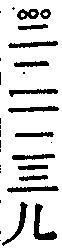
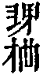
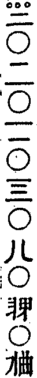
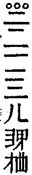

# 华严圣可禅师语录



> **藏经**：嘉兴大藏经（新文丰版）（嘉兴藏）　**册次** 第 35 册（J35）　**编号** JB342　**部类** 华严部　**卷次** 5 卷　**篇幅** 50,677 字

> **作者（译者）**：门人光佛等编

> **卷／品**：5 卷 · 0 品



---



## 目录



- [华岩圣可禅师语录卷一](#华岩圣可禅师语录卷一)

- [华岩圣可禅师语录卷二](#华岩圣可禅师语录卷二)

- [华岩圣可禅师语录卷三](#华岩圣可禅师语录卷三)

- [华岩圣可禅师语录卷四](#华岩圣可禅师语录卷四)

- [华岩圣可禅师语录卷五](#华岩圣可禅师语录卷五)



---



华岩圣可禅师语录目录



一卷上堂



二卷上堂



三卷晚参  

机缘



四卷拈古  

颂古



五卷杂录



------



## 华岩圣可禅师语录卷一



**译者**：门人光佛等编



上堂　重庆府巴县华岩禅院语录(二期十五则)



康熙庚戌年十月十五日，双山里蒋弘道等新建本院，请师开炉。



拈疏。「元符太白同斯理，双桂华岩没两般，祖脉渊源在里许，维那剖出大家看。」



法座。「不是曲录木，亦非吉祥草，唤作诸法空，依前不恰好。且道：如何方恰好？看取令行时。」升座。



拈香。「此一瓣香，初得广成子，三祝华封人，耑为祝延今上皇帝圣躬万岁万岁万万岁，唯愿一人无事，免股无肤、胫无毛之劳；众庶讴歌，得日出作、日入息之乐。」次拈香，云：「此一瓣香，在天乘东维、骑箕尾，在地隐傅岩、举版筑，奉为满朝文武、阖国公卿，暨本省、本郡、本邑当道尊官、现前檀越、今期请主，惟愿在位者禄位高增、在野者臻延福寿。」末后拈香，云：「此一瓣香，一出一入於极险地，始自兵戈队里得来，再甄再陶於百炼炉，今就荆棘林中拈出，热向炉中，奉为双桂堂上传临济正宗第三十一世破山先师，用酬法乳之恩。」敛衣敷座。上首白槌，云：「法筵龙象众，当观第一义。」



问：「新开炉𫖔设斯场，四众欣欣睹建庄，因此怀香呈一问，以何法道播诸方？」师云：「理长则就。」进云：「就个甚麼？」师以拂子拂一拂，云：「会麼？」进云：「不会。」师云：「幸尔不会，若会，打折尔腰。」进云：「过在甚麼处？」师云：「道理也不知。」问：「如何是己躬下事？」师云：「脚根下荐取。」进云：「体露堂堂时如何？」师云：「光天灼地。」进云：「未出方丈时如何？」师云：「闭目看。」进云：「出后如何？」师云：「劈箭急。」进云：「拨转虚空笑一场，原来无物可商量。」道了拂袖归众。师云：「莫道无事好。」乃云：「把得便用，意若死灰；撩起便行，心如墙壁。闻言而信，万年一念做工夫；得意而归，东去西来行祖道。有生可度，钝鸟栖芦；无佛可成，情同止水。凯歌齐奏，难乎不涉程途；天下太平，理宜归家稳坐。安禅结制，话已周圆，祝国祐民，作麼生道？但愿皇风弥宇宙，尧仁舜德万斯年。」举：「南泉住山，有一道者相访，泉云：『我上山作务，你做饭吃了，与我送些来。』泉去后，道者做饭吃了，打破锅碗去床上卧。泉见不来，便归，见打破锅碗在床上卧，泉亦去道者身边卧，道者便起去。泉后出世，举云：『我二十年前住山，见一道者甚是灵利，直至而今不见。』」师云：「说甚麼二十年不见？殊不知：道者打破锅碗时早不见了也。泉去身边卧，寻踪捕影耳。二十年后恁麼举，意在於何？从前汗马无人识，只要重论盖代功。」上首复白槌，云：「谛观法王法，法王法如是。」



上堂。问：「世尊不说说，迦叶不闻闻则背；世尊说说，迦叶闻闻则触。不触不背时如何？」师云：「华岩向者里道不出。」僧拟议，师便喝，僧亦喝，师云：「是背？是触？」僧便拜，师复喝，乃云：「世尊不说说，华岩不曾出方丈；迦叶不闻闻，大众何尝到法堂？向者里直下肯承当，如红炉上著一点雪；将此事当机齐舍却，似枯木上撒些子花。大众！还委悉麼？也是石臼呼风、虚窗吐白，各人回观返照，自然口耳根寂，闻说尘消，凡圣同源、古今不二。谁非迦叶？谁非世尊？灵山一会俨然未散。只如华岩依旧归方丈，大众仍复还本位，又且如何？不离当处常湛然，觅即知君不可见。」



长至，上堂。「天地之心今始开，云何一复万机回？为他枯尽闲草木，律管吹灰力自来。」



上堂。「昨日党元戎至静夜绎思几句佛法，想今日升座背讽一遍，与诸人结般若缘，并酬信施。洎乎诸人形问形答，尽情遗忘，华岩从头至足，内而肝、胆、肠、胃，外而发、毛、爪、齿，乃至大地山河，于其中间觅佛法如芥子许不可得。且道：将何以酬？」遂喝一喝，下座。



佛成道，王有功送子披剃，请上堂。以拂子召众，云：「见麼？此是王元戎舍子出家底舍心也，昔释迦老子舍王位、国臣、妻子皆同者个舍心。今日子夜睹明星而悟云：『吾观大地众生俱有如来智慧德相。』亦悟者个舍心。即是人人俱有如来智慧德相，因甚释迦悟、大众不悟？释迦老子恁麼道，岂不是压良为贱？汝等可以见义勇为、见贤思齐也。还委悉麼？山东宰相山西将，彼丈夫兮我丈夫。」以拂子拂一拂，下座。



刘光喜请上堂。「鸡鸣犬吠，鹊噪鸦啼，观音菩萨来也；墙壁瓦砾，大地山河，普贤愿王在焉。来在声色里求人、闻见中垂手则不无，掀翻声色、踢脱见闻一句作麼生道？数声清磬是非外，一个闲人天地间。」



周启嗣请上堂。「将拄杖在目上视了。」复顾左右，云：「者个木上座，默也可。」卓一下，云：「语也可。」竖起，云：「直也可。」横拄杖，云：「横也可。语默直横俱可且置，拄杖未出方丈，倚墙靠壁时，还解恁麼也无？一气不言含有象，万灵何处谢无私？」



元旦，上堂。问：「爆竹一声除旧岁，梅花几点迓新年。如何是旧岁？」师云：「桃符已唤。」进云：「如何是新年？」师云：「历日已颁。」进云：「不涉新旧时如何？」师竖拂子，云：「是涉？是不涉？」进云：「放下拂子又作麼生？」师云：「阇黎且归众去。」僧便归众。师云：「看者僧好稳脚跟。」乃云：「空劫已前一句子，梅花吐露已多时，今朝何故重重举？贵要眼前人共知。且道：知个甚麼？恭贺大众新春纳祐。」



解制，上堂。问：「寒去春来即不问，如何是解制句？」师云：「紧俏草鞋。」进云：「向上宗乘又作麼生？」师云：「铁蛇横古路。」进云：「与麼则诸佛不出世，祖师不西来也。」师云：「那里云来？」僧便喝，师便打，乃云：「父母所生眼毕竟坏、父母所生耳毕竟坏、父母所生鼻毕竟坏、父母所生舌毕竟坏、父母所生身毕竟坏、父母所生意毕竟坏，六根既坏，六尘绝待，心识全销，无罣无碍。大众！还会麼？若於斯会得，便可高高峰顶立，深深海底行，十字街头横行直撞，者边、那边，西天、东土，无可、不可；如或不会，不妨长连床上依旧觜卢都。」举：「僧问大随：『劫火洞然，大千俱坏，未审者个坏不坏？』随云：『坏。』僧云：『恁麼则随他去也。』随云：『随他去。』僧不肯。」师云：「者僧与麼问，大随合答他甚麼语，免者僧不肯？设有人问华岩：『劫火洞然，大千俱坏，未审者个坏不坏？』亦向伊道：『坏。』『恁麼则随他去也。』但答伊云：『一任举似诸方。』」



师诞，雪林维那请上堂。「无明父，恩爱母，念念迁流莫可补，赖遇朗公推出头，与他道个云门普。」卓拄杖一下，云：「者是无明父。」又卓一下，云：「者是恩爱母。云门普在甚麼处？」复卓两下，云：「于兹委悉得，大地无寸土。」



辛亥冬结制，印金、印刚请上堂。「以楔去楔，棒头落处山河隐；将错就错，撒手归来机用齐。临济悟黄檗宗旨，首山改风穴忧思，摩尼莫喻，连城岂企？上上人最贵，中下者不知，明明道破，的的全施。期九十日，日十二时，无分南北，莫辨东西，瞥然省得，不受人欺。执本现成，犹是得少为足，须吃痛棒，大叫土广人稀。」连卓拄杖，云：「还委悉麼？屋北鹿独宿，溪西鸡齐啼。」



光灿、光鲜请上堂。举：「昔日有一婆子到赵州斋僧次，向前指云：『者一堂僧总是婆生底，只大底儿子不孝。』赵州才顾视，婆便出去。今老僧住华岩三载，光鲜婆子频频请益，虽未有如是机缘，而弘护求道之心不在赵州婆子之下。设使光鲜翻转面皮，突出人前，亦向道：『者一堂僧总是婆所生，只有大底不孝。』老僧作麼生下得一转语？一与目前增光、二与赵州出气。」遂起身作女人拜，云：「儿孙自有儿孙事，祖父从来不出门。」



长至后，上堂。「炉香多诵两▆字，一线工夫日日加，万物无心承雨露，阳回依旧木敷花。」举雪峰岩头末后句机缘毕，云：「岩头以同生不同死为末后句，者僧被他热瞒，后来者僧，天下人还奈他何？不奈他何？今无私吾兄、渠也吾姪，昔与德玉同参，同条生又同条死，德玉只憾他二老不与玉道末后句，若与玉道末后句，天下人亦不奈德玉何，免出斯丑。者事且止，及节应时如何通信？荷尽已无擎雨盖，菊残犹有傲霜枝。」



元旦，上堂。「九渊参敏树法兄、云幻法兄有年而未染旨，来华岩一冬，于老僧棒头喝下稍有入处，老僧勘以女子入定机缘，渊与老僧一拳，老僧便打，渊拟议，老僧又打。渊云：『谁家不爱子孙贤？』老僧彼时痛与一顿，搭却不录。渊至夜深复入方丈，老僧向他道：『大机大用即不无，入理深谈未梦见在。』渊跃然喜，遂请老僧上堂，只将搭却机缘叙说一上，借花献佛，兼贺大众新年，别无法说。」



雪林、还初二上座请上堂。大众才集定，雪林白槌，云：「吾宗无语句。」师便下座，归方丈。



解制，上堂。「百日禅期业已终，解开布袋欲何从？」遂卓拄杖，云：「过头拄杖随身执，请续后句。若续得，即续；若续不得，待汝诸人到报恩寺为诸人续。」拽拄杖，下座。



重庆府报恩禅寺语录(一期四则)



壬子孟春望六日，渝城众乡绅耆庶暨旧住持超沦请师入院。



三门。「恢基已久，门庭不设，如斯为人，却也直捷。」



佛殿。「是乾屎橛、是麻三斤，日面、月面，即心、非心，新报恩到来，觌面相逢又作麼生？」



方丈。喝一喝，云：「一言既出，驷马难追；一机才发，万牛莫回。擒虎兕、定龙蛇句分付阿谁？」复喝一喝。



当日，众绅士请上堂。拈疏，云：「文韬武略，掷地作金声；江汉秋阳，翻空成玉露。大众！见麼？」请维那宣过，指法座，云：「沩山左胁书字，嬾庵收放索头，更有寒山、拾得，却都是我同俦。」遂以右手理袈裟，左手将拄杖安头上，云：「新报恩披毛戴角，入他者一夥群队去也。」遂升。



拈香祝圣毕，末后拈香，云：「此一瓣香，蒙山言下知音，大随镢头𣃁得，此乃第二回拈出，𦶟向炉中，耑为传临济正宗第三十一世破山先师，用酬法乳之恩。」敛衣敷坐。维那白槌，云：「法筵龙象众，当观第一义。」问：「如何是报恩境？」师云：「真武山上铁围竿。」进云：「如何是报恩人？」师云：「眉横鼻直。」进云：「人境且置，入院庆赏一句作麼生？」师云：「一炷清香古柏根，愿祝当今无量寿。」进云：「师子窟中无异兽，象王行处绝狐踪。」师云：「带累三军，将头不猛。」进云：「西河师子，字水出头。」师云：「文殊来也。」乃云：「予本林间人，藏拙而自守，无端众檀那，三请出山口，草鞋套脚下，拄杖横肩负，到来升此床，一旦扬斯丑，不惑乱人天，敢钝置诸友，各与三十棒，永光临济后。」喝一喝。复举：「朱行军入南际院，自行香云：『直这是，直这是。』时有一僧问云：『直这是，是个甚麼？』军便喝。僧云：『行军幸是佛法中人，恶发作麼？』军云：『你作恶发会那？』僧便喝，军亦喝，云：『钩在不疑之地。』呼左右：『认取者僧著。』」师云：「你看他二人，一纵、一夺，一杀、一活，发明临济宗旨，古今罕有。今日超沦暨众檀那三番四番来华岩迎请，老僧辞之不获，只欲老僧来此、住此，兴扬佛法，建立双桂老人宗旨，亦是古今罕有。且道：一念万年，始终不变一句作麼生道？碧玉磨成西子骨，黄金铸就伍员心。」维那复白槌，云：「谛观法王法，法王法如是。」



结制，光裕、光云请上堂。「长期短限作甚麼？坐禅坐佛事何多？打牛打车君如会，谁把砖来石上磨？车若不行，打车即是？打牛即是？」问：「十方诸国土，无刹不现身。身作麼生现？」师云：「龙门皓月映长空。」乃云：「一日之计在乎寅，一年之计在乎春，一生之计在乎勤。勤个甚麼？勤深耕浅种，农人之计；勤五经四书，文举之计；勤驰马试剑，武举之计；勤贸易货殖，经商之计；勤辟土地而抚四夷，国王、王子、大臣之计。今日现前檀越当期请主，决不是如上所说之计。计在於何在？要将报恩寺中荆棘化为赭垩、瓦砾翻成梵宫，令老僧日日升于此座，演扬临济正法眼藏，使人人鼻孔辽天、个个脚跟点地，咸悟上上一乘，生生世世不受阎家老子所罗絷，以满百劫千生之计，计在斯也。百劫千生之计在乎甚麼？在乎最初。最初一句作麼生道？玅舞必当夸遍拍，三台须是大家催。」



仲春花朝，上堂。「涧浊江清，断岸全消雪路；春和日煖，满山复露烧痕。晴月何常有心？一夜之间晒开桃红李白。朝风原来无意，刹那之际吹绽柳眼桑包。百草萌芽，万虫辟户，情与无情，炽然而说，说无间歇。僧之与俗，立地而听。听个甚麼？不见道：心随万境转，转处实能幽，随流认得性，无喜亦无忧。生机一路，到者田地也大难得，打面还他州土麦，唱歌须是帝乡人。」



浴佛，上堂。「天下丛林商量浩浩地评题初生公案，多是与云门作主。云门要打杀悉达，何尝作不得主？报恩今日要与悉达作主，使云门有捧无下手处。」蓦拈拄杖，卓一下，云：「大众！会麼？悉达生也。摩耶夫人即今在甚麼处？」遂起身，倚拄杖而立，云：「每忆独丁难远害，从教千子一胞胎。」连卓拄杖，下座。



解制，上堂。举：「药山升座，默然而坐，大众才集定，药山便下座。」师云：「药山恁麼，银山铁壁针劄不入，虽是识法者惧，要且太险绝生。报恩则不然，道火怕烧著口耶？今日与诸人八字打开，合水和泥去也。还委悉麼？普请大众，华岩耘秧。」拽拄杖，下座。



再住华岩禅院语录(十二期七十九则)



壬子孟冬望日，结制，上堂。祝圣毕，末后拈香，云：「此一瓣香乃天华棒头、二祖拳头，忍痛已久，拈来𦶟向炉中，奉为双桂堂上传临济正宗第三十一世破山先师，用酬法乳之恩。」敛衣敷座。上首白槌竟，师云：「眼如黑漆，明察秋毫；耳似卷荷，聪闻蚁斗。根根明镜，尘尘止水，一摄一切、一切摄一，融通三际，含褁十虚，法尔如然，神通玅用，不假修造，本自现成。只为汝等有生之后，眼随色变、耳逐声移，情尘妄想日积胶固，故有长期、短限，渐修、顿悟之规，非老僧特地妄为，强向空里畫眉、盂上安柄也。还会麼？剑为不平离宝匣，药因救病出金瓶。」上首复白槌竟，下座。



长至，上堂。问：「阴向鼻端灭，阳从眼里生。如何是灭句？」师云：「一气不言含有象。」进云：「如何是生句？」师云：「万灵何处谢无私？」进云：「如何是不生不灭句？」师云：「无言可答，无理可伸。」进云：「恁麼则乾坤有眼，大海无波也。」师云：「八方霡霂无为化，四海歌谣乐太平。」僧礼拜，师乃云：「履长之庆乱如麻，至日闭关却较些。灰尽全心无剥复，才生一念看飞葭。」



上堂。「昨日光菂云：『来日是弟子母难之辰，请和尚开甘露门，慈悲利济。』老僧向他道：『你父母未生前道一句来。』士无语，老僧云：『明日升座与你说破。』今日故升於此座，举似大众，大家证明。父母未生前句子，与君拈出记须牢。二郎关上瑶芝秀，帕子岩前碧树高。」



新戒真寿请上堂。「高沙弥拂袖而去，从空放下；卢行者网中跳出，就地升高。不入者保社，膏肓不少；向者里去，头上安头。两者俱全，一体不成二佛；拈一放一，如何脱尽廉纤？既是行者得衣钵於黄梅，因甚却於智光受戒？了达本来无一物，何妨锦上更铺华？」



光常请上堂。问：「放去天雨四花，收来地摇六震。如何是禅？」师云：「涂山高。」进云：「满目尽是青山绿水。如何是道？」师云：「字水深。」进云：「自性了然。如何是佛？」师云：「头上安头。」进云：「三藏拈向一边。如何是法？」师云：「斩头觅活。」进云：「禅道、佛法既尔分明，如何保任？」师云：「饥吃饭，困打眠。」进云：「任麼则锦上铺花去也。」师云：「漳州橘皮莫当火，枯木岩前岐路多。」乃云：「闭门打睡，接上上机；顾鉴嚬呻，曲为中下。只如鲁祖见人来便面壁去，是接上上机耶？是曲为中下耶？老僧恁麼举，却有两意：一荐光常之母生天成佛、二祝光常之寿山高水长。鲁祖面壁意旨果只如此耶？向下文长，付在来日。」



解制，上堂。「梅子兮脱胎，柳眼兮乍开。征夫兮出户，农人兮归来。春雨如膏兮石头路滑，君等且住住兮免怨草鞋。」



中秋，明玄师请上堂。「体露金风万象如，松萝无影映山居，当台一镜分明甚，照彻诸人肝胆。无有，即出来大家证据。」问：「万古长空，一朝风月，毕竟是甚麼意？」师云：「普天匝地。」进云：「月正圆时作麼生赏？」师云：「塞壑填沟。」进云：「月落后如何相见？」师云：「非公境界。」僧拂袖归众。师云：「果然。」乃云：「明玄镜上人，存心甚广大，追师及荐徒，请吾说佛法。吾说恐不如，拄杖为通达。」遂以拄杖打圆相，云：「如是光辉彻四维，翁孙乘此齐超拔。」复卓拄杖两下，下座。



心安送法衣，请上堂。「鸡足山中埋没久，大庾岭上空开口。吾徒甚处得将来？自不受持供老朽。老朽披登狮子床，人天共证无何有？大端个个解翻腾，无一不能狮子吼。」遂蓦拈拄杖，召大众，云：「狮子吼且置，既是人天共证，因甚却又道无何有？」拽拄杖，下座。



癸丑冬结制，上堂。「一年一度开炉，今岁期中不如。四海禅和云集，十方檀供稀疏。幸有龙天可恃，不致饮水餐荼。珍重！诸人努力蕴饱，赵州曰无，朝参暮参绵密，做个铁铸丈夫，一日冷灰豆爆，自然列上祖图。」喝一喝。



上堂。举：「龙池幻有传师祖云：『佛法二字虽不是偶然，亦非特意会得，但有个悟入处。信意拈来，自然贴体；随分道出，自然恰好。』」师蓦拈拂子左拂，云：「贴体？不贴体？」又以拂子右拂，云：「恰好？不恰好？虽然如是，也须的的当当有个悟入处始得。不然，终是矮子看戏。」



冬至，上堂。「空劫已前，承当枯根乾蘖。佛未出世时，会取死火寒灰，尚不得一个、半个。千兵易得，一将难求。他恁麼驴年去，莫守寒岩异草青，坐却白云宗不玅。大众！者四转语，判著？判不著？印光大师将鲁祖、南泉、老僧、大众鼻孔一串穿却，撒向诸人面前了也，莫只囫囵吞却，直须识些子滋味好。」



佛宣、佛崇请上堂。问：「雪峰三登投子，九上洞山，如众居士登山涉水到华岩，是同？是别？」师云：「左戒堂。」进云：「雪峰后来鳌山成道，众居士向何处成道？」师云：「右方丈。」进云：「雪峰成道，岩头证盟。众居士成道，何人证明？」师云：「阇黎。」进云：「莫压良为贱。」师云：「屈煞汝。」乃云：「一日一次上堂，佛法渐渐兴扬，僧俗如龙若虎，都来直下承当。且道：承当个甚麼承当？四果耶？辟支耶？十圣耶？三贤耶？佛耶？祖耶？金屑虽贵，落眼成翳。」



解制，彻心请上堂。「有一桩事，对众举扬。天才下雨，地便生浆。东南林茂，西北草荒。石桥路滑，崄巇二郎。通霄一路，不许商量。园有剩菜，仓有餘粮。不妨众广，坐折禅床。兼逢马乱，又值兵荒。山间林下，且𫏐退藏。四野无事，一任周行。」



浴佛日，崇心师请上堂。「才生就被云门打，既长屡遭调达欺，自古逮今一毒鼓，斯朝谁不用桴槌？」



甲寅冬结制，印光大师请上堂。「世道安危不可量，斯须大块几沧桑，幸今结制山林下，多得同人共举扬。」



新戒玅乐请上堂。「戒如金刚宝剑，斩恩爱烦恼之利刃；戒如踞地师子，迸群狐魔外于他方；戒为入道之前茅；戒为袪习之殿后；戒乃生西方公据；戒乃破地狱赦书。戒之一法，众玅之门也。只如祖师门下还用得著麼？若用得著，丹霞不应掩耳而去；若用不著，六祖不应受戒。智光！还知麼？取净舍秽者，戒在眼；厌喧求寂者，戒在耳；逐臭寻香者，戒在鼻；说是说非者，戒在舌；爱暖恶寒者，戒在身；过未习想、现业流注者，戒在意；六根纷纭，戒在一心。只如六根不行、一心不乱，戒在甚处？」良久，云：「待吃了妙乐斋来与你们说。」



三渊师请上堂。「念佛一声，火急漱口，才起二见，贬向铁围。大人境界报君知，承当即便是欤？金屑落眼成障翳，好事不如无也。到者里，忽有人道：『老和尚说得盛水不漏，了无一针锋许缝。罅即不无，要契他达磨、鲁祖、药山、维摩，不啻郑州出曹门。』」蓦喝一喝，云：「老僧正要问你，药山、维摩置之不论，达磨、鲁祖向你道甚麼？莫向鬼窟中作活计。」



光云请上堂。「父母未生前，承当咳唾掉臂，也是祖师西来意；一念才生处，觑破妄想情虑，皆镕化为真心。行向者里行、说向者里说，现证色身三昧，疾得语言陀罗尼。一脚蹋倒涂山，与乾坤而并阔；一喝逆流锦水，共髑髅而齐乾。然虽如是，若果见处分明、悟处谛当，行合乎说、说合乎行，处处与人为龟、为鉴、拔楔抽钉。如其见悟不真、行说不合，不如直下如蚊子上铁牛一般相似，将父母未生前一念才起处一较较定，如印圈契券之无差，下脚不得、开口不得，更稳当也。」拽拄杖，下座。



元旦，上堂。「时当寒尽春初还，岩断冰澌溜复潺，惟有山僧拄杖子，不随新旧改容颜。」



解制，上堂。问：「杨岐侦慈明於小径，是何意？」师云：「老僧在此二十年不会。」进云：「岐搊住云：『今朝须与我说，不说打和尚。』说个甚麼？」师云：「银山。」进云：「岐又问：『窄路相逢。』慈明荅：『你且躲，我要往那里去。』且道：向何处去？」师云：「铁壁。」进云：「当时若遇玲珑汉，劈面拦腮又如何？」师云：「也要是个人始得。」乃云：「从上诸圣无一法与人，老僧不怕瞎人眼、不怕诸方检点，却有法与人。且道：有甚麼法？」遂大展两手顾维那，那白椎竟，便下座。



金荐伯请上堂。以拂子召伯，云：「父母未生前，偪塞虚空，无背、无面，无是、无非，无眼、耳、鼻、舌、身、意。及其既生也，突出难辨，非圣、非凡，非僧、非俗，无色、声、香、味、触、法。未生、既生，浑然与琉璃光明法体无以异也。及其少而壮、壮而老也，情窦日凿、念虑时迁，便有六根、六尘、六识，万法枞然，似乎与琉璃光明法体渐觉疏远。金荐伯！你既发无上道心，然琉璃光明灯、供琉璃光明佛、念琉璃光明经、求琉璃光明寿、饭琉璃光明僧、祈琉璃光明果，老僧不辞为汝说破，只恐你承当不下耳。你若承当得下，但将从前所积凡所有相一切顿舍，难舍能舍，舍亦复舍，舍黑暗色得光明眼、舍黑暗声得光明耳、舍黑暗香得光明鼻、舍黑暗味得光明舌、舍黑暗触得光明身、舍黑暗法得光明意，如是六处既得，则七处、八处、九处、十处、四十九处光明灯灯相续、焰焰不绝，八万四千毫毛孔窍窍窍放大光明，灼然与琉璃光明法体无二无别。虽然如是，不可闻老僧恁麼告报，便乃坐守长途，不肯归家稳坐。此是化城，终非宝所。设使途路不得力，不若还将父母未生前一段光明靠之，如倚天长剑，将第八识奋志一刀两断，如斩一缕丝相似；如轻帆遇顺风，到岸不劳弹指顷；如大象渡河，截流而过；如师子哮吼，火急咬人。恁麼奋力一回始得。」



乙卯冬结制，上堂。「三百六十个日子，随他念念与迁流，骑声盖色全无碍，东去西来得自由。衲僧家气宇如王，脚跟下无红丝线，舌头上无十字关，因甚於一冬三个月内有眼盲、有耳聋、有口哑，六不通？」遂卓拄杖，云：「只为把柄在老僧手里。」复打圆相，云：「从今绾就冰澌结，直待春和始放开。」



楚石请上堂。蓦拈拄杖，展手作量势，云：「大众！会麼？此拄杖长华岩二尺。」便度与侍者。举：「五祖演上堂，云：『此拄杖长老僧一尺。』便下座。华岩看来，不惟只长演祖一尺，自圆悟勤、虎丘隆，乃至密云师翁、双桂先师俱只长一尺，因甚到华岩却长二尺？养子不及父，家门一世衰。」



梓匠周崇礼、万启富请上堂。「满腹经纶不自欺，琼楼玉宇我先施，无分贵贱与高下，到处逢人露一丝。」



元旦，上堂。以拂子召众，云：「会麼？三阳开泰日，百戏作舞时，礼乐於今密，胭花分外奇。无钱食馄饨，有地折松枝，应以裁成道，辅天相地宜。辅相即不无，如何是裁成道？」以拂子打几案两下。



彭佛幢等请上堂。「日日炉边把火围，不知门外早春归，等闲信步山头望，雨后梅花带雪肥。」



解制，上堂。问：「春工忙忙，向何处下种？」师云：「脚下。」进云：「空劫已前下得麼？」师云：「不顾脚跟三尺水，犹贪纵步上高层。」僧便拜，师乃云：「兰蕙芬芳，鼻孔昂藏，桃李红白，莫被眼惑。蹋破草鞋来，老僧为你说。只如掉头不顾、三搭不回者，作麼生与他说？珍重道傍荆棘刺，休教撦破尔衣裳。」



佛诞，谢启祥送缅佛至，请上堂。祝圣问答毕，乃呼谢启祥，云：「此佛岂不是你家中自所供养者，得得持来请山僧说法耶？殊不知：此佛在你家中鼻观十餘年，默示向上宗乘，你自不荐，向外驰求，多者一番起倒。」遂起身拓起缅佛，云：「大众！佛生迦毘罗，因甚缅国成形？既在缅国成形，因甚又在渝州谢启祥家出现？既在谢家出现，因甚又在山僧手里？」乃放下，云：「是处是慈氏，无门无善财。」复举：「遵布衲浴佛次，药山云：『者个从汝浴，还浴得那个麼？』衲云：『把将那个来。』药山休去。」师云：「药山虽尔分星拨两，要且句里藏锋。布衲固然截铁斩钉，未免落他圈套。药山休去又且如何？有解道：识法者惧。有解道：争之不足，让之有餘。有解道：欲隐弥露。俱不是者个道理。设使药山信手拈出，布衲又安肯放过？还会药山意麼？他怕打湿袈裟角。」



丙辰冬开炉，金光慧、郑光选请上堂。「现成炉鞴红如火，仍旧键槌辣似姜，珍重铜肝銕胆汉，一回锻鍊一回刚。」



上堂。问：「萨婆多云：『若人犯欲，即是佛法边外人。』是否？」师云：「是。」进云：「荧光比丘犯婬，因甚向维摩一言而释？」师云：「是。」进云：「某甲犯律，和尚说何法与某甲忏悔？」师云：「道得与你忏悔。」进云：「恁麼则无罪可灭也。」师云：「也要你自肯始得。」进云：「文殊有言：『清净行者不入天堂，破戒比丘不入地狱。』」师云：「老僧今日功不浪施。」乃云：「是！是！不是！不是！通身是！遍身是！似此之类也。道！道！不道！不道！胡乱道！莫乱道！如斯而已乎？宝剑多品，只饶解弄、不解杀人，终归无用。篱根之下，舍得茎草，便杀活自由，纵夺可观者，毕竟是甚麼人？」蓦拈拄杖卓两下，云：「脑后见腮，莫与往来。」



王仲请上堂。举：「五祖演上堂，云：『多说不如少说，少说不如不说。』便下座。」师云：「一言出口，海墨书之不尽。多说也在里许、少说也在里许，说也说了，说甚麼不说？华岩则不然。」蓦拈拂子，云：「要多说就多说，要少说就少说，要不说就不说。作麼生是多说？」以拂子搭左肩。「作麼生是少说？」以拂子搭右肩。「作麼生是不说？」放下拂子。



解制，光选请上堂。举：「鼓山赴大王请，雪峰门送，回至法堂，乃云：『一只圣箭直射向九重城里去也。』孚上座云：『是伊未在。』峰云：『渠是彻底人。』孚云：『若不信，待某甲去勘过。』遂赶至中途，问云：『甚处去？』鼓云：『九重城里去。』孚云：『忽遇三军围绕时如何？』鼓云：『他家自有通霄路。』孚云：『与麼则离宫失殿去也。』鼓云：『何处不称尊？』孚拂袖便回。峰问：『如何？』孚云：『好只圣箭，中途折却了也。』遂举前话。峰云：『奴渠语在。』孚云：『者老冻脓犹有乡情在。』」师云：「古人是悟得底禅，所以开口各自作得主宰，咸有出身之路。鼓山恁麼道，毕竟那里是他折箭处？若也见得，安南塞北，东掷西抛，八面玲珑，纵横无碍；其或不见，只恐行到前不搆村、后不抵店之际，平田浅草之中跳出一个没情面底孚上座，不惟中途折箭，只好饮气吞声，受他处分有在。」



------



## 华岩圣可禅师语录卷二



**译者**：门人光佛等编



丁巳冬结制，张自新等请上堂。「炉炭绯红，为镕顽钢钝铁；砧槌网密，要打利剑铦鎗。设使本有现成，何妨重烹再鍊？若是跃冶自况，徒劳烂额焦头。」遂蓦拈拄杖，卓一卓、喝一喝，度与侍者，云：「暂教放在幽窗前，闲日与君重打算。」



化主光体率渝城众乡长送毘卢佛入山，请上堂。问：「未出母胎，度人已毕，因甚又有者翻起倒？」师云：「河源万里。」进云：「即如众乡长跋涉送佛入山，得何功德？」师云：「隄高百尺。」乃蓦拈拄杖打圆相，云：「大众！见麼？毘卢遮那佛说法已竟。若於此见得，不消德玉重说偈言；其或未然，德玉落第二头，与诸人打之遶一上。要会毘卢遮那来历麼？发足滇海，经涉黔阳，不御风云，岂待车马？东山水上行，西河火里坐，阿谁藏身北斗？薰风推送南来。渝中两月淹留，檀那一朝奋发，麻三斤约束全躯，竹筋鞭勤策正道。舁奉斩新华座，幻出仍旧主人，非我多两片皮，缘他少一口气。虽尔无法可说，要且有仪可观，相好八万四千，光明普天匝地，为祥为瑞、福国福民即不无，只如今日化主率众檀越旛盖溢目、香火蒸云，迎的迎、送的送，焕耀梵宇、光辉佛日一句作麼生道？落华台上重铺锦，玛瑙阶前布玉沙。」卓拄杖，下座。



黄之尚生日，请上堂。「你有拄杖子，我与你拄杖子，泥多佛大，水涨船高，之尚之母，极乐逍遥；你无拄杖子，我夺你拄杖子，不挂本来，切忌未生，之尚之寿，如岗如陵。者两判语与芭蕉拄杖还有契分也无？若有契分，则止止不须说，我法妙难思；若无契分，老僧同黄之尚乘芭蕉拄杖子入无边香水海去也。还委悉麼？昨日如心相告，周生直念不差，大家护惜常住，斗米换个冬瓜。」



胡悟圣请上堂。「你有拄杖子，与你拄杖子，高高筑墙；你无拄杖子，夺你拄杖子，深深掘堑。芭蕉用处毕竟如何？保得他人腴田万顷，难免自家穷无一线。还会麼？听取一偈：黑漆电疾，劈脊血滴。」顾左右，云：「咦！」



曹文秀等请上堂。「佛法二字向下说时，直饶文殊、普贤现大人相，以虚空为纸、大地为砚、须弥为笔，溅四海水书老僧所说，至楼至佛出世及穷未来劫亦书说不尽。向上说时，不消拄杖一默。」遂顾拄杖，云：「且道：拄杖子有甚麼长处？」



黄光阔请上堂。「帕子崖前一片石，四方八面一般宽，拈来度与黄光阔，岁岁今朝作饭钱。」



长至，敏松请上堂。「阴阳无气，律管不应飞灰；天地有情，梅花故开笑口。青宫世子，郊外扶犁；先王闭关，一人有庆。洞山此日拈果，慈明今夜放参。且道：待老山中野人毕竟安排个甚？」遂以拄杖打圆相，于中书一云字，云：「大众休得眼华，老僧终不杜撰。」



佛成道，刘泽民请上堂。「六年忍苦住寒山，笋膝巢颅安不安？今日长连床上客，全三全七坐犹难。」



上堂。「释迦、弥勒犹是他奴。他是谁奴？郭居士饭钱，莫只靠老僧▆家还始得。」众无对，师乃掴口一下。



解制，记来请上堂。举起拂子，云：「拂子有情竖起，诸人将不去；拄杖无力靠下，那个肯承当？所以九十日中按图索马，三个月内缘木求鱼。」遂以拂子作此



，云：「老僧不免为八字打开，划断铁限，高启翳𢅏，令汝等眼盖乾坤，气吞宇宙去。」复云：「住！住！只如铁蛇横古路又作麼生去？」乃抛下拂子。



戊午冬开𬬻，王仲请上堂。「红似榴花火一𬬻，彻天彻地彻云居，人人鍊就铁肝胆，问你眉毛生也无？」



无尘、大空请上堂。「横刀且断真人足，织女攀弓欲上弦，红日一轮从古正，草之上下自相连。」良久，云：「虽然如是，早曲了也。莫将闲学解，埋没祖师心。」



长至，上堂。举：「石霜冬日榜僧堂门，作此







，其下注云：『若人识得，不离四威仪中。』首座见，云：『和尚今夜放参。』」师云：「首座道放参且置，石霜作此，老僧二十年不会，今日穿凿得个拙颂，举似诸人，大家铲削看：众艺文渊六七库，无位真人一喝收。直指心宗如是法，石霜榜上看根由。」喝一喝，下座。



新戒法本请上堂。召法本，本应诺。复搴起袈裟角，云：「会麼？」本云：「不会。」师云：「此是佛涅槃后，迦叶尊者持上鸡足山中入大寂定，七十俱胝五十六百岁以待慈氏底。即今慈氏未下生、迦叶未出定，此个从甚处得来？」良久，云：「秪是不归归便得，五湖烟景有谁争？」



解制，上堂。举：「南泉道：『老僧自小牧一头水牯牛，拟向溪西牧，不免食他国王水草；拟向溪东牧，亦未免食他国王水草。不如随分纳些些，总不见得。』试问大众：既是纳些些，云何道不见得？既是不见得，何故又道纳些些？淆讹在甚处？老僧者里於九十日内也牧得一群水牯牛，虽尔水草均调，其实栏棬偪隘，不免将东夔、西益、南遵、北果作一栏棬亦隘，东海岱、西吐番、南五岭、北长城作一栏棬亦隘，将四天下作一栏裷亦隘。」蓦以拂子打圆相，云：「只得将万亿佛土、无边妙华光香水海作一栏棬去也，亦任他掉尾摇头，昂藏鼻孔，瓮中不怕走却鳖。」



己未，开炉，上堂。顾左右，云：「八万四千生铁汉，通身为炉诸根炭，无明火种著些些，鍊亿山河成一片。」蓦拈拂子，召大众，云：「唤甚麼作无明火种？」遂折叠拂子，吹两吹，云：「若是不顾危亡的，只教他肝肠似易，眉目悄然；若是贪生畏死之流，早已烂额焦头，无你回避处。」乃以拂子度与侍者，云：「收起火种。」



长至，上堂。「斗柄北指，复见天心；春信南枝，暖启地肺。一阳初动，嵩岳之寿宜呼；万物未生，涂山之梨可献。以斯福国祐民、以斯保障方土即不无，只如华岩院里老僧、长连床上学士，枯木其形、墙壁其心，如何通信？仲冬莫言无煖气，阳春尽泄不萌枝。」



解制，上堂。问：「如何是夺人不夺境？」师云：「老僧即主杖。」进云：「如何是夺境不夺人？」师云：「主杖即老僧。」进云：「如何是人境两俱夺？」师云：「倚墙靠壁时荐取。」进云：「如何是人境俱不夺？」师云：「闲持主杖松间立，笑问客从何处来？」问：「如何是结制？」师云：「解也。」进云：「如何是解制？」师云：「畫断铁限。」乃云：「三个月，九十日，一千零八十时，眉毛彷佛，鼻孔依俙，同千百亿化身之有相，类十八高贤之无为，铁壁银墙，枯情乾识，收心放胆，掌电喝雷，事既功圆行满，理合展目扬眉。放全机于方外、收露布于怀中即不无，秪如不动脚跟而行千里、不出户庭而遍尘刹一句作麼生道？有翼石虎来劫外，无毛鹞子拍天飞。」



佛宇寺玉初师送僧伽黎，请上堂。举：「海舟慈祖访东明旵祖于古道山，扣关而问曰：『无上福田衣，甚麼人得披？』明下座，打一掌。舟云：『四大非有，五蕴本空，作麼生？』明又掌。舟云：『一掌不作一掌用，又作麼生？』明又掌。明见得海舟神色不变，称誉道：『我住古道山二十年，今朝只见者汉。』遂以袈裟与之，舟辞曰：『某不为衣来。』」师云：「德玉谬解，道慈祖大似眼观滩浪，失却手桡，自己话头，浑然忘却。既问无相福田，及其与之，却又不受，恁麼会又争得？殊不知：明祖乃醉后添杯，慈祖乃饭饱弄箸耳。今日玉初上人将师所授衣秘惜已久，特舍请法，大类乎此，亦似饭饱弄箸来请老僧出季而关，升曲录木，出东转西，一上一下，不可徒然，还当得醉后添杯也无？」乃揲袈裟角，云：「若将耳听终难会，眼底闻声方始知。」



庚申冬结制，上堂。「往岁有檀那，请我升此座。今岁无人请，秪想挨排过。所以病老僧，开口无法说。」喝一喝，云：「各人自荐取，鼻孔下头大。」



佛成道，九超请上堂。竖起拂子，召大众，云：「会麼？此是九超寻常用底铁火叉也。日日剔柴拨火，朝朝办生作熟，供养诸人，不独今朝也。九超用底即是世尊今朝悟底，至于尘沙国土、普世界丛林，世尊无一处不是，今朝一齐而悟，不独华岩也。如是举扬，若单为圣节，则孤负九超；若单为九超，又孤负圣节。毕竟作麼生？」遂以拂子击几案两下，云：「两彩一赛。」



乾州李别驾、三元章台谏请上堂。问：「郭功辅截江访白云于海会，是何意旨？」师云：「四壁光吞蓬户日。」进云：「白云问功：『牛淳乎？』功曰：『淳矣。』白云叱之，功拱而立，云曰：『淳矣！淳矣！』淳在甚处？」师云：「一缾香熟地炉茶。」进云：「即今二护法遥来相访，请和尚说法。且道：与功辅访白云是同？是别？」师竖拳，云：「会麼？」进云：「不会。」师云：「苟非意外相知者，徒把空拳竖向他。」进云：「恁麼则水向石边流出冷，风从花里过来香。」师云：「且喜荐得。」乃云：「万叠峦疏一迳遥，千株松续断山腰，今朝何幸来双辔，起我残荒破寂寥。」举：「临济同普化到施主家斋。济问化云：『毛吞巨海，芥纳须弥，为是神通玅用？为是法尔如然？』普化踏倒饭床。济云：『太麤生。』次日，又到施主家斋。济云：『今朝何似昨日？』化又踏倒饭床。济云：『得得太麤生。』化云：『瞎汉！佛法说甚麼麤细？』济乃吐舌。」师云：「普化两次踏倒饭床，若是神通玅用，临济不合道他太麤生；若是法尔如然，临济不合吐舌。二老发明黄檗宗旨即不无，争如我李、章二公，王臣蹇蹇，匪躬之故，不畏蜀道之难，登剑阁而识张载之铭、宿钓鱼而知二冉之指，穿缙云、涉字水，来此江州国事之餘，得得来山供佛饭僧，请法不懈，俾老僧举古举今，演扬佛祖正法，诚哉希有！看他二公一面勤劳王事、一面墙堑三宝，如斯神通玅用，谁敢道细、道麤？岂不超他古人头地？者事且止，因斋庆赞，报答二檀，祝国祐民，巩固江山一句作麼生道？北门函固金锁钥，南来剑益万里城。」



陈宗富荐妻请上堂。蓦竖拂子，云：「浑沌初分开柳条，无文心印绽桑苞。女娲昨日补天漏，鍊得云根上九霄。」击拂子一下。(时正月廿三日也。)



解制，上堂。问：「大通智胜佛，十劫坐道场，因甚佛法不现前？」师云：「业识未尽。」进云：「因甚不得成佛道？」师云：「待汝业识尽时向你道。」僧无语。师竖拂子，云：「会麼？」僧云：「不会。」师云：「凡老僧所说，不可作实法会。」复以拂子击几案，云：「但与麼会。」便下座。



辛酉冬结制，李承应请上堂。「佛法遍在一切处，既遍在一切处，还有针锋许、芥子许不周遍处也无？若有，即非佛法也。恁麼说话，忽有个汉出来拽将下座，好搥脚折，不为分外。」良久，云：「住！住！老僧非是压良为贱，卑视诸人，老僧有个验法可以作证。秘魔见人来，便以叉叉住，云：『道！道！道得也，叉下死；道不得也，叉下死。速道！速道！』拟议，便叉出。慈明室内常安一水盆，盆上置一剑，傍著一緉草鞋，僧才入，便云：『咦！』僧拟议，便趁出。老僧恁麼举，妄想得一个撞著露柱瞎汉出来承当，总不见有也。」蓦顾维那，喝一喝，下座。



冬至日，上堂。「石霜揭出榜文，为蛇腹下畫足；洞山彻退果桌，向龟背上拔毛。二老恁麼为人，汝等作麼生会？」问：「德山拓钵出方丈，意旨如何？」师云：「为汝不荐。」进云：「雪峰与麼，老汉为甚默然归室？」师云：「欲隐弥露。」进云：「觅火和烟得，担泉带月归。」师云：「你见甚麼与麼道？」进云：「德山道：『你不肯那？头密启其意。』启甚麼意？」师云：「老汉出丑。」进云：「不然，脑后一槌堪著力，到头云足觅山归。」师云：「是头归？是你归？」僧便喝，师云：「老僧也出丑。」进云：「因甚师遭徒记？」师云：「如虫蛀木，偶尔成文。」进云：「也是月满还亏欠，火猛不久然。」师云：「是何言也？大千沙界海中沤，一切圣贤如电拂。」乃云：「石霜榜文，老僧一一为汝等注破。



唯此个注不得。既是六个注得，因甚



此个注不得？要再打一个，有甚麼难？咦！」



解制，郑明政、郑守能请上堂。「九十日前如何鼻孔双垂？正当九十日如何双垂鼻孔？今则九十日后也，又作麼生穿却鼻孔？衲僧家的鼻孔，东西十万、南北八千，不能比其宽狭；过去、未来、现在，尽三世际不能拟其碍通。甚麼人敢穿衲僧鼻孔？」乃顾拄杖，云：「珍重撩天拄杖子，应知深浅与高低。」



省山维那荐亡弟念先，请上堂。举：「僧问云门：『如何是尘尘三昧？』门云：『钵里饭，桶里水。』」师云：「者僧於此瞥地去，云门可谓功不浪施；者僧于此不瞥地，因甚默然而休？念先禅人於此履践得入斯门，生前面目俨然现在。」顾左右，云：「大众！还见麼？若以父母生眼见是凡见、不以父母生眼见是圣见，爱圣憎凡，生死海里浮沉。既不如此，且道：如何与他相见？」蓦拈拄杖，云：「来也，只见子形，不闻子声。」复卓一下，云：「只闻子声，不见子形。」又卓一下，云：「细无不入，大无不包，其直如箭，其利似刀。所以，三平得中成圣，临济被拂如蒿。」又卓拄杖两下。



曾光省请上堂。召省近前，云：「你未出门时，老僧已为汝说一念回观便同本得法了也；出门时，已为你说举足下足无非道场法了也；既到者里，已为你说三皈依近事男法了也。你请老僧复为说法，说何等法耶？老僧忖你意，谓此是化城，终非宝所，不入惊人浪，难逢称意鱼，必欲得上上法尔。」乃蓦拈拄杖卓两下，云：「十方世界平如掌，一条官路直如弦，珍重眼前缁素辈，殷勤来踏上头关。」



双桂忌辰，慈云价南大士请上堂。卓拄杖两下，顾左右，召众，云：「汾阳吃一脔，双桂吃一世，叶县接浮山，惟以水漉地。棒棒棒德山，喝喝喝临济，吃肉断慈悲，打骂乖佛制。况今学道人，作匹事间耳，不惟不肯疑，且亦不解举。」复卓拄杖，云：「举已举了，且道：作麼生疑？疑断大慈悲佛性种子耶？疑打骂耶？听取一颂：无影树子一高株，叶叶枝枝还自扶。方便若干差别智，悟来毒药亦醍醐。」



壬戌冬结制，八德大士请上堂。举：「南岳让参六祖，祖问：『甚麼物恁麼来？』让无语。依止六载，祖一日又问云：『甚麼物恁麼来？』让云：『说似一物即不中。』祖云：『还假修证否？』让云：『修证即不无，染污即不得。』近时禅者设或老僧问著：『甚麼物恁麼来？』他即挺身向前请和尚鉴，或竖一拳、或展一掌、或拂袖便行，如斯卤莽，怎能相契？你看他古人参则真参、悟则实悟，靠个话头六载之久，心地开朗，出言吐语有甚缝鏬？只缓缓低对道：『说似一物即不中。』六祖又复验云：『还假修证否？』若是而今禅者，便道：『不假修证。』或喝一喝，云：『犹有者个在。』发虚不少。你看他让祖是谛当悟证有底蕴的人，只答道：『修证即不无，染污即不得。』若是悟证不谛当，怎能如此？即今禅者就此炉锤正好用力，求个实在谛当证悟处，不得以太平无事为安乐，才有安乐之念便成染污。切忌！切忌！」下座。



大空师请上堂。问：「六祖得脱猎网，尚登毘尼，因甚丹霞掩耳而去？」师云：「𥳽箕有唇。」进云：「高沙弥拂袖，未审不肯阿谁？」师云：「猫儿尾后系研槌。」乃云：「芭蕉道：『你有拄杖子，我与你拄杖子；你无拄杖子，我夺却你拄杖子。』老僧始观如涌泉，得相续心；渐次观如长江，得流注心；而今老僧究竟看来，如大海一样，得饱满心。恁麼举扬与诸方评唱，如堰鼠饮河，无过满腹而已。」乃左右顾视，云：「汝等诸人作麼生会？」



进斯请上堂。以拂子召进斯，云：「汝昨日请老僧今朝为汝说法，与汝说父母未生前底法，彼自无疮，勿伤之也；与汝说父母生后法，六根具足，欠少甚麼？不免举则现成公案，暂留大众观听。昔迦叶问阿难：『世尊在日尝道：「一言一句该括三十七品无边法义。」何者是？』阿难云：『诸恶莫作，众善奉行，自净其意，是诸佛教。』汝还会麼？此四句，三岁孩儿也道得，八十翁翁行不得。诸恶莫作，十重四十八轻也；众善奉行，三十心十地也。如是莫作、如是奉行，自净其意，可以自利；如是莫作、如是奉行，是诸佛教，可以利人。虽然如是，不及水潦参马祖，祖一蹋，潦蹶起，云：『百千法门、无量玅义，今向一毛头上识得根源去。』犹较些子。」以拂子击一下，云：「截断葛藤。」



总府陈公子发贤、工部陈公子光哲，叔姪脱白，请上堂。「曾将名字寄吾庐，八载形同事不虚。贤母倚门而日望，待亲一杖堕金鱼。绿袍频换紫袈裟，记得灵山咐嘱麼？祖祢蜀燕添五福，儿孙南北益三多。」



上堂。召断冰师及叶、侯、余三人近前，云：「尔等乍来，即请老僧开示，老僧默然。知宾道：『乞和尚开甘露门，利济群品。』老僧便笑。今又请老僧升于此座，为尔等说法，老僧点头。如是一默、一笑、一点头，已是葛藤不少，那堪摇拽舌头，更忉忉怛怛也耶？虽然如是，汝当善听：利济群品不易，开甘露门实难。何谓甘露？有世间甘露、有出世间甘露。何谓世间甘露？墙壁瓦砾、日月星辰、山河草木，眼之甘露也；钟铃锣鼓、歌舞技唱，耳之甘露也；栴檀沉水，鼻之甘露也；酸咸苦涩，舌之甘露也；冷煖觕细，身之甘露也；思量分别，意之甘露也。此是世间甘露也。何谓出世间甘露？照破诸色皆空，眼之甘露也；返闻闻性，耳之甘露也；离出入息，鼻之甘露也；缄默寡言，舌之甘露也；恒寂不动，身之甘露也；言思道断，意之甘露也。此出世间甘露也。若门则应不言，而喻亦有说焉。《法华》云：『惟此一门，而复陜小。』祖师道：『入此门来，不存轨则。』《楞严》云：『十方薄伽梵，一路涅槃门。』水潦道：『一毛头上，百千法门。』如是等门，若於此会得，就如樊哙之踏鸿门；若于此不会，则仍旧郑州出曹门。老僧不是一说便了，直要汝等诸人各自努力。」便下座。



副台蒋元魁母难，请上堂。顾左右，以拂子打圆相，召众，云：「会麼？此乃蒋护法请启也。且道：启中说个甚麼？他道：『莫问当年金犊，聊为此际赵州。』此不是山僧为蒋护法说法，反是蒋护法为山僧等说法也。只如金牛饭，汝等诸人作麼生吃？赵州茶，汝等诸人作麼生饮？忽有人出来道：『吃已吃了，饮已饮了。』饶汝吃了饮了，更要汝吐出始得。还会麼？上上之人举起知有，中下之流未免心头茫昧，到者里只好与汝等说个譬喻。此事如人学射，未惯习之时，高一箭、卑一箭，左一箭、右一箭，前一箭、后一箭，千箭、万箭总射不上；及乎惯习之久，一箭中上红心，高、卑，左、右，上、下，前、后，就如射大地一般，无有中不著者。且道：验在于何？验在惯习之久。今日蒋护法久习已熟，有穿杨贯虱之巧，一箭射到华岩，正中三世诸佛圆光之中，佛也射著、祖也射著、老僧也射著、大众也射著，就如射虚空一般，无有射不著者。因此，一箭之后，前箭、后箭相续不断，只教他三世先灵咸超觉岸、现前檀越益寿延年，无有穷尽，永为法门金汤。」复顾左右，云：「只如老僧和汝诸人觌体承当，袒胸受箭一句作麼生道？」以拂子自点胸，云：「接饥枝上垂金果，消渴泉中涌碧流。」放下拂子，下座。



春日，上堂。「万山林木森而高，一道崄巇曲且遥。蘖笔柁桃华正茂，看来无地著尘嚣。」



解制，上堂。「华岩者里一冬三个月，牧得一群水牯牛，水草虽不甚调匀，却也头正尾正。」蓦以拂子打圆相，复划破，云：「今日为他八字打开。」又以拂子作鞭挞势，云：「叱，叱！一齐趁出，只是不得犯人苗稼。若是犯人苗稼，鼻孔上被人穿上一条芒绳不得自由，莫怪老僧今日不与你门说破。」喝一喝。



癸亥冬结制，上堂。「红炉云何施设？为煆钝铁顽钢。倘有跃冶之金，不妨就中𨁝跳。有麼？有麼？」问：「华岩堂上大彰旗鼓，云集四来，最初一句作麼生露布？」师云：「莫浪闻。」进云：「学人无耳，闻个甚麼？」师云：「相随来也。」问：「解挝涂毒鼓，能舞太阿锋。且道：阿谁境界？」师云：「是无面目人境界。」进云：「无面目有何境界？」师云：「丧却穷性命。」乃举：「赵州访一庵主，问：『有麼？有麼？』主竖起拳。州云：『水浅不是泊船处。』又访一庵主，问：『有麼？有麼？』主亦竖起拳。州云：『能纵能夺，能煞能活。』便礼拜。」师云：「有著前庵主竖拳，云：『突出难辨。』著后庵主竖拳，云：『好本多同。』因何赵州肯一个？不肯一个？著云：『舌头还在赵州口里，只要磨棱合缝便了也。』与此个事有何交涉？正所谓醍醐上味，为世所珍，遇斯等人，翻成毒药。只须努力体取好，审实悟证，自在可期。」



光锐请上堂。举：「『德山拓钵上法堂。』富嫌千口少。『雪峰晒饭巾次，云：「者老汉！钟未响，鼓未鸣，拓钵向甚麼处去？」』狮子窟中无异兽。『德山便归方丈。』贫憾一身多。『峰举似岩头，头云：「者老汉未会末后句在。」』旃檀林中岂有杂草？『山使人唤头至，云：「你不肯老僧那？」头密启其意。』父为子隐，子为父隐。『山次日上堂，果与往不同。』云遍虚空盖覆不著。『头抚掌，云：「虽然如是，也秪得三年活。」』家富小儿骄。」遂顾左右，云：「老僧恁麼批判，还稳当也未？」良久，云：「老僧只管钻龟打瓦，一任诸方贬剥。」



长至，上堂。问：「今朝冬至节，拈香祝圣朝。未审太平时主人在甚麼处？」师云：「深宫里。」进云：「怪得六臣班不序，无路奉圣颜也。」师云：「古殿苔封。」进云：「如斯则化日初长，咸增意气。」师云：「但得皇风成一片，不知何处是封疆？」乃蓦顾左右，云：「大众！不解慈明贴榜文，不作洞山彻果桌。」遂拈香，插入炉中，云：「只拈一片老枯檀，奉祝当今多寿福。」



玄度大师请上堂。「老僧若作药山、维摩，静寂寂的不吐一辞，却堕在嘿里；若作雪窦、石门，絮絮叨叨水漉漉的，又堕在语里。不堕嘿、不堕语，如何相为？」乃掴口一下，云：「口是祸门。」



上堂。举：「盐官上堂。云：『虚空为鼓，须弥为槌，甚麼人打得？』众无对。后有僧举似南泉，泉云：『王老师不打者破鼓。』法眼别云：『但道不打，自然是破鼓。』应庵华祖云：『南泉拨乱飞灰，法眼埋兵掉斗，更无一人性燥下得一槌。』乃顾左右云：『漆桶参堂去。』」师云：「南泉打破鼓，法眼补破鼓，华祖性燥下得一槌，又何尝打著？争如今日悉知上座下者一槌，使得老僧与汝诸人就如虎丘吊桶，一齐都到食堂里，看观世音将钱来买糊饼，放下手却原来是馒头。」遂以拂子打一圆相，云：「者是虚空鼓。」於中著一点，云：「者是须弥槌。」顾左右，云：「还有麼？试再打看。」



上堂。「昨日，大器师同知宾上方丈，云：『明日某甲薄设粗斋，恳请和尚登临华座，垂示法语，利益众生。』老僧彼时嘿然。至晚，大器同维那领众持启，重重恳请，老僧亦默然。世尊掩室于摩竭、净名杜口于毘耶、达磨面壁冷坐九年、药山升堂不吐一字，华岩两次嘿然，还有契分也无？若有契分，何劳今日再鼓两片皮，水漉漉的作甚？若无契分，好听注▆。」举：「雪峰问德山：『从上宗乘，某甲还有分也无？』德山便打，云：『道甚麼？』峰云：『不会。』明日请益，山云：『我宗无语句，亦无一法与人。』峰于言下大悟。」师云：「老僧昨日恁麼嘿、今日恁麼举，并不曾吐露一词。汝等诸人悟与不悟且置，且道：还有利益也无？听取一颂：师子教儿不用别，教儿一味迷踪诀。师儿反踯解翻身，总是恰时而应节。」喝一喝，下座。



行能荐亲，请上堂。问：「文殊为七佛之师，因甚出女子定不得？」师云：「如水益深。」进云：「下界罔明，因甚却出女子定得？」师云：「如火益热。」僧礼拜，师云：「切。」乃云：「虚空尺量风线系，肩担父母把空行。父母未生恒著念，四行能公能不能？」以拂子击几案两下。



重庆镇左都督王差官偕楚成上人请上堂。「地僻山荒野迳遥，何缘专使屡劳劳？烁然明德光如日，几度分晖暖我曹。」遂合掌，云：「愿护法王公多福。」便下座。



新戒请上堂。「眼不著沙，山河大地向甚处著而云眼戒于色？耳不著滴，瀑布潺湲向何处著而云耳戒于声？乃至意不著思，三世十方向甚处著而云意戒于法？眼不动不摇、耳不动不摇，乃至意不动不摇、色不动不摇、声不动不摇，乃至法不动不摇，恁麼如水投水、似空合空，即不无此个不动不摇底，毕竟有甚奇特？」抛下拂子，云：「唯此一事实，餘二则非真。」



解制，杨继芳请上堂。问：「约束布袋时如何？」师云：「放开好。」进云：「解开布袋时如何？」师云：「出头天外看，谁是我般人？」进云：「还许观山玩水、踏月穿云麼？」师云：「莫乱走。」进云：「恁麼则随缘体会，任运无忧去也。」师云：「你不得做矮人观场。」问：「不求法脱、不被法缚，是甚麼人境界？」师云：「怪得洒洒落落底。」进云：「结制时不减一物，解制时不增一物。结底是？解底是？」师云：「瑕生也。」进云：「解制后还有为人处也无？」师云：「有。」进云：「毕竟以何法为人？」师云：「善为道路。」良久，乃云：「不缚不脱，洒洒落落；不增不减，瑕生照胆。为人一句，善为道路。」喝一喝。



上乘知事为陈资进父子披剃，请上堂。「天命离尘老不老，叱乌脱俗小非小，但能识得鞭羊法，那畔今时咸恰好。如何是鞭羊法？扁担作笏。」



载升荐师，请上堂。作此○，云：「天人群生类，皆承此恩力。且道：何者是灵源恩力？载升、锡飞二上座承来底，慧耳上人承来底。」复划破云：「承来底是甚麼？我见灯明佛，本光瑞如此。」



------



## 华岩圣可禅师语录卷三



**译者**：门人光佛等编



晚参



除夕，晚参。「北禅贤禅师烹露地白牛、林野奇法叔煮透海乌鸡，二老为人可谓丰且美矣，但丛林中不可损伤物命、卖弄腥膻，遭人检点。幸而华岩者里也无白牛烹、也无乌鸡煮，但只随缘消旧业，任运著衣裳，逢茶饮茶、遇饭吃饭。只此分岁，且道：与他二老是同？是别？万国醉心尝大鼎，相逢携手蹈高台。」



晚参。「心随万境转，转处实能幽，随流认得性，无喜亦无忧。河下筛锣擂鼓、寺前犬吠驴鸣，客船上打宽、神庙中唱戏，字冰涂山、灯笼露柱，俱皆是境。心如何随？境如何转？性如何认？」时有僧云：「谢茶。」师云：「巩县。」僧不语，师云：「认得底，许你无忧；认不得底，莫道无忧好。」



晚参。举：「慈明参汾阳，阳揣其志，必诟骂。明一日请益，汾阳以杖逐之，明拟申救，汾阳以手掩明口，明大悟，云：『今日始知临济道出常情。』」师云：「华岩习气不除，敢私淑古人？尔等若向老僧上堂、小参、入室、考工、晚参时，识得此人，只具一只眼；若要双眼圆明，须是向老僧痛打痛骂时识取。若也饮气吞声，又非丈夫觌体承当，难为凑泊。毕竟如何？见义不为非勇士，临危不变始惊群。」



晚参。举：「香严道：『此事如人上树，手不攀枝、足不蹋枝、口啣树枝，有问祖师西来意，不答违问、答则失命。答底是？不答底是？』」众无语。师乃云：「当时香严恁麼问时，会中有个虎头上座出来道：『树上即不问，即今未上树，请和尚道。』香严呵呵大笑。后雪窦举云：『树上道则易，树下道则难，老僧上树去也，致将一问来。』香严他参活句，不参死句，等闲立个问端，只是险绝无比。虎头、雪窦二俱作家，一个上树了下不得、一个下树了上不得，所以望影犹难，要见香严亦未可在。今日华岩与诸人别恣一路，要与香严同一鼻孔出气。」遂吐舌云：「会麼？殊不知：人人口内啣一树枝，放之不下、拈之不起，吞之不得、吐之不得，日用动静、开口闭口、穿衣吃饭、行住坐卧，皆是丧身失命处，只因不觉，所以命根不断耳。还见香严为人处也无？欸乃一声船子曲，善歌渔父和难齐。」复颂云：「香严用活句，舍身命为人。虎头与雪窦，树枝未黏唇。」



晚参。举：「杨岐依石霜总院事甚久。一日霜出，雨忽作，岐侦之小径，既见。著语云：『捉得贼了也。』又云：『好面孔。』遂搊住云：『者老汉须与我说，不说打你去。』著云：『赃物现在。』又云：『有理难伸。』霜云：『监寺知是般事便休。』著云：『诣实通供。』又云：『将错就错。』语未卒，岐大悟。著云：『败阙不少。』又云：『学圃惊雷。』即礼拜於泥途。著云：『有先锋，无殿后。』又云：『诈败佯输。』问曰：『狭路相逢时如何？』霜云：『你且躲避，我要去那里去。』著云：『熟处难忘。』又云：『一身都是胆。』岐归。次日，具威仪，诣方丈礼谢。著云：『转见不堪。』又云：『前箭犹轻后箭深。』霜呵云：『未在。』著云：『盖覆。』著又云：『贼是小人，智过君子。』」复召大众，云：「会麼？德玉未见先师时，闻先师饮酒食肉，疑终不决。及见先师，先师云：『老僧以酒肉为隐，令人信不若令人疑。』玉於言下如日销冰。玉阅诸录，见杨岐辅石霜为监寺时，明多山行，岐侦之小径，既见问道，言下大悟。玉犹怪『你且躲避，我要去那里去』之语，大率是德玉无量劫来情见未获乾净，故尔犹怪。沩山道：『丝毫情见未尽，便是生死根本。情见尽处，当究其尽之所以。』如人长在家，愁甚麼家中事不办？若人长在家，则婬房酒肆、肉案歌楼咸为发覆，况至人全体无欠无餘？如金刚王宝剑，婴其锋者失命；如涂毒鼓，远闻者死。况其迩乎？而今季代禅流，不肯苦心谛观古人作用、深思古人言句，只贵现成平实明白便了也。疑此行者寡，举此语者希。先师怕见人耶？何以酒肉为隐？明多山行，禅者问道，多失所在，亦似怕人见一般。岐既见求说，霜云：『知是般事便休。』语未卒，岐大悟。节节淆讹，又问又答。『你且躲避，我要去那里去。』更是难会。二老行言，第一不得作佛法商量，若作佛法商量，入地狱如箭。」



晚参。「佛法不离四威仪，非言过便了，必行言始得。」遂起身遶几案一匝，云：「岂不是行？」立地云：「岂不是住？」复座，云：「岂不是坐？」垂头于几案，云：「岂不是卧？」时一僧云：「漏逗不少。」师云：「老僧用得四威仪，汝等被四威仪用。所以赵州道：『老僧使得十二时，汝等诸人被十二时使。』汝等要使得十二时，须是向四威仪中体取；要用四威仪，须十二时中莫教有一弹指顷空过。还见赵州麼？」乃拍左膝，云：「只者是。还见华岩麼？」拍右膝，云：「只者是。乾峰云：『举一不得举二，错过一著，落在第二。』」师顾众，云：「且道：一作麼生举？」时有僧云：「问取无言童子始得。」师云：「乾峰大似冰凌上行、剑刃上走，小胆太过。华岩则不然，举一一任举二，蹉过一著，落七落八。且道：如何是二？空劫已前、母未生时，死了、烧了，岂不是二？乃至折旋俯仰、举足下足、行住坐卧，岂不是二？华岩具甚手眼，敢与古人翻案？一有多种，二无两般。」



结制前夕晚参。师召大众，云：「尽十方世界都卢是一个禅堂，结则普天匝地结，在山结山、在水结水、在草结草、在木结木，不独在华岩也。在水单者水单上结、在火单者火单上结、在厨厨结、在库库结、在旦过旦过结、在诸寮诸寮结、在方丈方丈结，不独在禅堂也。者些说话且置，只如大殿门口化钱炉作麼生结？」良久，云：「生铁铸就。」



晚参。举：「雪峰云：『望州亭与汝相见了也，乌石岭与汝相见了也，法堂前与汝相见了也。』保福问鹅湖孚：『法堂前即不问，作麼生是望州亭、乌石岭相见处？』鹅湖骤步归方丈，保福入僧堂。」师云：「有的道：『明露秋光，暗含春色。』有的道：『官不容针，私通车马。』有的道：『者一夥贩私盐汉有甚凭据？』老僧者里总不与麼，二郎关与汝相见了也、佛图关与汝相见了也、法堂前与汝相见了也、二时吃粥吃饭与汝相见了也，远也见、近也见，朝也见、暮也见，且道：见个甚麼？」蓦以拂子击几案，云：「无讳处。」



晚参。「萧继衢请云峨开示，峨拍禅床三下，云：『会麼？』衢云：『不会。』峨云：『你若不会，我与你下个注脚。』遂遶禅床一匝。衢云：『某甲亦随和尚步步走。』峨云：『师子咬人，韩卢逐块。』」师云：「云峨法兄恁麼机用全备，煞活齐彰，照用同时，人境俱夺即不无，要得入理深谈，落草开示大远在。华岩则不然，设使继衢请华岩开示，华岩亦拍禅床三下，云：『会麼？』衢若云：『不会。』华岩亦与他下个注脚，便放身卧。何以如此？不惟截断继衢脚跟，更要免他韩卢逐块。」



晚参。僧问：「汾阳罢参，意旨如何？」师云：「意谓没个荐得的人。」进云：「华岩夜参，意旨如何？」师云：「古今无二道。」进云：「就中莫不有大士麼？」师云：「不是全无，只是希有。」乃举婆子烧庵话毕，云：「者僧道：『枯木倚寒岩，三冬无煖气。』是有过？是无过？若云有，过在甚处？若云无，婆子何故恁麼？以老僧看来，者僧答话明如日月，洁似冰霜，可谓有本矣。云何犹不称婆子意而逐出烧却庵？还委悉麼？研却月中桂，青光转更多。」



因锋烟相逼，晚参。「父母未生前，原来有个甚麼？本自天下太平、民丰物阜，只为有生之后有此身，便有六根、六尘、六识，千头万绪从此始矣，致令眼随色变、耳逐声迁，六处纷纭惑乱，心君不能自主。要得六处宁谧，一心不乱，除非是将内六根、外六尘、中六识一齐放舍，舍亦复舍，一总付之于不可逃之定业，则父母未生前话头迥然突露，不安而自安也。脱或不然，身在安乐之地、心在忧虞之乡，将父母未生前话头抛在无事甲里，任他塞壑填沟，著甚死急？咦！只恐荆棘林中下脚易，月明帘外转身难也。莫怪老僧不与你们说破。」



晚参。僧举：「僧问虎丘：『九旬禁足，此意如何？』虎云：『理长则就。』是何道理？」师云：「唤什麼作道理？」进云：「僧云：『只如六根不具底，还禁得也无？』虎云：『穿过鼻孔。』意在於何？」师云：「按牛头吃草。」进云：「僧云：『今日学人小出大遇也。』虎云：『降将不斩。』是赏？是罚？」师云：「我王库内无如是刀。」进云：「僧云：『恁麼则和尚放某甲逐便。』虎云：『停囚长智。』是肯？不肯？」师云：「说甚停囚长智？正是因事长智。」师复云：「老僧不恁麼，尔从头问来。」僧便问：「九旬禁足，此意如何？」师云：「逼蛇化龙。」僧云：「六根不具底，还禁得也无？」师云：「瓮中不曾走却鳖。」僧云：「今日学人小出大遇也。」师云：「一任𨁝跳。」僧云：「恁麼则和尚放某甲逐便。」师云：「猫儿尾上系研槌。」僧作礼，师云：「且道：与虎丘是同？是别？」僧云：「恩大难酬。」师云：「再与颂出：严霜苦雪去还来，片片飞花点石台，分付庵童忙扫却，莫教诗客又囊归。」



机缘



师参蒙山晓元大师，元问：「闻你曾业儒，是否？」师云：「不甚通。」元云：「吾无隐乎？尔无隐个甚麼？」师说道理，元不肯。师力参日久，元问：「无隐个甚麼？」师仍无对。元乃唤师，师应诺，元便归方丈。师随入，问云：「唤德玉作甚麼？」元云：「攒火。」师便攒火，元便出。师於斯知有，乃呈偈云：「蒙垂无隐，尘寰皆遍。庖丁解牛，赤心片片。数日茫茫，丝毫不荐。急处一提，却较一线。恩不同期，贫心时献。」元改末句云：「金须百鍊。」



师参大随，问：「百丈耳聋，利害在甚处？」随云：「即今汝聋麼？」师作听势。随云：「何不喝？」师云：「不敢草草。」随以火箸打火炉，云：「是非尔所知也。」师便拜。随云：「见甚麼？」师又拜。云：「放过即不可。」便出。随追至门，把住云：「道！道！」师提起坐具，向空中划两划。随云：「且莫摇铃子。」便推出。



师复参晓元於极乐，进门便问：「登山涉水程途事，觌面相呈时若何？」元云：「且缓缓。」师云：「与麼则同归少室也。」元云：「犹隔山在。」师提起坐具，云：「者个隔几许？」元云：「三日不相见。」师云：「是何言欤？」礼拜便出。



师参草堂离指和尚。在簷下坐，问师：「甚处来？」师云：「梓童。」离云：「梓童向你道甚麼？」师云：「自在廊幕下。」离云：「恁麼不曾从梓童来。」师拂袖入堂。



师到梁山，问双桂和尚：「草蹊脱却，双桂钵袋，高阁金城，觌面相呈，请师荅话。」桂作听势，师云：「谢师荅话。」桂云：「你道我答你是甚麼话？」师便拜，桂顾傍椅子，云：「坐。」师又拜云：「不可放过。」桂呵呵大笑。



一日，双桂问师：「如何是活句？」师竖起拳。「如何是死句？」师展开掌。「如何是不死不活句？」师撒手便行。桂乃证之以偈云：「捏拳展掌露家私，撒手逍遥一并齐。横骨暗抽容易得，舌头明堕少人知。」



师到二祖，问雪臂和尚：「大通智胜佛，十劫坐道场，因甚佛法不现前，不得成佛道？」臂云：「天无四壁。」师云：「恁麼则偪塞虚空去也。」臂云：「你即今在甚麼处？」师拂袖便出。臂唤师，师应诺。臂云：「有茶，把一鍾来。」师便转身礼一拜而出。



师至汴鄢乾明。茶次，武乡令鹏溟梁居士问：「举一不得举二，错过一著，落在第二。且道：一作麼生举？」师以茶奉士。士云：「师所赐，理合当饮。」举鍾便饮，师云：「刺脑入胶盆矣。」士云：「应皆作礼。」师云：「也不消得。」



师同连江令显允梁居士坐，论「狗子无佛性」话。师云：「且道：你狗子即今何在？」士云：「只在者里。」师云：「者畜生。」士拟议，师示以颂云：「赵州狗子无佛性，朝朝只在门前困，忽然遇个贼人来，一口断却渠性命。」



师至古郑国，同赵生员看灯图。赵云：「德山棒，临济喝，莫便就是他麼？」师顾傍僧，傍僧云：「赵相公好熟公案。」师云：「熟也熟，只不知落处。」赵云：「特来领教。」师向赵背上抚一掌，云：「会麼？」赵拟议，师笑云：「果然不知落处。」



师冬乾明，同石华、显允、鹏溟茶次，允以果子奉师。师云：「饱也。」华云：「一口吸尽西江水。」鹏云：「师从北来当道，一口吞却五台山。」师取箸放一只在华前，放一只在鹏前，云：「吸西江底，吞五台底，请试吞者个看。」二俱无语，师乃收却，云：「原来是古庙石师子。」



衣水道人举：「斗山问国符座主：『德𬨎如毛，因甚民鲜克举之？』符云：『霸王力能扛鼎，不能自举其身。』」衣水又问出冶，冶云：「尽在里许。」又问师，师云：「放下著。」衣云：「前两人何若？」师云：「符座主，奴也。斗山未具择法眼。当时待符恁麼道，何不与一拶？既力能扛鼎，因甚不能自举其身？符未必又将白文作注解也。出冶自了未得，一个没量汉被一茎毛盖却。」衣云：「举尚不可，放下个什麼？」师云：「苍天，苍天！你道举不可得，你每日间穿衣吃饭底𫆏？殊不知百姓日用而不知，故君子之道鲜矣。」衣云：「鹅王择乳，素非鸭类。」



师问僧：「油尽灯灭时如何？」僧云：「遍界不曾藏。」师云：「从来疑著者汉。」僧云：「和尚争见得？」师云：「昨夜三更月到窗。」一僧云：「偪塞虚空。」师云：「只道得一半。」僧云：「那一半请和尚道。」师云：「看脚下。」



僧问：「三界唯心，万法唯识。劫火洞然，大千俱坏。未审心识何依？」师咳嗽一声，僧拟议，师云：「会麼？」僧云：「不会。」师云：「吃咸瓜子多了。」



衣水道人举：「僧问云峨和尚：『大通智胜佛，十劫坐道场。因甚佛法不现前，不得成佛道？』峨云：『沟壑易填，人心难满。』」问师何如，师云：「此乃明白恰好死语也。」衣便问：「既是十劫坐道场，因何不成佛道？」师云：「疑杀古今人。」衣犹詟应，师示以颂云：「端妍娇面露些些，因甚还将衫袖遮？疑杀古今人莫数，半思半憾满天涯。」



鹏溟问：「僧问赵州：『万法归一，一归何处？』此意如何？」师云：「铁壁，铁壁。」又云：「州云：『我在青州作一领布衫，重七斤。』又何如？」师云：「银山，银山。」即颂云：「问头如铁壁，荅话似银山。堪嗟未悟者，千难与万难。」



师同一僧论女子入定机缘，一僧近前云：「大家受用。」师拂袖转身，云：「吾为汝向紫罗帐里撒珍珠去也。」僧近前以袖拂地一下，师云：「非子不肯承当。」



一僧向师前低首云：「昨那两字承教，甚是痛快。」师云：「不敢。」又僧云：「是那两字？」师以指向空中作一圆相，僧拟议，师抛向一边，僧无语。师云：「情知你认他不得。」



师同僧看偈次，僧云：「此两句好。」师云：「好作转语。」僧目师，师笑。僧云：「者一笑也作得转语。」师云：「不得忘却。」



师见天华，华握杖相待。师至，华云：「速道！速道！」师云：「与他一顿何如？」华云：「渠无气力。」师云：「多谢！多谢！」华云：「谢个甚麼？」师乃哭两声，华便打，师接著拄杖送两送，华拟开口，师撒下拄杖便出。



华问师：「普眼因甚不见普贤？」师左旋一匝未竟，华便打。师卓然而立，华又打。师复右旋一匝，华默然。师卓然而立，华云：「再旋一匝看。」师归众。忽一僧不肯，近前问师：「普眼因甚不见普贤？」师云：「刀不自割，趾不自躅。」僧云：「一念静中因甚见普贤乘象空中出现？」师云：「情生智隔，想变体殊。」僧点头，师云：「你只好到得者里。」



僧问：「泗州大圣因甚杨州出见？」师踢出一只履，云：「蹋破了也。」



一僧收茶鍾，一僧问师：「者个得与麼白？者个得与麼黑？」师以袖一总掩却，僧无语。师云：「妙玉本无瑕，雕文丧君德。」僧复无语。傍僧云：「好联诗。」师云：「无人和得。」



僧隔窗问：「一切人皆於师处有领会，何故不慈悲我？」师云：「进门来。」僧伫思。师云：「尽大地是解脱门，把手牵你行不得。」僧云：「更乞方便。」师云：「但入门来，别无方便。」僧便进，云：「来也。」师指椅，云：「坐。」僧便坐，师便休。



师在福严时，同数僧至桐乡。忽城门闭，一僧於高石上坐，一僧云：「太高生。」彼僧云：「天上天下，惟吾独尊。」僧云：「既是天上天下唯你独尊，因甚入桐乡城不得？」彼僧无语。僧问师，师云：「大象不游兔径。」僧云：「好与三十棒。」师云：「谢子殷勤。」僧便喝，师云：「何劳锦上铺花？」



师至栖贤。茶次，贤问师法号，师云：「自晓。」贤云：「既是自晓，又来作麼？」师云：「若不自晓，怎得相见和尚？」贤云：「脚跟下好与三十拄杖。」师云：「谢盛设。」贤云：「恁麼则刺脑胶盆也。」师云：「偃鼠饮河，无过满腹。」



至金陵，与一僧抬水次，忽一犬过，师云：「四面无路，从何处来？」僧云：「从家里来。」师云：「者畜生。」僧云：「金毛师子。」师云：「试哮吼看。」僧拟对，师云：「将谓将谓，元来元来。」僧便喝，师云：「贼过张弓。」僧拟再进语，师云：「度扁檐来。」



在金陵，摘槐次，僧问：「香严上树」话未终，师云：「若有人问我祖师意，我断荅他不得。」僧云：「答了也。」师云：「莫谤他好。」僧云：「为甚不承当？」师以一枝槐向僧掷，云：「接。」



僧问：「如何是开门造车的道理？」师云：「去然香来。」僧然香至，云：「香即然来，会即不会。」师指炉，云：「插在里许。」僧便插，师云：「不惟开门解造车，而且闭门亦合辙。」僧点头作礼，师云：「百年一梦。」



僧送拄杖至，师接。僧云：「恭贺和尚。」师便打。僧礼拜，师又打。僧又礼拜，师放下拄杖。又一僧呈拄杖，颂云：「七尺乌藤活卓，撑拄世界乾坤。拈来打佛打祖，衲僧个个落魂。杀活当机全体用，令人脑破血淋淋。」师接得，置下不顾。僧目师，师拈杖便打。僧礼拜，师又打。僧拟议，师直打出方丈。



师问僧：「吾得天龙一指头禅，一生受用不尽。是那一指？」僧云：「是和尚道著。」师云：「你也道看。」僧云：「不离当处常湛然。」师云：「此是永嘉的。你的𫆏？」僧云：「学人无语。」师云：「情知你无语。」



师问剖石：「石剖也未？」石云：「不敢造次。」师云：「何妨？」石以香盒拈向一边。师云：「剖后如何？」石云：「血滴滴的。」师云：「更道看。」石问讯退，师休去。



师问僧：「我缓缓问，你缓缓答。」僧云：「是。」师良久，便问僧：「你适才道是。」僧云：「是。」师云：「鹞子过新罗。」



僧问：「家家有路透长安，如何是华岩路？」师云：「看脚下。」僧遶一匝。师云：「铁蛇横古路又作麼生？」僧礼拜，师云：「中毒了也。」



师问三渊：「打七来两日也如何？」渊拟对，师便打。渊竖拳，师复打，云：「贼过张弓，堪作甚麼？」渊后入方丈请益，师问云：「无隐个甚麼？」渊仍竖拳。师云：「休鼓风力。」渊作女人拜，师不肯。渊舞坐具，师云：「一处不通，两处失功。」渊云：「请和尚代一转语。」师云：「遍界不曾藏。」



僧问：「如何是有相？」师竖起拂子。进云：「如何是无相？」师放下拂子。进云：「如何是不有不无相？」师云：「退后三步。」僧近前三步，师云：「依稀似曲才堪听，又被风吹别调中。」僧拟议，师云：「何不再进一语？」僧无语，师云：「为山九仞，功亏一篑。」



一日，阶下一土狗为蚁所困，一僧救之。师云：「不救伤生、救则夺食，二俱失慈。救即是？不救即是？」僧云：「某甲罪过。」师云：「与麼见解，参禅何益？」僧即问师，师云：「老僧罪过。」僧伫思，师便喝。僧云：「某甲恁麼道，何言不是？」师云：「是你不是。」师即说偈云：「不悟通身口，心生法法咎。鹦鹉虽会言，道得不知有。」又一僧云：「土狗性命在某甲手里。」师云：「你做蚁犹未得。」师亦示偈云：「见境生情，法法有乖。若能转物，即同如来。」一僧云：「二俱不取。」师云：「苍天！苍天！」亦偈云：「二俱不取，苍天！苍天！徐六担板，只见一边。」一僧云：「救。」师云：「不救失慈，救亦失慈。乘言者丧，滞句者迷。」一僧云：「不干某甲事。」师云：「一家有事百家忧。」僧云：「无著处。」师亦示偈云：「何哉大丈夫，不肯入荒草。推过怕承头，胶盆已刺脑。」一僧云：「护生须是杀，杀尽乃方休。」师云：「不是者个道理。」僧云：「和尚又作麼生？」师云：「护生须是杀，杀尽始安居。」僧云：「某甲道了也。」师云：「差十万八千程在。」亦偈云：「语尚有渗漏，情见几时虚？护生须是杀，杀尽始安居。」



师一日问众云：「善侍者置瓦子於石上，真点胸无语，作麼代他下得一转语，免善侍者痴禅之诮？」一僧以扇子拈向一边，师云：「我六月问你，你拈扇子；我腊月问你，拈甚麼？」僧竖一指，师云：「两个。」僧无语，师云：「痴禅！痴禅！」又问一僧，僧揲却经，师云：「你无看经分也。」僧便展开，师云：「救得一半，也只是个痴禅。」



一僧呈赵州狗子颂，师接得便看，中有「抖擞也抖擞」之句，师云：「你试抖擞看。」僧以扇子向一边扇，师云：「好狗子！善抖擞，不解咬人。」一僧云：「他年老。」师云：「你抖擞看。」僧过一边立，师云：「好狗子！善抖擞，不解咬人。」



僧问：「情忘心尽处如何转身？」师云：「礼拜著。」僧便拜，师拦头一蹋，僧蹶起，云：「因甚漆桶不快？」师便喝，随声又掌，僧又作礼，师云：「你既漆桶不快，怎解作礼？」僧作舞而出，师呵呵大笑。



一僧深夜入方丈，问未竟，师便打。僧拟开口，师又打。僧作忍棒势，师连打，呼傍僧云：「与我将火来，就者里迁化。」僧方礼拜而去。至次日早，上方丈，白云：「某甲作蒙和尚激发，大事因缘会得了也，只是觅他踪迹不著。」喝一喝便出。师使人唤至，问云：「灵云见桃花而悟，玄沙因甚不肯？」僧以手掩师口，师笑云：「犹弄手脚在。」僧便出，师复呼僧，僧应诺不回，师云：「入膏肓了也。」



师问一僧：「如何是透法身句？」僧遶一匝归众，师云：「未在。」僧复出，师云：「北斗藏身是甚麼意旨？」僧竖拳，师云：「死了烧了又作麼生？」僧乃竖拳，师连打两竹篦。



入堂。举：「黄龙诲机问岩头：『如何是祖师西来意？』头云：『你解救糍麼？』机云：『解。』头云：『救糍去。』机又问玄泉，泉拈起皂角，云：『会麼？』机云：『不会。』泉放下皂角作洗势，机便作礼，云：『原来佛法无别。』泉云：『你见甚麼道理？』机云：『某甲问岩头，头云：「你解救糍麼？」岂不是解粘？今日和尚拈起皂角亦是解粘，所以道无别。』泉呵呵大笑，机乃有省。」师乃问众云：「诲机悟处得力，在救糍耶？在拈皂角耶？」众下语不惬，师代云：「更使玄泉笑转新。」又云：「和尚问处不在者两头。」即颂云：「救糍拈皂角，知解乱如麻，也得资粮益，一笑始归家。」又云：「岩头恁麼道，救糍也不差。不因樵子径，争到葛洪家？玄泉拈皂角，皂角也不恶，洗净弊垢衣，脱了打赤膊。」时有僧著语云：「万丈深潭清彻底。」师即以偈示之云：「万丈深潭清彻底，半途而已未归家，不知月落潭无影，玉本无瑕亦有瑕。万丈深潭清彻底，拈来便用不须疑，自家本有精神在，奋迅承当师子儿。」



师考工看签，呼云：「雪林！」林出，师竖起签，云：「拈起则山河大地、十法界、十二类众生、三世诸佛、百千法门、无量妙义尽在者里。老僧放下时，你道一切在什麼处？」林归本位，师归方丈。



一日，师同数僧商量做工夫。一僧云：「做到前后际断始得。」师云：「前后际断犹被正知见碍在。」一僧云：「既是前后际断，有何正知见碍？」师云：「若果到此，正好吃棒。如不逢人打脱，所以有碍。药能去病，药亦是病；药若耽守，其病更甚。」僧作礼，师拦头一蹋，僧起拂袖便打，师云：「未信你在。」



师问一僧：「甚处来？」僧云：「城中来。」师云：「见甚奇特事？」僧云：「无。」师云：「恁麼则空走也。」僧云：「见才舖面。」师云：「又道无。」又问一僧：「见甚奇特事？」僧云：「无。」师云：「恁麼则空走也。」僧云：「若不空走则有也。」师笑云：「也只道得一半。」



师问僧：「文殊为七佛之师，因甚出女子定不得？」僧云：「从来不借他人力。」师云：「罔明因甚却出女子定得？」僧云：「触著磕著。」师云：「文殊不及罔明耶？」僧便拜。师云：「弓折箭尽也。」



师问僧：「无边刹海，自、他不隔於毫端。因甚庵内人不知庵外事？」僧云：「官不容针，私通车马。」师云：「十世古今，始终不离於当念。因甚今日不知明日事？」僧云：「有水皆含月，无山不带云。」师云：「雪峰道底。」



师问僧：「三界惟心，万法惟识。死了、烧了，何为心识？」僧竖起拳。师云：「死了、烧了，阿谁竖拳？」僧仍竖拳。师云：「生铁铸就即不无，两片皮交阁在甚麼处？」僧便拜，师便打。次日，复以前语诘之，僧仍竖拳。师云：「昨日道过了。」僧云：「一回拈出一回新。」师打云：「放你不过。」



师问僧：「谁？」僧云：「两眼对两眼。」师云：「你烧作一堆灰。老僧烧作一堆灰又如何？」僧云：「遍地是黄金。」师云：「试抓两把呈似老僧看。」僧无语，师便打。



僧入，师云：「如何是世尊不说说？」僧默然，师便打，僧便喝。师云：「如何是迦叶不闻闻？」僧又喝，师又打，僧近前把住柱杖，师云：「我与你相打耶？」僧云：「当仁不让。」师放下柱杖便坐，僧便作礼。



僧入，师云：「看蹋著。」僧便蹋。师云：「未入时𫆏？」僧连蹋两蹋。师云：「三蹋、四蹋后又作麼生？」僧拂袖便行。师云：「也是风力所转。」



僧入，师云：「如何是世尊不说说？」僧云：「不说说又说个甚麼？」师云：「如何是迦叶不闻闻？」僧云：「不闻闻又闻个甚麼？」师便打，僧便拜，师直打出方丈。



师问僧：「如何是德山末后句？」僧云：「道不出。」师云：「密启其意又作麼生？」僧云：「拽不入。」师云：「因甚师遭徒记？」僧云：「教得孩儿解骂爷。」师云：「不谬华岩悦众。」



师问僧：「无梦无想，主人公在甚麼处？」僧番转蒲团。师云：「有梦有想时又如何？」僧又番转蒲团。师云：「老僧烧作一堆灰、你烧作一堆灰，还弄得者个麼？」僧一边叉手立。师云：「好与三十拄杖。」



僧请益云：「某甲话头不明。」师云：「穿衣时谁与汝束带？吃饭时谁与汝把箸？」僧云：「本来面目。」师云：「又道不明。」僧云：「不与某甲相干。」师云：「甚麼与你不相干？」僧便放身卧。师呼傍僧云：「将火来烧者死汉。」僧起云：「是空底。」师云：「若是空底，怎解与麼？」僧便拜。师云：「好与两蹋。」



僧问师：「僧问兴化：『四方八面来时如何？』化云：『打中间底。』意旨如何？」师云：「近前来。」僧近前，师云：「退后。」僧退后，师云：「打甚麼底？」僧云：「某甲则不然。」师云：「打中间底，意旨如何？」僧云：「不打南，不打北。」师云：「老僧有甚麼过？」



僧入，师云：「如何是第一玄？」僧竖右手。师云：「如何是第二玄？」僧竖左手。师云：「如何是第三玄？」僧问讯。师云：「如何是第一要？」僧以袖右拂。师云：「如何是第二要？」僧以袖左拂。师云：「如何是第三要？」僧揖。师云：「你底舌头谁割去了？」僧云：「今日痛。」师笑之。



僧入，师於棹上畫一圆相，中书一字，僧右手抹却。师又畫一圆相，中书十字，僧以左手抹却。师又畫一圆相，中书卍字，僧拂袖而出。师云：「好与三十拄杖。」



僧入，师云：「高峰闭死关，意旨如何？」僧云：「不会。」师云：「中峰侍死关，意旨如何？」僧云：「不会。」师云：「钝汉！」僧近前，云：「见那些钝？」师便打。僧接住拄杖送两下，师放下拄杖，僧把得抛向一边，师云：「枯骨上有甚麼汁？」



一老僧礼拜次，师云：「你年老也要吃棒麼？」僧云：「年老性不老。」师连打两棒，云：「是什麼？」僧云：「风声水响。」师云：「通身是口视不及，通身是眼说不彻。」



师问僧：「北禅贤烹露地白牛，汝作麼生会？」僧云：「血溅梵天。」师云：「林野奇煮透海乌鸡又何如？」僧作呕吐势，师云：「饶你吞吐得，也放你不过。」便打。



师问僧：「年穷岁尽时如何？」僧云：「大尽三十日，小尽二十九。」师云：「王老夜烧钱，又是何意？」僧云：「金乌西坠，玉兔东升。」师云：「学语之流。」便打。



师问僧：「北禅贤剖露地白牛，意旨如何？」僧礼拜。师云：「莫礼拜。林野奇煮透海乌鸡又如何？」僧便出。师呼僧云：「转来。」僧便转来。师云：「我怕你救不得了去。」



僧入，师问：「死了、烧了，谁为彻我？」僧便拜，师云：「死了谁拜？」僧便喝。师云：「烧了谁喝？」僧云：「请和尚且烧者一喝看。」师便喝。



师仝雪君暨屠居士游温泉。雪君将浴，吃饼次，屠居士云：「大家来吃汤饼会。」雪君云：「此处可名洗儿泉。」师云：「恁麼则九龙吐水也未？」君云：「恨不自胁下出也。」师提起患珠作痛声，屠居士云：「此老倒会捏怪。」师颂曰：「入水求人两意符，九龙吐水沐金躯。母云不自胁间出，痛彻山僧一串珠。」



师问僧：「松柏不在，你在否？」僧云：「不在。」云：「抵对者谁？」僧云：「松柏。」云：「乱走作麼？」僧云：「荷和尚鉴。」



师问僧：「雪覆千山时如何？」僧云：「请和尚归方丈。」云：「作麼？」僧云：「向火恐天气冷。」



师问僧：「如何是德山会得底末后句？」僧云：「泥多佛大。」云：「果与往昔不同。甚麼不同？」僧云：「水涨船高。」云：「果然只得三年活。因甚师遭徒记？」僧云：「新妇骑驴阿家牵。」云：「未在。」



僧问：「涂毒鼓是什麼意？」师自掴口云：「向你说，老僧有无量罪过。」僧便礼拜。师拦头一踏，云：「你还会涂毒鼓麼？」僧掩耳而出，师便归寝室。



问：「如何是大句？」师云：「问甚麼？」僧又问，师顾傍僧云：「有雄黄麼？」傍僧云：「有。」师喝云：「一对无孔铁锤。」



师问僧：「甚麼物恁麼拜？」僧云：「地水火风。」师云：「地水火风消散时如何？」僧云：「尽在者里。」师云：「既消散尽，谁在者里？」僧便喝，师便打。



僧入，师云：「前者老僧答你道：『且放你过。』有两负门。且道：过在老僧？在上座？」僧云：「过在某甲。」师便打。僧便拜，师又打。僧拟开口，师直打出方丈。



僧入，师打一拄杖，云：「道！」僧便拜。师又打一拄杖，云：「道！」僧又拜。师连打两拄杖，云：「道！道！」僧拟议，师笑云：「拜不得了。」又僧入，师打一拄杖，云：「道！」僧便喝。师又打一拄杖，云：「道！」僧云：「不道！」师连打两拄杖，云：「道！道！」僧云：「不道！不道！」师放下拄杖，僧便拜。



师问深信汪西堂：「黄檗打临济，济何故不即掌，只要见大愚后方才与麼？」信云：「某甲总不与麼。」师便打一如意，云：「老僧要按牛头吃草。」信便与师一掌，师放下如意，深信便出。师与偈云：「逼尔悬崖撒手，果然直下承当。一掌打得如意，胸合佛祖心肠。」



载升书记才入，师便拈拄杖，云：「你觉林有者个麼？」升云：「撑天拄地。」师云：「又来作麼？」升云：「拄地撑天。」师便打。升云：「圆旭不辞，恐烦尊力。」师复打，云：「拄地撑天个汉，区区两次何求？怒起无明老子，极麤一棒打头。」



僧问师：「如何是亲切句？」师云：「未问时亲切。」僧云：「如何是转身句？」师云：「你从那里来？」僧云：「如何是异类句？」师云：「老僧恁麼答汝，汝还会麼？」僧云：「不会。」师云：「同类句尚且不会，何况异类句？」僧云：「如何是末后句？」师云：「你不服老僧骑耶？」



问：「如何是夺人不夺境？」师云：「满地好严霜。」「如何是夺境不夺人？」师云：「冻得人彻骨。」「如何是人境两俱夺？」师云：「昨夜寒更甚。」「如何是人境俱不夺？」师云：「老僧头将类山头。」



僧辞，师问：「甚处去？」僧云：「城中去。」师云：「作甚麼？」僧云：「有个甚事？」师云：「学道人无剪爪工，向外觅甚麼事？」僧云：「已著草鞋了也。」师拈拄杖划两划，云：「汝昨道：『不入虎穴，争得虎子？』虎穴已开，汝作麼生入？」僧便拜，师便打。僧拂袖，师又打。僧接住拄杖喝一喝，师撒下一头，僧亦抛向一边。师归寝室，僧亦随入，作礼，云：「发超触忤和尚。」师云：「不得冤深似海，吾道岂能久持？率性更与一顿，彻骨彻髓蒿枝。」



僧求易双桂派，师云：「汝出家几年？」僧云：「四十年。」师云：「汝师何人？」僧云：「没去处。」师云：「是何言也？」僧云：「发源到此，水穷山尽了也。」师云：「四十年来向外求，而今一旦野心休，水穷山尽言相契，故我嘿然而点头。」



问僧：「汝名大器，大即不无，是甚麼器？」僧顿足一下，云：「和尚也认他不得。」师云：「百碎了也。」僧近前，师拈拄杖，僧作怕势。师云：「畏烟不加以火。」僧便拜，师放下拄杖，云：「贪生怕死汉。」



问僧：「昨清净本然话，一般问，一般答，因甚后悟前不悟？」僧云：「水到自成渠。」师云：「犹在老僧圈缋里。」僧云：「好本多同。」师云：「堕在毒海。」入室毕，僧复入，泪云：「某在别处横说竖说得，到者里启口不得者，何也？」师云：「我为你说个譬喻，得麼？」僧云：「乞和尚慈悲。」师云：「如肚饥人坐在饭箩里吃不彻，你还会麼？」僧便跃然喜。



师问僧：「绵亘十虚者是个甚麼？」僧云：「澹烟笼翠竹。」师云：「不落数量又作麼生？」僧云：「薄雾滴青松。」师云：「汝名亘一。」僧云：「千峰耸翠。」师指火炉，云：「老僧与阇黎俱烧作一堆灰，谁向千里外垂手？」僧便踏火炉一脚。师拈拄杖，僧便喝，师便打，僧接住拄杖，推两推，师掌云：「我与你相打耶？」僧便拜，云：「放过即不可。」师云：「相打没甚好拳，相骂没甚好言。此报终须有报，记汝可绝吾烟。」



师问僧：「古渡无人是何境界？」僧云：「未开口前勘破也。」师云：「古渡有人又是何境界？」僧云：「没识得者个消息。」师云：「但得皇风成一片，不知何处是封疆？」



------



## 华岩圣可禅师语录卷四



**译者**：门人光佛等编



拈古



百丈一日侍马祖行次，见一群野鸭飞过。祖云：「是甚麼？」丈云：「野鸭子。」祖云：「甚处去也？」丈云：「飞过去也。」祖遂扭丈鼻，负痛失声。祖云：「又道飞过去也。」丈於言下有省，却归侍者寮，哀哀大哭。同事问曰：「汝忆父母耶？」丈云：「无。」曰：「被人骂耶？」丈云：「无。」曰：「哭作甚麼？」丈云：「我鼻孔被大师扭得痛不彻。」同事曰：「有甚因缘不契？」丈云：「汝问取和尚去。」同事问大师曰：「海侍者有何因缘不契，在寮中哭？告和尚，为某甲说。」大师曰：「是伊会也，汝自问取他。」同事归寮曰：「和尚道汝会也，教我自问汝。」丈乃呵呵大笑。同事曰：「适来哭，如今为甚却笑？」丈云：「适来哭，如今笑。」同事网然。



拈云：「马祖当道设堑，百丈就路还家且置，同学相看哭笑而答又作麼生？为怜松竹引清风，几度买来还自卖。」



三圣慧然禅师到德山，才展坐具，山云：「莫展炊巾，者里无残羹馊饭。」然云：「纵有亦无著处。」山便打，然接住棒，推向禅床上。山大笑，然哭：「苍天！」便下参堂。



拈云：「我作德山，至三圣道：『亦无著处。』便休，两不伤锋犯手，宾主历然，洎乎正令一行，不觉弄巧成拙。然虽当仁不让，礼度全亏，二老若无笑哭相酬，管取两没杀合。」



世尊初生，一手指天，一手指地，周行七步，目顾四方，云：「天上天下，唯我独尊。」云门云：「我当时若见，一棒打杀喂狗子吃，贵图天下太平。」



拈云：「世尊平地上起孤堆且置，云门恁麼道还自救得麼？一棒打杀，干戈不少，要见太平，驴年未在。」



世尊於涅槃会上，以手摩胸，告众曰：「汝等善观吾紫磨金色之身，瞻仰取足，无令后悔。若谓吾灭度，非吾弟子；若谓吾不灭度，亦非吾弟子。」时百万亿众悉得契悟。



拈云：「告众善观，也是怜儿不觉丑。悉皆领悟，无非片雪点红炉。还识金色身麼？只者是。」



南阳忠国师因丹霞来访，值睡次，乃问侍者耽源云：「国师在否？」者云：「在即在，秖是不见客。」霞云：「太深远生。」者云：「莫道上座，佛眼也觑他不见。」霞云：「龙生龙子，凤生凤儿。」国师睡起，侍者举似国师，国师打二十棒趁出。丹霞闻云：「不谬为南阳国师。」



拈云：「人多谓耽源不唧溜，不合恁麼抵对，累及国师手忙脚乱。一上恁麼见解，则湘之南、潭之北何以光前裕后哉？殊不知：忠国师乃伯牙琴、丹霞乃伯牙弦、耽源乃伯牙手，琴弦之上纵有南薰雅操，若无妙指，其音终不能发。咄！谁是伯牙？不见客底是？深远生底是？觑不见底是？」



雪峰在德山作饭头。一日饭迟，德山擎钵下法堂，峰晒饭巾次，见德山，乃云：「钟未响，鼓未鸣，拓钵向甚麼处去？」德山便归方丈。峰举似头，头云：「大小德山未会末后句在。」山闻，令侍者唤头去问：「汝不肯老僧那？」头密启其意，山乃休。明日升堂，果与寻常不同。头至僧堂前，抚掌大笑，云：「且喜堂头老汉会末后句，他后天下人不奈伊何。虽然，也秖得三年活。」



拈云：「德山、雪峰向虚空里书字，字虽不成，文彩已彰。岩头於化日下镂冰，既尔刻畫分明，未免傍观者哂。哂即不无，毕竟甚处是德山会得底末后句？举头天外看，谁是我般人？」



昔有婆子供养一庵主，经二十年，常令一二八女子送饭给侍。一日，令女子抱定，云：「正恁麼时如何？」主云：「枯木倚寒岩，三冬无煖气。」女子举似婆，婆曰：「我二十年秖供养得个俗汉。」遂遣出，烧却庵。



拈云：「作麼生免得他烧逐？我道者僧设使有鹙子智、文殊辩、德山、临济机用，一十八变神通，敢保亦不能免婆子烧逐在。还会麼？他要此话大行。」



又拈云：「婆子烧庵且纵，还会枯木倚寒岩，三冬无煖气意旨麼？碧玉磨成西子骨，黄金铸就伍员心。」



陆亘大夫问南泉：「弟子家中有一片石，亦曾坐、亦曾卧，如今欲镌作佛，得麼？」泉云：「得，得。」大夫云：「莫不得麼？」泉云：「不得，不得。」



拈云：「折檀片片香，击珊寸寸宝。」



僧问赵州：「如何是不错底路？」州云：「明心见性是不错底路。」密庵云：「赵州眼观东南，意在西北，大似狐狸恋窟，有甚快活处？忽有问径山：『如何是不错底路？』只向他道：『家家门里透长安。』」



拈云：「二大老答话如印印泥，刻划甚是分明，未免引人向鬼窟里作活计、门外打之遶。若是直截为人，端的未梦见在。设有人问华岩：『如何是不错底路？』只向他道：『看脚下。』」



慈明冬日榜僧堂门作



，其下注云：「若有识得，不离四威仪。」有首座见之，谓曰：「和尚今夜放参。」慈明闻而笑之。



拈云：「是麻三斤耶？是乾矢橛耶？是百鍊金耶？是红炉雪耶？人谓是唐言，我谓是梵书。唵㘕。」



赵州一日到僧堂后，见一僧，乃问：「大德总向甚处去？」僧云：「普请去。」州遂於袖中取刀度与，云：「老僧住持事繁，请上座为我折倒却。」便引颈向前，其僧便走。



拈云：「一日不作，一日不食。」



又拈云：「人多谓者僧不随普请，赵州特为煎逼一上，也是按牛吃草。虽然如是，千钧之弩岂为鼷鼠而发机耶？赵州恁麼也大险，若是孟八郎汉，定乱做去在。」



鹅湖上堂，云：「未了底人，浮逼逼底。设使了得底人知有去处，亦浮逼逼底。」云门问首座：「堂头和尚恁麼道，意旨如何？」座云：「浮逼逼底。」门云：「发白齿黄，作与麼见解？道得道；道不得，莫乱道。」座云：「你作麼生？」门云：「项上著枷，脚下著杻。」座云：「与麼则无佛法也。」门云：「此是文殊、普贤大人境界。」



拈云：「云门恁麼喷吐珠玉、倾沥肝胆即不无，大似压良为贱。端的鹅湖意旨，首座依模畫样也不差。何也？三年无改於父之道，可谓孝矣。」



雪窦显问罗汉林：「法尔不尔，如何指南？」林云：「只为法尔不尔。」显云：「大众记取某甲话头。」拂衣归众。林下堂，却令侍者请显至方丈。「上座适来不肯老僧那？」显云：「和尚当代宗匠，某甲焉敢不肯？」林云：「你为甚拂衣归众？」显云：「和尚还许某甲说道理也无？」林云：「你说看。」显拍一拍下去。



拈云：「前箭犹轻后箭深。」



又拈云：「好罗汉！当断不断，反招其乱。华岩不然，待他拂衣归众，秪向他道：『一恁举似诸方。』至方丈，待他道：『某甲焉敢不肯？』便与震威一喝，不惟截断许多葛藤，亦乃免见话堕。」



五祖演云：「牛过棂窗，头角四蹄俱过了，只是尾巴过不得。」



拈云：「要成九仞之山，莫少一篑之土。」



僧问云门：「如何是佛？」门云：「乾屎橛。」



拈云：「大尊贵生。」



宝盖和尚至渐源中兴禅师处。源见来，便卷起帘子，在方丈内坐。盖一见，乃下却帘子，便归客位坐。源令侍者传语：「长老远来不易，犹隔津在。」盖便掌。者云：「不用打，某甲有堂头和尚在。」盖云：「为有堂头老汉，所以打你。」者回举似源，源云：「犹隔津在。」



拈云：「宾则始终宾，主则始终主。」



三圣问雪峰：「透网金鳞以何为食？」峰云：「待汝出网来向你道。」圣云：「一千五百人善知识，话头也不识。」峰云：「老僧住持事繁。」



拈云：「三圣大似著忙，雪峰亦似将错就错。虽然如是，要且宾主历然。」



云门垂语云：「人人尽有光明在，看时不见暗昏昏。作麼生是诸人光明？」自代云：「三门厨库。」又云：「好事不如无。」



拈云：「枕子者边那边，随语千山万山，德峤朝打暮打，庞老人间物闲。」



盐官云：「虚空为鼓，须弥为槌，什麼人打得？」众无对。南泉云：「我当时若见，向道：『王老师不打者破鼓。』」法眼云：「但道不打，自然是破鼓。」密庵云：「盐官提水放火，南泉拨乱飞灰，法眼埋兵掉斗。诸尊宿虽然各出一只手，并无一人性燥下得一槌，只是随例扛鼓。祥符直戴与诸人道：虚空为鼓，须弥为槌。漆桶！参堂去。」



拈云：「须弥山纵广正等八万四千由旬，入海八万四千由旬，出海八万四千由旬，父母所生四大色手，长不过三尺。若除斯以外别有，却成两人；即斯色手便是，试举槌看。莫只管随例说大话，道脱空语。还见盐官麼？此是文殊、普贤大人境界。」



又拈举至扛鼓处，云：「杰祖恁麼道，也是普州人送贼上来，者一夥老汉总没大人相，不得自由。况且鼓是现成，槌非新设，要打便打、要歇便歇。忽有个汉出来问华岩：『什麼人打得？』只向他道：『响。』便休。」



又拈云：「盐官鞔鼓，南泉、法眼扛鼓，祥符打鼓。华岩𫆏？」以两手自掩耳，云：「不听，不听。」



双桂和尚上堂，云：「古佛与露柱相交，逢人且说三分话；金刚与泥人揩臂，未可全抛一片心。正恁麼时，是何境界？」众无对。桂靠柱杖，云：「默默自知田地稳，腾腾谁谓肚皮憨？」



拈云：「老老大大，偷心不少。古佛与露柱相交，道甚麼金刚与泥人揩臂血滴滴底？正恁麼时，是何境界？」喝一喝，云：「彻骨为人人不知，劳他来去八千返。」



僧问赵州：「如何是不错底路？」州云：「明心见性是不错底路。」



拈云：「者僧蕴一肚皮禅道佛法，将谓别有玄妙路头。赵老也不与他指路、也不说禅，但只平贴贴底向他道：『明心见性是不错底路。』且道：恰者僧意？不恰者僧意？」



又拈云：「者僧岂不知明心见性不错而发此问？赵州岂不知来意而答斯语？要知者僧是贼，赵州是个老贼，识得他破，令他胸次中如许葛藤当下冰销瓦解。」



僧问双桂：「灵树封盒子意如何？」桂云：「且道：里许是甚麼？」进云：「不封盒子意如何？」桂云：「任从沧海变，终不为君通。」



拈云：「问太浅，答太深。冷似火，热似水。浅深冷热且止，毕竟里许是甚麼？任从沧海变，终不为君通。」



李附马问慈明：「闻西河有金毛师子，是否？」明云：「附马甚处得者消息来？」李便喝，明云：「野干鸣。」李又喝，明云：「师子吼。」



拈云：「好队金师子，咤沙地，善哮吼，不解咬人。」



密云和尚云：「禅不须参，道不须悟，直下承当，超佛越祖。」双桂和尚云：「打底不是座，参底不是禅，快活日子不过，逐日思想成颠。」



拈云：「师翁与先师恁麼赤心片片，与人卸却汁脂帽子、脱却鹘臭布衫即不无，要且亦是醍醐、亦是毒药。」



僧问林野奇：「继绍门风端的旨，请师露出大家看。」林云：「一棒打杀。」进云：「也知和尚令不虚行。」林云：「你见个甚麼道理恁麼道？」僧便喝，林便打。



拈云：「林野法叔门风高固高矣，殊不知被者僧觑破，只得七零八落，洎乎收拾将来，也是贼过张弓。」



石臼和尚参马祖，祖云：「甚麼处来？」石云：「乌臼来。」祖云：「乌臼近日有何言句？」石云：「几人到此茫然？」祖云：「茫然且止，悄然一句作麼生？」石近前三步。祖云：「我有七棒寄打乌臼，你还甘否？」云：「和尚先吃，某甲后甘。」



拈云：「石臼茫然，马祖悄然，步步踏著、棒棒打著即不无，马祖也是勾贼破家。」



普化吃生菜次，临济云：「者汉大似一头驴。」化便作驴鸣。济云：「直岁与他细抹草料著。」化云：「少室人不识，金陵又再来。临济一只眼，到处为人开。」赵州云：「何不与本分草料？」



拈云：「临济与麼道，是本分？不是本分？若不本分，普化不合与麼道；若本分，赵州不合与麼道。」



黄檗因六人新到，五人作礼，中一人提起坐具打圆相。檗云：「我闻有一猎犬甚恶。」僧云：「寻羚羊声来。」檗云：「羚羊无声到汝寻。」僧云：「寻羚羊迹来。」檗云：「羚羊无迹到汝寻。」僧云：「寻羚羊踪来。」檗云：「羚羊无踪到汝寻。」僧云：「与麼则死羚羊也。」檗休去。至明日，升座，云：「昨日寻羚羊僧出来。」僧便出。檗云：「昨日公案未了，老僧休去，汝作麼生会？」僧无语。檗云：「将谓汝是本色衲子，原来是义学沙门。」以拄杖打出。



拈云：「人多谓黄檗有陷虎之机，与麼休去，是八字打开，与者僧相见。者僧不解承当，所以蹉过。逮乎升座重勘，果尔不知端倪。黄檗婆心，再与本分草料。恁麼解会，有甚快活处？殊不知：黄檗被者僧一拶，上天无路、入地无门，只得角挂高枝，至於正令全提，正是压良为贱。」



昔有一老宿住庵，於门上书心字、於窗上书心字、於壁上书心字。法眼云：「门上但书门字，窗上但书窗字，壁上但书壁字。」玄觉云：「门上不要书门字，窗上不要书窗字，壁上不要书壁字。何故？字义炳然。」



拈云：「法眼头上安头，玄觉斩头觅活，因事长智甚麼难？二老要且未知老宿於门窗壁上书心字，毕竟是何意？筑万里墙连海岱，牢牢巩固旧山河。」



慈明室中晏坐，横刀水盆上，傍置草鞋，使来参扣者下语，无有契其机者。



拈云：「慈明大似馆驿中撮马粪汉，那里得来恁许多粪箕条帚？」



杨岐在石霜总院事甚久，一日，慈明出，雨忽作，岐侦之小径，既见，搊住，云：「者老汉今日须与我说，不说打你去。」明云：「监寺知是般事便休。」语未卒，岐大悟，即拜於泥途。问云：「狭路相逢时如何？」明云：「你且躲避，我要去那里去。」岐归。次日具威仪上方丈礼谢，明呵云：「未在。」



拈云：「人多道慈明以事事无碍行心，杨岐尚疑而未决，况其餘者耶？岐既见想乘隙揦倒，反被识破，只得蚤竖降旗耳。与麼会有甚长处？应知杨岐有转乱为治、经纶炼石补天手段。慈明道：『知是般事便休。』『你且躲避，我要去那里去。』虽偷心全无，确实供状了也。岐大悟，拜於泥途，又上方丈作礼，乃一手抬、一手搦。」



僧问大随淡和尚：「如何是祖师意？」随云：「白鹿镢头七半斤。」



拈云：「庐陵米价、镇州萝卜头，不似此语好。」



沩山因僧问：「如何是百丈真？」山下禅床叉手而立，云：「如何是和尚真？」山便坐。



拈云：「百丈、大沩真固真矣，只是无一滴墨木。」



颂古



慈明室中晏坐，横刀水盘上(仝拈二)。



颂云：



「尽堪歌又不堪歌，茎草金身没奈何。博地凡夫诚薄福，徒劳四面与张罗。」(又云)「洗脚著草鞋，持刀纵横舞。刺脑入胶盆，作个主中主。云龙风虎圣，作物睹石霜。老汉是涅槃堂之伍。」复云：「住！住！」



临济上堂，两堂首座相见，同时下喝。



颂云：



「一个坐、一个卧，别传从此立工课。一株树荫几何人？各得心雄胆子大。」



慈明冬日榜僧堂(仝拈二)。



颂云：



「非师十智非三诀，非剑水盘非草鞋。绣出鸳鸯诚可爱，金针不识自何来？」(又云)「不登宝殿不居陬，耳目无因用黈旒。父察子心堪任劣，弃珍著垢到圊头。」



杨岐侦慈明於小径(仝拈)。



颂云：



「飞卫以射名，箭穷折棘抵。鸾胶续断弦，好音出妙指。一则惧，一则喜。监寺儿孙虽遍天涯，要且非父不生其子。」



大随镢头(仝前)。



颂云：



「镢头确实三斤半，日日拈提报佛恩。一问西来迅口道，不欺之力有来源。」



沩山因僧问百丈真(同拈三)。



颂云：



「金毛师子，踞地嚬呻。奋迅三昧，直指向人。刹那之际，现三世身。而今鼓气效颦者，九转终归是假银。」(又云)「莫认穿红，莫认穿绿。高著眼看，如东升旭。」(又云)「休从色相看威仪，畫骨神仙不畫皮。畫得仙姬似那个？状元之母状元妻。」



紫玉山道通禅师。因于𬱖间：「如何是黑风吹其船舫，漂堕罗刹鬼国？」通云：「客作汉！问与麼事作什麼？」于失色，通云：「即此便是黑风吹其船舫，漂堕罗刹鬼国。」于便作礼。



颂云：



「毒龙气恶，陷虎机深。辙鱼得水，逸鸟出林。杀人刀，活人剑，赵璧还秦原没玷。」



洞山因僧问：「如何是衲僧孔窍？」山云：「十八女儿不系裙。」



颂云：



「十八女儿不系裙，纸船载宝渡河汾。浑家拍掌呵呵笑，侥幸归来喜十分。」(又云)「升天底事都扬却，珍垢全抛首不簪。乾尽髑髅白似雪，焦枯骨节黄如金。」



赵州僧堂后逢僧(仝拈)。



颂云：



「我王库内原无是，信手拈来用大痴。设使箭穷锋不拄，道傍折棘以当迟。」



潭州神山僧密禅师与洞山行次，忽见白兔走过，神云：「俊哉！」洞云：「作麼生？」神云：「大似白衣拜相。」洞云：「老老大大，作者个说话。」神云：「你又作麼生？」洞云：「积代簪缨，暂时落魄。」



颂云：



「偶来那畔落今时，平地升天不用梯。摭得炭头书皂壁，权行鸟道驾乌鸡。」(又云)「足下无私果俊哉，不繇阶级蹈高台。苔封殿上曾游晏，只缘向背一时乖。」



疏山手握木蛇，僧问：「和尚手中是甚麼？」山提起，云：「曹家女。」



颂云：



「拄杖也弄，拂子也弄。我不恁麼，显异惑众。」



我在叶县，备曾试之。



颂云：



「滔滔锦水出云安，作浪兴波势且宽。自古夔门滟滪石，不辞白帝日观澜。」



灵云见桃花而悟云：「二十年来寻剑客，几回落叶又抽枝，自从一见桃花后，直至而今更不疑。」玄沙云：「谛当谛当甚谛当，敢保老兄未彻在。」



颂云：



「剥尽芭蕉剥莫休，欲穷千里上层楼。灵云不瞎一双眼，争见玄沙血趾头？」(又云)「廉颇多功势不双，相如海量志犹长。赵王无事登金殿，燮理调和有二郎。」



黄龙三关。



颂云：



「我手何似佛手？竖起拂子代口，善说过现未法，没个人儿相偶。我脚何似驴脚？曾涉江淮河洛，多年负累辛勤，而今与他袜著。我也有个生缘，虚耽四十九年，惭愧丛林不整，未得一觉好眠。」(又)「我手何似佛手？忽尔推门入臼，随君开阖自由，不劳指目分剖。我脚何似驴脚？曾上层峦重阁，扬眉四顾无涯，入眼山河寥廓。我也有个生缘，院西一块小田，半边那栽糯谷，半边那种赤运。」



龙门一僧被蛇咬，或问云：「既是龙门僧，因甚被蛇咬？」僧无对。东山一僧代云：「果然现出大人相。」圆悟闻之：「东山有此僧耶？」



颂云：



「轫才发，车便过。善行果无辙迹，玅唱非千舌和。出草兮似电疾，入水兮不动波。葛陂拄杖子，陶家挂壁梭，风雷相送上天河。」



药山令供养主抄化甘贽，行者问：「甚处来？」云：「药山来。」甘云：「作麼？」云：「教化。」甘云：「将得药来麼？」云：「行者有甚麼病？」甘乃舍银两锭，意山中有人必不受此。主归纳，疏山问云：「子归何速？」主举前话。师云：「速送还他，子著贼了也。」主遂送还。甘云：「原来山中有人。」益金以施。



颂云：



「昼午星现，子夜日中。白纸书信，不通而通。著贼了也镜照镜，山里有人空合空。二老函盖相称处，者僧无功却有功。」



一归何处？



颂云：



「自近达远，由浅至深，如剥芭蕉，一层又层。」(又)「一步赶步，直到家里。敲开其门，抛却瓦子。」



慈明榜文。



颂云：



「嚼之无味，摸之无痕，绝人意路，刺人眼睛。」(又)「坐断千差路始通，陆行车马水行艟。儿孙从此满天下，尽是金刚栗棘蓬。」(又)「是狴犴欤？是桎梏也？兔角杙牛，龟毛络马，著之不上，卸之不下。谁知监禁之外，有个仁者，类临济推人活埋，似玅喜得肥汉剐。」(又)「百尺女墙百尺高，层层马槊层层刀，至尊左右排文武，六国之王引领朝。」



婆子烧庵。



颂云：



「离位之机孰个知？毒龙拔在富那西。劈开海水止观妙，不见尾巴更是奇。」



慈明室中横刀水盆上，傍置草鞋，见有来者请下语，拟议，即打趁出。



颂云：



「道冠儒履释袈裟，见得分明眼亦花。除怪先须去白泽，破家散宅是生涯。」(又)「造道立限千日，自强唯引一锥。竿头如是进步，方可随意施为。」



德山拓钵。



颂云：



「向上程途那有限？古人略喻剥芭蕉。而今多少英灵士，徒把虚空著火烧。」(又)「割牛刀，千钧弩，善用不须行跋扈。聪使聋，明使瞽，点金如何成赤土？阵阵风涛兮随以雨，荷衲千眼兮云为补，石霜多山行兮杨岐挝鼓，乾闼婆王奏乐兮迦叶起舞。云从龙，风从虎，圣人作而万物睹。」(又)「大家要话广流通，龟毛绳缚树头风，所以虚空钉橛辈，言烟烧得舌头红。」(因西林书记颂灵云桃花、岩头、甘贽过夏三颂，而作以进之也。)



十八女儿不系裙。



(颂云)：



「药若厌苦，毒安能吐？病在膏肓，何时而愈？卸百斤枷兮鉅灵斧，疏凿三巴兮赖神禹。」



师严然后所学道尊，故东山门下子孙多贤德而超迈者，诚源远而流长也。



颂云：



「汾州骂彻慈明日，叶县打追圆鉴时。不用恒忧吴越令，二株嫩桂与天齐。」



因思法眼参地藏、明教见神鼎时，便不见有烦恼也。



颂云：



「莫待病生才服药，病瘥不假驴驮药。正病不可错服药，去来今病总不恶。」



尽大地是沙门一只眼。



颂云：



「百丈卷却拜席，首山拂袖便行，逢人不得错举，此个沙门眼睛。」(又)「灯笼唤醒露柱，蹶起独坐独行。除却三光五岳，那个是我知音？」(又)「髑髅乾若未尽，顶门痛与一针，十方世界销殒，拈草可作金身。」



麻三斤。



颂云：



「洞山答话麻三斤，非法身兮非意生。除却当人眼中屑，紫磨金色放光明。」



世尊初生。



颂云：



「如笋露包性已豪，弗须六日便翀霄。云门恨早不扳折，兜率言迟谩贬褒。与贼过梯非分外，逢场作戏又何劳？药山既现大人相，布衲也须一勺浇。」



乾屎橛。



颂云：



「云门乾矢橛，相好不可说。三十二八十，何曾有一缺？」(又因孤岩维那颂，特拈颂以进益之。拈云：)「一口吸尽西江水。」



马祖机大，一拳拳倒黄鹤楼。白云用大。二老大固大矣，不及云门胆大。



颂云：



「百物供养无福，打煞喂狗无罪。开口不畏泥犁，为证平等三昧。」(又)「药医有病人人易，无病求医医者难。语忌十成如领会，衲僧孔窍女儿边。」(又)「不是堕坑落堑，亦非入水入泥。尊贵到此已极，好仁无以尚之。」



岩头在甘贽家过夏。补衣次，贽行过，头以针作劄势，贽整衣欲谢，妻问云：「作甚麼？」贽云：「说不得。」妻云：「也要大家知。」贽举前话，妻云：「此去三十年后，须知一回饮水一回咽。」女子闻，云：「谁知尽大地人性命被奯上座劄将去也？」拈云：「前车既覆，后车当戒。」



颂云：



「一二三四五，金木水火土。趁道蕴铁牛，咬玄沙汝虎。三圣兮推出一丁，宝寿兮瞎却一城。观光兮媲美当代，破家兮太煞无情。可怜无限河边骨，尽是深闺梦里人。」



------



## 华岩圣可禅师语录卷五



**译者**：门人光佛等编



杂录



庚戌三月十六，双桂忌辰。师诣帧前拈香云



「吾师面目分明甚，不独彰乎纸墨间，描不成兮畫不就，华岩瀑布响潺潺。恁麼说话，三十年后大有人不肯。且道：不肯个甚麼？藏尽楚天月，犹存汉地星。」



辛亥双桂忌，拈香



「一片肉，一壶酒。项上戴枷，脚下著杻。唤转世人心，出尽自家丑。颠覆大智典型，抹煞马驹江口。」喝一喝，云：「三世诸佛不知有，白牯狸奴却知有。」



雪弥勒赞



六花面目，二大肚皮，心肝腑脏，俱亦如之。咦！也要光天化日之下，亲见当来补处无疑。



观音赞(三)



白云几片，紫竹数竿，提篮回顾，应现多般。独立兮在石，莲花兮可观。金沙滩骨，蛤蜊中肉。如斯舍形以利众生兮，岂仅七难二求，多寿多福？



(又)黑发童颜十五月，白衣玉体三冬雪。济人水火急如风，杨柳枝头甘露灭。



(又)见色及闻声，蚃曶度垣牖，千里咫尺间，而亦无留滞。众生不是无，乘此而不觉，故名曰生死。诸佛不是有，觉斯而不住，故号曰涅槃。唯我洛伽士，有大方便力，亦不住涅槃，亦不离生死，故示蚌蛤身、畫师马郎妇，指出本有形，见不思议事。我于千万中，聊举其一二，如太仓一粟、如马体一毛。而我聚千雷，以为一音声，纵阐游夏词，旷发鹙子智。如泻恒河水，流尽言无尽，不能赞其一，而况千万化？一化千手眼，海水须弥笔，偈赞无时已。偶闻窗外音，付松风水石。



寄不惑禅人



多年有赖共相依，自恨昏蒙委实非。笃厚高流趋壑去，痴顽弱质保危畿。双树有条枝叶嫩，孤峰无侣跫音稀。几向白云开口道，为传心事静慈归。



牧牛歌



驯性轻蹄，拽耙牵犁，总凭他带水拖泥。朝放溪东，暮牧溪西，但只知水、只知草，餘无知。松根枕头，云被轻柔，果胜他锦帐狐裘。痴憨自饱，鹿豕为俦，故不消绳、不消橛，夜不收。



送雪林禅人访友卜庵



廿载江南住，纤毫习气无。知君返故里，问友把茆诛。阔晤今云再，离情怅且吁。树凋叶落候，一顾莫辞迂。



答衣水道人韵



谩言已过赵州关，赵老生涯万万千。应晓石桥非略彴，当思个齿答高年。知牛於角有墙在，见火从烟犹隔山。直把山墙推倒也，朗然如日处青天。



与雪林朗维那



掀倒禅床日，打头一棒时，不言有授受，永作天人师。



与还初佛悦众



言下知端的，宗通说亦通。不怀人我见，定绝五家宗。



与三渊惺监院住报恩



屡为致诘，只解竖拳。汝既自肯，吾亦无言。



送不惑兴返木樨庵



木樨中毒尧都发，面上而今犹五痕。含憾十年心未已，冤冤只报有雠人。



与介休命参头



无法可传传甚法，传无传法有根由。投机因不密三寸，白棒赶渠出信州。



斋回读石鹤先生近诗



舫阁长安下，竹居近海棠。赭阶凤尾绿，花架龙须长。诗雅惟新韵，书金白满房。饱斋兼饱德，快入无何乡。



为省巳师入塔



师蓦拈拄杖，云：「尽十方虚空法界是一座无缝罅底宝塔，情与无情、十二类众生俱在里许，何须与省？巳上人更觅个石洞子作麼？」遂以拄杖敲灵骨两下，向塔门指云：「山不厌高，水不厌深。」便入。



达磨赞



道大人难悟，梁天子亦差。微言识帝面，赤脚走天涯。衲扫千层浪，身浮五叶花。分灯百万亿，无处不成家。噫！也是眼里撒沙。



观音赞



波涌莲花种种形，左右鹦鹉甘露缾，童子摹拜莲舟上，童女端身捧宝停。花中大士名观音，愚智称呼销毒阴，或礼或持或身佩，咸臻福慧空三昧。泡沫之躯命若菜，从闻思修护身铠，入三摩地来人间，刹刹尘尘皆自在。



因事示众



凡人做工夫，或经行、或打坐，正念未曾现前、无明习气现前者，生死话头不切，对治不住，当奋舍无明习气，急自省改，勿纵恚怒，护持正念，入三摩地，习气自消，无明自灭。无明习气既消灭，则当体是佛，更无别佛。如是思惟，时时消息，是大智慧人，六度已具。舍无明习气，得檀；急自省改，得进；勿纵恚怒，得忍；护持正念，得戒；入三摩地，得定；时时消息，得慧。信而力行，名曰善丈夫。



为寂惺，号不多



惺得自家底事了，纵横八面任高歌。寻常拈出一茎草，丈六金身不欠多。



为寂诚，号拳山



诚心干办生死事，十二时中莫放过。直把拳头捏教紧，一捶粉碎者山河。



送雪如明知事



一蹋一蹋又一蹋，直破重围千百匝。矍铄是翁壮志圆，杰出丛林个老衲。



与惟识典上座



一个拳头生铁铸，不从人得谁相付？如斯方便与君通，震旦古今无别路。



挽敏树法兄和尚



吾兄厌世欲何之？令弟悲伤法渐弛。眼见桂林凋弗茂，寥寥此道赖谁持？



留枯木上座



拄杖芒鞋老可休，何劳特地驾轻舟？诸方风味咸如此，不若还居最上头。



与不群应上座



拈起、放下蒲团，竖拂、挂拂一样。老僧无喝与君，痛与三十拄杖。



送法旨禅人三四六言还玉泉



不说禅，非同哑。一机才发，走杀天下。舍得自己嬴人，儿孙个个如马。



达磨赞



佛国种草，世像不群，发纹且鹫，眼窦而深。行如风之疾，渡似叶之轻。不为钝根常面壁，九年那得上乘人？



为德铠禅人入塔



「我宁不说法，疾入於涅槃。世尊说得行不得，德铠业已涅槃了也，行得说不得。」师遂举起灵骨，云：「华岩则不然，要行说俱到，我宁不说疾入。」便以灵骨入塔。



双桂忌



师诣帧前，拈香，云：「不解巴陵三转语，不会杨岐女人拜。」遂插香，云：「单单只有片檀香，触碎鼻头师莫怪。」



为治平慧觉和尚起龛



「眼前实相，脑后神光，而今而后，遍界莫藏。」便封。起龛。以拄杖敲龛，云：「三十餘年，广化众生。恬然无恙，一笑孤征。有眼当见，有耳当闻。大家到通远门外，看取火里之金。」引杖便行。举火。举起火炬，作此



，云：「黄蘗被人活埋，普化自将直裰，惟我治平法兄，了无如是络索。」乃撺下火炬，云：「大千沙界海中沤，一切圣贤如电过。」



题斋榜



颗颗明珠，一粒一须弥，价酬不尽；劳劳做辨，一食一应量，咬著也无。施受财三轮体空，免不信心底披毛带角；油盐菜六味具足，使大修行人证圣成贤。是文殊、是普贤，休於灶上弄鬼眼睛，只管和盘托出。若道玄、若无尽，莫把家中私财浪费，何妨彻底将来？



观音大士赞



「普陀大士，如众生奴，示马郎妇，现蛤蜊躯。见宜心念，意莫之乎，才称名号，脱一切拘。」又：「正法明佛，从闻思修，入三摩地，应化阎浮。销除七难，俞允二求，当度即度，四八咸周。」



为佛语大师起龛



师以拂子引龛，云：「面壁是我、渡江是我，嘉阳开花，渝城结果。临行一句甚分明，浑如大象脱羁锁。」引拂便行。举火。「生时水浴、死时火浴，生水死火，如风过树。」撺下火炬，云：「铿锵舍利弥山布。」



为海昆师起龛



师以拄杖敲髑髅一下，云：「顶门有眼，通天有路，弥勒院中是汝歇处。咄！切莫停机伫顾。」便行。举火。以火炬打圆相了，复挑向一边，云：「者里死，者里生，如贫得宝，枯蘖逢春。且道：海昆上人还端的到者里也无？求珠不离泥，试玉须经火。」随声撺下火炬。



为冰镜师起龛



师以杖指龛，云：「高峰祖涅槃不出关，冰镜师涅槃不出七。且道：与古人还有契分也无？去问取丙丁童子。」举火。「火中有宝君须荐，不属无知不属知。木马升腾三界外，铁牛哮吼一声时。」便下火。



为海昆、冰镜入塔



师两手抱二师灵骨，云：「法华会上时，尔我见不错，宝塔涌其前，一个分半座。正当与麼时，谁右而谁左？」便齐入，云：「涧水青如玉，山花红似火。」



与守一义侍者



不叱瞎驴，不罚饡饭。三十乌藤，直打出院。



募灯油引



百碎了也，细抹将来，辊作一团，重重烹炼，逼得通身汗下，自然水到成渠，微微引动花心，灼灼光吞四壁，透入什迦老子肺腑，剔起十八高贤眉毛。不具斯眼，以何供养？



募米缘引



贵也少他不得、贱也少他不得，圣也少他不得、凡也少他不得，乃至农夫灶妇、牧子樵人，但有血气者，莫不尊之。何也？为他从地涌出，最初叶茂根深，葆孕心真，总不焦牙败种，熏修由侯。成熟依时，举吹毛斩断稠林，运辐轮辗碎爱网。庐陵高价作麼生？黄梅精筛於夜半。千槌百炼，非铁石肝肠，讵可承当？炉炭濩汤，具筋骨身心，始堪出没。有口而食，未尝饱也；无齿之人，下下咬著。生前死后，两头说破，何妨正中一言，岂云含糊不举？咄！皮肤脱落尽，惟有一真实。



师赠庐陵雪君砚并偈(有序，即川东巡宪也)



缙山四面逼来，拶碎袈裟；峡路一条相逢，打开秘藏。触著磕著，原非等闲。共济同舟，岂是细事？君肯承当直下，我敢信手拈来。曾经御案颁行，何必生师指点？君若不欲，在此原无；我不将来，於君已有。



御赐元章的石头，流传到我似虚舟。浴云溪畔拈将出，点化鱼龙天际游。



为智珠禅人起龛



师以拄杖打头，云：「好不空过，病不服药，如是个汉，卒难摸索，临行更是用精神，蹋破草鞋打赤脚。」举火。以火炬打圆相，云：「过去、现在、未来诸佛尽在者里，所以古德云：『三世诸佛向火炎里转大法轮，火炎为三世诸佛说法，三世诸佛立地听。』且道：智珠禅人还闻麼？」撺下火炬，云：「烟霞布上林，舍利填山谷。」入塔。师举灵骨，云：「劫火洞然，大千俱坏，许多灰烬向何处安著？不劳方朔发端由，多宝如来分半座。」便入。



与松竹定



一踏三年靠倒，起来舌似刚鎗。凭君杀佛杀祖，洗雪四众心肠。



挽清溪法兄



双桂昌昌浪有名，同门兄弟半迁更。而今苦我无心力，土面灰头强纵横。



寄格外上人



一面了然情已熟，寄言求偈我无辞。倘非格外相知者，谁把空拳竖向伊？



送印光大士之峨眉



柳眼桑眉尽放开，折来相饯当茶杯。草鞋得到最高处，携取峨眉山月回。



与嬾也盆



二郎关子稳如铁，拈起签筒动得麼？幸尔转身放得下，同予厥志老山阿。



与指南湘



棒棒棒打头，不道道到底。会得无言言，可承上宗旨。



为石密、不智二师入塔



师云：「无缝塔，影团𪢮，千古万古与人看。既是无缝，石蜜、不智二师向何处入？」遂两手持灵骨，云：「八德池开多紫气，双生及第并头连。」便入。



与一我耳



重重击节拂蒿枝，扫尽灯花落地时。痛痒予君深委悉，逢人直教破头皮。



为白云千松万和尚入塔



师持灵骨，云：「遗风展步出长安，异类中行信有焉。天子不臣侯不友，故教常伴白云眠。」便以灵骨入塔。



为天然比丘入塔



师以手指塔门，云：「过去诸佛也在里许，未来诸佛也在里许，现在诸佛也在里许。且道：即今天然比丘在甚麼处？」遂以灵骨入塔，云：「莫怪赃污，请预其数。」



观音大士赞



观世音三字，时人不知道。不曰听世音，观世色亦好。即此是话头，思惟可入妙。念念相应时，通身是耳窍。



与南芝静侍者



万丈深潭清彻底，拈来便用不须疑。等闲奋起马师喝，吸涸曹源水一溪。



与彻我果维那上锦官



问我且烧一喝，言下气宇昂昂。如是寒灰发焰，庶几嫩桂可昌。



阿弥陀佛赞



吾常东之东，观此即今处。水鸟与山林，行行七宝树。吾常自返观，不随二见走。直此烦恼心，便是无量寿。恒以德峤棒，直教破头皮。八万四千相，应手无足亏。恒以临济喝，直起奋迅狮。八万四千好，咸与形相随。五须弥白毫，四大海绀目。五色妙莲华，五浊中亦出。问尔九品人，直下承当否？心心而相续，念念而不异。即此东与西，总一极乐地。八棒功德水，四喝流不息。雪润烦恼心，是生安养国。



和盘中山子韵



大大青山秪似拳，深深绿水不盈盘，看山玩水人无数，那个游人得到巅？



重阳日代杨富祭刘君志



五阴一阳候，昏虚旦柳时。凄凄风露冷，落落桂兰萎。禴祭聊芹荐，麦舟岂我期？俚词将挽赙，悲剩茱萸枝。



山中四威仪



山中行，陂有榛，隰有苓，即此便是安养国，何缘更忆西方人？



山中住，鸡头芋，象腿瓠，拾枯满煮折脚铛，欲咸则盐酸则醋。



山中坐，休懒惰，还知麼？永劫长缠弊垢衣，不知无价宝珠颗。



山中卧，枕子堕，砖头破，世界在我身心中，犹如芥子一般大。



十二时



鸡鸣丑，顶上枷，脚下杻，空无作愿解脱门，入之不醉无明酒。



平旦寅，血肉身，喉舌唇，敲磕齿牙成句义，识风鼓扇作音声。



日出卯，天如澡，地无草，镇海明珠问一个，如何倾出一栲栳？



食时辰，智可亲，道可邻，近朱赤而近墨黑，富润屋也德润身。



禺中巳，识远尔，达终始，王都大道坦然平，未到京师莫路止。



日南午，沩山牯，耕豆土，莳之容易守之难，莫令瞌睡斑鸠侮。



日昳未，没忌畏，不触讳，澄清四海六臣间，王不簪缨始尊贵。



晡时申，物自新，机自神。心光触处水中月，情与无情镜里身。



日入酉，子湖狗，好看守。若使一法入空门，打教平地翻筋斗。



黄昏戌，识得一，万事毕，剔起皮毬黑漆灯，照彻幽岩并暗室。



人定亥，卸兜戴，解鞋带，拖者死尸上广床，两脚长伸观自在。



夜半子，形如屣，心如矢，劳劳通晓不曾眠，子规啼在杨花里。



午日和憨之西轩坐



西舍堪迟客，东轩得早晖。群谈惊广座，雏燕怯低飞。雨后泉声壮，照高䕷影肥。几人斗百艸？拣得宜男归。



佛手柑



善哉调御多方便，无有情中示有情。双臂聊舒出上苑，全身大半隐香橙。最初指处原尊贵，末后拈底与弟兄。如是无为法相印，不从陶铸本生成。



新笋



灵根春后发，血脉夏前通。骨节含胎嫩，心肠裂地空。皮肤同乳虎，鳞甲类苍龙。渐得风云力，翀霄上九重。



师乍入季而关，时有二鸠巢於关额，缁素来往亦不惊，若燕子然。一包二雏垂成，师与抚摩，三归而去。次年复至，四包八雏咸与三归而去。师记以偈曰：



鼠穴神丘鱼穴深，蠢动有灵过我灵。报语同灵樊畜羽，何时自在展风翎？



和憨之秋夜吟



叶落归根万木残，清晖无限露词坛。除前络纬声如碎，引出松稍月广寒。



与晦杲玥维那



月落后望子相见，假瞌睡大似徉狂。一麈尾放伊不过，是时节拈我瓣香。



赠慈云价南仙上座竖祖堂



为固灵根密密培，三回四转去还来。斯言久已垂芳册，五叶一花次第开。



竹杖



知深知浅，知高知底，能施无畏，折伏骄侈，故曰四知，又号二宜。



与玄度润禅师



求法无如尔切，悭法无如老僧。今朝何故如此？只缘辊芥投针。



浴佛



举：「遵布衲浴佛次，药山云：『你只浴得者个，浴不得那个。』衲云：『把将那个来。』山休去。」师云：「二大老挐云攫雾，虎骤龙骧，发明者个、那个，可谓明同杲日、灿若骊珠矣。但只是把的把不起、放的放不下，二俱未了。今朝德玉则不然。」遂舀一勺灌太子顶，云：「者个与他一杓。」又舀一勺灌太子顶，云：「那个也与他一勺。管教悉达太子眉目悄然，药山、布衲咸增光彩。」



为明玄上座举火



「生不知何来，四大原非有；死不知何去，五蕴本来空。审如此明玄清净法身，与安养阿弥陀佛无二、无别，又用此三昧真火作麼？」便撺下火炬，云：「饶是真金，也须煆过。」



与息知禅师行脚



向上程途无限，恐其不能力行。今既子归就父，助以三十乌藤。



赞慈云长老



孤月雉染真子，双桂传法嫡孙，次白杨当山第四，灼然有本有根。既能秘重大法，又能建立山门，可谓知恩报恩，自有儿孙脚下行。



赞不惑长老



不惑长老，与吾同姓，又同行脚，直至究竟。曾在河东兮折杖三枝，见法衰颓兮以药自病，不知者谓之为庸医，知之者谓之为散圣。人怪行怪，似碍无碍。堪笑老冻脓，犹有乡情在。



与大器成禅师



万株松下结茆居，一井曹源饮有餘。受用不因人致得，海棠香国有阇黎。



自赞



握杖当轩，来者便挫。中酒毒深，故尔胆大。细详其源，元来是金刚圈栗棘蓬。个莫怪赃污，都卢分付慈云上座。



麈尾一枝握在手，对谁说法自扬丑？拄杖空闲于背后。面何厚？赤颜似饮破山酒，气宇怡然自在久。麦冠之外无何有，虾跳岂能出得斗？还知否？野花崖竹以为友。



半生行脚，待老(山名)方休。修恒顺业，一味随求。人问佛法，以杖便搂，从教人唤姚黄头。



磐石之上，青松之下，如是而坐，太煞闲雅。手持数珠，念何佛也？曾疑明教永明十万弥陀观音，遂与南芝较试，仅能七日力行。



出双桂门，何行不像？说起酒肉，不骂便谤。如斯者样不孝之徒，争能受得人天供养？



极麤！一棒打人到底壮，心胆大如金师子。不从酒肉中深来，争解作得者般虫豸？



垂象骨手，弄鳖鼻蛇。见闻离悕，就路还家。似枯木上，撒些子花。



与指云孝维那



老大一个巴掌，到处只要打人。莫怕招灾惹祸，贵在捞漉鲲鲸。



观音菩萨赞



鸡鸣犬吠，鹊噪鸦啼，但有耳者，咸得闻之。入理之门如许阔，谁能返听自家底？



返闻闻性，永绝离微。猿啼鹤唳，直指人归。在在处处，为痴顽众生发天然生机。



普贤菩萨赞



手持贝叶，坐白象王。看何经典，不见文章？应知遍界不曾藏。



与大荒显



培根固本善知时，树大花荣果自肥，不但只徒荫凉也，贵生弗息得成蹊。



山中四威仪



山中行，步步陟云程。回首看、千崖万壑平。



山中住，随缘只麼度。澹黄精，不用盐和醋。



山中坐，十笏庵一个。甚柔和，褥是松毛作。



山中卧，小石床一座。耐岁寒，云棉被以荷。



又三五七言



山中行，问幽禽，潦水今何在？白云深处寻。通笕引泉来灶角，可涂可馔可调羹。



山中住，无别务，小小做个园，大大开条路。来无防碍去无疑，菜有鲜姜食有芋。



山中坐，没人我，白醭堆口唇，飞丝挂耳睡。一佛一经一老僧，清风明月白云褁。



山中卧，空无作，茆褥宽而肥，石床高且大。梦想颠倒无住心，莫教猿鹤都啼破。



与怀璞美侍者



而今学者我慢，万川广有金鳞。畜张海口吞尽，逢人一味卑心。



答果生刘孝廉韵



学士偕来万佛楼，焂焉雷雨去还留。苏斯蕉扇正维夏，快我秧针适麦秋。清献闻销性历历，堰溪声壮意悠悠。东西霁矣▆相向，四顾青山放两眸。



答伯鸿邓相公见过，用忆华岩韵



鸠杖匪缘次第登，一超直入到孤嶒。俛看山谷全无隐，尽剥芭蕉宁有层。已过关前应掉臂，既明日下不挑灯。忘年问道情何似？今日留衣大有能。



答惠吉邓孝廉韵



携孩向上入斯岑，此个因缘实远深，法护同人人护法，襟开世界界开襟。分明君子若愚貌，嘿识维摩一点心，憾寡黠思酬雅韵，碧纱笼待子孙吟。



为彻空师举火



师近炉，云：「八德池满，九品莲开，请坐其上，不用疑猜。一念相应真净体，充遍十方无往来。」召傍僧，撺下火炬便烧。



法派



德光明震旦，太白元符来。双桂承前谶，华岩遍九垓。



> 　(秀水夏抱日书，禾郡陈馥林梓。  

> 　康熙甲子仲冬月吉，板藏嘉兴楞严寺般若堂，  

> 　附藏流通。)

