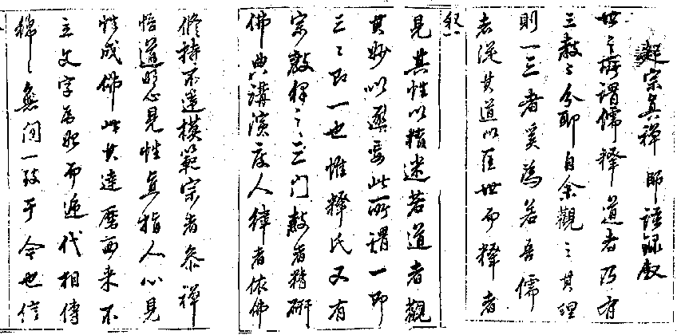
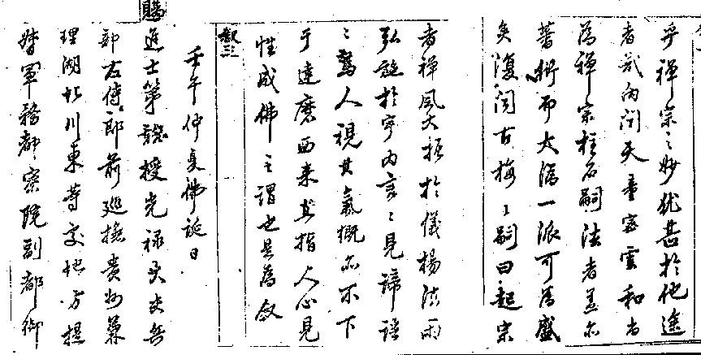
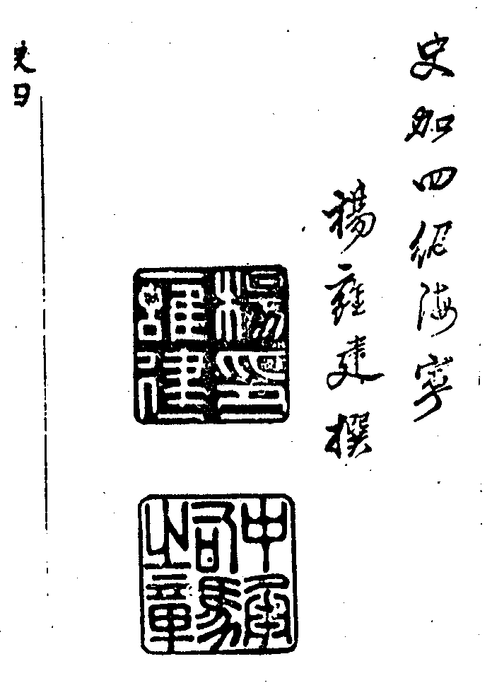

# 华严起宗真禅师语录



> **藏经**：嘉兴大藏经（新文丰版）（嘉兴藏）　**册次** 第 39 册（J39）　**编号** JB464　**部类** 华严部　**卷次** 2 卷　**篇幅** 11,195 字

> **卷／品**：0 卷 · 0 品



---



起宗真禅师语叙















起宗真禅师行实



记室力如录



大清康熙庚辰四月八日，弟子力广同职事等袖香入室，请师详说行实，以晓后学，师笑而不答。广目请，师曰：「不见佛云：『凡有所相，皆是虚妄。』我有何行实乎？」广曰：「那畔消息，无处启口；这边生缘，何妨吐露？不假言说，无以表白，生平履历，愿乐欲闻。」师曰：「余本贯人也，先君姓胡，讳应荣，字春雨，母洪氏，俱乐善好施，长斋绣佛，舍棺多年，斋僧无算。崇祯戊寅十月二日，余始生焉。当其孕余之初，先母梦一老衲，露顶跣足，携一瓢一杖，向余家乞食求宿，先君纳之，因而有孕。既孕在身，寒暑不觉，怀八月乃生。生时下地不声，自寅至午，如梦忽觉，方始㘞地。嗣后屡多灾厄，遇经卷则喜，见杀不食。至十一岁，而先母见背，余即奋出尘之志，先君乃痛骂力阻，势不敢为。于是吃斋报母，早夜跪诵血盆尊经，又为父斋僧数亿万，居尘五十年，日夜以不能出家为忧。至庚午年，乃舍家入庵，儿辈延内外亲友再四挽留，且恶阻云：『有为我母披削者，即与拼命。』当时近方知识，莫敢为余披削。余奋恨无已，遂取刀自断其发焉。是岁二月初三之夜，梦坐于大山之麓，山上一白牛，阔角大身，向余而来，绕其左右，余引手以摸，而牛垂头不动，余即攀角以登其背，牛便飞腾而出，余甚惊恐，至醒时，通身皆汗。及平明，而山光宗元和尚至，余述以告宗，宗连声致贺曰：『汝师至矣。』余询所以，宗曰：『水牯牛，沩山公案也。沩山和尚昨至我庵。』余即迎请过庵，一见便喜如旧识，即拜而薙染焉。本月二十，即上华山求戒。得戒回，即立誓禁足，晨夕礼诵，兼书一切法宝，由是衣不解带，身不沾席。至十月，四面火起，余搭衣持钵，端坐佛前，而火至庵，左右尽息。一日，先师老人见余苦状，乃开导曰：『汝之精勤可谓至矣，然欲了生死，务当究明自己心地，苟心地不明，终是徒然。』余即问曰：『未审心地如何究明？』曰：『汝自看书经底、礼拜底、经行坐卧底、穿衣吃饭底是什麼人？』余曰：『更没有别个。』老人厉声曰：『你道毕竟是阿谁？』余方拟对，老人以手掩口，著力一推，余跌得冷汗通身，心便豁然。一日，老人来，余正值坐香，老人曰：『好个伶俐衲僧，无端向鬼窟里著倒。』余起身礼拜曰：『敢问如何即是？』老人缓步曰：『要行便行。』余仍去就座，曰：『你作麼生？』余曰：『某甲坐也不为分外。』曰：『拄杖不在苕帚柄，聊与三十。』又一日，老人来庵，余门迎，老人把住曰：『不容拟议，道将一句来。』余与劈面一掌，老人曰：『你打老僧那？』余曰：『某甲罪过。』老人点首曰：『宛有丈夫之作。』遂入，索笔书偈曰：『开法四十年，止付一法子。戊▆游南都，今春披削尔。见尔有大志，精进勇猛耳。生长▆仕家，不爱朱与紫。行同大丈夫，骨格非凡比。且具大智慧，根器尤可喜。一念已回光，即合诸玄旨。尽瘁以终身，慎勿生少弛。办取佛祖心，我宗赖子起。不虚此远来，吾道而东矣。达磨来东都，付嘱尼总持。我今嘱付汝，古今亦如是。』余接得，即命就火，曰：『某甲不是这般种草，且莫涂污他。』老人曰：『汝但将取，当常如是精进，深蓄厚养，异日大兴佛事，不虚吾南游一次也。』余方始拜受。后余又写老人顶相，乞请题赞，题云：『一片云帆湘上来，江南淮北漫徘徊。白沙津畔堪遗影，留与儿孙一展开。』并写遗书偈语，书毕即逝。我天翼法兄奉灵龛回山，余三年愿满，乃出关上维扬，持钵诣华山谢戒。我得戒上定下庵和尚，又以衣钵源瀛付余。及回，乃上沩山，为先老人造塔，并扫诸祖塔。扫塔回，乃建此寺，经营布置，皆余身亲理焉。鄙意原欲自了，以度餘生。丁丑十月二日，余初度之辰，我同庆电兄、芙蓉▆姪暨本邑缙绅劝请出世开堂，余坚辞不敢滥厕法门，以辱先宗。却之不已，乃效颦作鬼面神头，说脱空妄语，种种败阙，不敢告人。今被汝等追索不已，不免尽情搬出，亦任明眼衲僧笑破鼻孔。」



板存楞严▆▆



起宗真禅师语录卷上



侍者力广记录



住真州华严禅寺



康熙丁丑十月初二，师六旬初度，大沩同庆电兄和尚、芙蓉　姪大师暨阖邑缙绅檀护等，请就本寺开堂。



据室



「华严界阔，香水海深，南询五十三处，要且未识归程。如今直饶识得，更须吃新长老手里乌藤。何故𫆏？兵随印转，将逐符行。」拈柱卓一卓，便起。



披法衣



「脱却珍御，不失大人境界；权挂垢衣，岂减本地风光。牵拽犁耙风雨里，天上人间绝覆藏。」



升座



至法座前，指座云：「大宝华王座，高而无上，广而无边，当头坐断，迥绝跻攀。」喝一喝，遂升。拈香云：「此一瓣香，根盘空界，叶覆娑婆，重而价不可酬，尊而无物堪比，热向炉中，专为祝延今上皇帝圣寿万岁万岁万万岁，伏愿尧风永被于四表，汤德恒新于两间。」又拈香云：「此一瓣香，出於东坡，来自北海，奉为满朝文武、阖邑缙绅，伏愿常为佛国屏翰，永作法城金汤。」复拈香云：「此一瓣香，枝出同条，叶无异种，奉为现前请主和尚及诸法属，伏愿揭慧日於千秋，续心灯于万古。」复怀中取香云：「此一瓣香，名不得、状不得，觑之眼盲、嗅著脑裂，生长五浊世中，安居荆棘林里，遇著个没意智底老古锥，和根截断，枝叶不存，抛向搕𢶍堆头，日炙风吹，历尽寒暑，虽则重新花放，到底恶性不除。今对人天众前，不免乘时拈出，供养潭州大沩山传临济正宗第三十四世上古下梅先师大和尚，用酬法乳之恩。」■■敛衣就座。同庆和尚白椎云：「法筵龙象众，当观第一义。」师云：「若论第一义谛，三世诸佛、历代祖师、天下老和尚，千方百计，横说竖说，总未有半人道著，新长老忍俊不禁，不免尽情与诸人说破。」乃拈拂子，拂一拂，云：「一时抖下了也，莫有拨著便转底衲僧麼？出来，新华严与汝证据。」一僧才出，师云：「不得礼拜。」僧拂袖便出，师云：「放子三十棒。」问：「玄要君臣即不问，如何是接物利生句？」师云：「扬子江心水北流。」进云：「如何是全提正今句？」师云：「一棒一条痕，一掌一握血。」进云：「师唱谁家曲？宗风嗣阿谁？」师打一棒，云：「自来用得者个惯。」进云：「不虚为临济儿孙。」师连棒，云：「识甚好恶？」问：「天地同根，万物一体，未审金山年多少？」师云：「东西十万，南北八千。」进云：「和尚年多少？」师云：「与金山不别。」进云：「恁麼则千江有水千江月，万里无云万里天。」师云：「且莫错会好。」进云：「不得吾师亲指示，天宁岂见塔高低？」师打，云：「且道是赏你？是罚你？」僧拟议，师喝退，云：「妄语汉。」乃云：「黄花散彩，紫菊飘香，娘生面目，觌露堂堂，直是情与无情悉皆平等，更说甚天地同根、万物一体？」蓦竖拂子，云：「还会麼？直饶会得，东西十万，南北八千；设或不会，新长老与你下个注脚：千江有水千江月，万里无云万里天。者个且止，秪如山僧今日为国开堂，且接物利生一句又作麼生道？」拂一拂，云：「阵云横海上，拔剑搅龙门。」同庆和尚结椎，云：「谛观法王法，法王法如是。」下座。



当晚小参



「诸佛出世为一大事因缘，列祖并兴为一大事因缘，天下老古锥摇唇鼓舌、抖搜屎肠、谈玄谈妙、说性说心为一大事因缘，现前诸人破恩爱纲、发向上心、参方访道、拼命舍身也只为一大事因缘。未审唤甚麼作大事因缘？莫是诸佛出世、列祖并兴便当得麼？且喜没交涉。莫是谈玄谈妙、说性说心便当得麼？且喜没交涉。更莫是参方访道、拼命舍身便当得麼？且喜没交涉。既总没交涉，毕竟唤甚麼作大事因缘？不见僧问投子禅师：『如何是和尚大事因缘？』子云：『尹司空请老僧开堂。』大众！这则公案甚是直截，只是古往今来不作世谛流布，便作佛法商量，所以孤负先圣、埋没己灵，鲜有会者。如今诸人若也直下会去，不惟大事了毕，便可独步丹霄；其或未然，三条椽下、七尺单前各自摸索去，莫道新长老不为人好。」喝一喝，下座。



谢同庆和尚芙蓉大师上堂



「两掌闹掴掴，孤掌不浪鸣。出头天外看，谁是个般人。」



辞众入楚扫祖塔小参



「湘之南，潭之北，中有黄金充一国，无影树下合同船，琉璃殿上无知识。无知识，休别觅。」拈拄杖云：「楖栗横肩不顾人，直入千峰万峰去。」时有僧出问，师以拄杖擉退云：「生平肝胆向人倾，相识何如不相识？」



沩山上堂



「吹无孔笛，鼓没弦琴，听者贵乎知音，和者须是作家。山僧昔年在扬子▆▆拾得一张焦尾，常操太古清音，争奈鍾期不遇？今来万仞峰顶，意欲囊藏高挂，又被法兄和尚拶向曲录床上，不免逢场作戏，迭奏箎▆。」乃横按拂子作操琴势，云：「不是新丰调、云门曲，亦非高山流水、太古清音，汝等欲知其中端的，请试问取堂头和尚。」僧问：「阳春白雪即不问，同声相应一句且作麼生道？」师云：「打面还他州土麦，唱歌须是帝乡人。」进云：「一种没弦琴，唯师弹得妙。」师云：「又被风吹别调中。」进云：「恁麼则好音在耳人皆耸。」师云：「不是知音客，徒劳话岁寒。」进云：「不是作家频指点，清浊高下谁解分？」师云：「果然承虚接响。」



先老和尚像前上供



「水路三千今赚我，真州铲草恨当年，莫言忤逆无回互，悬怨重重敢不宜。」顾左右，云：「且道那里是▆▆？▆是怨？」上香，云：「𩖼𩖼栴檀炉内热，不须试验髑髅前。」



到同庆请上堂



「有句无句，如藤倚树，四七二三，不知落处。要知落处麼？」掷下拄杖，云：「试请方丈和尚与汝指注。」



到芙蓉请上堂



「此是我先师老人建法幢、立宗旨底处所，不肖今日既到这里，岂可袖手傍观？」乃云：「诸佛说不到处，闭口道著；列祖行不到处，举步踏著。此是老人不惜眉毛与诸人解粘去缚底句子，汝等诸人无不了知。山僧如今要问诸人：道著踏著底是个甚麼？若道语言三昧，因甚古人又道：『尽力道不出。』若道步步不离，古人何故又道：『踏著即祸生。』这里辨得倜傥分明，许你登得先师堂、入得先师室；脱或未然，休将闲学解，埋没祖师心，二六时中当殷勤请益方丈。」



沩山回小参



举：「大慧禅师出乡归，上堂，举：『五祖和尚出队归，示众云：「出队半个月，眼不见鼻孔，失却祖师禅，拾得个骨董。且道向甚麼处著？一分奉释迦牟尼佛，一分奉多宝佛塔。」』大慧云：『径山法孙出队八十餘日，鼻孔常与眼睛相见，亦无祖师禅可失，亦不曾拾得骨董。既无骨董，则无以奉释迦牟尼佛，亦无以奉多宝佛塔。毕竟得个甚麼？夜深水寒鱼不食，满船空载月明归。』」师云：「五祖拾得骨董，径山满载明月，虽然两彩一赛，要且同得同失。华严远孙入楚半岁，也无得、也无失，但喜祖父田园界畔分明，原本契书毫发不朽。今日归来无可人事，秪学得些湖南风气，不免举似大众：拽捧旋风打，▆莫嫌杜蛮。」



佛成道日为力然剃度力修说优婆夷戒上堂



「现出明星初八夜，眼光烁破四天下，看来犹是欠唧溜，迄至于今成话把。虽然如是，还有识得释迦老子落处者麼？若也识得，无发可削、无戒可受，妄相执著犹如梦幻，智慧德相亦是强名，若僧若俗、或缁或素，总与如来无二无别；若也未识，不免铲却殿前草，转俗为僧，受持福田衣，除素披缁，三千威仪、八万细行且自熟习。何故𫆏？雪后始知松柏操，事难方见丈夫心。」



先老和尚忌上供



举：「高峰妙祖为雪嵒和尚上供云：『昔年瞎却我眼，今朝穿却你鼻，冤冤相报无休，莫若克己复礼。』」师云：「大小祖师犹未了在。华严这里不然，昔年瞎却我眼，今朝穿却你鼻，一任叫苦含冤，永作千秋准的。何故如此？不曲藏直。」



除夕小参



「年已穷，岁已尽，好个消息；新未至，旧将除，正宜著眼。看他旧底除向甚处？新底来自何方？这里觑得破，能为万象主，不逐四时凋。还委悉麼？」震威一喝，云：「爆竹一声吹腊去，玉梅几点送春来。」



元旦示众



「年新月新，日新时新，珊瑚枝枝撑著月；旧天旧地，旧水旧山，优昙朵朵透尘埃。此二转语有一转，有纵有夺，有杀有活，横该八节四时，竖摄四象两仪，亘古今而常新，历始终而不变。有人辨得，许你条令斩新；倘其未能，待我上山斫棒来。」



天中节示众



「今朝正是五月午，蒲剑光寒逼寰宇。诸障杂毒尽潜踪，鬼怪妖魔悉回互。含冤叫苦入无门，坐断当阳绝伴侣。蓦然撞破黑山家，燕尾大虫元是虎。」



晒藏经示众



「六月六日以前，金锁重重；六月六日已后，重重金锁。正当六月六日事如何？」展两手云：「一时打开，一任诸人搬底搬，晒底晒。」



沩山天兄和尚讣至上堂



「人从江西来，带得湖南信，报道：我法兄和尚般大涅槃，为众说法，云：『末后一句始到牢关，要津把断，水泄不通。』」拈起讣书，云：「大众！既水泄不通，且道这个从甚处得来？」良久，顾左右，云：「无人知此意，令我忆南泉。」嘘一嘘，下座。



天童密祖上供



「这个老古锥，惯击涂毒鼓，大唐国里人，含冤无处吐。今遇忤逆孙，翻面不认祖，打折你驴腰，亦任叫冤苦。何故𫆏？冤有头，债有主。」烧香便拜。



大梅与老和尚讣至上堂



「佛真法身，犹若虚空。应物现形，如水中月。只一月，无二月，明眼衲僧鉴不出。大梅老，惯饶舌，数十餘年浑漏泄。偶尔惊闻示泥洹，乾坤大地俱失色。大众！虽则法幢摧、法梁折、法海枯、法眼灭，须信真实为汝诸人说。」拍香几，下座。



久雨不晴示众



举：「天目礼禅师示众云：『久雨不晴，滴烂虚空，会与不会，南北西东。』」师云：「有道天目漏逗太煞，殊不知这汉撦东拽西，败阙不少。华严不是贬剥古人，且贵流通正眼。」乃云：「久雨不晴，虚空不湿，直下荐取，眉横鼻直。华严恁般举唱，或有个出来道：『如斯说话，也是徐六担板。』只向道：『逢人但恁麼举。』」



立秋示众



「金风扇野，玉露垂珠，万水澄波，千峰削色，草木憔悴光华，银河愈见皎洁，蛩吟砌畔，鹤唳长空，客窗午梦魂消，万里家山顷刻。当恁麼时，正好骤步归家，识取祖翁田地，检清界畔，人畜草木各安其位，犹是转句。假饶到得水穷山尽，水落草枯，归家稳坐，日空四海，始是半提。然后不守寒嵒异草，直待冰河燄发，途中不离家舍，家舍不离途中，庶可会全提底时节。要识全提时节麼？」按拄杖，云：「横按莫邪全正今，太平寰宇斩痴顽。」卓一卓，下座。



先老和尚十周忌上堂



「身从无相中受身，犹如幻出诸形相，幻人心识本来无，罪福皆空无所住。所以，诸佛从无所住处利生、列祖从无所住处接物、天地从无所住处覆载、日月星辰从无所住处照临、时序从无所住处而寒暑往来、江湖从无所住处而川流不息，以至人畜草木、飞潜动植莫不从无所住处而头出头没。诸人若向这里著得只眼，则知先师底落处；知得先师底落处，则知诸佛列祖底落处；既知诸佛列祖底落处，则知一切人畜草木、飞潜动植底落处净裸裸、赤洒洒、没可把，亦任孤峰顶上壁立万仞、十字街头灰头上而驱耕夺食、打锁敲枷。莫有识得者麼？出来通个消息看。」良久，众无出者，师云：「苍天，苍天！先师去世远矣。」掷拂子，下座。



示众



「放过一著，未必不为好手，才见便铲，大似逐块韩卢。虽然事无一向，妙在临时，直下来也，作麼生回避？」嘘一嘘，云：「一箭过辽西。」



天中节小参



「五月五日天中节，千妖百怪尽潜灭。无论赤口，说甚白舌。艾虎威狞踞户傍，摩诃般若波罗蜜。」



除夕小参



「烹露地白牛，徒费己力。三十日到了，著甚死急？」拍香几云：「明朝是初一。」



扫五峰学祖塔



「叶落江南，根归潭北，祗陀林里为家，毘卢峰前作宅，恶声流布满寰中，千眼大悲窥莫及。既窥莫及，未审如何与老祖相见？」拈香，云：「拟议思量，天地悬隔。」



扫养拙明祖塔



「打破水桶，金粟寺里大人相；赢得沩山，天童室中长孙子。得五峰老祖一牛，还慧山师翁一马。踏杀天下人，声光倾四野。」拈香打一圆相，于中作女人拜云：「我本自家儿孙，全无些子客话。」



扫慧山老和尚塔



「孤危壁立，迥绝跻攀，佛祖到来，退身有分。今日不肖徵孙未审作何行迳？」喝一喝，云：「直踏毘卢顶上行。」



起宗真禅师语录卷上终



起宗真禅师语录卷下



记室力能录



举古



举：「鼓山赴阆王请，雪峰门送云：『一只圣箭射入九重城里去也。』孚上座云：『和尚是伊未在？』峰云：『渠是彻底人。』孚云：『若不信，待某甲去勘过。』遂往中路把住云：『师兄甚麼处去？』山云：『九重城里去。』孚云：『忽遇三军围绕时如何？』山云：『他家自有通霄路。』孚云：『恁麼则离宫失殿去也。』山云：『何处不称尊？』孚便回谓峰云：『好只圣箭被我折却了也。』遂举前话，峰云：『渠有语在。』孚云：『这冻脓犹有乡情在。』」



师云：「且道这圣箭毕竟是有折处？无折处？若道有，要且问答分明；若道无，争奈孚老不肯。具出格眼者定当看。」



举：「兴教坦和尚开堂日，省宗化主出问：『诸佛未出世，人人鼻孔撩天；祖师既西来，因甚麼杳无消息？』坦云：『鸡足峰前风悄然。』宗云：『未在，更道。』坦云：『大雪满长安。』宗云：『无人识此意，令我忆南泉。』拂袖归众，更不礼拜。坦云：『新兴教今日失利。』归方丈，请宗至，云：『适来错抵对一转语，人天众前何不礼拜盖覆却？』宗云：『大丈夫膝下有黄金，争肯拜无眼长老？』坦云：『我别有语也。』宗理前问，至未在更道处，坦云：『我有三十棒寄打雪窦。』宗乃礼拜。」



师云：「兴教当断不断，反招其乱。若也正令全提，免致遭人检点。宗化主虽具作家眼脑，也是龙头蛇尾。」



举：「玄沙同天龙斫柴次，见一虎，龙云：『和尚虎。』沙云：『是汝虎。』归院后问：『适来见虎云是汝，未审尊意如何？』沙云：『娑婆世界有四种极重障，若人透得，许汝出阴界。』」



师云：「两个弄泥(团汉)，殊不顾傍观者团。」



举：「金陵奉先深禅师同明和尚到淮河，见人牵网，有鱼从网透出，深云：『俊哉！一似个衲僧相似。』明云：『虽然如是，争如不撞入网罗好？』深云：『明兄！你欠悟在。』明至中夜方省。」



师云：「金陵出得入不得，明老入了出不得。莫有能出能入者麼？三生六十劫。」



举：「丹霞访庞居士，见灵昭女洗菜，乃问：『居士在否？』女放下菜篮，叉手而立。霞又问：『居士在否？』女提篮便行，霞便回。须臾居士归，女举似前话，士云：『丹霞在否？』女云：『去也。』士云：『赤土涂牛奶。』」



师云：「尽道灵昭收放自由，殊不知被丹霞勘彻骨髓。居士虽则明镜当台，也未免雪上加霜。」



举：「灵云见桃花悟道，作偈云：『三十年来寻剑客，几回叶落又抽枝。自从一见桃花后，直至于今更不疑。』有僧举似玄沙，沙云：『谛当甚谛当，敢保老兄未彻在。』众疑此语，沙乃问地藏云：『我恁麼道，你作麼生会？』藏云：『不是桂琛，即走杀天下人。』」



师云：「大小玄沙令行不全。虽然，秪如地藏恁麼道，毕竟凭何道理？有人道得出，许你具越格眼。」



：「举须菩提问舍利弗：『梦中说六波罗密与觉时同异？』弗云：『此义深远，吾不能说。上方有弥勒大士深明此义，汝往问彼，当为汝说。』提即往问，勒曰：『谁是弥勒？谁云弥勒？』」



师震声一喝，云：「当时若下得这一喝，管教耀古腾今。」复顾左右，云：「汝等诸人还觉脑门重麼？」



举：「僧问法眼：『如何是佛？』眼云：『汝是慧超。』」



师云：「领取勾头意，莫认定盘星。」



举：「刘铁磨到沩山，山云：『老牸牛！汝来也。』磨云：『来日台山大会斋，和尚还去麼？』山放身作卧势，磨便出去。」



师云：「这则公案，一往观去，宾主历然，仔细看来，有得有失。且道谁得谁失？」



举：「定上座问临济：『如何是佛法大意？』济下禅床擒住，打一掌便拓开。定伫立，傍僧云：『定上座何不礼拜？』定方礼拜，忽然大悟。」



师云：「直饶玄会得，也是眼中尘。」



举：「风穴在郢州衙内上堂云：『祖师心印，状似铁牛之机，去即印住，住即印破。只如不去不住，印即是？不印即是？』时有卢陂长老出问：『某有铁牛之机，请师不搭印。』穴云：『惯钓鲸鲵沉巨浸，却嗟蛙步𩨍泥沙。』陂伫思，穴喝云：『长老何不进语？』陂拟议，穴打一拂子云：『还记得话头麼？』陂拟开口，穴又打一拂子。牧主云：『佛法与王法一般。』穴云：『你见甚麼道理？』主云：『当断不断，反招其乱。』穴便下座。」



师云：「风穴令行不全，牧主与麼道，也好与一拂子。」



举：「镜清问僧：『门外是什麼声？』僧云：『雨滴声。』清云：『众生颠倒，迷己逐物。』僧云：『和尚作麼生？』清云：『泊不迷己。』僧云：『意旨如何？』清云：『出身犹可易，脱体道应难。』」



师云：「大小镜清，廉纤不少。」



举：「马祖与百丈行次，见野鸭飞过，祖云：『是甚麼？』丈云：『野鸭子。』祖云：『甚处去也？』丈云：『飞过去也。』祖把丈鼻头一扭，丈作痛声，祖云：『何曾飞去？』丈於此有省。」



师云：「马师不奈船何，打破戽斗。虽然，为人须为彻，杀人须见血。」



举：「云门问僧：『近离甚处？』僧云：『西禅。』门云：『西禅有何言句？』僧展两手，门打一掌。僧云：『某甲话在。』门展两手，僧无语，门又打一掌。」



师云：「云门固是眼亲手便，然要活这僧，犹未许在。」



举：「僧问赵州：『至道无难，唯嫌拣择，是时人窠窟否？』州云：『曾有人问我，直得五年分诉不下。』」



师云：「这有年无德汉，大似个无齿大虫，你等诸人还识他利害处麼？若也识得，许你具衲僧眼。」



举：「云门垂语云：『乾坤之内，宇宙之间，中有一宝，秘在形山。拈灯笼向佛殿里，将三门来灯笼上。』」



师云：「这宝若只在形山，终属乾坤笼罩，何足贵哉？须知汝等诸人各有无价摩尼，若也荐得，一生受用不尽。」击禅床，下座。



举：「南泉一日因两堂争猫儿，泉提起猫云：『道得即不斩。』众无对，泉斩猫为两段。至晚，举问赵州，州脱草鞋顶戴而出，泉云：『子若在，即救得猫儿。』」



师云：「南泉正令全提，赵州转身活泼，虽则宾主历然，要未踏著关捩子在。」



举：「外道问佛：『不问有言，不问无言。』世尊良久，外道赞叹云：『世尊大慈大悲，开我迷云，令我得入。乃礼拜而去。去后，阿难问外道：有何所证，而言得入？』佛云：『如世良马，见鞭影而行。』」



师云：「外道面涂世尊，世尊热瞒阿难，一夥贩私盐汉，好各与三十乌藤。何故？见事不平谁认得？衲僧正令自当行。」



举：「南泉、归宗、麻谷同礼忠国师，泉于地上畫一圆相云：『道得即去。』宗于圆相中坐，谷作女人拜。泉云：『与麼则不去也。』宗云：『是何心行？』」



师云：「一夥弄精魂汉，未出门时，脚跟下好与三十棒。」



举：「金牛每至斋时，自将饭桶于僧堂前作舞，复呵呵大笑云：『菩萨子吃饭来。』」



师云：「金牛虽则殷勤太煞，看来也是无端。设有个出来问：『和尚又作麼生？』但对他道：『自来一双穷相手，不曾低揖等闲人。』」



举：「僧问投子：『一切声是佛声，是否？』子云：『是。』僧云：『和尚莫𡱰沸碗鸣声。』子便打。僧又问：『粗言及细语，皆归第一义，是否？』子云：『是。』僧云：『唤和尚作头驴，得麼？』子便打。」



师云：「有头无尾汉，当时何不拗折拄杖，热面再唾？」



举：「僧问药山：『平田浅草，麈鹿成群，如何射得麈中主？』山云：『看箭。』僧放身便倒。山云：『侍者拖出。』僧便走。山云：『弄泥团汉有甚麼限？』」



师云：「虽似见机而作，却也隈刀避剑。若解当锋取胜，果然是员战将。」



举：「梁武帝问达磨：『如何是圣谛第一义？』磨云：『廓然无圣。』帝云：『对朕者谁？』磨云：『不识。』帝不契，磨乃渡江至魏。」



师云：「祖师纯刚打就，武帝生铁镕成，蓦劄相逢，佳话千古。虽然如是，门庭施设即不无，若约衲僧门下，须别有振作始得。诸人脱或迟疑，山僧不免别行一路去也。」呵呵大笑，下座。



举：「文殊、普贤起佛见法见，世尊以威神力，贬向二铁围山。」



师云：「有等瞎眼阿师见恁般公案，便道：『动念即乖。』大似狂狗逐块。真上座见处与诸方各别，如今设有起佛见、法见底，无底钵盂盛饭供养伊。何故𫆏？从前汗马无人识，秪要重论盖代功。」



举三圣透网念鳞因缘。



师云：「我即不然。『透网金鳞，未审以何为食？』『木札羹、铁钉饭。』千五百人善知识，话头也不识，莫怪空疏，伏惟尚向。」



颂古



举谁是弥勒、谁云弥勒因缘。



谁是弥勒云弥勒，眼睛鼻子俱突出，衲僧撞见眼头高，尽力提持去不得。



举兴教坦和尚开堂因缘。



无人识意忆南泉，鼻孔撩天也被穿，等闲运出铁牛机，华岳三峰倒插天。



举玄沙同天龙斫柴因缘。



五五二十五，打破盐官鼓，觌面绝疏亲，特地大家补。大家补，四七二三面相睹。



举德山到沩山因缘。



掣电轰雷运略韬，收来放出在秋毫，坐观成败沩山老，陷虎机能用不劳。



举：「雪峰示众云：『尽大地撮来如粟米粒大，抛向面前，漆桶不会，打鼓普请看。』」



堪笑雪峰老婆禅，无端拈出教人看，可怜待兔守株客，不解风前听杜鹃。



举：「僧问洞山：『如何是佛？』山云：『麻三斤。』」



如何是佛麻三斤，当阳独露绝疏亲，虽然佛法无多子，倒底还他手眼明。



举：「俱胝凡有僧问，只竖一指。」



俱胝佛法不争多，试问时人见也麼？拟向指头尖上会，鹞子早已过新罗。



举：「僧问：『寒暑到来，如何回避？』」



回避寒暑枉劳神，无寒暑处语岂诚？鸳鸯绣出从君看，不把金针度与人。



> 举：「良禅客问钦山：『一镞破三关时如何？』山云：『放出关中主看。』良云：『与麼则知过必改。』山云：『更待何时？』良云：『好箭放不著所在。』便出。山云：『阇黎且来。』良回首。山云：『一镞破三关且止，试与钦山发箭看。』良拟议，山打七棒，云：『且听这汉疑三十年。』」



关中主，尊寰宇，一镞三关知几许。气宇信如王，谁敢婴其武。堪笑负命者，有眼还同瞽。报君知，莫莽卤，未解行人休离母。



举：「僧从定州会里到乌臼，臼云：『甚处来？』僧云：『定州。』臼云：『定州法道何似这里？』僧云：『不别。』臼云：『若不别，更转彼中去。』便打，僧云：『棒头有眼，不得草草打人。』臼云：『今日打著一个。』又打三下，僧便出，臼云：『屈棒元来有人吃在。』僧转身云：『争奈杓柄在和尚手里。』臼云：『汝要，山僧与汝。』僧夺棒打臼三下，臼云：『屈棒，屈棒。』僧云：『有人吃在。』臼云：『草草打著个汉。』僧礼拜，臼云：『却与麼去。』僧大笑而出，臼云：『消得恁麼，消得恁麼。』」



作者相逢迥不同，针缝影里骑大鹏。李广当年入虏庭，看来未足尽英雄。



举：「玄沙示众云：『诸方老宿尽道接物利生，忽遇三种病人来，作麼生接？患盲者，拈椎竖拂他又不见；患聋者，语言三昧他又不闻；患哑者，教他说又说不得。且作麼生接？若接此人不得，佛法无有灵验。』有僧请益云门，门云：『礼拜著。』僧拜起，门以柱杖桎，僧退后，门云：『汝不患盲。』复唤：『近前来。』僧近前，门云：『汝不患聋。』乃云：『还会麼？』僧云：『不会』。门云：『汝不患哑。』其僧于此有省。」



一药能痊三般病，三般病药一般性。金博金兮水洗水，作者还将病医病。



举：「盘山垂语云：『三界无法，何处求心？四大本空，佛依何住？璇玑不动，寂尔无痕，觌面相呈，更无餘事。珍重！』」



世界身心彻底穷，与谁把手上高峰？饥食渴饮眠高枕，晓起扶桑日已红。

