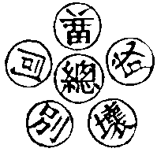

# 华严经合论



> **藏经**：卍新纂大日本续藏经（新纂卍续藏）　**册次** 第 4 册（X04）　**编号** X0223　**部类** 华严部　**卷次** 120 卷　**篇幅** 1,307,925 字

> **卷／品**：120 卷 · 272 品



---



## 目录



  - [No. 223-A 大周新译大方广佛华严经序](#no-223-a-大周新译大方广佛华严经序)

  - [No. 223-B 大方广佛华严经合论序](#no-223-b-大方广佛华严经合论序)

  - [时龙集乾德岁旅丁卯蕤宾之月望日序](#时龙集乾德岁旅丁卯蕤宾之月望日序)

  - [No. 223-C 大方广佛华严经合论序](#no-223-c-大方广佛华严经合论序)

  - [卷第八世主妙严品第一之一](#卷第八世主妙严品第一之一)

  - [卷第九世主妙严品第一之二](#卷第九世主妙严品第一之二)

  - [卷第十世主妙严品第一之三](#卷第十世主妙严品第一之三)

  - [卷第十一世主妙严品第一之四](#卷第十一世主妙严品第一之四)

  - [卷第十二世主妙严品第一之五](#卷第十二世主妙严品第一之五)

  - [卷第十三世主妙严品第一之六](#卷第十三世主妙严品第一之六)

  - [卷第十四世主妙严品第一之七](#卷第十四世主妙严品第一之七)

  - [卷第十五世主妙严品第一之八](#卷第十五世主妙严品第一之八)

  - [卷第十六世主妙严品第一之九](#卷第十六世主妙严品第一之九)

  - [卷第十七世主妙严品第一之十](#卷第十七世主妙严品第一之十)

  - [卷第十八如来现相品第二](#卷第十八如来现相品第二)

  - [卷第十九如来现相品第二之餘](#卷第十九如来现相品第二之餘)

  - [普贤三昧品第三](#普贤三昧品第三)

  - [卷第二十世界成就品第四](#卷第二十世界成就品第四)

  - [卷第二十一华藏世界品第五之一](#卷第二十一华藏世界品第五之一)

  - [卷第二十二华藏世界品第五之二](#卷第二十二华藏世界品第五之二)

  - [卷第二十三华藏世界品第五之三](#卷第二十三华藏世界品第五之三)

  - [卷第二十四毗卢遮那品第六](#卷第二十四毗卢遮那品第六)

  - [卷第二十五佛名号品第七](#卷第二十五佛名号品第七)

  - [卷第二十六佛名号品第七之餘](#卷第二十六佛名号品第七之餘)

  - [卷第二十七四圣谛品第八](#卷第二十七四圣谛品第八)

  - [光明觉品第九](#光明觉品第九)

  - [卷第二十八光明觉品第九之餘](#卷第二十八光明觉品第九之餘)

  - [菩萨问明品第十](#菩萨问明品第十)

  - [卷第二十九菩萨问明品第十之餘](#卷第二十九菩萨问明品第十之餘)

  - [净行品第十一](#净行品第十一)

  - [贤首品第十二之一](#贤首品第十二之一)

  - [卷第三十贤首品第十二之二](#卷第三十贤首品第十二之二)

  - [卷第三十一贤首品第十二之三](#卷第三十一贤首品第十二之三)

  - [升须弥山顶品第十三](#升须弥山顶品第十三)

  - [须弥顶上偈赞品第十四](#须弥顶上偈赞品第十四)

  - [卷第三十二须弥顶上偈赞品第十四之餘](#卷第三十二须弥顶上偈赞品第十四之餘)

  - [十住品第十五](#十住品第十五)

  - [卷第三十三十住品第十五之餘](#卷第三十三十住品第十五之餘)

  - [卷第三十四梵行品第十六](#卷第三十四梵行品第十六)

  - [初发心功德品第十七](#初发心功德品第十七)

  - [卷第三十五初发心功德品第十七之餘](#卷第三十五初发心功德品第十七之餘)

  - [明法品第十八](#明法品第十八)

  - [卷第三十六明法品第十八之餘](#卷第三十六明法品第十八之餘)

  - [升夜摩天宫品第十九](#升夜摩天宫品第十九)

  - [卷第三十七夜摩天宫偈赞品第二十](#卷第三十七夜摩天宫偈赞品第二十)

  - [十行品第二十一](#十行品第二十一)

  - [卷第三十八十行品第二十一之餘](#卷第三十八十行品第二十一之餘)

  - [卷第三十九十无尽藏品第二十二](#卷第三十九十无尽藏品第二十二)

  - [卷第四十升兜率天宫品第二十三](#卷第四十升兜率天宫品第二十三)

  - [卷第四十一升兜率天宫品第二十三之餘](#卷第四十一升兜率天宫品第二十三之餘)

  - [卷第四十二兜率天宫偈赞品第二十四](#卷第四十二兜率天宫偈赞品第二十四)

  - [十回向品第二十五之一](#十回向品第二十五之一)

  - [卷第四十三十回向品第二十五之二](#卷第四十三十回向品第二十五之二)

  - [卷第四十四十回向品第二十五之三](#卷第四十四十回向品第二十五之三)

  - [卷第四十五十回向品第二十五之四](#卷第四十五十回向品第二十五之四)

  - [卷第四十六十回向品第二十五之五](#卷第四十六十回向品第二十五之五)

  - [卷第四十七十回向品第二十五之六](#卷第四十七十回向品第二十五之六)

  - [卷第四十八十回向品第二十五之七](#卷第四十八十回向品第二十五之七)

  - [卷第四十九十回向品第二十五之八](#卷第四十九十回向品第二十五之八)

  - [卷第五十十回向品第二十五之九](#卷第五十十回向品第二十五之九)

  - [卷第五十一十回向品第二十五之十](#卷第五十一十回向品第二十五之十)

  - [卷第五十二十回向品第二十五之十一](#卷第五十二十回向品第二十五之十一)

  - [卷第五十三十回向品第二十五之十二](#卷第五十三十回向品第二十五之十二)

  - [十地品第二十六之一](#十地品第二十六之一)

  - [卷第五十四十地品第二十六之二](#卷第五十四十地品第二十六之二)

  - [卷第五十五十地品第二十六之三](#卷第五十五十地品第二十六之三)

  - [卷第五十六十地品第二十六之四](#卷第五十六十地品第二十六之四)

  - [卷第五十七十地品第二十六之五](#卷第五十七十地品第二十六之五)

  - [卷第五十八十地品第二十六之六](#卷第五十八十地品第二十六之六)

  - [卷第五十九十地品第二十六之七](#卷第五十九十地品第二十六之七)

  - [卷第六十十地品第二十六之八](#卷第六十十地品第二十六之八)

  - [卷第六十一十地品第二十六之九](#卷第六十一十地品第二十六之九)

  - [卷第六十二十地品第二十六之十](#卷第六十二十地品第二十六之十)

  - [卷第六十三十地品第二十六之十一](#卷第六十三十地品第二十六之十一)

  - [卷第六十四十地品第二十六之十二](#卷第六十四十地品第二十六之十二)

  - [卷第六十五十地品第二十六之十三](#卷第六十五十地品第二十六之十三)

  - [卷第六十六十地品第二十六之十四](#卷第六十六十地品第二十六之十四)

  - [卷第六十七十定品第二十七之一](#卷第六十七十定品第二十七之一)

  - [卷第六十八十定品第二十七之二](#卷第六十八十定品第二十七之二)

  - [卷第六十九十定品第二十七之三](#卷第六十九十定品第二十七之三)

  - [卷第七十十定品第二十七之四](#卷第七十十定品第二十七之四)

  - [卷第七十一十定品第二十七之五](#卷第七十一十定品第二十七之五)

  - [十通品第二十八](#十通品第二十八)

  - [卷第七十二十通品第二十八之餘](#卷第七十二十通品第二十八之餘)

  - [十忍品第二十九](#十忍品第二十九)

  - [卷第七十三阿僧祇品第三十](#卷第七十三阿僧祇品第三十)

  - [寿量品第三十一](#寿量品第三十一)

  - [菩萨住处品第三十二](#菩萨住处品第三十二)

  - [卷第七十四佛不思议法品第三十三之一](#卷第七十四佛不思议法品第三十三之一)

  - [卷第七十五佛不思议法品第三十三之餘](#卷第七十五佛不思议法品第三十三之餘)

  - [如来十身相海品第三十四](#如来十身相海品第三十四)

  - [卷第七十六如来十身相海品第三十四之餘](#卷第七十六如来十身相海品第三十四之餘)

  - [如来随好光明功德品第三十五](#如来随好光明功德品第三十五)

  - [卷第七十七如来随好光明功德品第三十五之餘](#卷第七十七如来随好光明功德品第三十五之餘)

  - [普贤行品第三十六](#普贤行品第三十六)

  - [卷第七十八如来出现品第三十七之一](#卷第七十八如来出现品第三十七之一)

  - [卷第七十九如来出现品第三十七之二](#卷第七十九如来出现品第三十七之二)

  - [卷第八十如来出现品第三十七之三](#卷第八十如来出现品第三十七之三)

  - [卷第八十一离世间品第三十八之一](#卷第八十一离世间品第三十八之一)

  - [卷第八十二离世间品第三十八之二](#卷第八十二离世间品第三十八之二)

  - [卷第八十三离世间品第三十八之三](#卷第八十三离世间品第三十八之三)

  - [卷第八十四离世间品第三十八之四](#卷第八十四离世间品第三十八之四)

  - [卷第八十五离世间品第三十八之五](#卷第八十五离世间品第三十八之五)

  - [卷第八十六离世间品第三十八之六](#卷第八十六离世间品第三十八之六)

  - [卷第八十七离世间品第三十八之七](#卷第八十七离世间品第三十八之七)

  - [卷第八十八入法界品第三十九之一](#卷第八十八入法界品第三十九之一)

  - [卷第八十九入法界品第三十九之二](#卷第八十九入法界品第三十九之二)

  - [卷第九十入法界品第三十九之三](#卷第九十入法界品第三十九之三)

  - [卷第九十一入法界品第三十九之四](#卷第九十一入法界品第三十九之四)

  - [卷第九十二入法界品第三十九之五](#卷第九十二入法界品第三十九之五)

  - [卷第九十三入法界品第三十九之六](#卷第九十三入法界品第三十九之六)

  - [卷第九十四入法界品第三十九之七](#卷第九十四入法界品第三十九之七)

  - [卷第九十五入法界品第三十九之八](#卷第九十五入法界品第三十九之八)

  - [卷第九十六入法界品第三十九之九](#卷第九十六入法界品第三十九之九)

  - [卷第九十七入法界品第三十九之十](#卷第九十七入法界品第三十九之十)

  - [卷第九十八入法界品第三十九之十一](#卷第九十八入法界品第三十九之十一)

  - [卷第九十九入法界品第三十九之十二](#卷第九十九入法界品第三十九之十二)

  - [卷第一百入法界品第三十九之十三](#卷第一百入法界品第三十九之十三)

  - [卷第一百一入法界品第三十九之十四](#卷第一百一入法界品第三十九之十四)

  - [卷第一百二入法界品第三十九之十五](#卷第一百二入法界品第三十九之十五)

  - [卷第一百三入法界品第三十九之十六](#卷第一百三入法界品第三十九之十六)

  - [卷第一百四入法界品第三十九之十七](#卷第一百四入法界品第三十九之十七)

  - [卷第一百五入法界品第三十九之十八](#卷第一百五入法界品第三十九之十八)

  - [卷第一百六入法界品第三十九之十九](#卷第一百六入法界品第三十九之十九)

  - [卷第一百七入法界品第三十九之二十](#卷第一百七入法界品第三十九之二十)

  - [卷第一百八入法界品第三十九之二十一](#卷第一百八入法界品第三十九之二十一)

  - [卷第一百九入法界品第三十九之二十二](#卷第一百九入法界品第三十九之二十二)

  - [卷第一百十入法界品第三十九之二十三](#卷第一百十入法界品第三十九之二十三)

  - [卷第一百十一入法界品第三十九之二十四](#卷第一百十一入法界品第三十九之二十四)

  - [卷第一百十二入法界品第三十九之二十五](#卷第一百十二入法界品第三十九之二十五)

  - [卷第一百十三入法界品第三十九之二十六](#卷第一百十三入法界品第三十九之二十六)

  - [卷第一百十四入法界品第三十九之二十七](#卷第一百十四入法界品第三十九之二十七)

  - [卷第一百十五入法界品第三十九之二十八](#卷第一百十五入法界品第三十九之二十八)

  - [卷第一百十六入法界品第三十九之二十九](#卷第一百十六入法界品第三十九之二十九)

  - [卷第一百十七入法界品第三十九之三十](#卷第一百十七入法界品第三十九之三十)

  - [卷第一百十八入法界品第三十九之三十一](#卷第一百十八入法界品第三十九之三十一)

  - [卷第一百十九入法界品第三十九之三十二](#卷第一百十九入法界品第三十九之三十二)

  - [卷第一百二十入法界品第三十九之三十三](#卷第一百二十入法界品第三十九之三十三)

- [大方广佛新华严经合论卷第一](#大方广佛新华严经合论卷第一)

- [大方广佛新华严经合论卷第二](#大方广佛新华严经合论卷第二)

- [大方广佛新华严经合论卷第三](#大方广佛新华严经合论卷第三)

- [大方广佛新华严经合论卷第四](#大方广佛新华严经合论卷第四)

- [大方广佛新华严经合论卷第五](#大方广佛新华严经合论卷第五)

- [大方广佛新华严经合论卷第六](#大方广佛新华严经合论卷第六)

- [大方广佛新华严经合论卷第七](#大方广佛新华严经合论卷第七)

- [大方广佛新华严经合论卷第八](#大方广佛新华严经合论卷第八)

  - [世主妙严品第一之一](#世主妙严品第一之一)

- [大方广佛新华严经合论卷第九](#大方广佛新华严经合论卷第九)

  - [世主妙严品第一之二](#世主妙严品第一之二)

- [大方广佛新华严经合论卷第十](#大方广佛新华严经合论卷第十)

  - [世主妙严品第一之三](#世主妙严品第一之三)

- [大方广佛新华严经合论卷第十一](#大方广佛新华严经合论卷第十一)

  - [世主妙严品第一之四](#世主妙严品第一之四)

- [大方广佛新华严经合论卷第十二](#大方广佛新华严经合论卷第十二)

  - [世主妙严品第一之五](#世主妙严品第一之五)

- [大方广佛新华严经合论卷第十三](#大方广佛新华严经合论卷第十三)

  - [世主妙严品第一之六](#世主妙严品第一之六)

- [大方广佛新华严经合论卷第十四](#大方广佛新华严经合论卷第十四)

  - [世主妙严品第一之七](#世主妙严品第一之七)

- [大方广佛新华严经合论卷第十五](#大方广佛新华严经合论卷第十五)

  - [世主妙严品第一之八](#世主妙严品第一之八)

- [大方广佛新华严经合论卷第十六](#大方广佛新华严经合论卷第十六)

  - [世主妙严品第一之九](#世主妙严品第一之九)

- [大方广佛新华严经合论卷第十七](#大方广佛新华严经合论卷第十七)

  - [世主妙严品第一之十](#世主妙严品第一之十)

- [大方广佛新华严经合论卷第十八](#大方广佛新华严经合论卷第十八)

  - [如来现相品第二](#如来现相品第二)

- [大方广佛新华严经合论卷第十九](#大方广佛新华严经合论卷第十九)

  - [如来现相品第二之餘](#如来现相品第二之餘)

  - [普贤三昧品第三](#普贤三昧品第三-1)

- [大方广佛新华严经合论卷第二十](#大方广佛新华严经合论卷第二十)

  - [世界成就品第四](#世界成就品第四)

- [大方广佛新华严经合论卷第二十一](#大方广佛新华严经合论卷第二十一)

  - [华藏世界品第五之一](#华藏世界品第五之一)

- [大方广佛新华严经合论卷第二十二](#大方广佛新华严经合论卷第二十二)

  - [华藏世界品第五之二](#华藏世界品第五之二)

- [大方广佛新华严经合论卷第二十三](#大方广佛新华严经合论卷第二十三)

  - [华藏世界品第五之三](#华藏世界品第五之三)

- [大方广佛新华严经合论卷第二十四](#大方广佛新华严经合论卷第二十四)

  - [毗卢遮那品第六](#毗卢遮那品第六)

- [大方广佛新华严经合论卷第二十五](#大方广佛新华严经合论卷第二十五)

  - [佛名号品第七](#佛名号品第七)

- [大方广佛新华严经合论卷第二十六](#大方广佛新华严经合论卷第二十六)

  - [佛名号品第七之餘](#佛名号品第七之餘)

- [大方广佛新华严经合论卷第二十七](#大方广佛新华严经合论卷第二十七)

  - [四圣谛品第八](#四圣谛品第八)

  - [光明觉品第九](#光明觉品第九-1)

- [大方广佛新华严经合论卷第二十八](#大方广佛新华严经合论卷第二十八)

  - [光明觉品第九之餘](#光明觉品第九之餘)

  - [菩萨问明品第十](#菩萨问明品第十-1)

- [大方广佛新华严经合论卷第二十九](#大方广佛新华严经合论卷第二十九)

  - [菩萨问明品第十之餘](#菩萨问明品第十之餘)

  - [净行品第十一](#净行品第十一-1)

  - [贤首品第十二之一](#贤首品第十二之一-1)

- [大方广佛新华严经合论卷第三十](#大方广佛新华严经合论卷第三十)

  - [贤首品第十二之二](#贤首品第十二之二)

- [大方广佛新华严经合论卷第三十一](#大方广佛新华严经合论卷第三十一)

  - [贤首品第十二之三](#贤首品第十二之三)

  - [升须弥山顶品第十三](#升须弥山顶品第十三-1)

  - [须弥顶上偈赞品第十四](#须弥顶上偈赞品第十四-1)

- [大方广佛新华严经合论卷第三十二](#大方广佛新华严经合论卷第三十二)

  - [须弥顶上偈赞品第十四之餘](#须弥顶上偈赞品第十四之餘)

  - [十住品第十五](#十住品第十五-1)

- [大方广佛新华严经合论卷第三十三](#大方广佛新华严经合论卷第三十三)

  - [十住品第十五之餘](#十住品第十五之餘)

- [大方广佛新华严经合论卷第三十四](#大方广佛新华严经合论卷第三十四)

  - [梵行品第十六](#梵行品第十六)

  - [初发心功德品第十七](#初发心功德品第十七-1)

- [大方广佛新华严经合论卷第三十五](#大方广佛新华严经合论卷第三十五)

  - [初发心功德品第十七之餘](#初发心功德品第十七之餘)

  - [明法品第十八](#明法品第十八-1)

- [大方广佛新华严经合论卷第三十六](#大方广佛新华严经合论卷第三十六)

  - [明法品第十八之餘](#明法品第十八之餘)

  - [升夜摩天宫品第十九](#升夜摩天宫品第十九-1)

- [大方广佛新华严经合论卷第三十七](#大方广佛新华严经合论卷第三十七)

  - [夜摩天宫偈赞品第二十](#夜摩天宫偈赞品第二十)

  - [十行品第二十一](#十行品第二十一-1)

- [大方广佛新华严经合论卷第三十八](#大方广佛新华严经合论卷第三十八)

  - [十行品第二十一之餘](#十行品第二十一之餘)

- [大方广佛新华严经合论卷第三十九](#大方广佛新华严经合论卷第三十九)

  - [十无尽藏品第二十二](#十无尽藏品第二十二)

- [大方广佛新华严经合论卷第四十](#大方广佛新华严经合论卷第四十)

  - [升兜率天宫品第二十三](#升兜率天宫品第二十三)

- [大方广佛新华严经合论卷第四十一](#大方广佛新华严经合论卷第四十一)

  - [升兜率天宫品第二十三之餘](#升兜率天宫品第二十三之餘)

- [大方广佛新华严经合论卷第四十二](#大方广佛新华严经合论卷第四十二)

  - [兜率天宫偈赞品第二十四](#兜率天宫偈赞品第二十四)

  - [十回向品第二十五之一](#十回向品第二十五之一-1)

- [大方广佛新华严经合论卷第四十三](#大方广佛新华严经合论卷第四十三)

  - [十回向品第二十五之二](#十回向品第二十五之二)

- [大方广佛新华严经合论卷第四十四](#大方广佛新华严经合论卷第四十四)

  - [十回向品第二十五之三](#十回向品第二十五之三)

- [大方广佛新华严经合论卷第四十五](#大方广佛新华严经合论卷第四十五)

  - [十回向品第二十五之四](#十回向品第二十五之四)

- [大方广佛新华严经合论卷第四十六](#大方广佛新华严经合论卷第四十六)

  - [十回向品第二十五之五](#十回向品第二十五之五)

- [大方广佛新华严经合论卷第四十七](#大方广佛新华严经合论卷第四十七)

  - [十回向品第二十五之六](#十回向品第二十五之六)

- [大方广佛新华严经合论卷第四十八](#大方广佛新华严经合论卷第四十八)

  - [十回向品第二十五之七](#十回向品第二十五之七)

- [大方广佛新华严经合论卷第四十九](#大方广佛新华严经合论卷第四十九)

  - [十回向品第二十五之八](#十回向品第二十五之八)

- [大方广佛新华严经合论卷第五十](#大方广佛新华严经合论卷第五十)

  - [十回向品第二十五之九](#十回向品第二十五之九)

- [大方广佛新华严经合论卷第五十一](#大方广佛新华严经合论卷第五十一)

  - [十回向品第二十五之十](#十回向品第二十五之十)

- [大方广佛新华严经合论卷第五十二](#大方广佛新华严经合论卷第五十二)

  - [十回向品第二十五之十一](#十回向品第二十五之十一)

- [大方广佛新华严经合论卷第五十三](#大方广佛新华严经合论卷第五十三)

  - [十回向品第二十五之十二](#十回向品第二十五之十二)

  - [十地品第二十六之一](#十地品第二十六之一-1)

- [大方广佛新华严经合论卷第五十四](#大方广佛新华严经合论卷第五十四)

  - [十地品第二十六之二](#十地品第二十六之二)

- [大方广佛新华严经合论卷第五十五](#大方广佛新华严经合论卷第五十五)

  - [十地品第二十六之三](#十地品第二十六之三)

- [大方广佛新华严经合论卷第五十六](#大方广佛新华严经合论卷第五十六)

  - [十地品第二十六之四](#十地品第二十六之四)

- [大方广佛新华严经合论卷第五十七](#大方广佛新华严经合论卷第五十七)

  - [十地品第二十六之五](#十地品第二十六之五)

- [大方广佛新华严经合论卷第五十八](#大方广佛新华严经合论卷第五十八)

  - [十地品第二十六之六](#十地品第二十六之六)

- [大方广佛新华严经合论卷第五十九](#大方广佛新华严经合论卷第五十九)

  - [十地品第二十六之七](#十地品第二十六之七)

- [大方广佛新华严经合论卷第六十](#大方广佛新华严经合论卷第六十)

  - [十地品第二十六之八](#十地品第二十六之八)

- [大方广佛新华严经合论卷第六十一](#大方广佛新华严经合论卷第六十一)

  - [十地品第二十六之九](#十地品第二十六之九)

- [大方广佛新华严经合论卷第六十二](#大方广佛新华严经合论卷第六十二)

  - [十地品第二十六之十](#十地品第二十六之十)

- [大方广佛新华严经合论卷第六十三](#大方广佛新华严经合论卷第六十三)

  - [十地品第二十六之十一](#十地品第二十六之十一)

- [大方广佛新华严经合论卷第六十四](#大方广佛新华严经合论卷第六十四)

  - [十地品第二十六之十二](#十地品第二十六之十二)

- [大方广佛新华严经合论卷第六十五](#大方广佛新华严经合论卷第六十五)

  - [十地品第二十六之十三](#十地品第二十六之十三)

- [大方广佛新华严经合论卷第六十六](#大方广佛新华严经合论卷第六十六)

  - [十地品第二十六之十四](#十地品第二十六之十四)

- [大方广佛新华严经合论卷第六十七](#大方广佛新华严经合论卷第六十七)

  - [十定品第二十七之一](#十定品第二十七之一)

- [大方广佛新华严经合论卷第六十八](#大方广佛新华严经合论卷第六十八)

  - [十定品第二十七之二](#十定品第二十七之二)

- [大方广佛新华严经合论卷第六十九](#大方广佛新华严经合论卷第六十九)

  - [十定品第二十七之三](#十定品第二十七之三)

- [大方广佛新华严经合论卷第七十](#大方广佛新华严经合论卷第七十)

  - [十定品第二十七之四](#十定品第二十七之四)

- [大方广佛新华严经合论卷第七十一](#大方广佛新华严经合论卷第七十一)

  - [十定品第二十七之五](#十定品第二十七之五)

  - [十通品第二十八](#十通品第二十八-1)

- [大方广佛新华严经合论卷第七十二](#大方广佛新华严经合论卷第七十二)

  - [十通品第二十八之餘](#十通品第二十八之餘)

  - [十忍品第二十九](#十忍品第二十九-1)

- [大方广佛新华严经合论卷第七十三](#大方广佛新华严经合论卷第七十三)

  - [阿僧祇品第三十](#阿僧祇品第三十)

  - [寿量品第三十一](#寿量品第三十一-1)

  - [菩萨住处品第三十二](#菩萨住处品第三十二-1)

- [大方广佛新华严经合论卷第七十四](#大方广佛新华严经合论卷第七十四)

  - [佛不思议法品第三十三之一](#佛不思议法品第三十三之一)

- [大方广佛新华严经合论卷第七十五](#大方广佛新华严经合论卷第七十五)

  - [佛不思议法品第三十三之餘](#佛不思议法品第三十三之餘)

  - [如来十身相海品第三十四](#如来十身相海品第三十四-1)

- [大方广佛新华严经合论卷第七十六](#大方广佛新华严经合论卷第七十六)

  - [如来十身相海品第三十四之餘](#如来十身相海品第三十四之餘)

  - [如来随好光明功德品第三十五](#如来随好光明功德品第三十五-1)

- [大方广佛新华严经合论卷第七十七](#大方广佛新华严经合论卷第七十七)

  - [如来随好光明功德品第三十五之餘](#如来随好光明功德品第三十五之餘)

  - [普贤行品第三十六](#普贤行品第三十六-1)

- [大方广佛新华严经合论卷第七十八](#大方广佛新华严经合论卷第七十八)

  - [如来出现品第三十七之一](#如来出现品第三十七之一)

- [大方广佛新华严经合论卷第七十九](#大方广佛新华严经合论卷第七十九)

  - [如来出现品第三十七之二](#如来出现品第三十七之二)

- [大方广佛新华严经合论卷第八十](#大方广佛新华严经合论卷第八十)

  - [如来出现品第三十七之三](#如来出现品第三十七之三)

- [大方广佛新华严经合论卷第八十一](#大方广佛新华严经合论卷第八十一)

  - [离世间品第三十八之一](#离世间品第三十八之一)

- [大方广佛新华严经合论卷第八十二](#大方广佛新华严经合论卷第八十二)

  - [离世间品第三十八之二](#离世间品第三十八之二)

- [大方广佛新华严经合论卷第八十三](#大方广佛新华严经合论卷第八十三)

  - [离世间品第三十八之三](#离世间品第三十八之三)

- [大方广佛新华严经合论卷第八十四](#大方广佛新华严经合论卷第八十四)

  - [离世间品第三十八之四](#离世间品第三十八之四)

- [大方广佛新华严经合论卷第八十五](#大方广佛新华严经合论卷第八十五)

  - [离世间品第三十八之五](#离世间品第三十八之五)

- [大方广佛新华严经合论卷第八十六](#大方广佛新华严经合论卷第八十六)

  - [离世间品第三十八之六](#离世间品第三十八之六)

- [大方广佛新华严经合论卷第八十七](#大方广佛新华严经合论卷第八十七)

  - [离世间品第三十八之七](#离世间品第三十八之七)

- [大方广佛新华严经合论卷第八十八](#大方广佛新华严经合论卷第八十八)

  - [入法界品第三十九之一](#入法界品第三十九之一)

- [大方广佛新华严经合论卷第八十九](#大方广佛新华严经合论卷第八十九)

  - [入法界品第三十九之二](#入法界品第三十九之二)

- [大方广佛新华严经合论卷第九十](#大方广佛新华严经合论卷第九十)

  - [入法界品第三十九之三](#入法界品第三十九之三)

- [大方广佛新华严经合论卷第九十一](#大方广佛新华严经合论卷第九十一)

  - [入法界品第三十九之四](#入法界品第三十九之四)

- [大方广佛新华严经合论卷第九十二](#大方广佛新华严经合论卷第九十二)

  - [入法界品第三十九之五](#入法界品第三十九之五)

- [大方广佛新华严经合论卷第九十三](#大方广佛新华严经合论卷第九十三)

  - [入法界品第三十九之六](#入法界品第三十九之六)

- [大方广佛新华严经合论卷第九十四](#大方广佛新华严经合论卷第九十四)

  - [入法界品第三十九之七](#入法界品第三十九之七)

- [大方广佛新华严经合论卷第九十五](#大方广佛新华严经合论卷第九十五)

  - [入法界品第三十九之八](#入法界品第三十九之八)

- [大方广佛新华严经合论卷第九十六](#大方广佛新华严经合论卷第九十六)

  - [入法界品第三十九之九](#入法界品第三十九之九)

- [大方广佛新华严经合论卷第九十七](#大方广佛新华严经合论卷第九十七)

  - [入法界品第三十九之十](#入法界品第三十九之十)

- [大方广佛新华严经合论卷第九十八](#大方广佛新华严经合论卷第九十八)

  - [入法界品第三十九之十一](#入法界品第三十九之十一)

- [大方广佛新华严经合论卷第九十九](#大方广佛新华严经合论卷第九十九)

  - [入法界品第三十九之十二](#入法界品第三十九之十二)

- [大方广佛新华严经合论卷第一百](#大方广佛新华严经合论卷第一百)

  - [入法界品第三十九之十三](#入法界品第三十九之十三)

- [大方广佛新华严经合论卷第一百一](#大方广佛新华严经合论卷第一百一)

  - [入法界品第三十九之十四](#入法界品第三十九之十四)

- [大方广佛新华严经合论卷第一百二](#大方广佛新华严经合论卷第一百二)

  - [入法界品第三十九之十五](#入法界品第三十九之十五)

- [大方广佛新华严经合论卷第一百三](#大方广佛新华严经合论卷第一百三)

  - [入法界品第三十九之十六](#入法界品第三十九之十六)

- [大方广佛新华严经合论卷第一百四](#大方广佛新华严经合论卷第一百四)

  - [入法界品第三十九之十七](#入法界品第三十九之十七)

- [大方广佛新华严经合论卷第一百五](#大方广佛新华严经合论卷第一百五)

  - [入法界品第三十九之十八](#入法界品第三十九之十八)

- [大方广佛新华严经合论卷第一百六](#大方广佛新华严经合论卷第一百六)

  - [入法界品第三十九之十九](#入法界品第三十九之十九)

- [大方广佛新华严经合论卷第一百七](#大方广佛新华严经合论卷第一百七)

  - [入法界品第三十九之二十](#入法界品第三十九之二十)

- [大方广佛新华严经合论卷第一百八](#大方广佛新华严经合论卷第一百八)

  - [入法界品第三十九之二十一](#入法界品第三十九之二十一)

- [大方广佛新华严经合论卷第一百九](#大方广佛新华严经合论卷第一百九)

  - [入法界品第三十九之二十二](#入法界品第三十九之二十二)

- [大方广佛新华严经合论卷第一百十](#大方广佛新华严经合论卷第一百十)

  - [入法界品第三十九之二十三](#入法界品第三十九之二十三)

- [大方广佛新华严经合论卷第一百十一](#大方广佛新华严经合论卷第一百十一)

  - [入法界品第三十九之二十四](#入法界品第三十九之二十四)

- [大方广佛新华严经合论卷第一百十二](#大方广佛新华严经合论卷第一百十二)

  - [入法界品第三十九之二十五](#入法界品第三十九之二十五)

- [大方广佛新华严经合论卷第一百十三](#大方广佛新华严经合论卷第一百十三)

  - [入法界品第三十九之二十六](#入法界品第三十九之二十六)

- [大方广佛新华严经合论卷第一百十四](#大方广佛新华严经合论卷第一百十四)

  - [入法界品第三十九之二十七](#入法界品第三十九之二十七)

- [大方广佛新华严经合论卷第一百十五](#大方广佛新华严经合论卷第一百十五)

  - [入法界品第三十九之二十八](#入法界品第三十九之二十八)

- [大方广佛新华严经合论卷第一百十六](#大方广佛新华严经合论卷第一百十六)

  - [入法界品第三十九之二十九](#入法界品第三十九之二十九)

- [大方广佛新华严经合论卷第一百十七](#大方广佛新华严经合论卷第一百十七)

  - [入法界品第三十九之三十](#入法界品第三十九之三十)

- [大方广佛新华严经合论卷第一百十八](#大方广佛新华严经合论卷第一百十八)

  - [入法界品第三十九之三十一](#入法界品第三十九之三十一)

- [大方广佛新华严经合论卷第一百十九](#大方广佛新华严经合论卷第一百十九)

  - [入法界品第三十九之三十二](#入法界品第三十九之三十二)

- [大方广佛新华严经合论卷第一百二十](#大方广佛新华严经合论卷第一百二十)

  - [入法界品第三十九之三十三](#入法界品第三十九之三十三)



---



### No. 223-A 大周新译大方广佛华严经序



天𠕋金轮圣神皇帝制



盖闻造化权舆之首，天道未分；龟龙系象之初，人文始著。虽万八千岁同临有截之区，七十二君讵识无边之义？由是人迷四忍，轮回於六趣之中；家缠五盖，没溺於三涂之下。及夫鹫岩西峙，象驾东驱，慧日法王超四大而高视，中天调御越十地以居尊。包括铁围，延促沙劫。其为体也，则不生不灭；其为相也，则无去无来。念处正勤，三十七品为其行；慈悲喜舍，四无量法运其心。方便之力难思，圆对之机多绪。混太空而为量，岂算数之能穷？入纤芥之微区，匪名言之可述。无得而称者，其唯　大觉欤？朕曩劫殖因，叨承佛记。金僊降旨，《大云》之偈先彰；玉扆披详，《宝雨》之文后及。加以积善餘庆，俯集微躬，遂得地平天成，河清海晏。殊祯绝瑞，既日至而月书；贝叶灵文，亦时臻而岁洽。逾海越漠，献𫎩之礼备焉；架险航深，重译之词罄矣。



《大方广佛华严经》者，斯乃诸佛之密藏，如来之性海。视之者莫识其指归，挹之者罕测其涯际。有学、无学，志绝窥觎；二乘、三乘，宁希听受？最胜种智，庄严之迹既隆；普贤、文殊，愿行之因斯满。一句之内，包法界之无边；一毫之中，置刹土而非隘。摩竭陀国，肇兴妙会之缘；普光法堂，爰敷寂灭之理。缅惟奥义，译在晋朝，时逾六代，年将四百。然一部之典，才获三万餘言，唯启半珠，未窥全宝。朕闻其梵本，先在于阗国中，遣使奉迎，近方至此。既覩百千之妙颂，乃披十万之正文。粤以证圣元年，岁次乙未，月旅姑洗，朔惟戊申，以其十四日辛酉，於大徧空寺，亲受笔削，敬译斯文。遂得甘露流津，预梦庚申之夕；膏雨洒润，后覃壬戌之辰。式开实相之门，还符一味之泽。以圣历二年，岁次己亥，十月壬午朔，八日己丑，缮写毕功。添性海之波澜，廓法界之彊域。大乘顿教，普被於无穷；方广真诠，遐该於有识。岂谓后五百岁，忽逢金口之言；娑婆境中，俄启珠凾之秘。所冀阐扬沙界，宣畅尘区，竝两曜而长悬，弥十方而永布。一窥宝偈，庆溢心灵；三复幽宗，喜盈身意。虽则无说无示，理符不二之门；然因言显言，方阐大千之义。辄申鄙作，爰题序云。



------



### No. 223-B 大方广佛华严经合论序



宋沙门慧研奉　王旨撰



夫法界之真源也，濬十重之藏海，涌万德之华王。体用齐彰，身刹互含於影像；果因相入，智悲交焕於灵真。原其无性妙光，若金波而粲影；幻生齐应，同众水以分形。良由瞥循一照之精明，倐晦千光之圆鉴。返认创成於心体，云点太清；依心发动於轮回，波摇玉海。故我毗卢遮那如来愍乎寝惑，布以身云，於一切法而坐道场，於一切智而成正觉，说此《大方广佛华严经》也。繇是即阎浮之境界，统华严之庄严，星罗於五位神天，镜写於十方刹海。雕宫绀殿，含莫限之劳生；玉树金台，诞微尘之佛子。一念未移於莲座，九天同发於雷音，神光开十会法门，宝泽润三周因果。故此经初，世主云集，同心嘿请，有三十七问，备陈体用因果法门，则一部雄文之宗极也。谓藏身为体，行海为用。以体起用，断习为因；以用全体，习尽为果。中有神通之义，心境互彰者，则明因果相入，体用一揆。是以从心念法，明体起用，则菩萨神通；从境宣音，明用全体，则佛神通。咸诸妙门，同醻此问。若夫法无宗旨，人莫准凭，爰彰古佛之果因，以显今人之证信。是以初会世尊，光腾皓齿，海众云舒，则示乎果也。次乃玉毫相中，诞诸佛子，则示乎因也。后以普贤承威，宣华藏海，则因全果也。然以毗卢印之，则明古佛果因，总答前法。又以智海无性，因觉妄而成凡；达妄原虗，即凡心而见佛。故第二会普光明殿，以佛果为凡心信因。三会妙峰山，凡心相尽成佛住。四会夜摩天，以智从用成佛行。五会兜率天，智行相入成佛回向。六会他化天，自他同体成佛地。七会三禅天，智行清净成佛华。八会普光明殿，自因成果为佛出现。九会普光明殿，因果圆融即普贤常行。十会给孤园，诸位齐明，同彰法界。此则发心因果，总答前法。次复圆悟一真，恐迷修进。不尽千门之惑习，焉成万行之智悲？故以善财特行轨范，初参文殊佛智信因。南询诸友，发行治习。入慈氏阁，习尽成果。再面文殊，因果同时，便见普贤法界原行。此显修道行门，一周因果。良以三周十会之玄称，三十七义之指归。一字法门，书海墨而无尽；二乘权学，谅涯涘而莫穷。故此教非贝岩所编，乃文殊结集。总三部，一部有十三千大千世界微尘数偈，一四天下微尘数品；一部有四十九万八千八百偈，一千二百品；一部有十万偈，四十八品，隐乎龙藏，未擅阎浮。逮从正法光餘，年将五百，则第十四代祖师龙树，运神海藏，观前二部，非世人所及。乃诵后部，归于五天，传布千年，方垂华夏。东晋初译，地涌灵泉。唐朝次翻，天降甘露。玄宗开元中，太原有逸士李通玄者，间代净名也。而神鉴物表，陶情释氏。因阅《华严义疏》，叹云：「大教弘芳，多家繁制。劳文白首，岂暇进修。」遂穷八十卷之真诠，总括四十轴之玄论。夜驱神笔，舒玉齿之祥光；日探幽玄，感天童之给饍。张皇教海，罗列义天。大中，载无诸有。高僧志宁，缅思后进之披寻，难测法门之丰富，遂合经论，文旨相须。然其义类繁衍，未圆品藻。慧研因参云水，叨览指归，敢揾牋毫，整斯漏略。列经论以标举，彰教理而相收。义朗文清，不假猊台而抱帙；神辉智发，何劳鹫岭以寻师。总圆一部，一百二十卷。粤有报恩光教道场正觉空慧禅师永安，传心祖印，味道华严。仰闻　王旨以倾金，开印传通而广益。慧研虔膺制命，俾序真文；輙述大纲，深惭丽则。所冀长光佛日，将两曜以齐明；永赞金轮，等二仪而远大。



------



### 时龙集乾德岁旅丁卯蕤宾之月望日序



### No. 223-C 大方广佛华严经合论序



唐福州开元寺沙门志宁述



邈矣旷古，太素为混沌之先；存而不论，道为一生之始。洪儒之子，浴归沂水之滨；周圣孔明，乐在先王之道。安有得於太空之量，现法界於一尘之中？耘除始终，蔑彼生灭。太虗不能齐量，无为犹是假名。常用而常无，居有而非有。《华严经》者，盖非罗汉结集，亦非小圣传持。大本华严，非佛不能知见；中本华严，住地菩萨乃能知之。小本华严，即十万之偈。今之所传，只获四万五千餘偈，即八十卷经是也(此准《华严经纂灵记》中说也)。经云：「此经不入二乘人手。」若无大心凡夫，此之法门即当散灭。经有十玄六相，义如结绾众丝。帝网天珠，重重各有条贯。谈端举一，则万类齐归；义海千殊，烂如星布。以缘生为旨，以法界性为宗。法身与报化同时，体用别无二相。以华严为游履，以菩提心为家，以万德万行为家业，以文殊为种智，以普贤为行华，以毗卢遮那为结果之身，以四十二位而为眷属。演则弥纶法界，卷则巨海毛端。会万象虽以云多，入尘毛尚有餘地。圆融行布，理事互参；行布圆融，主伴交现。如断金之杖，一即是多；如断杖之金，多即是一。随观一境，四种法界圆顿现前；一地初登，百门妙义联绵俱集。证趣七地，功用方休。八地定力转深，起智还由诸佛。风帆既便，任运而行，其势不停，直至法云之地。会中十地，普眼初游，未见普贤佛前。大智十大声闻，不覩逝多之胜事。良由发心既小，大愿未圆。等觉妙觉现前，尔乃二愚方尽。此经法界无始无终，佛身非有成与不成。大智无灭无生，常以利人为本。普慧二百大问，普贤二千法詶。法界性本如如，出没卷舒自在。(经云：「如人化心化作佛，化与不化等无异。一切诸佛成菩提，成与不成无差别。」)善财童子，成道只在一生；六千比丘，发智不由多劫。白牛之驾将悟，即以超於大乘；金色世界现前，文殊之智全证。《法华》龙女，成佛只在刹那。妙峰见佛光明，初住便登正觉。但随圆见，网取渐修。顿悟只在刹那，如牛食肥腻之草。大唐忻代之间，有长者姓李号通玄，其实异人，莫知来处。造斯经论四十卷成，彼有记云：「猛虎䭾经引於岩下，下笔之后，常得天人饷食，乃至论终，身亦去世。」后人获其藁本，传写流行。其论所明，与诸家疏义稍有差别。经有十处十会，义搜《璎珞》经文(《璎珞经》两卷是)，四十品之妙文，文在第三。禅说十十以为圆数，岂合只有三十九品之文？恐是梵本翻译之时有所流落。今寻经见义，又似贯华，甘露泽流，犹如瓶写。去圣悬远，谁复证明？十万之途，孰能往检？亦如生公忍死，清辩留身，后若勘同，方知义在。普光明殿三会，岂乃成三？善财福城之东，良亦成其会数。志宁虽不亲观造论，皆凭人世盛传，览此论文，稍似得其大意。今见此方君子好善之流，以论与经难为和会。志宁不揆衰迈，才无能为，今将论文注於经下，使后之览者无费乃心，才始开经，便得见论。稽首诸佛、毗卢遮那、一切圣贤，愿垂加护。论从第八卷起注入经，兼论与经共成一百二十卷，愿诸达士罔有怪焉。论有会释七卷，不入注文，今亦写附於初矣。



No. 223-D 释大方广佛华严经论主李长者事迹



李长者，讳通玄，莫详所自。或有询其本者，但言沧州人。开元二十七年三月望日，曳策荷笈，至于太原盂县西四十里同颖乡，村名大贤。有高山奴者，尚德慕士，延纳无倦。长者径诣其门，山奴谛瞻神仪，知非常器，遂罄折礼接，请归安居。每旦唯食枣十颗，柏叶饼子如匕大者一枚。自尔不交外人，掩室独处，含毫临纸，曾无虗时，如是者三稔。一旦，舍山奴南去五六里，至马氏古佛堂，自搆土室，寓于其侧，端居宴默，于兹十年。后复囊挈经书，遵道而去。二十里餘，次韩氏别业，即今冠盖村焉。忽逢一虎，当涂驯伏，如有所待。长者语之曰：「吾将著论释《华严经》，可与吾择一捿止处。」言毕虎起，长者徐而抚之，遂将所挈之囊，挂于虎背，任其所止。於是虎望神福山原，直下三十餘里，当一土龛前，便自蹲驻。长者旋收囊装，置於龛内，虎乃屡顾，妥尾而去。其龛莹洁圆回，广袤寻丈，自然而有，非人力成。龛之四旁，旧无泉㵎，长者始来之夕，风雷暴作，拔去一古松，高三百餘尺。及旦，松根之下，化为一潭，深极数寻，回还五十餘步，甘逾瑞露，色夺琉璃，时人号为长者泉。至今澄明，未曾增减，𠍴阳之岁，祈之必应。长者制论之夕，心穷玄奥，口出白光，照耀龛中，以代灯烛。居山之后，忽有二女子，容华绝世，皆可笄年，俱衣大布之衣，悉以白巾幪首，姓氏居处，一无所言。常为长者汲水焚香，供给纸笔，卯辰之际，輙具净馔，甘珍毕备，置长者前。斋罢撤器，莫知所止。历于五祀，曾不阙时。及其著论将终，遂尔绝迹。谨按华严旧传，东晋三藏佛䭾䟦陀罗，於江都谢司空寺译经。有二青衣童子，忽自庭沼而出，承事梵僧，𦶟香添缾，不离座右。每欲将夕，还潜沼中，日日皆然，率为常事。及译毕写净，沉默无迹。长者感通，事符曩昔。长者身长七尺二寸，广眉朗目，丹唇紫肥，长髯美茂，修臂圆直，发彩绀色，毛端右旋，质状无伦，风姿特异，殊妙之相，靡不具足。首冠桦皮之冠，身披麻衣，长裙博袖，散腰而行，亦无韦带。居常跣足，不务将迎，放旷人天，无所拘制。忽一日出山，访旧止之里，适值野人，聚族合乐。长者徧语之曰：「汝等好住，吾将欲归。」众乃罢乐，惊惶相顾，咸皆恻怆，必谓长者却还沧州，挥涕同词，恳请留止。长者曰：「纵在百年，会当归去。」於是举众却送长者入山，至其龛所，复语之曰：「去住常然耳，汝等可各还家。」及众旋踵之顷，岚雾四起，景物不分，行路之人，咸共骇异。翌日，长叟结徒，登山礼候，但见姿容端俨，已坐化於龛中矣。时当三月二十八日，报龄九十六。有一巨蛇，蟠当龛外，张目呀口，不可向近。众乃归诚致祝：「某等今欲收长者全身，将营殡藏，乞潜威灵，愿得就事。」蛇因摄形不现。耆旧潸泣，举荷择地，於大山之阴，累石为坟，盖取坚净，即神福山逝多兰若，今方山是也。初，长者隐化之日，及成坟之时，烟云凝布，岩谷震荡，有二白鹤哀唳当空，二鹿相叫连夕，其餘飞走，悲鸣满山。乡原之人，相率变服，追攀孺慕，若丧所天。每当建斋，即坟上云起，七七如是，良足异夫。长者平昔之时，每年常於三月末间，设十方贤圣净会，不以女人造食，贵使触事精诚，至於枣核米泔，不许輙弃，斋毕任用，犬彘徧沾。如斯之会，遵承到今，未曾废绝。至大历九年二月六日，有僧广超，於逝多兰若，获长者所著论二部，一是《大方广佛新华严经论》四十卷，一是《十二缘生解迷显智成悲十明论》一卷，传写扬显，徧於并汾。广超门人道光，能继师志，肩负二论，同游燕赵，昭示淮泗，使后代南北学人，悉得参阅论文，宗承长者，皆超、光二僧流布之功耳。其为论也，统贯经意，标表法身，廓性海於无边，历刹尘而不动，分泮众教，极彼源流，融镕上乘，会此华藏，俾迷径者获道，滞教者忘机，可谓毗卢之指归，华严之日月矣。若非圣人愍世降生，开导昏瞑，孰能条释大典，指授大心欤？长者行止玄微，固难遐究，虗空不可等度，况拟求边际耶？比岁僧元觇，特抵方山，求长者遗迹，初礼石坟，次寻龛址，龛前有松三株，一已查立，俱是长者手植。长者将化之月，一株遂枯，至今二株，常有灵鶴结巢於顶。又於寿阳南界解愁村，遇李士源者，乃传论僧广超之犹子也，示长者真容图，瞻礼而回，斯为满愿矣。向之云云，盖在摭实，枝叶华藻，无所务焉。



云居散人马支纂录



大方广佛新华严经合论目录



序一(沙门慧研奉王旨撰)  

序二(沙门志宁)  

论主事迹  

目录  

卷第一之第七会释



------



### 卷第八世主妙严品第一之一



### 卷第九世主妙严品第一之二



### 卷第十世主妙严品第一之三



### 卷第十一世主妙严品第一之四



### 卷第十二世主妙严品第一之五



### 卷第十三世主妙严品第一之六



### 卷第十四世主妙严品第一之七



### 卷第十五世主妙严品第一之八



### 卷第十六世主妙严品第一之九



### 卷第十七世主妙严品第一之十



### 卷第十八如来现相品第二



### 卷第十九如来现相品第二之餘



### 普贤三昧品第三



### 卷第二十世界成就品第四



### 卷第二十一华藏世界品第五之一



### 卷第二十二华藏世界品第五之二



### 卷第二十三华藏世界品第五之三



### 卷第二十四毗卢遮那品第六



### 卷第二十五佛名号品第七



### 卷第二十六佛名号品第七之餘



### 卷第二十七四圣谛品第八



### 光明觉品第九



### 卷第二十八光明觉品第九之餘



### 菩萨问明品第十



### 卷第二十九菩萨问明品第十之餘



### 净行品第十一



### 贤首品第十二之一



### 卷第三十贤首品第十二之二



### 卷第三十一贤首品第十二之三



### 升须弥山顶品第十三



### 须弥顶上偈赞品第十四



### 卷第三十二须弥顶上偈赞品第十四之餘



### 十住品第十五



### 卷第三十三十住品第十五之餘



### 卷第三十四梵行品第十六



### 初发心功德品第十七



### 卷第三十五初发心功德品第十七之餘



### 明法品第十八



### 卷第三十六明法品第十八之餘



### 升夜摩天宫品第十九



### 卷第三十七夜摩天宫偈赞品第二十



### 十行品第二十一



### 卷第三十八十行品第二十一之餘



### 卷第三十九十无尽藏品第二十二



### 卷第四十升兜率天宫品第二十三



### 卷第四十一升兜率天宫品第二十三之餘



### 卷第四十二兜率天宫偈赞品第二十四



### 十回向品第二十五之一



### 卷第四十三十回向品第二十五之二



### 卷第四十四十回向品第二十五之三



### 卷第四十五十回向品第二十五之四



### 卷第四十六十回向品第二十五之五



### 卷第四十七十回向品第二十五之六



### 卷第四十八十回向品第二十五之七



### 卷第四十九十回向品第二十五之八



### 卷第五十十回向品第二十五之九



### 卷第五十一十回向品第二十五之十



### 卷第五十二十回向品第二十五之十一



### 卷第五十三十回向品第二十五之十二



### 十地品第二十六之一



### 卷第五十四十地品第二十六之二



### 卷第五十五十地品第二十六之三



### 卷第五十六十地品第二十六之四



### 卷第五十七十地品第二十六之五



### 卷第五十八十地品第二十六之六



### 卷第五十九十地品第二十六之七



### 卷第六十十地品第二十六之八



### 卷第六十一十地品第二十六之九



### 卷第六十二十地品第二十六之十



### 卷第六十三十地品第二十六之十一



### 卷第六十四十地品第二十六之十二



### 卷第六十五十地品第二十六之十三



### 卷第六十六十地品第二十六之十四



### 卷第六十七十定品第二十七之一



### 卷第六十八十定品第二十七之二



### 卷第六十九十定品第二十七之三



### 卷第七十十定品第二十七之四



### 卷第七十一十定品第二十七之五



### 十通品第二十八



### 卷第七十二十通品第二十八之餘



### 十忍品第二十九



### 卷第七十三阿僧祇品第三十



### 寿量品第三十一



### 菩萨住处品第三十二



### 卷第七十四佛不思议法品第三十三之一



### 卷第七十五佛不思议法品第三十三之餘



### 如来十身相海品第三十四



### 卷第七十六如来十身相海品第三十四之餘



### 如来随好光明功德品第三十五



### 卷第七十七如来随好光明功德品第三十五之餘



### 普贤行品第三十六



### 卷第七十八如来出现品第三十七之一



### 卷第七十九如来出现品第三十七之二



### 卷第八十如来出现品第三十七之三



### 卷第八十一离世间品第三十八之一



### 卷第八十二离世间品第三十八之二



### 卷第八十三离世间品第三十八之三



### 卷第八十四离世间品第三十八之四



### 卷第八十五离世间品第三十八之五



### 卷第八十六离世间品第三十八之六



### 卷第八十七离世间品第三十八之七



### 卷第八十八入法界品第三十九之一



### 卷第八十九入法界品第三十九之二



### 卷第九十入法界品第三十九之三



### 卷第九十一入法界品第三十九之四



### 卷第九十二入法界品第三十九之五



### 卷第九十三入法界品第三十九之六



### 卷第九十四入法界品第三十九之七



### 卷第九十五入法界品第三十九之八



### 卷第九十六入法界品第三十九之九



### 卷第九十七入法界品第三十九之十



### 卷第九十八入法界品第三十九之十一



### 卷第九十九入法界品第三十九之十二



### 卷第一百入法界品第三十九之十三



### 卷第一百一入法界品第三十九之十四



### 卷第一百二入法界品第三十九之十五



### 卷第一百三入法界品第三十九之十六



### 卷第一百四入法界品第三十九之十七



### 卷第一百五入法界品第三十九之十八



### 卷第一百六入法界品第三十九之十九



### 卷第一百七入法界品第三十九之二十



### 卷第一百八入法界品第三十九之二十一



### 卷第一百九入法界品第三十九之二十二



### 卷第一百十入法界品第三十九之二十三



### 卷第一百十一入法界品第三十九之二十四



### 卷第一百十二入法界品第三十九之二十五



### 卷第一百十三入法界品第三十九之二十六



### 卷第一百十四入法界品第三十九之二十七



### 卷第一百十五入法界品第三十九之二十八



### 卷第一百十六入法界品第三十九之二十九



### 卷第一百十七入法界品第三十九之三十



### 卷第一百十八入法界品第三十九之三十一



### 卷第一百十九入法界品第三十九之三十二



### 卷第一百二十入法界品第三十九之三十三



大方广佛新华严经合论目录



音切



𤀹



(思闰切。)



焕



(呼贯切。)



粲



(且旦切。)



瞥



(疋灭切。)



倐



(式六切。)



晦



(荒内切。)



鉴



(古陷切。)



创



(楚亮切。)



摇



(餘昭切。)



寝



(七稔切。)



繇



(由音。)



彤



(徒工切。)



绀



(古暗切。)



诞



(徒旱切。)



嘿



(莫北切。)



备



(皮秘切。)



皓



(胡老切。)



轨



(居水切。)



范



(犯音。)



询



(息遵切。)



谅



(力尚切。)



涘



(床史切。)



编



(布玄切。)



擅



(视战切。)



逮



(徒载切。)



阅



(余说切。)



暇



(何嫁切。)



诠



(七全切。)



轴



(逐音。)



驱



(岂俱切。)



探



(他绀切。)



饍



(时战切。)



缅



(弥演切。)



衍



(演音。)



藻



(早音。)



研



(五坚切。)



揾



(乌困切。)



牋



(则千切。)



摽



(卑遥切。)



假



(居马切。)



猊



(五兮切。)



抱



(薄保切。)



帙



(池质切。)



辉



(虗韦切。)



岭



(力井切。)



倾



(口营切。)



虔



(奇连切。)



膺



(於陵切。)



俾



(必弭切。)



慙



(昨酣切。)



丽



(郎计切。)



赞



(祖旦切。)



蕤



(植之切。)



邈



(墨角切。)



旷



(苦浪切。)



儒



(人朱切。)



沂



(鱼衣切。)



滨



(必邻切。)



耘



(禹军切。)



蔑



(莫结切。)



纂



(作管切。)



绾



(乌板切。)



烂



(郎肝切。)



履



(力几切。)



纶



(轮音。)



融



(以戎切。)



联



(力然切。)



帆



(凡梵二音。)



醻



(时游切。)



肥



(扶非切。)



腻



(女致切。)



忻



(喜斤切。)



䭾



(徒贺切。)



岩



(五衔切。)



饷



(失向切。)



藁



(古老切。)



稍



(所教色。)搜(色流切。)



翻



(番音。)



途



(度胡切。)



孰



(熟音。)



捡



(居冉切。)



勘



(苦绀切。)



览



(力敢切。)



揆



(葵癸切。)



迈



(莫芥切。)



注



(之喻切。)



怪



(古坏切。)



曳



(弋势切。)



笈



(其立切。)



盂



(羽俱切。)



颖



(余顷切。)



颗



(苦果切。)



匕



(必以切。)



枚



(莫回切。)



稔



(如枕切。)



搆



(古候切。)



挈



(苦结切。)



驯



(似均切。)



抚



(孚武切。)



龛



(苦含切。)



蹲



(拄昆切。)



驻



(丈具切。)



屡



(良遇切。)



妥



(汤果切。)



馔



(士卷切。)



撤



(直列切。)



沼



(支绍切。)



𦶟



(而悦切。)



缾



(蒲丁切。)



髯



(汝占切。)



桦



(胡化切。)



跣



(苏殄切。)



惶



(胡光切。)



恻



(楚力切。)



怆



(楚上切。)



骇



(胡𫘤切。)



翌



(与职切。)



俨



(宜检切。)



呀



(虗牙切。)



殡



(俾刃切。)



潸



(所班切。)



轝



(羊恕切。)



核



(下革切。)



泔



(古三切。)



彘



(直例切。)



汾



(扶云切。)



泮



(普旦切。)



瞑



(面音。)



觇



(敕亷切。)



址



(诸耳切。)



摭



(之石切。)



No. 223



------



## 大方广佛新华严经合论卷第一



唐于阗国三藏沙门实叉难陀译经



唐太原方山长者李通玄造论



唐福州开元寺沙门志宁厘经合论



【论】夫以有情之本，依智海以为源；含识之流，总法身而为体。只为情生智隔，想变体殊；达本情亡，知心体合。今此《大方广佛华严经》者，明众生之本际，示诸佛之果源。其为本也，不可以功成；其为源也，不可以行得。功亡本就，行尽源成。源本无功，能随缘自在者，即此毗卢遮那也。以本性为先，智随根应；大悲济物，以此为名。依本如是，设其教泽；滂流法界，以润含生。於是寄位四天，示形八相。菩提场内，现兰若以始成；普光法堂，处报身之大宅。普贤长子，举果德於藏身；文殊小男，创启蒙於金色。以海印三昧，周法界而降灵；用普眼之法门，覩尘中之刹海。依正二报，身土交参；因果两门，体用相彻。以释天之宝网，彰十刹以重重；取离垢之摩尼，明十身而隐隐。无边刹境，自他不隔於毫端；十世古今，始终不移於当念。其为广也，以虗空而为量；其为小也，处极微而无迹。十方无卷，匪亏於小相之中；纤尘不舒，含十方而非碍。於智海果德，殊分於五位之门；常住法堂，示进修於九天之上。此方如是，十刹同然；圣众如云，海会相入。智凡不碍，状多镜以纳众形；彼此无妨，若千灯而共一室。此经总有四十品之胜典，玄开果德之门，百万亿之妙言，咸举佛华之行海。十身、十会，阐十十之法门；十处、十方，启十通而疏十辩。〈出现品〉内，示因、果以结始、终；给孤独园，利人、天之明法界。目连、鹙子，隔视听於对颜；六千比丘，启十明於路上。觉城东际，五众咸臻；古佛庙前，同登十智。善财发明导首，用彰来众齐然。又成五位法门，具德行其轨范，令使启蒙易达，解行无疑，还信首文殊之前，正证妙峰之顶。经过五众，成一百一十之法门，至慈氏之园，结会一生之佛果。返示文殊之初友，明以果同因；后入普贤之妙身，彰体、用圆极。此经名《大方广佛华严经》者，大以无方为义；方以理、智为功；广则毫刹相含；佛乃体、用无作；华喻行门可乐，能敷理、事之功；严即依、正庄严；经即贯穿缝缀。〈世主妙严品〉者，菩萨示生，皆为世主，同臻海会，故号妙严。品者，类会同流，法门均隔为品。此经总有四十品之胜典，此品建初，故称第一。是故言大方广佛华严经世主妙严品第一。



释此一部之经，总作十门分别：第一明依教分宗，第二明依宗教别，第三明教义差别，第四明成佛同别，第五明见佛差别，第六明说教时分，第七明净土权实，第八明摄化境界，第九明因果延促，第十明会教始终。



第一明依教分宗



夫如来成道，体应真源，理事二门，一多相彻，智境圆寂，何法不周。只为器有差殊，轨仪各异，始终渐顿，随根不同，设法应宜，大小全别，时分因果，延促不同。化佛本身，施诠各异，国土净秽，增减不同。地位果因，自有投分。创学之流，未谙教迹，执权成实，迷不进修。若不咸举众宗，类其损益，无以了其迷滞者矣。今略分十法，以辩阐猷。使得学者知宗，迁权就实，不滞其行，速证菩提。第一小乘戒经，为情有为宗。第二菩萨戒，为情有及真俱示为宗。第三般若教，说空彰实为宗。第四《解深密经》，为不空不有为宗。第五《楞伽经》，五法、三自性、八识、二无我为宗。第六《维摩经》，以会融染净二见，现不思议为宗。第七《法华经》，会权就实为宗。第八《大集经》，以守护正法为宗。第九《涅槃经》，明佛性为宗。第十名《大方广佛华严经》，以此经名一切诸佛根本智慈因圆果满一多相彻法界理事自在缘起无碍佛乘为宗。已上分宗，皆是承前先德所立宗旨。设有少分增减不同，为见解各别。大意名目，亦多相似。如西域及此方诸德，各立宗教，后当更明。



第一、小乘戒经为情有为宗者，为如来创为凡夫造业处，说是应作，是不应作，舍者善，不舍者不善。如此立教，未为实有。如此有教，且约凡情虗妄之处，横计诸恶，以教制之，令生人天。是故〈戒序〉云：「若欲生天上，及生人中者，常当护戒足，勿令有毁损。」众生有为作业，虗妄非实得，故生人天。无常虗妄非实，未得法身、智身，非为实有宗，且为情有宗，於小乘中为轨持教也。如《华严经》持戒即不然。经云：「身是梵行耶？身业四威仪，乃至佛法僧十众、七遮、和尚、羯磨、坛场等，是梵行耶？如是谛观，求梵行者了不可得，是故名为清净梵行。」如〈梵行品〉说：「如是清净行者，名持佛性戒，得佛法身故，乃至初发心时便成正觉。」以持佛性戒故，与佛体齐，理事平等，混真法界。如是持戒，不见自身能持戒者，不见他身有破戒者，非凡夫行，非贤圣行，不见自身发菩提心，不见诸佛成等正觉。若好若恶，若有少法可得，不名菩提，不名净行，当如是观。如是性戒即法身也，法身者即如来智慧也，如来智慧者即正觉也，是故不同小乘有取舍故。



第二、如《梵网经》菩萨戒为情有及真俱示为宗者，如来为凡夫之中有大心众生乐行慈悲，有忻求佛果者，说卢舍那佛为本身，千百亿为化身，顿令识末还本。故经言：「如是千百亿，各接微尘众，俱来至我所。」又言：「若人受佛戒，即入诸佛位，位同大觉已，真是诸佛子。」即为性戒故，即为真宗。此乃为大心众生顿示法身性戒，下劣者得渐，一教应二根。如是千百亿，各接微尘众，俱来至我所，明舍权而就实，此为实有教。当教之内顿示权实故，不同小乘前亦无常、后亦无常，为但生人天故。虽然，立实有宗，不同《华严经》毗卢遮那所说也。此经仍随化身所化，方来至本身也。圆教之宗一下顿示本身，本法界大智，报身因果，理事齐彰。又如《华严经》中世界量与《梵网经》中莲华形量亦不同，广狭全别，广如下文所说。



第三、般若教为说空彰实为宗者，为如来初为人天凡夫说二乘教，系著理事俱实不能离障，为说空教破所系著，故《般若经》中说十八种空法，世间三宝、四谛、三世等一切皆空，空亦空，广如经说。此乃空却无明诸障等业，无明总尽障业皆无，自性涅槃自然显著，此为真有不名空宗。虽然为真有，所说教门多有成坏，故未可为圆。如《华严经》具报相好庄严，能虗能实，当部之内当品之中，十十菩萨等上下自相轮贯，空有之法不独孤行。又以普贤、文殊上下交参，理事相彻互相交映，一部之典品品相彻句句相参，一品之中四十品经，同入一言之内十万颂之齐麾，一成即一切成，一坏即一切坏，总以性齐、时齐、行齐故。如上等齐说法亦齐，如是齐故。如今成佛与三世佛齐成佛故，为无三世故，为无时故，不同彼教成坏别时故，因果前后故。



第四、《解深密经》为不空不有宗者，如来说於有教空教之后，说此一部之教和会有无二见为不空不有，即说九识为纯净无染识。如瀑水流生多波浪，诸波浪等以水为依，五六七八等识皆以阿陀那识为依故，如彼波浪以水为依。如《深密经》云：「如善镜面，若有一影生缘现前唯一影起，若二若多影生缘现前有多影起，非此镜面转变为影，亦无受用灭尽可得。」此明五六七八识所依第九净识处也。又云：「如是菩萨虽由法住智为依止为建立故。」此经意欲令於识处便明识体本唯真智故，如彼瀑流不离水体而生波浪。又如明镜依彼净体无所分别含多影像，不碍有而常无故。如是自心所现识相不离本体，无作净智所现影相，都无自他内外等执，任用随智无所分别，以破空有二系为不空不有。故《深密经》颂曰：「阿陀那识甚深细，一切种子如瀑流，我於凡愚不开演，恐彼分别执为我。」阿陀那识甚深细者，引彼凡流就识成智，不同二乘及渐始学菩萨破相成空，不同凡夫系而实有，不同彼故不空不有。何法不空？为智能随缘照机利物故。何法不有？为智正随缘时无性相故、无生住灭故。以是义故名不空不有。此经虽复如是，於心识之处令知空有无二。《华严经》则不然，但彰本身本法界一真之根本智佛体用故，混真性相法报之海，直为上上根人顿示佛果德一真法界本智，以为开示悟入之门，不论随妄而生识等。《法华经》以佛智慧示悟众生，使得清净故、出现於世，故，不为餘乘若二若三。又三乘之人於佛性相之法，如来不许彼知解，故《法华经》云：「种种性相义，我及十方佛，乃能知是事。」舍利弗、辟支佛及不退诸菩萨，皆悉不能知。以《法华经》会三乘权学来归佛乘实法界故，门前三驾且受权乘，露地白牛方明实德。以此义故，於中有少分义意与《华严经》相符，龙女即是所乘白牛之乘，又与善财同其所得，是故华严教门直彰本体用法界，佛果门直授上根凡夫令其悟入，不同《深密经》中安立五六七八九识施设权门。如《深密经》权施第九阿陀那识，意有异途为二乘之人久厌患生死，修空灭识直趣空寂。又第二时说般若等教，为回二乘及渐学菩萨多说空破有，以六波罗蜜为行所乘。於中二乘虽少分回心及渐学菩萨乐空增胜，为彼权学菩萨初对治门，还与小乘初对治门少分相似，但有一分慈悲增胜，未证法身佛性根本智等道理，但以空门而为所乘，六波罗蜜而为行相。初对治门还同二乘无常、不净、白骨、微尘等观，方入空观。二乘趣灭，菩萨留生，以空无我等观折伏我法不令增长，元来未是法身佛性根本智，为见未真故乐空增胜。以是义故，《解深密经》方便安立七八识外，别说九识为纯净识，云七八识以净识为依止故。未即直为说第八种子识为如来藏者，为彼学徒畏苦习故，若说业种恒真，生怖难信故，是故权且安立第九阿陀那识为净识故，欲令不灭识性长大菩提。是故《维摩经》云：「未具佛法亦不灭受而取证也。」受既不灭，想识亦然。如《楞伽经》直为根熟者说第八识业种为如来藏，下文更明。《维摩经》云「尘劳之畴为如来种」等。夫修道之士品类异途，解行差殊千端万别，除二乘之外，菩萨之乘有四品不同：一修空无我菩萨；二渐见佛性菩萨；三顿见佛性菩萨；四以如来自性清净智，以五位加行起差别智，满普贤行成大慈悲菩萨，究竟不出刹那际，充满十方佛果门。此略示名目，下文广明。如《华严经》说：「有一类菩萨，经百千亿那由他劫行六波罗蜜，不生佛家，犹名假名菩萨。」广会在下文。以虽见佛性未彰智业，犹名假名菩萨。



第五、《楞伽经》以五法、三自性、八识、二无我为宗者，彼经於南海中楞伽山说。如来於此山下过，罗婆那夜叉王与摩谛菩萨乘华宫殿来请，如来於此山上说法。其山高峻，下瞻大海，傍无门户，得神通者堪能升往，乃表心地法门无修无证者方能升也。下瞻大海，表其心海本自清净，因境风所转，识浪波动，欲明达境自空，心海自寂，心境俱寂，事无不照，犹如大海无风，日月参罗，焕然明现。彼经意直为根熟菩萨顿说种子业识为如来藏，异彼二乘灭识趣寂者故，亦为异彼般若修空菩萨乐空增胜者故，直明识体本性全真，便成智用故。如彼大海无风即境像更明，心海法门亦复如是，了真即识成智。此经异彼《深密经》意别立九识接引初根，渐令留惑长大菩提，故不令其心植种於空，亦不令其心如彼败种。《解深密经》乃是入惑之初门，《楞伽》、《维摩》直示惑之本实。《楞伽》即明八识为如来藏，《净名》即观身实相，观佛亦然。《净名》与《楞伽》略同，《深密》经文与此二部少别也。如《华严经》不尔，佛身及境界法门行相悬自不同，说彼《楞伽经》即是化身，所说境界即是秽土山峰所居法门。说识境界为真，问答即以大慧菩萨为首。化身明教是权，大慧且论简择。如《华严》经教，佛身即是本真法报，境界即是华藏，所居法门即是佛果。法界为门，问答即是文殊、普贤理事智之妙用。五位行相因果互融，十刹十身体彻相入。若论同别未可具言，更待下文依位广辩。



第六、《维摩经》不思议为宗者，《维摩经》与《华严》十种别、一种同。别者：一、净土庄严别；二、佛身诸相报化别；三、不思议德神通别；四、所设法门对根别；五、诸有闻法来众别；六、设教安立法门别；七、净名菩萨建行别；八、所阐法门处所别；九、常随佛众部从别；十、所付法藏流通别。一同者，入道方便法门略同。



一、净土庄严别者，如《维摩经》中所说净土，如来以足指按地，即三千大千世界若干百千珍宝严饰，譬如宝庄严佛无量功德。宝庄严土一切大众叹未曾有，而皆自见坐宝莲华，而未说无尽佛刹庄严等事在一毫尘中。如《华严经》中具说十佛毗卢遮那境界、十莲华藏世界海，一一世界海有无尽世界海重重相入，一尘之内有无尽世界海圆满十方。佛境界、众生境界互相涉入，不相障碍，众宝庄严如光如影。广如经说，不但独言三千大千世界之所严净。



二、佛身诸相报化别者，说此《维摩经》是三十二大人之相化佛所说；说《华严经》佛是九十七大人之相，及十华藏世界海微尘数大人之相，实报如来之所说也。



三、不思议德神通别者，如《维摩经》说菩萨神通，以须弥之高广内芥子中，能以四大海水入一毛孔。又小室之内能容三万二千师子之座，各各高八万四千由旬，八千菩萨、五百声闻、百千天人。维摩诘置其右手掌，擎其大众，往诣庵园。又以手断取东方妙喜佛国，来至此土，示於大众，送还本处。如是神变，且为权学三乘声闻、菩萨等众，现如斯事。何以故？为权教声闻、菩萨等，见道未实，自他未亡，所现神变，依根所见，皆有往来分剂限量。又是一时之间圣意，以神力变化起诸小根，令渐增进故，非是法尔力故。如《华严经》中，以本法力，法如是故，能以一尘之内，含容十方一切佛刹，众生刹总在尘中，世界不小，微尘不大，十方世界所有微尘，一一尘中总皆如是。如经所说，菩萨於一小众生身中，成等正觉，广度众生，其小众生，不知不觉。当知佛以权教引小根故，身外见佛，现神通力，而有来去。实教之中，以自本觉，自觉本心身心性相与佛无异，无有内外往来诸见。是故毗卢遮那佛不移本处，而身徧坐一切道场，十方来众不移本处而随化往，都无来去，亦无神力所致。是故经言，法如是故。经中每言，以佛神力，及法如是力者，以佛神力，推佛为尊，法如是故，推其本德，都无变化。一一国刹，身心性相，以依本故，不随妄故，大小诸境，皆如光如影，互相映彻，周徧十方，都无往来，都无分限。即一一众生，身诸毛孔之内，周遍十方。不同权教，以其神力，分剂往来，擎来送去。致斯妄见，违本法身，障真菩提本觉性智。是故净名菩萨现斯神变已，方陈实教。《维摩经》云：「观身实相，观佛亦然。我观如来，前际不来，后际不去，今则不住。」如〈阿閦佛品〉广明。是故权教小见，乐欲希奇。菩萨称根，麤施接引，令生乐学，方授实门。不可以执化成真，恒迷智眼，识权就实，迁入法界之门。有作之法难成，随缘无作无办。作者劳而无功，不作随缘自就。无功之功，功不虗弃；有功之功，功皆无常。多劫积修，终归败坏。不如一念缘起无生，超彼三乘权学等见。



四、所设法门对根别者，彼《维摩经》，对二乘根，令回向菩提，入大乘故。又对大乘中滞净菩萨，悲智未满者，令进修故。即如众香世界，诸来菩萨众，欲还本土，请佛世尊愿赐少法。如来依根，见彼菩萨滞於净土，悲智心劣，便为说法，令学有尽无尽解脱门。下文云：「不离大慈，不舍大悲，深发一切智心，而不忽忘。教化众生，终不厌倦。於四摄法，常念顺行。在诸禅定，如地狱想；於生死中，如园观想；见来求者，如善师想。」广如《维摩经》说。彼经对二乘三乘悲智未满，令且渐修增长悲智，未即一下顿示佛门，未即说言十住初心便成正觉，未即示其广大妙事皆有分剂故。



五、诸有来众闻法别者，如《维摩经》中所有来众，除文殊、慈氏等大菩萨众，舍利弗等影响声闻，餘外来众总是三乘之中权学之众。设有於中菩萨生於诸趣同类俱来，皆欲成就三乘权学渐令增进，未说圆满诸佛本乘。如《华严经》中所有来众，皆是乘如来乘佛智果德，自体法身具普贤行，而随影现十方刹海一切道场，还成如来所乘本法，无有一个三乘根机。设有三乘根机，如盲如聋不知不觉，犹如盲人对於日月，犹如聋人听天乐音，如业贫人对天宝藏，如大福德处於地狱，亦如饿鬼临大海边。三乘之器道力未穷未回心者，常居法界海中诸佛境界，与佛同德同身，终不能信，不觉不知别求佛见。如《华严经》云：「佛子！设有菩萨於无量百千亿那由他劫行六波罗蜜，修习种种菩提分法，若未闻此如来不思议功德法门，或时闻已不信不解、不顺不入，不得名为真实菩萨，以不能生如来家故。」当知闻法众全别。《维摩经》中娑婆之众彼此未亡，香积诸徒垢净全在，当知此类并是见解未真，守一方之净刹，虽名菩萨谛道未圆，如是之徒未详佛意，虽有忻菩提之志愿、滞净刹以居心，彼与法身智身悬隔。是故《法华经》云：「不退诸菩萨，其数如恒沙，亦复不能知。」即如华严之众，自身与佛身无别，自智与佛智无差。性相含容，一多同别。居法界海之智水，示作鱼龙。住涅槃之大宅，现阴阳而化物。主伴自在，交暎相参；师弟互融，因果通彻。并是如斯之众也。



六、设教安立法门别者，彼《维摩经》以净名居士现少许不思议之通变，令二乘回心。又处於生死，现身有疾，令知染净无二。又表菩萨大悲有疾。菩萨具陈不二之门，建定慧观智用，彰不求之法最要。故云：「夫求法者，於一切法应无所求。」然未似《华严经》具陈十住、十行、十回向、十地、等觉、五位、六位、行相、因果、同别法门。



七、净名菩萨示行别者，净名为表大悲示入生死，现其病行。《华严经》毗卢遮那以大悲示入生死，成正觉行，彰大智能出世故。



八、所阐法门处所别者，说《维摩经》在毗耶离城庵罗园，及在净名之室。说《华严经》在摩竭国菩提场中，及一切世界，及一切尘中说。



九、常随佛众别者，说《维摩经》时，声闻为常随佛众，但具五百。说《华严经》时，总是一乘大菩萨众，为常随佛众，具十佛刹微尘大众，总是具普贤、文殊体用等众。



十、所付法藏流通别者，彼《维摩经．嘱累品》中说：「佛告弥勒菩萨言：『弥勒！我今以是无量亿阿僧祇劫所集阿耨多罗三藐三菩提法付嘱於汝故。』」即以其经付嘱已成菩萨、已生佛家者，《华严经．如来出现品》中付嘱流通，即以其经法付嘱凡夫初心始能见道生在佛家者。何以然？此经难入，许人能证，以自证故方堪能说，表三乘是权。但以圣劝修证，所有得法未成实故，所有说法者亦未实故。《华严经》云：「此经珍宝不入一切餘众生手，唯除如来法王真子生如来家、种如来种诸善根者。佛子！若无此等佛之真子，如是法门不久散灭。」问曰：若计佛之真子，即十方世界无尽无边，以世界微尘莫知其数，何须虑此经若无真子即便散灭？答曰：此经意者，付嘱凡夫令觉悟入此法门故，令生佛家使其转教佛种不断，即凡夫令得入真之境。若嘱累诸大菩萨，凡夫无缘；诸圣自明，无凡夫修学者，凡夫道中佛种即断，此经散灭。以此义故，付嘱凡夫令修，不付已前大菩萨旧见道者。



一入道方便同者，《维摩经》云：「夫求法者，於一切法应无所求，乃至观身实相、观佛亦然。我观如来前际不来、后际不去，今则无住」等是。初观智门略同於入道行相，门户次第轨则全别，广如下明。



第七、《法华经》会权入实为宗者，此经引彼三根之人归一乘实教，故引众流而归大海，摄三末而还源。藏法师等前诸大德会为共教一乘，为三乘同闻故。《华严经》为别教一乘，为不与三乘同闻故。参详此理，会此二门，《法华经》引权器以归真，华严者顿示大根而直受。虽一乘名合，法事略同，论其轨范，有多差别。今欲备举，事广难周，略举十门，用知纲目。十门者：一者、教主别；二、放光别；三、国土别；四、请法主别；五、大会庄严真化别；六、序分之中列众别；七、龙女转身成佛别；八、龙女成佛所居国土别；九、六千之众发心别；十、受诸声闻远记别。



一、教主别者，说此《法华经》即是化身佛说，还过去灭度多宝佛来证成此经，三世诸佛同共宣说。如《华严经》即不然，教主即是毗卢遮那，为教主故，即是法、报、理、智真身，具无量相海功德之身之所庄严。三世诸佛同为一际、一时、一法界，报相重重，无有障碍，古今一际，非三世故。旧佛非过去，今佛非新出，为根本智性相齐，理事不异故。如是本佛说本法，顿受大根故，不是化佛故，不似《法华经》有旧佛灭度多宝如来，今佛出世说《法华经》。以是义故，言教主别。



二、放光明别者，说《法华经》虽放眉间毫相果光，所照境界但言万八千土皆如金色，仍有限量，不称无边无量无尽，故但彰果法不彰因位。《华严》一部经典，教行因果表法光明始终具十，后当更明。



三、国土别者，说《法华经》时三变世界令成净土，移诸天人置於他土，然后安置他方来众，变此秽境令成净刹。说《华严经》时即此娑婆世界，即是莲华藏世界，一一世界互相含入。经云：「一一世界满十方，十方入一亦无餘，世界不增亦不减，无比功德故如是。」又云：「诸佛成道在一小众生身中化无量众，其彼小众生不知不觉。」只为凡圣同体无移转相，纤尘之内自他同体，不同法华之会移转人天方明净刹。此是对权根乃分自他滞见者之所建立，是故今明国土别也。



四、请法主别者，说《法华经》时请法主者，即是舍利弗以为劝请之首。说《华严经》时，佛令文殊、普贤随位菩萨，各自说自位法门为说法首。佛表果法举果为因，起大悲行成根本智，果体自成故无言不说也。以大悲行从无作根本智起，故文殊、普贤表因位可说佛果法示悟众生。〈阿僧祇品〉世间数法广大难量，唯佛究竟，不属五位中因果门，故是佛自位内法门还佛自说。〈随好光明功德品〉，即是如来自成因果后自说佛法。法尔之力恒常福智光明之法门，亦不属五位之内行相因果，故佛亦自说。此明佛果无二愚也。除此二品经外，诸餘三十八品皆是五位之内行相法门，是故佛不自说，总令十信、十住、十行等当位之内菩萨自说，佛但放光表之。其所放光表法之相，后当广明。当说《华严经》时，一无声闻及小菩萨为请法主，皆佛果位内诸大菩萨自相问答，安立佛果法门行相，为悟大根者故，顿将佛果直受为因，因即以果为因，果即以因为果，如种种子等，以定慧力思之可见，是故今言请法主别。



五、大会庄严真化别者，如法华会令三千大千世界清净庄严，其诸化众亦皆充满，所来诸佛皆云是化。《华严经》即不尔，即有十处十会众皆满十方，不移本处而充法界，一一身相及身毛孔国刹重重，菩萨佛身互相彻入，杂类众生亦皆无碍，身土相彻如影含容，所来之众不坏法身而随相好，法身相好一际无差，即相全真无有化也。不同餘教说化说真有相参会，是故今言大会别也。



六、序分之中列众别者，法华会中先列声闻众万二千人俱，次列摩诃波阇波提与眷属六千人俱，此为姨母六千人俱，次列耶输陀罗比丘尼，此是佛为太子时夫人，佛为太子时有三夫人，一名瞿夷，二名耶输，三名摩奴舍，瞿夷是善财童子十地法云地善知识，表十地法悦能慈故为法利生，法悦身心是其妻义，次列菩萨八万人俱，次列诸天龙鬼等。《华严经》即不然，先列菩萨，上首有十佛世界微尘数，不论其从者。次列执金刚神众，已后诸神龙天等众部类，总有五十五众。一一部从各别，各各部从各有佛世界微尘数众，或有部从直言无量。且於初会通菩提场众，有五十五部众。其於十会之众，后当更明。大意论之，佛身众海无边，法界以重重，一一诸身普含容而无际。一身即以法界为量，自他之境都亡。法界即自身遍周，能所之情见绝。约略论之，如是十会列众，后当更明。从初至八会，都不闻声闻之名。九会之中，始有比丘。三众至位，方明行相。



七、龙女转身成佛别者，如《法华经》，龙女於刹那之际，即转女身，具菩萨行，南方成佛。如《华严经》即不然，但使自无情见，大智逾明，即万法体真，无转变相。如《维摩经》中，舍利弗谓天女曰：「何故不转女身？」天女谓舍利弗：「我十二年来，求女人相，了不可得，当何所转？」如庵提遮女谓舍利弗：「自男生我女，当知万法本自体如，有何可转？」如《华严经．入法界品》中，善财童子善知识，文殊、普贤、比丘、比丘尼、长者、童子、优婆夷、童女、仙人、外道五十三人，各各自具菩萨行，自具佛法，随诸众生见身不同，不云有转。若以法眼观，无俗不真。若以世间肉眼观，无真不俗。以《法华经》对权教三根见未尽者令成信种，且将女相速转成佛令生奇特，方始发心趣真知见，不堪本法而起善根。此明且引三权令归一实。又破彼时劫定执三僧祇，令於刹那证三世性，本来一际，无始无终，称法平等。裂三乘之见网，撤菩萨之草庵，令归法界之门，入佛真实之宅。故令龙女成佛，明非过去久修；年始八岁，又表今非旧学。转女时分不逾刹那，具行佛果无亏毫念，法本如是，自体无时。权学三根自将见隔，自迷实法返称为化，不知躬己本事如斯，全处宅中犹怀滞见，云何界外悬指僧祇？此见不离，定乖永劫，回心见谢，方始旧居。何如今时灭诸见业，徒烦多劫苦困方回？如《华严经》法界缘起门，明凡圣一真犹存见隔，见在即凡，情亡即佛。称性缘起，俯仰进退、屈伸谦敬皆菩萨行，无有一法可转变相，有生住灭，是故不同龙女转身成佛。



八、龙女成佛所居国土别者，即言南方无垢世界，非此娑婆。解云：心得应真，故称无垢；正顺本觉，故号南方。为南、北为正故。又南为明、为虗，南为离，离中虗，八卦中离法心，心虗无故，则明还依世俗八卦表之。餘方虽无八卦之名，其方法是一法也故。虽然理如是，有理即有事，故还须有国，众所归依。若有别住南方，自他彼此犹隔，此乃犹顺三乘，分引权根而生信解，还就佛乘，故为三乘餘执势分难摧。且有一分回心，自他之情未绝，顿印法界之体，不同华严自他相彻，一一微尘之内住因陀罗网之门，是故今言所居国土别。



九、六千之众发心别者，如「法华经」云：「龙女成佛时，娑婆世界菩萨、声闻举众皆遥见龙女成佛，普为时会人天说法，心大欢喜，悉遥敬礼。」又下文娑婆世界三千众生住不退地，三千众生发菩提心而得受记，智积菩萨及舍利弗一切众会默然信受。虽智积菩萨反舍利弗而为智士，寄在迷流，为利启蒙，故遣教行益济凡学，令成轨躅。既娑婆之众皆遥敬礼，六千发意彼此未亡，但顺三乘权学有为菩提，未得普门法界、本觉菩提，自他同体。以此义故，故有遥敬礼。《华严经》即不然，即以普门法界、普见法门如来藏身三昧之境，因陀罗网庄严法门世界海漩，重重妙智一时同得，为一证一切证、一断一切断，故即自身之内有十身诸佛刹海庄严，佛身之内即自身之境重重隐现，十方世界法尔如斯。犹如众流归於大海，虽未入海，润性无差；若入大海，皆同咸味。一切众生亦复如是，迷之与悟虽然有殊，本来佛海元本不异，云何《法华经》中娑婆之众有遥敬礼？以此事仪法则与华严全别。只如〈法界品〉内，六千之众刹那十眼逾明，五百小童一生十身咸证，餘众皆尔。善财南询诸友佛果，文殊、慈氏已圆，复入普贤之身，海漩漩门总备，理事齐亘无法不彰，法界既处尘中，何得有遥敬礼？是故今言六千之众发心别。



十、授声闻远记别者，为法华之中，龙女虽复顿印法界，无时之门全彰佛果，三乘权学虽有信顺之心，餘风未珍未能顿证，远劫方登故受远记，不同华严迷即处凡、悟即是佛，设有餘习以佛知见而用治之，无佛知见但成折伏不得入佛，驶水之流还经远劫方能入也。为三乘之初心，信根下劣故不能离缚，笼系烦多乐著生死，虽求出世根器下劣滞住退还，如来於是以生老病死、无常不净、刹那灭坏、念念不住如是等观，使令观之令生厌离，舍厌心成心居净秽。如来於化教之中为此根故，虽复劝修悲智以求佛果，仍推净土在於餘方，为彼三乘见分未亡，见此娑婆恒常是秽，说因说果破彼疑心暂化令净，却摄神力还当见秽，三乘教印自有明文，则因斯无常观智习性难回，龙女虽顿示佛乘，虽信未能即证，以是义故法华会内所受记别，皆蒙远劫法华渐引来归，华严当时直授发心即佛故，以此义故行相不同。其此一部之经同门有二：一、乘如来乘，直至道场。如来乘者，即一乘也。如《华严经．贤首品》云：「一切世间群生类，尠有欲求声闻乘；求缘觉者转复少，求大乘者甚希有；求大乘者犹为易，能信此法甚为难。」又经云：「若有诸众生，其心餍没者，为说声闻道，令离於众苦。若复有众生，其心少明利，为说因缘法，令得辟支佛。若复有众生，乐学慈悲心，广饶益众生，为说菩萨道。若复有众生，决定乐大事，转无尽佛法，为说一乘道。」此乃《华严经》中分四乘义也。如《法华经》中，门前三驾，且示权门；露地白牛，方明正教。佛乘唯有一，无二亦无三；二三门外之权宗，方明露地之实教。四乘契会，二教共同；施设化仪，各有差殊。又《法华》云：「唯此一事实，餘二则非真。」准此一文，似立三乘；论其契会，还成四法。唯此一事实者，即佛乘事实；餘二者，即菩萨大乘，通缘觉、声闻是。餘二为缘觉、声闻，厌苦相似，故足为龟镜，可以明鉴。二、龙女一刹那之际印三世性。又从凡夫即圣，不移毫分，此乃与善财童子解行入道法门略同。善财一生成佛者，不离刹那际，证三世性，古今总齐；还与龙女一刹那际转身，具行成佛，一时总毕，皆称本法，法如是故。立时劫者，众生情尘也。善财证此，名为一生、为三世。时劫既尽，更有何生？故名为一生。诸餘施设十种不同，前已论讫。龙女转身，善财不变，为转、无所转有异故。



音切



滂



(普郎切。)



彻



(丑列切。)



匪



(非尾切。)



亏



(去危切。)



鹙



(秋音。)



穿



(尺绢切。)



缝



(逢音。)



缀



(陟卫切。)



谙



(乌含切。)



猷



(由音。)



迁



(千音。)



狭



(侯夹切。)



系



(古诣切。)



互



(于音。)



暎



(於敬切。)



麾



(许为切。)



瀑



(蒲木切。)



畴



(直由切。)



峻



(私闰切。)



饰



(舒弋切。)



擎



(巨京切。)



剂



(抂细切。)



閦



(初六切。)



输



(式朱切。)



瞿



(其俱切。)



逾



(羊朱切。)



宍



(肉音。)



裂



(列音。)



撤



(直列切。)



庵



(谙音。)



摧



(昨回切。)



躅



(直录切。)



漩



(似专切。)



咸



(咸音。)



殄



(徒典切。)



驶



(使音。)



尠



(息浅切。)



餍



(於艳切。)



鉴



(监音。)



------



## 大方广佛新华严经合论卷第二



唐于阗国三藏沙门实叉难陀译经



唐太原方山长者李通玄造论



唐福州开元寺沙门志宁厘经合论



【论】第八、《大集经》以守护正法为宗者，为此经在於欲界上，色界向下，安立宝坊，集诸人天。上下二界天、人、魔、梵，及八部鬼、神、龙等，及他方菩萨，皆就宝坊。诸鬼神等有不往者，四天王放热铁轮逐之，令往至佛所，如来悉敕令守护正法。众魔王中，唯有一个魔王，不顺佛敕，待令众生成佛尽，始当发菩提心(此下疑有阙文)。



第九、《涅槃经》佛性为宗者，与《华严经》有十种别、一种同。其十种别者：一、说法处所别，二、境界庄严化报别，三、大会来众别，四、所建法轮别，五、所来之众闻法别，六、报土净秽别，七、佛身权实别，八、出生灭度轨则别，九、示教行相别，十、从初为友轨范别。一同者，如雪山有草，名曰肥腻，牛若食者，纯得醍醐，无有青、黄、赤、白、黑色。



一、说法处所别者，《涅槃经》在拘尸那国阿利罗䟦提河边娑罗双树间说，《华严经》在摩竭提国菩提场中宝菩提树下说，故言说法处别。



二、境界庄严化报别者，如说此《大涅槃经》时，娑罗双树吉祥福地纵广三十二由旬，大众充满其间，无空缺处。尔时四方无边众菩萨以其眷属所坐之处，或如针锋，或如锥头微尘，十方如微尘等诸佛世界诸大菩萨悉来集会。又文云：「尔时三千大千世界以佛神力故，地皆柔輭，无有丘𭏟、沙土、砾石、荆棘、毒草，众宝庄严，犹如西方无量寿佛极乐世界。是大众悉见十方如微尘等诸佛世界，如於明镜自观己身，见诸佛土亦复如是。」又下文娑罗双树忽然变白，广如经说。如说《华严经》时，有十莲华藏世界海，又上下二十重，最下重中略言一佛世界微尘数广大国，周围一一国有十佛刹微尘数诸小国以为眷属，以上倍倍增。如是十莲华藏世界中金刚为地，树台、楼阁、殿堂、池海皆众宝庄严，如经所说。如是我闻：一时佛在摩竭提国阿兰若法菩提场中始成正觉，其地坚固金刚所成，上妙宝轮及众宝华，清净摩尼以为严饰，诸色相海无边显现。如是已下直至一切佛土不思议劫，所有庄严悉皆含容显现。中间两纸已来经，是叹佛境界所有庄严。又下文〈华藏世界品〉广说。如此庄严即是如来自身实报之所庄严，非如此《涅槃经》中以佛神力为众生故暂化令净。所以然者，为此《涅槃经》来众三乘根众杂故，若不以佛神力持无由自见。如华严中一乘根纯无有杂众，如声闻为根别故，在其会内元来不见。经中虽然还有以佛神力，下文还有法如是力。所言神者，应真曰神，非同实是凡夫加令暂见名之曰神。当知华藏庄严本明实报，涅槃神力暂尔权施。又《涅槃经》推佛净土在於西方，过三十二恒河沙佛土之外，不在此处故，即明知是化非为实故。



三、大会来众别者，说此《大涅槃经》所有来众，总是人天种性三乘之众同来，除诸大菩萨众，餘者皆是忆念如来，涕泪盈目荷奉香薪，嗟苦悲哀恋承佛日，皆是如来等众，即是宜堪闻佛灭度之众。除诸一乘菩萨入佛智等众，餘皆例然。《华严经》所来之众，皆性智海中佛果位内诸菩萨众，纯是一乘更无别种。人天神众皆悉同根，入佛智流具佛知见。初会之中十佛世界微尘等诸菩萨众，皆从如来善根海生。善根海者，即是如来法身智海，大智所生。一切诸佛，以法身根本智，以为根本所生。若不如是，所有行门，总属有为。如此之众，从初发心，入佛智海，寄治十信、十住、十行、十回向、十地、等觉六位浅深，行相差别，不同《涅槃》三乘同摄，人天善种，同来至会。《华严经》，三乘之众，不沾其会，设在会内，如聋不闻。当知涅槃会，三乘菩萨、声闻、人天等众，不同华严。此是一乘位中菩萨众也。初发心位，阶同佛位，入佛智流，同佛知见，为真佛子也。



四、所建法轮主伴别者。《涅槃经》，劝请之首，即是迦叶菩萨、文殊师利菩萨、师子吼菩萨、舍利弗等。为法轨度劝请之首，魔王波旬劝请如来入般涅槃。如《华严经》，建法之首，即是普贤、文殊、觉首、法慧、功德林、金刚幢、金刚藏等。如是十首、十慧、十林、十幢、十藏佛果位内大菩萨等，建立五位佛果之行相法门故。以诸位即佛，佛即诸位，明位位中有佛果故。如《华严经》，所有建立法度问答诸菩萨，皆是十方此土诸菩萨众，尽是神洞真源、智齐法界，十方应现，不来而到、不去而至，称法性之施设，非往来之所致。纤尘之内，乃有无尽身云；微毫之中，显现难思相海。十方法界，一切皆然。一切处，忽然而有，无所从来；忽尔而无，无所从去。於一切处、一切时，於有情身相境界，山河大海，十方虗空，示现色像，有无自在，无尽重重，如是皆是大菩萨众。是故不同《涅槃经》中，迦叶菩萨、声闻舍利弗，生在人家示同凡位，引彼三乘之种，见佛涅槃而生悲感，涕流盈目而来集会。



五、所来之众闻法别者，此《涅槃经》为诸声闻二乘权教菩萨，行诸观行未离执障，乐著诸行执持行相，於此行相迷无作法身无证无修本来自体也。以行修生修显建立菩提涅槃能所等证，如来为此根故，於此《涅槃经》说：「诸行无常是生灭法，生灭灭已寂灭为乐。」所行善行及能证菩提是生法故，所证涅槃是灭法故，既心存能所生灭不休，以生灭不休便滞真理。今此《涅槃经》中，故说诸行及能证菩提、所证涅槃，二俱灭故方应真理。故说诸行无常是生灭法，生灭灭已寂灭为乐，是故如来隐身不现，及诸能所心尽名大涅槃。二乘涅槃可有能所、有修有证，是故名为有为无漏，是故如来涅槃无有能所。是故《涅槃经》中，纯陀向文殊师利菩萨言：「莫谓如来同於诸行。复次文殊师利！为知而说、不知而说，而言如来同於诸行？若言如来同於诸行，则不得言於三界中为人天中自在法王。」是故大般涅槃，令彼三乘令知诸行菩提能证所证涅槃悉是无常，生者本无不证诸灭，无行无修名大涅槃，是名圆寂。是故《涅槃经》，令诸三乘乐著行者离行离修，有所证者令行无证无修。如《华严经》，所有他方来众、此土人天沾其会位，从始发心即达理事自在、理行无碍。文殊理、普贤行，一时顿印如印印泥，一时顿印无有先后中间等，皆依本法法尔如然。若存始终因果先后，皆是凡情、皆是生灭，有成有坏皆是随根破系，不关成佛正宗。诸教引生之门皆入华严理智果海，方为契当。教门明著龟镜宛然，宜可遍览经文观智随照，豁然开悟智日云披，顿陟妙峰俄登智海。凡圣二见因定水而涤除，悲智二门以法身而方现。此《华严经》直为最上大心者说，如将宝位直授凡庸，如夜梦千秋觉已随灭。如《涅槃经》所说雪山有草名曰肥腻，牛若食者纯得醍醐，无有青黄赤白黑色。最上大心众生亦复如是，顿见佛性便成正觉，不从小位渐渐而来。是故今言来众闻法别，以《涅槃经》摄末从体，未论智慈真俗竝用无碍。



六、报土净秽所居别者，《涅槃经》佛报土指在西方，过三十二恒河沙佛土有释迦报土，为三乘权学垢净未亡，见此娑婆秽恶不净，如来於是权指报土在於西方。华严实教法门，即此娑婆世界清净无垢，十方世界清净无瑕，为实教菩萨垢净尽故境界纯净，权教菩萨无垢净处自见秽故，故指报土在於西方。



七、佛身权实别者，如《涅槃经》中三十二相如来是权，涅槃圆寂真理是实，为一切报相无量庄严皆依真而有故。如《华严经》毗卢遮那佛三十二相入涅槃，佛俱实，理事无二，不坏法身，而随相海无量无尽，即相即性、即报即理，如光如影自在无碍。且略明权实，广待下文。



八、出生灭度现相别者，此《涅槃经》为诸人天、声闻、缘觉、二乘之人施设。从兜率天降神受生，及入涅槃，八相成道；亦为诸大乘菩萨说，不从兜率天降神母胎，说常乐我净，无始无终，不生不灭，然且隐身不现。仍推报土在於西方，去此三十二恒沙佛土之外有释迦报土，以此娑婆即为化土秽境。有此事别，引彼权根。《华严经》即不然，直示本身本法，出超情见，无始无终，三世相绝，一圆真报，不生不灭、不常不断，性相无碍自在果海法门，直受上上根人教门。行相势分如是不同，权学依次第渐渐而成。只如登峰九仞，不可以绝其踪，履十层之级者，不可以亡其迹。常见官阶一品，但以为臣，闻古士夫，忽有身登九五，明珠顿照，普见无方，泽霖大海，滴滴皆满，一尘空性，法界无差，品类有情，强生留系，根器不等，权实不同，以此教门千差万别。须知权实，识假修真，不可久滞权宗，迷其实教者也。



九、示教行相别者，如《涅槃经》，十住菩萨於〈如来性品〉中，说菩萨位阶十地，尚不了了知见佛性，即从凡夫十信心后，十住之位，少分而见如来之性，安立十住、十行、十回向，十地阶降，渐渐而修，等觉位中方明果行圆满，妙觉之位方是如来。亦说雪山有草，名曰肥腻，牛若食者，纯得醍醐，无有青黄赤白黑色，亦复说此顿成之教。当知此经还有五乘六乘七八九十乘等法门种性。又此经中除声闻乘缘觉乘外，有三种菩萨乘，通彼二乘为五乘也。并取人天五戒十善，即为六乘七乘故。又三乘之人同闻，各得自法，互参有九乘。其三种乘行相云何？一修无我法门乘，二从十住至十地渐见佛性乘，三如雪山肥腻草，牛若食者纯得醍醐乘，不从乳酪生熟酥等渐渐方成。如〈如来性品〉中说，菩萨摩诃萨既见性已，咸作是言：「甚奇世尊！我等流转无量生死，常为无我之所惑乱。」即是《法华》、《华严经》中说，有诸菩萨经无量劫修六波罗蜜得六神通，读诵通利八万四千法藏，犹故不信此深经典，是其例也。所得神通不依性起，为修众善及无我等观，报胜诸天。又如北郁单越人，先世亦修无我所观，报生彼国寿千年，衣食自然，粳米七寸火珠熟之，香所及处皆来共食，无有佛法不得解脱，皆是过去行解讹谬故致斯咎，令其所得永不得亡。如此《涅槃经》都会人天外道三乘差别，毕竟皆归佛性。涅槃圆寂无性真理，未示报相无有自他，圆该理事智用无碍，重重仍立自他净秽等别，故说释迦报土过西方三十二恒河沙之刹，由根未全堪教从根。设引彼三乘有系真障，佛性圆寂真如理门未得示相，重重碍诸有见，便生惑著便障法身。如是《涅槃经》中十地后佛果法门，乃是《华严经》中十住初心之所见处，即雪山之草，名为肥腻，牛若食者，纯得醍醐，无有青黄赤白黑色。如《华严经》中十住菩萨初心见道，顿见自他，无始无终，无古无今，本来是佛，身心性相本是佛故，以此佛门以为解脱，乘如来乘直至道场。龙女、善财、一万诸龙、八千之众，总是六千比丘、五百优婆塞、五百优婆夷、五百童子、五百童女，都为八千，顿彰五位，总齐佛果理智之门。初住即十地，初住即佛位。若初住不即佛位者，如世卿臣，从初九品至阶一品，但得为臣，不得名王。若不名王者，当知权教安立五位，诸地次第一一而登，至三祇之满劫，但为菩萨，不名佛乘，不名为乘如来乘直至道场。但为修无我观，悲胜二乘，不见佛性，名为菩萨；若少见性者，亦得佛乘。如大海中一毫之滴乃至多滴，一一滴中皆得大海。如是菩萨五位之中，十住、十地一一位内皆有佛果，如彼海水一毫之滴不离佛性，行诸行故，以彼佛性而有进修。如《华严经》直以佛全果不动智等十智如来示凡信修，如有凡夫顿升宝位，身持王位，遍知臣正，一切群品无不该含。《华严经》中法门，菩萨行相亦复如是，从初发心十住之始，顿见如是如来法身佛性无作智果，遍行普贤一切万行，随缘不滞，悉皆无作。《涅槃经》云：「佛性非是作法，但为客尘烦恼所覆故。」是故今从十住初位，以无作三昧自体应真，烦恼客尘全无体性，唯真体用无贪嗔痴，任运即佛。故一念相应一念成佛，一日相应一日成佛，何须劫数渐渐而修？多劫积修三祇至果，心缘劫量见障何休？诸佛法门本非时摄，计时立劫非是佛乘。



十、从初为友轨范别者，如《涅槃》中说：「雪山童子遇罗刹而发心，重半偈而轻命，闻诸行无常是生灭法，生灭灭已寂灭为乐。」言佛性涅槃不可以行修，不可以心证。为不可以行修，行是有为是无常故；不可以心证，有能所故。是故行不可以修其性，心不可以证其理，为心即性更无能所故。是故纯陀言：「莫谓如来同於诸行。」如《华严经》善财童子所立轨范，从文殊师利发菩提心，至末后普贤菩萨五十三善知识，一一皆云：「我先发阿耨多罗三藐三菩提心，云何教我学菩萨道行菩萨行？」不云诸行无常等事。何以故？为此《华严经》明缘起法界门理事无二，无缘不寂、无事不真，十方世界一真性海，大智圆周为国土境界，总为性海为一真法界，非有情无情随业说故，为华严中纯真境界总为智故。十住菩萨以慧为国，十行菩萨以智为国，十回向、十地以妙为国，不说情与无情二见差别，以《华严经》为彰本法异三乘权学教故。是无情是有情有生有灭故，是故《涅槃经》中以雪山童子说诸行无常者，为三乘根种性行下劣故，佛令以行调柔折伏麤恶方堪入道，便於所说计行成实，障无作性废契真理，以是义故说诸行无常。能证所证亦是生灭法，不同善财一念发心顿无能所，了三世性性绝古今，自觉自心本来是佛，不成正觉不证菩提，身心性相无证修者，不成不坏本来如是，随缘动寂不坏有无，所行诸行皆唯智起，是故不说诸行无常。



一同者，如《涅槃经》中雪山有肥腻草喻。又如〈光明遍照高贵德王菩萨品〉说：「一切众生皆有佛性，佛法众僧无有差别，三宝性相常乐我净，一切诸佛无有毕竟入於涅槃。」《华严经》云：「如来不出世，亦无有涅槃。」如《涅槃》中诃二乘曲见，佛从兜率天宫降神处胎，如是八相成道皆为曲见。即如《华严经》智入三世而无来往，十方诸佛以无古今性成大菩提，一念见道古今见尽新故总无，还同已前亿千劫佛，不可说劫佛一时成佛，亦与未来不可说劫佛一时成佛，以自证见三世无时故，以无时即无去来。设使众生不自见知自己身心本来正觉，自己身心正觉全德本无有灭。设有众生若自见知自已身心本来正觉，於自正觉本来无生，本如是故，本无能觉所觉者故。若有觉者还如是觉，本无能觉及以所觉者故。如是本觉佛之境界，无凡无圣无定无乱，不修不证不智不愚，不生不灭。三乘权教为下劣者说，上根引来至此，华严实教顿授佛门。《涅槃经》虽说佛性法身，理与《华严》共同，所说报土佛身及相智用全别，如前十门准知。只如《法华》、《涅槃》两部之教，虽化佛所为，皆欲令彼二乘及人天种类成就一乘之法。是故《法华经》中破三乘远系故，令龙女以其本法刹那之际便得菩提。《涅槃经》破阐提之人无佛性故，令屠儿广额贤劫之中而成正觉。又雪山肥腻草，牛若食者纯得醍醐，不作乳酥方成妙药，一下直顿体不变移，如彼龙女所得之果。此《法华》、《涅槃》二部之教势分大意，皆令三乘舍权入实，成就法界一实真门，自餘诸教竝皆方便。设有但论理事少分而谈，於中事宜不能全具，唯是华严法界毗卢遮那根本佛门，理事性相轮圆具足，诸餘渐学究竟总归。时诸学者随路流滞，随於权教中系著多劫方回，种性下愚自生艰难，非是圣旨故致如斯。问曰：如《涅槃经》中屠儿广额贤劫之中而成正觉者，如佛所说贤劫之中千佛出世，於中定数教有明文，更著广额一人，千数有剩，云何数内重成佛耶？答曰：三乘权学系未亡者，重成不得，至其体达三世尽劫，佛皆总一时同成正觉，本无先后无妨无碍，为法本体性无时故。凡情横系妄作时生，妄见网中见佛出世，而实诸佛应真会本无出无没。是故《华严经》云：「诸佛不出世，亦无有涅槃。」诸佛但自体合应真任性圆寂，称性缘起对现色身，无来无去无造作故。



第十、《大方广佛华严经》者，即以此经名根本佛乘为宗，又以因圆果满、法界理事自在、缘起无碍为宗，为此经名《大方广佛华严经》。还以佛乘为宗，此经说毗卢遮那自体智悲果德普示众生，还令大心众生信佛果德用成因位，既生信已还修理智万行，大悲果德用成初证，初发心时便成正觉，理行双修使体用自在，不一理、不孤行，除其偏见。此经有十种甚深广大无比法，与诸经别：



一、是一切诸佛自体根本理智大悲法界圆满无限之乘，非是三乘权施设故，甚深广大无比。



二、佛身即是法报本身，无量相海之所庄严，一一毛孔含容法界，一切境界重重无尽，甚深广大无比。



三、此经说一切诸佛本报国土十莲华藏世界海，一一莲华藏最下世界皆有十佛世界微尘数广大刹清净庄严，一一广大刹复有十佛世界微尘数诸小刹眷属围遶，已上倍倍增广，一一华藏世界皆满虗空，互相彻入重重无尽，甚深广大无比。



四、此经说有菩提树，金刚为身、琉璃为干，枝条杂宝所成，宝华杂色摩尼为果，与华间列高逾十万，金刚藏菩萨身中所现菩提树，其茎周围如十万三千大千世界，高百万三千大千世界，枝条广狭与树相称，广大无比。



五、此经说普光明殿包含法界，众妙宝饰，光影重重，众宝楼阁、台榭、阶砌庄严，皆光映彻，遍周法界，广大无比。



六、此经有一切处文殊师利，一切处普贤菩萨，体用相彻，充满法界，理事无碍，纤尘之内，行海无尽，甚深广大无比。



七、此经有如来於刹那际从率兜天降神母胎，成佛说法，化终涅槃，然不废报身，常居菩萨众海，充遍十方，无尽身云皆真金色，目发绀青，身色光明互相照彻，如是众海皆齐法界，十方无间，无有纤尘空缺之处，体相彻入，色像重重，无妨无碍，随所宜堪，对现色身，令诸众生发菩提心而无失时，如是众海广大无比。



八、此经若有大心众生於此法门深生信心，不读餘经，深明体用，以少方便疾得菩提，初发心时，十住之首，位齐佛果。〈如来出现品〉中所说云：「设有菩萨於无量百千那由他劫行六波罗蜜，修习种种菩提分法，若未闻此如来不思议大威德法门，或时闻已不信、不解、不顺、不入，名为假名菩萨，以不能生如来家故；若得闻此如来无量不可思议无障无碍智慧法门，闻已信解，随顺悟入，当知此人生如来家，随顺一切如来境界。」又下文：「佛子！菩萨摩诃萨成就如是功德，少作功力，得无师智、自然智。」又普贤菩萨言：「见佛闻法不生信者，亦成解脱智种。如食少金刚等喻。」广如经说。此经有如是大威德不思议法门，超诸三乘，广大无比。



九、此经有表法之首。善财童子不离一念而经一生，不离一处遍至十方，经历五十三善知识，得一百一十城之法门。一一菩萨法门，诸艺行相、身色形貌、摄生之轨皆齐法界，具足无尽广大行门，不离一生便成正觉，更无始终前后之际，即广大如法界，究竟如虗空，如是广大无比。



十、此经有十佛境界、十无尽法门、十智、十地、十身、十眼、十耳、十鼻、十辩、十宝山王、十龙王、十刹尘、十海，一一各具十不可说境界，譬喻无尽法门广大无比。又此经有十种德：一、如大海众流所归，诸流入已，随即广大，皆同海德。此经亦尔，若有众生能生信入者，即同如来性海、智海、果德。二、如世间一切井泉以海为体，若人饮者皆得海味，一体无异，但随业力而得咸味。此经亦尔，若有大心众生闻持信入，便得如来法身佛性大悲智味，阐提之人无所堪任，然如来智性尚作生因。三、犹如大海有四宝珠：一名积集，二名无尽宝藏，三名远离炽然，四名具足庄严。此四宝珠，一切凡夫、诸龙神等所不能见。此经亦尔，一切二乘及权教菩萨行六波罗蜜未回心者所不能见，唯除最上佛乘。大心众生能见此经而生信入，自见自心，同佛知见大智之宝。此〈如来出现品〉中说云：「此诸众生云何具有如来智慧？愚痴迷惑，不知不见。我教以圣道，令其永离妄想执著，於自身中得见如来广大智慧，与佛无异。」四者、犹如大海，一切诸龙、鱼等，同在海中而有出生；此经亦尔，能说一切众生心海，一念之中有无量诸佛，於诸众生心海而兴出世，成等正觉。如此经〈如来出现品〉云：「佛子！菩萨摩诃萨应知自心念念常有佛成等正觉。何以故？诸佛如来不离此心成正觉故。如自心然，一切众生心亦复如是。」五、犹如大海能受大雨，无量大雨一时渧入，若水及海皆同海味，无有前后；此经亦尔，为此经说十住初发心时便成正觉，同得如来一切智味。经云：「以少方便疾得菩提。」如善财、龙女等，是其人也。六、犹如大海，大身众生之所都止；此经亦尔，最上大心众生之所都止，泽沼之龙不乐其居。七、此经犹如大海，不宿死尸；此经亦尔，若有见、闻、信、乐而能悟入，永离凡夫权学阐提死尸，直同如来法身智海。八、此经犹如大海，潮无失时；此经亦尔，若有众生根堪闻者即得闻之，随其乐欲即得闻之，五乘法化而无失时。〈如来出现品〉云：「佛子！如来音声亦复如是，无生、无作、无有分别、非入、非出，但从如来功德法力出於五种广大音声。其五者何？一曰、汝等当知一切众生诸行皆悉是苦：地狱苦、畜生苦、饿鬼苦、无福德著我所苦、作诸恶行苦，欲生人天当修善根，生人天中离诸难处。众生闻已舍离颠倒，修诸善行离诸难处，生人天中。二曰：汝等当知，一切诸行众苦炽然如热铁丸，诸行无常是磨灭法，涅槃是寂静无为安乐，远离炽然消诸热恼。众生闻已勤修善法，於声闻乘得随顺音声忍，此是声闻乘。三曰：汝等当知，声闻乘者随他语解智慧狭劣，更有上乘名独觉乘，悟不由他，汝等应学。乐胜道者闻此音已，舍声闻道修独觉乘。四曰：汝等当知，过二乘位更有胜道名为大乘，菩萨所行顺六波罗蜜，不断菩萨行、不舍菩提心，处无量生死而不疲厌，过於二乘名为大乘，此是菩萨大乘。五曰：第一乘、胜乘、最胜乘、上乘、无上乘、利益一切众生乘。若有众生信解广大、诸根猛利、宿种善根，为诸如来神力所加，有胜乐欲求佛果者，闻此音已发菩提心，此是佛乘。佛子！如来音声不从身出、不从心出，而能利益无量众生。佛子！是为如来音声第一相。当知如来音声常随五乘众生应所闻故，犹如大海潮无失时故。」九。此经犹如大海，体无作用，以因缘故而生四大宝珠，於此四宝能生一切诸珍宝等。若无此四宝，一切诸宝无所生。得四宝名，前已说讫。此经亦尔，而悉能演说如来一性清净海，一切众生而共有之，而如来随众缘起四大智、四无量心，而能出生一切法门利安众生，无所乏求无量道宝。於此性海若无四智、四无量心，设有圣果皆随声闻、缘觉、二乘之行。於性海虽能成就四智、四无量心、无量法宝，如彼性海都无作者，以无得无证法如是故。十、犹如大海，以清净德而能影现七金山、须弥宝山、四天王等所有庄严，莫不於中分明显现。此经亦尔，具说如来法身性海具德庄严，十佛身、十莲华藏、五位、十智、十波罗蜜、十定、十通、十忍、因果报得诸道品法，莫不分明显现其事。此经大体以性起大智法界为体用，於性起大智法界体用门，安立诸地差别化生之法。是故於此法中起信发大菩提心，十住初首便即见性起法身佛智慧便成正觉。然始即从性起智慧之位，行诸行相教化众生，即觉行圆满佛，不同权教先行菩萨行学假真如等观。地前伏忍十地已来，犹有十真如障故，为观当情真如成障，所行之行竝是有为，所发菩提心竝未离生灭，所有能断分别无明，由观折伏十地之位方能见性，经三祇劫方始成佛，仍须百劫别修相好。若将此《大方广佛华严经》佛所本乘，同彼化身引彼权学，上中下流全非信解，去佛悬远未解经意，久大旷劫终无成佛之期。若上上根人，信解此经，明知不谬，即当乘如来乘，直至道场。当所乘时，即是道场，更无可至。如《法华经》，亦是佛乘，即是化佛。引彼三乘，令知实法，即三界火宅。门前三乘，羊车、鹿车、大牛之车，即是上中下根三乘。为上根之人，有一分慈悲故，胜餘二乘故，为观假故，未有实见，名为不真菩萨。此三种上中下根之人，俱有恶三界苦。中下根人，声闻、缘觉，恶而求出；上根菩萨，厌而不离，为慈悲胜彼二乘故，有饶益之心。此三种人，俱不知三界体相，一真佛境，如〈出现品〉中广明。佛对此故，说佛所有功德报相，皆是修生，令诸权学修治作意，经多祇劫，终无成佛之期。是故门前之驾是佛权施，露地白牛方明法界。法界性相本唯真智，所有分别皆是智为。是故《法华经》云：「种种性相义，我及十方佛，乃能知是事，声闻及缘觉，不退诸菩萨，皆悉不能知。」此等即是门前三乘也。为未明世间相常住，是法住法位，为三乘同有厌苦集乐修灭道之心，未明苦集本唯智起，不了灭道本自无修无造无作，化诸群品，如幻住世，性绝无明，即是佛故。一念相应一念佛，一日相应一日佛，何须苦死要三僧祇？但自了三界业，能空业处，任运接生，即是佛也。何须变易，方言成佛？龙天变易，岂为佛耶？三乘之人亦变易，何故待三僧祇佛方成？故十地之上，方能见性。是故经云：「若以色性大神力，而欲望见调御士，彼即瞖目颠倒见，彼为不识最胜法。」佛者，觉也。觉业性真，业无生灭，无得无证，不出不没，性无变化，本来如是，即是佛故。随缘六道，行菩萨行，变化神通，接引迷流，佛非变化。《净名经》云：「虽成正觉，转于法轮，不舍菩萨之道，是菩萨行故。」以此，善财十住初心，於妙峰山上，德云比丘所，得忆念一切诸佛境界，智慧光明，普见法门，即便成正觉。然后始诣诸友，求菩萨道，行菩萨行。当知正觉体用之时，即心无作处，即是佛故，不须修行。设当行满，亦不移今。故如化佛示成化相之时，苦行麻麦，剃发持衣，舍诸饰好，籍草等事，为化外道乐苦行者，及三乘之根有放逸者。经中佛已和会，非佛自须如是等行。无增上慢者，岂须如是一念？任无作性佛，智慧现前，无得无证，即是佛也。还如善财证觉之后，方求菩萨道，行菩萨行。何以然者？为觉障之后，方堪入缠。处缠无缚，始能为众生说法解缚。若自有缚，能解彼缚，无有是处。说时前后，法是一时。是故当知，若欲行菩萨行，先成正觉。是故，善财十住初首，於妙峰山顶，此像须弥山顶上，说十住法门，德云比丘所，得忆念一切诸佛境界，智慧光明，普见法门。解云：以处表法者，为至法之际，无相可得，如上高山，至相尽处故。以无相性能现色身，无心性中知见自在，观机摄益名之为妙，善害烦恼名之曰峰，具足知见出过情境，智逾高远不动为山。释法门者，忆念者常无念也。一切诸佛境界者，无念即无内外中间，无内外中间故即佛忆念境界也。智慧光明者，应物观根名之曰智，简机权实名之曰慧，应机破惑名之曰光，心垢解脱名之曰明，法眼遐明等众生界名之曰普，恒无所得名之曰见，创证斯理名之曰法门。此一位之中悲智齐足，具差别智入俗接凡，一如善财所行轨范。从初住位与佛齐光，等觉位中行唯卑下，始同人庶童女童男，不闲教迹虗相诽毁，达心明体龟镜宛然。问曰：《法华经》为佛乘，门前三乘大牛车与露地白牛之车，一种是牛，有何异也？答曰：门前三乘对三界苦，且令离火宅所烧，权免火难，非云成佛。为权教菩萨乐行悲心，有饶益志，自离火难不离三界，有一分度众生心，胜二乘自求解脱故。且得一分运载之心名为大牛，望二乘处大故，十地见性方成佛故，犹经多劫始能真故。望彼二乘但名菩萨大乘，非名佛乘。《法华经》云：「佛乘唯有一，无二亦无三。」即引彼三乘总归一乘，犹说小乘远成佛记。为虽有信许成佛，回习稍难故标远劫。龙女刹那之顷便至佛乘，即明真证，达苦即真，无所厌故。是故门前之乘，对三乘设露地白牛，方明至无依之处。露地者，即佛地也。为佛智无依止故，故云露地。白牛者，即法身也，悲智也。以法身无相，名之为白。智能观机，悲心济物，名之为牛。为取牛能运载故，为以无作法身悲智济物故，喻同牛也。以济益，名之曰牛。门前之牛，何异此牛？为门前之牛，观空增胜，破三界苦处，且有一分慈悲，离一分麤三业苦，三祇未满，未见佛性，不证法身根本智，不言白色，不言露地。为假真如及空观当情，犹有所依故，不言白色也。有所依故，不言露地也。今诸子驰走，虽至露地，同索三车：羊车、鹿车、大牛之车者，明三乘人出三界苦，且免火难。虽复回心信此一乘，至於佛地，犹将未及。为三乘习气未亡故，但随佛语而随信之，犹心未成坚信故，还索三乘，未敢欣大故。佛便诱引，令成信力，等与大车，故言非己所望，今皆与之。此明即三乘回心，如门前牛车，不云白色，不云装饰。为有漏故，且得一分胜人天乐，未得无作智身功德胜妙乐故，不同露地白牛之乘，具言装饰高广等事。此乃门前与露地之乘，全别不同。诸有餘意，下文更明。是故《法华经》是会权入实，此《华严经》即诸佛根本所乘。又彼经龙女所表，此经善财所彰，和会善财、龙女行相，下文广明。佛之意者，化彼三权，咸归此实，故此经名为一切智根本佛乘。



音切



醍



(提音。)



醐



(胡音。)



缺



(苦穴切。)



锋



(敷容切。)



輭



(而兖切。)



锥



(职追切。)



墟



(丘鱼切。)



砾



(郎击切。)



荆



(居陵切。)



棘



(己力切。)



涕



(他计切。)



泪



(力遂切。)



庸



(餘封切。)



瑕



(胡加切。)



仞



(而振切。)



层



(昨棱切。)



霖



(力寻切。)



渧



(帝音。)



酪



(落音。)



酥



(苏音。)



乱



(郎段切。)



讹



(五禾切。)



谬



(靡幼切。)



废



(芳吠切。)



干



(古案切。)



茎



(行音。)



榭



(谢音。)



艺



(鱼计切。)



尸



(式之切。)



翳



(於计切。)



藉



(慈夜切。)



缠



(直连切。)



诱



(与久切。)



------



## 大方广佛新华严经合论卷第三



唐于阗国三藏沙门实叉难陀译经



唐太原方山长者李通玄造论



唐福州开元寺沙门志宁厘经合论



【论】第二、明依宗教别。夫大觉出兴，称真智而自在；法身无际，等群品以同躯。任器现形，应根施教。如空谷响，应击成音，谷响无心，亦无处所，但以随缘而能普应。如来设教亦复如是，称自根缘，得自心之法，随根增广而成熟之，示无常宗而成立教。对病施药，病痊药除，一念之间，雨无量法，称周法界，对现色身。法既无穷，宗教无尽，无前后际，普备诸根，但为众生自分前后。且如毗卢遮那之教，无始无终，称性无方，无断无绝，随其根类，自见入胎、出家、说法、始终教行、入寂涅槃。其实如来本不如是。即《法华经》亦说：「吾从成佛已来，经无量阿僧祇劫。以性海圆智，一念即无量劫也。」如是圆智，何有前后者焉？此经云：「入刹那际三昧，示现初生涅槃。」又如此经中，兜率天子三生十地，第二生上，犹从恶道中来，蒙光照身，生於兜率天上，得离城三昧，便见如来住金刚宝地化大菩萨，在阎浮提始入母胎。又《法华经》云：「众生见劫尽，大火所烧时，我此土安稳。」有何前后教之差别也？但随一期，同而且异，约立先德十家之教行也。约为轨范，餘可准知。第一、后魏菩提留支立一音教；第二、陈朝真谛三藏立二教同时；第三、后魏光统律师立三种教；第四、齐朝大衍法师立四种教；第五、护身法师立五种教；第六、陈朝南岳思禅师、智者等立四教同时；第七、唐朝海东新罗国元晓法师造此经疏，亦立四教。第八、唐朝吉藏法师立三种教。第九、梁朝光宅寺云法师立四教。第十、唐朝江南印法师立二教。



第一、后魏菩提留支立一音教者，谓一切圣教唯是如来一圆音教，但随根异，故种种差殊，如经一雨所润等。经云：「佛以一音演说法，众生随类各得解。」第二、陈朝真谛三藏立二教者，谓一、渐，二、顿。约渐悟菩萨大由小起，所设具有三乘之教，名为渐，即《涅槃》等经。若约直往顿机，大不由小起，所设教唯菩萨乘，是故名为顿，即《华严经》是。大远法师亦同此说。第三、后魏光统律师承习佛陀三藏立三教者，一、渐，二、顿，三、圆。光师释意：一、为根熟之辈於一法中具足演说一切法，谓常与无常、空不空等教，一切具说，更无渐次，故名为顿。二、为上达之人分契佛境者，说於如来解脱无碍究竟果德圆极秘密自在法门，故名圆教。於二教之上分为三教。第四、齐朝大衍法师立四教者，一、因缘教，谓小乘萨婆多等部；二、假名教，谓《成实论》及经部等；三、不实教，谓《般若》说即空理，明一切不实等；四、真宗教，谓《华严》、《涅槃》、法界、真理性等。第五、护身法师立五教者，谓於前等四教内真如佛性以为真教，即《涅槃经》是。第五法界教，即《华严》明法界自在无碍门是。第六、陈朝南岳思禅师、智者禅师等立四教。一、三藏教，亦名小乘教，如《法华经》云：「不得亲近小乘三藏学者。」《智论》中小乘为三藏，大乘为摩诃衍藏。二、名通教，亦名渐教，谓大乘经中通说三乘，通备三根，又如《大品经》中乾慧地等通三乘者是。三名别教，亦名顿教，谓顿说大乘经中所说法门道理，不通小乘者是也。四谓圆教，亦名秘密教，说法界自在具足圆满，一即一切，一切即一，无碍法门，《华严》、《法华经》等是也。第七、唐朝海东新罗国元晓法师造此经，疏亦立四教：一、三乘别教，谓如四谛教、《缘起经》等；二、三乘通教，谓如般若教、《深密经》等；三、三乘分教，如《璎珞经》及《梵网》等经；四、一乘满教，谓如《华严经》普贤教释。四别如彼疏中。第八、唐朝吉藏法师立三种教，谓三轮：一、根本法轮，即《华严经》最初说；二、支末法轮，即三乘等於后所说；三、摄末归本法轮，《法华经》四十年后说回三入一之教。第九、梁朝光宅寺云法师立四教者，谓如《法华经》中临门三车即为三乘，四衢道中所授大白牛车为第四乘，以临门牛车亦同羊、鹿，俱不得故。若不尔，长者宅内引诸子时，云此三车指在门外，诸子出宅即合得车，如何出已索本所指之车而不得故，后更索耶？故知是权，同於羊、鹿也，以是大乘权教方便说故。具释如彼《法华疏》中。第十、唐朝江南印法师立二教：一、释迦经，名屈曲教，以逐机性，随计说故；二、《华严经》卢舍那十身等教。彼法师立二教，略有四别：一、主别，谓彼释迦化身所说，此是舍那十身所说；二、处别，谓彼说娑婆世界木树草座上所说，此经於莲华藏世界宝树金座上说。三、众别，谓彼与声闻及菩萨说，此唯菩萨极位同说。四、说别，谓彼但是当方所说，此要论十方同说，一如《华严经》中说。已上十家所释，并依今唐朝吉藏法师所集，同异各是一家，竝是当世英才智超群品，皆为统贤灵之法将，开佛日之明灯，不可是非加其名也，但知仰敬其高旨。只如思智二德位已升堂，云公演法雨华庭下，悟灵山於即夕法眼逾明，登果位於今辰道齐遐古。只如佛说内外中间之言，遂即入定。后有五百阿罗汉各解此言，佛出定后同问：「世尊！谁当佛意？」佛言：「竝非我意。」诸人问佛：「既不当佛意，将无得罪？」佛言：「虽非我意，各顺正理，堪为圣教，有福无罪。」况此诸德所说，各有典据。



然今唐朝藏法师承习俨法师为门人，立教深有道理，亦可叙其指趣：一、小乘教，二、大乘始教，三、终教，四、顿教，五、圆教。初小乘可知。二、始教者，《深密经》中立第三时教，同许定性二乘俱不成佛，故今会总为一教。此说未尽大乘法理，是故立为大乘始教。三、终教者，定性二乘无佛性者，及阐提悉当成佛，犹未尽大乘至极之说，立为终教。然上始终二教，竝依地位渐次修成，俱为渐教。四、顿教者，但一念不生即名为佛，不从地位渐次而说，故立为顿教。如《思益经》得诸法正性者，不从一地至一地。《楞伽经》云：「初地即八地，乃至无所有。」有何等次？又下〈十地品〉中，十地犹如空中鸟迹，岂有差别可得？具如《诸法无行经》等。说五圆教者，一位即一切位，一切位即一位，故十信满心即摄六位成正觉等。依普贤法界，帝网重重，主伴具足，故名圆教，如此经等说。藏法师作如是和会。



又西域戒贤法师远承弥勒、无著，近踵护法、难陀，依《深密经》、《瑜伽》等论，立三种教，谓佛初鹿园说小乘法，虽说生空，犹未说法空真理，以非了义，即四阿含等经是。第二时中虽依遍计所执自性说诸法空，然犹未说依他圆成唯识道理，故亦非了义，即诸部般若等教是。第三时中方就大乘正理具说三性、三无性等唯识二谛，方为了义，即《解深密经》等。又此三位各三义释：一、机，二、说教，三、显理。且初唯摄声闻，唯说小乘，唯显生空；二唯摄菩萨，唯说大乘，唯显二空；三普摄诸机，通说诸乘，具显空有。是故前二摄机，理各有阙，故非了义；后一教无不摄，故教无不具、理无不圆，故为了义。又智光论师远承文殊、龙树，近禀提婆、清辩，依《般若》等经、《中观》等论，亦立三教，谓佛初鹿园为诸小根说小乘法，明心境俱有；第二时中为彼中根说法相大乘，明境空心有，唯识道理，以根犹劣故，未能全入平等真空，故作是说；第三时中为上根说无相大乘，辩心境俱空，平等一味，为真了义。又此三位亦三义释：先摄初机者，初时唯摄二乘人机；二通摄大小三机，以此宗许一分二乘不向佛果；三唯摄菩萨通於渐顿，以诸二乘悉向佛果更无餘路故。二约教者，初说小乘，二说通三，后唯一乘。三约显理者，初破外道自然性故，说缘生法定是实有；二渐次破二乘故缘生实有执，说此缘生以为假有，以彼怖畏此真空故，犹存假有而接引之。方於后时就究竟大乘，说此缘生即是性空，平等一味不碍二谛，是故法相大乘有所得等，属第二教非真了义。此三教次第，如智光论师说。此乃西国法将立教，各有一途皆诠圣教，在彼一方轨式，仰惟高旨未可佥量。



但通玄自参圣教，随己管窥以述意怀，用呈后哲。准其教旨略立十种教，总该佛日出兴始终教意。何者为十？第一时说小乘纯有教，第二时说般若破有明空教，第三时说《解深密经》和会空有明不空不有教，第四时说《楞伽经》明契假即真教，第五时说《维摩经》明即俗恒真教，第六时说《法华经》明引权归实教，第七时说《涅槃经》令诸三乘舍权向实教，第八时说《华严经》於刹那之际通摄十世，圆融无始终前后通该教，第九共不共教，第十不共共教。



第一时说小乘纯有教者，为诸凡夫系著世法以为实有，随於色尘作诸不善，以不善故堕於苦趣，还将有法辔勒彼心，以戒防护制诸不善，故名纯有教。於小乘中还说无表性戒等通其大体，但随根性用事不同，如菩萨戒亦尔。经云：「若人受佛戒，即入诸佛位。」亦以性戒论之。又云：「如是千百亿，各接微尘众，俱来至我所者，所谓初以化身化报引接，后以令归法身实报。」若上根者，法身事理一时为依本故。



第二时说般若破有明空教者，既说小乘实有令成轨范，制其身语意得住善法，即说生空等观，方说法空教，破彼系著渐向法身。



第三时说《解深密经》为和会空有教者，为於前空有二教和会，令边见者不滞空有二门为不空不有教。为二乘人灭识证寂住寂无知，为回彼故寄说第九阿陀那识为纯净识。五六七八等识常依彼九识以为依止，凡愚不了妄执为我，如水瀑流不离水体，诸波浪等以水为依。五六七八识常以净识为依，故渐回二乘之心达识成智。何故安立九识为净识者？为二乘人久於生死业种六七八识有怖畏故，恐彼难信，方便於生死种外别立净识渐渐引之，意欲使令留惑不灭，使令悲智渐渐得生。《深密经》云：「如是菩萨虽由法住，以智为依止，渐令空见达识成智。」



第四时说《楞伽经》云说假即真教者，如《楞伽经》直为大乘根堪之者，顿说第八业种之识名为如来藏识。又云：「得相者曰识，不得相曰智。」又经云：「藏识海常住，境界风所动。」此经直於无明业种以明智门，明与无明其性不二。《起信论》亦同此说。此教虽说无明业种成智，犹希出俗未现同缠也。



第五、说《维摩经》时，明即俗恒真教者，为《维摩经》中不以声闻、二乘及三乘菩萨为知法者故，是以十大弟子杜口於毗耶，弥勒、光严息芳言於法席。此经破前四种教中菩萨、声闻染净未融，常忻出俗，即以净名身居俗士，明即俗常真，坏彼净相，常怀染净，故说有身为如来种，无明、有爱为种等，使令三乘之众净相心亡，出俗入缠，平等无碍，方明实德也。为有实宗，还现实报净土，如佛以足指按地所现之土是也。为三乘根劣，藉佛神通，信劣土亡，非自证故。自餘之意，前判教分宗门中已说。是故此《维摩经》明即俗恒真教，故以文殊为法身，即以维摩诘明入缠之行，即以法身为体、以行为用，此经乃令体用自相问答。为三乘乐学如如空理，厌假修真，积行多生，方成佛者，令归法界。性相、理事、因果同时，此经同别，前已判教分宗门中已说讫。



第六时说《法华经》，引权归实教者，为罗汉随空会寂，缘觉会十二缘生法皆无体性，以明六根、识及名色、心、境三事自性无生，如是二人皆心识灭，三界业灭，智慈不生。又为㭊法明空，以空破惑，乐生净土，及留惑润生菩萨，竝不了一切众生无明诸惑，皆从一切如来根本性清净普光明无中边智之所生，皆有净土秽土自佛他佛忻厌等诸邪见不称真理，引此三根令归本智故。即以妙法莲华令知无明生死性，本唯智体性自无染，但迷悟不同无有二性，以莲华像之，引彼三根令归本故。是故《法华经》云：「明世间相常住。」一如判教分宗中已说。



第七说《涅槃经》时，令诸三乘舍权向实教者，为餘三乘教中为责慢故、为不信故，说有无性有情毕究不得成佛，令起信进修行。於此经中明一切有情皆有佛性如佛无异，但为无明覆故，不见前为三权、末后是实，是三乘中修假真如及空教三祇之满极，是见性之初门。於中佛与迦叶菩萨问答，亦和会初成正觉时为大菩萨说法界法门时道理故。更有餘同别意，前已判教分宗门中已说。《涅槃经》是三乘中舍权就实相尽见性之门，《法华》即是舍权就实智法界缘起理事性相之门。二部之经俱是三乘中第六时教，但为化相门中说时前后，故分《涅槃经》为第七时教，然其智境无有次第古今时也。



第八说《华严经》时，於刹那际通摄三世及十世圆融教者。如经说云：「入刹那际三昧，降神受生，八相成道，入涅槃，总不移时。为依本性理智，本无时故，非权依本也，故名为入。」非是本法性中而有出入三昧，以化仪轨则施方便言，不可无言滞其化迹，令诸群品都无所归。是故诸明人莫随其言，言佛世尊一人入刹那际三昧，诸佛世尊当於法身智海与众生数等。诸三昧门应众生见，本无出入，应如是知如来三昧出入之相。此经教门无始无终，是佛实报果德，性相圆周。若求其头尾长矩，始终路绝，该括诸教诸行。世间境界一切行解，依本总作一时一际，法门本如是故。该彼三世诸时为一际一刹那时教，犹如众流皆归海故。出此法外，别生情量，总是权门，非究竟说。如此法门，佛不出世，亦无涅槃，为依本法，非情教故。依本法者，即无出入；依权学者，即说出世入般涅槃。从初发心十住之首，以三昧力顿印三界。三世一际，诸法一味，解脱涅槃常寂灭味，更无始终。因果一际，诸性一性，诸智一智，诸相一相，诸行一行，三世一念，一念三世乃至十世，如是等法自在无碍。此经法门无始无终，名为常转法轮。是故此经教门依本安立，以备大根；依本一际，不立始终。为非虗妄见故，入一总得餘，为法界一际故。不同权学，见未尽故，入餘总得一，为法界体无碍故。如圆珠无方，如明镜顿照，如虗空无隔，如响无依，如影不碍，如化人所生。此法门者，是该括始终一际，圆满无碍，无成无坏、无出无没，常转法轮。若人了得此法门者，佛智、自然智、无师智之所现前。为此法无出没故，还以自然无出没智而自能得之，非情计思量之所能得也。一切权教法门，总在其中，一时而说。为诸权教，不出法界，无三世故，各依自见，无量差殊。此一乘教，是始成正觉时说；若依情，是最初成佛时说；若依智，无始终说。



第九、共不共教者。为说诸大乘经，人天三乘同闻，得益各别。又《华严经》，於一毛量处，及以一尘中，诸佛转法轮，众生解差别。又经云：「菩萨在一小众生身中，成等正觉，转法轮，度无量众生。其此小众生，不知不觉。此乃常与众生共，及以大小乘共。」在佛海中，身之与心，本无差别。然见佛不见佛，闻法不闻法，解脱知见，大小及苦乐，各各不同。是故名为共不共教。又经云：「入刹那际，三昧示现，从兜率天，降神母胎，出现转法轮，入涅槃。」此乃於无时之中，诸众生等自得时分见初中后，於一音法内自得天人、小乘、大乘、佛乘，自得道果各各不同，见佛住劫寿命长短各自差别，而实如来性无造作无生无灭，然以无作法性无垢白净之智自体清净，与一切众生本来体同，故称众生应见应闻不违彼念。为法性智本无造作者，以法性智自在故，能称彼念令无失时。如是与佛共法、共智、共时、共身、共心、共乘，以知见解脱各各不共，故言共不共教。亦如五百声闻共在华严会，而如聋如盲是其事也。



第十不共共教者，如《华严经》中十方云集诸来菩萨及佛国土，所从来方不同各别，所共同声说法总同，闻法获益能同能别。又於会中天龙八部人非人等各各差殊，同得闻毗卢遮那果德法门具同具别自在。诸餘三乘亦有如是不共共教，准例可知。



如是十教总是如来於本法界一刹那际一时一声顿印如响，随诸众生自分根力渐顿不同，是故於今以圆数故略分十种教门，用彰进修解行差别。如上十时教门总是如来无三世智海一时说故，由根闻故大小及时分差别自根而生。



第三明教义差别



夫三界大雄，应真寂寞，身心性相，都无所为。然以性起大悲，称法同体，从无作智，随缘教生，一雨普滋，任生各异。或名同而义别(即渐教十地、圆教十地等)，或言别而义同(十方世界法门，皆是四谛法门)，或理事两乖，或体用相彻，或初或渐，或顿或圆。法不自施，依根教立，根羸则法劣，器广则道圆，称物所宜，大小随见。或同言而解别，或异语而齐知，当类所堪，应时施设。或乐门前之驾，废游露地之乘，且约最上之徒，及以渐渐之众，麤陈十法，义理差殊，使得始学之流，不以滞权而妨实者也。其十门者：一、佛日出兴教主别，二、光明表法现相别，三、问答所诠主伴别，四、所示因圆果满别，五、地位所行行相别，六、重令善财证法别，七、明六位菩萨来众别，八、明所施法门理事别，九、与诸三乘得果别，十、所付法藏流通别。



第一、佛日出兴教主别者，此教即以毗卢遮那为教主也。梵云毗者种种，卢遮那云光明遍照。又毗之云遍，以大智种种光明照诸众生根机，此即以法身悲智为名，不同权教以姓为号。牟尼者，此云寂默，但且赞法体无说，不言智悲，但有三十二相、八十种好，不具无边相海故。又是剃除须发，非是顶著华冠佛故，是同三乘出俗者故，不同此教即俗即真无出入故。如毗卢遮那如来，大约且以九十七种大人之相，顶上华冠具足严好，三十二种宝王化无量种种庄严，手著镮钏，颈串璎珞，广如经说，一一相中及以随好皆无尽相。



第二、光明表法现相别者，除〈如来十身相海品〉中九十七种相中所放光明，亦除夜摩天等所放光明，但且直论表法光明始终有十，一一皆表因果次第。十信、十住、十行、十回向、十地等位，其中行相无有襍乱，不同餘教化佛放光，或放多光，或放一光而无十，或全身悉放而无次，或放果光而无因，或放因光而无果。如《法华经》直放眉间毫相果光，而无足轮下信位因光。如《大品经》中佛放足轮下光，及全身一时尽放光明，一时普摄三乘因果，直从下向上以放光明，以成渐次，从凡向圣，多劫积修，行满之后，方成果德。不同此经放光，从果成因，以因成果，因果一体，不坏进修。第一、先放齿间十种光明，庄严法界一切道场，为初登正觉，十方告众，使令咸集，如经广明，此为庄严告众云集光故。第二、放眉间果光入足轮中，以果成因，起信之首。第三、然后还从足轮下放出所入果光，用照金色世界，不动智佛还是果佛，亦是根本金刚智体，文殊师利即是初心及究竟成果已来所觉根本法身成智之母。以彼眉间果光入足轮中，即是以果成因。还以足轮下所入之果光，复出照金色世界不动智佛，即是用因成果、用果成因，因果顿示用成初信之门，即以智首等十首菩萨用成信位，其位行相后当广明。第四又说〈十住品〉时升须弥顶上，如来於足指端放光，以明发足之始、见道之初，以三昧力住法之顶。从前信位入真实证须弥山者，明因止而慧明，以入十住圣位之中，要定方能真证慧明也。故十住位菩萨下名共同，皆名为慧。第五如来升夜摩天上，放足趺上光以明用成行位，此天离地际故说十行位也，表依空起行用也，表法以明先证法身根本智慧始行万行。第六〈升兜率天宫品〉中，如来膝上放光说十回向，表此天处欲界之中理事无碍，故名回向。初发心住时理事无碍，非独此处方有回向，但以次第名言法须安立，然实体中一一位中皆具足也。膝者明屈伸回旋自在，故说回向义也，表真俗自在故、生死涅槃自在，成智悲故也。第七他化自在天中，放眉间毫相果德光明说十地位也，为十地菩萨因果位终故，还像此天依他起化，无自心化，故表十地菩萨但为众生所须教化，自无业化。又於欲界之际即无欲故，还同四禅及出三界之法门故，异彼小乘修生涅槃出三界惑故，又异权教菩萨於第四禅中成十地故。又从兜率天超过化乐天至他化自在天者，表十地位法徧法界故，不须次第。上界四禅亦在其会，不来而到，不往而至，不动而见，故上下诸天皆处其中，十方世界悉在毛孔，但以表法阶降如是，实无上下彼此往来。十一地普贤佛华三昧会在第三禅天说，来文未足。第八、如来普光明殿说〈如来出现品〉放眉间毫光灌文殊顶，明前他化天上十地果终，第三禅中等觉位毕，设法已成，陈施本教行相规模，规摸既终，因果圆备，设教既毕，后方出现，未说法门，何名出现？又〈世主妙严品〉中始成正觉出现，起自信心，修行五位，五位既成，佛果自现。后〈出现品〉中即明自己证修果终，自己称法所见出现。又明从初始终於佛法界体上安诸地位次第之门，於始於终长明出现本来一际，无前无后。放光灌文殊之顶，以果光灌果法，以文殊是佛法身根本智，欲令文殊、普贤菩萨共相问答，结会五位始终因果体用彻故，文殊菩萨知而故问。经云：「谁为佛长子？我今当问谁？」於是如来放口中光灌普贤口。第九、如来口中放光灌普贤口。口中光者，是佛教光，欲令普贤以差别智说佛出现果德法门，文殊因佛放光始知问法之处。夫圣智本自相知，今以佛法印成用成，后则此乃九度放光以成一部经之始终法则，结会已前五位因果体用之门，此之三人始终不相离故，以明如来是文殊、普贤二人之果。第十、复更於给园之内更放眉间毫相果光明。以上五位因果已成，还将果法用利众生，故〈入法界品〉中令人天凡夫、六千比丘、五百优婆塞、五百优婆夷、五百童男女等，皆令於此法门得道成佛，更餘广意后当更明。从此已上十度放光，於中表意各有分剂，此经放光具足表德圆满，故具足其十皆周法界，不同化佛所放光明，说一部经时或一度放光，或即全身未曾有，如此经中圆周始终一一成备，德具其十也。但言说十备德无尽，十为圆数故也。



第三、问答所诠主伴别者，说此一部经之问答，体用所乘宗之大意。总相具德有三：一、佛，二、文殊，三、普贤。佛表果德无言，当不可说、不可修、不可得、不可证，但因成果自得。文殊因位可说，以此说法身果德劝修；普贤自行可行，行其行海充满法界故。用此三德将为利乐众生，文殊成赞法身本智，普贤成其差别智之行德。一切诸佛皆依此二尊者以为师范，而能成就大菩提之极果。或说普贤为长子，为建行成满众生故；或说文殊为小男，为创始发心证法身本智佛性之首，为最初证法身本智佛性，为初生诸佛圣性智慧家故，为启蒙发明之首故。为小男主东北方为艮卦，艮为小男。又为山为石，在丑寅两间，表平旦创明，暗相已无，日光未著，像启蒙之首，十住初心创见道也。故指文殊师利在东北方清凉山也，且取此阎浮之洲境位也，托法在於世间，使令易解。又经云：「一切处文殊师利。」即明法身徧也。又过东方十佛刹微尘世界，有金色世界，有文殊师利。又十方文殊师利所从来国金色世界，金为白色，其相黄，体白而黄相者，即明法身佛性智也。体白净清洁，非属色形，身心无染，非如世间色白之白也。法身佛性，无心无身，任性无作，缘缘自净，物物无心，唯无依智，名为白净。若诸菩萨证如是性、如是智，身皆黄色，为黄为福庆之色，无贪嗔恚，即有和气智慈益物之德也。经云：「应真菩萨，皆真金色」也。故言文殊师利从金色世界来者，明一切处法皆真也，表一真法界也。普贤长子者，位在东方卯位，为震卦，震为长男，为头，为首，为青龙，为吉庆，为春生，为建法则之初也。世间佛法，皆取东方为初首，表像日出，咸照万物，悉皆明了，堪施作务，随缘运用，故普贤为行首，故为长男也。观音为悲首，位在西方，住金刚山之西阿，说慈悲经，西为酉位，酉为兑卦，兑为金，为白虎，为凶危，为秋煞，故以慈悲观音主之，於不善处行慈，是观音也。文殊、普贤、观音三法，是十方诸佛共行，为善财童子十回向中第七慈悲位中善知识。餘广义，后当更明。佛法无言，以用世间法托事表之，有言说者，皆是世间法也。若也无言，启蒙何达？以此义故，用佛、文殊、普贤、观音三德互为主伴，以成法则，化利众生之首。佛收一切果，文殊收一切所行因果法身本智，普贤收一切因果行身差别智。以此义故，或说文殊、普贤为一切诸佛之师，或说文殊、普贤为小男长子，三人互体成一法界之体用也。即文殊为始见道初法身本智之门，普贤即为始见道之后行行之门，佛即二事之中无作体也。故以文殊、法身该此一部之教，所说法身本智备一切众生初见道门；普贤该此一部之教，所说行门差别智备一切众生行行之门。法行具足名之为佛，化佛教中无此所表。《涅槃经》中佛隐身不现，昔雪山童子所得了诸行无常是生灭法，独表法身涅槃无有行故。《大品经》中萨陀波伦菩萨求般若波罗蜜门，具六波罗蜜，未有方便波罗蜜愿、力、智等十波罗蜜，但为引声闻人天小器，未堪闻方便、愿、力、智等波罗蜜也。六波罗蜜中无方便波罗蜜者，为方便波罗蜜行於非道，彼小器未堪闻也。何以然者，有畏爱故。及於彼经中多有声闻人共佛为问答，非大菩萨故。设有菩萨，非文殊普贤故。设有文殊无普贤者，表未具行故。设有普贤无文殊者，明不见法身本智慧故。设有文殊、普贤，不自相问答，明理事未彻故。又不言一切处文殊，一切处及微尘中普贤，行众行故。又化佛自为问答主，但有因果行，待三僧祇劫之后，为引小器之徒，未说即因即果，理事圆融，十住初心即是佛故，无前后际故，顿全法界故，真俗俱真。以此不同，用例化佛所说之教，无如此经也。一切诸教皆权施设，引彼诸根咸来至此华严大海，入毗卢遮那一真境界，以三乘空观折伏现行无明不生不灭根本智，未具差别智故，忻生他土，厌此娑婆。设有住者，犹言留惑也。又此经中，善财童子依十住中徧行五位法门行相，徧行满故。以此十住位内具有十地行门，以表此法德用满故，不同餘教行也。如雪山童子见一善知识，得一法门，萨陀波伦亦然。《法华经》中略示龙女成佛，犹指南方，非为法界，自他圆满故，分示少多，仍问答主别。教主即是化佛秽国，设化令净，非实净土，仍移人天置於他土，仍彼此未终也。若说有经与餘经别者，事广而难终，略而言之，且复如是。



音切



击



(古历切。)



岳



(岳音。)



秘



(兵备切。)



踵



(之陇切。)



瑜



(羊朱切。)



禀



(笔锦切。)



佥



(七亷切。)



窥



(去随切。)



辔



(秘音。)



析



(先击切。)



羸



(力为切。)



镮



(户关切。)



串



(古患切。)



------



## 大方广佛新华严经合论卷第四



唐于阗国三藏沙门实叉难陀译经



唐太原方山长者李通玄造论



唐福州开元寺沙门志宁厘经合论



【论】第四、所示因圆果满别者，显佛果有三种不同：一、亡言绝行，独明法身无作果；二、从行积修，行满功成，多劫始成果；三、创发心时，十住初位，体用随缘所成果。初、亡言绝行，所明法身无作果者，即《涅槃》、《无行》等经，是隐身不现，万事休息。又云：「罗刹为雪山童子说诸行无常，是生灭法；生灭灭已，寂灭为乐。」是无作果，不具行故。二、从行积修，行满多劫方明果者，即权教之中，说从行修成三僧祇劫，行满所成佛果是也。此以不了无明十二有支，本是法身智慧厌，而以空观折伏现行烦恼，忻别净门。三、从凡十住初心，创证随缘运用所成果者，即《华严经》是也。十信终心，即以方便三昧，达无明十二有支，成理智大悲，即具文殊、普贤体用法界法门。又如化佛所施因果教行定经，三僧祇中所有佛功德，总是修生百劫，修相好业，然灯得光明，不杀得长寿，布施得资财，忍辱得端正，一一因果属对，相似具足，仍对治种种法门，始得见性成佛。如《华严经》即不然，一念顿证法界法门，身心性相，本唯法体，施为运用动寂，任无作智，即是佛也。为一切佛，法应如是，无长无短，始终毕竟，法皆如是。於一真法界，任法施为，悉皆具足恒沙德用，即因即果，以此普门法界理智，诸障自无，无别对治别修别断，不见变化，变与不变无异性相，故普观一切无非法门、无非解脱，但为自心强生系著，为多事故沈潜苦流，故劳圣说种种差别，於所说处复生系著，以此义故圣说不同，或渐或圆应诸根器。如此经教顿示圆乘，上上乘人所应堪受，设不堪受者当须乐修，究竟归流毕居此海。是故餘教先因后果，不同此教因果同时，为法性智海中因果不可得故，为不可得中因果同时无有障碍也。可得因果即有前后，有所得者皆是无常，非究竟说也。若先因后果者，因亦不成故果亦坏也。缘生之法不相续故，即断灭故，自他不成故。如数一钱不数后钱，无后二者一亦不成，为刹那不相续刹那不成果亦坏，多劫不相续多劫因果坏，要待数后钱时前一始成。因果亦尔，要待一时中无间者因果始成。若尔者，如数两钱同数，无前无后谁为一二？如竖二指谁为因果？如二指等随心数处为因，后数为果。若如是有前有后即有中间者，还有刹那间断，有间断者不成因果。若同时者，如竖二指无前无后谁为因果？亦皆不成。如此《华严经》因果同时者，俱无如是前后因果及同时情量系著妄想，有无俱不俱常无常等系著因果，但了法体非所施设，非因果系名为因果，非情所立同时前后之妄想也。如是者，何异《楞伽》渐教之说？此则不然，前说教主别、问答主别等，即明文殊、普贤、佛等三德体用主伴无碍，故《楞伽经》中化佛及大慧菩萨问答破相，但教显理无系著故，不论缘起。如缘起法界者，法界不成不破，但知了法如是故。是故《楞伽经》云：「先示相似物，后当与真实。」又云：「得相者是识，不得相者是智。」即是明成坏也。如此经中意者，即真无有假法，诸法总真纯真，更无假无相似，存真存假。经云：「众生界即佛界」也。如此经中，文殊以理会行，普贤以行会理，二人体用相彻，以成一真法界，前后相收。四十品经互相该括，前后相彻，文义相收，一法门中具多法也。是故经云：「於多法中为一法，於一法中为多法。」於渐教中设有少分，义同多分，不相似故。如觉首等十首菩萨，各说一法以成十信，於十信中共成一信，为十个信位互体相成，不独施设以十信成一信，以一信成十信，有解者不可偏取一门。十慧菩萨、十林菩萨、十幢菩萨、十藏菩萨，又说十定、十通、十忍，如是一一位次法门，皆悉如是互相成就。如帝释网互相彻入，一中无量、无量中一，诸佛菩萨体用相成、因果相入，同时无二。如经中说：「法慧菩萨入定，即十方世界同名法慧佛来；功德林菩萨入定，十方世界同名功德林佛来；金刚幢菩萨入定，即十方世界同名金刚幢佛来；金刚藏菩萨入定，即十方世界同名金刚藏佛来摩顶。」如是位位之内、地地之中，佛与菩萨因果相成、体用相彻，所来诸佛即明是果，入定菩萨即明是因。明因果无二故，於佛法身智体上安立十住、十行、十回向、十地、十一地等行相，引凡接俗化生之门，诸位即佛、佛即诸位。若上上根人於此教中起信行者，还依此法创首十住初心，正证如来佛果智法，方行一切菩萨万行，为初证之首，为知法体智性故。设同凡事经过多劫行，而於自见本不移时，於初发心时与三世佛同成正觉，无前无后际故。法如是故，应如是知，不同权教经三僧祇方成佛果，是故今言与诸三乘得果别故。又於此经乘如来一切智乘得佛果故，无二乘人得四沙门果，亦无权教菩萨诸地行相因前果后也。



第五、明地位所行行相别者，凡发大乘心者，依其根品有六种所乘、三种五位十地差别行相不同。其名数如何？一、念佛愿生净土门；二、作净土观行所生净土门；三、修空无我所乘门；四、和会有无观智门；五、渐见佛性进修门；六、顿证佛性圆融门。修大乘者不离此六种所乘行相。何者三种五位十地？一修假诠假智假真如等，安立五位十地。二修分真分证一分真如，安立五位十地。三顿修顿证顿真顿说佛境界圆满真如，安立十地五位行相(此佛乘中无假法言说名相总真)。如是三种十地五位行相，向菩提者、行菩萨行者、满佛果者，莫不总在其中。今以总举，各以己所乘宗辩其权实，使令离障，进修有功不相诽毁，显了差别令无疑悔，令进修者分明了知权实故，令成佛者不迃滞其功故。



一念佛力，修戒发愿力生於净土，是化佛净土非真净土，为非见性及不了无明，是一切如来根本智故、是有为故，如《阿弥陀经》是也。



二作净土观行，所生净土是化净土，从心想生故、是有为故，不见佛性本智慧故，即《无量寿观经》是也。



三修空无我观所乘门者，为初说般若破凡夫实有，二乘生空我执故，多修空法空有俱空，为空增胜故，虽行六波罗蜜，修种种菩提分法，得六神通行菩萨行，福胜人天，不生佛家不见佛性，为析法明空不了无明，是如来智慧故。《华严经》亦同此诃责，如前已述。如《法华经》云：「假使有人读诵八万四千法藏，为人解说行六波罗蜜得六神通亦未为难，暂读此经是则为难。」《法华经》成就佛乘故、非菩萨乘故。是故如来於《涅槃经》中说：一切众生皆有佛性常乐我净。有诸菩萨自悔过言：「我於无量劫流转生死，只为无我之所惑乱。」有如此过故，回心方可得见性达我是智。诸般若中有文殊师利菩萨为问答者，皆论一分法身佛性道理，如《文殊般若》是也。若与声闻为问答者，多为破二乘生空我执说法空故。与普贤问答者，多约行门。凡说法依根但见问答，主伴可知，表里准之可见。



四和会有无观智门者，即《解深密经》第三时教，说九识为净，识与业种为依，并说三性三无性，所谓徧计所执性、依他起性、圆成实性，互相成坏离诸执障，不成不坏性自涅槃。如《深密经》颂曰：「一切诸法皆无性，无生无灭本来寂，诸法自性恒涅槃，谁有智者无密意。」此经为破般若修空增胜者，坏缘生法故，空见现前违道理故。但於此经成就缘生诸法自体涅槃，不须诽拨言空言有互相破斥，不令计有不令计无。又此经虽安立十地名同《华严》，於中义意轨则各别。又无地前三贤十信等位，但立十地断惑行相，及说佛地为十一地。於其十地位之内，复说有十一种麤重、二十二种愚痴。所以此经不安立地前三贤十信具足行门，为此经地前非见道故。又为第三时教中间但和会有无，未是文殊，普贤理事相摄行满故。是故《华严经》中说十信、十住、十行、十回向、十地法门时，十方诸佛同来印可故，一切诸佛国土总说此门故，十三种相加表真实故，三乘经中但说十地摄诸众生不尽故。此即是三种十地中假诠、假智、假真如十地行故。何以然者，为此十一地是佛位，佛位之内犹有障故，明十一地已前未有真理本智故。若全真理智，云何十一地有十一麤重？既有麤重，即非地地中有佛智为因果故。此经且渐和会有无令无滞住，未似普贤、文殊理事智尽大用而说故。如《仁王经》说五位十地行门，安立从凡渐习积行多生修假真如。又有教说地前伏惑、地上见道，或说留惑不断要经三僧祇劫方可成佛。如是等教竝对权根假施设有，未为实说。但化佛所说皆是引中下根人未尽实说，餘准可知。又二乘人回心向权教中所忻佛果，及权教菩萨所忻佛果，僧祇满后但只乐求三千大千世界佛之报果，不忻十佛境界毗卢遮那无尽十方境界之报果也。不如《华严经》中十信菩萨所忻佛果，胜解心上具足凡夫即乐忻修十身毗卢遮那之境界，深心广大尽无极重玄之妙境界也。不同权教佛之境界皆立分剂限量，此乃为根狭未广故且权安立。如《解深密经》中十地断惑分剂：第一初地中，对治恶趣烦恼业生杂染障；第二地中，对治微细悮犯现行障；第三地中，对治欲贪障；第四地中，对治定爱及法爱障；第五地中，对治生死涅槃一向背趣障；第六地中，对治麤相现行障；第七地中，对治细相现行障；第八地中，对治於无相无作功用及於有相不得自在障；第九地中，对治於一切种善巧言辞不得自在障；第十地中，对治不得圆满法身证得障。善男子！此奢摩他、毗钵舍那，於如来地对治极微细、最极微细烦恼障及所知障。如《华严经》，但於地前三贤初发心住中，即能顿证佛果法门，普印诸位十住、十行、十回向、十地、等觉诸位。如印印时，文相具足，无前后际。即以初发心时，顿印三界无明，便为佛智之海。以如来法身、智身、大悲之印一下顿印世间，以为法界大用无前后故，法如是故，不同权教法外施设且引三根来归一实故。



五、渐见佛性进修门者，如《涅槃经》云：「十住菩萨少分见性，乃至十地未能了了。」《起信论》云：「十住菩萨少分得见法身，化八相成道故。」如彼论释，言是愿力所为。既是愿力，非为实报，总为渐见佛性，皆是权教分分中渐引之宗，非为圆故。如是之类，从初发心住已后，所证佛果不定僧祇。何以故？如《涅槃经》云：「记屠儿广额於贤劫中成佛。」阐提创发心尚有越劫之功，何况具足信根，复能少分见性者，何有僧祇之隔哉？世有诸德，解屠儿广额是化作尔者，此乃曲逐人情，未详佛意者也。渐渐引权向实，岂令见劫存情，令违本耶？渐渐引至龙女、善财一念之中得成佛者，始成实说。三乘小见但念长时，时体本无，空嗟忻仰，无绳自缚，何有休期？前略说三种十地，又以经义校量有六种十地者，如三乘权教中有三种十地，实教中有三种十地。如《仁王经》、《解深密》、《大品经》，此三部经中所说十地，多立假真如门以成十地行相，如此是权教中三种十地。第四、如《涅槃经》中十住菩萨少分见性，十地菩萨见性未能了了，即明以佛性为所乘门，分修分证十地。第五、又《涅槃经》如牛食雪山肥腻草纯得醍醐等，即明证佛位故，即为五种十地。此教通《华严经》，初发心上同佛正觉故。第六、一乘十地，如《华严经》所说法界门重玄无尽法以成十地，是为六种十地。《涅槃》、《法华》龙女刹那成佛，皆是引权向实教故。且三乘十地菩萨所忻佛果境界，但忻三千大千世界为报佛之果故，此即实教中第三化身，非为实报身故。三种化身者：一者、佛化身，作种种众生身；二、化身者，化作一四天下及二十八天所化之佛；三、化身者，化作三千大千世界佛也。实报身者，十身毗卢遮那互体相彻，重玄境界量齐法界，及彻纤尘，尘尘之内皆齐法界，具如《华严经》说。三乘之教既权，所说法门及佛报境界总未实说，是故《大品经》中名共教三乘共行十地。第二、《解深密》经所说十地，直为解深密广意菩萨、广慧菩萨、清净慧菩萨等，共为问答主伴说十地门，不共声闻为问答主伴。为《深密经》回彼般若乐空增胜者，故此《大品》、《深密》等经但说十地之名，无地前十信三贤四资粮位。第三如《仁王经》中具足五位行相法门。如是权教中所说三贤十圣，多分总是说假真如，次第渐细方明佛性，方可说乘如来乘直至道场。将知权教非真，所说地位次第未实。第四如来乘中，如《涅槃经》中说十住少分见性，十地菩萨未全了了者，如《起信论》中十住菩萨少分见性，以誓愿力能八相成佛者是其流也。虽未圆满，为见少分性力故势力如是。犹如储君为有因缘，父王令其统绍君政，为是王真子故、力堪如是故、为少见性故、为如来真子生佛家故。不同餘教假真如、假智等，待於初地方云生佛家故，明见性力真胜餘宗故。少分如是，何况全得。第五明圆教十地者，一念体道智全佛故，以会无明体全智故。经云：「一成一切成，一坏一切坏。」后当广明。是名五种十地。此四种十地位次第行相，以化下中根接生门中大同小异。至於本法教门，而权教之中三种假立真如为观智，与从法身佛性体上安立渐顿二门全别。如权教中，虽复还从初地之中对治恶趣烦恼业生杂染障，乃至第七地中对治细相现行犹成障，障无相智未全自在。至於八地，无相无作功用及於有相功用亦未自在。如是地地中不自在，皆有障故。如前依《解深密经》中地位断惑次第法门说。如三乘中十地毕定，如是阶降断惑，经三僧祇百劫修相好业，如《涅槃经》等。佛性门中安立诸地次第，如前已明。如《本业璎珞经》云：「十住菩萨铜宝璎珞，铜轮王百福子为眷属，生一佛土，受佛学行，教二天下。十行菩萨银宝璎珞，银轮王五百福子为眷属，生三佛国中，受教行，化三天下。十回向菩萨金刚宝璎珞，金轮王千福子为眷属，入十方佛国中，化一切众生，处四天下。初地已上百宝璎珞，二地千宝，三地万宝，四地菩萨不可称数宝为璎珞，乃至十地宝璎珞渐渐增广，及十地、十一地通佛法王及三贤菩萨，总有十五种轮王位。」广如「璎珞经」说。又言：「三贤菩萨伏三界烦恼麤业道、麤相续果，亦不起麤见道。喜忍伏三业道，离忍伏地狱、饿鬼、畜生、人中业道，明忍伏六天业道，炎忍伏诸见业道，胜忍伏疑见业道，现忍伏因业道，无生忍伏果业道，不动忍伏色因业道，光忍伏心因业道，寂灭忍伏心色二习业道，无垢忍伏习果业道。习前已除，而果不败亡。是故佛子！三贤名为伏断。喜忍已上，亦伏亦断一切烦恼。觉忍现时，法界中一切无明顿断无餘。如是已上说十一种忍，三坚菩萨用除三界麤烦恼故，亦伏断故。」解云：三坚者，即三贤菩萨也。十住、十行、十回向地，前三位也。又《璎珞经》云：「佛子！初地一念无相法身智，成就百万阿僧祇功德，双照二谛，心心寂灭。法流水中，不可以凡夫心识量二种法身。」解云：二身者，一、法性身，二、报化身。法流水者，言初地菩萨即法性智流中任运至佛位故，无所修造，何况二地、三地故。又经云：「地前三贤菩萨入圣人位，但法性流中心心寂灭，自然流入妙觉大海。佛子！乃至三贤十地之名，亦无名无相，但以应化故，古佛道法有十地之名。」此经即是说《华严经》已后教化三乘人，於别时中重於初始成佛，菩提树下重略叙华严法门。此《璎珞经》中皆言：「我曾於普光堂说净土法门，及至忉利天说十住。今更略说。」广如彼经说。准此经，次第说十地已后，於第三禅中说十一地法门，经在西方不来。经云：「佛子！吾先於第三禅中集八禅众，说一生补处菩萨入佛华三昧，说百万亿偈。今已略说一偈之义，开众生心，汝等受持。」又依《璎珞经》，安十地断惑法相门。经云：「佛子！前三贤伏三界无明，而用除麤业。何以故？当受生时，善为缘子。」解云：三贤菩萨初受法性智慧，生佛家时，悲心增胜，为观一切三界众生总为子故，誓愿无舍；为慈悲故，润生三界业，故三界受生。又经云：「为润业故，受未来果，故名息用。」解云：於三界无造新业，故为息用。又经云：「而不断爱用。」解云：然三界业亡，慈业受生不亡。经云：「有十一人，亦伏法界中三界业果故。」解云：十一人者，十地并等觉位为十一人。又经云：「初地乃至七地，三界业果俱伏尽无餘，八地乃尽故。」解云：七地已前伏尽，八地称法尽故。「从此已上示现作佛王宫、受生、出家、得道、转法轮、灭度，示现一切化佛界故。无子爱三界之报，唯有无明习在。」解云：此八地现前住无功用智，虽度众生无众生想。七地已前悲胜，八地已后无相智现前智胜。虽无受生任运度人，非无爱法习故佛地始尽，以本愿力故变化生。是以我昔天中说生不生义，业生变生。「佛子！圣位中二种业：一慧业，无相无生智心，心缘法性而生无照，是名慧业。二功德业，实智出有谛中有为无漏，集百万阿僧祇功德故，名为功德业。从初圣已上而现受生，以变易故不造新，以愿力故住寿百劫千劫变化生。」以上竝依《本业璎珞经》说。此即是圆教中亦顿亦渐二门。亦顿者，此经云：「三贤菩萨即入圣人位，入法性流中任运至佛海，更无造作。」渐者，断惑阶降一一进修。此「璎珞经」三贤十住即入法性之流，不同权教初地见道、道前伏惑。若望《华严经．十地品》，初地令凡夫修行，不云要圣人方学，彼经自有明文。又明进退者，如《璎珞经》云：「佛子！若退若进者，十住已前一切凡夫法中发菩提心，有恒河沙众生学行佛法，信相心中行者是退分善根。诸善男子！一劫、二劫乃至修行十信入十住，是人尔时从初至第六住中，若修第六般若波罗蜜正观现前，复值诸佛菩萨善知识所护念故，出到第七住常住不退自在，七住已前名为退分。佛子！若不退者，入第六般若修行，於空、无我、无人、无主者，毕竟不生、毕竟入定佛位。佛子！若不值善知识者，若一劫、若二劫乃至十劫退菩提心。如我初会众中有八万人退，如净目天子、法才王子、舍利弗等欲入第七住，其中值恶因缘故，退入凡夫不善恶中，不名习种性人。退入外道，若一劫、若十劫乃至千劫，作大邪见及五逆，无恶不造也。」问：如《涅槃经》闻常住二字，尚七劫不堕地狱。如《华严经》云：「设闻如来名及所说法，不生信解亦能成种，必得解脱至成佛故。」何故今言第六住心及从凡夫信位犹言有退？此意若为和会？解云：十信之中胜解未成，未得谓得便生憍慢，不近善友、不敬贤良，为慢怠故久处人天恶业便起，能成就大地狱业。若一信不慢常求胜友，即无此失。若权教中第六住心可有退位，实教中为稽滞者责令进修。如舍利弗是示现声闻非实声闻，所作方便皆度众生使令进策。如权教中第六住心可说实退。何以故？为权教中地前三贤总未见道，所修作业皆是有为，所有无明皆是折伏，功不强者便生退还，若折伏有力亦不退失。如蛇有毒，为呪力故毒不能起。但於佛法中种於信心，谦下无慢敬顺贤良，於诸恶人心常慈忍，於诸胜己者諮受未闻，所闻胜法奉行无忘，所有虗妄依教蠲除，於三菩提道常勤不息。夫为人生之法，法合如然，但不长恶而生，何须虑退？已上五种十地，权教中三种十地，如《大品般若》但有十地名，第八名大人地，第九名乾慧地，地名少殊。《解深密经》中十地名虽与《华严经》中十地名虽同，从初地至十一地，有十一种麤重、二十二种愚痴。此二部经中但有十地，总无地前四种资粮。《仁王经》中虽说地前十信、十住、十行、十回向四资粮，十信即说为外凡，十住为内凡，即不同实教中十住初心便登圣性体齐诸佛。十信之中若不信自身与佛身因果无二者，不成信解。是故〈如来出现品〉云：「菩萨摩诃萨应知自心之内，一念念中有十方诸佛成等正觉、转正法轮。何以故？佛心与自心无二故。如是信心，方名信故。」何况十住之位不证此心？若不证此心，云何为住？以是义故，住於佛住名之为住，是故初发心住便成正觉。又权教中说十地时，竝无他方佛与说法者同名故。又无同名佛来证成，表同因果故。以是义故，地及教门竝是接小根众生权施设故，诸有智者勿滞其中，应忻升进。是故说《华严经》中五位十地法门时，十住中法慧菩萨入定。欲说十住法门时，过十方千佛世界外，有千佛世界微尘数同名法慧佛来，手摩法慧菩萨顶，及语业赞叹，及与法慧智力十三种加持。说十行位时，功德林菩萨入定，十方过万佛世界外，有万佛世界微尘数佛来，俱名功德林，及十三种加功德林菩萨等。说十回向时，十方过百万佛世界外，有百万佛世界微尘数佛来，同名金刚幢，亦十三种加金刚幢菩萨。十地亦然。佛与菩萨名同者，明因果同故，后当广明。如《十地论》是天亲菩萨造，解《十地经》是《华严经》中〈十地品〉也。於解义处，文义通三乘及一乘义解。於中解者多解三乘义，於一乘义人多不解，为一乘道理情解不及。设有以情解者，疑网不除，且信佛语故自疑不断，会久在无思，不厌苦者、不滞寂者、悟常乐我净者之所能知故。是故五种十地，三种是权，餘二种十地是实教故。是故《璎珞经》云：「古佛道法，为化众生，有此十地。」当知三乘权教，十地名虽同，所设方便，引众生行解全别。以此当处具说，未有同名佛共成印信，因果契证故。



六、明顿证佛性理智万行圆融门者，如《华严经》第一会〈如来现相品〉中，如来齿间放光，又放眉间中道果德光明。又令普贤菩萨入三昧，说〈世界成就品〉、〈华藏世界品〉、〈毗卢遮那品〉，说诸佛果法，令生爱乐。既生爱乐已，於第二会中，令文殊师利说〈如来名号品〉、〈四圣谛品〉。又於两足轮下放光明，其光明过十方十佛刹微尘数世界外，各有十佛刹微尘数菩萨皆来集会。又说〈菩萨问明品〉、〈净行品〉、〈贤首品〉，成就十信之门。两足轮下光者，为其最下，明入信之首，以信为因，信为最下故，此是如来眉间果光放入故。前〈如来现相品〉中，如来眉间放光已，入两足轮中，为欲明举佛果德，用成信位。诸有学者，还信果法，用成初证，入於十住之门故。以是义故，十方各有十佛刹微尘数十首菩萨，皆从十色世界十智如来所来，以十信为入道之初故。是故所来菩萨，皆名为首。十色世界者，为十信菩萨未成实证，明是凡夫，虽信果德，佛境未离色尘，以色为国。十住菩萨，理事圆明，以华为国，为创从凡位，理事开敷故。十行菩萨，善达简择，觉慧圆明，以慧为国。十回向、十地以妙用自在，以妙为国。从当位法门所来，以法为国，非为四大地、水、火、风故。入圣智者，已离此障。十信位中菩萨皆从十智佛所来者，所谓不动智佛、无碍智佛、解脱智佛。如是十智佛者，智为果德，为十信位中以果成信故，为明信从果来以果为因故。若不以果为信，即无所信，故信无所依。何故？文殊师利为上首者，为文殊师利皆启蒙之主故，十方诸佛皆以文殊师利妙德为发信心之首故，以彰显法身根本智故。常以文殊为果前之信，普贤明是差别智为果后之行故。是故善财童子初见文殊为信门，后见慈氏为佛位。又自见其身入普贤身，是佛果后行。文殊为小男，普贤为长子，二圣合体，名之为佛。文殊为法身妙慧，普贤为万行成德，故体用自在，名之为佛。文殊小男者，为信证法身根本智慧为初生故，因初证本智法身能生佛家故。普贤为长子者，为依根本智起行，行差别智治佛家法，诸波罗蜜事自在故，常以行门建佛家法，治佛家事。但诸经之内，以文殊为问答主者，多明法身佛性之门；普贤为问答主者，多论其行，以此表之。又文殊乘师子者，为明创证法身佛性根本智断惑之骏故。普贤乘香象王者，表行庠序为威德故。又文殊常居东方金色世界不动智佛所者，为明金为白色，能离垢故。金色者，表法身也。不动智者，依法性身根本智起，智用即无动故。普贤菩萨常居东方宝威德上王佛所者，明万行为宝，以此行故，成其威德。若具行者，以法宝身自在也。威德无畏，自在为王。若不具行者，皆有所畏。设居高位，不得为王，为有所畏故。与文殊师利同在东方者，为法身智身，理事体用，本自一故，本无二故。又文殊居东北方清凉山者，像艮卦，艮为小男，主东北方故。艮为小男，为童蒙，为文殊常化凡夫，启蒙见性，及本智之初首故。又与普贤俱在东方卯位，卯为震卦，震为长男。又像日出东方，春阳发萌，无物不生，无物不照，表理智双彻，体一无二。如日出东方，无物不照，春阳发萌，无物不生，以根本智、差别智，无别体用，生万行故。是故子为佛位，丑为信位，寅为十住，卯为十行，辰为十回向，已为十地，午为等觉，未为晦明，入俗同俗化迷，申酉戌亥为所化故。如是安立法，则法合如是。故易卦坎为君，离为臣，震为上相，酉为上将，东为青龙，西为白虎，前为朱雀，后为玄武，青龙为吉庆，白虎为凶害，朱雀为其明，玄武为其黑。是故如来治坎而发明。普贤为智相，主万行。观音为大悲之首，治凶危为上将。文殊为觉蒙之首，常为接信之师。互体交参，以持佛家之法。皆令众生住於中道，处恬和之性，智慈益物。以是身皆金色，目发绀青，体白而相黄，为应真和气也。皆为无形之形，无色之色也。若以其体用也，一一菩萨总具智德无边。次其法，则常以文殊为创信之首。今以南北，且立东西之一门。若论互体重玄，一方总俱有十。经云：「一切处普贤菩萨，一切处金色世界，一切处文殊师利，一切处不动智佛。」经云：「佛身充满於法界，普现一切众生前，应受化器悉充满，佛故处此菩提树。一切佛刹微尘等，尔所佛坐一毛孔，皆有无量菩萨众，各为具说普贤行。」如是一方即十方无尽，一尘即刹海无穷。今为化仪，各示方分总别。今言十信者，信何等位？决定成於十信之门。如经十信中〈光明觉品〉云：「十方一切处，文殊师利於十方一切处，说十方一切处法门，叹佛十种果德，以成信位。」如〈光明觉品〉说：「又令起信根者，转更明净。」文殊师利又问十首菩萨等，业不知心，心不知业等十问，令起信者，自身观照，转令深固。经云：「诸法无作用，亦无有体性，是故彼一切，各各不相知。」又作水流、火𦦨、风起、大地所生不相知喻。又下颂云：「分别观内身，此中谁是我？若能如是解，彼达我有无。」如是文殊师利问十首菩萨所成十信观行之门，具如〈问明品〉说。又〈贤首品〉中，从凡夫位以信为首，决定取佛大菩提果故。从凡夫地信十方诸佛心不动智，与自心无异智故，只为无明所迷故，无明与十方诸佛心本来无二故。从凡夫地信十方诸佛身根本智，与自身无异故。何以故？皆是一法性身、一根本智，犹如树枝，一根生多枝叶等，以因缘故，一树枝上成坏不同故。从凡夫地信如来十住、十行、十回向、十地，我悉尽能行之。何以故？自忆无始时来，波流苦海，无益之事尚以行之，何况如今有益之事？菩萨万行济众生事，岂不能为？从凡夫地信十方诸佛皆从三昧生，我亦当得。何以故？诸佛三昧皆从如来自性方便生，我亦具有如来自体清净之性，与佛平等。从凡夫地信十方佛一切神通，我亦当得。何以故？诸佛神通依真智而得，我但依真性智中无有烦恼，无明成智，一切业亡，唯有智慈通化自在。从凡夫地信佛智慧，我亦当得。何以故？一切诸佛悉从凡夫来故。从凡夫地信佛大悲普覆一切，我亦当得。何以故？诸佛大悲从大愿起，我亦如诸佛发大愿故。从凡夫地信佛自在，我亦当得。何以故？诸佛自在於性起法门，智身法身入众生界，不染色尘诸根自在，我亦不离性起如来智故。从凡夫地信自发心，经无尽劫修功德行满，位齐诸佛不移一念。何以故？为三世无时故。如是从凡夫信解始终彻佛果位。如上所发十种信者，必能决定成就十信之门，住於坚固之种永不退转。又十信中，文殊师利及觉首等十首菩萨，皆从十色世界来。所谓金色世界者，表本白净法中来故，为明信心依本信故。妙色世界者，为依理事自在妙用而生信故。莲华色世界者，依行能信故为莲华，表万行故。薝卜华色世界者，表从福庆之色，以理智大慈中和性而生信心故。五色之中黄色为最，此为应真色，亦中宫色也，表中道色故，为此华为黄色华故，此信心菩萨为智慈中和之色应真世界来故。优钵罗华色世界者，其华赤黄色兼有紫𦦨气，表一行行一切行，能纯能襍而生信故。宝色世界，表智慈法行成信而可贵故。金刚色世界，表以佛果德而生信心故，必能决断诸烦恼故。颇棃色世界似水精，表信心本清净故。平等色世界，表信法界平等无二故。如是十色世界，皆是十信菩萨所信之法门，皆从自信法门中来，故名曰从如是世界中来。已下本所事佛，所谓不动智佛、无碍智佛、解脱智佛。如是十个智佛，即是佛果中佛，明信自智从佛智果为因故来，表不因佛果不成信故。其十住位中升须弥山顶，於两足指端放百千妙色光明，明前十信位。於普光明殿两足下千辐轮中放光，表信位在凡，未离凡地。光出足下，为表以信为初因，其位最下。今说十住上升须弥之顶者，明十住初心证法顶故，从地升上至相尽处故，陟山王顶至法王位处故，明其止为山也，以入真实证非止不会。於两足指端放百千妙色光者，为明足指以艮为手足之指，初取圣道非止不明。履践之始，表创从十信凡夫之位，极始在十住初首，履践如来法王圣踪，以其定门普观凡圣一切境界，性相无碍色无不妙，故称为光。如《本业璎珞经》云：「修三贤法入圣位，法流水中心心寂灭，自然流入妙觉之位。」然此《华严经》意即不然，识灭时亡情尘顿绝，唯真智境一念则五位齐明，为全将佛果以为因故。设凡夫住世百年及以多劫，而於自见不见须臾可迁，不见当成佛、不见已成佛、不见现成佛，十住之位法既如是，更有何生不成佛耶？更有何生而成正觉？此《华严经》是本法界门，一切诸佛本住大宅，一切佛子究竟所归，化身权乘总居其外，若有入者一入全真。此位中初发心住菩萨见道，住佛知见，入佛知见，直与如来同身心性智相，故顿印五位行相总在其中，如持明镜普临众色。此经法门法合如是，所有叹说应如是知，应如是信解，为法界法门圆无始终，於一念中岁月晦明重重无尽，一毫之内佛境众生境色相无边，一成一切成，一坏一切坏。此十住位中有十个菩萨，下同悉同，名之为慧。本从来土皆号为华，从十个华国土来本所事佛，下名悉同，名之为月。释云：此位自己证真，善简邪正，名之为慧。理事齐发，开敷若华，以开敷法门为国所居，得法恼除，清凉如月，名为本所事佛。此之名目总是十住位中所证法门，非虗名也。经云：「尔时法慧菩萨以佛神力入菩萨无量方便三昧，以三昧力故，十方各千佛刹微尘数世界之外有千佛刹微尘数诸佛皆同一号，名曰法慧，普现其前，以十三种加法慧菩萨。」十三加者：语业加，以言称叹善哉善哉；身业加者，以手摩法慧菩萨顶；智业加者，经云：「即与法慧菩萨十种无碍智及此土如来光照其身。」是为十三。



音切



潜



(昨盐切。)



拨



(北末切。)



斥



(尺音。)



悮



(五故切。)



储



(直鱼切。)



憍



(举乔切。)



稽



(古奚切。)



策



(楚革切。)



蠲



(古玄切。)



择



(池格切。)



骏



(子峻切。)



庠



(似羊切。)



萌



(莫耕切。)



恬



(徒亷切。)



燄



(以赡切。)



薝



(瞻音。)



卜



(蒲北切。)



辐



(方六切。)



创



(初亮切。)



------



## 大方广佛新华严经合论卷第五



唐于阗国三藏沙门实叉难陀译经



唐太原方山长者李通玄造论



唐福州开元寺沙门志宁厘经合论



【论】十方佛所以同名为慧，此十住法证圣位法流，已入法界大海，同佛入圣位智慧故。是以佛与法慧，菩萨名同，为表法同故。又明十住法门因果齐故，佛位果德，菩萨为因，因与果体不异，是故同名。说此十住法时，升须弥山顶。上有六品经，共成十住法门之行相：一、〈升须弥山品〉；二、〈偈赞品〉；三、〈十住品〉；四、〈梵行品〉；五、〈初发心功德品〉；六、〈明法品〉。但依此六品经中解行法门修学悟入，必能成就十住法门，住佛种性，生如来家，为佛真子。不同权教，初地菩萨始生佛家。或说三贤菩萨以誓愿成佛，此《华严经》直论实证位，不论誓愿。为此教门，总一时、一际、一法界，无异念，前后情绝，凡圣一性。不论情计，应以无念无作法界门照之可见。若立情见，不可信也。设生信者，悬信佛语，故非是自见。若自见者，非情绝想亡，心与理合，智与境冥，方知万境性相通收。若不如斯，心常彼此，是非竞作，垢净何休？若也称性，情亡法界，重玄之门，自达一多，纯襍自在；含容总别之门，圆融自在。於利生之法，善达诸根，随所堪能，悉皆成益，敬承亲近者，皆能友之。如升夜摩天宫，说〈十行品〉，及如来於两足趺上放百千妙色光明，为表依空建行，始可理事自在。明十住之位，证法身本智。十行之位，以法身根本智无碍，方行万行，行亦无碍。若不见法身本智，所行万行皆属人天因果，皆为有漏生灭之福。以法身自智慧用治诸惑，以万行悲济众生，法身智身任无作大悲一时顿用。虽寄七地悲增、八地智增之行相，此华严法界门，十住初位总该诸位。在十住初门，位同佛果，为一法界体用故。以一位中具十波罗蜜诸十法故，以诸法重玄门照之可见。此乃总是如来藏身、普贤菩萨世界海漩法门。此乃如日月照临，盲者不见，非日月咎，应自责躬循德可以顶敬。以定慧观之，如来藏身者，即法身也。诸福智海莫不居中，故称为藏。若不见法身，一切福智、大慈大悲悉皆不办，总属生灭。世界海漩者，悲智观根，屈曲彻俗，身土及业重重，众生重重，诸业各别，大悲普救，根无不尽，故名之曰海漩。漩者，甚深漩澓义也。像此佛果位中，菩萨一入法界之门，摄重重众生，根业尽故，无出世心，永没生死，大海漩流，无出没故。此十行门同普贤行，前十住门同文殊师利法身根本无相智慧。二人齐体，互为主伴，中间无作智即为佛果。三人体一，寄安五位，用接凡迷。若有凡夫信满发心，十住之初，三身同得。文殊是佛法身，普贤是佛行身，无作之智果是佛报身。常以文殊法身无相妙慧以为先导，说时先后、证即三身一时，法合如是，废一不可。若废文殊存普贤，所有行门属有漏；若废普贤存文殊，所证寂定是二乘；若废佛存普贤、文殊，佛是觉义，无觉者故。以是义故，三人不可废一；若废一，三不成故。是故三乘权教中无此三人始终不相去离，以教门未实，总皆化身，权逐小根，且略权施，待其熟故，方迁就实。如《法华》、《涅槃》，总是渐渐迁向实教。如此经中十住初位，即是十行、十回向、十地、等觉位，总得其初及得其终，互相贯通，一位中得五十法门。以互相彻故，一一位中二千五百总别之义齐现，乃至无尽诸位等进修行相层级，不废渐渐而是一时，不废一时中渐渐。此十行位中，随其十方，各有一大菩萨来至佛所，各将十佛刹微尘数菩萨而来集会。十个上首菩萨，下名悉同，名之为林；本从来国，下名悉同，名之为慧；本所事佛，下名悉同，名之为眼；十个上首菩萨，下名悉同，名之曰林。林有五德：一、建立德，二、身根干枝条缘互相生无生德，三、华叶果实成益德，四、能障炎暑清凉德，五、人龙鸟兽鬼神所归德。一、何谓林为建立德？谓如大林，内有龙神所居，外无大风所折。若不如是，不得建立高显成林。明此位菩萨，内有大智之龙，常以大慈悲神而自守护，了境自寂；外无色尘，境风所折，异道邪论以智摧之，无能所伐而建万行，与一切众生皆共同之，常为利益，故为建立德。二、何谓身根干枝条缘互相生无生德？为明树身根干枝条上，各各求能生所生性了不可得，但为缘生之法缘缘无所生，本来不生生、本来生不生。为明此位菩萨所行行无尽门故，为以法身本智为先导故常行万行，於身於境求能行所行了不可得，但以法如是行故。三、何谓华叶果实成益德？如树林华敷可观令人爱乐，叶能映障炎热令得清凉，果实资养众生饥渴者皆令充足。明此位菩萨常行万行令人天乐见，广布大慈悲之叶令人亲而不舍，施大智之果充足法界众生，皆令满足本愿方终。四、云何障炎暑清凉德？谓如林随所归者，皆得离暑获清凉乐。如林为明此性都无有心，此位菩萨所归依者，随其根性皆得清凉，本性无心利与不利。五、云何鬼神所归德？谓好茂林，人多所采、龙多所居、众鸟所都。明此位菩萨亦复如是，以建万行之林，众人所归采其众德，龙鬼所居常恭敬，鸟兽所归离恐怖。又林为多义，以此位菩萨建行众多故。又以行多故功德亦多，言以法身悲智行诸行功德如林故，是故菩萨下名悉同名之曰林。何故本从来国下名悉同名之曰慧？凡夫人以土地所居名之为国，此位菩萨以定慧解脱安养自他平等名之为国，皆令离苦名之为国。地水火风所居之国，是众生业之影像，非是实故。法身、智慧、解脱是诸菩萨常住本体之国，非业幻生之国，是故菩萨以慧为国。又此位菩萨以建万行，行解利生，行能同事，慧能设教，利乐人天，名所居之国。何故本所事佛，下名悉同，名之为眼？此《华严经》以事表法，以其佛名同己所证，所证法处名之为佛。为此位菩萨以行益众生，善能观根，称根中法，不失时度，名之为眼。经云：「尔时，功德林菩萨承佛神力，入菩萨善思惟三昧。入是三昧已，十方各过万佛刹微尘数世界外，有万佛刹微尘数诸佛，皆号功德林，而现其前，还如前十三种加功德林菩萨。」只如佛果位内，菩萨法身、悲、智常现在前，定、慧法门常当具足，何须入定诸佛来加？为诸菩萨设教度生，要成轨则。言佛神力推德於尊，虽法界体齐平等，为化仪故，须存师弟；为化仪故，入定观法。出定方说三昧者，名为等引；引生正解，名善思惟。十住之内过千佛世界，十行之内过万佛世界者，表位增广，化仪轨则，行相眉目，法合如是，然其真性皆满十方。他方所来诸佛与入定菩萨同名功德林者，明因果俱齐，法智一种。以此所来诸佛与入定菩萨同名十三种加者：一、语加；二、手加摩顶；三、与十种智及此土如来光照其身。以语加者，表法不谬；以手摩顶者，法身、智、悲、知见、解脱相及故。又摩顶者，安慰之相；与十智者，明菩萨智与佛果齐，故名之为与。又推德於尊，谦和离慢，故名之佛与。於经中皆云：「法如是故，自善根故。」皆是化仪轨则，故有此言。此十行位总有四品经，共成此位法则之门：一、〈升夜摩天宫品〉，二、〈夜摩天宫偈赞品〉，三、〈十行品〉，四、〈十无尽藏品〉。十行门中所有法门，当依此四品经修行，理事悉皆具足。如说〈十回向品〉时，何故升兜率天？因何如来两膝之上而放光明？何故上首菩萨，下名悉同，名之为幢？所从来国，下名悉同，名之为妙？本所事佛，下名悉同，名之为幢？为兜率天於欲界中上下处中故。如四天王天总是帝释所摄，连妙高顶总是一天之界，所収夜摩天名第二天，四天王天、帝释、妙高俱连地界。夜摩天已上方是空居，以次兜率天上下居中，向上即化乐、他化二天，以此天於欲界处中故。故於此天和会理事，会於中道，回理向事，回事向理，理事无碍，成智慈妙用之门，故名回向。夫十住初心，理事元来自会，非在后位始有回向，为化众生故，名目法则须存。从初发心住已后，五位之内理事本自回向，今此第三位中回向，前十住、十行一一法位无碍，说名回向之位，不在第三普和诸位，名为回向。托事表法，故於此天说十回向。如来膝上放光者，为膝回旋屈伸之所，自在莫过於膝，故於膝上放百千亿那由他光明，用表理事涅槃生死无碍卷舒自在，亦是以事表法。此之一部之典，名言、境界、处所、身相、名目及放光明，总是所表自证法门。此位中上首菩萨名之为幢，为明十回向菩萨智悲自在，能坏自他惑业，於生死中能建众德，名之为幢。幢者，建德不倾动义、降怨义、摧坏义、坚固义。胜智立法幢竖，建大慈心坚固，摧慢山游宝路，藉莲台成妙悟，是故此位菩萨名之为幢，为以不动无作智悲能破自他生死故。此《华严》经教，十住、十行、十回向、十地位位有佛果故。又此位菩萨能建胜德常处生死，誓度一切无尽众生而智无怯惧，名之曰幢，以了无明为智故，有忻厌者不可为。又行施波罗蜜时，若有乞者乞诸财宝尽世所有，及身若命尽世所有，皆悉欢喜心不倾动，名之曰幢。幢者，不倾动义。施有二种：一者以法施；二者事施。以法施者，以法施人，无我所故一切无念，名为法施。事施者，以物与众生，於身命财所求无恡。此位菩萨行二种施寻常无懈，广如此十回向位中说。何为所从来国名之为妙？明此位菩萨智慧妙用，以妙用自在不滞有无，及诸见量限碍等过，名之为国。何为本所事佛同名为幢？与己同号，明此位菩萨既成妙用，与佛妙用理事因果当位体齐，还同前十住、十行当位与所事佛因果体齐，位位如是。尔时，金刚幢菩萨承佛神力，入菩萨智光三昧、入是三昧已，十方各过十万佛刹微尘数世界外，有十万佛刹微尘数诸佛，皆同一号，号金刚幢，而现其前，还如前十三种加。金刚幢菩萨言承佛神力者，推德於尊师弟之敬。入智光三昧者，名之等引。入是三昧，引生无量教光，以根本智为光体，差别智为教光，随根与益。智能破暗光者是教，为教能破迷惑故；发生明解，开一切众生智日故；令其众生密云昏夜不迷乱故；能决盲聋，开耳目故；能令邪慢之山悉倾倒故。教光如是不可思议。前十行位，功德林菩萨入善思惟三昧；此十回向位，金刚幢菩萨入智光三昧，以明五位层级次第增广眉目行相。前位明始善思惟，此位明妙用自在教光遐照。前位过万佛刹尘，此位过十万佛刹微尘世界外，有十万佛刹尘佛来，亦明五位次第增广进修之门，皆亡情以定慧门入重玄，理事照之方可迷解，不可悬头斟酌生增上慢。十三加者，以言善赞，以手摩顶，十方诸佛与金刚幢菩萨十种智，此土如来光照其身。十三加者，以言赞叹，为明所说法者及法不谬故。手摩其顶者，表说法者与佛智相及故。与智慧者，明说法者与佛智同故。此土如来光照其身者，明与佛教光合故，又以光觉触许令说法故。十三加意者，欲令后世断疑成法，令生信故。论其实体，总是诸佛随诸五位行门，依本位法而立其名而现其身，与众生作法轨则，令其倣学使令悟入。佛既立教，学者必得不虗，所以同名者也。十住、十行中已释讫。此位之内有〈升兜率天宫品〉、〈兜率天宫中偈赞品〉、〈十回向品〉，此三品经成斯一位十回向法门法用轨则，学之者依之成则。如说〈十地品〉时，何故不从兜率天次第而升化乐？何故越化乐天而升他化自在天？为明十地菩萨法门功德广博，摄境超前不依次第。又明十地妙用无方蕴功自在，说处亦须自在，同彼天称名为自在。又明十地菩萨以称理体性，自体无心，无自心化，皆因众生起大悲智，因他起化德似彼天，以处表德故。是故於他化自在天而说十地：一明功高胜前故须超次第，二表自在而化众生，故於此天处而说十地。如普贤等觉位在第三禅，集八禅天众入佛华三昧说百万亿偈，此之一会文广不可於世传持，如是超间位倍倍於前。佛华者，佛行也。入佛行三昧者，是普贤法界行也。何故十信、十住、十行、十回向四位之中菩萨，但举十个上首菩萨同名？此十地位中何故举三十七个菩萨同名为藏？解脱月菩萨何故独名为月？此一部之教各各菩萨与佛果功齐，皆十方来佛与入定菩萨同名者，为表当位之内菩萨证入与佛齐，因果相似，以成龟镜。然六位、五位中层级，非无次第同别之义，影互参差，能纯能襍，能同能别，能成能坏，以六相总、别、同、异、成、坏门准之可见。六相者：一、总门；二、别门；三、同门；四、异门；五、成门；六、坏门。此六门义，一门中具六，互为纯襍，不可废一也。十重玄义亦然。此之文繁，出於别本，但且影响参之。然十地法，且於别门中立层级处，说其行相。此十地位为中道果终之教，是故前位膝上放光。此位如来眉间出清净光明，名菩萨力燄明，此百千阿僧祇光明以为眷属。眉间光者，表中道果终之义。此眉间光，从初会中〈如来现相品〉中，如来於眉间放果德光明，入足下轮中明，以果成因，便令普贤菩萨示佛果德，令其信乐。既生乐已，便说信门，即於〈光明觉品〉中，还从两足下轮中放出，初眉间放入果德光明，用照金色世界不动智佛，以成信位。以次欲说〈十住品〉时，升须弥山顶，於〈偈赞品〉中，於如来两足指端放光明。以次欲说〈十行品〉时，於〈偈赞品〉中，於如来两足趺上放光。以次欲说〈十回向品〉时，於如来膝上放光。如今说十地法门，还於初会之中，眉间放中道佛果光，终而复始，至果极际。三乘中十地不同，於此行相全别。十地菩萨见道，未能明了。初会中如来眉间放佛果光明，名一切菩萨智光明普照耀十方藏。此光使令菩萨入佛果德门故，还放果光使令入果，以因果忻修相似故。经云：「尔时世尊欲令一切菩萨大众得於如来无边境界神通力故，放眉间光，名一切菩萨智光明普照耀十方藏，其状犹如宝色灯云。」其光名为普照耀十方藏者，即照此十地之藏，一一地内皆徧法界、虗空界、福智大悲之藏。今此十地即是初会之内，如来使令菩萨所成之门终而复始，以放眉间光明相似故，放光处相似故。前初会放光，其状犹如宝色灯云。此十地放光，名菩萨力燄明。此前后光明因果相似故，灯之兴燄相似故。前之放光，名菩萨智光明普照耀十方藏者，即明如来开悟菩萨智，令诸菩萨至此十地故。此〈十地品〉中如来所放光明，名菩萨力燄明者，即明菩萨自力功极而登十地。前光开发，后明自力。以自力故，至於如来初开发处，称佛本心始终相似，是故明此十地中道果终之门。后彻初故，前光举果劝修，后十地放光明自修至果，是故光明名菩萨力。以菩萨修自精勤力、无退转力、不懈怠力，而能修习至此十地如来法界藏故，是故菩萨悉名为藏。藏者，含藏蕴德不遗失义。此法界自体清净无漏法门，体该法界，含藏一切大智大慈诸功德故，兴万行云普雨法雨润众生故。此位菩萨称如斯法，名之为藏。此位中有三十七个菩萨同名为藏者，为明此十地法门果终，意欲辩知正道助道故，故立三十七菩萨成三十七助道法门，非正果故。十住已来菩萨所行皆是助道，非是正位故。意欲明行所行者是为助道，无住无行任真自体，名之为正果故。若以初发心住，以法性无相根本智不离无作用之体行诸万行，菩萨与佛因果本来体齐。若简佛果无作无修，菩萨正加行已来总名助道，以动寂无碍正助元来不异一法门也。眉目不可不简，体用圆寂正助全同，此即全别全同门。还以重玄门思之可解，闻所未闻之法闻之不疑，全别全同境界难解。佛及凡夫各自别有，是全别义，故二见恒存，若全同故便成滞寂，圆融道理事理不碍。若也法门全分两向是凡夫法，全合一体是二乘法，但以理事自在其道在中，留心灭之此亦不可，以心存之此亦不可，此助道行门与正智果德无作之门体合无二，事中轨则不可不分，以其体用不可一向全别，以全同作全别、以全别作全同，不可全别无全同、不可全同无全别，如迷此同别二门，即智不自在。如解脱月菩萨三十七个同名为藏，三十七菩萨外独自一个名解脱月。何以故？同名为藏者，总明十地法中正助之内为同法众，三十七即为其主，唯解脱月一个菩萨独是伴，明非同法众，故立别名以为宾主，须有启请击难十地之法，令现在及后世得闻正法无疑。经意如是应如是知。是故此十地法门即是解脱月为众请法首，金刚藏菩萨为众说法首。已上可知。尔时金刚藏菩萨承佛神力入菩萨智慧光明三昧者，十回向位中金刚幢菩萨入菩萨大智光明三昧，今此十地金刚藏菩萨入菩萨大智慧光明三昧，此位菩萨智增明故，妙用决择增明更加其慧，此乃明位位层级法门渐增胜故，然诸餘位非无慧用。入是三昧已，即时十方各过十亿佛刹微尘数世界外，各有十亿佛刹微尘数诸佛同名金刚藏而现其前，则以十三种法加金刚藏菩萨：一、以言赞谕；二、十方诸佛与无能映夺身；三、与无碍乐说辩；四、与善分别清净智；五、与善忆念不忘力；六、与善决定明了慧；七、与至一切处开悟众生智；八、与成道自在力；九、与如来无所畏；十、与一切智人观察分别诸法门辩才智；十一、与一切如来上妙身语意具足庄严；十二、十方诸佛手摩其顶；十三、此土如来光照其身。与意加者，欲令后世断疑成法令生信故。一如经说，以言赞谕许说无疑，以手摩其顶安慰许智相及。何以同名者，明金刚藏菩萨证法因果与佛所证相似，如五位菩萨与佛因果俱齐，皆以同名佛印之成法，令现在众及后世无疑，并此土如来光照其身，为十三种加，如等觉位中普贤境界。准《菩萨本业璎珞经》在第三禅说，来文不备，不可和会。《本业经》是说《华严经》竟，化三乘众，於后重於菩提场中更略说，彼经自有明文。此五位教门依品次第，今且略说。后〈法界品〉内善财童子求五位菩萨善知识，一一行之师弟轨则行相利益众生，后当更明地地法门一一别相，随文释义，方解略会三乘十地门差别。三乘十地教行印信全别，上下披读思之可见。三乘十地无似此华严法界佛所乘门法门次第，经中五位六位行门，皆以菩萨自证果德为己躬之号，即如十信位中与觉首等十首菩萨，十住位中法慧等十慧菩萨，十行位中功德林等十林菩萨是也。如前所述，皆以当位之内自证本法名之，所从来国皆以根本智导利众生，观根灭惑之智号之为本所事佛。当位之内有十方同名诸佛来现其前，十三种加成信，表因果体齐以现同名，总别通彻时劫互融，无尽重玄一多相彻，一切诸法皆如帝网，同别重重无障碍。三乘之中三贤十地无此印信行相全别，有修真者须知权实勿滞其功，滞权迷实虗烦多劫也。



第六、重令善财证法别者，如经中从第二会〈光明觉品〉，於如来两足轮下放光明，徧照百千那由他三千大千世界，乃至如是无量无数、无边无等、不可称、不可量、不可说，尽虗空徧法界所有世界，四维上下亦复如是。蒙光照及一切处金色世界，一切处文殊师利，乃至十色世界中觉首、目首等十首菩萨，各与佛刹微尘数菩萨同时发来，各说一法，如是十法共成信位法门。如善财童子於觉城东，见文殊师利说种种法而生信心，还倣前信位之中文殊觉首等十首菩萨所成信位。第三会升须弥山顶，法慧等十慧菩萨各说一法门，共或十住。如善财童子南行至妙峰山顶，见德云比丘及已下十善知识，还如前经中升须弥顶法慧等十慧菩萨说十住法门。第四会升夜摩天宫中，功德林等十林菩萨各说一法，共成十行法门。如善财童子南行至三眼国，见善见比丘及已下十善知识，还如前经中功德林等说十行法门，一一以行行之。第五会升兜率天宫中，金刚幢菩萨等十幢菩萨各说一法，共成十回向法门。如善财童子南行至广大国，青莲华长者及已下十善知识，还如前经中金刚幢等十幢菩萨所说十回向法门，善财一一询友，以行行之。第六会升他化自在天宫，金刚藏等菩萨说十地法门。如善财童子至此阎浮提迦毗罗城婆珊婆演底夜天，及已下十善知识，还如前经中他化自在天上金刚藏菩萨说十地法门，善财询友，一一以行行之。第七会，升第三禅，为八禅众说一生补处菩萨入佛华三昧所有法门，十一地等觉位中普贤境界。如善财童子至摩耶夫人，及已下十善知识，还如前《璎珞经》中重说华严次第十一地法门普贤境界，善财询友，一一以行倣而行之。令成后，则第八会佛地法门，於菩提场中始成正觉时说。如善财童子至海岸国大庄严园林广大楼阁，名毗卢遮那庄严藏弥勒菩萨所，此为善财佛果圆满善知识也，还如前经中如来於菩提场中始成正觉。及三十七〈如来出现品〉，如经中〈如来出现品〉前即是〈普贤行品〉，〈出现品〉后即是〈离世间品〉，还是普贤菩萨说，善财童子一一倣之。还从前五位摩耶夫人、十一地等觉位中，乘普贤行而自成正觉，出现世间，还以普贤行导引众生，令离世间，善财童子还以倣之。从弥勒菩萨后，自见其身入普贤身中，即明自乘普贤行自成正觉，出现於世，常以普贤行导引众生，令离世间。自见其身入普贤身者，明行满同普贤故，法相似同一体故。如〈出现品〉，即是经中如来自放眉间光灌文殊顶，口中光灌普贤口，令此二人共相问答，明因果理事交彻相入故。以此二人理事体用二门成佛果故，出现世间。如善财童子至於弥勒所，弥勒菩萨还令善财还见初善知识文殊师利。善财闻已，忆念之间，便闻普贤菩萨名，乃入无量三昧门，便见其身入普贤身。及於弥勒楼阁中会三世事在於今时，即是善财童子功穷果极，弥勒菩萨而与会之，令成法则，令使后学信解证入无疑。经中但有法门，未有人求学者，故令善财询友，一一以行行之，一如前经之法则。若也空施法则，还恐在行犹迷，故令善财以行行之，令使后学无滞。弥勒令善财却见文殊，明从法身理体根本智为因。见弥勒菩萨，是善财乘法身本智为果，及诸善知识所行普贤行，以成自己佛果。见弥勒之后，入普门法界，自见其身入普贤身者，虽成正觉，常以普贤行利益众生，即明文殊、普贤、弥勒佛果三人始终一处，表通因彻果。此三人之道，是古佛之大都，是源始之法际。若迷解者，即本来全得处；迷者，自没轮回。为古佛道法，本来常如是，故非生灭法，无作无为也。修之者及以放逸者，皆有作者，故忻寂不当放逸，还非以自情缠乖其圣性。是故修道者，以定慧力善自观之，勿滞其事。



第七、明六位菩萨来众别者，且如权教之内所说菩萨诸地位次，但说假真如为因果，仍地前三贤未能正证。初地之中一地证一真如，十地证十真如，证十真如之后方能始见佛性。前证真如复言有十真如障，真如既能成障，明知权教之中即施设假真如，非本真也。所说地位三乘同闻，声闻人天共会；此经不尔，总是果位菩萨。六位之中一位具十，又当位之内十个菩萨下名悉同，各从十方与十佛刹微尘数菩萨来至佛所。信位之内俱名为首，初名觉首，次名目首，有十首菩萨也。创初起信即有一切处文殊师利，所从来国金色世界，本所事佛皆号不动智。《华严经》即事表法，无一事不表法门。金色世界者，白法也。金为白色，明法身本体也。不动智佛明法身之内无作性智，是根本智也。文殊师利即是能证之因，不动智佛即是所证之果。今举此因果同体无二用，成十信之初门，还令诸信者信果成因，还修果法以成因位，十住初心之上便成正觉，为从证果本智为因也。是故此经下云以少方便疾得菩提，不同权教菩提同有为，故立能证所证也。一念之间无有能所，能所尽处名为正觉，亦不同小乘灭能所也。了能所本无动故，此乃住法性故动寂皆平，为本智非动寂故。妄谓为动，愚夫不了，弃动而求寂，为大苦也。故《维摩经》云：「五受阴洞达空为苦义。」为小乘有忻厌故，即苦生也。以此文殊等十首菩萨，还兴果德示悟众生。《法华经》云：「以佛智慧示悟众生，使得清净故。」以此义故，觉首等十首菩萨，皆从本所事佛，下名皆同，名之为智。所谓不动智佛、无碍智佛、解脱智佛，如是十智如来所来，皆表所从本智所来。来处是己身之智，所来者是因也，即明因从本智果来。犹如全将金体以成环钏，全将佛体以成菩萨，全将佛果以作自身。今还以自佛本智成初证也，一切众生总皆如是。今从佛所来者，即表初发心时顿证本智，如佛体用以成初觉，以此正觉为初证之因，是故彼十首菩萨以表因从果来。次十住位中十慧菩萨，所谓法慧菩萨、一切慧菩萨、胜慧菩萨，如是等十慧菩萨，各各与佛刹微尘数菩萨来至佛所。所从来国本所事佛，所谓殊特月佛、无尽月佛、不动月佛，如是等十个月佛所表是果，法慧等十慧菩萨所表是因，还表因从果来。佛皆为月者，表此十住之内创证果德，无明热除性清凉故。以此义故，表果德清凉故，佛名为月。像此位初证者，故还同体清凉也。经云：「法慧菩萨入菩萨无量方便三昧，以三昧力故，十方各千佛刹微尘数世界外，有千佛刹微尘数诸佛，皆同一号，名曰法慧。普现法慧菩萨前，慰叹善哉！」如此言千者，为一一佛皆满十方故，不同权教有限量彼此国土也。此则明此位之中创发心时，因果相成无差别体故，是故菩萨与佛号名同。但法慧菩萨为印因果为一体故，佛名与己同名，表一切证道者皆然。前十信中不动智佛是根本智，此十住中佛果名号月者，是随位进修获益之果。因果者，即是非因果之因果，但以无依止处名之因果，亦不同外道以情拨无因果，不同人天凡夫系成因果，不同此二名为佛因果也。如此位中十住初首，证此非因果之因果也，是故初发心时即是佛故。如此位之中无上慧菩萨，颂曰：「凡夫无觉解，佛令住正法，诸法无所住，悟此见自身。非身而说身，非起而现起，无身亦无见，是佛无上身。」问曰：何故前信位之中，十首菩萨不入三昧即便说法？又无同名觉首佛而称叹，何故此十住位中，法慧菩萨入三昧始说法？又千佛世界微尘数佛与法慧同名，皆号之为法慧来慰叹。何故前十信无此等相者，何为也？答曰：为信位但示果法，因果同举但令生信，未有实证故不入三昧。以十住之位入真实证故，以此义故，须入三昧方能真证，为与众生成证法则故。为正证果德同号佛来印成，因果一味故。前信位中但且成信未正证故，以此不入三昧，亦无同号佛来印成因果，当如是知、如是信解。如是千佛已，次万佛者，明进修行相故。如〈十行品〉中，功德林菩萨入菩萨善思惟三昧，入是三昧已，十方各过万佛刹微尘数世界外，有万佛刹微尘数佛皆同一号，号曰功德林而现其前，叹慰功德林还如前位，因果同故。其佛名号与菩萨名同，还以菩萨为因、佛为果德，二体同故，是故名同。十林菩萨本所来国皆名为慧，功德林等十林菩萨，各各与佛刹微尘数菩萨俱，从十方万佛刹微尘数国土外诸世界中来，其国名亲慧世界、幢慧世界、宝慧世界，如是十慧世界本所事佛，所谓常住眼佛、无胜眼佛、无住眼佛，如是等十眼佛。问：何故前十住位中同名法慧佛，只举千佛刹微尘为数，所有菩萨来亦过千世界外来，所来世界名同为华，本所事佛名同为月。何故此十行位中，本从来国皆同名为慧，本所事佛同名为眼？何意如是？答曰：为十住位中从凡创证果德，始从凡夫来故，国土名同皆名为华。为创住佛所住，自佛智慧开敷故，证佛慧初生诸佛家故，佛号皆同为月，以表得法清凉如月。此十行位之中，始终总佛内外俱真，国亦以法为名，佛亦以法为号。前位始证以表如月清凉，此位已真纯名之为眼。眼者法眼也。为此行中明法眼圆明，应机照俗以成德故。以次千及万数渐渐增广者，明法界圆明不增不减，但以佛果位菩萨引生方便，引接凡庸令增胜故，皆为如来密意方便故。如《佛名经》无量声如来日月光明世尊，偏增致敬重加三礼云灭罪名者，如来方便引凡心生令策志故。岂谓诸佛体同一味，功德有差别邪？今时佛果中诸菩萨，安立地位境界增广如是。渐次言千佛世界、万佛世界乃至数终，一一数体缘起相彻，一一数中始终相入无前后际，是诸佛密意方便故。犹如十钱去一钱，十总无著，一钱十全成为诸数，如响应声同时缘起故。得初即得终，还以性齐时齐缘起同时故。今此中安立境界法门如此(此下似阙十回向文)。



音切



映



(於敬切。)



怯



(去劫切。)



恡



(良刃切。)



斟



(职深切。)



酌



(之若切。)



倣



(分两切。)



遗



(以规切。)



------



## 大方广佛新华严经合论卷第六



唐于阗国三藏沙门实叉难陀译经



唐太原方山长者李通玄造论



唐福州开元寺沙门志宁厘经合论



【论】初地菩萨多百法明门王，化多百佛世界；二地菩萨多千法明门王，化多千佛世界者，不同权教实有分限，如前数法互相彻入。又如人以指畫空，作百千微尘数分，复以手除之令尽，然彼空中无有增减。以情量故，见彼虗空数有增减。此经亦尔，所有菩萨安立诸地法门增减，亦复如是。为成诸有情故，使令进修。若也一槩皆平，无心进也。凡夫无有策修之心，发心修至不修，方知万法无修也。而实教菩萨，一得一切得，为称法体中无前后故。犹如帝网光影，互相参彻相入，无前后际也。亦如百千宝镜同临妙像，一一镜中影像相入，色像齐平。如佛果位中诸菩萨，为从性起法身根本智，为十住之中创证心故，所有法门境界皆悉依本，以体用通收皆悉彻故。还以性齐即时齐故，更有餘不齐之法为不可也。不同权学情障未亡，九地已来未见佛性，所立地位皆有分剂而实可得，为未见佛性有假真如障故。是故经云：「十地差别，如空中鸟迹。」如是地位法门权施增减，为逐众生情故。体道者，真俗便为一真也。一切真故，都无假法。不可於此圆教作增减见，同其渐也。此经所有一切众海，菩萨、天、龙、诸神等众，皆佛果位海。诸菩萨众非是凡夫，欲令入者即同圣故。明毗卢遮那摄化境界等众生徧故，皆是佛果位众，以化仪主伴故。如是果德位众，共会成法，示悟众生。成法之后，入法界品中，文殊师利以此果德法门，出祇园会外南行，欲往觉城中利乐於人。舍利弗六千比丘路上发心，得十耳十眼。觉城东会，善财徧求诸友，一生佛果圆明。五百优婆塞、五百优婆夷、五百童子、五百童女，皆如善财经文，不可一一具陈，同会总皆如是。若也无缘，总亦不闻。如祇园罗汉比丘等同会，不闻不见如来说此华严经典。是五众同会，於文殊所同闻此法，悉皆同证之流。是故经云：「此经不入凡夫手。」能深信者，情过三乘权学之流，何况能证者。故此经〈贤首品〉中云：「一切世间群生类，尠有欲求声闻乘，求缘觉乘转复少，求大乘者甚希有。求大乘者犹为易，能信此法为甚难。」是故当知，正集海会，未有人中凡夫，纯是诸天果位菩萨集会，成其教法。文殊觉城所化，始明以此教法，将用利乐阎浮提众生。善财等五众，总表实得此法者，餘意如前所明。如是来众，纯是果位菩萨来明果德，用备上机，都无权教菩萨、小乘人天、凡夫因果等众来集此会。权教菩萨至於九地已来，不预此众，何况凡夫。何以故？为行六波罗蜜故。有虽行十波罗蜜者，由三僧祇劫成道果德故，不同此教，一时即一切时，非情所收故。出祇园会文殊南行，六千比丘路上发心者，此明许声闻亦有最上之器，堪能入此最上乘中。又彼六千比丘於舍利弗所皆新出家，未忻小果，以器利故方能发心至此位流。若登小果卒回难得，如舍利弗即是影响声闻，非实声闻也，即是已登佛位入流接凡。以此义故，此经来众与权教不同。化佛设有处纯会菩萨无小乘者，亦不同此教。何以故？或有教说即因成佛者，即不行五位，或五位行相体用不同，如前已述故。如是准例无有同者，法既不同众亦全别。又於此经中所有来众有十种同，法与诸经来众不同：一色身同、二法身根本智同、三慈悲智位次同、四言说法轮同、五来处同、六所成法则同、七与佛因果同、八事佛师弟同、九报身国土圆满同、十怀疑获益同。



一色身同者，如五位中诸菩萨各从十方来，一一方来众皆有十佛刹微尘数众菩萨来，皆金色身目发绀青，与当位菩萨色身相似，诸天八部之众当类相似，明得法同故报亦同。如初会中有五十五种部类虽别，明行门摄化异故。然其行相身色法门，五十五部互相参彻，一行作多行、多行作一行、一身作多身、多身作一身相似故。前后十处十会例然。二法身本智同者，如十处十会中所有众海，皆同如来法性身本智慧故。设有新学凡夫入会之者，见闻佛法刹那证入，皆齐如来法性身根本智故，无有入会见闻法者。不同佛身智慧者，五百罗汉身在会内，不见不闻不知不觉。此之大会及所说法门，不同权教菩萨，一乘人天八部同会，见佛闻法获益全殊。三慈悲智同者，法身本智及差别智，慈悲体同解行合故，为文殊普贤佛果始终一法故。如《华严经》三宝者，佛为佛宝、文殊为法宝、普贤为僧宝，是古今佛之旧法故。若合即一切皆同，为本如是故，非造作有、非成坏故。四言说法轮同者，如经中五位菩萨各十方来，一一方各有十佛刹微尘数菩萨来至此会，十方世界皆悉如是，一时云集异口同音，十方众海一时说偈皆同文句，名字恰合一无差别，为智慧同、法行同，所说法门十方世界一种皆同，不似餘经之众解行差别有得不得故。五五位菩萨众来处同者，为此五位菩萨所来会者，十方一切处皆至。又十方世界及微尘中，一一菩萨皆共住，为居法界体，自他彼此远近情尽故，总不出一尘故，亦本来无入故，不似权教三祇未满诸见未亡，来至此已各还本土。又未论一尘之境圆法界故，然通变皆有限故，皆言神通非本法故。六所成法则同者，十信十住五位六位菩萨行门，十方世界同施设故，十方世界古今诸佛同此法故，顿示因果在刹那中，其法元来无前后故，非同权教因前果后故。十地位终方始见性，地前菩萨是凡夫故，设有地前成佛者，推为誓愿力能非本法故，或推地上菩萨引诸凡夫起胜行故，非论本法本来佛故。此《华严经》所施法则，直论根本智佛自乘门，不论权教开三乘门设多劫故，直明众生本来自体无作者故，性本自法界元真佛智慧故，以为所乘也。七与佛因果同者，既是文殊法身智身诸佛果德，普贤行门本来一法，此诸众海皆悉同之，故初发心时便成正觉，於一刹那际皆得此之法者，不许於刹那际外有别时得者，即非本法故。若有人於佛法中见佛成道，作劫量延促处所而生见者，信亦未成，未论修道见道，是故修道者莫作如是顺情所迷，妄云修道轮转生死无有休息，此是情量非是佛法。是故此经来众皆与佛果位齐，还成佛果位法。若有见闻悟入，皆同佛果位，为依本智慧法故。八、事佛师弟同者，如因陀罗网，影互相彻。此十会法界海中菩萨，徧法界中一切佛所，皆有其身，奉事诸佛，成师弟之敬门，能同佛果，师弟之敬不失故。不同权教，有自他佛故，有往彼佛所来，还归自土故；不同此教，不移本处，不作神通，而依本法恒徧满故，承事诸佛，能同别故。九、报身圆满国土同者，为以实法故而起信修，法既恒徧，身亦徧故。依法智行，身土皆圆，此以一圆即一切满故。以无作智，终大小量故。为依本法身、智身，为依正报亦等故。十、怀疑获益同者，如初会中五十五众，一时同疑心念，同请如来放光，示现果德；一时同益诸众，各得一法，一人得诸人之法。已下九会，皆悉如是。



如上来众十种同法，比於餘教，全无相似。此本智、本法、本时、本处，古佛本法六位行门，大众之海，充满虗空微尘之中，重重如是，一时集会。如此经中大众之海，从前至后，皆是成就彰表如来所乘五位、六位佛因果门，无有一人得三乘果者。皆以此法，十住初心，体用齐佛，依本智法故，不增不减，於法体性，任运利生。十处、十会来众行相，随文释义，方可料简。



第八、明所施法门理事别者，如化佛权教中说：有情有佛性，无情无佛性，一切草木不能成道转法轮等。如《华严经》，即是越情实教，即不如彼化佛权宗。约凡化教，如功德林菩萨等。十林菩萨所从来国，国亦名慧，一切境界总名慧体。何以然者，无有情无无情故。所以然者，无二见故，为一真智境界，无成佛者无不成者故。夫有情无情者，此是依业说。夫论成佛者，非属业故。若非属业者，即非有情非无情故。何得於出情法上，计言有成佛不成佛耶？彼有情此无情者，是业收，非佛解脱故。岂将自己情业之计，作如是卜量情与非情、成与不成？如经所说：「是诸法空相，不生不灭，不垢不净，世间相常住，诸法住法位。」如是之道，为有情及非情邪？如此「华严经」中大意，本无凡圣情与非情，全真法体为一佛智境界，更无餘事。莫将凡夫情量妄作斟量。若存情计者，见有情成佛、见无情不成佛，此为自身业执。如是解者，终不成佛。夫言理性徧非情者，而不同有情成佛者，此由未见法空，不依实慧，未了得世间诸相本来常住，但见随情识变生灭之相，而妄斟酌言非情但有，其理徧故。只如成佛，岂可理外别有佛耶？若理即是佛者，於此理中，情与非情本无异相，岂从妄见立情非情耶？如佛是非情，应不得成佛。若有成大菩提者，不依此二见。是故《法华经》会权归一实。经云：「种种性相义，我及十方佛，乃能知是事。」声闻辟支佛，不退诸菩萨，如是等三乘权学，总皆不能了。广如彼经。如《华严经》中，无有情与非情，俱为智智境界，一切山河树木皆能现佛、菩萨身及说法，与佛体同，能同能别，自在无碍。佛於世界中，住持安立自在庄严，境界差殊，庄严各异，於其妙刹国土庄严，一一境中纤尘之内佛身出现，刹海重重，佛身无尽，佛身毛孔亦复如是，境界重重，佛身无尽，互相彻入，能同能别，全同全异，净秽国土无障无碍。不论如是情与非情，是故今言所施教门别。又权教之中，诸行为先，佛果在十地之后。此教之中，佛果根本智为先证，以差别智而互为资，因果行相一时顿彻，无前后际，一成一切成、一坏一切坏，不同餘教一地修一地，以为性齐、时齐、行齐、智齐故。以修定慧，用智观之，莫将情解。



第九明与诸三乘得果别者，如经所说，为声闻人说四谛法生老病死，为缘觉人说十二缘行，为诸菩萨说应六波罗蜜。今此《华严经》亦说四谛法，即与声闻四谛法不同，如〈四谛品〉中广明，皆为四谛明苦集本真元来是根本智，不同三乘有忻厌故。又五地菩萨作十谛观，一切十方世界诸佛皆说四谛法轮，但随类音不同尔。如世间孔老一切治众生法，总是四谛法，但随器所授深浅不同，或说十二分教门，或作呪说，皆为四谛法轮所收。声闻之人但随自根器得一分断苦之教，只如小乘断苦之法，广如小乘等部所说。且约四乘总相所趣成果处论之，声闻观苦集二谛深生厌离，作无常、不净、白骨、微尘等观，知身空寂，随空寂法智灭身亡，不生悲智名之为灭，以此灭处名为涅槃。设当从空起后，亦无世间三毒等过，为在道前修诸观等，以观折伏如呪毒蛇。又修生空，知心性灭本来无我，以此人无我法故，空三毒业不生悲智，出定入定无离此修，不离此者毕竟同空，悲心顿息名为灭谛，灭伏诸苦名为灭谛，以此灭谛名为道谛。如《楞伽经》说：譬如昏醉人，酒消然后觉，彼觉法亦然，得佛无上身。如是等比不依佛慧偏修空定，从此知过回心从正能成佛身。如经所说有永灭者，为滞寂故，责令早修不应永灭也，为修生涅槃非永灭故。此乃大乘经中自有和会，如《华严经》中都无此文。如缘觉之流知十二缘生之法本来无实自体皆空，知身知心自皆无主，身心无主性恒无我，以无我故无明便灭，无明灭十二缘灭，逍遥任性独觉自居，异声闻故不趣於寂，异菩萨故无有悲智。准不趣寂故即胜声闻，准能持法故即不如声闻。以声闻之人闻佛所说大乘经典亦能宣传，但未亲证，如净名所责，无以生灭心行说实相法。权教菩萨创回二乘及小菩萨，未能全具大悲智者，如《大品经》等是也。但说六波罗蜜，引起小根令成智慧，以彼偏修定业滞在无智故。但说六波罗蜜，以根劣故犹怖生死。未说七八九十波罗蜜等，为无方便波罗蜜成其大悲故，处於生死能运度故。如《仁王经》中，外凡内凡修六波罗蜜作六种人王，忍等已上四波罗蜜俱是四种轮王，十地十圣修十波罗蜜能成十种天王。又餘经渐回彼二乘分学及顿学等根成其悲智，虽修十波罗蜜犹修假真如观，作诸法从本已来自体凝然不迁不变观，破修空有二执成不生不灭法门，犹观当情九地已来未明佛性，为修彼假智乃成障故，如前已说。如此经为上上根人顿示本智初心创发，十住位上即与佛同智慧，如善财妙峰山顶得忆念一切诸佛智慧光明，是其义也。以依本智法即无所修故、本无障故，任运悲智不作而成，随缘六道无非法界，了缘生法自体恒真更无修作，所有念虑皆从智生，但知任运对现色身，说法应机如响相对，恒处生死流法身常寂，虽经多劫体不移时，入死出生非没生也。任大悲智法随缘故，法应如是性无忧恼，不住证修法如是故。龙女、善财总明如是此法难信，三乘拱手遥推是化非是人修，直说僧祇逐情立劫，焉能信此无时智门？是故经云能信此法为甚难者，即其事也。设经多劫勤苦作修，有得有求，作长作短，作是作非，作成作坏，舍身坏命，岂有成佛之期？何如初心即须如是入佛智境修学，岂不省力不枉功邪？以此义故，声闻、缘觉、权教菩萨，不真解四谛、十二缘及真如法身实智境界，皆是毗卢遮那方便引修，向此华严真实之海，令归本法任智施为，所修诸地随智所作不起能心，而皆成辨一切种智，不似诸教地上别作对治。但十信终心、十住初位，即自了知混然法界本智慧境，凡圣不异脱体全真，不见有情无情、有性无性，如是系障任法不生。如经所说，如来成等正觉出兴於世，以其自身之智普见众生成等正觉，善恶情绝性相无殊，虽度众生而无度者，是则名为种如来相诸善根故。如是之法付嘱流通，全与三乘浅深悬异。如大乘权学、二乘及人天，不闻如此《华严》经典，上上根流唯希佛因果位诸菩萨等而能闻之。如上四乘之内具有明证，如是所乘既别、见谛全殊，於一名言浅深全隔。又如《华严．十地品》所说，五地菩萨修十种四谛观，六地菩萨修十种十二缘，以此不同三乘、四谛、十二缘



第十、明所付法藏流通别者，如此〈如来出现品〉中说：「佛子！此法门如来不为餘众生说，唯为趣向大乘菩萨者说，唯为乘不思议乘菩萨说。此经法门不入一切餘众生手，唯除菩萨摩诃萨。佛子！譬如转轮圣王所有七宝，因此宝故，显示轮王。此宝不入餘众生手，唯除第一夫人所生太子，具足成就圣王相者。若转轮王无此太子具众德者，正命终后，此诸宝等於七日中悉皆散灭。佛子！此经珍宝亦复如是，不入一切餘众生手，唯除如来法王真子，生如来家，种如来相诸善根者。佛子！若无此等佛之真子，如是法门不久散灭。何以故？一切二乘不闻此经，何况受持、读诵、书写、分别解说？唯诸菩萨乃能如是。是故菩萨闻此法门，应大欢喜，以尊重心恭敬顶受。何以故？菩萨摩诃萨信乐此经，疾得阿耨多罗三藐三菩提故。」解云：生如来家者，自觉自身法身根本智，与佛真性性相平等，同无性味，混然法界，自他情尽。唯佛智慧明彻十方，无性、无依、无生死性，名为生在佛家。以自体无作平等悲智力故，绍隆正法，统治众生，随所应作，以法调伏，令诸众生差生死业，所有一切安乐之法皆悉乐之，是则名为持佛家法。又云：「种如来相诸善根」者，解云：证佛法身，性同法界，同佛悲智。如是信修，理事不殊，性相平等。如是学者，种如来相，同佛善根，不同权教，付嘱三乘，声闻、菩萨所共流通。又三乘之教多付嘱诸圣及未生佛家者诸凡夫，此经付嘱最上大心凡夫，唯求如来不思议乘生佛家者。若无大心凡夫求此法门生如来家，此经当灭。何以故？为此经难信。设有圣说，凡夫不信不证，此经当灭。若不如是付嘱凡夫令生佛家，圣位菩萨有一切佛世界微尘数如来，何虑此经散灭？当知如是如来意者，令诸凡夫而起信修得生佛家，不念已齐佛位诸菩萨众。诸有行者应如是知。何故三乘之教多付嘱诸圣者令使流通，及付嘱未生佛家诸凡夫等？为三乘之法未出情尘，明法未真易信解故，且令凡圣共赞令教流行，善根不断未出情量，不似此十信之终刹那即佛故。以此义故，三乘之教且渐引生未出情尘，三僧祇劫方得作佛。顺情之教根易信故，凡圣共赞皆得流通，不同华严十方诸佛根本智法及差别智、大慈大悲法。出情尘教深难信故，要待入证十住之位，生在佛家为佛真子方是流通。但有圣说无入证者不名流通，但有凡夫说教无入证者亦不名流通，为自法不明疑情犹在，不破自他暗故、未能决定知佛意故。以此义故，要待入证同诸佛智心，方可决知佛教门故。以是义故，付嘱大心凡夫入证者故始名流通，但闻不契不名流通。



第四明成佛同别



夫智身寥廓，总万象以成躯；万象无形，与智身而齐体。违真相隔，得本形同，只为乖本相殊，致使化仪各别。或见形羸道树，藉草蓐以微躯；或见色究竟天，处莲华之妙相；或见宝菩提树，居净土以成真；或见远劫修行；或见刹那当证；或见报身圆满，相海无边；或见化体分身，具三十二相。如是殊形异状，徧含识以情根，万别千差，言何能悉？且约人天共感四乘权实之流，细作十门成道差别，使得童蒙起信，发解除疑，识本离权，情希胜德。十门者：第一、成佛身别；第二、成佛时别；第三、菩提树别；第四、所坐座别；第五、同住众别；第六、所示相别；第七、转法轮别；第八、转法轮处别；第九、大会庄严别；第十、所受法门别。



第一、成佛身别者，此毗卢遮那佛身，如经所说，有九十七种相及无尽相身，非三十二相、八十种好身。



第二、成佛时别者，如权教中，佛生之后，即以逾城出家，菩提树下成等正觉时，以之为时。如毗卢遮那佛即实不如是，如来安立化相，为度三乘众生，应见如是出家成佛。如《华严经》中，实法界海即不如是，如《法华经》云：「吾从成佛已来，经无量阿僧祇劫。」此即是回彼三乘人。就实而论，此毗卢遮那佛依本法界成大菩提，还依本法界无始无终，不出不没，无成无坏，无有时分。此经云：「如来不出世，亦无有涅槃。」此为实说。又顶著华冠，本非出家，都无八相之事。若有人能知如来不出不没，不成不坏，即知如来常住在世，常转法轮，即是毗卢遮那出兴於世。又从兜率天下降神，入母胎，转法轮，入涅槃，不出一刹那际，彼天犹未下，母胎犹未出，此已入涅槃，一切法事总毕。



第三、菩提树别者，三乘之中见佛道树是木树，高下称人间。如一乘中如来成道所居之树，即宝树，高显殊特。如金刚藏身中所现之树，高百三千大千世界，其身周圆，广十三千大千世界，大意总一切处徧故。



第四、所坐座别者，三乘中化身成道，弃荣贵，藉草蓐。此一乘中本身成道，坐宝莲华师子之座，妙宝严饰，具众庄严。



第五、大众别者，为毗卢遮那佛所有大众围绕，皆是普贤、文殊等众，及有新发意者，皆是志求佛果法界之众，非是三乘权学为求声闻、缘觉，厌苦菩萨之道，乐生净土之众。设有声闻之众，若未回心，如聋不闻，不知不见，说此甚深《华严》经典，亦非因前经三祇劫后得果之众也，皆智圆多劫一际，无前后时之众。



第六、示相别者，如权教中即以兜率天受生、降神入胎、八相成道等，一乘教中即以初发心住会法身本智以为正觉，情绝始终，不见时迁及以不迁，不乖当念蕴功即佛，都无时分迁转之相，应真自性常转法轮，不似权教八相等事，或於摩醯首罗天坐华王之宝座，或以三千大千之国土以为报境。如是施设分量限剂者，皆引众生之化仪，渐令心广，未为究竟之实相也。如此华严法界之妙门者，约分十佛刹尘，莲华藏刹海参映重重，为明无尽佛国互相彻入，一一佛刹皆满十方，十佛刹尘国土皆无限碍，身土相称，都无此彼往来之相，不同三乘为小根故，权安分剂身土之相。如此卢舍那之相海也，纤尘匪隔其十方，毛孔讵亏於刹海？三乘示相者，萤光不可以比日月之照功，琉璃难以类摩尼之净德，此乃非由佛尔，只为器劣故然。



第七、转法轮别者，化佛转三乘法轮，毗卢遮那转一乘法轮。一乘者，所谓佛乘。如《法华经》云：「佛乘唯有一，无二亦无三，但以假言说，引导於群生。」乃至乘如来乘直至道场，为《法华经》会三乘引令至实，如前依判教分宗门中已说。只为三乘种性人，还依本种性作三乘教说，说龙女刹那成佛是化，反成谤教，不顺佛心。元佛本意者，令龙女刹那成佛为本法，法自无时，证尽时处即为实法，反云是化，此是苦哉！当复奈何？不期甘露反成毒药，翻将宝玉唤作泥尘，以实为虗，将虗为实。请后达士，莫踵前贤先圣法门，普咸垂训。随根权实，事非一途，深可久思，具闲佛意，了明权实，顺教流通，不滞诸根，权实俱济。只可引小归大，众圣允心；以实成虗，佛不悦可。依宗传教，福利人天，使得金玉焕然，各不沈没。是故毗卢遮那佛说佛乘，化佛说三乘。化佛教中，《法华》、《涅槃》渐渐引权令归实门，即龙女刹那成佛，雪山肥腻草，喻若牛食者纯得醍醐等是也。皆为分有未具，全示一一具足因果报相之门，唯此华严具足，是故今言转法轮别。



第八、转法轮处别者，权教中化佛转法轮，或言鹿园，或言给孤独园等，皆有处所上下往来。此经即十处、十会及一切尘中佛国、佛身，重重重重，重重无尽，无尽无尽，常转法轮，不去不来，不出不没。十会名处，后当更明，皆云不离菩提场而升一切处，经自具言。



第九、大会庄严别者。说此经时，天上、人中，十会、十处，一时普集十方圣众大心众生，无有三乘定性未回心者，设在其会，不在其流。又十会之众各从十方来，随所来方皆云有十佛刹微尘众而来集会，位位地地以次十百千增多为明无尽。又一一会众皆徧法界，重重重重参光影像，纤尘之内亦众会重重，一一尘中众会皆与法界虗空等，乃至於一小众生身内成等正觉，众海重重转正法轮，其彼众生不知不觉。如是众会皆为诸佛菩萨性徧一切处，身土众会皆徧一切处故。不似三乘中化佛众会皆有处所限量分剂往来，为众生根小非佛故然。



第十、所授法门别者，如权教中或从小乘渐渐修习无常苦空，厌老病死修四谛观，於中苦集二谛以为世谛，灭道二谛以为真谛，观彼苦集真实是苦，深生厌离趣求寂灭，以无常、不净、白骨等观观彼微尘成於空观，故苦集本无、识灭智亡，以空为证且令苦尽，然后方为说大乘法，令使回心修法空观，行诸六度渐起悲智。或有大乘菩萨种性者，观行对治似彼小乘，性有慈悲乐行诸度，不取空证留惑益生，成法空等观。或有大乘菩萨种性，一下顿修假真如等观，以假真如门加行调伏，经三僧祇劫十地见性方始成佛。或有教说，地前三贤菩萨，以观力故，折伏无明，地上见道。或有教说，三贤菩萨，少分得见法身。如是等说，总是三乘权教，所说如此。《华严经》即不尔，直为上上根人，一下直授法界自体根本法身。古佛智海，迷在无明，顿令以方便三昧，而令现之。全将佛果，顿授十住初心一念一时一际一法界门，顿收文殊普贤万行理事，更无情量，卷舒延缩，不废随俗。时劫了然，具存三世日月，岁数差别，了然明著。然其岁劫，当自不移，常与无常，不成不坏，法本如是。了知苦谛，本来圣谛，元无诸苦，亦无涅槃。若如是信解，如是证入，经云：「以少分方便，疾得菩提。」即以智幻门，幻生其身，等众生界，同众生事。即以无碍念门，了众生根。即以师范门，以成轨则。即以众蓻门，训诲众生。即以无依道场门，法无所著。即以无念门，念而不著。即以净智光明门，恒照无碍，安立诸法，度脱众生。即以无尽相门，不坏色身。即以诚愿语门，出言诚谛。即以幻住门，常住世间，成就众生，诸根解脱。



如是十法，即是善财童子等觉位内，善知识利安众生之门。令诸学者，顿修悟入，行此十法，利安众生，善住世间，解脱法门。殊非如三乘之众，厌苦集乐灭道之法也。亦非留惑乐空出缠，别求净土也。



第五明见佛差别



夫佛身性相，一体无差，器有万端，依根各异，情存想隔，见绝体齐，身立影生，情留佛异，佛由情应，以此乖真，心尽情亡，智身自称，随缘无作，动寂俱真，如是相应，名毗卢遮那佛也。毗卢遮那者，名种种光明徧照也。以法身悲智，示相教光，用对诸根，随情现色，为情乖相别，见异佛殊，以体用混收，本是毗卢遮那一智身也。只可归真去假，不可滞假亡真，略立十门见佛差别，使得留心创信者，返末而还源也。一、人中见佛，但有三十二相；二、诸天见佛，但有八十种好；三、诸龙见佛，或同人所见，或见但为大龙王也，餘畜例然；四、诸仙人见佛，但见仙人；五、诸餘外道还见佛，与己同类；六、八部神等见佛，与己为王；七、小乘人见佛，为大声闻；八、缘觉人见佛，还为缘觉；九、权教中菩萨见佛，但为三千大千世界之主，福智充徧三千大千世界；十、一乘教中菩萨见佛，为十佛刹尘莲华藏世界海，为法界主，具云十佛刹尘莲华藏世界，为明无尽总摄一切刹故，福智充满一切诸刹，无尽相海重重故。如上十种，见佛不同，皆由发心之时，信乐差别，以信乐力故，见佛不同。是故当知，发心之者，发广大心，信广大教门，发广大愿，行广大行，入广大智，利益成就无尽众生，即得速成菩提，行愿福智，悉皆圆满。若不如是，终非毕竟成大菩提，劳而功少，何如直往一切智之本智中也。



第六明说教时分



夫创证觉心，道源虗寂，智圆三世，始终俱尽。会万象，齐有无，混去来，即今古。豁达唯神，恬怕应真，情亡智立，想绝悲存。圆声遐布，随根受益，一雨普滋，百卉齐得。如空谷响，称击成音，诸机获益，任智无心。刹那无际，焉存古今？略依权实，且立十种，教起前后，时分不同。第一、如《力士经》说：佛初成道，一七日思惟已，即於鹿园说法。第二、如《大品经》说：佛初鹿苑转四谛法轮，无量众生发声闻心乃至独觉心、大菩提心等。第三、如《法华经》说：三七日诣鹿园说法。第四、如《四分律》及《萨婆多论》：六七日方说法。第五、如《兴起行经》及《出曜经》：七七日方说法。第六、如《五分律》：八七日方说法。第七、如《大智论》：五七日方说法。第八、如《十二游经》：一年不说法。第九、依今唐朝藏法师判《如来成道定经》：二七日后方说《华严经》。第十、通玄今依此《华严经》法界门，总不依如上所说。如此经以法界本智、性、自体、用、理、事、大悲、本实为宗，不依情量时分之说。古今见尽，常转法轮，无始无终，法本如是。如上所说，总依根自见时分，竝非如来有此不同。如来本法智体，竝无时分可立，但使令心信解法界无时，即是如来说法时也。情亡心尽，任智利人，即是如来成佛转法轮时也。若也情存立见，云如来如是时出世，如是时说法者，竝不依佛见，总是自情。如此《华严经》教门，即是无始无终为门，不可逐情强立时分。此经乃是无时之时，一切时说。如《法华经》云：「吾从成佛已来，经无量阿僧祇劫」者，量既本无，知欲将何为说法时也？皆是如来一智用、一圆音、一刹那时，以无时之时为说法时也。



第七明净土权实



夫以滔滔智海，茫茫莫究其涯；淼淼真源，荡荡罕寻其际。遮那法界，体相括於尘沙；方广灵门，净秽互参於无极。但随自修业用，见境不同，致使圣说乖违，依根不定。或权分净土於他国，指秽境於娑婆；或此处为化仪，示上方为实报。文殊住居东国，金色世界而来；观音身处西方，安乐妙土而至。如是权仪各别，启蒙的信无依。今以略会诸门，令使创修有托。约申十种，以定指南：第一、阿弥陀净土；第二、《无量寿观经》净土；第三、《维摩经》净土；第四、《梵网经》净土；第五、摩醯首罗天净土；第六、《涅槃经》中所指净土；第七、《法华经》三变净土；第八、灵山会所指净土；第九、唯心净土；第十、毗卢遮那所居净土。第一、阿弥陀净土者，此为一分取相凡夫，未信法空实理，以专忆念，念想不移，以专诚故，其心分净，得生净土。是权未实。第二、《无量寿观经》净土者，为一分未信法空实理众生乐妙色相者，令使以其心想，想彼色像，想成就故，而生佛国。此权非实。第三、《维摩经》净土者，佛以足指按地，加其神力，暂现还无。是实报土，未具陈广狭，是实未广。第四、《梵网经》净土者，虽说一大华王，而有千华，一一华上，有百亿化佛，教化百亿四天下众生。然彼千华及彼华王，为三乘菩萨，见未广故，分示报境，未成圆满。是权未实。第五、摩醯首罗天净土者，如来於彼坐宝莲华座成等正觉以为实报，此阎浮提摩竭提国菩提场中成正觉者是化，此为三乘中权教菩萨染净未亡者说，言此阎浮提及六天等是欲界有漏，彼上界摩醯首罗天是无漏，故心存染净彼此未亡，此为权教未为实说。第六《涅槃经》所指净土者，云如来有实报净土在西方，过三十二恒河沙佛土外者，为三乘权教一分染净未亡者，言此三千大千世界总是秽土，权推如来报境净土在西方，此权非实。第七《法华经》三变净土者，此为三乘权教菩萨染净未亡者，言移诸人天置於他土，是权非实。第八灵山会所指净土者，此引三乘中权教菩萨染净未亡者，令知此土即秽恒净，诸众信可未能自见，是实非权信而未见。第九唯心净土者，自证自心当体无心，性唯真智不念净秽，称真任性心无罣碍，无贪嗔痴任大悲智安乐众生，是实净土以自净故，教化众生令他亦净故。是故《维摩经》云：「随其心净即佛土净，欲得净土当净其心。」第十毗卢遮那所居净土者，即居十佛刹尘莲华佛国土，净秽总含无秽无净，无有上下彼此自他之相，一一佛土皆充法界无相障隔。略言十佛刹尘国土，为知无尽佛国不出一尘，为无大小故，不立限量故，以法为界不限边际，相海纯襍色像重重，此为实报非是权收。



音切



槩



(古代切。)



预



(羊庶切。)



卒



(仓物切。)



怡



(苦洽切。)



寥



(落萧切。)



廓



(苦郭切。)



蓐



(而蜀切。)



躯



(岂俱切。)



醯



(呼鸡切。)



萤



(户扃切。)



缩



(所六切。)



怕



(普伯切。)



卉



(许伟切。)



滔



(土刀切。)



茫



(莫郎切。)



淼



(莫沼切。)



荡



(徒朗切。)



乖



(古怀切。)



秽



(於废切。)



括



(古活切。)



的



(端力切。)



罕



(呼旱切。)



------



## 大方广佛新华严经合论卷第七



唐于阗国三藏沙门实叉难陀译经



唐太原方山长者李通玄造论



唐福州开元寺沙门志宁厘经合论



【论】第八、明摄化境界。



夫佛境无边顺机各异，随情广狭见有差殊，非是如来分其量数，情微即境狭，量广即境宽。若也智契真源，佛境弥纶法界，或见阎浮为化境、或见四洲以济生、或见形满大千、或见报身十海，如是种种器有万端，设教不同千差万别，发蒙始学凭准何依？略示五门识其权实，使得舍诸条而从本、返末而还源，速证菩提无令稽障。一、人中见佛境界；二、诸天见佛境界；三、二乘见佛境界；四、权教菩萨见佛境界；五、实教菩萨见佛境界。



第一、人中见佛，但见化一阎浮提众生。



第二、诸天见佛者，但应自见境，见佛亦然，随自见广狭故。如帝释、梵王及诸天王即是菩萨位，即依菩萨位配所见佛摄化境界广狭，不可依诸凡见天人之类，如帝释即是二地菩萨位，乃至渐升至梵天王是十地菩萨位也。或时以佛暂时佛神通力成就众生，亦令人天中凡夫及二乘并小菩萨总得见佛报土境界故，即如《维摩经》佛以足指按地所现净土是也。或时以佛神力亦令人天总得相见故，即如《大集经》中所说，宝坊之上处欲界上色界下，大集人天之众总在其中，如彼经说。



第三、二乘中罗汉见佛摄化境界者，如大罗汉以天眼力得见佛摄化三千大千之境界也，即如阿那律云：「我以天眼见释迦牟尼佛土三千大千世界，如观掌中庵摩勒菓。」如小罗汉即不定，或见佛摄化一阎浮提，此即以久伏忍力能断结使，未有定力亦名断结，未有神力通变等事。如以次罗汉，或见佛摄化四洲及上三界境界也。此广说在小乘诸部中。



第四、权教菩萨见佛摄化境界者，初地百佛，二地千佛，三地万佛，境界以此渐增，如三乘大乘教说。



第五、实教菩萨见佛摄化境界者，初地菩萨即见多百佛，多千佛即是无尽之百，不是一百之百；二地菩萨即见多千佛等，即是无尽之千；故三地菩萨即云多千万等。以实之说，诸地菩萨皆悉齐见如帝网等，三贤菩萨亦然。非但十佛刹尘莲华藏为其报境，法界虗空总皆平等，为十住初心初见道时，即已无大小见故，即总见佛化境皆如法界，不分大小，行布之中寄位阶降。如此经初地见多百佛境界者，即明满义故，非如三乘单百之百，此多百者即齐无尽之数故。如三乘教，化佛即摄一四天下，报佛即云摄化千百亿四天下为一释迦报境，如《梵网经》所说。如《华严经》所说毗卢遮那摄化境界，且约立一大莲华藏世界海，广大无际，与法界虗空等，但为化众生故，约陈形状，令众生心广大，发开狭劣心故。於此大莲华中，总言有十不可说佛刹微尘数世界种，为教文有限。且立其一百一十一个世界种中心，有十一个世界种，上下各具二十重莲华藏世界。最下重中，有一佛世界微尘数广大世界围遶。次上第二重，二佛世界微尘数。次上第三重，三佛世界微尘数。此十一个世界种，皆悉如是，从下向上，转转倍增。最上重中，具足二十佛世界微尘数广大刹，一一刹各有十佛刹微尘数诸小刹围绕。其十一个二十重世界外，有一百个一重世界种，围绕十一个二十重世界。此一百个世界种外，近金刚山，复有十个四重世界种。其中国刹，重重之内，如上所说。於金刚山内，围绕如上。诸世界种等，如天帝网分布而住，如来所化，周徧其间，净秽纯襍。诸世界海等，如三乘中所说。世界种者，数三千大千之刹，至一恒河沙，为一世界性。数性世界至恒河沙，为一世界海。数海世界至恒河沙，为一世界种。如此经世界，竝数一佛刹微尘、二佛刹微尘、三佛刹微尘，如是倍增，至最上重中二十佛刹微尘数世界。如是上下通数，总二百一十佛刹微尘数广大刹，始成一世界种，非为恒沙以限其数。三乘之中，多取恒河沙数为量。如此经中，常取一佛刹尘、十佛刹尘为表，无尽为其数。如是增广，令小狭劣众生，知佛摄化境界，发菩提心。其佛摄化境界，一一尘中，境界与法界、虗空界等，不言独化三千大千世界。於中表法，至后释华藏世界品广明。



第九明因果延促



夫法界圆寂，无始无终；理智虗空，非因非果。但为有情存量，假寄其名；情亡量绝，何名能立？名不自施，本由量起；量亡情尽，名亦自真。今以无名之真名，谈无果之真果；以无说之真说，谈无因之真因。启蒙之士，不可以滞其名；始学之流，不可以废其说。滞名则名立，废说则言亡。当可任性随缘，起为法起；若无缘者，灭唯法灭。有此法者，性不相知。今谈因果延促，如空中鸟迹，如石女之子。但为众生，情有愚智，随心照惑，迟速不同；劈竹登梯，称机各别。因兹之类，延促不同，非谓日月与作时分。教不自施，因机故起；教随根应，有根教生。今以依根，约立十门因果延促，使得启蒙之士，后学无疑也。第一，小乘善来得阿罗汉果；第二，小乘一生得阿罗汉果；第三，小乘三生得阿罗汉果；第四，小乘六十劫得阿罗汉果；第五，缘觉四生得缘觉果；第六，缘觉迟经百劫得缘觉果；第七，依权教，菩萨成佛，定经三僧祇劫得成佛果；第八，依《法华经》实教，会三归一，令龙女一刹那成佛，破彼三乘经於多劫方始成佛。第九、《华严经》说兜率天子三生得十地果。第十、善财童子一生成佛。如上所说，皆是三乘及一乘圣教。依根约器所说，各各依其部教，自有和会。今欲广引诸义，文句繁多，根有万端，依根教别。今以略分十种大意，得果延促不同，意令知权向实，不滞虗乘，入真实门，速成佛道。如龙女破三乘之定劫，成刹那之实门。《涅槃经》屠儿广额，授贤劫中成佛之记者，破阐提之无性，说越三僧祇之功。兜率天子明一乘之教，殊胜之力，闻之生信。为不修故，设入地狱中，亦能成种。蒙光触身，来生兜率天上，登十地位，一如〈随好光明功德品〉说。举此一事，意令信此诸佛所乘。以难信故，信即必定成种。为信解内熏，必至成佛。设暂著乐，遇苦便修。若至十住初心，位齐十地，更无退转。如善财童子一生成佛者，明於十住初心，一刹那际，情亡想尽，三世一念，更无所生，名为一生。不取存情立劫时分之生，如是无生，便成佛果。如本生故，名为一生。还同龙女一刹那际，情尽时亡，名之为佛。



第十明会教始终



夫慧日世尊，称法界而徧照；智周万有，与凡圣而同真。理事互融，体用相入。即四十品之胜典，终始交罗；百万颂之妙言，前后参映。十处十会，如帝网之重重；十刹十身，若镜像之相入。举一门，众门俱发；谈一品，诸品齐麾。道树始成，九天同届；普光一集，十处咸登。今古无差，旧新一念。不离一位，便分五位之门；一行之中，乃建尘沙门海。法界体上，安立训俗之诠；果德性齐，施设引生之教。文殊以赞明法体，普贤为成备行修。二人悲智参光，使得云滋宝泽；〈法界品〉内，复令善财重修。倣此一部之经，一一行其行相；菩萨接生之轨，各各次第分明。发心求进，师资差别，具陈法则，令使童蒙易解，学者不枉功程。一念与道相应，便得超过永劫。今分十法，以约纪纲，教体参差，略知分剂。第一明毗卢遮那始成正觉，第二明示果劝修，第三明信心成备，第四明入真实证，第五明发行修行，第六明理事相入，第七明蕴修成德，第八明随缘无碍，第九明因果位终，第十明令凡实证。



第一、明毗卢遮那始成正觉者，即〈世主妙严〉一品经是。言始成正觉者，以自身心证尽三世古今等法，在一念中无久近相，於一念中而亦不坏众生三世久近劫智，及种种众生差别知见智。如经智入三世而无来往，如是有十种智，具在经说。如是上下前后四十品经，总於始成正觉时，於一刹那际以法界海智印三昧门，一时顿印身色言音说诸佛法，及一切尘中诸国刹海普宣流布，及入涅槃不移。一时一际一性皆是法如，是故前佛后佛古今如是，总在一时。随诸众生现差别法，古今相彻，名之为始；契法如是，名之为成；依法如是，非心造作，名之为正；智达斯理，名之为觉。此经在晋朝初译有三十四品，今於唐朝再译为三十九品。又检《菩萨璎珞本业经》云：「佛子！吾先於第六天说十地道化天人，今故略开众生心，汝等受行。」又下文：「佛子！第四十一地心者，名入法界心。」又此下文：「佛子！吾先於第三禅中集八禅众，说一生补处菩萨入佛华三昧定，说百万亿偈。今以略说一偈之义开众生心，汝等受持。」此品即在〈十地品〉后，是十一地等觉位，计此品名还名〈佛华品〉，为依法为名故。又下文：「佛子！吾先在此树下说法界海时，有八万无垢菩萨现身得佛，故今为此大众略开佛果行处，汝应顶受。」如《璎珞本业经》，即是说《华严经》竟，化诸三乘众来诣菩提树下，一一重叙初成正觉时所说华严五位法门，具如彼经说。为《华严经》少十一地一品经，今将彼对勘方知次第，后有闻者不须生疑，但取彼经勘验可知皂白。今以第三禅中说十一地〈佛华品〉，即总有十处十会四十品，竝在初成正觉时，以一刹那际海印法门一时顿说，以依本法无前后故，为法本如是故，以本身以本智示本法故，无重会普光明殿及三会等事故。若重重重重无尽之重不论三会，以其法界海门总收三世，一念前后竝是一时，亦无往彼重来入此，如来但以本智对现色身海印门故一时普示。今言於普光明殿重重三会者，此非如是，总是一时顿印之法。如经云：「如来於一言说中，演说无边契经海。」但从法门品类，为表法故菩萨名殊，非是先来后来之众，於法界海内不可以情作前后之想，违本法故。於一念之内现三世事者，为众生故，非於本法而有三世。此为明本法不可从末，前已覆车后须改辙，不可直推先德以为龟镜。检参经意都无重会之名，以文字叙致法门似有重意，不观品中经意总是叙其前后，通括一时一际一法界之智用法门。如〈十定品〉、〈离世间品〉皆云：「如是我闻，一时佛在摩竭提国菩提场中始成正觉。」普光明殿入刹那际三昧者，但随法位菩萨名别，非是如来去已重来，以普光明殿为法界果智体故。於一时之际会其理事，不离无作定门，以十定门是法界体故。以普贤行是法界用，即〈离世间品〉是也。会此二品，不离普光明殿果德大宅，智之本都如此。三度之说，总是一处、一时、一法界、一会之说，非是如情所见前后往来。通餘九会，总在一会、一时、一法界、一智海。法门重重，一时隐现，无障无碍。今於一法界内，随其进修方便行相门中，寄处表法，以分其十处。十会者：一、菩提场第一会，二、普光明殿第二会，三、升须弥山顶第三会，四、升夜摩天第四会，五、升兜率天第五会，六、升他化自在天第六会，七、升三禅天第七会，八、给孤独园第八会，九、觉城东大塔庙处第九会，十、於一切国刹及尘中一切虗空法界会。名为十处十会。普光明殿中，会此经中五位六位法门、十定妙理、普贤万行、始终体用。十处十会，总在普光明殿一真法界，因圆果满，报居之宅之所含容。十方世界，都为一法、一处、一时、一体用际，摄末归本，不可别分作前后往来三会之说，不可以己情尘翳障真教。又此经中诸法，皆以十为圆数，不可但言七处九会之说。又问：何故至第七会，但至三禅，集八天众，说十一地法门，何故不至第四禅天者？答曰：为四禅天，依其次第，是佛果处。故佛正於菩提场中，正证佛果，通收四禅及十方世界，总为一普光明殿。法界之宅，报居之都，更无上下往来进修所在可得之相。明佛四禅，心相无依，无进修处，故无往来也。情绝应真，同法界故，是佛第四禅。以菩提树下，寄同阿兰若处普光明殿，即是本居之报宅。以此三说始终因果，重叙前初成佛之时，以明前后不离菩提体本智海故。如此圆融始终因果，成一际门。於此经中，前后有六处和会也。示果劝修门中有二处。巳信修行门中有四处。一、如初会中，普贤菩萨入如来藏身三昧，以世界海漩法门，示佛本源法界十莲华藏世界海因果始终报得之门，即普贤菩萨是其行，如来藏身是其体，即明以用入体，理事彻故。二、毗卢遮那所坐之座诸有庄严，亦明因果始终体用相彻故，即以遮那佛以为报果，以一切法空本智为座体，以普贤万行为用庄严。以此一切庄严具，即还以轮台户牖诸庄严具中出众菩萨，有十佛世界微尘数雨宝供佛，即明如来果德常居一切法空之座，普贤众行妙用常感依报之所庄严，理事因果体用常相益故。又以信修行门中有四度和会，因果无二门者，即普光明殿三说始成正觉摄末归本一际法界，是一度和会。二、三十七品名〈如来出现品〉，如来放眉间光灌文殊顶，放口中光灌普贤口，令此二人共相问答，说佛出现果德之门，即文殊为本智法体，普贤为行，为明和会体用彻故。以此彻处，即名为佛。初会中佛，即明佛所自成佛也。三十七品中佛，即明菩萨自力所及也。因初佛故，而起信进所修，以信进修行故，自力所及自佛果故，以自佛果与前所信无异故。三、祇园之中，如来以师子频伸三昧门，举五位因果，导利人天。四、善财童子弥勒楼阁中，和会文殊、普贤始终因果，及弥勒菩萨始终因果，都为一际，体用彻故。通前示果劝修门中，普贤菩萨、毗卢遮那二处和会，及后普光明殿、〈如来出现品〉、给孤独园及弥勒楼阁四处，通为六处，和会体用因果无二一际法门。是故弥勒楼阁，名毗卢遮那庄严藏，与初会中普贤菩萨所入三昧，名如来藏身，前后名字，一相似故。但取经文品类意况寻之，参验可见。如来会通，总为一时一际，以刹那际根本智宅门，出生灭度，及常住在世，转正法轮，总无亏一念成正觉时。是故经言：「智入三世，而无来往。」此经总有十处十会四十品经，於九会中，云集都众总有三百四十二种众，并第三禅中一会九种众，亦在其数。如是之众，各各云有佛世界微尘数，或云十佛世界微尘数。如是众会，一时俱会，在始成正觉一刹那际，犹如大海周徧十方，互相参映无障无碍。若以第十会一切国刹，及尘中虗空法界一切会中者，即十方世界虗空法界及纤尘之内，及一切众生身尘毛孔，海会如海十方无间，重重重重，无尽无尽，诸佛菩萨众海常然，三世一念，古今咸即，今时之际，过去未来无尽之劫同时无亏，一念成正觉时也。如是时体，成佛不成佛，觉与不觉时，法如是故。



第二、明示果劝修者，即〈如来现相品〉、〈普贤三昧品〉、〈世界成就品〉、〈华严世界品〉、〈毗卢遮那品〉，如是五品经是也。於〈现相品〉，如来口中众齿之间放光，以光中音声十方告众，使令咸集。普贤菩萨为佛长子，治佛家法，入佛三昧，举佛果德，令众敬爱，起信乐修。如来於自身及座，举体用因果门，令众咸知。以佛自身为法界大智身，以诸庄严具为普贤行用报果，以一切法空为座身，以此三法齐平兴悲智门，无始无终，示悟众生，名之为佛如来。又於眉间毫相中放光明，名一切菩萨智光明，普照耀十方世界藏，其状犹如宝色灯云，普照十方世界已，右遶於佛，从足下入。及於眉间毫相之内，出十佛世界微尘数菩萨众，於其佛前共坐一莲华之座，复赞叹佛境界甚深，此明因果无二。光入足下，明以果成因。眉间光者，十地智果之光，今入佛足下，以果成因。十信之位，还从足下轮中出此光也。至十住位内，次至足指端出十行之内，从足趺上出十回向之内，膝上出十地之内，还至眉间出，终而复始。毫相光明是十地之果光，其中出菩萨是其因行，明因从果出，明此已上五品经是示佛果德，令众信乐故。



第三明信心成备者，即第二会中〈如来名号品〉、〈四圣谛品〉、〈光明觉品〉、〈菩萨问明品〉、〈净行品〉、〈贤首品〉已上六品经是也。此六品经共成十信之一位：一「如来名号品」，信佛名号十方世界随生不同。二「四圣谛品」，信知十方世界法门名字差殊，皆以四圣谛为本。三「光明觉品」，知光明本从果而来入佛足下，今还从足下放彼果光用成信位。四「菩萨问明品」，信菩萨所问之法门。五「净行品」，明信菩萨净行从大愿力生。六「贤首品」，信知成佛以信为首。信此六品法门共成信位。此六品经於普光明殿中说，以普光明殿是佛智用果满报居之本宅，还从中说信位法门，为明说果成信。既信果德，从兹已后至十地十一地〈佛华品〉已来，方明入道进修五位成满，阶降同别一通一切通，为从因至果不隔时故，皆以根本不动智等十个佛以为所信之门，还以自心根本不动智佛以为会体用故。



第四明入真实证者，从第三会升须弥山顶上，於如来两足指端放光明，於中说六品经是：一、〈升须弥山顶品〉；二、〈须弥顶上偈赞品〉；三、〈十住品〉；四、〈梵行品〉；五、〈初发心功德品〉；六、〈明法品〉。此六品经中，如〈须弥山顶品〉及〈偈赞品〉两品经，是帝释诸天迎赞如来叹佛功德及处之胜。〈十住品〉、〈梵行品〉、〈初发心功德品〉、〈明法品〉四品经，明创证法门住佛所住、生在佛家，同佛智性功德解行理智，如佛初发心时便成正觉。此会两足指端放光者，明初证法门发足之始。升须弥山顶者，明从前信心今升十住法王山顶，至法之际智照无碍，如上高山至相尽处故。又山者表定，能发慧故。从兹已去任法无功始终俱佛，不从八地方具无功。《璎珞经》云：「三贤菩萨法流水中任运至佛。」初水后水一性水者，因佛果佛一性佛故，於其中间无初中后不隔念故。依本法故无念可隔，因果便终一念相应。一念佛故不论相好及与神通，相好神通从此正觉中得。若证正觉即不著诸相，但以觉道恒相应故，通变相好不求自至。设至於后福智终时，三世一时不隔念故。



第五发行修行者，从第四会升夜摩天上，於如来两足趺上放光，说四品经：一、〈升夜摩天宫品〉；二、〈夜摩天宫偈赞品〉；三、〈十行品〉；四、〈十无尽藏品〉。如此会中〈升夜摩天宫品〉、〈夜摩天中偈赞品〉两品，是诸天迎佛赞叹佛功德及叹处之胜。〈十行品〉、〈十无尽藏品〉两品经，明从智身具普贤行，悲智具足理智行门所成，依正二报福智无尽。此位从如来两足上放光及升夜摩天上说者，为明从须弥山顶至相尽际，证佛智身至夜摩天下，依法空本智起普贤万行门故，以处表法令易解故，如彼诸天离地际故。此天依空而住，为明十行依本智法空而行故。



第六明理事相入者，从第五会升兜率天宫，於如来膝上放光说十回向，有三品经：一、〈升兜率天宫品〉；二、〈兜率天宫偈赞品〉；三、〈十回向品〉。前之二品经是诸天迎赞如来敬叹佛德及叹处之胜，后之一品是正说十回向之法门。回向者，令诸事法皆入理故，以十行事法入前十住中，理事无碍故名回向。前十住即是文殊法身本智，后十行即是普贤之万行，明二人体用相彻名为回向。膝上放光者，明理事卷舒自在故，犹如人膝屈伸回旋皆由於膝。何故兜率天说此位者，为明此天於欲界之中处中故，又於天上五位五处五会之中故。向下有帝释宫、夜摩之两会，向上即有他化、三禅之两会，处五会中故，於欲界中此天处中故，故说十回向令会理事无碍。根本智、差别智、智悲均融处於中道，以处表法故，须此处说十回向之门故。



第七、明蕴修成德者，从第六会，升他化自在天宫中，如来眉间放光明，名菩萨力𦦨明。此光与初会中，如来眉间所放光明，终而复始，至本处故，说〈十地〉一品经是也。何故无升他化天宫品，无偈赞品者？为明十地果终，住法本宫，恒徧一切，功终行极，更无升进。乃至三禅十方世界，亦同此也。为表果终，十地智满，无进修故，常对诸佛现在前故，为非新来，无称叹故。此十地门，但於十住、十行、十回向中，蕴积功成，使令淳熟，更无所住，任运而成，自令具足一切诸法。何故於此天处而说十地法门？为此天依他起化，以成自乐，名之他化自在天。此位菩萨，依众生故，而行悲智，兴诸行云，雨诸法雨，以此为乐，无自心想，作诸行相，以处表法，故须此处而说十地法门。依藏法师，说此品时有三加五请者，检寻经意，佛有十三种加，金刚藏菩萨、解脱月及诸菩萨有四重请。十三种加者：一、十方同号佛现身，以言赞慰使令说法。又十方佛与十种智及目善根力、胜智力、法如是力。十二、十方佛手摩金刚藏菩萨顶许令说法。十三、毗卢遮那如来放眉间光照金刚藏身，光中说偈劝令说法。是名十三明。以言赞慰是语业加，与十种智是智业加，手摩顶是身业加，眉间光照光中说法是法力加。总通言赞，与十智、手摩顶及光照身，都为十三种加。四种请者：一、解脱月菩萨举大众疑请，金刚藏菩萨止而不说。二、解脱月重请，金刚藏重止。三、解脱月三请。四、诸大菩萨一时同请。都为四请。未知三加五请从何而来？若但取身语意业为三加者，即与十智眉间光照金刚藏身及光说法，其加即有餘。若但取十方诸佛言赞使说为五请者，佛位居尊，轨则之中不合为请。以此之义，总有十三种加。四种请与十种智业，虽是智体不殊，为不迷法相成差别智，故用时各别，不可直取同门。以一同中有十三种所加各别，四度重请皆殊。超升之义前已说讫。



第八、随缘无碍者，於第七会第三禅天，集八禅众，说一生补处菩萨入佛华三昧定，说十一地等觉位中普贤法门。十地已终，明自分道终。等觉位中行普贤行，徧明入俗，徧周法界。行门重叠，广及虗空，及微尘中诸国刹海，重重无碍，究竟如法界，广大如虗空，名为等觉位中普贤行也。言佛华三昧者，华之言行，能堪可观，开敷感果义也。此为佛行法门。佛者，觉也。明十一地等觉行，用明十地成佛已终，次十一地觉行满也，故名佛华法门。三昧者，法界本体大寂法门，定乱情尽，名为本寂。以此定故，行普贤行门。一切三昧，此乃为本体。故於彼天处，为於色界、无色界八禅之众，说一生补处菩萨入佛华三昧定门，有百万亿偈。以此位菩萨入佛华法门，善明入俗，广利含生自在，故名随缘无碍。此位明法界行周。何故在彼天处说十一地法门？为彼天处忧苦情亡，唯三昧乐。为明此位菩萨定乱情亡，唯智悲利众生乐故。以处表法故，於此处说十一地法门。地位行门，广如《璎珞经》说。此以当《华严经》来文未足



第九、明因果位终者，从〈十定品〉、〈十通品〉、〈十忍品〉、〈阿僧祇品〉、〈寿量品〉、〈诸菩萨住处品〉、〈不思议法品〉、〈如来十身相海品〉、〈如来随好光明功德品〉、〈普贤行品〉、〈如来出现品〉、〈离世间品〉，已上十二品经是也。何以然者，为〈十定品〉至〈离世间品〉总该五位、十地佛位及普贤万行始终因果门前后彻故。是以〈十定品〉、〈离世间品〉二品经，初皆却叙初会及第二会，云「如是我闻：一时佛在摩竭提国阿兰若法菩提场中始成正觉，於普光明殿入刹那际诸佛三昧」者，非是重来集会，但为〈十定〉及〈离世间〉二品是体用门，通始终故。於普光明殿如来重叙，依其法门菩萨众名号差别，非是去已还复重来，於十住、十行、十回向、十地、十一地法徧诸天处，一时顿说诸位。此之二品意明体用彻於始终佛因果门故。十定体是文殊，离世间法是普贤，是故〈如来出现品〉中放光和会。二人因果相彻门故，放眉间光入文殊顶，放口中光入普贤口，令其理事自相问答，说佛果门。佛果之门总在二人根本智、差别智之际，以定慧力照之可见。此之十二品经，一时都会诸会六位十一地，总入普光本智法堂果德大宅法界之门故。是故〈十定品〉及〈离世间品〉，皆叙前之初一二之会。说此经时，譬如空中置百千宝镜，置一佛像在於地上，以众菩萨围绕庄严，於彼百千宝镜之中一时顿现，一一镜中影像互相参入，都无往来。如来亦尔，於始成正觉之时，天上人间十方国土一时顿现，互相参彻，都无来去，故彼此言音句义悉皆参入，都无来去。不论重会，不得作世间情解，作往来重会之心，如前已述。事须计会，至而复说。此之经末，须知和会始终。〈如来出现品〉，明五位十一地果终之门，一部之经始终之际，以是义故，流通付嘱总在其中。〈出现品〉前〈普贤行品〉，即明自己佛果修行之行。〈出现品〉后〈离世间品〉，即明自己佛果之后利生之行。明佛果之后，所行大悲智行，诸习总尽，虽行普贤万行，不染世间，名〈离世间品〉。自修佛果，前普贤行，明是自所乘，并劝他学佛果也。后普贤行，自己佛果已终，果后纯是利他，以此能令三宝不断。十通十忍，亦是十定，徧通五位，体彻始终也。通者，总通明义也。忍者，法忍之门。阿僧祇，乃明数量之门。寿量者，乃明佛寿量。随人菩萨住处者，明菩萨所为人，摄化住持境界，常在不灭。不思议法者，为明如来化仪，法则自在，非诸二乘及三乘权学所知。〈如来十身相海品〉者，明十世界海，十毗卢遮那，皆有九十七种相，及十华藏世界微尘数相。〈如来随好光明功德品〉，为明如来随好光明照烛功德，蒙光获益。〈普贤行品〉，为明果前进修之行。〈如来出现品〉，为明五位菩萨自力果终，出现因果位极。〈离世间品〉，为明佛果之后，纯是利他。此已上三十九品经，六位、五位因果位终，利及诸天、诸神王众。〈入法界〉一品经，如来入师子频伸三昧，还举佛果五位，利及人间。已前总结初会、二会，乃至十一地七会之中，佛位因果法门竟。八会在祇园中，后当更叙。



第十明令凡实证者，从第八会在祇园之中，如来入师子频伸三昧门，还举法界果德现诸世间，令生信乐达佛实相。五百声闻、目连、鹙子示同不闻，寄同二乘有信不信。如初会中五十五众，及觉首等十首菩萨、功德林等十林菩萨、金刚幢等十幢菩萨、金刚藏等三十七个藏菩萨，如是各各有十佛刹微尘数菩萨共集，随位倍增寄成诸位，令诸人天凡夫得此法门。如此会中六千比丘明是凡夫，於文殊师利所顿明十耳十眼，此众虽居在路，发心境界不离佛会，路上发心为表进修，非是即离其佛会。乃至第九会觉城东会一万龙众、五百优婆塞、五百优婆夷、五百童子、五百童女，竝明是凡夫同证佛位，是故今言令凡实证。第九会觉城东过去佛大塔庙处，文殊师利说普照法界修多罗门，无量诸龙得生人趣，一万诸龙发菩提心，觉城五众俱登佛果，但举善财一人为首，俱及其五百之数，法皆同然。五百者表五位，六千者表六位，信亦在中。一万龙者表其万行之门故，无有一事浪施设故，皆表法门。过去诸佛大塔庙处为其会者，明古佛今佛道迹不殊，还同如来会内一种。善财南询诸友，还明进修，又明菩萨摄化众生之行相。第十会者，一切国刹及尘中虗空法界一切会，此十会徧一切刹尘中虗空法界有情身尘毛孔之内，如来重重重重海会无尽故。如是法界佛果法门，诸有信解及初发心证入之者，犹如师子王之子初生之时，虽则未能如其师子王力势自在，然则师子相全体无异，一切诸兽皆当畏之。如於此《华严经》佛果法门，修信解及初证入者亦复如是，能信自己身心性相全体同诸佛果，自体恒真，本大智故。及证入者，同诸如来佛果之门，本无修造，自体全佛。以此真门成备进修差别万行，恒无始终。一真果德虽未能堪，力用如佛，是则名为种佛种子在於身田，以信为始。以定慧力证入之者，初发心时，十住之首已入佛智慧，是则名为生在佛家，为佛真子。已与佛智同故，具足如来诸善根故，便即超彼三乘，得神通菩萨九地等见，一切三乘人天外道智所不及。是故应当根堪之士一心奉行。



音切



劈



(普击切。)



熏



(许云切。)



辙



(直列切。)



牗



(与久切。)



验



(鱼欠切。)



------



## 大方广佛新华严经合论卷第八



唐于阗国三藏沙门实叉难陀译经



唐太原方山长者李通玄造论



唐福州开元寺沙门志宁厘经合论



------



### 世主妙严品第一之一



【论】稽首十方清净海，法界真报卢遮那，六位因果诸菩萨，文殊普贤大海众。所说法门清净轮，果德圆满金刚句，我今释此微妙典，将欲广利诸众生。唯愿众圣垂加护，令於法门无罣碍，诸有见闻获大利，皆同遮那清净海。



夫阐教弘经，须分四义：一长科经意，二明经宗趣，三明其教体，四总陈会数。



一、长科经意者，略作十段长科：一、明如来始成正觉；二、明举果劝修；三、明以果成信；四、明入真实证；五、明发行修行；六、明智悲相入；七、明蕴修成德；八、明利生自在；九、明诸贤寄位；十、明令凡实证。一、明始成正觉者，即〈世主妙严品〉是。二、举果劝修者，即〈现相品〉已下至〈毗卢遮那品〉总五品经是，及〈世主妙严品〉举佛所成之果，令使人修。三、明以果成信者，即从〈佛名号品〉已下至〈贤首品〉六品经是，亦通取前〈世主妙严品〉已来总是，便以十个智佛以为自心之果，以不动智佛为首，明自心智随分别性，无所动故。四、入真实证者，从〈升须弥山顶品〉已下六品经是，以十住为体，住佛智慧家生故。五、发行修行者，从〈夜摩天宫〉已下四品经是，以十行为体，行佛行故。六、明智悲相入者，从〈升兜率天宫品〉已下三品经是，以十回向为体，体圆真俗，成大悲故。七、明蕴修成德者，从他化自在天中〈十地〉一品是，蕴修前三法，令惯习成就故。八、利生自在者，〈十定品〉已下乃至〈普贤行品〉等十二品经总是，以十地中蕴德成功，十一地利生行满，方名法行圆满。佛於始於终无作体性，不移毫念，为以法界圆明大智之性为十住，见道之初无时念故，三世无性故，总一时故，此非情识所知，唯智会故。九、诸贤寄位者，即已上六位诸菩萨并〈佛出现世间品〉亦是，皆从性海大智境界中方便出现，其身寄位，成十信、十住、十行、十回向、十地及等觉位十一地法门，令凡夫信入，倣学依迹，不迷其事。十、明令凡实证者，以法界性中安立十信等六位，进修方便行，不离体用，不坏方便，其智弥高，其行弥下，逐根行满，故名进修。随力堪能，安立诸位，随位知行，令不迷因果，使学者善明总别，依位成功，不滞始故，不离初故。即如下文善财等众，优婆塞、优婆夷、童子、童女，各列有五百，具明十住、十行、十回向、十地。十一地五位，一位有十，通为五百。如六千比丘，通信亦不退，总云六千。一万诸龙，以明万行。如是之众，竝是凡夫，皆信是法界佛果智境门故，而登十住、十地，故名令凡实证。已上十段长科经意竟。於中广意，至文方明。如〈法界〉一品，总通前后四十品经，总法界故；明三世法，总法界故。以此〈法界〉一品，是一切诸佛及以一切众生之果也。於此一部之经，总有五种因果徧周义：一、示成正觉因果徧周，即〈世主妙严品〉，通下五品经是。二、信位及进修因果徧周，从〈佛名号品〉已下六品经，通十住、十行、十回向、十地位中，共二十品经是。三、定体徧周，即〈十定〉、〈十通〉、〈十忍〉等品是。四、行海徧周，即〈普贤行品〉、〈离世间品〉是。五、法界不思议大圆明智海徧周，即〈法界品〉是。有此五徧周义故。以此一部之经，有五品之内，品初皆有「尔时世尊在摩竭提国」以为品首者，明此五法是一时、一法界、一刹那际、一体用、一切诸佛一共同之法、一因果等周圆满，无前后义，一切诸佛皆如是。如是之法，不离十定之中刹那际。降神、入胎、示现、成佛、入涅槃，不离一刹那际，更无移也。以此一部之典，五度一个「尔时世尊在摩竭提国」，唯〈法界品〉别。总明此一部之经大体宗趣。一、法界大圆明智，有此五种徧周之因果。从初信心进修诸行，始终因果，万行圆满，毕竟不出十定之体，无时之性，凡圣总齐，本来如是。由情妄计，时量随生，由妄计故，生老便有。若於根本法界门中起延促见，皆是自情妄见，非实有故。如是迷无性理，违本无时智境之法门，起逐情随妄见时劫延促者，於佛正法之中不成信种。当知是人设修行出三界果，未有成佛之种故。即权教六通菩萨、声闻、缘觉是也。如《法华经》「不退诸菩萨，亦复不能知。」此明出生死之不退，未成处生死中不退。又亦但得以空观折伏现行烦恼，入初地见道位，非是已达根本无明，得根本智见不退。如是三乘见道，总是三种意生身菩萨，皆非是根本法界大圆明智初发心住中能十方成佛等不退。三种意生身者，初、二、三地名三摩䟦提乐意生身，四、五、六地名觉法自性意生身，七、八、九、十地名种类俱生无行作意生身。如是三种意生身菩萨，竝是法界大圆明智海大宅门外草室权施方便安立，令诸子等且免火难。如此经下文「声闻在会如聋若盲，六通菩萨设闻此经不能生信」，如经具明为从无始际来随计。设能於佛法生信，但随情生信。迷自智境故，无自契实智起真信修故，若不回心毕竟不成佛故。设复教化众生，还能成得三乘及人天之种。但住一方之净刹，无广大法界量等虗空无边智之大见，十方尘刹对现色身，一切众生随根引接三乘无分，但云见三千大千之境。如此经有世界海、有世界性、有世界种，皆甚深广大与法界虗空等，具如〈华藏世界品〉说。如三乘中设见如来身三十二相、八十种好，设复广大云八万四千，不见如来十佛刹微尘等身相随好。三乘之种但见如来化满三千大千世界等行，不见如来化满无尽佛刹微尘等行。三乘之种所作一切皆有边量，不见法界一一尘中无边量法。普贤行法互参不碍也。



二、明经宗趣者，其义有六：一、明经宗趣。二、此经何藏所摄。三、分其序分。四、定其正宗。五、明此经付嘱何人。六、明此经流通所在。



一、明经宗趣者，此经名毗卢遮那大智法界，本真自体寂用圆满，果德法报性相无碍，佛自所乘为宗。如《法华经》云：「乘此宝乘直至道场。」又此经云：「有乐求佛果者，说最胜乘、上乘、无上乘、不思议乘等。」是还令初发心者，为志乐广大故，还得如是如来大智之果，与自智合一无二故。此经宗趣甚深难信，若有信者，胜过承事十佛刹微尘数诸佛，尽经於一劫所得功德，不如信此经中如来大智境界佛果法界门而自有之，信此福胜於彼。如〈贤首品〉下文颂云：「有以手擎十佛刹，尽於一劫空中住，彼之所作未为难，能信此法为甚难。十刹尘数众生所，悉施乐具经一劫，彼之福德未为胜，信此法者为最胜。十刹尘数如来所，悉皆承事尽一劫，若於此品能诵持，其福最胜过於彼。」又前颂云：「一切世界诸群生，少有欲求声闻乘，求独觉者转复少，趣大乘者甚希有。趣大乘者犹为易，能信此法倍甚难。」为明此经宗趣甚深难信，修空观者息妄修禅，垢净情存声闻独觉六通菩萨，未回心者无如是分。如经下文云：「设有菩萨经无量百千那由他劫，行六波罗蜜得六神通，犹名假名菩萨。」不真菩萨，设闻此经不信不入。如《法华经》亦是为回三乘人令归一乘故，回彼门外三车权引诸子，令归如来大智法界真实门故，破彼几案所依法故，令得如来无依住智本自在故。《华严经》即是始成正觉时顿为上根者说，《法华经》即是佛出世后四十年中为回三乘者说。又佛乘三乘一时总说，但随根自应一音法门各有差别，总别义生。为真体无时，无可作前后故。如《法华经》云：「十方佛土中，唯有一乘法，无二亦无三，但以假名字，引导於众生。」又云：「唯此一事实，餘二即非真。」餘二者，但以十方诸佛共所乘门为实，三乘为餘二。但权施设未真者是餘二故，以一实对诸权皆是餘二。为《法华经》责声闻、缘觉、不退菩萨三乘等皆未能信一乘法故。为权教菩萨虽有一分求菩提之心，犹有怖生死故得离染不退，未得称真染净平等不退。如修空观菩萨乐空增胜，及假真如观一向离缠皆有忻厌，及乐生净土等诸菩萨众，皆能离生死出缠不退，不入法界性海一真无忻厌门故。望此佛乘，乐生死者及厌生死者二俱是退。设观空增胜修假真如门，行六波罗蜜得六神通，是离生死不退，非是生死涅槃一性中不退故。以是义故，《华严》及《法华经》说得六神通菩萨不闻不信此经典故。如《法华经》云：「设有菩萨读诵八万四千法藏，为人解说得六神通亦未为难，暂读此经是则为难。」唯此智境界违情所解，故甚难信也。三乘信解顺情所忻。何以故？说佛果即在三僧祇之后，说佛净土在於他方。此娑婆是秽土，修菩提者厌垢忻真乐生净国。设有住世菩萨，所言留惑润生为济众生故，非由法尔根本智自在力合如斯故。如是菩萨皆是顺情之法，法易信故，非如此经说入佛果不逾刹那，但隔迷悟说无量劫，总不移一时故。说从凡夫地创见道时，因果一时无前后际，不见未成佛时、不见成正觉时、不见烦恼断、不见菩提证，毕竟不移毫念修习，五十位满一切种智悉皆成就，总别同异成坏一时自在，皆非世情所见故，是故难信也。其所信者，如经下文十信之位，金色世界不动智佛，上首菩萨名文殊师利，此云妙德。云金色者，明白净无垢，即法身之理。不动智佛者，即理中智也。一切凡圣身等共有之，故云一切处文殊师利、一切处金色世界、一切处不动智佛。今之信者，当信自心无依住性，妙慧解脱是自文殊。於心无依住中无性妙理，有自在分别无性可动，名不动智佛。理智无二妙用自在，是故号曰妙德菩萨。是故一切诸佛从此信生，故号文殊为十方诸佛之母，亦号文殊为童子菩萨，为皆以信为初生故。信心成就，即以定慧观智力印之相契，一念相应名十住初心，便成正觉。取能行行处号曰普贤，取妙慧无依处号曰妙德，取善能分别知根之智号之为不动智佛，自契相应名为正觉。且能信处号曰信心，自契相应名为住心，为住佛所住妙慧解脱相尽无生法故。若心外有佛不名信心，名为邪见人也。一切诸佛皆同自心，一切众生皆同自性，性无依故体无差别，智慧一性应如是知。以此同体妙慧如诸佛心及众生心，应如是信解不自欺诳。是故此经宗趣为大心众生设如斯法，诸佛自所乘门一乘妙典法界道理，令大心众生入佛根本大智佛果故。一念契真理智同现即便佛故，为法界道理见则无初中后故。异彼三乘劣解者，宜闻三无数劫登佛果故，宜说释迦净土在於他方，此娑婆是秽土故。是故《法华经》内为回三乘劣解者，令龙女非器刹那成佛，明信心广大非权施设现实教故，所修实教不迂滞故。言龙女始年八岁，表今生始学非旧学故。畜生女者，明非过去积修，此明此生所信法门理直无滞故。法界体性非三世收，一念应真三世情尽，智无出没即佛果故。是故经云为劣解众生兴度八相等事。娑婆世界举众遥见龙女即往南方无垢世界成佛者，解云：南方者，为明为正，以主离故。离为明为日为虗，无即无垢也。举众遥见者，明三乘权学信而未自证故，故言遥见。夫法界一真自他相彻，若当自得焉得称遥见？此经即令善财一生得佛，解云：一生者，从凡夫地起信之后，十住初心契无生也。即任法界智生，非业生也。至文广释。今且略明此经宗之所趣佛果法门竟，博达君子孰可思焉？



二、明此经何藏所摄者，此经名毗卢遮那法界藏所摄，以徧照法界海一切诸法门尽含藏故。又此经不许三乘化佛权教所收众生所知解故，化佛教中菩萨及二乘之众不能解了一真法界报佛法门，唯知三乘自分法故。设是菩萨，但知三千大千世界为一报佛境界故，千百亿释迦是化身故，不解此一乘实报法界报佛所说法门故，是故此经还名毗卢遮那法界佛果智海所收，非同三乘菩萨化佛教中权施菩萨藏所摄。是故下文〈法界品〉中，慈氏所居楼阁名毗卢遮那庄严藏，善财入已，唯见无量诸佛法藏行门报相庄严，无尽福相皆阿僧祇，一一具如经说。此即依毗卢遮那佛所教法法行行之因所报得，所居宫殿楼阁一依法界藏行行所成因果故，乃至诸佛报得庄严因果亦如之故。藏者，含容义，含容法界一切法门，因果法皆无尽故。三乘经多以恒河沙为法门数之比量，成广大义。此一乘经多以一佛刹尘及十佛刹尘，乃至无量佛刹微尘为法数之比量。又三乘法相，或一、或二、三等，七、八、九、十为数，此经法门一一具十为数，以明佛果法门圆满故。名诠既是广狭不同，法藏必当差别，是故此经是毗卢遮那藏所收，非三乘菩萨藏所摄故。此经常以佛果为进修道迹，是佛根本大智古迹，修差别智故。若异佛古迹而有进修，无成佛义，如三乘且免一分麤生死苦，非是依佛智体古迹契修佛乘也。是故此经是毗卢遮那藏所收，非三乘菩萨藏所摄。



三、明分。经序分者，分为二门：一、都该一部；二、当品自有序分。一、都该一部者，即〈世主妙严品〉是。二、当品自有序分，如经品品之中、会会之内，皆有尔时如是如是序其品内之意。又此一部经，上下五度序其世尊所居菩提场之处所。问：何以如是？答曰：从初第一卷「如是我闻：一时，佛在摩竭提国」，明初成佛处在兰若之中。次第二会中，又「尔时，世尊在摩竭提国阿兰若法菩提场中，始成正觉」，明不移本处，而至报宅中居，为普光明殿。明理智之行，报得之宅，寄同世间，兰若契证，方诣宅居。自此已去，上升天宫，皆「云不离本处，而身徧坐一切道场」，或云「而升如是天」。上升天，明列位进修。不移本处者，明法界道理，以法性妙理无往来内外故，大智体自徧周故。次四十卷初〈十定品〉又云：「尔时，世尊在摩竭提国阿兰若法菩提场中，始成正觉，於普光明殿入刹那际三昧」，明以法界法身为定体，无三世性故。从兜率天下降神及入涅槃，四十九年住世，转一切法轮，总不出刹那际。以此三昧圆通始终，非三世古今故。如是叙致。以总言之，一切过、现、未来诸佛，皆尽一时成佛，并众生生死亦不移刹那。但众生妄计有年岁长短，如佛所说，即生即死，皆不移时。是故经云：「一念普观无量劫，无去无来亦无住，如是徧知三世事，超诸方便成十力。」如此一品经，总括前后始终之际，无去来今古性，尽明从凡夫地一念发心，忽然见道，进修十住、十行、十回向、十地、十一地五位等法，成佛、转法轮、入涅槃，总不移刹那。为以法界门，为开示悟入，故明实教一乘法界之门。法如是故，以三昧名目明之。此品都举此一乘根本法界寂用之门，始终一际，无本末时分，故以为成佛之头。次〈离世间品〉亦然，叙致始成正觉，乃至普光明殿者，为普贤菩萨入佛华三昧。佛华者，是所修佛行故。三昧者，明寂用无碍也。还同前叙致所在者，明修佛行体用无始终，常圆满无三世也。此品明修以普贤行，还以法界体大智常随众行，圆该三世，还不移刹那际等，故明其众行即法界体用也。故如是叙致，皆明时不移，亦不移处，以菩提场无中边故，所修众行常等如刹那，三世无增减故，无去来故。次〈入法界品〉云：「尔时世尊在室罗筏国誓多林给孤独园」者，此举正宗。如来所乘，通前彻后，天上、人间、十方世界，总以法界为体，非虗妄体故，为众生随迷不达故。此品之内，都举天上、人间、十方世界，总不思议法界体寂用自在故，故令众生悟入。是故此之一品，如来但以不思议神力说，不藉口言，明世间总真总神无出没故，以明法界普该前后本一际故。不须同叙菩提场，以菩提即法界故，前会总在法界会中故，故如是叙致也。十会之体用，总以此品通括一体、一性、一时、一智之本母故。此五度叙其初成正觉者，总明此法界一时无前后说。如此一部经内，〈世主妙严品〉、〈佛名号品〉、〈十定品〉、〈离世间品〉，四度皆重叙致始成正觉普光明殿，〈入法界品〉但言给孤园，此五品经大意有五种佛果徧周，总该餘品，此五品经意是故重叙。但为此五种徧周法界因果，一刹那际五事顿彰，该收诸位总在其内，成法界大智果故。以此有五个经头题目相似，唯〈入法界品〉独言给孤园。云何为五种徧周因果者？一、〈世主妙严品〉，明始成佛果徧周，经云：不移本处，而身徧坐一切道场。二、〈佛名号品〉，在普光明殿中，说明报身及国土名号法门，设化利物，总徧周此会，说六品经，成就信位佛果。此明信心徧周。三、〈十定品〉，如来入刹那际三昧，以此三昧普该此经及无尽三世劫，总是一时，本来如是，为佛道合然相应，现其本法，成佛说法及灭度时分，无有迁移。此明佛大智本性自体寂用，定体徧周，乃至入涅槃四十九年，住世说法处，母胎犹未出在，兜率天犹未下生，以实法际体，然无往来今古性故。四、〈离世间品〉，明以法界自体本寂定大智为普贤行体，即明觉行徧周。佛华者，觉行也。三昧者，本觉体也。五、〈入法界品〉，明根本法界本体大智，佛果徧周。此五种徧周，总以法界为体，总是一徧周法门。此五徧周，该收诸位诸差别故。恐人不解，失其意趣，故一部经内，五处叙致，题目钩连，前后相摄。为明此经，以法界体本无次第、本末、两头、中间、时分、长短故。如王宝印，一时普印，无前后成文也。以法界宝印普印诸位，但明五位、十住、十行等进修习气不同，故性无差别。以总别、同异、成坏、十玄、六相义融通道理，自明此六字义为缘起。三对六字，都该万法：一、总别一对，二、同异一对，三、成坏一对。总不相离，不可废一留一，亦不可双立，亦不可双舍，总是断常生灭中边等见，皆是情量，不了任法自性缘生，此乃以无思正慧力方解，以思而知之者，且信心也。此是初地菩萨观察世间一切缘起法，虽总同时，不计俱有，虽总具别，皆无自性，不可计法俱无，餘两对亦然，皆是有无非有无，俱不俱，常无常，情所计故，如一切缘生法，如空中响，本自无为，应物成音，如善筮蓍龟者，无思无为，不鬼不神，而应缘能知万有，而告人古今吉凶，如指掌者也。应如是知，任法缘起，非如情也。一多总别诸同异门，一切成坏，皆非前后，同时等计法界法门道理，亦复如是，皆非前后有无同时俱不俱，或灭或留，情所计故，皆是性起大悲，无作大愿，任法缘起，称无作智，非故非新，施设转正法轮，出生灭没，皆不可作故新去来之解，皆是如来无生灭智，自在力故。虽异二乘，自寂取证，灭情亡智，即以起大愿等，利诸众生，而无愿想，虽以大慈大悲，饶益众生，而无爱想，虽入生死，不没淤泥，虽在涅槃，十方世界，利入不息，皆是如来无性无依无作智力，皆不可作去来现在古今之解。



四、定其正宗者，有三种正宗：一、随位正宗，二、随品正宗，三、大体正宗。一、若以随位正宗，十信、十住、十行、十回向、十地、十一地各有正宗。十信以佛根本不动智以为正宗。十住即以证入法界智、如来果德理体妙慧以为正宗。十行以佛根本智起普贤行进修以为正宗。十回向以理智圆融真俗、起兴大愿以成悲智，使令理智大悲均平、不偏静乱以为正宗。十地蕴修悲智、使令惯习功济以为正宗。十一地普贤行等众生情流充满法界海、任用利生以为正宗。此为随位正宗。二、若以一部教门，四十品之内当品自有正宗，随品名目总是可知。三、以一部教大体正宗，以如来大智法界性绝古今、体用圆满一乘佛果以为正宗，常以此佛果正宗以为开示、悟入、进修，使令惯习成就。又此经四十品中以〈法界品〉为正宗，餘品为伴，为十方诸佛以自心分别烦恼成一切智一切种智，法界体用以为所乘成正觉故。此根本烦恼非三乘所知故，二乘且伏而不起，菩萨以空观折伏无现行故。广如《胜鬘经》说，一切众生以法界门以为开示悟入，明如来根本智是众生分别心，契同无二故，则法界自在故。以是义故，十住初心便成正觉，以将十行、十回向、十地、十一地法门治令惯习智悲成就，更亦不离初心法界智体用故。但以此法界智体用无依住门治诸习惑，惑薄智明分分殊胜，但须定慧照用身心诸法，内外无依无根无本，诸贪恚痴渐渐微薄，诸佛智慧渐渐增明，法乐自娱非贪世乐，此是法界中渐渐非始末也。



五、此经法门付嘱何人者，此经法付嘱大心凡夫。经云：「此经法不入餘众生手。」解云：餘众生者，三乘及外道乐著人天及求出世乐者。何以故？此经不许三乘菩萨具六神通，尚自未能闻经生信，何况二乘人天外道？经云：「唯除生如来家法王真子。」即大心凡夫能生信证入故生於佛家，不言已生佛家诸大菩萨。诸大菩萨常为众生说法，无大心凡夫信证，不名付嘱、不名流通，为无人信、无人悟入故。经云：「若无此子，此经当灭」者，解云：若无凡夫信证者，此经当灭。若不如是者，诸大菩萨已生佛家者，已有如是无量佛世界海微尘数故，如来何须念此经当灭？既不念已生佛家大菩萨众，明知当念大心凡夫，非为已入圣者，当知此经付嘱大心凡夫故。如〈出现品〉说。



六、明此经流通所在者，此经流通分每在品末，有动地雨华、菩萨供养处总是。大都付嘱流通分在〈如来出现品〉不在经末者，为此品是经之末，为此品是三十七品，是五位菩萨结会五位因果行门之终，以是义故是经之末。又如来从前第六卷初第二〈现相品〉内齿间放光，令普贤菩萨说众生因果、如来因果。如来因果者，世界报得、国土庄严，眉间放光令文殊师利、觉首、贤首等说十信之门，次后说十住、十行、十回向、十地、十一地、十定、十通等法。从〈现相品〉至〈如来出现品〉有三十六品经，等觉位中一会在第三禅说有一品经，来文未足，通取其数有三十七品，前后总有四十品经。至其〈如来出现品〉是五位因果始终之末，故〈如来出现品〉中示现法则表其始终，五位因果满故，即以眉间光灌文殊顶、口中光灌普贤口，令此二人体用因果互相问答。以文殊为法界体，普贤为法界用，二人互为体用。或文殊为因，普贤为果，或二人互为因果。此一部经常以此二人表体用因果，今古诸佛同然，皆依此迹以明因果进修之益。故如来放果光明及口中教光加此二大士，即明五位教门始终之毕。口光是付嘱义、流通义，令教行流通故。眉间毫光是果义，以放果光付嘱文殊，令文殊发问果法。普贤说佛出现即是流通，此品之内具说付嘱流通，亦作轮王太子福具王相，明能治王位等喻。释文至品方明为〈如来出现品〉。后〈离世间品〉，即是佛自成果后行普贤利他之行、训俗之门。十一地果前行普贤行有自利利他，十一地果后行普贤行纯是利他，如前七卷会释中略已释讫。如〈法界〉一品总该一部教，总是法界门。在祇园者，明众生世间即法界故，众生性即不思议故，众生分别即如来智故，即明就众生世间说是法界不思议故。



音切



惯



(古患切。)



筏



(无达切。)



筮



(时制切。)



蓍



(式之切。)



淤



(依倨切。)



鬘



(麦班切。)



娱



(愚俱切。)



------



## 大方广佛新华严经合论卷第九



唐于阗国三藏沙门实叉难陀译经



唐太原方山长者李通玄造论



唐福州开元寺沙门志宁厘经合论



------



### 世主妙严品第一之二



【论】三、明教体者，依涉法师释出经教体云：「一切圣教，四法为体，名、句、文、身，语为性故，以先惯习相领解故。此为四，闻特流布，令法久住故。」然此法依六处转：一者、依法，谓十二分教故；二者、依义，随位相故；三者、依彼时，说去、来、今、自、他事故；四者、依处，要在世界、国城故；五者、依数，一、十、百、千至微尘故；六者、依彼补特伽罗，必有说佛时故。由斯六处，得有正法久住。补特伽罗者，此云数取趣也。上依涉法师立教体竟。今通玄以自管闚，依此《大方广佛华严经》立其教体。约立十法以为教体，广乃无尽：一、一切众生根器，佛一圆音，一念三世，无始无终，常转法轮，以为教体。二、一切圣凡境界庄严果报以为教体，此乃见境发心，不待说故，见恶厌之，见善乐之，总能起善故，又一切法无非佛事故。三、一切法自性清净以为教体，以观察力，心契自相应故，不待说故。四、以行、住、坐、卧四威仪以为教体，见敬发心不待语故。五、以佛菩萨出现涅槃以为教体，以此法事令诸众生见敬及念恋发心故。六、以佛菩萨神通道力以为教体，现诸自在，见者发心不待文句故。七、以无常苦空为教体，观者发心不待语故。八、以无言寂然为教体，即净名居士默答，不待名句文及以语故。九、以名句文身语及众生根为教体，藉言方现故。十、以法界一切法本真为教体，众生法之能净垢故。大要言之，一切众生诸烦恼海，一切众生随分善根，人天乐果，声闻、缘觉、菩萨、佛乘，解脱涅槃，名句文身语业等，及一切善恶果报，虗空法界，言与无言，一切法无非教体。以自观智，或以闻法，或自思惟，内薰智现，能离诸恶，及得涅槃，说与不说，皆是教体。若无烦恼，即无教体。



四、总陈众会者，於中大意，其义有三：一、总举会数，二、陈其会意，三、说佛出世所由。



一、总举会数者，其会有十。



二陈其会意者，一初会在菩提场中，明示现初成正觉为化众生故。第二会在普光明殿，明法报及行所行报，得依正二报所居之宅。是故於此品初重言如是我闻，显起初会为初兰若菩提场体，不离此体得道此处报宅所居故。犹如世人於静处得道方始归来，示现此法本无来去迁其时分。第三升须弥山顶帝释宫是第三会，明从普光明殿中说十信之位，於其地上创起信心。今於帝释天宫表其进修之位法行增胜，故於此天说十住之门，明十住之位创始应真，心与空合一分，自得慧用自在如天故。如上高山身与空合，以处表法位胜，不即要在生天，明无相慧用如天自在故。又明山体於世间中出高过俗也，表於十住初心禅定如山不动，无相妙慧出俗现前能破障故。第四会在夜摩天宫者，明夜摩天居在空际不与地连，明其十行依空行行，不与贪欲痴爱系著诸有之连故。於此处说十行位，表法如是不要身生彼天，明在行洹空无所依故。第五会在兜率天宫者，明此天处是乐知足故说十回向，为表回向之位均融理事，大愿大悲大智使不偏僻，不贪世乐不贪涅槃，不著大悲不著大愿不离其中，使令处世如莲华同尘而不污。又表此天於欲界处中，下有忉利夜摩，上有化乐他化，以明上下此天处欲界之中。还说十回向门，表令法身大智万行大愿大悲均调处中，不令同世慈悲有爱，不令如三乘乐修、出世心增、二乘趣寂、菩萨留生及舍净土等过，皆非称其法尔故。表法如是不即要生彼天，明回真入俗使悲智均平。第六会在他化自在天，为於此天说其十地、为此天以他变化用成己乐，以明十地大悲大智皆悉成满，但化众生以为自己涅槃之乐，无自乐故。问：何故超化乐而於他化说十地之行？答曰：为明从十回向均融理智，大悲大愿成满增胜，不依次第而超化乐，不同下位次第而修。如世兴易，初以十钱得利一倍，后以二十便成四十，即便超初及第二利故。又明十地果终，居欲界之际而得自在，同而不染、出而不离。又明十地菩萨功超欲缚故，此天同其魔梵教化波旬故，同魔王位摄魔眷属教化自在，故居此天。又明菩萨进修行相，十地之位道力功行阶降合然，以无明住地未纯熟故、未明净故。其无明住地果极方终，设至十一地二愚犹在，是故此经〈阿僧祇品〉、〈如来随好功德品〉，此二品之法，佛果已前十一地普贤行满未能达尽。以是义故，如来自说明果终始，知算数之极。如来随好功德佛果方终已前，诸位法门当位菩萨自说。最下〈入法界〉一品，如来神力说，表法界中明一切法总神总真总不思议，明法界体凡圣一性故。於人中说至文方明。以此二愚佛果方息，是故十地之位随力所堪堪至此天，故虽进修阶降位位差殊，然法界体一时一念一得一切得，为明法界无始终法故，不可即作始终长短存情思想违理之见故，以定慧照之可见。第七会在第三禅说，此一会说百万亿偈。此会来文未足，如《缨络本业经》具云：彼经是化三乘人已，后如来领至菩提树下，却说初成佛时说华严经会次第。彼经具言：计此一会通为十处，十会四十品经，为此经十十成法皆圆满故。明三禅之中初禅除忧、二禅灭苦，忧苦既无，三禅唯是法悦乐故。由法乐故喜动还存，以喜动故色心还在，此色心是乐禅悦、乐无思之色，非如欲界之色，故心有无思乐禅之色。出入之息犹存，报得净身，身如皓雪、衣如金色，过身一倍行即游空足不履践，初禅身长二里半、二禅身五里、三禅身十里，衣与身倍至文广明。明於此天说十一地法门，表等觉位中顺其法身行其万行，教化众生徧周法界常法乐故。至第四禅寄同是佛位，故称真法性，无出入息随理普周，任众生见习气迷法之愚一时总尽，世及出世法无事不穷，号之为种种光明徧照义也。以智满故表法如是，不即如是上下往来，但以法身大智虗空一切智日对现色身，於法界中随其器水普现众像。此之一会超前十地，过初禅二禅二天，明此十一地智倍倍增故。已上升天寄处，表法升进渐渐自在，非是法属彼天，皆徧一切处故。第八会在普光明殿说十定法门，其定名入刹那际，如三乘说八十生灭为一刹那，八十刹那名为一念，此明三乘说。如此一乘中但以刹那是极短促，思虑不及之故，终不论别有生灭，明如来出世始终不离刹那际。如〈离世间品〉说，如来正处胎时住兜率天，并初生、出家、学道、成菩提、转法轮、入涅槃总一时身，犹处胎未出为此定体，称法界本性以为定体，更无长短，始终三世总为一际，更不许如世妄情想佛出兴作长短计，违真理故，即明时之极也。更不论刹那外别有生灭，此是当部经之意趣，不同古人释此会为重会普光法堂者，意不如是，不以见名。言教中两度三度重叙普光明殿，即云重会乃至三会等，故失其真意，岂可令他作去来之见？如经意者，但以佛自体无作大悲为母，以一切种智为佛，以法无性无所依为时日岁月，以一切众生根器为明镜，佛於一切众生心海任物自见各得自法，皆令向善及得菩提，非是如来有重来重去相，故但明此普光明殿是如来自性一切智种智之都体也。为依报所居，此刹那际定是佛一切智种智之法性，故意在总括一切法界众海会等总体，不令学者有往来自他故。今者却作往来重会之见，此将不可也。总明如王宝印一时顿印，不可作重会去来之见，经无此意。第九会在普光明殿者，明从此处而起信心发行，修十住、十行、十回向、十地、十定、十通、十忍，乃至〈如来出现品〉佛果位终，皆悉不离普贤旧行。是故佛果向前十住已上自乘普贤行满，即〈如来出现品〉前三十六品经至〈普贤行品〉，是佛果位后自行已满，纯是利他普贤行故。〈出现品〉后〈离世间品〉，是为从第二会普光明殿中起信心已经过五位，始终因果不离本迹诸佛果满。旧普贤门於〈十定品〉中亦其此处，明以法身定体圆通终始，一际一处三法同一不移。普光明殿报居之宅齐头普印，无有重会三会去已还来。古人释此会为重会三会普光明殿，以法界门不可作世情思想解故。如善财从觉城东大塔庙处妙德之所初生信心，经过五十个位门至德生童子、有德童女，为未是佛果已前自利利他普贤行终故。十二位中妙觉之位见慈氏如来是佛果终位，却令其善财却见文殊，明今至果不离旧所。初信之门菩提理智，便闻普贤名、便见其身等普贤身者，彼明果后普贤之行。经云更入无量三昧者，为明证过佛果位内二种愚故。二愚者：一、迷阿僧祇广大数愚；二、佛位之内随好功德广大愚。此之二法唯佛究竟自利进修，五位菩萨未过故。以是义故，此两品经如来自说，及〈法界品〉如来不思议神力说，为明法界是一切诸佛共所究竟果故，以将此品示悟众生。餘三十七品是当位菩萨说。《胜鬘经》云：「无明住地，佛地方除。」三乘三祇之果及净秽别报菩萨，还归本土。二见顺情多不相似，如法界因果当念不迁不亏，阶级总别一多通融方便全殊。此普光明殿说〈离世间品〉，明信心及究竟佛果普贤行总不离旧迹，亦如慈氏楼阁内普现三世，一念普观三世诸佛及以菩萨，一切众生视如即夕无有古今，即其义也。第十会在〈法界品〉，明此一会普含诸会及十方刹海法界虗空界，总之一会重重无尽、无尽重重，一切诸佛海会及一切众生之海，总以此〈法界〉一品总为一体，一切境界随众生心以此为别，以六相十玄该之，以无思之心照之，观之可见。或以〈世主妙严品〉为一会，此普光明殿三会为一会，通前〈世主妙严品〉为二会，上升须弥、夜摩、兜率、他化、第三禅等天为五会，通前两会为七会，〈法界品〉祇园人间为第八会，善财大塔庙处为第九会，以虗空法界一切处会为十会，即该收前后十方总尽，亦是一家所释，亦不违道理。古人云九会者，为未知有十一地在第三禅说，此经总十法为准，不可说九也。如善财觉城东会，明前诸会但且寄成五位之法，未寄显能修行之人，如觉城一会即明能修行之人及菩萨摄生方便法则。



第三说佛出世所由者，如来出世寄位示真，若见如来始成正觉及正像末三时教者，非正觉见、非见佛出兴，此乃劣解。众生且如是见，求正觉者不应如是。问曰：云何见佛出兴？答曰：当见自身无身无心、无出无没、无内无外、不动不寂、无思无求，世及出世都无住处，无心所法、无法法心，心法无依、性无始末，以无依住智说如斯法，教化众生皆令悟入，是名见佛出兴。如〈光明觉品〉文殊师利颂曰：「世及出世见，一切皆超越，而能善知法，当成大光耀。若於一切智，发生回向心，见心无所生，当获大名称。众生无所生，亦复无有坏，若得如是智，当成无上道。一中解无量，无量中解一，了彼互生起，当成无所畏。」前两行颂明佛出兴，后两行颂明正觉中智。佛出兴世当知如是，不令众生取佛出兴灭没之相，见初见末；但见自身，众生身心无生灭体是出世间。



夫说一部之经，始终徒众形相，总有二百二十八众。形类部从、庄严道场，形类各异，当会事意，皆有所表，至位方明，不可悬摸。且初一品有四十五众，表意如下，至文方释。教文广博，预陈难解，对事方指，目击道存。如前长科经意十段门中，第一会中始成正觉，总有六品经，经有十一卷。其中品名者：一、〈世主妙严品〉；二、〈如来现相品〉；三、〈普贤三昧品〉；四、〈世界成就品〉；五、〈华藏世界品〉；六、〈毗卢遮那品〉。此六品经，於初会中有六种意。此初会中，从「如是我闻」已下，有序分、正说分、流通分，自餘会皆然。此初会中，从「如是我闻」六字义至「始成正觉」，是序分；「其地坚固，金刚所成」已下，是正说分；至「动地雨华」，是流通分。从正说分中，说如来成佛因果，菩萨神天五十众，表佛自行利生之众，令诸来菩萨见如来因果，及示现得道入法。入即同佛所知见法，与后学者以为样式。从其凡夫入法，即同佛知见，故初发心时，便成正觉。从此义生已后，诸会皆悉自有序分，至文方明。大都付嘱流通分，从「如是我闻」至「如来出现品」是，前已叙竟，如轮王太子喻是。一、初〈世主妙严品〉，明佛初成正觉，诸世间主来集，庆佛成道，又自求所益，又所表如来自行五位法门。二、〈如来现相品〉，明佛初成正觉，口光告众，毫光示法。三、〈普贤三昧品〉，明佛令普贤长子入如来藏身三昧，审谛观法，从三昧起，说佛果报，众生业力，成就世界依正二报，国土庄严。四便说〈世界成就品〉，明由众生业力起。五、明华藏世界海佛自智果报得庄严。六、〈毗卢遮那品〉，即明引古证今，令众信顺，法不虗来，古今相照，令信不疑。今此初会六品经，皆有意趣。就六品之中，还依会释，分为二门：一从〈世主妙严〉一品经，明佛始成正觉，略示依正二报之所庄严。二〈如来现相品〉已下五品经，明示果劝修。於此二门，且於初门〈世主妙严〉一品，义分十门：第一明毗卢遮那始成正觉，依正二报之所庄严。第二明十普贤众常随佛众。第三明诸神八部诸天来集。第四明结众已来。第五明十大天王，以自得益法门，叹佛十地行果。第六明日月天子八部王等，以自得法门，叹佛十回向行果。第七明十众诸神王，主稼神为首，各以自所得法门，叹佛十行之果。第八明海月光大明菩萨等十大菩萨，通九众诸神，以自得法门，叹佛十住行果。第九明座出自众，明佛自行普贤行，叹佛自行普贤行果。第十明华藏世界动地兴供，明佛出兴，大众欢喜，福威感应。已上初会十门中，菩萨神天，总得如来五位法门，但化令入位者，皆得一分应真理智，总得称之为神，能主导众生，非鬼神之神，已入如来智，法力自在故。十地如天，亦明自在，至文方明。



今释初会中〈世主妙严〉一品，如前十段科文中第一段，明佛始成正觉。於此一段，复分为二：一、释经题目，二、随文释义。



一、释经题目者，何故名为〈大方广佛华严经．世主妙严品第一〉？解云：大者，无方义。方者，法则义。广者，理智徧周义。佛者，智体无依住义，智自在义。华者，徧法界无尽行义，以行能开敷自他果故。华是感果义，开敷义。严是庄饰义，明初发心住位，以十信中有作行华，开敷十住位中妙理智慧果故。复生无作十种行华，常以法行互严，用净自利利他之道故。行为严饰义。世主妙严者，以此初品有诸神天八部之众，皆为世间主，各将十佛世界微尘数随身部从，或但云无量，来严道场，此为依众成名也，故云世主妙严。又佛及菩萨皆为世间主故，以能主导众生，总为世间主。亦此初品总标一部，一部都举，总有二百二十八众，形状不同，各各部类。或言一佛世界微尘，或十佛刹微尘，或言无量以严海会，故言世主妙严。或以佛福报境界妙严依正，亦得称为世主妙严。为如来亦为世间主，主导众生故，此为依主得名。品者，均别义，明五位及信心同异差降，意类别叙，进修生熟，各有条贯，次第分明，令后学者自识本行，进修不惑，故为品类均别义也。第一者，非是次第前后之第一，为法界门中无前头在后之次第，皆是一时无二念，同时显著诸品之第一，一多缘起同时之第一，是名同时具足相应门，一多相容不同门。以十玄门及六相义通融品名，亦如是可知。不可如情所计，故名第一。



第二、随文释义者，从「如是我闻」至「如是无量功德」已来，於中有七十一行经，长科为四分。



【经】如是我闻：一时，佛在摩竭提国阿兰若法菩提场中，始成正觉。



【论】第一、从初「如是我闻」已下，至「始成正觉」，於中有八句经(二十四言)，总明断疑成信分。前之六字，明结集闻经之主；后之五句，叙致如来得道之处。义分为三：一、定传教人，二、定说经时分，三、释经文义。



一定传教人者，如三乘中《大智度论》第二卷所释：「如来临入涅槃时，告阿难：『十二部经，汝当流通。』复告优波离：『一切戒律，汝当受持。』告阿那律：『汝得天眼，常守护舍利，劝人供养。』告大众言：『我若住世一劫，若减一劫，会亦当灭。』语已，双林北首而卧，入般涅槃。阿难亲属，爱习未除，心没忧海。阿泥卢豆语阿难：『汝是守护佛法藏者，不应如凡夫人，自没忧海。诸有为法，竝是无常，汝何愁忧？又佛世尊，手付汝法，汝今愁闷，失所受事。世尊今日虽在，明朝即无，汝当问佛未来要事。』卢豆教问要事有四：一问如来在世，亲自说法，人皆信受。如来灭后，一切经首，当置何言？二问如来在世，诸比丘等，以佛为师。如来灭后，以何为师？三问佛在世，诸比丘依佛而住。如来灭后，依谁而住？四问如来在世，恶性车匿，佛自治之。佛灭度后，云何共住？阿难如教，请问世尊。世尊答云：经首当置『如是我闻一时』等六字为句。二云比丘皆以波罗提木叉为师。三云诸比丘皆以四念处住。四云恶性比丘以梵檀治之，此云默摈。若心耎伏，为说《迦旃延经》，此云离有无，破我慢心。」又如五卷《大悲经》中，阿难请佛：「云何结集法眼？」佛告阿难：「我灭度后，大德比立，应如是问：『世尊何处说《大阿陀那》等经？』汝应如是答：『如是我闻，一时佛在摩伽陀国菩提树下初成正觉说法，乃至娑罗双树间说如是等二十餘处所说之经。』」佛自重教阿难结集如是，是故此六字句义佛教立故，断后闻经者疑，知非是他餘人说故，亦非阿难自说，故依涅槃安立如经。初准科文，从「如是我闻」至「始成正觉」有八句，依五卷经说令断众疑：一者从「如是」是一句，「我闻」是二句，「一时」是三句，「佛在」是四句。「摩竭提国阿兰若法菩提场中」，此之三句义唯是一，但陈一处三法是一，并始成正觉为六句。是故「如是我闻，一时佛在菩提场始成正觉」，总为六句。今言如是者，如即如佛所言，是者是佛所说，简非异说，两名相顺契信不殊，明真是佛说，非阿难自说，亦非魔梵所说。又我闻一句，是阿难从佛所闻，非转转传闻故，亦非是非人所制故，又非如外道经书青鸟衔来石崖崩得，是断疑成信分。如真谛三藏云：「依微细律，阿难当升法座结集法藏之时，其身如佛具足相好，众见此瑞遂生三疑：一疑佛大师从涅槃起更为众生说法，二疑他方佛来，三疑阿难转身成佛。今为除此三疑故安立六字，是阿难自称如是之法我从佛闻，知非是佛重起所说法，亦非他方佛来，又非阿难自身成佛，但以法力故令我似佛，是故下高座已复本形。以此义故，以此六字用断众疑。」问：如阿难既是如三乘中说，是佛得道夜生，年二十方为佛弟子，其二十年已后经，是亲闻已前传闻。故《转法轮经》云：「阿难结集时自说偈：『佛初说法时，尔时我不见，如是展转闻，佛游波罗奈国，为五比丘众转四谛法轮。』」故知已前非亲闻故。答：《萨婆多论》云：「阿难为佛作侍者时，请愿言：『愿佛二十年中所说之经尽为我说，勿与我故衣及残食。』将知此也是亲闻。」又如《涅槃经》云：「阿难多闻士，若在若不在，自然当解了，常与无常义。又阿难得觉意三昧，佛所说经远近常闻。」此已上阿难传法，竝是三乘经中所说。如此《大方广佛华严经》传法阿难，非如上说。夫天中之天，十方调御，化仪主伴，岂是小缘？自非器类齐肩，示阴阳而影响，三世穷劫，一念而知，无尽古今，常如即夕。今以三乘情见延促始终者，未可详其传教之主。今此《华严经》明传教主伴者，皆是神洞玄源，道齐智海，如文殊、普贤互为师范之者所为也。岂论生时年岁，作前后之见？如是佛出兴世转法轮时，如来以性海大智之印，印众生情欲为文字，於一音中无前后际，一时普印，随乐不同，各随自心所乐之法，皆得闻之。设阿难示行传教之主伴者，是普贤行海，随器高低，出没任流，依根现迹，皆不得以三乘定例，同己凡夫，识达圣诠，简权从实。如上所说，竝是圣贤密潜同事，是应三乘权化，未为了教。如《阿阇世王忏悔经》有三种阿难：一、阿难陀，此云庆喜，持声闻法藏，於上二乘随力随分；二、阿难陀䟦陀罗，此云庆喜贤，持中乘法藏，於上大乘随力随分，於下小乘容与兼持；三、名阿难陀婆伽罗，此云庆喜海，持菩萨大乘法藏，於下小乘容兴兼持。此者亦是三乘中传教阿难，未为实教。如是《华严经》传教阿难者，正是阿难升高座时，身同诸佛，一时顿演四乘等教，随根总结集，即阿难与佛体同不殊，此释亦不违道理。又如《涅槃经》云：「阿难所未闻经，弘广菩萨当为流通。」若望此经，非三乘所知，即此弘广菩萨传教非谬。今此称如是我闻者，弘广菩萨也。又《大智度论》云：「是文殊师利称如是我闻。」以彼论中云：「文殊师利佛涅槃后四百年中，时文殊师利犹在世间故。」又如《智度论》云：「文殊师利与阿难在餘清净处，结集摩诃衍藏。」如上所释，总是圣者随方便言。若以大体论之，总是如来、文殊师利、普贤菩萨随事之行故。设言三身阿难亦复如之，总是佛自普贤行中，随根方便，随器高低故。已上定传教人竟。



二、定说经时分者，略立十种说教，前后不同：一、如《力士经》说：佛初成道，一七日思惟已，即於鹿园说法。二、如《大品经》说：佛初成道，鹿苑转四谛法轮，无量众生发声闻心乃至独觉心、大菩提等心，不言时日。三、如《法华经》说：三七日诣鹿园说法。四、如《四分律》及《萨婆多论》：六七日方说法。五、如《兴起行经》及《出曜经》：七七日方说法。六、如《五分律》：八七日方说法。七、如《大智度论》：五十日方说法。八、如《十二游经》说：一年不说法。九、如今唐朝藏法师决定将如来成道定二七日说《华严经》。已上见佛说法前后不同，皆是随自见佛说法前后不同，非是依本法界成实之说。十、今通玄依此华严法界门定说法时分，还依本教定其时分，总不如上。如来依真出世利物，还令至真，若也各自随逐自情，永劫迷轮苦趣，乖真逐妄。佛意不然，经自有文，何须违教？逐权背实，障业何休？如〈十定品〉说：「如来於刹那际出现，於世入涅槃。」总无时也。言刹那际者，犹是寄言尔。以无时即一切时出现，一切时说法，一切时涅槃，为寂用无碍故，随众生心现故。又如《法华经》：「吾从成佛已来，经无量阿僧祇劫。」以无时可量，故言无量，此为佛说法时也。以此为定，不逐世情远思为无量之想也。以无时是佛说法时也，以本教说本时。本时者，法界无时也。如〈十定品〉以刹那际出现，住世入涅槃者，意言时无可移，如刹那际，总明法界无可迁移时也。今定说经时分，只是三世古今情尽以为本说法时也，不可依前权教逐情引接之说。



三、随文释义者，从初六字八句断疑成信分中，依《大智度论》云：「如者，顺也。又是者，印也。即印顺信受，故言如是。如是总举一部文义，即指己所闻之法故，故云如是。」又依长耳三藏，约三宝释：一、约佛，谓如佛所说，是我所闻，是佛所说。又依藏法师释，约法云：谓如我所闻，是佛所说。又如称理教，是我所闻。又今通玄约法释云：如者，诸法如故，即是佛，故言如是。以法界大智之真我，闻佛说法界大智之真经，故言如是我闻，即明师弟体一。此约华严法界门释，为明初发心因果理智不异佛故。又一切法如也，以法体如，所说法者及法亦如，以法界智是所闻之智，智亦如故，故言如是。心境不二，方闻佛所说经。若心境有差，不可闻佛所说，亦复不能信顺领受。故我闻者，是法界智之真我，还见法界智之真佛，还闻法界智之真经，总法界智之真人互为主伴，还化法界之真众生，悟入法界智之真性故，故言如是我闻。夫佛日出兴，化群生之轨范，所有结集传经之主伴，自非气类齐光，道相知而利物，以弘广菩萨、文殊师利、如来自行、普贤等传持圣教，是实也。非实是三乘种智等人能传教乎？设是阿难，亦是同流，皆以常乐我净大智慧之真我，闻如来大智所说之真经，非假我故，皆如佛知见，故言如是我闻，不同《涅槃》具四缘和合之所闻故。云何四缘？一耳根不坏，二声在可闻，三中间无障碍，四有欲欲闻。如是之闻，是凡夫闻故。又凡夫及三乘，有十种缘方得闻：一本识为依，二耳识种子为因，三末那为染污依，四意识相依，五自类耳识为无间依，六耳根不坏为境根，七作意欲闻，八境界为所缘缘，九中间无障碍，十境近在可闻。如是之闻，是凡夫及三乘有限量闻。不同此教，菩萨以徧法界大智慧为闻，更无能所，以一圆明智境，一念普闻三世劫无量等诸声，皆不如上说凡夫及三乘。计无量劫者，是法界闻中一念一时闻，以智无里外一时闻故。一时者，依梁论，一时有三义：一平等时，无沈浮颠倒故；二和合时，谓今闻能闻正闻故；三转法轮时，即正说正受时。如依诸古人说，正说《法华经》时，非是说餘经时；正说《金刚般若经》时，非是说餘经时，名为一时。取正是说当部经时，名为一时。今此说《大方广佛华严经》时即不尔，即是以法界体寄言一刹那际出世及涅槃，以一言音一时徧周十方国土，转法轮时名为一时，非如上说一时之义。佛者，觉也。觉有二义：一、始觉，二、本觉。此佛者，觉无始终，三世障尽，名之为佛。不如权教有出世，涅槃有始终故。又佛者，《大智度论》中有四义：一、名有德，谓婆伽名德，婆名有故；二、名巧分别，婆伽名分别，婆名巧故；三、名有名声，婆伽名名声，婆名有故；四、名能破婬怒痴，婆伽名破婆，名婬怒痴故。又《佛地论》说有六义，颂云：「自在炽盛与端严，名称吉祥及尊贵，如是六种义差别，是故总号婆伽婆。」在者，在何处所？在有二义：一、指事，二、举法。指事者，在摩竭提国，且指其国。二、举法者，在何处？在法界，即事即法界无二故，为法界无中边、大小、彼此故。又摩竭提者，此云不害国。摩者云无，竭提云害，总云无害国。又云：摩者，不也。竭提者，至也。言其此国将谋兵勇，隣国敌不能侵至。又摩者徧也。竭提云聪慧，此国为多有聪慧人徧其国内故。又云：摩者，大也。竭提者，体也。谓五印土中，此国最大，统摄诸国，故云大体也。又此国王不行刑戮，其有辠者送置寒林中，为明佛大悲，以处表德故。阿兰若法，此云寂静处。寂静有二义：一事，二理。一事者，在摩伽陀国尼连河侧沤楼频螺聚落中，去人间五里一牛吼地，得阿耨多罗三藐三菩提。此处有一万道场神常在其处，一切诸佛示成正觉总在其中，表如来万行圆满，中道无偏故，此处是阎浮提之中心故。二理者，即一切法自体静故，即动而常静故。菩提道场者，有二义故：一事，二理。一事者，如前尼连河边。二理者，徧法界也。法界无边，道场亦无边，於一切刹皆示成佛故。如世间场简秽故，法场治惑故，示现成佛治众生惑故。此场依主释为佛在其中现成道故，依主得名为觉场也。始成正觉者，古今情尽名之为始，心无所依名之为正，理智相应名之为觉，得如是法名之为成。又自觉觉他名之为觉。已上释八句中断疑成信分竟。



音切



闚



(去随切。)



数



(所角切。)



僻



(普击切。)



亏



(去危切。)



模



(莫胡切。)



稼



(古讶切。)



匿



(女力切。)



摈



(必刃切。)



輭



(而兖切。)



崖



(拟皆切。)



崩



(北滕切。)



敌



(田的切。)



戮



(力竹切。)



------



## 大方广佛新华严经合论卷第十



唐于阗国三藏沙门实叉难陀译经



唐太原方山长者李通玄造论



唐福州开元寺沙门志宁厘经合论



------



### 世主妙严品第一之三



【经】其地坚固，金刚所成。上妙宝轮及众宝华，清净摩尼以为严饰，诸色相海无边显现。摩尼为幢，常放光明，恒出妙音。众宝罗网，妙香华缨，周帀垂布。摩尼宝王变现自在，雨无尽宝及众妙华，分散於地。宝树行列，枝叶光茂。佛神力故，令此道场一切庄严於中影现。其菩提树高显殊特，金刚为身，琉璃为干，众襍妙宝以为枝条。宝叶扶疎，垂荫如云。宝华襍色，分枝布影。复以摩尼而为其果，含辉发𦦨，与华间列。其树周围咸放光明，於光明中雨摩尼宝。摩尼宝内有诸菩萨，其众如云，俱时出现。又以如来威神力故，其菩提树恒出妙音，说种种法，无有尽极。如来所处宫殿楼阁，广博严丽，充徧十方。众色摩尼之所集成，种种宝华以为庄校。诸庄严具流光如云，从宫殿间萃影成幢。无边菩萨道场众会咸集其所，以能出现诸佛光明。不思议音摩尼宝王而为其网，如来自在神通之力，所有境界皆从中出。一切众生居处屋宅，皆於此中现其影像。又以诸佛神力所加，一念之间悉包法界。其师子座高广妙好，摩尼为台，莲华为网，清净妙宝以为其轮，众色襍华而作缨络。堂榭、楼阁、阶砌、户牖，凡诸物像备体庄严。宝树枝果周回间列，摩尼光云互相照耀。十方诸佛化现珠王，一切菩萨髻中妙宝悉放光明而来莹烛。复以诸佛威神所持，演说如来广大境界，妙音遐畅，无处不及。



【论】第二、庄严道场分者，从「其地坚固」已下，至「妙音遐畅，无处不及」，於中有二十六行半经(四百五十二言)，总明叹佛依正二报及菩萨神力庄严道场分，此如帝网之重重。於此一段文中，明如来本性中，行四种因，感四种果报；於一心性中，有四种因，行十波罗蜜；又於其中，各得十种庄严。何者为四种因果？



第一、明法身因报得金刚地果，经云其地坚固者是也。其地上有十种庄严，即以十波罗蜜以成依报，金刚地为正报。何者为十种庄严？一、以法性中大智以为檀体，即一行中具十行总圆故，以此经宗一行即一切行，主伴恒圆满故。故以宝轮圆满用严金地，明一即一切故。二、以宝华以严金地，明其性戒清洁，犹如妙华开敷菡萏令人乐见，发生自他善因果故。三、摩尼宝以严金地，摩尼者，此云离垢宝也，以忍行清高心无诸垢，所招依果故。四、诸色相海以严金地，以精进波罗蜜总该众行，能招自他果故，以招报故得诸色相海以严金地。五、摩尼为幢庄严者，明定体恒净无倾动故，所招果也禅波罗蜜能普寂故。六、幢常放光明及出妙音庄严法界者，明定能发慧、慧能说教，以为依果以严虗空，又明第六波罗蜜空慧满故。七、宝网庄严者，明方便波罗蜜成就大悲，覆护众生施教行故，所招依果为明七住、七地等成大悲法门故，施教行之网漉出众生，安置於大般涅槃之岸故。因行如是，依果亦然。八、妙香华缨垂布庄严虗空，此网向下悬垂之饰也。明第八愿波罗蜜，以任运之大智入俗益生教行所招依果也。如十地菩萨，七地已前作七度鍊真金转令明净喻，八地即作种种庄严华鬘喻故。九、摩尼宝王变现自在庄严虗空者，明第九力波罗蜜，九住及九地等为大法师说法自在所招依果故。明十住第九、十行中第九、十回向中第九、十地中第九，总明法师位说法自在所招报故。十、雨宝及华以严金地者，明十住、十地等大智法云，雨众法宝及利众生行普周徧故，所招依果。从第九摩尼宝变现自在即雨十地法云之宝者，明住住地地五位相即故。



第二、明万行因果者，其如来自行普贤行为因，所招宝树行列庄严金地，周徧十方为依果。故经云「令此道场一切严具树中现像」者，明觉行相彻、体用彻故。此总陈树上庄严，后别举菩提树一个，用明众树亦尔。其菩提树有十种依果者，常以金刚地为正报，其上庄严为依报。又如来身为正报，金刚地及地上一切庄严为依报。今树者以如来行为因，因行招报树为依报。又树上其树金刚为身，金刚为正报，干、枝、条、叶、华、果为依。明以行树、法华智果、慈悲之叶，以十波罗蜜为枝干，法身以为其茎，而随十行之上报，得十种依果庄严。何者为十？一、金刚为树身，以法性为檀行体故。所招金刚树身依果，为明一切行从法性生故，是故以金刚为身。云树高显者，如下〈十地品〉说，十地菩萨行中依果所招之树，其茎周围十万三千大千世界，高百万三千大千世界。如十地菩萨行中依果尚自如是，况复如来？二、瑠璃为干者，生枝已上为干，向下无枝条处为树身。明自行净戒为因，外招瑠璃为树干故。直出者为干，傍生者为枝，枝上生者为条。明万行随流以净戒为体，以无染故，皆是法性身随流而无染净行果所招报相。三、众妙襍宝以为枝条以严其干者，明纯襍万行对缘成忍，能利自他所招依果故。四、宝叶扶疎，垂荫如云，而严其条者，扶疎者，荫映得所，明精进波罗蜜，自利利他，教行法门，覆护得所，不省不繁恰中故，外招依果树叶，以严覆荫众生得所故也。五、宝华襍色分枝布影，以严宝树者，明如来以无量三昧方便，随流利生，影应一切众生之行，随类现形，外招其华，以严宝树，亦明三昧能开敷故。六、智慧果故，报得依果，以华为严，摩尼为果。与华间列者，明以定华，能敷慧果，寂用自在故。含辉发𦦨者，慧能照烛自他故。所招依果，华果间严。七、树出光严者，明方便波罗蜜，以大悲心，处缠同事，方便破暗故，所招依果故，树出光严。八、光出摩尼者，明第八愿波罗蜜，兴智自在，所招果故。九、摩尼宝内，有诸菩萨，俱时出现者，明第九力波尽蜜，以无功智身，出应随缘，利含识故，九地菩萨，为大法师，所招依正，本末相似，以行果能招树报，树出菩萨众，还明本行，明依正交参，具总别故，为明本行万行，报得树严，树出菩萨，以明因果彻故，以明摩尼宝中，现菩萨身云者，表八地无功之净智，九地出行，设教利生故，以菩萨是行，树是行中报得，还於树中出菩萨故。十、菩提树，恒出妙音说法庄严者，明如来十住十地等智波罗蜜，以大法云，雨法雨故，所招依果。



第三、明大悲因果者，以如来大悲为因，如来所处宫殿为依果。此中有五种德而共成之：一、如来大悲含育德以成其宫。二、以正智利众生德以成其殿。三、以智观照利自他德能成其楼。四、以大智知根设教益生德能成其阁。五、以大悲弘愿周徧利生德，报得宫殿楼阁周徧十方。又以十波罗蜜行随大悲生，复成十种依果。何者为十？以随法身、随万行、随大悲、随大智所招依果，各自区分，不相障碍。犹如大地生诸卉木，地唯是一，万像不同，如水资生喻，思之可见。但十波罗蜜理唯一性，随其法身万行、大悲、大智，报自差殊故。如法身大愿、大悲、大智，十波罗蜜废一不可，至八地已来其功未熟，若废一即一切不成。欲学佛菩提者，如此通融，不修一行。若偏修理即滞寂，偏修智即无悲，偏修悲即染习便增，若但修大愿即有为情起。菩萨於此众行不去不留，以法性均融得所即得，以定慧力善观察之，不可悬情斟酌，长诸痴爱。其十种行以为十种依果庄严者：一、以十方一切诸佛平等法性无著大慈大悲心行檀波罗蜜所招依果，众色摩尼之所集成，以大悲位中万行或染或净非一色故，所招依果非一色故，以严宫殿。二、以法性自体清净无表戒体随大慈悲行守护众生，名为行华，能感自他果故，所招宝华报以严宫殿。三、以忍波罗蜜处世济凡毁誉不变动故，外招依果诸宝流光光化为幢，幢者不倾动义，胜怨义胜於毁赞之怨故。四、以精进波尽蜜随大悲行，外招依果无边菩萨道场众会以严宫殿咸集其所。五、以禅波罗蜜随大悲行，外招依果菩萨出现光明，以定能发大悲慧光明故。六、以慧波罗蜜随大悲行，外招依果得不思议摩尼宝王而为其网，以慧能简择成诸法网故，还得不思议音宝网用严宫殿。七、以方便波罗蜜能随大悲同於染净随流之行，外招依果得自在神通之力，所有境界皆从中出，明如来以法无依住智慧之门成大悲方便之行为因，所招神力以严宫殿，如七地位中所行方便行成大悲门。经中喻云：「犹如一国纯秽、一国纯净，於此二国事难可了知。」明七地菩萨以成就大悲方便万行，於染净二见难断难成故，为此悲门化利众生无休息故。八、以愿波罗蜜外招依果众生所居屋宅现宫殿中，明如来大愿应众生为因，所招依果如斯显现故，又以此中明智悲圆净故。九、如来以力波罗蜜门随大悲行为大法师故，诸佛神力所加以严宫殿以为依果。十、以如来行智波罗蜜为因，外招神力一念之间宫殿悉皆包含十方法界，明智随悲用普含覆故。已上十种行用严宫殿上庄严，皆是如来随大悲行所招依报故。文势连贯互体相依，明一行一切行互参故，一切报果不可无因而得。以此知之，故但以智细细思之，本来因果内外相似。



第四、明如来大智随万行因果者，即智通万行出现世间示成正觉为正因也。师子座为依果，从其师子座一段文中义分为三：一、释座名；二、陈座高广；三、明座上庄严因果。一、释座名师子者，依主释，如来於大众中得无畏故，非於座上有师子庄严，设有者但明依报故。二、陈座高广者，经但言高广不言量数，今以例比之，如下十住位中帝释天宫佛座高十千层级，十行位中夜摩天宫佛座高百万层级，十回向位中兜率天宫佛座高百万亿层级，高广随位各各相称。以次类之，十地之位他化天宫其座高亿万亿层级，彼天宫已超化乐故，第三禅中说十一地又超二天倍倍更高，〈十地品〉不言佛座层级高广之量也。但以次类之，此之四位佛座高下层级不同者，以明随十住、十行、十回向、十地进修阶降，随位所见高下不同。以实而论，佛座高广无有决定，大小高不可得，为如来心量尽所系故无有量也，所招依果亦不可以量度故，如无边身菩萨量佛身际不可得故，已出情际心数量故。以此义故，住毛孔中而身不小，居法界中而身不大，为情量尽故身若随类，及座高广座亦随类。若以如来自报体而言，以法界为座体，因既如是，依果亦然，故亦非可量。如〈法界品〉中等，于法界座量为定。三、明座上庄严因果者，略有十种，皆以如来智随万行一切处示成正觉为因，一切处十种庄严为依果故。其十者何？一、摩尼为台者，明如来智随法施成檀波罗蜜门，明智体净，所招依果得离垢宝为严故。摩尼者，此云离垢宝也。智能出俗，以此为台，明智体超尘逈出义也。二、莲华为网者，以智随万行成戒波罗蜜门，明其性戒得真不证、处缠不污，犹如莲华处水无染。为网者，明智随戒体教行漉众生故，所招依果报相似故。三、清净妙宝以为其轮者，明如来以智随行成其忍门，生在王宫及示成正觉，假令调达梵魔波旬恼而不恚，所招依果妙宝为轮，明佛忍行圆满故，果报圆满也。四、众色襍华而作缨络者，明如来以智随众行成精进波罗蜜故，所招依果众色之华而作缨络以严宝座，为明精进行为严，大智法身为华缨故，明智行互严。五、堂榭楼阁、阶砌户牖，凡诸物像备体庄严者，明如来以智随行成禅波罗蜜门故，明其如来智随禅行无动不寂，明此禅门总摄法身大悲大智进修行门，层级次第总皆具足，所招依果亦具足故，总举凡诸物像备体庄严。俗书云：大屋曰榭。其状上平，可以为台观，四周置簷，上下以轩槛阶砌严之，中虗为其室。亦云：台上有木为榭。此为略言之。六、宝树枝果周回间列者，明如来智随慧用，依根同行所招，依果树严宝座。宝树枝果周回间列者，明理智悲愿互参同时，总别得所，不偏修故，以十玄门参之。七、摩尼光云互相照耀者，明如来智随方便行，随器与益所招。如是依果庄严照耀者，知根同事。八、十方诸佛化现珠王，一切菩萨髻中妙宝，悉放光明而来莹烛者，明如来因中八地大智，大愿功终，大悲已满，大智圆明，诸佛摩顶，能十方示成佛身，一切菩萨愿行齐等，故招依果。佛化珠王，明同十方诸佛自在故。菩萨妙宝共来莹座者，明菩萨行圆。莹者，明净义。烛者，照耀义。以明如来因中八地大智，随本大愿力，照众生根，依根与益，故为依果也。皆以十玄六相该通，总一刹那际，同别具足，故不可顺情而知，常不异理智而知，依无作定体方明。思而知之者，信位也。九、复以诸佛威神所持者，如来大智随行成力波罗蜜，为大法师说佛法轮，同诸佛力，故所招依果。佛力持座，令座说法。十、座出音声，说佛境界，妙音遐畅，无处不及者，遐者，远也。畅者，悦也。明座出音，说佛境界，徧周法界，远悦众生故。此如来因位，十地法云润泽，所招依果故。



【经】尔时，世尊处于此座，於一切法成最正觉，智入三世悉皆平等，其身充满一切世间，其音普顺十方国土。譬如虗空具含众像，於诸境界无所分别；又如虗空普徧一切，於诸国土平等随入。身恒徧坐一切道场菩萨众中，威光赫奕，如日轮出，照明世界；三世所行众福大海悉已清净，而恒示生诸佛国土；无边色相圆满光明，周徧法界等无差别；演一切法如布大云，一一毛端悉能容受一切世界而无障碍；各现无量神通之力，教化调伏一切众生；身徧十方而无来往，智入诸相，了法空寂；三世诸佛所有神变，於光明中靡不咸覩；一切佛土不思议劫所有庄严，悉令显现。



【论】第三、「尔时，世尊处于此座」已下，至「所有庄严，悉令显现」，有十三行经，明叹佛成道，修行果满，依正报得，悲智摄生，自在无边分。於此分中，从「尔时，世尊」已下，至「所有庄严，悉令显现」，於中有十三行经(二百二十言)，总明如来处座，成佛身、语、智等三业自在，眷属庄严，利生自在。如来所坐之座，以法界为座体，以如来一切万行报得为依果庄严。如来是大智之身，缘座上所有庄严，皆是如来大智随行，任运报得。如龙游云起，虎啸风生，报感之应，然非物能与为也。成最正觉者，为简非外道、声闻、缘觉，於权教中，木树草座，厌俗出缠，令劣解众生起三乘种，且拔分段苦，非究竟觉之正觉。简非如是觉故，故言成最正觉。此正觉者，不忻不厌，不出不没，染净情尽。以大圆镜智，称法界性，自在教化，尽一切众生。世界刹海，皆非限剂。所有报境，身国相彻，圆满十方。诸佛众生，自他同处，互相参入，影现重重，不云报满三千大千之刹，不云净土在於他方。略说大相，有九十七种大人之相，随好无尽，顶著华冠，项著缨络，手著环钏，非同三乘厌俗出家，劝诸菩萨生於他方佛国净土。简非如是，故言成最正觉，号毗卢遮那，此云光明徧照佛，以其大智教光，依根破障故。如经一一自有其文。智入三世，悉皆平等者，明智能随俗，言入三世，即俗体本真，故言平等。以总别、同异、成坏六相义该括，即总而全别，即别而全总，即同而俱异，即异而恒同，即成而俱坏，即坏而俱成，皆非情计一异、俱不俱、有无非有无、常无常，生灭相故。如是皆是如来理智，体用、依正悉自在故，以自体无念力大智照之可见。此一段十三行经，总明如来身、语、智三业依正随用自在，经文自具，不烦更释。



【经】有十佛世界微尘数菩萨摩诃萨所共围遶，其名曰：普贤菩萨摩诃萨、普德最胜灯光照菩萨摩诃萨、普光师子幢菩萨摩诃萨、普宝𦦨妙光菩萨摩诃萨、普音功德海幢菩萨摩诃萨、普智光照如来境菩萨摩诃萨、普宝髻华幢菩萨摩诃萨、普觉悦意声菩萨摩诃萨、普清净无尽福光菩萨摩诃萨、普光明相菩萨摩诃萨、海月光大明菩萨摩诃萨、云音海光无垢藏菩萨摩诃萨、功德宝髻智生菩萨摩诃萨、功德自在王大光菩萨摩诃萨、善勇猛莲华髻菩萨摩诃萨、普智云日幢菩萨摩诃萨、大精进金刚脐菩萨摩诃萨、香𦦨光幢菩萨摩诃萨、大明德深美音菩萨摩诃萨、大福光智生菩萨摩诃萨。如是等而为上首，有十佛世界微尘数。此诸菩萨，往昔皆与毗卢遮那如来共集善根，修菩萨行；皆从如来善根海生，诸波罗蜜悉已圆满；慧眼明彻，等观三世；於诸三昧，具足清净；辩才如海，广大无尽；具佛功德，尊严可敬；知众生根，如应化伏；入法界藏，智无差别；证佛解脱，甚深广大；能随方便入於一地，而以一切愿海所持恒与智俱；尽未来际，了达诸佛希有广大秘密之境，善知一切佛平等法；已践如来普光明地，入於无量三昧海门；於一切处，皆随现身；世法所行，悉同其事；总持广大，集众法海；辩才善巧，转不退轮；一切如来功德大海，咸入其身；一切诸佛所在国土，皆随愿往；已曾供养一切诸佛，无边际劫欢喜无倦；一切如来得菩提处，常在其中亲近不舍；恒以所得普贤愿海，令一切众生智身具足。成就如是无量功德。



【论】第四、从「有十佛世界微尘数菩萨」已下，至「无量功德」，於中有三十行经(五百一十一言)，明菩萨大众围遶分。



於此分中，都显初会总有四十七众，皆是围遶，皆有其意。於此四十七众之内，从初菩提树内流光众已下，至普贤等十个，上名悉同，名之为普众，具分为三：一、菩提树内流光众，是明本因五位，进修建行，利生成报。显因众，如前所释。二、如来所居宫殿内众，明佛本因大悲圆满，覆育含生利生之行等众。显因成报众。三、十佛世界微尘数菩萨众中，普贤等，上名悉同。同名为普者，十个菩萨众，明古今诸佛共行普贤行众。已上三众，皆是古今诸佛共行万行大悲大智，随五位中进修自利利他十波罗蜜四摄四无量等之常行普贤之道也。一切菩萨以此为体，一切凡夫以此为所乘，如大王路法则常然，行与不行非道之异。



从「此十普贤众」已下，至第四从「三十三天王至大自在天王众」已来，随位复分为五：



第一、从尔时，世尊处於此座，成最正觉，并十普贤众，此是现果成因生信分。何以然者，为如来是正觉之果，普贤等众是佛行果，如来所居华藏净土是佛报得依果，一切众生以自根性观如来三种因果，及行佛自行普贤门而生信心故。若不如是，从何生信？是故如来以此三种因果，而令众生信乐修行。以是义故，此之初会及普光明殿中第二会，至〈贤首品〉已来十二品经，总是举果劝修生信分。



第二从海月光大明菩萨等已下菩萨众，并取已下第二执金刚神等九众诸神，以明十住因果。何以然者，海月光大明菩萨亦是普贤等众，分为异名意者，明还以佛果位内普贤行门入俗利生，随行名别。既以佛果位内诸佛共行普贤法入俗利生，所堪利者还得旧法不移旧行。以是义故，还以普贤位内海月光异名菩萨便为十住初心，明从凡夫地修学十信心，信诸佛正觉之果无异自心本性清净，如诸佛性所有分别本性清净，名无依住智。如诸佛根本智以禅波罗蜜无作印印之，即法界性自然相称，所行诸行即普贤行故、动静无二故、所转法轮即与十方诸佛智契同不异。如是修习惯习使熟，正觉不移其本一故、会同诸佛旧觉本智同一性故、行行不移旧普贤行故。以是义故，将普贤众内十个海月光等异名菩萨众为成十住初心，明十住初心不离旧法智故，以此下文初发心时便成正觉。又如海月光大明菩萨向下获益叹德中经云：「复次海月光大明菩萨摩诃萨得出生菩萨诸地诸波罗蜜教化众生及严净一切佛国土方便解脱门。」明以普贤行成就众生入佛大智法界行普贤行五位次第进修法门，故以普贤入俗果行名海月光，通已下等共成十众。用成十住菩萨位门。已下通九众诸神至主药神等，明是入十住之果行也。为入十住应真称之为神，明入住菩萨以自应真法合为神，覆育含识故，以智灵通救生自在故，称之为神，非世鬼神也。次后诸神天等，明五位进修增胜故，渐渐自在也。以此菩萨神天总明十住已上入位菩萨皆随自位摄生因果自在行故，非鬼神之神。若自心达理不与妄合，其智自神，不为不思而智善通万有故。此诸神众皆是如来以五位行摄生得益之众，还将行相法门次第作法样式，令其后学者一一倣之，善知因果故。



第三、从主稼神已下，至主昼神，此十众诸神，明十行利生法门因果故。



第四、从阿修罗王已下，至日天子，中有十众，明十回向利生法则因果。



第五、从三十三天王已下，至大自在天王，於中有十大天王，明十地利生因果。



已上五众是寄位，表佛果五位行门因果故。为利众生故，寄位显法，寄位入法，与众生作法样，令众生证修。



从如来座内众，至如来眉间毫相中所出众，於中有四种众，其意如何？第一、如来座内众，明是如来往昔自行，与古同因彰果众。二、十方菩萨，来集兴供众。三、诸来菩萨毛孔光明众，是法界性起无碍一多同异自在大悲无尽不思议众，明此法界门法尔如此、体本如是，法行依正重重无碍，以法界智境身土一多法尔相容故。四、如来眉间毫中众，是示果成因，生信利生众。此是成佛已后，以十信心位，乃至十住、十行、十回向、十地、十一地、徧法界法门众。举此自修之因果，还令学者倣之。



已上诸众配位及来意，即通前树内流光众、宫殿楼阁众，总有十一众。随位别配，即四十七众，为五位之内，十个普贤总为一众。当位不分十十部类，故海月光大明菩萨众，及已下神天十住、十行、十回向、十地，各各有十种部从，故都为四十。通十普贤为一众，取上四十，共为四十一。并菩提树内流光众、如来所居宫殿众、如来座内众、十方诸来菩萨众、菩萨毛孔众、如来眉间毫中众，都为四十七众。且长科众意如是，於中义趣，至文方明。菩提树内众、如来宫殿内众，前已释讫。已上且长科初会众竟，餘待至文。已上总明举果行徧周，以成信位。



音切



网



(网音。)



缨



(於盈切。)



帀



(子答切。)



干



(古案切。)



扶



(服夫切。)



荫



(於禁切。)



𦦨



(以赡切。)



丽



(郎计切。)



校



(教音。)



萃



(疾醉切。)



榭



(祥夜切。)



砌



(千计切。)



互



(牙音。)



耀



(亦笑切。)



髻



(古诣切。)



莹



(乌定切。)



畅



(丑亮切。)



赫



(许格切。)



奕



(亦音。)



碍



(五盖切。)



靡



(亡彼切。)



覩



(当土切。)



悦



(予月切。)



垢



(苟音。)



猛



(莫幸切。)



脐



(藏奚切。)



彻



(丑列切。)



践



(慈演切。)



菡



(胡感切。)



漉



(卢谷切。)



鍊



(郎殿切。)



中



(去声。)



誉



(芋庶切。)



啸



(笑音。)



------



## 大方广佛新华严经合论卷第十一



唐于阗国三藏沙门实叉难陀译经



唐太原方山长者李通玄造论



唐福州开元寺沙门志宁厘经合论



------



### 世主妙严品第一之四



【论】第一、此已上四十七众，若别列十普贤众，即五十七众诸大众海，皆是大众围遶分。从此初段中，有三十行经，分为三段：一、初有七行半经，总列菩萨之数，及陈同号普贤菩萨之名。二、从「海月光大明菩萨」已下，至「十佛世界微尘数」，於此一段文中，有七行半经，陈异名菩萨众，并都结已上诸菩萨数。三、从「此诸菩萨」已下，至「成就无量功德」，於中有十五行半经，陈大众本修行之因，及叹大众之德。从初段中七行半经，列同号普贤之内，义分为三：一、释菩萨名下之义；二、释菩萨同号之意；三、举众所为因缘。



一、释菩萨名者，略释普贤菩萨一号，餘可准之。行与理齐，利生皆徧，号之为普。知根利俗，称之为贤。菩之言觉，萨言众生，善觉众生，号名菩萨，广云摩诃菩提萨埵也。摩诃云大，梵言摩诃萨，此云大觉众生，谓常於生死海觉悟无尽众生故。已下九个同号为普者，普贤菩萨通号也。明一一菩萨皆有此十种德行，约德为名故。为表德行圆满，始终具十，一一菩萨随行之号无尽故，为行无尽行故。但以其名下之义，即彰自行，餘准知之。总以十波罗蜜为体。



二、释同号之意者，明此十普之义是一人之普，一一菩萨具十普也。一切菩萨总然。下名别者，明一一普贤能徧别故，方知普义得成也。总是十方诸佛同行之行，更无故新，如大王路，发迹登之者，即是无奈不行之何。一念随喜，少分见性智慧现前，总是不离佛正觉根本智故，不离普贤行故。如普贤行一念中，少分善心总是向法流者故。如下经云：「闻如来名号及所说法门，闻而不信，犹能毕竟至於金刚智地，何况信修者也。」



三、举众所为因缘者，明佛出兴世所现依正二报，大集普贤菩萨众海，意为令众生见果生信修行故。此是举果劝修生信分。如来是十方诸佛正觉根本智之果，十普贤等是十方诸佛差别行果，举此二法中因果报得，令众生信乐修行趣入故。如三转法轮中，一、示相，八相成道是；二、劝修，以观果知因，劝人天等修学；三、证同，云我与汝等同如是三乘一乘等证。今此一乘中，将此佛乘根本智果、普贤徧法界行果，劝令大心众生生信修行，此乃即是五位中十一地普贤等觉位门。十方诸佛成佛竟，亦行之不息，如初发菩提心者行之不息。今将此位以为信门，若不如是，以何为信入？故佛果后普贤行纯是利他，初发心已后普贤行是自利利他行故。今此初众并佛所为，如是举果劝修，令生信乐修行趣入，故今之经大意为若此也。将旧果劝初心向下海月光大明菩萨诸神天众，即明信已入证十住十地修行进趣，渐渐增修因果也。明立随位当分之因果，令后学者见其体样信乐无疑，趣入随位各异故。若不如是，滞在一法智无增胜故。已上一段且是初见佛成道见佛果，五位菩萨集众示现入法入，即同佛所知与佛齐见。若信他佛然，初心菩萨未能然也，未是自信自心自身，是佛大智境界，是佛法身，是堪行普贤行者。从第二会〈光明觉品〉已后，一切处金色世界宝色世界，即明自心法性是金色白净无染，名为所居世界。不动智佛即是自心於无性理中无分别之智本来无动。上首菩萨文殊师利，明是自心无性之中善能简择妙分别慧。觉首菩萨即是自心如是真信之首。目首菩萨即是自心明见可信之心心境俱佛，如海门国法普见自他俱佛故。至文广释，方明是身作佛是心作佛，心外见佛不名信心。已上大众围遶分中释同号众竟。



第二、释海月光等异名众。其意如何？此七行半经，其中义分为三：一、陈菩萨众意；二、释菩萨名号；三、结众数。



一、陈菩萨众意者，此十个异名众所以异名，为表初发心住前，同号意况，如前段已释竟。此一段异名意趣，为明以彼普贤行入俗利生，随其行异，名亦还异；为明以普徧别，方名为普。其众意为明入俗利生，教化众生，还令众生得自身之法，是故寄位在十住初心，以明用彰十住初心一下，顿乘古法，不移古迹，故无异旧道，如大王路，新旧同行。以此以旧古法入俗利生，开悟迷流，还令学古。以是义故，还将佛果位内普贤异名之众，寄位成十住初心，为彰后悟，不移旧迹故。又明前如来成正觉佛果及普贤行果，古今诸佛所乘常道，是明所信之门。此入俗利生异名之众，即明所化众生入道初心，还同自法，不移古迹故。后有发心之士，一一自心以定慧力照之可见，不可以情信者堪为，自非久种善根，应当闻而不惑。设使三乘根种，六通菩萨尚自怀疑，凡流之中，一乘之性处凡流而信入，如下经自有明文。为三乘种性劣，解佛随根性，且说此娑婆为秽，土是五浊，故净土在他方。或言此方是秽，向上第四禅已上，别有菩萨净土。或说佛果在僧祇之后方成，未说净秽含容，尘含法界，凡圣同居，各无妨碍等教，执权成实难信。此法界一乘之门，为学假诠、假教、假观，破麤现行无明系著故，行一分麤波罗蜜门，得三种意生身，见诸佛国土，有自有他，有净有秽，忻彼厌此，兼修净行，修诸假真如观及空观等，得一分神通报胜，诸天神通亦胜，忻厌心胜，更亦不生恶国秽土，为本愿力，有佛成道处，暂来还去。如说三乘教中，多有此事，未回心者，常当如是。学权教者，为根下劣故，不闻此教，闻亦不信，如经下文自具说故。如《维摩经》、《法华经》，为破彼故，方始一分略说，犹未具论。是故学教者，慎勿偏习一门。诸部经文，总各深思意趣，大有一生学道，为闻慧不妙不广，返谤真宗，广说云云，且略而陈尔。已上陈异名菩萨众意趣竟。



二、释菩萨名者，此十个菩萨名，一个是随十住位中一个波罗蜜之通称，一一中具十，为随行成名故。此十个菩萨所行十个波罗蜜，各是五位中菩萨通行。又随五位行中，十住具十、十行具十、十回向具十、十地具十、十一地具十，通为百数。此明一波罗蜜中有十、十中有百。又十住中一一住中具十、十住中具百，五位总然，通为五百个波罗蜜门。随其行位名目感果各别，通位总是此十个菩萨之名号是也。何故号曰海月光大明菩萨摩诃萨？以法行无边大悲，广利如海所有蒙益，总令见性清凉，号名月光。既得清凉之后，智无不照，号曰大明。一切世界大觉众生，故名摩诃菩提萨埵。摩诃云大，菩提此云觉也，萨埵此云众生，为不舍众生生死故，广云摩诃菩提萨埵也，略云菩萨。梵云摩诃，此云大觉道。众生为自觉道不舍生死，大觉悟众生故。又众生生死是菩萨菩提故，明法界一真无异相故。此是檀波罗蜜为主，餘九菩萨名号为伴，明以法界行大施门，广济如海利他得益，为月光除烦恼热得清凉故。以此名号即是所行之行，即此十个菩萨之号，是十住位中初发心住十波罗蜜之主伴万行故。此像下文〈十住品〉位内菩萨本所事佛下名号之为月，十住位中十个佛下名悉同号之为月，倣此法也。次戒波罗蜜中菩萨号云音海光无垢藏菩萨摩诃萨者，明性戒大悲音雨法音故号云音，性戒无染犹如大海不宿死尸故，明法界无性以为戒体，无法不净如海广大故。光者明性戒之体心境俱真名之为光，又以净智常当照俗名之为光。无垢者，法性无染也。藏者，明法界性常令万象无法不净。明一真故总别俱真无垢净故，故号云音海光无垢藏故。菩萨如前。次忍波罗蜜中菩萨号功德宝髻智生者，明法忍庄严其身故号名功德宝髻。宝髻者首上之饰，明菩萨发心忍为上首故宝严其顶也。智生者以能忍故是智生也。菩萨如前，明忍为华鬘义故。次精进波罗蜜中菩萨号功德自在王大光者，明勤行饶益众生招多功德，所行万行无不益他故自在如王。大光者普照也，以常於生死海中以智光明益生无倦故，竝令开晓故号大光。菩萨如前。次禅波罗蜜中号善勇猛莲华髻菩萨者，明法勇为禅体，从凡夫地起信心已入证之初，明一念无思顿超诸想、真智冥会，故云勇猛也。智能达俗处世无染，故号莲华也。髻者明此位菩萨，表法中以莲华冠顶，明禅体处世即真不染寂乱故。次般若波罗蜜中号普智云日幢菩萨者，明第六智慧如云雨法雨故，慧光破暗名之为日，摧邪显正号之为幢。次方便波罗蜜中号大精进金刚脐菩萨者，明第七住、第七行、第七回向、第七地。五位中凡是第七位总修悲位故，以其真理圆融染净故名方便。如下十地中第七地菩萨举喻云：譬如一国纯净、一国纯秽，於此净秽事难可了知。如善财童子於第七住中见休舍优婆夷，此云满愿，为明此第七住位成就深厚大悲，满一切众生愿故。又告善财言：「我有八万四千那由他同行眷属常居此园。」如是之意明每住位中第七方便波罗蜜成大悲位。言八万四千那由他同行眷属者，八万四千一切诸尘劳门我皆同行，常以生死为园林故。如此菩萨即明是十住位中初发心住一住中十个波罗蜜中第七波罗蜜故，非是第七住中第七波罗蜜故。十住之中有十个第七方便波罗蜜，当一一住中各各以方便圆其悲智万行故。餘波罗蜜亦同，於十住中一一具十，十行、十回向、十地、十一地，总然各有十故。此十个菩萨名号，且圆初发心住上第一住内十波罗蜜中第七方便门故，且圆一住中悲智主伴十波罗蜜故，明大悲坚固。处生死而无疲倦名大精进，坏他坚垢号曰金刚，处俗同缠无亏中道号之曰脐。脐者，明处智悲中际。如佛放受生光在脐轮者，表智悲中际。广意在下文方明。菩萨如前。此是十住位中初发心住内第七方便波罗蜜，且明一住中十波罗蜜主伴也。治地住、修行住，如是十住，各自具十波罗蜜，主伴圆融。一住具十，十住具百，五位例然，通有五百，乃至无尽。次明第八愿波罗蜜中菩萨名号，名香𦦨光幢者，大愿弘芳，号之为香。智能随愿，依根破惑，故名为光。入邪破障，故号为幢。如第八智住中，多作外道邪师，与邪同行，破邪师道。如八住中毗目多罗仙等，是善财第八住中善知识也。明智净方能破邪故。次第九力波罗蜜中菩萨名号，大明德深美音菩萨者，明力波罗蜜为大法师位，善说法故，故名大明德深美音也。菩萨如前释。次第十智波罗蜜中菩萨名大福光智生菩萨者，明此是智波罗蜜故。此上十菩萨名，明初发心住中，以十波罗蜜用，治初发心住中染净，成法身悲智门故。计此修治，法合一法。今说诸波罗蜜各各修行不同，明於一法上以十法修治，惯习增明，以成一故。其法不离旧行也，时亦不移旧时也，故时无性故，三世无去来故，但於一法上具十个波罗蜜。行门体用，但於一法上修行。生熟处分，一住二住，但於一法上会悲智愿行。生熟智者，浅深不同，随不同处分，其地位差别故，非是法异故。以总别、同异、成坏六相义圆通可知。



三、都结众数者，经云：「如是等而为上首，有十佛世界微尘数」者是。



第三叹德者，从「此诸菩萨」已下，十五行半经是也。经自具文，不烦更释。



如是已上大众之海，总是普贤行满，常住世间安立法则，成就菩萨十住、十行、十回向、十地等位次第，令诸众生开示悟入，常为世间一切依护。如上叹德中具明，已下获益中亦具明。如获益中总是作利生方便入法次第，入则同佛所知，与后学者作见道之样。迷即是凡，悟即同佛，知见皆是本来旧达，竝是影响众也。已下神天亦同是此例，皆是助佛扬化显德，令佛法化流行，久住世间众生获益故。



【经】复有佛世界微尘数执金刚神，所谓：妙色那罗延执金刚神、日轮速疾幢执金刚神、须弥华光执金刚神、清净云音执金刚神、诸根美妙执金刚神、可爱乐光明执金刚神、大树雷音执金刚神、师子王光明执金刚神、密𦦨胜目执金刚神、莲华光摩尼髻执金刚神，如是等而为上首，有佛世界微尘数，皆於往昔无量劫中，恒发大愿，愿常亲近供养诸佛；随愿所行，已得圆满，到於彼岸；积集无边清净福业，於诸三昧所行之境，悉已明达；获神通力，随如来住，入不思议解脱境界；处於众会，威光特达；随诸众生所应现身，而往调伏；一切诸佛化形所在，皆随化往；一切如来所住之处，常勤守护。



【论】第二、复有佛世界微尘数执金刚神，此一段有十三行半经(二百二十六言)。於中义意，分之为四：一、举众数，二、寄位表法，三、释名配行，四、列数并叹神德。一、举众数者，初行是明神众是道。以性齐诸佛，智同真理，随普贤行，处世护持，称之为神，护持正法故。二、随行表法者，为表十住位内第二治地住门主戒波罗蜜，明戒为防护义，故以法身为戒体，称真不坏，号曰金刚。前海月光大明菩萨为十住中初发心住，於中意义，如前段文已释。此一众有十神明，第二治地住法门，主戒为防护义，故号为执金刚神。执者，执持不犯，名之为执；其智应真，号之为神。三、释名配行者，此之一众神，以戒波罗蜜为体。十个神名，即是随戒体上十个波罗蜜，名一个神是一行。第一、妙色那罗延执金刚神，主戒波罗蜜中檀波罗蜜门。以性戒成檀，感招妙色，法空破惑，故号那罗延，是不坏义。此位明以持性戒故，得不坏身。执者，执持义；金刚者，不坏义也。二、日轮速疾幢执金刚神，主性戒中戒波罗蜜。为戒光无缺，名号日轮。见者应真，名为速疾。自他惑尽，名之为幢。心无异念，名之为执。性不可破，号曰金刚。称真自在，名之为神。以智为神故。三、须弥华光执金刚神，主戒波罗蜜中忍波罗蜜。为法忍高胜，号曰须弥。以忍严行，人见皆悦，号之为华。观之破慢，号之为光。忍心无失，名之为执。法性为忍，犹如金刚。智无思而知万有，号之为神。四、清净云音执金刚神，主戒波罗蜜中精进波罗蜜。履俗恒真，名为清净。演法无懈，润泽含识，号曰云音。闻法破惑，号之金刚。智不为而知万有，称之名神。五、诸根美妙执金刚神，主戒波罗蜜中禅波罗蜜。为禅无思，六根随智而用，故名诸根美妙也。用而恒寂，名之为执。无思可破，号曰金刚。又无思之智，能破自他惑，故号金刚。寂然智不动，正慧随用，号之为神。六、可爱乐光明执金刚神主慧，能破暗故。七、大树雷音主第七大悲门。树是覆荫义，明方便波罗蜜门，覆荫众生故。八、师子王光明者，主愿波罗蜜，起无功用智自在，如师子王，能破外道诸邪论故。九、蜜𦦨胜目者，主力波罗蜜，法力自在，潜流同事，或作外道邪师同事，破所系故。此位是大法师位。凡第九波罗蜜，徧入五位中五百个波罗蜜门，皆第九为法师位。十住第九为法王子住，如善财童子善知识。十住中第九住法师位中，作胜热婆罗门，示入外道五热炙身，上刀山，入火聚等，此名密𦦨胜目。密潜同事，设教破愚，故名密𦦨。智目知根，故名胜目。十、莲华光摩尼髻执金刚神者，主戒波罗蜜中智波罗蜜，如善财童子第十灌顶住中善知识作童女，名曰慈行。得真不证，处俗无污，名曰莲华。大智知根，名之为光。位升灌顶，名曰摩尼髻。摩尼者，此云离垢宝也。此是第二治地住中十住十波罗蜜主伴。十住主伴万行，号曰十个执金刚神名，皆以行位立名之故。明十住中，一住具十，十住具百，五位皆然。一一次第，以名义配当，法合如然。第四、「有佛刹」已下七行，经列数、叹德二门，如文可知。



【经】复有佛世界微尘数身众神，所谓：华髻庄严身众神、光照十方身众神、海音调伏身众神、净华严髻身众神、无量威仪身众神、最上光严身众神、净光香云身众神、守护摄持身众神、普现摄取身众神、不动光明身众神。如是等而为上首，有佛世界微尘数，皆於往昔成就大愿，供养承事一切诸佛。



【论】第三、是十住中修行住。於中有六行半经(一百一十三言)，义分为四：一、列数；二、寄位表法；三、释名配行；四、重结其数，并叹神德。一、列数者，如上初行是。二、寄位表法者，此十个身众神寄位，表十住中忍波罗蜜以法忍成就，於生死中利生自在，号曰为神。下文叹德中成就大愿，供养承事一切诸佛，明於往昔以调忍心承事一切众生，令其成佛，为诸佛、众生体无有二故。已成诸佛，何须藉其供养？以无量身、无量众供养承事，於一切时中供养一切众生，令其成佛，是调忍义，是身众义。三、释名配行者，此十个神是忍波罗蜜中十波罗蜜故，明一一行徧一切行故。第一、所谓华髻庄严身众神者，主忍波罗蜜中檀波罗蜜门，明忍辱为华髻报得，以严其顶上之饰故。身众者，为忍位中行檀，明以众多身云众多严具，徧周法界，承事供养，广利众生故。神者，智随忍行自在，故号之为神。此十波罗蜜以忍为体。二、光照十方身众神者，主忍波罗蜜中戒波罗蜜，此位中以法忍为戒体，明忍戒圆明，见者欢喜。法忍戒光，号之为光照十方身众神，如前释。三、海音调伏身众神者，主忍波罗蜜中忍波罗蜜故，明海音者，闻诸善恶毁赞，音声广多，犹如海潮之音，不生忧喜，是调伏义，是为能忍也。又以自声如海潮音，知时教化众生令无失时故。四、净华严髻身众神者，主忍波罗蜜中精进波罗蜜，以法忍进名之为净也。进行可观名之为华，因行招果用严顶髻，明精进是长道之首故，故以华严顶饰。五、无量威仪身众神，主忍波罗蜜中禅波罗蜜，称根现法名为无量，动止常寂名为威仪，明行住坐卧不离定体名曰威仪。六、最上光严身众神，主智慧照曜自他故，明以定慧光明照烛心境以严法身。七、净光香云身众神明，第七大悲方便染净不拘名为净光，慈悲含覆出言成法悦可众心号曰香云，明法雨润众生故，即明雨戒、定、慧、解脱、解脱知见五分法身之香也。八、守护摄持身众神明，智随大愿摄持一切众生故。八、住八地但五位，第八位中明无功之智，功成即得十方诸佛手灌其顶，是诸佛摄持义故。九、普现摄取身众神明，第九力波罗蜜法力自在法王之位，普现诸教九十六种邪流及一切众生悉同行故，名普现摄取也，即胜热婆罗门等是。十、不动光明身众神明，第十智波罗蜜名不动光明，亦为灌顶位名不动光也。且明此忍位中十波罗蜜之一终。四、结数叹德，如文可知。已上十波罗蜜以忍为体，此明善恶毁赞得不动智也。



【经】复有佛世界微尘数足行神，所谓：宝印手足行神、莲华光足行神、清净华髻足行神、摄诸善见足行神、妙宝星幢足行神、乐吐妙音足行神、栴檀树光足行神、莲华光明足行神、微妙光明足行神、积集妙华足行神。如是等而为上首，有佛世界微尘数，皆於过去无量劫中，亲近如来，随逐不舍。



【论】第四段中，有六行半经(一百一十一言)，义分为四：一、举众数，二、寄位表法，三、释名配行，四、结数叹德。一、举众数者，如初一行，都列数是。二、寄位表法者，此十个足行神，表十住位中生贵住主精进波罗蜜。如下叹德中，无量劫中，亲近如来，随逐不舍，是精进义。为明以法性真如为行之体，以此法行用严法身。足行者，表精勤义。以众行满足，故名足行神。神者，是随行之智。三、释名配行者，一、宝印手足行神，主精进波罗蜜中檀波罗蜜门，明以法宝之智，印行精勤之行，引接众生，故手为引取之义。二、莲华光足行神者，明生贵住中精进波罗蜜中戒波罗蜜，常居生死之海，犹如莲华，无所染故，见者发心，名之为光。足行是精进修行无疲劳义。智自在故，号之为神。三、清净华髻足行神，主精进波罗蜜中忍波罗蜜，法忍无垢，名为清净也。忍招依果，华严顶饰为忍，为华鬘义故。四、摄诸善见足行神，主精进波罗蜜中精进波罗蜜，摄诸见者，是精进义。为常摄诸根，不令起见，即无见不善。五、妙宝星幢足行神，主禅波罗蜜门。以妙理为禅，故名为妙宝。宝者，道也。随行知惑，故名星幢。为万行为星，不离禅体，皆有光照。随根破惑，知根了了，名之为星。此位以精进行为禅体，以禅能现智，智能知法，还以善知法，故名星也。幢为定也。六、乐吐妙音足行神，主慧波罗蜜。乐吐妙音者，谓以精进为慧体故，常乐为人说法故。七、栴檀树光足行神者，主第七方便波罗蜜，成大悲行故。以香树为名，表慈悲覆荫义故。光者，照烛众生义。八、莲华光明足行神，主智随大愿，随所利生，无所染故。九、微妙光足行神，主力波罗蜜法王之位，以微妙法光化众生故。十、积集妙华足行神，主智波罗蜜。以智积集诸教，犹贯华结鬘，不令散失，教化众生。已上十波罗蜜，皆以精进波罗蜜以为体位。位内自有同别义，思之可见，不可作一槩准之。四、结数叹德，如文可知。



【经】复有佛世界微尘数道场神，所谓：净庄严幢道场神、须弥宝光道场神、雷音幢相道场神、雨华妙眼道场神、华缨光髻道场神、雨宝庄严道场神、勇猛香眼道场神、金刚彩云道场神、莲华光明道场神、妙光照曜道场神，如是等而为上首，有佛世界微尘数，皆於过去值无量佛，成就愿力，广兴供养。



【论】第五段，有六行半经(一百一十三言)，义分为四：一、举众数，二、寄位表法，三、释名配法，四、结数叹德。一、举众数者，如上初行是。二、寄位表法者，此之一位，表具足方便住中十波罗蜜，以禅波罗蜜为体。以道场是除蕴秽义，明禅能治蕴义故，如世间场也。为明禅定净六七识之取染，显般若能开妙慧，简择理智体之本实，故以禅波罗蜜以为场体。般若波罗蜜以为人功，以普贤万行为䭾，运至法界普光明智殿为大都居，以一切种种智为大藏。此中十个神，一神为一波罗蜜，为自益益之人行样。三、释名配法者，一、净庄严幢道场神，主具足方便住禅波罗蜜中檀波罗蜜门故。以法性定体为檀，名为净也；以无亏定体万行，为庄严幢也。幢名定体不动义。以法性无性为所乘，名之为道；以无性之禅定，能治所依之蕴，名之为场。神者，是无依无性之中大智也。以不思不为，无形无质，等周法界，而知万有者，称之为神。二、须弥宝光道场神，以须弥是高显义，宝光是无垢义。以戒光照俗，见者发心故；以禅定为戒，出过情识，是须弥义。以定能无妄，是无垢义；以定能发慧，宝光义。三、雷音幢相道场神，主禅波罗蜜中忍波罗蜜，明毁誉之音如雷，法忍不动，名幢相道场神，如前释。十波罗蜜随五位中，各各自具道场仪故。四、雨华妙眼道场神，主禅波罗蜜中精进波罗蜜，明法身为定体，依定体起万行精进，名为雨华，是精进义。定能起慧，故称妙眼。以其法眼行华，利生无懈，是精进故。五、华缨光髻道场神，主禅波罗蜜中禅波罗蜜，以法界自体无动静上而起行禅，化诸乱意，名为华缨。以定能发慧，故名之为光。以行招果，用严其顶，以此为名。又此十波罗蜜皆为顶法。何以然者，谓以十住初心一一度门至佛果故，无初中后故，以从佛果起胜进故。六、雨宝庄严道场神，主慧波罗蜜，慧能雨法宝故。七、勇猛香眼道场神，主方便波罗蜜，此位是慈悲位故。常处生死，名为勇猛慈；眼视众生，名为香眼。以戒、定、慧、解脱、解脱知见五分法身之香而视众生，拔苦与乐，故名香眼。八、金刚彩云道场神，明第八愿波罗蜜以为愿云覆众生故。以此位是无功用智，能破邪流，号曰金刚彩云明，能同异道故。九、莲华光明道场神，主力波罗蜜是法王之位，处世如莲华，说法为光明故。十、妙光照曜道场神，主智波罗蜜以大智知根，名为妙光；知根破惑，故名照耀。已上十波罗蜜皆禅波罗蜜为体。四、结数叹德，如文可知。



【经】复有佛世界微尘数主城神，所谓：宝峰光曜主城神、妙严宫殿主城神、清净喜宝主城神、离忧清净主城神、华灯𦦨眼主城神、𦦨幢明现主城神、盛福光明主城神、清净光明主城神、香髻庄严主城神、妙宝光明主城神，如是等而为上首，有佛世界微尘数，皆於无量不思议劫，严净如来所居宫殿。



【论】第六、正心住，主般若波罗蜜为体，十个主城神为此般若波罗蜜中十波罗蜜。於中有六行半经(一百一十三言)，义分为四：一、举众数，二、寄位表法，三、释名配行，四、结数叹德。一、举众数者，如初行是。二、寄位表法者，寄此神众，表正心住。空观成就，明善守心城，名正心住。如善财童子十住之中第六善知识，海幢比丘是也。其在经行，道侧念止，端居寂默，出入息尽，膝出阿修罗，脐中出天身，顶上出诸佛等，以广大身云周徧法界，教化众生。又如十住位中正心住位，经云：「此菩萨闻十种法，心定不动。」即明正心住，善守护心城。故以主城神寄表正心之住也。三、释名配行者，所谓宝峰光曜主城神，主般若波罗蜜中檀波罗蜜，明以无性妙慧广施含生，故号宝峰光曜，如其山峰，以至虗空相尽处故。明以法空慧至相尽处，故以无相妙慧广施众生，名为照曜。主者，空慧自在，名之为主。城者，空有自在，不与涅槃生死合散，故名之为城。又以法慧施人，不与情欲之漏合，故名之为城。二、妙严宫殿主城神，明以慧利含生以为戒体，以妙慧为宫，治人为殿，万行为严。又以菩萨正慧为妙严，大慈大悲为宫殿，心无思虑为主城。无相妙慧任理智而知，名之为神。此以慧利为主，以戒为防护义，防护一切众生为城。三、清净喜宝主城神，主慧波罗蜜中忍波罗蜜，明以法空慧而成忍故，故名清净喜。以忍即喜，故以法喜即名为宝，故明能忍为宝也。自此下四众神，准上排位配之。经文广大，不可一一释之，略知法则然尔。如主道场神、主城神、主地神等，总是女神，为明慈悲故，而实体中非男非女，但随事示现。



【经】复有佛世界微尘数主地神，所谓：普德净华主地神、坚福庄严主地神、妙华严树主地神、普散众宝主地神、净目观时主地神、妙色胜眼主地神、香毛发光主地神、悦意音声主地神、妙华旋髻主地神、金刚严体主地神，如是等而为上首，有佛世界微尘数，皆於往昔发深重愿：愿常亲近诸佛如来，同修福业。



【论】第七、主地神(有七行经一百一十七言)，主第七不退住，方便波罗蜜中十波罗蜜故，各以十个神名配之。此以法身为地体，能生万行；以理、智、慈、悲为神性，无所退动故；大悲如地，养万有故。



【经】复有无量主山神，所谓：宝峰开华主山神、华林妙髻主山神、高幢普照主山神、离尘净髻主山神、光照十方主山神、大力光明主山神、威光普胜主山神、微密光轮主山神、普眼现见主山神、金刚密眼主山神，如是等而为上首，其数无量，皆於诸法得清净眼。



【论】第八、主山神(有六行经九十八言)，是童真住行愿波罗蜜中十波罗蜜。山者，不动义、高胜义。神者，智体应真自在，明第八住、第八行、第八回向、第八地，总无功之智，不动如山，故以山神表之。其中十个神，即是此位中十波罗蜜行，亦名智能出世，高胜如山。



【经】复有不可思议数主林神，所谓：布华如云主林神、擢干舒光主林神、生芽发曜主林神、吉祥净业主林神、垂布𦦨藏主林神、清净光明主林神、可意雷音主林神、光香普徧主林神、妙光回照主林神、华果光味主林神，如是等而为上首，不思议数，皆有无量可爱光明。



【论】第九、主林神(有六行经一百一言)，是法王子住，主力波罗蜜。明说法如林，广多覆荫，故是法师位也。



【经】复有无量主药神，所谓：吉祥主药神、栴檀林主药神、清净光明主药神、名称普闻主药神、毛孔光明主药神、普治清净主药神、大发吼声主药神、蔽日光幢主药神、明见十方主药神、益气明目主药神，如是等而为上首，其数无量，性皆离垢，仁慈祐物。



【论】第十、主药神(有五行半经九十五言)，明灌顶住，主智波罗蜜。於中十个神，主智波罗蜜中十波罗蜜，明智能知根与法药故。第四、叹德，如文可知。



已上从海月光大明菩萨至此主药神，表如来五位众中十住之智门。百波罗蜜竟。十行之众，如下须知。如此一部之典，一切施设总是法门，终不唐设一事一字，总是五位之中信修悟入之法则故。入法方便门户，此明佛果五位入法益生覆育之样式故。入之者，创与智合，名之为神，亦以覆育众生故，为神祐物也。以修行自在处如天，亦以化利诸天故，於十方三界示受天报。亦以回向门同修罗身，入诸鬼趣，亦表自在如王。



音切



幢



(直冈切。)



𦦨



(以瞻切。)



髻



(计音。)



摄



(书涉切。)



栴



(之连切。)



檀



(徒干切。)



缨



(於盈切。)



曜



(以笑切。)



旋



(似专切。)



擢



(直角切。)



干



(古案切。)



舒



(商居切。)



芽



(五佳切。)



迥



(户顶切。)



吼



(呼口切。)



蔽



(必秘切。)



纯



(常伦切。)



择



(池革切。)



系



(古诣切。)



济



(子计切。)



倣



(分两切。)



尸



(式之切。)



鬘



(麦班切。)



倦



(巨眷切。)



乱



(郎段切。)



摧



(昨回切。)



脐



(昨奚切。)



融



(以戎切。)



缠



(直连切。)



亏



(去危切。)



轨



(居委切。)



缺



(苦穴切。)



潜



(昨盐切。)



灌



(古玩切。)



藉



(慈夜切。)



䭾



(陀音。)



誉



(芋庶切。)



------



## 大方广佛新华严经合论卷第十二



唐于阗国三藏沙门实叉难陀译经



唐太原方山长者李通玄造论



唐福州开元寺沙门志宁厘经合论



------



### 世主妙严品第一之五



【论】第三、从「主稼神」已下，至「主昼神」，此十众神，明十行利生法门因果者，以主稼神为表行，为资粮故。如世间以禾稼为资粮，长养有为之身；佛法即以十波罗蜜行为资粮，长养法身，令使世间习气渐微，出世习气大慈、大悲、大智得办。如资粮位，准三乘说，十信、十住、十行、十回向为道前四种资粮，初地已上为见道，加行为三乘。地前菩萨经一大僧祇劫，修有为有漏行，初地见道。如此经十信之中，全信自心与十方诸佛性相大智无差别体。十住初心以修方便三昧力见道，从初发心住及已上诸住，总为见道之位。十行、十回向、十地，总为加行，总为资粮。为资粮加行与佛因果同进，故为加行与佛果齐资。以普贤行用资悲愿成满，以十住初心所见法身理智性果资粮。普贤行不属人天有为无常，从初发心住，五位进修如来法身理智性果、普贤行果，於一真法界之中互为资粮，废一二俱不成，即一垢一净心起，是故以佛理智之果严行，以行严果故为佛华严也。是故已下十住、十行、十回向位中，皆得十方诸佛与入位菩萨同号，及与智摩顶会同体智也。如三乘菩萨多生他方净土，及四禅向上别有菩萨净土。设在欲界，即言以悲愿力故留惑润生，非如此经法门乘如来法界乘，从初发心住，以如来大智法身性果、普贤行果普周生死，动寂均平，理事普进。以法界体用以治餘习，法无前却故新等执，不如三乘别教说他方别有净土留惑娑婆，加行即在初地位，初资粮即在十信、十住、十行、十回向，五位既无佛果，明知十地见道未真。如此经於十信心中，自信自心有十种佛果、十种世界，即如金色世界、妙色世界、莲华色世界，如是有十个色世界，为十信心是有为故，所信佛境界是色也。本所事佛、不动智佛、无碍智佛、解脱智佛，如是十个智佛即是自心。所信自心十种智果，以为十种佛果号故。毕竟证修诸佛满处，为成此智不异此智。除此十信位中，以生灭心信十色世界十智如来，至十住、十行、十回向、十地、等觉十一地，总有五十个因果，皆以普贤行为因，以如来法身理智性为果，或更互参之以相资发。以此二种因果，五位之中共有一百重佛因果，通取本五位上各有五重因、五重果，总为一百一十重因果。如十住位中佛因果者，即因陀罗华世界、波头摩华世界、宝华世界，佛号殊特月佛、无尽月佛、不动月佛。如是十华世界，十个同号月佛以为佛果。法慧菩萨等十个慧菩萨，以为普贤行修行之因。为此十住以入方便三昧力，真证法身妙慧，即世界名华，以华开敷现果故。所现佛果皆号之为月者，为明十住之中创见法身，妙慧现前无烦恼热，得佛法身清凉如月，故以所见道除惑处为作佛名，以心开悟处而为世界。如因陀罗华者，此云能主华也，明初发心住生在佛家，能为众生设法主故。波头摩华者，赤莲华也，明治地住进修增胜赫弈开敷可观之义。总是以随位入道处因果为佛，及国土世界菩萨之名皆非外有，总明自行所行也。如十行位中十个慧世界、十个佛号皆名之为眼，以为其佛果，功德林等十林菩萨以为其行行之因，以次十回向、十地如经可知，至位方明。大要言之，以当位十佛为本位之果，当位十菩萨为当位修行之因，如此初会中以如来为当五位之果，普贤菩萨及诸神天等为五位修行之因。又普贤菩萨及诸神天等，以毗卢遮那根本智为起修行本因，以自己修行之身为佛差别智果，故为以佛性智果为因，以现修之身即理智之性果，故互为因果、互为体用，是故神天叹德中先叹佛德，次叹自己与佛同智同德也。此为入法之样，令诸学者迷即凡、悟即佛，故以智悲齐进也。如善财童子十行初位中，欢喜行善知识所居之国名为三眼，还同十行菩萨所居世界名为亲慧世界、幢慧世界、宝慧世界等十慧世界也。如三眼者，一摩诃般若、二解脱、三法身，亦以智眼、慧眼、法眼为三眼故。如世i字，如摩醯首罗天王面上三目，故为一切佛法不离此大智大慧法身，故此十慧世界义通此三眼，以是善财十行之中初善知识国名三眼，比丘名善见，即同十行之位，佛号常住眼佛、无胜眼佛。名为善见者，具三眼也。为十行之中以智眼知众生根而同行故，佛号为眼，善知识名善见。目发绀青皮肤金色圆光一寻相好如佛者，明十行中所行三眼行因果即佛也。在林中经行者，明万行稠林覆荫众生故，还如十行位中菩萨号功德林、慧林、胜林等十林菩萨也。善财十行中知识，即以比丘为十行位中之行处。林中经行，如下文中以功德林等十林菩萨为所行。今此初会中即以主稼神为佛果十行资粮，资粮众生入佛位故，资粮见道菩萨长大悲故。如此初会佛果五位，与第二三会已后诸菩萨进修五位，及善财童子示行五位，前后相参体势相似，总明佛果、普贤行果体用相资始终不异。以是义故，五位中五十种资粮、五十种佛果，互为主伴、互为因果、互为体用，以如来理智性果常资普贤行使令无染，普贤行常资如来性果使得圆满，悲智废一边一切不成，所有行门即是人天因果，设得出世即是声闻二乘及出世净土菩萨及留惑润生等，此非是法尔理智，世及出世大悲动静染净自在圆融故。如此十行与佛果资粮，犹如黄瓜果华同出，华果相资以无功而为自在也，法尔理智行周故。



【经】复有无量主稼神，所谓：柔輭胜味主稼神、时华净光主稼神、色力勇健主稼神、增长精气主稼神、普生根果生稼神、妙严环髻主稼神、润泽净华主稼神、成就妙香主稼神、见者爱乐主稼神、离垢净光主稼神，如是等而为上首，其数无量，莫不皆得大喜成就。



【论】於此主稼神一段文中(有六行经九十八言)，义分为四：一、举其众数，二、寄位表法，三、释名配行，四、结数叹德。一、举众数者，如初行一句是。二、寄位表法者，以主稼神表资粮位中十行位也。三、释名配行者，所谓柔輭胜味主稼神者，主欢喜行中檀波罗蜜。於此檀中有二义：一、法檀，二、事檀。一、法檀者，见来求法者，欢喜无厌，故名柔輭胜味。以法味资人，令心调伏故。二、事檀者，即主稼神是后稷神之流也。以神祐五谷，令生胜味，资益含生，故徧十方世界，随处异名。二、时华净光主稼神者，即是欢喜行檀波罗蜜中戒波罗蜜。知根同行，号曰时华。令得性戒开敷，名之净光。亦是世间五谷之华，依时祐之，令光净开敷故。三、色力勇健主稼神，明檀波罗蜜中忍波罗蜜。明法忍功成，名为勇健。随忍成果，故得色力严身。诸力之中，风力为最；诸行之内，忍力为最，八风不能动故。以能随行成忍，故名勇健。如善财十行中第三行具足优婆夷是，其行以明忍为诸行中果故，故名具足。四、增长精气主稼神，主檀波罗蜜中精进波罗蜜。以精进力资粮法力、大慈大悲力，处生死海，教化众生而无劳倦，自无所求，故名增长精气主稼神。表无精进力，即诸行不成故。五、普生根果主稼神，主檀波罗蜜中禅波罗蜜，以法性为禅，出生万行理智妙慧，名普生根果，以法性理禅生智慧万行故。即根即果，以明根从果生，本末无异故。如佛果、普贤行果互相资故，明从果生根，以根资果。六、妙严环髻主稼神，主檀波罗蜜中慧波罗蜜，明以妙慧严行，行复严慧，行慧互严，将用利生以招依果，以环其髻用严其首，此是垂髻如环，明解行圆满故。七、润泽净华主稼神，主檀波罗蜜中方便波罗蜜，此位明成就大悲故，为润泽净华利他行故，令他解行法开敷故，此为檀波罗蜜中方便门，成大慈悲故。八、成就妙香主稼神，主檀波罗蜜中愿波罗蜜，十行第八位中同於八地，智无功用，五分法身香悉成就故。又以净智知根，依根设教，用成戒定慧之妙香故。九、见者爱乐主稼神，主檀波罗蜜中力波罗蜜，明法师位成，说法利生，见闻法者皆爱乐故。十、离垢净光主稼神，主檀波罗蜜中智波罗蜜，以智能离自他垢故。诸法灌顶，同十住十地中灌顶位也。四、结数叹德，如文可知。已上十个主稼神，总是欢喜行中檀波罗蜜中十波罗蜜资粮，从行成号。已下例然，法则如上。



【经】复有无量主河神，所谓：普发迅流主河神、普洁泉㵎主河神、离尘净眼主河神、十方徧吼主河神、救护众生主河神、无热净光主河神、普生欢喜主河神、广德胜幢主河神、光照普世主河神、海德光明主河神，如是等而为上首，有无量数，皆勤作意利益众生。



【论】第二、十个主河神(有六行，经九十八言)，是饶益行，行戒波罗蜜中十波罗蜜。第一、普发迅流主河神，明十行中戒波罗蜜中檀波罗蜜。若以其事如此，孟母是也。如善财童子饶益行中，善知识於河渚中一万童子，释天为首，聚沙为戏，以河为行主，戒体明饶益故。此初会中，河神为戒体，前后相似，普发迅流，明应一乘之种。第二、普洁泉㵎主河神，明应三乘及人天等善法，主十行中戒波罗蜜中戒波罗蜜已下诸神，依行位名号以名下义，如前配之可知。如十行中戒体者，如释天童子以算数法相，黡子法五行阴阳，以利人之巧术，以为十行之中戒体，故名普洁泉㵎义。若不如是行，行不满故，明人天及三乘总化，以巧术利生，是普洁义。



【经】复有无量主海神，所谓：出现宝光主海神、成金刚幢主海神、远离尘垢主海神、普水宫殿主海神、吉祥宝月主海神、妙华龙髻主海神、普持光味主海神、宝𦦨华光主海神、金刚妙髻主海神、海潮雷声主海神，如是等而为上首，其数无量，悉以如来功德大海充满其身。



【论】第三、主海神(有六行经一百二言)，明无违逆行，明忍波罗蜜如海，能纳众流，是无违逆也。主忍波罗蜜有十个海神，即明忍波罗蜜中十波罗蜜也。各随名下义，如前配之。大意此十行中，忍以法性大悲以为忍体，是故如海含润，处其下流，能容一切无明、高慢、生死之流，皆为法流而无妨碍，故名无违逆行。如善财童子无违逆行中善知识，南方有城名曰海住，有优婆夷名具足素服。垂发者，慈忍之貌。具足成忍，无行不周，故名具足。海神者，女神，明慈悲柔輭，处行能忍，其心如海，福智具足，饶益众生，是故忍为万行中果也。能容众流。



【经】复有无量主水神，所谓：普兴云幢主水神、海潮云音主水神、妙色轮髻主水神、善巧漩澓主水神、离垢香积主水神、福桥光音主水神、知足自在主水神、净喜善音主水神、普现威光主水神、吼音徧海主水神，如是等而为上首，其数无量，常勤救护一切众生而为利益。



【论】第四、主水神(有六行经一百二言)，明无屈挠行，主精进波罗蜜，为明水体能净诸垢，以明此位菩萨以法性之水，常勤精进，教化众生，一一知根而益，而无屈挠其心。如水润生，随物而益，各得其所，而无屈挠。於中十个水神，即是精进波罗蜜中十波罗蜜，明其万行如水，同事润生，各各随名下义配之。常以十行中精进为体，如十住中精进门乐勤观法性为体。此十行中，以精进门处世益生，以行润物为体。位位中各随当位主行为体。餘九於主忍行体上作别，不得一向解故，即体意不当。如十回向中，精进波罗蜜圆融理智大悲，使令均平自在。如是五位得一，即五位俱有齐等。以惯习生熟，须有次第。虽立次第，以法界智体而无前却，是无前后中次第，是一性无差别中同异，不可以情作前却解也。以实而论，初发心住中，如一渧之水入大海，水中总同海体，诸龙鱼宝藏咸在其中。为教化众生故，教网筌罤，方法不可不具。以名言竹帛著箓，即似如前后义生。体道者明鉴，即如持宝镜普临万象。十地即明使惯习功成，等觉位中即明自在行周。法界若但置十住一位，但明见道初功，又安十行修行，但有出世心胜，加十回向，兴大愿云，使令悲智万行圆满。十地但蕴功成德，使令惯习须成。十一地入俗，自在行周，任法饶益，明张教网，学者有所归依。若不如斯，发心者何措？



【经】复有无数主火神，所谓：普光𦦨藏主火神、普集光幢主火神、大光普照主火神、众妙宫殿主火神、无尽光髻主火神、种种𦦨眼主火神、十方宫殿如须弥山主火神、威光自在主火神、光明破暗主火神、云音电光主火神，如是等而为上首，不可称数，皆能示现种种光明，令诸众生热恼除灭。



【论】第五、主火神(有六行经一百十言)，明无痴乱行，主禅波罗蜜。於中十神，明禅波罗蜜中十波罗蜜，皆以十行位禅为行体。即明普智照而恒寂故，即以火神为定体。即寂而常照，即事而常理，悲智照用而无碍故，以火神为定体。若其世间事也，即南方离神是也；若其人也，是其心也，离法心故；若其法也，是虗无之智也；若外事，是其日也；若在其身也，是其目也；若在方法也，为中道，为正，为明，为虗无，为智照万有，为普光明殿，是女神故。善财童子南行意者，为若此也。明无痴乱行，以火神能破暗故，不迷惑故，无暗障故。此一段，约用而为定也。



【经】复有无量主风神，所谓：无碍光明主风神、普现勇业主风神、飘击云幢主风神、净光庄严主风神、力能竭水主风神、大声遍吼主风神、树梢垂髻主风神、所行无碍主风神、种种宫殿主风神、大光普照主风神，如是等而为上首，其数无量，皆勤散灭我慢之心。



【论】第六、主风神(有六行经九十八言)，明善现行，以般若波罗蜜为体。十个风神，明智慧波罗蜜中十波罗蜜也。若世间也，即辰巳之间巽神也，是女神故，为法则也，为言说，为教令。如周易乾四世卦，巽上坤下曰观。《易》云：「风行地上，可以观象。」君子设政教，而众人从之而法之，可以观。以是义故，巽为风教，明第六波罗蜜智慧功成，善现言教，教化众生，此名善现行也。又辰巳之间，如来取之为斋戒法则，明吉凶之际，成善之终。至午，即万法为正也。上值角宿，角为天门，主僧尼道士在其中，明是设教令成众善之门也。一切风化，皆从此起象，以口为天门，吐纳风气，成政教故。以智为神，又敷华发果，发生一切，能持世界，能成能坏，故名善现行也。此经下文云：「如海有四种风：一名积集，能集众宝，明大圆镜智；二名能成，能成众宝，明成所作智；三名拣择，能拣众宝，明妙观察智；四名能散，能散众宝，明平等性智。」是故以四智为风神，能现法自在故，以风神为表善现行故。为此第六智慧法，以智慧风神善现一切法行，悉皆自在故。如十信位中第六信位，佛果配在东南方，佛号究竟智。为东南方是巽，以巽为风神。又《易》云：「巽为言说。」以借物表法，将风神明智慧能善现众法故。方者，法也，以取其法，大象无方也。



【经】复有无量主空神，所谓：净光普照主空神、普游深广主空神、生吉祥风主空神、离障安住主空神、广步妙髻主空神、无碍光𦦨主空神、无碍胜力主空神、离垢光明主空神、深远妙音主空神、光遍十方主空神，如是等而为上首，其数无量，心皆离垢，广大明洁。



【论】第六、主空神(有六行经九十八言)，明无著行主，方便波罗蜜，成大悲门。以法空起行，教化摄取一切众生，故名方便，故名无著行。於中众神明方便波罗蜜中，十波罗蜜以一切法空为体，以智为神，故无所著；以一切法空能生悲智故，即万行无著。



【经】复有无量主方神，所谓：遍住一切主方神、普现光明主方神、光行庄严主方神、周行不碍主方神、永断迷惑主方神、普游净空主方神、大云幢音主方神、髻目无乱主方神、普观世业主方神、周遍游览主方神，如是等而为上首，其数无量，能以方便，普放光明，恒照十方，相续不绝。



【论】第八、主方神(有六行经一百六言)，明难得行，为智用无功，功难成故。主愿波罗蜜，为智体性净，以愿防之，念其本愿，引智起行，令行周遍，使令不住涅槃，不住生死。於中十个神，明愿波罗蜜中十波罗蜜。方者，法也。以第八行大智成就，以智设法，饶益众生，此是大智为神。总以震、坎、兑、离、四维、上下正方之神都举，明无功之智圆摄故。



【经】复有无量主夜神，所谓：普德净光主夜神、喜眼观世主夜神、护世精气主夜神、寂静音海主夜神、普现吉祥主夜神、普发树华主夜神、平等护育主夜神、游戏快乐主夜神、诸根常喜主夜神、出生净福主夜神，如是等而为上首，其数无量，皆勤修习，以法为乐。



【论】第九、主夜神(有六行经九十八言)，明善法行，主力波罗蜜。法力已成，法王功辨，常处生死长夜，以法照明世间，故名善法行。於中十神主力波罗蜜中十波罗蜜，是女神也。此为善财童子十地中知识故，以明此位行体彻十地法故。



【经】复有无量主昼神，所谓：示现宫殿主昼神、发起慧香主昼神、乐胜庄严主昼神、香华妙光主昼神、普集妙药主昼神、乐作喜目主昼神、普现诸方主昼神、大悲光明主昼神、善根光照主昼神、妙华璎珞主昼神，如是等而为上首，其数无量，皆於妙法能生信解，恒共精勤严饰宫殿。



【论】第十、主昼神(有六行经一百六言)，明真实行，主智波罗蜜。於中十神，明智波罗蜜中十波罗蜜，以智日恒明，名为主昼；智无为而应万有，称之为神。叹德中俱共精勤严饰宫殿者，以智普周，教化众生，成法宫殿。悲为宫，智为殿，成就众生悲智宫殿，展转相益故。已上明十行位竟。



第四、从「阿修罗王」至「日天子」，於中有十众用表十回向。何以然者，为阿修罗居大海中不没其身，表十回向圆融真俗，常处生死大海不没其身。前之十住、十行，但修出世悲智心增，加以回向回真入俗，以成处世悲智圆满，故以阿修罗等十众以表十回向。处大海而不溺，表此位菩萨以大悲心得真不证、知真同俗、处俗无染、利生自在。



【经】复有无量阿修罗王，所谓：罗睺阿修罗王、毗摩质多罗阿修罗王、巧幻术阿修罗王、大眷属阿修罗王、大力阿修罗王、遍照阿修罗王、坚固行妙庄严阿修罗王、广大因慧阿修罗王、出现胜德阿修罗王、妙好音声阿修罗王，如是等而为上首，其数无量，悉已精勤摧伏我慢及诸烦恼。



【论】第一、从初一众阿修罗王(有六行经一百八言)，义分为四：一、举众数，二、寄位表法，三、释名配行，四、结数叹德。一、举众数者，如初一行是。二、寄位表法者，寄阿修罗位，表救护一切众生离众生相回向。为明此初回向，如阿修罗虽处大海，而海水不没；虽同天趣，无天妙乐故。如此位菩萨处於生死，无生死中五欲乐；虽处涅槃，无涅槃中寂灭之乐，故名救护众生离众生相回向。又如〈法界品〉云：「成就如来高出世间阿修罗王。」又王者，自在义，明此位菩萨於涅槃生死中得自在故。又阿修罗亦云阿素罗，阿之言无，素云游故。又云妙，又罗云戏。如《婆沙论》释为非天也。虽天趣摄，为多谄诈，而无天妙乐像。此位菩萨行大悲方便万行，似如谄诈，似如生死，无有人天五欲乐，无常住涅槃出世寂灭之乐，主十回向中檀波罗蜜门。旧名不须此，旧翻谬矣。或云毗摩之母，以本从卵生故，故名劣天。如《阿含经》云：「劫初成时，光音天来入海中洗浴，水触其身，失精在水，还成肉卵。经八千岁，乃生一女，身若须弥山，有九百九十头，头有千眼；有九百九十口，口有四牙，牙上出火，犹如霹雳；一十四手，九百九十脚，在海浮戏，水精入身，生一肉卵。经八千岁，生毗摩质多，身有九头，头有千眼，口中出水；有九百九十手，有八脚，其形四倍大於须弥山。纯食淤泥及以藕根。」又与天诤，广如《正法念经》说。然阿修罗住处有五：一、地上众宝山中；二、云在须弥山北，下入大海二万一千由旬，有阿修罗王，名罗睺，此云障碍，能以手障日月明，领无量众；三、从此更下二万一千由旬，有阿修罗王，名勇健，亦领多众；四、复过二万一千由旬，有阿修罗王，名华鬘，亦领诸众。第五、复过是数，名毗摩质多罗，此名响高，是舍脂父。舍脂是天帝释后父，身如须弥山，与天帝释鬬战时，发自海中，扬声大叫云：「我是毗摩质多！我是毗摩质多！」时阎浮提山岳一时震动。亦名穴居，谓彼中有光明城，於中住故。或天趣摄。已上《佛地论》。依《毗昙》，鬼趣摄。又毗摩质多罗，此云种种事。又毗摩者，此云遍空；质多罗，云种种严仪。言此修罗与帝释战时，严备种种军仗之仪，空中而列。旧云响高，又曰穴居者，非。此依唐朝礼法师等飜，是第四恶趣摄。如经中十种阿修罗王表位进修中，以明菩萨大悲彻下，如居大海而得其底。身出大海，明菩萨不没恶道，能离自憍慢故。以真摄俗，真俗圆融，处苦海而恒出。寄其此位，表回向法门。三、释名配行者：一、罗睺阿修罗王，明十回向中檀波罗蜜中檀波罗蜜门故。此回向中十波罗蜜，以事表法中取阿修罗，明此十回向纯以大悲大愿以为十度之体，无自求益之心，似彼修罗所居彻下，其身处海。彻上，出身之半，总明托事表法，令易解故。似大悲门，用彰此位中一一度门，纯以大智大悲大愿彻真俗为体。如罗睺者，此云能障，明此位菩萨以大悲心入生死趣，显大法空障诸恶趣故。二毗摩质多阿修罗王者，明檀波罗蜜中戒波罗蜜。毗摩质多者，此云响高，明以大悲大愿音声誓度三界六道，故以悲愿为戒体。王者自在义，处苦海中沈浮自在故。三巧幻术阿修罗王者，明忍波罗蜜，明此位菩萨虽居生死大海，常得如幻忍故。四大眷属阿修罗王者，主精进波罗蜜，明以万行摄众生遍故。五大力阿修罗王者，明以法性大禅定力在苦海而无苦故。六遍照阿修罗王者，明慧光摄化众生遍故。七坚固行妙庄严阿修罗王者，明大悲方便为严故。八广大因慧阿修罗王者，以智慧增明，以本愿利生为因，为在第八位中得智增明，皆须念初发心时大愿为因故，令度众生故。九出现胜德阿修罗王者，明法师位成力波罗蜜。十妙好音声阿修罗王者，明智位成就妙音善说法故。四结数叹德，如文可知。已上十波罗蜜，皆是知真处俗，融会大悲性中十波罗蜜。如是十度以大悲为体，故托事显法在於阿修罗，喻菩萨处生死海而得其底，而恒不没生死海中，是故下文成就如来高出世间阿修罗王。又十住、十行，但明达智应真，号之为神。十回向、十地，皆以十王表之，明以惯习增长自在故。自餘广意，至〈十回向品〉方明。



【经】复有不可思议数迦楼罗王，所谓：大速疾力迦楼罗王、无能坏宝髻迦楼罗王、清净速疾迦楼罗王、心不退转迦楼罗王、大海处摄持力迦楼罗王、坚固净光迦楼罗王、巧严冠髻迦楼罗王、普捷示现迦楼罗王、普观海迦楼罗王、普音广目迦楼罗王，如是等而为上首不思议数，悉已成就大方便力，善能救摄一切众生。



【论】第二(有七行经一百二十二言)，明不坏回向，为明以真理智而同缠利生，成大悲戒。为达俗性真，真俗不二故。《法华经》名妙法莲华者，是其义也。此经名《大方广佛华严》者，亦其义也。以理智大悲法界自体清净觉而兴万行，故号佛华严经。明菩萨以法性大智大悲不舍世流同事，名之为水。具普贤行，名之莲华。以觉行同资，名为妙法。故名不坏回向。真性无亏，同流入俗，名为不坏。明无性菩提无依住，智自在故。今以迦楼罗王托事显之，是金翅鸟也。於此一段文中，义分为四：一、举众数，二、寄位表法，三、释名配行，四、结数叹德。一、举众数者，如初行可知。二、寄位表法者，托事寄迦楼罗王位，明於大海上以清净目观命尽之龙，而以两翼而搏取之。明勉济义，如〈法界品〉云：「恒愿拔济众生出诸有海。」迦楼罗王，此云金翅鸟王，显十回向菩萨常於生死大海之上，以法空清净智目观有根熟众生，而以止观两翼而搏取之，安置自性清净涅槃之岸。此止观以法性为止体，以自性无性智为观体，非能观所观而有二事，主戒波罗蜜戒净故。犹如大海不宿死尸，明大悲大智戒不宿人天及三乘染净二见之死尸故。此金翅鸟两翼相去三百三十六万里。三、释名配行者，大速疾力迦楼罗王明戒波罗蜜中檀波罗蜜，明此位菩萨以性起大悲入生死海度根熟众生，以止观力如一念顷至於佛果涅槃之岸，为明於一念至法界性中非古今三世所系故。以金翅鸟取龙之喻如速疾力者，以金翅鸟取龙之时，於一念顷掇身入海水，水波未合取龙而出，名为速疾力也。故下文叹德中善能救摄一切众生出生死海。得道菩萨亦复如是，以定慧观察力，从无明大海之际系长短心一念应真，古今三世一时见尽，如是见道如是修道，是名为发心毕竟二不别。如是发心先心难，但明十住初心从凡夫地一念应真难故，非为究竟佛果难故，至於究竟不异初心故，明法不异智慧不异时复不迁故，以明法界体用故。以定慧照之可见，以情思之即迷也。已下以诸波罗蜜依名义配之可知。四、结数叹德，如文可知。



音切



稼



(古讶切。)



輭



(而兖切。)



健



(渠彦切。)



环



(还音。)



迅



(信音。)



洁



(结音。)



潮



(朝音。)



漩



(似专切。)



澓



(扶福切。)



暗



(暗音。)



飘



(普昭切。)



击



(古历切。)



杪



(弥小切。)



览



(郎淡切。)



续



(似欲切。)



快



(苦坏切。)



璎



(於盈切。)



珞



(洛音。)



睺



(矦音。)



幻



(胡惯切。)



捷



(疾叶切。)



摄



(施叶切。)



冠



(官音。)



废



(方吠切。)



敷



(芳无切。)



赫



(呼格切。)



弈



(亦音。)



i



(伊字。)



醯



(呼鸡切。)



绀



(古暗切。)



肤



(甫无切。)



稠



(直由切。)



稷



(子力切。)



渚



(章与切。)



黡



(於琰切。)



貌



(皃音。)



挠



(奴巧切。)



渧



(都计切。)



筌



(此缘切。)



罤



(杜奚切。)



著



(智吕切。)



箓



(力玉切。)



措



(仓故切。)



梢



(所交切。)



彻



(丑列切。)



溺



(奴历切。)



谄



(丑琰切。)



诈



(侧驾切。)



翻



(孚袁切。)



谬



(靡幼切。)



霹



(普击切。)



雳



(郎击切。)



脂



(旨夷切。)



宄



(居委切。)



昙



(徒含切。)



憍



(举乔切。)



翅



(施智切。)



翼



(与职切。)



搏



(补各切。)



勉



(明辩切。)



掇



(都活切。)



迁



(七延切。)



------



## 大方广佛新华严经合论卷第十三



唐于阗国三藏沙门实叉难陀译经



唐太原方山长者李通玄造论



唐福州开元寺沙门志宁厘经合论



------



### 世主妙严品第一之六



【经】复有无量紧那罗王，所谓：善慧光明天紧那罗王、妙华幢紧那罗王、种种庄严紧那罗王、悦意吼声紧那罗王、宝树光明紧那罗王、见者欣乐紧那罗王、最胜光庄严紧那罗王、微妙华幢紧那罗王、动地力紧那罗王、摄伏恶众紧那罗王，如是等而为上首，其数无量，皆勤精进，观一切法，心恒快乐，自在游戏。



【论】第三、紧那罗王(有七行经一百一十七言)，明等一切诸佛回向。以一切诸佛处於生死，以法忍门以为万行之主，令一切众生皆得菩提无上法乐，故寄表。紧那罗王，此云疑神，亦为行主。似人而顶上有角，口似牛口，人见皆疑人耶？非人耶？故曰疑神。明此位菩萨以十回向成大慈心，以法忍力生於六道，同行益生，人见皆疑为凡？为圣？若是凡夫，有智如佛；若是贤圣，行同凡事。故以疑神寄表其行也。此神能作行主，与天作戏，主忍波罗蜜门。以忍为万行主，若无忍者，万行不成，是故忍为行主。於中四义，如上准之。十个疑神，以忍波罗蜜中十波罗蜜以名下义配之，可见。此类，畜生道摄。



【经】复有无量摩睺罗伽王，所谓：善慧摩睺罗伽王、清净威音摩睺罗伽王、胜慧庄严髻摩睺罗伽王、妙目主摩睺罗伽王、如灯幢为众所归摩睺罗伽王、最胜光明幢摩睺罗伽王、师子臆摩睺罗伽王、众妙庄严音摩睺罗伽王、须弥坚固摩睺罗伽王、可爱乐光明摩睺罗伽王，如是等而为上首，其数无量，皆勤修习广大方便，令诸众生永割痴网。



【论】第四、摩睺罗伽王(有八行经一百三十一言)，此云大蟒也，亦云大腹罗伽，云胷腹行也，主精进波罗蜜。胷腹行者，明趣求乐法利人，匍匐离慢谦敬也，是精进义也。明至一切处回向也，六道四生无处不入。此是守护伽蓝神，能护法故。如〈法界品〉云：「见佛欢喜，曲躬恭敬摩睺罗伽王。」此中十王，明精进波罗蜜中十波罗蜜，一一以名下义配之，可见。此众亦明方便同於众生爱著所为，明菩萨处生死同行，令除爱网。如下叹德中习广大方便，令诸众生永割痴网故。



【经】复有无量夜叉王，所谓：毗沙门夜叉王、自在音夜叉王、严持器仗夜叉王、大智慧夜叉王、𦦨眼主夜叉王、金刚眼夜叉王、勇健臂夜叉王、勇敌大军夜叉王、富资财夜叉王、力坏高山夜叉王，如是等而为上首，其数无量，皆勤守护一切众生。



【论】第五、夜叉王(有五行半经九十一言)，明无尽功德藏回向，主禅波罗蜜。以禅定夜叉守护一切众生心，令心不妄，得大功德藏故。夜叉者，此云苦活，或名伺察。明以禅门守护伺察一切众生苦活心，令心不妄。如〈法界品〉云：「常勤守护众生诸夜叉王。」餘十王是禅波罗蜜中十波罗蜜。以名下义，随位配之，可见。又毗沙门夜叉，因主所管得名。毗沙门天王领夜叉众，在须弥山北面。



【经】复有无量诸大龙王，所谓：毗楼博叉龙王、娑竭罗龙王、云音妙幢龙王、𦦨口海光龙王、普高云幢龙王、德叉迦龙王、无边步龙王、清净色龙王、普运大声龙王、无热恼龙王，如是等而为上首，其数无量，莫不勤力兴云布雨，令诸众生热恼销灭。



【论】第六(有五行半经九十二言)，毗楼博叉龙王，亦依所管得名。毗楼博叉天王，主领龙众，在须弥山西，并富多那。此主热病鬼。此之龙王，主随顺坚固回向，明般若波罗蜜门。如龙游空，能隐显降雨，润众生故。以般若空慧，自在有无，雨诸法雨，益众生故，以龙表之也。毗楼博叉者，具云毗路波呵迄叉，亦云杂语主。旧云丑目。新名，毗者，种种也；路者，色也；波呵迄叉者，根也。以种种色庄严眼根。明以种种慧庄严诸见，令见无著。龙有五种龙：一、象形，二、蛇形，三、马形，四、鱼形，五、虾蟇形。一、善住龙王，为一切象形龙主。二、难陀龙王，此云欢喜，为一切蛇形龙主。三、那婆达多龙王，此云无热恼，亦名清凉，为一切马形龙主。此一个龙王，远离诸龙三种过患：一、热沙不堕其头，二、不以蛇形行欲，三、无金翅鸟畏。又更有一苦，以风吹宝衣，露身生苦，唯此龙王得免斯恼，故曰清凉。依《智度论》，此龙王是七住菩萨。四、婆楼那龙王，此云水天，为一切鱼形龙主。五、摩那苏婆帝龙王，亦名摩那斯，此云慈心。慈心风不鸣条，雨不破块。亦名得意。又云摩那，此云意高，以此龙有威德故，名为意高，为一切虾蟇形龙主。如《四分律》文中说：「诸龙初生时、睡时、瞋时、行欲时，此四时中不能变形，餘时皆能变形。」此约三乘中龙王，其事如是。如此一乘中龙王，其德竝是入不思议乘佛果位中大菩萨等，为化众生故，徧於诸道普现其身。今於此会贺佛出兴，酬其本缘，寄位表法。即如此经毗楼博叉龙王得销灭一切诸龙趣炽然解脱门，为明此位般若智慧之龙常游法空，以种种语言设诸教网故。此是十回向中檀波罗蜜。娑竭罗龙王，此云海也。得一念中转自龙形示现无量众生身解脱门，明此是入生死海，成大悲戒报，得愿力神通故。此十回向大体，成慈悲愿行，得愿力神通。云音幢龙王得一切诸有趣中以清净音说佛无边名号海解脱门，此明忍招名誉。如是获益分中广明。德叉迦龙王者，此云能害，於所害为德。叉是所害声，迦是能害声。言此龙瞋时，嘘视人畜，皆致命终故。旧云多舌龙者，由多言故，故云多舌，非是口中有多舌故。表进修中，此是第六般若波罗蜜门，善说多法故，故云多舌，托此龙位寄显法故。已下准上，以名义配之，可知。已上十龙王，以十回向中般若波罗蜜为体，表智慧游空，雨法自在。



【经】复有无量鸠槃茶王，所谓：增长鸠槃茶王、龙主鸠槃茶王、善庄严幢鸠槃茶王、普饶益行鸠槃茶王、甚可怖畏鸠槃茶王、美目端严鸠槃茶王、高峰慧鸠槃茶王、勇健臂鸠槃茶王、无边净华眼鸠槃茶王、广大天面阿修罗眼鸠槃茶王，如是等而为上首，其数无量，皆勤修学无碍法门，放大光明。



【论】第七(有六行半经一百十二言)，等随顺一切众生回向，以鸠槃茶王主之。明此位菩萨成大悲，徧入诸道，垂慈利生。此是魇魅鬼神，噉食精气，亦名冬瓜鬼，依《正法念经》说其名字。如是恶众生，菩萨亦皆随顺，是故名等随顺一切众生回向，乃至地狱悉皆徧入。此神是南方天王，领二部众：一名鸠槃茶，二名薜茘鬼。此鸠槃茶阴囊大如冬瓜，若行乃擎置肩上，坐时即踞之而坐。〈法界品〉云：常勤除灭诸饿鬼趣鸠槃茶王。明爱染贪求犹如饿鬼，大悲菩萨尽兴随行，断一切贪求故。



【经】复有无量乾闼婆王，所谓：持国乾闼婆王、树光乾闼婆王、净目乾闼婆王、华冠乾闼婆王、普音乾闼婆王、乐摇动妙目乾闼婆王、妙音师子幢乾闼婆王、普放宝光明乾闼婆王、金刚树华幢乾闼婆王、乐普现庄严乾闼婆王，如是等而为上首，其数无量，皆於大法深生信解，欢喜爱重，勤修不倦。



【论】第八(有六行半经一百十二言)，真如相回向，寄乾闼婆王以表法。此云寻香，有香气处以作娱乐而求其食。托事表真如相位，菩萨常以真如法界戒、定、慧、解脱、解脱知见五分法身无染之香，娱乐众生，令其爱乐。故下文云：「皆於大法深生信解，欢喜爱重，勤修不倦。」〈入法界品〉云：「常令众生增长欢喜」，乾闼婆王以法悦众生义故。於中十王明愿波罗蜜中十波罗蜜，此位智增，随根设教，悦众生故，令欢喜也。



【经】复有无量月天子，所谓月天子：华王髻光明天子、众妙净光明天子、安乐世间心天子、树王眼光明天子、示现清净光天子、普游不动光天子、星宿王自在天子、净觉月天子、大威德光明天子，如是等而为上首，其数无量，皆勤显发众生心宝。



【论】第九(有五行半经九十二言)，无缚无著解脱回向，托事於月天子，表力波罗蜜。以无缚无著法性虗空智慧，照烛众生，净烦恼热，得法清凉故。於中十个月天子，明力波罗蜜。中十波罗蜜，随名下义，配之可见。



【经】复有无量日天子，所谓日天子：光𦦨眼天子、须弥光可畏敬幢天子、离垢宝庄严天子、勇猛不退转天子、妙华缨光明天子、最胜幢光明天子、宝髻普光明天子、光明眼天子、持胜德天子、普光明天子，如是等而为上首，其数无量，皆勤修习，利益众生，增其善根。



【论】第十(有六行经九十九言)，入法界无量回向，以日天子托事表之，明十回向中智波罗蜜。如日处空下，临照万有，其位於上，其功益下。像此位菩萨，其智甚高，其行弥下，彻至人天、神鬼、外道、邪行、畜生、地狱，尽同其行。犹如日月，其形在上，其功在下，善恶俱照故。於中十日天子，明智波罗蜜中十波罗蜜，一一随名义配之，常以智波罗蜜为体。已上十王，配十回向中十波罗蜜竟。如十住、十行、十回向，乃至十地，一一位中波罗蜜，各随当位取意即得，一例取之，即不知其趣。如日月二位，其形状及高下者，如《俱舍论》：「月去地四万由旬，广四十由旬，以水精、白银合为两面，回转相映，故有亏盈。」此论如是说，未可为定依，但依经说者为指南。依《长阿含经》：「其月上有城，其城正方一千九百六十里，高下亦尔。二分天金作，一分瑠璃作，以遥看似圆。天子五百岁，子孙相袭一劫，日月相近，光影相映，即有亏盈，此可为定。日广五十由旬，其城正方二千四十里，高下亦尔。其城纯金，七宝蓥饰，王坐二十里，寿命子孙同月天子，以风持故，遶须弥山。日月天子，总是四天王所摄。」此已上多依《长阿含经》说。如是日月天子，皆表十回向，成大悲愿行之门。明悲智无依，常以法空为体，随根普照，无有所为，任无功之智，日称万有而成益。



第五、从「三十三天王」已下，至「大自在天王」，於中有十大天王，明十地利生因果者。



【经】复有无量三十三天王，所谓：释迦因陀罗天王、普称满音天王、慈目宝髻天王、宝光幢名称天王、发生喜乐髻天王、可爱乐正念天王、须弥胜音天王、成就念天王、可爱乐净华光天王、智日眼天王、自在光明能觉悟天王，如是等而为上首，其数无量，皆勤发起一切世间广大之业。



【论】从初第一、三十三天十大天王(有六行经一百七言)，托事表初欢喜地。义分为四：一、举天王名号，二、寄位表法，三、释名配行，四、结数叹德。一、举天王名号者，如经云：所谓释迦因陀罗天王等十大天王名号是。二、寄位表法者，寄托此天表欢喜地。菩萨得欢喜地时，得法悦心，无有世间五欲等诸系著故，乐唯是法乐。以此义故，多欢喜，多适悦。犹如世人创得生於忉利天上，受天妙乐。又如升山顶，至无相际，身与空合。明此位菩萨从十住、十行、十回向习气之有为，而升此初地之位。法空之际，一分习气尽故，以须弥之顶、忉利之天寄表其位，令易解故。十住、十行寄表如神，十回向位寄表如王，於此十地寄表如天，明其进修渐渐惯习殊胜。以总别、同异、成坏门三对六字义该之，亦以十玄门该之。如是进修差别，总是一刹那中同异，皆不得如情所知，如理思之可见。又如《仁王经》云：「习种铜轮二天下，银轮三天，性种性道种坚德转轮王七宝金轮四天下。初地菩萨忉利王，二地菩萨夜摩王。」以次寄位配当，明福智殊胜，不可以世间之乐为比也。以实而言，如菩萨悲智所摄，周徧六道所生，不弃微流一切恶生之类，但以饶益故，法性自在故，寄表如天、如王自在之义，不忻世乐之所，表之如此。《华严经》下文，初地菩萨多作阎浮提王，今十大天王但为表法进修，不离一刹那间，渐渐殊胜故。又此天名妙高天，其山在大海中，出水高八亿由旬，入水深八亿由旬，四宝合成，北面黄金，南面琉璃，西面水精，东面白银，形如腰鼓，上有四层级，四天王各随方所居四面，其山顶上四埵，埵别八天王，各有自部众，中顶帝释居，众宝所庄严，以是名妙高，亦名妙峰山，亦名忉利天，此云能主天，由帝释能为天主也，依主为名故。下有七重海，重别金山围遶，迦楼罗速飞七日方始达金山，有天居，皆四天王所摄。其上三十三天所有天，身长一由旬，衣长二由旬，广一由旬，衣重六铢，寿一千岁，一日一夜同此人间一百年，三十日为一月，十二月为一岁。已上依《俱舍》、《三法》等论说。此天王有五种名：一名能主，一名释提桓，一名憍尸迦，一名天帝释，一名因陀罗天。此名天主，具云释迦因陀罗。释迦者，此名百也，为先因百度设无遮斋，得作天主。此配欢喜地中檀波罗蜜，已下十天王是檀波罗蜜中十波罗蜜，各随名义，配之可见。其四段配文，如前可知。此位菩萨对治观行苦、空、无常，世法非实，皆从十二缘生，本无体相，成於舍法身、命、财等。如是於诸佛法信顺修行，且治欲界麤悭恡业，行檀波罗蜜，於十二缘生未善了知，六地菩萨方明十二缘法作，如鍊真金，数数入火，喻明对治悭障。



【经】复有无量须夜摩天王，所谓：善时分天王、可爱乐光明天王、无尽慧功德幢天王、善变化端严天王、总持大光明天王、不思议智慧天王、轮脐天王、光𦦨天王、光照天王、普观察大名称天王，如是等而为上首，其数无量，皆勤修习广大善根，心常喜足。



【论】第二、复有无量须夜摩天王(有五行半经九十五言)，托事表离垢地。为此天离地际故，依空而居，有众妙乐也。像此位菩萨戒波罗蜜增胜，有法妙乐，以法身为戒体，故渐增进，离前地世间系故。初地檀度为胜，此位上上十善净戒为胜，名为离垢初地。须弥之顶，世界与人连，寄同世间；此位以空居，寄同出世间，故名离垢初地。喻鍊真金，未云加药，但数数入火，转转明净；此地鍊真金，加以矾石，转令明净，以戒为矾石。然金体无二，明以戒对治欲界中爱欲等麤障，但以法身、大慈、大悲、大愿、四摄、四无量、十波罗蜜、三十七道品之法药，互相磨蓥，使令智悲自在故。夜摩天者，此云时分天也。为此天无日月，天光自相照，不分昼夜，但莲华开合，知其昼夜时分故。此天身长二由旬，衣长四由旬，广二由旬，衣重三铢，寿二千岁，日月岁数与前天倍。此天王有十天众，即明此戒波罗蜜中十波罗蜜，各随位名义配之，可知。此位修上上十善戒，治欲界现行麤惑习气。三地修九次第定，方无三界烦恼，生如来家，同如来性。



【经】复有不可思议数兜率陀天王，所谓：知足天王、喜乐海髻天王、最胜功德幢天王、寂静光天王、可爱乐妙目天王、宝峰净月天王、最胜勇健力天王、金刚妙光明天王、星宿庄严幢天王、可爱乐庄严天王，如是等而为上首，不思议数，皆勤念持一切诸佛所有名号。



【论】第三、复有不可思议兜率天王(有六行经一百言)，此托事表发光地。此名知足天，《佛地论》云：「最后身菩萨於此教化。」如《缨珞本业经》十一地、等觉地，始名一生补处，方名最后身，配在第三禅。此知足天为最后身，菩萨在中者，皆是如来随时方便设法利生，不可定也。前位明以上上十善净戒，离欲界现行麤惑垢故。此位菩萨以九次第定，净色界、无色界并欲界心习，得出三界心，作鍊金喻，善巧鍊之，不失铢两，转转明净。明以九次第定鍊之，以法眼观之，以行加之，无亏本法，但转明净。欲界修定，以治欲障；上界修慧，以治定障。如是对治，即如六地菩萨，位在色界。初禅修十二缘观，用治定障，随顺法行，方便利生，无所染著，名发光地，以忍波罗蜜为体。於中十大天王，是忍波罗蜜中十波罗蜜。此天身长四由旬，衣长八由旬，广四由旬，寿四千岁，日月岁数皆与前天倍。此知足天，当修三法，得生其中，所谓戒、定、慧。若但修戒、施，即生餘天，皆有放逸。若一乘法中，其事不尔，以智徧周以为天体故。



【经】复有无量化乐天王，所谓：善变化天王、寂静音光明天王、变化力光明天王、庄严主天王、念光天王、最上云音天王、众妙最胜光天王、妙髻光明天王、成就喜慧天王、华光髻天王、普见十方天王，如是等而为上首，其数无量，皆勤调伏一切众生，令得解脱。



【论】第四、化乐天王(有五行半经九十七言)，托事表𦦨慧地。菩萨以三十七助道品观，以舍为体，以本愿故，法如是故，不舍教化一切众生。以三十七助道观门，庄严慧业，将用化利一切众生以为自乐，像此天处常以变化以悦自乐。亦名乐变化天，心外无境，从心变故。表此位菩萨，从初发心住，以法空现前，心外无境，为进修故，以三十七品助道法门，对治此天及三界邪见等障，鍊磨心地，用严慧业，使令明净，将用教化一切众生，以为自乐，故名𦦨慧地也。如《菩萨缨珞本业经》云：「一欢喜地菩萨，名为逆流；二离垢地，名为道流；三明地，名为入流；四地须陀洹；五地斯陀含；六地阿那含；七地阿罗汉；八地变化生死；九地是智慧妙善地；十地是法云地。」又《缨珞经》云：「十住菩萨入法流水，任运至佛。」如此《华严经》，十住、十行、十回向、十地、十一地，五位之中，一一各有十重佛果。普贤行为因，十信位心，便信自心分别之性，为不动智佛、无碍智佛等十个佛果，总为自心之智，方名信心。如是和会，多诸同异，随信解别，亲疎不等。但依当部进修行门，皆以总别、同异、成坏门该通圆融，皆不离刹那际，即义通也。若延时取解，即违法界之道理。此天王众有十天王，皆是精进波罗蜜中十波罗蜜，各各随名义配之，可见。常以精进波罗蜜为体。此位作鍊真金，作庄严具，喻精进，明修三十七助道之观，对治三界邪业习故。此天身长八由旬，衣长十六由旬，广八由旬，寿八千岁，日月岁数与前天倍，衣重一铢，食甘露味。叹德餘门，如前可解。



【经】复有无数他化自在天王，所谓：得自在天王、妙目主天王、妙冠幢天王、勇猛慧天王、妙音句天王、妙光幢天王、寂静境界门天王、妙轮庄严幢天王、华蘂慧自在天王、因陀罗力妙庄严光明天王，如是等而为上首，其数无量，皆勤修习自在方便广大法门。



【论】第五、复有无数他化自在天王(有五行半经九十七言)，托事表难胜地。为此天在欲界顶，明菩萨欲境难超故，故曰难胜地。明五地已来，菩萨於五欲境界未得全自在故，但为观照诸波罗蜜修行力故，不没其中，未同八地无功法流自在故。此位菩萨修十谛观，以治三界染净惑障餘习故，得工巧明门，五明方现。此天处若不如是修十谛观治之，便为魔境。三界染净业习不能自在，故曰难胜地。此位菩萨常以禅波罗蜜以为观体。魔王波旬居此天中，修十谛观，即为菩萨位；不修观者，是魔眷属。又此天名他化自在，以他变化以为自乐像。此位菩萨常教化众生，令他得乐，以为己乐。此作砗磲磨金喻，明以十谛观为砗磲。於中十大天王，明禅波罗蜜中十波罗蜜。以名下之义配之，可见。此天身长十六由旬，衣长三十二由旬，寿命岁月悉与前倍。



【经】复有不可数大梵天王，所谓：尸弃天王、慧光天王、善慧光明天王、普云音天王、观世言音自在天王、寂静光明眼天王、光徧十方天王、变化音天王、光明照耀眼天王、悦意海音天王，如是等而为上首，不可称数，皆具大慈，怜愍众生，舒光普照，令其快乐。



【论】第六、复有不可数大梵天王(有五行半经九十六言)，明现前地。以十二缘生观，得寂灭神通三解脱门，空、无相、无愿，智慧增明，除其初禅乐静迷真障，明在欲界修定，如三地菩萨是也。在禅界修慧，心染胜处，即以法治之，不令障真无依之性，故常处三界，不在其中也。名尸弃天王，此依新飜为具梵摩，此云清洁寂静，以初禅是色界，无女人生，无欲界染故。依《佛地论》云：「离欲寂静，故名梵身。」又依《长阿含》云：「梵众中以梵音语故，故名为梵。」又尸弃者，或云持髻，或云螺髻，或云火顶，以火灾至此天故。修得初禅者，得生此天。此天王於梵众中发大梵音，诸天各自谓言：「唯共我语。」於大千界最得自在，颜如童子，身如白银色，长半由旬，衣如金色，无男女形，禅悦为食，寿命一劫。此依《长阿含经》说。此位作毗琉璃宝，磨真金转转明净，喻明十种逆顺缘生观，得十空定门，为毗琉璃宝也。毗之云光明。此位菩萨以十种十二缘生观及十空三昧，表以十二缘观，如明净琉璃，用磨智慧，转转明净，明观无明，成根本智，更令明净。於中有十大梵王，明般若波罗蜜中十波罗蜜，各各以名下义，如前配之可解。此第六地、第六住等，总明出三界业，现前寂灭神通，三空自在。如十住中，以海幢比丘表之。如十地第六地，以夜神名守护一切城，增长胜力是也。总如善财善知识表之。第七地，明入缠同事，如下。



【经】复有无量光音天王，所谓：可爱乐光明天王、清净妙光天王、能自在音天王、最胜念智天王、可爱乐清净妙音天王、善思惟音天王、普音徧照天王、甚深光音天王、无垢称光明天王、最胜净光天王，如是等而为上首，其数无量，皆住广大寂静喜乐无碍法门。



【论】第七、复有无量光音天王(有五行半经九十八言)，明远行地。如此二禅天，初禅灭忧，二禅灭苦，明此位菩萨在七地诸行已终，大悲圆满，四摄、四无量、十波罗蜜、三十七助道法常在现行，自苦已无，常度他苦。染净二障，此位通过。譬如真金饰，以众妙襍宝，转更殊胜，明以法身为金体，悲智万行圆满为众妙宝，互为庄严，常以行网教光普化一切众生故，故像此天已灭忧苦。以心净故，出语口中光生，用明此位菩萨教光破暗故。於此有十大光音天，以明方便波罗蜜中十波罗蜜，各随名下义配之，可解。此天身长二由旬，寿二劫。此天水灾至。



【经】复有无量徧净天王，所谓：清净名称天王、最胜见天王、寂静德天王、须弥音天王、净念眼天王、可爱乐最胜光照天王、世间自在主天王、光𦦨自在天王、乐思惟法变化天王、变化幢天王、星宿音妙庄严天王，如是等而为上首，其数无量，悉已安住广大法门，於诸世间勤作利益。



【论】第八、复有无量徧净天(有六行经一百六言)，明不动地菩萨。明此天忧苦已无，唯有禅悦，像此位菩萨功用已终，唯有法悦。法悦习气，十地始无。此天风灾至，为有禅悦，喜动其性，像此位菩萨无功智现前，犹有无生法乐智净习气。以诸佛三加七种劝发，令忆本愿，方始随智行，广利众生，十方世界度生无限。此乃如来设教防之。防护初发心之际，圆融悲智，非独是此位方有滞净之功，是一即一切中防护也。望七地中，万事总具，何得第八地中佛果知见犹自未终，还以十玄六相通融？不可违法界体，作前后解。凡夫妄作无量劫，只是法界中无始终。此位作治真金，作人王宝冠，诸臣冠不胜喻，明八地法性无功智胜故。十力、四无畏，犹十地方终；普贤行海，十一地方满。



【经】复有无量广果天王，所谓：爱乐法光明幢天王、清净庄严海天王、最胜慧光明天王、自在智慧幢天王、乐寂静天王、普智眼天王、乐旋慧天王、善种慧光明天王、无垢寂静光天王、广大清净光天王，如是等而为上首，其数无量，莫不皆以寂静之法而为宫殿，安住其中。



【论】第九、复有无量广果天(有六行经一百二言)，明善慧地。为此第四禅无出入息，三灾不及。又此十天，如叹德中，莫不皆以寂静法门而作宫殿，表九地善慧庄严。以百千阿僧祇弥罗尼门法宝宫殿教化众生，能以一个言音为一切众生说种种法。无心意识，为大法师，任智法明，一切具足，故像此天。无思意识能为语言，此天无下界意识，有色界意识，乃至非想天皆有微识。若识想尽，即非三界业收，故此位作如真金用。作轮王宝冠喻、一切小王宝冠不胜喻，以此位菩萨智慧宝冠，下地菩萨无有能胜。於中有十天王，明力波罗蜜中十波罗蜜，各随名义配之，可解。此天身衣及寿，与前天皆倍，明此位菩萨常以法宫而为安止，以福德广大，名为广果天。



【经】复有无数大自在天王，所谓：妙𦦨海天王、自在名称光天王、清净功德眼天王、可爱乐大慧天王、不动光自在天王、妙庄严眼天王、善思惟光明天王、可爱乐大智天王、普音庄严幢天王、极精进名称光天王，如是等而为上首，不可称数，皆勤观察无相之法，所行平等。



【论】第十、大自在天王(有六行经一百二言)，表第十法云地。如下叹德中，皆勤观察无相之法，所行平等，明此位无相智成。如《菩萨本业缨珞经》云：「三贤菩萨能伏三界麤业、麤相续果。初地已上，亦伏亦断。八地已去，色因业胜，因境缘法，法执习故。明犹有於境，见未纯熟，犹执法习在故。九地已去，心因业胜，内心自缘，法执习故。九地有内心缘，法执习故。十地之中，心、色二习一时总尽，十一地方心、境二缘中得无碍自在故。」从八地至十地，无功用中缘真法执，内外习亡，於十一地普贤门犹未自在。如〈十定品〉中，求觅普贤不见者是。又《智度论》云：「第九天外，更别有十地菩萨天，名摩醯首罗。此天有八臂、三目，骑白牛，一念知三千大千世界雨滴之数。」此是引进菩萨方便设法，托事表法，及摄化境界，渐增胜故。望一乘法界，理事同参，一微尘内诸佛国土，人天同处，身尘毛孔，如影相入。修真之者，须当如实而知，莫随化相应。须以同时具足相应门、一多相容不同门、诸法相即自在门、因陀罗网境界门、微细相容安立门、秘密隐显俱得门、十世隔别异成门、主伴交参无碍门、托事现法生解门、唯心回转善成门，以此十玄门该之，即理顺故。已上神天之位，但利生门中托事表法，令易解故。如如来实非牛王、龙王、象王，以托事表之，令生解故。望得道处，其智无形无为，而能知万有，即为神也。以此神性，随行祐生，即行非虗也。以智常居三界，不随染净，以此自在，寄位如王。以通化无方，福过群品，寄位同天，即随行徧生，行非虗也。同异总得，表实无妨。



音切



臆



(忆音。)



割



(葛音。)



鸠



(居尤切。)



槃



(薄官切。)



臂



(必义切。)



乾



(渠言切。)



闼



(他达切。)



蘂



(如水切。)



蟒



(莫朗切。)



胷



(许容切。)



腹



(方六切。)



匍



(蒲胡切。)



匐



(蒲北切。)



敌



(徒的切。)



伺



(相吏切。)



虾



(胡加切。)



蟇



(莫霞切。)



块



(苦对切。)



酬



(市流切。)



炽



(昌志切。)



嘘



(朽居切。)



𣧩



(终音。)



魇



(乙染切。)



魅



(莫秘切。)



噉



(徒敢切。)



薜



(蒲计切。)



茘



(郎计切。)



擎



(巨京切。)



踞



(居御切。)



娱



(遇俱切。)



缚



(符郭切。)



袭



(似入切。)



蓥



(乌定切。)



弃



(诘利切。)



层



(疾稄切。)



铢



(市朱切。)



悭



(苦闲切。)



恡



(良刃切。)



数



(所角切。)



互



(胡悮切。)



螺



(落戈切。)



骑



(奇音。)



滴



(丁历切。)



秘



(必备切。)



------



## 大方广佛新华严经合论卷第十四



唐于阗国三藏沙门实叉难陀译经



唐太原方山长者李通玄造论



唐福州开元寺沙门志宁厘经合论



------



### 世主妙严品第一之七



【论】从大众围遶常随佛众之中，从普贤菩萨至大自在天已来，此四十一众，义分为二：一、现果成因彰位分(如已前列众是)，二、从位举法进修寄同获益分(如向下直至普贤海月光等是)。今从第二卷初「尔时如来道场众海悉已云集」已下，至第五卷中「海月光大明菩萨众」已来，此四十一众，是从位举法进修寄同获益分。此中合有五十众，为普贤等众。十个菩萨当等觉十一地法门，十个互参，自具十众，为一人具十，总为五十众。如下获益分中，入则同佛知见，为与后学者作样式，令倣之也。不悟是凡，悟己同佛知见，故名初发心时便成正觉。如已下神天获益之中，各有二十行颂，皆初两行叹佛之德，后十八行皆三句叹佛，一句自叹与佛同知，其例如是。随时科文，随时称叹，无烦更释。唯普贤菩萨一人独入十法者，普贤众明一位普周众行也。海月光众但叹佛德，与自所入之法相似，以此颂中更不别叹自德。如普贤众中加净德妙光菩萨，是文殊师利别号，文殊师利此云妙德。又《法华经》内往昔号妙光。又妙德与光其意相似，以德为光，以能破暗发明故。今在普贤众内表法，明因果理智万行圆融故。普贤独获十种益者，明一即一切故，明一多自在延促自由故，是总摄义也。



【经】尔时，如来道场众海，悉已云集；无边品类，周帀徧满；形色部从，各各差别；随所来方，亲近世尊，一心瞻仰。此诸众会，已离一切烦恼心垢及其餘习，摧重障山，见佛无碍。如是皆以毗卢遮那如来往昔之时，於劫海中修菩萨行，以四摄事而曾摄受；一一佛所种善根时，皆已善摄；种种方便，教化成熟，令其安立一切智道；种无量善，获众大福，悉已入於方便愿海；所行之行，具足清净；於出离道，已能善出；常见於佛，分明照了；以胜解力，入於如来功德大海，得於诸佛解脱之门游戏神通。所谓：妙𦦨海大自在天王，得法界、虗空界寂静方便力解脱门；自在名称光天王，得普观一切法悉自在解脱门；清净功德眼天王，得知一切法不生不灭、不来不去、无功用行解脱门；可爱乐大慧天王，得现见一切法真实相智慧海解脱门；不动光自在天王，得与众生无边安乐大方便定解脱门；妙庄严眼天王，得令观寂静法灭诸痴暗怖解脱门；善思惟光明天王，得善入无边境界不起一切诸有思惟业解脱门；可爱乐大智天王，得普往十方说法而不动无所依解脱门；普音庄严幢天王，得入佛寂静境界普现光明解脱门；名称光善精进天王，得住自所悟处而以无边广大境界为所缘解脱门。尔时，妙𦦨海天王，承佛威力，普观一切自在天众，而说颂言：



【论】一、从「尔时如来道场众海」已下，有二十六行经(四百四十一言)，义分为二：第一、从初「尔时」已下，有十一行经，明众已云集。於此段中，义有其五：一、陈众云集，二、陈部类各别，三、都叹众德，四、明本因佛化，五、明今以胜解力入佛所知。第二、从「所谓妙𦦨海大自在天王」已下，有十五行经。於此段中，义有其二：一、明天王获益，二、明天王乘威说颂。



【经】



> 「佛身普徧诸大会，充满法界无穷尽，  

> 寂灭无性不可取，为救世间而出现。  

> 如来法王出世间，能然照世妙法灯，  

> 境界无边亦无尽，此自在名之所证。  

> 佛不思议离分别，了相十方无所有，  

> 为世广开清净道，如是净眼能观见。  

> 如来智慧无边际，一切世间莫能测，  

> 永灭众生痴暗心，大慧入此深安住。  

> 如来功德不思议，众生见者烦恼灭，  

> 普使世间获安乐，不动自在天能见。  

> 众生痴暗常迷覆，如来为说寂静法，  

> 是则照世智慧灯，妙眼能知此方便。  

> 如来清净妙色身，普现十方无有比，  

> 此身无性无依处，善思惟天所观察。  

> 如来音声无限碍，堪受化者靡不闻，  

> 而佛寂然恒不动，此乐智天之解脱。  

> 寂静解脱天人主，十方无处不现前，  

> 光明照耀满世间，此无碍法严幢见。  

> 佛於无边大劫海，为众生故求菩提，  

> 种种神通化一切，名称光天悟斯法。」



【论】於此二十行颂中，有其二义：第一、两行颂，纯叹佛德；第二、十八行颂，皆三句叹佛，一句自叹与佛同知。已下例然，唯普贤少异，前已叙意讫。



【经】复次，可爱乐法光明幢天王，得普观一切众生根为说法断疑解脱门；净庄严海天王，得随忆念令见佛解脱门；最胜慧光明天王，得法性平等无所依庄严身解脱门；自在智慧幢天王，得了知一切世间法一念中安立不思议庄严海解脱门；乐寂静天王，得於一毛孔现不思议佛刹无障碍解脱门；普智眼天王，得入普门观察法界解脱门；乐旋慧天王，得为一切众生种种出现无边劫常现前解脱门；善种慧光明天王，得观一切世间境界入不思议法解脱门；无垢寂静光天王，得示一切众生出要法解脱门；广大清净光天王，得观察一切应化众生令入佛法解脱门。尔时，可爱乐法光明幢天王，承佛威力，普观一切少广天、无量广天、广果天众，而说颂言：



> 「诸佛境界不思议，一切众生莫能测，  

> 普令其心生信解，广大意乐无穷尽。  

> 若有众生堪受法，佛威神力开导彼，  

> 令其恒覩佛现前，严海天王如是见。  

> 一切法性无所依，佛现世间亦如是，  

> 普於诸有无依处，此义胜智能观察。  

> 随诸众生心所欲，佛神通力皆能现，  

> 各各差别不思议，此智幢王解脱海。  

> 过去所有诸国土，一毛孔中皆示现，  

> 此是诸佛大神通，爱乐寂静能宣说。  

> 一切法门无尽海，同会一法道场中，  

> 如是法性佛所说，智眼能明此方便。  

> 十方所有诸国土，悉在其中而说法，  

> 佛身无去亦无来，爱乐慧旋之境界。  

> 佛观世法如光影，入彼甚深幽奥处，  

> 说诸法性常寂然，善种思惟能见此。  

> 佛善了知诸境界，随众生根雨法雨，  

> 为启难思出要门，此寂静天能悟入。  

> 世尊恒以大慈悲，利益众生而出现，  

> 等雨法雨充其器，清净光天能演说。」



复次，清净慧名称天王，得了达一切众生解脱道方便解脱门；最胜见天王，得随一切诸天众所乐如光影普示现解脱门；寂静德天王，得普严净一切佛境界大方便解脱门；须弥音天王，得随诸众生永流转生死海解脱门；净念眼天王，得忆念如来调伏众生行解脱门；可爱乐普照天王，得普门陀罗尼海所流出解脱门；世间自在主天王，得能令众生值佛生信藏解脱门；光𦦨自在天王，得能令一切众生闻法信喜而出离解脱门；乐思惟法变化天王，得入一切菩萨调伏行如虗空无边无尽解脱门；变化幢天王，得观众生无量烦恼普悲智解脱门；星宿音妙庄严天王，得放光现佛三轮摄化解脱门。尔时，清净慧名称天王，承佛威力，普观一切少净天、无量净天、徧净天众而说颂言：



> 「了知法性无碍者，普现十方无量刹，  

> 说佛境界不思议，令众同归解脱海。  

> 如来处世无所依，譬如光影现众国，  

> 法性究竟无生起，此胜见王所入门。  

> 无量劫海修方便，普净十方诸国土，  

> 法界如如常不动，寂静德天之所悟。  

> 众生愚痴所覆障，盲暗恒居生死中，  

> 如来示以清净道，此须弥音之解脱。  

> 诸佛所行无上道，一切众生莫能测，  

> 示以种种方便门，净眼谛观能悉了。  

> 如来恒以总持门，譬如刹海微尘数，  

> 示教众生徧一切，普照天王此能入。  

> 如来出世甚难值，无量劫海时一遇，  

> 能令众生生信解，此自在天之所得。  

> 佛说法性皆无性，甚深广大不思议，  

> 普使众生生净信，光𦦨天王能善了。  

> 三世如来功德满，化众生界不思议，  

> 於彼思惟生庆悦，如是乐法能开演。  

> 众生没在烦恼海，愚痴见浊甚可怖，  

> 大师哀愍令永离，此化幢王所观境。  

> 如来恒放大光明，一一光中无量佛，  

> 各各现化众生事，此妙音天所入门。」



复次，可爱乐光明天王，得恒受寂静乐而能降现销灭世间苦解脱门；清净妙光天王，得大悲心相应海一切众生喜乐藏解脱门；自在音天王，得一念中普现无边劫一切众生福德力解脱门；最胜念智天王，得普使成住坏一切世间皆悉如虗空清净解脱门；可爱乐净妙音天王，得爱乐信受一切圣人法解脱门；善思惟音天王，得能经劫住演说一切地义及方便解脱门；演庄严音天王，得一切菩萨从兜率天宫没下生时大供养方便解脱门；甚深光音天王，得观察无尽神通智慧海解脱门；广大名称天王，得一切佛功德海满足出现世间方便力解脱门；最胜净光天王，得如来往昔誓愿力发生深信爱乐藏解脱门。尔时，可爱乐光明天王，承佛威力，普观一切少光天、无量光天、极光天众而说颂言：



> 「我念如来昔所行，承事供养无边佛，  

> 如本信心清净业，以佛威神今悉见。  

> 佛身无相离众垢，恒住慈悲哀愍地，  

> 世间忧患悉使除，此是妙光之解脱。  

> 佛法广大无涯际，一切刹海於中现，  

> 如其成坏各不同，自在音天解脱力。  

> 佛神通力无与等，普现十方广大刹，  

> 悉令严净常现前，胜念解脱之方便。  

> 如诸刹海微尘数，所有如来咸敬奉，  

> 闻法离染不唐捐，此妙音天法门用。  

> 佛於无量大劫海，说地方便无伦匹，  

> 所说无边无有穷，善思音天如此义。  

> 如来神变无量门，一念现於一切处，  

> 降神成道大方便，此庄严音之解脱。  

> 威力所持能演说，及现诸佛神通事，  

> 随其根欲悉令净，此光音天解脱门。  

> 如来智慧无边际，世中无等无所著，  

> 慈心应物普现前，广大名天悟斯道。  

> 佛昔修习菩提行，供养十方一切佛，  

> 一一佛所发誓心，最胜光闻大欢喜。」



复次，尸弃梵王，得普住十方道场中说法而所行清净无染著解脱门；慧光梵王，得使一切众生入禅三昧住解脱门；善思慧光明梵王，得普入一切不思议法解脱门；普云音梵王，得入诸佛一切音声海解脱门；观世言音自在梵王，得能忆念菩萨教化一切众生方便解脱门；寂静光明眼梵王，得现一切世间业报相各差别解脱门；普光明梵王，得随一切众生品类差别皆现前调伏解脱门；变化音梵王，得住一切法清净相寂灭行境界解脱门；光曜眼梵王，得於一切有无所著、无边际、无依止、常勤出现解脱门；悦意海音梵王，得常思惟观察无尽法解脱门。尔时，尸弃大梵王，承佛威力，普观一切梵身天、梵辅天、梵众天、大梵天众，而说颂言：



> 「佛身清净常寂灭，光明照耀徧世间，  

> 无相无行无影像，譬如空云如是见。  

> 佛身如是定境界，一切众生莫能测，  

> 示彼难思方便门，此慧光王之所悟。  

> 佛刹微尘法门海，一言演说尽无餘，  

> 如是劫海演不穷，善思慧光之解脱。  

> 诸佛圆音等世间，众生随类各得解，  

> 而於音声不分别，普音梵天如是悟。  

> 三世所有诸如来，趣入菩提方便行，  

> 一切皆於佛身现，自在音天之解脱。  

> 一切众生业差别，随其因感种种殊，  

> 世间如是佛皆现，寂静光天能悟入。  

> 无量法门皆自在，调伏众生徧十方，  

> 亦不於中起分别，此是普光之境界。  

> 佛身如空不可尽，无相无碍徧十方，  

> 所有应现皆如化，变化音王悟斯道。  

> 如来身相无有边，智慧音声亦如是，  

> 处世现形无所著，光曜天王入此门。  

> 法王安处妙法宫，法身光明无不照，  

> 法性无比无诸相，此海音王之解脱。」



复次，自在天王，得现前成熟无量众生自在藏解脱门；善目主天王，得观察一切众生乐令入圣境界乐解脱门；妙宝幢冠天王，得随诸众生种种欲解令起行解脱门；勇猛慧天王，得普摄为一切众生所说义解脱门；妙音句天王，得忆念如来广大慈增进自所行解脱门；妙光幢天王，得示现大悲门摧灭一切憍慢幢解脱门；寂静境天王，得调伏一切世间瞋害心解脱门；妙轮庄严幢天王，得十方无边佛随忆念悉来赴解脱门；华光慧天王，得随众生心念普现成正觉解脱门；因陀罗妙光天王，得普入一切世间大威力自在法解脱门。尔时，自在天王，承佛威力，普观一切自在天众而说颂言：



> 「佛身周徧等法界，普应众生悉现前，  

> 种种教门常化诱，於法自在能开悟。  

> 世间所有种种乐，圣寂灭乐为最胜，  

> 住於广大法性中，妙眼天王观见此。  

> 如来出现徧十方，普应群心而说法，  

> 一切疑念皆除断，此妙幢冠解脱门。  

> 诸佛徧世演妙音，无量劫中所说法，  

> 能以一言咸说尽，勇猛慧天之解脱。  

> 世间所有广大慈，不及如来一毫分，  

> 佛慈如空不可尽，此妙音天之所得。  

> 一切众生慢高山，十力摧殄悉无餘，  

> 此是如来大悲用，妙光幢王所行道。  

> 慧光清净满世间，若有见者除痴暗，  

> 令其远离诸恶道，寂静天王悟斯法。  

> 毛孔光明能演说，等众生数诸佛名，  

> 随其所乐悉得闻，此妙轮幢之解脱。  

> 如来自在不可量，法界虗空悉充满，  

> 一切众会皆明覩，此解脱门华慧入。  

> 无量无边大劫海，普现十方而说法，  

> 未曾见佛有去来，此妙光天之所悟。」



复次，善化天王，得开示一切业变化力解脱门；寂静音光明天王，得舍离一切攀缘解脱门；变化力光明天王，得普灭一切众生痴暗心令智慧圆满解脱门；庄严主天王，得示现无边悦意声解脱门；念光天王，得了知一切佛无尽福德相解脱门；最上云音天王，得普知过去一切劫成坏次第解脱门；胜光天王，得开悟一切众生智解脱门；妙髻天王，得舒光疾满十方虗空界解脱门；喜慧天王，得一切所作无能坏精进力解脱门；华光髻天王，得知一切众生业所受报解脱门；普见十方天王，得示现不思议众生形类差别解脱门。尔时，善化天王，承佛威力，普观一切善化天众而说颂言：



> 「世间业性不思议，佛为群迷悉开示，  

> 巧说因缘真实理，一切众生差别业。  

> 种种观佛无所有，十方求觅不可得，  

> 法身示现无真实，此法寂音之所见。  

> 佛於劫海修诸行，为灭世间痴暗惑，  

> 是故清净最照明，此是力光心所悟。  

> 世间所有妙音声，无有能比如来音，  

> 佛以一音徧十方，入此解脱庄严主。  

> 世间所有众福力，不与如来一相等，  

> 如来福德同虗空，此念光天所观见。  

> 三世所有无量劫，如其成败种种相，  

> 佛一毛孔皆能现，最上云音所了知。  

> 十方虗空可知量，佛毛孔量不可得，  

> 如是无碍不思议，妙髻天王已能悟。  

> 佛於曩世无量劫，具修广大波罗蜜，  

> 勤行精进无厌怠，喜慧能知此法门。  

> 业性因缘不可思，佛为世间皆演说，  

> 法性本净无诸垢，此是华光之入处。  

> 汝应观佛一毛孔，一切众生悉在中，  

> 彼亦不来亦不去，此普见王之所了。」



复次，知足天王，得一切佛出兴世圆满教轮解脱门；喜乐海髻天王，得尽虗空界清净光明身解脱门；最胜功德幢天王，得销灭世间苦净愿海解脱门；寂静光天王，得普现身说法解脱门；善目天王，得普净一切众生界解脱门；宝峰月天王，得普化世间常现前无尽藏解脱门；勇健力天王，得开示一切佛正觉境界解脱门；金刚妙光天王，得坚固一切众生菩提心令不可坏解脱门；星宿幢天王，得一切佛出兴咸亲近观察调伏众生方便解脱门；妙庄严天王，得一念悉知众生心随机应现解脱门。尔时，知足天王，承佛威力，普观一切知足天众而说颂言：



> 「如来广大徧法界，於诸众生悉平等，  

> 普应群情阐妙门，令入难思清净法。  

> 佛身普现於十方，无著无碍不可取，  

> 种种色像世咸见，此喜髻天之所入。  

> 如来往昔修诸行，清净大愿深如海，  

> 一切佛法皆令满，胜德能知此方便。  

> 如来法身不思议，如影分形等法界，  

> 处处阐明一切法，寂静光天解脱门。  

> 众生业惑所缠覆，憍慢放逸心驰荡，  

> 如来为说寂静法，善目照知心喜庆。  

> 一切世间真导师，为救为归而出现，  

> 普示众生安乐处，峰月於此能深入。  

> 诸佛境界不思议，一切法界皆周徧，  

> 入於诸法到彼岸，勇慧见此生欢喜。  

> 若有众生堪受化，闻佛功德趣菩提，  

> 令住福海常清净，妙光於此能观察。  

> 十方刹海微尘数，一切佛所皆往集，  

> 恭敬供养听闻法，此庄严幢之所见。  

> 众生心海不思议，无住无动无依处，  

> 佛於一念皆明见，妙庄严天斯善了。」



复次，时分天王，得发起一切众生善根令永离忧恼解脱门；妙光天王，得普入一切境界解脱门；无尽慧功德幢天王，得灭除一切患大悲轮解脱门；善化端严天王，得了知三世一切众生心解脱门；总持大光明天王，得陀罗尼门光明忆持一切法无忘失解脱门；不思议慧天王，得善入一切业自性不思议方便解脱门；轮脐天王，得转法轮成就众生方便解脱门；光𦦨天王，得广大眼普观众生而往调伏解脱门；光照天王，得超出一切业障不随魔所作解脱门；普观察大名称天王，得善诱诲一切诸天众令受行心清净解脱门。尔时，时分天王，承佛威力，普观一切时分天众而说颂言：



> 「佛於无量久远劫，已竭世间忧恼海，  

> 广辟离尘清净道，永耀众生智慧灯。  

> 如来法身甚广大，十方边际不可得，  

> 一切方便无限量，妙光明天智能入。  

> 生老病死忧悲苦，逼迫世间无暂歇，  

> 大师哀愍誓悉除，无尽慧光能觉了。  

> 佛如幻智无所碍，於三世法悉明达，  

> 普入众生心行中，此善化天之境界。  

> 总持边际不可得，辩才大海亦无尽，  

> 能转清净妙法轮，此是大光之解脱。  

> 业性广大无穷尽，智慧觉了善开示，  

> 一切方便不思议，如是慧天之所入。  

> 转不思议妙法轮，显示修习菩提道，  

> 永灭一切众生苦，此是轮脐方便地。  

> 如来真身本无二，应物随形满世间，  

> 众生各见在其前，此是𦦨天之境界。  

> 若有众生一见佛，必使净除诸业障，  

> 离诸魔业永无餘，光照天王所行道。  

> 一切众会广如海，佛在其中最威耀，  

> 普雨法雨润众生，此解脱门名称入。」



复次，释迦因陀罗天王，得忆念三世佛出兴乃至刹成坏皆明见大欢喜解脱门；普称满音天王，得能令佛色身最清净广大世无能比解脱门；慈目宝髻天王，得慈云普覆解脱门；宝光幢名称天王，得恒见佛於一切世主前现种种形相威德身解脱门；发生喜乐髻天王，得知一切众生城邑宫殿从何福业生解脱门；端正念天王，得开示诸佛成熟众生事解脱门；高胜音天王，得知一切世间成坏劫转变相解脱门；成就念天王，得忆念当来菩萨调伏众生行解脱门；净华光天王，得了知一切诸天快乐因解脱门；智日眼天王，得开示一切诸天子受生善根俾无痴惑解脱门；自在光明天王，得开悟一切诸天众令永断种种疑解脱门。尔时，释迦因陀罗天王，承佛威力，普观一切三十三天众而说颂言：



> 「我念三世一切佛，所有境界悉平等，  

> 如其国土坏与成，以佛威神皆得见。  

> 佛身广大徧十方，妙色无比利群生，  

> 光明照耀靡不及，此道普称能观见。  

> 如来方便大慈海，往劫修行极清净，  

> 化导众生无有边，宝髻天王斯悟了。  

> 我念法王功德海，世中最上无与等，  

> 发生广大欢喜心，此宝光天之解脱。  

> 佛知众生善业海，种种胜因生大福，  

> 皆令显现无有餘，此喜髻天之所见。  

> 诸佛出现於十方，普遍一切世间中，  

> 观众生心示调伏，正念天王悟斯道。  

> 如来智身广大眼，世界微尘无不见，  

> 如是普徧於十方，此胜音天之解脱。  

> 一切佛子菩提行，如来悉现毛孔中，  

> 如其无量皆具足，此念天王所明见。  

> 世间所有安乐事，一切皆由佛出生，  

> 如来功德胜无等，此解脱处华王入。  

> 若念如来少功德，乃至一念心专仰，  

> 诸恶道怖悉永除，智眼於此能深悟。  

> 寂灭法中大神通，普应群心靡不周，  

> 所有疑惑皆令断，此光明王之所得。」



复次，日天子，得净光普照十方众生尽未来劫常为利益解脱门；光𦦨眼天子，得以一切随类身开悟众生令入智慧海解脱门；须弥光欢喜幢天子，得为一切众生主令勤修无边净功德解脱门；净宝月天子，得修一切苦行深心欢喜解脱门；勇猛不退转天子，得无碍光普照令一切众生益其精爽解脱门；妙华缨光明天子，得净光普照众生身令生欢喜信解海解脱门；最胜幢光明天子，得光明普照一切世间令成办种种妙功德解脱门；宝髻普光明天子，得大悲海现无边境界种种色相宝解脱门；光明眼天子，得净治一切众生眼令见法界藏解脱门；持德天子，得发生清净相续心令不失坏解脱门；普运行光明天子，得普运日宫殿照十方一切众生令成就所作业解脱门。尔时，日天子，承佛威力，徧观一切日天子众而说颂言：



> 「如来广大智慧光，普照十方诸国土，  

> 一切众生咸见佛，种种调伏多方便。  

> 如来色相无有边，随其所乐悉现身，  

> 普为世间开智海，𦦨眼如是观於佛。  

> 佛身无等无有比，光明照耀徧十方，  

> 超过一切最无上，如是法门欢喜得。  

> 为利世间修苦行，往来诸有无量劫，  

> 光明徧净如虗空，宝月能知此方便。  

> 佛演妙音无障碍，普徧十方诸国土，  

> 以法滋味益群生，勇猛能知此方便。  

> 放光明网不思议，普净一切诸含识，  

> 悉使发生深信解，此华缨天所入门。  

> 世间所有诸光明，不及佛一毛孔光，  

> 佛光如是不思议，此胜幢光之解脱。  

> 一切诸佛法如是，悉坐菩提树王下，  

> 令非道者住於道，宝髻光明如是见。  

> 众生盲暗愚痴苦，佛欲令其生净眼，  

> 是故为然智慧灯，善目於此深观察。  

> 解脱方便自在尊，若有曾见一供养，  

> 悉使修行至於果，此是德天方便力。  

> 一法门中无量门，无量千劫如是说，  

> 所演法门广大义，普运光天之所了。」



复次，月天子，得净光普照法界摄化众生解脱门；华王髻光明天子，得观察一切众生界令普入无边法解脱门；众妙净光天子，得了知一切众生心海种种攀缘转解脱门；安乐世间心天子，得与一切众生不可思议乐令踊跃大欢喜解脱门；树王眼光明天子，得如田家作业种芽茎等随时守护令成就解脱门；出现净光天子，得慈悲救护一切众生令现见受苦受乐事解脱门；普游不动光天子，得能持清净月普现十方解脱门；星宿王自在天子，得开示一切法如幻如虗空无相无自性解脱门；净觉月天子，得普为一切众生起大业用解脱门；大威德光明天子，得普断一切疑惑解脱门。尔时，月天子，承佛威力，普观一切月宫殿中诸天众会而说颂言：



> 「佛放光明徧世间，照耀十方诸国土，  

> 演不思议广大法，永破众生痴惑暗。  

> 境界无边无有尽，於无量劫常开导，  

> 种种自在化群生，华髻如是观於佛。  

> 众生心海念念殊，佛智宽广悉了知，  

> 普为说法令欢喜，此妙光明之解脱。  

> 众生无有圣安乐，沈迷恶道受诸苦，  

> 如来示彼法性门，安乐思惟如是见。  

> 如来希有大慈悲，为利众生入诸有，  

> 说法劝善令成就，此目光天所了知。  

> 世尊开阐法光明，分别世间诸业性，  

> 善恶所行无失坏，净光见此生欢喜。  

> 佛为一切福所依，譬如大地持宫室，  

> 巧示离忧安隐道，不动能知此方便。  

> 智火大明周法界，现形无数等众生，  

> 普为一切开真实，星宿王天悟斯道。  

> 佛如虗空无自性，为利众生现世间，  

> 相好庄严如影像，净觉天王如是见。  

> 佛身毛孔普演音，法云覆世悉无餘，  

> 听闻莫不生欢喜，如是解脱光天悟。」



音切



奥



(鸟到切。)



销



(消音。)



殁



(莫勃切。)



捐



(与专切。)



殄



(徒典切。)



痴



(丑之切。)



阐



(昌善切。)



伦



(力均切。)



匹



(疋音。)



辅



(父音。)



诱



(与久切。)



攀



(普班切。)



曩



(那朗切。)



驰



(直知切。)



荡



(唐朗切。)



辟



(毗益切。)



逼



(彼力切。)



迫



(百音。)



歇



(许谒切。)



爽



(疎两音。)



俾



(𢍉尔切。)



靡



(文彼切。)



没



(莫勃切。)



涯



(五佳切。)



踊



(余陇切。)



跃



(以灼切。)



茎



(户耕切。)



宽



(苦官切。)



------



## 大方广佛新华严经合论卷第十五



唐于阗国三藏沙门实叉难陀译经



唐太原方山长者李通玄造论



唐福州开元寺沙门志宁厘经合论



------



### 世主妙严品第一之八



【经】复次，持国乾闼婆王，得自在方便摄一切众生解脱门；树光乾闼婆王，得普现一切功德庄严解脱门；净目乾闼婆王，得永断一切众生忧苦出生欢喜藏解脱门；华冠乾闼婆王，得永断一切众生邪见惑解脱门；喜步普音乾闼婆王，得如云广布普荫泽一切众生解脱门；乐摇动美目乾闼婆王，得现广大妙好身令一切获安乐解脱门；妙音师子幢乾闼婆王，得普散十方一切大名称宝解脱门；普放宝光明乾闼婆王，得现一切大欢喜光明清净身解脱门；金刚树华幢乾闼婆王，得普滋荣一切树令见者欢喜解脱门；普现庄严乾闼婆王，得善入一切佛境界与众生安乐解脱门。尔时，持国乾闼婆王，承佛威力，普观一切乾闼婆众而说颂言：



> 「诸佛境界无量门，一切众生莫能入，  

> 善逝如空性清净，普为世间开正道。  

> 如来一一毛孔中，功德大海皆充满，  

> 一切世间咸利乐，此树光王所能见。  

> 世间广大忧苦海，佛能消竭悉无餘，  

> 如来慈愍多方便，净目於此能深解。  

> 十方刹海无有边，佛以智光咸照耀，  

> 普使涤除邪恶见，此树华王所入门。  

> 佛於往昔无量劫，修习大慈方便行，  

> 一切世间咸慰安，此道普音能悟入。  

> 佛身清净皆乐见，能生世间无尽乐，  

> 解脱因果次第成，美目於斯善开示。  

> 众生迷惑常流转，愚痴障盖极坚密，  

> 如来为说广大法，师子幢王能演畅。  

> 如来普现妙色身，无量差别等众生，  

> 种种方便照世间，普放宝光如是见。  

> 大智方便无量门，佛为群生普开阐，  

> 入胜菩提真实行，此金刚幢善观察。  

> 一刹那中百千劫，佛力能现无所动，  

> 等以安乐施群生，此乐庄严之解脱。」



复次，增长鸠槃茶王，得灭一切怨害力解脱门；龙主鸠槃茶王，得修习无边行门海解脱门；庄严幢鸠槃茶王，得知一切众生心所乐解脱门；饶益行鸠槃茶王，得普成就清净大光明所作业解脱门；可怖畏鸠槃茶王，得开示一切众生安隐无畏道解脱门；妙庄严鸠槃茶王，得消竭一切众生爱欲海解脱门；高峰慧鸠槃茶王，得普现诸趣光明云解脱门；勇健臂鸠槃茶王，得普放光明灭如山重障解脱门；无边净华眼鸠槃茶王，得开示不退转大悲藏解脱门；广大面鸠槃茶王，得普现诸趣流转身解脱门。尔时，增长鸠槃茶王，承佛威力，普观一切鸠槃茶众而说颂言：



> 「成就忍力世导师，为物修行无量劫，  

> 永离世间憍慢惑，是故其身最严净。  

> 佛昔普修诸行海，教化十方无量众，  

> 种种方便利群生，此解脱门龙主得。  

> 佛以大智救众生，莫不明了知其心，  

> 种种自在而调伏，严幢见此生欢喜。  

> 神通应现如光影，法轮真实同虗空，  

> 如是处世无央劫，此饶益王之所证。  

> 众生痴瞖常蒙惑，佛光照现安隐道，  

> 为作救护令除苦，可畏能观此法门。  

> 欲海漂沦具众苦，智光普照灭无餘，  

> 既除苦已为说法，此妙庄严之所悟。  

> 佛身普应无不见，种种方便化群生，  

> 音如雷震雨法雨，如是法门高慧入。  

> 清净光明不唐发，若遇必令消重障，  

> 演佛功德无有边，勇臂能明此深理。  

> 为欲安乐诸众生，修习大悲无量劫，  

> 种种方便除众苦，如是净华之所见。  

> 神通自在不思议，其身普现徧十方，  

> 而於一切无来去，此广面王心所了。」



复次，毗楼博叉龙王，得销灭一切诸龙趣炽然苦解脱门；娑竭罗龙王，得一念中转自龙形示现无量众生身解脱门；云音幢龙王，得於一切诸有趣中以清净音说佛无边名号海解脱门；𦦨口龙王，得普现无边佛世界建立差别解脱门；𦦨龙王，得一切众生瞋痴盖缠如来慈愍令除灭解脱门；云幢龙王，得开示一切众生大喜乐福德海解脱门；德叉迦龙王，得以清净救护音灭除一切怖畏解脱门；无边步龙王，得示现一切佛色身及住劫次第解脱门；清净色速疾龙王，得出生一切众生大爱乐欢喜海解脱门；普行大音龙王，得示现一切平等悦意无碍音解脱门；无热恼龙王，得以大悲普覆云灭一切世间苦解脱门。尔时，毗楼博叉龙王，承佛威力，普观一切诸龙众已，而说颂言：



> 「汝观如来法常尔，一切众生咸利益，  

> 能以大慧哀愍力，拔彼畏涂沦坠者。  

> 一切众生种种别，於一毛端皆示现，  

> 神通变化满世间，娑竭如是观於佛。  

> 佛以神通无限力，广演名号等众生，  

> 随其所乐普供闻，如是云音能悟解。  

> 无量无边国土众，佛能令入一毛孔，  

> 如来安坐彼会中，此𦦨口龙之所见。  

> 一切众生瞋恚心，缠盖愚痴深若海，  

> 如来慈愍皆除灭，𦦨龙观此能明见。  

> 一切众生福德力，佛毛孔中皆显现，  

> 现已令归大福海，此高云幢之所观。  

> 佛身毛孔发智光，其光处处演妙音，  

> 众生闻者除忧畏，德叉迦龙悟斯道。  

> 三世一切诸如来，国土庄严劫次第，  

> 如是皆於佛身现，广步见此神通力。  

> 我观如来往昔行，供养一切诸佛海，  

> 於彼咸增喜乐心，此速疾龙之所入。  

> 佛以方便随类音，为众说法令欢喜，  

> 其音清雅众所悦，普行闻此心欣悟。  

> 众生逼迫诸有中，业惑漂转无人救，  

> 佛以大悲令解脱，无热大龙能悟此。」



复次，毗沙门夜叉王，得以无边方便救护恶众生解脱门；自在音夜叉王，得普观察众生方便救护解脱门；严持器仗夜叉王，得能资益一切甚羸恶众生解脱门；大智慧夜叉王，得称扬一切圣功德海解脱门；𦦨眼主夜叉王，得普观察一切众生大悲智解脱门；金刚眼夜叉王，得种种方便利益安乐一切众生解脱门；勇健臂夜叉王，得普入一切诸法义解脱门；勇敌大军夜叉王，得守护一切众生令住於道无空过者解脱门；富财夜叉王，得增长一切众生福德聚令恒受快乐解脱门；力坏高山夜叉王，得随顺忆念出生佛力智光明解脱门。尔时，多闻大夜叉王，承佛威力，普观一切夜叉众会，而说颂言：



> 「众生罪恶深可怖，於百千劫不见佛，  

> 漂流生死受众苦，为救是等佛兴世。  

> 如来救护诸世间，悉现一切众生前，  

> 息彼畏涂轮转苦，如是法门音王入。  

> 众生恶业为重障，佛示妙理令开解，  

> 譬以明证照世间，此法严仗能观见。  

> 佛昔劫海修诸行，称赞十方一切佛，  

> 故有高远大名闻，此智慧王之所了。  

> 智慧如空无有边，法身广大不思议，  

> 是故十方皆出现，𦦨目於此能观察。  

> 一切趣中演妙音，说法利益诸群生，  

> 其声所暨众苦灭，入此方便金刚眼。  

> 一切甚深广大义，如来一句能演说，  

> 如是教理等世间，勇健慧王之所悟。  

> 一切众生住邪道，佛示正道不思议，  

> 普使世间成法器，此勇敌军能悟解。  

> 世间所有众福业，一切皆由佛光照，  

> 佛智慧海难测量，如是富财之解脱。  

> 忆念往劫无央数，佛於是中修十力，  

> 能令诸力皆圆满，此高幢王所了知。」



复次，善慧摩睺罗伽王，得以一切神通方便令众生集功德解脱门；净威音摩睺罗伽王，得使一切众生除烦恼得清凉悦乐解脱门；胜慧庄严髻摩睺罗伽王，得普使一切善、不善思觉众生入清净法解脱门；妙目主摩睺罗伽王，得了达一切无所著福德自在平等相解脱门；灯幢摩睺罗伽王，得开示一切众生令离黑暗怖畏道解脱门；最胜光明幢摩睺罗伽王，得了知一切佛功德生欢喜解脱门；师子臆摩睺罗伽王，得勇猛力为一切众生救护主解脱门；众妙庄严音摩睺罗伽王，得令一切众生随忆念生无边喜乐解脱门；须弥臆摩睺罗伽王，得於一切所缘决定不动到彼岸满足解脱门；可爱乐光明摩睺罗伽王，得为一切不平等众生开示平等道解脱门。尔时，善慧威光摩睺罗伽王，承佛威力，普观一切摩睺罗伽众，而说颂言：



> 「汝观如来性清净，普现威光利群品，  

> 示甘露道使清凉，众苦永灭无所依。  

> 一切众生居有海，诸恶业惑自缠覆，  

> 示彼所行寂静法，离尘威音能善了。  

> 佛智无等叵思议，知众生心无不尽，  

> 为彼阐明清净法，如是严髻心能悟。  

> 无量诸佛现世间，普为众生作福田，  

> 福海广大深难测，妙目大王能悉见。  

> 一切众生忧畏苦，佛普现前而救护，  

> 法界虗空靡不周，此是灯幢所行境。  

> 佛一毛孔诸功德，世间共度不能了，  

> 无边无尽同虗空，如是广大光幢见。  

> 如来通达一切法，於彼法性皆明照，  

> 如须弥山不倾动，入此法门师子臆。  

> 佛於往昔广大劫，集欢喜海深无尽，  

> 是故见者靡不欣，此法严音之所入。  

> 了知法界无形相，波罗蜜海悉圆满，  

> 大光普救诸众生，山臆能知此方便。  

> 汝观如来自在力，十方降现罔不均，  

> 一切众生咸照悟，此妙光明能善入。」



复次，善慧光明天紧那罗王，得普生一切喜乐业解脱门；妙华幢紧那罗王，得能生无上法喜令一切受安乐解脱门；种种庄严紧那罗王，得一切功德满足广大清净信解藏解脱门；悦意吼声紧那罗王，得恒出一切悦意声令闻者离忧怖解脱门；宝树光明紧那罗王，得大悲安立一切众生令觉悟所缘解脱门；普乐见紧那罗王，得示现一切妙色身解脱门；最胜光庄严紧那罗王，得了知一切殊胜庄严果所从生业解脱门；微妙华幢紧那罗王，得善观察一切世间业所生报解脱门；动地力紧那罗王，得恒起一切利益众生事解脱门；威猛主紧那罗王，得善知一切紧那罗心巧摄御解脱门。尔时，善慧光明天紧那罗王，承佛威力，普观一切紧那罗众，而说颂言：



> 「世间所有安乐事，一切皆由见佛兴，  

> 导师利益诸众生，普作救护归依处。  

> 出生一切诸喜乐，世间咸得无有尽，  

> 能令见者不唐捐，此是华幢之所悟。  

> 佛功德海无有尽，求其边际不可得，  

> 光明普照於十方，此庄严王之解脱。  

> 如来大音常演畅，开示离忧真实法，  

> 众生闻者咸欣悦，如是吼声能信受。  

> 我观如来自在力，皆由往昔所修行，  

> 大悲救物令清净，此宝树王能悟入。  

> 如来难可得见闻，众生亿劫时乃遇，  

> 众相为严悉具足，此乐见王之所覩。  

> 汝观如来大智慧，普应群生心所欲，  

> 一切智道靡不宣，最胜庄严此能了。  

> 业海广大不思议，众生苦乐皆从起，  

> 如是一切能开示，此华幢王所了知。  

> 诸佛神通无间歇，十方大地恒震动，  

> 一切众生莫能知，此广大力恒明见。  

> 处於众会现神通，放大光明令觉悟，  

> 显示一切如来境，此威猛主能观察。」



复次，大速疾力迦楼罗王，得无著无碍眼普观察众生界解脱门；不可坏宝髻迦楼罗王，得普安住法界教化众生解脱门；清净速疾迦楼罗王，得普成就波罗蜜精进力解脱门；不退心庄严迦楼罗王，得勇猛力入如来境界解脱门；大海处摄持力迦楼罗王，得入佛行广大智慧海解脱门；坚法净光迦楼罗王，得成就无边众生差别智解脱门；妙严冠髻迦楼罗王，得庄严佛法城解脱门；普捷示现迦楼罗王，得成就不可坏平等力解脱门；普观海迦楼罗王，得了知一切众生身而为现形解脱门；龙音大目精迦楼罗王，得普入一切众生殁生行智解脱门。尔时，大速疾力迦楼罗王，承佛威力，普观一切迦楼罗众，而说颂言：



> 「佛眼广大无边际，普现十方诸国土，  

> 其中众生不可量，现大神通悉调伏。  

> 佛神通力无所碍，徧坐十方觉树下，  

> 演法如云悉充满，宝髻听闻心不逆。  

> 佛於往昔修诸行，普净广大波罗蜜，  

> 供养一切诸如来，此速疾王深信解。  

> 如来一一毛孔中，一念普现无边行，  

> 如是难思佛境界，不退庄严悉明覩。  

> 佛行广大不思议，一切众生莫能测，  

> 导师功德智慧海，此执持王所行处。  

> 如来无量智慧光，能灭众生痴惑网，  

> 一切世间咸救护，此是坚法所持说。  

> 法城广大不可穷，其门种种无数量，  

> 如来处世大开阐，此妙冠髻能明入。  

> 一切诸佛一法身，真如平等无分别，  

> 佛以此力常安住，普捷现王斯具演。  

> 佛昔诸有摄众生，普放光明徧世间，  

> 种种方便示调伏，此胜法门观海悟。  

> 佛观一切诸国土，悉依业海而安住，  

> 普雨法雨於其中，龙音解脱能如是。」



复次，罗睺阿修罗王，得现为大会尊胜主解脱门；毗摩质多罗阿修罗王，得示现无量劫解脱门；巧幻术阿修罗王，得消灭一切众生苦令清净解脱门；大眷属阿修罗王，得修一切苦行自庄严解脱门；婆稚阿修罗王，得震动十方无边境界解脱门；徧照阿修罗王，得种种方便安立一切众生解脱门；坚固行妙庄严阿修罗王，得普集不可坏善根净诸染著解脱门；广大因慧阿修罗王，得大悲力无疑惑主解脱门；现胜德阿修罗王，得普令见佛承事供养修诸善根解脱门；善音阿修罗王，得普入一切趣决定平等行解脱门。尔时，罗睺阿修罗王，承佛威力，普观一切阿修罗众，而说颂言：



> 「十方所有广大众，佛在其中最殊特，  

> 光明徧照等虗空，普现一切众生前。  

> 百千万劫诸佛土，一刹那中悉明现，  

> 舒光化物靡不周，如是毗摩深赞喜。  

> 如来境界无与等，种种法门常利益，  

> 众生有苦皆令灭，苫末罗王此能见。  

> 无量劫中修苦行，利益众生净世间，  

> 由是牟尼智普成，大眷属王斯见佛。  

> 无碍无等大神通，徧动十方一切刹，  

> 不使众生有惊怖，大力於此能明了。  

> 佛出於世救众生，一切智道咸开示，  

> 悉令舍苦得安乐，此义徧照所弘阐。  

> 世间所有众福海，佛力能生普令净，  

> 佛能开示解脱处，坚行庄严入此门。  

> 佛大悲身无与等，周行无碍悉令见，  

> 犹如影像现世间，因慧能宣此功德。  

> 希有无等大神通，处处现身充法界，  

> 各在菩提树下坐，此义胜德能宣说。  

> 如来往修三世行，诸趣轮回靡不经，  

> 脱众生苦无有餘，此妙音王所称赞。」



复次，示现宫殿主昼神，得普入一切世间解脱门；发起慧香主昼神，得普观察一切众生皆利益令欢喜满足解脱门；乐胜庄严主昼神，得能放无边可爱乐法光明解脱门；华香妙光主昼神，得开发无边众生清净信解心解脱门；普集妙药主昼神，得积集庄严普光明力解脱门；乐作喜目主昼神，得普开悟一切苦乐众生皆令得法乐解脱门；观方普现主昼神，得十方法界差别身解脱门；大悲威力主昼神，得救护一切众生令安乐解脱门；善根光照主昼神，得普生喜足功德力解脱门；妙华缨珞主昼神，得声称普闻众生见者皆获益解脱门。尔时，示现宫殿主昼神，承佛威力，普观一切主昼神众，而说颂言：



> 「佛智如空无有尽，光明照曜徧十方，  

> 众生心行悉了知，一切世间无不入。  

> 知诸众生心所乐，如应为说众法海，  

> 句义广大各不同，具足慧神能悉见。  

> 佛放光明照世间，见闻欢喜不唐捐，  

> 示其深广寂灭处，此乐庄严心悟解。  

> 佛雨法雨无边量，能令见者大欢喜，  

> 最胜善根从此生，如是妙光之所悟。  

> 普入法门开悟力，旷劫修治悉清净，  

> 如是皆为摄众生，此妙药神之所了。  

> 种种方便化群生，若见若闻咸受益，  

> 皆令踊跃大欢喜，妙眼昼神如是见。  

> 十方应现徧世间，十方法界悉无餘，  

> 体性非无亦非有，此观方神之所入。  

> 众生流转险难中，如来哀愍出世间，  

> 悉令除灭一切苦，此解脱门悲力住。  

> 众生暗覆沦永夕，佛为说法大开晓，  

> 皆使得乐除众苦，大善光神入此门。  

> 如来福量同虗空，世间众福悉从生，  

> 凡有所作无空过，如是解脱华缨得。」



复次，普德净光主夜神，得寂静禅定乐大勇健解脱门；喜眼观世主夜神，得广大清净可爱乐功德相解脱门；护世精气主夜神，得普现世间调伏众生解脱门；寂静海音主夜神，得积集广大欢喜心解脱门；普现吉祥主夜神，得甚深自在悦意言音解脱门；普发树华主夜神，得光明满足广大欢喜藏解脱门；平等护育主夜神，得开悟众生令成熟善根解脱门；游戏快乐主夜神，得救护众生无边慈解脱门；诸根常喜主夜神，得普现庄严大悲门解脱门；示现净福主夜神，得普使一切众生所乐满足解脱门。尔时，普德净光主夜神，承佛威力，徧观一切主夜神众，而说颂言：



> 「汝等应观佛所行，广大寂静虗空相，  

> 欲海无涯悉治净，离垢端严照十方。  

> 一切世间咸乐见，无量劫海时一遇，  

> 大悲念物靡不周，此解脱门观世覩。  

> 导师救护诸世间，众生悉见在其前，  

> 能令诸趣皆清净，如是护世能观察。  

> 佛昔修治欢喜海，广大无边不可测，  

> 是故见者咸欣乐，此是寂音之所了。  

> 如来境界不可量，寂而能演徧十方，  

> 普使众生意清净，尸利夜神闻踊悦。  

> 佛於无福众生中，大福庄严甚威曜，  

> 示彼离尘寂灭法，普发华神悟斯道。  

> 十方普现大神通，一切众生悉调伏，  

> 种种色相皆令见，此护育神之所观。  

> 如来往昔念念中，悉净方便慈悲海，  

> 救护世间无不徧，此福乐神之解脱。  

> 众生愚痴常乱浊，其心坚毒甚可畏，  

> 如来慈愍为出兴，此灭怨神能悟喜。  

> 佛昔修行为众生，一切愿欲皆令满，  

> 由是具成功德相，此现福神之所入。」



复次，徧住一切主方神，得普救护力解脱门；普现光明主方神，得成辨化一切众生神通业解脱门；光行庄严主方神，得破一切暗障生喜乐大光明解脱门；周行不碍主方神，得普现一切处不唐劳解脱门；永断迷惑主方神，得示现等一切众生数名号发生功德解脱门；徧游净空主方神，得恒发妙音令听者皆欢喜解脱门；云幢大音主方神，得如龙普雨令众生欢喜解脱门；髻目无乱主方神，得示现一切众生业无差别自在力解脱门；普观世业主方神，得观察一切趣生中种种业解脱门；周徧游览主方神，得所作事皆究竟生一切众生欢喜解脱门。尔时，徧住一切主方神，承佛威力，普观一切主方神众，而说颂言：



> 「如来自在出世间，教化一切诸群生，  

> 普示法门令悟入，悉使当成无上智。  

> 神通无量等众生，随其所乐示诸相，  

> 见者皆蒙出离苦，此现光神解脱力。  

> 佛於暗障众生海，为现法炬大光明，  

> 其光普照无不见，此行庄严之解脱。  

> 具足世间种种音，普转法轮无不解，  

> 众生听者烦恼灭，此徧住神之所悟。  

> 一切世间所有名，佛名等彼而出生，  

> 悉使众生离痴惑，此断迷神所行处。  

> 若有众生至佛前，得闻如来美妙音，  

> 莫不心生大欢喜，徧游虗空悟斯法。  

> 佛於一一刹那中，普雨无边大法雨，  

> 悉使众生烦恼灭，此云幢神所了知。  

> 一切世间诸业海，佛悉开示等无异，  

> 普使众生除业惑，此髻目神之所了。  

> 一切智地无有边，一切众生种种心，  

> 如来照见悉明了，此广大门观世入。  

> 佛於往昔修诸行，无量诸度悉圆满，  

> 大慈哀愍利众生，此徧游神之解脱。」



复次，净光普照主空神，得普知诸趣一切众生心解脱门；普游深广主空神，得普入法界解脱门；生吉祥风主空神，得了达无边境界身相解脱门；离障安住主空神，得能除一切众生业惑障解脱门；广步妙髻主空神，得普观察思惟广大行海解脱门；无碍光𦦨主空神，得大悲光普救护一切众生厄难解脱门；无碍胜力主空神，得普入一切无所著福德力解脱门；离垢光明主空神，得能令一切众生心离诸盖清净解脱门；深远妙音主空神，得普见十方智光明解脱门；光徧十方主空神，得不动本处而普现世间解脱门。尔时，净光普照主空神，承佛威力，普观一切主空神众，而说颂言：



> 「如来广大目，清净如虗空，普见诸众生，  

> 一切悉明了。佛身大光明，徧照於十方，  

> 处处现前住，普游观此道。佛身如虗空，  

> 无生无所取，无得无自性，吉祥风所见。  

> 如来无量劫，广说诸圣道，普灭众生障，  

> 圆光悟此门。我观佛往昔，所集菩提行，  

> 悉为安世间，妙髻行斯法。一切众生界，  

> 流转生死海，佛放灭苦光，无碍神能见。  

> 清净功德藏，能为世福田，随以智开觉，  

> 力神於此悟。众生痴所覆，流转於险道，  

> 佛为放光明，离垢神能证。智慧无边际，  

> 悉现诸国土，光明照世间，妙音斯见佛。  

> 佛为度众生，修行徧十方，如是大愿心，  

> 普现能观察。」



复次，无碍光明主风神，得普入佛法及一切世间解脱门；普现勇业主风神，得无量国土佛出现咸广大供养解脱门；飘击云幢主风神，得以香风普灭一切众生病解脱门；净光庄严主风神，得普生一切众生善根令摧灭重障山解脱门；力能竭水主风神，得能破无边恶魔众解脱门；大声徧吼主风神，得永灭一切众生怖解脱门；树杪垂髻主风神，得入一切诸法实相辨才海解脱门；普行无碍主风神，得调伏一切众生方便藏解脱门；种种宫殿主风神，得入寂静禅定门灭极重愚痴暗解解门；大光普照主风神，得随顺一切众生行无碍力解脱门。尔时，无碍光明主风神，承佛威力，普观一切主风神众，而说颂言：



> 「一切诸佛法甚深，无碍方便普能入，  

> 所有世间常出现，无相无形无影像。  

> 汝观如来於往昔，一念供养无边佛，  

> 如是勇猛菩提行，此普现神能悟了。  

> 如来救世不思议，所有方便无空过，  

> 悉使众生离诸苦，此云幢神之解脱。  

> 众生无福受众苦，重盖密障常迷覆，  

> 一切皆令得解脱，此净光神所了知。  

> 如来广大神通力，克殄一切魔军众，  

> 所有调伏诸方便，勇健威力能观察。  

> 佛於毛孔演妙音，其音普徧於世间，  

> 一切苦畏皆令息，此徧吼神之所了。  

> 佛於一切众刹海，不思议劫常演说，  

> 此如来地妙辩才，树杪髻神能悟解。  

> 佛於一切方便门，智入其中悉无碍，  

> 境界无边无与等，此普行神之解脱。  

> 如来境界无有边，处处方便皆令见，  

> 而身寂静无诸相，种种宫神解脱门。  

> 如来劫海修诸行，一切诸力皆成满，  

> 能随世法应众生，此普照神之所见。」



复次，普光𦦨藏主火神，得悉除一切世间暗解脱门；普集光幢主火神，得能息一切众生诸惑漂流热恼苦解脱门；大光徧照主火神，得无动福力大悲藏解脱门；众妙宫殿主火神，得观如来神通力示现无边际解脱门；无尽光髻主火神，得光明照耀无边虗空界解脱门；种种𦦨眼主火神，得种种福庄严寂静光解脱门；十方宫殿如须弥山主火神，得能灭一切世间诸趣炽然苦解脱门；威光自在主火神，得自在开悟一切世间解脱门；光照十方主火神，得永破一切愚痴执著见解脱门；雷音电光主火神，得成就一切愿力大震吼解脱门。尔时，普光𦦨藏主火神，承佛威力，普观一切主火神众，而说颂言：



> 「汝观如来精进力，广大亿劫不思议，  

> 为利众生现世间，所有暗障皆令灭。  

> 众生愚痴起诸见，烦恼如流及火然，  

> 导师方便悉灭除，普集光幢於此悟。  

> 福德如空无有尽，求其边际不可得，  

> 此佛大悲无动力，火照悟入心生喜。  

> 我观如来之所行，经於劫海无边际，  

> 如是示现神通力，众妙宫神所了知。  

> 亿劫修成不可思，求其边际莫能知，  

> 演法实相令欢喜，无尽光神所观见。  

> 十方所有广大众，一切现前瞻仰佛，  

> 寂静光明照世间，此妙𦦨神所能了。  

> 牟尼出现诸世间，坐於一切宫殿中，  

> 普雨无边广大法，此十方神之境界。  

> 诸佛智慧最甚深，於法自在现世间，  

> 能悉阐明真实理，威光悟此心欣庆。  

> 诸见愚痴为暗盖，众生迷惑常流转，  

> 佛为开阐妙法门，此照方神能悟入。  

> 愿门广大不思议，力度修治已清净，  

> 如昔愿心皆出现，此震音神之所了。」



复次，普兴云幢主水神，得平等利益一切众生慈解脱门；海潮云音主水神，得无边法庄严解脱门；妙色轮髻主水神，得观所应化方便普摄解脱门；善巧漩澓主水神，得普演诸佛甚深境界解脱门；离垢香积主水神，得普现清净大光明解脱门；福桥光音主水神，得清净法界无相无性解脱门；知足自在主水神，得无尽大悲海解脱门；净喜善音主水神，得於菩萨众会道场中为大欢喜藏解脱门；普现威光主水神，得以无碍广大福德力普出现解脱门；吼声徧海主水神，得观察一切众生发起如虗空调伏方便解脱门。尔时，普兴云幢主水神，承佛威力，普观一切主水神众，而说颂言：



> 「清净慈门刹尘数，共生如来一妙相，  

> 一一诸相莫不然，是故见者无厌足。  

> 世尊往昔修行时，普诣一切如来所，  

> 种种修治无懈倦，如是方便云音入。  

> 佛於一切十方中，寂然不动无来去，  

> 应化众生悉令见，此是髻轮之所知。  

> 如来境界无边量，一切众生不能了，  

> 妙音演说徧十方，此善漩神所行处。  

> 世尊光明无有尽，充徧法界不思议，  

> 说法教化度众生，此净香神所观见。  

> 如来清净等虗空，无相无形徧十方，  

> 而令众会靡不见，此福光神善观察。  

> 佛昔修习大悲门，其心广徧等众生，  

> 是故如云现於世，此解脱门知足了。  

> 十方所有诸国土，悉见如来坐於座，  

> 朗然开悟大菩提，如是喜音之所入。  

> 如来所行无罣碍，徧往十方一切刹，  

> 处处示现大神通，普现威光已能悟。  

> 修习无边方便行，等众生界悉充满，  

> 神通妙用靡暂停，吼声徧海斯能入。」



音切



荫



(於禁切。)



涤



(田力切。)



慰



(於谓切。)



憍



(举乔切。)



慢



(莫饭切。)



瞖



(於计切。)



漂



(滂遥切。)



沦



(力迍切。)



炽



(昌志切。)



燃



(然音。)



稳



(乌本切。)



嗔



(昌人切。)



涂



(徒音。)



愍



(敏音。)



羸



(力为切。)



坠



(直为切。)



炬



(渠吕切。)



暨



(巨既切。)



叵



(普火切。)



欣



(许斤切。)



稚



(直利切。)



缨



(於盈切。)



珞



(洛音。)



旷



(苦谤切。)



苦



(失亷切。)



克



(肯勒切。)



办



(蒲苋切。)



炬



(渠吕切。)



罣



(古话切。)



朗



(卢党切。)



畅



(丑亮切。)



恚



(於避切。)



险



(虚检切。)



密



(美毕切。)



------



## 大方广佛新华严经合论卷第十六



唐于阗国三藏沙门实叉难陀译经



唐太原方山长者李通玄造论



唐福州开元寺沙门志宁厘经合论



------



### 世主妙严品第一之九



【经】复次，出现宝光主海神，得以等心施一切众生福德海众宝庄严身解脱门；不可坏金刚幢主海神，得巧方便守护一切众生善根解脱门；不襍尘垢主海神，得能竭一切众生烦恼海解脱门；恒住波浪主海神，得令一切众生离恶道解脱门；吉祥宝月主海神，得普灭大痴暗解脱门；妙华龙髻主海神，得灭一切诸趣苦与安乐解脱门；普持光味主海神，得净治一切众生诸见愚痴性解脱门；宝𦦨华光主海神，得出生一切宝种性菩提心解脱门；金刚妙髻主海神，得不动心功德海解脱门；海潮靁音主海神，得普入法界三昧门解脱门。尔时，出现宝光主海神，承佛威力，普观一切主海神众，而说颂言：



> 「不可思议大劫海，供养一切诸如来，  

> 普以功德施群生，是故端严最无比。  

> 一切世间皆出现，众生根欲靡不知，  

> 普为弘宣大法海，此是坚幢所欣悟。  

> 一切世间众导师，法云大雨不可测，  

> 消竭无穷诸苦海，此离垢尘入此门。  

> 一切众生烦恼覆，流转诸趣受众苦，  

> 为其开示如来境，普水宫神入此门。  

> 佛於难思劫海中，修行诸行无有尽，  

> 永截众生痴惑网，宝月於此能明入。  

> 佛见众生常恐怖，流转生死大海中，  

> 示彼如来无上道，龙髻悟解生欣悦。  

> 诸佛境界不思议，法界虗空平等相，  

> 能净众生痴惑网，如是持味能宣说。  

> 佛眼清净不思议，一切境界悉该览，  

> 普示众生诸妙道，此是华光心所悟。  

> 魔军广大无央数，一刹那中悉摧灭，  

> 心无倾动难测量，金刚妙髻之方便。  

> 普於十方演妙音，其音法界靡不周，  

> 此是如来三昧境，海潮音神所行处。」



复次，普发迅流主河神，得普雨无边法雨解脱门；普洁泉㵎主河神，得普现一切众生前令永离烦恼解脱门；离尘净眼主河神，得以大悲方便普涤一切众生诸惑尘垢解脱门；十方徧吼主河神，得恒出饶益众生音解脱门；普救护众生主河神，得於一切含识中恒起无恼害慈解脱门；无热净光主河神，得普示一切清凉善根解脱门；普生欢喜主河神，得修行具足施令一切众生永离悭著解脱门；广德胜幢主河神，得作一切欢喜福田解脱门；光照普世主河神，得能令一切众生襍染者清净瞋毒者欢喜解脱门；海德光明主河神，得能令一切众生入解脱海恒受具足乐解脱门。尔时，普发迅流主河神，承佛威力，普观一切主河神众，而说颂言：



> 「如来往昔为众生，修治法海无边行，  

> 譬如霈泽清炎暑，普灭众生烦恼热。  

> 佛昔难宣无量劫，以愿光明净世间，  

> 诸根熟者令悟道，此普洁神心所悟。  

> 大悲方便等众生，悉现其前常化诱，  

> 普使净治烦恼垢，净眼见此深欢悦。  

> 佛演妙音普使闻，众生爱乐心欢喜，  

> 悉使涤除无量苦，此徧吼神之解脱。  

> 佛昔修习菩提行，为利众生无量劫，  

> 是故光明徧世间，护神忆念生欢喜。  

> 修昔修行为众生，种种方便令成熟，  

> 普净福海除众苦，无热见此心欣庆。  

> 施门广大无穷尽，一切众生咸利益，  

> 能令见者无悭著，此普喜神之所悟。  

> 佛昔修行实方便，成就无边功德海，  

> 能令见者靡不欣，此胜幢神心悟悦。  

> 众生有垢咸净治，一切怨害等生慈，  

> 故得光照满虗空，普世河神见欢喜。  

> 佛是福田功德海，能令一切离诸恶，  

> 乃至成就大菩提，此海光神之解脱。」



复次，柔輭胜味主稼神，得与一切众生法滋味令成就佛身解脱门；时华净光主稼神，得能令一切众生受广大喜乐解脱门；色力勇健主稼神，得以一切圆满法门净诸境界解脱门；增益精气主稼神，得见佛大悲无量神通变化力解脱门；普生根果主稼神，得普现佛福田令下种无失坏解脱门；妙严环髻主稼神，得普发众生净信华解脱门；润泽净华主稼神，得大慈愍济诸众生令增长福德海解脱门；成就妙香主稼神，得广开示一切行法解脱门；见者爱乐主稼神，得能令法界一切众生舍离懈怠忧情等诸恶普清净解脱门；离垢光明主稼神，得观察一切众生善根随应说法令众会欢喜满足解脱门。尔时，柔輭胜味主稼神，承佛威力，普观一切主稼神众，而说颂言：



> 「如来无上功德海，普现明灯照世间，  

> 一切众生咸救护，悉与安乐无遗者。  

> 世尊功德无有边，众生闻者不唐捐，  

> 悉使离苦常欢喜，此是时华之所入。  

> 善逝诸力皆圆满，功德庄严现世间，  

> 一切众生悉调伏，此法勇力能明证。  

> 佛昔修治大悲海，其心念念等世间，  

> 是故神通无有边，增益精气能观见。  

> 佛徧世间常现前，一切方便无空过，  

> 悉净众生诸惑恼，此普生神之解脱。  

> 佛是世间大智海，放净光明无不徧，  

> 广大信解悉从生，如是严髻能明入。  

> 如来观世起慈心，为利众生而出现，  

> 示彼恬怡最胜道，此净华神之解脱。  

> 善逝所修清净行，菩提树下具宣说，  

> 如是教化满十方，此妙香神能听受。  

> 佛於一切诸世间，悉使离忧生大喜，  

> 所有根欲皆治净，可爱乐神斯悟入。  

> 如来出现於世间，普观众生心所乐，  

> 种种方便而成熟，此净光神解脱门。」



复次，吉祥主药神，得普观一切众生心而勤摄取解脱门；栴檀林主药神，得以光明摄取众生俾见者无空过解脱门；离尘光明主药神，得能以净方便灭一切众生烦恼解脱门；名称普闻主药神，得能以大名称增长无边善根海解脱门；毛孔现光主药神，得大悲幢速赴一切病境界解脱门；破暗清净主药神，得疗治一切盲冥众生令智眼清净解脱门；普发吼声主药神，得能演佛音说诸法差别义解脱门；蔽日光幢主药神，得能作一切众生善知识令见者咸生善根解脱门；明见十方主药神，得清净大悲藏能以方便令生信解解脱门；普发威光主药神，得方便令念佛灭一切众生病解脱门。尔时，吉祥主药神，承佛威力，普观一切主药神众，而说颂言：



> 「如来智慧不思议，悉知一切众生心，  

> 能以种种方便力，灭彼群迷无量苦。  

> 大雄善巧难测量，凡有所作无空过，  

> 必使众生诸苦灭，栴檀林神能悟此。  

> 汝观诸佛法如是，往昔勤修无量劫，  

> 而於诸有无所著，此离尘光所入门。  

> 佛百千劫难可遇，若有得见及闻名，  

> 必令获益无空过，此普称神之所了。  

> 如来一一毛孔中，悉放光明灭众患，  

> 世间烦恼皆令尽，此现光神所入门。  

> 一切众生痴所盲，惑业众苦无量别，  

> 佛悉蠲除开智照，如是破暗能观见。  

> 如来一音无限量，能开一切法门海，  

> 众生听者悉了知，此是大音之解脱。  

> 汝观佛智难思议，普现诸趣救群生，  

> 能令见者皆从化，此蔽日幢深悟了。  

> 如来大悲方便海，为利世间而出现，  

> 广开正道示众生，此见方神能了达。  

> 如来普放大光明，一切十方无不照，  

> 令随念佛生功德，此发威光解脱门。」



复次，布华如云主林神，得广大无边智海藏解脱门；擢干舒光主林神，得广大修治普清净解脱门；生芽发曜主林神，得增长种种净信芽解脱门；吉祥净叶主林神，得一切清净功德庄严聚解脱门；垂布𦦨藏主林神，得普门清净慧恒周览法界解脱门；妙庄严光主林神，得普知一切众生行海而兴布法云解脱门；可意靁声主林神，得忍受一切不可意声演清净音解脱门；香光普徧主林神，得十方普现昔所修治广大行境界解脱门；妙光迥曜主林神，得以一切功德法饶益世间解脱门；华果光味主林神，得能令一切见佛出兴常敬念不忘庄严功德藏解脱门。尔时，布华如云主林神，承佛威力，普观一切主林神众，而说颂言：



> 「佛昔修习菩提行，福德智慧悉成满，  

> 一切诸力皆具足，放大光明出世间。  

> 悲门无量等众生，如来往昔普净治，  

> 是故於世能依益，此擢干神之所了。  

> 若有众生一见佛，必使入於深信海，  

> 普示一切如来道，此妙芽神之解脱。  

> 一毛所集诸功德，劫海宣扬不可尽，  

> 诸佛方便难思议，净叶能明此深义。  

> 我念如来於往昔，供养刹尘无量佛，  

> 一一佛所智渐明，此𦦨藏神之所了。  

> 一切众生诸行海，世尊一念悉了知，  

> 如是广大无碍智，妙庄严神能悟入。  

> 恒演如来寂妙音，普生无等大欢喜，  

> 随其解欲皆令悟，此是靁音所行法。  

> 如来示现大神通，十方国土皆周徧，  

> 佛昔修行悉令见，此普香光所入门。  

> 众生譣诐不修德，迷惑沈流生死中，  

> 为彼阐明众智道，此妙光神之所见。  

> 佛为业障诸众生，经於亿劫时乃现，  

> 其餘念念常令见，此味光神所观察。」



复次，宝峰开华主山神，得入大寂定光明解脱门；华林妙髻主山神，得修习慈善根成熟不可思议数众生解脱门；高幢普照主山神，得观察一切众生心所乐严净诸根解脱门；离尘宝髻主山神，得无边劫海勤精进无厌怠解脱门；光照十方主山神，得以无边功德光普觉悟解脱门；大力光明主山神，得能自成熟复令众生舍离愚迷行解脱门；威光普胜主山神，得拔一切苦使无有餘解脱门；微密光轮主山神，得演教法光明显示一切如来功德解脱门；普眼现见主山神，得令一切众生乃至於梦中增长善根解脱门；金刚坚固眼主山神，得出现无边大义海解脱门。尔时，开华帀地主山神，承佛威力，普观一切主山神众，而说颂言：



> 「往修胜行无有边，今获神通亦无量，  

> 法门广辟如尘数，悉使众生深悟喜。  

> 众相严身徧世间，毛孔光明悉清净，  

> 大慈方便示一切，华林妙髻悟此门。  

> 佛身普现无有边，十方世界皆充满，  

> 诸根严净见者喜，此法高幢能悟入。  

> 历劫勤修无懈倦，不染世法如虗空，  

> 种种方便化群生，悟此法门名宝髻。  

> 众生盲暗入险道，佛哀愍彼舒光照，  

> 普使世间从睡觉，威光悟此心生喜。  

> 昔在诸有广修行，供养刹尘无数佛，  

> 令众生见发大愿，此地大力能明入。  

> 见诸众生流转苦，一切业障恒缠覆，  

> 以智慧光悉灭除，此普胜神之解脱。  

> 一一毛孔出妙音，随众生心赞诸佛，  

> 悉徧十方无量劫，此是光轮所入门。  

> 佛徧十方普现前，种种方便说妙法，  

> 广益众生诸行海，此现见神之所悟。  

> 法门如海无边量，一音为说悉令解，  

> 一切劫中演不穷，入此方便金刚目。」



复次，普德净华主地神，得以慈悲心念念普观一切众生解脱门；坚福庄严主地神，得普现一切众生福德力解脱门；妙华严树主地神，得普入诸法出生一切佛刹庄严解脱门；普散众宝主地神，得修习种种诸三昧令众生除障垢解脱门；净目观时主地神，得令一切众生常游戏快乐解脱门；金色妙眼主地神，得示现一切清净身调伏众生解脱门；香毛发光主地神，得了知一切佛功德海大威力解脱门；寂音悦意主地神，得普摄持一切众生言音海解脱门；妙华旋髻主地神，得充满佛刹离垢性解脱门；金刚普持主地神，得一切佛法轮所摄持普出现解脱门。尔时，普德净华主地神，承佛威力，普观一切主地神众，而说颂言：



> 「如来往昔念念中，大慈悲门不可说，  

> 如是修行无有已，故得坚牢不坏身。  

> 三世众生及菩萨，所有一切众福聚，  

> 悉现如来毛孔中，福严见已生欢喜。  

> 广大寂静三摩地，不生不灭无来去，  

> 严净国土示众生，此树华神之解脱。  

> 佛於往昔修诸行，为令众生销重障，  

> 普散众宝主地神，见此解脱生欢喜。  

> 如来境界无边际，念念普现於世间，  

> 净目观时主地神，见佛所行心庆悦。  

> 妙音无限不思议，普为众生灭烦恼，  

> 金色眼神能了悟，见佛无边胜功德。  

> 一切色形皆化现，十方法界悉充满，  

> 香毛发光常见佛，如是普化诸众生。  

> 妙音普徧於十方，无量劫中为众说，  

> 悦意地神心了达，从佛得闻深敬喜。  

> 佛毛孔出香𦦨云，随众生心徧世间，  

> 一切见者皆成熟，此是华旋所观处。  

> 坚固难坏如金刚，不可倾动逾须弥，  

> 佛身如是处世间，普持得见生欢喜。」



复次，宝峰光耀主城神，得方便利益众生解脱门；妙严宫殿主城神，得知众生根教化成熟解脱门；清净喜宝主城神，得常欢喜令一切众生受诸福德解脱门；离忧清净主城神，得救诸怖畏大悲藏解脱门；华灯𦦨眼主城神，得普明了大智慧解脱门；𦦨幢明现主城神，得普方便示现解脱门；盛福威光主城神，得普观察一切众生令修广大福德海解脱门；净光明身主城神，得开悟一切愚暗众生解脱门；香髻庄严主城神，得观如来自在力普徧世间调伏众生解脱门；宝峰光目主城神，得能以大光明破一切众生障碍山解脱门。尔时，宝峰光耀主城神，承佛威力，普观一切主城神众，而说颂言：



> 「导师如是不思议，光明徧照於十方，  

> 众生现前悉见佛，教化成熟无央数。  

> 诸众生根各差别，佛悉了知无有餘，  

> 妙严宫殿主城神，入此法门心庆悦。  

> 如来无量劫修行，护持往昔诸佛法，  

> 意常承奉生欢喜，妙宝城神悟此门。  

> 如来昔已能除遣，一切众生诸恐怖，  

> 而恒於彼起慈悲，此离忧神心悟喜。  

> 佛智广大无有边，譬如虗空不可量，  

> 华目城神斯悟悦，能学如来之妙慧。  

> 如来色相等众生，随其乐欲皆令见，  

> 𦦨幢明现心能悟，习此方便生欢喜。  

> 如来往修众福海，清净广大无边际，  

> 福德幢光於此门，观察了悟心欣庆。  

> 众生愚迷诸有中，如世生盲卒无覩，  

> 佛为利益兴於世，清净光神入此门。  

> 如来自在无有边，如云普徧於世间，  

> 乃至现梦令调伏，此是香幢所观见。  

> 众生痴暗如盲瞽，种种障盖所缠覆，  

> 佛光照彻普令开，如是宝峰之所入。」



复次，净庄严幢道场神，得出现供养佛广大庄严具誓愿力解脱门；须弥宝光道场神，得现一切众生前成就广大菩提行解脱门；靁音幢相道场神，得随一切众生心所乐令见佛於梦中为说法解脱门；雨华妙眼道场神，得能雨一切难舍众宝庄严具解脱门；清净𦦨形道场神，得能现妙庄严道场广化众生令成熟解脱门；华缨垂髻道场神，得随根说法令生正念解脱门；雨宝庄严道场神，得能以辩才普雨无边欢喜法解脱门；勇猛香眼道场神，得广称赞诸佛功德解脱门；金刚彩云道场神，得示现无边色相树庄严道场解脱门；莲华光明道场神，得菩提树下寂然不动而充徧十方解脱门；妙光照耀道场神，得显示如来种种力解脱门。尔时，净庄严幢道场神，承佛威力，普观一切道场神众，而说颂言：



> 「我念如来往昔时，於无量劫所修行，  

> 诸佛出兴咸供养，故获如空大功德。  

> 佛昔修行无尽施，无量刹土微尘等，  

> 须弥光照菩提神，忆念善逝心欣庆。  

> 如来色相无有穷，变化周流一切刹，  

> 乃至梦中常示现，靁幢见此生欢喜。  

> 昔行舍行无量劫，能舍难舍眼如海，  

> 如是舍行为众生，此妙眼神能悟悦。  

> 无边色相宝𦦨云，现菩提场徧世间，  

> 𦦨形清净道场神，见佛自在生欢喜。  

> 众生行海无有边，佛普弥纶雨法雨，  

> 随其根解除疑惑，华缨悟此心欢喜。  

> 无量法门差别义，辩才大海皆能入，  

> 雨宝严具道场神，於心念念恒如是。  

> 於不可说一切土，尽世言词称赞佛，  

> 故获名誉大功德，此勇眼神能忆念。  

> 种种色相无边树，普现菩提树王下，  

> 金刚彩云悟此门，恒观道树生欢喜。  

> 十方边际不可得，佛坐道场智亦然，  

> 莲华步光净信心，入此解脱深生喜。  

> 道场一切出妙音，赞佛难思清净力，  

> 及以成就诸因行，此妙光神能听受。」



复次，宝印手足行神，得普雨众宝生广大欢喜解脱门；莲华光足行神，得示现佛身坐一切光色莲华座令见者欢喜解脱门；最胜华髻足行神，得一一心念中建立一切如来众会道场解脱门；摄诸善见足行神，得举足发步悉调伏无边众生解脱门；妙宝星幢足行神，得念念中化现种种莲华网光明普雨众宝出妙音声解脱门；乐吐妙音足行神，得出生无边欢喜海解脱门；栴檀树光足行神，得以香风普觉一切道场众会解脱门；莲华光明足行神，得一切毛孔放光明演微妙法音解脱门；微妙光明足行神，得其身徧出种种光明网普照耀解脱门；积集妙华足行神，得开悟一切众生令生善根海解脱门。尔时，宝印手足行神，承佛威力，普观一切足行神众，而说颂言：



> 「佛昔修行无量劫，供养一切诸如来，  

> 心恒庆悦不疲厌，喜门深大犹如海。  

> 念念神通不可量，化现莲华种种香，  

> 佛坐其上普游往，红色光神皆覩见。  

> 诸佛如来法如是，广大众会徧十方，  

> 普现佛通不可议，最胜华神悉明瞩。  

> 十方国土一切处，於中举足若下足，  

> 悉能成就诸群生，此善见神心悟喜。  

> 如众生数普现身，此一一身充法界，  

> 悉放净光雨众宝，如是解脱星幢入。  

> 如来境界无边际，普雨法雨皆充满，  

> 众会覩佛生欢喜，此妙音声之所见。  

> 佛音声量等虗空，一切音声悉在中，  

> 调伏众生靡不徧，如是栴檀能听受。  

> 一切毛孔出化音，阐扬三世诸佛名，  

> 闻此音者皆欢喜，莲华光神如是见。  

> 佛身变现不思议，步步色相犹如海，  

> 随众生心悉令见，此妙光明之所得。  

> 十方普现大神通，一切众生悉开悟，  

> 众妙华神於此法，见已心生大欢喜。」



复次，净喜境界身众神，得忆佛往昔誓愿海解脱门；光照十方身众神，得光明普照无边世界解脱门；海音调伏身众神，得大音普觉一切众生令欢喜调伏解脱门；净华严髻身众神，得身如虗空周徧住解脱门；无量威仪身众神，得示一切众生诸佛境界解脱门；最胜光严身众神，得令一切饥乏众生色力满足解脱门；净光香云身众神，得除一切众生烦恼垢解脱门；守护摄持身众神，得转一切众生愚痴魔业解脱门；普现摄化身众神，得普於一切世主宫殿中显示庄严相解脱门；不动光明身众神，得普摄一切众生皆令生清净善根解脱门。尔时，净喜境界身众神，承佛威力，普观一切身众神众，而说颂言：



> 「我忆须弥尘劫前，有佛妙光出兴世，  

> 世尊於彼如来所，发心供养一切佛。  

> 如来身放大光明，其光法界靡不充，  

> 众生遇者心调伏，此照方神之所见。  

> 如来声震十方国，一切言音悉圆满，  

> 普觉群生无有餘，调伏闻此心欢庆。  

> 佛身清净恒寂灭，普现众色无诸相，  

> 如是徧住於世间，此净华神之所入。  

> 导师如是不思议，随众生心悉令见，  

> 或坐或行或时住，无量威仪所悟门。  

> 佛百千劫难逢遇，出兴利益能自在，  

> 令世悉离贫穷苦，最胜光严入斯处。  

> 如来一一齿相间，普放香灯光𦦨云，  

> 灭除一切众生惑，离垢云神如是见。  

> 众生染惑为重障，随逐魔径常流转，  

> 如来开示解脱道，守护执持能悟入。  

> 我观如来自在力，光布法界悉充满，  

> 处王宫殿化众生，此普现神之境界。  

> 众生迷妄具众苦，佛在其中常救护，  

> 皆令灭惑生喜心，不动光神所观见。」



复次，妙色那罗延执金刚神，得见如来示现无边色相身解脱门；日轮速疾幢执金刚神，得佛身一一毛如日轮现种种光明云解脱门；须弥华光执金刚神，得化现无量身大神变解脱门；清净云音执金刚神，得无边随类音解脱门；妙臂天主执金刚神，得现为一切世间主开悟众生解脱门；可爱乐光明执金刚神，得普开示一切佛法差别门咸尽无遗解脱门；大树靁音执金刚神，得以可爱乐庄严具摄一切树神解脱门；师子王光明执金刚神，得如来广大福庄严聚皆具足明了解脱门；密𦦨吉祥目执金刚神，得普观察险恶众生心为现威严身解脱门；莲华摩尼髻执金刚神，得普雨一切菩萨庄严具摩尼髻解脱门。尔时，妙色那罗延执金刚神，承佛威力，普观一切执金刚神众而说颂言：



> 「汝应观法王，法王法如是，色相无有边，  

> 普现於世间。佛身一一毛，光网不思议，  

> 譬如净日轮，普照十方国。如来神通力，  

> 法界悉周徧，一切众生前，示现无尽身。  

> 如来说法音，十方莫不闻，随诸众生类，  

> 悉令心满足。众见牟尼尊，处世宫殿中，  

> 普为诸群生，阐扬於大法。法海漩澓处，  

> 一切差别义，种种方便门，演说无穷尽。  

> 无边大方便，普应十方国，遇佛净光明，  

> 悉见如来身。供养於诸佛，亿刹微尘数，  

> 功德如虗空，一切所瞻仰。神通力平等，  

> 一切刹皆现，安坐妙道场，普现众生前。  

> 𦦨云普照世，种种光圆满，法界无不及，  

> 示佛所行处。」



复次，普贤菩萨摩诃萨入不思议解脱门方便海，入如来功德海，所谓：有解脱门，名：严净一切佛国土调伏众生令究竟出离；有解脱门，名：普诣一切如来所修具足功德境界；有解脱门，名：安立一切菩萨地诸大愿海；有解脱门，名：普现法界微尘数无量身；有解脱门，名：演说徧一切国土不可思议数差别名；有解脱门，名：一切微尘中悉现无边诸菩萨神通境界；有解脱门，名：一念中见三世劫成坏事；有解脱门，名：示现一切菩萨诸根海各入自境界；有解脱门，名：能以神通力化现种种身徧无边法界；有解脱门，名：显示一切菩萨修行法次第门入一切智广大方便。尔时，普贤菩萨摩诃萨以自功德，复承如来威神之力，普观一切众会海已，即说颂言：



> 「佛所庄严广大刹，等於一切微尘数，  

> 清净佛子悉满中，雨不思议最妙法。  

> 如於此会见佛坐，一切尘中悉如是，  

> 佛身无去亦无来，所有国土皆明现。  

> 显示菩萨所修行，无量趣地诸方便，  

> 及说难思真实理，令诸佛子入法界。  

> 出生化佛如尘数，普应群生心所欲，  

> 入深法界方便门，广大无边悉开演。  

> 如来名号等世间，十方国土悉充徧，  

> 一切方便无空过，调伏众生皆离垢。  

> 佛於一切微尘中，示现无边大神力，  

> 悉坐道场能演说，如佛往昔菩提行。  

> 三世所有广大劫，佛念念中皆示现，  

> 彼诸成坏一切事，不思议智无不了。  

> 佛子众会广无限，欲共测量诸佛地，  

> 诸佛法门无有边，能悉了知甚为难。  

> 佛如虗空无分别，等真法界无所依，  

> 化现周行靡不至，悉坐道场成正觉。  

> 佛以妙音广宣畅，一切诸地皆明了，  

> 普现一一众生前，尽与如来平等法。」



复次，净德妙光菩萨摩诃萨，得徧往十方菩萨众会庄严道场解脱门；普德最胜灯光照菩萨摩诃萨，得一念中现无尽成正觉门教化成熟不思议众生界解脱门；普光师子幢菩萨摩诃萨，得修习菩萨福德庄严出生一切佛国土解脱门；普宝𦦨妙光菩萨摩诃萨，得观察佛神通境界无迷惑解脱门；普音功德海幢菩萨摩诃萨，得於一众会道场中示现一切佛土庄严解脱门；普智光照如来境菩萨摩诃萨，得随逐如来观察甚深广大法界藏解脱门；普觉悦意声菩萨摩诃萨，得亲近承事一切诸佛供养藏解脱门；普清净无尽福威光菩萨摩诃萨，得出生一切神变广大加持解脱门；普宝髻华幢菩萨摩诃萨，得普入一切世间行出生菩萨无边行门解脱门；普相最胜光菩萨摩诃萨，得能於无相法界中出现一切诸佛境界解脱门。尔时，净德妙光菩萨摩诃萨，承佛威力，普观一切菩萨解脱门海已，即说颂言：



> 「十方所有诸国土，一刹那中悉严净，  

> 以妙音声转法轮，普徧世间无与等。  

> 如来境界无边际，一念法界悉充满，  

> 一一尘中建道场，悉证菩提起神变。  

> 世尊往昔修诸行，经於百千无量劫，  

> 一切佛刹皆庄严，出现无碍如虗空。  

> 佛神通力无限量，充满无边一切劫，  

> 假使经於无量劫，念念观察无疲厌。  

> 汝应观佛神通境，十方国土皆严净，  

> 一切於此悉现前，念念不同无量种。  

> 观佛百千无量劫，不得一毛之分限，  

> 如来无碍方便门，此光普照难思刹。  

> 如来往劫在世间，承事无边诸佛海，  

> 是故一切如川骛，咸来供养世所尊。  

> 如来出现徧十方，一一尘中无量土，  

> 其中境界皆无量，悉住无边无尽劫。  

> 佛於曩劫为众生，修习无边大悲海，  

> 随诸众生入生死，普化众会令清净。  

> 佛住真如法界藏，无相无形离诸垢，  

> 众生观见种种身，一切苦难皆锁灭。」



复次，海月光大明菩萨摩诃萨，得出生菩萨诸地诸波罗蜜教化众生及严净一切佛国土方便解脱门；云音海光离垢藏菩萨摩诃萨，得念念中普入法界种种差别处解脱门；智生宝髻菩萨摩诃萨，得不可思议劫於一切众生前现清净大功德解脱门；功德自在王净光菩萨摩诃萨，得普见十方一切菩萨初诣道场时种种庄严解脱门；善勇猛莲华髻菩萨摩诃萨，得随诸众生根解海普为显示一切佛法解脱门；普智云日幢菩萨摩诃萨，得成就如来智永住无量劫解脱门；大精进金刚䐡菩萨摩诃萨，得普入一切无边法印力解脱门；香𦦨光幢菩萨摩诃萨，得显示现在一切佛始修菩萨行乃至成就智慧聚解脱门；大明德深美音菩萨摩诃萨，得安住毗卢遮那一切大愿海解脱门；大福光智生菩萨摩诃萨，得显示如来徧法界甚深境界解脱门。尔时，海月光大明菩萨摩诃萨，承佛威力，普观一切菩萨众庄严海已，即说颂言：



> 「诸波罗蜜及诸地，广大难思悉圆满，  

> 无量众生尽调伏，一切佛土皆严净。  

> 如佛教化众生界，十方国土皆充满，  

> 一念心中转法轮，普应群情无不徧。  

> 佛於无量广大劫，普现一切众生前，  

> 如其往昔广修治，示彼所行清净处。  

> 我覩十方无有餘，亦见诸佛现神通，  

> 悉坐道场成正觉，众会闻法共围遶。  

> 广大光明佛法身，能以方便现世间，  

> 普随众生心所乐，悉称其根而雨法。  

> 真如平等无相身，离垢光明净法身，  

> 智慧寂静身无量，普应十方而演法。  

> 法王诸力皆清净，智慧如空无有边，  

> 悉为开示无遗隐，普使众生同悟入。  

> 如佛往昔所修治，乃至成於一切智，  

> 今放光明徧法界，於中显现悉明了。  

> 佛以本愿现神通，一切十方无不照，  

> 如佛往昔修治行，光明网中皆演说。  

> 十方境界无有尽，无等无边各差别，  

> 佛无碍力发大光，一切国土皆明显。」



【论】已上诸众，皆悉如上，以义科文，随义称叹。教门弘大，不用文繁，得意即得。此初会之内，四十七众之中，已前七众，前已释讫。



音切



漩



(全音。)



澓



(伏音。)



㵎



(古雁切。)



霈



(普贝切。)



輭



(而兖切。)



恬



(徒亷切。)



怡



(与之切。)



檀



(徒干切。)



栴



(之连切。)



疗



(力吊切。)



盲



(莫耕切。)



蠲



(古玄切。)



擢



(直角切。)



干



(古案切。)



饶



(如招切。)



𦦨



(以赡切。)



譣



(虚检切。)



诐



(彼义切。)



怠



(徒改切。)



帀



(子合切。)



辟



(蒲益切。)



懈



(戒音。)



倦



(渠卷切。)



染



(而琰切。)



戏



(虚义切。)



旋



(徐专切。)



逾



(羊朱切。)



瞽



(公五切。)



纶



(力唇切。)



誉



(余恕切。)



瞩



(之欲切。)



骛



(亡句切。)



------



## 大方广佛新华严经合论卷第十七



唐于阗国三藏沙门实叉难陀译经



唐太原方山长者李通玄造论



唐福州开元寺沙门志宁厘经合论



------



### 世主妙严品第一之十



【经】尔时，如来师子之座，众宝妙华，轮台基陛，及诸户牖，如是一切庄严具中，一一各出佛刹微尘数菩萨摩诃萨，其名曰：海慧自在神通王菩萨摩诃萨、雷音普震菩萨摩诃萨、众宝光明髻菩萨摩诃萨、大智日勇猛慧菩萨摩诃萨、不思议功德宝智印菩萨摩诃萨、百目莲华髻菩萨摩诃萨、金𦦨圆满光菩萨摩诃萨、法界普音菩萨摩诃萨、云音净月菩萨摩诃萨、善勇猛光明幢菩萨摩诃萨，如是等而为上首，有众多佛刹微尘数同时出现。此诸菩萨，各兴种种供养云，所谓：一切摩尼宝华云、一切莲华妙香云、一切宝圆满光云、无边境界香𦦨云、日藏摩尼轮光明云、一切悦意乐音云、无边色相一切宝灯光𦦨云、众宝树枝华果云、无尽宝清净光明摩尼王云、一切庄严具摩尼王云，如是等诸供养云，有佛世界微尘数。彼诸菩萨，一一皆兴如是供养云，雨於一切道场众海，相续不绝。现是云已，右遶世尊，经无量百千帀，随其方面，去佛不远，化作无量种种宝莲华师子之座，各於其上结跏趺坐。是诸菩萨，所行清净，广大如海，得智慧光照普门法，随顺诸佛，所行无碍，能入一切辩才法海，得不思议解脱法门，住於如来普门之地；巳得一切陀罗尼门，悉能容受一切法海，善住三世平等智地；巳得深信，广大喜乐，无边福聚，极善清净，虗空法界靡不观察，十方世界一切国土所有佛兴咸勤供养。尔时，海慧自在神通王菩萨摩诃萨，承佛威力，普观一切道场众海，即说颂言：



【论】如来座内众。经云：如来师子之座，众宝、妙华、轮台、基陛及诸户牖，如是一切庄严具中，一一各出佛刹微尘数菩萨摩诃萨。於此段中，义分为二：一、述众来意；二、长科经文。一、述众来意者，是中其意有三：一、明诸菩萨是古佛旧行；二、明今佛契同；三、明古今不二为门，所坐之座合古，所行菩萨行依旧故。如下颂中诸佛所悟我巳知，常以法身为座体，以普贤万行为庄严，以无作大悲之智为座。上佛、前佛、后佛，皆同此也。明今佛契同古迹定，众生狐疑，是故须来，是名为如来自行，与古同因。众为座体，体是法界所行，行亦是法界，以此无碍自在故。座身是正报，座上庄严是行所招依报，今还从本行报得之果内，还出本自行因菩萨众也。亦明因果不二体故，如〈法界品〉如来师子之座，普徧法界为座体故。第二、长科经文者，从「尔时如来师子座」已下，有二十九行经(四百九十言，今二十五行)，於中其义有七：一明座上庄严出众，二列所出众名，三来众与供，四其众遶佛致敬，五致敬已升座而坐，六叹来众之德，七乘威说颂。从此已下有十菩萨，各说二十行颂，叹如来成道福智依正及往昔所修之因，任其后哲随文随义称叹，不烦更释。此一段明今佛合古行，古行合今佛，明座外普贤之众是佛利他之行，座内之人是佛自行所契普贤之众。此之大众，古今一切诸佛同道更无二路，众生乘之即名乘不思议乘、如来乘、最胜乘、无上乘至於道场，此以一切法皆为道场也。以法界为场地，诸波罗蜜为人功，治一切垢本自净故，治无明成根本智故。教文弘广略申体意，随文赞叹任在后贤。此十个颂中，向下叹佛十波罗蜜及十地有二十行颂，自餘皆二十行也。准知。



【经】



> 「诸佛所悟悉已知，如空无碍皆明照，  

> 光徧十方无量土，处於众会普严洁。  

> 如来功德不可量，十方法界悉充满，  

> 普坐一切树王下，诸大自在共云集。  

> 佛有如是神通力，一念现於无尽相，  

> 如来境界无有边，各随解脱能观见。  

> 如来往昔经劫海，在於诸有勤修行，  

> 种种方便化众生，令彼受行诸佛法。  

> 毗卢遮那具严好，坐莲华藏师子座，  

> 一切众会皆清净，寂然而住同瞻仰。  

> 摩尼宝藏放光明，普发无边香𦦨云，  

> 无量华缨共垂布，如是座上如来坐。  

> 种种严饰吉祥门，恒放灯光宝𦦨云，  

> 广大炽然无不照，牟尼处上增严好。  

> 种种摩尼绮丽窻，妙宝莲华所垂饰，  

> 恒出妙音闻者悦，佛坐其上特明显。  

> 宝轮承座半月形，金刚为台色𦦨明，  

> 持髻菩萨常围遶，佛在其中最光耀。  

> 种种变化满十方，演说如来广大愿，  

> 一切影像於中现，如是座上佛安坐。」



尔时，雷音普震菩萨摩诃萨，承佛威力，普观一切道场众海，即说颂言：



> 「世尊往集菩提行，供养十方无量佛，  

> 善逝威力所加持，如来座中无不覩。  

> 香𦦨摩尼如意王，填饰妙华师子座，  

> 种种庄严皆影现，一切众会悉明瞩。  

> 佛座普现庄严相，念念色类各差别，  

> 随诸众生解不同，各见佛坐於其上。  

> 宝枝垂布莲华网，华开踊现诸菩萨，  

> 各出微妙悦意声，称赞如来坐於座。  

> 佛功德量如虗空，一切庄严从此生，  

> 一一地中严饰事，一切众生不能了。  

> 金刚为地无能坏，广博清净极夷坦，  

> 摩尼为网垂布空，菩提树下皆周徧。  

> 其地无边色相殊，真金为末布其中，  

> 普散名华及众宝，悉以光莹如来座。  

> 地神欢喜而踊跃，刹那示现无有尽，  

> 普与一切庄严云，恒在佛前瞻仰住。  

> 宝灯广大极炽然，香𦦨流光无断绝，  

> 随时示现各差别，地神以此为供养。  

> 十方一切刹土中，彼地所有诸庄严，  

> 今此道场无不现，以佛威神故能尔。」



尔时，众宝光明髻菩萨摩诃萨，承佛威力，普观一切道场众海，即说颂言：



> 「世尊往昔修行时，见诸佛土皆圆满，  

> 如是所见地无尽，此道场中皆显现。  

> 世尊广大神通力，舒光普雨摩尼宝，  

> 如是宝藏散道场，其地周回悉严丽。  

> 如来福德神通力，摩尼妙宝普庄严，  

> 其地及以菩提树，递发光音而演说。  

> 宝灯无量从空雨，宝王间错为严饰，  

> 悉吐微妙演法音，如是地神之所现。  

> 宝地普现妙光云，宝炬𦦨明如电发，  

> 宝网遐张覆其上，宝枝襍布为严好。  

> 汝等普观於此地，种种妙宝所庄严，  

> 显示众生诸业海，令彼了知真法性。  

> 普徧十方一切佛，所有圆满菩提树，  

> 莫不皆现道场中，演说如来清净法。  

> 随诸众生心所乐，其地普出妙音声，  

> 如佛座上所应演，一一法门咸具说。  

> 其地恒出妙香光，光中普演清净音，  

> 若有众生堪受法，悉使得闻烦恼灭。  

> 一一庄严悉圆满，假使亿劫无能说，  

> 如来神力靡不周，是故其地皆严净。」



尔时，大智日勇猛慧菩萨摩诃萨，承佛威力，普观一切道场众海，即说颂言：



> 「世尊凝睟处法堂，炳然照耀宫殿中，  

> 随诸众生心所乐，其身普现十方土。  

> 如来宫殿不思议，摩尼宝藏为严饰，  

> 诸庄严具咸光耀，佛坐其中特明显。  

> 摩尼为柱种种色，真金铃铎如云布，  

> 宝堦四面列成行，门闼随方咸洞启。  

> 妙华缯绮庄严帐，宝树枝条共严饰，  

> 摩尼缨珞四面垂，智海於中湛然坐。  

> 摩尼为网妙香幢，光𦦨灯明若云布，  

> 覆以种种庄严具，超世正知於此坐。  

> 十方普现变化云，其云演说徧世间，  

> 一切众生悉调伏，如是皆从佛宫现。  

> 摩尼为树发妙华，十方所有无能匹，  

> 三世国土庄严事，莫不於中现其影。  

> 处处皆有摩尼聚，光𦦨炽然无量种，  

> 门牖随方相间开，栋宇庄严极殊丽。  

> 如来宫殿不思议，清净光明具众相，  

> 一切宫殿於中现，一一皆有如来坐。  

> 如来宫殿无有边，自然觉者处其中，  

> 十方一切诸众会，莫不向佛而来集。」



尔时，不思议功德宝智印菩萨摩诃萨，承佛威力，普观一切道场众海，即说颂言：



> 「佛昔修治众福海，一切刹土微尘数，  

> 神通愿力所出生，道场严净无诸垢。  

> 如意珠王作树根，金刚摩尼以为身，  

> 宝网遐施覆其上，妙香氛氲共旋遶。  

> 树枝严饰备众宝，摩尼为干争耸擢，  

> 枝条密布如重云，佛於其下坐道场。  

> 道场广大不思议，其树周回尽弥覆，  

> 密叶繁华相庇映，华中悉结摩尼果。  

> 一切枝间发妙光，其光徧照道场中，  

> 清净炽然无有尽，以佛愿力如斯现。  

> 摩尼宝藏以为华，布影腾辉若绮云，  

> 帀树垂芳无不徧，於道场中普严饰。  

> 汝观善逝道场中，莲华宝网俱清净，  

> 光𦦨成轮从此现，铃音铎响云间发。  

> 十方一切国土中，所有妙色庄严树，  

> 菩提树中无不现，佛於其下离众垢。  

> 道场广大福所成，树枝雨宝恒无尽，  

> 宝中出现诸菩萨，悉往十方供事佛。  

> 诸佛境界不思议，普令其树出乐音，  

> 如昔所集菩提道，众会闻音咸得见。」



尔时，百目莲华髻菩萨摩诃萨，承佛威力，普观一切道场众海，即说颂言：



> 「一切摩尼出妙音，称扬三世诸佛名，  

> 彼佛无量神通事，此道场中皆现覩。  

> 众华竞发如缨布，光云流演徧十方，  

> 菩提树神持向佛，一心瞻仰为供养。  

> 摩尼光𦦨悉成幢，幢中炽然发妙香，  

> 其香普熏一切众，是故其处皆严洁。  

> 莲华垂布金色光，其光演佛妙声云，  

> 普荫十方诸刹土，永息众生烦恼热。  

> 菩提树王自在力，常放光明极清净，  

> 十方众会无有边，莫不影现道场中。  

> 宝枝光𦦨若明灯，其光演音宣大愿，  

> 如佛往昔於诸有，本所修行皆具说。  

> 树下诸神刹尘数，悉共依於此道场，  

> 各各如来道树前，念念宣扬解脱门。  

> 世尊往昔修诸行，供养一切诸如来，  

> 本所修行及名闻，摩尼宝中皆悉现。  

> 道场一切出妙音，其音广大徧十方，  

> 若有众生堪受法，莫不调伏令清净。  

> 如来往昔普修治，一切无量庄严事，  

> 十方一切菩提树，一一庄严无量种。」



尔时，金𦦨圆满光菩萨摩诃萨，承佛威力，普观一切道场众海，即说颂言：



> 「佛昔修习菩提行，於诸境界解明了，  

> 处与非处净无疑，此是如来初智力。  

> 如昔等观诸法性，一切业海皆明彻，  

> 如是今於光网中，普徧十方能具演。  

> 往劫修治大方便，随众生根而化诱，  

> 普使众会心清净，故佛能成根智力。  

> 如诸众生解不同，欲乐诸行各差别，  

> 随其所应为说法，佛以智力能如是。  

> 普尽十方诸刹海，所有一切众生界，  

> 佛智平等如虗空，悉能显现毛孔中。  

> 一切处行佛尽知，一念三世毕无餘，  

> 十方刹劫众生时，悉能开示令现了。  

> 禅定解脱力无边，三昧方便亦复然，  

> 佛为示现令欢喜，普使涤除烦恼暗。  

> 佛智无碍包三世，刹那悉现毛孔中，  

> 佛法国土及众生，所现皆由随念力。  

> 佛眼广大如虗空，普见法界尽无餘，  

> 无碍地中无等用，彼眼无量佛能演。  

> 一切众生具诸结，所有随眠与习气，  

> 如来出现徧世间，悉以方便令除灭。」



尔时，法界普音菩萨摩诃萨，承佛威力，普观一切道场众会海已，即说颂言：



> 「佛威神力徧十方，广大示现无分别，  

> 大菩提行波罗蜜，昔所满足皆令见。  

> 昔於众生起大悲，修行布施波罗蜜，  

> 以是其身最殊妙，能令见者生欢喜。  

> 昔在无边大劫海，修治净戒波罗蜜，  

> 故获净身徧十方，普灭世间诸重苦。  

> 往昔修行忍清净，信解真实无分别，  

> 是故色相皆圆清，普放光明照十方。  

> 往昔勤修多劫海，能转众生深重障，  

> 故能分身徧十方，悉现菩提树王下。  

> 佛久修行无量劫，禅定大海普清净，  

> 故令见者心欢喜，烦恼障垢悉除灭。  

> 如来往修诸行海，具足般若波罗蜜，  

> 是故舒光普照明，克殄一切愚痴暗。  

> 种种方便化众生，令所修治悉成就，  

> 一切十方皆徧往，无边际劫不休息。  

> 佛昔修行大劫海，净治诸愿波罗蜜，  

> 是故出现徧世间，尽未来际救众生。  

> 佛无量劫广修治，一切法力波罗蜜，  

> 由是能成自然力，普现十方诸国土。  

> 佛昔修治普门智，一切智性如虗空，  

> 是故得成无碍力，舒光普照十方刹。」



尔时，云音净月菩萨摩诃萨，承佛威力，普观一切道场众会海已，即说颂言：



> 「神通境界等虗空，十方众生靡不见，  

> 如昔修行所成地，摩尼果中咸具说。  

> 清净勤修无量劫，入於初地极欢喜，  

> 出生法界广大智，普见十方无量佛。  

> 一切法中离垢地，等众生数持净戒，  

> 已於多劫广修行，供养无边诸佛海。  

> 积集福德发光地，奢摩他藏坚固忍，  

> 法云广大悉已闻，摩已果中如是说。  

> 𦦨海慧明无等地，善了境界起慈悲，  

> 一切国土平等身，如佛所治皆演畅。  

> 普藏等门难胜地，动寂相顺无违反，  

> 佛法境界悉平等，如佛所净皆能说。  

> 广大修行慧海地，一切法门咸徧了，  

> 普现国土如虗空，树中演畅此法音。  

> 周徧法界虗空身，普照众生智慧灯，  

> 一切方便皆清净，昔所远行今具演。  

> 一切愿行所庄严，无量刹海皆清净，  

> 所有分别无能动，此无等地咸宣说。  

> 无量境界神通力，善入教法光明力，  

> 此是清净善慧地，劫海所行皆备阐。  

> 法云广大第十地，含藏一切徧虗空，  

> 诸佛境界声中演，此声是佛威神力。」



尔时，善勇猛光幢菩萨摩诃萨，承佛威力，普观一切道场众会海已，即说颂言：



> 「无量众生处会中，种种信解心清净，  

> 悉能悟入如来智，了达一切庄严境。  

> 各起净愿修诸行，悉曾供养无量佛，  

> 能见如来真实体，及以一切诸神变。  

> 或有能见佛法身，无等无碍普周徧，  

> 所有无边诸法性，悉入其身无不尽。  

> 或有见佛妙色身，无边色相光炽然，  

> 随诸众生解不同，种种变现十方中。  

> 或见无碍智慧身，三世平等如虗空，  

> 普随众生心乐转，种种差别皆令见。  

> 或有能了佛音声，普徧十方诸国土，  

> 随诸众生所应解，为出言音无障碍。  

> 或见如来种种光，种种照耀徧世间，  

> 或有於佛光明中，复见诸佛现神通。  

> 或有见佛海云光，从毛孔出色炽然，  

> 示现往昔修行道，令生深信入佛智。  

> 或见佛相福庄严，及见此福所从生，  

> 往昔修行诸度海，皆佛相中明了见。  

> 如来功德不可量，充满法界无边际，  

> 及以神通诸境界，以佛力故能宣说。」



尔时，华藏庄严世界海，以佛神力，其地一切六种、十八相震动。所谓：动、徧动、普徧动，起、徧起、普徧起，踊、徧踊、普徧踊，震、徧震、普徧震，吼、徧吼、普徧吼，击、徧击、普徧击。此诸世主，一一皆现不思议诸供养云，雨於如来道场众海。所谓：一切香华庄严云、一切摩尼妙饰云、一切宝𦦨华网云、无边种类摩尼宝圆光云、一切众色宝真珠藏云、一切宝栴檀香云、一切宝盖云、清净妙声摩尼王云、日光摩尼缨珞轮云、一切宝光明藏云、一切各别庄严具云。如是等诸供养云，其数无量，不可思议。此诸世主，一一皆现如是供养云，雨於如来道场众海，靡不周徧。如此世界中，一一世主，心生欢喜，如是供养；其华藏庄严世界海中，一切世界所有世主，悉亦如是而为供养。其一切世界中，悉有如来坐於道场，一一世主，各各信解，各各所缘，各各三昧方便门，各各修习助道法，各各成就，各各欢喜，各各趣入，各各悟解诸法门，各各入如来神通境界，各各入如来力境界，各各入如来解脱门。如於此华藏世界海，十方尽法界、虗空界，一切世界海中，悉亦如是。



【论】从「尔时，华藏庄严世界海」已下，有二十一行经(三百六十二言，今十八行半)，明动地兴供。於此一段经文，其意有七：一、明举世界之名；二、推佛神力，地六震动；三、世主兴供欢喜；四、明以此例同多土；五、明佛徧兴於世；六、明世主各随自解；七、明法会兴供，普同十方。问曰：何为地动？答曰：其地动大意有五：一、此会大众得道；二、智人出现；三、智人去世；四、世间灾变；五、得道欢悦。此明大众获益欢悦，故地动。推佛神力者，明师弟之敬，推德於上。问曰：何故於此段中地动兴供？答曰：为至此中一段，明初会中常随佛众，当境之内神天众，及如来座内古今诸佛同因众，菩提树内流光众，并如来宫殿内大悲众，如是当佛自众来集，复得益及贺佛出兴，心欢喜故，众心喜动故，地亦随心动故。此明初会当境之内大集一终，然后面门放光，普集他土，亦来此会。此是无自他中他也，以明化仪主伴。此乃龙行云应，法事合然，为化众生，轨模如是。以真法性，尘刹普周，一刹那之中，三世同际。还以一多相容不同门，该括如是放光集众意，令知佛境界，相参无二。已上是初成正觉，显示五位行门，一终因果。此一部之经，总有六重因果。一从〈世主妙严品〉，及至〈华藏世果品〉五品经，明初成正觉，显示五位行门报得，及示现入法一重因果。二〈毗卢遮那品〉，是古佛因果，引古证今，明佛佛相袭，道不虗来。三第二会普光明殿，显示十信因果。四从须弥之顶，直至〈离世间品〉，显菩萨证修因果。五〈入法界品〉，明古今本法不思议因果。此是一切诸佛共所乘宗，为一切佛之本体，众生同具，只为迷之。六觉城东会，明显示菩萨利生行门，善知识摄生形状法则，进修因果。若但说其法，在行犹迷。此经设教，及行证修，前后六度，总举解行证修因果，令使启蒙易解，不滞其功。



音切



基



(居之切。)



陛



(傍礼切。)



牖



(焉久切。)



跏



(加音。)



趺



(夫音。)



绮



(去倚切。)



丽



(郎计切。)



填



(田音。)



莹



(乌定切。)



凝



(鱼陵切。)



睟



(宣醉切。)



炳



(彼永切。)



铃



(令音。)



铎



(徒各切。)



闼



(他达切。)



缯



(疾陵切。)



栋



(都弄切。)



𣱦



(符分切。)



耸



(息勇切。)



擢



(直角切。)



覆



(敷救切。)



庇



(𢍉至切。)



暎



(於敬切。)



响



(许两切。)



竞



(渠敬切。)



薰



(许云切。)



狐



(户吴切。)



递



(特计切。)



模



(莫胡切。)



总



(作孔切。)



------



## 大方广佛新华严经合论卷第十八



唐于阗国三藏沙门实叉难陀译经



唐太原方山长者李通玄造论



唐福州开元寺沙门志宁厘经合论



------



### 如来现相品第二



【论】释此一品，义分为三：一、释品名目，二、释品来意，三、随文释义。一、释品名目者，此品何故名〈现相品〉？为诸菩萨神天众皆悉已集，嘿思心念，请法问有三十七问。如来知念，即於面门舒光现相，及集十方众，答前所问。此品之内，如来两度放光：齿光告众令集，毫光示法令信佛境界及所行因果行门。又诸来菩萨毛孔放光，通为三度放光故。又集十方众海佛境界相、菩萨境界相，答前众所问，故名〈现相品〉。此经表法及集众，如来放光，前后总十度放光故：一、面门齿光，集他方之众；二、眉间毫光，示果成因；三、足下轮中放光，成十信；四、帝释宫中，足指端放光，集众入道，成十住位；五、夜摩天宫，足趺上放光，成十行门；六、兜率天宫，膝上放光，成十回向；七、他化天宫，眉间毫相放光，成十地；八、〈如来出现品〉，眉间放光，入文殊顶；九、口中放光，入普贤口，令此二人问答如来出现始终因果道理；十、〈法界品〉中，放眉间光，名普照三世法界门。是为十。如〈随好光明功德品〉，常放光明，随根普照，此光非独缘五位进修表法也，是常依根摄化光也。二、释品来意者，此品为前世间主等默念三十七问，此品放光集众，示其法相，答前众所问三十七法，此品故来。三、随文释义者，复分为二：一、长科经意；二、科其当品。一、长科经意者，自此〈现相品〉乃至〈普贤三昧品〉、〈世界成就品〉、〈华藏世界品〉、〈毗卢遮那品〉，此五品经总是答前三十七问，明举果劝修，分二科。其当品者，於此当品，其意有四。



【经】尔时，诸菩萨及一切世间主，作是思惟：云何是诸佛地？云何是诸佛境界？云何是诸佛加持？云何是诸佛所行？云何是诸佛力？云何是诸佛无所畏？云何是诸佛三昧？云何是诸佛无能摄取？云何是诸佛眼？云何是诸佛耳？云何是诸佛鼻？云何是诸佛舌？云何是诸佛身？云何是诸佛意？云何是诸佛身光？云何是诸佛光明？云何是诸佛声？云何是诸佛智？唯愿世尊，哀愍我等，开示演说！又十方世界海一切诸佛，皆为诸菩萨说世界海、众生海、佛海、佛波罗蜜海、佛解脱海、佛变化海、佛演说海、佛名号海、佛寿量海，及一切菩萨誓愿海、一切菩萨发趣海、一切菩萨助道海、一切菩萨乘海、一切菩萨行海、一切菩萨出离海、一切菩萨神通海、一切菩萨波罗蜜海、一切菩萨地海、一切菩萨智海。愿佛世尊，亦为我等如是而说！尔时，诸菩萨威神力故，於一切供养具云中，自然出音，而说颂言：



> 「无量劫中修行满，菩提树下成正觉，  

> 为度众生普现身，如云充徧尽未来。  

> 众生有疑皆使断，广大信解悉令发，  

> 无边际苦普使除，诸佛安乐咸令证。  

> 菩萨无数等刹尘，俱来此会同瞻仰，  

> 愿随其意所应受，演说妙法除疑惑。  

> 云何了知诸佛地？云何观察如来境？  

> 佛所加持无有边，愿示此法令清净。  

> 云何是佛所行处，而以智慧能明入？  

> 佛力清净广无边，为诸菩萨应开示。  

> 云何广大诸三昧？云何净治无畏法？  

> 神通力用不可量，愿随众生心乐说。  

> 诸佛法王如世主，所行自在无能制，  

> 及餘一切广大法，为利益故当开演。  

> 佛眼云何无有量？耳、鼻、舌、身亦复然？  

> 意无有量复云何？愿示能知此方便。  

> 如诸刹海众生海，法界所有安立海，  

> 及诸佛海亦无边，愿为佛子咸开畅。  

> 永出思议众度海，普入解脱方便海，  

> 所有一切法门海，此道场中愿宣说。」



【论】第一、从「尔时诸菩萨及一切世间主」已下一段，长行并偈颂是世主请法分。义分为三：一、从「尔时」已下至「唯愿世尊哀愍我等」，於中长行有八行半经，纯请十八种佛法；二、「又十方世界海」已下有六行半经，问佛海、菩萨海有十九问，通为三十七问；三、「愿佛世尊」已下可两行经，明菩萨神力故，一切供具放光，光中说颂。请佛断疑分第一。从初「尔时诸菩萨及一切世间主作是思惟，明心念嘿请。云何是诸佛地？法界不思议地是佛地故。」下文云：「法性如虗空，诸佛於中住。此为如来地也。」云何是诸佛境界？如下经云：「如来处此菩提座，一毛示现多刹海，一一毛现悉亦然。此是如来之境界。」又法界是如来境界。云何是诸佛加持？下如来加普贤菩萨入於三昧，说佛持故。云何是诸佛所行？经云：「无碍行是如来行。」又普贤行是一切诸佛共所行行故。云何是诸佛力？经云：「如来有处非处十种力」是。云何是诸佛无所畏？如来无五怖畏及四无畏是。云何是诸佛无能摄取？如来无性妙智是无能摄取。云何是诸佛眼？知一切法智、知一切众生根智，名一切种智，是佛眼故。又此经下文说十眼等是。又如〈十身相海〉云：「如来眼有大人相，名自在普见云。」云何是诸佛耳？如〈法界品〉云：一切诸佛有无障碍耳，悉能解了一切音声。云何是诸佛鼻？如来鼻有大人相，名一切神通智慧，於中出现无量化佛，坐宝莲华，往诸世界。云何是诸佛舌？如下经云：「如来舌有大人相，名示现音声影像云。」云何是诸佛身？下文云：「诸佛同法身，无依无差别。」又佛身充满於法界，普现一切众生前。云何是诸佛意？〈如来出现品〉云：「云何知如来、应、正等觉心？佛子！如来心、意、识无量，俱不可得，但智无量，故知如来心。云何是诸佛身光？如来随好常光，随根照物，普周法界。云何是诸佛光明？光有二种：一、教光；二、如此经光明觉品是，及前后十度表法光明是。云何是诸佛智？一切智、一切种种分别智是。」又如下文：「如来甚深智，普入於法界，能随三世转，与世为明导。」此已上问十八种法竟。第二、经云：「唯愿世尊哀愍我等。」有三句经文结请佛说十九种海。经云：「一切诸佛皆为诸菩萨说世界海。」总举问竟。众生海，释曰：如世间众生广多如海故。佛海，经云：「如来安处菩提座，一毛示现多刹海，一一毛现悉亦然，如是普周於法界。」佛波罗蜜海，十波罗蜜徧一切菩萨行故。佛解脱海、如来法身是佛解脱，又智慧解脱乃至五分法身、戒、定、慧、解脱、解脱知见等是。佛变化海，如下文：「无体无住处，亦无生可得，无相亦无形，所现皆如影。」又一切刹土微尘数，常现身云悉充满。又云：「於一佛身上，化为无量身。」佛演说海，下文：「一一毛孔中，光网徧十方，演佛妙音声，调彼难调者。」又：「一音徧诸根故，然如来音声不从心出、不从身出。」佛名号海，如下〈名号品〉是如来名号等一切众生心也。佛寿量海，如下文：「佛身如影现，生灭不可得」是。佛寿量海，又下文〈寿量品〉是。及一切菩萨誓愿海，〈净行品〉等是，又十〈回向品〉中大愿是。一切菩萨发趣海，如下文云：「此会诸佛子，善修众智慧，其人已能入，如斯方便门。」又下文云：「从地而得地，住於力地中，亿劫勤修行，所获法如是。」明从地而得地者，不离真法界自体清净性地而行，进修十住、十行等法，故云从地而得地。又〈十行品〉是十发趣加行成就，令菩提心智悲纯熟故。一切菩萨助道海，三十七助道品是观身、受、心、法为首。一切菩萨乘海，乘如来乘、不思议乘、法界乘是。乃至八万四千乘等一切菩萨行海，普贤行是，如下经云：如是分身智境界，普贤行中能建立。一切菩萨出离海，如五位中加行方便是，如下经云：「此会诸菩萨，入佛难思地，一一皆能见，一切佛神力。」又下文云：「普贤诸行愿，修治已明洁，能於一切刹，普见佛神变。身住一切处，一切皆平等，智能如是行，入佛之境界。」一切菩萨神通海，如下十方佛刹来集菩萨众，及毛孔出众，随行利生等事是。又下〈十通品〉亦是。又下文一一佛刹中，往诣悉无餘，见佛神通力，入佛所行处。一切菩萨波罗蜜海，如下经中十方来集大众，身诸毛孔各出十佛世界微尘数光，一一光出十佛世界微尘数菩萨，悉能徧入一切法界诸安立海，教化众生，广如经具说，是波罗蜜海也。此是与发心者作普贤样。一切菩萨地海，如下经云「从地而得地」是也。又〈十地品〉是答。又如来地是菩萨地，如下经云：「此会诸菩萨，入佛难思地。」一切菩萨智海，根本智是如来智，於根本智起差别智，教化众生，是菩萨智海，乃至十无尽智是也。唯愿世尊已下三句，总结劝请。准例十方诸佛既说，今佛世尊亦合同说。又「尔时」已下四句，明供具说颂。已上三十七问，向下至〈毗卢遮那品〉已来，有三种答前所问：一、如下齿间放光集众现相神通答；二、如下眉间毫光出众现相，及十菩萨偈颂答；三、普贤入定出定，以言诠示佛业、众生业因果，古今相袭答。如〈世界成就品〉，菩萨众生染净报业，答前三十七问，佛海、菩萨行海不离其中。又说华藏庄严世界海，说佛报得所居之土，答前三十七问，佛境界海、众生海、菩萨行海、波罗蜜海总不离其中。又说古往〈毗卢遮那品〉，是引古印今，令众生信，承袭不断，法不虗来。若古无旧迹，今从何得？以是义故，引古佛用印今时成信。从此初会一会至〈毗卢遮那品〉，六品经总明举果劝修。信他已成佛者，果德悲智境界行、普贤行及报得庄严身土分。从〈佛名号品〉重问二十八问，即是举古佛果门，令今世及未来发心者，自信自心佛果与古佛果不异，及菩萨十信、十住、十行、十回向、十地、十一地，佛眼、耳、鼻、舌、身、意不异，故信自今修不异古法。有此二十八种不异之法，具如〈佛名号品〉所问。二十八问之法，今古不异，令初发心者应如是依古证修，使令道不谬故。直至〈法界品〉，总是其答所问之法故。若依五位法上，有一百一十重佛果、菩萨行，古今不异。若通信位，即一百二十重古今佛，因果不异，至位方明。三、从供具云中出音说二十行颂，於中义分为四：初两行颂叹佛行满成佛，行徧三世；次两行颂明劝佛为众除疑得证；次两行颂明大众已集，劝请除疑；次「云何」已下十四行颂明重颂前三十七问。问曰：大众何不以言自问？因何嘿念致疑？何不自以言赞劝请？云何供具云出音请佛？答曰：明佛得法界心，与一切众生同心故。以心不异故，知彼心疑。供具说颂者，明一切法总法界体也。法界不思议，一切法不思议故，明圣众心境无二故。凡夫迷法界，自见心境有二故，颠倒生也。



【经】尔时，世尊知诸菩萨心之所念，即於面门众齿之间，放佛刹微尘数光明。所谓：众宝华徧照光明、出种种音庄严法界光明、垂布微妙云光明、十方佛坐道场现神变光明、一切宝𦦨云盖光明、充满法界无碍光明、徧庄严一切佛刹光明、迥建立清净金刚宝幢光明、普庄严菩萨众会道场光明、妙音称扬一切佛名号光明。如是等佛刹微尘数，一一复有佛刹微尘数光明以为眷属，其光悉具众妙宝色，普照十方各一亿佛刹微尘数世界海。彼世界海诸菩萨众，於光明中，各得见此华藏庄严世界海。以佛神力，其光於彼一切菩萨众会之前，而说颂言：



> 「无量劫中修行海，供养十方诸佛海，  

> 化度一切众生海，今成妙觉徧照尊。  

> 毛孔之中出化云，光明普照於十方，  

> 应受化者咸开觉，令趣菩提净无碍。  

> 佛昔往来诸趣中，教化成熟诸群生，  

> 神通自在无边量，一念皆令得解脱。  

> 摩尼妙宝菩提树，种种庄严悉殊特，  

> 佛於其下成正觉，放大光明普威耀。  

> 大音震吼徧十方，普为弘宣寂灭法，  

> 随诸众生心所乐，种种方便令开晓。  

> 往修诸度皆圆满，等於千刹微尘数，  

> 一切诸力悉已成，汝等应往同瞻礼。  

> 十方佛子等刹尘，悉共欢喜而来集，  

> 已雨诸云为供养，今在佛前专觐仰。  

> 如来一音无有量，能演契经深大海，  

> 普雨妙法应群心，彼两足尊宜往见。  

> 三世诸佛所有愿，菩提树下皆宣说，  

> 一刹那中悉现前，汝可速诣如来所。  

> 毗卢遮那大智海，面门舒光无不见，  

> 今待众集将演音，汝可往观闻所说。」



【论】第二、从「尔时，世尊知诸菩萨心之所念」已下，有一段长行并一偈颂，是如来放齿光，十方告众，令众咸集现法，答前所问分。於此分中，大意有十：一、如来知众心念有疑；二、齿光普照；三、其光有十名；四、明光具眷属；五、陈光色相；六、明光照远近；七、明大众蒙光，彼此相见；八、明光徧他方众会；九、明光能出声告众；十、明十方之众闻告咸来。问曰：何故如来面门齿间出光告众？答曰：面门及齿，明言音出於中，故於中出光。今欲答众所疑，普告十方佛土大众来集，示法答前三十七问中云何是诸佛地、佛境界、佛加持、佛行、佛力等，故须口中齿间放光。光者，除暗义。又答前云何是佛光明，除现在、未来众心疑暗故。口齿者，吐纳言音，说法表告之所由也，故於中出光。於此光明，说其二十行颂。於中大意，叹如来道满，利生光明，出音告众，令集闻法。



【经】尔时，十方世界海一切众会，蒙佛光明所开觉已，各共来诣毗卢遮那如来所，亲近供养。所谓：此华藏庄严世界海东，次有世界海，名：清净光莲华庄严。彼世界种中，有国土，名：摩尼缨珞金刚藏，佛号：法水觉虗空无边王。於彼如来大众海中，有菩萨摩诃萨，名：观察胜法莲华幢，与世界海微尘数诸菩萨俱，来诣佛所，各现十种菩萨身相云，徧满虗空而不散灭；复现十种雨一切宝莲华光明云，复现十种须弥宝峰云，复现十种日轮光云，复现十种宝华缨珞云，复现十种一切音乐云，复现十种粖香树云，复现十种涂香烧香众色相云，复现十种一切香树云，如是等世界海微尘数诸供养云，悉徧虗空而不散灭。现是云已，向佛作礼，以为供养。即於东方，各化作种种华光明藏师子之座，於其座上，结跏趺坐。此华藏世界海南，次有世界海，名：一切宝月光明庄严藏。彼世界种中，有国土，名：无边光圆满庄严，佛号：普智光明德须弥王。於彼如来大众海中，有菩萨摩诃萨，名：普照法海慧，与世界海微尘数诸菩萨俱，来诣佛所，各现十种一切庄严光明藏摩尼王云，徧满虗空而不散灭；复现十种雨一切宝庄严具普照耀摩尼王云，复现十种宝𦦨炽然称扬佛名号摩尼王云，复现十种说一切佛法摩尼王云，复现十种众妙树庄严道场摩尼王云，复现十种宝光普照现众化佛摩尼王云，复现十种普现一切道场庄严像摩尼王云，复现十种密𦦨灯说诸佛境界摩尼王云，复现十种不思议佛刹宫殿像摩尼王云，复现十种普现三世佛身像摩尼王云，如是等世界海微尘数摩尼王云，悉徧虗空而不散灭。现是云已，向佛作礼，以为供养。即於南方，各化作帝青宝阎浮檀金莲华藏师子之座，於其座上，结跏趺坐。此华藏世界海西，次有世界海，名：可爱乐宝光明。彼世界种中，有国土，名：出生上妙资身具，佛号：香𦦨功德宝庄严。於彼如来大众海中，有菩萨摩诃萨，名：月光香𦦨普庄严，与世界海微尘数诸菩萨俱，来诣佛所，各现十种一切宝香众妙华楼阁云，徧满虗空而不散灭；复现十种无边色相众宝王楼阁云，复现十种宝灯香𦦨楼阁云，复现十种一切真珠楼阁云，复现十种一切宝华楼阁云，复现十种宝缨珞庄严楼阁云，复现十种普现十方一切庄严光明藏楼阁云，复现十种众宝粖间错庄严楼阁云，复现十种众宝周徧十方一切庄严楼阁云，复现十种华门铎网楼阁云，如是等世界海微尘数楼阁云，悉徧虗空而不散灭。现是云已，向佛作礼，以为供养。即於西方，各化作真金叶大宝藏师子之座，於其座上，结跏趺坐。此华藏世界海北，次有世界海，名：毗琉璃莲华光圆满藏。彼世界种中，有国土，名：优钵罗华庄严，佛号：普智幢音王。於彼如来大众海中，有菩萨摩诃萨，名：师子奋迅光明，与世界海微尘数诸菩萨俱，来诣佛所，各现十种一切香摩尼众妙树云，徧满虗空而不散灭；复现十种密叶妙香庄严树云，复现十种化现一切无边色相树庄严树云，复现十种一切华周布庄严树云，复现十种一切宝𦦨圆满光庄严树云，复现十种现一切旃檀香菩萨身庄严树云，复现十种现往昔道场处不思议庄严树云，复现十种众宝衣服藏如日光明树云，复现十种普发一切悦意音声树云，如是等世界海微尘数树云，悉徧虗空而不散灭。现是云已，向佛作礼，以为供养。即於北方，各化作摩尼灯莲华藏师子之座，於其座上，结跏趺坐。此华藏世界海东北方，次有世界海，名：阎浮檀金颇棃色幢。彼世界种中，有国土，名：众宝庄严，佛号：一切法无畏灯。於彼如来大众海中，有菩萨摩诃萨，名：最胜光明灯无尽功德藏，与世界海微尘数诸菩萨俱，来诣佛所，各现十种无边色相宝莲华藏师子座云，徧满虗空而不散灭；复现十种摩尼王光明藏师子座云，复现十种一切庄严具种种校饰师子座云，复现十种众宝鬘灯𦦨藏师子座云，复现十种普雨宝缨珞师子座云，复现十种一切香华宝缨珞藏师子座云，复现十种示现一切佛座庄严摩尼王藏师子座云，复现十种户牖阶砌及诸缨珞一切庄严师子座云，复现十种一切摩尼树宝枝茎藏师子座云，复现十种宝香间饰日光明藏师子座云，如是等世界海微尘数师子座云，悉徧虗空而不散灭。现是云已，向佛作礼，以为供养。即於东北方，各化作宝莲华摩尼光幢师子之座，於其座上，结跏趺坐。此华藏世界海东南方，次有世界海，名：金庄严瑠璃光普照。彼世界种中，有国土，名：清净香光明，佛号：普喜深信王。於彼如来大众海中，有菩萨摩诃萨，名：慧灯普明，与世界海微尘数诸菩萨俱，来诣佛所，各现十种一切如意王摩尼帐云，徧满虗空而不散灭；复现十种帝青宝一切华庄严帐云，复现十种一切香摩尼帐云，复现十种宝𦦨灯帐云，复现十种示现佛神通说法摩尼王帐云，复现十种现一切衣服庄严色像摩尼帐云，复现十种一切宝华丛光明帐云，复现十种宝网铃铎音帐云，复现十种摩尼为台莲华为网帐云，复现十种现一切不思议庄严具色像帐云，如是等世界海微尘数众宝帐云，悉徧虗空而不散灭。现是云已，向佛作礼，以为供养。即於东南方，各化作宝莲华藏师子之座，於其座上，结跏趺坐。此华藏世界海西南方，次有世界海，名：日光徧照。彼世界种中，有国土，名：师子日光明，佛号：普智光明音。於彼如来大众海中，有菩萨摩诃萨，名：普华光𦦨髻，与世界海微尘数诸菩萨俱，来诣佛所，各现十种众妙庄严宝盖云，徧满虗空而不散灭；复现十种光明庄严华盖云，复现十种无边色真珠藏盖云，复现十种出一切菩萨悲愍音摩尼王盖云，复现十种众妙宝𦦨鬘盖云，复现十种妙宝严饰垂网铎盖云，复现十种摩尼树枝庄严盖云，复现十种日光普照摩尼王盖云，复现十种一切涂香烧香盖云，复现十种栴檀藏盖云，复现十种广大佛境界普光明庄严盖云，如是等世界海微尘数众宝盖云，悉徧虗空而不散灭。现是云已，向佛作礼，以为供养。即於西南方，各化作帝青宝光𦦨庄严藏师子之座，於其座上，结跏趺坐。此华藏世界海西北方，次有世界海，名：宝光照耀。彼世界种中，有国土，名：众香庄严，佛号：无量功德海光明。於彼如来大众海中，有菩萨摩诃萨，名：无尽光摩尼王，与世界海微尘数诸菩萨俱，来诣佛所，各现十种一切宝圆满光云，徧满虗空而不散灭；复现十种一切宝𦦨圆满光云，复现十种一切妙华圆满光云，复现十种一切化佛圆满光云，复现十种十方佛土圆满光云，复现十种佛境界雷声宝树圆满光云，复现十种一切瑠璃宝摩尼王圆满光云，复现十种一念中现无边众生相圆满光云，复现十种演一切如来大愿音圆满光云，复现十种演化一切众生音摩尼王圆满光云，如是等世界海微尘数圆满光云，悉徧虗空而不散灭。现是云已，向佛作礼，以为供养。即於西北方，各化作无尽光明威德藏师子之座，於其座上，结跏趺坐。此华藏世界海下方，次有世界海，名：莲华香妙德藏。彼世界种中，有国土，名：宝师子光明照耀，佛号：法界光明。於彼如来大众海中，有菩萨摩诃萨，名：法界光𦦨慧，与世界海微尘数诸菩萨俱，来诣佛所，各现十种一切摩尼藏光明云，徧满虗空而不散灭；复现十种一切香光明云，复现十种一切宝𦦨光明云，复现十种出一切佛说法音光明云，复现十种现一切佛土庄严光明云，复现十种一切妙华楼阁光明云，复现十种现一切劫中诸佛教化众生事光明云，复现十种一切无尽宝华蘂光明云，复现十种一切庄严座光明云，如是等世界海微尘数光明云，悉徧虗空而不散灭。现是云已，向佛作礼，以为供养。即於下方，各化作宝𦦨灯莲华藏师子之座，於其座上，结跏趺坐。此华藏世界海上方，次有世界海，名：摩尼宝照耀庄严。彼世界种中，有国土，名：无相妙光明，佛号：无碍功德光明王。於彼如来大众海中，有菩萨摩诃萨，名：无碍力精进慧，与世界海微尘数诸菩萨俱，来诣佛所，各现十种无边色相宝光燄云，徧满虗空而不散灭；复现十种摩尼宝网光𦦨云，复现十种一切广大佛土庄严光𦦨云，复现十种一切妙香光𦦨云，复现十种一切庄严光𦦨云，复现十种诸佛变化光𦦨云，复现十种众妙树华光𦦨云，复现十种一切金刚光𦦨云，复现十种说无边菩萨行摩尼光𦦨云，复现十种一切真珠灯光𦦨云，如是等世界海微尘数光𦦨云，悉徧虗空而不散灭。现是云已，向佛作礼，以为供养。即於上方，各化作演佛音声光明莲华藏师子之座，於其座上，结跏趺坐。如是等十亿佛刹微尘数世界海中，有十亿佛刹微尘数菩萨摩诃萨，一一各有世界海微尘数诸菩萨众，前后围遶而来集会。是诸菩萨，一一各现世界海微尘数种种庄严诸供养云，悉徧虗空而不散灭。现是云已，向佛作礼，以为供养。随所来力，各化作种种宝庄严师子之座，於其座上，结跏趺坐。如是坐已，其诸菩萨身毛孔中，一一各现十世界海微尘数一切宝种种色光明；一一光中，悉现十世界海微尘数诸菩萨，皆坐莲华藏师子之座。此诸菩萨，悉能徧入一切法界诸安立海所有微尘；彼一一尘中，皆有十佛世界微尘数诸广大刹；一一刹中，皆有三世诸佛世尊。此诸菩萨，悉能徧往亲近供养。於念念中，以梦自在示现法门，开悟世界海微尘数众生；念念中，以示现一切诸天殁生法门，开悟世界海微尘数众生；念念中，以说一切菩萨行法门，开悟世界海微尘数众生；念念中，以普震动一切刹叹佛功德神变法门，开悟世界海微尘数众生；念念中，以严净一切佛国土显示一切大愿海法门，开悟世界海微尘数众生；念念中，以普摄一切众生言辞佛音声法门，开悟世界海微尘数众生；念念中，以能雨一切佛法云法门，开悟世界海微尘数众生；念念中，以光明普照十方国土周徧法界示现神变法门，开悟世界海微尘数众生；念念中，以普现佛身充徧法界一切如来解脱力法门，开悟世界海微尘数众生；念念中，以普贤菩萨建立一切众会道场海法门，开悟世界海微尘数众生。如是普徧一切法界，随众生心，悉令开悟。念念中，一一国土，各令如须弥山微尘数众生，堕恶道者，永离其苦；各令如须弥山微尘数众生，住邪定者，入正定聚；各令如须弥山微尘数众生，随其所乐，生於天上；各令如须弥山微尘数众生，安住声闻、辟支佛地；各令如须弥山微尘数众生，事善知识，具众福行；各令如须弥山微尘数众生，发於无上菩提之心；各令如须弥山微尘数众生，趣於菩萨不退转地；各令如须弥山微尘数众生，得净智眼，见於如来所见一切诸平等法；各令如须弥山微尘数众生，安住诸力、诸愿海中，以无尽智而为方便，净诸佛国；各令如须弥山微尘数众生，皆得安住毗卢遮那广大愿海，生如来家。尔时，诸菩萨光明中，同时发声，说此颂言：



> 「诸光明中出妙音，普徧十方一切国，  

> 演说佛子诸功德，能入菩提之妙道。  

> 劫海修行无厌倦，令苦众生得解脱，  

> 心无下劣及劳疲，佛子善入斯方便。  

> 尽诸劫海修方便，无量无边无有餘，  

> 一切法门无不入，而恒说彼性寂灭。  

> 三世诸佛所有愿，一切修治悉令尽，  

> 即以利益诸众生，而为自行清净业。  

> 一切诸佛众会中，普徧十方无不往，  

> 皆以甚深智慧海，入彼如来寂灭法。  

> 一一光明无有边，悉入难思诸国土，  

> 清净智眼普能见，是诸菩萨所行境。  

> 菩萨能住一毛端，徧动十方诸国土，  

> 不令众生有怖想，是其清净方便地。  

> 一一尘中无量身，复现种种庄严刹，  

> 一念殁生普令见，获无碍慧庄严者。  

> 三世所有一切劫，一刹那中悉能现，  

> 知身如幻无体相，证明法性无碍者。  

> 普贤胜行皆能入，一切众生悉乐见，  

> 佛子能住此法门，诸光明中大音吼。」



【论】第三、从「尔时，十方世界海」已下一段，长行并一偈颂，是十方世界海蒙光所照，皆来云集示法分。於此段中，大意有十：一、明佛光普照；二、明十方众来；三、明来已兴供；四、明兴供不同；五、明众海影像相参；六、明大众自他同异自在；七、明大众毛孔出光；八、明光出菩萨；九、明菩萨同事利生；十、明众生发心得果。此之十事，如文可知。如毛孔流光众，明法界体性自在不思议，自他无碍，能同能异众。於中，菩萨同行利生，即明古今已成正觉者。菩萨及行十波罗蜜海、佛地、佛海等，举其已成佛者悲、智境界，答前大众三十七疑，用成来世与今同悟身、心境界自在无碍，如帝网境界门。如此一段，以佛神力放光集众，答前所问。后之一段，毫光示法及菩萨偈颂，答前所问。於此十方来众光明中，同时发声说二十行颂，於此中大意叹佛光明道行已满，身、口、意、耳、鼻总徧周刹海，满普贤行，答前三十七问，如文可知。



音切



颇



(滂和切。)



棃



(力脂切。)



粖



(末音。)



校



(古孝切。)



鬘



(莫还切。)



砌



(七异切。)



茎



(户耕切。)



丛



(时红切。)



蘂



(如水切。)



殁



(没音。)



觐



(渠吝切。)



奋



(方问切。)



------



## 大方广佛新华严经合论卷第十九



唐于阗国三藏沙门实叉难陀译经



唐太原方山长者李通玄造论



唐福州开元寺沙门志宁厘经合论



------



### 如来现相品第二之餘



【经】尔时，世尊欲令一切菩萨大众得於如来无边境界神通力故，放眉间光。此光名：一切菩萨智光明普照耀十方藏。其状犹如宝色灯云，徧照十方一切佛刹，其中国土及以众生悉令显现；又普震动诸世界网，一一尘中现无数佛，随诸众生性欲不同，普雨三世一切诸佛妙法轮云，显示如来波罗蜜海；又雨无量诸出离云，令诸众生永度生死；复雨诸佛大愿之云，显示十方诸世界中普贤菩萨道场众会。作是事已，右遶於佛，从足下入。尔时，佛前有大莲华忽然出现。其华具有十种庄严，一切莲华所不能及。所谓：众宝间错以为其茎，摩尼宝王以为其藏，法界众宝普作其叶，诸香摩尼而作其䰅，阎浮檀金庄严其台；妙网覆上，光色清净，於一念中示现无边诸佛神变，普能发起一切音声，摩尼宝王影现佛身，於音声中普能演说一切菩萨所修行愿。此华生已，一念之间，於如来白毫相中，有菩萨摩诃萨，名：一切法胜音，与世界海微尘数诸菩萨众俱时而出，右遶如来，经无量帀，礼佛足已。时，胜音菩萨坐莲华台，诸菩萨众坐莲华䰅，各於其上次第而坐。其一切法胜音菩萨，了深法界，生大欢喜；入佛所行，智无疑滞；入不可测佛法身海，往一切刹诸如来所；身诸毛孔悉现神通，念念普观一切法界；十方诸佛共与其力，令普安住一切三昧，尽未来劫常见诸佛无边法界功德海身，乃至一切三昧解脱、神通变化。即於众中，承佛威神，观察十方而说颂曰：



> 「佛身充满於法界，普现一切众生前，  

> 随缘赴感靡不周，而恒处此菩提座。  

> 如来一一毛孔中，一切刹尘诸佛坐，  

> 菩萨众会共围遶，演说普贤之胜行。  

> 如来安处菩提座，一毛示现多刹海，  

> 一一毛现悉亦然，如是普周於法界。  

> 一一刹中悉安坐，一切刹土皆周徧，  

> 十方菩萨如云集，莫不咸来诣道场。  

> 一切刹土微尘数，功德光明菩萨海，  

> 普在如来众会中，乃至法界咸充徧。  

> 法界微尘诸刹土，一切众中皆出现，  

> 如是分身智境界，普贤行中能建立。  

> 一切诸佛众会中，胜智菩萨佥然坐，  

> 各各听法生欢喜，处处修行无量劫。  

> 已入普贤广大愿，各各出生众佛法，  

> 毗卢遮那法海中，修行克证如来地。  

> 普贤菩萨所开觉，一切如来同赞喜，  

> 已获诸佛大神通，法界周流无不徧。  

> 一切刹土微尘数，常现身云悉充满，  

> 普为众生放大光，各雨法雨称其心。」



尔时，众中复有菩萨摩诃萨，名：观察一切胜法莲华光慧王，承佛威神，观察十方而说颂曰：



> 「如来甚深智，普入於法界，能随三世转，  

> 与世为明导。诸佛同法身，无依无差别，  

> 随诸众生意，令见佛色形。具足一切智，  

> 徧知一切法，一切国土中，一切无不现。  

> 佛身及光明，色相不思议，众生信乐者，  

> 随应悉令见。於一佛身上，化为无量佛，  

> 雷音徧众刹，演法深如海。一一毛孔中，  

> 光网徧十方，演佛妙音声，调彼难调者。  

> 如来光明中，常出深妙音，赞佛功德海，  

> 及菩萨所行。佛转正法轮，无量无有边，  

> 所说法无等，浅智不能测。一切世界中，  

> 现身成正觉，各各起神变，法界悉充满。  

> 如来一一身，现佛等众生，一切微尘刹，  

> 普现神通力。」



尔时，众中复有菩萨摩诃萨，名：法喜慧光明，承佛威神，观察十方而说颂曰：



> 「佛身常显现，法界悉充满，恒演广大音，  

> 普震十方国。如来普现身，徧入於世间，  

> 随众生乐欲，显示神通力。佛随众生心，  

> 普现於其前，众生所见者，皆是佛神力。  

> 光明无有边，说法亦无量，佛子随其智，  

> 能入能观察。佛身无有生，而能示出生，  

> 法性如虗空，诸佛於中住。无住亦无去，  

> 处处皆见佛，光明靡不周，名称悉远闻。  

> 无体无住处，亦无生可得，无相亦无形，  

> 所现皆如影。佛随众生心，为兴大法云，  

> 种种方便门，示悟而调伏。一切世界中，  

> 见佛坐道场，大众所围遶，照曜十方国。  

> 一切诸佛身，皆有无尽相，示现虽无量，  

> 色相终不尽。」



尔时，众中复有菩萨摩诃萨，名：香𦦨光普明慧，承佛威神，观察十方而说颂曰：



> 「此会诸菩萨，入佛难思地，一一皆能见，  

> 一切佛神力。智身能徧入，一切刹微尘，  

> 见身在彼中，普见於诸佛。如影现众刹，  

> 一切如来所，於彼一切中，悉现神通事。  

> 普贤诸行愿，修治已明洁，能於一切刹，  

> 普见佛神变。身住一切处，一切皆平等，  

> 智能如是行，入佛之境界。已证如来智，  

> 等照於法界，普入佛毛孔，一切诸刹海。  

> 一切佛国土，皆现神通力，示现种种身，  

> 及种种名号。能於一念顷，普现诸神变，  

> 道场成正觉，及转妙法轮。一切广大刹，  

> 亿劫不思议，菩萨三昧中，一念皆能现。  

> 一切诸佛土，一一诸菩萨，普入於佛身，  

> 无边亦无尽。」



尔时，众中复有菩萨摩诃萨，名：师子奋迅慧光明，承佛威神，徧观十方而说颂曰：



> 「毗卢遮那佛，能转正法轮，法界诸国土，  

> 如云悉周徧。十方中所有，诸大世界海，  

> 佛神通愿力，处处转法轮。一切诸刹土，  

> 广大众会中，名号各不同，随应演妙法。  

> 如来大威力，普贤愿所成，一切国土中，  

> 妙音无不至。佛身等刹尘，普雨於法雨，  

> 无生无差别，现一切世间。无数诸亿劫，  

> 一切尘刹中，往昔所行事，妙音咸具演。  

> 十方尘国土，光网悉周徧，光中悉有佛，  

> 普化诸群生。佛身无差别，充满於法界，  

> 能令见色身，随机善调伏。三世一切刹，  

> 所有众导师，种种名号殊，为说皆令见。  

> 过未及现在，一切诸如来，所转妙法轮，  

> 此会皆得闻。」



尔时，众中复有菩萨摩诃萨，名：法海慧功德藏，承佛威神，观察十方而说颂曰：



> 「此会诸佛子，善修众智慧，斯人已能入，  

> 如是方便门。一一国土中，普演广大音，  

> 说佛所行处，周闻十方刹。一一心念中，  

> 普观一切法，安住真如地，了达诸法海。  

> 一一佛身中，亿劫不思议，修习波罗蜜，  

> 及严净国土。一一微尘中，能证一切法，  

> 如是无所碍，周行十方国。一一佛刹中，  

> 往诣悉无餘，见佛神通力，入佛所行处。  

> 诸佛广大音，法界靡不闻，菩萨能了知，  

> 善入音声海。劫海演妙音，其音等无别，  

> 智周三世者，入彼音声地。众生所有音，  

> 及佛自在声，获得音声智，一切皆能了。  

> 从地而得地，住於力地中，亿劫勤修行，  

> 所获法如是。」



尔时，众中复有菩萨摩诃萨，名：慧灯普明，承佛威神，观察十方而说颂曰：



> 「一切诸如来，远离於众相，若能知是法，  

> 乃见世导师。菩萨三昧中，慧光普明了，  

> 能知一切佛，自在之体性。见佛真实体，  

> 则悟甚深法，普观於法界，随愿而受身。  

> 从於福海生，安住於智地，观察一切法，  

> 修行最胜道。一切佛刹中，一切如来所，  

> 如是徧法界，悉见真实体。十方广大刹，  

> 亿劫勤修行，能游正徧知，一切诸法海。  

> 唯一坚密身，一切尘中见，无生亦无相，  

> 普现於诸国。随诸众生心，普现於其前，  

> 种种示调伏，速令向佛道。以佛威神故，  

> 出现诸菩萨，佛力所加持，普见诸如来。  

> 一切众导师，无量威神力，开悟诸菩萨，  

> 法界悉周徧。」



尔时，众中复有菩萨摩诃萨，名：华𦦨髻普明智，承佛威神，观察十方而说颂曰：



> 「一切国土中，普演微妙音，称扬佛功德，  

> 法界悉充满。佛以法为身，清净如虗空，  

> 所现众色形，令入此法中。若有深信喜，  

> 及为佛摄受，当知如是人，能生了佛智。  

> 诸有少智者，不能知此法，慧眼清净人，  

> 於此乃能见。以佛威神力，观察一切法，  

> 入住及出时，所见皆明了。一切诸法中，  

> 法门无有边，成就一切智，入於深法海。  

> 安住佛国土，出兴一切处，无去亦无来，  

> 诸佛法如是。一切众生海，佛身如影现，  

> 随其解差别，如是见导师。一切毛孔中，  

> 各各现神通，修行普贤愿，清净者能见。  

> 佛以一一身，处处转法轮，法界悉周徧，  

> 思议莫能及。」



尔时，众中复有菩萨摩诃萨，名：威德慧无尽光，承佛威神，观察十方而说颂曰：



> 「一一佛刹中，处处坐道场，众会共围遶，  

> 魔军悉摧伏。佛身放光明，徧满於十方，  

> 随应而示现，色相非一种。一一微尘内，  

> 光明悉充满，普见十方土，种种各差别。  

> 十方诸刹海，种种无量刹，悉平坦清净，  

> 帝青宝所成。或覆或傍住，或似莲华合，  

> 或圆或四方，种种众形相。法界诸刹土，  

> 周行无所碍，一切众会中，常转妙法轮。  

> 佛身不思议，国土悉在中，於其一切处，  

> 导世演真法。所转妙法轮，法性无差别，  

> 依於一实理，演说诸法相。佛以圆满音，  

> 阐明真实理，随其解差别，现无尽法门。  

> 一切刹土中，见佛坐道场，佛身如影现，  

> 生灭不可得。」



尔时，众中复有菩萨摩诃萨，名：法界普明慧，承佛威神，观察十方而说颂曰：



> 「如来微妙身，色相不思议，见者生欢喜，  

> 恭敬信乐法。佛身一切相，悉现无量佛，  

> 普入十方界，一一微尘中。十方国土海，  

> 无量无边佛，咸於念念中，各各现神通。  

> 大智诸菩萨，深入於法海，佛力所加持，  

> 能知此方便。若有已安住，普贤诸行愿，  

> 见彼众国土，一切佛神力。若人有信解，  

> 及以诸大愿，具足深智慧，通达一切法。  

> 能於诸佛身，一一而观察，色声无所碍，  

> 了达於诸境。能於诸佛身，安住智所行，  

> 速入如来地，普摄於法界。佛刹微尘数，  

> 如是诸国土，能令一念中，一一尘中现。  

> 一切诸国土，及以神通事，悉现一刹中，  

> 菩萨力如是。」



尔时，众中复有菩萨摩诃萨，名：精进力无碍慧，承佛威神，观察十方而说颂曰：



> 「佛演一妙音，周闻十方刹，众音悉具足，  

> 法雨皆充徧。一切言词海，一切随类音，  

> 一切佛刹中，转於净法轮。一切诸国土，  

> 悉见佛神变，听佛说法音，闻已趣菩提。  

> 法界诸国土，一一微尘中，如来解脱力，  

> 於彼普现身。法身同虗空，无碍无差别，  

> 色形如影像，种种众相现。影像无方所，  

> 如空无体性，智慧广大人，了达其平等。  

> 佛身不可取，无生无起作，应物普现前，  

> 平等如虗空。十方所有佛，尽入一毛孔，  

> 各各现神通，智眼能观见。毗卢遮那佛，  

> 愿力周法界，一切国土中，恒转无上轮。  

> 一毛现神变，一切佛同说。经於无量劫，  

> 不得其边际。」



如此四天下道场中，以佛神力，十方各有一亿世界海微尘数诸菩萨众而来集会；应知一切世界海一一四天下诸道场中，悉亦如是。



【论】第四、从「尔时，世尊欲令一切菩萨大众得如来无边境界」已下一段长行，有二十八行半经(四百八十四言)。於中分为两段：一、从初十行经明光之德，二、十八行半经明莲华出现。第一、从初明光之德，大意有十：一、令众除疑获益；二、显光出处；三、显光之名；四、显光之色；五、明光所照远近；六、明光所照，威动世界；七、光照尘中，现无数佛，随根与益；八、光雨十种法轮云；九、光明遶佛；十、光入佛足轮，以成大众信心。明足下，是初信入，故说十种智佛，以为自己信心，以不动智为首。第二、「尔时，佛前」已下十八行半经，明莲华出现。於此一段文中，大意有十：一、明华现所由；二、明华具十种严饰；三、明毫光出众来坐；四、明胜音菩萨为主，餘者为伴；五、明上首菩萨胜音之德；六、明诸佛与胜音之力；七、明胜音常见诸佛；八、明胜音神变自在；九、明胜音观众说颂；十、明正申颂意。此之一段经文，如来眉间毫出光明，名一切菩萨光明。普照耀十方藏者，明是十地菩萨智满中道教行之光。又毫相中出众菩萨，有世界海微尘数上首，名曰一切法胜音，即是其十地满足中道果行。将此中道觉行、悲智圆满法界行门、毫尘刹海无障碍法，答前大众三十七问，使令现在及以未来信此十地法界因果法门，行满十方，使令得益。是故经云：「欲令一切菩萨大众得於如来无边境界神通力故，放眉间光。」又光体是法界之理，胜音大众之海是其法界之行用，故明从十住初心，以理智万行体用不相离也。故从十信，即与果行，令修理智体用法合然故，从果行信进。又胜音菩萨坐莲华台，诸菩萨众坐莲华䰅，明主伴万行，明胜音一行徧一切行。一切万行是胜音一行，明法界理智中圆满无碍自在行故。还如前菩萨毛孔流光，出菩萨行相似体性，一多重重自在，无体可碍。诸波罗蜜一中具十，乃至无尽，故缘起互为因果主伴自在，故以理智照之可见。大意明法界行门一行徧一切行，故同别自在。十、正申颂意中，通胜音菩萨有十菩萨，各申一段偈颂。初二十行颂叹佛身充徧普现众生前，及毛孔刹土众会无尽相入。两行一颂如文具明，无烦更释。大体得大纲纪即得，经文自具。此十段颂，后九段总十行一段，总是答前世主所问，又明此会菩萨能入如来之境。最下有三行经(五十一言)，明都结十方世界同然一时云集。已上现神通及语，答前大众所疑竟。示业及法答者，如已下〈世界成就品〉、〈莲华藏世界品〉、〈毗卢遮那品〉，神通、法业俱示。若通当类，总自具法业答故。〈普贤三昧品〉、〈世界成就品〉、〈华藏世界品〉、〈毗卢遮那品〉，此初会六品经，是以佛果劝修门。



------



### 普贤三昧品第三



【论】将释此品，略作三门分别：一、释品之名，二、释品来意，三、随文释义。一、释品名者，理智无边，名之为普；智随根益，称之曰贤。三之云正，昧之云定，亦云正受。为正定不乱，能受诸法，忆持简择，故名正受。亦云等持，为正定能发生正慧，等持诸法，是故名之等持也。为普贤为佛绍法界大智之家，诸佛万行徧周之长子，以答前所问。三十七问中，云何一切菩萨行海、出离海、神通海、波罗蜜海、世界海等，故须入定，善简众法。答前所问，令众迷解故，故须入定。然普贤菩萨恒无定乱，以示法则，故须如是。又以初举果劝修中，以入定为法则；后〈十定品〉中，明十地道满，起诸想念方真。二、释品来意者，明普贤菩萨常在三昧，静乱总真。然教化众生，故成法则，答所问疑故。为善简择诸三昧出入同异相故，为善择众生业海果报、佛行业海果报，故须入定。从定起已，说〈世界成就品〉、〈华藏世界品〉、〈毗卢遮那品〉，答前所问故此品须来，意明初入法须加定业，以显真门；后〈十定品〉中，明十地真智已终，智随一切众生想念，应根接物方是。修道者应如是知。三、随文释义者，於此一品经文中，义分为二：一、科其经意，二、释三昧名。一、科其经意者。



【经】尔时，普贤菩萨摩诃萨於如来前，坐莲华藏师子之座，承佛神力，入于三昧。此三昧名：一切诸佛毗卢遮那如来藏身，普入一切佛平等性，能於法界示众影像，广大无碍同於虗空，法界海漩靡不随入，出生一切诸三昧法，普能包纳十方法界，三世诸佛智光明海皆从此生，十方所有诸安立海悉能示现，含藏一切佛力解脱诸菩萨智，能令一切国土微尘普能容受无边法界，成就一切佛功德海，显示如来诸大愿海，一切诸佛所有法轮流通护持使无断绝。如此世界中，普贤菩萨於世尊前入此三昧；如是，尽法界、虗空界，十方三世微细无碍广大光明，佛眼所见、佛力能到、佛身所现一切国土，及此国土所有微尘，一一尘中有世界海微尘数佛刹，一一刹中有世界海微尘数诸佛，一一佛前有世界海微尘数普贤菩萨，皆亦入此一切诸佛毗卢遮那如来藏身三昧。尔时，一一普贤菩萨皆有十方一切诸佛而现其前，彼诸如来同声赞言：「善哉！善哉！善男子！汝能入此一切诸佛毗卢遮那如来藏身菩萨三昧。佛子！此是十方一切诸佛共加於汝，以毗卢遮那如来本愿力故，亦以汝修一切诸佛行愿力故。所谓：能转一切佛法轮故，开显一切如来智慧海故，普照十方诸安立海悉无餘故，令一切众生净治襍染得清净故，普摄一切诸大国土无所著故，深入一切诸佛境界无障碍故，普示一切佛功德故，能入一切诸法实相增智慧故，观察一切诸法门故，了知一切众生根故，能持一切诸佛如来教文海故。」尔时，十方一切诸佛，即与普贤菩萨摩诃萨能入一切智性力智，与入法界无边量智，与成就一切佛境界智，与知一切世界海成坏智，与知一切众生界广大智，与住诸佛甚深解脱无差别诸三昧智，与入一切菩萨诸根海智，与知一切众生语言海转法轮辞辨智，与普入法界一切世界海身智，与得一切佛音声智。如此世界中如来前，普贤菩萨蒙诸佛与如是智；如是，一切世界海，及彼世界海一一尘中，所有普贤悉亦如是。何以故？证彼三昧法如是故。是时，十方诸佛各舒右手，摩普贤菩萨顶。其手皆以相好庄严，妙网光舒，香流𦦨发；复出诸佛种种妙音，及以自在神通之事；过、现、未来一切菩萨普贤愿海，一切如来清净法轮，及三世佛所有影像，皆於中现。如此世界中，普贤菩萨为十方佛所共摩顶；如是一切世界海，及彼世界海一一尘中所有普贤，悉亦如是，为十方佛之所摩顶。尔时，普贤菩萨即从是三昧而起，从此三昧起时，即从一切世界海微尘数三昧海门起。所谓：从知三世念念无差别善巧智三昧门起，从知三世一切法界所有微尘三昧门起，从现三世一切佛刹三昧门起，从现一切众生舍宅三昧门起，从知一切众生心海三昧门起，从知一切众生各别名字三昧门起，从知十方法界处所各差别三昧门起，从知一切微尘中各有无边广大佛身云三昧门起，从演说一切法理趣海三昧门起。普贤菩萨从如是等三昧门起时，其诸菩萨一一各得世界海微尘数三昧海云、世界海微尘数陀罗尼海云、世界海微尘数诸法方便海云、世界海微尘数辩才门海云、世界海微尘数修行海云、世界海微尘数普照法界一切如来功德藏智光明海云、世界海微尘数一切如来诸力智慧无差别方便海云、世界海微尘数一切如来一一毛孔中各现众刹海云、世界海微尘数一一菩萨示现从兜率天宫没下生成佛、转正法轮、般涅槃等海云。如此世界中，普贤菩萨从三昧起，诸菩萨众获如是益。如是，一切世界海，及彼世界海所有微尘，一一尘中悉亦如是。尔时，十方一切世界海，以诸佛威神力，及普贤菩萨三昧力故，悉皆微动；一一世界众宝庄严，及出妙音演说诸法。复於一切如来众会道场海中，普雨十种大摩尼王云。何等为十？所谓：妙金星幢摩尼王云、光明照耀摩尼王云、宝轮垂下摩尼王云、众宝藏现菩萨像摩尼王云、称扬佛名摩尼王云、光明炽盛普照一切佛刹道场摩尼王云、光照十方种种变化摩尼王云、称赞一切菩萨功德摩尼王云、如日光炽盛摩尼王云、悦意乐音周闻十方摩尼王云。普雨如是十种大摩尼王云已，一切如来诸毛孔中咸放光明，於光明中而说颂言：



> 「普贤徧往於诸刹，坐宝莲华众所观，  

> 一切神通靡不现，无量三昧皆能入。  

> 普贤恒以种种身，法界周流悉充满，  

> 三昧神通方便力，圆音广说皆无碍。  

> 一切刹中诸佛所，种种三昧现神通，  

> 一一神通悉周徧，十方国土无遗者。  

> 如一切刹如来所，彼刹尘中悉亦然，  

> 所现三昧神通事，毗卢遮那之愿力。  

> 普贤身相如虗空，依真而住非国土，  

> 随诸众生心所欲，示现普身等一切。  

> 普贤安住诸大愿，获此无量神通力，  

> 一切佛身所有刹，悉现其形而诣彼。  

> 一切众海无有边，分身住彼亦无量，  

> 所现国土皆严净，一刹那中见多劫。  

> 普贤安住一切刹，所现神通胜无比，  

> 震动十方靡不周，令其观者悉得见。  

> 一切佛智功德力，种种大法皆成满，  

> 以诸三昧方便门，示己往昔菩提行。  

> 如是自在不思议，十方国土皆示现，  

> 为显普入诸三昧，佛光云中赞功德。」



尔时，一切菩萨众皆向普贤合掌瞻仰，承佛神力，同声赞言：



> 「从诸佛法而出生，亦因如来愿力起。  

> 真如平等虗空藏，汝已严净此法身。  

> 一切佛刹众会中，普贤徧住於其所，  

> 功德智海光明者，等照十方无不见。  

> 普贤广大功德海，徧往十方亲近佛，  

> 一切尘中所有刹，悉能诣彼而明现。  

> 佛子我曹常见汝，诸如来所悉亲近，  

> 住於三昧实境中，一切国土微尘劫。  

> 佛子能以普徧身，悉诣十方诸国土，  

> 众生大海咸济渡，法界微尘无不入。  

> 入於法界一切尘，其身无尽无差别，  

> 譬如虗空悉周徧，演说如来广大法。  

> 一切功德光明者，如云广大力殊胜，  

> 众生海中皆往诣，说佛所行无等法。  

> 为度众生於劫海，普贤胜行皆修习，  

> 演一切法如大云，其音广大靡不闻。  

> 国土云何得成立？诸佛云何而出现？  

> 及以一切众生海，愿随其义如实说。  

> 此中无量大众海，悉在尊前恭敬住，  

> 为转清净妙法轮，一切诸佛皆随喜。」



【论】此一段经(有八十二行，一千三百五十六言)，其意有十一：一、从「尔时，普贤菩萨」已下一行半经，明承佛威神入定；二、「此三昧」已下八行半经，明举三昧名及叹三昧之德；三、「如此世界」已下可七行经，明都举普贤入定，此界如是，十方总然；四、「尔时，一一普贤菩萨」已下有十一行半经，明普贤入定，诸佛现前，佛力所加，佛言赞叹普贤之德；五、「尔时，十方一切诸佛」已下有七行经，明诸佛与普贤十种智；六、「如此世界中」已下可三行经，明都举十方世界中普贤，一切诸佛一时同与，其智法如是故；七、「是时」已下可六行经，明诸佛以手加持，摩普贤顶；八、「如是一切世界海」已下可两行经，都举十方世界同然；九、「尔时，普贤菩萨」已下九行半经，明普贤从三昧起，并陈三昧之名；十、「普贤菩萨从如是三昧门起时」已下十二行半经，明大众获益，并都结与十方同然；十一、「尔时，十方一切世界海」已下至偈颂已来有十二行半经，明佛力、三昧力，其地微动，及兴供末后，诸佛毛孔光明说颂，叹普贤之德。问曰：何故前〈世主妙严品〉末，其地六种、十八相大动？此品何故其地微动？答曰：前明如来始成正觉，大众贺佛，及自皆得佛果之益，其益广大，明位极行终，以此其地大动。此品答世主所问之疑，为成初信，故其地微动。於中菩萨示有疑问，寄同得益，皆是成其凡夫始信之心，是故名为举果劝修生信分，仍是信他佛及菩萨得，然未是信自心得也。第二会中，金色世界不动智佛已去，方明信自心得亦然也。至第十二卷中，诸世间主更作二十八问，方明信自心是佛不动智等，至文方明。此经直至〈法界品〉觉城东已来，菩萨及一切大众，皆是寄法同迷，示行修证。唯觉城人间五百童子、童女、优婆塞、优婆夷，各具五百，一万诸龙，寄位是凡，表其凡夫有得入者故。若无实得者，佛教岂是虗行者哉？圣者立样，令凡实得，终不虗施。应如是知，应如是信，不自欺诳。若有人言：此经非是凡夫境界，是菩萨所行。是人当知，灭佛知见，破灭正法，令其正教世不流通，令其世间正见不生，断灭佛种。诸有智者，不应如是不劝修行。设行不得，不失善种，犹成来世积习胜缘。故於此佛毛孔光明说颂中已下，有两段颂：於初二十行颂，明佛毛孔光明，赞普贤德，如文具明。毛孔光是万行光，还叹普贤万行。二、「尔时，一切诸菩萨」已下，有二十行颂，明大众叹普贤，并请说后三品之法，亦如文具明。第二、释三昧之名者，於此三昧名中，义分为三：一、释三昧名，二、释三昧体用，三、叹三昧之德。一、释三昧之名者，名毗卢遮那如来藏身。毗卢云光，遮那云种种徧照。如来是法性之体，藏身是含容众法之智。明以理智种种教行之光，照烛众生之器，随根与益，如经叹德中具明。二、释三昧之体用者，此三昧体者，以法界根本智为体，以差别智为大用；又以法界根本智为体，随众生智为用；又以入三昧为体，出定为用；又以无入无出为体；又入出俱为用；又以入出俱为体。以义准之可见。大要言之，且以为化众生法则之中，以入定明体；后从定起，显示十种定名是用。於十个定名中，总以法界无依住智性为体，此体亦名首楞严定，与不可说一切诸三昧诸智慧门为体，如叹德中具明。如经云「世界海漩，无不随入」者，是三昧之用，彻徧一切众法之名故。海者，广大义；漩者，甚深义。明此三昧体用广大，甚深无尽，诸佛菩萨及一切十方六道众生中行皆徧故。此一三昧答前三十七问，总尽向前。以佛神力答前三十七问中云何是佛地、佛海、佛眼、佛耳鼻等，今普贤三昧答前三十七问中云何菩萨行海、三昧海等问，为欲明佛行、菩萨行体用彻故，以佛为体，普贤行海为用。以此体用该通诸法，无法不尽，故佛眼、耳、鼻、舌、身、意为体，能徧知众生事业为用。已下如来与普贤智，明普贤智契合佛根本智，二智不殊，令后信者信自智、佛根本智一体无二无疑故。十方诸佛手摩其顶者，明接引忍可。言普贤从三昧起者，明定体随根用处，彼复依根获益名起，其用无尽。略举其十以表无尽，故餘义经文自具广明，意明佛根本智是定体，普贤是用。



音切



须



(须音。)



滞



(直例切。)



佥



(七盐切。)



楞



(鲁登切。)



------



## 大方广佛新华严经合论卷第二十



唐于阗国三藏沙门实叉难陀译经



唐太原方山长者李通玄造论



唐福州开元寺沙门志宁厘经合论



------



### 世界成就品第四



【论】今释此品，略作三门分别：一、释品名目，二、释品来意，三、随文释义。一、释品名目者，为明世界海依住形相、苦乐、净秽，皆是众生自业果报之所庄严，不从他有。佛菩萨世界海，依大愿力，依自体清净法性力，依诸波罗蜜诸行海等自体清净力，依为度众生大慈悲智力，以不思议变化力之所成就，故名〈世界成就品〉。二、释品来意者，此品所来，大意有五：一、答前世主三十七问佛海、众生海、波罗蜜海等。此品示业果报、示法果报，答前所问，故明向前是佛光明神力答此品，示其佛行海、眼耳鼻舌波罗蜜海、徧法界海、众生业行海。故三十七问一时总答，令大众海悟佛所行，入普贤菩萨所行也，故号《佛华严经》。二、令诸现在、未来始发菩提心者，识佛所行及菩萨行海、佛菩萨大慈悲海、能普徧法界海、众生行业海而利益之，令到究竟岸故。既见是已，而倣效之，学佛行故。令始发心者，悲智圆满，行解不错谬故。三、令始发心菩萨，知众生业报同异差别，由心造故。四、令始发心者，知众生界广大，等法界、虗空界，如影相入，重重无尽，依住各别，佛菩萨行悉充满故。五、令始发心菩萨知诸佛菩萨境界海、众生境界一异不可得故，随众生自业转变刹海转变故，随自业成坏刹海成坏故，以众因缘故此品须来，发初蒙故。若无比品，初心菩萨云何知其如来摄生、如来行门及以众行业世界广狭之相？若不知者，依何发心乘佛大悲普济愿行广度？以是义故，如下颂云：「离诸谄诳心清净，常乐慈悲性欢喜，志欲广大深信人，彼闻此法生欣悦。安住普贤诸愿地，修行菩萨清净道，观察法界虗空界，此乃能知佛行处。」若不说众生界、法界、佛界、菩萨境界、虗空界无二无尽如影重重依住者，所有发心者设不入二乘道修菩萨行，但得权教菩萨心常染净而有限碍，不入佛境界故，有自佛、他佛及以国刹分剂，有往来所依处故，如三乘中所说净土在於他方，菩萨愿生其中是也。说此品者，意欲令初发菩提心者知众生境界、诸佛境界广大之相，重重无碍无尽之相，佛及菩萨愿行含覆利益纤尘无遗，故此品须来。三、随文释义者，此之一品有十一段经文，从初一段长行、一段偈颂是此品中序分，后十段长行及十段偈颂是正说，乃至华藏世界海总通此品为〈世界成就品〉，总为正说分。



【经】尔时，普贤菩萨摩诃萨以佛神力，徧观察一切世界海、一切众生海、一切诸佛海、一切法界海、一切众生业海、一切众生根欲海、一切诸佛法轮海、一切三世海、一切如来愿力海、一切如来神变海；如是观察已，普告一切道场众海诸菩萨言：「佛子！诸佛世尊知一切世界海成坏清净智不可思议，知一切众生业海智不可思议，知一切法界安立海智不可思议，说一切无边佛海智不可思议，入一切欲解根海智不可思议，一念普知一切三世智不可思议，显示一切如来无量愿海智不可思议，示现一切佛神变海智不可思议，转法轮智不可思议，建立演说海不可思议，清净佛身不可思议，无边色相海普照明不可思议，相及随好皆清净不可思议，无边色相光明轮海具足清净不可思议，种种色相光明云海不可思议，殊胜宝𦦨海不可思议，成就言音海不可思议，示现三种自在海调伏成熟一切众生不可思议，勇猛调伏诸众生海无空过者不可思议，安住佛地不可思议，入如来境界不可思议，威力护持不可思议，观察一切佛智所行不可思议、诸力圆满无能摧伏不可思议、无畏功德无能过者不可思议、住无差别三昧不可思议、神通变化不可思议、清净自在智不可思议、一切佛法无能毁坏不可思议。如是等一切法，我当承佛神力及一切如来威神力故，具足宣说。为令众生，入佛智慧海故；为令一切菩萨，於佛功德海中得安住故；为令一切世界海，一切佛自在所庄严故；为令一切劫海中，如来种性恒不断故；为令於一切世界海中，显示诸法真实性故；为令随一切众生无量解海，而演说故；为令随一切众生诸根海，方便令生诸佛法故；为令随一切众生乐欲海，摧破一切障碍山故；为令随一切众生心行海，令净修治出要道故；为令一切菩萨，安住普贤愿海中故。」是时，普贤菩萨复欲令无量道场众海生欢喜故，令於一切法增长爱乐故，令生广大真实信解海故，令净治普门法界藏身故，令安立普贤愿海故，令净治入三世平等智眼故，令增长普照一切世间藏大慧海故，令生陀罗尼力持一切法轮故，令於一切道场中尽佛境界悉开示故，令开阐一切如来法门故，令增长法界广大甚深一切智性故，即说颂言：



> 「智慧甚深功德海，普现十方无量国，  

> 随诸众生所应见，光明徧照转法轮。  

> 十方刹海叵思议，佛无量劫皆严净，  

> 为化众生使成熟，出兴一切诸国土。  

> 佛境甚深难可思，普示众生令得入，  

> 其心乐小著诸有，不能通达佛所悟。  

> 若有净信坚固心，常得亲近善知识，  

> 一切诸佛与其力，此乃能入如来智。  

> 离诸谄诳心清净，常乐慈悲性欢喜，  

> 志欲广大深信人，彼闻此法生欣悦。  

> 安住普贤诸愿地，修行菩萨清净道，  

> 观察法界如虗空，此乃能知佛行处。  

> 此诸菩萨获善利，见佛一切神通力，  

> 修餘道者莫能知，普贤行人方得悟。  

> 众生广大无有边，如来一切皆护念，  

> 转正法轮靡不至，毗卢遮那境界力。  

> 一切刹土入我身，所住诸佛亦复然，  

> 汝应观我诸毛孔，我今示汝佛境界。  

> 普贤行愿无边际，我已修行得具足，  

> 普眼境界广大身，是佛所行应谛听。」



【论】从初序分中，长科为六段：一、「尔时」已下四行半经，是普贤观察十海分；二、「如是观察」已下可八行经，明普贤告众，叹诸佛十种之智海，十不可思议；三、「建立演说海」已下可六行经，明普贤叹佛十种身业教化不可思议；四、从「勇猛调伏诸众生海无空过者」已下七行经，是普贤叹佛身、智二业，随转法轮成就之众，入佛之地十不可思议；五、「如是等一切法」已下十八行半经，明普贤乘佛神力，说佛智业、身业，教化饶益成就众生海之德，令多菩萨一切众生入佛境界海故；六、明普贤说颂，重明前法。於此二十行颂中，两行为一颂。於中意有二十，总答前三十七问，为颂含多义故：一、明佛智慧甚深；二、明佛身业随根普应；三、明佛语业普周；四、明佛行多刹徧严；五、明诸佛大悲成熟众生；六、明佛普现出兴与益；七、明众生根劣随迷；八、明大心净信坚固者堪为；九、明诸佛与力方知；十、明离谄慈悲，志欲深广能入；十一、明观察法界如虗空而获善利；十二、简修餘道者不堪普贤行人得入；十三、明众生界广大，法轮普至；十四、明普贤自示身广大；十五、劝众令观毛孔；十六、明普贤示法与众之益；十七、明普贤行愿无边；十八、明普贤自叹行具；十九、叹法眼、智眼，法身、智身广大；二十、叹是佛所行，应谛听。此已上经文自具，可知。略科眉目如是。第二正说分中，有十段经。



【经】尔时，普贤菩萨摩诃萨告诸大众言：「诸佛子！世界海有十种事，过去、现在、未来诸佛已说、现说、当说。何者为十？所谓：世界海起具因缘、世界海所依住、世界海形状、世界海体性、世界海庄严、世界海清净、世界海佛出兴、世界海劫住、世界海劫转变差别、世界海无差别门。诸佛子！略说世界海有此十事；若广说者，与世界海微尘数等，过去、现在、未来诸佛已说、现说、当说。诸佛子！略说以十种因缘故，一切世界海已成、现成、当成。何者为十？所谓：如来神力故，法应如是故，一切众生行业故，一切菩萨成一切智所得故，一切众生及诸菩萨同集善根故，一切菩萨严净国土愿力故，一切菩萨成就不退行愿故，一切菩萨清净胜解自在故，一切如来善根所流及一切诸佛成道时自在势力故，普贤菩萨自在愿力故。诸佛子！是为略说十种因缘；若广说者，有世界海微尘数。」尔时，普贤菩萨欲重宣其义，承佛威力，观察十方而说颂言：



> 「所说无边众刹海，毗卢遮那悉严净，  

> 世尊境界不思议，智慧神通力如是。  

> 菩萨修行诸愿海，普随众生心所欲，  

> 众生心行广无边，菩萨国土徧十方。  

> 菩萨趣於一切智，勤修种种自在力，  

> 无量愿海普出生，广大刹土皆成就。  

> 修诸行海无有边，入佛境界亦无量，  

> 为净十方诸国土，一一土经无量劫。  

> 众生烦恼所扰浊，分别欲乐非一相，  

> 随心造业不思议，一切刹海斯成立。  

> 佛子刹海庄严藏，离垢光明宝所成，  

> 斯由广大信解心，十方所住咸如是。  

> 菩萨能修普贤行，游行法界微尘道，  

> 尘中悉现无量刹，清净广大如虗空。  

> 等虗空界现神通，悉诣道场诸佛所，  

> 莲华座上示众相，一一身包一切刹。  

> 一念普现於三世，一切刹海皆成立，  

> 佛以方便悉入中，此是毗卢所严净。」



【论】第一段中，长行有十八行半经，於中大意有六：一、明普贤告众，欲说其法；二、正说世界海有十事之法，一切三世诸佛同敷；三、正举世界形状体性有十，广大无尽；四、正说世界已成、现成、当成，具十种因缘；五、正说由如来神力法如是等，如下十事因缘是也；六、承佛神力说颂。於此十八行颂中，重颂前长行之法，明众生界广多，佛菩萨悲愿含覆故。以行广大故，庄严国土广大；以众生业无量故，菩萨行无量；以菩萨信心广大离垢，所住国刹光明宝成，清净无垢。此明净秽同居，业现各异，如文可知。是故经云：菩萨修行诸愿海，普随众生心所欲，众生心行广无边，菩萨国土徧十方。



【经】尔时，普贤菩萨复告大众言：「诸佛子！一一世界海有世界海微尘数所依住。所谓：或依一切庄严住，或依虗空住，或依一切宝光明住，或依一切佛光明住，或依一切宝色光明住，或依一切佛音声住，或依如幻业生大力阿修罗形金刚手住，或依一切世主身住，或依一切菩萨身住，或依普贤菩萨愿所生一切差别庄严海住。诸佛子！世界海有如是等世界海微尘数所依住。」尔时，普贤菩萨欲重宣其义，承佛威力，观察十方而说颂言：



> 「徧满十方虗空界，所有一切诸国土，  

> 如来神力之所加，处处现前皆可见。  

> 或有种种诸国土，无非离垢宝所成，  

> 清净摩尼最殊妙，炽然普现光明海。  

> 或有清净光明刹，依止虗空界而住，  

> 或在摩尼宝海中，复有安住光明藏。  

> 如来处此众会海，演说法轮皆巧妙，  

> 诸佛境界广无边，众生见者心欢喜。  

> 有以摩尼作严饰，状如华灯广分布，  

> 香𦦨光云色炽然，覆以妙宝光明网。  

> 或有刹土无边际，安住莲华深大海，  

> 广博清净与世殊，诸佛妙善庄严故。  

> 或有刹海随轮转，以佛威神得安住，  

> 诸菩萨众徧在中，常见无央广大宝。  

> 或有住於金刚手，或复有住天主身，  

> 毗卢遮那无上尊，常於此处转法轮。  

> 或依宝树平均住，香𦦨云中亦复然，  

> 或有依诸大水中，有住坚固金刚海。  

> 或有依止金刚幢，或有住於华海中，  

> 广大神变无不周，毗卢遮那此能现。  

> 或修或短无量种，其相旋环亦非一，  

> 妙庄严藏与世殊，清净修治乃能见。  

> 如是种种各差别，一切皆依愿海住，  

> 或有国土常在空，诸佛如云悉充徧。  

> 或有在空悬覆住，或时而有或无有，  

> 或有国土极清净，住於菩萨宝冠中。  

> 十方诸佛大神通，一切皆於此中见，  

> 诸佛音声咸徧满，斯由业力之所化。  

> 或有国土周法界，清净离垢从心起，  

> 如影如幻广无边，如因陀网各差别。  

> 或现种种庄严藏，依止虗空而建立，  

> 诸业境界不思议，佛力显示皆令见。  

> 一一国土微尘内，念念示现诸佛刹，  

> 数皆无量等众生，普贤所作恒如是。  

> 为欲成熟众生故，是中修行经劫海，  

> 广大神变靡不兴，法界之中悉周徧。  

> 法界国土一一尘，诸大刹海住其中，  

> 佛云平等悉弥覆，於一切处咸充满。  

> 如一尘中自在用，一切尘内亦复然，  

> 诸佛菩萨大神通，毗卢遮那悉能现。  

> 一切广大诸刹土，如影如幻亦如𦦨，  

> 十方不见所从生，亦复无来无去处。  

> 灭坏生成互循复，於虗空中无暂已，  

> 莫不皆由清净愿，广大业力之所持。」



【论】第二段中，「尔时」已下九行半经，并四十四行颂，明世界依住，如文具明。



【经】尔时，普贤菩萨复告大众言：「诸佛子！世界海有种种差别形相，所谓：或圆，或方，或非圆方，无量差别；或如水漩形，或如山𦦨形，或如树形，或如华形，或如宫殿形，或如众生形，或如佛形。如是等，有世界海微尘数。」尔时，普贤菩萨欲重宣其义，承佛威力，观察十方而说颂言：



> 「诸国土海种种别，种种庄严种种上，  

> 殊形共美徧十方，汝等咸应共观察。  

> 其状或圆或有方，或复三维及八隅，  

> 摩尼轮状莲华等，一切皆由业令异。  

> 或有清净𦦨庄严，真金间错多殊好，  

> 门闼竞开无拥滞，斯由业广意无襍。  

> 刹海无边差别藏，譬如云布在虗空，  

> 宝轮布地妙庄严，诸佛光明照耀中。  

> 一切国土心分别，种种光明而照现，  

> 佛於如是刹海中，各各示现神通力。  

> 或有襍染或清净，受苦受乐各差别，  

> 斯由业海不思议，诸流转法恒如是。  

> 一毛孔内难思刹，等微尘数种种住，  

> 一一皆有徧照尊，在众会中宣妙法。  

> 於一尘中大小刹，种种差别如尘数，  

> 平坦高下各不同，佛悉往诣转法轮。  

> 一切尘中所现刹，皆是本愿神通力，  

> 随其心乐种种殊，於虗空中悉能作。  

> 一切国土所有尘，一一尘中佛皆入，  

> 普为众生起神变，毗卢遮那法如是。」



【论】第三段中，「尔时」已下，有六行经，并二十行颂，明世界差别形由业，如文具明。



【经】尔时，普贤菩萨复告大众言：「诸佛子！应知世界海有种种体，所谓：或以一切宝庄严为体，或以一宝种种庄严为体，或以一切宝光明为体，或以种种色光明为体，或以一切庄严光明为体，或以不可坏金刚为体，或以佛力持为体，或以妙宝相为体，或以佛变化为体，或以日摩尼轮为体，或以极微细宝为体，或以一切宝𦦨为体，或以种种香为体，或以一切宝华冠为体，或以一切宝影像为体，或以一切庄严所示现为体，或以一念心普示现境界为体，或以菩萨形宝为体，或以宝华蘂为体，或以佛言音为体。」尔时，普贤菩萨欲重宣其义，承佛威力，观察十方而说颂言：



> 「或有诸刹海，妙宝所合成，坚固不可坏，  

> 安住宝莲华。或是净光明，出生不可知，  

> 一切光庄严，依止虗空住。或净光为体，  

> 复依光明住，光云作严饰，菩萨共游处。  

> 或有诸刹海，从於愿力生，犹如影像住，  

> 取说不可得。或以摩尼成，普放日藏光，  

> 珠轮以严地，菩萨悉充满。有刹宝𦦨成，  

> 𦦨云覆其上，众宝光殊妙，皆由业所得。  

> 或从妙相生，众相庄严地，如冠共持戴，  

> 斯由佛化起。或从心海生，随心所解住，  

> 如幻无处所，一切是分别。或以佛光明，  

> 摩尼光为体，诸佛於中现，各起神通力。  

> 或普贤菩萨，化现诸刹海，愿力所庄严，  

> 一切皆殊妙。」



【论】第四段，「尔时」已下，有十三行经、十行颂，明世界体差别。



【经】尔时，普贤菩萨复告大众言：「诸佛子！应知世界海有种种庄严，所谓：或以一切庄严具中出上妙云庄严，或以说一切菩萨功德庄严，或以说一切众生业报庄严，或以示现一切菩萨愿海庄严，或以表示一切三世佛影像庄严，或以一念顷示现无边劫神通境界庄严，或以出现一切佛身庄严，或以出现一切宝香云庄严，或以示现一切道场中诸珍妙物光明照耀庄严，或以示现一切普贤行愿庄严，如是等有世界海微尘数。」尔时，普贤菩萨欲重宣其义，承佛威力，观察十方而说颂言：



> 「广大刹海无有边，皆由清净业所成，  

> 种种庄严种种住，一切十方皆徧满。  

> 无边色相宝𦦨云，广大庄严非一种，  

> 十方刹海常出现，普演妙音而说法。  

> 菩萨无边功德海，种种大愿所庄严，  

> 此土俱时出妙音，普震十方诸刹网。  

> 众生业海广无量，随其感报各不同，  

> 於一切处庄严中，皆由诸佛能演说。  

> 三世所有诸如来，神通普现诸刹海，  

> 一一事中一切佛，如是严净汝应观。  

> 过去未来现在劫，十方一切诸国土，  

> 於彼所有大庄严，一一皆於刹中见。  

> 一切事中无量佛，数等众生徧世间，  

> 为令调伏起神通，以此庄严国土海。  

> 一切庄严吐妙云，种种华云香𦦨云，  

> 摩尼宝云常出现，刹海以此为严饰。  

> 十力所有成道处，种种庄严皆具足，  

> 流光布迥若彩云，於此刹海咸令见。  

> 普贤愿行诸佛子，等众生劫勤修习，  

> 无边国土悉庄严，一切处中皆显现。」



【论】第五段，「尔时」已下，有十一行经、二十行颂，明世界庄严差别。



【经】尔时，普贤菩萨复告大众言：「诸佛子！应知世界海有世界海微尘数清净方便海，所谓：诸菩萨亲近一切善知识同善根故，增长广大功德云徧法界故，净修广大诸胜解故，观察一切菩萨境界而安住故，修治一切诸波罗蜜悉圆满故，观察一切菩萨诸地而入住故，出生一切净愿海故，修习一切出要行故，入於一切庄严海故，成就清净方便力故。如是等有世界海微尘数。」尔时，普贤菩萨欲重宣其义，承佛威力，观察十方而说颂言：



> 「一切刹海诸庄严，无数方便愿力生，  

> 一切刹海常光曜，无量清净业力起。  

> 久远亲近善知识，同修善业皆清净，  

> 慈悲广大徧众生，以此庄严诸刹海。  

> 一切法门三昧等，禅定解脱方便地，  

> 於诸佛所悉净治，以此出生诸刹海。  

> 发生无量决定解，能解如来等无异，  

> 忍海方便已修治，故能严净无边刹。  

> 为利众生修胜行，福德广大常增长，  

> 譬如云布等虗空，一切刹海皆成就。  

> 诸度无量等刹尘，悉已修行令具足，  

> 愿波罗蜜无有尽，清净刹海从此生。  

> 净修无等一切法，生起无边出要行，  

> 种种方便化群生，如是庄严国土海。  

> 修习庄严方便地，入佛功德法门海，  

> 普使众生竭苦源，广大净刹皆成就。  

> 力海广大无与等，普使众生种善根，  

> 供养一切诸如来，国土无边悉清净。」



【论】第六段，「尔时」已下，有十行经并二十行颂，明所修行方便愿力故，出生诸世界海庄严故。业清净故，庄严清净；业垢浊故，庄严垢浊。



【经】尔时，普贤菩萨复告大众言：「诸佛子！应知一一世界海，有世界海微尘数佛出现差别。所谓：或现小身，或现大身，或现短寿，或现长寿，或唯严净一佛国土，或有严净无量佛土，或唯显示一乘法轮，或有显示不可思议诸乘法轮，或现调伏少分众生，或示调伏无边众生。如是等有世界海微尘数。」尔时，普贤菩萨欲重宣其义，承佛威力，观察十方而说颂言：



> 「诸佛种种方便门，出兴一切诸刹海，  

> 皆随众生心所乐，此是如来善权力。  

> 诸佛法身不思议，无色无形无影像，  

> 能为众生现众相，随其心乐悉令见。  

> 或为众生现短寿，或现住寿无量劫，  

> 法身十方普现前，随宜出现於世间。  

> 或有严净不思议，十方所有诸刹海，  

> 或唯严净一国土，於一示现悉无餘。  

> 或随众生心所乐，示现难思种种乘，  

> 或有唯宣一乘法，一中方便现无量。  

> 或有自然成正觉，令少众生住於道，  

> 或有能於一念中，开悟群迷无有数。  

> 或於毛孔出化云，示现无量无边佛，  

> 一切世间皆现覩，种种方便度群生。  

> 或有言音普周徧，随其心乐而说法，  

> 不可思议大劫中，调伏无量众生海。  

> 或有无量庄严国，众会清净俨然坐，  

> 佛如云布在其中，十方刹海靡不充。  

> 诸佛方便不思议，随众生心悉现前，  

> 普住种种庄严刹，一切国土皆周徧。」



【论】第七段，「尔时」已下，有八行经并二十行颂，明诸世界诸佛出现差别，依众生业行、寿命修短、佛出现不同。



【经】尔时，普贤菩萨复告大众言：「诸佛子！应知世界海有世界海微尘数劫住，所谓：或有阿僧祇劫住，或有无量劫住，或有无边劫住，或有无等劫住，或有不可数劫住，或有不可称劫住，或有不可思劫住，或有不可量劫住，或有不可说劫住。如是等有世界海微尘数。」尔时，普贤菩萨欲重宣其义，承佛威力，观察十方而说颂言：



> 「世界海中种种劫，广大方便所庄严，  

> 十方国土咸观见，数量差别悉明了。  

> 我见十方世界海，劫数无量等众生，  

> 或长或短或无边，以佛音声今演说。  

> 我见十方诸刹海，或住国土微尘劫，  

> 或有一劫或无数，以愿种种各不同。  

> 或有纯净或纯染，或复染净二俱襍，  

> 愿海安立种种殊，住於众生心想中。  

> 往昔修行刹尘劫，获大清净世界海，  

> 诸佛境界具庄严，永住无边广大劫。  

> 有名种种宝光明，或名等音𦦨眼藏，  

> 离尘光明及贤劫，此清净劫摄一切。  

> 有清净劫一佛兴，或一劫中无量现，  

> 无尽方便大愿力，入於一切种种劫。  

> 或无量劫入一劫，或复一劫入多劫，  

> 一切劫海种种门，十方国土皆明现。  

> 或一切劫庄严事，於一劫中皆现覩，  

> 或一劫内所庄严，普入一切无边劫。  

> 始从一念终成劫，悉依众生心想生，  

> 一切刹海劫无边，以一方便皆清净。」



【论】第八段，「尔时」已下，有七行经并二十行颂，明世界劫住，不同由业。



【经】尔时，普贤菩萨复告大众言：「诸佛子！应知世界海有世界海微尘数劫转变差别，所谓：法如是故，世界海无量成坏劫转变；染污众生住故，世界海成染污劫转变；修广大福众生住故，世界海成染净劫转变；信解菩萨住故，世界海成染净劫转变；无量众生发菩提心故，世界海纯清净劫转变；诸菩萨各各游诸世界故，世界海无边庄严劫转变；十方一切世界海诸菩萨云集故，世界海无量大庄严劫转变；诸佛世尊入涅槃故，世界海庄严灭劫转变；诸佛出现於世故，一切世界海广博严净劫转变；如来神通变化故，世界海普清净劫转变。如是等有世界海微尘数。」尔时，普贤菩萨欲重宣其义，承佛威力，观察十方而说颂言：



> 「一切诸国土，皆随业力生，汝等应观察，  

> 转变相如是。染污诸众生，业惑缠可怖，  

> 彼心令刹海，一切成染污。若有清净心，  

> 修诸福德行，彼心令刹海，襍染及清净。  

> 信解诸菩萨，於彼劫中生，随其心所有，  

> 襍染清净者。无量诸众生，悉发菩提心，  

> 彼心令刹海，住劫恒清净。无量亿菩萨，  

> 往诣於十方，庄严所有殊，劫中差别见。  

> 一一微尘内，佛刹如尘数，菩萨共云集，  

> 国土皆清净。世尊入涅槃，彼土庄严灭，  

> 众生无法器，世界成襍染。若有佛兴世，  

> 一切悉珍好，随其心清净，庄严皆具足。  

> 诸佛神通力，示现不思议，是时诸刹海，  

> 一切普清净。」



【论】第九段，「尔时」已下，有十四行经并十行颂，明劫随业转变净秽。



【经】尔时，普贤菩萨复告大众言：「诸佛子！应知世界海有世界海微尘数无差别，所谓：一一世界海中，有世界海微尘数世界无差别；一一世界海中，诸佛出现所有威力无差别；一一世界海中，一切道场徧十方法界无差别；一一世界海中，一切如来道场众会无差别；一一世界海中，一切佛光明徧法界无差别；一一世界海中，一切佛变化名号无差别；一一世界海中，一切佛音声普徧世界海无边劫住无差别；一一世界海中，法轮方便无差别；一一世界海中，一切世界海普入一尘无差别；一一世界海中，一一微尘，一切三世诸佛世尊广大境界皆於中现无差别。诸佛子！世界海无差别，略说如是；若广说者，有世界海微尘数无差别。」尔时，普贤菩萨欲重宣其义，承佛神力，观察十方而说颂言：



> 「一微尘中多刹海，处所各别悉严净，  

> 如是无量入一中，一一区分无襍越。  

> 一一尘内难思佛，随众生心普现前，  

> 一切刹海靡不周，如是方便无差别。  

> 一一尘中诸树王，种种庄严悉垂布，  

> 十方国土皆同现，如是一切无差别。  

> 一一尘内微尘众，悉共围遶人中主，  

> 出过一切徧世间，亦不迫隘相襍乱。  

> 一一尘中无量光，普徧十方诸国土，  

> 悉现诸佛菩提行，一切刹海无差别。  

> 一一尘中无量身，变化如云普周徧，  

> 以佛神通导群品，十方国土亦无别。  

> 一一尘中说众法，其法清净如轮转，  

> 种种方便自在门，一切皆演无差别。  

> 一尘普演诸佛音，充满法器诸众生，  

> 徧住刹海无央劫，如是音声亦无异。  

> 刹海无量妙庄严，於一尘中无不入，  

> 如是诸佛神通力，一切皆由业性起。  

> 一一尘中三世佛，随其所乐悉令见，  

> 体性无来亦无去，以愿力故徧世间。」



【论】第十、「尔时」已下，有十五行半经、二十行颂，明一切世界海如来出现无差别，一一如文具明。此之一品，答前三十七问，意令现在、未来发菩提心者，识佛所行众生业海无际，如来以普贤行普济，以法性理智无碍，从初发心与大愿云悲智普覆，以波罗蜜海无刹不现其身，无行不同其事，尘毫内刹影现重重，平等智身莫不随入，以法界之体而无往来。法常如是，令学者倣之，趣求不谬。此乃如大王路，法尔常然，更有异求，偏僻不当也。



音切



谄



(丑琰切。)



诳



(居况切。)



扰



(如沼切。)



央



(於良切。)



悬



(胡涓切。)



覆



(方木切。)



循



(巡音。)



隅



(牛俱切。)



拥



(於拱切。)



戴



(带音。)



俨



(鱼险切。)



敩



(胡教切。)



错



(仓各切。)



狭



(胡夹切。)



剂



(在计切。)



隘



(於芥切。)



僻



(普击切。)



------



## 大方广佛新华严经合论卷第二十一



唐于阗国三藏沙门实叉难陀译经



唐太原方山长者李通玄造论



唐福州开元寺沙门志宁厘经合论



------



### 华藏世界品第五之一



【论】将释此品，略作十门分别：一、释品来意；二、释品名目；三、释华藏世界海因何报得；四、释华藏世界形状安立；五、配华藏世界安立属因；六、释华藏世界海纯襍无碍；七、释华藏世界海圆摄三世业境；八、释华藏世界本空出生所缘；九、明华藏世界因何得隐现自在；十、随文释义。



一、释品来意者，此品答前三十七问中佛世界海、众生海、波罗蜜海等。此品举如来五位中行业因果报得，答前三十七问，故此品须来。



二、释品名目者，为说此佛境报得之土，莲华所持，含藏一切，净秽境界皆在其中，故名华藏。



三、释华藏世界因何报得者，以从初信心至於八地已来，恒以大志愿力持，令其不退菩提诸波罗蜜海，教化饶益一切众生，至於八地，任利无功，当知风轮是大愿波罗蜜所成报故。众生世间，妄想业风所持；如来世间，以大愿力智风能持诸境。为以智能随愿，愿能成智，还以大愿法身大智之所报成风轮之体。若不以法身，一切诸行总有为故；若无志愿，法身无性，不能自成，何况成他？以此三事为缘，方堪利生，不滞空有，进修功熟，任利无功。且取初因大愿为首，令持万境，总以大愿智风以为持境。是故此品下文：「普散摩尼妙宝华，以昔愿力空中住。」如是华藏世界所有庄严，总是风轮上持诸境。由诸福行本从愿生，还将本因以持诸果，以此用愿波罗蜜能成一切诸波罗蜜海。以本因如此，故因果相持。今以第八及初发心时，愿波罗蜜中十波罗蜜以成十种风轮，用持其上十种一切庄严。以愿波罗蜜互体相参，能持其上诸行报得一切庄严。如最下风轮名平等，是愿波罗蜜中檀波罗蜜报得，故能持其上一切宝𦦨炽然庄严，还是愿波罗蜜中檀度门法财慧施之所报生。还自相持，因果相彻，法不虗得，因不唐捐。以次准此，用愿波罗蜜中十度法门配之十种风轮报得，因果相持故。还如众生世间妄想业风最居其下，上持水际金刚地山令其安住，孛象玄光以成天文，运游不堕莲华藏体，是法身随行无依住智体之所报得。及宫殿，总大悲含育之所报得。楼阁，即是智照观根顺悲济物之所报得。其地金刚，平等自性法身之所报得。但是诸庄严中所有金刚为庄严者，皆法身随行之报。但是摩尼庄严，皆法身成戒体随行报得。金刚轮围山，即是大悲戒防护之业之所报得。众华庄严者，万行利生开敷众善之所报得故。宝树庄严者，建行利生覆荫含识之所报得。如十行位中功德林等十个菩萨，下名悉同，名之曰林，为行覆荫故。师子座庄严者，即是以法身随智建法轮报得故。略而言之，且复如是广说报业所因，不可具悉。夫报不虗得，皆有所因。若不知因，云何修果？是故此品之初云：「此华藏庄严世界海，是毗卢遮那如来往昔於世界海微尘数佛一一佛所，净修世界海微尘数大愿之所严净。」但云愿者，为行由愿成。又下云：「普贤智地行悉成，一切庄严从此出。」如香水海大慈悲业之所报得，香水河是进修之行之所报得。如下文殊师利常随众中，总以名表法，即见名知行。如此华藏世界海见果知因，不可别引餘经将来证此。此经见名即知法，见果即知因，方可识此经之意趣。餘经法相门户，多不与此经相应。餘经云苦谛，此经云苦圣谛，即义有餘。餘经说四谛，此经说十种圣谛及十十二因缘。若广说无量差别，不可卒申。以是义故，此配因果，不可引於餘教配此经文。此经见名知行，以果识因。如文殊师利常随之众云：「明练十方仪式主方神，除灭无明黑暗主夜神，一心匪懈阐明佛日主昼神。」即其例矣。此华藏世界报得之体，大要总言大愿法身、大智万行、大慈大悲。以此五事成满，尽法界、虗空界乃至尘毫之内重重刹海中，一切众生行皆悉等，利至八地，任用无功，自常充徧。以此为体，非是滞寂自安及人天自求乐果者之所境界故，亦非乐生净土菩萨者境界故。此净土菩萨设修六波罗蜜，得六神通，亦未能生信故为本，不以法界根本智、差别智乘发生信进修行故。



四、释华藏世界海形状者，以无尽大愿风轮，持大悲水，生无边行华。以法性虗空能容万境，重叠无碍，於其水上生一大莲华，周空法界，名种种蘂香幢。明根本智，起差别智，行差别行，名蘂香幢。於莲华内，日珠王宝上，有大轮围山。经云：「日珠王莲华之上」者，只是华内有宝，名曰珠王，非别有华也。具宝所成林树香水，妙华开敷，经自有文具陈其事。其华内地，金刚所成，地具众宝，间错严饰，经自具言。於其地上，无数香水海，众宝为底，如经具说。一一香水海外，各有四天下微尘数香水河，右旋围遶，从南向东，以次遶之，如六甲等为右。其河严饰，经自具言。於不可说香水海中，一一海内，各有一大世界种，而住其中。其世界种者，同流所居，名之曰种。种者，类也。如先德释云：三千大千世界，数至恒沙，为一世界海。海世界，数至恒沙，为一世界性。性数至恒沙，为一世界种。此中世界种，有不可说佛刹微尘数。一一香水海中，各有其一世界种。如经且略举世界种，於最中心香水海名，名无边妙华光明。中道智悲之妙用，为作名也。即是风轮向上，种种蘂香幢大莲华之内，处中香水海也。此中海内，出大莲华，名一切香摩尼王庄号。有世界种，於中而住，名普照十方炽然宝光明。此世界种，上下有二十重世界，各各相去佛刹微尘数。此娑婆世界在第十三重中。最下重中，有佛刹微尘数世界周帀围遶。次上重，有二佛刹尘。次上重中，三佛刹尘数世界周帀围遶。一重增一，至最上二十重，有二十佛刹微尘数世界围遶。如是周旋，通中心有十一个世界种，各有二十重，上下相去远近相似。此十一个世界种外，周围至轮围山，复有一百个世界种，随方各十，於中布列，直往随方行列而住。近轮围山周帀十个世界种，各各上下四重，重数虽少，上下相去极远。每第三重与此娑婆世界齐等，最上重或言相去七佛刹尘，向下第二重与下相去多言十佛刹微尘数。计四重世界，还与中心十一个、二十重世界种高下齐等。此近轮围山十个世界种即有四重，餘九十个世界种不言重数。且略举世界种，中心有十一个世界种，周围有一百个世界种，共有一百一十一个世界种，如天帝网分布而住。大都总数有不可说佛刹微尘数诸世界种，总於种种蘂香幢大莲华之上，诸香水海各出莲华，诸世界种各各而住，即於其大华之上别华而居，即是第二重各别莲华之上布列而住。最下有须弥山微尘数风轮，而持其上种种庄严，及持其上重重世界，犹如日月众星，以风所持，处空而住。餘广者，经自有文，若广引文繁，恐当不见，略陈纲纪，麤而言之。



五、配华藏世界海安立属因者，夫果不自生，从因而得。经云：「广大愿云周法界，於一切劫化群生，普贤智地行悉成，所有庄严从此出。」如经总举不可说佛刹微尘数世界种者，明普贤行摄化之境徧法界故，即是座内众、眉间众所行觉行报得之境，总是都举果行圆周之境。於彼但言佛世界微尘众，对不可说佛刹微尘数，於彼是略举数，此是广数。如说普贤之行，且但言万行，此是略言，意在无尽等法界行也。即此二重举果中普贤满行，即如座内众、眉间众，即此华藏庄严世界海不可说佛刹微尘世界种，如天帝网分布在种种蘂香幢大莲华之中，是其彼果行所摄生报满果所得之境。今在经中不举大数，但举中心十一个世界种，上下二十重，重别相去一佛刹尘，最下重世界各有一佛刹尘世界周帀围遶而住其中，次上第二重中即云二佛刹世界周帀围遶，次上第三重中即言三佛刹尘数世界周帀围遶，以次向上一重加一，直至最上重世界中有二十佛刹尘世界周帀围遶。此中心十一个世界种总皆如是。此明十一地行门进修摄化境界报得。中心十一个即十一地报得。上下二十重渐渐增广者，明十一地行门中一地有两重因果为地，地进修中皆一正果、一向果，其二十重中所有佛号皆是胜进中因果佛也。所有世界是随位中所化之境界也，即明十一地进修摄化层降佛果，故各随位配之，可见。除此十一个世界外，周围别举出一百个世界种者，即明此十一地摄化十波罗蜜行徧轮围山法界内故。且随方次第各有其十，都言一百，明徧不可说佛刹尘境界满故。近金刚轮围山周围有十个世界种，上下有四重者，明十一地中四摄法徧故。餘九十个世界种不云重数者，明但是十波罗蜜，十中具百所摄化境故。此是一个因果竟。自餘十个四重世界配四摄法，更作一配。总举中心十一个世界种，并周围直至金刚轮围山一百个世界种，总共有一百一十。一个世界种配十住、十行、十回向、十地、十一地。五位法各有佛因果，都有一百本。五位中本自有十重因果为本，五位中各有两重因果即是十，此为本，五位佛因果与五位中作进修故。即如此初会五位佛果，是都有一百一十。更有一个世界种，为明佛位是一，徧一切中作一故。若无此一位，诸位不成故。又明缘生之法皆须有一，故缘生之法始成。如一、三、五、七、九与十作缘，但置二、四、六、八、十，具满数故。是圆数不可加减，是佛法、世间法皆相似故。如一日、三日、五日、七日、九日，皆一、三、五、七、九为法者，成缘生无尽，一多相彻故。明其一者，非同时，无前、后、中间故。为一不自一，与万法作一故；为万法不自多，为一作多故。为成缘起法合，如是一多自在无作，任相成故。如俗法，一为阳，二为阴，阳动阴随，不可自用。阴若自用，即天地两乖，云不兴，雨不施，皆主伴阴阳，动静相顺，互为主伴，方成缘生。两刚即缺，两柔即离，为不成济故。是如来出世，意在利生，真不随俗，故行无所设也，德无所济也，即佛自佛，众生自众生。若为利生施设法，则即佛为阳，德所设教为阴，是故此经名为圆教。佛处坎之一，而设教即十，以坎为师卦故。是故普贤菩萨为明设教利生，因果缘起，法须自在，不滞缘生，故举一百一十一世界种，配其五位因果，有一百一十之门。为摄生报得，有一个世界种，明其佛位与五位，及一切诸行作多故。还如眉间之众胜音菩萨，独坐莲华台，诸菩萨众生，其华须明主伴万行，一多相即，故定慧观之可见。十下作一，是其土字，明仁士之法，法合十一。今以十一个世界，安立十一地法门。四重世界，明十波罗蜜、四摄法之方便。大意举前座内众及眉间众，明其所行之行。此华藏世界，明彼行中报得依果。於中襍类世界，即明所摄之众生。同住一处，而境各异者，约法界理智，真俗不殊。



六、释华藏世界纯襍无碍者，为佛所行之行，徧法界、众生界故。既是行徧，所得依果亦徧。但业不相应者，同住居而不见，犹如灵神及诸鬼趣，与人同处，人不能见。如经云：「譬如人身，常有二天随逐，天常见人，人不见天。」此经为佛行周徧，依正亦徧，不同三乘推净土於餘方，而致去来自他之相。为彼小心根劣者，且如是设教网故。毕竟求大菩提心者，还须归此不二之门，兴徧周法界之行愿也。



七、明华藏世界圆摄三世业境者，此华藏世界海，明此教法一念三世故。一念者，为无念也。无念即无三世古今等法，以明法身无念。一切众生妄念三世多劫之法，不离无念之中。以是义故，此华藏世界所有庄严境界，能现诸佛业。众生三世所行，行业因果总现其中，或过去业现未来中，或未来业现过去中，或过去、未来业现现在中，或现在业现过去、未来中。如百千明镜俱悬四面，前后影像互相彻故。为法界之体性无时故，妄计三世之业顿现无时法中。是故经言：「智入三世而无来往。」经云：「佛子汝应观，刹种威神力，未来诸国土，如梦悉令见。十方诸世界，过去国土海，咸於一刹中，现像犹如化。三世一切佛，及以其国土，於一刹种中，一切悉观见。」论主颂曰：三世无有时，妄计三世法，以真无妄想，一念现三世。三世无时者，亦无有一念，计著三世法，总现无时中，了达无时法，一念成正觉。



八、释佛国本空，何为华藏世界出生所缘者？缘何事意？缘意有四：一、为明二乘虽得解脱三界麤业，无有福智，不利众生，滞於涅槃。二、为三乘菩萨有乐生净土，净相常存，障法性如理，染净当情，知见不普，情存净土，不得自在，不如此法隐现自在。为利众生，显胜福德故，即具相万差，光明显照。若令众生情无取著，如幻云散，一物便无，无有所得，存其系故。三、为怖一切法空、众生为法空无相之理，谓言断见，空无福智，不乐观空，乐取相缚，随境存业，不能解脱者，所现福德，依正果故，令观空法，空却无明，成福德业。四、总为一切三乘及一切凡夫，现广大愿行福智境界，量度样式，令其倣学，不偏执故。经云：「诸佛国土如虗空，无等无生无有相，为利众生普严净，本愿力故住其中。」



九、明华藏世界因何得隐现自在者，为从一切法空之理，随智现故，得隐现自在。世间龙鬼，具有三毒，犹能隐现，何况法空，空诸三毒，纯清净智，不能隐现自在？如善财入弥勒楼阁，以三昧力，具见众庄严，从三昧起，忽然不见，一相都无。善财白言：「此庄严何处去？」弥勒答言：「从来处去。」曰：「从何处来？」曰：「从菩萨智慧神通来，依菩萨智慧神力而住，无有去处，亦无住处，非集非常，远离一切。」又如幻师，作诸幻事，无所从来，无所至去，虽无来去，以幻力故，分明可见。彼庄严事，亦复如是，无所从来，亦无所去，虽无来去，然以惯习不可思议幻智力故，及往昔大愿力故，如是显现。华藏世界，亦复如是，以如来大愿智力，法性自体空无性力，隐现自在。若随法性，万相都无，随愿智力，众相随现，隐现随缘，都无作者。但以理智，法尔自具不思议功、不思议变，无能作者，自在隐现。凡夫执著，用作无明，执障既无，智用自在。顺法身，万象俱寂；随智用，万象俱生；随大悲，常居生死，但随理智，生死恒真。以此三事，隐显万端，不离一真之智，化仪百变。



十、随文释义者，此一品经，长科为十二段。



【经】尔时，普贤菩萨复告大众言：「诸佛子！此华藏庄严世界海，是毗卢遮那如来往昔於世界海微尘数劫修菩萨行时，一一劫中亲近世界海微尘数佛，一一佛所净修世界海微尘数大愿之所严净。诸佛子！此华藏庄严世界海，有须弥山微尘数风轮所持。其最下风轮，名平等住，能持其上一切宝𦦨炽然庄严。次上风轮，名出生种种宝庄严，能持其上净光照曜摩尼王幢。次上风轮，名宝威德，能持其上一切宝铃。次上风轮，名平等𦦨，能持其上日光明相摩尼王轮。次上风轮，名种种普庄严，能持其上光明轮华。次上风轮，名普清净，能持其上一切华𦦨师子座。次上风轮，名声徧十方，能持其上一切珠王幢。次上风轮，名一切宝光明，能持其上一切摩尼王树华。次上风轮，名速疾普持，能持其上一切香摩尼须弥云。次上风轮，名种种宫殿游行，能持其上一切宝色香台云。诸佛子！彼须弥山微尘数风轮，最在上者，名殊胜威光藏，能持普光摩尼庄严香水海。此香水海有大莲华，名种种光明蘂香幢。华藏庄严世界海住在其中，四方均平，清净坚固，金刚轮山周帀围遶，地海众树各有区别。」是时，普贤菩萨欲重宣其义，承佛神力，观察十方而说颂言：



> 「世尊往昔於诸有，微尘佛所修净业，  

> 故获种种宝光明，华藏庄严世界海。  

> 广大悲云徧一切，舍身无量等刹尘，  

> 以昔劫海修行力，今此世界无诸垢。  

> 放大光明徧住空，风力所持无动摇，  

> 佛藏摩尼普严饰，如来愿力令清净。  

> 普散摩尼妙藏华，以昔愿力空中住，  

> 种种坚固庄严海，光云垂布满十方。  

> 诸摩尼中菩萨云，普诣十方光炽然，  

> 光𦦨成轮妙华饰，法界周流靡不徧。  

> 一切宝中放净光，其光普照众生海，  

> 十方国土皆周徧，咸令出苦向菩提。  

> 宝中佛数等众生，从其毛孔出化形，  

> 梵主帝释轮王等，一切众生及诸佛。  

> 化现光明等法界，光中演说诸佛名，  

> 种种方便示调伏，普应群心无不尽。  

> 华藏世界所有尘，一一尘中见法界，  

> 宝光现佛如云集，此是如来刹自在。  

> 广大愿云周法界，於一切劫化群生，  

> 普贤智地行悉成，所有庄严从此出。」



【论】第一、「尔时，普贤菩萨」已下，长行。有二十四行经并二十行颂，明叹佛往因，行菩萨行，修净大愿力，报得风轮，以持华藏世界及众庄严。



【经】尔时，普贤菩萨复告大众言：「诸佛子！此华藏庄严世界海大轮围山，住日珠王莲华之上，栴檀摩尼以为其身，威德宝王以为其峰，妙香摩尼而作其轮，𦦨藏金刚所共成立，一切香水流注其间；众宝为林，妙华开敷，香艸布地，明珠开饰，种种香华处处盈满；摩尼为网，周帀垂覆。如是等，有世界海微尘数众妙庄严。」尔时，普贤菩萨欲重宣其义，承佛神力，观察十方而说颂言：



> 「世界大海无有边，宝轮清净种种色，  

> 所有庄严尽奇妙，此由如来神力起。  

> 摩尼宝轮妙香轮，及以真珠灯𦦨轮，  

> 种种妙宝为严饰，清净轮围所安住。  

> 坚固摩尼以为藏，阎浮檀金作严饰，  

> 舒光发𦦨徧十方，内外暎彻皆清净。  

> 金刚摩尼所集成，复雨摩尼诸妙宝，  

> 其宝精奇非一种，放净光明普严丽。  

> 香水分流无量色，散诸华宝及栴檀，  

> 众莲竞发如衣布，珍艸罗生悉芬馥。  

> 无量宝树普庄严，开华发蘂色炽然，  

> 种种名衣在其内，光云四照常圆满。  

> 无量无边大菩萨，执盖焚香充法界，  

> 悉发一切妙音声，普转如来正法轮。  

> 诸摩尼树宝粖成，一一宝粖现光明，  

> 毗卢遮那清净身，悉入其中普令见。  

> 诸庄严中现佛身，无边色相无央数，  

> 悉往十方无不徧，所化众生亦无限。  

> 一切庄严出妙音，演说如来本愿轮，  

> 十方所有净刹海，佛自在力咸令徧。」



【论】二、「尔时」已下，有八行半经并二十行颂，明叹莲华之上，宝轮围山，具众严饰，由如来神力所生。



【经】尔时，普贤菩萨复告大众言：「诸佛子！此世界海大轮围山内所有大地，一切皆以金刚所成，坚固庄严，不可沮坏，清净平坦，无有高下；摩尼为轮，众宝为藏，一切众生种种形状诸摩尼宝以为间错；散众宝粖，布以莲华，香藏摩尼分置其间；诸庄严具充徧如云，三世一切诸佛国土所有庄严而为校饰；摩尼妙宝以为其网，普现如来所有境界，如天帝网於中布列。诸佛子！此世界海地有如是等世界海微尘数庄严。」尔时，普贤菩萨欲重宣其义，承佛神力，观察十方而说颂言：



> 「其地平坦极清净，安住坚固无能坏，  

> 摩尼处处以为严，众宝於中相间错。  

> 金刚为地甚可悦，宝轮宝网具庄严，  

> 莲华布上皆圆满，妙衣弥覆悉周徧。  

> 菩萨天冠宝缨珞，悉布其地为严好，  

> 栴檀摩尼普散中，咸舒离垢妙光明。  

> 宝华发𦦨出妙光，光𦦨如云照一切，  

> 散此妙华及众宝，普覆於地为严饰。  

> 密云兴布满十方，广大光明无有尽，  

> 普至十方一切土，演说如来甘露法。  

> 一切佛愿摩尼内，普现无边广大劫，  

> 最胜智者昔所行，於此宝中无不见。  

> 其地所有摩尼宝，一切佛刹咸来入，  

> 彼诸佛刹一一尘，一切国土亦入中。  

> 妙宝庄严华藏界，菩萨游行徧十方，  

> 演说大士诸弘愿，此是道场自在力。  

> 摩尼妙宝庄严地，放净光明备众饰，  

> 充满法界等虗空，佛力自然如是现。  

> 诸有修治普贤愿，入佛境界大智人，  

> 能知於此刹海中，如是一切诸神变。」



【论】三、「尔时」已下，十行半经并二十行颂叹。轮围山内，平地金刚所成，具足众宝间错，其地华网庄严。



【经】尔时，普贤菩萨复告大众言：「诸佛子！此世界海大地中，有不可说佛刹微尘数香水海，一切妙宝庄严其底，妙香摩尼庄严其岸，毗卢遮那摩尼宝王以为其网；香水暎彻，具众宝色，充满其中；种种宝华，旋布其上；栴檀细粖，澄垽其下；演佛言音，放宝光明；无边菩萨，持种种盖，现神通力；一切世界所有庄严，悉於中现；十宝阶陛，行列分布；十宝栏楯，周帀围遶；四天下微尘数一切宝庄严芬陀利华，敷荣水中；不可说百千亿那由他数十宝尸罗幢，恒河沙数一切宝衣铃网幢，恒河沙数无边色相宝华楼阁，百千亿那由他数十宝莲华城，四天下微尘数众宝树林，宝𦦨摩尼以为其网；恒河沙数栴檀香，诸佛言音光𦦨摩尼，不可说百千亿那由他数众宝垣墙，悉共围遶，周徧严饰。」尔时，普贤菩萨欲重宣其义，承佛神力，观察十力而说颂言：



> 「此世界中大地上，有香水海摩尼严，  

> 清净妙宝布其底，安住金刚不可坏。  

> 香藏摩尼积成岸，日𦦨珠轮布若云，  

> 莲华妙宝为缨珞，处处庄严净无垢。  

> 香水澄渟具众色，宝华旋布放光明，  

> 普震音声闻远近，以佛威神演妙法。  

> 阶陛庄严具众宝，复以摩尼为间饰，  

> 周回栏楯悉宝成，莲华珠网如云布。  

> 摩尼宝树列成行，华蘂敷荣光赫弈，  

> 种种乐音恒竞奏，佛神通力令如是。  

> 种种妙宝芬陀利，敷布庄严香水海，  

> 香𦦨光明无暂停，广大圆满皆充徧。  

> 明珠宝幢恒炽盛，妙衣垂布为严饰，  

> 摩尼铃网演法音，令其闻者趣佛智。  

> 妙宝莲华作城郭，众彩摩尼所严莹，  

> 真珠云影布四隅，如是庄严香水海。  

> 垣墙缭绕皆周帀，楼阁相望布其上，  

> 无量光明恒炽然，种种庄严清净海。  

> 毗卢遮那於往昔，种种刹海皆严净，  

> 如是广大无有边，悉是如来自在力。」



【论】四、「尔时」已下一十六行半，经二十行颂，明金刚宝地有众香水海，众宝为底，妙香严岸，具众庄饰。



【经】尔时，普贤菩萨复告大众言：「诸佛子！一一香水海，各有四天下微尘数香水河，右旋围遶；一切皆以金刚为岸，净光摩尼以为严饰；常现诸佛宝色光云，及诸众生所有言音；其河所有漩澓之处，一切诸佛所修因行种种形相，皆从中出；摩尼为网，众宝铃铎，诸世界海所有庄严，悉於中现；摩尼宝云以覆其上，其云普现华藏世界毗卢遮那十方化佛，及一切佛神通之事；复出妙音，称扬三世佛菩萨名；其香水中，常出一切宝𦦨光云，相续不绝。若广说者，一一河，各有世界海微尘数庄严。」尔时，普贤菩萨欲重宣其义，承佛神力，观察十方而说颂言：



> 「清净香流满大河，金刚妙宝为其岸，  

> 宝粖为轮布其地，种种严饰皆珍好。  

> 宝阶行列妙庄严，栏楯周回悉殊丽，  

> 真珠为藏众华饰，种种缨鬘共垂下。  

> 香水宝光清净色，恒吐摩尼竞疾流，  

> 众华随浪皆摇动，悉奏乐音宣妙法。  

> 细粖栴檀作泥垽，一切妙宝同洄澓，  

> 香藏𣱦氲布在中，发𦦨流芬普周徧。  

> 河中出生诸妙宝，悉放光明色炽然，  

> 其光布影成台座，华盖珠缨皆具足。  

> 摩尼王中现佛身，光明普照十方刹，  

> 以此为轮严饰地，香水暎彻常盈满。  

> 摩尼为网金为铎，徧覆香河演佛音，  

> 克宣一切菩提道，及以普贤之妙行。  

> 宝岸摩尼极清净，恒出如来本愿音，  

> 一切诸佛曩所行，其音普演皆令见。  

> 其河所有漩流处，菩萨如云常踊出，  

> 悉往广大刹土中，乃至法界咸充满。  

> 清净珠王布若云，一切香河悉弥覆，  

> 其珠等佛眉间相，炳然显现诸佛影。」



【论】五、尔时已下十二行半经、二十行颂，明各各香海具众香河，其河底岸具诸严饰，右旋遶海。



【经】尔时，普贤菩萨复告大众言：「诸佛子！此诸香水河两间之地，悉以妙宝种种庄严；一一各有四天下微尘数众宝庄严，芬陀利华周帀徧满；各有四天下微尘数众宝树林，次第行列；一一树中，恒出一切诸庄严云，摩尼宝王照耀其间，种种华香处处盈满；其树复出微妙音声，说诸如来一切劫中所修大愿；复散种种摩尼宝王，充徧其地，所谓：莲华轮摩尼宝王、香𦦨光云摩尼宝王、种种严饰摩尼宝王、现不可思议庄严色摩尼宝王、日光明衣藏摩尼宝王、周徧十方普垂布光网云摩尼宝王、现一切诸佛神变摩尼宝王、现一切众生业报海摩尼宝王，如是等有世界海微尘数。其香水河两间之地，一一悉具如是庄严。」尔时，普贤菩萨欲重宣其义，承佛神力，观察十方而说颂言：



> 「其地平坦极清净，真金摩尼共严饰，  

> 诸树行列荫其中，耸干垂条萃若云。  

> 枝条妙宝所庄严，华𦦨成轮光四照，  

> 摩尼为果如云布，普使十方常现覩。  

> 摩尼布地皆充满，众华宝粖共庄严，  

> 复以摩尼作宫殿，悉现众生诸影像。  

> 诸佛影像摩尼王，普散其地靡不周，  

> 如是赫弈徧十方，一一尘中咸见佛。  

> 妙宝庄严善分布，真珠灯网相间错，  

> 处处悉有摩尼轮，一一皆现佛神通。  

> 众宝庄严放大光，光中普现诸化佛，  

> 一一周行靡不徧，悉以十方广开演。  

> 摩尼妙宝芬陀利，一切水中咸徧满，  

> 其华种种各不同，悉现光明无尽歇。  

> 三世所有诸庄严，摩尼果中皆显现，  

> 体性无生不可取，此是如来自在力。  

> 此地一切庄严中，悉现如来广大身，  

> 彼亦不来亦不去，佛昔愿力皆令见。  

> 此地一一微尘中，一切佛子修行道，  

> 各见所记当来刹，随其意乐悉清净。」



【论】六、「尔时」已下十五行半经、二十行颂，明香河两间平地具树华果，众妙庄严。芬陀利华，此云百叶白莲华。



【经】尔时，普贤菩萨复告大众言：「诸佛子！诸佛世尊世界海庄严不可思议。何以故？诸佛子！此华藏庄严世界海一切境界，一一皆以世界海微尘数清净功德之所庄严。」尔时，普贤菩萨欲重宣其义，承佛神力，观察十方而说颂言：



> 「此刹海中一切处，悉以众宝为严饰，  

> 发𦦨腾空布若云，光明洞彻常弥覆。  

> 摩尼吐云无有尽，十方佛影於中现，  

> 神通变化靡暂停，一切菩萨咸来集。  

> 一切摩尼演佛音，其音美妙不思议，  

> 毗卢遮那昔所行，於此宝内恒闻见。  

> 清净光明徧照尊，庄严具中皆现影，  

> 变化分身众围遶，一切刹海咸周徧。  

> 所有化佛皆如幻，求其来处不可得，  

> 以佛境界威神力，一切刹中如是现。  

> 如来自在神通事，悉徧十方诸国土，  

> 以此刹海净庄严，一切皆於宝中见。  

> 十方所有诸变化，一切皆如镜中像，  

> 但由如来昔所行，神通愿力而出生。  

> 若有能修普贤行，入於菩萨胜智海，  

> 能於一切微尘中，普现其身净众刹。  

> 不可思议亿大劫，亲近一切诸如来，  

> 如其一切之所行，一刹那中悉能现。  

> 诸佛国土如虗空，无等无生无有相，  

> 为利众生普严净，本愿力故住其中。」



【论】七、「尔时」已下，五行经、二十行颂，都结总叹此世界海如来无量功德庄严。



音切



洄



(户灰切。)



澓



(伏音。)



坛



(徒干切。)



𫮃



(常演切。)



佉



(丘伽切。)



芬



(分音。)



馥



(房六切。)



沮



(才与切。)



暎



(於命切。)



彻



(丑列切。)



丽



(力制切。)



蘂



(如水切。)



澄



(直陵切。)



垽



(鱼靳切。)



陛



(旁礼切。)



栏



(勒丹切。)



楯



(述尹切。)



渟



(笛令切。)



竞



(巨敬切。)



奏



(则候切。)



垣



(于元切。)



墙



(才良切。)



缭



(了音。)



绕



(而沼切。)



卍



(万音。)



歇



(许揭切。)



孛



(蒲没切。)



缚



(符郭切。)



惯



(古患切。)



------



## 大方广佛新华严经合论卷第二十二



唐于阗国三藏沙门实叉难陀译经



唐太原方山长者李通玄造论



唐福州开元寺沙门志宁厘经合论



------



### 华藏世界品第五之二



【经】尔时，普贤菩萨复告大众言：「诸佛子！此中有何等世界住？我今当说。诸佛子！此十不可说佛刹微尘数香水海中，有十不可说佛刹微尘数世界种安住；一一世界种，复有十不可说佛刹微尘数世界。诸佛子！彼诸世界种，於世界海中，各各依住，各各形状，各各体性，各各方所，各各趣入，各各庄严，各各分齐，各各行列，各各无差别，各各力加持。诸佛子！此世界种，或有依大莲华海住，或有依无边色宝华海住，或有依一切真珠藏宝缨珞海住，或有依香水海住，或有依一切华海住，或有依摩尼宝网海住，或有依旋流光海住，或有依菩萨宝庄严冠海住，或有依种种众生身海住，或有依一切佛音声摩尼王海住。如是等，若广说者，有世界海微尘数。诸佛子！彼一切世界种，或有作须弥山形，或作江河形，或作回转形，或作漩流形，或作轮辋形，或作坛𫮃形，或作树林形，或作楼阁形，或作山幢形，或作普方形，或作胎藏形，或作莲华形，或作佉勒迦形，或作众生身形，或作云形，或作诸佛相好形，或作圆满光明形，或作种种珠网形，或作一切门闼形，或作诸庄严具形。如是等，若广说者，有世界海微尘数。诸佛子！彼一切世界种，或有以十方摩尼云为体，或有以众色𦦨为体，或有以诸光明为体，或有以宝香𦦨为体，或有以一切宝庄严多罗华为体，或有以菩萨影像为体，或有以诸佛光明为体，或有以佛色相为体，或有以一宝光为体，或有以众宝光为体，或有以一切众生福德海音声为体，或有以一切众生诸业海音声为体，或有以一切佛境界清净音声为体，或有以一切菩萨大愿海音声为体，或有以一切佛方便音声为体，或有以一切刹庄严具成坏音声为体，或有以无边佛音声为体，或有以一切佛变化音声为体，或有以一切众生善音声为体，或有以一切佛功德海清净音声为体。如是等，若广说者，有世界海微尘数。」尔时，普贤菩萨欲重宣其义，承佛神力，观察十方而说颂言：



> 「刹种坚固妙庄严，广大清净光明藏，  

> 依止莲华宝海住，或有住於香海等。  

> 须弥成树坛𫮃形，一切刹种徧十方，  

> 种种庄严形相别，各各布列而安住。  

> 或有体是净光明，或是华藏及宝云，  

> 或有刹种𦦨所成，安住摩尼不坏藏。  

> 灯云𦦨彩光明等，种种无边清净色，  

> 或有言音以为体，是佛所演不思议。  

> 或是愿力所出音，神变音声为体性，  

> 一切众生大福业，佛功德音亦如是。  

> 刹种一一差别门，不可思议无有尽，  

> 如是十方皆徧满，广大庄严现神力。  

> 十方所有广大刹，悉来入此世界种，  

> 虽见十方普入中，而实无来无所入。  

> 以一刹种入一切，一切入一亦无餘，  

> 体相如本无差别，无等无量悉周徧。  

> 一切国土微尘中，普见如来在其所，  

> 愿海言音若雷震，一切众生悉调伏。  

> 佛身周徧一切刹，无数菩萨亦充满，  

> 如来自在无等伦，普化一切诸含识。」



【论】八、「尔时」已下，三十八行经、二十行颂，明世界种、体性、形状、依住。



【经】尔时，普贤菩萨复告大众言：「诸佛子！此十不可说佛刹微尘数香水海，在华藏庄严世界海中，如天帝网分布而住。诸佛子！此最中央香水海，名无边妙华光，以现一切菩萨形摩尼王幢为底；出大莲华，名一切香摩尼王庄严，有世界种而住其上，名普照十方炽然宝光明，以一切庄严具为体，有十不可说佛刹微尘数世界於中布列。其最下方有世界，名最胜光徧照，以一切金刚庄严光曜轮为际，依众宝摩尼华而住；其状犹如摩尼宝形，一切宝华庄严云弥覆其上，佛刹微尘数世界周帀围遶，种种安住，种种庄严，佛号净眼离垢灯。此上过佛刹微尘数世界有世界，名种种香莲华妙庄严，以一切庄严具为际，依宝莲华网而住；其状犹如师子之座，一切宝色珠帐云弥覆其上，二佛刹微尘数世界周帀围遶，佛号师子光胜照。此上过佛刹微尘数世界有世界，名一切宝庄严普照光，以香风轮为际，依种种宝华缨珞住；其形八隅，妙光摩尼日轮云而覆其上，三佛刹微尘数世界周帀围遶，佛号净光智胜幢。此上过佛刹微尘数世界有世界，名种种光明华庄严，以一切宝王为际，依众色金刚尸罗幢海住；其状犹如摩尼莲华，以金刚摩尼宝光云而覆其上，四佛刹微尘数世界周帀围遶，纯一清净，佛号金刚光明无量精进力善出现。此上过佛刹微尘数世界，有世界，名普放妙华光，以一切宝铃庄严网为际，依一切树林庄严宝轮网海住；其形普方而多有隅角，梵音摩尼王云以覆其上，五佛刹微尘数世界周帀围遶，佛号香光喜力海。此上过佛刹微尘数世界，有世界，名净妙光明，以宝王庄严幢为际，依金刚宫殿海住；其形四方，摩尼轮髻帐云而覆其上，六佛刹微尘数世界周帀围遶，佛号普光自在幢。此上过佛刹微尘数世界，有世界，名众华𦦨庄严，以种种华庄严为际，依一切宝色𦦨海住；其状犹如楼阁之形，一切宝色衣真珠栏楯云而覆其上，七佛刹微尘数世界周帀围遶，纯一清净，佛号欢喜海功德名称自在光。此上过佛刹微尘数世界，有世界，名出生威力地，以出一切声摩尼王庄严为际，依种种宝色莲华座虗空海住；其状犹如因陀罗网，以无边色华网云而覆其上，八佛刹微尘数世界周帀围遶，佛号广大名称智海幢。此上过佛刹微尘数世界，有世界，名出妙音声，以心王摩尼庄严轮为际，依恒出一切妙音声庄严云摩尼王海住；其状犹如梵天身形，无量宝庄严师子座云而覆其上，九佛刹微尘数世界周帀围遶，佛号清净月光明相无能摧伏。此上过佛刹微尘数世界，有世界，名金刚幢，以无边庄严真珠藏宝缨珞为际，依一切庄严宝师子座摩尼海住；其状周圆，十须弥山微尘数一切香摩尼华须弥云弥覆其上，十佛刹微尘数世界周帀围遶，纯一清净，佛号一切法海最胜王。此上过佛刹微尘数世界，有世界，名恒出现帝青宝光明，以极坚牢不可坏金刚庄严为际，依种种殊异华海住；其状犹如半月之形，诸天宝帐云而覆其上，十一佛刹微尘数世界周帀围遶，佛号无量功德法。此上过佛刹微尘数世界，有世界，名光明照耀，以普光庄严为际，依华旋香水海住；状如华旋，种种衣云而覆其上，十二佛刹微尘数世界周帀围遶，佛号超释梵。此上过佛刹微尘数世界，至此世界，名娑婆，以金刚庄严为际，依种种色风轮所持莲华网住；状如虗空，以普圆满天宫殿庄严虗空云而覆其上，十三佛刹微尘数世界周帀围遶，其佛即是毗卢遮那如来世尊。此上过佛刹微尘数世界，有世界，名寂静离尘光，以一切宝庄严为际，依种种宝衣海住；其状犹如执金刚形，无边色金刚云而覆其上，十四佛刹微尘数世界周帀围遶，佛号徧法界胜音。此上过佛刹微尘数世界，有世界，名众妙光明灯，以一切庄严帐为际，依净华网海住；其状犹如卍字之形，摩尼树香水海云而覆其上，十五佛刹微尘数世界周帀围遶，纯一清净，佛号不可摧伏力普照幢。此上过佛刹微尘数世界，有世界，名清净光徧照，以无尽宝云摩尼王为际，依种种香𦦨莲华海住；其状犹如龟甲之形，圆光摩尼轮栴檀云而覆其上，十六佛刹微尘数世界周帀围遶，佛号清净日功德眼。此上过佛刹微尘数世界，有世界，名宝庄严藏，以一切众生形摩尼王为际，依光明藏摩尼王海住；其形八隅，以一切轮围山宝庄严华树网弥覆其上，十七佛刹微尘数世界周帀围遶，佛号无碍智光明徧照十方。此上过佛刹微尘数世界，有世界，名离尘，以一切殊妙相庄严为际，依众妙华师子座海住；状如珠缨，以一切宝香摩尼王圆光云而覆其上，十八佛刹微尘数世界周帀围遶，纯一清净，佛号无量方便最胜幢。此上过佛刹微尘数世界，有世界，名清净光普照，以出无尽宝云摩尼王为际，依无量色香𦦨须弥山海住；其状犹如宝华旋布，以无边色光明摩尼王帝青云而覆其上，十九佛刹微尘数世界周帀围遶，佛号普照法界虗空光。此上过佛刹微尘数世界，有世界，名妙宝𦦨，以普光明日月宝为际，依一切诸天形摩尼王海住；其状犹如宝庄严具，以一切宝衣幢云及摩尼灯藏网而覆其上，二十佛刹微尘数世界周帀围遶，纯一清净，佛号福德相光明。诸佛子！此徧照十方炽然宝光明世界种，有如是等不可说佛刹微尘数广大世界，各各所依住，各各形状，各各体性，各各方面，各各趣入，各各庄严，各各分齐，各各行列，各各无差别，各各力加持，周帀围遶，所谓：十佛刹微尘数回转形世界、十佛刹微尘数江河形世界、十佛刹微尘数漩流形世界、十佛刹微尘数轮辋形世界、十佛刹微尘数坛𫮃形世界、十佛刹微尘数树林形世界、十佛刹微尘数楼观形世界、十佛刹微尘数尸罗幢形世界、十佛刹微尘数普方形世界、十佛刹微尘数胎藏形世界、十佛刹微尘数莲华形世界、十佛刹微尘数佉勒迦形世界、十佛刹微尘数种种众生形世界、十佛刹微尘数佛相形世界、十佛刹微尘数圆光形世界、十佛刹微尘数云形世界、十佛刹微尘数网形世界、十佛刹微尘数门闼形世界，如是等有不可说佛刹微尘数。此一一世界，各有十佛刹微尘数广大世界周帀围遶。此诸世界，一一复有如上所说微尘数世界而为眷属。如是所说一切世界，皆在此无边妙华光香水海及围遶此海香水河中。」



【论】九、「尔时」以下直至卷末及初，都结诸世界种，於此大莲华上分布而住，并别举此中心。华藏世界海有世界种，名普照十方炽然宝光明，上下二十重世界。於中大意，如前已释。



【经】尔时，普贤菩萨复告大众言：「诸佛子！此无边妙华光香水海东，次有香水海，名离垢𦦨藏；出大莲华，名一切香摩尼王妙庄严；有世界种而住其上，名徧照刹旋，以菩萨行吼音为体。此中最下方，有世界，名宫殿庄严幢；其形四方，依一切宝庄严海住，莲华光网云弥覆其上，佛刹微尘数世界围遶，纯一清净，佛号眉间光徧照。此上过佛刹微尘数世界，有世界，名德华藏；其形周圆，依一切宝华蘂海住，真珠幢师子座云弥覆其上，二佛刹微尘数世界围遶，佛号一切无边法海慧。此上过佛刹微尘数世界，有世界，名善变化妙香轮；形如金刚，依一切宝庄严铃网海住，种种庄严圆光云弥覆其上，三佛刹微尘数世界围遶，佛号功德相光明普照。此上过佛刹微尘数世界，有世界，名妙色光明；其状犹如摩尼宝轮，依无边色宝香水海住，普光明真珠楼阁云弥覆其上，四佛刹微尘数世界围遶，纯一清净，佛号善眷属出兴徧照。此上过佛刹微尘数世界，有世界，名善盖覆；状如莲华，依金刚香水海住，离尘光明香水云弥覆其上，五佛刹微尘数世界围遶，佛号法喜无尽慧。此上过佛刹微尘数世界，有世界，名尸利华光轮；其形三角，依一切坚固宝庄严海住，菩萨摩尼冠光明云弥覆其上，六佛刹微尘数世界围遶，佛号清净普光明。此上过佛刹微尘数世界，有世界，名宝莲华庄严；形如半月，依一切莲华庄严海住，一切宝华云弥覆其上，七佛刹微尘数世界围遶，纯一清净，佛号功德华清净眼。此上过佛刹微尘数世界，有世界，名无垢𦦨庄严；其状犹如宝灯行列，依宝𦦨藏海住，常雨香水种种身云弥覆其上，八佛刹微尘数世界围遶，佛号慧力无能胜。此上过佛刹微尘数世界，有世界，名妙梵音；形如卍字，依宝衣幢海住，一切华庄严帐云弥覆其上，九佛刹微尘数世界围遶，佛号广大目如空中净月。此上过佛刹微尘数世界，有世界，名微尘数音声；其状犹如因陀罗网，依一切宝水海住，一切乐音宝盖云弥覆其上，十佛刹微尘数世界围遶，纯一清净，佛号金色须弥灯。此上过佛刹微尘数世界，有世界，名宝色庄严；形如卍字，依帝释形宝王海住，日光明华云弥覆其上，十一佛刹微尘数世界围遶，佛号迥照法界光明智。此上过佛刹微尘数世界，有世界，名金色妙光；其状犹如广大城郭，依一切宝庄严海住，道场宝华云弥覆其上，十二佛刹微尘数世界围遶，佛号宝灯普照幢。此上过佛刹微尘数世界，有世界，名徧照光明轮；状如华旋，依宝衣旋海住，佛音声宝王楼阁云弥覆其上，十三佛刹微尘数世界围遶，纯一清净，佛号莲华𦦨徧照。此上过佛刹微尘数世界，有世界，名宝藏庄严；状如四洲，依宝缨珞须弥住，宝𦦨摩尼云弥覆其上，十四佛刹微尘数世界围遶，佛号无尽福开敷华。此上过佛刹微尘数世界，有世界，名如镜像普现；其状犹如阿修罗身，依金刚莲华海住，宝冠光影云弥覆其上，十五佛刹微尘数世界围遶，佛号甘露音。此上过佛刹微尘数世界，有世界，名栴檀月；其形八隅，依金刚栴檀宝海住，真珠华摩尼云弥覆其上，十六佛刹微尘数世界围遶，纯一清净，佛号最胜法无等智。此上过佛刹微尘数世界，有世界，名离垢光明；其状犹如香水漩流，依无边色宝光海住，妙香光明云弥覆其上，十七佛刹微尘数世界围遶，佛号徧照虗空光明音。此上过佛刹微尘数世界，有世界，名妙华庄严；其状犹如旋遶之形，依一切华海住，一切乐音摩尼云弥覆其上，十八佛刹微尘数世界围遶，佛号普现胜光明。此上过佛刹微尘数世界，有世界，名胜音庄严；其状犹如师子之座，依金师子座海住，众色莲华藏师子座云弥覆其上，十九佛刹微尘数世界围遶，佛号无边功德称普光明。此上过佛刹微尘数世界，有世界，名高胜灯；状如佛掌，依宝衣服香幢海住，日轮普照宝王楼阁云弥覆其上，二十佛刹微尘数世界围遶，纯一清净，佛号普照虗空灯。诸佛子！此离垢𦦨藏香水海南，次有香水海，名无尽光明轮；世界种，名佛幢庄严；以一切佛功德海音声为体。此中最下方，有世界，名爱见华；状如宝轮，依摩尼树藏宝王海住，化现菩萨形宝藏云弥覆其上，佛刹微尘数世界围遶，纯一清净，佛号莲华光欢喜面。此上过佛刹微尘数世界，有世界名妙音，佛号须弥宝灯。此上过佛刹微尘数世界，有世界名众宝庄严光，佛号法界音声幢。此上过佛刹微尘数世界，有世界名香藏金刚，佛号光明音。此上过佛刹微尘数世界，有世界名净妙音，佛号最胜精进力。此上过佛刹微尘数世界，有世界名宝莲华庄严，佛号法城云靁音。此上过佛刹微尘数世界，有世界名与安乐，佛号大名称智慧灯。此上过佛刹微尘数世界，有世界名无垢网，佛号师子光功德海。此上过佛刹微尘数世界，有世界名华林幢徧照，佛号大智莲华光。此上过佛刹微尘数世界，有世界名无量庄严，佛号普眼法界幢。此上过佛刹微尘数世界，有世界名普光明宝庄严，佛号胜智大商主。此上过佛刹微尘数世界，有世界名华王，佛号月光幢。此上过佛刹微尘数世界，有世界名离垢藏，佛号清净觉。此上过佛刹微尘数世界，有世界名宝光明，佛号一切智虗空灯。此上过佛刹微尘数世界，有世界名出生宝缨珞，佛号诸度福海相光明。此上过佛刹微尘数世界，有世界名妙轮徧覆，佛号调伏一切染著心令欢喜。此上过佛刹微尘数世界，有世界名宝华幢，佛号广博功德音大名称。此上过佛刹微尘数世界，有世界名无量庄严，佛号平等智光明功德海。此上过佛刹微尘数世界，有世界，名无尽光庄严幢；状如莲华，依一切宝网海住，莲华光摩尼网弥覆其上，二十佛刹微尘数世界围遶，纯一清净，佛号法界净光明。诸佛子！此无尽光明轮香水海右旋，次有香水海名金刚宝𦦨光，世界种名佛光庄严藏，以称说一切如来名音声为体。此中最下方，有世界名宝𦦨莲华，其状犹如摩尼色眉间毫相，依一切宝色水漩海住，一切庄严楼阁云弥覆其上，佛刹微尘数世界围遶，纯一清净，佛号无垢宝光明。此上过佛刹微尘数世界，有世界名光𦦨藏，佛号无碍自在智慧光。此上过佛刹微尘数世界，有世界名宝轮妙庄严，佛号一切宝光明。此上过佛刹微尘数世界，有世界名栴檀树华幢，佛号清净智光明。此上过佛刹微尘数世界，有世界名佛刹妙庄严，佛号广大欢喜音。此上过佛刹微尘数世界，有世界名妙光庄严，佛号法界自在智。此上过佛刹微尘数世界，有世界名无边相，佛号无碍智。此上过佛刹微尘数世界，有世界名𦦨云幢，佛号演说不退轮。此上过佛刹微尘数世界，有世界名众宝庄严清净轮，佛号离垢华光明。此上过佛刹微尘数世界，有世界名广大出离，佛号无碍智日眼。此上过佛刹微尘数世界，有世界名妙庄严金刚座，佛号法界智大光明。此上过佛刹微尘数世界，有世界名智慧普庄严，佛号智炬光明王。此上过佛刹微尘数世界，有世界名莲华池深妙音，佛号一切智普照。此上过佛刹微尘数世界，有世界名种种色光明，佛号普光华王云。此上过佛刹微尘数世界，有世界名妙宝幢，佛号功德光。此上过佛刹微尘数世界，有世界名摩尼华毫相光，佛号普音云。此上过佛刹微尘数世界，有世界名甚深海，佛号十方众生主。此上过佛刹微尘数世界，有世界名须弥光，佛号法界普智音。此上过佛刹微尘数世界，有世界名金莲华，佛号福德藏普光明。此上过佛刹微尘数世界，有世界名宝庄严藏，形如卍字，依一切香摩尼庄严树海住，清净光明云弥覆其上，二十佛刹微尘数世界围遶，纯一清净，佛号大变化光明网。诸佛子！此金刚宝𦦨香水海右旋，次有香水海，名帝青宝庄严，世界种名光照十方，依一切妙庄严莲华香云住，以无边佛音声为体。於此最下方，有世界名十方无尽色藏轮，其状周回，有无量角，依无边色一切宝藏海住，因陀罗网而覆其上，佛刹微尘数世界围遶，纯一清净，佛号莲华眼光明徧照。此上过佛刹微尘数世界，有世界名净妙庄严藏，佛号无上慧大师子。此上过佛刹微尘数世界，有世界名出现莲华座，佛号徧照法界光明王。此上过佛刹微尘数世界，有世界名宝幢音，佛号大功德普名称。此上过佛刹微尘数世界，有世界名金刚宝庄严藏，佛号莲华日光明。此上过佛刹微尘数世界，有世界名因陀罗华月，佛号法自在智慧幢。此上过佛刹微尘数世界，有世界名妙轮藏，佛号大喜清净音。此上过佛刹微尘数世界，有世界名妙音藏，佛号大力善商主。此上过佛刹微尘数世界，有世界名清净月，佛号须弥光智慧力。此上过佛刹微尘数世界，有世界名无边庄严相，佛号方便愿净月光。此上过佛刹微尘数世界，有世界名妙华音，佛号法海大愿音。此上过佛刹微尘数世界，有世界名一切宝庄严，佛号功德宝光明相。此上过佛刹微尘数世界，有世界名坚固地，佛号美音最胜天。此上过佛刹微尘数世界，有世界名普光善化，佛号大精进寂静慧。此上过佛刹微尘数世界，有世界名善守护庄严行，佛号见者生欢喜。此上过佛刹微尘数世界，有世界名栴檀宝华藏，佛号甚深不可动智慧光徧照。此上过佛刹微尘数世界，有世界名现种种色相海，佛号普放不思议胜义王光明。此上过佛刹微尘数世界，有世界名化现十方大光明，佛号胜功德威光无与等。此上过佛刹微尘数世界，有世界名须弥云幢，佛号极净光明眼。此上过佛刹微尘数世界，有世界名莲华徧照，其状周围，依无边色众妙香摩尼海住，一切乘庄严云而覆其上，二十佛刹微尘数世界围遶，纯一清净，佛号解脱精进日。诸佛子！此帝青宝庄严香水海右旋，次有香水海，名金刚轮庄严底；世界种名妙间错因陀罗网，普贤智所生音声为体。此中最下方，有世界名莲华网，其状犹如须弥山形，依众妙华山幢海住，佛境界摩尼王帝网云而覆其上，佛刹微尘数世界围遶，纯一清净，佛号法身普觉慧。此上过佛刹微尘数世界，有世界名无尽日光明，佛号最胜大觉慧。此上过佛刹微尘数世界，有世界名普放妙光明，佛号大福云无尽力。此上过佛刹微尘数世界，有世界名树华幢，佛号无边智法界音。此上过佛刹微尘数世界，有世界名真珠盖，佛号波罗蜜师子频申。此上过佛刹微尘数世界，有世界名无边音，佛号一切智妙觉慧。此上过佛刹微尘数世界，有世界名普见树峰，佛号普现众生前。此上过佛刹微尘数世界，有世界名师子帝网光，佛号无垢日金色光𦦨云。此上过佛刹微尘数世界，有世界名众宝间错，佛号帝幢最胜慧。此上过佛刹微尘数世界，有世界名无垢光明地，佛号一切力清净月。此上过佛刹微尘数世界，有世界名恒出叹佛功德音，佛号如虗空普觉慧。此上过佛刹微尘数世界，有世界名高𦦨藏，佛号化现十方大云幢。此上过佛刹微尘数世界，有世界名光严道场，佛号无等智徧照。此上过佛刹微尘数世界，有世界名出生一切宝庄严，佛号广度众生神通王。此上过佛刹微尘数世界，有世界名光严妙宫殿，佛号一切义成广大慧。此上过佛刹微尘数世界，有世界名离尘寂静，佛号不唐现。此上过佛刹微尘数世界，有世界名摩尼华幢，佛号悦意吉祥音。此上过佛刹微尘数世界，有世界名普云藏，其状犹如楼阁之形，依种种宫殿香水海住，一切宝灯云弥覆其上，二十佛刹微尘数世界围遶，纯一清净，佛号最胜觉神通王。诸佛子！此金刚轮庄严底香水海右旋，次有香水海，名莲华因陀罗网，世界种名普现十方影，依一切香摩尼庄严莲华住，一切佛智光音声为体。此中最下方，有世界，名众生海宝光明，其状犹如真珠之藏，依一切摩尼缨珞海漩住，水光明摩尼云而覆其上，佛刹微尘数世界围遶，纯一清净，佛号不思议功德徧照月。此上过佛刹微尘数世界，有世界名妙香轮，佛号无量力幢。此上过佛刹微尘数世界，有世界名：妙光轮佛号：法界光音觉悟慧。此上过佛刹微尘数世界，有世界名吼声摩尼幢，佛号莲华光恒垂妙臂。此上过佛刹微尘数世界，有世界名极坚固轮，佛号不退转功德海光明。此上过佛刹微尘数世界，有世界名众行光庄严，佛号一切智普胜尊。此上过佛刹微尘数世界，有世界名师子座徧照，佛号师子光无量力觉慧。此上过佛刹微尘数世界，有世界名宝𦦨庄严，佛号一切法清净智。此上过佛刹微尘数世界，有世界名无量灯，佛号无忧相。此上过佛刹微尘数世界，有世界名常闻佛音，佛号自然胜威光。此上过佛刹微尘数世界，有世界名清净变化，佛号金莲华光明。此上过佛刹微尘数世界，有世界名普入十方，佛号观法界频申慧。此上过佛刹微尘数世界，有世界名炽然𦦨，佛号光𦦨树紧那罗王。此上过佛刹微尘数世界，有世界名香光徧照，佛号香灯善化王。此上过佛刹微尘数世界，有世界名无量华聚轮，佛号普现佛功德。此上过佛刹微尘数世界，有世界名众妙普清净，佛号一切法平等神通王。此上过佛刹微尘数世界，有世界名金光海，佛号十方自在大变化。此上过佛刹微尘数世界，有世界名真珠华藏，佛号法界宝光明不可思议慧。此上过佛刹微尘数世界，有世界名帝释须弥师子座，佛号胜力光。此上过佛刹微尘数世界，有世界名无边宝普照，其形四方，依华林海住，普雨无边色摩尼王帝网而覆其上，二十佛刹微尘数世界围遶，纯一清净，佛号徧照世间最胜音。」



音切



辋



(网音。)



龟



(居为切。)



胎



(台音。)



商



(式羊切。)



嚬



(频音。)



摧



(昨回切。)



------



## 大方广佛新华严经合论卷第二十三



唐于阗国三藏沙门实叉难陀译经



唐太原方山长者李通玄造论



唐福州开元寺沙门志宁厘经合论



------



### 华藏世界品第五之三



【经】「诸佛子！此莲华因陀罗网香水海右旋，次有香水海，名积集宝香藏，世界种名一切威德庄严，以一切佛法轮音声为体。此中最下方，有世界名种种出生，形如金刚，依种种金刚山幢住，金刚宝光云而覆其上，佛刹微尘数世界围遶，纯一清净，佛号莲华眼。此上过佛刹微尘数世界，有世界名喜见音，佛号生喜乐。此上过佛刹微尘数世界，有世界名宝庄严幢，佛号一切智。此上过佛刹微尘数世界，有世界名多罗华普照，佛号无垢寂妙音。此上过佛刹微尘数世界，有世界名变化光，佛号清净空智慧月。此上过佛刹微尘数世界，有世界名众妙间错，佛号开示福德海密云相。此上过佛刹微尘数世界，有世界名一切庄严具妙音声，佛号欢喜云。此上过佛刹微尘数世界，有世界名莲华池，佛号名称幢。此上过佛刹微尘数世界，有世界名一切宝庄严，佛号嚬伸观察眼。此上过佛刹微尘数世界，有世界名净妙华，佛号无尽金刚智。此上过佛刹微尘数世界，有世界名莲华庄严城，佛号日藏眼普光明。此上过佛刹微尘数世界，有世界名无量树峰，佛号一切法靁音。此上过佛刹微尘数世界，有世界名日光明，佛号开示无量智。此上过佛刹微尘数世界，有世界名依止莲华叶，佛号一切福德山。此上过佛刹微尘数世界，有世界名风普持，佛号日耀根。此上过佛刹微尘数世界，有世界名光明显现，佛号身光普照。此上过佛刹微尘数世界，有世界名香靁音金刚宝普照，佛号最胜华开敷相。此上过佛刹微尘数世界，有世界名帝网庄严，形如栏楯，依一切庄严海住，光𦦨楼阁云弥覆其上，二十佛刹微尘数世界围遶，纯一清净，佛号示现无畏云。诸佛子！此积集宝香藏香水海右旋，次有香水海，名宝庄严，世界种名普无垢，以一切微尘中佛刹神变声为体。此中最下方，有世界名净妙平坦，形如宝身，依一切宝光轮海住，种种栴檀摩尼真珠云弥覆其上，佛刹微尘数世界围遶，纯一清净，佛号难摧伏无等幢。此上过佛刹微尘数世界，有世界名炽然妙庄严，佛号莲华慧神通王。此上过佛刹微尘数世界，有世界名微妙相轮幢，佛号十方大名称无尽光。此上过佛刹微尘数世界，有世界名𦦨藏摩尼妙庄严，佛号大智慧见闻皆欢喜。此上过佛刹微尘数世界，有世界名妙华庄严，佛号无量力最胜智。此上过佛刹微尘数世界，有世界名出生净微尘，佛号超胜梵。此上过佛刹微尘数世界，有世界名普光明变化香，佛号香象金刚大力势。此上过佛刹微尘数世界，有世界名光明旋，佛号义成善名称。此上过佛刹微尘数世界，有世界名宝缨珞海，佛号无比光徧照。此上过佛刹微尘数世界，有世界名妙华灯幢，佛号究竟功德无碍慧灯。此上过佛刹微尘数世界，有世界名善巧庄严，佛号慧日波罗蜜。此上过佛刹微尘数世界，有世界名栴檀华普光明，佛号无边慧法界音。此上过佛刹微尘数世界，有世界名帝网幢，佛号灯光迥照。此上过佛刹微尘数世界，有世界名净华轮，佛号法界日光明。此上过佛刹微尘数世界，有世界名大威耀，佛号无边功德海法轮音。此上过佛刹微尘数世界，有世界名同安住宝莲华池，佛号开示入不可思议智。此上过佛刹微尘数世界，有世界名平坦地，佛号功德宝光明王。此上过佛刹微尘数世界，有世界名香摩尼聚，佛号无尽福德海妙庄严。此上过佛刹微尘数世界，有世界名微妙光明，佛号无等力普徧音。此上过佛刹微尘数世界，有世界名十方普坚固庄严照耀，其形八隅，依心王摩尼轮海住，一切宝庄严帐云弥覆其上，二十佛刹微尘数世界围遶，纯一清净，佛号普眼大明灯。诸佛子！此宝庄严香水海右旋，次有香水海，名金刚宝聚，世界种名法界行，以一切菩萨地方便法音声为体。此中最下方，有世界，名净光照耀，形如珠贯，依一切宝色珠缨海住，菩萨珠髻光明摩尼云而覆其上，佛刹微尘数世界围遶，纯一清净，佛号最胜功德光。此上过佛刹微尘数世界，有世界名妙盖，佛号法自在慧。此上过佛刹微尘数世界，有世界名宝庄严师子座，佛号大龙渊。此上过佛刹微尘数世界，有世界名出现金刚座，佛号升师子座莲华台。此上过佛刹微尘数世界，有世界名莲华胜音，佛号智光普开悟。此上过佛刹微尘数世界，有世界名善惯习，佛号持地妙光王。此上过佛刹微尘数世界，有世界名喜乐音，佛号法灯王。此上过佛刹微尘数世界，有世界名摩尼藏因陀罗网，佛号不空见。此上过佛刹微尘数世界，有世界名众妙地藏，佛号𦦨身幢。此上过佛刹微尘数世界，有世界名金光轮，佛号净治众生行。此上过佛刹微尘数世界，有世界名须弥山庄严，佛号一切功德云普照。此上过佛刹微尘数世界，有世界名众树形，佛号宝华相净月觉。此上过佛刹微尘数世界，有世界名无怖畏，佛号最胜金光炬。此上过佛刹微尘数世界，有世界名大名称龙王幢，佛号观等一切法。此上过佛刹微尘数世界，有世界名示现摩尼色，佛号变化日。此上过佛刹微尘数世界，有世界名光𦦨灯庄严，佛号宝盖光徧照。此上过佛刹微尘数世界，有世界，名：香光云，佛号：思惟慧。此上过佛刹微尘数世界，有世界名无怨雠；佛号精进胜慧海。此上过佛刹微尘数世界，有世界名一切庄严具光明幢，佛号普现悦意莲华自在王。此上过佛刹微尘数世界，有世界名毫相庄严，形如半月，依须弥山摩尼华海住，一切庄严炽盛光摩尼王云而覆其上，二十佛刹微尘数世界围遶，纯一清净，佛号清净眼。诸佛子！此金刚宝聚香水海右旋，次有香水海，名天城宝堞，世界种名灯𦦨光明，以普示一切平等法轮音为体。此中最下方，有世界名宝月光𦦨轮，形如一切庄严具，依一切宝庄严华海住，琉璃色师子座云而覆其上，佛刹微尘数世界围遶，纯一清净，佛号日月自在光。此上过佛刹微尘数世界，有世界名须弥宝光，佛号无尽法宝幢。此上过佛刹微尘数世界，有世界名众妙光明幢，佛号大华聚。此上过佛刹微尘数世界，有世界名摩尼光明华，佛号人中最自在。此上过佛刹微尘数世界，有世界名普音，佛号一切智徧照。此上过佛刹微尘数世界，有世界名大树紧那罗音，佛号无量福德自在龙。此上过佛刹微尘数世界，有世界名无边净光明，佛号功德宝华光。此上过佛刹微尘数世界，有世界名最胜音，佛号一切智庄严。此上过佛刹微尘数世界，有世界名众宝间饰，佛号宝𦦨须弥山。此上过佛刹微尘数世界，有世界名清净须弥音，佛号出现一切行光明。此上过佛刹微尘数世界，有世界名香水盖，佛号一切波罗蜜无碍海。此上过佛刹微尘数世界，有世界名师子华网，佛号宝𦦨幢。此上过佛刹微尘数世界，有世界名金刚妙华灯，佛号一切大愿光。此上过佛刹微尘数世界，有世界名一切法光明地，佛号一切法广大真实义。此上过佛刹微尘数世界，有世界名真珠粖平坦庄严，佛号胜慧光明网。此上过佛刹微尘数世界，有世界名琉璃华，佛号宝积幢。此上过佛刹微尘数世界，有世界名无量妙光轮，佛号大威力智海藏。此上过佛刹微尘数世界，有世界名明见十方，佛号净修一切功德幢。此上过佛刹微尘数世界，有世界名可爱乐梵音，形如佛手，依宝光网海住，菩萨身一切庄严云而覆其上，二十佛刹微尘数世界围遶，纯一清净，佛号普照法界无碍光。」



【论】十、此第九卷经，都有十个二十重世界种。遶此中心世界种，总都有十一个二十重世界种。於中意趣，前已释毕。



【经】尔时，普贤菩萨复告大众言：「诸佛子！后离垢𦦨藏香水海东，次有香水海名变化微妙身，此海中有世界种名善布差别方。次有香水海名金刚眼幢，世界种名庄严法界桥。次有香水海名种种莲华妙庄严，世界种名恒出十方变化。次有香水海名无间宝王轮，世界种名宝莲华茎密云。次有香水海名妙香𦦨普庄严，世界种名毗卢遮那变化行。次有香水海名宝粖阎浮幢，世界种名诸佛护念境界。次有香水海名一切色炽然光，世界种名最胜光徧照。次有香水海名一切庄严具境界，世界种名宝𦦨灯。如是等不可说佛刹微尘数香水海，其最近轮围山香水海名颇棃地，世界种名常放光明，以世界海清净劫音声为体。此中最下方，有世界名可爱乐净光幢，佛刹微尘数世界围遶，纯一清净，佛号最胜三昧精进慧。此上过十佛刹微尘数世界，与金刚幢世界齐等，有世界名香庄严幢，十佛刹微尘数世界围遶，纯一清净，佛号无障碍法界灯。此上过三佛刹微尘数世界，与娑婆世界齐等，有世界名放光藏，佛号徧法界无障碍慧明。此上过七佛刹微尘数世界，至此世界种最上方，有世界名最胜身香，二十佛刹微尘数世界围遶，纯一清净，佛号觉分华。诸佛子！彼无尽光明轮香水海外，次有香水海名具足妙光，世界种名徧无垢。次有香水海名光耀盖，世界种名无边普庄严。次有香水海名妙宝庄严，世界种名香摩尼轨度形。次有香水海名出佛音声，世界种名善建立庄严。次有香水海名香幢须弥藏，世界种名光明徧满。次有香水海名栴檀妙光明，世界种名华𦦨轮。次有香水海名风力持，世界种名宝𦦨云幢。次有香水海名帝释身庄严，世界种名真珠藏。次有香水海名平坦严净，世界种名毗琉璃粖种种庄严。如是等不可说佛刹微尘数香水海，其最近轮围山香水海名妙树华，世界种名出生诸方广大刹，以一切佛摧伏魔音为体。此中最下方，有世界名𦦨炬幢，佛号世间功德海。此上过十佛刹微尘数世界，与金刚幢世界齐等，有世界名出生宝，佛号师子力宝云。此上与娑婆世界齐等，有世界名衣服幢，佛号一切智海王。於此世界种最上方，有世界名宝缨珞师子光明，佛号善变化莲华幢。诸佛子！彼金刚𦦨光明香水海外，次有香水海名一切庄严具莹饰幢，世界种名清净行庄严。次有香水海名一切宝华光耀海，世界种名功德相庄严。次有香水海名莲华开敷，世界种名菩萨摩尼冠庄严。次有香水海名妙宝衣服，世界种名净珠轮。次有香水海名可爱华徧照，世界种名百光云照耀。次有香水海名徧虗空大光明，世界种名宝光普照。次有香水海名妙华庄严幢，世界种名金月眼缨珞。次有香水海名真珠香海藏，世界种名佛光明。次有香水海名宝轮光明，世界种名善化现佛境界光明。如是等不可说佛刹微尘数香水海，其最近轮围山香水海，名无边轮庄严底，世界种名无量方差别，以一切国土种种言说音为体。此中最下方，有世界名金刚华盖，佛号无尽相光明普门音。此上过十佛刹微尘数世界，有世界与金刚幢世界齐等，名出生宝衣幢，佛号福德云大威势。此上与娑婆世界齐等，有世界名众宝具妙庄严，佛号胜慧海。於此世界种最上方，有世界名日光明衣服幢，佛号智日莲华云。诸佛子！彼帝青宝庄严香水海外，次有香水海名阿修罗宫殿，世界种名香水光所持。次有香水海名宝师子庄严，世界种名徧示十方一切宝。次有香水海名宫殿色光明云，世界种名宝轮妙庄严。次有香水海名出大莲华，世界种名妙庄严徧照法界。次有香水海名灯𦦨妙眼，世界种名徧观察十方变化。次有香水海名不思议庄严轮，世界种名十方光明普名称。次有香水海名宝积庄严，世界种名灯光照耀。次有香水海名清净宝光明，世界种名须弥无能为碍风。次有香水海名宝衣栏楯，世界种名如来身光明。如是等不可说佛刹微尘数香水海，其最近轮围山香水海名树庄严幢，世界种名安住帝网，以一切菩萨智地音声为体。此中最下方，有世界名妙金色，佛号香𦦨胜威光。此上过十佛刹微尘数世界，与金刚幢世界齐等，有世界名摩尼树华，佛号无碍普现。此上与娑婆世界齐等，有世界名毗琉璃妙庄严，佛号法自在坚固慧。於此世界种最上方，有世界名梵音妙庄严，佛号莲华开敷光明王。诸佛子！彼金刚轮庄严底香水海外，次有香水海名化现莲华处，世界种名国土平正。次有香水海名摩尼光，世界种名徧法界无迷惑。次有香水海名众妙香日摩尼，世界种名普现十方。次有香水海名恒纳宝流，世界种名普行佛言音。次有香水海名无边深妙音，世界种名无边方差别。次有香水海名坚实积聚，世界种名无量处差别。次有香水海名清净梵音，世界种名普清净庄严。次有香水海名栴檀栏楯音声藏，世界种名迥出幢。次有香水海名妙香宝王光庄严，世界种名普现光明力。诸佛子！彼莲华因陀罗网香水海外，次有香水海名银莲华妙庄严，世界种名普徧行。次有香水海名毗琉璃竹密𦦨云，世界种名普出十方音。次有香水海名十方光𦦨聚，世界种名恒出变化分布十方。次有香水海名出现真金摩尼幢，世界种名金刚幢相。次有香水海名平等大庄严，世界种名法界勇猛旋。次有香水海名宝华丛无尽光，世界种名无边净光明。次有香水海名妙金幢，世界种名演说微密处。次有香水海名光影徧照，世界种名普庄严。次有香水海名寂音，世界种名现前垂布。如是等不可说佛刹微尘数香水海，其最近轮围山香水海名密𦦨云幢，世界种名一切光庄严，以一切如来道场众会音为体。於此最下方，有世界名净眼庄严，佛号金刚月徧照十方。此上过十佛刹微尘数世界，与金刚幢世界齐等，有世界名莲华德，佛号大精进善觉慧。此上与娑婆世界齐等，有世界名金刚密庄严，佛号娑罗王幢。此上过七佛刹微尘数世界，有世界名净海庄严，佛号威德绝伦无能制伏。诸佛子！彼积集宝香藏香水海外，次有香水海名一切宝光明徧照，世界种名无垢称庄严。次有香水海名众宝华开敷，世界种名虗空相。次有香水海名吉祥幄徧照，世界种名无碍光普庄严。次有香水海名栴檀树华，世界种名普现十方旋。次有香水海名出生妙色宝，世界种名胜幢周徧行。次有香水海名普生金刚华，世界种名现不思议庄严。次有香水海名心王摩尼轮严饰，世界种名示现无碍佛光明。次有香水海名积集宝缨珞，世界种名净除疑。次有香水海名真珠轮普庄严，世界种名诸佛愿所流。如是等不可说佛刹微尘数香水海，其最近轮围山香水海名阎浮檀宝藏轮，世界种名普音幢，以入一切智门音声为体。此中最下方，有世界名华蘂𦦨，佛号精进施。此上过十佛刹微尘数世界，与金刚幢世界齐等，有世界名莲华光明幢，佛号一切功德最胜心王。此上过三佛刹微尘数世界，与娑婆世界齐等，有世界名十力庄严，佛号善出现无量功德王。於此世界种最上方，有世界名摩尼香山幢，佛号广大善眼净除疑。诸佛子！彼宝庄严香水海外，次有香水海名持须弥光明藏，世界种名出生广大云。次有香水海名种种庄严大威力境界，世界种名无碍净庄严。次有香水海名密布宝莲华，世界种名最胜灯庄严。次有香水海名依止一切宝庄严，世界种名日光明网藏。次有香水海名众多严净，世界种名宝华依处。次有香水海名极聪慧行，世界种名最胜形庄严。次有香水海名持妙摩尼峰，世界种名普净虗空藏。次有香水海名大光徧照，世界种名帝青炬光明。次有香水海名可爱摩尼珠充满徧照，世界种名普吼声。如是等不可说佛刹微尘数香水海，其最近轮围山香水海名出帝青宝，世界种名周徧无差别，以一切菩萨震吼声为体。此中最下方，有世界名妙胜藏，佛号最胜功德慧。此上过十佛刹微尘数世界，与金刚幢世界齐等，有世界名庄严相，佛号超胜大光明。此上与娑婆世界齐等，有世界名琉璃轮普庄严，佛号须弥灯。於此世界种最上方，有世界名华幢海，佛号无尽变化妙慧云。诸佛子！彼金刚宝聚香水海外，次有香水海名崇饰宝埤堄，世界种名秀出宝幢。次有香水海名宝幢庄严，世界种名现一切光明。次有香水海名妙宝云，世界种名一切宝庄严光明徧照。次有香水海名宝树华庄严，世界种名妙华间饰。次有香水海名妙宝衣庄严，世界种名光明海。次有香水海名宝树峰，世界种名宝𦦨云。次有香水海名示现光明，世界种名入金刚无所碍。次有香水海名莲华普庄严，世界种名无边岸海渊。次有香水海名妙宝庄严，世界种名普示现国土藏。如是等不可说佛刹微尘数香水海，其最近轮围山香水海名不可坏海，世界种名妙轮间错莲华场，以一切佛力所出音为体。此中最下方，有世界名最妙香，佛号变化无量尘数光。此上过十佛刹微尘数世界，与金刚幢世界齐等，有世界名不思议差别庄严门，佛号无量智。此上与娑婆世界齐等，有世界名十方光明妙华藏，佛号师子眼光𦦨云。於此最上方，有世界名海音声，佛号水天光𦦨门。诸佛子！彼天城宝堞香水海外，次有香水海名𦦨轮赫弈光，世界种名不可说种种庄严。次有香水海名宝尘路，世界种名普入无量旋。次有香水海名具一切庄严，世界种名宝光徧照。次有香水海名布众宝网，世界种名安布深密。次有香水海名妙宝庄严幢，世界种名世界海明了音。次有香水海名日宫清净影，世界种名徧入因陀罗网。次有香水海名一切皷乐美妙音，世界种名圆满平正。次有香水海名种种妙庄严，世界种名净密光𦦨云。次有香水海名周徧宝𦦨灯，世界种名随佛本愿种种形。如是等不可说佛刹微尘数香水海，其最近轮围山香水海名积集缨珞衣，世界种名化现妙衣，以三世一切佛音声为体。此中最下方，有香水海名因陀罗华藏，世界名发生欢喜，佛刹微尘数世界围遶，纯一清净，佛号坚悟智。此上过十佛刹微尘数世界，与金刚幢世界齐等，有世界名宝网庄严，十佛刹微尘数世界围遶，纯一清净，佛号无量欢喜光。此上过三佛刹微尘数世界，与娑婆世界齐等，有世界名宝莲华师子座，十三佛刹微尘数世界围遶，佛号最清净不空闻。此上过七佛刹微尘数世界，至此世界种最上方，有世界名宝色龙光明，二十佛刹微尘数世界围遶，纯一清净，佛号徧法界普照明。」



【论】等十一、此第十卷中，总举一百个世界种围遶中心十一个二十重世界种布列而住。近轮围山十个世界种，上下四重，高下与此中心十一个世界种相似，中间相去极远。自餘九十个世界种，不云重数、大数，有一百一十一个世界种。於中表意，如前已释。



【经】「诸佛子！如是十不可说佛刹微尘数香水海中，有十不可说佛刹微尘数世界种，皆依现一切菩萨形摩尼王幢庄严莲华住，各各庄严际无有间断，各各放宝色光明，各各光明云而覆其上，各各庄严具，各各劫差别，各各佛出现，各各演法海，各各众生徧充满，各各十方普趣入，各各一切佛神力所加持。此一一世界种中，一切世界依种种庄严住，递相接连，成世界网；於华藏庄严世界海，种种差别，周徧建立。」尔时，普贤菩萨欲重宣其义，承佛威力而说颂言：



> 「华藏世界海，法界等无别，庄严极清净，  

> 安住於虗空。此世界海中，刹种难思议，  

> 一一皆自在，各各无杂乱。华藏世界海，  

> 刹种善安布，殊形异庄严，种种相不同。  

> 诸佛变化音，种种为其体，随其业力现，  

> 刹种妙严饰。须弥山城网，水漩轮围形，  

> 广大莲华开，彼彼互围遶。山幢楼阁形，  

> 旋轮金刚形。如是不思议，广大诸刹种。  

> 大海真珠𦦨，光网不思议，如是诸刹种，  

> 悉在莲华住。一一诸刹种，光网不可说，  

> 光中现众刹，普徧十方海。一切诸刹种，  

> 所有庄严具，国土悉入中，普见无有尽。  

> 刹种不思议，世界无边际，种种妙严好，  

> 皆由大仙力。一切刹种中，世界不思议，  

> 或成或有坏，或有已坏灭。譬如林中叶，  

> 有生亦有落，如是刹种中，世界有成坏。  

> 譬如依树林，种种果差别；如是依刹种，  

> 种种众生住。譬如种子别，生果各殊异，  

> 业力差别故，众生刹不同。譬如心王宝，  

> 随心见众色，众生心净故，得见清净刹。  

> 譬如大龙王，兴云徧虗空；如是佛愿力，  

> 出生诸国土。如幻师呪术，能现种种事，  

> 众生业力故，国土不思议。譬如众缋像，  

> 畫师之所作，如是一切刹，心畫师所成。  

> 众生身各异，随心分别起，如是刹种种，  

> 莫不皆由业。譬如见导师，种种色差别，  

> 随众生心行，见诸刹亦然。一切诸刹际，  

> 周布莲华网，种种相不同，庄严悉清净。  

> 彼诸莲华网，刹网所安住，种种庄严事，  

> 种种众生居。或有刹土中，险恶不平坦，  

> 由众生烦恼，於彼如是见。杂染及清净，  

> 无量诸刹种，随众生心起，菩萨力所持。  

> 或有刹土中，杂染又清净，斯由业力起，  

> 菩萨之所化。有刹放光明，离垢宝所成，  

> 种种妙严饰，诸佛令清净。一一刹种中，  

> 劫烧不思议，所现虽败恶，其处常坚固。  

> 由众生业力，出生多刹土，依止於风轮，  

> 及以水轮住。世界法如是，种种见不同，  

> 而实无有生，亦复无灭坏。一一心念中，  

> 出生无量刹，以佛威神力，悉见净无垢。  

> 有刹泥土成，其体甚坚硬，黑暗无光照，  

> 恶业者所居。有刹金刚成，杂染大忧怖，  

> 苦多而乐少，薄福之所处。或有用铁成，  

> 或以赤铜作，石山险可畏，罪恶者充满。  

> 刹中有地狱，众生苦无捄，常在黑暗中，  

> 𦦨海所烧然。或复有畜生，种种丑陋形，  

> 由其自恶业，常受诸苦恼。或见阎罗界，  

> 饥渴所煎逼，登上大火山，受诸极重苦。  

> 或有诸刹土，七宝所合成，种种诸宫殿，  

> 斯由净业得。汝应观世间，其中人与天，  

> 净业果成就，随时受快乐。一一毛孔中，  

> 亿刹不思议，种种相庄严，未曾有迫隘。  

> 众生各各业，世界无量种，於中取著生，  

> 受苦乐不同。有刹众宝成，常放无边光，  

> 金刚妙莲华，庄严净无垢。有刹光为体，  

> 依止光轮住，金色栴檀香，𦦨云普照明。  

> 有刹月轮成，香衣悉周布，於一莲华内，  

> 菩萨皆充满。有刹众宝成，色相无诸垢，  

> 譬如天帝网，光明恒照耀。有刹香为体，  

> 或是金刚华，摩尼光影形，观察甚清净。  

> 或有难思刹，华旋所成就，化佛皆充满，  

> 菩萨普光明。或有清净刹，悉是众华树，  

> 妙枝布道场，荫以摩尼云。有刹净光照，  

> 金刚华所成，有是佛化音，无边列成网。  

> 有刹如菩萨，摩尼妙宝冠，或有如座形，  

> 从化光明出。或是栴檀粖，或是眉间光，  

> 或佛光中音，而成斯妙刹。有见清净刹，  

> 以一光庄严，或见多庄严，种种皆奇妙。  

> 或用十国土，妙物作严饰；或以千土中，  

> 一切为庄校。或以亿刹物，庄严於一土，  

> 种种相不同，皆如影像现。不可说土物，  

> 庄严於一刹，各各放光明，如来愿力起。  

> 或有诸国土，愿力所净治，一切庄严中，  

> 普见众刹海。诸修普贤愿，所得清净土，  

> 三世刹庄严，一切於中现。佛子汝应观，  

> 刹种威神力，未来诸国土，如梦悉令见。  

> 十方诸世界，过去国土海，咸於一刹中，  

> 现像犹如化。三世一切佛，及以其国土，  

> 於一刹种中，一切悉观见。一切佛神力，  

> 尘中现众生，种种悉明见，如影无真实。  

> 或有众多刹，其形如大海，或如须弥山，  

> 世界不思议。有刹善安住，其形如帝网，  

> 或如树林形，诸佛满其中。或作宝轮形，  

> 或作莲华状，八隅备众饰，种种悉清净。  

> 或有如座形，或复有三隅，或如佉勒迦，  

> 城郭梵王身。或如天主髻，或有如半月，  

> 或如摩尼山，或如日轮形。或有世界形，  

> 譬如香海漩，或作光明轮，佛昔所严净。  

> 或有轮网形，或有坛𫮃形，或如佛毫相，  

> 肉髻广长眼。或有如佛手，或如金刚杵，  

> 或如𦦨山形，菩萨悉周徧。或如师子形，  

> 或如海蚌形，无量诸色相，体性各差别。  

> 於一刹种中，刹形无有尽，皆由佛愿力，  

> 护念得安住。有刹住一劫，或住於十劫，  

> 乃至过百千，国土微尘数。或於一劫中，  

> 见刹有成坏，或无量无数，乃至不思议。  

> 或有刹有佛，或有刹无佛，或有惟一佛，  

> 或有无量佛。国土若无佛，他方世界中，  

> 有佛变化来，为现诸能事。殁天与降神，  

> 处胎及出生，魔降成正觉，转无上法轮。  

> 随众生心乐，示现种种相，为转妙法轮，  

> 悉应其根欲。一一佛刹中，一佛出兴世，  

> 经於亿千岁，演说无上法。众生非法器，  

> 不能见诸佛，若有心乐者，一切处皆见。  

> 一一刹土中，各有佛兴世，一切刹中佛，  

> 亿数不思议。此中一一佛，现无量神变，  

> 悉徧於法界，调伏众生海。有刹无光明，  

> 黑暗多恐惧，苦触如刀劒，见者自酸毒。  

> 或有诸天光，或有宫殿光，或日月光明，  

> 刹网难思议。有刹自光明，或树放净光，  

> 未曾有苦恼，众生福力故。或有山光明，  

> 或有摩尼光，或以灯光明，悉众生业力。  

> 或有佛光明，菩萨满其中，有是莲华光，  

> 𦦨色甚严好。有刹华光照，有以香水照，  

> 涂香烧香照，皆由净愿力。有以云光照，  

> 摩尼蜯光照，佛神力光照，能宣悦意声。  

> 或以宝光照，或金刚𦦨照，净音能远震，  

> 所至无众苦。或有摩尼光，或是严具光，  

> 或道场光明，照耀众会中。佛放大光明，  

> 化佛满其中，其光普照触，法界悉周徧。  

> 有刹甚可畏，号叫大苦声，其声极酸楚，  

> 闻者生厌怖。地狱畜生道，及以阎罗处，  

> 是浊恶世界，恒出忧苦声。或有国土中，  

> 常出可乐音，悦意顺其教，斯由净业得。  

> 或有国土中，恒闻帝释音，或闻梵天音，  

> 一切世主音。或有诸刹土，云中出妙声，  

> 宝海摩尼树，及乐音徧满。诸佛圆光内，  

> 化声无有尽，及菩萨妙音，周闻十方刹。  

> 不可思议国，普转法轮声；愿海所出声，  

> 修行妙音声。三世一切佛，出生诸世界，  

> 名号皆具足，音声无有尽。或有刹中闻，  

> 一切佛力音，地度及无量，如是法皆演。  

> 普贤誓愿力，亿刹演妙音，其音若靁震，  

> 住劫亦无尽。佛於清净国，示现自在音，  

> 十方法界中，一切无不闻。」



【论】十二、第十卷经末一段颂，都颂已前诸世界海安住虗空，或净或秽，纯杂同居而不相障，皆由业力所起。经文广博，不可子细科文，文句乱繁，障其义趣。於中义味大意，前已略述。餘之广义，经文自具，不同小经。小经即须多引外文，庄饰其义。此大部一乘之典，餘经义与此多不相应，意况与三乘全别，不可例此经典。此已上十卷经，明三度举果：一、前如来始成正觉及座内众，举佛果、行果，明佛自证；二、眉间众，是举佛中道行果，与一切未信者作成信之因；三、华藏世界海，明是所向前座内众、眉间众所行之行，报得之果。大意以佛报业之果，答前三十七问，见果知因，使后学者如是倣之，行如是行，愿得如是果报。



音切



渊



(乌玄切。)



怨



(於袁切。)



雠



(市流切。)



堞



(徒颊切。)



魔



(莫和切。)



轨



(居水切。)



幄



(於角切。)



埤



(频支切。)



堄



(研礼切。)



缋



(胡对切。)



烧



(书曜切。)



硬



(五更切。)



怖



(普布切。)



丑



(昌有切。)



隘



(於戒切。)



杵



(昌与切。)



蜯



(蒲项切。)



触



(五欲切。)



号



(胡刀切。)



叫



(占吊音。)



酸



(苏官切。)



楚



(初举切。)



趣



(七千切。)



------



## 大方广佛新华严经合论卷第二十四



唐于阗国三藏沙门实叉难陀译经



唐太原方山长者李通玄造论



唐福州开元寺沙门志宁厘经合论



------



### 毗卢遮那品第六



【论】将释此品，约作三门分别：一、释品来意；二、释品名目；三、随文释义。一、释品来意者，前之五品以举现世毗卢遮那佛果，恐不成信。何以然者，为古无旧迹，今何所来？以此引古证今，明道不谬故。又明古今诸佛三世法相似故，成其信者，不狐疑故。二、释品名〈毗卢遮那品〉者，此品依主得名，明引古佛成今信，还以佛号以为品名。毗云种种，遮那云光明，言以法身、悲、智设种种教行之光，破众生之业暗故。问曰：古佛、今佛，为一为异？答曰：为一为异。何以然者，为法身、智身九十七大人之相，大慈、大悲、智慧、解脱是一，各各众生发心成佛是异。又无量三世诸佛皆同一念成佛，无前后际是一，然亦不坏一念中见无量众生三世劫量是异。以十玄门、六相义该通可解。经云：「一切诸佛身，唯是一法身，一身一智慧，力无畏亦然。」三、随文释义者，於此一品经中，长科总有十五段经文。於此十五段文中，有四佛出世，总明毗卢遮那一号，各随世间应缘名异，非是佛名号异。此经下文〈佛名号品〉，一一佛皆具等法界、众生界随缘名号。世间一切名号皆是诸佛名，为如来德徧一切法故。犹如虗空徧含众法，无不净故；一切众生名入佛名号，无不净故。又如有香名为象藏，因龙鬬而生，烧之一丸，凝停七日，降金色雨，沾人身者，悉皆金色。一切名言入佛名号者，悉皆清净，亦复如是。如是佛名号徧一切世界名字故，始名毗卢遮那。以种种教行之光徧照一切，以法眼照之。其长科十五段者。



【经】尔时，普贤菩萨复告大众言：「诸佛子！乃往古世，过世界微尘数劫，复倍是数，有世界海名普门净光明。此世界海中，有世界名胜音，依摩尼华网海住，须弥山微尘数世界而为眷属。其形正圆，其地具有无量庄严，三百重众宝树轮围山所共围遶，一切宝云而覆其上，清净无垢，光明照耀，城邑、宫殿如须弥山，衣服、饮食随念而至。其劫名曰种种庄严。」



【论】一、「尔时」已下一段八行经，明普贤告众，欲说其法。於此段中，复分为十：一、举古佛所过之劫数；二、举古世界海之名；三、举世界海中别有世界之号；四、举世界所依住处；五、举世界周围眷属之数；六、举世界形状；七、举世界地上庄严；八、举世界宝树及山轮围重数；九、举世界城邑、宫殿；十、举世界人饮食、衣服随念而至，及举劫名。此已上，但随文自具，不烦更解。



【经】「诸佛子！彼胜音世界中，有香水海名清净光明。其海中，有大莲华须弥山出现，名华𦦨普庄严幢，十宝栏楯周帀围遶。於其山上，有一大林，名摩尼华枝轮，无量华楼阁、无量宝台观周回布列，无量妙香幢、无量宝山幢迥极庄严，无量宝芬陀利华处处敷荣，无量香摩尼莲华网周帀垂布；乐音和悦，香云照耀，数各无量，不可纪极；有百万亿那由他城周帀围遶，种种众生於中止住。」



【论】二、「诸佛子」已下，有八行半经。於中大意，义分为八：一、明胜音世界中香水海及举其名；二、明海中有华山出现，形如须弥；三、明山上庄严有十；四、明山上有一大树林及举林名；五、举山上五种无量众事庄严；六、明都举庄严难纪；七、明山上诸城之数；八、明襍类众生共居。云芬陀利华者，此云白莲华也。此上一段，文自显著，不烦更解。



【经】「诸佛子！此林东有一大城名𦦨光明，人王所都，百万亿那由他城周帀围遶，清净妙宝所共成立，纵广各有七千由旬；七宝为郭，楼橹却敌，悉皆崇丽；七重宝壍，香水盈满；优钵罗华、波头摩华、拘物头华、芬陀利华，悉是众宝，处处分布，以为严饰；宝多罗树，七重围遶；宫殿楼阁，悉宝庄严；种种妙网，张施其上；涂香散华，芬莹其中；有百万亿那由他门，悉宝庄严；一一门前，各有四十九宝尸罗幢，次第行列；复有百万亿园林，周帀围遶；其中皆有种种襍香、摩尼树香，周流普熏；众鸟和鸣，听者欢悦。此大城中所有居人，靡不成就业报神足，乘空往来，行同诸天，心有所欲，应念皆至。其城次南，有一天城名树华庄严。其次右旋，有大龙城名曰究竟；次有夜叉城，名金刚胜妙幢；次有乾闼婆城，名曰妙宫，次有阿修罗城，名曰宝轮，次有迦楼罗城，名妙宝庄严；次有梵天王城，名种种妙庄严；如是等百万亿那由他数。此一一城，各有百万亿那由他楼阁所共围遶，一一皆有无量庄严。」



【论】三、「诸佛子」已下十九行半经，明林东之城。於此段中，义分为十：一、举城之名。二、举人王所居。三、举诸城围遶。四、明城体众宝所成。五、明城广狭。六、明城郭庄严悉皆崇丽。七、明城上下众事庄严。言橹者，依《音义》解云：「城上守御曰橹，出头前引曰敌，众饰高胜曰崇，美而可观曰丽，城下遶而长坑深广者曰壕，狭者曰壍。」优钵罗华者，此云青色华，根似藕，其叶狭长，近下小圆，上渐尖似佛眼，故其华茎无刺。准叹佛中，目净修广如青莲，即是青莲华叶也。波头摩华，此云赤莲华，其华茎有刺。拘物头华，其茎有刺，或曰赤白华也，其华叶头稍短，未开敷时，状如郁蹙然也。芬陀利华者，白莲华也。宝多罗树者(或云无忧树，此之未定，捡文未得也)，七重围遶，法事中或一、三、五、七、九，契阳数也。尸罗，此云清净宝幢(已上庄严总为众宝)。八、明城中居人。九、明人得业报神通也，所念皆至。十、明城四遶，天、龙、乾闼婆等七种襍类诸城所居，及都结城，及庄严无量。问曰：此中一种是人非天龙神，何得业报神通衣服饮食随念而至？又所居高胜依报宝严，以何业故报得如是？答曰：为因广大故业报广大、为因高胜故业报所居高胜。问曰：何者是因广大高胜？答曰：为於往因，於此毗卢遮那法界智体用无依住门性清净法，而生信心修信解力，常信自他凡圣一体，同知来智无所依住，无我无我所，心境平等无二相故、无我所故。一切凡圣本唯法界，无造作性、无生灭性，依真而住住无所住，与一切诸佛众生同一心智住。性真法界所有分别，是一切诸佛本不动智，凡圣一真共同此智，全信自心是佛种智及一切智故。不於心外别有信佛之心，亦不於自心之内见自心有佛相故。信如斯法自力未充，以此是人获诸人中一切胜报。以是信力还得毗卢遮那佛在国同居，而恒出现神足通力与天同处，一切诸城所居神天龙八部等皆是同缘，於此法中而生信解故。以此信因高胜广大，获得如斯胜妙依正果报故。



【经】「诸佛子！此宝华枝轮大林之中，有一道场，名宝华徧照，以众大宝分布庄严，摩尼华轮徧满开敷，然以香灯，具众宝色，𦦨云弥覆，光网普照，诸庄严具常出妙宝，一切乐中恒奏雅音，摩尼宝王现菩萨身，种种妙华周徧十方。其道场前，有一大海，名香摩尼金刚，出大莲华，名华蘂𦦨轮，其华广大百亿由旬，茎、叶、须、台皆是妙宝，十不可说百千亿那由他莲华所共围遶，常放光明，恒出妙音，周徧十方。」



【论】四、「诸佛子」已下，有九行经，明华枝林中，道场并陈，严饰广大。此林众华严饰，常有妓乐之音。



【经】「诸佛子！彼胜音世界，最初劫中，有十须弥山微尘数如来出兴於世。其第一佛，号一切功德山须弥胜云。诸佛子！应知彼佛将出现时，一百年前，此摩尼华枝轮大林中，一切庄严，周徧清净。所谓：出不思议宝𦦨云，发叹佛功德音，演无数佛音声；舒光布网，弥覆十方；宫殿楼阁，互相照耀；宝华光明，腾聚成云；复出妙音，说一切众生前世所行广大善根，说三世一切诸佛名号，说诸菩萨所修愿行究竟之道，说诸如来转妙法轮种种言辞；现如是等庄严之相，显示如来当出於世。其世界中，一切诸王见此相故，善根成熟，悉欲见佛而来道场。」



【论】五、「诸佛子」已下，有十二行半经，明初劫中佛出现之数，并陈初佛名号，及举华枝、大林先现之瑞。



【经】「尔时，一切功德山须弥胜云佛，於其道场大莲华中，忽然出现。其身周普等真法界，一切佛刹皆示出生，一切道场悉诣其所，无边妙色具足清净，一切世间无能暎夺，具众宝相一一分明，一切宫殿悉现其像，一切众生咸得目见，无边化佛从其身出，种种色光充满世界。如於此清净光明香水海，华𦦨庄严幢须弥顶上，摩尼华枝轮大林中，出现其身而坐於座；其胜音世界，有六十八千亿须弥山顶，悉亦於彼现身而坐。」



【论】六、「尔时」已下，有九行半经，明初佛莲华中忽然出现，并陈佛身徧坐一切法界道场，众生皆见等事。问曰：何故此佛莲华化现出兴，释迦佛母胎出现？答曰：随根所见，母胎出现，唯劣解众生自根见尔。如〈离世间品〉云：「为劣解众生，母胎出尔；应大根众生，皆见莲华出现也。」



【经】「尔时，彼佛即於眉间放大光明，其光名发起一切善根音，十佛刹微尘数光明而为眷属，充满一切十方国土。若有众生应可调伏，其光照触，即自开悟，息诸惑热，裂诸盖网，摧诸障山，净诸垢浊，发大信解，生胜善根，永离一切诸难恐怖，灭除一切身心苦恼，起见佛心，趣一切智。时，一切世间主并其眷属无量百千，蒙佛光明所开觉故，悉诣佛所，头面礼足。」



【论】七、「尔时」已下，有八行经，明初佛出现，放光集众，并陈光德，大众来集。



【经】「诸佛子！彼𦦨光明大城中，有王名喜见善慧，统领百万亿那由他城，夫人、婇女三万七千人，福吉祥为上首；王子五百人(别本云二万五千人)，大威光为上首；大威光太子有十千夫人，妙见为上首。尔时，大威光太子见佛光明已，以昔所修善根力故，即时证得十种法门。何谓为十？所谓：证得一切诸佛功德轮三昧，证得一切佛法普门陀罗尼，证得广大方便藏般若波罗蜜，证得调伏一切众生大庄严大慈，证得普云音大悲，证得生无边功德最胜心大喜，证得如实觉悟一切法大舍，证得广大方便平等藏大神通，证得增长信解力大愿，证得普入一切智光明辩才门。尔时，大威光太子获得如是法光明已，承佛威力，普观大众而说颂言：



> 「『世尊坐道场，清净大光明，譬如千日出，  

> 普照虗空界。无量亿千劫，导师时乃现，  

> 佛今出世间，一切所瞻奉。汝观佛光明，  

> 化佛难思议，一切宫殿中，寂然而正受。  

> 汝观佛神通，毛孔出𦦨云，照耀於世间，  

> 光明无有尽。汝应观佛身，光网极清净，  

> 现形等一切，徧满於十方。妙音徧世间，  

> 闻者皆欣乐，随诸众生语，赞叹佛功德。  

> 世尊光所照，众生悉安乐，有苦皆灭除，  

> 心生大欢喜。观诸菩萨众，十方来萃止，  

> 悉放摩尼云，现前称赞佛。道场出妙音，  

> 其音极深远，能灭众生苦，此是佛神力。  

> 一切咸恭敬，心生大欢喜，共在世尊前，  

> 瞻仰於法王。』」



【论】八、「诸佛子」已下，有十四行经，明光明大城有人王，名喜见善慧。王与眷属俱集，并陈太子威光，以自善根见佛光明，得十种法门，具如经说。最下三句，明威光说颂叹佛。於此十行颂中，叹佛之德及德与众生益，如文可知。



【经】「诸佛子！彼大威光太子说此颂时，以佛神力，其声普徧胜音世界。时喜见善慧王闻此颂已，心大欢喜，观诸眷属而说颂言：



> 「『汝应速召集，一切诸王众，王子及大臣，  

> 城邑宰官等。普告诸城内，疾应击大鼓，  

> 共集所有人，俱行往见佛。一切四衢道，  

> 悉应鸣宝铎，妻子眷属俱，共往观如来。  

> 一切诸城郭，宜令悉清净，普建胜妙幢，  

> 摩尼以严饰。宝帐罗众网，妓乐如云布，  

> 严备在虗空，处处令充满。道路皆严净，  

> 普雨妙衣服，巾驭汝宝乘，与我同观佛。  

> 各各随自力，普雨庄严具，一切如云布，  

> 徧满虗空中。香𦦨莲华盖，半月宝缨珞，  

> 及无数妙衣，汝等皆应雨。须弥香水海，  

> 上妙摩尼轮，及清净栴檀，悉应雨满空。  

> 众宝华缨珞，庄严净无垢，及以摩尼灯，  

> 皆令在空住。一切持向佛，心生大欢喜，  

> 妻子眷属俱，往见世所尊。』」



【论】九、「诸佛子」已下，有两行半经，明威光说颂。以佛神力，其声徧闻，父王闻之，欢喜说颂。於此十一行颂中，明其善慧王敕众令集，并令办供具。



【经】「尔时，喜见善慧王，与三万七千夫人婇女俱，福吉祥为上首；五百王子俱，大威光为上首；六万大臣俱，慧力为上首。如是等七十七百千亿那由他众，前后围遶，从𦦨光明大城出。以王力故，一切大众乘空而往，诸供养具徧满虗空，至於佛所，顶礼佛足，却坐一面。复有妙华城善化幢天王，与十亿那由他眷属俱；复有究竟大城净光龙王，与二十五亿眷属俱；复有金刚胜幢城猛健夜叉王，与七十七亿眷属俱；复有无垢城喜见乾闼婆王，与九十七亿眷属俱；复有妙轮城净色思惟阿修罗王，与五十八亿眷属俱；复有妙庄严城十方行迦楼罗王，与九十九千眷属俱；复有游戏快乐城金刚德紧那罗王，与十八亿眷属俱；复有金刚幢城宝称幢摩睺罗伽王，与三亿百千那由他眷属俱；复有净妙庄严城最胜梵王，与十八亿眷属俱。如是等百万亿那由他大城中，所有诸王并其眷属，悉共往诣一切功德须弥胜云如来所，顶礼佛足，却坐一面。时，彼如来为欲调伏诸众生故，於众会道场海中，说普集一切三世佛自在法修多罗；世界微尘数修多罗而为眷属，随众生心，悉令获益。是时，大威光菩萨闻是法已，即获一切功德须弥胜云佛宿世所集法海光明。所谓：得一切法聚平等三昧智光明、一切法悉入最初菩提心中住智光明、十方法界普光明藏清净眼智光明、观察一切佛法大愿海智光明、入无边功德海清净行智光明、趣向不退转大力速疾藏智光明、法界中无量变化力出离轮智光明、决定入无量功德圆满海智光明、了知一切佛决定解庄严成就海智光明、了知法界无边佛现一切众生前神通海智光明、了知一切佛力无所畏法智光明。尔时，大威光菩萨得如是无量智光明已，承佛威力而说颂言：



> 「『我闻佛妙法，而得智光明，以是见世尊，  

> 往昔所行事。一切所生处，名号身差别，  

> 及供养於佛，如是我咸见。往昔诸佛所，  

> 一切皆承事，无量劫修行，严净诸刹海。  

> 舍施於自身，广大无涯际，修治最胜行，  

> 严净诸刹海。耳鼻头手足，及以诸宫殿，  

> 舍之无有量，严净诸刹海。能於一一刹，  

> 亿劫不思议，修习菩提行，严净诸刹海。  

> 普贤大愿力，一切佛海中，修行无量行，  

> 严净诸刹海。如因日光照，还见於日轮。  

> 我以佛智光，见佛所行道。我观佛刹海，  

> 清净大光明，寂静证菩提，法界悉周徧。  

> 我当如世尊，广净诸刹海，以佛威神力，  

> 修习菩提行。』」



【论】十、「尔时」已下，有三十四行半经，明十王兴供见佛，并陈所闻修多罗经威光获益。修多罗者，此为长行经也。最下两句，明威光说偈。此十行颂中，明威光闻法获益，得宿命智力，见佛所行往因之事，并自立愿如佛所行。



【经】「诸佛子！时大威光菩萨，以见一切功德山须弥胜云佛承事供养故，於如来所，心得悟了；为一切世间，显示如来往昔行海，显示往昔菩萨行方便，显示一切佛功德海，显示普入一切法界清净智，显示一切道场中成佛自在力，显示佛力、无畏、无差别智，显示普示现如来身，显示不可思议佛神变，显示庄严无量清净佛土，显示普贤菩萨所有行愿，令如须弥山微尘数众生发菩提心，佛刹微尘数众生成就如来清净国土。尔时，一切功德山须弥胜云佛，为大威光菩萨而说颂言：



> 「『善哉大威光，福藏广名称，为利众生故，  

> 发趣菩提道。汝获智光明，法界悉充满，  

> 福慧咸广大，当得深智海。一刹中修行，  

> 经於刹尘劫，如汝见於我，当获如是智。  

> 非诸劣行者，能知此方便，获大精进力，  

> 乃能净刹海。一一微尘中，无量劫修行，  

> 彼人乃能得，庄严诸佛刹。为一一众生，  

> 轮回经劫海，其心不疲懈，当成世导师。  

> 供养一一佛，悉尽未来际，心无暂疲厌，  

> 当成无上道。三世一切佛，当共满汝愿，  

> 一切佛会中，汝身安住彼。一切诸如来，  

> 誓愿无有边，大智通达者，能知此方便。  

> 大光供养我，故获大威力，令尘数众生，  

> 成熟向菩提。诸修普贤行，大名称菩萨，  

> 庄严佛刹海，法界普周徧。』」



【论】十一、「诸佛子」已下，有十一行经，明威光菩萨以见初佛承事供养故，得十种显示如来所行法，令须弥山尘数众生发菩提心。功德山须弥胜云如来为威光说颂，叹威光之德。於此十一行颂中，明功德山如来叹威光所得，如佛所行广大，如文可知。



【经】「诸佛子！汝等应知，彼大庄严劫中，有恒河沙数小劫人，寿命二小劫。诸佛子！彼一切功德须弥胜云佛，寿命五十亿岁。彼佛灭度后，有佛出世，名波罗蜜善眼庄严王，亦於彼摩尼华枝轮大林中而成正觉。尔时，大威光童子见彼如来成等正觉，现神通力，即得念佛三昧名无边海藏门，即得陀罗尼名大智力法渊，即得大慈名普随众生调伏度脱，即得大悲名徧覆一切境界云，即得大喜名一切佛功德海威力藏，即得大舍名法性虗空平等清净，即得般若波罗蜜名自性离垢法界清净身，即得神通名无碍光普随现，即得辩才名善入离垢渊，即得智光名一切佛法清净藏。如是等十千法门，皆得通达。尔时，大威光童子承佛威力，为诸眷属而说颂言：



> 「『不可思议亿劫中，导世明师难一遇，  

> 此土众生多善利，而今得见第二佛。  

> 佛身普放大光明，色相无边极清净，  

> 如云充满一切土，处处称扬佛功德。  

> 光明所照咸欢喜，众生有苦悉除灭，  

> 各令恭敬起慈心，此是如来自在用。  

> 出不思议变化云，放无量色光明网，  

> 十方国土皆充满，此佛神通之所现。  

> 一一毛孔现光云，普徧虗空发大音，  

> 所有幽冥靡不照，地狱众苦咸令灭。  

> 如来妙音徧十方，一切言音咸具演，  

> 随诸众生宿善力，此是大师神变用。  

> 无量无边大众海，佛於其中皆出现，  

> 普转无尽妙法轮，调伏一切诸众生。  

> 佛神通力无有边，一切刹中皆出现，  

> 善逝如是智无碍，为利众生成正觉。  

> 汝等应生欢喜心，踊跃爱乐极尊重，  

> 我当与汝同诣彼，若见如来众苦灭。  

> 发心回向趣菩提，慈念一切诸众生，  

> 悉住普贤广大愿，当如法王得自在。』」



【论】十二、「诸佛子」已下，有十四行半经，明庄严劫中，佛及人寿命长短。初佛去世，第二佛出兴，并明威光见第二佛，得十种利，并为眷属说颂。此二十行颂中，明威光叹佛慈悲，出世难遇，劝其眷属同往佛所。



【经】「诸佛子！大威光童子说此颂时，以佛神力，其声无碍，一切世界皆悉得闻，无量众生发菩提心。时，大威光王子，与其父母，并诸眷属，及无量百千亿那由他众生，前后围遶，宝盖如云，徧覆虗空，共诣波罗蜜善眼庄严王如来所。其佛为说法界体性清净庄严修多罗，世界海微尘等修多罗而为眷属。彼诸大众闻此经已，得清净智名入一切净方便，得於地名离垢光明，得波罗蜜轮名示现一切世间爱乐庄严，得增广行轮名普入一切刹土无边光明清净见，得趣向行轮名离垢福德云光明幢，得随入证轮名一切法海广大光明，得转深发趣行名大智庄严，得灌顶智慧海名无功用修极妙见，得显了大光明名如来功德海相光影徧照，得出生愿力清净智名无量愿力信解藏。时，彼佛为大威光菩萨而说颂言：



> 「『善哉功德智慧海，发心趣向大菩提，  

> 汝当得佛不思议，普为众生作依处。  

> 汝已出生大智海，悉能徧了一切法，  

> 当以难思妙方便，入佛无尽所行境。  

> 已见诸佛功德云，已入无尽智慧地，  

> 诸波罗蜜方便海，大名称者当满足。  

> 已得方便总持门，及以无尽辩才门，  

> 种种行愿皆修习，当成无等大智慧。  

> 汝已出生诸愿海，汝已入於三昧海，  

> 当具种种大神通，不可思议诸佛法。  

> 究竟法界不思议，广大深心已清净，  

> 普见十方一切佛，离垢庄严众刹海。  

> 汝已入我菩提行，昔时本事方便海，  

> 如我修行所净治，如是妙行汝皆悟。  

> 我於无量一一刹，种种供养诸佛海，  

> 如彼修行所得果，如是庄严汝咸见。  

> 广大劫海无有尽，一切刹中修净行，  

> 坚固誓愿不可思，当得如来此神力。  

> 诸佛供养尽无餘，国土庄严悉清净，  

> 一切劫中修妙行，汝当成佛大功德。』」



【论】十三、「诸佛子」已下，有十六行经，明威光说颂，其声徧闻。威光与眷属同往佛所，得十种利。第二佛为威光说颂。此二十行颂中，明第二如来叹威光入道得益。所得之益，是八地法门。如经云：「得灌顶智慧海名无功用修极妙见。」



【经】「诸佛子！波罗蜜善眼庄严王如来入涅槃已，喜见善慧王寻亦去世，大威光童子受转轮王位。彼摩尼华枝轮大林中第三如来出现於世，名最胜功德海。时大威光转轮圣王见彼如来成佛之相，与其眷属，及四兵众，城邑、聚落一切人民，并持七宝，俱往佛所，以一切香摩尼庄严大楼阁奉上於佛。时彼如来於其林中，说菩萨普眼光明行修多罗，世界微尘数修多罗而为眷属。尔时，大威光菩萨闻此法已，得三昧，名大福德普光明，得此三昧故，悉能了知一切菩萨、一切众生过、现、未来福、非福海。时彼佛为大威光菩萨而说颂言：



> 「『善哉福德大威光，汝等今来至我所，  

> 愍念一切众生海，发胜菩提大愿心。  

> 汝为一切苦众生，起大悲心令解脱，  

> 当作群迷所依怙，是名菩萨方便行。  

> 若有菩萨能坚固，修诸胜行无厌怠，  

> 最胜最上无碍解，如是妙智彼当得。  

> 福德光者福幢者，福德处者福海者，  

> 普贤菩萨所有愿，是汝大光能趣入。  

> 汝能以此广大愿，入不思议诸佛海，  

> 诸佛福海无有边，汝以妙解皆能见。  

> 汝於十方国土中，悉见无量无边佛，  

> 彼佛往昔诸行海，如是一切汝咸见。  

> 若有住此方便海，必得入於智地中，  

> 地是随顺诸佛学，决定当成一切智。  

> 汝於一切刹海中，微尘劫海修诸行，  

> 一切如来诸行海，汝皆学已当成佛。  

> 如汝所见十方中，一切刹海极严净，  

> 汝刹严净亦如是，无边愿者所当得。  

> 今此道场众会海，闻汝愿已生欣乐，  

> 皆入普贤广大乘，发心回向趣菩提。  

> 无边国土一一中，悉入修行经劫海，  

> 以诸愿力能圆满，普贤菩萨一切行。』」



【论】十四、「诸佛子」已下，有十二行经，明第二佛去世，善慧王亦去世，大威光受轮王位；第三如来於旧道场出兴於世，威光见佛闻法得益；第三如来说颂叹威光之德。此二十二行颂，明第三如来叹威光所得之法。



【经】「诸佛子！彼摩尼华枝轮大林中，复有佛出，号名称普闻莲华眼幢。是时大威光於此命𣧩，生须弥山上寂静宝宫天城中，为大天王，名离垢福德幢，共诸天众俱诣佛所，雨宝华云以为供养。时彼如来为说广大方便普门徧照修多罗，世界海微尘数修多罗而为眷属。时天王众闻此经已，得三昧名普门欢喜藏，以三昧力能入一切法实相海；获是益已，从道场出，还归本处。」



【论】十五、「诸佛子」已下，有八行半经，明第四如来於旧道场中出现大威光，去世生须弥山顶，为大天王，还来见佛，获益而去。此一品经，来文未足，未有结终之处。此品但明引古印今，毗卢遮那出世之法，古今相袭不异。又明所信乐，道高法胜；人寿命长远，福德所居，依正果胜；见佛闻法，所获利益胜故。



音切



纵



(足容切。)



橹



(鲁音。)



崇



(土弓切。)



敌



(徒力切。)



壍



(七焰切。)



夺



(徒活切。)



裂



(列音。)



萃



(秦醉切。)



妓



(奇绮切。)



驭



(鱼据切。)



乘



(去声。)劣(力月切。)



怙



(胡古切。)



御



(鱼举切。)



壕



(乎刀切。)



郁



(於六切。)



蹙



(子六切。)



------



## 大方广佛新华严经合论卷第二十五



唐于阗国三藏沙门实叉难陀译经



唐太原方山长者李通玄造论



唐福州开元寺沙门志宁厘经合论



------



### 佛名号品第七



【论】第二会六品经，明菩萨信心门。於此一会之中，自有序分、正说、流通。今从第十二卷初，「尔时」已下有四行半经，是序分；已下至〈贤首品〉，是正说分；〈贤首品〉末有三行半经，是流通分。第七、〈如来名号品〉，从此已下至〈贤首品〉，是第三长科。文中以果成信，信自己心是佛分。於此一段之中，约有六法以成信心佛果，以令信者入佛果故。一、〈佛名号品〉，令信心者信佛名号徧一切世间名，知名性离故。二、〈四圣谛品〉，令信心者自信一切世间苦谛即圣谛，不别求故。三、〈光明觉品〉，令信心者自以自心光明觉照一切世间无尽大千世界，总佛境界自亦同等，以心随光一一照之，心境合一，内外见亡。初三千大千世界已，次还以东方为首，光至东方十三千大千世界，照百三千大千世界。如是十方十重，倍倍周回，十方圆照，身心一性，无碍徧周，同佛境界。一一作意，如是观察，然后以无作方便定印之，入十住初心，生如来智慧家，为如来智慧法王之真子。一、如光明所照，如经具明，不可作佛光明自无其分，须当自以心光如佛光，开觉其心，圆照法界。四、〈问明品〉，令信心者所信之法门。五、〈净行品〉，令信心者所信菩萨初发心时皆发大愿为首，又令信心者便回无始妄念，以成智海无生灭性。六、〈贤首品〉，令信心者信佛神力通化无边，得大自在，及信心之福。信此六法，名为贤首。以此六法观行相应，名为信心。皆以不动智佛等十智如来是自心之果，以不动智为体，餘智为用，至下方明。文殊师利、觉首、目首、十首菩萨等，是修行信心者之身。此品已下至〈贤首品〉已来六品经，是长科一部经中第三、以果成信门也。为明初会是举佛果劝修，信诸佛所得。此第二会一会以果成信，信自心是佛，与果佛不异故，至文方明。前之已成佛果，将用劝修，此举佛名号果欢修，十方世界无有一名非佛名者，名体性自解脱故，但随众生所闻不同故。此明佛名号徧周，即明於一切名无所著故。



释此品作三门：一、释品来意，二、释品名目，三、随文释义。



一、释品来意者，明前之初会但明如来成等正觉之身及智摄生，未明如来名号摄生广狭。今此第二会普光明殿方明佛果名号摄生，故此品须来。又为举佛果名令生信解，故此品须来。前会明身、智徧周，此会明名、身及智俱徧周故。初会世主虽问，未有其答。此品答前所问，使令生后信者之心，令使信佛名、身及智普徧法界，应机利物，照俗破迷，故成普光明殿。约德名殿，约殿明德，故此品须来。



於此佛名号中，约有五缘以成佛号：一、以法界自体根本智缘以成佛号；二、约如来示成正觉，约自德缘以成佛号；三、约如来利生方便缘，约位进修以成佛号；四、明如来以一切众生随根所乐缘以成佛号；五、约法界体用平等缘，一切诸法总名佛号。一、以法界自体根本智以成佛号者，如下不动智佛、无碍智佛、灭暗智佛，如是十智佛号是也。以此法界根本智上，以施十种之名，以成十种信力，至位方明广意、大意，令众生达自根本、无明本，唯如来根本大智令诸众生顿识本故，顿作佛故。二、约如来示成正觉，自德成号者，即十方诸佛示成正觉，共同十号，所谓如来、应供、正徧知是。又毗卢遮那是总名，是大智光明照耀种种诸法及种种众生故，故毗云种种，卢遮那云徧照。三、明如来利生方便，约位进修缘以成佛号者，即如下举十个根本不动智佛以成十信，举十个月佛下名悉同号之为月以成十住，明创契法身本智，心得清凉，为明此位菩萨契理惑亡，得法性智清凉故，约自得益之法以成佛号。十行位中，以十个眼佛下名悉同号之为眼，为明十行以智知根，利生摄益故，佛号为眼，以善知根性故，皆是约自得益立名为佛。十回向中，以十个妙佛上名悉同号之为妙，为明十回向位中菩萨进修渐熟，妙智现前故，佛号为妙，十地同妙。已上以明从十信中，自信自心分别之智，与一切诸佛根本不动智佛，本来是一，以成信心。心外见法，不成信心也。从此信已下，以三昧力，契理会源，名为十住，佛号为月。皆是约修行之人所得之法，以成佛号，安立五位。五十个佛名，五十个因，五十个果，为当位具因果，故成一百重因果。为根本五位中，本有五因五果，成一百一十重因果法门，不异法界体，不异十信中所信之法。根本不动智佛，以为诸位进修，且约如是广意，至下本位广明，是名随位进修，以成佛号。四、明如来以一切众生随根所乐，以成佛号者，即以对现色身等众生界，为佛为天、为神为主、为人为仙，徧众生界，令诸众生不作恶者，总是不可以自凡情所测也，总是佛名号徧周。五、明法界体用平等，一切诸法总名佛号者，为一切诸法及以名言，自体性离故。一切法自体性离，即法界性，法界性即佛号故。是故一切法及名言，皆是佛号，故为如来。称此一切法自性离之法，以成佛故。欲广引经文证义，为此教文弘广，言繁翳本，作业者难解。但依此经，上下自相契会，作业者易解故。如三乘中，亦说根本智、后得智。今欲令三乘人，回心指此金色世界不动智佛，令使直认是自心能分别智本无所动，文殊师利即是自心善简择无相妙慧，觉首、目首等菩萨即是自心随信解中所见之理智。如是三乘之人未回心者，定当不信。何以故？为立三阿僧祇劫后当得佛故。为直认自身及心总是凡夫，但信佛有不动智等，不自信自心是根本不动智佛，与佛无异。以是义故，不成此教。法界乘中以根本智为信心，此经信心应当如是。直信自心分别之性，是法界性中根本不动智佛。金色世界是自心无染之理，文殊师利是自心善简择妙慧，觉首、目首等菩萨是随信心中理智现前，以信因中契诸佛果法，分毫不谬，方成信心。从此信已，以定慧进修，经历十住、十行、十回向、十地、十一地，日月岁劫时分无迁，法界如本，不动智佛如旧，而成一切种智海，教化众生，因果不迁，时劫不改，方成信也。若立僧祇定实身是凡夫，凡圣二途时劫移改，心外有佛，不成信心。如是已上有此五种佛，名号不同。问曰：名之与号何异？答曰：有二同别。何者为二？约父母所生幼稚无德，且作字呼之为名，有德即约德立名，其名可尊称之为号，名即下人不得呼称，其号即下人得呼称之故。虽有德无德之异，亦总属名收，为名言所摄故。若约此经佛号，总是约法约德立名，不同世俗也。



三、随文释义者，於此段中，义分为二：一、长科三十二品经意，第三禅中说十一地一品未来；二、科当品经意。一、长科三十二品者，从此〈如来名号品〉第二会世主起问二十八问已下，直至向后〈如来出现品〉，是世主所问一终因果，所答总有三十二品经，是答二十八问故。以从普光明智法界佛果报居之殿，举佛果名号，并举佛果所行教化众生四圣谛法门，并举法界根本智体佛号不动智佛，以成信修，直至彼〈如来出现品〉三十二品经，是信进修行之一终因果之极也。明此普光明智殿佛果至〈如来出现品〉，此信进修行因果不二故。又明此始成正觉果德之上起信心修行，至后〈如来出现品〉中明法界无时可隔故。以明法界体中凡夫妄见，见无量劫始起信进修行者，依真起行以为进修，经历五位，行门无时可移故。若未起信进修行时，常谓已前诸佛先已成佛，经无量劫，及其以正信力，便见十方无量劫已成佛者，而自身与彼先成佛者一时成佛，无先后故。以是义故，如来始成正觉时，如今凡夫始发菩提心，起行进修，自行已满，毕竟不离如来初成正觉初出现时，为无情量，依本法界，本无时故。是故经言信心毕竟二不别者，为法界性无三世别故，以三世时无别，以无时故无别，以智无别故无别。为不异不动智佛体故，妙慧用无别，不异文殊善简择妙慧故行无别。为从初发心不异十波罗蜜行普贤行而为修行故，大悲无别；常教化故，大愿无别；不舍众生故，四摄无别；四无量心无别故，三十七道品无别。以此十种无别，故云发心毕竟二不别。是故发心先心难，为明入此十种信解者难故。若心外信有他佛得道、我是凡夫者，即世间人情量是。此乃不论信进修行，直是生死长流常随见网，何大苦哉！以此如今第二会及初会，明始成正觉如来出现后三十二品，又著〈如来出现品〉，明始终信进修行者与三世佛一时出现，明法界总一时故。如持宝镜普临众像顿照显现无前后时故，明於法界根本佛智境界中顿现众法，不可将情量度量作前后解故。一依弥勒楼阁中境界，初会中始成正觉佛是，举果劝修〈佛出现品〉中佛是，明诸菩萨进修五位因果行终佛，与信位中不动智佛相对故。问曰：何故诸品诸菩萨说，唯〈阿僧祇品〉、〈随好品〉是佛自说？答曰：如菩萨加行，如五位烦恼无明，以如来位中不思议菩萨众寄成五位，菩萨当位自彰次第法门，即如十慧、十林、十幢、十藏等菩萨是。如佛位之内迷法无明，如来自说如此〈阿僧祇品〉、〈随好品〉是。佛位之内无明至佛位内方决此二迷，是故无明住地佛位方终。如《胜鬘经》说：「一分教网三乘相似，唯不许二乘及净土菩萨断得根本无明，为不了无明是根本智故。」以此一乘教以不动智佛为信心，以此所有修行证照众法不同此经故。此教明当念初心毕竟心总尽，以法界中无三世故，三乘定满僧祇。又三贤十圣进修路别，地上加行地前四资粮等，佛果定满僧祇，如前已明。以此经十住即见道、加行、资粮一时。何以故？以法界大智用资其行，命行无染，以行资粮法界智体使惯习令熟，为明从凡创见如来理智性故。又此五位中修行位位各有佛果，随位惯习处安立名别。三乘教中前位向后位，但有菩萨果非佛果故，后至位广明。此法界法门，说之经无量劫不延，说之一刹那中亦不促，唯迷之者妄作长短延促之解，即不称应真之心。自此〈如来名号品〉已去，直至〈如来出现品〉，总有三十二品经，是十信、十住、十行、十回向、十地、十一地进修因果，以初即后、以后即初，不二之位故。如大王路其法常尔，非故新体也。如文殊师利颂云：「一念普观无量劫，无去无来亦无住，如是了知三世事，超诸方便成十力。」二、科当品者，於当品中长科为四。



【经】尔时，世尊在摩竭提国阿兰若法菩提场中，始成正觉。於普光明殿，坐莲华藏师子之座；妙悟皆满，二行永绝；达无相法，住於佛住；得佛平等，到无障处；不可转法，所行无碍；立不思议，普见三世；与十佛刹微尘数诸菩萨俱，莫不皆是一生补处，悉从他方而共来集；普善观察诸众生界、法界、世界、涅槃界，诸业果报，心行次第，一切文义，世、出世间，有为、无为，过、现、未来。



【论】一、从「尔时，世尊」已下，有八行半经，明叹德集众分。文分为二：一、叹如来德；二、叹菩萨大众德。从初叹如来德中，「尔时」已下两行经，是序分。叙前初得菩提处并普光明殿，意明二处不异，为不移本处道场，而身徧坐一切处故；为菩提场体，是法界体故；为普光明殿，是法界报居所都故。法、报二体，性、相一真，本末、因果，本无异故。由斯道理，故重叙。古人释云：由相近故，故须重叙者，经意不然。又云：见佛露居龙，造普光明殿。此义亦不然。设有此事，是三乘之说。又云：菩提场在熈连河边，与普光明殿相去三里，在菩提场东南。明菩提场是阿兰若得道之处，普光明殿是报居之宅。此一部之经，前后通法界品，五度重有。尔时，佛在者，意明居处是法界，如来身及宫殿庄严总是法界，性、相、根本智不二故。五度叙意，前会已述。从「妙悟」已满下，至普见三世，於中有两行半经，是正叹佛德。妙悟已满，明十智徧周自在故。二行永绝者，有为、无为二行尽故，达无相法取舍尽故。住於佛住者，过、现、未来三世诸佛共住法界大智、大悲故。又如来及十方三世诸佛住五种徧周：一、示成正觉徧周，如初会菩提场是也；二、依报正报庄严及名号徧周，即第二会普光明殿是也；三、定体徧周，即〈十定品〉是也；四、普贤行教徧周，即〈离世间品〉是也；五、法界圆满无碍不思议智用徧周，即〈法界品〉是也。以此五种诸佛徧周，故名住佛所住也。是故以此义故，於此一部之经安立五度。尔时，佛在摩竭国，唯〈法界品〉少异，明重重徧周，不离一处、一菩提体、一法界、一根本智、一时无前后故。经文恐失其意，五度重叙，令后学者不迷其事，故明此五徧周，总明一际无前后，於一刹那际无二念，说四十九年中所转法轮，兜率天犹未下，母胎犹未出，已入涅槃。不离佛平等者，理事无二故。到无障处不可转法者，明佛常处生死，不为业迁故，又能转不迁之法也。所行无碍者，明佛於生死中皆能同事，真俗不碍故。立不思议者，叹佛道满行终，总无功用，任运利生，以智自在，非思想意识可度量故。普见三世者，智眼圆满故，非三世中见三世众生事也。从「与十佛刹微尘数诸菩萨俱」已下，至「过现未来」，於中可有四行经叹菩萨德。与十佛刹尘数诸菩萨俱者，明徒众圆满徧法界海故。俱者，同时而至无去来故。莫不皆是一生补处者，皆十地菩萨故。为《十地经》等觉位中普贤位熟，道满功终方登佛果，故名一生也。如《缨珞本业经》说。又从初发心住亦名一生菩萨，以初见性现根本智，不见有生前后际故，名为一生。《缨珞经》云：「三贤菩萨法流水中任运至佛。」悉从他方而共来集者，言他方共来集，简非旧众，皆是不来而到、不去而徧。又明前会举果劝修信他佛果，今此第二会明以他佛果解行成其自心信证之道，名从他方而共来集。为从前信佛果中来皆一生补处者，明於初会信解生，至於此会信满入位便成佛故，如龙女、善财等。由是义故，为他方来皆是一生之众，此乃即是表入法之言从他方来也。迷名他方，悟名曰来。「普善观察诸众生界、法界、世界、涅槃界」已下，此三行经叹所来众，善观此三种世界无二性故。亦知众生随烦恼业，亦知菩萨随位烦恼行业等事故。餘如经说。



【经】时诸菩萨作是思惟：「若世尊见愍我等，愿随所乐，开示佛刹、佛住、佛刹庄严、佛法性、佛刹清净、佛所说法、佛刹体性、佛威德、佛刹成就、佛大菩提。如十方一切世界诸佛世尊，为成就一切菩萨故，令如来种性不断故，救护一切众生故，令诸众生永离一切烦恼故，了知一切诸行故，演说一切诸法故，净除一切襍染故，永断一切疑网故，拔除一切希望故，灭坏一切爱著处故，说诸菩萨十住、十行、十回向、十藏、十地、十愿、十定、十通、十顶，及说如来地、如来境界、如来神力、如来所行、如来力、如来无畏、如来三昧、如来神通、如来自在、如来无碍、如来眼、如来耳、如来鼻、如来舌、如来身、如来意、如来辩才、如来智慧、如来最胜。愿佛世尊亦为我说！」



【论】第二、大众请法分。「时诸菩萨作是思惟」已下十四行半经，於中有三十二问，义分为二：一、初有四问，问四种佛刹；二、成就大菩提心，引十方诸佛劝说。已下有二十八问，通问菩萨住地、佛眼耳等。如是等三十二问，直至〈如来出现品〉是答，如经具明。问曰：初会中世主所问，与此义多相似，但广略不同，何故此第二会还复再问如上之问？答曰：前会是世主问，举佛果劝修，信佛所得；此会是自信自身自心是佛，及入位修行，故须再问。前位是普贤入定举果，此会即明文殊生起。入信之初，即明凡夫始信，为彰信心麤故，不入定说；十住已去，始明当位菩萨入定始说。以是义故，前问虽义理少同，应缘差别故异。前会信他佛得，此会自入信修行也。古人说前会是请，此会是问，其义不然。前后总是其请，当请是问故，但为劝修与自入法事少殊。如前会举如来修行道满，及过去诸佛已成道者行满之果；此第二会举十方诸佛根本之智、凡圣共有之果，即一切处金色世界、一切处不动智佛、十智佛等是也。明一切诸佛众生共有此不动智，金色是理法性身也。为信心生灭，故言色也。以十色世界表之，即是此会所问四种佛刹中：一、佛住佛刹，即一切诸佛及以一切众生共所住故。为一切凡圣根本之智，举令一切众生信自心是佛所住智故。一切诸佛从此信生，一切凡夫亦从此起。二、庄严佛法性佛刹者，即如十住、十行、十回向、十地、十一地，随位各有十个佛号是也。因此自心根本智起信进修行，随位随行诸波罗蜜庄严，以庄严法身智身令成熟故，以法身智身用严万行令行无著故，名庄严佛法性佛刹。三、清净佛所说法佛刹者，如来示成正觉转法轮是。四、体性佛威德佛刹者，神通应现随根出世者是。明后二佛刹从前二佛刹起信修行成熟故得。以此义故，应知十方诸佛共此一道而得出生故。应如是知、应如是信解，即得信解成就，一如诸佛所信故。得是信者，如〈贤首品〉说：「胜以手擎三千大千世界住於空中经过一劫」，明其难信故。「亦胜供养十方世界尘数诸佛经由一劫功德，不如如是信心。」如已下二十八问，经自具答。义隐难明者，释之；义显者，如文可知。此三十二问中有问十通、十顶，经中但有十通、十忍，不见顶名，剩其十忍少其十顶。愿佛世尊亦为我诸菩萨说，此两句结请。自此已下如来以神力举法显答。



【经】尔时，世尊知诸菩萨心之所念，各随其类，为现神通。现神通已，东方过十佛刹微尘数世界，有世界名金色，佛号不动智。彼世界中，有菩萨名文殊师利，与十佛刹微尘数诸菩萨俱，来诣佛所，到已作礼，即於东方化作莲华藏师子之座，结跏趺坐。南方过十佛刹微尘数世界，有世界名妙色，佛号无碍智。彼有菩萨，名曰：觉首，与十佛刹微尘数诸菩萨俱，来诣佛所，到已作礼，即於南方化作莲华藏师子之座，结跏趺坐。西方过十佛刹微尘数世界，有世界名莲华色，佛号灭暗智。彼有菩萨名曰财首，与十佛刹微尘数诸菩萨俱，来诣佛所，到已作礼，即於西方化作莲华藏师子之座，结跏趺坐。北方过十佛刹微尘数世界，有世界名薝卜华色，佛号威仪智。彼有菩萨名宝首，与十佛刹微尘数诸菩萨俱，来诣佛所，到已作礼，即於北方化作莲华藏师子之座，结跏趺坐。东北方过十佛刹微尘数世界，有世界名优钵罗华色，佛号明相智。彼有菩萨名功德首，与十佛刹微尘数诸菩萨俱，来诣佛所，到已作礼，即於东北方化作莲华藏师子之座，结跏趺坐。东南方过十佛刹微尘数世界，有世界名金色，佛号究竟智。彼有菩萨名目首，与十佛刹微尘数诸菩萨俱，来诸佛所，到已作礼，即於东南方化作莲华藏师子之座，结跏趺坐。西南方过十佛刹微尘数世界，有世界名宝色，佛号最胜智。彼有菩萨，名精进首，与十佛刹微尘数诸菩萨俱，来诣佛所，到已作礼，即於西南方化作莲华藏师子之座，结跏趺坐。西北方过十佛刹微尘数世界，有世界名金刚色，佛号自在智。彼有菩萨名法首，与十佛刹微尘数诸菩萨俱，来诣佛所，到已作礼，即於西北方化作莲华藏师子之座，结跏趺坐。下方过十佛刹微尘数世界，有世界名颇棃色，佛号梵智。彼有菩萨名智首，与十佛刹微尘数诸菩萨俱，来诣佛所，到已作礼，即於下方化作莲华藏师子之座，结跏趺坐。上方过十佛刹微尘数世界，有世界名平等色，佛号观察智。彼有菩萨名贤首，与十佛刹微尘数诸菩萨俱，来诣佛所，到已作礼，即於上方化作莲华藏师子之座，结跏趺坐。



【论】第三、「尔时，世尊知诸菩萨心之所念」已下四十一行，经明如来神通现法分。於此分中，义分为二：一、明随类现法，二、明约初信心。第一、随类现法中有二：一、随五位之中，菩萨之类各现十种佛位：十住、十行、十回向、十地、十一地中各有随位佛果名号是。二、随一切国刹、一切众生之类，各现名号不同，如下文殊师利所说佛号者是。第二、约信心者，即此当品及通一部，总为信心。於此信心，总信五位中因果，心无滞碍，方可以行修行。如有教说：譬如有人过五百由旬崄道，先知通塞，然后行往。喻如十信菩萨，於信心之中先知五位进修通塞，预以愿行防之。以信自心分别之性，本是一切诸佛不动智体，用防邪见，外取他境故。以随位妄识散动，障真智故，以禅波罗蜜防之。以随位第八住、第八行、第八回向、第八地，智增滞寂，障真无作大悲故，以一百四十大愿防之。以乐生死，障真智故，以四念处观等三十七助菩提分法防之，及十四谛观，及十十二缘生观防之。以十波罗蜜利益众生，恐不弘广故，以四摄、四无量法防之。以求自乐果，教化众生，不周广故，起十回向，加以大愿、大慈、大悲，不舍一切恶道，地狱、人、天徧生其处，以防自乐违菩提心，有所得故。以是义故，十信之心总通五位，悉皆成信。若自信彻，趣求，无法不达。若也疑心不除，岂成信也？如此品举佛果门，至〈贤首品〉举佛神通及佛所行行业，使初信心者信彻，故始名信心。今此一部之经，顿举五位因果，诸佛果门总成信也。从总信已，入位修行，方始不迷理智。如人造食，五味一时顿熟，方始食之。从初食时，五味同食，乃至食竟，其味不离五也。明五位因果，十信总明，时亦不移，本末为信，三世一际，故毕竟佛果不离初信之法。如依样畫像等喻，可知。於此神通示法门中，总有四十一行经，长科为十一段：第一、「尔时，世尊知诸菩萨」已下一行半经，明如来知众所念，以神通现法；第二、「东方过十佛刹尘」已下三十九行半经，总明十方菩萨来集。十方自有分剂，不烦更科。於此十方菩萨来众之中，义分为十：一、举佛刹方面；二、举佛刹远近；三、举世界名色；四、举佛名号；五、举上首菩萨之名；六、明大众之数；七、明大众来已致敬；八、明随方化座；九、明座之名目；十、明大众升座而坐。一、举佛方面者，在东方。东方者，为震卦，为春生，为初明，为长男，为头，为首，为青龙，为吉庆，为震动，明法事作业动用之初故。道俗通以用之故，先举东方为首故。方者，法也。但取方法之义，动用之始，非如世所见执东西南北可得之方，一切处东方，一切处南方，但取其法故。餘准准。二、举佛刹远近者，过东方十佛刹微尘数世界之外，此有四义：一、明十为圆数，为明远近无尽；二、明令信心者知佛境广大，令自心弘博；三、明佛境徧周，如镜中像，互参无碍；四、明未起信心者，以十佛刹尘况喻处迷。十无明未达，自障佛境界而不现前故，举尘表迷故。如《涅槃经》云：「释迦净土过西方三十二恒河沙世界之外。」总是表法之数，如会释已述。此云十佛刹微尘世界之外来者，明隔十无明。十无明中，一一无明有无量正使业习主伴相熏，烦恼过於世界尘数，莫知涯际，能障智境，故言十佛刹微尘数世界外也。来者，明从迷入信，故号为来。言彼世界中有佛号不动智者，为明不动智佛是十方凡圣共有根本之智，明於此智能起信心，故号之为来。此不动智佛，一切众生常自有之。若取相随迷，即尘障无尽；若一念觉迷达相，即净若虗空。但为随迷称外，悟处言来，而实佛刹本无远近、内外等障，亦无去来。无边佛刹不出毛孔微尘之表，令致远近，意令初信心者心广大故，言其从彼世界中来。又明从迷入悟，故言为来也。有佛号不动智者，明是信者自根本智故。由有此智故，一切众生而能发菩提心故。以根本智体能了迷性超信解故，超彼迷境称之曰来。如《起信论》云：「不思议业相者，以依智净能作一切胜妙境界，所谓无量功德之相常无断绝，随众生根自然相应，种种而见得利益故。」又云：「依本觉上而起不觉故。」又云：「依於智故生其苦乐。」如《起信论》广明，意明一切众生迷根本智而有世间苦乐法故。为智无性故，随缘不觉苦乐业生；为智无性故，为苦所缠方能自觉根本无性。众缘无性万法自寂，若不觉苦时，以无性故总不自知有性无性。如人因地而倒、因地而起，一切众生因自心根本智而倒、因自心根本智而起。以是义故，如来於此一乘之经，顿彰本法为金色世界，明法身白净无染；顿彰本智号不动智佛，顿彰文殊师利是自心妙择之慧。餘九个世界、九个智佛、九个菩萨，是随自心信解修行位上进修增胜法身智身，随行异名故。从斯自心本不动智佛，自觉之上见道入位，起十住、十行、十回向、十地、十一地加行，进修法身智身、大愿、大慈、大悲、四摄、四无量、十波罗蜜、三十七助道分法。从初发心根本法身本不动智体上用资万行，悲愿参融互为资熟，法身资行使令无染，行资法身使令纯熟。五位中各各立十个佛果、十个菩萨，明随位进修中约自行所得处佛果、菩萨行果立名故，非他佛号、非他菩萨而立其名。随智佛果、随其行果，五位之上因果各有五十，共为一百。通本五位有五个因果，共为一百一十城之法门故。此答前菩萨问。四种佛刹中，佛住佛刹、庄严法性清净佛刹，从此二佛刹上得示成正觉佛刹、神通自在佛威德佛刹。是故前会世主所问，是他毗卢遮那佛得自在之因果。此第二会菩萨所问，是自修行者佛刹、菩萨行之因果。从是已后直至〈如来出现品〉，是五位胜进菩萨加行自力一终之位，明此品是信心进趣之因果。至〈出现品〉是修行位极之因果已上，於自心根本佛智上而生信进修行故。此不动智是一切诸佛、一切众生之地，以此智故而作众生，以此智故而成正觉。以此智故随迷作众生时，於六道中、随天上人间及恶道中，皆有随众生依正之果报也。随业麤细不同，以此智故随觉悟时，成就三乘及法界，圆满一乘佛果依正妙报。若无此智，元是虗空，亦非众生亦非诸佛故。问曰：一切众生本有不动智，何故不自应真常净？何故随染？答曰：一切众生以此智故而生三界者，为智无性，不能自知是智非智、善恶苦乐等法，为智体无性，但随缘现。如空谷响，应物成音。无性之智，但应缘分别。以分别故，痴爱随起。因痴爱故，即我所病生。有我所故，自他执业便起。因执取故，号曰末那。以末那执取故，名之为识。因识种子，生死相续。以生死故，众苦无量。以苦无量，方求不苦之道。迷不知苦者，不能发心。知苦求真者，还是本智。会苦缘故，方能知苦。不会苦缘，不能知苦。知苦缘故，方能发心求无上道。有种性菩萨，以宿世先已知苦，发心信解。种强者，虽受人天乐果，亦能发心求无上道。是故因智随迷，因智随悟。是故如人因地而倒、因地而起。正随迷时，名之为识；正随悟时，名之为智。在缠名识，在觉名智。识之与智，本无自名，但随迷悟而立其名，故不可计常计断名也。此智之与识，但随迷悟立名。若觅始终，如空中求迹，如影中求人，如身中求我。依住所在，终不可得故新长短处所之相也。如此无明及智，无有始终。若得菩提时，无明不灭。何以故？为本无故，更无有灭。若随无明时，不动智亦不灭。为本无故，亦更无有灭，但为随色声香所取缘，名为无明。但为知苦发心缘，名之为智。但随缘名之为有，故体无本末也。如空谷响，思之可见。



音切



鼻



(毗至切。)



钵



(北末切。)



坏



(胡怪切。)



悕



(希音。)



类



(力为切。)



补



(博古切。)



薝



(占音。)



卜



(蒲北切。)



创



(楚壮切。)



稚



(池志切。)



擎



(巨京切。)



剩



(实正切。)



崄



(虗检切。)



------



## 大方广佛新华严经合论卷第二十六



唐于阗国三藏沙门实叉难陀译经



唐太原方山长者李通玄造论



唐福州开元寺沙门志宁厘经合论



------



### 佛名号品第七之餘



【论】三、举世界名色者，世界名金色，为明金体白净无染，举之况喻。法身无性，体无垢染，故如世间西方金为白色也。体白色黄，明应真菩萨内契白法，外现黄相。黄色者，是应真之气。许父云：五色之中，黄色为最，人面如黄瓜色。《内有贤行经》云：「应真菩萨皆真金色。」又明金色世界者，明信心之位。虽信自身，心是法身，智身白净，本来无染，为信是生灭有漏心，故是色心也。举东方为首者，明东方是初，明为万物发生震动之首，故取之表法，况喻十信之初首也。在方无方，但举其法，以况其理，表其体用，故如牛王、龙王等，况佛德也。问曰：以东方表法，况喻十信初首者，如金位在西方，何故东方为金色世界，以表法身为金色，显根本智为不动智？答曰：此问甚彰道理。如经所说，以信心为胎，至十住之位，名初生佛家。今以东方为金色世界者，明金正月胞，二月胎，三月成形，四月生於巳，五月养於午，六月冠带於未，七月相，八月王。明十信如胎，故以东方金胎表之。以次南西北方、四维、上、下，表十信心进修增胜，故以托事况之，令易解故。如此品文殊师利云：「世尊昔为菩萨时，以种种谈论方便及地位等而得成就，亦令众生如是知见而为说法。」后诸学者以智观察，皆是说此方隅以表法故。当知籍网求鱼，鱼非网也。若无网者，亦不可得鱼故。以义思之，至理方成信也。又经云「一切处金色世界，一切处不动智佛，一切处文殊师利」者，明法徧一切法，一切众生身心故。总不动智佛，总文殊师利，故应如是知，如是信解也。明金色世界是信心者，所信之理以为世界之名，亦是因此信故，还当报得所生无染，所居无著，即如西方莲华色世界是。其义如金色世界，此是举十信初因。如南方妙色世界、西方莲华色世界等，是十信进修之胜用故，此中有十因、十果故。十果者，十智佛是。十因者，文殊师利、觉首等十菩萨是。修行之因，因中得益，即因中之果，即不动智等十个智佛是。十个世界是所修之法门。四、举佛名号者，佛号不动智佛者，此明一切诸佛、一切众生根本智体。今先举之，以成初信。此明答前佛住佛刹，餘九个智佛总是从此根本不动智上进修之名，非是他有。十方诸佛皆同此名号之迹，而起信进修行，经历五位，得示成正觉佛刹及佛威德佛刹。威德佛刹者，如来神通是也。餘意如前已述。五、举上首菩萨之名者，名文殊师利，即是十方诸佛无性之中择法妙慧，一切诸佛皆从此慧简择正邪而成正觉，故号文殊为十方一切诸佛之师；亦云佛母，明一切诸佛从此妙慧生故。若无此慧，设修解脱，但得二乘及生净土菩萨，非是乘如来乘而成正觉。是故乘此不动智体文殊妙慧法身妙理大智，从信心上而经历五位，不离不动智佛文殊妙慧而成正觉，故号为乘如来乘、不思议乘、最胜乘、无上乘而成正觉，故亦号文殊师利。为小男、为童子，明一切诸佛从此妙慧善知正法而初生佛家故，故号为童子菩萨。如来去世，文殊师利犹在世间，后当化缘已毕，於香山顶上示入涅槃，此是三乘教说。此经云一切处文殊师利，即明一切处众生等共有之。今於此经信心之首举其名号，明信心者，信自心妙择之慧一同於此，不移古迹。此是一切诸佛及以众生根本妙慧，凡圣等有，更无异性，如大王路，法则常然。今所是诸经但有文殊为问答之首者，皆明法身妙慧之门；以普贤为问答之首者，皆明妙智之万行体用。如是二士是一切诸佛理智妙用万行之门，依其法门立其名号，现身成佛以利众生，故一切众生发心之者皆悉同修，皆悉自有自利利他之行，以为常范。今於教中推在东北方清凉山文殊师利并一万菩萨於中住者，有三义：一、令此界一切众生忻心有趣，善根不绝；二、明菩萨常住世间；三、明随方显法，示法易解故。前二门可知。第三、随方显法者，明东北方者，取此阎浮一境东北方，此清凉山是也。经推在震旦国，亦曰支提那国，此云思惟，以其国人多所思虑，多所计度，故以立其名，即是今汉国也。表法明东北是艮卦，艮为小男，为童蒙，丑寅之间是初明，故像文殊师利菩萨，常以发起凡夫入正信及初见道之童蒙，令妙慧明生故。又如登山之顶，至相尽处故，明如初入正信者，创信诸法空故，能信法空妙慧生故。以丑如初信，以寅如初证见道故。卯、辰、巳为进修，午为中道，未、申、酉、戌、亥以为同事利生。子为师位，以坎卦为君为师，处愚立范，制法利生故。是故为北方为君为师，尊者所居，以明德而治故。六、明大众之数者，有十佛刹微尘数，为明身行徧故，一佛刹尘尚自周徧，何况十佛刹尘？明身行无尽，重重之徧故。七、明大众来已致敬者，明师弟法则敬顺之仪。八、明随方化座还在东方。九、明座之名目者，名莲华藏师子之座。於此分中，义分为三：一、莲华是无染义，此依法依行之报得也。以法身之行性无染世间故，能开敷理智之果转明净故，明因果相资令纯熟故，明开敷菡萏庄严事法有可观故。以此法行之华，感招此报莲华为座。二、藏者，含藏义，为明以法身理智处世，随行利生，普含众法，饶益一切，招多功德，名之为藏。三、名师子者，依主得名也。为以法性大智无生灭身，处世间利人生死无畏。又以正智光明辩才无畏，乃至无五怖畏等，如师子也。十、明大众升座而坐。其座以法界为座体，明以从凡契法界体故。以为信进修行，方成信故。此是一切十方诸佛果座也。明初信心顿信佛果，以为自行所行法故，方成信也。於此段中，复分为二：一、明座广狭，二、明菩萨云何安座。一、明座广狭者，如〈法界品〉云「其师子座，包含法界」等，如文具明。大意以心性无依，无定乱体，以为座体故。二、明菩萨如何安坐者，云结跏趺坐。以会世间众缘为一法界，名之为结。以一法而称多缘，名之为跏。又结跏趺坐者，是安静不动威仪之相故。此位主檀波罗蜜中十波罗蜜。



第二、「南方」已下，可四行经。於此段中，义分为十：一、举佛刹方面，二、举佛刹远近，三、举世界名色，四、举佛名号，五、举上首菩萨之名，六、明大众之数，七、明大众来已致敬，八、明随方化座，九、明座之名目，十、明大众升座而坐。一、举佛刹方面者，如经云：南方表法中，南为正、为日、为明、为虗无、为离中虗故，即明为像。十信进修，了诸法虗无，渐增明也。是故文殊觉母启蒙令信，即逐根於觉城之东。善财入道进修，即南巡诸友，表其南方为正、为日、为明、为虗无之理。是故礼佛皆云南无，明南方虗无也。但虗无之理是南方之义，是一切处南方，但创首生信即是一切处东方义也。是故四谛，东西配苦、集，南北配灭、道。然法无方所，化蒙生解，起信不尔，即法性难明。如此品下文云：「世尊为菩萨时，以种种谈论、种种语言乃至种种信解等而得成熟，亦令众生如是知见而为说法。」具如经说。又南无者，为明正顺，为正顺虗无之理，故号南无。某甲佛者，即是了虗无之智人，故称南无某甲佛。二、举佛刹远近者，云十佛刹微尘数，义如前释。迷云外，入法云来也。三、举世界名色者，名妙色，为第二信心渐增妙故，胜前信心故，为达法虗无即法自妙故。四、佛号无碍智者，明以不动智体进修信心，增明智即无碍，总明自心信位之佛也，非他佛故。佛心、众生心、自心，总为一心、一性、一法界、一智慧，始成信故。五、举上首菩萨名者，名为觉首，为明以文殊妙慧善简正邪能自觉故，亦於自所觉法能觉他故。此位菩萨所觉何法？於此位中其觉有三：一、觉自身心本是法界，白净无染，如前金色世界是；二、觉自身心分别之性本无能所，本来是不动智佛；三、觉自心善简择正邪妙慧是。文殊师利於信心之初觉此三法，名为觉首，即明是信心之中善觉之行，名为觉首。菩萨总须自认是自所行之法门，方成信故。信他而有，自无其分，不名信故。六、明大众之数者，有十佛刹微尘，义如初释。七、明大众来已致敬，可知。八、明随方化座，如前可知。九、明座之名目，名莲华藏师子之座，为明入信成就，得於生死之中能无畏故，依主得名故。餘义如前。十、明大众升座而坐者，义如前释。此位主戒波罗蜜为主，餘九为伴。



第三、「西方过十佛刹微尘数」已下，可四行经，於中十法如前：一、举佛刹方面者，是西方。二、举佛刹远近，义如初释。三、举世界名色者，名莲华色，为明十信位中进修渐胜，心如莲华无染故。言莲华色者，莲华有四色，明信心於此四色无所染故；又明信心菩萨以色心观空无性道理，对治不染，故名莲华色也。四、举佛名号者，佛号灭暗智，为明西方为金、为白虎、为杀害、为昏暗、为不祥、为苦谛故；佛号灭暗智，明信位进修智增胜故，能破自他暗故。五、举菩萨上首名者，名曰财首，为明信位增胜，有法财利物故，即第三信中自行利众生之名也。佛号即是自觉之智，菩萨即是自智之行，总明觉行俱进。餘门如初，已释可知。此主忍波罗蜜中十波罗蜜。



第四、「北方过十佛刹微尘数世界」已下，可四行经，十门如上：一、举佛刹方面者，是北方。二、举佛刹远近，其义如前。三、举世界名色者，名薝卜华色，此华黄色也，为明第四信心增胜，开敷感果，得中和之色也。黄色是五色中最上之色，黄者中宫之色，为福庆之气，明内心白净，外现黄相。经云：「应真菩萨皆真金色。」明此信心适悦恬和白净无染，福应和气开敷道果名为世界，故世界为薝卜华色。四、举佛名号者，佛号威仪智为，明北方坎为师为君，像君有德处黑位而接凡，故为师也。佛号威仪智者，明第四信心增胜以为轨范，接引凡愚明威仪智，以智庠序为师之貌故。五、举上首菩萨名者，名为宝首，明为师范，以法宝利生故，故为名也。餘义如前。此位主精进门中十波罗蜜。



第五、「东北方」已下可四行经，於中分为十法如前。一、举其方面者，云东北方为艮卦，为小男、为童蒙、为创明、为清朝。二、举佛刹远近，义如初释。三、举世界名色者，名优钵罗华色，此是青莲华像，此第五信心清洁色香无染，开敷感果故，如艮位处清朝也。四、举佛名号者，佛号明相智像，此第五信心增胜，如艮位处清朝，明相现故。以所自信上而标佛号，非他佛也。五、举上首菩萨名者，名为功德首，前位明宝首即法宝利生，此位即自利利生之功德也。餘义如前。此位主禅门中十波罗蜜，以艮为止故。



第六、「东南方」已下可四行经，於中十义如前：一举佛方面者，是东南方也，是巽卦，巽为风为教，在事为方、在人为说，像君子说教利人易有明著，君子设教启蒙，顺之如草上加风，是顺义也，如观卦是。《易》曰：「风行地上可以观像。」君子有德，设政教，众人信顺，如草上加风无不顺故。巽为众、为信顺故。又四大之中，风力为最，天地赖之而持，人赖之而生，日月赖之运行。又明风能简秽择净义故，故为教也。为教能简非择，是教愚蒙故。是故巽卦位在东南，爻辰持丑，丑为艮位，艮为小男，为童蒙，为明巽为风，教化童蒙，令发明故。如来之法，辰巳之间，为斋戒故。辰巳之间，上值角宿，角为天门，主为僧尼道士，是众善之门，明智慧言说，是众善门故。故此义无量，难为具说，且约略而言之也。后有智者，以法审之，详之思之，义唯深细故。二、举佛刹远近，义如前说。三、举世界名色者，世界名金色，为明最初第一信心，明始信如胎，故以东方金胎之位，表初信解。今以进修至第六信位，明信心转转增胜故，故以金生於己以像之，信心更增明，白净生故。此东南方金色世界，像四月金生於己，表信心增明，白净转胜，善简择众法，能说教故，风化行故，以此表智慧门也。四、举佛名号者，佛号究竟智，明信心增进，善能以教简择正邪，至究竟智。又以巽为风，在事成方，方犹法也。在圣善简择，成白净之理，在言成说，在化成教，在凡成愚，在智成慧。成离之德，为赤为文章，成兑之德，为金初生，为白净。兑为金为口，为口能说白净究竟之理故，故佛号为究竟智佛。五、举上首菩萨名者，名为目首。明以第六信心增胜，善简正邪，其道明著，正见不惑，名为目首。像其巽卦，位在东南，爻辰在丑，其位是风，上值箕宿，明箕为风，简择义也。又箕为寅位，主初明也。明此第六信心主般若波罗蜜，以决定智慧善简正邪，令自他胜慧明生故，故名目首。目者，善见简择分明义也。餘义如上。此东南方明吉凶、定正邪之际，至午万事毕，午为常明法门。善财童子南行询友，为法虗无无作常明之道，是不为之妙用也。是故君臣、师弟、父子之仪，臣南君北，正治正明，无为无作常然之道，为南方离。离中虗为虗无，为日为明，在身为眼目、为心也。是故《周易》云：「离法心故。」然法无住处，法无所得，法非眼耳鼻舌身心，亦不离也。今如来以方隅而显法，令启蒙者易解故。若不如是彰表令生信者，启蒙何托？有言之法，皆是托事以显像故。唯得意者，法像俱真也。言嘿皆契。此位主慧波罗蜜为主，餘九为伴。



第七、「西南方」已下，可四行经，於中十法如前。一、举佛方面者，在西南方申未两间为坤位，坤为土、为信顺、为安静、为负载万有、为生养、为圆满也。二、举佛刹远近，义如前释。三、举世界名色者，名宝色，为明此第七信心是方便波罗蜜成就慈悲门故，托此坤位为其母也，明常以慈悲心育生如母故。以法宝利人世界名宝，明法宝利生是自世界，为明以法宝利生之业以成自世界，来生感果生在中故，表业表法总如宝故。四、举佛名号者，佛号最胜智，明此信位慈心增胜，处众治人令信顺故，佛号最胜智。又大悲圆满如土像故，荷负众生资养万物如大地故，名为最胜智。五、举上首菩萨名者，名为精进首，为明大悲增胜如母，处众利生心无疲倦，名精进首也。餘如前。此位主方便门，餘九为伴。



第八、「西北方」已下可四行经，於中十义如前。一、举佛方面者，在西北方是乾卦，乾为金、为坚刚、为父。二、举佛刹远近，义如前释。三、举世界名色者，名金刚色，明此信位是第八愿波罗蜜大坚固力故，号金刚色，故寄托此乾位为金、为坚刚也，又以智增胜故。四、举佛名号者，佛号自在智，明此第八信心信同八住地，智增自在故，像其乾为天、为父，明智自在义故。五、举上首菩萨名者，名法首，明此信位智增胜故，以法利生故名法首。餘义如前。此位主愿波罗蜜。



第九、「下方」已下可四行经，於中十义如前。一、举佛方面者，在下方，下方最下是风轮际，其风甚坚密。假设有大力士以金刚轮向下击之，然金刚碎如微尘而风轮无损，以坚密故能持世界。明此信位是第九力波罗蜜，信当九住九地法力成就，教化众生荷负一切，而心坚固如风无损。二、举佛刹远近，其义如前。三、举世界名色者，名颇黎色，此宝有青黄赤白。然举此下方色者，是白如似水精，明风能简秽是白净义故，又取法身妙智为最上故。四、举佛名号者，佛号梵智，明智风是净义，梵者此云净也。明此位进修增胜，以白净大智用利自他故。五、举上首菩萨名者，名智首，明第九力波罗蜜，九住九地信心善慧成就，以智利生故名为首。又下方者是禅定义、安静义、谦下义，是根本智。上方者观照义，如日月处空而照物故。餘义如前。此位主力波罗蜜是法师位。



第十、「上方」已下可四行经，於中十义如前。一、举佛方面者，在上方，明有日月众星处虗空而照万有像，其智也处法空而照诸根，以此表智波罗蜜。二、举刹远近者，义如前释。三、举世界名色者，名平等色，为上方空界，表法空无相平等也。为信心者，法空之心现前，有念法空之情，故名之为色。四、举佛名号者，佛号观察智，为明上方虗空有日月星辰，下照万有。明信心者，智照自他身心，皆无有体性，如虗空故；如光影像，无体质故。是故名为观察智佛。五、举菩萨上首名号者，名为贤首，为明信此十种世界及佛名号。菩萨名号，总是自心之智所见妙理，号之为世界；法空之智，号之为佛。故智所行行，号为菩萨，总是随见随行，进修立名。有此十法故，得是十法，名为贤首。如上所有世界远近，云十佛刹尘者，即明佛刹重重相入，如光影像。迷之即心障无边，故举刹尘为远；悟之即无尽佛刹，在自身毛孔中，如影重重。以迷处便言远在他土，以悟之人法处名之。从他方远刹而来，总明迷悟。上作远近之名，非佛刹法界中有远近之事。菩萨来众，其数亦云十佛刹尘，即言信心。能信普贤行智，随根欲菩萨行无尽，重重徧诸刹土，教化众生，以成其数。既信之已，决定身能如是行之故。以是义故，十方菩萨各举十佛刹微尘者，是斯义也。明一一菩萨行无尽，重重满诸刹土，教化众生故，应如是知，如是信解。此已上答前庄严佛、法性佛刹、佛住佛刹等。



【经】尔时，文殊师利菩萨摩诃萨承佛威力，普观一切菩萨众会而作是言：「此诸菩萨甚为希有。诸佛子！佛国土不可思议，佛住、佛刹庄严、佛法性、佛刹清净、佛说法、佛出现、佛刹成就、佛阿耨多罗三藐三菩提皆不可思议。何以故？诸佛子！十方世界一切诸佛，知诸众生乐欲不同，随其所应，说法调伏，如是乃至等法界、虗空界。诸佛子！如来於此娑婆世界诸四天下，种种身、种种名、种种色相、种种修短、种种寿量、种种处所、种种诸根、种种生处、种种语业、种种观察，令诸众生各别知见。诸佛子！如来於此四天下中，或名一切义成，或名圆满月，或名师子吼，或名释迦牟尼，或名第七仙，或见毗卢遮那，或名瞿昙氏，或名大沙门，或名最胜，或名导师。如是等其数十千，令诸众生各别知见。诸佛子！此四天下东，次有世界，名为善护。如来於彼，或名金刚，或名自在，或名有智慧，或名难胜，或名云王，或名无诤，或名能为主，或名心欢喜，或名无与等，或名断言论。如是等其数十千，令诸众生各别知见。诸佛子！此四天下南，次有世界，名为难忍。如来於彼，或名帝释，或名宝称，或名离垢，或名实语，或名能调伏，或名具足喜，或名大名称，或名能利益，或名无边，或名最胜。如是等其数十千，令诸众生各别知见。诸佛子！此四天下西，次有世界，名为亲慧。如来於彼，或名水天，或名喜见，或名最胜王，或名调伏天，或名真实慧，或名到究竟，或名欢喜，或名法慧，或名所作已办，或名善住。如是等其数十千，令诸众生各别知见。诸佛子！此四天下北，次有世界，名有师子。如来於彼，或名大牟尼，或名苦行，或名世所尊，或名最胜田，或名一切智，或名善意，或名清净，或名瑿罗䟦那，或名最上施，或名苦行得。如是等其数十千，令诸众生各别知见。诸佛子！此四天下东北方，次有世界，名妙观察。如来於彼，或名调伏魔，或名成就，或名息灭，或名贤天，或名离贪，或名胜慧，或名心平等，或名无能胜，或名智慧音，或名难出现。如是等其数十千，令诸众生各别知见。诸佛子！此四天下东南方，次有世界，名为喜乐。如来於彼，或名极威严，或名光𦦨聚，或名徧知，或名秘密，或名解脱，或名性安住，或名如法行，或名净眼王，或名大勇健，或名精进力。如是等其数十千，令诸众生各别知见。诸佛子！此四天下西南方，次有世界，名甚坚牢。如来於彼，或名安住，或名智王，或名圆满，或名不动，或名妙眼，或名顶王，或名自在音，或名一切施，或名持众仙，或名胜须弥。如是等其数十千，令诸众生各别知见。诸佛子！此四天下西北方，次有世界，名为妙地。如来於彼，或名普徧，或名光𦦨，或名摩尼髻，或名可忆念，或名无上义，或名常喜乐，或名性清净，或名圆满光，或名修臂，或名住本。如是等其数十千，令诸众生各别知见。诸佛子！此四天下次下方，有世界，名为𦦨慧。如来於彼，或名集善根，或名师子相，或名猛利慧，或名金色𦦨，或名一切知识，或名究竟音，或名作利益，或名到究竟，或名真实天，或名普徧胜。如是等其数十千，令诸众生各别知见。诸佛子！此四天下次上方，有世界，名曰持地。如来於彼，或名有智慧，或名清净面，或名觉慧，或名上首，或名行庄严，或名发欢喜，或名意成满，或名如盛火，或名持戒，或名一道。如是等其数十千，令诸众生各别知见。诸佛子！此娑婆世界有百亿四天下，如来於中有百亿万种种名号，令诸众生各别知见。诸佛子！此娑婆世界东，次有世界，名为密训。如来於彼，或名平等，或名殊胜，或名安慰，或名开晓意，或名闻慧，或名真实语，或名得自在，或名最胜身，或名大勇猛，或名无等智。如是等百亿万种种名号，令诸众生各别知见。诸佛子！此娑婆世界南，次有世界，名曰丰溢。如来於彼，或名本性，或名勤意，或名无上尊，或名大智炬，或名无所依，或名光明藏，或名智慧藏，或名福德藏，或名天中天，或名大自在。如是等百亿万种种名号，令诸众生各别知见。诸佛子！此娑婆世界西，次有世界，名为离垢。如来於彼，或名意成，或名知道，或名安住本，或名能解缚，或名通达义，或名乐分别，或名最胜见，或名调伏行，或名众苦行，或名具足力。如是等百亿万种种名号，令诸众生各别知见。诸佛子！此娑婆世界北，次有世界，名曰丰乐。如来於彼，或名簷卜华色，或名日藏，或名善住，或名现神通，或名性超迈，或名慧日，或名无碍，或名如月现，或名迅疾风，或名清净身。如是等百亿万种种名号，令诸众生各别知见。诸佛子！此娑婆世界东北方，次有世界，名为摄取。如来於彼，或名永离苦，或名普解脱，或名大伏藏，或名解脱智，或名过去藏，或名宝光明，或名离世间，或名无碍地，或名净信藏，或名心不动。如是等百亿万种种名号，令诸众生各别知见。诸佛子！此娑婆世界东南方，次有世界，名为饶益。如来於彼，或名现光明，或名尽智，或名美音，或名胜根，或名庄严盖，或名精进根，或名到分别彼岸，或名胜定，或名简言辞，或名智慧海。如是等百亿万种种名号，令诸众生各别知见。诸佛子！此娑婆世界西南方，次有世界，名为鲜少。如来於彼，或名牟尼主，或名具众宝，或名世解脱，或名徧知根，或名胜言辞，或名明了见，或名根自在，或名大仙师，或名开导业，或名金刚师子。如是等百亿万种种名号，令诸众生各别知见。诸佛子！此娑婆世界西北方，次有世界，名为欢喜。如来於彼，或名妙华聚，或名栴檀盖，或名莲华藏，或名超越诸法，或名法宝，或名复出生，或名净妙盖，或名广大眼，或名有善法，或名专念法，或名网藏。如是等百亿万种种名号，令诸众生各别知见。诸佛子！此娑婆世界次下方，有世界，名为关𨸎。如来於彼，或名发起𦦨，或名调伏毒，或名帝释弓，或名无常所，或名觉悟本，或名断增长，或名大速疾，或名常乐施，或名分别道，或名摧伏幢。如是等百亿万种种名号，令诸众生各别知见。诸佛子！此娑婆世界次上方，有世界，名曰振音。如来於彼，或名勇猛幢，或名无量宝，或名乐大施，或名天光，或名吉兴，或名超境界，或名一切主，或名不退轮，或名离众恶，或名一切智。如是等百亿万种种名号，令诸众生各别知见。诸佛子！如娑婆世界，如是东方百千亿无数无量、无边无等、不可数、不可称、不可思、不可量、不可说，尽法界、虗空界、诸世界中，如来名号种种不同；南、西、北方，四维、上、下，亦复如是。如世尊昔为菩萨时，以种种谈论、种种语言、种种音声、种种业、种种报、种种处、种种方便、种种根、种种信解、种种地位而得成熟，亦令众生如是知见而为说法。」



【论】第四、「尔时，文殊师利」已下，至品末已来，明举法演说分。於此分中，义分为七：一、「文殊师利」已下两行经，明文殊观众；二、「诸佛子」已下，可三行经，明叹四种佛刹不可思议；三、「何以故」已下，可两行半经，明诸佛随根设法调伏；四、「诸佛子」已下，可三行半经，举佛身业、名色相、寿命修短等，随根之法化众生故；五、「诸佛子」已下，举佛名号。先举此处四天下，次及三千，及周法界名号不同。初举十千，次渐增广，乃至无量。十千者，是初首数之一终，为明佛号普徧诸名字故。令诸众生了知一切名字平等清净，无分别好恶故已下，直至品末。六、「诸佛子」已下，可四行经，是都结此土，他方例然。七、「如是世尊」已下三行半经，举世尊往因所行，今为众说。此已上答前二十八问中，四种佛刹出现及名号徧周。已下〈四圣谛品〉，即明如来说法徧周十方世界，所说法门不离四谛义故。又此〈如来名号品〉，非但论名号徧周，但是如来身、口、意业总皆徧周，文殊师利菩萨略而都举。如前文中云「诸佛子！如来於娑婆世界诸四天下种种身、种种名、种种色相」等，如经广明。即明此品总答如来身、语、意业一切徧周。从此品文殊师利举佛果海身、语等一切徧周，令大众自信己身同佛三业，入如来性海，等如来智，发迹进修。经过十住、十行、十回向、十地、十一地，直至〈如来出现品〉，是其一终因果。此〈名号品〉是始初入信，名号徧周，即一切名总是自佛之果。〈出现品〉是己身自修行行满之果，故是如来放眉间光灌文殊顶，使令问佛出现果法，放口中光灌普贤口，使令说佛果德，始明自行因果彻故，明文殊、普贤理智妙行，此齐体也。〈离世间品〉、〈法界品〉虽在其后，为文字相排，似有前后，总是前后相通彻法故，总是一圆满法故。如〈法界品〉是此一部经之大体，为一切凡圣之本源也。前初会信佛果，即以如来并普贤为首，即明已成佛果及已行之果生信。今以入自己入信修行门，即以文殊师利及如来名号并四谛法门为所信之因果，即明以妙慧法门及名言而修学故。问曰：何故如来不自说其教？何用放光令菩萨说？答曰：如来意令当位菩萨说当位法门，令修学者知分剂易解故。文殊常与一切诸佛及一切众生作信心之因，成妙慧之本母；普贤菩萨常与一切诸佛众生作修行之因。以此二人成就菩提无作智果大悲之海，令二人自相对问，说〈如来出现品〉，明是修行者因果始终圆满，前后因果、性果、智果、行果相彻一体故。明从此品至〈出现品〉，文殊、普贤二行因果信心者，修行位满，体用彻故，令后学者易解故。如有两品经，如来自说，前已述讫，明是佛果二愚，至佛方明。



音切



瞿



(其俱切。)



昙



(潭音。)



导



(盗音。)



瑿



(於奚切。)



臂



(必未切。)



训



(许运切。)



丰



(风音。)



关



(古还切。)



𨸎



(药音。)



䟦



(蒲钵切。)



鲜



(先音。)



震



(之刃切。)



藉



(慈夜切。)



范



(犯音。)



标



(补遥切。)



爻



(胡交切。)



箕



(基音。)



------



## 大方广佛新华严经合论卷第二十七



唐于阗国三藏沙门实叉难陀译经



唐太原方山长者李通玄造论



唐福州开元寺沙门志宁厘经合论



------



### 四圣谛品第八



【论】於此一品之中，义分为三：一、释品名目，二、释品来意，三、随文释义。一、释品名目者，谛者，实义也。明如来说四种实义，令诸众生起信解故。问曰：何故不说多，但云四？答曰：此四种谛义，总摄多故。为明一切世间不离苦、集，一切出世间不离灭、道。灭尽诸苦，名为灭谛；灭尽涅槃，名为道谛。三乘涅槃皆有可得，此大涅槃无餘可得，名为道谛。以二乘趣寂，菩萨多生净土，又推净土在餘他方。又云：菩萨留惑润生故。若不故留烦恼，还应必有涅槃可证，或有他方净土可生。是故三乘涅槃皆有可得。又阎浮提成正觉佛，木树、草座是化佛，上方摩醯首罗天、红莲华上佛是实报，皆有忻厌故。是故三乘四谛，厌苦、集，忻灭、道，名四谛法轮。此一乘经言四圣谛者，是其实义。何以故？达苦性真，无忻厌故；无有他方别佛刹、别净土故；无有染净、涅槃生死，有忻厌所修道故。所修道者，住如法住，修如法道，不厌、不著，不欣、不取，一如法界，无去来性，无住处性，身、尘、毛孔、心之及境，皆称法性。如是信解，如是修道。以是义故，一乘四圣谛、三乘四谛，各各差别，各有信解。如来依根方便设教，皆非凡夫能立。如今修道者，但随自信解力便处即作，不可例然。如《法华经》为声闻人说四谛法，为缘觉人说十二因缘，为诸菩萨说六波罗蜜，亦是如来随时之说。如此经〈十地品〉，五地菩萨作十种谛观，以四圣谛为体，六地菩萨作十种十二缘生观，此是如来随位进修之法。大要总言此四圣谛、十二缘生法门，但一切诸圣、一切凡夫起信乐佛法心道未满者，皆从初心观自他苦故，发菩提心乐求道法，但依大小胜劣不同，四谛十二缘各别，但一切世间法四谛义无不该通，此是如来语业说法徧周故。如《缨珞经》立九乘法门者，意明三乘参用四谛十二缘各自得道差别。其九乘者，一声闻声闻乘、二声闻缘觉乘、三声闻菩萨乘，如是三乘同观四谛十二缘法各自得道不同。如是三乘中各有三通为九通，此法界不思议乘於解脱道中总有十乘，皆得究竟无三界苦，诸餘道门皆是人天世间生灭之法，设得少乐终竟不离苦本，三乘虽得出三界，其道未真，未是佛果乘故。二、释品来意者，为明前〈名号品〉是说如来身业随方名号不同各别，此品说如来随方语业随方说法不离四圣谛，故此品须来。三、随文释义者，於此一品经文，於中总有十二段经。



【经】尔时，文殊师利菩萨摩诃萨告诸菩萨言：「诸佛子！苦圣谛，此娑婆世界中，或名罪，或名逼迫，或名变异，或名攀缘，或名聚，或名刺，或名依根，或名虗诳，或名痈疮处，或名愚夫行。诸佛子！苦集圣谛，此娑婆世界中，或名系缚，或名灭坏，或名爱著义，或名妄觉念，或名趣入，或名决定，或名网，或名戏论，或名随行，或名颠倒根。诸佛子！苦灭圣谛，此婆娑世界中，或名无诤，或名离尘，或名寂静，或名无相，或名无没，或名无自性，或名无障碍，或名灭，或名体真实，或名住自性。诸佛子！苦灭道圣谛，此娑婆世界中，或名一乘，或名趣寂，或名导引，或名究竟无分别，或名平等，或名舍担，或名无所趣，或名随圣意，或名仙人行，或名十藏。诸佛子！此娑婆世界说四圣谛，有如是等四百亿十千名；随众生心，悉令调伏。诸佛子！此娑婆世界所言苦圣谛者，彼密训世界中，或名营求根，或名不出离，或名系缚本，或名作所不应作，或名普鬬诤，或名分㭊悉无力，或名作所依，或名极苦，或名躁动，或名形状物。诸佛子！所言苦集圣谛者，彼密训世界中，或名顺生死，或名染著，或名烧然，或名流转，或名败坏根，或名续诸有，或名恶行，或名爱著，或名病源，或名分数。诸佛子！所言苦灭圣谛者，彼密训世界中，或名第一义，或名出离，或名可赞叹，或名安隐，或名善入趣，或名调伏，或名一分，或名无罪，或名离贪，或名决定。诸佛子！所言苦灭道圣谛者，彼密训世界中，或名猛将，或名上行，或名超出，或名有方便，或名平等眼，或名离边，或名了悟，或名摄取，或名最胜眼，或名观方。诸佛子！密训世界说四圣谛，有如是等四百亿十千名；随众生心，悉令调伏。诸佛子！此娑婆世界所言苦圣谛者，彼最胜世界中，或名恐怖，或名分段，或名可厌恶，或名须承事，或名变异，或名招引怨，或名能欺夺，或名难共事，或名妄分别，或名有势力。诸佛子！所言苦集圣谛者，彼最胜世界中，或名败坏，或名痴根，或名大怨，或名利刃，或名灭味，或名仇对，或名非己物，或名恶导引，或名增黑暗，或名坏善利。诸佛子！所言苦灭圣谛者，彼最胜世界中，或名大义，或名饶益，或名义中义，或名无量，或名所应见，或名离分别，或名最上调伏，或名常平等，或名可同住，或名无为。诸佛子！所言苦灭道圣谛者，彼最胜世界中，或名能烧然，或名最上品，或名决定，或名无能破，或名深方便，或名出离，或名不下劣，或名通达，或名解脱性，或名能度脱。诸佛子！最胜世界说四圣谛，有如是等四百亿十千名；随众生心，悉令调伏。诸佛子！此娑婆世界所言苦圣谛者，彼离垢世界中，或名悔恨，或名资待，或名展转，或名住城，或名一味，或名非法，或名居宅，或名妄著处，或名虗妄见，或名无有数。诸佛子！所言苦集圣谛者，彼离垢世界中，或名无实物，或名但有语，或名非洁白，或名生地，或名执取，或名鄙贱，或名增长，或名重担，或名能生，或名麤犷。诸佛子！所言苦灭圣谛者，彼离垢世界中，或名无等等，或名普除尽，或名离垢，或名最胜根，或名称会，或名无资待，或名灭惑，或名最上，或名毕竟，或名破印。诸佛子！所言苦灭道圣谛者，彼离垢世界中，或名坚固物，或名方便分，或名解脱本，或名本性实，或名不可毁呰，或名最清净，或名诸有边，或名受寄全，或名作究竟，或名净分别。诸佛子！离垢世界说四圣谛，有如是等四百亿十千名；随众生心，悉令调伏。诸佛子！此娑婆世界所言苦圣谛者，彼丰溢世界中，或名爱染处，或名险害根，或名有海分，或名积集成，或名差别根，或名增长，或名生灭故名障碍，或名刀剑本，或名数所成。诸佛子！所言苦集圣谛者，彼丰溢世界中，或名可恶，或名名字，或名无尽，或名分数，或名不可爱，或名能攫噬，或名麤鄙物，或名爱著，或名器，或名动。诸佛子！所言苦灭圣谛者，彼丰溢世界中，或名相续断，或名开显，或名无文字，或名无所修，或名无所见，或名无所作，或名寂灭，或名已烧尽，或名舍重担，或名已除坏。诸佛子！所言苦灭道圣谛者，彼丰溢世界中，或名寂灭行，或名出离行，或名勤修证，或名安隐去，或名无量寿，或名善了知，或名究竟道，或名难修习，或名至彼岸，或名无能胜。诸佛子！丰溢世界说四圣谛，有如是等四百亿十千名；随众生心，悉令调伏。诸佛子！此娑婆世界所言苦圣谛者，彼摄取世界中，或名能劫夺，或名非善友，或名多恐怖，或名种种戏论，或名地狱性，或名非实义，或名贪欲担，或名深重根，或名随心转，或名根本空。诸佛子！所言苦集圣谛者，彼摄取世界中，或名贪著，或名恶成办，或名过恶，或名速疾，或名能执取，或名想，或名有果，或名无可说，或名无可取，或名流转。诸佛子！所言苦灭圣谛者，彼摄取世界中，或名不退转，或名离言说，或名无相状，或名可欣乐，或名坚固，或名上妙，或名离痴，或名灭尽，或名远恶，或名出离。诸佛子！所言苦灭道圣谛者，彼摄取世界中，或名离言，或名无诤，或名教导，或名善回向，或名大善巧，或名差别方便，或名如虗空，或名寂静行，或名胜智，或名能了义。诸佛子！摄取世界说四圣谛，有如是等四百亿十千名；随众生心，悉令调伏。诸佛子！此娑婆世界所言苦圣谛者，彼饶益世界中，或名重担，或名不坚，或名如贼，或名老死，或名爱所成，或名流转，或名疲劳，或名恶相状，或名生长，或名利刃。诸佛子！所言苦集圣谛者，彼饶益世界中，或名败坏，或名浑浊，或名退失，或名无力，或名丧失，或名乖违，或名不和合，或名所作，或名取，或名意欲。诸佛子！所言苦灭圣谛者，彼饶益世界中，或名出狱，或名真实，或名离难，或名覆护，或名离恶，或名随顺，或名根本，或名舍因，或名无为，或名无相续。诸佛子！所言苦灭道圣谛者，彼饶益世界中，或名达无所有，或名一切印，或名三昧藏，或名得光明，或名不退法，或名能尽有，或名广大路，或名能调伏，或名有安隐，或名不流转根。诸佛子！饶益世界说四圣谛，有如是等四百亿十千名；随众生心，悉令调伏。诸佛子！此娑婆世界所言苦圣谛者，彼鲜少世界中，或名险乐欲，或名系缚处，或名邪行，或名随受，或名无惭耻，或名贪欲根，或名恒河流，或名常破坏，或名炬火性，或名多忧恼。诸佛子！所言苦集圣谛者，彼鲜少世界中，或名广地，或名能趣，或名远慧，或名留难，或名恐怖，或名放逸，或名摄取，或名著处，或名宅主，或名连缚。诸佛子！所言苦灭圣谛者，彼鲜少世界中，或名充满，或名不死，或名无我，或名无自性，或名分别尽，或名安乐住，或名无限量，或名断流转，或名绝行处，或名不二。诸佛子！所言苦灭道圣谛者，彼鲜少世界中，或名大光明，或名演说海，或名简择义，或名和合法，或名离取著，或名断相续，或名广大路，或名平等因，或名净方便，或名最胜见。诸佛子！鲜少世界说四圣谛，有如是等四百亿十千名；随众生心，悉令调伏。诸佛子！此娑婆世界所言苦圣谛者，彼欢喜世界中，或名流转，或名出生，或名失利，或名染著，或名重担，或名差别，或名内险，或名集会，或名恶舍宅，或名苦恼性。诸佛子！所言苦集圣谛者，彼欢喜世界中，或名地，或名方便，或名非时，或名非实法，或名无底，或名摄取，或名离戒，或名烦恼法，或名狭劣见，或名垢聚。诸佛子！所言苦灭圣谛者，彼欢喜世界中，或名破依止，或名不放逸，或名真实，或名平等，或名善净，或名无病，或名无曲，或名无相，或名自在，或名无生。诸佛子！所言苦灭道圣谛者，彼欢喜世界中，或名入胜界，或名断集，或名超等类，或名广大性，或名分别尽，或名神力道，或名众方便，或名正念行，或名常寂路，或名摄解脱。诸佛子！欢喜世界说四圣谛，有如是等四百亿十千名；随众生心，悉令调伏。诸佛子！此娑婆世界所言苦圣谛者，彼关𨸎世界中，或名败坏相，或名如坏器，或名我所成，或名诸趣身，或名数流转，或名众恶门，或名性苦，或名可弃舍，或名无味，或名来去。诸佛子！所言苦集圣谛者，彼关𨸎世界中，或名行，或名愤毒，或名和合，或名受支，或名我心，或名襍毒，或名虗称，或名乖违，或名热恼，或名惊骇。诸佛子！所言苦灭圣谛者，彼关𨸎世界中，或名无积集，或名不可得，或名妙药，或名不可坏，或名无著，或名无量，或名广大，或名觉分，或名离染，或名无障碍。诸佛子！所言苦灭道圣谛者，彼关𨸎世界中，或名安隐行，或名离欲，或名究竟实，或名入义，或名性究竟，或名净现，或名摄念，或名趣解脱，或名救济，或名胜行。诸佛子！关𨸎世界说四圣谛，有如是等四百亿十千名；随众生心，悉令调伏。诸佛子！此娑婆世界所言苦圣谛者，彼振音世界中，或名匿疵，或名世间，或名所依，或名慠慢，或名染著性，或名驶流，或名不可乐，或名覆藏，或名速灭，或名难调。诸佛子！所言苦集圣谛者，彼振音世界中，或名须制伏，或名心趣，或名能缚，或名随念起，或名至后边，或名共和合，或名分别，或名门，或名飘动，或名隐覆。诸佛子！所言苦灭圣谛者，彼振音世界中，或名无依处，或名不可取，或名转还，或名离诤，或名小，或名大，或名善净，或名无尽，或名广博，或名无等价。诸佛子！所言苦灭道圣谛者，彼振音世界中，或名观察，或名能摧敌，或名了知印，或名能入性，或名难敌对，或名无限义，或名能入智，或名和合道，或名恒不动，或名殊胜义。诸佛子！振音世界说四圣谛，有如是等四百亿十千名；随众生心，悉令调伏。」



【论】从「尔时，文殊师利」已下十一段，是通中心，并十方正说、四圣谛义，各别不同。



【经】「诸佛子！如此娑婆世尊中，说四圣谛，有四百亿十千名；如是，东方百千亿无数无量、无边无等、不可数、不可称、不可思、不可量、不可说，尽法界、虗空界所有世界，彼一一世界中，说四圣谛，亦各有四百亿十千名，随众生心，悉令调伏。如东方，南、西、北方，四维、上、下，亦复如是。诸佛子！如娑婆世界，有如上所说十方世界；彼一切世界，亦各有如是十方世界。一一世界中，说苦圣谛，有百亿万种名；说集圣谛、灭圣谛、道圣谛，亦各有百亿万种名，皆随众生心之所乐，令其调伏。」



【论】末后一段，是总都说十方世界无尽名目，皆是四圣谛为体。从此四谛上，分作种种法门：五蕴、十二缘，总在其内；八万四千尘劳解脱，总在其内。如文具说，不烦更释。已上〈佛名号品〉、〈四圣谛品〉，是自己信进修行中所信之法。已下〈光明觉品〉，现佛境及所行行门徧周，如文具明。如是已上十信门，以根本普光明智为殿体。如是进修，究竟不离此智也。



------



### 光明觉品第九



【论】将释此品，约作三门分别：一、释品名目，二、释品来意，三、随文释义。一、释品名目者。此品〈名光明觉品〉，为明因如来放十信中足轮下光，照烛十方。初云一三千大千，以次十三千大千，以次增广至不可说法界、虗空界，为明无尽。令信心者，了心境广大，无尽无碍，与法界、虗空界等，明其自己法身、智身、愿、行亦等故。以光所照，觉悟信心，令修行故。以是因缘，名〈光明觉品〉。修行者，一一随光观照十方，已能观之心亦尽，即与法身同体，入十住初心。入信心者，一一随此宝色灯云光，观内心及方所，总令心境无有内、外、中间，方可入方便三昧，入十住法门。若不作此宝色光明观，不成一切普贤愿海、神通道力、诸佛大用，皆悉不成。二、释品来意者，为此第二会中，普光明殿说十信心，明成凡夫自心所契佛果。信其前之〈如来名号品〉，举佛身、眼、耳、鼻、舌等，及名号徧周。〈四圣谛品〉，明如来口业说法，行行徧周，总明佛果徧也。令此品放如来信位教行之光，觉悟一切。令信心者，自信自心智境界，身行徧周，即一切处不动智佛，一切处文殊师利，一切处觉首、目首、财首等十首菩萨是也。即明信心者，自己身、语、意业，名号徧周，一如佛故，此品须来。明已上不动智佛等十个智佛，是信心中所信之果，是自己之智，与佛本同。文殊师利即是自心妙理之慧，餘九是行，十色世界是所见之法。三、随文释义者。



【经】尔时，世尊从两足轮下，放百亿光明，照此三千大千世界百亿阎浮提、百亿弗婆提、百亿瞿耶尼、百亿郁单越、百亿大海、百亿轮围山、百亿菩萨受生、百亿菩萨出家、百亿如来成正觉、百亿如来转法轮、百亿如来入涅槃、百亿须弥山王、百亿四天王众天、百亿三十三天、百亿夜摩天、百亿兜率天、百亿化乐天、百亿他化自在天、百亿梵众天、百亿光音天、百亿徧净天、百亿广果天、百亿色究竟天，其中所有，悉皆明现。如此处，见佛世尊坐莲华藏师子之座，十佛刹微尘数菩萨所共围遶；其百亿阎浮提中，百亿如来亦如是坐。悉以佛神力故，十方各有一大菩萨，一一各与十佛刹微尘数诸菩萨俱，来诣佛所。其名曰：文殊师利菩萨、觉首菩萨、财首菩萨、宝首菩萨、功德首菩萨、目首菩萨、精进首菩萨、法首菩萨、智首菩萨、贤首菩萨。是诸菩萨所从来国，所谓：金色世界、妙色世界、莲华色世界、薝卜华色世界、优钵罗华色世界、金色世界、宝色世界、金刚色世界、颇黎色世界、平等色世界。此诸菩萨各於佛所净修梵行，所谓：不动智佛、无碍智佛、解脱智佛、威仪智佛、明相智佛、究竟智佛、最胜智佛、自在智佛、梵智佛、观察智佛。尔时，一切处文殊师利菩萨，各於佛所，同时发声，说此颂言：



【论】从初、「尔时，世尊」已下，有二十四行半经，於中大意，义分为五：一、举光出处，二、举光所照境界远近，三、举一切处百亿众会菩萨同集，四、举一切处佛刹根本智佛，五、明一切处文殊同声一时说颂。一、举光出处者，经云：「尔时，世尊两足轮下放百亿光明。」此光是初会中如来放眉间光，名一切菩萨智光明，普照耀十方藏。此光是教化十方菩萨，安立十信及五位、十地法门，次第令随位进修，开敷智眼，成其无量福智之海，是故名之照耀十方藏。又藏者，有二义：一、众生善根堪受此法，名之为藏。如文殊师利叹善财童子：「善哉功德藏，能来至我所。」二、大愿、大悲、大智法身，总名为藏。此光明常照耀十方法界善根众生，而能成就大菩提心。大愿、大悲、大智饶益众生藏者，故此如来两足轮所放光明，是彼〈现相品〉中眉间之光。照十方已，其光还来入佛足下，为欲以十地果光用成十信故。是故於此品中，还放彼第一会中所入如来足下之光，以成十信。如今如来两足轮下放光，是〈现相品〉中所入之光故。明足下放光者，是以果成信初始故。如十住位中，於如来足指端放光，即明入圣之始，发迹应真之初故，是初生诸佛大智家故。十行位中，足趺上放光；十回向位中，膝上放光；十地位中，眉间放光。终而复始，还依旧果。初以果成因，因修果体，至功终位极，本末不移，至位更明。今此放两足轮中之光明，以果成信故，乃至修行常修果体，使惯习成熟故。如此从眉间放光，足下轮中放光，足指端放光，足趺上放光，膝上放光，眉间放光。〈出现品〉中又於眉间放光，名如来出现光明。如此六度放光，总明成就十信、十住、十行、十回向、十地、十一地因果法门，进修之行相一终故。〈法界品〉又眉间放光者，明此一部之经，菩萨五位进修，及如来出现所证本法，总法界为体故。明法界一品是过、现、未来一切诸佛之本末故，是恒法故，是法常道不思议故，是一切众生本末故，是一切法之本体故。二、举光照远近者，初照三千大千之境界，次照十百千乃至十亿及不可说。问曰：何故不一时普照而有渐次耶？答：是一时中渐次，为法界中无前后故。渐次者，为十信中修胜进增胜故。三、举一切处百亿众会菩萨同集者，明自己信行徧周故。四、举一切处佛世界及十智如来者，明信心者自己智德果徧周故。五、一切处文殊师利同时说颂者，明信心者自己妙慧释法徧周，总明自有，非是他法。从初自信如是十色世界、十智如来、十首菩萨，总是自己果行法性大智，万行徧周，以成信故。从此修行，经历五位，不离此也。是故发心毕竟二不别，如是发心先心难。自未得度先度他，是故我礼初发心。初发以为天人师，超胜声闻及缘觉。一如《涅槃经》说。此明从凡入信心者难，故为凡夫。总自认是凡夫，不肯认自心是不动智故，是故入十信难。明十信心成就，任运至十住，初发心住故，乃至究竟佛果故。如三乘中修十信心，经十千劫。此教中为以根本智法界为教体，但以才堪见实即得，不论劫量。如觉城二千之众，善财为首者，是路上发心。六千比丘之众，亦皆是智慧猛利，人类精奇，一闻多晓悟，谦恕仁慈，专求大道，以利含生，皆是一生信满发心入位人也。若不信自心元是不动智佛者，即永劫飘沦，何能利人济物？如经所说：「若自有缚，能解彼缚，无有是处。」是故发心有二种：一、修信解发心，但修十信解故，即如前十智如来、十首菩萨是。二、信满发心，十住位初，名初发心住故，即十慧菩萨、十个月佛是其因果也。又就此说颂门中，义分为二：一、明文殊师利说十偈颂，叹如来十种德，令信心者信解增广；二、明信心者心地增广，其光渐增。其光渐增者，明信心渐胜，如文可知。一一随光所照之境，以心观之，随方令心无碍，尽十方总。然十方观徧，唯有能观心在。复观能观之心，亦无内外，即十方无碍，方入十住初心。一、从文殊说颂中，叹如来十种德，令信心者渐渐增广。



【经】



> 「若有见正觉，解脱离诸漏，不著一切世，  

> 彼非证道眼。若有知如来，体相无所有，  

> 修习得明了，此人疾作佛。能见此世界，  

> 其心不摇动，於佛身亦然，当成胜智者。  

> 若於佛及法，其心了平等，二念不现前，  

> 当践难思位。若见佛及身，平等而安住，  

> 无住无所入，当成难遇者。色受无有数，  

> 想行识亦然，若能如是知，当作大牟尼。  

> 世及出世见，一切皆超越，而能善知法。  

> 当成大光耀。若於一切智，发生回向心，  

> 见心无所生，当获大名称。众生无有生，  

> 亦复无有坏，若得如是智，当成无上道。  

> 一中解无量，无量中解一，了彼互生起。  

> 当成无所畏。」



【论】一、从初十行颂，叹如来法身无体性德。



【经】「尔时，光明过此世界，徧照东方十佛国土；南、西、北方，四维、上、下，亦复如是。彼一一世界中，皆有百亿阎浮提，乃至百亿色究竟天，其中所有，悉皆明现。如此处，见佛世尊坐莲华藏师子之座，十佛刹微尘数菩萨所共围遶；彼一一世界中，各有百亿阎浮提、百亿如来，亦如是坐。悉以佛神力故，十方各有一大菩萨，一一各与十佛刹微尘数诸菩萨俱，来诣佛所。其大菩萨，谓文殊师利等；所从来国，谓金色世界等；本所事佛，谓不动智如来等。」尔时，一切处文殊师利菩萨，各於佛所，同时发声，说此颂言：



> 「众生无智慧，爱刺所伤毒，为彼求菩提，  

> 诸佛法如是。普见於诸法，二边皆舍离，  

> 道成永不退，转此无等轮。不可思议劫，  

> 精进修诸行，为度诸众生，此是大仙力。  

> 导师降众魔，勇健无能胜，光中演妙义，  

> 慈悲故如是。以彼智慧心，破诸烦恼障，  

> 一念见一切，此是佛神力。击于正法鼓，  

> 觉悟十方刹，咸令向菩提，自在力能尔。  

> 不坏无边境，而游诸亿刹，於有无所著，  

> 彼自在如佛。诸佛如虗空，究竟常清净。  

> 忆念生欢喜，彼诸愿具足。一一地狱中，  

> 经於无量劫，为度众生故，而能忍是苦。  

> 不惜於身命，常护诸佛法，无我心调柔，  

> 能得如来道。」



【论】二十行颂，叹如来大慈悲德，为众生求菩提心故。



【经】尔时，光明过十世界，徧照东方百世界；南、西、北方，四维、上、下，亦复如是。彼诸世界中，皆有百亿阎浮提，乃至百亿色究竟天，其中所有，悉皆明现。彼一一阎浮提中，悉见如来坐莲华藏师子之座，十佛刹微尘数菩萨所共围遶。悉以佛神力故，十方各有一大菩萨，一一各与十佛刹微尘数诸菩萨俱，来诣佛所。其大菩萨，谓文殊师利等；所从来国，谓金色世界等；本所事佛，谓不动智如来等。尔时，一切处文殊师利菩萨，各於佛所，同时发声，说此颂言：



> 「佛了法如幻，通达无障碍，心净离众著，  

> 调伏诸群生。或有见初生，妙色如金山，  

> 住是最后身，永作人中月。或见经行时，  

> 具无量功德，念慧皆善巧，丈夫师子步。  

> 或见绀青目，观察於十方，有时现戏笑，  

> 为顺众生故。或见师子吼，殊胜无比身，  

> 示现最后生，所说无非实。或有见出家，  

> 解脱一切缚，修治诸佛行，常乐观寂灭。  

> 或见坐道场，觉知一切法，到功德彼岸，  

> 痴暗烦恼尽。或见胜丈夫，具足大悲心，  

> 转於妙法轮，度无量众生。或见师子吼，  

> 威光最殊特，超一切世间，神通力无等。  

> 或见心寂静，如世灯永灭，种种现神通，  

> 十方能如是。」



【论】三十行颂，叹如来了法如幻德，应缘现身故。



【经】尔时，光明过百世界，徧照东方千世界；南、西、北方，四维、上、下，亦复如是。彼一一世界中，皆有百亿阎浮提，乃至百亿色究竟天；其中所有，悉皆明现。彼一一阎浮提中，悉见如来坐莲华藏师子之座，十佛刹微尘数菩萨所共围遶。悉以佛神力故，十方各有一大菩萨，一一各与十佛刹微尘数诸菩萨俱，来诣佛所。其大菩萨，谓文殊师利等；所从来国，谓金色世界等；本所事佛，谓不动智如来等。尔时，一切处文殊师利菩萨，各於佛所，同时发声，说此颂言：



> 「佛於甚深法，通达无与等，众生不能了，  

> 次第为开示。我性未曾有，我所亦空寂，  

> 云何诸如来，而得有其身。解脱明行者，  

> 无数无等伦，世间诸因量，求过不可得。  

> 佛非世间蕴，界处生死法，数法不能成，  

> 故号人师子。其性本空寂，内外俱解脱，  

> 离一切妄念，无等法如是。体性常不动，  

> 无我无来去，而能悟世间，无边悉调伏。  

> 常乐观寂灭，一相无有二，其心不增减，  

> 现无量神力。不作诸众生，业报因缘行，  

> 而能了无碍，善逝法如是。种种诸众生，  

> 流转於十方，如来不分别，度脱无边类。  

> 诸佛真金色，非有徧诸有，随众生心乐，  

> 为说寂灭法。」



【论】四十行颂，叹如来以甚深法德为众开示故。



【经】尔时，光明过千世界，徧照东方十千世界；南、西、北方，四维、上、下，亦复如是。彼一一世界中，皆有百亿阎浮提，乃至百亿色究竟天；其中所有，悉皆明现。彼一一阎浮提中，悉见如来坐莲华藏师子之座，十佛刹微尘数菩萨所共围遶。悉以佛神力故，十方各有一大菩萨，一一各与十佛刹微尘数诸菩萨俱，来诣佛所。其大菩萨，谓文殊师利等；所从来国，谓金色世界等；本所事佛，谓不动智如来等。尔时，一切处文殊师利菩萨，各於佛所，同时发声，说此颂言：



> 「发起大悲心，救护诸众生，永出人天众，  

> 如是业应作。意常信乐佛，其心不退转，  

> 亲近诸如来，如是业应作。志乐佛功德，  

> 其心永不退，住於清凉慧，如是业应作。  

> 一切威仪中，常念佛功德，昼夜无暂断，  

> 如是业应作。观无边三世，学彼佛功德，  

> 常无厌倦心，如是业应作。观身如实相，  

> 一切皆寂灭，离我无我著，如是业应作。  

> 等观众生心，不起诸分别，入於真实境，  

> 如是业应作。悉举无边界，普饮一切海，  

> 神通大智力，如是业应作。思惟诸国土，  

> 色与非色相，一切悉能知，如是业应作。  

> 十方国土尘，一尘为一佛，悉能知其数，  

> 如是业应作。」



【论】五、十行颂，叹佛救护众生德。劝修心者，有十种业应作故。



【经】尔时，光明遍十千世界，徧照东方百千世界；南、西、北方，四维、上、下，亦复如是。彼一一世界中，皆有百亿阎浮提，乃至百亿色究竟天；其中所有，悉皆明现。彼一一阎浮提中，悉见如来坐莲华藏师子之座，十佛刹微尘数菩萨所共围遶。悉以佛神力故，十方各有一大菩萨，一一各与十佛刹微尘数诸菩萨俱，来诣佛所。其大菩萨，谓文殊师利等；所从来国，谓金色世界等；本所事佛，谓不动智如来等。尔时，一切处文殊师利菩萨，各於佛所，同时发声，说此颂言：



> 「若以威德色种族，而见人中调御师，  

> 是为病眼颠倒见，彼不能知最胜法。  

> 如来色形诸相等，一切世间莫能测，  

> 亿那由劫共思量，色相威德转无边。  

> 如来非以相为体，但是无相寂灭法，  

> 身相威仪悉具足，世间随乐皆得见。  

> 佛法微妙难可量，一切言说莫能及，  

> 非是和合非不合，体性寂灭无诸相。  

> 佛身无生超戏论，非是蕴聚差别法，  

> 得自在力决定见，所行无畏离言道。  

> 身心悉平等，内外皆解脱，永劫住正念，  

> 无著无所系。意净光明者，所行无染著，  

> 智眼靡不周，广大利众生。一身为无量，  

> 无量复为一，了知诸世间，现形徧一切。  

> 此身无所从，亦无所积聚，众生分别故，  

> 见佛种种身。心分别世间，是心无所有，  

> 如来知此法，如是见佛身。」



【论】六十五行，颂叹如来无相之相德，随其见者，皆得见故。



【经】尔时，光明过百千世界，徧照东方百万世界；南、西、北方，四维、上、下，亦复如是。彼一一世界中，皆有百亿阎浮提，乃至百亿色究竟天；其中所有，悉皆明现。彼一一阎浮提中，悉见如来坐莲华藏师子之座，十佛刹微尘数菩萨所共围遶。悉以佛神力故，十方各有一大菩萨，一一各与十佛刹微尘数诸菩萨俱，来诣佛所。其大菩萨，谓文殊师利等；所从来国，谓金色世界等；本所事佛，谓不动智如来等。尔时，一切处文殊师利菩萨，各於佛所，同时发声，说此颂言：



> 「如来最自在，超世无所依，具一切功德，  

> 度脱於诸有。无染无所著，无想无依止，  

> 体性不可量，见者咸称叹。光明徧清净，  

> 尘累悉蠲涤，不动离二边，此是如来智。  

> 若有见如来，身心离分别，则於一切法，  

> 永出诸疑滞。一切世间中，处处转法轮，  

> 无性无所转，导师方便说。於法无疑惑。  

> 永绝诸戏论，不生分别心，是念佛菩提。  

> 了知差别法，不著於言说，无有一与多，  

> 是名随佛教。多中无一性，一亦无有多，  

> 如是二俱舍，普入佛功德。众生及国土，  

> 一切皆寂灭，无依无分别，能入佛菩提。  

> 众生及国土，一异不可得，如是善观察，  

> 名知佛法义。」



【论】七十行颂，叹如来无依自在德，具一切功德，令信心者修学故。



音切



痈



(於龙切。)



疮



(楚良切。)



谛



(帝音。)



颠



(端年切。)



担



(都滥切。)



营



(于经切。)



㭊



(息音。)



鬪



(都豆切。)



诤



(侧迸切。)



躁



(精到切。)



叹



(他斡切。)



败



(蒲卖切。)



仇



(求音。)



鄙



(彼音。)



贱



(才线切。)



麤



(仓胡切。)



犷



(孤猛切。)



攫



(居博切。)



噬



(常制切。)



续



(似欲切。)



浑



(户昆切。)



浊



(直角切。)



乖



(古怀切。)



惭



(昨含切。)



耻



(敕里切。)



炬



(其吕切。)



拣



(古眼切。)



骇



(呼解切。)



愤



(符粉切。)



坏



(滂回切。)



匿



(奴力切。)



疵



(疾移切。)



慠



(五到分。)慢(莫晏切。)



驶



(疎利切。)



郁



(纡欻切。)



单



(丹音。)



越



(曰音。)



兜



(当矦切。)



蕴



(於问切。)



绀



(古暗切。)



砦



(咨此切。)



涤



(徒历切。)



------



## 大方广佛新华严经合论卷第二十八



唐于阗国三藏沙门实叉难陀译经



唐太原方山长者李通玄造论



唐福州开元寺沙门志宁厘经合论



------



### 光明觉品第九之餘



【经】尔时，光明过百万世界，徧照东方一亿世界；南、西、北方，四维、上、下，亦复如是。彼一一世界中，皆有百亿阎浮提，乃至百亿色究竟天；其中所有，悉皆明现。彼一一阎浮提中，各见如来坐莲华藏师子之座，十佛刹微尘数菩萨所共围遶。悉以佛神力故，十方各有一大菩萨，一一各与十佛刹微尘数诸菩萨俱，来诣佛所。其大菩萨，谓文殊师利等；所从来国，谓金色世界等；本所事佛，谓不动智如来等。尔时，一切处文殊师利菩萨，各於佛所，同时发声，说此颂言：



> 「智慧无等法无边，超诸有海到彼岸，  

> 寿量光明悉无比，此功德者方便力。  

> 所有佛法皆明了，常观三世无厌倦，  

> 虽缘境界不分别，此难思者方便力。  

> 乐观众生无生想，普见诸趣无趣想，  

> 恒住禅寂不系心，此无碍慧方便力。  

> 善巧通达一切法，正念勤修涅槃道，  

> 乐於解脱离不平，此寂灭人方便力。  

> 有能劝向佛菩提，趣如法界一切智，  

> 善化众生入於谛，此住佛心方便力。  

> 佛所说法皆随入，广大智慧无所碍，  

> 一切处行悉已臻，此自在修方便力。  

> 恒住涅槃如虗空，随心化现靡不周，  

> 此依无相而为相，到难到者方便力。  

> 昼夜日月及年劫，世界始终成坏相，  

> 如是忆念悉了知，此时数智方便力。  

> 一切众生有生灭，色与非色想非想，  

> 所有名字悉了知，此住难思方便力。  

> 过去现在未来世，所有言说皆能了，  

> 而知三世悉平等，此无比解方便力。」



【论】八、二十行颂，叹如来智慧方便德，令信心者乐学修行故。



【经】尔时，光明过一亿世界，徧照东方十亿世界；南、西、北方，四维、上、下，亦复如是。彼一一世界中，皆有百亿阎浮提，乃至百亿色究竟天；其中所有，悉皆明现。彼一一阎浮提中，悉见如来坐莲华藏师子之座，十佛刹微尘数菩萨所共围遶。悉以佛神力故，十方各有一大菩萨，一一各与十佛刹微尘数诸菩萨俱，来诣佛所。其大菩萨，谓文殊师利等；所从来国，谓金色世界等；本所事佛，谓不动智如来等。尔时，一切处文殊师利菩萨，各於佛所，同时发声，说此颂言：



> 「广大苦行皆修习，日夜精勤无厌怠，  

> 已度难度师子吼，普化众生是其行。  

> 众生流转爱欲海，无明网覆大忧迫，  

> 至仁勇猛悉断除，誓亦当然是其行。  

> 世间放逸著五欲，不实分别受众苦，  

> 奉行佛教常摄心，誓度於斯是其行。  

> 众生著我入生死，求其边际不可得，  

> 普事如来获妙法，为彼宣说是其行。  

> 众生无怙病所缠，常沦恶趣起三毒，  

> 大火猛𦦨恒烧热，净心度彼是其行。  

> 众生迷惑失正道，常行邪径入暗宅，  

> 为彼大然正法灯，永作照明是其行。  

> 众生漂溺诸有海，忧难无涯不可处，  

> 为彼兴造大法船，皆令得度是其行。  

> 众生无知不见本，迷惑痴狂险难中，  

> 佛哀愍彼建法桥，正念令升是其行。  

> 见诸众生在险道，老病死苦常逼迫，  

> 修诸方便无限量，誓当悉度是其行。  

> 闻法信解无疑惑，了性空寂不惊怖，  

> 随形六道徧十方，普教群迷是其行。」



【论】九、二十行颂，叹如来广大苦行精进德，令信心者修行故。



【经】尔时，光明过十亿世界，徧照东方百亿世界、千亿世界、百千亿世界、那由他亿世界、百那由他亿世界、千那由他亿世界、百千那由他亿世界，如是无数无量、无边无等、不可数、不可称、不可思、不可量、不可说，尽法界、虗空界所有世界；南、西、北方，四维、上、下，亦复如是。彼一一世界中，皆有百亿阎浮提，乃至百亿色究竟天，其中所有，悉皆明现。彼一一阎浮提中，悉见如来坐莲华藏师子之座，十佛刹微尘数菩萨所共围遶。悉以佛神力故，十方各有一大菩萨，一一各与十佛刹微尘数诸菩萨俱，来诣佛所。其大菩萨，谓文殊师利等；所从来国，谓金色世界等；本所事佛，谓不动智如来等。尔时，一切处文殊师利菩萨，各於佛所，同时发声，说此颂言：



> 「一念普观无量劫，无去无来亦无住，  

> 如是了知三世事，超诸方便成十力。  

> 十方无比善名称，永离诸难常欢喜，  

> 普诣一切国土中，广为宣扬如是法。  

> 为利众生供养佛，如其意获相似果，  

> 於一切法悉顺知，徧十方中现神力。  

> 从初供佛意柔忍，入深禅定观法性，  

> 普劝众生发道心，以此速成无上果。  

> 十方求法情无异，为修功德令满足，  

> 有无二相悉灭除，此人於佛为真见。  

> 普往十方诸国土，广说妙法兴义利，  

> 住於实际不动摇，此人功德同於佛。  

> 如来所转妙法轮，一切皆是菩提分，  

> 若能闻已悟法性，如是之人常见佛。  

> 不见十力空如幻，虽见非见如盲覩，  

> 分别取相不见佛，毕竟离著乃能见。  

> 众生随业种种别，十方内外难尽见，  

> 佛身无碍徧十方，不可尽见亦如是。  

> 譬如空中无量刹，无来无去徧十方，  

> 生成灭坏无所依，佛徧虗空亦如是。」



【论】十二、十行颂，叹如来实性无三世，德无二相，徧周一切，令信心者修学故。已上文殊师利说此十颂，叹佛十德，令起信心者发信进修行故。此〈光明觉品〉举佛果法，令信心者正自入信，信同诸佛，果法不移，法身不动，智菩萨行，徧周一体，自古及今，更无他法，凡圣一性，同无性味，同大愿、大慈、大悲、大智、文殊妙慧、普贤万行之味，总为动寂一体用故。如是信修，从初发心，一时竝进，以此十信位内，置一百四十大愿，成大悲行，法身、慧身、智身一时俱进故。法身者，即十色世界是；智身者，即十智佛是；慧身者，即文殊师利是；大悲者，即一百四十大愿成之是。如是已上诸法，皆是此〈光明觉品〉，悉皆信入。如〈问明品〉，即是已入信中问答法，则成其信力修行故。问曰：何故成十信门，皆文殊师利说法？答曰：为明文殊是十方诸佛妙慧，善简择正邪，正邪既定，方以行修行，即名普贤行也。次第合然故。明文殊师利是童子菩萨，以因创发启蒙入信之首，故因行成名也。问曰：五位法中，菩萨入定方说，何故信位不入定说？答：信是凡夫生灭心，信未入证，故无定也。以五位是入体应真无作之理，智非无思而显，不可以有情求之，故须入定。



------



### 菩萨问明品第十



【论】将释此品，约分三门：一、释品名目，二、释品来意，三、随文释义。一、释品名目者，为成十种信根，长十种信力，文殊师利、觉首等互为主伴，问十种法明故，故为〈问明品〉。二、释品来意者，前品如来足下轮中放光，开觉所照佛境远近，令信心者一一观之无碍，令心行广大，称法界故。又文殊师利菩萨以十偈颂叹佛十德，劝令信心者修行故。此〈问明品〉，即是明十信心者正修行之行及断疑，故有此品来也。三、随文释义者，於此品一段文中，有十一段经，明文殊、觉首、十菩萨等互为主伴，问十种法，明各以菩萨之名，即表十信所行之行，文殊还以名下之行以相諮问，十菩萨等各以自行之法以颂答之，令信心者依而倣学。其十问、十颂，其文如下。最下一段，都结十方，同此。



【经】尔时，文殊师利菩萨问觉首菩萨言：「佛子！心性是一，云何见有种种差别？所谓：往善趣、恶趣，诸根满、缺，受生同、异，端正、丑陋，苦、乐不同；业不知心，心不知业；受不知报，报不知受；心不知受，受不知心；因不知缘，缘不知因；智不知境，境不知智。」时，觉首菩萨以颂答曰：



> 「仁今问是义，为晓悟群蒙，我如其性答，  

> 唯仁应谛听。诸法无作用，亦无有体性，  

> 是故彼一切，各各不相知。譬如河中水，  

> 湍流竞奔逝，各各不相知，诸法亦如是。  

> 亦如大火聚，猛𦦨同时发，各各不相知，  

> 诸法亦如是。又如长风起，遇物咸鼓扇，  

> 各各不相知，诸法亦如是。又如众地界，  

> 展转因依住，各各不相知，诸法亦如是。  

> 眼耳鼻舌身，心意诸情根，以此常流转，  

> 而无能转者。法性本无生，示现而有生，  

> 是中无能现，亦无所现物。眼耳鼻舌身，  

> 心意诸情根，一切空无性，妄心分别有。  

> 如理而观察，一切皆无性。法眼不思议，  

> 此见非颠倒。若实若不实，若妄若非妄，  

> 世间出世间，但有假言说。」



【论】第一、「尔时，文殊师利菩萨」已下六行经，是文殊菩萨起二十问善恶因果，或一字一问，或一句一问，总有二十问。向下十一行颂，是觉首菩萨答。初一行颂是叹能问之人及劝听，后十行颂是答所问之法。文殊善问世间善恶因果不相知业，能成就善恶因果。觉首菩萨便以法不相知，以真理答，但为迷真自作业尔。知真者，但以全业是真。末后一行颂明真妄，总亡举喻及法说故。如文自具，思之可见。文顺理显，不烦更释。於此十一行颂中，义分为三：一、科颂意，二、释菩萨名，三、配随位因果。一科颂意者，此十一行，一行是一颂。初行叹能问及劝听。次下十行文，各自具明。初一行颂颂法无作无性，次一行举喻水流不相知。准意知之，不烦更科。二、释菩萨名者，为明觉此随流生死业体，本性恒真而无流转，眼、耳、鼻、舌、身、意恒如法知，非流转生死性故。亦无虗妄，亦无真实，但为无贪、瞋、痴、爱真智慧法，名之为真故。说如斯法利众生故，名为自觉觉他。大道心众生者，故为以此当体无明诸业因果上自觉觉他，令知法界自性真理，真妄两亡，名为觉首。以信此法初，名之为首。此明十信初心，全信自身眼、耳、鼻、舌、身、意，及以一切众生全体真妄两亡，唯佛智海故。故以不动智佛、十智如来，为十信位中自己果故。金色世界、妙色世界、莲华色世界等十色世界，是十信之中所信之理。文殊师利、觉首、财首等十菩萨众，是十信之行。以行立名，得名知行，一一菩萨倣行解上而立名故。已下菩萨例然。世界名妙色，即是觉首菩萨所觉之理。无碍智佛，即是觉首当位所修佛果。以此信心明诸业因果真妄两亡，即智用无碍故。三、配随位因果者，常以自心本不动智佛为本信心之因，以进修得此无碍智佛是随位佛果。此乃但依问答及菩萨名号、佛名号、世界形色，取其意趣，理自分明，勿须疑也。



【经】尔时，文殊师利菩萨问财首菩萨言：「佛子！一切众生、非众生，云何如来随其时、随其命、随其身、随其行、随其解、随其言论、随其心乐、随其方便、随其思惟、随其观察，於如是诸众生中，为现其身，教化调伏？」时，财首菩萨以颂答曰：



> 「此是乐寂灭，多闻者境界，我为仁宣说，  

> 仁今应听受。分别观内身，此中谁是我？  

> 若能如是解，彼达我有无。此身假安立，  

> 住处无方所，谛了是身者，於中无所著。  

> 於身善观察，一切皆明见，知法皆虗妄，  

> 不起心分别。寿命因谁起？复因谁退灭？  

> 犹如旋火轮，初后不可知。智者能观察，  

> 一切有无常，诸法空无我，永离一切相。  

> 众报随业生，如梦不真实，念念常灭坏，  

> 如前后亦尔。世间所见法，但以心为主，  

> 随解取众相，颠倒不如实。世间所言论，  

> 一切是分别，未曾有一法，得入於法性。  

> 能缘所缘力，种种法出生，速灭不暂停，  

> 念念悉如是。」



【论】第二、「尔时，文殊师利菩萨」已下五行经，是文殊师利问财首菩萨言如来十种方便随时之法。初举非众生，即约觉首所答，业体纯真。后问：如来十种随时之化，何缘而有？财首为成信心，约实而答。随时是假，如下十行颂中具明。於此十行颂中，义分为三：一、科其颂意，二、释菩萨名，三、配随位因果。一、科颂意者，此十行颂中，一行一颂。初一行颂中，初两句叹所问法非小器所堪，是多闻者之境界。次两句今如问当说。及劝听已下九行颂，是财首以实而答，如文具明。二、释菩萨名者，为将如下颂中善达真假法财而惠施众生，故名为财首。以十信心中法财初始益生之行，名之为首。世界名莲华色者，明此信中以法圣财饶益众生，令其自他性无染著，号曰世界，名为莲华色。以法施人，破迷成智，名为灭暗智佛，明当位信中自具法门理行智之因果，故财首是当位之行。已下例然。三、配随位因果者，常以自心根本不动智佛，文殊师利为信心之因；进修得解脱智佛，财首菩萨是随位之行果，故佛是智果。餘者例然，倣此。



【经】尔时，文殊师利菩萨问宝首菩萨言：「佛子！一切众生等有四大，无我、无我所，云何而有受苦、受乐，端正、丑陋，内好、外好，少受、多受，或受现报，或受后报？然法界中无美、无恶。」时，宝首菩萨以颂答曰：



> 「随其所行业，如是果报生，作者无所有，  

> 诸佛之所说。譬如净明镜，随其所对质，  

> 现像各不同，业性亦如是。亦如田种子，  

> 各各不相知，自然能出生，业性亦如是。  

> 又如巧幻师，在彼四衢道，示现众色相，  

> 业性亦如是。如机关木人，能出种种声，  

> 彼无我非我，业性亦如是。亦如众鸟类，  

> 从㲉而得出，音声各不同，业性亦如是。  

> 譬如胎藏中，诸根悉成就，体相无来处，  

> 业性亦如是。又如在地狱，种种诸苦事，  

> 彼悉无所从，业性亦如是。譬如转轮王，  

> 成就胜七宝，来处不可得，业性亦如是。  

> 又如诸世界，大火所烧然，此火无来处，  

> 业性亦如是。」



【论】第三、「尔时」已下四行半经，是文殊师利问宝首菩萨：先总举众生同有四大，无我、无我所。「云何」已下，有十问。业因果法已下，有十行颂，是宝首菩萨答前十问故：初、明举体无分别；二、明受业之好丑，由行所生。具如经说。大意达体业亡，迷真业起故。於此十行颂中，义分为三：一、科颂意，二、释菩萨名，三、配随位因果。一、科颂意者，初两句是叹果报由行生；次两句叹业体本真，本无所有。是诸佛所说已下九行，一行一颂，举喻显法。达法无业，法、业无二，由行不同，如文可知。二、释菩萨名者，明此信位，达业即法体，不复有业名之法宝。以此法宝益生，为信首故，故名宝首。明此是北方，是师位，以威仪轨则，以利众生故，佛号威仪智佛。世界名薝卜华者，此华黄色，明是利众生之福德色也。黄者，福庆之气，内应白净，外现黄相故。如来为人天之师，衣缁衣，像北方坎故。内应白净无染之理，外现黄相，即明以利生白净无染之福相，以为世界之名，以利众生，德行庠序。佛号威仪智佛，常以法宝利生，达业性真，名为宝首菩萨，总是第四信心自所得法因果理智之号。问曰：何故北方为师为君？答曰：像水利润万物，又水流慕下，像为君为师者，就愚济迷，使令发明。又明北方坎为下位，像为君为师者，常以谦下之行，令众生所归益之，以道润之，故君子常谦处下位，而济物发明故，故以北方坎为君为师。夫大方无隅，但取其义表德故，餘位如〈名号品〉已释。一佛号徧十方故，此以随方表法故，如《周易》泰卦，乾下坤上。初九，拔茅连茹，为茅洁白柔弱，其根甘甜，像君子有德，如茅柔弱，洁白甘和，可以引而接之与仕也。然茅非君子，以物喻之，然此方隅非佛也，以法喻之，令知法也。佛智无依，依物名智，其方无方，以法成方也，非东西南北如情所见方故。三配随位因果者，常以自心本不动智佛为始信心之因，进修得威仪智佛为第四精进波罗蜜中之果也。



【经】尔时，文殊师利菩萨问德首菩萨言：「佛子！如来所悟，唯是一法。云何乃说无量诸法，现无量刹，化无量众，演无量音，示无量身，知无量心，现无量神通，普能震动无量世界，示现无量殊胜庄严，显示无边种种境界？而法性中，此差别相，皆不可得。」时德首菩萨以颂答曰：



> 「佛子所问义，甚深难可了，智者能知此，  

> 常乐佛功德。譬如地性一，众生各别住，  

> 地无一异念，诸佛法如是。亦如火性一，  

> 能烧一切物，火𦦨无分别，诸佛法如是。  

> 亦如大海一，波涛千万异，水无种种殊，  

> 诸佛法如是。亦如风性一，能吹一切物，  

> 风无一异念，诸佛法如是。亦如大云雷，  

> 普雨一切地，雨滴无差别，诸佛法如是。  

> 亦如地界一，能生种种芽，非地有殊异，  

> 诸佛法如是。如日无云曀，普照於十方，  

> 光明无异性，诸佛法如是。亦如空中月，  

> 世间靡不见，非月往其处，诸佛法如是。  

> 譬如大梵王，应现满三千，其身无别异，  

> 诸佛法如是。」



【论】第四、「尔时」已下六行经，是文殊问德首菩萨：如来所悟是一法。云何已下，有十问，如文具明。已下有十行颂，是德首菩萨答。於此说颂中，义分为三：一、科颂之意，二、释菩萨名，三、配随位因果。一、科颂意者，此十行颂中，初一行叹所问之义甚深，唯智所知；次下九行颂，一行一颂，如文具明。大意明不异一法界，修行无量法门，无量法门秪是一法界性，不可滞一不作多，不可滞多不是一。如十玄义思之，以无依住智照之，可见。二、释菩萨名者，名德首者，为明此位不离一法界性，以消痴爱及一切烦恼，而常修习一切诸功德，以名为德首。世界名青莲华者，明此第五信心是禅波罗蜜故，心净无染，无贪爱痴故。此是东北方，佛号明相智，明此位进修之果，得法心净故。如艮位，寅、丑两间明相现故，故佛号明相智，用此方隅以表禅定法故。以东北方是艮，艮为山，山表安静不动义，是禅定义故。三、配随位因果者，常以自心根本不动智佛为所信之因，进修得明相智佛为果也。



【经】尔时，文殊师利菩萨问目首菩萨言：「佛子！如来福田，等一无异。云何而见众生布施果报不同？所谓：种种色、种种形、种种家、种种根、种种财、种种主、种种眷属、种种官位、种种功德、种种智慧。而佛於彼，其心平等，无异思惟。」时，目首菩萨以颂答曰：



> 「譬如大地一，随种各生芽，於彼无怨亲，  

> 佛福田亦然。又如水一味，因器有差别，  

> 佛福田亦然，众生心故异。亦如巧幻师，  

> 能令众欢喜，佛福田如是，令众生敬悦。  

> 如有才智王，能令大众喜，佛福田如是，  

> 令众悉安乐。譬如净明镜，随色而现像，  

> 佛福田如是，随心获众报。如何揭陀药，  

> 能疗一切毒，佛福田如是，灭诸烦恼患。  

> 亦如日出时，照耀於世间，佛福田如是，  

> 灭除诸黑暗，亦如净满月，普照於大地，  

> 佛福田亦然，一切处平等。譬如毗蓝风，  

> 普震於大地，佛福田如是，动三有众生。  

> 譬如大火起，能烧一切物，佛福田如是，  

> 烧一切有为。」



【论】第五、「尔时」已下五行半经，是文殊问目首菩萨如来福田，等一无异。所谓已下有十问，具如经说。已下有十行颂，是目首所答三门，如前。一科颂意者，此十行颂，一行一颂。其颂意答前所问：佛福田是一，云何布施果报不同？其义有二不同：一、明佛自福田不同，二、明众生所施福田不同。一、明佛自福田不同者，明如来身目发绀、青身金色、丹唇素齿，一身之上色各不同。华藏世界庄严万异者，总明法性理智中具有，以法性理智中本具无量功德故。有随行报得庄严者，如如来身有九十七种大人之相者，是法身智体自具故；如来有无量随好功德庄严，是随行报得故。如外边依正报中，金刚地是法性身，报得是正报；宝树庄严世界是法性，随行报得是依报；宫殿楼阁是法性，大智随大慈悲含育众生业上报得，师子座是法性随智转法轮报得，莲华藏世界是法性随行教化众生无染性报得，香水海是法性随大悲心谦下饶益行报得，香河右漩是随顺法性进修教化众生报得，总不离法性大智随行报殊，一一行中皆有无量行门互为主伴，以此庄严依报正报一一境界中有无量同异，此是观因知果，以此准知总是一性中随用不同故。二众生布施福田果报不同者，此乃由心轻重有智无智谦下高心所求有异，总是一心中随用不同。二释菩萨名者，名为目首，明此位是东南方辰巳之间，像此信心进修智目渐高，善知福田因果等报名为目首，是故如来常取辰巳以为斋戒之则，如前〈名号品〉已释，准彼知之。三配因果者，还以自心本不动智佛为因，此位究竟智佛为进修之果。



【经】尔时，文殊师利菩萨问勤首菩萨言：「佛子！佛教是一众生得见，云何不即悉断一切诸烦恼缚而得出离？然其色蕴、受蕴、想蕴、行蕴、识蕴，欲界、色界、无色界，无明、贪爱，无有差别，是则佛教。於诸众生，或有利益，或无利益？」时勤首菩萨以颂答曰：



> 「佛子善谛听，我今如实答，或有速解脱，  

> 或有难出离。若欲求除灭，无量诸过恶，  

> 当於佛法中，勇猛常精进。譬如微少火，  

> 樵湿速令灭，於佛教法中，懈怠者亦然。  

> 如钻燧求火，未出而数息，火势随止灭，  

> 懈怠者亦然。如人持日珠，不以物承影，  

> 火终不可得，懈怠者亦然。譬如赫日照，  

> 孩稚闭其目，怪言何不覩？懈怠者亦然。  

> 如人无手足，欲以芒艸箭，徧射破大地，  

> 懈怠者亦然。如以一毛端，而取大海水，  

> 欲令尽乾竭，懈怠者亦然。又如劫火起，  

> 欲以少水灭，於佛教法中，懈怠者亦然。  

> 如有见虗空，端居不摇动，而言普腾跃，  

> 懈怠者亦然。」



【论】第六、「尔时，文殊师利」已下五行半经，是文殊问勤首：佛教是一，云何得见者，有断烦恼、不断烦恼不同等。「然其」已下十问。已下有十行颂，是勤首菩萨所答。於中三门，如前。一、科颂意者，此十行颂：初一行劝听，次一行颂劝闻法，勤修已下八行责其懈怠，如文具明。二、释菩萨名者，名为勤首，为明前目首善示福田因果。佛号究竟智，此位当须勤而行之，故名勤首。佛号最胜智，为明勤修胜进，即得最胜智为果故。三、配随位因果者，还以本不动智佛为因，最胜智佛为进修之果。



【经】尔时，文殊师利菩萨问法首菩萨言：「佛子！如佛所说：若有众生受持正法，悉能除断一切烦恼。何故复有受持正法而不断者？随贪、瞋、痴，随慢、随覆，随忿、随恨，随嫉、随悭，随诳、随谄，势力所转，无有离心能受持法。何故复於心行之内起诸烦恼？」时法首菩萨以颂答曰：



> 「佛子善谛听！所问如实义，非但以多闻，  

> 能入如来法。如人水所漂，惧溺而渴死，  

> 於法不修行，多闻亦如是。如人设美饍，  

> 自饿而不食，於法不修行，多闻亦如是。  

> 如人善方药，自疾不能救，於法不修行，  

> 多闻亦如是。如人数他宝，自无半钱分，  

> 於法不修行，多闻亦如是。如有生王宫，  

> 而受馁与寒，於法不修行，多闻亦如是。  

> 如聋奏音乐，悦彼不自闻，於法不修行，  

> 多闻亦如是。如盲缋众像，示彼不自见，  

> 於法不修行，多闻亦如是。譬如海船师，  

> 而於海中死，於法不修行，多闻亦如是。  

> 如在四衢道，广说众好事，内自无实德。  

> 不行亦如是。」



【论】第七、「尔时」已下六行经，是文殊问法首。如佛所说：若有众生受持正法，悉能除断一切烦恼。何故有受持正法而不断者？於中有十一问，如文具明。於中有十行颂，是法首所答，三门义，如前。一、科颂意者，此十行颂中，初一句劝听，次一句叹能问，次两句责多闻者。「不修行」已下九行颂，一行一颂，责多闻而心不精专，不能断烦恼，如文具明。二、释菩萨名者，名为法首，为明此是西北方戌、亥两间，明愚迷长夜中，能以正法自利利他，专求无懈，名为法首。世界名金刚者，以坚精无怠，是自世界，托西北方乾卦，乾为坚刚。佛号自在智者，以自精勤观照，达理业亡，名为自在智佛。三、配随位因果者，还以自心本不动智佛为因，进修得自在智佛为果。



【经】尔时，文殊师利菩萨问智首菩萨言：「佛子！於佛法中，智为上首。如来何故或为众生赞叹布施，或赞持戒，或赞堪忍，或赞精进，或赞禅定，或赞智慧，或复赞叹慈、悲、喜、舍，而终无有唯以一法而得出离，成阿耨多罗三藐三菩提者？」时智首菩萨以颂答曰：



> 「佛子甚希有，能知众生心，如仁所问义，  

> 谛听我今说。过去未来世，现在诸导师，  

> 无有说一法，而得於道者。佛知众生心，  

> 性分各不同，随其所应度，如是而说法。  

> 悭者为赞施，毁禁者赞戒，多瞋为赞忍，  

> 好懈赞精进。乱意赞禅定，愚痴赞智慧，  

> 不仁赞慈愍，怒害赞大悲。忧戚为赞喜，  

> 曲心赞叹舍，如是次第修，渐具诸佛法。  

> 如先立基堵，而后造宫室，施戒亦复然，  

> 菩萨众行本。譬如建城郭，为护诸人众，  

> 忍进亦如是，防护诸菩萨。譬如大力王，  

> 率土咸戴仰，定慧亦如是，菩萨所依赖。  

> 亦如转轮王，能与一切乐，四等亦如是，  

> 与诸菩萨乐。」



【论】第八、「尔时」已下，有五行经，是文殊问智首：如来唯一法而得出离，又於佛法中以智为首，何故赞叹布施等？总有十问，大意明十波罗蜜、四无量心毕竟无体，何须用为？已下有十行颂，是智首菩萨答，如文具明。於中三门，如前。一、科颂意者，此十行颂中，初一行颂叹能问及劝听；已下九行，一行一颂，如文具明。智首答意，明诸助道法随根遣病，若不修学无性，菩提不成，如颂中分明。举喻况说，可知。但须依法，有病即治之，如除堆阜，道自无碍。自病已除，还与人服故药，药之与方，终无舍离。二、释菩萨名者，名为智首，以明智能知根，权施法药，四摄、四无量、十波罗蜜、三十七助菩提分，随病生起增多之处而令服之，显发菩提无作之性，渐令依本，名为智首。此是下方世界，明以布施、戒、忍、进、定等十波罗蜜门，如地能生发一切白净之法故。世界名颇棃，此是白色，如水精宝色。佛号梵智者，明心如大地，荷负万有，常安净故。梵者，净也。三、配随位因果者，还以自心本不动智佛为因，进修得心智寂静为果，表地体安静故。



【经】尔时，文殊师利菩萨问贤首菩萨言：「佛子！诸佛世尊唯以一道而得出离，云何今见一切佛土所有众事种种不同？所谓：世界、众生界、说法、调伏、寿量、光明、神通、众会、教仪、法住，各有差别，无有不具一切佛法而成阿耨多罗三藐三菩提者。」时贤首菩萨以颂答曰：



> 「文殊法常尔，法王唯一法，一切无碍人，  

> 一道出生死。一切诸佛身，唯是一法身，  

> 一心一智慧，力无畏亦然。如本趣菩提，  

> 所有回向心，得如是刹土，众会反说法。  

> 一切诸佛刹，庄严悉圆满，随众生行异，  

> 如是见不同。佛刹与佛身，众会及言说，  

> 如是诸佛法，众生莫能见。其心已清净，  

> 诸愿皆具足，如是明达人，於此乃能覩。  

> 随众生心乐，及以业果力，如是见差别，  

> 此佛威神故。佛刹无分别，无憎无有爱，  

> 但随众生心，如是见有殊。以是於世界，  

> 所见各差别，非一切如来，大仙之过咎。  

> 一切诸世界，所应受化者，常见人中雄，  

> 诸佛法如是。」



【论】第九、「尔时」已下，是文殊问贤首：一切诸佛一道而得出离，云何今见种种不同？「所谓」已下有十问，下有十行颂，是贤首答。於中三门，如前。一、科颂意者，此十行颂中，初两行叹法王唯一法、一身、一智。已下八行颂，於中大意有四：一、叹差别佛土因本回向心所成，为明回向之就根益物，身土教仪悉皆就根；二、明诸佛自报之境，非是行因方见；三、明众差别之事，皆由众生之心行异，故随自心见别，非佛之异；四、明佛神力能就根现法。二、释菩萨名者，名为贤首，为明得此十种信心，信佛果德与自心体一，善谙疑滞通塞，入其贤位，故名贤首。此是上方位也。意明此信位心智及境，悉如虗空，无所不含，皆无妨碍，是贤仁之德，故名贤首。又世界名平等色，为明既是上方，明身心与空合，故世界名平等色。佛号观察智，明以其自心空智慧门，善能观察诸法皆空，无所染著，是故名观察智佛。三、配随位因果者，还以自心根本性空无分别不动智佛为因，以进修至此法空观察智佛为果；明不动智是体，观察智佛是用，至此明体用圆满，因果一性。以是义故，还说如来一身、一心、一智慧法门，明契果会因，始末无二，总以一为根本故。问曰：何故颂初云文殊法常尔？答曰：为文殊是诸佛之慧，不动智是体，文殊是用，以将此一切诸佛、一切众生根本智之体用门与一切信心者作因果体用故，使依本故，迄至究竟果满，与因不异，无二性故，方名初发心、毕竟心二种不别。明此十信心难发、难信、难入，闻之者皆云：「我是凡夫，何犹可得是佛？」故说少分信者，即赞神通道力。是故当知且须如是正信，方始以正信、正见法力加行，如法进修分分无明薄解脱智慧，明依自得法浅深渐当，神通德用随自己得。信犹未得，何索神通说？言渐渐者，不移一时、一法性、一智慧，无依住、无所得中渐渐，故以十玄六相义圆之。法性理中无有渐顿，但为无始无明惯习习熟，卒令契理纯熟难故，而有渐渐。其渐渐者，毕竟无始终、延促、长短等量，故名为渐渐。



音切



逸



(弋质切。)



覩



(当古切。)



湍



(他喘切。)



奔



(博昆切。)



机



(饥音。)



衢



(仇于切。)



㲉



(苦角切。)



涛



(徒刀切。)



滴



(都力切。)



曀



(於计切。)



揭



(九谒切。)



疗



(力照切。)



蓝



(落咸切。)



暗



(暗音。)



发



(发音。)



樵



(昨焦切。)



湿



(诗入切。)



钻



(作丸切。)



燧



(徐醉切。)



孩



(户来切。)



稚



(直利切。)



闭



(博计切。)



射



(神夜切。)



箭



(作殿切。)



腾



(徒登切。)



蹑



(尼业切。)



嫉



(疾音。)



瞋



(昌真切。)



忿



(抚吻切。)



渴



(苦葛切。)



饍



(善音。)



饿



(五个切。)



馁



(奴罪切。)



聋



(卢红切。)



戚



(仓亦切。)



舡



(火江切。)



赞



(作斡切。)



基



(居之切。)



堵



(当古切。)



碍



(艾音。)



戴



(带音。)



咎



(臼音。)



毁



(许委切。)



缁



(侧其切。)



茹



(人恕切。)



甜



(徒兼切。)



------



## 大方广佛新华严经合论卷第二十九



唐于阗国三藏沙门实叉难陀译经



唐太原方山长者李通玄造论



唐福州开元寺沙门志宁厘经合论



------



### 菩萨问明品第十之餘



【经】尔时，诸菩萨谓文殊师利菩萨言：「佛子！我等所解，各自说已。唯愿仁者，以妙辩才，演畅如来所有境界。何等是佛境界？何等是佛境界因？何等是佛境界度？何等是佛境界入？何等是佛境界智？何等是佛境界法？何等是佛境界说？何等是佛境界知？何等是佛境界证？何等是佛境界现？何等是佛境界广？」时，文殊师利菩萨以颂答曰：



> 「如来深境界，其量等虗空，一切众生入，  

> 而实无所入。如来深境界，所有胜妙因，  

> 亿劫常宣说，亦复不能尽。随其心智慧，  

> 诱进咸令益，如是度众生，诸佛之境界。  

> 世间诸国土，一切皆随入，智身无有色，  

> 非彼所能见。诸佛智自在，三世无所碍，  

> 如是慧境界，平等如虗空。法界众生界，  

> 究竟无差别，一切悉了知，此是如来境。  

> 一切世界中，所有诸音声，佛智皆随了，  

> 亦无有分别。非识所能识，亦非心境界，  

> 其性本清净，开示诸群生。非业非烦恼，  

> 无物无住处，无照无所行，平等行世间。  

> 一切众生心，普在三世中，如来於一念，  

> 一切悉明达。」



【论】第十、「尔时」已下，明诸菩萨共问文殊师利十一种佛境界。已下十行颂，是文殊师利答。於中三门，如前。一、科颂意。此十行颂，一行一颂。其颂文答前所问，颂文自具，不烦更释。二、释菩萨名者，名文殊师利，此云妙德。以妙慧善拣正邪自在，故云妙德。此是东方卯位也，明卯主东方震卦。震为靁动启蛰发生之始，明此妙慧是震动发生信心之始，是故亦云妙生菩萨。为明一切诸佛从此慧生十信解故，乃至满足菩提一切愿行海故。世界名金色者，明因举果体，白净无染法故。又明金胎二月，表十信为圣胎故。一切处金色世界，一切处文殊师利，明无性净慧徧故。佛号不动智，为无明本空，无体可动，名不动智故。但有应境知法，应器知根，如响应声，无有处所形体可得，名之为智。无可取舍，故名为不动。三、配当位因果者，妙慧为因，不动智为果，亦互为因果。若以妙慧善拣择法显智故，即以妙慧为因，不动智为果。若以慧由智起，即不动智为因，妙慧文殊以为果故。或智之与慧，总因总果，明体用一真，无二法故。亦智之与慧，总非因非果为体，无本末依住所得故。是性法界自在知见，非如世间因果比对可得故。此文殊师利不动智佛，初起信心亦从此起，乃至信终亦不离之故。迄至自行圆满，示成正觉，亦不离之故。此明以佛智慧示悟众生，欲令众生入佛知见。佛知见者，文殊师利！妙慧不动智佛是。此是凡圣等共有之佛，示凡夫使令悟入。



【经】尔时，此娑婆世界中，一切众生所有法差别、业差别、世间差别、身差别、根差别、受生差别、持戒果差别、犯戒果差别、国土果差别，以佛神力，悉皆明现。如是东方百千亿那由他无数无量、无边无等、不可数、不可称、不可思、不可量、不可说，尽法界、虗空界、一切世界中，所有众生法差别，乃至国土果差别，悉以佛神力故，分明显现。南、西、北方，四维、上、下，亦复如是。



【论】第十一、「尔时」已下，有八行经，是都举娑婆九种差别，并都举十方一切差别，悉皆以佛神力，无不明现。如文，可知。已上但随文殊师利所问，随位菩萨答。依所说颂，取其意趣，理自分明。及以世界、佛号、菩萨名号，即知进修因果，总是前庄严法性清净佛刹。四种佛刹中，金色世界及不动智佛是佛住佛刹，餘九世界及九个智佛是庄严法性佛刹。及十地已来，总是〈如来出现品〉是，示成正觉佛刹、清净佛刹，〈四谛品〉是。此之一品，大意有六：一、菩萨以名表行，二、以世界之色表所得之理，三、以佛名号表所得之智，四、以方隅表所得之法，五、成其十信所行之行，六、明十信进修同异。如上已述，可知。



------



### 净行品第十一



论：将释此品，约作四门分别：一、释品名目，二、释品来意，三、释品宗趣，四、随文释义。一、释品名目者，何故名为〈净行品〉？以无始诸见、无明、贪、瞋、痴、爱，今已发菩提心，信乐正法，顿翻诸见，成其大愿，长大悲门。若但以三空、无相对治，不生大慈、大悲，不能成就普贤行故。欲行长路，非足不行；欲行大悲，入普贤门，充法界行者，於一切见、闻、觉、知而无过失，便成万行庄严，皆勤修习此一百四十大愿门，便於生死海中见、闻、觉、知一切诸行悉皆清净，入普贤行故，故名净行。若无此愿，设断烦恼，即二乘行故；设是菩萨，即生净土。以此一百四十大愿门顿能净其一切尘劳行门，便成普贤法界行故，故名净行。以此大愿庄严一切世间诸行，总为法界一切道场，故名净行。以此诸见成大善根，故名净行。二、释品来意者，为明前问，明品是成其十信中解故。此品成其十信之行故，此品须来，乃至果行圆满已来，不离此大愿故。三、释品宗趣者，以智首是下方颇棃色世界，佛号梵智明，是一切诸佛法本自体白净无染之智，以为能问之人。文殊师利菩萨即是一切诸佛善择妙慧以为说法之主，以一切诸佛根本智慧之门善自为问答之主伴，说一百四十大愿之门，以成十信、十住、十行、十回向、十地、十一地等普贤法界无尽行海。以本净智问其妙慧，说其一百四十净愿之门，用净信等六位中染净无明，七地法执现行，十地已来法执习气，佛地二愚一时总净，於此信心之中不令偏执，以愿防之使令寂用无碍故。以此诸佛本净智妙慧门说一百四十大愿，以防染净二障以为宗趣故。以六位上通信并十住、十行、十回向、十地、十一地随位修道上烦恼，六位中一位上有二十，故六位共有一百二十。根本十无明皆因身见、边见二见有二十，共随位进修染净烦恼总有一百四十。为防此障起一百四十愿，令此进修者从初信心理事圆融，使信心者达其愿体，无亏自心根本净智妙择之慧，动寂俱真不偏修故。是故华藏世界有如须弥山微尘数风轮所持，其上一切庄严，因大愿风轮能持万行，以行招果故；因以愿力坚持报得，风轮持刹故。又云：如是华藏庄严皆从普贤愿力起，为无愿故行乃不成，即庄严不现不感无尽，依果报故。由是义故，信心之上法性悲智妙慧万行，总依佛有而为进修，不得别有。若离佛别有自法者，不成信心、不成十种胜解、不成修行。设苦行精勤是邪精进，勤苦累劫生人天中，一念贪瞋一时焚尽。是故此品下文云：「住去来今诸佛之道，随众生住恒不舍离，如诸法相悉能通达，断一切恶具足众善，当如普贤色像第一，一切行愿皆得具足。」已上明宗趣竟，意明回凡所执心境差别业，皆成愿海具普贤门。四、随文释义者，於此之中义分为二：一科其一品经意、二随文解释。一科其一品经意者，於此一品文义分为十四段。



【经】尔时，智首菩萨问文殊师利菩萨言：「佛子！菩萨云何得无过失身、语、意业？云何得不害身、语、意业？云何得不可毁身、语、意业？云何得不可坏身、语、意业？云何得不退转身、语、意业？云何得不可动身、语、意业？云何得殊胜身、语、意业？云何得清净身、语、意业？云何得无染身、语、意业？云何得智为先导身、语、意业？」



【论】一、从「尔时，智首菩萨」已下，从云何得无过失身、语、意业，总有十问，於十问中总有一百一十问，问世间三业等，如下可知。



【经】「云何得生处具足、种族具足、家具足、色具足、相具足、念具足、慧具足、行具足、无畏具足、觉悟具足？」



【论】二、从「云何生处具足」，问十具足中，初、种族具足中有二义：一、世间，即是生族姓家为种族；二、出世间，即是生在佛家，具佛种性，色、相、念、慧等竝是佛家，非世间故。



【经】「云何得胜慧、第一慧、最上慧、最胜慧、无量慧、无数慧、不思议慧、无与等慧、不可量慧、不可说慧？」



【论】三、「云何」已下，问十种慧，竝是出世胜慧，如文可知。



【经】「云何得因力、欲力、方便力、缘力、所缘力、根力、观察力、奢摩他力、毗钵舍那力、思惟力？」



【论】四、「云何」已下，问十种力。初、因力者，所谓生生之中，任运能发大菩提力。欲力者，志乐大菩提，心无退失故。方便力者，以大愿善自觉悟，不费功力故；亦能觉他省功，不迂回故。缘力、所缘力者，能缘、所缘不忘失，常兴大愿故。根力者，大愿善根不失故。观察力者，能观力、奢摩他力、毗钵舍那力，观共止双行，二皆自在。或先观后止，或先止后观，或即止即观，或即观即止，悉皆自在。思惟力者，不失正理，智常现前故。



【经】「云何得蕴善巧、界善巧、处善巧、缘起善巧、欲界善巧、色界善巧、无色界善巧、过去善巧、未来善巧、现在善巧？」



【论】五、「云何」已下十问，问十善巧。初、蕴善巧者，明同世间五蕴而生，不著五蕴之过。界善巧者，同十八界及三界法生，而不染三界法。处善巧者，三界六道为处，禅定、解脱为非处，非处皆不离其中而无所染。缘起善巧者，不坏世间十二缘生，处缠不污。欲界、色界、无色界善巧者，三界同事而无所著。过去、未来、现在善巧者，於过去劫在现在、未来劫中，现在劫在过去劫中，三世中互参，皆自在故。



【经】「云何善修习念觉分、择法觉分、精进觉分、喜觉分、猗觉分、定觉分、舍觉分、空、无相、无愿？」



【论】六、「云何」已下十问，问七觉、三空，如文可知。



【经】「云何得圆满檀波罗蜜、尸波罗蜜、羼提波罗蜜、毗棃耶波罗蜜、禅那波罗蜜、般若波罗蜜，及以圆满慈、悲、喜、舍？」



【论】七、「云何」已下十问，问六度、四无量心，如文可知。



【经】「云何得处非处智力？过、未、现在业报智力，根胜劣智力，种种界智力，种种解智力，一切至处道智力，禅、解脱、三昧染净智力，宿住念智力，无障碍天眼智力，断诸习智力？」



【论】八、「云何」已下，问佛十力，如文可知。



【经】「云何常得天王、龙王、夜叉王、乾闼婆王、阿修罗王、迦楼罗王、紧那罗王、摩睺罗伽王、人王、梵王之所守护、恭敬、供养？」



【论】九、「云何」已下十问，问十王守护，此明愿行所及而招致敬。



【经】「云何得与一切众生为依，为救，为归，为趣，为炬，为明，为照，为导，为胜导，为普导？」



【论】十、「云何」已下十问，问云何堪为众生所依师导？如文可知。



【经】「云何於一切众生中为第一、为大、为胜、为最胜、为妙、为极妙、为上、为无上、为无等、为无等等？」



【论】十一、「云何」已下十问。问云何於众生中最胜最妙？如文可知。



【经】尔时，文殊师利菩萨告智首菩萨言：「善哉，佛子！汝今为欲多所饶益，多所安隐，哀愍世间，利乐天人，问如是义。佛子！若诸菩萨善用其心，则获一切胜妙功德，於诸佛法心无所碍，住去、来、今诸佛之道，随众生住恒不舍离，如诸法相悉能通达，断一切恶，具足众善；当如普贤色像第一，一切行愿皆得具足，於一切法无不自在，而为众生第二导师。佛子！云何用心能获一切胜妙功德？」



【论】十二、「尔时」已下，至「胜妙功德」已来，有八行半经，明文殊领上一百一十问，及叹智首善问。



【经】「佛子！菩萨在家，当愿众生：知家性空，免其逼迫。孝事父母，当愿众生：善事於佛，护养一切。妻子集会，当愿众生：怨亲平等，永离贪著。若得五欲，当愿众生：拔除欲箭，究竟安隐。妓乐聚会，当愿众生：以法自娱，了妓非实。若在宫室，当愿众生：入於圣地，永除秽欲。著缨络时，当愿众生：舍诸伪饰，到真实处。上升楼阁，当愿众生：升正法楼，彻见一切。若有所施，当愿众生：一切能舍，心无爱著。众会聚集，当愿众生：舍众聚法，成一切智。若在厄难，当愿众生：随意自在，所行无碍。舍居家时，当愿众生：出家无碍，心得解脱。入僧伽蓝，当愿众生：演说种种，无乖诤法。诣大小师，当愿众生：巧事师长，习行善法。求请出家，当愿众生：得不退法，心无障碍。脱去俗服，当愿众生：勤修善根，舍诸罪轭。剃除须发，当愿众生：永离烦恼，究竟寂灭。著袈裟衣，当愿众生：心无所染，具大仙道。正出家时，当愿众生：同佛出家，救护一切。自归於佛，当愿众生：绍隆佛种，发无上意。自归於法，当愿众生：深入经藏，智慧如海。自归於僧，当愿众生：统理大众，一切无碍。受学戒时，当愿众生：善学於戒，不作众恶。受阇棃教，当愿众生：具足威仪，所行真实。受和尚教，当愿众生：入无生智，到无依处。受具足戒，当愿众生：具诸方便，得最胜法。若入堂宇，当愿众生：升无上堂，安住不动。若敷床座，当愿众生：开敷善法，见真实相。正身端坐，当愿众生：坐菩提座，心无所著。结跏趺坐，当愿众生：善根坚固，得不动地。修行於定，当愿众生：以定伏心，究竟无餘。若修於观，当愿众生：见如实理，永无乖诤。舍跏趺坐，当愿众生：观诸行法，悉归散灭。下足住时，当愿众生：心得解脱，安住不动。若举於足，当愿众生：出生死海，具众善法。著下裙时，当愿众生：服诸善根，具足惭媿。整衣束带，当愿众生：检束善根，不令散失。若著上衣，当愿众生：获胜善根，至法彼岸。著僧伽棃，当愿众生：入第一位，得不动法。手执杨枝，当愿众生：皆得妙法，究竟清净。嚼杨枝时，当愿众生：其心调净，噬诸烦恼。大小便时，当愿众生：弃贪瞋痴，蠲除罪法。事讫就水，当愿众生：出世法中，速疾而往。洗涤形秽，当愿众生：清净调柔，毕竟无垢。以水盥掌，当愿众生：得清净手，受持佛法。以水洗面，当愿众生：得净法门，永无垢染。手执锡杖，当愿众生：设大施会，示如实道。执时应器，当愿众生：成就法器，受天人供。发趾向道，当愿众生：趣佛所行，入无依处。若在於道，当愿众生：能行佛道，向无餘法。涉路而去，当愿众生：履净法界，心无障碍。见升高路，当愿众生：永出三界，心无怯弱。见趣下路，当愿众生：其心谦下，长佛善根。见斜曲路，当愿众生：舍不正道，永除恶见。若见直路，当愿众生：其心正直，无谄无诳。见路多尘，当愿众生：远离尘坌，获清净法。见路无尘，当愿众生：常行大悲，其心润泽。若见险道，当愿众生：住正法界，离诸罪难。若见众会，当愿众生：说甚深法，一切和合。若见大柱，当愿众生：离我诤心，无有忿恨。若见藂林，当愿众生：诸天及人，所应敬礼。若见高山，当愿众生：善根超出，无能至顶。见棘刺树，当愿众生：疾得翦除，三毒之刺。见树叶茂，当愿众生：以定解脱，而为荫暎。若见华开，当愿众生：神通等法，如华开敷。若见树华，当愿众生：众相如华，具三十二。若见果实，当愿众生：获最胜法，证菩提道。若见大河，当愿众生：得预法流，入佛智海。若见陂泽，当愿众生：疾悟诸佛，一味之法。若见池沼，当愿众生：语业满足，巧能演说。若见汲井，当愿众生：具足辩才，演一切法。若见涌泉，当愿众生：方便增长，善根无尽。若见桥道，当愿众生：广度一切，犹如桥梁。若见流水，当愿众生：得善意欲，洗除惑垢。见修园圃，当愿众生：五欲圃中，耘除爱草。见无忧林，当愿众生：永离贪爱，不生忧怖。若见园苑，当愿众生：勤修诸行，趣佛菩提。见严饰人，当愿众生：三十二相，以为严好。见无严饰，当愿众生：舍诸饰好，具头陀行。见乐著人，当愿众生：以法自娱，欢爱不舍。见无乐著，当愿众生：有为事中，心无所乐。见欢乐人，当愿众生：常得安乐，乐供养佛。见苦恼人，当愿众生：获根本智，灭除众苦。见无病人，当愿众生：入真实慧，永无疾恼。见疾病人，当愿众生：知身空寂，离乖诤法。见端正人，当愿众生：於佛菩萨，常生净信。见丑陋人，当愿众生：於不善事，不生乐著。见报恩人，当愿众生：於佛菩萨，能知恩德。见背恩人，当愿众生：於有恶人，不加其报。若见沙门，当愿众生：调柔寂静，毕竟第一。见婆罗门，当愿众生：永持梵行，离一切恶。见苦行人，当愿众生：依於苦行，至究竟处。见操行人，当愿众生：坚持志行，不舍佛道。见著甲胄，当愿众生：常服善铠，趣无师法。见无铠仗，当愿众生：永离一切，不善之业。见论议人，当愿众生：於诸异论，悉能摧伏。见正命人，当愿众生：得清净命，不矫威仪。若见於王，当愿众生：得为法王，恒转正法。若见王子，当愿众生：从法化生，而为佛子。若见长者，当愿众生：善能明断，不行恶法。若见大臣，当愿众生：恒守正念，习行众善。若见城郭，当愿众生：得坚固身，心无所屈。若见王都，当愿众生：功德共聚，心恒喜乐。见处林薮，当愿众生：应为天人，之所叹仰。入里乞食，当愿众生：入深法界，心无障碍。到人门户，当愿众生：入於一切，佛法之门。入其家已，当愿众生：得入佛乘，三世平等。见不舍人，当愿众生：常不舍离，胜功德法。见能舍人，当愿众生：永得舍离，三恶道苦。若见空钵，当愿众生：其心清净，空无烦恼。若见满钵，当愿众生：具足成满，一切善法。若得恭敬，当愿众生：恭敬修行，一切佛法。不得恭敬，当愿众生：不行一切，不善之法。见惭耻人，当愿众生：具惭耻行，藏护诸根。见无惭耻，当愿众生：舍离无惭，住大慈道。若得美食，当愿众生：满足其愿，心无羡欲。得不美食，当愿众生：莫不获得，诸三昧味。得柔輭食，当愿众生：大悲所薰，心意柔輭。得麤涩食，当愿众生：心无染著，绝世贪爱。若饭食时，当愿众生：禅悦为食，法喜充满。若受味时，当愿众生：得佛上味，甘露满足。饭食已讫，当愿众生：所作皆办，具诸佛法。若说法时，当愿众生：得无尽辩，广宣法要。从舍出时，当愿众生：深入佛智，永出三界。若入水时，当愿众生：入一切智，知三世等。洗浴身体，当愿众生：身心无垢，内外光洁。盛暑炎毒，当愿众生：舍离众恼，一切皆尽。暑退凉初，当愿众生：证无上法，究竟清凉。讽诵经时，当愿众生：顺佛所说，总持不忘。若得见佛，当愿众生：得无碍眼，见一切佛。谛观佛时，当愿众生：皆如普贤，端正严好。见佛塔时，当愿众生：尊重如塔，受天人供。敬心观塔，当愿众生：诸天及人，所共瞻仰。顶礼於塔，当愿众生：一切天人，无能见顶。右遶於塔，当愿众生：所行无逆，成一切智。遶塔三帀，当愿众生：勤求佛道，心无懈歇。赞佛功德，当愿众生：众德悉具，称叹无尽。赞佛相好，当愿众生：成就佛身，证无相法。若洗足时，当愿众生：具神足力，所行无碍。以时寝息，当愿众生：身得安隐，心无动乱。睡眠始寤，当愿众生：一切智觉，周顾十方。」



【论】十三、「佛子！菩萨在家」已下，有一百四十大愿，答前所问，令十信心菩萨常用其心，净其身、口、意行，如文具明。



【经】「佛子！若诸菩萨如是用心，则获一切胜妙功德，一切世间诸天、魔、梵、沙门、婆罗门、乾闼婆、阿修罗等，及以一切声闻、缘觉所不能动。」



【论】十四、最下，「佛子！若诸菩萨」有三行经，明依教而行，获其胜益。已上以世间有此一百四十种事法，顿翻为一百四十种大愿，用成十信内修行之心。虽是有为之心，能成十住已后五位之内理智大悲之海，已后入位万行之海，皆由此一百四十大愿胜上缘力之所能成故。若初发心菩萨无此之愿，所修解脱皆成声闻、独觉之行。设是菩萨，但生净土，无成佛缘。为此教中发心菩萨毕竟达此有为，成其理智如也。



------



### 贤首品第十二之一



【论】将释此品，约作五门分别：一、释品名目，二、释品来意，三、明品之宗趣，四、明信心退住，五、随文解义。一、释品名目者，何故名为贤首？为依行立菩萨之名，依菩萨所说之法及行，立品之名。为贤首者，以明信解如来因果普贤五位行门，心行调柔，顺和正直，深心正念，乐集善根，常念利生，名之为贤。创从凡夫，顿彰法界诸佛因果理智，一时明现，名之为首。此依法主解行立名。此贤首者，乃是於佛果海文殊、普贤行之贤首，为信佛因果理智之首，圆满法界解行无始终之首，故为〈贤首品〉。以佛、文殊、普贤之果行，成信者之初首故。二、释品来意者，为第二会已来五品经，但明十信菩萨所修行法门，及一百四十愿等法。此品明十信中所忻修佛果所行，行愿功德广大故，故有此品来也。三、明宗趣者，明已生十信心已，得福获益为宗。四、明信心退住者，有二义：一、三乘，二、一乘。一、三乘者，如《起信论》，有三种发心：一、信成就发心，经一万劫，善根相续，方至不退。二者、解行发心，以佛菩萨教令发心，或自有大悲，或以正法欲灭，护正法发心。论云：「如是信心成就，得入正定聚，毕竟不退，名住如来种中正因。」已前二种，是不退发心。三证发心者，若有众生，善根微少，久远已来，烦恼深厚，虽值於佛，亦得供养。然起人天种子，或二乘种子，设求大乘者，根则不定，或进或退。大意自己善根微少，依他发心者，或以二乘，或教令发心者，为解行不实，皆有得有证，有舍有取，总住退位。又如《起信论》云：「若人修行一切善法，自然归顺真如法故。」略说方便有四种：一者行根本方便，谓观一切法，自性无生，离於妄见，不住生死。观一切法，因缘和合，业果不失，起於大悲，修福德，摄化众生，不住涅槃，以顺法性无生故。二者能止方便，谓惭媿悔过，能止一切恶法，不令增长，随顺法性，离诸过故。三者发起善根增长方便，谓勤供养礼拜三宝，赞叹随喜，劝请诸佛，以爱敬心，淳厚心故，信得增长，乃能志求无上之道。又因佛法僧力所护故，能消业障，善根不退，以随顺法性，离痴障故。四者大愿平等方便，所谓愿尽於未来，化度一切众生，使无有餘，皆令究竟无餘涅槃，以顺法性广大，徧一切众生，平等无二，不念彼此，究竟寂灭故。菩萨发如是心故，则得少分见於法身，以见法身故，随其愿力，能现八相成道，利益众生。然是菩萨未名法身，以其过去无量世来有漏之业未能决断，随其所生与微苦相应。广如彼论说。计其少分得见法身，即是信满入十住位。菩萨已上是三乘发十信满心，入十住初心。初发心住上，以愿力故成佛。二、一乘发心者，如此经十信发心，初发心时，以初会中如来始成正觉之果，普贤菩萨法界微尘毛孔重重无尽，随根本智行果而起信心，信他诸佛所得之果。以第二会中普光明殿如来报满之果及行果而自信入。修行金色等十色世界，即明自觉之理。不动智佛等十智如来，即明是自心所信自心佛智。文殊师利即明自心智上分别妙慧，与古今三世诸佛同一体用，分毫不差，方名为信发心。从此信心，以〈佛名号品〉即明所信十方示成正觉佛果之号徧周。〈四圣谛品〉即明三世诸佛所说法门，徧众生界，随界名别。〈光明觉品〉即明如来智慧光明境界，徧照法界，无有尽极，令发信心者以观观之，令心广博如佛境故。〈菩萨问明品〉明十信心菩萨十种所行之法，是自己所修之行。〈净行品〉一百四十大愿，即是十信心位所发大愿，成大悲门，具普贤行。此〈贤首品〉明十信心所忻佛果功德无有尽极，明初发十信心诵持此品功德，胜过供养十佛刹微尘数佛经於一劫，何况随其解行而以修治！如此经十住初心才发心时，法尔身徧十方，示成正觉。在十住位〈发心功德品〉中，至位方明，文繁不引其事所因。大意明此经发十信心，但以法界不思议乘、一切智乘而发其心，不依佛、不依佛法、不依菩萨法、不依声闻法、独觉法、不依世间法、不依出世间法而发其心，但无所依发菩提心，但以一切智发菩提心，不如三乘依倚物故发菩提心，不依三祇劫后有佛果故发菩提心，不依现在三世有佛果故发菩提心。以是义故，入此信者皆无有退。故设习气未淳熟者，暂时念退，信及住位一往不退，为正信自己身心总是法界佛，无自他性故。以十方诸佛无依住智、幻住庄严门等法界、虗空界，法性恒徧十方，如影对现色身，同自身故，本不二故，体无差别故。十方诸佛智身如影，所言如响，如是信解当得成佛。我今信者亦如是知，如是信解云何有退？全身全心一切境界，总是法界一真法身，体用理智住在何所？退至何处？若也身心有所依住，放却依处即有退失。自了身心本无依住、本无所得，一切语言分别如空中响，应无作缘，任物成声，本无依住。了如斯法而生信解，即无退转。有所依法而发心者，放却所得所依著处，即有退转。是故《起信论》云：「证发心者，多住退位，为有所得可证故。」是故乘此不思议乘、一切智无依住乘，发菩提心，一往不退。若有退者，只为信心不成故，於佛教法及如来所乘，有所得故，有取舍故，未成信故，不入信流。又此经云：「设有菩萨，经无量百千那由他劫，行六波罗蜜，具六神通，由未闻此《大方广佛华严经》，犹名假名菩萨，不真菩萨。设复闻时，不信不入。」具如经说。如此品颂云：「一切世界诸群生，少有欲求声闻乘，求独觉者转复少，趣大乘者甚难遇。趣大乘者犹为易，能信此法倍更难。」又如下颂云：「有以手擎十佛刹，尽於一劫空中住，彼之所作未为难，能信此法倍更难。过此难信而能信，真信决定不退故。」又如此经普贤菩萨云：「但闻如来名号及所说法门，闻而不信，亦能成金刚智种作。」如人食少金刚喻。若以远因总不退，若以现成佛因，即是未信之人。五、随文解义者，於此一品经，义分为二：一、长科当品，二、随文解义。一、长科当品经意。於此一品中，长科为十四段。



【经】尔时，文殊师利菩萨说无浊乱清净行大功德已，欲显示菩提心功德故，以偈问贤首菩萨曰：



> 「我今已为诸菩萨，说佛往修清净行，  

> 仁亦当於此会中，演畅修行胜功德。」



【论】一、「尔时，文殊师利」已下，两行经、两行颂，是文殊师利请说发菩提心功德分。



【经】尔时，贤首菩萨以偈答曰：



【论】二、「尔时，贤首菩萨以偈答曰」已下，有七百一十六行颂，是贤首菩萨答。末后三行半经，明说颂感诸佛许可分。



【经】



> 「善哉仁者应谛听，彼诸功德不可量，  

> 我今随力说少分，犹如大海一滴水。  

> 若有菩萨初发心，誓求当证佛菩提，  

> 彼之功德无边际，不可称量无与等。  

> 何况无量无边劫，具修地度诸功德，  

> 十方一切诸如来，悉共称扬不能尽。  

> 如是无边大功德，我今於中说少分，  

> 譬如鸟足所履空，亦如大地一微尘。」



【论】三、从初善哉！仁者应谛听已下八行颂，明发心功德广大难量，随力少说分。为明菩提心不可以边际量故，功德还当如是。



【经】



> 「菩萨发意求菩提，非是无因无有缘，  

> 於佛法僧生净信，以是而生广大心。  

> 不求五欲及王位，富饶自乐大名称，  

> 但为永灭众生苦，利益世间而发心。  

> 常欲利乐诸众生，庄严国土供养佛，  

> 受持正法修诸智，证菩提故而发心。」



【论】四、「菩萨发意求菩提」已下六行颂，明初发心所因分。



【经】



> 「深心信解常清净，恭敬尊重一切佛，  

> 於法及僧亦如是，志诚供养而发心。  

> 深信於佛及佛法，亦信佛子所行道，  

> 及信无上大菩提，菩萨以是初发心。  

> 信为道元功德母，长养一切诸善法，  

> 断除疑网出爱流，开示涅槃无上道。  

> 信无垢浊心清净，灭除憍慢恭敬本，  

> 亦为法藏第一财，为清净手受众行。  

> 信能慧施心无恡，信能欢喜入佛法，  

> 信能增长智功德，信能必到如来地。  

> 信令诸根净明利，信力坚固无能坏，  

> 信能永灭烦恼本，信能专向佛功德。  

> 信於境界无所著，远离诸难得无难，  

> 信能超出众魔路，示现无上解脱道。  

> 信为功德不坏种，信能生长菩提树，  

> 信能增益最胜智，信能示现一切佛。  

> 是故依行次第说，信乐最胜甚难得，  

> 譬如一切世间中，而有随意妙宝珠。」



【论】五、「深心信解常清净」已下十八行颂，明信三宝增益分。



音切



奢



(式车切。)



猗



(於宜切。)



羼



(初限切。)



轭



(厄音。)



统



(他孔切。)



束



(王玉切。)



嚼



(在爵切。)



裙



(群音。)



噬



(时制切。)



盥



(贯音。)



掌



(之两切。)



锡



(昔音。)



趾



(之市切。)



怯



(去业切。)



弱



(若音。)



谦



(苦兼切。)



坌



(蒲闷切。)



棘



(纪力切。)



陂



(彼为切。)



翦



(即浅切。)



沼



(之遶切。)



圃



(布音。)



耘



(于君切。)



苑



(於远切。)



操



(仓到切。)



胄



(除救切。)



铠



(苦改切。)



仗



(丈音。)



矫



(居夭切。)



薮



(苏口切。)



涩



(色立切。)



羡



(似面切。)



寤



(吾故切。)



睡



(是为切。)



寝



(七稔切。)



诱



(与久切。)



蛰



(直立切。)



翻



(孚元切。)



亏



(去危切。)



娱



(遇俱切。)



迄



(呼乙切。)



------



## 大方广佛新华严经合论卷第三十



唐于阗国三藏沙门实叉难陀译经



唐太原方山长者李通玄造论



唐福州开元寺沙门志宁厘经合论



------



### 贤首品第十二之二



【经】



> 「若常信奉於诸佛，则能持戒修学处，  

> 若常持戒修学处，则能具足诸功德。  

> 戒能开发菩提本，学是勤修功德地，  

> 於戒及学常顺行，一切如来所称美。  

> 若常信奉於诸佛，则能兴集大供养，  

> 若能兴集大供养，彼人信佛不思议。  

> 若常信奉於尊法，则闻佛法无厌足，  

> 若闻佛法无厌足，彼人信法不思议。  

> 若常信奉清净僧，则得信心不退转，  

> 若得信心不退转，彼人信力无能动。  

> 若得信力无能动，则得诸根净明利，  

> 若得诸根净明利，则能远离恶知识。  

> 若能远离恶知识，则得亲近善知识，  

> 若得亲近善知识，则能修习广大善。  

> 若能修习广大善，彼人成就大因力，  

> 若人成就大因力，则得殊胜决定解。  

> 若得殊胜决定解，则为诸佛所护念，  

> 若为诸佛所护念，则能发起菩提心。  

> 若得发起菩提心，则能勤修佛功德，  

> 若能勤修佛功德，则得生在如来家。  

> 若得生在如来家，则善修行巧方便，  

> 若善修行巧方便，则得信乐心清净。  

> 若得信乐心清净，则得增上最胜心，  

> 若得增上最胜心，则常修习波罗蜜。  

> 若常修习波罗蜜，则能具足摩诃衍，  

> 若能具足摩诃衍，则能如法供养佛。  

> 若能如法供养佛，则能念佛心不动，  

> 若能念佛心不动，则常覩见无量佛。  

> 若常覩见无量佛，则见如来体常住，  

> 若见如来体常住，则能知法永不灭。  

> 若能知法永不灭，则得辩才无障碍，  

> 若能辩才无障碍，则能开演无边法。  

> 若能开演无边法，则能慈愍度众生，  

> 若能慈愍度众生，则得坚固大悲心。  

> 若能坚固大悲心，则能爱乐甚深法，  

> 若能爱乐甚深法，则能舍离有为过。  

> 若能舍离有为过，则离憍慢及放逸，  

> 若离憍慢及放逸，则能兼利一切众。  

> 若能兼利一切众，则处生死无疲厌，  

> 若处生死无疲厌，则能勇健无能胜。  

> 若能勇健无能胜，则能发起大神通，  

> 若能发起大神通，则知一切众生行。  

> 若知一切众生行，则能成就诸群生，  

> 若能成就诸群生，则得善摄众生智。  

> 若得善摄众生智，则能成就四摄法，  

> 若能成就四摄法，则与众生无限利。  

> 若与众生无限利，则具最胜智方便，  

> 若具最胜智方便，则住勇猛无上道。  

> 若住勇猛无上道，则能摧殄诸魔力，  

> 若能摧殄诸魔力，则能超出四魔境。  

> 若能超出四魔境，则得至於不退地，  

> 若得至於不退地，则得无生深法忍。  

> 若得无生深法忍，则为诸佛所授记，  

> 若为诸佛所授记，则一切佛现其前。  

> 若一切佛现其前，则了神通深密用，  

> 若了神通深密用，则为诸佛所忆念。  

> 若为诸佛所忆念，则以佛德自庄严，  

> 若以佛德自庄严，则获妙福端严身。  

> 若获妙福端严身，则身晃耀如金山，  

> 若身晃耀如金山，则相庄严三十二。  

> 若相庄严三十二，则具随好为严饰，  

> 若具随好为严饰，则身光明无限量。  

> 若身光明无限量，则不思议光庄严，  

> 若不思议光庄严，其光则出诸莲华。  

> 其光若出诸莲华，则无量佛坐华上，  

> 示现十方靡不徧，悉能调伏诸众生。  

> 若能如是调众生，则现无量神通力。  

> 若现无量神通力，则住不可思议土，  

> 演说不可思议法，令不思议众欢喜。  

> 若说不可思议法，令不思议众欢喜，  

> 则以智慧辩才力，随众生心而化诱。  

> 若以智慧辩才力，随众生心而化诱，  

> 则以智慧为先导，身语意业恒无失。  

> 若以智慧为先导，身语意业恒无失，  

> 则其愿力得自在，普随诸趣而现身。  

> 若其愿力得自在，普随诸趣而现身，  

> 则能为众说法时，音声随类难思议。  

> 若能为众说法时，音声随类难思议，  

> 则於一切众生心，一念悉知无有餘。  

> 若於一切众生心，一念悉知无有餘，  

> 则知烦恼无所起，永不没溺於生死。  

> 若知烦恼无所起，永不没溺於生死，  

> 则获功德法性身，以法威力现世间。  

> 若获功德法性身，以法威力现世间，  

> 则获十地十自在，修行诸度胜解脱。  

> 若得十地十自在，修行诸度胜解脱，  

> 则获灌顶大神通，住於最胜诸三昧。  

> 若获灌顶大神通，住於最胜诸三昧，  

> 则於十方诸佛所，应受灌顶而升位。  

> 若於十方诸佛所，应受灌顶而升位，  

> 则蒙十方一切佛，手以甘露灌其顶。  

> 若蒙十方一切佛，手以甘露灌其顶，  

> 则身充徧如虗空，安住不动满十方。  

> 若身充徧如虗空，安住不动满十方，  

> 则彼所行无与等，诸天世人莫能知。」



【论】六、「若常信奉於诸佛」已下九十五行颂，明增进修行获果分。



【经】



> 「菩萨勤修大悲行，愿度一切无不果，  

> 见闻听受若供养，靡不皆令获安乐。  

> 彼诸大士威神力，法眼常全无缺减，  

> 十善妙行等诸道，无上胜宝皆令现。  

> 譬如大海金刚聚，以彼威力生众宝，  

> 无减无增亦无尽，菩萨功德聚亦然。  

> 或有刹土无有佛，於彼示现成正觉，  

> 或有国土不知法，於彼为说妙法藏。  

> 无有分别无功用，於一念顷徧十方，  

> 如月光影靡不周，无量方便化群生。  

> 於彼十方世界中，念念示现成佛道，  

> 转正法轮入寂灭，乃至舍利广分布。  

> 或现声闻独觉道，或现成佛普庄严，  

> 如是开阐三乘教，广度众生无量劫。  

> 或现童男童女形，天龙及以阿修罗，  

> 乃至摩睺罗伽等，随其所乐悉令见。  

> 众生形相各不同，行业音声亦无量，  

> 如是一切皆能现，海印三昧威神力。  

> 严净不可思议刹，供养一切诸如来，  

> 放大光明无有边，度脱众生亦无限。  

> 智慧自在不思议，说法言辞无有碍，  

> 施戒忍进及禅定，智慧方便神通等。  

> 如是一切皆自在，以佛华严三昧力，  

> 一微尘中入三昧，成就一切微尘定，  

> 而彼微尘亦不增，於一普现难思刹。  

> 彼一尘内众多刹，或有有佛或无佛，  

> 或有襍染或清净，或有广大或狭小，  

> 或复有成或有坏，或有正住或傍住，  

> 或如旷野热时焰，或如天上因陀网，  

> 如一尘中所示现，一切微尘悉亦然。  

> 此大名称诸圣人，三昧解脱神通力，  

> 若欲供养一切佛，入于三昧起神变，  

> 能以一手徧三千，普供一切诸如来。  

> 十方所有胜妙华，涂香粖香无价宝，  

> 如是皆从手中出，供养道树诸最胜。  

> 无价宝衣襍妙香，宝幢幡盖皆严好，  

> 真金为华宝为帐，莫不皆从掌中雨。  

> 十方所有诸妙物，应可奉献无上尊，  

> 掌中悉雨无不备，菩提树前持供佛。  

> 十方一切诸妓乐，钟鼓琴瑟非一类，  

> 悉奏和雅妙音声，靡不从於掌中出。  

> 十方所有诸赞颂，称叹如来实功德，  

> 如是种种妙言辞，皆从掌内而开演。  

> 菩萨右手放净光，光中香水从空雨，  

> 普洒十方诸佛土，供养一切照世灯。  

> 又放光明妙庄严，出生无量宝莲华，  

> 其华色相皆殊妙，以此供养於诸佛。  

> 又放光明华庄严，种种妙华集为帐，  

> 普散十方诸国土，供养一切大德尊。  

> 又放光明香庄严，种种妙香集为帐，  

> 普散十方诸国土，供养一切大德尊。  

> 又放光明粖香严，种种粖香聚为帐，  

> 普散十方诸国土，供养一切大德尊。  

> 又放光明衣庄严，种种名衣集为帐，  

> 普散十方诸国土，供养一切大德尊。  

> 又放光明宝庄严，种种妙宝集为帐，  

> 普散十方诸国土，供养一切大德尊。  

> 又放光明莲庄严，种种莲华集为帐，  

> 普散十方诸国土，供养一切大德尊。  

> 又放光明缨庄严，种种妙缨集为帐，  

> 普散十方诸国土，供养一切大德尊。  

> 又放光明幢庄严，其幢绚焕备众色，  

> 种种无量皆殊好，以此庄严诸佛土。  

> 种种襍宝庄严盖，众妙缯幡共垂饰，  

> 摩尼宝铎演佛音，执持供养诸如来。  

> 手出供具难思议，如是供养一导师，  

> 一切佛所皆如是，大士三昧神通力。  

> 菩萨住在三昧中，种种自在摄众生，  

> 悉以所行功德法，无量方便而开诱。  

> 或以供养如来门，或以难思布施门，  

> 或以头陀持戒门，或以不动堪忍门，  

> 或以苦行精进门，或以寂静禅定门，  

> 或以决了智慧门，或以所行方便门，  

> 或以梵住神通门，或以四摄利益门，  

> 或以福智庄严门，或以因缘解脱门，  

> 或以根力正道门，或以声闻解脱门，  

> 或以独觉清净门，或以大乘自在门，  

> 或以无常众苦门，或以无我寿者门，  

> 或以不净离欲门，或以灭尽三昧门，  

> 随诸众生病不同，悉以法药而对治。  

> 随诸众生心所乐，悉以方便而满足，  

> 随诸众生行差别，悉以善巧而成就，  

> 如是三昧神通相，一切天人莫能测。  

> 有妙三昧名随乐，菩萨住此普观察，  

> 随宜示现度众生，悉使欢心从法化。  

> 劫中饥馑灾难时，悉与世间诸乐具，  

> 随其所欲皆令满，普为众生作饶益。  

> 或以饮食上好味，宝衣严具众妙物，  

> 乃至王位皆能舍，令好施者悉从化。  

> 或以相好庄严身，上妙衣服宝缨络，  

> 华鬘为饰香涂体，威仪具足度众生。  

> 一切世间所好尚，色相颜容及衣服，  

> 随应普现惬其心，俾乐色者皆从道。  

> 迦陵频伽美妙音，俱枳罗等妙音声，  

> 种种梵音皆具足，随其心乐为说法。  

> 八万四千诸法门，诸佛以此度众生，  

> 彼亦如其差别法，随世所宜而化度。  

> 众生苦乐利衰等，一切世间所作法，  

> 悉能应现同其事，以此普度诸众生。  

> 一切世间众苦患，深广无涯如大海，  

> 与彼同事悉能忍，令其利益得安乐。  

> 若有不识出离法，不求解脱离諠愦，  

> 菩萨为现舍国财，常乐出家心寂静。  

> 家是贪爱系缚所，欲使众生悉免离，  

> 故示出家得解脱，於诸欲乐无所爱。  

> 菩萨示行十种行，亦行一切大人法，  

> 诸仙行等悉无餘，为欲利益众生故。  

> 若有众生寿无量，烦恼微细乐具足，  

> 菩萨於中得自在，示受老病死众患。  

> 或有贪欲瞋恚痴，烦恼猛火常炽然，  

> 菩萨为现老病死，令彼众生悉调伏。  

> 如来十力无所畏，及以十八不共法，  

> 所有无量诸功德，悉以示现度众生。  

> 记心教诫及神足，悉是如来自在用，  

> 彼诸大士皆示现，能使众生尽调伏。  

> 菩萨种种方便门，随顺世法度众生，  

> 譬如莲华不著水，如是在世令深信。  

> 雅思渊才文中王，歌舞谈说众所欣，  

> 一切世间众技术，譬如幻师无不现。  

> 或为长者邑中主，或为贾客商人导，  

> 或为国王及大臣，或作良医善众论，  

> 或於旷野作大树，或为良药众宝藏，  

> 或作宝衣随所求，或以正道示众生。  

> 若见世界始成立，众生未有资身具，  

> 是时菩萨为工匠，为之示现种种业。  

> 不作逼恼众生物，但说利益世间事，  

> 呪术药艸等众论，如是所有皆能说。  

> 一切仙人殊胜行，人天等类同信仰，  

> 如是难行苦行法，菩萨随应悉能作。  

> 或作外道出家人，或在山林自勤苦，  

> 或露形体无衣服，而於彼众作师长。  

> 或现邪命种种行，习行非法以为胜，  

> 或现梵志诸威仪，於彼众中为上首。  

> 或受五热随日转，或持牛狗及鹿戒，  

> 或著坏衣奉事火，为化是等作导师。  

> 或有示谒诸天庙，或复示入恒河水，  

> 食根果等悉示行，於彼常思已胜法。  

> 或现蹲踞或翘足，或卧艸棘及灰上，  

> 或复卧杵求出离，而於彼众作师首。  

> 如是等类诸外道，观其意解与同事，  

> 所示苦行世靡堪，令彼见已皆调伏。  

> 众生迷惑禀邪教，住於恶见受众苦，  

> 为其方便说妙法，悉令得解真实谛。  

> 或边呪语说四谛，或善密语说四谛，  

> 或人直语说四谛，或天密语说四谛，  

> 分别文字说四谛，决定义理说四谛，  

> 善破於他说四谛，非外所动说四谛，  

> 或八部语说四谛，或一切语说四谛，  

> 随彼所解语言音，为说四谛令解脱。  

> 所有一切诸佛法，皆如是说无不尽，  

> 知语境界不思议，是名说法三昧力。」



【论】七、「菩萨勤修大悲行」已下一百五十一行颂，明菩萨得果行悲，教化众生，及兴供自在分。



【经】



> 「有胜三昧名安乐，能普救度诸群生，  

> 放大光明不思议，令其见者悉调伏。  

> 所放光明名善现，若有众生遇此光，  

> 必令获益不唐捐，因是得成无上智。  

> 彼先示现於诸佛，示法示僧示正道，  

> 亦示佛塔及形像，是故得成此光明。  

> 又放光明名照耀，暎蔽一切诸天光，  

> 所有暗障靡不除，普为众生作饶益。  

> 此光觉悟一切众，令执灯明供养佛，  

> 以灯供养诸佛故，得成世中无上灯。  

> 然诸油灯及苏灯，亦然种种诸明炬，  

> 众香妙药上宝烛，以是供佛获此光。  

> 又放光明名济度，此光能觉一切众，  

> 令其普发大誓心，度脱欲海诸群生。  

> 若能普发大誓心，度脱欲海诸群生，  

> 则能越渡四瀑流，示道无忧解脱城。  

> 於诸行路大水处，造立桥梁及船筏，  

> 毁呰有为赞寂静，是故得成此光明。  

> 又放光明名灭爱，此光能觉一切众，  

> 令其舍离於五欲，专思解脱妙法味。  

> 若能舍离於五欲，专思解脱妙法味，  

> 则能以佛甘露雨，普灭世间诸渴爱。  

> 惠施池井及泉流，专求无上菩提道，  

> 毁呰五欲赞禅定，是故得成此光明。  

> 又放光明名欢喜，此光能觉一切众，  

> 令其爱慕佛菩提，发心愿证无师道。  

> 造立如来大悲像，众相庄严坐华座，  

> 恒叹最胜诸功德，是故得成此光明。  

> 又放光明名爱乐，此光能觉一切众，  

> 令其心乐於诸佛，及以乐法乐众僧。  

> 若常心乐於诸佛，及以乐法乐众僧，  

> 则在如来众会中，逮成无上深法忍。  

> 开悟众生无有量，普使念佛法僧宝，  

> 及示发心功德行，是故得成此光明。  

> 又放光明名福聚，此光能觉一切众，  

> 令行种种无量施，以此愿求无上道。  

> 设大施会无遮限，有来求者皆满足，  

> 不令其心有所乏，是故得成此光明。  

> 又放光明名具智，此光能觉一切众，  

> 令於一法一念中，悉解无量诸法门。  

> 为诸众生分别法，及以决了真实义，  

> 善说法义无亏减，是故得成此光明。  

> 又放光明名慧灯，此光能觉一切众，  

> 令知众生性空寂，一切诸法无所有。  

> 演说诸法空无主，如幻如𦦨水中月，  

> 乃至犹如梦影像，是故得成此光明。  

> 又放光名法自在，此光能觉一切众，  

> 令得无尽陀罗尼，悉持一切诸佛法。  

> 恭敬供养持法者，给侍守护诸贤圣，  

> 以种种法施众生，是故得成此光明。  

> 又放光明名能舍，此光觉悟悭众生，  

> 令知财宝悉非常，恒乐惠施心无著。  

> 悭心难调而能调，解财如梦如浮云，  

> 增长慧施清净心，是故得成此光明。  

> 又放光明名除热，此光能觉毁禁者，  

> 普使受持清净戒，发心愿证无师道。  

> 劝引众生受持戒，十善业道悉清净，  

> 又令发向菩提心，是故得成此光明。  

> 又放光明名忍严，此光觉悟瞋恚者，  

> 令彼除瞋离我慢，常乐忍辱柔和法。  

> 众生暴恶难可忍，为菩提故心不动，  

> 常乐称扬忍功德，是故得成此光明。  

> 又放光明名勇猛，此光觉悟嬾堕者，  

> 令彼常於三宝中，恭敬供养无疲厌。  

> 若彼常於三宝中，恭敬供养无疲厌，  

> 则能超出四魔境，速成无上佛菩提。  

> 劝化众生令进策，常勤供养於三宝，  

> 法欲灭时专守护，是故得成此光明。  

> 又放光明名寂静，此法能觉乱意者，  

> 令其远离贪恚痴，心不动摇而正定。  

> 舍离一切恶知识，无义谈说襍染行，  

> 赞叹禅定阿兰若，是故得成此光明。  

> 又放光明名慧严，此光觉悟愚迷者，  

> 令其证谛解缘起，诸根智慧悉通达。  

> 若能证谛解缘起，诸根智慧悉通达，  

> 则得日灯三昧法，智慧光明成佛果。  

> 国财及己皆能舍，为菩提故求正法，  

> 闻已专勤为众说，是故得成此光明。  

> 又放光明名佛慧，此光觉悟诸含识，  

> 令见无量无边佛，各各坐宝莲华上。  

> 赞佛威德及解脱，说佛自在无有量，  

> 显示佛力及神通，是故得成此光明。  

> 又放光明名无畏，此光照触恐怖者，  

> 非人所持诸毒害，一切皆令疾除灭。  

> 能於众生施无畏，遇有恼害皆劝止，  

> 拯济厄难孤穷者，以是得成此光明。  

> 又放光明名安隐，此光能照疾病者，  

> 令除一切诸苦痛，悉得正定三昧乐。  

> 施以良药救众患，妙宝延命香涂体，  

> 酥油乳蜜充饮食，以是得成此光明。  

> 又放光明名见佛，此光觉悟将殁者，  

> 令随忆念见如来，命𣧩得生其净国。  

> 见有临𣧩劝念佛，又示尊像令瞻敬，  

> 俾於佛所深归仰，是故得成此光明。  

> 又放光明名乐法，此光能觉一切众，  

> 令於正法常欣乐，听闻演说及书写。  

> 法欲尽时能演说，令求法者意充满，  

> 於法爱乐勤修行，是故得成此光明。  

> 又放光明名妙音，此光开悟诸菩萨，  

> 能令三界所有声，闻者皆是如来音。  

> 以大音声称赞佛，及施铃铎诸音乐，  

> 普使世间闻佛音，是故得成此光明。  

> 又放光名施甘露，此光开悟一切众，  

> 令舍一切放逸行，具足修习诸功德。  

> 说有为法非安隐，无量苦恼悉充徧，  

> 恒乐称扬寂灭乐，是故得成此光明。  

> 又放光明名最胜，此光开悟一切众，  

> 令於佛所普听闻，戒定智慧增上法。  

> 常乐称扬一切佛，胜戒胜定殊胜慧，  

> 如是为求无上道，是故得成此光明。  

> 又放光明名宝严，此光能觉一切众，  

> 令得宝藏无穷尽，以此供养诸如来。  

> 以诸种种上妙宝，奉施於佛及佛塔，  

> 亦以慧施诸贫乏，是故得成此光明。  

> 又放光明名香严，此光能觉一切众，  

> 令其闻者悦可意，决定当成佛功德。  

> 人天妙香以涂地，供养一切最胜王，  

> 亦以造塔及佛像，是故得成此光明。  

> 又放光名襍庄严，宝幢幡盖无央数，  

> 焚香散华奏众乐，城邑内外皆充满。  

> 本以微妙妓乐音，众香妙华幢盖等，  

> 种种庄严供养佛，是故得成此光明。  

> 又放光明名严洁，令地平坦犹如掌，  

> 庄严佛塔及其处，是故得成此光明。  

> 又放光明名大云，能起香云雨香水，  

> 以水洒塔及庭院，是故得成此光明。  

> 又放光明名严具，令倮形者得上服，  

> 严身妙物而为施，是故得成此光明。  

> 又放光明名上味，能令饥者获美食，  

> 种种珍馔而为施，是故得成此光明。  

> 又放光明名大财，令贫乏者获宝藏，  

> 以无尽物施三宝，是故得成此光明。  

> 又放光名眼清净，能令盲者见众色，  

> 以灯施佛及佛塔，是故得成此光明。  

> 又放光明耳清净，能令聋者悉善听，  

> 鼓乐娱佛及佛塔，是故得成此光明。  

> 又放光明鼻清净，昔未闻香皆得闻，  

> 以香施佛及佛塔，是故得成此光明。  

> 又放光名舌清净，能以美音称赞佛，  

> 永除麤恶不善语，是故得成此光明。  

> 又放光名身清净，诸根缺者令具足，  

> 以身礼佛及佛塔，是故得成此光明。  

> 又放光名意清净，令失心者得正念，  

> 修行三昧悉自在，是故得成此光明。  

> 又放光名色清净，令见难思诸佛色，  

> 以众妙色庄严塔，是故得成此光明。  

> 又放光名声清净，令知声性本空寂，  

> 观声缘起如谷响，是故得成此光明。  

> 又放光名香清净，令诸臭秽悉香洁，  

> 香水洗塔菩提树，是故得成此光明。  

> 又放光名味清净，能除一切味中毒，  

> 恒供佛僧及父母，是故得成此光明。  

> 又放光名触清净，能令恶触皆柔輭，  

> 戈铤劒戟从空雨，皆令变作妙华鬘。  

> 以昔曾於道路中，涂香散华布衣服，  

> 迎送如来令蹈上，是故今获光如是。  

> 又放光名法清净，能令一切诸毛孔，  

> 悉演妙法不思议，众生听者咸欣悟。  

> 因缘所生无有生，诸佛法身非是身，  

> 法性常住如虗空，以说其义光如是。」



【论】八、从「有胜三昧名安乐」已下，有一百六十行颂，明放光明因果分。



【经】



> 「如是等比光明门，如恒河沙无限数，  

> 悉从大仙毛孔出，一一作业各差别。  

> 如一毛孔所放光，无量无数如恒沙，  

> 一切毛孔悉亦然，此是大仙三昧力。  

> 如其本行所得光，随彼宿缘同行者，  

> 今放光明故如是，此是大仙智自在。  

> 往昔同修於福业，及有爱乐能随喜，  

> 见其所作亦复然，彼於此光咸得见。  

> 若有自修众福业，供养诸佛无央数，  

> 於佛功德常愿求，是此光明所开觉。  

> 譬如生盲不见日，非为无日出世间，  

> 诸有目者悉明见，各随所务修其业。  

> 大士光明亦如是，有智慧者皆悉见，  

> 凡夫邪信劣解人，於此光明莫能覩。  

> 摩尼宫殿及辇乘，妙宝灵香以涂莹，  

> 有福德者自然备，非无福者所能处。  

> 大士光明亦如是，有深智者咸照触，  

> 邪信劣解凡愚人，无有能见此光明。  

> 若有闻此光差别，能生清净深信解，  

> 永断一切诸疑网，速成无上功德幢。」



【论】九、「如是等比光明门」已下二十行，颂明光出处及光差别分。



【经】



> 「有胜三昧能出现，眷属庄严皆自在，  

> 一切十方诸国土，佛子众会无伦匹。  

> 有妙莲华光庄严，量等三千大千界，  

> 其身端坐悉充满，是此三昧神通力。  

> 复有十刹微尘数，妙好莲华所围遶，  

> 诸佛子众於中坐，住此三昧威神力。  

> 宿世成就善因缘，具足修行佛功德，  

> 此等众生遶菩萨，悉共合掌观无厌。  

> 譬如明月在星中，菩萨处众亦复然，  

> 大士所行法如是，入此三昧威神力。  

> 如於一方所示现，诸佛子众共围遶，  

> 一切方中悉如是，住此三昧威神力。  

> 有胜三昧名方网，菩萨住此广开示，  

> 一切方中普现身，或现入定或从出。  

> 或於东方入正定，而於西方从定出，  

> 或於西方入正定，而於东方从定出，  

> 或於餘方入正定，而於餘方从定出，  

> 如是入出遍十方，是名菩萨三昧力。  

> 尽於东方诸国土，所有如来无数量，  

> 悉现其前普亲近，住於三昧寂不动。  

> 而於西方诸世界，一切诸佛如来所，  

> 皆现从於三昧起，广修无量诸供养。  

> 尽於西方诸国土，所有如来无数量，  

> 悉现其前普亲近，住於三昧寂不动。  

> 而於东方诸世界，一切诸佛如来所，  

> 皆现从於三昧起，广修无量诸供养。  

> 如是十方诸世界，菩萨悉入无有餘，  

> 或现三昧寂不动，或现恭敬供养佛，  

> 於眼根中入正定，於色尘中从定出，  

> 示现色性不思议，一切人天莫能知。  

> 於色尘中入正定，於眼起定心不乱，  

> 说眼无生无有起，性空寂灭无所作。  

> 於耳根中入正定，於声尘中从定出，  

> 分别一切语言音，诸天世人莫能知。  

> 於声尘中入正定，於耳起定心不乱，  

> 说耳无生无有起，性空寂灭无所作。  

> 於鼻根中入正定，於香尘中从定出，  

> 普得一切上妙香，诸天世人莫能知。  

> 於香尘中入正定，於鼻起定心不乱，  

> 说鼻无生无有起，性空寂灭无所作。  

> 於舌根中入正定，於味尘中从定出，  

> 普得一切诸上味，诸天世人莫能知。  

> 於味尘中入正定，於舌起定心不乱，  

> 说舌无生无有起，性空寂灭无所作。  

> 於身根中入正定，於触尘中从定出，  

> 善能分别一切触，诸天世人莫能知。  

> 於触尘中入正定，於身起定心不乱，  

> 说身无生无有起，性空寂灭无所作。  

> 於意根中入正定，於法尘中从定出，  

> 分别一切诸法相，诸天世人莫能知。  

> 於法尘中入正定，从意起定心不乱，  

> 说意无生无有起，性空寂灭无所作。  

> 童子身中入正定，壮年身中从定出，  

> 壮年身中入正定，老年身中从定出，  

> 老年身中入正定，善女身中从定出，  

> 善女身中入正定，善男身中从定出，  

> 善男身中入正定，比丘尼身从定出，  

> 比丘尼身入正定，比丘身中从定出，  

> 比丘身中入正定，学无学身从定出，  

> 学无学身入正定，辟支佛身从定出，  

> 辟支佛身入正定，现如来身从定出，  

> 於如来身入正定，诸天身中从定出，  

> 诸天身中入正定，大龙身中从定出，  

> 大龙身中入正定，夜叉身中从定出，  

> 夜叉身中入正定，鬼神身中从定出，  

> 鬼神身中入正定，一毛孔中从定出，  

> 一毛孔中入正定，一切毛孔从定出，  

> 一切毛孔入正定，一毛端头从定出，  

> 一毛端头入正定，一微尘中从定出，  

> 一微尘中入正定，一切尘中从定出，  

> 一切尘中入正定，金刚地中从定出，  

> 金刚地中入正定，摩尼树上从定出，  

> 摩尼树上入正定，佛光明中从定出，  

> 佛光明中入正定，於河海中从定出，  

> 於河海中入正定，於火大中从定出，  

> 於火大中入正定，於风起定心不乱，  

> 於风大中入正定，於地大中从定出，  

> 於地大中入正定，於天宫殿从定出，  

> 於天宫殿入正定，於空起定心不乱。  

> 是名无量功德者，三昧自在难思议，  

> 十方一切诸如来，於无量劫说不尽。」



【论】十、从「有胜三昧能出现」已下八十一行颂，明三昧自在分如此同异无碍自在。大方网三昧门入出隐现同时自在者，随众生业异所见差别，诸佛得道自在故，随众生业自在故。然如来心无作性故，智随影应，无去来性而可取舍。如响应声喻，如水潜流随诸卉木各滋生喻，如春阳生艸木喻，如水养鱼龙喻，如地所生草木喻，如火成食喻，如风发生所益众生长短寿生喻。以喻思之，以智照之，执计情亡，任真之智本合如是。为执计故，设得一分出世道果，亦不能为大自在故。



音切



衍



(演音。)



殄



(徒典切。)



晃



(胡广切。)



减



(古湛切。)



旷



(苦谤切。)



琴



(渠吟切。)



瑟



(所吉切。)



绚



(许县切。)



焕



(呼贯切。)



馑



(渠吝切。)



枳



(居纸切。)



諠



(虚元切。)



愦



(公对切。)



蹲



(存音。)



踞



(居御切。)



瀑



(蒲报切。)



筏



(浮月切。)



呰



(资尔切。)



嬾



(落旱切。)



堕



(徒果切。)



拯



(整音。)



慢



(莫半切。)



倮



(力果切。)



铤



(市连切。)



戟



(几极切。)



惬



(牵恊切。)



贾



(公户切。)



蹈



(导音。)



------



## 大方广佛新华严经合论卷第三十一



唐于阗国三藏沙门实叉难陀译经



唐太原方山长者李通玄造论



唐福州开元寺沙门志宁厘经合论



------



### 贤首品第十二之三



【经】



> 「一切如来咸共说，众生业报难思议，  

> 诸龙变化佛自在，菩萨神力亦难思。  

> 欲以譬喻而显示，终无有喻能喻此，  

> 然诸智慧聪达人，因於譬故解其义。  

> 声闻心住八解脱，所有变现皆自在，  

> 能以一身现多身，复以多身为一身。  

> 於虗空中入火定，行住坐卧悉在空，  

> 身上出水身下火，身上出火身下水，  

> 如是皆於一念中，种种自在无边量。  

> 彼不具足大慈悲，不为众生求佛道，  

> 尚能现此难思事，况大饶益自在力。  

> 譬如日月游虗空，影像普徧於十方，  

> 泉池陂泽器中水，众宝河海靡不现。  

> 菩萨色像亦复然，十方普现不思议，  

> 此皆三昧自在法，唯有如来能证了。  

> 如净水中四兵像，各各别异无文襍，  

> 劒戟弧矢类甚多，铠胄车舆非一种。  

> 随其所有相差别，莫不皆於水中现，  

> 而水本自无分别，菩萨三昧亦如是。  

> 海中有神名善音，其音普顺海众生，  

> 所有语言皆辩了，令彼一切悉欢悦。  

> 彼神具有贪恚痴，犹能善解一切音，  

> 况复总持自在力，而不能令众欢喜？  

> 有一妇人名辩才，父母求天而得生，  

> 若有离恶乐真实，入彼身中生妙辩。  

> 彼有贪欲瞋恚痴，犹能随行与辩才，  

> 何况菩萨具智慧，而不能与众生益？  

> 譬如幻师知幻法，能现种种无量事，  

> 须臾示作日月岁，城邑丰饶大安乐。  

> 幻师具有贪恚痴，犹能幻力悦世间，  

> 况复禅定解脱力，而不能令众欢喜？  

> 天阿修罗鬬战时，修罗败衂而退走，  

> 兵仗车轝及徒旅，一时窜匿莫得见。  

> 彼有贪欲瞋恚痴，尚能变化不思议，  

> 况住神通无畏法，云何不能现自在？  

> 释提桓因有象王，彼知天主欲行时，  

> 自化作头三十二，一一六牙皆具足，  

> 一一牙上七池水，清净香洁湛然满，  

> 一一清净池水中，各七莲华妙严饰，  

> 彼诸严饰莲华上，各各有七天玉女，  

> 悉善妓执奏众乐，而与帝释相娱乐。  

> 彼象或复舍本形，自化其身同诸天，  

> 威仪进止悉齐等，有此变现神通力。  

> 彼有贪欲瞋恚痴，尚能现此诸神通，  

> 何况具足方便智，而於诸定不自在？  

> 如阿修罗变化身，蹈金刚际海中立，  

> 海水至深仅其半，首共须弥正齐等。  

> 彼有贪欲瞋恚痴，尚能现此大神通，  

> 况伏魔怨照世灯，而无自在威神力。  

> 天阿修罗共战时，帝释神力难思议，  

> 随阿修罗军众数，现身等彼而与敌。  

> 诸阿修罗发是念：释提桓因来向我，  

> 必取我身五种缚，由是彼众悉忧悴。  

> 帝释现身有千眼，手持金刚出火𦦨，  

> 被甲持仗极威严，修罗望见咸退伏。  

> 彼以微小福德力，犹能摧破大怨敌，  

> 何况救度一切者，具足功德不自在。  

> 忉利天中有天鼓，从天业报而生得，  

> 知诸天众放逸时，空中自然出此音。  

> 一切五欲悉无常，如水聚沫性虗伪，  

> 诸有如梦如阳𦦨，亦如浮云水中月。  

> 放逸为怨为苦恼，非甘露道生死径，  

> 若有作诸放逸行，入於死灭大鱼口。  

> 世间所有众苦本，一切圣人皆厌患，  

> 五欲功德灭坏性，汝应爱乐真实法。  

> 三十三天闻此音，悉共来升善法堂，  

> 帝释为说微妙法，咸令顺寂除贪爱。  

> 彼音无形不可见，犹能利益诸天众，  

> 况随心乐现色身，而不济度诸群生？  

> 天阿修罗共鬬时，诸天福德殊胜力，  

> 天鼓出音告其众：汝等宜应勿忧怖。  

> 诸天闻此所告音，悉除忧畏增益力，  

> 时阿修罗心震惧，所将兵众咸退走。  

> 甘露妙定如天鼓，恒出降魔寂静音，  

> 大悲哀愍救一切，普使众生灭烦恼。  

> 帝释普应诸天女，九十有二那由他，  

> 令彼各各心自谓：天王独与我娱乐。  

> 如天女中身普应，善法堂内亦如是，  

> 能於一念现神通，悉至其前为说法。  

> 帝释具有贪恚痴，能令眷属悉欢喜，  

> 况大方便神通力，而不能令一切悦？  

> 他化自在六天王，於欲界中得自在，  

> 以业惑苦为骨网，系缚一切诸凡夫。  

> 彼有贪欲瞋恚痴，犹於众生得自在，  

> 况具十种自在力，而不能令众同行？  

> 三千世界大梵王，一切梵天所住处，  

> 悉能现身於彼坐，演畅微妙梵音声。  

> 彼住世间梵道中，禅定神通尚如意，  

> 况出世间无有上，於禅解脱不自在。  

> 摩醯首罗智自在，大海龙王降雨时，  

> 悉能分别数其滴，於一念中皆辩了。  

> 无量亿劫勤修学，得是无上菩提智，  

> 云何不於一念中，普知一切众生心？  

> 众生业报不思议，以大风力起世间，  

> 巨海诸山天宫殿，众宝光明万物种。  

> 亦能兴云降大雨，亦能散灭诸云气，  

> 亦能成熟一切谷，亦能安乐诸群生。  

> 风不能学波罗蜜，亦不学佛诸功德，  

> 犹成不可思议事，何况具足诸愿者？  

> 男子女人种种声，一切鸟兽诸音声，  

> 大海川流靁震声，皆能称悦众生意。  

> 况复知声性如响，逮得无碍妙辩才，  

> 普应众生而说法，而不能令世间喜。  

> 海有希奇殊特法，能为一切平等印，  

> 众生宝物及川流，普悉包容无所拒。  

> 无尽禅定解脱者，为平等印亦如是，  

> 福德智慧诸妙行，一切普修无厌足。  

> 大海龙王游戏时，普於诸处得自在，  

> 兴云充徧四天下，其云种种庄严色。  

> 第六他化自在天，於彼云色如真金，  

> 化乐天上赤珠色，兜率陀天霜雪色。  

> 夜摩天上琉璃色，三十三天玛瑙色，  

> 四王天上颇棃色，大海水上金刚色。  

> 紧那罗中妙香色，诸龙住处莲华色，  

> 夜叉住处白鹅色，阿修罗中山石色。  

> 郁单越处金𦦨色，阎浮提中青宝色，  

> 餘二天下襍庄严，随众所乐而应之。  

> 又复他化自在天，云中电耀如日光，  

> 化乐天上如月光，兜率天上阎浮金。  

> 夜摩天上珂雪色，三十三天金𦦨色，  

> 四王天上众宝色，大海之中赤珠色。  

> 紧那罗界琉璃色，龙王住处宝藏色，  

> 夜叉所住颇棃色，阿修罗中玛瑙色。  

> 郁单越境火珠色，阎浮提中帝青色，  

> 餘二天下襍庄严，如云色相电亦然。  

> 他化靁震如梵音，化乐天中天鼓音，  

> 兜率天上歌唱音，夜摩天上天女音。  

> 於彼三十三天上，如紧那罗种种音，  

> 护世四王诸天所，如乾闼婆所出音。  

> 海中两山相击声，紧那罗中箫笛声，  

> 诸龙城中频伽声，夜叉住处龙女声。  

> 阿修罗中天鼓声，於人道中海潮声，  

> 他化自在雨妙香，种种襍华为庄严。  

> 化乐天雨多罗华，曼陀罗华及泽香，  

> 兜率天上雨摩尼，具足种种宝庄严。  

> 髻中宝珠如月光，上妙衣服真金色，  

> 夜摩中雨幢幡盖，华鬘涂香妙严具。  

> 赤真珠色上妙衣，及以种种众妓乐，  

> 三十三天如意珠，坚黑沈水栴檀香。  

> 郁金鸡罗多摩等，妙华香水相襍雨，  

> 护世城中雨美饍，色香味具增长力，  

> 亦雨难思众妙宝，悉是龙王之所作。  

> 又复於彼大海中，霔雨不断如车轴，  

> 复雨无尽大宝藏，亦雨种种庄严宝。  

> 紧那罗界雨缨络，众色莲华衣及宝，  

> 婆利师迦末利香，种种乐音皆具足。  

> 诸龙城中雨赤珠，夜叉城内光摩尼，  

> 阿修罗中雨兵仗，摧伏一切诸怨敌。  

> 郁单越中雨缨络，亦雨无量上妙华，  

> 弗婆瞿耶二天下，悉雨种种庄严具。  

> 阎浮提雨清净水，微细悦泽常应时，  

> 长养众华及果药，成熟一切诸苗稼。  

> 如是无量妙庄严，种种云电及靁雨，  

> 龙王自在悉能作，而身不动无分别。  

> 彼於世界海中住，尚能现此难思力，  

> 况入法海具功德，而不能为大神变？  

> 彼诸菩萨解脱门，一切譬喻无能显，  

> 我今以此诸譬喻，略说於其自在力。」



【论】十一、从「如来咸共说」已下，有一百五十八行颂，明举一喻况说分。



【经】



> 「第一智慧广大慧，真实智慧无边慧，  

> 胜慧及以殊胜慧，如是法门今已说。  

> 此法希有甚奇特，若人闻已能忍可，  

> 能信能受能赞说，如是所作甚为难。  

> 世间一切诸凡夫，信是法者甚难得，  

> 若有勤修清净福，以昔因力乃能信。  

> 一切世界诸群生，少有欲求声闻乘，  

> 求独觉者转复少，趣大乘者甚难遇。  

> 趣大乘者犹为易，能信此法倍更难，  

> 况复持诵为人说，如法修行真实解。  

> 有以三千大千界，顶戴一劫身不动，  

> 彼之所作未为难，信是法者乃为难。  

> 有以手擎十佛刹，尽於一劫空中住，  

> 彼之所作未为难，能信此法乃为难。」



【论】十二、从「第一智慧广大慧」已下，有十四行颂，明信佛智慧自欲同知难信分。



【经】



> 「十刹尘数众生所，悉施乐具经一劫，  

> 彼之福德未为胜，信此法者为最胜。  

> 十刹尘数如来所，悉皆承事尽一劫，  

> 若於此品能诵持，其福最胜过於彼。」



【论】十三、从「十刹尘数众生所」已下，有四行颂，明信乐受持得福分。



【经】时贤首菩萨说此偈已，十方世界六反震动，魔宫隐蔽，恶道休息。十方诸佛普现其前，各以右手而摩其顶，同声赞言：「善哉！善哉！快说此法，我等一切悉皆随喜。」



【论】十四、「时贤首菩萨」已下三行半经，明贤首菩萨所说法门，威感十方诸佛，摩顶许可。分二：随文释义者，文自具明，不烦更释。幽隐难知者，方可解之。已前总明以果成信竟，入真实证。如下升帝释天宫，说十住法门，是此一会。〈升须弥山品〉是序分，餘五品经是正说分，至明三品末后动地雨华是流通分。



------



### 升须弥山顶品第十三



【论】此十住位中，有六品经：一、〈升须弥顶品〉；二、〈顶上偈赞品〉；三、〈十住品〉；四、〈梵行品〉；五、〈发心功德品〉；六、〈明法品〉。如是六品，共成十住法门。将释此品，义分为三：一、释品来意；二、以处表法；三、随文释义。一、释品来意者，明前於普光明殿人间地上成十信之心已，终此妙峰之顶，明从十信入十住入位之升进，故此品须来。二、以处表法者，明此山於七重金轮围山、七重大海之内，出水高八万四千由旬，纵广亦尔，四宝所成：东面黄金，西白银，南吠琉璃，北玛瑙。上有四埵，埵有八辅天众，四八三十二。中心名妙高顶，天帝释在其上，居宝宫殿，通为帝释天。三十三天总以帝释为主。帝释有四名：一名天帝释，二名憍尸迦，三名释提桓，四名因陀罗。大意名能主，为能为诸天作主故。此妙峰山四宝合成，诸天宝宫殿在上庄严，故为妙峰山。此山之外，七重金山及七重大海，广量金翅鸟，两翼相去三百三十六万里，迅疾能飞，一鼓翼万万九千里，七日七夜方至其顶。其山在大海之中，形如腰鼓，崪然高耸，非以手足攀揽之所能登。为表此十住法门，创生如来智慧之家，为真佛子。不可以有生灭寻思观察，及多闻心想攀揽所得故。以将妙峰山用况表之，令后人倣学。山者，高胜义故。像此十住，住佛所住法身妙智慧海故，是出世高胜义故。妙峰山者，不动义，诸天所居，妙乐义，庄严义。像此位菩萨，以方便三昧，寂然不动，无思无心，不收不摄，任性而定，称平等理，与法身合。忽然妙慧，从此定生。无始无明，总无所得。住佛妙慧，都无所依。得法妙乐，智慧庄严，出过情见。诸佛所说解脱微妙经典，无不解了。为生在如来智慧家故，三界无明，一时顿尽。唯有习气烦恼，渐渐以法治之。如下〈十住品〉云：「佛子！菩萨住处广大，与法界虗空等。佛子！菩萨住三世诸佛家故。」又如〈初发心功德品〉云：「应知此人，即与三世诸佛同等，即与三世诸佛如来境界平等，即与三世诸佛如来功德平等，得如来一身无量身究竟平等真实智慧。才发心时，即为十方一切诸佛所共称叹，乃至震动一切世界，及一切世界中示现成佛」等，如文广明。不可同於三乘方便教说。地前三贤菩萨，得折伏现行无明，地上见道。为此经法教门，依一切诸佛根本不动智而发心故，以乘如来一切智乘而发心故。於此十住位中，能与如来同智慧故，不同三乘。但将三空观，且折伏现行。於此经中发心之者，从佛不动智而发菩提心。设有餘习，还以无依住智治之，还是根本智，不伏不断为本，寂用自在故，无体可断故，无可伏故。设修三昧，任性净故，亦无收摄，亦不伏捺故，任自净故。设行分别，任性智慧，随事用为，亦无取舍故。如是任法调治习气，使称理智，令惯习增明，如佛愿行，而随事世间，成长大悲，不出不没故，以心境一真，无出没故。是故经中以阿修罗王等表之，处大海而不出不没等喻。问曰：何故不升四天王宫，而超至帝释宫？答曰：为四天王在妙峰山半傍住，非是可表。升法顶处，至相尽现，智慧庄严，住不退故。善财童子於妙峰山得忆念诸佛智慧光明门，同此位故。准例可知。以超情尘之迹，以山表之，非要登山也。已入如来智慧，於众中堪为主导故，非要为帝释也。第三、随文释义中，义分为三：一、总科一品；二、明如来身行徧周等印。如下经云：「十方一切诸世界中，悉亦如是。」明十方一切妙峰山，总见如来升妙峰山顶。三、随文释义。



【经】尔时，如来威神力故，十方一切世界，一一四天下阎浮提中，悉见如来坐於树下，各有菩萨承佛神力而演说法，靡不自谓恒对於佛。尔时，世尊不离一切菩提树下，而上升须弥，向帝释殿。时天帝释在妙胜殿前遥见佛来，即以神力庄严此殿，置普光明藏师子之座。其座悉以妙宝所成，十千层级迥极庄严，十千金网弥覆其上，十千种帐、十千种盖周回间列，十千缯绮以为垂带，十千珠缨周徧交络，十千衣服敷布座上，十千天子、十千梵王前后围遶，十千光明而为照耀。尔时，帝释奉为如来敷置座已，曲躬合掌，恭敬向佛，而作是言：「善来世尊！善来善逝！善来如来、应、正等觉！唯愿哀愍，处此宫殿。」尔时，世尊即受其请，入妙胜殿。十方一切诸世界中，悉亦如是。尔时，帝释以佛神力，诸宫殿中所有乐音自然止息，即自忆念过去佛所种诸善根，而说颂言：



> 「迦叶如来具大悲，诸吉祥中最无上，  

> 彼佛曾来入此殿，是故此处最吉祥。  

> 拘那牟尼见无碍，诸吉祥中最无上，  

> 彼佛曾来入此殿，是故此处最吉祥。  

> 迦罗鸠䭾如金山，诸吉祥中最无上，  

> 彼佛曾来入此殿，是故此处最吉祥。  

> 毗舍浮佛无三垢，诸吉祥中最无上，  

> 彼佛曾来入此殿，是故此处最吉祥。  

> 尸弃如来离分别，诸吉祥中最无上，  

> 彼佛曾来入此殿，是故此处最吉祥。  

> 毗婆尸佛如满月，诸吉祥中最无上，  

> 彼佛曾来入此殿，是故此处最吉祥。  

> 弗沙明达第一义，诸吉祥中最无上，  

> 彼佛曾来入此殿，是故此处最吉祥。  

> 提舍如来辩无碍，诸吉祥中最无上，  

> 彼佛曾来入此殿，是故此处最吉祥。  

> 波头摩佛净无垢，诸吉祥中最无上，  

> 彼佛曾来入此殿，是故此处最吉祥。  

> 然灯如来大光明，诸吉祥中最无上，  

> 彼佛曾来入此殿，是故此处最吉祥。」



如此世界中忉利天王，以如来神力故，偈赞十佛所有功德；十方世界诸释天王，悉亦如是赞佛功德。尔时，世尊入妙胜殿，结跏趺坐。此殿忽然广博宽容，如其天众诸所住处，十方世界悉亦如是。



【论】一、长科一品者，於此品中，长科为十段：第一、从「尔时」已下三行经，明佛神力普现十方；二、「尔时」已下一行半经，明佛不离菩提树下，而上升须弥，向帝释殿；三、「时天帝释」已下可七行经，明帝释遥见佛来，严殿敷座；四、「曲躬合掌」已下可两行经，明帝释请佛入殿；五、「尔时世尊」已下三句经，是如来十方一时受请入殿；六、「十方一切世界」已下三句经，是结十方，普会同此；七、「尔时帝释」已下可一行半经，明佛神力，乐音自息；八、「即自忆念」已下四句，明帝释自念过去善根，说颂叹佛来此；九、「如此世界中」已下两行半经，都结此处，以偈叹佛，十方同然；十、「尔时」已下可两行经，明如来处座而坐，殿广博宽容，并结十方同此。三、随文释义者，云不离菩提树者，明菩提体无去来、远近、处所可离可到故；又如来智身无表里，体徧周故；又法界非大小，毫刹相容故；又心境无二相，无中边方所故；又诸法无自性，一多恒圆满故。帝释遥见佛来者，有二义：一、事，二、表法。一、事者，为如来於无去来性示去来之相，故言遥见。二、表法者，明帝释示同未悟，不见如来智身徧周，与心一体，故言遥见佛来。又信解为遥见，自心入位为佛来。帝释即以神力庄严此殿者，亦有二义：一、事，二、表法。其事可知。二、表法者，自加行也。安置普光明师子之座者，亦有二义：一、约位置座，二、约帝释自德根堪。一、约位置座者，约此十住位中法位也。为十住中得一切诸佛智慧光明之藏，於一切法自在无畏故，置此座故。如十行位中於夜摩宫中化作宝莲华师子之座，此约行位，在一切生死具大悲行万行，以理智体得无染故。以是义故，以莲华为座体。在此十住位中以得一切诸佛智慧光明普照万法故，安置普光明藏师子之座。此十住中安置其座十千层级，十行中化作百万层级师子之座，为十住位中初始入位，明须弥之上犹连地居，明心有所得，从信创会，见法之报。以此义故，师子座须有安置。又方便三昧是安置故，十行位中约十住位中理智妙慧功成，即十行位中以妙用而化其座。又约行从空而立，还约位在夜摩空居之天，云座十千层级。又百万层级及帝释天宫、夜摩天，总明随位升进行相。若也正入法智慧流，不出毫尘，徧诸刹海，其座乃至十回向、十地高下严饰，各各随位不同，准例知之。其座上庄严皆十千者，明万行报得故。如十千金网者，约能以教行之网漉众生之果报故。十千种帐者，明养育义，以於一切处为佛为天为大力士之神拥护养育众生行之果报所得故。十千种盖者，是大悲义，以大悲心覆养一切众生之果报所得故。十千缯绮者，以一行中行无尽差别行，一言音中具差别教，皆明白可观之果也。十千珠璎者，明万行普周庄严智境化利众生无休息之果所得故，如一一尘中皆有无尽普贤身者是也。十千衣服，是於一切生死海柔和善忍覆养含生之果故。十千天子者，明能行万行之人。十千梵王者，明於行中智慧自在故。十千光明照耀者，明智慧照耀能破自他迷暗长夜令大明故。已上皆是举此位之果德用成庄严，令发心入位菩萨识果行因无疑惑故。从「曲躬」已下，明帝释於如来致敬请佛入宫，明行谦行也。如来受请，明从信入住，如文可知。二约帝释自德最下，明帝释得宿念力於过去佛所种善根。说颂叹佛者，明以三昧力自见身心体性同古今佛智慧善根故。已下十佛是当位之功用合古也。於说颂中有二十行颂，两行一颂。初两行颂叹迦叶佛，具云迦叶波，此云饮光，此是其姓，亦以身光殊特能饮诸天及日月等光皆悉不现故。次两行叹拘那牟尼佛，正云迦那牟尼，言拘那者此云金也，牟尼者佛也，以金色为号。次两行叹迦罗鸠䭾，具云迦罗鸠村䭾佛，此云所应断已断。次两行叹毗舍浮佛，此云徧一切自在。次两行叹尸弃佛，正云式弃那，此云持髻，或曰有发。次两行叹毗婆尸佛，此云净观，或曰胜观，或曰种种观。次两行叹弗沙佛，正云勃沙，此云增盛。次两行叹提舍佛，正云底沙，此云说法度人。次两行叹波头摩华佛，正云钵特忙，此赤莲华也。次两行叹然灯如来。前之二佛是此今贤劫中佛，后之七佛是前劫中佛，以明创入十住之门，古今法则相会，明古佛今佛法不异故，入此位者会同不别故。言吉祥者，叹此山顶是福善之处故。明升进者，以三昧力身心不动如山王，总会古今诸佛同智慧故。第九「如此世界中忉利天」已下有四行经，於中义分为四：一举此世界叹佛功德，二总举十方同然，三「尔时」已下明如来入殿升座而坐，四明其殿忽然广博普容诸天住处。此明约如来无自他之德，合然令大众得见，以明令大众入位同此。已上释〈升须弥品〉竟。大约此明以三昧力正入定时身心荡然，称法界性无表里，光明朗彻是忽然广博义，亦是普光明藏师子之座义，智慧现前是佛来义。一一如是会理修行，不可但逐名言也。



------



### 须弥顶上偈赞品第十四



【论】将释此品，约作四门分别：一、释品名目；二、释品来意；三、都会此十住六品之经意；四、随文释义。一、释品名目者，以法慧等十个菩萨，各以自己当位随位进修之法，还自以偈赞赞之，令信终菩萨倣之悟入，故此品名为偈赞品。明古今诸佛同会此智殿悲宫，俱会古今之佛，自身是未来之佛，与古佛道合故。二、释品来意者，明前已创升须弥，帝释以偈叹佛，此品明十住位当位菩萨，将当位法门以偈赞之，令信心者得入位故，故有此品须来。初叹过去佛，次叹今现在佛。未来佛者，即入此位者是也。是故经中不云未来十佛是过去佛，卢舍那是现在佛，修行始入位者是未来佛。三、都会十住之内须弥之上说六品经意者：一、〈升须弥品〉，明信终升进；二、〈须弥顶上偈赞品〉，明偈赞当位之法，劝修升进之理；三、说〈十住品〉，明当位所行之行；四、说〈梵行品〉，明总十住之中所持无相之性戒；五、〈发心功德品〉，明於十住之中发心所得功德之量；六、〈明法品〉，即明当位之法升进向十行之因。此六品明当位之修行因果及向十行之因。四、随文释义中，复分为二：一、长科一品经意；二、随文释义。一、长科一品经意者，义分为十一段：



【经】尔时，佛神力故，十方各有一大菩萨，一一各与佛刹微尘数菩萨俱，从百佛刹微尘数国土外诸世界中而来集会，其名曰：法慧菩萨、一切慧菩萨、胜慧菩萨、功德慧菩萨、精进慧菩萨、善慧菩萨、智慧菩萨、真实慧菩萨、无上慧菩萨、坚固慧菩萨。所从来土，所谓：因陀罗华世界、波头摩华世界、宝华世界、优钵罗华世界、金刚华世界、妙香华世界、悦意华世界、阿卢那华世界、那罗陀华世界、虗空华世界。各於佛所净修梵行，所谓：殊特月佛、无尽月佛、不动月佛、风月佛、水月佛、解脱月佛、无上月佛、星宿月佛、清净月佛、明了月佛。是诸菩萨至佛所已，顶礼佛足，随所来方，各化作毗卢遮那藏师子之座，於其座上结跏趺坐。如此世界中，须弥顶上菩萨来集；一切世界悉亦如是，彼诸菩萨所有名字、世界、佛号，悉等无别。尔时，世界从两足指放百千亿妙色光明，普照十方一切世界；须弥顶上帝释宫中，佛及大众靡不皆现。尔时，法慧菩萨承佛威神，普观十方而说颂言：



【论】一、从「尔时，佛神力故」已下，有十九行半经，明佛以神力令众来集分。於此分中，十九行半经复分为七段：一、从「尔时，佛神力故」五行半经，明菩萨来集；二、「所从来土」已下三行半经，明菩萨世界之名；三、「各於佛所净修梵行」已下三行经，明本所事佛；四、「是诸菩萨至佛所」已下两行经，明菩萨来已，化座而坐；五、「如此世界中」已下两行经，明都结十方世界，菩萨同然；六、「尔时，世尊」已下两行半经，明佛足指端放光，普照一切处帝释宫殿。十信足轮下放光，此十住中足指端放光，明位胜进；十行足趺、十回向膝上、十地眉间毫中放光，此光表法位升进，故还是第一会中现相品所放眉间之光，以果成信入位之光。足指光者，明照入此住位者身心智慧。宫殿表入圣之初，故足指端放光也。七、「尔时」已下一行经，明法慧菩萨说颂叹佛。餘义随文可知。约科文之意，即悉其意。如初菩萨来集，共世界名并本所事佛，总都会配当位法及法门因果，始可得见其意。况从法慧菩萨是此位中所修之行人，约所得如来智慧立名。世界名因陀罗华，世界是所修之法，殊特月佛是初发心住位中约法所修之果。云因陀罗者，此云能主也。华者，是开敷感果义。为此十住中，初发心菩萨即能十方一切世界中示现成佛，故世界名能主，以能示现主导一切众生故，以其行华能开敷自他智慧果故。经云一一各与佛刹微尘数同名法慧菩萨俱者，明智慧解行了悟徧知是境界故，以达自心一切总尔故。一迷一切迷，一悟一切悟，此明唯应度者自迷解故，智慧徧故。云从百佛刹微尘数国土外诸世界中来者，明迷云国土之外，迷解云来，但以迷无明暗障广多以比之世界尘数，悟之解行广多故亦比之如世界之尘。智慧与无明相似，但只隔迷悟故。是故此经下文云「有三千大千世界量等经卷内小众生身中」，是其义也。佛号殊特月者，殊者，胜也；特者，奇也；月者，清凉也。明入此位菩萨生住如来智慧家时，无始无明烦恼炎热恶道炽然一时顿灭，唯有如来智慧朗然清凉如月，故明此短菩萨创始入真，以能破烦恼惑热处立自己佛果之名。以次十行、十回向，随位升进。菩萨名、佛世界名，各各随位差别。十行中佛果名号，下名悉同，名之为眼，为知根利众生处立名。十回向中佛果名号，上名悉同，名之为妙，为於生死中利众生之妙用自在，故至位方明。又云：十方诸来法慧等十菩萨众，各於佛所净修梵行者，明各於自心法身智慧，能净烦恼，清凉如月处，立名为各於佛所净修梵行。梵者，净也，以明此位菩萨妙慧现前，诸行体自净故。为法性智慧，任法运为，体无生灭故。明以体无生灭处，以标自心佛果故。是故有发心之士，应当如是以方便无作无思任性之定，而自显发自心无性佛智慧门，即能於烦恼无所染污，便即名之殊特月佛。随所来方，各化作毗卢遮那藏师子之座者，此法慧菩萨，是东方之位，明入位之首，破暗之初，如日初出东方，能破暗故。以世间之名，名为殊特，以智慧明能破自他无始长夜之迷暗故，是故佛果名之殊特月佛。以初发心已，为天人师，以是世界名能主华，其化所作之座，名毗卢遮那藏师子之座者，是佛果座也。明毗卢者，光也。遮那者，徧也。明徧座无始一切无明烦恼，以化作一切大智慧光明藏，徧照一切心境，化成法界自在解脱之门。师子者，得无畏也。已上总依主释。结跏趺坐者，会妄想而为真智慧故，故为结跏趺坐。此十住位中，十个菩萨同於善财童子，於妙峰山顶上，初入信之后，入十住之初。德云比丘下，至慈行童女法门，相似文殊师利菩萨，以明初发信心。以此经中圆会教行，使令后学者令易解故。但说其教，不著行行之人，难解了故。以是义故，初会举佛果神天，示入法而劝修，以明一一皆同佛知见。第二会劝生信解，以不动智佛以成信门。次说入位进修之教，则十信、十行、十回向、十地、十一地法门。〈法界品〉中，举善财童子是能行五位行者，以教行具彰，令易解故。若不如是，虽见教法，在行犹迷。是故於此一部之经，因果理智，教行仁士，一一具彰也，令修道者倣学不谬。故此十住入真见道之初心，与后十行、十回向、十地、十一地，为正觉之果故。如人百岁，以初生为长，故人生十子，初生为长。



音切



弧



(户吾切。)



矢



(式视切。)



铠



(苦亥切。)



舆



(以诸切。)



臾



(予音。)



败



(薄卖切。)



衂



(女育切。)



轝



(以诸切。)



窜



(七乱切。)



匿



(女力切。)



仅



(渠吝切。)



沫



(末音。)



悴



(子对切。)



罥



(古兖切。)



鵞



(五何切。)



电



(殿音。)



珂



(苦何切。)



吠



(符废切。)



埵



(丁果切。)



揽



(卢敢切。)



湛



(直槛切。)



快



(苦怪切。)



层



(自登切。)



级



(居邑切。)



缯



(疾陵切。)



绮



(虚彼切。)



鸠



(居求切。)



䭾



(唐佐切。)



凉



(吕张切。)



络



(卢各切。)



捺



(奴曷切。)



漉



(卢谷切。)



膝



(息七切。)



谬



(靡幼切。)



彻



(尹列切。)



宽



(苦丸切。)



崒



(昨没切。)



------



## 大方广佛新华严经合论卷第三十二



唐于阗国三藏沙门实叉难陀译经



唐太原方山长者李通玄造论



唐福州开元寺沙门志宁厘经合论



------



### 须弥顶上偈赞品第十四之餘



【论】第二、一切慧菩萨，世界名波头摩华，佛号无尽月。於此义中，义分为五：一、释菩萨名，二、释世界名，三、释随位进修佛果之号，四、释其座体，五、定其所来方面。第一、释菩萨名者，所以名一切慧，以随位进修中，达一切法无体无性，非迷执故。此当第二治地住修戒波罗蜜中十波罗蜜，以一切法无体性，非染净，以为戒体故。如此十住位〈梵行品〉，是其戒体。二、释世界名者，所以世界名波头摩华，此云赤莲华也。为表戒相无染，处世赫弈开敷，庄严万行，感果可观义也。三、释随位进修佛果之号者，佛号无尽月，为菩萨名一切慧，佛果还号无尽月，明因果相似故。即明一切慧是修行得一切佛智慧之人，世界是所修行之法，佛果是治地住中所得之果，明能清凉一切烦恼故。四、座体，如前已释。五、定其所来方面者，是南方之众也。为表南方是离位，是虗无义，是文章义，是赤色赫弈义，如日正南照万象而圆明义。是故菩萨名一切慧，世界名赤莲华，佛号无尽月。此是善财童子见海云比丘，见佛说普眼经。以义思之，自当明矣。第三、胜慧菩萨，义分为四：一、明菩萨名，二、明所居国土，三、明随位佛果之号，四、明从所来方。一、明菩萨名者，所以名胜慧，为明随位进修，更明净故，不移一法，胜前位故。二、明世界名者，所以名宝华世界，此明忍波罗蜜已得一切诸佛之智慧，以道体而能行忍行。华者，行也，明以忍行庄严智慧法身。三、明佛果之号，所以佛号不动月者，以得理成行达心境而无可动，故明能堪忍也。月者，清凉义。四、明从所来方者，是西方之众，以西方为秋、为杀、为苦谛，以慈悲位在中。如〈十回向〉中，善财见观音在金刚山之西，为明金为杀位，以表众苦之处，以修其慈忍。以是义故，菩萨名胜慧，世界名宝华，佛号不动月，总明得法成忍之力用胜故。此是宝华义，此是修行住对治法也，此是善财见善住比丘得无碍法门以能忍故。第四菩萨名功德慧，於此义中分之为四：一明菩萨名，二明世界名，三明佛果之号，四明从所来方。一明菩萨名者，云何名功德慧？此位修精进波罗蜜，勤行利物广益众生，故招多功德以立其名。二明世界名者，所以名优钵罗华，此云青莲华，诸色莲华此华最胜，为明诸行之中精进最胜，故以此华为所居法体，故一切万行以此为功。三明佛果之号，所以名为风月佛，为明精进波罗蜜离慢无懈，一念成佛速疾如风，又明精勤观照定慧如风，能消染净无明尘垢，香臭悉吹如风，能清凉故。四明所从来方者，是此方之众，北方者是坎位，是黑是愚，是世间崄盗之义，又为师为君之位。以是义故，以精进波罗蜜勤修利益之行，破迷离暗，速令成佛。是故菩萨号功德慧，世界名青莲华佛，果号之为风月佛也，以风能净诸垢故。此已上是生贵住中对治法门故。此当善财第四善知识弥伽长者说轮字法门，了俗谛法，而令愚黑者得出世乐故。第五菩萨名精进慧者，於此义中，四义如前。一、所以名精进慧，明此位是具足方便住，精勤修习方便定门，以彰深智慧故，以立其名。又一行之中具无量行故，於定位起精进之名，精进之上起功德之名，以明诸行参用，一行具无量行故。二、世界名金刚华者，以法性为禅体，起妙慧拣择正邪不坏，是金刚义故。华者，行也，以明定慧能拣择之妙用故。三、佛果名水月者，为定体能净、能清凉、能现万像如水故。四、明所从来，方者是东北方之众，东北者是艮位也，为山、为石、为门阙、为童蒙、为初明、为高显、为寂静、为止，以明定体徧与诸位诸行修进启蒙，发明清凉惑热，进修始终之本末故为艮，为岁始年终之本末故为初明、为止。故菩萨名精进慧，世界名金刚华，佛号为水月。此是善财第五善知识解脱长者主禅门，於其身中现十佛刹尘佛国土总在身中，十方各十佛刹微尘之数佛国土总在身中，明禅体周徧故。第六、善慧菩萨，四义如前。一、明菩萨名者，明此正心住修般若波罗蜜智慧门故，菩萨名善慧。二妙香华世界者，以明妙用智慧之香华开敷自他佛果，明智慧说教见香华义故。三佛号解脱月者，明妙慧分明心境解脱故。四明所从来方者，此是东南方之众，东南方是巽位，巽为风教、为言说，以像此位以智慧善说妙法，教化众生令解脱故，是故菩萨名善慧，世界名妙香华，佛果号解脱月。此当善财第六海幢比丘位，身心寂然离出入息，身出化身徧法界故，明寂用自在得寂灭神通。第七菩萨名智慧，四义如前。一明菩萨名智慧者，明此不退住是第七成大慈悲门，以智慧成满方能随俗善入生死，以此为名。二世界名悦意华者，以有智慧在於生死，随顺六道同事利生，知根悦俗皆令得入法悦无忧，故名悦意华。三佛号无上月者，明诸行之中慈悲为首，为济利众生为最胜故，故号之名无上月。四所从来方者，西南方也，是坤位，为信顺、为母、为地、为众，明方便波罗蜜以大悲为母，入於一切众生生死之地，同一切众生之行而教化之，令信顺入正法故，是故菩萨名智慧，世界名悦意华，佛号为无上月。此当善财第七善知识休舍优婆夷，此云满愿，以大慈悲行满众生愿故，像此方西南为母，义表悲位故。第八真实慧菩萨，四义如前。一明菩萨名者，以此第八童真住中行愿波罗蜜，以真实智慧不谬误众生故。二明世界名者，世界名阿卢那华，此云红莲华，此华赤白分明，是其红色，为此位是第八住智增位，明以大智随愿行悲，令智悲圆满，如红莲华赤白分明，白表智，赤表悲，故世界名红莲华，表随真智处生死而无染，如莲华处水赤白开敷而可观故。三明佛号星宿月者，为此位真智朗明，知根器而了差别，故佛号为星宿月，表了众生差别根性分明也。四所来方者，是西北方，为乾、为父、为坚刚、为天、为团圆白净，能现众色咸处其中，以是义故，菩萨名真实慧，世界名红莲华，佛号星宿月，总明大智圆明，能现众生根器差别，如天现象品物分明。此当善财第八善知识仙人毗目瞿沙，此云出声可畏，明真智圆明，出语众邪可畏，仙人者，为表此位智增无染故，又表得智同邪化邪见故。第九无上慧菩萨，四义如前。一明菩萨名者，以此位是力波罗蜜法王子，住善说法，故名无上慧。二世界名者，所以世界名那罗陀华者，那罗者，此云人也，陀云为持，为此华香洁殊妙，人持带佩，表此位菩萨以善说妙法殊妙，闻之者得戒、定、慧、解脱、知见五分法身之香，人皆持诵带佩，故世界名那罗陀华。三明何故佛号清净月，此位菩萨善说法故，为大法师，能净自他烦恼，故佛号清净月。四从所来方者，是下方之众。明下方是金刚，是水，是风轮，能持世间故。表此位菩萨善说妙法，能持世间，轨度法则，令人倣学。是故菩萨名无上慧，世界名那罗陀华，佛号清净月。此位同善财见胜热婆罗门，升刀山、入火聚，随诸人天所来见者，皆得道而去。此明菩萨智满同邪，摄诸异道，令入正见故。第十、坚固慧菩萨，四义如前。一、明所以菩萨名坚固慧者，以此位是灌顶住行智波罗蜜，能坚固利益一切众生，以为其名。二、世界名虗空华者，以智慧日照明世间及出世间，总无依住，以此为名。三、明所以佛号明了月者，以此位大智圆明，普照世间，无不明了，以此为名。四、所来方者，是上方之众。上方者，为虗空，为日月星辰。表大智无依，不依空有，明鉴万象，如日月星辰。是故菩萨名坚固慧，世界名虗空华，佛号明了月。此位是善财童子见师子幢王女，名慈行童女。师子幢王女者，明智悲圆满。以此十住一终已，生在佛家，会融十法，悲智一终圆满也。以从初住创生佛家，修智行悲，即王女慈行十地。修悲已满，於十一地初，以悲行智，即佛母摩耶幻生诸佛。佛是大智，母是大悲。广意至文方明。如下十段颂文，随文可知，一依如前科文释过。已上菩萨名、世界名、十个佛果，总是此十住之中随位进修因果之号。约随方而表法，约入法而成名，如上所配之可知。



【经】



> 「佛放净光明，普见世导师，须弥山王顶，  

> 妙胜殿中住。一切释天王，请佛入宫殿，  

> 悉以十妙颂，称赞诸如来。彼诸大会中，  

> 所有菩萨众，皆从十方至，化座而安坐。  

> 彼会诸菩萨，皆同我等名，所从诸世界，  

> 名字亦如是。本国诸世尊，名号悉亦同，  

> 各於其佛所，净修无上行。佛子汝应观，  

> 如来自在力，一切阎浮提，皆言佛在中。  

> 我等今见佛，住於须弥顶，十方悉亦然，  

> 如来自在力。一一世界中，发心求佛道，  

> 依於如是愿，修习菩提行。佛以种种身，  

> 游行徧世间，法界无所碍，无能测量者。  

> 慧光恒普照，世暗悉除灭，一切无等伦。  

> 云何可测知？」



【论】二、从「法慧菩萨承威说颂」已下十行颂，是明法慧菩萨叹佛放光集众分。



【经】尔时，一切慧菩萨承佛威力，普观十方而说颂言：



> 「假使百千劫，常见於如来，不依真实义，  

> 而观救世者。是人取诸相，增长痴惑网，  

> 系缚生死狱，盲冥不见佛。观察於诸法，  

> 自性无所有，如其生灭相，但是假名说。  

> 一切法无生，一切法无灭。若能如是解，  

> 诸佛常现前。法性本空寂，无取亦无见，  

> 性空即是佛，不可得思量。若知一切法，  

> 体性皆如是，斯人则不为，烦恼所染著。  

> 凡夫见诸法，但随於相转，不了法无相，  

> 以是不见佛。牟尼离三世，诸相悉具足，  

> 住於无所住，普徧而不动。我观一切法，  

> 皆悉得明了，今见於如来，决定无有疑。  

> 法慧先已说，如来真实性，我从彼了知。  

> 菩提难思议。」



【论】三、「尔时」已下，明一切慧承威说十行颂，明叹无相法为真实。



【经】尔时，胜慧菩萨承佛威力，普观十方而说颂言：



> 「如来大智慧，希有无等伦，一切诸世间，  

> 思惟莫能及。凡夫妄观察，取相不如理，  

> 佛离一切相，非彼所能见。迷惑无知者，  

> 妄取五蕴相，不了彼真性，是人不见佛。  

> 了知一切法，自性无所有，如是解法性，  

> 则见卢舍那。因前五蕴故，后蕴相续起，  

> 於此性了知，见佛难思议。譬如暗中宝，  

> 无灯不可见，佛法无人说，虽慧莫能了。  

> 亦如目有瞖，不见净妙色。如是不净心，  

> 不见诸佛法。又如明净日，瞽者莫能见，  

> 无有智慧心，终不见诸佛。若能除眼翳，  

> 舍离於色想，不见於诸法，则得见如来。  

> 一切慧先说，诸佛菩提法，我从於彼闻，  

> 得见卢舍那。」



【论】四、「尔时」已下，明胜慧菩萨说十行颂，叹凡夫迷五蕴之真性，由人说之方了。



【经】尔时，功德慧菩萨承佛威力，普观十方而说颂言：



> 「诸法无真实，妄取真实相，是故诸凡夫，  

> 轮回生死狱。言词所说法，小智妄分别，  

> 是故生障碍，不了於自心。不能了自心，  

> 云何知正道？彼由颠倒慧，增长一切恶。  

> 不见诸法空，恒受生死苦，斯人未能有，  

> 清净法眼故。我昔受众苦，由我不见佛，  

> 故当净法眼，观其所应见。若得见於佛，  

> 其心无所取，此人则能见，如佛所知法。  

> 若见佛真法，则名大智者，斯人有净眼，  

> 能观察世间。无见即是见，能见一切法，  

> 於法若有见，此则无所见。一切诸法性，  

> 无生亦无灭。奇哉大导师，自觉能觉他。  

> 胜慧先已说，如来所悟法，我等从彼闻，  

> 能知佛真性。」



【论】五、尔时，功德慧说十行颂，明妄取诸法真实之相。



【经】尔时，精进慧菩萨承佛威力，观察十方而说颂言：



> 「若住於分别，则坏清净眼，愚痴邪见增，  

> 永不见诸佛。若能了邪法，如实不颠倒，  

> 知妄本自真，见佛则清净。有见则为垢，  

> 此则未为见，远离於诸见，如是乃见佛。  

> 世间言语法，众生妄分别，知世皆无生，  

> 乃是见世间。若见见世间，见则世间相，  

> 如实等无异，此名真见者。若见等无异，  

> 於物不分别，是见离诸惑，无漏得自在。  

> 诸佛所开示，一切分别法，是悉不可得，  

> 彼性清净故。法性本清净，如空无有相，  

> 一切无能说，智者如是观。远离於法想，  

> 不乐一切法，此亦无所修，能见大牟尼。  

> 如德慧所说，此名见佛者，所有一切行，  

> 体性皆寂灭。」



【论】六、尔时，精进慧说十行颂，叹诸法自体无见，妄见迷真。



【经】尔时，善慧菩萨承佛威力，普观十方而说颂言：



> 「希有大勇健，无量诸如来，离垢心解脱，  

> 自度能度彼。我见世间灯，如实不颠倒，  

> 如於无量劫，积智者所见。一切凡夫行，  

> 莫不速归尽，其性如虗空，故说无有尽。  

> 智者说无尽，此亦无所说，自性无尽故，  

> 得有难思尽。所说无尽中，无众生可得，  

> 知众生性尔，则见大名称。无见说为见，  

> 无生说众生，若见若众生，了知无体性。  

> 能见及所见，见者悉除遣，不坏於真法，  

> 此人了知佛。若人了知佛，及佛所说法，  

> 则能照世间。如佛卢舍那。正觉善开示，  

> 一法清净道，精进慧大士，演说无量法。  

> 若有若无有，彼想皆除灭，如是能见佛，  

> 安住於实际。」



【论】七、尔时，善慧菩萨说十行颂，叹无众生可尽法，非有无二见。



【经】尔时，智慧菩萨承佛威力，普观十方而说颂言：



> 「我闻最胜教，即生智慧光，普照十方界，  

> 悉见一切佛。此中无少物，但有假名字，  

> 若计有我人，则为入险道。诸取著凡夫，  

> 计身为实有，如来非所取，彼终不得见。  

> 此人无慧眼，不能得见佛，於无量劫中，  

> 流转生死海。有诤说生死，无诤即涅槃，  

> 生死及涅槃，二俱不可得。若逐倒名字，  

> 取著此二法，此人不如实，不知圣妙道。  

> 若生如是想：此佛此最胜。颠倒非实义，  

> 不能见正觉。能知此实体，寂灭真如相。  

> 则见正觉尊，超出语言道。言语说诸法，  

> 不能显实相，平等乃能见，如法佛亦然。  

> 正觉过去世，未来及现在，永断分别根，  

> 是故说名佛。」



【论】八、尔时，智慧菩萨说十行颂，叹言说不能及真。



【经】尔时，真实慧菩萨承佛威力，普观十方而说颂言：



> 「宁受地狱苦，得闻诸佛名，不受无量乐，  

> 而不闻佛名。所以於往昔，无数劫受苦，  

> 流转生死中，不闻佛名故。於法不颠倒，  

> 如实而现证，离诸和合相，是名无上觉。  

> 现在非和合，去来亦复然，一切法无相，  

> 是则佛真体。若能如是观，诸法甚深义，  

> 则见一切佛，法身真实相。於实见真实，  

> 非实见不实，如是究竟解，是故名为佛。  

> 佛法不可觉，了此名觉法，诸佛如是修，  

> 一法不可得。知以一故众，知以众故一，  

> 诸法无所依，但从和合起。无能作所作，  

> 唯从业想生。云何知如是？异此无有故。  

> 一切法无住，定处不可得，诸佛住於此，  

> 究竟不动摇。」



【论】九、尔时，真实慧菩萨说十行颂，叹诸法无合散性。



【经】尔时，无上慧菩萨承佛威力，普观十方而说颂言：



> 「无上摩诃萨，远离众生想，无有能过者，  

> 故号为无上。诸佛所得处，无作无分别，  

> 麤者无所有，微细亦复然。诸佛所行境，  

> 於中无有数，正觉远离数，此是佛真法。  

> 如来光普照，灭除众暗冥，是光非有照，  

> 亦复非无照。於法无所著，无念亦无染，  

> 无住无处所，不坏於法性。此中无有二，  

> 亦复无有一，大智善见者，如理巧安住。  

> 无中无有二，无二亦复无，三界一切空，  

> 是则诸佛见。凡夫无觉解，佛令住正法，  

> 诸法无所住，悟此见自身。非身而说身，  

> 非起而现起，无身亦无见，是佛无上身。  

> 如是实慧说，诸佛妙法性，若闻此法者，  

> 当得清净眼。」



【论】十、尔时，无上慧说十行颂，叹佛所得法，体无分别，不属名数。



【经】尔时，坚固慧菩萨承佛威力，普观十方而说颂言：



> 「伟哉大光明，勇健无上士，为利群迷故，  

> 而兴於世间。佛以大悲心，普观诸众生，  

> 见在三有中，转回受众苦。唯除正等觉，  

> 具德尊导师，一切诸天人，无能救护者。  

> 若佛菩萨等，不出於世间，无有一众生，  

> 而能得安乐。如来等正觉，及诸贤圣众，  

> 出现於世间，能与众生乐。若见如来者，  

> 为得大善利，闻佛名生信，则是世间塔。  

> 我等见世尊，为得大利益，闻如是妙法，  

> 悉当成佛道。诸菩萨过去，以佛威神力，  

> 得清净慧眼，了诸佛境界。今见卢舍那，  

> 重增清净信，佛智无边际，演说不可尽。  

> 胜慧等菩萨，及我坚固慧，无数亿劫中，  

> 说亦不能尽。」



【论】十一、尔时，坚固慧说十行颂，叹佛大悲出兴利益。已上十菩萨各说十行颂，和会入位法，令身心诸计皆无所依，离於偏执，住佛所住。



------



### 十住品第十五



【论】将释此品，约作五门分别：一、释品名目，二、释品来意，三、明品之宗趣，四、都会断惑次第，五、随文释义。一、释品名目，此品说十种住门，名为〈十住品〉。二、明品来意者，为前品是偈赞劝修之门，此品明正举修行十住之行，是故此品须来。十住者，生诸佛大智慧中，住入此位，永不退还，故名之为住。三、明品宗趣者，明此品说十种住，二十种进修因果为正宗。又住佛所住以为正宗，明此十住位中各有两种因果。各各当位之中，初举十法是忻趣增上之缘，后举十法是当位之内修学之果，如文具明。四、会当十住位中断惑次第者，如初发心住、治地住、修行住，此三种住中，明总修出世间心，破诸世间烦恼缠缚。其世间烦恼，如善财所说颂：根本烦恼有十，随烦恼总有六。其十种根本烦恼者：一、欲，二、色，三、无色，此是三界根本所缚处；四、憍慢，五、诸趣，六、爱，七、愚痴，八、贪，九、恚，十、心魔王，是为十。又随烦恼总有六者：一、谄，二、诳，三、疑惑，四、悭，五、嫉，六、娇盈。善财颂曰：「三有为城郭，憍慢为垣墙，诸趣为门户，爱水为池壍，愚痴为暗覆，贪恚火炽然，魔王作君主，童蒙依止住。贪爱为徽𬙊，谄诳为辔勒，疑惑蔽其眼，趣入诸邪见，悭嫉憍盈故，入於三恶道。」此约内心所起，不约身见、边见、见取、戒取。邪见内心成智，诸见自是解脱，以此一乘教体，但约悟无明而成大智，用诸见而作自在，以此不论五见。如十信位，文殊师利问法首：「菩萨有十一种烦恼。云何为十一？一、贪，二、瞋，三、愚痴，四、慢，五、覆，六、忿，七、恨，八、嫉，九、悭，十、诳，十一、谄。」如《般若经》中五蕴、十二缘等。如上烦恼，以十住中初发心住、治地住、修行住，此三住一时顿成根本智慧。即如善财於妙峰山上见德云比丘，得诸佛智慧光明门，即除已上世间诸烦恼障，以成佛智慧光明故。如善财妙峰山上，信眼明净，智光照耀，普观境界，离一切障，此是初发心住。第二海门国见海云比丘，除心境迷真，作十二缘生观，令无障故，即见海中有佛出现，说普眼经，明见自他十二缘生，成大智海，是佛义故，心境总是经故，明前得佛智慧，观十二缘生，成大智海，心境普周，自在徧故，此是治地住，以十二缘生治，令成如来智地故。第三海岸国见善住比丘，除心境不明净障，得菩萨无碍解脱门，能见一切众生根器业行，死此生彼，悉皆明见，此是修行住。於此三种住中，明得出缠心自在故。总以十信心，自信一切三界分别无明，是根本不动智。佛於初发心住中，以自在决定解力，信眼清净，智光照耀，普观境界，离一切障，契会悟入十住初心，以随位进修中，安立五十个佛果次第法门方便，皆不动智以为根本。已上初发心住、治地住、修行住，明得十住中出缠心胜七故。善财初、二、三善知识皆是比丘，明离缠解脱，表此三住位中行相故。第四、生贵住，明对治世间法则及生死烦阓不自在障，令自在故。即如善财於市肆之上见弥伽长者说轮字经，即表生死市鄽閙处常寂，於一一字犹如车轮，一多圆满，互体相成。又如帝释宝网互为缘起，映彻重重，一字之中有无尽字句，为世间名句文身，引诸未学以成教轨，即俗士弥伽以成其行。为令得出世心后，须明世间静乱缘起生死之性，万法无生无灭，及世间名字义理，一切众生语言互相成就，如古者伏羲之类是也。第五、具足方便住，对治真俗身边二见，令大智境界得自在，破不自在障故。如善财见解脱长者即入三昧，名普摄一切佛刹无边陀罗尼，十方各现十佛刹微尘数佛国土海，清净庄严，总在身中，即明一切众生身总含无边佛刹，体相无碍，为明真俗色相皆如光影，互相容故，无中边故，欲令六十二见无边诸见性解脱故。第六、正心住，对治智慧寂用不自在障。即如善财见海幢比丘於经行地侧结跏趺坐，离出入息，无别思觉，於其身上各随身分皆出化身，如云广覆，周徧十方，随应所见，此明寂用无碍故。此已上总明世间、出世间和会皆解脱故。如是已后，四波罗蜜入俗行悲，令自在故。第七、不退住，对治大慈、大悲同行摄生不圆满自在障，令圆满故。即如善财於普庄严园见休舍优婆夷，谓善财言：「我有八万四千那由他同行眷属，常居此园。」明大悲位中行方便波罗蜜，同於八万四千不可说一切众生烦恼，总共同事教化利益。经云：「其餘众生住此园者，亦皆普得不退转位。」明能行悲、智行者，悉同此也。第八、童真住，对治处缠同事世间餘习智不清净障，令清净故。即如善财见毗目瞿沙仙人，表大智清洁，无所染故。休舍优婆夷与仙人住处同名俱是海潮处者，明此悲、智一体，无染而不污。若随悲修智，犹有习气、染境之心，即此第七、第八两位和会一终是也。若也随智行慈，无有染习，即师子幢王女、慈行童女是。可以思之，得见其意。第九、法王子住，对治说法不自在障，令自在故。即如善财见胜热婆罗门，以登刀山、入於火聚，行苦行时，随天、龙、神、人及非人来者，无不获益而已。十、灌顶住，对治悲、智不自在清净障，令得清净。即如善财见师子幢王女、慈行童女。王者，智自在故；女者，表随悲同事，无染习故。明智满从悲，处世间故，即同事而无习气故。已上十种对治，皆一念心上初发心时，一行之中，一时之内，无前后际。对治此十种障法，成一法、一心、一智慧。一行之中，十十无尽法门，皆以自心不动智佛为体。以法事之中，合具此十种无尽法门，同别一多自在故。以此十种，对治一时，令惯习自在故。不同三乘权教，约劣解众生，存世间三世之性，说佛果在三僧祇之外。以自心根本无明分别之种，便成不动智佛。以法界体用，以为信进悟入之门。从信及入位进修，乃至经十住、十行、十回向、十地、十一地，总不离本不动智佛。不离一时、一念、一法、一行上，而有无边无量不可说不可说法界虗空界微尘数法门。何以故？为从法界及根本不动智上，为信进悟入故，法合如然故。如龙女刹那成佛，善财一生以取佛果。法界无性无生为一生，非延促生故。为法界体，无情量延促长短去来今故。诸有信者，应如是知。如今成佛，与过去未来一切诸佛，一时成佛，以法界智体，无别时故。如一滴之水，入大海中，便同大海，无新旧水故。故去情方见，非识心知。如三乘中，十住菩萨，犹受三界分段生死，分学生空观，对治阐提不信障。十行菩萨，分作法空观，修自利利他行，对治声闻自利障。十回向菩萨，作法空观成，起大悲愿力，垂形六道，教化众生，对治独觉自度障。此明三乘中，三十心菩萨，对治地前三种障。但除正使，未除习气，十地菩萨，断其餘习。如初地菩萨见自身真如佛性故，名见道位；从二地至七地是修道位，犹有功用而修其行；从八地至十地名究竟位，不假功用任运至佛果故。又如三乘中十二住地：一、种性住，十解门是；二、解行住，十回向是也；三、欢喜住，初地是；四、增上戒住，二地是；五、增上慧住，三地是；六、道品相应增上慧住，四地是；七、谛相应增上慧住，五地是；八、缘起相应增上慧住，六地是；九、有行有开发无相住，七地是；十、无行无开发无相住，八地是；十一、无碍住，九地是；十二、最上菩提住，十地是。又如三乘中地前三贤菩萨得伏忍，十地与佛地得寂灭忍。又望《胜鬘经》，罗汉、辟支佛、净土菩萨总是伏忍，以空观伏现行十使不起，为不识无明住地烦恼故。犹不识云何名断烦恼，但伏现行不起，得三种意生身，受三界外变易生死。如是菩萨为行六波罗蜜得六神通，福德神通竝胜人天，唯非修佛果法界门，故是门外三车艸庵，仍声闻、辟支佛、三乘菩萨不同其德。出三界行六神通名则相似，行六波罗蜜功德果报不同故。如是三乘六通菩萨等，於《大方广佛华严经》不闻不信。如此经云：「设有菩萨经无量那由他劫修六波罗蜜得六神通，犹不闻此华严经典，犹名假名菩萨、不真菩萨，设复闻时不信不入。」如《法华》亦然。如三乘中三种意生身者，初、一二三地，名三摩䟦提乐法意生身；二、四五六地，名觉法自性意生身；三、七八九十地，名种类俱生无行作意生身。欲广引云云。自有三乘教，自明约会对治。如是如此一乘教，都无如上三乘之趣，以为根本无明住地烦恼，便为一切诸佛不动智，一切众生皆自有之。只为智体无性无依，不能自了，会缘方了。云何为会缘？会缘有三种：一、会苦缘，遇苦方能发心；二、会乐缘，久处人天，内心明慧，达世乐果，生死无常，方始求真；三、见佛及一乘菩萨，而能发心求佛种智；以会三缘，近正善知友，而能自觉无明本是佛智。三乘同然，为意乐浅深各别，以因本智上而生信心，约本智而为悟入。以不离本智故，於初发心住，即五位齐周。虽列十住、十行、十回向、十地、十一地行法位门，进修轨度，如王宝印，一印无差。以一心大智之印，印无始三世，总在一时，无边诸法，智印咸徧。以智等诸佛故，以智等众生心故，以智等诸法故，以智无中边、表里、三世、长短、近远故，为智过虗空量故。如世虗空，无所了知；如无分别智，虗空一念，而能分别过虗空等法门。是故经言：「一切虗空犹可量，诸佛说法不可量。」以是义故，以自心根本无明体用，而见不动智与一切诸佛，及以一切众生，同一体性，同一境界，同一智海。以是发心之初，住佛种智家故，才发心时，即於十方现身成佛，如初发心功德品自明。以是义故，於此十住位中入初发心住者，住一切诸佛智慧大悲海境界中。住即五位通修，以初住及十地不离一佛智慧境界故。但明生熟、惯习、胜劣，安立住地之名，为智体之中，非三世情摄故。一如龙女，一刹那之际已具三生，普贤行满，佛果亦就。如文殊师利菩萨颂云：「一念普观无量劫，无去无来亦无住，如是了知三世事，超诸方便成十力。」明知三乘、三祇出世成佛，是权方便教。此教约实法，不说以愿力成佛等事。设以愿力成行，还以约实成佛，不说以愿力暂成故。是故当知，从十住中，初入位菩萨即五位通修，为十住行相，通有十行、十回向、十地等法门故。如十住中，七、八两住还修悲、智，九住中是法师位，十住中悲、智圆满，如是五位行相相似故。如善财十住中善知识，一一智慧境界皆悉无极。但为约法身，大智、大悲之上，法具无尽，须当安立五位行门，总是一心、一智、一时智等，徧满所行之道。是故起信进修行者，於大智境界莫作三世近远延促之见，违智境界故，失本大智之境，逐情识故，随相转故。此会第四断惑次第竟。如此五位断惑次第，如空无时，如圆镜顿照，如摩尼宝能同众色，如一滴之水入大海中等同无二。以大智慧之圆镜，普印诸作，莫不皆成，无作用之大用故，无三世之一时故。



音切



翳



(於计切。)



瞽



(古音。)



麤



(仓胡切。)



伟



(于鬼切。)



壍



(七念切。)



徽



(许归切。)



缠



(莫北切。)



辔



(兵媚切。)



阓



(胡对切。)



𨞬



(直连切。)



閙



(奴教切。)



阙



(去月切。)



------



## 大方广佛新华严经合论卷第三十三



唐于阗国三藏沙门实叉难陀译经



唐太原方山长者李通玄造论



唐福州开元寺沙门志宁厘经合论



------



### 十住品第十五之餘



【论】第五、随文释义者，长科为六段。



【经】尔时，法慧菩萨承佛威力，入菩萨无量方便三昧。以三昧力，十方各千佛刹微尘数世界之外，有千佛刹微尘数诸佛，皆同一号，名曰法慧，普现其前，告法慧菩萨言：「善哉！善哉！善男子！汝能入是菩萨无量方便三昧。善男子！十方各千佛刹微尘数诸佛，悉以神力共加於汝。又是毗卢遮那如来往昔愿力、威神之力，及汝所修善根力故，入此三昧，令汝说法。为增长佛智故，深入法界故，善了众生界故，所入无碍故，所行无障故，得无等方便故，入一切智性故，觉一切法故，知一切根故，能持说一切法故，所谓发起诸菩萨十种住。善男子！汝当承佛威神之力而演此法。」是时，诸佛即与法慧菩萨无碍智、无著智、无断智、无痴智、无异智、无失智、无量智、无胜智、无懈智、无夺智。何以故？此三昧力，法如是故。是时，诸佛各伸右手，摩法慧菩萨顶。法慧菩萨即从定起，告诸菩萨言：「佛子！菩萨住处广大，与法界虗空等。佛子！菩萨住三世诸佛家，彼菩萨住，我今当说。」



【论】第一、从「尔时，法慧菩萨」已下，至「菩萨住，我今当说」此一段，有十九行半经，明法慧菩萨入定，诸佛加持分。於中大意有十：一、释菩萨名；二、明入三昧之意；三、明三昧之力；四、明十方佛来现其前，与法慧同号；五、明十方佛与力共根；六、明毗卢遮那如来往昔愿力使然；七、明法慧菩萨自善根力能入三昧；八、明入定因缘；九、明十方诸佛与十智；十、明法慧出定，演说十种住门。



一、释菩萨名者，如十信位中，菩萨下名悉同，名之为首，为明信心以信为首。此十住位中，已生诸佛智慧家，故下名悉同，名之为慧，为明入圣法流中，得佛智慧，同佛知见，善简正邪，契会正法，名之法慧。若也自己不能同诸佛智慧知见者，自邪未明，焉能简邪见也？是故此位能同一切诸佛知见，故得一切同名法慧佛，而现其前，以为印信，定其诠表也，以与十方诸佛智慧同故。



二、明入三昧之意者，如十信位中，且以生灭心信自心所有，无始无明能分别心，便即信为自心根本不动智佛，未有方便三昧合其体用故。是故十信位中，十个世界皆名为色，为十信未入法性之流，以生灭心而信解故，故十个世界名之为色。如此十住位中，以方便三昧无沉掉心，能现自体无生灭智慧故。是故一切修道者，初以闻解信入，次以无思契同依本无作用之本智慧故，故须入三昧。以净攀缘染习力故，无作真智方明现故。以是义故，须入三昧。三者云正，昧者云定，总言正定。正定者，无沉掉也，无思所缘境也，亦无摄持伏灭心也。无忻无厌，任性无思，任理不作，智自明矣。是名方便，是名无量。以净无量妄想故，不可以情量思度所知故，故名无量方便三昧。三者正也，昧之云定，明情识昧，正智自明。如色界无色界三昧，皆以息想虑而得之。声闻缘觉三昧，修厌患观而对治，乐观空而灭悲智，以寂灭为乐。权教菩萨乐观空而行六度，离苦本而生净国。设有住此界者，言留惑而化众生，皆非法尔合然，无出没故。以此义故，此方便三昧者，为一切众生迷法界体用五欲情生，以不造作心现本智故，便将根本定体净所妄情，名为方便。非是别於真外别有假安立之定，名为方便。譬如以水清宝能清浊水，为珠净缘现本净水，非是珠能作得净水。方便三昧亦复如是，为以万法无作本自净缘，现得本自无作智慧力故，故名方便。但天人外道三乘所有因果皆有所作，以此所生皆有处所，皆有果报广狭净秽差别等事。於此佛华严一乘法门，以无住无作任性法门，所有其生任无依智无依止心，智幻生身称真法界，於一切众生前对现色身。然其体相无来去，然亦不作神通变化之事。虽然普现三世一切业果在刹那之中，然亦不住三世远近及刹那之见。於此经所作三昧智慧一切愿行，总是任理智之运为，非有作有修忻厌之法也。



三、明三昧之力者，其力有五：一定体净欲徧周力，二定能显智慧同佛力，三定能同佛身相名号现前力，四定能契佛所知见得诸佛共所加持力，五定能生在如来家为真佛子住佛智慧力。一、定体而能净欲徧周力者，为以此无作定体而能净诸欲妄心身，同於虗空无表里，徧周虗空法界故。二、定能显智慧同佛力者，为无作用定能现无作用自然慧故，为一切众生皆具足如来自然智慧，为迷境情起缘五欲心障故，以修无作定为方便，佛智自然智便现故。三、定能同佛身相名号现前力者，为以无作定显得自法身，智身无作，白净无垢，与一切诸佛法身智慧合故，是故十方各千佛刹微尘数诸佛同名法慧而现其前，以智慧契会，同佛知见故，是故皆佛号与自己同名，名为法慧。云十方各千佛刹微尘为数量者，为明随位进修智慧徧周升降之数，十行之中云万佛刹微尘，十回向位中云百万佛刹微尘，以彰智慧升进，为对迷时即不可说刹尘烦恼，为对悟时即不可说刹尘佛国及佛智慧也。四、定能契佛所知见得诸佛加持力者，诸佛加持有七：一、同名号加持，令不疑故；二、言赞加持，令入位者心安隐故；三、毗卢遮那师弟加持，彰本愿故；四、神力加持，与本师会同本神力智慧故；五、自善根力加持，以自修方便定显本智慧故；六、得十方同号佛皆与十种智力加持，以说法同诸如来辩无碍故；七、得十方同号诸佛手摩其顶加持，明至佛知见之顶许可不谬故。有是七种加持也。



五、定能生在如来家为真佛子住佛智慧力者，为以无作定体显本智慧，同诸如来解脱智慧故。



【经】「诸佛子！菩萨住有十种，过去、未来、现在诸佛，已说、当说、今说。何者为十？所谓：初发心住、治地住、修行住、生贵住、具足方便住、正心住、不退住、童真住、法王子住、灌顶住。是名菩萨十住，去、来、现在诸佛所说。」



【论】第二、从出定后，明正说十种住名目分，如文可见。



【经】「佛子！云何为菩萨发心住？此菩萨见佛世尊形貌端严，色相圆满，人所乐见，难可值遇，有大威力；或见神足；或闻记别；或听教诫；或见众生受诸剧苦；或闻如来广大佛法，发菩提心，求一切智。」



【论】第三、有十法，明正说发心之因分，即是见佛身色端严，或闻教诫等是。



【经】「此菩萨缘十种难得法而发於心。何者为十？所谓：是处非处智、善恶业报智、诸根胜劣智、种种解差别智、种种界差别智、一切至处道智、诸禅解脱三昧智、宿命无碍智、天眼无碍智、三世漏普尽智，是为十。佛子！此菩萨应劝学十法。何者为十？所谓：勤供养佛，乐住生死，主导世间令除恶业，以胜妙法常行教诲，叹无上法，学佛功德，生诸佛前恒蒙摄受，方便演说寂静三昧，赞叹远离生死轮回，为苦众生作归依处。何以故？欲令菩萨於佛法中心转增广；有所闻法，即自开解，不由他教故。佛子！云何为菩萨治地住？此菩萨於诸众生发十种心。何者为十？所谓：利益心、大悲心、安乐心、安住心、怜愍心、摄受心、守护心、同己心、师心、导师心，是为十。佛子！此菩萨应劝学十法。何者为十？所谓：诵习多闻，虗闲寂静，近善知识，发言和悦，语必知时，心无怯怖，了达於义，如法修行，远离愚迷，安住不动。何以故？欲令菩萨於诸众生增长大悲；有所闻法，即自开解，不由他教故。佛子！云何为菩萨修行住？此菩萨以十种行观一切法。何等为十？所谓：观一切法无常、一切法苦、一切法空、一切法无我、一切法无作、一切法无味、一切法不如名、一切法无处所、一切法离分别、一切法无坚实，是为十。佛子！此菩萨应劝学十法。何者为十？所谓：观察众生界、法界、世界，观察地界、水界、火界、风界，观察欲界、色界、无色界。何以故？欲令菩萨智慧明了；有所闻法，即自开解，不由他教故。佛子！云何为菩萨生贵住？此菩萨从圣教中生，成就十法。何者为十？所谓：永不退转於诸佛所，深生净信，善观察法，了知众生国土、世界、业行、果报、生死、涅槃，是为十。佛子！此菩萨应劝学十法。何者为十？所谓：了知过去、未来、现在一切佛法，修习过去、未来、现在一切佛法，圆满过去、未来、现在一切佛法，了知一切诸佛平等。何以故？欲令增进，於三世中心得平等；有所闻法，即自开解，不由他教故。佛子！云何为菩萨具足方便住？此菩萨所修善根，皆为救护一切众生，饶益一切众生，安乐一切众生，哀愍一切众生，度脱一切众生，令一切众生离诸灾难，令一切众生出生死苦，令一切众生发生净信，令一切众生悉得调伏，令一切众生咸证涅槃。佛子！此菩萨应劝学十法。何者为十？所谓：知众生无边、知众生无量、知众生无数、知众生不思议、知众生无量色、知众生不可量、知众生空、知众生无所作、知众生无所有、知众生无自性。何以故？欲令其心转复增胜，无所染著；有所闻法，即自开解，不由他教故。佛子！云何为菩萨正心住？此菩萨闻十种法，心定不动。何者为十？所谓：闻赞佛、毁佛，於佛法中，心定不动；闻赞法、毁法，於佛法中，心定不动；闻赞菩萨、毁菩萨，於佛法中，心定不动；闻赞菩萨、毁菩萨所行法，於佛法中，心定不动；闻说众生有量、无量，於佛法中，心定不动；闻说众生有垢、无垢，於佛法中，心定不动；闻说众生易度、难度，於佛法中，心定不动；闻说法界有量、无量，於佛法中，心定不动；闻说法界有成、有坏，於佛法中，心定不动；闻说法界若有、若无，於佛法中，心定不动，是为十。佛子！此菩萨应欢学十法。何者为十？所谓：一切法无相、一切法无体、一切法不可修、一切法无所有、一切法无真实、一切法空、一切法无性、一切法如幻、一切法如梦、一切法无分别。何以故？欲令其心转复增进，得不退转无生法忍；有所闻法，即自开解，不由他教故。佛子！云何为菩萨不退住？此菩萨闻十种法，坚固不退。何者为十？所谓：闻有佛、无佛，於佛法中，心不退转；闻有法、无法，於佛法中，心不退转；闻有菩萨、无菩萨，於佛法中，心不退转；闻有菩萨行、无菩萨行，於佛法中，心不退转；闻有菩萨修行出离、修行不出离，於佛法中，心不退转；闻过去有佛、过去无佛，於佛法中，心不退转；闻未来有佛、未来无佛，於佛法中，心不退转；闻现在有佛、现在无佛，於佛法中，心不退转；闻佛智有尽、佛智无尽，於佛法中，心不退转；闻三世一相、三世非一相，於佛法中，心不退转。是为十。佛子！此菩萨应劝学十种广大法。何者为十？所谓：说一即多、说多即一、文随於义、义随於文、非有即有、有即非有、无相即相、相即无相、无性即性、性即无性。何以故？欲令增进，於一切法善能出离；有所闻法，即自开解，不由他教故。佛子！云何为菩萨童真住？此菩萨住十种业。何者为十？所谓：身行无失、语行无失、意行无失、随意受生、知众生种种欲、知众生种种解、知众生种种界、知众生种种业、知世界成坏、神足自在、所行无碍，是为十。佛子！此菩萨应劝学十种法。何者为十？所谓：知一切佛刹、动一切佛刹、持一切佛刹、观一切佛刹、诣一切佛刹、游行无数世界、领受无数佛法、现变化自在身、出广大徧满音、一刹那中承事供养无数诸佛。何以故？欲令增进，於一切法能得善巧；有所闻法，即自开解，不由他教故。佛子！云何为菩萨法王子住？此菩萨善知十种法。何者为十？所谓：善知诸众生受生、善知诸烦恼现起、善知习气相续、善知所行方便、善知无量法、善解诸威仪、善知世界差别、善知前际后际事、善知演说世谛、善知演说第一义谛，是为十。佛子！此菩萨应劝学十种法。何者为十？所谓：法王处善巧、法王处轨度、法王处宫殿、法王处趣入、法王处观察、法王灌顶、法王力持、法王无畏、法王宴寝、法王赞叹。何以故？欲令增进，心无障碍；有所闻法，即自开解，不由他教故。佛子！云何为菩萨灌顶住？此菩萨得成就十种智。何者为十？所谓：震动无数世界、照耀无数世界、住持无数世界、往诣无数世界、严净无数世界、开示无数众生、观察无数众生、知无数众生根、令无数众生趣入、令无数众生调伏，是为十。佛子！此菩萨身及身业神通变现，过去智、未来智、现在智成就佛土，心境界、智境界皆不可知，乃至法王子菩萨亦不能知。佛子！此菩萨应劝学诸佛十种智。何者为十？所谓：三世智、佛法智、法界无碍智、法界无边智、充满一切世界智、普照一切世界智、住持一切世界智、知一切众生智、知一切法智、知无边诸佛智。何以故？欲令增长一切种智；有所闻法，即自开解，不由他教故。」



【论】第四、有十法，明初发心住所缘。如来十种胜智，并取此位十法，至下十住之终，总有二百个法门，共成十住之位。一一住内，皆有二十个法门，十法以成当位之门，十法以为升进之行。经文自具，不烦更释，约知分剂，以行行之。



【经】尔时，佛神力故，十方各一万佛刹微尘数世界六种震动。所谓：动、徧动、等徧动，起、徧起、等徧起，踊、徧踊、等徧踊，震、徧震、等徧震，吼、徧吼、等徧吼，击、徧击、等徧击。雨天妙华、天末香、天华鬘、天襍香、天宝衣、天宝云、天庄严具，天诸音乐不鼓自鸣，放天光明及妙音声。如此四天下须弥山顶帝释殿上，说十住法，现诸神变；十方所有一切世界，悉亦如是。又以佛神力故，十方各过一万佛刹微尘数世界，有十佛刹微尘数菩萨来诣於此，充满十方，作如是言：「善哉！善哉！佛子！善说此法。我等诸人，同名法慧；所从来国，同名法云；彼土如来，皆名妙法。我等佛所，亦说十住；众会眷属，文句义理，悉亦如是，无有增减。佛子！我等承佛神力，来入此会，为汝作证。如於此会，十方所有一切世界，悉亦如是。」尔时，法慧菩萨承佛威力，观察十方暨于法界，而说颂曰：



【论】第五、明说教威感大地震动。从此段中，科为六段：一、明大地六种十八相动；二、明天雨十种供养；三、明总结十方同说；四、明十方威感远近；五、明十方同号菩萨咸来作证；六、明十方佛果名妙法。此明从妙慧而说此法。



【经】



> 「见最胜智微妙身，相好端严皆具足，  

> 如是尊重甚难遇，菩萨勇猛初发心。  

> 见无等比大神通，闻说记心及教诫，  

> 诸趣众生无量苦，菩萨以此初发心。  

> 闻诸如来普胜尊，一切功德皆成就，  

> 譬如虗空不分别，菩萨以此初发心。  

> 三世因果名为处，我等自性为非处，  

> 欲悉了知真实义，菩萨以此初发心。  

> 过去未来现在世，所有一切善恶业，  

> 欲悉了知无不尽，菩萨以此初发心。  

> 诸禅解脱及三昧，襍染清净无量种，  

> 欲悉了知入住出，菩萨以此初发心。  

> 随诸众生根利钝，如是种种精进力，  

> 欲悉了达分别知，菩萨以此初发心。  

> 一切众生种种解，心所好乐各差别，  

> 如是无量欲悉知，菩萨以此初发心。  

> 众生诸界各差别，一切世间无有量，  

> 欲悉了知其体性，菩萨以此初发心。  

> 一切有为诸行道，一一皆有所至处，  

> 悉欲了知其实性，菩萨以此初发心。  

> 一切世界诸众生，随业漂流无暂息，  

> 欲得天眼皆明见，菩萨以此初发心。  

> 过去世中曾所有，如是体性如是相，  

> 欲悉了知其宿住，菩萨以此初发心。  

> 一切众生诸结惑，相续现起及习气，  

> 欲悉了知究竟尽，菩萨以此初发心。  

> 随诸众生所安立，种种谈论语言道，  

> 如其世谛悉欲知，菩萨以此初发心。  

> 一切诸法离言说，性空寂灭无所作，  

> 欲悉明达此真义，菩萨以此初发心。  

> 欲悉震动十方国，倾覆一切诸大海，  

> 具足诸佛大神通，菩萨以此初发心。  

> 欲一毛孔放光明，普照十方无量土，  

> 一一光中觉一切，菩萨以此初发心。  

> 欲以难思诸佛刹，悉置掌中而不动，  

> 了知一切如幻化，菩萨以此初发心。  

> 欲以无量刹众生，置一毛端不迫隘，  

> 悉知无人无有我，菩萨以此初发心。  

> 欲以一毛滴海水，一切大海悉令竭，  

> 而悉分别知其数，菩萨以此初发心。  

> 不可思议诸国土，尽抹为尘无遗者，  

> 欲悉分别如其数，菩萨以此初发心。  

> 过去未来无量劫，一切世间成坏相，  

> 欲悉了达穷其际，菩萨以此初发心。  

> 三世所有诸如来，一切独觉及声闻，  

> 欲知其法尽无餘，菩萨以此初发心。  

> 无量无边诸世界，欲以一毛悉称举，  

> 如其体相悉了知，菩萨以此初发心。  

> 无量无数轮围山，欲令悉入毛孔中，  

> 如其大小皆得知，菩萨以此初发心。  

> 欲以寂静一妙音，普悉十方随类演。  

> 如是皆令净明了，菩萨以此初发心。  

> 一切众生语言法，一言演说无不尽，  

> 悉欲了知其自性，菩萨以此初发心。  

> 世间言音靡不作，悉令其解证寂灭。  

> 欲得如是妙舌根，菩萨以此初发心，  

> 欲使十方诸世界，有成坏相皆得见，  

> 而悉知从分别生，菩萨以此初发心。  

> 一切十方诸世界，无量如来悉充满，  

> 欲悉了知彼佛法，菩萨以此初发心。  

> 种种变化无量身，一切世界微尘等，  

> 欲悉了达从心起，菩萨以此初发心。  

> 过去未来现在世，无量无数诸如来，  

> 欲於一念悉了知，菩萨以此初发心。  

> 欲具演说一句法，阿僧祇劫无有尽，  

> 而令文义各不同，菩萨以此初发心。  

> 十方一切诸众生，随其流转生灭相，  

> 欲於一念皆明达，菩萨以此初发心。  

> 欲以身语及意业，普诣十方无所碍，  

> 了知三世皆空寂，菩萨以此初发心。  

> 菩萨如是发心已，应令往诣十方国，  

> 恭敬供养诸如来，以此使其无退转。  

> 菩萨勇猛求佛道，住於生死不疲厌，  

> 为彼称叹使顺行，如是令其无退转。  

> 十方世界无量刹，悉在其中作尊主，  

> 为诸菩萨如是说，以此令其不退转。  

> 最胜最上最第一，甚深微妙清净法，  

> 劝诸菩萨说与人，如是教令离烦恼。  

> 一切世间无与等，不可倾动摧伏处，  

> 为彼菩萨常称赞，如是教令不退转。  

> 佛是世间大力主，具足一切诸功德，  

> 令诸菩萨住是中，以此教为胜丈夫。  

> 无量无边诸佛所，悉得往诣而亲近，  

> 常为诸佛所摄受，如是教令不退转。  

> 所有寂静诸三昧，悉皆演畅无有餘，  

> 为彼菩萨如是说，以此令其不退转。  

> 摧灭诸有生死轮，转於清净妙法轮，  

> 一切世间无所著，为诸菩萨如是说。  

> 一切众生堕恶道，无量重苦所缠迫，  

> 与作救护归依处，为诸菩萨如是说。  

> 此是菩萨发心住，一向志求无上道，  

> 如我所说教诲法，一切诸佛亦如是。  

> 第二治地住菩萨，应当发起如是心，  

> 十方一切诸众生，愿使悉顺如来教。  

> 利益大悲安乐心，安住怜愍摄受心，  

> 守护众生同己心，师心及以导师心。  

> 已住如是胜妙心，次令诵习求多闻，  

> 常乐寂静正思惟，亲近一切善知识。  

> 发言和悦离麤犷，言必知时无所畏，  

> 了达於义如法行，远离愚迷心不动。  

> 此是初学菩提行，能行此行真佛子，  

> 我今说彼所应行，如是佛子应勤学。  

> 第三菩萨修行住，当依佛教勤观察，  

> 诸法无常苦及空，无有我人无动作。  

> 一切诸法不可乐，无如名字无处所，  

> 无所分别无真实，如是观者名菩萨。  

> 次令观察众生界，及以劝观於法界，  

> 世界差别尽无餘，於彼咸应劝观察。  

> 十方世界及虗空，所有地水与火风，  

> 欲界色界无色界，悉劝观察咸令尽。  

> 观察彼界各差别，及其体性咸究竟，  

> 得如是教勤修行，此则名为真佛子。  

> 第四生贵住菩萨，从诸圣教而出生，  

> 了达诸有无所有，超过彼法生法界。  

> 信佛坚固不可坏，观法寂灭心安住，  

> 随诸众生悉了知，体性虗妄无真实。  

> 世间刹土业及报，生死涅槃悉如是，  

> 佛子於法如是观，从佛亲生名佛子。  

> 过去未来现在世，其中所有诸佛法，  

> 了知积集及圆满，如是修学令究竟。  

> 三世一切诸如来，能随观察悉平等，  

> 种种差别不可得，如是观者达三世。  

> 如我称扬赞叹者，此是四住诸功德，  

> 若能依法勤修行，速成无上佛菩提。  

> 从此第五诸菩萨，说名具足方便住，  

> 深入无量巧方便，发生究竟功德业。  

> 菩萨所修众福德，皆为救护诸群生，  

> 专心利益与安乐，一向哀愍令度脱。  

> 为一切世除众难，引出诸有令欢喜，  

> 一一调伏无所遗，皆令具德向涅槃。  

> 一切众生无有边，无量无数不思议，  

> 及以不可称量等，听受如来如是法。  

> 此第五住真佛子，成就方便度众生，  

> 一切功德大智尊，以如是法而开示。  

> 第六正心圆满住，於法自性无迷惑，  

> 正念思惟离分别，一切天人莫能动。  

> 闻赞毁佛与佛法，菩萨及以所行行，  

> 众生有量若无量，有垢无垢难易度。  

> 法界大小及成坏，若有若无心不动，  

> 过去未来今现在，谛念思惟恒决定。  

> 一切诸法皆无相，无体无性空无实，  

> 如幻如梦离分别，常乐听闻如是义。  

> 第七不退转菩萨，於佛及法菩萨行，  

> 若有若无出不出，虽闻是说无退动。  

> 过去未来现在世，一切诸佛有以无，  

> 佛智有尽或无尽，三世一相种种相。  

> 一即是多多即一，文随於义义随文，  

> 如是一切展转成，此不退人应为说。  

> 若法有相及无相，若法有性及无性，  

> 种种差别互相属，此人闻已得究竟。  

> 第八菩萨童真住，身语意行皆具足，  

> 一切清净无诸失，随意受生得自在。  

> 知诸众生心所乐，种种意解各差别，  

> 及其所有一切法，十方国土成坏相。  

> 逮得速疾妙神通，一切处中随念往，  

> 於诸佛所听闻法，赞叹修行无懈倦。  

> 了知一切诸佛国，震动加持亦观察，  

> 超过佛土不可量，游行世界无边数。  

> 阿僧祇法悉諮问，所欲受身皆自在，  

> 言音善巧靡不充，诸佛无数咸承事。  

> 第九菩萨王子住，能见众生受生别，  

> 烦恼现习靡不知，所行方便皆善了。  

> 诸法各异威仪别，世界不同前欲际，  

> 如其世俗第一义，悉善了知无有餘。  

> 法王善巧安立处，随其处所所有法，  

> 法王宫殿若趣入，及以於中所观见。  

> 法王所有灌顶法，神力加持无怯畏，  

> 宴寝宫室及叹誉，以此教诏法王子。  

> 如是为说靡不尽，而令其心无所著，  

> 於此了知修正念，一切诸佛现其前。  

> 第十灌顶真佛子，成满最上第一法，  

> 十方无数诸世界，悉能震动光普照。  

> 住持往诣亦无餘，清净庄严皆具足，  

> 开示众生无有数，观察知根悉能尽。  

> 发心调伏亦无边，咸令趣向大菩提，  

> 一切法界咸观察，十方国土皆往诣。  

> 其中身及身所作，神通变现难可测，  

> 三世佛土诸境界，乃至王子无能了。  

> 一切见者三世智，於诸佛法明了智，  

> 法界无碍无边智，充满一切世界智。  

> 照耀世界住持智，了知众生诸法智，  

> 及知正觉无边智，如来为说咸令尽。  

> 如是十住诸菩萨，皆从如来法化生，  

> 随其所有功德行，一切天人莫能测。  

> 过去未来现在世，发心求佛无有边，  

> 十方国土皆充满，莫不当成一切智。  

> 一切国土无边际，世界众生法亦然，  

> 惑业心乐各差别，依彼而发菩提意。  

> 始求佛道一念心，世间众生及二乘，  

> 斯等尚亦不能知，何况所餘功德行？  

> 十方所有诸世界，能以一毛悉称举，  

> 彼人能知此佛子，趣向如来智慧行。  

> 十方所有诸大海，悉以毛端滴令尽，  

> 彼人能知此佛子，一念所修功德行。  

> 一切世界抹为尘，悉能分别知其数，  

> 如是之人乃能见，此诸菩萨所行道。  

> 去来现在十方佛，一切独觉及声闻，  

> 悉以种种妙辩才，开示初发菩提心。  

> 发心功德不可量，充满一切众生界，  

> 众智共说无能尽，何况所餘诸妙行。」



【论】第六、明法慧承威，说颂叹法分。於此段中，总有二百行颂，以叹十住位中二百个法门。文自具足，不烦释也。如灌顶住者，如将净水从顶而灌，徧身而下。如此位菩萨，以法界智无中边体，等虗空界，以对现一切众生宜应现身，一时等雨法雨，无不灌注故，故名灌顶住。亦为登此位时，十方诸佛手灌其顶，亦名灌顶住。



音切



夺



(徒活切。)



懈



(戒音。)



诫



(戒音。)



值



(直至切。)



剧



(渠力切。)



怜



(力延切。)



迫



(百音。)



隘



(鸟介切。)



暨



(其既切。)



缠



(直连切。)



诲



(呼绩切。)



諮



(子思切。)



寝



(七稔切。)



犷



(古猛切。)



忻



(许斤切。)



愍



(敏音。)



掉



(徒吊切。)



貌



(皃同。)剂(在细切。)



狭



(胡甲切。)



------



## 大方广佛新华严经合论卷第三十四



唐于阗国三藏沙门实叉难陀译经



唐太原方山长者李通玄造论



唐福州开元寺沙门志宁厘经合论



------



### 梵行品第十六



【论】将释此品，约作三门分别：一、释品名目，二、释品来意，三、随文释义。第一、释品名目者，何故云梵行品？梵者，此云净也。云以其净行利众生故，常居世间，行一切行法，化利众生。无行可得，则无行不净，是故名为梵行也。又约能问之主，名曰正念。无念之念，名为正念。随行无念，名为正念。行念总无，以斯益物，名第一义天。以天有慈，名为天子。又约能说之人，名为法慧。随行无念，名之为法。以法简情，名之为慧。起情乖理，名无法慧。达理情亡，名为法慧。今约能问之主、所说法人及所说法，总名〈净行品〉。品者，均分理、教、义。第二、释品来意者，前品明住佛无所住之门，故还行无行之行，是故此品须来。无住之住，名为佛住。无行之行，利益无众生之众生，名为净行，是故此品须来。第三、随文释义者，科此一品经，约作七门分别。



【经】尔时，正念天子白法慧菩萨言：「佛子！一切世界诸菩萨众，依如来教染衣出家，云何而得梵行清净，从菩萨位逮於无上菩提之道？」



【论】第一、「尔时」已下三行经，是正念天子所请分。



【经】法慧菩萨言：「佛子！菩萨摩诃萨修梵行时，应以十法而为所缘，作意观察，所谓：身、身业，语、语业，意、意业，佛、法、僧、戒。」



【论】第二、「法慧菩萨」已下，至「佛、法、僧戒」，可两行半经，正举十法以为所观之缘分。



【经】「应如是观：为身是梵行耶？乃至戒是梵行耶？若身是梵行者，当知梵行则为非善、则为非法、则为浑浊、则为臭恶、则为不净、则为可厌、则为违逆、则为襍染、则为死尸、则为虫聚。若身业是梵行者，梵行则是行住坐卧、左右顾视、屈伸俯仰。若语是梵行者，梵行则是音声风息、唇舌喉吻、吐纳抑纵、高低清浊。若语业是梵行者，梵行则是起居问讯、略说广说、喻说直说、赞说毁说、安立说、随俗说、显了说。若意是梵行者，梵行则应是觉、是观、是分别、是种种分别、是忆念、是种种忆念、是思惟、是种种思惟、是幻术、是眠梦。若意业是梵行者，当知梵行则是思想、寒热饥渴、苦乐忧喜。若佛是梵行者，为色是佛耶？受是佛耶？想是佛耶？行是佛耶？识是佛耶？为相是佛耶？好是佛耶？神通是佛耶？业行是佛耶？果报是佛耶？若法是梵行者，为寂灭是法耶？涅槃是法耶？不生是法耶？不起是法耶？不可说是法耶？无分别是法耶？无所行是法耶？不合集是法耶？不随顺是法耶？无所得是法耶？若僧是梵行者，为预流向是僧耶？预流果是僧耶？一来向是僧耶？一来果是僧耶？不还向是僧耶？不还果是僧耶？阿罗汉向是僧耶？阿罗汉果是僧耶？三明是僧耶？六通是僧耶？若戒是梵行者，为坛场是戒耶？问清净是戒耶？教威仪是戒耶？三说羯磨是戒耶？和尚是戒耶？阿阇棃是戒耶？剃发是戒耶？著袈裟衣是戒耶？乞食是戒耶？正命是戒耶？如是观已。」



【论】第三、「应如是观」已下，至「如是观已」，有二十六行半经，是正行观法分。



【经】「於身无所取，於修无所著，於法无所住；过去已灭，未来未至，现在空寂；无作业者，无受报者；此世不移动，彼世不改变。此中何法名为梵行？梵行从何处来？谁之所有？体为是谁？由谁而作？为是有，为是无？为是色，为非色？为是受，为非受？为是想，为非想？为是行，为非行？为是识，为非识？如是观察梵行法不可得故，三世法皆空寂故，意无取著故，心无障碍故，所行无二故，方便自在故，受无相法故，观无相法故，知佛法平等故，具一切佛法故，如是名为清净梵行。」



【论】第四、从「於身无所取」已下，至「名为清净梵行」，於中可有十行经，通观三世及身、受、想、行、识，佛法悉平等，具足一切佛法分。



【经】「复应修习十种法。何者为十？所谓：处非处智、过现未来业报智、诸禅解脱三昧智、诸根胜劣智、种种解智、种种界智、一切至处道智、天眼无碍智、宿命无碍智、永断习气智。」



【论】第五、「复应修习十种法」已下，至「永断习气智」，於中可三行半经，正举如来十种智力令修习分。



【经】「於如来十力一一观察，一一力中有无量义，悉应諮问。闻已，应起大慈悲心，观察众生而不舍离，思惟诸法无有休息，行无上业，不求果报。」



【论】第六、「於如来十力」已下，至「不求果报」，於中可三行经，劝修十力，有迷諮问，并起大悲分。



【经】「了知境界如幻、如梦、如影、如响，亦如变化。若诸菩萨能与如是观行相应，於诸法中不生二解，一切佛法疾得现前。初发心时，即得阿耨多罗三藐三菩提，知一切法即心自性，成就慧身，不由他悟。」



论第七、「了知境界」已下，可四行半经，明了法如幻观，终获益成佛分。如是依如上观行，令身口意业、佛法僧戒、色受想行识、身边二见、三世远近总无，又无能观所观心，不沈不掉，不生不灭，任理无思，如来十种智力因斯而现。夫佛智非深，只为迷心逐相。情亏也，智隐；一体也，智现。非遥智现，执障都亡，十方廓然自在。处尘不为小，周空不为大。穷其迹也，十方无纤毫之纵；兴其用，则不出刹那之夫。身行徧周，等虗空而无尽。若存其有，即一切刹海现色像重重；若置其无，万境不可窥其体。以不思不惟而知众法，将不造不作而办大功。非生死知其志，非苦乐移其性。若非神之称理者，不可以情想知，不可以灭心得。以此如来设净行之教，观法尽也，始正法当兴；诸见亡也，佛智方起。是知见亡智，应名初发心时，便成正觉，具足慧身，不由他悟。是故后学之士，应法修行，不可以逐境沈沦，迷流永劫。更欲解其上义，虑将言丰障理，以乱后学之心。但如上所说之经，多少自然恰中。如一百四十愿名净行者，是十信位中，以愿成世间知见万法，以为净行。此十住位中，以行体无为无性，名为净行。以此净行用，成智用自在。此〈净行品〉，成十住中初发心之佛果，亦为已后十行、十回向、十地等作佛果故。从此无性之行，行清净故，一切诸行皆清净故。诸行净则智慧净，智慧净则其心净，其心净则诸法净，诸法净名法界净，法界净即众生净，众生净则佛国土净。行此法平等者，名为净行也。



------



### 初发心功德品第十七



【论】夫以初发心之士，功德难量，举等虗空，无以比其类；磨尽刹尘，无以酬其匹。虗空但明无相之大，一切刹尘但明形碍之广，焉能对其菩提心福智之境？其智也，於刹那之际，满十方现身，如云状因陀罗网，妙像相入，光影重重，各各以一言音普周法界，说等众生教门，如雨洒众生心，得清凉乐尔。其福也，妙相庄严，与华藏而同其体。为初发心之际，与十方诸佛等，住无尽劫海，在刹那之中，延促相似。如一小流入大海中，与大海等，以水体不别故。如初发心菩萨，才入诸佛大智慧流中，等佛功德故。为初入与究竟时无延促，又智慧一故。为誓度众生，悉令成佛，志愿等故。又如十方世界，尽抹为尘，一一尘中，有无量佛刹，无量众生。如菩提心大智慧身，於一刹那际，等一切刹尘，供养诸佛，教化众生，一时等徧。但以智慧力故，法如是故，智徧周故，亦不作神通变化之想。初发心菩萨，志乐广大，与佛界、众生界等，无限量故。故今此品所叹初发菩提心，以十种功德，广大难量，无比不可喻。於此佛果根本不动大智不思议法界乘而发心者，如轮王太子初生之时，具足王相；如师子王之子，威势与父相似，体不异故。如初发菩提心菩萨，初生如来智慧种性家时，智慧所知不异佛故，三世时劫无延促见不异佛故，志乐广大教化众生不异佛故，从初发心乘如来一切智乘不出刹那际成等正觉教化众生不异佛故。设於三乘顺世情教说三祇劫而成佛者，毕竟回心入此一切智境界乘方得成佛，如《法华经》即是所回三乘入一切智境界之教，如龙女一刹那际一生成佛者是也。一切众生总须悟如此法方得成佛，不可取如来三乘中顺世方便之言，以法如是故。如此品下文云初发心菩萨才发心时，即为十方一切诸佛所共称叹，即能说法教化调伏一切世界所有众生，乃至示现成佛等，广如此品下文所说。此品之内长行总有四十段经意也。颂有二百四十二行，以叹初发心菩萨之功德，其文如下。



将释此品约作三门分别：一、释品名目，二、释品来意，三、随文释义。第一、释品名目者，此品名〈初发心功德品〉者，创始发心见无古今名之为初，无心智应名之为发，身边见尽名之为心，不为而成大果名之为功，但化利一切不忻来报自获无边妙相庄严故名之为德。又福智徧周名之为功，事无不达名之为德，品脉均分教义。第二、释品来意者，前品既有净行之功，此品所明净行之中无边功德，是故此品须来。第三、随文释义者，复分二门：第一、长科经意，第二、随文解脱。第一、长科经意者，从初「尔时」已下至品末已来，长科为四十段。



【经】尔时，天帝释白法慧菩萨言：「佛子！菩萨初发菩提之心，所得功德，其量几何？」



【论】一、「尔时」已下，至「其量几何」，有一行半经，是天帝请证发心功德分。



【经】法慧菩萨言：「此义甚深，难说、难知、难分别、难信解、难证、难行、难通达、难思惟、难度量、难趣入。虽然，我当承佛威神之力而为汝说。」



【论】二、「法慧菩萨言」已下，至「而为汝说」，可三行半经，明初发心功德甚深十种难知许说分。



【经】「佛子！假使有人，以一切乐具，供养东方阿僧祇世界所有众生，经於一劫，然后教令净持五戒；南、西、北方，四维、上、下，亦复如是。佛子！於汝意云何？此人功德，宁为多不？」天帝言：「佛子！此人功德，唯佛能知，其餘一切，无能量者。」



【论】三、「佛子」已下，至「无能量者」，可五行经，明一人所供十方各一阿僧祇世界众生，并令净持五戒，且举功德广大难量分。



【经】法慧菩萨言：「佛子！此人功德，比菩萨初发心功德，百分不及一，千分不及一，百千分不及一。如是，亿分、百亿分、千亿分、百千亿分、那由他亿分、百那由他亿分、千那由他亿分、百千那由他亿分、数分、歌罗分、算分、喻分、优波尼沙陀分，亦不及一。」



【论】四、「法慧菩萨」已下，至「亦不及一」，有五行半经，明将前所有广多供养功德不可比对，初发心功德无比近喻分，正明将人所供养不可校量。如歌罗分者，是将多比少不如喻，如折人身上毛作百分，将前人所作功德不如初发心菩萨百分毛中一分毛许功德。又云优波尼沙陀分者，谓少许相近类之无限善根，不可将有限比对。餘如文自明。



【经】「佛子！且置此喻。假使有人，以一切乐具，供养十方十阿僧祇世界所有众生，经於百劫，然后教令修十善道。如是供养，经於千劫，教住四禅；经於百千劫，教住四无量心；经於亿劫，教住四无色定；经於百亿劫，教住须陀洹果；经於千亿劫，教住斯陀含果；经於百千亿劫，教住阿那含果；经於那由他亿劫，教住阿罗汉果；经於百千那由他亿劫，教住辟支佛道。佛子！於意云何？是人功德，宁为多不？」天帝言：「佛子！此人功德，唯佛能知。」



【论】五、「佛子」已下，至「唯佛能知」，有十行经明，且举如上功德广大分。云教住十善道者，身三、口四、意三，是欲界生天善。上者，出世善。云四禅，色界业也。初禅灭忧，二禅灭苦，三禅灭喜，四禅唯寂静。云教住四无量心，此是有为中慈、悲、喜、舍。云教住四无色定，此是无色界定。已上是三界中善业。云教住须陀洹果，谓初断见惑，舍异生性，初获圣性，入圣行流故，故名入流。云教住斯陀含果，此云一来，谓此圣者虽断欲界六品惑，然为有餘三品未断，令此圣者一度来欲界生，故名一来果。云教住阿那含果，此云不还，谓断欲界九品惑尽，从此生色界，更不来欲界受生，故名不来。此十使中，见道疑未能明了，不入罗汉果。如十使烦恼：一、身见，二、边见，三、见取，四、戒取，五、邪见。已前五为利使，已后五钝使，见谛断，六贪，七瞋，八痴，九慢，十疑。此五钝使，能迷随行之事。此之十使，前五利使，须陀洹见谛之后伏之不起；后五钝使，薄贪、瞋、痴。斯陀含断欲界六种惑，非无色界贪，於瞋、痴、慢三种微而且薄，现行不生，非种无故。为上二界报且无瞋，为修定伏而现行不起，为须斯二果有厌患，而不令增长常求出世之心，以此不成三界沈沦种子。阿那含厌令永息，唯有见道疑，以见道不分明，不能顿超三界业果。阿罗汉为见道无疑，三界业果一时尽故。望前三果，设断九种烦恼，唯有疑在，不得名为断烦恼。为见谛无明未明，总名厌伏，不得名断。又罗汉、辟支佛，但忻出世。净土菩萨及空观菩萨，为但忻出世，行六波罗蜜，总是折伏现行无明，不得名为永断烦恼。为且以空观折伏无明，不了无明从本已来是不动智。佛为不了根本，以空折伏，使令不起。乃至十地，但得意生身等，不名如来一切种智生。以作十真如等观，断十种麤重，不了无明本是如来根本智故，大用恒寂故。一乘佛果教中，依佛果发心。初发心时，达根本无明，是根本无分别智，成差别智大用法门。初心之上，圆满一切诸佛共所乘门，名乘一切智乘。若智悲愿行，毫厘不似佛，信心亦不成，何况住佛所住。生在如来一切种智家，生为佛真子，具诸佛事，以智不异，愿行平等，大悲不异，无限境界不异，过去未来劫差别与一念不异，应如是定慧照之可见。此是名依佛菩萨正善知识，依根本智发心。如下文才发心菩萨，能十方示身成佛者，为初发心时，乘如来不思议一切智乘，得佛种智，生如来法界之家，乘佛一分之智慧大慈悲势分，即能如是示身成佛。如下颂云：「菩萨於佛十力中，虽未证得亦无疑，菩萨於一毛孔中，普现十方无量刹。」如是总明初发心菩萨之德，为得如来一分智力势分。如是如轮王太子，权统王政，亦得自在一分，与父王相似。



【经】法慧菩萨言：「佛子！此人功德，比菩萨初发心功德，百分不及一，千分不及一，百千分不及一，乃至优波尼沙陀分亦不及一。」



【论】六、「法慧菩萨言」已下，至「亦不及一」，可两行半经，明前功德，不可比对初发心功德喻分。



【经】「何以故？佛子！一切诸佛初发心时，不但为以一切乐具供养十方十阿僧祇世界所有众生，经於百劫乃至百千那由他亿劫故，发菩提心；不但为教尔所众生令修五戒、十善业道，教住四禅、四无量心、四无色定，教得须陀洹果、斯陀含果、阿那含果、阿罗汉果、辟支佛道故，发菩提心；为令如来种性不断故，为充徧一切世界故，为度脱一切世界众生故，为悉知一切世界成坏故，为悉知一切世界中众生垢净故，为悉知一切世界自性清净故，为悉知一切众生心乐烦恼习气故，为悉知一切众生死此生彼故，为悉知一切众生诸根方便故，为悉知一切众生心行故，为悉知一切众生三世智故，为悉知一切佛境界平等故，发於无上菩提之心。」



【论】七、「何以故」已下，至「无上菩提之心」，有十四行半经，明初发心菩萨，为起无限心，教化一切众生，不断佛种性分。



【经】「佛子！复置此喻。假使有人，於一念顷，能过东方阿僧祇世界，念念如是尽阿僧祇劫，此诸世界无有能得知其边际；有第二人，於一念顷，能过前人阿僧祇劫所过世界，如是亦尽阿僧祇劫，次第展转，乃至第十；南、西、北方，四维、上、下，亦复如是。佛子！此十方中，凡有百人，一一如是过诸世界，是诸世界可知边际。」



【论】八、「佛子！复置此喻」已下，至「可知边际」，有七行经，明且举速行边际广大可知喻分。



【经】「菩萨初发阿耨多罗三藐三菩提心所有善根，无有能得知其际者。何以故？佛子！菩萨不齐限，但为往尔所世界得了知故，发菩提心；为了知十方世界故，发菩提心。所谓：欲了知妙世界即是麤世界，麤世界即是妙世界；仰世界即是覆世界，覆世界即是仰世界；小世界即是大世界，大世界即是小世界；广世界即是狭世界，狭世界即是广世界；一世界即是不可说世界，不可说世界即是一世界；不可说世界入一世界，一世界入不可说世界；秽世界即是净世界，净世界即是秽世界。欲知一毛端中一切世界差别性，一切世界中一毛端一体性；欲知一世界中出生一切世界；欲知一切世界无体性；欲以一念心尽知一切广大世界而无障碍故，发阿耨多罗三藐三菩提心。」



【论】九、「菩萨初发心」已下，至「三藐三菩提心」，可十五行经，明初发心菩萨所知世界境界无限难知分。



【经】「佛子！复置此喻。假使有人，於一念顷，能知东方阿僧祇世界成坏劫数；念念如是，尽阿僧祇劫，此诸劫数无有能得知其边际。有第二人，於一念顷，能知前人阿僧祇劫所知劫数。如是广说，乃至第十。南、西、北方，四维、上、下，亦复如是。佛子！此十方阿僧祇世界成坏劫数，可知边际。」



【论】十、「佛子！复置此喻」已下，至「可知边际」，可六行半经，明且举速知劫数成坏广多可知分。



【经】「菩萨初发阿耨多罗三藐三菩提心功德善根，无有能得知其际者。何以故？菩萨不齐限，但为知尔所世界成坏劫数故，发阿耨多罗三藐三菩提心；为悉知一切世界成坏劫尽无餘故，发阿耨多罗三藐三菩提心。所谓：知长劫与短劫平等，短劫与长劫平等；一劫与无数劫平等，无数劫与一劫平等；有佛劫与无佛劫平等，无佛劫与有佛劫平等；一佛劫中有不可说佛，不可说佛劫中有一佛；有量劫与无量劫平等，无量劫与有量劫平等；有尽劫与无尽劫平等，无尽劫与有尽劫平等；不可说劫与一念平等，一念与不可说劫平等；一切劫入非劫，非劫入一切劫。欲於一念中尽知前际、后际，及现在一切世界成坏劫故，发阿耨多罗三藐三菩提心。是名初发心大誓庄严了知一切劫神通智。」



【论】十一、「菩萨初发心」已下，至「了知一切劫神通智」，可十六行经，明初发心菩萨了劫成坏难知分。



【经】「佛子！复置此喻。假使有人，於一念顷，能知东方阿僧祇世界所有众生种种差别解；念念如是，尽阿僧祇劫。有第二人，於一念顷，能知前人阿僧祇劫所知众生诸解差别；如是，亦尽阿僧祇劫。次第展转，乃至第十，南、西、北方，四维、上、下，亦复如是。佛子！此十方众生种种差别解，可知边际。」



【论】十二、「复置此喻」已下，至「可知边际」，可六行经，明且举所解广大犹可能知分。



【经】「菩萨初发阿耨多罗三藐三菩提心功德善根，无有能得知其际者。何以故？佛子！菩萨不齐限，但为知尔所众生解故，发阿耨多罗三藐三菩提心；为尽知一切世界所有众生种种差别解故，发阿耨多罗三藐三菩提心。所谓：欲知一切差别解无边故，一众生解、无数众生解平等故；欲得不可说差别解方便智光明故；欲悉知众生海各各差别解，尽无餘故；欲悉知过、现、未来，善、不善，种种无量解故；欲悉知相似解、不相似解故；欲悉知一切解即是一解，一解即是一切解故；欲得如来解力故；欲悉知有上解、无上解，有餘解、无餘解，等解、不等解差别故；欲悉知有依解、无依解，共解、不共解，有边解、无边解，差别解、无差别解，善解、不善解，世间解、出世间解差别故；欲於一切妙解、大解、无量解、正位解中，得如来解脱无障碍智故；欲以无量方便，悉知十方一切众生界，一一众生净解、染解，广解、略解，细解、麤解，尽无餘故；欲悉知深密解、方便解、分别解、自然解、随因所起解、随缘所起解，一切解网悉无餘故，发阿耨多罗三藐三菩提心。」



【论】十三、「菩萨初发心」已下，至「三藐三菩提心」，可二十行半经，明初发心菩萨知解广大难知分。



【经】「佛子！复置此喻。假使有人，於一念顷，能知东方无数世界一切众生诸根差别；念念如是，经阿僧祇劫。有第二人，於一念顷，能知前人阿僧祇劫念念所知诸根差别；如是广说，乃至第十，南、西、北方，四维、上、下，亦复如是。佛子！此十方世界所有众生诸根差别，可知边际。」



【论】十四、「佛子！复置此喻」已下，至「可知边际」，可六行经，明且举知众生根广多犹能可知分。



【经】「菩萨初发阿耨多罗三藐三菩提心功德善根，无有能得知其际者。何以故？菩萨不齐限，但为知尔所世界众生根故，发阿耨多罗三藐三菩提心；为尽知一切世界中一切众生根种种差别，广说乃至欲尽知一切诸根网故，发阿耨多罗三藐三菩提心。」



【论】十五、「菩萨初发心」已下，至「三藐三菩提心」，可五行半经，明初发心菩萨善知众生根性广大难量分。



【经】「佛子！复置此喻。假使有人，於一念顷，能知东方无数世界所有众生种种欲乐，念念如是，尽阿僧祇劫；次第广说，乃至第十，南、西、北方，四维、上、下，亦复如是。此十方众生所有欲乐，可知边际。」



【论】十六、「佛子！复置此喻」已下，至「可知边际」，可四行经，明且举所欲乐广大犹可知分。



【经】「菩萨初发阿耨多罗三藐三菩提心功德善根，无有能得知其际者。何以故？佛子！菩萨不齐限，但为知尔所众生欲乐故，发阿耨多罗三藐三菩提心；为尽知一切世界所有众生种种欲乐，广说乃至，欲尽知一切欲乐网故，发阿耨多罗三藐三菩提心。」



【论】十七、「菩萨初发心」已下，至「三藐三菩提心」，可六行经，明初心菩萨所知一切众生欲乐广大难知分。



【经】「佛子！复置此喻。假使有人，於一念顷，能知东方无数世界所有众生种种方便，如是广说，乃至第十，南、西、北方，四维、上、下，亦复如是。此十方众生种种方便，可知边际。」



【论】十八、「佛子！复置此喻」已下，至「可知边际」，可四行经，明且举所知众生方便广大犹可知分。



【经】「菩萨初发阿耨多罗三藐三菩提心功德善根，无有能得知其际者。何以故？佛子！菩萨不齐限，但为知尔所世界众生种种方便故，发阿耨多罗三藐三菩提心；为尽知一切世界所有众生种种方便，广说乃至，欲尽知一切方便网故，发阿耨多罗三藐三菩提心。」



【论】十九、「菩萨初发心」已下，至「三菩提心」，可六行经，明初心菩萨善知一切众生种种方便广大难知分。



【经】「佛子！复置此喻。假使有人，於一念顷，能知东方无数世界所有众生种种差别心。广说乃至，此十方世界所有众生种种差别心，可知边际。」



【论】二十、「佛子！复置此喻」已下，至「可知边际」，可三行经，且举所有一切众生心广大犹可知分。



【经】「菩萨初发阿耨多罗三藐三菩提心功德善根，无有能得知其际者。何以故？佛子！菩萨不齐限，但为知尔所众生心故，发阿耨多罗三藐三菩提心；为悉知尽法界、虗空界无边众生种种心，乃至欲尽知一切心网故，发阿耨多罗三藐三菩提心。」



【论】二十一、「菩萨初发心」已下，至「三菩提心」，可五行半经，明初发心菩萨知一切众生差别心广大难知分。



【经】「佛子！复置此喻。假使有人，於一念顷，能知东方无数世界所有众生种种差别业。广说乃至，此十方众生种种差别业，可知边际；菩萨初发阿耨多罗三藐三菩提心善根边际，不可得知。」



【论】二十二、「佛子！复置此喻」已下，至「不可得知」，有四行经，明且举所有众生业广大犹可知分。



【经】「何以故？佛子！菩萨不齐限，但为知尔所众生业故，发阿耨多罗三藐三菩提心；欲悉知三世一切众生业，乃至欲悉知一切业网故，发阿耨多罗三藐三菩提心。」



【论】二十三、「何以故」已下，至「三菩提心」，可三行半经，明初心菩萨知众生差别业广大难知分。



【经】「佛子！复置此喻。假使有人，於一念顷，能知东方无数世界所有众生种种烦恼；念念如是，尽阿僧祇劫，此诸烦恼种种差别，无有能得知其边际。有第二人，於一念顷，能知前人阿僧祇劫所知众生烦恼差别；如是，复尽阿僧祇劫。次第广说，乃至第十，南、西、北方，四维、上、下，亦复如是。佛子！此十方众生烦恼差别，可知边际。」



【论】二十四、「佛子！复置此喻」已下，至「可知边际」，有七行经，且举如众生烦恼广大犹可能知分。



【经】「菩萨初发阿耨多罗三藐三菩提心，善根边际不可得知。何以故？佛子！菩萨不齐限，但为知尔所世界众生烦恼故，发阿耨多罗三藐三菩提心；为尽知一切世界所有众生烦恼差别故，发阿耨多罗三藐三菩提心。所谓：欲尽知轻烦恼、重烦恼、眠烦恼、起烦恼，一一众生无量烦恼种种差别、种种觉观，净治一切诸襍染故；欲尽知依无明烦恼、爱相应烦恼，断一切诸有趣烦恼结故；欲尽知贪分烦恼、瞋分烦恼、痴分烦恼、等分烦恼，断一切烦恼根本故；欲悉知我烦恼、我所烦恼、我慢烦恼，觉悟一切烦恼尽无餘故；欲悉知从颠倒分别生根本烦恼、随烦恼，因身见生六十二见，调伏一切烦恼故；欲悉知盖烦恼、障烦恼，发大悲救护心，断一切烦恼网，令一切智性清净故，发阿耨多罗三藐三菩提心。」



【论】二十五、「菩萨初发心」已下，至「三藐三菩提心」，有十六行经，明初心菩萨所知一切众生烦恼广大难知分。



【经】「佛子！复置此喻。假使有人，於一念顷，以诸种种上味饮食、香华、衣服、幢幡、伞盖，及僧伽蓝、上妙宫殿、宝帐、网幔、种种庄严师子之座，及众妙宝，供养东方无数诸佛，及无数世界所有众生，恭敬尊重，礼拜赞叹，曲躬瞻仰，相续不绝，经无数劫。又欢彼众生，悉令如是供养於佛。至佛灭后，各为起塔。其塔高广，无数世界众宝所成，种种庄严。一一塔中，各有无数如来形像，光明徧照无量世界，经无数劫。南、西、北方，四维、上、下，亦复如是。」



【论】二十六、「佛子！复置此喻」已下，至「亦复如是」，可九行半经，且明供养广大难知犹可知分。



【经】「佛子！於汝意云何？此人功德，宁为多不？」天帝言：「是人功德，唯佛乃知，餘无能测。」「佛子！此人功德，比菩萨初发心功德，百分不及一，千分不及一，百千分不及一，乃至优波尼沙陀分亦不及一。」



【论】二十七、「佛子！於汝意云何」已下，至「亦不及一」，可四行半经，明初发心供养广大难知分。



【经】「佛子！复置此喻。假使复有第二人，於一念中，能作前人及无数世界所有众生无数劫中供养之事；念念如是，以无量种供养之具，供养无量诸佛如来，及无量世界所有众生，经无量劫。其第三人，乃至第十人，皆亦如是，於一念中，能作前人所有供养；念念如是，以无边、无等、不可数、不可称、不可思、不可量、不可说、不可说不可说供养之具，供养无边乃至不可说不可说诸佛，及尔许世界所有众生，经无边乃至不可说不可说劫。至佛灭后，各为起塔，其塔高广，乃至住劫，亦复如是。」



【论】二十八、「佛子！复置是喻」，至「亦复如是」，有十行半经，明且举供养及起塔广多犹可知分。



【经】「佛子！此前功德，比菩萨初发心功德，百分不及一，千分不及一，百千分不及一，乃至优波尼沙陀分亦不及一。何以故？佛子！菩萨摩诃萨不齐限，但为供养尔所佛故，发阿耨多罗三藐三菩提心；为供养尽法界、虗空界、不可说不可说十方无量去、来、现在所有诸佛故，发阿耨多罗三藐三菩提心。发是心已。」



【论】二十九、「佛子！此前功德」已下，至「发是心已」，有七行经，明初心菩萨供养功德广大难知分。次直就法说分。



【经】「能知前际一切诸佛始成正觉及般涅槃，能信后际一切诸佛所有善根，能知现在一切诸佛所有智慧。彼诸佛所有功德，此菩萨能信、能受、能修、能得、能知、能证、能成就，能与诸佛平等一性。」



【论】三十、「能知前际一切诸佛」已下，至「能与诸佛平等一性」，可四行经，是初发心已，能知三世诸佛成佛及涅槃，智慧平等分，摄佛功德分。



【经】「何以故？此菩萨为不断一切如来种性故发心，为充徧一切世界故发心，为度脱一切世界众生故发心，为悉知一切世界成、坏故发心，为悉知一切众生垢、净故发心，为悉知一切世界三有清净故发心，为悉知一切众生心乐、烦恼、习气故发心，为悉知一切众生死此生彼故发心，为悉知一切众生诸根方便故发心，为悉知一切众生心行故发心，为悉知一切众生三世智故发心。」



【论】三十一、「何以故」已下，至「三世智故发心」，可九行经，明菩萨初发心志意所求甚深深广分。



【经】「以发心故，常为三世一切诸佛之所忆念，当得三世一切诸佛无上菩提，即为三世一切诸佛与其妙法，即与三世一切诸佛体性平等，已修三世一切诸佛助道之法，成就三世一切诸佛力、无所畏，庄严三世一切诸佛不共佛法，悉得法界一切诸佛说法智慧。」



【论】三十二、「以发心故」已下，至「说法智慧」，有六行经，明菩萨发心已，得三世一切诸佛忆念与法，及自力升进分，得果佛、因佛分。



【经】「何以故？以是发心当得佛故。应如此人，即与三世诸佛同等，即与三世诸佛如来境界平等，即与三世诸佛如来功德平等，得如来一身、无量身究竟平等真实智慧。才发心时，即为十方一切诸佛所共称叹，即能说法、教化、调伏一切世界所有众生，即能震动一切世界，即能光照一切世界，即能息灭一切世界诸恶道苦，即能严净一切国土，即能於一切世界中示现成佛，即能令一切众生皆得欢喜，即能入一切法界性，即能持一切佛种性，即能得一切佛智慧光明。」



【论】三十三、「何以故」已下，至「智慧光明」，有十行半经，明才初发心菩萨成佛利生同三世诸佛分、化用分、无著分。



【经】「此初发心菩萨，不於三世少有所得，所谓若诸佛、若诸佛法，若菩萨、若菩萨法，若独觉、若独觉法，若声闻、若声闻法，若世间、若世间法，若出世间、若出世间法，若众生、若众生法；唯求一切智，於诸法界，心无所著。」



【论】三十四、「此初发心菩萨」已下，至「心无所著」，有四行半经，明初发心菩萨志乐所知世间、出世间无限分、瑞分。



音切



尸



(式之切。)



虫



(直弓切。)



视



(是音。)



顾



(古悟切。)



矢



(式视切。)



喉



(矦音。)



吻



(武粉切。)



抑



(於力切。)



讯



(信音。)



预



(羊洳切。)



羯



(揭音。)



剃



(他计切。)



𩬊



(发音。)



伞



(苏早切。)



才



(才音。)



顷



(去颈切。)



窥



(去随切。)



厘



(里之切。)



恰



(苦洽切。)



廓



(苦郭切。)



匹



(疋音。)



------



## 大方广佛新华严经合论卷第三十五



唐于阗国三藏沙门实叉难陀译经



唐太原方山长者李通玄造论



唐福州开元寺沙门志宁厘经合论



------



### 初发心功德品第十七之餘



【经】尔时，佛神力故，十方各一万佛刹微尘数世界六种震动，所谓：动、徧动、等徧动，起、徧起、等徧起，踊、徧踊、等徧踊，震、徧震、等徧震，吼、徧吼、等徧吼，击、徧击、等徧击。



【论】三十五、「尔时，佛神力」已下，至「等徧击」，有三行半经，明大地震动分。



【经】两众天华、天香、天末香、天华鬘、天衣、天宝、天庄严具，作天妓乐，放天光明及天音声。



【论】三十六、「天雨众华」已下，至「及天音声」，有两行经，明诸天兴供分、证成分。如动地兴供，明法威力，亦明大众法悦心悦。地动明心境，体无二故，境由心现故。



【经】是时，十方各过十佛刹微尘数世界外，有万佛刹微尘数佛，同名法慧，各现其身，在法慧菩萨前，作如是言：「善哉！善哉！法慧！汝於今者能说此法，我等十方各万佛刹微尘数佛亦说是法，一切诸佛悉如是说。」



【论】三十七、「是时十方」已下，至「悉如是说」，有四行半经，明十方同号佛来现其前叹誉许可法同分。如十方各过万佛刹微尘数佛，同名法慧来现其前者，为明与十方诸佛智慧合故。万佛刹尘者，明升进修行，启迷悟法之量。十信十，十住百，十行千，总是明升进见谛，解迷悟法之名。



【经】「汝说此法时，有万佛刹微尘数菩萨，发菩提心。我等今者，悉授其记，於当来世，过千不可说无边劫，同一劫中，而得作佛，出兴於世，皆号清净心如来，所住世界，各各差别。我等悉当护持此法，令未来世一切菩萨，未曾闻者，皆悉得闻。」



【论】三十八、「汝说此法时」已下，至「皆悉得闻」，有五行经，明说此法时十方各过万佛刹尘菩萨发心授记分。如万佛刹微尘数菩萨发心授过千不可说劫成佛之记，皆同号之为清净心者，亦明达如是千不可说劫量法门总清净故，故佛号清净心，非是实有如情所见长远之劫也。总明当位随迷悟法之名，不是存其劫量之说，如妄情所见也。自此已下，直至品末，如文自具，如文称叹。



【经】「如此娑婆世界四天下须弥顶上，说如是法，令诸众生闻已受化。如是十方百千亿那由他无数、无量、无边、无等、不可数、不可称、不可思、不可量、不可说，尽法界、虗空界、诸世界中，亦说此法，教化众生。其说法者，同名法慧。悉以佛神力故，世尊本愿力故，为欲显示佛法故，为以智光普照故，为欲开阐实义故，为令证得法性故，为令众会悉欢喜故，为欲开示佛法因故，为得一切佛平等故，为了法界无有二故，说如是法。」



【论】三十九、「如此娑婆世界」已下，至「说如是法」，有九行半经，明十方所说法人及法门一时同说分。



【经】尔时，法慧菩萨普观尽虗空界十方国土一切众会，欲悉成就诸众生故，欲悉净治诸业果报故，欲悉开显清净法界故，欲悉拔除襍染根本故，欲悉增长广大信解故，欲悉令知无量众生根故，欲悉令知三世法平等故，欲悉令观察涅槃界故，欲增长自清净善根故，承佛威力，即说颂言：



【论】四十、「尔时，法慧」已下，至「说颂」，有六行半经，明法慧菩萨观欲所缘之法说颂称叹分。已下颂文有二百四十二行，四行一颂，其颂有六十段颂，都计有二百四十行。末后两行颂，总结颂意，叹劝发心。初一百六十八行是总，都叹佛果已来五位及信等诸法。明初发心者，志乐智德，总含一切诸佛智德体用，始成一念初发心菩萨位也，方明初发心境与心不二。若志乐毫厘不似如来所修法身悲、智、愿行者，不名初发心菩萨故。



【经】



> 「为利世间发大心，其心普徧於十方，  

> 众生国土三世法，佛及菩萨最胜海。  

> 究竟虗空等法界，所有一切诸世间，  

> 如诸佛法皆往诣，如是发心无退转。  

> 慈念众生无暂舍，离诸恼害普饶益，  

> 光明照世为所归，十方护念难思议。  

> 十方国土悉趣入，一切色形皆示现，  

> 如佛福智广无边，随顺修因无所著。  

> 有刹仰住或傍覆，麤妙广大无量种，  

> 菩萨一发最上心，悉能往诣皆无碍。  

> 菩萨胜行不可说，皆勤修习无所住，  

> 见一切佛常欣乐，普入於其深法海。  

> 哀愍五趣诸群生，令除垢秽普清净，  

> 绍隆佛种不断绝，摧灭魔宫无有餘。  

> 已住如来平等性，善修微妙方便道，  

> 於佛境界起信心，得佛灌顶心无著。  

> 两足尊所念报恩，心如金刚不可沮，  

> 於佛所行能照了，自然修习菩提行。  

> 诸趣差别想无量，业果及心亦非一，  

> 乃至根性种种殊，一发大心悉明见。  

> 其心广大等法界，无依无变如虗空，  

> 趣向佛智无所取，谛了实际离分别。  

> 知众生心无生想，了达诸法无法想，  

> 虽普分别无分别，亿那由刹皆往诣。  

> 无量诸佛妙法藏，随顺观察悉能入，  

> 众生根行靡不知，到如是处如世尊。  

> 清净大愿恒相应，乐供如来不退转，  

> 人天见者无厌足，常为诸佛所护念。  

> 其心清净无所依，虽观深法而不取，  

> 如是思惟无量劫，於三世中无所著。  

> 其心坚固难制沮，趣佛菩提无障碍，  

> 志求妙道除蒙惑，周行法界不告劳。  

> 知语言法皆寂灭，但入真如绝异解，  

> 诸佛境界悉顺观，达於三世心无碍。  

> 菩萨始发广大心，即能徧往十方刹，  

> 法门无量不可说，智光普照皆明了。  

> 大悲广度最无比，慈心普徧等虗空，  

> 而於众生不分别，如是清净游於世。  

> 十方众生悉慰安，一切所作皆真实，  

> 恒以净心不异语，常为诸佛共加护。  

> 过去所有皆忆念，未来一切悉分别，  

> 十方世界普入中，为度众生令出离。  

> 菩萨具足妙智光，善了因缘无有疑，  

> 一切迷惑皆除断，如是而游於法界。  

> 魔王宫殿悉摧破，众生翳膜咸除灭，  

> 离诸分别心不动，善了如来之境界。  

> 三世疑网悉已除，於如来所起净信，  

> 以信得成不动智，智清净故解真实。  

> 为令众生得出离，尽於后际普饶益，  

> 长时勤苦心无厌，乃至地狱亦安受。  

> 福智无量皆具足，众生根欲悉了知，  

> 及诸业行无不见，如其所乐为说法。  

> 了知一切空无我，慈念众生恒不舍，  

> 以一大悲微妙音，普入世间而演说。  

> 放大光明种种色，普照众生除黑暗，  

> 光中菩萨坐莲华，为众阐扬清净法。  

> 於一毛端现众刹，诸大菩萨皆充满，  

> 众会智慧各不同，悉能明了众生心。  

> 十方世界不可说，一念周行无不尽，  

> 利益众生供养佛，於诸佛所问深义。  

> 於诸如来作父想，为利众生修觉行，  

> 智慧善巧通法藏，入深智处无所著。  

> 随顺思惟说法界，经无量劫不可尽，  

> 智虽善入无处所，无有疲厌无所著，  

> 三世诸佛家中生，证得如来妙法身，  

> 普为群生现众色，譬如幻师无不作。  

> 或现始修殊胜行，或现初生及出家，  

> 或现树下成菩提，或为众生示涅槃，  

> 菩萨所住希有法，唯佛境界非二乘，  

> 身语意想皆已除，种种随宜悉能现。  

> 菩萨所得诸佛法，众生思惟发狂乱，  

> 智入实际心无碍，普现如来自在力。  

> 此於世间无与等，何况复增殊胜行？  

> 虽未具足一切智，已获如来自在力，  

> 已住究竟一乘道，深入微妙最上法。  

> 善知众生时非时，为利益故现神通，  

> 分身徧满一切刹，放净光明除世暗。  

> 譬如龙王起大云，普雨妙雨悉充洽，  

> 观察众生如幻梦，以业力故常流转。  

> 大悲哀愍咸救拔，为说无为净法性，  

> 佛力无量此亦然，譬如虗空无有边。  

> 为令众生得解脱，亿劫勤修而不倦，  

> 种种思惟妙功德，善修无上第一业。  

> 於诸胜行恒不舍，专念生成一切智，  

> 一身示现无量身，一切世界悉周徧。  

> 其心清净无分别，一念难思力如是，  

> 於诸世间不分别，於一切法无妄想，  

> 虽观诸法而不取，恒救众生无所度。  

> 一切世间唯是想，於中种种各差别，  

> 知想境界险且深，为现神通而救脱。  

> 譬如幻师自在力，菩萨神变亦如是，  

> 身徧法界及虗空，随众生心靡不见。  

> 能所分别二俱离，襍染清净无所取，  

> 若缚若解智悉忘，但愿普与众生乐。  

> 一切世间唯想力，以智而入心无畏，  

> 思惟诸法亦复然，三世推求不可得。  

> 能入过去毕前际，能入未来毕后际，  

> 能入现在一切处，常勤观察无所有。  

> 随顺涅槃寂灭法，住於无诤无所依，  

> 心如实际无与等，专向菩提永不退。  

> 修诸胜行无退怯，安住菩提不动摇，  

> 佛及菩萨与世间，尽於法界皆明了。  

> 欲得最胜第一道，为一切智解脱王，  

> 应当速发菩提心，永尽诸漏利群生。  

> 趣向菩提心清净，功德广大不可说，  

> 为利众生故称述，汝等诸贤应善听。  

> 无量世界尽为尘，一一尘中无量刹，  

> 其中诸佛皆无量，悉能明见无所取。  

> 善知众生无生想，善知言语无语想，  

> 於诸世界心无碍，悉善了知无所著。  

> 其心广大如虗空，於三世事悉明达，  

> 一切疑惑皆除灭，正观佛法无所取。  

> 十方无量诸国土，一念往诣心无著，  

> 了达世间众苦法，悉住无生真实际。  

> 无量难思诸佛所，悉往彼会而觐谒，  

> 常为上首问如来，菩萨所修诸愿行。  

> 心常忆念十方佛，而无所依无所取，  

> 恒劝众生种善根，庄严国土令清净。  

> 一切趣生三有处，以无碍眼咸观察，  

> 所有习性诸根解，无量无边悉明见。  

> 众生心乐悉了知，如是随宜为说法，  

> 於诸染净皆通达，令彼修治入於道。  

> 无量无数诸三昧，菩萨一念皆能入，  

> 於中想智及所缘，悉善了知得自在。  

> 菩萨获此广大智，疾向菩提无所碍，  

> 为欲利益诸群生，处处宣扬大人法。  

> 善知世间长短劫，一月半月及昼夜，  

> 国土各别性平等，常勤观察不放逸。  

> 普诣十方诸世界，而於方处无所取，  

> 严净国土悉无餘，亦不曾生净分别。  

> 众生是处若非处，及以诸业感报别，  

> 随顺思惟入佛力，於此一切悉了知。  

> 一切世间种种性，种种所行住三有，  

> 利根及与中下根，如是一切咸观察。  

> 净与不净种种解，胜劣及中悉明见，  

> 一切众生至处行，三有相续皆能说。  

> 禅定解脱诸三昧，染净因起各不同，  

> 及以先世苦乐殊，净修佛力咸能见。  

> 众生业惑续诸趣，断此诸趣得寂灭，  

> 种种漏法永不生，并其习种悉了知。  

> 如来烦恼皆除尽，大智光明照於世，  

> 菩萨於佛十力中，虽未证得亦无疑。  

> 菩萨於一毛孔中，普现十方无量刹，  

> 或有襍染或清净，种种业作皆能了。  

> 一微尘中无量刹，无量诸佛及佛子，  

> 诸刹各别无襍乱，如一一切悉明见。  

> 於一毛孔见十方，尽虗空界诸世间，  

> 无有一处空无佛，如是佛刹悉清净。  

> 於毛孔中见佛刹，复见一切诸众生，  

> 三世六趣各不同，昼夜月时有缚解。  

> 如是大智诸菩萨，专心趣向法王位，  

> 於佛所住顺思惟，而获无边大欢喜。  

> 菩萨分身无量亿，供养一切诸如来，  

> 神通变现胜无比，佛所行处皆能住。  

> 无量佛所皆钻仰，所有法藏悉躭味，  

> 见佛闻法勤修行，如饮甘露心欢喜。  

> 已获如来胜三昧，善入诸法智增长，  

> 信心不动如须弥，普作群生功德藏。  

> 慈心广大徧众生，悉愿疾成一切智，  

> 而恒无著无依处，离诸烦恼得自在。  

> 哀愍众生广大智，普摄一切同於己，  

> 知空无相无真实，而行其心不懈退。  

> 菩萨发心功德量，亿劫称扬不可尽，  

> 以出一切诸如来，独觉声闻安乐故。  

> 十方国土诸众生，皆悉施安无量劫，  

> 劝持五戒及十善，四禅四等诸定处。  

> 复於多劫施安乐，令断诸惑成罗汉，  

> 彼诸福聚虽无量，不与发心功德比。」



【论】以此初颂有一百六十八行，且总叹信等六位因果及如来智德，总叹令初发心者法之相似。



【经】



> 「又教亿众成缘觉，获无诤行微妙道，  

> 以彼而校菩提心，算数譬喻无能及。  

> 一念能过尘数刹，如是经於无量劫，  

> 此诸刹数尚可量，发心功德不可知。  

> 过去未来及现在，所有劫数无边量，  

> 此诸劫数犹可知，发心功德无能测。  

> 以菩提心徧十方，所有分别靡不知，  

> 一念三世悉明达，利益无量众生故。  

> 十方世界诸众生，欲解方便意所行，  

> 及以虗空际可测，发心功德难知量。  

> 菩萨志愿等十方，慈心普洽诸群生，  

> 悉使修成佛功德，是故其力无边际。  

> 众生欲解心所乐，诸根方便行各别，  

> 於一念中悉了知，一切智智心同等。  

> 一切众生诸惑业，三有相续无暂断，  

> 此诸边际尚可知，发心功德难思议。  

> 发心能离业烦恼，供养一切诸如来，  

> 业惑既离相续断，普於三世得解脱。  

> 一念供养无边佛，亦供无数诸众生，  

> 悉以香华及妙鬘，宝幢幡盖上衣服。  

> 美食珍座经行处，种种宫殿悉严好，  

> 毗卢遮那妙宝珠，如意摩尼发光曜。  

> 念念如是持供养，经无量劫不可说，  

> 其人福聚虽复多，不及发心功德大。  

> 所说种种众譬喻，无有能及菩提心，  

> 以诸三世人中尊，皆从发心而得生。  

> 发心无碍无齐限，欲求其量不可得，  

> 一切智智誓必成，所有众生皆永度。  

> 发心广大等虗空，生诸功德同法界，  

> 所行普徧如无异，永离众著佛平等。  

> 一切法门无不入，一切国土悉能往，  

> 一切智境咸通达，一切功德皆成就，  

> 一切能舍恒相续，净诸戒品无所著，  

> 具足无上大功德，常勤精进不退转。  

> 入深禅定恒思惟，广大智慧共相应，  

> 此是菩萨最胜地，出生一切普贤道。  

> 三世一切诸如来，靡不护念初发心，  

> 悉以三昧陀罗尼，神通变化共庄严。  

> 十方众生无有量，世界虗空亦如是，  

> 发心无量过於彼，是故能生一切佛。  

> 菩提心是十力本，亦为四辩无畏本，  

> 十八不共亦复然，莫不皆从发心得。  

> 诸佛色相庄严身，及以平等妙法身，  

> 智慧无著所应供，悉以发心而得有。  

> 一切独觉声闻乘，色界诸禅三昧乐，  

> 及无色界诸三昧，悉以发心作其本。  

> 一切人天自在乐，及以诸趣种种乐，  

> 进定根力等众乐，靡不皆由初发心。  

> 以因发起广大心，则能修行六种度，  

> 劝诸众生行正行，於三界中受安乐。  

> 住佛无碍实义智，所有妙业咸开阐，  

> 能令无量诸众生，悉断惑业向涅槃。  

> 智慧光明如净日，众行具足犹满月，  

> 功德常盈譬巨海，无垢无碍同虗空。  

> 普发无边功德愿，悉与一切众生乐，  

> 尽未来际依愿行，常勤修习度众生。  

> 无量大愿难思议，愿令众生悉清净，  

> 空无相愿无依处，以愿力故皆明显。  

> 了法自性如虗空，一切寂灭悉平等，  

> 法门无数不可说，为众生说无所著。  

> 十方世界诸如来，悉共赞叹初发心，  

> 此心无量德所严，能到彼岸同於佛。  

> 如众生数尔许劫，说其功德不可尽，  

> 以住如来广大家，三界诸法无能喻。  

> 欲知一切诸佛法，宜应速发菩提心，  

> 此心功德中最胜，必得如来无碍智。  

> 众生心行可数知，国土微尘亦复然，  

> 虗空边际乍可量，发心功德无能测。  

> 出生三世一切佛，成就世间一切乐，  

> 增长一切胜功德，永断一切诸疑惑。  

> 开示一切妙境界，尽除一切诸障碍，  

> 成就一切清净刹，出生一切如来智。  

> 欲见十方一切佛，欲施无尽功德藏，  

> 欲灭众生诸苦恼，宜应速发菩提心。」



【论】然后七十四行颂，始重颂前四十段中校量发心功德广大之量，如文具明。随文称叹四行一颂，准例知之。如是校量初发心功德，设使以等虗空无限境，以一切乐具总供养无限众生，皆令得人天胜乐，又教令得四沙门果及辟支佛及三乘出世菩提。如是虗空境界及所度众生虽等，然未令所化众生得成佛，亦不可比。於此教中，初发心乘如来大智等佛所行，普化众生皆成佛故，发菩提心。以是义故，虽然所举境界广狭虽等，所化众生成佛、不成佛不等故，不可为比故。是故此品下文云：「初发心菩萨不於三世少有所得，所谓若诸佛、若诸佛法，若菩萨、若菩萨法，若独觉、若独觉法，若声闻、若声闻法」，乃至广说。如经但为唯求一切智，於诸法界心无所著，发菩提心。略说菩提，其法有四：一、声闻菩提，二、缘觉菩提，三、权教菩萨菩提，四、一乘菩萨佛果菩提。前三竝是出世菩提，佛果菩提是法身大智大悲真俗万行，法界圆满菩提无出入故。三乘菩提虽观四谛十二缘，而亦未知四谛十二缘之实体。非独二乘不知，三种意生身菩萨位登十地犹未能悉知，唯一乘菩萨以智方知。至〈十地品〉具明。但且略而总言，三乘中观苦集灭道及十二缘生，及行六波罗蜜菩萨厌苦忻真但求出世，大悲菩萨方云留惑润生。一乘菩萨以智观四谛十二缘生，无明即智，苦谛即圣谛，於生死涅槃无解缚性，是故此经名苦圣谛集圣谛。如是十圣谛、十十二因缘，总是法界自性无缚无解自在之缘，不名无明不名苦谛。如是总观万法，如是名为一乘法界缘起。智悲自在任性缘生，一切眼耳鼻舌身莫不皆是法界缘起自在法门，一切诸佛知见神通道力以此而有，但以禅定观照诸波罗蜜而显发之，是故学者应如是修如是悟入。已下颂文四行一颂，如文自具不烦更释，有智之士随文称叹令众发心。



------



### 明法品第十八



【论】将释此品，约作三门分别：一、释品名目，二、释品来意，三、随文释义。第一、释品名目者，此品为明前之〈升须弥顶品〉、〈偈赞品〉、〈十住品〉、〈梵行品〉、〈初发心功德品〉五品法门已，发菩提之心，得广大功德。此精进慧所问之法有二义：一、令前五品之法其心更明，二、令后所行之法转胜明白，故云〈明法品〉，明升进前后法故。是精进慧菩萨启请法慧菩萨言：「所有大愿悉使满足，获诸菩萨广大之藏。」此明前所得法使令更明，后之升进使令明白，是修十行之向，长养本位十住之法。第二、释品来意及名目，如前。第三、随文释义，分之为二：一、长科经意，二、随文解释。第一、长科经意者，约科为三段：第一、初「尔时」已下长行，有三十三行半经，通偈颂有五十五行半，明精进慧菩萨请法分；第二、「尔时法慧菩萨」已下有六行经，明法慧菩萨许说分；第三、「佛子！菩萨摩诃萨」已下直至品末，通偈颂，总明正说法分。从初第一、请法分中，义分为二：一、科此一段经之文意；第二、随文解义。第一、科此一段经文意者，约科为三段。



【经】尔时，精进慧菩萨白法慧菩萨言：「佛子！菩萨摩诃萨初发求一切智心，成就如是无量功德，具大庄严，升一切智乘，入菩萨正位，舍诸世间法，得佛出世法，去、来、现在诸佛摄受，决定至於无上菩提究竟之处。彼诸菩萨於佛教中云何修习，令诸如来皆生欢喜，入诸菩萨所住之处，一切大行皆得清净，所有大愿悉使满足，获诸菩萨广大之藏，随所应化常为说法，而恒不舍波罗蜜行，所念众生咸令得度，绍三宝种使不断绝，善根方便皆悉不虗？佛子！彼诸菩萨以何方便，能令此法当得圆满？愿垂哀愍，为我宣说，此诸大会靡不乐闻。」



【论】第一、「尔时」已下，至「靡不乐闻」，有十二行经，明精进慧菩萨初起请法门分。第二、随文解释者，从初尔时者，尔犹此云说此法时也。精进慧菩萨者，约位加行成名，此通十个慧之通称。为令欲成此位之升进，必藉精进之功。慧者，照烛义。精进者，无思义。以无思之慧，照烛有作之功。有作本自无者，万法本来自净。万法自净，名之为精。无巧智应，知根利生，名之为进。此约成位进修之称也。菩萨者，如常说也。白法慧菩萨者，白者，明也。明著名言，申其所明也。云升一切智乘者，明入此位也。以此位菩萨，乘一切智乘，生如来家，入佛种智，为佛之子，恒蒙诸佛之所摄受故。明智相应，堪与益故，故云摄受。云获诸菩萨广大之藏者，如十回向中智藏、悲藏等十藏是也。云「以何方便」已下，正说中十十法门是。



【经】「复次，如诸菩萨摩诃萨常勤修习，灭除一切无明黑暗，降伏魔怨，制诸外道，永涤一切烦恼心垢，悉能成就一切善根，永出一切恶趣诸难，净治一切大智境界，成就一切菩萨诸地、诸波罗蜜、总持三昧、六通、三明、四无所畏清净功德，庄严一切诸佛国土及诸相好，身、语、心行成就满足，善知一切诸佛如来力、无所畏、不共佛法、一切智智所行境界，为欲成熟一切众生，随其心乐而取佛土，随根、随时如应说法，种种无量广大佛事及餘无量诸功德法、诸行、诸道及诸境界皆悉圆满，疾与如来功德平等，於诸如来、应、正等觉百千阿僧祇劫修菩萨行时所集法藏悉能守护、开示、演说，诸魔外道无能沮坏，摄持正法无有穷尽，於一切世界演说法时，天王、龙王、夜叉王、乾闼婆王、阿修罗王、迦楼罗王、紧那罗王、摩睺罗伽王、人王、梵王、如来法王皆悉守护，一切世间恭敬供养同灌其顶，常为诸佛之所护念，一切菩萨亦皆爱敬，得善根力，增长白法，开演如来甚深法藏，摄持正法以自庄严，一切菩萨所行次第愿皆演说。」



【论】第二、「复次，如诸」已下，至「菩萨所行次第，愿皆演说」，有二十一行经，明精进慧菩萨并举当位应所修行之行，及获益重，劝说守护法分。云六通者，身通、天耳通、天眼通、宿命通、他心通、漏尽通。身通者，於一刹那际，身随智用，周徧十方，对现色身，随根普应。天耳通者，耳根常闻十方一切诸声。天眼通者，眼根常见十方一切麤细等色。宿命通者，智随三世一切众生死此生彼，所作业行因果，悉能知之。他心通者，一念能知三世一切众生心念所欲。漏尽通者，随智徧知一切诸法，而无情欲，顺痴爱心。此经又有十种通，如〈十通品〉说。三明者，一、宿命，二、天眼，三、漏尽。是名三明。四无畏者，一、一切智无畏，二、漏尽无畏，三、说障道无畏，四、说尽苦道无畏。相好者，此经十身相海也。力无所畏者，十力也：一、是处非处力，二、业力，三、定力，四、根力，五、欲力，六、性力，七、一切至处道力，八、宿命力，九、天眼力，十、漏尽力。是为十。三世业果名为处，了达非有名非处，善知众生业因果，心定不动如山王。众生根品上中下，欲乐种种各差别，种种世间诸性分，一切道法各不同。宿命徧知三世业，天眼十方无碍了，随诸分别满十方，心无襍染常无垢。如是十种得自在，是名如来无畏力。十八不共者，一、佛身无过失；二、口无过失；三、念无过失；四、想无过失；五、心无不定，常在三昧；六、无不知已舍；七者、欲无减；八者、精进无失；九、念无减；十、慧无减；十一、解脱无减；十二、解脱知见无减；十三、身业随智慧行；十四、口业随智慧行；十五、意业随智慧行；十六、智慧知过去无碍事；十七、智慧知未来无碍事；十八、智慧知现在无碍事。所言无过失者，妙善相应；所言无减者，所作善法常无忘失。云一切智智者，云种种智、无尽智，此明差别智无尽故。如守护分中有二义：一、明初发心菩萨守护一切诸佛法藏，而能为人演说；二、得天王、夜叉王、如来法王等守护。



【经】尔时，精进慧菩萨欲重宣其义，而说颂言：



【论】第三、「尔时」已下，可一行经，明精进慧，以偈说重请法分。



【经】



> 「大名称者善能演，菩萨所成功德法，  

> 深入无边广大行，具足清净无师智。  

> 若有菩萨初发心，成就福德智慧乘，  

> 入离生位超世间，普获正等菩提法。  

> 彼复云何佛教中，坚固勤修转增胜？  

> 令诸如来悉欢喜，佛所住地速当入。  

> 所行清净愿皆满，及得广大智慧藏，  

> 常能说法度众生，而心无依无所著。  

> 菩萨一切波罗蜜，悉善修行无缺减，  

> 所念众生咸救度，常持佛种使不绝。  

> 所作坚固不唐捐，一切功成得出离，  

> 如诸胜者所修行，彼清净道愿宣说。  

> 永破一切无明暗，降伏众魔及外道，  

> 所有垢秽悉涤除，得近如来大智慧。  

> 永离恶趣诸险难，净治大智殊胜境，  

> 获妙道力邻上尊，一切功德皆成就。  

> 证得如来最胜智，住於无量诸国土，  

> 随众生心而说法，及作广大诸佛事。  

> 云何而得诸妙道，开演如来正法藏？  

> 常能受持诸佛法，无能超胜无与等。  

> 云何无畏如师子，所行清净如满月？  

> 云何修习佛功德，犹如莲华不著水？」



【论】如以偈重请分中，有二十二行颂：初二行，颂叹能说法主；已下二十行，两行一颂：初两行，叹初发心菩萨智慧福德，超世获益；次两行，颂劝说升进之行；次两行，颂明大智度众生无著；次两行，颂明众行无缺利生，令佛种不绝；次两行，颂明坚固功成，出离法胜，重劝请说；次两行，颂明破暗降魔之道，亦愿请说；次两行，颂明如来所得之法，亦劝请说；次两行，颂明云何演说如来法；末后两行，颂明云何令初发心无畏如师子，无著如莲华。



【经】尔时，法慧菩萨告精进慧菩萨言：「善哉！佛子！汝今为欲多所饶益，多所安乐，多所惠利，哀愍世间诸天及人，问於如是菩萨所修清净之行。佛子！汝住实法，发大精进，增长不退，已得解脱，能作是问，同於如来。谛听！谛听！善思念之！我今承佛威神之力，为汝於中说其少分。」



【论】第二、「尔时，法慧菩萨」已下，有六行经，明法慧菩萨许说分。於此分中，所叹能问之人，如文可知。第三、正说分中，复分为二：第一、长科经意，第二、随文释义。第一、长科经意者，从「佛子！菩萨已发一切智心」已下，至品末，长科为二十段。



【经】「佛子！菩萨摩诃萨已发一切智心，应离痴暗，精勤守护，无令放逸。佛子！菩萨摩诃萨住十种法，名不放逸。何者为十？一者，护持众戒；二者，远离愚痴，净菩提心；三者，心乐质直，离诸谄诳；四者，勤修善根，无有退转；五者，恒善思惟自所发心；六者，不乐亲近在家、出家一切凡夫；七者，修诸善业而不愿求世间果报；八者，永离二乘，行菩萨道；九者，乐修众善，令不断绝；十者，恒善观察自相续力。佛子！若诸菩萨行此十法，是则名为住不放逸。」



【论】第一、从初「佛子」已下，至「住不放逸」，有十行经，明住十种不放逸法分。



【经】「佛子！菩萨摩诃萨住不放逸，得十种清净。何者为十？一者、如说而行；二者、念智成就；三者、住於深定，不沈不举；四者、乐求佛法，无有懈息；五者、随所闻法，如理观察，具足出生巧妙智慧；六者、入深禅定，得佛神通；七者、其心平等，无有高下；八者、於诸众生上、中、下类，心无障碍，犹如大地等作利益；九者、若见众生乃至一发菩提之心，尊重承事，犹如和尚；十者、於授戒和尚及阿阇棃、一切菩萨、诸善知识、法师之所，常生尊重，承事供养。佛子！是名菩萨住不放逸十种清净。」



【论】第二、「佛子」已下，至「十种清净」，有十行半经，明住不放逸，得十清净法分。第二、随文解释者，从正说分中，菩萨摩诃萨二十段文中，但随经文，义隐言幽，方可解之。经文自显处，如文自具，不烦更释。如文中深入禅定，不沈不举者，不沈离声闻灭尽定，亦离上二界息虑禅。如色界初禅，灭下欲界愁忧不生，得一分轻安寂静。无欲界爱，有寂静爱，水灾便至。《楞伽经》云：「津润妄想，能生内外水界。以爱为津润，故水大至。」如色界第二禅，能灭欲界忧苦不生，得一分轻安寂静。为有觉有观，能缘静境犹在，火灾便至。如第三禅，无觉无观，有禅悦乐，心有喜动，风灾便至。如第四禅，身心寂灭，离出入息，喜动亦无，三灾不至。唯妙色身如白银，清净光洁，衣如金色。四禅身长二十里，衣长四十里。已下三禅，倍倍减半，如初会中已释。如是四禅，皆是息心令静，以为势分。乃至空处、识处、无所有处、非想非非想定，皆是破除升进，令念不生，住寂定故。如是破色界静色，令成无色界空识。又破见空之识亦空，名识处定。又破识空之见亦无，名无所有定。又破无所有心，此无想无想之想亦无，名非想非非想定。如是上界修禅，皆是作意存情，伏心不起，不是任性无为，无沈无掉，称真理智，寂用自在，不作而为之定也。如欲界定，攀缘五欲名掉，色、无色界定名沈。又声闻、缘觉定名沈，空观菩萨行六波罗蜜生於净土名掉举。如是三乘之定皆有沈掉，为垢净未亡见道不真有忻厌故。二乘之定虽无三界现行之惑，皆是厌患对治伏灭无为无能起惑，我生不起悲智亦亡。住灭定者头上击鼓，亦不闻知化火烧父母分段身者入变易生死，如是二乘断惑不分别法意势相似。或有声闻以十二缘生法得道，如是三乘观行缘觉声闻净土菩萨所得道者皆是出世。三乘互用通为九乘，大体以约《胜鬘经》得伏三界烦恼不起、得意生身无分段生死、得变易生死，非是应真任智自在无出入体，任智应众生利乐不息，广如《胜鬘》之意。以是义故，色界无色界及三乘禅有沈有掉。如大乘中留惑润生，菩萨道前安立三十心，菩萨习种性、性种性、道种性，方入圣种性、四摄四无量心、三十七助道品、观十波罗蜜名目相似。若以摄化境界及见佛数量，意生身、智生身、成佛因果总皆不同。以是义故，如是留惑润生菩萨所修定亦沈亦掉，为但得三种意生身，未得如来智生身故。乃至七八九十地得种类俱生无行作意生身，菩萨但得三界烦恼中空观折伏现行不起，於意生中自在故，非是生如来一切种智家故，非是於如来一切种智中起惯习故。所云成佛定满三祇所见佛境，初地菩萨但云供养，及摄化百佛世界但得百法明门。如此《华严经》者，初发心菩萨初发如来一切种智之心，名为菩提心。如初发心住创生一切诸佛一切种智大智慧家，生初发心时便成正觉。为会诸佛一切种智与自智一故，成佛不出刹那之际，以智境界非延促故。摄化境界徧百佛刹微尘，又多百佛，明智境德用无尽，无限重重故。此犹约随位进修之言，计体一即一切无限也。如十地中，初地菩萨供养多百佛、多百千佛，虽数不离百数，然多百即无限，与单百即无比。是故四念、四摄、四无量心、十波罗蜜，一一法悉皆无限。是故此十住菩萨所修定业，不属世间、出世间沈掉之定也。已释住於深定不沈不举竟。如云深入禅定得佛神通者，如上色界、无色界天及三乘神通，色、无色界神通，息心想净报得神通，二乘神通，依定前所念净土，菩萨神通，得清净意乐通，如三种意生身是。如此经中入深禅定得佛神通者，以心称理元，无出入体，无静乱体，无造作性，任理自真，不生不伏，理真智应，性自徧周，三世十方，一时普应，对现色身，随以智应而化群品，而无来往，亦不变化，名佛神通。智无依止，无形色体，无来去性，性自徧周，非三世摄，而能普应三世之法，名曰神通。是故经云：「智入三世而无来往。」为三世是众生情所妄安井实有故。为智体无形色，不造作，而应群品，名之为神；圆满十方，无法不知，无根不识，名之为通。



音切



瞙



(莫音。)



饶



(如招切。)



觐



(渠吝切。)



谒



(於揭切。)



钻



(则官切。)



沮



(慈吕切。)



躭



(丁含切。)



昼



(之又切。)



缺



(苦穴切。)



著



(智吕切。)



藉



(慈易、慈夜二切。)



------



## 大方广佛新华严经合论卷第三十六



唐于阗国三藏沙门实叉难陀译经



唐太原方山长者李通玄造论



唐福州开元寺沙门志宁厘经合论



------



### 明法品第十八之餘



【经】「佛子！菩萨摩诃萨住不放逸，发大精进，起於正念，生胜欲乐，所行不息；於一切法，心无依处；於甚深法，能勤修习；入无诤门，增广大心；佛法无边，能顺了知；令诸如来，皆悉欢喜。佛子！菩萨摩诃萨复有十法，能令一切诸佛欢喜。何等为十？一者、精进不退；二者、不惜身命；三者、於诸利养无所希求；四者、知一切法皆如虗空；五者、善能观察，普入法界；六者、知诸法印，心无倚著；七者、常发大愿；八者、成就清净忍智光明；九者、观自善法，心无增减；十者、依无作门，修诸净行。佛子！是为菩萨住十种法，能令一切如来欢喜。」



【论】第三、「佛子」已下，至「能令一切如来欢喜」，有十一行半经，明行十种法诸佛欢喜分。经云依无作门修诸净行者，以此无作门修法界、虗空界行海，徧周清净故。智无所为，名之为修；知根同事，名之为行；行无不利，非作非生，名为无作门也；常处十方一切三界，受生利俗而无染净，名之为净行故。



【经】「佛子！复有十法，能令一切诸佛欢喜。何者为十？所谓：安住不放逸；安住无生忍；安住大慈；安住大悲；安住满足诸波罗蜜；安住诸行；安住大愿；安住巧方便；安住勇猛力；安住智慧，观一切法皆无所住犹如虗空。佛子！若诸菩萨住此十法，能令一切诸佛欢喜。」



【论】第四、「佛子」已下，至「诸佛欢喜」，有六行经，明安住十法分。已上佛欢喜分。



【经】「佛子！有十种法，令诸菩萨速入诸地。何等为十？一者，善巧圆满福、智二行；二者，能大庄严波罗蜜道；三者，智慧明达，不随他语；四者，承事善友，恒不舍离；五者，常行精进，无有懈怠；六者，善能安住如来神力；七者，修诸善根，不生疲倦；八者，深心利智，以大乘法而自庄严；九者，於地地法门，心无所住；十者，与三世佛善根方便同一体性。佛子！此十种法，令诸菩萨速入诸地。」



【论】第五、「佛子」已下，至「令诸菩萨速入诸地」，有八行经，明行此十法，速入诸地分。经云有十种法令诸菩萨速入诸地者，明虽於初发心住位，而徧知诸住、诸行、诸回向、诸地法门，为一即一切故，一切即一故，即因即果故。即如善财童子见弥勒菩萨已，弥勒还令却见文殊师利，明因果不异不离故。此亦如是，从初发心位、佛果地位，一念齐进，而亦不出一念中修成正觉，佛因果及菩萨行悉圆满故。如善财一生、龙女不出一刹那际，三生成佛，总相似故。云一生成佛者，明今生是父母分段身，是信心及见道修行生舍分段身，入变易生，名为一生。亦不出刹那际，无古今性，无分段性，无变易性，万相如幻故，如化故，非生灭故，无三世故。以此初住徧修诸位诸地故，贯通诸法，总一时一法，多少延促，自在无碍，不出一刹那际故。法如是故，去情以智观之可见。经云与三世诸佛同一体性者，为法身智慧同也。三世广大劫，一念同三世诸佛，普贤其行，大智大悲圆满同故。



【经】「复次，佛子！诸菩萨初住地时，应善观察，随其所有一切法门，随其所有甚深智慧，随所修因，随所得果，随其境界，随其力用，随其示现，随其分别，随其所得，悉善观察，知一切法皆是自心而无所著；如是知已，入菩萨地，能善安住。佛子！彼诸菩萨作是思惟：『我等宜应速入诸地。何以故？我等若於地地中住，成就如是广大功德；具功德已，渐入佛地；住佛地已，能作无边广大佛事。』是故宜应常勤修习，无有休息，无有疲厌，以大功德而自庄严，入菩萨地。」



【论】第六、「复次，佛子」已下，至「而自庄严入菩萨地」，有十行经，明入地胜进分。



【经】「佛子！有十种法，令诸菩萨所行清净。何等为十？一者，悉舍资财，满众生意；二者，持戒清净，无所毁犯；三者，柔和忍辱，无有穷尽；四者，勤修诸行，永不退转；五者，以正念力，心无迷乱；六者，分别了知无量诸法；七者，修一切行而无所著；八者，其心不动，犹如山王；九者，广度众生，犹如桥梁；十者，知一切众生与诸如来同一体性。佛子！是为十法，令诸菩萨所行清净。」



【论】第七、「佛子！有十种法」已下，至「所行清净」，有八行经，明净行分。经云知一切众生与诸如来同一体性者，三乘菩萨知一切众生同有如来佛性、理性。此经知一切众生同有如来一切种智之性。如经下文：「有经卷如三千大千世界，内在小众生身中，有人成佛，破此微尘，出此经卷。」言微尘许大众生皆有佛一切种智故。菩萨成佛化之，总得如来一切种知故。达理之智，名一切智；差别智，名一切种智。



【经】「菩萨既得行清净已，复获十种增胜法。何等为十？一者、他方诸佛皆悉护念；二者、善根增胜，超诸等列；三者、善能领受佛加持力；四者、常得善人为所依怙；五者、安住精进，恒不放逸；六者、知一切法平等无异；七者、心恒安住无上大悲；八者、如实观法，出生妙慧；九者、能善修行巧妙方便；十者、能知如来方便之力。佛子！是为菩萨十增胜法。」



【论】第八、「菩萨既得行清净」已下，至「十增胜法」，有八行经，明升进转增分。



【经】「佛子！菩萨有十种清净愿。何等为十？一愿，成熟众生，无有疲倦；二愿，具行众善，净诸世界；三愿，承事如来，常生尊重；四愿，护持正法，不惜躯命；五愿，以智观察，入诸佛土；六愿，与诸菩萨同一体性；七愿，入如来门，了一切法；八愿，见者生信，无不获益；九愿，神力住世，尽未来劫；十愿，具普贤行，净治一切种智之门。佛子！是为菩萨十种清净愿。」



【论】第九、「佛子」已下，至「是为菩萨十种清净愿」，有七行半经，明大愿成行利生分。



【经】「佛子！菩萨住十种法，令诸大愿皆得圆满。何等为十？一者、心无疲厌；二者、具大庄严；三者、念诸菩萨殊胜愿力；四者、闻诸佛土，悉愿往生；五者、深心长久，尽未来劫；六者、愿悉成就一切众生；七者、住一切劫，不以为劳；八者、受一切苦，不生厌离；九者、於一切乐，心无贪著；十者、常勤守护无上法门。」



【论】第十、「佛子」已下，至「守护无上法门」，有七行经，明行十法令大愿圆满分。经云闻诸佛土悉愿往生者，不出尘中，智徧现应，供养十方一切诸佛而无来去。



【经】「佛子！菩萨满足如是愿时，即得十种无尽藏。何等为十？所谓：普见诸佛无尽藏、总持不忘无尽藏、决了诸法无尽藏、大悲救护无尽藏、种种三昧无尽藏、满众生心广大福德无尽藏、演一切法甚深智慧无尽藏、报得神通无尽藏、住无量劫无尽藏、入无边世界无尽藏。佛子！是为菩萨十无尽藏。菩萨得是十种藏已，福德具足，智慧清净，於诸众生随其所应而为说法。佛子！菩萨云何於诸众生随其所应而为说法？」



【论】第十一、「佛子！菩萨满足如是愿」已下，至「如应说法」，有九行经，明十种无尽藏分。



【经】「所谓：知其所作，知其因缘，知其心行，知其欲乐。贪欲多者，为说不净；瞋恚多者，为说大慈；愚痴多者，教勤观察；三毒等者，为说成就胜智法门；乐生死者，为说三苦；若著处所，说处空寂；心懈怠者，说大精进；怀我慢者，说法平等；多谄诳者，为说菩萨其心质直；乐寂静者，广为说法，令其成就。菩萨如是随其所应而为说法。为说法时，文相连属，义无舛谬；观法先后，以智分别；是非审定，不违法印；次第建立无边行门，令诸众生断一切疑；善知诸根，入如来教；证真实际，知法平等；断诸法爱，除一切执；常念诸佛，心无暂舍；了知音声，体性平等；於诸言说，心无所著；巧说譬喻，无相违反；悉令得悟一切诸佛，随应普现平等智身。菩萨如是为诸众生而演说法，则自修习，增长义利，不舍诸度，具足庄严波罗蜜道。」



【论】第十二、「所谓知其所作」已下，至「具足庄严波罗蜜道」，有十六行经，明菩萨知根利益分。



【经】「是时菩萨为令众生心满足故，内外悉舍而无所著，是则能净檀波罗蜜。具持众戒而无所著，永离我慢，是则能净尸波罗蜜。悉能忍受一切诸恶，於诸众生，其心平等，无有动摇，譬如大地能持一切，是则能净忍波罗蜜。普发众业，常修靡懈，诸有所作恒不退转，勇猛势力无能制伏，於诸功德不取不舍，而能满足一切智门，是则能净精进波罗蜜。於五欲境无所贪著，诸次第定悉能成就，常正思惟，不住不出，而能销灭一切烦恼，出生无量诸三昧门，成就无边大神通力，逆顺次第入诸三昧，於一三昧门入无边三昧门，悉知一切三昧境界，与一切三昧三摩钵底智印不相违背，能速入於一切智地，是则能净禅波罗蜜。於诸佛所，闻法受持，近善知识，承事不倦，常乐闻法，心无厌足，随所听受，如理思惟，入真三昧，离诸僻见，善观诸法，得实相印，了知如来无功用道，乘普门慧，入於一切智智之门永得休息，是则能净般若波罗蜜。示现一切世间作业，教化众生而不厌倦，随其心乐而为现身，一切所行皆无染著，或现凡夫，或现圣人所行之行，或现生死，或现涅槃，善能观察一切所作，示现一切诸庄严事而不贪著，徧入诸趣，度脱众主，是则能净方便波罗蜜。尽成就一切众生，尽庄严一切世界，尽供养一切诸佛，尽通达无障碍法，尽修行徧法界行，身恒住尽未来劫智，尽知一切心念，尽觉悟流转还灭，尽示现一切国土，尽证得如来智慧，是则能净愿波罗蜜。具深心力，无有襍染故；具深信力，无能摧伏故；具大悲力，不生疲厌故；具大慈力，所行平等故；具总持力，能以方便持一切义故；具辩才力，令一切众生欢喜满足故；具波罗蜜力，庄严大乘故；具大愿力，永不断绝故；具神通力，出生无量故；具加持力，令信解领受故；是则能净力波罗蜜。知贪欲行者，知瞋恚行者，知愚痴行者，知等分行者，知修学地行者，一念中知无边众生行，知无边众生心，知一切法真实，知一切如来力，普觉悟法界门，是则能净智波罗蜜。佛子！菩萨如是清净诸波罗蜜时，圆满诸波罗蜜时，不舍诸波罗蜜时，住大庄严菩萨乘中，随其所念，一切众生皆为说法，令增净业而得度脱。堕恶道者，教使发心；在难中者，令勤精进；多贪众生，示无贪法；多瞋众生，令行平等；著见众生，为说缘起；欲界众生，教离欲、恚、恶不善法；色界众生，为其宣说毗钵舍那；无色界众生，为其宣说微妙智慧；二乘之人，教寂静行；乐大乘者，为说十力广大庄严。如其往昔初发心时，见无量众生堕诸恶道，大师子吼，作如是言：我当以种种法门，随其所应而度脱之。菩萨具足如是智慧，广能度脱一切众生。佛子！菩萨具足如是智慧，令三宝种永不断绝。」



【论】第十三、「是时」已下，至「令三宝种永不断绝」，有五十二行半经，明行十波罗蜜利益众生诸对治分。经云诸次第定者，色界四禅，菩萨次第能入；於无色界四禅，菩萨悉能顺入，或超间入出。如《涅槃经．阇维分》说：「从初禅入、三禅出，空处入、无所有出，非想处入、识处出。如是超间，如是次第。」如此经方网三昧，一方入定十方起，十方入定一方起等，具如十信位中说。三摩钵底智印者，明寂用同起，印诸万法，无不明了，如大海水而现万像。净智普印，一切万法皆能了知，而无能所，亦无作者。经云入真三昧者，无三界及三乘染净、沈掉是也。离诸僻见者，有、无二见，是内见、外见、身见、边见、戒取、见取等，总是乃至六十二见。是六十二见者，於一切法上计有四见：一、常，二、无常，三、亦常亦无常，四、非常非无常。於五阴上各有四见，四五二十，三世五阴上合为六十，本二见共为六十二见。一切僻见，不离此也。经云善观诸法得实相印者，以无作、无依、无相大智印，印诸万法，起唯法起，无有无明，三世计著，名实相印。普门慧者，徧知众生诸根及法智、一切智智、种种差别智也。色界众生为住定故，教令起观。修无相观者，教微妙智慧为相，不当情智慧利故。



【经】「所以者何？菩萨摩诃萨教诸众生发菩提心，是故能令佛种不断；常为众生开阐法藏，是故能令法种不断；善持教法，无所乖违，是故能令僧种不断。复次，悉能称赞一切大愿，是故能令佛种不断；分别演说因缘之门，是故能令法种不断；常勤修习六和敬法，是故能令僧种不断。复次，於众生田中下佛种子，是故能令佛种不断；护持正法，不惜身命，是故能令法种不断；统理大众，无有疲倦，是故能令僧种不断。复次，於去、来、今佛所说之法、所制之戒，皆悉奉持，心不舍离，是故能令佛、法、僧种永不断绝。菩萨如是绍隆三宝，一切所行无有过失，随有所作，皆以回向一切智门，是故三业皆无瑕玷。无瑕玷故，所作众善，所行诸行，教化众生，随应说法，乃至一念无有错谬，皆与方便智慧相应，悉以向於一切智智，无空过者。菩萨如是修习善法，念念具足十种庄严。」



【论】第十四、「所以者何」已下，至「念念具足十种庄严」，可有十八行经，明令三宝种永不断绝分。六和敬法者：一、身，二、口，三、意，四、戒，五、施，六、见，名为六和敬法。於众生田中下，佛种子者，示一切众生菩提理智故，及微少善根为胜缘故。



【经】「何者为十？所谓：身庄严，随诸众生所应调伏而为示现故；语庄严，断一切疑，皆令欢喜故；心庄严，於一念中入诸三昧故；佛刹庄严，一切清净，离诸烦恼故；光明庄严，放无边光，普照众生故；众会庄严，普摄众会，皆令欢喜故；神通庄严，随众生心，自在示现故；正教庄严，能摄一切聪慧人故；涅槃地庄严，於一处成道，周徧十方，悉无餘故；巧说庄严，随处、随时、随其根器为说法故。菩萨成就如是庄严，於念念中，身、语、意业皆无空过，悉以回向一切智门。若有众生见此菩萨，当知亦复无空过者，以必当成阿耨多罗三藐三菩提故。若闻名，若供养，若同住，若忆念，若随出家，若闻说法，若随喜善根，若遥生钦敬，乃至称扬、赞叹名字，皆当得阿耨多罗三藐三菩提。佛子！譬如有药，名为善见，众生见者，众毒悉除。菩萨如是，成就此法，众生若见，诸烦恼毒皆得除灭，善法增长。佛子！菩萨摩诃萨住此法中勤加修习，以智慧明，灭诸痴暗；以慈悲力，摧伏魔军；以大智慧及福德力，制诸外道；以金刚定，灭除一切心垢烦恼；以精进力，集诸善根；以净佛土诸善根力，远离一切恶道诸难；以无所著力，净智境界；以方便智慧力，出生一切菩萨诸地、诸波罗蜜，及诸三昧、六通、三明、四无所畏，悉令清净；以一切善法力，盛满一切诸佛净土无边相好，身、语及心具足庄严；以智自在观察力，知一切如来力、无所畏、不共佛法，悉皆平等；以广大智慧力，了知一切智智境界；以往昔誓愿力，随所应化，现佛国土，转大法轮，度脱无量无边众生。」



【论】第十五、「何者为十」已下，至「度脱无量无边众生」，有三十行经，明以十种庄严令见者发心无空过分。六通，前已释讫，如〈十通品〉说。十通，如经具明。



【经】「佛子！菩萨摩诃萨勤修此法，次第成就诸菩萨行，乃至得与诸佛平等；於无边世界中为大法师，护持正法，一切诸佛之所护念；守护受持广大法藏，获无碍辩，深入法门；於无边世界大众之中，随类不同，普现其身，色相具足，最胜无比；以无碍辩巧说深法，其音圆满，善巧分布故，能令闻者入於无尽智慧之门；知诸众生心行烦恼而为说法，所出言音具足清净故，一音演畅，能令一切皆生欢喜；其身端正，有大威力故，处於众会，无能过者；善知众心故，能普现身；善巧说法故，音声无碍；得心自在故，巧说大法，无能沮坏；得无所畏故，心无怯弱；於法自在故，无能过者；於智自在故，无能胜者；般若波罗蜜自在故，所说法相，不相违背；辩才自在故，随乐说法，相续不断；陀罗尼自在故，决定开示诸法实相；辩才自在故，随所演说，能开种种譬喻之门；大悲自在故，勤诲众生，心无懈息；大慈自在故，放光明细，悦可众心。菩萨如是处於高广师子之座，演说大法，唯除如来及胜愿智诸大菩萨，其餘众生无能胜者、无见顶者、无映夺者；欲以难问令其退屈，无有是处。佛子！菩萨摩诃萨得如是自在力已。」



【论】第十六、「佛子」已下，至「如是自在力已」，有二十三行经，明菩萨初发心得与佛平等法堪为大法师分。



【经】「假使有不可说世界量广大道场满中众生，一一众生威德色相皆如三千大千世界主，菩萨於此才现其身，悉能映蔽如是大众，以大慈悲安其怯弱，以深智慧察其欲乐，以无畏辩为其说法，能令一切皆生欢喜。何以故？佛子！菩萨摩诃萨成就无量智慧轮故，成就无量巧分别故，成就广大正念力故，成就无尽善巧慧故，成就决了诸法实相陀罗尼故，成就无边际菩提心故，成就无错谬妙辩才故，成就得一切佛加持深信解故，成就普入三世诸佛众会道场智慧力故，成就知三世诸佛同一体性清净心故，成就三世一切如来智、一切菩萨大愿智，能作大法师，开阐诸佛正法藏及护持故。」



【论】第十七、「假使有不可说世界广大道场」已下，至「及护持法故」，有十三行半经，明处众无畏说法自在身无映蔽分。



【经】尔时，法慧菩萨欲重宣其义，承佛神力而说颂言：



【论】第十八、「尔时」已下，可一行经，明法慧以颂叹法分。



【经】



> 「心住菩提集众福，常不放逸植坚慧，  

> 正念其意恒不忘，十方诸佛皆欢喜。  

> 念欲坚固自勤励，於世无依无退怯，  

> 以无诤行入深法，十方诸佛皆欢喜。  

> 佛欢喜已坚精进，修行福智助道法，  

> 入於诸地净众行，满足如来所说愿。  

> 如是而修获妙法，既得法已施群生，  

> 随其心乐及根性，悉顺其宜为开演。  

> 菩萨为他演说法，不舍自己诸度行，  

> 波罗蜜道既已成，常於有海济群生。  

> 昼夜勤修无懈倦，令三宝种不断绝，  

> 所行一切白净法，悉以回向如来地。  

> 菩萨所修众善行，普为成就诸群生，  

> 令其破暗灭烦恼，降伏魔军成正觉。  

> 如是修行得佛智，深入如来正法藏，  

> 为大法师演妙法，譬如甘露悉沾洒。  

> 慈悲哀愍徧一切，众生心行靡不知，  

> 如其所乐为开阐，无量无边诸佛法。  

> 进止安徐如象王，勇猛无畏犹师子，  

> 不动如山智如海，亦如大雨除众热。」



【论】第十九、如此以颂叹法中，有二十行颂，两行一颂，如文其义自具，随文称叹。



【经】时，法慧菩萨说此颂已，如来欢喜，大众奉行。



【论】第二十、最下一行经，明大众闻法，欢喜奉行分。第四会，夜摩天说十行法门。此之一会，升夜摩天，是序分；从〈偈赞品〉已下，是正说分；动地兴供，是流通分。



------



### 升夜摩天宫品第十九



【论】将释此品，约作三门分别：一、释品名目，二、释品来意，三、随文解释。一、释品名目者，何故名夜摩天宫？明以处表法，此天名为时分天。为此天无日月晦明，以莲华开为昼，合为夜，故名时分天故。为表十行法门，知时而应物化，不可不知时故故。以时分天，以表知根而对经，不可一向为也。知是人天种，二乘、三乘、一乘种，知可以何善根而接引之故。以时分天，以表所行之行须以知时故。须弥山，以表十住之法门，明以从信升进，离凡夫地故。又表十住之位，初登法顶，至相尽处故。又表须弥处大海中，高八万四千由旬，非手足所攀缘而升上故。明初十住之位，非以有心思求观行攀缘所及，以无思不为，荡然智应，万法无依，方可升也。此十行位，处夜摩之中，明依空而住，不与人连。十行亦然，依法空而行，行知时而益俗也，故处此天而表之也。於兜率天说十回向，为明其处居欲界天之处中。又明此天乐知足也，以表十回向，以回正智、处俗利生、处大悲门，饶益一切，於诸境界无所贪求，故处此天以为所表。升他化天说十地法门者，超过化乐，明至欲界际，表十地自在，超升化乐，至欲界之顶，化心魔王至欲尽际故。升第三禅说佛华法门，明普贤行满，表以行法悦悦无尽众生故，又彰第四禅是佛位故。此约进修升降，表法且如是安立，然其理智一一徧周无去来也。以此皆云不离菩提道场普光明殿，而升忉利、夜摩、兜率等，如第三禅超初禅、二禅者，明位倍倍胜故。此一会未有来文，是《缨络本业经》如来领声闻、菩萨众向菩提树下说，往昔於此菩提树下初成正觉时说法界经，一一排次至第三禅故，是故於此夜摩天以表十行。第二、释品来意者，前明十住升进以升须弥之顶，此明十行之升进以至夜摩，以次此品须来。第三、随文释义者，於中大意，义分为二：一、长科经意，二、随文解释。



【经】尔时，如来威神力故，十方一切世界，一一四天下，南阎浮提及须弥顶上，皆见如来处於众会。彼诸菩萨悉以佛神力故而演说法，莫不自谓恒对於佛。尔时，世尊不离一切菩提树下及须弥山顶，而向於彼夜摩天宫宝庄严殿。时夜摩天王遥见佛来，即以神力，於其殿内化作宝莲华藏师子之座，百万层级以为庄严，百万金网以为交络，百万华帐、百万鬘帐、百万香帐、百万宝帐弥覆其上，华盖、鬘盖、香盖、宝盖各亦百万周回布列，百万光明而为照耀。百万夜摩天王恭敬顶礼，百万梵王踊跃欢喜，百万菩萨称扬赞叹，百万天乐各奏百万种法音相续不断，百万种华云、百万种鬘云、百万种庄严具云、百万种衣云周帀弥覆，百万种摩尼云光明照耀；从百万种善根所生，百万诸佛之所护持，百万种福德之所增长，百万种深心、百万种誓愿之所严净，百万种行之所生起，百万种法之所建立，百万种神通之所变现，恒出百万种言音显示诸法。时彼天王敷置座已，向佛、世尊曲躬合掌，恭敬尊重而白佛言：「善来世尊！善来善逝！善来如来、应、正等觉！唯愿哀愍，处此宫殿。」时佛受请，即升宝殿；一切十方，悉亦如是。尔时，天王即自忆念过去佛所所种善根，承佛威力而说颂言：



> 「名称如来闻十方，诸吉祥中最无上，  

> 彼曾入此摩尼殿，是故此处最吉祥。  

> 宝王如来世间灯，诸吉祥中最无上，  

> 彼曾入此清净殿，是故此处最吉祥。  

> 喜目如来见无碍，诸吉祥中最无上，  

> 彼曾入此庄严殿，是故此处最吉祥。  

> 然灯如来照世间，诸吉祥中最无上，  

> 彼曾入此殊胜殿，是故此处最吉祥。  

> 饶益如来利世间，诸吉祥中最无上，  

> 彼曾入此无垢殿，是故此处最吉祥。  

> 善觉如来无有师，诸吉祥中最无上，  

> 彼曾入此宝香殿，是故此处最吉祥。  

> 胜天如来世中灯，诸吉祥中最无上，  

> 彼曾入此妙香殿，是故此处最吉祥。  

> 无去如来论中雄，诸吉祥中最无上，  

> 彼曾入此普眼殿，是故此处最吉祥。  

> 无胜如来具众德，诸吉祥中最无上，  

> 彼曾入此善严殿，是故此处最吉祥。  

> 苦行如来利世间，诸吉祥中最无上，  

> 彼曾入此普严殿，是故此处最吉祥。」



如此世界中，夜摩天王承佛神力，忆念往昔诸佛功德，称扬赞叹；十方世界夜摩天王，悉亦如是叹佛功德。尔时，世尊入摩尼庄严殿，於宝莲华藏师子座上结跏趺坐。此殿忽然广博宽容，如其天众诸所住处，十方世界悉亦如是。



【论】第一、长科经意者，此一品四十九行经中，约作十段长科：一、「尔时，如来威神力故」已下，至「恒对於佛」，有三行半经，明十方同见如来不离其处分。二、「尔时」已下，至「宝庄严殿」，可有两行经，明不离十方一切菩提场普光明殿而升夜摩天分。三、「时夜摩天王」已下，至「时彼天王敷置座」已，有十四行半经，明时分天王遥见佛来化座庄严及恭敬分。四、「向佛世尊」已下，至「处此宫殿」，可两行半经，明时分天王请佛入殿升座分。五、「时佛受请」已下，至「悉亦如是」，可有一行经，明如来受请，都结十方同然分。六、「尔时，天王」已下，有一行半经，明天王忆昔往因说颂叹佛分。七、说颂之中，有二十行颂，叹十如来曾来入此天宫分。八、「如此世界」已下，至「叹佛功德」，有两行半经，明十方同此一时叹佛分。九、「尔时，世尊」已下，至诸所住处，可两行半经，明如来受请入殿广博宽容分。十、「十方世界悉亦如是」，此总结十方同此分。第二、随文解义者，初、「尔时」已下，至「恒对於佛」，明十方一切处恒徧满，无增减故。言不离菩提树须弥顶而升夜摩天者，明智徧一切处而示其身非去来故。云遥见佛来者，明从十住向十行位故。即以神力化座者，明行位依空智而所成，无能所之建立故。以座表行，号曰莲华，明无作行成，无所染著故。藏者，含容义，明无行之行含藏众善故。师子者，明无畏也，以无为之理智处生死而无畏故。此依主为座名。百万层级者，明十住十千、十行百万，明随位升进阶级故。百万金网以为交络者，明此位中以行网、教网化众生故，此为报得依果故。十住十千、十行百万，明升进也。华鬘香宝及四种帐，明以四摄法方便行含摄众生故。又四种盖，明以四无量心慈悲喜舍覆荫众生故。百万光明而为照耀者，明以智眼观根而摄化故。天王者，行自在也。恭敬顶礼者，行行无慢也。梵王踊跃者，净行利生，见求乞者，欢喜无厌也。百万菩萨称扬者，明以行济物，众圣欢喜称叹也。天乐奏音者，明善能说法所招果也。四种云以行慈覆俗，前云盖，后云四种云，明约器大小覆育故。摩尼云亦然，随根大小照烛与益故。百万善根所生，明已上庄严皆约行中善根所生，故为行能利物积善，即得诸佛覆护众福所严。已下如文可解。云善来善逝者，善灭众恶苦灾。逝者，度众生之离缚。时佛受请升座者，明升进正入十行位故。已上望佛自德，十方恒自徧周。今作升降者，总约众生进修升降故。二十行颂中叹十佛昔曾入此殿，明今所入十行理智与古无殊。此十如来还是约行升进所成之号。前十住位升须弥顶十如来名号，亦是随位会古之号，明所入之法不异古今诸佛故。如十住位中须弥顶上帝释宫中遥见佛来，即於殿中安置普光明藏师子之座，为明初入如来智慧中生，即以方便三昧之门名安置普光明藏，即明智慧照耀法界藏故。令此十行位时分天王遥见佛来，化作宝莲华师子之座者，明以行华设其教网漉诸众生，令入如来智之境界藏故。莲华表行，无著义故。化座者，明行体以依十住智慧，虗无法身安立也，所作如化也。以兹所表末后五行经，都结十方同时叹佛如来入殿。其殿包容如天所住者，明入位升进自智宽容方知佛境故。



音切



疲



(皮音。)



倦



(渠卷切。)



躯



(丘于切。)



舛



(昌輭切。)



审



(式稔切。)



退



(他内切。)



励



(力制切。)



瑕



(胡加切。)



玷



(丁念切。)



隆



(力中切。)



怙



(户音。)



错



(七各切。)



------



## 大方广佛新华严经合论卷第三十七



唐于阗国三藏沙门实叉难陀译经



唐太原方山长者李通玄造论



唐福州开元寺沙门志宁厘经合论



------



### 夜摩天宫偈赞品第二十



【论】将释此品，约作三门分别：一、释品名目，二、释品来意，三、随文释义。第一、释品名目者，明升夜摩天宫，以说十行之法。此品以功德林等十菩萨众，各各以当位之行，以偈都赞当位之法，故名〈偈赞品〉。第二、释品来意者，明欲说十行之法，先须偈都赞十行之中因果法门，故此品须来。若不先举所行之因果，十行有何依成？第三、随文释义者，於此一品之中，约作二门分别：一、长科经意，二、随文解释。第一、长科经意者，约作五段长科。



【经】尔时，佛神力故，十方各有一大菩萨，一一各与佛刹微尘数菩萨俱，从十万佛刹微尘数国土外诸世界中而来集会，其名曰：功德林菩萨、慧林菩萨、胜林菩萨、无畏林菩萨、惭愧林菩萨、精进林菩萨、力林菩萨、行林菩萨、觉林菩萨、智林菩萨。此诸菩萨所从来国，所谓：亲慧世界、幢慧世界、宝慧世界、胜慧世界、灯慧世界、金刚慧世界、安乐慧世界、日慧世界、净慧世界、梵慧世界。此诸菩萨各於佛所净修梵行，所谓：常住眼佛、无胜眼佛、无住眼佛、不动眼佛、天眼佛、解脱眼佛、审谛眼佛、明相眼佛、最上眼佛、绀青眼佛。是诸菩萨至佛所已，顶礼佛足，随所来方，各化作摩尼藏师子之座，於其座上结跏趺坐。



【论】第一、「尔时，佛神力故」已下，至「结跏趺坐」，有十三行半经，明随位菩萨功德林等十菩萨并陈自行佛因果来集分。第二、随文释义者，於此分中，义分为三：一、释菩萨名及配随位进修之因果；二、释刹土远近之意；三、释菩萨各各同号徧周。第一、释菩萨名及配随位进修之因果者，约有十种因果：第一、功德林菩萨者，如十住位中初生佛智慧家，故菩萨名法慧及财慧等。此位明从慧行行，福、智二报广多，故以林为名也。又林者，广多义，覆荫义，庄严义，身干、枝条、华叶、果实相资义。明行位菩萨以无性智慧庄严万行枝条，大悲为叶，覆荫摄化一切众生，皆令自他菩提华果悉开发故。如川泽有林众鸟归，若人有行多人依，是故十行菩萨目之名林。此当欢喜行主檀波罗蜜门。如善财十行之初善知识名为善见，在林中经行，亦如此也。国名三眼者，如此位佛果号为眼也。国名亲慧世界者，明此十行亲从佛慧所生为因，亦常与一切众生以为亲近佛果，号为常住眼佛。为亲从佛智慧生故，所有知根利俗，直令得其常住之智眼，故明自得如来智慧之眼；所有利生，亦令他得智眼，故明以如来智慧观根利生之智，即是当位佛果也。功德林是表所行行之人，亲慧世界是当位所修行智慧之因，常住眼佛是当位知根见解之果也。与根本智相应，名常住眼佛。第二慧林菩萨者，明智慧如林，广多义故。此是饶益行，以智慧饶益一切众生令不迷故。行戒波罗蜜，此位以智慧为戒体故。如善财童子十行中善知识，释天童子行戒波罗蜜，以算法、相法、印法，即安置村营城邑吉凶之地，是智慧故。十住之中以法身为戒体，此十行之中以智慧为戒体故。幢慧世界是所修行因，以慧为戒体，於生死中不倾动故。无胜眼佛是所行之果，以慧眼知根，餘无胜故。第三胜林菩萨者，此是无违逆行主忍波罗蜜，诸行之中忍行最在初，无忍不成行也，故号胜林菩萨。如善财童子於此位中善知识是优婆夷名为具足，为忍波罗蜜总摄众行，慈悲喜舍总在其中。明优婆夷者，表慈悲行也。素服被发，是戒忍之相。处其一室，室开四门，表慈育众生四摄法也。十千侍女，万行具也。以一小器济慧无穷者，表离慢自高，四摄无限故，明一一波罗蜜互含用故。胜林菩萨是行行之人，宝慧世界是所修行之法，明以忍为众行之宝，可贵重故。无住眼佛即是忍中之佛果也，明虽行忍行而不念所行也。第四无畏林菩萨者，明常行精进，即於生死利人天之无畏也。主无屈挠行，为以智慧知时知法、知根利物，不挠其事、不滞其功故。如善财善知识明智居士，是此位中善知识也，为以明智利众生，即行无屈挠故。住大兴城，是精进义故。於市肆衢道者，明饶益广多，无限利益故。须臾系念，作意方便故。仰视虗空，随所须物，惠利众生，皆从空下者，明智如空，应智念故。空为智本，智不异空故。是故观空，物随智现也。是故空者，众法之本。以此观之，明一切功德，总从空智而有。无畏林菩萨者，是此位行行之人。胜慧世界，是修行之法。不动眼佛，是此位中之佛果故。明精进之位，不随物变故。佛号不动眼，故於境不动，名为精进。第五、惭媿林菩萨，是无痴乱行主禅波罗蜜。为具惭媿而行禅，为禅定发慧，即行无痴乱故。如善财知识，宝髻长者，是此位中善知识也。在於市中，明行中禅体，閙而恒寂。执善财手，将诣所居之宅，明引接也。明於生死市中，引接将诣所居智果故。明观果知因，其宅宝严，十层八门，院有八门，阁有十层。八门明八正道，十层之阁，约十波罗蜜之报，一如十度之行。从下向上排之，自具法则，至文方明。此约禅体，总收万行。惭媿林菩萨，是此位所修行之人。灯慧世界，是所行之法。为定能起慧明照物，故世界名灯也。天眼佛者，是此位佛果也。为定能净诸根，故号天眼佛。第六、精进林菩萨，此是善现行主般若波罗蜜门。为以般若善现众行，以益含生，故号精进林。如善财此位中善知识号普眼长者，明初救身命，次施饮食，后与说法，一一随根，明智慧成就故。精进林是修行之人，金刚慧世界是修行之法，明智慧破烦恼，名金刚故。解脱眼佛是此位之佛果。第七、力林菩萨，是无著行主方便波罗蜜，明以方便处俗利生，同其行流，处世无著，成大悲行，是为力林也。以真入俗，处缠不污，是故名为力林。如善财此位善知识号无厌足王，为行大悲，自化现身，作诸不善，还自化其身，追捉治罚，或断命根，苦当治之，令实众生惧而断恶，救护众生爱而不舍，名无厌足。力林菩萨是能行行之人，安乐慧世界是所修之法，审谛眼佛是此位果也。为此位是成大慈悲门，故名安乐世界，约安乐众生，得名佛号。审谛眼者，审知众生应何法化，故方始调伏。第八、行林菩萨，是难得行主愿波罗蜜，难得能得，名为行林。此智位难可升，故名难得能得。如善财童子此位善知识王名大光，是第八智，随大愿满众生意，行大饶益，普施众生，世间乐具、一切智宝，悉皆施之。行林菩萨是能行行之人，日慧世界是所修之法，此位智体增明，世界名日慧。明相眼佛是此位之果，为此位智体增明佛果，号明相眼佛。第九、觉林菩萨，是善法行主力波罗蜜，如善财此位善知识号不动优婆夷，是第九法师位。何故为女身？为明处法师位时，贞洁、慈悲、柔輭，以女表之。此女发心已，经阎浮提微尘劫，自发心来，心无一念五欲之想，明贞洁、慈悲、柔輭，是法师之德也。是故此菩萨号曰觉林，主力波罗蜜。觉林菩萨是行行之人，净慧世界是修行之法，最上眼佛是所修行之果。为智慧净，故佛号最上眼。第十、智林菩萨，是真实慧行，故主智波罗蜜。在此名位，相似可知。如善财此位知识，号出家外道，名为徧行，明得智自在，能同邪见，摄诸邪见，云三千之境，九十六种外道，我皆为之。智林菩萨是能修行之人，梵慧世界是所修之法，绀青眼佛是此位之果。绀青是十行之智，一终之满，明净照烛之极故。第二、释刹土远近之意。经云十方一一各与佛刹微尘数菩萨俱，从十方十万佛刹微尘数国土之外诸世界中而来集会者，十住云百佛刹微尘，此位云十万者，明进升智慧之增广。迷心及诸境，为尘之量。迷执所居，名之为国；心随境转，名之为诸国土之外；执亡智契，名之为来。明智徧周，境无不达，故号菩萨。一一菩萨例然，总明达迷智徧。第三、释各各同号菩萨。徧周者，明心迷诸境尘，表无明广多故。心悟智通，遐周刹海，一切种智，无不同其见故。即各各名号徧周，明迷时无境不惑，悟已无境不智。是诸菩萨已下，顶礼佛足，明致敬升座。化座摩尼藏，表十行处生死而化众生，行常无垢故。摩尼座者，离垢宝也。藏者，含藏义。师子者，无畏也。此明凡行有染，圣行无垢也。师子依主立名，故总明修行者智德所行之法。



【经】如此世界中，夜摩天上菩萨来集；一切世界悉亦如是，其诸菩萨、世界、如来所有名号，悉等无别。



【论】第二、「如此世界」已下，至「悉等无别」，可两行经，都举十方世界菩萨来集此分。



【经】尔时，世尊从两足上放百千亿妙色光明，普照十方一切世界，夜摩宫中佛及大众靡不皆现。



【论】第三、「尔时，世尊」已下，至「靡不皆现」，可两行经，明放光所在分。尔时世尊从两足趺上放百千亿光明者，十信足下轮中放光，十住足指端放光。此十行之中足趺上，明次第随位升进，表法光从十千、百千、百亿、千亿妙色光明，总明随位升进也。凡足下、足指端、足趺上，总不离所行之行。



【经】尔时，功德林菩萨承佛威力，普观十方而说颂言：



【论】第四、「尔时，功德林菩萨」一行经，明观法说颂分。自此长行已下，有十段颂文，是十林菩萨各各自颂当位所修行之法。以此十法共成一行，如是一一行中皆具十行，各各随自行位中名目。下义即是所赞之法，如文具明。



【经】



> 「佛放大光明，普照於十方，悉见天人尊，  

> 通达无障碍。佛坐夜摩宫，普徧十方界，  

> 此事甚奇特，世间所希有。须夜摩天王，  

> 偈赞十如来，如此会所见，一切处咸尔。  

> 彼诸菩萨众，皆同我等名，十方一切处，  

> 演说无上法。所从诸世界，名号亦无别，  

> 各於其佛所，净修於梵行。彼诸如来等，  

> 名号悉亦同，国土皆丰乐，神力悉自在。  

> 十方一切处，皆谓佛在此，或见在人间，  

> 或见住天宫。如来普安住，一切诸国土，  

> 我等今见佛，处此天宫殿。昔发菩提愿，  

> 普及十方界，是故佛威力，充徧难思议。  

> 远离世所贪，具足无边德，故获神通力，  

> 众生靡不见。游行十方界，如空无所碍，  

> 一身无量身，其相不可得。佛功德无边，  

> 云何可测知，无住亦无去，普入於法界。」



尔时，慧林菩萨承佛威力，普观十方而说颂言：



> 「世间大导师，离垢无上尊，不可思议劫，  

> 难可得值遇。佛放大光明，世间靡不见，  

> 为众广开演，饶益诸群生。如来出世间，  

> 为世除痴冥，如是世间灯，希有难可见。  

> 已修施戒忍，精进及禅定，般若波罗蜜，  

> 以此照世间。如来无与等，求比不可得，  

> 不了法真实，无有能得见。佛身及神通，  

> 自在难思议，无去亦无来，说法度众生。  

> 若有得见闻，清净天人师，永出诸恶趣，  

> 舍离一切苦。无量无数劫，修习菩提行，  

> 不能知此义，不可得成佛。不可思议劫，  

> 供养无量佛，若能知此义，功德超於彼。  

> 无量刹珍宝，满中施於佛，不能知此义，  

> 终不成菩提。」



尔时，胜林菩萨承佛威力，普观十方而说颂言：



> 「譬如孟夏月，空净无云曀，赫日扬光辉，  

> 十方靡不充。其光无限量，无有能测知，  

> 有目斯尚然，何况盲冥者？诸佛亦如是，  

> 功德无边际，不可思议劫，莫能分别知。  

> 诸法无来处，亦无能作者，无有所从生，  

> 不可得分别。一切法无来，是故无有生。  

> 以生无有故，灭亦不可得。一切法无生，  

> 亦复无有灭，若能如是解，斯人见如来。  

> 诸法无生故，自性无所有，如是分别知，  

> 此人达深义。以法无性故，无有能了知，  

> 如是解於法，究竟无所解。所说有生者，  

> 以现诸国土，能知国土性，其心不迷惑。  

> 世间国土性，观察悉如实。若能於此知，  

> 善说一切义。」



尔时，无畏林菩萨承佛威力，普观十方而说颂言：



> 「如来广大身，究竟於法界，不离於此座，  

> 而徧一切处。若闻如是法，恭敬信乐者，  

> 永离三恶道，一切诸苦难。设往诸世界，  

> 无量不可数，专心欲听闻，如来自在力。  

> 如是诸佛法，是无上菩提，假使欲暂闻，  

> 无有能得者。若有於过去，信如是佛法，  

> 已成两足尊，而作世间灯。若有当得闻，  

> 如来自在力，闻已能生信，彼亦当成佛。  

> 若有於现在，能信此佛法，亦当成正觉，  

> 说法无所畏。无量无数劫，此法甚难值，  

> 若有得闻者，当知本愿力。若有能受持，  

> 如是诸佛法，持已广宣说，此人当成佛。  

> 况复勤精进，坚固心不舍，当知如是人，  

> 决定成菩提。」



尔时，惭媿林菩萨承佛威力，普观十方而说颂言：



> 「若人得闻是，希有自在法，能生欢喜心，  

> 疾除疑惑网。一切知见人，自说如是言：  

> 如来无不知，是故难思议。无有从无智，  

> 而生於智慧，世间常暗冥，是故无能生。  

> 如色及非色，此二不为一，智无智亦然，  

> 其体各殊异。如相与无相，生死及涅槃，  

> 分别各不同，智无智如是。世界始成立，  

> 无有败坏相，智无智亦然，二相非一时。  

> 如菩萨初心，不与后心俱，智无智亦然，  

> 二心不同时。譬如诸识身，各各无和合，  

> 智无智如是，究竟无和合。如阿伽陀药，  

> 能灭一切毒，有智亦如是，能灭於无智。  

> 如来无有上，亦无与等者，一切无能比，  

> 是故难值遇。」



尔时，精进林菩萨承佛威力，普观十方而说颂言：



> 「诸法无差别，无有能知者，唯佛与佛知，  

> 智慧究竟故。如金与金色，其性无差别，  

> 法非法亦然，体性无有异。众生非众生，  

> 二俱无真实，如是诸法性，实义俱非有。  

> 譬如未来世，无有过去相，诸法亦如是，  

> 无有一切相。譬如生灭相，种种皆非实，  

> 诸法亦复然，自性无所有。涅槃不可取，  

> 说时有二种，诸法亦复然，分别有殊异。  

> 如依所数物，而有於能数，彼性无所有，  

> 如是了知法。譬如算数法，增一至无量，  

> 数法无体性，智慧故差别。譬如诸世间，  

> 劫烧有终尽，虗空无损坏，佛智亦如是。  

> 如十方众生，各取虗空相，诸法亦如是，  

> 世间妄分别。」



尔时，力林菩萨承佛威力，普观十方而说颂言：



> 「一切众生界，皆在三世中，三世诸众生，  

> 悉住五蕴中。诸蕴业为本，诸业心为本，  

> 心法犹如幻，世间亦如是。世间非自作，  

> 亦复非他作，而其得有成，亦复得有坏。  

> 世间虽有成，世间虽有坏，了达世间者，  

> 此二不应说。云何为世间？云何非世间？  

> 世间非世间，但是名差别。三世五蕴法，  

> 说名为世间，彼灭非世间，如是但假名。  

> 云何说诸蕴？诸蕴有何性？蕴性不可灭，  

> 是故说无生。分别此诸蕴，其性本空寂，  

> 空故不可灭，此是无生义。众生既如是，  

> 诸佛亦复然，佛及诸佛法，自性无所有。  

> 能知此诸法，如实不颠倒，一切知见人，  

> 常见在其前。」



尔时，行林菩萨承佛威力，普观十方而说颂言：



> 「譬如十方界，一切诸地种，自性无所有，  

> 无处不周徧。佛身亦如是，普徧诸世界，  

> 种种诸色相，无住无来处。但以诸业故，  

> 说名为众生，亦不离众生，而有业可得。  

> 业性本空寂，众生所依止，普作众色相，  

> 亦复无来处。如是诸色相，业力难思议，  

> 了达其根本，於中无所见。佛身亦如是，  

> 不可得思议，种种诸色相，普现十方刹。  

> 身亦非是佛，佛亦非是身，但以法为身，  

> 通达一切法。若能见佛身，清净如法性，  

> 此人於佛法，一切无疑惑。若见一切法，  

> 本性如涅槃，是则见如来，究竟无所住。  

> 若修习正念，明了见正觉，无相无分别，  

> 是名法王子。」



尔时，觉林菩萨承佛威力，徧观十方而说颂言：



> 「譬如工畫师，分布诸彩色，虗妄取异相，  

> 大种无差别。大种中无色，色中无大种，  

> 亦不离大种，而有色可得。心中无彩畫，  

> 彩畫中无心，然不离於心，有彩畫可得。  

> 彼心恒不住，无量难思议，示现一切色，  

> 各各不相知。譬如工畫师，不能知自心，  

> 而由心故畫，诸法性如是。心如工畫师，  

> 能畫诸世间，五蕴悉从生，无法而不造。  

> 如心佛亦尔，如佛众生然，应知佛与心，  

> 体性皆无尽。若人知心行，普造诸世间，  

> 是人则见佛，了佛真实性。心不住於身，  

> 身亦不住心，而能作佛事，自在未曾有。  

> 若人欲了知，三世一切佛，应观法界性，  

> 一切唯心造。」



尔时，智林菩萨承佛威力，普观十方而说颂言：



> 「所取不可取，所见不可见，所闻不可闻，  

> 一心不思议，有量及无量，二俱不可取，  

> 若有人欲取，毕竟无所得。不应说而说，  

> 是为自欺诳，己事不成就，不令众欢喜。  

> 有欲赞如来，无边妙色身，尽於无数劫，  

> 无能尽称述。譬如随意珠，能现一切色，  

> 无色而现色，诸佛亦如是。又如净虗空，  

> 非色不可见，虽现一切色，无能见空者。  

> 诸佛亦如是，普现无量色，非心所行处。  

> 一切莫能覩。虽闻如来声，音声非如来，  

> 亦不离於声，能知正等觉。菩提无来去，  

> 离一切分别，云何於是中，自言能得见？  

> 诸佛无有法，佛於何有说？但随其自心，  

> 谓说如是法。」



【论】第五、从初颂已下，有十段经，明十行之中各申自行法门因果分。已下如名之义，各叹当位所行之法。达名、知法，可知。



------



### 十行品第二十一



【论】将释此品，约作三门分别：一、释品名目，二、释品来意，三、随文释义。第一、释品名目者，此品正说十种行门，名为〈十行品〉。第二、释品来意者，此夜摩天宫本意说十行品，为表此天莲华开为昼、合为夜，为此天光自相照及无有日月，但看莲华开合而辨昼夜，名为时分天。夜摩者，梵语也。如此位菩萨知众生心欲开发时，应时引接，未应度者与作得度因缘，以此处而表之，故於此处说十种行门。前之两品且明至此天处而称叹之，此一品正说十行门，故此品须来。明前之十住犹依须弥之顶，此之十行依空所行表行无著也。第三、随文解释中，约分为二：一、长科经意，二、随文解说。第一、长科经意者，此之一品经网作十四段长科：第一、「尔时」已下至「是为十」，有二十五行，经明同号功德林佛、共加持功德林菩萨正说十行；第二、「佛子」已下至「第一欢喜行」，有四十三行经。明正说初欢喜行之法门；第三、「佛子」已下至第二饶益行，有四十二行经，明饶益行。如是上下总一品通偈颂有十四段，经末后两段长行：初一段动地兴供分，次一段功德林观众说颂分，次二百二行颂说颂叹法分。一品上下总通为十四段，如经自有分剂，不烦科文。



【经】尔时，功德林菩萨承佛神力，入菩萨善思惟三昧。入是三昧已，十方各过万佛刹微尘数世界外，有万佛刹微尘数诸佛，皆号功德林，而现其前，告功德林菩萨言：「善哉！佛子！乃能入此善思惟三昧。善男子！此是十方各万佛刹微尘数同名诸佛共加於汝，亦是毗卢遮那如来往昔愿力、威神之力，及诸菩萨众善根力，令汝入是三昧而演说法。为增长佛智故，深入法界故，了知众生界故，所入无碍故，所行无障故，得无量方便故，摄取一切智性故，觉悟一切诸法故，知一切诸根故，能持说一切法故，所谓发起诸菩萨十种行。善男子！汝当承佛威神之力而演此法。」是时，诸佛即与功德林菩萨无碍智、无著智、无断智、无师智、无痴智、无异智、无失智、无量智、无胜智、无懈智、无夺智。何以故？此三昧力，法如是故。尔时，诸佛各伸右手，摩功德林菩萨顶。时，功德林菩萨即从定起，告诸菩萨言：「佛子！菩萨行不可思议，与法界、虗空界等。何以故？菩萨摩诃萨学三世诸佛而修行故。佛子！何等是菩萨摩诃萨行？佛子！菩萨摩诃萨有十种行，三世诸佛之所宣说。何等为十？一者、欢喜行，二者、饶益行，三者、无违逆行，四者、无屈挠行，五者、无痴乱行，六者、善现行，七者、无著行，八者、难得行，九者、善法行，十者、真实行。是为十。」



【论】第一、「尔时」已下，至「是为十」，有二十五行经，明同号功德林佛，共加持功德林菩萨，正说十行分。於此分中，约作四门分别：一、明三昧名；二、明同号佛数；三、明诸佛所以共入定菩萨同号；四、明同号诸佛来加。第一、明三昧名者，何以名善思惟三昧？三昧者，云离沈掉定之异名。且约禅定中，有四种禅：一、愚夫所行禅；二、观察义禅；三、念真如禅；四、如来禅。今云善思惟三昧者，是观察义禅，为审定其法，善须观察，正念思惟，安立法门，为后学者而作法则故。第二、明同号佛数者，举万佛刹微尘数佛，皆号功德林。明若迷其心境，无明与无限刹尘不殊；若了达心源，智慧功德等十方而无尽。第三、明所以与入定菩萨而同号者，以自一心洞晓与法界福智无差。今此菩萨入此定门，以与一切诸佛契同福慧，遂得同号佛来加持，明与十方诸佛智慧解行同故，福德功德同故。第四、明同号佛来加者，有六种加：一、言叹加，以言叹誉故；二、毗卢遮那愿力加，乘往愿故；三、毗卢遮那神力加，契佛神力故；四、诸菩萨众善根加，同善根故；五、诸佛与智加，得十种无碍智故；六、诸佛以手摩顶加，安慰许说法故。已下明功德林菩萨，即从定起，正说十种行门。如下十种行中，以十波罗蜜为体。



【经】「佛子！何等为菩萨摩诃萨欢喜行？佛子！此菩萨为大施主，凡所有物悉能慧施，其心平等，无有悔恡，不望果报，不求名称，不贪利养；但为救护一切众生，摄受一切众生，饶益一切众生；为学习诸佛本所修行，忆念诸佛本所修行，爱乐诸佛本所修行，清净诸佛本所修行，增长诸佛本所修行，住持诸佛本所修行，显现诸佛本所修行，演说诸佛本所修行，令诸众生离苦得乐。佛子！菩萨摩诃萨修此行时，令一切众生欢喜爱乐，随诸方土有贫乏处，以愿力故，往生於彼，豪贵大富，财宝无尽。假使於念念中，有无量无数众生诣菩萨所，白言：『仁者！我等贫乏，靡所资赡，饥羸困苦，命将不全。唯愿慈哀，施我身肉，令我得食，以活其命。』尔时，菩萨即便施之，令其欢喜，心得满足。如是无量百千众生而来乞求，菩萨於彼曾无退怯，但更增长慈悲之心。以是众生咸来乞求，菩萨见之，倍复欢喜，作如是念：『我得善利，此等众生是我福田，是我善友，不求不请，而来教我入佛法中。我今应当如是修学，不违一切众生之心。』又作是念：『愿我已作、现作、当作所有善根，令我未来於一切世界一切众生中受广大身，以是身肉充足一切饥苦众生。乃至若有一小众生未得饱足，愿不舍命，所割身肉亦无有尽。以此善根，愿得阿耨多罗三藐三菩提，证大涅槃。愿诸众生食我肉者，亦得阿耨多罗三藐三菩提，获平等智，具诸佛法，广作佛事，乃至入於无餘涅槃。若一众生心不满足，我终不证阿耨多罗三藐三菩提。』菩萨如是利益众生，而无我想、众生想、有想、命想、种种想、补特伽罗想、人想、摩纳婆想、作者想、受者想，但观法界、众生界、无边际法、空法、无所有法、无相法、无体法、无处法、无依法、无作法。作是观时，不见自身，不见施物，不见受者，不见福田，不见业，不见报，不见果，不见大果，不见小果。尔时，菩萨观去、来、今一切众生所受之身寻即坏灭，便作是念：『奇哉！众生愚痴无智，於生死内受无数身，危脆不停，速归坏灭。若已坏灭，若今坏灭，若当坏灭，而不能以不坚固身求坚固身。我当尽学诸佛所学，证一切智，知一切法，为诸众生说三世平等、随顺寂静、不坏法性，令其永得安隐快乐。』佛子！是名菩萨摩诃萨第一欢喜行。」



【论】第一欢喜行中，檀波罗蜜为体，有四十三行经，分为五段：一、「佛子！何等为欢喜行」已下，至「令一切众生欢喜爱乐」，有九行半经，明行檀波罗蜜学佛所修行分。二、「随诸方土有贫乏处」已下，至「不违一切众生之心」，有十行半经，明此位菩萨见贫乏之处，誓愿生彼富贵家，悉舍资财及以身命饶益分。三、「又作如是念」已下，至「三藐三菩提」，有八行半经，明菩萨於饥饿劫中作广大身，舍之济乏。四、「菩萨如是」已下，至「不见大果，不见小果」，有六行半经，明知真无想分。补特伽罗想，此曰数数取趣。摩纳婆想者，此曰少年，亦曰儒童。意云：不分别善恶、老少，悉皆施与。五、从「尔时，菩萨观去、来、今」已下，至「第一欢喜行」，有七行半经，明观众生不坚，自求坚固身，令永安隐分。



【经】「佛子！何等为菩萨摩诃萨饶益行？此菩萨护持净戒，於色、声、香、味、触，心无所著，亦为众生如是宣说；不求威势，不求种族，不求富饶，不求色相，不求王位，如是一切皆无所著，但坚持净戒，作如是念：『我持净戒，必当舍离一切缠缚、贪求、热恼、诸难、逼迫、毁谤、乱浊，得佛所赞平等正法。』佛子！菩萨如是持净戒时，於一日中，假使无数百千亿那由他诸大恶魔诣菩萨所，一一各将无量无数百千亿那由他天女，皆於五欲善行方便，端正姝丽，倾惑人心，执持种种珍玩之具，欲来惑乱菩萨道意。尔时，菩萨作如是念：『此五欲者，是障道法，乃至障碍无上菩提。』是故，不生一念欲想，心净如佛；唯除方便教化众生，而不舍於一切智心。佛子！菩萨不以欲因缘故恼一众生；宁舍身命，而终不作恼众生事。菩萨自得见佛已来，未曾心生一念欲想，何况从事！若或从事，无有是处。尔时，菩萨但作是念：『一切众生於长夜中，想念五欲，趣向五欲，贪著五欲，其心决定躭染沈溺，随其流转，不得自在。我今应当令此诸魔及诸天女、一切众生住无上戒；住净戒已，於一切智心无退转，得阿耨多罗三藐三菩提，乃至入於无餘涅槃。何以故？此是我等所应作业，应随诸佛如是修学；作是学已，离诸恶行、计我、无知，以智入於一切佛法，为众生说，令除颠倒。然知不离众生有颠倒，不离颠倒有众生；不於颠倒内有众生，不於众生内有颠倒；亦非颠倒是众生，亦非众生是颠倒；颠倒非内法，颠倒非外法；众生非内法，众生非外法。一切诸法虗妄不实，速起速灭，无有坚固，如梦如影，如幻如化，诳惑愚夫；如是解者，即能觉了一切诸行，通达生死及与涅槃，证佛菩提；自得度，令他得度；自解脱，令他解脱；自调伏，令他调伏；自寂静，令他寂静；自安隐，令他安隐；自离垢，令他离垢；自清净，令他清净；自涅槃，令他涅槃；自快乐，令他快乐。』佛子！此菩萨复作是念：『我当随顺一切如来，离一切世间行，具一切诸佛法，住无上平等处，等观众生，明达境界，离诸过失，断诸分别，舍诸执著，善巧出离，心恒安住无上无说、无依无动、无量无边、无尽无色甚深智慧。』佛子！是名：菩萨摩诃萨第二饶益行。」



【论】第二饶益行中，以戒波罗蜜为体，有四十二行经，分为五段：一、「佛子！何等为菩萨饶益行」已下，至「得佛所赞平等正法」，有六行半经，明於五尘境界不著分。二、「佛子！菩萨如是持净戒时」已下，至「一切智心」，有八行经，明魔将、天女不能惑乱分。三、「佛子」已下，至「无餘涅槃」，有八行半经，明菩萨不以五欲恼众生分。四、「何以故」已下，至「令他快乐」，有十三行半经，明善自调伏，方能说法，令他得乐分。五、「佛子」已下，至「饶益行」，有六行经，明得离世间行入甚深智慧分。



【经】「佛子！何等为菩萨摩诃萨无违逆行？此菩萨常修忍法，谦下恭敬，不自害，不他害，不两害；不自取，不他取，不两取；不自著，不他著，不两著；亦不贪求名闻利养，但作是念：『我当常为众生说法，令离一切恶，断贪、瞋、痴、憍慢、覆藏、悭嫉、谄诳，令恒安住忍辱柔和。』佛子！菩萨成就如是忍法。假使有百千亿那由他阿僧祇众生来至其所，一一众生化作百千亿那由他阿僧祇口，一一口出百千亿那由他阿僧祇语，所谓：不可喜语、非善法语、不悦意语、不可爱语、非仁贤语、非圣智语、非圣相应语、非圣亲近语、深可厌恶语、不堪听闻语，以是言辞毁辱菩萨。又此众生一一各有百千亿那由他阿僧祇手，一一手各执百千亿那由他阿僧祇器仗，逼害菩萨，如是经於阿僧祇劫曾无休息。菩萨遭此极大楚毒，身毛皆竖，命将欲断，作是念言：『我因是苦，心若动乱，则自不调伏、自不守护、自不明了、自不修习、自不正定、自不寂静、自不爱惜、自生执著，何能令他心得清净？』菩萨尔时复作是念：『我从无始劫住於生死，受诸苦恼。』如是思惟，重自劝励，令心清净而得欢喜；善自调摄，自能安住於佛法中，亦令众生同得此法。复更思惟：『此身空寂，无我、我所，无有真实，性空无二；若苦、若乐，皆无所有，诸法空故。我当解了，广为人说，令诸众生灭除此见。是故，我今虽遭苦毒，应当忍受，为慈念众生故、饶益众生故、安乐众生故、怜愍众生故、摄受众生故、不舍众生故、自得觉悟故、令他觉悟故、心不退转故、趣向佛道故。』是名菩萨摩诃萨第三无违逆行。」



【论】第三无违逆行，以忍波罗蜜为体，有三十行经，分为三段：一、「佛子」已下，至「忍辱柔和」，有五行半经，明不害自、他忍辱柔和分。二、「佛子」已下，至「令他心得清净」，有十三行半经，明菩萨身、语加害堪忍分。三、「菩萨尔时」已下，至「无违逆行」，有十行半经，明菩萨观空成忍分。



【经】「佛子！何等为菩萨摩诃萨无屈挠行？此菩萨修诸精进，所谓：第一精进、大精进、胜精进、殊胜精进、最胜精进、最妙精进、上精进、无上精进、无等精进、普徧精进。性无三毒，性无憍慢，性不覆藏，性不悭嫉，性无谄诳，性自惭媿。终不为恼一众生故而行精进，但为断一切烦恼故而行精进，但为拔一切惑本故而行精进，但为除一切习气故而行精进，但为知一切众生界故而行精进，但为知一切众生死此生彼故而行精进，但为知一切众生烦恼故而行精进，但为知一切众生心乐故而行精进，但为知一切众生境界故而行精进，但为知一切众生诸根胜劣故而行精进，但为知一切众生心行故而行精进，但为知一切法界故而行精进，但为知一切佛法根本性故而行精进，但为知一切佛法平等性故而行精进，但为知三世平等性故而行精进，但为得一切佛法智光明故而行精进，但为证一切佛法智故而行精进，但为知一切佛法一实相故而行精进，但为知一切佛法无边际故而行精进，但为得一切佛法广大决定善巧智故而行精进，但为得分别演说一切佛法句义智故而行精进。佛子！菩萨摩诃萨成就如是精进行已，设有人言：『汝颇能为无数世界所有众生，以一一众生故，於阿鼻地狱经无数劫备受众苦，令彼众生一一得值无数诸佛出兴於世；以见佛故，具受众乐，乃至入於无餘涅槃，汝乃当成阿耨多罗三藐三菩提。能尔不耶？』答言：『我能。』设复有人作如是言：『有无量阿僧祇大海，汝当以一毛端滴之令尽；有无量阿僧祇世界，尽末为尘，彼滴及尘，一一数之，悉知其数；为众生故，经尔许劫，於念念中受苦不断。』菩萨行不以闻此语故而生一念悔恨之心，但更增上欢喜踊跃，深自庆幸得大善利，以我力故，令彼众生永脱诸苦。菩萨以此所行方便，於一切世界中，令一切众生乃至究竟无餘涅槃。是名菩萨摩诃萨第四无屈挠行。」



【论】第四无屈挠行，以精进波罗蜜为体，有三十七行半经，分为三段：一、「佛子」已下，至「一切佛法句义故，而行精进」，有二十二行半经，明菩萨不求世利，为求佛一切智故，行精进分。二、「佛子！菩萨摩诃萨」已下，至「答言我能」，有六行经，明菩萨为众生入地狱受苦无辞劳分。三、「设复有人」已下，至「无屈挠行」，有八行半经，明菩萨为饶益众生故多劫受苦不辞劳分。



【经】「佛子！何等为菩萨摩诃萨离痴乱行？此菩萨成就正念，心无散乱，坚固不动，最上清净，广大无量，无有迷惑。以是正念故，善解世间一切语言，能持出世诸法言说。所谓：能持色法、非色法言说，能持建立色自性言说，乃至能持建立受、想、行、识自性言说，心无痴乱；於世间中死此生彼，心无痴乱；入胎、出胎，心无痴乱；发菩提意，心无痴乱；事善知识，心无痴乱；勤修佛法，心无痴乱；觉知魔事，心无痴乱；离诸魔业，心无痴乱；於不可说劫修菩萨行，心无痴乱。此菩萨成就如是无量正念，於无量阿僧祇劫中，从诸佛、菩萨、善知识所，听闻正法。所谓：甚深法、广大法、庄严法、种种庄严法、演说种种名句文身法、菩萨庄严法、佛神力光明无上法、正希望决定解清净法、不著一切世间法、分别一切世间法、甚广大法、离痴翳照了一切众生法、一切世间共法不共法、菩萨智无上法、一切智自在法。菩萨听闻如是法已，经阿僧祇劫，不忘不失，心常忆念，无有间断。何以故？菩萨摩诃萨於无量劫修诸行时，终不恼乱一众生，令失正念，不坏正法，不断善根，心常增长广大智故。复次，此菩萨摩诃萨，种种音声不能惑乱。所谓：高大声、麤浊声、极令人恐怖声、悦意声、不悦意声、諠乱耳识声、沮坏六根声。此菩萨闻如是等无量无数好恶音声，假使充满阿僧祇世界，未曾一念心有散乱，所谓：正念不乱、境界不乱、三昧不乱、入甚深法不乱、行菩提行不乱、发菩提心不乱、忆念诸佛不乱、观真实法不乱、化众生智不乱、净众生智不乱、决了甚深义不乱。不作恶业故，无恶业障；不起烦恼故，无烦恼障；不轻慢法故，无有慢法障；不诽谤正法故，无有报障。佛子！如上所说如是等声，一一充满阿僧祇世界，於无量无数劫未曾断绝，悉能坏乱众生身心一切诸根，而不能坏此菩萨心。菩萨入三昧中，住於圣法，思惟观察一切音声，善知音声生、住、灭相，善知音声生、住、灭性；如是闻已，不生於贪，不起於瞋，不失於念，善取其相而不染著；知一切声皆无所有，实不可得，无有作者，亦无本际，与法界等，无有差别。菩萨如是成就寂静身、语、意行，至一切智永不退转，善入一切诸禅定门，知诸三昧同一体性，了一切法无有边际，得一切法真实智慧，得离音声甚深三昧，得阿僧祇诸三昧门，增长无量广大悲心。是时，菩萨於一念中得无数百千三昧，闻如是声，心不惑乱，令其三昧渐更增广，作如是念：『我当令一切众生安住无上清净念中，於一切智得不退转，究竟成就无餘涅槃。』是名菩萨摩诃萨第五离痴乱行。」



【论】第五离痴乱行，以禅波罗蜜为体，有四十九行经，分为六段：一、「佛子」已下，至「修菩萨行，心无痴乱」，有十行经，明以正念随於生死中利生无乱分。二、「此菩萨」已下，至「心常忆念，无有间断」，有九行经，明菩萨闻持正念不乱分。三、「何以故」已下，至「未曾一念，心有散乱」，有七行半经，明以正念於好恶音声无散乱分。四、「所谓正念不乱」已下，至「而不能坏此菩萨心」，有八行半经，明闻法及利生无餘障分。五、「菩萨入三昧中」已下，至「等无差别」，有五行经，明观声无体堪忍分。六、「菩萨如是成就寂静身、语、意行」已下，至「离痴乱行」，有九行经，明身、口、意净，堪入诸法，不离一性分。



音切



绀



(古暗切。)



挠



(奴巧切。)



赡



(时艳切。)



羸



(力为切。)



脆



(取藏切。)



谤



(北浪切。)



姝



(昌朱切。)



欺



(去其切。)



乏



(伐音。)



遭



(祖劳切。)



竖



(臣庾切。)



堪



(苦含切。)



嫉



(疾音。)



诽



(方尾切。)



稳



(乌本切。)



玩



(五贯切。)



豪



(乎刀切。)



畫



(胡卦切。)



彩



(七宰切。)



干



(古案切。)



罚



(伐音。)



耎



(而兖切。)



曀



(於计切。)



恡



(良刃切。)



儒



(如音。)



------



## 大方广佛新华严经合论卷第三十八



唐于阗国三藏沙门实叉难陀译经



唐太原方山长者李通玄造论



唐福州开元寺沙门志宁厘经合论



------



### 十行品第二十一之餘



【经】「佛子！何等为菩萨摩诃萨善现行？此菩萨身业清净、语业清净、意业清净，住无所得，示无所得身、语、意业；能知三业皆无所有，无虗妄故，无有系缚；凡所示现，无性无依；住如实心，知无量心自性，知一切法自性，无得无相，甚深难入；住於正位真如法性，方便出生而无业报，不生不灭；住涅槃界，住寂静性，住於真实无性之性；言语道断，超诸世间，无有所依；入离分别无缚著法，入最胜智真实之法，入非诸世间所能了知出世间法。此是菩萨善巧方便示现生相。佛子！此菩萨作如是念：『一切众生无性为性，一切诸法无为为性，一切国土无相为相；一切三世唯是言说，一切言说於诸法中无有依处，一切诸法於言说中亦无依处。』菩萨如是解一切法皆悉甚深，一切世间皆悉寂静，一切佛法无所增益；佛法不异世间法，世间法不异佛法，佛法、世间法无有杂乱，亦无差别；了知法界体性平等，普入三世，永不舍离大菩提心，恒不退转化众生心，转更增长大慈悲心，与一切众生作所依处。菩萨尔时复作是念：『我不成熟众生，谁当成熟？我不调伏众生，谁当调伏？我不教化众生，谁当教化？我不觉悟众生，谁当觉悟？我不清净众生，谁当清净？此我所宜、我所应作。』复作是念：『若我自解此甚深法，唯我一人於阿耨多罗三藐三菩提独得解脱，而诸众生盲冥无目入大险道，为诸烦恼之所缠缚，如重病人恒受苦痛，处贪爱狱不能自出，不离地狱、饿鬼、畜生、阎罗王界，不能灭苦不舍恶业，常处痴暗不见真实，轮回生死无得出离，住於八难众垢所著，种种烦恼覆障其心，邪见所迷不行正道。』菩萨如是观诸众生，作是念言：『若此众生未成熟、未调伏，舍而取证得阿耨多罗三藐三菩提，是所不应。我当先化众生，於不可说不可说劫行菩萨行，未成熟者先令成熟，未调伏者先令调伏。』是菩萨住此行时，诸天、魔、梵、沙门、婆罗门，一切世间乾闼婆、阿修罗等，若有得见暂同住止，恭敬尊重承事供养，及暂耳闻一经心者，如是所作悉不唐捐，必定当成阿耨多罗三藐三菩提，是名菩萨摩诃萨第六善现行。」



【论】第六、善现行。以般若波罗蜜为体，有四十行半经，分为四段：一、「佛子」已下，至「方便现生相」，有十行半经，明知生之无性，示现方便现生分；二、「佛子」已下，至「与一切众生作所依处」，有十行经，明菩萨达心境一切法无性无依，而教化众生与作依处分；三、「菩萨尔时」已下，至「不行正道」，有十一行经，明念度众生分；四、「菩萨如是观诸众生」已下，至「善现行」，有九行经，明度众生未尽，不取自证涅槃分。



【经】「佛子！何等为菩萨摩诃萨无著行？佛子！此菩萨以无著心，於念念中能入阿僧祇世界，严净阿僧祇世界，於诸世界心无所著；往诣阿僧祇诸如来所，恭敬礼拜，承事供养，以阿僧祇华、阿僧祇香、阿僧祇鬘、阿僧祇涂香、粖香、衣服、珍宝、幢幡、妙盖诸庄严具，各阿僧祇以用供养。如是供养，为究竟无作法故，为住不思议法故，於念念中见无数佛，於诸佛所心无所著，於诸佛刹亦无所著，於佛相好亦无所著，见佛光明、听佛说法亦无所著，於十方世界及佛菩萨所有众会亦无所著；听佛法已，心生欢喜，志力广大，能摄、能行诸菩萨行，然於佛法亦无所著。此菩萨於不可说劫，见不可说佛出兴於世，一一佛所承事供养，皆悉尽於不可说劫，心无厌足；见佛、闻法及见菩萨众会庄严，皆无所著；见不净世界，亦无憎恶。何以故？此菩萨如诸佛法而观察故。诸佛法中，无垢、无净，无暗、无明，无异、无一，无实、无妄，无安隐、无险难，无正道、无邪道。菩萨如是深入法界，教化众生，而於众生不生执著；受持诸法，而於诸法不生执著；发菩提心，住於佛住，而於佛住不生执著；虽有言说，而於言说心无所著；入众生趣，於众生趣心无所著；了知三昧能入、能住，而於三昧心无所著；往诣无量诸佛国土，若入、若见、若於中住，而於佛土心无所著，舍去之时亦无顾恋。菩萨摩诃萨以能如是无所著故，於佛法中，心无障碍；了佛菩提，证法毗尼，住佛正教，修菩萨行，住菩萨心，思惟菩萨解脱之法；於菩萨住处，心无所染；於菩萨所行，亦无所著；净菩萨道，受菩萨记。得受记已，作如是念：『凡夫愚痴，无知无见，无信无解，无聪敏行，顽嚚贪著，流转生死；不求见佛，不随明导，不信调御，迷误失错，入於险道；不敬十力王，不知菩萨恩，恋著住处；闻诸法空，心大惊怖；远离正法，住於邪法；舍夷坦道，入险难道；弃背佛意，随逐魔意；於诸有中，坚执不舍。』菩萨如是观诸众生，增长大悲，生诸善根而无所著。菩萨尔时复作是念：『我当为一众生，於十方世界一一国土，经不可说不可说劫，教化成熟；如为一众生，为一切众生皆亦如是，终不以此而生疲厌，舍而餘去。』又以毛端徧量法界，於一毛端处，尽不可说不可说劫，教化调伏一切众生；如一毛端处，一一毛端处皆亦如是。乃至不於一弹指顷，执著於我，起我、我所想；於一一毛端处，尽未来劫，修菩萨行。不著身，不著法，不著念，不著愿，不著三昧，不著观察，不著寂定，不著境界，不著教化调伏众生，亦复不著入於法界。何以故？菩萨作是念：『我应观一切法界如幻，诸佛如影，菩萨行如梦，佛说法如响，一切世间如化，业报所持故；差别身如幻，行力所起故；一切众生如心，种种杂染故；一切法如实际，不可变异故。』又作是念：『我当尽虗空徧法界，於十方国土中行菩萨行，念念明达一切佛法，正念现前，无所取著。』菩萨如是观身无我，见佛无碍，为化众生演说诸法，令於佛法发生无量欢喜净信，救护一切，心无疲厌。无疲厌故，於一切世界，若有众生未成就、未调伏处，悉诣於彼，方便化度。其中众生种种音声、种种诸业、种种取著、种种施设、种种和合、种种流转、种种所作、种种境界、种种生、种种殁，以大誓愿安住其中而教化之，不令其心有动有退，亦不一念生染著想。何以故？得无所著、无所依故，自利利他，清净满足。是名菩萨摩诃萨第七无著行。」



【论】第七、无著行，以方便波罗蜜为体，有六十五行经，分为六段：一、「佛子」已下，至「然於佛法亦无所著」，有十二行半经，明菩萨严净佛刹，供养诸佛，心无所著分。二、「此菩萨」已下，至「能如是无所著故」，有十五行经，明菩萨供佛无厌处事法，而常行中无所著分。三、「於佛法中心无障碍」已下，至「诸善根而无所著」，有十一行经，明观众生苦，长自大悲分。四、「菩萨尔时」已下，至「何以故」，有十行半经，明菩萨常住生死，教化众生无著分。五、「菩萨作是念」已下，至「心无疲厌」，有九行经，明教化众生，观法如幻分。六、「无疲厌故」已下，至「无著行」，有七行半经，明菩萨见未调伏众生，而往彼生分。



【经】「佛子！何等为菩萨摩诃萨难得行？此菩萨成就难得善根、难伏善根、最胜善根、不可坏善根、无能过善根、不思议善根、无尽善根、自在力善根、大威德善根、与一切佛同一性善根。此菩萨修诸行时，於佛法中得最胜解，於佛菩提得广大解，於菩萨愿未曾休息，尽一切劫心无疲倦，於一切苦不生厌离，一切众魔所不能动，一切诸佛之所护念，具行一切菩萨苦行，修菩萨行精勤匪懈，於大乘愿恒不退转。是菩萨安住此难得行已，於念念中能转阿僧祇劫生死，而不舍菩萨大愿。若有众生承事、供养乃至见闻，皆於阿耨多罗三藐三菩提得不退转；此菩萨虽了众生非有，而不舍一切众生界。譬如船师，不住此岸，不住彼岸，不住中流，而能运渡此岸众生至於彼岸，以往返无休息故。菩萨摩诃萨亦复如是，不住生死，不住涅槃，亦复不住生死中流，而能运渡此岸众生置於彼岸安隐、无畏、无忧恼处；亦不於众生数而有所著，不舍一众生著多众生，不舍多众生著一众生；不增众生界、不减众生界，不生众生界、不灭众生界，不尽众生界、不长众生界，不分别众生界、不二众生界。何以故？菩萨深入众生界如法界，众生界、法界无有二；无二法中，无增、无减，无生、无灭，无有、无无，无取、无依，无著、无二。何以故？菩萨了一切法法界无二故。菩萨如是以善方便入深法界，住於无相，以清净相庄严其身，了法无性而能分别一切法相，不取众生而能了知众生之数，不著世界而现身佛刹，不分别法而善入佛法，深达义理而广演言教，了一切法离欲真际而不断菩萨道、不退菩萨行，常勤修习无尽之行，自在入於清净法界。譬如钻木以出於火，火事无量而火不灭；菩萨如是化众生事无有穷尽，而在世间常住不灭，非究竟、非不究竟，非取、非不取，非依、非无依，非世法、非佛法，非凡夫、非得果。菩萨成就如是难得心修菩萨行时，不说二乘法、不说佛法，不说世间、不说世间法，不说众生、不说无众生，不说垢、不说净。何以故？菩萨知一切法无染、无取、不转、不退故。菩萨於如是寂灭微妙甚深最胜法中修行时，亦不生念：『我现修此行、已修此行、当修此行。』不著蕴、界、处、内世间、外世间、内外世间，所起大愿、诸波罗蜜及一切法皆无所著。何以故？法界中无有法名向声闻乘、向独觉乘，无有法名向菩萨乘、向阿耨多罗三藐三菩提，无有法名向凡夫界，无有法名向染、向净、向生死、向涅槃。何以故？诸法无二、无不二故。譬如虗空，於十方中，若去、来、今，求不可得，然非无虗空；菩萨如是观一切法皆不可得，然非无一切法。如实无异，不失所作，普示修行菩萨诸行；不舍大愿，调伏众生，转正法轮；不坏因果，亦不违於平等妙法，普与三世诸如来等；不断佛种，不坏实相；深入於法，辩才无尽；闻法不著，至法渊底；善能开演，心无所畏；不舍佛住，不违世法，普现世间而不著世间。菩萨如是成就难得智慧心，修习诸行，於三恶趣拔出众生，教化、调伏、安置三世诸佛道中，令不动摇。复作是念：『世间众生不知恩报，更相雠对，邪见执著，迷惑颠倒，愚痴无智，无有信心，随逐恶友，起诸恶慧，贪爱、无明、种种烦恼皆悉充满，是我所修菩萨行处。』设有知恩、聪明、慧解及善知识充满世间，我不於中修菩萨行。何以故？我於众生无所适莫，无所冀望，乃至不求一缕、一毫及以一字赞美之言。尽未来劫修菩萨行，未曾一念自为於己，但欲度脱一切众生，令其清净，永得出离。何以故？於众生中为明导者，法应如是，不取、不求，但为众生修菩萨道，令其得至安隐彼岸，成阿耨多罗三藐三菩提。是名菩萨摩诃萨第八难得行。」



【论】第八、难得行，以愿波罗蜜为体，有七十行经，分为六段：一、「佛子」已下，至一性善根，有四行经，明此位中十善根分。二、「此菩萨」已下，至「得不退转」，有八行半经，明处苦无疲厌分。三、「此菩萨了众生非有」已下，至「何以故」，有十行经，明不舍不著众生界分。四、「菩萨深入众生界」已下，至「非得果」，有十三行半经，明菩萨入众生界，不著而亦不废，常在世间现身度众生分。五、「菩萨成就如是」已下，至「不著世间」，有十九行半经，明不说而说法自在分。六、「菩萨如是」已下，至「第八难得行」，有十四行半经，明行菩萨行不求果报分。



【经】「佛子！何等为菩萨摩诃萨善法行？此菩萨为一切世间天、人、魔、梵、沙门、婆罗门、乾闼婆等，作清凉法池，摄持正法，不断佛种；得清净光明陀罗尼故，说法授记，辩才无尽；得具足义陀罗尼故，义辩无尽；得觉悟实法陀罗尼故，法辩无尽；得训释言词陀罗尼故，词辩无尽；得无边文句无尽义无碍门陀罗尼故，无碍辩无尽；得佛灌顶陀罗尼灌其顶故，欢喜辩无尽；得不由他悟陀罗尼门故，光明辩无尽；得同辩陀罗尼门故，同辩无尽；得种种义身、句身、文身中训释陀罗尼门故，训释辩无尽；得无边旋陀罗尼故，无边辩无尽。此菩萨大悲坚固，普摄众生，於三千大千世界，变身金色，施作佛事；随诸众生根性欲乐，以广长舌，於一音中，现无量音，应时说法，皆令欢喜。假使有不可说种种业报无数众生，共会一处，其会广大，充满不可说世界，菩萨於彼众会中坐，是中众生，一一皆有不可说阿僧祇口，一一口能出百千亿那由他音，同时发声，各别言词，各别所问；菩萨於一念中，悉能领受，皆为詶对，令除疑惑。如一众会中，於不可说众会中悉亦如是。复次，假使一毛端处，念念出不可说不可说道场众会；一切毛端处皆亦如是，尽未来劫，彼劫可尽，众会无尽。是诸众会於念念中，以各别言辞，各别所问；菩萨於一念中，悉能领受，无怖无怯，无疑无谬，而作是念：『设一切众生以如是语业俱来问我，我为说法无断无尽，皆令欢喜，住於善道；复令善解一切言辞，能为众生说种种法，而於言语无所分别。假使不可说不可说种种言辞而来问难，一念悉领，一音咸答，普使开悟，无有遗餘。以得一切智灌顶故，以得无碍藏故，以得一切法圆满光明故，具足一切智智故。』佛子！此菩萨摩诃萨安住善法行已，能自清净，亦能以无所著方便而普饶益一切众生，不见有众生得出离者。如於此三千大千世界，如是乃至於不可说三千大千世界，变身金色，妙音具足，於一切法无所障碍而作佛事。佛子！此菩萨摩诃萨成就十种身，所谓：入无边法界非趣身，灭一切世间故；入无边法界诸趣身，生一切世间故；不生身，住无生平等法故；不灭身，一切灭言说不可得故；不实身，得如实故；不妄身，随应现故；不迁身，离死此生彼故；不坏身，法界性无坏故；一相身，三世语言道断故；无相身，善能观察法相故。菩萨成就如是十种身，为一切众生舍，长养一切善根故；为一切众生救，令其得大安隐故；为一切众生归，与其作大依处故；为一切众生导，令得无上出离故；为一切众生师，令入真实法中故；为一切众生灯，令其明见业报故；为一切众生光，令照甚深妙法故；为一切三世炬，令其晓悟实法故；为一切世间照，令入光明地中故；为一切诸趣明，示现如来自在故。佛子！是名菩萨摩诃萨第九善法行。菩萨安住此行，为一切众生作清凉法池，能尽一切佛法源故。」



【论】第九、善法行，以力波罗蜜为体。於此段中，分为五段：一、「佛子」已下，至「旋陀罗尼辩无尽」，有十二行经，明十无尽辩分。二、「此菩萨」已下，至「悉亦如是」，有九行半经，明大千界现身成佛辩才无碍分。三、「复次」已下，至而作佛事，有十六行半经，明於一毛端处道场无尽，一切毛端处及不可说三千界示身成佛分。四、「佛子！此菩萨」已下，至「善能观察法相故」，有六行半经，明十种自在身分。五、「菩萨成就如是十种身」已下，至「一切佛法源故」，有十行半经，明与一切众生所为依处分。



【经】「佛子！何等为菩萨摩诃萨真实行？此菩萨成就第一诚谛之语，如说能行，如行能说。此菩萨学三世诸佛真实语，入三世诸佛种性，与三世诸佛善根同等，得三世诸佛无二语，随如来学，智慧成就。此菩萨成就知众生是处非处智、去来现在业报智、诸根利钝智、种种界智、种种解智、一切至处道智、诸禅解脱三昧垢净起时非时智、一切世界宿住随念智、天眼智、漏尽智，而不舍一切菩萨行。何以故？欲教化一切众生，悉令清净故。此菩萨复生如是增上心：『若我不令一切众生住无上解脱道，而我先成阿耨多罗三藐三菩提者，则违我本愿，是所不应。』是故，要当先令一切众生得无上菩提、无餘涅槃，然后成佛。何以故？非众生请我发心，我自为众生作不请之友，欲先令一切众生满足善根，成一切智。是故，我为最胜，不著一切世间故；我为最上，住无上调御地故；我为离翳，解众生无际故；我为已办，本愿成就故；我为善变化，菩萨功德庄严故；我为善依怙，三世诸佛摄受故。此菩萨摩诃萨不舍本愿故，得入无上智慧庄严，利益众生，悉令满足；随本誓愿，皆得究竟；於一切法中智慧自在，令一切众生普得清净；念念徧游十方世界，念念普诣不可说不可说诸佛国土，念念悉见不可说不可说诸佛及佛庄严清净国土，示现如来自在神力，普徧法界、虗空界。此菩萨现无量身，普入世间而无所依；於其身中，现一切刹、一切众生、一切诸法、一切诸佛。此菩萨知众生种种想、种种欲、种种解、种种业报、种种善根，随其所应，为现其身而调伏之；观诸菩萨如幻、一切法如化、佛出世如影、一切世间如梦，得义身、文身无尽藏；正念自在，决定了知一切诸法；智慧最胜，入一切三昧真实相，住一性无二地。菩萨摩诃萨以诸众生皆著於二，安住大悲，修行如是寂灭之法；得佛十力，入因陀罗网法界，成就如来无碍解脱，人中雄猛大师子吼；得无所畏，能转无碍清净法轮；得智慧解脱，了知一切世间境界；绝生死回流，入智慧大海，为一切众生护持三世诸佛正法，到一切佛法海实相源底。菩萨住此真实行已，一切世间天、人、魔、梵、沙门、婆罗门、乾闼婆、阿修罗等，有亲近者，皆令开悟，欢喜清净。是名菩萨摩诃萨第十真实行。」



【论】第十、真实行，以智波罗蜜为体。於此段中，分为三段：一、「佛子」已下，至「悉令清净」，故有十行经，明此位菩萨学三世诸佛诚实身、语、智，得佛十种智分。二、「此菩萨复生如是增上心」已下，至「法界、虗空界」，有十六行半经，明以愿力教化众生，不取菩提分。三、「此菩萨」已下，至「第十真实行」，可十七行经，明身含众刹，知根利生自在分。



【经】尔时，佛神力故，十方各有佛刹微尘数世界六种震动。所谓：动、徧动、等徧动，起、徧起、等徧起，踊、徧踊、等徧踊，震、徧震、等徧震，吼、徧吼、等徧吼，击、徧击、等徧击。雨天妙华、天香、天末香、天鬘、天衣、天宝、天庄严具，奏天乐音，放天光明，演畅诸天微妙音声。如此世界夜摩天宫说十行法所现神变，十方世界悉亦如是。复以佛神力故，十方各过十万佛刹微尘数世界外，有十万佛刹微尘数菩萨俱，来诣此土，充满十方，语功德林菩萨言：「佛子！善哉！善哉！善能演说诸菩萨行。我等一切同名功德林，所住世界皆名功德幢，彼土如来同名普功德。我等佛所亦说此法，众会眷属言辞义理悉亦如是，无有增减。佛子！我等皆承佛神力来入此会，为汝作证。十方世界悉亦如是。」



【论】已下动地兴供分中，有十五行经，义分为三段：一、「尔时」已下，至「天微妙音声」，有五行半经，明动地兴供分；二、「如此世界」已下，至「悉亦如是」，有一行半经，明都结十方同然分；三、「复以佛神力故」已下，至「十方世界悉亦如是」，有八行经，明十方功德林菩萨来集作证分。如十方十万佛刹微尘数世界外，有十万佛刹微尘数菩萨，皆名功德林者，为明十行徧周故。佛号普功德者，为明此十行徧周，即功德徧周，即是此位之中所得之果，以行徧周所招功德，故佛号普功德。举十方各过十万佛刹微尘为数者，明智所达法，亦明行门之量广大，即佛果功德广大。已上十行，约十波罗蜜为升进，经自具分明，不烦更释。如是十行，总是一时一念无前后之行门，莫作前后延促之见，皆须约法界智体用，成进修之门。



【经】尔时，功德林菩萨承佛神力，普观十方一切众会暨于法界，欲令佛种性不断故，欲令菩萨种性清净故，欲令愿种性不退转故，欲令行种性常相续故，欲令三世种性悉平等故，欲摄三世一切佛种性故，欲开演所种诸善根故，欲观察一切诸根故，欲解烦恼习气心行所作故，欲照了一切佛菩提故，而说颂言：



【论】如说颂叹法中有七行经，明十种种性不断，故以颂重申。如暨于法界者，暨者，及也，云及于法界也。



【经】



> 「一心敬礼十力尊，离垢清净无碍见，  

> 境界深远无伦疋，住如虗空道中者。  

> 过去人中诸最胜，功德无量无所著，  

> 勇猛第一无等伦，彼离尘者行斯道。  

> 现在十方诸国土，善能开演第一义，  

> 离诸过恶最清净，彼无依者行斯道。  

> 未来所有人师子，周徧游行於法界，  

> 已发诸佛大悲心，彼饶益者行斯道。  

> 三世所有无比尊，自然除灭愚痴暗，  

> 於一切法皆平等，彼大力人行此道。  

> 普见无量无边界，一切诸有及诸趣，  

> 见已其心不分别，彼无动者行斯道。  

> 法界所有皆明了，於第一义最清净，  

> 永破瞋慢及愚痴，彼功德者行斯道。  

> 於诸众生善分别，悉入法界真实性，  

> 自然觉悟不由他，彼等空者行斯道。  

> 尽空所有诸国土，悉往说法广开喻，  

> 所说清净无能坏，彼胜牟尼行此道。  

> 具足坚固不退转，成就尊重最胜法，  

> 愿力无尽到彼岸，彼善修者所行道。  

> 无量无边一切地，广大甚深妙境界，  

> 悉能知见靡有遗，彼论师子所行道。  

> 一切句义皆明了，所有异论悉摧伏，  

> 於法决定无所疑，彼大牟尼行此道。  

> 远离世间诸过患，普与众生安隐乐，  

> 能为无等大导师，彼胜德者行斯道。  

> 恒以无畏施众生，普令一切皆欣庆。  

> 其心清净离染浊，彼无等者行斯道。  

> 意业清净极调善，离诸戏论无口过，  

> 威光圆满众所钦，彼最胜者行斯道。  

> 入真实义到彼岸，住功德处心永寂，  

> 诸佛护念恒不忘，彼灭有者行斯道。  

> 远离於我无恼害，恒以大音宣正法，  

> 十方国土靡不周，彼绝譬者行斯道。  

> 檀波罗蜜已成满，百福相好所庄严，  

> 众生见者皆欣悦，彼最胜慧行斯道。  

> 智地甚深难可入，能以妙慧善安住，  

> 其心究竟不动摇，彼坚固行行斯道。  

> 法界所有悉能入，随所入处咸究竟，  

> 神通自在靡不该，彼法光明行此道。  

> 诸无等等大牟尼，勤修三昧无二相，  

> 心常在定乐寂静，彼普见者行斯道。  

> 微细广大诸国土，更相涉入各差别，  

> 如其境界悉了知，彼智山王行此道。  

> 意常明洁离诸垢，於三界中无所著，  

> 护持众戒到彼岸，此净心者行斯道。  

> 智慧无边不可说，普徧法界虗空界，  

> 善能修学住其中，彼金刚慧行斯道。  

> 三世一切佛境界，智慧善入悉周徧，  

> 未尝暂起疲厌心，彼最胜者行斯道。  

> 善能分别十力法，了知一切至处道，  

> 身业无碍得自在，彼功德身行此道。  

> 十方无量无边界，所有一切诸众生，  

> 我皆救护而不舍，彼无畏者行斯道。  

> 於诸佛法勤修习，心常精进不懈倦，  

> 净治一切诸世间，彼大龙王行此道。  

> 了知众生根不同，欲解无量各差别，  

> 种种诸界皆明达，此普入者行斯道。  

> 十方世界无量刹，悉往受生无有数，  

> 未曾一念生疲厌，彼欢喜者行斯道。  

> 普放无量光别网，照耀一切诸世间，  

> 其光所照入法性，此善慧者行斯道。  

> 震动十方诸国土，无量亿数那由他，  

> 不令众生有惊怖，此利世者所行道。  

> 善解一切语言法，问难詶对悉究竟，  

> 聪哲辩慧靡不知，此无畏者所行道。  

> 善解覆仰诸国土，分别思惟得究竟，  

> 悉使住於无尽地，此胜慧者所行道。  

> 功德无量那由他，为求佛道皆修习，  

> 於其一切到彼岸，此无尽行所行道。  

> 超出世间大论师，辩才第一师子吼，  

> 普使群生到彼岸，此净心者所行道。  

> 诸佛灌顶第一法，已得此法灌其顶，  

> 心恒安住正法门，彼广大心行此道。  

> 一切众生无量别，了达其心悉周徧，  

> 决定护持佛法藏，彼如须弥行此道。  

> 能於一一语言中，普为示现无量音，  

> 令彼众生随类解，此无碍见行斯道。  

> 一切文字语言法，智皆善入不分别，  

> 住於真实境界中，此见性者所行道。  

> 安住甚深大法海，善能印定一切法，  

> 了法无相真实门，此见实者所行道。  

> 一一佛土皆往诣，尽於无量无边劫，  

> 观察思惟靡暂停，此匪懈者所行道。  

> 无量无数诸如来，种种名号各不同，  

> 於一毛端悉明见，此净福者所行道。  

> 一毛端处见诸佛，其数无量不可说，  

> 一切法界悉亦然，彼诸佛子行斯道。  

> 无量无边无数劫，於一念中悉明见，  

> 知其修促无定相，此解脱行所行道。  

> 能令见者无空过，皆於佛法种因缘，  

> 而於所作心无著，彼诸最胜所行道。  

> 那由他劫常遇佛，终不一念生疲厌，  

> 其心欢喜转更增，此不空见所行道。  

> 尽於无量无边劫，观察一切众生界，  

> 未曾见有一众生，此坚固士所行道。  

> 修习无边福智藏，普作清凉功德池，  

> 利益一切诸群生，彼第一人行此道。  

> 法界所有诸品类，普徧虗空无数量，  

> 了彼皆依言说住，此师子吼所行道。  

> 能於一一三昧中，普入无数诸三昧，  

> 悉至法门幽奥处，此月轮者行斯道。  

> 忍力勤修到彼岸，能忍最胜寂灭法，  

> 其心平等不动摇，此无边智所行道。  

> 於一世界一坐处，其身不动恒寂然，  

> 而於一切普现身，彼无边身行此道。  

> 无量无边诸国土，悉令共入一尘中，  

> 普得包容无障碍，彼无边思行此道。  

> 了达是处及非处，於诸力处普能入，  

> 成就如来最上力，彼第一力所行道。  

> 过去未来现在世，无量无边诸业报，  

> 恒以智慧悉了知，此达解者所行道。  

> 了达世间时非时，如应调伏诸众生，  

> 悉顺其宜而不失，此善了者所行道。  

> 善守身语及意业，恒令依法而修行，  

> 离诸取著降众魔，此智心者所行道。  

> 於诸法中得善巧，能入真如平等处，  

> 辩才宣说无有穷，此佛行者所行道。  

> 陀罗尼门已圆满，善能安住无碍藏，  

> 於诸法界悉通达，此深入者所行道。  

> 三世所有一切佛，悉与等心同智慧，  

> 一性一相无有殊，此无碍种所行道。  

> 已抉一切愚痴膜，深入广大智慧海，  

> 普施众生清净眼，此有目者所行道。  

> 已具一切诸导师，平等神通无二行，  

> 获於如来自在力，此善修者所行道。  

> 徧游一切诸世间，普雨无边妙法雨，  

> 悉令於义得决了，此法云者所行道。  

> 能於佛智及解脱，深生净信永不退，  

> 以信而生智慧根，此善学者所行道。  

> 能於一念悉了知，一切众生无有餘，  

> 了彼众生心自性，达无性者所行道。  

> 法界一切诸国土，悉能化往无有数，  

> 其身最妙绝等伦，此无比行所行道。  

> 佛刹无边无有数，无量诸佛在其中，  

> 菩萨於彼悉现前，亲近供养生尊重。  

> 菩萨能以独一身，入於三昧而寂定，  

> 令见其身无有数，一一皆从三昧起。  

> 菩萨所住最深妙，所行所作超戏论，  

> 其心清净常悦乐，能令众生悉欢喜。  

> 诸根方便各差别，能以智慧悉明见，  

> 而了诸根无所依，调难调者所行道。  

> 能以方便巧分别，於一切法得自在，  

> 十方世界各不同，悉在其中作佛事，  

> 诸根微妙行亦然，能为众生广说法，  

> 谁其闻者不欣庆，此等虗空所行道。  

> 智眼清净无与等，於一切法悉明见，  

> 如是智慧巧分别，此无等者所行道。  

> 所有无尽广大福，一切修行使究竟，  

> 令诸众生悉清净，此无比者所行道。  

> 普劝修成助道法，悉令得住方便地，  

> 度脱众生无有数，未曾暂起众生想，  

> 一切机缘悉观察，先护彼意令无诤，  

> 普示众生安隐处，此方便者所行道。  

> 成就最上第一智，具足无量无边智，  

> 於诸四众无所畏，此方便智所行道。  

> 一切世界及诸法，悉能徧入得自在，  

> 亦入一切众会中，度脱群生无有数，  

> 十方一切国土中，击大法鼓悟群生，  

> 为法施主最无上，此不灭者所行道。  

> 一身结跏而正坐，充满十方无量刹，  

> 而令其身不迫隘，此法身者所行道。  

> 能於一义一文中，演说无量无边法，  

> 而其边际不可得，此无边智所行道。  

> 於佛解脱善修学，得佛智慧无障碍，  

> 成就无畏为世雄，此方便者所行道。  

> 了知十方世界海，亦知一切佛刹海，  

> 智海法海悉了知，众生见者咸欣庆，  

> 或现入胎及初生，或现道场成正觉，  

> 如是皆令世间见，此无边者所行道。  

> 无量亿数国土中，示现其身入涅槃，  

> 实不舍愿归寂灭，此雄论者所行道。  

> 坚固微密一妙身，与佛平等无差别，  

> 随诸众生各异见，一实身者所行道，  

> 法界平等无差别，具足无量无边义，  

> 乐观一相心不移，三世智者所行道。  

> 於诸众生及佛法，建立加持悉究竟，  

> 所有持力同於佛，最上持者行斯道。  

> 神足无碍犹如佛，天眼无碍最清净，  

> 耳根无碍善听闻，此无碍意所行道。  

> 所有神通皆具足，随其智慧悉成就，  

> 善知一切靡所俦，此贤智者所行道。  

> 其心正定不摇动，其智广大无边际，  

> 所有境界皆明达，一切见者所行道。  

> 已到一切功德岸，能随次第度众生，  

> 其心毕竟无厌足，此常勤者所行道。  

> 三世所有诸佛法，於此一切咸知见，  

> 从於如来种性生，彼诸佛子行斯道。  

> 随顺言辞已成就，乖违谈论善摧伏，  

> 常能趣向佛菩提，无边慧者所行道。  

> 一光照烛无涯限，十方国土悉充徧，  

> 普使世间得大明，此破暗者所行道。  

> 随其应现应供养，为现如来清净身，  

> 教化众生百千亿，庄严佛刹亦如是。  

> 为令众生出世间，一切妙行皆修习，  

> 此行广大无边际，云何而有能知者？  

> 假使分身不可说，而与法界虗空等，  

> 悉共称扬彼功德，百千万劫无能尽。  

> 菩萨功德无有边，一切修行皆具足，  

> 假使无量无边佛，於无量劫说不尽。  

> 何况世间天及人，一切声闻及缘觉，  

> 能於无量无边劫，赞叹称扬得究竟。」



【论】如下说颂分中，有二百二行颂，两行一颂，如文具明。



音切



憎



(会音。)



顾



(古故切。)



恋



(良愿切。)



顽



(五还切。)



嚚



(鱼巾切。)



聪



(仓红切。)



敏



(眉允切。)



误



(牛故切。)



弹



(徒干切。)



匪



(方尾切。)



懈



(戒音。)



缕



(力语切。)



冀



(居利切。)



变



(补面切。)



辞



(详慈切。)



钝



(直定切。)



踊



(勇音。)



雠



(市流切。)



适



(丁力切。)



雄



(胡弓切。)



哲



(之列切。)



钦



(佉今切。)



靡



(亡悲切。)



渊



(乌玄切。)



抉



(於决切。)



俦



(直由切。)



废



(方吠切。)



------



## 大方广佛新华严经合论卷第三十九



唐于阗国三藏沙门实叉难陀译经



唐太原方山长者李通玄造论



唐福州开元寺沙门志宁厘经合论



------



### 十无尽藏品第二十二



【论】将释此品，三门如前。一、释品名目者，为此说十种藏，依法立名，可知。第二、释品来意者，此位已说十种行，以此十无尽藏成前十行之法，使令无尽；成后十回向之法，使令进向，令使行门不滞，是故此品须来。第三、长科经意者，分为二门：一、长科经意，二、随文释义。一、长科经意者，於此一品经中，大段随十藏名目，总有十一段经。其文如下：



【经】尔时，功德林菩萨复告诸菩萨言：「佛子！菩萨摩诃萨有十种藏，过去、未来、现在诸佛，已说、当说、今说。何等为十？所谓：信藏、戒藏、惭藏、愧藏、闻藏、施藏、慧藏、念藏、持藏、辩藏。是为十。佛子！何等为菩萨摩诃萨信藏？此菩萨信一切法空，信一切法无相，信一切法无愿，信一切法无作，信一切法无分别，信一切法无所依，信一切法不可量，信一切法无有上，信一切法难超越，信一切法无生。若菩萨能如是随顺一切法，生净信已，闻诸佛法不可思议，心不怯弱；闻一切佛不可思议，心不怯弱；闻众生界不可思议，心不怯弱；闻法界不可思议，心不怯弱；闻虗空界不可思议，心不怯弱；闻涅槃界不可思议，心不怯弱；闻过去世不可思议，心不怯弱；闻未来世不可思议，心不怯弱；闻现在世不可思议，心不怯弱；闻入一切劫不可思议，心不怯弱。何以故？此菩萨於诸佛所，一向坚信，知佛智慧无边无尽。十方无量诸世界中，一一各有无量诸佛，於阿耨多罗三藐三菩提，已得、今得、当得，已出世、今出世、当出世，已入涅槃、今入涅槃、当入涅槃。彼诸佛智慧，不增、不减，不生、不灭，不进、不退，不近、不远，无知、无舍。此菩萨入佛智慧，成就无边无尽信。得此信已，心不退转，心不襍乱，不可破坏，无所染著，常有根本，随顺圣人，住如来家，护持一切诸佛种性，增长一切菩萨信解，随顺一切如来善根，出生一切诸佛方便，是名菩萨摩诃萨信藏。菩萨住此信藏，则能闻持一切佛法，为众生说，皆令开悟。」



【论】第一、从初、「尔时，功德林菩萨」已下，至「为众生说」，皆令开悟，有二十八行半经，明正举十无尽藏名，并陈十种信法分。於此分中，复分为六：一、「尔时，功德林」已下，至「是为十」，有四行经，明正说十藏之名分。二、「佛子」已下，至「生净信已」，有五行半经，明初举十种信法分。三、「闻诸佛法不可思议」已下，至「何以故」，有七行半经，明闻法生信已，於法不怯分。四、「此菩萨」已下，至「无知无舍」，有五行半经，明知一切诸佛出世、入涅槃，无远近取舍分。五、「此菩萨入佛智慧」已下，至「一切诸佛方便」，有四行半经，明入此信藏，生在佛家，顺诸佛善根方便分。六、「是名菩萨」已下一行半经，明总结信成能演法分。此信是十行之中位内之信，文殊师利、觉首等，是十信位中信心故。



【经】「佛子！何等为菩萨摩诃萨戒藏？此菩萨成就普饶益戒、不受戒、不住戒、无悔恨戒、无违诤戒、不损恼戒、无杂秽戒、无贪求戒、无过失戒、无毁犯戒。云何为普饶益戒？此菩萨受持净戒，本为利益一切众生。云何为不受戒？此菩萨不受行外道诸所有戒，但性自精进，奉持三世诸佛如来平等净戒。云何为不住戒？此菩萨受持戒时，心不住欲界、不住色界、不住无色界。何以故？不求生彼而持戒故。云何为无悔恨戒？此菩萨恒得安住无悔恨心。何以故？不作重罪，不行谄诈，不破净戒故。云何为无违诤戒？此菩萨不非先制，不更造立，心常随顺向涅槃戒，具足受持，无所毁犯；不以持戒恼他众生，令其生苦，但愿一切心常欢喜而持於戒。云何为不恼害戒？此菩萨不因於戒学诸呪术，造作方药恼害众生，但为救护一切众生而持於戒。云何为不杂戒？此菩萨不著边见不持杂戒，但观缘起持出离戒。云何为无贪求戒？此菩萨不现异相彰已有德，但为满足出离法故而持於戒。云何为无过失戒？此菩萨不自贡高言我持戒，见破戒人亦不轻毁令他媿耻，但一其心而持於戒。云何为无毁犯戒？此菩萨永断煞、盗、邪婬、妄语、两舌、恶口及无义语、贪、瞋、邪见，具足受持十种善业。菩萨持此无犯戒时，作是念言：『一切众生毁犯净戒皆由颠倒，唯佛世尊能知众生以何因缘而生颠倒毁犯净戒，我当成就无上菩提，广为众生说真实法令离颠倒。』是名菩萨摩诃萨第二戒藏。」



【论】第二、「佛子！何等为菩萨戒藏」已下，至「是名菩萨第二戒藏」，於中有二十八行半经。於此段中，复分为三：一、「佛子」已下，至「无毁犯戒」，有三行半经，明正举十种戒名号分。二、「云何」已下，至「十种善业」，有二十一行经，明正说十种戒之持犯分。三、「菩萨持此」，至「第二戒藏」，有四行半经，明此十行菩萨持戒无毁犯分。



【经】「佛子！何等为菩萨摩诃萨惭藏？此菩萨忆念过去所作诸恶而生於惭。谓彼菩萨心自念言：『我无始世来，与诸众生皆悉互作父母、兄弟、姉妹、男女，具贪、瞋、痴、憍慢、谄诳及餘一切诸烦恼故，更相恼害，递相凌夺，奸婬伤杀，无恶不造。一切众生悉亦如是，以诸烦恼备造众恶，是故各各不相恭敬，不相尊重，不相承顺，不相谦下，不相启导，不相护惜，更相煞害，互为怨雠。自惟：我身及诸众生，去、来、现在行无渐法，三世诸佛无不知见。今若不断此无惭行，三世诸佛亦当见我，我当云何犹行不止？甚为不可！是故我应专心断除，证阿耨多罗三藐三菩提，广为众生说真实法。』是名菩萨摩诃萨第三惭藏。」



【论】第三、「佛子」已下，至「第三惭藏」，有十三行半经。於此段中，复分为二：一、「佛子」已下，至「应专心断除」，有十二行经，明断无惭行，具於惭行分；二、有一行半经，明具足於惭，善为众生说法分。



【经】「佛子！何等为菩萨摩诃萨愧藏？此菩萨自愧昔来，於五欲中种种贪求，无有厌足，因此增长贪、恚、痴等一切烦恼。我今不应复行是事。又作是念：『众生无智，起诸烦恼，具行恶法，不相恭敬，不相尊重，乃至展转互为怨雠。如是等恶，无不备造。造已欢喜，追求称叹，盲无慧眼，无所知见。於母人腹中，入胎受生，成垢秽身，毕竟至於发白面皱。有智慧者，观此但是从婬欲生不净之法，三世诸佛皆悉知见。若我於今犹行是事，则为欺诳三世诸佛。是故我当修行於愧，速成阿耨多罗三藐三菩提，广为众生说真实法。』是名菩萨摩诃萨第四愧藏。」



【论】第四、「佛」子已下，至「是名菩萨愧藏」，於中有十二行经。於中大意复分为三：一、「佛子」已下，至「复行是事」，有三行经，明自念於五欲境无始长贪求分；二、「又作是念」已下，至「我当修行於愧」，有七行经，明念众生愚痴，为於五欲互为怨雠，菩萨知之，应自断分；三、「速成菩提」已下，一行半经，善为众生说真实法分。



【经】「佛子！何等为菩萨摩诃萨闻藏？此菩萨知是事有故是事有，是事无故是事无；是事起故是事起，是事灭故是事灭；是世间法，是出世间法；是有为法，是无为法；是有记法，是无记法。何等为是事有故是事有？谓无明有故行有。何等为是事无故是事无？谓识无故名色无。何等为是事起故是事起？谓爱起故苦起。何等为是事灭故是事灭？谓有灭故生灭。何等为世间法？所谓色、受、想、行、识。何等为出世间法？所谓戒、定、慧、解脱、解脱知见。何等为有为法？所谓欲界、色界、无色界、众生界。何等为无为法？所谓虗空、涅槃、数缘灭、非数缘灭、缘起、法性住。何等为有记法？谓四圣谛、四沙门果、四辩、四无所畏、四念处、四正勤、四神足、五根、五力、七觉分、八圣道分。何等为无记法？谓世间有边、世间无边、世间亦有边亦无边、世间非有边非无边，世间有常、世间无常、世间亦有常亦无常、世间非有常非无常，如来灭后有、如来灭后无、如来灭后亦有亦无、如来灭后非有非无，我及众生有、我及众生无、我及众生亦有亦无、我及众生非有非无，过去有几如来般涅槃、几声闻辟支佛般涅槃，未来有几如来、几声闻辟支佛、几众生，现在有几佛住、几声闻辟支佛住、几众生住，何等如来最先出、何等声闻辟支佛最先出、何等众生最先出，何等如来最后出、何等声闻辟支佛最后出、何等众生最后出，何法最在初、何法最在后，世间从何处来、去至何所，有几世界成、有几世界坏，世界从何处来、去至何所，何者为生死最初际、何者为生死最后际，是名无记法。菩萨摩诃萨作如是念：『一切众生於生死中无有多闻，不能了知此一切法，我当发意持多闻藏，证阿耨多罗三藐三菩提，为诸众生说真实法。』是名菩萨摩诃萨第五多闻藏。」



【论】第五、「佛子」已下，至「多闻藏」，有三十四行半经，明闻藏。於此段中，复分为三：一、「佛子」已下，至「无记法」，有四行经，明举十事有无分。二、「何等为是事有」已下，至「是名无记法」，有二十六行半经，明正说十种事有无分。初、从十二缘说：无明有故行有，识无故名色无，爱起故苦起，有灭故生灭。此上四事，识之与爱，皆从无明妄计诸有从生。今达有本无，即十二缘灭。十二缘灭，非智有生，非智有灭，但除其病。其智无依、无形、无为，而灵通万有，无思而现，无作而成。学之者，以止、观两门功终，方会此之一办。后之十法，总终圣教，具陈识相对治。异解已下，如文具明。三、「菩萨」已下四行经，明菩萨念诸众生无多闻慧，我求多闻藏，广为说法分。



【经】「佛子！何等为菩萨摩诃萨施藏？此菩萨行十种施，所谓：分减施、竭尽施、内施、外施、内外施、一切施、过去施、未来施、现在施、究竟施。佛子！云何为菩萨分减施？此菩萨禀性仁慈，好行慧施。若得美味，不专自受，要与众生，然后方食；凡所受物，悉亦如是。若自食时，作是念言：『我身中有八万户虫，依於我住。我身充乐，彼亦充乐；我身饥苦，彼亦饥苦。我今受此所有饮食，愿令众生普得充饱。』为施彼故，而自食之，不贪其味。复作是念：『我於长夜爱著其身，欲令充饱而受饮食。今以此食惠施众生，愿我於身永断贪著。』是名分减施。云何为菩萨竭尽施？佛子！此菩萨得种种上味饮食、香华、衣服、资生之具，若自以受用，则安乐延年；若辍己施人，则穷苦夭命。时，或有人来作是言：『汝今所有，悉当与我。』菩萨自念：『我无始已来，以饥饿故，丧身无数，未曾得有如毫末许饶益众生而获善利。今我亦当同於往昔而舍其命，是故应为饶益众生，随其所有，一切皆舍，乃至尽命，亦无所恡。』是名竭尽施。云何为菩萨内施？佛子！此菩萨年方少盛，端正美好，香华、衣服以严其身，始受灌顶转轮王位，七宝具足，王四天下。时，或有人来白王言：『大王当知！我今衰老，身婴重疾，焭独羸顿，死将不久。若得王身手足、血肉、头目、骨髓，我之身命必冀存活。唯愿大王莫更筹量有所顾惜，但见慈念以施於我！』尔时，菩萨作是念言：『今我此身，后必当死，无一利益。宜时疾舍，以济众生。』念已施之，心无所悔。是名内施。云何为菩萨外施？佛子！此菩萨年盛色美，众相具足，名华上服而以严身，始受灌顶转轮王位，七宝具足，王四天下。时，或有人来白王言：『我今贫窭，众苦逼迫。唯愿仁慈特垂矜念，舍此王位以赡於我，我当统领受王福乐！』尔时，菩萨作是念言：『一切荣盛必当衰歇，於衰歇时不能复更饶益众生。我今宜应随彼所求，充满其意。』作是念已，即便施之而无所悔。是名外施。云何为菩萨内外施？佛子！此菩萨如上所说，处轮王位，七宝具足，王四天下。时，或有人而来白言：『此转轮位，王处已久，我未曾得。唯愿大王舍之与我，并及王身为我臣㒒！』尔时，菩萨作是念言：『我身财宝及以王位，悉是无常、败坏之法。我今盛壮，富有天下，乞者现前，当以不坚而求坚法。』作是念已，即便施之，乃至以身恭勤作役，心无所悔。是名内外施。云何为菩萨一切施？佛子！此菩萨亦如上说，处轮王位，七宝具足，王四天下。时，有无量贫穷之人来诣其前，而作是言：『大王名称周闻十方，我等钦风故来至此。吾曹今者各有所求，愿普垂慈，令得满足！』时，诸贫人从彼大王，或乞国土，或乞妻子，或乞手足、血肉、心肺、头目、髓脑。菩萨是时，心作是念：『一切恩爱会当别离，而於众生无所饶益。我今为欲永舍贪爱，以此一切必离散物满众生愿。』作是念已，悉皆施与，心无悔恨，亦不於众生而生厌贱。是名一切施。云何为菩萨过去施？此菩萨闻过去诸佛菩萨所有功德，闻已不著，了达非有，不起分别，不贪、不味，亦不求取，无所依倚；见法如梦，无有坚固；於诸善根，不起有想，亦无所倚；但为教化取著众生，成熟佛法而为演说；又复观察过去诸法，十方推求都不可得。作是念已，於过去法毕竟皆舍。是名过去施。云何为菩萨未来施？此菩萨闻未来诸佛之所修行，了达非有，不取於相，不别乐往生诸佛国土，不味、不著，亦不生厌；不以善根回向於彼，亦不於彼而退善根；常勤修行，未曾废舍；但欲因彼境界摄取众生，为说真实，令成熟佛法；然此法者，非有处所、非无处所，非内、非外，非近、非远。复作是念：『若法非有，不可不舍。』是名未来施。云何为菩萨现在施？此菩萨闻四天王众天、三十三天、夜摩天、兜率陀天、化乐天、他化自在天、梵天、梵身天、梵辅天、梵众天、大梵天、光天、少光天、无量光天、光音天、净天、少净天、无量净天、徧净天、广天、少广天、无量广天、广果天、无烦天、无热天、善见天、善现天、色究竟天，乃至闻声闻、缘觉具足功德；闻已，其心不迷、不没、不聚、不散，但观诸行如梦不实、无有贪著，为令众生舍离恶趣、心无分别、修菩萨道、成就佛法而为开演。是名现在施。云何为菩萨究竟施？佛子！此菩萨，假使有无量众生，或有无眼，或有无耳，或无鼻、舌及以手、足，来至其所，告菩萨言：『我身薄祜，诸根残缺。唯愿仁慈，以善方便，舍己所有，令我具足！』菩萨闻之，即便施与；假使由此经阿僧祇劫诸根不具，亦不心生一念悔惜。但自观身，从初入胎，不净微形，胞段诸根，生、老、病、死；又观此身，无有真实，无有惭愧，非贤圣物，臭秽不洁，骨节相持，血肉所涂，九孔常流，人所恶贱。作是观已，不生一念爱著之心。复作是念：『此身危脆，无有坚固，我今云何而生恋著？应以施彼，充满其愿。如我所作，以此开导一切众生，令於身心不生贪爱，悉得成就清净智身。』是名究竟施。是为菩萨摩诃萨第六施藏。」



【论】第六、「佛子」已下，至「施藏」，有九十三行经。於此段中，复分为二：一、「佛子」已下，至「分减施」，有三行半经，明都举十种施藏分；二、「此菩萨」已下，直至「是名菩萨第六施藏」，总说前十种施藏分。已上十种施，理事尽含，如文自具。



【经】「佛子！何等为菩萨摩诃萨慧藏？此菩萨於色如实知，色集如实知，色灭如实知，色灭道如实知；於受、想、行、识如实知，受、想、行、识集如实知，受、想、行、识灭如实知，受、想、行、识灭道如实知；於无明如实知，无明集如实知，无明灭如实知，无明灭道如实知；於爱如实知，爱集如实知，爱灭如实知，爱灭道如实知；於声闻如实知，声闻法如实知，声闻集如实知，声闻涅槃如实知；於独觉如实知，独觉法如实知，独觉集如实知，独觉涅槃如实知；於菩萨如实知，菩萨法如实知，菩萨集如实知，菩萨涅槃如实知。云何知？知从业报诸行因缘之所造作，一切虗假，空无有实，非我，非坚固，无有少法可得成立。欲令众生知其实性，广为宣说。为说何等？说诸法不可坏。何等法不可坏？色不可坏，受、想、行、识不可坏，无明不可坏，声闻法、独觉法、菩萨法不可坏。何以故？一切法无作、无作者、无言说、无处所、不生、不起、不与、不取、无动转、无作用。菩萨成就如是等无量慧藏，以少方便了一切法，自然明达，不由他悟。此慧无尽藏有十种不可尽故，说为无尽。何等为十？所谓：多闻善巧不可尽故，亲近善知识不可尽故，善分别句义不可尽故，入深法界不可尽故，以一味智庄严不可尽故，集一切福德心无疲倦不可尽故，入一切陀罗尼门不可尽故，能分别一切众生语言音声不可尽故，能断一切众生疑惑不可尽故，为一切众生现一切佛神力教化调伏令修行不断不可尽故；是为十。是为菩萨摩诃萨第七慧藏；住此藏者，得无尽智慧，普能开悟一切众生。」



【论】第七、「佛子」已下，至「开悟一切众生」，有三十行经。於此段中，复分为五：一、「佛子」已下，至「涅槃如实知」，有十一行经。且举如实知世间法、出世间法根末所集体相分。二、「云何知」已下，至「广为宣说」，有三行经，明都举前法从缘所生，本无所有分。三、「为说何等」已下，至「不由他悟」，有六行经，明正说前受、想、行等无体成坏分。四、「此慧藏」已下，至「是为十」，有八行半经，明十不可尽分。五、已下一行半经，明得法善说分。



【经】「佛子！何等为菩萨摩诃萨念藏？此菩萨舍离痴惑，得具足念，忆念过去一生、二生，乃至十生、百生、千生、百千生、无量百千生，成劫、坏劫、成坏劫、非一成劫、非一坏劫、非一成坏劫，百劫、千劫、百千亿那由他，乃至无量、无数、无边、无等、不可数、不可称、不可思、不可量、不可说、不可说不可说劫；念一佛名号，乃至不可说不可说佛名号；念一佛出世说授记，乃至不可说不可说佛出世说授记；念一佛出世说修多罗，乃至不可说不可说佛出世说修多罗；如修多罗，祇夜、授记、伽陀、尼陀那、忧陀那、本事、本生、方广、未曾有、譬喻、论议，亦如是。念一众会，乃至不可说不可说众会；念演一法，乃至演不可说不可说法；念一根种种性，乃至不可说不可说根种种性，念一根无量种种性乃至不可说不可说根无量种种性，念一烦恼种种性乃至不可说不可说烦恼种种性，念一三昧种种性乃至不可说不可说三昧种种性。此念有十种，所谓：寂静念、清净念、不浊念、明彻念、离尘念、离种种尘念、离垢念、光耀念、可爱乐念、无际碍念。菩萨住是念时，一切世间无能娆乱，一切异论无能变动，往世善根悉得清净，於诸世法无所染著，众魔外道所不能坏，转身受生无所忘失，过、现、未来说法无尽，於一切世界中与众生同住曾无过咎，入一切诸佛众会道场无所障碍，一切佛所悉得亲近。是名菩萨摩诃萨第八念藏。」



【论】第八、「佛子」已下，至「念藏」，有二十七行经。於中大意复分为二：一、「佛子」已下，至「不可说三昧种种性」，有十八行经，明得无限正念诸法分；二、「此念有十种」已下，至「第八念藏」，有九行经，明得十正念时，於一切法无过失分。如十二部经名中，祇夜，此云应诵；伽陀，此云讽诵；尼陀那，此云因缘经；优陀那，此云无问自说。



【经】「佛子！何等为菩萨摩诃萨持藏？此菩萨持诸佛所说修多罗，文句义理，无有忘失；一生持，乃至不可说不可说生持；持一佛名号，乃至不可说不可说佛名号；持一劫数，乃至不可说不可说劫数；持一佛授记，乃至不可说不可说佛授记；持一修多罗，乃至不可说不可说修多罗；持一众会，乃至不可说不可说众会；持演一法，乃至演不可说不可说法；持一根无量种种性，乃至不可说不可说根无量种种性；持一烦恼种种性，乃至不可说不可说烦恼种种性；持一三昧种种性，乃至不可说不可说三昧种种性。佛子！此持藏无边难满，难至其底，难得亲近，无能制伏，无量无尽，具大威力，是佛境界，唯佛能了。是名菩萨摩诃萨第九持藏。」



【论】第九、「佛子」已下，有十四行经。於中大意复分为二：一、「佛子」已下，至「不可说三昧种种性」，有十一行半经，明闻持一切诸法无限分；二、「佛子」已下，有三行经，明此位菩萨所说诸法无限，唯佛能了知，故名持藏分。



【经】「佛子！何等为菩萨摩诃萨辩藏？此菩萨有深智慧，了知实相，广为众生演说诸法，不违一切诸佛经典；说一品法，乃至不可说不可说品法；说一佛名号，乃至不可说不可说佛名号；如是说一世界，说一佛授记，说一修多罗，说一众会，说演一法；说一根无量种种性，说一烦恼无量种种性，说一三昧无量种种性，乃至说不可说不可说三昧无量种种性；或一日说，或半月、一月说，或百年、千年、百千年说，或一劫、百劫、千劫、百千劫说，或百千亿那由他劫说，或无数、无量乃至不可说不可说劫说；劫数可尽，一文一句义理难尽。何以故？此菩萨成就十种无尽藏故。成就此藏，得摄一切法陀罗尼门现在前，百万阿僧祇陀罗尼以为眷属；得此陀罗尼已，以法光明广为众生演说於法。其说法时，以广长舌出妙音声，充满十方一切世界，随其根性，悉令满足，心得欢喜，灭除一切烦恼缠垢，善入一切音声、言语、文字、辩才，令一切众生佛种不断，净心相续；亦以法光明而演说法，无有穷尽，不生疲倦。何以故？此菩萨成就尽虗空徧法界无边身故。是为菩萨摩诃萨第十辩藏。此藏无穷尽、无分段、无间、无断、无变异、无隔碍、无退转，甚深无底，难可得入，普入一切佛法之门。」



【论】第十、「佛子」已下一段，有二十四行经。於中，其意复分为三：一、「佛子」已下，至「何以故」，有十二行经，明此位菩萨辩藏无尽分；二、「此菩萨成就十种无尽藏」已下，至「第十辩藏」，有十行经，明正说十种辩藏分；三、有两行经，明辩藏无限分。



【经】「佛子！此十种无尽藏有十种无尽法，令诸菩萨究竟成就无上菩提。何等为十？饶益一切众生故，以本愿善回向故，一切劫无断绝故，尽虗空界悉开悟心无限故，回向有为而不著故，一念境界一切法无尽故，大愿心无变异故，善摄取诸陀罗尼故，一切诸佛所护念故，了一切法皆如幻故。是为十种无尽法，能令一切世间所作悉得究竟无尽大藏。」



【论】第十一段中，有八行经，明总举前十藏，成后回向法门。分此十种藏，为成当位自分十行，令成满故，亦成后十回向法门，故每位皆然。已上释十行法门竟。



音切



谄



(丑琰切。)



诳



(居况切。)



姊



(子音。)



妹



(昧音。)



瞋



(昌真切。)



痴



(丑之切。)



皱



(侧救切。)



婴



(於盈切。)



焭



(渠营切。)



羸



(力为切。)



髓



(息委切。)



筹



(直由切。)



窭



(其矩切。)



迫



(百音。)



赡



(市艳切。)



矜



(居令切。)



诣



(鱼计切。)



役



(亦音。)



脑



(奴老切。)



肺



(芳计切。)



祜



(胡古切。)



缺



(苦穴切。)



胞



(包音。)



胎



(台音。)



秽



(於废切。)



娆



(乃鸟切。)



递



(特计切。)



------



## 大方广佛新华严经合论卷第四十



唐于阗国三藏沙门实叉难陀译经



唐太原方山长者李通玄造论



唐福州开元寺沙门志宁厘经合论



------



### 升兜率天宫品第二十三



【论】第五会兜率天宫说十回向法门。於此会中序分、正说、流通者，从此初升兜率天宫是序分，已下两品是正说分，两品中至下动地兴供是流通分。兜率天宫说十回向法门，於此位中有三品经，共成此位。第一、从〈初升兜率天宫品〉，三义如前。一、释品名目者，以升天所至立名也。兜率天者，此云乐知足天也。二、释品来意者，明前十住、十行二位，以彰出世已成如来智慧之业。今於此天，以明随见道者，成如来大悲处世利生之业，会融世间、出世间不一不二法门，是故此品须来。凡大悲门，初发心时，以真智慧进修中，悲有胜劣不同，十住、十行智慧兼修，仍出世心，多望此位。大悲是理智位，出世心终，回入生死智慈之悲。十地之中，长养大悲，更令深厚。是故，善财十地表法中，从初地已去，有九个女天，一个瞿波，是佛昔为太子之时妻，表悲。十地位已终，法悦是妻义故。问：云何於此天处说回向法？答曰：如须弥顶上说十住，明初生佛家，住佛智慧之顶而无退动。夜摩天上说十行法，表行依法空，一切无著。至此兜率天宫，表虽不离欲界，处大悲门，而於欲境常行知足，无所染著，但为饶益众生，处於世间。又此天处於欲界，自须弥已上五天之处中，以会智悲，令不偏故，如四天王还依帝释为主故。是故而於此天说十回向，明和会真俗，成大慈悲，长处生死，而不废涅槃，名为回向。从初发心住已来，如是和会位终，偏得其名，故名回向。此为以处表法升进，亦即不曾身有上下去来，智悲恒徧故，无中边故。但明寄处，表一生菩萨处此天中，果行满故。以明发心初始生如来智慧之家，以佛智慧行大悲门，即是圆满如来果故。果复常满，行复常行，果行相严，故号佛华严也。十地、十一地，依此十住、十行、十回向法三法成其功用，更亦无别安立。以是他化天中说十地时，更不别作法事兴供故，但长养此位大智、大慈、大悲，令深固圆满故，故名十地。三、随文解释者，於此义中，复分为二。此会中都会五位众，总在其中。如下诸王菩萨等，总是。一、长科经意，二、随文解释。第一、长科经意者，从初至经末，约分为十一段。第一、「尔时，佛神力故」已下，至「悉皆同等」，於中有七纸半经，明兜率天王遥见佛来，与诸天众敷座庄严分。复科为七段。



【经】尔时，佛神力故，十方一切世界，一一四天下阎浮提中，皆见如来坐於树下，各有菩萨承佛神力而演说法，靡不自谓恒对於佛。



【论】第一、「尔时」已下，至「恒对於佛」，有三行经，明智身恒圆满分。随文释义者，此〈升兜率天品〉中云十方一切世界皆常对於佛者，明圆智徧周。



【经】尔时，世尊复以神力，不离於此菩提树下，及须弥顶夜摩天宫，而往诣於兜率陀天一切妙宝所庄严殿。



【论】第二、「尔时，世尊」已下，至「妙宝庄严殿」，可两行经，明如来大智徧周应感，所见彼此无来去分。释义云：不离菩提树而升夜摩兜率天者，为菩提之智体。本性无有依住，徧往十方，无去来今，性无可得，无有住处，无有迁变，不动不寂，无所造作，而随根应十方世界，於一切众生前对现色身，如应化度。



【经】时，兜率天王遥见佛来，即於殿上敷摩尼藏师子之座。其师子座，天诸妙宝之所集成，过去修行善根所得，一切如来神力所现，无量百千亿那由他阿僧祇善根所生，一切如来净法所起，无边福力之所严莹；清净业报，不可沮坏；观者欣乐，无有厌足；是出世法，非世所染；一切众生咸来观察，无有能得究其妙好。



【论】第三、「时兜率天王遥见佛来」已下，至「无有能得究其妙好」，有七行经，明天王殿上敷座分。释义云：时兜率天王遥见佛来者，明从前十行位向十回向，为遥见佛来。入殿敷宝座者，契会也。如十住为以方便三昧显现如来智慧法流，即座有安置十行之中，为以法身无相而为行体。座云化作宝莲华藏，为表处行无染如莲华故。今此十回向位中，为成大悲赴俗，座云敷座。敷者，开发义，为表大悲赴俗，开敷众善之华至菩提之妙果故。又敷者，设义，为表大悲赴俗，设法以利生故，不自求出世法故。座体摩尼者，明以大慈悲常在生死而无染污，以表摩尼名离垢宝。座云师子者，依主义也，为如来是无畏之主故。天诸妙宝之所集成者，明妙理智悲万行报得故。是故经云「过去修行善根所得，一切如来神力所现」者，明一切诸佛福智万行不异自佛神力故，但自心理智中与一切诸佛同福智故，为智同行同故。云无量百千亿那由他阿僧祇善根所生者，明回向中福智大悲行周故报也。总云此座严饰是不可数无限善根所生，一切如来净法所起，明以智起行无法不净。餘如文自具。从此已下至第一段终，有一百九十八行半经，有一百八十四个百万亿种诸庄严宝座，及宝地虗空悉皆徧满。又有一百八个百万亿种诸菩萨，并诸天八部王众入法，及合掌、思惟、赞颂、持幡等众庄严宝地及虗空周徧圆满。又有十个百万亿善根之所严洁。



【经】有百万亿层级，周帀围遶；百万亿金网，百万亿华帐，百万亿宝帐，百万亿鬘帐，百万亿香帐，张施其上；华鬘垂下，香气普熏；百万亿华盖，百万亿鬘盖，百万亿宝盖，诸天执持，四面行列；百万亿宝衣，以敷其上；百万亿楼阁，绮焕庄严；百万亿摩尼网，百万亿宝网，弥覆其上；百万亿宝缨珞网，四面垂下；百万亿庄严具网，百万亿盖网，百万亿衣网，百万亿宝帐网，以张其上；百万亿宝莲华网，开敷光荣；百万亿宝香网，其香美妙，称悦众心；百万亿宝铃帐，其铃微动，出和雅音；百万亿栴檀宝帐，香气普熏；百万亿宝华帐，其华敷荣；百万亿众妙色衣帐，世所希有；百万亿菩萨帐，百万亿杂色帐，百万亿真金帐，百万亿瑠璃帐，百万亿种种宝帐，悉张其上；百万亿一切宝帐，大摩尼宝以为庄严；百万亿妙宝华，周帀莹饰；百万亿频婆帐，殊妙间错；百万亿宝鬘，百万亿香鬘，四面垂下；百万亿天坚固香，其香普熏；百万亿天庄严具缨络，百万亿宝华缨络，百万亿胜藏宝缨络，百万亿摩尼宝缨络，百万亿海摩尼宝缨络，庄严座身；百万亿妙宝缯彩，以为垂带；百万亿因陀罗金刚宝，百万亿自在摩尼宝，百万亿妙色真金藏，以为间饰；百万亿毗卢遮那摩尼宝、百万亿因陀罗摩尼宝光明照耀，百万亿天坚固摩尼宝以为窻牗，百万亿清净功德摩尼宝彰施妙色，百万亿清净妙藏宝以为门闼，百万亿世中最胜半月宝、百万亿离垢藏摩尼宝、百万亿师子面摩尼宝间错庄严，百万亿心王摩尼宝所求如意，百万亿阎浮檀摩尼宝、百万亿清净藏摩尼宝、百万亿帝幢摩尼宝咸放光明弥覆其上，百万亿白银藏摩尼宝、百万亿须弥幢摩尼宝庄严其藏，百万亿真珠缨络、百万亿瑠璃缨络、百万亿赤色宝缨络、百万亿摩尼缨络、百万亿宝光明缨络、百万亿种种藏摩尼缨络、百万亿甚可乐见赤真珠缨络、百万亿无边色相藏摩尼宝缨络、百万亿极清净无比宝缨络、百万亿胜光明摩尼宝缨络周帀垂布以为庄严，百万亿摩尼身殊妙严饰，百万亿因陀罗妙色宝、百万亿黑栴檀香、百万亿不思议境界香、百万亿十方妙香、百万亿最胜香、百万亿甚可爱乐香咸发香气普熏十方，百万亿频婆罗香普散十方，百万亿净光香普熏众生，百万亿无边际种种色香普熏一切诸佛国土永不歇灭，百万亿涂香、百万亿熏香、百万亿烧香，香气发越，普熏一切；百万亿莲华藏沈水香，出大音声；百万亿游戏香，能转众心；百万亿阿楼那香，香气普熏，其味甘美；百万亿能开悟香，普徧一切，令其闻者，诸根寂静。复有百万亿无比香王香，种种庄严。雨百万亿天华云，雨百万亿天香云，雨百万亿天末香云，雨百万亿天拘苏摩华云，雨百万亿天波头摩华云，雨百万亿天优钵罗华云，雨百万亿天拘物头华云，雨百万亿天芬陀利华云，雨百万亿天曼陀罗华云，雨百万亿一切天华云，雨百万亿天衣云，雨百万亿摩尼宝云，雨百万亿天盖云，雨百万亿天幡云，雨百万亿天冠云，雨百万亿天庄严具云，雨百万亿天宝鬘云，雨百万亿天宝缨络云，雨百万亿天栴檀香云，雨百万亿天沈水香云。建百万亿宝幢，悬百万亿宝幡，垂百万亿宝缯带，然百万亿香罏，布百万亿宝鬘，持百万亿宝扇，执百万亿宝拂。悬百万亿宝铃网，微风吹动，出妙音声；百万亿宝栏楯，周帀围遶；百万亿宝多罗树，次第行列；百万亿妙宝窻牖，绮丽庄严；百万亿宝树，周帀垂阴；百万亿宝楼阁，延袤绮饰；百万亿宝门，垂布缨络；百万亿金铃，出妙音声；百万亿吉祥相缨络，严净垂下；百万亿宝悉底迦，能除众恶；百万亿金藏，金缕织成；百万亿宝盖，众宝为竿，执持行列；百万亿一切宝庄严具网，间错庄严；百万亿光明宝，放种种光；百万亿光明，周徧照耀；百万亿日藏轮，百万亿月藏轮，并无量色宝之所集成；百万亿香𦦨，光明映彻；百万亿莲华藏，开敷鲜荣；百万亿宝网，百万亿华网，百万亿香网，弥覆其上；百万亿天宝衣，百万亿天青色衣，百万亿天黄色衣，百万亿天赤色衣，百万亿天奇妙色衣，百万亿天种种宝奇妙衣，百万亿种种香熏衣，百万亿一切宝所成衣，百万亿鲜白衣，悉善敷布，见者欢喜；百万亿天铃幢，百万亿金网幢，出微妙音；百万亿天缯幢，众彩具足；百万亿香幢，垂布香网；百万亿华幢，雨一切华；百万亿天衣幢，悬布妙衣；百万亿天摩尼宝幢，众宝庄严；百万亿天庄严具幢，众具校饰；百万亿天鬘幢，种种华鬘，四面行布；百万亿天盖幢，宝铃和鸣，闻皆欢喜；百万亿天螺，出妙音声；百万亿天鼓，出大音声；百万亿天箜篌，出微妙音；百万亿天牟陀罗，出大妙音；百万亿天诸襍乐，同时俱奏；百万亿天自在乐，出妙音声，其声普徧一切佛刹；百万亿天变化乐，其声如响，普应一切；百万亿天鼓，因於抚击而出妙音；百万亿天如意乐，自然出声，音节相和；百万亿天诸襍乐，出妙音声，灭诸烦恼。百万亿悦意音，赞叹供养；百万亿广大音，赞叹承事；百万亿甚深音，赞叹修行；百万亿众妙音，叹佛业果；百万亿微细音，叹如实理；百万亿无障碍真实音，叹佛本行；百万亿清净音，赞叹过去供养诸佛；百万亿法门音，赞叹诸佛最胜无畏；百万亿无量音，叹诸菩萨功德无尽；百万亿菩萨地音，赞叹开示一切菩萨地相应行；百万亿无断绝音，叹佛功德无有断绝；百万亿随顺音，赞叹称扬见佛之行；百亿亿甚深法音，赞叹一切法无碍智相应理；百万亿广大音，其音充满一切佛刹；百万亿无碍清净音，随其心乐，悉令欢喜；百万亿不住三界音，令其闻者，深入法性；百万亿欢喜音，令其闻者，心无障碍，深信恭敬；百万亿佛境界音，随所出声，悉能开示一切法义；百万亿陀罗尼音，善宣一切法句差别，决了如来秘密之藏；百万亿一切法音，其音和畅，克谐众乐。



【论】第四、「有百万亿层级」已下，至「克谐众乐」，有一百一十一行半经，有一百八十四个百万亿色类庄严宝座及虗空分。释义云：有百万亿层级周帀围遶者，十住云百千，十行云百万，十回向云百万亿，明升位阶级也。百万亿金网者，为善施教网明净故。百万亿华帐者，以万行含摄义故。百万亿宝帐者，观一切众生智可贵故，可含摄故。百万亿鬘帐者，大悲垂俗益众生故。百万亿香帐张施其上者，明张施、戒、定、慧、解脱知见香之业报。华鬘垂下，香气普熏者，明忍严垂饰。百万亿华盖者，万行覆育含识义也。百万亿鬘盖者，慈荫义也。百万亿宝盖者，以法宝荫俗义也。诸天侍立者，明能行行人也。四面行列者，总云四摄、四无量也。百万亿宝衣以敷其上者，明以大慈大悲之理智，常处生死，衣覆众生，无有休息之业报故。百万亿楼阁绮焕庄严者，明观楼智阁差别，观智分别，名绮焕庄严也。百万亿摩尼网者，明施教网，漉诸惑垢故。百万亿宝网者，明教能护育众生故。百万亿宝缨络网四面垂下者，明以万行为缨络四摄摄众生报，名四面垂下饰故。大要言，凡随智、随行、随慈、随悲、随波罗蜜、随观照、随助道法、随大愿，所有报境因果相似，今将此业果将法表之。网表理智行教，楼阁表观智，殿表正智利生，宫表含育无限，座表普印法空悲智万行，帐表随根含摄众生，铃表法音和悦，华表道眼开敷，亦表行华资果。十百千万亿都该大数无限，但随法准而知之可见，不烦更释。如梵云频婆帐者，此云身影也，谓此帐光明能现一切影像於中现故。频婆罗香，明此香光洁能现一切影像故，亦以赤色光净如频婆果。阿楼那香，其色如日赫弈光明。拘苏摩华，此有总别义，总云一切艸木华也。又有别者，其华白色大小如钱，似此白菊也。楼阁延袤者，言宝阁相连长远也。宝悉底迦，此云佛胷前亿德之相，具云佉阿悉底迦。佉者，乐也。阿悉底迦者，此云有也。明有此相者，有大乐故，以座上庄严有此相乐。宝天牟陀罗，天鼓中之别名也，因於抚击方能出声。



【经】有百万亿初发心菩萨，才见此座，倍更增长一切智心；百万亿治地菩萨，心净欢喜；百万亿修行菩萨，悟解清净；百万亿生贵菩萨，住胜志乐；百万亿方便具足菩萨，起大乘行；百万亿正心住菩萨，勤修一切菩萨道；百万亿不退菩萨，净修一切菩萨地；百万亿童真菩萨，得一切菩萨三昧光明；百万亿法王子菩萨，入不思议诸佛境界；百万亿灌顶菩萨，能现无量如来十力；百万亿菩萨，得自在神通；百万亿菩萨，生清净解；百万亿菩萨，心生爱乐；百万亿菩萨，深信不坏；百万亿菩萨，势力广大；百万亿菩萨，名称增长；百万亿菩萨，演说法义，令智决定；百万亿菩萨，正念不乱；百万亿菩萨，生决定智；百万亿菩萨，得闻持力，持一切佛法；百万亿菩萨，出生无量广大觉解；百万亿菩萨，安住信根；百万亿菩萨，得檀波罗蜜，能一切施；百万亿菩萨，得尸波罗蜜，具持众戒；百万亿菩萨，得忍波罗蜜，心不妄动，悉能忍受一切佛法；百万亿菩萨，得精进波罗蜜，能行无量出离精进；百万亿菩萨，得禅波罗蜜，具足无量禅定光明；百万亿菩萨，得般若波罗蜜，智慧光明能普照耀；百万亿菩萨，成就大愿，悉皆清净；百万亿菩萨，得智慧灯，明照法门；百万亿菩萨，为十方诸佛法光所照；百万亿菩萨，周徧十方，演离痴法；百万亿菩萨，普入一切诸佛刹土；百万亿菩萨，法身随到一切佛国；百万亿菩萨，得佛音声，能广开悟；百万亿菩萨，得出生一切智方便；百万亿菩萨，得成就一切法门；百万亿菩萨，成就法智，犹如宝幢，能普显示一切佛法；百万亿菩萨，能悉示现如来境界。百万亿诸天王，恭敬礼拜；百万亿龙王，谛观无厌；百万亿夜叉王，顶上合掌；百万亿乾闼婆王，起净信心；百万亿阿修罗王，断憍慢意；百万亿迦楼罗王，口衔缯带；百万亿紧那罗王，欢喜踊跃；百万亿摩睺罗伽王，欢喜瞻仰；百万亿世主，稽首作礼；百万亿忉利天王，瞻仰不瞬；百万亿夜摩天王，欢喜赞叹；百万亿兜率天王，布身作礼；百万亿化乐天王，头顶礼敬；百万亿他化天王，恭敬合掌；百万亿梵天王，一心观察；百万亿摩醯首罗天王，恭敬供养；百万亿菩萨，发声赞叹；百万亿天女，专心供养；百万亿同愿天，踊跃欢喜；百万亿往昔同住天，妙声称赞；百万亿梵身天，布身敬礼；百万亿梵辅天，合掌於顶；百万亿梵众天，围遶侍卫；百万亿大梵天，赞叹称扬无量功德；百万亿光天，五体投地；百万亿少光天，宣扬赞叹佛世难值；百万亿无量光天，遥向佛礼；百万亿光音天，赞叹如来甚难得见；百万亿净天，与宫殿俱，而来诣此；百万亿少净天，以清净心，稽首作礼；百万亿无量净天，愿欲见佛，投身而下；百万亿徧净天，恭敬尊重，亲近供养；百万亿广天，念昔善根；百万亿少广天，於如来所，生希有想；百万亿无量广天，决定尊重，生诸善业；百万亿广果天，曲躬恭敬；百万亿无烦天，信根坚固，恭敬礼拜；百万亿无热天，合掌念佛，情无厌足；百万亿善见天，头面作礼；百万亿善现天，念供养佛，心无懈歇；百万亿阿迦尼咤天，恭敬顶礼；百万亿种种天，皆大欢喜，发声赞叹；百万亿诸天，各善思惟，而为庄严；百万亿菩萨天，护持佛座，庄严不绝。百万亿华手菩萨，雨一切华；百万亿香手菩萨，雨一切香；百万亿鬘手菩萨，雨一切鬘；百万亿末香手菩萨，雨一切末香；百万亿涂香手菩萨，雨一切涂香；百万亿衣手菩萨，雨一切衣；百万亿盖手菩萨，雨一切盖；百万亿幢手菩萨，雨一切幢；百万亿幡手菩萨，雨一切幡；百万亿宝手菩萨，雨一切宝；百万亿庄严手菩萨，雨一切庄严具。百万亿诸天子，从天宫出，至於座所；百万亿诸天子，以净信心，并宫殿俱；百万亿生贵天子，以身持座；百万亿灌顶天子，举身持座；百万亿思惟菩萨，恭敬思惟；百万亿生贵菩萨，发清净心；百万亿菩萨，诸根悦乐；百万亿菩萨，深心清净；百万亿菩萨，信解清净；百万亿菩萨，诸业清净；百万亿菩萨，受生自在；百万亿菩萨，法光明照耀；百万亿菩萨，成就於地；百万亿菩萨，善能教化一切众生。



【论】第五、「有百万亿初发心菩萨」已下，至「百万亿菩萨，善能教化一切众生」，有七十六行经，明菩萨入法，诸天八部众都有一百八个百万亿大众海，庄严宝地及虗空中分。已下四十众菩萨，明见座庄严，观法倍倍，入法升进，以为庄严之境。四十众者，明十住、十行、十回向、十地位也。明此天蕴，修此四位法成，普贤行自具故。已下从「百万亿天王」已下，至「百万亿摩醯首罗天王」，有十六王，总该已上欲界、色界主。且总明此十回向法门，徧於三界，以智随悲，徧於六道，利生自在如王故。都举十六种王名，明彰此位总徧摄人天六道，以智如王，教化众生，自在无碍故。初总百万亿天王，明天王最自在故。然别举龙王谛观，明知根雨法自在。夜叉王顶上合掌，守护自在。乾闼婆王起净信心者，明以法乐悦乐众生自在。百万亿阿修罗王断憍慢者，明以大悲入生死海，谦下同事自在。百万亿迦楼罗王口衔缯带者，大悲垂俗，引接自在义故。百万亿紧那罗王欢喜踊跃者，明能以法歌乐悦众生，令欢喜自在故。百万亿摩睺罗伽王欢喜瞻仰者，明是腹行，表恭敬义自在故。百万亿世主稽首作礼者，明四天王主导众生轨则义故。此是主人及神、龙、鬼等，乃至地狱，总摄在位。百万亿忉利天王瞻仰不瞬者，十住之位，修方便进求之定义。百万亿夜摩天王，欢喜赞叹者，如世间乐以歌颂之，法乐以赞叹之，明此天以十行法乐故。百万亿兜率天王，布身作礼者，明此天大慈悲心，布身如地，荷负无倦义故。百万亿化乐天王，头顶礼敬者，明下心彻到大悲屈智，至悲之极义也。百万亿他化自在天王，恭敬合掌者，明会智悲，生死涅槃无一异故。百万亿梵天王，一心观察者，明除细习义故。百万亿摩醯首罗天王，恭敬供养，明智慧法身，大悲圆满，可恭敬供养故。此已上十六天王、龙王等，明智悲圆满，三界六道自在，如王义故。皆百万亿者，表大愿智悲行具足也。百万亿菩萨，发声赞叹者，明已上十六王，总摄菩萨行徧，皆可赞叹故。百万亿天女，专心供养者，明前十六王等，行无染大慈悲，徧三界故。百万亿同愿天，踊跃欢喜，此欲界中天，往昔同愿，亦明此位之中，总同佛愿行。百万亿往昔同住天，於往昔同住，明此十回向位菩萨，皆同一切诸佛大悲愿行住。已下百万亿梵身天，布身敬礼，下至阿迦尼咤天，恭敬顶礼，明色界初禅已上行徧，总有二十众天，总收色界诸众。初十六王等，一时包含，今次第别列。无色界天定沉，未堪现世，发心化仪，不及其境。如此一段，可十六行经，自「梵身天」已下，至「阿迦尼咤天」，有二十众天。阿迦尼咤天，是色究竟天，此天是色界顶。此已上二十众天，表此十回向中大悲之行。天者净也，明以大悲大智常处生死教化众生，如大自在而无垢染。如梵身天布身敬礼者，有二义：一恭敬如来；二表法大悲谦下如地。百万亿梵辅天合掌於顶，亦有二义：一敬佛；二表法忻进。百万亿梵众天围遶侍卫，亦有二义：一敬顺於佛；二表顺正念度众生故。百万亿大梵天赞叹称扬无量功德，亦有二义：一敬叹於佛；二表法叹众生有佛功德。百万亿光天五体投地，亦有二义：一敬佛；二表法望此位以大悲为地，明以戒定慧解脱解脱知见投於生死慈悲之地。百万亿少光天宣扬赞叹佛世难值，亦有二义：一敬世尊难遇；二表法叹众生菩提难发。百万亿无量光天遥向佛礼，亦有二义：一敬佛；二表法明教化一切众生使令信解，故称为遥见。百万亿光音天赞如来甚难得见，亦有二义：一难遇难见；二表法叹自心难知正法。百万亿净天与宫殿俱而来诣佛，此亦有二义如前：一敬佛；二表法明悲宫智殿圆满含摄众生。百万亿少净天以清净心稽首作礼，二义如前：一敬佛；二表法明理事恭敬。百万亿无量净天愿欲见佛投身而下，二义如前：一敬佛；二表法明垂慈救俗。已下准义知之，而以行行之。如百万亿种种天皆欢喜者，此天众是色界欲界中襍类天故，故云种种也。是都称表众行具足，言种种行饶益众生故。百万亿诸天各善思惟，总言色界欲界天内天也。都称百万亿菩萨天护持佛座庄严不绝，此但兜率天故，亦是表法，以法界为座体、万行为庄严。此已上三众通前有二十三众。从百万亿华手菩萨已下至百万亿灌顶天子举身持座，有十一众菩萨、四众诸天子，通为十五众。初百万亿华手菩萨雨一切华，有三义：一处空雨华供养佛、二以空起行、三明往世造华为因。百万亿香手菩萨雨一切香，亦有三义：一雨香供养佛、二明五分法身香、三明往因之行。以香供养百万亿鬘手菩萨，亦有三义：一雨鬘供佛、二以忍为鬘、三明往因造鬘供佛。已下准义知之。如百万亿诸天子从天宫出至於座所，有二义：一出宫供佛、二明以智会悲。百万亿诸天子以净信心并宫殿俱，亦有二义：一并宫殿供佛、二表悲智圆融。百万亿生贵天子以身持座，亦有二义：一持座供佛、二表法。此生贵住主第四波罗蜜，以精进是持座义。百万亿灌顶天举身持座，亦有二义：一举身持座供佛、二表十住中灌顶智悲力用增强。此四种天子者，即是欲界兜率天中诸天子。以经言略计次第十住合足，亦明子者慈名，为表修慈，故弥勒号慈也。已次「百万亿思惟菩萨」已下至「善能教化一切众生」者，此一段有十个菩萨，以净三业或入住地庄严法会，皆名义可解。



【经】百万亿善根所生，百万亿诸佛护持，百万亿福德所圆满，百万亿殊胜心所清净，百万亿大愿所严洁，百万亿善行所生起，百万亿善法所坚固，百万亿神力所示现，百万亿功德所成就，百万亿赞叹法而以赞叹。



【论】第六、「百万亿善根所生」已下，至「百万亿赞叹法而以赞叹」，有五行经，明十种善根庄严宫殿及宝座分。释义云：自「百万亿善根所生」已下，至「而以赞叹」，有十百万亿众善行所严，如经具明。



【经】如此世界兜率天王，奉为如来敷置高座。一切世界兜率天王，悉为於佛如是敷座，如是庄严，如是仪则，如是信乐，如是心净，如是欣乐，如是喜悦，如是尊重，如是而生希有之想，如是踊跃，如是渴仰，悉皆同等。



【论】第七、「如此世界」已下，至「悉皆同等」，有五行经，明都结十方同然分。已上徒众有一百十八种，百万亿众已上庄严有一百八十四种，百万亿庄严为此段都数。已上庄严及菩萨、神天、天女，色类间襍，或次或不次者，意表此十回向位，是以智从悲，成大悲海，於人天六道中，以无限徧周法界行门，一时等化，逐根与法，或次或超，或住或信，或位阶十地，或人天善根无有一向次第安立。以此庄严及菩萨、神天，表法间襍，不依次第。或菩萨众有诸天，或诸天众中有龙神，如是准义思之，可见经意。问曰：十住但有诸天众来迎世尊，十行徒众即有诸天及菩萨众，此会何故八部王众大众广博庄严，色类甚多，十地中不叙致天王及众来迎入殿，庄严高座等事？何意其位高升，不陈广供？答曰：十住有天，无菩萨来迎如来，所施供养者为十住位。且明其初生佛智慧家，未有先见道者，但列诸天，未有菩萨为初始从信位，凡夫未得入圣位故。以此初〈升须弥顶品〉，不列菩萨之众，但有诸天奉迎如来，故明从此位方入圣流。如〈升夜摩天宫品〉，即有诸天及菩萨众称扬赞叹者，即明十住位已有见道入位故。十行位升进中，即有诸菩萨众而迎佛会，入十行法门。以十住、十行设行众行，出世心多，处世大悲犹未自在故，所以众不圆满故。如此兜率天宫诸天、菩萨及庄严色类多者，明此回向之门，会融悲、智出世，与世间一体，成就大悲，普育含识，徧周利物，不弃微生。是故天王、龙王、八部诸王、菩萨、法王，其众无量，庄严境界，色相无边，表明悲位含弘，济生无限，利物广大，获益无穷。是故此天庄严广大，如十地之位。但约此十回向大悲之际，智育遐周之门，长养大悲，使令坚厚，更无餘法别有进求。设复智有奇途，只是此位之中微细，是故佛升他化，更不别有徒众承迎。座体进修，不论别加层级，可知。



【经】尔时，兜率天王为如来敷置座已，心生尊重，与十万亿阿僧祇兜率天子，奉迎如来。以清净心，雨阿僧祇色华云，雨不思议色香云，雨种种色鬘云，雨广大清净栴檀云，雨无量种种盖云，雨细妙天衣云，雨无边众妙宝云，雨天庄严具云，雨无量种种烧香云，雨一切栴檀沉水坚固末香云。诸天子众，各从其身出此诸云。时，百千亿阿僧祇兜率天子，及餘在会诸天子众，心大欢喜，恭敬顶礼。阿僧祇天女，踊跃欣慕，谛观如来。兜率宫中，不可说诸菩萨众，住虗空中，精勤一心，以出过诸天诸供养具，供养於佛，恭敬作礼。阿僧祇音乐，一时同奏。



【论】第二、「尔时，兜率天王」已下，至「音乐一时同奏」一段经，明兜率天王为佛敷座已，与诸天众以净心兴供养云：及诸菩萨奉迎如来分。释义云：与十万亿阿僧祇兜率天子奉迎如来，有二义：一、请佛入宫殿；二、表法。以解脱无依住之大智，处一切生死，饶益众生，即迎佛义。又一释：如创入圣位，以方便三昧而入真门。如此十回向，以取十住、十行中无垢正智，入大悲方便，为迎佛入宫殿。如三乘中，地前三十心为方便，十地见道。如此经十信心为方便资粮，十住初心为见道成佛，十行、十回向、十地、十一地为资粮资粮。十住初正见心成，令惯习自在故；为三乘教，於三僧祇劫方成佛故。设十地菩萨得三种意生身，非是得佛智生身故。以是十地向前三贤菩萨是资粮位，十地见道为加行位，十一地等觉位中普贤行方终，十二地是妙觉佛果。此佛华严，其义先佛而后行。以先觉佛果，方以悲愿之行，用资觉体，使悲智齐均。以此义故，号佛华严也。是故今此兜率天王，以将大悲之方便，用资十住十行之中大智佛果，为迎佛义故。今此位教，表法大体，以将大悲之海，用资十住十行之中佛智慧正觉，故号之为迎佛故。夫法无始终，一念齐等，万行悲智，当体圆终。设教名言，不可竝立，名诠叙致，似有前后义。生体名者，名无始末。达教者，境智不移。此教意明混今古之为一际，破情尘於当即也。终不可作延促解，始终见总，不出无时之理，和会一多差别之门也。凡以前位向后位，为遥见正契，为佛来入宫。以清净心，雨阿僧祇色华云，有二义：一供佛，二表法。明大悲万行徧周，其云具十种，明法行圆满。皆从天身出者，明智身兴万行也。大众天子天女，欢喜顶礼者，明以轨度法则，利生令得乐故。明菩萨大悲，令众生得乐，是菩萨乐故。如世人母，其子乐者，其母乐也。兜率宫中，不可说诸菩萨，住虗空中，精勤一心，供养出过天者，明以法空成行，出胜世间有为行也。此一段，有十三种众



音切



沮



(在吕切。)



莹



(乌定切。)



绮



(去倚切。)



焕



(呼贯切。)



薰



(许云切。)



雅



(五贾切。)



彩



(仓宰切。)



窻



(楚江切。)



牖



(与久切。)



闼



(他达切。)



拘



(居音。)



鬘



(莫班切。)



悬



(胡涓切。)



织



(之翼切。)



袤



(莫候切。)



衔



(户监切。)



谧



(莫必切。)



瞬



(舒闰切。)



谐



(户皆切。)



䗍



(落戈切。)



箜



(空音。)



篌



(侯音。)



抚



(芳舞切。)



胷



(许容切。)



臆



(於力切。)



------



## 大方广佛新华严经合论卷第四十一



唐于阗国三藏沙门实叉难陀译经



唐太原方山长者李通玄造论



唐福州开元寺沙门志宁厘经合论



------



### 升兜率天宫品第二十三之餘



【经】尔时，如来威神力故，往昔善根之所流故，不可思议自在力故，兜率宫中一切诸天及诸天女，皆遥见佛，如对目前，同兴念言：「如来出世，难可值遇，我今得见具一切智、於法无碍正等觉者。」如是思惟，如是观察，与诸众会悉共同时奉迎如来，各以天衣，盛一切华、盛一切香、盛一切宝、盛一切庄严具、盛一切天栴檀粖香、盛一切天沉水粖香、盛一切天妙宝粖香、盛一切天香华、盛一切天曼陀罗华，悉以奉散，供养於佛。百千亿那由他阿僧祇兜率陀天子，住虗空中，咸於佛所，起智慧境界心，烧一切香，香气成云，庄严虗空；又於佛所，起欢喜心，雨一切天华云，庄严虗空；又於佛所，起尊重心，雨一切天盖云，庄严虗空；又於佛所，起供养心，散一切天鬘云，庄严虗空；又於佛所，生信解心，布阿僧祇金网，弥覆虗空，一切宝铃，常出妙音；又於佛所，生最胜福田心，以阿僧祇帐，庄严虗空，雨一切缨络云，无有断绝；又於佛所，生深信心，以阿僧祇诸天宫殿，庄严虗空，一切天乐，出微妙音；又於佛所，生最胜难遇心，以阿僧祇种种色天衣云，庄严虗空，雨於无比种种妙衣；又於佛所生无量欢喜踊跃心，以阿僧祇诸天宝冠庄严虗空，雨无量天冠广大成云；又於佛所起欢喜心，以阿僧祇种种色宝庄严虗空，雨一切缨络云，无有断绝。百千亿那由他阿僧祇天子，咸於佛所生净信心，散无数种种色天华，然无数种种色天香，供养如来；又於佛所起大庄严变化心，持无数种种色天栴檀粖香，奉散如来；又於佛所起欢喜踊跃心，持无数种种色盖，随逐如来；又於佛所起增上心，持无数种种色天宝衣，敷布道路，供养如来；又於佛所起清净心，持无数种种色天宝幢，奉迎如来；又於佛所起增上欢喜心，持无数种种色天庄严具，供养如来；又於佛所生不坏信心，持无数天宝鬘，供养如来；又於佛所生无比欢喜心，持无数种种色天宝幡，供养如来。百千亿那由他阿僧祇诸天子，以调顺寂静无放逸心，持无数种种色天乐，出妙音声，供养如来。百千亿那由他不可说先住兜率宫诸菩萨众，以从超过三界法所生、离诸烦恼行所生、周徧无碍心所生、甚深方便法所生、无量广大智所生、坚固清净信所增长不思议善根所生、起阿僧祇善巧变化所成就，供养佛心之所现，无作法门之所印，出过诸天诸供养具，供养於佛。以从波罗蜜所生一切宝盖，於一切佛境界清净解所生一切华，张无生法忍所生一切衣，入金刚法无碍心所生一切铃网，解一切法如幻心所生一切坚固香，周徧一切佛境界如来座心所生一切佛众宝妙座，供养佛不懈心所生一切宝幢，解诸法如梦欢喜心所生佛所住一切宝宫殿，无著善根、无生善根所生一切宝莲华云、一切坚固香云、一切无边色华云、一切种种色妙衣云、一切无边清净栴檀香云、一切妙庄严宝盖云、一切烧香云、一切妙鬘云、一切清净庄严具云，皆徧法界，出过诸天供养之具，供养於佛。其诸菩萨，一一身各出不可说百千亿那由他菩萨，皆充满法界、虗空界，其心等於三世诸佛，以从无颠倒法所起，无量如来力所加，开示众生安隐之道，具足不可说名、味、句，普入无量法，一切陀罗尼种中生不可穷尽辨才之藏，心无所畏，生大欢喜，以不可说无量无尽如实赞叹法赞叹如来，无有厌足。



【论】第三、「尔时，如来威神力故」已下，至赞叹如来无厌足一段，经明诸天迎佛，各各遥见佛来，如对目前敬佛兴供分。释义者分为五段，云遥见佛来，明从前十行发起回向大悲大愿故。如对目前者，明不离根本智常相应故，下文云见如来具一切智是也。於法无碍正等觉者，明与佛智、正觉合故。「如是思惟」已下四句，是正入位故。「各以天衣盛供」已下十种供养，明前由以身化供，明起愿也。此段明以衣盛供，表身行周也。於此兴供一段六十五行，经约作五门分别：一、「尔时，如来威神力故」已下，至「同时奉迎如来」，有五行半经，明诸天以佛神力、自善根力遥见佛来，自契佛智奉迎分。二、「各以天衣」已下，至「供养於佛」，有四行经，明诸天以衣盛香华散佛供养分，此有十种供养众。「三百千亿那由他」已下，至「雨一切缨络云无有断绝」，有十六行经，明诸天各各以心所兴供云供养，分此一段十种供养众。「四百千亿那由他」已下，至「天乐出妙音声供养如来」，有十四行经，明并陈所兴十种持散供养佛分。「五百千亿那由他」已下，至「无厌足」，有二十五行经，明旧住兜率天宫中菩萨以诸波罗蜜行兴其依果以为供养，此一段十七种供养。云旧住者本位，新来者加行入位。此十七种供中先举盖为先者，为此位回入大悲菩萨行故，以大悲为首，以诸波罗蜜一时助。华是智慧开敷义，帐是含容义，衣为忍义，铃网是说教义，如幻心是坚固义，为无体可成坏故，餘准例约名义知之。此第三段有三十种百万亿供养众，末后有先住天宫菩萨众有十七种供，从波罗蜜诸行生，从法身智慧解脱知见生，如文具明。所以胜天之供，为非有为所报得故，是法界无作门所起超情作故。



【经】尔时，一切诸天及诸菩萨众，见於如来、应、正等觉不可思议人中之雄，其身无量不可称数，现不思议种种神变；令无数众生心大欢喜，普徧一切虗空界、一切法界，以佛庄严而为庄严；令一切众生安住善根，示现无量诸佛神力，超过一切诸语言道，诸大菩萨所共钦敬，随所应化皆令欢喜；住於诸佛广大之身，功德善根悉已清净，色相第一无能暎夺，智慧境界不可穷尽，无比三昧之所出生；其身无际，徧住一切众生身中，令无量众生皆大欢喜，令一切智种性不断；住於诸佛究竟所住，生於三世诸佛之家；令不可数众生信解清净，令一切菩萨智慧成就、诸根悦豫；法云普覆虗空法界，教化调伏无有遗餘；随众生心悉令满足，令其安住无分别智，出过一切众生之上；获一切智，放大光明，宿世善根皆令显现；普使一切发广大心，令一切众生安住普贤不可坏智；徧住一切众生国土，从於不退正法中生；住於一切平等法界，明了众生心之所宜；现不可说不可说种种差别如来之身，非世言词而叹可尽；能令一切常思念佛，充满法界，广度群生；随初发心所欲利益，以法惠施，令其调伏，信行清净；示现色身不可思议，等观众生，心无所著；住无碍住，得佛十力，无所障碍；心常寂定，未曾散乱；住一切智，善能开演种种文句真实之义，能悉深入无边智海，出生无量功德慧藏；恒以佛日普照法界，随本愿力常现不没；恒住法界，住佛所住，无有变异；於我、我所俱无所著，住出世法，世法无染；於一切世间建智慧幢，其智广大，超过世间，无所染著；拔诸众生令出淤泥，置於最上智慧之地，所有福德饶益众生而无有尽；了知一切菩萨智慧，信向决定，当成正觉；以大慈悲现不可说无量佛身种种庄严，以妙音声演无量法，随众生意悉令满足；於去、来、今心常清净，令诸众生不著境界；恒与一切诸菩萨记，令其皆入佛之种性，生在佛家，得佛灌顶；常游十方未曾休息，而於一切无所乐著；法界佛刹悉能徧往，诸众生心靡不了知；所有福德离世清净，不住生死，而於世间如影普现；以智慧月普照法界，了达一切悉无所得；恒以智慧知诸世间如幻、如影、如梦、如化，一切皆以心为自性，如是而住；随诸众生业报不同、心乐差别、诸根各异而现佛身，如来恒以无数众生而为所缘，为说世间皆从缘起，知诸法相皆悉无相，唯是一相智慧之本；欲令众生离诸相著，示现一切世间性相而行於世，为其开示无上菩提；为欲救护一切众生，出现世间，开示佛道，令其得见如来身相；攀缘忆念，勤加修习，除灭世间烦恼之相；修菩提行，心不散动，於大乘门皆得圆满，成就一切诸佛义利，悉能观察众生善根而不坏灭；清净业报，智慧明了，普入三世，永离一切世间分别；放光明网普照十方，一切世界无不充满；色身妙好，见者无厌；以大功德智慧神通，出生种种菩萨诸行，诸根境界自在圆满；作诸佛事，作已便没；善能开示过、现、未来一切智道，为诸菩萨普雨无量陀罗尼雨，令其发起广大欲乐，受持修习；成就一切诸佛功德，圆满炽盛无边妙色庄严其身，一切世间靡不现覩；永离一切障碍之法，於一切法真实之义已得清净，於功德法而得自在；为大法王，如日普照；为世福田，具大威德；於一切世间普现化身，放智慧光，悉令开悟；欲令众生知佛具足无边功德，以无碍缯系顶受位，随顺世间方便开导，以智慧手安慰众生；为大医王，善疗众病，一切世间无量国土悉能徧往，未曾休息；清净慧眼离诸障翳，悉能明见；於作不善恶业众生，种种调伏，令其入道，善取时宜，无有休息；若诸众生起平等心，即为化现平等业报，随其心乐，随其业果，为现佛身种种神变而为说法，令其悟解，得法智慧，心大欢喜，诸根踊跃；见无量佛，起深重信，生诸善根，永不退转；一切众生随业所系，长眠生死，如来出世能觉悟之，安慰其心，使无忧怖；若得见者，悉令证入无依义智；智慧善巧，了达境界，庄严妙好，无能暎夺；智山法芽，悉已清净；或现菩萨，或现佛身，令诸众生至无患地；无数功德之所庄严，业行所成，现於世间；一切诸佛庄严清净，莫不皆以一切智业之所成就；常守本愿，不舍世间，作诸众生坚固善友，清净第一离垢光明，令一切众生皆得现见；六趣众生无量无边，佛以神力常随不舍；若有往昔同种善根，皆令清净；而於六趣一切众生，不舍本愿，无所欺诳，悉以善法方便摄取，令其修习清净之业，摧破一切诸魔鬬诤；从无碍际出广大力，最胜日藏无有障碍，於净心界而现影像，一切世间无不覩见，以种种法广施众生；佛是无边光明之藏，诸力智慧皆悉圆满，恒以大光普照众生，随其所愿皆令满足；离诸怨敌，为上福田，一切众生共所依怙；凡有所施，悉令清净；修少善行，受无量福，悉令得入无尽智地；为一切众生种植善根净心之主，为一切众生发生福德最上良田；智慧甚深，方便善巧，能救一切三恶道苦。如是信解，如是观察，如是入於智慧之渊，如是游於功德之海，如是普至虗空智慧，如是而知众生福田，如是正念现前观察，如是观佛诸业相好，如是观佛普现世间，如是观佛神通自在。时，彼大众见如来身，一一毛孔出百千亿那由他阿僧祇光明，一一光明有阿僧祇色、阿僧祇清净、阿僧祇照明，令阿僧祇众观察、阿僧祇众欢喜、阿僧祗众快乐、阿僧祇众深信增长、阿僧祇众志乐清净、阿僧祇众诸根清凉、阿僧祇众恭敬尊重。



【论】第四、尔时，一切诸天及诸菩萨已下，至「阿僧祇众，恭敬尊重」，有一百六行经。此之一段经文，明诸天、菩萨见佛神变，饶益众生，充满十方，徧周无限分。於中文义，如经具明。



【经】尔时，大众咸见佛身放百千亿那由他不思议大光明，一一光明皆有不思议色、不思议光，照不思议无边法界。以佛神力出大妙音，其音演畅百千亿那由他不思议赞颂，超诸世间所有言辞，出世善根之所成就。复现百千亿那由他不思议微妙庄严，於百千亿那由他不思议劫叹不可尽，皆是如来无尽自在之所出生。又现不可说诸佛如来出兴于世，令诸众生入智慧门，解甚深义。又现不可说诸佛如来所有变化，尽法界、虗空界，令一切世间平等清净。如是皆从如来所住无障碍一切智生，亦从如来所修行不思议胜德生。复现百千亿那由他不思议妙宝光𦦨，从昔大愿善根所起，以曾供养无量如来修清净行无放逸故，萨婆若心无有障碍生善根故，为显如来力广徧故，为断一切众生疑故，为令咸得见如来故，令无量众生住善根故，显示如来神通之力无暎夺故，欲令众生普得入於究竟海故，为令一切诸佛国土菩萨大众皆来集故，为欲开示不可思议佛法门故。



【论】第五、「尔时，大众咸见佛身」已下，至「不可思议佛法门故」，此之一段明如来身光徧照无限分。於此分中，有二十行经，约分七段：一、「尔时，大众咸见佛身」已下，至「无边法界」，两行半经，明见佛光明境界分。二、「以佛神力」已下，至「出世善根之所成就」，可两行经，明如来神力出妙音声赞颂分。三、「复现百千亿那由他」已下，至「自在之所出生」，有两行半经，明如来现自报相庄严分。四、「又现不可说」已下，至「甚深义」，可一行半经，明现无尽诸佛出兴分。五、「又现不可说」已下，至「平等清净」，一行半经，明如来神力通变徧周分。六、「如是」已下，至「不思议胜德所生」，有一行半经，明前所现是如来胜智德所生分。七、「复现百千亿那由他」已下，至「佛法门故」，有八行经，明如来现不思议妙宝焰，现自善根集大众分。此七段，经中文义自具。此段意明如来自现境界，令回向者加行契入。



【经】尔时，如来大悲普覆，示一切智所有庄严，欲令不可说百千亿那由他阿僧祇世界中众生，未信者信，已信者增长，已增长者令其清净，已清净者令其成熟，已成熟者令心调伏；观甚深法，具足无量智慧光明，发生无量广大之心，萨婆若心无有退转；不违法性，不怖实际，证真实理，满足一切波罗蜜行，出世善根皆悉清净；犹如普贤，得佛自在；离魔境界，入诸佛境；了知深法，获难思智；大乘誓愿，永不退转；常见诸佛，未曾舍离；成就证智，证无量法；具足无边福德藏力，发欢喜心；入无疑地，离恶清净；依一切智，见法不动；得入一切菩萨众会，常生三世诸如来家。世尊所现如是庄严，皆是过去先所积集善根所成，为欲调伏诸众生故，开示如来大威德故，照明无碍智慧藏故，示现如来无边胜德极炽然故，显示如来不可思议大神变故，以神通力於一切趣现佛身故，示现如来神通变化无边际故，本所志愿悉成满故，显示如来勇猛智慧能徧往故，於法自在成法王故，出生一切智慧门故，示现如来身清净故，又现其身最殊妙故，显示证得三世诸佛平等法故，开示善根清净藏故，显示世间无能为喻上妙色故，显示具足十力之相令其见者无厌足故，为世间日照三世故。自在法王一切功德，皆从往昔善根所现，一切菩萨於一切劫称扬赞说不可穷尽。



【论】第六、「尔时，如来大悲」已下，至「称扬赞说不可穷尽」，此之一段，有二十六行半经，明如来示一切智所有庄严，随根利生，无限令增长分。於此分中，分为两段：一、「尔时，如来大悲所覆」已下，至「生三世诸如来家」，有十二行半经，明如来示现庄严及神力，令不可说世界众生护益分。二、「世尊所现」已下，至此段末，有十三行半经，明如来所现之德，显佛自在，令一切众生发诸菩萨入佛所行，酬本愿分。



【经】尔时，兜率陀天王奉为如来严办如是诸供具已，与百千亿那由他阿僧祇兜率天子向佛合掌，白佛言：「善来，世尊！善来，善逝！善来，如来、应、正等觉！唯见哀愍，处此宫殿。」尔时，世尊以佛庄严而自庄严，具大威德，为令一切众生生大欢喜故，一切菩萨发深悟解故，一切兜率陀天子增益欲乐故，兜率陀天王供养承事无厌足故，无量众生缘念於佛而发心故，无量众生种见佛善根福德无尽故，常能发起清净信故，见佛供养无所求故，所有志愿皆清净故，勤集善根无懈息故，发大誓愿求一切智故，受天王请，入一切宝庄严殿。如此世界，十方所有一切世界悉亦如是。



【论】第七、「尔时，兜率陀天王」已下，至「一切世界，悉亦如是」，此之一段，明兜率天王办供已毕，请佛入宫殿，如来受请分。有十三行经，明兜率天王办供请佛，如来为欲尽益众生故受请，并结十方同此分。



【经】尔时，一切宝庄严殿，自然而有妙好庄严，出过诸天庄严之上，一切宝网周帀弥覆，普雨一切上妙宝云，普雨一切庄严具云，普雨一切宝衣云，普雨一切栴檀香云，普雨一切坚固香云，普雨一切宝庄严盖云，普雨不可思议华聚云，普出不可思议妓乐音声，赞扬如来一切种智，悉与妙法而共相应；如是一切诸供养具，悉过诸天供养之上。时，兜率宫中，妓乐歌赞，炽然不息；以佛神力，令兜率王心无动乱，往昔善根皆得圆满，无量善法益加坚固，增长净信，起大精进，生大欢喜，净深志乐，发菩提心，念法无断，总持不忘。尔时，兜率陀天王承佛威力，即自忆念过去佛所种善根，而说颂言：



【论】第八、「尔时，一切宝庄严殿」已下，至「而说颂言」，此之一段，明如来入殿，以佛殊胜德熏，令殿庄严，胜天所供分。有十三行半经，约分为两段：一、「尔时，一切宝庄严」已下，至「悉过诸天供养之上」，有八行经，明如来受请入殿，以佛自己善根依果出胜诸天无比对分。此明加行会位胜德如佛故。二、「时，兜率宫中」已下，至「而说颂言」，有五行半经，明诸天妓乐炽然不息，诸天欢喜说颂分。此明入法悦乐故。



【经】



> 「昔有如来无碍月，诸吉祥中最殊胜，  

> 彼曾入此庄严殿，是故此处最吉祥。  

> 昔有如来名广智，诸吉祥中最殊胜，  

> 彼曾入此金色殿，是故此处最吉祥。  

> 昔有如来名普眼，诸吉祥中最殊胜，  

> 彼曾入此莲华殿，是故此处最吉祥。  

> 昔有如来号珊瑚，诸吉祥中最殊胜，  

> 彼曾入此宝藏殿，是故此处最吉祥。  

> 昔有如来论师子，诸吉祥中最殊胜，  

> 彼曾入此山王殿，是故此处最吉祥。  

> 昔有如来名日照，诸吉祥中最殊胜，  

> 彼曾入此众华殿，是故此处最吉祥。  

> 昔有佛号无边光，诸吉祥中最殊胜，  

> 彼曾入此树严殿，是故此处最吉祥。  

> 昔有如来名法幢，诸吉祥中最殊胜，  

> 彼曾入此宝宫殿，是故此处最吉祥。  

> 昔有如来名智灯，诸吉祥中最殊胜，  

> 彼曾入此香山殿，是故此处最吉祥。  

> 昔有佛号功德光，诸吉祥中最殊胜，  

> 彼曾入此摩尼殿，是故此处最吉祥。」



【论】第九、有二十行颂，称叹往昔十佛皆入此殿分。云吉祥者，众善所集名吉，众福所加名祥。云金色殿者，殿有金色光明，亦明法身无垢。云莲华殿者，殿有众色莲华庄严，亦表法身无染，是莲华义。山王殿者，明积德如山王，非殿有山。如经云：「宝者，贵德为宝，非关宝玉。」餘义可知。所以须叹往昔如来者，有三义：一、兜率天王念昔自分善根力今古；二、明古今诸佛道迹普周；三、明如来道迹依古不异，非天、魔、梵所为，令众生生信入故。此十佛亦以加行、随行成名。



【经】如此世界兜率天王，承佛神力，以颂赞叹过去诸佛；十方一切诸世界中兜率天王，悉亦如是叹佛功德。



【论】第十、两行经，都结十方同此称叹往昔如来入此殿分。



【经】尔时，世尊於一切宝庄严殿摩尼宝藏师子座上，结跏趺坐。法身清净，妙用自在，与三世佛同一境界；住一切智，与一切佛同入一性；佛眼明了，见一切法皆无障碍；有大威力，普游法界，未甞休息；具大神通，随有可化众生之处，悉能徧往；以一切诸佛无碍庄严而严其身，善知其时，为众说法；不可说诸菩萨众，各从他方种种国土而共来集，众会清净，法身无二，无所依止，而能自在起佛身行。坐此座已，於其殿中，自然而有无量无数殊特妙好出过诸天供养之具，所谓：华鬘、衣服、涂香、粖香、宝盖、幢幡、妓乐、歌赞，如是等事，一一皆悉不可称数，以广大心，恭敬、尊重、供养於佛；十方一切兜率陀天，悉亦如是。



【论】第十一、「尔时，世尊」已下，至「悉亦如是」，此之一段，明如来入殿升座而坐，以佛之德，殿内殊好，出过诸天及十方菩萨皆来集分。於此品末，有十三行半经，约分为二段：一、「尔时，世尊」已下，至「为众说法」，有六行半经，明如来处座，为众说法分。二、「不可说诸菩萨众」已下，至「悉亦如是」，有七行经，明十方菩萨来集处座。殿内庄严妙好，胜出诸天，一切十方兜率悉同此云集庄严分。座体，前已释讫。师子座上结跏趺坐者，有二义：一、世间威仪，二、会此十回向中，理事交彻。如来座体，以法界缘起不思议智，无所依住，大慈大悲，以为座体。以无依住智，性自徧周，与虗空等，不去不来，而对现色身，与众生数等，任根差别，随应调伏而化度之，而无所造作。如经云「法身清净，妙用自在」者是也。与三世佛同一境界，住一切智者，以智体无内、外、中、边，诸佛同住境界亦尔。与一切佛同入一性者，为无性之性，无出入也，诸佛同此也。佛眼明了者，觉一切法非有无，而能以智徧知一切诸法也。有大威力，普游十方，未甞休息者，以无作无依之理智，破一切邪见执著，皆悉消亡，名之为威力。以智无表里，性徧如空，应感现形，而无来去，名之为游。无俗不真，名为法界。一念三世，古今情尽，教化众生，无终无始，名未甞休息，明时不迁也。具大神通者，大智无依无形，性无生灭，名之为神；智无不达，名之为通。随应可化，悉能徧往者，智无去来中边表里，十方众生应感皆见，皆悉不同，名之为徧往。以一切诸佛无碍庄严而庄严之，有二义：一、四无碍智庄严；二、佛依报正报二福庄严，一切相好及随好是，以如来身是正报，国土莲华藏界是依报。智自善业而严自身及境为智，法尔自具无边功德，如九十七种大人之相是，只为无明所覆，以慈悲喜舍饶益众生。报得依果者，即随好光明功德是。如佛大人相有十华藏世界微尘数随好无限，经且约举一种随好功德名圆满王，所有利益具在经说。又如无依住智，体无自他内外所执，所有依报正报庄严，身及国土一切境界互相含入，犹如百千明镜影像互相容入，重重重重无尽，重重重重身土众境互入无尽，犹如帝释所居宝网，诸天眷属宝内重重，众像相入，身境无碍，身出刹土，刹土出身云俱现佛事，一种自在，诸法总然，於智境界不说有情无情之法。经云：「善知其时，为众说法者，了根生熟，如应化度。」问曰：何为诸佛知众生心时与非时？答曰：诸佛如来心与一切众生心本不异故，是一心一智慧故，以此知时与非时。诸佛悟而了与众生共之，众生迷自谓为隔。一切诸佛以一切众生心智慧而成正觉，一切众生迷诸佛智慧而作众生，及至成佛时，还成众生迷理之佛，所说法门，还解众生心里迷佛众生，以此不异，故知众生心。经云不可说诸菩萨，各从他方种种国土而共来集者，约万行差别，名为他方。以法随根，应物调伏，名种种国土。不出如来大圆明智，名为而共来集。众会清净者，无情识也。法身无二者，与佛同一体性，等无性也。无所依止，无得无证也。而能自在起佛身行者，无作之智，同佛用也。坐此座已，会此十回向，法界本也。殿出殊好，以智所感也。出过诸天者，以智报感，非有情为也。论主颂解云：菩萨所有报相，约行所生。颂曰：「菩萨以忍为垂鬘，惭愧恒为衣服饰，戒品涂香及粖香，慈悲普覆为其盖，正心不动禅定幢，智慧幢破诸邪见，方便常住生死海，饶益众生为妓乐，总持演畅妙法音，闻者解脱为歌乐。」已上如文可知。此段有不可说他方菩萨众，此一段诸天住兜率天菩萨众，总有一百一十八个百万亿众。若他方所来菩萨，有不可说诸天庄严高座及宫殿，色类有百八十四种差别，一类有百万亿如来及菩萨，自福庄严无有限数。此会所将如是大悲，如是智慧，如是万行，但为长养初发心，住初生佛家之智慧大悲，令惯习自在故。时亦不改，法亦不异，智亦不迁，犹如竹苇依旧而成，初生与终无有麤细，亦如小儿长初生而为大，无异大也。此直以十行、十回向、十地、十一地为长养道之方便，佛果在於初发心。又十住中，一住具十住之功用故，及十住、十行、十回向、十地，总十住中总具足故。犹如神龙马王所生，其神驹生在其地，与父迟速相似，唯力用未如其父母。如初发心菩萨，以乘如来一切智乘，初生佛家，与佛同智，唯神通道力未如，以待大悲万行长养故。虽长养功终，法不异也，时不迁也，终不出初发心时力用功毕。如龙女不出刹那际，一生成佛是。如善财一生得佛果亦尔。一生义者，得无生也。今且约立无生有十：一、诸蕴自体无生，二、诸见自体无生，三、空无生，四、性无生，五、时劫不迁无生，六、涅槃生死无生，七、说法音声寂默无生，八、智慧分别无生，九、神通道力性自周徧无生，十、不出刹那际对现三世尽古今劫一切众生前身无生。有此十种无生义故，是名一生当得菩提。是此经意，以十行、十回向、十地、十一地法方便，用资初发心佛果，绝前后之情所望故。以资粮与佛果同时，互为体用相资，故号为觉行。严经以果资行，令行无著；以行资果，大悲大用得办。如三乘以意生身菩萨，未说乘佛一切智乘者，推佛果在十一地后三祇之劫终也。即地前三贤为资粮，十地为见道，佛果在十一地三祇之劫终也。如此教与三乘中五位行相一倍颠倒，行相不同，后当更明。



音切



慰



(於胃切。)



诤



(侧迸切。)



辞



(详资切。)



逸



(亦音。)



兜



(当侯切。)



畅



(丑亮切。)



苇



(于鬼切。)



迁



(千音。)



------



## 大方广佛新华严经合论卷第四十二



唐于阗国三藏沙门实叉难陀译经



唐太原方山长者李通玄造论



唐福州开元寺沙门志宁厘经合论



------



### 兜率天宫偈赞品第二十四



【论】将释此品，三门如前。第一、释品名目者，明以金刚幢等十菩萨，各从异佛刹来，处兜率天宫，至如来所，各化作妙宝师子之座已，各以十回向法门因果而偈赞之，故名《偈赞品》。异佛刹者，从十行中来，入十回向。第二、释品来意者，此品为欲成十回向中因果法门，故须此品来也。第三、随文解释中，义分为二：第一、长科经意，第二、随文释义。一、长科经意者，於此一品大意，前后总作十一段长科。



【经】尔时，佛神力故，十方各有一大菩萨，一一各与万佛刹微尘数诸菩萨俱，从万佛刹微尘数国土外诸世界中，来诣佛所。其名曰：金刚幢菩萨、坚固幢菩萨、勇猛幢菩萨、光明幢菩萨、智幢菩萨、宝幢菩萨、精进幢菩萨、离垢幢菩萨、星宿幢菩萨、法幢菩萨。所从来国，谓：妙宝世界、妙乐世界、妙银世界、妙金世界、妙摩尼世界、妙金刚世界、妙波头摩世界、妙优钵罗世界、妙栴檀世界、妙香世界。各於佛所，净修梵行，所谓：无尽幢佛、风幢佛、解脱幢佛、威仪幢佛、明相幢佛、常幢佛、最胜幢佛、自在幢佛、梵幢佛、观察幢佛。其诸菩萨至佛所已，顶礼佛足，以佛神力，即化作妙宝藏师子之座，宝网弥覆，周帀徧满；诸菩萨众随所来方，各於其上结加趺坐，其身悉放百千亿那由他阿僧祇清净光明。此无量光，皆从菩萨清净心宝离众过恶大愿所起，显示一切诸佛自在清净之法；以诸菩萨平等愿力，能普救护一切众生；一切世间之所乐见，见者不虗，悉得调伏。其菩萨众悉已成就无量功德，所谓：徧游一切诸佛国土，无所障碍；见无依止清净法身，以智慧身现无量身，徧往十方承事诸佛；入於诸佛无量无边不可思议自在之法，住於无量一切智门；以智光明善了诸法，於诸法中得无所畏；随所演说，穷未来际，辩才无尽；以大智慧开总持门，慧眼清净入深法界；智慧境界无有边际，究竟清净犹若虗空。如此世界兜率天宫，诸菩萨众如是来集；十方一切兜率天宫，悉有如是名号菩萨而来集会；所从来国、诸佛名号，亦皆同等，无有差别。尔时，世尊从两膝轮放百千亿那由他光明，普照十方尽法界、虗空界、一切世界。彼诸菩萨皆见於此佛神变相，此诸菩萨亦见於彼一切如来神变之相。如是菩萨皆与毗卢遮那如来，於往昔时，同种善根，修菩萨行；悉已悟入诸佛自在甚深解脱，得无差别法界之身，入一切土而无所住；见无量佛，悉往承事；於一念中周行法界，自在无碍，心意清净如无价宝；无量无数诸佛如来常加护念，其与其力到於究竟第一彼岸；恒以净念住无上觉，念念恒入一切智处；以小入大，以大入小，皆得自在，通达无碍；已得佛身，与佛同住；获一切智，从一切智而生其身；一切如来所行之处，悉能随入；开阐无量智慧法门，到金刚幢大智彼岸；获金刚定，断诸疑惑；已得诸佛自在神通，普於一切十方国土，教化调伏百千万亿无数众生；於一切数虽无所著，善能修学，成就究竟方便，安立一切诸法。如是等百千亿那由他不可说无尽清净三世一切无量功德藏诸菩萨众，皆来集会；在於佛所，因光所见，一切佛所，悉亦如是。尔时，金刚幢菩萨承佛神力，普观十方而说颂言：



【论】一、从「尔时，佛神力故」已下，至「而说颂言」，五十二行经，明金刚幢等十菩萨众十方来集，彰因示果不二分。於此分中，义分为十段：一、「尔时，佛神力故」已下，至「来诣佛所」，是诸众来集分。二、「其名曰」已下，至「法幢菩萨」，举所来十菩萨名号分。三、「所从来国」已下，至「妙香世界」，是诸菩萨所从来国土分。四、「各於佛所净修梵行」已下，至「观察幢佛」，举本所事佛之号分。五、「其诸菩萨」已下，至「无量功德」，有八行经，明诸来菩萨化座而坐，放光显德饶益分。六、「所谓」已下，至「犹若虗空」，有七行经，明诸来菩萨见无依止清净法身，智慧徧游十方，事佛自在无碍分。七、「如此世界」已下，至「无有差别」，明都结十方同此来集分。八、「尔时，世尊」已下，至「神变之相」，明如来放光所在，普照十方，彼此大众皆相见分。九、「如是菩萨」已下，至「皆来集会」，有十六行经，明诸来菩萨往因同佛善根，至法究竟自在分。十、「在於佛所因光所见」已下，至颂，有两行经，明都结十方同此世界菩萨集会分。第二、随文解释者，於此五十二行经，约立十门：一、明十方菩萨所来之法；二、释菩萨名下之义；三、释十世界之所表；四、释十佛名号之因果；五、释十菩萨来至佛所所化之座体；六、释菩萨身光之因；七、明菩萨所得何法而能自在化满十方，八释如来放光处所表法，九明诸来菩萨众海从谁发心，十明随位进修因果。一明菩萨所来之法者，经云一一各与万佛刹微尘数者，为明升进之法，智之知见胜前位故。十住云百，十行云千，十回向云万。俱从万佛刹微尘数国土外诸世界中来诣佛所者，明迷法云外。世界智达，名来诣佛所。云万佛刹微尘数者，是迷悟之数也。二释菩萨名下之义者，其名曰金刚幢菩萨者，菩萨前已释讫。金刚幢者，明坚固不动义。前十行位菩萨名林，表行覆荫广多义故。此位菩萨以幢为称者，明大悲之行处生死大海，能摧破一切众生烦恼，自智无倾动故。十行明以行自卑和怨义，十回向明大智坚强随悲破怨自在义，此约檀度行。坚固幢菩萨者，此大悲为戒体故。勇猛幢菩萨者，此约大悲为忍，是勇猛义。光明幢菩萨者，此约大悲为精进之体，长处生死之夜，以智发明故。智幢菩萨者，此位大智於生死之中恒明常破暗，故以为定体。宝幢菩萨者，明以大悲大智慧善施教网名为宝幢，明教可贵故非世宝也。精进幢菩萨者，此位是第七方便行，善能知根同事，处俗不迷、同尘不污，是精进幢义故。离垢幢菩萨者，此是第八愿波罗蜜，自无生死，以智随愿利生，故常无垢也。星宿幢菩萨者，此力波罗蜜法王位，成差别智，明善知众根，犹如星宿，大小皆明。法幢菩萨者，此位是智波罗蜜，善安立诸法，无能摧破者，是法幢义故。此已上是能行行之人。三、释世界名者，所从来国，谓妙宝世界，明以妙法普施含生，是可贵义。世界名妙乐者，明大悲为戒，处生死，利众生，令得大乐。妙银世界者，明以法身理智，以成忍体，犹如白银，柔耎明净。妙金世界者，明精进利俗，无有劳倦，不亏真理，黄中致福，悉皆金色也。妙摩尼世界者，明法性自净，用而无垢，自在以为定体故。妙金刚世界者，明无性妙慧，能破虗妄，不自坏故。妙波头摩世界者，是赤莲华也，明此以大悲，方能同色香而无染故。妙优钵罗华世界者，青莲华色也，第八以智随悲之行，清洁不污，以青莲华色，处泥不污，以用表之。妙栴檀世界者，以此法师位，成说法香也。妙香世界者，明此位大智大悲，随位功终，以无依无作之妙智，而满十方，无来去智，法音随徧，无有形故，但云妙香，不云形类，表胜前有迹故。此已上十世界名，是此十回向位行中之法故。言妙世界者，是随生死教化众生理智妙用也。世间以土地山河为世界，智仁以智德妙用为世界。四、摄十佛名号因果者，经云各於佛所净修梵行者，明随位进修，加行佛果，即如下十个佛是。所谓无尽幢佛者，明此十回向大悲之位，所施无尽，以成佛果之号，其施如下〈回向品〉自明。风幢佛者，明巽为风、为白净、为言说、为赤、为日、为明、为白净，即如风无形色，而香臰悉吹，皆令净故。又巽为鸡，知时而鸣，故像知根而垂教也。上值天门，开众善也。巽为巳，盛阳之始也，定是非之时也，明斋戒法则之时，故巽为言说、为口、为面门，谈众善也。能治辛丑，丑为小男，以众言说化童蒙也。以此言之，风幢佛是此戒波罗蜜之风化果号也。解脱幢佛者，是忍位中果也。忍力已成，无不解脱，此是西方兑为卑下义。威仪幢佛，此主北方佛果，共信位中北方威仪智佛同号，此主北方师范位也。以威仪庠序以接童蒙，故以约行为果号。明相幢佛，此与十信位东北方明相智佛同号，故明约坎为所治。丑为信心，寅为契理，始明借方表法也。主丑为山，山为不动，不动即静，静能发明，明禅之始也。入定之始，正慧开敷，以十回向之位不离十信所信之法，於彼法上以为安立。此明十回向之定体，能发大悲利俗之明慧故。如常幢佛与十信中第六究竟智佛亦相似，总约随位升进波罗蜜上立佛果号之名，总不离十信所信果。一、如善财至弥勒佛果，还指善财见文殊者是也。明文殊是启蒙信果之位，发行进修，不离旧迹。今文殊菩萨住清凉山，是此阎浮一境之东北主艮位，表启蒙发明之首故，故为童子菩萨。以实言之，本是十方诸佛无性理之妙慧，成佛莫不由之。此门即一切众生尽有迷理自惑而不见，若悟理者，现行分别是也。以定照之方明，故艮为止也。自餘准例，随名会位知之。五、释诸菩萨来所化座之体者，经云化作妙宝师子之座，以法宝利生教行网，故以宝网弥覆座上。十信位中，座体约果成名，以宝莲华藏为体。十住位中，约得如来智慧大悲而成体，即以毗卢遮那藏为体，即师子座号毗卢遮那藏。十行位中，以行净离垢师子座，即以莲华藏为体。十回向位，明大悲处生死，设教行，普该万法，不拘一法，故座体直以宝为名，不限色类，以教行徧周而漉众生，故座有宝网弥覆其上。六、释菩萨身光者，明此位菩萨以大悲行处世利物，任智慧而照众生，即净光恒照。七明菩萨得何法而自在者，经云见无依止清净法身，以智身现无量故。是明见法无依止性一切无明，便为妙用智慧，即能通化无方。八释如来放光处所表法者，明十信足下轮中放光，以信为初。如十住足指端，明入圣位之初。十行足趺，明依圣性法身起行。十回向即於膝上放光者，明表法光明。以膝者，人之坐起回旋卷舒自在之所由也。明此回向位法门，是回真处俗解脱无染之大智，以悲愿利生，处生死而恒涅槃，处涅槃与生死无碍自在，以放光处表之。十地眉间，表中道果光也。九明诸菩萨从谁发心者，皆於自心无始分别无明为发心之始，达此无始无明为大圆镜智故，即与十方毗卢遮那如来同善根故。若离此智，无成佛期，无见佛日。是故经云如是菩萨皆与毗卢遮那往昔同善根故，明达自无明成大智体，诸佛共此智也。十明随位进修因果者，明金刚幢菩萨是所修行之人，妙宝世界是所修之行，无尽幢佛是所行之果。餘九例知。倣此已下有十段颂，一段十行，一行一颂。所颂之法，是此当位十回向位中都调治纲纪之门，如文自具。更加文释，文繁义沉，表法难知，方可约释。餘如文自具。



【经】



> 「如来不出世，亦无有涅槃，以本大愿力，  

> 示现自在法。是法难思议，非心所行处，  

> 智慧到彼岸，乃见诸佛境。色身非是佛，  

> 音声亦复然，亦不离色声，见佛神通力。  

> 少智不能知，诸佛实境界，久修清净业，  

> 於此乃能了。正觉无来处，去亦无所从，  

> 清净妙色身，神力故显现。无量世界中，  

> 示现如来身，广说微妙法，其心无所著。  

> 智慧无边际，了达一切法，普入於法界，  

> 示现自在力。众生及诸法，了达皆无碍，  

> 普现众色像，徧於一切刹。欲求一切智，  

> 速成无上觉，应以净妙心，修习菩提行。  

> 若有见如来，如是威神力，当於最胜尊，  

> 供养勿生疑。」



【论】二、「如来不出世」已下，有十行颂，明佛以实示权分。



【经】尔时，坚固幢菩萨承佛神力，普观十方而说颂言：



> 「如来胜无比，甚深不可说，出过语言道，  

> 清净如虗空。汝观人师子，自在神通力，  

> 已离於分别，而令分别见。导师为开演，  

> 甚深微妙法，以是因缘故，现此无比身。  

> 此是大智慧，诸佛所行处。若欲了知者，  

> 常应亲近佛。意业常清净，供养诸如来，  

> 终无疲厌心，能入於佛道。具无尽功德，  

> 坚住菩提心，以是疑网除，观佛无厌足。  

> 通达一切法，是乃真佛子，此人能了知，  

> 诸佛自在力。广大智所说，欲为诸法本，  

> 应起胜希望，志求无上觉。若有尊敬佛，  

> 念报於佛恩，彼人终不离，一切诸佛住。  

> 何有智慧人，於佛得见闻，不修清净愿？  

> 履佛所行道。」



【论】三、「尔时，坚固幢菩萨」已下，有十行颂，明叹佛身性相无比，要常亲近，供养无疲，大愿成满，方能履佛所行道分。



【经】尔时，勇猛幢菩萨承佛神力，普观十方而说颂言：



> 「譬如明净眼，因日覩众色，净心亦复然，  

> 佛力见如来。如以精进力，能尽海源底，  

> 智力亦如是，得见无量佛。譬如良沃田，  

> 所种必滋长，如是净心地，出生诸佛法。  

> 如人获宝藏，永离贫穷苦，菩萨得佛法，  

> 离垢心清净。譬如伽陀药，能消一切毒，  

> 佛法亦如是，灭诸烦恼患。真实善知识，  

> 如来所称赞，以彼威神故，得闻诸佛法。  

> 设於无数劫，财宝施於佛，不知佛实相，  

> 此亦不名施。无量众色相，庄严於佛身，  

> 非於色相中，而能见於佛。如来等正觉，  

> 寂然恒不动，而能普现身，徧满十方界。  

> 譬如虗空界，不生亦不灭，诸佛法如是，  

> 毕竟无生灭。」



【论】四、「尔时，勇猛幢菩萨」已下，有十行颂，明佛及法，要以净心、净行方了见佛，有为不堪分。



【经】尔时，光明幢菩萨承佛神力，普观十方而说颂言：



> 「人间及天上，一切诸世界，普见於如来，  

> 清净妙色身。譬如一心力，能生种种心，  

> 如是一佛身，普现一切佛。菩提无二法，  

> 亦复无诸相，而於二法中，现相庄严身。  

> 了法性空寂，如幻而生起，所行无有尽，  

> 导师如是现。三世一切佛，法身悉清净，  

> 随其所应化，普现妙色身。如来不念言：  

> 我作如是身，自然而示现，未甞起分别。  

> 法界无差别，亦无所依止，而於世间中，  

> 示现无量身。佛身非变化，亦复非非化，  

> 於无化法中，示有变化形。正觉不可量，  

> 法界虗空等，深广无涯底，言语道悉绝。  

> 如来善通达，一切处行道，法界众国土，  

> 所往皆无碍。」



【论】五、光明幢菩萨有十行颂，明一佛身而生多佛身，如幻而生起分。



【经】尔时，智幢菩萨承佛神力，普观十方而说颂言：



> 「若人能信受，一切智无碍，修习菩提行，  

> 其心不可量。一切国土中，普现无量身，  

> 而身不在处，亦不住於法。一一诸如来，  

> 神力示现身，不可思议劫，算数莫能尽。  

> 三世诸众生，悉可知其数，如来所示现，  

> 其数不可得。或时示一二，乃至无量身，  

> 普现十方刹，其实无二种。譬如净满月，  

> 普现一切水，影像虽无量，本月未曾二。  

> 如是无碍智，成就等正觉，普现一切刹，  

> 佛体亦无二。非一亦非二，亦复非无量，  

> 随其所应化，示现无量身。佛身非过去，  

> 亦复非未来，一念现出生，成道及涅槃。  

> 如幻所作色，无生亦无起，佛身亦如是，  

> 示现无有生。」



【论】六、「尔时，智幢菩萨」已下，有十行颂，明佛智无依、无作、不造、不内、不外而能现形普徧分。



【经】尔时，宝幢菩萨承佛神力，普观十方而说颂言：



> 「佛身无有量，能示有量身，随其所应覩，  

> 导师如是现。佛身无处所，充满一切处，  

> 如空无边际，如是难思议。非心所行处，  

> 心不於中起，诸佛境界中，毕竟无生灭。  

> 如翳眼所覩，非内亦非外，世间见诸佛，  

> 应知亦如是。饶益众生故，如来出世间，  

> 众生见有出，而实无兴世。不可以国土，  

> 昼夜而见佛，岁月一刹那，当知悉如是。  

> 众生如是说，某日佛成道，如来得菩提，  

> 实不系於日。如来离分别，非世超诸数，  

> 三世诸导师，出现皆如是。譬如净日轮，  

> 不与昏夜合，而说某日夜，诸佛法如是。  

> 三世一切劫，不与如来合，而说三世佛，  

> 导师法如是。」



【论】七、「尔时，宝幢菩萨」已下，有十行颂，明如来所有应现非情所为任智无功众生自业应见分。此段约自修行之行，智现相应，故非时分。知立时分者是情，故多时、少时俱是情。



【经】尔时，精进幢菩萨承佛神力，普观十方而说颂言：



> 「一切诸导师，身同义亦然，普於十方刹，  

> 随应种种现。汝观牟尼尊，所作甚奇特，  

> 充满於法界，一切悉无餘。佛身不在内，  

> 亦复不在外，神力故显现，导师法如是。  

> 随诸众生类，先世所集业，如是种种身，  

> 示现各不同。诸佛身如是，无量不可数，  

> 唯除大觉尊，无有能思议。如以我难思，  

> 心业莫能取，佛难思亦尔，非心业所现。  

> 如刹不可思，而见净庄严；佛难思亦尔，  

> 妙相无不现。譬如一切法，众缘故生起，  

> 见佛亦复然，必假众善业。譬如随意珠，  

> 能满众生心，诸佛法如是，悉满一切愿。  

> 无量国土中，导师兴於世，随其愿力故，  

> 普应於十方。」



【论】八、「尔时，精进幢菩萨」已下，有十行颂，明佛身非内外，十方佛同等，无有内身对，众生业现分。



【经】尔时，离垢幢菩萨承佛神力，普观十方而说颂言：



> 「如来大智光，普净诸世间，世间既净已，  

> 开示诸佛法。设有人欲见，众生数等佛，  

> 靡不应其心，而实无来处。以佛为境界，  

> 专念而不息，此人得见佛，其数与心等。  

> 成就白净法，具足诸功德，彼於一切智，  

> 专念心不舍。导师为众生，如应演说法，  

> 随於可化处，普现最胜身。佛身及世间，  

> 一切皆无我，悟此成正觉，复为众生说。  

> 一切人师子，无量自在力，示现念等身，  

> 其身各不同。世间如是身，诸佛身亦然，  

> 了知其自性，是则说名佛。如来普知见，  

> 明了一切法，佛法及菩提，二俱不可得。  

> 导师无来去，亦复无所住，远离诸颠倒，  

> 是名等正觉。」



【论】九、「尔时，离垢幢菩萨」已下，有十行颂，明如来以无心、无思、无依之智，性无表里，对现十方，随根普应分。



【经】尔时，星宿幢菩萨承佛神力，普观十方而说颂言：



> 「如来无所住，普住一切刹，一切土皆往，  

> 一切处咸见。佛随众生心，普现一切身，  

> 成道转法轮，及以般涅槃。诸佛不思议，  

> 谁能思议佛？谁能见正觉？谁能现最胜？  

> 一切法皆如，诸佛境亦然，乃至无一法，  

> 如中有生灭。众生妄分别，是佛是世界，  

> 了达法性者，无佛无世界。如来普现前，  

> 令众生信喜，佛体不可得，彼亦无所见。  

> 若能於世间，远离一切著，无碍心欢喜，  

> 於法得开悟。神力之所现，即此说名佛，  

> 三世一切时，求悉无所有。若能如是知，  

> 心意及诸法，一切悉知见，疾得成如来。  

> 言语中显示，一切佛自在，正觉超语言，  

> 假以语言说。」



【论】十、「尔时，星宿幢菩萨」已下，有十行颂，明以如来无心、意、识可名为佛，众生以有心、意、识及住寂灭心者总不能见佛分。



【经】尔时，法幢菩萨承佛神力，普观十方而说颂言：



> 「宁可恒具受，一切世间苦，终不远如来，  

> 不覩自在力。若有诸众生，未发菩提心，  

> 一得闻佛名，决定成菩提。若有智慧人，  

> 一念发道心，必成无上尊，慎莫生疑惑。  

> 如来自在力，无量劫难遇，若生一念信，  

> 速登无上道。设於念念中，供养无量佛，  

> 未知真实法，不名为供养。若闻如是法，  

> 诸佛从此生，虽经无量苦，不舍菩提行。  

> 一闻大智慧，诸佛所入法，普於法界中，  

> 成三世导师。虽尽未来际，徧游诸佛刹，  

> 不求此妙法，终不成菩提。众生无始来，  

> 生死久流转，不了真实法，诸佛故兴世。  

> 诸法不可坏，亦无能坏者，自在大光明，  

> 普示於世间。」



【论】十一、「尔时，法幢菩萨」已下，有十行颂，明宁受众苦，不舍如来分。已上各说一法，共成十回向心。或但说有，众生著有；或但说无，众生著无。如经星宿幢菩萨颂云：「众生妄分别，是佛是世界；了达法性者，无佛无世界。」如下文法幢菩萨颂云：「宁可恒具受，一切世间苦；终不远如来，不覩自在力。」此二颂皆相成就有无，恐堕边见。餘例知。如观十方，何意为观众意之同别？亦观十方世界诸佛法同不二？



------



### 十回向品第二十五之一



【论】将释此品，三门如前。一、释品名目者。此品何故名为十回向？答曰：以十住初生诸佛智慧家，虽有第七方便波罗蜜成大悲行，然为创始应真修理智，出世心多，行悲行劣，故於初发心住於妙峰山顶，见比丘名为德云，得忆念诸佛智慧光明门。虽知已后次第十善知识，以十波罗蜜互相参入，和融诸行，早以具足，然当随本位行门胜劣全异，此明同中别令升进故。如十行位中为行之首，即以三眼国比丘名善见，即以林中经行用表其十行。以智眼、慧眼、法眼观根利生，化令出俗，故以比丘所表。为十行广大，覆荫众多，以林所表。如此十回向位中，明前二位出俗心多，大悲行劣，以将十住初心所得诸佛之智慧，十行之中出世之行门，处俗利生，故名回向。回真入俗利生，故名回向。是故此位表法善知识，即以鬻香长者名号青莲华表之。明此十回向法门，如合和香法，以将诸众香合成为一丸，互相资益，以成徧熏。十回向者亦复如是，以戒、定、慧、解脱、解脱知见五分法身之香，和合大慈、大悲、诸波罗蜜、四摄、四无量、涅槃、生死诸尘劳门，共成一个法界之真香，皆从大愿为首，是故此位名为回向。长者名青莲华者，表此位行不染垢净涅槃也。又长者明处俗流，智长於世人，名之为长者。青莲华者明色，诸华之中此华色香第一，以表五位行门。此十回向法门第一。何以然者，为此十回向法门，以大愿力会融悲智生死涅槃，成一法界之真自在法故。能资前位佛果，使具普贤行门圆满故。亦成后位十地、十一地行门，使惯习自在故。明前后十住、十行、十地、十一地，总是此十回向位中理智、大类大智、大悲所圆融故。以此十回向位通前彻后总通收故，故表青莲华众华之中色香最为殊胜，出过餘华也。又以表兜率天宫，於诸三界此天殊胜。何以故？为世间三世诸佛皆在此天，长菩提心满化世间故。向上化乐天、他化天，乐放逸故。又向上色界、无色界是乐静心多故，已下夜摩、忉利是著乐之处天非知足故，四天王天四面而居非正位故，是故此天处欲界之天上下处中故。又此天而修三福德人之共生处故。何者为三？一修施、二持戒、三修定，自餘诸天不修三福令均平故，皆偏多也。修戒施二福，是故餘天或多放逸或多乐静，是故《上生经》云：「乐欲长菩提心者来生此天。」是故此天说此十回向门，於此表法胜故。又向下忉利、夜摩、向上化乐、他化，此天於此五天处中故，故说十回向和会智悲均平令处中故，故於此天说十回向故，故将此处表所说法门。又将鬻香长者号青莲华所表法位，以此义之可解，是故名十回向，以表十波罗蜜行参和一多同别之门故。为十种回向，以表无尽故，以大愿风吹智慈云令普雨故。二释品来意者，大意如前所述可知。三随文释义者，义分为二：第一长科经意、第二随文释义。一长科经意者，从「尔时」已下至第三十三卷末，总作十五段长科。



【经】尔时，金刚幢菩萨承佛神力，入菩萨智光三昧。入是三昧已，十方各过十万佛刹微尘数世界外，有十万佛刹微尘数诸佛，皆同一号，号金刚幢，而现其前，咸称赞言：「善哉！善哉！善男子！乃能入此菩萨智光三昧。善男子！此是十方各十万佛刹微尘数诸佛神力共加於汝，亦是毗卢遮那如来往昔愿力、威神之力，及由汝智慧清净故，诸菩萨善根增胜故，令汝入是三昧而演说法。为令诸菩萨得清净无畏故，具无碍辩才故，入无碍智地故，住一切智大心故，成就无尽善根故，满足无碍白法故，入於普门法界故，现一切佛神力故，前际念智不断故，得一切佛护持诸根故，以无量门广说众法故，闻悉解了受持不忘故，摄诸菩萨一切善根故，成办出世助道故，不断一切智智故，开发大愿故，解释实义故，了知法界故，令诸菩萨皆悉三喜故，修一切佛平等善根故，护持一切如来种性故，所谓演说诸菩萨十回向。佛子！汝当承佛威神之力而演此法，得佛护念故，安住佛家故，增益出世功德故，得陀罗尼光明故，入无障碍佛法故，大光明普照法界故，集无过失净法故，住广大智境界故，得无障碍法光故。」尔时，诸佛即与金刚幢菩萨无量智慧，与无留碍辩，与分别句义善方便，与无碍法光明，与如来平等身，与无量差别净音声，与菩萨不思议善观察三昧，与不可沮坏一切善根回向智，与观察一切法成就巧方便，与一切处说一切法无断辩。何以故？入此三昧善根力故。尔时，诸佛各以右手摩金刚幢菩萨顶。金刚幢菩萨得摩顶已，即从定起，告诸菩萨言：「佛子！菩萨摩诃萨有不可思议大愿充满法界，普能救护一切众生，所谓：修学去、来、现在一切佛回向。」



【论】第一、从品初「尔时」已下，至「去、来、现在一切佛回向」，有三十三行经，是十方诸佛加金刚幢菩萨，令说十回向分。於此分中，复分为四段：一、「尔时，金刚幢菩萨」已下，至「演说诸菩萨十回向」，有十八行半经，明金刚幢菩萨入定，诸佛与同号加持分。二、「佛子！汝当承佛威神之力」已下，至「无障碍法光故」，有四行半经，明诸佛劝说十回向法门分。三、「尔时」已下，至「善根力故」，六行经，明诸佛与金刚幢十种法力加持分。四、「尔时」已下，至「去、来、现在一切佛回向」，有四行经，明诸佛以手摩顶，令金刚幢菩萨出定说法分。第二、随文释义者，约立十门：一、释入三昧因缘；二、释三昧之名；三、明诸来佛刹远近；四、明诸佛之数；五、明诸佛同号所缘；六、明佛来现前称三；七、明诸佛共加入定；八、明诸佛摩顶因缘；九、明出定告众叹法；十、明正说十种回向。第一、明入三昧之因缘者，为欲令后学菩萨知轨则故，为知三昧方便现智令明净故，为知三昧之力能令说法智慧简择自在分明故，三世诸佛法则合如是故，故须入定。二、释三昧之名者，何故名为智光三昧？为以成就大悲之门非大智而不显，如十住中显佛智慧与自心同合，即以方便三昧无作无思，如净水澄明，日月万象自然现彻。如十行之内三昧即名号善思惟，则明於理随事法差别名善思惟。如此十回向所入三昧名智光者，则以智行悲明处俗无染，以此智光照俗无俗不真，是以鬻香长者青莲华表之，用明处俗无染，十住十行比丘以为标首，以明出俗之功，一依善财知识表之，是故此位圆悲智之自在故，故三昧名为智光三昧。三、明诸来佛刹远近者，明随位胜进智慧增广，十行云万佛刹尘，此位云十万佛刹微尘，表胜进过前。四、明诸佛之数者，经云十方各十万佛刹微尘数，明进修智业广大，与十方如来智体功用合故。五、诸佛同号所缘者，何故十方诸佛与入定菩萨同号为金刚幢而现其前者，有二义：一如前所释进修智会；二以佛名号及如来身而现入定菩萨前，明处位不惑，断自他之疑故、成法印故，又智既合同身亦无二故。六明诸佛来现称赞金刚幢，明以言加，令入定者印法不惑，亦令当学之徒断除疑惑故，又身智既同说法亦等故。七明诸佛共加入定者，所云共加者有二义：一自智所会合佛德故；二诸佛随智与力二缘会故名之为加，又为自虽不疑断他惑故，诸佛与加成法则故。又说佛加持有六：一同名号加，与同名故；二现身加，而现其前故；三言赞加，以言赞叹故；四毗卢遮那往昔愿力加；五与十种法加，如文自具；六以十方诸佛手摩其顶加。八明诸佛手摩其顶因缘。何故手摩其顶？明右手者作用之便，明诸佛以右手引接令出定说法，又自作用与诸佛作用相及故，又诸佛许可到法际故，以当位有自位际法也。九明出定告众叹法者，经文自具。十明正说十种回向，如经下文。此释初段三十三行经竟。



音切



翳



(於计切。)



昏



(呼昆切。)



倦



(渠卷切。)



庠



(似羊切。)



沃



(乌哭切。)



鬻



(羊六切。)



------



## 大方广佛新华严经合论卷第四十三



唐于阗国三藏沙门实叉难陀译经



唐太原方山长者李通玄造论



唐福州开元寺沙门志宁厘经合论



------



### 十回向品第二十五之二



【经】「佛子！菩萨摩诃萨回向有几种？佛子！菩萨摩诃萨回向有十种，三世诸佛咸共演说。何等为十？一者、救护一切众生离众生相回向，二者、不坏回向，三者、等一切诸佛回向，四者、至一切处回向，五者、无尽功德藏回向，六者、入一切平等善根回向，七者、等随顺一切众生回向，八者、真如相回向，九者、无缚无著解脱回向，十者、入法界无量回向。佛子！是为菩萨摩诃萨十种回向，过去、未来、现在诸佛，已说、当说、今说。」



【论】第二、「佛子！菩萨摩诃萨」已下，至「过去、未来、现在诸佛已说、当说、今说」，有九行半经，是正举十回向之名目分。自此已下，「佛子！云何为菩萨摩诃萨」已下，至第三十三卷内，至「皆得清净到於彼岸」，总有十卷经，明正说十回向随十波罗蜜进修行门分。已上十个回向，一个是一个波罗蜜行，都共为十段科，至后随当位分中方释。第三、正说十回向随十波罗蜜进修分中，从「佛子！是为菩萨摩诃萨十种回向」已下，至「云何为菩萨摩诃萨救护一切众生离众生相回向」，於此一段中有二义：一、科其当段经意，二、随文解说。此十个回向中，长科有一百八十段经文。一、科其当段经意者，於此救护一切众生离众生相回向段中，长科为十段。



【经】「佛子！云何为菩萨摩诃萨救护一切众生离众生相回向？佛子！此菩萨摩诃萨行檀波罗蜜，净尸波罗蜜，修羼提波罗蜜，起精进波罗蜜，入禅波罗蜜，住般若波罗蜜，大慈、大悲、大喜、大舍，修如是等无量善根。」



【论】第一、「佛子！云何为菩萨摩诃萨救护一切众生相回向」已下，至「如是等无量善根」，可五行经，明修六波罗蜜、四无量心成就初回向分。第二、随文释义。云何行檀波罗蜜、净戒波罗蜜？以能舍恶法，戒体自净故。云何修忍波罗蜜？施、戒已成，当修忍力，为施体能舍故，与戒体为净因。忍体须加行修学，为忍防他凌辱，非由己自舍故，须如行学忍。云何起精进波罗蜜？以忍体是自息其忿恨，非是欣修利物之行故，须起利物之行，是此位精进义。云何起精进波罗蜜、入禅波罗蜜？以精进勤行利物之行，恐多散动相应故，须入禅波罗蜜。云何住般若波罗蜜？以禅能发生净慧故。云何大慈、大悲、大喜、大舍？为六波罗蜜是出世心多故，加以慈、悲、喜、舍利众生法，均调诸行故。此以上六度、四无量心，使令均平，智、悲得所，成此初回向门。此回向法门，从十信、十住、十行，总具有之，至此本位，方令齐等。若以解行门中，有此差降；若以理智门中，总无前后始终之法。已下当位有十度调治之法，如下文中具明，不烦更释，但如文以行行之。云何但以六波罗蜜为利生行？为明大悲门中但令众生出世间故，然后方令入生死中。



【经】「修善根时，作是念言：『愿此善根普能饶益一切众生，皆使清净，至於究竟，永离地狱、饿鬼、畜生、阎罗王等无量苦恼。』菩萨摩诃萨种善根时，以己善根如是回向：『我当为一切众生作舍，令免一切诸苦事故；为一切众生作护，悉令解脱诸烦恼故；为一切众生作归，皆令得离诸怖畏故；为一切众生作趣，令得至於一切智故；为一切众生作安，令得究竟安隐处故；为一切众生作明，令得智光灭痴暗故；为一切众生作炬，破彼一切无明暗故；为一切众生作灯，令住究竟清净处故；为一切众生作导师，引其令入真实法故；为一切众生作大导师，与其无碍大智慧故。』佛子！菩萨摩诃萨以诸善根如是回向，平等饶益一切众生，究竟皆令得一切智。」



【论】第二、「修善根时」已下，至「皆令得一切智」，有十四行半经，明起愿念度众生分。



【经】「佛子！菩萨摩诃萨於非亲友守护回向，与其亲友等无差别。何以故？菩萨摩诃萨入一切法平等性故，不於众生而起一念非亲友想。设有众生於菩萨所起怨害心，菩萨亦以慈眼视之，终无恚怒；普为众生作善知识，演说正法，令其修习。譬如大海，一切众毒不能变坏；菩萨亦尔，一切愚蒙、无有智慧、不知恩德、瞋很顽毒、憍慢自大、其心盲瞽、不识善法，如是等类诸恶众生种种逼恼，无能动乱。譬如日天子出现世间，不以生盲不见故，隐而不现；又复不以乾闼婆城、阿修罗手、阎浮提树、崇岩、𨗉谷、尘、雾、烟、云如是等物之所覆障故，隐而不现；亦复不以时节变改故，隐而不现。菩萨摩诃萨亦复如是，有大福德，其心深广，正念观察，无有退屈；为欲究竟功德智慧，於上胜法心生志欲；法光普照，见一切义；於诸法门，智慧自在；常为利益一切众生而修善法，曾不误起舍众生心；不以众生其性弊恶、邪见、瞋浊、难可调伏，便即弃舍，不修回向；但以菩萨大愿甲胄而自庄严，救护众生，恒无退转；不以众生不知报恩，退菩萨行，舍菩提道；不以凡愚共同一处，舍离一切如实善根；不以众生数起过恶，难可忍受，而於彼所生疲厌心。何以故？譬如日天子，不但为一事故，出现世间。菩萨摩诃萨亦复如是，不但为一众生故，修诸善根，回向阿耨多罗三藐三菩提；普为救护一切众生故，而修善根，回向阿耨多罗三藐三菩提。如是，不但为净一佛刹故，不但为信一佛故，不但为见一佛故，不但为了一法故，起大智愿，回向阿耨多罗三藐三菩提；为普净一切佛刹故，普信一切诸佛故，普承事供养一切诸佛故，普解一切佛法故，发起大愿，修诸善根，回向阿耨多罗三藐三菩提。」



【论】第三、「佛子！菩萨摩诃萨」已下，至「阿耨多罗三藐三菩提」，有三十三行半经，明亲疎、善恶平等分。



【经】「佛子！菩萨摩诃萨以诸佛法而为所缘，起广大心、不退转心，无量劫中修集希有难得心宝，与一切诸佛悉皆平等。菩萨如是观诸善根，信心清净，大悲坚固，以甚深心、欢喜心、清净心、最胜心、柔耎心、慈悲心、怜愍心、摄护心、利益心、安乐心，普为众生真实回向，非但口言。佛子！菩萨摩诃萨以诸善根回向之时，作是念言：『以我善根，愿一切趣生、一切众生皆得清净，功德圆满，不可沮坏，无有穷尽；常得尊重，正念不忘；获决定慧，具无量智；身、口、意业，一切功德，圆满庄严。』又作是念：『以此善根，令一切众生承事供养一切诸佛，无空过者；於诸佛所，净信不坏；听闻正法，断诸疑惑；忆持不忘，如说修行；於如来所，起恭敬心，身业清净；安住无量广大善根，永离贫穷，七财满足；於诸佛所，常随修学，成就无量胜妙善根；平等悟解，住一切智，以无碍眼等视众生；众相严身，无有玷缺；言音净妙，功德圆满；诸根调伏，十力成就；善心满足，无所依住；令一切众生普得佛乐，得无量住，住佛所住。』」



【论】第四、「佛子！菩萨摩诃萨」已下，至「住佛所住」，有二十行经，明以诸佛法而为胜缘，深植自善根，愿与众生分。



【经】「佛子！菩萨摩诃萨见诸众生造作恶业，受诸重苦，以是障故，不见佛，不闻法，不识僧，便作是念：我当於彼诸恶道中，代诸众生受种种苦，令其解脱。菩萨如是受苦毒时，转更精勤，不舍不避，不惊不怖，不退不怯，无有疲厌。何以故？如其所愿，决欲荷负一切众生，令解脱故。菩萨尔时作是念言：『一切众生在生、老、病、死诸苦难处，随业流转，邪见无智，丧诸善法，我应救之，令得出离。』又诸众生爱网所缠，痴盖所覆，染著诸有，随逐不舍，入苦笼槛，作魔业行，福智都尽，常怀疑惑，不见安隐处，不知出离道，在於生死轮转不息，诸苦淤泥恒所没溺。菩萨见已，起大悲心、大饶益心，欲令众生悉得解脱，以一切善根回向，以广大心回向，如三世菩萨所修回向，如大回向经所说回向，愿诸众生普得清净，究竟成就一切种智。复作是念：『我所修行，欲令众生皆悉得成无上智王，不为自身而求解脱，但为救济一切众生，令其咸得一切智心，度生死流，解脱众苦。』复作是念：『我当普为一切众生备受众苦，令其得出无量生死众苦大壑。我当普为一切众生，於一切世界、一切恶趣中，尽未来劫受一切苦，然常为众生勤修善根。何以故？我宁独受如是众苦，不令众生堕於地狱。我当於彼地狱、畜生、阎罗王等险难之处，以身为质，救赎一切恶道众生，令得解脱。』复作是念：『我愿保护一切众生终不弃舍，所言诚实，无有虗妄。何以故？我为救度一切众生发菩提心，不为自身求无上道，亦不为求五欲境界及三有中种种乐故修菩提行。何以故？世间之乐无非是苦，众魔境界，愚人所贪，诸佛所阿，一切苦患因之而起。地狱、饿鬼及以畜生、阎罗王处，忿恚鬬讼，更相毁辱，如是诸恶皆因贪著五欲所致。躭著五欲，远离诸佛，障碍生天，何况得於阿耨多罗三藐三菩提！』菩萨如是观诸世间，贪少欲味，受无量苦，终不为彼五欲乐故，求无上菩提，修菩萨行；但为安乐一切众生，发心修习，成满大愿，断截众生诸苦罥索，令得解脱。」



【论】第五、「佛子！菩萨摩诃萨」已下，至「令得解脱」，有三十八行半经，明菩萨入於恶道，代诸众生受苦，令诸众生得乐分。



【经】「佛子！菩萨摩诃萨复作是念：『我当以善根如是回向，令一切众生得究竟乐、利益乐、不受乐、寂静乐、无依乐、无动乐、无量乐、不舍不退乐、不灭乐、一切智乐。』复作是念：『我当与一切众生作调御师，作主兵臣，执大智炬，示安隐道，令离险难，以善方便，俾知实义；又於生死海作一切智善巧船师，度诸众生，使到彼岸。』」



【论】第六、「佛子！菩萨摩诃萨复作是念」已下，至「使到彼岸」，有七行经，明菩萨以自善根，令诸众生得十种究竟乐分。



【经】「佛子！菩萨摩诃萨以诸善根如是回向，所谓：随宜救护一切众生，令出生死，承事供养一切诸佛，得无障碍一切智智，舍离众魔，远恶知识，亲近一切菩萨善友，灭诸过罪，成就净业，具足菩萨广大行愿、无量善根。」



【论】第七、「佛子！菩萨摩诃萨」已下，至「无量善根」，有五行经，明菩萨随宜救护众生，得出生死，供养诸佛，亲近善友分。



【经】「佛子！菩萨摩诃萨以诸善根正回向已，作如是念：『不以四天下众生多故，多日出现；但一日出，悉能普照一切众生。又诸众生不以自身光明故，知有昼夜，游行观察，兴造诸业，皆由日天子出，成办斯事；然彼日轮，但一无二。』菩萨摩诃萨亦复如是，修集善根回向之时，作是念言：『彼诸众生不能自救，何能救他？唯我一人，志独无侣，修集善根如是回向，所谓：为欲广度一切众生故，普照一切众生故，示导一切众生故，开悟一切众生故，顾复一切众生故，摄受一切众生故，成就一切众生故，令一切众生欢喜故，令一切众生悦乐故，令一切众生断疑故。』」



【论】第八、「佛子」已下，至「令一切众生断疑故」，有十二行半经，明菩萨大愿：众生虽多，不假多圣；唯我一人，独能度尽分。



【经】「佛子！菩萨摩诃萨复作是念：『我应如日，普照一切，不求恩报。众生有恶，悉能容受，终不以此而舍誓愿；不以一众生恶故，舍一切众生。但勤修习善根回向，普令众生皆得安乐；善根虽少，普摄众生，以欢喜心广大回向。若有善根，不欲饶益一切众生，不名回向；随一善根，普以众生而为所缘，乃名回向。安置众生於无所著法性回向，见众生自性不动不转回向，於回向无所依、无所取回向，不取善根相回向，不分别业报体性回向，不著五蕴相回向，不坏五蕴相回向，不取业回向，不求报回向，不染著因缘回向，不分别因缘所起回向，不著名称回向，不著处所回向，不著虗妄法回向，不著众生相、世界相、心意相回向，不起心颠倒、想颠倒、见颠倒回向，不著语言道回向，观一切法真实性回向，观一切众生平等相回向，以法界印印诸善根回向，观诸法离贪欲回向。解一切法无种植，善根亦如是；观诸法无二、无生、无灭，回向亦如是。以如是等善根回向，修行清净对治之法，所有善根皆悉随顺出世间法，不作二相；非即业修习一切智，非离业回向一切智；一切智非即是业，然不离业得一切智。以业如光影清净故，报亦如光影清净；报如光影清净故，一切智智亦如光影清净。离我、我所一切动乱、思惟、分别，如是了知，以诸善根方便回向。』菩萨如是回向之时，度脱众生，常无休息，不住法相；虽知诸法无业无报，善能出生一切业报而无违诤，如是方便善修回向。菩萨摩诃萨如是回向时，离一切过，诸佛所赞。佛子！是为菩萨摩诃萨第一救护一切众生离众生相回向。」



【论】第九、「佛子」已下，至「救护一切众生离众生相回向」，有三十一行经，明菩萨如日普照，不求恩报，不著众生法回向分。



【经】尔时，金刚幢菩萨观察十方一切众会暨于法界，入深句义，以无量心修习胜行，大悲普覆一切众生，不断三世诸如来种，入一切佛功德法藏，出生一切诸佛法身，善能分别诸众生心，知其所种善根成熟，住於法身而为示现清净色身；承佛神力，即说颂言：



【论】第十、「尔时」已下，至「说颂」，有五行半经，明金刚幢菩萨观众说颂分。



【经】



> 「不思议劫修行道，精进坚固心无碍，  

> 为欲饶益群生类，常求诸佛功德法。  

> 调御世间无等人，修治其意甚明洁，  

> 发心普救诸含识，彼能善入回向藏。  

> 勇猛精进力具足，智慧聪达意清净，  

> 普救一切诸群生，其心堪忍不倾动。  

> 心善安住无与等，意常清净大欢悦，  

> 如是为物勤修行，譬如大地普容受。  

> 不为自身求快乐，但欲救护诸众生，  

> 如是发起大悲心，疾得入於无碍地。  

> 十方一切诸世界，所有众生皆摄受，  

> 为救彼故善住心，如是修学诸回向。  

> 修行布施大欣悦，护持净戒无所犯，  

> 勇猛精进心不动，回向如来一切智。  

> 其心广大无边际，忍力安住不倾动，  

> 禅定甚深恒照了，智慧微妙难思议。  

> 十方一切世界中，具足修治清净行，  

> 如是功德皆回向，为欲安乐诸含识。  

> 大士勤修诸善业，无量无边不可数，  

> 如是悉以益众生，令住难思无上智。  

> 普为一切众生故，不思议劫处地狱，  

> 如是曾无厌退心，勇猛决定常回向。  

> 不求色声香与味，亦不希求诸妙触，  

> 但为救度诸群生，常求无上最胜智。  

> 智慧清净如虗空，修习无边大士行，  

> 如佛所行诸行法，彼人如是常修学。  

> 大士游行诸世界，悉能安隐诸群生，  

> 普使一切皆欢喜，修菩萨行无厌足。  

> 除灭一切诸心毒，思惟修习最上智，  

> 不为自己求安乐，但愿众生得离苦。  

> 此人回向得究竟，心常清净离众毒，  

> 三世如来所付嘱，住於无上大法城。  

> 未曾染著於诸色，受想行识亦如是，  

> 其心永出於三有，所有功德尽回向。  

> 佛所知见诸众生，尽皆摄取无有餘，  

> 誓愿皆令得解脱，为彼修行大欢喜。  

> 其心念念恒安住，智慧广大无与等，  

> 离痴正念常寂然，一切诸业皆清净。  

> 彼诸菩萨处於世，不著内外一切法，  

> 如风无碍行於空，大士用心亦复然。  

> 所有身业皆清净，一切语言无过失，  

> 心常归向於如来，能令诸佛悉欢喜。  

> 十方无量诸国土，所有佛处皆往诣，  

> 於中覩见大悲尊，靡不恭敬而瞻奉。  

> 心常清净离诸失，普入世间无所畏，  

> 已住如来无上道，复为三有大法池。  

> 精勤观察一切法，随顺思惟有非有，  

> 如是趣於真实理，得入甚深无诤处。  

> 以此修成坚固道，一切众生莫能坏，  

> 善能了达诸法性，普於三世无所著。  

> 如是回向到彼岸，普使群生离众垢，  

> 永离一切诸所依，得入究竟无依处。  

> 一切众生语言道，随其种类各差别，  

> 菩萨悉能分别说，而心无著无所碍。  

> 菩萨如是修回向，功德方便不可说，  

> 能令十方世界中，一切诸佛皆称叹。」



【论】已下颂中，有五十六行颂，颂此救护众生，离众生相回向。此一段中，明菩萨所行之行，均调得所。两行一颂，如文自具，得意以行行之。第二、随文解释者，何故名为救护一切众生，离众生相回向？释此名目有二义：一、明随位修行次第之法，二、明本位名号。一、明随位修行次第之法者，如十住中，於初发心住，求一切智。此菩萨所缘十种难得法而发於心，所谓处非处等十种如来智力而发於心，生佛家，为佛真子。如十行之中，行欢喜行，为大施主，凡所有物，悉能惠施，无有悔恡；行菩萨行，以为所缘。如此十回向中，初回向名救护众生。离众生相者，即以六波罗蜜、四无量心以为所缘。明即以十住、十行所得大智法身，无著净行，起广大愿行，处於生死，以六波罗蜜以为行首，慈、悲、喜、舍以为处生死利物之缘，是故即名为救护众生，离众生相回向。即以慈、悲、喜、舍为救护，以六波罗蜜出世间法为离众生相故；为六度行门，是出世行故。是故如是安立次第，总在十住初发心位一时总具，只为纸素竹帛名言次第遂生分段，非是法有前后义故。如十住位中，善财童子表法之中，海门国观大海具有阿修罗等十王供养等，是回向义。然教门次第升进不可不存，若不如斯，使后学之流行沉沦而不进。二、明本位之名者，又以大智法身以为离体，十波罗蜜、四无量心以为处生死救护众生所缘，是故名救护众生离众生相回向。以智体无依，所救护者无性、众生无相，正为救护而无作者故，众生自真无出没故，名救护众生离众生相回向。成此初回向法门，具足五缘：一、具自了法身本自清净解脱缘，二、得大智慧解脱缘，三、具大愿力奉事诸佛利众生缘，四、十波罗蜜具足胜行缘，五、慈悲喜舍一切众生缘。具此五法，方能成就此初回向。此之一段，以檀波罗蜜为主，九波罗蜜为伴。善财以鬻香长者号青莲华，表所行行之人，以名下义思之可解。於中所行法，则鬻香长者卖香人也，能辩诸香，和合诸香卖鬻与人，用表此位之行，前已释竟。



第二、不坏回向，以戒波罗蜜为体，餘九为伴。善财以船师号婆施罗，为表行行之人，此云自在，住楼阁城城门外海岸上，住修大悲幢行法门。明此回向位中，以大悲为戒体，视一切生死之海，令得一切大智之海，居生死海而得自在，故名自在。广说如经。又表戒体如海性净，不宿死尸，明法身本净，不宿烦恼染净死尸也。广义如文。经云佛子！云何为菩萨摩诃萨不坏回向者，於此一段经文，义分为二：一、长科此一段经意，二、随文解说。第一、长科此一段经意者，自「佛子」已下，至「说颂」已来，总科为六段。



【经】「佛子！云何为菩萨摩诃萨不坏回向？佛子！此菩萨摩诃萨於去、来、今诸如来所得不坏信，悉能承事一切佛故；於诸菩萨乃至初发一念之心求一切智得不坏信，誓修一切菩萨善根无疲厌故；於一切佛法得不坏信，发深志乐故；於一切佛教得不坏信，守护住持故；於一切众生得不坏信，慈眼等观善根回向普利益故；於一切白净法得不坏信，普集无边诸善根故；於一切菩萨回向道得不坏信，满足殊胜诸欲解故；於一切菩萨法师得不坏信，於诸菩萨起佛想故；於一切佛自在神通得不坏信，深信诸佛难思议故；於一切菩萨善巧方便行得不坏信，摄取种种无量无数行境界故。」



【论】一、「佛子」已下，至「无量无数行境界故」，有十三行半经，明菩萨得信不坏分。



【经】「佛子！菩萨摩诃萨如是安住不坏信时，於诸菩萨、声闻、独觉，若诸佛教、若诸众生，如是等种种境界中，种诸善根无量无边，令菩提心转更增长；慈悲广大，平等观察；随顺修学诸佛所作，摄取一切清净善根；入真实义，集福德行，行大惠施，修诸功德，等观三世。菩萨摩诃萨以如是等善根功德，回向一切智：愿常见诸佛，亲近善友，与诸菩萨同共止住；念一切智，心无暂舍；受持佛教，勤加守护；教化成熟一切众生，心常回向出世之道；供养瞻侍一切法师，解了诸法，忆持不忘；修行大愿，悉使满足。」



【论】二、「佛子」已下，至「大愿悉使满足」，有十一行经，明菩萨住持教化众生分。



【经】「菩萨如是积集善根、成就善根、增长善根、思惟善根、系念善根、分别善根、爱乐善根、修习善根、安住善根。菩萨摩诃萨如是积集诸善根已，以此善根所得依果修菩萨行，於念念中见无量佛，如其所应承事供养，以阿僧祇宝、阿僧祇华、阿僧祇鬘、阿僧祇衣、阿僧祇盖、阿僧祇幢、阿僧祇幡、阿僧祇庄严具、阿僧祇给侍、阿僧祇涂饰地、阿僧祇涂香、阿僧祇粖香、阿僧祇和香、阿僧祇烧香、阿僧祇深信、阿僧祇爱乐、阿僧祇净心、阿僧祇尊重、阿僧祇赞叹、阿僧祇礼敬；阿僧祇宝座、阿僧祇华座、阿僧祇香座、阿僧祇鬘座、阿僧祇栴檀座、阿僧祇衣座、阿僧祇金刚座、阿僧祇摩尼座、阿僧祇宝缯座、阿僧祇宝色座；阿僧祇宝经行处、阿僧祇华经行处、阿僧祇香经行处、阿僧祇鬘经行处、阿僧祇衣经行处、阿僧祇宝间错经行处、阿僧祇一切宝缯彩经行处、阿僧祇一切宝多罗树经行处、阿僧祇一切宝栏楯经行处、阿僧祇一切宝铃网弥覆经行处；阿僧祇一切宝宫殿、阿僧祇一切华宫殿、阿僧祇一切香宫殿、阿僧祇一切鬘宫殿、阿僧祇一切栴檀宫殿、阿僧祇一切坚固妙香藏宫殿、阿僧祇一切金刚宫殿、阿僧祇一切摩尼宫殿，皆悉殊妙，出过诸天；阿僧祇诸杂宝树、阿僧祇种种香树、阿僧祇诸宝衣树、阿僧祇诸音乐树、阿僧祇宝庄严具树、阿僧祇妙音声树、阿僧祇无厌宝树、阿僧祇宝缯彩树、阿僧祇宝珰树，阿僧祇一切华香、幢幡、鬘盖所严饰树，如是等树，扶疎荫暎，庄严宫殿。其诸宫殿，复有阿僧祇轩槛庄严、阿僧祇窻牖庄严、阿僧祇门闼庄严、阿僧祇楼阁庄严、阿僧祇半月庄严、阿僧祇帐庄严，阿僧祇金网弥覆其上，阿僧祇香周帀普熏，阿僧祇衣敷布其地。」



【论】三、「菩萨如是」已下，至「阿僧祇衣敷布其地」，有三十三行经，明举依果报严分。释义云：如是阿僧祇宝，是本行中以法利生依果也。阿僧祇华者，是以行能利自他，开敷众善之依果。阿僧祇鬘，是忍所报也。阿僧祇衣，从惭愧生也。阿僧祇盖，大慈悲所生也。阿僧祇幡，回向心所生也。阿僧祇幢，是随行不退力所生也。阿僧祇庄严具，诸助道法所生也。阿僧祇侍从，谦敬离慢所生也。阿僧祇涂饰地，从戒品生也。阿僧祇涂香，以戒徧诸法生也。阿僧祇粖香，以往昔散华香报所生。大纲以行知果，如影随形一一相。餘准物类，以义解之，可解。亦以音曾以如是物，供养佛法僧，获得斯果故。餘准此知之。



【经】「佛子！菩萨摩诃萨以如是等诸供养具，於无量无数不可说不可说劫，净心尊重、恭敬供养一切诸佛，恒不退转，无有休息；一一如来灭度之后所有舍利，悉亦如是恭敬供养。为令一切众生生净信故，一切众生摄善根故，一切众生离诸苦故，一切众生广大解故，一切众生以大庄严而庄严故，无量庄严而庄严故，诸有所作得究竟故，知诸佛兴难可植故，满足如来无量力故，庄严供养佛塔庙故，住持一切诸佛法故，如是供养现在诸佛及灭度后所有舍利。其诸供养，於阿僧祇劫说不可尽。如是修集无量功德，皆为成熟一切众生，无有退转，无有休息，无有疲厌，无有执著，离诸心想，无有依止，永绝所依，远离於我及以我所；如实法印，印诸业门；得法无生，住无所住；观无生性，印诸境界。诸佛护念发心回向，与诸法性相应回向，入无作法成就所作方便回向，舍离一切诸事想著方便回向，住於无量善巧回向，永出一切诸有回向，修行诸行不住於相善巧回向，普摄一切善根回向，普净一切菩萨诸行广大回向，发无上菩提心回向，与一切善根同住回向，满足最上信解心回向。」



【论】四、「佛子」已下，至「最上信解心回向」，有二十二行半经，明菩萨以如上依果所有庄严供养诸佛，皆为度脱众生分。



【经】「佛子！菩萨摩诃萨以诸善根如是回向时，虽随生死而不改变，求一切智未曾退转，在於诸有心无动乱，悉能度脱一切众生，不染有为法，不失无碍智；菩萨行位因缘无尽，世间诸法无能变动，具足清净诸波罗蜜，悉能成就一切智力。菩萨如是离诸痴暗，成菩提心；开示光明，增长净法；回向胜道，具足众行；以清净意善能分别，了一切法悉随心现；知业如幻，业报如像，诸行如化，因缘生法悉皆如响，菩萨诸行一切如彰；出生无著清净法眼，见於无作广大境界；证寂灭性，了法无二；得法实相，具菩萨行；於一切相皆无所著，善能修行同事诸业；於白净法恒无废舍，离一切著，住无著行。菩萨如是善巧思惟，无有迷惑；不违诸法，不坏业因；明见真实，善巧回向；知法自性，以方便力成就业报，到於彼岸；智慧观察一切诸法，获神通智；诸业善根无作而行，随心自在。菩萨摩诃萨以诸善根如是回向，为欲度脱一切众生，不断佛种，永离魔业；见一切智无有边际，信乐不舍；离世境界，断诸杂染；亦愿众生得清净智，入深方便；出生死法，获佛善根；永断一切诸魔事业，以平等印普印诸业；发心趣入一切种智，成就一切出世间法。佛子！是为菩萨摩诃萨第二不坏回向。」



【论】五、「佛子」已下，至「第二不坏回向」，有二十四行经，明菩萨能随生死度脱众生，同事诸业，求一切智白净等法，恒不舍分。



【经】「菩萨摩诃萨住此回向时，得见一切无数诸佛，成就无量清净妙法；普於众生得平等心，於一切法无有疑惑；一切诸佛神力所加，降伏众魔，永离其业；成就生贵，满菩提心；得无碍智，不由他解；善能开阐一切法义，能随想力入一切刹，普照众生，悉使清净。菩萨摩诃萨以此不坏回向之力，摄诸善根，如是回向。」尔时，金刚幢菩萨承佛神力，观察十方，即说颂言：



【论】六、「菩萨摩诃萨」已下，至「说颂」，有八行经，明菩萨得於诸佛妙法断疑，如闻自达，能随想力，入一切刹普照众生分。



【经】



> 「菩萨已得不坏意，修行一切诸善业，  

> 是故能令佛欢喜，智者以此而回向。  

> 供养无量无边佛，布施持戒伏诸根，  

> 为欲利益诸众生，普使一切皆清净。  

> 一切上妙诸香华，无量差别胜衣服，  

> 宝盖及以庄严具，供养一切诸如来。  

> 如是供养於诸佛，无量无数难思劫，  

> 恭敬尊重常欢喜，未曾一念生疲厌。  

> 专心想念於诸佛，一切世间大明灯，  

> 十方所有诸如来，靡不现前如目覩。  

> 不可思议无量劫，种种布施心无厌，  

> 百千万亿众劫中，修诸善法悉如是。  

> 彼诸如来灭度已，供养舍利无厌足，  

> 悉以种种妙庄严，建立难思众塔庙。  

> 造立无等最胜形，宝藏净金为庄严，  

> 巍巍高大如山王，其数无量百千亿。  

> 净心尊重供养已，复生欢喜利益意，  

> 不思议劫处世间，救护众生令解脱。  

> 了知众生皆妄想，於彼一切无分别，  

> 而能善别众生根，普为群生作饶益。  

> 菩萨修集诸巧德，广大最胜无与比，  

> 了达体性悉非有，如是决定皆回向。  

> 以最胜智观诸法，其中无有一法生，  

> 如是方便修回向，功德无量不可尽。  

> 以是方便令心净，悉与一切如来等，  

> 此方便力不可尽，是故福报无尽极。  

> 发起无上菩提心，一切世间无所依，  

> 普至十方诸世界，而於一切无所碍。  

> 一切如来出世间，为欲启导众生心，  

> 如其心性而观察，毕竟推求不可得。  

> 一切诸法无有餘，悉入於如无体性，  

> 以是净眼而回向，开彼世间生死狱。  

> 虽令诸有悉清净，亦不分别於诸有，  

> 知诸有性无所有，而令欢喜意清净。  

> 於一佛土无所依，一切佛土悉如是，  

> 亦不染著有为法，知彼法性无依处。  

> 以是修成一切智，以是无上智庄严，  

> 以是诸佛皆欢喜，是为菩萨回向业。  

> 菩萨专心念诸佛，无上智慧巧方便，  

> 如佛一切无所依，愿我修成此功德。  

> 专心救护於一切，令其远离众恶业，  

> 如是饶益诸群生，系念思惟未曾舍。  

> 住於智地守护法，不以餘乘取涅槃，  

> 唯愿得佛无上道，菩萨如是善回向。  

> 不取众生所言说，一切有为虗妄事，  

> 虽复不依言语道，亦复不著无言说。  

> 十方所有诸如来，了达诸法无有餘，  

> 虽知一切皆空寂，而不於空起心念。  

> 以一庄严严一切，亦不於法生分别，  

> 如是开悟诸群生，一切无性无所观。」



【论】已上颂有五十行，两行一颂，皆颂当位之中回向所行之行。如文自具，不烦更释，如文行之。第二、随文解义者。云何为不坏回向？虽随生死海，不坏法身；虽随分别，而不坏无作；虽随诸见，而不坏法眼；虽随诸行，而不坏菩提心；虽教化成熟众生皆至佛果，不坏身心无依住门；虽随一切众生知根同事，而不坏戒体恒自白净。是故名为不坏回向。又一切世间、出世间法，无成坏体。此回向体，如经云：「如实法印，印诸业门；得法无生，住佛所住；观无生性，印诸境界；诸佛护念，发心回向；与诸法性，相应回向；入无作法，成就所作，方便回向。」此是不坏回向之大体也。智不坏，生死不坏，大愿不坏，大悲不坏，皆如实故。如十住位，以离染大悲为戒体，即以海门国海云比丘为所表。十行位中，即以工巧笇术以为戒体，即以释天童子於河渚中笇印法以为所表，为明行为河流归海故。十回向中，以处俗大悲为戒体，即以海师自在为所表。



音切



羼



(初限切。)



沮



(在预切。)



狠



(乎垦切。)



顽



(五还切。)



盲



(莫耕切。)



瞽



(古音。)



岩



(五咸切。)



䆳



(虽遂切。)



雾



(亡遇切。)



憋



(并列切。)



胄



(直救切。)



玷



(丁念切。)



笼



(力红切。)



槛



(户减切。)



荷



(乎个切。)



负



(妇音。)



溺



(奴的切。)



淤



(於句切。)



壑



(许各切。)



赎



(似玉切。)



鬬



(都豆切。)



躭



(丁含切。)



恚



(於避切。)



截



(才结切。)



罥



(古兖切。)



索



(所各切。)



祇



(支音。)



鬘



(莫还切。)



错



(七各切。)



铃



(力丁切。)



珰



(当音。)



荫



(於禁切。)



闼



(他达切。)



巍



(语韦切。)



触



(枢玉切。)



扶



(防无切。)



轩



(许言切。)



渚



(之与切。)



------



## 大方广佛新华严经合论卷第四十四



唐于阗国三藏沙门实叉难陀译经



唐太原方山长者李通玄造论



唐福州开元寺沙门志宁厘经合论



------



### 十回向品第二十五之三



【论】第三、等一切佛回向，以忍波罗蜜为体，餘九为伴。表法中，以善财童子所见可乐城东大庄严幢，无忧林中无上胜长者是也。为城名可乐，依主所行之行，立其名故。为明得法成忍，人见可乐。住城东者，为明忍为觉行之首，为表东方角、亢、氐、房之位，主众善之首，房为青龙，主吉庆位故。以东方为阳，为生万物之首，明忍为万行之首，生众福故，故居城东也。大庄严幢者，忍随违境不动也，是幢义。无忧林者，明忍成行满，如林广荫也。号无上胜者，众行之中不胜忍也，众行之中无忍不成行故。餘广如经说。二义如前。第一、长科当段经意者，从此一段经中，约科为十段。



【经】「佛子！云何为菩萨摩诃萨等一切佛回向？佛子！此菩萨摩诃萨随顺修学去、来、现在诸佛世尊回向之道。如是修学回向道时，见一切色乃至触法，若美、若恶，不生爱憎，心得自在，无诸过失，广大清净，欢喜悦乐，离诸忧恼，心意柔耎，诸根清凉。」



【论】一、「佛子！云何菩萨摩诃萨等一切佛回向」已下，至「诸根清凉」，有五行半经，明学佛回向，心得自在清凉分。



【经】「佛子！菩萨摩诃萨获得如是安乐之时，复更发心回向诸佛，作如是念：『愿以我今所种善根，令诸佛乐转更增胜。所谓：不可思议佛所住乐、无有等比佛三昧乐、不可限量大慈悲乐、一切诸佛解脱之乐、无有边际大神通乐、最极尊重大自在乐、广大究竟无量力乐、离诸知觉寂静之乐、住无碍住恒正定乐、行无二行不变异乐。』」



【论】二、「佛子」已下，至「不变异乐」，有七行半经，是菩萨回向佛乐分。



【经】「佛子！菩萨摩诃萨以诸善根回向佛已，复以此善回向菩萨。所谓：愿未满者，令得圆满；心未净者，令得清净；诸波罗蜜未满足者，令得满足。安住金刚菩提之心，於一切智得不退转，不舍大精进，守护菩提门一切善根；能令众生舍离我慢，发菩提心，所愿成满；安住一切菩萨所住，获得菩萨明利诸根，修习善根，证萨婆若。」



【论】三、「佛子」已下，至「证萨婆若」，有七行经，明回向菩萨行愿分。萨婆若，此云一切智。



【经】「佛子！菩萨摩诃萨以诸善根如是回向菩萨已，复以回向一切众生：愿一切众生所有善根，乃至极少一弹指顷，见佛闻法，恭敬圣僧。彼诸善根皆离障碍，念佛圆满，念法方便，念僧尊重，不离见佛，心得清净，获诸佛法，集无量德，净诸神通，舍法疑念，依教而住。如为众生如是回向，为声闻、辟支佛回向，亦复如是。又愿一切众生永离地狱、饿鬼、畜生、阎罗王等一切恶处，增长无上菩提之心，专意勤求一切种智，永不毁谤诸佛正法，得佛安乐，身心清净，证一切智。」



【论】四、「佛子」已下，至「证一切智」，有十行经，明回向一切众生令得离苦分。



【经】「佛子！菩萨摩诃萨所有善根，皆以大愿发起、正发起，积集、正积集，增长、正增长，悉令广大具足充满。」



【论】五、「佛子」已下，至「具足充满」，有两行经，明菩萨行由愿广大充满分。



【经】「佛子！菩萨摩诃萨在家宅中与妻子俱，未曾暂舍菩提之心，正念思惟萨婆若境，自度度彼，令得究竟；以善方便化己眷属，令入菩萨智，令成熟解脱；虽与同止，心无所著；以本大悲处於居家，以慈心故随顺妻子，於菩萨清净道无所障碍。菩萨摩诃萨虽在居家作诸事业，未曾暂舍一切智心。所谓：若著衣裳，若噉滋味，若服汤药，澡漱涂摩，回旋顾视，行、住、坐、卧，身、语、意业，若睡，若寤，如是一切诸有所作，心常回向萨婆若道，系念思惟，无时舍离；为欲饶益一切众生，安住菩提无量大愿，摄取无数广大善根，勤修诸善，普救一切，永离一切憍慢放逸，决定趣於一切智地，终不发意向於餘道；常观一切诸佛菩提，永舍一切诸杂染法，修行一切菩萨所学，於一切智道无所障碍；住於智地，爱乐诵习，以无量智集诸善根，心不恋乐一切世间，亦不染著所行之行，专心受持诸佛教法。菩萨如是处在居家，普摄善根，令其增长，回向诸佛无上菩提。」



【论】六、「佛子」已下，至「回向诸佛无上菩提」，有十八行半经，明菩萨以本大悲处俗无染著分。



【经】「佛子！菩萨尔时乃至施与畜生之食一抟一粒，咸作是愿：当令此等舍畜生道，利益安乐，究竟解脱，永度苦海，永灭苦受，永除苦蕴，永断苦觉、苦聚、苦行、苦因、苦本及诸苦处，愿彼众生皆得舍离。菩萨如是专心系念一切众生，以彼善根而为上首，为其回向一切种智。菩萨初发菩提之心，普摄众生，修诸善根，悉以回向；欲令永离生死旷野，得诸如来无碍快乐；出烦恼海，修佛法道；慈心徧满，悲力广大，普使一切得清净乐；守护善根，亲近佛法；出魔境界，入佛境界；断世间种，植如来种，住於三世平等法中。菩萨摩诃萨如是所有已集、当集、现集善根，悉以回向。复作是念：『如过去诸佛菩萨所行，恭敬供养一切诸佛，度诸众生令永出离，勤加修习一切善根，悉以回向而无所著。所谓：不依色，不著受，无倒想，不作行，不取识；舍离六处，不住世法，乐出世间；知一切法皆如虗空，无所从来，不生不灭，无有真实，无所染著；远离一切诸分别见，不动不转，不失不坏；住於实际，无相离相，唯是一相。如是深入一切法性，常乐习行普门善根，悉见一切诸佛众会。如彼过去一切如来善根回向，我亦如是而为回向；解如是法，证如是法，依如是法，发心修习，不违法相；知所修行如幻如影，如水中月，如镜中像，因缘和合之所显现，乃至如来究竟之地。』」



【论】七、「佛子」已下，至「如来究竟之地」，有二十五行半经，明施与畜生食，愿永离众苦得乐分。



【经】「佛子！菩萨摩诃萨复作是念：『如过去诸佛修菩萨行时，以诸善根如是回向；未来、现在，悉亦如是。我今亦应如彼诸佛如是发心，以诸善根而为回向：第一回向、胜回向、最胜回向、上回向、无上回向、无等回向、无等等回向、无比回向、无对回向、尊回向、妙回向、平等回向、正直回向、大功德回向、广大回向、善回向、清净回向、离恶回向、不随恶回向。』菩萨如是以诸善根正回向已，成就清净身、语、意业，住菩萨住，无诸过失；修习善业，离身、语恶，心无瑕秽；修一切智，住广大心，知一切法无有所作；住出世法，世法不染，分别了知无量诸业；成就回向善巧方便，永拔一切取著根本。佛子！是为菩萨摩诃萨第三等一切佛回向。」



【论】八、「佛子」已下，至「第三等一切佛回向」，有十四行经，明菩萨等一切诸佛回向分。



【经】「菩萨摩诃萨住此回向，深入一切诸如来业，趣向如来胜妙功德；入深清净智慧境界，不离一切诸菩萨业，善能分别巧妙方便；入深法界，善知菩萨修行次第；入佛种性，以巧方便分别了知无量无边一切诸法；虽复现身於世中生，而於世法心无所著。」



【论】九、「菩萨摩诃萨」已下，至「心无所著」，有六行经，明菩萨入佛功德，深入法界，善知菩萨修行次第分。



【经】尔时，金刚幢菩萨承佛神力，普观十方，即说颂言：



【论】十、「尔时」已下，一行经，明金刚幢菩萨观众说颂分。



【经】



> 「彼诸菩萨摩诃萨，修过去佛回向法，  

> 亦学未来现在世，一切导师之所行。  

> 於诸境界得安乐，诸佛如来所称赞，  

> 广大光明清净眼，悉以回向大聪哲。  

> 菩萨身根种种乐，眼耳鼻舌亦复然，  

> 如是无量上妙乐，悉以回向诸最胜。  

> 一切世间众善法，及诸如来所成就，  

> 於彼悉摄无有餘，尽以随喜益众生。  

> 世间随喜无量种，令此回向为众生，  

> 人中师子所有乐，愿使群萌悉圆满。  

> 一切国土诸如来，凡所知见种种乐，  

> 愿令众生皆悉得，而为照世大明灯。  

> 菩萨所得胜妙乐，悉以回向诸群生，  

> 虽为群生故回向，而於回向无所著。  

> 菩萨修行此回向，兴起无量大悲心，  

> 如佛所修回向德，愿我修行悉成满。  

> 如诸最胜所成就，一切智乘微妙乐，  

> 及我在世之所行，诸菩萨行无量乐。  

> 示入众趣安隐乐，恒守诸根寂静乐，  

> 悉以回向诸群生，普使修成无上智。  

> 非身语意即是业，亦不离此而别有，  

> 但以方便灭痴冥，如是修成无上智。  

> 菩萨所修诸行业，积集无量胜功德，  

> 随顺如来生佛家，寂然不乱正回向。  

> 十方一切诸世界，所有众生咸摄受，  

> 悉以善根回向彼，愿令具足安隐乐。  

> 不为自身求利益，欲令一切悉安乐，  

> 未曾暂起戏论心，但观诸法空无我。  

> 十方无量诸最胜，所见一切真佛子，  

> 悉以善根回向彼，愿使速成无上觉。  

> 一切世间含识类，等心摄取无有餘，  

> 以我所行诸善业，令彼众生速成佛。  

> 无量无边诸大愿，无上导师所演说，  

> 愿诸佛子皆清净，随其心乐悉成满。  

> 普观十方诸世界，悉以功德施於彼，  

> 愿令皆具妙庄严，菩萨如是学回向。  

> 心不称量诸二法，但恒了达法无二，  

> 诸法若二若不二，於中毕竟无所著。  

> 十方一切诸世间，悉是众生想分别，  

> 於想非想无所得，如是了达於诸想。  

> 彼诸菩萨身净已，则意清净无瑕秽，  

> 语业已净无诸过，当知意净无所著。  

> 一心正念过去佛，亦忆未来诸导师，  

> 及以现在天人尊，悉学於其所说法。  

> 三世一切诸如来，智慧明达心无碍，  

> 为欲利益众生故，回向菩提集众业。  

> 彼第一慧广大慧，不虗妄慧无倒慧，  

> 平等实慧清净慧，最胜慧者如是说。」



【论】已上有四十八行颂，两行一颂。所颂前法，如文具明，不烦更解。第二、随文释义者，何故名为等一切佛回向？为此第三回向成其忍门，明无贪、瞋、痴三业如佛，佛所行愿皆悉愿为，故云等一切佛回向，令愿、行一如佛故。又前云不坏回向，以次等一切诸佛回向，明次第合然。



第四至一切处回向者，以精进波罗蜜为体，餘九为伴。以善财所见比丘尼，名师子嚬伸，住输那国，此曰勇猛，城名迦陵迦林，此云鬬诤时也。明此比丘尼能和断鬬诤，此表第四回向行精进业利物之相。表比丘者，明离染清洁。尼者慈音，明此精进行门离染慈悲以为行体。号师子频伸者，明已得四无碍智，已得四种无畏故。师子者，明智无畏也。频伸者，卷舒自在也。明以清净大智勇猛自在卷舒说法利生，善和断鬬诤皆悉从伏。无量诸众生见闻不同，广如经说。意表此第四回向中行精进之行，表智悲之相故。无染慈悲说法自在，表悲常随苦流、智常无染，是摩尼义。四无碍智者，一义无碍智、二法无碍智、三辞无碍智、四乐说无碍智。四无畏者，一一切智无畏、二漏尽无畏、三说障道无畏、四说尽苦道无畏。二义如前。第一长科此一段经意义为八段。



【经】「佛子！云何为菩萨摩诃萨至一切处回向？佛子！此菩萨摩诃萨修习一切诸善根时，作是念言：『愿此善根功德之力至一切处。譬如实际，无处不至，至一切物，至一切世间，至一切众生，至一切国土，至一切法，至一切虗空，至一切三世，至一切有为、无为，至一切语言、音声。愿此善根亦复如是，徧至一切诸如来所，供养三世一切诸佛；过去诸佛所愿悉满，未来诸佛具足庄严，现在诸佛及其国土、道场、众会，徧满一切虗空法界。愿以信解大威力故，广大智慧无障碍故，一切善根悉回向故，以如诸天诸供养具而为供养，充满无量无边世界。』」



【论】一、「佛子！云何为菩萨摩诃萨至一切处回向」已下，至「无边世界」，有十二行经，明菩萨所修善根如实际徧三世供养分。



【经】「佛子！菩萨摩诃萨复作是念：『诸佛世尊普徧一切虗空法界，种种业所起，十方不可说一切世界种世界、不可说佛国土佛境界种种世界、无量世界、无分齐世界、转世界、侧世界、仰世界、覆世界，如是一切诸世界中，现住於寿，示现种种神通变化。彼有菩萨以胜解力，为诸众生堪受化者，於彼一切诸世界中，现为如来出兴於世，以至一切处智，普徧开示如来无量自在神力，法身徧住无有差别，平等普入一切法界，如来藏身不生不灭，善巧方便普现世间，证法实性超一切故，得不退转无碍力故，生於如来无障碍见广大威德种性中故。』」



【论】二、「佛子」已下，至「广大威德种性中故」，有十二行经，明诸佛兴世，如法身徧往，无有差别广大利益分。释义云：如世界种，即如华藏世界种是也。约先德云：「数三千大千世界至一恒河沙数，为一世界海；又数世界海至一恒河沙，为一世界性；又数世界性至一恒河沙，为一世界种。」云种种世界，云众生杂多也。如转世界者，或圆形转，或流转，如江河是，如日月亦是，皆无住止名转。侧世界，如四天王天在须弥山侧。仰世界，可知。覆世界，如胡蜂窠等是。亦如〈世界成就品〉说。已下如经自具。



【经】「佛子！菩萨摩诃萨以其所种一切善根，愿於如是诸如来所，以众妙华及众妙香、鬘盖、幢幡、衣服、灯烛，及餘一切诸庄严具以为供养；若佛形像，若佛塔庙，悉亦如是。以此善根如是回向，所谓：不乱回向、一心回向、自意回向、尊敬回向、不动回向、无住回向、无依回向、无众生心回向、无躁竞心回向、寂静心回向。复作是念：『尽法界、虗空界，去、来、现在一切劫中，诸佛世尊得一切智、成菩提道，无量名字各各差别，於种种时现成正觉，悉皆住寿；尽未来际，一一各以法界庄严而严其身，道场众会周徧法界，一切国土随时出兴而作佛事。如是一切诸佛如来，我以善根普皆回向，愿以无数香盖、无数香幢、无数香幡、无数香帐、无数香网、无数香像、无数香光、无数香𦦨、无数香云、无数香座、无数香经行地、无数香所住处、无数香世界、无数香山、无数香海、无数香河、无数香树、无数香衣服、无数香莲华、无数香宫殿；无量华盖，广说乃至无量华宫殿；无边鬘盖，广说乃至无边鬘宫殿；无等涂香盖，广说乃至无等涂香宫殿；不可数粖香盖，广说乃至不可数粖香宫殿；不可称衣盖，广说乃至不可称衣宫殿；不可思宝盖，广说乃至不可思宝宫殿；不可量灯光明盖，广说乃至不可量灯光明宫殿；不可说庄严具盖，广说乃至不可说庄严具宫殿；不可说不可说摩尼宝盖，不可说不可说摩尼宝幢，如是摩尼宝幡、摩尼宝帐、摩尼宝网、摩尼宝像、摩尼宝光、摩尼宝𦦨、摩尼宝云、摩尼宝座、摩尼宝经行地、摩尼宝所住处、摩尼宝刹、摩尼宝山、摩尼宝海、摩尼宝河、摩尼宝树、摩尼宝衣服、摩尼宝莲华、摩尼宝宫殿，皆不可说不可说。如是一一诸境界中，各有无数栏楯、无数宫殿、无数楼阁、无数门闼、无数半月、无数却敌、无数窻牖、无数清净宝、无数庄严具，以如是等诸供养物，恭敬供养如上所说诸佛世尊。愿令一切世间皆得清净，一切众生咸得出离，住十力地，於一切法中得无碍法明，令一切众生具足善根悉得调伏，其心无量等虗空界，往一切刹而无所至，入一切土施诸善法，常得见佛植诸善根，成就大乘不著诸法，具足众善立无量行，普入无边一切法界，成就诸佛神通之力，得於如来一切智智。譬如无我，普摄诸法。我诸善根亦复如是，普摄一切诸佛如来，咸悉供养无有餘故；普摄一切无量诸法，悉能悟入无障碍故；普摄一切诸菩萨众，究竟皆与同善根故；普摄一切诸菩萨行，以本愿力皆圆满故；普摄一切菩萨法明，了达诸法皆无碍故；普摄诸佛大神通力，成就无量诸善根故；普摄诸佛力、无所畏，发无量心满一切故；普摄菩萨三昧辩才陀罗尼门，善能照了无二法故；普摄诸佛善巧方便，示现如来大神力故；普摄三世一切诸佛降生成道、转正法轮、调伏众生、入般涅槃，恭敬供养悉周徧故；普摄十方一切世界，严净佛刹咸究竟故；普摄一切诸广大劫，於中出现修菩萨行无断绝故；普摄一切所有趣生，悉於其中现受生故；普摄一切诸众生界，具足普贤菩萨行故；普摄一切诸惑习气，悉以方便令清净故；普摄一切众生诸根，无量差别咸了知故；普摄一切众生解欲，令离杂染得清净故；普摄一切化众生行，随其所应为现身故；普摄一切应众生道，悉入一切众生界故；普摄一切如来智性，护持一切诸佛教故。』」



【论】三、「佛子」已下，至「护持一切诸佛教故」，有六十四行经，明菩萨以众多无尽如法性供养云，供养如法性无边众多如来，普摄诸善根分。



【经】「佛子！菩萨摩诃萨以诸善根如是回向时，用无所得而为方便，不於业中分别报，不於报中分别业；虽无分别而普入法界，虽无所作而恒住善根，虽无所起而勤修胜法；不信诸法而能深入，不有於法而悉知见；若作、不作皆不可得，知诸法性恒不自在；虽悉见诸法而无所见，普知一切而无所知。菩萨如是了达境界，知一切法因缘为本，见於一切诸佛法身，至一切法离染实际，解了世间皆如变化，明达众生唯是一法、无有二性，不舍业境善巧方便；於有为界示无为法，而不灭坏有为之相；於无为界示有为法，而不分别无为之相。菩萨如是观一切法毕竟寂灭，成就一切清净善根，而起救护众生之心；智慧明达一切法海，常乐修行离愚痴法；已具成就出世功德，不更修学世间之法；得净智眼，离诸痴翳，以善方便修回向道。」



【论】四、「佛子」已下，至「以善方便修回向道」，有十六行半经，明菩萨修回向，以无所得而为方便，修一切善根分。



【经】「佛子！菩萨摩诃萨以诸善根如是回向，称可一切诸佛之心，严净一切诸佛国土，教化成就一切众生，具足受持一切佛法，作一切众生最上福田，为一切商人智慧导师，作一切世间清净日轮；一一善根充徧法界，悉能救护一切众生，皆令清净具足功德。」



【论】五、「佛子」已下，至「具足一切功德」，有六行经，总结已上供养功德分。



【经】「佛子！菩萨摩诃萨如是回向时，能护持一切佛种，能成熟一切众生，能严净一切国土，能不坏一切诸业，能了知一切诸法，能等观诸法无二，能徧往十方世界，能了达离欲实际，能成就清净信解，能具足明利诸根。佛子！是为菩萨摩诃萨第四至一切处回向。」



【论】六、「佛子」已下，至「第四至一切处回向」，有六行经，明都结已上徧一切处回向所作，令佛种不断，广严净佛刹分。



【经】「菩萨摩诃萨住此回向时，得至一切处身业，普能应现一切世界故；得至一切处语业，於一切世界中演说法故；得至一切处意业，受持一切佛所说法故；得至一切处神足通，随众生心悉往应故；得至一切处随证智，普能了达一切法故；得至一切处总持辩才，随众生心令欢喜故；得至一切处入法界，於一毛孔中普入一切世界故；得至一切处徧入身，於一众生身普入一切众生身故；得至一切处普见劫，一一劫中常见一切诸如来故；得至一切处普见念，一一念中一切诸佛悉现前故。佛子！菩萨摩诃萨得至一切处回向，能以善根如是回向。」



【论】七、「菩萨摩诃萨」已下，至「能以善根如是回向」，有十二行半经，明住此回向时，得身、语、意业，徧十方一切处分。



【经】尔时，金刚幢菩萨承佛威力，普观十方而说颂言：



【论】八、「尔时」已下，一行经，明金刚幢菩萨观众说颂分。



【经】



> 「内外一切诸世间，菩萨悉皆无所著，  

> 不舍饶益众生业，大士修行如是智。  

> 十方所有诸国土，一切无依无所住，  

> 不取活命等众法，亦不妄起诸分别。  

> 普摄十方世界中，一切众生无有餘，  

> 观其体性无所有，至一切处善回向。  

> 普摄有为无为法，不於其中起妄念，  

> 如於世间法亦然，照世灯明如是觉。  

> 菩萨所修诸业行，上中下品各差别，  

> 悉以善根回向彼，十方一切诸如来。  

> 菩萨回向到彼岸，随如来学悉成就，  

> 恒以妙智善思惟，具足人中最胜法。  

> 清净善根普回向，利益群迷恒不舍，  

> 悉令一切诸众生，得成无上照世灯。  

> 未曾分别取众生，亦不妄想念诸法，  

> 虽於世间无染著，亦复不舍诸含识。  

> 菩萨常乐寂灭法，随顺得至涅槃境，  

> 亦不舍离众生道，获如是等微妙智。  

> 菩萨未曾分别业，亦不取著诸果报，  

> 一切世间从缘生，不离因缘见诸法。  

> 深入如是诸境界，不於其中起分别，  

> 一切众生调御师，於此明了善回向。」



【论】已上有二十二行颂，两行一颂，如文自具。第二、随文释义者，云何至一切处回向？约位有十一：一、法身至一切处；二、智身至一切处；三、大愿至一切处；四、供养诸佛至一切处；五、见闻听受诸法至一切处；六、徧现色身至一切处；七、开悟众生至一切处；八、不出毛孔至一切处；九、徧满十方，等于法界而无去来，至一切处；十、入一众生身心，等一切众生身心，至一切处；十一、入一佛身毛孔，等一切佛身毛孔，至一切处回向。又回向者，有十法：一、以无作法回向有作法；二、以有作法回向无作法；三、以一法回向多法；四、以多法回向一法；五、於诸有法回向无法；六、於无法回向有法；七、以世间法回向出世间法；八、以出世间法回向世间法；九、以一切自性无回向以为方便有回向法；十、以一切有回向法以为自性无回向法。为令滞有无者得自在故，生死涅槃无障碍故，得大神通无法拘留故，供养诸佛、教化众生一多同别皆得自在故，以诚实心起大愿云周覆法界、虗空界，兴种种供具供养三世一切诸佛，皆愿自他福德圆满故，是故名为至一切处回向。大意以修得十住、十行之中法身理智，即依此法起大愿大悲，依无作理智起神通行，使不滞染净，不为染净二法心所拘留，入神通自在门，不著神通，不著自在，为神通诸法性自离故。



第五、无尽功德藏回向者，以禅波罗蜜为体，以善财童子所见婆须蜜女以为所行。行之人所住国土，名为险难，城名宝庄严。以叹德中心无分别，普知诸法，一身端坐，充满法界，於自身现一切刹所，明禅体徧周自在，为明禅与智悲会无二，体用自在故。以国名险难者，以真智会俗；城名宝庄严者，会俗体自真。明定乱两融，智悲不碍，随尘不染，故号城名宝庄严。婆须蜜女者，此云世友，能与世人为师友故；亦曰天友，能与诸天作师友；或曰易宝；或以此女善巧方便，易取众生一切智宝。此女身金色，目发绀青，若闻说法，若暂见，若执手，若坐其座，总得三昧，为明禅体徧周，与智会故。道合见者，总皆是禅体智悲相会之流。若也别见之流，常对面不覩其容也。但为定与智会，智与悲冥，随根接俗，号之为女，非即但为女也。十住中第五主禅门，即俗士长者号为解脱，明俗体本真，众生身本来佛国，故长者身含佛国，明众生身亦然，但禅观相应即见。十行中即以宝髻长者以明禅门，以本自居宅十层之阁，宅有八门，市上接俗，引来宅内，即明以智为禅体，就俗引生，故云市上；引入智境，名归宅内。今十回向之内，以婆须蜜女以为禅门，即明十回向以智悲为禅体，以女表之，以致其像，用之表法，即以所行俗事，用彰智随悲行，处世染而不污。若也未悟俗尘，为业所留，要须戒定慧，志求出世之智。若也达智业亡，要须处缠不污，方便利生，皆令解脱。切须知根接引，不得惑乱众生，要须依根受药。二义如前。一、长科当段经意者，於此段长科为十三段。



【经】「佛子！云何为菩萨摩诃萨无尽功德藏回向？佛子！此菩萨摩诃萨以忏除一切诸业重障所起善根；礼敬三世一切诸佛所起善根；劝请一切诸佛说法所起善根；闻佛说法，精勤修习，悟不思议广大境界所起善根；於去、来、今一切诸佛、一切众生所有善根，皆生随喜所起善根；去、来、今世一切诸佛善根无尽，诸菩萨众精勤修习所得善根；三世诸佛成等正觉、转正法轮、调伏众生，菩萨悉知，发随喜心所生善根；三世诸佛从初发心、修菩萨行、成最正觉，乃至示现入般涅槃，般涅槃已，正法住世，乃至灭尽，於如是等皆生随喜所有善根。菩萨如是念不可说诸佛境界及自境界，乃至菩提无障碍境，如是广大无量差别一切善根，凡所积集、凡所信解、凡所随喜、凡所圆满、凡所成就、凡所修行、凡所获得、凡所知觉、凡所摄持、凡所增长，悉以回向庄严一切诸佛国土。如过去世无边际劫，一切世界、一切如来所行之处，所谓：无量无数佛世界种，佛智所知，菩萨所识，大心所受，庄严佛刹清净业行所流、所引，应众生起，如来神力之所示现，诸佛出世净业所成，普贤菩萨妙行所兴，一切诸佛於中成道，示现种种自在神力。尽未来际，所有如来、应、正等觉徧法界住，当成佛道，当得一切清净庄严功德佛土。尽法界、虗空界，无边无际，无断无尽，皆从如来智慧所生，无量妙宝之所庄严。所谓：一切香庄严、一切华庄严、一切衣庄严、一切功德藏庄严、一切诸佛力庄严、一切佛国土庄严。如来所都不可思议，同行宿缘诸清净众於中止住，未来世中当成正觉，一切诸佛之所成就，非世所覩，菩萨净眼乃能照见。此诸菩萨具大威德，宿植善根，知一切法如幻如化，普行菩萨诸清净业，入不思议自在三昧，善巧方便能作佛事，放佛光明普照世间无有限极；现在一切诸佛世尊，悉亦如是庄严世界。无量形相、无量光色，悉是功德之所成就。无量香、无量宝、无量树、无数庄严、无数宫殿、无数音声，随顺宿缘诸善知识，示现一切功德庄严，无有穷尽。所谓：一切香庄严、一切鬘庄严、一切粖香庄严、一切宝庄严、一切幡庄严、一切宝缯彩庄严、一切宝栏楯庄严、阿僧祇金网庄严、阿僧祇河庄严、阿僧祇云雨庄严、阿僧祇音乐奏微妙音。如是等无量无数庄严之具，庄严一切尽法界、虗空界十方无量种种业起佛所了知、佛所宣说一切世界。其中所有一切佛土，所谓：庄严佛土、清净佛土、平等佛土、妙好佛土、威德佛土、广大佛土、安乐佛土、不可坏佛土、无尽佛土、无量佛土、无动佛土、无畏佛土、光明佛土、无违逆佛土、可爱乐佛土、普照明佛土、严好佛土、精丽佛土、妙巧佛土、第一佛土、胜佛土、殊胜佛土、最胜佛土、极胜佛土、上佛土、无上佛土、无等佛土、无比佛土、无譬喻佛土。如是过去、未来、现在一切佛土所有庄严，菩萨摩诃萨以己善根发心回向：愿以如是去、来、现在一切诸佛所有国土清净庄严，悉以庄严於一世界。如彼一切诸佛国土所有庄严，皆悉成就，皆悉清净，皆悉聚集，皆悉显现，皆悉严好，皆悉住持；如一世界，如是尽法界、虗空界一切世界悉亦如是，三世一切诸佛国土种种庄严皆悉具足。」



【论】一、「佛子」已下，至「皆悉具足」，有六十一行经，明菩萨凡所随喜回向悉皆具足圆满分。



【经】「佛子！菩萨摩诃萨复以善根如是回向：愿我所修一切佛刹，诸大菩萨皆悉充满。其诸菩萨，体性真实，智慧通达，善能分别一切世界及众生界，深入法界及虗空界；舍离愚痴，成就念佛；念法真实，不可思议；念僧无量，普皆周徧；亦念於舍，法日圆满；智光普照，见无所碍；从无得生，生诸佛法；为众胜上善根之主，发生无上菩提之心；住如来力，趣萨婆若；破诸魔业，净众生界；深入法性，永离颠倒；善根大愿，皆悉不空。如是菩萨充满其土，生如是处，有如是德，常作佛事，得佛菩提清净光明；具法界智，现神通力，一身充满一切法界；得大智慧，入一切智所行之境，善能分别无量无边法界句义；於一切刹皆无所著，而能普现一切佛土；心如虗空无有所依，而能分别一切法界；善能入出不可思议甚深三昧，趣萨婆若，住诸佛刹，得诸佛力，开示演说阿僧祇法而无所畏；随顺三世诸佛善根，普照一切如来法界，悉能受持一切佛法；知阿僧祇诸语言法，善能演出不可思议差别音声；入於无上佛自在地，普游十方一切世界而无障碍；行於无诤、无所依法，无所分别，修习增广菩提之心；得善巧智，善知句义，能随次第开示演说。愿令如是诸大菩萨庄严其国，充满分布，随顺安住，熏修、极熏修，纯净、极纯净，恬然宴寂。於一佛刹，随一方所，皆有如是无数、无量、无边、无等、不可数、不可称、不可思、不可量、不可说、不可说不可说诸大菩萨周徧充满。如一方所，一切方所亦复如是；如一佛刹，尽虗空徧法界，一切佛刹悉亦如是。」



【论】二、「佛子」已下，至「一切佛刹悉亦如是」，有三十行经，明菩萨以大愿，愿菩萨众海圆满十方庄严国刹分。



【经】「佛子！菩萨摩诃萨以诸善根，方便回向一切佛刹，方便回向一切菩萨，方便回向一切如来，方便回向一切佛菩提，方便回向一切广大愿，方便回向一切出要道，方便回向净一切众生界，方便回向於一切世界常见诸佛出兴於世，方便回向常见如来寿命无量，方便回向常见诸佛徧周法界转无障碍不退法轮。」



【论】三、「佛子」已下，至「转无障碍不退法轮」，有七行经，明方便回向分。



【经】「佛子！菩萨摩诃萨以诸善根如是回向时，普入一切佛国土故，一切佛刹皆悉清净；普至一切众生界故，一切菩萨皆悉清净；普愿一切诸佛国土佛出兴故，一切法界、一切佛土诸如来身超然出现。」



【论】四、「佛子」已下，至「超然出现」，有四行半经，明愿清净佛刹至一切众刹佛常超然出现分。



【经】「佛子！菩萨摩诃萨以如是等无比回向趣萨婆若，其心广大，犹如虗空，无有限量；入不思议，知一切业及以果报皆悉寂灭；心常平等，无有边际，普能徧入一切法界。」



【论】五、「佛子」已下，至「入一切法界」，有三行半经，明菩萨达一切智，知业果寂灭分。



音切



噉



(徒敢切。)



澡



(子老切。)



漱



(苏奏切。)



裳



(辰羊切。)



顾



(古悟切。)



弹



(徒干切。)



顷



(去颖切。)



寤



(悟音。)



睡



(是为切。)



恋



(力转切。)



抟



(度官切。)



粒



(立音。)



蕴



(於问切。)



瑕



(胡加切。)



哲



(陟列切。)



萌



(莫耕切。)



剂



(才细切。)



躁



(则到切。)



竞



(渠敬切。)



亢



(苦郎切。)



氐



(都兮切。)



蜂



(夫容切。)



窠



(苦和切。)



𧷮



(尸羊切。)



------



## 大方广佛新华严经合论卷第四十五



唐于阗国三藏沙门实叉难陀译经



唐太原方山长者李通玄造论



唐福州开元寺沙门志宁厘经合论



------



### 十回向品第二十五之四



【经】「佛子！菩萨摩诃萨如是回向时，不分别我及以我所，不分别佛及以佛法，不分别刹及以严净，不分别众生及以调伏，不分别业及业果报，不著於思及思所起；不坏因，不坏果；不取事，不取法；不谓生死有分别，不谓涅槃恒寂静，不谓如来证佛境界，无有少法与法同止。」



【论】六、「佛子」已下，至「无有少法与法同止」，有六行经，明不分别、不著、不取分。



【经】「佛子！菩萨摩诃萨如是回向时，以诸善根普施众生，决定成熟，平等教化，无相、无缘、无称量、无虗妄，远离一切分别取著。菩萨摩诃萨如是回向已，得无尽善根。所谓：念三世一切诸佛故，得无尽善根；念一切菩萨故，得无尽善根；净诸佛刹故，得无尽善根；净一切众生界故，得无尽善根；深入法界故，得无尽善根；修无量心等虗空界故，得无尽善根；深解一切佛境界故，得无尽善根；於菩萨业勤修习故，得无尽善根；了达三世故，得无尽善根。」



【论】七、「佛子」已下，至「得无尽善根」，有十行经，是菩萨得无尽善根分。



【经】「佛子！菩萨摩诃萨以一切善根如是回向时，了一切众生界无有众生，解一切法无有寿命，知一切法无有作者，悟一切法无补特伽罗，了一切法无有忿诤，观一切法皆从缘起、无有住处，知一切物皆无所依，了一切刹悉无所住，观一切菩萨行亦无处所，见一切境界悉无所有。」



【论】八、「佛子」已下，至「一切境界悉无所有」，可六行经，明菩萨了众生界无，众生於法无得证分。补特伽罗，云数取趣。



【经】「佛子！菩萨摩诃萨如是回向时，眼终不见不净佛刹，亦复不见异相众生；无有少法为智所入，亦无少智而入於法；解如来身非如虗空，一切功德无量妙法所圆满故，於一切处令诸众生积集善根悉充足故。」



【论】九、「佛子」已下，至「悉充足故」，有五行经，明菩萨无智入法无法入智分。



【经】「佛子！此菩萨摩诃萨於念念中得不可说不可说十力地，具足一切福德，成就清净善根，为一切众生福田。此菩萨摩诃萨成就如意摩尼功德藏，随有所须，一切乐具悉皆得故；随所游方，悉能严净一切国土；随所行处，令不可说不可说众生皆悉清净，摄取福德，修治诸行故。」



【论】十、「佛子」已下，至「修治诸行故」，有六行半经，是菩萨成就功德藏，堪为众生福田分。



【经】「佛子！菩萨摩诃萨如是回向时，修一切菩萨行，福德殊胜，色相无比，威力光明超诸世间，魔及魔民莫能瞻对；善根具足，大愿成就；其心弥广，等一切智，於一念中悉能周徧无量佛刹；智力无量，了达一切诸佛境界，於一切佛得深信解；住无边智菩提心力，广大如法界，究竟如虗空。佛子！是名菩萨摩诃萨第五无尽功德藏回向。」



【论】十一、「佛子」已下，至「第五无尽功德藏回向」，可七行半经，是菩萨福相处世无伦分。



【经】「菩萨摩诃萨住此回向，得十种无尽藏。何等为十？所谓：得见佛无尽藏，於一毛孔见阿僧祇诸佛出兴世故；得入法无尽藏，以佛智力观一切法悉入一法故；得忆持无尽藏，受持一切佛所说法无忘失故；得决定慧无尽藏，善知一切佛所说法秘密方便故；得解义趣无尽藏，善知诸法理趣分齐故；得无边悟解无尽藏，以如虗空智通达三世一切法故；得福德无尽藏，充满一切诸众生意不可尽故；得勇猛智觉无尽藏，悉能除灭一切众生愚痴翳故；得决定辩才无尽藏，演说一切佛平等法，令诸众生悉解了故；得十力、无畏无尽藏，具足一切菩萨所行，以离垢缯而系其顶，至无障碍一切智故。是为十。佛子！菩萨摩诃萨以一切善根回向时，得此十种无尽藏。」



【论】十二、从「菩萨摩诃萨」已下，至「十种无尽藏」，有十四行半经，是菩萨得十无尽藏分。经云於一毛孔，见阿僧祇诸佛世兴，於出得入法无尽藏者，明心性本无大小，计尽身为智影，国土亦然。智净影明，大小相入，如因陀罗网境界喻是也。经云以佛智力，观一切法，悉入一法者，明万境虽多，皆一心而起。心亡境灭，万境皆虗，如净水中众影也，水亡影灭。此约破有成无说。又以境约智生，智虗境幻，多幻相入，不离一虗。幻不异虗，虗不异幻，幻虗无二，一异总虗。此约以智幻虗自在无碍门说。此皆借法况说。如实所知，唯亡思者智会。其智会者，方可用而常真，不惑心境。以大愿力，随智幻生等众生数身，如应摄化，故名无尽功德藏。自餘如文自具，不烦更解。



【经】尔时，金刚幢菩萨承佛神力，普观十方而说颂言：



【论】十三、「尔时」已下，一行经，明金刚幢菩萨说颂分。



【经】



> 「菩萨成就深心力，普於诸法得自在，  

> 以其劝请随喜福，无碍方便善回向。  

> 三世所有诸如来，严净佛刹徧世间，  

> 所有功德靡不具，回向净刹亦如是。  

> 三世所有诸佛法，菩萨皆悉谛思惟，  

> 以心摄取无有餘，如是庄严诸佛刹。  

> 尽於三世所有劫，赞一佛刹诸功德，  

> 三世诸劫犹可尽，佛刹功德无穷尽。  

> 如是一切诸佛刹，菩萨悉见无有餘，  

> 总以庄严一佛土，一切佛土悉如是。  

> 有诸佛子心清净，悉从如来法化生，  

> 一切功德庄严心，一切佛刹皆充满。  

> 彼诸菩萨悉具足，无量相好庄严身，  

> 辩才演说徧世间，譬如大海无穷尽。  

> 菩萨安住诸三昧，一切所行皆具足，  

> 其心清净无与等，光明普照十方界。  

> 如是无餘诸佛刹，此诸菩萨皆充满，  

> 未曾忆念声闻乘，亦复不求缘觉道。  

> 菩萨如是心清净，善根回向诸群生，  

> 普欲令其成正道，具足了知诸佛法。  

> 十方所有众魔怨，菩萨威力悉摧破，  

> 勇猛智慧无能胜，决定修行究竟法。  

> 菩萨以此大愿力，所有回向无留碍，  

> 入於无尽功德藏，去来现在常无尽。  

> 菩萨善观诸行法，了达其性不自在，  

> 既知诸法性如是，不妄取业及果报。  

> 无有色法无色法，亦无有想无无想，  

> 有法无法皆悉无，了知一切无所得。  

> 一切诸法因缘生，体性非有亦非无，  

> 而於因缘及所起，毕竟於中无取著。  

> 一切众生语言处，於中毕竟无所得，  

> 了知名相皆分别，明解诸法悉无我。  

> 如众生性本寂灭，如是了知一切法，  

> 三世所摄无有餘，刹及诸业皆平等。  

> 以如是智而回向，随其悟解福业生，  

> 此诸福相亦如解，岂复於中有可得？  

> 如是回向心无垢，永不称量诸法性，  

> 了达其性皆非性，不住世间亦不出。  

> 一切所行众善业，悉以回向诸群生，  

> 莫不了达其真性，所有分别皆除遣。  

> 所有一切虗妄见，悉皆弃舍无有餘，  

> 离诸热恼恒清凉，住於解脱无碍地。  

> 菩萨不坏一切法，亦不灭坏诸法性，  

> 解了诸法犹如响，悉於一切无所著。  

> 了知三世诸众生，悉从因缘和合起，  

> 亦知心乐及习气，未曾灭坏一切法。  

> 了达业性非是业，而亦不违诸法相，  

> 又亦不坏业果报，说诸法性从缘起。  

> 了知众生无有生，亦无众生可流转，  

> 无实众生而可说，但依世俗假宣示。」



【论】已上有五十行颂，两行一颂，如文自具，但如说修行。第二、随文释义者，云何名无尽功德藏回向？此位明禅与智冥，智与悲会，以无尽虗空为一道场，以无尽众生无明行相而为佛事，身恒承事无尽诸佛而徧周法界，化无尽众生总成佛身，表里相亡，始终都尽，徧知诸法，不坏无心，故名无尽功德藏。



第六随顺坚固一切善根回向，此明般若波罗蜜为体，以善财知识名鞞瑟胝罗，住善度城，常供养栴檀座佛塔以为表法。名鞞瑟胝罗，此云包摄，以身含佛刹为名尔。住善度国者，约化行为名故，以此主智慧善度众生故。供养栴檀座佛塔者，明戒、定、慧、解脱、解脱法身为座体。得佛不涅槃际者，明戒定慧体无灭没也。广如经说。其座不安形象者，明无相理会是佛义故，见座入法故。城名善度，身与空合名为佛国，亦名包摄也。以明无相智慧是佛不灭度法门，以智无生灭故。第一长科经意，於此一段长科约作六十四段，如下此段回向长行中有六十一段经总明行施，於段段中皆有三义：一明行施心成就，二明施已回向菩提，三明各发十种愿皆愿自他成佛。已下三段是总结所施之功，及金刚幢菩萨观众说颂。



第一，身肉、手足、国城、妻子悉舍行施。



【经】「佛子！云何为菩萨摩诃萨随顺坚固一切善根回向？佛子！此菩萨摩诃萨或为帝王，临御大国，威德广被，名震天下；凡诸怨敌，靡不归顺；发号施令，悉依正法；执持一盖，溥荫万方；周行率土，所向无碍；以离垢缯，而系其顶；於法自在，见者咸伏；不刑不罚，感德从化；以四摄法，摄诸众生；为转轮王，一切周给。菩萨摩诃萨安住如是自在功德，有大眷属，不可沮坏；离众过失，见者无厌；福德庄严，相好圆满；形体支分，均调具足；获那罗延坚固之身，大力成就，无能屈伏；得清净业，离诸业障，具足修行一切布施。或施饮食及诸上味，或施车乘，或施衣服，或施华鬘、杂香、涂香、床座、房舍及所住处、上妙灯烛、病缘汤药、宝器、宝车、调良象马，悉皆严饰，欢喜布施。或有来乞王所处座，若盖、若伞、幢幡、宝物、诸庄严具、顶上宝冠、髻中明珠，乃至王位，皆无所恡。若见众生在牢狱中，舍诸财宝、妻子、眷属，乃至以身救彼令脱。若见狱囚将欲被戮，即舍其身以代彼命。或见来乞连肤顶髻，欢喜施与，亦无所恡。眼、耳、鼻、舌及以牙齿、头顶、手足、血肉、骨髓、心肾、肝肺、大肠、小肠、厚皮、薄皮、手足诸指、连肉爪甲，以欢喜心，尽皆施与。或为求请未曾有法，投身而下深大火坑；或为护持如来正法，以身忍受一切苦毒；或为求法，乃至一字，悉能徧舍四海之内一切所有，恒以正法化导群生，令修善行，舍离诸恶。若见众生损败他形，慈心救之，令舍罪业；若见如来成最正觉，称扬赞叹，普使闻知。或施於地，造立僧坊、房舍、殿堂以为住处，及施僮仆，供承作役。或以自身施来乞者，或施於佛。为求法故，欢喜踊跃；为众生故，承事供养。或舍王位、城邑、聚落、宫殿、园林、妻子、眷属，随所乞求，悉满其愿。或舍一切资生之物，普设无遮大施之会；其中众生种种福田，或从远来，或从近来，或贤或愚，或好或丑，若男若女，人与非人，心行不同，所求各异，等皆施与，悉令满足。佛子！菩萨摩诃萨如是施时，发善摄心，悉以回向，所谓：善摄色，随顺坚固一切善根；善摄受、想、行、识，随顺坚固一切善根；善摄王位，随顺坚固一切善根；善摄眷属，随顺坚固一切善根；善摄资具，随须坚固一切善根；善摄惠施，随顺坚固一切善根。」



【论】第二，施食。



【经】「佛子！菩萨摩诃萨随所施物无量无边，以彼善根如是回向，所谓：以上妙食施众生时，其心清净，於所施物无贪、无著、无所顾恡，具足行施；愿一切众生得智慧食，心无障碍，了知食性，无所贪著；但乐法喜出离之食，智慧充满，以法坚住，摄取善根；法身、智身清净游行，哀愍众生，为作福田，现受抟食。是为菩萨摩诃萨布施食时善根回向。」



【论】第三，施饮。



【经】「佛子！菩萨摩诃萨若施饮时，以此善根如是回向，所谓：愿一切众生饮法味水，精勤修习，具菩萨道；断世渴爱，常求佛智；离欲境界，得法喜乐；从清净法而生其身，常以三昧调摄其心；入智慧海，兴大法云，霔大法雨。是为菩萨摩诃萨布施饮时善根回向。」



【论】第四，施味。



【经】「佛子！菩萨摩诃萨布施种种清净上味，所谓：辛、酸、咸、淡，及以甘、苦。种种诸味润泽具足，能令四大安隐调和，肌体盈满，气力疆壮，其心清净，常得欢喜，咽咀之时不欬不逆，诸根明利，内藏充实，毒不能侵，病不能伤，始终无患，永得安乐。以此善根如是回向，所谓：愿一切众生得最上味，甘露充满；愿一切众生得法智味，了知一切诸味业用；愿一切众生得无量法味，了达法界，安住实际大法城中；愿一切众生作大法云，周徧法界，普雨法雨，教化调伏一切众生；愿一切众生得胜智味，无上法喜充满身心；愿一切众生得无贪著一切上味，不染世间一切诸味，常勤修习一切佛法；愿一切众生得一法味，了诸佛法悉无差别；愿一切众生得最胜味，乘一切智终无退转；愿一切众生得入诸佛无异法味，悉能分别一切诸根；愿一切众生法味增益，常得满足无碍佛法。是为菩萨摩诃萨布施味时善根回向；为令一切众生勤修福德，皆悉具足无碍智身故。」



【论】第五，施车乘。



【经】「佛子！菩萨摩诃萨施车乘时，以诸善根如是回向，所谓：愿一切众生皆得具足一切智乘，乘於大乘、不可坏乘、最胜乘、最上乘、速疾乘、大力乘、福德具足乘、出世间乘、出生无量诸菩萨乘。是为菩萨摩诃萨施车乘时善根回向。」



【论】第六，施衣。



【经】「佛子！菩萨摩诃萨布施衣时，以诸善根如是回向，所谓：愿一切众生得惭愧衣以覆其身，舍离邪道露形恶法，颜色润泽，皮肤细輭，成就诸佛第一之乐，得最清净一切种智。是为菩萨摩诃萨布施衣时善根回向。」



【论】第七，施华。



【经】「佛子！菩萨摩诃萨常以种种名华布施，所谓：微妙香华、种种色华、无量奇妙华、善见华、可喜乐华、一切时华、天华、人华、世所珍爱华、甚芬馥悦意华。以如是等无量妙华，供养一切现在诸佛，及佛灭后所有塔庙，或以供养说法之人，或以供养比丘僧宝、一切菩萨、诸善知识、声闻、独觉、父母、宗亲，下至自身及餘一切贫穷、孤露。布施之时，以诸善根如是回向，所谓：愿一切众生皆得诸佛三昧之华，悉能开敷一切诸法；愿一切众生皆得如佛，见者欢喜，心无厌足；愿一切众生所见顺惬，心无动乱；愿一切众生具行广大清净之业；愿一切众生常念善友，心无变异；愿一切众生如阿伽陀药，能除一切烦恼众毒；愿一切众生成满大愿，皆悉得为无上智王；愿一切众生智慧日光破愚痴暗；愿一切众生菩提净月增长满足；愿一切众生入大宝洲见善知识，具足成就一切善根。是为菩萨摩诃萨布施华时善根回向，为令众生皆得清净无碍智故。」



【论】第八，施鬘。



【经】「佛子！菩萨摩诃萨布施鬘时，以诸善根如是回向，所谓：愿一切众生，人所乐见，见者钦叹，见者亲善，见者爱乐，见者渴仰，见者除忧，见者生喜，见者离恶，见者常得亲近於佛，见者清净获一切智。是为菩萨摩诃萨布施鬘时善根回向。」



【论】第九，施香。



【经】「佛子！菩萨摩诃萨布施香时，以诸善根如是回向：愿一切众生具足戒香，得不缺戒、不杂戒、不污戒、无悔戒、离缠戒、无热戒、无犯戒、无边戒、出世戒、菩萨波罗蜜戒！愿一切众生以是戒故，皆得成就诸佛戒身！是为菩萨摩诃萨布施香时善根回向，为令众生悉得圆满无碍戒蕴故。」



【论】第十，施涂香。



【经】「佛子！菩萨摩诃萨施涂香时，以诸善根如是回向，所谓：愿一切众生施香普熏，悉能惠舍一切所有；愿一切众生戒香普熏，得於如来究竟净戒；愿一切众生忍香普熏，离於一切险害之心；愿一切众生精进香普熏，常服大乘精进甲胄；愿一切众生定香普熏，安住诸佛现前三昧；愿一切众生慧香普熏，一念得成无上智王；愿一切众生法香普熏，於无上法得无所畏；愿一切众生德香普熏，成就一切大功德智；愿一切众生菩提香普熏，得佛十力到於彼岸；愿一切众生清净白法妙香普熏，永灭一切不善之法。是为菩萨摩诃萨施涂香时善根回向。」



【论】第十一，施床座。



【经】「佛子！菩萨摩诃萨施床座时，以诸善根如是回向，所谓：愿一切众生得诸天床座，证大智慧；愿一切众生得贤圣床座，舍凡夫意，住菩提心；愿一切众生得安乐床座，永离一切生死苦恼；愿一切众生得究竟床座，得见诸佛自在神通；愿一切众生得平等床座，恒普熏修一切善法；愿一切众生得最胜床座，具清净业，世无与等；愿一切众生得安隐床座，证真实法，具足究竟；愿一切众生得清净床座，修习如来净智境界；愿一切众生得安住床座，得善知识，常随覆护；愿一切众生得师子床座，常如如来右脇而卧。是为菩萨摩诃萨施床座时善根回向；为令众生修习正念，善护诸根故。」



【论】第十二，施房舍。



【经】「佛子！菩萨摩诃萨施房舍时，以诸善根如是回向，所谓：愿一切众生皆得安住清净佛刹，精勤修习一切功德，安住甚深三昧境界，舍离一切住处执著，了诸住处皆无所有，离诸世间，住一切智，摄取一切诸佛所住，住究竟道安乐住处，恒住第一清净善根，终不舍离佛无上住处。是为菩萨摩诃萨施房舍时善根回向；为欲利益一切众生，随其所应，思惟救护故。」



【论】第十三，施住处。



【经】「佛子！菩萨摩诃萨施住处时，以诸善根如是回向，所谓：愿一切众生常获善利，其心安乐。愿一切众生依如来住，依大智住，依善知识住，依尊胜住，依善行住，依大慈住，依大悲住，依六波罗蜜住，依大菩提心住，依一切菩萨道住。是为菩萨摩诃萨施住处时善根回向；为令一切福德清净故，究竟清净故，智清净故，道清净故，法清净故，戒清净故，志乐清净故，信解清净故，愿清净故，一切神通功德清净故。」



【论】第十四，施灯明。



【经】「佛子！菩萨摩诃萨施诸灯明，所谓：苏灯、油灯、宝灯、摩尼灯、漆灯、火灯、沉水灯、栴檀灯、一切香灯、无量色光灯。施如是等无量灯时，为欲利益一切众生，为欲摄受一切众生，以此善根如是回向，所谓：愿一切众生得无量光，普照一切诸佛正法；愿一切众生得清净光，照见世间极微细色；愿一切众生得离瞖光，了众生界空无所有；愿一切众生得无边光，身出妙光普照一切；愿一切众生得普照光，於诸佛法心无退转；愿一切众生得佛净光，一切刹中悉皆显现；愿一切众生得无碍光，一光徧照一切法界；愿一切众生得无断光，照诸佛刹光明不断；愿一切众生得智幢光，普照世间；愿一切众生得无量色光，照一切刹示现神力。菩萨如是施灯明时，为欲利益一切众生、安乐一切众生故，以此善根随逐众生，以此善根摄受众生，以此善根分布众生，以此善根慈愍众生，以此善根覆育众生，以此善根救护众生，以此善根充满众生，以此善根缘念众生，以此善根等益众生，以此善根观察众生。是为菩萨摩诃萨施灯明时善根回向；如是回向无有障碍，普令众生住善根中。」



【论】第十五，施汤药。



【经】「佛子！菩萨摩诃萨施汤药时，以诸善根如是回向，所谓：愿一切众生於诸盖、缠究竟得出；愿一切众生永离病身，得如来身；愿一切众生作大良药，灭除一切不善之病；愿一切众生成阿伽陀药，安住菩萨不退转地；愿一切众生成如来药，能拔一切烦恼毒箭；愿一切众生亲近贤圣，灭诸烦恼，修清净行；愿一切众生作大药王，永除众病，不令重发；愿一切众生作不坏药树，悉能救疗一切众生；愿一切众生得一切智光，出众病箭；愿一切众生善解世间方药之法，所有疾病为其救疗。菩萨摩诃萨施汤药时，为令一切众生永离众病故，究竟安隐故，究竟清净故，如佛无病故，拔除一切病箭故，得无尽坚固身故，得金刚围山所不坏身故，得坚固满足力故，得圆满不可夺佛乐故，得一切佛自在坚固身故，以诸善根如是回向。」



【论】第十六，施器物。



【经】「佛子！菩萨摩诃萨悉能惠施一切器物，所谓：黄金器盛满杂宝，白银器盛众妙宝，琉璃器盛种种宝，颇棃器盛满无量宝庄严具，砗磲器盛赤真珠，码碯器盛满珊瑚摩尼珠宝，白玉器盛众美食，栴檀器盛天衣服，金刚器盛众妙香，无量无数种种宝器盛无量无数种种众宝。或施诸佛，信佛福田不思议故；或施菩萨，知善知识难值遇故；或施圣僧，为令佛法久住世故；或施声闻及辟支佛，於诸圣人生净信故；或施父母，为尊重故；或施师长，为恒诱诲，令依圣教修功德故；或施下劣、贫穷、孤露，大慈大悲爱眼等视诸众生故；专意满足去、来、今世一切菩萨檀波罗蜜故；以一切物普施一切，终无厌舍诸众生故。如是施时，於其施物及以受者，皆无所著。菩萨摩诃萨以如是等种种宝器盛无量宝而布施时，以诸善根如是回向，所谓：愿一切众生成等虗空无边藏器，念力广大，悉能受持世、出世间一切经书，无有忘失；愿一切众生成清净器，能悟诸佛甚深正法；愿一切众生成无上宝器，悉能受持三世佛法；愿一切众生成就如来广大法器，以不坏信摄受三世佛菩提法；愿一切众生成就最胜宝庄严器，住大威德菩提之心；愿一切众生成就功德所依处器，於诸如来无量智慧生净信解；愿一切众生成就趣入一切智器，究竟如来无碍解脱；愿一切众生得尽未来劫菩萨行器，能令众生普皆安住一切智力；愿一切众生成就三世诸佛种性胜功德器，一切诸佛妙音所说悉能受持；愿一切众生成就容纳尽法界、虗空界、一切世界一切如来众会道场器，为大丈夫赞说之首，劝请诸佛转正法轮。是为菩萨摩诃萨布施器时善根回向，为欲普令一切众生皆得圆满普贤菩萨行愿器故。」



【论】第十七，施种种宝严饰车。



【经】「佛子！菩萨摩诃萨以种种车，众宝严饰，奉施诸佛及诸菩萨、师长、善友、声闻、缘觉，如是无量种种福田，乃至贫穷、孤露之者。此诸人众，或从远来，或从近来，或承菩萨名闻故来，或是菩萨因缘故来，或闻菩萨往昔所发施愿故来，或是菩萨心愿故来。菩萨是时，或施宝车，或施金车，悉妙庄严，铃网覆上，宝带垂下；或施上妙琉璃之车，无量珍奇以为严饰；或复施与白银之车，覆以金网，驾以骏马；或复施与无量杂宝所庄严车，覆以宝网，驾以香象；或复施与栴檀之车，妙宝为轮，杂宝为盖，宝师子座敷置严好，百千婇女列坐其上，十万丈夫牵御而行；或复施与颇棃宝车，众杂妙宝以为严饰，端正女人充满其中，宝帐覆上，幢幡侍侧；或复施与玛瑙藏车，饰以众宝，熏诸杂香，种种妙华散布庄严，百千婇女持宝缨络，驾驭均调，涉险能安；或复施与坚固香车，众宝为轮，庄严巨丽，宝帐覆上，宝网垂下，种种宝衣敷布其中，清净好香流芬外彻，其香美妙称悦人心，无量诸天翼从而行，载以众宝，随时给施；或复施与光明宝车，种种诸宝妙色映彻，众妙宝网罗覆其上，杂宝缨络周帀垂下，散以粖香，内外芬洁，所爱男女悉载其上。佛子！菩萨摩诃萨以如是等众妙宝车奉施佛时，以此善根如是回向，所谓：愿一切众生悉解供养最上福田，深信施佛，得无量报；愿一切众生一心向佛，常遇无量清净福田；愿一切众生於诸如来无所恡惜，具足成就大舍之心；愿一切众生於诸佛所修行施行，离二乘愿，逮得如来无碍解脱一切智智；愿一切众生於诸佛所行无尽施，入佛无量功德智慧；愿一切众生入佛胜智，得成清净无上智王；愿一切众生得佛徧至无碍神通，随所欲往，靡不自在；愿一切众生深入大乘，获无量智，安住不动；愿一切众生皆能出生一切智法，为诸天人最上福田；愿一切众生於诸佛所无嫌恨心，勤种善根，乐求佛智；愿一切众生任运能往一切佛刹，一刹那中普周法界而无懈倦；愿一切众生逮得菩萨自在神通，分身徧满等虗空界一切佛所亲近供养；愿一切众生得无比身，徧往十方而无厌倦；愿一切众生得广大身，飞行迅疾，随意所往，终无懈退；愿一切众生得佛究竟自在威力，一刹那中尽虗空界，悉现诸佛神通变化；愿一切众生修安乐行，随顺一切诸菩萨道；愿一切众生得速疾行，究竟十力智慧神通；愿一切众生普入法界十方国土，悉尽边际，等无差别；愿一切众生行普贤行，无有退转，到於彼岸，成一切智。愿一切众生升於无比智慧之乘，随顺法性，见如实理。是为菩萨摩诃萨以众宝车奉施现在一切诸佛及佛灭后所有塔庙善根回向，为令众生得於如来究竟出离无碍乘故。佛子！菩萨摩诃萨以众宝车施菩萨等善知识时，以诸善根如是回向，所谓：愿一切众生心常忆持善知识教，专勤守护，令不忘失；愿一切众生与善知识同一义利，普摄一切与共善根；愿一切众生近善知识，尊重供养，悉舍所有，顺可其心；愿一切众生得善志欲，随逐善友，未尝舍离；愿一切众生常得值遇诸善知识，专意承奉，不违其教；愿一切众生乐善知识，常不舍离，无间无杂，亦无误失；愿一切众生能以其身施善知识，随其教命，靡有违逆；愿一切众生为善知识之所摄受，修习大慈，远离诸恶；愿一切众生随善知识，听闻诸佛所说正法；愿一切众生与善知识同一善根清净业果，与诸菩萨同一行愿，究竟十力；愿一切众生悉能受持善知识法，逮得一切三昧境界智慧神通；愿一切众生悉能受持一切正法，修习诸行，到於彼岸；愿一切众生乘於大乘无所障碍，究竟成就一切智道；愿一切众生悉得止於一切智乘，至安隐处，无有退转；愿一切众生知如实行，随其所闻一切佛法，皆得究竟，永无忘失；愿一切众生普为诸佛之所摄受，得无碍智，究竟诸法；愿一切众生得无退失自在神通，所欲往诣，一念皆到；愿一切众生往来自在，广行化导，令住大乘；愿一切众生所行不空，载以智乘到究竟位；愿一切众生得无碍乘，以无碍智至一切处。是为菩萨摩诃萨施善知识种种车时善根回向，为令众生功德具足与佛、菩萨等无异故。佛子！菩萨摩诃萨以众宝车布施僧时，起学一切施心、智善了心、净功德心、随顺舍心、僧宝难遇心、深信僧宝心、摄持正教心，住胜志乐，得未曾有，为大施会出生无量广大功德，深信佛教不可沮坏；以诸善根如是回向，所谓：愿一切众生普入佛法，忆持不忘；愿一切众生离凡愚法，入贤圣处；愿一切众生速入圣位，能以佛法次第开诱；愿一切众生举世宗重，言必信用；愿一切众生善入一切诸法平等，了知法界自性无二；愿一切众生从於如来智境而生，诸调顺人所共围遶；愿一切众生住离染法，灭除一切烦恼尘垢；愿一切众生皆得成就无上僧宝，离凡夫地，入贤圣众；愿一切众生勤修善法，得无碍智，具圣功德；愿一切众生得智慧心，不著三世，於诸众中自在如王；愿一切众生乘智慧乘，转正法轮；愿一切众生具足神通，一念能往不可说不可说世界；愿一切众生乘虗空身，於诸世间智慧无碍；愿一切众生普入一切虗空法界诸佛众会，成就第一波罗蜜行；愿一切众生得轻举身殊胜智慧，悉能徧入一切佛刹；愿一切众生获无边际善巧神足，於一切刹普现其身；愿一切众生得於一切无所依身，以神通力如影普现；愿一切众生得不思议自在神力，随应可化，即现其前教化调伏；愿一切众生得入法界无碍方便，一念徧游十方国土。是为菩萨摩诃萨施僧宝车善根回向；为令众生普乘清净无上智乘，於一切世间转无碍法智慧轮故。佛子！菩萨摩诃萨以众宝车布施声闻、独觉之时，起如是心，所谓：福田心、尊敬心、功德海心、能出生功德智慧心、从如来功德势力所生心、百千亿那由他劫修习心、能於不可说劫修菩萨行心、解脱一切魔系缚心、摧灭一切魔军众心、慧光照了无上法心。以此施车所有善根如是回向，所谓：愿一切众生为世所信第一福田，具足无上檀波罗蜜；愿一切众生离无益语，常乐独处，心无二念；愿一切众生成最第一清净福田，摄诸众生令修福业；愿一切众生成智慧渊，能与众生无量无数善根果报；愿一切众生住无碍行，满足清净第一福田；愿一切众生住无诤法，了一切法皆无所作、无性为性；愿一切众生常得亲近最上福田，具足修成无量福德；愿一切众生能现无量自在神通，以净福田摄诸含识；愿一切众生具足无尽功德福田，能与众生如来十力第一乘果；愿一切众生为能办果真实福田，成一切智无尽福聚；愿一切众生得灭罪法，悉能受持所未曾闻佛法句义；愿一切众生常勤听受一切佛法，闻悉解悟，无空过者；愿一切众生听闻佛法，通达究竟，如其所闻，随顺演说；愿一切众生於如来教信解修行，舍离一切九十六种外道邪见；愿一切众生常见贤圣，增长一切最胜善根；愿一切众生心常信乐智行之士，与诸圣哲同止共欢；愿一切众生听闻佛名，悉不唐捐，随其所闻，咸得目见；愿一切众生善分别知诸佛正教，悉能守护持佛法者；愿一切众生常乐听闻一切佛法，受持读诵，开示照了；愿一切众生信解佛教如实功德，悉舍所有，恭敬供养。是为菩萨摩诃萨施声闻、独觉种种车时善根回向，为令众生皆得成就清净第一智慧神通，精进修行无有懈怠，获一切智、力、无畏故。佛子！菩萨摩诃萨以众宝车施诸福田乃至贫穷、孤独者时，随其所求，一切悉舍，心生欢喜，无有厌倦，仍向彼人自悔责言：『我应往就供养供给，不应劳汝远来疲顿。』言已，拜跪，问讯起居；凡有所须，一切施与。或时施彼摩尼宝车，以阎浮提第一女宝充满其上；或复施与金庄严车，人间女宝充满其上；或复施与妙琉璃车，内宫妓女充满其上；或施种种奇妙宝车，童女充满，如天婇女；或施无数宝庄严车，宝女满中，柔明辩慧；或施所乘妙栴檀车，或复施与颇棃宝车，悉载宝女，充满其上，颜容端正，色相无比，袨服庄严，见者欣悦；或复施与玛瑙宝车，灌顶王子身载其上；或时施与坚固香车，所有男女悉载其上；或施一切宝庄严车，载以难舍亲善眷属。佛子！菩萨摩诃萨以如是等无量宝车，随其所求，恭敬施与，皆令遂愿，欢喜满足。以此善根如是回向，所谓：愿一切众生乘不退转无障碍轮广大之乘，诣不可思议菩提树下；愿一切众生乘清净因大法智乘，尽未来劫，修菩萨行，永不退转；愿一切众生乘一切法无所有乘，永离一切分别执著，而常修习一切智道；愿一切众生乘无谄诳正直之乘，往诸佛刹，自在无碍；愿一切众生随顺安住一切智乘，以诸佛法共相娱乐；愿一切众生皆乘菩萨清净行乘，具足菩萨十出离道及三昧乐；愿一切众生乘四轮乘，所谓：住好国土，依止善人，集胜福德，发大誓愿，以此成满一切菩萨清净梵行；愿一切众生得普照十方法光明乘，修学一切如来智力；愿一切众生乘佛法乘，到一切法究竟彼岸；愿一切众生载众福善难思法乘，普示十方安隐正道；愿一切众生乘大施乘，舍悭恡垢；愿一切众生乘净戒乘，持等法界无边净戒；愿一切众生乘忍辱乘，常於众生离瞋浊心；愿一切众生乘大精进不退转乘，坚修胜行，趣菩提道；愿一切众生乘禅定乘，速至道场，证菩提智；愿一切众生乘於智慧巧方便乘，化身充满一切法界、诸佛境界；愿一切众生乘法王乘，成就无畏，恒普惠施一切智法；愿一切众生乘无所著智慧之乘，悉能徧入一切十方，於真法性而无所动；愿一切众生乘於一切诸佛法乘，示现受生徧十方刹，而不失坏大乘之道；愿一切众生乘一切智最上宝乘，满足普贤菩萨行愿而无厌倦。是为菩萨摩诃萨以众宝车施诸福田乃至贫穷、孤露之人善根回向；为令众生具无量智，欢喜踊跃，究竟皆得一切智乘故。」



音切



伞



(苏扞切。)



溥



(滂古切。)



恡



(良刃切。)



宍



(肉音。)



髓



(息委切。)



胏



(方吠切。)



爪



(侧绞切。)



坑



(苦行切。)



揣



(初委切。)



霔



(注音。)



咸



(胡缄切。)



肌



(舌宜切。)



咽



(於见切。)



咀



(才与切。)



欬



(克代切。)



輭



(软音。)



芬



(孚云切。)



馥



(扶六切。)



惬



(苦叶切。)



脇



(虗业切。)



漆



(七音。)



砗



(尺遮切。)



磲



(渠音。)



珊



(山音。)



瑚



(胡音。)



诱



(与久切。)



诲



(呼内切。)



骏



(俊音。)



驭



(遇音。)



庇



(必至切。)



荫



(於禁切。)



嫌



(户兼切。)



迅



(信音。)



袨



(胡练切。)



婇



(七宰切。)



讯



(信音。)



跪



(溪委切。)



娱



(五居切。)



悭



(苦闲切。)



垢



(苟音。)



趣



(七于切。)



数



(所角切。)



鞞



(步迷切。)



瑟



(虱音。)



胝



(竹尼切。)



肢



(之音。)



------



## 大方广佛新华严经合论卷第四十六



唐于阗国三藏沙门实叉难陀译经



唐太原方山长者李通玄造论



唐福州开元寺沙门志宁厘经合论



------



### 十回向品第二十五之五



【论】第十八，施象宝。



【经】「佛子！菩萨摩诃萨布施象宝，其性调顺，七支具足，年齿盛壮，六牙清净，口色红赤犹如莲华，形体鲜白譬如雪山，金幢为饰，宝网罗覆，种种妙宝庄严其鼻，见者欣玩无有厌足，超步万里曾不疲倦；或复施与调良马宝，诸相具足犹如天马，妙宝月轮以为光饰，真金铃网罗覆其上，行步平正，乘者安隐，随意所往迅疾如风，游历四洲自在无碍。菩萨以此象宝、马宝，或奉养父母及善知识，或给施贫乏、苦恼众生，其心旷然，不生悔恡，但倍增欣庆，益加悲愍，修菩萨德，净菩萨心。以此善根如是回向，所谓：愿一切众生住调顺乘，增长一切菩萨功德；愿一切众生得善巧乘，能随出生一切佛法；愿一切众生得信解乘，普照如来无碍智力；愿一切众生得发趣乘，能普发兴一切大愿；愿一切众生具足平等波罗蜜乘，成满一切平等善根；愿一切众生成就宝乘，生诸佛法无上智宝；愿一切众生成就菩萨行庄严乘，开敷菩萨诸三昧华；愿一切众生得无边速疾乘，於无数劫净菩萨心，精勤思惟，了达诸法；愿一切众生成就最胜调顺大乘，以善方便具菩萨地；愿一切众生成最高广坚固大乘，普能运载一切众生，皆得至於一切智位。是为菩萨摩诃萨施象、马时善根回向，为令众生皆得乘於无碍智乘，圆满究竟至佛乘故。」



【论】第十九、施师子座。



【经】「佛子！菩萨摩诃萨布施座时，或施所处师子之座。其座高广，殊特妙好，琉璃为足，金缕所成，柔耎衣服以敷其上，建以宝幢，熏诸妙香，无量杂宝庄严之具以为庄校，金网覆上，宝铎风摇，出妙音声，奇珍万计周帀填饰，一切臣民所共瞻仰。灌顶大王独居其上，宣布法化，万邦遵奉。其王复以妙宝严身，所谓：普光明宝、帝青宝、大帝青宝、胜藏摩尼宝，明净如日，清凉犹月，周帀繁布譬如众星，上妙庄严第一无比；海殊妙宝、海坚固幢宝，奇文异表，种种庄严，於大众中最尊最胜；阎浮檀金、离垢宝缯以冠其首，享灌顶位，王阎浮提，具足无量大威德力，以慈为主，伏诸怨敌，教令所行，靡不承顺。时转轮王以如是等百千万亿无量无数宝庄严座，施於如来第一福田，及诸菩萨、真善知识、贤圣僧宝、说法之师、父母、宗亲、声闻、独觉，及以发趣菩萨乘者，或如来塔，乃至一切贫穷、孤露，随其所须，悉皆施与。以此善根如是回向，所谓：愿一切众生坐菩提座，悉能觉悟诸佛正法；愿一切众生处自在座，得法自在，诸金刚山所不能坏，能悉摧伏一切魔军；愿一切众生得佛自在师子之座，一切众生之所瞻仰；愿一切众生得不可说不可说种种殊妙宝庄严座，於法自在，化导众生；愿一切众生得二种世间最殊胜座，广大善根之所严饰；愿一切众生得周徧不可说不可说世界座，阿僧祇劫叹之无尽；愿一切众生得大深密福德之座，其身充满一切法界；愿一切众生得不思议种种宝座，随其本愿所念众生，广开法施；愿一切众生得善妙座，现不可说诸佛神通；愿一切众生得一切宝座、一切香座、一切华座、一切衣座、一切鬘座、一切摩尼座、一切琉璃等不思议种种宝座、无量不可说世界座、一切世间庄严清净座、一切金刚座，示现如来威德自在，成最正觉。是为菩萨摩诃萨施宝座时善根回向，为令众生获离世间大菩提座，自然觉悟一切佛法故。」



【论】第二十、施宝盖。



【经】「佛子！菩萨摩诃萨施诸宝盖，此盖殊特，尊贵所用，种种大宝而为庄严，百千亿那由他上妙盖中最为第一；众宝为竿，妙网覆上，宝绳、金铃周帀垂下，摩尼缨络次第悬布，微风吹动，妙音克谐，珠玉宝藏种种充满，无量奇珍悉以严饰，栴檀、沉水妙香普熏，阎浮檀金光明清净。如是无量百千亿那由他阿僧祇众妙宝物具足庄严，以清净心奉施於佛，及佛灭后所有塔庙；或为法故，施诸菩萨及善知识、名闻法师；或施父母；或施僧宝；或复奉施一切佛法；或施种种众生福田；或施师僧及诸尊宿；或施初发菩提之心，乃至一切贫穷、孤露，随有求者，悉皆施与。以此善根如是回向，所谓：愿一切众生勤修善根以覆其身，常为诸佛之所庇荫；愿一切众生功德智慧以为其盖，永离世间一切烦恼；愿一切众生覆以善法，除灭世间尘垢热恼；愿一切众生得智慧藏，令众乐见，心无厌足；愿一切众生以寂静白法而自覆荫，皆得究竟不坏佛法；愿一切众生善覆其身，究竟如来清净法身；愿一切众生作周徧盖，十力智慧徧覆世间；愿一切众生得妙智慧，出过三世无所染著；愿一切众生得应供盖，成胜福田，受一切供；愿一切众生得最上盖，获无上智，自然觉悟。是为菩萨摩诃萨布施盖时善根回向，为令一切众生得自在盖，能持一切诸善法故；为令一切众生能以一盖，普覆一切虗空法界一切刹土，示现诸佛自在神通无退转故；为令一切众生能以一盖，庄严十方一切世界，供养佛故；为令一切众生以妙幢幡及诸宝盖，供养一切诸如来故；为令一切众生得普庄严盖，徧覆一切诸佛国土尽无餘故；为令一切众生得广大盖，普盖众生，皆令於佛生信解故；为令一切众生以不可说众妙宝盖，供养一佛，於不可说一一佛所皆如是故；为令一切众生得佛菩提高广之盖，普覆一切诸如来故；为令一切众生得一切摩尼宝庄严盖、一切宝缨络庄严盖、一切坚固香庄严盖、种种宝清净庄严盖、无量宝清净庄严盖、广大宝清净庄严盖，宝网弥覆，宝铃垂下，随风摇动，出微妙音，普覆法界、虗空界、一切世界诸佛身故；为令一切众生得无障无碍智庄严盖，普覆一切诸如来故；又欲令一切众生得第一智慧故；又欲令一切众生得佛功德庄严故；又欲令一切众生於佛功德生清净欲愿心故；又欲令一切众生得无量无边自在心宝故；又欲令一切众生满足诸法自在智故；又欲令一切众生以诸善根普覆一切故；又欲令一切众生成就最胜智慧盖故；又欲令一切众生成就十方普徧盖故；又欲令一切众生能以一盖弥覆法界诸佛刹故；又欲令一切众生於法自在为法王故；又欲令一切众生得大威德自在心故；又欲令一切众生得广大智恒无绝故；又欲令一切众生得无量功德普覆一切皆究竟故；又欲令一切众生以诸功德盖其心故；又欲令一切众生以平等心覆众生故；又欲令一切众生得大智慧平等盖故；又欲令一切众生具大回向巧方便故；又欲令一切众生获胜欲乐清净心故；又欲令一切众生得善欲乐清净意故；又欲令一切众生得大回向普覆一切诸众生故。」



【论】第二十一、施宝幢。



【经】「佛子！菩萨摩诃萨或施种种上妙幢幡，众宝为竿，宝缯为幡，种种杂彩以为其幢；宝网垂覆，光色徧满；宝铎微摇，音节相和；奇特妙宝，形如半月；阎浮檀金，光逾皦日，悉置幢上；随诸世界业果所现，种种妙物以为严饰。如是无数千万亿那由他诸妙幢幡，接影连辉，递相间发；光明严洁，周徧大地，充满十方虗空法界一切佛刹。菩萨摩诃萨净心信解，以如是等无量幢幡，或施现在一切诸佛，及佛灭后所有塔庙，或施法宝，或施僧宝，或施菩萨、诸善知识，或施声闻及辟支佛，或施大众，或施别人；诸来求者，普皆施与。以此善根如是回向，所谓：愿一切众生皆能建立一切善根福德幢幡，不可毁坏；愿一切众生建一切法自在幢幡，尊重爱乐，勤加守护；愿一切众生常以宝缯书写正法，护持诸佛菩萨法藏；愿一切众生建高显幢，然智慧灯，普照世间；愿一切众生立坚固幢，悉能摧殄一切魔业；愿一切众生建智力幢，一切诸魔所不能坏；愿一切众生得大智慧那罗延幢，摧灭一切世间幢幡；愿一切众生得智慧日大光明幢，以智日光普照法界；愿一切众生具足无量宝庄严幢，充满十方一切世界，供养诸佛；愿一切众生得如来幢，摧灭一切九十六种外道邪见。是为菩萨摩诃萨施幢幡时善根回向，为令一切众生得甚深高广菩萨行幢，及诸菩萨神通行幢清净道故。」



【论】第二十二、施宝藏。



【经】「佛子！菩萨摩诃萨开众宝藏，以百千亿那由他诸妙珍宝，给施无数一切众生，随意与之，心无恡惜。以诸善根如是回向，所谓：愿一切众生常见佛宝，舍离愚痴，修行正念；愿一切众生皆得具足法宝光明，护持一切诸佛法藏；愿一切众生能悉摄受一切僧宝，周给供养，恒无厌足；愿一切众生得一切智无上心宝，净菩提心，无有退转；愿一切众生得智慧宝，普入诸法，心无疑惑；愿一切众生具足菩萨诸功德宝，开示演说无量智慧；愿一切众生得於无量妙功德宝，修成正觉十力智慧；愿一切众生得妙三昧十六智宝，究竟成满广大智慧；愿一切众生成就第一福田之宝，悟入如来无上智慧；愿一切众生得成第一无上宝王，以无尽辩开演诸法。是为菩萨摩诃萨施众宝时善根回向，为令一切众生皆得成满第一智宝、如来无碍净眼宝故。」



【论】第二十三、施种种妙庄严具。



【经】「佛子！菩萨摩诃萨或以种种妙庄严具而为布施，所谓：一切身庄严具，令身净妙，靡不称可。菩萨摩诃萨等观一切世间众生犹如一子，欲令皆得身净庄严，成就世间最上安乐、佛智慧乐，安住佛法，利益众生。以如是等百千亿那由他种种殊妙宝庄严具，勤行布施。行布施时，以诸善根如是回向，所谓：愿一切众生成就无上妙庄严具，以诸清净功德智慧庄严人、天；愿一切众生得清净庄严相，以净福德庄严其身；愿一切众生得上妙庄严相，以百福相庄严其身；愿一切众生得不杂乱庄严相，以一切相庄严其身；愿一切众生得善净语言庄严相，具足种种无尽辩才；愿一切众生得一切功德声庄严相，其音清净，闻者喜悦；愿一切众生得可爱乐诸佛语言庄严相，令诸众生闻法欢喜，修清净行；愿一切众生得心庄严相，入深禅定，普见诸佛；愿一切众生得总持庄严相，照明一切诸佛正法；愿一切众生得智慧庄严相，以佛智慧庄严其心。是为菩萨摩诃萨惠施一切庄严具时善根回向，为令众生具足一切无量佛法，功德智慧圆满庄严，永离一切憍慢、放逸故。」



【论】第二十四，施宝冠及髻中珠。



【经】「佛子！菩萨摩诃萨以受灌顶自在王位摩尼宝冠及髻中珠，普施众生，心无恡惜，常勤修习，为大施主，修学施慧，增长舍根，智慧善巧，其心广大，给施一切。以彼善根如是回向，所谓：愿一切众生得诸佛法之所灌顶，成一切智；愿一切众生具足顶髻，得第一智，到於彼岸；愿一切众生以妙智宝普摄众生，皆令究竟功德之顶；愿一切众生皆得成就智慧宝顶，堪受世间之所礼敬；愿一切众生以智慧冠庄严其首，为一切法自在之王；愿一切众生智慧明珠系其顶上，一切世间无能见者；愿一切众生皆悉堪受世间顶礼，成就慧顶，照明佛法；愿一切众生首冠十力庄严之冠，智慧宝海清净具足；愿一切众生至大地顶，得一切智，究竟十力，破欲界顶诸魔眷属；愿诸众生得成第一无上顶王，获一切智光明之顶，无能暎夺。是为菩萨摩诃萨施宝冠时善根回向，为令众生得第一智最清净处智慧摩尼妙宝冠故。」



【论】第二十五、施财宝妻子救众生牢狱。



【经】「佛子！菩萨摩诃萨见有众生处在牢狱黑暗之处，杻械、枷鏁检系其身，起坐不安，众苦竞集，无有亲识，无归无救，裸露饥羸，酸剧难忍。菩萨见已，舍其所有一切财宝、妻子、眷属及以自身，於牢狱中救彼众生，如大悲菩萨、妙眼王菩萨；既救度已，随其所须，普皆给施，除其苦患，令得安隐；然后施以无上法宝，令舍放逸，安住善根，於佛教中心无退转。佛子！菩萨摩诃萨於牢狱中救众生时，以诸善根如是回向，所谓：愿一切众生究竟解脱爱贪缠缚；愿一切众生断生死流，升智慧岸；愿一切众生除灭愚痴，生长智慧，解脱一切烦恼缠缚；愿一切众生灭三界缚，得一切智，究竟出离；愿一切众生永断一切烦恼结缚，到无烦恼无障碍地智慧彼岸；愿一切众生离诸动念、思惟、分别，入於平等不动智地；愿一切众生脱诸欲缚，永离世间一切贪欲，於三界中无所染著；愿一切众生得胜志乐，常蒙诸佛为说法门；愿一切众生得无著无缚解脱心，广大如法界，究竟如虗空；愿一切众生得菩萨神通，一切世界调伏众生，令离世间，住於大乘。是为菩萨摩诃萨救度牢狱苦众生时善根回向，为令众生普入如来智慧地故。」



【论】第二十六、舍身代命。



【经】「佛子！菩萨摩诃萨见有狱囚五处被缚，受诸苦毒，防卫驱逼，将之死地，欲断其命，舍阎浮提一切乐具，亲戚、朋友悉将永诀，置高碪上，以刀屠割，或用木枪竖贯其体，衣缠油沃，以火焚烧，如是等苦种种逼迫。菩萨见已，自舍其身而代受之。如阿逸多菩萨、殊胜行王菩萨，及餘无量诸大菩萨，为众生故，自舍身命，受诸苦毒。菩萨尔时语主者言：『我愿舍身以代彼命，如此等苦可以与我。如治彼人，随意皆作；设过彼苦阿僧祇倍，我亦当受，令其解脱。我若见彼将被杀害，不舍身命救赎其苦，则不名为住菩萨心。何以故？我为救护一切众生，发一切智菩提心故。』佛子！菩萨摩诃萨自舍身命救众生时，以诸善根如是回向，所谓：愿一切众生得无断尽究竟身命，永离一切灾横逼恼；愿一切众生依诸佛住，受一切智，具足十力菩提记莂；愿一切众生普救含识，令无怖畏，永出恶道；愿一切众生得一切命，入於不死智慧境界；愿一切众生永离怨敌，无诸厄难，常为诸佛善友所摄；愿一切众生舍离一切刀剑、兵仗、诸恶苦具，修行种种清净善业；愿一切众生离诸怖畏，菩提树下摧伏魔军；愿一切众生离大众怖，於无上法心净无畏，能为最上大师子吼；愿一切众生得无障碍师子智慧，於诸世间修行正业；愿一切众生到无畏处，常念救护诸苦众生。是为菩萨摩诃萨自舍身命救彼临刑诸狱囚时善根回向，为令众生离生死苦，得於如来上妙乐故。」



【论】第二十七、施连肤顶髻。



【经】「佛子！菩萨摩诃萨布施乞者连肤顶髻，如宝髻王菩萨、胜妙身菩萨，及餘无量诸菩萨等。菩萨是时见乞者来，心生欢喜而语之言：『汝今若须连肤顶髻，可就我取。我此顶髻，阎浮提中最为第一。』作是语时，心无动乱，不念餘业，舍离世间，志求寂静，究竟清净，精勤质直，向一切智；便执利刀，割其头上连肤顶髻，右膝著地，合十指掌，一心施与；正念三世一切诸佛菩萨所行，发大欢喜，增上志乐；於诸法中，意善开解，不取於苦，了知苦受无相无生，诸受互起，无有常住。是故，我应同去、来、今一切菩萨修行大舍，发深信乐，求一切智，无有退转，不由他教善知识力。菩萨摩诃萨作是施时，以诸善根如是回向，所谓：愿一切众生得无见顶，成就菩萨如塔之髻；愿一切众生得绀青发、金刚发、细耎发，能灭众生一切烦恼；愿一切众生得润泽发、密致发、不侵鬓额发；愿一切众生得柔耎发，尽於鬓额而生发；愿一切众生得如卍字发、螺文右旋发；愿一切众生得佛相发，永离一切烦恼结习；愿一切众生得光明发，其光普照十方世界；愿一切众生得无乱发，如如来发，净妙无杂；愿一切众生得成应供顶塔之发，令其见者如见佛发；愿一切众生皆得如来无染著发，永离一切暗翳尘垢。是为菩萨摩诃萨施连肤髻时善根回向，为令众生其心寂静，皆得圆满诸陀罗尼，究竟如来一切种智、十种力故。」



【论】第二十八、施眼。



【经】「佛子！菩萨摩诃萨以眼布施诸来乞者，如欢喜行菩萨、月光王菩萨，及餘无量诸菩萨等所行惠施。菩萨摩诃萨布施眼时，起清净施眼心，起清净智眼心，起依止法光明心，起现观无上佛道心，发回向广大智慧心，发与三世菩萨平等舍施心，发於无碍眼起不坏净信心，於其乞者起欢喜摄受心；为究竟一切神通故，为生佛眼故，为增广大菩提心故，为修习大慈悲故，为制伏六根故，於如是法而生其心。佛子！菩萨摩诃萨布施眼时，於其乞者心生爱乐，为设施会，增长法力，舍离世间爱见、放逸，除断欲缚，修习菩提；随彼所求，心安不动，不违其意，皆令满足，而常随顺无二舍行。以此善根如是回向，所谓：愿一切众生得最胜眼，示导一切；愿一切众生得无碍眼，开广智藏；愿一切众生得净肉眼，光明鉴彻，无能蔽者；愿一切众生得净天眼，悉见众生生死业果；愿一切众生得净法眼，能随顺入如来境界；愿一切众生得智慧眼，舍离一切分别取著；愿一切众生具足佛眼，悉能觉悟一切诸法；愿一切众生成就普眼，尽诸境界，无所障碍；愿一切众生成就清净离痴翳眼，了众生界空无所有；愿一切众生具足清净无障碍眼，皆得究竟如来十力。是为菩萨摩诃萨布施眼时善根回向，为令众生得一切智清净眼故。」



【论】第二十九，施耳。



【经】「佛子！菩萨摩诃萨能以耳、鼻施诸乞者，如胜行王菩萨、无怨胜菩萨，及餘无量诸菩萨等。布施之时，亲附乞者，专心修习诸菩萨行；具佛种性，生如来家；念诸菩萨所修施行，常勤发起诸佛菩提；清净诸根功德智慧，观察三有，无一坚固；愿常得见诸佛菩萨，随顺忆念一切佛法；知身虗妄，空无所有，无所贪惜。菩萨如是施耳、鼻时，心常寂静，调伏诸根；勉济众生险恶诸难，生长一切智慧功德；入大施海，了达法义，具修诸道；依智慧行，得法自在，以不坚身易坚固身。佛子！菩萨摩诃萨布施耳时，以诸善根如是回向，所谓：愿一切众生得无碍耳，普闻一切说法之音；愿一切众生得无障耳，悉能解了一切音声；愿一切众生得如来耳，一切聪达，无所壅滞；愿一切众生得清净耳，不因耳处生分别心；愿一切众生得无聋聩耳，令蒙昧识毕竟不生；愿一切众生得徧法界耳，悉知一切诸佛法音；愿一切众生得无碍耳，开悟一切无障碍法；愿一切众生得无坏耳，善知诸论，无能坏者；愿一切众生得普闻耳，广大清净，为诸耳王；愿一切众生具足天耳及以佛耳。是为菩萨摩诃萨布施耳时善根回向，为令众生皆悉获得清净耳故。」



【论】第三十、施鼻。



【经】「佛子！菩萨摩诃萨布施鼻时如是回向，所谓：愿一切众生得隆直鼻，得随好鼻，得善相鼻，得可爱乐鼻，得净妙鼻，得随顺鼻，得高显鼻，得伏怨鼻，得善见鼻，得如来鼻；愿一切众生得离恚怒面，得一切法面，得无障碍面，得善见面，得随顺面，得清净面，得离过失面，得如来圆满面，得徧一切处面，得无量美好面。是为菩萨摩诃萨布施鼻时善根回向，为令众生究竟得入诸佛法故，为令众生究竟摄受诸佛法故，为令众生究竟了知诸佛法故，为令众生究竟住持诸佛法故，为令众生究竟常见诸如来故，为令众生皆悉证得佛法门故，为令众生究竟成就无能坏心故，为令众生皆能照了诸佛正法故，为令众生普悉严净诸佛国土故，为令众生皆得如来大威力身故。是为菩萨摩诃萨施耳、鼻时善根回向。」



【论】第三十一、施牙齿。



【经】「佛子！菩萨摩诃萨安住坚固自在地中，能以牙齿施诸众生，犹如往昔华齿王菩萨、六牙象王菩萨，及餘无量诸菩萨等。菩萨摩诃萨施牙齿时，其心清净，希有难得，如优昙华。所谓：无尽心施、大信心施、步步成就无量舍心施、调伏诸根心施、一切悉舍心施、一切智愿心施、安乐众生心施、大施、极施、胜施、最胜施、辍身要用无所嫌恨心施。菩萨尔时以诸善根如是回向，所谓：愿一切众生得铦白牙齿，成最胜塔，受天人供；愿一切众生得齐平牙齿，如佛相好，无有疎缺；愿一切众生得调伏心，善趣菩萨波罗蜜行；愿一切众生口善清净，牙齿鲜白，分明显现；愿一切众生得可忆念庄严牙齿，其口清净，无可恶相；愿一切众生牙齿成就，具满四十，常出种种希有妙香；愿一切众生意善调伏，牙齿鲜洁，如白莲华，文理回旋，卍字成就；愿一切众生口唇鲜净，牙齿洁白，放无量光，周徧照耀；愿一切众生牙齿坚利，食无完粒，无所味著，为上福田；愿一切众生於牙齿间常放光明，授诸菩萨第一记莂。是为菩萨摩诃萨施牙齿时善根回向，为令众生具一切智，於诸法中智慧清净故。」



【论】第三十二、施舌。



【经】「佛子！菩萨摩诃萨若有人来从乞舌时，於乞者所，以慈悲心耎语、爱语，犹如往昔端正面王菩萨、不退转菩萨，及餘无量诸菩萨等。佛子！菩萨摩诃萨於诸趣中而受生时，有无量百千亿那由他众生而来乞舌。菩萨尔时，安置其人在师子座，以无恚心、无害心、无恨心、大威德心、从佛种性所生心、住於菩萨所住心、常不浊乱心、住大势力心、於身无著心、於语无著心，两膝著地，开口出舌以示乞者，慈心耎语而告之言：『我今此身普皆属汝，可取我舌，随意所用，令汝所愿皆得满足。』菩萨尔时，以诸善根如是回向，所谓：愿一切众生得周普舌，悉能宣示诸语言法；愿一切众生得覆面舌，所言无二，皆悉真实；愿一切众生得普覆一切佛国土舌，示现诸佛自在神通；愿一切众生得耎薄舌，恒受美妙清净上味；愿一切众生得辩才舌，能断一切世间疑网；愿一切众生得光明舌，能放无数万亿光明；愿一切众生得决定舌，辩说诸法无有穷尽；愿一切众生得普调伏舌，善能开示一切秘要，所有言说皆令信受；愿一切众生得普通达舌，善入一切语言大海；愿一切众生得善说一切诸法门舌，於言语智悉到彼岸。是为菩萨摩诃萨布施舌时善根回向，为令众生皆得圆满无碍智故。」



【论】第三十三，施头。



【经】「佛子！菩萨摩诃萨以头布施诸来乞者，如最胜智菩萨，及大丈夫迦尸国王等诸大菩萨所行布施，为欲成就入一切法最胜智首，为欲成就证大菩提救众生首，为欲具足见一切法最第一首，为得正见清净智首，为欲成就无障碍首，为欲证得第一地首，为求世间最胜智首，欲成三界无能见顶净智慧首，为得示现普到十方智慧王首，为欲满足一切诸法无能破坏自在之首。佛子！菩萨摩诃萨安住是法，精勤修习，则为已入诸佛种性，学佛行施；於诸佛所，生清净信，增长善根；令诸乞者，皆得喜足；其心清净，庆悦无量；心净信解，照明佛法；发菩提意，安住舍心；诸根悦豫，功德增长；生善乐欲，常好修行广大施行。菩萨尔时，以诸善根如是回向，所谓：愿一切众生得如来头，得无见顶，於一切处无能暎蔽，於诸佛刹最为上首；其发右旋，光净润泽，卍字严饰，世所希有；具足佛首，成就智首，一切世间最第一首，为具足首，为清净首，为坐道场圆满智首。是为菩萨摩诃萨布施头时善根回向，为令众生得最胜法，成於无上大智慧故。」



【论】第三十四、施手足。



【经】「佛子！菩萨摩诃萨以其手、足施诸众生，如常精进菩萨、无忧王菩萨，及餘无量诸菩萨等。於诸趣中种种生处布施手、足，以信为手，起饶益行，往反周旋，勤修正法；愿得宝手，以手为施，所行不空，具菩萨道；常舒其手，拟将广惠，安步游行，勇猛无怯；以净信力，具精进行，除灭恶道，成就菩提。佛子！菩萨摩诃萨如是施时，以无量无边广大之心，开净法门，入诸佛海，成就施手，周给十方；愿力任持一切智道，住於究竟离垢之心，法身、智身无断无坏，一切魔业不能倾动；依善知识坚固其心，同诸菩萨修行施度。佛子！菩萨摩诃萨为诸众生求一切智，施手、足时，以诸善根如是回向，所谓：愿一切众生具神通力，皆得宝手；得宝手已，各相尊敬，生福田想，以种种宝更相供养；又以众宝供养诸佛，兴妙宝云徧诸佛土，令诸众生互起慈心，不相恼害，游诸佛刹，安住无畏，自然具足究竟神通；又令皆得宝手、华手、香手、衣手、盖手、华鬘手、末香手、庄严具手、无边手、无量手、普手；得是手已，以神通力常勤往诣一切佛土，能以一手徧摩一切诸佛世界，以自在手持诸众生，得妙相手放无量光，能以一手普覆众生，成於如来手指网缦赤铜爪相。菩萨尔时，以大愿手普覆众生：愿一切众生志常乐求无上菩提，出生一切功德大海，见来乞者欢喜无厌，入佛法海，同佛善根。是为菩萨摩诃萨施手、足时善根回向。」



【论】第三十五、施血。



【经】「佛子！菩萨摩诃萨坏身出血，布施众生，如法业菩萨、善意王菩萨，及餘无量诸菩萨等。於诸趣中施身血时，起成就一切智心，起欣仰大菩提心，起乐修菩萨行心，起不取苦受心，起乐见乞者心，起不嫌来乞心，起趣向一切菩萨道心，起守护一切菩萨舍心，起增广菩萨善施心，起不退转心、不休息心、无恋己心。以诸善根如是回向，所谓：愿一切众生皆得成就法身、智身；愿一切众生得无劳倦身，犹如金刚；愿一切众生得不可坏身，无能伤害；愿一切众生得如变化身，普现世间无有尽极；愿一切众生得可爱乐身，净妙坚固；愿一切众生得法界生身，同於如来无所依止；愿一切众生得如妙宝光明之身，一切世人无能暎蔽；愿一切众生得智藏身，於不死界而得自在；愿一切众生得宝海身，见皆获益，无空过者；愿一切众生得虗空身，世间恼患无能染著。是为菩萨摩诃萨施身血时，以大乘心、清净心、广大心、欣悦心、庆幸心、欢喜心、增上心、安乐心、无浊心善根回向。」



【论】第三十六、施髓。



【经】「佛子！菩萨摩诃萨见有乞求其身髓肉，欢喜耎语，谓乞者言：『我身髓肉，随意取用。』如饶益菩萨、一切施王菩萨，及餘无量诸菩萨等。於诸趣中种种生处，以其髓肉施乞者时，欢喜广大，施心增长；同诸菩萨修习善根，离世尘垢，得深志乐；以身普施，心无有尽；具足无量广大善根，摄受一切妙功德宝，如菩萨法受行无厌；心常爱乐布施功德，一切周给，心无有悔；审观诸法从缘无体，不贪施业及业果报，随所会遇，平等施与。佛子！菩萨摩诃萨如是施时，一切诸佛皆悉现前，想之如父，得护念故；一切众生皆悉现前，普令安住清净法故；一切世界皆悉现前，严净一切佛国土故；一切众生皆悉现前，以大悲心普救护故；一切佛道皆悉现前，乐观如来十种力故；去、来、现在一切菩萨皆悉现前，同共圆满诸善根故；一切无畏皆悉现前，能作最上师子吼故；一切三世皆悉现前，得平等智，普观察故；一切世间皆悉现前，发广大愿，尽未来劫修菩提故；一切菩萨无疲厌行皆悉现前，发无数量广大心故。佛子！菩萨摩诃萨施髓、肉时，以此善根如是回向，所谓：愿一切众生得金刚身，不可沮坏；愿一切众生得坚密身，恒无缺减；愿一切众生得意生身，犹如佛身，庄严清净；愿一切众生得百福相身，三十二相而自庄严；愿一切众生得八十种好妙庄严身，具足十力，不可断坏；愿一切众生得如来身，究竟清净，不可限量；愿一切众生得坚固身，一切魔怨所不能坏；愿一切众生得一相身，与三世佛同一身相；愿一切众生得无碍身，以净法身徧虗空界；愿一切众生得菩提藏身，普能容纳一切世间。是为菩萨摩诃萨求一切智施髓、肉时善根回向，为令众生皆得如来究竟清净无量身故。」



音切



填



(徒年切。)



遵



(子巡切。)



耎



(而兖切。)



铎



(徒各切。)



绳



(食凌切。)



竿



(干音。)



逾



(庾俱切。)



皦



(经了切。)



辉



(许韦切。)



递



(第音。)



冠



(古乱切。)



牢



(劳音。)



杻



(丑音。)



械



(胡戒切。)



枷



(加音。)



鏁



(苏果切。)



裸



(力果切。)



羸



(力追切。)



剧



(奇逆切。)



缚



(扶郭切。)



蒙



(莫工切。)



驱



(丘干切。)



逼



(彼力切。)



朋



(薄登切。)



诀



(古穴切。)



砧



(陟林切。)



焚



(扶分切。)



枪



(七羊切。)



竖



(臣庾切。)



沃



(鸣郭切。)



屠



(徒音。)



割



(葛音。)



莂



(彼列切。)



致



(直利切。)



侵



(七林切。)



𩯭



(必刃切。)



额



(五陌切。)



螺



(落戈切。)



瓜



(万音。)



莅



(利音。)



鉴



(古忏切。)



滞



(直例切。)



聋



(落红切。)



聩



(五怪切。)



隆



(力中切。)



辍



(陟劣切。)



铦



(斯亷切。)



完



(户官切。)



粒



(立音。)



耀



(弋笑切。)



豫



(羊洳切。)



拟



(禺已切。)



缦



(莫半切。)



铜



(同音。)



享



(许两切。)



絻



(母官切。)



勉



(明辩切。)



------



## 大方广佛新华严经合论卷第四十七



唐于阗国三藏沙门实叉难陀译经



唐太原方山长者李通玄造论



唐福州开元寺沙门志宁厘经合论



------



### 十回向品第二十五之六



【论】第三十七、施心。



【经】「佛子！菩萨摩诃萨以心布施诸来乞者，如无悔厌菩萨、无碍王菩萨，及餘无量诸大菩萨。以其自心施乞者时，学自在施心，修一切施心，习行檀波罗蜜心，成就檀波罗蜜心，学一切菩萨布施心、一切悉舍无尽心、一切悉施惯习心、荷负一切菩萨施行心、正念一切诸佛现前心、供养一切诸来乞者无断绝心。菩萨摩诃萨如是施时，其心清净，为度一切诸众生故，为得十力菩提处故，为依大愿而修行故，为欲安住菩萨道故，为欲成就一切智故，为不舍离本誓愿故，以诸善根如是回向，所谓：愿一切众生得金刚藏心，一切金刚围山等所不能坏；愿一切众生得卍相庄严金刚界心，得无能动摇心，得不可恐怖心，得利益世间常无尽心，得大勇猛幢智慧藏心，得如那罗延坚固幢心，得如众生海不可尽心，得那罗延藏无能坏心，得灭诸魔业、魔军众心，得无所畏心，得大威德心，得常精进心，得大勇猛心，得不惊惧心，得被金刚甲胄心，得诸菩萨最上心，得成就佛法菩提光明心，得菩提树下坐安住一切诸佛正法离诸迷惑成一切智心，得成就十力心。是为菩萨摩诃萨布施心时善根回向，为令众生不染世间，具足如来十力心故。」



【论】第三十八、施肝肺。



【经】「佛子！菩萨摩诃萨若有乞求肠、肾、肝、肺，悉皆施与，如善施菩萨、降魔自在王菩萨，及餘无量诸大菩萨。行此施时，见乞者来，其心欢喜；以爱眼观，为求菩提，随其所须，悉皆施与，心不中悔；观察此身无有坚固，我应施彼，取坚固身；复念此身寻即败坏，见者生厌，狐、狼、饿狗之所噉食；此身无常，会当弃舍，无他所食，无所觉知。佛子！菩萨摩诃萨作是观时，知身无常，秽污之极；於法解悟，生大欢喜；敬心谛视彼来乞者，如善知识而来护想；随所乞求，无不惠施，以不坚身易坚固身。佛子！菩萨摩诃萨如是施时，所有善根悉以回向：愿一切众生得智藏身，内外清净；愿一切众生得福藏身，能普任持一切智愿；愿一切众生得上妙身，内蕴妙香，外发光明；愿一切众生得腹不现身，上下端直，肢节相称；愿一切众生得智慧身，以佛法味充悦滋长；愿一切众生得无尽身，修习安住甚深法性；愿一切众生得陀罗尼清净藏身，以妙辩才显示诸法；愿一切众生得清净身，若身若心内外俱净；愿一切众生得如来智深观行身，智慧充满，雨大法雨；愿一切众生得内寂身，外为众生作智幢王，放大光明普照一切。是为菩萨摩诃萨施肠、肾、肝、肺善根回向，为令众生内外清净，皆得安住无碍智故。」



【论】第三十九、施肢节骨。



【经】「佛子！菩萨摩诃萨布施乞者肢节诸骨，知法藏菩萨、光明王菩萨及餘无量诸大菩萨。施其身分肢节骨时，见乞者来，生爱乐心、欢喜心、净信心、安乐心、勇猛心、慈心、无碍心、清净心、随所乞求皆施与心。菩萨摩诃萨施身骨时，以诸善根如是回向，所谓：愿一切众生得如化身，不复更受骨、肉、血身；愿一切众生得金刚身，不可破坏，无能胜者；愿一切众生得一切智圆满法身，於无缚、无著、无系界生；愿一切众生得智力身，诸根圆满，不断不坏；愿一切众生得法力身，智力自在，到於彼岸；愿一切众生得坚固身，其身贞实，常无散坏；愿一切众生得随应身，教化调伏一切众生；愿一切众生得智熏身，具那罗延肢节大力；愿一切众生得坚固相续不断绝身，永离一切疲极劳倦；愿一切众生得大力安住身，悉能具足精进大力；愿一切众生得徧世间平等法身，住於无量最上智处；愿一切众生得福德力身，见者蒙益，远离众恶；愿一切众生得无依处身，皆得具足无依著智；愿一切众生得佛摄受身，常为一切诸佛加护；愿一切众生得普饶益诸众生身，悉能徧入一切诸道；愿一切众生得普现身，普能照现一切佛法；愿一切众生得具足精进身，专念勤修大乘智行；愿一切众生得离我慢、贡高清净身，智常安住，无所动乱；愿一切众生得坚固行身，成就大乘一切智业；愿一切众生得佛家身，永离世间一切生死。是为菩萨摩诃萨施身骨时善根回向，为令众生得一切智永清净故。」



【论】第四十，施皮。



【经】「佛子！菩萨摩诃萨见有人来，手执利刀，乞其身皮，心生欢喜，诸根悦豫。譬如有人惠以重恩，逢迎引纳，敷座令坐，曲躬恭敬而作是念：『此来乞者甚为难遇，斯欲满我一切智愿，故来求索饶益於我。』欢喜和颜而语之言：『我今此身一切皆舍，所须皮者，随意取用。』犹如往昔清净藏菩萨、金脇鹿王菩萨，及餘无量诸大菩萨，等无有异。菩萨尔时，以诸善根如是回向，所谓：愿一切众生得微细皮，犹如如来色相清净，见者无厌；愿一切众生得不坏皮，犹如金刚，无能坏者；愿一切众生得金色皮，如阎浮檀上妙真金，清净明洁；愿一切众生得无量色皮，随其心乐，现清净色；愿一切众生得净妙色皮，具足沙门善耎清净如来色相；愿一切众生得第一色皮，自性清净，色相无比；愿一切众生成就如来清净色皮，以诸相好而自庄严；愿一切众生得妙色皮，放大光明，普照一切；愿一切众生得明网皮，如世高幢，放不可说圆满光明；愿一切众生得润泽色皮，一切色相悉皆清净。是为菩萨摩诃萨施身皮时善根回向，为令众生皆得一切严净佛刹，具足如来大功德故。」



【论】第四十一、施手足指。



【经】「佛子！菩萨摩诃萨以手、足指施诸乞者，如坚精进菩萨、阎浮提自在王菩萨，及餘无量诸大菩萨。菩萨尔时，颜貌和悦，其心安善，无有颠倒，乘於大乘，不求美欲，不尚名闻，但发菩萨广大之意，远离悭嫉一切诸垢，专向如来无上妙法。佛子！菩萨摩诃萨如是施时，摄诸善根，悉以回向：愿一切众生得纤长指，与佛无异；愿一切众生得𦟛圆指，上下相称；愿一切众生得赤铜甲指，其甲隆起，清净鉴彻；愿一切众生得一切智胜丈夫指，悉能摄持一切诸法；愿一切众生得随好指，具足十力；愿一切众生得大人指，纤𦟛齐等；愿一切众生得轮相指，指节圆满，文相右旋；愿一切众生得如莲华卍字旋指，十力业报相好庄严；愿一切众生得光藏指，放大光明照不可说诸佛世界；愿一切众生得善安布指，善巧分布，网缦具足。是为菩萨摩诃萨布施指时善根回向，为令众生一切皆得心清净故。」



【论】第四十二、施连肉爪甲。



【经】「佛子！菩萨摩诃萨请求法时，若有人言：『汝能施我连肉爪甲，当与汝法。』菩萨答言：『但与我法，连肉爪甲随意取用。』如求法自在王菩萨、无尽菩萨，及餘无量诸大菩萨，为求法故，欲以正法开示、演说、饶益众生，一切皆令得满足故，舍连肉爪甲与诸乞者。菩萨尔时，以此善根如是回向，所谓：愿一切众生皆得诸佛赤铜相爪；愿一切众生得润泽爪，随好庄严；愿一切众生得光净爪，鉴彻第一；愿一切众生得一切智爪，具大人相；愿一切众生得无比爪，於诸世间无所染著；愿一切众生得妙庄严爪，光明普照一切世间；愿一切众生得不坏爪，清净无缺；愿一切众生得入一切佛法方便相爪，广大智慧皆悉清净；愿一切众生得善生爪，菩萨业果无不净妙；愿一切众生得一切智大导师爪，放无量色妙光明藏。是为菩萨摩诃萨为求法故，施连肉爪甲时善根回向，为令众生具足诸佛一切智爪无碍力故。」



【论】第四十三、为求法故，投身火坑。



【经】「佛子！菩萨摩诃萨求佛法藏，恭敬尊重，生难得想。有能说者，来语之言：『若能投身七仞火坑，当施汝法。』菩萨闻已，欢喜踊跃，作是思惟：『我为法故，尚应久住阿鼻狱等一切恶趣，受无量苦；何况才入人间火坑，即得闻法！奇哉！正法甚为易得，不受地狱无量楚毒；但入火坑，即便得闻。但为我说，我入火坑。』如求善法王菩萨、金刚思惟菩萨，为求法故，入火坑中。菩萨尔时，以此善根如是回向，所谓：愿一切众生住佛所住一切智法，永不退转无上菩提；愿一切众生离诸险难，受佛安乐；愿一切众生得无畏心，离诸恐怖；愿一切众生常乐求法，具足喜乐，众法庄严；愿一切众生离诸恶趣，灭除一切三毒炽火；愿一切众生常得安乐，具足如来胜妙乐事；愿一切众生得菩萨心，永离一切贪、恚、痴火；愿一切众生悉得菩萨诸三昧乐，普见诸佛，心大欢喜；愿一切众生善说正法，於法究竟，常无忘失；愿一切众生具足菩萨神通妙乐，究竟安住一切种智。是为菩萨摩诃萨为求正法投火坑时善根回向，为令众生离障碍业，皆得具足智慧火故。」



【论】第四十四、为求正法，以身具受无量苦恼。



【经】「佛子！菩萨摩诃萨为求正法，分别演说；开菩萨道，示菩提路；趣无上智，勤修十方；广示一切智心，获无碍智法；令众生清净，住菩萨境界；勤修大智，护佛菩提时，以身具受无量苦恼。如求善法菩萨、勇猛王菩萨，及餘无量诸大菩萨，为求法故，受无量苦，乃至摄取诽谤正法、恶业所覆、魔业所持极大恶人；彼所应受一切苦恼，以求法故，悉皆为受。以此善根如是回向，所谓：愿一切众生永离一切苦恼逼迫，成就安乐自在神通；愿一切众生永离诸苦，得一切乐；愿一切众生永灭苦蕴，得照现身，恒受安乐；愿一切众生超出苦狱，成就智行；愿一切众生见安隐道，离诸恶趣；愿一切众生得法喜乐，永断众苦；愿一切众生永拔众苦，互相慈爱，无损害心；愿一切众生得诸佛乐，离生死苦；愿一切众生成就清净无比安乐，一切苦恼无能损害；愿一切众生得一切胜乐，究竟具足佛无碍乐。是为菩萨摩诃萨为求法故，受众苦时善根回向，为欲救护一切众生，令离险难，住一切智无所障碍解脱处故。」



【论】第四十五、为求法，乃至一字一句，舍其王位、国城、妻子、一切所有。



【经】「佛子！菩萨摩诃萨处於王位求正法时，乃至但为一文、一字、一句、一义生难得想，能悉罄舍海内所有若近、若远国土、城邑、人民、库藏、园池、屋宅、树林、华果，乃至一切珍寄妙物、宫殿、楼阁、妻子、眷属，及以王位，悉能舍之；於不坚中求坚固法，为欲利益一切众生，勤求诸佛无碍解脱究竟清净一切智道。如大势德菩萨、胜德王菩萨，及餘无量诸大菩萨，勤求正法，乃至极少为於一字五体投地，正念三世一切佛法，爱乐修习，永不贪著名闻利养；舍诸世间自在王位，求佛自在法王之位；於世间乐，心无所著，以出世法长养其心；永离世间一切戏论，住於诸佛无戏论法。菩萨尔时，以诸善根如是回向，所谓：愿一切众生常乐惠施，一切悉舍；愿一切众生能舍所有，心无中悔；愿一切众生常求正法，不惜身命、资生之具；愿一切众生悉得法利，能断一切众生疑惑；愿一切众生得善法欲，心常喜乐诸佛正法；愿一切众生为求佛法，能舍身命及以王位，大心修习无上菩提；愿一切众生尊重正法，常深爱乐，不惜身命；愿一切众生护持诸佛甚难得法，常勤修习；愿一切众生皆得诸佛菩提光明，成菩提行，不由他悟；愿一切众生常能观察一切佛法，拔除疑箭，心得安隐。是为菩萨摩诃萨为求正法舍国城时善根回向，为令众生知见圆满，常得住於安隐道故。」



【论】第四十六、菩萨为自舍屠杀业。



【经】「佛子！菩萨摩诃萨作大国王，於法自在，普行教命，令除杀业；阎浮提内城邑、聚落一切屠杀，皆令禁断；无足、二足、四足、多足种种生类，普施无畏、无欺夺心；广修一切菩萨诸行，仁慈莅物，不行侵恼；发妙宝心，安隐众生；於诸佛所，立深志乐；常自安住三种净戒，亦令众生如是安住。菩萨摩诃萨令诸众生住於五戒，永断杀业，以此善根如是回向，所谓：愿一切众生发菩萨心，具足智慧，永保寿命，无有终尽；愿一切众生住无量劫，供一切佛，恭敬勤修，更增寿命；愿一切众生具足修行离老死法，一切灾毒不害其命；愿一切众生具足成就无病恼身，寿命自在，能随意住；愿一切众生得无尽命，穷未来劫住菩萨行，教化调伏一切众生；愿一切众生为寿命门，十力善根於中增长；愿一切众生善根具足，得无尽命，成满大愿；愿一切众生悉见诸佛，供养承事，住无尽寿，修习善根；愿一切众生於如来处善学所学，得圣法喜，无尽寿命；愿一切众生得不老不病，常住命根，勇猛精进，入佛智慧。是为菩萨摩诃萨住三聚净戒永断杀业善根回向，为令众生得佛十力圆满智故。」



【论】第四十七，见残忍损诸人畜，慈心救之，所谓去男形也。



【经】「佛子！菩萨摩诃萨见有众生心怀残忍，损诸人、畜所有男形，令身缺减，受诸楚毒；见是事已，起大慈悲而哀救之，令阎浮提一切人民皆舍此业。菩萨尔时语其人言：『汝何所为作是恶业？我有库藏百千万亿，一切乐具悉皆充满，随汝所须，尽当相给。汝之所作，众罪由生，我今劝汝莫作是事。汝所作业不如道理，设有所获，於何可用？损他益己，终无是处。如此恶行、诸不善法，一切如来所不称叹。』作是语已，即以所有一切乐具尽皆施与，复以善语为说妙法，令其欢悦。所谓：示寂静法，令其信受，灭除不善，修行净业，互起慈心，不相损害。彼人闻已，永舍罪恶。菩萨尔时以此善根如是回向，所谓：愿一切众生具丈夫形，成就如来马阴藏相；愿一切众生具男子形，发勇猛心，修诸梵行；愿一切众生具勇猛力，恒为主导，住无碍智，永不退转；愿一切众生皆得具足大丈夫身，永离欲心，无所染著；愿一切众生悉得成就善男子法，智慧增长，诸佛所叹；愿一切众生普得具於大人之力，常能修习十力善根；愿一切众生永不失坏男子之形，常修福智未曾有法；愿一切众生於五欲中无著无缚，心得解脱，厌离三有，住菩萨行；愿一切众生成就第一智慧丈夫，一切宗信，伏从其化；愿一切众生具足菩萨丈夫智慧，不久当成无上大雄。是为菩萨摩诃萨禁绝一切毁败男形善根回向，为令众生具丈夫形，皆能守护诸善丈夫，生贤圣家，智慧具足，常勤修习丈夫胜行，有丈夫用，巧能显示七丈夫道，具足诸佛善丈夫种、丈夫正教、丈夫勇猛、丈夫精进、丈夫智慧、丈夫清净，普令众生究竟皆得。」



【论】第四十八、菩萨见佛出兴，普告众生：舍我慢、戏论。



【经】「佛子！菩萨摩诃萨若见如来出兴於世，开演正法，以大音声普告一切：『如来出世！如来出世！令诸众生得闻佛名，舍离一切我慢、戏论；复更劝导，令速见佛，令忆念佛，令归向佛，令攀缘佛，令观察佛，令赞叹佛；复为广说佛难值遇，千万亿劫时乃一出。』众生由此得见於佛，生清净信，踊跃欢喜，尊重供养；复於佛所闻诸佛名，转更值遇无数诸佛，植诸善本，修习增长。尔时，无数百千万亿那由他众生，因见佛故，皆得清净，究竟调伏。彼诸众生於菩萨所，皆生最上善知识想；因菩萨故，成就佛法，以无数劫所种善根，普於世间施作佛事。佛子！菩萨摩诃萨开示众生令见佛时，以诸善根如是回向，所谓：愿一切众生不待劝诱，自往见佛，承事供养，皆令欢喜；愿一切众生常乐见佛，心无废舍；愿一切众生常勤修习广大智慧，受持一切诸佛法藏；愿一切众生随所闻声皆悟佛法，於无量劫修菩萨行；愿一切众生安住正念，恒以智眼见佛出兴；愿一切众生不念异业，常忆见佛，勤修十力；愿一切众生於一切处常见诸佛，了达如来徧虗空界；愿一切众生皆得具足佛自在身，普於十方成道说法；愿一切众生遇善知识，常闻佛法，於诸如来得不坏信；愿一切众生悉能称叹诸佛出兴，令其见者普得清净。是为菩萨摩诃萨叹佛出世善根回向，为令众生见一切佛供养承事，於无上法究竟清净故。」



【论】第四十九、舍大地。



【经】「佛子！菩萨摩诃萨舍於大地，或施诸佛，造立精舍；或施菩萨及善知识，随意所用；或施众僧，以为住处；或施父母，或施别人、声闻、独觉种种福田，乃至一切贫穷、孤露及餘四众，随意悉与，令无所乏；或施造立如来塔庙。於如是等诸处之中，悉为办具资生什物，令随意用，无所恐惧。菩萨摩诃萨随何方所布施地时，以诸善根如是回向，所谓：愿一切众生具足清净一切智地，悉到普贤众行彼岸；愿一切众生得总持地，正念受持一切佛法；愿一切众生得住持力，常能守护一切佛教；愿一切众生得如地心，於诸众生，意常清净，无有恶念；愿一切众生持诸佛种，成就菩萨诸地次第，无有断绝；愿一切众生普为一切作安隐处，悉令调伏，住清净道；愿一切众生同诸如来利益世间，普使勤修安住佛力；愿一切众生普为世间之所爱乐，悉令安住无上佛乐；愿一切众生获善方便，住佛诸力、无畏法中；愿一切众生得如地智，自在修行一切佛法。是为菩萨摩诃萨施大地时善根回向，为令众生皆得究竟一切如来清净地故。」



【论】第五十，舍僮仆。



【经】「佛子！菩萨摩诃萨布施僮仆，供养一切诸佛、菩萨、真善知识，或施僧宝，或奉父母尊胜福田；或复给施病苦众生，令无阙乏，以存其命；或复施与贫穷、孤露，及餘一切无瞻侍者；或为守护如来塔庙，或为书持诸佛正法，以百千亿那由他仆使随时给施。其诸仆使皆聪慧善巧，性自调顺，常勤精进，无有懈惰，具质直心、安乐心、利益心、仁慈心、恭恪心、无怨恨心、无雠敌心，能随受者方俗所宜，於彼彼中作诸利益；又皆从菩萨净业所感，才能、技艺、工巧、算数靡不通达，善能供侍悦可其心。菩萨尔时，以诸善根如是回向，所谓：愿一切众生得调顺心，一切佛所修习善根；愿一切众生随顺供养一切诸佛，於佛所得，悉能听受；愿一切众生得佛摄受，常观如来，更无餘念；愿一切众生不坏佛种，勤修一切顺佛善根；愿一切众生常勤供养一切诸佛，无空过时；愿一切众生摄持一切诸佛妙义，言辞清净，游行无畏；愿一切众生常乐见佛，心无厌足，於诸佛所不惜身命；愿一切众生得见诸佛，心无染著，离世所依；愿一切众生但归於佛，永离一切邪归依处；愿一切众生随顺佛道，心常乐观无上佛法。是为菩萨摩诃萨施仆使时善根回向；为令众生远离尘垢，净治佛地，能现如来自在身故。」



【论】第五十一、舍身施与一切众生，谦下离慢。



【经】「佛子！菩萨摩诃萨以身布施诸来乞者，布施之时，生谦下心，生如地心，生忍受众苦无变动心，生给侍众生不疲厌心，生於诸众生犹如慈母所有众善悉回与心，生於诸愚险极恶众生种种侵凌皆宽宥心，安住善根，精勤给事。菩萨尔时，悉以善根如是回向，所谓：愿一切众生随其所须，常无阙乏；修菩萨行，恒不间断；不舍一切菩萨义利，善住菩萨所行之道；了达菩萨平等法性，得在如来种族之数；住真实语，持菩萨行；令诸世间得净佛法，深心信解，证法究竟；令诸众生出生清净增上善根，住大功德，具一切智。又以此善根令一切众生常得供养一切诸佛，解一切法，受持读诵，不忘不失，不坏不散，心善调伏，不调令调，以寂静法而调习之；令彼众生於诸佛所住如是事。又以此善根令一切众生作第一塔，应受世间种种供养；令一切众生成最上福田，得佛智慧，开悟一切；令一切众生作最上受者，普能饶益一切众生；令一切众生成最上福利，能使具足一切善根；令一切众生成第一好施处，能使获得无量福报；令一切众生於三界中皆得出离；令一切众生作第一导师，能为世间示如实道；令一切众生得妙总持，具持一切诸佛正法；令一切众生证得无量第一法界，具足虗空无碍正道。是为菩萨摩诃萨旋自己身善根回向，为令众生皆得应供无量智身故。佛子！菩萨摩诃萨闻法喜悦，生净信心，能以其身供养诸佛，欣乐信解无上法宝，於诸佛所生父母想；读诵受持无碍道法，普入无数那由他法大智慧宝诸善根门；心常忆念无量诸佛，入佛境界，深达义理；能以如来微密梵音，兴佛法云，雨佛法雨，勇猛自在；能分别说一切智人第一之地，具足成就萨婆若乘，以无量百千亿那由他大法成满诸根。佛子！菩萨摩诃萨於诸佛所闻如是法，欢喜无量，安住正法；自断疑惑，亦令他断；心恒怡畅，功德成满；善根具足，意恒相续；利益众生，心常不匮；获最胜智，成金刚藏；亲近诸佛，净诸佛刹，常勤供养一切如来。菩萨尔时，以诸善根如是回向，所谓：愿一切众生皆得圆满最胜之身，一切诸佛之所摄受；愿一切众生常近诸佛，依诸佛住，恒得觐仰，未曾远离；愿一切众生皆得清净不坏之身，具足一切功德智慧；愿一切众生常勤供养一切诸佛，行无所得究竟梵行；愿一切众生得无我身，离我、我所。愿一切众生悉能分身徧十方刹，犹如影现而无来往；愿一切众生得自在身，普往十方无我、无受；愿一切众生从佛身生，处在如来无上身家；愿一切众生得法力身，忍辱大力无能坏者；愿一切众生得无比身，成就如来清净法身；愿一切众生成就出世功德之身，生无所得清净法界。是为菩萨摩诃萨以身供佛善根回向，为令众生永住三世诸佛家故。佛子！菩萨摩诃萨以身布施一切众生，为欲普令成就善根、忆念善根，菩萨摩诃萨自愿其身为大明灯，普能照耀一切众生；为众乐具，普能摄受一切众生；为妙法藏，普能任持一切众生；为净光明，普能开晓一切众生；为世光影，普令众生常得覩见；为善根因缘，普令众生常得值遇；为真善知识，令一切众生悉蒙教诱；为平坦道，令一切众生皆得履践；为无有上具足安乐，令一切众生离苦清净；为明净日，普作世间平等利益。菩萨尔时，以诸善根如是回向，所谓：愿一切众生常亲近佛，入佛智地；愿一切众生得随顺智，住无上觉；愿一切众生常处佛会，意善调伏；愿一切众生所行有则，具佛威仪；愿一切众生悉得涅槃，深解法义；愿一切众生具知足行，生如来家；愿一切众生舍无明欲，住佛志乐；愿一切众生生胜善根，坐菩提树；愿一切众生杀烦恼贼，离怨害心；愿一切众生具足护持一切佛法。是为菩萨摩诃萨以身布施一切众生善根回向，为欲利益一切众生，令得无上安隐处故。」



【论】第五十二、施身给侍诸佛。



【经】「佛子！菩萨摩诃萨自以其身给侍诸佛，於诸佛所，念报重恩，如父母想；於诸如来，起深信乐；以清净心，护佛菩提，住诸佛法；离世间想，生如来家；随顺诸佛，离魔境界；了达一切诸佛所行，成就一切诸佛法器。菩萨尔时，以此善根如是回向，所谓：愿一切众生得清净心，一切智宝而自庄严；愿一切众生住善调伏，远离一切诸不善业；愿一切众生得不可坏坚固眷属，普能摄受诸佛正法；愿一切众生为佛弟子，到於菩萨灌顶之地；愿一切众生常为诸佛之所摄受，永离一切不善之法；愿一切众生随顺诸佛，修行菩萨最胜之法；愿一切众生入佛境界，悉皆得授一切智记；愿一切众生与诸如来皆悉平等，一切佛法无不自在；愿一切众生悉为诸佛之所摄受，常能修行无取著业；愿一切众生常为诸佛第一侍者，一切佛所修智慧行。是为菩萨摩诃萨给侍诸佛善根回向，为欲证得诸佛菩提，为欲救护一切众生，为欲出离一切三界，为欲成就无损恼心，为得无量广大菩提，为欲成就照佛法智，为欲常蒙诸佛摄受，为得诸佛之所护持，为欲信解一切佛法，为欲成就与三世佛平等善根，为欲圆满无悔恨心，证得一切诸佛法故。」



【论】第五十三、施土地一切诸物及舍世事。



【经】「佛子！菩萨摩诃萨布施国土一切诸物，乃至王位，悉亦能舍；於诸世事，心得自在；无系无缚，无所恋著；远离恶业，饶益众生；不著业果，不乐世法；不复贪染诸有生处，虽住世间，非此处生；心不执著蕴、界、处法，於内外法，心无依住；常不忘失诸菩萨行，未曾远离诸善知识；持诸菩萨广大行愿，常乐承事一切善友。菩萨尔时，以此善根如是回向，所谓：愿一切众生为大法王，於法自在，到於彼岸；愿一切众生成佛法王，摧灭一切烦恼怨贼；愿一切众生住佛王位，得如来智，开演佛法；愿一切众生住佛境界，能转无上自在法轮；愿一切众生生如来家，於法自在，护持佛种，永使不绝；愿一切众生开示无量法王正法，成就无边诸大菩萨；愿一切众生住净法界，为大法王，现佛出兴，相继不断；愿一切众生於诸世界作智慧王，化导群生，无时暂舍；愿一切众生普为法界、虗空界等诸世界中一切众生作法施主，使其咸得住於大乘；愿一切众生得成具足众善之王，与三世佛善根齐等。是为菩萨摩诃萨布施王位善根回向，为欲令彼一切众生究竟住於安隐处故。」



【论】第五十四，舍都城关坊输税。



【经】「佛子！菩萨摩诃萨见有人来乞王京都、严丽大城，及以关防所有输税，尽皆施与，心无恡惜；专向菩提发大誓愿，住於大慈，行於大悲，志意欢悦，利益众生；以广大智解了深法，安住诸佛平等法性；发心为求一切智故，於自在法起深乐故，於自在智求证得故，净修一切诸功德故，住於坚固广大智故，广集一切诸善根故，修行一切佛法愿故，自然觉悟大智法故，安住菩提心无退故，修习一切菩萨行愿、一切种智尽究竟故，而行布施。以此善根如是回向，所谓：愿一切众生悉能严净无量刹土，奉施诸佛以为住处；愿一切众生常乐居止阿兰若处，寂静不动；愿一切众生永不依止王都聚落，心乐寂静，永得究竟；愿一切众生永不乐著一切世间，於世语言常乐远离；愿一切众生得离贪心，施诸所有，心无中悔；愿一切众生得出离心，舍诸家业；愿一切众生得无恡心，常行惠施；愿一切众生得不著心，离居家法；愿一切众生得离众苦，除灭一切灾横怖畏；愿一切众生严净十方一切世界，奉施诸佛。是为菩萨摩诃萨布施王都善根回向，为令众生悉能严净诸佛刹故。」



音切



狐



(乎音。)



脇



(卢业切。)



纤



(斯亷切。)



𦟛



(丑恭切。)



仞



(如印切。)



欺



(去宜切。)



煞



(所八切。)



侵



(莫患切。)



植



(常职切。)



堕



(堂我切。)



雠



(市流切。)



恪



(苦各切。)



阙



(去月切。)



技



(奇寄切。)



艺



(五计切。)



宥



(尤救切。)



怡



(以之切。)



畅



(丑亮切。)



匮



(其位切。)



觐



(渠吝切。)



履



(良止切。)



践



(才免切。)



输



(式朱切。)



税



(舒慧切。)



恡



(良刃切。)



兰



(落干切。)



狼



(郎音。)



继



(古诣切。)



忍



(鱼既切。)



------



## 大方广佛新华严经合论卷第四十八



唐于阗国三藏沙门实叉难陀译经



唐太原方山长者李通玄造论



唐福州开元寺沙门志宁厘经合论



------



### 十回向品第二十五之七



【论】第五十五，舍妓女。



【经】「佛子！菩萨摩诃萨所有一切内宫眷属、妓侍众女，皆颜貌端正，才能具足，谈笑、歌舞悉皆巧妙，种种衣服、种种华香而以严身，见者欢喜，情无厌足。如是宝女百千万亿那由他数，皆由菩萨善业所生，随意自在，敬顺无失，尽以布施诸来乞者，而於其中无爱乐心、无顾恋心、无躭著心、无系缚心、无执取心、无贪染心、无分别心、无随逐心、无取相心、无乐欲心。菩萨尔时，观诸善根，为欲令一切众生咸得出离故回向，得佛法喜故回向，於不坚固中而得坚固故回向，得金刚智不可坏心故回向，入佛道场故回向，到於彼岸故回向，得无上菩提心故回向，能以智慧了达诸法故回向，出生一切善根故回向，入三世诸佛家故回向。佛子！菩萨摩诃萨住如是法，生如来家，增长诸佛清净胜因，出生最胜一切智道，深入菩萨广大智业，灭除一切世间垢恼，常能供施功德福田，为诸众生宣说妙法，善巧安立，令其修习诸清净行，常勤摄取一切善根。菩萨尔时，以诸善根如是回向，所谓：愿一切众生常得无量三昧眷属，菩萨胜定相续不断；愿一切众生常乐见佛，悉入诸佛庄严三昧；愿一切众生成就菩萨不思议定，自在游戏无量神通；愿一切众生人如实定得不坏心；愿一切众生尽获菩萨甚深三昧，於诸禅定而得自在；愿一切众生得解脱心，成就一切三昧眷属；愿一切众生种种三昧皆得善巧，悉能摄取诸三昧相；愿一切众生得胜智三昧，普能学习诸三昧门；愿一切众生得无碍三昧，入深禅定终不退失；愿一切众生得无著三昧，心恒正受，不取二法。是为菩萨摩诃萨布施一切内宫眷属时善根回向，为欲令一切众生皆得不坏清净眷属故；为欲令一切众生皆得菩萨眷属故；为欲令一切众生悉得满足佛法故；为欲令一切众生满足一切智力故；为欲令一切众生证於无上智慧故；为欲令一切众生得於随顺眷属故；为欲令一切众生得同志行人共居故；为欲令一切众生具足一切福智故；为欲令一切众生成就清净善根故；为欲令一切众生得善和眷属故；为欲令一切众生成就如来清净法身故；为欲令一切众生成就次第如理辩才，善说诸佛无尽法藏故；为欲令一切众生永舍一切世俗善根，同修出世清净善根故；为欲令一切众生净业圆满，成就一切清净法故；为欲令一切众生一切佛法皆悉现前，以法光明普严净故。」



【论】第五十六、施所爱妻子。



【经】「佛子！菩萨摩诃萨能以所爱妻子布施，犹如往昔须达拏太子、现庄严王菩萨，及餘无量诸菩萨等。菩萨尔时，乘萨婆若心，行一切施，净修菩萨布施之道；其心清净，无有中悔，罄舍所珍，求一切智；令诸众生净深志乐，成菩提行，观菩萨道，念佛菩提，住佛种性。菩萨摩诃萨成办如是布施心已，决定志求如来之身，自观己身系属一切，不得自在；又以其身普摄众生，犹如宝洲给施一切，未满足者令其满足。菩萨如是护念众生，欲令自身作第一塔，普使一切皆生欢喜；欲於世间生平等心，欲为众生作清凉池，欲与众生一切安乐，欲为众生作大施主；智慧自在，了知菩萨所行之行，而能如是大誓庄严；趣一切智，愿成无上智慧福田；普念众生，常随守护，而能成办自身利益；智慧光明普照於世，常勤忆念菩萨施心，恒乐观察如来境界。佛子！菩萨摩诃萨以无缚无著解脱心布施妻子，所集善根如是回向，所谓：愿一切众生住佛菩提，起变化身，周徧法界，转不退轮；愿一切众生得无著身，愿力周行一切佛刹；愿一切众生舍爱憎心，断贪恚结；愿一切众生为诸佛子，随佛所行；愿一切众生於诸佛所生自己心，不可沮坏；愿一切众生常为佛子，从法化生；愿一切众生得究竟处，成就如来自在智慧；愿一切众生证佛菩提，永离烦恼；愿一切众生能具演说佛菩提道，常乐修行无上法施；愿一切众生得正定心，不为一切诸缘所坏；愿一切众生坐菩提树，成最正觉，开示无量从法化生诸善男女。是为菩萨摩诃萨布施妻子善根回向，为令众生悉皆证得无碍解脱无著智故。」



【论】第五十七，施舍宅。



【经】「佛子！菩萨摩诃萨庄严舍宅及诸资具，随有乞求，一切施与；行布施法，於家无著，远离一切居家觉观；厌恶家业、资生之具，不贪不味，心无系著；知家易坏，心恒厌舍，都於其中无所爱乐；但欲出家修菩萨行，以诸佛法而自庄严；一切悉舍，心无中悔，常为诸佛之所赞叹；舍宅、财物，随处所有，悉以惠施，心无恋著；见有乞求，心生喜庆。菩萨尔时，以此善根如是回向，所谓：愿一切众生舍离妻子，成就出家第一之乐；愿一切众生解脱家缚，入於非家，诸佛法中修行梵行；愿一切众生舍离悭垢，乐一切施，心无退转；愿一切众生永离家法，少欲知足，无所藏积；愿一切众生出世俗家，住如来家；愿一切众生得无碍法，灭除一切障碍之道；愿一切众生离家属爱，虽现居家，心无所著；愿一切众生善能化诱，不离家法，说佛智慧；愿一切众生身现在家，心常随顺佛智而住；愿一切众生在居家地，住於佛地，普令无量无边众生发欢喜心。是为菩萨摩诃萨布施舍宅时善根回向，为令众生成就菩萨种种行愿神通智故。」



【论】第五十八，施园林台榭。



【经】「佛子！菩萨摩诃萨布施种种园林、台榭、游戏、快乐、庄严之处，作是念言：『我当为一切众生作好园林，我当为一切众生示现法乐，我当施一切众生欢喜之意，我当示一切众生无边喜乐，我当为一切众生开净法门，我当令一切众生发欢喜心，我当令一切众生得佛菩提，我当令一切众生成满大愿，我当於一切众生犹如慈父，我当令一切众生智慧观察，我当施一切众生资生之具，我当於一切众生犹如慈母，生长一切善根大愿。』佛子！菩萨摩诃萨如是修行诸善根时，於恶众生不生疲厌，亦不误起弃舍之心。设满世间一切众生悉不知恩，菩萨於彼初无谦恨，不生一念求反报心，但欲灭其无量苦恼；於诸世间，心如虗空，无所染著；普观诸法真实之相，发大誓愿，灭众生苦，永不厌舍大乘志愿；灭一切见，修诸菩萨平等行愿。佛子！菩萨摩诃萨如是观察已，摄诸善根，悉以回向，所谓：愿一切众生念念滋生无量善法，成就无上园林之心；愿一切众生得不动法，见一切佛皆令欢喜；愿一切众生乐法园苑，得诸佛刹园苑妙乐；愿一切众生得净妙心，常见如来神足园林；愿一切众生得佛戏乐，常善游戏智慧境界；愿一切众生得游戏乐，普诣佛刹道场众会；愿一切众生成就菩萨解脱游戏，尽未来劫，行菩萨行，心无疲倦；愿一切众生见一切佛充满法界，发广大心，住佛园林；愿一切众生悉能徧往一切佛刹，一一刹中供养诸佛；愿一切众生得善欲心，清净庄严一切佛刹。是为菩萨摩诃萨布施一切园林、台榭善根回向，为令众生见一切佛，游戏一切佛园林故。」



【论】第五十九，施广大施会。



【经】「佛子！菩萨摩诃萨作百千亿那由他无量无数广大施会，一切清净，诸佛印可，终不损恼於一众生；普令众生远离众恶，净三业道，成就智慧；开置无量百千亿那由他阿僧祇清净境界，积集无量百千亿那由他阿僧祇资生妙物，发甚难得菩提之心，行无限施；令诸众生住清净道，初、中、后善，生净信解；随百千亿无量众生心之所乐，悉令欢喜，以大慈悲救护一切，承事供养三世诸佛；为欲成就一切佛种，修行布施，心无中悔，增长信根，成满胜行，念念增进檀波罗蜜。菩萨尔时，以诸善根如是回向，所谓：愿一切众生发大乘心，悉得成就摩诃衍施；愿一切众生皆悉能行大会施、尽施、善施、最胜施、无上施、最无上施、无等等施、超诸世间施、一切诸佛所称叹施；愿一切众生作第一施主，於诸恶趣勉济众生，皆令得入无碍智道，修平等愿如实善根，得无差别证自境智；愿一切众生安住寂静诸禅定智，入不死道，究竟一切神通智慧，勇猛精进，具足诸地，庄严佛法，到於彼岸，永不退转；愿一切众生设大施会，终不疲厌，给济众生，无有休息，究竟无上一切种智；愿一切众生恒勤种植一切善根，到於无量功德彼岸；愿一切众生常蒙诸佛之所称叹，普为世间作大施主，功德具足，充满法界，徧照十方，施无上乐；愿一切众生设大施会，广集善根，等摄众生，到於彼岸；愿一切众生成最胜施，普令众生住第一乘；愿一切众生为应时施，永离非时，大施究竟；愿一切众生成就善施，到佛丈夫大施彼岸；愿一切众生究竟常行大庄严施，尽以一切诸佛为师，悉皆亲近，兴大供养；愿一切众生住清净施，集等法界无量福德，到於彼岸；愿一切众生於诸世间为大施主，誓度群品，住如来地。是为菩萨摩诃萨设大施会善根回向，为令众生行无上施、究竟佛施、成就善施、不可坏施、供诸佛施、无恚恨施、救众生施、成一切智施、常见诸佛施、善精进施、成就一切菩萨功德诸佛智慧广大施故。」



【论】第六十，施一切资生分。



【经】「佛子！菩萨摩诃萨布施一切资生之物，心无贪惜，不求果报；於世富乐，无所希望；离妄想心，善思惟法；为欲利益一切众生，审观一切诸法实性；随诸众生种种不同，所用所求各各差别，成办无量资生之具，所有严饰悉皆妙好；行无边施，行一切施，尽内外施；行此施时，增志乐力，获大功德，成就心宝；常能守护一切众生，皆令发生殊胜志愿，初未曾有求反报心；所有善根等三世佛，悉以圆满一切种智。佛子！菩萨摩诃萨以此布施所有善根回向众生：愿一切众生清净调伏；愿一切众生灭除烦恼，严净一切诸佛刹土；愿一切众生以清净心，於一念中周徧法界；愿一切众生智慧充满虗空法界；愿一切众生得一切智，普入三世调伏众生，於一切时常转清净不退法轮；愿一切众生具一切智，善能示现神通方便饶益众生；愿一切众生悉能悟入诸佛菩提，尽未来劫，於十方界常说正法曾无休息，令诸众生普得闻知；愿一切众生於无量劫修菩萨行，悉得圆满；愿一切众生於一切世界，若染、若净，若小、若大，若麤、若细，若覆、若仰，或一庄严、或种种庄严所可演说，在世界数诸世界中修菩萨行，靡不周徧；愿一切众生於念念中常作三世一切佛事，教化众生向一切智。」



【论】第六十一、随诸众生所须一切阿僧祇物施。



【经】「佛子！菩萨摩诃萨随诸众生一切所须，以如是等阿僧祇物而为给施；为令佛法相续不断，大悲普救一切众生；安住大慈，修菩萨行，於佛教诲终无违犯；以巧方便修行众善，不断一切诸佛种性；随求悉与而无患厌，一切悉舍未曾中悔，常勤回向一切智道。时，十方国土种种形类、种种趣生、种种福田皆来集会，至菩萨所，种种求索。菩萨见已，普皆摄受，心生欢喜，如见善友；大悲哀愍，思满其愿，舍心增长，无有休息，亦不疲厌；随其所求，悉令满足，离贫穷苦。时，诸乞者心大欣庆，转更称传，赞扬其德，美声遐布，悉来归往。菩萨见已，欢喜无量；假使百千亿那由他劫受帝释乐，无数劫受夜摩天乐，无量劫受兜率陀天乐，无边劫受善变化天乐，无等劫受他化自在天乐，不可数劫受梵王乐，不可称劫受转轮王王三千乐，不可思劫受徧净天乐，不可说劫受净居天乐，悉不能及。菩萨摩诃萨见乞者来，欢喜爱乐，欣庆踊跃，信心增长，志乐清净，诸根调顺，信解成满，乃至增进诸佛菩提。佛子！菩萨摩诃萨以此善根，为欲利益一切众生故回向，为欲安乐一切众生故回向，为欲令一切众生得大义利故回向，为令一切众生悉得清净故回向，为令一切众生悉求菩提故回向，为令一切众生悉得平等故回向，为令一切众生悉得贤善心故回向，为令一切众生悉入摩诃衍故回向，为令一切众生悉得贤善智慧故回向，为令一切众生悉具普贤菩萨行愿、满十力乘、现成正觉故回向。佛子！菩萨摩诃萨以诸善根如是回向时，身、口、意业皆悉解脱，无著无系，无众生想，无命者想，无补伽罗想，无人想，无童子想，无生者想、无作者想、无受者想，无有想、无无想，无今世、后世想，无死此生彼想，无常想、无无常想，无三有想、无无三有想，非想、非非想。如是，非缚回向，非缚解回向；非业回向，非业报回向；非分别回向，非无分别回向；非思回向，非思已回向；非心回向，非无心回向。佛子！菩萨摩诃萨如是回向时，不著内，不著外；不著能缘，不著所缘；不著因，不著果；不著法，不著非法；不著思，不著非思；不著色，不著色生，不著色灭；不著受、想、行、识，不著受、想、行、识生，不著受、想、行、识灭。佛子！菩萨摩诃萨若能於此诸法不著，则不缚色，不缚色生，不缚色灭；不缚受、想、行、识，不缚受、想、行、识生，不缚受、想、行、识灭。若能於此诸法不缚，则亦於诸法不解。何以故？无有少法若现生、若已生、若当生，无法可取、无法可著。一切诸法自相如是，无有自性，自性相离，非一、非二，非多、非无量，非小、非大，非狭、非广，非深、非浅，非寂静、非戏论，非处、非非处，非法、非非法，非体、非非体，非有、非非有。菩萨如是观察诸法，则为非法；於言语中随世建立非法为法。不断诸业道，不舍菩萨行，求一切智终无退转；了知一切业缘如梦、音声如响、众生如影、诸法如幻，而亦不坏因缘业力；了知诸业其用广大，解一切法皆无所作，行无作道未尝暂废。佛子！此菩萨摩诃萨住一切智，若处、非处，普皆回向一切智性；於一切处，皆悉回向，无有退转。以何义故说名回向？永度世间至於彼岸，故名回向；永出诸蕴至於彼岸，故名回向；度言语道至於彼岸，故名回向；离种种想至於彼岸，故名回向；永断身见至於彼岸，故名回向；永离依处至於彼岸，故名回向；永绝所作至於彼岸，故名回向；永出诸有至於彼岸，故名回向；永舍诸取至於彼岸，故名回向；永出世法至於彼岸，故名回向。佛子！菩萨摩诃萨如是回向时，则为随顺佛住，随顺法住，随顺智住，随顺菩提住，随顺义住，随顺回向住，随顺境界住，随顺行住，随顺真实住，随顺清净住。佛子！菩萨摩诃萨如是回向，则为了达一切诸法，则为承事一切诸佛；无有一佛而不承事，无有一法而不供养；无有一法而可灭坏，无有一法而可乖违；无有一物而可贪著，无有一法而可厌离；不见内外一切诸法有少灭坏，违因缘道；法力具足，无有休息。」



【论】已上此一段回向中，总有六十一种施，一一施中十种大愿，六十一愿中有十种回向，以表舍一切所著，成一切无所著，诸性无作，供养诸佛，教化众生，行无尽行故。



【经】「佛子！是为菩萨摩诃萨第六随顺坚固一切善根回向。菩萨摩诃萨住此回向时，常为诸佛之所护念，坚固不退，入深法性，修一切智；随顺法义，随顺法性，随顺一切坚固善根，随顺一切圆满大愿，具足随顺坚固之法，一切金刚所不能坏，於诸法中而得自在。」



【论】从「佛子！是为菩萨摩诃萨第六随顺坚固一切善根回向」已下，至「於诸法中而得自在」，有六行经，都结已下回向之功。



【经】尔时，金刚幢菩萨观察十方、观察众会、观察法界已，入於字句甚深之义，修习无量广大之心，以大悲心普覆世间，长去、来、今佛种性心，入於一切诸佛功德，成就诸佛自在力身，观诸众生心之所乐，随其善根所可成熟，依法性身为现色身，承佛神力而说颂言：



【论】从「尔时，金刚幢」已下，有六行经，明金刚幢菩萨观众说颂叹法分。



【经】



> 「菩萨现身作国王，於世位中最无等，  

> 福德威光胜一切，普为群萌兴利益。  

> 其心清净无染著，於世自在咸遵敬，  

> 弘宣正法以训人，普使众生获安隐。  

> 现生贵族升王位，常依正教转法轮，  

> 禀性仁慈无毒虐，十方敬仰皆从化。  

> 智慧分别常明了，色相才能皆具足，  

> 临驭率土靡不从，摧伏魔军悉令尽。  

> 坚持净戒无违犯，决志堪忍不动摇，  

> 永愿蠲除忿恚心，常乐修行诸佛法。  

> 饮食香鬘及衣服，车骑床蓐座与灯，  

> 菩萨悉以给济人，并及所餘无量种。  

> 为利益故而行施，令其开发广大心，  

> 於尊胜处及所餘，意皆清净生欢喜。  

> 菩萨一切皆周给，内外所有悉能舍，  

> 必使其心永清净，不令暂尔生狭劣。  

> 或施於头或施眼，或施於手或施足，  

> 皮肉骨髓及餘物，一切皆舍心无恡。  

> 菩萨身居大王位，种族豪贵人中尊，  

> 开口出舌施群生，其心欢喜无忧恋。  

> 以彼施舌诸功德，回向一切诸众生，  

> 普愿藉此胜因缘，悉得如来广长舌。  

> 或施妻子及王位，或施其身作僮仆，  

> 其心清净常欢喜，如是一切无忧悔。  

> 随所乐求咸施与，应时给济无疲厌，  

> 一切所有皆能散，诸来求者普满足。  

> 为闻法故施其身，修诸苦行求菩提，  

> 复为众生舍一切，求无上智不退转。  

> 以於佛所闻正法，自舍其身充给侍，  

> 为欲普救诸群生，发生无量欢喜心。  

> 彼见世尊大导师，能以慈心广饶益，  

> 是时踊跃生欢喜，听受如来深法味。  

> 菩萨所有诸善根，悉以回向诸众生，  

> 普皆救护无有餘，永使解脱常安乐。  

> 菩萨所有诸眷属，色相端严能辩慧，  

> 华鬘衣服及涂香，种种庄严皆具足。  

> 此诸眷属甚希有，菩萨一切皆能施，  

> 专求正觉度群生，如是之心无暂舍。  

> 菩萨如是谛思惟，备行种种广大业，  

> 悉以回向诸含识，而不生於取著心。  

> 菩萨舍彼大王位，及以国土诸城邑，  

> 宫殿楼阁与园林，僮仆侍卫皆无恡。  

> 彼於无量百千劫，处处周行而施与，  

> 因以教导诸群生，悉使超升无上岸。  

> 无量品类各差别，十方世界来萃止，  

> 菩萨见已心欣庆，随其所乏令满足。  

> 如三世佛所回向，菩萨亦修如是业，  

> 调御人尊之所行，悉皆随学到彼岸。  

> 菩萨观察一切法，谁为能入此法者？  

> 云何为入何所入？如是布施心无住。  

> 菩萨回向善巧智，菩萨回向方便法，  

> 菩萨回向真实义，於其法中无所著。  

> 心不分别一切业，亦不染著於业果，  

> 知菩提性从缘起，入深法界无违逆。  

> 不於身中而有业，亦不依止於心住，  

> 智慧了知无业性，以因缘故业不失。  

> 心不妄取过去法，亦不贪著未来事，  

> 不於现在有所住，了达三世悉空寂。  

> 菩萨已到色彼岸，受想行识亦如是，  

> 超出世间生死流，其心谦下常清净。  

> 谛观五蕴十八界，十二种处及己身，  

> 於此一一求菩提，体性毕竟不可得。  

> 不取诸法常住相，於断灭相亦不著，  

> 法性非有亦非无，业理次第终无尽。  

> 不於诸法有所住，不见众生及菩提，  

> 十方国土三世中，毕竟求之无可得。  

> 若能如是观诸法，则如诸佛之所解，  

> 虽求其性不可得，菩萨所行亦不虗。  

> 菩萨了法从缘有，不违一切所行道，  

> 开示解说诸业迹，欲使众生悉清净。  

> 是为智者所行道，一切如来之所说，  

> 随顺思惟入正义，自然觉悟成菩提。  

> 诸法无生亦无灭，亦复无来无有去，  

> 不於此死而生彼，是人悟解诸佛法。  

> 了达诸法真实性，而於法性无分别，  

> 知法无性无分别，此人善入诸佛智。  

> 法性徧在一切处，一切众生及国土，  

> 三世悉在无有餘，亦无形相而可得。  

> 一切诸佛所觉了，悉皆摄取无有餘，  

> 虽说三世一切法，如是等法悉非有。  

> 如诸法性徧一切，菩萨回向亦复然，  

> 如是回向诸众生，常於世间无退转。」



【论】今上下长行及八十二行颂，於中文义自具，不烦更释。且略释回向名目。云何随顺坚固一切善根回向？经云：「佛子！如是回向时，即为随顺佛住，随顺法住，随顺智住，随顺菩提住。」总明行檀波罗蜜，周徧刹海，不坏法身、智身，成就通化，长大慈悲，等佛所行，故为名也。又释：以理顺行，以行顺理，以智顺悲，以悲顺智，以方便愿力，引生智海，成就悲门，均调自在，名为随顺坚固善根回向。论主颂曰：法身理智无体性，平等清净无造作，方便以愿力庄严，神通变化行充满。法无自性从缘生，缘生不失无作性，说兴回向大愿云，周徧无边一切行。不离缘体性无生，智如影响充法界，智体如愿如普贤，回向大愿皆无实。虽复无实不废缘，虽复从缘性无作，菩萨所兴诸行云，智无来去如影现。假使教化诸群生，犹如化人度幻众。大约如世造立宫室，要以功成论。其现自施功，功体各无自性，及至成功事毕，还以无功而益人。设宫室有覆养之功，亦复不云养育。此回向大愿，亦复如是。为理智虽有净烦恼之功，不兴回向大愿，无覆育饶益大慈悲之功。此之回向，从初发心住，具足有之。但约升进胜劣言之，亦约说文广狭言尔，亦以时不迁论也，总五位一时说也，古今无前后义也。



第七等随顺一切众生回向，以方便波罗蜜为体，主大悲门。前六波罗蜜是修出生死心，此第七已后四波罗蜜是方便智，入生死中教化众生。是故表法中善财知识观世音菩萨，以为此第七随顺一切众生大悲回向中行，故此新经翻为观自在菩萨，不可依也。旧经名观世音菩萨者，是为十方世界共为一佛国，无别西方别有阿弥陀，是如来权设，引有为小蒙方便，随心专念摄餘恶心，随心念处得见化佛，称自心量。诸德谬解，谓此娑婆世界无观世音，此改旧经本作观自在。云观自在者，但约名彰行中，但彰观照世间出世间无相理智自在，非明慈悲之行也。观世音菩萨、文殊、普贤，此三法是古今三世一切佛之共行，十方共同。文殊主法身妙慧之理，普贤明智身知根成万行之门，观世音明大慈悲处生死。三人之法成一人之德，号毗卢遮那。一切众生总依此三法，号之为佛，少一不成。今此一位，依旧不依新翻。又依梵云光世音菩萨，明以教光、行光、大慈悲之光等众生而利物，即一切处文殊、一切处普贤，亦得名一切处光世音。今言观世音者，取正念心成，依心应现而立名也，不可以为观自在所表法也。观自在者，约名表法义中，是表第六般若波罗蜜位也，非是方便波罗蜜入生死、同众生行、以四摄、四无量、不断烦恼之名，此由翻译者误也。观世音住居补怛洛迦，此云小白华树山，观世音菩萨居之，为诸菩萨说慈悲经。此山多有小白华树，其华甚香。经云住山西阿者，西为金，为白虎，主杀位，明於杀位以主慈悲门，正趣菩萨东来以明智位，至文方释。经云「佛子！云何为菩萨摩诃萨等随顺一切众生回向」已下，至说颂，长科为二十段。



【经】「佛子！云何为菩萨摩诃萨等随顺一切众生回向？佛子！此菩萨摩诃萨随所积集一切善根，所谓：小善根、大善根、广善根、多善根、无量善根、种种善根、微尘数善根、阿僧祇善根、无边际善根、不可思善根、不可量善根、佛境界善根、法境界善根、僧境界善根、善知识境界善根、一切众生境界善根、方便善巧境界善根、修诸善心境界善根、内境界善根、外境界善根、无边助道法境界善根、勤修一切舍善根、立胜志究竟持净戒善根、一切舍无不受堪忍善根、常精进心无退善根、以大方便入无量三昧善根、以智慧善观察善根、知一切众生心行差别善根、集无边功德善根、勤修习菩萨业行善根、普覆育一切世间善根。」



【论】第一、从初「佛子」已下，至「一切世间善根」，有十四行经，明菩萨自集已上三十二种无边善根分。



【经】「佛子！菩萨摩诃萨於此善根修行安住，趣入摄受，积集办具，悟解心净；开示发起时，得堪忍心，閇恶趣门；善摄诸根，威仪具足；远离颠倒，正行圆满；堪为一切诸佛法器，能作众生福德良田；为佛所念，长佛善根，住诸佛愿，行诸佛业；心得自在，等三世佛；趣佛道场，入如来力，具佛色相，超诸世间；不乐生天，不贪富乐，不著诸行；一切善根悉以回向，为诸众生功德之藏；住究竟道，普覆一切；於虗妄道中拔出众生，令其安住一切善法；徧诸境界，无断无尽；开一切智菩提之门，建立智幢，严净大道；普能示现一切世间，令除垢染，心善调伏；生如来家，净佛种性，功德具足；作大福田，为世所依；安立众生，咸令清净，常勤修习一切善根。」



【论】第二、「佛子」已下，至「修习一切善根」，有十四行经，明菩萨如上所修三十二种无限福田善根回向，为一切众生功德之藏分。



【经】「佛子！菩萨摩诃萨以净志愿菩提心力修诸善根时，作是念言：『此诸善根，是菩提心之所积集，是菩提心之所思惟，是菩提心之所发起，是菩提心之所志乐，是菩提心之所增益；皆为怜愍一切众生，皆为趣求一切种智，皆为成就如来十力。』作是念时，善根增进，永不退转。」



【论】第三、「佛子」已下，至「永不退转」，有六行经，明菩萨念如上善根，不离无作无依，菩提心所积集，怜愍一切众生分。



【经】「佛子！菩萨摩诃萨复作是念：『愿我以此善根果报，尽未来劫，修菩萨行，悉以惠施一切众生，悉以回向一切众生，普徧无餘。愿令阿僧祇世界珍宝充满，阿僧祇世界衣服充满，阿僧祇世界妙香充满，阿僧祇世界庄严具充满，阿僧祇世界无量摩尼宝充满，阿僧祇世界妙华充满，阿僧祇世界上味充满，阿僧祇世界财货充满，阿僧祇世界床座充满、盖以宝帐、敷以妙衣，阿僧祇世界种种庄严宝冠充满。假使一人，尽未来劫，常来求索，以此等物而惠施之，未曾厌倦而有休息；如於一人，於一切众生，悉亦如是。』」



【论】第四、「佛子」已下，至「悉亦如是」，有十一行半经，明菩萨发愿，愿如上所修无限善根所有果报，尽未来劫所修如上善根，悉以回向一切众生，令十方世界众宝充满，惠施无限众生分。



【经】「佛子！菩萨摩诃萨如是施时，无虗伪心，无希望心，无名誉心，无中悔心，无热恼心，但发专求一切智道心、一切悉舍心、哀愍众生心、教化成熟心、皆令安住一切智智心。佛子！菩萨摩诃萨以诸善根如是回向，尽未来劫，常行惠施，住一切智智心。」



【论】第五、「佛子」已下，至「常行惠施，住一切智智心」，有五行半经，明菩萨无五种心，常行惠施成五种心分。如经自具，无虗伪心为首。已上五段，结前三十二种善根竟。



【经】「佛子！菩萨摩诃萨复作是念：『我为一众生故，欲令阿僧祇世界宝象充满，七支具足，性极调顺，上立金幢，金网弥覆，种种妙宝而为庄严，以用布施；愿令阿僧祇世界宝马充满，如龙马王，种种众宝庄严之具而严饰之，持用布施；愿令阿僧祇世界妓女充满，悉能敷奏种种妙音，持用布施；愿令阿僧祇世界男女充满，持用布施；愿令阿僧祇世界己身充满，发菩提心而用布施；愿令阿僧祇世界己头充满，起不放逸心而用布施；愿令阿僧祇世界己眼充满，而用布施；愿令阿僧祇世界己身血肉及以骨髓充满其中，心无顾恋，持用布施；愿令阿僧祇世界自在王位充满其中，持用布施；愿令阿僧祇世界奴仆作使充满其中，持用布施。』菩萨摩诃萨以如是等种种诸物，尽未来劫，安住广大一切施心，施一众生；如一众生，尽众生界一切众生皆如是施。」



【论】第六、「佛子」已下，至「皆如是施」，有十六行半经，明菩萨以如是等阿僧祇象、马、王、妓女，及自身等十种不可数物，尽不可数劫而常施分。



【经】「佛子！菩萨摩诃萨於一世界，尽未来劫，修菩萨行，以是等物施一众生，如是给施一切众生，皆令满足。如於一世界，於尽虗空、徧法界、一切世界中，悉亦如是。大悲普覆，终无间息，普加哀愍，随其所须，供给供养，不令施行遇缘而息，乃至不於一弹指顷生疲倦心。」



【论】第七、「佛子」已下，至「无有一弹指顷生疲倦心」，有六行经，明菩萨以如上十种施，满足无限众生，尽无限劫，无一念疲劳分。



【经】「佛子！菩萨摩诃萨如是施时，生於此心，所谓：无著心、无缚心、解脱心、大力心、甚深心、善摄心、无执心、无寿者心、善调伏心、不散乱心、不妄计心、具种种实性心、不求果报心、了达一切法心、住大回向心、善决诸义心、令一切众生住无上智心、生大法光明心、入一切智智心。」



【论】第八、「佛子」已下，至「入一切智智心」，有六行经，明菩萨以如上布施，以十种无著解脱心为施者分。



【经】「佛子！菩萨摩诃萨以所集善根，於念念中如是回向，所谓：愿一切众生财宝丰足，无所乏少；愿一切众生成就无尽大功德藏；愿一切众生具足一切安隐快乐；愿一切众生增长菩萨摩诃萨业；愿一切众生成满无量第一胜法；愿一切众生得不退转一切智乘；愿一切众生普见十方一切诸佛；愿一切众生永离世间诸惑尘垢；愿一切众生皆得清净平等之心；愿一切众生离诸难处，得一切智。」



【论】第九、「佛子」已下，至「得一切智」，有九行经，明菩萨以如上十种无限施，起十种无限愿：愿一切众生得一切智分。



音切



舞



(文甫切。)



妓



(渠义切。)



恋



(力转切。)



拏



(女加切。)



悔



(呼外切。)



中



(陟仲切。)



榭



(徐夜切。)



索



(所百切。)



衍



(以浅切。)



族



(昨木切。)



虐



(鱼约切。)



驭



(鱼据切。)



蠲



(古玄切。)



骑



(奇记切。)



蓐



(如欲切。)



誉



(羊洳切。)



顷



(去颕切。)



閇



(博计切。)



怛



(当割切。)



谬



(美幼切。)



------



## 大方广佛新华严经合论卷第四十九



唐于阗国三藏沙门实叉难陀译经



唐太原方山长者李通玄造论



唐福州开元寺沙门志宁厘经合论



------



### 十回向品第二十五之八



【经】「佛子！菩萨摩诃萨如是回向时，发欢喜心，为令一切众生得利益安乐故；为令一切众生得平等心故；为令一切众生住能舍心故；为令一切众生住一切施心故；为令一切众生住欢喜施心故；为令一切众生住永离贫穷施心故；为令一切众生住一切财宝施心故；为令一切众生住无数财宝施心故；为令一切众生住普施、无量施、一切施心故；为令一切众生住尽未来劫无断施心故；为令一切众生住一切悉舍无悔无恼施心故；为令一切众生住悉舍一切资生之物施心故；为令一切众生住随顺施心故；为令一切众生住摄取施心故；为令一切众生住广大施心故；为令一切众生住舍无量庄严具供养施心故；为令一切众生住无著施心故；为令一切众生住平等施心故；为令一切众生住如金刚极大力施心故；为令一切众生住如日光明施心故；为令一切众生住摄如来智施心故；为令一切众生善根、眷属具足故；为令一切众生善根、智慧常现在前故；为令一切众生得不可坏净心圆满故；为令一切众生成就最胜清净善根故；为令一切众生於烦恼睡眠中得觉悟故；为令一切众生灭除一切诸疑惑故；为令一切众生得平等智慧净功德故；为令一切众生功德圆满无能坏者故；为令一切众生具足清净不动三昧故；为令一切众生住不可坏一切智智故；为令一切众生成满菩萨无量清净神通行故；为令一切众生修集无著善根故；为令一切众生念去、来、今一切诸佛心清净故；为令一切众生出生清净胜善根故；为令一切众生灭除一切魔所作业障道法故；为令一切众生具足无碍清净平等功德法故；为令一切众生以广大心常念诸佛无懈废故；为令一切众生常近诸佛勤供养故；为令一切众生广开一切诸善根门，普能圆满白净法故；为令一切众生无量心、广大心、最胜心悉清净故；为令一切众生成就清净等施心故；为令一切众生奉持诸佛尸波罗蜜等清净故；为令一切众生得大堪忍波罗蜜故；为令一切众生住精进波罗蜜常无懈故；为令一切众生住无量定，能起种种神通智故；为令一切众生得知一切法无体性般若波罗蜜故；为令一切众生圆满无边净法界故；为令一切众生成满一切神通清净善根故；为令一切众生住平等行，积集善法悉圆满故；为令一切众生善入一切诸佛境界悉周徧故；为令一切众生身、口、意业普清净故；为令一切众生善业果报普清净故；为令一切众生了达诸法普清净故；为令一切众生了达实义普清净故；为令一切众生修诸胜行普清净故；为令一切众生成就一切菩萨大愿普清净故；为令一切众生证得一切功德智慧普清净故；为令一切众生成就一切同体善根，回向出生一切智乘普圆满故；为令一切众生严净一切诸佛国土普圆满故；为令一切众生见一切佛而无所著普圆满故；为令一切众生具诸相好，功德庄严普圆满故；为令一切众生得六十种音声，发言诚谛皆可信受，百千种法而以庄严，如来无碍功德妙音悉圆满故；为令一切众生成就十力庄严无碍平等心故；为令一切众生得一切佛无尽法明，一切辩才普圆满故；为令一切众生得无上无畏人中之雄师子吼故；为令一切众生得一切智，转不退转无尽法轮故；为令一切众生了一切法，开示演说普圆满故；为令一切众生以时修习清净善法普圆满故；为令一切众生成就导师无上法宝等清净故；为令一切众生於一庄严、无量庄严、大庄严、诸佛庄严普圆满故；为令一切众生等入三世所有境界悉周徧故；为令一切众生悉能往诣一切佛刹，听受正法无不徧故；为令一切众生智慧利益为世所宗，与佛等故；为令一切众生以一切智知一切法普圆满故；为令一切众生行不动业，得无碍果普圆满故；为令一切众生所有诸根咸得神通，能知一切众生根故；为令一切众生得无差别平等智慧，於一相法普清净故；为令一切众生与理无违，一切善根悉具足故；为令一切众生於一切菩萨自在神通悉明达故；为令一切众生得一切佛无尽功德，若福若智悉平等故；为令一切众生发菩提心，解一切法平等一相无遗缺故；为令一切众生了达正法，为世最上福德田故；为令一切众生成就平等清净大悲，为诸施者大力田故；为令一切众生坚固第一，无能沮坏故；为令一切众生见必蒙益，无能摧伏故；为令一切众生成满最胜平等心故；为令一切众生善能了达一切诸法，得大无畏故；为令一切众生放一光明，普照十方一切世界故；为令一切众生普修一切菩萨精进行无懈退故；为令一切众生以一行愿普满一切诸行愿故；为令一切众生以一妙音普使闻者皆得解故；为令一切众生悉能具足一切菩萨清净心故；为令一切众生普得值遇诸善知识咸承事故；为令一切众生修菩萨行，调伏众生不休息故；为令一切众生以妙辩才具一切音，随机广演无断尽故；为令一切众生能以一心知一切心，以一切善根等回向故；为令一切众生常乐积集一切善根，安立众生於净智故；为令一切众生得一切智福德智慧清净身故；为令一切众生善知一切众生善根，观察回向普成就故；为令一切众生得一切智，成等正觉普圆满故；为令一切众生得具足神通智，於一处出兴，一切诸处皆出兴故；为令一切众生得普庄严智，严净一众会，一切众会皆严净故；为令一切众生於一佛国土普见一切佛国土故；为令一切众生以一切庄严具、不可说庄严具、无量庄严具、无尽庄严具，庄严一切诸佛国土普周徧故；为令一切众生於一切法悉能决了甚深义故；为令一切众生得诸如来最上第一自在神通故；为令一切众生得非一非异一切功德自在神通故；为令一切众生具足一切平等善根，普为诸佛灌其顶故；为令一切众生悉得成满清净智身，於诸有中最尊胜故。」



【论】第十、「佛子」已下，至「於诸有中最尊胜故」，有一百一十五行半经，明菩萨以如上两段无限布施业，普为一切无限种种众生，起一百一十种广大无限所为众生等所缘事业，而行如上等施愿回向故。此已上总结已前三十二种无限善根，以次象、马等十种施业，及大愿回向，及为众生等境界竟。



【经】「佛子！菩萨摩诃萨如是悲愍、利益、安乐一切众生，咸令清净，远离悭嫉，受胜妙乐，具大威德，生大信解，永离瞋恚及诸翳浊；其心清净，质直柔耎，无有谄曲、迷惑、愚痴，行出离行，坚固不坏，平等之心永无退转；白净法力具足成就，无恼无失，善巧回向；常修正行，调伏众生，灭除一切诸不善业，修行苦行一切善根；又劝众生令其修习，普为含识，具受众苦；以大智眼观诸善根，知其悉以智慧为性，方便回向一切众生，为令一切众生悉得安住一切清净功德处故；为令一切众生悉能摄受一切善根，知诸功德性及义故；为令一切众生普净一切诸善根故；为令一切众生於福田境界中种诸善法，心无悔故；为令一切众生普能摄受一切众生，一一皆令趣一切智故；为令一切众生普摄一切所有善根，一一皆与平等回向而相应故。又以诸善根如是回向，所谓：愿一切众生究竟安隐；愿一切众生究竟清净；愿一切众生究竟安乐；愿一切众生究竟解脱；愿一切众生究竟平等；愿一切众生究竟了达；愿一切众生究竟安住诸白净法；愿一切众生得无碍眼；愿一切众生善调其心；愿一切众生具足十力，调伏众生。」



【论】第十一、「佛子」已下，至「具足十力，调伏众生」，有二十三行经，明菩萨为慈愍众生，入苦同行，以大愿接生分。



【经】「佛子！菩萨摩诃萨如是回向时，不著业，不著报；不著身，不著物；不著刹，不著方；不著众生，不著无众生；不著一切法，不著无一切法。」



【论】第十二、「佛子」已下，至「不著无一切法」，有三行经，明菩萨虽以施愿回向入苦，利益众生，其心有十种不著分。



【经】「佛子！菩萨摩诃萨如是回向时，以此善根普施世间：愿一切众生成满佛智，得清净心，智慧明了，内心寂静，外缘不动，增长成就三世佛种。」



【论】第十三、「佛子」已下，至「增长成就三世佛种」，有三行经，明菩萨以如上一切善根，愿一切众生得智种分。云何得入佛智种？有四法：一、得清净心，二、智慧明了，三、内心寂静，四、外缘不动。如是修治，能增长三世诸佛智种故。



【经】「佛子！菩萨摩诃萨修行如是回向之时，超出一切，无能过者；一切世间所有言词，悉共称赞，亦不可尽；普修一切菩萨诸行，悉能往诣一切佛土，普见诸佛，无所障碍；又能普见一切世界菩萨所行，以善方便，为诸众生分别诸法甚深句义，得陀罗尼，演说妙法，尽未来劫无有断绝；为众生故，念念於不可说不可说世界，犹如影像，普现其身，供养诸佛；念念严净不可说不可说诸佛国土，悉令周徧，修行严净佛刹智慧而无厌足；念念令不可说不可说百千亿那由他众生，清净成就，平等满足；於彼一切诸国土中，勤修一切诸波罗蜜，摄取众生，成就净业，得无碍耳；於不可说不可说诸佛世界，一一如来所转法轮，听闻受持，精勤修习，不生一念舍离之心；住无所得、无依止、无作、无著菩萨神通，於一刹那、一弹指顷，分身普诣不可说诸佛世界，与诸菩萨等同一见。」



【论】第十四、「佛子」已下，至「与诸菩萨等同一见」，有十七行半经，明菩萨修行如上回向之时，神通智力陀罗尼门，出过世所称叹分。



【经】「佛子！菩萨摩诃萨如是修习菩萨行时，尚能成满无量不可说不可说清净功德，忆念称赞所不能尽；况复得成无上菩提，一切佛刹平等清净，一切众生平等清净，一切身平等清净，一切根平等清净，一切业果平等清净，一切众会道场平等清净，一切圆满行平等清净，一切法方便智平等清净，一切如来诸愿回向平等清净，一切诸佛神通境界平等清净。」



【论】第十五、「佛子」已下，至「神通境界平等清净」，有八行经明，菩萨如是修行菩萨行时，功德出过思量，何况得成无上菩提。此段明功德作法报生，犹尚无限出过思量，何况无作自在菩提之理智，岂可不能成也？言功过也。如此段得知法业平等，三世互不相违，约作略释。经云：一切佛刹平等清净，一切众生平等清净，此约理智说。一切根平等清净，乃至四行经总明，约理智说。



【经】「佛子！菩萨摩诃萨如是回向时，得一切功德清净欢喜法门，无量功德圆满庄严。如是回向时，众生不违一切刹，刹不违一切众生；刹众生不违业，业不违刹众生；思不违心，心不违思；思、心不违境界，境界不违思、心；业不违报，报不违业；业不违业道，业道不违业；法性不违相，法相不违性；法生不违性，法性不违生；刹平等不违众生平等，众生平等不违刹平等；一切众生平等不违一切法平等，一切法平等不违一切众生平等；离欲际平等不违一切众生安住平等，一切众生安住平等不违离欲际平等；过去不违未来，未来不违过去；过去、未来不违现在，现在不违过去、未来；世平等不违佛平等，佛平等不违世平等；菩萨行不违一切智，一切智不违菩萨行。」



【论】第十六、「佛子」已下，至「不违菩萨行」，有十五行经，明菩萨见法三世体相平等分。如经云：众生不违一切刹，刹不违一切众生，明依报、正报相似，刹从心业起故。众生心差别，即刹差别，如〈世界成就品〉具明。思不违心者，以思从心生，即思是心，餘倣此知。业不违报者，报从业生，报是业果，餘倣此知。如业不违业道者，明来生、受生与现世作业相似，餘倣此。法性不违相，为无性为性？无相为相？无性中实相，即如来身色及妙境是。众生不了无性妄计之相，即天、人、龙、鬼、畜等是，各随自心所生业相称，餘倣此。生不违性，明以生是无生，无生为生故。刹平等不违众生平等，此约理无净秽，已下例然。一切众生安住平等不违离欲际平等者，明众生报居之境与解脱、涅槃际无二，理性同时无二性故。过去不违未来，总明三世性同时无二性故，三世无体可相违故，餘例知。佛平等不违菩萨行平等，明以佛理智及菩萨体用不离无性。



【经】「佛子！菩萨摩诃萨如是回向时，得业平等，得报平等，得身平等，得方便平等，得愿平等，得一切众生平等，得一切刹平等，得一切行平等，得一切智平等，得三世诸佛平等；得承事一切诸佛，得供养一切菩萨，得种一切善根，得满一切大愿，得教化一切众生，得了知一切业，得承事供养一切善知识，得入一切清净众会道场，得通达一切正教，得成满一切白法。佛子！是为菩萨摩诃萨第七等随顺一切众生回向。」



【论】第十七、「佛子」已下，至「第七等随顺一切众生回向」，有九行经，明菩萨如是回向时，得法业刹三世平等，已得承事一切诸佛。入一切清净众会道场分。经云：「菩萨摩诃萨如是回向时，得业平等，得报平等，得身平等。」如是十平等法，明以回向发愿力庄严自报，得此十平等果故。



【经】「菩萨摩诃萨成就此回向，则能摧灭一切魔怨，拔诸欲刺；得出离乐，住无二性；具大威德，救护众生；为功德王，神足无碍；往一切刹，入寂灭处；具一切身，成菩萨行；於诸行愿，心得自在；分别了知一切诸法，悉能徧生一切佛刹；得无碍耳，闻一切刹所有音声；得净慧眼，见一切佛未尝暂舍；於一切境界，成就善根，心无高下；於一切法，得无所得。菩萨摩诃萨以一切善根，等随顺一切众生，如是回向。」



【论】第十八、「菩萨摩诃萨」已下，至「随顺一切众生，如是回向」，有九行经，明总叹如上回向施愿所得之德业用成就分。



【经】尔时，金刚幢菩萨承佛神力，普观十方而说颂言：



【论】第十九、「尔时」已下一行经，明金刚幢菩萨观众说颂分。



【经】



> 「菩萨所作诸功德，微妙广大甚深远，  

> 乃至一念而修行，悉能回向无边际。  

> 菩萨所有资生具，种种丰盈无限亿，  

> 香象宝马以驾车，衣服珍财悉殊妙。  

> 或以头目并手足，或持身肉及骨髓，  

> 悉徧十方无量刹，普施一切令充满。  

> 无量劫中所修习，一切功德尽回向，  

> 为欲救度诸群生，其心毕竟不退转。  

> 菩萨为度众生故，常修最胜回向业，  

> 普令三界得安乐，悉使当成无上果。  

> 菩萨普兴平等愿，随其所集清净业，  

> 悉以回施诸群生，如是大誓终无舍。  

> 菩萨愿力无限碍，一切世间咸摄受，  

> 如是回向诸群生，未曾暂起分别心。  

> 普愿众生智明了，布施持戒悉清净，  

> 精进修行不懈废，如是大誓无休息。  

> 菩萨回向到彼岸，普开清净妙法门，  

> 智慧同於两足尊，分别实义得究竟。  

> 菩萨言词已通达，种种智慧亦如是，  

> 说法如理无障碍，而於其中心不著。  

> 常於诸法不作二，亦复不作於不二，  

> 於二不二并皆离，知其悉是语言道。  

> 知诸世间悉平等，莫非心语一切业，  

> 众生幻化无有实，所有果报从兹起。  

> 一切世间之所有，种种果报各不同，  

> 莫不皆由业力成，若灭於业彼皆尽。  

> 菩萨观察诸世间，身口意业悉平等，  

> 亦令众生住平等，犹如无等大圣尊。  

> 菩萨善业悉回向，普令众生色清净，  

> 福德方便皆具足，同於无上调御士。  

> 菩萨利益诸群生，功德大海尽回向，  

> 愿使威光特超世，得成雄猛大力身。  

> 凡所修习诸功德，愿使世间普清净，  

> 诸佛清净无伦匹，众生清净亦如是。  

> 菩萨於义得善巧，能知诸佛最胜法，  

> 以众善业等回向，愿令庶品同如来。  

> 菩萨了知诸法空，一切世间无所有，  

> 无有造作及作者，众生业报亦不失。  

> 诸法寂灭非寂灭，远离此二分别心，  

> 知诸分别是世见，入於正位分别尽。  

> 如是真实诸佛子，从於如来法化生，  

> 彼能如是善回向，世间疑惑悉除灭。」



【论】二十、其颂总有四十二行，文义自具，不烦更释。第二、随文释义者。何故名为等随顺一切众生回向？为明此第七方便波罗蜜主大悲门，以六波罗蜜中所修智慧之力，入於生死海，随一切众生根品同行利生故，故名等随顺。即如十住中第七住大悲位休舍优婆夷云：「我有同行眷属八万四千那由他，常居此园」者是。大意云：同一切众生八万四千，及不可说烦恼，悉同行故。是此义也。亦是此位第七回向，与善财所见观音是此位也，可知。如此一段回向，总有二十段经文。餘十九段，文义自显，不烦更释。表法中如善财知识，十住第七以优婆夷休舍表慈悲位，十行第七位表慈悲门。以满足王自化其身，作诸罪逆；自化其身，捉来杀罚，以息众生恶逆。此十回向第七，即以观世音表慈悲位也。夫大教玄悠，文芳义广；法门名句，明白宛然。十十之数相从，万万千千次第。不可以将小池而添巨海，未足以致其深；炷微灯而益日光，焉能资其远照？此经义弘言备，理具辞丰。且略释大意，密智幽潜，聊申少趣，不可加餘经之法相，滞此妙章。若得意修行者，理由定发，智以理明；悲藉愿兴，行成愿发；理弘智博，愿广悲宽。佛种因此而生，法界以斯缘济。都结如此，餘义后文。



第八、真如相回向，以愿波罗蜜为体，明此位同第八地智增胜，以愿引生智业，成大悲故。以愿防智，为智体净，故利化不弘，表法中如善财童子见东方正趣菩萨，是其行也。从空中来至娑婆世界者，明法空智现普周，亦无来去。观世音指东方正趣，及见时与观世音同会而见，表以愿会悲，至智明圆，悲智令满故。东方表智，西方表悲。日出照明，春阳发生，青龙吉祥，表智。日入昏迷，秋霜白虎杀害，明智。入悲处苦流，济众生故。第八、愿波罗蜜，明防智体性净，以愿会悲，成普贤行升进，随其行位，和会如之。二义如前。第一、长科经意者，自初「尔时」已下，至颂已来，长科为十段。



【经】「佛子！何者是菩萨摩诃萨真如相回向？佛子！此菩萨摩诃萨正念明了，其心坚住；远离迷惑，专意修行；深心不动，成不坏业；趣一切智，终不退转；志求大乘，勇猛无畏；植诸德本，普安世间；生胜善根，修白净法；大悲增长，心宝成就；常念诸佛，护持正法；於菩萨道，信乐坚固；成就无量净妙善根，勤修一切功德智慧；为调御师，生众善法，以智方便而为回向。菩萨尔时慧眼普观，所有善根无量无边。其诸善根修习之时，若求缘、若办具、若治净、若趣入、若专励、若起行、若明达、若精审、若开示，如是一切有种种门、种种境、种种相、种种事、种种分、种种行、种种名字、种种分别、种种出生、种种修习，其中所有一切善根，悉是趣向十方乘心之所建立，皆悉回向一切种智，唯一无二。以诸善根如是回向，所谓：愿得圆满无碍身业，修菩萨行；愿得清净无碍口业，修菩萨行；愿得成就无碍意业，安住大乘；愿得圆满无障碍心，净修一切诸菩萨行；愿起无量广大施心，周给无边一切众生；愿於诸法心得自在，演大法明，无能障蔽；愿得明达一切智处，发菩提心，普照世间；愿常正念三世诸佛，谛想如来常现在前；愿住圆满增上志乐，远离一切诸魔怨敌；愿得安住佛十力智，普摄众生无有休息；愿得三昧游诸世界，而於世间无所染著；愿住诸世界无有疲厌，教化众生恒不休息；愿起无量思慧方便，成就菩萨不思议道；愿得诸方不迷惑智，悉能分别一切世间；愿得自在神通智力，於一念中悉能严净一切国土；愿得普入诸法自性，见一切世间悉皆清净；愿得生起无差别智，於一刹中入一切刹；愿以一切刹庄严之事显示一切，教化无量无边众生；愿於一佛刹中示无边法界，一切佛刹悉亦如是；愿得自在大神通智，普能往诣一切佛土。」



【论】第一、「尔时」已下，至「普能往诣一切佛土」，有三十五行经，明菩萨入此真如相回向位中，以自所得善根，更加回向，发愿所缘，成位升进分。



【经】「佛子！菩萨摩诃萨以诸善根，愿得庄严一切佛国，愿得周徧一切世界，愿得成就智慧观察。如为己身如是回向，如是而为一切众生，所谓：愿一切众生永离一切地狱、畜生、阎罗王趣；愿一切众生除灭一切障碍之业；愿一切众生得周普心平等智慧；愿一切众生於怨於亲，等心摄受，皆令安乐，智慧清净；愿一切众生智慧圆满，净光普照；愿一切众生思慧成满，了真实义；愿一切众生以净志乐，趣求菩提，获无量智；愿一切众生普能显示安隐住处。」



【论】第二、「佛子」已下，至「显示安隐住处」，有十行经，明菩萨观众生恶道，苦如己身，愿速出离分。



【经】「佛子！菩萨摩诃萨恒以善心如是回向：为令一切众生遇清凉云，霔法雨故；为令一切众生常值福田，胜境界故；为令一切众生皆能善入菩提心藏，自护持故；为令一切众生离诸盖、缠，善安住故；为令一切众生皆获无碍神通智故；为令一切众生得自在身，普示现故；为令一切众生成就最胜一切种智，普兴利益，无空过故；为令一切众生普摄群品，令清净故；为令一切众生皆能究竟一切智故；为令一切众生心不动摇，无障碍故。」



【论】第三、「佛子」已下，至「心不动摇，无障碍故」，有十行经，明菩萨以如上回向有十，为令众生得十种大利分。



【经】「佛子！菩萨摩诃萨见可爱乐国土、园林、草木、华果、名香、上服、珍宝、财物、诸庄严具，或见可乐村邑、聚落，或见帝王威德自在，或见住处离诸諠杂；见是事已，以方便智精勤修习，出生无量胜妙功德，为诸众生勤求善法，心无放逸，广集众善，犹如大海，以无尽善普覆一切，为众善法所依之处，以诸善根方便回向而无分别，开示无量种种善根，智常观察一切众生，心恒忆念善根境界，以等真如平等善根回向众生，无有休息。菩萨尔时以诸善根如是回向，所谓：愿一切众生得诸如来可爱乐见，见法真性平等平等，无所取著，圆满清净；愿一切众生见诸如来甚可爱乐，圆满供养；愿一切众生往生一切无诸烦恼甚可爱乐清净佛刹；愿一切众生得见诸佛可爱乐法；愿一切众生常乐护持一切菩萨可爱乐行；愿一切众生得善知识可爱乐眼，见无所碍；愿一切众生常见一切可爱乐物，无有违逆；愿一切众生证得一切可爱乐法而勤护持；愿一切众生於一切佛可乐法中得净光明；愿一切众生修诸菩萨一切能舍可爱乐心；愿一切众生得无所畏，能说一切可爱乐法；愿一切众生得诸菩萨极可爱乐甚深三昧；愿一切众生得诸菩萨甚可爱乐陀罗尼门；愿一切众生得诸菩萨甚可爱乐善观察智；愿一切众生能现菩萨甚可爱乐自在神通；愿一切众生能於诸佛大众会中，说可爱乐甚深妙法；愿一切众生能以方便，开示演说甚可爱乐差别之句；愿一切众生常能发起甚可爱乐平等大悲；愿一切众生念念发起甚可爱乐大菩提心，常令诸根欢喜悦豫；愿一切众生能入一切甚可爱乐诸如来家；愿一切众生得可爱乐能调伏行，调伏众生无有休息；愿一切众生得诸菩萨甚可爱乐无尽辩才，演说诸法；愿一切众生於不可说不可说劫，住於一切可爱乐世界，教化众生，心无厌倦；愿一切众生以无量方便，普能悟入甚可爱乐诸佛法门；愿一切众生得可爱乐无碍方便，知一切法无有根本；愿一切众生得可爱乐离贪欲际，知一切法毕竟无二，断一切障；愿一切众生得可爱乐离贪欲际，知一切法平等真实；愿一切众生具足成满一切菩萨甚可爱乐无戏论法；愿一切众生得金刚藏精进之心，成可爱乐一切智道；愿一切众生具可爱乐无碍善根，摧伏一切烦恼怨敌；愿一切众生得可爱乐一切智门，普於世间现成正觉。」



【论】第四、「佛子」已下，至「普於世间现成正觉」，有四十六行半经，明菩萨见胜妙国土及一切妙境，以无量大愿，愿一切众生皆尽普得生在其中，并获众益分。



【经】「佛子！菩萨摩诃萨修习如是诸善根时，得智慧明，为善知识之所摄受，如来慧日明照其心，永灭痴冥，勤修正法，入诸智业，善学智地，流布善根，充满法界，以智回向，尽诸菩萨善根源底，以智深入大方便海，成就无量广大善根。」



【论】第五、「佛子」已下，至「广大善根」，有五行经，明菩萨以如上回向善根，自增善根分。



音切



嫉



(疾音。)



刺



(七四切。)



励



(力制切。)



諠



(呼员切。)



霔



(注音。)



邑



(於急切。)



缠



(直连切。)



村



(七昆切。)



凉



(吕张切。)



暂



(𫏐音。)



悠



(由音。)



炷



(之庶切。)



------



## 大方广佛新华严经合论卷第五十



唐于阗国三藏沙门实叉难陀译经



唐太原方山长者李通玄造论



唐福州开元寺沙门志宁厘经合论



------



### 十回向品第二十五之九



【经】「佛子！菩萨摩诃萨以此善根如是回向，所谓：不著世间，不取众生；其心清净，无所依止；正念诸法，离分别见；不舍一切佛自在慧，不违三世一切诸佛正回向门；随顺一切平等正法，不坏如来真实之相，等观三世无众生相；善顺佛道，善说於法，深了其义；入最胜地，悟真实法，智慧圆满，信乐坚固；虽善修正业而知业性空，了一切法皆如幻化，知一切法无有自性；观一切义及种种行，随世言说而无所著；除灭一切执著因缘，知如实理；观诸法性皆悉寂灭，了一切法同一实相，知诸法相不相违背；与诸菩萨而共同止，修行其道，善摄众生；入去、来、今一切菩萨回向之门，於诸佛法心无惊怖；以无量心令诸众生普得清净，於十方世界不起执取我、我所心；於诸世间无所分别，於一切境界不生染著；勤修一切出世间法，於诸世间无取无依；於深妙道正见牢固，离诸妄见，了真实法。譬如真如，徧一切处，无有边际；善根回向亦复如是，徧一切处，无有边际。譬如真如，真实为性；善根回向亦复如是，了一切法真实为性。譬如真如，恒守本性，无有改变；善根回向亦复如是，守其本性，始终不改。譬如真如，以一切法无性为性；善根回向亦复如是，了一切法无性为性。譬如真如，无相为相；善根回向亦复如是，了一切法无相为相。譬如真如，若有得者，终无退转；善根回向亦复如是，若有得者，於诸佛法永不退转。譬如真如，一切诸佛之所行处；善根回向亦复如是，一切如来所行之处。譬如真如，离境界相而为境界；善根回向亦复如是，离境界相而为三世一切诸佛圆满境界。譬如真如，能有安立；善根回向亦复如是，悉能安立一切众生。譬如真如，性常随顺；善根回向亦复如是，尽未来劫随顺不断。譬如真如，无能测量；善根回向亦复如是，等虗空界，尽众生心，无能测量。譬如真如，充满一切；善根回向亦复如是，一刹那中普周法界。譬如真如，常住无尽；善根回向亦复如是，究竟无尽。譬如真如，无有比对；善根回向亦复如是，普能圆满一切佛法，无有比对。譬如真如，体性坚固；善根回向亦复如是，体性坚固，非诸惑恼之所能沮。譬如真如，不可破坏；善根回向亦复如是，一切众生不能损坏。譬如真如，照明为体；善根回向亦复如是，以普照明而为其性。譬如真如，无所不在；善根回向亦复如是，於一切处悉无不在。譬如真如，徧一切时；善根回向亦复如是，徧一切时。譬如真如，性常清净；善根回向亦复如是，住於世间而体清净。譬如真如，於法无碍；善根回向亦复如是，周行一切而无所碍。譬如真如，为众法眼；善根回向亦复如是，能为一切众生作眼。譬如真如，性无劳倦；善根回向亦复如是，修行一切菩萨诸行恒无劳倦。譬如真如，体性甚深；善根回向亦复如是，其性甚深。譬如真如，无有一物；善根回向亦复如是，了知其性无有一物。譬如真如，性非出现；善根回向亦复如是，其体微妙，难可得见。譬如真如，离众垢翳；善根回向亦复如是，慧眼清净，离诸痴翳。譬如真如，性无与等；善根回向亦复如是，成就一切诸菩萨行最上无等。譬如真如，体性寂静；善根回向亦复如是，善能随顺寂静之法。譬如真如，无有根本；善根回向亦复如是，能入一切无根本法。譬如真如，体性无边；善根回向亦复如是，净诸众生，其数无边。譬如真如，体性无著；善根回向亦复如是，毕竟远离一切诸著。譬如真如，无有障碍；善根回向亦复如是，除灭一切世间障碍。譬如真如，非世所行；善根回向亦复如是，非诸世间之所能行。譬如真如，体性无住；善根回向亦复如是，一切生死皆非所住。譬如真如，性无所作；善根回向亦复如是，一切所作悉皆舍离。譬如真如，体性安住；善根回向亦复如是，安住真实。譬如真如，与一切法而共相应；善根回向亦复如是，与诸菩萨听闻修习而共相应。譬如真如，一切法中性常平等；善根回向亦复如是，於诸世间修平等行。譬如真如，不离诸法；善根回向亦复如是，尽未来际不舍世间。譬如真如，一切法中毕竟无尽；善根回向亦复如是，於诸众生回向无尽。譬如真如，与一切法无有相违；善根回向亦复如是，不违三世一切佛法。譬如真如，普摄诸法；善根回向亦复如是，尽摄一切众生善根。譬如真如，与一切法同其体性。善根回向亦复如是，与三世佛同一体性。譬如真如，与一切法不相舍离；善根回向亦复如是，摄持一切世、出世法。譬如真如，无能暎蔽；善根回向亦复如是，一切世间无能暎蔽。譬如真如，不可动摇；善根回向亦复如是，一切魔业无能动摇。譬如真如，性无垢浊；善根回向亦复如是，修菩萨行无有垢浊；譬如真如，无有变易；善根回向亦复如是，愍念众生，心无变易。譬如真如，不可穷尽。善根回向亦复如是，非诸世法所能穷尽。譬如真如，性常觉悟；善根回向亦复如是，普能觉悟一切诸法。譬如真如，不可失坏；善根回向亦复如是，於诸众生起胜志愿，永不失坏。譬如真如，能大照明；善根回向亦复如是，以大智光照诸世间。譬如真如，不可言说；善根回向亦复如是，一切言语所不可说。譬如真如，持诸世间；善根回向亦复如是，能持一切菩萨诸行。譬如真如，随世言说；善根回向亦复如是，随顺一切智慧言说。譬如真如，徧一切法；善根回向亦复如是，徧於十方一切佛刹，现大神通，成等正觉。譬如真如，无有分别；善根回向亦复如是，於诸世间无所分别。譬如真如，徧一切身；善根回向亦复如是，徧十方刹无量身中。譬如真如，体性无生；善根回向亦复如是，方便示生而无所生。譬如真如，无所不在；善根回向亦复如是，十方三世诸佛土中，普现神通而无不在。譬如真如，徧在於夜；善根回向亦复如是，於一切夜，放大光明，施作佛事。譬如真如，徧在於昼；善根回向亦复如是，悉令一切在昼众生，见佛神变，演不退轮，离垢清净，无空过者。譬如真如，徧在半月及以一月；善根回向亦复如是，於诸世间次第时节得善方便，於一念中知一切时。譬如真如，徧在年岁；善根回向亦复如是，住无量劫，明了成熟一切诸根，皆令圆满。譬如真如，徧成坏劫；善根回向亦复如是，住一切劫，清净无染，教化众生，咸令清净。譬如真如，尽未来际；善根回向亦复如是，尽未来际，修诸菩萨清净妙行，成满大愿，无有退转。譬如真如，徧住三世；善根回向亦复如是，令诸众生於一刹那见三世佛，未曾一念而有舍离。譬如真如，徧一切处；善根回向亦复如是，超出三界，周徧一切，悉得自在。譬如真如，住有无法；善根回向亦复如是，了达一切有无之法毕竟清净。譬如真如，体性清净；善根回向亦复如是，能以方便集助道法，净治一切诸菩萨行。譬如真如，体性明洁；善根回向亦复如是，令诸菩萨悉得三昧明洁之心。譬如真如，体性无垢；善根回向亦复如是，远离诸垢，满足一切诸清净意。譬如真如，无我、我所；善根回向亦复如是，以无我、我所清净之心，充满十方诸佛国土。譬如真如，体性平等；善根回向亦复如是，获得平等一切智智，照了诸法，离诸痴翳。譬如真如，超诸数量；善根回向亦复如是，与超数量一切智乘大力法藏而同止住，兴徧十方一切世界广大法云。譬如真如，平等安住；善根回向亦复如是，发生一切诸菩萨行，平等住於一切智道。譬如真如，徧住一切诸众生界；善根回向亦复如是，满足无碍一切种智，於众生界悉现在前。譬如真如，无有分别，普住一切音声智中；善根回向亦复如是，具足一切诸言音智，能普示现种种言音开示众生。譬如真如，永离世间；善根回向亦复如是，普使众生永出世间。譬如真如，体性广大；善根回向亦复如是，悉能受持去、来、今世广大佛法，恒不忘失，勤修一切菩萨诸行。譬如真如，无有间息；善根回向亦复如是，为欲安处一切众生於大智地，於一切劫修菩萨行无有间息。譬如真如，体性宽广，徧一切法；善根回向亦复如是，净念无碍，普摄一切宽广法门。譬如真如，徧摄群品；善根回向亦复如是，证得无量品类之智，修诸菩萨真实妙行。譬如真如，无所取著；善根回向亦复如是，於一切法皆无所取，除灭一切世间取著，普令清净。譬如真如，体性不动；善根回向亦复如是，安住普贤圆满行愿，毕竟不动。譬如真如，是佛境界；善根回向亦复如是，令诸众生满足一切大智境界，灭烦恼境悉令清净。譬如真如，无能制伏；善根回向亦复如是，不为一切众魔事业、外道邪论之所制伏。譬如真如，非是可修，非不可修；善根回向亦复如是，舍离一切妄想取著，於修、不修无所分别。譬如真如，无有退舍；善根回向亦复如是，常见诸佛，发菩提心，大誓庄严，永无退舍。譬如真如，普摄一切世间言音；善根回向亦复如是，能得一切差别言音神通智慧，普发一切种种言辞。譬如真如，於一切法无所希求；善根回向亦复如是，令诸众生乘普贤乘而得出离，於一切法无所贪求。譬如真如，住一切地；善根回向亦复如是，令一切众生舍世间地，住智慧地，以普贤行而自庄严。譬如真如，无有断绝；善根回向亦复如是，於一切法得无所畏，随其类音，处处演说，无有断绝。譬如真如，舍离诸漏；善根回向亦复如是，令一切众生成就法智，了达於法，圆满菩提无漏功德。譬如真如，无有少法而能坏乱，令其少分非是觉悟；善根回向亦复如是，普令开悟一切诸法，其心无量，徧周法界。譬如真如，过去非始，未来非末，现在非异；善根回向亦复如是，为一切众生新新恒起菩提心愿，普使清净，永离生死。譬如真如，於三世中无所分别；善根回向亦复如是，现在念念心常觉悟，过去、未来皆悉清净。譬如真如，成就一切诸佛菩萨；善根回向亦复如是，发起一切大愿方便，成就诸佛广大智慧。譬如真如，究竟清净，不与一切诸烦恼俱；善根回向亦复如是，能灭一切众生烦恼，圆满一切清净智慧。」



【论】第六、「佛子」已下，「至圆满一切清净智慧」，有一百八十九行半经，明以如上回向，皆以无性无著真如为回向分。已上一百八十九行半，经明约以真如为回向体，以真如徧世间、出世间一切法，回向还徧世间、出世间一切法。何以然者，为以回向为方便，兴起无作真如中大智、大悲、大陀罗尼门、大神通道力，令称真如无作大自在作用恒寂故。若不如是，以大愿、大悲、大智慧无限回向，但依无作真如用净烦恼，即同二乘乐寂及三乘六通菩萨，但生一方净国，不入法界之真门，居门外之权乘，且止草庵之位。当知满十方之差别种智，皆由大愿力而发生；圆法界之行门，藉回向而兴起。故立斯教网，用接有缘，明知轨度而践其踪，使学者省功而不错谬者也。



【经】「佛子！菩萨摩诃萨如是回向时，得一切佛刹平等，普严净一切世界故；得一切众生平等，普为转无碍法轮故；得一切菩萨平等，普出生一切智愿故；得一切诸佛平等，观察诸佛体无二故；得一切法平等，普知诸法性无易故；得一切世间平等，以方便智善解一切语言道故；得一切菩萨行平等，随种善根尽回向故；得一切时平等，勤修佛事，於一切时无断绝故；得一切业果平等，於世、出世所有善根皆无染著，咸究竟故；得一切佛自在神通平等，随顺世间现佛事故。佛子！是为菩萨摩诃萨第八真如相回向。」



【论】第七、「佛子」已下，至「第八真如相回向」，有十一行半经，明以如上真如相回向，自获义利分。



【经】「菩萨摩诃萨住此回向，证得无量清净法门，能为如来大师子吼，自在无畏；以善方便教化成就无量菩萨，於一切时未曾休息；得佛无量圆满之身，一身充徧一切世界；得佛无量圆满音声，一音开悟一切众生；得佛无量圆满之力，一毛孔中普能容纳一切国土；得佛无量圆满神通，置诸众生於一尘中；得佛无量圆满解脱，於一众生身示现一切诸佛境界，成等正觉；得佛无量圆满三昧，一三昧中普能示现一切三昧；得佛无量圆满辩才，说一句法，穷未来际而不可尽，悉除一切众生疑惑；得佛无量圆满众生，具佛十力，尽众生界示成正觉。佛子！是为菩萨摩诃萨以一切善根随顺真如相回向。」



【论】第八、「菩萨摩诃萨」已下，至善「根随顺真如相回向」，有十三行半经，明如上回向已，得同如来成道分。



【经】尔时，金刚幢菩萨承佛威力，普观十方而说颂言：



【论】第九、「尔时」已下一行经，明金刚幢菩萨说颂叹法分。



【经】



> 「菩萨志乐常安住，正念坚固离痴惑，  

> 其心善耎恒清凉，积集无边功德行。  

> 菩萨谦顺无违逆，所有志愿悉清净，  

> 已得智慧大光明，善能照了一切业。  

> 菩萨思惟业广大，种种差别甚希有，  

> 决意修行无退转，以此饶益诸群生。  

> 诸业差别无量种，菩萨一切勤修习，  

> 随顺众生不违意，普令心净生欢喜。  

> 已升调御人尊地，离诸热恼心无碍，  

> 於法於义悉善知，为利群生转勤习。  

> 菩萨所修众善行，无量无数种种别，  

> 於彼一切分别知，为利群生故回向。  

> 以妙智慧恒观察，究竟广大真实理，  

> 断诸有处悉无餘，如彼真如善回向。  

> 譬如真如徧一切，如是普摄诸世间，  

> 菩萨以此心回向，悉令众生无所著。  

> 菩萨愿力徧一切，譬如真如无不在，  

> 若见不见念悉周，悉以功德而回向。  

> 夜中随住昼亦住，半月一月亦随住，  

> 若年若劫悉住中，真如如是行亦然。  

> 所有三世及刹土，一切众生与诸法，  

> 悉住其中无所住，以如是行而回向。  

> 譬如真如本自性，菩萨如是发大心，  

> 真如所在无不在，以如是行而回向。  

> 譬如真如本自性，其中未曾有一法，  

> 不得自性是真性，以如是业而回向。  

> 如真如相业亦尔，如真如性业亦尔，  

> 如真如性本真实，业亦如是同真如。  

> 譬如真如无边际，业亦如是无有边，  

> 而於其中无缚著，是故此业得清净。  

> 如是聪慧真佛子，志愿坚固不动摇，  

> 以其智力善通达，入於诸佛方便藏。  

> 觉悟法王真实法，於中无著亦无缚，  

> 如是自在心无碍，未曾见有一法起。  

> 如来法身所作业，一切世间如彼相，  

> 说诸法相皆无相，知如是相是知法。  

> 菩萨住是不思议，於中思议不可尽，  

> 入此不可思议处，思与非思皆寂灭。  

> 如是思惟诸法性，了达一切业差别，  

> 所有我执皆除灭，住於功德无能动。  

> 菩萨一切业果报，悉为无尽智所印，  

> 如是无尽自性尽，是故无尽方便灭。  

> 菩萨观心不在外，亦复不得在於内，  

> 知其心性无所有，我法皆离永寂灭。  

> 彼诸佛子如是知，一切法性常空寂，  

> 无有一法能造作，同於诸佛悟无我。  

> 了知一切诸世间，悉与真如性相等，  

> 见是不可思议相，是则能知无相法。  

> 若能住是甚深法，常乐修行菩萨行，  

> 为欲利益诸群生，大誓庄严无退转。  

> 是则超过於世间，不起生死妄分别，  

> 了达其心如幻化，勤修众行度群生。  

> 菩萨正念观世间，一切皆从业缘得，  

> 为欲救度修诸行，普摄三世无遗者。  

> 了知众生种种异，悉是想行所分别，  

> 於此观察悉明了，而不坏於诸法性。  

> 智者了知诸佛法，以如是行而回向，  

> 哀愍一切诸众生，令於实法正思惟。」



【论】十、已下有五十八行颂，明以颂重，颂前法分。第二、随文释义者，於自餘文义，经文自具。如第八段，经云：「一身充徧一切世间，得佛无量音声；於一毛孔中，普能容纳一切国土，得佛无量神通，置诸众生於一毛孔。」此约十住初心见道之后，能入如实知见。然为凡夫有信之士，略释少分，以开心目；非入禅定，观智会融，方亲见尔。论主以颂说曰：了知毛孔大小性，十方国土无表里，智境含容十方刹，刹土体相本皆幻。智身体净相无碍，毛孔微尘亦复然，国土因心虗妄生，无妄智境恒相纳。众生心净无表里，乃了自身毛亦然，心无分别自他情，一切尘毛含佛刹。是故如来说回向，广兴愿行融自他，愿他得乐与己同，心净佛国恒相入。以广大愿兴大智，同体智悲充法界，无功理智起身云，随类现形声亦尔。能以自他同体智，众生身中现佛国，以众生智转法轮，众生心迷不知觉。以众生智是佛智，佛智本是众生智，迷者佛智作众生，悟者众生是佛智。如是了达体同别，堪与众生作依止。约释第八真如相回向竟。



第九无著无缚解脱回向，以力波罗蜜为体，以善财所见天神为所，表此位之行也。所居之城，名堕罗钵底，神号大天。城名堕罗钵底者，此曰有门城，此是此界乾坤，以乾为天门。已后次第见地神，以此二位明和会。此十回向位之智极悲终，天神表法空妙智之极，地神表大慈悲至极，厚载万物，育含生故，像如父母位也。天神现无量种众宝，积聚如山。地神放光，地震严宝，种种宝物，处处庄严。地为净刹，众多宝藏，自然踊现。明天神地神，随业养育，济物之德广大，至文方明。略举会通表法之意，令后学者，易见其意，不迷教行，不迀修行。表法中明智净称天之性，即法财充满，功德宝出现如山。若纯净大悲，育载万物，如地无劳。故地体本唯净土，此唯智悲之净极，故即佛国庄严净也。此明神智应真，德会天地，济育物也。亦是天地之神灵，是菩萨约位所堪，治真俗之行。此位天神表之，明升进理智幽微，像天灵而不测，神功万有，以不作而为之。二义如前。第一从「佛子」至说颂已来，长科为七段。



【经】「佛子！云何为菩萨摩诃萨无著无缚解脱回向？佛子！是菩萨摩诃萨於一切善根，心生尊重。所谓：於出生死，心生尊重；於摄取一切善根，心生尊重；於希求一切善根，心生尊重；於悔诸过业，心生尊重；於随喜善根，心生尊重；於礼敬诸佛，心生尊重；於合掌恭敬，心生尊重；於顶礼塔庙，心生尊重；於劝佛说法，心生尊重。於如是等种种善根，皆生尊重，随顺忍可。」



【论】第一、「佛子！云何为菩萨摩诃萨无著无缚解脱回向」已下，至「随顺忍可」，有八行经，明因中种善根，生十种尊重分。经云菩萨摩诃萨於一切善根，心生尊重者，举十种，意在无尽。所谓者，欲论及所陈之法。谓於出生死，心生尊重者，三乘中出分段生死，得变易生死。为有厌生死，欣寂静故，得入变易生死。不同一乘以智生身，徧周刹海，任根应现非生死性，乃至同於世法非生死性。诸见道者，应如是知。若论自报，智合行同，方能覩也。如是出生死性，心生尊重。故经云於摄取一切善根，心生尊重者，即摄善法戒。於希求一切善根，心生尊重者，十信有漏所求，十住已去无漏希求，总须心生尊重。於悔诸过业，心生尊重者，是悔往业也。已下随文义可知。如是令尊其因故，果便不退。如十层之阁，下固而上存。已上一段，以尊重因竟。



音切



翳



(於计切。)



测



(楚力切。)



怖



(布音。)



------



## 大方广佛新华严经合论卷第五十一



唐于阗国三藏沙门实叉难陀译经



唐太原方山长者李通玄造论



唐神州开元寺沙门志宁厘经合论



------



### 十回向品第二十五之十



【经】「佛子！菩萨摩诃萨於彼善根皆生尊重，随顺忍可时，究竟欣乐，坚固信解；自得安住，令他安住；勤修无著，自在积集；成胜志乐，住如来境；势力增长，悉得知见。以诸善根如是回向，所谓：以无著无缚解脱心，成就普贤身业；以无著无缚解脱心，清净普贤语业。以无著无缚解脱心，圆满普贤意业。以无著无缚解脱心，发起普贤广大精进。以无著无缚解脱心，具足普贤无碍音声陀罗尼门，其声广大，普徧十方。以无著无缚解脱心，具足普贤见一切佛陀罗尼门，恒见十方一切诸佛。以无著无缚解脱心，成就解了一切音声陀罗尼门，同一切音，说无量法。以无著无缚解脱心，成就普贤一切劫住陀罗尼门，普於十方修菩萨行。以无著无缚解脱心，成就普贤自在力，於一众生身中示修一切菩萨行，尽未来劫常无间断。如一众生身，一切众生身悉亦如是。以无著无缚解脱心，成就普贤自在力，普入一切众道场，普现一切诸佛前，修菩萨行。以无著无缚解脱心，成就普贤佛自在力，於一门中示现，经不可说不可说劫，无有穷尽，令一切众生皆得悟入。以无著无缚解脱心，成就普贤佛自在力，於种种门中示现，经不可说不可说劫无有穷尽，令一切众生皆得悟入，其身普现一切佛前。以无著无缚解脱心，成就普贤自在力，念念中令不可说不可说众生住十力智，心无疲倦。以无著无缚解脱心，成就普贤自在力，於一切众生身中，现一切佛自在神通，令一切众生住普贤行。以无著无缚解脱心，成就普贤自在力，於一一众生语言中，作一切众生语言，令一切众生一一皆住一切智地。以无著无缚解脱心，成就普贤自在力，於一一众生身中，普容纳一切众生身，令皆自谓成就佛身。以无著无缚解脱心，成就普贤自在力，能以一华庄严一切十方世界。以无著无缚解脱心，成就普贤自在力，出大音声，普徧法界，周闻一切诸佛国土，摄受调伏一切众生。以无著无缚解脱心，成就普贤自在力，尽未来际不可说不可说劫，於念念中悉能徧入一切世界，以佛神力随念庄严。以无著无缚解脱心，成就普贤自在力，尽未来际所住之劫，常能徧入一切世界，示现成佛，出兴於世。以无著无缚解脱心，成普贤行，一光普照尽虗空界一切世界。以无著无缚解脱心，成普贤行，得无量智慧，具一切神通，说种种法。以无著无缚解脱心，成普贤行，入於如来尽一切劫不可测量神通智慧。以无著无缚解脱心，成普贤行，住尽法界诸如来所，以佛神力修习一切诸菩萨行，身、口、意业曾无懈倦。以无著无缚解脱心，成普贤行，不违於义，不坏於法，言辞清净，乐说无尽，教化调伏一切众生，令其当得一切诸佛无上菩提。以无著无缚解脱心，修普贤行，入一法门时，放无量光，照不思议一切法门；如一法门，一切法门皆亦如是通达无碍，究竟当得一切智地。以无著无缚解脱心，住菩萨行，於法自在，到於普贤庄严彼岸，於一一境界皆以一切智观察悟入，而一切智亦不穷尽。以无著无缚解脱心，始从此生，尽未来际，住普贤行常不休息。得一切智，悟不可说不可说真实法，於法究竟无有迷惑。以无著无缚解脱心，修普贤业，方便自在，得法光明，於诸菩萨所行之行照了无碍。以无著无缚解脱心，修普贤行，得一切方便智，知一切方便，所谓：无量方便、不思议方便、菩萨方便、一切智方便、一切菩萨调伏方便、转无量法轮方便、不可说时方便、说种种法方便、无边际无畏藏方便、说一切法无餘方便。以无著无缚解脱心，住普贤行，成就身业，令一切众生见者欢喜，不生诽谤；发菩提心，永不退转，究竟清净。以无著无缚解脱心，修普贤行，得了一切众生语言清净智，一切言辞具足庄严，普应众生，皆令欢喜。以无著无缚解脱心，住普贤行，立殊胜志，具清净心，得广大神通、广大智慧，普诣一切广大世间、广大国土、广大众生所，说一切如来不可说广大法、广大庄严圆满藏。以无著无缚解脱心，成满普贤回向行愿，得一切佛清净身、清净心、清净解，摄佛功德，住佛境界，智印普照，示现菩萨清净之业，善入一切差别句义，示诸佛菩萨广大自在，为一切众生现成正觉。以无著无缚解脱心，勤修普贤诸根行愿，得聪利根、调顺根、一切法自在根、无尽根、勤修一切善根根、一切佛境界平等根、授一切菩萨不退转记大精进根、了知一切佛法金刚界根、一切如来智慧光照金刚𦦨根、分别一切诸根自在根、安立无量众生於一切智根、无边广大根、一切圆满根、清净无碍根。以无著无缚解脱心，修普贤行，得一切菩萨神力，所谓：无量广大力神力、无量自在智神力、不动其身普现一切佛刹神力、无碍不断自在神力、普摄一切佛刹置於一处神力、一身徧满一切佛刹神力、无碍解脱游戏神力、无所作一念自在神力、住无性无依神力、一毛孔中次第安立不可说世界徧游法界诸佛道场示诸众生皆令得入大智慧门神力。以无著无缚解脱心，入普贤门，生菩萨行，以自在智，於一念顷普入无量诸佛国土，一身容受无量佛刹，获能严净佛国土智，恒以智慧观见无边诸佛国土，永不发起二乘之心。以无著无缚解脱心，修普贤方便行，入智慧境界，生如来家，住菩萨道，具足不可说不可说无量不思议殊胜心，行无量愿未曾休息，了知三世一切法界。以无著无缚解脱心，成就普贤清净法门，於一毛端量处悉包容尽虗空徧法界不可说不可说一切国土，皆使明见；如一毛端量处，徧法界、虗空界一一毛端量处悉亦如是。以无著无缚解脱心，成就普贤深心方便，於一念心中现一众生不可说不可说劫念心，如是乃至现一切众生尔许劫念心。以无著无缚解脱心，入普贤回向，行方便地，於一身中悉能包纳尽法界不可说不可说身，而众生界无所增减；如一身，乃至周徧法界一切身悉亦如是。以无著无缚解脱心，成就普贤大愿方便，舍离一切想倒、心倒、见倒，普入一切诸佛境界，常见诸佛虗空界等清净法身，相好庄严，神力自在；常以妙音开示演说，无碍无断，令其闻者如说受持，於如来身了无所得。以无著无缚解脱心，修普贤行，住菩萨地，於一念中入一切世界，所谓：入仰世界、覆世界、不可说不可说十方网一切处广大世界，以因陀罗网分别方便普分别一切法界；以种种世界入一世界，以不可说不可说无量世界入一世界，以一切法界所安立无量世界入一世界，以一切虗空界所安立无量世界入一世界，而亦不坏安立之相，悉令明见。以无著无缚解脱心，修习普贤菩萨行愿，得佛灌顶，於一念中入方便地，成满安住众行智宝，悉能了知一切诸想，所谓：众生想、法想、刹想、方想、佛想、世想、业想、行想、界想、解想、根想、时想、持想、烦恼想、清净想、成熟想、见佛想、转法轮想、闻法解了想、调伏想、无量想、出离想、种种地想、无量地想、菩萨了知想、菩萨修习想、菩萨三昧想、菩萨三昧起想、菩萨成想、菩萨坏想、菩萨殁想、菩萨生想、菩萨解脱想、菩萨自在想、菩萨住持想、菩萨境界想、劫成坏想、明想、暗想、昼想、夜想、半月一月一时一岁变异想、去想、来想、住想、坐想、睡想、觉想。如是等想於一念中悉能了知，而离一切想，无所分别；断一切障，无所执著；一切佛智充满其心，一切佛法长其善根；与诸如来等同一身，一切诸佛之所摄取，离垢清净；一切佛法皆随修学，到於彼岸。以无著无缚解脱心，为一切众生修普贤行，生大智宝，於一一心中知无量心，随其依止，随其分别，随其种性，随其所作，随其业用，随其相状，随其思觉，种种不同，靡不明见。以无著无缚解脱心，成就普贤大愿智宝，於一处中知於无量不可说处；如於一处，於一切处悉亦如是。以无著无缚解脱心，修习普贤行业智地，於一业中能知无量不可说不可说业，其业各以种种缘造，明了知见；如於一业，於一切业悉亦如是。以无著无缚解脱心，修习普贤知诸法智，於一法中知不可说不可说法，於一切法中而知一法；如是诸法，各各差别，无有障碍，无违无著。以无著无缚解脱心，住菩萨行，得具普贤无碍耳根，於一言音中知不可说不可说言音无量无边种种差别而无所著；如於一言音，於一切言音悉亦如是。以无著无缚解脱心，修普贤智，起普贤行，住普贤地，於一一法中演说不可说不可说法；其法广大，种种差别教化摄受，不可思议方便相应；於无量时，於一切时，随诸众生所有欲解，随根、随时，以佛音声而为说法；以一妙音，令不可说道场众会无量众生皆悉欢喜，一切如来所无量菩萨充满法界；立殊胜志，生广大见，究竟了知一切诸行；住普贤地，随所说法，於念念中悉能证入；一刹那顷，增长无量不可说不可说大智慧聚；尽未来劫，如是演说，於一切刹修习广大虗空等行，成就圆满。以无著无缚解脱心，修习普贤诸根行门，成大行王，於一一根中悉能了知无量诸根、无量心乐、不思议境界所生妙行。以无著无缚解脱心，住普贤行大回向心，得色甚微细智、身甚微细智、刹甚微细智、劫甚微细智、世甚微细智、方甚微细智、时甚微细智、数甚微细智、业报甚微细智、清净甚微细智；如是等一切甚微细，於一念中悉能了知，而心不恐怖，心不迷惑、不乱、不散、不浊、不劣；其心一缘，心善寂定，心善分别，心善安住。以无著无缚解脱心，住菩萨智，修普贤行，无有懈倦，能知一切众生趣甚微细、众生死甚微细、众生生甚微细、众生住甚微细、众生处甚微细、众生品类甚微细、众生境界甚微细、众生行甚微细、众生取甚微细、众生攀缘甚微细；如是等一切甚微细，於一念中悉能了知。以无著无缚解脱心，立深志乐，修普贤行，能知一切菩萨从初发心为一切众生修菩萨行甚微细、菩萨住处甚微细、菩萨神通甚微细、菩萨游行无量佛刹甚微细、菩萨法光明甚微细、菩萨清净眼甚微细、菩萨成就殊胜心甚微细、菩萨往诣一切如来道场众会甚微细、菩萨陀罗尼门智甚微细、菩萨无量无畏地一切辩才藏演说甚微细、菩萨无量三昧相甚微细、菩萨见一切佛三昧智甚微细、菩萨甚深三昧智甚微细、菩萨大庄严三昧智甚微细、菩萨法界三昧智甚微细、菩萨大自在神通三昧智甚微细、菩萨尽未来际广大行住持三昧智甚微细、菩萨出生无量差别三昧智甚微细、菩萨出生一切诸佛前勤修供养恒不舍离三昧智甚微细、菩萨修行一切甚深广博无障无碍三昧智甚微细、菩萨究竟一切智地住持行智地大神通地决定义地离翳三昧智甚微细，如是等一切甚微细，悉能了知。以无著无缚解脱心，修普贤行，悉知一切菩萨安立智甚微细、菩萨地甚微细、菩萨无量行甚微细、菩萨出生回向甚微细、菩萨得一切佛藏甚微细、菩萨观察智甚微细、菩萨神通愿力甚微细、菩萨演说三昧甚微细、菩萨自在方便甚微细、菩萨印甚微细、菩萨一生补处甚微细、菩萨生兜率天甚微细、菩萨住止天宫甚微细、菩萨严净佛国甚微细、菩萨观察人中甚微细、菩萨放大光明甚微细、菩萨种族殊胜甚微细、菩萨道场众会甚微细、菩萨徧一切世界受生甚微细、菩萨於一身示现一切身命终甚微细、菩萨入母胎甚微细、菩萨住母胎甚微细、菩萨在母胎中自在示现一切法界道场众会甚微细、菩萨在母胎中示现一切佛神力甚微细、菩萨示现诞生事甚微细、菩萨师子游行七步智甚微细、菩萨示处王宫巧方便智甚微细、菩萨出家修调伏行甚微细、菩萨菩提树下坐道场甚微细、菩萨破魔军众成阿耨多罗三藐三菩提甚微细、如来坐菩提座放大光明照十方界甚微细、如来示现无量神变甚微细、如来师子吼大涅槃甚微细、如来调伏一切众生而无所碍甚微细、如来不思议自在力如金刚菩提心甚微细、如来普护念一切世间境界甚微细、如来普於一切世界施作佛事尽未来劫而无休息甚微细、如来无碍神力周徧法界甚微细、如来於尽虗空界一切世间普现成佛调伏众生甚微细、如来於一佛身现无量佛身甚微细、如来於去来今三世中皆处道场自在智甚微细，如是等一切微细，悉能了知，成就清净；普能示现一切世间，於念念中增长智慧，圆满不退；善巧方便，修菩萨行无有休息；成就普贤回向之地，具足一切如来功德，永不厌舍菩萨所行，出生菩萨现前境界，无量方便皆悉清净；普欲安隐一切众生，修菩萨行，成就菩萨大威德地，得诸菩萨心之乐欲，获金刚幢回向之门；出生法界诸功德藏，常为诸佛之所护念；入诸菩萨深妙法门，演说一切真实之义；於法善巧无所违失，起大誓愿不舍众生；於一念中尽知一切心、非心地境界之藏，於非心处示生於心；远离语言，安住智慧，同诸菩萨所行之行；以自在力示成佛道，尽未来际常无休息；一切世间众生劫数妄想言说之所建立，神通愿力悉能示现。以无著无缚解脱心，修普贤行，得一切众生界甚微细智，所谓：众生界分别甚微细智、众生界言说甚微细智、众生界执著甚微细智、众生界异类甚微细智、众生界同类甚微细智、众生界无量趣甚微细智、众生界不思议种种分别所作甚微细智、众生界无量杂染甚微细智、众生界无量清净甚微细智，如是等一切众生界境界甚微细，於一念中能以智慧皆如实知；广摄众生而为说法，开示种种清净法门，令修菩萨广大智慧；化身无量，见者欢喜；以智日光照菩萨心，令其开悟智慧自在。以无著无缚解脱心，为一切众生，於一切世界修普贤行，得尽虗空界、法界、一切世界甚微细智，所谓：小世界甚微细智、大世界甚微细智、杂染世界甚微细智、清净世界甚微细智、无比世界甚微细智、种种世界甚微细智、广世界甚微细智、狭世界甚微细智、无碍庄严世界甚微细智、徧一切世界佛出现甚微细智、徧一切世界说正法甚微细智、徧一切世界普现身甚微细智、徧一切世界放大光明甚微细智、尽一切世界示现诸佛自在神通甚微细智、尽一切世界以一音声示一切音甚微细智、入一切世界一切佛刹道场众会甚微细智、以一切法界佛刹作一佛刹甚微细智、以一佛刹作一切法界佛刹甚微细智、知一切世界如梦甚微细智、知一切世界如像甚微细智、知一切世界如幻甚微细智，如是了知出生一切菩萨之道，入普贤行智慧神通，具普贤观，修菩萨行常无休息；得一切佛自在神变，具无碍身，住无依智，於诸善法无所取著，心之所行悉无所得；於一切处起远离想，於菩萨行起净修想，於一切智无取著想，以诸三昧而自庄严，智慧随顺一切法界。以无著无缚解脱心，入普贤菩萨行门，得无量法界甚微细智、演说一切法界甚微细智、入广大法界甚微细智、分别不思议法界甚微细智、分别一切法界甚微细智、一念徧一切法界甚微细智、普入一切法界甚微细智、知一切法界无所得甚微细智、观一切法界无所碍甚微细智、知一切法界无有生甚微细智、於一切法界现神变甚微细智，如是等一切法界甚微细，以广大智皆如实知；於法自在，示普贤行，令诸众生皆悉满足；不舍於义，不著於法，出生平等无碍之智；知无碍本，不住一切法，不坏诸法性，如实无染犹若虗空；随顺世间起於言说，开真实义，示寂灭性；於一切境无依、无住、无有分别，明见法界广大安立；了诸世间及一切法，平等无二，离一切著。以无著无缚解脱心，修普贤行，生诸劫甚微细智，所谓：以不可说劫为一念甚微细智、以一念为不可说劫甚微细智、以阿僧祇劫入一劫甚微细智、以一劫入阿僧祇劫甚微细智、以长劫入短劫甚微细智、以短劫入长劫甚微细智、入有佛劫无佛劫甚微细智、知一切劫数甚微细智、知一切劫非劫甚微细智、一念中见三世一切劫甚微细智，如是等一切诸劫甚微细，以如来智，於一念中皆如实知；得诸菩萨圆满行王心、入普贤行心、离一切分别异道戏论心、发大愿无懈息心、普见无量世界网无量诸佛充满心、於诸佛善根诸菩萨行能闻持心、於安慰一切众生广大行闻已不忘心、能於一切劫现佛出世心、於一一世界尽未来际行不动行无休息心、於一切世界中以如来身业充满菩萨身心。以无著无缚解脱心，修普贤行，成不退转，得一切法甚微细智，所谓：甚深法甚微细智、广大法甚微细智、种种法甚微细智、庄严法甚微细智、一切法无有量甚微细智、一切法入一法甚微细智、一法入一切法甚微细智、一切法入非法甚微细智、无法中安立一切法而不相违甚微细智、入一切佛法方便无有餘甚微细智；如是等一切世界一切言说所安立法诸微细智，与彼同等，其智无碍，皆如实知，得入无边法界心，於一一法界深心坚住，成无碍行；以一切智充满诸根，入诸佛智，正念方便，成就诸佛广大功德，徧满法界；普入一切诸如来身，现诸菩萨所有身业，随顺一切世界言辞演说於法；得一切佛神力所加智慧意业，出生无量善巧方便分别诸法萨婆若智。以无著无缚解脱心，修普贤行，出生一切甚微细智，所谓：知一切刹甚微细智、知一切众生甚微细智、知一切法果报甚微细智、知一切众生心甚微细智、知一切说法时甚微细智、知一切法界甚微细智、知一切尽虗空界三世甚微细智、知一切语言道甚微细智、知一切世间行甚微细智、知一切出世行甚微细智，乃至知一切如来道、一切菩萨道、一切众生道甚微细智。修菩萨行，住普贤道，若文若义，皆如实知；生如影智，生如梦智，生如幻智，生如响智，生如化智，生如空智，生寂灭智，生一切法界智，生无所依智，生一切佛法智。」



【论】第二、「佛子」已下，至「无所依智，生一切佛法智」已上，可十二纸经，明修初十种善根，修十种尊重行，无著无缚解脱回向，得入普贤微细智境分。此一段，总明成就三世诸佛果德，及普贤果行诸微细法。如是微细法门，约立十种微细，略以示之，餘皆倣此。一、佛身微细，如佛报身中，於一佛身中，及一众生身中，有不可说不可量佛身，一切佛身、一切众生身总尔。二、佛智微细，於一智慧中，徧虗空界众生随乐之法，皆差别知。三、佛受生微细，尽十方一切佛刹，皆抹为尘，於一一尘中，一时受胎，一时初生，一时趣道场，一时转法轮等，而亦不坏起，随类身对现故。四、摄化三世一切众生微细，於一切佛刹尘中，具普贤行，一一众生前，随类现形，说法教化，各各差别，重重无碍。五、国土微细，於一一尘中，皆有量等虗空广大国土，一一国土，互相参入，重重无碍，如华藏海是。六、菩萨众海微细，於如上佛刹尘中，一一佛所，有如虗空量等广大道场，菩萨众海，皆悉充满，如是一切刹尘之内，总皆如是，如是道场，如是众海，皆相参入，重重无碍，如光如影。七、菩萨见佛微细，随其十住、十行、十回向、十地，皆见如来，如对目前，说随自位法，见随自位身。八、佛音声微细，如来音声，不从心出，不从身出，常有音声，恒徧十方，随应闻之，皆使得闻。九、时劫微细，以三世不可说劫，一切诸佛，不出一念，普在如今。如今现前诸佛，还居未来、过去，一时三世参入，劫劫重重无碍。十、神通道力微细，以法性徧故。智身亦尔，以无依住智，对现色身，十方响应，而无来往，亦无变化造作之心。以智随本愿，法应如是，及一切尘中境界，亦复如是，重重无尽。如是已上，安立十种法门，释此位中回向之法。大况如是，明此无著无缚回向位中菩萨，堪如是入故。餘文倣知。大意以无作法身、无依住智，以十回向大愿调和，令得成就大慈悲利众生之行海；令使一切思量分别，便为智用；令使一切知见，总为禅门本来不动；令使理性本寂定门，起差别智身、慧身、变易身；令使一毛孔中，安立一切佛刹、众生刹，悉皆无碍；令使有为、无为，为一法界自在故。如是回向。



【经】「佛子！菩萨摩诃萨以无著无缚解脱心回向，不分别若世间、若世间法，不分别若菩提、若菩提萨埵，不分别若菩萨行、若出离道，不分别若佛、若一切佛法，不分别若调伏众生、若不调伏众生，不分别若善根、若回向，不分别若自、若他，不分别若施物、若受施者，不分别若菩萨行、若等正觉，不分别若法、若智。」



【论】第三、「佛子」已下，至「不分别若法若智」有七行经，明得无分别分。



【经】「佛子！菩萨摩诃萨以彼善根如是回向，所谓：心无著无缚解脱，身无著无缚解脱，口无著无缚解脱，业无著无缚解脱，报无著无缚解脱，世间无著无缚解脱，佛刹无著无缚解脱，众生无著无缚解脱，法无著无缚解脱，智无著无缚解脱。菩萨摩诃萨如是回向时，如三世诸佛为菩萨时所修回向而行回向；学过去诸佛回向，成未来诸佛回向，住现在诸佛回向；安住过去诸佛回向道，不舍未来诸佛回向道，随顺现在诸佛回向道；勤修过去诸佛教，成就未来诸佛教，了知现在诸佛教；满足过去诸佛平等，成就未来诸佛平等，安住现在诸佛平等；行过去诸佛境界，住未来诸佛境界，等现在诸佛境界；得三世一切诸佛善根，具三世一切诸佛种性，住三世一切诸佛所行，顺三世一切诸佛境界。佛子！是为菩萨摩诃萨第九无著无缚解脱心回向。」



【论】第四、「佛子」已下，至「第九无著无缚解脱心回向」，有十六行半经，明修此回向，得三业无著无缚，同三世佛回向自在分。



【经】「菩萨摩诃萨住此回向时，一切金刚轮围山所不能坏；於一切众生中，色相第一，无能及者；悉能摧破诸魔邪业，普现十方一切世界；修菩萨行，为欲开悟一切众生；以善方便，说诸佛法，得大智慧；於诸佛法，心无迷惑；在在生处，若行若住，常得值遇不坏眷属；三世诸佛所说正法，以清净念，悉能受持；尽未来劫，修菩萨行，常不休息，无所依著；普贤行愿，增长具足；得一切智，施作佛事，成就菩萨自在神通。」



【论】第五、「菩萨摩诃萨」已下，至「成就菩萨自在神通」，有九行经，明此修回向，得善根不坏，所生值佛，得自在神通分。



【经】尔时，金刚幢菩萨承佛神力，普观十方而说颂言：



【论】第六、「尔时，金刚幢菩萨」已下一行经，明观众说颂分。



【经】



> 「普於十方无等尊，未曾一起轻慢心，  

> 随其所修功德业，亦复恭敬生尊重。  

> 所修一切诸功德，不为自己及他人，  

> 恒以最上信解心，利益众生故回向。  

> 未尝暂起高慢心，亦复不生下劣意，  

> 如来所有身等业，彼悉请问勤修习。  

> 所修种种诸善根，悉为利益诸含识，  

> 安住深心广大解，回向人尊功德位。  

> 世间所有无量别，种种善巧奇特事，  

> 麤细广大及甚深，靡不修行皆了达。  

> 世间所有种种身，以身平等入其中，  

> 於此修行得了悟，慧门成就无退转。  

> 世间国土无量种，微细广大仰覆别，  

> 菩萨能以智慧门，一毛孔中无不见。  

> 众生心行无有量，能令平等入一心，  

> 以智慧门悉开悟，於所修行不退转。  

> 众生诸根及欲乐，上中下品各不同，  

> 一切甚深难可知，随其本性悉能了。  

> 众生所有种种业，上中下品各差别，  

> 菩萨深入如来力，以智慧门普明见。  

> 不可思议无量劫，能令平等入一念，  

> 如是见已徧十方，修行一切清净业。  

> 过去未来及现在，了知其相各不同，  

> 而亦不违平等理，是则大心明达行。  

> 世间众生行不同，或显或隐无量种，  

> 菩萨悉知差别相，亦知其相皆无相。  

> 十方世界一切佛，所现自在神通力，  

> 广大难可得思议，菩萨悉能分别知。  

> 一切世界兜率中，自然觉悟人师子，  

> 功德广大净无等，如其体相悉能见。  

> 或现降神处母胎，无量自在大神变，  

> 成佛说法示灭度，普徧世间无暂已。  

> 人中师子初生时，一切胜智悉承奉，  

> 诸天帝释梵王等，靡不恭敬而瞻侍。  

> 十方一切无有餘，无量无边法界中，  

> 无始无末无遐迩，示现如来自在力。  

> 人中尊导现生已，游行诸方各七步，  

> 欲以妙法悟群生，是故如来普观察。  

> 见诸众生沉欲海，盲暗愚痴之所覆，  

> 人中自在现微笑，念当救彼三有苦。  

> 大师子吼出妙音，我为世间第一尊，  

> 应然明净智慧灯，灭彼生死愚痴暗。  

> 人师子王出世时，普放无量大光明，  

> 令诸恶道皆休息，永灭世间众苦难。  

> 或时示现处王宫，或现舍家修学道，  

> 为欲饶益众生故，示其如是自在力。  

> 如来始坐道场时，一切大地皆动摇，  

> 十方世界悉蒙光，六趣众生咸离苦。  

> 震动一切魔宫殿，开悟十方众生心，  

> 昔曾受化及修行，皆使了知真实义。  

> 十方所有诸国土，悉入毛孔无有餘，  

> 一切毛孔刹无边，於彼普现神通力。  

> 一切诸佛所开演，无量方便皆随悟，  

> 设诸如来所不说，亦能解了勤修习。  

> 徧满三千大千界，一切魔军兴鬪诤，  

> 所作无量种种恶，无碍智门能悉灭。  

> 如来或在诸佛刹，或复现处诸天宫，  

> 或在梵宫而现身，菩萨悉见无障碍。  

> 佛现无量种种身，转於清净妙法轮，  

> 乃至三世一切劫，求其边际不可得。  

> 宝座高广最无等，徧满十方无量界，  

> 种种妙相而庄严，佛处其上难思议。  

> 诸佛子众共围遶，尽於法界悉周徧，  

> 开示菩提无量行，一切最胜所由道。  

> 诸佛随宜所作业，无量无边等法界，  

> 智者能以一方便，一切了知无不尽。  

> 诸佛自在神通力，示现一切种种身，  

> 或现诸趣无量生，或现婇女众围遶。  

> 或於无量诸世界，示现出家成佛道，  

> 乃至最后般涅槃，分布其身起塔庙。  

> 如是种种无边行，导师演说佛所住，  

> 世尊所有大功德，誓愿修行悉令尽。  

> 以彼善根回向时，住於如是方便法，  

> 如是修习菩提行，其心毕竟无厌怠。  

> 如来所有大神通，及以无边胜功德，  

> 乃至世间诸智行，一切悉知无不尽。  

> 如是一切人中主，随其所有诸境界，  

> 於一念中皆了悟，而亦不舍菩提行。  

> 诸佛所有微细行，及一切刹种种法，  

> 於彼悉能随顺知，究竟回向到彼岸。  

> 有数无数一切劫，菩萨了知即一念，  

> 於此善入菩提行，常勤修习不退转。  

> 十方所有无量刹，或有杂染或清净，  

> 及彼一切诸如来，菩萨悉能分别知。  

> 於念念中悉明见，不可思议无量劫，  

> 如是三世无有餘，具足修治菩萨行。  

> 於一切心平等入，入一切法亦平等，  

> 尽空佛刹斯亦然，彼最胜行悉了知。  

> 出生众生及诸法，所有种种诸智慧，  

> 菩萨神力亦复然，如是一切无穷尽。  

> 诸微细智各差别，菩萨尽摄无有餘，  

> 同相异相悉善知，如是修行广大行。  

> 十方无量诸佛刹，其中众生各无量，  

> 趣生族类种种殊，住行力已悉能知。  

> 过去未来现在世，所有一切诸导师，  

> 若人知此而回向，则与彼佛行平等。  

> 若人能修此回向，则为学佛所行道，  

> 当得一切佛功德，及以一切佛智慧。  

> 一切世间莫能坏，一切所学皆成就，  

> 常能忆念一切佛，常见一切世间灯。  

> 菩萨胜行不可量，诸功德法亦如是，  

> 已住如来无上行，悉知诸佛自在力。」



【论】第七已下，有一百二行颂，文义自具，两行一颂。第二、随文释义者，云何为无著无缚解脱回向？为无性理智无依，即一切无著，一切无缚。是故经云：「甚深微细智，修菩萨行，住普贤道。」若文若义，皆如实知生，如影智生，如梦、如幻、如响、如化、如空，乃至无所依等智生也。



音切



诽



(方味切。)



谤



(补旷切。)



懈



(戒音。)



倦



(群眷切。)



狭



(侯夹切。)



响



(许两切。)



埵



(丁果切。)



遐



(胡加切。)



迩



(儿氏切。)



婇



(仓宰切。)



诞



(徒旱切。)



倣



(分两切。)



暂



(藏滥切。)



------



## 大方广佛新华严经合论卷第五十二



唐于阗国三藏沙门实叉难陀译经



唐太原方山长者李通玄造论



唐福州开元寺沙门志宁厘经合论



------



### 十回向品第二十五之十一



【论】第十、等法界无量回向。以智波罗蜜为体，表法以善财童子所见安住地神，此是女神。如此坤神，分位在西南方，又处中宫，而治四季，明处智行悲圆满故。其地神住摩竭国者，是如来成道之国，明此位升进至中道，同如来智悲圆满位故。摩竭国是此阎浮之中心，是中宫位。若随当方，有帝王所居处即是。若随位升进修行中，智悲圆满行是。若望回向表位会融中，前天神表智，坤神表悲，二位会融，以成一位，养含生之道，成德化之门。如百万地神，放大光明，徧三千大千世界者，以智行悲，百万行门，慈光照烛徧也。大地震吼者，悲心感应也。种种宝物，处处庄严者，明大悲行满，现业果报，举本位因果报，得所严也。广释至位方明。又表智悲成满，可以说教利生，须当其智如神，其心如地，载育万物，不以为劳，如地能生、能养、能载，终始不移焉。二义如前。第二、长科当位者，从初「佛子」已下，至三十三卷中说颂已来，长科为二十六段。



【经】「佛子！云何为菩萨摩诃萨等法界无量回向？佛子！此菩萨摩诃萨以离垢缯而系其顶，住法师位，广行法施；起大慈悲，安立众生；於菩提心，常行饶益，无有休息；以菩提心长养善根，为诸众生作调御师，示诸众生一切智道；为诸众生作法藏日，善根光明普照一切；於诸众生，其心平等，修诸善行，无有休息；心净无染，智慧自在，不舍一切善根道业；作诸众生大智商主，普令得入安隐正道；为诸众生而作导首，令修一切善根法行；为诸众生作不可坏坚固善友，令其善根增长成就。」



【论】第一、「佛子」已下，至「令其善根增长成就」，有十一行经，明此位菩萨智悲圆满，堪为法师施法利生分。



【经】「佛子！此菩萨摩诃萨以法施为首，发生一切清净白法，摄受趣向一切智心，殊胜愿力究竟坚固，成就增益，具大威德，依善知识，心无谄诳，思惟观察一切智门无边境界。以此善根如是回向：愿得修习、成就、增长广大无碍一切境界；愿得於佛正教之中，乃至听闻一句一偈，受持演说；愿得忆念与法界等无量无边一切世界，去、来、现在一切诸佛，既忆念已，修菩萨行。又愿以此念佛善根，为一众生，於一世界，尽未来劫，修菩萨行；如於一世界，尽法界、虗空界、一切世界皆亦如是；如为一众生，为一切众生亦复如是。以善方便，一一皆为尽未来劫大誓庄严，终无离佛善知识想，常见诸佛现在其前，无有一佛出兴於世，不得亲近一切诸佛及诸菩萨所赞所说清净梵行，誓愿修行，悉令圆满。所谓：不破梵行、不缺梵行、不杂梵行、无玷梵行、无失梵行、无能蔽梵行、佛所赞梵行、无所依梵行、无所得梵行、增益菩萨清净梵行、三世诸佛所行梵行、无碍梵行、无著梵行、无诤梵行、无灭梵行、安住梵行、无比梵行、无动梵行、无乱梵行、无恚梵行。」



【论】第二、「佛子」已下，至「无恚梵行」，有二十一行经，明菩萨以法利生，自修梵行分。



【经】「佛子！菩萨摩诃萨若能为己修行如是清净梵行，则能普为一切众生，令一切众生皆得安住，令一切众生皆得开晓，令一切众生皆得成就，令一切众生皆得清净，令一切众生皆得无垢，令一切众生皆得照明，令一切众生离诸尘染，令一切众生无诸障翳，令一切众生离诸热恼，令一切众生离诸缠缚，令一切众生永离诸恶，令一切众生无诸恼害，毕竟清净。何以故？菩萨摩诃萨自於梵行不能清净，不能令他而得清净；自於梵行而有退转，不能令他无有退转；自於梵行而有失坏，不能令他无有失坏；自於梵行而有远离，不能令他常不远离；自於梵行无有懈怠，不能令他不生懈怠；自於梵行不生信解，不能令他心生信解；自於梵行而不安住，不能令他而得安住；自於梵行而不证入，不能令他心得证入；自於梵行而有放舍，不能令他恒不放舍；自於梵行而有散动，不能令他心不散动。何以故？菩萨摩诃萨住无倒行，说无倒法，所言诚实，如说修行；净身、口、意，离诸杂染；住无碍行，灭一切障。菩萨摩诃萨自得净心，为他演说清净心法；自修和忍，以诸善根调伏其心，令他和忍，以诸善根调伏其心；自离疑悔，亦令他人永离疑悔；自得净信，亦令他得不坏净信；自住正法，亦令众生安住正法。」



【论】第三、「佛子」已下，至「亦令众生安住正法」，有二十五行经，明菩萨自住梵行正法，亦令他住梵行分。



【经】「佛子！菩萨摩诃萨复以法施所生善根如是回向，所谓：愿我获得一切诸佛无尽法门，普为众生分别解说，皆令欢喜，心得满足，摧灭一切外道异论。愿我能为一切众生演说三世诸佛法海，於一一法生起、一一法义理、一一法名言、一一法安立、一一法解说、一一法显示、一一法门户、一一法悟入、一一法观察、一一法分位，悉得无边无尽法藏，获无所畏，具四辩才，广为众生分别解说，穷未来际而无有尽；为欲令一切众生立胜志愿，出生无碍无谬失辩；为欲令一切众生皆生欢喜；为欲令一切众生成就一切净法光明，随其类音，演说无断；为欲令一切众生深信欢喜，住一切智，辩了诸法，俾无迷惑，作是念言：『我当普於一切世界，为诸众生精勤修习，得徧法界无量自在身，得徧法界无量广大心，具等法界无量清净音声，现等法界无量众会道场，修等法界无量菩萨业，得等法界无量菩萨住，证等法界无量菩萨平等，学等法界无量菩萨法，住等法界无量菩萨行，入等法界无量菩萨回向。是为菩萨摩诃萨以诸善根而为回向，为令众生悉得成就一切智故。』」



【论】第四、「佛子」已下，至「悉得成就一切智故」，有二十二行经，明如上法施所生善根回向，愿得为一切众生演说三世佛法，入无碍辩及音声无碍分。



【经】「佛子！菩萨摩诃萨复以善根如是回向，所谓：为欲见等法界无量诸佛，调伏等法界无量众生，住持等法界无量佛刹，证等法界无量菩萨智，获等法界无量无所畏，成等法界无量诸菩萨陀罗尼，得等法界无量诸菩萨不思议住，具等法界无量功德，满等法界无量利益众生善根；又愿以此善根故，令我得福德平等、智慧平等、力平等、无畏平等、清净平等、自在平等、正觉平等、说法平等、义平等、决定平等、一切神通平等，如是等法皆悉圆满。如我所得，愿一切众生亦如是得，如我无异。」



【论】第五、「佛子」已下，至「得如我无异」，有十一行经，明菩萨令诸清净，以如上法施及回向、发愿善根。又回向愿见等法界如来出兴於世，调伏等法界无尽众生分。



【经】「佛子！菩萨摩诃萨复以善根如是回向，所谓：如法界无量，善根回向亦复如是，所得智慧终无有量；如法界无边，善根回向亦复如是，见一切佛无有其边；如法界无限，善根回向亦复如是，诣诸佛刹无有齐限；如法界无际，善根回向亦复如是，於一切世界修菩萨行无有涯际；如法界无断，善根回向亦复如是，住一切智永不断绝；如法界一性，善根回向亦复如是，与一切众生同一智性；如法界自性清净，善根回向亦复如是，令一切众生究竟清净；如法界随顺，善根回向亦复如是，令一切众生悉皆随顺普贤行愿；如法界庄严，善根回向亦复如是，令一切众生以普贤行而为庄严；如法界不可失坏，善根回向亦复如是，令诸菩萨永不失坏诸清净行。」



【论】第六、「佛子」已下，至「永不失坏诸清净行」，有十五行经，明菩萨回向善根如法界无量分。



【经】「佛子！菩萨摩诃萨复以此善根如是回向，所谓：愿以此善根承事一切诸佛菩萨，皆令欢喜；愿以此善根速得趣入一切智性；愿以此善根徧一切处，修一切智；愿以此善根令一切众生常得往觐一切诸佛；愿以此善根令一切众生常见诸佛，能作佛事；愿以此善根令一切众生恒得见佛，不於佛事生怠慢心；愿以此善根令一切众生常得见佛，心喜清净，无有退转；愿以此善根令一切众生常得见佛，心善解了；愿以此善根令一切众生常得见佛，不生执著；愿以此善根令一切众生常得见佛，了达无碍；愿以此善根令一切众生常得见佛，成普贤行；愿以此善根令一切众生常见诸佛，现在其前，无时暂舍；愿以此善根令一切众生常见诸佛，出生菩萨无量诸力；愿以此善根令一切众生常见诸佛，於一切法永不忘失。」



【论】第七、「佛子」已下，至「於一切法永不忘失」，有十六行经，明以法界等无量善根回向，愿令一切众生得见佛，以清净分。



【经】「佛子！菩萨摩诃萨又以诸善根如是回向，所谓：如法界无起性回向、如法界根本性回向、如法界自体性回向、如法界无依性回向、如法界无忘失性回向、如法界空无性回向、如法界寂静性回向、如法界无处所性回向、如法界无迁动性回向、如法界无差别性回向。」



【论】第八、「佛子」已下，至「无差别性回向」，有六行经，明如法界性无起无迁回向分。



【经】「佛子！菩萨摩诃萨复以法施所有宣示、所有开悟及因此起一切善根如是回向，所谓：愿一切众生成菩萨法师，常为诸佛之所护念；愿一切众生作无上法师，方便安立一切众生於一切智；愿一切众生作无屈法师，一切问难莫能穷尽；愿一切众生作无屈法师，得一切法无碍光明；愿一切众生作智藏法师，能善巧说一切佛法；愿一切众生成诸如来自在法师，善能分别如来智慧；愿一切众生作如眼法师，说如实法，不由他教；愿一切众生作忆持一切佛法法师，如理演说，不违句义；愿一切众生作修行无相道法师，以诸妙相而自庄严，放无量光，善入诸法；愿一切众生作大身法师，其身普徧一切国土，兴大法云，雨诸佛法；愿一切众生作护法藏法师，建无胜幢，护诸佛法，令正法海无所缺减；愿一切众生作一切法日法师，得佛辩才，巧说诸法；愿一切众生作妙音方便法师，善说无边法界之藏；愿一切众生作到法彼岸法师，以智神通开正法藏；愿一切众生作安住正法法师，演说如来究竟智慧；愿一切众生作了达诸法法师，能说无量无尽功德；愿一切众生作不诳世间法师，能以方便令入实际；愿一切众生作破诸魔众法师，善能觉知一切魔业；愿一切众生作诸佛所摄受法师，离我、我所摄受之心；愿一切众生作安隐一切世间法师，成就菩萨说法愿力。」



【论】第九、「佛子」已下，至「成就菩萨说法愿力」，有二十七行经，明菩萨愿如上法施回向善根，又愿一切众生得入佛法师位分。



【经】「佛子！菩萨摩诃萨复以诸善根如是回向，所谓：不以取著业故回向，不以取著报故回向，不以取著心故回向，不以取著法故回向，不以取著事故回向，不以取著因故回向，不以取著语言音声故回向，不以取著名句文身故回向，不以取著回向故回向，不以取著利益众生故回向。」



【论】第十、「佛子」已下，至「不以取著利益众生故回向」，有六行经，明以无取著以为回向分。



【经】「佛子！菩萨摩诃萨复以善根如是回向，所谓：不为躭著色境界故回向，不为躭著声、香、味、触、法境界故回向，不为求生天故回向，不为求欲乐故回向，不为著欲境界故回向，不为求眷属故回向，不为求自在故回向，不为求生死乐故回向，不为著生死故回向，不为乐诸有故回向，不为求和合乐故回向，不为求可乐著处故回向，不为怀毒害心故回向，不坏善根故回向，不依三界故回向，不著诸禅解脱三昧故回向，不住声闻、辟支佛乘故回向。但为教化调伏一切众生故回向，但为成满一切智智故回向，但为得无碍智故回向，但为得无障碍清净善根故回向，但为令一切众生超出生死证大智慧故回向，但为令大菩提心如金刚不可坏故回向，但为成就究竟不死法故回向，但为以无量庄严庄严佛种性示现一切智自在故回向，但为求菩萨一切法明大神通智故回向，但为於尽法界、虗空界一切佛刹行普贤行圆满不退被坚固大愿铠令一切众生住普贤地故回向，但为尽未来劫度脱众生常无休息示现一切智地无碍光明恒不断故回向。」



【论】第十一、「佛子」已下，至「无碍光明恒不断故回向」，有二十二行。经明不为世法，不为二乘法，但为令一切众生入佛智故回向分。



【经】「佛子！菩萨摩诃萨以彼善根回向时，以如是心回向，所谓：以本性平等心回向，以法性平等心回向，以一切众生无量平等心回向，以无诤平等心回向，以自性无所起平等心回向，以知诸法无乱心回向，以入三世平等心回向，以出生三世诸佛种性心回向，以得不退失神通心回向，以生成一切智行心回向。又为令一切众生永离一切地狱故回向；为令一切众生不入畜生趣故回向；为令一切众生不往阎罗王处故回向；为令一切众生除灭一切障道法故回向；为令一切众生满足一切善根故回向；为令一切众生能应时转法轮、令一切欢喜故回向；为令一切众生入十力轮故回向；为令一切众生满足菩萨无边清净法愿故回向；为令一切众生随顺一切善知识教，菩提心器得满足故回向；为令一切众生受持修行甚深佛法，得一切佛智光明故回向；为令一切众生修诸菩萨无障碍行常现前故回向；为令一切众生常见诸佛现其前故回向；为令一切众生清净法光明常现前故回向；为令一切众生无畏大菩提心常现前故回向；为令一切众生菩萨不思议智常现前故回向；为令一切众生普救护众生，令清净大悲心常现前故回向；为令一切众生以不可说不可说胜妙庄严具庄严一切诸佛刹故回向；为令一切众生摧灭一切众魔鬬诤罗网业故回向；为令一切众生於一切佛刹皆无所依修菩萨行故回向；为令一切众生发一切种智心，入一切佛法广大门故回向。」



【论】第十二、「佛子」已下，至「入佛广大门故回向」，有二十九行半经，明菩萨以如上回向一切善根，但令一切众生离苦得乐，成大菩提分。



【经】「佛子！菩萨摩诃萨又以此善根，正念清净回向，智慧决定回向，尽知一切佛法方便回向，为成就无量无碍智故回向，为欲满足清净殊胜心故回向，为一切众生住大慈故回向，为一切众生住大悲故回向，为一切众生住大喜故回向，为一切众生住大舍故回向，为永离二著住胜善根故回向，为思惟、观察、分别、演说一切缘起法故回向，为立大勇猛幢心故回向，为立无能胜幢藏故回向，为破诸魔众故回向，为得一切法清净无碍心故回向，为修一切菩萨行不退转故回向，为得乐求第一胜法心故回向，为得乐求诸功德法自在清净一切智智心故回向，为满一切愿、除一切诤、得佛自在无碍清净法、为一切众生转不退法轮故回向，为得如来最上殊胜法智慧日、百千光明之所庄严、普照一切法界众生故回向，为欲调伏一切众生、随其所乐常令满足、不舍本愿、尽未来际听闻正法、修习大行、得净智慧离垢光明、断除一切憍慢、消灭一切烦恼、裂爱欲网、破愚痴暗、具足无垢无障碍法故回向，为一切众生於阿僧祇劫常勤修习一切智行无有退转、一一令得无碍妙慧、示现诸佛自在神通无有休息故回向。」



【论】第十三、「佛子」已下，至「无有休息故回向」，有二十三行经，明自在神通无有休息，明以如上等善根回向，为一切众生住大慈、大悲、大喜、大舍，及离二种著，成满佛智慧分。二种著者，著有、著无，是非、自他、彼此、内外、能所，都为二。



【经】「佛子！菩萨摩诃萨以诸善根如是回向时，不应贪著三有、五欲境界。何以故？菩萨摩诃萨应以无贪善根回向，应以无瞋善根回向，应以无痴善根回向，应以不害善根回向，应以离慢善根回向，应以不谄善根回向，应以质直善根回向，应以精勤善根回向，应以修习善根回向。」



【论】第十四、「佛子」已下，至「应以修习善根回向」，有六行经，明菩萨如是回向时，於三有中所有五欲境界不应贪著，以无贪、瞋、痴善根故，修习善根分。



【经】「佛子！菩萨摩诃萨如是回向时，得净信心，於菩萨行欢喜忍受，修习清净大菩萨道，具佛种性，得佛智慧，舍一切恶，离众魔业，亲近善友，成己大愿，请诸众生设大施会。」



【论】第十五、「佛子」已下，至「设大施会」，有四行经，明菩萨舍恶成善，离众魔业，设法施会分。



【经】「佛子！菩萨摩诃萨复以此法施所生善根如是回向，所谓：令一切众生，得净妙音，得柔软音，得天鼓音，得无量无数不思议音，得可爱乐音，得清净音，得周徧一切佛刹音，得百千那由他不可说功德庄严音，得高远音，得广大音，得灭一切散乱音，得充满法界音，得摄取一切众生语言音，得一切众生无边音声智，得一切清净语言音声智，得无量语言音声智，得最自在音入一切音声智，得一切清净庄严音，得一切世间无厌足音，得究竟不系属一切世间音，得欢喜音，得佛清净语言音，得说一切佛法远离痴翳名称普闻音，得令一切众生得一切法陀罗尼庄严音，得说一切无量种法音，得普至法界无量众会道场音，得普摄持不可思议法金刚句音，得开示一切法音，得能说不可说字句差别智藏音，得演说一切法无所著不断音，得一切法光明照耀音，得能令一切世间清净究竟至於一切智音，得普摄一切法句义音，得神力护持自在无碍音，得到一切世间彼岸智音。又以此善根，令一切众生，得不下劣音，得无怖畏音，得无染著音，得一切众会道场欢喜音，得随顺美妙音，得善说一切佛法音，得断一切众生疑念皆令觉悟音，得具足辩才音，得普觉悟一切众生长夜睡眠音。」



【论】第十六、「佛子」已下，至「觉悟一切众生长夜睡眠音」，有二十五行经，明菩萨自得无碍音声普徧，愿令一切众生音声圆满分。



【经】「佛子！菩萨摩诃萨复以诸善根如是回向，所谓：愿一切众生得离众过恶清净法身，愿一切众生得离众过恶净妙功德，愿一切众生得离众过恶清净妙相，愿一切众生得离众过恶清净业果，愿一切众生得离众过恶清净一切智心，愿一切众生得离众过恶无量清净菩提心，愿一切众生得离众过恶了知诸根清净方便，愿一切众生得离众过恶清净信解，愿一切众生得离众过恶清净勤修无碍行愿，愿一切众生得离众过恶清净正念智慧辩才。」



【论】第十七、「佛子」已下，至「正念智慧辩才」，有十行半经，明愿一切众生得离过恶得清净分。



【经】「佛子！菩萨摩诃萨复以诸善根，为一切众生如是回向：愿得种种清净妙身，所谓：光明身、离浊身、无染身、清净身、极清净身、离尘身、极离尘身、离垢身、可爱乐身、无障碍身。於一切世界现诸业像，於一切世间现言说像，於一切宫殿现安立像；如净明镜，种种色像自然显现。示诸众生大菩提行，示诸众生甚深妙法，示诸众生种种功德，示诸众生修行之道，示诸众生成就之行，示诸众生菩萨行愿，示诸众生於一世界、一切世界佛兴於世，示诸众生一切诸佛神通变化，示诸众生一切菩萨不可思议解脱威力，示诸众生成满普贤菩萨行愿一切智性。菩萨摩诃萨以如是等微妙净身，方便摄取一切众生，悉令成就清净功德一切智身。」



【论】第十八、「佛子」已下，至「一切智身」，有十四行半经，明菩萨以如上善根回向，愿得清净智身分。



【经】「佛子！菩萨摩诃萨复以法施所生善根如是回向：愿身随住一切世界，修菩萨行；众生见者，皆悉不虗；发菩提心，永无退转；顺真实义，不可倾动；於一切世界，尽未来劫，住菩萨道而无疲厌；大悲均普，量同法界；知众生根，应时说法，常不休息；於善知识，心常正念，乃至不舍一刹那顷；一切诸佛常现在前，心常正念，未曾暂懈；修诸善根，无有虗伪；置诸众生於一切智，令不退转；具足一切佛法光明，持大法云，受大法雨，修菩萨行；入一切众生，入一切佛刹，入一切诸法，入一切三世，入一切众生业报智，入一切菩萨善巧方便智，入一切菩萨出生智，入一切菩萨清净境界智，入一切佛自在神通，入一切无边法界；於此安住，修菩萨行。」



【论】第十九、「佛子」已下，至「安住修菩萨行」，有十四行经，明菩萨法施善根如是回向，愿随住一切刹，无有休息，见者获益分。已上十九段，明法施回向善根饶益自他行门分。已下三十三卷中，明庄严佛刹回向分。此等法界无量回向中，通此三十二、三十三两卷经。



【经】「佛子！菩萨摩诃萨复以法施所修善根如是回向：愿一切佛刹皆悉清净，以不可说不可说庄严具而庄严之。一一佛刹，其量广大，同於法界，纯善无碍，清净光明，诸佛於中现成正觉。一佛刹中，清净境界悉能显现一切佛刹；如一佛刹，一切佛刹亦复如是。其一一刹，悉以等法界无量无边清净妙宝庄严之具而为严饰。所谓：阿僧祇清净宝座，敷众宝衣；阿僧祇宝帐，宝网垂布；阿僧祇宝盖，一切妙宝互相映彻；阿僧祇宝云，普雨众宝；阿僧祇宝华，周徧清净；阿僧祇众宝所成栏、楯、轩、槛，清净庄严；阿僧祇宝铃，常演诸佛微妙音声，周流法界；阿僧祇宝莲华，种种宝色开敷荣耀；阿僧祇宝树，周帀行列，无量妙宝以为华果；阿僧祇宝宫殿，无量菩萨止住其中；阿僧祇宝楼阁，广博崇丽，延袤远近；阿僧祇宝却敌，大宝所成，庄严妙好；阿僧祇宝门闼，妙宝缨络周帀垂布；阿僧祇宝窻牖，不思议宝清净庄严；阿僧祇宝多罗，形如半月，众宝集成。如是一切，悉以众宝而为严饰，离垢清净，不可思议，无非如来善根所起，具足无数宝藏庄严。复有阿僧祇宝河，流出一切清净善法；阿僧祇宝海，法水盈满；阿僧祇宝芬陀利华，常出妙法芬陀利声；阿僧祇宝须弥山，智慧山王秀出清净；阿僧祇八楞妙宝，宝线贯穿，严净无比；阿僧祇净光宝，常放无碍大智光明，普照法界；阿僧祇宝铃铎，更相扣击，出妙音声；阿僧祇清净宝，诸菩萨宝具足充满；阿僧祇宝缯彩，处处垂下，色相光洁；阿僧祇妙宝幢，以宝半月而为严饰；阿僧祇宝幡，悉能普雨无量宝幡；阿僧祇宝带，垂布空中，庄严殊妙；阿僧祇宝敷具，能生种种微细乐触；阿僧祇妙宝旋，示现菩萨一切智眼；阿僧祇宝缨络，一一缨络百千菩萨上妙庄严；阿僧祇宝宫殿，超过一切，妙绝无比；阿僧祇宝庄严具，金刚摩尼以为严饰；阿僧祇种种妙宝庄严具，常现一切清净妙色；阿僧祇清净宝，殊形异彩，光鉴映彻；阿僧祇宝山，以为垣墙，周帀围遶，清净无碍；阿僧祇宝香，其香普熏一切世界；阿僧祇宝化事，一一化事周徧法界；阿僧祇宝光明，一一光明现一切光。复有阿僧祇宝光明，清净智光照了诸法。复有阿僧祇无碍宝光明，一一光明周徧法界。有阿僧祇宝处，一切诸宝皆悉具足；阿僧祇宝藏，开示一切正法藏宝；阿僧祇宝幢，如来幢相迥然高出。阿僧祇宝贤，大智贤像具足清净。阿僧祇宝园，生诸菩萨三昧快乐。阿僧祇宝音，如来妙音普示世间。阿僧祇宝形，其一一形皆放无量妙法光明。阿僧祇宝相，其一一相悉超众相。阿僧祇宝威仪，见者皆生菩萨喜乐。阿僧祇宝聚，见者皆生智慧宝聚。阿僧祇宝安住，见者皆生善住宝心。阿僧祇宝衣服，其有著者，生诸菩萨无比三昧。阿僧祇宝袈裟，其有著者，才始发心则得善见陀罗尼门。阿僧祇宝修习，其有见者，知一切宝皆是业果，决定清净。阿僧祇宝无碍知见，其有见者，得了一切清净法眼。阿僧祇宝光藏，其有见者，则得成就大智慧藏。阿僧祇宝座，佛坐其上，大师子吼。阿僧祇宝灯，常放清净智慧光明。阿僧祇宝多罗树，次第行列，缭以宝绳，庄严清净。其树复有阿僧祇宝干，从身耸擢，端直圆洁。阿僧祇宝枝，种种众宝庄严稠密，不思议鸟翔集其中，常吐妙音宣扬正法。阿僧祇宝叶，放大智光，徧一切处。阿僧祇宝华，一一华上，无量菩萨结跏趺坐，徧游法界。阿僧祇宝果，见者当得一切智智不退转果。阿僧祇宝聚落，见者舍离世聚落法。阿僧祇宝都邑，无碍众生於中盈满。阿僧祇宝宫殿，王处其中，具足菩萨那罗延身，勇猛坚固，被法甲胄，心无退转。阿僧祇宝舍，入者能除恋舍宅心。阿僧祇宝衣，著者能令解了无著。阿僧祇宝宫殿，出家菩萨充满其中。阿僧祇宝珍玩，见者咸生无量欢喜。阿僧祇宝轮，放不思议智慧光明，转不退轮。阿僧祇宝䟦陀树，因陀罗网庄严清净。阿僧祇宝地，不思议宝间错庄严。阿僧祇宝吹，其音清亮，充满法界。阿僧祇宝鼓，妙音克谐，穷劫不绝。阿僧祇宝众生，尽能摄持无上法宝。阿僧祇宝身，具足无量功德妙宝。阿僧祇宝口，常演一切妙法宝音。阿僧祇宝心，具清净意大智愿宝。阿僧祇宝念，断诸愚惑，究竟坚固一切智宝。阿僧祇宝明，诵持一切诸佛法宝。阿僧祇宝慧，决了一切诸佛法藏。阿僧祇宝智，得大圆满一切智宝。阿僧祇宝眼，鉴十方宝，无所障碍。阿僧祇宝耳，听闻无量尽法界声，清净无碍。阿僧祇宝鼻，常齅随顺清净宝香。阿僧祇宝舌，能说无量诸语言法。阿僧祇宝身，徧游十方而无罣碍。阿僧祇宝意，常勤修习普贤行愿。阿僧祇宝音，净妙音声徧十方界。阿僧祇宝身业，一切所作以智为首。阿僧祇宝语业，常说修行无碍智宝。阿僧祇宝意业，得无障碍广大智宝，究竟圆满。」



【论】第二十、「佛子」已下，至「广大智宝究竟圆满」，有三纸半经，明以如上法施功德宝，回向庄严无量佛刹，皆令清净分。如第二十段，以法施善根回向庄严佛刹中，此是愿力庄严，有义隐者释之，可知者如文。如延袤，言楼阁相连，延长无限。宝牕牖者，大曰牕，小曰牖。宝多罗形如半月者，是西域树名。如此椶榈树，以宝为体，以半月宝用严其树，不可言树形如半月。无非如来善根所起者，以愿力如佛善根所起庄严，而用庄严佛国土故。阿僧祇宝海法水盈满者，言水说法。阿僧祇宝芬陀利华常出妙法芬陀利声，此是百叶白莲华也，还能出百种音声，说百种法故。阿僧祇宝须弥山智慧山王秀出清净者，明以愿智慧业超胜报得，出过餘法名秀出，能清众业名清净。须弥云妙高，山名为止，以艮为山为止。王者，自在也，明以止其心，心即净故。若心净，即智慧妙用自在故，故报得。其山亦如是故，因果相似故。阿僧祇八楞妙宝宝线贯穿严净无比者，明八正道之报得。宝线者，教也。以名言竹帛而贯之，令法无散失，故以成果报也。菩萨宝者，如菩萨形，约行报得。阿僧祇宝旋，示现菩萨智眼，约无碍智报得。为以一智中知无尽法门，以深幽无极名之为旋。阿僧祇宫殿者，悲宫智殿报相严也。鉴者，照彻也。宝山垣墙者，以止为防护报得故。阿僧祇宝化事者，此宝能化作种种事法，此约以一智行万行报得也。宝藏见，示一切正法，是一切种种之智藏报得故。如来幢相迥然高出者，有宝似佛形像而立庄严国土，明真如智幢不倾动报得也。阿僧祇宝贤，大智贤像具足，其宝似贤人形状，有贤人之相，约自贤而报生也。宝园生诸菩萨三昧快乐者，明以三昧为园林之报得故。宝音者，以音声为宝，非有形质也。宝形者，以种种宝作种种形故。宝相者，以宝为相好故。宝威仪者，以宝作菩萨威仪庠序故。宝聚见者，皆生智慧聚，明以智慧聚报得故。宝住者，以智境界现作菩萨十住之位。宝修习者，以宝为修习法门次第，见者知一切宝皆是业，此是识业宝也。宝无碍知见者，以宝为无碍知见，见者得清净法眼，约净智无碍所生也。宝多罗树，此树似椶榈，坚如铁，叶长稠密，设多时大雨，如屋常乾。如此经所说，约以宝为体，非如西域人间木树也。其树无枝处为身，身直上者为干，干上傍生者为枝，枝上细者为条。王都及聚落，总是约大愿行，化作庄严佛刹。䟦陀罗树者，此名贤，以树下有贤人居，又树出贤才，其上有帝释宝网庄严也。宝吹者，能出音，宝如螺贝之形。其声清亮者，清朗也。宝鼓妙音克谐，穷劫不绝者，克者能也，谐者和也，言音韵和雅，曲调无比。阿僧祇宝生，以宝能生种种法宝，亦众生能发心为宝也。宝身者，明以宝为种种之身也。宝口者，以宝为口形，能演法音故。宝心者，以宝为心之形，具足意业及大智愿宝。大意已下，如上以因果相似解之，其中可解之事，如文自具大纲。以果知所因，如上庄严，皆大愿兴行所成，如华藏世界，皆由普贤愿力起，明因愿起行故。宝身业、语业、意业，以宝为三业，从自三业起行，立谭诠，思惟去就，以心宝为之。



音切



缺



(倾雪切。)



缚



(浮莫切。)



觐



(渠吝切。)



迁



(千音。)



躭



(丁含切。)



铠



(开改切。)



诤



(甾耕切。)



裂



(良薛切。)



鼓



(公户切。)



疲



(皮音。)



耀



(亦笑切。)



袤



(莫候切。)



闼



(他达切。)



线



(思箭切。)



楞



(卢登切。)



铎



(徒各切。)



叩



(口音。)



垣



(羽元切。)



遶



(如沼切。)



迥



(乎定切。)



熏



(许云切。)



袈



(加音。)



裟



(沙音。)



才



(才音。)



缭



(了音。)



耸



(息勇切。)



擢



(直角切。)



翔



(似羊切。)



稠



(直由切。)



䟦



(蒲末切。)



齅



(许救切。)



罣



(古话切。)



椶



(子红切。)



栏



(力居切。)



------



## 大方广佛新华严经合论卷第五十三



唐于阗国三藏沙门实叉难陀译经



唐太原方山长者李通玄造论



唐福州开元寺沙门志宁厘经合论



------



### 十回向品第二十五之十二



【经】「佛子！菩萨摩诃萨於彼一切诸佛刹中，於一佛刹、一方、一处、一毛端量，有无量无边不可说数诸大菩萨，皆悉成就清净智慧，充满而住。如一佛刹、一方、一处、一毛端量，如是尽虗空徧法界一一佛刹、一一方、一一处、一一毛端量，悉亦如是。是为菩萨摩诃萨以诸善根而为回向，普愿一切诸佛国土悉具种种妙宝庄严。如宝庄严，如是广说；如是香庄严、华庄严、鬘庄严、涂香庄严、烧香庄严、末香庄严、衣庄严、盖庄严、幢庄严、幡庄严、摩尼宝庄严，次第乃至过此百倍，皆如宝庄严，如是广说。」



【论】第二十一、「佛子」已下，至「如是广说」，有十一行经，明菩萨愿以菩萨身徧诸佛刹及宝庄严，倍过前百千倍分。如此段中，明愿以菩萨身庄严佛刹，充满其中。下文都结如上庄严复过百倍，以此善根以将回向。



【经】「佛子！菩萨摩诃萨以法施等所集善根，为长养一切善根故回向；为严净一切佛刹故回向；为成就一切众生故回向；为令一切众生皆心净不动故回向；为令一切众生皆入甚深佛法故回向；为令一切众生皆得无能过清净功德故回向；为令一切众生皆得不可坏清净福力故回向；为令一切众生皆得无尽智力，度诸众生令入佛法故回向；为令一切众生皆得平等无量清净言音故回向；为令一切众生皆得平等无碍眼，成就尽虗空徧法界等智慧故回向；为令一切众生皆得清净念，知前际劫一切世界故回向；为令一切众生皆得无碍大智慧，悉能决了一切法藏故回向；为令一切众生皆得无限量大菩提，周徧法界无所障碍故回向；为令一切众生皆得平等无分别同体善根故回向；为令一切众生皆得一切功德，具足庄严清净身、语、意业故回向；为令一切众生皆得同於普贤行故回向；为令一切众生皆得入一切同体清净佛刹故回向；为令一切众生悉观察一切智，皆趣入圆满故回向；为令一切众生皆得远离不平等善根故回向；为令一切众生皆得平等无异相深心，次第圆满一切智故回向；为令一切众生皆得安住一切白法故回向；为令一切众生皆於一念中证一切智，得究竟故回向；为令一切众生皆得成满清净一切智道故回向。佛子！菩萨摩诃萨以诸善根，普为一切众生如是回向已。」



【论】第二十二、「佛子」已下，至佛「子！菩萨摩诃萨以诸善根普为一切众生如是回向已」，有二十八行经，明菩萨总为众生如是回向分。



【经】「复以此善根，欲普圆满演说一切清净行法力故回向，欲成就清净行威力得不可说不可说法海故回向，欲於一一法海具足无量等法界清净智光明故回向，欲开示演说一切法差别句义故回向，欲成就无边广大一切法光明三昧故回向，欲随顺三世诸佛辩才故回向，欲成就去、来、现在一切佛自在身故回向，为尊重一切佛可爱乐无障碍法故回向，为满足大悲心救护一切众生常无退转故回向，欲成就不思议差别法无障碍智、心无垢染、诸根清净、普入一切众会道场故回向，欲於一切若覆若仰、若麤若细、若广若狭、小大染净如是等诸佛国土常转平等不退法轮故回向，欲於念念中得无所畏、无有穷尽种种辩才妙法光明开示演说故回向，为乐求众善、发心修习、诸根转胜、获一切法大神通智、尽能了知一切诸法故回向，欲於一切众会道场亲近供养、为一切众生演一切法咸令欢喜故回向。」



【论】第二十三、「复以此善根」已下，至「咸令欢喜故回向」，有十九行，经，明菩萨以如上回向，但欲令说法及行安乐一切众生，令圆满如法界分。



【经】「佛子！菩萨摩诃萨又以此善根如是回向，所谓：以住法界无量住回向，以住法界无量身业回向，以住法界无量语业回向，以住法界无量意业回向，以住法界无量色平等回向，以住法界无量受、想、行、识平等回向，以住法界无量蕴平等回向，以住法界无量界平等回向，以住法界无量处平等回向，以住法界无量内平等回向，以住法界无量外平等回向，以住法界无量发起平等回向，以住法界无量深心平等回向，以住法界无量方便平等回向，以住法界无量信解平等回向，以住法界无量诸根平等回向，以住法界无量初、中、后际平等回向，以住法界无量业报平等回向，以住法界无量染净平等回向，以住法界无量众生平等回向，以住法界无量佛刹平等回向，以住法界无量法平等回向，以住法界无量世间光明平等回向，以住法界无量诸佛菩萨平等回向，以住法界无量菩萨行愿平等回向，以住法界无量菩萨出离平等回向，以住法界无量菩萨教化调伏平等回向，以住法界无量法界无二平等回向，以住法界无量如来众会道场平等回向。」



【论】第二十四、「佛子」已下，至「如来众会道场平等回向」，有二十二行经，明菩萨以如法施，及大愿庄严，广愿化众生，总令住法界平等故回向分。



【经】「佛子！菩萨摩诃萨如是回向时，安住法界无量平等清净身，安住法界无量平等清净语，安住法界无量平等清净心，安住法界无量平等诸菩萨清净行愿，安住法界无量平等清净众会道场，安住法界无量平等为一切菩萨广说诸法清净智，安住法界无量平等能入尽法界一切世界身，安住法界无量平等一切法光明清净无畏，能以一音尽断一切众生疑网，随其根欲皆令欢喜，住於无上一切种智、力、无所畏、自在神通、广大功德、出离法中。佛子！是为菩萨摩诃萨第十住等法界无量回向。」



【论】第二十五、「佛子」已下，至「第十等法界无量回向」，有十一行半经，明以如上回向一切善根时，得如是身、口、心业及十种安住法界清净分。从佛子已下，举十种回向所有，如文具悉。



【经】「菩萨摩诃萨以法施等一切善根如是回向时，成满普贤无量无边菩萨行愿，悉能严净尽虗空等法界一切佛刹，令一切众生亦得如是；具足成就无边智慧，了一切法，於念念中见一切佛出兴於世，於念念中见一切佛无量无边自在力，所谓：广大自在力、无著自在力、无碍自在力、不思议自在力、净一切众生自在力、立一切世界自在力、现不可说语言自在力、随时应现自在力、住不退转神通智自在力、演说一切无边法界俾无有餘自在力、出生普贤菩萨无边际眼自在力、以无碍耳识闻持无量诸佛正法自在力、一身结跏趺坐周徧十方无量法界於诸众生无所迫隘自在力、以圆满智普入三世无量法自在力。又得无量清净，所谓：一切众生清净、一切佛刹清净、一切法清净、一切处徧知智清净、徧虗空界无边智清净、得一切差别言音智以种种言音普应众生清净、放无量圆满光普照一切无边世界清净、出生一切三世菩萨行智清净、一念中普入三世一切诸佛众会道场智清净、入无边一切世间令一切众生皆作所应作清净。如是等，皆得具足，皆得成就，皆已修治，皆得平等，皆悉现前，皆悉知见，皆悉悟入，皆已观察，皆得清净，到於彼岸。」



【论】第二十六、「菩萨摩诃萨」已下，至「到於彼岸」，有二十四行经，明菩萨以如上法施等善根回向，皆愿一切众生得见佛，入佛知见，同佛所得分。此已上是正举十个回向门竟。



【经】尔时，佛神力故，十方各百万佛刹微尘数世界六种震动，所谓：动、徧动、等徧动，起、徧起、等徧起，踊、徧踊、等徧踊，震、徧震、等徧震，吼、徧吼、等徧吼，击、徧击、等徧击。佛神力故，法如是故，雨众天华、天鬘、天末香、天诸杂香、天衣服、天珍宝、天庄严具、天摩尼宝、天沉水香、天栴檀香、天上妙盖、天种种幢、天杂色幡、阿僧祇诸天身。无量百千亿不可说天妙法音，不可思议天赞佛音，阿僧祇天欢喜音，咸称善哉。无量阿僧祇百千那由他诸天，恭敬礼拜。无数天子常念诸佛，希求如来无量功德，心不舍离。无数天子作众妓乐，歌咏、赞叹、供养如来。百千阿僧祇诸天放大光明，普照尽虗空徧法界一切佛刹，现无量阿僧祇诸佛境界。如来化身出过诸天，如於此世界兜率陀天宫说如是法，周徧十方一切世界兜率天宫悉亦如是。



【论】长科第十三、「佛神力故」已下，至「一切世界、兜率天宫，悉亦如是」，有十六行经，明佛威动。地兴供分。如地震动段中，动有三义：一、说教威感动，二、大众闻法悦乐动，三、推佛神德致令动。诸天兴供有二义：一、说法教门招感供，二、诸天闻法欢喜供。兴供中有二义：一、华香、幡盖供，二、诸天歌赞、礼敬、放光等供。如供养色数，如经可知。如一切佛刹现无量阿僧祇诸佛境界，如来化身出过诸天者，此是说法现德，法境相称故现，非由天供也。一切世界、兜率天宫，悉亦如是，都结十方同此。



【经】尔时，复以佛神力故，十方各过百万佛刹微尘数世界外，各有百万佛刹微尘数诸菩萨而来集会，周徧十方，咸作是言：「善哉！善哉！佛子！乃能说此诸大回向。佛子！我等皆同一号，名金刚幢，悉从金刚光世界金刚幢佛所来诣此土。彼诸世界，悉以佛神力故而说是法；众会眷属，文辞句义，皆亦如是，不增不减。我等皆承佛神力，从彼土来，为汝作证。如我来此众会为汝作证。」十方所有一切世界兜率天宫宝庄严殿诸菩萨众来为作证，亦复如是。



【论】第十四、「尔时复以佛神力故」已下，至「亦复如是」，有十行经，明同号菩萨来集作证分。尔时佛神力故，十方各举过百万佛刹微尘数者，十住百，十行百千，此位百万，明升进知见智之增广之量。如是百万世界尘数之外而来者，处迷不及云外，升进悟解入位云来。百万佛刹微尘数菩萨，同名金刚幢，来叹善哉！称叹金刚幢菩萨者，明智会道同，名亦同故；亦明今时之智会，与古合故；亦是达如是等刹尘之境，总是金刚智，无迷惑故。世界名金刚光亦如是。



【经】尔时，金刚幢菩萨承佛神力，观察十方一切众会暨于法界已，善知文义，增广大心，大悲普覆一切众生，系心安住三世佛种，善入一切佛功德法，成就诸佛自在之身，观诸众生心之所乐，及其所种一切善根，悉分别知，随顺法身，为现清净妙色之身，即於是时而说颂曰：



【论】第十五、「尔时」已下，有六行半经，明金刚幢菩萨说颂分。明叹金刚幢菩萨说颂之德，如文可知。已下有九十四行颂，两行一颂，如文自具。其中随位授记作佛，渐渐经劫广者，明随位升进智慧大悲广故，非是有时日岁月劫量延促广也。皆是约修行之位，安立佛果之名。



【经】



> 「菩萨成就法智慧，悟解无边正法门，  

> 为法光明调御师，了知无碍真实法。  

> 菩萨为法大导师，开示甚深难得法，  

> 引导十方无量众，悉令安住正法中。  

> 菩萨已饮佛法海，法云普雨十方界，  

> 法日出现於世间，阐扬妙法利群生。  

> 常为难遇法施主，了知入法巧方便，  

> 法光清净照其心，於世说法恒无畏。  

> 善修於法自在心，悉能悟入诸法门，  

> 成就甚深妙法海，普为众生击法鼓。  

> 宣说甚深希有法，以法长养诸功德，  

> 具足清净法喜心，示现世间佛法藏。  

> 诸佛法王所灌顶，成就法性智藏身，  

> 悉能解了法实相，安住一切众善法。  

> 菩萨修行第一施，一切如来所赞喜，  

> 所作皆蒙佛忍可，以此成就人中尊。  

> 菩萨成就妙法身，亲从诸佛法化生，  

> 为利众生作法灯，演说无量最胜法。  

> 随所修行妙法施，则亦观察彼善根，  

> 所作众善为众生，悉以智慧而回向。  

> 所有成佛功德法，悉以回施诸群生，  

> 愿令一切皆清净，到佛庄严之彼岸。  

> 十方佛刹无有量，悉具无量大庄严，  

> 如是庄严不可思，尽以庄严一国土。  

> 如来所有清净智，愿令众生皆具足，  

> 犹如普贤真佛子，一切功德自庄严。  

> 成就广大神通力，往诣世界悉周徧，  

> 一切众生无有餘，皆使修行菩萨道。  

> 诸佛如来所开悟，十方无量诸众生，  

> 一切皆令如普贤，具足修行最上行。  

> 诸佛菩萨所成就，种种差别诸功德，  

> 如是功德无有边，愿使众生悉圆满。  

> 菩萨具足自在力，所应学处皆往学，  

> 示现一切大神通，普诣十方无量土。  

> 菩萨能於一念顷，觐等众生无数佛，  

> 又复於一毛端中，尽摄诸法皆明见。  

> 世间众生无有量，菩萨悉能分别知，  

> 诸佛无量等众生，大心供养咸令尽。  

> 种种名香上妙华，众宝衣裳及幡盖，  

> 分布法界咸充满，发心普供十方佛。  

> 一毛孔中悉明见，不思议数无量佛，  

> 一切毛孔皆如是，普礼一切世间灯。  

> 举身次第恭敬礼，如是无边诸最胜，  

> 亦以言辞普称赞，穷尽未来一切劫。  

> 一如来所供养具，其数无量等众生，  

> 如是供养一如来，一切如来亦复然。  

> 供养赞叹诸如来，尽彼世间一切劫，  

> 世间劫数可终尽，菩萨供养无休懈。  

> 一切世间种种劫，於尔所劫修诸行，  

> 恭敬供养一如来，尽一切劫无厌足。  

> 如无量劫供一佛，供一切佛皆如是，  

> 亦不分别是劫数，於所供养生疲厌。  

> 法界广大无边际，菩萨观察悉明了，  

> 以大莲华徧布中，施等众生无量佛。  

> 宝华香色皆圆满，清净庄严甚微妙，  

> 一切世间无可喻，持以供养人中尊。  

> 众生数等无量刹，诸妙宝盖满其中，  

> 悉以供养一如来，供一切佛皆如是。  

> 涂香无比最殊胜，一切世间未曾有，  

> 以此供养天人师，穷尽众生数等劫。  

> 末香烧香上妙华，众宝衣服庄严具，  

> 如是供养诸最胜，欢喜奉事无厌足。  

> 等众生数照世灯，念念成就大菩提，  

> 亦以无边偈称述，供养人中调御者。  

> 如众生数佛世尊，皆修无上妙供养，  

> 如众生数无量劫，如是赞叹无穷尽。  

> 如是供养诸佛时，以佛神力皆周徧，  

> 悉见十方无量佛，安住普贤菩萨行。  

> 过去未来及现在，所有一切诸善根，  

> 令我常修普贤行，速得安住普贤地。  

> 一切如来所知见，世间无量诸众生，  

> 悉愿具足普贤行，为聪慧者所称赞。  

> 此是十方诸大士，共所修治回向行，  

> 诸佛如来为我说，此回向行最无上。  

> 十方世界无有餘，其中一切诸众生，  

> 莫不咸令得开觉，悉使常如普贤行。  

> 如其回向行布施，亦复坚持於禁戒，  

> 精进长时无退怯，忍辱柔和心不动，  

> 禅定持心常一缘，智慧了境同三昧。  

> 去来现在皆通达，世间无有得其边，  

> 菩萨身心及语业，如是所作皆清净。  

> 一切修行无有餘，悉与普贤菩萨等。  

> 譬如法界无分别，戏论染著皆永尽，  

> 亦如涅槃无障碍，心常如是离诸取。  

> 智者所有回向法，诸佛如来已开示，  

> 种种善根悉回向，是故能成菩萨道。  

> 佛子善学此回向，无量行愿悉成满，  

> 摄取法界尽无餘，是故能成善逝力。  

> 若欲成就佛所说，菩萨广大殊胜行，  

> 宜应善住此回向，是诸佛子号普贤。  

> 一切众生犹可数，三世心量亦可知，  

> 如是普贤诸佛子，功德边际无能测。  

> 一毛度空可得边，众刹为尘可知数，  

> 如是大仙诸佛子，所住行愿无能量。」



【论】第二、随文解释者。云何为等法界无量回向？释曰：如法界无中边，回向心无中边；如法界无作者，回向心无作者；法界无来去远近，回向心无来去远近；法界如虗空，回向智如虗空；法界不思议，回向智不思议；法界无所依，回向智无所依；法界一切诸佛之所共住，如无依智一切佛之所共住；法界非三世及一切生灭时分所摄，回向之智非三世时分所摄；法界圆满三世事业在於现前，回向之智圆三世事业在於现前；法界有无自在，回向之智有无自在；为令自他皆如法界，无碍自在如诸佛故。以是名为等法界无量回向。大意令一切发菩提心者，一如法界诸德用自在圆满，广大无限，离大小性，不属一二三百千万等有限量故；等无限量法，世间、出世间，大智、大悲、喜、舍，等法界、众生界故。若不如是回向，设求菩提，但得二乘住寂菩提，菩萨乐生净土，皆住门外三车，露地白牛不当其分。此十回向令诸三乘得出世心者，令达世间生死之性，自性法界，令起大悲，与一切众生，皆得令见众生性是法界智，故得平等悲门，入普光明圆智之宅，故不令久住草庵化城。即如维摩居士所说一期法门，是令三乘回向之少分。《法华》露地白牛之乘，略陈一分之宝，所总与法界门普光明大智佛果普贤行海，是普终毕也。如此当部经中十回向门，为回十住、十行中大悲大智，法身万行功德庄严，自他滞障、悲敬不真、知见不广、悲心不普、心不广大、不称无限法界，将此回向，均治令等，称法界无碍无限自在性故。若不如是，以无限回向，发愿普为无限法界众生，即自住真门，偏生净土，不依法界无碍垢净平等无限同体大悲，不成佛果故。如是十回向，均十信、十住、十行，及十地、十一地行门，总在其中。此义十地位，更不别配佛果，但取此位十个佛果，上名总同，同名为妙菩萨名号。十地位中，菩萨上名，与此十回向位菩萨，总名金刚。但幢与藏别，明妙用之佛果，及所行之法，与此无殊。但蕴积功终，大悲功满，名之为藏，非是异此回向位外别法也。是故善财十回向中善友即长者，天神地神所表十地知识，九个夜天总是女众，一个是如来为太子时妻，以表纯修大悲之位，明十住、十行修行智位，十回向以愿力均融，令智悲等进，十地蕴修，令大智大悲深广成备，故以十个女众表之。十一地悲满，成普贤行门，即明以悲兴智，即以佛母摩耶为十一地初善知识，能生一切诸佛为表。母是悲位，佛是智故，以悲生智，故云摩耶生佛故，故得幻生法门。此明悲智德成，普贤行满，故明其进修次第，如是安立。若以修行一时同进，即如善财十住位中，第二海门国海云比丘，是成就初发心住悲智门。以此义故，於中有阿修罗王等十王，是表入生死之行故。又海云是此回向位中，能入生死大海故。又生死海即佛海故，故云有佛出现，说普眼经，著十王等，表万行自在也。乃至十住第七住，休舍优婆夷等亦是，但以成熟惯习增降处论之。又此五位法门，总不出一刹那际，始终成故，总无前后之义故。



第六会，他化自在天宫说十地法门。



------



### 十地品第二十六之一



【论】约释此品，以四门分别：一、释品名目，二、释品来意，三、叙其升进次第，四、随文解释。第一、释品名目者，何故名为十地品？释曰：以明如来普光明智以成地体，如经如是菩萨已践如来普光明地，即大圆镜智是。所说四智及一切种、一切智之差别，以此为智体。以诸菩萨虽登十住、十行、十回向，不离此体，道力未充，更以十波罗蜜十重进修，令其道力圆满，名为十地。又以一波罗蜜中而自具十法，名为十地。十十之中具百，百不移十，故名为十地。乃至十百、十千、十万、十千万、十亿，乃至十不可说，明十数该含，一多无尽，故云十地。此十地之法通因十，即通十信所信十个佛果。即以普光明殿所说十个佛果，不动智佛为初信故，乃至无碍智佛、解脱智佛通十个智佛为所信之果。进修之中，经十住、十行、十回向，还将十信之中十个智果以成此十地之体。十个智佛以不动智佛为本，不动智佛以普光明智为本，普光明智以无依住智为本。又无依住智以一切众生为本，如善财见弥勒菩萨，弥勒菩萨还令善财却见初善知识文殊师利，是其义也。乃至於五位满，不离初信之佛果也。以此十地之法通初彻末一际法门，是故号名十地品。品者，均分义。一多次第是进，同别阶级义故。此乃是无升进中进修，无层级中层级。且略言之，十地之体若无十信能信自心初佛果者，十地亦不成故。十信之初心无十地十一地之佛果，亦无成信心故，始终总全是不动智之果故。能信自心者亦佛果故，所信佛果亦佛果故，修行之身亦佛果故，如是信心方得成信，其所修因果终始不异不动智佛故。是故此经十住、十行、十回向，皆有随位进修因果十佛号故。十地、十一地以取十回向中佛果通号，更不别立佛名号故。为此后十地、十一地，但取十回向中理智大悲妙用蕴积，使德行功熟，更无异法。以此义故，十回向中十个佛果总同名号之为妙，为明十回向已和会理事悲智妙用法成故，以此如来亦不云升天他化天王，亦不云遥见，亦无迎佛及以兴供。古人云：十地无迎佛及敷座者，以经来文未足者，此非为得经之意也。但为法则如十回向中大愿及智悲修令圆满，如彼故无敷座等事。为明法则依地前旧法，不更别有加行进修，以十地法门但依十信、十住中法则，以不动智为体，以十住中十个月佛、十行中十个眼佛、十回向中十个妙佛，以为十信中不动智佛。上加行进修十地同此，准知不移初法。第二释品来意者，为明己说地前三十心竟，以十回向方法和会理智大悲及广兴大愿竟，但依前法则以积行蕴修，令使功成满前智愿，令使大悲深厚功毕，以是此品须来。是故善财以九个夜神皆是女天，以表慈悲故。一个佛为太子时妻号曰瞿波，以表十地慈悲法喜以悦一切众生，以此十地是蕴积慈悲满前智愿故，以此十地之初欢喜地得愿求一切佛法心故，如后地中所说故。又以三十七个菩萨俱名为藏，亦表此十地俱依地前之法，以三十七助菩提分法助成地前志乐智悲大愿，令行满故含容众德，成满无功诸佛德门名之为藏。一个菩萨独名解脱月，是三十七个助菩提行中得法清凉之果故。一一皆有所表，思之可解。是故以此〈十地品〉成就地前志乐智悲大愿，令功毕故此品须来。第三叙其升进次第，约立三门：一明三乘一乘十地同异，二明随位进修次第，三明重叙说法之处及座体。一明三乘一乘十地同异者，有二义：第一三乘十地，第二一乘十地。第一三乘十地者，如《仁王经》虽安立内凡外凡菩萨，修六波罗蜜作六种人王，若修檀波罗蜜得作小国王，并修戒波罗蜜作粟散王，并修忍波罗蜜得作铁轮王王一阎浮提，并修精进波罗蜜作铜轮王王二天下，并修禅波罗蜜作银轮王王三天下，并修般若波罗蜜得作金轮王王四天下，具足千子。自檀戒二度是外凡夫菩萨信心位，自忍进定慧四种度门是内凡位，是十住、十行、十回向中位也。十地中名十圣位，修十波罗蜜，得作十种天王，该管已上天位，自忉利为首。若约断惑见道之中，三乘中地前修六波罗蜜，以空观折伏现行五见及五钝使，且令伏息所有烦恼，如呪毒蛇不能害物，伏而不起。空观心成，达心境本性无生，名为见道。修道小乘以空观灭情入寂，身智总亡。地上菩萨得三种意生身，而不随空而灭智故，为不了根本无明住地是如来根本智故，受三界外变易生死故，已舍分段生死。三种意生身者，初、二、三地得三摩䟦提乐意生身，明从定发正慧念用故；四、五、六地得觉法自性意生身，明觉法自性任性生故；七、八、九、十地得种类俱生无行无作意生身，明无功任运生无作意故。五见者，一、身见，二、边见，三、见取，四、戒取，五、邪见。此已上五见名利使，能障见道与见道作烦恼。小乘修空灭智，菩萨达法是空，有智慧、有慈悲之行，或生净土、或处世间，利生随意乐自在。五钝使者，一、贪，二、嗔，三、痴，四、慢，五、疑。通前为十使，此能障修道上随事之行，不能称理。如是十使烦恼，小乘先断见道上烦恼，后断修道中烦恼；大乘菩萨於诸烦恼，以诸波罗蜜如理通融，无断无证，如上总明权教。大乘中菩萨约简断惑地位得果，如是十地菩萨修法空无生菩萨得十种意生身，於三界业外受变易生死，是生死无明住地未能了知。如是菩萨犹於一乘佛果《华严经》未闻，设闻不信不顺不证不入，犹有厌苦心多，一向乐求出世净土，犹忻净土在於他方，佛果在三祇之后。《华严经》云：「设有菩萨无量劫行六波罗蜜得六神通，及修种种菩提分法，为不闻此《大方广佛华严经》，犹名假名菩萨不真菩萨。设复闻时不信不顺不证不入，如《法华经》不退诸菩萨，亦复不能知。」总其例也。又云：「设有菩萨读诵八万四千法藏悉皆通利，为人解说得六神通，此未为难，暂读此经是即为难。」或为一分劣解众生发菩提心者，三祇之劫方成佛故。三乘不退菩萨是十真如观，或是观空不退，不是无明为根本智发心不退。此已前明时劫定实，净土及秽土全隔在於他方，忻厌之徒安立诸地故。第二、一乘十地者，从十信之心，即信自心根本无明具分别见，便为不动智佛，即文殊师利、觉首、目首等菩萨是其位也。以自信自心无始无明为不动智，文殊师利即为自心理智妙慧用也。法界大智大悲门普贤行海是自己所行之行，如是信已以为信心，是故从经之初为例如来成道之果，及十普贤并海月光大明菩萨，及神天等五十众以为现果成信门，诸菩萨神天等众示现入法获益，所有入法皆同佛所得故。明信从自心无明上见不动智佛故。信亦是佛，悟亦是佛，以不异佛智体用为进修故。作此信时，普见一切众生所有心量皆从如来大智而有，凡圣一体，同一智慧，无有二性。如《金光明经》天女发愿：「此语不虗者，愿三千大千世界众生悉皆金色，具大人相。」当时称愿一切众生悉皆金色，具大人相，如彼经广明。又如此经〈如来出现品〉云：「众生种种乐，及诸方便智，皆依佛智起。」又云：「应信自心中常有诸佛出兴於世，转正法轮。」从如是信已，以方便三昧发生悟入，现本智慧，与佛契同，名生如来智慧家，为真佛子。从此初住，住佛所住，种如来性，名清净智慧。从此慧已，经十住、十行、十回向位，位之中配十个所修行之人、十个世界国土、十个修行。行下之佛果，如前释。十信、十住、十行、十回向位中所配当者，是今此十地位中修行之人，即金刚藏等三十八个菩萨是。三十七个是三十七助道法，助前十回向中悲智妙用功，终不立自位佛果。为明十回向中以大愿力已圆，理智大悲事毕，十地但以助道行力成之使熟，及至十一地佛果，总如十回向位也。解脱月菩萨一人，表是能请法之人，亦表三十七助道之中解脱清凉之法乐也，故有此三十八菩萨。三十七同名为藏，唯一人名解脱月，即是表三十七助道之中无烦恼之果故。



音切



鬘



(莫班切。)



蕴



(於粉切。)



裳



(市羊切。)



隘



(於介切。)



暨



(居义切。)



瞿



(求于切。)



------



## 大方广佛新华严经合论卷第五十四



唐于阗国三藏沙门实叉难陀译经



唐太原方山长者李通玄造论



唐福州开元寺沙门志宁厘经合论



------



### 十地品第二十六之二



【论】此四十心中，位成佛果及普贤行，非论人王、梵王之位。但论位位之中，以如来智生身，等法界、众生界，对现一切众生前身；非论意生身，随意所往也。但以根本无明，成一切智海，一切世界，一切处现形，随类应现；不论於三界外，别受变易生死。又於此一乘智用境界中，无别论变易生死；但以智用善达心境，智无碍性，等法界性，无去来性，无造作性，不见过去是凡夫、未来是变易、现在是分段，有此心者，皆是虗妄，非正见故。若断惑中，但以五盖、十缠、十使遶为智用，不於三界外，别受变易之生死。於毛孔微尘之内，刹海凡圣，如影同居，焉得别有三界之内外也？不变尚自本无，焉能有别忻变化？但以大悲本愿之力，以法界普光明智，性自等周，任器而与同光，无别方所往来者之性。故纯以世间一切境界，人、天、魔、梵为一佛土而作佛事，不於他方别有净土也。五盖者：一、贪欲，二、瞋恚，三、睡眠，四、掉悔，五、疑。十缠者，一无惭，二无愧，三眠，四悔，五悭，六嫉，七掉举，八昏沉，九忿，十覆。达智具悲，此等用为智海，为慈悲喜舍诸佛知见故。如此华严境界海中佛果内，非但入位菩萨摄化境界，以信心广大力为世间主，为信解广大，受生广大。且如〈毗卢遮那品〉中，喜见善慧王，人王所都，非是轮王。城名𦦨光明，有百万亿那由他城周帀围遶，妙宝所成，纵广各有七千由旬，七宝为郭，广如经说。居大须弥华山上住，夫人婇女三万七千二万五千子，其中人报同诸天，衣服饮食随念而至。行即游空，天城、龙城、乾闼婆城、夜叉城、阿修罗城隣接居止，总是净国庄严。如喜见善慧王，一生见二佛出世，此明信心广大。如善财童子宅内，七宝与身同生，身金色，总是信位之福。以信心广大，愿行广大，自信与佛果智齐，起愿修行，此福不难即得。如〈随好光明功德品〉天鼓所说悔除法，以尽法界众生数等善身口意舌，悔除所有业障。诸天问言：「云何悔除？」天鼓云：「观业不从东、西、南、北、四维、上、下来，而共积集身心，乃至十方推求，悉不可得」，乃至广说如经。天鼓如是为诸天众说法之时，百千万亿那由他佛刹微尘数世界兜率天子，得无生法忍，得十地位。如上诸天子，总是过去修十信中十胜解业，为中有作恶业堕地狱中，蒙毗卢遮那光照其身，得生兜率天上，得天鼓说法，一时得十地离垢三昧，此为三生得十地果。若信解无作恶业者，一生成佛，如善财是也。云一生者，言见道无生性，总是入法界无时之生故。如三乘之教，刊削屈曲，理滞难成，尚能信而为之；此一乘法，理智端直，不剋不削，达自根本无明，便为不动智佛，万事自正，以智利生，即是佛故。又将十回向广大无限悲愿会融，令行广大，称法界智。用而无作者，具行而无依者，即普贤行具故。世士大迷易成，而功广者即不信，多劫曲修，刊削难成；功劣者反存其情，毕竟多生，还须归此教。如此经中少起信乐，获得无边广大饶益，具如〈随好光明功德品〉中说。约有六门：第一、说修十信中十种胜解力故。其中有造恶业堕地狱中，有信解之种，毗卢遮那菩萨处兜率天时，放光名幢王光明，照地狱众生，离苦生天，天鼓说法，得十地位，入离垢三昧，此是三生得果。三生者：一、修十胜解，是一生；二、作恶入地狱，是第二生；三、蒙光照烛，生兜率天，得十地果，是第三生。此是第一功少获益广多门。第二、诸天得果，毛孔化华，兴华云供佛所有香气，若有众生身蒙香者，一切业障皆悉销灭，得成就香幢云自在光明清净善根。此是第二功少益多门。第三、若有众生见其益者，种清净金网转轮王位，得一恒河沙善根。此转轮王位，於百千亿那由他佛刹微尘数世界中教化众生。此是第三功少益多门。第四、如是清净金网转轮王位，放摩尼髻清净光明。若有众生遇斯光者，皆得菩萨第十地位，成就无量智慧光明，得十种清净眼乃至十种清净意等。此是第四功少益多门。第五、经云：「佛子！假使有人以亿那由他佛刹碎为微尘，一尘为一佛刹，以如是等微尘数佛刹又碎为微尘。如是微尘悉置右手，持以东行，过尔许微尘数世界，乃下一尘。如是东行，尽此微尘。南、西、北方，四维、上、下，亦复如是。如是十方所有世界，若著微尘及不著者，悉以集成一佛国土。若有众生闻此譬喻，能生信解，当知更为希有奇特。」佛言：「宝手！如是，如汝所说。若有善男子、善女人闻此譬喻而生信者，我授彼记，决定当得阿耨多罗三藐三菩提，当获如来无上智慧。」此是第五功少获益广多门。第六、经云：「宝手！设使有人以千亿佛刹微尘数如上所说广大佛土抹为微尘，以此微尘依前譬喻一一下尽乃至集成一佛国土复抹为尘，如是次第展转乃至八十反，如是一切广大佛土所有微尘，菩萨以业报清净肉眼於一念中悉能明见，亦见百亿广大佛刹微尘数佛，如颇棃镜清净光明照耀十佛刹微尘数世界。宝手！如是皆是清净金网转轮王甚深三昧福德善根之所成就。」此是第六功少获益广多门。如是明此经法门广大无限，一念信解心无限，其心清净无限，供养诸佛饶益一切众生心无限，一念相应获无限广大之益。为明以根本无明便为根本智，所起善根皆广大无限，为智无依等法界故，所作善根等法界故。如是一念闻法便获广大利益者，皆是於此教门生信乐种故。大纲如是，如来处胎现生娑婆秽土出生灭殁之佛，为劣解众生权施接引之教，即三乘之教是也。如此经云：「为劣解众生母胎出现，为上根众生莲华化生。」如此华严教门是法界普光明大智报佛所说，非是出生灭度秽国之身，故是为上上根所说。学三乘教者虽引此教门和会三乘法相行位，然心想不广不称教智，将此教门同三乘三祇之教，只可回权就实，是乃契会圣心，何得回实就权？反亏圣说，乖迷升进，成佛何期？设致百万亿三大阿僧祇终违圣旨，如三乘教中分分有此教在，只为学者不能了知。佛开无上正诠，迷者返生遮截。如《金刚般若》云：「此经为大乘者说，为最上乘者说。」即三乘权教是大乘故，最上乘者一乘教是。如《法华经》是回三乘向一乘之教。举龙女彰法界实理智之无时，即於一刹那之际，示三生而成佛。为破三乘情尘劫执，反称是化。就三乘三祇之劫为真，只为情翳多生，反颇棃妙宝镜而归。如铜铁之明，以阎浮檀明净真金，令同瓦砾之价，非是宝之咎也。只为别宝，贿者无功。此以已上一段，明一乘三乘十地竟。修行者但以简教修行迟速，须去世情大小彼我言之，但称根即用。



第二立随位进修次第者，约立十门。第一明十种信中信果成因门，即十个佛果。以不动智佛为首，以文殊师利觉首等十个菩萨为表修行之人，金色世界等十个色世界为所修之法。金色表法身，餘九是随用为十。信是凡夫有为心，修行是色，心起信故。是第二会普光明殿〈光明觉品〉所集之众是。如善财见文殊师利是表信心位，明自妙慧之理，徧因果终始故。第二从信创升佛果智慧门，即第三升须弥山顶，说十住位。十个佛果下名同号，号之为月，是此位之果。法慧等十个菩萨，是表入位修行之人。十个世界同名为华，是表入位开发慧华，心开敷故。此表如善财童子於妙峰山得忆念诸佛智慧光明门，表初会佛智慧住佛所住故。此为十住。妙峰山者，是止中之妙慧也。为艮、为山、为止、为门阙、为童蒙、为初明，升须弥者亦同此。第三明已居佛慧修行门者，即第四会夜摩天宫说十行法门是也。其中有十个佛果，皆下名同号，号之为眼，是此位修行之果。功德林等十个同名为林菩萨，是表修行之人。十个世界皆名为慧，是此位行中智慧方便之法故。如善财表法中於三眼国见比丘林下经行，表行广多覆育。如林经行，表行无住故。三眼者，表智眼、慧眼、法眼等三眼。此两位佛号十住位，同月十行，同眼十回向。十个佛号，上名悉同，号之为妙，为表妙用智圆，升进功熟，妙在其先，一一是有所表，不浪施名。第四大愿理事悲智参融无尽门，即第五会兜率天宫说十回向，以无尽大愿会融理智大悲，令普贤行满。十个佛果，上名号之为妙，是此位之果。十个菩萨，下名同号之为幢，是表此位修行之人。十个世界号之为妙，是此位修行之法，明理智悲愿万行妙用为世界故。如善财表法中见鬻香长者青莲华者，明此位法以将理智慈悲愿行一切无尽差别智慧、差别愿行，以将回向之蜜合之为一丸戒定慧之香，以无依住智徧周法界，对现色身，随病调伏，而与五分法身之香而无所著，如青莲华色香第一而无所著。和合愿智悲法身、十波罗蜜、四摄、四无量、三十七助道之分，世间、出世间法共为一法，犹如合香，以将众香合为一丸。第五、蕴修成德门。第六、会他化自在天宫说十地法门。明十地法但修前回向法，令使德行功熟，满其十回向愿行，更无别路。佛果世界但取十回向中妙用同功，不别安立，亦无他化天王遥见佛来敷座及迎佛等事。为明十地中已下法则，如十回向和会已终，但生熟不等，无更有别异途故。但将十地、十一地行门观智，反资前果，犹如芦菔长叶资根。如善财表法中，道财见摩竭提国迦毗罗城主夜神，名婆珊婆演底，此云春时主当。明此神春时主当苗稼，亦名依止无畏，谓与一切众生作依止无畏。身出星宿，照耀众生，於身一一毛孔现行，化度无数恶道众生。迦毗罗城者，此云黄色也。为明此城在阎浮提之处中，明中宫土为黄色，表十地契中道，应真不偏故。此是如来示成道处。国夜神总是女神，以明凡得智成悲，故以女神表之。神者应真，其智则神，故其智不为不思而徧资万有。此神表初欢喜地。自第九回向已来，直至第九地，总入神位，明升进智通，祐物无限，不为不思而智自徧故。且略言尔，广在后文。凡是善财问善知识发心久近，在世多少者，皆是明成就长养大悲之行。住劫久远，明大悲深厚在智，久劫是一刹那故。如观世音菩萨以名号及所说法号慈悲经。又是十回向中第七回向中善知识，与第八回向位中正趣菩萨，共成七八回向。悲智二门皆须如是前后和会方了其经意，不可见一法而能了佛心，明此十地但如十回向中法蕴修成悲智满前愿故。是初欢喜地得愿求成满心，以依前十回向愿心成满故。第六德满行圆利生自在无限门者，在第三禅说，是第七会经。梵本未来，有百万亿偈，依《菩萨缨络本业经》说。此经是如来化三乘人，后却领三乘之众至菩提树下说。往昔初成正觉时说《华严经》，一一排次重叙其会至第三禅。如《缨络本业经》说，十一地等觉位为一生，补处菩萨位为此地，普贤行满十一地为妙觉如来，故以此为一生也。如善财以行表法中见佛母摩耶夫人是其行故。明十地以智从悲成行门，即以夜天女神及如来为太子时妻号瞿波，此云守护地，此十个女众成长大悲守护大慈悲地也。如十一地等觉位中行悲行满，即从悲生智广利益众生，即以见佛母表之，母是慈悲之义，出生大智化利众生，即等觉位中十个善知识是也。故云摩耶生佛，佛是智故。第七德行圆满成佛果终门，即如第八会普光明殿说十一品经，以〈十定品〉为初，次〈十通〉、〈十忍〉、〈阿僧祇如来寿量〉、〈菩萨住处〉、〈佛不思议法〉、〈如来十身相海〉、〈如来随好光明功德〉、〈普贤行品〉、〈如来出现〉等品。准初会中问处，并有十顶，未有说处，亦是来文未具，总是如善财表法中见弥勒菩萨是其行也。明同其善财一生成佛果故，遂於楼阁之内现三生之行，总在如今。三生者：一、过去久远见道修行生，二、现在得果圆满生，三、当来示现成正觉出世生。总在楼阁之内，如今现前，无古今去来，现在不可得故。然亦不废三生之相现在其中，但以智知为随俗利人故，即三生也。若约真论，无发菩提心时，无修行见道时，无现生得果时，无当来示成正觉时，以三世及心量无性体故，无安立故，无处无依住故，名为成佛时也。若见自心有能发菩提心时，当来成正觉时，即为情识生灭，不名发心时故。以是义故，信心及佛果总不离普光明殿，乃至常行普贤无始终之行。〈离世间品〉总不离普光明殿，明因果同本，不动普光明大智以为升进功终故，时复无体，智复无依故。弥勒令善财却见初友文殊师利，即明至果不移因。善财念见文殊，便闻普贤菩萨名，及自见其身入普贤身者，明表正觉之因不移行果，总明圆会因果行总一时满故。为智境界上能含一切众生情量，多劫是一时故，明智无情有故。但不离十信中不动智，佛无前中后际故。此如文殊师利十信中说偈云：「一念普观无量劫，无去无来亦无住，如是了知三世事，超诸方便成十力。」第八普贤行海常行门，即如第九会中说〈离世间品〉是。常住世间，无限利生，不与情合，作业相应。即如善财所表行中，忆念文殊初友，便闻普贤名，及见自身入普贤身是也。此是自成佛果竟，常行普贤无始终行。此普贤行，亦明不移本普光明无依住智。古人释云：重会普光法堂，三会普光法堂，总非重及三故。大体明但以一个普光明无依住大智，圆会初发心因及佛果，并修行行满此三事，总不离此智，时亦不迁，为明依智发心始终无情见之迹故。第九如来不出不没佛智恒果门者，即如第十会中说法界一品经是，以法界是佛之恒果故。第十表通信六位人法所进求门，即如觉城东会大塔庙处，善财见文殊菩萨，并已下入位中五位善知识是也。此已上十门，从普光明殿说十信已来，总重叙，使令学者易解经意故。并以略举善财知识表法，次第和会，令易解故。



第三重叙佛所说法处及座体者，其义有三：一叙说法之处及意趣，二叙放光之处及意趣，三叙座体及意趣。第一叙说法处及意趣者，其处有十，其意趣有十一。第一菩提场菩提树下一会，在熈连河边，去优楼频螺迦叶聚落五里，是一牛吼地，是阿兰若处。得道依世间法如此，是化众生法则，佛无此也。乃至升天，总是所表法则。若望如来，以智体徧周十方，恒徧而无来去，对现色身故。此明与世成法，有可倣学也。此一段是如来举自果法，劝众生修行门。第二会於普光明殿，此承上古德说，云去菩提树三里，又云龙造，此将未可也。普光明殿者，约所显得普光明智所报居之殿，智体广大，无限量也。所报之境，无限重重，等周法界。如经初所陈，其地坚固，金刚所成，宝树行列，宫殿楼阁等，是皆焕耀光明，徧周法界。此明智体报居之宅，徧一切处，一切处总在纤毫之内，不可拘其处所。以智徧观其宅，亦复徧周十方，总是无限境也。於此普光明殿，说十信法门，明以举果成信，还将智果报得。宅中说本不动智佛，以为信位，明信自心是不动智佛，约此以为信体。心外有法，不成信心，故即如来根本智宅。还信自心所有分别，是如来根本普光明大智，本无动故，只为迷本，不为动故。第三会於须弥山顶上说十住，表入理契智，非生灭心所得至故。如须弥山在大海中，高八万四千由旬，非手足攀揽所及，明八万四千尘劳山，住烦恼大海，於一切法无思无为，即烦恼海枯竭，尘劳山便成一切智山，烦恼海便成性海。若起心思虑，所有攀缘，尘劳山逾高，烦恼海逾深，不可至其智顶。明以定为方便，是故法慧菩萨入方便三昧，方说此法门。当知亡思即智现，在想即迷存，滞寂智潜，情虗智发，此乃见道之初，生佛智慧家之始。约表出凡超世，同天自在，得智慧山之顶。又以方便定止心不乱为山体，故以艮为山为止，此为十住位也。初生佛智慧家，住佛所住，明依定发慧，像须弥山故。第四会夜摩天宫说十行。此以上天空居，表约智慧法空而为行体，即处世无染。又明此天名时分天，明菩萨处行，知根生熟时非时也，不妄利生。又知何惑增多，何惑减少，随惑增减而成熟之。表知根利生，名为时分；法空随行，名为空居也。第五会兜率天说十回向。此天於欲界处中，又名乐知足天。明回向法门，不贪涅槃，不贪生死，常处生死，常处涅槃，无二性故，处中道故。餘四天皆放逸，如色界、无色界天乐净，不可和会中道善衣。虽他化自在天说十地法，还以此位中道之法成十地蕴，修成功故，说十回向法。以膝上放光，表卷舒自在，莫不由膝故。明理智大愿大悲，满周十方，会融无碍，莫不皆由十回向位。如十地依此而行，蕴积令熟故，无别法故。第六会他化自在天说十地，表至欲际之顶，又表依众生而应化故，无自化也故，借此天处以表化他之智故。又此天处是魔波旬所居，明十地位智伏心魔也，成大慈悲之行令成熟故。第七会在第三禅，表普贤行满法悦利生，表此天唯禅悦喜动故。第八会普光明殿说〈十定〉及〈如来出现品〉，明佛出现进修道极不离本处，明不离一个普光明智以为进修。云升天上二，表法升进元来不离一个普光明大智本定之宅，明虽修升进行满元不移本不动智中普光大用。第九会又在普光明殿说离世间法明，以普光明智徧周十方普利众生不染众法名离世间，以普光明智具普贤行恒在世间不出不入名离世间故，以智体恒用而无依故名为离，非厌离故。如此三会总在普光明殿者，明行因与果并普光明满，总是一个普光明无始终无依住自在大智故。若众生发菩提心者，不见此智不名发心，见此智者方名发心。若心外见佛者及取相求真者，皆且作善，未名发一切智心。故经云：「乘一切智乘直至道场。」以乘普光明大智之乘，还不出普光明大智道场，名之为至。此名发心究竟二不别，是故发心先心难，明此智难信，信得即能入故。夫证发心易，先起信发心难，信极即入位故。但须方便三昧现之，即智境便现。此三会总在普光明殿者，明定体用始终因果万行同一智也，如前所述。第十会在给孤独园说〈法界品〉，明法界不离世间给养之义，故表世间生死园林即法界体用。是故如来所居重阁讲堂，包含法界师子之座暨乎十方，唯应度者知之处，迷者不觉，即五百声闻及餘众生是也。第十一会在觉城东，文殊师利为诸大众说普照法界修多罗门及善财童子、善知识等，明文殊是引蒙之首，十方诸佛及一切众生总依此法为师首故，为无性妙慧之首故，即以普贤为行首故，二首同发，无前后也。已上叙会处所及所表意趣竟。但约如来自身表法放光有十度。



第二、叙放光处及意趣者，约叙表升进修行光明。约有其十：一、初会中〈如来现相品〉两度放光：一、放齿间光，十方告众，知佛成道，令众咸集，说佛因果之法。二、眉间毫中放光，普照十方，名一切菩萨力智光明，照耀十方藏。照十方已，其光来入佛足下轮中，明举果成因入信光。又於毫中出佛刹微尘数菩萨胜音为首，明如来自所行之行徧周，明佛自觉行徧周之果用成信故。此光入足下轮中，明此光与说十地放眉间光相对，此是所信之佛果，彼是自己修行升进之果光也。三、第二会如来两足下轮中放光，此是普光明殿成信位之光，是初会中放入足下轮中之光。今放出以成十信果，故明说十信光，以足下表之。轮表圆满，故明说佛果德，用成信心，表信心之中，信佛果圆满故。四、第三会，如来足指端放光明，入位之始，登圣道之初，生佛家之首，行圣行之初，故此表之。此明说十住位光，发足入圣之始。五、第四会，如来两足趺上放光，表依法空行行故。此明说十行位光，以明依空起行故。六、第五会，如来膝上放光明，表十回向大愿，理事互参，智悲同济，犹如人膝，是卷舒所由也。此是说十回向光，表起愿兴悲，生死涅槃，智悲自在。七、第六会，眉间放光，名菩萨力𦦨明。此光是初会中眉间所放之光，名菩萨力智光明。此因果相似，初名力智，表根本智。此名力𦦨明，表自功达本，即能照俗，故名力𦦨明。如三乘中，号名根本智，及缘俗名后得智。此明达根本智，即能照俗，无二体先后。虽立升进之位，阶级智不异，大悲不异，时不异，普贤行不异，总无迁法，故乃说无量智慧，皆随用言之，不移本也。以智照之可见，以情见之即迷。以大悲门中引俗，即时劫及法各分。若大智约真，时劫元无依止长短，以总别六相言之。八、第八会，〈随好光明功德品〉，於手中放光，照恶道苦明，道满大悲，接俗光也。九、〈出现品〉内，如来放眉间光，灌文殊顶，放口中光，灌普贤口，表令理智万行共相参，以说佛果德故。意明文殊是理及妙慧，普贤是智万行之用，意表理智妙慧寂用交彻，相参问答佛果之门。文殊是如来法身无相善决正邪妙慧之果，普贤是如来大智徧周对现色身知根利俗之行果，一切诸佛用此二法而成佛故。此教之中，〈如来出现品〉还令此二法会融参彻，方成佛果。理智万行法界无碍圆融之门，故放光照之，令相问答，令后学者见法易明。此三人因果，从初发信直至果终，参体交彻。思之以理、智照自心，体用可见。初会佛果，是佛自成故。此十地、十一地后佛果，是修行者自力所成，以将此文殊、普贤二行参彻，明理智万行满故。此已上自第二会已来，是自修行者升进之终，是此一终之教未付嘱流通，亦在此〈出现品〉内，如前所明。第十、〈法界品〉，还於眉间放光，名普照三世法界，明三世总一时故，总以法界为果体。从信、住、行回向十地、十一地及佛果，总以法界为果体。文殊为法界理，普贤为法界智，理智妙用为一佛门。以此一门为化群蒙，分为二法。若也逐根随俗，法门无尽；若论实理，不离无法之中一法，一多无碍，名为普贤。始接童蒙，达无性理中，妙简正邪，入无生慧，名号文殊，亦名童子菩萨。能同苦际，兴行利生，治佛家法，名为普贤。二人参体，名之为佛。本来自在，名为法界。从初彻后，总此法界为体，更无别法。此品为一切诸佛因果之大都，亦是众圣贤所行之大路，无出此也。亦是自心一切智王之所游观之大宅也。亦是一切众生之所依，故名法界。叙放光处意趣竟。



第三、叙座体及意趣者，其义有十种同异意趣。第一会座体以摩尼为台者，约本体以法身性自无垢为摩尼，名离垢宝故。意以佛果菩提约法身无垢为体，报得佛身及化身为智用故。明依体起智用故，故以摩尼为座体。第二会座体莲华为藏者，意表第二会约化利众生令成信种，处信之中表行，在世无染表以利物无染为功，即莲华为藏。第三会在帝释妙胜殿上安置普光明藏师子之座百千层级，意表从信入位，以方便无念无作寂静三昧名为安置，以三昧力显得如来根本智慧，创生佛家得无畏慧，名普光明藏师子之座。藏者，表此位入如来智慧之藏。师子者，明智慧无畏。普光明者，表契如来本普光明法界大智慧也。百千层级者，表十住进修阶级，出世越百千情计无明故，破百千业障故。如佛果座，总不云层级，进修升降觉惑浅深、智慧胜劣故。如十住中，初且百千层级，为明入位进修超业障之分齐也。第四会夜摩天宫化作宝莲华藏师子之座，为表说十行位约行处世无著，以莲华所表师子，如前依主释也。百万层级者，升进过前超业胜故。云化作座不云安置者，表以入如来智慧以智随行，所行行业以智化为故，犹如变化故。不云安置，明行从理化故。第五会兜率天宫即殿上敷摩尼藏师子之座，百万亿层级表十回向，其中以出世之理智依本法身，处世无垢依本佛果，座体为升进还归本故。设以回向方便愿力成其悲智，不易法身自体无垢为回向，悲愿会融令体用均平，故云敷座，不云安置及化作故。百万亿层级者，升进过前故，除染净二障成无碍法界。大悲智虽十住十行五位齐修，然以教辩病，明前二位出俗心胜、大悲心劣，此十回向位以愿力会融、智悲得所故。第六会他化自在天王宫但云摩尼藏殿不云座体者，意表座不易，兜率天摩尼座但举法性无垢大智，成大悲门覆育含生故。但云殿不云座，以明依前回向之法长大悲之殿，覆育众生无别升进故。第七会在第三禅，其会法则教行未来，且以〈普贤行品〉略举，其〈普贤行品〉在三十六品是。且其略举大本未来有百万亿颂。第八第九第二会同在普光明殿，明十信心与升进修行所至佛果，及〈离世间品〉普贤常行及十定、十通等，总不离普光明一个智体故。以成五位十信等进修故，总不出此智。此普光明智，十方诸佛及一切众生同共有之，诸佛已达众生迷之故。然体用是一，迷悟不同。望此教中发心之者，一悟即知见如佛。如《法华经》以佛知见示悟众生，欲令众生入佛知见，乃至乘一切智乘直至道场。又此经云乘如来乘、不思议乘、胜乘、无上乘等是。如初卷中叹诸菩萨德中善知一切佛平等法，已践如来普光明地。此普光明智，众生迷智为迷，悟者悟迷成普光明智为悟。是故初会神天示现入法获益，入即同佛所入、同佛知见，与众生作入法之样，令后学倣之。是故此三会总在普光明殿者，意明五位升进信亦不离此智，悟入修行亦不离此智，时劫无体可转智复不异。此普光明智以十回向法门和融悲愿，即自在神通总在其内。如一生修有漏十善尚得生於天上，得业报神通十念成就尚得往生净土，何况依智发心又复更加悲愿诸波罗蜜之行？岂此一生之后不得智体自在神通？望以智境会实而论，设无尽劫元来不出一念，今言一生者，时终不延、智终不异、生终无生，必不可逐情见生灭之生。但以真智知，即万迷不惑也。如西方净土十六观门，总是作想想成，由自报得神通。何况达理智无依，明净徧照，了身心无体，内外见亡者。但任理智廓然，兴大愿海，会融悲智，一刹那际，对现色身，供养诸佛，教化众生。复无作者，性皆平等，无心无主，无性无相，凡圣一如，如无所住。以无住法，随无住智，供佛利生。如是修行，何虑不获大力神通？一、依〈十回向品〉修学，即得第十〈法界品〉。但云其座普周法界，不云层级，但明佛果座体，摩尼为体。从初会至第五会，座体同是摩尼为体，会佛果体同故。大意以智行悲，不异一个普光明智；处世无垢，不异一个妙理法身。智与法身，同为一个，自在无依，体用而无作，不往而至，任物而应。以理智会融，方可知之。已上表意，但令众生见事知法，令易解故；起进修行，无疑惑故。更广云云，约知所趣。论主颂曰：普光明智等虗空，虗空但空智自在。从初发心依此生，究竟还依此处满。是故三会光明殿，和会因果无别体。随位进修行差别，智随行别报境殊。不离本智无生灭，是故佛坐摩尼座。此意明五位佛果中升进，皆以法界本普光明智为体用故。是故始终因果，不离普光明殿。中叙座体意趣竟。



音切



掉



(徒吊切。)



忿



(扶粉切。)



削



(息约切。)



砾



(历音。)



贿



(呼每切。)



销



(消音。)



展



(知演切。)



契



(苦计切。)



诠



(此缘切。)



创



(楚亮切。)



鬻



(余六切。)



芦



(洛乎切。)



菔



(服音。)



熈



(虚其切。)



揽



(卢敢切。)



------



## 大方广佛新华严经合论卷第五十五



唐于阗国三藏沙门实叉难陀译经



唐太原方山长者李通玄造论



唐福州开元寺沙门志宁厘经合论



------



### 十地品第二十六之三



【论】第四、随文释义者，於此品经中，长科四段：一、序分，二、正说，三、动地兴供，四、说颂叹法。第一、序分者，从初「尔时世尊」已下，至「法界智印、善印故」，於中有四段经，名为序分。二、从「尔时十方诸佛各伸右手」已下，至三十九卷中「受持修习，然后至於一切智地」，此一段是正说分。三、动地兴供分者，从「尔时佛神力故」已下，至「而说颂言」是。四、说颂叹法分者，从「其心寂灭恒调顺」已下，至三十九卷经末是。第一、序分中，复分四段。



【经】尔时，世尊在他化自在天王宫摩尼宝藏殿，与大菩萨众俱。其诸菩萨皆於阿耨多罗三藐三菩提不退转，悉从他方世界来集；住一切菩萨智所住境，入一切如来智所入处；勤行不息，善能示现种种神通；诸所作事，教化调伏一切众生而不失时；为成菩萨一切大愿，於一切世、一切劫、一切刹，勤修诸行，无暂懈息；具足菩萨福智助道，普益众生而恒不匮；到一切菩萨智慧方便究竟彼岸，示入生死及以涅槃而不废舍；修菩萨行，善入一切菩萨禅定、解脱、三昧、三摩钵底、神通、明智；诸所施为，皆得自在；获一切菩萨自在神力，於一念顷无所动作；悉能往诣一切如来道场众会，为众上首，请佛说法，护持诸佛正法之轮；以广大心供养承事一切诸佛，常勤修习一切菩萨所行事业；其身普现一切世间，其音普及十方法界；心智无碍，普见三世；一切菩萨所有功德，悉已修行而得圆满；於不可说劫，说不能尽。



【论】第一、「尔时，世尊在他化自在天」已下，至「说不能尽」，有十八行经。叹诸来菩萨志德分。释义者，从尔时世尊在他化自在天宫者，明如来智身应位而现故。托处表法，明此菩萨十地道终，至欲界顶故。又为众生故，而修行十地，非为自己有所求故，名为他化。又为十地道终，降心境魔，得自在故。入离垢三昧，白净清洁，法合然故。处欲界顶，常处三昧，不住净心，不居禅界故。为明此十地功终，法云普润，不拘垢净，对现色身故，於此天说此十地故。是故初会中，自在天王获益，颂曰：「佛身徧周等法界，普应众生悉现前，种种教门常化诱，於法自在能开悟。」问曰：何以故如来降此他化天中？何故不云天王遥见佛来，及敷座、迎逆、庄严、偈赞等事？答曰：此位但依前兜率天宫法门，回向愿、行、悲、智之法行之，更无异法，以此不陈餘事。但积德依前愿海，功终智极，不假更须法事，表其升进和会，但依法故。又问：何故不次第至化乐天？因何越升他化天，说其十地？答曰：明十地向前，须依次第和会理、智、悲、愿，升降会融得所。十回向和融悲、愿、理、智，齐均广狭，称周法界，等众生量，表法处於中道，还於处中处说中道之义。说十回向和会悲、愿、理、智，即於欲界处兜率天，是上下俱有二天。说十地处中，即於欲界上际、色界下际，欲明不拘染、净，即理、智、大悲自在。又说十一地等觉法门，於第三禅说，表利众生之行满，法乐利生，似彼三禅悦乐。第四禅表佛果徧周，妙用圆满故。又十地超化乐，十一地超二禅。又明倍倍智高，越次第故。摩尼宝藏殿者，表无垢大慈，能含覆育物故。明此位一无情，取自安乐心，但饶益众生，长大悲故，故处摩尼无垢宝藏殿表之。与大菩萨众俱，即是金刚藏等。三十七表三十七助道法众。解脱月一人，明一一助道下，当体皆是解脱清凉乐故。明即助即正道，为地前见道。正见已终，十地助显成熟，不同三乘十地见道地前资粮。为此一乘教，从初依如来根本智发信心，修萨婆若智故，不依空观，折伏现行烦恼，十地方得意生身故。此教虽说如来无量色、受、想、行、识及心意者，明不坏俗境，以达成差别智故，非同伏惑留生，往生净土故。或云三千之境为佛境故。望此教中，初信心之中，但约无限佛境，尘含十方，毛容法界，为信进修行，不云三千大千为佛报境。一、如〈贤首品〉是所信忻修之门，〈发心功德品〉是十住悟入之德。经云其诸菩萨皆於无上正等菩提得不退转者，菩提有五：一、小乘菩提；二、二乘菩提；三、空观行六波罗蜜菩萨菩提；四、修十种相似真如观，修十波罗蜜，有十真如障，十一种麤重，二十二种愚痴菩提；五、依十种如来智，修十波罗蜜，以无尽劫为一刹那际，契无尽多生为一生，一念迷解，即佛智慧菩提。此明依根本智发菩提心。如《起信论》亦有此文，「依本觉故而有不觉」，又云：「觉心源故名究竟觉」，明知依如来智上而有不觉，依无明上而有觉者，於此觉者随根种性，有此五种觉法差别。如此经菩提并一乘佛果，根本智上不退菩提，如《起信论》说。或云超劫成佛，云我於无量劫修行成佛道者，皆为懈慢众生作无数方便。或云要经三僧祇方得成佛者，此皆逐世情说为三乘，不依根本智发心。此教约智发心。若以智论之，不随迷情，直以不可数阿僧祇劫以为无时，以此无时假施设一刹那际摄无限三世，无限三世劫总不出一刹那际。经云：「智入三世而无来往。」如是三僧祇劫情有智无，以智收情情居智内，无量劫情有在刹那际智中。若取情虗智实，元来总无时体，始终无时可迁。二事校量，只可从实不从虗也。经云悉从他方世界来集者，以从十回向法来成十地，名之他方故。法界性中无别他方，以未至位处名他方故，乃至诸位例然。住一切菩萨智所住境者，但五位菩萨智境，总同至此十地中佛智境故。入如来智所入处者，为依如来根本智发心，入行差别智成大悲故。善入一切菩萨禅定者，一如〈十定品〉说：三摩钵底神通明、智明三昧，能起智印神通。三之云正，此云正慧。以三摩者三昧，钵底者慧，於一念顷无所动作。悉能往诣一切道场者，以三昧智印性自徧故，无表里故，常与智俱无动散故。



【经】其名曰：金刚藏菩萨、宝藏菩萨、莲华藏菩萨、德藏菩萨、莲华德藏菩萨、日藏菩萨、苏利耶藏菩萨、无垢月藏菩萨、於一切国土普现庄严藏菩萨、毗卢遮那智藏菩萨、妙德藏菩萨、栴檀德藏菩萨、华德藏菩萨、俱苏摩德藏菩萨、优钵罗德藏菩萨、天德藏菩萨、福德藏菩萨、无碍清净智德藏菩萨、功德藏菩萨、那罗延德藏菩萨、无垢藏菩萨、离垢藏菩萨、种种辩才庄严藏菩萨、大光明网藏菩萨、净威德光明王藏菩萨、金庄严大功德光明王藏菩萨、一切相庄严净德藏菩萨、金刚𦦨德相庄严藏菩萨、光明𦦨藏菩萨、星宿王光照藏菩萨、虗空无碍智藏菩萨、妙音无碍藏菩萨、陀罗尼功德持一切众生愿藏菩萨、海庄严藏菩萨、须弥德藏菩萨、净一切功德藏菩萨、如来藏菩萨、佛德藏菩萨、解脱月菩萨。如是等无数无量、无边无等、不可数、不可称、不可思、不可量、不可说诸菩萨摩诃萨众，金刚藏菩萨而为上首。



【论】第二、「其名曰」已下，至「而为上首」，有十八行经，是菩萨列名分。其名曰：金刚藏菩萨者，以智慧为金刚，能破诸惑故。藏者，明智德徧周，名之为藏。宝藏菩萨者，法宝徧周，名之宝藏。莲华藏菩萨者，明於众行及涅槃、生死无所染著故。德藏菩萨者，明众德圆满故。莲华德藏菩萨者，明无染众行，庄严智德故。日藏菩萨者，明大智照用也。苏利耶藏菩萨者，此云日之照用也。无垢月藏菩萨者，明大慈悲心，照俗破烦恼焰故。於一切国土普现庄严藏菩萨者，明福、智二事徧周故。毗卢遮那智藏菩萨者，云光明徧照之智故。俱苏摩德藏菩萨者，明此菩萨有德，见者悦意如华，故名悦意华也。优钵罗德藏菩萨者，取青莲华为喻，以义取之，可知。星宿王光照藏菩萨者，明自在无碍，差别智分明故。如是诸菩萨，以名下义解之，可见。此一段有三十八菩萨。三十七个菩萨同名为藏者，即表三十七助道行门。如解脱月一人，即表三十七助道行中助菩提分清凉之果故，与诸菩萨作请法之主故，令诸大众闻法修行得清凉乐故。



【经】尔时，金刚藏菩萨承佛神力，入菩萨大智慧光明三昧。入是三昧已，即时十方各过十亿佛刹微尘数世界外，各有十亿佛刹微尘数诸佛，同名金刚藏，而现其前，作如是言：「善哉！善哉！金刚藏！乃能入是菩萨大智慧光明三昧。善男子！此是十方各十亿佛刹微尘数诸佛共加於汝，以毗卢遮那如来、应、正等觉本愿力故，威神力故，亦是汝胜智力故，欲令汝为一切菩萨说不思议诸佛法光明故。所谓：令入智地故，摄一切善根故，善简择一切佛法故，广知诸法故，善能说法故，无分别智清净故，一切世法不染故，出世善根清净故，得不思议智境界故，得一切智人智境界故；又令得菩萨十地始终故，如实说菩萨十地差别相故，缘念一切佛法故，修习分别无漏法故，善选择观察大智光明巧庄严故，善入决定智门故，随所住处次第显说无所畏故，得无碍辩才光明故，住大辩才地善决定故，忆念菩萨心不忘失故，成熟一切众生界故，能徧至一切处决定开悟故。善男子！汝当辩说此法门差别善巧法。所谓承佛神力，如来智明所加故，净自善根故，普净法界故，普摄众生故，深入法身、智身故，受一切佛灌顶故，得一切世间最高大身故，超一切世间道故，清净出世善根故，满足一切智智故。」



【论】第三、「尔时，金刚藏菩萨」已下，至「满足一切智智故」，有二十五行经，明金刚藏菩萨入定，同号诸佛皆来现前，劝喻令说十地法门分。入定分中义分为四段：一、「尔时，金刚藏菩萨」有一行半经，总有三句经文，明金刚藏菩萨入定分。二、「入是三昧」已下，至「而现其前」，有两行经，明同号诸佛来现前分。三、「作如是言」已下，至「能徧至一切处，决定开悟故」，有十六行经，明以二十二事因缘入此三昧分。四、「善男子」已下，有五行经，明十方诸佛劝金刚藏菩萨令说法分。经云金刚藏菩萨承佛神力，入菩萨大智光明三昧者，以如来智慧以为信进修行，所作一切佛事总是佛神力，无我自作，故名三昧。菩萨大智慧光明，即是如来眉间所放十地智慧中道之光明，名菩萨力焰明。亦是初会中如来放眉间光，名一切菩萨力智光明，总是十地道终佛智慧光明。今入三昧，还是此之智慧三昧，说十地道之智慧，名菩萨大智慧光明，以根本智成菩萨大悲行故。十方各过十亿佛刹微尘数世界外，各有十亿佛刹微尘数诸佛，同号金刚藏者，十亿表数之圆满无尽故。云世界外者，从十住、十行、十回向中，佛果为外，今成此十地智德，佛果名来现其前故。所以与入定菩萨同名者，明入定者智慧会及与本位佛智合故。言十亿佛刹尘为数者，明无作智体用徧周故故。言十亿佛刹微尘数佛共加者，明位至会源，自力与佛力会故，故下文亦是汝胜智力故。汝以毗卢遮那如来、应、正等觉本愿力故，威神力故者，明升此十地法门，皆以十回向中一切诸佛大愿发起，若无十大愿回向，此位不能自成故。威神力者，由初发心皆乘如来一切智乘，威神之力而升此十地故，不离如来所作一切智用故。若不由乘如来一切智乘，云何至此十地之位？此智通因彻果，同智地故。是故於此教中，十信、十住、十行、十回向位位有佛果，故此十地、十一地中佛果，取十回向中佛果同妙用也。通十信并五位进修中有六十重佛果，若但取入位有五十重佛果，通修行因共有一百重因果，以佛本位中十波罗蜜自具十重因果，明修行者皆依此佛本因果上起五位修行升进，以依本起名一百一十城之法门，总通取十回向中佛果同名为妙，以此十地、十一地不更别立佛果之号，以十地、十一地法同十回向法故，如佛本位。十波罗蜜者，如初会举果劝修中如来是佛果，次十个菩萨上名悉同，号为普者，明佛果位中普贤菩萨随十波罗蜜、随行名殊，此是佛本因果行门故。四十众神天倣此而起，随十住、十行、十回向、十地位进修行别，十波罗蜜亦随升进行上亦名别，通十普贤、四十众神天有五十，以十波罗蜜随行五位上升进，即有五十个菩萨行。因五十个佛果通为一百，常不离本佛果。本十普贤行名一十，通四十众神天为五十个波罗蜜行，一中摄十，即有五百种差别智门，方成万行圆满佛也。即安立一刹那际为升进始终之时，例如龙女是刹那，不出三生成佛，亦取〈十定品〉中以刹那际降神初生及入涅槃以为时体。本来如是，见时日迁者，情随妄想也。已上释汝以毗卢遮那如来、应、正等觉本愿力故、威神力故竟。此一段释本发心及成果之因缘，皆乘初会中毗卢遮那智力、十普贤行、四十众神天所行行力，倣此而修，名乘佛神力，是如来愿力，亦是汝胜智力故。已下十二行都举入三昧之所为，有二十二因缘，文义可知。第四段，「善男子」，有五行经是劝说分，有十事因缘，如文自明。云满一切智智者，一、满根本智；二、满差别智。



【经】尔时，十方诸佛与金刚藏菩萨无能映夺身，与无碍乐说辩，与善分别清净智，与善忆念不忘力，与善决定明了慧，与至一切处开悟智，与成道自在力，与如来无所畏，与一切智人观察分别诸法门辩才智，与一切如来上妙身、语、意具足庄严。何以故？得此三昧法如是故，本愿所起故，善净深心故，善净智轮故，善积集助道故，善修治所作故，念其无量法器故，知其清净信解故，得无错谬总持故，法界智印善印故。



【论】第四、「尔时，十方诸佛」已下，至「法界智印善印故」，有九行经，明十方诸佛与金刚藏菩萨十种力令说法自在分。於此诸佛与力加持中，义分为三：一、明诸佛十种加持；二、明十种因缘法入是三昧；三、明诸菩萨请说法。一、「尔时」已下，至「具足庄严」，有五行半经，明十方诸佛与金刚藏菩萨十种力加持分；二、「何以故」已下，有四行经，明举十种因缘法合入是三昧分。於此欲说十地法时，诸佛加持有六：一、十方诸佛同名现前加；二、毗卢遮那本愿威神加；三、诸佛与金刚藏十种法力加；四、诸佛以言赞叹加；五、诸佛各伸右手摩顶加；六、如来放光灌顶加。三、如诸菩萨请说，有四：一、如来放光光台劝说；二、解脱月三请；三、诸菩萨同请；四、通诸佛放光劝说。总有六种加持、四重请：一、劝说。第二、正说分中，从「尔时，十方诸佛各伸右手」已下，至「动地兴供」已来，正说十地。且从初第一、欢喜地中，长科为十段。



【经】尔时，十方诸佛各伸右手，摩金刚藏菩萨顶。摩顶已，金刚藏菩萨从三昧起，普告一切菩萨众言：「诸佛子！诸菩萨愿善决定、无杂、不可见，广大如法界，究竟如虗空，尽未来际，徧一切佛刹，救护一切众生，为一切诸佛所护，入过去、未来、现在诸佛智地。佛子！何等为菩萨摩诃萨智地？佛子！菩萨摩诃萨智地有十种，过去、未来、现在诸佛，已说、当说、今说；我亦如是说。何等为十？一者、欢喜地，二者、离垢地，三者、发光地，四者、𦦨慧地，五者、难胜地，六者、现前地，七者、远行地，八者、不动地，九者、善慧地，十者、法云地。佛子！此菩萨十地，三世诸佛，已说、当说、今说。佛子！我不见有诸佛国土，其中如来不说此十地者。何以故？此是菩萨摩诃萨向菩提最上道，亦是清净法光明门，所谓分别演说菩萨诸地。佛子！此处不可思议，所谓诸菩萨随证智。」



【论】第一、「尔时，十方诸佛各伸右手」已下，至「随证智」一段，有十六行半经，明十方诸佛手摩金刚藏菩萨顶令起，正说十种地名分。



【经】尔时，金刚藏菩萨说此菩萨十地名已，默然而住，不复分别。是时，一切菩萨众闻菩萨十地名，不闻解释，咸生渴仰，作如是念：「何因何缘，金刚藏菩萨唯说菩萨十地名而不解释？」解脱月菩萨知诸大众心之所念，以颂问金刚藏菩萨曰：



> 「何故净觉人，念智功德具，说诸上妙地，  

> 有力不解释？一切咸决定，勇猛无怯弱。  

> 何故说地名，而不为开演？诸地妙义趣，  

> 此众皆欲闻，其心无怯弱，愿为分别说。  

> 众会悉清净，离懈怠严洁，能坚固不动，  

> 具功德智慧。相视咸恭敬，一切悉专仰，  

> 如蜂念好蜜，如渴思甘露。」



【论】第二、「尔时，金刚藏菩萨」已下，长行有五行，通偈颂有十行经，明金刚藏菩萨嘿然不说法，解脱月菩萨知众之心，为众请说十地法门分。



【经】尔时，大智无所畏金刚藏菩萨闻说是已，欲令众会心欢喜故，为诸佛子而说颂言：



> 「菩萨行地事，最上诸佛本，显示分别说，  

> 第一希有难。微细难可见，离念超心地，  

> 出生佛境界，闻者悉迷惑。持心如金刚，  

> 深信佛胜智，知心地无我，能闻此胜法。  

> 如空中彩畫，如空中风相，牟尼智如是，  

> 分别甚难见。我念佛智慧，最胜难思议，  

> 世间无能受，默然而不说。」



【论】第三、「尔时，大智无所畏金刚藏菩萨」已下，长行通偈颂有七行经，明金刚藏菩萨以申默然不说之意。



【经】尔时，解脱月菩萨闻是说已，白金刚藏菩萨言：「佛子！今此众会皆悉已集，善净深心，善洁思念，善修诸行，善集助道，善能亲近百千亿佛，成就无量功德善根，舍离痴惑，无有垢染，深心信解，於佛法中不随他教。善哉，佛子！当承佛神力而为演说。此诸菩萨於如是等甚深之处，皆能证知。」尔时，解脱月菩萨欲重宣其义而说颂曰：



> 「愿说最安隐，菩萨无上行，分别於诸地，  

> 智净成正觉。此众无诸垢，志解悉明洁，  

> 承事无量佛，能知此地义。」



【论】第四、「尔时，解脱月菩萨」已下，通颂有九行经，明解脱月菩萨重请说法分。



【经】尔时金刚藏菩萨言：「佛子！虽此众集善净思念，舍离愚痴及以疑惑，於甚深法不随他教。然有其餘劣解众生，闻此甚深难思议事，多生疑惑，於长夜中受诸衰恼。我愍此等，是故默然。」尔时金刚藏菩萨欲重宣其义而说颂曰：



> 「虽此众净广智慧，甚深明利能决择，  

> 其心不动如山王，不可倾覆犹大海。  

> 有行未久解未得，随识而行不随智，  

> 闻此生疑堕恶道，我愍是等故不说。」



【论】第五、「尔时，金刚藏菩萨」已下，长行及颂有九行经，明金刚藏菩萨恐劣解随识者不能生信分。



【经】尔时，解脱月菩萨重白金刚藏菩萨言：「佛子！愿承佛神力，分别说此不思议法，此人当得如来护念而生信受。何以故？说十地时，一切菩萨法应如是得佛护念；得护念故，於此智地能生勇猛。何以故？此是菩萨最初所行，成就一切诸佛法故。譬如书字、数说，一切皆以字母为本；字母究竟，无有少分离字母者。佛子！一切佛法皆以十地为本；十地究竟，修行成就，得一切智。是故，佛子！愿为演说，此人必为如来所护，令其信受。」尔时，解脱月菩萨欲重宣其义而说颂曰：



> 「善哉佛子愿演说，趣入菩提诸地行，  

> 十方一切自在尊，莫不护念智根本。  

> 此安住智亦究竟，一切佛法所从生，  

> 譬如书数字母摄，如是佛法依於地。」



【论】第六、「尔时，解脱月菩萨」已下一段，通颂有十四行半经，明解脱月三请此众堪闻，若有得闻佛所护念，愿说无疑分。



【经】尔时，诸大菩萨众，一时同声向金刚藏菩萨而说颂言：



> 「上妙无垢智，无边分别辩，宣畅深美言，  

> 第一义相应。念持清净行，十力集功德，  

> 辩才分别义，说此最胜地。定戒集正心，  

> 离我慢邪见，此众无疑念，唯愿闻善说。  

> 如渴思冷水，如饥念美食，如病忆良药，  

> 如蜂贪好蜜，我等亦如是，愿闻甘露法。  

> 善哉广大智，愿说入诸地，成十力无碍。  

> 善逝一切行。」



【论】第七、「尔时，诸大菩萨众」已下，并颂有六行半经，明大众同请分。



【经】尔时，世尊从眉间出清净光明，名菩萨力𦦨明，百千阿僧祇光明以为眷属，普照十方一切世界，靡不周徧，三恶道苦，皆得休息；又照一切如来众会，显现诸佛不思议力；又照十方一切世界，一切诸佛所加说法菩萨之身。作是事已，於上虗空中，成大光明云网台而住。时十方诸佛，悉亦如是，从眉间出清净光明，其光名号、眷属、作业，悉同於此；又亦照此娑婆世界佛及大众，并金刚藏菩萨身师子座已，於上虗空中，成大光明云网台。时光台中，以诸佛威神力故，而说颂言：



> 「佛无等等如虗空，十力无量胜功德，  

> 人间最胜世中上，释师子法加於彼。  

> 佛子当承诸佛力，开此法王最胜藏，  

> 诸地广智胜妙行，以佛威神分别说。  

> 若为善逝力所加，当得法宝入其心，  

> 诸地无垢次第满，亦具如来十种力。  

> 虽住海水劫火中，堪受此法必得闻，  

> 其有生疑不信者，永不得闻如是义。  

> 应说诸地胜智道，入住展转次修习，  

> 从行境界法智生，利益一切众生故。」



【论】第八、「尔时，世尊」已下，并颂有二十一行经，明十方世界如来各放眉间光，灌金刚藏菩萨顶，互相照烛，光化成台，光台出音声，劝说十地分。



【经】尔时，金刚藏菩萨观察十方，欲令大众增净信故，而说颂曰：



> 「如来大仙道，微妙难可知，非念离诸念，  

> 求见不可得。无生亦无灭，性净恒寂然，  

> 离垢聪慧人，彼智所行处。自性本空寂，  

> 无二亦无尽，解脱於诸趣，涅槃平等住。  

> 非初非中后，非言辞所说，出过於三世，  

> 其相如虗空。寂灭佛所行，言说莫能及，  

> 地行亦如是，难说难可受。智起佛境界，  

> 非念离心道，非蕴界处门，智知意不及。  

> 如空中鸟迹，难说难可示，如是十地义，  

> 心意不能了。慈悲及愿力，出生入地行，  

> 次第圆满心，智行非虑境。是境界难见。  

> 可知不可说，佛力故开演，汝等应敬受。  

> 如是智入行，亿劫说不尽，我今但略说，  

> 真实义无餘。一念恭敬待，我承佛力说，  

> 胜法微妙音，譬喻字相应。无量佛神力，  

> 咸来入我身，此处难宣示，我今说少分。」



【论】第九、「尔时，金刚藏菩萨」已下，长行并颂有十三行经，明金刚藏菩萨叹十地法门甚深，出过情意识，唯智所知，非言所及。承诸佛威神，略说少许分。此九段门中，大意有十，文自具足，不烦更释。其十事者：一、诸佛摩顶，明印可许说；二、总举十种地名；三、默止待请方宣，明法可贵，不轻授物；四、解脱月知时而三请；五、金刚藏菩萨恐器劣而三止；六、大众咸同请；七、明堪闻者诸佛所加，不堪者元自不闻；八、明光台出音劝说；九、明佛光灌顶；十、明金刚藏菩萨辞退，法深难说。略说少分大意，明此十地体与十信、十住、十行、十回向、十一地互作依止故。是故从十信、十住、十行、十回向，总有十地行门次第。为以一个如来自在无碍大智，同行一个十波罗蜜，以为方便进修故，总是初会十普贤法故。是故解脱月菩萨言：「以字母等喻，一切书字及数说无离字母，一切佛法皆以十地为本。」明此十地法，通因彻果，不离如来根本智，依十普贤行修差别智故，满萨婆若海故。是故从初举果劝修中，放眉间光，名菩萨力智光明，入佛足下轮中，用成十信。今还於如来眉间放光，名菩萨力𦦨明，灌金刚藏菩萨顶，用说十地。足下光明，以果成因生信。此光明说十地，是所信之果终。是故今还放初所信之十地智果之光，用灌加持金刚藏菩萨顶，令说此十地之行。从顶入者，明十地是一切菩萨中道智果顶故，至一切智之尽处故。是故〈如来出现品〉、〈法界品〉，总於如来眉间放光，总明果体智光圆满处故。又光从顶入者，明以从智顶处世行悲，称十回向中所发大愿，令行满故。明此十地长养大慈悲门，赴所愿满足故。是以善财知识，以十女天表之。十一地明悲满从智，徧利众生，以佛母摩耶生佛表之。须妙得其意，方可知真成信解之门，升进之路不穷，大教无可以指南。



音切



匮



(求位切。)



暎



(於命切。)



谬



(美幼切。)



蜂



(方容切。)



倾



(去营切。)



逾



(羊朱切。)



------



## 大方广佛新华严经合论卷第五十六



唐于阗国三藏沙门实叉难陀译经



唐太原方山长者李通玄造论



唐福州开元寺沙门志宁厘经合论



------



### 十地品第二十六之四



【论】第十、「佛子！若有众生」已下，至卷末已来，是正说第一欢喜地行相门分。又分二义：一、长科此位，二、随文释义。一、长科此位者，於此欢喜地中，长科为十二段。



【经】「佛子！若有众生深种善根，善修诸行，善集助道，善供养诸佛，善集白净法，为善知识，善摄，善清净深心，立广大志，生广大解，慈悲现前；为求佛智故，为得十力故，为得大无畏故，为得佛平等法故，无救一切世间故，为净大慈悲故，为得十方无餘智故，为净一切佛刹无障碍故，为一念知一切三世故，为转大法轮无所畏故。佛子！菩萨起如是心，以大悲为首，智慧增上，善巧方便所摄，最上深心所持，如来力、无量善观察分别勇猛力、智力、无碍智、现前随顺自然智，能受一切佛法，以智慧教化，广大如法界，究竟如虗空，尽未来际。佛子！菩萨始发如是心，即得超凡夫地，入菩萨位，生如来家，无能说其种族过失；离世间趣，入出世道，得菩萨法，住菩萨处，入三世平等，於如来种中决定当得无上菩提。菩萨住如是法，名住菩萨欢喜地，以不动相应故。」



【论】第一、「佛子！若有众生深种善根」已下，有十七行经，明初从凡夫地起三十种广大志乐深心，入菩萨位，生如来家分。第二、随文释义者，初从段中，经云佛子！若有众生深种善根者，即此段中生三十种志乐广大是。善修诸行，善集助道者，即十波罗蜜、三十七助菩提观行是也。从四念观常念，观身空无性相，观受不在内、外、中间，观心无住，观法无我。勤行此观，名四正勤。心称所观，得法无我，名四如意足。以得法无我故，获得五根。以观达真，不退名根。五根者，信、进、念、定、慧。以不退生死，正信根成故，随行不染，不与情俱，名之为力。力者，如前五根，随境不退，不与情合，但与智俱，名之为力，即便获得七菩提分法。七觉者，念觉支、择法觉支、精进觉支、喜觉支、舍觉支、猗觉支。此心称理，为猗定觉支。以得此七种觉支分，获得八种正道分。八正道者，正见、正思惟、正精进、正念、正定、正语、正业、正命是也。解云：以入佛智，名为正见。以智观法，名正思惟。依五位法而行进修，名正精进。常与智合，不与情俱，名为正念。心无生灭，而能发起诸佛智慧，及起无量大神通力，名为正定。善能分别人天外道、三乘一乘、邪见正见、邪定正定、邪行正行，名为正语。善简自他一切邪业，善显佛智慧等，一切众生同共有之，名为正业。令一切众生、人天外道、世间生死，及三乘出世解脱法门，皆令回向如来根本一切智心，本无情动，名为正命。如三十种广大志乐，如经具明。从「佛子！菩萨始发如是心」已下，有五行经，都结菩萨能发此三十种广大志乐。始发如是心，即超凡夫地，入菩萨位，生如来家。此一段通收前十住中初发心住，同此十地中初欢喜地，生如来家，为佛真子。为明同乘一如来智慧为体故，明五位中差别行及差别智，无前后始终，一时同进故，非同三乘逐情法故。法行虽广，是一佛智印诸法，非前后故。故此十地法，返成前十住、十行、十回向法，非是此十地别有法来。犹如萝菔，从根生叶，复以叶滋根。亦如种谷，以果生苗，苗熟果成，还初果也。如善财见慈氏如来，慈氏如来还令却见文殊，明果不离因中果也。又如人初生至三十而长终，但以长初生为大故，非别有大来。又初生至老大时，无先后也。以智为先导，非情所收，无先后异也。此一乘五位法门，智为先导，无前后故。五位之行教，辩升进同异差别，虽立升降差殊，但明一法界智中阶级，非如情见阶级，故以智照之可见，亦如龙女一刹那际三生具行成佛是也。三乘之种，不体会《法华经》会权就实之意，返云是化要经三祇劫方得成佛，此是法界大智宅外门前之见也。犹住草庵，且免三界麤苦之乐，得三种意生身，住火宅门外，权设三车，是以几案有凭据之乘，以净土秽土有二别故，未入法界大智，生死涅槃无依住故。若智悲无限，佛本报居华藏海宅故，以众生海即佛海故，众生智是如来智故，於一毛孔以智所观一切刹海，凡圣同在其中，於一刹那中普见无限三世劫海，无有始终不同，权教定时劫净秽全作差别法故。此经十地之法门，莫以三乘留惑，或以愿力不取净土留身秽境，以悲化众生等解，皆不称此之法界普光明大智本宅之门，须改三乘之见网眇目者，令圆灭存留惑及净秽土之漏身，始可称智身之广大，入此不动广大智身，方名欢喜地不动相应也。亦是十信中不动智佛为体，十住、十行、十回向随升进立名，至此位归本名，故论主乃为颂曰：无限智悲成佛德，佛以智悲成十地，还将十地成诸位。前后五位加行门，不离十地智悲起，是故十住初发心，发心即入十地智。虽然五位方便殊，只为成熟十地智，犹如迅鸟飞虗空，不废游行无所至。亦如鱼龙游水中，不废常游不离水，如是五位行差别，不废差别不离智。所有日月岁差别，以智法印无别异，体智不成亦不坏，以明诸位除习气。了习无习悲行成，万行常兴无作智，如无碍智是观达，无碍因观行所成。皆以自然无作智为体，亦名不动智，无依无可动故。如是安立五位升进之门，有十一事因缘。何者为十一？一、令发菩提心者，不滞一法而生懈慢。二、令发菩提心者，得智修行诸行。三、令发菩提心者，以愿起智从悲。四、令行慈悲者，坚固圆满。五、令发菩提心者，自治随俗习气，以诸波罗蜜令升进智悲之境。六、令发菩提心者，从位加行对治习惑进修智门。七、为发菩提心者，简辩三乘一乘及人天等差别诸行。八、令发菩提心者，自知自行所至之缘。九、令发菩提心者，明三乘一乘摄化广狭福智减增。十、明古今诸佛化仪常尔。十一、如鍊真金不离金体，十度鍊治转更明净。且略释欢喜地十二门中初门十七行经竟，自餘如下更明。



【经】「佛子！菩萨住欢喜地，成就多欢喜、多净信、多爱乐、多适悦、多忻庆、多踊跃、多勇猛、多无鬬诤、多无恼害、多无瞋恨。佛子！菩萨住此欢喜地，念诸佛故生欢喜，念诸佛法故生欢喜，念诸菩萨故生欢喜，念诸菩萨行故生欢喜，念清净诸波罗蜜故生欢喜，念诸菩萨地殊胜故生欢喜，念菩萨不可坏故生欢喜，念如来教化众生故生欢喜，念能令众生得利益故生欢喜，念入一切如来智方便故生欢喜。复作是念：『我转离一切世间境界故生欢喜，亲近一切佛故生欢喜，远离凡夫地故生欢喜，近智慧地故生欢喜，永断一切恶趣故生欢喜，与一切众生作依止处故生欢喜，见一切如来故生欢喜，生佛境界中故生欢喜，入一切菩萨平等性中故生欢喜，远离一切怖畏、毛竖等事故生欢喜。』何以故？此菩萨得欢喜地已，所有怖畏悉得远离，所谓：不活畏、恶名畏、死畏、恶道畏、大众威德畏，如是怖畏皆得永离。何以故？此菩萨离我想故，尚不爱自身，何况资财，是故无有不活畏；不於他所希求供养，唯专给施一切众生，是故无有恶名畏；远离我见，无有我想，是故无有死畏；自知死已，决定不离诸佛菩萨，是故无有恶道畏；我所志乐，一切世间无与等者，何况有胜，是故无有大众威德畏。菩萨如是远离惊怖、毛竖等事。」



【论】第二、「佛子！菩萨住欢喜地」已下一段，有二十五行经，明菩萨初入地位多欢喜分。释义中分为五段：一、「佛子！菩萨住欢喜地」已下，至「多无瞋恨」，有两行半经，此一段明菩萨入初欢喜地多欢喜分；二、「佛子」已下，至「复作是念」，有五行半经，明正说此位菩萨欢喜之意，有十种欢喜，如此一段，明见、闻、念诸佛法故生欢喜分；三、「我转离一切世间境界故」已下，至「何以故」，有六行半经，有十种欢喜，明自知得佛智慧，永离苦源，此一段，入法故生欢喜分；四、「此菩萨得欢喜地已」已下，至「何以故」，有两行半经，明入此欢喜地已，能离五种怖畏分；五、「此菩萨」已下，至「毛竖等事」，有七行经，明正说五种怖畏所缘分。此之已上二十五行经，如文自具，不烦更释。



【经】「佛子！此菩萨以大悲为首，广大志乐无能沮坏，转更勤修一切善根而得成就。所谓：信增上故，多净信故，解清净故，信决定故，发生悲愍故，成就大慈故，心无疲懈故，惭愧庄严故，成就柔和故，敬顺尊重诸佛教法故，日夜修习善根无厌足故，亲近善知识故，常爱乐法故，求多闻无厌足故，如所闻法正观察故，心无依著故，不躭著利养、名闻、恭敬故，不求一切资生之物故，生如实心无厌足故，求一切智地故，求如来力、无畏、不共佛法故，求诸波罗蜜助道法故，离诸谄诳故，如说能行故，常护实语故，不污如来家故，不舍菩萨戒故，生一切智心如山王不动故，不舍一切世间事成就出世间道故，集助菩提分法无厌足故，常求上上殊胜道故。佛子！菩萨成就如是净治地法，名为安住菩萨欢喜地。」



【论】第三、「佛子！此菩萨以大悲为首」已下一段，有十五行半经，明入初地已，又生三十四种广大志乐分。释义中分为三段：一、从「佛子」已下，至「修一切善根而得成就」，有一行半经，此一段明更劝勤修信进，助菩提行无疲懈分；二、「所谓信增上故」已下，至「上上殊胜道故」，有十二行半经，此一段明以三十种法增上进修，净治此地法分；三、「佛子」已下，有一行半经，此一段明诸结劝修住地分。如上十五行半经，经文自具，不烦更释。



【经】「佛子！菩萨住此欢喜地，能成就如是大誓愿、如是大勇猛、如是大作用。所谓：生广大清净决定解，以一切供养之具，恭敬供养一切诸佛，令无有餘；广大如法界，究竟如虗空，尽未来际一切劫数无有休息。又发大愿：愿受一切佛法轮，愿摄一切佛菩提，愿护一切诸佛教，愿持一切诸佛法；广大如法界，究竟如虗空，尽未来际一切劫数无有休息。又发大愿：愿一切世界，佛兴于世，从兜率天宫殁、入胎、住胎、初生、出家、成道、说法、示现涅槃，皆悉往诣，亲近供养，为众上首，受行正法，於一切处，一时而转；广大如法界，究竟如虗空，尽未来际一切劫数无有休息。又发大愿：愿一切菩萨行，广大无量，不坏不杂，摄诸波罗蜜，净治诸地，总相、别相、同相、异相、成相、坏相，所有菩萨行，皆如实说，教化一切，令其受行，心得增长；广大如法界，究竟如虗空，尽未来际一切劫数无有休息。又发大愿：愿一切众生界，有色、无色，有想、无想，非有想、非无想，卵生、胎生、湿生、化生，三界所系，入於六趣一切生处，名色所摄，如是等类，我皆教化，令入佛法，令永断一切世间趣，令安住一切智智道；广大如法界，究竟如虗空，尽未来际一切劫数无有休息。又发大愿：愿一切世界广大无量，麤细、乱住、倒住、正住，若入、若行、若去，如帝网差别，十方无量种种不同，智皆明了，现前知见；广大如法界，究竟如虗空，尽未来际一切劫数无有休息。又发大愿：愿一切国土入一国土，一国土入一切国土，无量佛土普皆清净，光明众具以为庄严，离一切烦恼，成就清净道，无量智慧众生充满其中，普入广大诸佛境界，随众生心而为示现，皆令欢喜；广大如法界，究竟如虗空，尽未来际一切劫数无有休息。又发大愿：愿与一切菩萨同一志行，无有怨嫉，集诸善根；一切菩萨平等一缘，常共集会，不相舍离，随意能现种种佛身，任其自心能知一切如来境界威力智慧，得不退如意神通，游行一切世界，现形一切众会，普入一切生处，成就不思议大乘，修菩萨行；广大如法界，究竟如虗空，尽未来际一切劫数无有休息。又发大愿：愿乘不退轮行菩萨行，身、语、意业悉不唐捐，若暂见者则必定佛法，暂闻音声则得实智慧，才生净信则永断烦恼，得如大药王树身，得如如意宝身，修行一切菩萨行；广大如法界，究竟如虗空，尽未来际一切劫数无有休息。又发大愿：愿於一切世界成阿耨多罗三藐三菩提不离一毛端处，於一切毛端处皆悉示现初生、出家、诣道场、成正觉、转法轮、入涅槃，得佛境界大智慧力，於念念中随一切众生心示现成佛令得寂灭，以一三菩提知一切法界即涅槃相，以一音说法令一切众生心皆欢喜，示入大涅槃而不断菩萨行，示大智慧地安立一切法，以法智通、神足通、幻通自在变化充满一切法界；广大如法界，究竟如虗空，尽未来际一切劫数无有休息。佛子！菩萨住欢喜地，发如是大誓愿、如是大勇猛、如是大作用，以此十愿门为首，满足百万阿僧祇大愿。」



【论】第四、「佛子！菩萨住此欢喜地」已下，有五十八行经，明住欢喜地，兴发十种无尽广大誓愿分。释义中分为十二段：一、「佛子」已下，至「如是大作用」，有一行半经，是都举此地所堪，为十大愿分。二、「所谓」已下，至「无有休息」，可三行半经，明愿以一切供养具，供养一切诸佛，如法界、虗空界，无休息分。三、「又发大愿」已下，至「无有休息」，有三行经，明愿一切佛法护持，无休息分。四、「又发大愿」已下，至「无有休息」，有四行半经，明愿一切世界佛出兴世，皆往诣供养为上首，受行正法，无有休息分。五、「又发大愿」已下，至「无有休息」，可四行半经，明菩萨广大行，不离诸波罗蜜，净治诸地，有总别、同异、成坏等相，皆如实说，教化众生，无有休息分。此一段，如五位升进，随位安立十波罗蜜、十菩萨行、十世界、十佛名号，总是一波罗蜜中随行成名。於五位中具有五百，为一波罗蜜中具十，十中具百。随五位上加行同异，上有五百，即如初会中菩萨、神、天等众，一众有十，十众有百，五十众上有五百。各各位中，随当位菩萨、神、天，名下义是波罗蜜行。又善财、四众各具五百者，是为一中具足十义，名之为总；其行殊途，名之为别；一智无二，名之为同；随行报殊，名之为异；能成别报，名之为成；因果本虗，名之为坏，为行行无体故。且如波罗蜜一中有此六门：一、能破悭贪等十烦恼结，名之为坏；二、能成善果，名之为成；三、众惑虽多，舍通多法，名之为总；四、殊招别果，名之为别；五、终归一智，名之为同；六、随惑对治，名之为异。此六相之法，於一切法中总具此六门，一一入法行门中，以智观之可见。若一一法中无此六义，皆偏见也。又一波罗蜜上具十波罗蜜，即舍义通该，无法不徧。餘淮例知。六、「又发大愿」已下，至「无有休息」，有五行半经，明愿化一切三界四生众生，皆安住一切智智广大无休息分。此一段明教化三界四生法。欲界心多者，劝令观诸法苦空无常，对治欲恶，修诸善法，乐清净定，净治心垢，离贪瞋痴慢，破欲界业，得寂静乐。色界心多者，住息想禅，生有漏善界，方便劝修十波罗蜜慈悲喜舍，令方便成就自体无作大寂定门，离息伏想，现一切智，成就无量巧方便智，教化众生。若无色界心多者，方便教化修广多闻慧，分别世间一切事业，令无迷滞，无定乱体，起大愿力，成就神通，供佛法僧，修一切种一切智智，教化一切无尽众生皆成佛故。如是依根发起调伏，使令皆至一切智智。智智者，根本智中修差别智也。如根本智依无作定显，差别智依根本智加行起观方成。或自力不修，依佛菩萨先达之者，学而方得。七、「又发大愿」已下，至「无有休息」，有四行经，明愿以智明了麤细世界广多无限分。有形世界名麤，无形世界名细。乱住者，多类杂居，如此阎浮提诸杂居世界是也。侧住，如四天王居处是。倒住者，如胡蜂窠等是。正住可知。若入者，如土居众生，只欲入不欲出。若行者，如人等身中八万四千户虫居，而人或行住坐立者是也。若去者，如流水居众生，其一向流去是也。帝网差别者，如天帝网重重光影互相容也。如是世界重重共住，即华藏庄严世界是。与诸众生世界海共住，业不相妨，犹如帝网互相容而住，各依自业相见。如经云一切种一切智智者，明菩萨大慈悲种，由大愿力助成。一切智由定方现，差别智由观助成。总以此知之，皆依根本智起，无限智门总由此也。八、「又发大愿」已下，有六行经，明愿佛国互相参入庄严分。此一段明入智境界，佛刹如光影互相参现故。九、「又发大愿」已下，至「无有休息」，有七行经，明愿诸菩萨同志行无怨嫉分。十、「又发大愿」已下，至「无有休息」，有五行半经，明愿乘不退轮行菩萨行，身语意业见闻者无空过分。十一、「又发大愿」已下，至「无有休息」，可十行经，明愿於一切世界随众生欲示现成佛入涅槃分。十二、「佛子」已下，可两行经，明都结十种大愿满无尽愿分。



【经】「佛子！此大愿以十尽句而得成就。何等为十？所谓：众生界尽，世界尽，虗空界尽，法界尽，涅槃界尽，佛出现界尽，如来智界尽，心所缘界尽，佛智所入境界界尽，世间转、法转、智转界尽。若众生界尽，我愿乃尽；若世界乃至世间转、法转、智转界尽，我愿乃尽。而众生界不可尽，乃至世间转、法转、智转界不可尽故，我此大愿善根无有穷尽。」



【论】第五、「佛子！此大愿」已下，有七行半经，明前十无尽愿，以十尽句而能成就分。於此段中，分为两段：一、从「佛子」已下，至「众生界尽，我愿乃尽」，有五行半经，明十尽句分；二、「而众生界不可尽」已下，至「无有穷尽」，可两行经，明愿不尽分。言世间转、法转、智转界者，明众生三界流转：法流转、智流转。众生界尽，菩萨愿行方尽；如是不尽，愿行不尽。



【经】「佛子！菩萨发如是大愿已，则得利益心、柔耎心、随顺心、寂静心、调伏心、寂灭心、谦下心、润泽心、不动心、不浊心。成净信者，有信功用：能信如来本行所入，信成就诸波罗蜜，信入诸胜地，信成就力，信具足无所畏，信生长不可坏不共佛法，信不思议佛法，信出生无中边佛境界，信随入如来无量境界，信成就果。举要言之，信一切菩萨行，乃至如来智地说力故。」



【论】第六、「佛子！菩萨发如是大愿」已下，有八行经，明发十无尽愿已，得十种利益心、十种信功用分。释义中分为三段：一、明发十尽大愿已，得十种柔耎心；二、得十种信；三、「举要言之」已后一行都结，如文可解。



【经】「佛子！此菩萨复作是念：『诸佛正法，如是甚深，如是寂静，如是寂灭，如是空，如是无相，如是无愿，如是无染，如是无量，如是广大。而诸凡夫心堕邪见，无明覆翳，立憍慢高幢，入渴爱网中，行谄诳稠林不能自出，心与悭、嫉相应不舍，恒造诸趣受生因缘，贪、恚、愚痴积集诸业，日夜增长，以忿恨风吹心识火炽然不息，凡所作业皆颠倒相应，欲流、有流、无明流、见流，相续起心、意、识种子，於三界田中复生苦芽。所谓名、色共生不离。此名、色增长，生六处聚落，於中相对生触，触故生受，因受生爱，爱增长故生取，取增长故生有，有生故有生、老、死、忧、悲、苦、恼。如是众生生长苦聚，是中皆空，离我、我所，无知、无觉，无作、无受，如草木石壁，亦如影像，然诸众生不觉不知。菩萨见诸众生於如是苦聚不得出离，是故即生大悲智慧。』复作是念：『此诸众生，我应救拔，置於究竟安乐之处。』是故即生大慈光明智。」



【论】第七、「佛子！此菩萨复作是念」已下，有十七行半经，明菩萨知真愍俗，随迷缘生，起大慈悲分。释义中分为五段，此一段是当欢喜地中第七地相观苦成悲门。一、「佛子」已下，至「如是广大」，有三行经，先举佛正法甚广大分。二、「而诸凡夫心堕邪见」已下，至「於三界田中复生苦芽」，有六行经，明凡夫心堕邪见而生苦趣相续不断分。三、「所谓」已下，至「如是众生生长苦聚」，有四行经，明十二因缘有支为生因分。四、「是中皆空」已下，至「不觉不知」，可两行经，明众生不知身空无我分。五、「菩萨」已下，至大慈光明智，可有三行经，明见众生苦发悲愍分。此一段十七行半经，约立四门分别：一、举体示迷门，二、凡夫迷体成苦门，三、不了缘生无体流转门，四、菩萨达真愍苦接生门。第一、举体示迷门者，即如初三行是。举诸佛正法如是甚深、如是寂静、如是寂灭、如是无相等，愍念凡夫不悟邪见，无明长夜覆翳，轮转苦流。问曰：一切众生体自真理智等，如来何故从迷成诸业苦？答曰：为真如理智体皆无性，无性理智不能自知。若也自知，不名无性。但众生缘随境流转，不知善恶，为随境变，业有差殊。或因佛菩萨为说苦因，或自因苦生厌，方求正见不苦之道。若也未厌苦果，终不信圣言，未可自知是真是假、是苦是乐，但受得其生都无厌患，惊怖热恼都不觉知。若不深自勤修责躬匪懈，作诸定观入法界之真门者，终未可尽其苦源也。第二凡夫迷体成苦门者，如后「凡夫心堕邪见」已下，至「於三界田中复生苦芽」，有六行经是。於此段中所受生苦有十八种烦恼，皆依二种烦恼起故。云何为二？一根本无明为长夜所覆，二邪见逐境常流转不息。此二种无明若达得根本智方成智用，非三乘空观能断得故。是故《胜鬘经》声闻缘觉及净土菩萨，但能折伏现行烦恼，不名为断烦恼，为折伏故得变易生死。菩萨得随意乐生身，皆有忻厌自他佛刹，皆未得法界普光明智，未得与十方诸佛同一智海永绝邪见，自他取舍一切见流，为迷前二种无明妄生厌舍，别证真如及空相，迷大智故。是故《净名经》云：「一切烦恼诸尘劳门以为佛种。」此无明邪见，一乘菩萨达而成智，三乘折伏现行，亦云留惑润生，此乃皆非称智而说，不同一乘依不动智上自有无边大自在用门。如十信位中十个智佛，是以不动智佛为首，如此无明及邪见与一切烦恼而作根本，自餘已下一切诸烦恼皆从此生，总名随烦恼，为依根本而有故。如无明通总名邪见，因境起识为因，六根中见名色等，为名色对六根作境，因境识种取著名之邪见，为迷真理智号曰无明。以名色识种起邪见，二种对於六根，根根之上皆具有三。且如耳根闻声，知如是声皆有名色识起邪见等三种。如眼根鼻舌身意，总具此三名色识及六根，以名色为境、根为主、识为取，思之可见。是故此经云：「不离此名色增长生六处聚落，於中相对生触、触生受、受生爱、爱生取、取生有、有生老死等」是也。如憍慢二种为增长，无明能成增长苦种令不摧坏，是故经云：「立憍慢幢入渴爱网中。」如爱为津润无明，能润生死常流转故，为非爱不受身。如谄诳是稠林无明，为自迷覆广多故，为凡夫常所行无暂间断故，此非修定业不可制之。如悭嫉二种是常计无明，与恶道生死更加胜因，是故经云：「心与悭嫉相应不舍，恒造诸趣受生因缘。」如贪恚愚痴是集业无明，是故经云：「贪恚愚痴积集诸业日夜增长。」如忿恨无明与瞋作因，是故经云：「以忿恨风吹心识火炽然不息。欲流、有流、无明流、见流，此是常流，无明恒流转不息。」明是四流大河，常流不息成大苦海。若心无念诸流顿竭，若也智现便成法流。如是十二有支互为主伴，则一支上有十二有支，总一百四十四有支，以成无边生死。已上十八种烦恼无明，皆依十二有支以为根本。十二有支依名色邪见为本，若以无作定门印之，八万四千尘劳总为法流智海。如是无明名色对五根有触受想行，总以心生意取为主。如是九缘同起了境名识，以此十事总名无明，总名邪见。作一切烦恼迷心及境，名曰无明。境者，名色是也。六根对境，邪见随生。第三不了缘生无体流转门者，此之一段明迷真逐妄所生之因，从所谓已下至生长苦聚，四行经是。所谓因依名色对六根所缘生触，以触故六根取受，因受生爱，因爱生取，因取生有，有生故有老死忧悲苦恼。以名中具色，色中具名，名色二存，声香味触总在其内。有表色无表色，但心意眼耳鼻舌身意所缘击发成惑者皆为触，唯如来无为纯与智俱，无法触也。众生触受成三界之烦恼，声闻有厌生死证涅槃触受，净土菩萨有净秽二种触，一乘菩萨有圆和智悲未自在触。如是诸触以智明观以成智用，是故《净名经》云：「受诸触如智证。」又「法本不生今则不灭」，是明缘生体自性无性非生灭法。凡夫不了号曰无明，但知心境本无即起，唯法起常是智境非生灭缘，以定慧观照即自然开解。第四菩萨愍业接生门者，即从「是中皆空，离我我所，至大慈光明智」五行经是。如是十二有支，一切众生从此而起。前十八种烦恼而流转生死，无苦不受。声闻缘觉净土菩萨厌而伏之，现行不起。一乘菩萨以此十二有支而成根本智，起差别智，教化众生，住持善法，及成菩提心意。明迷悟不同，非十二有支与智异故。如《胜鬘经》亦同此说。如上十八种烦恼，如邪见无明。十住初发心住上，初生如来智慧家时，正使能作恶道，邪见已除，故习气微薄未尽。憍慢等十八种总尔。以十种故，十行十回向法中，有十法加行治之，渐渐微薄。至十地以正智增明，唯有见道随行法执，无随三界现行习气不善之业。如悭嫉忿恨瞋五种，入十地中，习气已无。自餘至七地，悲终智满，方成随愿智用。只可名为达烦恼而成智用，不可名为断烦恼故。法执现行至七地故，法执习气十地方无。如算数广大愚、随好功德愚，此二愚至佛果行终方见尽。如〈阿僧祇品〉、〈随好光明功德品〉是。是故如来自说二品经，明佛果二愚，故明十二有支微习，直至佛果方尽。以此安立五位十度十十治之，皆十住、十行、十回向、十地、十一地法，则皆体相似，以明治习阶级不同。如是五位十波罗蜜，皆初三波罗蜜以治从缠出世之道，如善财十住中初及二三知识以三比丘表之。次后三波罗蜜以治出世间世间之惑，即以弥伽长者、解脱长者、海幢比丘表之。次以方便波罗蜜已下愿力等三波罗蜜门，以治入世间中出世间令悲智自在，即以休舍优婆夷、仙人苦行婆罗门表之。次以世间出世间智悲自在故，即以智波罗蜜以智生悲得自在故，即以师子幢王女名曰慈行表之，智自在如王也。以七住中以修悲生智，以此第十住中以智生悲，故为王女也。明以智波罗蜜以智成悲而自在故。此明五位进修，位位有此四种势分差别同异，至善财知识一一差别同异重明，方得了其五位解行同异。从此十地法门亦如上有此四种治惑差别同异：一从初地至第三地是治世间中染成出世间习，四五六地是治出世间中世间智慧不自在习，七八九地是治入世间中悲智不自在习，是故八地位中诸佛以作三加七种劝发以用防之，如八地位中具明。第九第十地智波罗蜜治世间悲智得自在故，是故以如来为太子时第三夫人瞿波表之，明大慈大悲已满，是表慈悲法悦义。如善财於十地中表法有九个女天、一个佛妻，为明此十地法门长养大慈悲门令圆满自在故，故以女天表之。至彼位具明，仍普贤利他，行未自在。大约略叙五位升进，大意有六：一、十住明创生佛家，且除正使烦恼。二、明十行治随世现行习惑。三、明十回向起大愿力，和融智悲，使世间、出世间无碍利物。四、明十地长养蕴习，悲智功圆。五、明十一地普贤行满，即〈普贤行品〉及〈十定品〉已后是。六、明成佛位终，即〈如来出现品〉是。如〈离世间品〉，明进修佛果已后普贤恒行。〈法界品〉，即明前后一部之经，皆是以法界为体。如是以法界大智圆通，总无一法一时有前后差别，以智照之可见。如是五位中差别行位，总在初发心住中，以愿、行、智、悲普印令圆满故。教虽前后愿、行、悲、智，法是一时，时亦不异，法亦不差。是故发心之士，应如是修，如是圆满，不离如来不动智之体圆满故，於一佛果智悲始终彻故，普见一切众生是佛国土无出入故，教化迷如来智中众生令依本故，令诸众生於自智中普见诸佛同一智故，不於自智生别有佛想故，令一切众生不於自身起内外远近见故，以一智印印之，破情有大小长短量故。如是修行，即是令诸众生佛种不断故。为诸众生说如斯法，是故能令法种不断。普令一切众生普见自身同佛智海，入佛知见，是故能令僧种不断。一一如是观察，而令心境如是相应。



音切



忻



(许斤切。)



诳



(居况切。)



污



(於故切。)



卵



(鲁管切。)



猗



(於起切。)



------



## 大方广佛新华严经合论卷第五十七



唐于阗国三藏沙门实叉难陀译经



唐太原方山长者李通玄造论



唐福州开元寺沙门志宁厘经合论



------



### 十地品第二十六之五



【经】「佛子！菩萨摩诃萨随顺如是大慈、大悲，以深重心住初地时，於一切物无所恡惜，求佛大智，修行大舍，凡是所有一切能施。所谓：财、谷、仓库、金、银、摩尼、真珠、琉璃、珂贝、璧玉、珊瑚等物，珍宝、璎珞、严身之具，象、马、车乘、奴婢、人民、城邑、聚落、园林、台观、妻妾、男女、内外眷属及餘所有珍玩之具，头、目、手、足、血、肉、骨、髓、一切身分皆无所惜，为求诸佛广大智慧。是名菩萨住於初地大舍成就。佛子！菩萨以此慈、悲、大施心，为欲救护一切众生，转更推求世、出世间诸利益事无疲厌故，即得成就无疲厌心；得无疲厌心已，於一切经论心无怯弱；无怯弱故，即得成就一切经论智；获是智已，善能筹量应作、不应作，於上、中、下一切众生，随应、随力、随其所习如是而行，是故菩萨得成世智；成世智已，知时、知量，以惭、愧庄严，勤修自利、利他之道，是故成就惭、愧庄严，於此行中勤修出离，不退、不转，成坚固力；得坚固力已，勤供诸佛，於佛教法能如说行。佛子！菩萨如是成就十种净诸地法，所谓：信、慈、悲、喜、舍，无有疲厌，知诸经论，善解世法，惭、愧坚固力，供养诸佛，依教修行。」



【论】第八、「佛子！菩萨摩诃萨」已下，有二十一行半经，明入初地菩萨随顺大慈大悲行施分。释义中分为四段，此是初地中第八地相。一、「佛子」已下，至「凡是所有一切能施」，有两行半经，明一切能舍分。二、「所谓」已下，至「是名菩萨住於初地大施成就」，有五行半经，明此位中为求佛智故，於身、命、财无恡惜分。於此段中，其施有三：一、财宝施，二、象、马、妻子施，三、头、目、眼、耳、身肉施。三、「佛子！菩萨以此慈悲」已下，至「於佛教法能如说行」，有十行经，明此位菩萨成前施已，得十种利益分：一、明大慈悲大施所缘；二、明所施为求正法，所为救众生故；三、求出世智无疲劳心；四、於一切经论无怯弱心；五、善筹量上、中、下众生，随力而行，成世间智分；六、惭愧庄严，修自利、利他之道；七、勤修无退；八、成坚固力；九、供养诸佛；十、於佛教法随说能行。四、「佛子」已下，至「依教修行」，有两行半经，明总结成就十种净诸地法分，具如经。如此段中，已如上信、慈、悲、喜、舍，无有疲厌，知诸经论，善解世法，惭愧坚固力，供养诸佛教，以教修行，以为法门，净治行地，以檀度为体，餘九为伴。



【经】「佛子！菩萨住此欢喜地已，以大愿力得见多佛。所谓：见多百佛、多千佛、多百千佛、多亿佛、多百亿佛、多千亿佛、多百千亿佛、多亿那由他佛、多百亿那由他佛、多千亿那由他佛、多百千亿那由他佛。悉以大心、深心，恭敬尊重，承事供养，衣服、饮食、卧具、医药，一切资生悉以奉施，亦以供养一切众僧，以此善根皆悉回向无上菩提。佛子！此菩萨因供养诸佛故，得成就众生法。以前二摄摄取众生，谓布施、爱语；后二摄法，但以信解力故行，未善通达。是菩萨十波罗蜜中，檀波罗蜜增上；餘波罗蜜非不修行，但随力、随分。是菩萨随所勤修，供养诸佛，教化众生，皆以修行清净地法，所有善根悉以回向一切智地，转转明净，调柔成就，随意堪用。佛子！譬如金师善巧鍊金，数数入火，转转明净，调柔成就，随意堪用。菩萨亦复如是，供养诸佛，教化众生，皆为修行清净地法，所有善根悉以回向一切智地，转转明净，调柔成就，随意堪用。」



【论】第九、「佛子！菩萨住此欢喜地」已下，有十八行半经，明以大愿力得见多百千万亿佛，及行四摄摄众生分。释义中分为三段：一、「佛子」已下，至「回向无上菩提」，有七行半经，明以愿力得见多百千佛，并及悉承事供养分。二、「佛子」已下，至「随意堪用」，有七行经，明因供养佛获胜益分。三、「佛子」已下，又至「随意堪用」，有四行经，明金师鍊金数数入火，喻菩萨修行转增上分。此一段如文自具。



【经】「佛子！菩萨摩诃萨住於初地，应从诸佛、菩萨、善知识所，推求请问於此地中相及得果，无有厌足，为欲成就此地法故；亦应从诸佛、菩萨、善知识所，推求请问第二地中相及得果，无有厌足，为欲成就彼地法故；亦应如是推求请问第三、第四、第五、第六、第七、第八、第九、第十地中相及得果，无有厌足，为欲成就彼地法故。是菩萨善知诸地障、对治，善知地成、坏，善知地相、果，善知地得、修，善知地法清净，善知地地转行，善知地地处、非处，善知地地殊胜智，善知地地不退转，善知净治一切菩萨地乃至转入如来地。佛子！菩萨如是善知地相，始於初地起行不断，如是乃至入第十地无有断绝；由此诸地智光明故，成於如来智慧光明。佛子！譬如商主善知方便，欲将诸商人往诣大城，未发之时，先问道中功德过失，及住止之处安危可不，然后具道资粮，作所应作。佛子！彼大商主虽未发足，能知道中所有一切安危之事，善以智慧筹量观察，备其所须，令无乏少，将诸商众乃至安隐到彼大城，身及众人悉免忧患。佛子！菩萨商主亦复如是，住於初地，善知诸地障对治，乃至善知一切菩萨地清净，转入如来地，然后乃具福智资粮，将一切众生经生死旷野险难之处，安隐得至萨婆若城，身及众生不经患难。是故，菩萨常应匪懈勤修诸地殊胜净业，乃至趣入如来智地。佛子！是名略说菩萨摩诃萨入菩萨初地门，广说则有无量无边百千阿僧祇差别事。」



【论】第十、「佛子！菩萨摩诃萨」已下，有二十八行半经，明菩萨入初地时，善问地地次第进修，对治障碍。分释义中，约分为三段：一、「佛子」已下，至「成於如来智慧光明」，有十四行经，明菩萨入初地已，更求此地，及十地入如来地相因果分。二、「佛子」已下，至「悉免忧患」，有六行半经，明以商主所往大城，喻菩萨问於诸地行相安危，一时齐备所资具分。三、「佛子」已下，至「百千阿僧祇差别事」，有七行半经，明菩萨修行，善知地相安危，主导众生，令得无碍解脱，如商主分。



【经】「佛子！菩萨摩诃萨住此初地，多作阎浮提王，豪贵自在，常护正法，能以大施摄取众生，善除众生悭贪之垢，常行大施无有穷尽。布施、爱语、利益、同事，如是一切诸所作业，皆不离念佛，不离念法，不离念僧，不离念同行菩萨，不离念菩萨行，不离念诸波罗蜜，不离念诸地，不离念力，不离念无畏，不离念不共佛法，乃至不离念具足一切种、一切智智。复作有念：『我当於一切众生中为首、为胜、为殊胜、为妙、为微妙、为上、为无上、为导、为将、为帅，乃至为一切智智依止者。』是菩萨若欲舍家，於佛法中勤行精进，便能舍家、妻子、五欲，依如来教出家学道。既出家已，勤行精进，於一念顷，得百三昧，得见百佛，知百佛神力，能动百佛世界，能过百佛世界，能照百佛世界，能教化百佛世界众生，能住寿百劫，能知前后际各百劫事，能入百法门，能示现百身，於一一身能示百菩萨以为眷属；若以菩萨殊胜愿力自在示现，过於是数，百劫、千劫、百千劫乃至百千亿那由他劫不能数知。」尔时，金刚藏菩萨欲重宣其义而说颂曰：



【论】第十一、「佛子！菩萨摩诃萨」已下，有二十行半经，明菩萨入位授职分。释义云：是正答前所问佛、菩萨、善知识、初地及十地因果分。於此段中，复分为二：第一、从初「佛子」已下，至「一切智智」，有八行经，於中大意有五：一、正举初地之果，二、明能护持正法，三、明所行四摄之行，四、明一切所作不离念佛、法、僧，五、明不离念具一切种一切智智。如一切种者，是以加行大愿，助成大悲种故。一切智智，如前已明。又起大志乐，修一切智及差别智。广行大悲种，由薰修所生。如一切智，由定显发故。差别智，由依师教，先达者修学方成，皆依根本智而有。或因自根力，上上观达，得明解之徒，必藉师教。第二、「复作是念」已下，至「而说颂曰」，有十二行经，明此位菩萨能舍家、妻、子，修出家法，得见百佛境界法门分。於此十二行半经中，大意有八：一堪与众生为首，二堪与求一切智及差别智者为依止，三明难舍能舍，四明出家勤行精进，五明所得三昧有百，六明依报见佛之数，七明以愿力见佛增广，八明重说其颂如上。见多百佛者，即是华藏智境一佛刹海融十方诸佛刹海互参徧彻之多百，非如三千大千世界佛境限之百佛故，乃至身尘毛孔等周法界虗空界之百也，不可如情所知之百佛故。此是智境无限中多百，但以安立随位升进之法明其升进。然其一一佛境不可存其中边量见，但得自观身智境无中边见，何得论佛境有边量见？此初地中间十地及如来地法为一地，通修十地及佛地法故。此中因果，依十回向中佛果名妙，以十地但成就十回向中大愿海，令满彼大愿行故，亦不离初信心中金色世界不动智佛、文殊师利、普贤等行。如经颂云：「佛子始发生，如是妙宝心，则超凡夫位，入佛所行处。」



【经】



> 「若人集众善，具足白净法，供养天人尊，  

> 随顺慈悲道。信解极广大，志乐亦清净，  

> 为求佛智慧，发此无上心。净一切智力，  

> 及以无所畏，成就诸佛法，救摄群生众。  

> 为得大慈悲，及转胜法轮，严净佛国土，  

> 发此最胜心。一念知三世，而无有分别，  

> 种种时不同，以示於世间。略说求诸佛，  

> 一切胜功德，发生广大心，量等虗空界。  

> 悲先慧为主，方便共相应，信解清净心，  

> 如来无量力。无碍智现前，自悟不由他，  

> 具足同如来，发此最胜心。佛子始发生，  

> 如是妙宝心，则超凡夫位，入佛所行处。  

> 生在如来家，种族无瑕玷，与佛共平等，  

> 决成无上觉。才生如是心，即得入初地，  

> 志乐不可动，譬如大山王。多喜多爱乐，  

> 亦复多净信，极大勇猛心，及以庆跃心。  

> 远离於鬬净，恼害及瞋恚，惭敬而质直，  

> 善守护诸根。救世无等者，所有众智慧，  

> 此处我当得，忆念生欢喜。始得入初地，  

> 即超五怖畏，不活死恶名，恶趣众威德。  

> 以不贪著我，及以於我所，是诸佛子等，  

> 远离诸怖畏。常行大慈愍，恒有信恭敬，  

> 惭愧功德备，日夜增善法。乐法真实利，  

> 不爱受诸欲，思惟所闻法，远离取著行。  

> 不贪於利养，唯乐佛菩提，一心求佛智，  

> 专精无异念。修行波罗蜜，远离谄虗诳，  

> 如说而修行，安住实语中。不污诸佛家，  

> 不舍菩萨戒，不乐於世事，常利益世间。  

> 修善无厌足，转求增胜道，如是好乐法，  

> 功德义相应。恒起大愿心，愿见於诸佛，  

> 护持诸佛法，摄取大仙道。常生如是愿，  

> 修行最胜行，成熟诸群生，严净佛国土。  

> 一切诸佛刹，佛子悉充满，平等共一心，  

> 所作皆不空。一切毛端处，一时成正觉，  

> 如是等大愿，无量无边际。虗空与众生，  

> 法界及涅槃，世间佛出兴，佛智心境界。  

> 如来智所入，及以三转尽，彼诸若有尽，  

> 我愿方始尽。如彼无尽期，我愿亦复然，  

> 如是发大愿，心柔耎调顺。能信佛功德，  

> 观察於众生，知从因缘起，则兴慈念心。  

> 如是苦众生，我今应救脱，为是众生故，  

> 而行种种施。王位及珍宝，乃至象马车，  

> 头目与手足，乃至身血肉，一切皆能舍，  

> 心得无忧悔。求种种经书，其心无厌倦，  

> 善解其义趣，能随世所行。惭愧自庄严，  

> 修行转坚固，供养无量佛，恭敬而尊重。  

> 如是常修习，日夜无懈倦，善根转明净，  

> 如火鍊真金。菩萨住於此，净修於十地，  

> 所作无障碍，具足不断绝。譬如大商主！  

> 为利诸商众，问知道险易，安隐至大城。  

> 菩萨住初地，应知亦如是，勇猛无障碍，  

> 到於第十地。住此初地中，作大功德王，  

> 以法化众生，慈心无损害。统领阎浮地，  

> 化行靡不及，皆令住大舍，成就佛智慧。  

> 欲求最胜道，舍己国王位，能於佛教中，  

> 勇猛勤修习。则得百三昧，及见百诸佛，  

> 震动百世界，光照行亦尔。化百土众生，  

> 入於百法门，能知百劫事，示现於百身。  

> 及现百菩萨，以为其眷属，若自在愿力，  

> 过是数无量。我於地义中，略述其少分，  

> 若欲广分别，亿劫不能尽。菩萨最胜道，  

> 利益诸群生，如是初地法，我今已说竟。」



【论】第十二、「若人集众善」已下，有四十六行半经，颂前之法分，如文自具。夫验经所说，入此初地法，乃至是创始具足凡夫，能发广大愿行，能趣入故。非是由因地前行解而来者，意明设教，备明修行滞障，节级安危。然发心者，一时总顿，修居一时一行之内，非是要从节级次第来修。以总、别、同、异、成、坏六相法，圆融可见。於此六字三对法中，一字有六。且如人类之，餘可准知。如一人身具足，是六相。头、身、手、足、眼、耳、鼻、舌等用各别，是别相。全是一身一四大，是总相。一空无体，是名同相。不废如是，同无异性。头、身、手、足、眼、耳、鼻、舌等用有殊，是为异相。头、身、手、足、眼、耳、鼻、舌等共成一身，名为成相。但随无作缘有，各无自性，无体无相，无生无灭，无成无坏，名为坏相。又一切众生，名为总相。愚智区分，名为别相。皆同佛智而有，名为同相。随报业异，名为异相。所因作业，受报得生，名为成相。心无所依，业体无作，名为坏相。又十方报佛，名为总相；众宝所严，身土差别，名为别相。同一法身，理智无二，名为同相；知随行异，名为异相。成就众生，名为成相；能所皆无，无得无证，名为坏相。又以一智慧该收五位，名为总相；行解升进，名为别相。同佛根本智，名为同相；修差别智，名为异相。成大菩提，具普贤行，名为成相；智体无依，用而无作，名为坏相。又三世久劫差别，名为别相；以智普观，在一刹那，名为总相。随业长短，名为异相；情亡见尽，长短时无，名为同相。智无依住，名为坏相；应根与法，名为成相。约举五翻六相同异，自餘一切法准此例知。又明一字中有六相义互为主伴，十玄义亦在此通：一、同时具足相应门，二、广狭自在无碍门，三、一多相容不同门，四、诸法相即自在门，五、秘密隐显俱成门，六、微细相容安立门，七、因陀罗网境界门，八、托事表法生解门，九、十世圆融异成门，十、主伴圆明具德门。是其义也。



六相义。







此一字中有六相，一切字、一切法皆有此六相。若善见者，得智无碍总持门，於诸法不滞有无、断常等障，可以离情，照之可见。此六字义阙一，即理智不圆，是此初地中观，通世间一切法门故。



第二、离垢地。将释此地，约作五门分别：一、释地名目；二、明此地修何行门；三、明善财表法；四、明此地於三界中得何界解脱；五、随文释义。一、释地名目者，何故名为离垢地？为此位治上上十善戒。上上十善戒即法身性戒，能自体无垢故，故名离垢地也。二、明此地修何行门者，以戒波罗蜜为主，餘九波罗蜜为伴。三、明善财表法者，善财此位中知识，号普德净光夜神。此是女天，在菩提场内，善财得菩萨寂静禅定乐普游步解脱门。凡是夜神、河神、海神、地神，总是女神，表慈悲位。明此十地蕴积大悲，满十回向中普贤愿故，故天女表之。名普德净光夜神者，为满普贤愿行故。夜神者，常居生死大夜，破一切众生长迷暗故。神者，其智应真，号之为神。此女天在菩提场内者，明以法身妙理为戒体故。善财得菩萨寂静禅定乐普游步解脱门者，明以性戒徧周，行齐法界，不为而用，对现色身，常处世间，不染尘垢，故为名也。以体用恒寂故，以禅定是体，游步是用，乐是法乐。此神住菩提场内者，为上上十善，是全体菩提法身妙理。又是初欢喜地婆珊婆演底夜神，本发心之师，明一切发心以菩提妙理为体故。四明此地於三界中得何界解脱者，若以菩提无作之体，即三界六道总通解脱，是总相义。若也别相论之，善知三界法差别者，即以戒体能治欲界烦恼，以菩提妙理现前，但能观欲界烦恼行相，以菩提妙理且治欲界惑习故。色无色二界三地位中修八禅定，方明此色无色界行门。若不如是别别修行，但以菩提无作用，不能简知三界所染行法，即於三界法不能了达，便同声闻外道无大智故。是故此地修戒治欲界烦恼，三地修八禅治色无色界烦恼。初地明凡夫发心，但有大志乐忻求大法故。三地修八禅者，明上界禅皆息想安定心而住禅，菩萨不息任体自寂禅，舍彼息心任理自寂称菩提故。凡上二界禅，随其浅深皆有息心想伏随寂静住。第四禅中无出入息，唯白净妙色现前，水火风三灾不至，为念亡想灭无此业故，唯有色界业在。第五随文释义者，於中复分为二：一长科经意、二随文释义。一长科经意者，於此第二地中长科为六段。



【经】



> 「诸菩萨闻此，最胜微妙地，其心尽清净，  

> 一切皆欢喜，皆从於座起，踊住虗空中。  

> 普散上妙华，同时共称赞：『善哉金刚藏！  

> 大智无畏者，善说於此地，菩萨所行法。』  

> 解脱月菩萨，知众心清净，乐闻第二地，  

> 所有诸行相，即请金刚藏：『大慧愿演说。  

> 佛子皆乐闻，所住第二地。』」



【论】第一、「诸菩萨闻此」已下，有五行颂，明诸菩萨闻法欢喜分。第二、随文释义中，从初五行颂，大意有三：一、菩萨闻说初地法欢喜；二、散华称赞；三、解脱月知众。又请说第二地，其义如文自具。



【经】尔时，金刚藏菩萨告解脱月菩萨言：「佛子！菩萨摩诃萨已修初地，欲入第二地，当起十种深心。何等为十？所谓：正直心、柔耎心、堪能心、调伏心、寂静心、纯善心、不杂心、无顾恋心、广心、大心。菩萨以此十心，得入第二离垢地。佛子！菩萨住离垢地，性自远离一切杀生，不畜刀杖，不怀怨恨，有惭有愧，仁恕具足，於一切众生有命之者，常生利益慈念之心；是菩萨尚不恶心恼诸众生，何况於他起众生想，故以重意而行杀害！性不偷盗，菩萨於自资财常知止足，於他慈恕不欲侵损；若物属他，起他物想，终不於此而生盗心，乃至草叶不与不取，何况其餘资生之具！性不邪婬，菩萨於自妻知足，不求他妻；於他妻妾、他所护女、亲族、媒定及为法所护，尚不生於贪染之心，何况从事！况於非道！性不妄语，菩萨常作实语、真语、时语，乃至梦中亦不忍作覆藏之语，无心欲作，何况故犯！性不两舌，菩萨於诸众生无离间心、无恼害心，不将此语为破彼故而向彼说，不将彼语为破此故而向此说，未破者不令破，已破者不增长，不喜离间，不乐离间，不作离间语，不说离间语，若实、若不实。性不恶口，所谓：毒害语、麤犷语、苦他语、令他瞋恨语、现前语、不现前语、鄙恶语、庸贱语、不可乐闻语、闻者不悦语、瞋忿语、如火烧心语、怨结语、热恼语、不可爱语、不可乐语、能怀自身他身语，如是等语皆悉舍离；常作润泽语、柔耎语、悦意语、可乐闻语、闻者喜悦语、善入人心语、风雅典则语、多人爱乐语、多人悦乐语、身心踊悦语。性不绮语，菩萨常乐思审语、时语、实语、义语、法语、顺道理语、巧调伏语、随时筹量决定语；是菩萨乃至戏笑尚恒思审，何况故出散乱之言！性不贪欲，菩萨於他财物、他所资用，不生贪心，不愿、不求。性离瞋恚，菩萨於一切众生恒起慈心、利益心、哀愍心、欢喜心、和润心、摄受心，永舍瞋恨、怨害、热恼，常思顺行仁慈祐益。又离邪见，菩萨住於正道，不行占卜，不取恶戒，心见正直，无诳无谄，於佛、法、僧起决定信。佛子！菩萨摩诃萨如是护持十善业道，常无间断。复作是念：『一切众生堕恶趣者，莫不皆以十不善业。是故，我当自修正行，亦劝於他令修正行。何以故？若自不能修行正行，令他修者，无有是处。』」



【论】第二、「尔时」已下一段，有四十三行经，明已修初地，欲向第二地舍恶行善。分释义中，分为两段：第一、从「尔时，金刚藏」已下，至「以此十心，得入离垢地」，有四行半。经明以十心修第二地向。第二、佛子！菩萨住离垢地已下，至令他修者，无有是处，有三十八行经，明第二地菩萨种性，自身、口、意业调善，顺十善心，具慈悲分。十善者，身无杀、盗、婬，意无贪、瞋、痴，口无妄言、绮语、恶口、两舌。如欲界十善，散善修；色界、无色界十善，并修定业，以息想方至。



【经】「佛子！此菩萨摩诃萨复作是念：『十不善业道是地狱、畜生、饿鬼受生因，十善业道是人、天乃至有顶处受生因。又此上品十善业道，以智慧修习，心狭劣故，怖三界故，阙大悲故，从他闻声而解了故，成声闻乘。又此上品十善业道，修治清净，不从他教，自觉悟故，大悲方便不具足故，悟解甚深因缘法故，成独觉乘。又此上品十善业道，修治清净，心广无量故，具足悲愍故，方便所摄故，发生大愿故，不舍众生故，希求诸佛大智故，净治菩萨诸地故，净修一切诸度故，成菩萨广大行。又此上上十善业道，一切种清净故，乃至证十力、四无畏故，一切佛法皆得成就。是故我今等行十善，应令一切具足清净。如是方便，菩萨当学。』佛子！此菩萨摩诃萨又作是念：『十不善业道，上者地狱因，中者畜生因，下者饿鬼因。於中，杀生之罪能令众生堕於地狱、畜生、饿鬼；若生人中，得二种果报：一者短命，二者多病。偷盗之罪亦令众生堕三恶道；若生人中，得二种果报：一者贫穷，二者共财不得自在。邪婬之罪亦令众生堕三恶道；若生人中，得二种果报：一者妻不贞良，二者不得随意眷属。妄语之罪亦令众生堕三恶道；若生人中，得二种果报：一者多被诽谤，二者为他所诳。两舌之罪亦令众生堕三恶道；若生人中，得二种果报：一者眷属乖离，二者亲族弊恶。恶口之罪亦令众生堕三恶道；若生人中，得二种果报：一者常闻恶声，二者言多诤讼。绮语之罪亦令众生堕三恶道；若生人中，得二种果报：一者言无人受，二者语不明了。贪欲之罪亦令众生堕三恶道；若生人中，得二种果报：一者心不知足，二者多欲无厌。瞋恚之罪亦令众生堕三恶道；若生人中，得二种果报：一者常被他人求其长短，二者恒被於他之所恼害。邪见之罪亦令众生堕三恶道；若生人中，得二种果报：一者生邪见家，二者其心谄曲。』佛子！十不善业道能生此等无量无边众大苦聚，是故菩萨作如是念：『我当远离十不善道，以十善道为法园苑，爱乐安住，自住其中，亦劝他人令住其中。』」



【论】第三、「佛子」已下一段，有三十九行半经，明第二地中善持上上十善。分释义中，分为三段：一、「佛子」已下，至「如是方便，菩萨当学」，有十四行经，明此位菩萨持十善道。分於此段，其意有六：一、念十不善业，是地狱、饿鬼、畜生；二、念十善业道，得生三界，至有顶天，此十善通修非想顶，总名有顶；三、上品十善，畏苦修真，得声闻乘，得出三界有为心，伏尽三界烦恼，入变化生死，有入灭定，经劫不觉；四、上品十善，自觉缘生，不具慈悲，成独觉乘，亦得变化生死，为根别故，回向大菩提，亦经十千劫；五、上品十善，修广大愿，不舍众生，求佛大智，成菩萨行；六、上上十善，修一切种智清净故，成十力、四无畏故，名为最上乘。已上生天及出世，有此五种十善业道。二、「佛子！此菩萨摩诃萨」已下，至「无边众大苦聚」，有二十三行经，明行十不善业，各有二种因果，如经具明。又十不善中，亦有上、中、下三品因缘，受苦不同，如经自具。三、「是故菩萨作如是念」已下，至「令住其中」，有两行经，明菩萨自行十善，亦教他行十善。分於上上十善者，明依智发心。自餘三品，虽皆离三界业，得出三界果，皆依空发心，渐求佛智，方入普贤愿行。为三乘中菩萨愿行虽广，为未至佛智故，皆有限量，如立三千大千国土为佛报境者是。以是义故，与佛智中行普贤行者全别。三乘以观空及五位行门，忻理至理，方忻如来种智之门。然更须入普贤愿行，即佛果在十信五位后，云满三祇方至。若不回心者，元且在门外草庵上。上十善一乘之门，即以如来一切处不动智佛以为信心。十住位中，即入如来智慧之果。十信五位，皆以佛果大智以成行门，即以如来普光明智以成十住、十行、十回向、十地、十一地为体，即佛果与普贤行同资。以智体圆明，出情见故，非三世摄。是以《法华经》为回三乘令归智海，即以龙女表之。此经顿示佛门，即如善财所表。善财虽徧巡诸友，然不动足於觉母之前。慈氏虽授一生成佛之功，然不离一念无前后无生智海。此是乘一切智乘，古今见尽。若情存前后，不入佛智之门，且住草庵，止於门外。论主颂曰：一切众生金色界，白净无垢智无坏，智珠自在内衣中，只欲长贫住门外。广大宝城住四衢，文殊引导普贤扶，肥壮白牛甚多力，一念徧游无卷舒。如是宝乘不能入，但乐勤苦门前立，不觉自身常住中，遣上恒言我不及。



【经】「佛子！此菩萨摩诃萨复於一切众生生利益心、安乐心、慈心、悲心、怜愍心、摄受心、守护心、自己心、师心、大师心，作是念言：『众生可愍，堕於邪见、恶慧、恶欲、恶道稠林。我应令彼住於正见，行真实道。』又作是念：『一切众生分别彼我，互相破坏，鬬诤、瞋恨，炽然不息。我当令彼住於无上大慈之中。』又作是念：『一切众生贪取无厌，唯求财利，邪命自活。我当令彼住於清净身、语、意业正命法中。』又作是念：『一切众生常随三毒，种种烦恼因之炽然，不解志求出要方便。我当令彼除灭一切烦恼大火，安置清凉涅槃之处。』又作是念：『一切众生为愚痴重暗、妄见厚瞙之所覆故，入阴翳稠林，失智慧光明，行旷野险道，起诸恶见。我当令彼得无障碍清净智眼，知一切法如实相，不随他教。』又作是念：『一切众生在於生死险道之中，将堕地狱、畜生、饿鬼，入恶见网中，为愚痴稠林所迷，随逐邪道，行颠倒行。譬如盲人无有导师，非出要道谓为出要，入魔境界，恶贼所摄，随顺魔心，远离佛意。我当拔出如是险难，令住无畏一切智城。』又作是念：『一切众生为大瀑水波浪所没，入欲流、有流、无明流、见流，生死洄澓，爱河漂转，湍驰奔激，不暇观察，为欲觉、恚觉、害觉随逐不舍，身见罗刹於中执取，将其永入爱欲稠林，於所贪爱深生染著，住我慢原阜，安六处聚落，无善救者，无能度者。我当於彼起大悲心，以诸善根而为救济，令无灾患，离染寂静，住於一切智慧宝洲。』又作是念：『一切众生处世牢狱，多诸苦恼，常怀爱憎，自生忧怖，贪欲重械之所系缚，无明稠林以为覆障，於三界内莫能自出。我当令彼永离三有，住无障碍大涅槃中。』又作是念：『一切众生执著於我，於诸蕴窟宅不求出离，依六处空聚起四颠倒行，为四大毒蛇之所侵恼，五蕴怨贼之所杀害，受无量苦。我当令彼住於最胜无所著处，所谓：灭一切障碍，证无上涅槃。』又作是念：『一切众生其心狭劣，不行最上一切智道，虽欲出离，但乐声闻、辟支佛乘。我当令住广大佛法、广大智慧。』佛子！菩萨如是护持於戒，善能增长慈悲之心。」



【论】第四、「佛子」已下，有三十九行半经，明第二地中起慈悲众生分。释义中分为十段：一、「佛子」已下，三十九行半经，总有十种慈悲众生心，十种念众生苦道，令安在十种乐中，如经自具。次第十种复作是念：如是身、边二见，见取、戒取，总依邪见起故，标在其首；六道、三界无明，总依名色；邪见、恶慧、恶欲，生生死稠林故，标之为首。若明此诸见无体，诸见即是法界缘生，起唯法起，见唯法见，随智而转，所缘三界、六道、诸不善道，总由此五种生。若了即是入佛知见已，后诸烦恼总无有生。如是五见相破坏者，是离世间业。因此五见而生鬬诤、瞋恨，如因贪便起邪命，如三毒因贪起瞋、痴业。恶业增盛，名为炽然清凉涅槃者，业亡智现即乐。又举愚痴重暗妄见瞙者，总明多迷障业，为迷名色以障正智。又举堕地狱、畜生、饿鬼，明由前迷障，妄堕地狱。此谓十八地狱。十八者，镬汤、𬬻炭、刀山、劒树、黑暗、寒冰、火车、火轮、铁网、铜柱、沸屎、拔舌、钉身、吐火、饮铜、愚痴火城、灰河等。已上十八种地狱，约心所作恶业处即受之。入恶见网中者，明众生迷真，妄取名色、身见、边见、戒取、见取、邪见，常自笼网，轮转苦流。愚痴稠林所迷者，如一切众生愚痴稠林所迷，大要约有八万四千。大体总论，一迷等虗空迷，为迷自身如来普光本智慧海，即等法界、虗空界。总迷如是愚痴，广多蔽障本智，故号稠林。如入位菩萨迷道愚痴，随五位上进修因果有一百，以五位中各有十种波罗蜜以为升进之行体。如十住中，从十信已后修方便三昧，是修十住中初发心住向。所谓得忆念诸佛智慧光明，是正入初发心住果；入海门国观修治地住向，观察一切众生海，是清净法界海；得普眼法门，是正入治地住果。如是五位五十个法门，皆有二种因果，都有一百个升进法门。又以从初发心住，乘自佛智，经过五位，见谛渐明，复有五因，有五个果。此约本五位上立通为十，都有一百一十法门，皆有迷障愚痴等法，一如善财童子举行所彰，待至彼位具明，如是名为随位进修未得自在愚痴。直至佛果，所谓算数广大愚、随好光明功德分量广大愚，唯佛穷果方始了知，如〈阿僧祇品〉、〈随好光明功德品〉，如来自说者是。如是随地位中进修迷障，至善财表法知识，一一对行具明，令易解故。随逐邪道，有九十五种诸邪道故。又一切众生、人、天、魔、梵、声闻、缘觉、净土菩萨，皆是邪道，但为苦乐不同，皆非正见。行颠倒行者，四倒、八倒等是。犹如盲人无有导师者，明菩萨观迷起悲，求出要道，惠济群品。已下可知。入魔境界者，五蕴魔、烦恼魔、死魔、天魔是也。恶贼所摄者，六根逐境，起诸邪见是也。随顺魔心，远离佛意者，明根随境变，迷自佛智故。我拔出如是险难，令住无畏一切智城者，明念苦兴悲令达本智故。又作是念一切众生为大瀑水波浪所没者，明因爱水所没故。入欲流、有流、无明流、见流生死洄澓者，明总因爱河漩流漂转故。湍驰奔激不暇观察者，明前四流迅速逐境，从见起诸妄业，无暇起观而调伏之故。为欲觉、恚觉、害觉随逐不舍者，明此三种恶作流依身见，罗刹於中执将永入爱欲稠林故。明因身等五见，俱生六十二见。齐起六十二见者，依《婆沙》说，五蕴中各起四见，四五二十，三世各二十，通为六十，通身即是神、身异神二见，总为六十二见。且於色蕴中，即色是我、离色非我，我中有色、色中有我，五蕴中各具有此四，如是诸见皆依身见所起。是故此经云：「无身亦无见，得佛无上身。」将入爱欲稠林者，明一切生死皆从爱欲所生故。为生死多故如稠林，一刹那间八百生灭心齐起流注不绝，刹那时尽生灭齐无。於所贪爱深生染著者，明深作生死苦业转转不休故。我慢原阜者，慢有七：憍慢、慢慢、过慢、卑慢、我慢、增上慢、邪慢。原阜者，明慢上更加慢及过慢等，名之曰阜。如世平地更有高地，其上平坦曰原，原上更高为堆，堆上更高为阜，明我慢上加六重慢，此为重阜也。定六处聚落者，憍慢原阜上更加眼、耳、鼻、舌、身、意取著，名色境增长。苦因已下十四行经，如文可解。此十段经明此地中观苦起悲救护分



音切



珂



(苦何切。)



婢



(部弥切。)



筹



(直由切。)



医



(衣音。)



鍊



(良殿切。)



数



(所角切。)



粮



(良音。)



匪



(方尾切。)



瑕



(户加切。)



玷



(丁念切。)



恋



(良愿切。)



恕



(庶音。)



偷



(托侯切。)



盗



(导音。)



媒



(莫杯切。)



麤



(仓胡切。)



犷



(古猛切。)



庸



(容音。)



鄙



(彼音。)



阙



(去月切。)



讼



(似用切。)



怜



(力延切。)



阜



(妇音。)



湍



(土官切。)



激



(经历切。)



暇



(遐嫁切。)



窟



(苦骨切。)



屎



(失指切。)



堆



(都回切。)



钉



(下定切。)



验



(禺欠切。)



------



## 大方广佛新华严经合论卷第五十八



唐于阗国三藏沙门实叉难陀译经



唐太原方山长者李通玄造论



唐福州开元寺沙门志宁厘经合论



------



### 十地品第二十六之六



【经】「佛子！菩萨住此离垢地，以愿力故，得见多佛。所谓：见多百佛、多千佛、多百千佛、多亿佛、多百亿佛、多千亿佛、多百千亿佛，如是乃至见多百千亿那由他佛。於诸佛所，以广大心、深心，恭敬尊重，承事供养，衣服、饮食、卧具、医药，一切资生悉以奉施，亦以供养一切众僧，以此善根回向阿耨多罗三藐三菩提。於诸佛所，以尊重心，复更受行十善道法，随其所受，乃至菩提，终不忘失。是菩萨於无量百千亿那由他劫，远离悭、嫉、破戒垢故，布施、持戒清净满足。譬如真金置矾石中，如法鍊已，离一切垢，转复明净。菩萨住此离垢地亦复如是，於无量百千亿那由他劫，远离悭、嫉、破戒垢故，布施、持戒清净满足。佛子！此菩萨，四摄法中，爱语偏多；十波罗蜜中，持戒偏多；餘非不行，但随力随分。佛子！是名略说菩萨摩诃萨第二离垢地。菩萨住此地，多作转轮圣王，为大法主，具足七宝，有自在力，能除一切众生悭贪、破戒垢，以善方便令其安住十善道中；为大施主，周给无尽。布施、爱语、利益、同事，如是一切诸所作业，皆不离念佛、不离念法、不离念僧，乃至不离念具足一切种、一切智智。又作是念：『我当於一切众生中为首、为胜、为殊胜、为妙、为微妙、为上、为无上，乃至为一切智智依止者。』是菩萨若欲舍家，於佛法中勤行精进，便能舍家、妻子、五欲；既出家已，勤行精进，於一念顷，得千三昧，得见千佛，知千佛神力，能动千世界，乃至能示现千身，於一一身能示现千菩萨以为眷属；若以菩萨殊胜愿力自在示现，过於是数，百劫、千劫乃至百千亿那由他劫不能数知。」尔时，金刚藏菩萨欲重宣其义而说颂曰：



【论】第五、「佛子」已下一段，有三十一行半经，明正入第二离垢地，得见多佛分。释义中，明此地菩萨以愿力得见多百千佛。於此段中，复分十段：一、「佛子」已下，至「那由他佛」，有三行半经，明此位菩萨以愿力得见多佛分。二、「於诸佛所」已下，至「亦以供养一切众僧」，有两行半经，明以三心、五事之供佛及僧分。此中佛、法、僧者，以毗卢遮那为佛宝，文殊师利为法宝，以普贤行为僧宝，总摄三乘人天六道。三宝总在此三宝中，皆从普贤随行教成故。三、「以此善根」已下，至「布施、持戒清净满足」，有四行经，明重受十善戒分。此明初地亦受上上十善，此更重明鍊磨。四、「譬如真金」已下，至「持戒清净满足」，有三行半经，明举鍊磨真金，更加矾石，更明净喻。五、「佛子」已下，至「但随力随分」，有两行半经，明此位菩萨所行之行分。六、「佛子」已下，至「一切种一切智智」，有六行半经，明此位菩萨受职分。如云一切众者，以加行薰修，种一切智，即是根本智。又智者，明以根本智加行成差别智，如根本智因三昧现故，差别智由以根本智观察加行力修成。若不一一人以加行观察力、大愿力，即根本智滞寂，声闻同乘，故无有用也。七、「又作是念」已下，至「一切智智依止者」，有两行半经，明此位菩萨自知道德殊胜分。八、「是菩萨」已下，至「以为眷属」，有四行半经，明此菩萨亦能舍家、妻子、出家，得千三昧，得见千佛分。九、「若以菩萨殊胜愿力」已下，至「不能数知」，有两行经，明以胜愿力见佛，过前依报业力分。十、「尔时」已下，明金刚藏说颂分。



【经】



> 「质直柔耎及堪能，调伏寂静与纯善，  

> 速出生死广大意，以此十心入二地。  

> 住此成就戒功德，远离杀生不恼害，  

> 亦离偷盗及邪婬，妄恶乖离无义语。  

> 不贪财物常慈愍，正道直心无谄伪，  

> 离险舍慢极调柔，依教而行不放逸。  

> 地狱畜生受众苦，饿鬼烧然出猛𦦨，  

> 一切皆由罪所致，我当离彼住实法。  

> 人中随意得受生，乃至顶天禅定乐，  

> 独觉声闻佛乘道，皆由十善而成就。  

> 如是思惟不放逸，自持净戒教他护，  

> 复见群生受众苦，转更增益大悲心。  

> 凡愚邪智不正解，常怀忩恨多诤讼，  

> 贪求境界无足期，我应令彼除三毒。  

> 愚痴大暗所缠覆，入大险道邪见网，  

> 生死笼槛怨所拘，我应令彼摧魔贼。  

> 四流漂荡心没溺，三界焚如苦无量，  

> 计蕴为宅我在中，为欲度彼勤行道。  

> 设求出离心下劣，舍於最上佛智慧，  

> 我欲令彼住大乘，发勤精进无厌足。  

> 菩萨住此集功德，见无量佛咸供养，  

> 亿劫修治善更明，如以好药鍊真金。  

> 佛子住此作轮王，普化众生行十善，  

> 所有善法皆修习，为成十力救於世。  

> 欲舍王位及财宝，即弃居家依佛教，  

> 勇猛精勤一念中，获千三昧见千佛。  

> 所有种种神通力，此地菩萨皆能现，  

> 愿力所作复过此，无量自在度群生。  

> 一切世间利益者，所修菩萨最胜行，  

> 如是第二地功德，为诸佛子已开演。」  

> 佛子得闻此地行，菩萨境界难思议，  

> 靡不恭敬心欢喜，散华空中为供养。  

> 赞言：「善哉大山王，慈心愍念诸众生，  

> 善说智者律仪法，第二地中之行相。  

> 是诸菩萨微妙行，真实无异无差别，  

> 为欲利益诸群生，如是演说最清净。  

> 一切人天供养者，愿为演说第三地，  

> 与法相应诸智业，如其境界希具阐。  

> 大仙所有施戒法，忍辱精进禅智慧，  

> 及以方便慈悲道，佛清净行愿皆说。」  

> 时解脱月复请言：「无畏大士金刚藏，  

> 愿说趣入第三地，柔和心者诸功德。」



【论】第六、说颂已下，有四十二行颂，明重颂前法及请说第三地分。释义中分为五段：一、「质直柔耎及堪能」已下，至「为诸佛子已开演」，有三十行颂，明颂前十段法门。两行一颂，如文自具。二、「佛子」已下，至第二地中之行相，有四行颂，明大众闻法兴供分。三、「是诸菩萨微妙行」已下，至「愿为演说第三地」，有三行颂，明诸菩萨闻第二地，又请说第三地法分。四、「与法相应诸智业」已下，至「佛清净行愿皆说」，有三行颂，明诸菩萨同请说分。五、时解脱月已下，有两行颂，明解脱月重请说第三地分。



第三、发光地。将释此地，五门如前。一、释地名目者，何故名为发光地？明此地修色、无色界八禅定，善达色、无色界世间禅体识相对治，明达三界障惑分明，益令智慧明净故，故名发光地。为从初地、二地以善达欲界中随缠法，於三地善达色、无色界四禅、八定法门，得出三界智慧光明现前故，故名发光地。若但修治欲界烦恼，不修八定，达色、无色界犹有上二界障在，不名发光。为此地修三界业障尽故，故名发光地，以定能发慧光故。二、明此地修何行门者，以忍波罗蜜为体，餘九为伴，此明三界业障尽故，以此忍名为得无生忍。若也初发心住，得佛智慧现前，名初生诸佛智慧家，以十住、十行、十回向总得无生忍，是总义。若也麤细进修言之，地前三贤名为以佛智慧调伏，名为伏忍。初地、二地、三地名顺无生忍，四、五、六地得出三界及世间障亡，方得名无生忍，七、八、九地方名无功用寂灭忍，十地悲智圆该位同诸佛。三明善财表法者，善财於此位中得见喜目观察众生夜天神，去菩提场不远，坐莲华藏师子之座，善财得大势力普喜幢解脱门，表初地初入地位初发心，第二离垢地是初会菩提之体为戒体，第三地是依菩提之理修忍，忍是行首故，故去菩提场不远，以菩提成忍行故。坐莲华藏师子之座，莲华表在行无染，师子明依主义也。号喜目观察众生者，明法忍行慈也。夜天神者，如前释也。善财得大势力普喜幢解脱者，明出三界障尽法忍成满，贪瞋忿恨惑不能生故，法忍现前有大势力故。普喜幢解脱者，明能摧坏自他烦恼故，於诸境界不倾动故，於诸违顺成法乐故。四、明於三界中此地得何界解脱者，此得三界解脱，为前二地对治欲界，此三地以次对治上二界，八禅总是三界障尽故，以四地修三十七助道观，五地修十谛观，六地修十二缘生观，学出世中世间智慧故。五、随文释义中，二义如前。第一长科经意者，於此发光地中长科为七段。



【经】尔时，金刚藏菩萨告解脱月菩萨言：「佛子！菩萨摩诃萨已净第二地，欲入第三地，当起十种深心。何等为十？所谓：清净心、安住心、厌舍心、离贪心、不退心、坚固心、明盛心、勇猛心、广心、大心。菩萨以是十心，得入第三地。」



【论】第一、「尔时，金刚藏菩萨」已下，至「得入第三地」，有五行经，明从第二地修第三地向，起十种心分，如经自具。



【经】「佛子！菩萨摩诃萨住第三地已，观一切有为法如实相，所谓：无常、苦、不净、不安隐、败坏、不久住、刹那生灭，非从前际生，非向后际去，非於现在住。又观此法无救、无依，与忧、与悲，苦恼同住，爱憎所系，愁戚转多，无有停积，贪、恚、痴火炽然不息，众患所缠，日夜增长，如幻不实。见如是已，於一切有为倍增厌离，趣佛智慧，见佛智慧不可思议、无等、无量、难得、无杂、无恼、无忧，至无畏城不复退还，能救无量苦难众生。菩萨如是见如来智慧无量利益，见一切有为无量过患，则於一切众生生十种哀愍心。何等为十？所谓：见诸众生孤独无依，生哀愍心；见诸众生贫穷困乏，生哀愍心；见诸众生三毒火然，生哀愍心；见诸众生诸有牢狱之所禁闭，生哀愍心；见诸众生烦恼稠林恒所覆障，生哀愍心；见诸众生不善观察，生哀愍心；见诸众生无善法欲，生哀愍心；见诸众生失诸佛法，生哀愍心；见诸众生随生死流，生哀愍心；见诸众生失解脱方便，生哀愍心。是为十。菩萨如是见众生界无量苦恼，发大精进，作是念言：『此等众生，我应救，我应脱，我应净，我应度，应著善处，应令安住，应令欢喜，应令知见，应令调伏，应令涅槃。』菩萨如是厌离一切有为，如是愍念一切众生，知一切智智有胜利益，欲依如来智慧救度众生，作是思惟：『此诸众生堕在烦恼大苦之中，以何方便而能拔济，令住究竟涅槃之乐？』便作是念：『欲度众生令住涅槃，不离无障碍解脱智；无障碍解脱智，不离一切法如实觉；一切法如实觉，不离无行无生行慧光；无行无生行慧光，不离禅善巧决定观察智；禅善巧决定观察智，不离善巧多闻。』菩萨如是观察了知已，倍於正法勤求修习，日夜唯愿闻法、喜法、乐法、依法、随法、解法、顺法、到法、住法、行法。菩萨如是勤求佛法，所有珍财皆无恡惜，不见有物难得可重，但於能说佛法之人生难遭想。是故菩萨於内外财，为求佛法悉能舍施，无有恭敬而不能行，无有憍慢而不能舍，无有承事而不能作，无有勤苦而不能受。若闻一句未曾闻法生大欢喜，胜得三千大千世界满中珍宝；若闻一偈未闻正法生大欢喜，胜得转轮圣王位；若得一偈未曾闻法能净菩萨行，胜得帝释梵王位住无量百千劫。若有人言：我『有一句佛所说法能净菩萨行，汝今若能入大火坑受极大苦，当以相与。』菩萨尔时作如是念：『我以一句佛所说法净菩萨行故，假使三千大千世界大火满中，尚欲从於梵天之上投身而下亲自受取，况小火坑而不能入？然我今者为求佛法，应受一切地狱众苦，何况人中诸小苦恼？』菩萨如是发勤精进求於佛法，如其所闻观察修行。此菩萨得闻法已，摄心安住於空闲处，作是思惟：『如说修行乃得佛法，非但口言而可清净。』」



【论】第二、「佛子」已下，至「非但口言而可清净」，有五十二行半经，明正住第三地，覩诸有为法，及於一切众生起慈悲，并贵法重人，能入火坑受苦乐闻法分。第二、随文释义中，分为五段：一、「佛子！菩萨摩诃萨住第三地」已下，至「是为十」，有十九行经，明观有为苦无常，以十种哀愍众生分。二、「菩萨如是见众生界」已下，至「究竟涅槃之乐」，有七行半经，明菩萨念度众生，以何方便安置何处，令得究竟涅槃之乐分。三、「便作是念」已下，至「如是观知已」，可五行经，明菩萨所念，知安置众生之究竟处分。四、「倍於正法」已下，至「观察修行」，可有十九行经。明菩萨欲度众生，倍勤修习求法，身命能舍，入大火坑无苦分。五、「此菩萨」已下，有两行经，明决定修行，非但口言分。如欲度众生，令住涅槃乐，不离无障解脱智，此是根本智。乃至如是实觉无行无生慧光禅、善巧决定观察智、善巧多闻，如此五法，总是一根本智之随用修行者。修方便定，显之可见。如倍於正法勤求修习，日夜唯愿闻法者，喜法者，明智现无忧故；乐法者，无生死故；依法者，依如来智故；随法者，随顺正解脱故；解法者，解第一义故；顺法者，顺正智故；到法者，自到涅槃，能到入生死度众生故，亦令到涅槃故；住法者，住如来智慧中住故。如得一偈法，胜得大千世界宝及轮王位者，明世法不免生死故。已下准知。



【经】「佛子！是菩萨住此发光地时，即离欲、恶不善法，有觉有观，离生喜乐，住初禅。灭觉观，内净一心，无觉无观，定生喜乐，住第二禅。离喜住舍，有念正知，身受乐，诸圣所说能舍，有念受乐，住第三禅。断乐先除，苦喜忧灭，不苦不乐，舍念清净，住第四禅。超一切色想，灭有对想，不念种种想；入无边虗空，住虗空无边处；超一切虗空无边处，入无边识，住识无边处；超一切识无边处，入无少所有，住无所有处；超一切无所有处，住非有想非无想处。但随顺法故行，而无所乐著。」



【论】第三、「佛子」已下，至「而无所乐著」，有十行半经，明住发光地，修色、无色界四禅、八定，随顺法性，而行无所著分。复分为九段：一、「佛子」已下，至「离生喜乐」，一行半经，是住初禅分；二、「灭觉观」已下，至「定生喜乐」，一行经，住第二禅分；三、「离喜住舍」已下，至「舍有念受乐」，有两行经，是住第三禅分；四、「断乐」已下，至「住第四禅」，有一行经，是住第四禅分；五、「超一切色想」已下，至「住无边虗空处」，有一行半经，是空处定分；六、「超一切虗空无边处」，至「住无边识处」，有一行经，是识处定分；七、「超一切识无边处」已下，至「住无所有处」，一行经，是无所有处定分；八、「超一切无所有处」已下，至「非有想非无想处」，一行经，是非有想定分。此是三界顶。九、「但随顺法故，而无所著」，是心无依定。此是法界定体。随文释义者，明此发光地，得出三界心，入法界自体无作大三昧门，虽修四禅八定，恒随法性而无所依，但为鍊磨三界习气令智明净，应如是进修故，如善鍊金不失铢两。喻如是重重以戒定慧鍊磨，不失法界大圆明智铢两，以此八种禅定鍊磨，令智慧转更明净，以法身智体本无增减，故名发光地。权教菩萨得出八禅，超三界苦生於净土，有慈悲者留惑润生住於世间。声闻罗汉出八禅定后入第九定，依空智灭身智总无，如一乘菩萨修习八禅，善知世法无有体性，成一切智之妙用故，达三界体自无生灭故，发起大智知世法故，故名发光地。明初地修檀住世间，第二地修戒明能净世间，第三地修八定明得出世间，四五六地明修出世间中世间之智，七八九地明修入世间成悲智圆融，第十地明修智悲圆满成佛位故。计其理智无有地体层级，为治惯习及会融悲智生熟，及修世间出世间差别，智有浅深安立诸地，设其轨度令使倣之。



【经】「佛子！此菩萨心随於慈，广大无量不二，无怨无对，无障无恼，徧至一切处，尽法界、虗空界，徧一切世间住；悲、喜、舍亦复如是。」



【论】第四、「佛子」已下，至「亦复如是」，有两行半经，明此位修慈、悲、喜、舍四无量心，以大慈为首分。



【经】「佛子！此菩萨得无量神通力，能动大地，以一身为多身，多身为一身，或隐或显；石壁山障，所往无碍，犹如虗空；於虗空中跏趺而去，同於飞鸟；入地如水，履水如地；身出烟𦦨，如大火聚；复雨於水，犹如大云；日月在空，有大威力，而能以手扪摸摩触；其身自在，乃至梵世。此菩萨天耳清净过於人耳，悉闻人天若近若远所有音声，乃至蚊蚋、虻蝇等声亦悉能闻。此菩萨以他心智，如实而知他众生心，所谓：有贪心，如实知有贪心；离贪心，如实知离贪心；有瞋心、离瞋心，有痴心、离痴心，有烦恼心、无烦恼心，小心、广心，大心、无量心，略心、非略心，散心、非散心，定心、非定心，解脱心、非解脱心，有上心、无上心，杂染心、非杂染心，广心、非广心，皆如实知。菩萨如是以他心智知众生心。此菩萨念知无量宿命差别，所谓：念知一生，念知二生、三生、四生，乃至十生、二十、三十，乃至百生、无量百生、无量千生、无量百千生，成劫、坏劫、成坏劫、无量成坏劫，我曾在某处，如是名、如是姓、如是种族、如是饮食、如是寿命、如是久住、如是苦乐，我於彼死生於某处，从某处死生於此处，如是形状、如是相貌、如是言音，如是过去无量差别皆能忆念。此菩萨天眼清净过於人眼，见诸众生生时、死时，好色、恶色，善趣、恶趣，随业而去。若彼众生成就身恶行、成就语恶行、成就意恶行，诽谤贤圣，具足邪见，及邪见业因缘，身坏命𣧩，必堕恶趣，生地狱中。若彼众生成就身善行、成就语善行、成就意善行，不谤贤圣，具足正见，正见业因缘，身坏命𣧩，必生善趣诸天之中。菩萨天眼皆如实知。此菩萨於诸禅三昧、三摩钵底，能入、能出，然不随其力受生，但随能满菩提分处，以意愿力而生其中。」



【论】第五、「佛子」已下，至「以意愿力而生」，其中有三十三行经，明住此地以修禅定获神通力六根清净分。於此段中复分六段：一、「佛子！此菩萨得无量神通力」已下，至「於梵世」，有六行经，明神足通分；二、「此菩萨」已下，至「亦悉能闻」，有两行经，明天耳通分；三、「此菩萨」已下，至「以他心智知众生心」，有七行经，明得他心智分；四、「此菩萨」已下，至「皆能忆念」，有八行经，明得宿命分；五、「此菩萨」已下，至「皆如实知」，有七行半经，明得天眼分。此已上明菩萨五通自在，为智悲未满本愿故，具普贤行故，异净土菩萨故，异二乘故，不证漏尽通，以智於生死随行自在故。如《净名经》云「虽行六通而不尽漏」者是也。六、「此菩萨」已下，至「以意愿力而生」，其中有两行经，明不随三昧力受生分。



【经】「佛子！是菩萨住此发光地，以愿力故，得见多佛。所谓：见多百佛，见多千佛，见多百千佛，乃至见多百千亿那由他佛。悉以广大心、深心，恭敬尊重，承事供养，衣服、饮食、卧具、汤药，一切资生悉以奉施，亦以供养一切众僧，以此善根回向阿耨多罗三藐三菩提。於其佛所，恭敬听法，闻已受持，随力修行。此菩萨观一切法不生不灭，因缘而有；见缚先灭，一切欲缚、色缚、有缚、无明缚皆缚微薄；於无量百千亿那由他劫不积集故，邪贪、邪瞋及以邪痴悉得除断，所有善根转更明净。佛子！譬如真金，善巧鍊治，秤两不减，转更明净。菩萨亦复如是，住此发光地，不积集故，邪贪、邪嗔及以邪痴皆得除断，所有善根转更明净。此菩萨忍辱心、柔和心、谐顺心、悦美心、不嗔心、不动心、不浊心、无高下心、不望报心、报恩心、不谄心、不诳心、无险诐心，皆转清净。此菩萨於四摄中，利行偏多；十波罗蜜中，忍波罗蜜偏多；餘非不修，但随力随分。佛子！是名菩萨第三发光地。菩萨住此地，多作三十三天王，能以方便令诸众生舍离贪欲、布施、爱语、利行、同事；如是一切诸所作业，皆不离念佛、不离念法、不离念僧，乃至不离念具足一切种、一切智智。复作是念：『我当於一切众生中为首、为胜、为殊胜、为妙、为微妙、为上、为无上，乃至为一切智智依止者。』若勤行精进，於一念顷，得百千三昧，得见百千佛，知百千佛神力，能动百千佛世界，乃至示现百千身，一一身百千菩萨以为眷属；若以菩萨殊胜愿力自在示现，过於此数，百劫、千劫乃至百千亿那由他劫不能数知。」尔时，金刚藏菩萨欲重宣其义而说颂曰：



【论】第六、「佛子」已下，至「而说颂曰」，有三十一行经，明此位菩萨见佛广狭及受职分。於此段中，复分七段：一、「佛子」已下，至「随力修行」，有六行半经，明此位菩萨以愿力得见多佛及供养闻法分；二、「此菩萨」已下，至「转更明净」，有四行经，明观法解缚分；三、「佛子」已下，至「转更明净」，有三行经，明喻鍊真金比菩萨地加行智转明净分；四、「此菩萨」已下，至「皆转清净」，有三行经，明忍辱柔和十三种心转明净分；五、「此菩萨」已下，至「随力随分」，有两行经，明此位菩萨所行之法分；六、「佛子」已下，至「不能数知」，有十一行半经，明此位菩萨授职依定见佛数量分；七、「尔时」已下，明金刚藏说颂分。



【经】



> 「清净安住明盛心，厌离无贪无害心，  

> 坚固勇猛广大心，智者以此入三地。  

> 菩萨住此发光地，观诸行法苦无常，  

> 不净败坏速归灭，无坚无住无来往。  

> 观诸有为如重病，忧悲苦恼惑所缠，  

> 三毒猛火恒炽然，无始时来不休息。  

> 厌离三有不贪著，专求佛智无异念，  

> 难测难思无等伦，无量无边无逼恼。  

> 见佛智已愍众生，孤独无依无救护，  

> 三毒炽然常困乏，住诸有狱恒受苦。  

> 烦恼缠覆盲无目，志乐下劣丧法宝，  

> 随顺生死怖涅槃，我应救彼勤精进。  

> 将求智慧益众生，思何方便令解脱？  

> 不离如来无碍智，彼复无生慧所起。  

> 心念此慧从闻得，如是思惟自勤励，  

> 日夜听习无间然，唯以正法为尊重。  

> 国城财贝诸珍宝，妻子眷属及王位，  

> 菩萨为法起敬心，如是一切皆能舍。  

> 头目耳鼻舌牙齿，手足骨髓心血肉，  

> 此等皆舍未为难，但以闻法为最难。  

> 设有人来语菩萨：孰能投身大火聚？  

> 我当与汝佛法宝，闻已投之无怯惧。  

> 假使火满三千界，身从梵世而投入，  

> 为求法故不为难，况复人间诸小苦。  

> 从初发意至得佛，其间所有阿鼻苦，  

> 为闻法故皆能受，何况人中诸苦事！  

> 闻已如理正思惟，获得四禅无色定，  

> 四等五通次第起，不随其力而受生。  

> 菩萨住此见多佛，供养听闻心决定，  

> 断诸邪惑转清净，如鍊真金体无减。  

> 住此多作忉利王，化导无量诸天众，  

> 令舍贪心住善道，一向专求佛功德。  

> 佛子住此勤精进，百千三昧皆具足，  

> 见百千佛相严身，若以愿力复过是。  

> 一切众生普利益，彼诸菩萨最上行，  

> 如是所有第三地，我依其义已解释。」



【论】第七、於说颂中，有三十六行颂，两行一颂，重颂前法，如文自具。



第四，𦦨慧地。将释此地，作五门，如前。一、释此地名目者，何故名为𦦨慧地？前地修上界八禅，得出三界智慧，故名发光地。此修三十七助道观门，观身、受、心、法转加明净，故名为𦦨慧地。前地因定发，故名发光地。此地以三十七助道观门，观身、受、心、法自性无依，慧加明净，故名𦦨慧。二、明此地修何行门者，以精进波罗蜜为首，餘九为伴。三、明善财表法者，善财於此位中，见普救众生妙德夜神，得菩萨普现一切世间调伏众生解脱门。此神住在此众会中者，即明与前喜目神同会，为表前离垢地，是以法身无作性戒是菩提体故，忍波罗蜜、精进波罗蜜，是菩提行故。是故普德净光住道场之内，喜目神住处，去道场不远。此第四地中，普救众生夜天，在此众会中，明以忍、精进二位，不离万行故。又明三十七助道行门，是助菩提行故，故言在此众会。此位明以菩提体，却观身、受、心、法，成世间智慧故。前之三地，已求出世菩提心。此四五六地，以菩提心，返修世间智慧，故云在此众会。此位中见普救众生夜天神者，明三十七道品四念处观，是三世诸佛教化一切众生助道方便。一切诸佛，从初发心，至究竟智，皆依此方便，而增明诸智慧故，是故此神名普救一切众生妙德。妙德者，明三十七助道观，能显自他妙慧故也。明前三地，修施戒忍，得出世心。此地重以三十七助道观，再更治之，故名𦦨慧地。得普现世间调伏一切众生解脱门者，为明此位三十七道品，通三乘一乘，共所修行调伏之大路，故名普现调伏一切众生解脱。一一依善财表行中类之，可见其意。若不如是，不可了知。地位行门，从至〈入法界品〉具明。四、明於三界中，此得何界解脱者，若以总相，得三界一切解脱。若别相升进，明此位中，以修三十七道品观，得欲界中智慧解脱心多。大意明重治前第三地中，出三界餘习。为明第五地，修禅波罗蜜，修十谛观，得上二界，并欲界中世间，世间中解脱，皆须以总别同异成坏论之。如初欢喜地，表法神明初生佛家，以檀波罗蜜能资生圣道，故神名主当春生。如第二离垢地戒波罗蜜，以法身无作以为戒体，故神名普德净光明，戒光也，即住居道场之内，表法身是道场体故，身是菩提体故。第三发光地，以忍波罗蜜为体，神名喜目观察众生，以忍故无事不悦。去道场不远者，明忍以法身无作为体故。第四𦦨慧地，以精进波罗蜜为体，神名普救众生，以精进波罗蜜是普救义故。又为普治前三地，出三界习气故。住在此众会者，明不离法身及性戒忍行中，行精进行故。如是总约名及住处所，表地位次第，令易见故，思之可见。又入地中，多以神为表法者，明入地以圣智从行祐生名神故。又以总别同异成坏之义，六相法门思之方无有惑。五、随文释义者，有二义：一、长科经意，二、随文释义。一、长科经意者，於此𦦨慧地中，长科为七段。



【经】



> 佛子闻此广大行，可乐深妙殊胜地，  

> 心皆勇悦大欢喜，普散众华供养佛。  

> 演说如是妙法时，大地海水皆震动，  

> 一切天女咸欢喜，悉吐妙音同赞叹。  

> 自在天王大欣庆，雨摩尼宝供养佛，  

> 赞言：「佛为我出兴，演说第一功德行。  

> 如是智者诸地义，於百千劫甚难得，  

> 我今忽然而得闻，菩萨胜行妙法音。  

> 愿更演说聪慧者，后地决定无餘道，  

> 利益一切诸天人，此诸佛子皆乐闻。」  

> 勇猛大心解脱月请金刚藏言：「佛子！  

> 从此转入第四地，所有行相愿宣说。」



【论】第一、「佛子」已下，有十二行颂，明大众闻前地欢喜，复请后地法分。第二、随文释义中，复分为两段：一、「佛子闻此广大行」已下，至「菩萨胜行妙法音」，有八行颂，明大众闻第三地法欢喜，兴供称叹分。二、从「愿更演说聪慧者」，有四行颂，明更请第四地法门分。已上文义，如文自具，不烦更释。如大自在天王大忻庆者，为此天是说十地处，非餘天不说，但举说法处主故。



【经】尔时，金刚藏菩萨告解脱月菩萨言：「佛子！菩萨摩诃萨第三地善清净已，欲入第四𦦨慧地，当修行十法明门。何等为十？所谓：观察众生界、观察法界、观察世界、观察虗空界、观察识界、观察欲界、观察色界、观察无色界、观察广心信解界、观察大心信解界。菩萨以此十法明门，得入第四𦦨慧地。」



【论】第二、「尔时，金刚藏」已下一段，有六行半经，明以十法修入第四地向分。释义中分为两段：一、「尔时」已下，至「当修十法明门」，有两行半经，明欲入第四地，劝修十法名目观察分；二、「何等为十」已下，有四行经，是正举十法名目观察分。何故举此十法，重令观音明於前三地得出世间智慧？今重观此十法，明将出世间智慧返达世间，同出世间故。



音切



矾



(扶元切。)



扪



(门音。)



蚊



(文分切。)



蚋



(如税切。)



虻



(莫庚切。)



诐



(彼乂切。)



------



## 大方广佛新华严经合论卷第五十九



唐于阗国三藏沙门实叉难陀译经



唐太原方山长者李通玄造论



唐福州开元寺沙门志宁厘经合论



------



### 十地品第二十六之七



【经】「佛子！菩萨住此𦦨慧地，则能以十种智成熟法故，得彼内法，生如来家。何等为十？所谓：深心不退故；於三宝中生净信，毕竟不坏故；观诸行生灭故；观诸法自性无生故；观世间成坏故；观因业有生故；观生死涅槃故；观众生国土业故；观前际后际故；观无所有尽故。是为十。佛子！菩萨住此第四地，观内身循身观，勤勇念知，除世间贪忧；观外身循身观，勤勇念知，除世间贪忧；观内外身循身观，勤勇念知，除世间贪忧；如是观内受、外受、内外受循受观，观内心、外心、内外心循心观，观内法、外法、内外法循法观，勤勇念知，除世间贪忧。复次，此菩萨未生诸恶不善法为不生故，欲生勤精进发心正断；已生诸恶不善法为断故，欲生勤精进发心正断；未生诸善法为生故，欲生勤精进发心正行；已生诸善法为住不失故，修令增广故，欲生勤精进发心正行。复次，此菩萨修行欲定断行成就神足，依止厌，依止离，依止灭，回向於舍；修行精进定、心定、观定断行成就神足，依止厌、依止离、依止灭，回向於舍。复次，此菩萨修行信根，依止厌、依止离、依止灭，回向於舍；修行精进根、念根、定根、慧根，依止厌、依止离、依止灭，回向於舍。复次，此菩萨修行信力，依止厌、依止离、依止灭，回向於舍；修行精进力、念力、定力、慧力，依止厌、依止离、依止灭，回向於舍。复次，此菩萨修行念觉分，依止厌、依止离、依止灭，回向於舍；修行择法觉分、精进觉分、喜觉分、猗觉分、定觉分、舍觉分，依止厌、依止离、依止灭，回向於舍。复次，此菩萨修行正见，依止厌、依止离、依止灭，回向於舍；修行正思惟、正语、正业、正命、正精进、正念、正定，依止厌、依止离、依止灭，回向於舍。菩萨修行如是功德，为不舍一切众生故，本愿所持故，大悲为首故，大慈成就故，思念一切智智故，成就庄严佛土故，成就如来力、无所畏、不共佛法、相好音声悉具足故，求於上上殊胜道故，随顺所闻甚深佛解脱故，思惟大智善巧方便故。」



【论】第三、「佛子！住此𦦨慧地」已下一段，三十七行半经，明修三十七道品分。释义中分为十段：一、「佛子」已下，至「生如来家」，有一行半经，明以十种智得法生佛家分。问：如十住中初发心住，亦名生如来家；至初地中，亦名生如来智慧家；至此四地，亦名生如来家。有何差别？答：计其总相，生如来智慧家，即一体无二。若论别相升进，即有浅深。如十住之中，於妙峰之顶，明创启凡情，始开佛智慧，但启迷解，得一分烦恼清凉故。佛果名月，如十住位中十个月佛是。如善财表法中妙峰山上见比丘，且彰佛慧解脱，未明智德神通。如初地生如来家，虽有智德神通，但且得出三界之神智所教化众生，亦以如己所知，未得达世间智慧与出世间智慧自在无碍。此第四地生在佛家，明达世间中、出世间智慧故。与初地中虽入神性共同，然出世间、世间智慧浅深差别。明前三位但修上二界禅，得出三界一单之理。此位观身、受、心、法故。经云：「得彼内法，生如来家。」内法者，明智慧返观，达俗智无俗不真故。二、「何等为十」已下，至「是为十」，有四行半经，明以十法成此地之智慧分。从所谓深心不退故，於三宝中净信毕竟不坏故者，此三宝是通三界及三世一切法，总三宝摄，非如世情三宝，故云深心也。观三界法性自无性，是名佛宝。了三界法同异、总别、成坏，是名法宝。以自行门和众生心意，方便引接，令得应真及人天乐，是名僧宝。观世间成坏故者，下文云：「因业故有生，还因业故成。」约本法界无成坏故，明不成坏中众生妄见成坏。观生死涅槃故者，明生死本涅槃，总无体故。观众生国土业故者，明国土由业起故，是本无今有故。观前际后际者，明三世本无，无有尽相故。不言多劫而有不尽，但言三世本无，无有可尽。是为十，总结前十法故。三、「佛子！菩萨住此第四地」已下，至「世间贪忧」，有六行经，明观身、受、心、法四念处观门分。四念处观者：一、身念处观者，循者顺也，明善顺观内身，肠、𦝩、肝、胆、心、肺、脾、肾、五藏、六腑，都无我、人、主宰、体相。勤勇者，明勤观不倦念，知者不忘念也。除世贪忧者，勤观内身，善知无主，除世贪欲烦恼故。观外身循身观，循者巡身(亦云顺，亦云善)。意者，周巡观察外身，皮、肉、筋、骨、发、毛、爪、齿、眼、耳、鼻、舌、手、足、腰、𣎑，都无主、宰、我、人、体相，皆从虗妄系著业生，无有实法。有业即有，无业即无。当观业体本无依止，达身无体，受者亡遗，有大智圆明。都无我、人、受者，动寂住智，内外无依，勤勇心知如前。除世贪忧者，除身见、边见、见取、戒取、邪见、上贪忧。观内外身周巡徧观，内外身见如前，前劝别观，此令总观。其身内外无主，犹如虗空，无有一法而可得者，此是身念处观。已下观内外受周巡内外，观能受、所受、内外中间性无依止。已下观内心、外心能知、所知都无住处。已下观内法、外法无有我、人。此已上是四念处观。四、「复次」已下，至「发心正行」，有三行半经，是修四正勤分。五、「复次，此菩萨」已下，至「回向於舍」，有三行经，明修四神足分。修欲定断行者，明勤观前四念处不乱，是欲定，为有觉有观故。断行者，勤观前四念法，断身见、边见、邪见等行，及色、受、想、行、识等行。此位重治练欲界惑，上二界惑以五地禅波罗蜜重更治之。前二地以戒体治麤，此四地以四念观治细。成就神足者，以欲界诸天等神足，是下品十善业报。此约一分法性智通殊胜，即不可比於三界及二乘、三乘有限之通。且望后位，即此位不如。虽作观行，皆以理智为体，为成差别智，更令微细故。观众生法，起满本愿，成大慈悲故。依止厌者，对治不取世恶法故。依止离者，性自无著故。依止灭者，灭诸恶法，令不生故。回向於舍者，至无依处故。此明是非总舍，至露地智故，修行精进普救一切众生故。定心、定观、定断行者，一心专作，无错失故。已下如前。六、「复次」已下，至「回向於舍」，有两行半经，明修信、进、念、定、慧五根分。依止厌、离、灭，回向於舍，总以四法为对治之体故。如文可知。七、「复次」已下，至「回向於舍」，有两行半经，是修五力分。还以依止厌、离、灭、舍为体，即於境不动，名之为力。八、「复次」已下，至「回向於舍」，有三行半经，明修七觉分。还依止厌、离、灭、舍为体，明简正邪，名择法觉分。自利劝他，恒无疲倦，名精进觉分。法乐现前，见来求者，欢喜无厌，名喜觉分。猗者，依也，悦也。以无依住之理，智恒现前故；法悦熙怡，世无忧恨之所伤故，名猗觉分。内外观终，受、心随智，不随境转，名之为定觉分。身边见亡，自、他境灭，身、受、心、法都无所依，名为舍觉分。心、境见亡，起、唯智起，无杂乱故，名为念觉分。已下如前。九、「复次」已下，至回向於舍，有三行经，明八正道分，依止厌、离、灭、舍为体，以八邪为体，以八邪为八正道。十、「菩萨修行如是功德」已下，至「善巧方便故」，有五行半经，明作如上观行之意，为十法故，以不舍一切众生为首，如文具明。如十力、处非处为首，如前已明。无畏者，四无畏也：一、一切智无畏；二、漏尽无畏；三、说障道无畏；四、说尽苦道无畏。如是四种，人、天、外道无能难其过失者。不共佛法者，十八不共法也：一、佛身无失，身行善故；二、口无失，口业善故；三、念无失，无杂念故；四、意无异，冤亲平等故；五、心无不定，不异法界无作智故；六、无不知，以一切无不明了故；七、欲无减，满众生心行所欲，随顺利生故；八、精进无失，自虽道满，建法利生无休息故；九、念无减者，善知一切众生根时非时故；十者、定无退，本无动故；十一者、慧无减，善简诸法无生灭故；十二者、解脱知见无减，普光明智无不达故；十三者、身业随智慧行，四威仪中无不成益一切众生；十四者、口业随智慧行，无杂谈论故；十五者、意业随智慧行，永无邪思想故；十六者、智慧知过去世无碍事；十七者、智慧知现在世无碍事；十八者、智慧知未来世无碍事。此十八种唯佛独有，不通下果。相好者，有九十七大人之相。随好者，如〈随好功德光明品〉说，但举一个手中随好名圆满王，出光明名为炽盛，七百万阿僧祇光明而为眷属。但举其一，随好无尽。又有十华藏世界海微尘数大人相，一一身相、众宝妙相以为庄严。此明无尽相、无尽随好等，法界虗空量故。音声悉具足者，约总言之，有六十种梵音。若随差别，经云：「广大微妙之音，徧一切刹，住无量劫，求於上上殊胜道故。」即此佛果法门，餘法不过故。随顺所闻甚深佛解脱者，乘如来一切智乘故。思惟大智善巧方便者，巧能随逐一切众生根所宜，令度苦故。



【经】「佛子！菩萨住此𦦨慧地，所有身见为首，我、人、众生、寿命、蕴、界、处，所起执著，出没思惟，观察治故，我所故，财物故，著处故，於如是等，一切皆离。此菩萨若见业是如来所诃，烦恼所染，皆悉舍离；若见业是顺菩萨道，如来所赞，皆悉修行。」



【论】第四、「佛子」已下一段，五行半经，明对治身见分。释义中，分为二段：一、「佛子！住此𦦨慧地」已下，至「一切皆离」，有三行经，明此地以四念处所观对治身见为首，自餘我、人、众生等，徧观身、受、心、法，皆能离著处故。二、「此菩萨」已下，至「皆悉修行」，有两行经，明此菩萨见业是如来所诃、所赞，分明一切众生所作业道，恒流转生死。此是如来所诃，应可以观治之。若也以观自治，无业可当，以智方便，随生死，同众生事业，济度众生，是顺菩萨道，如来所赞，皆悉能修故。



【经】「佛子！此菩萨随所起方便慧，修习於道及助道分，如是而得润泽心、柔輭心、调顺心、利益心、安乐心、无杂染心、求上上胜法心、求殊胜智慧心、救一切世间心、恭敬尊德无违教命心、随所闻法皆善修行心。此菩萨知恩、知报恩，心极和善，同住安乐，质直柔耎，无稠林行，无有我慢，善受教诲，得说者意。此菩萨如是忍成就，如是调柔成就，如是寂灭成就，如是忍、调柔、寂灭成就，净治后地业，作意修行时，得不休息精进、不杂染精进、不退转精进、广大精进、无边精进、炽然精进、无等等精进、无能坏精进、成熟一切众生精进、善分别道非道精进。是菩萨心界清净，深心不失，悟解明利，善根增长，离世垢浊，断诸疑惑，明断具足，喜乐充满，佛亲护念，无量志乐皆悉成就。」



【论】第五、「佛子！此菩萨」已下一段，十五行经，明以前观智方便，获大利益柔和分。释义中，义分为四段：一、「佛子！此菩萨随所起方便」已下，至「皆善修行心」，有四行半经，明此位如上修习於道及助道，得十种利益心分。二、「此菩萨」已下，至「得说法者意」，可有两行经，又得十种心，得说法者意分。无稠林行者，明无迷滞障所覆荫故。三、「此菩萨」已下，至「道、非道精进」，有五行半经，明此位菩萨得十忍成就，得十种精进分。此十精进，以成当地，令坚固故；亦成后地，令相应故。四、「是菩萨心界清净」已下，至「皆悉成就」，有三行经，明此位菩萨心界清净，得佛护念分。已上明以作四念观，於法深细，悟解、明利、明断具足故。



【经】「佛子！菩萨住此𦦨慧地，以愿力故，得见多佛，所谓：见多百佛，见多千佛，见多百千佛，乃至见多百千亿那由他佛。皆恭敬尊重，承事供养，衣服、卧具、饮食、汤药，一切资生悉以奉施，亦以供养一切众僧，以此善根皆悉回向阿耨多罗三藐三菩提。於彼佛所，恭敬听法，闻已受持，具足修行；复於彼诸佛法中，出家修道；又更修治，深心信解，经无量百千亿那由他劫，令诸善根转复明净。佛子！譬如金师，鍊治真金作庄严具，餘所有金皆不能及；菩萨摩诃萨亦复如是，住於此地所有善根，下地善根所不能及。如摩尼宝清净光轮能放光明，非诸餘宝之所能及，风雨等缘悉不能坏；菩萨摩诃萨亦复如是，住於此地，下地菩萨所不能及，众魔烦恼悉不能坏。此菩萨於四摄中，同事偏多；十波罗蜜中，精进偏多；餘非不修，但随力随分。佛子！是名略说菩萨摩诃萨第四𦦨慧地。菩萨住此地，多作须夜摩天王，以善方便，能除众生身见等惑，令住正见。布施、爱语、利行、同事，如是一切诸所作业，皆不离念佛、不离念法、不离念僧，乃至不离念具足一切种、一切智智。复作是念：『我当於一切众生中为首、为胜、为殊胜、为妙、为微妙、为上、为无上，乃至为一切智智依止者。』是菩萨若发勤精进，於一念顷，得入亿数三昧，得见亿数佛，得知亿数佛神力，能动亿数世界，乃至能示现亿数身，一一身亿数菩萨以为眷属；若以菩萨殊胜愿力自在示现，过於此数，百劫、千劫乃至百千亿那由他劫不能数知。」尔时，金刚藏菩萨欲重宣其义而说颂言：



【论】第六、「佛子！菩萨住此𦦨慧地」已下，有三十行经，明此地见佛增广分。於此段中，义分为八：一、「佛子！菩萨住此𦦨慧地」已下，至「一切众僧」，有四行半经，明以愿力见多佛并供养分。二、「以此善根」已下，至「转复明净」，有四行经，明见佛承事，住多劫中，深心信解，更增明分。三、「佛子！譬如金师」已下，至「悉不能坏」，有六行经，明以金师鍊真金，作庄严具，转明净喻分。四、「此菩萨」已下，至「第四𦦨慧地」，有两行半经，明此位中所行之行分。五、「菩萨住此地」已下，至「具足一切种、一切智智」，可有四行经，明此位菩萨授职分。如一切种者，明加行成种。一切智智者，明入根本智及差别智。皆可以求如是者之所依止。六、「复作是念」已下，至「一切智智依止者」，可有两行经，明此位堪为一切众生师首分。七、「是菩萨」已下，至「以为眷属」，有三行经，是依自报业，入三昧见佛，及威动广狭分。八、「若以愿力」已下，有两行经，明以愿力见佛甚多，不能数知分。



【经】



> 「菩萨已净第三地，次观众生世法界，  

> 空界识界及三界，心解悉了能趣入。  

> 始登𦦨地增势力，生如来家永不退，  

> 於佛法僧信不坏，观法无常无有起。  

> 观世成坏业有生，生死涅槃刹等业，  

> 观前后际亦观尽，如是修行生佛家。  

> 得是法已增慈愍，转更勤修四念处，  

> 身受心法内外观，世间贪忧皆除遣。  

> 菩萨修治四勤行，恶法除灭善增长，  

> 神足根力悉善修，七觉八道亦如是。  

> 为度众生修彼行，本愿所护慈悲首，  

> 求一切智及佛土，亦念如来十种力。  

> 四无所畏不共法，殊特相好深美音，  

> 亦求妙道解脱处，及大方便修行彼。  

> 身见为首六十二，我及我所无量种，  

> 蕴界处等诸取著，此四地中一切离。  

> 如来所诃烦恼行，以无义利皆除断，  

> 智者修行清净业，为度众生无不作。  

> 菩萨勤修不懈怠，即得十心皆具足，  

> 专求佛道无厌倦，志期受职度众生。  

> 恭敬尊德修行法，知恩易诲无愠暴，  

> 舍慢离谄心调柔，转更精勤不退转。  

> 菩萨住此𦦨慧地，其心清净永不失，  

> 悟解决定善增长，疑网垢浊悉皆离。  

> 此地菩萨人中胜，供那由他无量佛，  

> 听闻正法亦出家，不可沮坏如真金。  

> 菩萨住此具功德，以智方便修行道，  

> 不为众魔心退转，譬如妙宝无能坏。  

> 住此多作𦦨天王，於法自在众所尊，  

> 普化群生除恶见，专求佛智修善业。  

> 菩萨勤加精进力，获三昧等皆亿数，  

> 若以愿智力所为，过於此数无能知。  

> 如是菩萨第四地，所行清净微妙道，  

> 功德义智共相应，我为佛子已宣说。」



【论】第七、「菩萨已净第三地」已下，有三十四行颂，明重颂已前法分。释义中分为两段：一、初两行颂，叹菩萨已净第三地法，方能趣入第四地分；二、「始登𦦨地增势力」已下，至「我为佛子已宣说」，有三十二行颂，明重颂前法分。如身见为首，六十二见者，明有身见，即六十二见俱生。以是义故，修观身、受、心、法，以用治之，得无身、受、心、法，即诸见总无，唯智所见也。名悟佛知见，入佛知见，生佛家故。六十二见者，於五阴上，各有三世；於三世上，横计有四句：一、如去，二、不如去，三、亦如去亦不如去，四、非如去非不如去。未来五阴上，各计四句：一者、边，二者、无边，三者、亦边亦无边，四者、非边非无边。现在五阴上，各计四句：一者、常，二者、无常，三者、亦常亦无常，四者、非常非无常。於五阴上有三世，三世上各有四见：一世有二十，三世各有二十，通为六十。总断、常二见为本，共为六十二见。又为色、受、想、行、识，各有四见：一世上有二十，三世为六十；断、常二见，共为六十二。若以四念观门，诸见总为佛事，为身见无性，总是佛知见故。



第五、难胜地。将释此地，五门如前。一、释地名目。此地何故名为难胜地？为以禅波罗蜜发起善根，慈悲喜舍通达世法，下地不如，故名难胜地。二、明此地修何行门者，此地以禅波罗蜜为体，餘九为伴。三、明善财表法者，云去此不远有夜神，名寂静音海，坐摩尼幢庄严莲华座。善财得菩萨念念出生广大喜庄严解脱门。云去此不远者，不离菩提体而有禅波罗蜜行故。号寂静音海者，明禅体是寂静故，音海是表定能发慧用故。坐摩尼幢庄严莲华座者，表摩尼名离垢宝，明禅定离垢故。幢者，明法性定体不随境动，明境界与心当体自定为无自性故。庄严者，以无作性禅用严万行故。莲华者，表行无染故，明行性不异无作禅俱无性故。得菩萨念念出生广大喜庄严解脱门者，表无作性禅体同法界，故云广大。常居生死、常行万行、禅悦无忧，名之为喜。以定严慧，名曰庄严。不迷静乱，名为解脱。此名难胜地者，为明以定体善知世法无定乱性胜於定乱，故名难胜地。为过三界惑复不证涅槃，三界及涅槃总不能坏其无依住之智慧，故名难胜地。夜神者，表无依住中智悲处生死之长夜，破一切众生之迷故。此夜神所将名目及所坐之座，表法大意，明不坏无依无作无性自体之禅用，彰万行以寂起用故。善财问言：「此解脱门为何事业？行何境界？起何方便？作何观察？」夜神言：「我发起清净平等乐欲心，我发起离一切世间尘垢清净坚固庄严不可坏乐欲心，我发起攀缘不退转位永不退转心。」已下如是无量发起心，具如经说。意明住欲界心多者，便令使修寂静定。至色界无色界禅多者，令入法性禅，发起攀缘。於后上上位中，智慧方便广度众生，等空无限大用故，不令守静住禅乐故。此寂静音海主夜神，坐摩尼幢庄严莲华，度百万阿僧祇主夜神，前后围遶，表法性无作定体徧周，无尽行体亦徧周故。言百万者，大数之长也。阿僧祇者，不可数也。此明寂用圆满。以名座及所同住之众，及住处近远，及法门名目，思之可解此地之意。第四、明於三界中此地得何界解脱者，若以总相，三界同一解脱。若以别相，此地以禅波罗蜜为体。得上色无色界解脱为四地，重治欲界细惑。此地重治色无色界细惑。既上界解脱，下界自然同解脱。以此一乘法门，常以根本智以为进修，以无作智为禅体。以过上二界中息想禅故，得任理智法界自在随缘无作禅。此明升进渐妙智体不离本智。此明前四地以三十七观重治前位欲界之习，此地重以将定体用治上界之细惑。第五随文释义者，二义如前。第一长科经意者，於此第五地长科为十四段。



【经】



> 菩萨闻此胜地行，於法解悟心欢喜，  

> 空中雨华赞叹言：「善哉大士金刚藏！」  

> 自在天王与天众，闻法踊跃住虗空，  

> 普放种种妙光云，供养如来喜充徧。  

> 天诸婇女奏天乐，亦以言辞歌赞佛，  

> 悉以菩萨威神故，於彼声中发是言：  

> 「佛愿久远今乃满，佛道久远今乃得，  

> 释迦文佛至天宫，利天人者久乃见。  

> 大海久远今始动，佛光久远今乃放，  

> 众生久远始安乐，大悲音声久乃闻。  

> 功德彼岸皆已到，憍慢黑暗皆已灭，  

> 最极清净如虗空，不染世法犹莲华。  

> 大牟尼尊现於世，譬如须弥出巨海，  

> 供养能尽一切苦，供养必得诸佛智。  

> 此应供处供无等，是故欢心供养佛。」  

> 如是无量诸天女，发此言辞称赞已，  

> 一切恭敬喜充满，瞻仰如来默然住。  

> 是时大士解脱月，复请无畏金刚藏：  

> 「第五地中诸行相，唯愿佛子为宣说。」



【论】第一、从「菩萨闻此胜地行」已下，有十九行颂，明大众闻说第四地法门，称叹、欢喜、兴供，及请说后地分。第二、随文释义者，於此颂中复分为两段：一、从「菩萨闻此胜地行」已下，至「瞻仰如来默然住」，十七行颂，明大众闻法欢喜、兴供、称赞分；二、「是时」已下两行颂，明解脱月为诸大众请第五地法门分。於颂中文义，随文自具，可知。



【经】尔时，金刚藏菩萨告解脱月菩萨言：「佛子！菩萨摩诃萨第四地所行道善圆满已，欲入第五难胜地，当以十种平等清净心趣入。何等为十？所谓：於过去佛法平等清净心、未来佛法平等清净心、现在佛法平等清净心、戒平等清净心、心平等清净心、除见疑悔平等清净心、道非道智平等清净心、修行智见平等清净心、於一切菩提分法上上观察平等清净心、教化一切众生平等清净心。菩萨摩诃萨以此十种平等清净心，得入菩萨第五地。」



【论】第二、「尔时，金刚藏菩萨」已下，至「得入菩萨第五地」，有十行经，明以十种平等心入第五地向分。释义云：如道、非道智，明此地治见道疑，修行任运，八地方终，十地始自在。大意三地治上二界禅麤惑，此五地重治上二界禅细惑，以此能除见道是非疑。第六地明得出世间中世间智慧自在，如十住中第六住海幢比丘是其样式，同此第六地出世间世间智慧自在，故以比丘表之。此十地第六地位中，即以守护一切城夜天神表，以明出世间中世间智慧心城，无有邪思恶贼所入，一切邪念总成智慧城故。此明第五地得难胜名者，为出世间无作本寂，用定已终故。第六现前地，世、出世法皆悉了知，智慧现前已终故。以此十地以智成悲，故以夜神表之。是故此五地除见道疑，六地除世间、出世间智慧疑。



【经】「佛子！菩萨摩诃萨住此第五地已，以善修菩提分法故，善净深心故，复转求上胜道故，随顺真如故，愿力所持故，於一切众生慈愍不舍故，积集福智助道故，精勤修习不息故，出生善巧方便故，观察照明上上地故，受如来护念故，念智力所持故，得不退转心。」



【论】第三、「佛子」已下，至「得不退转心」，有五行半经，明以十二种法住第五地分，如文可知。



【经】「佛子！此菩萨摩诃萨如实知此是苦圣谛，此是苦集圣谛，此是苦灭圣谛，此是苦灭道圣谛；善知俗谛，善知第一义谛，善知相谛，善知差别谛，善知成立谛，善知事谛，善知生谛，善知尽无生谛，善知入道智谛，善知一切菩萨地次第成就谛，乃至善知如来智成就谛。此菩萨随众生心乐令欢喜故，知俗谛；通达一实相故，知第一义谛；觉法自相、共相故，知相谛；了诸法分位差别故，知差别谛；善分别蕴、界、处故，知成立谛；觉身心苦恼故，知事谛；觉诸趣生相续故，知生谛；一切热恼毕竟灭故，知尽无生智谛；出生无二故，知入道智谛；正觉一切行相故，善知一切菩萨地次第相续成就，乃至如来智成就谛。以信解智力知，非以究竟智力知。」



【论】第四、「佛子」已下，至「究竟智力知」，有十四行半经，明善知十谛法门分。释义中复分为两段：一、「佛子」已下，至「善知如来智成就谛」，有六行经，明此位菩萨善知十种谛法门分；二、「此菩萨随众生心乐」已下，有八行半经，明便述知谛之所由。经自释讫，如第一段中，善知此苦圣谛者，不同三乘厌苦忻净，方求圣谛故，但达此世间诸苦体无故，即苦无灭性，道无生性。当知苦体即不生不灭，即与圣道无二性故，故云善知苦圣谛。已下四圣谛，总如之。已下诸谛义，如经自具。



【经】「佛子！此菩萨摩诃萨得如是诸谛智已，如实知一切有为法虗妄诈伪，诳惑愚夫。菩萨尔时，於诸众生转增大悲，生大慈光明。」



【论】第五、「佛子」已下，至「生大慈光明」，有两行半经，明知诸谛智，於诸众生生大慈悲分。释义云：明善知诸谛智已，如实知有为虗妄诳惑愚夫，转增大慈光明，如文自具。谛者，实也，真也。如实知见不虗，名之为谛。



【经】「佛子！此菩萨摩诃萨得如是智力，不舍一切众生，常求佛智，如实观一切有为行前际、后际。知从前际无明、有、爱故生，生死流转，於诸蕴宅不能动出，增长苦聚；无我、无寿者、无养育者、无更数取后趣身者，离我、我所。如前际，后际亦如是，皆无所有，虗妄贪著断尽出离；若有若无，皆如实知。」



【论】第六、「佛子」已下，至「皆如实知」，有六行半经，明以智观众生迷真随妄分，释义明此位菩萨观诸谛无有谛相、根栽、本末、无我、无人之智，然不舍一切众生，善知一切众生皆从十二缘有生，居五蕴宅中，复知缘体离我、我所分。



【经】「佛子！此菩萨摩诃萨复作是念：『此诸凡夫愚痴无智，甚为可愍。有无数身，已灭、今灭、当灭，如是尽灭，不能於身而生厌想，转更增长机关苦事，随生死流不能还返，於诸蕴宅不求出离，不知忧畏四大毒蛇，不能拔出诸慢见箭，不能息灭贪、恚、痴火，不能破坏无明黑暗，不能乾竭爱欲大海，不求十力大圣导师，入魔意稠林，於生死海中为觉观波涛之所漂溺。』」



【论】第七、「佛子」已下，至「波涛之所漂溺」，有八行经，明菩萨念众生愚痴，随苦漂流分。此一段，如经自具。但以说法者，以大慈悲心，如文称叹，善知苦缚，善知缚体，性自无为。



【经】「佛子！此菩萨摩诃萨复作是念：『此诸众生受如是苦，孤穷困迫，无救无依，无洲无舍，无导无目，无明覆翳，黑暗缠裹。我今为彼一切众生修行福智助道之法，独一发心，不求伴侣；以是功德，令诸众生毕竟清净，乃至获得如来十力无碍智慧。』」



【论】第八、「佛子」已下，至「无碍智慧」，有五行半经，明念一切众生穷苦，独励发心，不求伴侣，以己功德普令一切众生得至如来十力智分，如文自具。



【经】「佛子！此菩萨摩诃萨以如是智慧观察所修善根，皆为救护一切众生，利益一切众生，安乐一切众生，哀愍一切众生，成就一切众生，解脱一切众生，摄受一切众生；令一切众生离诸苦恼，令一切众生普得清净，令一切众生悉皆调伏，令一切众生入般涅槃。」



【论】第九、「佛子」已下一段，有六行经，明菩萨以智慧观察善根，救护一切众生，令入涅槃，不为自求己乐分。如文可知。



【经】「佛子！菩萨摩诃萨住此第五难胜地，名为念者，不忘诸法故；名为智者，能善决了故；名为有趣者，知经意趣次第连合故；名为惭愧者，自护、护他故；名为坚固者，不舍戒行故；名为觉者，能观是处、非处故；名为随智者，不随於他故；名为随慧者，善知义、非义句差别故；名为神通者，善修禅定故；名为方便善巧者，能随世行故；名为无厌足者，善集福德故；名为不休息者，常求智慧故；名为不疲倦者，集大慈悲故；名为为他勤修者，欲令一切众生入涅槃故；名为勤求不懈者，求如来力、无畏、不共法故；名为发意能行者，成就庄严佛土故；名为勤修种种善业者，能具足相好故；名为常勤修习者，求庄严佛身、语、意故；名为大尊重恭敬法者，於一切菩萨法师处如教而行故；名为心无障碍者，以大方便常行世间故；名为日夜远离餘心者，常乐教化一切众生故。」



【论】第十、「佛子」已下一段，有十七行经，明菩萨住第五地，能善知诸法分。释义，明此难胜地，於世间、出世间，自利、利他法，具足及成就，庄严佛身、语、意。



音切



愠



(於问切。)



技



(渠乂切。)



筋



(斤音。)



𣎑



(苦官切。)



涛



(徒刀切。)



------



## 大方广佛新华严经合论卷第六十



唐于阗国三藏沙门实叉难陀译经



唐太原方山长者李通玄造论



唐福州开元寺沙门志宁厘经合论



------



### 十地品第二十六之八



【经】「佛子！菩萨摩诃萨如是勤修行时，以布施教化众生，以爱语、利行、同事教化众生，示现色身教化众生，演说诸法教化众生，开示菩萨行教化众生，显示如来大威力教化众生，示生死过患教化众生，称赞如来智慧利益教化众生，现大神通力教化众生，以种种方便行教化众生。佛子！此菩萨摩诃萨能如是勤方便教化众生，心恒相续趣佛智慧，所作善根无有退转，常勤修学殊胜行法。」



【论】第十一、「佛子」已下一段，有八行半经，明此位菩萨以布施、爱语、同行，善能教化众生，及自求胜法分。释义中复分为两段：一、「佛子」已下，至「以种种方便行教化众生」，有六行半经，明以布施、四摄等十种方便教化众生分。布施一，四摄二，后有八，通为十，如文自具。二、「佛子」已下，至「常勤修学殊胜行法」，有两行半经，明教化众生恒相续分。如文自具。



【经】「佛子！此菩萨摩诃萨为利益众生故，世间技艺靡不该习，所谓：文字、算数、图书、印玺，地、水、火、风种种诸论，咸所通达；又善方药疗治诸病，癫狂、乾瘠、鬼魅、蛊毒，悉能除断；文笔、赞咏、歌舞、妓乐、戏笑、谈说，悉善其事；国城、村邑、宫宅、园苑、泉流、陂池、草树、华药，凡所布列，咸得其宜；金银、摩尼、真珠、琉璃、𤨴贝、璧玉、珊瑚等藏，悉知其处，出以示人；日月星宿、鸟鸣地震、夜梦吉凶、身相休咎，咸善观察，一无错谬；持戒入禅，神通无量，四无色等及餘一切世间之事，但於众生不为损恼，为利益故，咸悉开示，渐令安住无上佛法。」



【论】第十二、「佛子」已下一段，有十一行半经，明此地菩萨为众生善解世间诸杂技艺分。经云印玺者，明玄既未萌，及如呪中结手印等。准王用玉为玺，铜、铁、木为印，此明如龙树等符印也。地、水、火、风，明五行阴阳，觉风鸟情等。云种种餘，如文自具。



【经】「佛子！菩萨住是难胜地，以愿力故，得见多佛，所谓：见多百佛，见多千佛，见多百千佛，乃至见多百千亿那由他佛。悉皆恭敬尊重，承事供养，衣服、饮食、卧具、汤药，一切资生悉以奉施，亦以供养一切众僧，以此善根回向阿耨多罗三藐三菩提。於诸佛所，恭敬听法，闻已受持，随力修行，复於彼诸佛法中而得出家；既出家已，又更闻法，得陀罗尼，为闻持法师。住此地中，经於百劫，经於千劫，乃至无量百千亿那由他劫，所有善根转更明净。佛子！譬如真金，以砗磲磨莹，转更明净；此地菩萨所有善根亦复如是，以方便慧思惟观察，转更明净。佛子！菩萨住此难胜地，以方便智成就功德，下地善根所不能及。佛子！如日月星宿、宫殿光明，风力所持，不可沮坏，亦非餘风所能倾动；此地菩萨所有善根亦复如是，以方便智随逐观察，不可沮坏，亦非一切声闻、独觉世间善根所能倾动。此菩萨，十波罗蜜中，禅波罗蜜偏多；餘非不修，但随力随分。佛子！是名略说菩萨摩诃萨第五难胜地。菩萨住此地，多作兜率陀天王，於诸众生所作自在，摧伏一切外道邪见，能令众生住实谛中。布施、爱语、利行、同事，如是一切诸所作业，皆不离念佛、不离念法、不离念僧，乃至不离念具足一切种、一切智智。复作是念：『我当於众生中为首、为胜、为殊胜、为妙、为微妙、为上、为无上，乃至为一切智智依止者。』此菩萨若发勤精进，於一念顷，得千亿三昧，见千亿佛，知千亿佛神力，能动千亿佛世界，乃至示现千亿身，一一身示千亿菩萨以为眷属；若以菩萨殊胜愿力自在示现，过於此数，百劫、千劫乃至百千亿那由他劫不能数知。」尔时，金刚藏菩萨欲重宣其义而说颂曰：



【论】第十三、「佛子」已下一段，有三十二行半经，明此地菩萨见佛广狭及受职分。於中大意有十一种事：一、明此地以愿力故，见佛广多；二、明供养；三、明恭敬听法，随力修行；四、明出家闻法总持；五、明住地多，积修众善；六、明如真金，以砗磲磨莹，转更明净；七、明下地善，不能得及；八、明受职为兜率天王；九、明入千亿三昧，现身千亿，事千亿佛；十、明以愿力故，其数甚过；十一、明金刚藏说颂叹法。如文自具。



【经】



> 「菩萨四地已清净，思惟三世佛平等，  

> 戒心除疑道非道，如是观察入五地。  

> 念处为弓根利箭，正勤为马神足车，  

> 五力坚铠破怨敌，勇健不退入五地。  

> 惭愧为衣觉分鬘，净戒为香禅涂香，  

> 智慧方便妙庄严，入总持林三昧苑。  

> 如意为足正念颈，慈悲为眼智慧牙，  

> 人中师子无我吼，破烦恼怨入五地。  

> 菩萨住此第五地，转修胜上清净道，  

> 志求佛法不退转，思念慈悲无厌倦。  

> 积集福智胜功德，精勤方便观上地，  

> 佛力所加具念慧，了知四谛皆如实。  

> 善知世谛胜义谛，相谛差别成立谛，  

> 事谛生尽及道谛，乃至如来无碍谛。  

> 如是观谛虽微妙，未得无碍胜解脱，  

> 以此能生大功德，是故超过世智慧。  

> 既观谛已知有为，体性虗伪无坚实，  

> 得佛慈愍光明分，为利众生求佛智。  

> 观诸有为先后际，无明黑暗爱缠缚，  

> 流转迟回苦聚中，无我无人无寿命。  

> 爱取为因受来苦，欲求边际不可得，  

> 迷妄漂流无返期，此等可愍我应度。  

> 蕴宅界蛇诸见箭，心火猛炽痴暗重，  

> 爱河漂转不暇观，苦海沦湑阙明导。  

> 如是知已勤精进，所作皆为度众生，  

> 名为有念有慧者，乃至觉解方便者。  

> 习行福智无厌足，恭敬多闻不疲倦，  

> 国土相好皆庄严，如是一切为众生。  

> 为欲教化诸世间，善知书数印等法，  

> 亦复善解诸方药，疗治众病悉令愈。  

> 文辞歌舞皆巧妙，宫宅园池悉安隐，  

> 宝藏非一咸示人，利益无量众生故。  

> 日月星宿地震动，乃至身相亦观察，  

> 四禅无色及神通，为益世间皆显示。  

> 智者住此难胜地，供那由佛亦听法，  

> 如以妙宝磨真金，所有善根转明净。  

> 譬如星宿在虗空，风力所持无损动，  

> 亦如莲华不著水，如是大士行於世。  

> 住此多作兜率王，能摧异道诸邪见，  

> 所修诸善为佛智，愿得十力救众生。  

> 彼复修行大精进，即时供养千亿佛，  

> 得定动刹亦复然，愿力所作过於是。  

> 如是第五难胜地，人中最上真实道，  

> 我以种种方便力，为诸佛子宣说竟。」



【论】第十四、「菩萨四地已清净」已下一段，有四十四行颂，重颂前法分。如文自具。意明难胜地，以其禅体治三界中寂乱障，契菩提根本，无造作禅理，不出三界、不在三界，无有欣求净秽等障，任理恒禅，寂用自在，以定观察，为世技之妙能。



第六、现前地。将释此地，五门如前。一、释地名目者，何故名为现前地？为明此地世间、出世间一切智慧皆悉现前，为善观十二缘生故，为得十三昧故。二、明此地修何行者，修般若波罗蜜为体，餘九为伴。三、明善财表法者，善财於此位中见夜天，号守护一切城皆长威力，在菩提场如来会中，坐一切宝光明摩尼王师子之座，无数夜神所共围遶，现一切众生色相身，及现普对一切众生身等，得甚深自在妙音解脱。明守护一切城增长威力者，经云：「善男子！我於生死夜无明昏寐诸众生中而独觉悟，令诸众生守护心城，舍三界城，住一切智无上法城。」明此第六地是所修之法门，此主夜神是此六地所行之行，恐修行者不解其事，以此法、行二俱表之。住在菩提场佛众会者，明行以菩提为体故。坐一切宝摩尼王师子座者，明以一切差别智慧为座体故。还依果亦尔，摩尼表智慧离染自他垢故，王者明智慧自在故，师子者依主释皆须观知因果故。无数夜神围遶者，表行徧周也。现一切众生色相身者，对现色身随根接俗故。得甚深自在妙音解脱者，明此位於慧自在善说教故，当以名义思之可见。大意此位说教犹恐众生不解其行故，以是圣者举教及行总彰令易解故，修行不错谬故。十住第六住且明出世间中世间智慧，即以比丘表之，以十住且求出世心多故。此十地中明长养慈悲，即第六地及餘地，以女天表之。准此例随位升进以知其意。第四、明於此地得何界解脱者，此通三界及三乘，一乘出三界中世间出世间智慧解脱，为明善能分别三界中染净及出三界中染净等智慧自在，故得入明净随顺无生忍。如称理契无生忍即七地，以出世间智慧善能入世间智慧，能随一切众生尘劳之行，不异世间不坏无生，七地创修、八地毕功、九地方能说法自在、十地始悲智圆成自在。若也取随分无生十住创心，即分分有之。若也论始终不易，虽同众生无量劫积修元不移毫念，还依六相义总别思之。若也但逐进升，即便乖其本体，故无亏本。智了积修升降不迁，即理事非亏、即同异俱齐、即智愚全别、即因果无二。五、随文释义者，二义如前。第一、长科经意者，於此第六地一段中义分为九段。



【经】



> 菩萨既闻诸胜行，其心欢喜雨妙华，  

> 放净光明散宝珠，供养如来称善说。  

> 百千天众皆欣庆，共在空中散众宝，  

> 华鬘缨络及幢幡，宝盖涂香咸供佛。  

> 自在天王并眷属，心生欢喜住空中，  

> 散宝成云持供养，赞言：「佛子快宣说！」  

> 无量天女空中住，共以乐音歌赞佛，  

> 音中悉作如是言：「佛语能除烦恼病。  

> 法性本寂无诸相，犹如虗空不分别，  

> 超诸取著绝言道，真实平等常清净。  

> 若能通达诸法性，於有於无心不动，  

> 为欲救世勤修行，此佛口生真佛子。  

> 不取众相而行施，本绝诸恶坚持戒，  

> 解法无害常堪忍，知法性离具精进。  

> 已尽烦恼入诸禅，善达性空分别法，  

> 具足智力能博济，灭除众恶称大士。」  

> 如是妙音千万种，赞已默然瞻仰佛。  

> 解脱月语金刚藏：「以何行相入后地？」



【论】第一段，有十八行颂，约分为两段：一、有十七行颂，明闻第五地法门，大众欢喜，兴供称赞分；二、最下一行，明解脱月，更请后地分。经文自具。



【经】尔时，金刚藏菩萨告解脱月菩萨言：「佛子！菩萨摩诃萨已具足第五地，欲入第六现前地，当观察十平等法。何等为十？所谓：一切法无相故平等，无体故平等，无生故平等，无灭故平等，本来清净故平等，无戏论故平等，无取舍故平等，寂静故平等，如幻、如梦、如影、如响、如水中月、如镜中像、如𦦨、如化故平等，有、无不二故平等。菩萨如是观一切法自性清净，随顺无违，得入第六现前地，得明利随顺忍，未得无生法忍。」



【论】第二、「尔时」已下一段，有九行经，明观十平等法，修后六地之向分。



【经】「佛子！此菩萨摩诃萨如是观已，复以大悲为首、大悲增上、大悲满足，观世间生灭，作是念：『世间受生，皆由著我；若离此著，则无生处。』复作是念：『凡夫无智，执著於我，常求有、无，不正思惟，起於妄行，行於邪道，罪行、福行、不动行积集增长，於诸行中植心种子，有漏有取，复起后有生及老死。所谓：业为田，识为种，无明暗覆，爱水为润，我慢溉灌，见网增长，生名色芽；名色增长，生五根；诸根相对，生触；触对，生受；受后希求，生爱；爱增长，生取；取增长，生有；有生已，於诸趣中起五蕴身，名：生；生已，衰变为老，𣧩殁为死；於老死时，生诸热恼；因热恼故，忧愁悲叹，众苦皆集。此因缘故集，无有集者；任运而灭，亦无灭者。』菩萨如是随顺观察缘起之相。佛子！此菩萨摩诃萨复作是念：『於第一义谛不了故，名无明；所作业果，是行；行依止初心，是识；与识共生四取蕴，为名色；名色增长，为六处；根、境、识三事和合，是触；触共生有受，於受染者，是爱；爱增长，是取；取所起有漏业，为有；从业起蕴，为生；蕴熟，为老；蕴坏，为死；死时，离别、愚迷、贪恋、心胷烦闷，为愁；涕泗咨嗟，为叹；在五根，为苦；在意地，为忧；忧苦转多，为恼。如是但有苦树增长，无我、无我所，无作、无受者。』复作是念：『若有作者，则有作事；若无作者，亦无作事，第一义中俱不可得。』佛子！此菩萨摩诃萨复作是念：『三界所有唯是一心，如来於此分别演说十二有支，皆依一心，如是而立。何以故？随事贪欲与心共生，心是识，事是行，於行迷惑是无明，与无明及心共生是名色，名色增长是六处，六处三分合为触，触共生是受，受无厌足是爱，爱摄不舍是取。彼诸有支生是有，有所起名生，生熟为老，老坏为死。』佛子！此中无明有二种业：一、令众生迷於所缘，二、与行作生起因。行亦有二种业：一、能生未来报，二、与识作生起因。识亦有二种业：一、令诸有相续，二、与名色作生起因。名色亦有二种业：一、互相助成，二、与六处作生起因。六处亦有二种业：一、各取自境界，二、与触作生起因。触亦有二种业：一、能触所缘，二、与受作生起因。受亦有二种业：一、能领受爱憎等事，二、与爱作生起因。爱亦有二种业：一、染著可爱事，二、与取作生起因。取亦有二种业：一、令诸烦恼相续，二、与有作生起因。有亦有二种业：一、能令於餘趣中生，二、与生作生起因。生亦有二种业：一、能起诸蕴，二、与老作生起因。老亦有二种业：一、令诸根变异，二、与死作生起因。死亦有二种业：一、能坏诸行，二、不觉知故相续不绝。佛子！此中无明缘行，乃至生缘老死者，由无明乃至生为缘，令行乃至老死不断，助成故。无明灭则行灭，乃至生灭则老死灭者，由无明乃至生不为缘，令诸行乃至老死断灭，不助成故。佛子！此中无明、爱、取不断，是烦恼道；行、有不断，是业道；餘分不断，是苦道；前后际分别灭，三道断。如是三道离我、我所，但有生灭，犹如束芦。复次，无明缘行者，是观过去；识乃至受，是观现在；爱乃至有，是观未来；於是以后展转相续。无明灭行灭者，是观待断。复次，十二有支名为三苦，此中无明、行乃至六处是行苦，触、受是苦苦，餘是坏苦。无明灭行灭者，是三苦断。复次，无明缘行者，无明因缘能生诸行；无明灭行灭者，以无无明，诸行亦无；餘亦如是。又，无明缘行者，是生系缚；无明灭行灭者，是灭系缚；餘亦如是。又，无明缘行者，是随顺无所有观；无明灭行灭者，是随顺尽灭观；餘亦如是。佛子！菩萨摩诃萨如是十种逆顺观诸缘起，所谓：有支相续故，一心所摄故，自业差别故，不相舍离故，三道不断故，观过去、现在、未来故，三苦聚集故，因缘生灭故，生灭系缚故，无所有尽观故。」



【论】第三、「佛子！此菩萨」已下，至「无所有尽观故」，有十段经，明逆顺观十二缘生观分。第二、随文释义者，於逆顺观十二缘生法有十段经，具如下列。一、如观十二缘法中第一段，从「佛子！此菩萨摩诃萨如有观已，大悲为首」已下一段，有十四行半经，明观世间生灭，作是念：世间受生，皆由著我；若离此著，则无生处。又明由有我故，常求有无，一切诸恶业、邪道皆由此生。邪道者，九十五种邪道也。罪行者，三恶趣也。福行者，人中及第六天已来散善福也。不动行者，色、无色界八禅是也，及小乘三果分段生死，乃至四果净土菩萨变易生死。虽免麤苦，分段生死及变易生死，皆名邪道，亦名不动行。积集增长者，三恶道积集增长恶业，欲界积集增长有为善业，上二界积集增长有漏八禅，声闻、缘觉净土菩萨积集增长净业，成变易生死之身，一乘菩萨积集增长具佛悲智。虽总十二缘生，乘、缘各有差别。若於三界中，具缚凡夫以十二缘成诸恶业；二乘观十二缘空无体性，折伏现行烦恼，得有为无漏净土；菩萨以修四谛、十二缘行、六度门，生於净土；一乘菩萨以如来知见，修十波罗蜜、四摄、四无量、三十七品，助菩提行，成一切种、一切智智，广大如法界，究竟如虗空，无限圆满佛大慈大悲大智佛果法门，乃成法界无作自性缘起大圆明普光明智。恒以一切众生生死海便为一个道场，恒以十方佛刹众生刹住居毛孔。夫缘生之法性自本无，众生横计诸圣嗟叹，枉流生死无自觉知，故劳圣叹大悲示护。是故诸仁应当顺理善观离诸慢业，便得识种业谢智果开敷，三界报亡等悲垂俗，任性缘起不没死流，对现色身应根利物。经云：「於诸行中植心种子。」植者，种也。於业田中种识种子，为有取为漏。其漏有七：一见、二诸根、三忘、四恶、五亲近、六爱、七念。「复起后有生来世生老病死」已下，如文自具。无明暗覆者，覆谓覆盖自己如如之本智故。为智自无性逐境缘迷故，随迷苦极自觉迷除故，以觉无我智无明即无故，迷我成妄、觉我成智。觉之与迷本无二性，为智之与迷各无自性，皆悉从缘而有迷悟，故为根本智。自性无性故，不自了知是智非智，但随境起逐境情生起於我见，非至苦极厌苦求真。若自未厌苦源，设圣者化时不信，从斯发起有二种发心：一者久从生死苦厌苦发心，有得三乘一乘之果，名自觉圣智，亦名佛智、自然智、无师智。二依先觉者劝令知苦本方能发心。夫发心者有此二种，若言要依先佛发心者，即有常过，即同外道常见。即先觉者，以谁为师？转转相承，不离常见。若有古时常佛，为展转之师，即古佛自体。自真不随妄者，即不可践其古迹，为真自常真。不可以真随生死故，即生死是常生死，佛自是常佛故。若也众生定有生死者，生死自常，生死不同，得成真故，此是断见。此二种俱非，不离断常也。为一切众生生死无性，本无生死，横计生死本非生死。一切诸佛本无自性故，实无菩提，亦无涅槃，而众生妄谓诸佛有菩提、涅槃。若有众生能如是知者，名为发心，名为诸佛，名为见道，而能开悟一切众生。是达无明者，无明本无，诸佛亦无，名为觉者。但以无依、无住、无体、无性妙智，能随响应，对现色身，能以此理教化众生，名为大悲。故不可有得、有证、有忻、有厌、有取、有舍、有古、有今、有真、有假，发菩提心也。如是发菩提心，不为长夜无明之所覆故。经云：「爱水为润者，因爱有生故。」我慢溉灌者，有八种慢：一、慢；二、大慢；三、慢慢；四、我慢；五、增上慢；六、不如慢；七、邪慢；八、慠慢。见网增长者，五见及六十二见等是。生名色芽者，由於诸见起贪，与名色俱起，名色增长。生五根者，由名色故，以眼、耳、鼻、舌、身对名色生触，相触生受。其身触体有十一种：涩、滑、轻、重、冷、饥、渴、坚、湿、煖、动。眼色触有二十五：青、黄、赤、白、长、短、方、圆、高、下、正、不正、光、影、明、暗、烟、云、尘、雾、麤、细、迥、表、空显色。故耳闻声有十一种触：可意、不可意、俱相违、因受大种、因不受大种、因俱大种、世所共成、成所引、徧计所执、圣言所摄、非圣言所摄是也。鼻有六种触：香、臰、好、恶、平等、和合、俱生、变异。味有十二种触：苦、醋、甘、辛、咸、淡、可意、不可意、俱相违、和合、俱生、变异。於前五根上所得，随意思量，名之为六十五种意法。以心起意识，随五根中所现名触，意根随取名受，受之不舍名爱，爱增长生取，取增长生有。有生已，将前六根上六十五种意识所缘，於诸趣中成五蕴身为生，生已衰变名老，终殁为死。於死时生诸热恼，乃至忧愁悲叹，众苦皆集。从「此因缘故集」已后一行半经，明缘生无体，妄谓生死随顺缘体。应如是观，明十二缘体，众生情有而实理无。善达理无缘性，便即生死为不生死。此上一段，明由著我因，有十二有支。若作无我观，得离我所诸虗妄缘，便为法界大智无作自性缘生。故第二段中有十行半经，明菩萨念一切众生迷第一义谛，号曰无明。此作业果，是行依止。初心是识者，以明迷第一义故，名为无明。真之为妄，皆有依报。以有依报，便有名色。为迷真相，情识取境，与受、想、行、识及以六根同时而取，名之为蕴。蕴不坏故，名为业。识心为主，六根及境三事和合而为所缘，共生四取者，为名色为境，情识为能缘。受、想随之，名为行。寻思烦扰，迷其净智，名之为蕴。六根、境、识三事和合，名之为触。因此五蕴，对於六根、情识之上十二有支同时而有。已下十二有支，具如经文说。如是已上一段，明迷第一义而生五蕴，从五蕴上共生十二有支。第三段中有七行半经，明三界所有唯是一心，明十二有支从一心起。以随事贪欲迷真心故，妄心生为妄想。想心乖智，妄辩为识。妄心所辩是识，缘境是行。於行迷惑者，所缘之境谓实有故，名曰无明。以心无明故，便生名色。从名色、六根、妄心三事和合生触，正触相应分别取著是受。餘如经自具。此已上，心、境、六根、触、受、爱、取、有、生、老死，一时无前后体。妄作前后，迷如来之理智本来无作者故，横生诸苦，波浪苦流不息故。第四一段有十五行半经，明无明及十二有支皆有二种业者，一、由无明故，令一切众生迷於无作智；二、由迷自性法界缘生，便作思想行缘故。故云与行作生起因。行亦有二种业者，一、由迷法界智，执成来世报；二、由妄行心，想识种便生。是故经云与识作生起因。识亦有二种业者：一、由迷根本智种，妄生识种，令诸业有相续不断；二、由迷根本普光明智所有无名相之微妙功德之名色，由识种所成生死业报之麤名色也。名色亦有二种业者：一、由识成名色，由名色成识，故云互相助成；二、由名色故，对六根中现相，能令六根中情识取之。六根亦有二种业者：一、由迷无相体一相之理智，各随别境，别取境界色声等异；二、为六根现境，识心相对，妄情便起，故云与触作生起因。触亦有二种业者：一、由触能迷所缘，成诸喜怒；二、由触识种便生受，能受现世尘，成未来果故。又由受现世尘故，成当来有苦果故。受亦有二种业者：一、由迷一切法空，能领受爱憎等事；二、与爱作生起因。已下如文自具。此一段缘生，皆从无明迷理智为首。第五段有四行半，经分为两段：一、「佛子！此中无明缘行」已下至「助成故」，有两行经，明无明等十二有支，皆总由迷根本智，以妄心成识，更相助成分。於一一缘中皆有十二，以互体更相助成有一百四十四，於三世上各有一百四十四，总共为四百三十二。总由迷本真智，号曰无明。於无明中，因境、六根、识三事而生五蕴，以五蕴对六根缘，生一切触。总以意识为主，而随根、境、识能作种种生死业缘，乃至八万四千一切尘劳从此而起。八万四千烦恼者，其名数至〈随好光明功德品〉中具明，但自了识、心、根、境三事一性。一性者，所谓无性。达无性理，以普光明智普印诸境，妙用恒寂，无明成智，名为一切种智海。二、「无明灭」已下两行半经，明达无明成解脱缘，如文自具。第六段有三行半经，明无明、爱、取三事不断，是烦恼道；行、有二事不断，是业道；餘分者，所谓识、名色、触、受、生、老病死忧悲等，是苦道。前后际及现在三世上，前三段烦恼断，即无三世及三段烦恼，离我、我所，但有生灭。犹如束芦者，明虽有分别相似生灭，了中虗无也。如束芦苇，其相虽有，一一中虗，明六根及境虽有，法眼常虗，此明观达也。第七一段有两行半，经云复次无明缘行者，有三世无明。无明缘行，是当念中过去，是所缘前境故。经云是观过去识乃至受，是观现在为识、受，是当念中现在，为明、识、受是分别领受现在事故。爱、有二事，是当念中未来故。为爱、有二事，是当念中识、受，后方计实有，成爱染故。於是已后展转相续者，以此无明缘行、识、受、爱、有，成三世业苦果，相续不断。但无明灭即行灭，即识、受、爱、有并十二有支总灭。是观待断者，明十二缘待观方断故。此以六相义该通。第八一段有两行半，经总明十二有支共成三苦：一、无明行及六根是行苦，是迷境攀缘不息，故是行苦。二、触受是苦苦，明受诸触有爱憎生苦，以受触时即有苦，更加贪恋及以憎嫌苦，更加苦故。餘是坏苦者，於十二有支中，从名色、识、取、爱、有、生、老、病、死，此是坏苦。但观无明灭即行灭，即三苦灭、十二有支灭。第九一段有五行经，明有三段断灭生起十二有支之缘：一、明无明缘行，是生起缘，无无明，诸行亦无，餘亦如之。二、无明缘行者，是系缚义，是生起义。无明灭行灭者，系缚灭是断烦恼义，是解脱故，为大智慧相应故。三、无明缘行者，是随顺无所有观，是生起观，行力随缘观十二缘自体无所有故。无明灭行灭者，以观十二有支无体故。餘亦如是，通总相十二缘，但无明无，即十二缘无故。第十此一段有四行半经，明以十种逆顺观十二有支缘起相续，皆一心所摄，但以自业苦乐不同而有差别，不离十二有支。但如前道断者，所谓心、境、无明，此三无者，餘皆自无。若不断者，三苦聚集，即行苦、苦苦、坏苦聚也。言其断者，以无无明，即成不苦之妙用理智故。已上是长科第三段中十种逆顺观十二有支分。



【经】「佛子！菩萨摩诃萨以如是十种相观诸缘起，知无我、无人、无寿命，自性空，无作者，无受者，即得空解脱门现在前；观诸有支皆自性灭，毕竟解脱，无有少法相生，即时得无相解脱门现在前；如是入空、无相已，无有愿求，唯除大悲为首，教化众生，即时得无愿解脱门现在前。菩萨如是修三解脱门，离彼、我想，离作者、受者想，离有、无想。」



【论】第四、「佛子」已下，至「离有无想」，有七行半经，明观达十二缘生无体，得空解脱分长科。此段明作前十种逆顺观十二有支已，达诸缘起性自无生，便得三解脱门现前。三解脱门者：一、观十二缘自性空、无作，皆自性灭，毕竟解脱，得空解脱门；二、无有少法可得，即得无相解脱门；三、得前空及无相二门，更无餘愿求，唯有大悲教化一切众生，皆令毕竟解脱，得无愿解脱门。餘如文自具。



【经】「佛子！此菩萨摩诃萨大悲转增，精勤修习，为未满菩提分法令圆满故，作是念：『一切有为，有和合则转，无和合则不转；缘集则转，缘不集则不转。我如是知有为法多诸过患，当断此和合因缘；然为成就众生故，亦不毕竟灭於诸行。』佛子！菩萨如是观察有为多诸过恶，无有自性，不生不灭，而恒起大悲，不舍众生，即得般若波罗蜜现前，名无障碍智光明。成就如是智光明已，虽修习菩提分因缘，而不住有为中；虽观有为法自性寂灭，亦不住寂灭中，以菩提分法未圆满故。」



【论】第五、「佛子」已下，至「圆满故」，有十行半经，明此位菩萨得三空解脱，观十二缘，大悲转增，精勤修习分。於此段中，复分为二：一、「佛子！此菩萨」已下，至「亦不毕竟灭於诸行」，有五行半经，明观一切有为皆是无常，甚可厌患，为成就众生，亦不永灭诸行分。二、「佛子！菩萨如是」已下，至未圆满故，有五行半经，明菩萨观有为法多诸过恶，无有自性，而恒起大悲，得般若波罗蜜分。如经云为未得菩提分法者，明此六地已得空、无相、无作出世菩提，未得入俗大悲圆满，随普贤行海自在菩提。复作是念：一切有为有和合则转者，明迷情缘，即诸法无常转变；情亡称理，即一切诸法性自无生。此明心生，即法生也。已下准知。如缘集则转，不集则不转者，若无明缘行则转，若无明灭即行随智起，则起唯法起，非无常迁变故。已下准知。有为法多诸过患者，有情识所为，皆生、老、病、死、苦痛患。若以智、悲所行，皆普贤行也。已下准知。即得般若波罗蜜现前者，已超闻、思、修慧。此一乘智慧，是佛智慧，是究竟无作普光明智慧也。此称智徧周，应根利物，不为而用，不作而应。自餘如经自具。以菩提分法未圆满故者，言正觉菩提初心成，随行菩提十一地始满。



音切



玺



(斯尔切。)



癫



(丁年切。)



痟



(消音。)



魅



(莫备切。)



蛊



(古音。)



湑



(相余切。)



愈



(以主切。)



溉



(古代切。)



芽



(五加切。)



胷



(许恭切。)



闷



(莫困切。)



涕



(他礼切。)



泗



(先利切。)



涩



(色立切。)



扰



(如少切。)



寐



(莫闭即。)咨(即斯切。)



嗟



(子邪切。)



芦



(落胡切。)



------



## 大方广佛新华严经合论卷第六十一



唐于阗国三藏沙门实叉难陀译经



唐太原方山长者李通玄造论



唐福州开元寺沙门志宁厘经合论



------



### 十地品第二十六之九



【经】「佛子！菩萨住此现前地，得入空三昧、自性空三昧、第一义空三昧、第一空三昧、大空三昧、合空三昧、起空三昧、如实不分别空三昧、不舍离空三昧、离不离空三昧。此菩萨得如是十空三昧门为首，百千空三昧皆悉现前；如是十无相、十无愿三昧门为首，百千无相、无愿三昧门皆悉现前。」



【论】第六、「佛子」已下，至「皆悉现前」，有六行半经，明此现前地得十空、无相、无愿三昧分。自性空三昧者，不由修作，任理无功而自现故。三者，正也；昧者，定也。此云正定。何故以三为正？凡为作法，以三度为正。昧者，情识不现，名之为昧；正智现前，名之为三。又三者，正也。何以故？以三为阳，故正也。如十一月一阳生，十二月二阳生，正月三阳生为正月。以寅为木，为日，日为火也，以火生於寅。又以日为智，以十二月正月为艮分。艮为山，为止，为门阙，为小男，为童蒙。是故圣者取之为法，表正月三阳已生，以从艮止而生火也。明从定为止，发起无作正智慧，明是入道启蒙之门阙故。艮为童蒙，以明童蒙心止能启大智慧日光明故。云三者正也，昧者定也，以五蕴冥昧即正智便现。又一止是正字，以一心此其道正故，故止之一处无事不办。第一义空三昧者，过一切有为无常法故。第一空三昧者，明创过上二界息想定，亦过声闻、缘觉、净土三乘净秽之定。又万象一性名一空三昧。大空三昧者，过世情所识空，过三乘住无作空也，得意生身故。合空三昧者，明与十方凡圣有情无情合故。起空三昧者，明寂用自在故。如实不分别空三昧者，明无情识故。别空三昧者，示现随根所见故。不舍离空三昧者，示现远离过恶故。离不离空三昧者，处世界如莲华居水故。以此十三昧为首，皆不离空、无作、无愿三三昧门为体，百千三昧总从此起。



【经】「佛子！菩萨住此现前地，复更修习满足不可坏心、决定心、纯善心、甚深心、不退转心、不休息心、广大心、无边心、求智心、方便慧相应心，皆悉圆满。佛子！菩萨以此十心，顺佛菩提，不惧异论，入诸智地，离二乘道，趣於佛智，诸烦恼魔无能沮坏，住於菩萨智慧光明，於空、无相、无愿法中皆善修习，方便智慧恒共相应，菩提分法常行不舍。佛子！菩萨住此现前地中，得般若波罗蜜行增上，得第三明利顺忍，以於诸法如实相随顺无违故。」



【论】第七、「佛子」已下，至「随顺无违故」，有九行半经，明住此现前地，复更修习不可坏心，入佛智地分。分为三段：一、「佛子」已下，至「皆悉圆满」，有三行半经，明修十种无限心分。二、「佛子」已下，至「常行不舍」，有四行经，明随顺佛菩提，不惧异论，入佛智地分。三、「佛子」已下，至「随顺不违故」，有两行半经，明住此位菩萨般若波罗蜜行，得随顺忍分。经云不惧异论者，人、天、外道及三乘异论。入佛智地者，明从根本智入差别智地故。离二乘地者，二乘断烦恼而证空，菩萨达烦恼而成智海，故云趣於佛智。诸烦恼魔无能沮坏者，明烦恼魔是生死因也，阴魔、死魔是生死果也，天魔生死缘也。住於菩萨智者，一切随世差别智也。佛子！菩萨住此现前地中得般若波罗蜜行增上者，明此地菩萨於三界中一切诸缘生法逆顺观彻，得世间中出世间智慧满故，故名增上。第三明利顺忍者，准五忍中是第三顺忍，若准十忍中是第二顺忍。如三乘中五忍者，一伏忍、二信忍、三顺忍、四无生忍、五寂灭忍。如三乘中地前三贤菩萨得伏忍，五地得信忍，六地顺忍，八地无生忍，十地寂灭忍。十忍者，经下文自具如此。一乘教中以十波罗蜜，以五位、十住、十行、十回向、十地、十一地通修，皆位位中以十波罗蜜互为主伴。五位之上有五百个行门，分分微薄。以六相总别之义言之，时日岁月皆如是，犹如帝网重重参暎，一多同异皆不转变。



【经】「佛子！菩萨住此现前地已，以愿力故，得见多佛，所谓：见多百佛，乃至见多百千亿那由他佛。悉以广大心、深心，供养恭敬，尊重赞叹，衣服、饮食、卧具、汤药，一切资生悉以奉施，亦以供养一切众僧，以此善根回向阿耨多罗三藐三菩提。於诸佛所，恭敬听法，闻已受持，得如实三昧智慧光明，随顺修行，忆持不舍。又得诸佛甚深法藏，经於百劫、经於千劫，乃至无量百千亿那由他劫，所有善根转更明净。譬如真金，以毗琉璃宝数数磨莹，转更明净；此地菩萨所有善根亦复如是，以方便慧随逐观察，转更明净，转复寂灭，无能暎蔽。譬如月光，照众生身，令得清凉，四种风轮所不能坏；此地菩萨所有善根亦复如是，能灭无量百千亿那由他众生烦恼炽火，四种魔道所不能坏。此菩萨，十波罗蜜中，般若波罗蜜偏多；餘非不修，但随力随分。佛子！是名略说菩萨摩诃萨第六现前地。菩萨住此地，多作善化天王，所作自在，一切声闻所有问难无能退屈，能令众生除灭我慢、深入缘起。布施、爱语、利行、同事，如是一切诸所作业，皆不离念佛，乃至不离念具足一切种、一切智智。复作是念：『我当於一切众生中为首、为胜，乃至为一切智智依止者。』此菩萨若勤行精进，於一念顷，得百千亿三昧，乃至示现百千亿菩萨以为眷属；若以愿力自在示现，过於此数，乃至百千亿那由他劫不能数知。」尔时，金刚藏菩萨欲重宣其义而说颂曰：



【论】第八、「佛子」已下，至「而说颂曰」，有二十七行半经，明入此位中见佛广狭分。约分为六段：一、从初「佛子」已下，至「转更明净」，有九行经，明以愿力见佛广多及供养佛、法、僧分。二、「譬如真金」已下，至「四种魔道所不能坏」，可六行半经，明举喻显法分。三、「此菩萨十波罗蜜」已下，至「第六现前地」，可两行半经，明此地菩萨所修法门分。四、「菩萨住此地」已下，至「为一切智智依止者」，可六行经，明此位菩萨受职堪能教化一切众生分。五、「此菩萨」已下，至说颂，有四行经，明此位菩萨以三昧力见佛广多分。



【经】



> 「菩萨圆满五地已，观法无相亦无性，  

> 无生无灭本清净，无有戏论无取舍。  

> 体相寂灭如幻等，有无不二离分别，  

> 随顺法性如是观，此智得成入六地。  

> 明利顺忍智具足，观察世间生灭相，  

> 以痴暗力世间生，若灭痴暗世无有。  

> 观诸因缘实义空，不坏假名和合用，  

> 无作无受无思念，诸行如云徧兴起。  

> 不知真谛名无明，所作思业愚痴果，  

> 识起共生是名色，如是乃至众苦聚。  

> 了达三界依心有，十二因缘亦复然，  

> 生死皆由心所作，心若灭者生死尽。  

> 无明所作有二种，缘中不了为行因，  

> 如是乃至老终殁，从此苦生无有尽。  

> 无明为缘不可断，彼缘若尽悉皆灭，  

> 愚痴爱取烦恼支，行有是业餘皆苦。  

> 痴至六处是行苦，触受增长是苦苦，  

> 所餘有支是坏苦，若见无我三苦灭。  

> 无明与行为过去，识至於受现在转，  

> 爱取有生未来苦，观待若断边际尽。  

> 无明为缘是生缚，於缘得离缚乃尽，  

> 从因生果离则断，观察於此知性空。  

> 随顺无明起诸有，若不随顺诸有断，  

> 此有彼有无亦然，十种思惟心离著。  

> 有支相续一心摄，自业不离及三道，  

> 三际三苦因缘生，系缚起灭顺无尽。  

> 如是普观缘起行，无作无受无真实，  

> 如幻如梦如光影，亦如愚夫逐阳𦦨。  

> 如是观察入於空，知缘性离得无相，  

> 了其虗妄无所愿，唯除慈愍为众生。  

> 大士修行解脱门，转益大悲求佛法，  

> 知诸有为和合作，志乐决定勤行道。  

> 空三昧门具百千，无相无愿亦复然，  

> 般若顺忍皆增上，解脱智慧得成满。  

> 复以深心多供佛，於佛教中修习道，  

> 得佛法藏增善根，如金琉璃所磨莹。  

> 如月清凉被众物，四风来触无能坏，  

> 此地菩萨超魔道，亦息群生烦恼热。  

> 此地多作善化王，化导众生除我慢，  

> 所作皆求一切智，悉已超胜声闻道。  

> 此地菩萨勤精进，获诸三昧百千亿，  

> 亦有若干无量佛，譬如盛夏空中日，  

> 甚深微妙难见知，声闻独觉无能了。  

> 如是菩萨第六地，我为佛子已宣说。」



【论】第九一段，有四十四行颂，明重颂前法分。如文具明。已上一段，以释第六现前地。此地是善达缘生，成世间、出世间智慧。第七远行地，以方便波罗蜜，成就入世间中、出世间智慈之慧。



第七、远行地。将释此地，五门如前。第一、释地名目者，何故名为远行地者？以此地行方便波罗蜜，以六地之中三空三昧，现无量无作智慧门，能入无量众生界，入无量教化众生业，入无量世界网，以无作智慧入一切世间，等众生行，普令徧周，故名远行地。为入世间行徧周广大，故名远行地。第二、明此地修何行门者，此地修方便波罗蜜以出生死，空、无相、无愿解脱门，能入世间，同众生之万行。然不离世间，不随生死，长大慈悲，故名方便波罗蜜。第三、明善财表法者，善财於此所见知识，於佛会中者，明不离菩提体，行众行故。名开敷树华者，表於无相妙慧之树，开敷普贤行华，亦是开敷一切众生无明行树华也。令成普贤行华故，为表第七地成世间行，成慈悲门，令圆满故。其身在众宝树楼阁之内，妙宝所成师子之座者，表众宝树是众行，明依报；以宝树成楼阁形，明随行之智也。妙宝师子座者，表妙用无畏行也。善财得菩萨广大喜解脱者，明此地菩萨成就大慈悲行，普能方便教化众生欢喜无厌故，不居染净故名为解脱。第七地是所施之教，此是七地中所行之行，故名目住处以表之也。四、明三界中得何解脱者，此地明处一切世间行方便利生不染世法解脱门，亦以善财所得菩萨广大欢喜解脱门是。如经云：「此七地功用行满，得入智慧自在行。」又云：初地中缘一切佛法愿求满故，第二地离心垢故，第三地愿转增长得法光明法故，第四地入道故，第五地顺世所作故，第六地入甚深法门故，第七地起一切佛法故，皆亦满足菩提分法故。又明从初地乃至第七地成就智功用故，第八地乃至十地成就无功用行故。明第七地已前皆有功用，八地已去得无功用。第五、随文释义，二义如前。第一、长科经意者，於此七地中长科为十段，从「是时天众心欢喜」已下有二十四行颂，分为两段。



【经】



> 是时天众心欢喜，散宝成云在空住，  

> 普发种种妙音声，告於最胜清净者：  

> 「了达胜义智自在，成就功德百千亿，  

> 人中莲华无所著，为利群生演深行。  

> 自在天王在空中，放大光明照佛身，  

> 亦散最上妙香云，智供除忧烦恼者。」  

> 尔时天众皆欢喜，悉发美音同赞述：  

> 「我等闻斯地功德，则为已获大善利。」  

> 天女是时心庆悦，竞奏乐音千万种，  

> 悉以如来神力故，音中共作如是言：  

> 「威仪寂静最无比，能调难调世应供，  

> 已超一切诸世间，而行於世阐妙道。  

> 虽现种种无量身，知身一一无所有，  

> 巧以言辞说诸法，不取文字音声相。  

> 往诣百千诸国土，以诸上供供养佛，  

> 智慧自在无所著，不生於我佛国想。  

> 虽勤教化诸众生，而无彼已一切心，  

> 虽已修成广大善，而於善法不生著。  

> 以见一切诸世间，贪恚痴火常炽然，  

> 於诸想念悉皆离，发起大悲精进力。」  

> 一切诸天及天女，种种供养称赞已，  

> 悉共同时默然住，瞻仰人尊愿闻法。



【论】第一、「是时天众心欢喜」已下，至「瞻仰人尊愿闻法」，有二十二行颂，明大众闻六地欢喜兴供分。



【经】



> 时解脱月复请言：「此诸大众心清净，  

> 第七地中诸行相，唯愿佛子为宣说。」



【论】第二、「时解脱月」已下两行颂，明更请后地法门分。



【经】尔时，金刚藏菩萨告解脱月菩萨言：「佛子！菩萨摩诃萨具足第六地行已，欲入第七远行地，当修十种方便慧起殊胜道。何等为十？所谓：虽善修空、无相、无愿三昧，而慈悲不舍众生；虽得诸佛平等法，而乐常供养佛；虽入观空智门，而勤集福德；虽远离三界，而庄严三界；虽毕竟寂灭诸烦恼𦦨，而能为一切众生起灭贪、瞋、痴烦恼𦦨；虽知诸法如幻、如梦、如影、如响、如𦦨、如化、如水中月、如镜中像自性无二，而随心作业无量差别；虽知一切国土犹如虗空，而能以清净妙行庄严佛土；虽知诸佛法身本性无身，而以相好庄严其身；虽知诸佛音声性空寂灭不可言说，而能随一切众生出种种差别清净音声；虽随诸佛了知三世唯是一念，而随众生意解分别，以种种相、种种时、种种劫数而修诸行。菩萨以如是十种方便慧起殊胜行，从第六地入第七地；入已，此行常现在前，名为住第七远行地。佛子！菩萨摩诃萨住此第七地已，入无量众生界，入无量诸佛教化众生业，入无量世界网，入无量诸佛清净国土，入无量种种差别法，入无量诸佛现觉智，入无量劫数，入无量诸佛觉了三世智，入无量众生差别信解，入无量诸佛示现种种名色身，入无量众生欲乐诸根差别，入无量诸佛语言音声令众生欢喜，入无量众生种种心行，入无量诸佛了知广大智，入无量声闻乘信解，入无量诸佛说智道令信解，入无量辟支佛所成就，入无量诸佛说甚深智慧门令趣入，入无量诸菩萨方便行，入无量诸佛所说大乘集成事令菩萨得入。此菩萨作是念：『如是无量如来境界，乃至於百千亿那由他劫不能得知，我悉应以无功用、无分别心成就圆满。』佛子！此菩萨以深智慧如是观察，常勤修习方便慧，起殊胜道，安住不动，无有一念休息废舍；行、住、坐、卧乃至睡梦，未曾暂与盖障相应，常不舍於如是想念。此菩萨於念念中，常能具足十波罗蜜。何以故？念念皆以大悲为首，修行佛法，向佛智故。所有善根，为求佛智，施与众生，是名檀那波罗蜜；能灭一切诸烦恼热，是名尸罗波罗蜜；慈悲为首，不损众生，是名羼提波罗蜜；求胜善法无有厌足，是名毗利耶波罗蜜；一切智道常现在前，未尝散乱，是名禅那波罗蜜；能忍诸法无生无灭，是名般若波罗蜜；能出生无量智，是名方便波罗蜜；能求上上胜智，是名愿波罗蜜；一切异论及诸魔众无能沮坏，是名力波罗蜜；如实了知一切法，是名智波罗蜜。佛子！此十波罗蜜，菩萨於念念中皆得具足；如是，四摄、四持、三十七品、三解脱门，略说乃至一切菩提分法，於念念中皆悉圆满。」



【论】第三、「尔时，金刚藏菩萨」已下一段，有五十行半经，明以十法修第七地向，并初住第七地法分。第二、随文释义者，於此段中，约分为三段：一、「尔时，金刚藏菩萨」已下，至「住第七远行地」，有十八行经，明修十法入第七地向。二、「佛子！菩萨摩诃萨」已下，至「以无功用心成就圆满」，有十五门经，明菩萨住第七地有二十种入众生界及一切法门教化众生分。三、「佛子！菩萨以深智慧」已下，至「皆悉圆满」，有十七行半经，明此位菩萨行十波罗蜜、四摄、四无量、三十七道品一切菩提法分。如初段中，经云修空、无相、无愿三昧，慈悲不舍一切众生者，明二乘修空，自惑已灭，无悲利生净土；菩萨修三空法门，自惑已灭，随愿生於净土。闻佛教化，自力成已，方还秽国，方便利生。然有净、秽二障，往来彼此。如三乘经中，餘方菩萨来此娑婆，闻法之已，还归本土者是。如此一乘教中，菩萨明从迷入法，名为他方佛刹而来集会。悟已不云还归本土，明身、土无二性故。此一段十八行经，意不离三空体以为万行故。意明六地已前，三空成就，出世圆满。於七地中，以三空成行，满足世间慈悲行故。经云虽得诸佛平等，而乐常供养佛者，明以法身无性平等，而崇敬行徧周无限，明寂用不碍也。虽入观空智门，而勤集福德者，明以观空之智，而行十波罗蜜门。虽远离三界，而庄严三界者，明无三界业，而常生三界善行，教化众生。虽毕竟寂灭诸烦恼𦦨，而能为一切众生起灭贪、瞋、痴烦恼𦦨者，明十使烦恼也。十使者：一、贪，二、瞋，三、痴，四、慢，五、疑，六、身见，七、边见，八、见取，九、戒禁取，十、邪见。三界十使烦恼，迷四谛及修道上烦恼，成一百三十种烦恼。欲界四谛上，各有十种烦恼。四谛上有四十，以通修道。大烦恼有六：一、贪，二、瞋，三、痴，四、慢，五、身见，六、边见，以为根本。欲界烦恼总有四十六。自餘见取、戒取、邪见、疑，此四从六上起，非根本故。上二界各除瞋，餘如欲界。从色界四谛上各有九，共有四十二。无色界四谛上各有九，共有四十二。合有一百三十种，乃至八万四千烦恼，至〈随好品〉自明。如三乘中断烦恼，以身、边、邪见、戒取、见取，以此五见为利使，贪、瞋、痴、慢、疑五种为钝使。五利使为见谛烦恼，五钝使为修道烦恼。利使障见道，为有诸见不亡，理不现前故。五钝使障修行者，随行事上数数习生，虽入见道，贪、瞋、痴等犹有习气，为惯习未成故。须陀洹人断见谛烦恼尽，斯陀含、阿那含断修道烦恼总未尽，阿罗汉断三界见谛、修道二种烦恼尽，故不生三界。三乘菩萨以空观折伏三界十使、十缠烦恼，以修六波罗蜜生於净土。亦云：色界上别有十地菩萨，报生之天名摩醯首罗，亦十地菩萨，唯有无明住地未断尽故。十缠者，一无惭、二无愧、三眠、四悔、五悭、六嫉、七掉举、八昏沈、九忿、十覆。此十缠随十使起，亦与十使作生起因。如一乘菩萨从十信信自分别心，从如来智起十住，初心上即同初地，至第六住即同第六地，得入寂灭定神通，即如十住中第六海幢比丘是也。大意前之十住、十行、十回向三位，总同十地升进次第为体，总一切如来不动智为体，所有烦恼以禅定力起，无作智力一时普印同智体。过去、未来三世一际，无有短长延促之相。下文更明。大意於一念之际，若见自心有成佛、有未成佛，作延促时分限量者，当知此人不成正见，如来智体未现前故。已上明断烦恼竟。经云虽知诸法如幻如梦，如文自具，而随心作业无量差别者，明以无体之智幻作诸行，应众生心无量差别。虽知一切国土犹如虗空，而能以清净妙行庄严佛土者，明业空境寂，悲智报严，悲智无依，报相如影。虽知诸佛法身本无身，而以相好庄严其身者，明法身无相，以净妄业，妄亡业谢，智境依正福相如净光影，不属有无之执，如华藏界也。虽随诸佛了知三世唯是一念，而随众生意解分别，以种种相、种种时、种种劫数而修诸行者，明法身智体无时无劫无三世体，为随一切众生业差别，有一切时劫差别，而为众生分别时劫差别而修行诸行，即如说三祇劫及三生，一生一念及六十劫等。是菩萨以如是十种方便慧起殊胜行，从第六地入第七地，明已前十法是入第七地向，已下名为住第七地，有二十种所入法门，如文自具。此菩萨作是念已，依前科文义，如经自具。



【经】尔时，解脱月菩萨问金刚藏菩萨言：「佛子！菩萨但於此第七地中满足一切菩提分法？为诸地中亦能满足？」金刚藏菩萨言：「佛子！菩萨於十地中皆能满足菩提分法，然第七地最为殊胜。何以故？此第七地功用行满，得入智慧自在行故。佛子！菩萨於初地中缘一切诸法愿求故，满足菩提分法；第二地离心垢故，第三地愿转增长得法光明故，第四地入道故，第五地顺世所作故，第六地入甚深法门故，第七地起一切佛法故，皆亦满足菩提分法。何以故？菩萨从初地乃至第七地，成就智功用分；以此力故，从第八地乃至第十，无功用行皆悉成就。佛子！譬如有二世界，一处杂染，一处纯净，是二中间难可得过，唯除菩萨有大方便神通愿力。佛子！菩萨诸地亦复如是，有杂染行，有清净行，是二中间难可得过，唯除菩萨有大愿力方便智慧，乃能得过。」解脱月菩萨言：「佛子！此七地菩萨，为是染行？为是净行？」金刚藏菩萨言：「佛子！从初地至七地所行诸行，皆舍离烦恼业，以回向无上菩提故，分得平等道故，然未名为超烦恼行。佛子！譬如转轮圣王乘天象宝游四天下，知有贫穷困苦之人，而不为彼众患所染，然未名为超过人位；若舍王身，生於梵世，乘天宫殿，见千世界，游千世界，示现梵天光明威德，尔乃名为超过人位。佛子！菩萨亦复如是，始从初地至於七地，乘波罗蜜乘游行世间，知诸世间烦恼过患，以乘正道故，不为烦恼过失所染，然未名为超烦恼行；若舍一切有功用行，从第七地入第八地，乘菩萨清净乘游行世间，知烦恼过失不为所染，尔乃名为超烦恼行，以得一切尽超过故。佛子！此第七地菩萨尽超过多贪等诸烦恼众，住此地不名有烦恼者，不名无烦恼者。何以故？一切烦恼不现行故，不名有者；求如来智心未满故，不名无者。佛子！菩萨住此第七地，以深净心成就身业、成就语业、成就意业。所有一切不善业道，如来所诃，皆已舍离；一切善业，如来所赞，常善修行；世间所有经书、技术，如五地中说，皆自然而行，不假功用。此菩萨於三千大千世界中为大明师，唯除如来及八地已上，其餘菩萨深心妙行无与等者，诸禅三昧、三摩钵底、神通解脱皆得现前；然是修成，非如八地报得成就。此地菩萨於念念中具足修习方便智力，及一切菩提分法转胜圆满。」



【论】第四、「尔时」已下一段，有四十四行半经，明十种地中升进同异分。释义中分为七段：一、「尔时，解脱月」已下，至「亦能满足」，有两行半经，明解脱月所问诸地满足一切菩提分法分。二、「金刚藏菩萨言」已下，至「第十无功用行」，可有十行经，明答前所问十地已来诸地解行差别分。三、「佛子！譬如有二世界」已下，至「乃能得过」，有四行半经，明此地菩萨以愿力故，入染、净二行不住其中分。四、「解脱月菩萨言」已下，至「超过人位」，有八行半经，明举喻况说此地所行染、净二行非净非染分。五、「佛子！菩萨亦复如是」已下，至「得一切尽超过故」，可有六行经，明七地有功用行、八地无功用行分。六、「佛子！此第七地」已下，至「不名无者」，有三行半经，明此地不名有烦恼、不名无烦恼分。七、「佛子！菩萨住此第七地」已下，至「转胜圆满」，有九行半经，明世技悉达为大明师分。於此四十四行半经中，从初尔时，解脱月问金刚藏菩萨言：佛子！菩萨但於此第七地中满足一切菩提分法，为诸地中亦能满足者，若以同相门中总是一个如来根本普光明大智寂用无碍自体菩提，若望修行进胜，即异相门中总有五十种菩提随行差别大体总相，但约此十地差别菩提以为升进之大体。从此十种地中菩提，总以五种菩提以为大体。五种菩提者：一、空无相菩提，二、普光明无依住智菩提，三、大愿能起大智大悲广利众生菩提，四、以其大悲能随染净不染净菩提，五、智悲万行圆满无作菩提。夫菩提者，此云觉也。觉者，普通众法无过也。云无上者，但一乘，非三乘也。一、空无相菩提者，三乘及一乘共得，但以有大悲愿行、无大悲愿行，及广狭寂用不同，大体同归无相。二、普光明无依住智菩提，唯一乘，非三乘也。一乘菩萨十住之心，初住此智，名住佛所住，生如来智慧家故。以此智地进修诸行，随差别智、随差别行，惯习浅深，安立十波罗蜜、五十重升进阶级，不离初心所得普光明无依住之智地。以智无体时亦无迁依，本如是故，非情横有故。此明发心毕竟二不别。如是发心先心难者，得此智地难故。如此经云：「已践如来普光明地。」此经法门以此智为发心修行之地体故，一切种种智海及万行海生在其中。三、大愿能起大智发生大悲广利众生菩提者，明诸法不自生，即藉大愿而起智成悲。亦不从他生者，明智之及愿无自性故。不共生者，法无和合故。不无因者，要因愿起智行慈悲故。故云：「佛种从缘起，是故说一乘。」以是三乘或滞寂，或但生净土，为无广大愿起智，成满法界、虗空界等众生大悲故。或云：以愿留惑住於娑婆者，但得法空无相菩提，非得普光明智故。如三乘菩萨虽有愿行，皆忻多劫成佛，不同此教刹那无时。又此八地菩萨无功之智现前，犹恐滞寂，以第八愿波罗蜜防之，又令忆念本愿故。又十方诸佛以三加七劝发，令智不滞寂故。又十回向中有十种起智大愿门故。四、以其大悲能随染净不染不净菩提者，明前六地行六波罗蜜，得出世间及世间并出世间菩提。至此第七地，以出世间及世间并出世间菩提用入世间，同一切凡夫事业成大慈悲行，使普贤行得圆满故。虽同俗染，以智无染性处世无著故，如莲华处水恒生水中不湿故。又以本愿处世利生，以於智体无自贪世乐故，不乐爱慢憍世所荣奢故。又明智体无依无性，能随大愿处於俗流，不属染净而自在故。此之第七地法门，非二乘所及，亦非行六波罗蜜忻厌烦恼菩萨所知。如下文六通菩萨所不能知，为证漏尽通故，不能随於生死具普贤行满大悲故，为於生死有忻厌有疲劳乐生净土故。五、智悲万行得圆满无作菩提者，若以总相同相门中，智体不异、时亦不异，即十住初心即总具。若以别相门中，十住十行十回向，得一分如来同体大智，得一分如来同体之行，得一切如来回向大愿和融悲智圆满之门。从初地至第六地，依前三贤位中之法，长养成就令得出缠。虽有慈悲，是愿令一切众生出世之悲，如第七地之悲恒处世间，如莲华处水不湿，即明生死恒寂，即从初发心已来，依教而生信顺，非自分法，法尔行然故。今至此第七地，将前出世解脱之心，方始处缠不污，为以创居同俗，随悲愿力受生，从三空无作之门，始入世间同缠方便之行，犹有无作有作二种习气，仍在有行有开发。是故善财表法，善知识号开敷树华，为开敷智树万行之华，令如普贤行海故。从兹入缠，行华开发至第八地。第十地悲智圆满，任物利生，无作方终。至第十一地，所利众生，等同法界，随根随时，对现色身，无生不利，不为而用，不作而应，以普光明智，不属方所，同众生心，任物现形，无往来故。为普光明智，与一切众生虗妄心，是一性体故，故能知一切众生所作业行，随而应现故。是故经云初地中一切佛法愿求故者，明初地是缘地前三贤位中所安立佛果样式，愿成彼故，非自行满故，是愿求菩提，如因满故。三乘佛果样式，在十地之后，此经佛果行样，在十地之前，乃至初会神天等众总是。第二地离心垢故者，明以上上十善法身性戒，以净诸妄故。第三地愿转增长，得法光明者，明修上二界四禅八定，得称理智净明故，得过三界心障碍故，入第九定故。第四地入道故者，明以修三十七品助菩提观，令智眼明净故。第五地顺世所作故者，明以法界自体无作定门，能顺达世间技艺悉能了故。第六地入甚深法门者，明入智慧方便世间出世间法无不明故。第七地起一切佛法故，明第七地能入世间学普贤行故。已前诸地虽以普光明智为体，皆有学有解有行有忻。上位法门从第八地乃至第十地，无功用行皆悉成就。第八地初得智慧无功用，第九地明无功用智说教自在，第十地明无功用中智悲总圆满故同佛位故。第七地最为殊胜者，下文云功用行满故，明从六地无功用之智慧成有功之万行，故成普贤之行圆满。至十地是此位中之果，故明因行难发、果行易成，故如水入流任运至海，何况此行不出海中。此第七地行同十住中第七住休舍优婆夷行，八万四千那由他众生之行我皆同之，亦如十行中第七行满足王以自化身示行杀害，亦如十回向中第七回向金刚山西见观世音菩萨。此第七地中行门，一一倣地前之解行样式。地前三位解行已周，十地之中蕴功成德，一如地前之果法也。地前是果，地上行因倣地前之果，故不同三乘立佛果在三祇之后也。若修行者善知教意勿妄解佛心，如正修十住之因时，即十住、十行、十回向、十地、十一地五位，一时总践为於智境，智不异时不移，以一法界智印印之，古今绝矣。还依六相之义，即但了因圆果无不备。若望起智达缠，即以始初发心住功高。若以大悲先首，即第七住、第七行、第七回向、第七地为胜，餘皆任运满故。如经云佛子！譬如有世界，一处杂染、一处纯净，是二中间难得过者，明六地纯净、七地纯染，於此二位滞於染净，难可得过。下文云唯除菩萨有大方便神通愿力已下，如文自明。意明以大悲大智不离此二行，教化一切众生而令究竟成大菩提，具一切智智。以加行智显发根本智，以根本智观照力成差别智。解脱月菩萨言：「佛子！此七地菩萨为是染行？为是净行？」金刚藏菩萨言：「佛子！从初地至第七地所行诸行，皆舍离烦恼业分得平等，未名超烦恼行。」如轮王喻不离人位，非有贫穷困苦所患。举喻如文具明。大意为得第六地中三空妙慧及根本智，又加大愿力故、智自在故，不离人位、不染世法，能同世事不垢不净故。以智无依不受恒垢，以垢无依不能染净，但为大悲缘起方便利生；八地会融功终无功之行，一分自在；十地方终。若灭七地有行有功，无尽大悲普贤大智不可成办。是故《净名经》对三乘出缠之种，说尘劳之畴是如来种故，亦说火中生莲华实可为希有。此意已得第六地已前出缠者说。若也具缚之徒，未可全登此迹。餘文如经自具。诸禅者，定也。三昧者，无沈掉也。三摩钵底者，正受诸法智相应故。神通解脱者，以正受诸法智相应，即得神通自在，名为解脱。



音切



羼



(初拣切。)



沮



(才吕切。)



暎



(於敬切。)



蔽



(必袂切。)



暗



(暗音。)



阐



(昌善切。)



瞻



(照帘切。)



恚



(於避切。)



畴



(直由切。)



------



## 大方广佛新华严经合论卷第六十二



唐于阗国三藏沙门实叉难陀译经



唐太原方山长者李通玄造论



唐福州开元寺沙门志宁厘经合论



------



### 十地品第二十六之十



【经】「佛子！菩萨住此地，入菩萨善观择三昧、善择义三昧、最胜慧三昧、分别义藏三昧、如实分别义三昧，善住坚固根三昧、智慧神通门三昧、法界业三昧、如来胜利三昧、种种义藏生死涅槃门三昧，入如是等具足大智神通门百千三昧，净治此地。是菩萨得此三昧，善治净方便慧故，大悲力故，超过二乘地，得观察智慧地。」



【论】第五、「佛子」已下一段，有七行半经，明十种善择三昧分。释义中分为两段：一、「佛子！菩萨住此地」已下，至「净治此地」，有五行半经，明得十种三昧分；二、「是菩萨得此三昧」已下，至「智慧地」，有一行半经，明得十大三昧，超过二乘地分。此应云超过三乘地，为此是学三乘人等共译此经，不善知教意，但云超过二乘，不云超过三乘。若也但超二乘者，如此经颂云：「一切世间群生类，尠有欲求声闻道，求缘觉者转复少，求大乘者甚希有，求大乘者犹为易，能信此法为甚难。」若此地但超过二乘者，此四乘义若为安置？何得一部经义，前后义意不相贯通？只为三乘之种智迷，误题圣旨。后有善达君子，无依此言，应云超过三乘，不可云二乘也。经云菩萨住此地，入菩萨善观择三昧者，明此位菩萨入观择诸三昧次第，是色界定、是无色界定，是声闻、是缘觉，是三乘定、一乘定。善择义三昧者，明善简择世间义、出世间义，是正义、是邪义。最胜慧三昧者，是一乘佛慧故。分别义藏三昧者，是小乘藏、是大乘藏、是一乘藏。如实分别义三昧者，如实知诸法不妄解故。善住坚固根三昧者，无退转故。智慧神通门三昧者，以此智慧能起种种神通法门故。法界业三昧者，心境动止无不真故。如来胜利三昧者，无心无思，智随三世教化众生而无往来之相故。种种义藏三昧者，都含万法无不达也。生死涅槃三昧者，明以涅槃常寂灭法而有生死，常以生死以为涅槃，二俱无体性故、寂用一真故、无我无人，智能随俗利群生故。已下总结，如文自具。



【经】「佛子！菩萨住此地，善净无量身业无相行，善净无量语业无相行，善净无量意业无相行故，得无生法忍光明。」解脱月菩萨言：「佛子！菩萨从初地来，所有无量身、语、意业，岂不超过二乘耶？」金刚藏菩萨言：「佛子！彼悉超过，然但以愿求诸佛法故，非是自智观察之力。今第七地自智力故，一切二乘所不能及。譬如王子生在王家，王后所生具足王相，生已即胜一切臣众，但以王力，非是自力。若身长大，艺业悉成，乃以自力超过一切。菩萨摩诃萨亦复如是，初发心时，以志求大法故，超过一切声闻、独觉。今住此地，以自所行智慧力故，出过一切二乘之上。」



【论】第六、「佛子！菩萨」已下一段，有十二行半经，明从初地来所有三业胜二乘分。释义中分为五段：一、「佛子！菩萨住此地」已下，至「法忍光明」，有两行半经，明此地菩萨无量身、语、意业皆无相行分。二、「解脱月」已下，至「超过三乘耶」，可两行经，是解脱月起问分。三、「金刚藏」已下，至「一切三乘所不能及」，有两行半经，是金刚藏菩萨答所问分。四、「譬如」已下，至「自力超过」，有两行半经，明举喻况说分。五、「一切菩萨」已下，至「出过一切三乘之上」，可三行经，明此地菩萨是自力超过三乘，非是初地已来志求大法超过故。已上十二行半经，意明此地菩萨无量身、语、意业自力超过三乘。智外修空，但行六度菩萨及声闻、缘觉，折伏烦恼，现行不生，得变易生死於他方。或云：上方别有十地菩萨净土。如是三乘，皆是如来权时且免麤苦，方便安立，非如此教依智发心。即此娑婆便为净国，华藏世界等徧虗空，净秽含容，一尘多刹无有彼此往来等见。翻经之众未详佛意，误题圣旨，云超二乘。后有学徒，勿从此失。又明从初地已来至第六地，是志求大法及愿力超过，非是自力过也。此第七地明自力超三乘故，如文自明。



【经】「佛子！菩萨住此第七地，得甚深远离无行，常行身、语、意业，勤求上道而不舍离，是故菩萨虽行实际而不作证。」解脱月菩萨言：「佛子！菩萨从何地来，能入灭定？」金刚藏菩萨言：「佛子！菩萨从第六地来，能入灭定。今住此地，能念念入，亦念念起，而不作证，故此菩萨名为成就不可思议身、语、意业，行於实际而不作证。譬如有人乘船入海，以善巧力不遭水难；此地菩萨亦复如是，乘波罗蜜船行实际海，以愿力故而不证灭。」



【论】第七段，有九行半经，明此地远离有无行，常行身语意业，常入灭定而不作证分。释义中分为五段：一、「佛子！菩萨」已下，至「虽行实际而不作证」，有两行半经，明不住无行，常行三业，不证涅槃分。二、「解脱月」已下，至「能入灭定」，有一行经，是解脱月起问分。三、「金刚藏菩萨言」已下，至「而不作证故」，可两行经，明此位及第六地菩萨能入灭定而不作证分。四、「此菩萨」已下，至「行於实际而不作证」，有一行半经，明此位菩萨三业不思议，不取证寂灭分。五、「譬如有人」已下，至「而不证灭」，有两行半经，明举乘船入海，不遭水难喻分。自第六地已来，及七地菩萨入灭定者，非如上界四禅、四空息想证灭；亦非如罗汉厌苦修空，随空性灭、悲智不生，如太虗空更无所作，乃至经劫不觉，头上击鼓不复闻声；亦有化火自焚，入变易生死；亦非如缘觉观十二缘空，顺空想灭，悲智不生；亦非如权教菩萨㭊法明空，随空任理，性自无生。以本愿力并修六度，麤识已无，细识犹在，随愿力故，生於净土，或云报土。在於色界已上，出过三界之身，为心有依止，净业为缘，所有生处还有依止。如此一乘中十住第六住心，如海幢比丘於经行道侧结跏趺坐，离出入息，随其身分对现色身，起化如云徧周刹海。此约根本普光明智自体寂用无限法界之门，不同三乘皆有业果报生依止处所，设为化事皆有分限。如此十地第六地，即以守护一切城增长威力，明已能守护心城非定乱所摄，所行世事是同事所须，非自业有故。七地是有用有开发，如前三空而起行故。是故善财！此位中知识号开敷树华，明三空恒开发行华也。是故从第六地已来能入灭定，即十住第六住，以海幢比丘为样。自十行、十回向、十地、十一地，每第六心总例然。设不入定者，即但明十住海幢为体，餘后是海幢中大用。餘意如经自明。已上一段明不证涅槃门。



【经】「佛子！此菩萨得如是三昧智力，以大方便，虽示现生死，而恒住涅槃；虽眷属围遶，而常乐远离；虽以愿力三界受生，而不为世法所染；虽常寂灭，以方便力而还炽然，虽然不烧；虽随顺佛智，而示入声闻、辟支佛地；虽得佛境界藏，而示住魔境界；虽超魔道，而现行魔法；虽示同外道行，而不舍佛法；虽示随顺一切世间，而常行一切出世间法；所有一切庄严之事，出过一切天、龙、夜叉、乾闼婆、阿修罗、迦楼罗、紧那罗、摩睺罗伽、人及非人、帝释、梵王、四天王等之所有者，而不舍离乐法之心。」



【论】第八段，有十一行经，明以方便示入生死一切诸道而住佛法分。释义云：以灭定方便，起十种示现出过於世不舍乐法之心。如经云虽然随顺佛智，而示现入声闻、辟支佛地者，明二乘人得果之后，厌患其所受父母分段胎生之身，自化其火，自焚其身，入变易生死身。餘如文自明。下云天者，已上欲界、色界、无色界天。龙者，是世间诸龙。夜叉者，此云苦活，或曰伺察，或云捷疾。乾闼婆者，此曰食香，或曰寻香，此香神设乐求食。阿修罗者，此是天趣所摄，此云无天妙乐。迦楼罗者，此云悲苦声，以食龙在嗉中犹活，有悲苦声，亦为宝翅鸟。紧那罗，此曰疑神，头上有角，人见生疑：为人耶？为非人耶？摩睺罗伽者，此云胷腹行，此是诸畜，是同龙辈，古云大蟒神。人及非人，非人是鬼类。帝释，此云能主。梵天王，是初禅王。梵者，净也，以过欲界，名为净王。明此位菩萨，能徧同其类，引之修学菩提福智，而无乐著，故云不舍乐法之心。餘如文自具。又明自忻后地未满，须当勤心乐法也。



【经】「佛子！菩萨成就如是智慧，住远行地，以愿力故，得见多佛，所谓：见多百佛，乃至见多百千亿那由他佛。於彼佛所，以广大心、增胜心，供养恭敬，尊重赞叹，衣服、饮食、卧具、医药，一切资生悉以奉施，亦以供养一切众僧，以此善根回向阿耨多罗三藐三菩提。复於佛所，恭敬听法，闻已受持，获如实三昧智慧光明，随顺修行。於诸佛所，护持正法，常为如来之所赞喜，一切二乘所有问难无能退屈，利益众生，法忍清净。如是经无量百千亿那由他劫，所有善根转更增胜。譬如真金，以众妙宝间错庄严，转更增胜，倍益光明，餘庄严具所不能及；菩萨住此第七地所有善根亦复如是，以方便慧力转更明净，非是二乘之所能及。佛子！譬如日光，星、月等光无能及者，阎浮提地所有泥潦悉能乾竭。此远行地菩萨亦复如是，一切二乘无有能及，悉能乾竭一切众生识惑泥潦。此菩萨，十波罗蜜中，方便波罗蜜偏多；餘非不修，但随力随分。佛子！是名略说菩萨摩诃萨第七远行地。菩萨住此地，多作自在天王，善为众生说证智法，令其证入。布施、爱语、利行、同事，如是一切诸所作业，皆不离念佛，乃至不离念具足一切种、一切智智。复作是念：『我当於一切众生中为首、为胜，乃至为一切智智依止者。』此菩萨若发勤精进，於一念顷，得百千亿那由他三昧，乃至示现百千亿那由他菩萨以为眷属；若以菩萨殊胜愿力自在示现，过於此数，乃至百千亿那由他劫不能数知。」尔时，金刚藏菩萨欲重宣其义而说颂曰：



【论】第九段，有二十九行半经，明此位菩萨以愿力见佛广多及受职分。释义中分为五段：一、「佛子！菩萨」已下，至「餘庄严具所不能及」，有十二行半经，明此远行地得见多佛，及供养、闻法转增胜分。二、「菩萨住此第七地」已下，至「一切众生识惑泥潦」，有五行半经，明三乘之所不过分。三、「此菩萨」已下，至「七远行地」，有两行半经，明此地所修行门分。四、「菩萨住此地」已下，至「一切智智依止者」，有五行经，明此位菩萨受职，堪为众生依止求智分。五、「此菩萨若发勤精进」已下，有四行半经，明此位菩萨以自精进力及愿所得法门、三昧、眷属之量分。如鍊真金，转明净喻。第六地已前，但明鍊治磨蓥转令明净者，为加戒、定、慧、四念观、十二缘观等净治智地，令此地善入世间，方便示现种种众生行，皆能同事教化众生故。明以种种众妙宝间错庄严，明以净妙之智严种种众行，以种种众行而庄严智地，互相显发，更增明净。意明此地以普光明智用严万行，以世间利益众生之行起智用自在，彰智更明故。智不对万行而明者，智无大师，即三乘是也。万行不得智而行者，即有限碍，即人、天、外道善行故。餘文如经自具。



【经】



> 「第一义智三昧道，六地修行心满足，  

> 即时成就方便慧，菩萨以此入七地。  

> 虽明三脱起慈悲，虽等如来勤供佛，  

> 虽观於空集福德，菩萨以此升七地。  

> 远离三界而庄严，灭除惑火而起𦦨，  

> 知法无二勤作业，了刹皆空乐严土。  

> 解身不动具诸相，达声性离善开演，  

> 入於一念事各别，智者以此升七地。  

> 观察此法得明了，广为群迷兴利益，  

> 入众生界无有边，佛教化业亦无量。  

> 国土诸法与劫数，解欲心行悉能入，  

> 说三乘法亦无限，如是教化诸群生。  

> 菩萨勤求最胜道，动息不舍方便慧，  

> 一一回向佛菩提，念念成就波罗蜜。  

> 发心回向是布施，灭惑为戒不害忍，  

> 求善无厌斯进策，於道不动即修禅。  

> 忍受无生名般若，回向方便希求愿，  

> 无能摧力善了智，如是一切皆成满。  

> 初地攀缘功德满，二地离垢三诤息，  

> 四地入道五顺行，第六无生智光照。  

> 七住菩提功德满，种种大愿皆具足，  

> 以是能令八地中，一切所作咸清净。  

> 此地难过智乃起，譬如世界二中间，  

> 亦如圣王无染著，然未名为总超度。  

> 若住第八智地中，尔乃逾於心境界，  

> 如梵观世超人位，如莲处水无染著。  

> 此地虽超诸惑众，不名有惑非无惑，  

> 以无烦恼於中行，而求佛智心未足。  

> 世间所有众技艺，经书词论普明了，  

> 禅定三昧及神通，如是修行悉成就。  

> 菩萨修成七住道，超过一切二乘行，  

> 初地愿成此由智，譬如王子力具足。  

> 成就甚深仍进道，心心寂灭不取证，  

> 譬如乘船入海中，在水不为水所溺。  

> 方便慧行功德具，一切世间无能了，  

> 供养多佛心益明，如以妙宝庄严光。  

> 此地菩萨智最明，如日舒光竭爱水，  

> 又作自在天中主，化导群生修正智。  

> 若以勇猛精进力，获多三昧见多佛，  

> 百千亿数那由他，愿力自在复过是。  

> 此是菩萨远行地，方便智慧清净道，  

> 一切世间天及人，声闻独觉无能知。」



【论】第六段中，有四十二行颂，重颂前法分，如文自具。



第八、不动地。将释此地，五门如前。一、释地名目者，此地何故名不动地？明此位菩萨於处世间智，不须功用，神智思量，不思不为，而智随万有，通化无方，名为不动地。二、明此地行何行门者，此地行愿波罗蜜，为此地智增，以智体本净，以愿兴行，转更自在。若不以愿起智，恐还同二乘，以愿防之，不令滞净。至此地已，法合得诸佛三加七种劝，令念本愿，起生智用，任运能起广大慈悲，便能成无作智悲，任用圆满。前第七成入世间中有行有开发，此地成有行有开发中无行无开发，任智用满大悲故，仍於后善慧未自在故。又以任运智慧增明，非待作意故。三、善财表法者，善财於此行中所见善知识在此道场中者，明八地称理入真，智称无作，契会中义，故云在此道场中。明智契中道，名之为中理；无彼此、我人、自他，名之为道场。此善知识号大愿精进力，救护一切众生者，明此位中方能赴其本愿，救生无限，为表第七地随悲修智者难成故。此位随智行悲，济物广大易成故。为智体徧周十方，对现随众生广狭故。如响应声，无心而与一切众音合故。其智无思，与等虗空界、法界一切众生所乐心合，而以利之，而无我所，而无作者。是故以夜天号大愿精进力，救护一切众生。坐普现一切宫殿摩尼王藏师子之座者，明大慈悲普覆一切众生为宫，以智对现利生为殿，智无染净为摩尼。随居染净而无功，而广救众生，名之为王故。普现法界国土摩尼宝网弥覆其上者，表智境普含，随根设教，名之为网。以智无体，能现众法而无作者，名曰摩尼。此明约智用利生，所报依果，观因知果，举果劝因故。乃至广如经说。明此八地教门，是所修行之法。夜天名大愿精进力，是行行之人。四、明於三界中此地得何解脱者，明得智用利物徧周，恒无功而解脱。明从初地已来至於七地，有为无为皆有修学。此八地二行已终，如菩萨行中此地功毕，诸佛十力、十八不共自在十地方终。五、随文释义者，二义如前。一、长科经意者，於此八地约分十二段长科。



【经】



> 是时天王及天众，闻此胜行皆欢喜，  

> 为欲供养於如来，及以无央大菩萨，  

> 雨妙华幡及幢盖，香鬘缨络与宝衣，  

> 无量无边千万种，悉以摩尼作严饰。  

> 天女同时奏天乐，普发种种妙音声，  

> 供养於佛并佛子，共作是言而赞叹：  

> 「一切见者两足尊，哀愍众生现神力，  

> 令此种种诸天乐，普发妙音咸得闻。  

> 於一毛端百千亿，那由他国微尘数，  

> 如是无量诸如来，於中安住说妙法。  

> 一毛孔内无量刹，各有四洲及大海，  

> 须弥铁围亦复然，悉见在中无迫隘。  

> 一毛端处有六趣，三种恶道及人天，  

> 诸龙神众阿修罗，各随自业受果报。  

> 於彼一切刹土中，悉有如来演妙音，  

> 随顺一切众生心，为转最上净法轮。  

> 刹中种种众生身，身中复有种种刹，  

> 人天诸趣各各异，佛悉知已为说法。  

> 大刹随念变为小，小刹随念亦变大，  

> 如是神通无有量，世间共说不能尽。」  

> 普发此等妙音声，称赞如来功德已，  

> 众会欢喜默然住，一心瞻仰欲听说。



【论】第一、「是时天王及天众」已下，至「一心瞻仰欲听法」，有二十二行颂，明诸天闻法兴供，叹佛神德分。



【经】



> 时解脱月复请言：「今此众会皆寂静，  

> 愿说随次之所入，第八地中诸行相。」



【论】第二、「时解脱月」已下两行颂，明请说八地分。



【经】尔时，金刚藏菩萨告解脱月菩萨言：「佛子！菩萨摩诃萨於七地中，善修习方便慧，善清净诸道，善集助道法；大愿力所摄，如来力所加，自善力所持；常念如来力、无所畏、不共佛法，善清净深心思觉；能成就福德智慧，大慈大悲，不舍众生；入无量智道，入一切法本来无生、无起、无相、无成、无坏、无尽、无转、无性为性，初、中、后际皆悉平等，无分别如如智之所入处；离一切心、意、识分别想，无所取著犹如虗空，入一切法如虗空性，是名得无生法忍。」



【论】第三、「尔时」已下一段，有十行经，明修第八地向入无生法忍分。第二、随文释义者，经云入一切法如虗空性，是名得无生法忍者，明初地已来，至七地是顺无生忍，八地方得无生忍。八地已前，有为、无为皆有觉观修学，至此八地，二行方终。自餘文义，如文自明。



【经】「佛子！菩萨成就此忍，即时得入第八不动地，为深行菩萨，难可知、无差别，离一切相、一切想、一切执著，无量无边一切声闻、辟支佛所不能及，离诸諠诤，寂灭现前。譬如比丘，具足神通，得心自在，次第乃至入灭尽定，一切动心、忆想、分别悉皆止息；此菩萨摩诃萨亦复如是，住不动地，即舍一切功用行，得无功用法，身、口、意业念务皆息，住於报行。譬如有人，梦中见身堕在大河，为欲渡故，发大勇猛，施大方便；以大勇猛，施方便故，即便觉寤；既觉寤已，所作皆息。菩萨亦尔，见众生身在四流中，为救渡故，发大勇猛，起大精进；以勇猛、精进故，至此不动地；既至此已，一切功用靡不皆息，二行相行悉不现前。佛子！如生梵世，欲界烦恼皆不现前；住不动地亦复如是，一切心、意、识行皆不现前。此菩萨摩诃萨，菩萨心、佛心、菩提心、涅槃心尚不现起，况复起於世间之心！」



【论】第四、「佛子！菩萨成就此忍」已下，有十七行经，明此位菩萨入无功用分。释义中分为四段：一、「佛子！菩萨」已下，至皆悉止息，有五行半经，明入第八不动地，离一切想，寂灭现前，二乘灭定所不及分。二、「菩萨摩诃萨」已下，至「二行相行悉不现前」，可八行经，明自初地已来方便功、终无功二行不现前分。三、「佛子」已下，至「皆不现前」，可两行经，明举生梵世欲界烦恼不现前喻分。四、「此菩萨摩诃萨」已下一行半经，明菩萨心、佛心、菩提心、涅槃心尚不现前分。经云一切声闻、辟支佛所不能及者，为二乘是。厌有证无，不同有无二行满，任无作功，离诸諠诤，寂灭现前，有无二诤功已满故，无有诤故。五地世技达，六地三空智慧终，七地大悲诸行满，八地任运无功智自在，大化利生故，无作者故。经云譬如比丘具足神通，得心自在者，约小况大。如比丘得出三界定，无三界心，但随净定力，以出三界妙净意，化现神通。其通有六：一、身通，二、天耳通，三、天眼通，四、宿命通，五、他心通，六、漏尽通。如是二乘六通与净土菩萨名数相似，但通用广狭不同。二乘神通变化不得徧他方佛土，净土菩萨神通得往他方净土，一乘菩萨神通十方佛刹众生刹总纳於毛孔。三乘以漏尽通为证，一乘菩萨虽离诸欲不以漏尽通为证。三乘六通皆有限量，一乘十通无限，如下〈十通品〉自明。如《净名经》云「虽行六通而不尽漏」，以智自在不同小果。三乘通皆有往来，如三乘经云我欲还归本土等是。一乘菩萨所有神通，依理智印性自徧周，等虗空界应物施为，无有去来中边之性。所以一乘菩萨不证漏尽通者，为以明处智境界不见漏性及以无漏有取有舍，万法性自法界故，以智自在故，摄生行徧故，不同三乘有忻厌取舍故。是故今此以小况大喻。如下以梦况法喻者，明初地至七地有学有修如梦所作，未寤八地如梦已觉，故万事总无任用从智，以智自在号智为王。自餘如文自明。



【经】「佛子！此地菩萨本愿力故，诸佛世尊亲现其前，与如来智，令其得入法流门中，作如是言：『善哉！善哉！善男子！此忍第一，顺诸佛法。然，善男子！我等所有十力、无畏、十八不共诸佛之法，汝今未得，汝应为欲成就此法，勤加精进，勿复放舍於此忍门。又，善男子！汝虽得是寂灭解脱，然诸凡夫未能证得，种种烦恼皆悉现前，种种觉观常相侵害，汝当愍念如是众生。又，善男子！汝当忆念本所誓愿，普大饶益一切众生，皆令得入不可思议智慧之门。又，善男子！此诸法法性，若佛出世、若不出世，常住不异，诸佛不以得此法故名为如来，一切二乘亦能得此无分别法。又，善男子！汝观我等身相无量、智慧无量、国土无量、方便无量、光明无量、清净音声亦无有量，汝今宜应成就此事。又，善男子！汝今适得此一法明，所谓：一切法无生、无分别。善男子！如来法明无量入、无量作、无量转，乃至百千亿那由他劫不可得知，汝应修行成就此法。又，善男子！汝观十方无量国土、无量众生、无量法种种差别，悉应如实通达其事。』佛子！诸佛世尊与此菩萨如是等无量起智门，令其能起无量无边差别智业。佛子！若诸佛不与此菩萨起智门者，彼时即入究竟涅槃，弃舍一切利众生业。以诸佛与如是等无量无边起智门故，於一念顷所生智业，从初发心乃至七地所修诸行，百分不及一，乃至百千亿那由他分亦不及一；如是，阿僧祇分、歌罗分、算数分、譬喻分、优波尼沙陀分亦不及一。何以故？佛子！是菩萨先以一身起行，今住此地，得无量身、无量音声、无量智慧、无量受生、无量净国，教化无量众生，供养无量诸佛，入无量法门，具无量神通，有无量众会道场差别，住无量身、语、意业，集一切菩萨行，以不动法故。佛子！譬如乘船欲入大海，未至於海，多用功力；若至海已，但随风去，不假人力以至大海；一日所行比於未至，其未至时设经百岁亦不能及。佛子！菩萨摩诃萨亦复如是，积集广大善根资粮，乘大乘船到菩萨行海，於一念顷，以无功用智入一切智智境界，本有功用行经於无量百千亿那由他劫所不能及。」



【论】第五、「佛子！此地菩萨」已下一段，有四十行半经，明此位入无功用已，诸佛以十种劝发加持分。释义中约分十二段：一、「佛子！此菩萨」已下，至「於此忍门」，有五行半经，是十方诸佛现加劝修诸如来十八不共法分。二、「又善男子」已下，至「汝当愍如是众生」，有两行半经，是诸佛劝叹得无生忍，念度烦恼恶觉众生分。三、「又善男子！汝当忆念」已下，至「智慧之门」，有两行经，是诸佛劝念本所誓愿，普大饶益一切众生分；四、「又善男子」已下，至「得此无分别法」，有两行半经，明诸佛劝不住法性分；五、「又善男子！汝观我等身相」已下，至「成就此事」，有两行半经，是诸佛加劝令修福德、智慧、说法、音声分；六、「又善男子」已下，至「成就此法」，有三行半经，明诸佛劝修无量法明分；七、「又善男子」已下，至「通达其事」，有两行经，是诸佛劝修种种差别，如实通达其事分。如上二十行半经，总有三加、七劝。三加者：一、诸佛现身，二、与智，三、言赞善哉善哉及与摩顶。七劝者，如上科文作七段是也。八、「佛子！诸佛世尊」已下，至「差别智业」，有两行经，明诸佛以七劝、三加，令起差别业分。九、「佛子」已下，至「优波尼沙陀分，亦不及一」，有七行经，明已得起智门，超前初发心不可比对分。十、「何以故」已下，至「以不动法故」，有五行经，明得无量身语意业分。十一、「佛子」已下，至「设经百岁亦不能及」，有三行经，明举喻况乘船至海速疾超过百岁分。十二、「佛子」已下，至「不能及」，有四行经，明乘一乘船至此无功行海分。如是劝加，从十住、十行、十回向、十地一一位初首，皆诸佛劝叹加持说法者，令说法故。至此八地三加七劝，明自修行者，明自行无功所得及故。於此地中法尔智现，诸佛加持法相应故，堪领受一切诸佛广大法故。如世帝王德备，即凤翔麟应，是德所感也。明此八地无功智现，即十方诸佛感应，是法尔合然。故经云善男子！此忍第一顺诸佛法者，明此地得无生忍，非如第六七地已前顺忍故。此忍第一顺诸佛法者，明此无生忍是诸佛本体智性故。善男子！我等所有十力无畏者，即处非处力等及四无畏是。十八不共诸佛之法汝今未得者，明劝升进如来自在，不令住在无功用中。十八不共者，一无有悮失；二无卒暴音；三无忘失念；四无不定心；五无种种想；六无不择舍；七志欲无退；八精进无退；九念无退；十定无退；十一慧无退；十二解脱无退；十三一切身业智为前导，随智而转；十四、一切语业智为前导，随智而转；十五、一切意业智为前导，随智而转；十六、知过去世无著；十七、知未来世无著；十八、知现在世无著。四无畏者：一、一切智无畏；二、漏尽无畏；三、说障道无畏；四、说尽苦道无畏。十力，如先已明。「如汝虽得是寂灭解脱」已下，劝令念未得众生，令念本愿。「普大饶益」已下，通有三加七劝，如文自明。以此七劝，令起无量差别智业。如歌罗分者，此云竖㭊，人身上一毛为百分中一分，或曰为十六分之一分，以西域十六升为一斗，所谓此地起智升进，不可以前地法能比对少分故。优波尼沙陀分者，优波此云近也，沙陀云对，明此地起智利物之广大，前地设经百千亿不可数劫所作利益，亦不比竝此之少许微毫之益故，为明前地以益劣故，以此地起无限化身之益故。餘如文自具。已上一段，以明三加七劝安立法则。十住、十行、十回向、十地等，第八位中大势共同，总明十住初心一念入道，生如来智慧家时，一切法总具防之。然法须安立，次第升进不滞诸行故，令诸始发心者知轨度故，从初发心兴大愿故，令大悲智而与法身齐升进故。设教前却，学者一时智有迷悟，浅深自露，以智境界非有前后。



音切



潦



(郎到切。)



竭



(渠列切。)



攀



(普班切。)



寤



(五故切。)



寐



(莫闭切。)



错



(七各切。)



央



(於良切。)



諠



(许元切。)



尠



(息浅切。)



㭊



(苏即切。)



捷



(疾叶切。)



伺



(相使切。)



嗉



(素音。)



翅



(升志切。)



蟒



(莫朗切。)



隘



(於芥切。)



策



(尺革切。)



寤



(古孝切。)



------



## 大方广佛新华严经合论卷第六十三



唐于阗国三藏沙门实叉难陀译经



唐太原方山长者李通玄造论



唐福州开元寺沙门志宁厘经合论



------



### 十地品第二十六之十一



【经】「佛子！菩萨住此第八地，以大方便善巧智所起无功用觉慧，观一切智智所行境。所谓：观世间成，观世间坏；由此业集故成，由此业尽故坏；几时成？几时坏？几时成住？几时坏住？皆如实知。又知地界小相、大相、无量相、差别相，知水、火、风界小相、大相、无量相、差别相，知微尘细相、差别相、无量差别相。随何世界中所有微尘聚及微尘差别相，皆如实知；随何世界中所有地、水、火、风界各若干微尘，所有宝物若干微尘，众生身若干微尘，国土身若干微尘，皆如实知。知众生大身、小身各若干微尘成，知地狱身、畜生身、饿鬼身、阿修罗身、天身、人身各若干微尘成，得如是知微尘差别智。又知欲界、色界、无色界成，知欲界、色界、无色界坏，知欲界、色界、无色界小相、大相、无量相、差别相，得如是观三界差别智。佛子！此菩萨复起智明教化众生，所谓：善知众生身差别，善分别众生身，善观察所生处，随其所应而为现身教化成熟。此菩萨於一三千大千世界，随众生身信解差别，以智光明普现受生；如是，若二、若三，乃至百千，乃至不可说三千大千世界，随众生身信解差别，普於其中示现受生。此菩萨成就如是智慧故，於一佛刹，其身不动；乃至不可说佛刹众会之中，悉现其身。佛子！此菩萨随诸众生身心信解种种差别，於彼佛国众会之中而现其身，所谓：於沙门众中示沙门形，婆罗门众中示婆罗门形，刹利众中示刹利形；如是，毗舍众、首陀众、居士众、四天王众、三十三天众、夜摩天众、兜率陀天众、化乐天众、他化自在天众、魔众、梵众，乃至阿迦尼咤天众中，各随其类而为现形。又，应以声闻身得度者，现声闻形；应以辟支佛身得度者，现辟支佛形；应以菩萨身得度者，现菩萨形；应以如来身得度者，现如来形。佛子！菩萨如是於一切不可说佛国土中，随诸众生信乐差别，如是如是而为现身。佛子！此菩萨远离一切身想分别，住於平等。此菩萨知众生身、国土身、业报身、声闻身、独觉身、菩萨身、如来身、智身、法身、虗空身。此菩萨知诸众生心之所乐，能以众生身作自身，亦作国土身、业报身，乃至虗空身；又知众生心之所乐，能以国土身作自身，亦作众生身、业报身，乃至虗空身；又知诸众生心之所乐，能以业报身作自身，亦作众生身、国土身，乃至虗空身；又知众生心之所乐，能以自身作众生身、国土身，乃至虗空身。随诸众生所乐不同，则於此身现如是形。此菩萨知众生集业身、报身、烦恼身、色身、无色身，又知国土身小相、大相、无量相、染相、净相、广相、倒住相、正住相、普入相、方网差别相，知业报身假名差别，知声闻身、独觉身、菩萨身假名差别，知如来身有菩提身、愿身、化身、力持身、相好庄严身、威势身、意生身、福德身、法身、智身，知智身善思量相、如实决择相、果行所摄相、世间出世间差别相、三乘差别相、共相、不共相、出离相、非出离相、学相、无学相，知法身平等相、不坏相、随时随俗假名差别相、众生非众生法差别相、佛法圣僧法差别相，知虗空身无量相、周徧相、无形相、无异相、无边相、显现色身相。」



【论】第六、「佛子」已下一段，有五十九行经，明此位菩萨以自智德善知众法差别、成坏、同事、摄生、广大、自在分。释义中约分为八段：一、「佛子！菩萨住此第八地」已下，至「皆如实知」，有四行经，明以善巧智观世间成坏由何业因分。二、「又知地界小相、大相」已下，至「差别相」，有两行经，明地、水、火、风大小差别相分。三、「知微尘细相」已下，至「知微尘差别智」，有七行经，明知微尘差别相分。四、「又知欲界、色界」已下，至「观三界差别智」，有两行半经，明知三界成坏相分。五、「佛子！此菩萨」已下，至「悉现其身」，有八行半经，明观众生身差别随应现身分。六、「佛子」已下，至「而为现身」，有十二行经，明现身同事分。七、「佛子」已下，至「於此身现如是形」，有十行半经，明此位菩萨住於无心想中现身同别自在分。八、「此菩萨知众生集」已下，至「显现色身相」，有十二行半经，明业报身及相差别分。经云观一切智智者，是根本智；所行境者，差别智也，从根本智所行分别故。观世间成相者，如世界初成，及四时、人、天、地狱、畜生、饿鬼等成相，及以坏相，皆由业成，皆由业坏，皆同类相应，非常总尔。於不迁不变无时之中，见长寿，见短寿，生延促，万类不同，自成他坏，或复同时，皆随业然，非真有故。如是成坏、劫住延促、时分增减，此八地菩萨悉知。知地界小相大相者，明知小相一尘是也。大相一尘无体，即广狭悉等，及如一毛孔中安立广大世界及小世界，净秽差别咸住其中，微细无限重重无碍，如因陀罗网十方互参，如是悉见。如水火风界大小之相者，且如此世界，约《俱舍论》云：「安立器世界，风轮最居下，其量广无数，厚十六亿由旬。次上水轮深厚十一亿二万三千四百半由旬，下八由旬水餘结凝成金。如是金刚际已上积尘成世界。」如《楞伽经》云：「津润妄想能生内外水界，堪能妄想能生内外火界，断截妄想能生内外地界，飘动妄想能生内外风界。」所谓爱生水界，我所堪能生於火界，能所二执能生地界，思想彼此能生风界。爱心亡水灾不及，我能我所亡火灾不及，思想亡风灾不及，二禅水灾不及，三禅火灾不及，四禅风灾不及。为思想绝故，内无出入息外无风灾，内无能所外无火灾，内无欲爱外无水灾，一如色界四禅次第。又以增上欲爱故能生火界，即如莲华宝女地狱。以爱心取故欲爱增上，便成热铜柱等苦，以热烧煿闷绝便死而复更生。如是一日千生万死苦无穷极，皆由爱变。如增上业火成融铜猛火业风等，一如说地狱等经。如是业坏，此位菩萨悉能如实知见。经云随何世界中所有地水火风界各若干微尘者，如以积小成其大者，即以隣虗尘透金透铜透䥫隙中，兔毫羊毛虮虱草子穬麦皆七七比之，以成分寸尺肘弓等量知之者，是凡情所知。如《俱舍论》所说，及此阎浮提洲地南北东西广狭之量亦如彼说。如人畜身，以身长短以积尘之法七七比之，而知人畜身之尘数者，此是凡情之量见也。此位菩萨世界国土人畜等身皆智眼见之。知三界成坏智者，三界所成时乃至大相小相，此位菩萨皆智力知见。婆罗门众者，净种也。刹利众者，王种。毗舍众者，商估种。首陀众者，农夫种也。经云此菩萨知众生身者，是业报身也。国土身者，或以众生身为国土，如人身於中有八万四千户虫等居是。已下十身悉能同别自在。此菩萨知众生集业身，集何业果增上而报得身悉知之。烦恼身者，通三界身。色身者，色界身也。无色身者，无色界也。如是等身大小相，以智能知。知如来身有菩提身、有愿身者，以菩提心起愿成身故。化身者，随众生所现故。力持身者，十力所持故。相好身者，福智万行所庄严故。威势身者，示现摧伏诸我慢故。意生身者，逐众生情所欲故。福德身者，具庄严故。法身者，如虗空故。智身者，知无边法故。知智身者，觉自智及他智故。善思量相者，任智所知无情识故。如实决择相者，以根本智起差别智，善决择义相故。果行所摄相者，即一乘从根本智果起普贤愿行故。世间出世间差别相者，真俗二智悉现前故。三乘差别相者，二乘趣寂菩萨生於净土，或云留惑润生等事。共相者，三乘一乘共一无生相。不其相者，具慈悲无慈悲名不共相。又共相者，凡圣一体具如来智，不共相有迷悟不同故。出离相者，三乘是也。非出离相者，一切凡夫具烦恼者是，一乘非此二事。有学相者，七地已前菩萨是。无学相者，八地已后菩萨是。知法身平等相者，万法无性故。不坏相者，如智所报得境界故。随时随假名差别相者，即化身随乐欲心故。众生非众生差别相者，有情无情差别相故。佛法圣僧法差别相者，声闻僧、缘觉僧、净土菩萨僧、一乘菩萨僧差别相，佛亦随类如之。知虗空身无量相，以法身起智，随行所感无量色别故。周徧相，为法身智身周徧，行亦周徧故，其色相亦徧。无形相、无异相者，悉同体故。无边相者，以法身智境非情限故。显现色身相者，明色身无体无依，智自在显现故。已上如前科文中，有八段经文深隐处解之，文自具处如文自明，大意明此八地菩萨无功之智所及之用故。



【经】「佛子！菩萨成就如是身智已，得命自在、心自在、财自在、业自在、生自在、愿自在、解自在、如意自在、智自在、法自在；得此十自在故，则为不思议智者、无量智者、广大智者、无能坏智者。此菩萨如是入已，如是成就已，得毕竟无过失身业、无过失语业、无过失意业，身、语、意业随智慧行，般若波罗蜜增上，大悲为首，方便善巧，善能分别，善起大愿，佛力所护，常勤修习利众生智，普住无边差别世界。佛子！举要言之，菩萨住此不动地，身、语、意业诸有所作，皆能积集一切佛法。」



【论】第七、「佛子」已下，有十行半经，明此位菩萨於身、命、财十自在无过失分。释义中约分为三段：一、「佛子」已下，至「法自在」，有两行半经，明此位已成就如上身智，已得十自在分；二、「得此十自在故」已下，至「无能坏智者」，有一行半经，明得四种智自在分；三、「此菩萨」已下，至「积集一切佛法」，有六行半经，明此位菩萨以无过失身、口、意业，随般若波罗蜜，能集一切诸法分。经云命自在者，於不生不灭大智体上，同一切众生受生死自在故；心自在者，随无念智所作能办故。餘如文自具。



【经】「佛子！菩萨住此地，得善住深心力，一切烦恼不行故；得善住胜心力，不离於道故；得善住大悲力，不舍利益众生故；得善住大慈力，救护一切世间故；得善住陀罗尼力，不忘於法故；得善住辩才力，善观察分别一切法故；得善住神通力，普往无边世界故；得善住大愿力，不舍一切菩萨所作故；得善住波罗蜜力，成就一切佛法故；得如来护念力，一切种、一切智智现前故。此菩萨得如是智力，能现一切诸所作事，於诸事中无有过咎。」



【论】第八、「佛子！菩萨住此地」已下，至「於诸事中无有过咎」，有九行半经，明此位菩萨得住十种力分，如经自具。云一切种一切智智者，一切种者，明加行具修多种智故。一切智者，是根本智，或云一切智智者，明从根本智起差别智意，明以根本无功用智作种种多功用智无二故。智现前故者，明如上自在智现前故。「此菩萨」已下，明得无功之智力故，能现一切诸所作事中无有过咎，以智无能所故。



【经】「佛子！此菩萨智地名为不动地，无能沮坏故；名为不退转地，智慧无退故；名为难得地，一切世间无能测故；名为童真地，离一切过失故；名为生地，随乐自在故；名为成地，更无所作故；名为究竟地，智慧决定故；名为变化地，随愿成就故；名为力持地，他不能动故；名为无功用地，先已成就故。」



【论】第九、「佛子」已下一段，有六行半经，明不动地随德用具十种名分。其地名义，如经自明。如一切世间无能测故，名童真地，明七地已前有行、有开发，是世间智。此八地无功之智现前故，是初童蒙。入真智故，号曰童真地。无过失故，名为生地者，明有觉、有观已绝，无觉、观，刺之所伤故，故云生地，以生在无功用智中故。餘如文自具。



【经】「佛子！菩萨成就如是智慧，入佛境界，佛功德照，顺佛威仪，佛境现前，常为如来之所护念，梵、释、四王、金刚力士常随侍卫，恒不舍离诸大三昧，能现无量诸身差别，於一一身有大势力，报得神通，三昧自在，随有可化众生之处示成正觉。佛子！菩萨如是入大乘会，获大神通，放大光明，入无碍法界，知世界差别，示现一切诸大功德，随意自在，善能通达前际、后际，普伏一切魔邪之道，深入如来所行境界，於无量国土修菩萨行，以能获得不退转法，是故说名住不动地。」



【论】第十、「佛子！菩萨」已下一段，有十行半经，明此位菩萨入佛境界，得佛护念，梵、释、四王、力士随侍，普伏魔道，住不动地分。於此段中，分为两段：一、「佛子！菩萨」已下，至示成正觉，有五行半经，明此位菩萨入佛境界，自力所持，感招梵、释、四王等常随侍奉分。二、「佛子！菩萨如是入大乘会」已下，有五行经，明入一乘无功用会，获神通随意自在分。常为如来之护念者，明诸佛非不护念一切众生及摄善根之辈。其护念有三义：一、护念苦道众生未发心者；二、护念已发心者，有学、有开发者；三、护念入无功用菩萨，令得佛自在故。梵、释、四王、金刚力士常侍卫，亦有三义：一、侍卫一切众生；二、侍卫已发心之者；三、侍卫已至无功用智及一切诸佛故。如侍卫有二义：一、大悲覆育侍卫；二、入位菩萨以尊敬彼法侍卫。如一一身大势力报得神通者，七地已前是修生报业神通，未得自在；此地无功之智报业神通，广大自在。七地已前报业神通，依禅定愿力生；此地报业神通，无作智生，无修作故。放大光明者，所作障亡，故放光明。自应入无碍法界者，诸作已亡故，任智用故，智无有碍。餘如文自具。



【经】「佛子！菩萨住此不动地已，以三昧力，常得现见无量诸佛，恒不舍离承事供养。此菩萨於一一劫、一一世界，见无量百佛、无量千佛，乃至无量百千亿那由他佛，恭敬尊重，承事供养，一切资生悉以奉施。於诸佛所，得於如来甚深法藏，受世界差别等无量法明；若有问难世界差别如是等事，无能屈者。如是经於无量百劫、无量千劫，乃至无量百千亿那由他劫，所有善根转增明净。譬如真金治作宝冠，置阎浮提主圣王顶上，一切臣民诸庄严具无与等者；此地菩萨所有善根亦复如是，一切二乘乃至第七地菩萨所有善根无能及者，以住此地大智光明普灭众生烦恼黑暗，善能开阐智慧门故。佛子！譬如千世界主大梵天王，能普运慈心，普放光明，满千世界；此地菩萨亦复如是，能放光明，照百万佛刹微尘数世界，令诸众生灭烦恼火而得清凉。此菩萨，十波罗蜜中，愿波罗蜜增上；餘波罗蜜非不修行，但随力随分。是名略说诸菩萨摩诃萨第八不动地；若广说者，经无量劫不可穷尽。佛子！菩萨摩诃萨住此地，多作大梵天王，主千世界，最胜自在，善说诸义，能与声闻、辟支佛、诸菩萨波罗蜜道；若有问难世界差别，无能退屈。布施、爱语、利行、同事，如是一切诸所作业，皆不离念佛，乃至不离念一切种、一切智智。复作是念：『我当於一切众生中为首、为胜，乃至为一切智智依止者。』此菩萨若以发起大精进力，於一念顷，得百万三千大千世界微尘数三昧，乃至示现百万三千大千世界微尘数菩萨以为眷属；若以菩萨殊胜愿力自在示现，过於是数，乃至百千亿那由他劫不能数知。」尔时，金刚藏菩萨欲重宣其义而说颂曰：



【论】第十一、「佛子」已下一段，有三十二行半经，明此位菩萨知见广多，及受职分。约分为四段：一、「佛子」已下，至「善能开阐智慧门故」，有十三行半经，明此位菩萨见佛广多，及举真金治作宝庄严喻分。二、「佛子」已下，至「不可穷尽」，有六行半经，明此位菩萨普放光明，及所行之行愿波罗蜜增上分。三、「佛子」已下，至「一切智智依止者」，可有七行经，明此位菩萨受职，及行诸波罗蜜四摄、四无量不离三宝分。四、「此菩萨」已下，至「而说颂曰」，有五行半经，明此位菩萨以无功用智起精进力所得三昧，及愿力所示现菩萨眷属广多分。



【经】



> 「七地修治方便慧，善集助道大愿力，  

> 复得人尊所摄持，为求胜智登八地。  

> 功德成就恒慈愍，智慧广大等虗空，  

> 闻法能生决定力，是则寂灭无生忍。  

> 知法无生无起相，无成无坏无尽转，  

> 离有平等绝分别，超诸心行如空住。  

> 成就是忍超戏论，甚深不动恒寂灭，  

> 一切世间无能知，心相取著悉皆离。  

> 住於此地不分别，譬如比丘入灭定，  

> 如梦渡河觉则无，如生梵天绝下欲。  

> 以本愿力蒙劝导，叹其忍胜与灌顶，  

> 语言我等众佛法，汝今未获当勤进。  

> 汝虽已灭烦恼火，世间惑𦦨犹炽然，  

> 当念本愿度众生，悉使修因趣解脱。  

> 法性真常离心念，二乘於此亦能得，  

> 不以此故为世尊，但以甚深无碍智。  

> 如是人天所应供，与此智慧令观察，  

> 无边佛法悉得成，一念超过曩众行。  

> 菩萨住兹妙智地，则获广大神通力，  

> 一念分身徧十方，如船入海因风济。  

> 心无功用任智力，悉知国土成坏住，  

> 诸界种种各殊异，小大无量皆能了。  

> 三千世界四大种，六趣众生身各别，  

> 及以众宝微尘数，以智观察悉无餘。  

> 菩萨能知一切身，为化众生同彼形，  

> 国土无量种种别，悉为现形无不徧。  

> 譬如日月住虗空，一切水中皆现影，  

> 住於法界无所动，随心现影亦复然。  

> 随其心乐各不同，一切众中皆现身，  

> 声闻独觉与菩萨，及以佛身靡不现。  

> 众生国土业报身，种种圣人智法身，  

> 虗空身相皆平等，普为众生而示作。  

> 十种圣智普观察，复顺慈悲作众业，  

> 所有佛法皆成就，持戒不动如须弥。  

> 十力成就不动摇，一切魔众无能转，  

> 诸佛护念天王礼，密迹金刚恒侍卫。  

> 此地功德无边际，千万亿劫说不尽，  

> 复以供佛善益明，如王顶上庄严具。  

> 菩萨住此第八地，多作梵王千界主，  

> 演说三乘无有穷，慈光普照除众惑。  

> 一念所获诸三昧，百万世界微尘等，  

> 诸所作事悉亦然，愿力示现复过是。  

> 菩萨第八不动地，我为汝等已略说，  

> 若欲次第广分别，经於亿劫不能尽。」



【论】第十二、「七地修治方便慧」已下，至「经於亿劫不能尽」，有四十四行颂，明重颂前法，如文自具。



第九、善慧地。将释此地五门如前。一、释地名目者，此地何故名为善慧？为此第九地行同十住中第九法王子住，每与五位中第九位并同法师位，善知众法，故名善慧地。二、明此地修何行门者，此修力波罗蜜为主，餘九为伴。三、明善财表法者，善财於阎浮提有一园林，名岚毗尼，见有神名妙德圆满。此阎净提者，是此洲林名，此洲因林而得名故，以明此位智慧设教如林，广多覆荫故。又言其中有园林者，明智慧重重无尽，故名岚毗尼。或曰流弥尼，尼者，女音；流弥者，乐胜圆光也。明此善慧地智慧法乐无垢圆光，明以善慧圆光破烦恼，令得乐故。神名妙德圆满，明法师位妙慧圆满故。住宝树庄严楼阁。宝树者，是法师之行也；楼阁者，明智慧高远重重，迥照无碍故。明以众行庄严智慧，善说诸教，令众生信伏故，是法师解行具足也。四、明此於三界得何解脱者，得智慧圆满解脱。五、随文释义。二义如前。一、长科经意者，於此善慧地，长科为七段。



【经】



> 说此菩萨八地时，如来现大神通力，  

> 震动十方诸国土，无量亿数难思议。  

> 一切知见无上尊，其身普放大光明，  

> 照耀彼诸无量土，悉使众生获安乐。  

> 菩萨无量百千亿，俱时踊在虗空住，  

> 以过诸天上妙供，供养说中最胜者。  

> 大自在王自在天，悉共同心喜无量，  

> 各以种种众供具，供养甚深功德海。  

> 复有天女千万亿，身心欢喜悉充徧，  

> 各奏乐音无量种，供养人中大导师。  

> 是时众乐同时奏，百千万亿无量别，  

> 悉以善逝威神力，演出妙音而赞叹：  

> 「寂静调柔无垢害，随所入地善修习，  

> 心如虗空诣十方，广说佛道悟群生。  

> 天上人间一切处，悉现无等妙庄严，  

> 以从如来功德生，令其见者乐佛智。  

> 不离一刹诣众士，如月普现照世间，  

> 音声心念悉皆灭，譬犹谷响无不应。  

> 若有众生心下劣，为彼演说声闻行，  

> 若心明利乐辟支，则为彼说中乘道。  

> 若有慈悲乐饶益，为说菩萨所行事，  

> 若有最胜智慧心，则示如来无上法。  

> 譬如幻师作众事，种种形相皆非实，  

> 菩萨智幻亦如是，虽现一切离有无。」  

> 如是美音千万种，歌赞佛已默然住。  

> 解脱月言：「今众净，愿说九地所行道。」



【论】第一、「说此菩萨八地时」已下，有二十六行颂，明闻前地之法，大众兴供称叹，及请说第九地法门分。第二、随文释义者，於此颂中，复分两段：一、二十五行颂，是闻前地，大众欢喜，兴供叹法分；二、末后一行颂，是请后地分。此两段颂，於中文义，如颂自明。



【经】尔时，金刚藏菩萨告解脱月菩萨言：「佛子！菩萨摩诃萨以如是无量智思量观察，欲更求转胜寂灭解脱，复修习如来智慧，入如来秘密法，观察不思议大智性，净诸陀罗尼三昧门，具广大神通，入差别世界，修力、无畏、不共法，随诸佛转法轮，不舍大悲本愿力，得入菩萨第九善慧地。佛子！菩萨摩诃萨住此善慧地，如实知善、不善、无记法行，有漏、无漏法行，世间、出世间法行，思议、不思议法行，定、不定法行，声闻、独觉法行，菩萨行法行、如来地法行，有为法行，无为法行。此菩萨以如是智慧，如实知众生心稠林、烦恼稠林、业稠林、根稠林、解稠林、性稠林、乐欲稠林、随眠稠林、受生稠林、习气相续稠林、三聚差别稠林。此菩萨如实知众生心种种相，所谓：杂起相、速转相、坏不坏相、无形质相、无边际相、清净相、垢无垢相、缚不缚相、幻所作相、随诸趣生相；如是，百、千、万、亿，乃至无量，皆如实知。又知诸烦恼种种相，所谓：久远随行相、无边引起相、俱生不舍相、眠起一义相、与心相应不相应相、随趣受生而住相、三界差别相、爱见痴慢如箭深入过患相、三业因缘不绝相，略说乃至八万四千皆如实知。又知诸业种种相，所谓善不善无记相、有表示无表示相、与心同生不离相、因自性刹那坏而次第集果不失相、有报无报相、受黑黑等众报相、如田无量相、凡圣差别相、现受生受后受相、乘非乘定不定相，略说乃至八万四千皆如实知。又知诸根耎中胜相、先际后际差别无差别相、上中下相、烦恼俱生不相离相、乘非乘定不定相、淳熟调柔相、随根网轻转坏相、增上无能坏相、退不退差别相、远随共生不同相，略说乃至八万四千皆如实知。又知诸解耎中上、诸性耎中上、乐欲耎中上，皆略说乃至八万四千。又知诸随眠种种相，所谓与染心共生相、与心不共生相、心相应不相应差别相、久远随行相、无始不拔相、与一切禅定解脱三昧三摩钵底神通相违相、三界相续受生系缚相、令无边心相续现起相、开诸处门相、坚实难治相、地处成就不成就相、唯以圣道拔出相。又知受生种种相，所谓随业受生相、六趣差别相、有色无色差别相、有想无想差别相、业为田爱水润无明暗覆识为种子生后有芽相、名色俱生不相离相、痴爱希求续有相、欲受欲生无始乐著相、妄谓出三界贪求相。又知习气种种相，所谓：行不行差别相、随趣熏习相、随众生行熏习相、随业烦恼熏习相、善不善无记熏习相、随入后有熏习相、次第熏习相、不断烦恼远行不舍熏习相、贯非实熏习相、见闻亲近声闻独觉菩萨如来熏习相。又知众生正定、邪定、不定相，所谓：正见正定相、邪见邪定相、二俱不定相、五逆邪定相、五根正定相、二俱不定相、八邪邪定相、正性正定相、更不作二俱离不定相、深著邪法邪定相、习行圣道正定相、二俱舍不定相。佛子！菩萨随顺如是智慧，名住善慧地；住此地已，了知众生诸行差别，教化调伏，令得解脱。佛子！此菩萨善能演说声闻乘法、独觉乘法、菩萨乘法、如来地法；一切行处智随行故，能随众生根、性、欲、解、所行有异、诸趣差别，亦随受生、烦恼、眠、缚、诸业习气而为说法，令生信解，增益智慧，各於其乘而得解脱。」



【论】第二段，有六十一行半经，明修入九地向，正住九地心，知诸法差别分。随文释义中，分为十四段：一、「尔时」已下，至「第九善慧地」，有六行半经，是趣入第九地向分。二、「佛子」已下，至「无为法行」，有四行经，明住第九地，知一切众生十种所行法分。三、「此菩萨」已下，至「差别稠林」，可三行经，明此位菩萨知一切众生十一种稠林分。四、「此菩萨如实知」已下，至「皆如实知」，有四行经，明此位菩萨通达十种相差别分。五、「又知诸烦恼」已下，至「八万四千，皆如实知」，有四行半经，明此位菩萨如实知八万四千烦恼相分。六、「又知诸业」已下，至「八万四千，皆如实知」，可五行经，明此位菩萨知业种种相，乃至八万四千分。七、「又知诸根」已下，至「乃至八万四千，皆如实知」，有四行半经，明此位菩萨知诸根差别相分。八、「又知诸解」，有一行半经，明此位菩萨知诸解差别，乃至八万四千分。九、「又知诸随眠」已下，至「唯以圣道拔出相」，可六行经，明此位菩萨知随眠种种相分。十、「又知受生种种相」已下，至「妄谓出三界贪求相」，可五行经，明此位菩萨知受生种种相分。十一、「又知习气种种相」已下，至「如来熏习相」，可五行经，明此位菩萨知习气种种相分。十二、「又知众生正定」已下，至「二俱舍不定相」，可四行半经，明此位菩萨知定邪正分。十三、「佛子」已下，至「令得解脱」，有两行经，明都结已下十二段，知差别诸法分。十四、「佛子！此菩萨」已下，至「而得解脱」，有四行半经，明以四乘法随根获益分。又从初第一段六行半经，经云以如是无量智慧思量观察，欲更求转胜寂灭解脱者，明第八地入理智无功，趣入升进如来佛果、十力、四无畏，大用寂灭无功用故。复修习如来智慧者，明修八、九地於佛功用未自在故。入如来秘密法者，过思量修习所知而不作念，普应万有无休息故。观察不思议大智性者，是根本普光明大智也。性者，明智体也。性无依住，对根物而成大用故。净诸陀罗尼三昧门者，以无依住智普应物而成大用，是正受总持义故。具大神通者，智随根应，名之为神；不往而体徧十方，名之为通。又智无住，名之为神；与自他而齐知见，名之为通。又智性具大功而无形，名之为神；无自性而具众知，名之为通。又具知见而无生死，名之为神；等法界而同一多，名之为通。已下如文自明。已上是修第九地向。第二段，可四行经，住第九地分中。经云佛子！菩萨摩诃萨住此善慧地，如实知善、不善、无记法行者，明此位为大法师，善知一切众生心之所行，若善、若不善，及不作善、不作不善名无记，皆悉知之。如不善有四种自性相应，引发胜义。善有十三种自性相属，随逐发起，第一义生得方便现前，供养、饶益、引摄、对治、静、等流、寂静。无记有二：如八种识中，眼、耳等五识无覆无记，第六意识有覆有记，第七执识有覆有记，第八种子名为藏识无覆无记。但与执识成有漏善恶种子，作来世生因故，如器盛物种子故。又有四种无记：威仪、工巧、变化、异熟。如世人有威仪、无威仪及工巧，皆忘失正念。如学世间，变化亦尔，与正念不相应。如今世造业，成来世异熟，身与死相应，一念不觉受生。又四种无记自性相应，引发胜义，此四无记是出世道。如是等行法，此位菩萨悉知。有漏、无漏法行者，三界法是有漏，出三界法是无漏，三乘出三界法是无漏：一、佛乘普光明智是无漏。二、世间、出世间法行者，三乘是出世间法行，凡夫是世间法行，一乘是非世间非出世间，能随世间具普贤行法故。思议、不思议法者，一切三界是思议法。又三乘出世皆是思议，皆有所得故；一乘智境是不思议，无所得故，是寂用无边大自在故。定、不定法者，色界四禅、无色界四禅，是定法、是不定法，非真定故，有生灭故。三乘出世寂灭定，是定法、是不定法，皆有取舍法故。一乘法界禅，是定法、是不定法，是寂用自在故，一切凡夫法是不定法，一切诸佛法是定法故。一切凡圣皆无定法，性无依止故。声闻独觉法者，厌苦集修灭道，了缘生入无生性，舍离悲智超世缘缚故。菩萨行法行者，行六波罗蜜留惑及生净土法行。如来地法行者，普光明智是，而与一切众生及三乘一乘而作地故。有为法行者，三界人天及三乘修生无漏，总属有为行故，净秽心在故。无为法行者，唯如来智地故。已上一段四行经，明知十种法行分竟。三、此菩萨知一切众生十种稠林分中，经云此菩萨以如是智慧如实知众生心稠林者，总举烦恼广多如稠林，皆由心起无心即诸行稠林，灭大智如林能普覆护一切众生故。烦恼稠林者，迷法界自性缘生成等虗空界世界微尘数一切烦恼稠林，明烦恼广多翳障如稠林，一达智境便为万行功德稠林故。业、根、解、种性、乐欲，并可知。随眠稠林者，有七：一欲受、二瞋、三有恚、四爱、五慢、六无明、七见疑是见道疑，此七种常相迷覆号曰随眠，能迷无边心境障菩提智故号稠林。受生稠林者，一刹那际八百生灭同时而起。习气稠林者，如经安立十住、十行、十回向、十地，皆为地前一分生如来智慧家生，顿断三界麤惑，地上渐治习气。如初地明观世法，二地以戒波罗蜜以治欲界惑习，三地修四禅八定治上二界惑习，四地生如来家，五地修世间众技之门，六地出缠智慧已满，七地入利生之方便，八地智无功现前，九地行成任运，十地功圆佛用，皆是治习气方便。三聚差别稠林者，从三不善根中约有十六种稠林名，广乃八万四千及无尽。十六种者，三不善根、三毒、三株杌、三垢、三烧害、三箭、三恶行、三遗、三缚、三所有、三热、三恼、三诤、三炽然、三稠林、三拘碍，总以贪瞋痴为体，作种种烦恼名。已上三行，经明稠林烦恼分。四、此菩萨如实知众生心种种相者，都言之也。所谓杂起相者，心所缘杂境界。速转相者，生灭无常刹那不住。坏不坏相者，世间无常是名心取为坏相，世间相无成即无有坏，真假同此，即世间出世间平等相。无形质相者，如心念空作空无相见。无边际相者，作无边际念想。清净相者，如是染净缚不缚悉如实知，乃至无量皆如实知。如十二缘中自爱取有已下为坏。已上明此位菩萨如实知种种心想相，以智能知。



音切



曩



(奴朗切。)



咤



(竹加切。)



叹



(他干切。)



续



(似足切。)



煿



(补各切。)



隙



(岂逆切。)



虮



(居岂切。)



穬



(古猛切。)



肘



(真友切。)



估



(古音。)



岚



(卢含切。)



株



(朱音。)



杌



(五骨切。)



迃



(于於二音。)



蓥



(余倾切。)



------



## 大方广佛新华严经合论卷第六十四



唐于阗国三藏沙门实叉难陀译经



唐太原方山长者李通玄造论



唐福州开元寺沙门志宁厘经合论



------



### 十地品第二十六之十二



【论】五、有四行半经，又知诸烦恼种种相者，都言之也。所谓久远随行相者，言诸烦恼无有始终，恒随无明所缘行故。无边引起相者，由名色，以心所缘名色，名之为行。其心缘境，受乃同时；心想系缘，识种便熟，五蕴、十二缘，波涛不息。名色为境，心为受主，想、行为使。末那执识，起贪、爱、瞋、痴，於本业田中，种识种子，生诸苗稼，约有八万四千，俱生不舍，如前已释。眠起一义者，眠烦恼者，如前七种是。起烦恼者，现作业，十使、十缠等是。如十使中，身见、边见、邪见、戒见、疑见、取等六，是障见道；贪、瞋、痴、慢四，是障修道。行为虽见道，在行数起修道烦恼，至三地除，见道烦恼六地除，七地会佛悲智利众生行。为初地、二地以上，上十善治欲界惑，三地修四禅、八定，治上二界惑，得出三界心故。六地三空现前，出世智慧悉皆具足，故无见道惑。七地已去，一向处世，学佛智悲利生之门。如是安立明分法则，须当如是初发心者一时具修。经云眠起一义相者，明体无二性故。迷一真智而作多妄者，还一体收故。与心相应不相应相者，心与境合为相应相，不与境合而妄缘之，是心不相应相。随趣受生而住相因相者，如是烦恼生，如是住处悉皆知之。三界差别相者，欲界、色界、无色界受生报境，於中定乱心想所缘，皆如实知。爱、见、痴、慢，如箭深入。过患相者，明三界受生，皆由是四种烦恼作。种种烦恼乃至八万四千者，如十使烦恼，以五蕴所成，一蕴中有百，五蕴中有五百，以五蕴成五尘，五尘中还有五蕴，十使以为一百，五尘中有五百，以蕴为内，以尘为外，皆意为主，意为能缘，尘为所缘，以此内外各有五百，共成一千，配七识七千，分三世，三七二十一，二万一千。瞋行多、贪行多、痴行多、等分行者，各二万一千，共为八万四千。以约造烦恼业，但七识故，餘不能为。如〈随好光明功德品〉云：「於色、声、香、味、触，其内具有五百烦恼，其外亦有五百烦恼。瞋行多者，二万一千；贪行多者，二万一千；痴行多者，二万一千；等分行者，二万一千。」但有此言，亦不配当。已上四行半经，明此位菩萨如实知种种诸烦恼相分。六、有五行经，明此位菩萨知业种种相分。如经云又知业种种相者，都言之也，所谓善、不善、无记。善、不善可知。无记者，有二种无记：一、不记善、不善及昏沉、睡眠，是不善无记。二、三昧正受，心境俱亡，正智现前，但为众生转正法轮，於其自他无法可记，故云无记相。有表示、无表示相者，明有表业者，或有业因有表示生，即因有前境可见闻觉知，由心取彼以成业种；或有业种外无表示，由心横念，自计成业相，与心同生。不离相者，明业由心起，心即是业，如镜中像，业所报果是心影像，心亡境亡，因自性刹那坏而次第集果。不失相者，明作业由迷自性，虽作妄业，忽起还亡，虽不常系在前，所集果报一一不失，自非正智现前，诸业便为智用，始可脱也。有报无报相者，三界众生及二乘并净土菩萨皆是有报相，唯一乘佛果染净心亡不依果报，但为随众生乐欲随物现形，似如意摩尼与物同色，无自性无他性，为本来与一切众生同其一心，任彼心所见达者法自如是，非作用往来故。受黑黑等众报相者，明无明业中重重作黑业故，以智为白，以识为黑。如田无量相者，举喻明业，如田中生种种草木，如业田中生种种识种苗芽甚繁稠林故。凡圣差别相者，明是人业、是畜生业、是地狱、是饿鬼、是天业、是声闻、是缘觉、是净土菩萨、是一乘佛果大悲智业，此位菩萨悉能了知。现受生后受生相者，明悬知三世受生业故。乘非乘定不定相者，外道所乘及定并三乘出世，妄谓出世非出世道业故，乃至八万四千皆如实知，及佛果已来差别业皆如实知。已上明知业差别相。七、知诸根耎中上胜相者，耎者下根、中者中根、上者上根，如是先际后际差别无差别。上中下相者，知三世根行差别同异悉知故。烦恼俱生不相离相者，修生烦恼俱生烦恼不相离相皆悉知之。乘非乘定不定相如前。随根网轻转坏相者，随根设教网随轻重，烦恼转坏相悉能知之。增上无能坏相者，言根品上上而无退动故如远。随共生不同相者，如一切众生无始共生不离一性，而随分别根性差别不同悉皆知之，乃至八万四千如实知之皆无错谬。八、知诸根解上、知根差别解中、知诸解下中上性乐欲，乃至八万四千，如文自具。已上知解性欲乐差别。八万四千者，迷成八万四千烦恼，悟成八万四千解脱智慧。九、知诸随眠种种差别相者，都言之也。随眠者，明恒与惑染相应，而无一念了觉之想，名之为随眠。所谓染心共生相者，明因名色与心共生，由迷斯名色从自心起执为外有，遂生染心共名色俱起，故言与心共生相。相应不相应差别相者，明一切众生心与境相应不相应差别相，悉能知之久远相应。无始不拔相者，明无始恒与五蕴十二缘，未曾一念觉心而以观拔之。与一切禅定解脱三昧三摩钵底神通相违相者，心境无性无可动移，名之为禅。心亡即诸系灭，名之解脱。三昧者，无沉掉也。三摩钵底者，正智慧也。神通者，正定不乱相应，正智神通无碍自相应故，明随眠烦恼与此相违。三界相续受生系缚相，皆悉知见。令无边心相续现起相者，以随眠故。开诸处门相者，以随眠故。开三界六道受生之门坚实难治相者，为执深无明重故，迷根本智故。地处成就不成就相者，明十种中成与不成相。唯以圣道拔出相者，明如上随眠烦恼，非以圣道无能济拔。已上明此位菩萨知随眠烦恼相。十、又知受生种种相者，都言之也。所谓随业受生相，此段有十三种随业受生因缘相，明六趣差别相。天、人、阿修罗、畜生、饿鬼、地狱等差别相，明欲界、色界、无色界者，是无色界相，有想者通欲界、色界，无想者都举无色界天。於中受生差别相，悉皆知见。业为田，爱为润，无明所覆，识为种子，皆与名色俱生，总不相离。如是迷一心之境，生后有身，转转为因，无有断绝，实无有性，妄作多生，如是悉知痴爱希求。相续有相者，为迷自心无性无生之智，於诸善恶常有希求，以此有生相续欲受。欲生者，於一切名色常有欲受故，有受故即有生也。爱为生根故，照心无体，即境无所起。心境总无，业体便谢。唯普光智无暗无明，即无明灭，十二虗妄缘灭，唯法界自在无碍，智悲自在缘成也。性无能所，自他同体，随计示迷。如是等缘生，如实知见。无始乐著，妄谓出三界者，明以有所希求，妄谓出三界。乃至三乘解脱，但於三界外受麤尘变化生死身。如微细变化身，於一尘之内咸该刹海，一切佛事悉在其中，此唯一乘智身所办。已上知受生种种相。十一、又知习气种种相，行不行差别相者，明此位菩萨知习气行不行差别相。随趣熏习相者，明随天人六道受生。随趣习气相，谓不依境得。随众生行熏习相者，明见他所作之行，随事起染，善恶例知。随业烦恼熏习相者，谓不依他境而自起故。如是熏习悉皆知之。善不善无记熏习相者，虽行善、虽行不善，不记善、不记不善，是无记熏习相。随入后有熏习相者，如是无记还成后生，所熏种子亦皆知之。次第熏习相者，如有三界业，何业种子胜？依所胜业次第熏习。又如十住、十行、十回向、十地，一一次第熏习相故。不断烦恼远行不舍熏习相者，即是第七具足方便，住第七远行地，八万四千烦恼悉皆同事故。实非实熏习相者，若实若虗悉皆知见见闻。亲近声闻独觉菩萨如来熏习相者，亲近二乘厌苦修空舍大悲习，亲近菩萨修空破我成大慈悲习，亲近如来成就根本普光明智圆该法界具普贤行习。已上知诸习气相。十二、又知众生邪定正定不定相，所谓正见。正定邪定相者，二法相但正见即有。正定正见者，思亡智现正邪见尽定乱总无，无得无证无生无灭名为正见，心称此理名为正定，返此有作有为即为邪定。二俱不定相，如欲界众生未修定业者二俱不定。五逆邪定相者，如二乘杀无明贪爱，能所觉心诸结使名为五逆，以无明为父、贪爱为母，觉境识为佛、诸使为罗汉、阴集名为僧，无间次第断，如《楞伽》所说。五根正定相者，信根、进根、念根、定根、慧根，如是五根所修名为正定相。二俱不定相者，以邪正二事总无性故。八邪邪定相者，邪语、邪业、邪命、邪精进、邪定、邪思惟、邪念、邪见，此依意识及末那所作、依正智所行，动用俱定为正定相。正性正定相者，一切法无思、无想、无分别为正性，即此正性为正定相，更不作。二俱离不定相者，正邪俱舍，无有定乱，方至真也。深著邪法邪定相者，明取相众生乐求诸见，说入定中，还取诸相，名为邪法邪定相。习行圣道正定相者，明修诸法空、无相、无性、无作、作者，名为圣道；其心不与生灭和合，名为正定。又修四圣谛，名为圣道；修於八禅，入九次第定，名为正定。九次第定者，名灭尽定。此灭定者，有四种灭定：一、声闻灭定，以四谛观识心灭，现行烦恼及智亦灭。二、缘觉灭定，十二缘灭，现行烦恼灭，智亦灭。三、权教菩萨，观四谛、十二缘，明苦、空、无常、无我、无人、无众生、寿者，性相空寂，都无所缚，行六波罗蜜，生於净土；或以随意生身，住於娑婆；或言以慈悲留惑住世。设入寂定，但随无相理灭，不得法界大用灭故。四、如一乘菩萨，依如来普光明智发心，但达根本无明是一切诸佛根本普光明智，以此大智以为进修之体，所有寂用，皆随智门。一身寂，多身用；多身寂，一身用；同身寂，别身用；别身寂，同身用。如是同别寂用，自在等空，法界无碍重重，如海幢比丘是也。不同三乘以一切法空为进修十地之体，或以无性之理为十地之体，是三乘极果故。二俱舍不定相者，正邪俱舍，无定无乱，方始应真。已上知正定、邪定相。十三、佛子！菩萨，有两行经，是都结此地所知，文自具也。十四、佛子！此菩萨善能演说四乘法，及能随众生诸趣受生，如文自具。



【经】「佛子！菩萨住此善慧地，作大法师，具法师行，善能守护如来法藏，以无量善巧智起四无碍辩，用菩萨言辞而演说法。此菩萨常随四无碍智转，无暂舍离。何等为四？所谓：法无碍智、义无碍智、词无碍智、乐说无碍智。此菩萨以法无碍智知诸法自相，义无碍智知诸法别相，词无碍智无错谬说，乐说无碍智无断尽说。复次，以法无碍智知诸法自性，义无碍智知诸法生灭，词无碍智安立一切法不断说，乐说无碍智随所安立不可坏无边说。复次，以法无碍智知现在法差别，义无碍智知过去、未来法差别，词无碍智於去、来、今法无错谬说，乐说无碍智於一一世无边法明了说。复次，以法无碍智知法差别，义无碍智知义差别，词无碍智随其言音说，乐说无碍智随其心乐说。复次，法无碍智以法智知差别不异，义无碍智以比智知差别如实，词无碍智以世智差别说，乐说无碍智以第一义智善巧说。复次，法无碍智，知诸法一相不坏；义无碍智，知蕴、界、处、谛、缘起善巧；词无碍智，以一切世间易解了美妙音声文字说；乐说无碍智，以转胜无边法明说。复次，法无碍智，知一乘平等性；义无碍智，知诸乘差别性；词无碍智，说一切乘无差别；乐说无碍智，说一一乘无边法。复次，法无碍智，知一切菩萨行智行，法行智随证；义无碍智，知十地分位义差别；词无碍智，说地道无差别相；乐说无碍智，说一一地无边行相。复次，法无碍智，知一切如来一念成正觉；义无碍智，知种种时、种种处等各差别；词无碍智，说成正觉差别；乐说无碍智，於一一句法无量劫说不尽。复次，法无碍智，知一切如来语、力、无所畏、不共佛法，大慈大悲辩才方便转法轮，一切智智随证；义无碍智，知如来随八万四千众生心、行、根、解差别音声；词无碍智，随一切众生行，以如来音声差别说；乐说无碍智，随众生信解，以如来智清净行圆满说。」



【论】第三段，有三十六行半经，明此位菩萨为大法师，以四无碍智说一切法门。分释义中，分为三段：一、从「佛子」已下，至「而演说法」，有两行半经，明善巧智起四无碍智分；二、「此菩萨」已下，至「乐说无碍智」，可有两行半经，明是正举四无碍智之名分；三、「此菩萨」已下，至「圆满说」，有三十一行半经，明四无碍智随用差别无限分。此一段，明此位为大法师之智用自在。云善能守护如来法藏者，三乘、一乘三藏，及仁、义、礼、智、信，并是菩萨善安立故。三藏者，戒、定、慧，通一切法藏故。用菩萨言词而演说法者，明佛为正觉之体，无分别故；明如来所有出生、灭度、度众生及转法轮，总是菩萨道故。已下，如文自明。各依四智，所转法轮，皆有所归。以法无碍智，总辩法身平等自性之理；以义无碍智，能辩诸法总别同异；以词无碍智，所说无错谬；以乐说无碍智，所说诸法无有断尽。以如是四智转一切法轮，不离此也。如阿耨池流出四河，润诸世间，生诸草木，各有差别，而体不离一水、四河。思之可见。



【经】「佛子！菩萨住第九地，得如是善巧无碍智，得如来妙法藏，作大法师，得义陀罗尼、法陀罗尼、智陀罗尼、光照陀罗尼、善慧陀罗尼、众财陀罗尼、威德陀罗尼、无碍门陀罗尼、无边际陀罗尼、种种义陀罗尼，如是等百万阿僧祇陀罗尼门皆得圆满，以百万阿僧祇善巧音声辩才门而演说法。此菩萨得如是百万阿僧祇陀罗尼门已，於无量佛所，一一佛前，悉以如是百万阿僧祇陀罗尼门听闻正法；闻已不忘，以无量差别门为他演说。此菩萨初见於佛，头顶礼敬，即於佛所得无量法门；此所得法门，非彼闻持诸大声闻於百千劫所能领受。此菩萨得如是陀罗尼、如是无碍智，坐於法座而说於法，大千世界满中众生，随其心乐差别为说；唯除诸佛及受职菩萨，其餘众会威德光明无能与比。此菩萨处於法座，欲以一音，令诸大众皆得解了，即得解了；或时欲以种种音声，令诸大众皆得开悟；或时心欲放大光明，演说法门；或时心欲於其身上一一毛孔，皆演法音；或时心欲乃至三千大千世界所有一切形、无形物，皆悉演出妙法言音；或时心欲发一言音，周徧法界，悉令解了；或时心欲一切言音，皆作法音，恒住不灭；或时心欲一切世界箫、笛、钟、鼓及以歌咏，一切乐声皆演法音；或时心欲於一字中，一切法句言音差别皆悉具足；或时心欲令不可说无量世界地、水、火、风四大聚中所有微尘，一一尘中皆悉演出不可说法门。如是所念，一切随心，无不得者。」



【论】第四段，有二十八行半经，明此位菩萨为大法师，得百万亿不可说总持门，随意自在。分释义中，分为五段：一、「佛子！菩萨住第九地」已下，至「而演说法」，有六行半经，明此位中得法师位，以四无碍善巧智，得十种百万不可说陀罗尼门分。二、「此菩萨」已下，至「为他演说」，有三行半经，明自於佛所，以百万不可说总持门听闻诸法，闻已不忘，为他演说分。三、「此菩萨初见於佛」已下，至「不能领受」，有两行半经，明此菩萨初於佛所所得法门，非声闻百千劫而能领受分。四、「此菩萨得如是陀罗尼」已下，至「无能与比」，可三行半经，明此位菩萨处座说法，满大千界，随众生心乐分。五、「此菩萨处於法座」已下，至「无不得者」，有十三行经，明一音中随心行念，令诸众生悉令开解，及以无情亦令说法分。云陀罗尼者，是总持义。得如来妙法藏者，明与佛合智所说，如十住中为法王子位。得义陀罗尼者，明法总别同异。无碍门法陀罗尼者，明法身无性无作自性之理。智陀罗尼者，明善了根性随根授法。光照陀罗尼者，以教光及放光照烛，令一切众生解脱。善慧陀罗尼者，得总持诸善慧故。众财陀罗尼者，明法财世财悉具足故。威德陀罗尼者，明总持一切三千威仪八万细行悉具足，令众生见者悉解脱故。无碍门陀罗尼者，明智无碍、词无碍、义无碍、乐说无碍、神通无碍故。无边陀罗尼门者，所作利生无限故。种种义陀罗尼门者，能安立一切种种法门故。言百万阿僧祇善巧，明百万不可说智门善巧，能令众根皆令称当。已下如文自具。



【经】「佛子！此菩萨，假使三千大千世界所有众生咸至其前，一一皆以无量言音而兴问难，一一问难各各不同；菩萨於一念顷悉能领受，仍以一音普为解释，令随心乐，各得欢喜。如是，乃至不可说世界所有众生，一刹那间，一一皆以无量言音而兴问难，一一问难各各不同；菩萨於一念顷悉能领受，亦以一音普为解释，各随心乐，令得欢喜。乃至不可说不可说世界满中众生，菩萨皆能随其心乐、随根、随解而为说法；承佛神力，广作佛事，普为一切作所依怙。佛子！此菩萨复更精进，成就智明。假使一毛端处有不可说世界微尘数诸佛众会，一一众会有不可说世界微尘数众生，一一众生有不可说世界微尘数性、欲，彼诸佛随其性、欲各与法门；如一毛端处，一切法界处悉亦如是。如是所说无量法门，菩萨於一念中悉能领受，无有忘失。」



【论】第五段，有十六行半经，明此位菩萨以一音声而为无限众生说法问难，随彼所欲，皆令欢喜分。释义分为两段：一、「佛子！此菩萨」已下，至「普为一切作所依怙」，有十行半经，明此位菩萨假使三千大千世界乃至无量众生，一时皆以无量言音问难，一时领受，亦以一音为其解释，令其欢喜分。二、「佛子」已下，至「无有忘失」，有六行经，明此位菩萨能受十方毛量处皆有不可说微尘数诸佛众会，一一佛皆随无量不可说微尘数众生性欲不同所说不可说法门，此位菩萨皆能领受分。已上如文自具。



【经】「佛子！菩萨住此第九地，昼夜专勤，更无餘念，唯入佛境界，亲近如来，入诸菩萨甚深解脱，常在三昧，恒见诸佛，未曾舍离，一一劫中见无量佛、无量百佛、无量千佛，乃至无量百千亿那由他佛，恭敬尊重，承事供养，於诸佛所种种问难，得说法陀罗尼，所有善根转更明净。譬如真金，善巧金师用作宝冠，转轮圣王以严其首，四天下内一切小王及诸臣民诸庄严具无与等者；此第九地菩萨善根亦复如是，一切声闻、辟支佛及下地菩萨所有善根无能与等。佛子！譬如二千世界主大梵天王，身出光明，二千界中幽远之处悉能照耀，除其黑暗；此地菩萨所有善根亦复如是，能出光明照众生心，烦恼黑暗皆令息灭。此菩萨，十波罗蜜中，力波罗蜜最胜；餘波罗蜜非不修行，但随力、随分。佛子！是名略说菩萨摩诃萨第九善慧地；若广说者，於无量劫亦不能尽。佛子！菩萨摩诃萨住此地，多作二千世界主大梵天王，善能统理，自在饶益，能为一切声闻、缘觉及诸菩萨分别演说波罗蜜行，随众生心所有问难无能屈者。布施、爱语、利行、同事，如是一切诸所作业，皆不离念佛，乃至不离念一切种、一切智智。复作是念：『我当於一切众生中为首、为胜，乃至为一切智智依止者。』此菩萨若发勤精进，於一念顷，得百万阿僧祇国土微尘数三昧，乃至示现百万阿僧祇国土微尘数菩萨以为眷属；若以菩萨殊胜愿力自在示现，过於此数，乃至百千亿那由他劫不能数知。」尔时，金刚藏菩萨欲重宣其义而说颂曰：



【论】第六一段，有二十九行半经，明此位菩萨见佛广多，及以供养承事，并自受职分。释义中分为五段：一、「佛子！菩萨住此第九地」已下，至「诸庄严具无与等者」，有八行半经，明此位菩萨亲近诸佛，承事供养广多，及比真金作轮王宝冠，小王不如喻分。二、「此九地菩萨」已下，至「但随力随分」，有七行经，明此位菩萨二乘及下地菩萨不如，并举力波罗蜜为所修行分。三、「佛子」已下，至「亦不能尽」，有一行半经，明略说此位菩萨志德广大分。四、「佛子」已下，至「一切智智依止者」，有七行经，明此位菩萨受职统化广大分。五、「此菩萨」已下，至说颂，有五行半经，明此位菩萨加精进业及殊胜愿力，眷属倍加广大自在分。



【经】



> 「无量智力善观察，最上微妙世难知，  

> 普入如来秘密处，利益众生入九地。  

> 总持三昧皆自在，获大神通入众刹，  

> 力智无畏不共法，愿力悲心入九地。  

> 住於此地持法藏，了善不善及无记，  

> 有漏无漏世出世，思不思议悉善知。  

> 若法决定不决定，三乘所作悉观察，  

> 有为无为行差别，如是而知入世间。  

> 若欲知诸众生心，则能以智如实知，  

> 种种速转坏非坏，无质无边等众相。  

> 烦恼无边恒共伴，眠起一义续诸趣，  

> 业性种种各差别，因坏果集皆能了。  

> 诸根种种下中上，先后际等无量别，  

> 解性乐欲亦复然，八万四千靡不知。  

> 众生惑见恒随缚，无始稠林未除翦，  

> 与志共俱心并生，常相羁系不断绝。  

> 但唯妄想非实物，不离於心无处所，  

> 禅定境排仍退转，金刚道灭方毕竟。  

> 六趣受生各差别，业田爱润无明覆，  

> 识为种子名色芽，三界无始恒相续。  

> 惑业心习生诸趣，若离於此不复生，  

> 众生悉在三聚中，或溺於见或行道。  

> 住於此地善观察，随其心乐及根解，  

> 悉以无碍妙辩才，如其所应差别说。  

> 处於法座如师子，亦如牛王宝山王，  

> 又如龙王布密云，霔甘露雨充大海。  

> 善知法性及奥义，随顺言辞能辩说，  

> 总持百万阿僧祇，譬如大海受众雨。  

> 总持三昧皆清净，能於一念见多佛，  

> 一一佛所皆闻法，复以妙音而演畅。  

> 若欲三千大千界，教化一切诸群生，  

> 如云广布无不及，随其根欲悉令喜。  

> 毛端佛众无有数，众生心乐亦无极，  

> 悉应其心与法门，一切法界皆如是。  

> 菩萨勤加精进力，复获功德转增胜，  

> 闻持尔所诸法门，如地能持一切种。  

> 十方无量诸众生，咸来亲近会中坐，  

> 一念随心各问难，一音普对悉充足。  

> 住於此地为法王，随机诲诱无厌倦，  

> 日夜见佛未曾舍，入深寂灭智解脱。  

> 供养诸佛善益门，如王顶上妙宝冠，  

> 复使众生烦恼灭，譬如梵王光普照。  

> 住此多作大梵王，以三乘法化众生，  

> 所行善业普饶益，乃至当成一切智。  

> 一念所入诸三昧，阿僧祇刹微尘数，  

> 见佛说法亦复然，愿力所作复过此。  

> 此是第九善慧地，大智菩萨所行处，  

> 甚深微妙难可见，我为佛子已宣说。」



【论】第七一段，从「无量智力善观察」已下，至「我为佛子已宣说」，有四十八行颂，明重颂前法分。如文自具。此已上，大纲明但随智境，约智德见佛供养及摄生，乃至眷属广大，非有往来自他所为，但以智境对现故。如一切智智依止者，明修真、俗二智者之所依止故，明六地真、俗二智现前，七地唯存利物，八、九二地行圆任运，十地佛力方终。云如来无上两足尊者，明此真、俗二智满故，明如是修二智者所依止故。



第十、法云地。将释此地，五门如前。一、释地名目者，明此地何故名为法云地者，明此菩萨登法王之位，智满行周，以大慈悲云於诸生死海普降法雨，灌一切众生心田，令一切众生长菩提之芽无有休息，以此名为法云地。明此地从初发心入此智地而生佛家，升进修行，至此地大悲愿力功终行满故，常雨法故。二、明此地修何行门者，此地修智波罗蜜为主，餘九为伴。三、明善财表法者，善财於此位中，於菩萨集会普现法界光明讲堂中，见无忧德神并一万主宫殿神俱来迎善财，及称叹供养。至菩萨集会普现法界光明讲堂者，明此地菩萨集智悲行满故，其神等随逐善财入普现法界光明讲堂，见释氏女瞿波坐宝莲华师子之座，八万四千婇女所共围遶。明菩萨集会普现法界光明讲堂者，此是依二智报得，是智境界而作堂体。释氏女而处其中者，明女为悲体，表智中行悲，七住七地悲中修智，八地十地智中行悲。婇女有八万四千所共围遶者，明以普光明之大智行等，一切众生八万四千烦恼皆共同行，是慈悲之极，故以女表之也。如是一切众生八万四千烦恼乐欲不同，菩萨以大慈悲心皆同其行，方便引之，以慈悲心育养众生，以女表之，非独直为女也。瞿波者，此云守护地，明此法云地愿力智悲皆悉已满，但常守护一切众生心地以为地体，故名守护地。神号无忧德者，是此地慈悲法悦行满之智，与一万主宫殿神来迎善财，表法是智中之慈悲，引接众生之万行故。主宫殿神者，明慈悲为宫，智慧为殿，表常以智悲为主，主导一切众生皆令悟入故。此瞿波女自说本因，从久远已来常为佛妻者，表智悲不独有也，以表智悲常不相舍离为佛妻义，又表十地大智慈悲法悦如妻义也。此托世间事表法，但取其意，况以智悲济养含生之行，非即实如凡夫有欲之妻故。托事表法，令易解故，如毗卢遮那是法界主，非如化佛引俗出缠。如是诸女皆从王种中生者，明此位悲从智生，以智王於生死法中而得自在，名之为王故，故悲从智生也。明从第七地至第八地，从悲修智已满，入无功之智用；从八地至十地，从智随本愿力修无功之悲满故；至十一地，以无功之大悲幻生大智佛，徧周刹海普利众生，即以摩耶为母，徧生诸佛，教化众生以表之。如是逆顺进修发菩提心者，悉须明解，使得进修不谬。四、明此地於三界中得何法者，此地於十方三界得法界普光明大智大慈大悲，任运圆满，以大法云普雨智雨，受佛职门，如善财所入瞿波女讲堂者，是为明智能常与等虗空界一切众生八万四千烦恼诸根，欲以法对治解脱故。五、明随文释义者，二义如前。一、长科经意者，从此十地一段经中，长科为十六段。



【经】



> 净居天众那由他，闻此地中诸胜行，  

> 空中踊跃心欢喜，悉共虔诚供养佛。  

> 不可思议菩萨众，亦在空中大欢喜，  

> 俱燃最上悦意香，普熏众会令清净。  

> 自在天王与天众，无量亿数在虗空，  

> 普散天衣供养佛，百千万种缤纷下。  

> 天诸婇女无有量，靡不欢欣供养佛，  

> 各奏种种妙乐音，悉以此言而赞叹：  

> 「佛身安坐一国土，一切世界悉现身，  

> 身相端严无量亿，法界广大悉充满。  

> 於一毛孔放光明，普灭世间烦恼暗，  

> 国土微尘可知数，此光明数不可测。  

> 或见如来具众相，转於无上正法轮，  

> 或见游行诸佛刹，或见寂然安不动，  

> 或现住於兜率宫，或现下生入母胎，  

> 或示住胎或出胎，悉令无量国中见。  

> 或现出家修世道，或现道场成正觉，  

> 或现说法或涅槃，普使十方无不覩。  

> 譬如幻师知幻术，在於大众多所作，  

> 如来智慧亦复然，於世间中普现身。  

> 佛住甚深真法性，寂灭无相同虗空，  

> 而於第一实义中，示现种种所行事。  

> 所作利益众生事，皆依法性而得有，  

> 相与无相无差别，入於究竟皆无相。  

> 若有欲得如来智，应离一切妄分别，  

> 有无通达皆平等，疾作人天大导师。」  

> 无量无边天女众，种种言音称赞已，  

> 身心寂静共安乐，瞻仰如来默然住。  

> 即时菩萨解脱月，知诸众会咸寂静，  

> 向金刚藏而请言：「大无畏者真佛子，  

> 从第九地入十地，所有功德诸行相，  

> 及以神通变化事，愿聪慧者为宣说。」



【论】第一段，有三十二行颂，长科为两段：一、从「净居天众」已下，至「瞻仰如来默然住」，有二十八行颂，明净居天众闻法兴供，及见佛德广大无边分。净居天是九地，菩萨众是第三禅天众，后十地是第四禅位。从初地多作阎浮提王，二地忉利王，以次排之，即可知也。以表升进自在如天，亦不独作天王。一一位明行徧周自在如天，此总明第一义天、一切智天，非如诸天下品十善业果报生天也。二、「即时解脱月」已下四行颂，明请第十地行门分。於中文义，如经自具。



音切



箫



(苏凋切。)



笛



(徒的切。)



翦



(即浅切。)



羁



(居宜切。)



奥



(乌到切。)



虔



(渠言切。)



缤



(匹宾切。)



纷



(分音。)



稼



(驾音。)



繁



(烦音。)



------



## 大方广佛新华严经合论卷第六十五



唐于阗国三藏沙门实叉难陀译经



唐太原方山长者李通玄造论



唐福州开元寺沙门志宁厘经合论



------



### 十地品第二十六之十三



【经】尔时，金刚藏菩萨摩诃萨告解脱月菩萨言：「佛子！菩萨摩诃萨从初地乃至第九地，以如是无量智慧观察觉了已，善思惟修习，善满足白法，集无边助道法，增长大福德智慧，广行大悲，知世界差别，入众生界稠林，入如来所行处，随顺如来寂灭行，常观察如来力、无所畏、不共佛法，名为得一切种一切智智受职位。佛子！菩萨摩诃萨以如是智慧入受职地已，即得菩萨离垢三昧、入法界差别三昧、庄严道场三昧、一切种华光三昧、海藏三昧、海印三昧、虗空界广大三昧、观一切法自性三昧、知一切众生心行三昧、一切佛皆现前三昧，如是等百万阿僧祇三昧皆现在前。菩萨於此一切三昧，若入若起，皆得善巧，亦善了知一切三昧所作差别。其最后三昧，名受一切智胜职位。此三昧现在前时，有大宝莲华忽然出生。其华广大，量等百万三千大千世界，以众妙宝间错庄严，超过一切世间境界，出世善根之所生起；知诸法如幻性，众行所成，恒放光明普照法界，非诸天处之所能有；毗琉璃摩尼宝为茎，栴檀王为台，码碯为须，阎浮檀金为叶，其华常有无量光明；众宝为藏，宝网弥覆，十三千大千世界微尘数莲华以为眷属。尔时，菩萨坐此华座，身相大小，正相称可；无量菩萨以为眷属，各坐其餘莲华之上，周帀围遶，一一各得百万三昧，向大菩萨一心瞻仰。佛子！此大菩萨并其眷属坐华座时，所有光明及以言音普皆充满十方法界，一切世界咸悉震动，恶趣休息，国土严净，同行菩萨靡不来集，人、天音乐同时发声，所有众生悉得安乐，以不思议供养之具供一切佛，诸佛众会悉皆显现。佛子！此菩萨坐彼大莲华座时，於两足下放百万阿僧祇光明，普照十方诸大地狱，灭众生苦；於两膝轮放百万阿僧祇光明，普照十方诸畜生趣，灭众生苦；於脐轮中放百万阿僧祇光明，普照十方阎罗王界，灭众生苦；从左右脇放百万阿僧祇光明，普照十方一切人趣，灭众生苦；从两手中放百万阿僧祇光明，普照十方一切诸天及阿修罗所有宫殿；从两肩上放百万阿僧祇光明，普照十方一切声闻；从其项背放百万阿僧祇光明，普照十方辟支佛身；从其面门故百万阿僧祇光明，普照十方初始发心乃至九地诸菩萨身；从两眉间放百万阿僧祇光明，普照十方受职菩萨，令魔宫殿悉皆不现；从其顶上放百万阿僧祇三千大千世界微尘数光明，普照十方一切世界诸佛如来道场众会，右遶十帀，住虗空中，成光明网，名炽然光明，发起种种诸供养事供养於佛，餘诸菩萨从初发心乃至九地所有供养而比於此，百分不及一，乃至算数譬喻所不能及。其光明网普於十方一一如来众会之前，雨众妙香、华鬘、衣服、幢幡、宝盖、诸摩尼等庄严之具以为供养，皆从出世善根所生，超过一切世间境界；若有众生见知此者，皆於阿耨多罗三藐三菩提得不退转。佛子！此大光明作於如是供养事毕，复遶十方一切世界一一诸佛道场众会，经十帀已，从诸如来足下而入。尔时，诸佛及诸菩萨知某世界中，某菩萨摩诃萨能行如是广大之行到受职位。佛子！是时，十方无量无边乃至九地诸菩萨众皆来围遶，恭敬供养，一心观察；正观察时，其诸菩萨即各获得十千三昧。当尔之时，十方所有受职菩萨皆於金刚庄严臆德相中出大光明，名能坏魔怨，百万阿僧祇光明以为眷属，普照十方，现於无量神通变化；作是事已，而来入此菩萨摩诃萨金刚庄严臆德相中；其光入已，令此菩萨所有智慧势力增长过百千倍。」



【论】第三段，有六十八行半经，明此位菩萨坐莲华座，为大法师，受十地佛大职位分。第二、随文释义。於此段中，复分为十段：一、从初「尔时，金刚藏菩萨」已下，至「受职位」，有七行经，明此位菩萨从初地至第九地，修大福智、大慈悲行满，入众生界，入如来所行分。二、「佛子」已下，至「授一切智胜职位」，有八行半经，明此位菩萨得十三昧，及一切诸三昧现前分。三、「此三昧现在前时」已下，至「以为眷属」，有八行经，明此位菩萨以三昧力福德感报莲华出兴分。四、「尔时」已下，至「一心瞻仰」，有三行经，明此位菩萨并诸眷属菩萨身处华座与华量等分。五、「佛子」已下，至「诸佛众会悉皆显现」，有五行经，明此位菩萨坐华座已，言音普充满，十方世界自然震动，一切乐音自鸣，及以不思议供养之具供佛分。六、「佛子」已下，至「得不退转」，有二十四行半经，明此位菩萨处座放光，教化众生及供佛分。七、「佛子」已下，至「从诸如来足下而入」，有两行半经，明此位菩萨所放光明，遶十方界，入佛足下分。八、「尔时」已下，至「到受职位」，有两行经，明十方诸佛菩萨皆悉咸知此有菩萨受职分。九、「佛子」已下，至「即各获得十千三昧」，可两行半经，明九地菩萨皆来恭敬获益分。十、「当尔之时」已下，有五行半经，明此十方同受职菩萨放臆德光明，普照十方，来入此菩萨臆德，令势力增长过百千倍分。第一段七行经，明从初地至第九地以分分白净法修助道行、观察众法、修习福德智慧、广行大悲，并为成就此十地根本智悲之地，至此地满故。明元将一切诸佛智悲之地以作五位修行，从初发心住已至此诸佛智地故。从初发心有五种发心不离一念。五种初发心者：一、十住初发心；二、十行初发心；三、十回向初发心；四、十地初发心；五、十一地初发心。如是五位初发心皆不异如来根本智而起初发心，故为智体无始终。此五种初发心皆无始终，为非情识能所见故，非时日岁月所摄故，如是五位皆一时发故。一、如十住初发心，即以其止心不乱、开发如来根本智慧，即以妙峰山德云比丘得忆念诸佛智慧光明门。山者止也，即初从凡夫地止心不乱，即佛智慧现入如来智慧地，名初发心住。二、如十行初发心，即明於诸佛智慧中行行无染，即以三眼国善见比丘林中经行。比丘表行无染，林中经行表行无住，三眼表佛眼、法眼、智眼，此眼自得如来智慧，三眼复利一切众生，即行无所著故。三、十回向初发心，即以鬻香长者青莲华，即明和合诸香卖鬻香而居，即明以十回向门起无限大愿门，和融悲智法身使令均平等进故。青莲华者，明於诸妙色香无染也。四、十地初发心，修长养大慈大悲增胜，即以夜神婆珊婆演底，此云春生主当神，以表大悲主当众生发生菩提芽故。五、第十一地以无作任运大悲初发心，即以摩耶夫人生诸佛为首，即明从悲生智教化众生故。如上初发心有此五种逆顺不同，总在初心之中一时具足无前后际，皆以法界大智为体，故不可说前后古今之解。此一段七行经，明成无前后古今之大智大悲，法界众生界佛行满故，至大法王职处入众生生死稠林分。第二段中有八行半经，明此位菩萨入此职位之中即得十种三昧及一切三昧。其初离垢三昧者，云正定也，明此地悉离染净涅槃悲智功用不均平垢，故名离垢三昧，不同三乘离生死取涅槃及净土垢故，亦不同下地菩萨调治智悲生死涅槃万行未自在垢故。此地菩萨离如是垢，故名为离垢三昧，明以法界无作智印印诸境界无非智境，更无能所生死涅槃染净等障，故名离垢三昧。又三之言正，正者明一止即是正字，故明此地菩萨以一大普光明智性自无依曰止，恒以此智常照诸境名之曰正。昧之云定，定者以智利生不迷诸见名之为定，明从初地修诸方便助菩提分，至此地所作功行无功习气亦无，故名离垢三昧。又云三昧者是正受，以明此位以无依住无功智，任自徧周，故名离垢三昧。故此明无功之智，任自徧周故。入法界差别三昧者，是无功用智，任运随用，应事施为，是差别智故。明用不离体，不离无作根本智故。庄严道场三昧者，有诸佛成道转法轮处，徧至其中，身行及以众宝庄严故。一切种华光三昧者，明以三昧行光，照烛一切众生故。海藏三昧者，明含藏众法故，如海具十德喻等。海印三昧者，以大智海印自性圆明，清净无垢，印三世诸境界，咸现其中。虗空界广大三昧者，明法空智体，所照自体，无限徧故。观一切法自性三昧者，明以智观照诸法，无自性，无他性，自在故。知一切众生心行三昧者，以智知根，随根济度故。一切佛现前三昧者，明此离垢三昧，与体性三昧，并与一切诸佛，同一体相故。如是等已下，总与无数三昧皆现在前。菩萨於此一切三昧，若入若起，皆得善巧者，明一身入多身起，多身入一身起。又起中入，入中起。又於一三昧中，分别多众生心行，所行多三昧境界，教多众生而不失时。最后三昧，名受一切胜职位者，此是十地，智满行周，平等无作，大悲任运，处世利众生定。如是众多三昧，皆从体性无作，法身法界，普光明智，寂用无碍三昧起故。如是三昧，非是三乘修寂静者、求出三界者、乐生净土者之境界，是达一切无明便成大智，是便以一切众生身土微尘总含佛国者之境界。此寂用无依大智三昧，是一切诸佛根本智体用无尽藏王，能随一切众生无限情意化不失时，然无作者故。第三、此三昧现在前时已下，有七行半经，明受职菩萨约报华生。经云此三昧现在前时，有大莲华忽然出生，此是受职菩萨自悲智行满法合，等用法界利益众生之报得，是十地之中最后三昧身也。其华量等百万三千大千世界者，千个百亿四天下为一小千，千个小千为一中千，千个中千为一大千。今云量等百万三千大千世界者，意明无限量之大称。已下庄严，如经自具。经云出世善根之所生起者，非是超过三界净土菩萨及二乘变易生死菩萨诸善根所不能知故。是知诸法如幻性所成，恒放光明普照法界。此配善根因果。如莲华以毗琉璃摩尼宝为茎者，毗之云光，以光明琉璃表法身智身明净故。其摩尼宝光净无垢，似琉璃非琉璃所成，但以摩尼为莲华茎。茎者，以法身智身性无垢之报果，以法身智体与一切诸行作根本故。今依果报生，莲华还以法身智体，性自清净以成报故，是故光净摩尼以为其茎。栴檀王为台者，明戒、定、慧、解脱、解脱知见五分法身之香善根之所生起，以法身能成戒、定、慧等五分法身之香。今依果报得，以次相资。玛瑙为须者，是助菩提之分，万行善根之报得。此是赤色宝，表万行显发菩提理智及庄严五分法身，故互相资发，以次而陈。阎浮檀金为叶者，此金明净柔耎，是慈悲善根所生，为慈悲是覆荫义故。其华常有无量光明者，智慧法光利生善根所起。众宝为藏者，都结此地含藏众善所生。宝网弥覆者，善设教网，漉诸众生善根所生。十三千大千世界微尘数莲华以为眷属者，是一行徧一切行，一切行徧一行善根所起，是主伴万行自在善根所起。如上之华，是於普光明殿中初说十信於如来前所现之华。诸眷属众，是如来眉间毫中之众。前是举果劝修，此是行终之果。第四、「尔时」已下三行经，明此位菩萨处座大小相称。所坐华王之上者，是根本智。眷属菩萨坐诸华座者，是差别智。明此位菩萨智悲万行徧周，如文自具。第五、「佛子」已下可五行经，明此位菩萨及眷属处座之时感动兴供，如文自具。第六、「佛子」已下二十四行半经，明此位菩萨处座放光济苦，一依身分而作次第。以足下光照大地狱苦，明足下是所履之行，极以济苦故。次两膝放光照畜生苦，明在所履，次由於膝之劳苦。次脐轮中放光照阎罗王界苦，如大地狱无王所摄，以极增上恶业，犹如电击，直往苦趣，小地狱有王所摄。脐者，众秽积中之分，生死之际，迷真之极，生死之源，如戌亥两辰配於乾卦，是万象生死在中放光所照也。左右两脇放光，照人中苦。脇者，摄受挟持之处，明人处可摄受故。两手放光，照诸天、修罗者，可引接故。两肩放光，照声闻乘者，明能乐闻法，敌烦恼故。为两肩近耳，明因闻法得果故。项背放光，照辟支佛者，明不乐闻法，背佛知见故。面门放光，是受教故。眉间放光，是十地中道果故。顶上放光，是佛极果故。餘如文自具。第七、「佛子」已下，有两行半经，明此位菩萨如上所放光明供养及所作事毕，遶十方一切世界一一诸佛道场众会十帀，从诸如来足下而入者，十帀者，明十法圆满故。光入佛足下者，明返果还因故，明从普光明殿中起十信心，如来於两足下轮中放光，成其十信。次十住无足指端放光，次十行佛足趺上放光，次十回向膝上放光，次十地佛眉间毫中放光。今至此十地道满，果终不异，初信之法时不移，法不异，果不异，是故十地道满之光还从佛足下而入，明果同因故，不异所信之法，故明如来示果即因，菩萨进修以因即果，是故此十地之位返果从因，是故光入诸佛足下也。亦明行满故，入佛足轮，足是行故。已下三段，可有十行经，如文自具。



【经】「尔时，十方一切诸佛从眉间出清净光明，名增益一切智神通，无数光明以为眷属，普照十方一切世界，右遶十帀，示现如来广大自在，开悟无量百千亿那由他诸菩萨众，周徧震动一切佛刹，灭除一切诸恶道苦，隐蔽一切诸魔宫殿，示一切佛得菩提处道场众会庄严威德；如是普照尽虗空徧法界一切世界已，而来至此菩萨会上，周帀右遶，示现种种庄严之事；现是事已，从大菩萨顶上而入，其眷属光明亦各入彼诸菩萨顶。当尔之时，此菩萨得先所未得百万三昧，名为已得受职之位，入佛境界，具足十力，堕在佛数。佛子！如转轮圣王所生太子，母是正后，身相具足。其转轮王令此太子坐白象宝妙金之座，张大网缦，建大幢幡，燃香散华，奏诸音乐，取四大海水置金瓶内，王执此瓶灌太子顶，是时即名受王职位，堕在灌顶刹利王数，即能具足行十善道，亦得名为转轮圣王。菩萨受职亦复如是，诸佛智水灌其顶故，名为受职；具足如来十种力故，堕在佛数。佛子！是名菩萨受大智职。菩萨以此大智职故，能行无量百千万亿那由他难行之行，增长无量智慧功德，名为安住法云地。」



【论】第四段，有二十二行半经，明十方诸佛咸放智光灌顶，许可同佛职位。分释义中，分为四段：一、「尔时，十方一切诸佛」已下，至「堕在佛数」，有十二行经，明此位菩萨受职，蒙十方诸佛放光灌顶分。二、「佛子！如转轮圣王」已下，至「亦得名为转轮圣王」，有六行经，明举转轮王受太子职，取四大海水而灌其顶喻分。三、「菩萨受职亦复如是」已下，至「堕在佛数」，可有两行经，明菩萨受职，以一切诸佛四智之水光明而灌其顶，即堕佛数分。四、「佛子」已下，至「名为安住法云地」，可三行经，明都结受职，智光灌顶德行倍增分。已上四段经，明十地智满，法合诸佛放光灌顶，为智齐诸佛智故，以佛果智相印合故。又发起增长十一地及佛妙智，令成熟故。此十地创现佛智，十一地方自在故。餘如文自具。



【经】「佛子！菩萨摩诃萨住此法云地，如实知欲界集、色界集、无色界集、世界集、法界集、有为界集、无为界集、众生界集、识界集、虗空界集、涅槃界集。此菩萨如实知诸见烦恼行集，知世界成坏集，知声闻行集、辟支佛行集、菩萨行集、如来力无所畏色身法身集、一切种一切智智集、示得菩提转法轮集、入一切法分别决定智集。举要言之，以一切智知一切集。佛子！此菩萨摩诃萨以如是上上觉慧，如实知众生业化、烦恼化、诸见化、世界化、法界化、声闻化、辟支佛化、菩萨化、如来化、一切分别无分别化，如是等皆如实知。又如实知佛持、法持、僧持、业持、烦恼持、时持、愿持、供养持、行持、劫持、智持，如是等皆如实知。又如实知诸佛如来入微细智，所谓：修行微细智、命终微细智、受生微细智、出家微细智、现神通微细智、成正觉微细智、转法轮微细智、住寿命微细智、般涅槃微细智、教法住微细智，如是等皆如实知。又入如来秘密处，所谓：身秘密、语秘密、心秘密、时非时思量秘密、授菩萨记秘密、摄众生秘密、种种乘秘密、一切众生根行差别秘密、业所作秘密、得菩提行秘密，如是等皆如实知。又知诸佛所有入劫智，所谓：一劫入阿僧祇劫、阿僧祇劫入一劫，有数劫入无数劫、无数劫入有数劫，一念入劫、劫入一念，劫入非劫、非劫入劫，有佛劫入无佛劫、无佛劫入有佛劫，过去未来劫入现在劫、现在劫入过去未来劫，过去劫入未来劫、未来劫入过去劫，长劫入短劫、短劫入长劫，如是等皆如实知。又知如来诸所入智，所谓：入毛道智、入微尘智、入国土身正觉智、入众生身正觉智、入众生心正觉智、入众生行正觉智、入随顺一切处正觉智、入示现徧行智、入示现顺行智、入示现逆行智、入示现思议不思议世间了知不了知行智、入示现声闻智辟支佛智菩萨行如来行智。佛子！一切诸佛所有智慧广大无量，此地菩萨皆能得入。」



【论】第五段，有三十六行半经，明此位菩萨入广大微细差别智，善知诸集谛分。释义中分为八段：一、「佛子」已下，至「知一切集」，有八行经，明此法云地知一切集谛分。二、「佛子」已下，至「皆如实知」，有三行半经，明此位菩萨如实知十种化法分。三、「又如实知」已下，至「皆如实知」，有两行经，明此位菩萨如实知十种持法分。四、「又如实知」已下，至「如是等皆如实知」，有四行半经，明此位菩萨知如来十种微细智分。五、「又入如来秘密处」已下，至「皆如实知」，有四行经，明此位菩萨知如来十种秘密分。六、「又知诸佛」已下，至「皆如实知」，有七行经，明此位菩萨知如来逆顺劫相入分。七、「又知如来诸所入知」已下，至「菩萨行如来行智」，有六行半经，明此位菩萨入十三种智分。八、「佛子」已下，至「皆能得入」，有一行半经，明此位菩萨能入如来广大智慧分。从第一段八行经中，经云如实知欲界集者，以五蕴是三界同迷，以十使烦恼随於四谛上迷谛无明，一谛上具十，即欲界集有四十个苦集。以此苦集灭道，上二界除瞋，各有三十六，是有为禅界苦集。此上二界禅，皆从作意息伏而得，是故三界有漏摄故。禅消想起，三界往来，此三界共通一百二十八种烦恼。集是三界六道之大体，约以五蕴配六根，与十使无明相因，总有八万四千，及不可数集。如八九地已前，并已配讫，如前知之。色界、无色界，如上可知。法界集者，明一念称真智现。如上八万四千及不可说诸尘劳门，总法界。大智慧、解脱、解脱知见集，总积集。智慧之海，名为一切种种智海。有为界集者，三界所有烦恼是，亦通三乘。折伏现行烦恼，得变易生死，随意生身，皆是出三界有为集故。无为集者，唯如来一切智、一切种种诸差别智也，自餘皆有为故。众生界集及虗空、涅槃界集者，为善分别从一切智起，众生界、虗空界、涅槃界各各差别智集。此菩萨如实知诸见烦恼行集者，身边等五见及六十二见，前地已释讫。知世界成坏集者，知三千大千世界及十方一切世界，若干劫成，若干劫住，若干劫坏，皆悉知之。声闻行集者，以四谛观，厌三界苦，忻涅槃乐。又观诸世间苦、空、无常、不净，无有可乐，皆磨灭法。虗积诸业果，苦无断绝，犹如波浪。集不善法，增长生老病死，三十六物共成其身。修二百五十戒，净欲界苦。修上二界八禅，知上界业皆是无常。入第九定，出三界想。入灭尽定，身智俱尽，寂灭无知。如此经下文：「譬如比丘入寂灭定，头上击鼓，不复闻声。又有声闻得出三界心，厌患分段身，化火焚身，入变易生死。」如《胜鬘》及《涅槃经》，并同此说。声闻、二乘、净土菩萨，以空观折伏现行烦恼，得变易生死，非是断烦恼，为不了无明成根本智故，妄为无明实有妄生厌离，以厌患心成出过三界分段生死，得变易生死，住无漏界不受后有，三界之身有如化火焚身。如《涅槃经》自有文说，皆是厌生死住涅槃集。辟支佛行集者，十二缘行是。此四谛十二缘，三乘互参以为九乘，如前已述。一乘菩萨亦修如此四谛十二缘，此十地位内次第而说，所修之法是一种修。四谛十二缘，心量见道各自不同。菩萨行集者，出缠菩萨六波罗蜜分，修慈悲生於净土，道满方来处世教化众生。大悲菩萨依无相观，四念处、七菩提分、四摄、四无量心、十波罗蜜修大慈悲，不著三界教化众生。此是依空、无相、无愿无作解脱门而建诸行，亦是三乘菩萨所修方便加行所忻行门境界，但以三千大千世界为一佛土。如此一乘经，但约如来根本普光明智境发心，所修十波罗蜜、四谛、十二缘、四念处、三十七品、四摄、四无量、一切助道，皆以自心根本智为体用。以智无依无限，所作行门报果皆无依无限，自他身土重重互相参现。以智无限无碍故，所有身土自他如幻如影皆无障碍故，所修诸行皆智为体，是三乘一乘菩萨行集。如此经十住、十行、十回向、十地、十一地，如是所行方便，是一乘菩萨行集。如来力无所畏、色身、法身集。力无所畏者，十力无畏是也。色身者，九十七大人之相，随好无尽是。法身集者，理无得证，无缚无解，无生无灭，不垢不净是也。一切种者，是五位加行。成熏习种者，一切众生而随五蕴加行，即成无明诸业种，故菩萨五位加行以成一切智智之种。一切智智者，明根本无依住无作智而生差别智，三乘名后得智。一乘中智，直以根本圆明三世一时，不分前后。得菩提时转法轮智集者，所说十二分教是。入一切法分别决定智集者，以金刚无碍智慧善分别出世法，无不明了，无不决定，皆无错谬。举要言之，总陈大纲。以一切智知一切集者，明无不尽知也。此是总结。已上知一切集竟。第二段，三行半经。云以如是上上觉慧如实知众生业化者，明一切众生以自烦恼所造业，自化其形及所居境土，一一自成自形及所居境土所有受用，除业更无餘物能与，因悭、因贪、因瞋、因爱、因憎，多者先受，皆一一众生乘诸业化，皆如实知。烦恼化者，乘何烦恼，合堕何道，因果相称，皆悉知之。诸见化者，由五见及六十二见，缘名色便生执取，化生种种诸烦恼身。世界化者，由自心诸业化生种种诸世界形，复於所化世界上复更取之，化生诸业。法界化者，皆从自体清净智而化生诸境界等。声闻化者，随无漏定起正念力，起十八变化等。缘觉亦然。总明二乘正解脱力，随意念力，变化通用。菩萨化者，随诸波罗蜜力、大悲愿力、自己解脱知见、随如念力、得意生身力，而变化种种身、种种行。如来化者，从无作大智普应群物恒自徧故。分别无分别化者，以未悟者分别无分别法，令一切众生而开解故。又正分别时，无分别化故。已下总结。已上知一切化竟。第三段，两行半经，明此位菩萨常能忆持此十无量法，忆持一一不乱失故。佛持，知佛所持一切法故。法持，知法次第故。僧持，知诸合散性体无离隔故。业持，知众生业同异故。烦恼持，识烦恼相故。时持，知无始及三世劫时同异总别不迁故。已下例知。已上知诸持竟。四、又如实知如来十微细智一段，有四行半经，明如来於一无依无住无作智，任运徧知尽一切法故。修行时命𣧩、受生、出家、现神通力、成正觉、转法轮、住寿命、般涅槃、教法住，如是十事不作念而恒徧知，不移时而极三世事故。已上微细知竟。五、又入如是秘密处，有四行经，入如来十无尽秘密处。所谓：身秘密者，於身尘毛孔中现无量土、无量身、无量示现成佛、示现涅槃、无量语业言音。如是十事，一时同异自在，十方咸然，总是如来普光明智。犹如圆镜等虗空界，一时普应，任物所为，皆能对现，无所造作。已上秘密知竟。六、又知诸佛所有入劫智，有七行经。「一念入阿僧祇劫，阿僧祇劫入一念」已下，如经自具。如是长短、多少、劫相入法者，理智无性故。为众生根延促，即劫延促。如来以智方便，一时顿现诸业境界，於一同之智，各自现见因业时分同异不同，破彼迷情定时劫长短之执。若无情计智等，一时无延促相，无劫岁月时日分限。已上知劫相入竟。七、又知如来诸所入智，有六行半经，明此位菩萨知如来十三种入智。所谓：毛道智者，入不定性众生，起方便智，令得正信智。入微尘智者，入微细众生道中，与之同生，引生智慧，令得人天，住佛善根。入国土身正觉智者，於佛身中及毛孔之内，示现成佛，入般涅槃智故。入众生身正觉智者，方便行四摄行，觉悟众生是也。入众生心正觉智者，以众生心与如来心同一体性，以此如来知一切众生，而随业接之故。入随顺一切处正觉智者，一切六道徧生其中，随根觉悟故。入示现徧行智者，一切众生行及九十五种外道尽同事智故。入示现逆行智者，示作恶魔恼惑行者，或行於非道，无不利生，如示作阿阇世王杀害父母等事，令信得道业除。入示现思议不思议世间、了知不了知智者，或令世间知是不思议圣行，或令世间不能了知是凡是圣。餘可准知，如经自具。已上入如来智竟。八、「佛子」已下一行半，经总结此位菩萨总能入一切诸佛广大无量智竟。



【经】「佛子！菩萨摩诃萨住此地，即得菩萨不思议解脱、无障碍解脱、净观察解脱、普照明解脱、如来藏解脱、随顺无碍轮解脱、通达三世解脱、法界藏解脱、光明轮解脱、无餘境界解脱。此十为首，有无量百千阿僧祇解脱门，皆於此第十地中得；如是乃至无量百千阿僧祇三昧门、无量百千阿僧祇陀罗尼门、无量百千阿僧祇神通门，皆悉成就。」



【论】第六段，有七行半经，明此位菩萨得十大解脱分释义。此一段中，都举四法：一、先举十种不可思议解脱，二、总举百千阿僧祇解脱，三、并举所得三昧之数，四、并举无量百千神通。皆如文自具。



音切



须



(须音。)



码



(马音。)



碯



(奴好切。)



脐



(徂兮切。)



脇



(许业切。)



茎



(行音。)



臆



(於力切。)



瓶



(薄经切。)



缦



(莫半切。)



块



(口内切。)



挟



(胡颊切。)



漉



(鹿音。)



膝



(息七切。)



------



## 大方广佛新华严经合论卷第六十六



唐于阗国三藏沙门实叉难陀译经



唐太原方山长者李通玄造论



唐福州开元寺沙门志宁厘经合论



------



### 十地品第二十六之十四



【经】「佛子！此菩萨摩诃萨通达如是智慧，随顺无量菩提，成就善巧念力，十方无量诸佛所有无量大法明、大法照、大法雨，於一念顷皆能安、能受、能摄、能持。譬如娑伽罗龙王所霔大雨，唯除大海，餘一切处皆不能安、不能受、不能摄、不能持。如来秘密藏大法明、大法照、大法雨亦复如是，唯除第十地菩萨，餘一切众生、声闻、独觉乃至第九地菩萨皆不能安、不能受、不能摄、不能持。佛子！譬如大海，能安、能受、能摄、能持一大龙王所霔大雨；若二、若三乃至无量诸龙王雨，於一念间一时霔下，皆能安、能受、能摄、能持。何以故？以是无量广大器故。住法云地菩萨亦复如是，能安、能受、能摄、能持一佛法明、法照、法雨；若二、若三乃至无量，於一念顷一时演说，悉亦如是。是故此地名为法云。」解脱月菩萨言：「佛子！此地菩萨於一念间，能於几如来所安、受、摄、持大法明、大法照、大法雨？」金刚藏菩萨言：「佛子！不可以算数能知，我当为汝说其譬喻。佛子！譬如十方各有十不可说百千亿那由他佛刹微尘数世界，其世界中一一众生皆得闻持陀罗尼，为佛持者，声闻众中多闻第一，如金刚莲华上佛所大胜比丘；然一众生所受之法，餘不重受。佛子！於汝意云何？此诸众生所受之法，为有量耶？为无量耶？」解脱月菩萨言：「其数甚多，无量无边。」金刚藏菩萨言：「佛子！我为汝说，令汝得解。佛子！此法云地菩萨，於一佛所一念之顷，所安、所受、所摄、所持大法明、大法照、大法雨、三世法藏，前尔所世界一切众生所闻持法，於此百分不及一，乃至譬喻亦不能及。如一佛所，如是十方如前所说尔所世界微尘数佛，复过此数无量无边，於彼一一诸如来所所有法明、法照、法雨、三世法藏，皆能安、能受、能摄、能持，是故此地名为法云。佛子！此地菩萨以自愿力，起大悲云，震大法雷，通、明、无畏以为电光，福德、智慧而为密云，现种种身，周旋往返，於一念顷，普徧十方百千亿那由他世界微尘数国土，演说大法，摧伏魔怨；复过此数，於无量百千亿那由他世界微尘数国土，随诸众生心之所乐，霔甘露雨，灭除一切众惑尘𦦨，是故此地名为法云。佛子！此地菩萨於一世界，从兜率天下，乃至涅槃，随所应度众生心而现佛事；若二、若三，乃至如上微尘数国土，复过於此，乃至无量百千亿那由他世界微尘数国土，皆亦如是，是故此地名为法云。」



【论】第七段，有四十五行半经，明此地菩萨於一念顷能受十方所有诸佛法，明皆能领受，及能於十方雨法自在。分释义中，分为八段：一、「佛子」已下，至「不能持」，有八行半经，明此地菩萨堪持一切诸佛大法，明大法照餘二乘及九地菩萨而不堪持，并举娑伽罗龙降雨喻分。二、「佛子」已下，至「名为法云」，有六行半经，明举大海能受诸大龙王所雨喻，并举此位菩萨堪受一切诸法，明一念之间皆能一时演说分。三、「解脱月」已下，至「大法雨」，有两行经，明解脱月问此位菩萨一念间能受持几如来法明分。四、「金刚藏菩萨」已下，至「说其譬喻」，有一行半经，明此位菩萨所受几许佛说诸法，以算数无量分。五、「佛子」已下，至「乃至譬喻亦不能及」，有十一行半经，是第一譬喻广大不可及此位菩萨所领几如来法，明广多喻分。六、「如一佛所」已下，至「名为法云」，有四行经，明此位菩萨所受诸佛法雨倍过前喻分。七、「佛子！此地菩萨」已下，至「名为法云」，有七行经，明此位菩萨以自愿力慈悲广大饶益分。八、「佛子！此菩萨」已下，至「名为法云」，有四行半经，明此位菩萨能於十方世界从兜率天宫下生倍过前微尘喻分。如初段云大法明者，十方世界出世法无不总知总解尽故。大法照者，明能以智日所照十方一切众生根及业常如目前，一切众生若好若恶无有不见。大法雨者，明能随十方一切众生根一时等雨法故。一切诸有如是广大佛事，此位菩萨能安能受，如娑伽罗龙王所雨大海喻。娑伽罗者，因所雨大海得名能雨大海，此龙所雨唯海能受，如十方诸佛法雨唯此位菩萨一念能受。已下如文自具。



【经】「佛子！此地菩萨智慧明达，神通自在，随其心念，能以狭世界作广世界，广世界作狭世界；垢世界作净世界，净世界作垢世界；乱住、次住、倒住、正住，如是无量一切世界皆能互作。或随心念，於一尘中置一世界须弥卢等一切山川，尘相如故，世界不减；或复於一微尘之中置二、置三，乃至不可说世界须弥卢等一切山川，而彼微尘体相如本，於中世界悉得明现。或随心念，於一世界中示现二世界庄严，乃至不可说世界庄严；或於一世界庄严中示现二世界，乃至不可说世界。或随心念，以不可说世界中众生置一世界；或随心念，以一世界中众生置不可说世界，而於众生无所娆害。或随心念，於一毛孔示现一切佛境界庄严之事；或随心念，於一念中示现不可说世界微尘数身，一一身示现如是微尘数手，一一手各执恒河沙数华匳、香箧、鬘盖、幢幡，周徧十方，供养於佛；一一身复示现尔许微尘数头，一一头复现尔许微尘数舌，於念念中，周徧十方，叹佛功德。或随心念，於一念间，普徧十方，示成正觉乃至涅槃，及以国土庄严之事；或现其身普徧三世，而於身中有无量诸佛及佛国土庄严之事，世界成坏靡不皆现；或於自身一毛孔中出一切风，而於众生无所恼害。或随心念，以无边世界为一大海，此海水中现大莲华，光明严好，徧覆无量无边世界，於中示现大菩提树庄严之事，乃至示成一切种智；或於其身现十方世界一切光明，摩尼宝珠、日月星宿、云电等光，靡不皆现；或以口𭊌气，能动十方无量世界，而不令众生有惊怖想；或现十方风灾、火灾及以水灾；或随众生心之所乐，示现色身，庄严具足；或於自身示现佛身，或於佛身而现自身；或於佛身现己国土，或於己国土而现佛身。佛子！此法云地菩萨能现如是及餘无量百千亿那由他自在神力。」



【论】第八段，有三十五行半经，明此位菩萨随念广大、微细、大小、一多相入，通化自在。分释义中，明此法云地菩萨随心念力，广大、微细、自他相入，一多、大小互参神通，德用自在，皆随自心念所成故。如一切众生作用境界，皆是自心报业所成。人、天、地狱、畜生、饿鬼，善恶等报果，一依心造。如此十地菩萨，以无作法身大智之力，随所心念，莫不十方一时自在，皆悉知见，为无迷故。以普光明智为体，为智体无依，称性徧周法界，与虗空量等，周满十方世界。以无性智，大用随念。以不妄失智，随念皆成。以具总别智，总别、同异、成坏俱作。以广狭、大小自在智，化通无碍。以与一切众生同体智，能变一切众生境界纯为净土之刹。以自他无二智，一身而作多身，多身而作一身。以法界无大小离量之智，能以毛孔广容佛刹。以等虗空无边无方之智，而一念现生，满十方而无去来。以如响智，而能响应对现等众生应形。以具足圆满福德智，而恒居妙刹，常与一切众生同居。若非圣所加持力，而众生不见。如是十地菩萨智力神通，虽言性等虗空，然虗空广大无用。如是十地之智，智满虗空，智无体性，无造作者，一如虗空。然随念力周满虗空，依果重重，通化无尽。如随意摩尼珠，虽性无能所，无所造作，而与一切众境同色。餘如文自具。



【经】尔时，会中诸菩萨及天、龙、夜叉、乾闼婆、阿修罗、护世四王、释提桓因、梵天、净居、摩醯首罗诸天子等，咸作是念：「若菩萨神通智力能如是者，佛复云何？」尔时，解脱月菩萨知诸众会心之所念，白金刚藏菩萨言：「佛子！今此大众闻其菩萨神通智力，堕在疑网。善哉！仁者！为断彼疑，当少示现菩萨神力庄严之事。」时金刚藏菩萨即入一切佛国土体性三昧。入此三昧时，诸菩萨及一切大众皆自见身在金刚藏菩萨身内，於中悉见三千大千世界所有种种庄严之事，经於亿劫说不能尽。又於其中见菩提树，其身周围十万三千大千世界，高百万三千大千世界，枝叶所荫亦复如是。称树形量，有师子座，座上有佛，号一切智通王。一切大众悉见其佛坐菩提树下师子座上，种种诸相以为庄严，假使亿劫说不能尽。金刚藏菩萨示现如是大神力已，还令众会各在本处。时诸大众得未曾有，生奇特想，默然而住，向金刚藏一心瞻仰。



【论】第九段，有十八行半经，明此大众闻十地菩萨神通生疑时，金刚藏菩萨入体性三昧，现佛神通，为众除疑分。释义，於此段中，约有十事：一、大众怀疑；二、解脱月为请；三、金刚藏入定；四、定所现境界；五、大众自见，自见在金刚藏身中；六、现菩提树，殊特高显；七、树下有佛，坐师子座，号一切智通王；八、大众见佛；九、金刚藏菩萨罢其神通；十、大众还自见身，还在本处，得未尝有，如一切佛国土。体性三昧者，即是无作法性身也。菩提树，约以法性身行报得故。树下佛号一切智通王者，即法性中无作之大智自在故。此三法，一切众生体常如是，只为不自加行显发故。餘如文自具。



【经】尔时，解脱月菩萨白金刚藏菩萨言：「佛子！今此三昧甚为希有，有大势力，其名何等？」金刚藏言：「此三昧名一切佛国土体性。」又问：「此三昧境界云何？」答言：「佛子！若菩萨修此三昧，随心所念，能於身中现恒河沙世界微尘数佛刹，复过此数无量无边。佛子！菩萨住法云地，得如是等无量百千诸大三昧，故此菩萨身、身业不可测知，语、语业，意、意业神通自在，观察三世三昧境界、智慧境界，游戏一切诸解脱门，变化所作、神力所作、光明所作，略说乃至举足、下足，如是一切诸有所作，乃至法王子、住善慧地菩萨皆不能知。佛子！此法云地菩萨所有境界，略说如是；若广说者，假使无量百千阿僧祇劫亦不能尽。」解脱月菩萨言：「佛子！若菩萨神通境界如是，佛神通力其复云何？」金刚藏言：「佛子！譬如有人於四天下取一块土，而作是言：『为无边世界大地土多？为此土多？』我观汝问亦复如是，如来智慧无边无等，云何而与菩萨比量？复次，佛子！如四天下取少许土，餘者无量；此法云地神通智慧，於无量劫但说少分，况如来地！佛子！我今为汝引事为证，令汝得知如来境界。佛子！假使十方，一一方各有无边世界微尘数诸佛国土，一一国土得如是地菩萨充满，如甘蔗、竹、苇、稻、麻、丛林；彼诸菩萨於百千亿那由他劫修菩萨行所生智慧，比一如来智慧境界，百分不及一，乃至优波尼沙陀分亦不能及。」



【论】第十段，有二十七行经，明此地菩萨智慧神通力，下地不知，不可比如来神力智慧分。释义，於此段中，约有十一法：一、解脱月问三昧之名；二、金刚藏菩萨正答三昧之号；三、又问三昧之境界；四、金刚藏正答；五、正说法云地得三昧之总相；六、明法云地菩萨三业神通，下地不知；七、明略说法云地境界，广说无量百千劫难量；八、解脱月问佛神力如何；九、金刚藏举一土块，况四天下土多少难比；十、金刚藏正说十地道力，由故难宣，况如来神力可说。十一、举喻约明。其中意趣，如文自具。



【经】「佛子！此菩萨亿如是智慧，不异如来身、语、意业，不舍菩萨诸三昧力，於无数劫承事供养一切诸佛，一一劫中以一切种供养之具而为供养；一切诸佛神力所加，智慧光明转更增胜，於法界中所有问难善为解释，百千亿劫无能屈者。佛子！譬如金师，以上妙真金作严身具，大摩尼宝钿厕其间，自在天王身自服戴，其餘天人庄严之具所不能及；此地菩萨亦复如是，始从初地乃至九地，一切菩萨所有智行皆不能及。此地菩萨智慧光明能令众生乃至入於一切智智，餘智光明无能如是。佛子！譬如摩醯首罗天王光明能令众生身心清凉，一切光明所不能及；此地菩萨智慧光明亦复如是，能令众生皆得清凉，乃至住於一切智智，一切声闻、辟支佛乃至第九地菩萨智慧光明悉不能及。佛子！此菩萨摩诃萨已能安住如是智慧，诸佛世尊复更为说三世智、法界差别智、徧一切世界智、照一切世界智、慈念一切众生智；举要言之，乃至为说得一切智智。此菩萨，十波罗蜜中，智波罗蜜最为增上，餘波罗蜜非不修行。佛子！是名略说菩萨摩诃萨第十法云地；若广说者，假使无量阿僧祇劫亦不能尽。佛子！菩萨住此地，多作摩醯首罗天王，於法自在，能授众生、声闻、独觉、一切菩萨波罗蜜行，於法界中所有问难无能屈者。布施、爱语、利行、同事，如是一切诸所作业，皆不离念佛，乃至不离念具足一切种、一切智智。复作是念：『我当於一切众生为首、为胜，乃至为一切智智依止者。』若勤加精进，於一念顷，得十不可说百千亿那由他佛刹微尘数三昧，乃至示现尔所微尘数菩萨以为眷属；若以菩萨殊胜愿力自在示现，过於此数，所谓：若修行、若庄严、若信解、若所作、若身、若语、若光明、若诸根、若神变、若音声、若行处，乃至百千亿那由他劫不能数知。」



【论】第十一段，有三十五行半经，明此位菩萨不异如来身、语、意业，不舍菩萨诸三昧，无数劫承事供养一切诸佛分。释义，於此分中，约有二十法门：一、不异如来身、语、意业；二、不舍菩萨诸三昧力；三、於无数劫承事供养一切诸佛；四、一切诸佛神力所加，智慧转增胜；五、於法界中所有问难，善能解释；六、喻真金以摩尼宝钿厕其间，成天宝冠；七、自在天王服戴，餘天不如；八、正说此地菩萨，下地不如；九、如摩醯首罗天能令众生心得清凉喻，明此地菩萨能令一切众生得一切智智；十、二乘及九地菩萨皆不能及；十一、此地菩萨，诸佛世尊更为演说十种智门；十二、明此地菩萨所行之行，智波罗蜜为主，餘九为伴；十三、明且略说此地大纲，广说难尽；十四、举此地菩萨受职作摩醯首罗天王；十五、明此位菩萨於四摄法善能广行；十六、不离念佛法、一切种、一切智智；十七、自念堪为一切众生所依；十八、自更勤修；十九、一念得十不可说百千亿那由他三昧；二十、若加以殊胜愿力，倍过前数。文义如文自具。如摩醯首罗者，此云大自在，是色界上极，於大千界得大自在神通道力，智无过者。



【经】「佛子！此菩萨摩诃萨十地行相次第现前，则能趣入一切智智。譬如阿耨达池出四大河，其河流注徧阎浮提，既无尽竭，复更增长，乃至入海，令其充满。佛子！菩萨亦尔，从菩提心流出善根大愿之水，以四摄法充满众生，无有穷尽，复更增长，乃至入於一切智海，令其充满。佛子！菩萨十地，因佛智故而有差别，如因大地有十山王。何等为十？所谓：雪山王、香山王、鞞陀棃山王、神仙山王、由乾陀山王、马耳山王、尼民陀罗山王、斫羯罗山王、计都末底山王、须弥卢山王。佛子！如雪山王，一切药草咸在其中，取不可尽；菩萨所住欢喜地亦复如是，一切世间经书、技艺、文颂、呪术咸在其中，说不可尽。佛子！如香山王，一切诸香咸集其中，取不可尽；菩萨所住离垢地亦复如是，一切菩萨戒行、威仪咸在其中，说不可尽。佛子！如鞞陀棃山王，纯宝所成，一切众宝咸在其中，取不可尽；菩萨所住发光地亦复如是，一切世间禅定、神通、解脱、三昧、三摩钵底咸在其中，说不可尽。佛子！如神仙山王，纯宝所成，五通神仙咸住其中，无有穷尽；菩萨所住𦦨慧地亦复如是，一切道中殊胜智慧咸在其中，说不可尽。佛子！如由乾陀罗山王，纯宝所成，夜叉大神咸住其中，无有穷尽；菩萨所住难胜地亦复如是，一切自在如意神通咸在其中，说不可尽。佛子！如马耳山王，纯宝所成，一切诸果咸在其中，取不可尽；菩萨所住现前地亦复如是，入缘起理声闻果证咸在其中，说不可尽。如尼民陀罗山王，纯宝所成，大力龙神咸住其中，无有穷尽；菩萨所住远行地亦复如是，方便智慧独觉果证咸在其中，说不可尽。如斫羯罗山王，纯宝所成，诸自在众咸住其中，无有穷尽；菩萨所住不动地亦复如是，一切菩萨自在行差别世界咸在其中，说不可尽。如计都山王，纯宝所成，大威德阿修罗王咸住其中，无有穷尽；菩萨所住善慧地亦复如是，一切世间生灭智行咸在其中，说不可尽。如须弥卢山王，纯宝所成，大威德诸天咸住其中，无有穷尽；菩萨所住法云地亦复如是，如来力、无畏、不共法、一切佛事咸在其中，问答宣说，不可穷尽。佛子！此十宝山王，同在大海，差别得名；菩萨十地亦复如是，同在一切智中，差别得名。」



【论】第十二段，有四十二行半经，明举阿耨达池十大山王，喻十种地次第方便所行之智慧分释义。此一段总有十二段经，如经自有节量，不烦更科文。初举阿耨达池，喻菩萨从十住初心，从菩提心流出善根大愿之水，以四摄法充满众生，无有穷尽，复更增长，乃至入於一切智海。明从初发心住，生在如来智慧大愿水中，以四摄行成就众生，满一切智海，不离初时智慧大愿水体，以初水体成渐广多。又举大地有十山王喻，明从如来智地起十种进修，不离智地体，渐高胜故。如五位、五重、十法，不离如来普光明一切智地，起五重、十十进修。如是五重、五位、十十进修，总是一时、一际、一念，无前后三世之胜进，以如来智为体故。还如阿耨达池中水流入大海，如阎浮提地而出十大山王，不离地体，以定慧照之可见。初发心便成佛者，此为可表，倣此知之。以此说十信心於普光明殿中，所说此殿约普光明智报生，明果中说因修满不离此智故。十山王者，雪山王喻初地，如经文义自具，以次准知。以次香山王，以次鞞陀棃山王者，鞞者，此云种种；陀棃者，此云持。云此山能持种种众宝华果，故喻三地，如经文义自具。如禅定解脱三昧三摩钵底者，如何如禅定但云称体三昧？以明识想不行，为日未出为昧字，为识想冥昧；正智方现为三云正，以十一月至正月三阳生故以三为正，三阳生方智，明以智为正故。以五蕴不生世情顿止名之为昧，从此能现正智名之三昧。又一止为正字。三摩钵底者，明五蕴昧能现正慧，故云三摩钵底，是正慧故。为无五蕴正智慧现，名为解脱。禅定都云大体三昧，别举其行。神仙山王表四地，文义如经。乾陀罗山者，乾者此云双也，陀罗此云持，明此山夜叉及大神共持此山，明五地得出世间及世间二智慧神通，诸明总能博达持故。马耳山王表六地位，如经自具。尼民陀山王此曰持边山，表远行地而能持一切众生诸边见行故，乃至三界六道总能持故。斫迦罗山此云轮围，围大千界，明八地无功行自圆满故。计都末底山者，计都云幢，末底云慧，明善慧地须弥卢山处阎浮四洲内处大海中，明十地法云中道之智满，总摄一切诸三界故。佛子已下一行半经，明都结十地差别，因一切智中差别得名，明根本智从初发心住乃至十地及佛地无二，由智差别得别名故。已上十二段一一如经文中，其所表地意次第经自明说。



【经】「佛子！譬如大海，以十种相，得大海名，不可移夺。何等为十？一、次第渐深；二、不受死尸；三、餘水入中，皆失本名；四、普同一味；五、无量珍宝；六、无能至底；七、广大无量；八、大身所居；九、潮不过限；十、普受大雨，无有盈溢。菩萨行亦复如是，以十相故，名菩萨行，不可移夺。何等为十？所谓：欢喜地，出生大愿，渐次深故；离垢地，不受一切破戒尸故；发光地，舍离世间假名字故；𦦨慧地，与佛功德同一味故；难胜地，出生无量方便神通，世间所作众珍宝故；现前地，观察缘生甚深理故；远行地，广大觉慧善观察故；不动地，示现广大庄严事故；善慧地，得深解脱，行於世间，如实而知，不过限故；法云地，能受一切诸佛如来大法明雨，无厌足故。」



【论】第十三段，有十四行经，明举大海有十种德，喻十种地升进分。释义中，分为两段：一、先举海之十德；二、托海之十德表法，举十地之智慧差别进修。其中文义，如文具足。各各十法具足，不烦科文。



【经】「佛子！譬如大摩尼珠，有十种性出过众宝。何等为十？一者、从大海出；二者、巧匠治理；三者、圆满无缺；四者、清净离垢；五者、内外明彻；六者、善巧钻穿；七者、贯以宝缕；八者、置在瑠璃高幢之上；九者、普放一切种种光明；十者、能随王意雨众宝物，如众生心充满其愿。佛子！当知菩萨亦复如是，有十种事出过众圣。何等为十？一者、发一切智心；二者、持戒头陀，正行明净；三者、诸禅三昧，圆满无缺；四者、道行清白，离诸垢秽；五者、方便神通，内外明彻；六者、缘起智慧，善能钻穿；七者、贯以种种方便智缕；八者、置於自在高幢之上；九者、观众生行，放闻持光；十者、受佛智职，堕在佛数，能为众生广作佛事。佛子！此集一切种一切智功德菩萨行法门品，若诸众生不种善根，不可得闻。」解脱月菩萨言：「闻此法门，得几所福？」金刚藏菩萨言：「如一切智所集福德，闻此法门福德如是。何以故？非不闻此功德法门而能信解、受持、读诵，何况精进、如说修行！是故当知：要得闻此集一切智功德法门，乃能信解、受持、修习，然后至於一切智地。」



【论】第十四段，有二十行半经，明摩尼珠有十种性出过众宝，喻十种地出过众圣分。释义中分为六段：一、「佛子」已下，至「充满其愿」，有六行经，明举摩尼珠有十种性分。二、「佛子」已下，至「广作佛事」，有七行半经，明正举十地之加行次第分。如第六地善知十二因缘法，善知生老病死因缘根本体相，一如第六地中所说，以善巧观生死缘生至底喻钻。第七地由以种种方便智为缕，能随生死不受诸垢。第八地万行任用，徧诸众生界，知恒无体，不动如幢。自餘如文自具。三、「佛子」已下，至「不可得闻」，有两行经，叹此品难闻分。四、「解脱月」已下，可一行经，是解脱月问闻此法得几所福分。五、「金刚藏」已下，至「福德如是」，可一行半经，明金刚藏菩萨答言如一切智所集之福德，明所闻法者如佛福德分。六、「何以故」已下，至「一切智地」，有三行半经，明如闻此法得福广大生疑分。如一切智是佛所得根本智，若闻法者其福德如佛。何为？以明因闻此法方有信解故，为初闻是一切智之首故。以初信因之福与果同体，明非因不果故，如非果不苗、非苗不果故。为明信心信果成因故，即如说十信位於如来普光明法界大智殿中，说十个智佛以不动智佛为首以为信心，以不动智佛及十个智佛是自心之智果故，毕竟成满不移此智。餘义如文自具。意明如种子种果成其生因，其根本智喻种子，差别智是加行，喻苗上之果，以此二智各具无边功德。



【经】尔时，佛神力故，法如是故，十方各有十亿佛刹微尘数世界六种十八相动，所谓：动、徧动、等徧动，起、徧起、等徧起，踊、徧踊、等徧踊，震、徧震、等徧震，吼、徧吼、等徧吼，击、徧击、等徧击。雨众天华、天鬘、天衣，及诸天宝庄严之具、幢幡、缯盖。奏天妓乐，其音和雅，同时发声，赞一切智地所有功德。如此世界他化自在天王宫演说此法，十方所有一切世界悉亦如是。尔时，复以佛神力故，十方各十亿佛刹微尘数世界外，有十亿佛刹微尘数菩萨而来此会，作如是言：「善哉！善哉！金刚藏！快说此法。我等悉亦同名金刚藏，所住世界各各差别，悉名金刚德，佛号金刚幢。我等住在本世界中，皆承如来威神之力而说此法，众会悉等，文字句义与此所说无有增减，悉以佛神力而来此会，为汝作证。如我等今者入此世界，如是十方一切世界悉亦如是而往作证。」尔时，金刚藏菩萨观察十方一切众会普周法界，欲赞叹发一切智智心，欲示现菩萨境界，欲净治菩萨行力，欲说摄取一切种智道，欲除灭一切世间垢，欲施与一切智，欲示现不思议智庄严，欲显示一切菩萨诸功德，欲令如是地义转更开显，承佛神力而说颂言：



【论】第十五段，有二十二行半经，明说此十地法门所感大地六种十八相动及兴供，并十方金刚藏菩萨咸来证法分。於此段中复分为三段：一、「尔时，佛神力故」已下，至「一切世界悉亦如是」，有八行经，明法威动地，天雨众华供养分。二、「尔时」已下，至「而往作证」，有九行经，明十方同名金刚藏菩萨咸来作证分。三、「尔时，金刚藏」已下，至「而说颂言」，有六行经，明观众生及所缘法欲说颂分。云：十方各十亿佛刹微尘数世界外，有十亿佛刹微尘数菩萨而来此会者，明以本体十地之广大甚多，以十亿刹尘为远近及多数之量，会此一切，创初入十地菩萨因果本末法智无疑，明将本十地果法会同创入此十地菩萨智无二故，会前九地之劣入十地之广大智故，以陈远近法之多少故，亦明金刚藏所说之法与十方诸佛会同不二昧。世界外者，即下地位也。来此会者，即升进入此十地智也。叹善哉者，明所说法契当不异也。同名者，明法藏智同故。世界各各差别者，明差别智、差别行故。悉名金刚德，明差别智及行不离金刚德故。佛号金刚幢者，明金刚智能破一切妄业，自无体可动故。餘义如文，自具如一切智、根本智。又智是差别智，从一切智中用故，故以重言。



【经】



> 「其心寂灭恒调顺，平等无碍如虗空，  

> 离诸垢浊住於道，此殊胜行汝应听。  

> 百千亿劫修诸善，供养无量无边佛，  

> 声闻独觉亦复然，为利众生发大心。  

> 精勤持戒常柔忍，惭愧福智皆具足，  

> 志求佛智修广慧，愿得十力发大心。  

> 三世诸佛咸供养，一切国土悉严净，  

> 了知诸法皆平等，为利众生发大心。  

> 住於初地生是心，永离众恶常欢喜，  

> 愿力广修诸善法，以悲愍故入后位。  

> 戒闻具足念众生，涤除垢秽心明洁，  

> 观察世间三毒火，广大解者趣三地。  

> 三有一切皆无常，如箭入身苦炽然，  

> 厌离有为求佛法，广大智人趣𦦨地。  

> 念慧具足得道智，供养百千无量佛，  

> 常观最胜诸功德，斯人趣入难胜地。  

> 智慧方便善观察，种种示现救众生，  

> 复供十力无上尊，趣入无生现前地。  

> 世所难知而能知，不受於我离有无，  

> 法性本寂随缘转，得此微妙向七地。  

> 智慧方便心广大，难行难伏难了知，  

> 虽证寂灭勤修习，能趣如空不动地。  

> 佛劝令从寂灭起，广修种种诸智业，  

> 具十自在观世间，以此而升善慧地。  

> 以微妙智观众生，心行业惑等稠林，  

> 为欲化其令趣道，演说诸佛胜义藏。  

> 次第修行具众善，乃至九地集福慧，  

> 常求诸佛最上法，得佛智水灌其顶。  

> 获得无数诸三昧，亦善了知其作业，  

> 最后三昧名受职，住广大境恒不动。  

> 菩萨得此三昧时，大宝莲华忽然现，  

> 身量称彼於中坐，佛子围遶同观察。  

> 放大光明百千亿，灭除一切众生苦，  

> 复於顶上放光明，普入十方诸佛会。  

> 悉住空中作光网，供养佛已从足入，  

> 即时诸佛悉了知，今此佛子登职位。  

> 十方菩萨来观察，受职大士舒光照，  

> 诸佛眉间亦放光，普照而来从顶入。  

> 十方世界咸震动，一切地狱苦消灭，  

> 是时诸佛与其职，如转轮王第一子。  

> 若蒙诸佛与灌顶，是则名登法云地，  

> 智慧增长无有边，开悟一切诸世间。  

> 欲界色界无色界，法界世界众生界，  

> 有数无数及虗空，如是一切咸通达。  

> 一切化用大威力，诸佛加持微细智，  

> 秘密劫数毛道等，皆能如实而观察。  

> 受生舍俗成正道，转妙法轮入涅槃，  

> 乃至寂灭解脱法，及所未说皆能了。  

> 菩萨住此法云地，具足念力持佛法，  

> 譬如大海受龙雨，此地受法亦复然。  

> 十方无量诸众生，悉得闻持持佛法，  

> 於一佛所所闻法，过於彼数无有量。  

> 以昔智愿威神力，一念普徧十方土，  

> 霔甘露雨灭烦恼，是故佛说名法云。  

> 神通示现徧十方，超出人天世间境，  

> 复过是数无量亿，世智思惟必迷闷。  

> 一举足量智功德，乃至九地不能知，  

> 何况一切诸众生，及以声闻辟支佛。  

> 此地菩萨供养佛，十方国土悉周徧，  

> 亦供现前诸圣众，具足庄严佛功德。  

> 住於此地复为说，三世法界无碍智，  

> 众生国土悉亦然，乃至一切佛功德。  

> 此地菩萨智光明，能示众生正法路，  

> 自在天光除世暗，此光灭暗亦如是。  

> 住此多作三界王，善能演说三乘法，  

> 无量三昧一念得，所见诸佛亦如是。  

> 此地我今已略说，若欲广说不可尽，  

> 如是诸地佛智中，如十山王嶷然住。  

> 初地艺业不可尽，譬如雪山集众药，  

> 二地戒闻如香山，三如毗陀发妙华。  

> 𦦨慧道宝无有尽，譬如仙山仁善住，  

> 五地神通如由乾，六如马耳具众果。  

> 七地大慧如尼民，八地自在如轮围，  

> 九如计都集无碍，十如须弥具众德。  

> 初地愿首二持戒，三地功德四专一，  

> 五地微妙六甚深，七广大慧八庄严。  

> 九地思量微妙义，出过一切世间道，  

> 十地受持诸佛法，如是行海无尽竭。  

> 十行超世发心初，持戒第二禅第三，  

> 行净第四成就五，缘生第六贯穿七。  

> 第八置在金刚幢，第九观察众稠林，  

> 第十灌顶随王意，如是德宝渐清净。  

> 十方国土碎为尘，可於一念知其数，  

> 毫末度空可知量，亿劫说此不可尽。」



【论】第十六段，有八十四行颂，明重颂前法，分明都叹。从初地发心已来，通此十地，一时次第十地，悉皆重颂，文义如经自具。



音切



霔



(注音。)



娆



(奴鸟切。)



匳



(力盐切。)



箧



(苦协切。)



嘘



(虚音。)



荫



(於禁切。)



蔗



(之夜切。)



苇



(于鬼切。)



稻



(道音。)



丛



(昨红切。)



钿



(田音。)



厕



(初吏切。)



嶷



(鱼迄切。)



艺



(鱼际切。)



鞞



(毗迷切。)



羯



(居谒切。)



尸



(式之切。)



钻



(作官切。)



缕



(良主切。)



涤



(徒力切。)



缯



(疾陵切。)



缺



(苦穴切。)



彻



(丑列切。)



------



## 大方广佛新华严经合论卷第六十七



唐于阗国三藏沙门实叉难陀译经



唐太原方山长者李通玄造论



唐福州开元寺沙门志宁厘经合论



------



### 十定品第二十七之一



【论】此品佛自说十定之名，普贤说十定之用，以明佛根本智是体，普贤差别智是用故，明一切施为不离根本智之大定体故。以是义故，还於根本智普光明殿中，说寂用之门。



将释此品，约作五门分别：一、释会来意；二、释欲说此会，重叙摩竭提国初成佛之所由；三、明何因缘故，在此普光明殿中说此十一品经；四、明次第释十一品之大意；五、明依品释文。第一、释会来意者，以从此普光明大智殿中起信，以不动智为升进修行至十地，十一地道满行周，至於佛果不离本智，是故此会须来，明不移因也。为时不移、智不移、行不移，因果一体，故还教善财见慈氏，慈氏还令却见文殊及入普贤身是也。第二、释欲说此会，何故重叙摩竭提国初成佛之所由者，经云尔时，世尊在摩竭提国阿兰若法菩提场中始成正觉，於普光明殿入刹那际三昧者，明初成佛及四十九年中所转法轮并从天下降，总不出一刹那时不移不迁故。恐后众生失其本意，妄生迁移，故须重叙，明始末无时可迁故。此明三本诸佛、一切众生总同一个不迁之体，从初信进修行经过五位，总不移初时岁月日时及佛根本智法故。第三、明何因缘故，在此普光明殿说此十一品经。释曰：为明初会菩提场始成正觉是佛，举自始成之果劝修。第二会普光明殿，明是如来大智自果所居之报宅。说十个智佛，以不动智佛为首，以为信进修行之门，令初发菩提心者，从此普光明大智宅起信进修行，毕竟不离如来本智本行本时，还成本佛，万事依旧。故於此十地后，在於本信心处，说此十一品经，用明因果依世，时日岁月总依本故，故於此处说十一品经。此十一品经，总明成佛之际所有境界故，即是明能发菩提心者自成佛故，无异初会中毗卢遮那佛故，依样倣修一如本故。为约智无时，十方一切古今诸佛，总与如今始发心者一时成佛故，以智照之可见，情识闻之即迷，是故表依本如。是故还於本处说佛果始终之门，故以表法界体中始末同际说也。此乃约实论之，不顺凡情之教说多劫也。第四、明次第释十一品之大意者，一明〈十定品〉，是古今一切诸佛寂用徧周无时之大体也。二明〈十通品〉，是古今诸佛普光明智利生自在及报业之神通徧周。三〈十忍品〉，是十方古今诸佛自体无作法身一切法无生随行之忍门。四〈阿僧祇品〉、五〈随好光明功德品〉，是明佛果所迷二愚之法，以此二品经是如来自说。六〈如来寿量品〉，是一切诸佛随众生根性长短所现不同之寿，而自报命与虗空之齐年。七〈菩萨住处品〉，是佛果摄众生之分界，明菩萨行门常不断故。八〈不思议法品〉，明一切十方古今诸佛智德难思，非情识之测度。九〈如来十身相海品〉，明佛报身依正二果难量。十〈普贤行品〉，明十方一切古今诸佛共所行自利利他之行周故。十一〈如来出现品〉，明五位修行者升进位满，自佛出兴出世入缠二行圆满，文殊是主出缠智慧，普贤是主入俗行周，於此品中二行圆满，故令二人自相问答说此出现之门。已上十一品经大意如是，一一随文别释，更当重明。大纲总明十一地已后佛果位中所行法则，亦是一切菩萨一切众生总不离此定体，而无迁易此时分，故明时不迁也。第五、明依品释文者，将释〈十定〉一品，约作五门分别：一、释品来意，二、释品名目，三、何故此之一处三会重重，四、释此处三度重叙初成正觉摩竭提国。五、随文释义。一、释品来意者，明此十一地前已说进修行行及智用差别已满，此佛果普光明智明五位法界自体寂用重重无碍，又明升进因果修行终始明时法不迁，故此品须来；又明一多纯杂同别自在，故此品须来；又明十地菩萨自知未具普贤行不见普贤身，故此品须来。如此品自具明也。二、释品名目者，明此品如来自说十种定名，故因说法而立其名。此定乃是古今一切诸佛恒常之法，令诸五位菩萨皆同得之，一切众生亦同此体。普贤说用，明佛是体，普贤是用。三、何故此处三会重重者，明信心及定体，并离世间品，普贤常行此等三事，总是如来普光明智一体因果，并普贤菩萨佛果后恒行，总是普光明一个智用。始终因果，时日岁月，总无时体。以此三会重重，总一时有也。非是如世情所见，去已更来故。如是三会重重，一时一会，有此三种之法事故。或以三世远近劫，作九世相入，重重不碍，故为不离普光明之智，无始无终，无不印故，无终不彻故；三世劫海，总一时故。五位因果，亦不出此之定体也。四、明释此一处三度，重叙初成正觉在摩竭提国者，明此一部经，有五重因果。其五者何？一、如佛初成道，在菩提树下，示成正觉，所集神天等众，是一重佛因果也。二、於普光明殿中，说佛自成因果，令诸后学信进修行，即出毫中之光及众是也。三、说此〈十定品〉等十一品经，明诸菩萨信进修行，经过信、住、行、回向、十地、十一地等六位，自行满周所成之佛果，此十一品经是。四、〈离世间品〉，是一切诸佛皆自成佛果后，恒以自己果行，常行利生，亦名为利世间品，不可作远离之离。此品名目，恐将悮矣。译经之士，或可妄详佛意，於中取意，亦有义通。如此四段经文，品初皆云尔时世尊在摩竭提国阿兰若法菩提场中始成正觉者，明说一部之经，以菩提智无前后际，一时说故，非如情量有前后。古人云重会三会普光明殿者，意非然也。非但不移刹那际说此一部之经，亦乃从兜率天降神，乃至入涅槃亦如之也。乃至三世无尽劫，佛亦一时不出此一刹那际齐成佛故。一切众生於本无时之内，妄生多劫延促之相，觉己元无故。今此段经文，意明菩提智上无延促时日往来之相，故总云在摩竭提国始戒正觉，以智照之可见，凡情思之即迷。乃至升天诸会，皆云不离菩提树下普光明殿，而升忉利夜摩等故。以菩提根本智体性自徧，周无表里中间长短延促大小去来等见故。五、〈法界品〉是一切诸佛之所共果，凡圣共同，不离法界大智慧无限德用圆满之果。一切诸佛以此法界大智慧而成正觉，亦名普光明大智慧殿故。以此五段经，总明一真无碍大智无始终之无限经卷，量等十方一切境界，於一刹那际诵持悉徧，亦名普眼经也。意明说此一部经及出世涅槃，总不出此一刹那际法界之果。此〈法界品〉是菩提智境究竟之果，此乃都该一部也。第、五随品释义者，约分二义：一长科经意，二随文释义。一长科经意者，於此品中长科为十一段。



【经】尔时，世尊在摩竭提国阿兰若法菩提场中，始成正觉。於普光明殿，入刹那际诸佛三昧，以一切智自在神通力，现如来身，清净无碍，无所依止，无有攀缘；住奢摩他，最极寂静，具大威德，无所染著；能令见者，悉得开悟，随宜出兴，不失於时；恒住一相，所谓无相。



【论】第一、「尔时，世尊」已下，至「所谓无相」，有五行半经，明当十一品经之序分。第二、随文释义。从尔时，世尊在摩竭提国者，此云不害国，亦名聪慧。为依此国人聪慧故，以人得名。又摩者云不，竭提者云至，为此国将谋兵勇，隣国敌不至，以主将立名。又云：摩者，大也；竭提，体也。云此国最大，为五印度之大体故。以此国是阎浮提之处中，以是如来示成正觉，明处中道义故，又明大悲无害义故，又表大悲普利不偏化故，皆如初会中说。阿兰若法，如初会已释。始成正觉者，明於兜率天下降神、受生、说法、入涅槃，总不离始成正觉刹那际三昧之时故。此经四品之内，皆共同有此言，明普光明大智体无时分。明其殿体是智报境，以智成名，以境智无二。所居之殿体，皆含三世多劫，不属时收，无古今去来之体。所有众生自业现量，三世之事皆现其中，不属迁变移时之相。如来所见一切众生三世无限业报及心所缘，以此普光明智恒现在前，十方世界纤毫之事无不知见。为普光明大智与一切众生及等虗空无限境界同一体性，故能一切无不知也，以智净无障故。又刹那际诸佛三昧者，明三世古今同一时故。一刹那者，会无三世生灭时也。此刹那之时，为教化众生说法，会古今之名言，以智实论犹无此体故。以无此刹那之时，能含三世古今一切劫时总同一故。以六相门观之可见。诸佛三昧者，明一切如来久已情尘见亡，恒与智俱。以一切智自在神通力，现如来身清净无碍无所依止者，以一切智是根本智无功用也。自在神通者，明根本智恒无体性，而能普现随根之身，设一切法而无失时，名为神通力也，亦名现如来清净之身。一时总释，总明从根本智随一切众生起无碍广大用故。无所依止者，明根本智无体性故，为根本智无体性故，方能圆照十方成广大功用故。无有攀缘者，明以智境寂用非是虗妄缘故。住奢摩他最极寂静者，明根本智寂用自在，境智俱真、功用俱寂，起唯法起、寂唯法寂，十方万法无事不真，故云最极寂静。奢摩他者，此云定也，明此定是佛根本智无作大体、应根大用之寂用故，是诸佛根本智体用大自在定故，明此会总是诸佛果中根本智作用也。具大威德者，明佛十力、四无畏、十八不共法悉自在，若有见闻如来，皆念敬发心悉归伏故。餘如文自具。随宜出兴不失於时者，宜堪见闻应时不失故。至恒住一相所谓无相者，此已上五行半经，明叹佛成道智德竟。已下列众，如下更明。



【经】与十佛刹微尘数菩萨摩诃萨俱，靡不皆入灌顶之位；具菩萨行，等于法界无量无边；获诸菩萨普见三昧，大悲安隐一切众生；神通自在，同於如来；智慧深入，演真实义；具一切智，降伏众魔；虽入世间，心恒寂静，住於菩萨无住解脱。其名曰：金刚慧菩萨、无等慧菩萨、义语慧菩萨、最胜慧菩萨、常舍慧菩萨、那伽慧菩萨、成就慧菩萨、调顺慧菩萨、大力慧菩萨、难思慧菩萨、无碍慧菩萨、增上慧菩萨、普供慧菩萨、如理慧菩萨、善巧慧菩萨、法自在慧菩萨、法慧菩萨、寂静慧菩萨、虗空慧菩萨、一相慧菩萨、善慧菩萨、如幻慧菩萨、广大慧菩萨、势力慧菩萨、世间慧菩萨、佛地慧菩萨、真实慧菩萨、尊胜慧菩萨、智光慧菩萨、无边慧菩萨、念庄严菩萨、达空际菩萨、性庄严菩萨、甚深境菩萨、善解处非处菩萨、大光明菩萨、常光明菩萨、了佛种菩萨、心王菩萨、一行菩萨、常现神通菩萨、智慧芽菩萨、功德处菩萨、法灯菩萨、照世菩萨、持世菩萨、最安隐菩萨、最上菩萨、无上菩萨、无比菩萨、超伦菩萨、无碍行菩萨、光明𦦨菩萨、月光菩萨、一尘菩萨、坚固行菩萨、霔法雨菩萨、最胜幢菩萨、普庄严菩萨、智眼菩萨、法眼菩萨、慧云菩萨、总持王菩萨、无住愿菩萨、智藏菩萨、心王菩萨、内觉慧菩萨、住佛智菩萨、陀罗尼勇健力菩萨、持地力菩萨、妙月菩萨、须弥顶菩萨、宝顶菩萨、普光照菩萨、威德王菩萨、智慧轮菩萨、大威德菩萨、大龙相菩萨、质直行菩萨、不退转菩萨、持法幢菩萨、无忘失菩萨、摄诸趣菩萨、不思议决定慧菩萨、游戏无边智菩萨、无尽妙法藏菩萨、智日菩萨、法日菩萨、智藏菩萨、智泽菩萨、普见菩萨、不空见菩萨、金刚踊菩萨、金刚智菩萨、金刚𦦨菩萨、金刚慧菩萨、普眼菩萨、佛日菩萨、持佛金刚秘密藏菩萨、普眼境界智庄严菩萨，如是等菩萨摩诃萨十佛刹微尘数，往昔皆与毗卢遮那如来同修菩萨诸善根行。



【论】第二、「与十佛刹微尘数」已下，至「诸善根行」，有三十六行半经，明列菩萨大众分。释义中约分三段：一、从「与十佛刹微尘数菩萨」已下，至「无住解脱」，有五行经，明叹诸菩萨志德分。二、「其名曰」已下，至「无边慧菩萨」，有九行经，有三十个菩萨同名为慧，明三空禅定解脱门中所生智慧同名为慧分。此已上明三空解脱禅定中，一解脱门中具生十种慧，三空中有三十种慧知见差别。三空者，无相、无愿、无作空也。如是三空门任运发生此三十种慧，以表无尽故。今三十个菩萨同名为慧者是。三、「念庄严菩萨」已下，至「同修菩萨诸善根」，有二十二行半经，有七十个菩萨各各随行别名列众分。已上七十个菩萨明前三空解脱已终，以七觉行华常处生死，善觉悟一切众生行故。此明十地道终，常入生死方便行周。今欲成普贤门故，故以十佛刹微尘为数量者，一一菩萨皆具如是十徧周行，是故则叹德中无不皆灌顶位，即十地位也。又云获诸菩萨普见三昧，明以其十地智眼普见众生根欲差别故。大悲安隐一切众生者，以自十地道满，不离方便，三空七觉方便行华引接含识，是入普贤行故。故於此品以三昧力三求推觅觅普贤者，明三昧虽有慈悲，是出世心多，以此不见十一地之位普贤入俗利生之门。三求推觅方见普贤者，明从十地升进，入普贤行果之位，成普贤寂用自在门故。是故下文以如意摩尼珠王，能随所求，及与物同色，不失自珠之德，明常以如来自果一切智王，不坏菩萨种种方便之行，随诸众生种种乐欲，皆随引之，使令得乐。又明虽成八地已后，乃至十地、十一地及佛位，而常不坏七地已前三空、七觉诸方便行故。是故列众之内，以菩萨名数表之，使易解故。都举十佛刹尘为数量者，明一一菩萨，总具如是行徧周故。是故《净名经》云：「虽成正觉，转於法轮，而不舍菩萨之道，是菩萨行。」此之十定，列众之位，总是已成十地出世智悲之众，不舍七地已前诸助道门，以利众生故。亦是一切菩萨，从初发心，不离此定体，信进修行，至於果满不迁时故。此品之初，以叙如来初成正觉之意，明说此四十品经，及出生灭度时日总不迁，始终一际故，法本如是故，非是如来神通使然。约智境实论，不随妄情所说多劫，以智照之可见。所列前后五位之法及众，各以随位菩萨，一时顿彰，明智法界无始末也，总以此十定为体。此品初一段叙分及列众叹德，略举大意，和会始终。於中文义，随行随法，立菩萨名。约此法行之名，如前略举十佛刹尘所表，以实而论，无有尽极，但以根本智为佛自果，餘差别智中，一切法总是菩萨行故，故以十佛刹微尘为数量。



【经】尔时，普眼菩萨摩诃萨承佛神力，从座而起，偏袒右肩，右膝著地，合掌白佛言：「世尊！我於如来、应、正等觉欲有所问，愿垂哀许！」佛言：「普眼！恣汝所问，当为汝说，令汝心喜。」普眼菩萨言：「世尊！普贤菩萨及住普贤所有行愿诸菩萨众，成就几何三昧解脱，而於菩萨诸大三昧或入、或出、或时安住？以於菩萨不可思议广大三昧善入、出故，能於一切三昧自在神通变化无有休息。」佛言：「善哉！普眼！汝为利益去、来、现在诸菩萨众而问斯义。普眼！普贤菩萨今现在此，已能成就不可思议自在神通，出过一切诸菩萨上，难可值遇；从於无量菩萨行生，菩萨大愿悉已清净，所行之行皆无退转，无量波罗蜜门、无碍陀罗尼门、无尽辩才门皆悉已得，清净无碍大悲利益一切众生，以本愿力尽未来际而无厌倦。汝应请彼，彼当为汝说其三昧自在解脱。」



【论】第三、「尔时，普眼」已下，至「自在解脱」，有十六行半经，明普眼菩萨白佛：问普贤道德，诸菩萨修几三昧神通变化而得自在？及如来教令请普贤菩萨演说三昧自在分。释义中，约分四段：一、「尔时，普眼」已下，至「愿垂哀许」，有三行经，明普眼菩萨起问普贤菩萨道德所行法门分。二、「佛言：普眼」已下，至「令汝心喜」，有一行经，明佛许问分。三、「普眼言」已下，至「无有休息」，有四行半经，明正问普贤及大众三昧行门多少分。四、「佛言：善哉」已下，至「自在解脱」，有八行经，明如来叹普眼所问，及示普贤所在，并叹普贤之行，及劝普眼令请普贤说十三昧分。餘如文自具。



【经】尔时，会中诸菩萨众闻普贤名，即时获得不可思议无量三昧，其心无碍，寂然不动；智慧广大，难可测量；境界甚深，无能与等。现前悉见无数诸佛，得如来力，同如来性，去、来、现在靡不明照，所有福德不可穷尽，一切神通皆已具足。其诸菩萨於普贤所，心生尊重，渴仰欲见，悉於众会周徧观察而竟不覩，亦不见其所坐之座。此由如来威力所持，亦是普贤神通自在使其然耳。



【论】第四、「尔时，会中诸菩萨众」已下，至「使其然耳」，有八行半经，明诸菩萨众闻普贤菩萨名，得不可思议无量三昧分。释义中，约有十法：一、大众得闻普贤菩萨名，便获无量三昧；二、大众得三昧已，现前得见无数诸佛；三、大众得如来十力，同如来性；四、大众获福；五、大众神通具足；六、大众尊重普贤，渴仰欲见；七、大众悉皆周徧观察；八、大众竟不覩见普贤身座；九、推佛威所持；十、推普贤自力然也。大意明十信已后，十地已前，以普贤行成法身及根本智，得出世中差别智已成，十一地中，以法身、根本智纯成处生死中无限大用。普贤行与一切众生妄念齐等，故同想用，随彼解脱故，以是如来令想念普贤。经云诸菩萨得如来力者，即十力也。同如来性者，即法性身也。大意明从十地、十一地升进佛果位，至此方终。尊重普贤，渴仰欲见者，明升进普贤行故。将十地智成普贤差别智，直至〈出现品〉始齐，故如彼品自有所表。如善财见弥勒菩萨同一生之佛果，却令见文殊，忆念文殊，便闻普贤名，及入无量三昧，自见其身，入普贤身，是其样式一同。此普光明殿中说十信心，今至佛果，不移因位，及具佛果后普贤行位满离世间品，是佛果后普贤行。云周徧观察，不见普贤及所坐之座者，明从初十信、十住、十行、十回向、十地，自己乘普贤行升进，多求如来解脱，悲、智、出世间心兼修，以成佛自在无作道圆满已，自见徧周故。如十地佛果后普贤行及所有三昧，纯是善入世间，无求出世佛果故。以将兼修悲、智、出世佛果三昧，三求不见，纯是大悲，无有自利之行，即不相见故。以十地佛果已前行普贤行，有自利、利他之心，以求世、出解脱故。以十一地行普贤之行，不求自己解脱，纯是利生之行故。以十一地已前助显根本智，明於自解脱道已满足，无所希求故。於十一地但为饶益一切众生，无蕴积己自功故。是故以将十地已前自利、利他普贤行，求十一地中普贤行，未及见故。以此，是故大众周徧观察，竟不得见普贤身及座故。审谛观察，以智思惟，可见。餘如文自具。



【经】尔时，普眼菩萨白佛言：「世尊！普贤菩萨今何所在？」佛言：「普眼！普贤菩萨今现在此道场众会，亲近我住，初无动移。」是时，普眼及诸菩萨复更观察道场众会，周徧求觅，白佛言：「世尊！我等今者犹未得见普贤菩萨其身及座。」佛言：「如是，善男子！汝等何故而不得见？善男子！普贤菩萨住处甚深，不可说故。普贤菩萨获无边智慧门，入师子奋迅定，得无上自在用，入清净无碍际，生如来十种力，以法界藏为身，一切如来共所护念，於一念顷悉能证入三世诸佛无差别智，是故汝等不能见耳。」



【论】第五、「尔时，普眼」已下，至「是故汝等不能见耳」，有十一行经，明诸菩萨入三昧力，欲见普贤，徧求不见。如来为说普贤志德甚深，汝等不能得见分。何故不见普贤？为明十地菩萨得出世智慈，增上所有三昧皆出世智慈，以是不见。普贤是十一地行门，常在世间，出世心亡，寂用自在，以出世三昧不相应故，以是不见。释义中分为四段：一、「尔时，普眼菩萨」已下，至「今何所在」，有一行餘经，明普眼间普贤菩萨所在分。二、「佛言」已下，至「初无动移」，有一行半经，明如来示普贤所在分。三、「是时，普眼及诸菩萨」已下，至「其身及座」，有两行半经，明普眼及诸菩萨重更观普贤菩萨犹未能见分。四、「佛言：如是」已下，至「不能见耳」，有六行经，明如来为普眼等叹普贤菩萨志德甚深，入师子奋迅定，汝等不能得见分。经云入师子奋迅定者，明入十地果后，普贤行总是无畏自在定故，明以无边想念同众生行故，明大用自真不待念故。师子，明无畏自在也。奋迅者，明普贤菩萨恒徧十方，普作用定而常行等。十方世界无有一众生而不徧济，根堪可利而不失时，故名奋迅定。犹如师子一时奋迅，全分身毛一时普震，明普贤菩萨常居大用定海，任智徧周，一时普用，等众生行无失时故，不待念故，普徧大用，利众生无休息故，无始及今同一念故，无古今故，法如是行故。意明大用而常寂，是奋迅义。得无上自在用者，於大用中恒徧用利众生，全是定无别止息，不同十地已前升进有出世心故。入清净无碍际者，明普贤智量等虗空，无根不悉知故，无行不同利故。生如来十种力者，明如来十种智力是普贤行生。又教化众生成佛十力，皆由普贤愿力起故。以法界藏为身者，以根本智身及差别智身，性自徧周量等一切众生心行，无不含容皆为佛事故。於一毛孔徧容十方凡圣国土，无不总含，以智无表里中间之际量故，本如是故。一切如来共所护念者，为与如来同根本智，为大作用故。於一念顷悉能证入无差别智者，明普贤菩萨於十方众生界，示成正觉度众生方便之行，示现一念成佛等事，亦明始终。以无差别智体论之，无尽劫总是一念，一切众生於一念中自作无尽劫生死之见。若以达理智明观，以无尽劫便为一念无差别智故。如是相应，便与古今三世一切诸佛一时成佛故。以无分别智印印三世，时体本齐无先后际故。明十地菩萨犹有出世心在，犹迷十一地入缠之行故。不能得见者，使升进菩萨存自力，能不滞前十地位故。餘如文自具。如师子奋迅三昧者，於十方世界普同一切众生想念作用而成熟之。大用而无作，是奋迅义，是三昧义。就大用而论，无别止息故。



【经】尔时，普眼菩萨闻如来说普贤菩萨清净功德，得十千阿僧祇三昧，以三昧力复徧观察，渴仰欲见普贤菩萨亦不能覩，其餘一切诸菩萨众俱亦不见。时普眼菩萨从三昧起，白佛言：「世尊！我已入十千阿僧祇三昧，求见普贤而竟不得，不见其身及身业、语及语业、意及意业、座及住处，悉皆不见。」佛言：「如是，如是。善男子！当知皆以普贤菩萨住不思议解脱之力。普眼！於汝意云何？颇有人能说幻术文字中种种幻相所住处不？」答言：「不也。」佛言：「普眼！幻中幻相尚不可说，何况普贤菩萨秘密身境界、秘密语境界、秘密意境界，而於其中能入、能见！何以故？普贤菩萨境界甚深，不可思议，无有量、已过量。举要言之，普贤菩萨以金刚慧普入法界，於一切世界无所行、无所住，知一切众生身皆即非身，无去、无来，得无断尽、无差别自在神通，无依、无作、无有动转，至於法界究竟边际。善男子！若有得见普贤菩萨，若得承事，若得闻名，若有思惟，若有忆念，若生信解，若勤观察，若始趣向，若正求觅，若兴誓愿，相续不绝，皆获利益，无空过者。」尔时，普眼及一切菩萨众於普贤菩萨心生渴仰，愿得瞻觐，作如是言：「南无一切诸佛！南无普贤菩萨！」如是三称，头顶礼敬。尔时，佛告普眼菩萨及诸众会言：「诸佛子！汝等宜更礼敬普贤，殷勤求请。又应专至观察十方，想普贤身现在其前。如是思惟，周徧法界，深心信解，厌离一切，誓与普贤同一行愿，入於不二真实之法。其身普现一切世间，悉知众生诸根差别，徧一切处集普贤道。若能发起如是大愿，则当得见普贤菩萨。」是时，普眼闻佛此语，与诸菩萨俱时顶礼，求请得见普贤菩萨。



【论】第六、「尔时，普眼菩萨」已下，至「求请得见普贤菩萨」，有三十二行经，明菩萨大众三称普贤菩萨名，殷勤求请，欲得见普贤菩萨分。释义，於此段中，复分为七段：一、「尔时，普眼菩萨」已下，至「俱亦不见」，有三行半经，明普眼菩萨以十千不可说三昧求觅普贤，亦不能见分。二、「时普眼菩萨」已下，至「悉皆不见」，有三行经，明普眼菩萨从三昧起，白佛：不见普贤菩萨身、语、意业及座分。三、「佛言：如是」已下，至「究竟边际」，有十一行经，明佛为普眼称叹普贤三业甚深，不可以能出能入三昧能见分。四、「善男子」已下，至无空过者，有三行半经，明佛为叹见闻、亲近、承事普贤菩萨利益，无空过分。五、「尔时，普眼」已下，至「头顶礼敬」，可三行已下经，明普眼等及诸菩萨皆渴仰普贤，三称南无头顶礼敬分。六、「尔时，佛告普眼」已下，至「即当得见普贤菩萨」，有六行半经，明佛更劝普眼等大众更致礼敬，徧想法界，推求普贤菩萨，如对现前分。七、「是时」已下，至「得见普贤菩萨」，有一行半经，明普眼及诸菩萨大众依劝敕更加礼敬，普贤知时，欲为现身分。已上三十二行中，七段经不见普贤菩萨，意明普眼等诸菩萨以出入三昧，不得见普贤三业及座境界故。举幻术文字中种种幻相所住处喻，明幻术文字之体了无处所，如何所求？不可将出入三昧处所之求，去彼沈寂生灭，却令生想。明想念动用，自体徧周，用而常寂，非更灭也。以是普贤以金刚慧普入法界，於一切世界无所行、无所住，知一切众生身皆非身，无去无来，得无断尽、无差别自在神通。此明任物目真，称之为神。不为不思，不定不乱，不来不去，任智徧周，利生自在，知根应现，名之为通。万法如是，无出入定乱，方称普贤所行三业作用及座。如十地菩萨座体，但言满三千大千世界之量。此普贤座量，量等虗空一切法界大莲华藏故。明知十地菩萨智量犹隔，以此来升此位，如许乖宜，入出如许不可说三昧之门，犹有寂用、有限障。未得十地果位后，普贤菩萨大自在故。故三求普贤三重升进，却生想念，方始现身，及说十三昧境界之事。意责彼十地犹有求於出世习，在於世间生死境界，未得等於十方任用自在。以此如来教令却生想念，去彼十地中染习出世净心故。此明十地缘真俗出世餘习气惑故。已上意明治十地菩萨缘真俗二习未亡、寂乱二习未尽，於诸三昧有出入习故，未得常入生死。犹如虗空，性无作者而常普徧，非限量所收。一切众生及以境界以之为体，普贤之智犹如虗空，一切众生以为生体。有诸众生自迷智者，名为无明。普贤菩萨随彼迷事，十方世界对现色身，以智无体，犹如虗空非造作性，无有去来，非生非灭，但以等虗空之智海，於一切处启迷。智无体相，能随等法界、虗空界之大用故。岂将十地之位诸菩萨，以出入三昧有所推求，云何得见？是故如来为诸菩萨说幻术文字，求其体相有可得不？求幻之心尚不可得，如何有彼幻相可求？是故将出入三昧及以求心，而求普贤大用无依善巧智身，了无可得。是故如来教诸菩萨，却生想念，殷勤三礼。普贤菩萨方以神通力，如应现身，明智身不可以三昧处所求为智体，无所住、无所依故。若想念愿乐，即如应现化，无有处所依止故。犹如谷响，但有应物之音；若有欲求，即无有处所可得。佛言普贤菩萨今现在此道场众会，亲近我住，初无动移者，明以根本智性自无依，名为现在此道场故，为能治有所得诸见蕴故，以无碍总别同异普光明智，与十方一切诸佛大用体同，名为众会故。无边差别智海，一时等用不移，根本智体无依住智，名为亲近我住，初无动移故。云称南无者，明归命信顺故。约法以南为离，为离中虗，以虗无故，即明离为日；离主心，以心达虗无之理，即心智明，故云南无，表归命信顺虗无之理智故。是故，善财南方询友者，义亦如然；龙女南方成佛，义亦如之。但达虗无之理智，十方总南无；若执诸法作实有者，十方总北故。餘如文自具。



音切



竭



(渠列切。)



隣



(力真切。)



觅



(莫敌切。)



奋



(方问切。)



迅



(信音。)



------



## 大方广佛新华严经合论卷第六十八



唐于阗国三藏沙门实叉难陀译经



唐太原方山长者李通玄造论



唐福州开元寺沙门志宁厘经合论



------



### 十定品第二十七之二



【经】尔时，普贤菩萨即以解脱神通之力，如其所应，为现色身，令彼一切诸菩萨众，皆见普贤亲近如来，於此一切菩萨众中，坐莲华座；亦见於餘一切世界一切佛所，从彼次第相续而来；亦见在彼一切佛所，演说一切诸菩萨行，开示一切智智之道，阐明一切菩萨神通，分别一切菩萨威德，示现一切三世诸佛。是时，普眼菩萨及一切菩萨众，见此神变，其心踊跃，生大欢喜，莫不顶礼普贤菩萨，心生尊重，如见十方一切诸佛。是时，以佛大威神力，及诸菩萨信解之力，普贤菩萨本愿力故，自然而雨十千种云。所谓：种种华云、种种鬘云、种种香云、种种末香云、种种盖云、种种衣云、种种严具云、种种珍宝云、种种烧香云、种种缯彩云。不可说世界六种震动；奏天音乐，其声远闻不可说世界；放大光明，其光普照不可说世界，令三恶趣悉得除灭；严净不可说世界，令不可说菩萨入普贤行，不可说菩萨成普贤行，不可说菩萨於普贤行愿悉得圆满，成阿耨多罗三藐三菩提。



【论】第七、「尔时」已下，至「三藐三菩提」，有十九行半经，是普贤菩萨为众现身分。何故得见普贤菩萨？为存想念，是以见之。以回体从用，故是普贤身也。以明想念皆为佛用，故普见一切众生亦佛用也。释义中分为三段：一、「尔时，普贤菩萨」已下，至「示现一切三世诸佛」，有七行经，明普贤菩萨如应现身分。二、「是时，普眼」已下，至「一切诸佛」，有两行半经，明菩萨大众得见普贤菩萨欢喜，如见十方一切诸佛分。三、「是时」已下，至「三藐三菩提」，有十行经，明诸菩萨信解力，普贤菩萨本愿兴云供养，光明普照，息三恶趣，令诸菩萨入普贤行分。如普贤菩萨如应现身即见，故将心出入三昧求，即不得见。明无出入智，不可作出入三昧求，故自非位合道同，智自会矣。想念而见，且是如应现身，故然后方会其本身也。餘义如文自具。意明无依住智是普贤之大体，如应现身是普贤之大用。



【经】尔时，普眼菩萨白佛言：「世尊！普贤菩萨是住大威德者，住无等者，住无过者，住不退者，住平等者，住不坏者，住一切差别法者，住一切无差别法者，住一切众生善巧心所住者，住一切法自在解脱三昧者。」佛言：「如是！如是！普眼！如汝所说，普贤菩萨有阿僧祇清净功德，所谓：无等庄严功德、无量宝功德、不思议海功德、无量相功德、无边云功德、无边际不可称赞功德、无尽法功德、不可说功德、一切佛功德、称扬赞叹不可尽功德。」



【论】第八、「尔时，普眼菩萨」已下，至「叹不可尽功德」，九行半经，明普眼菩萨以十种住法，叹普贤菩萨十种广大所住之法分。释义，明普眼叹普贤十种广大住，如来叹普贤十广大功德。其义如文称叹。



【经】尔时，如来告普贤菩萨言：「普贤！汝应为普眼及此会中诸菩萨众说十大三昧，令得善入，成满普贤所有行愿。诸菩萨摩诃萨说此十大三昧故，令过去菩萨已得出离，现在菩萨今得出离，未来菩萨当得出离。何等为十？一者、普光大三昧，二者、妙光大三昧，三者、次第徧往诸佛国土大三昧，四者、清净深心行大三昧，五者、知过去庄严藏大三昧，六者、智光明藏大三昧，七者、了知一切世界佛庄严大三昧，八者、众生差别身大三昧，九者、法界自在大三昧，十者、无碍轮大三昧。此十大三昧，诸大菩萨乃能善入，去、来、现在一切诸佛已说、当说、现说。若诸菩萨爱乐尊重，修习不懈，则得成就如是之人，则名为佛，则名如来，亦则名为得十力人，亦名导师，亦名大导师，亦名一切智，亦名一切见，亦名住无碍，亦名达诸境，亦名一切法自在。此菩萨普入一切世界，而於世界无所著；普入一切众生界，而於众生无所取；普入一切身，而於身无所碍；普入一切法界，而知法界无有边；亲近三世一切佛，明见一切诸佛法，巧说一切文字，了达一切假名，成就一切菩萨清净道，安住一切菩萨差别行；於一念中，普得一切三世智，普知一切三世法，普说一切诸佛教，普转一切不退轮；於去、来、现在一一世，普证一切菩提道；於此一一菩提中，普了一切佛所说。此是诸菩萨法相门，是诸菩萨智觉门，是一切种智无胜幢门，是普贤菩萨诸行愿门，是猛利神通誓愿门，是一切总持辩才门，是三世诸法差别门，是一切诸佛示现门，是以萨婆若安立一切众生门，是以佛神力严净一切世界门。若菩萨入此三昧，得法界力，无有穷尽；得虗空行，无有障碍；得法王位，无量自在，譬如世间灌顶受职；得无边智，一切通达；得广大力，十种圆满；成无诤心，入寂灭际；大悲无畏，犹如师子；为智慧丈夫，然正法明灯；一切功德叹不可尽，声闻、独觉莫能思议；得法界智，住无动际，而能随俗种种开演；住於无相，善入法相；得自性清净藏，生如来清净家；善开种种差别法门，而以智慧了无所有；善知於时，常行法施；开悟一切，名为智者；普摄众生，悉令清净；以方便智示成佛道，而常修行菩萨之行无有断尽；入一切智方便境界，示现种种广大神通。是故，普贤！汝今应当分别广说一切菩萨十大三昧，今此众会咸皆愿闻。」



【论】第九、「尔时，如来告普贤菩萨」已下，至「咸皆乐闻」，有四十五行经，明令普贤菩萨演说十种三昧分。释义中分为八段：一、「尔时，如来」已下，至「当得出离」，有四行半经，明佛令普贤说十大三昧分。二、「何者为十」已下，至「无碍轮大三昧」，有六行经，明如来先自说十三昧名分。三、「此十大三昧」已下，至「当说、现说」，有一行半经，明此三昧十方三世诸佛共所同说分。其三昧名如来自说者，意明如来是三昧之体；令普贤说三昧之功用者，明普贤是三昧之用，以明佛果位中体、用圆满故。此约体名佛，用是普贤，此位会体、用自在故。四、「若诸菩萨」已下，至「亦名一切法自在」，有四行半经，明佛叹若闻此三昧，爱乐修行，名得佛自在分。五、「此菩萨」已下，至「普了一切佛所说」，有九行半经，明修学此十三昧者得於一切法无所著自在善巧转佛法轮分。六、「此是诸菩萨法相门」已下，至「严净一切世界门」，有五行半经，明佛叹修此十三昧能入十种法门分。七、「若菩萨入此三昧」已下，至「示现种种广大神通」，有十二行半经，明佛叹若入此三昧得获大方便利用，示现成佛不舍修菩萨行分。八、「是故」已下，至「咸皆愿闻」，有一行半经，明如来劝令普贤说此十三昧德用自在分。其中文义如经自明。如此〈十定品〉已后十一品经，意以十地中所得出世大悲智成处世大悲智，令差别智圆满自在，方成普贤行具足。以出世悲智是佛果，处世差别智悲是普贤行、是菩萨道，至出现品二行方终。



第十、「尔时」已下有十段经，正说十种三昧作用之功分。其文列后。



【经】尔时，普贤菩萨承如来旨，观普眼等诸菩萨众而告之言：「佛子！云何为菩萨摩诃萨普光明三昧？佛子！此菩萨摩诃萨有十种无尽法。何者为十？所谓：诸佛出现智无尽、众生变化智无尽、世界如影智无尽、深入法界智无尽、善摄菩萨智无尽、菩萨不退智无尽、善观一切法义智无尽、善持心力智无尽、住广大菩提心智无尽、住一切佛法一切智愿力智无尽。佛子！是名菩萨摩诃萨十种无尽法。佛子！此菩萨摩诃萨发十种无边心。何等为十？所谓：发度脱一切众生无边心、发承事一切诸佛无边心、发供养一切诸佛无边心、发普见一切诸佛无边心、发受持一切佛法不忘失无边心、发示现一切佛无量神变无边心、发为得佛力故不舍一切菩提行无边心、发普入一切智微细境界说一切佛法无边心、发普入佛不思议广大境界无边心、发於佛辩才起深志乐领受诸佛法无边心、发示现种种自在身入一切如来道场众会无边心。是为十。佛子！此菩萨摩诃萨有十种入三昧差别智。何者为十？所谓：东方入定西方起，西方入定东方起，南方入定北方起，北方入定南方起，东北方入定西南方起，西南方入定东北方起，西北方入定东南方起，东南方入定西北方起，下方入定上方起，上方入定下方起。是为十。佛子！此菩萨摩诃萨有十种入大三昧善巧智。何者为十？佛子！菩萨摩诃萨以三千大千世界为一莲华，现身徧此莲华之上结跏趺坐，身中复现三千大千世界，其中有百亿四天下，一一四天下现百亿身，一一身入百亿百亿三千大千世界，於彼世界一一四天下现百亿百亿菩萨修行，一一菩萨修行生百亿百亿决定解，一一决定解令百亿百亿根性圆满，一一根性成百亿百亿菩萨法不退业；然所现身非一非多，入定、出定无所错乱。佛子！如罗睺罗阿修罗王，本身长七百由旬，化形长十六万八千由旬，於大海中出其半身，与须弥山而正齐等。佛子！彼阿修罗王虽化其身长十六万八千由旬，然亦不坏本身之相；诸蕴、界、处悉皆如本，心不错乱；不於变化身而作他想，於其本身生非己想；本受生身恒受诸乐，化身常现种种自在神通威力。佛子！阿修罗王有贪、恚、痴，具足憍慢，尚能如是变现其身，何况菩萨摩诃萨能深了达心法如幻，一切世间皆悉如梦，一切诸佛出兴於世皆如影像，一切世界犹如变化，言语音声悉皆如响；见如实法，以如实法而为其身；知一切法本性清净，了知身心无有实体；其身普住无量境界，以佛智慧广大光明净修一切菩提之行。佛子！菩萨摩诃萨住此三昧，超过世间，远离世间，无能惑乱，无能映夺。佛子！譬如比丘观察内身，住不净观，审见其身皆是不净。菩萨摩诃萨亦复如是，住此三昧，观察法身，见诸世间普入其身，於中明见一切世间及世间法，於诸世间及世间法皆无所著。佛子！是名菩萨摩诃萨第一普光明大三昧善巧智。」



【论】初、普光明三昧中，约分四门：一、释三昧名，二、明三昧之体用，三、举三昧之境界，四、随文释义。一、释三昧名者，何故名为普光明三昧？三者，正也。昧者，定也。识心不现，名之为昧。正智徧周，名之为普。照迷破惑，名之为光。法无不达，名之为明。二、明三昧之体用者，此三昧明，以法身根本智为体，十种无尽智为用。以此义故，佛自说三昧之名，普贤说三昧之用。三、明举三昧之境界者，於此初三昧中，略举境界。以三千大千世界为一莲华，现身徧此莲华之上，结跏趺坐。於其身中，复现三千大千世界，其中有百亿四天下。一一四天下，现百亿身。一一身，入百亿百亿三千大千世界。於彼世界，一一四天下，现百亿百亿菩萨修行。一一菩萨修行，生百亿百亿决定解，令百亿百亿根性圆满。一一根性，成百亿百亿菩萨法不退业。然所现身，非一非多，入定出定，无所错乱。如是后后，倍倍增广，具如经说。此是初三昧之境界，意明身土重重，重重相入，徧周广大，无尽限故。四、随文释义者，於此段略举十义：一、普贤菩萨承如来旨，说此三昧，不自己功。旨者，意也。二、重举三昧名。三、举菩萨十种无尽智。四、明如是菩萨能发十种无边心。五、明是菩萨有十种入三昧。六、明十种入三昧善巧智。七、举罗睺罗阿修罗王不坏本身现变化身喻。八、明菩萨深达心法如幻法门。九、明比丘观察内身不净不坏本身如故喻。十、明菩萨住此三昧观察法身，见诸世间及世间法普入其身。如上修学普光明三昧，以观法身根本智为体，以十无尽智为用，以发十无边心为所行之行，以十种入三昧差别智为三昧同别自在之力，以十种入三昧善巧智令三昧身一多佛刹众生刹现在身内，不废自身常复如故。复於身内现无量身，度众生及供养诸佛。如下文云：住此三昧观察法身，见诸世间普入其身。於中明见一切世间及世间法，於诸世间及世间法皆无所著，为以法身性自无内外大小中边量故、法如是见故、法如是无著故，为从法身无相理所现世间及世间法皆如影幻体故、为世间及世间法皆法身一味无二相故、所有报境皆如影像重重不碍故。如罗睺罗阿修罗王者，明能摄日光令世生恼，以罗云摄睺云恼也。阿修罗云无天，无天妙戏故。於中化事如经自明。



【经】「佛子！云何为菩萨摩诃萨妙光明三昧？佛子！此菩萨摩诃萨能入三千大千世界微尘数三千大千世界，於一一世界现三千大千世界微尘数身，一一身放三千大千世界微尘数光，一一光现三千大千世界微尘数色，一一色照三千大千世界微尘数世界，一一世界中调伏三千大千世界微尘数众生。是诸世界种种不同，菩萨悉知，所谓：世界杂染、世界清净、世界所因、世界建立、世界同住、世界光色、世界来往。如是一切，菩萨悉知，菩萨悉入。是诸世界亦悉来入菩萨之身，然诸世界无有杂乱，种种诸法亦不坏灭。佛子！譬如日出，遶须弥山，照七宝山，其七宝山及宝山间皆有光影分明显现，其宝山上所有日影莫不显现山间影中，其七山间所有日影亦悉显现山上影中。如是展转，更相影现，或说日影出七宝山，或说日影出七山间，或说日影入七宝山，或说日影入七山间；但此日影更相照现，无有边际，体性非有，亦复非无，不住於山，不离於山，不住於水，亦不离水。佛子！菩萨摩诃萨亦复如是，住此妙光广大三昧，不坏世界安立之相，不灭世间诸法自性；不住世界内，不住世界外；於诸世界无所分别，亦不坏於世界之相；观一切法一相无相，亦不坏於诸法自性；住真如性，恒不舍离。佛子！譬如幻师善知幻术，住四衢道作诸幻事，於一日中、一须臾顷，或现一日，或现一夜，或复现作七日、七夜、半月、一月、一年、百年，随其所欲，皆能示现城邑、聚落、泉流、河海、日月、云雨、宫殿、屋宅，如是一切靡不具足。不以示现经年岁故，坏其根本一日、一时；不以本时极短促故，坏其所现日、月、年、岁。幻相明现，本日不灭。菩萨摩诃萨亦复如是，入此妙光广大三昧，现阿僧祇世界，入一世界。其阿僧祇世界，一一皆有地、水、火、风、大海、诸山、城邑、聚落、园林、屋宅、天宫、龙宫、夜叉宫、乾闼婆宫、阿修罗宫、迦楼罗宫、紧那罗宫、摩睺罗伽宫，种种庄严皆悉具足；欲界、色界、无色界，小千世界、大千世界，业行果报，死此生彼；一切世间所有时节、须臾、昼夜、半月、一月、一岁、百岁、成劫、坏劫，杂染国土、清净国土、广大国土、狭小国土，於中诸佛出兴于世，佛刹清净，菩萨众会周帀围遶，神通自在，教化众生；其诸国土所在方处，无量人众悉皆充满，殊形异趣种种众生无量无边不可思议去、来、现在清净业力，出生无量上妙珍宝，如是等事咸悉示现，入一世界。菩萨於此普皆明见、普入、普观、普思、普了，以无尽智皆如实知，不以彼世界多故坏此一世界，不以此世界一故坏彼多世界。何以故？菩萨知一切法皆无我故，是名入无命法、无作法者；菩萨於一切世间勤修行无诤法故，是名住无我法者；菩萨如实见一切身皆从缘起故，是名住无众生法者；菩萨知一切生灭法皆从因生故，是名住无补特伽罗法者；菩萨知诸法本性平等故，是名住无意生、无摩纳婆法者；菩萨知一切法本性寂静故，是名住寂静法者；菩萨知一切法一相故，是名住无分别法者；菩萨知法界无有种种差别法故，是名住不思议法者；菩萨勤修一切方便，善调伏众生故，是名住大悲法者。佛子！菩萨如是能以阿僧祇世界入一世界，知无数众生种种差别，见无数菩萨各各发趣，观无数诸佛处处出兴；彼诸如来所演说法，其诸菩萨悉能领受；亦见自身於中修行，然不舍此处而见在彼，亦不舍彼处而见在此，彼身、此身无有差别，入法界故；常勤观察无有休息，不舍智慧无退转故。如有幻师，随於一处作诸幻术，不以幻地故坏於本地，不以幻日故坏於本日；菩萨摩诃萨亦复如是，於无国土现有国土，於有国土现无国土；於有众生现无众生，於无众生现有众生；无色现色，色现无色；初不乱后，后不乱初。菩萨了知一切世法悉亦如是，同於幻化；知法幻故，知智幻；知智幻故，知业幻。知智幻、业幻已，起於幻智，观一切业如世幻者，不於处外而现其幻，亦不於幻外而有其处。菩萨摩诃萨亦复如是，不於虗空外入世间，亦不於世间外入虗空。何以故？虗空、世间无差别故，住於世间亦住虗空。菩萨摩诃萨於虗空中能见、能修一切世间种种差别妙庄严业，於一念顷悉能了知无数世界若成、若坏，亦知诸劫相续次第，能於一念现无数劫，亦不令其一念广大。菩萨摩诃萨得不思议解脱幻智，到於彼岸，住於幻际，入世幻数，思惟诸法悉皆如幻，不违幻世，尽於幻智，了知三世与幻无别，决定通达心无边际。如诸如来住如幻智，其心平等；菩萨摩诃萨亦复如是，知诸世间皆悉如幻，於一切处皆无所著、无有我所。如彼幻师作诸幻事，虽不与彼幻事同住，而於幻事亦无迷惑；菩萨摩诃萨亦复如是，知一切法到於彼岸，心不计我能入於法，亦不於法而有错乱。是为菩萨摩诃萨第二妙光明大三昧善巧智。」



【论】第二、妙光明三昧者，於此段中，四义如前：一、释三昧名；二、明三昧体用，如下自明；三、明三昧之境界；四、随文释义。一、释三昧名者，为明法身理智体净，能现妙光，以立其名。二、释三昧之体用者，明此三昧还以根本智为体，幻智为用。三、明三昧之境界者，以入三千大千世界微尘数三千大千世界，於一一世界中复现三千大千世界微尘数身，乃至一一身放三千大千世界微尘数光，具如经说。乃至菩萨身中能现一切圣凡国土，更相照现，重重相入等，是此三昧之境界，具如经说。四、随文释义者，复分为二：一、长科经意，二、随文解释。一、长科经意者，於此段中，长科为十段：一、「佛子」已下一行经，是普贤菩萨告众重举三昧之名分。二、「佛子！此菩萨」已下，至「种种诸法亦不坏灭」，有十一行经，明入三昧境界广狭，身土照现，互相涉入，光影重重，不杂乱分。三、「佛子！譬如日出」已下，至「亦不离水」，有八行经，明以日光照现七宝山及大海水及山间，以此日光影更相照现，影像重重，无尽光影喻分。四、「佛子！菩萨摩诃萨」已下，至「恒不舍离」，有五行经，明如是菩萨住妙光广大三昧，不坏世间相，不坏真性，二俱不住，二俱不坏分。五、「佛子！譬如幻师」已下，至「本日不灭」，有七行经，明以幻师幻作日月、年岁、长短不同，不坏本日喻分。六、「菩萨摩诃萨」已下，至「不坏彼多世界」，有十七行经，明菩萨入此妙光大三昧，能一多世界更互相入，各不妨碍分。七、「何以故」已下，至「是名住大悲法者」，有十一行经，明菩萨住无我法，於诸法自他境界，身之及心无所妨碍分。八、「佛子」已下，至「无退转故」，有六行半经，明此菩萨以不可数世界入一世界，善知无数众生差别，菩萨趣入差别，佛处处出兴皆现自身，於彼一一佛所修行诸行，而身彼此无去来，能同异自在分。九、「如有幻师」已下，至「后不乱初」，有五行半经，明以幻师喻菩萨实智所生，如幻喻分。十、「菩萨了知一切智幻故」已下，至下有二十行半经，明入此妙光明大三昧，得智幻门自在分。四、随文释义者，此一段以根本无作智性自徧周，以如影智显现诸境自他相，入一多自在，由根本智故多入一中，犹如影智一现多境，各身色相状差别故。如世界所因者，今生修是来世因。世界建立者，明各各世界建立法则故。世界同住者，一世界中有多类众生同住。光色世界者，或有众生於佛光中住故。如此日月星，是帝王及人中众生共业所化，精光升上，复有天住居其中故。往来者，於虗空中持转往来，此菩萨悉知。如八部神名，如初会中已释。补特伽罗法者，数取趣，明数取恶法趣於苦果。摩纳婆法，教儒童法，餘如经自具。



【经】「佛子！云何为菩萨摩诃萨次第徧往诸佛国土神通三昧？佛子！此菩萨摩诃萨过於东方无数世界，复过尔所世界微尘数世界，於彼诸世界中入此三昧，或刹那入，或须臾入，或相续入，或日初分时入，或日中分时入，或日后分时入，或夜初分时入，或夜中分时入，或夜后分时入，或一日入，或五日入，或半月入，或一月入，或一年入，或百年入，或千年入，或百千年入，或亿年入，或百千亿年入，或百千那由他亿年入，或一劫入，或百劫入，或百千劫入，或百千那由他亿劫入，或无数劫入，或无量劫入，或无边劫入，或无等劫入，或不可数劫入，或不可称劫入，或不可思劫入，或不可量劫入，或不可说劫入，或不可说不可说劫入，若久若近，若法若时，种种不同。菩萨於彼不生分别，心无染著，不作二、不作不二，不作普、不作别；虽离此分别，而以神通方便从三昧起，於一切法不忘不失，至於究竟。譬如日天子，周行照耀，昼夜不住，日出名昼，日没名夜，昼亦不生，夜亦不灭；菩萨摩诃萨於无数世界入神通三昧，入三昧已，明见尔所无数世界亦复如是。佛子！是为菩萨摩诃萨第三次第徧往诸佛国土神通大三昧善巧智。」



【论】第三、次第徧往诸佛国土神通三昧者，於此段中，约有三门：一、释三昧名；二、释三昧体用；三、随文释义。一、释三昧名者，何故名为徧往诸佛国土神通三昧？为此三昧以理性自性徧周，即智用自体徧周；以智用自体徧周，即神通徧周。此明约理智自体徧周，以如幻智应物动寂，依根本智恒无来往彼此延促，以此立名，名为徧往诸佛国土神通三昧。二、释三昧体用者，此三昧以法性身为体，以根本智起如幻智为用。此如幻智如空谷响，应物成音，自无体故。以此二智以法为体，但有德用而无所依，乃至一切众生心本来如是故。但为智自无性，不能自了，逐境成迷，故以止、观二门照之，迷解依本。此约法身为止体，约观十二缘生成智体用，明定能发慧，观能起智。三、随文释义者，二义如前。一、长科经意者，於此段中，长科为四段：一、「佛子」已下，至「神通三昧」，有一行半经，明普贤重举三昧之名分。二、「佛子！此菩萨」已下，至「於究竟」，有十六行半经，明入三昧延促自在，无所分别，於诸法不忘失分。三、「譬如日天子」已下，至「亦复如是」，有三行半经，明举日天子照临四天下，昼夜无生灭喻分。四、「佛子」已下，至善巧智，有一行半经，明都举已上，总结其三昧之名分。已上文义自具，不烦更释。



【经】「佛子！云何为菩萨摩诃萨清净深心行三昧？佛子！此菩萨摩诃萨知诸佛身数等众生，见无量佛过阿僧祇世界微尘数。於彼一一诸如来所，以一切种种妙香而作供养，以一切种种妙华而作供养，以一切种种盖大如阿僧祇佛刹而作供养，以超过一切世界一切上妙庄严具而作供养，散一切种种宝而作供养，以一切种种庄严具庄严经行处而作供养，以一切无数上妙摩尼宝藏而作供养，以佛神力所流出过诸天上味饮食而作供养，一切佛刹种种上妙诸供养具能以神力普皆摄取而作供养。於彼一一诸如来所，恭敬尊重，头顶礼敬，举身布地，请问佛法，赞佛平等，称扬诸佛广大功德，入於诸佛所入大悲，得佛平等无碍之力，於一念顷一切佛所勤求妙法；然於诸佛出兴於世、入般涅槃，如是之相皆无所得。如散动心，了别所缘，心起不知何所缘起，心灭不知何所缘灭；此菩萨摩诃萨亦复如是，终不分别如来出世及涅槃相。佛子！如日中阳𦦨，不从云生，不从池生，不处於陆，不住於水，非有、非无，非善、非恶，非清、非浊，不堪饮漱，不可秽污，非有体、非无体，非有味、非无味，以因缘故而现水相，为识所了，远望似水而兴水想，近之则无，本想自灭；此菩萨摩诃萨亦复如是，不得如来出兴於世及涅槃相。诸佛有相及以无相，皆是想心之所分别。佛子！此三昧名为清净深心行。菩萨摩诃萨於此三昧，入已而起，起已不失。譬如有人，从睡得寤，忆所梦事，觉时虽无梦中境界，而能忆念，心不忘失；菩萨摩诃萨亦复如是，入於三昧，见佛闻法，从定而起，忆持不忘，而以此法开晓一切道场众会，庄严一切诸佛国土，无量义趣悉得明达，一切法门皆亦清净，然大智炬，长诸佛种，无畏具足，辩才不竭，开示演说甚深法藏。是为菩萨摩诃萨第四清净深心行大三昧善巧智。」



【论】第四、清净深心行三昧。於此段中，三门如前。一、释三昧之名者，何故名为清净深心行三昧？以菩萨已修空无相之理智，得身如理智徧周之身，起前理智徧周之身，以善巧智加行，深心供养，随所供养一切诸佛香华盖等十事而心不坏，法身智身无作无想，是故以立其名。二、释三昧之体用者，以法身根本智为体，起方便善巧智，兴十事供养等众生数佛为用。三、随文释义，二义如前。一、长科经意者，於此段中，科为四段：一、「佛子」已下一行经，明普贤菩萨重举三昧之名。二、「佛子！此菩萨」已下，至「不分别如来出世及涅槃相」，有十八行半经，明以香华盖等十事，供养等众生数诸佛分。三、「佛子！如日中阳𦦨」已下，至「皆是心想之所分别」，有七行经，明举日中阳𦦨，喻菩萨得知如来出兴灭度分。四、「佛子！此三昧」已下，至「善巧智」，有十行经，明入三昧，如梦中所见境界，忆念不忘，为人善说喻分。二、随文释义者。其义如文。但入观者，善得其宜。先须入无思无心定，得法身之理，称虗空之性，方可於根本智方便起智，兴供养心，起用须得自在，称理智而为之。若也但修空无相法身，即於智不能起用。若但一向生想，不见无相法身，即纯是有为。一一依此十定，次第方便，一一经文，自具明矣。



【经】「佛子！云何为菩萨摩诃萨知过去庄严藏三昧？佛子！此菩萨摩诃萨能知过去诸佛出现，所谓：劫次第中诸刹次第，刹次第中诸劫次第，劫次第中诸佛出现次第，佛出现次第中说法次第，说法次第中诸心乐次第，心乐次第中诸根次第，根次第中调伏次第，调伏次第中诸佛寿命次第，寿命次第中知亿那由他年岁数量次第。佛子！此菩萨摩诃萨得如是无边次第智故，则知过去诸佛，则知过去诸刹，则知过去法门，则知过去诸劫，则知过去诸法，则知过去诸心，则知过去诸解，则知过去诸众生，则知过去诸烦恼，则知过去诸仪式，则知过去诸清净。佛子！此三昧名过去清净藏，於一念中，能入百劫，能入千劫，能入百千劫，能入百千亿那由他劫，能入无数劫，能入无量劫，能入无边劫，能入无等劫，能入不可数劫，能入不可称劫，能入不可思劫，能入不可量劫，能入不可说劫，能入不可说不可说劫。佛子！彼菩萨摩诃萨入此三昧，不灭现在，不缘过去。佛子！彼菩萨摩诃萨从此三昧起，於如来所受十种不可思议灌顶法，亦得、亦清净、亦成就、亦入、亦证、亦满、亦持，平等了知三轮清净。何等为十？一者、辩不违义，二者、说法无尽，三者、训词无失，四者、乐说不断，五者、心无恐畏，六者、语必诚实，七者、众生所依，八者、救脱三界，九者、善根最胜，十者、调御妙法。佛子！此是十种灌顶法。若菩萨入此三昧，从三昧起，无间则得。如歌罗逻入胎藏时，於一念间，识则托生；菩萨摩诃萨亦复如是，从此定起，於如来所，一念则得此十种法。佛子！是名菩萨摩诃萨第五知过去庄严藏大三昧善巧智。」



【论】第五、知过去庄严藏三昧。於此段中，三门如前。一、释三昧名者，何故名为知过去庄严藏大三昧？此菩萨入此定中，能知过去诸佛出现、劫刹诸佛出现法门，以严自心。根本智具差别智，以此成名，为前之三昧，兴其供养。於定中须知劫刹诸佛出兴之次第法门。二、释三昧之体用者，以根本智为体，知劫刹次第差别智为用。已下如文。三、随文释义者，三轮者，神通、记、心正教是。三轮清净，明此三昧得神通，善记不忘，善说诸法。如歌罗逻者，此云薄酪，谓初受胎如薄酪。自餘如文自具。



音切



儒



(人朱切。)



漱



(所奏切。)



觉



(教音。)



逻



(郎佐切。)



酪



(卢各切。)



错



(仓各切。)



暎



(於敬切。)



蔽



(必袂切。)



------



## 大方广佛新华严经合论卷第六十九



唐于阗国三藏沙门实叉难陀译经



唐太原方山长者李通玄造论



唐福州开元寺沙门志宁厘经合论



------



### 十定品第二十七之三



【经】「佛子！云何为菩萨摩诃萨智光明藏三昧？佛子！彼菩萨摩诃萨住此三昧，能知未来一切世界一切劫中所有诸佛，若已说、若未说，若已授记、若未授记，种种名号各各不同，所谓：无数名、无量名、无边名、无等名、不可数名、不可称名、不可思名、不可量名、不可说名；当出现於世，当利益众生，当作法王，当兴佛事，当说福利，当赞善义，当说白分义，当净治诸恶，当安住功德，当开示第一义谛，当入灌顶位，当成一切智。彼诸如来修圆满行，发圆满愿，入圆满智，有圆满众，备圆满庄严，集圆满功德，悟圆满法，得圆满果，具圆满相，成圆满觉。彼诸如来名姓种族、方便善巧、神通变化、成熟众生、入般涅槃，如是一切皆悉了知。此菩萨於一念中能入一劫、百劫、千劫、百千劫、百千亿那由他劫，入阎浮提微尘数劫，入四天下微尘数劫，入小千世界微尘数劫，入中千世界微尘数劫，入大千世界微尘数劫，入百佛刹微尘数劫，入百千佛刹微尘数劫，入百千亿那由他佛刹微尘数劫，入无数佛刹微尘数劫，入无量佛刹微尘数劫，入无边佛刹微尘数劫，入无等佛刹微尘数劫，入不可数佛刹微尘数劫，入不可称佛刹微尘数劫，入不可思佛刹微尘数劫，入不可量佛刹微尘数劫，入不可说佛刹微尘数劫，入不可说不可说佛刹微尘数劫；如是未来一切世界所有劫数，能以智慧皆悉了知。以了知故，其心复入十种持门。何者为十？所谓：入佛持故，得不可说佛刹微尘数诸佛护念；入法持故，得十种陀罗尼光明无尽辩才；入行持故，出生圆满殊胜诸愿；入力持故，无能暎蔽，无能摧伏；入智持故，所行佛法无有障碍；入大悲持故，转於不退清净法轮；入差别善巧句持故，转一切文字轮，净一切法门地；入师子受生法持故，开法关钥，出欲淤泥；入智力持故，修菩萨行常不休息；入善友力持故，令无边众生普得清净；入无住力持故，入不可说不可说广大劫；入法力持故，以无碍方便智，知一切法自性清净。佛子！菩萨摩诃萨住此三昧已，善巧住不可说不可说劫，善巧住不可说不可说刹，善巧知不可说不可说种种众生，善巧知不可说不可说众生异相，善巧知不可说不可说同异业报，善巧知不可说不可说精进诸根、习气相续、差别诸行，善巧知不可说不可说无量染净、种种思惟，善巧知不可说不可说法、种种义、无量文字、演说言词，善巧知不可说不可说种种佛出现、种族时节、现相说法、施为佛事、入般涅槃，善巧知不可说不可说无边智慧门，善巧知不可说不可说一切神通、无量变现。佛子！譬如日出，世间所有村营、城邑、宫殿、屋宅、山泽、鸟兽、树林、华果，如是一切种种诸物，有目之人悉得明见。佛子！日光平等，无有分别，而能令目见种种相；此大三昧亦复如是，体性平等，无有分别，能令菩萨知不可说不可说百千亿那由他差别之相。佛子！此菩萨摩诃萨如是了知时，令诸众生得十种不空。何等为十？一者、见不空，令诸众生生善根故；二者、闻不空，令诸众生得成熟故；三者、同住不空，令诸众生心调伏故；四者、发起不空，令诸众生如言而作，通达一切诸法义故；五者、行不空，令无边世界皆清净故；六者、亲近不空，於不可说不可说佛刹诸如来所，断不可说不可说众生疑故；七者、愿不空，随所念众生，令作胜供养，成就诸愿故；八者、善巧法不空，皆令得住无碍解脱清净智故；九者、雨法雨不空，於不可说不可说诸根众生中，方便开示一切智行，令住佛道故；十者、出现不空，现无边相，令一切众生皆蒙照故。佛子！菩萨摩诃萨住此三昧，得十种不空时，诸天王众皆来顶礼，诸龙王众兴大香云，诸夜叉王顶礼其足，阿修罗王恭敬供养，迦楼罗王前后围遶，诸梵天王悉来劝请，紧那罗王、摩睺罗伽王咸共称赞，乾闼婆王常来亲近，诸人王众承事供养。佛子！是为菩萨摩诃萨第六智光明藏大三昧善巧智。」



【论】第六、智光明藏三昧者，明此菩萨能知未来一切诸劫中所有诸佛，若已说法、若未说法，皆悉能知故。智光明藏者，不离一念，含三世劫智，名之为藏。餘义如文自具。於中八部王等名，依初会已释名。此不表法，但以供养恭敬法故，亲近如来。



【经】「佛子！云何为菩萨摩诃萨了知一切世界佛庄严三昧？佛子！此三昧何故名了知一切世界佛庄严？佛子！菩萨摩诃萨住此三昧，能次第入东方世界，能次第入南方世界，西方、北方、四维、上、下所有世界悉亦如是能次第入；皆见诸佛出兴於世，亦见彼佛一切神力，亦见诸佛所有游戏，亦见诸佛广大威德，亦见诸佛最胜自在，亦见诸佛大师子吼，亦见诸佛所修诸行，亦见诸佛种种庄严，亦见诸佛神足变化，亦见诸佛众会云集、众会清净、众会广大、众会一相、众会多相、众会处所、众会居止、众会成熟、众会调伏、众会威德，如是一切悉皆明见；亦见众会其量大小等阎浮提，亦见众会等四天下，亦见众会等小千界，亦见众会等中千界，亦见众会量等三千大千世界；亦见众会充满百千亿那由他佛刹，亦见众会充满阿僧祇佛刹，亦见众会充满百佛刹微尘数佛刹，亦见众会充满千佛刹微尘数佛刹，亦见众会充满百千亿那由他佛刹微尘数佛刹，亦见众会充满无数佛刹微尘数佛刹，亦见众会充满无量佛刹微尘数佛刹，亦见众会充满无边佛刹微尘数佛刹，亦见众会充满无等佛刹微尘数佛刹，亦见众会充满不可数佛刹微尘数佛刹，亦见众会充满不可称佛刹微尘数佛刹，亦见众会充满不可思佛刹微尘数佛刹，亦见众会充满不可量佛刹微尘数佛刹，亦见众会充满不可说佛刹微尘数佛刹，亦见众会充满不可说不可说佛刹微尘数佛刹，亦见诸佛於彼众会道场中示现种种相、种种时、种种国土、种种变化、种种神通、种种庄严、种种自在、种种形量、种种事业。菩萨摩诃萨亦见自身往彼众会，亦自见身在彼说法，亦自见身受持佛语，亦自见身善知缘起，亦自见身住在虗空，亦自见身住於法身，亦自见身不生染著，亦自见身不住分别，亦自见身无有疲倦，亦自见身普入诸智，亦自见身普知诸义，亦自见身普入诸地，亦自见身普入诸趣，亦自见身普知方便，亦自见身普住佛前，亦自见身普入诸力，亦自见身普入真如，亦自见身普入无诤，亦自见身普入诸法。如是见时，不分别国土，不分别众生，不分别佛，不分别法，不执著身，不执著身业，不执著心，不执著意。譬如诸法，不分别自性，不分别音声，而自性不舍，名字不灭；菩萨摩诃萨亦复如是，不舍於行，随世所作，而於此二无所执著。佛子！菩萨摩诃萨见佛无量光色、无量形相，圆满成就，平等清净，一一现前，分明证了。或见佛身种种光明，或见佛身圆光一寻，或见佛身如盛日色，或见佛身微妙光色，或见佛身作清净色，或见佛身作黄金色，或见佛身作金刚色，或见佛身作绀青色，或见佛身作无边色，或见佛身作大青摩尼宝色。或见佛身其量七肘，或见佛身其量八肘，或见佛身其量九肘，或见佛身其量十肘，或见佛身二十肘量，或见佛身三十肘量，如是乃至一百肘量、一千肘量。或见佛身一俱卢舍量，或见佛身半由旬量，或见佛身一由旬量，或见佛身十由旬量，或见佛身百由旬量，或见佛身千由旬量，或见佛身百千由旬量，或见佛身阎浮提量，或见佛身四天下量，或见佛身小千界量，或见佛身中千界量，或见佛身大千界量，或见佛身百大千世界量，或见佛身千大千世界量，或见佛身百千大千世界量，或见佛身百千亿那由他大千世界量，或见佛身无数大千世界量，或见佛身无量大千世界量，或见佛身无边大千世界量，或见佛身无等大千世界量，或见佛身不可数大千世界量，或见佛身不可称大千世界量，或见佛身不可思大千世界量，或见佛身不可量大千世界量，或见佛身不可说大千世界量，或见佛身不可说不可说大千世界量。佛子！菩萨如是见诸如来无量色相、无量形状、无量示现、无量光明、无量光明网，其光分量等于法界，於法界中无所不照，普令发起无上智慧；又见佛身，无有染著，无有障碍，上妙清净。佛子！菩萨如是见於佛身，而如来身不增不减。譬如虗空，於虫所食芥子孔中亦不减小，於无数世界中亦不增广；其诸佛身亦复如是，见大之时亦无所增，见小之时亦无所减。佛子！譬如月轮，阎浮提人见其形小而亦不减，月中住者见其形大而亦不增；菩萨摩诃萨亦复如是，住此三昧，随其心乐，见诸佛身种种化相，言辞演法，受持不忘，而如来身不增不减。佛子！譬如众生命𣧩之后，将受生时，不离於心，所见清净；菩萨摩诃萨亦复如是，不离於此甚深三昧，所见清净。佛子！菩萨摩诃萨住此三昧，成就十种速疾法。何者为十？所谓：速增诸行圆满大愿，速以法光照耀世间，速以方便转於法轮度脱众生，速随众生业示现诸佛清净国土，速以平等智趣入十力，速与一切如来同住，速以大慈力摧破魔军，速断众生疑令生欢喜，速随胜解示现神变，速以种种妙法言辞净诸世间。佛子！此菩萨摩诃萨复得十种法印，印一切法。何等为十？一者、同去、来、今一切诸佛平等善根，二者、同诸如来得无边际智慧法身，三者、同诸如来住不二法，四者、同诸如来观察三世无量境界皆悉平等，五者、同诸如来得了达法界无碍境界，六者、同诸如来成就十力所行无碍，七者、同诸如来永绝二行住无诤法，八者、同诸如来教化众生恒不止息，九者、同诸如来於智善巧、义善巧中能善观察，十者、同诸如来与一切佛平等无二。佛子！若菩萨摩诃萨成就此了知一切世界佛庄严大三昧善巧方便门，是无师者，不由他教，自入一切佛法故；是丈夫者，能开悟一切众生故；是清净者，知心性本净故；是第一者，能度脱一切世间故；是安慰者，能开晓一切众生故；是安住者，未住佛种性者令得住故；是真实知者，入一切智门故；是无异想者，所言无二故；是住法藏者，誓愿了知一切佛法故；是能雨法雨者，随众生心乐悉令充足故。佛子！譬如帝释，於顶髻中置摩尼宝，以宝力故，威光转盛。其释天王初获此宝，则得十法，出过一切三十三天。何等为十？一者、色相，二者、形体，三者、示现，四者、眷属，五者、资具，六者、音声，七者、神通，八者、自在，九者、慧解，十者、智用。如是十种，悉过一切三十三天。菩萨摩诃萨亦复如是，初始获得此三昧时，则得十种广大智藏。何等为十？一者照耀一切佛刹智，二者知一切众生受生智，三者普作三世变化智，四者普入一切佛身智，五者通达一切佛法智，六者普摄一切净法智，七者普令一切众生入法身智，八者现见一切法普眼清净智，九者一切自在到於彼岸智，十者安住一切广大法普尽无餘智。佛子！菩萨摩诃萨住此三昧，复得十种最清净威德身。何等为十？一者为照耀不可说不可说世界故，放不可说不可说光明轮；二者为令世界咸清净故，放不可说不可说无量色相光明轮；三者为调伏众生故，放不可说不可说光明轮；四者为亲近一切诸佛故，化作不可说不可说身；五者为承事供养一切诸佛故，雨不可说不可说种种殊妙香华云；六者为承事供养一切佛及调伏一切众生故，於一一毛孔中化作不可说不可说种种音乐；七者为成熟众生故，现不可说不可说种种无量自在神变；八者为於十方种种名号一切佛所请问法故，一步超过不可说不可说世界；九者为令一切众生见闻之者皆不空故，现不可说不可说种种无量清净色相身，无能见顶；十者、为与众生开示无量秘密法故，发不可说不可说音声语言。佛子！菩萨摩诃萨得此十种最清净威德身已，能令众生得十种圆满。何等为十？一者、能令众生得见於佛；二者、能令众生深信於佛；三者、能令众生听闻於法；四者、能令众生知有佛世界；五者、能令众生见佛神变；六者、能令众生念所集业；七者、能令众生定心圆满；八者、能令众生入佛清净；九者、能令众生发菩提心；十者、能令众生圆满佛智。佛子！菩萨摩诃萨令众生得十种圆满已，复为众生作十种佛事。何等为十？所谓：以音声作佛事，为成熟众生故；以色形作佛事，为调伏众生故；以忆念作佛事，为清净众生故；以震动世界作佛事，为令众生离恶趣故；以方便觉悟作佛事，为令众生不失念故；以梦中现相作佛事，为令众生恒正念故；以放大光明作佛事，为普摄取诸众生故；以修菩萨行作佛事，为令众生住胜愿故；以成正等觉作佛事，为令众生知幻法故；以转妙法轮作佛事，为众说法不失时故；以现住寿命作佛事，为调伏一切众生故；以示般涅槃作佛事，知诸众生起疲厌故。佛子！是为菩萨摩诃萨第七了知一切世界佛庄严大三昧善巧智。」



【论】第七、了知一切世界佛庄严三昧者，明此菩萨能徧入十方一切世界，见一切诸佛所有教化庄严，悉能见尽，及承事供养，及所闻法，普入诸趣等总尽，故因立名也。於中文义，经自具明。



【经】「佛子！云何为菩萨摩诃萨一切众生差别身三昧？佛子！菩萨摩诃萨住此三昧，得十种无所著。何者为十？所谓：於一切刹无所著，於一切方无所著，於一切劫无所著，於一切众无所著，於一切法无所著，於一切菩萨无所著，於一切菩萨愿无所著，於一切三昧无所著，於一切佛无所著，於一切地无所著。是为十。佛子！菩萨摩诃萨於此三昧，云何入？云何起？佛子！菩萨摩诃萨於此三昧，内身入，外身起；外身入，内身起；同身入，异身起；异身入，同身起；人身入，夜叉身起；夜叉身入，龙身起；龙身入，阿修罗身起；阿修罗身入，天身起；天身入，梵王身起；梵王身入，欲界身起；天中入，地狱起；地狱入，人间起；人间入，餘趣起；千身入，一身起；一身入，千身起；那由他身入，一身起；一身入，那由他身起；阎浮提众生众中入，西瞿陀尼众生众中起；西瞿陀尼众生众中入，北拘卢众生众中起；北拘卢众生众中入，东毗提诃众生众中起；东毗提诃众生众中入，三天下众生众中起；三天下众生众中入，四天下众生众中起；四天下众生众中入，一切海差别众生众中起；一切海差别众生众中入，一切海神众中起；一切海神众中入，一切海水大中起；一切海水大中入，一切海地大中起；一切海地大中入，一切海火大中起；一切海火大中入，一切海风大中起；一切海风大中入，一切四大种中起；一切四大种中入，无生法中起；无生法中入，妙高山中起；妙高山中入，七宝山中起；七宝山中入，一切地种种稼穑树林黑山中起；一切地种种稼穑树林黑山中入，一切妙香华宝庄报中起；一切妙香华宝庄严中入，一切四天下下方、上方一切众生受生中起；一切四天下下方、上方一切众生受生中入，小千世界众生众中起；小千世界众生众中入，中千世界众生众中起；中千世界众生众中入，大千世界众生众中起；大千世界众生众中入，百千亿那由他三千大千世界众生众中起；百千亿那由他三千大千世界众生众中入，无数世界众生众中起；无数世界众生众中入，无量世界众生众中起；无量世界众生众中入，无边佛刹众生众中起；无边佛刹众生众中入，无等佛刹众生众中起；无等佛刹众生众中入，不可数世界众生众中起；不可数世界众生众中入，不可种世界众生众中起；不可种世界众生众中入，不可思世界众生众中起；不可思世界众生众中入，不可量世界众生众中起；不可量世界众生众中入，不可说世界众生众中起；不可说世界众生众中入，不可说不可说世界众生众中起；不可说不可说世界众生众中入，杂染众生众中起；杂染众生众中入，清净众生众中起；清净众生众中入，杂染众生众中起；眼处入，耳处起；耳处入，眼处起；鼻处入，舌处起；舌处入，鼻处起；身处入，意处起；意处入，身处起；自处入，他处起；他处入，自处起；一微尘中入，无数世界微尘中起；无数世界微尘中入，一微尘中起；声闻入，独觉起；独觉入，声闻起；自身入，佛身起；佛身入，自身起；一念入，亿劫起；亿劫入，一念起；同念入，别时起；别时入，同念起；前际入，后际起；后际入，前际起；前际入，中际起；中际入，前际起；三世入，刹那起；刹那入，三世起；真如入，言说起；言说入，真如起。佛子！譬如有人为鬼所持，其身战动不能自安，鬼不现身令他身然。菩萨摩诃萨住此三昧亦复如是，自身入定他身起，他身入定自身起。佛子！譬如死尸，以呪力故而能起行，随所作事皆得成就；尸之与呪虽各差别，而能和合成就彼事。菩萨摩诃萨住此三昧亦复如是，同境入定异境起，异境入定同境起。佛子！譬如比丘得心自在，或以一身作多身，或以多身作一身，非一身没多身生，非多身没一身生。菩萨摩诃萨住此三昧亦复如是，一身入定多身起，多身入定一身起。佛子！譬如大地，其味一种，所生苗稼种种味别，地虽无差别，然味有殊异。菩萨摩诃萨住此三昧亦复如是，无所分别，然有一种入定多种起，多种入定一种起。佛子！菩萨摩诃萨住此三昧，得十种称赞法之所称赞。何者为十？所谓：入真如故，名为如来；觉一切法故，名之为佛；为一切世间所称赞故，名为法师；知一切法故，名一切智；为一切世间所归依故，名所依处；了达一切法方便故，名为导师；引一切众生入萨婆若道故，名大导师；为一切世间灯故，名为光明；心志圆满，义利成就，所作皆办，住无碍智，分别了知一切诸法故，名为十力自在；通达一切法轮故，名一切见者。是为十。佛子！菩萨摩诃萨住此三昧，复得十种光明照耀。何者为十？所谓：得一切诸佛光明，与彼平等故；得一切世界光明，普能严净故；得一切众生光明，悉往调伏故；得无量无畏光明，法界为场演说故；得无差别光明，知一切法无种种性故；得方便光明，於一切法离欲际而证入故；得真实光明，於一切法离欲际心平等故；得徧一切世间神变光明，蒙佛所加恒不息故；得善思惟光明，到一切佛自在岸故；得一切法真如光明，於一毛孔中善说一切故。是为十。佛子！菩萨摩诃萨住此三昧，复得十种无所作。何者为十？所谓：身业无所作、语业无所作、意业无所作、神通无所作、了法无性无所作、知业不坏无所作、无差别智无所作、无生起智无所作、知法无灭无所作、随顺於文不坏於义无所作。是为十。佛子！菩萨摩诃萨住此三昧，无量境界种种差别，所谓：一入多起、多入一起、同入异起、异入同起、细入麤起、麤入细起、大入小起、小入大起、顺入逆起、逆入顺起、无身入有身起、有身入无身起、无相入有相起、有相入无相起、起中入、入中起，如是皆是此之三昧自在境界。佛子！譬如幻师持呪得成，能现种种差别形相，呪与幻别而能作幻，呪唯是声而能幻作眼识所知种种诸色、耳识所知种种诸声、鼻识所知种种诸香、舌识所知种种诸味、身识所知种种诸触、意识所知种种境界；菩萨摩诃萨住此三昧亦复如是，同中入定异中起，异中入定同中起。佛子！譬如三十三天共阿修罗闻战之时，诸天得胜，修罗退衂。阿修罗王其身长大七百由旬，四兵围遶无数千万，以幻术力将诸军众同时走入藕丝孔中。菩萨摩诃萨亦复如是，已善成就诸幻智地，幻智即是菩萨，菩萨即是幻智，是故能於无差别法中入定、差别法中起，差别法中入定、无差别法中起。佛子！譬如农夫，田中下种，种子在下，果生於上。菩萨摩诃萨住此三昧亦复如是，一中入定多中起，多中入定一中起。佛子！譬如男女赤白和合，或有众生於中受生，尔时名为歌罗逻位，从此次第住母胎中满足十月；善业力故，一切肢分皆得成就，诸根不缺，心意明了；其歌罗逻与彼六根体状各别，以业力故，而能令彼次第成就，受同异类种种果报。菩萨摩诃萨亦复如是，从一切智歌罗逻位，信、解、愿力渐次增长，其心广大，任运自在，无中入定有中起，有中入定无中起。佛子！譬如龙宫，依地而立，不依虗空；龙依宫住，亦不在空，而能兴云徧满空中；有人仰视所见宫殿，当知皆是乾闼婆城，非是龙宫。佛子！龙虽处下而云布上。菩萨摩诃萨住此三昧亦复如是，於无相入有相起，於有相入无相起。佛子！譬如妙光大梵天王所住之宫，名一切世间最胜清净藏，此大宫中普见三千大千世界诸四天下天宫、龙宫、夜叉宫、乾闼婆宫、阿修罗宫、迦楼罗宫、紧那罗宫、摩睺罗伽宫，人间住处及三恶道、须弥山等种种诸山、大海、江河、陂泽、泉源、城邑、聚落、树林、众宝，如是一切种种庄严，尽大轮围所有边际，乃至空中微细游尘，莫不皆於梵宫显现，如於明镜见其面像。菩萨摩诃萨住此一切众生差别身大三昧，知种种刹，见种种佛，度种种众，证种种法，成种种行，满种种解，入种种三昧，起种种神通，得种种智慧，住种种刹那际。佛子！此菩萨摩诃萨到十种神通彼岸。何者为十？所谓：到诸佛尽虗空徧法界神通彼岸，到菩萨究竟无差别自在神通彼岸，到能发起菩萨广大行愿入如来门佛事神通彼岸，到能震动一切世界一切境界悉令清净神通彼岸，到能自在知一切众生不思议业果皆如幻化神通彼岸，到能自在知诸三昧麤细入出差别相神通彼岸，到能勇猛入如来境界而於其中发生大愿神通彼岸，到能化作佛化转法轮调伏众生令生佛种令入佛乘速得成就神通彼岸，到能了知不可说一切秘密文句而转法轮令百千亿那由他不可说不可说法门皆得清净神通彼岸，到不假昼夜年月劫数一念悉能三世示现神通彼岸。是为十。佛子！是名菩萨摩诃萨第八一切众生差别身大三昧善巧智。」



【论】第八、一切众生差别身三昧者，明入此三昧，能现佛身等众生差别身，皆随其类现，故立其名也。又能入同异、顺逆三昧，故以立其名。餘义如文自具。



音切



关



(古还切。)



钥



(以灼切。)



淤



(依倨切。)



绀



(古暗切。)



肘



(陟九切。)



疲



(皮音。)



藕



(禺苟切。)



瞿



(其俱切。)



农



(奴冬切。)



穑



(所力切。)



衂



(尼六切。)



陂



(彼为切。)



------



## 大方广佛新华严经合论卷第七十



唐于阗国三藏沙门实叉难陀译经



唐太原方山长者李通玄造论



唐福州开元寺沙门志宁厘经合论



------



### 十定品第二十七之四



【经】「佛子！云何为菩萨摩诃萨法界自在三昧？佛子！此菩萨摩诃萨於自眼处乃至意处入三昧，名法界自在。菩萨於自身一一毛孔中入此三昧，自然能知诸世间，知诸世间法，知诸世界，知亿那由他世界，知阿僧祇世界，知不可说佛刹微尘数世界；见一切世界中有佛出兴，菩萨众会悉皆充满，光明清净，淳善无杂，广大庄严，种种众宝以为严饰。菩萨於彼，或一劫、百劫、千劫、亿劫、百千亿那由他劫、无数劫、无量劫、无边劫、无等劫、不可数劫、不可称劫、不可思劫、不可量劫、不可说劫、不可说不可说劫、不可说不可说佛刹微尘数劫，修菩萨行，常不休息。又於如是无量劫中住此三昧，亦入，亦起，亦成就世界，亦调伏众生，亦徧了法界，亦普知三世，亦演说诸法，亦现大神通，种种方便无著无碍；以於法界得自在故，善分别眼，善分别耳，善分别鼻，善分别舌，善分别身，善分别意，如是种种差别不同，悉善分别，尽其边际。菩萨如是善知见已，能生起十千亿陀罗尼法光明，成就十千亿清净行，获得十千亿诸根，圆满十千亿神通，能入十千亿三昧，成就十千亿神力，长养十千亿诸力，圆满十千亿深心，运动十千亿力持，示现十千亿神变，具足十千亿菩萨无碍，圆满十千亿菩萨助道，积集十千亿菩萨藏，照明十千亿菩萨方便，演说十千亿诸义，成就十千亿诸愿，出生十千亿回向，净治十千亿菩萨正位，明了十千亿法门，开示十千亿演说，修治十千亿菩萨清净。佛子！菩萨摩诃萨复有无数功德、无量功德、无边功德、无等功德、不可数功德、不可称功德、不可思功德、不可量功德、不可说功德、无尽功德。佛子！此菩萨於如是功德，皆已办具，皆已积集，皆已庄严，皆已清净，皆已莹彻，皆已摄受，皆能出生，皆可称叹，皆得坚固，皆已成就。佛子！菩萨摩诃萨住此三昧，为东方十千阿僧祇佛刹微尘数名号诸佛之所摄受，一一名号复有十千阿僧祇佛刹微尘数佛，各各差别；如东方，南、西、北方，四维、上、下，亦复如是。微尘诸佛悉现其前，为现诸佛清净刹，为说诸佛无量身，为说诸佛难思眼，为说诸佛无量耳，为说诸佛清净鼻，为说诸佛清净舌，为说诸佛无住心，为说如来无上神通，令修如来无上菩提，令得如来清净音声，开示如来不退法轮，显示如来无边众会，令入如来无边秘密，赞叹如来一切善根，令入如来平等之法，宣说如来三世种性，示现如来无量色相，阐扬如来护念之法，演畅如来微妙法音，辩明一切诸佛世界，宣扬一切诸佛三昧，示现诸佛众会次第，护持诸佛不思议法，说一切法犹如幻化，明诸法性无有动转，开示一切无上法轮，赞美如来无量功德，令入一切诸三昧云，令知其心如幻如化、无边无尽。佛子！菩萨摩诃萨住此法界自在三昧时，彼十方各十千阿僧祇佛刹微尘数名号如来，一一名中各有十千阿僧祇佛刹微尘数佛同时护念，令此菩萨得无边身；令此菩萨得无碍心；令此菩萨於一切法得无忘念；令此菩萨於一切法得决定慧；令此菩萨转更聪敏，於一切法皆能领受；令此菩萨於一切法悉能明了；令此菩萨诸根猛利，於神通法悉得善巧；令此菩萨境界无碍，周行法界恒不休息；令此菩萨得无碍智，毕竟清净；令此菩萨以神通力，一切世界示现成佛。佛子！菩萨摩诃萨住此三昧，得十种海。何者为十？所谓：得诸佛海，咸覩见故；得众生海，悉调伏故；得诸法海，能以智慧悉了知故；得诸刹海，以无性、无作神通皆往诣故；得功德海，一切修行悉圆满故；得神通海，能广示现令开悟故；得诸根海，种种不同悉善知故；得诸心海，知一切众生种种差别无量心故；得诸行海，能以愿力悉圆满故；得诸愿海，悉使成就永清净故。佛子！菩萨摩诃萨得如是十种海已，复得十种殊胜。何等为十？一者、於一切众生中最为第一，二者、於一切诸天中最为殊特，三者、於一切梵王中最极自在，四者、於诸世间无所染著，五者、一切世间无能暎蔽，六者、一切诸魔不能惑乱，七者、普入诸趣无所罣碍，八者、处处受生知不坚固，九者、一切佛法皆得自在，十者、一切神通悉能示现。佛子！菩萨摩诃萨得如是十种殊胜已，复得十种力，於众生界修习诸行。何等为十？一谓勇健力，调伏世间故；二谓精进力，恒不退转故；三谓无著力，离诸垢染故；四谓寂静力，於一切法无诤论故；五谓逆顺力，於一切法心自在故；六谓法性力，於诸义中得自在故；七谓无碍力，智慧广大故；八谓无畏力，能说诸法故；九谓辩才力，能持诸法故；十谓开示力，智慧无边故。佛子！此十种力是广大力、最胜力、无能摧伏力、无量力、善集力、不动力、坚固力、智慧力、成就力、胜定力、清净力、极清净力、法身力、法光明力、法灯力、法门力、无能坏力、极勇猛力、大丈夫力、善丈夫修习力、成正觉力、过去积集善根力、安住无量善根力、住如来力力、心思惟力、增长菩萨欢喜力、出生菩萨净信力、增长菩萨勇猛力、菩提心所生力、菩萨清净深心力、菩萨殊胜深心力、菩萨善根熏习力、究竟诸法力、无障碍身力、入方便善巧法门力、清净妙法力、安住大势一切世间不能倾动力、一切众生无能暎蔽力。佛子！此菩萨摩诃萨於如是无量功德法，能生、能成就、能圆满、能照明、能具足、能徧具足、能广大、能坚固、能增长、能净治、能徧净治。此菩萨功德边际、智慧边际、修行边际、法门边际、自在边际、苦行边际、成就边际、清净边际、出离边际、法自在边际，无能说者。此菩萨所获得、所成就、所趣入、所现前、所有境界、所有观察、所有证入、所有清净、所有了知、所有建立一切法门，於不可说劫无能说尽。佛子！菩萨摩诃萨住此三昧，能了知无数、无量、无边、无等、不可数、不可称、不可思、不可量、不可说、不可说不可说一切三昧。彼一一三昧所有境界无量广大，於境界中若入、若起、若住，所有相状、所有示现、所有行处、所有等流、所有自性、所有除灭、所有出离，如是一切靡不明见。佛子！譬如无热恼大龙王宫流出四河，无浊、无杂、无有垢秽，光色清净犹如虗空。其池四面各有一口，一一口中流出一河，於象口中出恒伽河，师子口中出私陀河，於牛口中出信度河，於马口中出缚𫇴河。其四大河流出之时，恒伽河口流出银沙，私陀河口流出金刚沙，信度河口流出金沙，缚𫇴河口流出琉璃沙；恒伽河口作白银色，私陀河口作金刚色，信度河口作黄金色，缚𫇴河口作琉璃色，一一河口广一由旬。其四大河既流出已，各共围遶大池七帀，随其方面，四向分流，澒涌奔驰，入於大海。其河旋遶，一一之间有天宝所成优钵罗华、波头摩华、拘物头华、芬陀利华，奇香发越，妙色清净；种种华叶、种种台蘂，悉是众宝自然暎彻，咸放光明，互相照现。其无热池周围广大五十由旬，众宝妙沙徧布其底，种种摩尼以为严饰，无量妙宝庄严其岸，栴檀妙香普散其中，优钵罗华、波头摩华、拘物头华、芬陀利华及餘宝华皆悉徧满；微风吹动，香气远彻，华林、宝树周帀围遶；日光出时，普皆照明池河内外一切众物，接影连辉，成光明网；如是众物，若远、若近，若高、若下，若广、若狭，若麤、若细，乃至极小一沙一尘，悉有妙宝光明鉴彻，靡不於中日轮影现，亦复展转更相现影；如是众影，不增、不减，非合、非散，皆如本质而得明见。佛子！如无热大池，於四口中流出四河，入於大海；菩萨摩诃萨亦复如是，从四辩才流出诸行，究竟入於一切智海。如恒伽大河，从银色象口流出银沙；菩萨摩诃萨亦复如是，以义辩才说一切如来所说一切义门，出生一切清净白法，究竟入於无碍智海。如私陀大河，从金刚色师子口流出金刚沙；菩萨摩诃萨亦复如是，以法辩才为一切众生说佛金刚句，引出金刚智，究竟入於无碍智海。如信度大河，从金色牛口流出金沙；菩萨摩诃萨亦复如是，以训辞辩说随顺世间缘起方便，开悟众生，令皆欢喜，调伏成熟，究竟入於缘起方便海。如缚𫇴大河，於琉璃色马口流出琉璃沙；菩萨摩诃萨亦复如是，以无尽辩雨百千亿那由他不可说法，令其闻者皆得润洽，究竟入於诸佛法海。如四大河，随顺围遶无热池已，四方入海；菩萨摩诃萨亦复如是，成就随顺身业、随顺语业、随顺意业，成就智为前导身业、智为前导语业、智为前导意业，四方流注，究竟入於一切智海。佛子！何者名为菩萨四方？佛子！所谓：见一切佛而得开悟，闻一切法受持不忘，圆满一切波罗蜜行，大悲说法满足众生。如四大河围遶大池，於其中间，优钵罗华、波头摩华、拘物头华、芬陀利华皆悉徧满；菩萨摩诃萨亦复如是，於菩提心中间，不舍众生，说法调伏，悉令圆满无量三昧，见佛国土庄严清净。如无热大池，宝树围遶；菩萨摩诃萨亦复如是，现佛国土庄严围遶，令诸众生趣向菩提。如无热大池，其中纵广五十由旬，清净无浊；菩萨摩诃萨亦复如是，菩提之心其量无边，善根充满，清净无浊。如无热大池，以无量宝庄严其岸，散栴檀香徧满其中；菩萨摩诃萨亦复如是，以百千亿十种智宝庄严菩提心大愿之岸，普散一切众善妙香。如无热大池，底布金沙，种种摩尼间错庄严；菩萨摩诃萨亦复如是，微妙智慧周徧观察不可思议菩萨解脱，种种法宝间错庄严，得一切法无碍光明，住於一切诸佛所住，入於一切甚深方便。如阿那婆达多龙王，永离龙中所有热恼；菩萨摩诃萨亦复如是，永离一切世间忧恼，虽现受生而无染著。如四大河，润泽一切阎浮提地，既润泽已，入於大海；菩萨摩诃萨亦复如是，以四智河，润泽天、人、沙门、婆罗门，令其普入阿耨多罗三藐三菩提智慧大海。以四种力而为庄严。何者为四？一者、愿智河，救护调伏一切众生，常不休息；二者、波罗蜜智河，修菩提行，饶益众生，去、来、今世相续无尽，究竟入於诸佛智海；三者菩萨三昧智河，无数三昧以为庄严，见一切佛，入诸佛海；四者大悲智河，大慈自在，普救众生，方便摄取，无有休息，修行秘密功德之门，究竟入於十力大海。如四大河，从无热池既流出已，究竟无尽，入於大海；菩萨摩诃萨亦复如是，以大愿力修菩萨行，自在知见无有穷尽，究竟入於一切智海。如四大河，入於大海，无能为碍令不入者；菩萨摩诃萨亦复如是，常勤修习普贤行愿，成就一切智慧光明，住於一切佛菩提法，入如来智无有障碍。如四大河，奔流入海，经於累劫亦无疲厌；菩萨摩诃萨亦复如是，以普贤行愿，尽未来劫修菩萨行，入如来海不生疲厌。佛子！如日光出时，无热池中，金沙、银沙、金刚沙、琉璃沙及餘一切种种宝物，皆有日影於中显现；其金沙等一切宝物，亦各展转而现其影，互相鉴彻，无所妨碍。菩萨摩诃萨亦复如是，住此三昧，於自身一一毛孔中，悉见不可说不可说佛刹微尘数诸佛如来，亦见彼佛所有国土、道场、众会，一一佛所听法、受持、信解、供养，各经不可说不可说亿那由他劫，而不想念时节长短，其诸众会亦无迫隘。何以故？以微妙心，入无边法界故，入无等差别业果故，入不可思议三昧境界故，入不思议思惟境界故，入一切佛自在境界故，得一切佛所护念故，得一切佛大神变故，得诸如来难得难知十种力故，入普贤菩萨行圆满境界故，得一切佛无劳倦神通力故。佛子！菩萨摩诃萨虽能於定一念入出，而亦不废长时在定，亦无所著；虽於境界无所依住，而亦不舍一切所缘；虽善入刹那际，而为利益一切众生，现佛神通无有厌足；虽等入法界，而不得其边；虽无所住、无有处所，而恒趣入一切智道，以变化力普入无量众生众中，具足庄严一切世界；虽离世间颠倒分别，超过一切分别之地，亦不舍於种种诸相；虽能具足方便善巧，而究竟清净；虽不分别菩萨诸地，而皆已善入。佛子！譬如虗空，虽能容受一切诸物，而离有、无。菩萨摩诃萨亦复如是，虽普入一切世间，而离世间想；虽勤度一切众生，而离众生想；虽深知一切法，而离诸法想；虽乐见一切佛，而离诸佛想；虽善入种种三昧，而知一切法自性皆如，无所染著；虽以无边辩才演无尽法句，而心恒住离文字法；虽乐观察无言说法，而恒示现清净音声；虽住一切离言法际，而恒示现种种色相；虽教化众生，而知一切法毕竟性空；虽勤修大悲度脱众生，而知众生界无尽无散；虽了达法界常住不变，而以三轮调伏众生恒不休息；虽常安住如来所住，而智慧清净，心无怖畏，分别演说种种诸法，转於法轮常不休息。佛子！是为菩萨摩诃萨第九法界自在大三昧善巧智。」



【论】第九、法界自在三昧者，明此菩萨於自身一一毛孔中入三昧，自然能知诸世间及知世间法，及十方虗空界中一切世间法悉皆知尽，乃至佛菩萨大众亦皆知尽。何以故？以智称法界故，以智无中边大小量故，如虗空故，智体性明白故。於一毛孔中，虗空无大小量，即等虗空界，悉能徧知十方世界一切境界。此不可以情识筹量知，当可以亡思方便定显发之后，理智现前，方可堪为。此乃定尽想亡，无思无心，以无作智印方会，故名法界自在三昧。不在情作，任智徧知，故名法界自在。此经云：如虫食芥子，孔中虗空无损减，以无思之智可见，以思知之者，即乖身边见尽，即十方与身量同一性，无表里故情存即隔。如无热恼大龙王宫流出四河者，准经说香山顶上有阿耨达池，其池四方各流出一河，东面私陀河师子口中流出金刚沙，东入震旦国便入东海；南面恒伽河从象口流出银沙，流入南印度便入南海；西面信度河从牛口流出黄金沙，流入信度国便入西海；北面缚𫇴河从琉璃马口流出琉璃沙，入波斯拂林国便入北海。其池纵广五十由旬，随方面口各一由旬，於中表法，经自具明。优钵罗华此云青莲华，波头摩华此云赤莲华，拘物头华此云小白华，其华未开时华叶郁蹙然，因立其名。芬陀利华此云百叶白莲华。如阿那婆达多龙王者，阿者无也，那婆达多者热恼也，言此龙永离龙中之热恼故。於中文义表法，一一如经自具。



【经】「佛子！云何为菩萨摩诃萨无碍轮三昧？佛子！菩萨摩诃萨入此三昧时，住无碍身业、无碍语业、无碍意业，住无碍佛国土，得无碍成就众生智，获无碍调伏众生智，放无碍光明，现无碍光明网，示无碍广大变化，转无碍清净法轮，得菩萨无碍自在；普入诸佛力，普住诸佛智；作佛所作，净佛所净；现佛神通，令佛欢喜；行如来行，住如来道；常得亲近无量诸佛，作诸佛事，绍诸佛种。佛子！菩萨摩诃萨住此三昧已，观一切智，总观一切智，别观一切智，随顺一切智，显示一切智，攀缘一切智；见一切智，总见一切智，别见一切智；於普贤菩萨广大愿、广大心、广大行、广大所趣、广大所入、广大光明、广大出现、广大护念、广大变化、广大道，不断不退，无休无替，无倦无舍，无散无乱，常增进，恒相续。何以故？此菩萨摩诃萨於诸法中，成就大愿，发行大乘，入於佛法大方便海；以胜愿力，於诸菩萨所行之行，智慧明照，皆得善巧；具足菩萨神通变化，善能护念一切众生；如去、来、今一切诸佛之所护念，於诸众生恒起大悲，成就如来不变异法。佛子！譬如有人，以摩尼宝置色衣中，其摩尼宝虽同衣色，不舍自性。菩萨摩诃萨亦复如是，成就智慧以为心宝，观一切智普皆明现，然不舍於菩萨诸行。何以故？菩萨摩诃萨发大誓愿，利益一切众生，度脱一切众生，承事一切诸佛，严净一切世界，安慰众生，深入法海；为净众生界，现大自在，给施众生，普照世间；入於无边幻化法门，不退不转，无疲无厌。佛子！譬如虗空持众世界，若成若住，无厌无倦，无羸无朽，无散无坏，无变无异，无有差别，不舍自性。何以故？虗空自性，法应尔故。菩萨摩诃萨亦复如是，立无量大愿，度一切众生，心无厌倦。佛子！譬如涅槃，去、来、现在无量众生於中灭度，终无厌倦。何以故？一切诸法本性清净，是谓涅槃，云何於中而有厌倦？菩萨摩诃萨亦复如是，为欲度脱一切众生皆令出离而现於世，云何而起疲厌之心？佛子！如萨婆若，能令过去、未来、现在一切菩萨於诸佛家已、现、当生，乃至令成无上菩提，终不疲厌。何以故？一切智与法界无二故，於一切法无所著故。菩萨摩诃萨亦复如是，其心平等住一切智，云何而有疲厌之心？佛子！此菩萨摩诃萨有一莲华，其华广大尽十方际，以不可说叶、不可说宝、不可说香而为庄严；其不可说宝复各示现种种众宝，清净妙好，极善安住；其华常放众色光明，普照十方一切世界无所障碍；真金为网，弥覆其上；宝铎徐摇，出微妙音，其音演畅一切智法。此大莲华具足如来清净庄严，一切善根之所生起，吉祥为表，神力所现，有十千阿僧祇清净功德，菩萨妙道之所成就，一切智心之所流出，十方佛影於中显现，世间瞻仰犹如佛塔，众生见者无不礼敬，从能了幻正法所生，一切世间不可为喻。菩萨摩诃萨於此华上结跏趺坐，其身大小与华相称。一切诸佛神力所加，令菩萨身一一毛孔各出百万亿那由他不可说佛刹微尘数光明，一一光明现百万亿那由他不可说佛刹微尘数摩尼宝，其宝皆名普光明藏，种种色相以为庄严，无量功德之所成就，众宝及华以为罗网弥覆其上，散百千亿那由他殊胜妙香，无量色相种种庄严，复现不思议宝庄严盖以覆其上；一一摩尼宝悉现百万亿那由他不可说佛刹微尘数楼阁，一一楼阁现百万亿那由他不可说佛刹微尘数莲华藏师子之座，一一师子座现百万亿那由他不可说佛刹微尘数光明，一一光明现百万亿那由他不可说佛刹微尘数色相，一一色相现百万亿那由他不可说佛刹微尘数光明轮，一一光明轮现百万亿那由他不可说佛刹微尘数毗卢遮那摩尼宝华，一一华现百万亿那由他不可说佛刹微尘数台，一一台现百万亿那由他不可说佛刹微尘数佛，一一佛现百万亿那由他不可说佛刹微尘数神变，一一神变净百万亿那由他不可说佛刹微尘数众生众，一一众生众中现百万亿那由他不可说佛刹微尘数诸佛自在，一一自在雨百万亿那由他不可说佛刹微尘数佛法，一一佛法有百万亿那由他不可说佛刹微尘数修多罗，一一修多罗说百万亿那由他不可说佛刹微尘数法门，一一法门有百万亿那由他不可说佛刹微尘数金刚智所入法轮，差别言辞各别演说；一一法轮成就百万亿那由他不可说佛刹微尘数众生界，一一众生界有百万亿那由他不可说佛刹微尘数众生，於佛法中而得调伏。佛子！菩萨摩诃萨住此三昧，示现如是神通境界无量变化，悉知如幻而不染著，安住无边不可说法。自性清净、法界实相、如来种性无碍际中，无去无来，非先非后，甚深无底，现量所得，以智自入，不由他悟，心不迷乱亦无分别，为去、来、今一切诸佛之所称赞，从诸佛力之所流出，入於一切诸佛境界，体性如实，净眼现证，慧眼普见，成就佛眼为世明灯，行於智眼所知境界，广能开示微妙法门，成菩提心，趣胜丈夫，於诸境界无有障碍，入智种性，出生诸智，离世生法而现受生，神通变化，方便调伏。如是一切无非善巧，功德解欲悉皆清净，最极微妙具足圆满，智慧广大犹如虗空，善能观察众圣境界；信行愿力坚固不动，功德无尽，世所称叹；於一切佛所观之藏、大菩提处、一切智海、集众妙宝、为大智者，犹如莲华自性清净，众生见者皆生欢喜、咸得利益；智光普照见无量佛，净一切法，所行寂静；於诸佛法究竟无碍，恒以方便住佛菩提功德行中而得出生；具菩萨智，为菩萨首，一切诸佛共所护念；得佛威神，成佛法身，念力难思，於境一缘而无所缘；其行广大无相无碍，等于法界无量无边；所证菩提犹如虗空，无有边际，无所缚著；於诸世间普作饶益，一切智海善根所流，悉能通达无量境界；已善成就清净施法，住菩萨心，净菩萨种，能随顺生诸佛菩提；於诸佛法皆得善巧，具微妙行，成坚固力；一切诸佛自在威神，众生难闻，菩萨悉知；入不二门，住无相法，虽复永舍一切诸相，而能广说种种诸法；随诸众生心乐欲解，悉使调伏，咸令欢喜；法界为身无有分别，智慧境界不可穷尽；志常勇猛，心恒平等，见一切佛功德边际，了一切劫差别次第，开示一切法，安住一切刹，严净一切诸佛国土，显现一切正法光明，演去、来、今一切佛法，示诸菩萨所住之处；为世明灯，生诸善根，永离世间，常生佛所；得佛智慧，明了第一，一切诸佛皆共摄受；已入未来诸佛之数，从诸善友而得出生，所有志求皆无不果；具大威德，住增上意，随所听闻咸能善说，亦为开示闻法善根；住实际轮，於一切法心无障碍，不舍诸行，离诸分别；於一切法心无动念，得智慧眼，灭诸痴暗，悉能明照一切佛法，不坏诸有而生其中；了知一切诸有境界，从本已来无有动作，身、语、意业皆悉无边；虽随世俗演说种种无量文字，而恒不坏离文字法；深入佛海，知一切法但有假名，於诸境界无系无著；了一切法空无所有，所修诸行从法界生，犹如虗空无相无形；深入法界随顺演说，於一境门生一切智；观十力地，以智修学，智为桥梁；至萨婆若，以智慧眼见法无碍；善入诸地，知种种义，一一法门悉得明了，所有大愿靡不成就。佛子！菩萨摩诃萨以此开示一切如来无差别性，此是无碍方便之门，此能出生菩萨众会，此法唯是三昧境界，此能勇进入萨婆若，此能开显诸三昧门，此能无碍普入诸刹，此能调伏一切众生，此能住於无众生际，此能开示一切佛法，此於境界皆无所得。虽一切时演说开示，而恒远离妄想分别；虽知诸法皆无所作，而能示现一切作业；虽知诸佛无有二相，而能显示一切诸佛；虽知无色，而演说诸色；虽知无受，而演说诸受；虽知无想，而演说诸想；虽知无行，而演说诸行；虽知无识，而演说诸识，恒以法轮开示一切；虽知法无生，而常转法轮；虽知法无差别，而说诸差别门；虽知诸法无有生灭，而说一切生灭之相；虽知诸法无麤无细，而说诸法麤细之相；虽知诸法无上、中、下，而能宣说最上之法；虽知诸法不可言说，而能演说清净言辞；虽知诸法无内无外，而说一切内外诸法；虽知诸法不可了知，而说种种智慧观察；虽知诸法无有真实，而说出离真实之道；虽知诸法毕竟无尽，而能演说尽诸有漏；虽知诸法无违无诤，然亦不无自他差别；虽知诸法毕竟无师，而常尊敬一切师长；虽知诸法不由他悟，而常尊敬诸善知识；虽知诸法无转，而转法轮；虽知诸法无起，而示诸因缘；虽知诸法无有前际，而广说过去；虽知诸法无有后际，而广说未来；虽知诸法无有中际，而广说现在；虽知诸法无有作者，而说诸作业；虽知诸法无有因缘，而说诸集因；虽知诸法无有等比，而说平等、不平等道；虽知诸法无有言说，而决定说三世之法；虽知诸法无有所依，而说依善法而得出离；虽知法无身，而广说法身；虽知三世诸佛无边，而能演说唯有一佛；虽知法无色，而现种种色；虽知法无见，而广说诸见；虽知法无相，而说种种相；虽知诸法无有境界，而广宣说智慧境界；虽知诸法无有差别，而说行、果种种差别；虽知诸法无有出离，而说清净诸出离行；虽知诸法本来常住，而说一切诸流转法；虽知诸法无有照明，而恒广说照明之法。佛子！菩萨摩诃萨入如是大威德三昧智轮，则能证得一切佛法，则能趣入一切佛法，则能成就，则能圆满，则能积集，则能清净，则能安住，则能了达，与一切法自性相应。而此菩萨摩诃萨不作是念：『有若干诸菩萨、若干菩萨法、若干菩萨究竟、若干幻究竟、若干化究竟、若干神通成就、若干智成就、若干思惟、若干证入、若干趣向、若干境界。』何以故？菩萨三昧如是体性、如是无边、如是殊胜故。此三昧种种境界、种种威力、种种深入，所谓：入不可说智门，入离分别诸庄严，入无边殊胜波罗蜜，入无数禅定，入百千亿那由他不可说广大智，入见无边佛胜妙藏，入於境界不休息，入清净信解助道法，入诸根猛利大神通，入於境界心无碍，入见一切佛平等眼，入积集普贤胜志行，入住那罗延妙智身，入诸如来智慧海，入起无量种自地神变，入生一切佛无尽智门，入住一切佛现前境界，入净普贤菩萨自在智，入开示无比普门智，入普知法界一切微细境界，入普现法界一切微细境界，入一切殊胜智光明，入一切自在边际，入一切辩才法门际，入徧法界智慧身，入成就一切处徧行道，入善住一切差别三昧，入知一切诸佛心。」



音切



𫇴



(测隅切。)



羸



(力为切。)



朽



(许九切。)



澒



(胡动切。)



鉴



(古陷切。)



替



(他计切。)



郁



(於六切。)



蹙



(子六切。)



------



## 大方广佛新华严经合论卷第七十一



唐于阗国三藏沙门实叉难陀译经



唐太原方山长者李通玄造论



唐福州开元寺沙门志宁厘经合论



------



### 十定品第二十七之五



【经】「佛子！此菩萨摩诃萨住普贤行，念念入百亿不可说三昧，然不见普贤菩萨三昧及佛境界庄严前际。何以故？知一切法究竟无尽故，知一切佛刹无边故，知一切众生界不思议故，知前际无始故，知未来无穷故，知现在尽虗空徧法界无边故，知一切诸佛境界不可思议故，知一切菩萨行无数故，知一切诸佛辩才所说境界不可说无边故，知一切幻心所缘法无量故。佛子！如如意珠，随有所求，一切皆得；求者无尽，意皆满足，而珠势力终不匮止。菩萨摩诃萨亦复如是，入此三昧，知心如幻，出生一切诸法境界，周徧无尽，不匮不息。何以故？菩萨摩诃萨成就普贤无碍行智，观察无量广大幻境，犹如影像无增减故。佛子！譬如凡夫各别生心，已生、现生及以当生，无有边际，无断无尽；其心流转，相续不绝，不可思议。菩萨摩诃萨亦复如是，入此普幻门三昧，无有边际，不可测量。何以故？了达普贤菩萨普幻门无量法故。佛子！譬如难陀、䟦难陀、摩那斯龙王及餘大龙降雨之时，滴如车轴，无有边际；虽如是雨，云终不尽，此是诸龙无作境界。菩萨摩诃萨亦复如是，住此三昧，入普贤菩萨诸三昧门、智门、法门、见诸佛门、往诸方门、心自在门、加持门、神变门、神通门、幻化门、诸法如幻门、不可说不可说诸菩萨充满门，亲近不可说不可说佛刹微尘数如来正觉门，入不可说不可说广大幻网门，知不可说不可说差别广大佛刹门，知不可说不可说有体性、无体性世界门，知不可说不可说众生想门，知不可说不可说时、劫差别门，知不可说不可说世界成、坏门，知不可说不可说覆住、仰住诸佛刹门，於一念中皆如实知。如是入时，无有边际，无有穷尽，不疲不厌，不断不息，无退无失；於诸法中，不住非处；恒正思惟，不沈不举；求一切智，常无退舍；为一切佛刹照世明灯，转不可说不可说法轮；以妙辩才諮问如来无穷尽时，示成佛道无有边际，调伏众生恒无废舍，常勤修习普贤行愿未曾休息，示现无量不可说不可说色相身无有断绝。何以故？譬如燃火，随所有缘，於尔所时，火起不息。菩萨摩诃萨亦复如是，观察众生界、法界、世界，犹如虗空无有边际，乃至能於一念之顷，往不可说不可说佛刹微尘数佛所，一一佛所入不可说不可说一切智种种差别法；令不可说不可说众生界出家为道，勤修善根，究竟清净；令不可说不可说菩萨於普贤行愿未决定者而得决定，安住普贤智慧之门；以无量方便，入不可说不可说三世成、住、坏广大差别劫，於不可说不可说成、住、坏世间差别境界，起於尔所大悲大愿，调伏无量一切众生悉使无餘。何以故？此菩萨摩诃萨为欲度脱一切众生，修普贤行，生普贤智，满足普贤所有行愿。是故，诸菩萨应於如是种类、如是境界、如是威德、如是广大、如是无量、如是不思议、如是普照明、如是一切诸佛现前住、如是一切如来所护念、如是成就往昔善根、如是其心无碍不动三昧之中，勤加修习，离诸热恼，无有疲厌，心不退转，立深志乐，勇猛无怯；顺三昧境界，入难思智地，不依文字，不著世间，不取诸法，不起分别，不染著世事，不分别境界；於诸法智，但应安住，不应称量。所谓：亲近一切智，悟解佛菩提，成就法光明，施与一切众生善根；於魔界中拔出众生，令其得入佛法境界，令不舍大愿；勤观出道，增广净境，成就诸度，於一切佛深生信解；常应观察一切法性，无时暂舍；应知自身与诸法性，普皆平等；应当明解世间所作，示其如法智慧方便；应常精进，无有休息；应现自身善根尠少，应勤增长他诸善根，应自修行一切智道，应勤增长菩萨境界，应乐亲近诸善知识，应与同行而共止住，应不分别佛，应不舍离念，应常安住平等法界，应知一切心识如幻，应知世间诸行如梦，应知诸佛愿力出现犹如影像，应知一切诸广大业犹如变化，应知言语悉皆如响，应观诸法一切如幻，应知一切生灭之法皆如音声，应知所往一切佛刹皆无体性，应为请问如来佛法不生疲倦，应为开悟一切世间勤加教诲而不舍离，应为调伏一切众生知时说法而不休息。佛子！菩萨摩诃萨如是修行普贤之行，如是圆满菩萨境界，如是通达出离之道，如是受持三世佛法，如是观察一切智门，如是思惟不变异法，如是明洁增上志乐，如是信解一切如来，如是了知佛广大力，如是决定无所碍心，如是摄受一切众生。佛子！菩萨摩诃萨入普贤菩萨所住如是大智慧三昧时，十方各有不可说不可说国土，一一国土各有不可说不可说佛刹微尘数如来名号，一一名号各有不可说不可说佛刹微尘数诸佛而现其前，与如来念力，令不忘失如来境界；与一切法究竟慧，令入一切智；与知一切法种种义决定慧，令受持一切佛法，趣入无碍；与无上佛菩提，令入一切智，开悟法界；与菩萨究竟慧，令得一切法光明，无诸黑暗；与菩萨不退智，令知时、非时，善巧方便调伏众生；与无障碍菩萨辩才，令悟解无边法，演说无尽；与神通变化力，令现不可说不可说差别身、无边色相种种不同，开悟众生；与圆满言音，令现不可说不可说差别音声、种种言辞，开悟众生；与不唐捐力，令一切众生若得见形、若得闻法，皆悉成就，无空过者。佛子！菩萨摩诃萨如是满足普贤行故，得如来力，净出离道，满一切智，以无碍辩才、神通变化，究竟调伏一切众生；具佛威德，净普贤行，住普贤道，尽未来际，为欲调伏一切众生，转一切佛微妙法轮。何以故？佛子！此菩萨摩诃萨成就如是殊胜大愿诸菩萨行，则为一切世间法师；则为一切世间法日；则为一切世间智月；则为一切世间须弥山王，嶷然高出，坚固不动；则为一切世间无涯智海；则为一切世间正法明灯，普照无边，相续不断；为一切众生开示无边清净功德，皆令安住功德善根，顺一切智，大愿平等，修习普贤广大之行，常能劝发无量众生，住不可说不可说广大行三昧，现大自在。佛子！此菩萨摩诃萨获如是智，证如是法，於如是法审住明见；得如是神力，住如是境界，现如是神变，起如是神通；常安住大悲，常利益众生，开示众生安隐正道，建立福智大光明幢；证不思议解脱，住一切智解脱，到诸佛解脱彼岸；学不思议解脱方便门，已得成就；入法界差别门，无有错乱；於普贤不可说不可说三昧，游戏自在；住师子奋迅智，心意无碍。其心恒住十大法藏。何者为十？所谓：住忆念一切诸佛，住忆念一切佛法，住调伏一切众生大悲，住示现不思议清净国土智，住深入诸佛境界决定解，住去、来、现在一切佛平等相菩提，住无碍无著际，住一切法无相性，住去、来、现在一切佛平等善根，住去、来、现在一切如来法界无差别身、语、意业先导智，住观察三世一切诸佛受生、出家、诣道场、成正觉、转法轮、般涅槃悉入刹那际。佛子！此十大法藏广大无量，不可数、不可称、不可思、不可说、无穷尽、难忍受，一切世智无能称述。佛子！此菩萨摩诃萨已到普贤诸行彼岸，证清净法，志力广大，开示众生无量善根，增长菩萨一切势力；於念念顷，满足菩萨一切功德，成就菩萨一切诸行，得一切佛陀罗尼法，受持一切诸佛所说；虽常安住真如实际，而随一切世俗言说，示现调伏一切众生。何以故？菩萨摩诃萨住此三昧，法如是故。佛子！菩萨摩诃萨以此三昧，得一切佛广大智，得巧说一切广大法自在辩才，得一切世中最为殊胜清净无畏法，得入一切三昧智，得一切菩萨善巧方便，得一切法光明门；到安慰一切世间法彼岸，知一切众生时、非时；照十方世界一切处，令一切众生得胜智；作一切世间无上师，安住一切诸功德，开示一切众生清净三昧，令入最上智。何以故？菩萨摩诃萨如是修行，则利益众生，则增长大悲，则亲近善知识，则见一切佛，则了一切法，则诣一切刹，则入一切方，则入一切世，则悟一切法平等性，则知一切佛平等性，则住一切智平等性。於此法中，作如是业，不作餘业；住未足心，住不散乱心，住专一心，住勤修心，住决定心，住不变异心；如是思惟，如是作业，如是究竟。佛子！菩萨摩诃萨无异语、异作，有如语、如作。何以故？譬如金刚，以不可坏而得其名，终无有时离於不坏；菩萨摩诃萨亦复如是，以诸行法而得其名，终无有时离诸行法。譬如真金，已有妙色而得其名，终无有时离於妙色；菩萨摩诃萨亦复如是，以诸善业而得其名，终无有时离诸善业。譬如日天子，以光明轮而得其名，终无有时离光明轮；菩萨摩诃萨亦复如是，以智慧光而得其名，终无有时离智慧光。譬如须弥山王，以四宝峰处於大海，迥然高出而得其名，终无有时舍离四峰；菩萨摩诃萨亦复如是，以诸善根处在於世，迥然高出而得其名，终无有时舍离善根。譬如大地，以持一切而得其名，终无有时舍离能持；菩萨摩诃萨亦复如是，以度一切而得其名，终无有时舍离大悲。譬如大海，以含众水而得其名，终无有时舍离於水；菩萨摩诃萨亦复如是，以诸大愿而得其名，终不暂舍度众生愿。譬如军将，以能惯习战鬬之法而得其名，终无有时舍离此能；菩萨摩诃萨亦复如是，以能惯习如是三昧而得其名，乃至成就一切智智，终无有时舍离此行。如转轮王，驭四天下，常勤守护一切众生，令无横死，恒受快乐；菩萨摩诃萨亦复如是，入如是等诸大三昧，常勤化度一切众生，乃至令其究竟清净。譬如种子，植之於地，乃至能令茎叶增长；菩萨摩诃萨亦复如是，修普贤行，乃至能令一切众生善法增长。譬如大云，於夏暑月降霔大雨，乃至增长一切种子；菩萨摩诃萨亦复如是，入如是等诸大三昧，修菩萨行，雨大法雨，乃至能令一切众生究竟清净、究竟涅槃、究竟安隐、究竟彼岸、究竟欢喜、究竟断疑，为诸众生究竟福田，令其施业皆得清净，令其皆住不退转道，令其同得一切智智，令其皆得出离三界，令其皆得究竟之智，令其皆得诸佛如来究竟之法，置诸众生一切智处。何以故？菩萨摩诃萨成就此法，智慧明了，入法界门，能净菩萨不可思议无量诸行。所谓：能净诸智，求一切智故；能净众生，使调伏故；能净刹土，常回向故；能净诸法，普了知故；能净无畏，无怯弱故；能净无碍辩，巧演说故；能净陀罗尼，於一切法得自在故；能净亲近行，常见一切佛兴世故。佛子！菩萨摩诃萨住此三昧，得如是等百千亿那由他不可说不可说清净功德，於如是等三昧境界得自在故，一切诸佛所加被故，自善根力之所流故，入智慧地大威力故，诸善知识引导力故，摧伏一切诸魔力故，同分善根淳净力故，广大誓愿欲乐力故，所种善根成就力故，超诸世间无尽之福无对力故。佛子！菩萨摩诃萨住此三昧，得十种法，同去、来、今一切诸佛。何者为十？所谓：得诸相好种种庄严，同於诸佛；能放清净大光明网，同於诸佛；神通变化调伏众生，同於诸佛；无边色身清净圆音，同於诸佛；随众生业现净佛国，同於诸佛；一切众生所有语言皆能摄持不忘不失，同於诸佛；无尽辩才随众生心而转法轮令生智慧，同於诸佛；大师子吼无所怯畏，以无量法开悟群生，同於诸佛；於一念顷以大神通普入三世，同於诸佛；普能显示一切众生诸佛庄严、诸佛威力、诸佛境界，同於诸佛。」



【论】第十、无碍轮大三昧。轮者，譬如轮王，千辐金刚，轮毂辐辋，轫悉圆满。明坏生死行圆，表此菩萨智悲万行，神通道力，满众生界，断众生惑，悉圆满故。明自己佛果已成，菩萨智悲愿行，无有休息，不离一念，满三世劫，不离毛孔，等周十方法界，众生界悲智行云，一时普覆，是故名无碍轮三昧。摩那斯龙王者，摩那者，意也。斯云慈，谓此龙王兴云降雨，从慈心起故。



【经】尔时，普眼菩萨白普贤菩萨言：「佛子！此菩萨摩诃萨得如是法，同诸如来，何故不名佛？何故不名十力？何故不名一切智？何故不名一切法中得菩提者？何故不得名为普眼？何故不名一切境中无碍见者？何故不名觉一切法？何故不名与三世佛无二住者？何故不名住实际者？何故修行普贤行愿犹未休息？何故不能究竟法界、舍菩萨道？」尔时，普贤菩萨告普眼菩萨言：「善哉！佛子！如汝所言，若此菩萨摩诃萨同一切佛，以何义故不名为佛？乃至不能舍菩萨道？佛子！此菩萨摩诃萨已能修习去、来、今世一切菩萨种种行愿，入智境界，则名为佛；於如来所修菩萨行无有休息，说名菩萨。如来诸力皆悉已入，则名十力；虽成十力，行普贤行而无休息，说名菩萨。知一切法而能演说，名一切智；虽能演说一切诸法，於一一法善巧思惟未尝止息，说名菩萨。知一切法无有二相，是则说名悟一切法；於二、不二一切诸法差别之道，善巧观察，展转增胜，无有休息，说名菩萨。已能明见普眼境界，说名普眼；虽能证得普眼境界，念念增长，未曾休息，说名菩萨。於一切法悉能明照，离诸暗障，名无碍见；常勤忆念无碍见者，说名菩萨。已得诸佛智慧之眼，是则说名觉一切法；观诸如来正觉智眼而不放逸，说名菩萨。住佛所住，与佛无二，说名与佛无二住者。为佛摄受，修诸智慧，说名菩萨。常观一切世间实际，是则说名住实际者。虽常观察诸法实际，而不证入亦不舍离，说名菩萨。不来不去，无同无异，此等分别悉皆永息，是则说名休息愿者。广大修习，圆满不退，则名未息普贤愿者。了知法界无有边际，一切诸法一相无相，是则说名究竟法界舍菩萨道。虽知法界无有边际，而知一切种种异相，起大悲心度诸众生，尽未来际无有疲厌，是则说名普贤菩萨。佛子！譬如伊罗钵那象王，住金胁山七宝窟中，其窟周围悉以七宝而为栏楯，宝多罗树次第行列，真金罗网弥覆其上。象身洁白犹如珂雪，上立金幢，金为缨络，宝网覆鼻，宝铃垂下，七支成就，六牙具足，端正充满，见者欣乐，调良善顺，心无所逆。若天帝释将欲游行，尔时象王即知其意，便於宝窟而没其形，至忉利天释主之前，以神通力种种变现，令其身有三十三头，於一一头化作六牙，於一一牙化作七池，一一池中有七莲华，一一华中有七婇女，一时俱奏百千天乐。是时，帝释乘兹宝象，从难胜殿往诣华园，芬陀利华徧满其中。是时，帝释至华园已，从象而下，入於一切宝庄严殿，无量婇女以为侍从，歌咏妓乐，受诸快乐。尔时，象王复以神通隐其象形，现作天身，与三十三天及诸婇女，於芬陀利华园之内欢娱戏乐。所现身相、光明、衣服、往来、进止、语笑、观瞻，皆如彼天，等无有异；无能分别此象、此天，象之与天更互相似。佛子！彼伊罗钵那象王，於金胁山七宝窟中无所变化，至於三十三天之上，为欲供养释提桓因，化作种种诸可乐物，受天快乐，与天无异。佛子！菩萨摩诃萨亦复如是，修习普贤菩萨行愿及诸三昧，以为众宝庄严之具，七菩提分为菩萨身，所放光明以之为网，建大法幢，鸣大法鍾，大悲为窟，坚固大愿以为其牙，智慧无畏犹如师子，法缯系顶，开示秘密，到诸菩萨行愿彼岸；为欲安处菩提之座，成一切智，得最正觉，增长普贤广大行愿，不退不息，不断不舍，大悲精进，尽未来际度脱一切苦恼众生；不舍普贤道，现成最正觉，现不可说不可说成正觉门，现不可说不可说转法轮门，现不可说不可说住深心门，於不可说不可说广大国土现涅槃变化门，於不可说不可说差别世界而现受生，修普贤行，现不可说不可说如来；於不可说不可说广大国土菩提树下成最正觉，不可说不可说菩萨众亲近围遶；或於一念顷，修普贤行而成正觉，或须臾顷，或於一时，或於一日，或於半月，或於一月，或於一年，或无数年，或於一劫，如是乃至不可说不可说劫，修普贤行而成正觉；复於一切诸佛刹中而为上首，亲近於佛，顶礼供养，请问观察如幻境界，净修菩萨无量诸行、无量诸智、种种神变、种种威德、种种智慧、种种境界、种种神通、种种自在、种种解脱、种种法明、种种教化调伏之法。佛子！菩萨摩诃萨本身不灭，以行愿力，於一切处如是变现。何以故？欲以普贤自在神力，调伏一切诸众生故，令不可说不可说众生得清净故，令其永断生死轮故，严净广大诸世界故，常见一切诸如来故，深入一切佛法流故，忆念三世诸佛种故，忆念十方一切佛法及法身故，普修一切菩萨诸行使圆满故，入普贤流自在能证一切智故。佛子！汝应观此菩萨摩诃萨，不舍普贤行，不断菩萨道，见一切佛，证一切智，自在受用一切智法。如伊罗钵那象王，不舍象身，往三十三天，为天所乘，受天快乐，作天游戏，承事天主，与天婇女而作欢娱，同於诸天无有差别。佛子！菩萨摩诃萨亦复如是，不舍普贤大乘诸行，不退诸愿，得佛自在，具一切智，证佛解脱，无障无碍，成就清净；於诸国土无所染著，於佛法中无所分别；虽知诸法普皆平等无有二相，而恒明见一切佛土；虽已等同三世诸佛，而修菩萨行相续不断。佛子！菩萨摩诃萨安住如是普贤行愿广大之法，当知是人心得清净。佛子！此是菩萨摩诃萨第十无碍轮大三昧殊胜心广大智。佛子！此是菩萨摩诃萨所住普贤行十大三昧轮。」



【论】第十一、「尔时，普眼菩萨白普贤菩萨」已下，直至四十三卷末，明普眼菩萨问普贤菩萨：如是菩萨何故不名佛？不名十力分？伊罗钵那象王住金胁山者，伊罗钵那，此云香叶，以於宝窟边多有香叶树，以此为名。又以化作三十三头，一一头有六牙，一一牙上化作七池，一一池化作七莲华，以取能化莲华，其叶香洁，因此为名。住居第一金山之胁，以知帝释欲游行时，此没而天上出。送帝释至园游观时，化其自身与天人相似。帝释还宫，还作象身，送帝释还宫，便於天上没，於宝窟中出。此举喻明此菩萨虽已成佛位，不坏方便行也。如彼象王虽能化身作天，而常不失象之本位。自餘广义，如经备文。已上十定，有十一段文意，明从初发心成道，始终出生入涅槃，总以此刹那际为体，乃至古今一切诸佛亦总同时成佛，故有情延促生约真无终始。又明此一会十一品经，总明至随位佛果不坏方便行普贤之道，如十信已来乘如来根本智起普贤行愿并教化众生，及自资自智转令明净，如作十度鍊真金喻者，是亦不离此定体。今至十一地已去自智鍊磨已终，即乃纯是利益众生普贤之行，故此〈十定品〉和会从初发心来及无始来诸佛成佛时劫不迁佛果，及普贤方便行无始终时劫身心作用满十方，不出毛孔时不离刹那不迁，故一切古今三世岁劫皆以此〈十定品〉该收，众生迷之妄作延促迷解，还源此十定为本体，不延促之常道本来如是。



------



### 十通品第二十八



【论】将释此品，两门分别：一、释品来意，二、随文释义。一、释品来意者，为明前有〈十定品〉，此明以定起用，即有十种神通。二、随文释义者，即明定有十种神通。其十通者，具如下列，如文具明。



【经】尔时，普贤菩萨摩诃萨告诸菩萨言：「佛子！菩萨摩诃萨有十种通。何者为十？佛子！菩萨摩诃萨以他心智通，知一三千大千世界众生心差别。所谓：善心、不善心、广心、狭心、大心、小心、顺生死心、背生死心、声闻心、独觉心、菩萨心、声闻行心、独觉行心、菩萨行心、天心、龙心、夜叉心、乾闼婆心、阿修罗心、迦楼罗心、紧那罗心、摩睺罗伽心、人心、非人心、地狱心、畜生心、阎魔王处心、饿鬼心、诸难处众生心，如是等无量差别种种众生心，悉分别知。如一世界，如是百世界、千世界、百千世界、百千亿那由他世界，乃至不可说不可说佛刹微尘数世界中所有众生心，悉分别知。是名菩萨摩诃萨第一善知他心智神通。」



【论】第一段，有十三行半经，明都举十种通之数，并举初他心智通之大用。阎魔王者，此曰遮止，谓遮止诫勗罪人能离苦故。



【经】「佛子！菩萨摩诃萨以无碍清净天眼智通，见无量不可说不可说佛刹微尘数世界中众生，死此生彼，善趣、恶趣，福相、罪相，或好、或丑，或垢、或净，如是品类无量众生。所谓：天众、龙众、夜叉众、乾闼婆众、阿修罗众、迦楼罗众、紧那罗众、摩睺罗伽众、人众、非人众、微细身众生众、广大身众生众、小众、大众，如是种种众生众中，以无碍眼悉皆明见；随所积集业、随所受苦乐、随心、随分别、随见、随言说、随因、随业、随所缘、随所起，悉皆见之，无有错谬。是名菩萨摩诃萨第二无碍天眼智神通。」



【论】第二段，有十一行经，明天眼智通之大用。



【经】「佛子！菩萨摩诃萨以宿住随念智通，能知自身及不可说不可说佛刹微尘数世界中一切众生，过去不可说不可说佛刹微尘数劫宿住之事。所谓：某处生，如是名，如是姓，如是种族，如是饮食，如是苦乐，从无始来，於诸有中，以因以缘，展转滋长，次第相续，轮回不绝，种种品类，种种国土，种种趣生，种种形相，种种业行，种种结使，种种心念，种种因缘，受生差别，如是等事，皆悉了知。又忆过去尔所佛刹微尘数劫，尔所佛刹微尘数世界中，有尔所佛刹微尘数诸佛，一一佛如是名号，如是出兴，如是众会，如是父母，如是侍者，如是声闻，如是最胜二大弟子，於如是城邑如是出家，复於如是菩提树下成最正觉，於如是处，坐如是座，演说如是若干经典，如是利益尔所众生，於尔所时，住於寿命，施作如是若干佛事，依无餘依般涅槃界而般涅槃，般涅槃后，法住久近，如是一切，悉能忆念。又忆念不可说不可说佛刹微尘数诸佛名号，一一名号有不可说不可说佛刹微尘数佛，从初发心，起愿修行，供养诸佛，调伏众生，众会说法，寿命多少，神通变化，乃至入於无餘涅槃，般涅槃后，法住久近，造立塔庙，种种庄严，令诸众生种植善根，皆悉能知。是名菩萨摩诃萨第三知过去际劫宿住智神通。」



【论】第三一段，有二十四行半经，明宿命随念，智通大用。



【经】「佛子！菩萨摩诃萨以知尽未来际劫智通，知不可说不可说佛刹微尘数世界中所有劫，一一劫中所有众生命终受生，诸有相续业行果报，若善、若不善，若出离、若不出离，若决定、若不决定，若邪定、若正定，若善根与使俱、若善根不与使俱，若具足善根、若不具足善根，若摄取善根、若不摄取善根，若积集善根、若不积集善根，若积集罪法、若不积集罪法，如是一切皆能了知。又知不可说不可说佛刹微尘数世界，尽未来际有不可说不可说佛刹微尘数劫，一一劫有不可说不可说佛刹微尘数诸佛名号，一一名号有不可说不可说佛刹微尘数诸佛如来，一一如来从初发心，起愿立行，供养诸佛，教化众生，众会说法，寿命多少，神通变化，乃至入於无餘涅槃，般涅槃后法住久近，造立塔庙种种庄严，令诸众生种植善根，如是等事悉能了知。是名菩萨摩诃萨第四知尽未来际劫智神通。」



【论】第四一段，有十八行经，明知尽未来际劫智通大用。



【经】「佛子！菩萨摩诃萨成就无碍清净天耳，圆满广大，聪彻离障，了达无碍，具足成就，於诸一切所有音声，欲闻、不闻，随意自在。佛子！东方有不可说不可说佛刹微尘数佛，是诸佛所说、所示、所开、所演、所安立、所教化、所调伏、所忆念、所分别，甚深广大、种种差别、无量方便、无量善巧清净之法，於彼一切，皆能受持。又於其中，若义、若文，若一人、若众会，如其音辞、如其智慧、如所了达、如所示现、如所调伏、如其境界、如其所依、如其出道，於彼一切，悉能记持，不忘不失，不断不退，无迷无惑，为他演说，令得悟解，终不忘失一文一句。如东方，南、西、北方，四维、上、下，亦复如是。是名菩萨摩诃萨第五无碍清净天耳智神通。」



【论】第五一段，有十三行半经，明天耳圆满，通之大用。



【经】「佛子！菩萨摩诃萨住无体性神通、无作神通、平等神通、广大神通、无量神通、无依神通、随念神通、起神通、不起神通、不退神通、不断神通、不坏神通、增长神通、随诣神通。此菩萨闻极远一切世界中诸佛名，所谓：无数世界、无量世界，乃至不可说不可说佛刹微尘数世界中诸佛名。闻其名已，即自见身在彼佛所。彼诸世界，或仰或覆，各各形状，各各方所，各各差别，无边无碍；种种国土，种种时劫，无量功德，各别庄严。彼彼如来於中出现，示现神变，称扬名号，无量无数，各各不同。此菩萨一得闻彼诸如来名，不动本处，而见其身在彼佛所，礼拜尊重，承事供养，问菩萨法，入佛智慧，悉能了达诸佛国土、道场、众会及所说法，至於究竟，无所取著。如是经不可说不可说佛刹微尘数劫，普至十方而无所往；然诣刹观佛，听法请道，无有断绝，无有废舍，无有休息，无有疲厌；修菩萨行，成就大愿，悉令具足，曾无退转，为令如来广大种性不断绝故。是名菩萨摩诃萨第六住无体性无动作往一切佛刹智神通。」



【论】第六一段，有二十行半经，明住无体性神通，起十三种神通大用。



【经】「佛子！菩萨摩诃萨以善分别一切众生言音智通，知不可说不可说佛刹微尘数世界中众生种种言辞。所谓：圣言辞、非圣言辞、天言辞、龙言辞、夜叉言辞、乾闼婆、阿修罗、迦楼罗、紧那罗、摩睺罗伽、人及非人，乃至不可说不可说众生所有言辞，各各表示，种种差别；如是一切，皆能了知。此菩萨随所入世界，能知其中一切众生所有性欲；如其性欲，为出言辞，悉令解了，无有疑惑。如日光出现，普照众色，令有目者悉得明见；菩萨摩诃萨亦复如是，以善分别一切言辞智，深入一切言辞云，所有言辞，令诸世间聪慧之者悉得解了。是名菩萨摩诃萨第七善分别一切言辞智神通。」



【论】第七一段，有十三行经，明善分别一切众生语言智通大用。



音切



尠



(息浅切。)



嶷



(宜力切。)



轫



(而振切。)



硋



(五盖切。)



------



## 大方广佛新华严经合论卷第七十二



唐于阗国三藏沙门实叉难陀译经



唐太原方山长者李通玄造论



唐福州开元寺沙门志宁厘经合论



------



### 十通品第二十八之餘



【经】「佛子！菩萨摩诃萨以出生无量阿僧祇色身庄严智通，知一切法远离色相，无差别相，无种种相，无无量相，无分别相，无青、黄、赤、白相。菩萨如是入於法界，能现其身作种种色，所谓：无边色、无量色、清净色、庄严色、普徧色、无比色、普照色、增上色、无违逆色、具诸相色、离众恶色、大威力色、可尊重色、无穷尽色、众杂妙色、极端严色、不可量色、善守护色、能成熟色、随化者色、无障碍色、甚明彻色、无垢浊色、极澄净色、大勇健色、不思议方便色、不可坏色、离瑕翳色、无障暗色、善安住色、妙庄严色、诸相端严色、种种随好色、大尊贵色、妙境界色、善磨莹色、清净深心色、炽然明盛色、最胜广大色、无间断色、无所依色、无等比色、充满不可说佛刹色、增长色、坚固摄受色、最胜功德色、随诸心乐色、清净解了色、积集众妙色、善巧决定色、无有障碍色、虗空明净色、清净可乐色、离诸尘垢色、不可称量色、妙见色、普见色、随时示现色、寂静色、离贪色、真寔福田色、能作安隐色、离诸怖畏色、离愚痴行色、智慧勇猛色、身相无碍色、游行普徧色、心无所依色、大慈所起色、大悲所现色、平等出离色、具足福德色、随心忆念色、无边妙宝色、宝藏光明色、众生信乐色、一切智现前色、欢喜眼色、众宝庄严第一色、无有处所色、自在示现色、种种神通色、生如来家色、过诸譬喻色、周徧法界色、众皆往诣色、种种色、成就色、出离色、随所化者威仪色、见无厌足色、种种明净色、能放无数光网色、不可说光明种种差别色、不可思香光明超过三界色、不可量日轮光明照曜色、示现无比月身色、无量可爱乐华云色、出生种种莲华鬘云庄严色、超过一切世间香𦦨普熏色、出生一切如来藏色、不可说音声开示演畅一切法色、具足一切普贤行色。佛子！菩萨摩诃萨深入如是无色法界，能现此等种种色身，令所化者见、令所化者念；为所化者转法轮，随所化者时、随所化者相，令所化者亲近、令所化者开悟；为所化者起种种神通；为所化者现种种自在；为所化者施种种能事。是名菩萨摩诃萨为度一切众生故勤修成就第八无数色身智神通。」



【论】第八一段，有四十一行经，明出生无量阿僧祇色身庄严智通大用。



【经】「佛子！菩萨摩诃萨以一切法智通，知一切法无有名字、无有种性，无来、无去，非异、非不异，非种种、非不种种，非二、非不二，无我、无比，不生、不灭，不动、不坏，无实、无虗，一相、无相，非无、非有，非法、非非法，不随於俗、非不随俗，非业、非非业，非报、非非报，非有为、非无为，非第一义、非不第一义，非道、非非道，非出离、非不出离，非量、非无量，非世间、非出世间，非从因生、非不从因生，非决定、非不决定，非成就、非不成就，非出、非不出，非分别、非不分别，非如理、非不如理。此菩萨不取世俗谛，不住第一义，不分别诸法，不建立文字，随顺寂灭性，不舍一切愿，见义知法，兴布法云，降霔法雨；虽知实相不可言说，而以方便无尽辩才，随法、随义次第开演；以於诸法言辞辩说皆得善巧，大慈大悲悉已清净；能於一切离文字法中出生文字，与法、与义随顺无违；为说诸法悉从缘起，虽有言说而无所著；演一切法辩才无尽，分别安立，开发示导，令诸法性具足明显，断众疑网悉得清净；虽摄众生不舍真实，於不二法而无退转，常能演说无碍法门，以众妙音随众生心，普雨法雨而不失时。是名菩萨摩诃萨第九一切法智神通。」



【论】第九一段，有二十二行半经，明以一切法智通大用。此明於根本无作智，起一切差别智故。



【经】「佛子！菩萨摩诃萨以一切法灭尽三昧智通，於念念中入一切法灭尽三昧，亦不退菩萨道，不舍菩萨事，不舍大慈大悲心；修习波罗蜜未尝休息，观察一切佛国土无有厌倦；不舍度众生愿，不断转法轮事，不废教化众生业，不舍供养诸佛行，不舍一切法自在门，不舍常见一切佛，不舍常闻一切法；知一切法平等无碍，自在成就一切佛法，所有胜愿皆得圆满；了知一切国土差别，入佛种性到於彼岸；能於彼彼诸世界中，学一切法，了法无相；知一切法皆从缘起，无有体性，然随世俗方便演说；虽於诸法心无所住，然顺众生诸根欲乐，方便为说种种诸法。此菩萨住三昧时，随其心乐，或住一劫，或住百劫，或住千劫，或住亿劫，或住百亿劫，或住千亿劫，或住百千亿劫，或住那由他亿劫，或住百那由他亿劫，或住千那由他亿劫，或住百千那由他亿劫，或住无数劫，或住无量劫，乃至或住不可说不可说劫。菩萨入此一切法灭尽三昧，虽复经於尔所劫住，而身不离散、不羸瘦、不变异，非见、非不见，不灭、不坏，不疲、不懈，不可尽竭。虽於有、於无悉无所作，而能成办诸菩萨事，所谓：恒不舍离一切众生，教化调伏未曾失时；令其增长一切佛法，於菩萨行悉得圆满；为欲利益一切众生，神通变化无有休息；譬如光影普现一切，而於三昧寂然不动。是为菩萨摩诃萨入一切法灭尽三昧智神通。佛子！菩萨摩诃萨住於如是十种神通，一切天、人不能思议，一切众生不能思议，一切声闻、一切独觉及餘一切诸菩萨众如是皆悉不能思议。此菩萨，身业不可思议，语业不可思议，意业不可思议，三昧自在不可思议，智慧境界不可思议；唯除诸佛及有得此神通菩萨，餘无能说此人功德称杨赞叹。佛子！是为菩萨摩诃萨十种神通。若菩萨摩诃萨住此神通，悉得一切三世无碍智神通。」



【论】第十段，三十五行半经，明以一切法灭尽三昧智通大用。此一段，明於法性寂灭理中，常起大智、大悲，大用利生性圆满故。此已上十通，皆以不思议、无作、无碍、无限大自在智，起无限寂用，入因陀罗网境界重重自在法门，皆不可作三乘有限量见故。如阿那律我以天眼见三千大千世界，如观掌中庵摩勒果等，如权教菩萨见自他佛国往来彼此，皆有量故。此约法身无限，无表、里、中间；智身亦尔，总无限故，处帝网重重大用故。总约第一义天、一切智天，非如世间上界诸天眼、耳通，及三乘、声闻、缘觉、净土、菩萨通故。以住无体性神通身，恒不离本处，而十方一切诸佛国土、一切众生国土，皆悉现自在身及以毛孔，而眼、耳、鼻、舌、身、心无不共同，一体一性，如因陀罗网，众像互容，无往来自他之性。此十通体，如是徧周，如是通彻，名为神通。以智徧通，与物同性，而知物故，名为神通，非是往来自他见故。如此十定、十通、十忍等，是十地位终，入於生死利众生之方便，亦是十住、十行、十回向、十地、十一地五位通修。餘义，经文自具。



------



### 十忍品第二十九



【论】将释此品，约分三门：一、释品名目，二、释品来意，三、随文释义。一、释品名目者，明此品通初发心之始，自位升进行之门；亦通佛果后，利众生成行之方便。以随行之忍，依行立名。若以权教菩萨，地前为伏忍，地上见道，方入顺无生忍。若以一乘，通十住初心得忆念诸佛智慧光明门，名生佛智慧家，名得音声忍，亦名顺无生忍。但为随行名异故，且约十住初生佛智慧家，约名顺佛正智慧无生忍。以十行中，名以佛智慧随行无生忍；以十回向中，以约理智之中，以无限大愿，起大慈悲门，和融理智大慈悲，使令均调，名和融大愿大悲大智寂用无生忍。此是地前随行顺无生忍。从初地至三地，总取地前三位，总作一法修行，名长养智悲，使令惯习成满。以初地依地前十住、十行、十回向，大愿圆满，发心起常处生死、守护众生之志，是故亦名顺忍。直至八地，名得无生忍。善财童子初地善知识，名婆珊演底，此名主当春生苗稼，亦名依止无畏。为明表主当众生初发心之菩提苗稼，亦名主当众生与作依止，使令无畏。此初地菩萨以前愿力处众生界行故。二地明修上上十善戒，治欲界惑习，使令无著故。三地修上界八禅及以九定，令於禅界不著，此名顺其理智利俗，长养大悲，顺无生忍。四地方明三界不污，又明生在佛家。五地以禅定门发善巧智慧，修世间技艺。六地修世间、出世间智慧已终，灭定三空现前，名寂灭忍。七地常处生死行圆。八地现行菩萨行功用已终，得无生忍。九地以法师位明说法得自在用。十地佛用一分方终。十一地普贤行满已去，纯是妙觉如来，不离菩萨方便，以用济生。此十种忍，若以十地升进论之，一地得一忍，十定、十通亦然。约以堪忍之位，至普贤行内，以立品之名目。又随位进修之位，调治之功，随行立名，名之〈十忍品〉。二、释品来意者，前已有十通，此乃约通有忍。若无神智通达，但成伏忍，法忍不生，以此品须来。此乃十地已前以忍成通，十一地内以通成忍，亦是十定、十通、十忍是一德之功用故。三、随文释义者，已下有十段文，明十种忍。



【经】尔时，普贤菩萨告诸菩萨言：「佛子！菩萨摩诃萨有十种忍。若得此忍，则得到於一切菩萨无碍忍地，一切佛法无碍无尽。何者为十？所谓：音声忍、顺忍、无生法忍、如幻忍、如𦦨忍、如梦忍、如响忍、如影忍、如化忍、如空忍。此十种忍，三世诸佛已说、今说、当说。佛子！云何为菩萨摩诃萨音声忍？谓闻诸佛所说之法，不惊、不怖、不畏，深信悟解，爱乐趣向，专心忆念，修习安住。是名菩萨摩诃萨第一音声忍。佛子！云何为菩萨摩诃萨顺忍？谓於诸法，思惟观察，平等无违；随顺了知，令心清净；正住修习，趣入成就。是名菩萨摩诃萨第二顺忍。佛子！云何为菩萨摩诃萨无生法忍？佛子！此菩萨摩诃萨不见有少法生，亦不见有少法灭。何以故？若无生，则无灭；若无灭，则无尽；若无尽，则离垢；若离垢，则无差别；若无差别，则无处所；若无处所，则寂静；若寂静，则离欲；若离欲，则无作；若无作，则无愿；若无愿，则无住；若无住，则无去、无来。是名菩萨摩诃萨第三无生法忍。佛子！云何为菩萨摩诃萨如幻忍？佛子！此菩萨摩诃萨知一切法皆悉如幻，从因缘起，於一法中解多法，於多法中解一法。此菩萨知诸法如幻已，了达国土，了达众生，了达法界，了达世间平等，了达佛出现平等，了达三世平等，成就种种神通变化。譬如幻，非象、非马，非车、非步，非男、非女，非童男、非童女，非树、非叶，非华、非果，非地、非水，非火、非风，非昼、非夜，非日、非月，非半月、非一月，非一年、非百年，非一劫、非多劫，非定、非乱，非纯、非杂，非一、非异，非广、非狭，非多、非少，非量、非无量，非麤、非细，非是一切种种众物；种种非幻，幻非种种，然由幻故，示现种种差别之事。菩萨摩诃萨亦复如是，观一切世间如幻，所谓：业世间、烦恼世间、国土世间、法世间、时世间、趣世间、成世间、坏世间、运动世间、造作世间。菩萨摩诃萨观一切世间如幻时，不见众生生，不见众生灭；不见国土生，不见国土灭；不见诸法生，不见诸法灭；不见过去可分别，不见未来有起作，不见现在一念住；不观察菩提，不分别菩提；不见佛出现，不见佛涅槃；不见住大愿，不见入正位，不出平等性。是菩萨虽成就佛国土，知国土无差别；虽成就众生界，知众生无差别；虽普观法界，而安住法性，寂然不动；虽达三世平等，而不违分别三世法；虽成就蕴、处，而永断所依；虽度脱众生，而了知法界平等，无种种差别；虽知一切法远离文字、不可言说，而常说法，辩才无尽；虽不取著化众生事，而不舍大悲，为度一切转於法轮；虽为开示过去因缘，而知因缘性无有动转。是名菩萨摩诃萨第四如幻忍。佛子！云何为菩萨摩诃萨如𦦨忍？佛子！此菩萨摩诃萨知一切世间同於阳𦦨。譬如阳𦦨，无有方所，非内、非外，非有、非无，非断、非常，非一色、非种种色亦非无色，但随世间言说显示。菩萨如是如实观察，了知诸法，现证一切，令得圆满。是名菩萨摩诃萨第五如𦦨忍。佛子！云何为菩萨摩诃萨如梦忍？佛子！此菩萨摩诃萨知一切世间如梦。譬如梦，非世间、非离世间，非欲界、非色界、非无色界，非生、非没，非染、非净，而有示现。菩萨摩诃萨亦复如是，知一切世间悉同於梦，无有变异故，如梦自性故，如梦执著故，如梦性离故，如梦本性故，如梦所现故，如梦无差别故，如梦想分别故，如梦觉时故。是名菩萨摩诃萨第六如梦忍。佛子！云何为菩萨摩诃萨如响忍？佛子！此菩萨摩诃萨闻佛说法，观诸法性，修学成就，到於彼岸；知一切音声悉同於响，无来无去，如是示现。佛子！此菩萨摩诃萨观如来声，不从内出，不从外出，亦不从於内外而出；虽了此声非内、非外、非内外出，而能示现善巧名句，成就演说。譬如谷响，从缘所起，而与法性无有相违，令诸众生随类各解而得修学。如帝释夫人阿修罗女，名曰舍支，於一音中出千种音，亦不心念令如是出。菩萨摩诃萨亦复如是，入无分别界，成就善巧随类之音，於无边世界中恒转法轮。此菩萨善能观察一切众生，以广长舌相而为演说；其声无碍，徧十方土，令随所宜，闻法各异；虽知声无起，而普现音声；虽知无所说，而广说诸法；妙音平等，随类各解，悉以智慧而能了达。是名菩萨摩诃萨第七如响忍。佛子！云何为菩萨摩诃萨如影忍？佛子！此菩萨摩诃萨非於世间生，非於世间殁；非在世间内，非在世间外；非行於世间，非不行於世间；非同於世间，非异於世间；非往於世间，非不往於世间；非住於世间，非不住於世间；非是世间，非出世间；非修菩萨行，非舍於大愿；非实，非不实；虽常行一切佛法，而能办一切世间事，不随世间流，亦不住法流。譬如日月、男子、女人、舍宅、山林、河泉等物，於油、於水、於身、於宝、於明镜等清净物中而现其影。影与油等，非一、非异，非离、非合，於川流中亦不漂度，於池井内亦不沈没，虽现其中无所染著。然诸众生知於此处有是影现，亦知彼处无如是影；远物、近物虽皆影现，影不随物而有近远。菩萨摩诃萨亦复如是，能知自身及以他身，一切皆是智之境界，不作二解，谓：自、他别，而於自国土、於他国土，各各差别一时普现。如种子中无有根芽、茎节、枝叶，而能生起如是等事；菩萨摩诃萨亦复如是，於无二法中分别二相，善巧方便通达无碍。是名菩萨摩诃萨第八如影忍。菩萨摩诃萨成就此忍，虽不往诣十方国土，而能普现一切佛刹；亦不离此，亦不到彼，如影普现，所行无碍。令诸众生见差别身同於世间坚实之相，然此差别即非差别，别与不别无所障碍。此菩萨从於如来种性而生，身、语及意清净无碍故，能获得无边色相清净之身。佛子！云何为菩萨摩诃萨如化忍？佛子！此菩萨摩诃萨知一切世间皆悉如化。所谓：一切众生意业化，觉想所起故；一切世间诸行化，分别所起故；一切苦乐颠倒化，妄取所起故；一切世间不实法化，言说所现故；一切烦恼分别化，想念所起故；复有清净调伏化，无分别所现故；於三世不转化，无生平等故；菩萨愿力化，广大修行故；如来大悲化，方便示现故；转法轮方便化，智慧无畏辩才所说故。菩萨如是了知世间、出世间化，现证知、广大知、无边知、如事知、自在知、真实知，非虗妄见所能倾动，随世所行亦不失坏。譬如化，不从心起，不从心法起；不从业起，不受果报；非世间生，非世间灭；不可随逐，不可揽触；非久住，非须臾住；非行世间，非离世间；不专系一方，不普属诸方；非有量，非无量；不厌不息，非不厌息；非凡，非圣；非染，非净；非生，非死；非智，非愚；非见，非不见；非依世间，非入法界；非黠慧，非迟钝；非取，非不取；非生死，非涅槃；非有，非无有。菩萨如是善巧方便，行於世间，修菩萨道；了知世法，分身化往；不著世间，不取自身，於世、於身无所分别；不住世间，不离世间；不住於法，不离於法。以本愿故，不弃舍一众生界，不调伏少众生界，不分别法、非不分别法，知诸法性无来无去；虽无所有而满足佛法，了法如化非有非无。佛子！菩萨摩诃萨如是安住如化忍时，悉能满足一切诸佛菩提之道，利益众生。是名菩萨摩诃萨第九如化忍。菩萨摩诃萨成就此忍，凡有所作，悉同於化。譬如化士，於一切佛刹无所依住，於一切世间无所取著，於一切佛法不生分别，而趣佛菩提无有懈倦，修菩萨行离诸颠倒；虽无有身而现一切身，虽无所住而住众国土，虽无有色而普现众色，虽不著实际而明照法性平等圆满。佛子！此菩萨摩诃萨於一切法无所依止，名解脱者；一切过失悉皆舍离，名调伏者；不动不转，普入一切如来众会，名神通者；於无生法已得善巧，名无退者；具一切力，须弥、铁围不能为障，名无碍者。佛子！云何为菩萨摩诃萨如空忍？佛子！此菩萨摩诃萨了一切法界犹如虗空，以无相故；一切世界犹如虗空，以无起故；一切法犹如虗空，以无二故；一切众生行犹如虗空，无所行故；一切佛犹如虗空，无分别故；一切佛力犹如虗空，无差别故；一切禅定犹如虗空，三际平等故；所说一切法犹如虗空，不可言说故；一切佛身犹如虗空，无著无碍故。菩萨如是，以如虗空方便，了一切法皆无所有。佛子！菩萨摩诃萨以如虗空忍智了一切法时，得如虗空身身业，得如虗空语语业，得如虗空意意业。譬如虗空，一切法依不生、不没；菩萨摩诃萨亦复如是，一切法身不生、不没。譬如虗空，不可破坏；菩萨摩诃萨亦复如是，智慧诸力不可破坏。譬如虗空，一切世间之所依止而无所依；菩萨摩诃萨亦复如是，一切诸法之所依止而无所依。譬如虗空，无生、无灭，能持一切世间生、灭；菩萨摩诃萨亦复如是，无向、无得，能示向、得，普使世间修行清净。譬如虗空，无方、无隅，而能显现无边方、隅；菩萨摩诃萨亦复如是，无业、无报，而能显示种种业、报。譬如虗空，非行、非住，而能示现种种威仪；菩萨摩诃萨亦复如是，非行、非住，而能分别一切诸行。譬如虗空，非色、非非色，而能示现种种诸色；菩萨摩诃萨亦复如是，非世间色、非出世间色，而能示现一切诸色。譬如虗空，非久、非近，而能久住，现一切物；菩萨摩诃萨亦复如是，非久、非近，而能久住，显示菩萨所行诸行。譬如虗空，非净、非秽，不离净、秽；菩萨摩诃萨亦复如是，非障、非无障，不离障、无障。譬如虗空，一切世间皆现其前，非现一切世间之前；菩萨摩诃萨亦复如是，一切诸法皆现其前，非现一切诸法之前。譬如虗空，普入一切而无边际；菩萨摩诃萨亦复如是，普入诸法，而菩萨心无有边际。何以故？菩萨所作如虗空故，谓所有修习、所有严净、所有成就，皆悉平等，一体、一味、一种分量。如虗空清净偏一切处，如是证知一切诸法，於一切法无有分别，严净一切诸佛国土，圆满一切无所依身，了一切方无有迷惑，具一切力不可摧坏，满足一切无边功德，已到一切甚深法处，通达一切波罗蜜道，普坐一切金刚之座，普发一切随类之音，为一切世间转於法轮未曾失时。是名菩萨摩诃萨第十如空忍。菩萨摩诃萨成就此忍，得无来身，以无去故；得无生身，以无灭故；得不动身，以无坏故；得不实身，离虗妄故；得一相身，以无相故；得无量身，佛力无量故；得平等身，同如相故；得无差别身，等观三世故；得至一切处身，净眼等照无障碍故；得离欲际身，知一切法无合散故；得虗空无边际身，福德藏无尽如虗空故；得无断无尽法性平等辩才身，知一切法相唯是一相，无性为性如虗空故；得无量无碍音声身，无所障碍如虗空故；得具足一切善巧清净菩萨行身，於一切处皆无障碍如虗空故；得一切佛法海次第相续身，不可断绝如虗空故；得一切佛刹中现无量佛刹身，离诸贪著如虗空无边故；得示现一切自在法无休息身，如虗空大海无边际故；得一切不可坏坚固势力身，如虗空任持一切世间故；得诸根明利如金刚坚固不可坏身，如虗空一切劫火不能烧故；得持一切世间力身，智慧力如虗空故。佛子！是名菩萨摩诃萨十种忍。」尔时，普贤菩萨摩诃萨欲重宣其义而说颂言：



> 「譬如世有人，闻有宝藏处，以其可得故，  

> 心生大欢喜。如是大智慧，菩萨真佛子，  

> 听闻诸佛法，甚深寂灭相。闻此深法时，  

> 其心得安隐，不惊亦不怖，亦不生恐畏。  

> 大士求菩提，闻斯广大音，心净能堪忍，  

> 於此无疑惑。自念以闻此，甚深微妙法，  

> 当成一切智，人天大导师。菩萨闻此音，  

> 其心大欢喜，发生坚固意，愿求诸佛法。  

> 以乐菩提故，其心渐调伏，令信益增长，  

> 於法无违谤。是故闻此音，其心得堪忍，  

> 安住而不动，修行菩萨行。为求菩提故，  

> 专行向彼道，精进无退转，不舍众善轭。  

> 以求菩提故，其心无恐畏，闻法增勇猛，  

> 供佛令欢喜。如有大福人，获得真金藏，  

> 随身所应服，造作庄严具。菩萨亦如是，  

> 闻此甚深义，思惟增智海，以修随顺法。  

> 法有亦顺知，法无亦顺知，随彼法如是，  

> 如是知诸法。成就清净心，明彻大欢喜，  

> 知法从缘起，勇猛勤修习。平等观诸法，  

> 了知其自性，不违佛法藏，普觉一切法。  

> 志乐常坚固，严净佛菩提，不动如须弥，  

> 一心求正觉。以发精进意，复修三昧道，  

> 无量劫勤行，未曾有退失。菩萨所入法，  

> 是佛所行处，於此能了知，其心无厌怠。  

> 如无等所说，平等观诸法，非不平等忍，  

> 能成平等智。随顺佛所说，成就此忍门，  

> 如法而了知，亦不分别法。三十三天中，  

> 所有诸天子，共同一器食，所食各不同。  

> 所食种种食，不从十方来，如其所修业，  

> 自然咸在器。菩萨亦如是，观察一切法，  

> 悉从因缘起，无生故无灭。无灭故无尽，  

> 无尽故无染，於世变异法，了知无变异。  

> 无异则无处，无处即寂灭，其心无染著，  

> 愿度诸群生。专念於诸法，未曾有散动，  

> 而以悲愿心，方便行於世。勤求於十力，  

> 处世而不住，无去亦无来，方便善说法。  

> 此忍最为上，了法无有尽，入於真法界，  

> 实亦无所入。菩萨住此忍，普见诸如来，  

> 同时与授记，斯名受佛职。了达三世法，  

> 寂灭清净相，而能化众生，置於善道中。  

> 世间种种法，一切皆如幻，若能如是知，  

> 其心无所动。诸业从心生，故说心如幻，  

> 若离此分别，普灭诸有趣。譬如工幻师，  

> 普现诸色像，徒令众贪乐，毕竟无所得。  

> 世间亦如是，一切皆如幻，无性亦无生，  

> 示现有种种。度脱诸众生，令知法如幻，  

> 众生不异幻，了幻无众生。众生及国土，  

> 三世所有法，如是悉无餘，一切皆如幻。  

> 幻作男女形，及象马牛羊，屋宅池泉类，  

> 园林华果等。幻物无知觉，亦无有住处，  

> 毕竟寂灭相，但随分别现。菩萨能如是，  

> 普见诸世间，有无一切法，了达悉如幻。  

> 众生及国土，种种业所造，入於如幻际，  

> 於彼无依著。如是得善巧，寂灭无戏论，  

> 住於无碍地，普现大威力。勇猛诸佛子，  

> 随顺入妙法，善观一切想，缠网於世间。  

> 众想如阳𦦨，令众生倒解，菩萨善知想，  

> 舍离一切倒。众生各别异，形类非一种，  

> 了达皆是想，一切无真实。十方诸众生，  

> 皆为想所覆，若舍颠倒见，则灭世间想。  

> 世间如阳𦦨，以想有差别，知世住於想，  

> 远离二颠倒。譬如热时𦦨，世见谓为水，  

> 水实无所有，智者不应求。众生亦复然，  

> 世趣皆无有，如𦦨住於想，无碍心境界。  

> 若离於诸想，亦离诸戏论，愚痴著想者，  

> 悉令得解脱。远离憍慢心，除灭世间想，  

> 住尽无尽处，是菩萨方便。菩萨了世法，  

> 一切皆如梦，非处非无处，体性恒寂灭。  

> 诸法无分别，如梦不异心，三世诸世间，  

> 一切悉如是。梦体无生灭，亦无有方所，  

> 三界悉如是，见者心解脱。梦不在世间，  

> 不在非世间，此二不分别，得入於忍地。  

> 譬如梦中见，种种诸异相，世间亦如是，  

> 与梦无差别。住於梦定者，了世皆如梦，  

> 非同非是异，非一非种种。众生诸刹业，  

> 杂染及清净，如是悉了知，与梦皆平等。  

> 菩萨所行行，及以诸大愿，明了皆如梦，  

> 与世亦无别。了世皆空寂，不坏於世法，  

> 譬如梦所见，长短等诸色。是名如梦忍，  

> 因此了世法，疾成无碍智，广度诸群生。  

> 修行如是行，出生广大解，巧知诸法性，  

> 於法心无著。一切诸世间，种种诸音声，  

> 非内亦非外，了之悉如响。如闻种种响，  

> 心不生分别，菩萨闻音声，其心亦如是。  

> 瞻仰诸如来，及听说法音，演契经无量，  

> 虽闻无所著。如响无来处，所闻声亦然，  

> 而能分别法，与法无乖谬。善了诸音声，  

> 於声不分别，知声悉空寂，普出清净音。  

> 了法不在言，善入无言际，而能示言说，  

> 如响徧世间。了知言语道，具足音声分，  

> 知声性空寂，以世言音说。如世所有音，  

> 示同分别法，其音悉周徧，开悟诸群生。  

> 菩萨获此忍，净音化世间，善巧说三世，  

> 於世无所著。为欲利世间，专意求菩提，  

> 而常入法性，於彼无分别。普观诸世间，  

> 寂灭无体性，而恒为饶益，修行意不动。  

> 不住於世间，不离於世间，於世无所依，  

> 依处不可得。了知世间性，於性无染著，  

> 虽不依世间，化世令超度。世间所有法，  

> 悉知其自性，了法无有二，无二亦无著。  

> 心不离世间，亦不住世间，非於世间外，  

> 修行一切智。譬如水中影，非内亦非外，  

> 菩萨求菩提，了世非世间。不於世住出，  

> 以世不可说，亦不在内外，如影现世间。  

> 入此甚深义，离垢悉明彻，不舍本誓心，  

> 普照智慧灯。世间无边际，智入悉齐等，  

> 普化诸群生，令其舍众著。观察甚深法，  

> 利益群生众，从此入於智，修行一切道。  

> 菩萨观诸法，谛了悉如化，而行如化行，  

> 毕竟永不舍。随顺化自在，修习菩提道，  

> 一切法如化，菩萨行亦然。一切诸世间，  

> 及以无量业，平等悉如化，毕竟住寂灭。  

> 三世所有佛，一切亦如化，本愿修诸行，  

> 变化成如来。佛以大慈悲，度脱化众生，  

> 度脱亦如化，化力为说法。知世皆如化，  

> 不分别世间，化事种种殊，皆由业差别。  

> 修习菩提行，庄严於化藏，无量善庄严，  

> 如业作世间。化法离分别，亦不分别法，  

> 此二俱寂灭，菩萨行如是。化海了於智，  

> 化性印世间，化非生灭法，智慧亦如是。  

> 第十忍明观，众生及诸法，体性皆寂灭，  

> 如空无处所。获此如空智，永离诸取著，  

> 如空无种种，於世无所碍。成就空忍力，  

> 如空无有尽，境界如虗空，不作空分别。  

> 虗空无体性，亦复非断灭，亦无种种别，  

> 智力亦如是。虗空无初际，亦复无中后，  

> 其量不可得，菩萨智亦然。如是观法性，  

> 一切如虗空，无生亦无灭，菩萨之所得。  

> 自住如空法，复为众生说，降伏一切魔，  

> 皆斯忍方便。世间相差别，皆空无有相，  

> 入於无相处，诸相悉平等。唯以一方便，  

> 普入众世间，谓知三世法，悉等虗空性。  

> 智慧与音声，及以菩萨身，其性如虗空，  

> 一切皆寂灭。如是十种忍，佛子所修行，  

> 其心善安住，广为众生说。於此善修学，  

> 成就广大力，法力及智力，为菩提方便。  

> 通达此忍门，成就无碍智，超过一切众，  

> 转於无上轮。所修广大行，其量不可得，  

> 调御师智海，乃能分别知。舍我而修行，  

> 入於深法性，心常住深法，以是施群生。  

> 众生及刹尘，尚可知其数；菩萨诸功德，  

> 无能度其限。菩萨能成就，如是十种忍，  

> 智慧及所行，众生莫能测。」



【论】第十段，已下有一段颂，是重颂前十忍法故。如第一音声忍，总配五位中，初位十住初，十行初，十回向初，十地初，十一地初。如第二顺忍者，十住第二住，十行第二行，十回向第二回向，十地第二地，十一地第二位。如是一一次第，五位同配，但以升进功用惯习，生熟不同故。如是无生法忍，如幻忍，如𦦨忍，如梦忍，如响忍，如影忍，如化忍，如空忍，皆如上一一随五位同配同修，又一位具十忍故。餘义如文自具。已上，十一地行满。



音切



瑕



(胡加切。)



瘦



(所祐切。)



揽



(郎淡切。)



触



(尺玉切。)



黠



(胡八切。)



轭



(於革许。)熏(许云切。)



勗



(许玉切。)



------



## 大方广佛新华严经合论卷第七十三



唐于阗国三藏沙门实叉难陀译经



唐太原方山长者李通玄造论



唐福州开元寺沙门志宁厘经合论



------



### 阿僧祇品第三十



【论】将释此品，约立四门：一、释品来意，二、释能问之主，三、释说法之主，四、随文释义。一、释品来意者，明前十定、十通、十忍三品，明该括因果初终，始末不迁。刹那之际，已成神通，法忍具足，明一切诸佛所施因果，教行方便，果行相资，始终不绝，不离刹那之时。如《仁王经》「一念中具九十刹那，一刹那经九百生灭。」如是三世佛果及普贤方便行，总时不迁，故但以刹那为量，不立生灭之名。设论生灭，但於刹那内安立，更无长短。自此已下，至〈如来出现品〉，明佛果之中三业广大自在行门。且如〈阿僧祇〉一品，明如来心业广大自在；二、〈如来寿量品〉，明如来命广大自在；三、〈菩萨住处品〉，明如来行摄生广大常住自在；四、〈佛不思议法品〉，明叹佛三业神德广大自在；五、〈如来十身相海品〉，明佛身业报得庄严广大自在；六、〈如来随好光明功德品〉，明佛三业所顺、法身所感之功德广大自在。依《缨络经》，配第三禅，说佛华三昧有百万亿颂，即是此〈普贤行品〉，是其略也。当第七会，合名佛华三昧品。七、〈普贤行品〉，明佛三业果行徧周，广大自在。八、〈如来出现品〉，明佛觉行徧周，常於一切世间无时不出现，广大自在。此之八品，经总叹佛果、行、智、德、三业功用及庄严报相，广大自在，故以次此品须来。二、释能问法主者，菩萨名心王，此明得心成忍之后，心业自在，名之为王。三、释能说法之主者，此品何故如来自说？明此数法广大，下位智所不及，唯佛能究竟故。此是佛果二愚，非至差别智满方了，即〈此阿僧祇品〉、〈随好光明功德品〉二品法，是如来自说。自餘五位，各各随位菩萨自说。十信菩萨说十信法，即文殊、觉首等是。十住菩萨说十住法，即法慧、财慧等是。如是准此例知。以此此品非至差别智果满佛位方明，还是如来自说。故所问之主，还是如来心智自在，名之为王。表心自在故，方堪能问，总是佛自在之心。故设教法，则令学者倣之，故说行以普贤主之，以行成忍即以王主之。又此数法智满，佛果方终，以智徧故，任运而知，非是加行作意而知，以此佛自说故。



【经】尔时，心王菩萨白佛言：「世尊！诸佛如来演说阿僧祇无量、无边、无等、不可数、不可称、不可思、不可量、不可说、不可说不可说。世尊！云何阿僧祇乃至不可说不可说耶？」佛告心王菩萨言：「善哉！善哉！善男子！汝今为欲令诸世间入佛所知数量之义，而问如来、应、正等觉。善男子！谛听！谛听！善思念之，当为汝说。」时心王菩萨唯然受教。佛言：「善男子！一百洛叉为一俱胝，俱胝俱胝为一阿庾多，阿庾多阿庾多为一那由他，那由他那由他为一频婆罗，频婆罗频婆罗为一矜羯罗，矜羯罗矜羯罗为一阿伽罗，阿伽罗阿伽罗为一最胜，最胜最胜为一摩婆(上声)罗，摩婆罗摩婆罗为一阿婆(上声)罗，阿婆罗阿婆罗为一多婆(上声)罗，多婆罗多婆罗为一界分，界分界分为一普摩，普摩普摩为一祢摩，祢摩祢摩为一阿婆(上声)铃，阿婆铃阿婆铃为一弥伽(上声)婆，弥伽婆弥伽婆为一毗攞伽，毗攞伽毗攞伽为一毗伽(上声)婆，毗伽婆毗伽婆为一僧羯逻摩，僧羯逻摩僧羯逻摩为一毗萨罗，毗萨罗毗萨罗为一毗赡婆，毗赡婆毗赡婆为一毗盛(上声)伽，毗盛伽毗盛伽为一毗素陀，毗素陀毗素陀为一毗婆诃，毗婆诃毗婆诃为一毗薄底，毗薄底毗薄底为一毗佉担，毗佉担毗佉担为一称量，称量称量为一一持，一持一持为一异路，异路异路为一颠倒，颠倒颠倒为一三末耶，三末耶三末耶为一毗覩罗，毗覩罗毗覩罗为一奚婆(上声)罗，奚婆罗奚婆罗为一伺察，伺察伺察为一周广，周广周广为一高出，高出高出为一最妙，最妙最妙为一泥罗婆，泥罗婆泥罗婆为一诃理婆，诃理婆诃理婆为一一动，一动一动为一诃理蒱，诃理蒱诃理蒱为一诃理三，诃理三诃理三为一奚鲁伽，奚鲁伽奚鲁伽为一达攞步陀，达攞步陀达攞步陀为一诃鲁那，诃鲁那诃鲁那为一摩鲁陀，摩鲁陀摩鲁陀为一忏慕陀，忏慕陀忏慕陀为一瑿攞陀，瑿攞陀瑿攞陀为一摩鲁摩，摩鲁摩摩鲁摩为一调伏，调伏调伏为一离憍慢，离憍慢离憍慢为一不动，不动不动为一极量，极量极量为一阿麼怛罗，阿麼怛罗阿麼怛罗为一勃麼怛罗，勃麼怛罗勃麼怛罗为一伽麼怛罗，伽麼怛罗伽麼怛罗为一那麼怛罗，那麼怛罗那麼怛罗为一奚麼怛罗，奚麼怛罗奚麼怛罗为一鞞麼怛罗，鞞麼怛罗鞞麼怛罗为一钵罗麼怛罗，钵罗麼怛罗钵罗麼怛罗为一尸婆麼怛罗，尸婆麼怛罗尸婆麼怛罗为一翳罗，翳罗翳罗为一薜罗，薜罗薜罗为一谛罗，谛罗谛罗为一偈罗，偈罗偈罗为一窣步罗，窣步罗窣步罗为一泥罗，泥罗泥罗为一计罗，计罗计罗为一细罗，细罗细罗为一睥罗，睥罗睥罗为一谜罗，谜罗谜罗为一娑攞荼，娑攞荼娑攞荼为一谜鲁陀，谜鲁陀谜鲁陀为一契鲁陀，契鲁陀契鲁陀为一摩覩罗，摩覩罗摩覩罗为一娑母罗，娑母罗娑母罗为一阿野娑，阿野娑阿野娑为一迦麼罗，迦麼罗迦麼罗为一摩伽婆，摩伽婆摩伽婆为一阿怛罗，阿怛罗阿怛罗为一䤈鲁邪，䤈鲁邪䤈鲁邪为一薜鲁婆，薜鲁婆薜鲁婆为一羯罗波，羯罗波羯罗波为一诃婆婆，诃婆婆诃婆婆为一毗婆(上声)罗，毗婆罗毗婆罗为一那婆(上声)罗，那婆罗那婆罗为一摩攞罗，摩攞罗摩攞罗为一娑婆(上声)罗，娑婆罗娑婆罗为一迷攞普，迷攞普迷攞普为一者麼罗，者麼罗者麼罗为一䭾麼罗，䭾麼罗䭾麼罗为一钵攞麼陀，钵攞麼陀钵攞麼陀为一毗伽摩，毗伽摩毗伽摩为一乌波䟦多，乌波䟦多乌波䟦多为一演说，演说演说为一无尽，无尽无尽为一出生，出生出生为一无我，无我无我为一阿畔多，阿畔多阿畔多为一青莲华，青莲华青莲华为一钵头摩，钵头摩钵头摩为一僧祇，僧祇僧祇为一趣，趣趣为一至，至至为一阿僧祇，阿僧祇阿僧祇为一阿僧祇转，阿僧祇转阿僧祇转为一无量，无量无量为一无量转，无量转无量转为一无边，无边无边为一无边转，无边转无边转为一无等，无等无等为一无等转，无等转无等转为一不可数，不可数不可数为一不可数转，不可数转不可数转为一不可称，不可称不可称为一不可称转，不可称转不可称转为一不可思，不可思不可思为一不可思转，不可思转不可思转为一不可量，不可量不可量为一不可量转，不可量转不可量转为一不可说，不可说不可说为一不可说转，不可说转不可说转为一不可说不可说，此又不可说不可说为一不可说不可说转。」尔时，世尊为心王菩萨而说颂言：



> 「不可言说不可说，充满一切不可说，  

> 不可言说诸劫中，说不可说不可尽。  

> 不可言说诸佛刹，皆悉碎抹为微尘，  

> 一尘中刹不可说，如一一切皆如是。  

> 此不可说诸佛刹，一念碎尘不可说，  

> 念念所碎悉亦然，尽不可说劫恒尔。  

> 此尘有刹不可说，此刹为尘说更难，  

> 以不可说算数法，不可说劫如是数。  

> 以此诸尘数诸劫，一尘十方不可说，  

> 尔劫称赞一普贤，无能尽其功德量。  

> 於一微细毛端处，有不可说诸普贤，  

> 一切毛端悉亦尔，如是乃至徧法界。  

> 一毛端处所有刹，其数无量不可说，  

> 尽虗空量诸毛端，一一处刹悉如是。  

> 彼毛端处诸国土，无量种类差别住，  

> 有不可说异类刹，有不可说同类刹。  

> 不可言说毛端处，皆有净刹不可说，  

> 种种庄严不可说，种种奇妙不可说。  

> 於彼一一毛端处，演不可说诸佛名，  

> 一一名有诸如来，皆不可说不可说。  

> 一一诸佛於身上，现不可说诸毛孔，  

> 於彼一一毛孔中，现众色相不可说。  

> 不可言说诸毛孔，咸放光明不可说，  

> 於彼一一光明中，悉现莲华不可说。  

> 於彼一一莲华内，悉有众叶不可说，  

> 不可说华众叶中，各现色相不可说。  

> 彼不可说诸色内，复现众叶不可说，  

> 叶中光明不可说，光中色相不可说。  

> 此不可说色相中，一一现光不可说，  

> 光中现月不可说，月复现月不可说。  

> 於不可说诸月中，一一现光不可说，  

> 於彼一一光明内，复现於日不可说。  

> 於不可说诸日中，一一现色不可说，  

> 於彼一一诸色内，又现光明不可说。  

> 於彼一一光明内，现不可说师子座，  

> 一一严具不可说，一一光明不可说。  

> 光中妙色不可说，色中净光不可说，  

> 於彼一一净光内，复现种种妙光明。  

> 此光复现种种光，不可言说不可说，  

> 如是种种光明内，各现妙宝如须弥。  

> 一一光中所现宝，不可言说不可说，  

> 彼如须弥一妙宝，现众刹土不可说。  

> 尽须弥宝无有餘，示现刹土皆如是，  

> 以一刹土抹为尘，一尘色相不可说。  

> 众刹为尘尘有相，不可言说不可说，  

> 如是种种诸尘相，皆出光明不可说。  

> 光中现佛不可说，佛所说法不可说，  

> 法中妙偈不可说，闻偈得解不可说。  

> 不可说解念念中，显了真谛不可说，  

> 示现未来一切佛，常演说法无穷尽。  

> 一一佛法不可说，种种清净不可说，  

> 出妙音声不可说，转正法轮不可说。  

> 於彼一一法轮中，演修多罗不可说，  

> 於彼一一修多罗，分别法门不可说。  

> 於彼一一法门中，又说诸法不可说，  

> 於彼一一诸法中，调伏众生不可说。  

> 或复於一毛端处，不可说劫常安住，  

> 如一毛端餘悉然，所住劫数皆如是。  

> 其心无碍不可说，变化诸佛不可说，  

> 一一变化诸如来，复现於化不可说。  

> 彼佛法身不可说，彼佛分身不可说，  

> 庄严无量不可说，往诣十方不可说。  

> 周行国土不可说，观察众生不可说，  

> 清净众生不可说，调伏众生不可说。  

> 彼诸庄严不可说，彼诸神力不可说，  

> 彼诸自在不可说，彼诸神变不可说。  

> 所有神通不可说，所有境界不可说，  

> 所有加持不可说，所住世间不可说。  

> 清净实相不可说，说修多罗不可说，  

> 於彼一一修多罗，演说法门不可说。  

> 於彼一一法门中，又说诸法不可说，  

> 於彼一一诸法中，所有决定不可说。  

> 於彼一一决定中，调伏众生不可说，  

> 不可言说同类法，不可言说同类心。  

> 不可言说异类法，不可言说异类心，  

> 不可言说异类根，不可言说异类语。  

> 念念於诸所行处，调伏众生不可说，  

> 所有神变不可说，所有示现不可说。  

> 於中时劫不可说，於中差别不可说，  

> 菩萨悉能分别说，诸明算者莫能辩。  

> 一毛端处大小刹，杂染清净麤细刹，  

> 如是一切不可说，一一明了可分别。  

> 以一国土碎为尘，其尘无量不可说，  

> 如是尘数无边刹，俱来共集一毛端。  

> 此诸国土不可说，共集毛端无迫隘，  

> 不使毛端有增大，而彼国土俱来集。  

> 於中所有诸国土，形相如本无杂乱，  

> 如一国土不乱餘，一切国土皆如是。  

> 虗空境界无边际，悉布毛端使充满，  

> 如是毛端诸国土，菩萨一念皆能说。  

> 於一微细毛孔中，不可说刹次第入，  

> 毛孔能受彼诸刹，诸刹亦能徧毛孔。  

> 入时劫数不可说，受时劫数不可说，  

> 於此行列安住时，一切诸劫无能说。  

> 如是摄受安住已，所有境界不可说，  

> 入时方便不可说，入已所作不可说。  

> 意根明了不可说，游历诸方不可说，  

> 勇猛精进不可说，自在神变不可说。  

> 所有思惟不可说，所有大愿不可说，  

> 所有境界不可说，一切通达不可说。  

> 身业清净不可说，语业清净不可说，  

> 意业清净不可说，信解清净不可说。  

> 妙智清净不可说，妙慧清净不可说，  

> 了诸实相不可说，断诸疑惑不可说。  

> 出离生死不可说，超升正位不可说，  

> 甚深三昧不可说，了达一切不可说。  

> 一切众生不可说，一切佛刹不可说，  

> 知众生身不可说，知其心乐不可说。  

> 知其业果不可说，知其意解不可说，  

> 知其品类不可说，知其种性不可说。  

> 知其受身不可说，知其生处不可说，  

> 知其正生不可说，知其生已不可说。  

> 知其解了不可说，知其趣向不可说，  

> 知其言语不可说，知其作业不可说。  

> 菩萨如是大慈悲，利益一切诸世间，  

> 普现其身不可说，入诸佛刹不可说。  

> 见诸菩萨不可说，发生智慧不可说，  

> 请问正法不可说，敷扬佛教不可说。  

> 现种种身不可说，诣诸国土不可说，  

> 示现神通不可说，普徧十方不可说。  

> 处处分身不可说，亲近诸佛不可说，  

> 作诸供具不可说，种种无量不可说。  

> 清净众宝不可说，上妙莲华不可说，  

> 最胜香鬘不可说，供养如来不可说。  

> 清净信心不可说，最胜悟解不可说，  

> 增上志乐不可说，恭敬诸佛不可说。  

> 修行於施不可说，其心过去不可说，  

> 有求皆施不可说，一切悉施不可说。  

> 持戒清净不可说，心意清净不可说，  

> 赞叹诸佛不可说，爱乐正法不可说。  

> 成就诸忍不可说，无生法忍不可说，  

> 具足寂静不可说，住寂静地不可说。  

> 起大精进不可说，其心过去不可说，  

> 不退转心不可说，不倾动心不可说。  

> 一切定藏不可说，观察诸法不可说，  

> 寂然在定不可说，了达诸禅不可说。  

> 智慧通达不可说，三昧自在不可说，  

> 了达诸法不可说，明见诸佛不可说。  

> 修无量行不可说，发广大愿不可说，  

> 甚深境界不可说，清净法门不可说。  

> 菩萨法力不可说，菩萨法住不可说，  

> 彼诸正念不可说，彼诸法界不可说。  

> 修方便智不可说，学甚深智不可说，  

> 无量智慧不可说，究竟智慧不可说。  

> 彼诸法智不可说，彼净法轮不可说，  

> 彼大法云不可说，彼大法雨不可说。  

> 彼诸神力不可说，彼诸方便不可说，  

> 入空寂智不可说，念念相续不可说。  

> 无量行门不可说，念念恒住不可说，  

> 诸佛刹海不可说，悉能往诣不可说。  

> 诸刹差别不可说，种种清净不可说，  

> 差别庄严不可说，无边色相不可说。  

> 种种间错不可说，种种妙好不可说，  

> 清净佛土不可说，杂染世界不可说。  

> 了知众生不可说，知其种性不可说，  

> 知其业报不可说，知其心行不可说。  

> 知其根性不可说，知其解欲不可说，  

> 杂染清净不可说，观察调伏不可说。  

> 变化自在不可说，现种种身不可说，  

> 修行精进不可说，度脱众生不可说。  

> 示现神变不可说，放大光明不可说，  

> 种种色相不可说，令众生净不可说。  

> 一一毛孔不可说，放光明网不可说，  

> 光网现色不可说，普照佛刹不可说。  

> 勇猛无畏不可说，方便善巧不可说，  

> 调伏众生不可说，令出生死不可说。  

> 清净身业不可说，清净语业不可说，  

> 无边意业不可说，殊胜妙行不可说。  

> 成就智宝不可说，深入法界不可说，  

> 菩萨总持不可说，善能修学不可说。  

> 智者音声不可说，音声清净不可说，  

> 正念真实不可说，开悟众生不可说。  

> 具足威仪不可说，清净修行不可说，  

> 成就无畏不可说，调伏世间不可说。  

> 诸佛子众不可说，清净胜行不可说，  

> 赞叹诸佛不可说，赞扬无尽不可说。  

> 世间导师不可说，演说赞叹不可说，  

> 彼诸菩萨不可说，清净功德不可说。  

> 彼诸边际不可说，能住其中不可说，  

> 住中智慧不可说，尽诸劫住无能说。  

> 欣乐诸佛不可说，智慧平等不可说，  

> 善入诸法不可说，於法无碍不可说。  

> 三世如空不可说，三世智慧不可说，  

> 了达三世不可说，住於智慧不可说。  

> 殊胜妙行不可说，无量大愿不可说，  

> 清净大愿不可说，成就菩提不可说。  

> 诸佛菩提不可说，发生智慧不可说，  

> 分别义理不可说，知一切法不可说。  

> 严净佛刹不可说，修行诸力不可说，  

> 长时修习不可说，一念悟解不可说。  

> 诸佛自在不可说，广演正法不可说，  

> 种种神力不可说，示现世间不可说。  

> 清净法轮不可说，勇猛能转不可说，  

> 种种开演不可说，哀愍世间不可说。  

> 不可言说一切劫，赞不可说诸功德，  

> 不可说劫犹可尽，不可说德难可尽。  

> 不可言说诸如来，不可言说诸舌根，  

> 叹佛不可言说德，不可说劫无能尽。  

> 十方所有诸众生，一切同时成正觉，  

> 於中一佛普能现，不可言说一切身。  

> 此不可说中一身，示现於头不可说，  

> 此不可说中一头，示现於舌不可说。  

> 此不可说中一舌，示现於声不可说，  

> 此不可说中一声，经於劫住不可说。  

> 如一如是一切佛，如一如是一切身，  

> 如一如是一切头，如一如是一切舌。  

> 如一如是一切声，不可说劫恒赞佛，  

> 不可说劫犹可尽，叹佛功德无能尽。  

> 一微尘中能悉有，不可言说莲华界，  

> 一一莲华世界中，贤首如来不可说。  

> 乃至法界悉周徧，其中所有诸微尘，  

> 世界若成若住坏，其数无量不可说。  

> 一微尘处无边际，无量诸刹普来入，  

> 十方差别不可说，刹海分别不可说。  

> 一一刹中有如来，寿命劫数不可说，  

> 诸佛所行不可说，甚深妙法不可说。  

> 神通大力不可说，无障碍智不可说，  

> 入於毛孔不可说，毛孔因缘不可说。  

> 成就十力不可说，觉悟菩提不可说，  

> 入净法界不可说，获深智藏不可说。  

> 种种数量不可说，如其一切悉了知，  

> 种种形量不可说，於此靡不皆通达。  

> 种种三昧不可说，悉能经劫於中住，  

> 於不可说诸佛所，所行清净不可说。  

> 得不可说无碍心，往诣十方不可说，  

> 神力示现不可说，所行无际不可说。  

> 往诣众刹不可说，了达诸佛不可说，  

> 精进勇猛不可说，智慧通达不可说。  

> 於法非行非不行，入诸境界不可说，  

> 不可称说诸大劫，恒游十方不可说。  

> 方便智慧不可说，真实智慧不可说，  

> 神通智慧不可说，念念示现不可说。  

> 於不可说诸佛法，一一了知不可说，  

> 能於一时证菩提，或种种时而证入。  

> 毛端佛刹不可说，尘中佛刹不可说，  

> 如是佛刹皆往诣，见诸如来不可说。  

> 通达一实不可说，善入佛种不可说，  

> 诸佛国土不可说，悉能往诣成菩提。  

> 国土众生及诸佛，体性差别不可说，  

> 如是三世无有边，菩萨一切皆明见。」



【论】四、随文释义者。一百洛叉为一俱胝者，一洛叉，此云一亿；一俱胝，此云一兆。又案此方黄帝算法，总有二十三数，谓一、二、三、四、五、六、七、八、九、十、百、千、万、亿、兆、京、垓、𥞑、壤、沟、㵎、正、载。从壤已去，有三等数法：其下者，十十变之；中者，万万变之；上者，亿亿变之。今此〈阿僧祇品〉，用上等数法，故云百千百千为一俱胝。俱胝俱胝，是当此壤也。那由他，当沟也。鞞婆罗，当此㵎也。作，正也。来，载也。自是已去，此方数名尽也。弥伽及毗伽，皆上声呼。矜(居陵反)羯、摩娑婆(上声呼)罗(郎我反)、毗佉担(担，多甘反)、瑿攞陀(瑿，於奚反)、阿麼(莫我反)、㪍(蒲没反)、薜(蒲计反)、窣(苏没反)、睥(普计反)、谜(莫计反)、荼(宅加反)。此已上数义广大，虽复无量难量，意明如来智慧，普贤愿行，三业广大，世数不能及故，如下文颂中具明。此已上依大数有百二十大数，至不可说不可说转以为一终。颂云：不可言说不可说，充满一切不可说，不可言说诸劫中，说不可说不可尽。不可言说诸佛刹，皆悉碎抹为微尘，一尘中刹不可说，如一一切皆如是。此不可说诸佛刹，一念碎尘不可说，念念所碎悉皆然，尽不可说劫恒尔。此尘为刹不可说，此刹为尘说更难，以不可说算数法，不可说劫如是数。以此诸尘数诸劫，一尘十方不可说，尔劫称赞一普贤，无能尽其功德量。意明如来普贤愿行功德过称量，数量所不及故。如是此品说佛位内普贤行愿，虗空不可量，刹尘不可比，无限重重，无限重重，广如经自具。如是多劫是一刹那际多，如是如来普贤行是一刹那中无尽故。准前第二会所问，合有〈十顶品〉，来文未至。



------



### 寿量品第三十一



【论】将释此品，约作三门：一、释品来意，二、释说教之主，三、随文释义。一、释品来意者，明前品既是阿僧祇，此即合便有寿量。二、释说教之主者，说此品教主以心王菩萨说者，明佛寿量以心王为体，以心王表命自在故。即明如来心王之命，随根延促长短，任物自在。而实如来无寿命者，无长短者故。三、随文释义者，此之一品经，明佛寿量长短，约未悟者作节级，令知如来寿量无尽，以少显多，以短显长。若不如是，云何能知佛之寿量？然实如来无长短，命性无生灭故。如来寿命如根本智，无生无灭，无去无来故。约以十佛之命，表之无尽故。



【经】尔时，心王菩萨摩诃萨於众会中告诸菩萨言：「佛子！此娑婆世界释迦牟尼佛刹一劫，於极乐世界阿弥陀佛刹为一日一夜；极乐世界一劫，於袈裟幢世界金刚坚佛刹为一日一夜；袈裟幢世界一劫，於不退转音声轮世界善胜光明莲华开敷佛刹为一日一夜；不退转音声轮世界一劫，於离垢世界法幢佛刹为一日一夜；离垢世界一劫，於善灯世界师子佛刹为一日一夜；善灯世界一劫，於妙光明世界光明藏佛刹为一日一夜；妙光明世界一劫，於难超过世界法光明莲华开敷佛刹为一日一夜；难超过世界一劫，於庄严慧世界一切神通光明佛刹为一日一夜；庄严慧世界一劫，於镜光明世界月智佛刹为一日一夜。佛子！如是次第，乃至过百万阿僧祇世界，最后世界一劫，於胜莲华世界贤胜佛刹为一日一夜，普贤菩萨及诸同行大菩萨等充满其中。」



------



### 菩萨住处品第三十二



【论】将释此品，约作三门：一、释品来意，二、释说法之主，三、随文释义。一、释品来意者，前有如来寿命住劫，此品佛以菩萨行持世间、人间、海中，摄化徧故。此方如是，十方国土及阎浮提例然。且约住处虽有所依，化行无方不至，总是身含佛刹，毛容法界之众，於刹那际，应十方而等周，对现色身，随根普见。为明菩萨住持摄化境界，此品须来。二、释说法之主者，明菩萨摄化住持之行，是心王自在随智之行，故令心王菩萨说此住处之品。总明随自心王起智用故，明以普贤行随行成忍已后，皆名心王。於世自在，明不与物违。



【经】尔时，心王菩萨摩诃萨於众会中，告诸菩萨言：「佛子！东方有处，名仙人山，从昔已来，诸菩萨众於中止住；现有菩萨，名金刚胜，与其眷属诸菩萨众三百人俱，常在其中而演说法。南方有处，名胜峰山，从昔已来，诸菩萨众於中止住；现有菩萨，名曰法慧，与其眷属诸菩萨众五百人俱，常在其中而演说法。西方有处，名金刚𦦨山，从昔已来，诸菩萨众於中止住；现有菩萨，名精进无畏行，与其眷属诸菩萨众三百人俱，常在其中而演说法。北方有处，名香积山，从昔已来，诸菩萨众於中止住；现有菩萨，名曰香象，与其眷属诸菩萨众三千人俱，常在其中而演说法。东北方有处，名清凉山，从昔已来，诸菩萨众於中止住；现有菩萨，名文殊师利，与其眷属诸菩萨众一万人俱，常在其中而演说法。海中有处，名金刚山，从昔已来，诸菩萨众於中止住；现有菩萨，名曰法起，与其眷属诸菩萨众千二百人俱，常在其中而演说法。东南方有处，名支提山，从昔已来，诸菩萨众於中止住；现有菩萨，名曰天𭁺，与其眷属诸菩萨众一千人俱，常在其中而演说法。西南方有处，名光明山，从昔已来，诸菩萨众於中止住；现有菩萨，名曰贤胜，与其眷属诸菩萨众三千人俱，常在其中而演说法。西北方有处，名香风山，从昔已来，诸菩萨众於中止住；现有菩萨，名曰香光，与其眷属诸菩萨众五千人俱，常在其中而演说法。大海之中复有住处，名庄严窟，从昔已来，诸菩萨众於中止住。毗舍离南有一住处，名善住根，从昔已来，诸菩萨众於中止住。摩度罗城有一住处，名满足窟，从昔已来，诸菩萨众於中止住。俱珍那城有一住处，名曰法座，从昔已来，诸菩萨众於中止住。清净彼岸城有一住处，名目真隣陀窟，从昔已来，诸菩萨众於中止住。摩兰陀国有一住处，名无碍龙王建立，从昔已来，诸菩萨众於中止住。甘菩遮国有一住处，名出生慈，从昔已来，诸菩萨众於中止住。震旦国有一住处，名那罗延窟，从昔已来，诸菩萨众於中止住。疏勒国有一住处，名牛头山，从昔已来，诸菩萨众於中止住。迦叶弥罗国有一住处，名曰次第，从昔已来，诸菩萨众於中止住。增长欢喜城有一住处，名尊者窟，从昔已来，诸菩萨众於中止住。庵浮棃摩国有一住处，名见亿藏光明，从昔已来，诸菩萨众於中止住。乾陀罗国有一住处，名苫婆罗窟，从昔已来，诸菩萨众於中止住。」



【论】三、随文释义者。支提山者，此云净信，为此山见者能生净信。毗舍离城，此云广博，为於中印度中最广大故，亦名广严城。摩度罗城者，此云孔雀城，亦云密盖，皆因古事立名。俱珍那城，亦名俱陈那。俱陈者，此云大盆，於大盆中畜水若池，恒於盆侧修仙法，常为人说护净经及养生经，后学之徒，皆以师法为姓，今城因此为称。目真隣陀窟，此云解脱，是龙名也。隣陀，此云处，以有龙在此处闻法，得解脱故，因此为名。摩兰陀国，未翻甘菩遮国，未翻震旦，或曰支那，亦云真丹，此翻为思虑，为此国人多思虑计度，以之为名，是此汉国也。那罗延，此云坚牢。疏勒国，正云佉路数怛勒，此方存略，但云疏勒。迦叶弥罗国，旧云罽宾国，此翻为阿谁入。昔此国未立之时，其有大龙池，人莫敢近。其后有一罗汉，见其形胜，宜人居止，乃从龙乞，容一膝地，龙乃许之。罗汉化身，令大其膝，渐满池中。龙以言信，舍之而去。罗汉以神力乾竭其水，令百姓居之，建立屋宅。众人咸言：「我等不因圣师，阿谁得入此处？」故从此语以立其名。其国即在北印度境。乾陀罗国，此云持地。以此国多有贤圣居在此国，不为他国所侵害故。又云：乾陀是香，罗谓陀罗，此云徧也。言此国内多生香气，徧故在中印度北、北印度南二界中间。苫婆罗窟，是香华树名。其窟侧近，多生此树，因名耳。此之一品，大意明菩萨摄生住持，不断三宝之行。但举此一阎浮提，表十方刹土及一切阎浮提，总皆准此。已上加第三禅佛华会，以为七会。通下〈离世间〉普光明殿中会，及〈法界品〉逝多林会，总为十会。



音切



胝



(陟尼切。)



庾



(以主切。)



衿



(居凝切。)



祢



(乃礼切。)



铃



(巨炎切。)



攞



(郎可切。)



赡



(市艳切。)



抾



(去业切。)



担



(丁含切。)



蒱



(蒲胡切。)



怛



(丹达切。)



勃



(薄没切。)



鞞



(部迷切。)



薜



(蒲计切。)



窣



(仓没切。)



睥



(普计切。)



䜝



(莫计切。)



畔



(伴音。)



碎



(苏外切。)



疏



(疎音。)



苫



(式占切。)



垶



(息营切。)



壤



(如两切。)



罽



(古诣切。)



垓



(柯开切。)



------



## 大方广佛新华严经合论卷第七十四



唐于阗国三藏沙门实叉难陀译经



唐太原方山长者李通玄造论



唐福州开元寺沙门志宁厘经合论



------



### 佛不思议法品第三十三之一



【论】将释此品，约立四门：一、释品名目；二、释品来意；三、释能说法主；四、随文释义。一、释品名目者，此品依如来身、口、智三业得名。云何名不思议？想心不能及，名为不思。情识名言不能及，故言不议。以想心曰思，是有所得心，故言义名。识是世情，名言义量，是妄度量。心不能及，情亡识灭，任智用故。明如来智用非识心妄情思虑所知，故非情亡。想寂智现，乃应是修方便三昧力方现也。识情昧、正智现前，名为不思议。二、释品来意者，明前品既说菩萨住处、摄生、住持之宜，此品即明能化之智，故名佛不思议。非情识议量所为，任智自性徧周，不为应物，故有此品来也。三、释能说法主者，说法菩萨号青莲华藏，明前品菩萨得法成忍得心自在号曰心王，此明根本智圆明清净无染名青莲华，以根本智圆明能成差别智名藏故。告莲华藏菩萨者，明根本智告差别智故，为表相成。故三乘名，先得智缘真、后得智缘俗；此一乘得即同得，不分三世有前后故。故青莲华藏菩萨告莲华藏菩萨，说此不思议如来国土身眼耳鼻等不思议智自在法故。此品意明以自心王根本智说差别智教化众生，自佛事业大自在用故。为此会中从〈阿僧祇品〉至〈出现品〉有八品经，总谈佛果位中心行法则故，该前五位差别同所归故，不移十三昧之体普光明智而有此八品法门及一部经故，皆约自佛智德立菩萨名，而说自法令易解故。四随文释义者，於此一品经长科为三十五段，前三段是问并佛加持及青莲华获益，后三十二段是答。



【经】尔时，大会中有诸菩萨作是念：「诸佛国土云何不思议？诸佛本愿云何不思议？诸佛种性云何不思议？诸佛出现云何不思议？诸佛身云何不思议？诸佛音声云何不思议？诸佛智慧云何不思议？诸佛自在云何不思议？诸佛无碍云何不思议？诸佛解脱云何不思议？」



【论】第一、「尔时」已下，至「云何不思议」，有六行经，明诸菩萨大众作念，有问佛十种不思议分。



【经】尔时，世尊知诸菩萨心之所念，则以神力加持，智慧摄受，光明照耀，威势充满，令青莲华藏菩萨住佛无畏，入佛法界，获佛威德，神通自在，得佛无碍广大观察，知一切佛种性次第等，住不可说佛法方便。



【论】第二、「尔时，世尊」已下，至「佛法方便」，有四行半经，明如来以十法加持青莲华藏菩萨分。



【经】尔时，青莲华藏菩萨则能通达无碍法界，则能安住离障深行，则能成满普贤大愿，则能知见一切佛法；以大悲心观察众生，欲令清净，精勤修习，无有厌怠；受行一切诸菩萨法，於一念中出生佛智，解了一切无尽智门，总持、辩才皆悉具足；承佛神力，告莲华藏菩萨言：「佛子！」



【论】第三、「尔时，青莲华藏菩萨」已下，至「告莲华藏菩萨言：佛子！」有六行经，明青莲华藏菩萨蒙佛加持，以十种自在智慧，欲答前菩萨众所问十法分。



【经】「诸佛世尊有无量住，所谓：常住大悲，住种种身作诸佛事，住平等意转净法轮，住四辩才说无量法，住不思议一切佛法，住清净音徧无量土，住不可说甚深法界，住现一切最胜神通，住能开示无有障碍究竟之法。」



【论】第四、「诸佛世尊」已下，至「无有障碍究竟之法」，有五行经，明青莲华藏菩萨都举诸佛有十种无量住，且总答前大众十种问分。已下通十种无量住，总有三十二种无量，普徧周、无碍、总别、同异、成坏、自在。因陀罗网门答前十问，问佛不思议法故。於此三十二种，如因陀罗网互参普徧周法门中，约数有三百二十种，答前十问。此三百二十种因陀罗网互参法门中，以明佛不思议，无尽无尽，重重重重，无限无限。如下一一段中，自具十法，如经自明，不烦科意。



【经】「佛子！诸佛世尊有十种法，普徧无量无边法界。何等为十？所谓：一切诸佛有无边际身，色相清净，普入诸趣而无染著；一切诸佛有无边际无障碍眼，於一切法悉能明见；一切诸佛有无边际无障碍耳，悉能解了一切音声；一切诸佛有无边际鼻，能到诸佛自在彼岸；一切诸佛有广长舌，出妙音声，周徧法界；一切诸佛有无边际身，应众生心，咸令得见；一切诸佛有无边际意，住於无碍平等法身；一切诸佛有无边际无碍解脱，示现无尽大神通力；一切诸佛有无边际清净世界，随众生乐，现众佛土，具足无量种种庄严，而於其中不生染著；一切诸佛有无边际菩萨行愿，得圆满智，游戏自在，悉能通达一切佛法。佛子！是为如来、应、正等觉普徧法界无边际十种佛法。



「佛子！诸佛世尊有十种念念出生智。何等为十？所谓：一切诸佛於一念中，悉能示现无量世界从天来下；一切诸佛於一念中，悉能示现无量世界菩萨受生；一切诸佛於一念中，悉能示现无量世界出家学道；一切诸佛於一念中，悉能示现无量世界菩提树下成等正觉；一切诸佛於一念中，悉能示现无量世界转妙法轮；一切诸佛於一念中，悉能示现无量世界教化众生、供养诸佛；一切诸佛於一念中，悉能示现无量世界不可言说种种佛身；一切诸佛於一念中，悉能示现无量世界种种庄严、无数庄严如来自在一切智藏；一切诸佛於一念中，悉能示现无量世界无量无数清净众生；一切诸佛於一念中，悉能示现无量世界三世诸佛种种根性、种种精进、种种行解，於三世中成等正觉。是为十。



「佛子！诸佛世尊有十种不失时。何等为十？所谓：一切诸佛成等正觉不失时；一切诸佛成熟有缘不失时；一切诸佛授菩萨记不失时；一切诸佛随众生心示现神力不失时；一切诸佛随众生解示现佛身不失时；一切诸佛住於大舍不失时；一切诸佛入诸聚落不失时；一切诸佛摄诸净信不失时；一切诸佛调恶众生不失时；一切诸佛现不思议诸佛神通不失时。是为十。



「佛子！诸佛世尊有十种无比不思议境界。何等为十？所谓：一切诸佛一跏趺坐，徧满十方无量世界；一切诸佛说一义句，悉能开示一切佛法；一切诸佛放一光明，悉能徧照一切世界；一切诸佛於一身中，悉能示现一切诸身；一切诸佛於一处中，悉能示现一切世界；一切诸佛於一智中，悉能决了一切诸法无所罣碍；一切诸佛於一念中，悉能徧往十方世界；一切诸佛於一念中，悉现如来无量威德；一切诸佛於一念中，普缘三世佛及众生，心无杂乱；一切诸佛於一念中，与去、来、今一切诸佛体同无二。是为十。



「佛子！诸佛世尊能出生十种智。何者为十？所谓：一切诸佛知一切法无所趣向，而能出生回向愿智；一切诸佛知一切法皆无有身，而能出生清净身智；一切诸佛知一切法本来无二，而能出生能觉悟智；一切诸佛知一切法无我、无众生，而能出生调众生智；一切诸佛知一切法本来无相，而能出生了诸相智；一切诸佛知一切世界无有成坏，而能出生了成坏智；一切诸佛知一切法无有造作，而能出生知业果智；一切诸佛知一切法无有言说，而能出生了言说智；一切诸佛知一切法无有染净，而能出生知染净智；一切诸佛知一切法无有生灭，而能出生了生灭智。是为十。



「佛子！诸佛世尊有十种普入法。何等为十？所谓：一切诸佛有净妙身，普入三世；一切诸佛皆悉具足三种自在，普化众生；一切诸佛皆悉具足诸陀罗尼，普能受持一切佛法；一切诸佛皆悉具足四种辩才，普转一切清净法轮；一切诸佛皆悉具足平等大悲，恒不舍离一切众生；一切诸佛皆悉具足甚深禅定，恒普观察一切众生；一切诸佛皆悉具足利他善根，调伏众生无有休息；一切诸佛皆悉具足无所碍心，普能安住一切法界；一切诸佛皆悉具足无碍神力，一念普现三世诸佛；一切诸佛皆悉具足无碍智慧，一念普立三世劫数。是为十。



「佛子！诸佛世尊有十种难信受广大法。何等为十？所谓：一切诸佛悉能摧灭一切诸魔；一切诸佛悉能降伏一切外道；一切诸佛悉能调伏一切众生，咸令欢悦；一切诸佛悉能往诣一切世界化导群品；一切诸佛悉能知证甚深法界；一切诸佛悉皆能以无二之身现种种身充满世界；一切诸佛悉皆能以清净音声起四辩才说法无断，凡有信受功不唐捐；一切诸佛皆悉能於一毛孔中出现诸佛，与一切世界微尘数等，无有断绝；一切诸佛皆悉能於一微尘中示现众刹，与一切世界微尘数等，具足种种上妙庄严，恒於其中转妙法轮教化众生，而微尘不大、世界不小，常以证智安住法界；一切诸佛皆悉了达清净法界，以智光明破世痴暗，令於佛法悉得开晓，随逐如来住十力中。是为十。



「佛子！诸佛世尊有十种大功德离过清净。何等为十？所谓：一切诸佛具大威德，离过清净；一切诸佛悉於三世如来家生，种族调善，离过清净；一切诸佛尽未来际心无所住，离过清净；一切诸佛於三世法皆无所著，离过清净；一切诸佛知种种性皆是一性，无所从来，离过清净；一切诸佛前际、后际福德无尽，等於法界，离过清净；一切诸佛无边身相徧十方刹，随时调伏一切众生，离过清净；一切诸佛获四无畏，离诸恐怖，於众会中大师子吼，明了分别一切诸法，离过清净；一切诸佛於不可说不可说劫入般涅槃，众生闻名获无量福，如佛现在功德无异，离过清净；一切诸佛远在不可说不可说世界中，若有众生一心正念则皆得见，离过清净。是为十。



「佛子！诸佛世尊有十种究竟清净。何等为十？所谓：一切诸佛往昔大愿究竟清净；一切诸佛所持梵行究竟清净；一切诸佛离世众惑究竟清净；一切诸佛庄严国土究竟清净；一切诸佛所有眷属究竟清净；一切诸佛所有种族究竟清净；一切诸佛色身相好究竟清净；一切诸佛法身无染究竟清净；一切诸佛一切智智无有障碍究竟清净；一切诸佛解脱自在，所作已办，到於彼岸，究竟清净。是为十。



「佛子！诸佛世尊於一切世界、一切时，有十种佛事。何等为十？一者、若有众生专心忆念，则现其前；二者、若有众生心不调顺，则为说法；三者、若有众生能生净信，必令获得无量善根；四者、若有众生能入法位，悉皆现证，无不了知；五者、教化众生，无有疲厌；六者、游诸佛刹，往来无碍；七者、大悲不舍一切众生；八者、现变化身，恒不断绝；九者、神通自在，未尝休息；十者、安住法界，能徧观察。是为十。



「佛子！诸佛世尊有十种无尽智海法。何等为十？所谓：一切诸佛无边法身无尽智海法；一切诸佛无量佛事无尽智海法；一切诸佛佛眼境界无尽智海法；一切诸佛无量无数难思善根无尽智海法；一切诸佛普雨一切甘露妙法无尽智海法；一切诸佛赞佛功德无尽智海法；一切诸佛往昔所修种种愿行无尽智海法；一切诸佛尽未来际恒作佛事无尽智海法；一切诸佛了知一切众生心行无尽智海法；一切诸佛福智庄严无能过者无尽智海法。是为十。



「佛子！诸佛世尊有十种常法。何等为十？所谓：一切诸佛常行一切诸波罗蜜；一切诸佛於一切法常离迷惑；一切诸佛常具大悲；一切诸佛常有十力；一切诸佛常转法轮；一切诸佛常为众生示成正觉；一切诸佛常乐调伏一切众生；一切诸佛心常正念不二之法；一切诸佛化众生已，常示入於无餘涅槃，一一诸佛境界无边际故。是为十。



「佛子！诸佛世尊有十种演说无量诸佛法门。何等为十？所谓：一切诸佛演说无量众生界门；一切诸佛演说无量众生行门；一切诸佛演说无量众生业果门；一切诸佛演说无量化众生门；一切诸佛演说无量净众生门；一切诸佛演说无量菩萨行门；一切诸佛演说无量菩萨愿门；一切诸佛演说无量一切世界成坏劫门；一切诸佛演说无量菩萨深心净佛刹门；一切诸佛演说无量一切世界三世诸佛於彼彼劫次第出现门；一切诸佛演说一切诸佛智门。是为十。



「佛子！诸佛世尊有十种为众生作佛事。何等为十？所谓：一切诸佛示现色身为众生作佛事；一切诸佛出妙音声为众生作佛事；一切诸佛有所受为众生作佛事；一切诸佛无所受为众生作佛事；一切诸佛以地、水、火、风为众生作佛事；一切诸佛神力自在示现一切所缘境界为众生作佛事；一切诸佛种种名号为众生作佛事；一切诸佛以佛刹境界为众生作佛事；一切诸佛严净佛刹为众生作佛事；一切诸佛寂寞无言为众生作佛事。是为十。



「佛子！诸佛世尊有十种最胜法。何等为十？所谓：一切诸佛大愿坚固，不可沮坏，所言必作，言无有二；一切诸佛为欲圆满一切功德，尽未来劫修菩萨行不生懈倦；一切诸佛为欲调伏一切众生故，往不可说不可说世界，如是而为一切众生而无断绝；一切诸佛於信、於毁二种众生，大悲普观，平等无异；一切诸佛从初发心乃至成佛，终不退失菩提之心；一切诸佛积集无量诸善功德，皆以回向一切智性，於诸世间终无染著；一切诸佛於诸佛所修学三业，唯行佛行，非二乘行，皆为回向一切智性，成於无上正等菩提；一切诸佛放大光明，其光平等照一切处，及照一切诸佛之法，令诸菩萨心得清净，满一切智；一切诸佛舍离世乐，不贪不染，而普愿世间离苦得乐，无诸戏论；一切诸佛愍诸众生受种种苦，守护佛种，行佛境界，出离生死，逮十力地。是为十。



「佛子！诸佛出尊有十种无障碍住。何等为十？所谓：一切诸佛皆能往一切世界无障碍住；一切诸佛皆能住一切世界无障碍住；一切诸佛皆能於一切世界行、住、坐、卧无障碍住；一切诸佛皆能於一切世界演说正法无障碍住；一切诸佛皆能於一切世界住兜率天宫无障碍住；一切诸佛皆能入法界一切三世无障碍住；一切诸佛皆能坐法界一切道场无障碍住；一切诸佛皆能念念观一切众生心行，以三种自在教化调伏无障碍住；一切诸佛皆能以一身住无量不思议佛所及一切处利益众生无障碍住；一切诸佛皆能开示无量诸佛所说正法无障碍住。是为十。



「佛子！诸佛世尊有十种最胜无上庄严。何等为十？所谓：一切诸佛皆悉具足诸相随好，是为诸佛第一最胜无上身庄严。一切诸佛皆悉具足六十种音，一一音有五百分，一一分无量百千清净之音以为严好，能於法界一切众中无诸恐怖，大师子吼演说如来甚深法义，众生闻者靡不欢喜，随其根欲悉得调伏，是为诸佛第二最胜无上语庄严。一切诸佛皆具十力、诸大三昧、十八不共庄严意业，所行境界通达无碍，一切佛法咸得无餘，法界庄严而为庄严，法界众生心之所行，去、来、现在各各差别，於一念中悉能明见，是为诸佛第三最胜无上意庄严。一切诸佛皆悉能放无数光明，一一光明有不可说光明网以为眷属，普照一切诸佛国土，灭除一切世间黑暗，示现无量诸佛出兴，其身平等悉皆清净，所作佛事咸不唐捐，能令众生至不退转，是为诸佛第四最胜无上光明庄严。一切诸佛现微笑时，皆於口中放百千亿那由他阿僧祇光明，一一光明各有无量不思议种种色，徧照十方一切世界，於大众中发诚实语，授无量无数不思议众生阿耨多罗三藐三菩提记，是为诸佛第五离世痴惑最胜无上现微笑庄严。一切诸佛皆有法身，清净无碍，於一切法究竟通达，住於法界无有边际，虽在世间不与世杂，了世实性，行出世法，言语道断，超蕴、界、处，是为诸佛第六最胜无上法身庄严。一切诸佛皆有无量常妙光明，不可说不可说种种色相以为严好，为光明藏，出生无量圆满光明，普照十方无有障碍，是为诸佛第七最胜无上常妙光明庄严。一切诸佛皆有无边妙色、可爱妙色、清净妙色、随心所现妙色、暎蔽一切三界妙色、到於彼岸无上妙色，是为诸佛第八最胜无上妙色庄严。一切诸佛皆於三世佛种中生，积众善宝，究竟清净，无诸过失，离世讥谤，一切法中最为殊胜清净妙行之所庄严，具足成就一切智智，种族清净，无能讥毁，是为诸佛第九最胜无上种族庄严。一切诸佛以大慈力庄严其身，究竟清净，无诸渴爱，身行永息，心善解脱，见者无厌，大悲救护一切世间，第一福田无上受者，哀愍利益一切众生，悉令增长无量福德智慧之聚，是为诸佛第十最胜无上大慈大悲功德庄严。是为十。



「佛子！诸佛世尊有十种自在法。何等为十？所谓：一切诸佛於一切法悉得自在，明达种种句身、味身，演说诸法辩才无碍，是为诸佛第一自在法。一切诸佛教化众生未曾失时，随其愿乐为说正法，咸令调伏无有断绝，是为诸佛第二自在法。一切诸佛能令尽虗空界无量无数种种庄严，一切世界六种震动，令彼世界或举或下、或大或小、或合或散，未曾恼害於一众生，其中众生不觉不知、无疑无怪，是为诸佛第三自在法。一切诸佛以神通力悉能严净一切世界，於一念顷普现一切世界庄严，此诸庄严经无数劫说不能尽，悉皆离染，清净无比，一切佛刹严净之事皆令平等入一刹中，是为诸佛第四自在法。一切诸佛见一众生应受化者，为其住寿，经不可说不可说劫，乃至尽未来际，结跏趺坐，身心无倦，专心忆念未曾废忘，方便调伏而不失时；如为一众生，为一切众生悉亦如是，是为诸佛第五自在法。一切诸佛悉能徧往一切世界一切如来所行之处，而不暂舍一切法界，十方各别，一一方有无量世界海，一一世界海有无量世界种，佛以神力一念咸到，转於无碍清净法轮，是为诸佛第六自在法。一切诸佛为欲调伏一切众生，念念中成阿耨多罗三藐三菩提，而於一切佛法，非已现觉，亦非当觉，亦不住於有学之地，而悉知见，通达无碍，无量智慧、无量自在，教化调伏一切众生，是为诸佛第七自在法。一切诸佛能以眼处作耳处佛事，能以耳处作鼻处佛事，能以鼻处作舌处佛事，能以舌处作身处佛事，能以身处作意处佛事，能以意处於一切世界中住世、出世间种种境界，一一境界中能作无量广大佛事，是为诸佛第八自在法。一切诸佛其身毛孔一一能容一切众生，一一众生其身悉与不可说诸佛刹等而无迫隘，一一众生步步能过无数世界，如是展转尽无数劫，悉见诸佛出现於世，教化众生，转净法轮，开示过去、未来、现在不可说法，尽虗空界一切众生诸趣受身威仪往来，及其所受种种乐具皆悉具足，而於其中无所障碍，是为诸佛第九自在法。一切诸佛於一念顷现一切世界微尘数佛，一一佛皆於一切法界众妙莲华广大庄严世界莲华藏师子座上成等正觉，示现诸佛自在神力；如於众妙莲华广大庄严世界，如是於一切法界中不可说不可说种种庄严、种种境界、种种形相、种种示现、种种劫数清净世界；如於一念，如是於无量无边阿僧祇劫一切念中，一念一切现，一念无量住，而未曾用少方便力，是为诸佛第十自在法。



「佛子！诸佛世尊有十种无量不思议圆满佛法。何等为十？所谓：一切诸佛一一净相皆具百福；一切诸佛皆悉成就一切佛法；一切诸佛皆悉成就一切善根；一切诸佛皆悉成就一切功德；一切诸佛皆能教化一切众生；一切诸佛皆悉能为众生作主；一切诸佛皆悉成就清净佛刹；一切诸佛皆悉成就一切智智；一切诸佛皆悉成就色身相好，见者获益，功不唐捐；一切诸佛皆具诸佛平等正法；一切诸佛作佛事已，莫不示现入於涅槃。是为十。



「佛子！诸佛世尊有十种善巧方便。何等为十？所谓：一切诸佛了知诸法皆离戏论，而能开示诸佛善根，是为第一善巧方便。一切诸佛知一切法悉无所见，各不相知，无缚、无解、无受、无集、无成就，自在究竟到於彼岸，然於诸法真实而知不异不别，而得自在无我、无受、不坏实际，已得至於大自在地，常能观察一切法界，是为第二善巧方便。一切诸佛永离诸相，心无所住，而能悉知不乱不错，虽知一切相皆无自性，而如其体性悉能善入，而亦示现无量色身，及以一切清净佛土种种庄严无尽之相，集智慧灯灭众生惑，是为第三善巧方便。一切诸佛住於法界，不住过去、未来、现在，如如性中无去、来、今三世相故，而能演说去、来、今世无量诸佛出现世间，令其闻者普见一切诸佛境界，是为第四善巧方便。一切诸佛身、语、意业无所造作，无来无去，亦无有住，离诸数法，到於一切诸法彼岸，而为众法藏，具无量智，了达种种世、出世法，智慧无碍，示现无量自在神力，调伏一切法界众生，是为第五善巧方便。一切诸佛知一切法不可见，非一、非异，非量、非无量，非来、非去，皆无自性，亦不违於世间诸法，一切智者无自在中见一切法，於法自在广说诸法，而常安住真如实性，是为第六善巧方便。一切诸佛於一时中加一切时，具净善根，入於正位而无所著，於其日、月、年、劫、成、坏，如是等时不住不舍，而能示现若昼若夜、初中后时、一日、七日、半月、一月、一年、百年、一劫、多劫、不可思劫、不可说劫，乃至尽於未来际劫，恒为众生转妙法轮，不断不退，无有休息，是为第七善巧方便。一切诸佛恒住法界，成就诸佛无量无畏及不可数辩、不可量辩、无尽辩、无断辩、无边辩、不共辩、无穷辩、真实辩、方便开示一切句辩、一切法辩，随其根性及以欲解，以种种法门说不可说不可说百千亿那由他修多罗，初、中、后善皆悉究竟，是为第八善巧方便。一切诸佛住净法界，知一切法本无名字，无过去名、无现在名、无未来名，无众生名、无非众生名，无国土名、无非国土名，无法名、无非法名，无功德名、无非功德名，无菩萨名、无佛名，无数名、无非数名，无生名、无灭名，无有名、无无名，无一名、无种种名。何以故？诸法体性不可说故。一切诸法无方无处，不可集说，不可散说，不可一说，不可多说，音声莫逮，言语悉断，虽随世俗种种言说，无所攀缘，无所造作，远离一切虗妄想著，如是究竟到於彼岸。是为第九善巧方便。一切诸佛知一切法本性寂静，无生故非色，无戏论故非受，无名数故非想，无造作故非行，无执取故非识，无入处故非处，无所得故非界，然亦不坏一切诸法，本性无起如虗空故。一切诸法皆悉空寂，无业果、无修习、无成就、无出生故，非数、非不数，非有、非无，非生、非灭，非垢、非净，非入、非出，非住、非不住，非调伏、非不调伏，非众生、非无众生，非寿命、非无寿命，非因缘、非无因缘，而能了知正定、邪定及不定聚一切众生，为说妙法令到彼岸，成就十力、四无所畏，能师子吼，具一切智，住佛境界。是为第十善巧方便。佛子！是为诸佛成就十种善巧方便。



「佛子！诸佛世尊有十种广大佛事，无量无边，不可思议，一切世间诸天及人皆不能知，去、来、现在所有一切声闻、独觉亦不能知，唯除如来威神之力。何等为十？所谓：一切诸佛於尽虗空徧法界一切世界兜率陀天，皆现受生，修菩萨行，作大佛事，无量色相、无量威德、无量光明、无量音声、无量言辞、无量三昧、无量智慧，所行境界摄取一切人、天、魔、梵、沙门、婆罗门、阿修罗等，大慈无碍，大悲究竟，平等饶益一切众生；或令生天，或令生人，或净其根，或调其心，或时为说差别三乘，或时为说圆满一乘，普皆济度，令出生死。是为第一广大佛事。佛子！一切诸佛从兜率天降神母胎，以究竟三昧观受生法如幻、如化、如影、如空、如热时𦦨，随乐而受，无量无碍；入无诤法，起无著智，离欲清净，成就广大妙庄严藏；受最后身，住大宝庄严楼阁而作佛事，或以神力而作佛事，或以正念而作佛事，或现神通而作佛事，或现智日而作佛事，或现诸佛广大境界而作佛事，或现诸佛无量光明而作佛事，或入无数广大三昧而作佛事，或现从彼诸三昧起而作佛事。佛子！如来尔时在母胎中，为欲利益一切世间种种示现而作佛事。所谓：或现初生，或现童子，或现在宫，或现出家，或复示现成等正觉，或复示现转妙法轮，或示现於入般涅槃。如是皆以种种方便，於一切方、一切网、一切旋、一切种、一切世界中而作佛事。是为第二广大佛事。佛子！一切诸佛一切善业皆已清净，一切生智皆已明洁，而以生法诱导群迷，令其开悟，具行众善；为众生故，示诞王宫；一切诸佛於诸色欲宫殿妓乐，皆已舍离，无所贪染；常观诸有空无体性，一切乐具悉不真实，持佛净戒究竟圆满；观诸内宫妻妾、侍从，生大悲愍；观诸众生虗妄不实，起大慈心；观诸世间无一可乐，而生大喜；於一切法心得自在，而起大舍；具佛功德，现生法界，身相圆满，眷属清净，而於一切皆无所著；以随类音为众演说，令於世法深生厌离，如其所行示所得果；复以方便随应教化，未成熟者令其成熟，已成熟者令得解脱，为作佛事令不退转；复以广大慈悲之心，恒为众生说种种法；又为示现三种自在，令其开悟，心得清净；虽处内宫，众所咸覩，而於一切诸世界中施作佛事；以大智慧，以大精进，示现种种诸佛神通无碍无尽；恒住三种巧方便业，所谓：身业究竟清净、语业常随智慧而行、意业甚深无有障碍，以是方便利益众生。是为第三广大佛事。佛子！一切诸佛示处种种庄严宫殿，观察厌离，舍而出家，欲使众生了知世法皆是妄想、无常、败坏，深起厌离，不生染著，永断世间贪爱烦恼，修清净行利益众生；当出家时，舍俗威仪，住无诤法，满足本愿无量功德，以大智光灭世痴暗，为诸世间无上福田；常为众生赞佛功德，令於佛所植诸善本，以智慧眼见真实义；复为众生赞说出家清净无过，永得出离，长为世间智慧高幢。是为第四广大佛事。佛子！一切诸佛具一切智，於无量法悉已知见，菩提树下成最正觉，降伏众魔，威德特尊；其身充满一切世界，神力所作无边无尽，於一切智所行之义皆得自在，修诸功德悉已圆满；其菩提座具足庄严，周徧十方一切世界，佛处其上转妙法轮，说诸菩萨所有行愿，开示无量诸佛境界，令诸菩萨皆得悟入，修行种种清净妙行；复能示导一切众生令种善根，生於如来平等地中，住诸菩萨无边妙行，成就一切功德胜法，一切世界、一切众生、一切佛刹、一切诸法、一切菩萨、一切教化、一切三世、一切调伏、一切神变、一切众生心之乐欲，悉善了知而作佛事。是为第五广大佛事。佛子！一切诸佛转不退法轮，令诸菩萨不退转故；转无量法轮，令一切世间咸了知故；转开悟一切法轮，能大无畏师子吼故；转一切法智藏法轮，开法藏门除暗障故；转无碍法轮，等虗空故；转无著法轮，观一切法非有无故；转照世法轮，令一切众生净法眼故；转开示一切智法轮，悉徧一切三世法故；转一切佛同一法轮，一切佛法不相违故。一切诸佛以如是等无量无数百千亿那由他法轮，随诸众生心行差别而作佛事不可思议。是为第六广大佛事。佛子！一切诸佛入於一切王都城邑，为诸众生而作佛事。所谓：人王都邑、天王都邑、龙王、夜叉王、乾闼婆王、阿修罗王、迦楼罗王、紧那罗王、摩睺罗伽王、罗刹王、毗舍阇王，如是等王一切都邑。入城门时，大地震动，光明普照，盲者得眼，聋者得耳，狂者得心，躶者得衣，诸忧苦者悉得安乐，一切乐器不鼓自鸣，诸庄严具若著、不著咸出妙音，众生闻者无不欣乐。一切诸佛色身清净，相好具足，见者无厌，能为众生作於佛事。所谓：若顾视，若观察，若动转，若屈伸，若行，若住，若坐，若卧，若默，若语，若现神通，若为说法，若有教敕，如是一切皆为众生而作佛事。一切诸佛普於一切无数世界种种众生心乐海中，劝令念佛，常勤观察，种诸善根，修菩萨行，叹佛色相微妙第一，一切众生难可值遇；若有得见而兴信心，则生一切无量善法，集佛功德普皆清净。如是称赞佛功德已，分身普往十方世界，令诸众生悉得瞻奉，思惟观察，承事供养，种诸善根，得佛欢喜，增长佛种，悉当成佛，以如是行而作佛事。或为众生示现色身，或出妙音，或但微笑，令其信乐，头顶礼敬，曲躬合掌，称扬赞叹，问讯起居而作佛事。一切诸佛以如是等无量无数不可言说、不可思议种种佛事，於一切世界中，随诸众生心之所乐，以本愿力、大慈悲力、一切智力，方便教化，悉令调伏。是为第七广大佛事。佛子！一切诸佛或住阿兰若处而作佛事，或住寂静处而作佛事，或住空闲处而作佛事，或住佛住处而作佛事，或住三昧而作佛事，或独处园林而作佛事，或隐身不现而作佛事，或住甚深智而作佛事，或住诸佛无比境界而作佛事，或住不可见种种身行，随诸众生心乐欲解，方便教化无有休息而作佛事。或以天身，求一切智而作佛事；或以龙身、夜叉身、乾闼婆身、阿修罗身、迦楼罗身、紧那罗身、摩睺罗伽、人、非人等身，求一切智而作佛事；或以声闻身、独觉身、菩萨身，求一切智而作佛事；或时说法，或时寂默，而作佛事；或说一佛，或说多佛，而作佛事；或说诸菩萨一切行、一切愿，为一行愿而作佛事；或说诸菩萨一行、一愿，为无量行愿而作佛事；或说佛境界即世间境界而作佛事；或说世间境界即佛境界而作佛事；或说佛境界即非境界而作佛事；或住一日，或住一夜，或住半月，或住一月，或住一年，乃至住不可说劫，为诸众生而作佛事。是为第八广大佛事。佛子！一切诸佛是生清净善根之藏，令诸众生於佛法中生净信解，诸根调伏，永离世间；令诸菩萨於菩提道，具智慧眼，不由他悟。或现涅槃而作佛事；或现世间皆悉无常而作佛事；或说佛身而作佛事；或说所作皆悉已办而作佛事；或说功德圆满无缺而作佛事；或说永断诸有根本而作佛事；或令众生厌离世间，随顺佛心而作佛事；或说寿命终归於尽而作佛事；或说世间无一可乐而作佛事；或为宣说尽未来际供养诸佛而作佛事；或说诸佛转净法轮，令其得闻生大欢喜而作佛事；或为宣说诸佛境界，令其发心而修诸行而作佛事；或为宣说念佛三昧，令其发心常乐见佛而作佛事；或为宣说诸根清净，勤求佛道，心无懈退而作佛事；或诣一切诸佛国土，观诸境界种种因缘而作佛事；或摄一切诸众生身皆为佛身，令诸懈怠放逸众生悉住如来清净禁戒而作佛事。是为第九广大佛事。佛子！一切诸佛入涅槃时，无量众生悲号涕泣，生大忧恼，递相瞻顾而作是言：『如来世尊有大慈悲，哀愍饶益一切世间，与诸众生为救、为归。如来出现难可值遇，无上福田於今永灭。』即以如是令诸众生悲号恋慕而作佛事。复为化度一切天、人、龙、神、夜叉、乾闼婆、阿修罗、迦楼罗、紧那罗、摩睺罗伽、人、非人等故，随其乐欲，自碎其身以为舍利，无量无数不可思议，令诸众生起净信心，恭敬尊重，欢喜供养，修诸功德，具足圆满。复起於塔，种种严饰，於诸天宫、龙宫、夜叉宫，乾闼婆、阿修罗、迦楼罗、紧那罗、摩睺罗伽、人、非人等诸宫殿中以为供养；牙、齿、爪、发咸以起塔，令其见者皆悉念佛、念法、念僧，信乐不回，诚敬尊重，在在处处布施供养，修诸功德。以是福故，或生天上，或处人间，种族尊荣，财产备足，所有眷属悉皆清净，不入恶趣，常生善道，恒得见佛，具众白法，於三有中速得出离，各随所愿获自乘果，於如来所知恩报恩，永与世间作所归依。佛子！诸佛世尊虽般涅槃，仍与众生作不思议清净福田、无尽功德最上福田，令诸众生善根具足、福德圆满。是为第十广大佛事。佛子！此诸佛事无量广大、不可思议，一切世间诸天及人及去来今声闻、独觉皆不能知，唯除如来威神所加。」



音切



寞



(母各切。)



碍



(艾音。)



讥



(居希切。)



谤



(北浪切。)



诞



(但音。)



聋



(卢红切。)



躶



(力垛切。)



号



(乎高切。)



泣



(去急切。)



科



(苦和切。)



------



## 大方广佛新华严经合论卷第七十五



唐于阗国三藏沙门实叉难陀译经



唐太原方山长者李通玄造论



唐福州开元寺沙门志宁厘经合论



------



### 佛不思议法品第三十三之餘



【经】「佛子！诸佛世尊有十种无二行自在法。何等为十？所谓：一切诸佛悉能善说、授记、言辞，决定无二；一切诸佛悉能随顺众生心念，令其意满，决定无二；一切诸佛悉能现觉一切诸法，演说其义，决定无二；一切诸佛悉能具足去、来、今世诸佛智慧，决定无二；一切诸佛悉知三世一切刹那即一刹那，决定无二；一切诸佛悉知三世一切佛刹入一佛刹，决定无二；一切诸佛悉知三世一切佛语即一佛语，决定无二；一切诸佛悉知三世一切诸佛与其所化一切众生体性平等，决定无二；一切诸佛悉知世法及诸佛法性无差别，决定无二；一切诸佛悉知三世一切诸佛所有善根同一善根，决定无二。是为十。



「佛子！诸佛世尊有十种住，住一切法。何等为十？所谓：一切诸佛住觉悟一切法界；一切诸佛住大悲语；一切诸佛住本大愿；一切诸佛住不舍调伏众生；一切诸佛住无自性法；一切诸佛住平等利益；一切诸佛住无忘失法；一切诸佛住无障碍心；一切诸佛住恒正定心；一切诸佛住等入一切法不违实际相。是为十。



「佛子！诸佛世尊有十种知一切法尽无有餘。何等为十？所谓：知过去一切法尽无有餘；知未来一切法尽无有餘；知现在一切法尽无有餘；知一切言语法尽无有餘；知一切世间道尽无有餘；知一切众生心尽无有餘；知一切菩萨善根上、中、下种种分位尽无有餘；知一切佛圆满智及诸善根不增不减尽无有餘；知一切法皆从缘起尽无有餘；知一切世界种尽无有餘；知一切法界中如因陀罗网诸差别事尽无有餘。是为十。



「佛子！诸佛世尊有十种力。何等为十？所谓：广大力、最上力、无量力、大威德力、难获力、不退力、坚固力、不可坏力、一切世间不思议力、一切众生无能动力。是为十。



「佛子！诸佛世尊有十种大那罗延幢勇健法。何者为十？所谓：一切诸佛，身不可坏，命不可断，世间毒药所不能中，一切世界水、火、风灾皆於佛身不能为害；一切诸魔、天、龙、夜叉、乾闼婆、阿修罗、迦楼罗、紧那罗、摩睺罗伽、人、非人、毗舍阇、罗刹等，尽其势力雨大金刚如须弥山及铁围山，徧於三千大千世界一时俱下，不能令佛心有惊怖，乃至一毛亦不摇动，行、住、坐、卧初无变易；佛所住处四方远近，不令其下则不能雨，假使不制而从雨之终不为损；若有众生为佛所持及佛所使尚不可害，况如来身！是为诸佛第一大那罗延幢勇健法。佛子！一切诸佛以一切法界、诸世界中须弥山王及铁围山、大铁围山、大海、山林、宫殿、屋宅置一毛孔，尽未来劫而诸众生不觉不知，唯除如来神力所被。佛子！尔时，诸佛於一毛孔持於尔所一切世界，尽未来劫，或行、或住、或坐、或卧，不生一念劳倦之心。佛子！譬如虗空普持一切徧法界中所有世界而无劳倦，一切诸佛於一毛孔持诸世界亦复如是。是为诸佛第二大那罗延幢勇健法。佛子！一切诸佛能於一念起不可说不可说世界微尘数步，一一步过不可说不可说佛刹微尘数国土，如是而行，经一切世界微尘数劫。佛子！假使有一大金刚山，与上所经一切佛刹其量正等，如是量等大金刚山有不可说不可说佛刹微尘数，诸佛能以如是诸山置一毛孔，佛身毛孔与法界中一切众生毛孔数等，一一毛孔悉置尔许大金刚山，持尔许山游行十方，入尽虗空一切世界，从於前际尽未来际，一切诸劫无有休息，佛身无损亦不劳倦，心常在定无有散乱。是为诸佛第三大那罗延幢勇健法。佛子！一切诸佛一坐食已，结跏趺坐，经前后际不可说劫，入佛所受不思议乐，其身安住，寂然不动，亦不废舍化众生事。佛子！假使有人於徧虗空一一世界，悉以毛端次第度量，诸佛能於一毛端处结跏趺坐，尽未来劫；如一毛端处，一切毛端处悉亦如是。佛子！假使十方一切世界所有众生，一一众生其身大小悉与不可说佛刹微尘数世界量等，轻重亦尔，诸佛能以尔所众生置一指端，尽於后际所有诸劫；一切指端皆亦如是，尽持尔许一切众生入徧虗空一一世界，尽於法界悉使无餘，而佛身心曾无劳倦。是为诸佛第四大那罗延幢勇健法。佛子！一切诸佛能於一身化现不可说不可说佛刹微尘数头，一一头化现不可说不可说佛刹微尘数舌，一一舌化出不可说不可说佛刹微尘数差别音声，法界众生靡不皆闻；一一音声演不可说不可说佛刹微尘数修多罗藏，一一修多罗藏演不可说不可说佛刹微尘数法，一一法有不可说不可说佛刹微尘数文字句义；如是演说，尽不可说不可说佛刹微尘数劫；尽是劫已，复更演说，尽不可说不可说佛刹微尘数劫；如是次第，乃至尽於一切世界微尘数，尽於一切众生心念数。未来际劫犹可穷尽，如来化身所转法轮无有穷尽，所谓：智慧演说法轮、断诸疑惑法轮、照一切法法轮、开无碍藏法轮、令无量众生欢喜调伏法轮、开示一切诸菩萨行法轮、高升圆满大智慧日法轮、普然照世智慧明灯法轮、辩才无畏种种庄严法轮。如一佛身以神通力转如是等差别法轮，一切世法无能为喻；如是，尽虗空界一一毛端分量之处，有不可说不可说佛刹微尘数世界，一一世界中念念现不可说不可说佛刹微尘数化身，一一化身皆亦如是，所说音声文字句义，一一充满一切法界，其中众生皆得解了，而佛言音无变、无断、无有穷尽。是为诸佛第五大那罗延幢勇健法。佛子！一切诸佛皆以德相庄严胷臆，犹若金刚不可损坏，菩提树下结跏趺坐。魔王军众其数无边，种种异形甚可怖畏，众生见者靡不惊慑，悉发狂乱，或时致死。如是魔众徧满虗空，如来见之，心无恐怖，容色不变，一毛不竖，不动不乱，无所分别，离诸喜怒，寂然清净；住佛所住，具慈悲力，诸根调伏，心无所畏，非诸魔众所能倾动而能摧伏；一切魔军皆使回心，稽首归依，然后复以三轮教化，令其悉发阿耨多罗三藐三菩提意永不退转。是为诸佛第六大那罗延幢勇健法。佛子！一切诸佛有无碍音，其音普徧十方世界，众生闻者自然调伏。彼诸如来所出音声，须弥卢等一切诸山不能为障，天宫、龙宫、夜叉宫，乾闼婆、阿修罗、迦楼罗、紧那罗、摩睺罗伽、人、非人等一切诸宫所不能障，一切世界高大音声亦不能障；随所应化，一切众生靡不皆闻，文字句义悉得解了。是为诸佛第七大那罗延幢勇健法。佛子！一切诸佛心无障碍，於百千亿那由他不可说不可说劫恒善清净。去、来、现在一切诸佛同一体性，无浊、无翳，无我、无我所，非内、非外，了境空寂，不生妄想；无所依，无所作，不住诸相，永断分别；本性清净，舍离一切攀缘忆念，於一切法常无违诤；住於实际，离欲清净，入真法界，演说无尽；离量、非量所有妄想，绝为、无为一切言说，於不可说无边境界悉已通达，无碍无尽；智慧方便成就十力，一切功德庄严清净，演说种种无量诸法，皆与实相不相违背；於诸法界三世诸法，悉等无异，究竟自在；入一切法最胜之藏，一切法门正念不惑，安住十方一切佛刹而无动转；得不断智，知一切法究竟无餘，尽诸有漏；心善解脱，慧善解脱，住於实际，通达无碍；心常正定，於三世法及以一切众生心行，一念了达，皆无障碍。是为诸佛第八大那罗延幢勇健法。佛子！一切诸佛同一法身、境界无量身、功德无边身、世间无尽身、三界不染身、随念示现身、非实非虗平等清净身、无来无去无为不坏身、一相无相法自性身、无处无方徧一切身、神变自在无边色相身、种种示现普入一切身、妙法方便身、智藏普照身、示法平等身、普徧法界身、无动无分别非有非无常清净身、非方便非不方便非灭非不灭随所应化一切众生种种信解而示现身、从一切功德宝所生身、具一切诸佛法真如身、本性寂静无障碍身、成就一切无碍法身、徧住一切清净法界身、分形普徧一切世间身、无攀缘无退转永解脱具一切智普了达身，是为诸佛第九大那罗延幢勇健法。佛子！一切诸佛等悟一切诸如来法，等修一切诸菩萨行，若愿若智，清净平等，犹如大海，悉得满足；行力尊胜，未曾退怯；住诸三昧无量境界，示一切道，劝善诫恶；智力第一，演法无畏，随有所问悉能善答；智慧说法平等清净，身、语、意行悉皆无杂；住佛所住诸佛种性，以佛智慧而作佛事；住一切智，演无量法，无有根本，无有边际；神通智慧不可思议，一切世间无能解了；智慧深入，见一切法微妙广大无量无边，三世法门咸善通达，一切世界悉能开晓；以出世智，於诸世间作不可说种种佛事；成不退智，入诸佛数，虽已证得不可言说离文字法，而能开示种种言辞；以普贤智集诸善行，成就一念相应妙慧，於一切法悉能觉了；如先所念，一切众生皆依自乘而施其法；一切诸法、一切世界、一切众生、一切三世，於法界内，如是境界其量无边，以无碍智悉能知见。佛子！一切诸佛於一念顷，随所应化出兴於世，住清净土，成等正觉，现神通力，开悟三世一切众生心、意及识，不失於时。佛子！众生无边、世界无边、法界无边、三世无边，诸佛最胜亦无有边，悉现於中成等正觉，以佛智慧方便开悟无有休息。佛子！一切诸佛以神通力，现最妙身，住无边处，大悲方便，心无障碍，於一切时常为众生演说妙法。是为诸佛第十大那罗延幢勇健法。佛子！此一切诸佛大那罗延幢勇健法，无量无边，不可思议，去、来、现在一切众生及以二乘不能解了，唯除如来神力所加。



「佛子！诸佛世尊有十种决定法。何等为十？所谓：一切诸佛定从兜率寿尽下生；一切诸佛定示受生，处胎十月；一切诸佛定厌世俗，乐求出家；一切诸佛决定坐於菩提树下，成等正觉，悟诸佛法；一切诸佛定於一念悟一切法，一切世界示现神力；一切诸佛定能应时转妙法轮；一切诸佛定能随彼所种善根，应时说法而为授记；一切诸佛定能应时为作佛事；一切诸佛定能为诸成就菩萨而授记莂；一切诸佛定能一念普答一切众生所问。是为十。



「佛子！诸佛世尊有十种速疾法。何等为十？所谓：一切诸佛若有见者，速得远离一切恶趣；一切诸佛若有见者，速得圆满殊胜功德；一切诸佛若有见者，速能成就广大善根；一切诸佛若有见者，速得往生净妙天上；一切诸佛若有见者，速能除断一切疑惑；一切诸佛若已发菩提心而得见者，速得成就广大信解，永不退转，能随所应教化众生，若未发心即能速发阿耨多罗三藐三菩提心；一切诸佛若未入正位而得见者，速入正位；一切诸佛若有见者，速能清净世、出世间一切诸根；一切诸佛若有见者，速得除灭一切障碍；一切诸佛若有见者，速能获得无畏辩才。是为十。



「佛子！诸佛世尊有十种应常忆念清净法。何等为十？所谓：一切诸佛过去因缘；一切菩萨应常忆念；一切诸佛清净胜行；一切菩萨应常忆念；一切诸佛满足诸度，一切菩萨应常忆念；一切诸佛成就大愿，一切菩萨应常忆念；一切诸佛积集善根，一切菩萨应常忆念；一切诸佛已具梵行，一切菩萨应常忆念；一切诸佛现成正觉，一切菩萨应常忆念；一切诸佛色身无量，一切菩萨应常忆念；一切诸佛神通无量，一切菩萨应常忆念；一切诸佛十力、无畏，一切菩萨应常忆念。是为十。



「佛子！诸佛世尊有十种一切智住。何等为十？所谓：一切诸佛於一念中，悉知三世一切众生心、心所行；一切诸佛於一念中，悉知三世一切众生所集诸业及业果报；一切诸佛於一念中，悉知一切众生所宜，以三种轮教化调伏；一切诸佛於一念中，尽知法界一切众生所有心相，於一切处普现佛兴，令其得见，方便摄受；一切诸佛於一念中，普随法界一切众生心乐欲解，示现说法，令其调伏；一切诸佛於一念中，悉知法界一切众生心之所乐，为现神力；一切诸佛於一念中，徧一切处，随所应化一切众生，示现出兴，为说佛身不可取著；一切诸佛於一念中，普至法界一切处一切众生彼彼诸道；一切诸佛於一念中，随诸众生有忆念者，在在处处无不往应；一切诸佛於一念中，悉知一切众生解欲，为其示现无量色相。是为十。



「佛子！诸佛世尊有十种无量不可思议佛三昧。何等为十？所谓：一切诸佛恒在正定，於一念中徧一切处，普为众生广说妙法；一切诸佛恒在正定，於一念中徧一切处，普为众生说无我际；一切诸佛恒住正定，於一念中徧一切处，普入三世；一切诸佛恒在正定，於一念中徧一切处，普入十方广大佛刹；一切诸佛恒在正定，於一念中徧一切处，普现无量种种佛身；一切诸佛恒在正定，於一念中徧一切处，随诸众生种种心解现身、语、意；一切诸佛恒在正定，於一念中徧一切处，说一切法离欲真际；一切诸佛恒住正定，於一念中徧一切处，演说一切缘起自性；一切诸佛恒住正定，於一念中徧一切处，示现无量世、出世间广大庄严，令诸众生常得见佛；一切诸佛恒住正定，於一念中徧一切处，令诸众生悉得通达一切佛法无量解脱，究竟到於无上彼岸。是为十。



「佛子！诸佛世尊有十种无碍解脱。何等为十？所谓：一切诸佛能於一尘现不可说不可说诸佛出兴於世；一切诸佛能於一尘现不可说不可说诸佛转净法轮；一切诸佛能於一尘现不可说不可说众生受化调伏；一切诸佛能於一尘现不可说不可说诸佛国土；一切诸佛能於一尘现不可说不可说菩萨受记；一切诸佛能於一尘现去、来、今一切诸佛；一切诸佛能於一尘现去、来、今诸世界种；一切诸佛能於一尘现去、来、今一切神通；一切诸佛能於一尘现去、来、今一切众生；一切诸佛能於一尘现去、来、今一切佛事。是为十。」



【论】此品大意，明从前进修至此，自己三业身、语、智用，业用广大。会佛三业广大用故，一业之上，答十、百、千、万等无量；三业用故，三业用上，各答三十、百、千、万等十种无量；三业之上，各答三十、百、千、万等不可说无量业用。餘两段各具十、百、千、万无量，以明三业所明业用，不离二谛真、俗二门。一一十法之中，身、语、智为体，餘七是三业上用故。以青莲华藏菩萨答前十问，有三十二种答，一一答中，皆有十无尽法故。意明至此佛果三业用中，真、俗法满足故，故号佛为无上两足尊也。此明三种业用，二智徧周，总摄诸法故。青莲华是真智，莲华藏是随俗智，以真、俗二智，自说自己三种业用广大自在不思议门。人王都邑者，王所居城，所管天下为都，自餘为邑。宫殿者，所居止寝宿之室为宫，以法治生，陈设正法处为殿。毗舍阇者，是鬼趣，此云噉人精气，属东方提头赖咤天王所管。提头赖咤者，此云持国，谓护持国土，因以为名。乾闼婆，此曰寻香，是乐神，亦此王所管。如於身毛孔及一微尘中，所现一切世界国土，一切诸佛及以众生，咸住其中。施化佛事者，妄情灭，唯智境乃尔，以三昧力方现，非情识所求，法常如是，然唯妄情自隔故。如世界种等，前〈华藏品〉已释。自餘如文自具。



------



### 如来十身相海品第三十四



【论】将释此品，约分三门：一、释品来意，二、释能说法主，三、随文释义。一、释品来意者，明前品说自佛三业二智，入不思议际，徧周广大无限，饶益众生。此品约三业二智，入不思议智中之报身，故此品来也。二、释能说法主者，明此相海由行报成，普贤是行，还令行者自说自行报德之果。三、随文释义者，於此一品，经长分为九十九段。



【经】尔时，普贤菩萨摩诃萨告诸菩萨言：「佛子！今当为汝演说如来所有相海。」



【论】第一、「尔时，普贤菩萨」已下，至「所有相海」一行半经，是初、总举如来身相，如海广多。第二、略说九十七种大人之相，分为九十七段，如下。



【经】「佛子！如来顶上有三十二宝庄严大人相，其中有大人相，名光照一切方普放无量大光明网，一切妙宝以为庄严，宝发周徧，柔耎密致，一一咸放摩尼宝光，充满一切无边世界，悉现佛身色相圆满，是为一。次有大人相，名佛眼光明云，以摩尼王种种庄严，出金色光，如眉间毫相所放光明，其光普照一切世界，是为二。次有大人相，名充满法界云，上妙宝轮以为庄严，放於如来福智灯明，普照十方一切法界诸世界海，於中普现一切诸佛及诸菩萨，是为三。次有大人相，名示现普照云，真金摩尼种种庄严，其诸妙宝咸放光明，照不思议诸佛国土，一切诸佛於中出现，是为四。次有大人相，名放宝光明云，摩尼宝王清净庄严，毗琉璃宝以为华蘂，光照十方一切法界，於中普现种种神变，赞叹如来往昔所行智慧功德，是为五。次有大人相，名示现如来徧法界大自在云，菩萨神变宝𦦨摩尼以为其冠，具如来力觉悟一切宝𦦨光轮以为其鬘，其光普照十方世界，於中示现一切如来坐於道场，一切智云充满虗空无量法界，是为六。次有大人相，名如来普灯云，以能震动法界国土大自在宝海而为庄严，放净光明充满法界，於中普现十方诸菩萨功德海、过现未来佛智慧幢海，是为七。次有大人相，名普照诸佛广大云，因陀罗宝、如意王宝、摩尼王宝以为庄严，常放菩萨𦦨灯光明，普照十方一切世界，於中显现一切诸佛众色相海、大音声海、清净力海，是为八。次有大人相，名圆满光明云，上妙琉璃摩尼王种种宝华以为庄严，一切众宝舒大𦦨网充满十方一切世界，一切众生悉见如来现坐其前，赞叹诸佛及诸菩萨法身功德，令入如来清净境界，是为九。次有大人相，名普照一切菩萨行藏光明云，众宝妙华以为庄严，宝光普照无量世界，宝𦦨普覆一切国土，十方法界通达无碍，震动佛音，宣畅法海，是为十。次有大人相，名普光照耀云，毗琉璃、因陀罗、金刚摩尼宝以为庄严，琉璃宝光色相明彻，普照一切诸世界海，出妙音声充满法界，如是皆从诸佛智慧大功德海之所化现，是为十一。次有大人相，名正觉云，以杂宝华而为庄严，其诸宝华悉放光明，皆有如来坐於道场，充满一切无边世界，令诸世界普得清净，永断一切妄想分别，是为十二。次有大人相，名光明照耀云，以宝𦦨藏海心王摩尼而为庄严，放大光明，光中显现无量菩萨及诸菩萨所行之行，一切如来智身、法身、诸色相海充满法界，是为十三。次有大人相，名庄严普照云，以金刚华、毗琉璃宝而为庄严，放大光明，光中有大宝莲华座，具足庄严，弥覆法界，自然演说四菩萨行，其音普徧诸法界海，是为十四。次有大人相，名现佛三昧海行云，於一念中示现如来无量庄严，普徧庄严一切法界不思议世界海，是为十五。次有大人相，名变化海普照云，妙宝莲华如须弥山以为庄严，众宝光明从佛愿生，现诸变化无有穷尽，是为十六。次有大人相，名一切如来解脱云，清净妙宝以为庄严，放大光明庄严一切佛师子座，示现一切诸佛色像及无量佛法、诸佛刹海，是为十七。次有大人相，名自在方便普照云，毗琉璃华、真金莲华、摩尼王灯、妙法𦦨云以为庄严，放一切诸佛宝𦦨密云，清净光明充满法界，於中普现一切妙好庄严之具，是为十八。次有大人相，名觉佛种性云，无量宝光以为庄严，具足千轮，内外清净，从於往昔善根所生，其光徧照十方世界，发明智日，宣布法海，是为十九。次有大人相，名现一切如来相自在云，众宝缨珞、琉璃宝华以为庄严，舒大宝𦦨充满法界，於中普现等一切佛刹微尘数去、来、现在无量诸佛，如师子王勇猛无畏，色相、智慧皆悉具足，是为二十。次有大人相，名徧照一切法界云，如来宝相清净庄严，放大光明普照法界，显现一切无量无边诸佛菩萨智慧妙藏，是为二十一。次有大人相，名毗卢遮那如来相云，上妙宝华及毗琉璃清净妙月以为庄严，悉放无量百千万亿摩尼宝光，充满一切虗空法界，於中示现无量佛刹皆有如来结跏趺坐，是为二十二。次有大人相，名普照一切佛光明云，众宝妙灯以为庄严，放净光明徧照十方一切世界，悉现诸佛转於法轮，是为二十三。次有大人相，名普现一切庄严云，种种宝𦦨以为庄严，放净光明充满法界，念念常现不可说不可说一切诸佛与诸菩萨坐於道场，是为二十四。次有大人相，名出一切法界音声云，摩尼宝海上妙栴檀以为庄严，舒大𦦨网充满法界，其中普演微妙音声，示诸众生一切业海，是为二十五。次有大人相，名普照诸佛变化轮云，如来净眼以为庄严，光照十方一切世界，於中普现去、来、今佛所有一切庄严之具，复出妙音演不思议广大法海，是为二十六。次有大人相，名光照佛海云，其光普照一切世界，尽於法界无所障碍，悉有如来结跏趺坐，是为二十七。次有大人相，名宝灯云，放於如来广大光明，普照十方一切法界，於中普现一切诸佛及诸菩萨不可思议诸众生海，是为二十八。次有大人相，名法界无差别云，放於如来大智光明，普照十方诸佛国土、一切菩萨道场众会、无量法海，於中普现种种神通，复出妙音，随诸众生心之所乐，演说普贤菩萨行愿，令其回向，是为二十九。次有大人相，名安住一切世界海普照云，放宝光明充满一切虗空法界，於中普现净妙道场及诸佛菩萨庄严身相，令其见者得无所见，是为三十。次有大人相，名一切宝清净光𦦨云，放於无量诸佛菩萨摩尼妙宝清净光明，普照十方一切法界，於中普现诸菩萨海，莫不具足如来神力，常游十方尽虗空界一切刹网，是为三十一。次有大人相，名普照一切法界庄严云，最处於中，渐次隆起，阎浮檀金、因陀罗网以为庄严，放净光云充满法界，念念常现一切世界诸佛菩萨道场众会，是为三十二。佛子！如来顶上有如是三十二种大人相以为严好。佛子！如来眉间有大人相，名徧法界光明云，摩尼宝华以为庄严，放大光明，具众宝色，犹如日月洞彻清净，其光普照十方国土，於中显现一切佛身，复出妙音宣畅法海，是为三十三。如来眼有大人相，名自在普见云，以众妙宝而为庄严，摩尼宝光清净暎彻，普见一切皆无障碍，是为三十四。如来鼻有大人相，名一切神通智慧云，清净妙宝以为庄严，众宝色光弥覆其上，於中出现无量化佛坐宝莲华，往诸世界为一切菩萨、一切众生演不思议诸佛法海，是为三十五。如来舌有大人相，名示现音声影像云，众色妙宝以为庄严，宿世善根之所成就，其舌广长徧覆一切诸世界海，如来若或熈怡微笑，必放一切摩尼宝光，其光普照十方法界，能令一切心得清凉，去、来、现在所有诸佛皆於光中炳然显现，悉演广大微妙之音，徧一切刹，住无量劫，是为三十六。如来舌复有大人相，名法界云，其掌安平，众宝为严，放妙宝光，色相圆满，犹如眉间所放光明，其光普照一切佛刹，唯尘所成，无有自性，光中复现无量诸佛，咸发妙音说一切法，是为三十七。如来舌端有大人相，名照法界光明云，如意宝王以为庄严，自然恒出金色宝𦦨，於中影现一切佛海，复震妙音充满一切无边世界，一一音中具一切音，悉演妙法，听者心悦，经无量劫玩味不忘，是为三十八。如来舌端复有大人相，名照耀法界云，摩尼宝王以为严饰，演众色相微妙光明，充满十方无量国土，尽於法界靡不清净，於中悉有无量诸佛及诸菩萨各吐妙音种种开示，一切菩萨现前听受，是为三十九。如来口上腭有大人相，名示现不思议法界云，因陀罗宝、毗琉璃宝以为庄严，放香灯𦦨清净光云，充满十方一切法界，示现种种神通方便，普於一切诸世界海开演甚深不思议法，是为四十。如来口右辅下牙有大人相，名佛牙云，众宝摩尼卍字相轮以为庄严，放大光明普照法界，於中普现一切佛身，周流十方开悟群生，是为四十一。如来口右辅上牙有大人相，名宝𦦨弥卢藏云，摩尼宝藏以为庄严，放金刚香𦦨清净光明，一一光明充满法界，示现一切诸佛神力，复现一切十方世界净妙道场，是为四十二。如来口左辅下牙有大人相，名宝灯普照云，一切妙宝舒华发香以为庄严，放灯𦦨云清净光明，充满一切诸世界海，於中显现一切诸佛坐莲华藏师子之座，诸菩萨众所共围遶，是为四十三。如来口左辅上牙有大人相，名照现如来云，清净光明、阎浮檀金、宝网、宝华以为庄严，放大𦦨轮充满法界，於中普现一切诸佛以神通力於虗空中流布法乳、法灯、法宝，教化一切诸菩萨众，是为四十四。如来齿有大人相，名普现光明云，一一齿间相海庄严，若微笑时悉放光明，具众宝色摩尼宝𦦨右旋宛转，流布法界靡不充满，演佛言音说普贤行，是为四十五。如来唇有大人相，名影现一切宝光云，放阎浮檀真金色、莲华色、一切宝色广大光明，照於法界悉令清净，是为四十六。如来颈有大人相，名普照一切世界云，摩尼宝王以为庄严，绀蒲成就，柔耎细滑，放毗卢遮那清净光明，充满十方一切世界，於中普现一切诸佛，是为四十七。如来右肩有大人相，名佛广大一切宝云，放一切宝色、真金色、莲华色光明，成宝𦦨网普照法界，於中普现一切菩萨，是为四十八。如来右肩复有大人相，名最胜宝普照云，其色清净如阎浮金，放摩尼光充满法界，於中普现一切菩萨，是为四十九。如来左肩有大人相，名最胜光照法界云，犹如顶上及以眉间种种庄严，放阎浮檀金及莲华色众宝光明，成大𦦨网充满法界，於中示现一切神力，是为五十。」



音切



胷



(凶音。)



臆



(於力切。)



慑



(之叶切。)



莂



(彼列切。)



致



(直利切。)



怡



(与之切。)



腭



(五各切。)



辅



(父音。)



滑



(户八切。)



宛



(於远切。)



颈



(吉郢切。)



炳



(丙音。)



噉



(徒敢切。)



------



## 大方广佛新华严经合论卷第七十六



唐于阗国三藏沙门实叉难陀译经



唐太原方山长者李通玄造论



唐福州开元寺沙门志宁厘经合论



------



### 如来十身相海品第三十四之餘



【经】「如来左肩复有大人相，名光明徧照云，其相右旋，阎浮檀金色摩尼宝王以为庄严，放众宝华香𦦨光明充徧法界，於中普现一切诸佛及以一切严净国土，是为五十一。如来左肩复有大人相，名普照耀云，其相右旋，微密庄严，放佛灯𦦨云清净光明充徧法界，於中显现一切菩萨种种庄严悉皆妙好，是为五十二。如来胷臆有大人相，形如卍字，名吉祥海云，摩尼宝华以为庄严，放一切宝色种种光𦦨轮，充满法界，普令清净，复出妙音宣畅法海，是为五十三。吉祥相右边有大人相，名示现光照云，因陀罗网以为庄严，放大光轮充满法界，於中普现无量诸佛，是为五十四。吉祥相右边复有大人相，名普现如来云，以诸菩萨摩尼宝冠而为庄严，放大光明普照十方一切世界悉令清净，於中示现去、来、今佛坐於道场，普现神力广宣法海，是为五十五。吉祥相右边复有大人相，名开敷华云，摩尼宝华以为庄严，放宝香𦦨灯清净光明，状如莲华，充满世界，是为五十六。吉祥相右边复有大人相，名可悦乐金色云，以一切宝心王藏摩尼王而为庄严，放净光明照於法界，於中普现犹如佛眼广大光明摩尼宝藏，是为五十七。吉祥相右边复有大人相，名佛海云，毗琉璃宝、香灯、华鬘以为庄严，放满虗空摩尼宝王香灯大𦦨清净光明，充徧十方一切国土，於中普现道场众会，是为五十八。吉祥相左边有大人相，名示现光明云，无数菩萨坐宝莲华以为庄严，放摩尼王种种间错宝𦦨光明，普净一切诸法界海，於中示现无量诸佛及佛妙音演说诸法，是为五十九。吉祥相左边复有大人相，名示现徧法界光明云，摩尼宝海以为庄严，放大光明徧一切刹，於中普现诸菩萨众，是为六十。吉祥相左边复有大人相，名普胜云，日光明摩尼王宝轮鬘而为庄严，放大光𦦨充满法界诸世界海，於中示现一切世界、一切如来、一切众生，是为六十一。吉祥相左边复有大人相，名转法轮妙音云，一切法灯、清净香药以为庄严，放大光明充满法界，於中普现一切诸佛所有相海及以心海，是为六十二。吉祥相左边复有大人相，名庄严云，以去、来、今一切佛海而为庄严，放净光明严净一切诸佛国土，於中普现十方一切诸佛菩萨及佛菩萨所行之行，是为六十三。如来右手有大人相，名海照云，众宝庄严，恒放月𦦨清净光明，充满虗空一切世界，发大音声叹美一切诸菩萨行，是为六十四。如来右手复有大人相，名影现照耀云，以毗琉璃、帝青、摩尼宝华而为庄严，放大光明普照十方菩萨所住莲华藏、摩尼藏等一切世界，於中悉现无量诸佛以净法身坐菩提树，震动一切十方国土，是为六十五。如来右手复有大人相，名灯𦦨鬘普严净云，毗卢遮那宝以为庄严，放大光明成变化网，於中普现诸菩萨众咸戴宝冠演诸行海，是为六十六。如来右手复有大人相，名普现一切摩尼云，莲华𦦨灯而为庄严，放海藏光充徧法界，於中普现无量诸佛坐莲华座，是为六十七。如来右手复有大人相，名光明云，摩尼𦦨海以为庄严，放众宝𦦨、香𦦨、华𦦨清净光明，充满一切诸世界网，於中普现诸佛道场，是为六十八。如来左手有大人相，名毗琉璃清净灯云，宝地妙色以为庄严，放於如来金色光明，念念常现一切上妙庄严之具，是为六十九。如来左手复有大人相，名一切刹智慧灯音声云，以因陀罗网、金刚华而为庄严，放阎浮檀金清净光明，普照十方一切世界，是为七十。如来左手复有大人相，名安住宝莲华光明云，众宝妙华以为庄严，放大光明如须弥灯，普照十方一切世界，是为七十一。如来左手复有大人相，名徧照法界云，以妙宝鬘、宝轮、宝瓶、因陀罗网及众妙相以为庄严，放大光明普照十方一切国土，於中示现一切法界、一切世界海、一切如来坐莲华座，是为七十二。如来右手指有大人相，名现诸劫刹海旋云，水月𦦨藏摩尼王一切宝华以为庄严，放大光明充满法界，其中恒出微妙音声满十方刹，是为七十三。如来左手指有大人相，名安住一切宝云，以帝青、金刚宝而为庄严，放摩尼王众宝光明充满法界，其中普现一切诸佛及诸菩萨，是为七十四。如来右手掌有大人相，名照耀云，以摩尼王千辐宝轮而为庄严，放宝光明，其光右旋充满法界，於中普现一切诸佛，一一佛身光𦦨炽然，说法度人，净诸世界，是为七十五。如来左手掌有大人相，名𦦨轮普增长化现法界道场云，以日光摩尼王千辐轮而为庄严，放大光明充满一切诸世界海，於中示现一切菩萨，演说普贤所有行海，普入一切诸佛国土，各各开悟无量众生，是为七十六。如来阴藏有大人相，名普流出佛音声云，一切妙宝以为庄严，放摩尼灯华𦦨光明，其光炽盛，具众宝色，普照一切虗空法界，其中普现一切诸佛，游行往来处处周徧，是为七十七。如来右臀有大人相，名宝灯鬘普照云，诸摩尼宝以为庄严，放不思议宝𦦨光明，弥布十方一切法界，与虗空法界同为一相，而能出生一切诸相，一一相中悉现诸佛自在神变，是为七十八。如来左臀有大人相，名示现一切法界海光明弥覆虗空云，犹如莲华，清净妙宝以为严饰，放光明网徧照十方一切法界，於中普现种种相云，是为七十九。如来右䏶有大人相，名普现云，以众色摩尼而为庄严，其䏶与腨上下相称，放摩尼𦦨妙法光明，於一念中能普示现一切宝王游步相海，是为八十。如来左䏶有大人相，名现一切佛无量相海云，一切宝海随顺安住以为庄严，广大游行，放净光明普照众生，悉便希求无上佛法，是为八十一。如来右边伊尼延鹿王腨有大人相，名一切虗空法界云，光明妙宝以为庄严，其相圆直，善能游步，放阎浮金色清净光明，徧照一切诸佛世界，发大音声普皆震动，复现一切诸佛国土，住於虗空宝𦦨庄严，无量菩萨从中化现，是为八十二。如来左边伊尼延鹿王腨有大人相，名庄严海云，色如真金，能徧游行一切佛刹，放一切宝清净光明，充满法界施作佛事，是为八十三。如来宝腨上毛有大人相，名普现法界影像云，其毛右旋，一一毛端放宝光明，充满十方一切法界，示现一切诸佛神力，其诸毛孔悉放光明，一切佛刹於中显现，是为八十四。如来足下有大人相，名一切菩萨海安住云，色如金刚、阎浮檀金，清净莲华放宝光明，普照十方诸世界海，宝香𦦨云处处周偏，举足将步，香气司流，具众宝色充满法界，是为八十五。如来右足上有大人相，名普照一切光明云，一切众宝以为庄严，放大光明充满法界，示现一切诸佛菩萨，是为八十六。如来左足上有大人相，名普现一切诸佛云，宝藏摩尼以为庄严，放宝光明，於念念中现一切佛神通变化，及其法海所坐道场，尽未来际劫无有间断，是为八十七。如来右足指间有大人相，名光照一切法界海云，须弥灯摩尼王千辐燄轮种种庄严，放大光明充满十方一切法界诸世界海，於中普现一切诸佛所有种种宝庄严相，是为八十八。如来左足指间有大人相，名现一切佛海云，摩尼宝华、香燄、灯鬘、一切宝轮以为庄严，恒放宝海清净光明，充满虗空，普及十方一切世界，於中示现一切诸佛及诸菩萨圆满音声、卍字等相，利益无量一切众生，是为八十九。如来右足跟有大人相，名自在照耀云，帝青、宝粖以为庄严，常放如来妙宝光明，其光妙好充满法界，皆同一相无有差别，於中示现一切诸佛坐於道场演说妙法，是为九十。如来左足跟有大人相，名示现妙音演说诸法海云，以变化海摩尼宝、香𦦨海须弥华摩尼宝及毗琉璃而为庄严，放大光明充满法界，於中普现诸佛神力，是为九十一。如来右足趺有大人相，名示现一切庄严光明云，众宝所成，极妙庄严，放阎浮檀金色清净光明，普照十方一切法界，其光明相犹如大云，普覆一切诸佛道场，是为九十二。如来左足趺有大人相，名现众色相云，以一切月燄藏毗卢遮那宝、因陀罗尼罗宝而为庄严，念念游行诸法界海，放摩尼灯香𦦨光明，其光徧满一切法界，是为九十三。如来右足四周有大人相，名普藏云，因陀罗尼罗金刚宝以为庄严，放宝光明充满虗空，於中示现一切诸佛坐於道场摩尼宝王师子之座，是为九十四。如来左足四周有大人相，名光明徧照法界云，摩尼宝华以为庄严，放大光明充满法界平等一相，於中示现一切诸佛及诸菩萨自在神力，以大妙音演说法界无尽法门，是为九十五。如来右足指端有大人相，名示现庄严云，甚可爱乐阎浮檀清净真金以为庄严，放大光明充满十方一切法界，於中示现一切诸佛及诸菩萨无尽法海种种功德神通变化，是为九十六。如来左足指端有大人相，名现一切佛神变云，不思议佛光明、月𦦨、普香、摩尼宝𦦨轮以为庄严，放众宝色清净光明充满一切诸世界海，於中示现一切诸佛及诸菩萨演说一切诸佛法海，是为九十七。佛子！毗卢遮那如来有如是等十华藏世界海微尘数大人相，一一身分众宝妙相以为庄严。」



【论】最下一段，总说十华藏世界微尘数诸相，为总结通。初「尔时」已下，都有九十九段经文，以取十华藏世界微尘数相海庄严，号〈十身相海品〉。此一品经文，大意明三种业用：身、语、智，广大无限，利益一切众生，善根行上报生福相。如初举顶上三十二宝庄严大人相，其中有大人相，名光照一切方，普放无量大光明网，一切妙宝以为庄严者，初明三十种宝，是明三种业用，是万德之总相。二种宝是二智，明如来三业、二智是修众福之本。故万善根海，无不以此三业、二智以为体故。故初所感果，以先标为首，又用严如来之头首。故经云：「其中有大人相，名光照一切方。」方者，法也，是根本智成差别智之法故。普放无量大光明网者，是差别智中，随根设教，济漉一切众生之所报生，约因名为光网。一切妙宝以为庄严者，一切业果、福相、报得，皆以此二智为所庄严故。宝发周徧者，明以智治生，周旋普覆，以此报生。宝发柔耎密致者，慈悲柔耎，众根普济报成故。一一宝发咸放摩尼宝光，充满一切无边世界，悉现佛身，色相圆满者，明於根本智所生诸差别智，起差别行，皆纯净无垢故，报得摩尼净光，光化佛身。为约此二智纯净无碍，所有报境总成智用，故皆与身同。此三业上一中报十，三业上三十，故二智上二种总言三十二种。宝用严顶发，通此顶上及身。略举有九十七种大人之相者，明且约随真俗二智净三业上行。七菩提分、十波罗蜜能净一切三界九品烦恼，便为智用。以智净故，所有报果亦净；以智无碍自在故，所有报果亦自在故。九品烦恼者，欲界一，色界四禅，无色界四禅。上二界有八，欲界一，共为九品。有能觉之者，便以二智、七觉、十波罗蜜方便自利及以利生，具普贤行满，便报成此九十七相。以十波罗蜜方便发起三界中大自在行用，故於九品烦恼上各成十波罗蜜行门，成九十种大人相。以七菩提分上助显方便分明，故以成七种。通以此七觉分、十波罗蜜助道方便行，助显九品烦恼，成真俗二智，令大悲圆满。於一品烦恼上成十种行门，报生十种相。九十配十波罗蜜，七种配七觉分。十华藏世界微尘相者，配真俗二智、三业及行，普贤行徧周也。问曰：此出何教所配？答曰：此经所有法门但出自教，餘经不能与此教门相会。何者是自教？答曰：为普贤是佛自行，还令自行说自行所报得之相。普贤行者，不离真俗二智、七菩提分、十波罗蜜故，但约名知教、约教知行、约行治惑，惑亡报成，即知因果所生即为教也。不可引餘权教三乘行门例此所修因果报得，但准已前诸品所放光及菩萨名乃至座名数，以次类之，可晓其意也。佛行普贤行者，不离三界九地烦恼中而成智悲之门，所有报生因果还约三界九品烦恼中成殊胜智行，出三界自在行，获过三界殊胜报业故。以此准知，可明佛意，即是经之教也。已下诸相以此三业、二智、七觉分、十波罗蜜为体，又以七菩提分、九波罗蜜共成一个智波罗蜜，以智波罗蜜为佛果，七菩提分、九波罗蜜是行故，报得九十七种大人之相。十莲华藏世界微尘数大人之相者，是差别智大悲圆满十方世界，以普贤行报得故。此前后二释，义通其一故。已下诸相约根本智起大悲用，随差别智报生，如文自明。如经云绀蒲成就者，意明颈文。三约婴节成就，云西国有绀蒲果，赤色。三约文成，以此比之。弥卢藏云者，明如来右辅上牙大人相，宝燄高远如须弥山之状也。



------



### 如来随好光明功德品第三十五



【论】将释此品，约立四门：一、释品名目；二、释品来意；三、释说法之主；四、随文释义。一、释品名目，何故名为随好光明功德者，明前品已明十身相海有十莲华藏世界微尘数相海庄严其身，此品约其佛身相中随相无性功德故，以约行报得成大人之相，随行法身之理智以成光明故，以立品名故，以随行破烦恼之妙理智慧以成报相之光。二、释品来意者，明前品大人之相，约如来行生报得故，即令普贤说故，为普贤行是一切诸佛行故。此随好光明，明法身根本智无性，随行无体无相功德以为光明，能大利物，还以无形质无体性光照有缘如无形质天鼓音声，说法令解脱故，此品须来。然虽理行无二，同为一体，今约感果利物之殊，不可无其次第。三、释说教之主者，明如是妙理之果，宝手是引接义故，表以法身妙慧性光引接一切众生，故立此品。何故如来自说？如来自说此品者，明佛果中二愚：一、数法广大愚；二、随好光明功德愚。此二位法非诸菩萨智所及，至佛果满，方明以理智法身但与行作无依之体、达妄之缘，其行中所感功德之相即属普贤行成，即普贤自行报生，还令普贤自说自行报终之果。〈阿僧祇品〉是数法广大随好，〈光明功德品〉是法身智身自体无性无依功德，故此二法皆非依行作得，不由普贤行之所及故，但与行为依止故，是当普贤行满佛果位终之法，是故如来自说，明当位自说自位法门，令后学者不惑。故此品明法身智身无相理中功德所有利物之法，还以光明天鼓无形质物响音所告，还说法身无相妙理，顿登十地离垢之功故，非餘下位和会大愿智悲万行之相得故，以是如来自位自说故。虽行果与智果不殊，然约法辩位，令法则分明，令发心修行者解行不惑，意明法身及根本智不属行所修生。唯大悲及差别智，须依此根本智加普贤大愿力，和融回向修学，常以根本智为无作之体。此之法身及根本智，虽加十波罗蜜、三十七菩提分法、四摄、四无量成就饶益众生之行，然根本智法身为无自性可有成坏，但能与一切诸行愿作无染著、无烦恼、无三界业解脱果之体。以此品中明此随好功德能随行用，不失自果广利众生，此是一切菩萨行之恒佛果故。故以此如来自说，若无此智德之果，一切众生皆无常故。如虗空体全与诸有而作全体，然虗空不属修生。四、随文释义者，於此段中长科分为十三段。



【经】尔时，世尊告宝手菩萨言：「佛子！如来、应、正等觉有随好，名圆满王。此随好中出大光明，名为炽盛，七百万阿僧祇光明而为眷属。」



【论】第一、「尔时，世尊」已下，至而为眷属，有三行经，明举光之体用分。



【经】「佛子！我为菩萨时，於兜率天宫放大光明，名光幢王，照十佛刹微尘数世界。彼世界中地狱众生，遇斯光者，众苦休息，得十种清净眼；耳、鼻、舌、身、意，亦复如是；咸生欢喜，踊跃称庆，从彼命𣧩，生兜率天。天中有鼓，名甚可爱乐。彼天生已，此鼓发音而告之言：『诸天子！汝以心不放逸，於如来所种诸善根，往昔亲近众善知识，毗卢遮那大威神力，於彼命𣧩，来生此天。』」



【论】第二、「佛子」已下，至「於彼命𣧩，来生此天」，有八行经，明如来处兜率天时，放法身妙理智无作净光，地狱获益，天鼓告因分。



【经】「佛子！菩萨足下千辐轮，名光明普照王。此有随好，名圆满王，常放四十种光明。中有一光，名清净功德，能照亿那由他佛刹微尘数世界，随诸众生种种业行、种种欲乐，皆令成熟。阿鼻地狱极苦众生遇斯光者，皆悉命𣧩，生兜率天。既生天已，闻天鼓音而告之言：『善哉！善哉！诸天子！毗卢遮那菩萨入离垢三昧，汝当敬礼。』尔时，诸天子闻天鼓音如是劝诲，咸生是念：『奇哉！希有！何因发此微妙之音？』是时，天鼓告诸天子言：『我所发声，诸善根力之所成就。诸天子！如我说我，而不著我，不著我所；一切诸佛亦复如是，自说是佛，不著於我，不著我所。诸天子！如我音声不从东方来，不从南西北方、四维、上、下来；业报成佛亦复如是，非十方来。诸天子！譬如汝等昔在地狱，地狱及身非十方来，但由於汝颠倒、恶业、愚痴缠缚，生地狱身，此无根本，无有来处。诸天子！毗卢遮那菩萨威德力故，放大光明，而此光明非十方来。诸天子！我天鼓音亦复如是，非十方来，但以三昧善根力故，般若波罗蜜威德力故，出生如是清净音声，示现如是种种自在。诸天子，譬如须弥山王有三十三天上妙宫殿种种乐具，而此乐具非十方来；我天鼓音亦复如是，非十方来。诸天子，譬如亿那由他佛刹微尘数世界尽抹为尘，我为如是尘数众生，随其所乐而演说法令大欢喜，然我於彼不生疲厌、不生退怯、不生憍慢、不生放逸。诸天子！毗卢遮那菩萨住离垢三昧亦复如是，於右手掌一随好中放一光明，出现无量自在神力，一切声闻、辟支佛尚不能知，况诸众生。诸天子！汝当往诣彼菩萨所亲近供养，勿复贪著五欲乐具，著五欲乐障诸善根。诸天子！譬如劫火烧须弥山，悉令除尽，无餘可得；贪欲缠心亦复如是，终不能生念佛之意。诸天子，汝等应当知恩报恩。诸天子！其有众生不知报恩，多遭横死，生於地狱。诸天子！汝等昔在地狱之中，蒙光照身，舍彼生此；汝等今者，宜疾回向，增长善根。诸天子！如我天鼓，非男非女而能出生无量无边不思议事；汝天子！天女亦复如是，非男非女而能受用种种上妙宫殿园林。如我天鼓，不生不灭；色、受、想、行、识亦复如是，不生不灭。汝等若能於此悟解，应知则入无依智印三昧。』」



【论】第三、「佛子！菩萨足下千辐轮中」已下，至「入无依智印三昧」，有四十二行半经，明恶道众生蒙光所照，舍报生天，天鼓说法分。



【经】「时诸天子闻是音已，得未曾有，即皆化作一万华云、一万香云、一万音乐云、一万幢云、一万盖云、一万歌赞云；作是化已，即共往诣毗卢遮那菩萨所住宫殿，合掌恭敬，於一面立，欲申瞻觐而不得见。」



【论】第四、「时诸天子闻是音」已已下，至「而不得见」，有四行半经，明诸天子兴供而往天宫，而不得见毗卢遮那菩萨分。



【经】「时，有天子作如是言：『毗卢遮那菩萨已从此殁，生於人间净饭王家，乘栴檀楼阁，处摩耶夫人胎。』」



【论】第五、「时有天子」已下，至「摩耶夫人胎」，有两行经，明天子告诸天众，菩萨所生人间分。



【经】「时诸天子以天眼观见菩萨身，处在人间净饭王家，梵天、欲天承事供养。诸天子众咸作是念：『我等若不往菩萨所问讯起居，乃至一念於此天宫而生爱著，则为不可。』时一一天子与十那由他眷属欲下阎浮提，时天鼓中出声告言：『诸天子！菩萨摩诃萨非此命终而生彼间，但以神通，随诸众生心之所宜，令其得见。诸天子！如我今者，非眼所见而能出声；菩萨摩诃萨入离垢三昧亦复如是，非眼所见而能处处示现受生，离分别，除憍慢，无染著。诸天子！汝等应发阿耨多罗三藐三菩提心，净治其意，住善威仪，悔除一切业障、烦恼障、报障、见障；以尽法界众生数等身，以尽法界众生数等头，以尽法界众生数等舌，以尽法界众生数等善身业、善语业、善意业，悔除所有诸障过恶。』」



【论】第六、「时诸天子以天眼观」已下，至「悔除所有诸障过恶」，有十五行半经，明诸天子欲往人间供养，天鼓音告云毗卢遮那菩萨体无来去，并劝发菩提心，悔除过恶分。



【经】「时诸天子闻是语已，得未曾有，心大欢喜，而问之言：『菩萨摩诃萨云何悔除一切过恶？』尔时，天鼓以菩萨三昧善根力故，发声告言：『诸天子！菩萨知诸业不从东方来，不从南西北方、四维、上、下来，而共积集，止住於心，但从颠倒生，无有住处。菩萨如是决定明见，无有疑惑。诸天子！如我天鼓说业、说报、说行、说戒、说喜、说安、说诸三昧；诸佛、菩萨亦复如是，说我、说我所、说众生、说贪、恚、痴种种诸业，而实无我、无有我所，诸所作业、六趣果报、十方推求悉不可得。诸天子！譬如我声不生不灭，造恶诸天不闻餘声，唯闻以地狱觉悟之声；一切诸业亦复如是，非生非灭，随有修习则受其报。诸天子！如我天鼓所出音声，於无量劫不可穷尽、无有间断，若来、若去皆不可得。诸天子！若有去、来则有断、常，一切诸佛终不演说有断、常法，除为方便成熟众生。诸天子！譬如我声，於无量世界随众生心皆使得闻；一切诸佛亦复如是，随众生心悉令得见。诸天子！如有颇棃镜，名为能照，清净鉴彻，与十世界其量正等；无量无边诸国土中，一切山川、一切众生，乃至地狱、畜生、饿鬼，所有影像皆於中现。诸天子！於汝意云何？彼诸影像可得说言来入镜中、从镜去不？』答言：『不也。』『诸天子！一切诸业亦复如是，虽能出生诸善果报，无来、去处。诸天子！譬如幻师幻惑人眼，当知诸业亦复如是。若如是知，是真实忏悔，一切罪恶悉得清净。』」



【论】第七、「尔时，天鼓」已下，至「一切罪恶悉得清净」，有二十七行经，明天鼓为诸天子说菩萨悔除罪恶，达业无生分。



【经】「说此法时，百千亿那由他佛刹微尘数世界中，兜率陀诸天子，得无生法忍；无量不思议阿僧祇六欲诸天子，发阿耨多罗三藐三菩提心；六欲天中一切天女，皆舍女身，发於无上菩提之意。尔时，诸天子闻说普贤广大回向，得十地故，获诸力庄严三昧故，以众生数等清净三业悔除一切诸重障故，即见百千亿那由他佛刹微尘数七宝莲华，一一华上皆有菩萨结跏趺坐，放大光明。彼诸菩萨一一随好放众生数等光明，彼光明中有众生数等诸佛结跏趺坐，随众生心而为说法，而犹未现离垢三昧少分之力。」



【论】第八、「说此法时」已下，至「离垢三昧少分之力」，有十一行半经，明诸天子、天女获益分。



【经】「尔时，彼诸天子以上众华，复於身上一一毛孔，化作众生数等众妙华云，供养毗卢遮那如来，持以散佛，一切皆於佛身上住。其诸香云，普雨无量佛刹微尘数世界。若有众生身蒙香者，其身安乐，譬如比丘入第四禅，一切业障皆得销灭。若有闻者，彼诸众生於色、声、香、味、触，其内具有五百烦恼，其外亦有五百烦恼，贪行多者二万一千，瞋行多者二万一千，痴行多者二万一千，等分行者二万一千，了知如是悉是虗妄。如是知已，成就香幢云自在光明清净善根。若有众生见其盖者，种清净金网转轮王一恒河沙善根。」



【论】第九、「尔时，彼诸天子」已下，至「恒河沙善根」，有十二行经，明诸天子兴香华供佛，及有众生闻香，八万四千烦恼皆悉清净，成就香幢云自在光明清净善根。若有众生见其盖者，种金网转轮王一恒河沙善根分。



【经】「佛子！菩萨住此转轮王位，於百千亿那由他佛刹微尘数世界中，教化众生。」



【论】第十、「佛子！菩萨住此转轮王位」已下，至「教化众生」，有一行半经，明金网转轮王境位摄化广狭分。



【经】「佛子！譬如明镜世界月智如来，常有无量诸世界中比丘、比丘尼、优婆塞、优婆夷等，化现其身而来听法，广为演说本生之事，未曾一念而有间断。若有众生闻其佛名，必得往生彼佛国土。」



【论】第十一、「佛子！譬如明镜世界」已下，至「必得往生彼佛国土」，有四行经，明举月智如来，喻闻名获益分。



【经】「菩萨安住清净金网转轮王位亦复如是，若有暂得遇其光明，必获菩萨第十地位，以先修行善根力故。佛子！如得初禅，虽未命𣧩，见梵天处所有宫殿，而得受於梵世安乐；得诸禅者悉亦如是，菩萨摩诃萨住清净金网转轮王位，放摩尼髻清净光明，若有众生遇斯光者，皆得菩萨第十地位，成就无量智慧光明，得十种清净眼乃至十种清净意，具足无量甚深三昧，成就如是清净肉眼。」



【论】第十二、「菩萨安住」已下，至「成就如是清净肉眼」，有九行经，明若有遇此金网转轮圣王光明，即获得十地法门分。



音切



辐



(方六切。)



臀



(徒浑切。)



䏶



(旁米切。)



腨



(时兖切。)



跟



(古恩切。)



婴



(於陵切。)



漉



(卢谷切。)



髻



(古诣切。)



------



## 大方广佛新华严经合论卷第七十七



唐于阗国三藏沙门实叉难陀译经



唐太原方山长者李通玄造论



唐福州开元寺沙门志宁厘经合论



------



### 如来随好光明功德品第三十五之餘



【经】「佛子！假使有人以亿那由他佛刹碎为微尘，一尘一刹复以尔许微尘数佛刹碎为微尘，如是微尘悉置左手持以东行，过尔许微尘数世界乃下一尘，如是东行尽此微尘，南、西、北方，四维、上、下，亦复如是。如是十方所有世界，若著微尘及不著者，悉以集成一佛国土。宝手！於汝意云何？如是佛土广大无量可思议不？」答曰：「不也。如是佛土广大无量，希有奇特，不可思议。若有众生闻此譬喻能生信解，当知更为希有奇特。」佛言：「宝手！如是，如是，如汝所说。若有善男子、善女人闻此譬喻而生信者，我授彼记，决定当成阿耨多罗三藐三菩提，当获如来无上智慧。宝手！设复有人以千亿佛刹微尘数如上所说广大佛土抹为微尘，以此微尘依前譬喻一一下尽，乃至集成一佛国土复抹为尘，如是次第展转乃至经八十反，如是一切广大佛土所有微尘，菩萨业报清净肉眼於一念中悉能明见，亦见百亿广大佛刹微尘数佛，如颇棃镜清净光明照十佛刹微尘数世界。宝手！如是皆是清净金网转轮王甚深三昧福德善根之所成就。」



【论】十三、「佛子！假使有人」已下至末，有二十一行经，明此清净金网转轮王肉眼所见境界广大难量分。随文释义者，於此品中十三段文，约立三门：一、说光明所因从何所来；二、蒙光触者以何因缘；三、明天鼓从何所因而能说法。第一、说光所因从何所来者，从如来自体性自清净法身、根本无依住智自性清净功德所生，能成相好，无所依止，故名〈随好光明功德品〉。此之光明，一切众生同共有之，为不以普贤行愿助扬显发，不能显现普贤愿行；不以此光明体，亦不能得成法界无眼大用，是故此经名为《觉行互严经》。至此二行圆满，遂乃各各自显其功。前品大人之相，因普贤行成，还令普贤说故。此品随好光明是佛自果，无作法身无依住根本智光是佛自说，但依教主以取经意。举光之中，其随好光无量。今依此品，略举其三：一、初举如来、应、正等觉有随好，名圆满王者，都陈根本智无依无性，而能普照自在，名圆满王。别举此光中随用，云此随好中出大光明，名为炽盛。此明随用能破迷惑。七百万阿僧祇光明而为眷属者，此明随用备根。七百者，都数约七菩提分，息六道苦，乃为七百。百者，数之长也，皆令发起一乘中十地道故。为此光体是佛果光，光所及者，皆依本故。又约八地已前，有行者开发为七百。万者，万行。阿僧祇者，明光体备根徧周。次举兜率天为菩萨时，放大光明，名幢王，照十佛刹尘世界地狱众生，得众苦休息，得十种眼、耳、鼻、舌、身、意清净，舍地狱身，生兜率天，闻天鼓音而为说法，得离垢三昧，登十地道。此明光照往因十信解心，修力不固。有因放逸生恶道者，遇光苦息，三业复本。此明三生成果：第一生修十信解心，心不精专，作诸恶业；第二生恶道，住地狱中；三蒙光照，触苦息，生兜率天，天鼓响音告法，成十地果。此为三生。若也於此教中，依智发心，专求不懈，无放逸心，修方便定，入佛智慧，生如来家，为佛真子，便名成佛。如轮王第一夫人所生太子，具轮王相，虽未当位，是王真种，体无差别。如是十住初发心菩萨，创从信种，修方便定，自显正智，生如来家，虽未有神足通力当其佛位，然其真智慧种与佛不殊。从此一生，加行修治，随其正智，入变易生，神通自在。如人一生身、语、意业，修有为十善，尚得生天，报得天神通，何况正智慧现前，法身体会，无心作恶，专学慈悲，岂可不入变易生身也？若也直约第一义论，通於生死，总为变化，悟智即佛，不约神通，为神通是利众生之权方便故。若直取觉义，智是正觉，自餘神通降生成佛，总属行收。今至此品，明觉行圆满。佛前之二种光明，一名圆满王，一名光幢王者，且约佛果法身根本智圆明破惑之大用，一切修道不会此根本智光，无成佛期。二、举足下千辐轮光，名圆满王者，明成菩萨升进加行之光，为足表所行行故。常放四十种光明者，成十信、十住、十行、十回向地前四位也。中有一光，随於一切六道种种诸欲所乐，皆令成熟，乃至阿鼻地狱受无间苦。遇斯光者，皆生兜率天，天鼓响音说法，及以悔除诸惑，得离垢三昧，或得无依智。印定一光，是一切六道应根起信之光，餘三是十住、十行、十回向加行，成十地道果满之光。为地前三贤位，是圆会悲、智、愿、行已终，十地但成此地前十回向之功，不别有位，以此但放四十光明，不放五十也。无功之果，是佛自位，不属行故。明足下光，是表十信、十住、十行、十回向愿行之位，十地约法而成，功满前愿故。三、右手掌中一随好光明，出现无量自在神力者，此表引接光，以手是引接义故。此乃宜同一切世间三界所行方便，非世间天人及三乘所知故。且举此三种光明，备世诸有已徧，自餘广多不论。第二、蒙光触者。何因缘者，经意明先世有信心故。如经云：「汝往昔亲近众善知识。」即明昔曾有信心之种，虽造恶业，生於地狱，为有信种，光及其身，苦息种存，便能发意，舍身生天。若无先世信种，设光照身者，不觉不知。三、明天鼓从何所因缘而能说法？如经云：「但以毗卢遮那三昧力故，般若波罗蜜威德力故，出音声。」大约三缘而得闻之：一、毗卢遮那菩萨三昧之力；二、於无体性三昧中，有自在无作妙慧；三、众生昔曾闻此无性法身大智慧之种，方堪得闻如是妙声，迷除得道。如离垢三昧者，是无性妙理，自体无中边等虗空性，性自无垢，具无限智慧知见，自无我所，须以方便定发起方明。如法慧菩萨入无量方便三昧是也。又如善财於妙峰山上，得忆念一切诸佛智慧光明者是也。总是十住初心创始显发故。至此品中，不离初处满故，还向普光明殿说十信心处，说此十一品、十一地及佛果之门，表此意也。不离一念，不隔一时，而成果故。方便三昧者，任无作性，荡然自定，不收不摄，任心自安，万惑自净，道自现尔，方可任用施为，不失其理。然以普贤愿行，方成悲智大用。无作法界缘起之门，一如其上五位进修行者是也。如经云：「於色、声、香、味、触，其内具有五百烦恼，其外亦有五百烦恼。」瞋行多者二万一千，贪行多者二万一千，痴行多者二万一千，等分行者二万一千，已上都有八万四千。如色、声、香、味、触，各有五蕴，共十使烦恼，皆意根为主。如是色、声、香、味、触为外，受、想、行、识及意为内。如因内外心境成缘，皆能成十使烦恼。色、声、香、味、触、受、想、行、识及意，能所互参，内外各十。如是内外十种烦恼，一一皆能起十使烦恼。即内外所缘，各有五百烦恼。由迷心境，内外相资。由内五蕴成境，因外五境所起能缘。由此内外能所二缘，十使烦恼因之不息，乃至八万四千。如是十使，皆因五蕴所成。一一使中有百，以将十使中五蕴，以五蕴成十使。一一蕴中一百，五蕴中有五百。以五蕴成五尘，五尘中有五百。以尘蕴为内外之上，共为一千。配七识中有七千，分三世，三七二十一，当二万一千。即依贪、瞋、痴多者及等分，各二万一千，共为八万四千。餘如文自具。如十使中，各有内外五蕴。十使互参，即有一百。於一百十使，一一使皆有五蕴，为五百。由内心缘外境，互为主伴。以此内外各有五百，共成一千。由末那与六识相因作业，有七千烦恼。法如前配，三七二十一，亦当二万一千。若约此品法门，天鼓所说无生理智，及说悔除过恶之法，甚善甚妙。修道发菩提心者，可以持诵作意，倣而学之，以方便定慧力，勤思观察，还同此品，刹那成佛。於中法门融通次第，具如此品。如善财童子所见善知识，皆云我已先发阿耨多罗三藐三菩提心，云何教我学菩萨道者，明菩提无求无修，无三世故，但求其行。菩提无修，此随好光明功德但与行作光明，令行无依无修作者。一切发心者，先修方便三昧，而以显之。从此理中，方当加行，是故名以果成因门，以因即果门。以理智之外，无别行故，即理事无碍，以为进修。是故但求其菩萨道，即行是菩提，明随行无得故。是以发普贤行，未圆满故，求菩萨道。以菩提无三世，不出一刹那，万行皆圆满，故名为佛乘。即乃直论智境，不分三世延促等障。凡夫及三乘，谓三无数劫，及无限劫，是此教中智境不迁之门故。以本如是故，法如是故，非佛神通使然也。三乘情见，谓佛神通，以迷实法，本来如是。此普光明殿中，十一品法，是都该一部，及无尽古今，总不移毫念也。须当如是信解修行，名悟佛知见，入佛知见故。当知十地，及等妙二位，总依十信、十住、十行、十回向法则而成。



------



### 普贤行品第三十六



【论】将释此品，约作四门分别：一、释品名目；二、释品来意；三、释说教之主；四、随文释义。一、释品名目者，何故名为〈普贤行品〉？为明从初会菩提场如来是佛果，如十普贤菩萨，并已下菩萨神天等众，是佛普贤行故。从第二会普光明殿，说不动智、佛无碍智等十智如来，以成十信心，明其能信自心是不动智，佛是自心之本果；餘九亦然。文殊师利！觉首、目首等十首菩萨，是自身所行普贤之行。以次十住、十行、十回向、十地、十一地，所有十十等佛号、十十等菩萨名，乃至无量佛号、无量菩萨名，皆是自身自心进修佛果。自普贤行直至於此〈普贤行品〉，是一个自心佛果，一个自心普贤行。至〈如来出现品〉，方明自己佛果现理智，体用方终。以此〈出现品〉中，如来放眉间光灌文殊顶，口中光灌普贤口，令其理智法身妙慧，文殊师利共普贤菩萨自相问答如来出现所有境界，方明自身理智妙慧普贤行海。佛果进修，始终圆满，付嘱流通，亦在〈出现品〉内。〈离世间品〉是佛果后常道，无始终普贤行故。〈法界品〉是佛常道法界，如以佛果后普贤行，依义亦可作〈利世间品〉是自己道行已满，纯是利益世间，无世间可离，无出世间可至故，以普贤行恒利益众生为本故。餘义至后品重明，以此品通该十信已来至〈出现品〉一势始终因果本末以立其品名。大约此一会〈十定〉已来十一品经，总以十定之体通收始末，不出一刹那际，故此品以明佛果位内自行普贤行满，故以立其名。二、释品来意者，为明前品果极性智光明以利众生，此品明普贤行能利物故。有理智无行，理智乃处俗不圆；有行无理智，其行无由出俗。故理行体彻方成不二自在之门，以此此品须来。三、释说教之主者，此品何故普贤为能说教之主者？为此品行门是普贤之行满故，还令普贤自说，明普贤是法身本智妙理之用故，二法独行即不圆故。先举法身性智之光，次说普贤之行故。四随文释义者，於此一品经长科为十五段。



【经】尔时，普贤菩萨摩诃萨复告诸菩萨大众言：「佛子！如向所演，此但随众生根器所宜，略说如来少分境界。何以故？诸佛世尊为诸众生无智，作恶计我、我所，执著於身，颠倒疑惑，邪见分别，与诸结缚恒共相应，随生死流，远如来道，故出兴于世。」



【论】第一、「尔时，普贤菩萨」已下，至「出兴于世」，有五行半经，明众生去佛道远，佛乃出世。前品所说，略说少分境界分。随文释义者，如向所说者，言前〈十身相海品〉及〈随好光明功德品〉是。略说少分，为邪见恒与结使系缚、恒相应故，远离如来道。不云出现，若以正见，何出何没？何成何坏？何梵何净？若得自心如是平等，不染不净，是佛出兴。结缚者，六处结缚：眼、耳、鼻、舌、身、意。邪见者，所谓八邪：邪念、邪命、邪思、邪精进、邪定、邪语、邪业、邪慧。计我、我所者，身边二见是。颠倒疑惑者，四倒：无常计常、无我计我、非乐计乐、不净计净。如来为如是众生示现出兴，略说少分福德境界，而实如来无出无没。唯道相应者，智境自会，不於诸佛作出生灭没之见，但自以定、观二门以治心垢。身边见谢，智现相应。



【经】「佛子！我不见一法为大过失，如诸菩萨於他菩萨起瞋心者。何以故？佛子！若诸菩萨於餘菩萨起瞋恚心，即成就百万障门故。」



【论】第二、「佛子」已下，至「成就百万障门故」，有两行半经，明普贤菩萨众生有大过恶，不曾见一过恶。若见一菩萨有瞋心，成百万障门分。



【经】「何等为百万障？所谓：不见菩提障；不闻正法障；生不净世界障；生诸恶趣障；生诸难处障；多诸疾病障；多被谤毁障；生顽钝诸趣障；坏失正念障；阙少智慧障；眼障、耳障、鼻障、舌障、身障、意障；恶知识障；恶伴党障；乐习小乘障；乐近凡庸障；不信乐大威德人障；乐与离正见人同住障；生外道家障；生魔境界障；离佛正教障；不见善友障；善根留难障；增不善法障；得下劣处障；生边地障；生恶人家障；生恶神中障；生恶龙、恶夜叉、恶乾闼婆、恶阿修罗、恶迦楼罗、恶紧那罗、恶摩睺罗伽、恶罗刹中障；不乐佛法障；习童蒙法障；乐著小乘障；不乐大乘障；性多惊怖障；心常忧恼障；爱著生死障；不专佛法障；不喜见闻佛自在神通障；不得菩萨诸根障；不行菩萨净行障；退怯菩萨深心障；不生菩萨大愿障；不发一切智心障；於菩萨行懈怠障；不能净治诸业障；不能摄取大福障；智力不能明利障；断於广大智慧障；不护持菩萨诸行障；乐诽谤一切智语障；远离诸佛菩提障；乐住众魔境界障；不专修佛境界障；不决定发菩萨弘誓障；不乐与菩萨同住障；不求菩萨善根障；性多见疑障；心常愚暗障；不能行菩萨平等施故，起不舍障；不能持如来戒故，起破戒障；不能入堪忍门故，起愚痴、恼害、瞋恚障；不能行菩萨大精进故，起懈怠垢障；不能得诸三昧故，起散乱障；不修治般若波罗蜜故，起恶慧障；於处、非处中无善巧障；於度众生中无方便障；於菩萨智慧中不能观察障；於菩萨出离法中不能了知障；不成就菩萨十种广大眼故，眼如生盲障；耳不闻无碍法故，口如哑羊障；不具相好故，鼻根破坏障；不能辩了众生语言故，成就舌根障；轻贱众生故，成就身根障；心多狂乱故，成就意根障；不持三种律仪故，成就身业障；恒起四种过失故，成就语业障；多生贪、瞋、邪见故，成就意业障；贼心求法障；断绝菩萨境界障；於菩萨勇猛法中心生退怯障；於菩萨出离道中心生懒惰障；於菩萨智慧光明门中心生止息障；於菩萨念力中心生劣弱障；於如来教法中不能住持障；於菩萨离生道不能亲近障；於菩萨无失坏道不能修习障；随顺二乘正位障；远离三世诸佛菩萨种性障。佛子！若菩萨於诸菩萨起一瞋心，则成就如是等百万障门。」



【论】第三、「何等为百万障门」已下，至「成就如是等百万障门」，有四十四行经，明举一百个障门，以彰百万障门之首分。已下说一百个障门与百万障门为首，以防修道者於他菩萨起一念瞋心，如经自具。如有修道者，大须慎之。如上修道，创始发心，非虑亡想尽，其道乃会；情在想存，我见求道，终不相应。须依智人，自摧憍慢，敬心彻到，方以定、观二门决择。上二界禅，声闻、外道及权教菩萨所修定慧，一一须知，方识正法，方始心无邪正，求差别智门，以大愿力，长大慈悲，成普贤行。如作贼心求法、不善调心、慠慢心增，於他菩萨起一念瞋恨，当入百万障门，如经具明。作恶神、恶鬼等难，已得一分求道之心，助成势力，怒不可当。诸有发心者，应当防之，如法谦敬，一心志求。亦可常须诵持此普贤行品，以防三业，令使应真。



【经】「何以故？佛子！我不见有一法为大过恶，如诸菩萨於餘菩萨起瞋心者。」



【论】第四、「何以故」已下，至「起瞋心者」，有一行半经，明都结已上，於他菩萨不起瞋心分。



【经】「是故诸菩萨摩诃萨欲疾满足诸菩萨行，应勤修十种法。何等为十？所谓：心不弃舍一切众生，於诸菩萨生如来想，永不诽谤一切佛法，知诸国土无有穷尽，於菩萨行深生信乐，不舍平等虗空法界菩提之心，观察菩提入如来力，精勤修习无碍辩才，教化众生无有疲厌，住一切世界心无所著。是为十。



「佛子！菩萨摩诃萨安住此十法已，则能具足十种清净。何等为十？所谓：通达甚深法清净，亲近善知识清净，护持诸佛法清净，了达虗空界清净，深入法界清净，观察无边心清净，与一切菩萨同善根清净，不著诸劫清净，观察三世清净，修行一切诸佛法清净。是为十。



「佛子！菩萨摩诃萨住此十法已，则具足十种广大智。何等为十？所谓：知一切众生心行智，知一切众生业报智，知一切佛法智，知一切佛法深密理趣智，知一切陀罗尼门智，知一切文字辩才智，知一切众生语言、音声、词辩善巧智，於一切世界中普现其身智，於一切众会中普现影像智，於一切受生处中具一切智智。是为十。



「佛子！菩萨摩诃萨住此十智已，则得入十种普入。何等为十？所谓：一切世界入一毛道，一毛道入一切世界；一切众生身入一身，一身入一切众生身；不可说劫入一念，一念入不可说劫；一切佛法入一法，一法入一切佛法；不可说处入一处，一处入不可说处；不可说根入一根，一根入不可说根；一切根入非根，非根入一切根；一切想入一想，一想入一切想；一切言音入一言音，一言音入一切言音；一切三世入一世，一世入一切三世。是为十。



「佛子！菩萨摩诃萨如是观察已，则住十种胜妙心。何等为十？所谓：住一切世界语言、非语言胜妙心；住一切众生想念无所依止胜妙心；住究竟虗空界胜妙心；住无边法界胜妙心；住一切深密佛法胜妙心；住甚深无差别法胜妙心；住除灭一切疑惑胜妙心；住一切世平等无差别胜妙心；住三世诸佛平等胜妙心；住一切诸佛力、无畏胜妙心。是为十。



「佛子！菩萨摩诃萨住此十种胜妙心已，则得十种佛法善巧智。何等为十？所谓：了达甚深佛法善巧智；出生广大佛法善巧智；宣说种种佛法善巧智；证入平等佛法善巧智；明了差别佛法善巧智；悟解无差别佛法善巧智；深入庄严佛法善巧智；一方便入佛法善巧智；无量方便入佛法善巧智；知无边佛法无差别善巧智；以自心自力於一切佛法不退转善巧智。是为十。佛子！菩萨摩诃萨闻此法已，咸应发心，恭敬受持。」



【论】「是故诸菩萨摩诃萨」已下，至「佛子！菩萨摩诃萨应发心恭敬受持」，有六段十法，如经文义自明：一、诸菩萨欲疾满足诸菩萨行，应勤修十法；二、则能具足十种清净分；三、则能具足十广大智分；四、则得十种普入分；五、则住十种胜妙心分；六、则得十种善巧智分。已上有十段经文。如经云知一切众生心行智者，此名他心智。以自无心，自他障绝，即自心与一切众生心一体无二，以此能知一切众生心故；以自心、众生心无二故，乃至知一切佛法深密理趣智亦尔。以自心无自他心故，即圣凡一理同体；圣凡一理同体，即圣凡心法悉知故；以圣凡心一理故，即身无内外诸见；无内外见故，即无边世界、虗空界平等；自心与虗空界平等，即无大小、远近、中间；既自心无大小、远近、中间，即智恒徧满十方世界而无往来；既智恒徧满十方世界而无往来，即能随根对现色身自在；既能随根对现色身自在，即应根说法自在，即一身、多身相入自在。已下诸自在法，皆如是修行，以禅定、智慧力，性自融通，非生灭妄想所知。如是自无心、无思、无妄想之正智，性自徧周而无来往，随时随根为教化一切众生故，现作一切等众生之事业，皆无作者，无有处所，任性智用故。如响应声，无有处所，无作者故，非往来故。已下皆准此智知之、修之。



【经】「何以故？菩萨摩诃萨持此法者，少作功力，疾得阿耨多罗三藐三菩提，皆得具足一切佛法，悉与三世诸佛法等。」



【论】第十一、「何以故」已下，至「与三世诸佛法等」，有两行半经，明闻此法劝，恭敬受持，以少方便，速成佛分。



【经】尔时，佛神力故，法如是故，十方各有十不可说百千亿那由他佛刹微尘数世界六种震动，雨出过诸天一切华云、香云、末香云、衣盖、幢幡、摩尼宝等，及以一切庄严具云，雨众妓乐云，雨诸菩萨云，雨不可说如来色相云，雨不可说赞叹如来善哉云，雨如来音声充满一切法界云，雨不可说庄严世界云，雨不可说增长菩提云，雨不可说光明照耀云，雨不可说神力说法云。如此世界四天下菩提树下菩提场菩萨宫殿中，见於如来成等正觉演说此法；十方一切诸世界中，悉亦如是。



【论】第十二、「尔时，佛神力故」已下，至「一切世界中，悉亦如是」，有十一行经，明正法威感，地六震动。天兴供云供养法分。如地动兴供有三义：一、法威感也，二、诸菩萨闻法适悦，三、如经云法如是故。经云受持此法，少作功力，疾得菩提者，一念无思，无依智现，即菩提也。



【经】尔时，佛神力故，法如是故，十方各过十不可说佛刹微尘数世界外，有十佛刹微尘数菩萨摩诃萨来诣此土，充满十方，作如是言：「善哉！善哉！佛子！乃能说此诸佛如来最大誓愿授记深法。佛子！我等一切同名普贤，各从普胜世界普幢自在如来所来诣此土，悉以佛神力故，於一切处演说此法。如此众会，如是所说，一切平等，无有增减。我等皆承佛威、佛力，来此道场，为汝作证。如此道场，我等十佛刹微尘数菩萨而来作证；十方一切诸世界中，悉亦如是。」



【论】第十三、「尔时，佛神力故」已下，至「十方一切世界中，悉亦如是」，有十行半经，明普胜世界一切处普贤菩萨俱来作证分。如十方各过十不可说世界佛刹微尘数世界外，有十佛刹微尘数菩萨摩诃萨来诣此土，充满十方者，此即是普贤行满故。叹言善哉！善哉者，叹教法难遇故。佛子！乃能说此诸佛如来最大誓愿受记深法者，明普贤行愿是理、智、大悲圆满法果，行已终故。以果终是佛受记深法故，明法身、智身、大悲之行，尘尘之内具佛普贤无尽行故，号曰甚深。佛子！我等一切同名普贤，明法行无二，以此名同。各从普胜世界普幢自在如来所来者，处道谦和，名为普胜世界；能破自他憍慢及诸烦恼，号之普幢。幢者，明心不随境动，理、智、悲、行重重徧周，故名为普胜幢；虽处生死，不与染俱，名为自在。此佛号世界，是随行因果之名。来诣此土者，明升进位极，至此法也。以佛神力故，於一切处演说此法者，前明身业行周，此明语业徧周。已下如文，可见。



【经】尔时，普贤菩萨摩诃萨以佛神力、自善根力，观察十方暨于法界，欲开示菩萨行，欲宣说如来菩提界，欲说大愿界，欲说一切世界劫数，欲明诸佛随时出现，欲说如来随根熟众生出现令其供养，欲明如来出世功不唐捐，欲明所种善根必获果报，欲明大威德菩萨为一切众生现形说法令其开悟，而说颂言：



【论】第十四、「尔时普贤菩萨」已下，有七行经，明普贤菩萨观众，并陈说颂之意分。如经欲开示菩萨行者，普贤行是。欲说如来行菩提界者，法身无性根本智是。欲说大愿界者，是普贤发兴大悲愿者是。欲说一切世界劫数者，如下颂中云：「一劫入一切劫，一切劫入一劫，一念入一切劫」者是。欲明如来出世功不唐捐者，明应根不失时。欲明所种善根必获果报者，明佛菩萨应根众生获益。欲明大威德菩萨为一切众生现形说法者，明理智徧周无来往，而对现色身随根授法。已上十事法，皆已下颂中一一具明。



【经】



> 「汝等应欢喜，舍离於诸盖，一心恭敬听，  

> 菩萨诸愿行。往昔诸菩萨，最胜人师子，  

> 如彼所修行，我当次第说。亦说诸劫数，  

> 世界并诸业，及以无等尊，於彼而出兴。  

> 如是过去佛，大愿出于世，云何为众生？  

> 灭除诸苦恼。一切论师子，所行相续满，  

> 得佛平等法，一切智境界。见於过去世，  

> 一切人师子，放大光明网，普照十方界。  

> 思惟发是愿：我当作世灯，具足佛功德。  

> 十力一切智，一切诸众生，贪恚痴炽然，  

> 我当悉救脱，令灭恶道苦。发如是誓愿，  

> 坚固不退转，具修菩萨行，获十无碍力。  

> 如是誓愿已，修行无退怯，所作皆不虗，  

> 说名论师子。於一贤劫中，千佛出于世，  

> 彼所有普眼，我当次第说。如一贤劫中，  

> 无量劫亦然，彼未来佛行，我当分别说。  

> 如一佛刹种，无量刹亦然，未来十力尊，  

> 诸行我今说。诸佛次兴世，随愿随名号，  

> 随彼所得记，随其所寿命，随所修正法，  

> 专求无碍道，随所化众生，正法住於世。  

> 随所净佛刹，众生及法轮，演说时非时，  

> 次第净群生。随诸众生业，所行及信解，  

> 上中下不同，化彼令修习。入於如是智，  

> 修其最胜行，常作普贤业，广度诸众生。  

> 身业无障碍，语业悉清净，意行亦如是，  

> 三世靡不然。菩萨如是行，究竟普贤道，  

> 出生净智日，普照於法界。未来世诸劫，  

> 国土不可说，一念悉了知，於彼无分别。  

> 行者能趣入，如是最胜地。此诸菩萨法，  

> 我当说少分。智慧无边际，通达佛境界，  

> 一切皆善入，所行不退转。具足普贤慧，  

> 成满普贤愿，入於无等智，我当说彼行。  

> 於一微尘中，悉见诸世界，众生若闻者，  

> 迷乱心发狂。如於一微尘，一切尘亦然，  

> 世界悉入中，如是不思议。一一尘中有，  

> 十方三世法，趣刹皆无量，悉能分别知。  

> 一一尘中有，无量种佛刹，种种皆无量，  

> 於一靡不知。法界中所有，种种诸异相，  

> 趣类各差别，悉能分别知。深入微细智，  

> 分别诸世界，一切劫成坏，悉能明了说。  

> 知诸劫修短，三世即一念，众行同不同，  

> 悉能分别知。深入诸世界，广大非广大，  

> 一身无量刹，一刹无量身。十方中所有，  

> 异类诸世界，广大无量相，一切悉能知。  

> 一切三世中，无量诸国土，具足甚深智，  

> 悉了彼成败。十方诸世界，有成或有坏，  

> 如是不可说，贤德悉深了。或有诸国土，  

> 种种地严饰，诸趣亦复然，斯由业清净。  

> 或有诸世界，无量种杂染，斯由众生感，  

> 一切如其行。无量无边刹，了知即一刹，  

> 如是入诸刹，其数不可知。一切诸世界，  

> 悉入一刹中，世界不为一，亦复无杂乱。  

> 世界有仰覆，或高或复下，皆是众生想，  

> 悉能分别知。广博诸世界，无量无有边，  

> 知种种是一，知一是种种。普贤诸佛子，  

> 能以普贤智，了知诸刹数，其数无边际。  

> 知诸世界化，刹化众生化，法化诸佛化，  

> 一切皆究竟。一切诸世界，微细广大刹，  

> 种种异庄严，皆由业所起。无量诸佛子，  

> 善学入法界，神通力自在，普徧於十方。  

> 众生数等劫，说彼世界名，亦不能令尽，  

> 唯除佛开示。世界及如来，种种诸名号，  

> 经於无量劫，说之不可尽。何况最胜智，  

> 三世诸佛法，从於法界生，充满如来地。  

> 清净无碍念，无边无碍慧，分别说法界，  

> 得至於彼岸。过法诸世界，广大及微细，  

> 修习所庄严，一念悉能知。其中人师子，  

> 修佛种种行，成於等正觉，示现诸自在。  

> 如是未来世，次第无量劫，所有人中尊，  

> 菩萨悉能知。所有诸行愿，所有诸境界，  

> 如是勤修行，於中成正觉。亦知彼众会，  

> 寿命化众生，以此诸法门，为众转法轮。  

> 菩萨如是知，住普贤行地，智慧悉明了，  

> 出生一切佛。现在世所摄，一切诸佛土，  

> 深入此诸刹，通达於法界。彼诸世界中，  

> 现在一切佛，於法得自在，言论无所碍。  

> 亦知彼众会，净土应化力，尽无量亿劫，  

> 常思惟是事。调御世间尊，所有威神力，  

> 无尽智慧藏，一切悉能知。出生无碍眼，  

> 无碍耳鼻身，无碍广长舌，能令众欢喜。  

> 最胜无碍心，广大普清净，智慧徧充满，  

> 悉知三世法。善学一切化，刹化众生化，  

> 世化调伏化，究竟化彼岸。世间种种别，  

> 皆由於想住，入佛方便智，於此悉明了。  

> 众会不可说，一一为现身，悉使见如来，  

> 度脱无边众。诸佛甚深智，如日出世间，  

> 一切国土中，普现无休息。了达诸世间，  

> 假名无有实，众生及世界，如梦如光影。  

> 於诸世间法，不生分别见，善离分别者，  

> 亦不见分别。无量无数劫，解之即一念，  

> 知念亦无念，如是见世间。无量诸国土，  

> 一念悉超越，经於无量劫，不动於本处。  

> 不可说诸劫，即是须臾顷，莫见修与短，  

> 究竟刹那法。心住於世间，世间住於心，  

> 於此不妄起，二非二分别。众生世界劫，  

> 诸佛及佛法，一切如幻化，法界悉平等。  

> 普於十方刹，示现无量身，知身从缘起，  

> 究竟无所著。依於无二智，出现人师子，  

> 不著无二法，知无二非二。了知诸世间，  

> 如𦦨如光影，如响亦如梦，如幻如变化。  

> 如是随顺入，诸佛所行处，成就普贤智，  

> 普照深法界。众生刹染著，一切皆舍离，  

> 而兴大悲心，普净诸世间。菩萨常正念，  

> 论师子妙法，清净如虗空，而兴大方便。  

> 见世常迷倒，发心咸救度，所行皆清净，  

> 普徧诸法界。诸佛及菩萨，佛法世间法，  

> 若见其真实，一切无差别。如来法身藏，  

> 普入世间中，虽在於世间，於世无所著。  

> 譬如清净水，影像无去来，法身徧世间，  

> 当知亦如是。如是离染著，身世皆清净，  

> 湛然如虗空，一切无有生。知身无有尽，  

> 无生亦无灭，非常非无常，示现诸世间。  

> 除灭诸邪见，开示於正见，法性无来去，  

> 不著我我所。譬如工幻师，示现种种事，  

> 其来无所从，去亦无所至。幻性非有量，  

> 亦复非无量，於彼大众中，示现量无量。  

> 以此寂定心，修习诸善根，出生一切佛，  

> 非量非无量。有量及无量，皆悉是妄想。  

> 了达一切趣，不著量无量。诸佛甚深法，  

> 广大深寂灭，甚深无量智，知甚深诸趣。  

> 菩萨离迷倒，心净常相续，巧以神通力，  

> 度无量众生。未安者令安，安者示道场，  

> 如是徧法界，其心无所著。不住於实际，  

> 不入於涅槃，如是徧世间，开悟诸群生。  

> 法数众生数，了知而不著，普雨於法雨，  

> 充洽诸世间。普於诸世界，念念成正觉，  

> 而修菩萨行，未曾有退转。世间种种身，  

> 一切悉了知，如是知身法，则得诸佛身。  

> 普知诸众生，诸劫及诸刹，十方无涯际，  

> 智海无不入。众生身无量，一一为现身，  

> 佛身无有边，智者悉观见。一念之所知，  

> 出现诸如来，经於无量劫，称扬不可尽。  

> 诸佛能现身，处处般涅槃，一念中无量，  

> 舍利各差别。如是未来世，有求於佛果，  

> 无量菩提心，决定智悉知。如是三世中，  

> 所有诸如来，一切悉能知，名：住普贤行。  

> 如是分别知，无量诸行地，入於智慧处，  

> 其轮不退转。微妙广大智，深入如来境，  

> 入已不退转，说名普贤慧。一切最胜尊，  

> 普入佛境界，修行不退转，得无上菩提。  

> 无量无边心，各各差别业，皆由想积集，  

> 平等悉了知。染污非染污，学心无学心，  

> 不可说诸心，念念中悉知。了知非一二，  

> 非染亦非净，亦复无杂乱，皆从自想起。  

> 如是悉明见，一切诸众生，心想各不同，  

> 起种种世间。以如是方便，修诸最胜行，  

> 从佛法化生，得名为普贤。众生皆妄起，  

> 善恶诸趣想，由是或生天，或复堕地狱。  

> 菩萨观世间，妄想业所起，妄想无边故，  

> 世间亦无量。一切诸国土，想网之所现，  

> 幻网方便故，一念悉能入。眼耳鼻舌身，  

> 意根亦如是，世间想别异，平等皆能入。  

> 一一眼境界，无量眼皆入，种种性差别，  

> 无量不可说。所见无差别，亦复无杂乱，  

> 各随於自业，受用其果报。普贤力无量，  

> 悉知彼一切，一切眼境界，大智悉能入。  

> 如是诸世间，悉能分别知，而修一切行，  

> 亦复无退转。佛说众生说，及以国土说，  

> 三世如是说，种种悉了知。过去中未来，  

> 未来中现在，三世互相见，一一皆明了。  

> 如是无量种，开悟诸世间，一切智方便，  

> 边际不可得。」



【论】第十五、正申颂意。此一段颂有一百二十一行，竝一时普颂前十法，明普贤行终因果，理智悲愿皆圆满故，如颂中自明。



音切



顽



(五还切。)



钝



(徒困切。)



阙



(苦穴切。)



庸



(涌从切。)



哑



(於雅切。)



懒



(落旱切。)



墯



(徒果切。)



洎



(巨义切。)



污



(乌故切。)



荡



(徒浪切。)



暨



(巨至切。)



澍



(注音。)



------



## 大方广佛新华严经合论卷第七十八



唐于阗国三藏沙门实叉难陀译经



唐太原方山长者李通玄造论



唐福州开元寺沙门志宁厘经合论



------



### 如来出现品第三十七之一



【论】将释此品，约立四门：一、释品名目；二、释品来意；三、释如来放光加文殊、普贤所由；四、随文释义。一、释品名目者，何故名为〈如来出现品〉？为从第二会普光明殿说十信心，以不动智佛为初信首，次无碍智佛等，餘九佛是十信中进修。又明一智中具十种智，故随行立名。从十信中信进修行，不离根本智、不动智体，起大悲愿行，修差别智，成大慈悲，至此位满，名为〈如来出现品〉。明前初会菩提场中出现始成正觉者，是毗卢遮那佛出现。此品中出现，是菩萨进修五位行，解、智、悲位满出现，故名〈出现品〉。亦如善财见德生童子、有德童女，表智、悲二行满故，便见慈氏如来，是表如来出现义。是故如来以光加此二人问答，说如来出现之门。文殊表现根本智，普贤是差别智，成就饶益众生之门。二、释品来意者，明前五位中，文殊、普贤及佛果三法已周，此明佛果行圆满，故此品须来。三、释如来放光加文殊、普贤所由者，明如来眉间光是佛中道。佛果智光以灌文殊之顶者，明佛果智德高胜，为令文殊起问佛果之门。如来放口中光灌普贤口者，明普贤是差别智满，欲令说法故。问曰：何故如来不自说此品，所以放光加此文殊、普贤二人？答曰：以表法故，令后学者易解故，非是如来自不能说。云何为表法？答曰：为明文殊是佛法身现根本智者，普贤菩萨是佛升进修行差别智者，明至此位根本智及差别智齐满周圆，方始名为如来出现。表以法身自性白净无垢中，能现自体无依明净本智。问：差别智自说自己修行行解之心，与古今诸佛合其智德，方是自己所行觉行圆满佛故，是故如来放光加之成法则故。明一切菩萨果满功终，法皆如是，佛所放光许至佛位故，法非谬故。表明如是法身根本智、差别智，利生万行齐备周圆，方是自己如来出现。表文殊是现根本智者，普贤是说法者，佛是果也。思之可见。大意明文殊、普贤是成就佛果理智行门，还令说佛出现之法，佛是根本智。自体无言，凡是有言，皆是差别智。初会菩提场中毗卢遮那佛出现者，明初会菩提场非是毗卢遮那如来放光成法，与初发心修行者为样式故。明表法身根本智与差别利生行周圆满故，令此二人说自佛与古佛出兴恰相似故。如是文殊、普贤是古今诸佛之共法。若初发心者，从初发信心已来，皆悉游履此之文殊、普贤二行，至此方满故。如是进修，皆不离初信中不动智佛十智之体故。以明时不动、智不动、行不动、能徧游十方不动、一入多不动、多入一不动、小入大不动，乃至如经所明，为达身心理智无性无依，情识系亡，法会常尔，故以此五位升进，或升天表法，或身徧十方，终成不离普光明殿本智之体一刹那际。是故此自果已终之法，还不离说信心之处。普光明殿说，还如善财至慈氏如来还见文殊信心初友入普贤身相似。恐后学者迷法，一一以善财将行表之，令易解故。大意依此可知。又约此一部之经，有三终因果、二种常道：一、从初菩提场至〈毗卢遮那品〉，有六品经，是佛自分五位中因果，即以十普贤海月光大明菩萨通神天等五十众是。二、发信心菩萨五位通信心，即六位因果者，从第二会於普光明殿说〈佛名号品〉已下，至第八会普光明殿〈如来出现品〉，有三十二品经，明菩萨发心因果一终。此三十二品中，第三禅〈佛华三昧品〉未来，是此修行中加行之次第。三、自文殊师利至大塔庙说普照法界修多罗门，化善财令南求五十三胜友，明以行劝修五位一终之因果。为表但说教由，恐在行还迷，以置善财是发心能行行者，五十三善知识是已行行之人，一一求学升进，与后发菩提心者作五位升进之样，令不迷其行故。其中意至文方释。二种常道者，如〈法界品〉、〈离世间品〉，於出离道常利众生、恒真法界，非虗妄也。常真法界是常道佛果故，恒利世间、利生、无求自利，是佛常道之普贤行也。是名此经三终因果二种常道。如第二会至第八会中〈如来出现品〉，是明发心菩萨升进五位一终，付嘱流通总在此品，明此品是五位进升果圆之末也。有人於〈法界品〉终觅付嘱流通，此为未得经之意趣。以〈法界品〉总该一部教体，及以三世古今无本末时分寂用之大体，非是安立加行置因果所为，但以引接菩萨发心乘法界乘引接迷徒。至此〈如来出现品〉，以明经五位加行进修功熟处，方论流通付嘱故。若论根本法界，性自不迷、性自不悟，无出无没、不成不坏、无流无通也。此付嘱流通意，从凡夫未悟令加行功终处说，故非在〈法界品〉后也。如〈法界品〉直论一切诸佛功终之果，是自流通不须付嘱。如〈法界品〉中如来师子座暨于法界无有边涯，此明果极也。如此〈如来出现品〉明信心者，五位加行功终之力方始纯实，创登功毕二行圆周，便说付嘱流通，明果初满故方人常道法界，非古今始末之量也。流通此法名曰流通，即〈法界品〉是。为自以法界功满，常以法界行劝众生，以方便行倣而学之，名为付嘱流通。方便行者，即五位中方法是也，即诸波罗蜜、四摄、四无量、三十七品、大愿、大智、大悲等是，一切诸佛法皆如是方能成也。四随文释义者，於此一品之中长科两段。



【经】尔时，世尊从眉间白毫相中放大光明，名如来出现，无量百千亿那由他阿僧祇光明以为眷属。其光普照十方尽虗空法界一切世界，右遶十帀，显现如来无量自在，觉悟无数诸菩萨众，震动一切十方世界，除灭一切诸恶道苦，暎蔽一切诸魔宫殿，显示一切诸佛如来坐菩提座成等正觉及以一切道场众会；作是事已，而来右遶菩萨众会，入如来性起妙德菩萨顶。时，此道场一切大众，身心踊跃，生大欢喜，作如是念：「甚奇希有！今者如来放大光明，必当演说甚深大法。」尔时，如来性起妙德菩萨於莲华座上，偏袒右肩，右跽合掌，一心向佛而说颂言：



> 「正觉功德大智出，普达境界到彼岸，  

> 等於三世诸如来，是故我今恭敬礼。  

> 已升无相境界岸，而现妙相庄严身，  

> 放於离垢千光明，破魔军众咸令尽。  

> 十方所有诸世界，悉能震动无有餘，  

> 未曾恐怖一众生，善逝威神力如是。  

> 虗空法界性平等，已能如是而安住，  

> 一切含生无数量，咸令灭恶除众垢。  

> 苦行勤劳无数劫，成就最上菩提道，  

> 於诸境界智无碍，与一切佛同其性。  

> 导师放此大光明，震动十方诸世界，  

> 已现无量神通力，而复还来入我身。  

> 决定法中能善学，无量菩萨皆来集，  

> 令我发起问法心，是故我今请法王。  

> 今此众会皆清净，善能度脱诸世间，  

> 智慧无边无染著，如是贤胜咸来集。  

> 利益世间尊导师，智慧精进皆无量，  

> 今以光明照大众，令我问於无上法。  

> 谁於大仙深境界，而能真实具开演？  

> 谁是如来法长子？世间尊导愿显示。」



尔时，如来即於口中放大光明，名无碍无畏，百千亿阿僧祇光明以为眷属，普照十方尽虗空等法界一切世界，右遶十帀，显现如来种种自在，开悟无量诸菩萨众，震动一切十方世界，除灭一切诸恶道苦，暎蔽一切诸魔宫殿，显示一切诸佛如来坐菩提座、成等正觉及以一切道场众会；作是事已，而来右遶菩萨众会，入普贤菩萨摩诃萨口。其光入已，普贤菩萨身及师子座过於本时及诸菩萨身座百倍，唯除如来师子之座。尔时，如来性起妙德菩萨问普贤菩萨摩诃萨言：「佛子！佛所示现广大神变，令诸菩萨皆生欢喜不可思议，世莫能如，是何瑞相？」普贤菩萨摩诃萨言：「佛子！我於往昔，见诸如来、应、正等觉示现如是广大神变，即说如来出现法门。如我惟忖，今现此相，当说其法。」说是语时，一切大地悉皆震动，出生无量问法光明。时，性起妙德菩萨问普贤菩萨言：「佛子！菩萨摩诃萨应云何知诸佛如来、应、正等觉出现之法？愿为我说！佛子！此诸无量百千亿那由他菩萨众会，皆久修净业，念慧成就，到於究竟大庄严岸，具一切佛威仪之行，正念诸佛未曾忘失，大悲观察一切众生，决定了知诸大菩萨神通境界，已得诸佛神力所加，能受一切如来妙法；具如是等无量功德，皆已来集。佛子！汝已曾於无量百千亿那由他佛所承事供养，成就菩萨最上妙行，於三昧门皆得自在，入一切佛秘密之处，知诸佛法，断众疑惑，为诸如来神力所加，知众生根，随其所乐为说真实解脱之法，随顺佛智演说佛法到於彼岸；有如是等无量功德。善哉佛子！愿说如来、应、正等觉出现之法，身相、言音、心、意境界、所行之行、成道、转法轮乃至示现入般涅槃、见闻亲近所生善根；如是等事，愿皆为说！」时，如来性起妙德菩萨欲重明此义，向普贤菩萨而说颂曰：



> 「善哉无碍大智慧，善觉无边平等境，  

> 愿说无量佛功德，佛子闻已皆欣庆。  

> 菩萨云何随顺入，诸佛如来出兴世？  

> 云何身语心境界，及所行处愿皆说。  

> 云何诸佛成正觉？云何如来转法轮？  

> 云何善逝般涅槃？大众闻已心欢喜。  

> 若有见佛大法王，亲近增长诸善根，  

> 愿说彼诸功德藏，众生见已何所获？  

> 若有得闻如来名，若现在世若涅槃，  

> 於彼福藏生深信，有何等利愿宣说。  

> 此诸菩萨皆合掌，瞻仰如来仁及我，  

> 大功德海之境界，净众生者愿为说。  

> 愿以因缘及譬喻，演说妙法相应义，  

> 众生闻已发大心，疑尽智净如虗空。  

> 如徧一切国土中，诸佛所现庄严身，  

> 愿以妙音及譬喻，示佛菩提亦如彼。  

> 十方千万诸国土，亿那由他无量劫，  

> 如今所集菩萨众，於彼一切悉难见。  

> 此诸菩萨咸恭敬，於微妙义生渴仰，  

> 愿以净心具开演，如来出现广大法。」



尔时，普贤菩萨摩诃萨告如来性起妙德等诸菩萨大众言：「佛子！此处不可思议，所谓：如来、应、正等觉以无量法而得出现。何以故？非以一缘，非以一事，如来出现而得成就；以十无量百千阿僧祇事而得成就。何等为去？所谓：过去无量摄受一切众生菩提心所成故，过去无量清净殊胜志乐所成故，过去无量救护一切众生大慈大悲所成故，过去无量相续行愿所成故，过去无量修诸福智心无厌足所成故，过去无量供养诸佛教化众生所成故，过去无量智慧方便清净道所成故，过去无量清净功德藏所成故，过去无量庄严道智所成故，过去无量通达法义所成故。佛子！如是无量阿僧祇法门圆满，成於如来。」



【论】第一、从初「尔时，世尊」已下，至「佛子！如是无量阿僧祇法门圆满，成於如来」，於中并颂有一百行半经，明如来放光，加文殊、普贤，令说如来出现分。随文释义，分为五段：第一、从初「尔时，世尊从眉间放白毫相光」已下，至「而说颂言」，有十二行半经，明佛放光灌文殊顶，令问法分；第二、二十行颂，明文殊师利菩萨称叹如来德，及放光加持之意，请问谁堪演说佛境界分；第三、「尔时，如来即於口中放大光明」已下，至颂有三十五行经，明如来放光入普贤口，令文殊知问法所在，并举问如来出现十法分；第四、二十行颂，明文殊师利菩萨，重颂前所请说如来出现十法分；第五、「尔时，普贤菩萨摩诃萨」已下，至「佛子！如是无量阿僧祇法门圆满，成於如来」，明普贤告众：如来出现，有十无量百千阿僧祇事而得成就分。已上五段，是佛光加文殊、普贤，令相问答，说佛出现分。光加之意，前已叙竟。大意表法中明升进修行法身根本智、差别智、慈悲行十方圆终处，名为如来出现。故放光加，令文殊、普贤二人明理智体用参彻。是如来出现，明文殊是十方一切诸佛之法身妙理现根本智慧之门，普贤是十方一切诸佛差别智万行大悲之门。今明五位进修至此位，此二法圆满，名自佛出现，故放眉间光灌文殊顶，令问自佛果极至顶法门；放口中光是说教之光，令说自己佛果极至顶差别万行智悲十方圆满法故。以此二人表法，令学者易解，故非是如来自不能说。又表根本智，非言所及也。此一品经表明法身根本智、差别智悲万行圆满，故十地、十一地已前加行此位真俗二法功终，其义如文自明。第二、「佛子！譬如三千大千世界」已下有十段经，明普贤菩萨说如来出现身境界及所行行十事之法分。於此段中演说如来十种出现门中有十段经文，说如来出现有十百千阿僧祇事。其十者：第一、明如来十无量出现。



【经】「佛子！譬如三千大千世界，非以一缘、非以一事而得成就，以无量缘、无量事方乃得成。所谓：兴布大云，降霪大雨，四种风轮相续为依。其四者何？一名能持，能持大水故；二名能消，能消大水故；三名建立，建立一切诸处所故；四名庄严，庄严分布咸善巧故。如是皆由众生共业及诸菩萨善根所起，令於其中一切众生各随所宜而得受用。佛子！如是等无量因缘乃成三千大千世界，法性如是，无有生者，无有作者，无有知者，无有成者，然彼世界而得成就。如来出现亦复如是，非以一缘、非以一事而得成就，以无量因缘、无量事相乃得成就。所谓：曾於过去佛所听闻、受持大法云雨，因此能起如来四种大智风轮。何等为四？一者、念持不忘陀罗尼大智风轮，能持一切如来大法云雨故；二者、出生止观大智风轮，能消竭一切烦恼故；三者、善巧回向大智风轮，能成就一切善根故；四者、出生离垢差别庄严大智风轮，令过去所化一切众生善根清净，成就如来无漏善根力故。如来如是成等正觉，法性如是，无生、无作而得成就。佛子！是为如来、应、正等觉出现第一相，菩萨摩诃萨应如是知。



「复次，佛子！譬如三千大千世界将欲成时，大云降雨，名曰洪霔，一切方处所不能受、所不能持，唯除大千界将欲成时。佛子！如来、应、正等觉亦复如是，兴大法云，雨大法雨，名成就如来出现，一切二乘心志狭劣所不能受、所不能持，唯除诸大菩萨心相续力。佛子！是为如来、应、正等觉出现第二相，菩萨摩诃萨应如是知。



「复次，佛子！譬如众生以业力故，大云降雨，来无所从，去无所至。如来、应、正等觉亦复如是，以诸菩萨善根力故，兴大法云，雨大法雨，亦无所从来，无所至去。佛子！是为如来、应、正等觉出现第三相，菩萨摩诃萨应如是知。



「复次，佛子！譬如大云降霔大雨，大千世界一切众生无能知数，若欲算计，徒令发狂；唯大千世界主摩醯首罗，以过去所修善根力故，乃至一滴无不明了。佛子！如来、应、正等觉亦复如是，兴大法云，雨大法雨，一切众生、声闻、独觉所不能知，若欲思量，心必狂乱；唯除一切世间主菩萨摩诃萨，以过去所修觉慧力故，乃至一文一句入众生心无不明了。佛子！是为如来、应、正等觉出现第四相，菩萨摩诃萨应如是知。



「复次，佛子！譬如大云降雨之时，有大云雨，名为能灭，能灭火灾；有大云雨，名为能起，能起大水；有大云雨，名为能止，能止大水；有大云雨，名为能成，能成一切摩尼诸宝；有大云雨，名为分别，分别三千大千世界。佛子！如来出现亦复如是，兴大法云，雨大法雨；有大法雨，名为能灭，能灭一切众生烦恼；有大法雨，名为能起，能起一切众生善根；有大法雨，名为能止，能止一切众生见惑；有大法雨，名为能成，能成一切智慧法宝；有大法雨，名为分别，分别一切众生心乐。佛子！是为如来、应、正等觉出现第五相，菩萨摩诃萨应如是知。



「复次，佛子！譬如大云雨一味水，随其所雨无量差别。如来出现亦复如是，雨於大悲一味法水，随宜说法无量差别。佛子！是为如来、应、正等觉出现第六相，菩萨摩诃萨应如是知。



「复次，佛子！譬如三千大千世界初始成时，先成色界诸天宫殿，次成欲界诸天宫殿，次成於人及餘众生诸所住处。佛子！如来出现亦复如是，先起菩萨诸行智慧，次起缘觉诸行智慧，次起声闻善根诸行智慧，次起其餘众生有为善根诸行智慧。佛子！譬如大云雨一味水，随诸众生善根异故，所起宫殿种种不同；如来大悲一味法雨，随众生器而有差别。佛子！是为如来、应、正等觉出现第七相，菩萨摩诃萨应如是知。



「复次，佛子！譬如世界初欲成时，有大水生，徧满三千大千世界，生大莲华，名如来出现功德宝庄严，徧覆水上，光照十方一切世界。时，摩醯首罗、净居天等见是华已，即决定知於此劫中有尔所佛出兴于世。佛子！尔时，其中有风轮起，名善净光明，能成色界诸天宫殿；有风轮起，名净光庄严，能成欲界诸天宫殿；有风轮起，名坚密无能坏，能成大小诸轮围山及金刚山；有风轮起，名胜高，能成须弥山王；有风轮起，名不动，能成十大山王。何等为十？所谓：佉陀罗山、仙人山、伏魔山、大伏魔山、持双山、尼民陀罗山、目真隣陀山、摩诃目真隣陀山、香山、雪山；有风轮起，名为安住，能成大地；有风轮起，名为庄严，能成地天宫殿、龙宫殿、乾闼婆宫殿；有风轮起，名无尽藏，能成三千大千世界一切大海；有风轮起，名普光明藏，能成三千大千世界诸摩尼宝；有风轮起，名坚固根，能成一切诸如意树。佛子！大云所雨一味之水无有分别，以众生善根不同故，风轮不同；风轮差别故，世界差别。佛子！如来出现亦复如是，具足一切善根功德，放於无上大智光明，名不断如来种不思议智，普照十方一切世界，与诸菩萨一切如来灌顶之记，当成正觉，出兴於世。佛子！如来出现复有无上大智光明，名清净离垢，能成如来无漏无尽智。复有无上大智光明，名普照，能成如来普入法界不思议智。复有无上大智光明，名持佛种性，能成如来不倾动力。复有无上大智光明，名迥出无能坏，能成如来无畏无坏智。复有无上大智光明，名一切神通，能成如来诸不共法、一切智智。复有无上大智光明，名出生变化，能成如来令见闻亲近所生善根不失坏智。复有无上大智光明，名普随顺，能成如来无尽福德智慧之身，为一切众生而作饶益。复有无上大智光明，名不名究竟，能成如来甚深妙智，随所开悟，令三宝种永不断绝。复有无上大智光明，名种种庄严，能成如来相好严身，令一切众生皆生欢喜。复有无上大智光明，名不可坏，能成如来法界、虗空界等殊胜寿命无有穷尽。佛子！如来大悲一味之水无有分别，以诸众生欲乐不同、根性各别，而起种种大智风轮，令诸菩萨成就如来出现之法。佛子！一切如来同一体性，大智轮中出生种种智慧光明。佛子！汝等应知，如来於一解脱味出生无量不可思议种种功德，众生念言：『此是如来神力所造。』佛子！此非如来神力所造。佛子！乃至一菩萨不於佛所曾种善根能得如来少分智慧，无有是处。但以诸佛威德力故，令诸众生具佛功德，而佛如来无有分别、无成无坏、无有作者亦无作法。佛子！是为如来、应、正等觉出现第八相，菩萨摩诃萨应如是知。



「复次，佛子！如依虗空起四风轮，能持水轮。何等为四？一名安住，二名常住，三名究竟，四名坚固。此四风轮能持水轮，水轮能持大地令不散坏。是故说：地轮依水轮，水轮依风轮，风轮依虗空，虗空无所依。虽无所依，能令三千大千世界而得安住。佛子！如来出现亦复如是，依无碍慧光明起佛四种大智风轮，能持一切众生善根。何等为四？所谓：普摄众生皆令欢喜大智风轮，建立正法令诸众生皆生爱乐大智风轮，守护一切众生善根大智风轮，具一切方便通达无漏界大智风轮。是为四。佛子！诸佛世尊大慈救护一切众生，大悲度脱一切众生，大慈、大悲普徧饶益；然大慈、大悲依大方便善巧，大方便、善巧依如来出现，如来出现依无碍慧光明，无碍慧光明无有所依。佛子！是为如来、应、正等觉出现第九相，菩萨摩诃萨应如是知。



「复次，佛子！譬如三千大千世界既成就已，饶益无量种种众生，所谓：水族众生得水饶益，陆地众生得地饶益，宫殿众生得宫殿饶益，虗空众生得虗空饶益。如来出现亦复如是，种种饶益无量众生，所谓：见佛生欢喜者，得欢喜益；住净戒者，得净戒益；住诸禅定及无量者，得圣出世大神通益；住法门光明者，得因果不坏益；住无所有光明者，得一切法不坏益。是故说言：如来出现饶益一切无量众生。佛子！是为如来、应、正等觉出现第十相，菩萨摩诃萨应如是知。



「佛子！菩萨摩诃萨知如来出现，则知无量；知成就无量行故，则知广大；知周徧十方故，则知无来去；知离生、住、灭故，则知无行、无所行；知离心、意、识故，则知无身；知如虗空故，则知平等；知一切众生皆无我故，则知无尽；知徧一切刹无有尽故，则知无退；知尽后际无断绝故，则知无坏；知如来智无有对故，则知无二；知平等观察为、无为故，则知一切众生皆得饶益，本愿回向自在满足故。」尔时，普贤菩萨摩诃萨欲重明此义而说颂言：



> 「十力大雄最无上，譬如虗空无等等，  

> 境界广大不可量，功德第一超世间。  

> 十力功德无边量，心意思量所不及，  

> 人中师子一法门，众生亿劫莫能知。  

> 十方国土碎为尘，或有算计知其数，  

> 如来一毛功德量，千万亿劫无能说。  

> 如人持尺量虗空，复有随行计其数，  

> 虗空边际不可得，如来境界亦如是。  

> 或有能於刹那顷，悉知三世众生心，  

> 设经众生数等劫，不能知佛一念性。  

> 譬如法界徧一切，不可见取为一切，  

> 十力境界亦复然，徧於一切非一切。  

> 真如离妄恒寂静，无生无灭普周徧，  

> 诸佛境界亦复然，体性平等不增减。  

> 譬如实际而非际，普在三世亦非普，  

> 导师境界亦如是，徧於三世皆无碍。  

> 法性无作无变易，犹如虗空本清净，  

> 诸佛性净亦如是，本性非性离有无。  

> 法性不在於言论，无说离说恒寂灭，  

> 十力境界性亦然，一切文辞菓能辩。  

> 了知诸法性寂灭，如鸟飞空无有迹，  

> 以本愿力现色身，令见如来大神变。  

> 若有欲知佛境界，当净其意如虗空，  

> 远离妄想及诸取，令心所向皆无碍。  

> 是故佛子应善听，我以少譬明佛境，  

> 十力功德不可量，为悟众生今略说。  

> 导师所现於身业，语业心业诸境界，  

> 转妙法轮般涅槃，一切善根我今说。  

> 譬如世界初安立，非一因缘而可成，  

> 无量力便诸因缘，成此三千大千界。  

> 如来出现亦如是，无量功德乃得成，  

> 刹尘心念尚可知，十力生因莫能测。  

> 譬如劫初云澍雨，而起四种大风轮，  

> 众生善根菩萨力，成此三千各安住。  

> 十力法云亦如是，起智风轮清净意，  

> 昔所回向诸众生，普导令成无上果。  

> 如有大雨名洪澍，无有处所能容受，  

> 唯除世界将成时，清净虗空大风力。  

> 如来出现亦如是，普雨法雨充法界，  

> 一切劣意无能持，唯除清净广大心。  

> 譬如空中澍大雨，无所从来无所去，  

> 作者受者悉亦无，自然如是普充洽。  

> 十力法雨亦如是，无去无来无造作，  

> 本行为因菩萨力，一切大心咸听受。  

> 譬如空云澍大雨，一切无能数其滴，  

> 唯除三千自在王，具功德力悉明了。  

> 善逝法雨亦如是，一切众生莫能测，  

> 唯除於世自在人，明见如观掌中宝。  

> 譬如空云澍大雨，能灭亦起亦能断，  

> 一切珍宝悉能成，三千所有皆分别。  

> 十力法雨亦如是，灭惑起善断诸见，  

> 一切智宝皆使成，众生心乐悉分别。  

> 譬如空中雨一味，随其所雨各不同，  

> 岂彼雨性有分别？然随物异法如是。  

> 如来法雨非一异，平等寂静离分别，  

> 然随所化种种殊，自然如是无边相。  

> 譬如世界初成时，先成色界天宫殿，  

> 次及欲天次人处，乾闼婆宫最后成。  

> 如来出现亦如是，先起无边菩萨行，  

> 次化乐寂诸缘觉，次声闻众后众生。  

> 诸天初见莲华瑞，知佛当出生欢喜，  

> 水缘风力起世间，宫殿山川悉成立。  

> 如来宿善大光明，巧别菩萨与其记，  

> 所有智轮体皆净，各能开示诸佛法。  

> 譬如树林依地有，地依於水得不坏，  

> 水轮依风风依空，而其虗空无所依。  

> 一切佛法依慈悲，慈悲复依方便立，  

> 方便依智智依慧，无碍慧身无所依。  

> 譬如世界既成立，一切众生获其利，  

> 地水所住及空居，二足四足皆蒙益。  

> 法王出现亦如是，一切众生获其利，  

> 若有见闻及亲近，悉使灭除诸惑恼。  

> 如来出现法无边，世间迷惑莫能知，  

> 为欲开悟诸含识，无譬喻中说其譬。」



【论】第二、明如来出现有十无量身。



【经】「佛子！诸菩萨摩诃萨应云何见如来、应、正等觉身？佛子！诸菩萨摩诃萨应於无量处见如来身。何以故？诸菩萨摩诃萨不应於一法、一事、一身、一国土、一众生见於如来，应徧一切处见於如来。佛子！譬如虗空徧至一切色、非色处，非至、非不至。何以故？虗空无身故。如来身亦如是，徧一切处、徧一切众生、徧一切法、徧一切国土，非至、非不至。何以故？如来身无身故，为众生故示现其身。佛子！是为如来身第一相，诸菩萨摩诃萨应如是见。



「复次，佛子！譬如虗空宽广非色，而能显现一切诸色，而彼虗空无有分别亦无戏论。如来身亦复如是，以智光明普照明故，令一切众生世、出世间诸善根业皆得成就，而如来身无有分别亦无戏论。何以故？从本已来，一切执著、一切戏论皆永断故。佛子！是为如来身第二相，诸菩萨摩诃萨应如是见。



「复次，佛子！譬如日出於阎浮提，无量众生皆得饶益。所谓：破暗作明，变湿令燥，生长草木，成熟谷稼，廓彻虗空，开敷莲华，行者见道，居者办业。何以故？日轮普放无量光故。佛子！如来智日亦复如是，以无量事普益众生。所谓：灭恶生善，破愚为智，大慈救护，大悲度脱。令其增长根、力、觉分，令生深信舍离浊心，令得见闻不坏因果，令得天眼见殁生处，令心无碍不坏善根，令智修明开敷觉华，令其发心成就本行。何以故？如来广大智慧日身放无量光普照耀故。佛子！是为如来身第三相，诸菩萨摩诃萨应如是见。



「复次，佛子！譬如日出於阎浮提，先照一切须弥山等诸大山王，次照黑山，次照高原，然后普照一切大地。日不作念：『我先照此，后照於彼。』但以山地有高下故，照有先后。如来、应、正等觉亦复如是，成就无边法界智轮，常放无碍智慧光明，先照菩萨摩诃萨等诸大山王，次照缘觉，次照声闻，次照决定善根众生，随其心器示广大智，然后普照一切众生，乃至邪定亦皆普及，为作未来利益因缘令成熟故。而彼如来大智日光不作是念：『我当先照菩萨大行，乃至后照邪定众生。』但放光明平等普照，无碍无障，无所分别。佛子！譬如日月随时出现，大山、幽谷普照无私。如来智慧亦复如是，普照一切无有分别，随诸众生根欲不同，智慧光明种种有异。佛子！是为如来身第四相，诸菩萨摩诃萨应如是见。



「复次，佛子！譬如日出，生盲众生无眼根故，未曾得见；虽未曾见，然为日光之所饶益。何以故？因此得知昼夜时节，受用种种衣服、饮食，令身调适，离众患故。如来智日亦复如是，无信、无解、毁戒、毁见、邪命自活生盲之类无信眼故，不见诸佛智慧日轮；虽不见佛智慧日轮，亦为智日之所饶益。何以故？以佛威力，令彼众生所有身苦及诸烦恼、未来苦因皆消灭故。佛子！如来有光明，名积集一切功德；有光明，名普照一切；有光明，名清净自在照；有光明，名出大妙音；有光明，名普解一切语言法令他欢喜；有光名明示现永断一切疑自在境界；有光明，名无住智自在普照；有光明，名永断一切戏论自在智；有光明，名随所应出妙音声；有光明，名出清净自在音庄严国土成熟众生。佛子！如来一一毛孔放如是等千种光明，五百光明普照下方，五百光明普照上方种种刹中种种佛所诸菩萨众。其菩萨等见此光明，一时皆得如来境界，十头、十眼、十耳、十鼻、十舌、十身、十手、十足、十地、十智，皆悉清净。彼诸菩萨先所成就诸处、诸地，见彼光明转更清净，一切善根皆悉成熟，趣一切智。住二乘者，灭一切垢；其餘一分生盲众生，身既快乐，心亦清净，柔耎调伏，堪修念智。地狱、饿鬼、畜生诸趣所有众生，皆得快乐，解脱众苦，命终皆生天上、人间。佛子！彼诸众生不觉不知以何因缘、以何神力而来生此。彼生盲者作如是念：『我是梵天！我是梵化』！是时，如来住普自在三昧，出六十种妙音而告之言：『汝等非是梵天，亦非梵化，亦非帝释护世所作，皆是如来威神之力。』彼诸众生闻是语已，以佛神力，皆知宿命，生大欢喜；心欢喜故，自然而出优昙华云、香云、音乐云、衣云、盖云、幢云、幡云、末香云、宝云、师子幢半月楼阁云、歌咏赞叹云、种种庄严云，皆以尊重心供养如来。何以故？此诸众生得净眼故，如来与彼授阿耨多罗三藐三菩提记。佛子！如来智日如是利益生盲众生，令得善根，具足成熟。佛子！是为如来身第五相，诸菩萨摩诃萨应如是见。



「复次，佛子！譬如月轮有四奇特未曾有法。何等为四？一者、暎蔽一切星宿光明；二者、随逐於时，示现亏盈；三者、於阎浮提澄净水中，影无不现；四者、一切见者皆对目前，而此月轮无有分别、无有戏论。佛子！如来身月亦复如是，有四奇特未曾有法。何等为四？所谓：暎蔽一切声闻、独觉、学无学众；随其所宜，示现寿命修短不同，而如来身无有增减；一切世界净心众生菩提器中，影无不现；一切众生有瞻对者，皆谓如来唯现我前；随其心乐而为说法，随其地位令得解脱，随所应化令见佛身，而如来身无有分别、无有戏论，所作利益皆得究竟。佛子！是为如来身第六相，诸菩萨摩诃萨应如是见。



「复次，佛子！譬如三千大千世界大梵天王，以少方便於大千世界普现其身，一切众生皆见梵王现在已前，而此梵王亦不分身、无种种身。佛子！诸佛如来亦复如是，无有分别、无有戏论，亦不分身、无种种身，而随一切众生心乐示现其身，亦不作念现若干身。佛子！是为如来身第七相，诸菩萨摩诃萨应如是见。



「复次，佛子！譬如医王善知众药及诸呪论，阎浮提中诸所有药用无不尽，复以宿世诸善根力、大明呪力为方便故，众生见者病无不愈。彼大医王知命将终，作是念言：『我命终后，一切众生无所依怙，我今宜应为现方便。』是时，医王合药涂身，明呪力持，令其终后身不分散、不萎、不枯，威仪视听与本无别，凡所疗治悉得除差。佛子！如来、应、正等觉无上医王亦复如是，於无量百千亿那由他劫鍊治法药已得成就，修学一切方便善巧大明呪力皆到彼岸，善能除灭一切众生诸烦恼病，及住寿命经无量劫；其身清净，无有思虑、无有动用，一切佛事未尝休息，众生见者诸烦恼病悉得消灭。佛子！是为如来身第八相，诸菩萨摩诃萨应如是见。」



音切



袒



(堂烂切。)



跪



(溪委切。)



燥



(先到切。)



廓



(苦郭切。)



忖



(错本切。)



怙



(户音。)



萎



(於追切。)



跽



(其几切。)



倍



(薄亥切。)



嘱



(之玉切。)



------



## 大方广佛新华严经合论卷第七十九



唐于阗国三藏沙门实叉难陀译经



唐太原方山长者李通玄造论



唐福州开元寺沙门志宁厘经合论



------



### 如来出现品第三十七之二



【经】「复次，佛子！譬如大海有大摩尼宝，名集一切光明毗卢遮那藏。若有众生触其光者，悉同其色；若有见者，眼得清净。随彼光明所照之处，雨摩尼宝，名为安乐，令诸众生离苦调适。佛子！诸如来身亦复如是，为大宝聚一切功德大智慧藏。若有众生触佛身宝智慧光者，同佛身色；若有见者，法眼清净。随彼光明所照之处，令诸众生离贫穷苦，乃至具足佛菩提乐。佛子！如来法身无所分别亦无戏论，而能普为一切众生作大佛事。佛子！是为如来身第九相，诸菩萨摩诃萨应如是见。



「复次，佛子！譬如大海有大如意摩尼宝王，名一切世间庄严藏，具足成就百万功德，随所住处，令诸众生灾患消除、所愿满足。然此如意摩尼宝王，非少福众生所能得见；如来身如意宝王亦复如是，名为能令一切众生皆悉欢喜；若有见身、闻名、赞德，悉令永离生死苦患；假使一切世界一切众生，一时专心欲见如来，悉令得见，所愿皆满。佛子！佛身非是少福众生所能得见，唯除如来自在神力所应调伏。若有众生因见佛身，便种善根，乃至成熟；为成熟故，乃令得见如来身耳。佛子！是为如来身第十相，诸菩萨摩诃萨应如是见，以其心无量徧十方故，所行无碍如虗空故，普入法界故，住真实际故，无生无灭故，等住三世故，永离一切分别故，住尽后际誓愿故，严净一切世界故，庄严一一佛身故。」尔时，普贤菩萨摩诃萨欲重明此义而说颂言：



> 「譬如虗空徧十方，若色非色有非有，  

> 三世众生身国土，如是普在无边际。  

> 诸佛真身亦如是，一切法界无不徧，  

> 不可得见不可取，为化众生而现形。  

> 譬如虗空不可取，普使众生造众业，  

> 不念我今何所作？云何我作为谁作？  

> 诸佛身业亦如是，普使群生修善法，  

> 如来未曾有分别，我今於彼种种作。  

> 譬如日出阎浮提，光明破暗悉无餘，  

> 山树池莲地众物，种种品类皆蒙益。  

> 诸佛日出亦如是，生长人天众善行，  

> 永除痴暗得智明，恒受尊荣一切乐。  

> 譬如日光出现时，先照山王次餘山，  

> 后照高原及大地，而日未始有分别。  

> 善逝光明亦如是，先照菩萨次缘觉，  

> 后照声闻及众生，而佛本来无动念。  

> 譬如生盲不见日，日光亦为作饶益，  

> 令知时节受饮食，永离众患身安隐。  

> 无信众生不见佛，而佛亦为兴义利，  

> 闻名及以触光明，因此乃至得菩提。  

> 譬如净月在虗空，能蔽众星示盈缺，  

> 一切水中皆现影，诸有观瞻悉对前。  

> 如来净月亦复然，能蔽餘乘示修短，  

> 普现天人净心水，一切皆谓对其前。  

> 譬如梵王住自宫，普现三千诸梵处，  

> 一切人天咸得见，实不分身向於彼。  

> 诸佛现身亦如是，一切十方无不徧，  

> 其身无数不可称，亦不分身不分别。  

> 如有医王善方术，若有见者病皆愈，  

> 命虽已尽药涂身，令其作务悉如初。  

> 最胜医王亦如是，具足方便一切智，  

> 以昔妙行现佛身，众生见者烦恼灭。  

> 譬如海中有宝王，普出无量诸光明，  

> 众生触者同其色，若有见者眼清净。  

> 最胜宝王亦如是，触其光者悉同色，  

> 若有得见五眼开，破诸尘暗住佛地。  

> 譬如如意摩尼宝，随有所求皆满足，  

> 少福众生不能见，非是宝王有分别。  

> 善逝宝王亦如是，悉满所求诸欲乐，  

> 无信众生不见佛，非是善逝心弃舍。」



【论】第三、明如来出现，有十无量音声。



【经】「佛子！菩萨摩诃萨应云何知如来、应、正等觉音声？佛子！菩萨摩诃萨应知如来音声徧至，普徧无量诸音声故；应知如来音声随其心乐皆令欢喜，说法明了故；应知如来音声随其信解皆令欢喜，心得清凉故；应知如来音声化不失时，所应闻者无不闻故；应知如来音声无生灭，如呼响故；应知如来音声无主，修习一切业所起故；应知如来音声甚深，难可度量故；应知如来音声无邪曲，法界所生故；应知如来音声无断绝，普入法界故；应知如来音声无变易，至於究竟故。佛子！菩萨摩诃萨应知如来音声非量、非无量，非主、非无主，非示、非无示。何以故？佛子！譬如世界将欲坏时，无主、无作，法尔而出四种音声。其四者何？一曰：『汝等当知初禅安乐，离诸欲恶，超过欲界。』众生闻已，自然而得成就初禅，舍欲界身，生於梵天。二曰：『汝等当知二禅安乐，无觉、无观，超於梵天。』众生闻已，自然而得成就二禅，舍梵天身，生光音天。三曰：『汝等当知二禅安乐，无有过失，超光音天。』众生闻已，自然而得成就三禅，舍光音身，生徧净天。四曰：『汝等当知四禅寂静，超徧净天。』众生闻已，自然而得成就四禅，舍徧净身，生广果天。是为四。佛子！此诸音声无主、无作，但从众生诸善业力之所出生。佛子！如来音声亦复如是，无主、无作，无有分别，非入、非出，但从如来功德法力出於四种广大音声。其四者何？一曰：『汝等当知一切诸行悉皆是苦，所谓：地狱苦、畜生苦、饿鬼苦、无福德苦、著我我所苦、作诸恶行苦。欲生人、天，当种善根；生人、天中，离诸难处。』众生闻已，舍离颠倒，修诸善行，离诸难处，生人、天中。二曰：『汝等当知一切诸行，众苦炽然，如热铁丸。诸行无常，是磨灭法；涅槃寂静，无为安乐，远离炽然，消诸热恼。』众生闻已，勤修善法，於声闻乘得随顺音声忍。三曰：『汝等当知声闻乘者，随他语解，智慧狭劣。更有上乘，名独觉乘，悟不由师，汝等应学。』乐胜道者闻此音已，舍声闻道，修独觉乘。四曰：『汝等当知过二乘位，更有胜道，名为大乘。菩萨所行，顺六波罗蜜，不断菩萨行，不舍菩提心，处无量生死而不疲厌，过於二乘，名为大乘、第一乘、胜乘、最胜乘、上乘、无上乘、利益一切众生乘。』若有众生信解广大，诸根猛利，宿种善根，为诸如来神力所加，有胜乐欲，希求佛果；闻此音已，发菩提心。佛子！如来音声不从身出、不从心出，而能利益无量众生。佛子！是为如来音声第一相，诸菩萨摩诃萨应如是知。



「复次，佛子！譬如呼响，因於山谷及音声起，无有形状，不可覩见，亦无分别，而能随逐一切语言。如来音声亦复如是，无有形状，不可覩见，非有方所，非无方所，但随众生欲解缘出，其性究竟，无言、无示、不可宣说。佛子！是为如来音声第二相，诸菩萨摩诃萨应如是知。



「复次，佛子！譬如诸天有大法鼓，名为觉悟。若诸天子行放逸时，於虗空中出声告言：『汝等当知，一切欲乐皆悉无常，虗妄颠倒，须臾变坏，但诳愚夫令其恋著。汝莫放逸，若放逸者，堕诸恶趣，后悔无及。』放逸诸天闻此音已，生大忧怖，舍自宫中所有欲乐，诣天王所求法行道。佛子！彼天鼓音无主、无作、无起、无灭，而能利益无量众生。当知如来亦复如是，为欲觉悟放逸众生，出於无量妙法音声，所谓：无著声、不放逸声、无常声、苦声、无我声、不净声、寂灭声、涅槃声、无有量自然智声、不可坏菩萨行声、至一切处如来无功用智地声，以此音声徧法界中而开悟之。无数众生闻是音已，皆生欢喜，勤修善法，各於自乘而求出离，所谓：或修声闻乘、或修独觉乘、或习菩萨无上大乘，而如来音不住方所、无有言说。佛子！是为如来音声第三相，诸菩萨摩诃萨应如是知。



「复次，佛子！譬如自在天王有天婇女，名曰善口，於其口中出一音声，其声则与百千种乐而共相应，一一乐中复有百千差别音声。佛子！彼善口女从口一声出於如是无量音声。当知如来亦复如是，於一音中出无量声，随诸众生心乐差别，皆悉徧至，悉令得解。佛子！是为如来音声第四相，诸菩萨摩诃萨应如是知。



「复次，佛子！譬如大梵天王住於梵宫，出梵音声，一切梵众靡不皆闻，而彼音声不出众外。诸梵天众咸生是念：大梵天王独与我语。如来妙音亦复如是，道场众会靡不皆闻，而其音声不出众外。何以故？根未熟者不应闻故。其闻音者皆作是念：『如来世尊独为我说。』佛子！如来音声无出无住，而能成就一切事业。是为如来音声第五相，诸菩萨摩诃萨应如是知。



「复次，佛子！譬如众水皆同一味，随器异故，水有差别，水无念虑亦无分别。如来言音亦复如是，唯是一味，谓：解脱味，随诸众生心器异故，无量差别，而无念虑亦无分别。佛子！是为如来音声第六相，诸菩萨摩诃萨应如是知。



「复次，佛子！譬如阿那婆达多龙王兴大密云，徧阎浮提，普霔甘雨，百谷苗稼皆得生长，江河泉池一切盈满。此大雨水不从龙王身心中出，而能种种饶益众生。佛子！如来、应、正等觉亦复如是，兴大悲云，徧十方界，普雨无上甘露法雨，令一切众生皆生欢喜，增长善法，满足诸乘。佛子！如来音声不从外来、不从内出，而能饶益一切众生。是为如来音声第七相，诸菩萨摩诃萨应如是知。



「复次，佛子！譬如摩那斯龙王将欲降雨，未便即降，先起大云弥覆虗空凝停七日，待诸众生作务究竟。何以故？彼大龙王有慈悲心，不欲恼乱诸众生故。过七日已，降微细雨普润大地。佛子！如来、应、正等觉亦复如是，将降法雨，未便即降，先兴法云成熟众生，为欲令其心无惊怖；待其熟已，然后普降甘露法雨，演说甚深微妙善法，渐次令其满足如来一切智智无上法味。佛子！是为如来音声第八相，诸菩萨摩诃萨应如是知。



「复次，佛子！譬如海中有大龙王，名大庄严，於大海中降雨之时，或降十种庄严雨，或百、或千、或百千种庄严雨。佛子！水无分别，但以龙王不思议力令其庄严，乃至百千无量差别。如来、应、正等觉亦复如是，为诸众生说法之时，或以十种差别音说，或百、或千、或以百千，或以八万四千音声说八万四千行，乃至或以无量百千亿那由他音声各别说法，令其闻者皆生欢喜；如来音声无所分别，但以诸佛於甚深法界圆满清净，能随众生根之所宜，出种种言音皆令欢喜。佛子！是为如来音声第九相，诸菩萨摩诃萨应如是知。



「复次，佛子！譬如娑竭罗龙王欲现龙王大自在力，饶益众生，咸令欢喜，从四天下乃至他化自在天处，兴大云网，周帀弥覆。其云色相无量差别，或阎浮檀金光明色，或毗瑠璃光明色，或白银光明色，或颇棃光明色，或牟萨罗光明色，或玛瑙光明色，或胜藏光明色，或赤真珠光明色，或无量香光明色，或无垢衣光明色，或清净水光明色，或种种庄严具光明色，如是云网周帀弥布。既弥布已，出种种色电光，所谓：阎浮檀金色云出琉璃色电光，瑠璃色云出金色电光，银色云出颇棃色电光，颇棃色云出银色电光，牟萨罗色云出玛瑙色电光，玛瑙色云出牟萨罗色电光，胜藏宝色云出赤真珠色电光，赤真珠色云出胜藏宝色电光，无量香色云出无垢衣色电光，无垢衣色云出无量香色电光，清净水色云出种种庄严具色电光，种种庄严具色云出清净水色电光，乃至种种色云出一色电光，一色云出种种色电光。复於彼云中出种种雷声，随众生心，皆令欢喜，所谓：或如天女歌咏音，或如诸天妓乐音，或如龙女歌咏音，或如乾闼婆女歌咏音，或如紧那罗女歌咏音，或如大地震动声，或如海水波潮声，或如兽王哮吼声，或如好鸟鸣啭声，及餘无量种种音声。既震雷已，复起凉风，令诸众生心生悦乐，然后乃降种种诸雨，利益安乐无量众生。从他化天至於地上，於一切处，所雨不同。所谓：於大海中雨清冷水，名无断绝；於他化自在天雨箫、笛等种种乐音，名为美妙；於化乐天雨大摩尼宝，名放大光明；於兜率天雨大庄严具，名为垂髻；於夜摩天雨大妙华，名种种庄严具；於三十三天雨众妙香，名为悦意；於四天王天雨天宝衣，名为覆盖；於龙王宫雨赤真珠，名踊出光明；於阿修罗宫雨诸兵仗，名降伏怨敌；於北郁单越雨种种华，名曰开敷。餘三天下悉亦如是，然各随其处，所雨不同。虽彼龙王其心平等，无有彼此，但以众生善根异故，雨有差别。佛子！如来、应、正等觉无上法王亦复如是，欲以正法教化众生，先布身云弥覆法界，随其乐欲为现不同。所谓：或为众生现生身云，或为众生现化身云，或为众生现力持身云，或为众生现色身云，或为众生现相好身云，或为众生现福德身云，或为众生现智慧身云，或为众生现诸力不可坏身云，或为众生现无畏身云，或为众生现法界身云。佛子！如来以如是等无量身云，普覆十方一切世界，随诸众生所乐，各别示现种种光明电光。所谓：或为众生现光明电光，名无所不至；或为众生现光明电光，名无边光明；或为众生现光明电光，名入佛秘密法；或为众生现光明电光，名影现光明；或为众生现光明电光，名光明照耀；或为众生现光明电光，名入无尽陀罗尼门；或为众生现光明电光，名正念不乱；或为众生现光明电光，名究竟不坏；或为众生现光明电光，名顺入诸趣；或为众生现光明电光，名满一切愿皆令欢喜。佛子！如来、应、正等觉现如是等无量光明电光已，复随众生心之所乐，出生无量三昧雷声，所谓：善觉智三昧雷声、明盛离垢海三昧雷声、一切法自在三昧雷声、金刚轮三昧雷声、须弥山幢三昧雷声、海印三昧雷声、日灯三昧雷声、无尽藏三昧雷声、不坏解脱力三昧雷声。佛子！如来身云中出如是等无量差别三昧雷声已，将降法雨，先现瑞相开悟众生，所谓：从无障碍大慈悲心，现於如来大智风轮，名能令一切众生生不思议欢喜适悦；此相现已，一切菩萨及诸众生，身之与心皆得清凉。然后从如来大法身云、大慈悲云、大不思议云，雨不思议广大法雨，令一切众生身心清净，所谓：为坐菩提场菩萨雨大法雨，名法界无差别；为最后身菩萨雨大法雨，名菩萨游戏如来秘密教；为一生所系菩萨雨大法雨，名清净普光明；为灌顶菩萨雨大法雨，名如来庄严具所庄严；为得忍菩萨雨大法雨，名功德宝智慧华开敷不断菩萨大悲行；为住向行菩萨雨大法雨，名入现前变化甚深门而行菩萨行无休息无疲厌；为初发心菩萨雨大法雨，名出生如来大慈悲行救护众生；为求独觉乘众生雨大法雨，名深知缘起法远离二边得不坏解脱果；为求声闻乘众生雨大法雨，名以大智慧劒断一切烦恼怨；为积集善根决定、不决定众生雨大法雨，名能令成就种种法门生大欢喜。佛子！诸佛如来随众生心，雨如是等广大法雨，充满一切无边世界。佛子！如来、应、正等觉，其心平等，於法无恡；但以众生根欲不同，所雨法雨示有差别。是为如来音声第十相，诸菩萨摩诃萨应如是知。



「复次，佛子！应知如来音声有十种无量。何等为十？所谓：如虗空界无量，至一切处故；如法界无量，无所不徧故；如众生界无量，令一切心喜故；如诸业无量，说其果报故；如烦恼无量，悉令除灭故；如众生言音无量，随解令闻故；如众生欲解无量，普观救度故；如三世无量，无有边际故；如智慧无量，分别一切故；如佛境界无量，入佛法界故。佛子！如来、应、正等觉音声成就如是等阿僧祇无量，诸菩萨摩诃萨应如是知。」尔时，普贤菩萨摩诃萨欲重明此义而说颂言：



> 「三千世界将坏时，众生福力声告言：  

> 四禅寂静无诸苦，令其闻已悉离欲。  

> 十力世尊亦如是，出妙音声徧法界，  

> 为说诸行苦无常，令其永度生死海。  

> 譬如深山大谷中，随其音声皆响应，  

> 虽能随逐他言语，而响毕竟无分别。  

> 十力言音亦复然，随其根熟为示现，  

> 令其调伏生欢喜，不念我今能演说。  

> 如天有鼓名能觉，常於空中震法音，  

> 诫彼放逸诸天子，令其闻已得离著。  

> 十力法鼓亦如是，出於种种妙音声，  

> 觉悟一切诸群生，令其悉证菩提果。  

> 自在天王有宝女，口中善奏诸音乐，  

> 一声能出百千音，一一音中复百千。  

> 善逝音声亦如是，一声而出一切音，  

> 随其性欲有差别，各令闻已断烦恼。  

> 譬如梵王吐一音，能令梵众皆欢喜，  

> 音唯及梵不出外，一一皆言已独闻。  

> 十力梵王亦复然，演一言音充法界，  

> 唯沾众会不远出，以无信故未能受。  

> 譬如众水同一性，八功德味无差别，  

> 因地在器各不同，是故令其种种异。  

> 一切智音亦如是，法性一味无分别，  

> 随诸众生行不同，故使听闻种种异。  

> 譬如无热大龙王，降雨普洽阎浮地，  

> 能令草树皆生长，而不从身及心出。  

> 诸佛妙音亦如是，普雨法界悉充洽，  

> 能令生善灭诸恶，不从内外而得有。  

> 譬如摩那斯龙王，兴云七日未先雨，  

> 待诸众生作务竟，然后始降成利益。  

> 十力演义亦如是，先化众生使成熟，  

> 然后为说甚深法，令其闻者不惊怖。  

> 大庄严龙於海中，霔於十种庄严雨，  

> 或百或千百千种，水虽一味庄严别。  

> 究竟辩才亦如是，说十二十诸法门，  

> 或百或千至无量，不生心念有殊别。  

> 最胜龙王娑竭罗，兴云普覆四天下，  

> 於一切处雨各别，而彼龙心无二念。  

> 诸佛法王亦如是，大悲身云徧十方，  

> 为诸修行雨各异，而於一切无分别。」



【论】第四、明如来出现，有十无量心。



【经】「佛子！诸菩萨摩诃萨应云何知如来、应、正等觉心？佛子！如来心、意、识俱不可得，但应以智无量故，知如来心。譬如虗空为一切物所依，而虗空无所依。如来智慧亦复如是，为一切世间、出世间智所依，而如来智无所依。佛子！是为如来心第一相，诸菩萨摩诃萨应如是知。



「复次，佛子！譬如法界常出一切声闻、独觉、菩萨解脱，而法界无增减。如来智慧亦复如是，恒出一切世间、出世间种种智慧，而如来智无增减。佛子！是为如来心第二相，诸菩萨摩诃萨应如是知。



「复次，佛子！譬如大海，其水潜流四天下地及八十亿诸小洲中，有穿凿者无不得水，而彼大海不作分别：『我出於水。』佛智海水亦复如是，流入一切众生心中，若诸众生观察境界、修习法门，则得智慧清净明了，而如来智平等无二、无有分别，但随众生心行异故，所得智慧各各不同。佛子！是为如来心第三相，诸菩萨摩诃萨应如是知。



「复次，佛子！譬如大海有四宝珠，具无量德，能生海内一切珍宝；若大海中无此宝珠，乃至一宝亦不可得。何等为四？一名积集宝，二名无尽藏，三名远离炽然，四名具足庄严。佛子！此四宝珠，一切凡夫、诸龙神等悉不得见。何以故？娑竭龙王以此宝珠端严方正置於宫中深密处故。佛子！如来、应、正等觉大智慧海亦复如是，於中有四大智宝珠，具足无量福智功德，由此能生一切众生、声闻、独觉、学、无学位，及诸菩萨智慧之宝。何等为四？所谓：无染著巧方便大智慧宝、善分别有为无为法大智慧宝、分别说无量法而不坏法性大智慧宝、知时非时未曾误失大智慧宝。若诸如来大智海中无此四宝，有一众生得入大乘，终无是处。此四智宝，薄福众生所不能见。何以故？置於如来深密藏故。此四智宝，平均正直，端洁妙好，普能利益诸菩萨众，令其悉得智慧光明。佛子！是为如来心第四相，诸菩萨摩诃萨应如是知。



「复次，佛子！譬如大海，有四炽然光明大宝布在其底，性极猛热，常能饮缩百川所注无量大水，是故大海无有增减。何等为四？一名日藏，二名离润，三名火𦦨光，四名尽无餘。佛子！若大海中无此四宝，从四天下乃至有顶，其中所有悉被漂没。佛子！此日藏大宝光明照触，海水悉变为乳；离润大宝光明照触，其乳悉变为酪；火𦦨光大宝光明照触，其酪悉变为酥；尽无餘大宝光明照触，其酥变成醍醐，如火炽然，悉尽无餘。佛子！如来、应、正等觉大智慧海亦复如是，有四种大智慧宝，具足无量威德光明；此智宝光触诸菩萨，乃至令得如来大智。何等为四？所谓：灭一切散善波浪大智慧宝、除一切法爱大智慧宝、慧光普照大智慧宝、与如来平等无边无功用大智慧宝。佛子！诸菩萨修习一切助道法时，起无量散善波浪，一切世间天、人、阿修罗所不能坏。如来以灭一切散善波浪大智慧宝光明触彼菩萨，令舍一切散善波浪，持心一境，住於三昧；又以除一切法爱大智慧宝光明触彼菩萨，令舍离三昧味著，起广大神通；又以慧光普照大智慧宝光明触彼菩萨，令舍所起广大神通，住大明功用行；又以与如来平等无边无功用大智慧宝光明触彼菩萨，令舍所起大明功用行，乃至得如来平等地，息一切功用，令无有餘。佛子！若无如来此四智宝大光照触，乃至有一菩萨得如来地，无有是处。佛子！是为如来心第五相，诸菩萨摩诃萨应如是知。



「复次，佛子！如从水际上至非想非非想天，其中所有大千国土欲、色、无色众生之处，莫不皆依虗空而起、虗空而住。何以故？虗空普徧故，虽彼虗空普容三界而无分别。佛子！如来智慧亦复如是，若声闻智、若独觉智、若菩萨智、若有为行智、若无为行智，一切皆依如来智起、如来智住。何以故？如来智慧徧一切故，虽复普容无量智慧而无分别。佛子！是为如来心第六相，诸菩萨摩诃萨应如是知。



「复次，佛子！是雪山顶有药王树，名无尽根。彼药树根从十六万八千由旬，下尽金刚地水轮际生。彼药王树若生根时，令阎浮提一切树根生；若生茎时，令阎浮提一切树茎生；枝、叶、华、果悉皆如是。此药王树，根能生茎，茎能生根，根无有尽，名无尽根。佛子！彼药王树於一切处皆令生长，唯於二处不能为作生长利益，所谓：地狱深坑及水轮中，然亦於彼初无厌舍。佛子！如来智慧大药王树亦复如是，以过去所发成就一切智慧善法、普覆一切诸众生界、除灭一切诸恶道苦广大悲愿而为其根，於一切如来真实智慧种性中生坚固不动善巧方便以为其茎，徧法界智诸波罗蜜以为其枝，禅定解脱诸大三昧以为其叶，总持辩才菩提分法以为其华，究竟无变诸佛解脱以为其果。佛子！如来智慧大药王树何故得名为无尽根？以究竟无休息故，不断菩萨行故，菩萨行即如来性，如来性即菩萨行，是故得名为无尽根。佛子！如来智慧大药王树，其根生时，令一切菩萨生不舍众生大慈悲根；其茎生时，令一切菩萨增长坚固精进深心茎；其枝生时，令一切菩萨增长一切诸波罗蜜枝；其叶生时，令一切菩萨生长净戒头陀功德少欲知足叶；其华生时，令一切菩萨具诸善根相好庄严华；其果生时，令一切菩萨得无生忍乃至一切佛灌顶忍果。佛子！如来智慧大药王树唯於二处不能为作生长利益，所谓：二乘堕於无为广大深坑及坏善根非器众生溺大邪见贪爱之水，然亦於彼曾无厌舍。佛子！如来智慧无有增减，以根善安住、生无休息故。佛子！是为如来心第七相，诸菩萨摩诃萨应如是知。



「复次，佛子！譬如三千大千世界劫火起时，焚烧一切草木、丛林，乃至铁围、大铁围山皆悉炽然，无有遗餘。佛子！假使有人手执乾草投彼火中，於意云何？得不烧不？」答言：「不也。」「佛子！彼所投草容可不烧，如来智慧分别三世一切众生、一切国土、一切劫数、一切诸法，无不知者；若言不知，无有是处。何以故？智慧平等，悉明达故。佛子！是为如来心第八相，诸菩萨摩诃萨应如是知。



「复次，佛子！譬如风灾坏世界时，有大风起，名曰散坏，能坏三千大千世界，铁围山等皆成碎末；复有大风，名为能障，周帀三千大千世界，障散坏风不令得至餘方世界。佛子！若令无此能障大风，十方世界无不坏尽。如来、应、正等觉亦复如是，有大智风，名为能灭，能灭一切诸大菩萨烦恼习气；有大智风，名为巧持，巧持其根未熟菩萨不令能灭大智风轮，断其一切烦恼习气。佛子！若无如来巧持智风，无量菩萨皆堕声闻、辟支佛地；由此智故，令诸菩萨超二乘地，安住如来究竟之位。佛子！是为如来心第九相，诸菩萨摩诃萨应如是知。



「复次，佛子！如来智慧无处不至。何以故？无一众生而不具有如来智慧，但以妄想颠倒执著而不证得；若离妄想，一切智、自然智、无碍智则得现前。佛子！譬如有大经卷，量等三千大千世界，书写三千大千世界中事，一切皆尽。所谓：书写大铁围山中事，量等大铁围山；书写大地中事，量等大地；书写中千世界中事，量等中千世界；书写小千世界中事，量等小千世界。如是，若四天下、若大海、若须弥山、若地天宫殿、若欲界空居天宫殿、若色界宫殿、若无色界宫殿，一一书写，其量悉等。此大经卷虽复量等大千世界，而全住在一微尘中；如一微尘，一切微尘皆亦如是。时，有一人智慧明达，具足成就清净天眼，见此经卷在微尘内，於诸众生无少利益，即作是念：『我当以精进力，破彼微尘，出此经卷，令得饶益一切众生。』作是念已，即起方便，破彼微尘，出此经卷，令诸众生普得饶益；如於一尘，一切微尘应知悉然。佛子！如来智慧亦复如是，无量无碍，普能利益一切众生，具足在於众生身中；但诸凡愚妄想执著，不知不觉，不得利益。尔时，如来以无障碍清净智眼，普观法界一切众生而作是言：『奇哉！奇哉！此诸众生云何具有如来智慧，愚痴迷惑，不知不见？我当教以圣道，令其永离妄想执著，自於身中得见如来广大智慧与佛无异。』即教彼众生修习圣道，令离妄想；离妄想已，证得如来无量智慧，利益安乐一切众生。佛子！是为如来心第十相，诸菩萨摩诃萨应如是知。佛子！菩萨摩诃萨应以如是等无量无碍不可思议广大相，知如来、应、正等觉心。」尔时，普贤菩萨摩诃萨欲重明此义而说颂言：



> 「欲知诸佛心，当观佛智慧，佛智无依处，  

> 如空无所依。众生种种乐，及诸方便智，  

> 皆依佛智慧，佛智无依止。声闻与独觉，  

> 及诸佛解脱，皆依於法界，法界无增减。  

> 佛智亦如是，出生一切智，无增亦无减，  

> 无生亦无尽。如水潜流地，求之无不得，  

> 无念亦无尽，功力徧十方。佛智亦如是，  

> 晋在众生心，若有勤修行，疾得智光明。  

> 如龙有四珠，出生一切宝，置之深密处，  

> 凡人莫能见。佛四智亦然，出生一切智，  

> 餘人莫能见，唯除大菩萨。如海有四宝，  

> 能饮一切水，令海不流溢，亦复无增减。  

> 如来智亦尔，息浪除法爱，广大无有边。  

> 能生佛菩萨。下方至有顶，欲色无色界，  

> 一切依虗空，虗空不分别。声闻与独觉，  

> 菩萨众智慧，皆依於佛智，佛智无分别。  

> 雪山有药王，名为无尽根，能生一切树，  

> 根茎叶华实。佛智亦如是，如是种中生，  

> 既得菩提已，复生菩萨行。如人把乾草，  

> 置之於劫烧，金刚犹洞然，此无不烧理。  

> 三世劫与刹，及其中众生，彼草容不烧，  

> 此佛无不知。有风名散坏，能坏於大千，  

> 若无别风止，坏及无量界。大智风亦尔，  

> 灭诸菩萨惑，别有善巧风，令住如来地。  

> 如有大经卷，量等三千界，在於一尘内，  

> 一切尘悉然。有一聪慧人，净眼悉明见，  

> 破尘出经卷，普饶益众生。佛智亦如是，  

> 徧在众生心，妄想之所缠，不觉亦不知。  

> 诸佛大慈悲，令其除妄想，如是乃出现。  

> 饶益诸菩萨。」



【论】第五、明如来出现有十无量境界。



【经】「佛子！菩萨摩诃萨应云何知如来、应、正等觉境界？佛子！菩萨摩诃萨以无障无碍智慧，知一切世间境界是如来境界，知一切三世境界、一切刹境界、一切法境界、一切众生境界、真如无差别境界、法界无障碍境界、实际无边际境界、虗空无分量境界、无境界境界是如来境界。佛子！如一切世间境界无量，如来境界亦无量；如一切三世境界无量，如来境界亦无量；乃至如无境界境界无量，如来境界亦无量；如无境界境界一切处无有，如来境界亦如是一切处无有。佛子！菩萨摩诃萨应知心境界是如来境界；如心境界无量无边、无缚无脱，如来境界亦无量无边、无缚无脱。何以故？以如是如是思惟分别，如是如是无量显现故。佛子！如大龙王，随心降雨，其雨不从内出、不从外出。如来境界亦复如是，随於如是思惟分别，则有如是无量显现，於十方中悉无来处。佛子！如大海水，皆从龙王心力所起。诸佛如来一切智海亦复如是，皆从如来往昔大愿之所生起。佛子！一切智海无量无边、不可思议、不可言说，然我今者略说譬喻，汝应谛听。佛子！此阎浮提有二千五百河流入大海，西拘耶尼有五千河流入大海，东弗婆提有七千五百河流入大海，北郁单越有一万河流入大海。佛子！此四天下如是二万五千河，相续不绝，流入大海。於意云何？此水多不？」答言：「甚多。」「佛子！复有十光明龙王，雨大海中，水倍过前；百光明龙王，雨大海中，水复倍前；大庄严龙王、摩那斯龙王、雷震龙王、难陀䟦难陀龙王、无量光明龙王、连澍不断龙王、大胜龙王、大奋迅龙王，如是等八十亿诸大龙王，各雨大海，皆悉展转倍过於前；娑竭罗龙王太子，名阎浮幢，雨大海中，水复倍前。佛子！十光明龙王宫殿中水流入大海，复倍过前；百光明龙王宫殿中水流入大海，复倍过前；大庄严龙王、摩那斯龙王、雷震龙王、难陀䟦难陀龙王、无量光明龙王、连澍不断龙王、大胜龙王、大奋迅龙王，如是等八十亿诸大龙王，宫殿各别，其中有水流入大海，皆悉展转倍过於前；娑竭罗龙王太子阎浮幢宫殿中水，流入大海复倍过前。佛子！娑竭罗龙王连雨大海，水复倍前；其娑竭罗龙王宫殿中水，涌出入海复倍於前；其所出水，绀琉璃色，踊出有时，是故大海潮不失时。佛子！如是大海，其水无量，众宝无量，众生无量，所依大地亦复无量。佛子！於汝意云何，彼大海为无量不？」答言：「实为无量，不可为喻。」「佛子！此大海无量，於如来智海无量，百分不及一，千分不及一，乃至优波尼沙陀分不及其一；但随众生心为作譬喻，而佛境界非譬所及。佛子！菩萨摩诃萨应知如来智海无量，从初发心修一切菩萨行不断故；应知宝聚无量，一切菩提分法、三宝种不断故；应知所住众生无量，一切学、无学、声闻、独觉所受用故；应知住地无量，从初欢喜地乃至究竟无障碍地诸菩萨所居故。佛子！菩萨摩诃萨为入无量智慧利益一切众生故，於如来、应、正等觉境界应如是知。」尔时，普贤菩萨摩诃萨欲重明此义而说颂言：



> 「如心境界无有量，诸佛境界亦复然，  

> 如心境界从意生，佛境如是应观察。  

> 如龙不离於本处，以心威力澍大雨，  

> 雨水虽无来去处，随龙心故悉充洽。  

> 十力牟尼亦如是，无所从来无所去，  

> 若有净心则现身，量等法界入毛孔。  

> 如海珍奇无有量，众生大地亦复然，  

> 水性一味等无别，於中生者各蒙利。  

> 如来智海亦如是，一切所有皆无量，  

> 有学无学住地人，悉在其中得饶益。」



音切



铁



(他结切。)



恋



(力愿切。)



凝



(鱼陵切。)



哮



(许交切。)



吼



(呼口切。)



兽



(识又切。)



变



(彼愿切。)



潜



(才帘切。)



缩



(所六切。)



乳



(人主切。)



醍



(提音。)



醐



(胡音。)



藂



(昨红切。)



乾



(干音。)



碎



(苏内切。)



溢



(逸音。)



郁



(於勿切。)



凿



(在各切。)



啭



(之卷切。)



------



## 大方广佛新华严经合论卷第八十



唐于阗国三藏沙门实叉难陀译经



唐太原方山长者李通玄造论



唐福州开元寺沙门志宁厘经合论



------



### 如来出现品第三十七之三



【论】第六、明如来出现，有十无量所行之行。



【经】「佛子！菩萨摩诃萨应云何知如来、应、正等觉行？佛子！菩萨摩诃萨应知无碍行是如来行，应知真如行是如来行。佛子！如真如，前际不生，后际不动，现在不起；如来行亦如是，不生、不动、不起。佛子！如法界，非量、非无量，无形故；如来行亦如是，非量、非无量，无形故。佛子！譬如鸟飞虗空，经於百年，已经过处、未经过处皆不可量。何以故？虗空界无边际故。如来行亦如是，假使有人经百千亿那由他劫分别演说，已说、未说皆不可量。何以故？如来行无边际故。佛子！如来、应、正等觉住无碍行，无有住处，而能普为一切众生示现所行，令其见已，出过一切诸障碍道。佛子！譬如金翅鸟王，飞行虗空，回翔不去，以清净眼观察海内诸龙宫殿，奋勇猛力，以左右翅鼓扬海水，悉令两辟，知龙男女命将尽者而搏取之。如来、应、正等觉金翅鸟王亦复如是，住无碍行，以净佛眼观察法界诸宫殿中一切众生，若曾种善根已成熟者，如来奋勇猛十力，以止、观两翅鼓扬生死大爱水海，使其两辟而撮取之，置佛法中，令断一切妄想戏论，安住如来无分别无碍行。佛子！譬如日月，独无等侣，周行虗空，利益众生，不作是念：『我从何来，而至何所？』诸佛如来亦复如是，性本寂灭，无有分别，示现游行一切法界，为欲饶益诸众生故，作诸佛事无有休息，不生如是戏论分别：『我从彼来，而向彼去。』佛子！菩萨摩诃萨应以如是等无量方便、无量性相，知见如来、应、正等觉所行之行。」尔时，普贤菩萨欲重明此义而说颂言：



> 「譬如真如不生灭，无有方所无能见，  

> 大饶益者行如是，出过三世不可量。  

> 法界非界非非界，非是有量非无量，  

> 大功德者行亦然，非量无量无身故。  

> 如鸟飞行亿千岁，前后虗空等无别，  

> 众劫演说如来行，已说未说不可量。  

> 金翅在空观大海，辟水搏取龙男女，  

> 十力能拔善根人，令出有海除众惑。  

> 譬如日月游虗空，照临一切不分别，  

> 世尊周行於法界，教化众生无动念。」



【论】第七、明如来出现有十无量成正觉。



【经】「佛子！诸菩萨摩诃萨应云何知如来、应、正等觉成正觉？佛子！菩萨摩诃萨应知如来成正觉，於一切义无所观察，於法平等无所疑惑，无二无相，无行无止，无量无际，远离二边，住於中道，出过一切文字言说，知一切众生心念所行、根性欲乐、烦恼染习；举要言之，於一念中悉知三世一切诸法。佛子！譬如大海，普能印现四天下中一切众生色身形像，是故共说以为大海；诸佛菩提亦复如是，普现一切众生心念、根性乐欲而无所现，是故说名诸佛菩提。佛子！诸佛菩提，一切文字所不能宣，一切音声所不能及，一切言语所不能说，但随所应方便开示。佛子！如来、应、正等觉成正觉时，得一切众生量等身，得一切法量等身，得一切刹量等身，得一切三世量等身，得一切佛量等身，得一切语言量等身，得真如量等身，得法界量等身，得虗空界量等身，得无碍界量等身，得一切愿量等身，得一切行量等身，得寂灭涅槃界量等身。佛子！如所得身，言语及心亦复如是，得如是等无量无数清净三轮。佛子！如来成正觉时，於其身中普见一切众生成正觉，乃至普见一切众生入涅槃，皆同一性，所谓：无性。无何等性？所谓：无相性、无尽性、无生性、无灭性、无我性、无非我性、无众生性、无非众生性、无菩提性、无法界性、无虗空性，亦复无有成正觉性。知一切法皆无性故，得一切智，大悲相续，救度众生。佛子！譬如虗空，一切世界若成、若坏常无增减。何以故？虗空无生故。诸佛菩提亦复如是，若成正觉、不成正觉亦无增减。何以故？菩提无相、无非相，无一、无种种故。佛子！假使有人能化作恒河沙等心，一一心复化作恒河沙等佛，皆无色、无形、无相，如是尽恒河沙等劫无有休息。佛子！於意云何？彼人化心化作如来，凡有几何？」如来性起妙德菩萨言：「如我解於仁所说义，化与不化等无有别，云何问言凡有几何？」普贤菩萨言：「善哉！善哉！佛子！如汝所说，设一切众生於一念中悉成正觉，与不成正觉等无有异。何以故？菩提无相故。若无有相，则无增、无减。佛子！菩萨摩诃萨应如是如成等正觉，同於菩提一相无相。如来成正觉时，以一相方便入善觉智三昧；入已，於一成正觉广大身，现一切众生数等身住於身中。如一成正觉广大身，一切成正觉广大身悉亦如是。佛子！如来有如是等无量成正觉门，是故应知如来所现身无有量；以无量故，说如来身为无量界、等众生界。佛子！菩萨摩诃萨应知如来身一毛孔中有一切众生数、等诸佛身。何以故？如来成正觉身究竟无生灭故。如一毛孔徧法界，一切毛孔悉亦如是，当知无有少许处空无佛身。何以故？如来成正觉无处不至故，随其所能，随其势力，於道场菩提树下师子座上，以种种身成等正觉。佛子！菩萨摩诃萨应知自心念念常有佛成正觉。何以故？诸佛如来不离此心成正觉故。如自心，一切众生心亦复如是，悉有如来成等正觉，广大周徧，无处不有，不离不断，无有休息，入不思议方便法门。佛子！菩萨摩诃萨应如是知如来成正觉。」尔时，普贤菩萨摩诃萨欲重明此义而说颂言：



> 「正觉了知一切法，无二离二悉平等，  

> 自性清净如虗空，我与非我不分别。  

> 如海印现众生身，以此说其为大海，  

> 菩提普印诸心行，是故说名为正觉。  

> 譬如世界有成败，而於虗空不增减，  

> 一切诸佛出世间，菩提一相恒无相。  

> 如人化心化作佛，化与不化性无异，  

> 一切众生成菩提，成与不成无增减。  

> 佛有三昧名善觉，菩提树下入此定，  

> 放众生等无量光，开悟群品如莲敷。  

> 如三世劫刹众生，所有心念及根欲，  

> 如是数等身皆现，是故正觉名无量。」



【论】第八、明如来出现，有十无量转法轮。



【经】「佛子！菩萨摩诃萨应云何知如来、应、正等觉转法轮？佛子！菩萨摩诃萨应如是知：如来以心自在力无起无转而转法轮，知一切法恒无起故；以三种转断所应断而转法轮，知一切法离边见故；离欲际、非际而转法轮，入一切法虗空际故；无有言说而转法轮，知一切法不可说故；究竟寂灭而转法轮，知一切法涅槃性故；以一切文字、一切言语而转法轮，如来音声无处不至故；知声如响而转法轮，了於诸法真实性故；於一音中出一切音而转法轮，毕竟无主故；无遗无尽而转法轮，内外无著故。佛子！譬如一切文字语言，尽未来劫说不可尽；佛转法轮亦复如是，一切文字安立显示，无有休息，无有穷尽。佛子！如来法轮悉入一切语言文字而无所住。譬如书字，普入一切事、一切语、一切算数、一切世间出世间处而无所住；如来音声亦复如是，普入一切处、一切众生、一切法、一切业、一切报中而无所住。一切众生种种语言，皆悉不离如来法轮。何以故？言音实相即法轮故。佛子！菩萨摩诃萨於如来转法轮应如是知。复次，佛子！菩萨摩诃萨欲知如来所转法轮，应知如来法轮所出生处。何等为如来法轮所出生处？佛子！如来随一切众生心行欲乐无量差别，出若干音声而转法轮。佛子！如来、应、正等觉有三昧，名究竟无碍无畏；入此三昧已，於成正觉一一身、一一口，各出一切众生数等言音，一一音中众音具足，各各差别而转法轮，令一切众生皆生欢喜。能如是知转法轮者，当知此人则为随顺一切佛法；不如是知，则非随顺。佛子！诸菩萨摩诃萨应如是知佛转法轮，普入无量众生界故。」尔时，普贤菩萨摩诃萨欲重明此义而说颂言：



> 「如来法轮无所转，三世无起亦无得，  

> 譬如文字无尽时，十力法轮亦如是。  

> 如字普入而无至，正觉法轮亦复然，  

> 入诸言音无所入，能令众生悉欢喜。  

> 佛有三昧名究竟，入此定已乃说法，  

> 一切众生无有边，普出其音令悟解。  

> 一一音中复更演，无量言音各差别，  

> 於世自在无分别，随其欲乐普使闻。  

> 文字不从内外出，亦不失坏无积聚，  

> 而为众生转法轮，如是自在甚奇特。」



【论】第九、明如来出现，有十无量入涅槃。



【经】「佛子！菩萨摩诃萨应云何知如来、应、正等觉般涅槃？佛子！菩萨摩诃萨欲知如来大涅槃者，当须了知根本自性。如真如涅槃，如来涅槃亦如是；如实际涅槃，如来涅槃亦如是；如法界涅槃，如来涅槃亦如是；如虗空涅槃，如来涅槃亦如是；如法性涅槃，如来涅槃亦如是；如离欲际涅槃，如来涅槃亦如是；如无相际涅槃，如来涅槃亦如是；如我性际涅槃，如来涅槃亦如是；如一切法性际涅槃，如来涅槃亦如是；如真如际涅槃，如来涅槃亦如是。何以故？涅槃无生无出故。若法无生无出，则无有灭。佛子！如来不为菩萨说诸如来究竟涅槃，亦不为彼示现其事。何以故？为欲令见一切如来常住其前，於一念中见过去、未来一切诸佛色相圆满皆如现在，亦不起二、不二想。何以故？菩萨摩诃萨永离一切诸想著故。佛子！诸佛如来为令众生生欣乐故，出现於世；欲令众生生恋慕故，示现涅槃。而实如来无有出世，亦无涅槃。何以故？如来常住清净法界，随众生心示现涅槃。佛子！譬如日出，普照世间，於一切净水器中，影无不现，普徧众处而无来往；或一器破，便不现影。佛子！於汝意云何？彼影不现，为日咎不？」答言：「不也。但由器坏，非日有咎。」「佛子！如来智日亦复如是，普现法界，无前无后，一切众生净心器中，佛无不现；心器常净，常见佛身，若心浊器破，则不得见。佛子！若有众生应以涅槃而得度者，如来则为示现涅槃，而实如来无生、无殁、无有灭度。佛子！譬如火大，於一切世间能为火事，或时一处，其火息灭。於意云何？岂一切世间火皆灭耶？」答言：「不也。」「佛子！如来、应、正等觉亦复如是，於一切世界施作佛事，或於一世界能事已毕，示入涅槃，岂一切世界诸佛如来悉皆灭度？佛子！菩萨摩诃萨应如是知如来、应、正等觉大般涅槃。复次，佛子！譬如幻师，善明幻术，以幻术力，於三千大千世界一切国土、城邑、聚落示现幻身，以幻力持，经劫而住；然於餘处，幻事已讫，隐身不现。佛子！於汝意云何？彼大幻师岂於一处隐身不现，便一切处皆隐灭耶？」答言：「不也。」「佛子！如来、应、正等觉亦复如是，善知无量智慧方便种种幻术，於一切法界普现其身，持令常住，尽未来际；或於一处，随众生心所作事讫，示现涅槃。岂以一处示入涅槃，便谓一切悉皆灭度？佛子！菩萨摩诃萨应如是知如来、应、正等觉大般涅槃。复次，佛子！如来、应、正等觉示涅槃时，入不动三昧；入此三昧已，於一一身各放无量百千亿那由他大光明，一一光明各出阿僧祇莲华，一一莲华各有不可说妙宝华蘂，一一华蘂有师子座，一一座上皆有如来结跏趺坐。其佛身数正与一切众生数等，皆具上妙功德庄严，从本愿力之所生起。若有众生善根熟者，见佛身已，则皆受化；然彼佛身，尽未来际究竟安住，随宜化度一切众生未曾失时。佛子！如来身者，无有方处，非实非虗，但以诸佛本誓愿力，众生堪度则便出现。菩萨摩诃萨应如是知如来、应、正等觉大般涅槃。佛子！如来住於无量无碍究竟法界、虗空界，真如、法性无生、无灭及以实际，为诸众生随时示现；本愿持故，无有休息，不舍一切众生、一切刹、一切法。」尔时，普贤菩萨摩诃萨欲重明此义而说颂言：



> 「如日舒光照法界，器坏水漏影随灭，  

> 最胜智日亦如是，众生无信见涅槃。  

> 如火世间作火事，於一城邑或时息，  

> 人中最胜徧法界，化事讫处示终尽。  

> 幻师现身一切刹，能事毕处则便谢，  

> 如来化讫亦复然，於餘国土常见佛。  

> 佛有三昧名不动，化众生讫入此定，  

> 一念身放无量光，光出莲华华有佛。  

> 佛身无数等法界，有福众生所能见，  

> 如是无数一一身，寿命庄严皆具足。  

> 如无生性佛出兴，如无灭性佛涅槃，  

> 言辞譬喻悉皆断，一切义成无与等。」



【论】第十、明如来出现，有十无量见闻亲近。



【经】「佛子！菩萨摩诃萨应云何知於如来、应、正等觉见闻亲近所种善根？佛子！菩萨摩诃萨应知於如来所见闻亲近所种善根皆悉不虗，出生无尽觉慧故，离於一切障难故，决定至於究竟故，无有虗诳故，一切愿满故，不尽有为行故，随顺无为智故，生诸佛智故，尽未来际故，成一切种胜行故，到无功用智地故。佛子！譬如丈夫食少金刚终竟不消，要穿其身出在於外。何以故？金刚不与肉身杂秽而同止故。於如来所种少善根亦复如是，要穿一切有为诸行烦恼身过，到於无为究竟智处。何以故？此少善根不与有为诸行烦恼而共住故。佛子！假使乾草𧂐同须弥，投火於中如芥子许，必皆烧尽。何以故？火能烧故。於如来所种少善根亦复如是，必能烧尽一切烦恼，究竟得於无餘涅槃。何以故？此少善根性究竟故。佛子！譬如雪山有药王树，名曰善见。若有见者，眼得清净；若有闻者，耳得清净；若有齅者，鼻得清净；若有甞者，舌得清净；若有触者，身得清净。若有众生取彼地土，亦能为作除病利益。佛子！如来、应、正等觉无上药王亦复如是，能作一切饶益众生。若有得见如来色身，眼得清净；若有得闻如来名号，耳得清净；若有得齅如来戒香，鼻得清净；若有得甞如来法味，舌得清净，具广长舌，解语言法；若有得触如来光者，身得清净，究竟获得无上法身；若於如来生忆念者，则得念佛三昧清净；若有众生供养如来所经土地及塔庙者，亦具善根，灭除一切诸烦恼患，得贤圣乐。佛子！我今告汝，设有众生见闻於佛，业障缠覆，不生信乐，亦种善根，无空过者，乃至究竟入於涅槃。佛子！菩萨摩诃萨应如是知於如来所见闻、亲近、所种善根，悉离一切诸不善法，具足善法。佛子！如来以一切譬喻说种种事，无有譬喻能说此法。何以故？心智路绝，不思议故；诸佛菩萨但随众生心，令其欢喜，为说譬喻，非是究竟。佛子！此法门名为如来秘密之处，名一切世间所不能知，名入如来印，名开大智门，名示现如来种性，名成就一切菩萨，名一切世间所不能坏，名一向随顺如来境界，名能净一切诸众生界，名演说如来根本实性不思议究竟法。佛子！此法门，如来不为餘众生说，唯为趣向大乘菩萨说，唯为乘不思议乘菩萨说；此法门不入一切餘众生手，唯除诸菩萨摩诃萨。佛子！譬如转轮圣王所有七宝，因此宝故，显示轮王；此宝不入餘众生手，唯除第一夫人所生太子，具足成就圣王相者。若转轮王无此太子具众德者，王命终后，此诸宝等於七日中悉皆散灭。佛子！此经珍宝亦复如是，不入一切餘众生手，唯除如来法王真子，生如来家，种如来相诸善根者。佛子！若无此等佛之真子，如是法门不久散灭。何以故？一切二乘不闻此经，何况受持、读诵、书写、分别解说！唯诸菩萨乃能如是。是故，菩萨摩诃萨闻此法门应大欢喜，以尊重心恭敬顶受。何以故？菩萨摩诃萨信乐此经，疾得阿耨多罗三藐三菩提故。佛子！设有菩萨於无量百千亿那由他劫，行六波罗蜜，修习种种菩提分法。若未闻此如来不思议大威德法门，或时闻已，不信、不解、不顺、不入，不得名为真实菩萨，以不能生如来家故。若得闻此如来无量不可思议无障无碍智慧法门，闻已信解，随顺悟入，当知此人生如来家，随顺一切如来境界，具足一切诸菩萨法，安住一切种智境界，远离一切诸世间法，出生一切如来所行，通达一切菩萨法性，於佛自在，心无疑惑，住无师法，深入如来无碍境界。佛子！菩萨摩诃萨闻此法已，则能以平等智知无量法，则能以正直心离诸分别，则能以胜欲乐现见诸佛，则能以作意力入平等虗空界，则能以自在念行无边法界，则能以智慧力具一切功德，则能以自然智离一切世间垢，则能以菩提心入一切十方网，则能以大观察知三世诸佛同一体性，则能以善根回向智普入如是法，不入而入，不於一法而有攀缘，恒以一法观一切法。佛子！菩萨摩诃萨成就如是功德，少作功力，得无师自然智。」尔时，普贤菩萨欲重明此义而说颂言：



> 「见闻供养诸如来，所得功德不可量，  

> 於有为中终不尽，要灭烦恼离众苦。  

> 譬人吞服少金刚，终竟不销要当出，  

> 供养十力诸功德，灭惑必至金刚智。  

> 如乾草𧂐等须弥，投芥子火悉烧尽，  

> 供养诸佛少功德，必断烦恼至涅槃。  

> 雪山有药名善见，见闻齅触销众疾，  

> 若有见闻於十力，得胜功德到佛智。」



【论】如是已上，如来出现十无量法，一一法皆有十喻，如经具明。如佉陀罗山者，此是本名。尼民陀罗山，此云持边山。目真隣陀山，此云解脱，此是解脱龙所居处。优波尼沙陀分，前已释讫。或牟萨罗，此云紫色宝。如是已上，都有百喻，喻如来出现身心智慧十无量事境界皆是。非喻为喻，略示少分。是心智路绝，任不思议，无性无作，任无限自在之功用故，非言量譬喻所表及故。如此品付嘱流通中，此法门不入餘众生手者，乐学二乘、三乘、声闻、缘觉，乐空、无我，愿生净土者，是餘众生；以未回心住变易生死，是餘众生故。若有大心凡夫及三乘有回心者，佛所付嘱，名曰流通。设令於此法圣位菩萨自所演说，无凡夫乐学，不名付嘱，不名流通。明此经付嘱凡夫及三乘有回心者，令使乐学，学已悟入，名曰流通；不付已生佛家入位十地已去菩萨。若论十地已去入佛境界菩萨，十方此土数分难量，如来何须虑？恐无人信乐，无人流通。是故当知，付大心凡夫及三乘回心者，令其悟入，名曰付嘱流通；不付嘱十地已去大菩萨等。经意唯为趣向乘、不思议乘菩萨说此法门，明趣向一乘凡夫回心悟入法界乘、不思议乘十信、十住，令其升进故。又举轮王太子具足王相者，王命终后所有七宝不散灭喻，便以此子能治王正位故。若无此子，王命终后此诸宝等七日中悉皆散灭。佛子！此经珍宝亦复如是，不入一切餘众生手，唯除如来法王真子生如来家种如来相诸善根者，若无此等佛之真子，如是法门不久散灭。明知但令凡夫发心悟入，不付嘱十地已去诸菩萨故。若论入地已去诸菩萨先得道者数，若世界海微尘犹尚未比，何须所虑无人流通？意明设有圣者常说无凡夫乐修悟入，其法自灭。言无凡夫修行，言灭法无生灭。经云唯除如来法王真子生如来家种如来相诸善根者，明如来以解脱智慧为家，如一念无念身心诸见已亡，便生如来无性妙理正智慧家，故名十住中初发心住，此为初生佛家。四地得三界法尽，亦名初生佛家。八地得一分无功用现前，亦名初生如来无生忍家，如前已说。种如来相诸善根者，如来见一切法无性为性、无相为相，不坏相而无相，明智境相自真，故名种如来相。明自心智境界非生住灭，是如来相。明自心智慧等一切诸佛及以一切众生智慧，皆一性无性、一相无相，无表里中间，如虗空界，能随众生性欲乐，现如影身，生无来处、灭无去处，达心境如幻，是如来相。达如斯法者，是生在佛家。种如来相诸善根种者，明有修学如来如是真智慧种故。如是凡夫闻此法已，修学如来如是真智慧种，名为佛种不断，名曰付嘱流通。是故当知，此教不付嘱先以入位得道菩萨。故经云：「设有菩萨於无量百千那由他劫行六波罗蜜，修习种种菩提分法，若未闻此如来不思议大威德法门，或时闻已，不信不解，不顺不入，不得名为真实菩萨，以不能生如来家故。」如是菩萨即是权教中观空无我，但欣出世，虽修六波罗蜜，厌苦发心，乐求净土，非是达自无明是根本如来智。故此菩萨修於净行，观空无我，厌苦发心，取舍全在、二见恒存，非如此教依智发心，达自心境本一思议，无忻厌心、无净秽障。故众生境界是如来境界，众生心是如来心，一如此品所说。



【经】尔时，佛神力故，法如是故，十方各有十不可说百千亿那由他世界六种震动，所谓：东踊西没，西踊东没，南踊此没，北踊南没，边踊中没，中踊边没。十八相动，所谓：动、徧动、等徧动，起、徧起、等徧起，踊、徧踊、等徧踊，震、徧震、等徧震，吼、徧吼、等徧吼，击、徧击、等徧击。雨出过诸天一切华云、一切盖云、幢云、幡云、香云、鬘云、涂香云、庄严具云、大光明摩尼宝云、诸菩萨赞叹云、不可说菩萨各差别身云，雨成正觉云、严净不思议世界云，雨如来言语音声云，充满无边法界。如此四天下，如来神力如是示现，令诸菩萨皆大欢喜；周徧十方一切世界，悉亦如是。是时，十方各过八十不可说百千亿那由他佛刹微尘数世界外，各有八十不可说百千亿那由他佛刹微尘数如来，同名普贤，皆现其前而作是言：「善哉！佛子！乃能承佛威力，随顺法性，演说如来出现不思议法。佛子！我等十方八十不可说百千亿那由他佛刹微尘数同名诸佛皆说此法；如我所说，十方世界一切诸佛亦如是说。佛子！今此会中，十万佛刹微尘数菩萨摩诃萨得一切菩萨神通三昧，我等皆与授记，一生当得阿耨多罗三藐三菩提；佛刹微尘数众生发阿耨多罗三藐三菩提心，我等亦与授记，於当来世经不可说佛刹微尘数劫皆得成佛，同号佛殊胜境界。我等为令未来诸菩萨闻此法故，皆共护持。如此四天下所度众生，十方百千亿那由他无数无量，乃至不可说不可说法界虗空等一切世界中所度众生，皆亦如是。」尔时，十方诸佛威神力故，毗卢遮那本愿力故，法如是故，善根力故，如来起智不越念故，如来应缘不失时故，随时觉悟诸菩萨故，往昔所作无失坏故，令得普贤广大行故，显现一切智自在故，十方各过十不可说百千亿那由他佛刹微尘数世界外，各有十不可说百千亿那由他佛刹微尘数菩萨来诣於此，充满十方一切法界，示现菩萨广大庄严，放大光明网，震动十方一切世界，坏散一切诸魔宫殿，销灭一切诸恶道苦，显现一切如来威德，歌咏赞叹如来无量差别功德法，普雨一切种种雨，示现无量差别身，领受无量诸佛法，以佛神力各作是言：「善哉！佛子！乃能说此如来不可坏法。佛子！我等一切皆名普贤，各从普光明世界普幢自在如来所而来於此，彼一切处亦说是法，如是文句，如是义理，如是宣说，如是决定，皆同於此，不增不减。我等皆以佛神力故，得如来法故，来诣此处，为汝作证。如我来此，十方等虗空徧法界一切世界诸四天下亦复如是。」尔时，普贤菩萨承佛神力，观察一切菩萨大众，欲重明如来出现广大威德，如来正法不可沮坏，无量善根皆悉不空，诸佛出世必具一切最胜之法，善能观察诸众生心，随应说法未曾失时，生诸菩萨无量法光，一切诸佛自在庄严，一切如来一身无异，从本大行之所生起，而说颂言：



> 「一切如来诸所作，世间譬喻无能及，  

> 为令众生得悟解，非喻为喻而显示。  

> 如是微密甚深法，百千万劫难可闻，  

> 精进智慧调伏者，乃得闻此秘奥义。  

> 若闻此法生欣庆，彼曾供养无量佛，  

> 为佛加持所摄受，人天赞叹常供养。  

> 此为超世第一财，此能救度诸群品，  

> 此能出生清净道，汝等当持莫放逸。」



【论】说此品持其地六种十八相动者，说〈普贤行品〉。直言六种震动，为明直言行体。此品乃明法身理智，并普贤行悲智圆满。举十方圆动故，乃至兴供亦圆满。云十方各过八十不可说百千亿那由他佛刹微尘数世界外，各有八十不可说百千亿那由他佛刹微尘数如来，同名普贤，皆现其身而来作证、称叹等事，皆举八十为量。佛号同名普贤者，明以八圣道是佛所行，以所行之行以立佛名号故。此明八圣道觉行齐圆，徧十方故。故以八十不可说那由他佛刹微尘数佛，同号普贤。此觉行圆满，以八圣行为体。此会中十万佛刹微尘数菩萨摩诃萨，得一切神通三昧，皆得一生之记者，明既自己修行得果，此是所化之众，故亦乃一生得记。一生者，不见三世生，故名为一生义也。此乃总摄凡圣元一体相，无别异性。以一刹那生入此位者，名为一生，更不见三世生性故。实法如是，餘见皆非。又佛刹微尘数众生，发阿耨多罗三藐三菩提心，我亦与授记，於当来世，经不可说佛刹微尘数劫，皆得成佛。同号殊胜境界者，明以一刹那中方便三昧，显正智慧海现前时，无边劫迷一时顿灭，心境解脱，名为佛号殊胜境界。非如情系有如许迷劫次第积修，作此解者徒生想虑，未有成佛之期。「真法中未曾如是」已下，明此四天下所度众生，广多总结。「十方同此」已下，过十不可说百千亿那由他佛刹微尘数世界外，各有十不可说百千亿那由他佛刹微尘数菩萨来诣於此。充满十方者，明普贤行徧周，同来作证普贤之法，故云我等一切皆同名普贤。各从普光明世界普幢自在佛所来者，明皆从法身根本性自清净普光明智名之普幢，从此智上起等法界、虗空界等众生数差别智、差别行，行普贤行故，故言从普光明世界普幢佛所来故。餘义如经具明。此皆约根本智作世界，约差别智作普贤，总合会觉行慈悲圆满，表明此品之法门如是故。为以明如来根本智中行普贤差别智故，号佛为普贤佛故，总是表以佛智作诸行故。以八圣道、十波罗蜜不离根本智徧一切行故，举之为数，云八十不可说那由他佛刹微尘，总是表法也。此教为大心者说，非劣解者妄作穿凿所知，须深达本末前后经文随位差降总别同异之意。此品是自己进修经过五位已终，理智万行大悲圆之毕也。是自己如来出现处世利生无著之门。此品如大海，五位加行河归流广大之极。此品如须弥山，诸宝山王高莫过也。此品如大地，大悲育载一切含生故。此品如虗空，法身智身法界充满故。如圆净摩尼宝镜，其量徧周十方一切世界，色像咸现其中，无碍显现。此如来出现法门，亦复以法身妙理无色无形普光明根本清净大圆明智镜，普现十方一切众生业普贤行海，诸佛身土咸处其中，无不自在。是故有发菩提心者，当信自心及一切众生心总有如是如来智德自在，当知不久还同佛身，自信有故。如此品云量等三千大千世界经卷内，在一微尘中，一切微尘亦复如是者，意令信知一切微细众生皆有如来四智经卷之海。云破彼微尘出经卷者，明菩萨自得此已，乃见一切众生皆等有之，及以方便智居生死海中，起等众生数身行，方便引之，令心开悟，达自智境如佛不异，故云破此微尘出此经卷。如经云：「如大海水潜流四天下地八十亿小洲，有穿凿者无不得水。」喻明一切众生有自观察力，无有不得如来智慧大海心故。又经云：「菩萨摩诃萨应知自心念念常有佛成正觉。」为明诸佛如来不异此心成正觉故。又下云：「一切众生心悉如是，悉有如来成正觉。」此明凡圣心自体清净无异，但有迷悟，不隔分毫，但一念妄念不生，得心境荡然，性自无生，无得无证，即成正觉故。便以此法广利众生，是普贤行故。无心性理妙慧，简择一乘三乘、人天因果、恶道业报，名为文殊。随差别智同行，知根利生，无有休息，名为普贤。以大悲救护一切众生，名为观音。以此三心一时修学，名毗卢遮那。惯习心成，名为自在。无法不明，名为无碍。智随根应，普徧十方，性无往来，名曰神通。修之在初，惯习总得，妄生多劫，智曰不迁。此总非难，何须不作？学而不得，犹福胜人天，不信不修，苦穷何尽？大意此之如来出现佛果之门，文殊妙理、普贤妙行等，一切众生咸共有之，非古非今，性自一体，令后学者如是信修，深诚非远，勿自生难。如此品颂云：「如海印现众生身，以此说其为大海，菩提普印诸心行，是故说名为正觉。」意明菩提是无心性、无体相、无得无证之妙理，通达此法者，名为妙智。以此菩提妙智普印邪思如行，性自无生，名为正觉。论主颂曰：



一切众生金色界，白净无垢智无坏，智珠无价在衣中，秪欲长贫住门外。广大宝乘住四衢，文殊引导普贤扶，肥壮白牛甚多力，一念徧游无卷舒。如是宝乘不能入，但乐勤苦门前立，不觉自身常在中，遣上恒言我不及。



大体常须自信自己身语意境界一切诸行分别，皆从如来身语心意境界诸行分别中生，皆无体无性无我无人，但以法界无作自性缘生，本无根栽处所可得，性自法界无有内外中间，应如是知如是观察，观自观他同一体性，无我无我所，以定慧力如是修行。既自知已，观众生苦自利利他，皆如普贤广大行愿，一如此经五位法则此品和会，明文殊是显根本智之法门，普贤是根本中万行无作，根本智是佛，故令体用自相问答，说根本智佛果之门，明根本智因此二行所成，明根本智自无成坏，皆因文殊普贤二法所显发故，以此还令所显之因还自说故，佛自无成坏者也。以明因可说果无作者故，以此三法自在圆通名佛出现世间故，此明不作而作作而不作者故。



音切



翔



(似羊切。)



辟



(毗稷切。)



搏



(补郭切。)



撮



(子括切。)



齅



(许究切。)



𧂐



(子四切。)



奥



(乌到切。)



吞



(吐根切。)



佉



(去加切。)



------



## 大方广佛新华严经合论卷第八十一



唐于阗国三藏沙门实叉难陀译经



唐太原方山长者李通玄造论



唐福州开元寺沙门志宁厘经合论



【论】第九会，在普光明殿说离世间品。



------



### 离世间品第三十八之一



【论】将释此品，约作五门：一、释品名目，二、释品来意，三、释叙致始成正觉所由，四、释说法之主所以，五、随文释义。一、释品名目者，所以名〈离世间品〉，明前品既名〈如来出现〉，此品即名得离世间故，故名离世间。此有二义：一、望说法之主，说教益众生，是利益世间品，合作利益之名；二、望众生闻法，处世无染，是离世间品故。此约说法之主及得益者二义通释。二、释品来意者，明前品是五位升进已终，自己佛果觉行已满。此品是普贤常行，自从初如来始成正觉已来，一时同说，是古今诸佛共行。乃至从普光明殿说十信心法、十定法、十通、十忍、阿僧祇、如来寿量、菩萨住处、佛不思议、如来十身相海、如来随好光明功德、普贤行、如来出现、离世间、法界品。如是十四品经，乃至四十品经，天上人中，不离一刹那际三昧，以普光明智，一时普印，一时同说。以此诸会，及至升天，皆云不离始成正觉普光明殿。此明圆通始末，时法不迁，故此品须来。三、释叙致始成正觉之所由者，何故品初叙其始成佛之时及处？何意经云尔时世尊在摩竭提国阿兰若法菩提场中普光明殿，乃至妙悟已满者，意明此〈十定〉及〈离世间品〉等五位进修始终，皆以此普贤行体为升进故。又四十品意谓虽别总不离普光明智，十定之体一时同说，无前后际，十方同然，已此升天，但云不离菩提场普光明殿。如说〈十定品〉一会，说十一品经在於十定初，亦同此品，如前叙致。还云尔时世尊在摩竭提国乃至妙悟已满，以明〈十定品〉以定无前后，普收一部经之始末及三世故。此〈离世间品〉以其二千法门普贤行体成佛因果，普收前后及以三世常然之道，故以叙之。明总是初成正觉时，一时以普光明智人间天上及十方世界一时顿印，无有前后。圆镜顿照诸镜，为此教顿，为大心众生顿举智境，非如劣解者情识所知故。成佛亦一念成，说教亦一念说，但约智体，非三世时分岁月情量所收故。四、释说法之主。所以者，此品何故还令普贤菩萨说者，明此二千法门是普贤所行常行故，还令普贤自说自行，令诸闻法者倣而敩之，即行普贤之行。如是乃至示现成佛入涅槃，总是普贤行故。若以根本法身智身佛无成坏之功，以差别智论，总是普贤行摄故。是故〈如来出现品〉明自己觉行圆满故，十方诸佛同号普贤，以明十住、十行、十回向中但一分觉心能治一切烦恼中一分麤惑行、得一分慈悲，虽践普贤一分行踪，然未全具普贤行满，故随位佛果但同号为月、为眼、为妙。至〈如来出现品〉明觉行齐圆故，是以不可说佛刹微尘数佛同号普贤佛，故明根本智全成差别智，用满得名，故以体收用，此乃就用成名。故今此品令普贤说者，亦是以根本智就用成名。若约初心信解，即将用从本，本以普贤，用从根本智，世界名金色佛，果号不动智，能觉之人号曰文殊。此至自行佛果，觉行已圆，即以根本智从用，佛号普贤，故所行行亦号普贤。故如说此品普贤，是约本从用普贤，及说〈十定品〉普贤亦是。如初会中普贤是毗卢遮那如来自行普贤，〈十定品〉已来普贤是凡夫，从十信、十住已来升进道满，自行普贤。明自十信心至十地，以用从本，即成根本智，使令圆满。从十地向十一地，以根本智从用，成差别智，一向利生，即说十定已来普贤菩萨是也。是故说〈十定品〉时，已登十地诸菩萨再三求觅普贤不得者，明以根本智会用未及满故。如来令生想念普贤，如对目前方得见者，明纯用是普贤故，即以智想从用。是故〈出现品〉中令文殊问普贤者，明以体从用故。如说此品普贤是主，以体从用。普贤共初如来初会中普贤其功相似，是以初会所说法门皆令普贤说法，亦是以体从用。第二会以普贤智用从体，直至十地皆是以用从体，且令成其根本智使圆明，然后十地终舍三昧涅槃乐如稠林烦恼故，方令具普贤大用，始得称周设教，於生死中自在故。如是安立修行，以智境乃至一时，是故〈十定〉及此品总通叙致始成正觉菩提场始末。有发心之士深须得意方堪修道，作前后多生寻求不可相应，但自以定慧力观照所缘真俗内外心境染净偏多处，以理智体用平等法而用治之，散动多者以定治之，乐寂多者以平等法身及大愿回向力以悲智治之，一如此经五位修行法治之至究竟趣。若自智不及，志求良匠，不可安然，致无所益。当知此说法主者，是成佛果后以体从用。普贤说始终常道，普贤二千种法用该万行，八地舍七地中有行有开发智净无功，十地舍涅槃三昧稠林行成普贤行，入於生死圆满大悲方始自在。第五、随文释义者，於此一品有七卷经，长科为十段。



【经】尔时，世尊在摩竭提国阿兰若法菩提场中普光明殿，坐莲华藏师子之座。妙悟皆满，二行永绝；达无相法，住於佛住；得佛平等，到无障处；不可转法，所行无碍；立不思议，普见三世；身恒充徧一切国土，智恒明达一切诸法；了一切行，尽一切疑；无能测身，一切菩萨等所求智；到佛无二究竟彼岸，具足如来平等解脱；证无中边佛平等地，尽於法界等虗空界。



【论】第一、「尔时，世尊」已下，至「尽於法界、虗空界」，有八行经，明叹佛成道所得法门，是此品序分。如叹德中，妙悟皆满者，无功之理，智性自徧知故。二行永绝者，断常、有无，无二见也。达无相法者，智境如幻，心境无主。住佛所住者，佛无所住。得佛平等者，大智徧周，知根与益，无自他也。到无障处者，圣凡同体，总别自在。不可转法者，体用自在，无性可转。所行无碍者，智用徧周，无物为碍故。立不思议者，迷亡任智也。普见三世者，智印古今，无延促也。身恒徧周一切国土者，内外见亡，大小情尽，心如虗空，智体自徧，对现色身，非往来也。智恒明达一切诸法者，叹如来差别智满，了一切行，尽一切疑，无能测身。一切菩萨等所求智者，叹如来最后身之德用，义无不尽，行无不周，身无不徧，事无不知，智无不圆，任无功用，心无卷舒，十方普应，无心意识，任德所求。以无依住声，一音徧告，随根别悟，任智不同故。已下，如文自明。



【经】与不可说百千亿那由他佛刹微尘数菩萨摩诃萨俱，皆一生当得阿耨多罗三藐三菩提，各从他方种种国土而共来集，悉具菩萨方便智慧。所谓：善能观察一切众生，以方便力令其调伏，住菩萨法；善能观察一切世界，以方便力普皆往诣；善能观察涅槃境界，思惟筹量，永离一切戏论分别，而修妙行无有间断；善能摄受一切众生；善入无量诸方便法，知诸众生空无所有，而不坏业果；善知众生心使、诸根、境界、方便种种差别，悉能受持；三世佛法，自得解了，复为他说；於世、出世无量诸法，皆善安住，知其真实；於有为、无为一切诸法，悉善观察，知无有二；於一念中，悉能获得三世诸佛所有智慧；於念念中，悉能示现成等正觉，令一切众生发心成道；於一众生心之所缘，悉知一切众生境界；虽入如来一切智地，而不舍菩萨行诸所作业，智慧方便而无所作；为一一众生住无量劫，而於阿僧祇劫难可值遇，转正法轮，调伏众生，皆不唐捐；三世诸佛清净行愿，悉已具足。成就如是无量功德，一切如来於无边劫说不可尽。



【论】第二、「与不可说百千亿」已下，至「说不可尽」，有二十一行经，是叹菩萨大众至德圆满分。



【经】其名曰：普贤菩萨、普眼菩萨、普化菩萨、普慧菩萨、普见菩萨、普光菩萨、普观菩萨、普照菩萨、普幢菩萨、普觉菩萨。如是等十不可说百千亿那由他佛刹微尘数，皆悉成就普贤行愿，深心大愿皆已圆满；一切诸佛出兴世处，悉能往诣请转法轮；善能受持诸佛法眼，不断一切诸佛种性；善知一切诸佛兴世、授记、次第、名号、国土、成等正觉、转於法轮；无佛世界，现身成佛；能令一切杂染众生，皆悉清净；能灭一切菩萨业障，入於无碍清净法界。



【论】第三、「其名曰」已下，至「入於无碍清净法界」，有十行经，明菩萨列名及叹德分。



【经】尔时，普贤菩萨摩诃萨入广大三昧，名佛华庄严。入此三昧时，十方所有一切世界，六种、十八相动，出大音声，靡不皆闻，然后从其三昧而起。



【论】第四、「尔时，普贤」已下，至「然后从三昧而起」，有三行半经，明普贤入定，大地十八相震动，普贤起定分。



【经】尔时，普慧菩萨知众已集，问普贤菩萨言：「佛子！愿为演说：何等为菩萨摩诃萨依？何等为奇特想？何等为行？何等为善知识？何等为勤精进？何等为心得安隐？何等为成就众生？何等为戒？何等为自知受记？何等为入菩萨？何等为入如来？何等为入众生心行？何等为入世界？何等为入劫？何等为说三世？何等为知三世？何等为发无疲厌心？何等为差别智？何等为陀罗尼？何等为演说佛？何等为发普贤心？何等为普贤待法？以何等故而起大悲？何等为发菩提心因缘？何等为於善知识起尊重心？何等为清净？何等为诸波罗蜜？何等为智随觉？何等为证知？何等为力？何等为平等？何等为佛法实义句？何等为说法？何等为持？何等为辩才？何等为自在？何等为无著性？何等为平等心？何等为出生智慧？何等为变化？何等为力持？何等为得大欣慰？何等为深入佛法？何等为依止？何等为发无畏心？何等为发无疑惑心？何等为不思议？何等为巧密语？何等为巧分别智？何等为入三昧？何等为徧入？何等为解脱门？何等为神通？何等为明？何等为解脱？何等为园林？何等为宫殿？何等为所乐？何等为庄严？何等为发不动心？以等为不舍深大心？何等为观察？何等为说法？何等为清净？何等为印？何等为智光照？何等为无等住？何等为无下劣心？何等为如山增上心？何等为入无上菩提如海智？何等为如宝住？何等为发如金刚大乘誓愿心？何等为大发起？何等为究竟大事？何等为不坏信？何等为授记？何等为善根回向？何等为得智慧？何等为发无边广大心？何等为伏藏？何等为律仪？何等为自在？何等为无碍用？何等为众生无碍用？何等为刹无碍用？何等为法无碍用？何等为身无碍用？何等为愿无碍用？何等为境界无碍用？何等为智无碍用？何等为神通无碍用？何等为神力无碍用？何等为力无碍用？何等为游戏？何等为境界？何等为力？何等为无畏？何等为不共法？何等为业？何等为身？何等为身业？何等为身？何等为语？何等为净修语业？何等为得守护？何等为成辨大事？何等为心？何等为发心？何等为周徧心？何等为诸根？何等为深心？何等为增上深心？何等为勤修？何等为决定解？何等为决定解入世界？何等为决定解入众生界？何等为习气？何等为取？何等为修？何等为成就佛法？何等为退失佛法道？何等为离生道？何等为决定法？何等为出生佛法道？何等为大丈夫名号？何等为道？何等为无量道？何等为助道？何等为修道？何等为庄严道？何等为足？何等为手？何等为腹？何等为藏？何等为心？何等为被甲？何等为器仗？何等为首？何等为眼？何等为耳？何等为鼻？何等为舌？何等为身？何等为意？何等为行？何等为住？何等为坐？何等为卧？何等为所住处？何等为所行处？何等为观察？何等为普观察？何等为奋迅？何等为师子吼？何等为清净施？何等为清净戒？何等为清净忍？何等为清净精进？何等为清净定？何等为清净慧？何等为清净慈？何等为清净悲？何等为清净喜？何等为清净舍？何等为义？何等为法？何等为福德助道具？何等为智慧助道具？何等为明足？何等为求法？何等为明了法？何等为修行法？何等为魔？何等为魔业？何等为舍离魔业？何等为见佛？何等为佛业？何等为慢业？何等为智业？何等为魔所摄持？何等为佛所摄持？何等为法所摄持？何等为住兜率天所作业？何故於兜率天宫殁？何故现处胎？何等为现微细趣？何故现初生？何故现微笑？何故示行七步？何故现童子地？何故现处内宫？何故现出家？何故示苦行？云何往诣道场？云何坐道场？何等为坐道场时奇特相？何故示降魔？何等为成如来力？云何转法轮？何故因转法轮得白净法？何故如来、应、正等觉示般涅槃？善哉，佛子！如是等法，愿为演说！」



【论】第五、「尔时，普慧菩萨」已下，至「佛子！如是等法，愿为演说」，有七十二行半经，此一段明普慧菩萨有二百问，都问一切初发心乃至究竟佛果法门行相分。



【经】尔时，普贤菩萨告普慧等诸菩萨言：「佛子！菩萨摩诃萨有十种依。何等为十？所谓：以菩提心为依，恒不忘失故；以善知识为依，和合如一故；以善根为依，修习增长故；以波罗蜜为依，具足修行故；以一切法为依，究竟出离故；以大愿为依，增长菩提故；以诸行为依，普皆成就故；以一切菩萨为依，同一智慧故；以供养诸佛为依，信心清净故；以一切如来为依，如慈父教诲不断故。是为十。若诸菩萨安住此法，则得为如来无上大智所依处。



「佛子！菩萨摩诃萨有十种奇特想。何等为十？所谓：於一切善根生自善根想；於一切善根生菩提种子想；於一切众生生菩提器想；於一切愿生自愿想；於一切法生出离想；於一切行生自行想；於一切法生佛法想；於一切语言法生语言道想；於一切佛生慈父想；於一切如来生无二想。是为十。若诸菩萨安住此法，则得无上善巧想。



「佛子！菩萨摩诃萨有十种行。何等为十？所谓：一切众生行，普令成熟故；一切求法行，咸悉修学故；一切善根行，悉使增长故；一切三昧行，一心不乱故；一切智慧行，无不了知故；一切修习行，无不能修故；一切佛刹行，皆悉庄严故；一切善友行，恭敬供养故；一切如来行，尊重承事故；一切神通行，变化自在故。是为十。若诸菩萨安住此法，则得如来无上大智慧行。



「佛子！菩萨摩诃萨有十种善知识。何等为十？所谓：令住菩提心善知识；令生善根善知识；令行诸波罗蜜善知识；令解说一切法善知识；令成熟一切众生善知识；令得决定辩才善知识；令不著一切世间善知识；令於一切劫修行无厌倦善知识；令安住普贤行善知识；令入一切佛智所入善知识。是为十。



「佛子！菩萨摩诃萨有十种勤精进。何等为十？所谓：教化一切众生勤精进；深入一切法勤精进；严净一切世界勤精进；修行一切菩萨所学勤精进；灭除一切众生恶勤精进；止息一切三恶道苦勤精进；摧破一切众魔勤精进；愿为一切众生作清净眼勤精进；供养一切诸佛勤精进；令一切如来皆悉欢喜勤精进。是为十。若诸菩萨安住此法，则得具足如来无上精进波罗蜜。



「佛子！菩萨摩诃萨有十种心得安隐。何等为十？所谓：自住菩提心，亦当令他住菩提心，心得安隐；自究竟离忿诤，亦当令他离忿诤，心得安隐；自离凡愚法，亦令他离凡愚法，心得安隐；自勤修善根，亦令他勤修善根，心得安隐；自住波罗蜜道，亦令他住波罗蜜道，心得安隐；自生在佛家，亦当令他生於佛家，心得安隐；自深入无自性真实法，亦令他入无自性真实法，心得安隐；自不诽谤一切佛法，亦令他不诽谤一切佛法，心得安隐；自满一切智菩提愿，亦令他满一切智菩提愿，心得安隐；自深入一切如来无尽智藏，亦令他入一切如来无尽智藏，心得安隐。是为十。若诸菩萨安住此法，则得如来无上大智安隐。



「佛子！菩萨摩诃萨有十种成就众生。何等为十？所谓：以布施成就众生；以色身成就众生；以说法成就众生；以同行成就众生；以无染著成就众生；以开示菩萨行成就众生；以炽然示现一切世界成就众生；以示现佛法大威德成就众生；以种种神通变现成就众生；以种种微密善巧方便成就众生。是为十。菩萨以此成就众生界。



「佛子！菩萨摩诃萨有十种戒。何等为十？所谓：不舍菩提心戒；远离二乘地戒；观察利益一切众生戒；令一切众生住佛法戒；修一切菩萨所学戒；於一切法无所得戒；以一切善根回向善提戒；不著一切如来身戒；思惟一切法离取著戒；诸根律仪戒。是为十。若诸菩萨安住此法，则得如来无上广大戒波罗蜜。



「佛子！菩萨摩诃萨有十种受记法，菩萨以此自知受记。何等为十？所谓：以殊胜意发菩提心，自知受记；永不厌舍诸菩萨行，自知受记；住一切劫行菩萨行，自知受记；修一切佛法，自知受记；於一切佛教一向深信，自知受记；修一切善根皆令成就，自知受记；置一切众生於佛菩提，自知受记；於一切善知识和合无二，自知受记；於一切善知识起如来想，自知受记；恒勤守护菩提本愿，自知受记。是为十。



「佛子！菩萨摩诃萨有十种入，入诸菩萨。何等为十？所谓：入本愿；入行；入聚；入诸波罗蜜；入成就；入差别愿；入种种解；入庄严佛土；入神力自在；入示现受生。是为十。菩萨以此普入三世一切菩萨。



「佛子！菩萨摩诃萨有十种入，入诸如来。何等为十？所谓：入无边成正觉；入无边转法轮；入无边方便法；入无边差别音声；入无边调伏众生；入无边神力自在；入无边种种差别身；入无边三昧；入无边力、无所畏；入无边示现涅槃。是为十。菩萨以此普入三世一切如来。



「佛子！菩萨摩诃萨有十种入众生行。何等为十？所谓：入一切众生过去行；入一切众生未来行；入一切众生现在行；入一切众生善行；入一切众生不善行；入一切众生心行；入一切众生根行；入一切众生解行；入一切众生烦恼习气行；入一切众生教化调伏时、非时行。是为十。菩萨以此普入一切诸众生行。



「佛子！菩萨摩诃萨有十种入世界。何等为十？所谓：入染世界；入净世界；入小世界；入大世界；入微尘中世界；入微细世界；入覆世界；入仰世界；入有佛世界；入无佛世界。是为十。菩萨以此普入十方一切世界。



「佛子！菩萨摩诃萨有十种入劫。何等为十？所谓：入过去劫；入未来劫；入现在劫；入可数劫；入不可数劫；入可数劫即不可数劫；入不可数劫即可数劫；入一切劫即非劫；入非劫即一切劫；入一切劫即一念。是为十。菩萨以此普入一切劫。



「佛子！菩萨摩诃萨有十种说三世。何等为十？所谓：过去世说过去世；过去世说未来世；过去世说现在世；未来世说过去世；未来世说现在世；未来世说无尽；现在世说过去世；现在世说未来世；现在世说平等；现在世说三世即一念。是为十。菩萨以此普说三世。



「佛子！菩萨摩诃萨有十种知三世。何等为十？所谓：知诸安立；知诸语言；知诸谈议；知诸轨则；知诸称谓；知诸制令；知其假名；知其无尽；知其寂灭；知一切空。是为十。菩萨以此普知一切三世诸法。



「佛子！菩萨摩诃萨发十种无疲厌心。何等为十？所谓：供养一切诸佛无疲厌心；亲近一切善知识无疲厌心；求一切法无疲厌心；听闻正法无疲厌心；宣说正法无疲厌心；教化调伏一切众生无疲厌心；置一切众生於佛菩提无疲厌心；於一一世界经不可说不可说劫行菩萨行无疲厌心；游行一切世界无疲厌心；观察思惟一切佛法无疲厌心。是为十。若诸菩萨安住此法，则得如来无疲厌无上大智。



「佛子！菩萨摩诃萨有十种差别智。何等为十？所谓：知众生差别智；知诸根差别智；知业报差别智；知受生差别智；知世界差别智；知法界差别智；知诸佛差别智；知诸法差别智；知三世差别智；知一切语言道差别智。是为十。若诸菩萨安住此法，则得如来无上广大差别智。



「佛子！菩萨摩诃萨有十种陀罗尼。何等为十？所谓：闻持陀罗尼，持一切法不忘失故；修行陀罗尼，如实巧观一切法故；思惟陀罗尼，了知一切诸法性故；法光明陀罗尼，照不思议诸佛法故；三昧陀罗尼，普於现在一切佛所听闻正法心不乱故；圆音陀罗尼，解了不思议音声语言故；三世陀罗尼，演说三世不可思议诸佛法故；种种辩才陀罗尼，演说无边诸佛法故；出生无碍耳陀罗尼，不可说佛所说之法悉能闻故；一切佛法陀罗尼，安住如来力、无畏故。是为十。若诸菩萨欲得此法，当勤修学。



「佛子！菩萨摩诃萨说十种佛。何等为十？所谓：成正觉佛；愿佛；业报佛；住持佛；涅槃佛；法界佛；心佛；三昧佛；本性佛；随乐佛。是为十。



「佛子！菩萨摩诃萨发十种普贤心。何等为十？所谓：发大慈心，救护一切众生故；发大悲心，代一切众生受苦故；发一切施心，悉舍所有故；发念一切智为首心，乐求一切佛法故；发功德庄严心，学一切菩萨行故；发如金刚心，一切处受生不忘失故；发如海心，一切白净法悉流入故；发如大山王心，一切恶言皆忍受故；发安隐心，施一切众生无怖畏故；发般若波罗蜜究竟心，巧观一切法无所有故。是为十。若诸菩萨安住此心，疾得成就普贤善巧智。



「佛子！菩萨摩诃萨有十种普贤行法。何等为十？所谓：愿住未来一切劫普贤行法；愿供养恭敬未来一切佛普贤行法；愿安置一切众生於普贤菩萨行普贤行法；愿积集一切善根普贤行法；愿入一切波罗蜜普贤行法；愿满足一切菩萨行普贤行法；愿庄严一切世界普贤行法；愿生一切佛刹普贤行法；愿善观察一切法普贤行法；愿於一切佛国土成无上菩提普贤行法。是为十。若诸菩萨勤修此法，疾得满足普贤行愿。



「佛子！菩萨摩诃萨以十种观众生而起大悲。何等为十？所谓：观察众生无依无怙而起大悲；观察众生性不调顺而起大悲；观察众生贫无善根而起大悲；观察众生长夜睡眠而起大悲；观察众生行不善法而起大悲；观察众生欲缚所缚而起大悲；观察众生没生死海而起大悲；观察众生长婴疾苦而起大悲；观察众生无善法欲而起大悲；观察众生失诸佛法而起大悲。是为十。菩萨恒以此心观察众生。



「佛子！菩萨摩诃萨有十种发菩提心因缘。何等为十？所谓：为教化调伏一切众生故，发菩提心；为除灭一切众生苦聚故，发菩提心；为与一切众生具足安乐故，发菩提心；为断一切众生愚痴故，发菩提心；为与一切众生佛智故，发菩提心；为恭敬供养一切诸佛故，发菩提心；为随如来教令佛欢喜故，发菩提心；为见一切佛色身相好故，发菩提心；为入一切佛广大智慧故，发菩提心；为显现诸佛力、无所畏故，发菩提心。是为十。



「佛子！若菩萨发无上菩提心，为悟入一切智智故，亲近供养善知识时，应起十种心。何等为十？所谓：起给侍心；欢喜心；无违心；随顺心；无异求心；一向心；同善根心；同愿心；如来心；同圆满行心。是为十。



「佛子！若菩萨摩诃萨起如是心，则得十种清净。何等为十？所谓：深心清净，到於究竟无失坏故；色身清净，随其所宜为示现故；音声清净，了达一切诸语言故；辩才清净，善说无边诸佛法故；智慧清净，舍离一切愚痴暗故；受生清净，具足菩萨自在力故；眷属清净，成就过去同行众生诸善根故；果报清净，除灭一切诸业障故；大愿清净，与诸菩萨性无二故；诸行清净，以普贤乘而出离故。是为十。



「佛子！菩萨摩诃萨有十种波罗蜜。何等为十？所谓：施波罗蜜，悉舍一切诸所有故；戒波罗蜜，净佛戒故；忍波罗蜜，住佛忍故；精进波罗蜜，一切所作不退转故；禅波罗蜜，念一境故；般若波罗蜜，如实观察一切法故；智波罗蜜，入佛力故；愿波罗蜜，满足普贤诸大愿故；神通波罗蜜，示现一切自在用故；法波罗蜜，普入一切诸佛法故。是为十。若诸菩萨安住此法，则得具足如来无上大智波罗蜜。



「佛子！菩萨摩诃萨有十种智随觉。何等为十？所谓：一切世界无量差别智随觉；一切众生界不可思议智随觉；一切诸法一入种种、种种入一智随觉；一切法界广大智随觉；一切虗空界究竟智随觉；一切世界入过去世智随觉；一切世界入未来世智随觉；一切世界入现在世智随觉；一切如来无量行愿皆於一智而得圆满智随觉；三世诸佛皆同一行而得出离智随觉。是为十。若诸菩萨安住此法，则得一切法自在光明，所愿皆满，於一念顷悉能解了一切佛法，成等正觉。



「佛子！菩萨摩诃萨有十种证知。何等为十？所谓：知一切法一相；知一切法无量相；知一切法在一念；知一切众生心行无碍；知一切众生诸根平等；知一切众生烦恼习气行；知一切众生心使行；知一切众生善、不善行；知一切菩萨愿行自在住持变化；知一切如来具足十力成等正觉。是为十。若诸菩萨安住此法，则得一切法善巧方便。」



音切



腹



(方六切。)



轨



(鬼音。)



敩



(胡教切。)



稠



(直由切。)



捐



(与专切。)



炽



(昌志切。)



------



## 大方广佛新华严经合论卷第八十二



唐于阗国三藏沙门实叉难陀译经



唐太原方山长者李通玄造论



唐福州开元寺沙门志宁厘经合论



------



### 离世间品第三十八之二



【经】「佛子！菩萨摩诃萨有十种力。何等为十？所谓：入一切法自性力；入一切法如化力；入一切法如幻力；入一切法皆是佛法力；於一切法无染著力；於一切法甚明解力；於一切善知识恒不舍离尊重心力；令一切善根顺至无上智王力；於一切佛法深信不谤力；令一切智心不退善巧力。是为十。若诸菩萨安住此法，则具如来无上诸力。



「佛子！菩萨摩诃萨有十种平等。何等为十？所谓：於一切众生平等；一切法平等；一切刹平等；一切深心平等；一切善根平等；一切菩萨平等；一切愿平等；一切波罗蜜平等；一切行平等；一切佛平等。是为十。若诸菩萨安住此法，则得一切诸佛无上平等法。



「佛子！菩萨摩诃萨有十种佛法实义句。何等为十？所谓：一切法但有名；一切法犹如幻；一切法犹如影；一切法但缘起；一切法业清净；一切法但文字所作；一切法实际；一切法无相；一切法第一义；一切法法界。是为十。若诸菩萨安住此法，则善入一切智智无上真实义。



「佛子！菩萨摩诃萨说十种法。何等为十？所谓：说甚深法；说广大法；说种种法；说一切智法；说随顺波罗蜜法；说出生如来力法；说三世相应法；说令菩萨不退法；说赞叹佛功德法；说一切菩萨学一切佛平等、一切如来境界相应法。是为十。若诸菩萨安住此法，则得如来无上巧说法。



「佛子！菩萨摩诃萨有十种持。何等为十？所谓：持所集一切福德善根；持一切如来所说法；持一切譬喻；持一切法理趣门；持一切出生陀罗尼门；持一切除疑惑法；持成就一切菩萨法；持一切如来所说平等三昧门；持一切法照明门；持一切诸佛神通游戏力。是为十。若诸菩萨安住此法，则得如来无上大智住持力。



「佛子！菩萨摩诃萨有十种辩才。何等为十？所谓：於一切法无分别辩才；於一切法无所作辩才；於一切法无所著辩才；於一切法了达空辩才；於一切法无疑暗辩才；於一切法佛加被辩才；於一切法自觉悟辩才；於一切法文句差别善巧辩才；於一切法真实说辩才；随一切众生心令欢喜辩才。是为十。若诸菩萨安住此法，则得如来无上巧妙辩才。



「佛子！菩萨摩诃萨有十种自在。何等为十？所谓：教化调伏一切众生自在；普照一切法自在；修一切善根行自在；广大智自在；无所依戒自在；一切善根回向菩提自在；精进不退转自在；智慧摧破一切众魔自在；随所乐欲令发菩提心自在；随所应化现成正觉自在。是为十。若诸菩萨安住此法，则得如来无上大智自在。



「佛子！菩萨摩诃萨有十种无著。何等为十？所谓：於一切世界无著；於一切众生无著；於一切法无著；於一切所作无著；於一切善根无著；於一切受生处无著；於一切愿无著；於一切行无著；於一切菩萨无著；於一切佛无著。是为十。若诸菩萨安住此法，则能速转一切众想，得无上清净智慧。



「佛子！菩萨摩诃萨有十种平等心。何等为十？所谓：积集一切功德平等心；发一切差别愿平等心；於一切众生身平等心；於一切众生业报平等心；於一切法平等心；於一切净秽国土平等心；於一切众生解平等心；於一切行无所分别平等心；於一切佛力、无畏平等心；於一切如来智慧平等心。是为十。若诸菩萨安住其中，则得如来无上大平等心。



「佛子！菩萨摩诃萨有十种出生智慧。何等为十？所谓：知一切众生解出生智慧；知一切佛刹种种差别出生智慧；知十方网分剂出生智慧；知覆仰等一切世界出生智慧；知一切法一性、种种性广大住出生智慧；知一切种种身出生智慧；知一切世间颠倒妄想悉无所著出生智慧；知一切法究竟皆以一道出离出生智慧；知如来神力能入一切法界出生智慧；知三世一切众生佛种不断出生智慧。是为十。若诸菩萨安住此法，则於诸法无不了达。



「佛子！菩萨摩诃萨有十种变化。何等为十？所谓：一切众生变化；一切身变化；一切刹变化；一切供养变化；一切音声变化；一切行愿变化；一切教化调伏众生变化；一切成正觉变化；一切说法变化；一切加持变化。是为十。若诸菩萨安住此法，则得具足一切无上变化法。



「佛子！菩萨摩诃萨有十种力持。何等为十？所谓：佛力持；法力持；众生力持；业力持；行力持；愿力持；境界力持；时力持；善力持；智力持。是为十。若诸菩萨安住此法，则於一切法得无上自在力持。



「佛子！菩萨摩诃萨有十种大欣慰。何等为十？所谓：诸菩萨发如是心：『尽未来世所有诸佛出兴于世，我当皆得随逐承事，令生欢喜。』如是思惟，心大欣慰。复作是念：『彼诸如来出兴於世，我当悉以无上供具恭敬供养。』如是思惟，心大欣慰。复作是念：『我於诸佛所兴供养时，彼诸如来必示诲我法，我悉以深心恭敬听受、如说修行，於菩萨地必得已生、现生、当生。』如是思惟，心大欣慰。复作是念：我『当於不可说不可说劫行菩萨行，常与一切诸佛菩萨而得共俱。』如是思惟，心大欣慰。复作是念：『我於往昔未发无上大菩提心，有诸怖畏，所谓：不活畏、恶名畏、死畏、堕恶道畏、大众威德畏。自一发心，悉皆远离，不惊不恐，不畏不惧，不怯不怖，一切众魔及诸外道所不能坏。』如是思惟，心大欣慰。复作是念：『我当令一切众生成无上菩提；成菩提已，我当於彼佛所修菩萨行，尽其形寿，以大信心，兴所应供佛诸供养具而为供养；及涅槃后，各起无量塔供养舍利，及受持守护所有遗法。』如是思惟，心大欣慰。又作是念：『十方所有一切世界，我当悉以无上庄严而庄严之，皆令具足种种奇妙平等清净；复以种种大神通力住持震动，光明照曜，普使周徧。』如是思惟，心大欣慰。复作是念：『我当断一切众生疑惑，净一切众生欲乐，启一切众生心意，灭一切众生烦恼，闭一切众生恶道门，开一切众生善趣门，破一切众生黑暗，与一切众生光明，令一切众生离众魔业，使一切众生至安隐处。』如是思惟，心大欣慰。菩萨摩诃萨复作是念：『诸佛如来如优昙华，难可值遇，於无量劫莫能一见；我当於未来世，欲见如来则便得见。诸佛如来常不舍我，恒住我所，令我得见，为我说法无有断绝；既闻法已，心意清净，远离谄曲，质直无伪，於念念中常见诸佛。』如是思惟，心大欣慰。复作是念：『我於未来当得成佛，以佛神力，於一切世界，为一切众生各别示现成等正觉清净无畏大师子吼；以本大愿周徧法界，击大法鼓，雨大法雨，作大法施，於无量劫常演正法，大悲所持身、语、意业无有疲厌。』如是思惟，心大欣慰。佛子！是为菩萨摩诃萨十种大欣慰。若诸菩萨安住此法，则得无上成正觉智慧大欣慰。



「佛子！菩萨摩诃萨有十种深入佛法。何等为十？所谓：入过去世一切世界；入未来世一切世界；入现在世世界数、世界行、世界说、世界清净；入一切世界种种性；入一切众生种种业报；入一切菩萨种种行；知过去一切佛次第；知未来一切佛次第；知现在十方虗空法界等一切诸佛国土众会说法调伏；知世间法、声闻法、独觉法、菩萨法、如来法，虽知诸法皆无分别，而说种种法悉入法界，无所入故，如其法说无所取著。是为十。若诸菩萨安住此法，则得入於阿耨多罗三藐三菩提大智慧甚深性。



「佛子！菩萨摩诃萨有十种依止，菩萨依此行菩萨行。何等为十？所谓：依止供养一切诸佛，行菩萨行；依止调伏一切众生，行菩萨行；依止亲近一切善友，行菩萨行；依止积集一切善根，行菩萨行；依止严净一切佛土，行菩萨行；依止不舍一切众生，行菩萨行；依止深入一切波罗蜜，行菩萨行；依止满足一切菩萨愿，行菩萨行；依止无量菩提心，行菩萨行；依止一切佛菩提，行菩萨行。是为十。菩萨依此行菩萨行。



「佛子！菩萨摩诃萨有十种发无畏心。何等为十？所谓：灭一切障碍业，发无畏心；於佛灭后护持正法，发无畏心；降伏一切魔，发无畏心；不惜身命，发无畏心；摧破一切外道邪论，发无畏心；令一切众生欢喜，发无畏心；令一切众会皆悉欢喜，发无畏心；调伏一切天、龙、夜叉、乾闼婆、阿修罗、迦楼罗、紧那罗、摩睺罗伽，发无畏心；离二乘地，入甚深法，发无畏心；於不可说不可说劫行菩萨行，心无疲厌，发无畏心。是为十。若诸菩萨安住此法，则得如来无上大智无所畏心。



「佛子！菩萨摩诃萨发十种无疑心，於一切佛法心无疑惑。何等为十？所谓：菩萨摩诃萨发如是心：『我当以布施摄一切众生，以戒、忍、精进、禅定、智慧、慈、悲、喜、舍摄一切众生。』发此心时，决定无疑；若生疑心，无有是处。是为第一发无疑心。菩萨摩诃萨又作是念：『未来诸佛出兴于世，我当一切承事供养。』发此心时，决定无疑；若生疑心，无有是处。是为第二发无疑心。菩萨摩诃萨又作是念：『我当以种种奇妙光明网，周徧庄严一切世界。』发此心时，决定无疑；若生疑心，无有是处。是为第三发无疑心。菩萨摩诃萨又作是念：『我当尽未来劫，修菩萨行无数、无量、无边、无等、不可数、不可称、不可思、不可量、不可说、不可说不可说，过诸算数，究竟法界、虗空界一切众生，我当悉以无上教化调伏法而成熟之。』发此心时，决定无疑；若生疑心，无有是处。是为第四发无疑心。菩萨摩诃萨又作是念：『我当修菩萨行，满大誓愿，具一切智，安住其中。』发此心时，决定无疑；若生疑心，无有是处。是为第五发无疑心。菩萨摩诃萨又作是念：『我当普为一切世间行菩萨行，为一切法清净光明照明一切所有佛法。』发此心时，决定无疑；若生疑心，无有是处。是为第六发无疑心。菩萨摩诃萨又作是念：『我当知一切法皆是佛法，随众生心，为其演说，悉令开悟。发此心时，决定无疑；若生疑心，无有是处。』是为第七发无疑心。菩萨摩诃萨又作是念：『我当於一切法得无障碍门，知一切障碍不可得故，其心如是无有疑惑，住真实性，乃至成於阿耨多罗三藐三菩提。』发此心时，决定无疑；若生疑心，无有是处。是为第八发无疑心。菩萨摩诃萨又作是念：『我当知一切法莫不皆是出世间法，远离一切妄想颠倒，以一庄严而自庄严而无所庄严，於此自了，不由他悟。』发此心时，决定无疑；若生疑心，无有是处。是为第九发无疑心。菩萨摩诃萨又作是念：『我当於一切法成最正觉，离一切妄想颠倒故，得一念相应智故，若一、若异不可得故，离一切数故，究竟无为故，离一切言说故，住不可说境界际故。』发此心时，决定无疑；若生疑心，无有是处。是为第十发无疑心。若诸菩萨安住此法，则於一切佛法心无所疑。



「佛子！菩萨摩诃萨有十种不可思议。何等为十？所谓：一切善根不可思议；一切誓愿不可思议；知一切法如幻不可思议；发菩提心修菩萨行，善根不失，无所分别，不可思议；虽深入一切法，亦不取灭度，以一切愿未成满故，不可思议；修菩萨道而示现降神、入胎、诞生、出家、苦行、往诣道场、降伏众魔、成最正觉、转正法轮、入般涅槃，神变自在无有休息，不舍悲愿救护众生，不可思议；虽能示现如来十力神变自在，而亦不舍等法界心教化众生，不可思议；知一切法无相是相、相是无相，无分别是分别、分别是无分别，非有是有、有是非有，无作是作、作是无作，非说是说、说是非说，不可思议；知心与菩提等，知菩提与心等，心及菩提与众生等，亦不生心颠倒、想颠倒、见颠倒，不可思议；於念念中入灭尽定，尽一切漏而不证实际，亦不尽有漏善根；虽知一切法无漏，而知漏尽，亦知漏灭；虽知佛法即世间法，世间法即佛法，而不於佛法中分别世间法，不於世间法中分别佛法；一切诸法悉入法界，无所入故；知一切法皆无二，无变易故。是为第十不可思议。佛子！是为菩萨摩诃萨十种不可思议。若诸菩萨安住其中，则得一切诸佛无上不可思议法。



「佛子！菩萨摩诃萨有十种巧密语。何等为十？所谓：於一切佛经中巧密语；於一切受生处巧密语；於一切菩萨神通变现成等正觉巧密语；於一切众生业报巧密语；於一切众生所起染净巧密语；於一切法究竟无障碍门巧密语；於一切虗空界一一方处，悉有世界或成或坏间无空处巧密语；於一切法界、一切十方乃至微细处，悉有如来示现初生乃至成佛、入般涅槃，充满法界悉分别见巧密语；见一切众生平等涅槃无变易故，而不舍大愿，以一切智愿未得圆满令满足故巧密语；虽知一切法不由他悟，而不舍离诸善知识，於如来所转加尊敬，与善知识和合无二，於诸善根修习种植、回向安住，同一所作、同一体性、同一出离、同一成就巧密语。是为十。若诸菩萨安住其中，则得如来无上善巧微密语。



「佛子！菩萨摩诃萨有十种巧分别智。何等为十？所谓：入一切刹巧分别智；入一切众生处巧分别知；入一切众生心行巧分别智；入一切众生根巧分别智；入一切众生业报巧分别智；入一切声闻行巧分别智；入一切独觉行巧分别智；入一切菩萨行巧分别智；入一切世间法巧分别智；入一切佛法巧分别智。是为十。若诸菩萨安住其中，则得一切诸佛无上善巧分别诸法智。



「佛子！菩萨摩诃萨有十种入三昧。何等为十？所谓：於一切世界入三昧；於一切众生身入三昧；於一切法入三昧；见一切佛入三昧；住一切劫入三昧；从三昧起现不思议身入三昧；於一切佛身入三昧；觉悟一切众生平等入三昧；一念中入一切菩萨三昧智入三昧；一念中以无碍智成就一切诸菩萨行愿无有休息入三昧。是为十。若诸菩萨安住其中，则得一切诸佛无上善巧三昧法。



「佛子！菩萨摩诃萨有十种徧入。何等为十？所谓：众生徧入；国土徧入；世间种种相徧入；火灾徧入；水灾徧入；佛徧入；庄严徧入；如来无边功德身徧入；一切种种说法徧入；一切如来种种供养徧入。是为十。若诸菩萨安住其中，则得如来无上大智徧入法。



「佛子！菩萨摩诃萨有十种解脱门。何等为十？所谓：一身周徧一切世界解脱门；於一切世界示现无量种种色相解脱门；以一切世界入一佛刹解脱门；普加持一切众生界解脱门；以一切佛庄严身充满一切世界解脱门；於自身中见一切世界解脱门；一念中往一切世界解脱门；於一世界示现一切如来出世解脱门；一身充满一切法界解脱门；一念中示现一切佛游戏神通解脱门。是为十。若诸菩萨安住其中，则得如来无上解脱门。



「佛子！菩萨摩诃萨有十种神通。何等为十？所谓：忆念宿命方便智通；天耳无碍方便智通；知他众生不思议心行方便智通；天眼观察无有障碍方便智通；随众生心现不思议大神通力方便智通；一身普现无量世界方便智通；一念徧入不可说不可说世界方便智通；出生无量庄严具，庄严不思议世界方便智通；示现不可说变化身方便智通；随不思议众生心，於不可说世界现成阿耨多罗三藐三菩提方便智通。是为十。若诸菩萨安住其中，则得如来无上大善巧神通，为一切众生种种示现，令其修学。



「佛子！菩萨摩诃萨有十种明。何等为十？所谓：知一切众生业报善巧智明。知一切众生境界寂灭清净，无诸戏论善巧智明。知一切众生种种所缘唯是一相，悉不可得，一切诸法皆如金刚善巧智明。能以无量微妙音声普闻十方一切世界善巧智明。普坏一切心所染著善巧智明。能以方便示现受生或不受生善巧智明。舍离一切想、受境界善巧智明。知一切法非相、非无相，一性、无性，无所分别，而能了知种种诸法，於无量劫分别演说，住於法界，成阿耨多罗三藐三菩提善巧智明。菩萨摩诃萨知一切众生生本无有生，了达受生不可得故，而知因、知缘、知事、知境界、知行、知生、知灭、知言说、知迷惑、知离迷惑、知颠倒、知离颠倒、知杂染、知清净、知生死、知涅槃、知可得、知不可得、知执著、知无执著、知住、知动、知去、知还、知起、知不起、知失坏、知出离、知成熟、知诸根、知调伏，随其所应种种教化，未曾忘失菩萨所行。何以故？菩萨但为利益众生故，发阿耨多罗三藐三菩提心，无餘所为，是故菩萨常化众生，身无疲倦，不违一切世间所作，是名缘起善巧智明。菩萨摩诃萨於佛无著，不起著心；於法无著，不起著心；於刹无著，不起著心；於众生无著，不起著心；不见有众生而行教化、调伏、说法，然亦不舍菩萨诸行；大悲大愿，见佛闻法，随顺修行；依於如来种诸善根，恭敬供养无有休息；能以神力震动十方无量世界，其心广大等法界故；知种种说法，知众生数，知众生差别，知苦生，知苦灭，知一切行皆如影像；行菩萨行，永断一切受生根本；但为救护一切众生，行菩萨行而无所行；随顺一切诸佛种性，发如大山王心；知一切虗妄颠倒，入一切种智门；智慧广大不可倾动，当成正觉，於生死海平等济渡一切众生善巧智明。是为十。若诸菩萨安住其中，则得如来无上大善巧智明。



「佛子！菩萨摩诃萨有十种解脱。何等为十？所谓：烦恼解脱；邪见解脱；诸取解脱；蕴、处、界解脱；超二乘解脱；无生法忍解脱；於一切世间、一切刹、一切众生、一切法离著解脱；无边住解脱；发起一切菩萨行，入如来无分别地解脱；於一念中悉能了知一切三世解脱。是为十。若诸菩萨安住此法，则能施作无上佛事，教化成熟一切众生。



「佛子！菩萨摩诃萨有十种园林。何等为十？所谓：生死是菩萨园林，无厌舍故；教化众生是菩萨园林，不疲倦故；住一切劫是菩萨园林，摄诸大行故；清净世界是菩萨园林，自所依止故；一切魔宫殿是菩萨园林，降伏彼众故；思惟所闻法是菩萨园林，如理观察故；六波罗蜜、四摄事、三十七菩提分法是菩萨园林，绍继慈父境界故；十力、四无所畏、十八不共乃至一切佛法是菩萨园林，不念餘法故；示现一切菩萨威力自在神通是菩萨园林，以大神力转正法轮调伏众生无休息故；一念於一切处为一切众生示成正觉是菩萨园林，法身周徧尽虗空一切世界故。是为十。若诸菩萨安住此法，则得如来无上离忧恼大安乐行。



「佛子！菩萨摩诃萨有十种宫殿。何等为十？所谓：菩提心是菩萨宫殿，恒不忘失故；十善业道福德智慧是菩萨宫殿，教化欲界众生故；四梵住禅定是菩萨宫殿，教化色界众生故；生净居天是菩萨宫殿，一切烦恼不染故；生无色界是菩萨宫殿，令诸众生离难处故；生杂染世界是菩萨宫殿，令一切众生断烦恼故；现处内宫妻子、眷属是菩萨宫殿，成就往昔同行众生故；现居轮王、护世、释、梵是菩萨宫殿，为调伏自在心众生故；住一切菩萨行，游戏神通皆得自在是菩萨宫殿，善游戏诸禅、解脱、三昧、智慧故；一切佛所受无上自在一切智王灌顶记是菩萨宫殿，住十力庄严作一切法王自在事故。是为十。若诸菩萨安住其中，则得法灌顶，於一切世间神力自在。



「佛子！菩萨摩诃萨有十种所乐。何等为十？所谓：乐正念，心不散乱故；乐智慧，分别诸法故；乐往诣一切佛所，听法无厌故；乐诸佛，充满十方无边际故；乐菩萨自在，为诸众生以无量门而现身故；乐诸三昧门，於一三昧门入一切三昧门故；乐陀罗尼，持法不忘转授众生故；乐无碍辩才，於一文一句经不可说劫分别演说无穷尽故；乐成正觉，为一切众生以无量门示现於身成正觉故；乐转法轮，摧灭一切异道法故。是为十。若诸菩萨安住此法，则得一切诸佛如来无上法乐。



「佛子！菩萨摩诃萨有十种庄严。何等为十？所谓：力庄严，不可坏故；无畏庄严，无能伏故；义庄严，说不可说义无穷尽故；法庄严，八万四千法聚观察演说无忘失故；愿庄严，一切菩萨所发弘誓无退转故；行庄严，修普贤行而出离故；刹庄严，以一切刹作一刹故；普音庄严，周徧一切诸佛世界雨法雨故；力持庄严，於一切劫行无数行不断绝故；变化庄严，於一众生身示现一切众生数等身，令一切众生悉得知见，求一切智无退转故。是为十。若诸菩萨安住此法，则得如来一切无上法庄严。



「佛子！菩萨摩诃萨发十种不动心。何等为十？所谓：於一切所有悉皆能舍不动心；思惟观察一切佛法不动心；忆念供养一切诸佛不动心；於一切众生誓无恼害不动心；普摄众生不简怨亲不动心；求一切佛法无有休息不动心；一切众生数等不可说不可说劫行菩萨行不生疲厌亦无退转不动心；成就有根信、无浊信、清净信、极清净信、离垢信、明彻信、恭敬供养一切佛信、不退转信、不可尽信、无能坏信、大欢喜踊跃信不动心；成就出生一切智方便道不动心；闻一切菩萨行法信受不谤不动心。是为十。若诸菩萨安住此法，则得无上一切智不动心。



「佛子！菩萨摩诃萨有十种不舍深大心。何等为十？所谓：不舍成满一切佛菩提深大心；不舍教化调伏一切众生深大心；不舍不断一切诸佛种性深大心；不舍亲近一切善知识深大心；不舍供养一切诸佛深大心；不舍专求一切大乘功德法深大心；不舍於一切佛所修行梵行、护持净戒深大心；不舍亲近一切菩萨深大心；不舍求一切佛法方便护持深大心；不舍满一切菩萨行愿、集一切诸佛法深大心。是为十。若诸菩萨安住其中，则能不舍一切佛法。



「佛子！菩萨摩诃萨有十种智慧观察。何等为十？所谓：善巧分别说一切法智慧观察；了知三世一切善根智慧观察；了知一切诸菩萨行自在变化智慧观察；了知一切诸法义门智慧观察；了知一切诸佛威力智慧观察；了知一切陀罗尼门智慧观察；於一切世界普说正法智慧观察；入一切法界智慧观察；知一切十方不可思议智慧观察；知一切佛法智慧光明无有障碍智慧观察。是为十。若诸菩萨安住其中，则得如来无上大智慧观察。



「佛子！菩萨摩诃萨有十种说法。何等为十？所谓：说一切法皆从缘起；说一切法皆悉如幻；说一切法无有乖诤；说一切法无有边际；说一切法无所依止；说一切法犹如金刚；说一切法皆悉如如；说一切法皆悉寂静；说一切法皆悉出离；说一切法皆住一义，本性成就。是为十。若诸菩萨安住其中，则能善巧说一切法。



「佛子！菩萨摩诃萨有十种清净。何等为十？所谓：深心清净；断疑清净；离见清净；境界清净；求一切智清净；辩才清净；无畏清净；住一切菩萨智清净；受一切菩萨律仪清净；具足成就无上菩提、三十二种百福相、白净法、一切善根清净。是为十。若诸菩萨安住其中，则得一切如来无上清净法。



「佛子！菩萨摩诃萨有十种印。何等为十？所谓：菩萨摩诃萨知苦苦、坏苦、行苦，专求佛法不生懈怠，行菩萨行无有疲懈，不惊、不畏、不恐、不怖，不舍大愿，求一切智坚固不退，究竟阿耨多罗三藐三菩提，是为第一印。菩萨摩诃萨见有众生愚痴狂乱，或以麤弊恶语而相毁辱，或以刀杖、瓦石而加损害，终不以此境界舍菩萨心，但忍辱柔和，专修佛法，住最胜道，入离生位，是为第二印。菩萨摩诃萨闻说与一切智相应甚深佛法，能以自智深信忍可，解了趣入，是为第三印。菩萨摩诃萨又作是念：『我发深心求一切智，我当成佛得阿耨多罗三藐三菩提。一切众生流转五趣受无量苦，亦当令其发菩提心，深信欢喜，勤修精进，坚固不退。』是为第四印。菩萨摩诃萨知如来智无有边际，不以齐限测如来智；菩萨曾於无量佛所闻如来智无有边际故，能不以齐限测度；一切世间文字所说皆有齐限，悉不能知如来智慧，是为第五印。菩萨摩诃萨於阿耨多罗三藐三菩提得最胜欲、甚深欲、广欲、大欲、种种欲、无能胜欲、无上欲、坚固欲、众魔外道并其眷属无能坏欲、求一切智不退转欲；菩萨住如是等欲，於无上菩提毕竟不退，是为第六印。菩萨摩诃萨行菩萨行，不顾身命，无能沮坏，发心趣向一切智故，一切智性常现前故，得一切佛智光明故，终不舍离佛菩提，终不舍离善知识，是为第七印。菩萨摩诃萨若见善男子、善女人趣大乘者，令其增长求佛法心，令其安住一切善根，令其摄取一切智心，令其不退无上菩提，是为第八印。菩萨摩诃萨令一切众生得平等心，劝令勤修一切智道，以大悲心而为说法，令於阿耨多罗三藐三菩提永不退转，是为第九印。菩萨摩诃萨与三世诸佛同一善根，不断一切诸佛种性，究竟得至一切智智，是为第十印。佛子！是为菩萨摩诃萨十种印，菩萨以此速成阿耨多罗三藐三菩提，具足如来一切法无上智印。



「佛子！菩萨摩诃萨有十种智光照。何等为十？所谓：知定当成阿耨多罗三藐三菩提智光照；见一切佛智光照；见一切众生死此生彼智光照；解一切修多罗法门智光照；依善知识发菩提心集诸善根智光照；示现一切诸佛智光照；教化一切众生悉令安住如来地智光照；演说不可思议广大法门智光照；善巧了知一切诸佛神通威力智光照；满足一切诸波罗蜜智光照。是为十。若诸菩萨安住此法，则得一切诸佛无上智光照。



「佛子！菩萨摩诃萨有十种无等住，一切众生、声闻、独觉悉无与等。何等为十？所谓：菩萨摩诃萨虽观实际而不取证，以一切愿未成满故，是为第一无等住。菩萨摩诃萨种等法界一切善根，而不於中有少执著，是为第二无等住。菩萨摩诃萨修菩萨行，知其如化，以一切法悉寂灭故，而於佛法不生疑惑，是为第三无等住。菩萨摩诃萨虽离世间所有妄想，然能作意，於不可说劫行菩萨行，满足大愿，终不中起疲厌之心，是为第四无等住。菩萨摩诃萨於一切法无所取著，以一切法性寂灭故，而不证涅槃。何以故？一切智道未成满故，是为第五无等住。菩萨摩诃萨知一切劫皆即非劫，而真实说一切劫数，是为第六无等住。菩萨摩诃萨知一切法悉无所作，而不舍作道求诸佛法，是为第七无等住。菩萨摩诃萨知三界唯心、三世唯心，而了知其心无量无边，是为第八无等住。菩萨摩诃萨为一众生，於不可说劫行菩萨行，欲令安住一切智地；如为一众生，为一切众生悉亦如是而不生疲厌，是为第九无等住。菩萨摩诃萨虽修行圆满而不证菩提。何以故？菩萨作如是念：『我之所作本为众生，是故我应久处生死，方便利益，皆令安住无上佛道。』是为第十无等住。佛子！是为菩萨摩诃萨十种无等住；若诸菩萨安住其中，则得无上大智、一切佛法无等住。」



音切



欣



(许巾切。)



惧



(其遇切。)



击



(古历切。)



测



(楚力切。)



度



(唐各切。)



剂



(在细切。)



谄



(丑琰切。)



诞



(徒早切。)



继



(古诣切。)



------



## 大方广佛新华严经合论卷第八十三



唐于阗国三藏沙门实叉难陀译经



唐太原方山长者李通玄造论



唐福州开元寺沙门志宁厘经合论



------



### 离世间品第三十八之三



【经】「佛子！菩萨摩诃萨发十种无下劣心。何等为十？佛子！菩萨摩诃萨作如是念：『我当降伏一切天魔及其眷属。』是为第一无下劣心。又作是念：『我当悉破一切外道及其邪法。』是为第二无下劣心。又作是念：『我当於一切众生善言开喻皆令欢喜。』是为第三无下劣心。又作是念：『我当成满徧法界一切波罗蜜行。』是为第四无下劣心。又作是念：『我当积集一切福德藏。』是为第五无下劣心。又作是念：『无上菩提广大难成，我当修行悉令圆满。』是为第六无下劣心。又作是念：『我当以无上教化、无上调伏，教化、调伏一切众生。』是为第七无下劣心。又作是念：『一切世界种种不同，我当以无量身成等正觉。』是为第八无下劣心。又作是念：『我修菩萨行时，若有众生来从我乞手、足、耳、鼻、血、肉、骨、髓、妻、子、象、马乃至王位，如是一切悉皆能舍，不生一念忧悔之心，但为利益一切众生，不求果报，以大悲为首，大慈究竟。』是为第九无下劣心。又作是念：『三世所有一切诸佛、一切佛法、一切众生、一切国土、一切世间、一切三世、一切虗空界、一切法界、一切语言施设界、一切寂灭涅槃界，如是一切种种诸法，我当以一念相应慧悉知、悉觉、悉见、悉证、悉修、悉断，然於其中无分别、离分别、无种种差别、无功德、无境界、非有、非无、非一、非二。以不二智知一切二，以无相智知一切相，以无分别智知一切分别，以无异智知一切异，以无差别智知一切差别，以无世间智知一切世间，以无世智知一切世，以无众生智知一切众生，以无执著智知一切执著，以无住处智知一切住处，以无杂染智知一切杂染，以无尽智知一切尽，以究竟法界智於一切世界示现身，以离言音智示不可说言音，以一自性智入於无自性，以一境界智现种种境界；知一切法不可说，而现大自在言说，证一切智地；为教化调伏一切众生故，於一切世间示现大神通变化。』是为第十无下劣心。佛子！是为菩萨摩诃萨发十种无下劣心。若诸菩萨安住此心，则得一切最上无下劣佛法。



「佛子！菩萨摩诃萨於阿耨多罗三藐三菩提，有十种如山增上心。何等为十？佛子！菩萨摩诃萨常作意勤修一切智法，是为第一如山增上心。恒观一切法本性空无所得，是为第二如山增上心。愿於无量劫行菩萨行，修一切白净法，以住一切白净法故，知见如来无量智慧，是为第三如山增上心。为求一切佛法故，等心敬奉诸善知识，无异希求，无盗法心，唯生尊重未曾有意，一切所有悉皆能舍。是为第四如山增上心。若有众生骂辱、毁谤、打棒、屠割，苦其形体乃至断命，如是等事悉皆能受，终不因此生动乱心、生瞋害心，亦不退舍大悲弘誓，更令增长无有休息。何以故？菩萨於一切法如实出离，舍成就故；证得一切诸如来法，忍辱柔和已自在故。是为第五如山增上心。菩萨摩诃萨成就增上大功德，所谓：天增上功德、人增上功德、色增上功德、力增上功德、眷属增上功德、欲增上功德、王位增上功德、自在增上功德、福德增上功德、智慧增上功德，虽复成就如是功德，终不於此而生染著，所谓：不著味、不著欲、不著财富、不著眷属；但深乐法，随法去、随法住、随法趣向、随法究竟，以法为依、以法为救、以法为归、以法为舍，守护法、爱乐法、希求法、思惟法。佛子！菩萨摩诃萨虽复具受种种法乐，而常远离众魔境界。何以故？菩萨摩诃萨於过去世发如是心：『我当令一切众生皆悉永离众魔境界，住佛境故。』是为第六如山增上心。菩萨摩诃萨为求阿耨多罗三藐三菩提已，於无量阿僧祇劫行菩萨道精勤匪懈，犹谓：我今始发阿耨多罗三藐三菩提心。行菩萨行，亦不惊，亦不怖，亦不畏；虽能一念即成阿耨多罗三藐三菩提，然为众生故，於无量劫行菩萨行无有休息。是为第七如山增上心。菩萨摩诃萨知一切众生性不和善、难调、难度，不能知恩、不能报恩，是故为其发大誓愿，欲令皆得心意自在，所行无碍，舍离恶念，不於他所生诸烦恼。是为第八如山增上心。菩萨摩诃萨复作是念：『非他令我发菩提心，亦不待人助我修行。我自发心集是佛法，誓期自勉，尽未来劫行菩萨道，成阿耨多罗三藐三菩提。是故，我今修菩萨行，当净自心，亦净他心；当知自境界，亦知他境界；我当悉与三世诸佛境界平等。』是为第九如山增上心。菩萨摩诃萨作如是观：无有一法修菩萨行，无有一法满菩萨行，无有一法教化、调伏一切众生，无有一法供养、恭敬一切诸佛，无有一法於阿耨多罗三藐三菩提已成、今成、当成，无有一法已说、今说、当说，说者及法俱不可得，而亦不舍阿耨多罗三藐三菩提愿。何以故？菩萨求一切法皆无所得，如是出生阿耨多罗三藐三菩提。是故，於法虽无所得，而勤修习增上善业，清净对治，智慧圆满，念念增长，一切具足。其心於此不惊、不怖，不作是念：『若一切法皆悉寂灭，我有何义求於无上菩提之道？』是为第十如山增上心。佛子！是为菩萨摩诃萨於阿耨多罗三藐三菩提十种如山增上心。若诸菩萨安住其中，则得如来无上大智山王增上心。



「佛子！菩萨摩诃萨有十种入阿耨多罗三藐三菩提如海智。何等为十？所谓：入一切无量众生界，是为第一如海智。入一切世界而不起分别，是为第二如海智。知一切虗空界无量无碍，普入十方一切差别世界网，是为第三如海智。菩萨摩诃萨善入法界，所谓：无碍入、不断入、不常入、无量入、不生入、不灭入、一切入，悉了知故，是为第四如海智。菩萨摩诃萨於过去、未来、现在诸佛、菩萨、法师、声闻、独觉及一切凡夫所集善根已集、现集、当集，三世诸佛於阿耨多罗三藐三菩提已成、今成、当成所有善根，三世诸佛说法调伏一切众生已说、今说、当说所有善根，於彼一切皆悉了知，深信随喜，愿乐修习，无有厌足，是为第五如海智。菩萨摩诃萨於念念中入过去世不可说劫，於一劫中，或百亿佛出世、或千亿佛出世、或百千亿佛出世，或无数、或无量、或无边、或无等、或不可数、或不可称、或不可思、或不可量、或不可说、或不可说不可说，超过算数诸佛世尊出兴于世，及彼诸佛道场众会声闻、菩萨说法调伏，一切众生寿命延促、法住久近，如是一切悉皆明见；如一劫，一切诸劫皆亦如是。其无佛劫，所有众生有於阿耨多罗三藐三菩提种诸善根，亦悉了知；若有众生善根熟已，於未来世当得见佛，亦悉了知。如是观察过去世不可说不可说劫，心无厌足，是为第六如海智。菩萨摩诃萨入未来世，观察分别一切诸劫无量无边，知何劫有佛？何劫无佛？何劫有几如来出世？一一如来名号何等？住何世界？世界名何？度几众生？寿命几时？如是观察，尽未来际皆悉了知，不可穷尽而无厌足，是为第七如海智。菩萨摩诃萨入现在世，观察思惟，於念念中普见十方无边品类不可说世界，皆有诸佛於无上菩提已成、今成、当成，往诣道场菩提树下，坐吉祥草，降伏魔军，成阿耨多罗三藐三菩提；从此起已，入於城邑，升天宫殿，说微妙法，转大法轮，示现神通，调伏众生，乃至付嘱阿耨多罗三藐三菩提法，舍於寿命，入般涅槃；入涅槃已，结集法藏，令久住世，庄严佛塔，种种供养。亦见彼世界所有众生，值佛闻法，受持讽诵，忆念思惟，增长慧解。如是观察，普徧十方，而於佛法无有错谬。何以故？菩萨摩诃萨了知诸佛皆悉如梦，而能往诣一切佛所恭敬供养；菩萨尔时，不著自身，不著诸佛，不著世界，不著众会，不著说法，不著劫数，然见佛闻法，观察世界，入诸劫数，无有厌足，是为第八如海智。菩萨摩诃萨於不可说不可说劫，一一劫中，供养恭敬不可说不可说无量诸佛，示现自身终此生彼，以出过三界一切供具而为供养，并及供养菩萨、声闻、一切大众；一一如来般涅槃后，皆以无上供具供养舍利，及广行惠施满足众生。佛子！菩萨摩诃萨以不可思议心、不求报心、究竟心、饶益心，於不可说不可说劫，为阿耨多罗三藐三菩提故，供养诸佛，饶益众生，护持正法，开示演说，是为第九如海智。菩萨摩诃萨於一切佛所、一切菩萨所、一切法师所，一向专求菩萨所说法、菩萨所学法、菩萨所教法、菩萨修行法、菩萨清净法、菩萨成熟法、菩萨调伏法、菩萨平等法、菩萨出离法、菩萨总持法；得此法已，受持读诵，分别解说，无有厌足；令无量众生，於佛法中，发一切智相应心，入真实相，於阿耨多罗三藐三菩提得不退转；菩萨如是於不可说不可说劫无有厌足，是为第十如海智。佛子！是为菩萨摩诃萨十种入阿耨多罗三藐三菩提如海智。若诸菩萨安住此法，则得一切诸佛无上大智慧海。



「佛子！菩萨摩诃萨於阿耨多罗三藐三菩提，有十种如宝住。何等为十？佛子！菩萨摩诃萨悉能往诣无数世界诸如来所，瞻觐顶礼，承事供养，是为第一如宝住。於不思议诸如来所，听闻正法，受持忆念，不令忘失，分别思惟，觉慧增长，如是所作充满十方，是为第二如宝住。於此刹殁，餘处现生，而於佛法无所迷惑，是为第三如宝住。知从一法出一切法，而能各各分别演说，以一切法种种义究竟皆是一义故，是为第四如宝住。知厌离烦恼，知止息烦恼，知防护烦恼，知除断烦恼，修菩萨行不证实际，究竟到於实际彼岸，方便善巧善学所学，令往昔愿行皆得成满，身不疲倦，是为第五如宝住。知一切众生心所分别皆无处所，而亦说有种种方处；虽无分别、无所造作，为欲调伏一切众生而有修行、而有所作，是为第六如宝住。知一切法皆同一性，所谓：无性、无种种性、无无量性、无可筭数性、无可称量性，无色、无相，若一若多皆不可得，而决定了知此是诸佛法、此是菩萨法、此是独觉法、此是声闻法、此是凡夫法、此是善法、此是不善法、此是世间法、此是出世间法、此是过失法、此是无过失法、此是有漏法、此是无漏法、乃至此是有为法、此是无为法，是为第七如宝住。菩萨摩诃萨求佛不可得，求菩萨不可得，求法不可得，求众生不可得，而亦不舍调伏众生，令於诸法成正觉愿。何以故？菩萨摩诃萨善巧观察，知一切众生分别，知一切众生境界，方便化导，令得涅槃；为欲满足化众生愿，炽然修行菩萨行故。是为第八如宝住。菩萨摩诃萨知善巧说法，示现涅槃，为度众生所有方便，一切皆是心想建立，非是颠倒，亦非虗诳。何以故？菩萨了知一切诸法三世平等，如如不动，实际无住，不见有一众生已受化、今受化、当受化，亦自了知无所修行，无有少法若生、若灭而可得者，而依於一切法令所愿不空。是为第九如宝住。菩萨摩诃萨於不思议无量诸佛，一一佛所闻不可说不可说授记法，名号各异，劫数不同；从於一劫乃至不可说不可说劫常如是闻，闻已修行，不惊不怖，不迷不惑，知如来智不思议故，如来授记言无二故，自身行愿殊胜力故，随应受化令成阿耨多罗三藐三菩提满等法界一切愿故。是为第十如宝住。佛子！是为菩萨摩诃萨於阿耨多罗三藐三菩提十种如宝住。若诸菩萨安住此法，则得诸佛无上大智慧宝。



「佛子！菩萨摩诃萨发十种如金刚大乘誓愿心。何等为十？佛子！菩萨摩诃萨作如是念：『一切诸法无有边际，不可穷尽。我当以尽三世智，普皆觉了，无有遗餘。』是为第一如金刚大乘誓愿心。菩萨摩诃萨又作是念：『於一毛端处有无量无边众生，何况一切法界！我当皆以无上涅槃而灭度之。』是为第二如金刚大乘誓愿心。菩萨摩诃萨又作是念：『十方世界无量无边，无有齐限，不可穷尽。我当以诸佛国土最上庄严，庄严如是一切世界，所有庄严皆悉真实。』是为第三如金刚大乘誓愿心。菩萨摩诃萨又作是念：『一切众生无量无边，无有齐限，不可穷尽。我当以一切善根回向於彼，无上智光照耀於彼。』是为第四如金刚大乘誓愿心。菩萨摩诃萨又作是念：『一切诸佛无量无边，无有齐限，不可穷尽。我当以所种善根回向供养，悉令周徧，无所阙少，然后我当成阿耨多罗三藐三菩提。』是为第五如金刚大乘誓愿心。佛子！菩萨摩诃萨见一切佛，闻所说法生大欢喜，不著自身，不著佛身，解如来身非实非虗、非有非无、非性非无性、非色非无色、非相非无相、非生非灭，实无所有，亦不坏有。何以故？不可以一切性相而取著故。是为第六如金刚大乘誓愿心。佛子！菩萨摩诃萨或被众生诃骂、毁呰、挝打、楚挞，或截手足，或割耳鼻，或挑其目，或级其头，如是一切皆能忍受，终不因此生恚害心；於不可说不可说无央数劫修菩萨行，摄受众生恒无废舍。何以故？菩萨摩诃萨已善观察一切诸法无有二相，心不动乱，能舍自身，忍其苦故。是为第七如金刚大乘誓愿心。佛子！菩萨摩诃萨又作是念：『未来世劫，无量无边，无有齐限，不可穷尽。我当尽彼劫，於一世界行菩萨道教化众生；如一世界，尽法界、虗空界、一切世界悉亦如是，而心不惊、不怖、不畏。何以故？为菩萨道法应如是，为一切众生而修行故。』是为第八如金刚大乘誓愿心。佛子！菩萨摩诃萨又作是念：『阿耨多罗三藐三菩提以心为本，心若清净则能圆满一切善根，於佛菩提必得自在，欲成阿耨多罗三藐三菩提随意即成。若欲除断一切取缘，住一向道，我亦能得，而我不断，为欲究竟佛菩提故，亦不即证无上菩提。何以故？为满本愿，尽一切世界行菩萨行化众生故。』是为第九如金刚大乘誓愿心。佛子！菩萨摩诃萨知佛不可得、菩提不可得、菩萨不可得、一切法不可得、众生不可得、心不可得、行不可得、过去不可得、未来不可得、现在不可得、一切世间不可得、有为无为不可得，菩萨如是寂静住、甚深住、寂灭住、无诤住、无言住、无二住、无等住、自性住、如理住、解脱住、涅槃住、实际住，而亦不舍一切大愿，不舍萨婆若心，不舍菩萨行，不舍教化众生，不舍诸波罗蜜，不舍调伏众生，不舍承事诸佛，不舍演说诸法，不舍庄严世界。何以故？菩萨摩诃萨发大愿故，虽复了达一切法相，大慈悲心转更增长，无量功德皆具修行，於诸众生心不舍离。何以故？一切诸法皆无所有，凡夫遇迷不知不觉；我当令彼悉得开悟，於诸法性分明照了。何以故？一切诸佛安住寂灭，而以大悲心，於诸世间说法教化曾无休息；我今云何而舍大悲？又，我先发广大誓愿心，发决定利益一切众生心，发积集一切善根心，发安住善巧回向心，发出生甚深智慧心，发含受一切众生心，发於一切众生平等心，作真实语、不虗诳语，愿与一切众生无上大法，愿不断一切诸佛种性；今一切众生未得解脱、未成正觉、未具佛法、大愿未满，云何而欲舍离大悲？是为第十如金刚大乘誓愿心。佛子！是为菩萨摩诃萨发十种如金刚大乘誓愿心。若诸菩萨安住此法，则得如来金刚性无上大神通智。



「佛子！菩萨摩诃萨有十种大发起。何等为十？佛子！菩萨摩诃萨作如是念：『我当供养恭敬一切诸佛。』是为第一大发起。又作是念：『我当长养一切菩萨所有善根。』是为第二大发起。又作是念：『我当於一切如来般涅槃后庄严佛塔，以一切华、一切鬘、一切香、一切涂香、一切末香、一切衣、一切盖、一切幢、一切幡而供养之，受持守护彼佛正法。』是为第三大发起。又作是念：『我当教化调伏一切众生，令得阿耨多罗三藐三菩提。』是为第四大发起。又作是念：『我当以诸佛国土无上庄严，而以庄严一切世界。』是为第五大发起。又作是念：『我当发大悲心，为一众生，於一切世界，一一各尽未来际劫行菩萨行；如为一众生，为一切众生悉亦如是，皆令得佛无上菩提，乃至不生一念疲懈。』是为第六大发起。又作是念：『彼诸如来无量无边，我当於一如来所，经不思议劫恭敬供养；如於一如来，於一切如来悉亦如是。』是为第七大发起。菩萨摩诃萨又作是念：『彼诸如来灭度之后，我当为一一如来所有舍利各起宝塔，其量高广与不可说诸世界等；造佛形像亦复如是，於不可思议劫，以一切宝幢、幡盖、香华、衣服而为供养，不生一念厌倦之心。为成就佛法故，为供养诸佛故，为教化众生故，为护持正法开示演说故。』是为第八大发起。菩萨摩诃萨又作是念：『我当以此善根成无上菩提，得入一切诸如来地，与一切如来体性平等。』是为第九大发起。菩萨摩诃萨复作是念：『我当成正觉已，於一切世界不可说劫演说正法，示现不可思议自在神通，身、语及意不生疲倦，不离正法。以佛力所持故，为一切众生勤行大愿故，大慈为首故，大悲究竟故，达无相法故，住真实语文证一切法皆寂灭故，知一切众生悉不可得而亦不违诸业所作故，与三世佛同一体故，周徧法界、虗空界故，通达诸法无相故，成就不生不灭故，具足一切佛法故，以大愿力调伏众生、作大佛事无有休息。』是为第十大发起。佛子！是为菩萨摩诃萨十种大发起。若诸菩萨安住此法，则不断菩萨行，具足如来无上大智。



「佛子！菩萨摩诃萨有十种究竟大事。何等为十？所调恭敬供养一切如来究竟大事；随所念众生悉能救护究竟大事；专求一切佛法究竟大事；积集一切善根究竟大事；思惟一切佛法究竟大事；满足一切誓愿究竟大事；成就一切菩萨行究竟大事；奉事一切善知识究竟大事；往诣一切世界诸如来所究竟大事；闻持一切诸佛正法究竟大事。是为十。若诸菩萨安住此法，则得阿耨多罗三藐三菩提大智慧究竟事。



「佛子！菩萨摩诃萨有十种不坏信。何等为十？所谓：於一切佛不坏信；於一切佛法不坏信；於一切圣僧不坏信；於一切菩萨不坏信；於一切善知识不坏信；於一切众生不坏信；於一切菩萨大愿不坏信；於一切菩萨行不坏信；於恭敬供养一切诸佛不坏信；於菩萨巧密方便教化调伏一切众生不坏信。是为十。若诸菩萨安住此法，则得诸佛无上大智慧不坏信。



「佛子！菩萨摩诃萨有十种得授记。何等为十？所谓：内有甚深解得授记；能随顺起菩萨诸善根得授记；修广大行得授记；现前得授记；不现前得授记；因自心证菩提得授记；成就忍得授记；教化调伏众生得授记；究竟一切劫数得授记；一切菩萨行自在得授记。是为十。若诸菩萨安住此法，则於一切诸佛所而得授记。



「佛子！菩萨摩诃萨有十种善根回向，菩萨由此能以一切善根悉皆回向。何等为十？所谓：以我善根同善知识愿，如是成就，莫别成就；以我善根同善知识心，如是成就，莫别成就；以我善根同善知识行，如是成就，莫别成就；以我善根同善知识善根，如是成就，莫别成就；以我善根同善知识平等，如是成就，莫别成就；以我善根同善知识念，如是成就，莫别成就；以我善根同善知识清净，如是成就，莫别成就；以我善根同善知识所住，如是成就，莫别成就；以我善根同善知识成满，如是成就，莫别成就；以我善根同善知识不坏，如是成就，莫别成就。是为十。若诸菩萨安住此法，则得无上善根回向。



「佛子！菩萨摩诃萨有十种得智慧。何等为十？所谓：於施自在得智慧；深解一切佛法得智慧；入如来无边智得智慧；於一切问答中能断疑得智慧；入於智者义得智慧；深解一切如来，於一切佛法中言音善巧得智慧；深解於诸佛所种少善根，必能满足一切白净法，获如来无量智得智慧；成就菩萨不思议住得智慧；於一念中悉能往诣不可说佛刹得智慧；觉一切佛菩提，入一切法界，闻持一切佛所说法，深入一切如来种种庄严言音，得智慧。是为十。若诸菩萨安住此法，则得一切诸佛无上现证智。



「佛子！菩萨摩诃萨有十种发无量无边广大心。何等为十？所谓：於一切诸佛所，发无量无边广大心；观一切众生界，发无量无边广大心；观一切刹、一切世、一切法界，发无量无边广大心；观察一切法皆如虗空，发无量无边广大心；观察一切菩萨广大行，发无量无边广大心；正念三世一切诸佛，发无量无边广大心；观不思议诸业果报，发无量无边广大心；严净一切佛刹，发无量无边广大心；徧入一切诸佛大会，发无量无边广大心；观察一切如来妙音，发无量无边广大心。是为十。若诸菩萨安住此心，则得一切佛法无量无边广大智慧海。



「佛子！菩萨摩诃萨有十种伏藏。何等为十？所谓：知一切法是起功德行藏；知一切法是正思惟藏；知一切法是陀罗尼照明藏；知一切法是辩才开演藏；知一切法是不可说善觉真实藏；知一切佛自在神通是观察示现藏；知一切法是善巧出生平等藏；知一切法是常见一切诸佛藏；知一切不思议劫是善了皆如幻住藏；知一切诸佛菩萨是发生欢喜净信藏。是为十。若诸菩萨安住此法，则得一切诸佛无上智慧法藏，悉能调伏一切众生。



「佛子！菩萨摩诃萨有十种律仪。何等为十？所谓：於一切佛法不生诽谤律仪；於一切佛所信乐心不可坏律仪；於一切一萨所起尊重恭敬律仪；於一切善知识所终不舍爱乐心律仪；於一切声闻、独觉不生忆念心律仪；远离一切退菩萨道律仪；不起一切损害众生心律仪；修一切善根皆令究竟律仪；於一切魔悉能降伏律仪；於一切波罗蜜皆令满足律仪。是为十。若诸菩萨安住此法，则得无上大智律仪。



「佛子！菩萨摩诃萨有十种自在。何等为十？所谓：命自在，於不可说劫住寿命故；心自在，智慧能入阿僧祇诸三昧故；资具自在，能以无量庄严庄严一切世界故；业自在，随时受报故；受生自在，於一切世界示现受生故；解自在，於一切世界见佛充满故；愿自在，随欲、随时於诸刹中成正觉故；神力自在，示现一切大神变故；法自在，示现无边诸法门故；智自在，於念念中示现如来十力、无畏、成正觉故。是为十。若诸菩萨安住此法，则得圆满一切诸佛诸波罗蜜、智慧、神力、菩提自在。



「佛子！菩萨摩诃萨有十种无碍用。何等为十？所谓：众生无碍用；国土无碍用；法无碍用；身无碍用；愿无碍用；境界无碍用；智无碍用；神通无碍用；神力无碍用；力无碍用。



「佛子！云何为菩萨摩诃萨众生等无碍用？佛子！菩萨摩诃萨有十种众生无碍用。何等为十？所谓：知一切众生无众生无碍用；知一切众生但想所持无碍用；为一切众生说法未曾失时无碍用；普化现一切众生界无碍用；置一切众生於一毛孔中而不迫隘无碍用；为一切众生示现他方一切世界令其悉见无碍用；为一切众生示现释、梵、护世诸天身无碍用；为一切众生示现声闻、辟支佛寂静威仪无碍用；为一切众生示现菩萨行无碍用；为一切众生示现诸佛色身相好、一切智力、成等正觉无碍用。是为十。



「佛子！菩萨摩诃萨有十种国土无碍用。何等为十？所谓：一切刹作一刹无碍用；一切刹入一毛孔无碍用；知一切刹无有尽无碍用；一身结加坐充满一切刹无碍用；一身中现一切刹无碍用；震动一切刹不令众生恐怖无碍用；以一切刹庄严具庄严一刹无碍用；以一刹庄严具庄严一切刹无碍用；以一如来一众会徧一切佛刹示现众生无碍用；一切小刹、中刹、大刹、广刹、深刹、仰刹、覆刹、侧刹、正刹，徧诸方网无量差别，以此普示一切众生无碍用。是为十。



「佛子！菩萨摩诃萨有十种法无碍用。何等为十？所谓：知一切法入一法、一法入一切法，而亦不违众生心解无碍用；从般若波罗蜜出生一切法，为他解说悉令开悟无碍用；知一切法离文字，而令众生皆得悟入无碍用；知一切法入一相，而能演说无量法相无碍用；知一切法离言说，能为他说无边法门无碍用；於一切法善转普门字轮无碍用；以一切法入一法门而不相违，於不可说劫说不穷尽无碍用；以一切法悉入佛法，令诸众生皆得悟解无碍用；知一切法无有边际无碍用；知一切法无障碍际，犹如幻网无量差别，於无量劫为众生说不可穷尽无碍用。是为十。



「佛子！菩萨摩诃萨有十种身无碍用。何等为十？所谓：以一切众生身入己身无碍用；以己身入一切众生身无碍用；一切佛身入一佛身无碍用；一佛身入一切佛身无碍用；一切刹入己身无碍用；以一身充徧一切三世法示现众生无碍用；於一身示现无边身入三昧无碍用；於一身示现众生数等身成正觉无碍用；於一切众生身现一众生身、於一众生身现一切众生身无碍用；於一切众生身示现法身、於法身示现一切众生身无碍用。是为十。」



音切



骂



(莫驾切。)



打



(顶音。)



棒



(步项切。)



屠



(徒音。)



訾



(子音。)



挝



(陟瓜切。)



挞



(他达切。)



挑



(他凋切。)



级



(汲音。)



讽



(方凤切。)



------



## 大方广佛新华严经合论卷第八十四



唐于阗国三藏沙门实叉难陀译经



唐太原方山长者李通玄造论



唐福州开元寺沙门志宁厘经合论



------



### 离世间品第三十八之四



【经】「佛子！菩萨摩诃萨有十种愿无碍用。何等为十？所谓：以一切菩萨愿作自愿无碍用；以一切佛成菩提愿力示现自成正觉无碍用；随所化众生自成阿耨多罗三藐三菩提无碍用；於一切无边际劫大愿不断无碍用；远离识身，不著智身，以自在愿现一切身无碍用；舍弃自身，成满他愿无碍用；普教化一切众生而不舍大愿无碍用；於一切劫行菩萨行而大愿不断无碍用；於一毛孔现成正觉，以愿力故充徧一切诸佛国土，於不可说不可说世界为一一众生如是示现无碍用；说一句法徧一切法界，兴大正法云，耀解脱电光，震实法雷音，雨甘露味雨，以大愿力充洽一切诸众生界无碍用。是为十。



「佛子！菩萨摩诃萨有十种境界无碍用。何等为十？所谓：在法界境界而不舍众生境界无碍用；在佛境界而不舍魔境界无碍用；在涅槃境界而不舍生死境界无碍用；入一切智境界而不断菩萨种性境界无碍用；住寂静境界而不舍散乱境界无碍用；住无去、无来、无戏论、无相状、无体性、无言说、如虗空境界而不舍一切众生戏论境界无碍用；住诸力解脱境界而不舍一切诸方所境界无碍用；入无众生际境界而不舍教化一切众生无碍用；住禅定、解脱、神通、明智、寂静境界，而於一切世界示现受生无碍用；住如来一切行庄严成正觉境界，而现一切声闻、辟支佛寂静威仪无碍用。是为十。



「佛子！菩萨摩诃萨有十种智无碍用。何等为十？所谓：无尽辩才无碍用；一切总持无有忘失无碍用；能决定知、决定说一切众生诸根无碍用；於一念中以无碍智知一切众生心之所行无碍用；知一切众生欲乐、随眠、习气、烦恼病，随应授药无碍用；一念能入如来十力无碍用；以无碍智知三世一切劫及其中众生无碍用；於念念中现成正觉，示现众生无有断绝无碍用；於一众生想知一切众生业无碍用；於一众生音解一切众生语言无碍用。是为十。



「佛子！菩萨摩诃萨有十种神通无碍用。何等为十？所谓：於一身示现一切世界身无碍用；於一佛众会听受一切佛众会中所说法无碍用；於一众生心念中成就不可说无上菩提，开悟一切众生心无碍用；以一音现一切世界差别言音，令诸众生各得解了无碍用；一念中现尽前际一切劫所有业果种种差别，令诸众生悉得知见无碍用；一微尘出现广大佛刹无量庄严无碍用；令一切世界具足庄严无碍用；普入一切三世无碍用；放大法光明现一切诸佛菩提、众生行愿无碍用；善守护一切天、龙、夜叉、乾闼婆、阿修罗、迦楼罗、紧那罗、摩睺罗伽、释、梵、护世、声闻、独觉、菩萨所有如来十力、菩萨善根无碍用。是为十。若诸菩萨得此无碍用，则能普入一切佛法。



「佛子！菩萨摩诃萨有十种神力无碍用。何等为十？所谓：以不可说世界置一尘中无碍用；於一尘中现等法界一切佛刹无碍用；以一切大海水置一毛孔，周旋往返十方世界，而於众生无所触娆无碍用；以不可说世界内自身中，示现一切神通所作无碍用；以一毛系不可数金刚围山，持以游行一切世界，不令众生生恐怖心无碍用；以不可说劫作一劫，一劫作不可说劫，於中示现成坏差别，不令众生心有恐怖无碍用；於一切世界现水、火、风灾种种变坏而不恼众生无碍用；一切世界三灾坏时，悉能护持一切众生资生之具不令损缺无碍用；以一手持不思议世界，掷不可说世界之外，不令众生有惊怖想无碍用；说一切刹同於虗空，令诸众生悉得悟解无碍用。是为十。



「佛子！菩萨摩诃萨有十种力无碍用。何等为十？所谓：众生力无碍用，教化调伏不舍离故；刹力无碍用，示现不可说庄严而庄严故；法力无碍用，令一切身入无身故；劫力无碍用，修行不断故；佛力无碍用，觉悟睡眠故；行力无碍用，摄取一切菩萨行故；如来力无碍用，度脱一切众生故；无师力无碍用，自觉一切诸法故；一切智力无碍用，以一切智成正觉故；大悲力无碍用，不舍一切众生故。是为十。



「佛子！如是名为：菩萨摩诃萨十种无碍用。若有得此十无碍用者，於阿耨多罗三藐三菩提，欲成、不成，随意无违；虽成正觉，而亦不断行菩萨行。何以故？菩萨摩诃萨发大誓愿，入无边无碍用门，善巧示现故。



「佛子！菩萨摩诃萨有十种游戏。何等为十？所谓：以众生身作刹身，而亦不坏众生身，是菩萨游戏；以刹身作众生身，而亦不坏於刹身，是菩萨游戏；於佛身示现声闻、独觉身，而不损减如来身，是菩萨游戏；於声闻、独觉身示现如来身，而不增长声闻、独觉身，是菩萨游戏；於菩萨行身示现成正觉身，而亦不断菩萨行身，是菩萨游戏；於成正觉身示现修菩萨行身，而亦不减成菩提身，是菩萨游戏；於涅槃界示现生死身，而不著生死，是菩萨游戏；於生死界示现涅槃，亦不究竟入於涅槃，是菩萨游戏；入於三昧而示现行、住、坐、卧一切业，亦不舍三昧正受，是菩萨游戏；在一佛所，闻法受持，其身不动，而以三昧力，於不可说诸佛会中各各现身，亦不分身，亦不起定，而闻法受持相续不断，如是念念於一一三昧身各出生不可说不可说三昧身，如是次第一切诸劫犹可穷尽，而菩萨三昧身不可穷尽，是菩萨游戏。是为十。若诸菩萨安住此法，则得如来无上大智游戏。



「佛子！菩萨摩诃萨有十种境界。何等为十？所谓：示现无边法界门，令众生得入，是菩萨境界；示现一切世界无量妙庄严，令众生得入，是菩萨境界；化往一切众生界，悉方便开悟，是菩萨境界；於如来身出菩萨身，於菩萨身出如来身，是菩萨境界；於虗空界现世界，於世界现虗空界，是菩萨境界；於生死界现涅槃界，於涅槃界现生死界，是菩萨境界；於一众生语言中，出生一切佛法语言，是菩萨境界；以无边身现作一身，一身作一切差别身，是菩萨境界；以一身充满一切法界，是菩萨境界；於一念中，令一切众生发菩提心，各现无量身成等正觉，是菩萨境界。是为十。若诸菩萨安住此法，则得如来无上大智慧境界。



「佛子！菩萨摩诃萨有十种力。何等为十？所谓：深心力，不杂一切世情故；增上深心力，不舍一切佛法故；方便力，诸有所作究竟故；智力，了知一切心行故；愿力，一切所求令满故；行力，尽未来际不断故；乘力，能出生一切乘而不舍大乘故；神变力，於一一毛孔中各各示现一切清净世界一切如来出兴世故；菩提力，令一切众生发心成佛无断绝故；转法轮力，说一句法悉称一切众生诸根、性、欲故。是为十。若诸菩萨安住此法，则得诸佛无上一切智十力。



「佛子！菩萨摩诃萨有十种无畏。何等为十？佛子！菩萨摩诃萨悉能闻持一切言说，作如是念：『设有众生无量无边从十方来，以百千大法而问於我，我於彼问不见微少难可答相；以不见故，心得无畏，究竟到彼大无畏岸，随其所问悉能詶对，断其疑惑无有怯弱。』是为菩萨第一无畏。佛子！菩萨摩诃萨得如来灌顶无碍辩才，到於一切文字言音开示秘密究竟彼岸，作如是念：『设有众生无量无边从十方来，以无量法而问於我，我於彼问不见微少难可答相；以不见故，心得无畏，究竟到彼大无畏岸，随其所问悉能詶对，断其疑惑无有恐惧。』是为菩萨第二无畏。佛子！菩萨摩诃萨知一切法空，离我、离我所，无作、无作者，无知者、无命者，无养育者、无补伽罗，离蕴、界、处，永出诸见，心如虗空，作如是念：『不见众生有微少相能损恼我身、语、意业。何以故？菩萨远离我、我所故，不见诸法有少恼相；以不见故，心得无畏，究竟到彼大无畏岸，坚固勇猛，不可沮坏。』是为菩萨第三无畏。佛子！菩萨摩诃萨神力所护，佛力所持，住佛威仪，所行真实，无有变易，作如是念：『我不见有少分威仪令诸众生生诃责相。以不见故，心得无畏，於大众中安隐说法。』是为菩萨第四无畏。佛子！菩萨摩诃萨身、语、意业皆悉清净，鲜白柔和，远离众恶，作如是念：『我不自见身、语、意业而有少分可诃责相。以不见故，心得无畏，能令众生住於佛法。』是为菩萨第五无畏。佛子！菩萨摩诃萨，金刚力士、天、龙、夜叉、乾闼婆、阿修罗、帝释、梵王、四天王等常随侍卫，一切如来护念不舍。菩萨摩诃萨作如是念：『我不见有众魔外道有见众生能来障我行菩萨道少分之相。以不见故，心得无畏，究竟到彼大无畏岸，发欢喜心，行菩萨行。』是为菩萨第六无畏。佛子！菩萨摩诃萨已得成就第一念根，心无忘失佛所悦可，作如是念：『如来所说成菩提道文字句法，我不於中见有少分忘失之相。以不见故，心得无畏，受持一切如来正法，行菩萨行。』是为菩萨第七无畏。佛子！菩萨摩诃萨智慧方便悉已通达，菩萨诸力皆得究竟，常勤教化一切众生，恒以愿心系佛菩提；而为悲愍众生故，成就众生故，於烦恼浊世示现受生、种族尊贵、眷属圆满、所欲从心、欢娱快乐，而作是念：『我虽与此眷属聚会，不见少相而可贪著，废我修行禅定、解脱及诸三昧、总持、辩才、菩萨道法。何以故？菩萨摩诃萨於一切法，已得自在到於彼岸，修菩萨行誓不断绝，不见世间有一境界而能惑乱菩萨道者。以不见故，心得无畏，究竟到彼大无畏岸，以大愿力於一切世界示现受生。』是为菩萨第八无畏。佛子！菩萨摩诃萨恒不忘失萨婆若心，乘於大乘行菩萨行，以一切智大心势力，示现一切声闻、独觉寂静威仪，作如是念：『我不自见当於二乘而取出离少分之相。以不见故，心得无畏，到彼无上大无畏岸，普能示现一切乘道，究竟满足平等大乘。』是为菩萨第九无畏。佛子！菩萨摩诃萨成就一切诸白净法，具足善根，圆满神通，究竟住於诸佛菩提，满足一切诸菩萨行，於诸佛所受一切智灌顶之记，而常化众生行菩萨道，作如是念：『我不自见有一众生应可成熟，而不能现诸佛自在而成熟相。以不见故，心得无畏，究竟到彼大无畏岸，不断菩萨行，不舍菩萨愿，随所应化一切众生现佛境界而化度之。』是为菩萨第十无畏。佛子！是为菩萨摩诃萨十种无畏。若诸菩萨安住此法，则得诸佛无上大无畏，而亦不舍菩萨无畏。



「佛子！菩萨摩诃萨有十种不共法。何等为十？佛子！菩萨摩诃萨不由他教，自然修行六波罗蜜；常乐大施，不生悭恡；恒持净戒，无所毁犯；具足忍辱，心不动摇；有大精进，未曾退转；善入诸禅，永无散乱；巧修智慧，悉除恶见。是为第一不由他教随顺波罗蜜道修六度不共法。佛子！菩萨摩诃萨普能摄受一切众生，所谓：以财及法而行惠施，正念现前，和颜爱语，其心欢喜，示如实义，令得悟解诸佛菩提，无有憎嫌，平等利益。是为第二不由他教顺四摄道勤摄众生不共法。佛子！菩萨摩诃萨善巧回向，所谓：不求果报回向、顺佛菩提回向、不著一切世间禅定三昧回向、为利益一切众生回向、为不断如来智慧回向。是为第三不由他教为诸众生发起善根求佛智慧不共法。佛子！菩萨摩诃萨到善巧方便究竟彼岸，心恒顾复一切众生，不厌世俗凡愚境界，不乐二乘出离之道，不著己乐，唯勤化度；善能入出禅定解脱，於诸三昧悉得自在，往来生死如游园观，未曾暂起疲厌之心；或住魔宫，或为释天、梵王、世主，一切生处靡不於中而现其身；或於外道众中出家，而恒远离一切邪见；一切世间文词、呪术、字印、算数，乃至游戏、歌舞之法，悉皆示现，无不精巧；或时示作端正妇人，智慧才能世中第一；於诸世间、出世间法，能问能说，问答断疑，皆得究竟；一切世间、出世间事，亦悉通达到於彼岸，一切众生恒来瞻仰；虽现声闻、辟支佛威仪，而不失大乘心；虽念念中示成正觉，而不断菩萨行。是为第四不由他教方便善巧究竟彼岸不共法。佛子！菩萨摩诃萨善知权、实双行道，智慧自在，到於究竟。所谓：住於涅槃而示现生死，知无众生而勤行教化，究竟寂灭而现起烦恼，住一坚密智慧法身而普现无量诸众生身，常入深禅定而示受欲乐，常远离三界而不舍众生，常乐法乐而现有婇女歌咏嬉戏，虽以众相好庄严其身而示受丑陋贫贱之形，常积集众善无诸过恶而现生地狱、畜生、饿鬼，虽已到於佛智彼岸而亦不舍菩萨智身。菩萨摩诃萨成就如是无量智慧，声闻、独觉尚不能知，何况一切童蒙众生！是为第五不由他教权、实双行不共法。佛子！菩萨摩诃萨身、口、意业随智慧行，皆悉清净。所谓：具足大慈，永离杀心，乃至具足正解，无有邪见。是为第六不由他教身、口、意业随智慧行不共法。佛子！菩萨摩诃萨具足大悲，不舍众生，代一切众生而受诸苦。所谓：地狱苦、畜生苦、饿鬼苦。为利益故，不生劳倦，唯专度脱一切众生，未曾躭染五欲境界，常为精勤灭除众苦。是为第七不由他教常起大悲不共法。佛子！菩萨摩诃萨常为众生之所乐见，梵王、帝释、四天王等一切众生见无厌足。何以故？菩萨摩诃萨久远世来，行业清净，无有过失，是故众生见者无厌。是为第八不由他教一切众生皆悉乐见不共法。佛子！菩萨摩诃萨於萨婆若大誓庄严志乐坚固，虽处凡夫、声闻、独觉险难之处，终不退失一切智心明净妙宝。佛子！如有宝珠，名净庄严，置泥潦中光色不改，能令浊水悉皆澄净。菩萨摩诃萨亦复如是，虽在凡愚杂浊等处，终不失坏求一切智清净宝心，而能令彼诸恶众生远离妄见、烦恼、秽浊，得求一切智清净心宝。是为第九不由他教在众难处不失一切智心宝不共法。佛子！菩萨摩诃萨成就自觉境界智，无师自悟，究竟自在到於彼岸，离垢法缯以冠其首，而於善友不舍亲近，於诸如来常乐尊重。是为第十不由他教得最上法、不离善知识、不舍尊重佛不共法。佛子！是为菩萨摩诃萨十种不共法。若诸菩萨安住其中，则得如来无上广大不共法。



「佛子！菩萨摩诃萨有十种业。何等为十？所谓：一切世界业，悉能严净故；一切诸佛业，悉能供养故；一切菩萨业，同种善根故；一切众生业，悉能教化故；一切未来业，尽未来际摄取故；一切神力业，不离一世界徧至一切世界故；一切光明业故，放无边色光明，一一光中有莲华座，各有菩萨结加趺坐而显现故；一切三宝种不断业，诸佛灭后守护住持诸佛法故；一切变化业，於一切世界说法教化诸众生故；一切加持业，於一念中随诸众生心之所欲皆为示现，令一切愿悉成满故。是为十。若诸菩萨安住此法，则得如来无上广大业。



「佛子！菩萨摩诃萨有十种身。何等为十？所谓：不来身，於一切世间不受生故；不去身，於一切世间求不得故；不实身，一切世间如实得故；不虗身，以如实理示世间故；不尽身，尽未来际无断绝故；坚固身，一切众魔不能坏故；不动身，众魔、外道不能动故；具相身，示现清净百福相故；无相身，法相究竟悉无相故；普至身，与三世佛同一身故。是为十。若诸菩萨安住此法，则得如来无上无尽之身。



「佛子！菩萨摩诃萨有十种身业。何等为十？所谓：一身充满一切世界身业；於一切众生前悉能示现身业；於一切趣悉能受生身业；游行一切世界身业；往诣一切诸佛众会身业；能以一手普覆一切世界身业；能以一手磨一切世界金刚围山碎如微尘身业；於自身中现一切佛刹成坏示於众生身业；以一身容受一切众生界身业；於自身中普现一切清净佛刹，一切众生於中成道身业。是为十。若诸菩萨安住此法，则得如来无上佛业，悉能觉悟一切众生。



「佛子！菩萨摩诃萨复有十种身。何等为十？所谓：诸波罗蜜身，悉正修行故；四摄身，不舍一切众生故；大悲身，代一切众生受无量苦无疲厌故；大慈身，救护一切众生故；福德身，饶益一切众生故；智慧身，与一切佛身同一性故；法身，永离诸趣受生故；方便身，於一切处现前故；神力身，示现一切神变故；菩提身，随乐、随时成正觉故。是为十。若诸菩萨安住此法，则得如来无上大智慧身。



「佛子！菩萨摩诃萨有十种语。何等为十？所谓：柔輭语，使一切众生皆安隐故；甘露语，令一切众生悉清凉故；不诳语，所有言说皆如实故；真实语，乃至梦中无妄语故；广大语，一切释、梵、四天王等皆尊敬故；甚深语，显示法性故；坚固语，说法无尽故；正直语，发言易了故；种种语，随时示现故；开悟一切众生语，随其欲乐令解了故。是为十。若诸菩萨安住此法，则得如来无上微妙语。



「佛子！菩萨摩诃萨有十种净修语业。何等为十？所谓：乐听闻如来音声净修语业；乐闻说菩萨功德净修语业；不说一切众生不乐闻语净修语业；真实远离语四过失净修语业；欢喜踊跃赞叹如来净修语业；如来塔所高声赞佛如实功德净修语业；以深净心施众生法净修语业；音乐歌颂赞叹如来净修语业；於诸佛所听闻正法不惜身命净修语业；舍身承事一切菩萨及诸法师而受妙法净修语业。是为十。佛子！若菩萨摩诃萨以此十事净修语业，则得十种守护。何等为十？所谓：天王为首，一切天众而为守护；龙王为首，一切龙众而为守护；夜叉王为首，乾闼婆王为首，阿修罗王为首，迦楼罗王为首，紧那罗王为首，摩睺罗伽王为首，梵王为首，一一皆与自己徒众而为守护；如来法王为首，一切法师皆悉守护。是为十。佛子！菩萨摩诃萨得此守护已，则能成办十种大事。何等为十？所谓：一切众生皆令欢喜，一切世界悉能往诣，一切诸根皆能了知，一切胜解悉令清净，一切烦恼皆令除断，一切习气皆令舍离，一切欲乐皆令明洁，一切深心悉使增长，一切法界悉令周徧，一切涅槃普令明见。是为十。



「佛子！菩萨摩诃萨有十种心。何等为十？所谓：如大地心，能持、能长一切众生诸善根故；如大海心，一切诸佛无量无边大智法水悉流入故；如须弥山王心，置一切众生於出世间最上善根处故；如摩尼宝王心，乐欲清净无杂染故；如金刚心，决定深入一切法故；如金刚围山心，诸魔、外道不能动故；如莲华心，一切世法不能染故；如优昙钵华心，一切劫中难值遇故；如净日心，破暗障故；如虗空心，不可量故。是为十。若诸菩萨安住其中，则得如来无上大清净心。



「佛子！菩萨摩诃萨有十种发心。何等为十？所谓：发我当度脱一切众生心；发我当令一切众生除断烦恼心；发我当令一切众生消灭习气心；发我当断除一切疑惑心；发我当除灭一切众生苦恼心；发我当除灭一切恶道诸难心；发我当敬顺一切如来心；发我当善学一切菩萨所学心；发我当於一切世间一一毛端处，现一切佛成正觉心；发我当於一切世界击无上法鼓，令诸众生随其根欲悉得悟解心。是为十。若诸菩萨安住其中，则得如来无上大发起能事心。



「佛子！菩萨摩诃萨有十种周徧心。何等为十？所谓：周徧一切虗空心，发意广大故；周徧一切法界心，深入无边故；周徧一切三世心，一念悉知故；周徧一切佛出现心，於入胎、诞生、出家、成道、转法轮、般涅槃悉明了故；周徧一切众生心，悉知根欲习气故；周徧一切智慧心，随顺了知法界故；周徧一切无边心，知诸幻网差别故；周徧一切无生心，不得诸法自性故；周徧一切无碍心，不住自心、他心故；周徧一切自在心，一念普现成佛故。是为十。若诸菩萨安住其中，则得无量无上佛法周徧庄严。



「佛子！菩萨摩诃萨有十种根。何等为十？所谓：欢喜根，见一切佛信不坏故；希望根，所闻佛法皆悟解故；不退根，一切作事皆究竟故；安住根，不断一切菩萨行故；微细根，入般若波罗蜜微妙理故；不休息根，究竟一切众生事故；如金刚根，证知一切诸法性故；金刚光𦦨根，普照一切佛境界故；无差别根，一切如来同一身故；无碍际根，深入如来十种力故。是为十。若诸菩萨安住其中，则得如来无上大智圆满根。



「佛子！菩萨摩诃萨有十种深心。何等为十？所谓：不染一切世间法深心；不杂一切二乘道深心；了达一切佛菩提深心；随顺一切智智道深心；不为一切众魔、外道所动深心；净修一切如来圆满智深心；受持一切所闻法深心；不著一切受生处深心；具足一切微细智深心；修一切诸佛法深心。是为十。若诸菩萨安住其中，则得一切智无上清净深心。



「佛子！菩萨摩诃萨有十种增上深心。何等为十？所谓：不退转增上深心，积集一切善根故；离疑惑增上深心，解一切如来密语故；正持增上深心，大愿、大行所流故；最胜增上深心，深入一切佛法故；为主增上深心，一切佛法自在故；广大增上深心，普入种种法门故；上首增上深心，一切所作成办故；自在增上深心，一切三昧神通变化庄严故；安住增上深心，摄受本愿故；无休息增上深心，成熟一切众生故。是为十。若诸菩萨安住此法，则得一切诸佛无上清净增上深心。



「佛子！菩萨摩诃萨有十种勤修。何等为十？所谓：布施勤修，悉舍一切，不求报故；持戒勤修，头陀苦行，少欲知足，无所欺故；忍辱勤修，离自、他想，忍一切恶，毕竟不生恚害心故；精进勤修，身、语、意业未曾散乱，一切所作皆不退转至究竟故；禅定勤修，解脱三昧出现神通，离一切欲、烦恼、鬬诤、诸眷属故；智慧勤修，修习积聚一切功德无厌倦故；大慈勤修，知诸众生无自性故；大悲勤修，知诸法空，普代一切众生受苦无疲厌故；觉悟如来十力勤修，了达无碍，示众生故；不退法轮勤修，转至一切众生心故。是为十。若诸菩萨安住此法，则得如来无上大智慧勤修。



「佛子！菩萨摩诃萨有十种决定解。何等为十？所谓：最上决定解，种植尊重善根故；庄严决定解，出生种种庄严故；广大决定解，其心未曾狭劣故；寂灭决定解，能入甚深法性故；普徧决定解，发心无所不及故；堪任决定解，能受佛力加持故；坚固决定解，摧破一切魔业故；明断决定解，了知一切业报故；现前决定解，随意能现神通故；绍隆决定解，一切佛所得记故；自在决定解，随意、随时成佛故。是为十。若诸菩萨安住此法，则得如来无上决定解。



「佛子！菩萨摩诃萨有十种决定解，知诸世界。何等为十？所谓：知一切世界入一世界；知一世界入一切世界；知一切世界，一如来身、一莲华座皆悉周徧；知一切世界皆如虗空；知一切世界具佛庄严；知一切世界菩萨充满；知一切世界入一毛孔；知一切世界入一众生身；知一切世界，一佛菩提树、一佛道场皆悉周徧；知一切世界一音普徧，令诸众生各别了知，心生欢喜。是为十。若诸菩萨安住此法，则得如来无上佛刹广大决定解。



「佛子！菩萨摩诃萨有十种决定解，知众生界。何等为十？所谓：知一切众生界本性无实；知一切众生界悉入一众生身；知一切众生界悉入菩萨身；知一切众生界悉入如来藏；知一众生身普入一切众生界；知一切众生界悉堪为诸佛法器；知一切众生界，随其所欲，为现释、梵、护世身；知一切众生界，随其所欲，为现声闻、独觉寂静威仪；知一切众生界，为现菩萨功德庄严身；知一切众生界，为现如来相好寂静威仪开悟众生。是为十。若诸菩萨安住此法，则得如来无上大威力决定解。



「佛子！菩萨摩诃萨有十种习气。何等为十？所谓：菩提心习气；善根习气；教化众生习气；见佛习气；於清净世界受生习气；行习气；愿习气；波罗蜜习气；思惟平等法习气；种种境界差别习气。是为十。若诸菩萨安住此法，则永离一切烦恼习气，得如来大智习气、非习气智。



「佛子！菩萨摩诃萨有十种取，以此不断诸菩萨行。何等为十？所谓：取一切众生界，究竟教化故；取一切世界，究竟严净故；取如来，修菩萨行为供养故；取善根，积集诸佛相好功德故；取大悲，灭一切众生苦故；取大慈，与一切众生一切智乐故；取波罗蜜，积集菩萨诸庄严故；取善巧方便，於一切处皆示现故；取菩提，得无碍智故；略说菩萨取一切法，於一切处悉以明智而现了故。是为十。若诸菩萨安住此取，则能不断诸菩萨行，得一切如来无上无所取法。



「佛子！菩萨摩诃萨有十种修。何等为十？所谓：修诸波罗蜜；修学；修慧；修义；修法；修出离；修示现；修勤行匪懈；修成等正觉；修转正法轮。是为十。若诸菩萨安住其中，则得无上修修一切法。



「佛子！菩萨摩诃萨有十种成就佛法。何等为十？所谓：不离善知识成就佛法；深信佛语成就佛法；不谤正法成就佛法；以无量无尽善根回向成就佛法；信解如来境界无边际成就佛法；知一切世界境界成就佛法；不舍法界境界成就佛法；远离诸魔境界成就佛法；正念一切诸佛境界成就佛法；乐求如来十力境界成就佛法。是为十。若诸菩萨安住此法，则得成就如来无上大智慧。



「佛子！菩萨摩诃萨有十种退失佛法，应当远离。何等为十？所谓：轻慢善知识退失佛法；畏生死苦退失佛法；厌修菩萨行退失佛法；不乐住世间退失佛法；躭著三昧退失佛法；执取善根退失佛法；诽谤正法退失佛法；断菩萨行退失佛法；乐二乘道退失佛法；嫌恨诸菩萨退失佛法。是为十。若诸菩萨远离此法，则入菩萨离生道。



「佛子！菩萨摩诃萨有十种离生道。何等为十？所谓：出生般若波罗蜜而恒观察一切众生，是为一；远离诸见而度脱一切见缚众生，是为二；不念一切相而不舍一切著相众生，是为三；超过三界而常在一切世界，是为四；永离烦恼而与一切众生共居，是为五；得离欲法而常以大悲哀愍一切著欲众生，是为六；常乐寂静而恒示现一切眷属，是为七；离世间生而死此生彼起菩萨行，是为八；不染一切世界法而不断一切世间所作，是为九；诸佛菩提已现其前而不舍菩萨一切愿行，是为十。佛子！是为菩萨摩诃萨十种离生道，出离世间，不与世共，而亦不杂二乘之行。若诸菩萨安住此法，则得菩萨决定法。」



音切



洽



(乎甲切。)



娆



(乃了切。)



掷



(直只切。)



酬



(直由切。)



嫌



(户亷切。)



术



(述音。)



舞



(文甫切。)



嬉



(许其切。)



丑



(昌九切。)



陋



(漏音。)



咏



(为命切。)



梦



(莫凤切。)



赞



(作干切。)



办



(薄苋切。)



诤



(侧迸切。)



缺



(倾雪切。)



潦



(郎道切。)



迃



(於音、于音。)



------



## 大方广佛新华严经合论卷第八十五



唐于阗国三藏沙门实叉难陀译经



唐太原方山长者李通玄造论



唐福州开元寺沙门志宁厘经合论



------



### 离世间品第三十八之五



【经】「佛子！菩萨摩诃萨有十种决定法。何等为十？所谓：决定於如来种族中生；决定於诸佛境界中住；决定了知菩萨所作事；决定安住诸波罗蜜；决定得预如来众会；决定能显如来种性；决定安住如来力；决定深入佛菩提；决定与一切如来同一身；决定与一切如来所住无有二。是为十。



「佛子！菩萨摩诃萨有十种出生佛法道。何等为十？所谓：随顺善友是出生佛法道，同种善根故；深心信解是出生佛法道，知佛自在故；发大誓愿是出生佛法道，其心宽广故；忍自善根是出生佛法道，知业不失故；一切劫修行无厌足是出生佛法道，尽未来际故；阿僧祗世界皆示现是出生佛法道，成熟众生故；不断菩萨行是出生佛法道，增长大悲故；无量心是出生佛法道，一念徧一切虗空界故；殊胜行是出生佛法道，本所修行无失坏故；如来种是出生佛法道，令一切众生乐发菩提心，以一切善法资持故。是为十。若诸菩萨安住此法，则得大丈夫名号。



「佛子！菩萨摩诃萨有十种大丈夫名号。何等为十？所谓：名为：菩提萨埵，菩提智所生故；名为摩诃萨埵，安住大乘故；名为第一萨埵，证第一法故；名为胜萨埵，觉悟胜法故；名为最胜萨埵，智慧最胜故；名为上萨埵，起上精进故；名为无上萨埵，开示无上法故；名为力萨埵，广知十力故；名为无等萨埵，世间无比故；名为不思议萨埵，一念成佛故。是为十。若诸菩萨得此名号，则成就菩萨道。



「佛子！菩萨摩诃萨有十种道。何等为十？所谓：一道是菩萨道，不舍独一菩提心故；二道是菩萨道，出生智慧及方便故；三道是菩萨道，行空、无相、无愿，不著三界故；四行是菩萨道，忏除罪障，随喜福德，恭敬尊重，劝请如来，善巧回向无休息故；五根是菩萨道，安住净信，坚固不动，起大精进，所作究竟，一向正念，无异攀缘，巧知三昧入出方便，善能分别智慧境界故。六通是菩萨道，所谓：天眼，悉见一切世界所有众色，知诸众生死此生彼故；天耳，悉闻诸佛说法，受持忆念，广为众生随根演畅故；他心智，能知他心，自在无碍故；宿命念，忆知过去一切劫数，增长善根故；神足通，随所应化一切众生，种种为现，令乐法故；漏尽智，现证实际，起菩萨行不断绝故。七念是菩萨道，所谓：念佛，於一毛孔见无量佛，开悟一切众生心故；念法，不离一如来众会，於一切如来众会中亲承妙法，随诸众生根性欲乐而为演说，令悟入故；念僧，恒相续见无有休息，於一切世间见菩萨故；念舍，了知一切菩萨舍行，增长广大布施心故；念戒，不舍菩提心，以一切善根回向众生故；念天，常忆念兜率陀天宫一生补处菩萨故；念众生，智慧方便教化调伏，普及一切无间断故。随顺菩提八圣道是菩萨道，所谓：行正见道，远离一切诸邪见故；起正思惟，舍妄分别，心常随顺一切智故；常行正语，离语四过，顺圣言故；恒修正业，教化众生令调伏故；安住正命，头陀知足，威仪审正，随顺菩提行四圣种，一切过失皆永离故；起正精进，勤修一切菩萨苦行，入佛十力无罣碍故；心常正念，悉能忆持一切言音，除灭世间散动心故；心常正定，善入菩萨不思议解脱门，於一三昧中出生一切诸三昧故。入九次第定是菩萨道，所谓：离欲恚害，而以一切语业说法无碍；灭除觉观，而以一切智觉观教化众生；舍离喜爱，而见一切佛心大欢喜；离世间乐，而随顺出世菩萨道乐，从此不动；入无色定，而亦不舍欲、色受生，虽住灭一切想受定，而亦不息菩萨行故。学佛十力是菩萨道，所谓：善知是处、非处智；善知一切众生去、来、现在业报因果智；善知一切众生上、中、下根不同，随宜说法智；善知一切众生种种无量性智；善知一切众生輭、中、上解差别，令入法方便智；徧一切世间、一切刹、一切三世、一切劫，普现如来形相威仪，而亦不舍菩萨所行智；善知一切诸禅解脱，及诸三昧若垢若净、时与非时，方便出生诸菩萨解脱门智；知一切众生於诸趣中死此生彼差别智；於一念中悉知三世一切劫数智；善知一切众生乐欲、诸使、惑习灭尽智，而不舍离诸菩萨行。是为十。若诸菩萨安住此法，则得一切如来无上巧方便道。



「佛子！菩萨摩诃萨有无量道、无量助道、无量修道、无量庄严道。佛子！菩萨摩诃萨有十种无量道。何等为十？所谓：虗空无量故，菩萨道亦无量；法界无边故，菩萨道亦无量；众生界无尽故，菩萨道亦无量；世界无际故，菩萨道亦无量；劫数不可尽故，菩萨道亦无量；一切众生语言法无量故，菩萨道亦无量；如来身无量故，菩萨道亦无量；佛音声无量故，菩萨道亦无量；如来力无量故，菩萨道亦无量；一切智智无量故，菩萨道亦无量。是为十。



「佛子！菩萨摩诃萨有十种无量助道，所谓：如虗空界无量，菩萨集助道亦无量；如法界无边，菩萨集助道亦无边；如众生界无尽，菩萨集助道亦无尽；如世界无际，菩萨集助道亦无际；如劫数说不可尽，菩萨集助道亦一切世间说不能尽；如众生语言法无量，菩萨集助道出生智慧知语言法亦无量；如如来身无量，菩萨集助道徧一切众生、一切刹、一切世、一切劫亦无量；如佛音声无量，菩萨出一言音周徧法界，一切众生无不闻知故，所集助道亦无量；如佛力无量，菩萨承如来力积集助道亦无量；如一切智智无量，菩萨积集助道亦如是无有量。是为十。若诸菩萨安住此法，则得如来无量智慧。



「佛子！菩萨摩诃萨有十种无量修道。何等为十？所谓：不来不去修，身、语、意业无动作故；不增不减修，如本性故；非有非无修，无自性故；如幻、如梦、如影、如响、如镜中像、如热时𦦨、如水中月修，离一切执著故；空、无相、无愿、无作修，明见三界而集福德不休息故；不可说、无言说、离言说修，远离施设安立法故；不坏法界修，智慧现知一切法故；不坏真如实际修，普入真如实际、虗空际故；广大智慧修，诸有所作力无尽故；住如来十力、四无所畏、一切智智平等修，现见一切法无疑惑故。是为十。若诸菩萨安住此法，则得如来一切智无上善巧修。



「佛子！菩萨摩诃萨有十种庄严道。何等为十？佛子！菩萨摩诃萨不离欲界，入色界、无色界禅定、解脱及诸三昧，亦不因此而受彼生，是为第一庄严道。智慧现前，入声闻道，不以此道而取出离，是为第二庄严道。智慧现前，入辟支佛道，而起大悲无有休息，是为第三庄严道。虽有人、天眷属围遶，百千婇女歌舞侍从，未曾暂舍禅定、解脱及诸三昧，是为第四庄严道。与一切众生受诸欲乐共相娱乐，乃至未曾於一念间舍离菩萨平等三昧，是为第五庄严道。已到一切世间彼岸，於诸世法悉无所著，而亦不舍度众生行，是为第六庄严道。安住正道、正智、正见，而能示入一切邪道，不取为实，不执为净，令彼众生远离邪法，是为第七庄严道。常善护持如来净戒，身、语、意业无诸过失，为欲教化犯戒众生，示行一切凡愚之行，虽已具足清净福德住菩萨趣，而示生於一切地狱、畜生、饿鬼及诸险难、贫穷等处，令彼众生皆得解脱，而实菩萨不生彼趣，是为第八庄严道。不由他教得无尽故，智慧光明普能照了一切佛法，为一切如来神力所持，与一切诸佛同一法身，成就一切坚固大人明净密法，安住一切平等诸乘，诸佛境界皆现其前，具足一切世智光明，照见一切诸众生界，能为众生作知法师，而示求正法未曾休息，虽实与众生作无上师，而示行尊敬阇棃和尚。何以故？菩萨摩诃萨善巧方便住菩萨道，随其所应皆为示现，是为第九庄严道。善根具足，诸行究竟，一切如来所共灌顶，到一切法自在彼岸，无碍法缯以冠其首，其身徧至一切世界，普现如来无碍之身，於法自在最上究竟，转於无碍清净法轮，一切菩萨自在之法皆已成就，而为众生故，於一切国土示现受生，与三世诸佛同一境界，而不废菩萨行，不舍菩萨法，不懈菩萨业，不离菩萨道，不弛菩萨仪，不断菩萨取，不息菩萨巧方便，不绝菩萨所作事，不厌菩萨生成用，不止菩萨住持力。何以故？菩萨欲疾证阿耨多罗三藐三菩提，观一切智门修菩萨行无休息故。是为第十庄严道。若诸菩萨安住此法，则得如来无上大庄严道，亦不舍菩萨道。



「佛子！菩萨摩诃萨有十种足。何等为十？所谓：持戒足，殊胜大愿悉成满故；精进足，集一切菩提分法不退转故；神通足，随众生欲令欢喜故；神力足，不离一佛刹往一切佛刹故；深心足，愿求一切殊胜法故；坚誓足，一切所作咸究竟故；随顺足，不违一切尊者教故；乐法足，闻持一切佛所说法不疲懈故；法雨足，为众演说无怯弱故；修行足，一切诸恶悉远离故。是为十。若诸菩萨安住此法，则得如来无上最胜足，若一举步，悉能徧至一切世界。



「佛子！菩萨摩诃萨有十种手。何等为十？所谓：深信手，於佛所说一向忍可，究竟受持故；布施手，有来求者，随其所欲皆令充满故；先意问讯手，舒展右掌相迎引故；供养诸佛手，集众福德无疲厌故；多闻善巧手，悉断一切众生疑故；令超三界手，授与众生拔出欲泥故；置於彼岸手，四暴流中救溺众生故；不恡正法手，所有妙法悉以开示故；善用众论手，以智慧药灭身、心病故；恒持智宝手，开法光明破烦恼暗故。是为十。若诸菩萨安住此法，则得如来无上手，普覆十方一切世界。



「佛子！菩萨摩诃萨有十种腹。何等为十？所谓：离谄曲腹，心清净故；离幻伪腹，性质直故；不虗假腹，无险诐故；无欺夺腹，於一切物无所贪故；断烦恼腹，具智慧故；清净心腹，离诸恶故；观察饮食腹，念如实法故；观察无作腹，觉悟缘起故；觉悟一切出离道腹，善成熟深心故；远离一切边见垢腹，令一切众生得入佛腹故。是为十。若诸菩萨安住此法，则得如来无上广大腹，悉能容受一切众生。



「佛子！菩萨摩诃萨有十种藏。何等为十？所谓：不断佛种是菩萨藏，开示佛法无量威德故；增长法种是菩萨藏，出生智慧广大光明故；住持僧种是菩萨藏，令其得入不退法轮故；觉悟正定众生是菩萨藏，善随其时不逾一念故；究竟成熟不定众生是菩萨藏，令因相续无有间断故；为邪定众生发起大悲是菩萨藏，令未来因悉得成就故；满佛十力不可坏因是菩萨藏，具降伏魔军无对善根故；最胜无畏大师子吼是菩萨藏，令一切众生皆欢喜故；得佛十八不共法是菩萨藏，智慧普入一切处故；普了知一切众生、一切刹、一切法、一切佛是菩萨藏，於一念中悉明见故。是为十。若诸菩萨安住此法，则得如来无上善根不可坏大智慧藏。



「佛子！菩萨摩诃萨有十种心。何等为十？所谓：精勤心，一切所作悉究竟故；不懈心，积集相好福德行故；大勇健心，摧破一切诸魔军故；如理行心，除灭一切诸烦恼故；不退转心，乃至菩提终不息故；性清净心，知心不动，无所著故；知众生心，随其解欲令出离故；令入佛法大梵住心，知诸众生种种解欲，不以别乘而救护故；空、无相、无愿、无作心，见三界相不取著故；卍字相金刚坚固胜藏庄严心，一切众生数等魔来乃至不能动一毛故。是为十。若诸菩萨安住此法，则得如来无上大智光明藏心。



「佛子！菩萨摩诃萨有十种被甲。何等为十？所谓：被大慈甲，救护一切众生故；被大悲甲，堪忍一切诸苦故；被大愿甲，一切所作究竟故；被回向甲，建立一切佛庄严故；被福德甲，饶益一切诸众生故；被波罗蜜甲，度脱一切诸含识故；被智慧甲，灭一切众生烦恼暗故；被善巧方便甲，生普门善根故；被一切智心坚固不散乱甲，不乐餘乘故；被一心决定甲，於一切法离疑惑故。是为十。若诸菩萨安住此法，则被如来无上甲胄，悉能摧伏一切魔军。



「佛子！菩萨摩诃萨有十种器仗。何等为十？所谓：布施是菩萨器仗，摧破一切悭恡故；持戒是菩萨器仗，弃舍一切毁犯故；平等是菩萨器仗，断除一切分别故；智慧是菩萨器仗，消灭一切烦恼故；正命是菩萨器仗，远离一切邪命故；善巧方便是菩萨器仗，於一切处示现故；略说贪、瞋、痴等一切烦恼是菩萨器仗，以烦恼门度众生故；生死是菩萨器仗，不断菩萨行教化众生故；说如实法是菩萨器仗，能破一切执著故；一切智是菩萨器仗，不舍菩萨行门故。是为十。若诸菩萨安住此法，则能除灭一切众生长夜所集烦恼结使。



「佛子！菩萨摩诃萨有十种首。何等为十？所谓：涅槃首，无能见顶故；尊敬首，一切人、天所敬礼故；广大胜解首，三千界中最为胜故；第一善根首，三界众生咸供养故；荷戴众生首，成就顶上肉髻相故；不轻贱他首，於一切处常尊胜故；般若波罗蜜首，长养一切功德法故；方便智相应首，普现一切同类身故；教化一切众生首，以一切众生为弟子故；守护诸佛法眼首，能令三宝种不断绝故。是为十。若诸菩萨安住此法，则得如来无上大智慧首。



「佛子！菩萨摩诃萨有十种眼。所谓：肉眼，见一切色故；天眼，见一切众生心故；慧眼，见一切众生诸根境界故；法眼，见一切法如实相故；佛眼，见如来十力故；智眼，知见诸法故；光明眼，见佛光明故；出生死眼，见涅槃故；无碍眼，所见无障故；一切智眼，见普门法界故。是为十。若诸菩萨安住此法，则得如来无上大智慧眼。



「佛子！菩萨摩诃萨有十种耳。何等为十？所谓：闻赞叹声，断除贪爱；闻毁呰声，断除瞋恚；闻说二乘，不著不求；闻菩萨道，欢喜踊跃；闻地狱等诸苦难处，起大悲心，发弘誓愿；闻说人、天胜妙之事，知彼皆是无常之法；闻有赞叹诸佛功德，勤加精进，令速圆满；闻说六度、四摄等法，发心修行，愿到彼岸；闻十方世界一切音声，悉知如响，入不可说甚深妙义；菩萨摩诃萨从初发心乃至道场，常闻正法未曾暂息，而恒不舍化众生事。是为十。若诸菩萨成就此法，则得如来无上大智慧耳。



「佛子！菩萨摩诃萨有十种鼻。何等为十？所谓：闻诸臭物，不以为臭；闻诸香气，不以为香；香、臭俱闻，其心平等；非香、非臭，安住於舍；若闻众生衣服、卧具及其肢体所有香、臭，则能知彼贪、恚、愚痴等分之行；若闻诸伏藏草木等香，皆如对目前，分明辩了；若闻下至阿鼻地狱、上至有顶众生之香，皆知彼过去所行之行；若闻诸声闻布施、持戒、多闻慧香，住一切智心，不令敬动；若闻一切菩萨行香，以平等慧入如来地；闻一切佛智境界香，亦不废舍诸菩萨行。是为十。若诸菩萨成就此法，则得如来无量无边清净鼻。



「佛子！菩萨摩诃萨有十种舌。何等为十？所谓：开示演说无尽众生行舌；开示演说无尽法门舌；赞叹诸佛无尽功德舌；演畅词辩无尽舌；开阐大乘助道舌；徧覆十方虗空舌；普照一切佛刹舌；普使众生悟解舌；悉令诸佛欢喜舌；降伏一切诸魔外道，除灭一切生死烦恼，令至涅槃舌。是为十。若诸菩萨成就此法，则得如来徧覆一切诸佛国土无上舌。



「佛子！菩萨摩诃萨有十种身。何等为十？所谓：人身，为教化一切诸人故；非人身，为教化地狱、畜生、饿鬼故；天身，为教化欲界、色界、无色界众生故；学身，示现学地故；无学身，示现阿罗汉地故；独觉身，教化令入辟支佛地故；菩萨身，令成就大乘故；如来身，智水灌顶故；意生身，善巧出生故；无漏法身，以无功用示现一切众生身故。是为十。若诸菩萨成就此法，则得如来无上之身。



「佛子！菩萨摩诃萨有十种意。何等为十？所谓：上首意，发起一切善根故；安住意，深信坚固不动故；深入意，随顺佛法而解故；内了意，知诸众生心乐故；无乱意，一切烦恼不杂故；明净意，客尘不能染著故；善观众生意，无有一念失时故；善择所作意，未曾一处生过故；密护诸根意，调伏不令驰散故；善入三昧意，深入佛三昧无我、我所故。是为十。若诸菩萨安住此法，则得一切佛无上意。



「佛子！菩萨摩诃萨有十种行。何等为十？所谓：闻法行，爱乐於法故；说法行，利益众生故；离贪、恚、痴怖畏行，调伏自心故；欲界行，教化欲界众生故；色、无色界三昧行，令速转还故；趣向法义行，速得智慧故；一切生处行，自在教化众生故；一切佛刹行，礼拜供养诸佛故；涅槃行，不断生死相续故；成满一切佛法行，不舍菩萨法行故。是为十。若诸菩萨安住此法，则得如来无来无去行。



「佛子！菩萨摩诃萨有十种住。何等为十？所谓：菩提心住，曾不忘失故；波罗蜜住，不厌助道故；说法住，增长智慧故；阿兰若住，证大禅定故；随顺一切智头陀知足四圣种住，少欲少事故；深信住，荷负正法故；亲近如来住，学佛威仪故；出生神通住，圆满大智故；得忍住，满足授记故；道场住，具足力、无畏一切佛法故。是为十。若诸菩萨安住此法，则得一切智无上住。



「佛子！菩萨摩诃萨有十种坐。何等为十？所谓：转轮王坐，兴十善道故；四天王坐，於一切世间自在安立佛法故；帝释坐，与一切众生为胜主故；梵天坐，於自他心得自在故；师子坐，能说法故；正法坐，以总持辩才力而开示故；坚固坐，誓愿究竟故；大慈坐，令恶众生悉欢喜故；大悲坐，忍一切苦不疲厌故；金刚坐，降伏众魔及外道故。是为十。若诸菩萨安住此法，则得如来无上正觉坐。



「佛子！菩萨摩诃萨有十种卧。何等为十？所谓：寂静卧，身心憺怕故；禅定卧，如理修行故；三昧卧，身心柔而故；梵天卧，不恼自他故；善业卧，於后不悔故；正信卧，不可倾动故；正道卧，善友开觉故；妙愿卧，善巧回向故；一切事毕卧，所作成办故；舍诸功用卧，一切惯习故。是为十。若诸菩萨安住此法，则得如来无上大法卧，悉能开悟一切众生。



「佛子！菩萨摩诃萨有十种所住处。何等为十？所谓：以大慈为所住处，於一切众生心平等故；以大悲为所住处，不轻未学故；以大喜为所住处，离一切忧恼故；以大舍为所住处，於有为、无为平等故；以一切波罗蜜为所住处，菩提心为首故；以一切空为所住处，善巧观察故；以无相为所住处，不出正位故；以无愿为所住处，观察受生故；以念慧为所住处，忍法成满故；以一切法平等为所住处，得授记莂故。是为十。若诸菩萨安住此法，则得如来无上无碍所住处。



「佛子！菩萨摩诃萨有十种所行处。何等为十？所谓：以正念为所行处，满足念处故；以诸趣为所行处，正觉法趣故；以智慧为所行处，得佛欢喜故；以波罗蜜为所行处，满足一切智智故；以四摄为所行处，教化众生故；以生死为所行处，积集善根故；以与一切众生杂谈戏为所行处，随应教化令永离故；以神通为所行处，知一切众生诸根境界故；以善巧方便为所行处，般若波罗蜜相应故；以道场为所行处，成一切智而不断菩萨行故。是为十。若诸菩萨安住此法，则得如来无上大智慧所行处。



「佛子！菩萨摩诃萨有十种观察。何等为十？所谓：知诸业观察，微细悉见故；知诸趣观察，不取众生故；知诸根观察，了达无根故；知诸法观察，不坏法界故；见佛法观察，勤修佛眼故；得智慧观察，如理说法故；无生忍观察，决了佛法故；不退地观察，灭一切烦恼，超出三界、二乘地故；灌顶地观察，於一切佛法自在不动故；善觉智三昧观察，於一切十方施作佛事故。是为十。若诸菩萨安住此法，则得如来无上大观察智。



「佛子！菩萨摩诃萨有十种普观察。何等为十？所谓：普观一切诸来求者，以无违心满其意故；普观一切犯戒众生，安置如来净戒中故；普观一切害心众生，安置如来忍力中故；普观一切懈怠众生，劝令精勤，不舍荷负大乘担故；普观一切乱心众生，令住如来一切智地无散动故；普观一切恶慧众生，令除疑惑，破有见故；普观一切平等善友，顺其教命住佛法故；普观一切所闻之法，疾得证见最上义故；普观一切无边众生，常不舍离大悲力故；普观一切诸佛之法，速得成就一切智故。是为十。若诸菩萨安住此法，则得如来无上大智慧普观察。



「佛子！菩萨摩诃萨有十种奋迅。何等为十？所谓：牛王奋迅，暎蔽一切天、龙、夜叉、乾闼婆等诸大众故；象王奋迅，心善调柔，荷负一切诸众生故；龙王奋迅，兴大法密云，曜解脱电光，震如实义雷，降诸根、力、觉分、禅定、解脱、三昧甘露雨故；大金翅鸟王奋迅，竭贪爱水，破愚痴㲉，搏撮烦恼诸恶毒龙，令出生死大苦海故；大师子王奋迅，安住无畏平等大智以为器仗，摧伏众魔及外道故；勇健奋迅，能於生死大战阵中摧灭一切烦恼怨故；大智奋迅，知蕴、界、处及诸缘起，自在开示一切法故；陀罗尼奋迅，以念慧力持法不忘，随众生根为宣说故；辩才奋迅，无碍迅疾分别一切，咸令受益心欢喜故；如来奋迅，一切智智助道之法皆悉成满，以一念相应慧，所应得者一切皆得，所应悟者一切皆悟，坐师子座降魔怨敌，成阿耨多罗三藐三菩提故。是为十。若诸菩萨安住此法，则得诸佛於一切法无上自在奋迅！



「佛子！菩萨摩诃萨有十种师子吼。何等为十？所谓：唱言：『我当必定成正等觉。』是菩提心大师子吼。『我当令一切众生未度者度、未脱者脱、未安者安、未涅槃者令得涅槃。』是大悲大师子吼。『我当令佛、法、僧种无有断绝。』是报如来恩大师子吼。『我当严净一切佛刹。』是究竟坚誓大师子吼。『我当除灭一切恶道及诸难处。』是自持净戒大师子吼。『我当满足一切诸佛身、语及意相好庄严。』是求福无厌大师子吼。『我当成满一切诸佛所有智慧。』是求智无厌大师子吼。『我当除灭一切众魔及诸魔业。』是修正行断诸烦恼大师子吼。『我当了知一切诸法无我、无众生、无寿命、无补伽罗，空、无相、无愿，净如虗空。』是无生法忍大师子吼。最后生菩萨震动一切诸佛国土悉令严净，是时，一切释、梵、四王咸来赞请：『唯愿菩萨以无生法而现受生！』菩萨则以无碍慧眼普观世间一切众生无如我者，即於王宫示现诞生，自行七步大师子吼：『我於世间最胜第一，我当永尽生死边际。』是如说而作大师子吼。是为十。若诸菩萨安住此法，则得如来无上大师子吼。



「佛子！菩萨摩诃萨有十种清净施。何等为十？所谓：平等施，不简众生故；随意施，满其所愿故；不乱施，令得利益故；随宜施，知上、中、下故；不住施，不求果报故；开舍施，心不恋著故；一切施，究竟清净故；回向菩提施，远离有为、无为故；教化众生施，乃至道场不舍故；三轮清净施，於施者、受者及以施物正念观察如虗空故。是为十。若诸菩萨安住此法，则得如来无上清净广大施。



「佛子！菩萨摩诃萨有十种清净戒。何等为十？所谓：身清净戒，护身三恶故；语清净戒，离语四过故；心清净戒，永离贪、瞋、邪见故；不破一切学处清净戒，於一切人、天中作尊主故；守护菩提心清净戒，不乐小乘故；守护如来所制清净戒，乃至微细罪生大怖畏故；隐密护持清净戒，善拔犯戒众生故；不作一切恶清净戒，誓修一切善法故；远离一切有见清净戒，於戒无著故；守护一切众生清净戒，发起大悲故。是为十。若诸菩萨安住此法，则得如来无上无过失清净戒。



「佛子！菩萨摩诃萨有十种清净忍。何等为十？所谓：安受呰辱清净忍，护诸众生故；安受刀杖清净忍，善护自、他故；不生恚害清净忍，其心不动故；不责卑贱清净忍，为上能宽故；有归咸救清净忍，舍自身命故；远离我慢清净忍，不轻未学故；残毁不瞋清净忍，观察如幻故；有犯无报清净忍，不见自他故；不随烦恼清净忍，离诸境界故；随顺菩萨真实智知一切法无生清净忍，不由他教，入一切智境界故。是为十。若诸菩萨安住其中，则得一切诸佛不由他悟无上法忍。



「佛子！菩萨摩诃萨有十种清净精进。何等为十？所谓：身清净精进，承事供养诸佛、菩萨及诸师长，尊重福田不退转故；语清净精进，随所闻法广为他说，赞佛功德无疲倦故；意清净精进，善能入出慈、悲、喜、舍、禅定、解脱及诸三昧无休息故；正直心清净精进，无诳、无谄、无曲、无伪，一切勤修无退转故；增胜心清净精进，志常趣求上上智慧，愿具一切白净法故；不唐捐清净精进，摄取布施、戒、忍、多闻及不放逸乃至菩提无中息故；摧伏一切魔清净精进，悉能除灭贪欲、瞋恚、愚痴、邪见、一切烦恼诸缠盖故；成满智慧光清净精进，有所施为悉善观察，咸使究竟不令后悔，得一切佛不共法故；无来无去清净精进，得如实智，入法界门，身、语及心皆悉平等，了相、非相，无所著故；成就法光清净精进，超过诸地，得佛灌顶，以无漏身而示殁生、出家、成道、说法、灭度，具足如是普贤事故。是为十。若诸菩萨安住此法，则得如来无上大清净精进。」



音切



阇



(食遮切。)



欺



(怯宜切。)



荷



(乎我切。)



臭



(尺救切。)



弛



(式是切。)



憺



(徒敢切。)



怕



(普白切。)



㲉



(苦角切。)



中



(陟仲切。)



瀑



(蒲木切。)



------



## 大方广佛新华严经合论卷第八十六



唐于阗国三藏沙门实叉难陀译经



唐太原方山长者李通玄造论



唐福州开元寺沙门志宁厘经合论



------



### 离世间品第三十八之六



【经】「佛子！菩萨摩诃萨有十种清净禅。何等为十？所谓：常乐出家清净禅，舍一切所有故；得真善友清净禅，示教正道故；住阿兰若忍风雨等清净禅，离我、我所故；离愦閙众生清净禅，常乐寂静故；心业调柔清净禅，守护诸根故；心智寂灭清净禅，一切音声、诸禅定刾不能乱故；觉道方便清净禅，观察一切皆现证故；离於味著清净禅，不舍欲界故；发起通明清净禅，知一切众生根性故；自在游戏清净禅，入佛三昧知无我故。是为十。若诸菩萨安住其中，则得如来无上大清净禅。



「佛子！菩萨摩诃萨有十种清净慧。何等为十？所谓：知一切因清净慧，不坏果报故；知一切缘清净慧，不违和合故；知不断不常清净慧，了达缘起皆如实故；拔一切见清净慧，於众生相无取舍故；观一切众生心行清净慧，了知如幻故；广大辩才清净慧，分别诸法问答无碍故；一切诸魔、外道、声闻、独觉所不能知清净慧，深入一切如来智故；见一切佛微妙法身、见一切众生本性清净、见一切法皆悉寂灭、见一切刹同於虗空清净慧，知一切相皆无碍故；一切总持辩才方便波罗蜜清净慧，令得一切最胜智故；一念相应金刚智了一切法平等清净慧，得一切法最尊智故。是为十。若诸菩萨安住其中，则得如来无障碍大智慧。



「佛子！菩萨摩诃萨有十种清净慈。何等为十？所谓：等心清净慈，普摄众生无所简择故；饶益清净慈，随有所作皆令欢喜故；摄物同己清净慈，究竟皆令出生死故；不舍世间清净慈，心常缘念集善根故；能至解脱清净慈，普使众生除灭一切诸烦恼故；出生菩提清净慈，普使众生发求一切智心故；世间无碍清净慈，放大光明平等普照故；充满虗空清净慈，救护众生无处不至故；法缘清净慈，证於如如真实法故；无缘清净慈，入於菩萨离生性故。是为十。若诸菩萨安住此法，则得如来无上广大清净慈。



「佛子！菩萨摩诃萨有十种清净悲。何等为十？所谓：无俦伴清净悲，独发其心故；无疲厌清净悲，代一切众生受苦不以为劳故；难处受生清净悲，为度众生故；善趣受生清净悲，示现无常故；为邪定众生清净悲，历劫不舍弘誓故；不著己乐清净悲，普与众生快乐故；不求恩报清净悲，修洁其心故；能除颠倒清净悲，说如实法故。菩萨摩诃萨知一切法本性清净，无染著、无热恼，以客尘烦恼故而受众苦；如是知已，於诸众生而起大悲，名本性清净，为说无垢清净光明法故。菩萨摩诃萨知一切法如空中鸟迹，众生痴翳不能照了，观察於彼起大悲心，名真实智，为其开示涅槃法故。是为十。若诸菩萨安住此法，则得如来无上广大清净悲。



「佛子！菩萨摩诃萨有十种清净喜。何等为十？所谓：发菩提心清净喜；悉舍所有清净喜；不嫌弃破戒众生而教化成就清净喜；能忍受造恶众生，誓愿救度清净喜；舍身求法不生悔心清净喜；自舍欲乐，常乐法乐清净喜；令一切众生舍资生乐，常乐法乐清净喜；见一切佛恭敬供养无有厌足，法界平等清净喜；令一切众生爱乐禅定、解脱、三昧，游戏入出清净喜；心乐具行顺菩萨道一切苦行，证得牟尼寂静不动无上定慧清净喜。是为十。若诸菩萨安住此法，则得如来无上广大清净喜。



「佛子！菩萨摩诃萨有十种清净舍。何等为十？所谓：一切众生恭敬供养，不生爱著清净舍；一切众生轻慢毁辱，不生瞋恚清净舍；常行世间，不为世间八法所染清净舍；於法器众生待时而化，於无法器亦不生嫌清净舍；不求二乘学、无学法清净舍；心常远离一切欲乐，顺烦恼法清净舍；不叹二乘，厌离生死清净舍；远离一切世间语、非涅槃语、非离欲语、不顺理语、恼乱他语、声闻独觉语，略说乃至一切障菩萨道语，皆悉远离清净舍；或有众生，根已成熟，发生念慧，而未能知最上之法，待时方化清净舍；或有众生，菩萨往昔已曾教化，至於佛地方可调伏，彼亦待时清净舍；菩萨摩诃萨於彼二人，无高无下，无取无舍，远离一切种种分别，恒住正定，入如实法，心得堪忍清净舍。是为十。若诸菩萨安住其中，则得如来无上广大清净舍。



「佛子！菩萨摩诃萨有十种义。何等为十？所谓：多闻义，坚固修行故；法义，善巧思择故；空义，第一义空故；寂静义，离诸众生諠愦故；不可说义，不著一切语言故；如实义，了达三世平等故；法界义，一切诸法一味故；真如义，一切如来顺入故；实际义，了知究竟如实故；大般涅槃义，灭一切苦而修菩萨诸行故。是为十。若诸菩萨安住此法，则得一切智无上义。



「佛子！菩萨摩诃萨有十种法。何等为十？所谓：真实法，如说修行故；离取法，能取、所取悉离故；无诤法，无有一切惑诤故；寂灭法，灭除一切热恼故；离欲法，一切贪欲皆断故；无分别法，攀缘分别永息故；无生法，犹如虗空不动故；无为法，离生、住、灭诸相故；本性法，自性无染清净故；舍一切乌波提涅槃法，能生一切菩萨行，修习不断故。是为十。若诸菩萨安住其中，则得如来无上广大法。



「佛子！菩萨摩诃萨有十种福德助道具。何等为十？所谓：劝众生起菩提心，是菩萨福德助道具，不断三宝种故。随顺十种回向，是菩萨福德助道具，断一切不善法，集一切善法故。智慧诱诲，是菩萨福德助道具，超过三界福德故。心无疲倦，是菩萨福德助道具，究竟度脱一切众生故。悉舍内、外一切所有，是菩萨福德助道具，於一切物无所著故。为满足相好，精进不退，是菩萨福德助道具，开门大施无所限故。上、中、下三品善根悉以回向无上菩提，心无所轻，是菩萨福德助道具，善巧方便相应故。於邪定、下劣、不善众生皆生大悲，不怀轻贱，是菩萨福德助道具，常起大人弘誓心故。恭敬供养一切如来，於一切菩萨起如来想，令一切众生皆生欢喜，是菩萨福德助道具，守本志愿极坚牢故。菩萨摩诃萨於阿僧祇劫积集善根，自欲取证无上菩提如在掌中，然悉舍与一切众生，心无忧恼亦无悔恨，其心广大等虗空界，此是菩萨福德助道具，起大智慧证大法故。是为十。若诸菩萨安住其中，则具足如来无上广大福德聚。



「佛子！菩萨摩诃萨有十种智慧助道具。何等为十？所谓：亲近多闻真善知识，恭敬、供养、尊重、礼拜，种种随顺不违其教，是为一，一切正直无虗矫故。永离憍慢，常行谦敬，身、语、意业无有麤犷，柔和善顺，不伪不曲，是为二，其身堪作佛法器故。念慧随觉，未曾散乱，惭媿柔和，心安不动，常忆六念，常行六敬，常随顺住六坚固法，是为三，与十种智为方便故。乐法乐义，以法为乐，常乐听闻，无有厌足，舍离世论及世言说，专心听受出世间语，远离小乘，入大乘慧，是为四，一心忆念无散动故。六波罗蜜心专荷负，四种梵住行已成熟，随顺明法悉善修行，聪敏智人皆勤请问，远离恶趣，归向善道，心常爱乐，正念观察，调伏己情，守护他意，是为五，坚固修行真实行故。常乐出离，不著三有，恒觉自心，僧无恶念，三觉已绝，三业皆善，决定了知心之自性，是为六；能令自他心清净故。观察五蕴皆如幻事，界如毒蛇，处如空聚，一切诸法如幻、如𦦨、如水中月、如梦、如影、如响、如像、如空中畫、如旋火轮、如虹蚬色、如日月光，无相无形，非常非断，不来不去，亦无所住，如是观察，知一切法无生无灭，是为七，知一切法性空寂故。菩萨摩诃萨闻一切法无我、无众生、无寿者、无补伽罗、无心、无境、无贪瞋痴、无身、无物、无主、无待、无著、无行，如是一切皆无所有，悉归寂灭，闻已深信，不疑不谤，是为八，以能成就圆满解故。菩萨摩诃萨善调诸根，如理修行，恒住止观，心意寂静，一切动念皆悉不生，无我、无人、无作、无行，无计我想、无计我业，无有疮疣、无有瘢痕，亦无於此所得之忍，身、语、意业无来无去，无有精进亦无勇猛，观一切众生、一切诸法，心皆平等而无所住，非此岸、非彼岸，此彼性离，无所从来、无所至去，常以智慧如是思惟，是为九，到分别相彼岸处故。菩萨摩诃萨见缘起法故，见法清净；见法清净故，见国土清净；见国土清净故，见虗空清净；见虗空清净故，见法界清净；见法界清净故，见智慧清净。是为十，修行积集一切智故。佛子！是为菩萨摩诃萨十种智慧助道具。若诸菩萨安住此法，则得如来一切法无障碍清净微妙智慧聚。



「佛子！菩萨摩诃萨有十种明足。何等为十？所谓：善分别诸法明足；不取著诸法明足；离颠倒见明足；智慧光照诸根明足；巧发起正精进明足；能深入真谛智明足；灭烦恼业成就尽智、无生智明足；天眼智普观察明足；宿住念知前际清净明足；漏尽神通智断众生诸漏明足。是为十。若诸菩萨安住此法，则得如来於一切佛法无上大光明。



「佛子！菩萨摩诃萨有十种求法。何等为十？所谓：直心求法，无有谄诳故；精进求法，远离懈慢故；一向求法，不惜身命故；为除一切众生烦恼求法，不为名利恭敬故；为饶益自、他一切众生求法，不但自利故；为入智慧求法，不乐文字故；为出生死求法，不贪世乐故；为度众生求法，发菩提心故；为断一切众生疑求法，令无犹豫故；为满足佛法求法，不乐餘乘故。是为十。若诸菩萨安住此法，则得不由他教一切佛法大智慧。



「佛子！菩萨摩诃萨有十种明了法。何等为十？所谓：随顺世俗生长善根，是童蒙凡夫明了法；得无碍不坏信，觉法自性，是随信行人明了法；勤修习法，随顺法住，是随法行人明了法；远离八邪，向八正道，是第八人明了法；除灭众结，断生死漏，见真实谛，是须陀洹人明了法；观味是患，知无往来，是斯陀含人明了法；不乐三界，求尽有漏，於受生法乃至一念不生爱著，是阿那含人明了法；获六神通，得八解脱，九定、四辩悉皆成就，是阿罗汉人明了法；性乐观察一味缘起，心常寂静，知足少事，解因自得，悟不由他，成就种种神通智慧，是辟支佛人明了法；智慧广大，诸根明利，常乐度脱一切众生，勤修福智助道之法，如来所有十力、无畏、一切功德具足圆满，是菩萨人明了法。是为十。若诸菩萨安住此法，则得如来无上大智明了法。



「佛子！菩萨摩诃萨有十种修行法。何等为十？所谓：恭敬尊重诸善知识修行法；常为诸天之所觉悟修行法；於诸佛所常怀惭愧修行法；哀愍众生不舍生死修行法；事必究竟心无变动修行法；专念随逐发大乘心诸菩萨众精勤修学修行法；远离邪见勤求正道修行法；摧破众魔及烦恼业修行法；知诸众生根性胜劣而为说法令住佛地修行法；安住无边广大法界除灭烦恼令身清净修行法。是为十。若诸菩萨安住其中，则得如来无上修行法。



「佛子！菩萨摩诃萨有十种魔。何等为十？所谓：蕴魔，生诸取故；烦恼魔，恒杂染故；业魔，能障碍故；心魔，起高慢故；死魔，舍生处故；天魔，自憍纵故；善根魔，恒执取故；三昧魔，久躭味故；善知识魔，起著心故；菩提法智魔，不愿舍离故。是为十。菩萨摩诃萨应作方便，速求远离。



「佛子！菩萨摩诃萨有十种魔业。何等为十？所谓：忘失菩提心，修诸善根，是为魔业；恶心布施，瞋心持戒，舍恶性人，远懈怠者，轻慢乱意，讥嫌恶慧，是为魔业；於甚深法心生悭恡，有堪化者而不为说，若得财利恭敬供养，虽非法器而强为说，是为魔业；不乐听闻诸波罗蜜，假使闻说而不修行，虽亦修行多生懈怠，以懈怠故志意狭劣，不求无上大菩提法，是为魔业；远善知识，近恶知识，乐求二乘，不乐受生，志尚涅槃离欲寂静，是为魔业；於菩萨所起瞋恚心，恶眼视之，求其罪衅，说其过恶，断彼所有财利供养，是为魔业；诽谤正法，不乐听闻，假使得闻便生毁呰，见人说法不生尊重，言自说是，餘说悉非，是为魔业；乐学世论，巧述文词，开阐二乘，隐覆深法，或以妙义授非其人，远离菩提住於邪道，是为魔业；已得解脱、已安隐者，常乐亲近而供养之，未得解脱、未安隐者，不肯亲近亦不教化，是为魔业；增长我慢，无有恭敬，於诸众生多行恼害，不求正法真实智慧，其心弊恶难可开悟，是为魔业。是为十。菩萨摩诃萨应速远离，勤求佛业。



「佛子！菩萨摩诃萨有十种舍离魔业。何等为十？所谓：近善知识恭敬供养，舍离魔业；不自尊举，不自赞叹，舍离魔业；於佛深法信解不谤，舍离魔业；未曾忘失一切智心，舍离魔业；勤修妙行恒不放逸，舍离魔业；常求一切菩萨藏法，舍离魔业；恒演说法心无疲倦，舍离魔业；归依十方一切诸佛，起救护想，舍离魔业；信受忆念一切诸佛，神力加持，舍离魔业；与一切菩萨同种善根，平等无二，舍离魔业。是为十。若诸菩萨安住此法，则能出离一切魔道。



「佛子！菩萨摩诃萨有十种见佛。何等为十？所谓：於安住世间成正觉佛无著见；愿佛出生见；业报佛深信见；住持佛随顺见；涅槃佛深入见；法界佛普至见；心佛安住见；三昧佛无量无依见；本性佛明了见；随乐佛普受见。是为十。若诸菩萨安住此法，则常得见无上如来。



「佛子！菩萨摩诃萨有十种佛业。何等为十？所谓：随时开导是佛业，令正修行故；梦中令见是佛业，觉昔善根故；为他演说所未闻经是佛业，令生智断疑故；为悔缠所缠者说出离法是佛业，令离疑心故；若有众生起悭恡心乃至恶慧心、二乘心、损害心、疑惑心、散动心、憍慢心，为现如来众相庄严身是佛业，生长过去善根故；於正法难遇时广为说法，令其闻已得陀罗尼智、神通智，普能利益无量众生是佛业，胜解清净故；若有魔事起，能以方便现虗空界等声，说不损恼他法以为对治，令其开悟，众魔闻已威光歇灭是佛业，志乐殊胜威德大故；其心无间常自守护，不令证入二乘正位，若有众生根性未熟，终不为说解脱境界是佛业，本愿所作故；生死结漏一切皆离，修菩萨行相续不断，以大悲心摄取众生，令其起行究竟解脱是佛业，不断修行菩萨行故。菩萨摩诃萨了达自身及以众生本来寂灭，不惊不怖，而勤修福智无有厌足；虽知一切法无有造作，而亦不舍诸法自相；虽於诸境界永离贪欲，而常乐瞻奉诸佛色身；虽知不由他悟入於法，而种种方便求一切智；虽知诸国土皆如虗空，而常乐庄严一切佛刹；虽恒观察无人、无我，而教化众生无有疲厌；虽於法界本来不动，而以神通智力现众变化；虽已成就一切智智，而修菩萨行无有休息；虽知诸法不可言说，而转净法轮令众心喜；虽能示现诸佛神力，而不厌舍菩萨之身；虽现入於大般涅槃，而一切处示现受生，能作如是权、实双行法，是佛业。是为十。若诸菩萨安住其中，则得不由他教无上无师广大业。



「佛子！菩萨摩诃萨有十种慢业。何等为十？所谓：於师僧、父母、沙门、婆罗门、住於正道、向正道者尊重福田所而不恭敬，是慢业；或有法师获最胜法，乘於大乘，知出要道，得陀罗尼，演说契经广大之法无有休息，而於其所起高慢心，及於所说法不生恭敬，是慢业；於众会中闻说妙法，不肯叹美，令人信受，是慢业；好起过慢，自高凌物，不见己失，不知自短，是慢业；好起过过慢，见有德人应赞、不赞，见他赞、叹不生欢喜，是慢业；见有法师为人说法，知是法、是律、是真实、是佛语，为嫌其人亦嫌其法，自起诽谤亦令他谤，是慢业；自求高座，自称法师，应受供给，不应执事，见有耆旧久修行人，不起逢迎，不肯承事，是慢业；见有德人颦蹙不喜，言辞麤犷，伺其过失，是慢业；见有聪慧知法之人，不肯亲近、恭敬、供养，不肯諮问：『何等为善？何等不善？何等应作？何等不应作？作何等业於长夜中而得种种利益安乐？』愚痴顽很，我慢所吞，终不能见出要之道，是慢业；复有众生慢心所覆，诸佛出世不能亲近、恭敬、供养，新善不起，旧善消灭，不应说而说，不应诤而诤，未来必堕险难深坑，於百千劫尚不值佛，何况闻法？但以曾发菩提心故终自醒悟，是慢业。是为十。若诸菩萨离此慢业，则得十种智业。何等为十？所谓：信解业报，不坏因果，是智业；不舍菩提心，常念诸佛，是智业；近善知识恭敬供养，其心尊重终无厌怠，是智业；乐法、乐义无有厌足，远离邪念，勤修正念，是智业；於一切众生离於我慢，於诸菩萨起如来想，爱重正法如惜己身，尊奉如来如护己命，於修行者生诸佛想，是智业；身、语、意业无诸不善，赞美贤圣，随顺菩提，是智业；不坏缘起，离诸邪见，破暗得明，照一切法，是智业；十种回向随顺修行，於诸波罗蜜起慈母想，於善巧方便起慈父想，以清净心入菩提舍，是智业；施、戒、多闻、止、观、福、慧，如是一切助道之法常勤积集无有厌倦，是智业；若有一业为佛所赞，能破众魔烦恼、鬬诤，能离一切障、盖、缠、缚，能教化调伏一切众生，能随顺智慧摄取正法，能严净佛刹，能发起通明，皆勤修习无有懈退，是智业。是为十。若诸菩萨安住其中，则得如来一切善巧方便无上大智业。



「佛子！菩萨摩诃萨有十种魔所摄持。何等为十？所谓：懈怠心，魔所摄持；志乐狭劣，魔所摄持；於少行生足，魔所摄持；受一非餘，魔所摄持；不发大愿，魔所摄持；乐处寂灭，断除烦恼，魔所摄持；永断生死，魔所摄持；舍菩萨行，魔所摄持；不化众生，魔所摄持；疑谤正法，魔所摄持。是为十。若诸菩萨能弃舍此魔所摄持，则得十种佛所摄持。何等为十？所谓：初始能发菩提之心，佛所摄持；於生生中持菩提心不令忘失，佛所摄持；觉诸魔事悉能速离，佛所摄持；闻诸波罗蜜如说修行，佛所摄持；知生死苦而不厌恶，佛所摄持；观甚深法得无量果，佛所摄持；为诸众生说二乘法而不证取彼乘解脱，佛所摄持；乐观无为法而不住其中，於有为、无为不生二想，佛所摄持；至无生处而现受生，佛所摄持；虽证得一切智而起菩萨行，不断菩萨种，佛所摄持。是为十。若诸菩萨安住其中，则得诸佛无上摄持力。



「佛子！菩萨摩诃萨有十种法所摄持。何等为十？所谓：知一切行无常，法所摄持；知一切行苦，法所摄持；知一切行无我，法所摄持；知一切法寂灭涅槃，法所摄持；知诸法从缘起，无缘则不起，法所摄持；知不正思惟故起於无明，无明起故乃至老死起，不正思惟灭故无明灭，无明灭故乃至老死灭，法所摄持；知三解脱门出生声闻乘，证无诤法出生独觉乘，法所摄持；知六波罗蜜、四摄法出生大乘，法所摄持；知一切刹、一切法、一切众生、一切世是佛智境界，法所摄持；知断一切念，舍一切取，离前后际，随顺涅槃，法所摄持。是为十。若诸菩萨安住其中，则得一切诸佛无上法所摄持。



「佛子！菩萨摩诃萨住兜率天，有十种所作业。何等为十？所谓：为欲界诸天子说厌离法，言：『一切自在皆是无常，一切快乐悉当衰谢。』劝彼诸天发菩提心，是为第一所作业。为色界诸天说入出诸禅解脱三昧，若於其中而生爱著，因爱复起身见、邪见、无明等者，则为其说如实智慧；若於一切色、非色法起颠倒想以为清净，为说不净皆是无常，劝其令发菩提之心，是为第二所作业。菩萨摩诃萨住兜率天，入三昧，名光明庄严，身放光明，徧照三千大千世界，随众生心，以种种音而为说法；众生闻已，信心清净，命终生於兜率天中，劝其令发菩提之心，是为第三所作业。菩萨摩诃萨在兜率天，以无障碍眼普见十方兜率天中一切菩萨，彼诸菩萨皆亦见此；互相见已，论说妙法，谓：降神母胎、初生、出家、往诣道场、具大庄严，而复示现往昔已来所行之行；以彼行故，成此大智，所有功德不离本处，而能示现如是等事，是为第四所作业。菩萨摩诃萨住兜率天，十方一切兜率天宫诸菩萨众皆悉来集，恭敬围遶；尔时，菩萨摩诃萨欲令彼诸菩萨皆满其愿、生欢喜故，随彼菩萨所应住地、所行、所断、所修、所证，演说法门；彼诸菩萨闻说法已，皆大欢喜，得未曾有，各还本土所住宫殿，是为第五所作业。菩萨摩诃萨住兜率天时，欲界主天魔波旬为欲坏乱菩萨业故，眷属围遶，诣菩萨所；尔时，菩萨为摧伏魔军故，住金刚道所摄般若波罗蜜方便善巧智慧门，以柔輭、麤犷二种语而为说法，令魔波旬不得其便；魔见菩萨自在威力，皆发阿耨多罗三藐三菩提心，是为第六所作业。菩萨摩诃萨住兜率天，知欲界诸天子不乐闻法；尔时，菩萨出大音声，徧告之言：『今日菩萨当於宫中现希有事，若欲见者，宜速往诣。』时，诸天子闻是语已，无量百千亿那由他皆来集会。尔时，菩萨见诸天众皆来集已，为现宫中诸希有事，彼诸天子曾未见闻；既得见已，皆大欢喜，其心醉没，又於乐中出声告言：『诸仁者！一切诸行皆悉无常，一切诸行皆悉是苦，一切诸法皆悉无我，涅槃寂灭。』又复告言：『汝等皆应修菩萨行，皆当圆满一切智智。』彼诸天子闻此法音，忧叹咨嗟而生厌离，靡不皆发菩提之心，是为第七所作业。菩萨摩诃萨住兜率宫，不舍本处，悉能往诣十方无量一切佛所，见诸如来，亲近礼拜，恭敬听法；尔时，诸佛欲令菩萨获得最上灌顶法故，为说菩萨地，名一切神通，以一念相应慧具足一切最胜功德入一切智智位，是为第八所作业。菩萨摩诃萨住兜率宫，为欲供养诸如来故，以大神力兴起种种诸供养具，名殊胜可乐，徧法界、虗空界、一切世界供养诸佛；彼世界中无量众生见此供养，皆发阿耨多罗三藐三菩提心，是为第九所作业。菩萨摩诃萨住兜率天，出无量无边如幻如影法门，周徧十方一切世界，示现种种色、种种相、种种形体、种种威仪、种种事业、种种方便、种种譬喻、种种言说，随众生心皆令欢喜，是为第十所作业。佛子！是为菩萨摩诃萨住兜率天十种所作业。若诸菩萨成就此法，则能於后下生人间。



「佛子！菩萨摩诃萨於兜率天将下生时，现十种事。何等为十？佛子！菩萨摩诃萨於兜率天下生之时，从於足下放大光明，名安乐庄严，普照三千大千世界；一切恶趣诸难众生触斯光者，莫不皆得离苦安乐；得安乐已，悉知将有奇特大人出兴于世。是为第一所示现事。佛子！菩萨摩诃萨於兜率天下生之时，从於眉间白毫相中放大光明，名曰觉悟，普照三千大千世界，照彼宿世一切同行诸菩萨身；彼诸菩萨蒙光照已，咸知菩萨将欲下生，各各出兴无量供具，诣菩萨所而为供养。是为第二所示现事。佛子！菩萨摩诃萨於兜率天将下生时，於右掌中放大光明，名清净境界，悉能严净一切三千大千世界；其中若有已得无漏诸辟支佛觉斯光者，即舍寿命；若不觉者，光明力故，徙置他方；餘世界中一切诸魔及诸外道、有见众生，皆亦徙置他方世界，唯除诸佛神力所持应化众生。是为第三所示现事。佛子！菩萨摩诃萨於兜率天将下生时，从其两膝放大光明，名清净庄严，普照一切诸天宫殿，下从护世，上至净居，靡不周徧；彼诸天等咸知菩萨於兜率天将欲下生，俱怀恋慕，悲叹忧恼，各持种种华鬘、衣服、涂香、末香、幡盖、妓乐，诣菩萨所恭敬供养，随逐下生乃至涅槃。是为第四所示现事。佛子！菩萨摩诃萨在兜率天将下生时，於卍字金刚庄严心藏中放大光明，名无能胜幢，普照十方一切世界金刚力士；时，有百亿金刚力士皆悉来集，随逐侍卫，始於下生乃至涅槃。是为第五所示现事。佛子！菩萨摩诃萨於兜率天将下生时，从其身上一切毛孔放大光明，名分别众生，普照一切大千世界，徧触一切诸菩萨身，复触一切诸天、世人；诸菩萨等咸作是念：『我应住此，供养如来，教化众生。』是为第六所示现事。佛子！菩萨摩诃萨於兜率天将下生时，从大摩尼宝藏殿中放大光明，名善住观察，照此菩萨当生之处所托王宫；其光照已，诸餘菩萨皆共随逐下阎浮提，若於其家、若其聚落、若其城邑而现受生，为欲教化诸众生故。是为第七所示现事。佛子！菩萨摩诃萨於兜率天临下生时，从天宫殿及大楼阁诸庄严中放大光明，名一切宫殿清净庄严，照所生母腹；光明照已，令菩萨母安隐快乐，具足成就一切功德，其母腹中自然而有广大楼阁，大摩尼宝而为庄严，为欲安处菩萨身故。是为第八所示现事。佛子！菩萨摩诃萨於兜率天临下生时，从两足下放大光明，名为善住；若诸天子及诸梵天，其命将终，蒙光照触，皆得住寿，供养菩萨，从初下生乃至涅槃。是为第九所示现事。佛子！菩萨摩诃萨於兜率天临下生时，从随好中放大光明，名日月庄严，示现菩萨种种诸业；时，诸人、天或见菩萨住兜率天，或见入胎，或见初生，或见出家，或见成道，或见降魔，或见转法轮，或见入涅槃。是为第十所示现事。佛子！菩萨摩诃萨於身、於座、於宫殿、於楼阁中，放如是等百万阿僧祇光明，悉现种种诸菩萨业；现是业已，具足一切功德法故，从兜率天下生人间。



「佛子！菩萨摩诃萨示现处胎有十种事。何等为十？佛子！菩萨摩诃萨为欲成就小心劣解诸众生故，不欲令彼起如是念：『今此菩萨自然化生，智慧善根不从修得。』是故菩萨示现处胎。是为第一事。菩萨摩诃萨为成熟父母及诸眷属、宿世同行众生善根，示现处胎。何以故？彼皆应以见於处胎成熟所有诸善根故。是为第二事。菩萨摩诃萨入母胎时，正念正知，无有迷惑；住母胎已，心恒正念，亦无错乱。是为第三事。菩萨摩诃萨在母胎中常演说法，十方世界诸大菩萨、释、梵、四王皆来集会，悉令获得无量神力、无边智慧，菩萨处胎成就如是辩才胜用。是为第四事。菩萨摩诃萨在母胎中集大众会，以本愿力教化一切诸菩萨众。是为第五事。菩萨摩诃萨於人中成佛，应具人间最胜受生，以此示现处於母胎。是为第六事。菩萨摩诃萨在母胎中，三千大千世界众生悉见菩萨，如明镜中见其面像；尔时，大心天、龙、夜叉、乾闼婆、阿修罗、迦楼罗、紧那罗、摩睺罗伽、人、非人等，皆诣菩萨，恭敬供养。是为第七事。菩萨摩诃萨在母胎中，他方世界一切最后生菩萨在母胎者，皆来共会，说大集法门，名广大智慧藏。是为第八事。菩萨摩诃萨在母胎时，入离垢藏三昧，以三昧力，於母胎中现大宫殿，种种严饰悉皆妙好，兜率天宫不可为比，而令母身安隐无患。是为第九事。菩萨摩诃萨住母胎时，以大威力兴供养具，名开大福德离垢藏，普徧十方一切世界供养一切诸佛如来，彼诸如来咸为演说无边菩萨住处法界藏。是为第十事。佛子！是为菩萨摩诃萨示现处胎十种事；若诸菩萨了达此法，则能示现甚微细趣。」



音切



愦



(古对切。)



閙



(女教切。)



刺



(七四切。)



俦



(直由切。)



諠



(许元切。)



矫



(居夭切。)



犷



(古猛切。)



虹



(胡公切。)



蜺



(五兮切。)



疮



(初羊切。)



疣



(尤音。)



瘢



(薄官切。)



痕



(户恩切。)



寡



(许觐切。)



颦



(脾仁切。)



諮



(子辞切。)



顽



(五还切。)



很



(乎恳切。)



醒



(桑形切。)



徒



(斯尔切。)



------



## 大方广佛新华严经合论卷第八十七



唐于阗国三藏沙门实叉难陀译经



唐太原方山长者李通玄造论



唐福州开元寺沙门志宁厘经合论



------



### 离世间品第三十八之七



【经】「佛子！菩萨摩诃萨有十种甚微细趣。何等为十？所谓：在母胎中，示现初发菩提心，乃至灌顶地；在母胎中，示现住兜率天；在母胎中，示现初生；在母胎中，示现童子地；在母胎中，示现处王宫；在母胎中，示现出家；在母胎中，示现苦行、往诣道场、成等正觉；在母胎中，示现转法轮；在母胎中，示现般涅槃；在母胎中，示现大微细，谓：一切菩萨行、一切如来自在神力无量差别门。佛子！是为菩萨摩诃萨在母胎中十种微细趣；若诸菩萨安住此法，则得如来无上大智慧微细趣。



「佛子！菩萨摩诃萨有十种生。何等为十？所谓：远离愚痴正念正知生；放大光明网普照三千大千世界生；住最后有更不受后身生；不生不起生；知三界如幻生；於十方世界普现身三；证一切智智身生；放一切佛光明普觉悟一切众生身生；入大智观察三昧身生。佛子！菩萨生时，震动一切佛刹，解脱一切众生，除灭一切恶道，暎蔽一切诸魔，无量菩萨皆来集会。佛子！是为菩萨摩诃萨十种生，为调伏众生故，如是示现。



「佛子！菩萨摩诃萨以十事故，示现微笑心自誓。何等为十？所谓：菩萨摩诃萨念言：『一切世间没在欲泥，除我一人无能勉济。』如是知已，熈怡微笑心自誓。复念言：『一切世间烦恼所盲，唯我今者具足智慧。』如是知已，熈怡微笑心自誓。又念言：『我今因此假名身故，当得如来充满三世无上法身。』如是知已，熈怡微笑心自誓。菩萨尔时，以无障碍眼徧观十方所有梵天，乃至一切大自在天，作是念言：『此等众生皆自谓为有大智力。』如是知已，熈怡微笑心自誓。菩萨尔时，观诸众生久种善根，今皆退没；如是知已，熈怡微笑心自誓。菩萨观见世间种子，所种虽少，获果甚多；如是知已，熈怡微笑心自誓。菩萨观见一切众生，蒙佛所教，必得利益；如是知已，熈怡微笑心自誓。菩萨观见过去世中同行菩萨，染著餘事，不得佛法广大功德；如是知已，熈怡微笑心自誓。菩萨观见过去世中共同集会诸天、人等，至今犹在凡夫之地，不能舍离，亦不疲厌；如是知已，熈怡微笑心自誓。菩萨尔时，为一切如来光明所触，倍加欣慰，熈怡微笑心自誓。是为十。佛子！菩萨为调伏众生故，如是示现。



「佛子！菩萨摩诃萨以十事故，示行七步。何等为十？所谓：现菩萨力故，示行七步；现施七财故，示行七步；满地神愿故，示行七步；现超三界相故，示行七步；现菩萨最胜行超过象王、牛王、师子王行故，示行七步；现金刚地相故，示行七步；现欲与众生勇猛力故，示行七步；现修行七觉宝故，示行七步；现所得法不由他教故，示行七步；现於世间最胜无比故，示行七步。是为十。佛子！菩萨为调伏众生故，如是示现。



「佛子！菩萨摩诃萨以十事故，现处童子地。何等为十？所谓：为现通达一切世间文字、算计、图书、印玺种种业故，处童子地；为现通达一切世间象马、车乘、弧矢、剑戟种种业故，处童子地；为现通达一切世间文笔、谈论、博弈、嬉戏种种事故，处童子地；为现远离身、语、意业诸过失故，处童子地；为现入定住涅槃门，周徧十方无量世界故，处童子地；为现其力超过一切天、龙、夜叉、乾闼婆、阿修罗、迦楼罗、紧那罗、摩睺罗伽、释、梵、护世、人、非人等故，处童子地；为现菩萨色相威光超过一切释、梵、护世故，处童子地；为令躭著欲乐众生欢喜乐法故，处童子地；为尊重正法，勤供养佛，周徧十方一切世界故，处童子地；为现得佛加被，蒙法光明故，处童子地。是为十。



「佛子！菩萨摩诃萨现童子地已，以十事故，现处王宫。何等为十？所谓：为令宿世同行众生善根成熟故，现处王宫；为显示菩萨善根力故，现处王宫；为诸人、天躭著乐具，示现菩萨大威德乐具故，现处王宫；顺五浊世众生心故，现处王宫；为现菩萨大威德力能於深宫入三昧故，现处王宫；为令宿世同愿众生满其意故，现处王宫；欲令父母、亲戚、眷属满所愿故，现处王宫；欲以妓乐出妙法音供养一切诸如来故，现处王宫；欲於宫内住微妙三昧，始从成佛乃至涅槃皆示现故，现处王宫；为随顺守护诸佛法故，现处王宫。是为十。最后身菩萨如是示现处王宫已，然后出家。



「佛子！菩萨摩诃萨以十事故，示现出家。何等为十？所谓：为厌居家故，示现出家；为著家众生令舍离故，示现出家；为随顺信乐圣人道故，示现出家；为宣扬赞叹出家功德故，示现出家；为显永离二边见故，示现出家；为令众生离欲乐、我乐故，示现出家；为先现出三界相故，示现出家；为现自在不属他故，示现出家；为显当得如来十力、无畏法故，示现出家；最后菩萨法应尔故，示现出家。是为十。菩萨以此调伏众生。



「佛子！菩萨摩诃萨为十种事故，示行苦行。何等为十？所谓：为成就劣解众生故，示行苦行；为拔邪见众生故，示行苦行；为不信业报众生令见业报故，示行苦行；为随顺杂染世界法应尔故，示行苦行；示能忍劬劳勤修道故，示行苦行；为令众生乐求法故，示行苦行；为著欲乐、我乐众生故，示行苦行；为显菩萨起行殊胜，乃至最后生犹不舍勤精进故，示行苦行；为令众生乐寂静法，增长善根故，示行苦行；为诸天、世人诸根未熟，待时成熟故，示行苦行。是为十。菩萨以此方便调伏一切众生。



「佛子！菩萨摩诃萨往诣道场有十种事。何等为十？所谓：诣道场时，照耀一切世界；诣道场时，震动一切世界；诣道场时，於一切世界普现其身；诣道场时，觉悟一切菩萨及一切宿世同行众生；诣道场时，示现道场一切庄严；诣道场时，随诸众生心之所欲，而为现身种种威仪，及菩提树一切庄严；诣道场时，现见十方一切如来；诣道场时，举足、下足常入三昧，念念成佛无有超隔；诣道场时，一切天、龙、夜叉、乾闼婆、阿修罗、迦楼罗、紧那罗、摩睺罗伽、释、梵、护世一切诸王各不相知，而兴种种上妙供养；诣道场时，以无碍智普观一切诸佛如来於一切世界修菩萨行而成正觉。是为十。菩萨以此教化众生。



「佛子！菩萨摩诃萨坐道场时，有十种事。何等为十？所谓：坐道场时，种种震动一切世界；坐道场时，平等照耀一切世界；坐道场时，除灭一切诸恶趣苦；坐道场时，令一切世界金刚所成；坐道场时，普现一切诸佛如来师子之座；坐道场时，心如虗空无所分别；坐道场时，随其所应现身威仪；坐道场时，随顺安住金刚三昧；坐道场时，受一切如来神力所持清净妙处；坐道场时，自善根力悉能加被一切众生。是为十。



「佛子！菩萨摩诃萨坐道场时，有十种奇特未曾有事。何等为十？佛子！菩萨摩诃萨坐道场时，十方世界一切如来皆现其前，咸举右手而称赞言：『善哉！善哉！无上导师！是为第一未曾有事。』菩萨摩诃萨坐道场时，一切如来皆悉护念，与其威力，是为第二未曾有事。菩萨摩诃萨坐道场时，宿世同行诸菩萨众悉来围遶，以种种庄严具恭敬供养，是为第三未曾有事。菩萨摩诃萨坐道场时，一切世界草木、丛林、诸无情物，皆曲身低影归向道场，是为第四未曾有事。菩萨摩诃萨坐道场时，入三昧，名观察法界，此三昧力能令菩萨一切诸行悉得圆满，是为第五未曾有事。菩萨摩诃萨坐道场时，得陀罗尼，名最上离垢妙光海藏，能受一切诸佛如来大云法雨，是为第六未曾有事。菩萨摩诃萨坐道场时，以威德力兴上妙供具，徧一切世界供养诸佛，是为第七未曾有事。菩萨摩诃萨坐道场时，住最胜智，悉现了知一切众生诸根意行，是为第八未曾有事。菩萨摩诃萨坐道场时，入三昧，名善觉，此三昧力能令其身充满三世尽虗空界一切世界，是为第九未曾有事。菩萨摩诃萨坐道场时，得离垢光明无碍大智，令其身业普入三世，是为第十未曾有事。佛子！是为菩萨摩诃萨坐道场时，十种奇特未曾有事。



「佛子！菩萨摩诃萨坐道场时，观十种义故，示现降魔。何等为十？所谓：为浊世众生乐於鬬战，欲显菩萨威德力故，示现降魔；为诸天、世人有怀疑者断彼疑故，示现降魔；为教化调伏诸魔军故，示现降魔；为欲令诸天、世人乐军阵者咸来聚观，心调伏故，示现降魔；为显示菩萨所有威力世无能敌故，示现降魔；为欲发起一切众生勇猛力故，示现降魔；为哀愍末世诸众生故，示现降魔；为欲显示乃至道场犹有魔军而来触恼，此后乃得超魔境界故，示现降魔；为显烦恼业用羸劣，大慈善根势力强盛故，示现降魔；为欲随顺浊恶世界所行法故，示现降魔。是为十。



「佛子！菩萨摩诃萨有十种成如来力。何等为十？所谓：超过一切众魔烦恼业故，成如来力；具足一切菩萨行，游戏一切菩萨三昧门故，成如来力；具足一切菩萨广大禅定故，成如来力；圆满一切白净助道法故，成如来力；得一切法智慧光明，善思惟分别故，成如来力；其身周徧一切世界故，成如来力；所出言音悉与一切众生心等故，成如来力；能以神力加持一切故，成如来力；与三世诸佛身、语、意业等无有异，於一念中了三世法故，成如来力；得善觉知三昧，具如来十力，所谓：是处非处智力乃至漏尽智力故，成如来力。是为十。若诸菩萨具此十力，则名：如来、应、正等觉。



「佛子！如来、应、正等觉转大法轮有十种事。何等为十？一者、具足清净四无畏智；二者、出生四辩，随顺音声；三者、善能开阐四真谛相；四者、随顺诸佛无碍解脱；五者、能令众生心皆净信；六者、所有言说皆不唐捐，能拔众生诸苦毒箭；七者、大悲愿力之所加持；八者、随出音声普徧十方一切世界；九者、於阿僧祇劫说法不断；十者、随所说法皆能生起根、力、觉、道、禅定、解脱、三昧等法。佛子！诸佛如来转於法轮，有如是等无量种事。



「佛子！如来、应、正等觉转法轮时，以十事故，於众生心中种白净法，无空过者。何等为十？所谓：过去愿力故；大悲所持故；不舍众生故；智慧自在，随其所乐为说法故；必应其时，未曾失故；随其所宜，无妄说故；知三世智，善了知故；其身最胜，无与等故；言辞自在，无能测故；智慧自在，随所发言悉开悟故。是为十。



「佛子！如来、应、正等觉作佛事已，观十种义故，示般涅槃。何等为十？所谓：示一切行实无常故；示一切有为非安隐故；示大涅槃是安隐处，无怖畏故；以诸人、天乐著色身，为现色身是无常法，令其愿住净法身故；示无常力不可转故；示一切有为不随心住，不自在故；示一切三有皆如幻化，不坚牢故；示涅槃性究竟坚牢，不可坏故；示一切法无生无起，而有聚集、散坏相故。佛子！诸佛世尊作佛事已，所愿满已，转法轮已，应化度者皆化度已，有诸菩萨应受尊号成记莂已，法应如是入於不变大般涅槃。佛子！是为如来、应、正等觉观十义故，示般涅槃。」



【论】第六、「尔时，普贤菩萨告普慧菩萨等」已下，至第五十九卷中二千答后「佛子！是为如来、应、正等觉观十义故，示般涅槃」，此一段，普贤菩萨有二千答。其所答法，一一有十法，其文一一自具，不烦解释，但如说修行，是为正说分。



【经】「佛子！此法门名菩萨广大清净行，无量诸佛所共宣说，能令智者了无量义皆生欢喜，令一切菩萨大愿、大行皆得相续。佛子！若有众生得闻此法，闻已信解，解已修行，必得疾成阿耨多罗三藐三菩提。何以故？以如说修行故。佛子！若诸菩萨不如说行，当知是人於佛菩提则为永离，是故菩萨应如说行。佛子！此一切菩萨功德行处决定义华，普入一切法，普生一切智，超诸世间，离二乘道，不与一切诸众生共，悉能照了一切法门，增长众生出世善根，离世间法门品，应尊重，应听受，应诵持，应思惟，应愿乐，应修行；若能如是，当知是人疾得阿耨多罗三藐三菩提。」



【论】第七、「佛子！此法门」已下，至「三藐三菩提」，有十二行半经，是付嘱流通此品法门分。



【经】说此品时，佛神力故，及此法门法如是故，十方无量无边阿僧祇世界皆大震动，大光普照。尔时，十方诸佛皆现普贤菩萨前，赞言：「善哉！善哉！佛子！乃能说此诸菩萨摩诃萨功德行处。决定义华普入一切佛法出世间法门品。佛子！汝已善学此法，善说此法。汝以威力护持此法，我等诸佛悉皆随喜；如我等诸佛随喜於汝，一切诸佛悉亦如是。佛子！我等诸佛悉共同心护持此经，令现在、未来诸菩萨众未曾闻者，皆当得闻。」尔时，普贤菩萨摩诃萨承佛神力，观察十方一切大众暨于法界，而说颂言：



【论】第八、「说此品时」已下至颂，有十一行经，明法威动地，十方诸佛皆悉现前，称赞普贤所说之法，佛共守护此法分。



【经】



> 「於无量劫修苦行，从无量佛正法生，  

> 令无量众住菩提，彼无等行听我说。  

> 供无量佛而舍著，广度群生不作想，  

> 求佛功德心无依，彼胜妙行我今说。  

> 离三界魔烦恼业，具圣功德最胜行，  

> 灭诸痴惑心寂然，我今说彼所行道。  

> 永离世间诸诳幻，种种变化示众生，  

> 心生住灭现众事，说彼所能令众喜。  

> 见诸众生生老死，烦恼忧横所缠迫，  

> 欲令解脱教发心，彼功德行应听受。  

> 施戒忍进禅智慧，方便慈悲喜舍等，  

> 百千万劫常修行，彼人功德仁应听。  

> 千万亿劫求菩提，所有身命皆无恡，  

> 愿益群生不为己，彼慈愍行我今说。  

> 无量亿劫演其德，如海一滴未为少，  

> 功德无比不可喻，以佛威神今略说。」



【论】第九、「於无量劫修苦行」已下一段颂，有十六行，都叹能发大菩提心，所行慈悲愿行之人，功德广大无比分。



【经】



> 「其心不高下，求道无厌倦，普使诸众生，  

> 住善增净法。智慧普饶益，如树如河泉，  

> 亦如於大地，一切所依处。菩萨如莲华，  

> 慈根安隐茎，智慧为众药，戒品为香洁。  

> 佛放法光明，令彼得开敷，不著有为水，  

> 见者皆欣乐。菩萨妙法树，生於直心地，  

> 信种慈悲根，智慧以为身。方便为枝干，  

> 五度为繁密，定叶神通华，一切智为果。  

> 最上力为茑，垂阴覆三界，菩萨师子王，  

> 白净法为身。四谛为其足，正念以为颈，  

> 慈眼智慧首，顶系解脱缯，胜义空谷中，  

> 吼法怖众魔。菩萨为商主，普见诸群生，  

> 在生死旷野，烦恼险恶处。魔贼之所摄，  

> 痴盲失正道，示其正直路，令之无畏城。  

> 菩萨见众生，三毒烦恼病，种种诸苦恼，  

> 长夜所煎迫。为发大悲心，广说对治门，  

> 八万四千种，灭除众苦患。菩萨为法王，  

> 正道化众生，令远恶修善，专求佛功德。  

> 一切诸佛所，灌顶受尊记，广施众圣财，  

> 菩提分珍宝。菩萨转法轮，如佛之所转，  

> 戒毂三昧辋，智庄慧为劒。既破烦恼贼，  

> 亦殄众魔怨，一切诸外道，见之无不散。  

> 菩萨智慧海，深广无涯际，正法味盈洽，  

> 觉分宝充满。大心无边岸，一切智为潮，  

> 众生莫能测，说之不可尽。菩萨须弥山，  

> 超出於世间，神通三昧峰，大心安不动。  

> 若有亲近者，同其智慧色，迥绝众境界，  

> 一切无不覩。菩萨如金刚，志求一切智，  

> 信心及苦行，坚固不可动。其心无所畏，  

> 饶益诸群生，众魔与烦恼，一切悉摧灭。  

> 菩萨大慈悲，譬如重密云，三明发电光，  

> 神足震雷音。普以四辩才，雨八功德水，  

> 润洽於一切，令除烦恼热。菩萨正法城，  

> 般若以为墙，惭媿为深壍，智慧为却敌。  

> 广开解脱门，正念恒防守，四谛坦王道，  

> 六通集兵仗。复建大法幢，周回徧其下，  

> 三有诸魔众，一切无能入。菩萨迦楼罗，  

> 如意为坚足，方便勇猛翅，慈悲明净眼。  

> 住一切智树，观三有大海，搏撮天人龙，  

> 安置涅槃岸。菩萨正法日，出现於世间，  

> 戒品圆满轮，神足速疾行。照以智慧光，  

> 长诸根力药，灭除烦恼暗，消竭爱欲海。  

> 菩萨智光月，法界以为轮，游於毕竟空，  

> 世间无不见。三界识心内，随时有增减，  

> 二乘星宿中，一切无俦匹。菩萨大法王，  

> 功德庄严身，相好皆具足，人天悉瞻仰。  

> 方便清净目，智慧金刚杵，於法得自在，  

> 以道化群生。菩萨大梵王，自在超三有，  

> 业惑悉皆断，慈舍靡不具。处处示现身，  

> 开悟以法音，於彼三界中，拔诸邪见根。  

> 菩萨自在天，超过生死地，境界常清净，  

> 智慧无退转。绝彼下乘道，受诸灌顶法，  

> 功德智慧具，名称靡不闻。菩萨智慧心，  

> 清净如虗空，无性无依处，一切不可得。  

> 有大自在力，能成世间事，自具清净行，  

> 令众生亦然。菩萨方便地，饶益诸众生；  

> 菩萨慈悲水，浣涤诸烦恼；菩萨智慧火，  

> 烧诸惑习薪；菩萨无住风，游行三有空。  

> 菩萨如珍宝，能济贫穷厄；菩萨如金刚，  

> 能摧颠倒见。菩萨如缨络，庄严三有身，  

> 菩萨如摩尼，增长一切行。菩萨德如华，  

> 常发菩提分；菩萨愿如鬘，恒系众生首。  

> 菩萨净戒香，坚持无缺犯；菩萨智涂香，  

> 普熏於三界。菩萨力如帐，能遮烦恼尘；  

> 菩萨智如幢，能摧我慢敌。妙行为缯彩，  

> 庄严於智慧，惭媿作衣服，普覆诸群生。  

> 菩萨无碍乘，巾之出三界；菩萨大力象，  

> 其心善调伏。菩萨神足马，腾步超诸有，  

> 菩萨说法龙，普雨众生心。菩萨优昙华，  

> 世间难值遇，菩萨大勇将，众魔悉降伏。  

> 菩萨转法轮，如佛之所转，菩萨灯破暗，  

> 众生见正道。菩萨功德河，恒顺正道流，  

> 菩萨精进桥，广度诸群品。大智与弘誓，  

> 共作坚牢船，引接诸众生，安置菩提岸。  

> 菩萨游戏园，真实乐众生；菩萨解脱华，  

> 庄严智宫殿。菩萨如妙药，灭除烦恼病；  

> 菩萨如雪山，出生智慧药。菩萨等於佛，  

> 觉悟诸群生，佛心岂有他？正觉觉世间。  

> 如佛之所来，菩萨如是来，亦如一切智，  

> 以智入普门。菩萨善开导，一切诸群生，  

> 菩萨自然觉，一切智境界。菩萨无量力，  

> 世间莫能坏；菩萨无畏智，知众生及法，  

> 一切诸世间，色相各差别，音声及名字，  

> 悉能分别知。虽离於名色，而现种种相，  

> 一切诸众生，莫能测其道。如是等功德，  

> 菩萨悉成就，了性皆无性，有无无所著。  

> 如是一切智，无尽无所依，我今当演说，  

> 令众生欢喜。虽知诸法相，如幻悉空寂，  

> 而以悲愿心，及佛威神力，现神通变化，  

> 种种无量事，如是诸功德，汝等应听受。  

> 一身能示现，无量差别身，无心无境界，  

> 普应一切众。一音中具演，一切诸言音，  

> 众生语言法，随类皆能作。永离烦恼身，  

> 而现自在身，知法不可说，而作种种说。  

> 其心常寂灭，清净如虗空，而普庄严刹，  

> 示现一切众。於身无所著，而能示现身，  

> 一切世间中，随应而受生。虽生一切处，  

> 亦不住受生，知身如虗空，种种随心现。  

> 菩萨身无边，普现一切处，常恭敬供养，  

> 最胜两足尊。香华众妓乐，幢幡及宝盖，  

> 恒以深净心，供养於诸佛。不离一佛会，  

> 普在诸佛所，於彼大众中，问难听受法。  

> 闻法入三昧，一一无量门，起定亦复然，  

> 示现无穷尽。智慧巧方便，了世皆如幻，  

> 而能现世间，无边诸幻法。示现种种色，  

> 亦现心及语，入诸想网中，而恒无所著。  

> 或现初发心，利益於世间；或现久修行，  

> 广大无边际。施戒忍精进，禅定及智慧，  

> 四梵四摄等，一切最胜法。或现行成满，  

> 得忍无分别，或现一生系，诸佛与灌顶。  

> 或现声闻相，或复现缘觉，处处般涅槃，  

> 不舍菩提行。或现为帝释，或现为梵王，  

> 或天女围遶，或时独宴默。或现为比丘，  

> 寂静调其心，或现自在王，统理世间法。  

> 或现巧术女，或现修苦行，或现受五欲，  

> 或现入诸禅。或现初始生，或少或老死，  

> 若有思议者，心疑发狂乱。或现在天宫，  

> 或现始降神，或入或住胎，成佛转法轮。  

> 或生或涅槃，或现入学堂，或在婇女中，  

> 或离俗修禅。或坐菩提树，自然成正觉，  

> 或现转法轮，或现始求道。或现为佛身，  

> 宴坐无量刹，或修不退道，积集菩提具。  

> 深入无数劫，皆悉到彼岸，无量劫一念，  

> 一念无量劫。一切劫非劫，为世示现劫，  

> 无来无积集，成就诸劫事。於一微尘中，  

> 普见一切佛，十方一切处，无处而不有。  

> 国土众生法，次第悉皆见，经无量劫数，  

> 究竟不可尽。菩萨知众生，广大无有边，  

> 彼一众生身，无量因缘起。如知一无量，  

> 一切悉亦然，随其所通达，教诸未学者。  

> 悉知众生根，上中下不同，亦知根转移，  

> 应化不应化。一根一切根，展转因缘力，  

> 微细各差别，次第无错乱。又知其欲解，  

> 一切烦恼习，亦知去来今，所有诸心行。  

> 了达一切行，无来亦无去，既知其行已，  

> 为说无上法。杂染清净行，种种悉了知，  

> 一念得菩提，成就一切智。住佛不思议，  

> 究竟智慧心，一念悉能知，一切众生行。  

> 菩萨神通智，功力已自在，能於一念中，  

> 往诣无边刹。如是速疾往，尽於无数劫，  

> 无处而不周，莫动毫端分。譬如工巧师，  

> 示现种种色，於彼幻中求，无色无非色。  

> 菩萨亦如是，以方便智幻，种种皆示现，  

> 充满於世间。譬如净日月，皎镜在虗空，  

> 影现於众水，不为水所杂。菩萨净法轮，  

> 当知亦如是。现世间心水，不为世所杂。  

> 如人睡梦中，造作种种事，虽经亿千岁，  

> 一夜未终尽。菩萨住法性，示现一切事，  

> 无量劫可极，一念智无尽。譬如山谷中，  

> 及以宫殿间，种种皆响应，而实无分别。  

> 菩萨住法性，能以自在智，广出随类音，  

> 亦复无分别。如有见阳𦦨，想之以为水，  

> 驰逐不得饮，展转更增渴。众生烦恼心，  

> 应知亦如是，菩萨起慈愍，救之令出离。  

> 观色如聚沫，受如水上泡，想如热时𦦨，  

> 诸行如芭蕉，心识犹如幻，示现种种事，  

> 如是知诸蕴，智者无所著。诸处悉空寂，  

> 如机关动转，诸界性永离，妄现於世间。  

> 菩萨住真实，寂灭第一义，种种广宣畅，  

> 而心无所依，无来亦无去，亦复无有住。  

> 烦恼业苦因，三种恒流转，缘起非有无，  

> 非实亦非虗。如是入中道，说之无所著，  

> 能於一念中，普现三世心。欲色无色界，  

> 一切种种事，随顺三律仪，演说三解脱。  

> 建立三乘道，成就一切智，了达处非处，  

> 诸业及诸根。界解与禅定，一切至处道，  

> 宿命念天眼，灭除一切惑。知佛十种力，  

> 而未能成就，了达诸法空，而常求妙法。  

> 不与烦恼合，而亦不尽漏，广知出离道，  

> 而以度众生。於此得无畏，不舍修诸行，  

> 无谬无违道，亦不失正念。精进欲三昧，  

> 觉慧无损减，三聚皆清净，三世悉明达。  

> 大慈愍众生，一切无障碍，由入此法门，  

> 得成如是行。我说其少分，功德庄严义，  

> 穷於无数劫，说彼行无尽。我今说少分，  

> 如大地一尘，依於佛智住，起於奇特想。  

> 修行最胜行，具足大慈悲，精勤自安隐，  

> 教化诸含识。安住净戒中，具诸授记行，  

> 能入佛功德，众生行及刹，劫世悉亦知，  

> 无有疲厌想。差别智总持，通达真实义，  

> 思惟说无比，寂静等正觉。发於普贤心，  

> 及修其行愿，慈悲因缘力，趣道意清净。  

> 修行波罗蜜，究竟随觉智，证知力自在，  

> 成无上菩提。成就平等智，演说最胜法，  

> 能持具妙辩，逮得法王处。远离於诸著，  

> 演说心平等，出生於智慧，变化得菩提。  

> 住持一切劫，智者大欣慰，深入及依止，  

> 无畏无疑惑。了达不思议，巧密善分别，  

> 善入诸三昧，普见智境界。究竟诸解脱，  

> 游戏诸通明，缠缚悉永离。园林恣游处，  

> 白法为宫殿，诸行可欣乐，现无量庄严。  

> 於世心无动，深心善观察，妙辩能开演，  

> 清净菩提印，智光照一切，所住无等比。  

> 其心不下劣，立志如大山，种德若深海，  

> 如实安住法。被甲誓愿心，发起於大事，  

> 究竟无能坏，得授菩提记。安住广大心，  

> 秘藏无穷尽，觉悟一切法，世智皆自在，  

> 妙用无障碍。众生一切刹，及以种种法，  

> 身愿与境界，智慧神通等，示现於世间。  

> 无量百千亿，游戏及境界，自在无能制。  

> 力无畏不共，一切业庄严，诸身及身业，  

> 语及净修语，以得守护故，成办十种事。  

> 菩萨心初发，及以心周徧，诸根无散动，  

> 获得最胜根。深心增胜心，远离於谄诳，  

> 种种决定解，普入於世间。舍彼烦恼习，  

> 取兹最胜道，巧修使圆满，逮成一切智。  

> 离退入正位，决定证寂灭，出生佛法道，  

> 成就功德号。道及无量道，乃至庄严道，  

> 次第善安住，悉皆无所著。手足及腹藏，  

> 金刚以为心，被以慈哀甲，具足众器仗。  

> 智首明达眼，菩提行为耳，清净戒为鼻，  

> 灭暗无障碍。辩才以为舌，无处不至身，  

> 最胜智为心，行住修诸业。道场师子坐，  

> 梵卧空为住，所行及观察，普照如来境。  

> 徧观众生行，奋迅及哮吼，离贪行净施，  

> 舍慢持净戒，不瞋常忍辱，不懈恒精进，  

> 禅定得自在，智慧无所行，慈济悲无倦。  

> 喜法舍烦恼。於诸境界中，知义亦知法，  

> 福德悉成满，智慧如利剑。普照乐多闻，  

> 明了趣向法，知魔及魔道，誓愿咸舍离。  

> 见佛与佛业，发心皆摄取，离慢修智慧，  

> 不为魔力持，为佛所摄持，亦为法所持。  

> 现住兜率天，又现彼命终，示现住母胎，  

> 亦现微细趣。现生及微笑，亦现行七步，  

> 示修众技术，亦示处深宫。出家修苦行，  

> 往诣於道场，端坐放光明，觉悟诸群生。  

> 降魔成正觉，转无上法轮，所现悉已终，  

> 入於大涅槃。彼诸菩萨行，无量劫修习，  

> 广大无有边，我今说少分。虽令无量众，  

> 安住佛功德，众生及法中，毕竟无所取。  

> 具足如是行，游戏诸神通，毛端置众刹，  

> 经於亿千劫。掌持无量刹，徧往身无倦，  

> 还来置本处，众生不知觉。菩萨以一切，  

> 种种庄严刹，置於一毛孔，真实悉令见。  

> 复以一毛孔，普纳一切海，大海无增减，  

> 众生不娆害。无量铁围山，手执碎为尘，  

> 一尘下一刹，尽此诸尘数。以此诸尘刹，  

> 复更抹为尘，如是尘可知，菩萨智难量。  

> 於一毛孔中，放无量光明，日月星宿光，  

> 摩尼珠火光，及以诸天光，一切皆暎蔽。  

> 灭诸恶道苦，为说无上法。一切诸世间，  

> 种种差别音，菩萨以一音，一切皆能演。  

> 决定分别说，一切诸佛法，普使诸群生，  

> 闻之大欢喜。过去一切劫，安置未来今，  

> 未来现在劫，回置过去世。示现无量刹，  

> 烧然及成住。一切诸世间，悉在一毛孔。  

> 去来及现在，一切十方佛，靡不於身中，  

> 分明而显现。深知变化法，善应众生心，  

> 示现种种身，而皆无所著。或现於六趣，  

> 一切众生身，释梵护世身，诸天人众身，  

> 声闻缘觉身，诸佛如来身，或现菩萨身。  

> 修行一切智，善入輭中上，众生诸想网，  

> 示现成菩提，及以诸佛刹，了知诸想网。  

> 於想得自在，示修菩萨行，一切方便事。  

> 示现如是等，广大诸神变，如是诸境界，  

> 举世莫能知。虽现无所现，究竟转增上，  

> 随顺众生心，令行真实道。身语及与心，  

> 平等如虗空，净戒为涂香，众行为衣服，  

> 法缯严净髻，一切智摩尼，功德靡不周，  

> 灌顶升王位。波罗蜜为轮，诸通以为象，  

> 神足以为马，智慧为明珠，妙行为婇女，  

> 四摄主藏神，方便为主兵，菩萨转轮王。  

> 三昧为城郭，空寂为宫殿，慈甲智慧劒，  

> 念弓明利箭，高张神力盖，逈建智慧幢，  

> 忍力不动摇，直破魔王军。总持为平地，  

> 众行为河水，净智为涌泉，妙慧作树林，  

> 空为澄净池，觉分菡萏华，神力自庄严，  

> 三昧常娱乐。思惟为婇女，甘露为美食，  

> 解脱味为浆，游戏於三乘。此诸菩萨行，  

> 微妙转增上，无量劫修行，其心不厌足。  

> 供养一切佛，严净一切刹，普令一切众，  

> 安住一切智。一切刹微尘，悉可知其数，  

> 一切虗空界，一沙可度量，一切众生心，  

> 念念可数知，佛子诸功德，说之不可尽。  

> 欲具此功德，及诸上妙法，欲使诸众生，  

> 离苦常安乐。欲令身语意，悉与诸佛等。  

> 应发金刚心，学此功德行。」



【论】第十、「其心不高下」已下五言颂，直至卷末，有二百七行半颂，以诸譬喻颂诸菩萨大悲饶益及所修法门，如经自具，一一分明。但有发菩提心者，皆应顶敬诵持，以用庄严身、口、意业，以成法身大智大悲行愿之门，成就佛果普贤大用。此〈离世间品〉，是佛果之后，普贤恒行，普印十方，无休息也。如善财见慈氏如来，慈氏如来却令见文殊师利。又闻普贤名，善财起无量十大愿云，方见自身入普贤身。此品同彼。



音切



勉



(免音。)



怡



(与之切。)



图



(徒音。)



玺



(斯氏切。)



戟



(居逆切。)



劬



(具于切。)



阵



(直刃切。)



暨



(巨义切。)



毂



(谷音。)



辋



(扶纺切。)



壍



(七艳切。)



杵



(昌吕切。)



浣



(胡管切。)



涤



(徒力切。)



厄



(迂革切。)



薪



(新音。)



宴



(於甸切。)



泡



(浦毛切。)



沫



(莫括切。)



芭



(伯加切。)



蕉



(即消切。)



胫



(胡顶切。)



恣



(精四切。)



脏



(才浪切。)



哮



(呼交切。)



吼



(呼口切。)



菡



(乎感切。)



萏



(徒感切。)



浆



(子羊切。)



殄



(徒典切。)



弧



(户吴切。)



矢



(式视切。)



茑



(都了切。)



------



## 大方广佛新华严经合论卷第八十八



唐于阗国三藏沙门实叉难陀译经



唐太原方山长者李通玄造论



唐福州开元寺沙门志宁厘经合论



【论】第十会，在给孤独园说法界门。



------



### 入法界品第三十九之一



【论】将释此品，六门分别：一、释品名目，二、释品来意，三、释如来所居之处，四、释说法之主，五、释所集之众意，六、随文释义。一、释品名目者。此品何故名为〈入法界品〉？明信乐者，从迷创达，名之为入。身心境界，性自无依，名之为法。一多通彻真假，是非障亡，名之为界。又纯与智俱，非情识境，名之为法界。又达无明识种，纯为智用，不属迷收，是无依智之境界，名为法界。又以智体无依，无方不徧，普见真俗，总不思议，毛孔身尘，参罗众像，无边境界，佛刹重重，智凡同体，境像相入，名为法界。又一尘之内，普含众刹，无空不徧，无刹不该，不坏报境重重，法无不真，通理彻事，名为法界。又以一妙音徧闻刹海，以一纤毫量等无方，以大小见亡，物我同体，识谢情灭，智通无碍，名为入法界。此约智境普名，勿依肉眼情识所见。二、释品来意者，明前有自己如来出现，又明心无所染，名离世间。此乃纯是法界，无虗妄界，以是此品来也。此品是一切诸佛成道之己智、之常果，无始无终，亦是前之五位进修，以此为体。至此惯习满故，任智施为，还源本法也。三、释如来所居之处者。问：何故前之餘会之首，皆云不离菩提之场普光明殿？又三会同居普光明殿，此之法界一会，何故不同前会，直言尔时世尊在室罗筏国逝多林给孤独园者，何意？答曰：为明前普光明殿说十信心，以次说十住、十行等五位六位升道之门，为不离菩提体上而有进修，故言不离菩提场如来成正觉之体，恐失经之本意，故须重叙。三会同在普光明殿者，明信进五位修行已终，不移普光明根本不动智体，为智境非妄情故，时亦不迁刹那之际。此法界会直言在室罗筏国逝多林园，明前约位升进已终，此会明自己成佛果满度众生之行，故在人间国邑园林。又化二乘声闻缘觉及净土菩萨，即纯以自在法界为体，不立五位菩提及行可修，亦无差别智普贤愿行可学，总是佛果已满、普贤行已周，恒徧十方利众生法，不须和会，以此直言逝多园。如众流入海，诸河名亡，但以法界为名，不同已前五位升进和会行相故。在室罗筏国者，旧云舍卫国。云室罗筏国者，此云好道，亦云闻物，以此城中人好学道德，餘国闻其国中有多人物，故以人之道德以成国之名。逝多林者，逝者往也、度也、速也，为佛世尊在此园居，一切众生而往佛所速得度脱，以佛度众生广多故，故因立名也。林者，此园有林故，亦以如来行多，以法界普覆阴徧含生故，以佛行为林，以林为阴覆得清凉义故，以法界清凉荫众生烦恼热令清凉故，故曰逝多林。若以因置寺园之时，以所施成，名以祇陀太子植林，须达长者置园。以长者济乏所求，孤老皆惠，亦号祇树给孤独园。今以约如来智德徧含，广多济物，号为逝多林园。此方名寺，彼方名园。若法界体用境智普含，以法界无限智境为逝多林园，非以肉眼情识所见也，乃是尘刹徧含之园也。四、释说法之主者，此说法之主，亦是前菩提场毗卢遮那如来，亦是於五位法中诸菩萨自成之佛，亦是当来弥勒如来所成之佛，亦是三世古今一切佛故。以法界中智体，无三世古今延促之情见故。以法界中无新旧成坏佛故。以法界见，见一切众生初发菩提心，乃至成佛、转法轮、度众生、入涅槃，不移法界一毫一微尘，体用时分异故。在凡情，妄见异；在法界智，一切三世诸佛成佛，一切众生成佛，同住一刹那、一微尘、一法身、一智慧、一言音、一解脱、一神通、一不思议、一报境界、一莲华座，重重重重，无碍无碍。此约智眼实见，不可随顺肉眼妄情所知。若有能如是真实信解者，当知此人悟佛知见，入佛知见，坐佛道场，得如来智，为能信自他身心总一法界大智之体用故。此法界中能说法教体，约举其十：一、以如来神力为能说教体，以佛神力所现法故。二、以不思议为教体，所现音声法门非口言心思，任法现故。三、虗空为教体，所现诸法境界如虗空故。四、以光明为教体，以此如来眉间光明普照三世法界，如来放眉间光明现诸法故。五、境界为教体，以一一境界互体相含，含十方佛刹法故。六、以佛报果为教体，现昔往业所修行法门所庄严故。七、以法性为教体，无身心可证修故。八、以菩萨名号为教体，一一名号之中约所行法以成名故。九、以菩萨等名数为教体，列普贤、文殊、五百菩萨，十十同名，表五位因果法界境中一多齐圆满故。十、以普光明为教体，十方世界一时应根普现化故。如是说法教体无量无边，宜约举其十。若以能闻受教之人，约以六事相应，眼、耳、鼻、舌、身、心六处触受得无所著，以为能闻及所受教之人，非独耳根听闻以为闻教之者。五、释所集之众意者，此会初所集之众，有一百四十二个菩萨，普贤、文殊为二之首。自餘一百四十个菩萨，十十同名，都云五百。经云：「菩萨摩诃萨五百人俱。」又下文云：「此诸菩萨皆悉成就普贤行。」如是五百菩萨，皆以文殊为法身，现根本智之为体，普贤为差别智之大用。如是一百四十二个菩萨，云何成五百之数？自天冠菩萨已下一百个菩萨，是本法界果体中本十波罗蜜之行互体，一中具十，十中具百，是法界中等一切众生万行大用之门。十天冠菩萨已下，是法界中行果也。自初日光𦦨幢等十幢菩萨、十力菩萨、十藏菩萨、十眼菩萨，如是四十个，皆以文殊、普贤二行，於十住、十行、十回向、十地中，通普贤、文殊。四十二贤圣行中，各以十波罗蜜会融理智、大愿、大悲，进修四十心之行。一波罗蜜中具十，十中具百，於四十心中成四百，加后法界本果中百波罗蜜成五百，皆以普贤、文殊为体用。以四十二圣行中，以四百个波罗蜜门，至此法界本果行中，天冠菩萨已下一百个菩萨行果会，同入法界故，故号为五百。此明四十心进修之佛果，会法界根本无进修之本果行故。自十天冠菩萨，所以为法界中本行果。天冠是顶上庄严，明法界是本佛果万行之顶，故以名下之义及所严饰知之。为此经名目、严饰、住处、众数，皆是法门。他皆倣此。次下有五百声闻众，是得闻此法众。次下有无量世主众，已下他方所来十方感集之众，皆是法界本行因果。五百声闻众，是示现不闻不见此法界不思议神力众。如是五众，随文释义方明。且略言尔。六、随文释义者，於此品中，长分为两段：第一、从「尔时，世尊在室罗筏国」已下，至第六十一卷中「一切法界教化成就一切众生，而亦不离此逝多林如来之所」，有一卷半餘经，明如来入师子频伸三昧，及放眉间光，现法界门，令诸菩萨以五位升进佛果，入法界无进求自在佛果分。於此分中，复长科为二十七段。



【经】尔时，世尊在室罗筏国逝多林给孤独园大庄严重阁，与菩萨摩诃萨五百人俱。



【论】一、「尔时，世尊」已下至「五百人俱」，有一行半经，是当品序分。



【经】普贤菩萨，文殊师利菩萨而为上首，其名曰：光𦦨幢菩萨、须弥幢菩萨、宝幢菩萨、无碍幢菩萨、华幢菩萨、离垢幢菩萨、日幢菩萨、妙幢菩萨、离尘幢菩萨、普光幢菩萨、地威力菩萨、宝威力菩萨、大威力菩萨、金刚智威力菩萨、离尘垢威力菩萨、正法日威力菩萨、功德山威力菩萨、智光影威力菩萨、普吉祥威力菩萨、地藏菩萨、虗空藏菩萨、莲华藏菩萨、宝藏菩萨、日藏菩萨、净德藏菩萨、法印藏菩萨、光明藏菩萨、脐藏菩萨、莲华德藏菩萨、善眼菩萨、净眼菩萨、离垢眼菩萨、无碍眼菩萨、普见眼菩萨、善观眼菩萨、青莲华眼菩萨、金刚眼菩萨、宝眼菩萨、虗空眼菩萨、喜眼菩萨、普眼菩萨、天冠菩萨、普照法界智慧冠菩萨、道场冠菩萨、普照十方冠菩萨、一切佛藏冠菩萨、超出一切世间冠菩萨、普照冠菩萨、不可坏冠菩萨、持一切如来师子座冠菩萨、普照法界虗空冠菩萨、梵王髻菩萨、龙王髻菩萨、一切化佛光明髻菩萨、道场髻菩萨、一切愿海音宝王髻菩萨、一切佛光明摩尼髻菩萨、示现一切虗空平等相摩尼王庄严髻菩萨、示现一切如来神变摩尼王幢网垂覆髻菩萨、出一切佛转法轮音髻菩萨、说三世一切名字音髻菩萨、大光菩萨、离垢光菩萨、宝光菩萨、离尘光菩萨、𦦨光菩萨、法光菩萨、寂静光菩萨、日光菩萨、自在光菩萨、天光菩萨、福德幢菩萨、智慧幢菩萨、法幢菩萨、神通幢菩萨、光幢菩萨、华幢菩萨、摩尼幢菩萨、菩提幢菩萨、梵幢菩萨、普光幢菩萨、梵音菩萨、海音菩萨、大地音菩萨、世主音菩萨、山相击音菩萨、徧一切法界音菩萨、震一切法海雷音菩萨、降魔音菩萨、大悲方便云雷音菩萨、息一切世间苦安慰音菩萨、法上菩萨、胜上菩萨、智上菩萨、福德须弥上菩萨、功德珊瑚上菩萨、名称上菩萨、普光上菩萨、大慈上菩萨、智海上菩萨、佛种上菩萨、光胜菩萨、德胜菩萨、上胜菩萨、普明胜菩萨、法胜菩萨、月胜菩萨、虗空胜菩萨、宝胜菩萨、幢胜菩萨、智胜菩萨、娑罗自在王菩萨、法自在王菩萨、象自在王菩萨、梵自在王菩萨、山自在王菩萨、众自在王菩萨、速疾自在王菩萨、寂静自在王菩萨、不动自在王菩萨、势力自在王菩萨、最胜自在王菩萨、寂静音菩萨、无碍音菩萨、地震音菩萨、海震音菩萨、云音菩萨、法光音菩萨、虗空音菩萨、说一切众生善根音菩萨、示一切大愿音菩萨、道场音菩萨、须弥光觉菩萨、虗空觉菩萨、离染觉菩萨、无碍觉菩萨、善觉菩萨、普照三世觉菩萨、广大觉菩萨、普明觉菩萨、法界光明觉菩萨，如是等菩萨摩诃萨五百人俱。



【论】二、「普贤菩萨」已下，至「如是等菩萨摩诃萨五百人俱」，有四十九行半经，为列众分。随文释义者，从列众分中有二义：一、释菩萨名；二、释声闻名。初释菩萨名，有六段意趣：一、从初一百四十二个菩萨，以普贤、文殊二菩萨及佛，是总该五位及法界因果，通收一部经之总别、同异、成坏法也。二、从初十个同名号为幢菩萨，是十住位中法慧等十慧菩萨，至此法界无作果中，号之为幢。为以彼初发心十住智慧，摧坏烦恼，至此法界果位，号之为幢。三、次已下，有十个威力菩萨，明从十行中功德林等十林菩萨，至此法界果中，号为威力故。明以众善行威力故，能成法界果行故。四、次已下，有十个同名藏菩萨，是十回向中金刚幢等十个幢菩萨，至此法界果中，号名为十个藏菩萨。以彼十回向，以回向摧破偏见，会融理智悲愿，能成众德，至此法界果中，号之为藏。五、次已下，善眼等十个同名为眼菩萨。是十地位中，金刚藏等三十七个藏菩萨，至此法界果中，号之为眼故。以彼十地中，含藏众德，则法眼分明，普见法界故。此已上四十个，十同号菩萨。法界果前四位，以此四十心，通普贤、文殊，为四十二贤圣道，以成法界果门，今至本故。六、次已下，有十个菩萨，同号为冠。直至列菩萨众末，有一百个菩萨，是法界中根本智上十波罗蜜之行，为一波罗蜜中互体圆融，即一中具十，十中具百。如是天冠菩萨已下一百菩萨，即明百波罗蜜中行也。通前四十个菩萨，皆具十波罗蜜。四十中有四百个，随位进修波罗蜜，通此法界果中百波罗蜜。若为五百，是经云：「如是五百人俱。」



【经】此诸菩萨皆悉成就普贤行愿，境界无碍，普徧一切诸佛刹故；现身无量，亲近一切诸如来故；净眼无障，见一切佛神变事故；至处无限，一切如来成正觉所恒普诣故；光明无际，以智慧光普照一切实法海故；说法无尽，清净辩才无边际劫无穷尽故；等虗空界，智慧所行悉清净故；无所依止，随众生心现色身故；除灭痴翳，了众生界无众生故；等虗空智，以大光网照法界故。



【论】三、「此诸菩萨」已下，至「以大光明网照法界故」，有八行半经，明叹前菩萨至德分。经云此诸菩萨皆悉成就普贤行愿者，即普贤、文殊及佛根本智。三人法行徧，故与如是五百行门以为自在体用，乃至无尽。如下五百童子、童女、优婆塞、优婆夷列五百，总约此五百行门立名。一万龙以约随智万行，六千比丘约加信，及五位中五百行门通收，故云六千。



【经】及与五百声闻众俱，悉觉真谛，皆证实际，深入法性，永出有海；依佛功德，离结使缚，住无碍处；其心寂静，犹如虗空；於诸佛所，永断疑惑；於佛智海，深信趣入。



【论】四、「及与五百声闻」已下，至「於佛智海，深信趣入」，有三行半，经明列声闻众及叹德分。



【经】及与无量诸世主俱，悉曾供养无量诸佛，常能利益一切众生，为不请友，恒勤守护，誓愿不舍，入於世间殊胜智门，从佛教生，护佛正法，起於大愿，不断佛种，生如来家，求一切智。



【论】五、「及与无量诸世主俱」已下，至「求一切智」，有四行经，明列世主众及叹德分。已上五段，是列众分。



【经】时诸菩萨、大德声闻、世间诸王并其眷属，咸作是念：「如来境界、如来智行、如来加持、如来力、如来无畏、如来三昧、如来所住、如来自在、如来身、如来智。」



【论】六、「时诸菩萨」已下，「至如来智」，有三行半经，明诸大众同心念请如来十种法门分。



【经】「一切世间诸天及人，无能通达，无能趣入，无能信解，无能了知，无能忍受，无能观察，无能简择，无能开示，无能宣明，无有能令众生解了；唯除诸佛加被之力、佛神通力、佛威德力、佛本愿力，及其宿世善根之力、诸善知识摄受之力、深净信力、大明解力、趣向菩提清净心力、求一切智广大愿力。」



【论】七、「一切世间诸天及人」已下，至「一切智广大愿力」，有六行半经，明能信解开示此法之人，皆自非得加被方知分。



【经】「唯愿世尊！随顺我等及诸众生种种欲、种种解、种种智、种种语、种种自在、种种住地、种种根清净、种种意方便、种种心境界、种种依止如来功德、种种听受诸所说法，显示如来往昔趣求一切智心、往昔所起菩萨大愿、往昔所净诸波罗蜜、往昔所入菩萨诸地、往昔圆满诸菩萨行、往昔成就方便、往昔修行诸道、往昔所得出离法、往昔所作神通事、往昔所有本事因缘，及成等正觉、转妙法轮、净佛国土、调伏众生、开一切智法城、示一切众生道、入一切众生所住、受一切众生所施、为一切众生说布施功德、为一切众生现诸佛影像。如是等法，愿皆为说！」



【论】八、「唯愿世尊」已下，至「愿皆为说」，有十二行半经，明重请佛说随顺菩萨及众生法，及如来往昔所行之行成道等，有三十问，请佛为说分。已上三段，请法分。



【经】尔时，世尊知诸菩萨心之所念，大悲为身，大悲为门，大悲为首，以大悲法而为方便，充徧虗空，入师子频伸三昧。入此三昧已，一切世间普皆严净。于时此大庄严楼阁，忽然广博，无有边际；金刚为地，宝王覆上，无量宝华及诸摩尼普散其中，处处盈满；瑠璃为柱，众宝合成，大光摩尼之所庄严，阎浮檀金如意宝王周置其上，以为严饰；危楼逈带，阁道傍出，栋宇相承，窻闼交暎，阶墀轩槛，种种备足，一切皆以妙宝庄严。其宝悉作人天形像，坚固妙好，世中第一，摩尼宝网弥覆其上。於诸门侧，悉建幢幡，咸放光明，普周法界。道场之外，阶隥栏楯，其数无量，不可称说，靡不咸以摩尼所成。



【论】九、「尔时，世尊」已下，至「摩尼所成」，有十三行经，明如来以三昧力，显示往昔所行报果，庄严十方，及此大庄严楼阁广博分。经云师子者，无畏也。频伸者，适悦无疲劳也。此明无作纵智，自在不为，而应无限众法自成也，以无功圆满也。如前已释。入此频伸三昧，庄严楼阁忽然广博，无有边际者，广，大；博，宽也。言此楼阁忽然宽大，与法界虗空等故，明如来境界恒自无边，众生迷解，一念相应，无法不等，故心如虗空，徧含法界，故云忽然广博，无有边际。此乃引导后徒，非现前之众。金刚为地者，法身感果所报成故，无量宝华及诸摩尼普散其中。处处盈满者，总别众行之所感生。琉璃为柱者，无垢净心住持悲愿之所报成。众宝合成者，明柱上庄严具足众宝，明以一净心中住持万行无所倾动。大光摩尼之所庄严者，根本智之感生故。阎浮檀金者，其金柔輭明净甚过常金，柔和恭顺心所感生故。如意宝王周置其上以为严饰者，从根本智起差别智行，差别万行自在无碍，饶益一切众生之所感生。危楼逈带者，危者高也，逈者远也，带者以众宝严暎带，总言宝楼高远暎带互严以徧法界，其中众多宝楼互严暎彻，以楼傍阁道傍出栋宇相承，承犹连接也，言一一满法界。窻闼交暎者，明宝阁上门窻暎彻明净无障。阶墀轩槛者，层级为阶，阶下平地砌宝为墀，阶上宝板为槛，槛上宝竿为轩。《登楼赋》云「𠙥轩槛以遥望」，此之是也。种种备足，都言万宝备严，大约阁是差别智感成，楼是根本智起观照用，超诸境界感报所成，或人天形像。



【经】尔时，复以佛神力故，其逝多林忽然广博，与不可说佛刹微尘数诸佛国土其量正等。一切妙宝间错庄严，不可说宝徧布其地，阿僧祇宝以为垣墙，宝多罗树庄严道侧。其间复有无量香河，香水盈满，湍激洄澓；一切宝华随流右转，自然演出佛法音声；不思议宝芬陀利华，菡萏芬敷，弥布水上；众宝华树列植其岸；种种台榭不可思议，皆於岸上次第行列；摩尼宝网之所弥覆，阿僧祇宝放大光明，阿僧祇宝庄严其地；烧众妙香，香气氛氲。复建无量种种宝幢，所谓：宝香幢、宝衣幢、宝幡幢、宝缯幢、宝华幢、宝缨络幢、宝鬘幢、宝铃幢、摩尼宝盖幢、大摩尼宝幢、光明徧照摩尼宝幢、出一切如来名号音声摩尼王幢、师子摩尼王幢、说一切如来本事海摩尼王幢、现一切法界影像摩尼王幢，周徧十方，行列庄严。



【论】十、「尔时，复以佛神力故」已下，至「周徧十方，行列庄严」，有十六行。经明以佛神力，忽然逝多林地严丽广博，周徧十方，分宝地上，为严利益人天行所报成。宝网是教，宝垣墙是戒，宝树是依荫众生之行，宝幡是回向之行，宝河是慈悲之行，一一如是，约智众行所成报故。



【经】时逝多林上虗空之中，有不思议天宫殿云、无数香树云、不可说须弥山云、不可说妓乐云、出美妙音歌赞如来不可说宝莲华云、不可说宝座云、敷以天衣菩萨坐上叹佛功德不可说诸天王形像摩尼宝云、不可说白真珠云、不可说赤珠楼阁庄严具云、不可说雨金刚坚固珠云，皆住虗空，周帀徧满，以为严饰。



【论】十一、「时逝多林」已下，至「以为严饰」，有七行经，明以如来往昔善根及自法力报严虗空分。



【经】何以故？如来善根不思议故，如来白法不思议故，如来威力不思议故，如来能以一身自在变化徧一切世界不思议故，如来能以神力令一切佛及佛国庄严皆入其身不思议故，如来能於一微尘内普现一切法界影像不思议故，如来能於一毛孔中示现过去一切诸佛不思议故，如来随放一一光明悉能徧照一切世界不思议故，如来能於一毛孔中出一切佛刹微尘数变化云充满一切诸佛国土不思议故，如来能於一毛孔中普现一切十方世界成、住、坏劫不思议故。如於此逝多林给孤独园见佛国土清净庄严，十方一切尽法界、虗空界、一切世界亦如是见，所谓见如来身住逝多林，菩萨众会皆悉徧满。



【论】十二、「何以故」已下，至「菩萨众会皆悉充满」，有十四行。经明叹如来神力自在庄严，大众圆满，都结十方同然分。



【经】见普雨一切庄严云，见普雨一切宝光明照耀云，见普雨一切摩尼宝云，见普雨一切庄严盖弥覆佛刹云，见普雨一切天身云，见普雨一切华树云，见普雨一切衣树云，见普雨一切宝鬘缨络相续不绝周徧一切大地云，见普雨一切庄严具云，见普雨一切如众生形种种香云，见普雨一切微妙宝华网相续不断云，见普雨一切诸天女持宝幢幡於虗空中周旋来去云，见普雨一切众宝莲华於华叶间自然而出种种乐音云，见普雨一切师子座宝网缨络而为庄严云。



【论】十三、「见普雨一切庄严云」已下，至「而为庄严云」，有十一行经，明十方虗空雨宝云，庄严虗空及以宝地分。



【经】尔时，东方过不可说佛刹微尘数世界海外有世界，名金灯云幢，佛号毗卢遮那胜德王。彼佛众中有菩萨，名毗卢遮那愿光明，与不可说佛刹微尘数菩萨俱，来向佛所，悉以佛力兴种种云，所谓：天华云、天香云、天末香云、天鬘云、天宝云、天庄严具云、天宝盖云、天微妙衣云、天宝幢幡云、天一切妙宝诸庄严云，充满虗空。至佛所已，顶礼佛足，即於东方化作宝庄严楼阁及普照十方宝莲华藏师子之座，如意宝网罗覆其身，与其眷属结跏趺坐。南方过不可说佛刹微尘数世界海外有世界，名金刚藏，佛号普光明无胜藏王。彼佛众中有菩萨，名不可坏精进王，与不可说佛刹微尘数菩萨俱，来向佛所，持一切宝香网，持一切宝缨络，持一切宝华带，持一切宝鬘带，持一切金刚缨络，持一切摩尼宝网，持一切宝衣带，持一切宝缨络带，持一切最胜光明摩尼带，持一切师子摩尼宝缨络，悉以神力充徧一切诸世界海。到佛所已，顶礼佛足，即於南方化作徧照世间摩尼宝庄严楼阁及普照十方宝莲华藏师子之座，以一切宝华网罗覆其身，与其眷属结跏趺坐。西方过不可说佛刹微尘数世界海外有世界，名摩尼宝灯须弥山幢，佛号法界智灯。彼佛众中有菩萨，名普胜无上威德王，与世界海微尘数菩萨俱，来向佛所，悉以神力兴不可说佛刹微尘数种种涂香烧香须弥山云、不可说佛刹微尘数种种色香水须弥山云、不可说佛刹微尘数一切大地微尘等光明摩尼宝王须弥山云、不可说佛刹微尘数种种光𦦨轮庄严幢须弥山云、不可说佛刹微尘数种种色金刚藏摩尼王庄严须弥山云、不可说佛刹微尘数普照一切世界阎浮檀摩尼宝幢须弥山云、不可说佛刹微尘数现一切法界摩尼宝须弥山云、不可说佛刹微尘数现一切诸佛相好摩尼宝王须弥山云、不可说佛刹微尘数现一切如来本事因缘说诸菩萨所行之行摩尼宝王须弥山云、不可说佛刹微尘数现一切佛坐菩提场摩尼宝王须弥山云，充满法界。至佛所已，顶礼佛足，即於西方化作一切香王楼阁，真珠宝网弥覆其上，及化作帝释影幢宝莲华藏师子之座，以妙色摩尼网罗覆其身，心王宝冠以严其首，与其眷属结跏趺坐。北方过不可说佛刹微尘数世界海外有世界，名宝衣光明幢，佛号照虗空法界大光明。彼佛众中有菩萨，名无碍胜藏王，与世界海微尘数菩萨俱，来向佛所，悉以神力兴一切宝衣云，所谓：黄色宝光明衣云、种种香所熏衣云、日幢摩尼王衣云、金色炽然摩尼衣云、一切宝光𦦨衣云、一切星辰像上妙摩尼衣云、白玉光摩尼衣云、光明徧照殊胜赫弈摩尼衣云、光明徧照威势炽盛摩尼衣云、庄严海摩尼衣云，充徧虗空。至佛所已，顶礼佛足，即於北方化作摩尼宝海庄严楼阁及毗瑠璃宝莲华藏师子之座，以师子威德摩尼王网罗覆其身，清净宝王为髻明珠，与其眷属结跏趺坐。东北方过不可说佛刹微尘数世界海外有世界，名一切欢喜清净光明网，佛号无碍眼。彼佛众中有菩萨，名化现法界愿月王，与世界海微尘数菩萨俱，来向佛所，悉以神力兴宝楼阁云、香楼阁云、烧香楼阁云、华楼阁云、栴檀楼阁云、金刚楼阁云、摩尼楼阁云、金楼阁云、衣楼阁云、莲华楼阁云，弥覆十方一切世界。至佛所已，顶礼佛足，即於东北方化作一切法界门大摩尼楼阁及无等香王莲华藏师子之座，摩尼华网罗覆其身，著妙宝藏摩尼王冠，与其眷属结跏趺坐。东南方过不可说佛刹微尘数世界海外有世界，名香云庄严幢，佛号龙自在王。彼佛众中有菩萨，名法慧光𦦨王，与世界海微尘数菩萨俱，来向佛所，悉以神力兴金色圆满光明云、无量宝色圆满光明云、如来毫相圆满光明云、种种宝色圆满光明云、莲华藏圆满光明云、众宝树枝圆满光明云、如来顶髻圆满光明云、阎浮檀金色圆满光明云、日色圆满光明云、星月色圆满光明云，悉徧虗空。到佛所已，顶礼佛足，即於东南方化作毗卢遮那最上宝光明楼阁、金刚摩尼莲华藏师子之座，众宝光𦦨摩尼王网罗覆其身，与其眷属结跏趺坐。西南方过不可说佛刹微尘数世界海外有世界，名日光摩尼藏，佛号普照诸法智月王。彼佛众中有菩萨，名摧破一切魔军智幢王，与世界海微尘数菩萨俱，来向佛所，於一切毛孔中出等虗空界华𦦨云、香𦦨云、宝𦦨云、金刚𦦨云、烧香𦦨云、电光𦦨云、毗卢遮那摩尼宝𦦨云、一切金光𦦨云、胜藏摩尼王光𦦨云、等三世如来海光𦦨云，一一皆从毛孔中出，徧虗空界。到佛所已，顶礼佛足，即於西南方化作普现十方法界光明网大摩尼宝楼阁及香灯𦦨宝莲华藏师子之座，以离垢藏摩尼网罗覆其上，著出一切众生发趣音摩尼王严饰冠，与其眷属结跏趺坐。西北方过不可说佛刹微尘数世界海外有世界，名毗卢遮那愿摩尼王藏，佛号普光明最胜须弥王。彼佛众中有菩萨，名愿智光明幢，与世界海微尘数菩萨俱，来向佛所，於念念中，一切相好、一切毛孔、一切身分，皆出三世一切如来形像云、一切菩萨形像云、一切如来众会形像云、一切如来变化身形像云、一切如来本生身形像云、一切声闻辟支佛形像云、一切如来菩提场形像云、一切如来神变形像云、一切世间主形像云、一切清净国土形像云，充满虗空。至佛所已，顶礼佛足，即於西北方化作普照十方摩尼宝庄严楼阁及普照世间宝莲华藏师子之座，以无能胜光明真珠网罗覆其身，著普光明摩尼宝冠，与其眷属结跏趺坐。



音切



筏



(伐音。)



墀



(直尼切。)



栋



(当弄切。)



寝



(七稔切。)



脐



(齐音。)



逈



(呼顶切。)



轩



(虗言切。)



槛



(乎减切。)



湍



(他官切。)



激



(古历切。)



洄



(回音。)



澓



(伏音。)



榭



(似夜切。)



氛



(分音。)



氲



(於云切。)



弈



(亦音。)



𠙥



(皮冰切。)



隥



(都邓切。)



赫



(呼格切。)



------



## 大方广佛新华严经合论卷第八十九



唐于阗国三藏沙门实叉难陀译经



唐太原方山长者李通玄造论



唐福州开元寺沙门志宁厘经合论



------



### 入法界品第三十九之二



【经】下方过不可说佛刹微尘数世界海外，有世界，名一切如来圆满光普照，佛号虗空无碍相智幢王。彼佛众中，有菩萨，名破一切障勇猛智王，与世界海微尘数菩萨俱，来向佛所，於一切毛孔中，出说一切众生语言海音声云，出说一切三世菩萨修行方便海音声云，出说一切菩萨所起愿方便海音声云，出说一切菩萨成满清净波罗蜜方便海音声云，出说一切菩萨圆满行徧一切刹音声云，出说一切菩萨成就自在用音声云，出说一切如来往诣道场破魔军众成等正觉自在用音声云，出说一切如来转法轮契经门名号海音声云，出说一切随应教化调伏众生法方便海音声云，出说一切随时、随善根、随愿力普令众生证得智慧方便海音声云。到佛所已，顶礼佛足，即於下方，化作现一切如来宫殿形像、众宝庄严楼阁，及一切宝莲华藏师子之座，著普现道场影摩尼宝冠，与其眷属，结跏趺坐。上方过不可说佛刹微尘数世界海外，有世界，名说佛种性无有尽，佛号普智轮光明音。彼佛众中，有菩萨，名法界差别愿，与世界海微尘数菩萨俱，发彼道场，来向此娑婆世界释迦牟尼佛所，於一切相好、一切毛孔、一切身分、一切肢节、一切庄严具、一切衣服中，现毗卢遮那等过去一切诸佛、未来一切诸佛、已得授记未授记者、现在十方一切国土、一切诸佛并其众会，示现过去行檀那波罗蜜及其一切受布施者诸本事海，亦现过去行尸罗波罗蜜诸本事海，亦现过去行羼提波罗蜜割截肢体心无动乱诸本事海，亦现过去行精进波罗蜜勇猛不退诸本事海，亦现过去求一切如来禅波罗蜜海而得成就诸本事海，亦现过去求一切佛所转法轮、所成就法、发勇猛心、一切皆舍诸本事海，亦现过去乐见一切佛、乐行一切菩萨道、乐化一切众生界诸本事海，亦现过去所发一切菩萨大愿清净庄严诸本事海，亦现过去菩萨所成力波罗蜜勇猛清净诸本事海，亦现过去一切菩萨所修圆满智波罗蜜诸本事海；如是一切本事海，悉皆徧满广大法界。至佛所已，顶礼佛足，即於上方化作一切金刚藏庄严楼阁及帝青金刚王莲华藏师子之座，以一切宝光明摩尼王网罗覆其身，以演说三世如来名摩尼宝王为髻明珠，与其眷属结跏趺坐。



【论】十四、「尔时，东方过不可说佛刹」已下，至「与其眷属结跏趺坐」已下，有十段经，明十方菩萨来集，分明法界中佛果。不可说佛刹微尘数本行，答前菩萨所问，总是自佛果行无尽徧周，是故世界名金刚灯云幢。金刚灯云幢者，大悲雨众法，明一切佛皆从此金刚智起大悲之行，摧破诸众生烦恼，故名幢也。佛号毗卢遮那胜德王者，即是行中之果，菩萨亦名毗卢遮那。愿光明者，是明以果随昔愿行大慈悲故。王者，明佛果随行种种自在无碍，以从金刚智起故，以是果行名同故。与不可说佛刹微尘数菩萨俱来者，言行满令诸菩萨会此法故，故云来也。此明檀波罗蜜中主伴行满。所有诸来菩萨皆以宝网严身者，明教行满故。已下九方，总以十波罗蜜以次排之，总是一佛之金刚智。上总别同异之行，倣此例知。已下如文自明，但释经大意，法门经中自具。已上六段，是答前两度共四十种问。已下亦是前之五段，答前问佛三昧神力及佛报境。次下十方来集菩萨众，是往所修行身。於依报中，答前往因所修诸地十波罗蜜，以明行满故，庄严身亦满。有十个佛国、十佛名号，是所行行中因果。十佛皆号王者，皆明佛果。智自在菩萨以网罗覆其身，皆明教网具足。



【经】如是十方一切菩萨并其眷属，皆从普贤菩萨行愿中生，以净智眼见三世佛，普闻一切诸佛如来所转法轮修多罗海，已得至於一切菩萨自在彼岸；於念念中现大神变，亲近一切诸佛如来，一身充满一切世界一切如来众会道场；於一尘中普现一切世间境界，教化成就一切众生未曾失时；一毛孔中出一切如来说法音声，知一切众生悉皆如幻，知一切佛悉皆如影，知一切诸趣受生悉皆如梦，知一切业报如镜中像，知一切诸有生起如热时𦦨，知一切世界皆如变化；成就如来十力、无畏，勇猛自在，能师子吼；深入无尽辩才大海，得一切众生言辞海诸法智；於虗空法界所行无碍，知一切法无有障碍；一切菩萨神通境界悉已清净，勇猛精进，摧伏魔军；恒以智慧了达三世，知一切法犹如虗空，无有违诤，亦无取著；虽勤精进而知一切智终无所来，虽观境界而知一切有悉不可得；以方便智入一切法界，以平等智入一切国土，以自在力令一切世界展转相入；於一切世界处处受生，见一切世界种种形相；於微细境现广大刹，於广大境现微细刹；於一佛所，一念之顷，得一切佛威神所加，普见十方，无所迷惑；於刹那顷，悉能往诣。如是等一切菩萨满逝多林，皆是如来威神之力。



【论】十五、「如是十方一切菩萨」已下，至「皆是如来威神之力」，有三十五行经，叹如上十方诸来菩萨至德用分。又就以报上，又加神通所严，初陈楼阁庄严，次陈宝地徧周庄严，次陈虗空庄严，次陈十方诸菩萨来集身相庄严。一一庄严，皆暎彻相入，互体重重。十方诸佛菩萨众海身土及庄严，一一相入，自在无碍者，但约法身根本智为体，差别智报得，万事合然故。设一切如来起一切神通，不离此智，起大用故，无不自在，无不相入，无不明净。如是之智，以如上五位和会进修，乃得成故。独修一法，不可得也。只可多不离一，不可守一以为自然。此逝多林及一切法界国土庄严，不离二法：一、约往昔所修行理智，大慈、大悲、大愿众行所成；二、以佛菩萨不思议神通所严。如经自明。是答前诸菩萨四十问。



【经】于时上首诸大声闻：舍利弗、大目揵连、摩诃迦叶、离婆多、须菩提、阿㝹楼䭾、难陀、劫宾那、迦旃延、富楼那等诸大声闻，在逝多林，皆悉不见如来神力、如来严好、如来境界、如来游戏、如来神变、如来尊胜、如来妙行、如来威德、如来住持、如来净刹；亦复不见不可思议菩萨境界、菩萨大会、菩萨普入、菩萨普至、菩萨普诣、菩萨神变、菩萨游戏、菩萨眷属、菩萨方所、菩萨庄严师子座、菩萨宫殿、菩萨住处、菩萨所入三昧自在、菩萨观察、菩萨嚬伸、菩萨勇猛、菩萨供养、菩萨受记、菩萨成熟、菩萨勇健、菩萨法身清净、菩萨智身圆满、菩萨愿身示现、菩萨色身成就、菩萨诸相具足清净、菩萨常光众色庄严、菩萨放大光网、菩萨起变化云、菩萨身徧十方、菩萨诸行圆满。如是等事，一切声闻诸大弟子皆悉不见。何以故？以善根不同故，本不修习见佛自在善根故，本不赞说十方世界一切佛刹清净功德故，本不称叹诸佛世尊种种神变故，本不於生死流转之中发阿耨多罗三藐三菩提心故，本不令他住菩提心故，本不能令如来种性不断绝故，本不摄受诸众生故，本不劝他修习菩萨波罗蜜故，本在生死流转之时不劝众生求於最胜大智眼故，本不修习生一切智诸善根故，本不成就如来出世诸善根故，本不得严净佛刹神通智故，本不得诸菩萨眼所知境故，本不求超出世间不共菩提诸善根故，本不发一切菩萨诸大愿故，本不从如来加被之所生故，本不知诸法如幻菩萨如梦故，本不得诸大菩萨广大欢喜故。如是皆是普贤菩萨智眼境界，不与一切二乘所共。以是因缘，诸大声闻不能见、不能知、不能闻、不能入、不能得、不能念、不能观察、不能筹量、不能思惟、不能分别，是故虽在逝多林中，不见如来诸大神变。复次，诸大声闻无如是善根故、无如是智眼故、无如是三昧故、无如是解脱故、无如是神通故、无如是威德故、无如是势力故、无如是自在故、无如是住处故、无如是境界故，是故於此不能知、不能见、不能入、不能证、不能住、不能解、不能观察、不能忍受、不能趣向、不能游履，又亦不能广为他人开阐解说、称扬示现、引导劝进，令其趣向、令其修习、令其安住、令其证入。何以故？诸大弟子依声闻乘而出离故，成就声闻道、满足声闻行、安住声闻果，於无有谛得决定智，常住实际，究竟寂静，远离大悲，舍於众生，住於自事，於彼智慧不能积集、不能修行、不能安住、不能愿求、不能成就、不能清净、不能趣入、不能通达、不能知见、不能证得，是故虽在逝多林中，对於如来不见如是广大神变。



【论】十六、「于时上首诸大声闻，舍利弗」已下，至「不见如是广大神变」，有五十行经，明如上声闻无如是善根之种，如来居逝多林，神变庄严广大佛刹菩萨众海，为宿世无根皆悉不见分。第二、释声闻众名者，舍利弗以其母眼明利，如鹙鹭鸟目，以母之目似鹙鸟状，以为子号。大目揵连者，此云采菽氏，以母姓菽以为名故，母是菉豆山之苗𧜟故。摩诃迦叶者，以身金色，能饮日光，在其身像，亦云是饮光仙人之𧜟也。摩诃云大，离婆多者，此云供养。须菩提者，此云善现。阿㝹楼駄，此云无灭。难陀，此云欢喜。劫宾那，此云黄色，是往昔黄头仙之𧜟也。迦旃延者，是一宗之性，是此胤故，延为胤也。富楼那者，母号满慈，以取母号。如是十大声闻，示同不闻不见如来不思议法界变化之事，令乐小法者趣求大故。前五百声闻及世主，是先已有种者，能随佛所行故。



【经】佛子！如恒河岸有百千亿无量饿鬼，倮形饥渴，举体焦然，乌、鹫、犲、狼竞来搏撮，为渴所逼，欲求水饮，虽住河边而不见河，设有见者，见其枯竭。何以故？深厚业障之所覆故。彼大声闻亦复如是，虽复住在逝多林中，不见如来广大神力，舍一切智，无明瞖瞙覆其眼故，不曾种植萨婆若地诸善根故。譬如有人於大会中昏睡安寝，忽然梦见须弥山顶帝释所住善见大城，宫殿、园林种种严好，天子、天女百千万亿，普散天华徧满其地，种种衣树出妙衣服，种种华树开敷妙华，谓音乐树奏天音乐，天诸婇女歌咏美音，无量诸天於中戏乐，其人自见著天衣服，普於其处住止周旋，其大会中一切诸人虽同一处，不知不见。何以故？梦中所见，非彼大众所能见故。一切菩萨、世间诸王亦复如是，以久积集善根力故，发一切智广大愿故，学习一切佛功德故，修行菩萨庄严道故，圆满一切智智法故，满足普贤诸行愿故，趣入一切菩萨智地故，游戏一切菩萨所住诸三昧故，已能观察一切菩萨智慧境界无障碍故，是故悉见如来世尊不可思议自在神变；一切声闻诸大弟子皆不能见，皆不能知，以无菩萨清净眼故。譬如雪山具众药草，良医诣彼悉能分别，其诸捕猎放牧之人，恒住彼山不见其药；此亦如是，以诸菩萨入智境界具自在力，能见如来广大神变，诸大弟子唯求自利不欲利他，唯求自安不欲安他，虽在林中不知不见。譬如地中有诸宝藏，种种珍异悉皆充满，有一丈夫聪慧明达，善能分别一切伏藏，其人复有大福德力，能随所欲自在而取，奉养父母赈䘏亲属，老病穷乏靡不均赡，其无智慧无福德人，虽亦至於宝藏之处，不知不见不得其益；此亦如是，诸大菩萨有净智眼，能入如来不可思议甚深境界，能见佛神力，能入诸法门，能游三昧海，能供养诸佛，能以正法开悟众生，能以四摄摄受众生，诸大声闻不能得见如来神力，亦不能见诸菩萨众。譬如盲人至大宝洲，若行若住若坐若卧，不能得见一切众宝，以不见故不能采取不得受用；此亦如是，诸大弟子虽在林中亲近世尊，不见如来自在神力，亦不得见菩萨大会。何以故？无有菩萨无碍净眼，不能次第悟入法界，见於如来自在力故。譬如有人得清净眼，名离垢光明，一切暗色不能为障，尔时彼人於夜暗中，处在无量百千万亿人众之内，或行或住或坐或卧，彼诸人众形相威仪，此明眼人莫不具见，其明眼者威仪进退，彼诸人众悉不能覩；佛亦如是，成就智眼清净无碍，悉能明见一切世间，其所示现神通变化，大菩萨众所共围遶，诸大弟子悉不能见。譬如比丘在大众中入徧处定，所谓：地徧处定、水徧处定、火徧处定、风徧处定、青徧处定、黄徧处定、赤徧处定、白徧处定、天徧处定、种种众生身徧处定、一切语言音声徧处定、一切所缘徧处定。入此定者，见其所缘，其餘大众悉不能见，唯除有住此三昧者。如来所现不可思议诸佛境界亦复如是，菩萨具见，声闻莫观。譬如有人以翳形药自涂其眼，在於众会去、来、坐、立无能见者，而能悉覩众会中事。应知如来亦复如是，超过於世，普见世间，非诸声闻所能得见，唯除趣向一切智境诸大菩萨。如人生已，则有二天恒相随逐：一曰、同生，二曰、同名。天常见人，人不见天。应知如来亦复如是，在诸菩萨大集会中现大神通，诸大声闻悉不能见。譬如比丘得心自在，入灭尽定，六根作业皆悉不行，一切语言不知、不觉，定力持故，不般涅槃。一切声闻亦复如是，虽复住在逝多林中，具足六根，而不知、不见、不解、不入如来自在、菩萨众会诸所作事。何以故？如来境界甚深广大，难见、难知、难测、难量，超诸世间，不可思议，无能坏者，非是一切二乘境界。是故，如来自在神力、菩萨众会及逝多林普徧一切清净世界，如是等事，诸大声闻悉不知见，非其器故。



【论】十七、「佛子！如恒河岸，有百亿无量饿鬼」已下，至「诸大声闻，悉不知见，非其器故」，有七十四行半经，有十种喻，比声闻无有广大菩提善根在其会中，不知不见如来自在分。其所有十喻，经文自明。如是声闻，示同不闻不见如来变化神力境界、菩萨海众，令诸实是声闻回心种。如来大愿、大智、大慈悲，常处生死，广利众生故。



【经】尔时，毗卢遮那愿光明菩萨，承佛神力，观察十方而说颂言：



> 「汝等应观察，佛道不思议，於此逝多林，  

> 示现神通力。善逝威神力，所现无央数，  

> 一切诸世间，迷惑不能了。法王深妙法，  

> 无量难思议，所现诸神通，举世莫能测。  

> 以了法无相，是故名为佛，而具相庄严，  

> 称扬不可尽。今於此林内，示现大神力，  

> 甚深无有边，言辞莫能辩。汝观大威德，  

> 无量菩萨众，十方诸国土，而来见世尊。  

> 所愿皆具足，所行无障碍，一切诸世间，  

> 无能测量者。一切诸缘觉，及彼大声闻，  

> 悉皆不能知，菩萨行境界。菩萨大智慧，  

> 诸地悉究竟，高建勇猛幢，难摧难可动。  

> 诸大名称士，无量三昧力，所现诸神变，  

> 法界悉充满。」



尔时，不可坏精进王菩萨，承佛神力，观察十方而说颂言：



> 「汝观诸佛子，智慧功德藏，究竟菩提行，  

> 安隐诸世间。其心本明达，善入诸三昧，  

> 智慧无边际，境界不可量。今此逝多林，  

> 种种皆严饰，菩萨众云集，亲近如来住。  

> 汝观无所著，无量大众海，十方来诣此，  

> 坐宝莲华座。无来亦无住，无依无戏论，  

> 离垢心无碍，究竟於法界。建立智慧幢，  

> 坚固不动摇，知无变化法，而现变化事。  

> 十方无量刹，一切诸佛所，同时悉往诣，  

> 而亦不分身。汝观释师子，自在神通力，  

> 能令菩萨众，一切俱来集。一切诸佛法，  

> 法界悉平等，言说故不同，此众咸通达。  

> 诸佛常安住，法界平等际，演说差别法，  

> 言辞无有尽。」



尔时，普胜无上威德王菩萨，承佛神力，观察十方而说颂言：



> 「汝观无上士，广大智圆满，善达时非时，  

> 为众演说法。摧伏众外道，一切诸异论，  

> 普随众生心，为现神通力。正觉非有量，  

> 亦复非无量，若量若无量，牟尼悉超越。  

> 如日在虗空，照临一切处，佛智亦如是，  

> 了达三世法。譬如十五夜，月轮无减缺，  

> 如来亦复然，白法悉圆满。譬如空中日，  

> 运行无暂已，如来亦如是，神变恒相续。  

> 譬如十方刹，於空无所碍，世灯现变化，  

> 於世亦复然。譬如世间地，群生之所依，  

> 照世灯法轮，为依亦如是。譬如猛疾风，  

> 所行无障碍，佛法亦如是，速徧於世间。  

> 譬如大水轮，世界所依住，智慧轮亦尔，  

> 三世佛所依。」



尔时，无碍胜藏王菩萨，承佛神力，观察十方而说颂言：



> 「譬如大宝山，饶益诸含识，佛智亦如是，  

> 普益於世间。譬如大海水，澄净无垢浊，  

> 见佛亦如是，能除诸渴爱。譬如须弥山，  

> 出於大海中；世间灯亦尔，从於法海出。  

> 如海具众宝，求者皆满足，无师智亦然，  

> 见者悉开悟。如来甚深智，无量无有数，  

> 是故神通力，示现难思议。譬如工幻师，  

> 示现种种事，佛智亦如是，现诸自在力。  

> 譬如如意宝，能满一切欲，最胜亦复然，  

> 满诸清净愿。譬如明净宝，普照一切物，  

> 佛智亦如是，普照群生心。譬如八面宝，  

> 等鉴於诸方，无碍灯亦然，普照於法界。  

> 譬如水清珠，能清诸浊水，见佛亦如是，  

> 诸根悉清净。」



尔时，化现法界愿月王菩萨，承佛神力，观察十方而说颂言：



> 「譬如帝青宝，能青一切色，见佛者亦然，  

> 悉发菩提行。一一微尘内，佛现神通力，  

> 令无量无边，菩萨皆清净。甚深微妙力，  

> 无边不可知，菩萨之境界，世间莫能测。  

> 如来所现身，清净相庄严，普入於法界，  

> 成就诸菩萨。难思佛国土，於中成正觉，  

> 一切诸菩萨，世主皆充满。释迦无上尊，  

> 於法悉自在，示现神通力，无边不可量。  

> 菩萨种种行，无量无有尽，如来自在力，  

> 为之悉示现。佛子善修学，甚深诸法界，  

> 成就无碍智，明了一切法。善逝威神力，  

> 为众转法轮，神变普充满，令世皆清净。  

> 如来智圆满，境界亦清净，譬如大龙王，  

> 普济诸群生。」



尔时，法慧光𦦨王菩萨，承佛神力，观察十方而说颂言：



> 「三世诸如来，声闻大弟子，悉不能知佛，  

> 举足下足事。去来现在世，一切诸缘觉，  

> 亦不知如来，举足下足事。况复诸凡夫，  

> 结使所缠缚，无明覆心识，而能知导师。  

> 正觉无碍智，超过语言道，其量不可测。  

> 孰有能知见？譬如明月光，无能测边际，  

> 佛神通亦尔，莫见其终尽。一一诸方便，  

> 念念所变化，尽於无量劫，思惟不能了。  

> 思惟一切智，不可思议法，一一方便门，  

> 边际不可得。若有於此法，而兴广大愿，  

> 彼於此境界，知见不为难。勇猛勤修习，  

> 难思大法海，其心无障碍，入此方便门。  

> 心意已调伏，志愿亦宽广，当获大菩提。  

> 最胜之境界。」



尔时，破一切魔军智幢王菩萨，承佛神力，观察十方而说颂言：



> 「智身非是身，无碍难思议。设有思议者，  

> 一切无能及。从不思议业，起此清净身，  

> 殊特妙庄严，不著於三界。光明照一切，  

> 法界悉清净，开佛菩提门，出生众智慧。  

> 譬如世间日，普放慧光明，远离诸尘垢，  

> 灭除一切障。普净三有处，永绝生死流，  

> 成就菩萨道，出生无上觉。示现无边色，  

> 此色无依处，所现虽无量，一切不思议。  

> 菩提一念顷，能觉一切法，云何欲测量，  

> 如来智边际。一念悉明达，一切三世法，  

> 故说佛智慧，无尽无能坏。智者应如是，  

> 专思佛菩提，此思难思议，思之不可得。  

> 菩提不可说，超过语言路，诸佛从此生，  

> 是法难思议。」



尔时，愿智光明幢王菩萨，承佛神力，观察十方而说颂言：



> 「若能善观察，菩提无尽海，则得离痴念，  

> 决定受持法。若得决定心，则能修妙行，  

> 禅寂自思虑，永断诸疑惑。其心不疲倦，  

> 亦复无懈怠，展转增进修，究竟诸佛法。  

> 信智已成就，念念令增长，常乐常观察，  

> 无得无依法。无量亿千劫，所修功德行，  

> 一切悉回向，诸佛所求道。虽在於生死，  

> 而心无染著，安住诸佛法，常乐如来行。  

> 世间之所有，蕴界等诸法，一切皆舍离，  

> 专求佛功德。凡夫婴妄惑，於世常流转，  

> 菩萨心无碍，救之令解脱。菩萨行难称，  

> 举世莫能思，徧除一切苦，普与群生乐。  

> 已获菩提智，复愍诸群生，光明照世间，  

> 度脱一切众。」



尔时，破一切障勇猛智王菩萨，承佛神力，观察十方而说颂言：



> 「无量亿千劫，佛名难可闻，况复得亲近，  

> 永断诸疑惑。如来世间灯，通达一切法，  

> 普生三世福，令众悉清净。如来妙色身，  

> 一切所钦叹，亿劫常瞻仰，其心无厌足。  

> 若有诸佛子，观佛妙色身，必舍诸有著，  

> 回向菩提道。如来妙色身，恒演广大音，  

> 辩才无障碍，开佛菩提门。晓悟诸群生，  

> 无量不思议，令入智慧门，授以菩提记。  

> 如来出世间，为世大福田，普导诸含识，  

> 令其集福行。若有供养佛，永除恶道畏，  

> 消灭一切苦，成就智慧身。若见两足尊，  

> 能发广大心，是人恒值佛，增长智慧力。  

> 若见人中胜，决意向菩提，是人能自知。  

> 必当成正觉。」



尔时，法界差别愿智神通王菩萨，承佛神力，观察十方而说颂言：



> 「释迦无上尊，具一切功德，见者心清净，  

> 回向大智慧。如来大慈悲，出现於世间，  

> 普为诸群生，转无上法轮。如来无数劫，  

> 勤苦为众生。云何诸世间，能报大师恩？  

> 宁於无量劫，受诸恶道苦，终不舍如来，  

> 而求於出离。宁代诸众生，备受一切苦，  

> 终不舍於佛，而求得安乐。宁在诸恶趣，  

> 恒得闻佛名，不愿生善道，暂时不闻佛。  

> 宁生诸地狱，一一无数劫，终不远离佛，  

> 而求出恶趣。何故愿久住，一切诸恶道？  

> 以得见如来，增长智慧故。若得见於佛，  

> 除灭一切苦，能入诸如来，大智之境界。  

> 若得见於佛，舍离一切障，长养无尽福，  

> 成就菩提道。如来能永断，一切众生疑，  

> 随其心所乐，普皆令满足。」



【论】十八、明毗卢遮那菩萨等十菩萨说颂分。已下有十菩萨，并是十方来者，各说一颂，各随自名，各叹自法。是一切诸佛、诸菩萨行，皆随菩萨名下义表，其颂意可见。如初毗卢遮那愿光明菩萨，是种种光明，直是佛果。愿光者，是佛果菩萨中行，从初总叹，令诸观察逝多林如来境界。次下九个，是总中别，各随菩萨名下义，取所颂之法也。如不可坏精进王者，还颂不可坏精进义。王者，自在义。已下倣此，准知。



【经】尔时，普贤菩萨摩诃萨普观一切菩萨众会，以等法界方便、等虗空界方便、等众生界方便，等三世、等一切劫、等一切众生业、等一切众生欲、等一切众生解、等一切众生根、等一切众生成熟时、等一切法光影方便，为诸菩萨以十种法句开发、显示、照明、演说此师子嚬伸三昧。



【论】十九、「尔时，普贤菩萨」已下，至「嚬伸三昧」，有六行经，明普贤菩萨以十等一切方便门，欲演说师子嚬伸三昧分。



【经】「何等为十？所谓：演说能示现等法界一切佛刹微尘中，诸佛出兴次第、诸刹成坏次第法句；演说能示现等虗空界一切佛刹中，尽未来劫赞叹如来功德音声法句；演说能示现等虗空界一切佛刹中，如来出世无量无边成正觉门法句；演说能示现等虗空界一切佛刹中，佛坐道场菩萨众会法句；演说於一切毛孔，念念出现等三世一切佛数变化身充满法界法句；演说能令一身充满十方一切刹海，平等显现法句；演说能令一切诸境界中，普现三世诸佛神变法句；演说能令一切佛刹微尘中，普现三世一切佛刹微尘数佛种种神变经无量劫法句；演说能令一切毛孔出生三世一切诸佛大愿海音，尽未来劫开发化导一切菩萨法句；演说能令佛师子座量同法界，菩萨众会道场庄严等无差别，尽未来劫转於种种微妙法轮法句。佛子！此十为首。」



【论】二十、「何等为十」已下至「佛子，此十为首」，有十八行经，是十种不可说法句分。



【经】「有十不可说佛刹微尘数法句，皆是如来智慧境界。」尔时，普贤菩萨欲重宣此义，承佛神力，观察如来，观察众会，观察诸佛难思境界，观察诸佛无边三昧，观察不可思议诸世界海，观察不可思议如幻法智，观察不可思议三世诸佛悉皆平等，观察一切无量无边诸言辞法，而说颂言：



【论】二十一、「有十不可说佛刹微尘数法句」，都结通。已下六行经，是普贤菩萨观佛境界说颂分。



【经】



> 「一一毛孔中，微尘数刹海，悉有如来坐，  

> 皆具菩萨众。一一毛孔中，无量诸刹海，  

> 佛处菩提座，如是徧法界。一一毛孔中，  

> 一切刹尘佛，菩提众围遶，为说普贤行。  

> 佛坐一国土，充满十方界，无量菩萨云，  

> 咸来集其所。亿刹微尘数，菩萨功德海，  

> 俱从会中起，徧满十方界。悉住普贤行，  

> 皆游法界海，普现一切刹，等入诸佛会。  

> 安坐一切刹，听闻一切法，一一国土中，  

> 亿劫修诸行。菩萨所修行，普明法海行，  

> 入於大愿海，住佛境界地。了达普贤行，  

> 出生诸佛法，具佛功德海，广现神通事。  

> 身云等尘数，充满一切刹，普雨甘露法，  

> 令众住佛道。」



【论】於此十行颂中，重颂前十无尽句法，意明法界体性无碍，一多互参，大小相入，毛孔微尘悉含一切诸佛刹海，一一境界皆互容无碍。颂云：「一一毛孔中，微尘数刹海，悉有如来坐，皆具菩萨众。」如经具明。已上二十一段经，明如来以师子嚬伸三昧，令五位中升进普贤万行法门，会入法界，性自圆满，本无和会普贤行故。自此已下，如来放眉间光，名普照三世法界门，令诸菩萨入安住师子嚬伸三昧门。已上二十一段，且会法界中普贤差别智无碍行满，远令普贤说颂叹法。已下放眉间光，即明已法身根本普光明智，与法界中无碍自在差别同异普贤行门，理智体用一时同会，即令文殊说颂叹法。以文殊、普贤二体，成真俗二智法界平等恒然法门。此法界中体用二门，若无普贤，即差别智不行，即就寂无悲行；无文殊，即普贤行是有为，是无常。故以此二人之法门，成一法界之体用，一切诸佛法总如是。言其佛者，但於此二人体用中无所住，名之为佛。言住佛所住者，佛住无住，但於此文殊、普贤理智万行体用中，而无所住之智，而得佛名。是故前普贤是以行彰理门，后文殊是以理显行门。为言诠立教，即名有前后。约其法界，二法同资，元一体用故。且以如来举缘表法，即师子嚬伸三昧属普贤门，眉间毫相光明即属文殊门。以光明是法身妙慧所显，得根本智所起。师子嚬伸三昧是差别智中行，故二人同体，方成法界自在之门。表根本智自性无言作用，言说是普贤所收。若也三法别行，即是人天生死。设得道者，名为眇目矬陋，或止宿草庵，不入法界大宅门故。师子嚬伸三昧者，是五位中进修已满，理智会融已终，加行疲极顿亡，法悦充满，不属升进。任智普周，现化神通，不为而智境应用，不作而佛刹互参。极微不为小，而无尽佛刹海处中；尽虗空不为大，亘十方咸处纤毫之内。此乃纵任智海，现宝刹而互参，名曰嚬伸。称理而一多身境相容，名为三昧。嚬伸者，舒适悦乐无劳之义。意明前五位升进，缘有为无为，融通作意疲劳。明此法界是升进已满，任智适悦，众法自成，无作意劳倦故。已下放眉间毫相光明，名普照三世法界门。此以法身根本智显行自在门，属文殊师利。即下以文殊说颂叹法，明令此文殊普贤理智法同行故，即佛果自然圆满。但体理智体用法界之意，不可逐於纸素竹帛著录钞写前后名言，为名言不可一时，但取理智知其总别同异成坏。然为迷情初启，先须诸善行方便以显理门，因理智明。如十波罗蜜中九波罗蜜是行，唯智波罗蜜是果，餘九波罗蜜是助显智之方便体用。以是〈如来出现品〉前先明普贤行满，〈出现品〉内方明果行一时。文殊普贤佛以光加二人，共为一个理智万行体用，令此初以普贤会法界大用之体，现师子嚬伸三昧之门印之，以三昧是行故。次眉间光明名普照三世法界门，令诸菩萨安住师子嚬伸三昧者，即明法身根本智照现差别智为一体用，方名入法界门。是故已前二十一段经是以行会理无著门，即以普贤为主，文殊为伴。已下如来放眉间光名普照三世法界门，即是以理会行圆融自在无碍门，即以文殊为主，普贤为伴。如是主伴参融，方名法界自在。从「尔时世尊欲令诸菩萨安住如来师子嚬伸广大三昧故」已下，直至「不离此逝多林如来之所」，名以理会行圆融自在无碍门。於此段中复分为六段：



【经】尔时，世尊欲令诸菩萨安住如来师子嚬伸广大三昧故，从眉间白毫相放大光明，其光名普照三世法界门，以不可说佛刹微尘数光明而为眷属，普照十方一切世界海诸佛国土。时逝多林菩萨大众，悉见一切尽法界、虗空界一切佛刹一一微尘中，各有一切佛刹微尘数诸佛国土，种种名、种种色、种种清净、种种住处、种种形相；如是一切诸国土中，皆有大菩萨坐於道场师子座上成等正觉，菩萨大众前后围遶，诸世间主而为供养；或见於不可说佛刹量大众会中，出妙音声，充满法界，转正法轮；或见在天宫殿、龙宫殿、夜叉宫殿，乾闼婆、阿修罗、迦楼罗、紧那罗、摩睺罗伽、人、非人等诸宫殿中，或在人间村邑、聚落、王都、大处，现种种姓、种种名、种种身、种种相、种种光明，住种种威仪，入种种三昧，现种种神变；或时自以种种言音，或令种种诸菩萨等，在於种种大众会中，种种言辞，说种种法。如此会中菩萨大众，见於如是诸佛如来甚深三昧大神通力；如是尽法界、虗空界，东、西、南、北、四维、上、下一切方海中，依於众生心想而住，始从前际，至今现在，一切国土身、一切众生身、一切虗空道，其中一一毛端量处，一一各有微尘数刹种种业起次第而住，悉有道场。菩萨众会皆亦如是，见佛神力，不坏三世，不坏世间，於一切众生心中现其影像，随一切众生心乐出妙言音，普入一切众会中，普现一切众生前，色相有别，智慧无异，随其所应开示佛法，教化调伏一切众生未曾休息。其有见此佛神力者，皆是毗卢遮那如来於往昔时善根摄受，或昔曾以四摄所摄，或是见闻、忆念、亲近之所成熟，或是往昔教其令发阿耨多罗三藐三菩提心，或是往昔於诸佛所同种善根，或是过去以一切智善巧方便教化成熟，是故皆得入於如来不可思议甚深三昧。尽法界、虗空界大神通力，或入法身，或入色身，或入往昔所成就行，或入圆满诸波罗蜜，或入庄严清净行轮，或入菩萨诸地，或入成正觉力，或入佛所住三昧无差别大神变，或入如来力、无畏智，或入佛无碍辩才海。彼诸菩萨以种种解、种种道、种种门、种种入、种种理趣、种种随顺、种种智慧、种种助道、种种方便、种种三昧，入如是等十不可说佛刹微尘数佛神变海方便门。



【论】一、「尔时，世尊欲令诸菩萨」已下，至「佛神变海方便门」，有四十四行经，明诸菩萨蒙佛光照，得无量神变海方便门分。尔时，世尊欲令诸菩萨安住师子嚬伸三昧，放眉间白毫相光明，名普照三世法界门者，以此光是法性身中根本普光明智。此智现前时，即见三世久远，如今一体，无尽劫生死亦不移现前，总无体性，成大智海，众法清凉。便以众生起差别智，知根利生，普周刹海，无有休息，名为普贤行。即经已下文中，获不可说诸三昧门，教化无限诸众生门，具如经说，如文自具。



音切



羼



(初限切。)



焦



(初消切。)



鹫



(就音。)



捕



(步音。)



猎



(良涉切。)



赈



(章刃切。)



䘏



(息聿切。)



牧



(木音。)



㝹



(奴豆切。)



裸



(郎果切。)



鹙



(秋音。)



鹭



(路音。)



菽



(式竹切。)



𧜟



(余制切。)



矬



(昨禾切。)



瞖



(於计切。)



瞙



(莫音。)



------



## 大方广佛新华严经合论卷第九十



唐于阗国三藏沙门实叉难陀译经



唐太原方山长者李通玄造论



唐福州开元寺沙门志宁厘经合论



------



### 入法界品第三十九之三



【经】云何为种种三昧？所谓：普藏严法界三昧、普照一切三世无碍境界三昧、法界无差别智光明三昧、入如来境界不动转三昧、普照无边虗空三昧、入如来力三昧、佛无畏勇猛奋迅庄严三昧、一切法界旋转藏三昧、如月普现一切法界以无碍音大开演三昧、普清净法光明三昧、无碍缯法王幢三昧、一一境界中悉见一切诸佛海三昧、於一切世间悉现身三昧、入如来无差别身境界三昧、随一切世间转大悲藏三昧、知一切法无有迹三昧、知一切法究竟寂灭三昧、虽无所得而能变化普现世间三昧、普入一切刹三昧、庄严一切佛刹成正觉三昧、观一切世间主色相差别三昧、观一切众生境界无障碍三昧、能出生一切如来母三昧、能修行入一切佛海功德道三昧、一一境界中出现神变尽未来际三昧、入一切如来本事海三昧、尽未来际护持一切如来种性三昧、以决定解力令现在十方一切佛刹海皆清净三昧、一念中普照一切佛所住三昧、入一切境界无碍际三昧、令一切世界为一佛刹三昧、出一切佛变化身三昧、以金刚王智知一切诸根海三昧、知一切如来同一身三昧、知一切法界所安立悉住心念际三昧、於一切法界广大国土中示现涅槃三昧、令住最上处三昧、於一切佛刹现种种众生差别身三昧、普入一切佛智慧三昧、知一切法性相三昧、一念普知三世法三昧、念念中普现法界身三昧、以师子勇猛智知一切如来出兴次第三昧、於一切法界境界慧眼圆满三昧、勇猛趣向十力三昧、放一切功德圆满光明普照世间三昧、不动藏三昧、说一法普入一切法三昧、於一法以一切言音差别训释三昧、演说一切佛无二法三昧、知三世无碍际三昧、知一切劫无差别三昧、入十力微细方便三昧、於一切劫成就一切菩萨行不断绝三昧、十方普现身三昧、於法界自在成正觉三昧、生一切安隐受三昧、出一切庄严具庄严虗空界三昧、念念中出等众生数变化身云三昧、如来净空月光明三昧、常见一切如来住虗空三昧、开示一切佛庄严三昧、照明一切法义灯三昧、照十力境界三昧、三世一切佛幢相三昧、一切佛一密藏三昧、念念中所作皆究竟三昧、无尽福德藏三昧、见无边佛境界三昧、坚住一切法三昧、现一切如来变化悉令知见三昧、念念中佛日常出现三昧、一日中悉知三世所有法三昧、普音演说一切法性寂灭三昧、见一切佛自在力三昧、法界开敷莲华三昧、观诸法如虗空无住处三昧、十方海普入一方三昧、入一切法界无源底三昧、一切法界海三昧、以寂静身放一切光明三昧、一念中现一切神通大愿三昧、一切时一切处成正觉三昧、以一庄严入一切法界三昧、普现一切诸佛身三昧、知一切众生广大殊胜神通智三昧、一念中其身徧法界三昧、现一乘净法界三昧、入普门法界示现大庄严三昧、住持一切佛法轮三昧、以一切法门庄严一法门三昧、以因陀罗网愿行摄一切众生界三昧、分别一切世界门三昧、乘莲华自在游步三昧、知一切众生种种差别神通智三昧、令其身恒现一切众生前三昧、知一切众生差别音声言辞海三昧、知一切众生差别智神通三昧、大悲平等藏三昧、一切佛入如来际三昧、观察一切如来解脱处师子嚬伸三昧。菩萨以如是等不可说佛刹微尘数三昧，入毗卢遮那如来念念充满一切法界三昧神变海。



【论】二、「云何为种种三昧」已下，至「入毗卢遮那如来念念充满法界三昧神变海」，有六十六行经，正说所入三昧之名分。



【经】其诸菩萨皆悉具足大智神通，明利自在，住於诸地；以广大智普观一切，从诸智慧种性而生，一切智智常现在前；得离痴翳清净智眼，为诸众生作调御师；住佛平等，於一切法无有分别；了达境界，知诸世间性皆寂灭，无有依处；普诣一切诸佛国土而无所著，悉能观察一切诸法而无所住；徧入一切妙法宫殿而无所来，教化调伏一切世间；普为众生现安隐处，智慧解脱为其所行；恒以智身住离贪际，超诸有海，示真实际；智光圆满，普见诸法，住於三昧，坚固不动；於诸众生恒起大悲，知诸法门悉皆如幻，一切众生悉皆如梦，一切如来悉皆如影，一切言音悉皆如响，一切诸法悉皆如化；善能积集殊胜行愿，智慧圆满，清净善巧，心极寂静；善入一切总持境界，具三昧力，勇猛无怯；获明智眼，住法界际，到一切法无所得处；修习无涯智慧大海，到智波罗蜜究竟彼岸，为般若波罗蜜之所摄持；以神通波罗蜜普入世间，依三昧波罗蜜得心自在；以不颠倒智知一切义，以巧分别智开示法藏，以现了智训释文词；以大愿力说法无尽，以无所畏大师子吼；常乐观察无依处法，以净法眼普观一切，以净智月照世成坏，以智慧光照真实谛；福德智慧如金刚山，一切譬喻所不能及；善观诸法，慧根增长，勇猛精进，摧伏众魔；无量智慧威光炽盛，其身超出一切世间；得一切法无碍智慧，善能悟解尽、无尽际；住於普际，入真实际，无相观智常现在前；善巧成就诸菩萨行，以无二智知诸境界，普见一切世间诸趣，徧往一切诸佛国土；智灯圆满，於一切法无诸暗障，放净法光照十方界；为诸世间真实福田，若见若闻，所愿皆满；福德高大超诸世间，勇猛无畏摧诸外道；演微妙音徧一切刹，普见诸佛心无厌足；於佛法身已得自在，随所应化而为现身，一身充满一切佛刹；已得自在清净神通，乘大智舟，所往无碍，智慧圆满，周徧法界；譬如日出普照世间，随众生心现其色像；知诸众生根性欲乐，入一切法无诤境界；知诸法性无生无起，能令小大自在相入；决了佛地甚深之趣，以无尽句说甚深义，於一句中演说一切修多罗海；获大智慧陀罗尼身，凡所受持永无忘失；一念能忆无量劫事，一念悉知三世一切诸众生智；恒以一切陀罗尼门，演说无边诸佛法海；常转不退清净法轮，令诸众生皆生智慧；得佛境界智慧光明，入於善见甚深三昧，入一切法无障碍际，於一切法胜智自在，一切境界清净庄严；普入十方一切法界，随其方所靡不咸至，一一尘中现成正觉；於无色性现一切色，以一切方普入一方。其诸菩萨具如是等无边福智功德之藏，常为诸佛之所称叹，种种言辞说其功德不能令尽，靡不咸在逝多林中，深入如来功德大海，悉见於佛光明所照。



【论】三、「其诸菩萨皆悉具足大神通」已下，至「悉见於佛光明所照」，有五十三行半经，明诸菩萨蒙佛光明所益之德分。



【经】尔时，诸菩萨得不思议正法光明，心大欢喜，各於其身及以楼阁诸庄严具，并其所坐师子之座，徧逝多林一切物中，化现种种大庄严云，充满一切十方法界。所谓：於念念中放大光明云，充满十方，悉能开悟一切众生；出一切摩尼宝铃云，充满十方，出微妙音，称扬赞叹三世诸佛一切功德；出一切音乐云，充满十方，音中演说一切众生诸业果报；出一切菩萨种种愿行色相云，充满十方，说诸菩萨所有大愿；出一切如来自在变化云，充满十方，演出一切诸佛如来语言音声；出一切菩萨相好庄严身云，充满十方，说诸如来於一切国土出兴次第；出三世如来道场云，充满十方，现一切如来成等正觉功德庄严；出一切龙王云，充满十方，雨一切诸香；出一切世主身云，充满十方，演说普贤菩萨之行；出一切宝庄严清净佛刹云，充满十方，现一切如来转正法轮。是诸菩萨以得不思议法光明故，法应如是，出兴此等不可说佛刹微尘数大神变庄严云。尔时，文殊师利菩萨承佛神力，欲重宣此逝多林中诸神变事，观察十方而说颂言：



【论】四、「尔时，诸菩萨」已下，至说颂，有二十一行半经，明诸菩萨所得三昧神通现变化云，庄严逝多林，及十方国分。



【经】



> 「汝应观此逝多林，以佛威神广无际，  

> 一切庄严皆示现，十方法界悉充满。  

> 十方一切诸国土，无边品类大庄严，  

> 於其座等境界中，色像分明皆显现。  

> 从诸佛子毛孔出，种种庄严宝𦦨云，  

> 及发如来微妙音，徧满十方一切刹。  

> 宝树华中现妙身，其身色相等梵王，  

> 从禅定起而游步，进止威仪恒寂静。  

> 如来一一毛孔内，常现难思变化身，  

> 皆如普贤大菩萨，种种诸相为严好。  

> 逝多林上虗空中，所有庄严发妙音，  

> 普说三世诸菩萨，成就一切功德海。  

> 逝多林中诸宝树，亦出无量妙音声，  

> 演说一切诸群生，种种业海各差别。  

> 林中所有众境界，悉现三世诸如来，  

> 一一皆起大神通。十方刹海微尘数。  

> 十方所有诸国土，一切刹海微尘数，  

> 悉入如来毛孔中，次第庄严皆现覩。  

> 所有庄严皆现佛，数等众生徧世间，  

> 一一咸放大光明，种种随宜化群品。  

> 香𦦨众华及宝藏，一切庄严殊妙云，  

> 靡不广大等虗空，徧满十方诸国土。  

> 十方三世一切佛，所有庄严妙道场，  

> 於此园林境界中，一一色像皆明现。  

> 一切普贤诸佛子，百千劫海庄严刹，  

> 其数无量等众生，莫不於此林中见。」



【论】五、「汝应观此逝多林」已下，至「莫不於此林中见」，有二十六行颂，明文殊师利重颂前法，如文具明。已上明佛光所照，诸菩萨蒙光照，入嚬伸三昧普贤境界方便门。但是一切三昧，总是方便行门；普贤境界，总是文殊法身根本智所成就故。



【经】尔时，彼诸菩萨以佛三昧光明照故，即时得入如是三昧，一一皆得不可说佛刹微尘数大悲门，利益安乐一切众生。於其身上一一毛孔，皆出不可说佛刹微尘数光明；一一光明，皆化现不可说佛刹微尘数菩萨。其身形相如诸世主，普现一切众生之前，周帀徧满十方法界，种种方便教化调伏。或现不可说佛刹微尘数诸天宫殿无常门，或现不可说佛刹微尘数一切众生受生门，或现不可说佛刹微尘数一切菩萨修行门，或现不可说佛刹微尘数梦境门，或现不可说佛刹微尘数菩萨大愿门，或现不可说佛刹微尘数震动世界门，或现不可说佛刹微尘数分别世界门，或现不可说佛刹微尘数现生世界门，或现不可说佛刹微尘数檀波罗蜜门，或现不可说佛刹微尘数一切如来修诸功德种种苦行尸波罗蜜门，或现不可说佛刹微尘数割截肢体羼提波罗蜜门，或现不可说佛刹微尘数勤修毗棃耶波罗蜜门，或现不可说佛刹微尘数一切菩萨修诸三昧禅定解脱门，或现不可说佛刹微尘数佛道圆满智光明门，或现不可说佛刹微尘数勤求佛法为一文一句故舍无数身命门，或现不可说佛刹微尘数亲近一切佛諮问一切法心无疲厌门，或现不可说佛刹微尘数随诸众生时节欲乐往诣其所方便成熟令住一切智海光明门，或现不可说佛刹微尘数降伏众魔制诸外道显现菩萨福智力门，或现不可说佛刹微尘数知一切工巧明智门，或现不可说佛刹微尘数知一切众生差别明智门，或现不可说佛刹微尘数知一切法差别明智门，或现不可说佛刹微尘数知一切众生心乐差别明智门，或现不可说佛刹微尘数知一切众生根行烦恼习气明智门，或现不可说佛刹微尘数知一切众生种种业明智门，或现不可说佛刹微尘数开悟一切众生门。以如是等不可说佛刹微尘数方便门，往诣一切众生住处而成熟之。所谓：或往天宫，或往龙宫，或往夜叉、乾闼婆、阿修罗、迦楼罗、紧那罗、摩睺罗伽宫，或往梵王宫，或往人王宫，或往阎罗王宫，或往畜生、饿鬼、地狱之所住处，以平等大悲、平等大愿、平等智慧、平等方便摄诸众生；或有见已而调伏者，或有闻已而调伏者，或有忆念而调伏者，或闻音声而调伏者，或闻名号而调伏者，或见圆光而调伏者，或见光网而调伏者，随诸众生心之所乐，皆诣其所，令其获益。佛子！此逝多林一切菩萨，为欲成熟诸众生故，或时现处种种严饰诸宫殿中，或时示现住自楼阁宝师子座，道场众会所共围遶，周徧十方皆令得见，然亦不离此逝多林如来之所。佛子！此诸菩萨或时示现无量化身云，或现其身独一无侣，所谓：或现沙门身，或现婆罗门身，或现苦行身，或现充盛身，或现医王身，或现商主身，或现净命身，或现妓乐身，或现奉事诸天身，或现工巧技术身。往诣一切村营、城邑、王都、聚落诸众生所，随其所应，以种种形相、种种威仪、种种音声、种种言论、种种住处，於一切世间犹如帝网行菩萨行；或说一切世间工巧事业，或说一切智慧照世明灯，或说一切众生业力所庄严，或说十方国土建立诸乘位，或说智灯所照一切法境界教化成就一切众生，而亦不离此逝多林如来之所。



【论】六、「尔时，彼诸菩萨」已下，至「不离逝多林如来之所」，有六十三行经，明诸菩萨以佛三昧光明照故，得如上三昧及无限大悲、无限神通、无限饶益众生分。已上二十七段经文，总明答前菩萨大众前后所问四十法门竟。此法界法门，明智体自在，以智力自现，不藉如来口言。又令文殊、普贤二人本位自宣本果之行，令易解故，不迷教之体用。已上是一部经之始终圆满，总以法界体收。第二、「尔时，文殊师利童子」已下，直至经末已来，为文殊师利童子，从善住楼阁南行，就根利生，成行表法，令后发心者不迷其行，令易开解分。自「尔时，文殊师利童子」已下，名为就俗利生成行门。已前教中，但云文殊师利，不云童子，明此已下，入俗化蒙，以行立名，便名童子。明已前总约佛果普光明智中，起子方贤圣以立化仪，即觉首、自首等五位诸菩萨是，皆通化无方，潜显自在。文殊为信首，不名童子。自此已下，以法界体中，入俗草创，化蒙约行，所行立名，即号文殊师利童子，以妙智慧化童蒙，入佛智慧，生佛家故。此是三世诸佛始发菩提心初法身，现根本智无性之理妙慧故，一切三世诸佛从此而初生佛家，从此而成就普贤大愿行故。何故名为就俗利生成行门者？已前但云升天，表行成就诸天，未往人间俗中化利。此〈法界品〉已前一卷半餘经，但有菩萨、声闻、世主已得道者，未有处俗凡夫入此法门。自文殊师利童子从善住楼阁已下，是入人间，就根接俗，化利凡夫，令其得此法界道理。又令善财童子徧求善知识五十三人，以表五位三种因果。法身中根本智、普贤差别智中行，於此二中无所住智，名之为佛。以此三法具足，名之为佛。以此三法徧与五位终始而作因果，名为乘如来乘直至道场，亦名乘法界乘，以法界还以此三种因果为体用故。前后五位因果例然，总以此三法为因果。此佛、文殊师利、普贤菩萨与五十个善知识行而作因果，而自无因果，为自佛果位中无所修无所行故，但与五位中修行者作治染净二障习气生熟处，说名因果。然法身理智万行自无因果，但以五位中加行治惑习气，而立如来因果之名。以文殊师利往诣觉城人间，就根教化，令善财起加行位，求五十三善知识，成一百一十因果法门，令学者不迷其五位之行，使易解故。与后发菩提心者作修行之样式，故名为就俗利生成行门，为与学者成行样式，令不迷故。更有餘意，至下就位方明。从此就俗利生成行门中，自文殊师利童子已下，至经末长科三段。



【经】尔时，文殊师利童子从善住楼阁出，与无量同行菩萨，及常随侍卫诸金刚神、普为众生供养诸佛诸身众神、久发坚誓愿常随从诸足行神、乐闻妙法主地神、常修大悲主水神、智光照耀主火神、摩尼为冠主风神、明练十方一切仪式主方神、专勤除灭无明黑暗主夜神、一心匪懈阐明佛日主昼神、庄严法界一切虗空主空神、普度众生超诸有海主海神、常勤积集趣一切智助道善根高大如山主山神、常勤守护一切众生菩提心城主城神、常勤守护一切智智无上法城诸大龙王、常勤守护一切众生诸夜叉王、常令众生增长欢喜乾闼婆王、常勤除灭诸饿鬼趣鸠槃茶王、恒愿拔济一切众生出诸有海迦楼罗王、愿得成就诸如来身高出世间阿修罗王、见佛欢喜曲躬恭敬摩睺罗伽王、常厌生死恒乐见佛诸大天王、尊重於佛赞叹供养诸大梵王。文殊师利与如是等功德庄严诸菩萨众，出自住处，来诣佛所，右遶世尊，经无量帀，以诸供具种种供养。供养毕已，辞退南行，往於人间。尔时，尊者舍利弗承佛神力，见文殊师利菩萨与诸菩萨众会庄严，出逝多林，往於南方，游行人间，作如是念：「我今当与文殊师利俱往南方。」时尊者舍利弗与六千比丘前后围遶，出自住处，来诣佛所，顶礼佛足，具白世尊。世尊听许，右遶三帀，辞退而去，往文殊师利所。此六千比丘是舍利弗自所同住，出家未久，所谓：海觉比丘、善生比丘、福光比丘、大童子比丘、电生比丘、净行比丘、天德比丘、君慧比丘、梵胜比丘、寂慧比丘，如是等其数六千，悉曾供养无量诸佛，深植善根，解力广大，信眼明彻，其心宽博，观佛境界，了法本性，饶益众生，常乐勤求诸佛功德，皆是文殊师利说法教化之所成就。尔时，尊者舍利弗在行道中观诸比丘，告海觉言：「海觉！汝可观察文殊师利菩萨清净之身相好庄严，一切天人莫能思议。汝可观察文殊师利圆光暎彻，令无量众生发欢喜心。汝可观察文殊师利光网庄严，除灭众生无量苦恼。汝可观察文殊师利众会具足，皆是菩萨往昔善根之所摄受。汝可观察文殊师利所行之路，左右八步平坦庄严。汝可观察文殊师利所住之处，周回十方常有道场随逐而转。汝可观察文殊师利所行之路，具足无量福德庄严，左右两边有大伏藏，种种珍宝自然而出。汝可观察文殊师利曾供养佛，善根所流，一切树间出庄严藏。汝可观察文殊师利，诸世间主雨供具云，顶礼恭敬以为供养。汝可观察文殊师利，十方一切诸佛如来将说法时，悉放眉间白毫相光来照其身，从顶上入。」尔时，尊者舍利弗为诸比丘称扬、赞叹、开示、演说文殊师利童子有如是等无量功德具足庄严。彼诸比丘闻是说已，心意清净，信解坚固，喜不自持，举身踊跃，形体柔輭，诸根悦豫，忧苦悉除，垢障咸尽，常见诸佛，深求正法，具菩萨根，得菩萨力，大悲大愿皆自出生，入於诸度甚深境界，十方佛海常现在前，於一切智深生信乐。即白尊者舍利弗言：「唯愿大师将引我等，往诣於彼圣人之所。」时，舍利弗即与俱行，至其所已，白言：「仁者！此诸比丘愿得奉觐。」尔时，文殊师利童子，无量自在菩萨围遶，并其大众，如象王回观诸比丘。时，诸比丘顶礼其足，合掌恭敬，作如是言：「我今奉见恭敬礼拜，及餘所有一切善根，唯愿仁者文殊师利、和上舍利弗、世尊释迦牟尼皆悉证知。如仁所有如是色身、如是音声、如是相好、如是自在，愿我一切悉当具得。」尔时，文殊师利菩萨告诸比丘言：「比丘！若善男子、善女人，成就十种趣大乘法，则能速入如来之地，况菩萨地。何者为十？所谓：积集一切善根，心无疲厌；见一切佛承事供养，心无疲厌；求一切佛法，心无疲厌；行一切波罗蜜，心无疲厌；成就一切菩萨三昧，心无疲厌；次第入一切三世，心无疲厌；普严净十方佛刹，心无疲厌；教化调伏一切众生，心无疲厌；於一切刹、一切劫中，成就菩萨行，心无疲厌；为成就一众生故，修行一切佛刹微尘数波罗蜜，成就如来一切力；如是次第，为成熟一切众生界，成就如来一切力，心无疲厌。比丘！若善男子、善女人，成就深信，发此十种无疲厌心，则能长养一切善根，舍离一切诸生死趣，超过一切世间种性，不堕声闻、辟支佛地，生一切如来家，具一切菩萨愿，学习一切如来功德，修行一切菩萨诸行，得如来力，摧伏众魔及诸外道，亦能除灭一切烦恼，入菩萨地，近如来地。」时，诸比丘闻此法已，则得三昧，名无碍眼见一切佛境界；得此三昧故，悉见十方无量无边一切世界诸佛如来，及其所有道场众会；亦悉见彼十方世界一切诸趣所有众生；亦悉见彼十方世界种种差别；亦悉见彼一切世界所有微尘；亦悉见彼诸世界中一切众生所住宫殿，以种种宝而为庄严；及亦闻彼诸佛如来种种言音演说诸法，文辞训释悉皆解了；亦能观察彼世界中一切众生诸根心欲；亦能忆念彼世界中一切众生前后十生；亦能忆念彼世界中过去、未来各十劫事；亦能忆念彼诸如来十本生事、十成正觉、十转法轮、十种神通、十种说法、十种教诫、十种辩才；又即成就十千菩提心、十千三昧、十千波罗蜜，悉皆清净，得大智慧圆满光明，得菩萨十神通柔輭微妙，住菩萨心坚固不动。尔时，文殊师利菩萨劝诸比丘住普贤行；住普贤行已，入大愿海；入大愿海已，成就大愿海；以成就大愿海故，心清净；心清净故，身清净；身清净故，身轻利；身清净、轻利故，得大神通，无有退转；得此神通故，不离文殊师利足下，普於十方一切佛所悉现其身，具足成就一切佛法。



【论】第一、从「尔时，文殊师利童子从善住楼阁」已下，至六十二卷之初「尔时，文殊师利菩萨劝诸比丘发阿耨多罗三藐三菩提心已」，此一段经名为创始就根入俗游历门。於此门中分为两段：一、从「尔时，文殊师利童子」已下，至「辞退南行，往於人间」，有二十行半经，明与同行菩萨及常随侍卫之众辞佛南行，往於人间分；二、「尔时，尊者舍利弗」已下，至「成就一切佛法」，有八十六行半经，明舍利弗等六千比丘随逐文殊师利南行，在路发心，得此一乘法门分。随文释义者，第一、从初，尔时，文殊师利童子从善住楼阁出者，明以自法身现根本智，楼阁中起差别智，以利众生，故名为出。无量同行菩萨者，成助道翼从，共教化众生，故是万行主伴。常随侍卫诸金刚神者，都举诸侍卫之神。此神之中约有二义：一、以诸神所行，约自德立名；二、约文殊师利之德差别行。上以标其德，以为侍卫、守护之义。此一段并菩萨神天有三十二众，通后六千比丘众以为四十二众，以为四十二种方便行，成就众生大智慧解脱之海。初金刚神者，法身中普光明智也。智现名神，普为众生供养身。众神者，是恭敬义。以广化身云，十方恭敬供养诸佛，引接众生，报得其身端正严饰故。足行神者，是精勤教化众生无疲劳行。风神以摩尼为宝冠者，表明净无垢智能设教义。以风体能吹坏散一切万物，亦能升持生长一切万物，然自无体性所依，以离垢宝冠表之。像法身智慧能说教网，散坏烦恼染净，自无所依，以巽为风教故。餘如经自具。如鸠槃茶王所除饿鬼趣者，此以大囊垂下如冬瓜，坐以踞之，行以置之於肩，取像表法。以大悲垂俗，荷负众生，无辞劳倦。摩睺罗伽王者，此是腹行大𧎔之类，取像表法。以胷腹行是恭敬义，此是守护僧伽蓝神。自餘准名下义表之。倣此及文殊师利诸菩萨出自住处者，随根接俗也。右遶如来无量帀者，敬顺所行。右遶者，从南自东至北是。二、舍利弗等六千比丘随逐文殊南行段中，复分为七段：一、「尔时，尊者舍利弗」已下，至「皆是文殊师利说法教化之所成就」，有十三行半经，明舍利弗及六千比丘随文殊师利南行分。二、「尔时，尊者舍利弗」已下，至「白毫相光来照其身，从顶上入」，有十六行经，明舍利弗劝诸比丘观察文殊师利随路行时十种福相严身及道路分。三、「尔时，尊者舍利弗」已下，至「此诸比丘愿得奉觐」，有十行半经，明舍利弗赞叹文殊师利十无量德，诸比丘众咸欲愿见文殊师利，舍利弗为白文殊师利分。四、「尔时，文殊师利童子菩萨」已下，至「愿我一切悉当具得」，有六行半经，明六千比丘顶礼文殊师利，自发大愿，请佛证知分。五、「尔时，文殊师利菩萨告诸比丘」已下，至「入如来地」，有十八行经，明文殊师利菩萨为诸比丘说十种无疲厌法行，不堕二乘地，入如来地分。六、「诸比丘闻此法已」已下，至「住菩萨心坚固不动」，有十六行经，明六千比丘闻文殊师利说法，得无碍眼三昧，於一切法各得十十法解脱门分。七、「尔时，文殊师利菩萨劝诸比丘」已下，至卷末，有六行经，明文殊师利重劝比丘住普贤行，便得不离文殊师利足下，普於十方佛所悉现身，具足一切佛法分。随文释义者，六千比丘表信心亦入位故，以十信心、十住、十行、十回向、十地、十一地路上一时总得故，故云六千。前后围遶，以舍利弗为主，自餘为伴，主伴同行，明升进，进求正法故。出自住处者，出自声闻及诸权见故，趣求法界大菩提故。遶佛三帀者，顺佛正教故。遶佛三帀皆是右遶，自南、向东、向北、向西、至西，如是三帀以为右遶成法，今人返左行。如是六千比丘是舍利弗同住，出家未久，非是罗汉，宿世有种，皆易发心。经云：「六千比丘悉曾供养无量诸佛，深植善根，解力广大。」信根明彻者，明往昔曾种信根，今生信种已熟。舍利弗劝诸比丘，令观文殊师利菩萨福德。圆光暎彻者，是心净之常光，能令见者欢喜。光网者，是法网圆满，明其教光严身，见者灭苦故。文殊师利所行之路，左右八步，平坦庄严者，明身心常与八正道俱故。周徧十方，皆有道场者，化行常满十方。十方诸佛说法之时，放眉间光，灌文殊顶者，明文殊师利是十方佛创蒙发心法身无相智慧之顶，一切诸佛初发心时，入此智慧而生佛家故。一切众生初发菩提心，皆以此法身无相智慧为体，一切众生皆自有之，皆须方便三昧，方能明现故。树皆宝严，明因行报生。六千比丘观察文殊师利及所闻十种无疲厌法，便获得无碍眼三昧者，得法身中无相智眼明净，以执亡见谢，智眼圆通，非肉眼故。身边等五见亡，法自明矣。即十方碍尽，初一切法中，各明十法，以明三昧力创始初，明后劝普贤愿行加进，一切诸明悉达。此已上明六千比丘发心竟，后明觉成。发缘利物，如舍利弗是。示现声闻，前已述讫。已上餘义，可解之意，如文自具。



音切



标



(北遥切。)



踞



(倨音。)



蟒



(莫朗切。)



------



## 大方广佛新华严经合论卷第九十一



唐于阗国三藏沙门实叉难陀译经



唐太原方山长者李通玄造论



唐福州开元寺沙门志宁厘经合论



------



### 入法界品第三十九之四



【经】尔时，文殊师利菩萨劝诸比丘发阿耨多罗三藐三菩提心已，渐次南行，经历人间，至福城东，住庄严幢娑罗林中往昔诸佛曾所止住教化众生大塔庙处，亦是世尊於往昔时修菩萨行能舍无量难舍之处，是故此林名称普闻无量佛刹。此处常为天、龙、夜叉、乾闼婆、阿修罗、迦楼罗、紧那罗、摩睺罗伽、人与非人之所供养。时文殊师利与其眷属到此处已，即於其处说普照法界修多罗，百万亿那由他修多罗以为眷属。说此经时，於大海中有无量百千亿诸龙而来其所。闻此法已，深厌龙趣，正求佛道，咸舍龙身，生天人中。一万诸龙於阿耨多罗三藐三菩提得不退转，复有无量无数众生於三乘中各得调伏。时福城人闻文殊师利童子在庄严幢娑罗林中大塔庙处。



【论】第二、渐次南行，经历人间，至福城东。是文殊入俗人间说普照法界修多罗门，即在福城东娑罗林大塔庙处也。又此一段，从「尔时，文殊师利菩萨劝诸比丘」已下，至「娑罗林大塔庙处」，有十五行半经，复分为两段：一、「尔时，文殊师利菩萨」已下，至「人与非人之所供养」，有七行半经，明文殊师利行往人间，至所堪授化缘之分；二、「时文殊师利与其眷属」已下，至「大塔庙处」，有八行经，明文殊师利说普照法界修多罗门闻法获益分。尔时，文殊师利菩萨劝诸比丘发菩提心已，都结前法。渐次南行，经历人间者，明菩萨接引向明，以离为明。经人间者，明菩萨大悲，为不请之友，就根引化故。福城者，约人多修福，以立城名；亦约圣者所止，皆为福德。庄严幢者，有二义：一、过去诸佛曾於此处难舍能舍，破所著故，名之为幢。二、此处古佛塔庙并有林木森耸高妙之所庄严。大塔庙者，名称十方，佛国远闻，名之为大。亦约说法界门，无里、外、中间见亡，名之为大。於中安置尊者之形像，不可毁坏，名之为塔庙，亦名为幢。有梵僧云：「其此塔庙，南边打鼓，北边不闻，故世间名为大也。」娑罗，云高耸也。「天、龙、夜叉」已下，明天龙八部及人常所供养故。文殊师利与其眷属者，所同来菩萨、神、天六千之众。说普照法界修多罗者，是根本智，明彻徧周，随根徧故。百万亿那由他者，当此沟也，大意不可说。修多罗以为眷属，此明差别智徧周。应根授益修多罗，此云长行经。「说此经时，大海中」已下，明无量龙闻法，悉舍龙身，生天人中。一万诸龙发无上菩提，得不退转，及无数众生三乘中各得调伏，明各自依根，随差别智，得自根性法门。已上明普照法界修多罗随根济益门，如经自具。



【经】无量大众从其城出，来诣其所。时，有优婆塞，名曰大智，与五百优婆塞眷属俱，所谓：须达多优婆塞、婆须达多优婆塞、福德光优婆塞、有名称优婆塞、施名称优婆塞、月德优婆塞、善慧优婆塞、大慧优婆塞、贤护优婆塞、贤胜优婆塞，如是等五百优婆塞俱，来诣文殊师利童子所，顶礼其足，右遶三帀，退坐一面。复有五百优婆夷，所谓：大慧优婆夷、善光优婆夷、妙身优婆夷、可乐身优婆夷、贤优婆夷、贤德优婆夷、贤光优婆夷、幢光优婆夷、德光优婆夷、善目优婆夷，如是等五百优婆夷，来诣文殊师利童子所，顶礼其足，右遶三帀，退坐一面。复有五百童子，所谓：善财童子、善行童子、善戒童子、善威仪童子、善勇猛童子、善思童子、善慧童子、善觉童子、善眼童子、善臂童子、善光童子，如是等五百童子，来诣文殊师利童子所，顶礼其足，右遶三帀，退坐一面。复有五百童女，所谓：善贤童女、大智居士女童女、贤称童女、美颜童女、坚慧童女、贤德童女、有德童女、梵授童女、德光童女、善光童女，如是等五百童女，来诣文殊师利童子所，顶礼其足，右遶三帀，退坐一面。尔时，文殊师利童子知福城人悉已来集，随其心乐，现自在身，威光赫弈，蔽诸大众；以自在大慈，令彼清凉；以自在大悲，起说法心；以自在智慧，知其心乐；以广大辩才，将为说法。复於是时，观察善财以何因缘而有其名？知此童子初入胎时，於其宅内自然而出七宝楼阁，其楼阁下有七伏藏，於其藏上，地自开裂，生七宝牙，所谓：金、银、琉璃、颇棃、真珠、砗磲、玛瑙。善财童子处胎十月，然后诞生，形体支分，端正具足；其七大藏，纵广高下，各满七肘，从地踊出，光明照耀。复於宅中自然而有五百宝器，种种诸物自然盈满，所谓：金刚器中盛一切香，於香器中盛种种衣，美玉器中盛满种种上味饮食，摩尼器中盛满种种殊异珍宝，金器盛银，银器盛金，金银器中盛满琉璃及摩尼宝，颇棃器中盛满砗磲，砗磲器中盛满颇棃，玛瑙器中盛满真珠，真珠器中盛满玛瑙，火摩尼器中盛满水摩尼，水摩尼器中盛满火摩尼，如是等五百宝器自然出现；又雨众宝及诸财物，一切库藏悉令充满。以此事故，父母、亲属及善相师共呼此儿，名曰善财。又知此童子已曾供养过去诸佛，深种善根，信解广大，常乐亲近诸善知识，身、语、意业皆无过失，净菩萨道，求一切智，成佛法器，其心清净犹如虗空，回向菩提无所障碍。尔时，文殊师利菩萨如是观察善财童子已，安慰开喻而为演说一切佛法，所谓：说一切佛积集法，说一切佛相续法，说一切佛次第法，说一切佛众会清净法，说一切佛法轮化导法，说一切佛色身相好法，说一切佛法身成就法，说一切佛言辞辩才法，说一切佛光明照耀法，说一切佛平等无二法。尔时，文殊师利童子为善财童子及诸大众说此法已，殷勤劝喻，增长势力，令其欢喜，发阿耨多罗三藐三菩提心，又令忆念过去善根；作是事已，即於其处，复为众生随宜说法，然后而去。尔时，善财童子从文殊师利所，闻佛如是种种功德，一心勤求阿耨多罗三藐三菩提，随文殊师利而说颂曰：



> 「三有为城郭，憍慢为垣墙，诸趣为门户，  

> 爱水为池壍。愚痴暗所覆，贪恚火炽然，  

> 魔王作君主，童蒙依止住。贪爱为徽𬙊，  

> 谄诳为辔勒，疑惑蔽其眼，趣入诸邪道。  

> 悭嫉憍盈故，入於三恶处，或堕诸趣中，  

> 生老病死苦。妙智清净日，大悲圆满轮，  

> 能竭烦恼海，愿赐少观察。妙智清净月，  

> 大慈无垢轮，一切悉施安，愿垂照察我。  

> 一切法界王，法宝为先导，游空无所碍，  

> 愿垂教敕我。福智大商主，勇猛求菩提，  

> 普利诸群生，愿垂守护我。身被忍辱甲，  

> 手提智慧劒，自在降魔军，愿垂拔济我。  

> 住法须弥顶，定女常恭侍，灭惑阿修罗，  

> 帝释愿观我。三有凡愚宅，惑业地趣因，  

> 仁者悉调伏，如灯示我道。舍离诸恶趣，  

> 清净诸善道，超诸世间者，示我解脱门。  

> 世间颠倒执，常乐我净想，智眼悉能离，  

> 开我解脱门。善知邪正道，分别心无怯，  

> 一切决了人，示我菩提路。住佛正见地，  

> 长佛功德树，雨佛妙法华，示我菩提道。  

> 去来现在佛，处处悉周徧，如日出世间，  

> 为我说其道。善知一切业，深达诸乘行，  

> 智慧决定人，示我摩诃衍。愿轮大悲毂，  

> 信轴坚忍辖，功德宝庄校，令我载此乘。  

> 总持广大箱，慈愍庄严盖，辩才铃震响，  

> 使我载此乘。梵行为茵褥，三昧为婇女，  

> 法鼓震妙音，愿与我此乘。四摄无尽藏，  

> 功德庄严宝，惭愧为羁鞅，愿与我此乘。  

> 常转布施轮，恒涂净戒香，忍辱牢庄严，  

> 令我载此乘。禅定三昧箱，智慧方便轭，  

> 调伏不退转，令我载此乘。大愿清净轮，  

> 总持坚固力，智慧所成就，令我载此乘。  

> 普行为周校，悲心作徐转，所向皆无怯，  

> 令我载此乘。坚固如金刚，善巧如幻化，  

> 一切无障碍，令我载此乘。广大极清净，  

> 普与众生乐，虗空法界等，令我载此乘。  

> 净诸业惑轮，断诸流转苦，摧魔及外道，  

> 令我载此乘。智慧满十方，庄严徧法界，  

> 普洽众生愿，令我载此乘。清净如虗空，  

> 爱见悉除灭，利益一切众，令我载此乘。  

> 愿力速疾行，定心安隐住，普运诸含识，  

> 令我载此乘。如地不倾动，如水普饶益，  

> 如是运众生，令我载此乘。四摄圆满轮，  

> 总持清净光，如是智慧日，愿示我令见。  

> 已入法王位，已著智王冠，已系妙法缯，  

> 愿能慈顾我。」



尔时，文殊师利菩萨如象王回观善财童子，作如是言：「善哉！善哉！善男子！汝已发阿耨多罗三藐三菩提心，复欲亲近诸善知识，问菩萨行，修菩萨道。善男子！亲近供养诸善知识，是具一切智最初因缘，是故於此勿生疲厌。」善财白言：「唯愿圣者广为我说：菩萨应云何学菩萨行？应云何修菩萨行？应云何趣菩萨行？应云何行菩萨行？应云何净菩萨行？应云何入菩萨行？应云何成就菩萨行？应云何随顺菩萨行？应云何忆念菩萨行？应云何增广菩萨行？应云何令普贤行速得圆满？」尔时，文殊师利菩萨为善财童子而说颂言：



> 「善哉功德藏，能来至我所，发起大悲心，  

> 勤求无上觉。已发广大愿，除灭众生苦，  

> 普为诸世间，修行菩萨行。若有诸菩萨，  

> 不厌生死苦，则具普贤道，一切无能坏。  

> 福光福威力，福处福净海，汝为诸众生，  

> 愿修普愿行。汝见无边际，十方一切佛，  

> 皆悉听闻法，受持不忘失。汝於十方界，  

> 普见无量佛，成就诸愿海，具足菩萨行。  

> 善入方便海，安住佛菩提，能随导师学，  

> 当成一切智。汝徧一切刹，微尘等诸劫，  

> 修行普贤行，成就菩提道。汝於无量刹，  

> 无边诸劫海，修行普贤行，成满诸大愿。  

> 此无量众生，闻汝愿欢喜，皆发菩提意，  

> 愿学普贤乘。」



尔时，文殊师利菩萨说此颂已，告善财童子言：「善哉！善哉！善男子！汝已发阿耨多罗三藐三菩提心，求菩萨行。善男子！若有众生能发阿耨多罗三藐三菩提心，是事为难；能发心已，求菩萨行，倍更为难。善男子！若欲成就一切智智，应决定求真善知识。善男子！求善知识，勿生疲懈；见善知识，勿生厌足；於善知识所有教诲，皆应随顺；於善知识善巧方便，勿见过失。善男子！於此南方，有一国土，名为胜乐；其国有山，名曰妙峰；於彼山中，有一比丘，名曰德云。汝可往问：菩萨云何学菩萨行？菩萨云何修菩萨行？乃至菩萨云何於普贤行疾得圆满？德云比丘当为汝说。」



【论】第三、辩根与法成行门。从「无量大众从其城出」，直至经末，总是文殊师利观察善财及其人数，并往南方妙峰山上，以次南行，询求五十三人为善知识，用五位因果进修行门，欲令后人倣之成行，故云辩根与法成行门。於此一段之中，复分为两段：第一、从「无量大众从其城出」已下，至「尔时，文殊师利菩萨如象王回」，有九十四行半经，明福城四众咸集，文殊师利随所乐求，为其说法，令得清凉，及别观善财，推其因果，劝令亲近善知识分；第二、「尔时，文殊师利如象王回」已下，直至经末，名知根与法，令其成行，发生后学门。



从初第一段中，九十四行半经约分为六段：一、从「无量大众从其城出，来诣其所」已下，至「五百童女」，有二十一行半经，是大众来集分；二、「尔时，文殊师利童子」已下，至「回向菩提无所障碍」，有二十五行经，明文殊师利菩萨观察善财名字、所因，及叹往昔善根今生果报分；三、「尔时，文殊师利菩萨如是观察善财童子已」已下，至「说一切佛无二法」，有六行半经，明文殊师利知善财根堪而为说法分；四、「尔时，文殊师利童子」已下，至「然后而去」，有四行半经，明文殊师利为善财及大众说法已而去分。五、「尔时，善财童子」已下，至「而说颂言」，有两行半经，明善财闻法生信已，勤求无上菩提，向文殊师利说颂，自叹三有苦轮及请法教授分。六、说颂中有三十四行颂，明善财自嗟苦本，以颂请法自利利他分。其此一段三十四行颂中，初四行颂自嗟生死苦因，下有三十行颂是叹文殊师利菩萨德及请法门分。随文释义者，如第一段中四众来集，经云无量大众从其城出，及其列数但言五百者，此明约能发菩提心，以五位十波罗蜜成其数，不从人为数。以五位修行中，十波罗蜜互体有百，为一中有十故。且如檀波罗蜜为主，餘九为伴；戒波罗蜜为主，餘九为伴；忍波罗蜜为主，餘九为伴。餘皆倣此。如是百波罗蜜，於十住、十行、十回向、十地、十一地，升进、见道、治惑、习气、深浅上，随行名殊，安立五百。若约普贤行，总该法界无尽刹海，即有不可说不可说佛刹微尘数诸波罗蜜。今且但约五位中，一位有百波罗蜜，五位五百。前言一万龙皆发菩提心者，即明万行圆满。须达多者，此云善给施无依怙者，亦名给孤独婆。须达多者，此云财施，亦曰有善施行。如是四众，并一万龙发菩提心。众数有五众，如龙众及五百优婆塞、五百优婆夷，竝是居世俗流，信心纯厚。童子童女，皆是二十已下，年未弱冠，无染世欲，清信男女，名曰童子童女。年幼创启初心，归法流而受教，名曰童子童女。童者，创蒙也。立下里为童，为年居未长，立志德於闾里之间，号童子。年居长者，能有清净信心，但云清信士女。已上列众，但随名下义，是所修之德，或以形貌立名，如大智居士女，以父之号智德立名，餘准知之。经云威光赫弈者，明文殊师利身色盛明，暎於大众，如文殊师利观察善财名字因缘。以初入胎时，於其宅内，自然出七宝楼阁者，此从因感果，不可无因而有报生，明先世信心，能信自心具足白净无垢法身，及无依住普光明智，以为信种，名之为胎，如信位中普光明殿说。金色世界不动智者，是以白净无垢法身，名为金色世界也。普光明智，号为不动智，佛为本无性可动故。即今号无明者，是为往世信此自心无明及一切众生无明，总是一切诸佛法身清净智种。以此信心名之为胎，以此信胎生於世间，报得十宝楼阁。此信心胎以智慧观照力之所成就。云七宝及七伏藏，竝约七种助道分之所报生。已下七数例然。处胎十月者，於信心中行十波罗蜜也，世法满也。诞生者，出世智生也。形体支分端正者，以八正道法之所成就故。宅中自然而有五百宝器，种种诸物自然盈满，诸宝器中间暎相严者，明於先世信种之中，信佛因果、五位行门、十波罗蜜、五百行门、七觉八正、同异万行、始终因果，总在信中之所报得。是今生以此信还能发心，不离一生一百一十城之法门，一时顿印无亏。信处成一百一十之法门，不出娑罗之林，而身徧游诸国。只为尘含法界，性自如然，智该三世，古今一念。此乃约法界实然，不依凡情虗妄。餘义向下，对文方明。此以约因辩名、约报辩因竟。经云又此童子已曾供养过去诸佛，深种善根，信解广大者，明往世信种，今生信满。尔时，文殊师利菩萨所谓一切佛积集法者，明积集十波罗蜜、四摄、四无量、三十七品助道之分，五位加行一百一十城之法门。一百一十城之法门者，以五位中有五十个所修之因果，即如前十住中十个慧菩萨是，即十个佛果同号为月者是。如是十行中十林菩萨、十眼佛等，十回向中十幢菩萨、十妙佛等，如是十地、十一地，皆依此十回向中菩萨佛因果。如是五位五十重因果上，各具进修因果，分为一百，不离根本三世诸佛恒常法界体中十波罗蜜为一百一十。以初从十住之中，以方便三昧显发法身根本智慧，乘法界乘，行普贤行，以治习气，安立次第治惑习气差别之门，以此一百个因果以为治惑习之升降次第。十个波罗蜜下，理智悲愿之因果，即是法界体中普贤常尔之行，与一切发菩提心者以为履践之迹，是故名乘如来乘，直至道场。以初发心，即乘法界中文殊、普贤体用理智大悲愿行门故，即道场本之体用也。已下善财童子善知识五十三人，是前五位中行相故，明前五位但说其法，恐迷其行。今此文殊师利菩萨欲令善财起求法之样，重明前菩萨五位中行相法则，令其后学者倣之故，安立此五十三人成一百一十重之因果门故，明於法界体中安立文殊为法身佛根本智，普贤为差别智，弥勒佛是此文殊、普贤理中无作之果。以此三法成一法界体用自在无碍之门，徧与五位中五十个菩萨以为因果，还如前以法界体中十波罗蜜为所乘之行，随其胜进中五位上五十重波罗蜜皆有因果。如是五十善知识中，一中有二，五十中有百，通法界中本常行十波罗蜜，为一百一十。文殊、普贤、弥勒佛果，此三法但为一法界无功果中大用自在门，但与一切胜进菩萨作因果，以明胜进之功，然自无因果故。犹如帝王自无阶品，但以威德自在，而与一切官属随有功者而作阶品故。问曰：何故在此取弥勒佛为佛果？何不取毗卢遮那如来以为佛果？答曰：明毗卢遮那是已成之果，弥勒是当来之佛果，明如今毗卢遮那佛所初发菩提心，一念成当来弥勒佛果，契会相应故。同於弥勒楼阁之内会三世，时、劫、日、月总一时故，明以根本智印印三世，古今无前后故。经云积集法、说一切佛相续法，乃至一切佛次第法，总如上释讫。一切佛众会清净法，明一切佛众会皆同一清净故，身土众会不相障碍，重重重重以相暎彻故自以，如文自具。如此三十四行颂，初四行颂自叹生死由三有为首，轮回诸苦，生老不休。已下三十行颂明善财叹文殊德并及请法。三有为城郭者，明善财自叹居三有中，自固其不出，如处城郭。三有者，欲界有、色界有、无色界有。此三有身，一切众生不能出离。憍慢者，非礼为憍，轻他曰慢。又有七慢：慢慢、过慢、不如慢、增上慢、我慢、邪慢。诸趣者，所谓见趣、戒趣。又有三趣：邪定趣、不定趣、正定趣。又有四恶趣。又人天五戒、十善趣。又二乘厌苦出世间趣，大乘菩萨净土趣，一乘菩萨智悲圆会未自在趣。如是等诸趣，随善恶言之，皆是门户所入之业。爱水为池壍，以爱能津润生死，故如池壍。愚痴者，能迷真谛，号曰愚痴。凡夫有八万四千，十地菩萨有二十二种随位不了愚痴。若随五位上一百一十种愚痴，若了成一百一十种解脱。贪恚火炽然者，三界烦恼，以贪为十使之首，恚为瞋之眷属，无明为总，覆慢为轻。自轻轻他，疑与五见俱能障圣道，共成生死之因果。疑亡见谢，智乃现前。十使之中，疑与五见俱能障圣道。贪瞋痴慢而能障修道行者，若於行中不以道治之，还於生死中随业流转，不得自在。今以经之略言其贪恚二门，餘八总例居其义。以此贪恚二障，一切善根不生故，如火炽然。魔王作君主者，所谓四魔：阴魔、烦恼魔、天魔、生死魔。童蒙依止住者，所谓覆障令心不明，名为童蒙。贪爱为徽𬙊者，前因贪起恚，此因贪起爱，以自缠缚。徽𬙊者，执缚罪人之绳。谄诳为辔勒者，明乐著虗诳，被制御故。疑惑覆其眼者，以於正道生疑。趣入诸邪道者，以於无性现智生疑，即邪道生也。悭嫉憍盈故者，悭有五种：住处、家舍、财物，不乐称赞他善；於法恡惜，不乐与人。是为五。嫉者，憎餘胜己。憍者，自纵为憍，不拘礼故。奢者，不俭也。如爱、恚、慢、嫉、悭，但为下界五结。色爱、无色爱、掉举、慢、无明，通上界、下界五结。以如是十使、五结、四魔入於三恶道，生、老、病、死苦得，出世者不为。已上善财叹三界生死苦因缘竟。已下三十行颂叹德请法，如文自明。如是三界烦恼，初地、二地治下界惑，三地治上二界惑，四地出三界，五地习世技，六地世、出世慧具足，七地入生死等三界六道行大慈悲，八地无功用智悲圆，九地、十地佛用方满，十一地普贤行周，十二地功齐法界，理、智恒然。十住法则一分，与此十地行门法用相似，但胜进不同。十行但论无染行门。十回向中会融悲愿，如下五十三善知识具彰，至位具明。



第二、文殊师利知根与法，令其成行发生后学门中，约立五门：一、明信心已发，二、明圣者摄受，三、明圣者劝亲近善友，四、明善财请问云何学菩萨道，五、明文殊指授修行所归。一、明信心已发者，如经云善男子！汝已发阿耨多罗三藐三菩提者，此是信心菩提。入位菩萨以三昧行方能显得，理行相显，业尽纯明。二、明圣者摄受者，经云尔时文殊师利菩萨如象王回者，是摄受义。如大圣无方，智圆形徧，随根对现，不背众生。一切众生如应见者，皆悉对面。时诸众生各不相知，但谓圣者独与我语。今言文殊师利见善财，所谓如象王回者，是知根采顾摄受与法故。三、明圣者劝亲近善友者，经云：「善男子！亲近供养诸善知识，是具足一切智最初因缘，是故於此勿生疲厌。」此一切智是菩提心无所得，因此而现，名根本智。以无所得为体，而照现万法为用。四、明善财请法者，经云云何学菩萨道？有十一问请菩萨道。问曰：何故但云求菩萨道，不云学菩提心？答曰：为菩提无所得、无所修、无所学、无所行，是故但求菩萨道，学菩萨行。然菩提心自恒明现，如下妙峰山上得忆念诸佛智慧光明门者，托事表法，以艮为山，艮为止，以约止心无念，妄想不生，正慧现前，名为忆念，以正慧与一切诸佛无相妙理合故。以此无相正慧现前，普照心境身边等，五见总亡，万境虗寂，见亡业谢，名曰光明，故言忆念诸佛智慧光明门。此明三昧禅定是方便行，能显理智体用二门圆周自在，乃至不可说三昧总是现，正智之方便是行故。如十波罗蜜中，唯智波罗蜜是无功用自在之果，餘九波罗蜜是助显之行。从初发心住，十十互参，如鍊真金，转转明净，而令成就种种庄严。业亡智满行周，入因陀罗网法门，方可称法界，功堪任运。从初发心住，皆以菩提心无作用、无所修、无所行为体，而求修学普贤一切无尽行门。以此但求菩萨道，学菩萨行，无作菩提随行自明。以行行之中，常有禅波罗蜜助显体用理智，转令明白自在故。大意初发心住，以无念无作三昧加行方便助显菩提，以菩提无体无性与一切诸行作无住之缘，以此求菩萨诸行，以诸行即菩提无体性故。若於行外别修菩提，即声闻缘觉及空观菩萨菩提，非一乘文殊普贤理智万行悲愿自在菩提。以是如来对权教菩萨说诸行无常是生灭法，以权教菩萨修㭊法明空观破三界有，如来对此说诸行无常，未明三界诸有即菩提用故。以此一乘实教菩萨，但求菩萨道，行菩萨行，即菩提用，明理智体用总该，不别求也。若也别求菩提，即体用各别，二见恒存，不名乘不思议乘故。是故但求菩萨道，无别菩提也。以明菩提无求、无发心、无所行、无处所、无问、无答、无得、无证，行一切行，具普贤道，无行无修，是菩提大用圆满故。但求菩萨道，学菩萨行故，始可得名初发心时便成正觉。五、明文殊师利指授修行所归者，经云「善男子！於此南方有一国土，名为胜乐，其国有山，名曰妙峰，於彼山中有一比丘，名曰德云」者是也。又於此知根与法，令其成行，发生后学门中，直至经末，长科为八段：一、从尔时文殊师利如象王回已下，至尔时文殊师利菩萨说此颂已，并颂有二十二行。经明文殊师利劝发善财童子亲近善知识，明趣入十住以定会理契真门，即妙峰山上德云比丘所得忆念诸佛智慧光明门是。以次向下，至王女慈行童女，有十个善知识，总是十住位中善知识也。



从「此妙峰山」已下，约立七门：一、从信趣入十住，以定会理契真门，〈十住品〉是；二、依真发起诸行门，即善见比丘并已下共有十善知识是，〈十行品〉是；三、理智大悲愿行会融门，即从鬻香长者青莲华等已下十善知识是，〈十回向品〉是；四、蕴修悲智成德门，即夜神婆珊婆演底并已下共有十善知识是，〈十地品〉是；五、悲终起智成佛门，即佛母摩耶夫人并下共有十善知识是，〈十定品〉已下共有十品是；六、修行已满佛果门，即慈氏如来是，〈如来出现品〉经是；七、法界自在无功大用，如因陀罗网互参圆融门，无功法界大用是，〈法界品〉是。明总法界该括所收如是五十三善知识起此行门，方便令后发菩提心者识其五位，进修行门令易解故。前虽说法，在行恐迷，是故令善财重起行门，表示令学者不错谬故。第一、从信趣入十住，以定会理契真门中，从「尔时，文殊师利菩萨如象王回」已下，至「愿学普贤乘」，并颂有二十二行经，於此段中分为四段：一、「尔时，文殊师利菩萨如象王回」已下，至「是故於此勿生疲厌」，有五行经，明文殊师利称叹善财发菩提心，劝近善知识，勿生疲厌分。二、「善财白言」已下，至「云何令普贤行速得圆满」，有五行半经，明善财请问十一问菩萨所行分。三、「尔时，文殊师利菩萨」已下，可有一行经，明文殊师利说颂赞叹善财分。四、正申其颂。颂云若有诸菩萨，不厌生死苦，则具普贤道，一切无能坏者，明以生死苦为菩提，即无所坏；若离生死苦，修菩萨行，发菩提心，即有所坏。何以故？即有生死、涅槃染净二障所坏，即有是、非二见断常所坏。又云若入方便海，安住佛菩提，能随导师学，当成一切智者，明以大愿、大悲万行海为方便，方可安住佛菩提。若於一切法、一切行，一法不明，一行不行，即菩提心不得圆满。以菩提心无障碍、无体性，一法、一行上有取、有舍，即有障碍、取舍，但以法界普光明智海印之，无法不彻。以此但求菩萨行满，即菩提心圆满。以菩萨行与菩提心，无一异、俱不俱、无合散故，二不可得故。如是而行菩萨行故，生死、涅槃二不可得故，谓於生死安住涅槃。如是修行一切菩萨行，长大慈、大悲、大愿，满普贤道故。自餘如文自明。又第一、从信趣入十住，以定会理契真门中，从「尔时，文殊师利菩萨说此颂」已，至「德云比丘当为汝说」，有十二行半经，约分五段：一、从「尔时」已下，有两行半经，明文殊师利叹善财能发无上菩提心分；二、「善男子」已下，至「倍更为难」，有两行经，明叹善财求善知识倍更为难分。三、「善男子」已下，至「应决定求真善知识」，有一行经，明求一切智应决定求真善知识分。四、「善男子」已下，至「勿见过失」，有两行半经，明文殊师利教诫善财见善知识无厌足勿见过失分，如文自具。五、「善男子」已下，至「德云比丘为汝演说」，有四行半经，约有五法：一、示善知识所居方面；二、示善知识所居国土；三、示善知识所居处所；四、举善知识约德立名；五、举善知识道德堪能演说何法。一、示善知识所居之方面者，何故令往南方？以明托方隅而表法。以南为正、为离、为明，以离中虗。以中虗故，离为明、为日、为九天，在身为头、为目、为心。心达虗无，智日自明，故取之像，表其道也。是故经云：「明鍊十方一切仪式。」主方神，方者法也。但取其法，大象无方。如日行於天，明丽於地；智行於空，明丽於万物。无不知，无不明，取之一法，十方混然。二、示善知识所居国土者，南方有国，名为胜乐者，为明理智虗无，能净烦恼，名为胜乐。三、示善知识住处，其国有山，名曰妙峰者，无念净禅，名之为山；心空智现，名之为妙；理净智明，慧能破惑，名之为峰。以艮为山，为止，为童蒙，为小男，为门阙。以止为初，明以三阳爻生之始为正月，一下止则正字也。以十一月一阳生，十二月二阳生，正月三阳生故，取之为正月故，三阳生故以三为正。又三阳生处，火生於寅，以火为日，日生於寅，以日生於寅，是明初生处，故名为童蒙小男位，故取之以像，表之以法。以文殊师利居东北方清凉山者，取摩竭提国菩提场是东北方，此山是南阎浮洲，菩提场之东北是此阎浮提众山之王，以艮为山王，故一万菩萨於中止住，是文殊师利主伴万行圆满之侣也。故以文殊主法身根本智之妙慧，为一切诸佛启蒙之师，即有一切处文殊师利，亦乃一切众生皆自有之，皆从此法初入圣智也。初生佛家，与一切诸佛同一智慧解脱知见，从兹之后，学差别智，起愿行，成大慈悲，号曰普贤法界行也。是故如来取像世间法，则用表法令易解故，即以胜乐国妙峰山取像，明其三阳生处，以艮为止，以止则明初生故，以明初生，号曰童蒙。亦以文殊师利以发蒙入圣之初故，故号文殊为童子，菩萨因化立名故，以发起一切众生入无相理妙智慧故，此明以方便三昧现根本智，初生一切诸佛智慧家故，故立名也。以取像表法，令学者先以心无念虑，寂静不动，如山王无相妙理智慧，便现自心智慧，得解脱清凉，不即要身足登山也。是故十住位於须弥顶上，说十个随位升进佛果，皆号之为月。同此妙峰山德云比丘已下十个善知识，创从凡夫位，得法清凉乐也。此明善财举行，用彰十住门。言妙峰山者，意明从定方能显发自心根本智慧，如诸佛见万法无性，万法无相，万法无依，万法无有本末住处，契此法已，名为住佛所住，方得见亡业谢，生圣智流中，学差别智，成就法界无限普贤大用，广化无尽一切法界众生，皆使入於根本智之知见故。亦可凡心初学，先入山乐静，方学定心，用现正智，亦是方便，亦可得名胜乐国妙峰山也。以心离俗境，乐修寂静，亦是胜乐义。引凡方便，种种利生，但不住其中也。四、举善知识约德立名，名为德云者，以德云能雨法，洒润众生，令得清凉之义。比丘者，此云灭诤，以灭有无是非烦恼之诤，故云灭诤。以身边等五见及有无二见能障道故，先须以无念无思三昧止之，正智方现，故云灭诤。故以妙峰山表其比丘三昧行，智现定亡，寂用自在，方能说教，以润童蒙，名为德云。故居艮为蒙位，以止是润生启明之初，以比丘德云居山之顶，取像表法，明此位从信心凡夫创始，以三昧加行启蒙，入圣位中十住之首，至法顶故，与无相妙智慧会处，号为妙峰。以妙智慧能说教处，润益含生，号名德云。修学如是方便，现其自心正智现前，其妙峰山德云比丘之义，总在己躬，乃至文殊普贤佛果，总皆自有，以方便三昧理智现前利众生行，行之即是一，如经具明。此明於〈法界品〉中，安立如是五位行门，明五位方便修行行门，总以法界佛果为体，以法界普光明根本智，具普贤差别智为大用，故始终本末，不移此也。以进修生熟处，安立诸位，起一百一十城之法门，总共同一十波罗蜜行，一三十七道品，一四摄、四无量心，总别同异成坏六门，在其中也。以智照之可见。一百一十城义，如前福城东已释讫。五、举善知识道德所能者，此善知识，堪能说示菩萨行之加行，具普贤行之五位门户，是故文殊令善财问德云比丘，云何学菩萨行，云何修菩萨行，乃至云何於普贤行，疾得圆满，德云比丘，当为汝说。此是入十住之初心，名初发心住。



音切



肘



(陟友切。)



徽



(许归切。)



缠



(莫北切。)



辔



(秘音。)



轴



(直玉切。)



辖



(胡瞎切。)



箱



(思羊切。)



茵



(因音。)



褥



(辱音。)



羁



(居宜切。)



鞅



(於两切。)



轭



(於革切。)



森



(所金切。)



耸



(息勇切。)



闾



(力居切。)



洒



(沙下切。)



契



(苦计切。)



------



## 大方广佛新华严经合论卷第九十二



唐于阗国三藏沙门实叉难陀译经



唐太原方山长者李通玄造论



唐福州开元寺沙门志宁厘经合论



------



### 入法界品第三十九之五



【论】从此已下，总是善财知识。第一、十住门中，十知识第一，妙峰山德云比丘主发心住。



【经】尔时，善财童子闻是语已，欢喜踊跃，头顶礼足，遶无数帀，殷勤瞻仰，悲泣流泪。辞退南行，向胜乐国，登妙峰山，於其山上，东、西、南、北、四维、上、下，观察求觅，渴仰欲见德云比丘。经于七日，见彼比丘在别山上徐步经行；见已往诣，顶礼其足，右遶三帀，於前而住，作如是言：「圣者！我已先发阿耨多罗三藐三菩提心，而未知菩萨云何学菩萨道？云何修菩萨行？乃至应云何於普贤行疾得圆满？我闻圣者善能诱诲，唯愿垂慈，为我宣说：云何菩萨而得成就阿耨多罗三藐三菩提？」时，德云比丘告善财言：「善哉！善哉！善男子！汝已能发阿耨多罗三藐三菩提心，复能请问诸菩萨行，如是之事，难中之难，所谓：求菩萨行，求菩萨境界，求菩萨出离道，求菩萨清净道，求菩萨清净广大心，求菩萨成就神通，求菩萨示现解脱门，求菩萨示现世间所作业，求菩萨随顺众生心，求菩萨生死涅槃门，求菩萨观察有为、无为心无所著。善男子！我得自在决定解力，信眼清净，智光照耀，普观境界，离一切障，善巧观察，普眼明彻，具清净行，往诣十方一切国土，恭敬供养一切诸佛，常念一切诸佛如来，总持一切诸佛正法，常见一切十方诸佛，所谓：见於东方一佛、二佛、十佛、百佛、千佛、百千佛、亿佛、百亿佛、千亿佛、百千亿佛、那由他亿佛、百那由他亿佛、千那由他亿佛、百千那由他亿佛，乃至见无数、无量、无边、无等、不可数、不可称、不可思、不可量、不可说、不可说不可说佛，乃至见阎浮提微尘数佛、四天下微尘数佛、千世界微尘数佛、二千世界微尘数佛、三千世界微尘数佛、佛刹微尘数佛，乃至不可说不可说佛刹微尘数佛；如东方，南、西、北方，四维、上、下，亦复如是。一一方中，所有诸佛种种色相、种种形貌、种种神通、种种游戏、种种众会庄严道场、种种光明无边照耀、种种国土、种种寿命，随诸众生种种心乐，示现种种成正觉门，於大众中而师子吼。善男子！我唯得此忆念一切诸佛境界智慧光明普见法门，岂能了知诸大菩萨无边智慧清净行门？所谓：智光普照念佛门，常见一切诸佛国土种种宫殿悉严净故；令一切众生念佛门，随诸众生心之所乐皆令见佛得清净故；令安住力念佛门，令入如来十力中故；令安住法念佛门，见无量佛听闻法故；照耀诸方念佛门，悉见一切诸世界中等无差别诸佛海故；入不可见处念佛门，悉见一切微细境中诸佛自在神通事故；住於诸劫念佛门，一切劫中常见如来诸所施为无暂舍故；住一切时念佛门，於一切时常见如来亲近同住不舍离故；住一切刹念佛门，一切国土咸见佛身超过一切无与等故；住一切世念佛门，随於自心之所欲乐普见三世诸如来故；住一切境念佛门，普於一切诸境界中见诸如来次第现故；住寂灭念佛门，於一念中见一切刹一切诸佛示涅槃故；住远离念佛门，於一念中见一切佛从其所住而出去故；住广大念佛门，心常观察一一佛身充徧一切诸法界故；住微细念佛门，於一毛端有不可说如来出现，悉至其所而承事故；住庄严念佛门，於一念中见一切刹皆有诸佛成等正觉现神变故；住能事念佛门，见一切佛出现世间，放智慧光转法轮故；住自在心念佛门，知随自心所有欲乐，一切诸佛现其像故；住自业念佛门，知随众生所积集业，现其影像令觉悟故；住神变念佛门，见佛所坐广大莲华周徧法界而开敷故；住虗空念佛门，观察如来所有身云庄严法界、虗空界故。而我云何能知能说彼功德行？善男子！南方有国，名曰海门；彼有比丘，名为海云。汝往彼问：菩萨云何学菩萨行、修菩萨道？海云比丘能分别说发起广大善根因缘。善男子！海云比丘当令汝入广大助道位，当令汝生广大善根力，当为汝说发菩提心因，当令汝生广大乘光明，当令汝修广大波罗蜜，当令汝入广大诸行海，当令汝满广大誓愿轮，当令汝净广大庄严门，当令汝生广大慈悲力。」时，善财童子礼德云比丘足，右遶观察，辞退而去。



【论】「尔时，善财童子闻是语已，欢喜踊跃」已下，至「我唯得此忆念一切诸佛境界智慧光明普见法门」，有三十七行经，义有十一门：一、得闻善知识名欢喜；二、顶礼文殊师利，右遶三帀，悲泣辞退南行；三、至处求觅德云比丘；四、求经七日；五、见比丘在别山上徐步经行；六、见已，往诣礼敬，右遶三帀；七、申请所求；八、德云叹善财二种难法，皆能已发；九、先举善财所求十种菩萨之行；十、自申己德，授与善财；十一、我唯得此忆念一切诸佛境界智慧光明普见法门，是都结自己当位法门。授与善财竟已下，更推胜进前位。一、得闻善知识名欢喜者，经云：闻是语已，欢喜踊跃。举身离地为踊，再踊不已为跃。二、顶礼文殊足下，辞退南行，头顶礼足。以己之尊高，至彼之足下，是敬极之礼也。遶无数帀，敬顺法心，辞退南行，升进明智。三、至处求觅德云比丘者，明至胜乐国妙峰山，表无染寂静为胜乐，身心不动如山，是习定也。十方求觅，是观也。是十方观圆融心境，使无边等虗空故。四、求经七日者，明七觉分推求胜进，除沉掉心也。处定曰沉，出定曰掉，去此二障。五、见比丘在别山上徐步经行者，表同其定体，已登山顶义也。明初居定体，犹有定心，以七觉支分推求正觉法身，本无定乱体故。初心有禅可定，故云遥见德云住居别山顶也。徐步者，不居乱体也。经行者，表不住净心也。定乱两融，方明契会。又虽得同十方一切诸佛正觉慧现前，自此方堪求菩萨之行，成普贤行。为明不住用故，故云徐步。不住定故，修菩萨行，故云经行。夫修道者，皆须信心之后，当须要以定门以为方便。得定之后，方堪起十方观、七觉支观。用会心境徧周，定乱双融，身边见谢，始名见道。方堪修菩萨道，具菩萨行，随俗多生，在真一念。六、见已，往诣礼敬，右遶三帀者，胜进敬顺，体会心成也。右遶者，左尊右卑，以自卑己，顺尊正教。三帀者，一、三、五、七、九是阳之位，二、四、六、八、十是阴之位。阳生阴煞，以三是生义也。七、申请所求者，经云：「我已先发无上菩提心，而未知菩萨云何学菩萨行是，乃至应云何於普贤行速得圆满。」八、德云比丘叹善财二种难法皆能发行者，叹菩提心难发先已发，菩萨行难行今能行。云我已发无上菩提心者，已於文殊师利所发菩提心。为知菩提无证，修无所求，故但求菩萨方便三昧加行，其菩提心自然明白无垢。犹如空中有云，云亡，其虗空自空，不复云求虗空也。以明但修菩萨三昧观照，以治执障。然菩提心无有修作留除之体，在凡不减，在圣不增。是故今以妙峰山像，以止观二门、七菩提之助，显方便菩提心自明白。及至菩提明白，即菩萨行诸三昧自是菩提，不复别有菩提而自明白，以明菩萨处於世间修诸万行，世间万行乃至菩提涅槃性自离故。以将此法教化迷流不了此者，而令悟达性空无垢之智，以净诸业令苦不生，名为大悲。犹如化人教化幻士，以智观业随时随根十方等利，无心意识智幻利生。以此义故，但求菩萨一切诸行，以明即行是菩提，一切无生灭故。云我已发无上菩提心者，以明信心菩提虽未有三昧加行显发，已知无所修无所求故。今求菩萨行者，以明方便三昧相印，方明行及菩提如实无二。於此之中，不可说言诸行无常是生是灭。经云：「一切法不生，一切法不灭，若能如是见，诸佛常现前。」以是下文得见四维上下十方无数佛等，为得此见解故。如来於三乘中说诸行无常者，为执诸行作实者说，非为大根众生顿受法界佛乘理智体用无碍者说故。是故发菩提心者，须识教之权实，可以堪发大心。问曰：何故不於文殊师利一个善知识边求法，岂不足耶？何故须经历五十三善知识求菩萨行也？答曰：明治宿习气之浅深、修差别智之广狭、大慈悲之厚薄、摄化之多少，以此安立五位修行法则，随位善知识五十三人、一百一十重因果总别同异成坏之相，令进修法不错谬，不滞其功、不迂其行故。从此妙峰山以方便三昧加行因缘，显自法身自体清净，本无依住普光明智与菩萨行寂用无二门。已下诸位，以普光明智用修差别智及治习气，并以大愿起生智门，长养大悲，行周法界。如下具明一一次第。九、德云先举善财所求十种菩萨之行者，从「所谓求菩萨行」已下，总有十种菩萨行是。总举十住十、十行十、十回向十、十地十、十一地十。如是五位中各十十，总在此十种菩萨行中。且如初第一，所谓求菩萨行向十住中，配初发心住，成檀波罗蜜门为主，餘九为伴。以方便三昧为檀行体，能舍一切法故。二、求菩萨境界者，配治地住，以戒波罗蜜为体，餘九为伴。以法身根本智为戒体，大悲及差别智为用。如海云比丘所观察大海，见佛出兴，达十二缘生，成根本智，便以差别智说普眼经。及十王是智悲之行，如下至位方明。此同十地中第二地，治欲界惑。三、求菩萨出离道者，配修行住。此同十地中第三地，修上二界禅，超彼禅定位故，治上二界惑。如此修行住中，第三善知识於海岸国，善住比丘在於虗空中来往经行，明得不住三界及禅定得智自在故。十王恭敬者，明智悲竝济，不偏修故，至位方明。此以忍波罗蜜为主，餘九为伴。此明三界惑尽，是出离道故。四、求菩萨清净道，如十住中第四生贵住及十地第四地三界心尽，出世现前，方学世间文字智义。五住，五地方满。六住中，如海幢比丘，得离出入息寂灭神通，化身周徧十方。如是十种所求所修菩萨道，一中十十之行，五位齐彰，一一如上配之。如中意况具在，文义炳然，不悟读之，虗谈且过。一一须得意，如十住法与后位及十地作样。已后诸位，倣此规模。惯习已终，元依初法。十、自申己德，授与善财者。经云：「善男子！我得自在决定解力，信眼清净，智光照耀，普观境界，离一切障，善巧观察，普眼明彻，具清净行，往诣十方一切佛国土，恭敬供养一切诸佛。」此明举本果法，令凡信乐修行。从初发心修行，惯习十地功终，方依及此初时本样果法也。还以法界中，时不迁，智不异，慈悲不异，愿行不异之所成就。以於法界大智无延促中修行，故不同情解。有修行者，莫作延促时分修学，应须善观法界体用。莫如世情，作一刹那计，作三僧祇计，如法界中，都无修短远近故。以此解行，如法修行。於诸境界，善照生灭，令使执尽，而成智之大用。於自心境，莫浪摄持，但知放荡，任性坦然。习定观照，执尽智现，生灭自无，业垢自净。会佛境界，同如来心，佛见自会。非由捉搦，谩作别治，令心狂惑。但自明心境见融，执业便谢，见亡执谢。一切万法，本自无疮，智境朗然，名为佛国也。无烦强生见执，永自沈沦，自作自殃，非他能与。十一、自「此善男子！我得自在决定信解力」已下，至「善男子！我唯知此忆念一切诸佛境界智慧光明普见法门」，有十九行半经，明普见十方一切诸佛及诸佛国土境界无碍门，是此位中之果也。此明本来如是佛境清净，比来妄作客尘。今从文殊师利所得决定信眼，以止、观二门，七觉支分，至此真境，契会无差，普见一切众生心境，及以自心本来解脱佛国。此名初发心住，以身心会佛所住故。以檀波罗蜜为主，餘九为伴。自此已下，但有所见佛及佛境界，总是当位中之果也。自此已下，推功前位。治地住中已下，一一善知识边，皆有本位、升进二门。第二、治地住善知识名字法门，如下一初升进门中，从「岂能了知诸大菩萨无边智慧清净行门」已下，至「辞退而去」，有三十八行半经，是推德胜进分。於此段中，约分四段：一、「岂能了知诸大菩萨无边智慧」已下，至「云何能知能说彼功德行」，有二十九行半经，明仰推胜德，令善财进修分；二、南方有国，名为海门，是示善知识处；三、彼有比丘，名为海云，是示善知识名；四、礼德云足，是辞去而升进前位。此明一一位中，与十法门令入，授十法门令修，皆一位有正入本位之果，授前位之因。已下倣此例然。初二十九行半经，明未申善知识名，悬叹其德，自推无能。后九行半经，明举善知识名，重举十法，而令预闻。一一如经具明。



第二、海门国海云比丘，主治地住。



【经】尔时，善财童子一心思惟善知识教，正念观察智慧光明门，正念观察菩萨解脱门，正念观察菩萨三昧门，正念观察菩萨大海门，正念观察诸佛现前门，正念观察诸佛方所门，正念观察诸佛轨则门，正念观察诸佛等虗空界门，正念观察诸佛出现次第门，正念观察诸佛所入方便门。渐次南行，至海门国，向海云比丘所，顶礼其足，右遶毕，於前合掌，作如是言：「圣者！我已先发阿耨多罗三藐三菩提心，欲入一切无上智海，而未知菩萨云何能舍世俗家，生如来家？云何能渡生死海，入佛智海？云何能离凡夫地，入如来地？云何能断生死流，入菩萨行流？云何能破生死轮，成菩萨愿轮？云何能灭魔境界，显佛境界？云何能竭爱欲海，长大悲海？云何能闭众难恶趣门，开诸大涅槃门？云何能出三界城，入一切智城？云何能弃舍一切玩好之物，悉以饶益一切众生？」时，海云比丘告善财言：「善男子！汝已发阿耨多罗三藐三菩提心耶？」善财言：「唯！我已先发阿耨多罗三藐三菩提心。」海云言：「善男子！若诸众生不种善根，则不能发阿耨多罗三藐三菩提心。要得普门善根光明，具真实道三昧智光，出生种种广大福海，长白净法无有懈息，事善知识不生疲厌，不顾身命无所藏积，等心如地无有高下，性常慈愍一切众生，於诸有趣专念不舍，恒乐观察如来境界，如是乃能发菩提心。发菩提心者，所谓：发大悲心，普救一切众生故；发大慈心，等祐一切世间故；发安乐心，令一切众生灭诸苦故；发饶益心，令一切众生离恶法故；发哀愍心，有怖畏者咸守护故；发无碍心，舍离一切诸障碍故；发广大心，一切法界咸徧满故；发无边心，等虗空界无不往故；发宽博心，悉见一切诸如来故；发清净心，於三世法智无违故；发智慧心，普入一切智慧海故。善男子！我住此海门国十有二年，常以大海为其境界，所谓：思惟大海广大无量，思惟大海甚深难测，思惟大海渐次深广，思惟大海无量众宝奇妙庄严，思惟大海积无量水，思惟大海水色不同不可思议，思惟大海无量众生之所住处，思惟大海容受种种大身众生，思惟大海能受大云所雨之雨，思惟大海无增无减。善男子！我思惟时，复作是念：『世间之中，颇有广博过此海不？颇有无量过此海不？颇有甚深过此海不？颇有殊特过此海不？』善男子！我作是念时，此海之下，有大莲华忽然出现，以无能胜因陀罗尼罗宝为茎，吠瑠璃宝为华，阎浮檀金为叶，沈水为台，玛瑙为须，芬敷布濩，弥覆大海；百万阿修罗王执持其茎，百万摩尼宝庄严网弥覆其上，百万龙王雨以香水，百万迦楼罗王衔诸缨络及宝缯带周帀垂下，百万罗刹王慈心观察，百万夜叉王恭敬礼拜，百万乾闼婆王种种音乐赞叹供养，百万天王雨诸天华、天鬘、天香、天烧香、天涂香、天末香、天妙衣服、天幢幡盖，百万梵王头顶礼敬，百万净居天合掌作礼，百万转轮王各以七宝庄严供养，百万海神俱时出现恭敬顶礼，百万味光摩尼宝光明普照，百万净福摩尼宝以为庄严，百万普光摩尼宝为清净藏，百万殊胜摩尼宝其光赫弈，百万妙藏摩尼宝光照无边，百万阎浮幢摩尼宝次第行列，百万金刚师子摩尼宝不可破坏清净庄严，百万日藏摩尼宝广大清净，百万可乐摩尼宝具种种色，百万如意摩尼宝庄严无尽光明照耀。此大莲华，如来出世善根所起，一切菩萨皆生信乐，十方世界无不现前，从如幻法生、如梦法生、清净业生，无诤法门之所庄严，入无为印，住无碍门，充满十方一切国土，随顺诸佛甚深境界，於无数百千劫叹其功德不可得尽。我时见彼莲华之上，有一如来结跏趺坐，其身从此上至有顶，宝莲华座不可思议，道场众会不可思议，诸相成就不可思议，随好圆满不可思议，神通变化不可思议，色相清净不可思议，无见顶相不可思议，广长舌相不可思议，善巧言说不可思议，圆满音声不可思议，无边际力不可思议，清净无畏不可思议，广大辩才不可思议，又念彼佛往修诸行不可思议，自在成道不可思议，妙音演法不可思议，普门示现种种庄严不可思议，随其左右见各差别不可思议，一切利益皆令圆满不可思议。时，此如来即伸右手而摩我顶，为我演说普眼法门，开示一切如来境界，显发一切菩萨诸行，阐明一切诸佛妙法，一切法轮悉入其中，能净一切诸佛国土，能摧一切异道邪论，能灭一切诸魔军众，能令众生皆生欢喜，能照一切众生心行，能了一切众生诸根，随众生心悉令开悟。我从於彼如来之所闻此法门，受持读诵，忆念观察。假使有人，以大海量墨，须弥聚笔，书写於此普眼法门，一品中一门，一门中一法，一法中一义，一义中一句，不得少分，何况能尽！善男子！我於彼佛所千二百岁，受持如是普眼法门，於日日中，以闻持陀罗尼光明，领受无数品；以寂静门陀罗尼光明，趣入无数品；以无边旋陀罗尼光明，普入无数品；以随地观察陀罗尼光明，分别无数品；以威力陀罗尼光明，普摄无数品；以莲华庄严陀罗尼光明，引发无数品；以清净言音陀罗尼光明，开演无数品；以虗空藏陀罗尼光明，显示无数品；以光聚陀罗尼光明，增广无数品；以海藏陀罗尼光明，辩㭊无数品。若有众生从十方来，若天、若天王，若龙、若龙王，若夜叉、若夜叉王，若乾闼婆、若乾闼婆王，若阿修罗、若阿修罗王，若迦楼罗、若迦楼罗王，若紧那罗、若紧那罗王，若摩睺罗伽、若摩睺罗伽王，若人、若人王，若梵、若梵王，如是一切来至我所，我悉为其开示、解释、称扬、赞叹，咸令爱乐、趣入、安住此诸佛菩萨行光明普眼法门。善男子！我唯知此普眼法门。如诸菩萨摩诃萨深入一切菩萨行海，随其愿力而修行故；入大愿海，於无量劫住世间故；入一切众生海，随其心乐广利益故；入一切众生心海，出生十力无碍智光故；入一切众生根海，应时教化悉令调伏故；入一切刹海，成满本愿严净佛刹故；入一切佛海，愿常供养诸如来故；入一切法海，能以智慧咸悟入故；入一切功德海，一一修行令具足故；入一切众生言辞海，於一切刹转正法轮故。而我云何能知、能说彼功德行？善男子！从此南行六十由旬，楞伽道边有一聚落，名为海岸；彼有比丘，名曰善住。汝诣彼问：菩萨云何净菩萨行？」时，善财童子礼海云足，右遶瞻仰，辞退而去。



【论】第二、治地住本位门中，复分为五段：一、「尔时，善财」已下，正念观十法；二、南行至海门国；三、至海云比丘所，顶礼其足；四、正申所求；五、海云比丘称叹善财，示所观法。如海门国者，明观生死海为广大佛海。海云比丘者，因所观法立名。其心如雨，以法润生如云。又性戒如海，不宿死尸。一切生灭死尸，至於根本智海，皆为智海，无生灭故。海云比丘称叹善财与所观之法者，所谓观察大海。云我住此海门国十有二年者，明不离十二因缘生死海故。如是十二有支，一切凡夫无明所覆，常处其中。权教菩萨及以二乘，皆厌而舍之。一乘菩萨以此无明十二有支，以为如来一切智智之海，为大智海，无有生灭，本来如是。凡夫不了，妄系生死无明，故云我住此海门国十有二年。经云「常以大海为其境界」已下，有十种思惟大海，意明一切众生十二缘生生老之海，广大无量，无有中边性相可得，便为佛海。思惟大海无量众宝奇妙庄严，明观生死缘生海，便成自性清净佛之智海，即一切智宝功德庄严。思惟大海积无量水者，以诸爱水为大悲水。思惟大海水色不同者，根本智中起无量差别智慈。思惟大海无量众生住处，以明佛海中有无量众生之所住处不觉不知。思惟大海容受种种大身众生，明无量菩萨咸处生死海中，一一身土咸满其中，如影如光不相障蔽。思惟大海能受大云所雨之雨者，菩萨心海堪受大云诸佛法雨。思惟大海无增无减，诸佛智性之海无有增减，乃至四种无过此广大深广，便见海中有大莲华忽然出现，其上有佛说普眼经，意明自观生死海，便为自己如来清净智海。自佛出兴根本智、差别智，究竟不离此生死海中圆满故，十力、四无畏、一切智智海皆回生死海广大业力而成就之。生死业果尽，一切智智海如是成自己如来广大智海。普贤行海不离一切众生及自己十二有支缘生行海中，若离此者别有成佛处所法者，无有是处。从海出莲华，其莲华上所有庄严众宝，是达无明及诸有支为大智海，以智随行功德报生。因陀罗者，主也。尼罗者，青色。此宝青色，为众宝中之主。为莲华茎芬敷布护者，言此莲华开敷广大徧布大海，此明以行随智用无染业所成。百万阿修罗王执持其茎者，百万随智用，处生死而不没，像阿修罗处大海而才没半身，表万行随智，以智为主，明智悲万行处生死海而恒不没故。一切众苦波涛，此明根本智、差别智、大悲万行一时同举，明前妙峰山得佛境界无相智慧光明海，但得普见诸佛智慧光明境界门。此治地住中，以将无相智慧光明照十二有支，成根本智、差别大悲万行齐备。百万摩尼宝庄严网弥覆其上者，明以根本智起差别智，设教徧周之所报生。百万龙王雨以香水者，明以智随悲行，雨戒、定、慧、解脱知见香水，浴众生心垢。百万迦楼罗王衔诸缨络及宝缯带周帀垂下者，智随万行，垂大慈悲，同於生死，恶接义也。百万罗刹王慈心观察者，罗刹王者，即毗沙门王也，主此众也，此云持国，在须弥北面而居，明守护义。取其像以表法，明菩萨以大慈悲常居生死海，守护众生，令一切众生慈心相向。百万夜叉王恭敬礼拜者，取之像表离憍慢残害，夜叉常恭敬故，号之为王，明胜於生死恶害心故，明主当护持生死恶害不生，自在如王也。百万乾闼婆王种种音乐赞叹供养者，明法乐，以乐众生故。百万天王，雨诸天华鬘香，及衣服幢幡盖等，明广大饶益，皆悉自在，万事备周，如天王。已下例然。总明回生死海中无量不善，作无量善根，表以十王。明於生死海，达无明十二缘行一切不善，成大智大悲，善行满足，寄喻如王。举诸宝庄严，充满大海，义亦如之。以回一切不善行，作一切善行之所报生，随智随悲，庄严满刹。皆以无为无性智法印，普印生死海，总成福海。以法身无依住自性清净普光明大平等智印，印生死海，总成法界解脱法门。以差别智印，印众生根之所调伏，而为说法，号之为佛出兴也。普眼徧知诸法缘起，善知总别同异，本末生起，号之为普眼法门。应当如是观生死海，观如来海，观如来无差别智海，观如来差别智海，观如来大慈悲海，乃至普贤行愿海，无边法门海，总在此一切众生十二有支生死海生。若出此海外，别有成佛处所，无有是处。当知诸佛及以国土，生居此生，住居此住，无别处也。从「时海云比丘告善财言：善男子！汝已发阿耨多罗三藐三菩提耶」已下，至「善男子！我唯知此普眼法门」，有九十一行经，是正入本位法门。从「如诸菩萨」已下，至「辞退而去」，有十三行经，是此位中推德升进。於此段中，约分四门：一、叹推先德，二、示善知识住处，三、举其名号，四、礼敬辞去。文义如经自具。如从此南行六十由旬者，南义如前所释。六十由旬者，明此位治上二界、四禅、四空、八禅惑，已过前位欲界六天业故，故言六十由旬。海岸聚落者，明超过欲界第六欲天故。此位治上二界住禅息念障，约升进之德立名。此位治三界惑尽，住无所住，名为善住。此位与第六海幢比丘得无三界业见，齐有习气，未得第六住寂灭定神通自在。又世间文颂、字智、技艺未具，且得一分出三界麤业，得一分神通，未於世间中出世间自在，即如下海幢比丘是，三界定、乱二业不能拘留也。前妙峰山以止观门显诸佛境界智慧光明普见法门，以成真谛。此位直以智慧观察世间俗谛十二有支为佛境界，通修大悲普贤愿行，以戒波罗蜜为主，餘九为伴。约智，三界通观同治；约位，偏治欲界惑障。已上诸位，但有所见境界及如来名号，总是自心佛果所会之法。若自心不会，对面无覩见之期。



音切



须



(须音。)



炳



(兵永切。)



模



(莫胡切。)



溺



(女格切。)



轨



(居委切。)



才



(才音。)



------



## 大方广佛新华严经合论卷第九十三



唐于阗国三藏沙门实叉难陀译经



唐太原方山长者李通玄造论



唐福州开元寺沙门志宁厘经合论



------



### 入法界品第三十九之六



【论】第三、海岸聚落善住比丘，主修行住。



【经】尔时，善财童子专念善知识教，专念普眼法门，专念佛神力，专持法句云，专入法海门，专思法差别，深入法漩澓，普入法虗空，净治法瞖障，观察法宝处。渐次南行，至楞伽道边海岸聚落，观察十方，求觅善住。见此比丘於虗空中来往经行，无数诸天恭敬围遶，散诸天华，作天妓乐，幡幢缯绮悉各无数，徧满虗空以为供养；诸大龙王於虗空中兴不思议沈水香云，震雷激电以为供养；紧那罗王奏众乐音，如法赞美以为供养；摩睺罗伽王以不思议极微细衣，於虗空中周回布设，心生欢喜以为供养；阿修罗王兴不思议摩尼宝云，无量光明种种庄严，徧满虗空以为供养；迦楼罗王作童子形，无量婇女之所围遶，究竟成就无杀害心，於虗空中合掌供养；不思议数诸罗刹王，无量罗刹之所围遶，其形长大，甚可怖畏，见善住比丘慈心自在，曲躬合掌，瞻仰供养；不思议数诸夜叉王，各各悉有自众围遶，四面周帀，恭敬守护；不思议数诸梵天王，於虗空中曲躬合掌，以人间法称扬赞叹；不思议数诸净居天，於虗空中与宫殿俱，恭敬合掌，发弘誓愿。时，善财童子见是事已，心生欢喜，合掌敬礼，作如是言：「圣者！我已先发阿耨多罗三藐三菩提心，而未知菩萨云何修行佛法？云何积集佛法？云何备具佛法？云何熏习佛法？云何增长佛法？云何总摄佛法？云何究竟佛法？云何净治佛法？云何深净佛法？云何通达佛法？我闻圣者善能诱诲，唯愿慈哀，为我宣说！菩萨云何不舍见佛，常於其所精勤修习？菩萨云何不舍菩萨，与诸菩萨同一善根？菩萨云何不舍佛法，悉以智慧而得明证？菩萨云何不舍大愿，能普利益一切众生？菩萨云何不舍众行，住一切劫心无疲厌？菩萨云何不舍佛刹，普能严净一切世界？菩萨云何不舍佛力，悉能知见如来自在？菩萨云何不舍有为亦复不住，普於一切诸有趣中犹如变化，示受生死修菩萨行？菩萨云何不舍闻法，悉能领受诸佛正教？菩萨云何不舍智光，普入三世智所行处？」时，善住比丘告善财言：「善哉！善哉！善男子！汝已能发阿耨多罗三藐三菩提心，今复发心求问佛法、一切智法、自然者法。善男子！我已成就菩萨无碍解脱门，若来、若去，若行、若止，随顺思惟，修习观察，即时获得智慧光明，名究竟无碍。得此智慧光明故，知一切众生心行无所障碍，知一切众生殁生无所障碍，知一切众生宿命无所障碍，知一切众生未来劫事无所障碍，知一切众生现在世事无所障碍，知一切众生言语音声种种差别无所障碍，决一切众生所有疑问无所障碍，知一切众生诸根无所障碍，随一切众生应受化时悉能往赴无所障碍，知一切刹那罗婆牟呼栗多日夜时分无所障碍，知三世海流转次第无所障碍，能以其身徧往十方一切佛刹无所障碍。何以故？得无住无作神通力故。善男子！我以得此神通力，或於虗空中，或行、或住、或坐、或卧、或隐、或显，或现一身、或现多身，穿度墙壁犹如虗空；於虗空中结跏趺坐，往来自在犹如飞鸟；入地如水，履水如地，徧身上下普出烟焰如大火聚；或时震动一切大地，或时以手摩触日月，或现其身高至梵宫；或现烧香云，或现宝焰云，或现变化云，或现光网云，皆悉广大弥覆十方；或一念中过於东方一世界、二世界、百世界、千世界、百千世界，乃至无量世界，乃至不可说不可说世界；或过阎浮提微尘数世界，或过不可说不可说佛刹微尘数世界，於彼一切诸佛国土佛世尊前听闻说法，一一佛所现无量佛刹微尘数差别身，一一身雨无量佛刹微尘数供养云，所谓：一切华云、一切香云、一切鬘云、一切末香云、一切涂香云、一切盖云、一切衣云、一切幢云、一切幡云、一切帐云，以一切身云而为供养。一一如来所有宣说，我皆受持；一一国土所有庄严，我皆忆念。如东方，南、西、北方，四维、上、下，亦复如是。如是一切诸世界中所有众生，若见我形，皆决定得阿耨多罗三藐三菩提。彼诸世界一切众生，我皆明见，随其大小、胜劣、苦乐，示同其形，教化成就。若有众生亲近我者，悉令安住如是法门。善男子！我唯知此普速疾供养诸佛成就众生无碍解脱门。如诸菩萨持大悲戒、波罗蜜戒、大乘戒、菩萨道相应戒、无障碍戒、不退堕戒、不舍菩提心戒、常以佛法为所缘戒、於一切智常作意戒、如虗空戒、一切世间无所依戒、无失戒、无损戒、无缺戒、无杂戒、无浊戒、无悔戒、清净戒、离尘戒、离垢戒；如是功德，而我云何能知、能说？善男子！从此南方，有国名达里鼻茶，城名自在；其中有人，名曰弥伽。汝诣彼问：菩萨云何学菩萨行、修菩萨道？」时，善财童子顶礼其足，右遶瞻仰，辞退而行。



【论】第三、修行住。从「尔时善财童子」已下，至「我唯知此普速疾供养诸佛成就众生无碍解脱门」，有八十行经，明入本位法门。约分五段：一、念善知识所授之教；二、次第南行；三、诣善知识处；四、见善知识恭敬礼拜；五、正申所求。见此比丘於虗空中来往经行者，明不住上二界，息心住念禅，不住出三界禅，不住不出，故言来往经行。十王恭敬供养，明摄众生行徧故，表十波罗蜜行智自在故。如王空中庄严，约法空中起行。报生龙王，表智悲自在。震雷，明法音普震。激电，智慧破惑。紧那罗王奏众乐音，明以法音悦乐一切众生故。摩睺罗伽，是恭敬义。阿修罗，是处生死海不没义。迦楼罗王作童子形，婇女之所围遶，是离慢谦下智悲义。罗刹王者，是住生死海大悲守护众生义。夜叉王者，是大智守护众生义，为能行於虗空速疾故，如智自在速疾故。梵天王，恭敬义。净居天空中与宫殿俱，表智悲自在含育义。如是皆云不思议数者，皆表行周众有，普徧含生故。此第五、正申所求中，请菩萨所修十种佛法，并求十种不舍之法，具如经文。「时善住比丘告善财言」已下，是正授其法。经云善男子！我已成就菩萨无碍解脱者，明得法空智慧，在空中经行，明不著静乱，於染净二障不能留滞，名为无碍解脱。得解脱已，若来若去，若行若止，随顺思惟观察，即时获得智慧光明，名究竟无碍。从是已去，即他心、宿命、神足等十无障碍，明以法空观察三界细习，净业现前，即得此十无障碍法门。此明以法空观照力治三界习气，及出三界治习已，自然而得此十无障碍法。是故叹善财言：「今复发心求问佛法、一切智法、自然者法」，明佛法出世，一切智法用照世间，意明以所得法空用治染净二习，神通道力自然显著，一切自在皆自然现前。已下准此，至「我唯知此普速疾供养诸佛，成就众生无碍解脱门」，是都结所入当位法门竟。已下以明升进前门，此段以明将方便观照门，佛智、自然智、神通道力自至以此不舍方便而成就佛法，不舍佛法而成菩萨行，教化众生。此以忍波罗蜜为主，餘九为伴。此三比丘明入十住中得出三界解脱心，还以比丘表之。已下弥伽是俗人，住居市肆，明处烦阓而不乱故。教诸人众轮字庄严法门者，明修世技文字令圆满故。意明先修出三界解脱，方修世法住於生死故。约智一位通修诸法，约位偏修世智，为明前三已得出三界解脱神通故。先修出世方学世间，明自在无业不染著世间故。又以出世间智学世间智，易明了故。第二升进前位中，从「如诸菩萨持大悲戒」已下，至「辞退而去」，有九行半经，约分为五门：一叹推先德，二示善知识所居之国，三示其居处，四举知识之名，五辞退而去。国名达里鼻茶者，其国在南印度境，名义未译。弥伽，此云能伏，为出世智已恒现前，世间智已得具足，真俗二智已满，能伏邪见异论，故名能伏。亦名为云，以能有德阴俗雨法故，故名为云。城名自在者，明出世智已得现前，於世名言义智自在，故城名自在。此依主立名也。



第四、达里鼻荼国弥伽长者，主生贵住。



【经】尔时，善财童子一心正念法光明法门，深信趣入，专念於佛，不断三宝，叹离欲性；念善知识，普照三世；忆诸大愿，普救众生；不著有为，究竟思惟诸法自性，悉能严净一切世界；於一切佛众会道场，心无所著。渐次南行，至自在城，求觅弥伽。乃见其人於市肆中，坐於说法师子之座，十千人众所共围遶，说轮字庄严法门。时善财童子顶礼其足，遶无量帀，於前合掌而作是言：「圣者！我已先发阿耨多罗三藐三菩提心，而我未知菩萨云何学菩萨行？云何修菩萨道？云何流转，於诸有趣常不忘失菩提之心？云何得平等意，坚固不动？云何获清净心，无能沮坏？云何生大悲力，恒不劳疲？云何入陀罗尼，普得清净？云何发生智慧广大光明，於一切法离诸暗障？云何具无碍解辩才之力，决了一切甚深义藏？云何得正念力，忆持一切差别法轮？云何得净趣力，於一切趣普演诸法？云何得智慧力，於一切法悉能决定分别其义？」尔时，弥伽告善财言：「善男子！汝已发阿耨多罗三藐三菩提心耶？」善财言：「唯！我已先发阿耨多罗三藐三菩提心。」弥伽遽即下师子座，於善财所，五体投地，散金、银、华、无价宝珠，及以上妙碎末栴檀、无量种衣以覆其上，复散无量种种香华、种种供具以为供养，然后起立而称叹言：「善哉！善哉！善男子！乃能发阿耨多罗三藐三菩提心。善男子！若有能发阿耨多罗三藐三菩提心，则为不断一切佛种，则为严净一切佛刹，则为成熟一切众生，则为了达一切法性，则为悟解一切业种，则为圆满一切诸行，则为不断一切大愿，则如实解离贪种性，则能明见三世差别，则令信解永得坚固，则为一切如来所持，则为一切诸佛忆念，则与一切菩萨平等，则为一切贤圣赞喜，则为一切梵王礼觐，则为一切天主供养，则为一切夜叉守护，则为一切罗刹侍卫，则为一切龙王迎接，则为一切紧那罗王叹咏赞叹，则为一切诸世间主称扬庆悦，则令一切诸众生界悉得安隐。所谓：令舍恶趣故，令出难处故，断一切贫穷根本故，生一切天人快乐故，遇善知识亲近故，闻广大法受持故，生菩提心故，净菩提心故，照菩萨道故，入菩萨智故，住菩萨地故。善男子！应知菩萨所作甚难，难出难值，见菩萨者倍更难有。菩萨为一切众生恃怙，生长成就故；为一切众生拯济，拔诸苦难故；为一切众生依处，守护世间故；为一切众生救护，令免怖畏故。菩萨如风轮，持诸世间不令堕落恶趣故；如大地，增长众生善根故；如大海，福德充满无尽故；如净日，智慧光明普照故；如须弥，善根高出故；如明月，智光出现故；如猛将，摧伏魔军故；如君主，佛法城中得自在故；如猛火，烧尽众生我爱心故；如大云，降霔无量妙法雨故；如时雨，增长一切信根芽故；如船师，示导法海津济处故；如桥梁，令其得渡生死海故。」弥伽如是赞叹善财，令诸菩萨皆欢喜已，从其面门出种种光，普照三千大千世界。其中众生遇斯光已，诸龙神等乃至梵天，悉皆来至弥伽之所。弥伽大士即以方便为开示、演说、分别、解释轮字品庄严法门；彼诸众生闻此法已，皆於阿耨多罗三藐三菩提得不退转。弥伽於是还升本座，告善财言：「善男子！我已获得妙音陀罗尼，能分别知三千大千世界中诸天语言，诸龙、夜叉、乾闼婆、阿修罗、迦楼罗、紧那罗、摩睺罗伽、人与非人及诸梵天所有语言；如此三千大千世界，十方无数乃至不可说不可说世界悉亦如是。善男子！我唯知此菩萨妙音陀罗尼光明法门。如诸菩萨摩诃萨能普入一切众生种种想海、种种施设海、种种名号海、种种语言海，能普入说一切深蜜法句海、说一切究竟法句海、说一所缘中有一切三世所缘法句海、说上法句海、说上上法句海、说差别法句海、说一切差别法句海，能普入一切世间呪术海、一切音声庄严轮、一切差别字轮际；如是功德，我今云何能知、能说？善男子！从此南行，有一聚落，名曰住林；彼有长者，名曰解脱。汝诣彼问：菩萨云何修菩萨行？菩萨云何成菩萨行？菩萨云何集菩萨行？菩萨云何思菩萨行？」尔时，善财童子以善知识故，於一切智法深生尊重、深植净信、深自增益，礼弥伽足，涕泗悲泣，遶无量帀，恋慕瞻仰，辞退而行。



【论】第一、正入当位法门。从「尔时，善财童子」已下，至「妙音陀罗尼光明法门」，有六十七行经，约分为十门：一、正念其所授之法，思惟胜进；二、南行至处，推觅弥伽；三、见已，致敬礼毕；四、正申所求；五、弥伽速自下座，五体投地，敬初发心；六、散金银华无价宝为座，令善财坐上；七、称赞善财而能发无上大菩提心，为世所依；八、弥伽面门放光集众；九、弥伽为众说轮字品庄严门；十、弥伽授与善财妙音陀罗尼光明法门。自「我唯知此妙音陀罗尼」已下，是推德升进。弥伽所以速自下其座，五体投地，致敬善财。言遽者，疾也。明弥伽敬能发大菩提心者，与十方诸佛同一体性，同一智慧，同一解脱，人天所依，何得不敬？以善财先於前三善知识，已得出世菩提心，已得同於十方诸佛法身根本智，至弥伽所学世间差别言音、名字、句义智，明世间俗智，敬出世间真智慧故。以明约真而有世间俗智，即真俗自在故，故城名自在。是以弥伽敬彼善财所得诸佛出世间智慧，是世间智慧根本故，是以敬之。以表俗谛差别智，敬真谛根本智，以俗智是根本智中起故，令后学者贵出世道根本智故，以根本智与一切众生作无明生死之因果。善财初觉，弥伽敬之，十方一切诸菩萨恒常顶礼初发心，以贵初觉根本智，是出三界智慧相应，与一切诸佛智慧解脱同一体性故。普贤行海因兹而起，是故弥伽敬之而礼，又表无知法慢故。又此第四生贵住，明三界业谢，名生在佛家故。第四地亦名生在佛家，与此住位同知、同得、同见。其法依本而安立之修学者，初生后熟。轮字品庄严法门者，明於一名字法门，於一音声，言音无二体，名字无二性，庄严种种名字以为助伴，而与人天六道众生说种种法门，令生欢喜，令得解脱。然其不离无声一声、无名一名，为随顺众生世间言词故。说一切世间诸法无时，即以无名字为主，即以有一切出世间法而为庄严。若说无有出世间法时，即有一切世间为庄严。如是互为主伴，互为庄严，有无缘起，皆无自性。将用教化众生，随根开解，令得解脱。众生及名字言音皆无自性，以此名字圆满清净音声轮，无所障碍。以一音声说无量名，皆以一音声与无量名、无量字作体故，即无量名、无量字总是一字故。以声性无体故，无量名字与一切声作体故，即以名字体自无能所分别性相故。以众生自无性故，以此无声之声、无名之名、无说之说，教化一切无性众生，令其破业，至其本地。又以无依之智、无声之声、无名之名，犹如虗空，徧一切六道众生音声，同其类音，为其说法，令其欢喜。然身心智慧、名字六根，总无受者、说者。然一字中徧含多字之义，互为主伴，然亦各不相知，无彼无此故。是故当知一切名字，皆以有无二字互为缘起。若说一切法有字时，即一切有法自具无故，自相成坏，自有自无自在。说一切法本自无，即有法自具，以有无自相成坏故，即无与有自在。以从有无无体，如法缘生无尽名言，互为主伴，随世安立，更相成坏。皆一一字中有无尽义，犹如帝网影像相入。若究之本源，皆幻缘有，各无主宰。当知名不与声作无，声不与名作字。智慧本无，犹如虗空，徧一切处等众生界。以智体性，随其类音，皆令欢喜而得解脱，故名妙音陀罗尼光明法门。此是第四生贵住善知识，以精进波罗蜜为体，餘九为伴。若约智，通修五位；若约位，偏修俗智轮字庄严法门。前三善友，明出世智慧，以三比丘表之。此弥伽及解脱长者二人，明处世间解脱，故还以俗士表之。餘义如文自具。第二、升进前位门中，从「如诸菩萨摩诃萨」已下，至「辞退而行」，有十四行经，约分为四门：一、推德於先，二、示其善友所在，三、举善友之名，四、顶礼辞去。此不推别有国土者，但南行有一聚落，明同处俗流，以精进波罗蜜与禅波罗蜜大体不二故，所以不别国也。为此二友竝是俗流，故明从真入俗，以和会真俗无二门，世与出世体无有二。



第五、住林城解脱长者，主具足方便住。



【经】尔时，善财童子思惟诸菩萨无碍解陀罗尼光明庄严门，深入诸菩萨语言海门，忆念诸菩萨知一切众生微细方便门，观察诸菩萨清净心门，成就诸菩萨善根光明门，净治诸菩萨教化众生门，明利诸菩萨摄众生智门，坚固诸菩萨广大志乐门，任持诸菩萨殊胜志乐门，净治诸菩萨种种信解门，思惟诸菩萨无量善心门；誓愿坚固，心无疲厌，以诸甲胄而自庄严；精进深心，不可退转，具不坏信；其心坚固，犹如金刚及那罗延，无能坏者；守持一切善知识教，於诸境界得不坏智；普门清净，所行无碍；智光圆满，普照一切；具足诸地总持光明，了知法界种种差别，无依无住，平等无二，自性清净而普庄严；於诸所行，皆得究竟；智慧清净，离诸执著；知十方差别法，智无障碍；往十方差别处，身不疲懈；於十方差别业，皆得明了；於十方差别佛，无不现见；於十方差别时，悉得深入；清净妙法充满其心，普智三昧明照其心，心恒普入平等境界；如来智慧之所照触，一切智流相续不断，若身若心不离佛法；一切诸佛神力所加，一切如来光明所照；成就大愿，愿身周徧一切刹网，一切法界普入其身。渐次游行十有二年，至住林城，周徧推求解脱长者。既得见已，五体投地，起立合掌，白言：「圣者！我今得与善知识会，是我获得广大善利。何以故？善知识者，难可得见，难可得闻，难可出现，难得奉事，难得亲近，难得承接，难可逢值，难得共居，难令喜悦，难得随逐。我今会遇，为得善利。圣者！我已先发阿耨多罗三藐三菩提心，为欲事一切佛故，为欲值一切佛故，为欲见一切佛故，为欲观一切佛故，为欲知一切佛故，为欲证一切佛平等故，为欲发一切佛大愿故，为欲满一切佛大愿故，为欲具一切佛智光故，为欲成一切佛众行故，为欲得一切佛神通故，为欲具一切佛诸力故，为欲获一切佛无畏故，为欲闻一切佛法故，为欲受一切佛法故，为欲持一切佛法故，为欲解一切佛法故，为欲护一切佛法故，为欲与一切诸菩萨众同一体故，为欲与一切菩萨善根等无异故，为欲圆满一切菩萨波罗蜜故，为欲成就一切菩萨所修行故，为欲出生一切菩萨清净愿故，为欲得一切诸佛菩萨威神藏故，为欲得一切菩萨法藏无尽智慧大光明故，为欲得一切菩萨三昧广大藏故，为欲成就一切菩萨无量无数神通藏故，为欲以大悲藏教化调伏一切众生皆令究竟到边际故，为欲显现神变藏故，为於一切自在藏中悉以自心得自在故，为欲入於清净藏中以一切相而庄严故。圣者！我今以如是心、如是意、如是乐、如是欲、如是希求、如是思惟、如是尊重、如是方便、如是究竟、如是谦下，至圣者所。我闻圣者善能诱诲诸菩萨众，能以方便阐明所得，示其道路，与其津梁，授其法门；令除迷倒障，拔犹豫箭，截疑惑网，照心稠林，浣心垢浊，令心洁白，使心清净，正心谄曲，绝心生死，止心不善，解心执著；於执著处令心解脱，於染爱处使心动转，令其速入一切智境，使其疾到无上法城；令住大悲，令住大慈，令入菩萨行，令修三昧门，令入证位，令观法性，令增长力，令修习行，普於一切其心平等。唯愿圣者为我宣说：菩萨云何学菩萨行、修菩萨道？随所修习，疾得清净，疾得明了。」时，解脱长者以过去善根力、佛威神力、文殊师利童子忆念力故，即入菩萨三昧门，名普摄一切佛刹无边旋陀罗尼。入此三昧已，得清净身。於其身中，显现十方各十佛刹微尘数佛，及佛国土、众会、道场、种种光明、诸庄严事，亦现彼佛往昔所行神通变化、一切大愿助道之法、诸出离行、清净庄严，亦现诸佛成等正觉、转妙法轮、教化众生。如是一切，於其身中悉皆显现，无所障碍；种种形相、种种次第，如本而住，不相杂乱。所谓：种种国土、种种众会、种种道场、种种严饰。其中诸佛现种种神力、立种种乘道、示种种愿门，或於一世界处兜率宫而作佛事，或於一世界没兜率宫而作佛事；如是，或有住胎，或复诞生，或处宫中，或复出家，或诣道场，或破魔军，或诸天、龙恭敬围遶，或诸世主劝请说法，或转法轮，或般涅槃，或分舍利，或起塔庙。彼诸如来於种种众会、种种世间、种种趣生、种种家族、种种欲乐、种种业行、种种语言、种种根性、种种烦恼随眠习气诸众生中，或处微细道场，或处广大道场，或处一由旬量道场，或处十由旬量道场，或处不可说不可说佛刹微尘数由旬量道场，以种种神通、种种言辞、种种音声、种种法门、种种总持门、种种辩才门，以种种圣谛海、种种无畏大师子吼，说诸众生种种善根、种种忆念，授种种菩萨记，说种种诸佛法。彼诸如来所有言说，善财童子悉能听受，亦见诸佛及诸菩萨不可思议三昧神变。尔时，解脱长者从三昧起，告善财童子言：「善男子！我已入出如来无碍庄严解脱门。善男子！我入出此解解门时，即见东方阎浮檀金光明世界，龙自在王如来、应、正等觉，道场众会之所围遶，毗卢遮那藏菩萨而为上首；又见南方速疾力世界，普香如来、应、正等觉，道场众会之所围遶，心王菩萨而为上首；又见西方香光世界，须弥灯王如来、应、正等觉，道场众会之所围遶，无碍心菩萨而为上首；又见北方袈裟幢世界，不可坏金刚如来、应、正等觉，道场众会之所围遶，金刚步勇猛菩萨而为上首；又见东北方一切上妙宝世界，无所得境界眼如来、应、正等觉，道场众会之所围遶，无所得善变化菩萨而为上首；又见东南方香𦦨光音世界，香灯如来、应、正等觉，道场众会之所围遶，金刚𦦨慧菩萨而为上首；又见西南方智慧日普光明世界，法界轮幢如来、应、正等觉，道场众会之所围遶，现一切变化幢菩萨而为上首；又见西北方普清净世界，一切佛宝高胜幢如来、应、正等觉，道场众会之所围遶，法幢王菩萨而为上首；又见上方佛次第出现无尽世界，无边智慧光圆满幢如来、应、正等觉，道场众会之所围遶，法界门幢王菩萨而为上首；又见下方佛光明世界，无碍智幢如来、应、正等觉，道场众会之所围遶，一切世间刹幢王菩萨而为上首。善男子！我见如是等十方各十佛刹微尘数如来，彼诸如来不来至此，我不往彼。我若欲见安乐世界阿弥陀如来，随意即见；我若欲见栴檀世界金刚光明如来、妙香世界宝光明如来、莲华世界宝莲华光明如来、妙金世界寂静光如来、妙喜世界不动如来、善住世界师子如来、镜光明世界月觉如来、宝师子庄严世界毗卢遮那如来，如是一切，悉皆即见。然彼如来不来至此，我身亦不往诣於彼。知一切佛及与我心，悉皆如梦；知一切佛犹如影像，自心如水；知一切佛所有色相及以自心，悉皆如幻；知一切佛及以己心，悉皆如响。我如是知、如是忆念：所见诸佛，皆由自心。善男子！当知菩萨修诸佛法，净诸佛刹，积集妙行，调伏众生，发大誓愿，入一切智自在游戏不可思议解脱之门，得佛菩提，现大神通，徧往一切十方法界，以微细智普入诸劫；如是一切，悉由自心。是故，善男子！应以善法扶助自心，应以法水润泽自心，应於境界净治自心，应以精进坚固自心，应以忍辱坦荡自心，应以智证洁白自心，应以智慧明利自心，应以佛自在开发自心，应以佛平等广大自心，应以佛十力照察自心。善男子！我唯於此如来无碍庄严解脱门而得入出。如诸菩萨摩诃萨，得无碍智，住无碍行，得常见一切佛三昧，得不住涅槃际三昧，了达三昧普门境界，於三世法悉皆平等，能善分身徧一切刹，住於诸佛平等境界，十方境界皆悉现前，智慧观察无不明了，於其身中悉现一切世界成坏，而於己身及诸世界不生二想；如是妙行，而我云何能知、能说？善男子！从此南行，至阎浮提畔，有一国土，名摩利伽罗；彼有比丘，名曰海幢。汝诣彼问：菩萨云何学菩萨行、修菩萨道？」时，善财童子顶礼解脱长者足，右遶观察，称扬赞叹，思惟恋仰，悲泣流泪，一心忆念：依善知识，事善知识，敬善知识，由善知识见一切智；於善知识不生违逆，於善知识心无谄诳，於善知识心常随顺；於善知识起慈母想，舍离一切无益法故；於善知识起慈父想，出生一切诸善法故。辞退而去。



【论】第一、正入当位法门中，从「尔时，善财童子」已下，至「善男子！我唯知此於如来无碍庄严解脱门而得入出」，有一百四十行半经，於此段中约分十门：一、正念所授之法，思惟胜进；二、渐次游行十有二年，至住林城；三、推求解脱长者；四、见已致敬，正申所求；五、解脱长者即入菩萨三昧，现其身中十方各十佛刹土，答善财所请，令其同入；六、解脱长者从定而起，又以言说说其定中十佛境界大会道场；七、明解脱长者随心应念诸佛现前；八、心念无体，见佛如影；九、心无表里，徧至十方而无去来；十、善男子！我於此如来无碍庄严解脱门而得入出，是正示三昧之名及出入自在分。自此已下，是升进前位。云渐次游行者，明胜进不住於前法也。十有二年者，如前第二海门国海云比丘，住海门国十有二年，明直观十二缘以为出世间解脱，以表比丘是求出世解脱故，以生死海为佛体故。善财来至此住林城，渐次游行十有二年，为明於十二缘生法中行於世间。然以十二缘生以为禅体，以解脱长者是世间俗士，表处俗行真，名为解脱。前海云比丘不住生死，观十二缘生，得出世心。此解脱长者於十二缘生法中处於生死，不坏缘生，不著缘生，故云游行十二年，是不住义故，是生死、涅槃无二义，是生死、涅槃无出没义故。若约智通治，以十波罗蜜为体；此约位别治，以明同别自在。以此第五禅波罗蜜门，以法界自体无作禅中诸有缘生，性自离故，一切心境莫不自是法界无碍解脱禅定林故，是故城名住林。一切心境作而无用，性自住故。推求者，观察胜进也。得见解脱长者者，明以真会俗，真俗自体本性解脱也。见已，五体投地，真俗无依，五位同会也。亦明五蕴、十二缘总禅林也。合掌者，真俗会而不二也。已上以观察禅定冥会，已下以言更申所求。已下入三昧，十方各现十佛刹者，明定体徧周圆满，故以十为圆数也。又已下，以从定中所见十佛如来及上首菩萨，是三昧所现自位佛果及行故。又已下，随念而见诸佛者，以自心应真是佛，故所念皆是佛境界，更无餘也。明自心是佛，诸念总佛，餘如文自具。此是第五具足方便住，以禅波罗蜜为体，餘九为伴。若以智境之中即五位通修，若以约位之中偏治真俗静乱二障，会五蕴十二缘为法界性，自禅用而无作缘生之定门，以明一切世间心境总皆禅也。第二明升进前位中，从「如诸菩萨摩诃萨」已下，至「辞退而去」，有十六行经，约分为四门：一推德於前，二示善知识方所及国土，三举善知识名号，四善财敬恋善友流泪辞去。第一推德於前者，明解脱长者推德於前位，善知识有十种殊胜，劝令善财进求加行。第二南行，如前初位已释。至阎浮提畔者，明此位正心住是，得出世间及处世间智慧神通之极畔故，故云阎浮提畔。唯得世间出世大悲心，未得入俗同缠行圆满大慈悲心故，故以比丘表之，於世间中出俗相故。后位即明入俗大悲心圆满，即以优婆夷满愿表之。有一国土名摩利伽罗者，此梵本未译。有比丘名海幢者，明约以德智慧如海能破众生业惑处名之为幢，幢者摧坏义故。



音切



栗



(力质切。)



遽



(渠预切。)



唯



(营癸切。)



恃



(市音。)



垣



(羽元切。)



泪



(力伪切。)



著



(知虑切。)



拯



(整音。)



------



## 大方广佛新华严经合论卷第九十四



唐于阗国三藏沙门实叉难陀译经



唐太原方山长者李通玄造论



唐福州开元寺沙门志宁厘经合论



------



### 入法界品第三十九之七



【论】第六、阎浮提畔海幢比丘，主正心住。



【经】尔时，善财童子一心正念彼长者教，观察彼长者教，忆念彼不思议菩萨解脱门，思惟彼不思议菩萨智光明，深入彼不思议法界门，趣向彼不思议菩萨普入门，明见彼不思议如来神变，解了彼不思议普入佛刹，分别彼不思议佛力庄严，思惟彼不思议菩萨三昧解脱境界分位，了达彼不思议差别世界究竟无碍，修行彼不思议菩萨坚固深心，发起彼不思议菩萨大愿净业。渐次南行，至阎浮提畔摩利聚落，周徧求觅海幢比丘。乃见其在经行地侧，结跏趺坐，入于三昧，离出入息，无别思觉，身安不动。从其足下，出无数百千亿长者、居士、婆罗门众，皆以种种诸庄严具庄严其身，悉著宝冠，顶系明珠，普往十方一切世界，雨一切宝、一切缨络、一切衣服、一切饮食如法上味、一切华、一切鬘、一切香、一切涂香、一切欲乐资生之具，於一切处救摄一切贫穷众生，安慰一切苦恼众生，皆令欢喜，心意清净，成就无上菩提之道。从其两膝，出无数百千亿刹帝利、婆罗门众，皆悉聪慧，种种色相、种种形貌、种种衣服上妙庄严，普徧十方一切世界，爱语、同事摄诸众生，所谓：贫者令足，病者令愈，危者令安，怖者令止，有忧苦者咸使快乐；复以方便而劝导之，皆令舍恶，安住善法。从其腰间，出等众生数无量仙人，或服草衣，或树皮衣，皆执澡瓶，威仪寂静，周旋往返十方世界；於虗空中，以佛妙音，称赞如来，演说诸法；或说清净梵行之道，令其修习，调伏诸根；或说诸法皆无自性，使其观察，发生智慧；或说世间言论轨则，或复开示一切智智出要方便，令随次第各修其业。从其两脇，出不思议龙、不思议龙女，示现不思议诸龙神变，所谓：雨不思议香云、不思议华云、不思议鬘云、不思议宝盖云、不思议宝幡云、不思议妙宝庄严具云、不思议大摩尼宝云、不思议宝缨络云、不思议宝座云、不思议宝宫殿云、不思议宝莲华云、不思议宝冠云、不思议天身云、不思议婇女云，悉徧虗空而为庄严，充满一切十方世界，诸佛道场而为供养，令诸众生皆生欢喜。从胷前卍字中，出无数百千亿阿修罗王，皆悉示现不可思议自在幻力，令百世界皆大震动，一切海水自然涌沸，一切山王互相冲击，诸天宫殿无不动摇，诸魔光明无不隐蔽，诸魔兵众无不摧伏；普令众生，舍憍慢心，除怒害心，破烦恼山，息众恶法，长无鬬诤，永共和善；复以幻力，开悟众生，令灭罪恶，令怖生死，令出诸趣，令离染著，令住无上菩提之心，令修一切诸菩萨行，令住一切诸波罗蜜，令入一切诸菩萨地，令观一切微妙法门，令知一切诸佛方便。如是所作，周徧法界。从其背上，为应以二乘而得度者，出无数百千亿声闻、独觉；为著我者，说无有我；为执常者，说一切行皆悉无常；为贪行者，说不净观；为瞋行者，说慈心观；为痴行者，说缘起观；为等分行者，说与智慧相应境界法；为乐著境界者，说无所有法；为乐著寂静处者，说发大誓愿普饶益一切众生法；如是所作，周徧法界。从其两肩，出无数百千亿诸夜叉、罗刹王，种种形貌、种种色相，或长或短，皆可怖畏；无量眷属而自围遶，守护一切行善众生，并诸贤圣、菩萨众会，若向正住及正住者；或时现作执金刚神，守护诸佛及佛住处，或徧守护一切世间；有怖畏者，令得安隐；有疾病者，令得除差；有苦恼者，令得免离；有过恶者，令其厌悔；有灾横者，令其息灭；如是利益一切众生，皆悉令其舍生死轮，转正法轮。从其腹，出无数百千亿紧那罗王，各有无数紧那罗女前后围遶；又出无数百千亿乾闼婆王，各有无数乾闼婆女前后围遶；各奏无数百千天乐，歌咏赞叹诸法实性，歌咏赞叹一切诸佛，歌咏赞叹发菩提心，歌咏赞叹修菩萨行，歌咏赞叹一切诸佛成正觉门，歌咏赞叹一切诸佛转法轮门，歌咏赞叹一切诸佛现神变门，开示演说一切诸佛般涅槃门，开示演说守护一切诸佛教门，开示演说令一切众生皆欢喜门，开示演说严净一切诸佛刹门，开示演说显示一切微妙法门，开示演说舍离一切诸障碍门，开示演说发生一切诸善根门，如是周徧十方法界。从其面门，出无数百千亿转轮圣王，七宝具足，四兵围遶，放大舍光，雨无量宝，诸贫乏者悉使充足，令其永断不与取行；端正婇女无数百千，悉以舍施，心无所著，令其永断邪婬之行；令生慈心，不断生命；令其究竟常真实语，不作虗诳无益谈说；令摄他语，不行离间；令柔耎语，无有麤恶；令常演说甚深决定明了之义，不作无义绮饰言辞；为说少欲，令除贪爱，心无瑕垢；为说大悲，令除忿怒，意得清净；为说实义，令其观察一切诸法，深入因缘，善明谛理，拔邪见刺，破疑惑山，一切障碍悉皆除灭。如是所作，充满法界。从其两目，出无数百千亿日轮，普照一切诸大地狱及诸恶趣，皆令离苦；又照一切世界中间，令除黑暗；又照一切十方众生，皆令舍离愚痴翳障；於垢浊国土放清净光，白银国土放黄金色光，黄金国土放白银色光，琉璃国土放颇棃色光，颇棃国土放琉璃色光，砗磲国土放玛瑙色光，玛瑙国土放砗磲色光，帝青国土放日藏摩尼王色光，日藏摩尼王国土放帝青色光，赤真珠国土放月光网藏摩尼王色光，目光网藏摩尼王国土放赤真珠色光，一宝所成国土放种种宝色光，种种宝所成国土放一宝色光，照诸众生心之稠林，办诸众生无量事业，严饰一切世间境界，令诸众生心得清凉，生大欢喜。如是所作，充满法界。从其眉间白毫相中，出无数百千亿帝释，皆於境界而得自在，摩尼宝珠系其顶上，光照一切诸天宫殿，震动一切须弥山王，觉悟一切诸天大众；叹福德力，说智慧力，生其乐力，持其志力，净其念力，坚其所发菩提心力；赞乐见佛，令除世欲；赞乐闻法，令厌世境；赞乐观智，令绝世染，止修罗战，断烦恼诤，灭怖死心，发降魔愿，兴立正法须弥山王，成办众生一切事业。如是所作，周徧法界。从其额上，出无数百千亿梵天，色相端严，世间无比，威仪寂静，言音美妙，劝佛说法，叹佛功德，令诸菩萨悉皆欢喜，能办众生无量事业，普徧一切十方世界。从其头上，出无量佛刹微尘数诸菩萨众，悉以相好庄严其身，放无边光，说种种行。所谓：赞叹布施，令舍悭贪，得众妙宝庄严世界；称扬赞叹持戒功德，令诸众生永断诸恶，住於菩萨大慈悲戒；说一切有悉皆如梦；说诸欲乐无有滋味，令诸众生离烦恼缚；说忍辱力，令於诸法心得自在；赞金色身，令诸众生离瞋恚垢，起对治行，绝畜生道；叹精进行，令其远离世间放逸，皆悉勤修无量妙法；又为赞叹禅波罗蜜，令其一切心得自在；又为演说般若波罗蜜，开示正见，令诸众生乐自在智，拔诸见毒；又为演说随顺世间种种所作，令诸众生虽离生死而於诸趣自在受生；又为示现神通变化，说寿命自在，令诸众生发大誓愿；又为演说成就总持力、出生大愿力、净治三昧力、自在受生力；又为演说种种诸智，所谓：普知众生诸根智、普知一切心行智、普知如来十方智、普知诸佛自在智。如是所作，周徧法界。从其顶上，出无数百千亿如来身，其身无等，诸相随好，清净庄严，威光赫弈如真金山，无量光明普照十方，出妙音声充满法界。示现无量大神通力，为一切世间普雨法雨，所谓：为坐菩提道场诸菩萨，雨普知平等法雨；为灌顶位诸菩萨，雨入普门法雨；为法王子位诸菩萨，雨普庄严法雨；为童子位诸菩萨，雨坚固山法雨；为不退位诸菩萨，雨海藏法雨；为成就正心位诸菩萨，雨普境界法雨；为方便具足位诸菩萨，雨自性门法雨；为生贵位诸菩萨，雨随顺世间法雨；为修行位诸菩萨，雨普悲愍法雨；为新学诸菩萨，雨积集藏法雨；为初发心诸菩萨，雨摄众生法雨；为信解诸菩萨，雨无尽境界普现前法雨；为色界诸众生，雨普门法雨；为诸梵天，雨普藏法雨；为诸自在天，雨生力法雨；为诸魔众，雨心幢法雨；为诸化乐天，雨净念法雨；为诸兜率天，雨生意法雨；为诸夜摩天，雨欢喜法雨；为诸忉利天，雨疾庄严虗空界法雨；为诸夜叉王，雨欢喜法雨；为诸乾闼婆王，雨金刚轮法雨；为诸阿修罗王，雨大境界法雨；为诸迦楼罗王，雨无边光明法雨；为诸紧那罗王，雨一切世间殊胜智法雨；为诸人王，雨无乐著法雨；为诸龙王，雨欢喜幢法雨；为诸摩睺罗伽王，雨大休息法雨；为诸地狱众生，雨正念庄严法雨；为诸畜生，雨智慧藏法雨；为阎罗王界众生，雨无畏法雨；为诸厄难处众生，雨普安慰法雨，悉令得入贤圣众会。如是所作，充满法界。海幢比丘又於其身一切毛孔，一一皆出阿僧祇佛刹微尘数光明网，一一光明网具阿僧祇色相、阿僧祇庄严、阿僧祇境界、阿僧祇事业，充满十方一切法界。



尔时，善财童子一心观察海幢比丘，深生渴仰，忆念彼三昧解脱，思惟彼不思议菩萨三昧，思惟彼不思议利益众生方便海，思惟彼不思议无作用普庄严门，思惟彼庄严法界清净智，思惟彼受佛加持智，思惟彼出生菩萨自在力，思惟彼坚固菩萨大愿力，思惟彼增广菩萨诸行力。如是住立，思惟观察，经一日一夜，乃至经於七日七夜、半月、一月，乃至六月，复经六日。过此已后，海幢比丘从三昧出。善财童子赞言：「圣者！希有奇特！如此三昧最为甚深，如此三昧最为广大，如此三昧境界无量，如此三昧神力难思，如此三昧光明无等，如此三昧庄严无数，如此三昧威力难制，如此三昧境界平等，如此三昧普照十方，如此三昧利益无限，以能除灭一切众生无量苦故。所谓：能令一切众生离贫苦故，出地狱故，免畜生故，闭诸难门故，开人、天道故，令人、天众生喜乐故，令其爱乐禅境界故，能令增长有为乐故，能为显示出有乐故，能为引发菩提心故，能使增长福智行故，能令增长大悲心故，能令生起大愿力故，能令明了菩萨道故，能使庄严究竟智故，能令趣入大乘境故，能令照了普贤智故，能令证得诸菩萨地智光明故，能令成就一切菩萨诸愿行故，能令安住一切智智境界中故。圣者！此三昧者名为何等？」海幢比丘言：「善男子！此三昧名普眼舍得，又名般若波罗蜜境界清净光明，又名普庄严清净门。善男子！我以修习般若波罗蜜故，得此普庄严清净三昧等百万阿僧祇三昧。」善财童子言：「圣者！此三昧境界究竟唯如是耶？」海幢言：「善男子！入此三昧时，了知一切世界无所障碍，往诣一切世界无所障碍，超过一切世界无所障碍，庄严一切世界无所障碍，修治一切世界无所障碍，严净一切世界无所障碍，见一切佛无所障碍，观一切佛广大威德无所障碍，知一切佛自在神力无所障碍，证一切佛诸广大力无所障碍，入一切佛诸功德海无所障碍，受一切佛无量妙法无所障碍，入一切佛法中修习妙行无所障碍，证一切佛转法轮平等智无所障碍，入一切诸佛众会道场海无所障碍，观十方佛法无所障碍，大悲摄受十方众生无所障碍，常起大慈充满十方无所障碍，见十方佛心无厌足无所障碍，入一切众生海无所障碍，知一切众生根海无所障碍，知一切众生诸根差别智无所障碍。善男子！我唯知此一般若波罗蜜三昧光明。如诸菩萨，入智慧海，净法界境，达一切趣，徧无量刹，总持自在，三昧清净，神通广大，辩才无尽，善说诸地，为众生依；而我何能知其妙行，辩其功德，了其所行，明其境界，究其愿力，入其要门，达其所证，说其道分，住其三昧，见其心境，得其所有平等智慧？善男子！从此南行，有一住处，名曰海潮；彼有园林，名普庄严；於其园中，有优婆夷，名曰休舍。汝往彼问：菩萨云何学菩萨行、修菩萨道？」时，善财童子於海幢比丘所，得坚固身，获妙法财，入深境界，智慧明彻，三昧照曜，住清净解，见甚深法，其心安住诸清净门，智慧光明充满十方，心生欢喜，踊跃无量，五体投地，顶礼其足，遶无量帀，恭敬瞻仰，思惟观察，咨嗟恋慕，持其名号，想其容止，念其音声，思其三昧及彼大愿所行境界，受其智慧清净光明，辞退而行。



【论】第一、正入当位门中，从「尔时，善财童子一心正念」已下，至「我唯知此一般若波罗蜜三昧光明」，此一段经，约分为五门：一、正念前法，令其增长；二、渐次南行，至阎浮提畔摩利聚落；三、周徧求觅海幢比丘，是进求观照；四、乃见在经行地侧，结跏趺坐，入于三昧，离出入息，无别思觉；五、明入三昧中，身分出众，十方教化。何故在经行地侧，结跏趺坐，入于三昧？表寂用自在，以经行地是用，三昧是寂，表依用有寂。地侧者，表不住寂用之中，而任运自在故。离出入息，明称理而寂，称理而用，性自徧周，非同二乘作寂灭证也。此同十地中第六地也。以十地行，依此十住行样修行至彼，同此本故。是故第六地菩萨，得寂灭定，神通现前。此是随空慧寂用门。十地大悲寂用，从第五身出众海，十方教化中，约有二十三种法门：一、足下出无数百千亿长者、居士、婆罗门众，周徧十方者，表足是所行之行，还从其中出行，故为居士、长者、婆罗门，是世间仁士之行故。二、从两膝出无数百千亿刹帝利、婆罗门众，皆悉聪慧者，以两膝是起止坐卧卷舒自在之所，由膝还出清净王种，表智制御生死如王自在，刹帝利者是王种也，婆罗门者是净行也，表智随生死自在如王无染也，聪慧是智能明白万法故，种种色相者从智化现也，餘皆是智中之行，故以义取之。三、从其腰间出等众生数无量仙人者，表腰间是世间行五欲之境，表以智幻生同众生行利众生事，自无五欲故出仙人。四、从两脇出不思议龙及龙女众者，表两脇是覆阴义故，於中出龙雨法润众生故。五、从胷前卍字中出无数百千亿阿修罗王，皆悉示现不可思议自在幻力，令百千世界皆大震动者，胷是勇猛义，卍者清凉义故，於中出修罗众，表精勤勇猛震动摧破烦恼魔军高慢山王谄爱宫殿故，令清凉故。六、从其背上应以二乘得度者，出无数百千亿二乘者，表背是背众生之方所，还从其中出二乘众，表二乘背佛大智大悲万行利众生事及法界体用故。七、从其两肩出无数百千亿诸夜叉罗刹王者，表两肩是荷负守御之处，还从其中出夜叉罗刹可畏之状，守护行众善业之众生，及向十住及正入十住十行位者，乃至现作执金刚神，守护诸佛及佛住处。八、从其腹出无数百千亿紧那罗王及女，及出无数百千乾闼婆王，及各奏无数百千天乐，及歌咏赞叹一切诸佛及法者，表腹包含众法义，还於其中出歌咏音乐之神，称赞诸佛及法故。九、从其面门出转轮王者，明口是转法轮王之所由，还於其中出轮王之众故。十、从两目出无数百千日轮，普照地狱恶趣，表目是慈悲破暗处故，及一切众宝国土，以作种种光明庄严显耀，及照一切众生无量事业。十一、从其眉间白毫相中出无数百千帝释，表眉间白毫主中道十地之果，还於其中出帝释身，表住於中道得法之顶者，能为世主，主导众生，以帝释号能主故。欠十二梵天一众。十三、从其头上出无量佛刹微尘数诸菩萨众者，明修行至法之顶，表行徧满故。十四、从其顶上出无数百千亿如来身，明佛果故。如是随位雨法，如经自具。十五、又海幢比丘从身一切毛孔一一皆出阿僧祇佛刹微尘数光明网者，表全身总是法界般若波罗蜜妙慧三空无碍解脱教众生之光，重重无尽故。十六、「尔时，善财童子一心观察」已下，是善财观察善知识所作三昧境界事业。十七、「六月六日」已下，海幢出定，善财称叹。十八、「圣者」已下，是善财问三昧之名。十九、海幢比丘举三昧之号，名普眼舍得，又名般若波罗蜜境界清净光明，又名普庄严清净门。二十、明海幢比丘举修般若波罗蜜门所得三昧，有百万僧祇三昧庄严。二十一、善财重问三昧境界。二十二、海幢比丘重说此三昧，约说二十二种无障碍法。二十三、我唯知此一般若波罗蜜三昧光明，推德於先，令善财升进。善财以如上十法观察海幢比丘，又住立思惟观察经一日一夜者，明檀波罗蜜。七日七夜者，明七支戒。半月者，忍波罗蜜。以明忍但自益，不益於人，故半月表之。一月者，以明精进自利利人，故一月表之。六月者，第六住也。复经六日者，是第六波罗蜜故。以为海幢比丘是十住中第六正心住，修般若波罗蜜智慧日故。故云六月是第六正心住，六日是第六波罗蜜智慧日故。此是十住中第六正心住，般若波罗蜜为主，餘九为伴。以约智门中，诸位通治。约位门中，此第六波罗蜜偏治世间、出世间寂用不自在障，令得寂用神通自在门。由出世慈悲心多入俗，常住世间，慈悲犹劣，故以海幢比丘表之。虽有慈悲，但得无染，行清净之慈，不得同众生行，等众生事，一无有违，方便摄取一切众生故。即以后位俗士休舍优婆夷表其行，明处真不证，知真行俗。第二、明升进前位。第七不退住中，「如诸菩萨入智慧自在三昧」已下，至「辞退而行」，有十六行经，约分为五门：一、推德於先；二、示善知识居处；三、举善知识所居园林；四、举善知识名号；五、明善财正念海幢比丘教，恋慕辞退而去。南行义，如前已释。住处名海潮者，明善知识住生死海，广度众生，如应引化而无失时，犹如大海潮不失时，故以所居以表其行。园林名普庄严者，以一切生死海为园苑，以万行海为林，以行此大悲无尽无边之行海，以严净十方众生海，令成佛海，故园林名普庄严。於园中有优婆夷，名为休舍者，此云满愿，满自本愿，徧化众生故。优婆夷者，表慈悲行也。此是十地中第七远行地大慈悲行之轨样。从此倣之，至彼地功熟，故以神表之，明神用自在。前位是出世无染大悲法门，即以比丘表之。此位入俗处，染而不污，处真同俗之慈悲，即以优婆夷表之，渐成力用自在故。餘如文自具。



第七、海潮处休舍优婆夷，主不退住。



【经】尔时，善财童子蒙善知识力，依善知识教，念善知识语，於善知识深心爱乐，作是念言：「因善知识，令我见佛；因善知识，令我闻法。善知识者，是我师傅，示导於我诸佛法故；善知识者，是我眼目，令我见佛如虗空故；善知识者，是我津济，令我得入诸佛如来莲华池故。」渐渐南行，至海潮处，见普庄严园，众宝垣墙周帀围遶；一切宝树，行列庄严；一切宝华树，雨众妙华，布散其地；一切宝香树，香气氛氲，普熏十方；一切宝鬘树，雨大宝鬘，处处垂下；一切摩尼宝王树，雨大摩尼宝，徧布充满；一切宝衣树，雨种种色衣，随其所应，周帀敷布；一切音乐树，风动成音，其音美妙，过於天乐；一切庄严具树，各雨珍玩奇妙之物，处处分布以为严饰。其地清净，无有高下，於中具有百万殿堂，大摩尼宝之所合成；百万楼阁，阎浮檀金以覆其上；百万宫殿，毗卢遮那摩尼宝间错庄严；一万浴池，众宝合成；七宝栏楯，周帀围遶；七宝阶道，四面分布；八功德水，湛然盈满，其水香气如天栴檀，金沙布底，水清宝珠周徧间错；凫、鴈、孔雀、俱枳罗鸟游戏其中，出和雅音；宝多罗树，周帀行列，覆以宝网，垂诸金铃，微风徐摇，恒出美音；施大宝帐，宝树围遶，建立无数摩尼宝幢，光明普照百千由旬。其中复有百万陂池，黑栴檀泥凝积其底，一切妙宝以为莲华，敷布水上，大摩尼华光色照耀。园中复有广大宫殿，名庄严幢，海藏妙宝以为其地，毗瑠璃宝以为其柱，阎浮檀金以覆其上，光藏摩尼以为庄严，无数宝王光𦦨炽然，重楼挟阁种种庄饰，阿卢那香王、觉悟香王皆出妙香普熏一切。其宫殿中，复有无量宝莲华座周回布列，所谓：照耀十方摩尼宝莲华座、毗卢遮那摩尼宝莲华座、照耀世间摩尼宝莲华座、妙藏摩尼宝莲华座、师子藏摩尼宝莲华座、离垢藏摩尼宝莲华座、普门摩尼宝莲华座、光严摩尼宝莲华座、安住大海藏清净摩尼王宝莲华座、金刚师子摩尼宝莲华座。园中复有百万种帐，所谓：衣帐、鬘帐、香帐、华帐、枝帐、摩尼帐、真金帐、庄严具帐、音乐帐、象王神变帐、马王神变帐、帝释所著摩尼宝帐，如是等其数百万。有百万大宝网弥覆其上，所谓：宝铃网、宝盖网、宝身网、海藏真珠网、绀琉璃摩尼宝网、师子摩尼网、月光摩尼网、种种形像众香网、宝冠网、宝缨络网，如是等其数百万。有百万大光明之所照耀，所谓：𦦨光摩尼宝光明、日藏摩尼宝光明、月幢摩尼宝光明、香𦦨摩尼宝光明、胜藏摩尼宝光明、莲华藏摩尼宝光明、𦦨幢摩尼宝光明、大灯摩尼宝光明、普照十方摩尼宝光明、香光摩尼宝光明，如是等其数百万。常雨百万庄严具，百万黑栴檀香出妙音声，百万出过诸天曼陀罗华而以散之；百万出过诸天缨络以为庄严；百万出过诸天妙宝鬘带处处垂下；百万出过诸天众色妙衣；百万杂色摩尼宝妙光普照；百万天子欣乐瞻仰，头面作礼；百万婇女於虗空中投身而下；百万菩萨恭敬亲近，常乐闻法。时，休舍优婆夷坐真金座，戴海藏真珠网冠，挂出过诸天真金宝钏，垂绀青发，大摩尼网庄严其首，师子口摩尼宝以为耳珰，如意摩尼宝王以为璎络，一切宝网垂覆其身，百千亿那由他众生曲躬恭敬。东方有无量众生来诣其所，所谓：梵天、梵众天、大梵天、梵辅天、自在天，乃至一切人及非人；南、西、北方，四维、上、下，皆亦如是。其有见此优婆夷者，一切病苦悉得除灭，离烦恼垢，拔诸见刺，摧障碍山，入於无碍清净境界，增明一切所有善根，长养诸根；入一切智慧门，入一切总持门，一切三昧门、一切大愿门、一切妙行门、一切功德门皆得现前；其心广大，具足神通，身无障碍，至一切处。



尔时，善财童子入普庄严园，周徧观察，见休舍优婆夷坐於妙座，往诣其所，顶礼其足，遶无数帀，白言：「圣者！我已先发阿耨多罗三藐三菩提心，而未知菩萨云何学菩萨行？云何修菩萨道？我闻圣者善能诱诲，愿为我说！」休舍告言：「善男子！我唯得菩萨一解脱门，若有见闻、忆念於我、与我同住、供给我者，悉不唐捐。善男子！若有众生不种善根，不为善友之所摄受，不为诸佛之所护念，是人终不得见於我。善男子！其有众生得见我者，皆於阿耨多罗三藐三菩提获不退转。善男子！东方诸佛常来至此，处於宝座为我说法；南、西、北方，四维、上、下，一切诸佛悉来至此，处於宝座为我说法。善男子！我常不离见佛、闻法，与诸菩萨而共同住。善男子！我此大众有八万四千亿那由他，皆在此园与我同行，悉於阿耨多罗三藐三菩提得不退转；其餘众生住此园者，亦皆普入不退转位。」善财白言：「圣者！发阿耨多罗三藐三菩提心为久近耶？」答言：「善男子！我忆过去，於然灯佛所，修行梵行，恭敬供养，闻法受持；次前，於离垢佛所，出家学道，受持正法；次前，於妙幢佛所；次前，於胜须弥佛所；次前，於莲华德藏佛所；次前，於毗卢遮那佛所；次前，於普眼佛所；次前，於梵寿佛所；次前，於金刚䐡佛所；次前，於婆楼那天佛所。善男子！我忆过去，於无量劫、无量生中，如是次第三十六恒河沙佛所，皆悉承事，恭敬供养，闻法受持，净修梵行；於此已往，佛智所知，非我能测。善男子！菩萨初发心无有量，充满一切法界故；菩萨大悲门无有量，普入一切世间故；菩萨大愿门无有量，究竟十方法界故；菩萨大慈门无有量，普覆一切众生故；菩萨所修行无有量，於一切刹、一切劫中修习故；菩萨三昧力无有量，令菩萨道不退故；菩萨总持力无有量，能持一切世间故；菩萨智光力无有量，普能证入三世故；菩萨神通力无有量，普现一切刹网故；菩萨辩才力无有量，一音一切悉解故；菩萨清净身无有量，悉徧一切佛刹故。」善财童子言：「圣者！久如当得阿耨多罗三藐三菩提？」答言：「善男子！菩萨不为教化调伏一众生故发菩提心，不为教化调伏百众生故发菩提心，乃至不为教化调伏不可说不可说转众生故发菩提心；不为教化一世界众生故发菩提心，乃至不为教化不可说不可说转世界众生故发菩提心；不为教化阎浮提微尘数世界众生故发菩提心，不为教化三千大千世界微尘数世界众生故发菩提心，乃至不为教化不可说不可说转三千大千世界微尘数世界众生故发菩提心；不为供养一如来故发菩提心，乃至不为供养不可说不可说转如来故发菩提心；不为供养一世界中次第兴世诸如来故发菩提心，乃至不为供养不可说不可说转世界中次第兴世诸如来故发菩提心；不为供养一三千大千世界微尘数世界中次第兴世诸如来故发菩提心，乃至不为供养不可说不可说转佛刹微尘数世界中次第兴世诸如来故发菩提心；不为严净一世界故发菩提心，乃至不为严净不可说不可说转世界故发菩提心；不为严净一三千大千世界微尘数世界故发菩提心，乃至不为严净不可说不可说转三千大千世界微尘数世界故发菩提心；不为住持一如来遗法故发菩提心，乃至不为住持不可说不可说转如来遗法故发菩提心；不为住持一世界如来遗法故发菩提心，乃至不为住持不可说不可说转世界如来遗法故发菩提心；不为住持一阎浮提微尘数世界如来遗法故发菩提心，乃至不为住持不可说不可说转佛刹微尘数世界如来遗法故发菩提心。如是略说，不为满一佛誓愿故，不为往一佛国土故，不为入一佛众会故，不为持一佛法眼故，不为转一佛法轮故，不为知一世界中诸劫次第故，不为知一众生心海故，不为知一众生根海故，不为知一众生业海故，不为知一众生行海故，不为知一众生烦恼海故，不为知一众生烦恼习海故，乃至不为知不可说不可说转佛刹微尘数众生烦恼习海故发菩提心；欲教化调伏一切众生悉无餘故发菩提心，欲承事供养一切诸佛悉无餘故发菩提心，欲严净一切诸佛国土悉无餘故发菩提心，欲护持一切诸佛正教悉无餘故发菩提心，欲成满一切如来誓愿悉无餘故发菩提心，欲往一切诸佛国土悉无餘故发菩提心，欲入一切诸佛众会悉无餘故发菩提心，欲知一切世界中诸劫次第悉无餘故发菩提心，欲知一切众生心海悉无餘故发菩提心，欲知一切众生根海悉无餘故发菩提心，欲知一切众生业海悉无餘故发菩提心，欲知一切众生行海悉无餘故发菩提心，欲灭一切众生诸烦恼海悉无餘故发菩提心，欲拔一切众生烦恼习海悉无餘故发菩提心。善男子！取要言之，菩萨以如是等百万阿僧祇方便行故发菩提心。善男子！菩萨行普入一切法，皆证得故；普入一切刹，悉严净故。是故，善男子！严净一切世界尽，我愿乃尽；拔一切众生烦恼习气尽，我愿乃满。」善财童子言：「圣者！此解脱名为何等？」答言：「善男子！此解脱名离忧安隐幢。善男子！我唯知此一解脱门。如诸菩萨摩诃萨，其心如海，悉能容受一切佛法；如须弥山，志意坚固，不可动摇；如善见药，能除众生烦恼重病；如明净日，能破众生无明暗障；犹如大地，能作一切众生依处；犹如好风，能作一切众生义利；犹如明灯，能为众生生智慧光；犹如大云，能为众生雨寂灭法；犹如净月，能为众生放福德光；犹如帝释，悉能守护一切众生。而我云何能知、能说彼功德行？善男子！於此南方海潮之处，有一国土，名那罗素；中有仙人，名毗目瞿沙。汝诣彼问：菩萨云何学菩萨行、修菩萨道？」时，善财童子顶礼其足，遶无数帀，殷勤瞻仰，悲泣流泪，作是思惟：「得菩提难，近善知识难，遇善知识难，得菩萨诸根难，净菩萨诸根难，值同行善知识难，如理观察难，依教修行难，值遇出生善心方便难，值遇增长一切智法光明难。」作是念已，辞退而行。



音切



沸



(方未切。)



瓶



(薄经切。)



额



(五陌切。)



傅



(方务切。)



凫



(扶音。)



枳



(纸音。)



冲



(昌容切。)



珰



(当音。)



挟



(乎颊切。)



------



## 大方广佛新华严经合论卷第九十五



唐于阗国三藏沙门实叉难陀译经



唐太原方山长者李通玄造论



唐福州开元寺沙门志宁厘经合论



------



### 入法界品第三十九之八



【论】第一、正入当位法门中，从「尔时善财」已下，至「我唯知此一解脱门」，於此段中，约分为十三门：一、念善知识教，思惟胜进；二、渐渐南行，至海潮处；三、见普庄严园林，庄严众宝；四、入其园中，周徧推求；五、见优婆夷往诣其所；六、致敬礼拜，正申所求；七、休舍优婆夷为说自己所行之法；八、善财白言：圣者！发无上菩提心，其已久如；九、善财童子言：圣者！久如当得成无上菩提；十、休舍优婆夷正答成佛久近因缘；十一、善财请说解脱法门如何名目；十二、休舍优婆夷正答其名，名离忧安隐幢；十三、「我唯知此一解脱门」已下，推德升进。如园林众宝及宫殿众事，皆众宝所严者，表约行愿广大，尽佛界、众生界故，依报庄严，广大无限。容貌端正及诸严饰，表慈心悲愍，益物利生，调顺柔和，体道无我。十波罗蜜无不顺行，十方诸佛身徧奉侍供养，所感正报，容止可观，见者除惑，人天崇重，表大悲行，示现女身而非女心。所有庄严及以宫殿、楼阁、池沼，皆约悲智万行报生，如前先约略表示。所有严饰，如经自明。意明此位方便波罗蜜，慈悲行广，庄严报广。经云善男子！其有众生得见我者，皆於阿耨多罗三藐三菩提得不退转者，明来至此位，要修至三空解脱，世间智、出世间智慧现前，成广大慈悲行，方来至方便入生死门。达生死性与佛福智海本来一性，便得离忧安隐幢解脱门，方名不退住。虽复知空无我，常於生死有畏，未入离忧安隐幢，常居退位。设不退还凡夫，还退作二乘，及生净土，别忻乐果，故云十方诸佛悉来至我所，於宝座上为我说法，表悲与智会，明此位以悲成无功之智门。第十位中王女慈行童女，明以智成悲自在门。师子幢王表是十住位中无功用智，自在女表无染之慈也。至第十灌顶住，智悲满故。第十地是蕴积大悲成行门，以九个女天、一个如来妻表之。十一地是大悲行满，以悲起智成佛门，即以摩耶生佛表之。以此十一地中十个善知识，总佛果已满，善知识以具普贤行故，徧作世间人中仁士之行。童子师、居士、长者、童子、童女，行同凡士，此明果极行徧故。大约以智发心，从初发心住，即悲智齐发，为其始学出世道根本智为先。以此立五位五十个行门，以简生熟同别。由兹五十个波罗蜜，五位中五重鍊磨，简其智悲广狭生熟、出世入缠、逆顺和会、福慧多少胜劣不同，令发心者不住一法及三四五十百千，即以为足故，意令进升至於无限广大如法界故。就之设五位五十重中，一一具有智悲二行，五十个波罗蜜互相参彻，约有五百个波罗蜜门互为主伴，圆此悲智世及出世心量广狭生熟之门，方明总别同异成坏六义。如此十住门十波罗蜜，直以约法界体实法安立十法，圆融互参成一百法门。以初发菩提心，以此佛本果行为样修行，从此本样修行五重加行鍊磨，方始得依初样。虽复鍊磨生熟差别，然智悲不异初心，日月时节亦无迁转，以约智发心本无三世时分故。此优婆夷者，表对第六住是世间出世间法故。为回彼出世心多者，令依满本愿故，起爱处生死爱度众生成慈悲行故，以优婆夷名满愿表之，以取其志养育子孙无疲劳故。表大悲菩萨养育一切法界众生，若善不善曾无舍离，未曾起不济之心化种种身，未曾舍一众生如毛发许，恒常对现一切众生前，种种教诏使令成熟故。此位约回第六住出世心多，令不断生死爱度众生犹存爱习，以优婆夷表之，故名有行有开发。第十灌顶中以一分无功智成，以智生悲无有爱习，以师子幢王女、慈行童女表之。此是当十住位中调治和会智悲生熟之意。如上我有八万四千那由他同行眷属常居此园，明以众生八万四千那由他诸烦恼园林，悉皆与之同行而接引之。善财问优婆夷发菩提心久近者，意明求解脱无有久近，一发即三世一时，求解脱体中无有久近故。明大悲行中问发心久近者，意明大慈大悲深厚，还与众生界住劫久近相似，若众生界无尽，大悲愿行无尽。后问久如成佛，意亦如之。且举三十恒河沙为量，已去唯佛所知，意不可极也。又前三比丘得出世心是一十，至弥伽海幢比丘得了世间、出世间心是二十，至此第七住入世行慈悲是三十也。明发心久近。俱枳罗鸟，梵本未译。毗卢遮那摩尼宝者，名为光明徧照如意无垢宝也。宝多罗树，形如此方椶榈，以妙宝所成。阿卢那香，此云赤色。婆楼那天佛，此云水天。解脱名离忧安隐幢者，此有二义：一、教化众生使令离忧，是菩萨安隐幢，众生未离生死，菩萨不自取安隐，故因化成名；二、菩萨虽达生死性空，於生死有畏，未为究竟安隐无忧，若能入生死教化众生，达生死众生及以教化者，总涅槃行无出无没，方名离忧安隐幢故。此是十住中第七不退住，方便波罗蜜为主，餘九为伴。约智门中五位通治，约位门中偏治世间，出世间心多，大悲心劣，而令悲智得圆满故。第二、推德升进。前位中「如诸菩萨摩诃萨」已下，至「辞退而行」，有十六行半经，於中文义约分五门：一、推德於先令其胜进；二、示善知识处名为海潮；三、示其国土名那罗素；四、举善知识名号；五、顶礼流泪辞退而行。此流泪者，表大悲弘深，又敬法贵人情至厚重，又表智悲自在，垂悲俗流伤嗟苦趣，圣心广济悲叹难胜。此南方有海潮处，与前位同名。海潮处者，表悲智同会，以将前位慈悲之门升进会於智体，以将第八愿波罗蜜发起智业会其悲门，智若不发兴大愿，行悲趣寂无由起用，是故十地中至第八地位，诸佛三加七劝令念本愿，方能生大慈悲，是故二位同名海潮。明以第八愿波罗蜜会其悲智一体，方得无功大用，行广利而无思，犹如海潮泛洪波而不作，故像此位菩萨以无功智化诸群品，知根而不失时也，是故二位同名海潮，此会智悲不二。国名那罗素者，此云不懒堕，为第八住入无功之智，本称智徧周利，生无懈无疲劳懒堕之心，此位是十地中八地之样，从此而起初迹，至第八地方与本样会同，此中一分相应，十地中第八地大用一体，无功智周佛地方满，至如来出现品是其满处，以法界品为源始根，本智恒尔无功大用，故以初发大菩提心者，元依法界音光智体，发心功熟即是本来法界，但约智悲生熟广狭，上明位次第。仙人名毗目瞿沙者，此云出声可畏，为智目增明善摧邪论，出言契当异论息心，故名出声可畏。善财悲泣流泪思惟，有十难事，如经具明。



第八、海潮处毗目瞿沙仙人，主童真住。



【经】尔时，善财童子随顺思惟菩萨正教，随顺思惟菩萨净行，生增长菩萨福力心，生明见一切诸佛心，生出生一切诸佛心，生增长一切大愿心，生普见十方诸法心，生明照诸法实性心，生普散一切障碍心，生观察法界无暗心，生清净意宝庄严心，生摧伏一切众魔心。渐渐游行，至那罗素国，周徧推求毗目瞿沙。见一大林，阿僧祇树以为庄严。所谓：种种叶树扶疎布濩，种种华树开敷鲜荣，种种果树相续成熟，种种宝树雨摩尼果，大栴檀树处处行列，诸沈水树常出好香，悦意香树妙香庄严，波咤罗树四面围遶，尼拘律树其身耸擢，阎浮檀树常雨甘果，优钵罗华、波头摩华以严池沼。时，善财童子见彼仙人在栴檀树下敷草而坐，领徒一万，或著鹿皮，或著树皮，或复编草以为衣服，髻鬟垂鬓，前后围遶。善财见已，往诣其所，五体投地，作如是言：「我今得遇真善知识。善知识者，则是趣向一切智门，令我得入真实道故；善知识者，则是趣向一切智乘，令我得至如来地故；善知识者，则是趣向一切智船，令我得至智宝洲故；善知识者，则是趣向一切智炬，令我得生十力光故；善知识者，则是趣向一切智道，令我得入涅槃城故；善知识者，则是趣向一切智灯，令我得见夷险道故；善知识者，则是趣向一切智桥，令我得度险恶处故；善知识者，则是越向一切智盖，令我得生大慈凉故；善知识者，则是趣向一切智眼，令我得见法性门故；善知识者，则是趣向一切智潮，令我满足大悲水故。」作是语已，从地而起，遶无量帀，合掌前住，白言：「圣者！我已先发阿耨多罗三藐三菩提心，而未知菩萨云何学菩萨行？云何修菩萨道？我闻圣者善能诱诲，愿为我说！」时，毗目瞿沙顾其徒众而作是言：「善男子！此童子已发阿耨多罗三藐三菩提心。善男子！此童子普施一切众生无畏，此童子普与一切众生利益，此童子常观一切诸佛智海，此童子欲饮一切甘露法雨，此童子欲测一切广大法海，此童子欲令众生住智海中，此童子欲普发起广大悲云，此童子欲普雨於广大法雨，此童子欲以智月普照世间，此童子欲灭世间烦恼毒热，此童子欲长含识一切善根。」时，诸仙众闻是语已，各以种种上妙香华散善财上，投身作礼，围遶恭敬，作如是言：「今此童子必当救护一切众生，必当除灭诸地狱苦，必当永断诸畜生道，必当转去阎罗王界，必当关闭诸难处门，必当乾竭诸爱欲海，必令众生永灭苦蕴，必当永破无明黑暗，必当永断贪爱系缚，必以福德大轮围山围遶世间，必以智慧大宝须弥显示世间，必当出现清净智日，必当开示善根法藏，必使世间明识险易。」时，毗目瞿沙告群仙言：「善男子！若有能发阿耨多罗三藐三菩提心，必当成就一切智道。此善男子已发阿耨多罗三藐三菩提心，当净一切佛功德地。」时，毗目瞿沙告善财童子言：「善男子！我得菩萨无胜幢解脱。」善财白言：「圣者！无胜幢解脱境界云何？」时，毗目仙人即伸右手，摩善财顶，执善财手。即时，善财自见其身往十方十佛刹微尘数世界中，到十佛刹微尘数诸佛所，见彼佛刹及其众会、诸佛相好、种种庄严；亦闻彼佛随诸众生心之所乐而演说法，一文一句皆悉通达，各别受持无有杂乱；亦知彼佛以种种解净治诸愿；亦知彼佛以清净愿成就诸力；亦见彼佛随众生心所现色相；亦见彼佛大光明网，种种诸色清净圆满；亦知彼佛无碍智慧大光明力。又自见身於诸佛所，经一日夜，或七日夜、半月、一月、一年、十年、百年、千年，或经亿年，或阿庾多亿年，或那由他亿年，或经半劫，或经一劫、百劫、千劫，或百千亿，乃至不可说不可说佛刹微尘数劫。尔时，善财童子为菩萨无胜幢解脱智光明照故，得毗卢遮那藏三昧光明；为无尽智解脱三昧光明照故，得普摄诸方陀罗尼光明；为金刚轮陀罗尼门光明照故，得极清净智慧心三昧光明；为普门庄严藏般若波罗蜜光明照故，得佛虗空藏轮三昧光明；为一切佛法轮三昧光明照故，得三世无尽智三昧光明。时，彼仙人放善财手，善财童子即自见身还在本处。时，彼仙人告善财言：「善男子！汝忆念耶？」善财言：「唯！此是圣者善知识力。」仙人言：「善男子！我唯知此菩萨无胜幢解脱。如诸菩萨摩诃萨，成就一切殊胜三昧，於一切时而得自在，於一念顷出生诸佛无量智慧，以佛智灯而为庄严普照世间，一念普入三世境界，分形徧往十方国土，智身普入一切法界，随众生心普现其前，观其根行而为利益，放净光明甚可爱乐；而我云何能知能说彼功德行、彼殊胜愿、彼庄严刹、彼智境界、彼三昧所行、彼神通变化、彼解脱游戏、彼身相差别、彼音声清净、彼智慧光明？善男子！於此南方，有一聚落，名伊沙耶；有婆罗门，名曰胜热。汝诣彼问：菩萨云何学菩萨行、修菩萨道？」时，善财童子欢喜踊跃，顶礼其足，遶无数帀，殷勤瞻仰，辞退南行。



【论】第一、正入当位法门中。从初「尔时，善财童子」已下，至「我得无胜幢解脱门」，此一段文约分十三门：一、念教诲思惟胜进；二、渐游行至那罗素国；三、周遍推求毗目瞿沙；四、见一大林，阿僧祇树以为庄严；五、见仙人栴檀树下敷草而坐，领徒一万；六、申其所求；七、仙人称叹善财；八、仙人示其善财法门名字；九、善财问其无胜幢解脱境界；十、仙人以手摩善财顶，执其手，令善财自见其身往十方佛刹微尘数世界中；十一、善财见佛获益；十二、仙人放善财手，还在本处；十三、「我唯知此无胜幢解脱」已下，是推德升进。波咤罗树者，似此方楸树，甚有香气，其华紫色。尼拘律树，叶似此方柿叶，其子似枇杷子，子下承蔕如柿。其种类耐老，於诸树中最高大。领徒一万，明万行具足。问：何故此位见仙人何意？答曰：此有二义：一、表智净如仙，为明此位无功智现，无染如仙；二、为无功智现，以大悲行，能同异道，同事接生。其居处林树庄严，明阴覆利物；池沼莲华庄严，明慈悲处世。无染行仙人於栴檀树下敷草而坐，表智树覆阴，熏戒、定、慧、解脱知见香徧周法界。敷草而坐，明无功之智能。善治贪乱，明少欲之相。鹿皮草衣，示行少欲知足。髻鬟垂鬓者，无功之智圆满。如是徒众前后围遶者，明主伴万行圆满。善财见已，往诣其所，五体投地者，明敬法重人之礼，又表以五尘之境皆归智地。叹言真善知识，真善知识者，无功之智本自真故。无胜幢解脱者，明此位无功用智，地自徧周，利益一切众生，摧破烦恼，无有断绝，下位不如，故云无胜幢仙人。以手摩善财顶者，示以安慰。接善财手者，表引接也。善财自见其身往诣十方十佛刹微尘数世界中，及到十佛刹微尘数佛所者，明会智境徧周也。凡至十住中第八住，十地中第八地，皆须诸佛圣者灌顶，劝发加持，及第十灌顶住，及第十法云地，总须诸佛灌顶加持故。若不加持，或时滞寂，或不了佛境界，故无能自进，为创初不达佛无功用智之境界故。已下见佛境界，如经具明。阿庾多者，此方一兆之数。那由他者，此方一亿。仙人放善财手，善财即见自身还本处，明以智力加持入法，既得法已自力常然，虽复圣者舍其加持，一见见无有异故，如舟济渡於岸不可负舟而行。此是童真住，明创初童蒙入真无功智之境界。以愿波罗蜜为主，餘九为伴，明此位无功智现恐当滞寂，以大愿门兴其智用故。又令念本愿广度众生有此节级，以法防之令不滞故。以智门中诸位通治，约位门中此位会七住中悲行、第八住中无功之智光、八愿波罗蜜兴作，令使智悲任用自在。第一、推德升进中，从「如诸菩萨摩诃萨」已下，至「辞退南行」，有十二行半经，於中义意约分六门：一推德於先，二示善知识所在，三举聚落名伊沙那，四示知识名为胜热，五劝令致问所行法门，六礼敬辞退南行。南方如初所释。聚落名伊沙那者，此云长直，为表此善知识摄化长其直道无诸谄诳，故名长直。婆罗门者，此云净也，为表此善知识无染寂静故。名胜热者，表胜世间烦恼热故，示胜盛火炎热故。此是第九法王子住得法自在，明第九力波罗蜜法力自在，示同外道五热炙身。引接邪徒令归正智，明得智同邪，接诸邪见妄行苦行者令皆信伏。下自有具文。



第九，伊沙那聚落胜热婆罗门，主法王子住。



【经】尔时，善财童子为菩萨无胜幢解脱所照故，住诸佛不思议神力，证菩萨不思议解脱神通智，得菩萨不思议三昧智光明，得一切时熏修三昧智光明，得了知一切境界皆依想所住三昧智光明，得一切世间殊胜智光明；於一切处悉现其身，以究竟智说无二、无分别平等法，以明净智普照境界；凡所闻法，皆能忍受，清净信解；於法自性，决定明了；心恒不舍菩萨妙行，求一切智永无退转；获得十力智慧光明，勤求妙法常无厌足；以正修行入佛境界，出生菩萨无量庄严，无边大愿悉已清净；以无穷尽智知无边世界网，以无怯弱心度无量众生海；了无边菩萨诸行境界，见无边世界种种差别，见无边世界种种庄严，入无边世界微细境界，知无边世界种种名号，知无边世界种种言说，知无边众生种种解，见无边众生种种行，见无边众生成熟行，见无边众生差别想；念善知识，渐次游行，至伊沙那聚落，见彼胜热，修诸苦行，求一切智；四面火聚犹如大山，中有刀山高峻无极，登彼山上，投身入火。时，善财童子顶礼其足，合掌而立，作如是言：「圣者！我已先发阿耨多罗三藐三菩提心，而未知菩萨云何学菩萨行？云何修菩萨道？我闻圣者善能诱诲，愿为我说！」婆罗门言：「善男子！汝今若能上此刀山，投身火聚，诸菩萨行悉得清净。」时，善财童子作如是念：「得人身难，离诸难难，得无难难，得净法难，得值佛难，具诸根难，闻佛法难，遇善人难，逢真善知识难，受如理正教难，得正命难，随法行难。此将非魔、魔所使耶？将非是魔险恶徒党，诈现菩萨善知识相，而欲为我作善根难、作寿命难，障我修行一切智道，牵我令入诸恶道中，欲障我法门、障我佛法？」作是念时，十千梵天在虗空中，作如是言：「善男子！莫作是念！莫作是念！今此圣者得金刚𦦨三昧光明，发大精进，度诸众生，心无退转；欲竭一切贪爱海，欲截一切邪见网，欲烧一切烦恼薪，欲照一切惑稠林，欲断一切老死怖，欲坏一切三世障，欲放一切法光明。善男子！我诸梵天多著邪见，皆悉自谓是自在者、是能作者，於世间中我是最胜。见婆罗门五热炙身，於自宫殿心不乐著，於诸禅定不得滋味，皆共来诣婆罗门所。时，婆罗门以神通力示大苦行，为我说法，能令我等灭一切见、除一切慢、住於大慈、行於大悲、起广大心、发菩提意、常见诸佛、恒闻妙法、於一切处心无所碍。」复有十千诸魔在虗空中，以天摩尼宝散婆罗门上，告善财言：「善男子！此婆罗门五热炙身时，其火光明暎夺於我所有宫殿诸庄严具皆如聚墨，令我於中不生乐著，我与眷属来诣其所。此婆罗门为我说法，令我及餘无量天子、诸天女等，皆於阿耨多罗三藐三菩提得不退转。」复有十千自在天王，於虗空中，各散天华，作如是言：「善男子！此婆罗门五热炙身时，其火光明暎夺我等所有宫殿诸庄严具皆如聚墨，令我於中不生爱著，即与眷属来诣其所。此婆罗门为我说法，令我於心而得自在，於烦恼中而得自在，於受生中而得自在，於诸业障而得自在，於诸三昧而得自在，於庄严具而得自在，於寿命中而得自在，乃至能於一切佛法而得自在。」复有十千化乐天王，於虗空中，作天音乐，恭敬供养，作如是言：「善男子！此婆罗门五热炙身时，其火光明照我宫殿诸庄严具及诸婇女，能令我等不受欲乐、不求欲乐、身心柔輭，即与众俱来诣其所。时，婆罗门为我说法，能令我等心得清净、心得明洁、心得纯善、心得柔輭、心生欢喜，乃至令得清净十力清净之身、生无量身，乃至令得佛身、佛语、佛声、佛心，具足成就一切智智。」复有十千兜率天王、天子、天女、无量眷属，於虗空中，雨众妙香，恭敬顶礼，作如是言：「善男子！此婆罗门五热炙身时，令我等诸天及其眷属，於自宫殿无有乐著，共诣其所；闻其说法，能令我等不贪境界，少欲知足，心生欢喜，心得充满，生诸善根，发菩提心，乃至圆满一切佛法。」复有十千三十三天，并其眷属、天子、天女，前后围遶，於虗空中，雨天曼陀罗华，恭敬供养，作如是言：「善男子！此婆罗门五热炙身时，令我等诸天，於天音乐不生乐著，共诣其所。时，婆罗门为我等说一切诸法无常败坏，令我舍离一切欲乐，令我断除憍慢放逸，令我爱乐无上菩提。又，善男子！我当见此婆罗门时，须弥山顶六种震动，我等恐怖，皆发菩提心坚固不动。」复有十千龙王，所谓：伊那䟦罗龙王、难陀优波难陀龙王等，於虗空中，雨黑栴檀；无量龙女奏天音乐，雨天妙华及天香水，恭敬供养，作如是言：「善男子！此婆罗门五热炙身时，其火光明普照一切诸龙宫殿，令诸龙众离热沙怖、金翅鸟怖，灭除瞋恚，身得清凉，心无垢浊，闻法信解，厌恶龙趣，以至诚心悔除业障，乃至发阿耨多罗三藐三菩提意住一切智。」复有十千夜叉王，於虗空中，以种种供具，恭敬供养此婆罗门及以善财，作如是言：「善男子！此婆罗门五热炙身时，令我及眷属，悉於众生发慈愍心，一切罗刹、鸠槃茶等亦生慈心；以慈心故，於诸众生无所恼害而来见我。我及彼等於自宫殿不生乐著，即与共俱来诣其所。时，婆罗门即为我等如应说法，一切皆得身心安乐。又令无量夜叉、罗刹、鸠槃茶等，发於无上菩提之心。」复有十千乾闼婆王，於虗空中作如是言：「善男子！此婆罗门五热炙身时，其火光明照我宫殿，悉令我等受不思议无量快乐，是故我等来诣其所。此婆罗门为我说法，能令我等於阿耨多罗三藐三菩提得不退转。」复有十千阿修罗王，从大海出，住在虗空，舒右膝轮，合掌前礼，作如是言：「善男子！此婆罗门五热炙身时，我阿修罗所有宫殿、大海、大地悉皆震动，令我等舍憍慢放逸，是故我等来诣其所。从其闻法，舍离谄诳，安住忍地，坚固不动，圆满十力。」复有十千迦楼罗王，勇力持王而为上首，化作外道童子之形，於虗空中唱如是言：「善男子！此婆罗门五热炙身时，其火光明照我宫殿，一切震动皆悉恐怖，是故我等来诣其所。时，婆罗门即为我等如应说法，令修习大慈，称赞大悲，渡生死海，於欲泥中拔济众生，叹菩提心，起方便智，随其所宜调伏众生。」复有十千紧那罗王，於虗空中唱如是言：「善男子！此婆罗门五热炙身时，我等所住宫殿，诸多罗树、诸宝铃网、诸宝缯带、诸音乐树、诸妙宝树及诸乐器，自然而出佛声、法声及不退转菩萨僧声、愿求无上菩提之声，云：『某方某国，有某菩萨发菩提心；某方某国，有某菩萨修行苦行，难舍能舍，乃至清净一切智行；某方某国，有某菩萨往诣道场；乃至某方某国，有某如来作佛事已而般涅槃。』善男子！假使有人，以阎浮提一切草木抹为微尘，此微尘数可知边际；我宫殿中宝多罗树乃至乐器，所说菩萨名、如来名、所发大愿、所修行等，无有能得知其边际。善男子！我等以闻佛声、法声、菩萨僧声，生大欢喜，来诣其所。时，婆罗门即为我等如应说法，令我及餘无量众生於阿耨多罗三藐三菩提得不退转。」复有无量欲界诸天，於虗空中以妙供具恭敬供养，唱如是言：「善男子！此婆罗门五热炙身时，其火光明照阿鼻等一切地狱，诸所受苦悉令休息。我等见此火光明故，心生净信；以信心故，从彼命终生於天中；为知恩故，而来其所，恭敬瞻仰，无有厌足。时，婆罗门为我说法，令无量众生发菩提心。」尔时，善财童子闻如是法，心大欢喜，於婆罗门所发起真实善知识心，头顶礼敬，唱如是言：「我於大圣善知识所生不善心，唯愿圣者容我悔过！」时，婆罗门即为善财而说颂言：



> 「若有诸菩萨，顺善知识教，一切无疑惧，  

> 安住心不动；当知如是人，必获广大利，  

> 坐菩提树下，成於无上竟。」



尔时，善财童子即登刀山，自投火聚；未至中间，即得菩萨善住三昧；才触火𦦨，又得菩萨寂静乐神通三昧。善财白言：「甚奇圣者！如是刀山及大火聚，我身触时，安隐快乐。」时，婆罗门告善财言：「善男子！我唯得此菩萨无尽轮解脱，如诸菩萨摩诃萨大功德𦦨，能烧一切众生见惑，令无有餘，必不退转；无穷尽心，无懈怠心，无怯弱心，发如金刚藏那罗延心，疾修诸行无迟缓心，愿如风轮，普持一切精进大誓，皆无退转。而我云何能知、能说彼功德行？善男子！於此南方有城，名师子奋迅；中有童女，名曰慈行。汝诣彼问：菩萨云何学菩萨行、修菩萨道？」时，善财童子顶礼其足，遶无数帀，辞退而去。



【论】第一、正入当位法门中。从「尔时善财童子」已下，至「我唯得此无尽轮解脱」，此一段经，约分为二十五门：一、得无胜幢法光所照，入诸佛不思议神力；二、念善知识教，渐次南行；三、至长直聚落，见彼胜热修苦行四面火聚，犹如大山；四、中有刀山，高峻无极，登彼山上，投身入火；五、善财顶礼，諮问所求；六、婆罗门令善财上其刀山，投身入火；七、善财念言人身难得，心有怀疑；八、十千梵天在虗空中，劝喻此是金刚𦦨定光明；九、有十千诸魔在虗空中，劝喻善财叹婆罗门德行；十、复有十千自在天王，於虗空中告语善财，不令生疑；十一、复有化乐天王，亦在虗空叹婆罗门德；十二、复有十千兜率天王，在空称叹；十三、复有十千、三十三天王，在空称叹；十四、十千龙，十五、十千夜叉，十六、十千乾闼婆王，十七、十千阿修罗王，十八、十千迦楼罗王，十九、十千紧那罗王，二十、有无量欲界诸天，如是等十三种众，皆在空中称叹婆罗门德，劝喻善财，不生疑惑；二十一、善财悔过；二十二、婆罗门为善财说颂；二十三、善财顺教，登其刀山，入大火聚；二十四、善财入火聚时获益；二十五、「我唯得此菩萨无尽轮」已下，是推德升进。如上婆罗门示行此行时，随诸众生总见行门，各自差别。约表法中，刀山是法王子住中力波罗蜜智慧为体，成修行者，达生死苦难，但见法界性解脱，须得无有怖畏，方堪力用自在。火𦦨是金刚智之光明，亦名金刚三昧，如上诸天已说。伊那䟦罗龙王，此龙往因由破戒，损其极臰树，遂头上生此臰树，故以名之也。难陀，此云欢喜。优婆者，清信也。明此龙闻法，信乐欢喜故。菩萨无尽轮解脱者，意明法王子住，得法师位。以此一行，随诸众生乐欲不同，各见说法及行门无尽差别，明称众生根圆满，故名无尽轮。此是法王子住，以力波罗蜜为主，餘九为伴。以约智门中，以五位通治。约位门中，治说法不自在障，令得自在，同十地中第九地。从此果行修行，至第九善慧地，功熟倣此。十住中本果，还以法界体普光明智为大用。第二、推德升进门中，约分为四门：一推德升进；二示善知识处，云南方有城，名师子奋迅；三举善知识名，云童女慈行；四顶礼胜热婆罗门足，辞退而去。南方义，如前初位释。城名师子奋迅者，是师子幢王所居之城。其王是慈行女父，表智自在为王，大悲行徧为女，明此从智生悲处。生死染而与不染等，明习气尽故。前第七住中，休舍优婆夷，明故存爱习，用成悲门。以未断度众生之爱习，故号优婆夷。以此成大慈悲之行，满八住中，无功之智方成，即明以从悲生智。此位以从智生悲故，即师子幢王女是童女也。表此位任运利生，无染习也。



音切



钏



(尺绢切。)



陂



(彼为切。)



瞿



(求于切。)



绀



(古暗切。)



椶



(子红切。)



榈



(力居切。)



泛



(泛音。)



擢



(直角切。)



编



(必绵切。)



鬟



(还音。)



𩯭



(必刃切。)



楸



(七游切。)



枇



(傍脂切。)



杷



(蒲巴切。)



蔕



(帝音。)



耐



(奴代切。)



峻



(私闰切。)



诈



(侧驾切。)



輭



(而兖切。)



党



(都朗切。)



炙



(之石切。)



缓



(乎管切。)



庾



(以主切。)



------



## 大方广佛新华严经合论卷第九十六



唐于阗国三藏沙门实叉难陀译经



唐太原方山长者李通玄造论



唐福州开元寺沙门志宁厘经合论



------



### 入法界品第三十九之九



【论】第十、师子奋迅城慈行童女，主灌顶住。



【经】尔时，善财童子於善知识所，起最极尊重心，生广大清净解；常念大乘，专求佛智；愿见诸佛，观法境界；无障碍智常现在前，决定了知诸法实际、常住际、一切三世诸刹那际、如虗空际、无二际、一切法无分别际、一切义无障碍际、一切劫无失坏际、一切如来无际之际；於一切佛心无分别，破众想网，离诸执著；不取诸佛众会道场，亦不取佛清净国土；知诸众生皆无有我，知一切声悉皆如响，知一切色悉皆如影。渐次南行，至师子奋迅城，周徧推求慈行童女。闻此童女是师子幢王女，五百童女以为侍从，住毗卢遮那藏殿，於龙胜栴檀足金线网天衣座上而说妙法。善财闻已，诣王宫门，求见彼女。见无量众来入宫中，善财问言：「诸人今者何所往诣？」咸报之言：「我等欲诣慈行童女听受妙法。」善财童子即作是念：「此王宫门既无限碍，我亦应入。」善财入已，见毗卢遮那藏殿，颇棃为地，瑠璃为柱，金刚为壁，阎浮檀金以为垣墙，百千光明而为窻牖，阿僧祇摩尼宝而庄校之，宝藏摩尼镜周帀庄严，以世间最上摩尼宝而为庄饰，无数宝网罗覆其上，百千金铃出妙音声，有如是等不可思议众宝严饰。其慈行童女，皮肤金色，眼绀紫色，发绀青色，以梵音声而演说法。善财见已，顶礼其足，遶无数帀，合掌前住，作如是言：「圣者！我已先发阿耨多罗三藐三菩提心，而未知菩萨云何学菩萨行？云何修菩萨道？我闻圣者善能诱诲，愿为我说！」时，慈行童女告善财言：「善男子！汝应观我宫殿庄严。」善财顶礼，周徧观察，见一一壁中、一一柱中、一一镜中、一一相中、一一形中、一一摩尼宝中、一一庄严具中、一一金铃中、一一宝树中、一一宝形像中、一一宝缨络中，悉见法界一切如来从初发心、修菩萨行、成满大愿、具足功德、成等正觉、转妙法轮乃至示现入於涅槃，如是影像靡不皆现，如净水中普现虗空日、月、星宿所有众像，如此皆是慈行童女过去世中善根之力。尔时，善财童子忆念所见诸佛之相，合掌瞻仰慈行童女。尔时，童女告善财言：「善男子！此是般若波罗蜜普庄严门，我於三十六恒河沙佛所求得此法。彼诸如来各以异门，令我入此般若波罗蜜普庄严门；一佛所演，餘不重说。」善财白言：「圣者！此般若波罗蜜普庄严门境界云何？」童女答言：「善男子！我入此般若波罗蜜普庄严门，随顺趣向、思惟观察、忆持分别时，得普门陀罗尼，百万阿僧祇陀罗尼门皆悉现前，所谓：佛刹陀罗尼门、佛陀罗尼门、法陀罗尼门、众生陀罗尼门、过去陀罗尼门、未来陀罗尼门、现在陀罗尼门、常住际陀罗尼门、福德陀罗尼门、福德助道具陀罗尼门、智慧陀罗尼门、智慧助道具陀罗尼门、诸愿陀罗尼门、分别诸愿陀罗尼门、集诸行陀罗尼门、清净行陀罗尼门、圆满行陀罗尼门、业陀罗尼门、业不失坏陀罗尼门、业流注陀罗尼门、业所作陀罗尼门、舍离恶业陀罗尼门、修习正业陀罗尼门、业自在陀罗尼门、善行陀罗尼门、持善行陀罗尼门、三昧陀罗尼门、随顺三昧陀罗尼门、观察三昧陀罗尼门、三昧境界陀罗尼门、从三昧起陀罗尼门、神通陀罗尼门、心海陀罗尼门、种种心陀罗尼门、直心陀罗尼门、照心稠林陀罗尼门、调心清净陀罗尼门、知众生所从生陀罗尼门、知众生烦恼行陀罗尼门、知烦恼习气陀罗尼门、知烦恼方便陀罗尼门、知众生解陀罗尼门、知众生行陀罗尼门、知众生行不同陀罗尼门、知众生性陀罗尼门、知众生欲陀罗尼门、知众生想陀罗尼门、普见十方陀罗尼门、说法陀罗尼门、大悲陀罗尼门、大慈陀罗尼门、寂静陀罗尼门、言语道陀罗尼门、方便非方便陀罗尼门、随顺陀罗尼门、差别陀罗尼门、普入陀罗尼门、无碍际陀罗尼门、普徧陀罗尼门、佛法陀罗尼门、菩萨法陀罗尼门、声闻法陀罗尼门、独觉法陀罗尼门、世间法陀罗尼门、世界成陀罗尼门、世界坏陀罗尼门、世界住陀罗尼门、净世界陀罗尼门、垢世界陀罗尼门、於垢世界现净陀罗尼门、於净世界现垢陀罗尼门、纯垢世界陀罗尼门、纯净世界陀罗尼门、平坦世界陀罗尼门、不平坦世界陀罗尼门、覆世界陀罗尼门、因陀罗网世界陀罗尼门、世界转陀罗尼门、知依想住陀罗尼门、细入麤陀罗尼门、麤入细陀罗尼门、见诸佛陀罗尼门、分别佛身陀罗尼门、佛光明庄严网陀罗尼门、佛圆满音陀罗尼门、佛法轮陀罗尼门、成就佛法轮陀罗尼门、差别佛法轮陀罗尼门、无差别佛法轮陀罗尼门、解释佛法轮陀罗尼门、转佛法轮陀罗尼门、能作佛事陀罗尼门、分别佛众会陀罗尼门、入佛众会海陀罗尼门、普照佛力陀罗尼门、诸佛三昧陀罗尼门、诸佛三昧自在用陀罗尼门、诸佛所住陀罗尼门、诸佛所持陀罗尼门、诸佛变化陀罗尼门、佛知众生心行陀罗尼门、诸佛神通变现陀罗尼门、住兜率天宫乃至示现入于涅槃陀罗尼门、利益无量众生陀罗尼门、入甚深法陀罗尼门、入微妙法陀罗尼门、菩提心陀罗尼门、起菩萨心陀罗尼门、助菩提心陀罗尼门、诸愿陀罗尼门、诸行陀罗尼门、神通陀罗尼门、出离陀罗尼门、总持清净陀罗尼门、智轮清净陀罗尼门、智慧清净陀罗尼门、菩提无量陀罗尼门、自心清净陀罗尼门。善男子！我唯知此般若波罗蜜普庄严门。如诸菩萨摩诃萨，其心广大，等虗空界；入於法界，福德成满；住出世法，远世间行；智眼无翳，普观法界；慧心广大，犹如虗空，一切境界悉皆明见；获无碍地大光明藏，善能分别一切法义；行於世行，不染世法；能益於世，非世所坏；普作一切世间依止，普知一切众生心行；随其所应而为说法，於一切时恒得自在。而我云何能知、能说彼功德行？善男子！於此南方，有一国土，名为三目；彼有比丘，名曰善见。汝诣彼问：菩萨云何学菩萨行、修菩萨道？」时，善财童子顶礼其足，遶无数帀，恋慕瞻仰，辞退而行。



【论】第一、正入当位法门中，约经文义，分为二十一门：一、於善知识心生尊重；二、念教胜进；三、渐次南行；四、至师子奋迅城；五、推求慈行童女；六、闻其童女族姓王种；七、五百童女以为侍从；八、明女所居之殿；九、明女之所坐之座；十、善财闻已往诣；十一、善财入已，覩见童女依正报得庄严；十二、善财见已，正申所求；十三、童女令善财观其依果所居报得，知其行因；十四、善财观已，合掌瞻仰慈行童女；十五、童女告善财：法门名般若波罗蜜普庄严门；十六、童女举所修行法门见佛之数，有三十六恒河沙诸佛名号不同；十七、明童女受此法门，诸佛各以异门而入；十八、诸佛一说，更不重宣；十九、善财白言：问此法门之境界；二十、正举所修观察法门时，得普总持门，其数有百万阿僧祇，总持法门，其大数有一百一十八。二十一、「我唯知此般若波罗蜜普庄严门」已下，明推德升进。渐次南行者，胜进也。至师子奋迅城，周徧推求慈行童女者，会智、悲无二体也。闻此童女是师子幢王女，五百童女以为侍从者，明信此十住位中灌顶住，普该五位智、悲二门，总如此十住中修，更无异路，故名为师子幢王女。五百侍从已闻法者，是此当位中修行也。信此一位，都摄五位智悲，总如此门，方名此十住门，名住佛所住，当如是知。以此住中善知识依报之境，总与佛果报所得境界名体俱同，皆具因陀罗网互参之佛境，身土重重含容，时劫岁月都无延促，一一门各各具足无量一切法门，如经文自具，令善观察者是。如慈行童女所居之殿，名毗卢遮那藏殿者，即是佛果包含众德五位行藏，佛因果门总在此位之中故。龙胜栴檀足金线网天衣座上而说妙法者，明以大慈悲身坐一切智智座上，为龙胜也。说一切戒、定、慧、解脱、解脱知见五分法身之香，白净教网覆护引接一切众生，以之为座。善财闻已，诣王宫门，求见彼女，见无量众来入宫中者，明此智殿悲宫是一切众生共所入处，五位菩萨共所居都。善财问言：诸人今者何所往诣？咸报之言：我等欲诣慈行童女听受妙法者，此明信而无疑。善财童子即作是念：此王宫门既无限碍，我亦应入者，自念信已当入。入已，见毗卢遮那藏殿者，自心智悲万行与五位因果智悲一时会入故。颇棃为地者，明以此宝似水精，然红白赤碧不同，但以明净类以法身报得。琉璃为柱，以净行住持万德。金刚为壁者，智净防护也。阎浮檀金以为垣墙者，表净戒外严也。百千光明而为窻牖者，以教光明照俗报得也。阿僧祇摩尼而为庄校者，离垢行严报生。宝藏摩尼镜周帀庄严者，根本智起差别智，照众生根报生也。以世间最上摩尼宝而为庄饬者，净行无染，世间行报生。无数宝网罗覆其上，即能设教网，约报生也。其上百千金铃出妙音者，明声徧十方，说法之音所报生也。已下明正报庄严。慈行童女皮肤金色，明法身白净，心无垢浊，报生金色。应真菩萨皆金色也。目发皆悉绀青，以净智照瞩覆护众生法故。梵音声者，清朗远闻十方也。令善财观其依报者，明知果即识其法门也。於一一镜中所现一切佛境界互相含者，具如经说。云此般若波罗蜜普庄严门，我於三十六恒河沙佛所求得此法者，明十住、十行、十回向为三十故。六恒河沙佛所求得此法者，通摄六位、十信、十地、十一地及佛果行，总在十住、十行、十回向法中，成彼前后六位法故。以前信位，且信未是实入住位故。十地、十一地因果行门，但依十住、十行、十回向法，会融理、事、智、悲、愿、行门，已备十地、十一地，依而倣之，令使惯熟，更无新法故。以前十地、十一地中，不立随位进修十佛果名号，亦无遥见佛来，亦无迎佛法事，上下随文看之，意自现尔。以是此第十灌顶住中智、悲二行，总收十住、十行、十回向，智、悲、愿、行总在其内，故云三十。教虽文字有前后安立之迹，约智、悲、愿、行，岁、月、日、劫是一法，总是一时，乃至十信心亦尔，十地、十一地亦尔，此一位中一切总别、同异、成坏法无不在中故。如此位经文中，令善财童子观庄严境界中，见一一壁中、一一柱中、一一镜中、一一相中、一一形中，乃至一一宝缨络中，悉见法界一切如来从初发心、修菩萨行、成满大愿、具足功德、成等正觉、转妙法轮，乃至示现入於涅槃，如是影像靡不皆见，如水中普见虗空、星宿、日月所有众像，广如经说。以此境界用明一位总含诸位，诸劫、日月、时分皆不迁移，故云我於三十六恒河沙佛所求此法门，一说不再，悉皆领受。即须知十住、十行、十回向，此三种十法总十住中一住中行故，亦以智中有此三十个法门，悲中亦有三十个法门，亦为三十六恒河沙佛也，以一一位有皆徧法界行门故，以恒河沙略举其徧义故，亦取一位通该六位故，亦表一切智慧解脱不离三空、六波罗蜜故，一一位中有六位故，一一六位皆有无尽行愿故。已下举一百一十八个陀罗尼门，明此一位总摄十信、十住、十行、十回向、十地、十一地因果不出此位，一百一十八个总持收故。如是一百一十八大总持门，不出十波罗蜜中行，互参有百波罗蜜，如是百波罗蜜不出三十七觉支以为互参助伴，成三贤十圣等妙六位，共名三十六恒河沙佛所求此般若波罗蜜普庄严门。以此恒河沙是此经中最初小数故，故举之。明初发心中十住门，即徧该六位中六十法故，除十信不入位。深细思之，可解。大意明此十住、十行、十回向三贤位，一一皆含十地、十一地及妙觉地。法界门总通收一法界故，一智慧、一慈悲、一解脱、一劫、一岁、一月、一日、一时，无前后、无别异门，然安立种种随世差别法门故，终不可作延促长短见故。如初善财童子於善知识所起最极尊重心，生广大清净解，常念佛乘，专求佛智，愿见诸佛，观法界无障碍智常现在前，不合云专念大乘。此经是法界佛果门，与二乘无比对分，亦与权教大乘十地之后安立佛果者亦非比对，何得云专念大乘？以大者比小者说大。此法门所有发心皆依佛果发心，所有心量、愿、行、智、悲之境皆非比对，不可以将比对大小之乘惑乱佛乘之门，令使失其经意，妄传教门，此是译经者不达误言也。如后应云专求佛乘、一切智乘、不思议乘、佛果乘，以佛果文殊、普贤法界才初发心总入故。又终始不分，时劫差别，绝情所量，直是智故。餘如经文。此灌顶住位，以智波罗蜜为主，餘九为伴。此位以智治修行前后差别，及智悲不均平障，入智悲圆满，前后自在无二门。问曰：此灌顶住位，智悲已满，何故不以佛表之？何故将王女表之？答曰：明此十住中，一住即十住。明前德云比丘、海云比丘、善住比丘、海幢比丘，总是成佛出世间解脱位。弥伽解脱长者、休舍优婆夷、毗目仙人、胜热婆罗门、王女慈行，总是佛果中圆会菩萨道。以一位互体通收，总在其内具足。凡见比丘，是表求佛果，以庄严菩萨行。凡见俗士，即明求菩萨行，不离佛果。或男或女、长者外道、神天表法，一一随位行门配之，方明此已上十个善知识。初、德云比丘，明以禅定观照，显发自心佛智慧，普见诸佛境界光明门。第二、海云比丘所，是观生死海十二有支，本来清净佛国海门。第三、善住比丘，法身智自在无碍出俗门。第四、弥伽处俗，修行世间文字门。第五、解脱长者处俗，身含无尽佛刹，庄严自体万境自性禅定门；第六、海幢比丘，真俗无二达出缠寂用无碍神通门；第七、休舍优婆夷，处世成长大悲门；第八、毗目瞿沙，无功智现同邪门；第九、胜热婆罗门，摄诸邪见苦行门；第十、王女慈行，明智悲圆满总摄诸位智悲因果同时具足门。如是十门总摄六位因果，三十七道品互体圆融，一多具足，如帝网法门。此十住门明自住佛所住，已下十行经明自利利他之行，已下推德升进入於十行位也。此童女慈行是智波罗蜜中大悲圆满门，明总摄诸六位同该，位位如是，故云三十六恒河沙佛所求。此法门三十为十住、十行、十回向是也。六即通佛果、妙觉，及五位通收，表智波罗蜜圆该三贤，六位总含一际。约法门依报表之，如前以六相明之。於此十行中，从初「善见比丘」已下，至「出家外道」，名为徧行，是十行中十个善知识。第二、推德升进中，从「如诸菩萨」已下，至「辞退而行」，有十一行经。於中文义约分五门：一、推德升进，二、示善知识方所，三、举国土名，四、举善知识名号，五、礼敬辞去。南方义如初释。国土名三目者：一、法眼，二、智眼，三、慧眼。如推德中，智眼无瞖，普观法界，慧心广大，此是三眼。国土明随世利生，智眼观根，法眼知法，慧眼决择正邪，此三是一，随用说三。



第二十，行法门十知识。第一、三目国善见比丘，主欢喜行。



【经】尔时，善财童子思惟菩萨所住行甚深，思惟菩萨所证法甚深，思惟菩萨所入处甚深，思惟众生微细智甚深，思惟世间依想住甚深，思惟众生所作行甚深，思惟众生心流注甚深，思惟众生如光影甚深，思惟众生名号甚深，思惟众生言说甚深，思惟庄严法界甚深，思惟种植业行甚深，思惟业庄饰世间甚深。渐次游行，至三眼国，於城邑、聚落、村隣、市肆、川原、山谷一切诸处，周徧求觅善见比丘。见在林中经行往返，壮年美貌，端正可喜；其发绀青，右旋不乱；顶有肉髻，皮肤金色；颈文三道，额广平正；眼目修广，如青莲华；唇口丹洁，如频婆果；胷标卍字，七处平满；其臂纤长，其指网缦；手足掌中，有金刚轮；其身殊妙，如净居天；上下端直，如尼拘陀树；诸相随好，悉皆圆满；如雪山王，种种严饰；目视不瞬，圆光一寻；智慧广博，犹如大海；於诸境界，心无所动；若沈若举，若智非智，动转戏论，一切皆息；得佛所行平等境界，大悲教化一切众生，心无暂舍；为欲利乐一切众生，为欲开示如来法眼，为践如来所行之道，不迟不速，审谛经行；无量天、龙、夜叉、乾闼婆、阿修罗、迦楼罗、紧那罗、摩睺罗伽、释、梵、护世、人与非人前后围遶，主方之神随方回转引导其前，足行诸神持宝莲华以承其足，无尽光神舒光破暗，阎浮幢林神雨众杂华，不动藏地神现诸宝藏，普光明虗空神庄严虗空，成就德海神雨摩尼宝，无垢藏须弥山神头顶礼敬、曲躬合掌，无碍力风神雨妙香华，春和主夜神庄严其身、举体投地，常觉主昼神执普照诸方摩尼幢、住在虗空放大光明。时，善财童子诣比丘所，顶礼其足，曲躬合掌，白言：「圣者！我已先发阿耨多罗三藐三菩提心，求菩萨行。我闻圣者善能开示诸菩萨道，愿为我说：菩萨云何学菩萨行？云何修菩萨道？」善见答言：「善男子！我年既少，出家又近。我此生中，於三十八恒河沙佛所净修梵行，或有佛所一日一夜净修梵行，或有佛所七日七夜净修梵行，或有佛所半月、一月、一岁、百岁、万岁、亿岁、那由他岁乃至不可说不可说岁、或一小劫、或半大劫、或一大劫、或百大劫乃至不可说不可说大劫，听闻妙法，受行其教，庄严诸愿，入所证处，净修诸行，满足六种波罗蜜海。亦见彼佛成道说法，各各差别，无有杂乱，住持遗教，乃至灭尽。亦知彼佛本所兴愿，以三昧愿力，严净一切诸佛国土；以入一切行三昧力，净修一切诸菩萨行；以普贤乘出离力，清净一切佛波罗蜜。又，善男子！我经行时，一念中，一切十方皆悉现前，智慧清净故；一念中，一切世界皆悉现前，经过不可说不可说世界故；一念中，不可说不可说佛刹皆悉严净，成就大愿力故；一念中，不可说不可说众生差别行皆悉现前，满足十力智故；一念中，不可说不可说诸佛清净身皆悉现前，成就普贤行愿力故；一念中，恭敬供养不可说不可说佛刹微尘数如来，成就柔耎心供养如来愿力故；一念中，领受不可说不可说如来法，得证阿僧祇差别法住持法轮陀罗尼力故；一念中，不可说不可说菩萨行海皆悉现前，得能净一切行如因陀罗网愿力故；一念中，不可说不可说诸三昧海皆悉现前，得於一三昧门入一切三昧门皆令清净愿力故；一念中，不可说不可说诸根海皆悉现前，得了知诸根际於一根中见一切根愿力故；一念中，不可说不可说佛刹微尘数时皆悉现前，得於一切时转法轮众生界尽法轮无尽愿力故；一念中，不可说不可说一切三世海皆悉现前，得了知一切世界中一切三世分位智光明愿力故。善男子！我唯知此菩萨随顺灯解脱门。如诸菩萨摩诃萨如金刚灯，於如来家真正受生，具足成就不死命根，常然智灯无有尽灭；其身坚固不可沮坏，现於如幻色相之身，如缘起法无量差别，随众生心各各示现，形貌色相世无伦匹，毒刃、火灾所不能害，如金刚山无能坏者，降伏一切诸魔外道；其身妙好如真金山，於天、人中最为殊特，名称广大靡不闻知，观诸世间咸对目前，演深法藏如海无尽，放大光明普照十方，若有见者，必破一切障碍大山，必拔一切不善根本，必令种植广大善根；如是之人，难可得见，难可出世。而我云何能知、能说彼功德行？善男子！於此南方，有一国土，名曰名闻；於河渚中，有一童子，名自在主。汝诣彼问：菩萨云何学菩萨行、修菩萨道？」时，善财童子为欲究竟菩萨勇猛清净之行，欲得菩萨大力光明，欲修菩萨无胜无尽诸功德行，欲满菩萨坚固大愿，欲成菩萨广大深心，欲持菩萨无量胜行，於菩萨法心无厌足，愿入一切菩萨功德，欲常摄御一切众生，欲超生死稠林旷野，於善知识常乐见闻，承事供养无有厌倦；顶礼其足，遶无量帀，殷勤瞻仰，辞退而去。



【论】第一、正入当位法门中，自「尔时」已下，至「我唯知此菩萨随顺灯解脱门」，於此段中经文，义分为六门：一、善财思惟菩萨所住行，有一十三种甚深；二、渐次游行，至三眼国；三、推觅善见比丘；四、见在林中经行往返，天龙恭敬；五、善财顶礼，敬申所求；六、善见比丘授与善财经行恒徧十方菩萨随顺灯解脱门。比丘号善见者，明此法眼、智眼、慧眼，善见诸法，善见一切众生根性，应时教化而令解脱，故号善见也。比丘者，此名灭诤，能化众生烦恼见诤，故云比丘。问：何故十行之初，先见比丘？答：为明菩萨所行之行，皆令一切众生无诤，离染出世间故，为行之首，皆须无染出世间。以此先见比丘，明心离世间，方堪处俗，同光利物，是故已下，方明俗伦。在林中经行者，表行广多，如林覆阴，根、茎、枝、叶、华、果备济。明行如是，故林中经行。经行往返者，明入生死，度众生，令诸众生得出世涅槃之乐。又令不住涅槃，起大悲愿，入於生死。又度众生，令至涅槃，是往返义。如是转转，无有休息。犹如一灯，然百千灯，冥者皆明，明终不尽。故以随顺灯法门授与善财，故以林中经行往返所表也。又壮年美貌端正可喜者，明能行诸行为壮年也，美貌端正是行报法故。又心端行正名为端正。其发绀青右旋不乱者，顺正法也。顶有肉髻者，智高德满报生也。皮肤金色者，智净心安素白无垢，慈悲利物业报所招，黄相是福德色也。颈文三道者，是不妄出言报所生故。额广平正者，智宽博达之报也。眼目修广如青莲华者，以智慈悲所报得也。唇口丹洁如频婆果者，明赤色也，是南方色，以南为离，离为日为虗，无为心为法门，以智为日，口为说法之门，以智慧日口能诠表正法所生报也。胷标卍字者，智业清凉所生。七处平满者，两手、两足、两肩、马王阴藏为七处平满。其臂纤长者，引接成善所生报业。其指网缦，以教漉众生所生报业。手足中有金刚轮，明转法轮利众生所生业果。如是广叹其福，皆具如经所明，皆是智行内修外严，众福因不虗弃，明知因识果。无量天、龙、夜叉、乾闼婆、阿修罗、迦楼罗、紧那罗、摩睺罗伽、释、梵、护世、人及非人前后围遶者，明比丘所摄生依根徧故，以招其众侍从随之，亦是表法众也。主方神随方回转引导其前者，方，法也，法随众生根器回转引接众生，方无定相即法无定相。足行神持莲华以承其足者，表行无染。无尽光神，舒光破暗者，以教光破惑也。阎浮幢林神，雨众杂华者，明以广多善言众行，接引众生，令住戒定慧香华故。不动藏地神，现诸宝藏，此是禅定行，能现智慧之宝藏故。普光明虗空神，庄严虗空者，明以正智慧，观照诸法，庄严法空，起差别智，行差别行，不离法空故。成就德海神，雨摩尼宝者，明以普贤大愿，成就大慈悲之德，普雨法宝，利益众生故。须弥山神，头顶礼敬，曲躬合掌者，明谦下离慢，恭敬行也。无碍力风神，雨妙香华者，明柔輭语、谦敬语、无我语、和悦语、无麤恶语、知时语、不妄语、利益语、如法语、赞叹语、一切众善语，皆为无碍力风神雨妙香华。所闻之者，戒定慧香华，悉皆具足。是故《易》云：「巽为言说，风行於地，上可以观。」此明君子之典礼雅言也。有所倣学，以成仁德，故云风行於地。地者，坤也。坤为众人，倣君子言教，故有所可观。此经以正智慧风神，口出正教言音为风，出合典礼之言为香华。春和主夜神，庄严其身，举体投地者，明慈悲和悦，常处生死之夜，令众生见者，皆悉欢喜，发生善根，名为春和主夜神。庄严其身投地者，明大慈大悲，愿行庄严，投於生死之地，教化安乐一切众生。常觉主昼神执普照诸方摩尼幢，住在虗空放大光明者，明法空根本智照诸众生，以差别智度令解脱故。「时善财童子诣比丘所」已下，申请所求。皆云已发无上菩提心者，明於初友文殊师利所已发菩提，即达菩提体无行、无修、无求、无得、无证，以此求菩萨道即不离菩提心，但求菩萨道成菩提心，菩提本自无成现故，不可已求、常求、现求，已发、当发、现发，菩无如是念故，名为已先发无上正觉之心故。出此三世心故，名为已发无上正觉之心。比丘答善财言：我年既少，出家又近，明始从十住初生诸佛智慧而行此行，名为年少出家。又近此十行门，列名前后，行是一时，十回向亦然。此三法一时行，以智境界不出一刹那际，都该信及十地、十一地，六位一时故。又初始发心不见生老前后际故，名为年少出家。又近我此生中者，即明不见始终之生中也。於三十八恒河沙佛所净修梵行者，明十住、十行、十回向，以三十个法均调智悲，以此三十个随位佛因果法互参，智悲无尽，故云三十。不离八正道行门，故云三十八恒河沙佛所净修梵行。前慈行童女即云三十六恒河沙，即表三贤七觉之行。此云三十八恒河沙佛所者，即胜进至八正道故。三十八恒河沙佛者，总三贤之位，八正道中佛因果也。总明发心之际，正智现前。破无明时，无量恶业灭，无量智慧现前，号为恒沙佛数故。从一日一夜净修梵行，或七日七夜净修梵行。或有佛所，半月、一月、一岁、百岁，乃至不可说岁，乃至不可说劫，满足六波罗蜜者，此明出世道满足六波罗蜜。餘四方便、愿、力、智波罗蜜等，是入生死成大悲行故。此是比丘但云六度行，不云十波罗蜜也。亦见彼佛成道、说法、住持、入灭、遗教，各各差别悉能见者，明智境界顺俗差殊，智无纤毫时分迁也。已上日月岁劫，明时不迁也。又云：善男子！我经行时，一念中一切十方皆悉现前，乃至不可说佛刹皆悉严净，乃至不可说众生差别行皆悉现前，乃至成就普贤行愿力故，一念领受不可说不可说诸如来法。广如经说。此一段明远近含容不迁，不可具陈。总不出一念者，意明经行所表法身，智体无依。以智无依故，即无表里中边。以智无表里故，即十方不远，此方无近。以智无远近，体若虗空，明照十方，随愿起行，应根利物，不去不来，对现色身，如日现於众水之内。以此智境界故，时日岁劫，性自无迁。一念迷亡，古今多劫，即纤毫不转，远近境界，不出尘中。智为愿使，愿是智王，悲行神通，普贤行海，皆由愿使。智如声闻、缘觉，虽有神通，以无大愿利众生故。对普贤行愿神通，犹如百千日光比一个萤火也。餘意如经自明。法门名菩萨随顺灯解脱门者，明菩萨以自如来普光明智，顺诸众行，起差别智，教化众生，恒令发明，无有休息，名菩萨随顺灯解脱门。此是欢喜行檀波罗蜜为主，餘九为伴。以智门中，一行之中，通修众行；约位门中，修六波罗蜜出世之行。此十行初门，以将十住中智波罗蜜门，普印三世一切佛境、众生境无尽劫，总一时故，不出毫内故。已下例然，初终总尔。第二、推德升进门中，自「诸菩萨摩诃萨」已下，至「辞退而去」，有二十一行半经。於中文义，约分五门：一、推德升进；二、示善知识方处国土；三、示善知识居止处所，在河渚中；四、举善知识名号，名为自在主；五、顶礼致敬，辞退而去。南方义如初释。国土号名闻者，依教主立名，为教主有名闻故。河渚中居止者，表戒为河流，必入智海故。童子者，为明戒净无染，号为童子。名自在主者，为明已从如来法身智果，入俗利生，出世入缠，主导众生，皆自在故，以立名也。



音切



翮



(行革切。)



憩



(去例切。)



纤



(息亷切。)



瞬



(舜音。)



牖



(与久切。)



瞩



(之欲切。)



------



## 大方广佛新华严经合论卷第九十七



唐于阗国三藏沙门实叉难陀译经



唐太原方山长者李通玄造论



唐福州开元寺沙门志宁厘经合论



------



### 入法界品第三十九之十



【论】第二、名闻国自在主童子，主饶益行。



【经】尔时，善财童子受善见比丘教已，忆念诵持，思惟修习，明了决定，於彼法门而得悟入。天、龙、夜叉、乾闼婆众前后围遶，向名闻国，周徧求觅自在主童子。时有天、龙、乾闼婆等，於虗空中告善财言：「善男子！今此童子在河渚上。」尔时，善财即诣其所，见此童子，十千童子所共围遶，聚沙为戏。善财见已，顶礼其足，遶无量帀，合掌恭敬，却住一面，白言：「圣者！我已先发阿耨多罗三藐三菩提心，而未知菩萨云何学菩萨行？云何修菩萨道？愿为解说！」自在主言：「善男子！我昔曾於文殊师利童子所，修学书、数、算、印等法，即得悟入一切工巧神通智法门。善男子！我因此法门故，得知世间书、数、算、印、界、处等法；亦能疗治风癎、痟瘦、鬼魅所著，如是所有一切诸病；亦能造立城邑、聚落、园林、台观、宫殿、屋宅种种诸处；亦善调鍊种种仙药；亦善营理田农、商贾一切诸业，取舍进退，咸得其所；又善别知众生身相，作善作恶，当生善趣，当生恶趣，此人应得声闻乘道，此人应得缘觉乘道，此人应入一切智地，如是等事，皆悉能知；亦令众生学习此法，增长决定，究竟清净。善男子！我亦能知菩萨算法，所谓：一百洛叉为一俱胝，俱胝俱胝为一阿庾多，阿庾多阿庾多为一那由他，那由他那由他为一频婆罗，频婆罗频婆罗为一矜羯罗，广说乃至优钵罗优钵罗为一波头摩，波头摩波头摩为一僧祇，僧祇僧祇为一趣，趣趣为一喻，喻喻为一无数，无数无数为一无数转，无数转无数转为一无量，无量无量为一无量转，无量转无量转为一无边，无边无边为一无边转，无边转无边转为一无等，无等无等为一无等转，无等转无等转为一不可数，不可数不可数为一不可数转，不可数转不可数转为一不可称，不可称不可称为一不可称转，不可称转不可称转为一不可思，不可思不可思为一不可思转，不可思转不可思转为一不可量，不可量不可量为一不可量转，不可量转不可量转为一不可说，不可说不可说为一不可说转，不可说转不可说转为一不可说不可说，此又不可说不可说为一不可说不可说转。善男子！我以此菩萨算法，算无量由旬广大沙聚，悉知其内颗粒多少；亦能算知东方所有一切世界种种差别次第安住，南、西、北方，四维、上、下，亦复如是；亦能算知十方所有一切世界广狭、大小及以名字，其中所有一切劫名、一切佛名、一切法名、一切众生名、一切业名、一切菩萨名、一切谛名，皆悉了知。善男子！我唯知此一切工巧大神通智光明法门。如诸菩萨摩诃萨，能知一切诸众生数，能知一切诸法品类数，能知一切诸法差别数，能知一切三世数，能知一切众生名数，能知一切诸法名数，能知一切诸如来数，能知一切诸佛名数，能知一切诸菩萨数，能知一切菩萨名数；而我何能说其功德，示其所行，显其境界，赞其胜力，辩其乐欲，宣其助道，彰其大愿，叹其妙行，阐其诸度，演其清净，发其殊胜智慧光明？善男子！於此南方，有一大城，名曰海住；有优婆夷，名为具足。汝诣彼问：菩萨云何学菩萨行、修菩萨道？」时，善财童子闻是语已，举身毛竖，欢喜踊跃，获得希有信乐宝心，成就广大利众生心，悉能明见一切诸佛出兴次第，悉能通达甚深智慧清净法轮，於一切趣皆随现身，了知三世平等境界，出生无尽功德大海，放大智慧自在光明，开三有城所有关钥，顶礼其足，遶无量帀，殷勤瞻仰，辞退而去。



【论】第一、正入当位门者，从「尔时善财童子」已下，至「我唯知此一切工巧大神通智光明法门」，於此段约分为七门：一、受教念持升进；二、天龙、夜叉众围遶；三、向名闻国，周徧求觅自在童子；四、天龙示其所在；五、善财即诣其所，见十千童子所共围遶；六、聚沙为戏，善财见已，顶礼申请所求之法；七、自在主告善财所行之法。於此所修法中，约有十门：一、书；二、数算；三、印，手印、符印等是；四、界，世界也；五、处者，即世界众生住居处所；六、疗病；七、工巧；八、调练仙药；九、农商；十、知众生所出世根等。於中算法，前〈阿僧祇品〉略叙，此亦如彼也。此是菩萨行，以法算数而知。彼〈阿僧祇品〉，佛智满智眼自然而知，不须算法也。自餘如文自明。此是饶益行中，戒波罗蜜为主，餘九为伴。若约智境法门，一位通修十行。若约位门中，此饶益行中，以书、数、算、印、农、商相法，并出世间，方名戒体。前十住中，但以法身、法性、理、智为戒体，即海云比丘观十二有支生死海为佛智海是。十回向中，以海师善入生死海为戒体。如十信中，即以畏罪修福，离世间行为戒体。十地中，即修大悲为戒体，即喜目观察众生夜神是，在佛右面，左为智，右为悲。又喜目观察众生者，是慈悲之名，以之为戒体。各随五位戒体，升进不同，以智通该，一位中五位总具。此中上下十善知识，约其行体论之，世技、医方、供养等事，如经具言。第二、推德升进。从「如诸菩萨摩诃萨」已下，至「辞退而去」，十七行经，於中文义，约分五门：一、推德升进；二、示善知识住处及方所；三、举善知识所居城名海住；四、举善知识之名是优婆夷，名为具足；五、礼敬辞退而去。城名海住者，表此优婆夷能含众德。如海优婆夷名具足者，明约德立名，表此优婆夷以住忍波罗蜜中，具十波罗蜜。以常能大舍，具檀波罗蜜，素服清洁，名为持戒；被发毁容，名之为忍；心常不与世心和合，名为精进；智悲利俗，不与识俱，名之禅定；已践佛果，出世妙慧，名为智慧；常处生死，引接众生，又心无女业，示受女身，明大悲行，是名方便；常随本愿，六道济生，名之大愿；不畏生死，常转法轮，名之为力；随智幻生一切刹海，常施佛事，名之为智。具足如是十波罗蜜，四摄、四无量，故名具足。善财闻已，举身毛竖者，为闻具足之名，喜心惊悦。



第三、海住城具足优婆夷，主无违逆行。



【经】尔时，善财童子观察思惟善知识教，犹如巨海，受大云雨，无有厌足，作是念言：「善知识教，犹如春日，生长一切善法根苗；善知识教，犹如满月，凡所照及，皆使清凉；善知识教，如夏雪山，能除一切诸兽热渴；善知识教，如芳池日，能开一切善心莲华；善知识教，如大宝洲，种种法宝充满其心；善知识教，如阎浮树，积集一切福智华果；善知识教，如大龙现於虗空中，游戏自在；善知识教，如须弥山，无量善法，三十三天於中止住；善知识教，犹如帝释，众会围遶，无能暎蔽，能伏异道修罗军众。」如是思惟，渐次游行，至海住城，处处寻觅此优婆夷。时，彼众人咸告之言：「善男子！此优婆夷在此城中所住宅内。」善财闻已，即诣其门，合掌而立。其宅广博，种种庄严，众宝垣墙周帀围遶，四面皆有宝庄严门。善财入已，见优婆夷处於宝座，盛年好色，端正可喜，素服垂发，身无缨络，其身色相，威德光明，除佛菩萨，餘无能及。於其宅内，敷十亿座，超出人天一切所有，皆是菩萨业力成就。宅中无有衣服、饮食及餘一切资生之物，但於其前置一小器。复有一万童女围遶，威仪色相如天婇女，妙宝严具庄饰其身，言音美妙，闻者喜悦，常在左右，亲近瞻仰，思惟观察，曲躬低首，应其教命。彼诸童女，身出妙香，普熏一切；若有众生遇斯香者，皆不退转，无怒害心、无怨结心、无悭嫉心、无谄诳心、无险曲心、无憎爱心、无瞋恚心、无下劣心、无高慢心、生平等心、起大慈心、发利益心、住律仪心、离贪求心。闻其音者，欢喜踊跃；见其身者，悉离贪染。尔时，善财既见具足优婆夷已，顶礼其足，恭敬围遶，合掌而立，白言：「圣者！我已先发阿耨多罗三藐三菩提心，而未知菩萨云何学菩萨行？云何修菩萨道？我闻圣者善能诱诲，愿为我说！」彼即告言：「善男子！我得菩萨无尽福德藏解脱门，能於如是一小器中，随诸众生种种欲乐，出生种种美味饮食，悉令充满。假使百众生、千众生、百千众生、亿众生、百亿众生、千亿众生、百千亿那由他众生，乃至不可说不可说众生；假使阎浮提微尘数众生、一四天下微尘数众生，小千世界、中千世界、大千世界，乃至不可说不可说佛刹微尘数众生；假使十方世界一切众生，随其欲乐，悉令充满，而其饮食，无有穷尽，亦不减少。如是饮食，如是种种上味、种种床座、种种衣服、种种卧具、种种车乘、种种华、种种鬘、种种香、种种涂香、种种烧香、种种末香、种种珍宝、种种缨络、种种幢、种种幡、种种盖、种种上妙资生之具，随意所乐，悉令充足。又，善男子！假使东方一世界中，声闻、独觉食我食已，皆证声闻、辟支佛果，住最后身；如一世界中，如是百世界、千世界、百千世界、亿世界、百亿世界、千亿世界、百千亿世界、百千亿那由他世界、阎浮提微尘数世界、一四天下微尘数世界、小千国土微尘数世界、中千国土微尘数世界、三千大千国土微尘数世界，乃至不可说不可说佛刹微尘数世界中，所有一切声闻、独觉食我食已，皆证声闻、辟支佛果，住最后身；如於东方，南、西、北方，四维、上、下，亦复如是。又，善男子！东方一世界，乃至不可说不可说佛刹微尘数世界中，所有一生所系菩萨食我食已，皆菩提树下坐於道场，降伏魔军，成阿耨多罗三藐三菩提；如东方，南、西、北方，四维、上、下，亦复如是。善男子！汝见我此十千童女眷属以不？」答言：「已见。」优婆夷言：「善男子！此十千童女而为上首，如是眷属百万阿僧祇，皆悉与我同行、同愿、同善根、同出离道、同清净解、同清净念、同清净趣、同无量觉、同得诸根、同广大心、同所行境、同理、同义、同明了法、同净色相、同无量力、同最精进、同正法音、同随类音、同清净第一音、同赞无量清净功德，同清净业，同清净报，同大慈周普救护一切，同大悲周普成熟众生，同清净身业随缘集起令见者欣悦，同清净口业随世语言宣布法化，同往诣一切诸佛众会道场，同往诣一切佛刹供养诸佛，同能现见一切法门，同住菩萨清净行地。善男子！是十千童女能於此器取上饮食，一刹那顷徧至十方，供养一切后身菩萨、声闻、独觉，乃至徧及诸饿鬼趣，皆令充足。善男子！此十千女以我此器，能於天中充足天食，乃至人中充足人食。善男子！且待须臾，汝当自见。」说是语时，善财则见无量众生从四门入，皆优婆夷本愿所请。既来集已，敷座令坐，随其所须，给施饮食，悉使充足，告善财言：「善男子！我唯知此无尽福德藏解脱门。如诸菩萨摩诃萨一切功德，犹如大海甚深无尽，犹如虗空广大无际，如如意珠满众生愿，如大聚落所求皆得，如须弥山普集众宝，犹如奥藏常贮法财，犹如明灯破诸黑暗，犹如高盖普荫群生；而我云何能知能说彼功德行？善男子！南方有城，名曰大兴；彼有居士，名曰明智。汝诣彼问：菩萨云何学菩萨行、修菩萨道？」时，善财童子顶礼其足，遶无量帀，瞻仰无厌，辞退而去。



【论】第一、正入当位法门中，从「尔时，善财童子」已下，至「我唯知此无尽福德藏解脱门」中，於此段约分为二十门：一、念善知识教门广大如海，思惟升进；二、渐次南行；三、至海住城，寻觅善友；四、众人告语所在城中；五、善财诣门，合掌而立；六、所观依果，其宅广博，种种庄严；七、善财入已，见优婆夷处於宝座；八、观其正报身相，容仪可尊；九、见其宅内敷於十亿妙座；十、见其小器在於座前，一万童女以为侍卫，更无诸餘衣服、饮食；十一、善财见已，致敬申请；十二、优婆夷告语善财所修之法门，名菩萨无尽福德藏；十三、以其小器，十方六道众生所须饮食，种种美味，悉皆具足；十四、声闻、独觉食已，皆证声闻、辟支佛果，住最后身；十五、一生所系菩萨食已，皆於菩提树下成佛；十六、举百万亿阿僧祇同行之众，三业皆同；十七、善财见无量众生从四门入；十八、随愿所请，随所须食，皆悉充满；十九、举其我唯知此菩萨福德藏门；二十、推德升进，以成后行。十千童女者，万行具足。四门而入者，四无量心。以一小器所施饮食，徧周无限。众生皆充饱者，明器虽量小，约以法界智施入因陀罗网门，小含无尽。又加法界智愿力广大之心，以一微尘许大食，令十方一切所生众生食之充足，元来不减毫厘。以一微尘之食，即法界量，无里外中边限所碍，故法门名菩萨福德藏，明施愿广大也。此是第三无违逆行，以忍波罗蜜为主，餘九为伴。约智门中，十行五位通修。约位门中，以忍为体，以忍为小器，无行不具足故，以谦无不利故。第二、推德升进中，从「如诸菩萨摩诃萨」已下，至「辞退而去」，有八行半经，於中义意，约分四门：一、推德升进；二、示善知识方所及所居之城；三、举城名大兴，及知识名明智居士；四、善财顶礼，辞退而去。城名大兴者，约教主立名，以精进波罗蜜大兴利益，以立城名。居士名明智者，约第四无屈挠行，见根利物，仰视虗空，即财法俱施，故名明智。此是十住中生，贵住十地中。第四地得出世智现前，三界业尽，当生佛家，故此十行中为明智。居士者，居家处俗，怀道利生，故名居士。



第四、大兴城明智居士，主无屈挠行。



【经】尔时，善财童子得无尽庄严福德藏解脱光明已，思惟彼福德大海，观察彼福德虗空，趣彼福德聚，登彼福德山，摄彼福德藏，入彼福德渊，游彼福德池，净彼福德轮，见彼福德藏，入彼福德门，行彼福德道，修彼福德种。渐次而行，至大兴城，周徧推求明智居士，於善知识心生渴仰，以善知识熏习其心，於善知识志欲坚固，方便求见诸善知识心不退转，愿得承事诸善知识心无懈倦，知由依止善知识故能满众善，知由依止善知识故能生众福，知由依止善知识故能长众行，知由依止善知识故不由他教自能承事一切善友。如是思惟时，长其善根，净其深心，增其根性，益其德本，加其大愿，广其大悲，近一切智，具普贤道，照明一切诸佛正法，增长如来十力光明。尔时，善财见彼居士在其城内市肆衢道七宝台上，处无数宝庄严之座。其座妙好，清净摩尼以为其身，金刚帝青以为其足，宝绳交络，五百妙宝而为校饰；敷天宝衣，建天幢幡，张大宝网，施大宝帐；阎浮檀金以为其盖，毗琉璃宝以为其竿，令人执持以覆其上；鵞王羽翮清净严洁以为其扇，熏众妙香，雨众天华；左右常奏五百乐音，其音美妙过於天乐，众生闻者无不悦豫；十千眷属前后围遶，色相端严，人所喜见；天庄严具以为严饰，於天、人中最胜无比，悉已成就菩萨志欲，皆与居士同昔善根，侍立瞻对，承其教命。尔时，善财顶礼其足，遶无量帀，合掌而立，白言：「圣者！我为利益一切众生故，为令一切众生出诸苦难故，为令一切众生究竟安乐故，为令一切众生出生死海故，为令一切众生住法宝洲故，为令一切众生枯竭爱河故，为令一切众生起大慈悲故，为令一切众生舍离欲爱故，为令一切众生渴仰佛智故，为令一切众生出生死旷野故，为令一切众生乐诸佛功德故，为令一切众生出三界城故，为令一切众生入一切智城故，发阿耨多罗三藐三菩提心；而未知菩萨云何学菩萨行，云何修菩萨道，能为一切众生作依止处？」居士告言：「善哉！善哉！善男子！汝乃能发阿耨多罗三藐三菩提心。善男子！发阿耨多罗三藐三菩提心，是人难得；若能发心，是人则能求菩萨行，值遇善知识恒无厌足，亲近善知识恒无劳倦，供养善知识恒不疲懈，给侍善知识不生忧戚，求觅善知识终不退转，爱念善知识终不放舍，承事善知识无暂休息，瞻仰善知识无时憩止，行善知识教未曾怠惰，禀善知识心无有误失。善男子！汝见我此众会人不？」善财答言：「唯然，已见。」居士言：「善男子！我已令其发阿耨多罗三藐三菩提心，生如来家，增长白法，安住无量诸波罗蜜，学佛十力，离世间种，住如来种，弃生死轮，转正法轮，灭三恶趣，住正法趣，如诸菩萨悉能救护一切众生。善男子！我得随意出生福德藏解脱门，凡有所须悉满其愿。所谓：衣服、缨络、象马、车乘、华香、幢盖、饮食、汤药、房舍、屋宅、床座、灯炬、奴婢、牛羊及诸侍使，如是一切资生之物，诸有所须悉令充满，乃至为说真实妙法。善男子！且侍须臾，汝当自见。」说是语时，无量众生从种种方所、种种世界、种种国土、种种城邑，形类各别，爱欲不同，皆以菩萨往昔愿力，其数无边，俱来集会，各随所欲而有求请。尔时，居士知众普集，须臾系念，仰视虗空，如其所须悉从空下，一切众会普皆满足，然后复为说种种法。所谓：为得美食而充足者，与说种种集福德行、离贫穷行、知诸法行、成就法喜禅悦食行、修习具足诸相好行、增长成就难屈伏行、善能了达无上食行、成就无尽大威德力降魔怨行；为得好饮而充足者，与其说法，令於生死舍离爱著，入佛法味；为得种种诸上味者，与其说法，皆令获得诸佛如来上味之相；为得车乘而充足者，与其宣说种种法门，皆令得载摩诃衍乘；为得衣服而充足者，与其说法，令得清净惭愧之衣，乃至如来清净妙色。如是一切，靡不周赡，然后悉为如应说法；既闻法已，还归本处。尔时，居士为善财童子示现菩萨不可思议解脱境界已，告言：「善男子！我唯知此随意出生福德藏解脱门。如诸菩萨摩诃萨成就宝手，徧覆一切十方国土，以自在力普雨一切资生之具，所谓：雨种种色宝、种种色缨络、种种色宝冠、种种色衣服、种种色音乐、种种色华、种种色香、种种色末香、种种色烧香、种种色宝盖、种种色幢幡，徧满一切众生住处，及诸如来众会道场，或以成熟一切众生，或以供养一切诸佛；而我云何能知、能说彼诸功德自在神力？善男子！於此南方，有一大城，名师子宫；彼有长者，名法宝髻。汝可往问：菩萨云何学菩萨行、修菩萨道？」时，善财童子欢喜踊跃，恭敬尊重，如弟子礼，作如是念：「由此居士护念於我，令我得见一切智道，不断爱念善知识见，不坏尊重善知识心，常能随顺善知识教，决定深信善知识语，恒发深心事善知识。」顶礼其足，遶无量帀，殷勤瞻仰，辞退而去。



【论】第一、正入当位法门中，从「尔时善财童子」已下，至「我唯知此随意出生福德藏解脱门」，於此段中，义分十门：一、念善知识所授之教，思惟升进；二、渐次而行，至大兴城，推求明智居士；三、於善知识，心生渴仰；四、念当承事诸善知识，心无懈倦；五、见其居士在城内市肆衢道七宝台上，处无数宝庄严座；六、善财申请所求；七、居士称叹能发大菩提心，求菩萨道；八、居士示其善财能发大菩提之众；九、居士告善财所行之法门，名随意出生福德藏解脱门，凡有所须，悉皆满足；十、待众来集，示其施法，仰视虗空，如其所须，从空而下，皆悉充满，然为说法。从「我唯知此随意出生福德藏解脱门」已下，是推德升进。前位优婆夷，以其小器，以明忍门，离慢怠高心，施其饮食充满；此位之中，表精进之心，无屈挠行，常行空观，以除烦恼，得无上智心，一切依正法报，人天善根，总在其中。居士云生如来家，长白净法者，明此位是第四生贵住行，亦是十地中第四地中，三界业尽，生如来家，唯有世间智悲未满。五住中及第五地中，修学六住及六地，真俗二智俱终，得寂灭定，三空现前，任运神通，十方教化。然后七住及七地已去，入俗起同凡行，行大慈悲门，八地分得无功，十地佛力方满，十一地任运利生。是故於此仰视虗空，是所修行精进之行，一切业苦皆悉除断，一切佛法及人天福德咸在其中。但修法空达缘起寂一门，一切烦恼自然不现，一切明智自然现前。且约举大要广义，如经自明。此第四无屈挠行，以精进为主，餘九为伴。约智门中，五位、十行同行。约位门中，观法空门，了缘生解脱为胜，治三界餘习，法身智现，生如来家。十住初心，创开佛慧，生如来家。第四住，治三界惑净，佛智慧现前，生如来家。第八住中，无功智现，生如来无功智慧家。第十住中，智悲普济，受佛职位，亦是生如来家。十地位中，一依此样而成地位。十住是十地胜进之样，不同权教佛果在十地之后。三乘四十心，地前为加行，十地为见道。此《华严经》，十住为见道，十行、十回向、十地、十一地为加行，修行令惯熟故。佛果於初先现，以普贤悲愿，令智悲大用，惯熟自在故。以自如来根本普光明智光现故，始终本末总无延促时日分剂故。以法身根本智如实而言，不同三乘权教情所解故，皆须约本而观之。毕竟佛果惯习已成，普贤行已满，一往但以教化一切众生为常恒行。从初至末，无始无终，无成无坏，但以普徧十方一切六道，以智对现利生为永业也。从初发心起信修行时，发如是信乐，发如是志愿，起如是志求，见如是道。从初发心住，以定观力契会法身，显根本普光明智，照知一切自他生死海，性自解脱，但为教化众生，令其迷解，离妄想苦故，亦不见自身成佛不成佛故。若也起心图成佛念，当知此人去佛道远。若也但以法身无性之力，自他性离，无成坏心，起方便力，兴大愿力，起大悲门，无作而作，发无限志愿，教化一切法界中无性众生，使令迷解，还令省得自心无性之理，妄想系著自无，不言成佛，不言不成佛，不可作如是图念之情。如此《华严经》安立五位教门，但为引接未得谓得、未至谓至、未满云满，滞染净障，於菩提道及菩萨行，有止足心、有休息想，安立五十重因果，一百一十重法门，使不滞住止息休废之心，满普贤愿行，至无尽极故。第二、推德升进门中，从「如诸菩萨摩诃萨」已下，至「辞退而去」，有十五行半经，约分为五门：一推德升进者，从「如诸菩萨」已下是。二示善知识方所者，云南方，如前所释。三示善知识所居城者，城名师子宫，此约化主立名，师子是无畏义，明此第五离痴乱行中，以禅定为宫。四有长者号法宝髻者，表此长者所行禅行，是法界体用自在无碍禅，总摄十波罗蜜，行八正道，咸在其中。如下长者所居，其宅十层楼阁，宅有八门者，是明定体徧该诸行，名法宝髻，表𣡩摄诸位故，至法顶故。五礼敬辞去。



音切



癎



(闲音。)



痟



(消音。)



瘦



(所又切。)



魅



(味音。)



估



(古音。)



颗



(口火切。)



贮



(直吕切。)



厘



(力之切。)



𣡩



(乌还切。)



------



## 大方广佛新华严经合论卷第九十八



唐于阗国三藏沙门实叉难陀译经



唐太原方山长者李通玄造论



唐福州开元寺沙门志宁厘经合论



------



### 入法界品第三十九之十一



【论】第五、师子宫城宝髻长者，主离痴乱行。



【经】尔时，善财童子於明智居士所，闻此解脱已，游彼福德海，治彼福德田，仰彼福德山，趣彼福德津，开彼福德藏，观彼福德法，净彼福德轮，味彼福德聚，生彼福德力，增彼福德势。渐次而行，向师子城，周徧推求宝髻长者。见此长者在於市中，遽即往诣，顶礼其足，遶无数帀，合掌而立，白言：「圣者！我已先发阿耨多罗三藐三菩提心，而未知菩萨云何学菩萨行？云何修菩萨道？善哉圣者！愿为我说诸菩萨道，我乘此道趣一切智。」尔时，长者执善财手，将诣所居，示其舍宅，作如是言：「善男子！且观我家。」尔时，善财见其舍宅，清净光明，真金所成，白银为墙，颇棃为殿，绀琉璃宝以为楼阁，砗磲妙宝而作其柱，百千种宝周徧庄严；赤珠摩尼为师子座，摩尼为帐，真珠为网，弥覆其上；玛瑙宝池，香水盈满；无量宝树，周徧行列；其宅广博，十层八门。善财入已，次第观察：见最下层，施诸饮食。见第二层，施诸宝衣。见第三层，布施一切宝庄严具。见第四层，施诸婇女，并及一切上妙珍宝。见第五层，乃至五地菩萨云集，演说诸法，利益世间，成就一切陀罗尼门、诸三昧印、诸三昧行智慧光明。见第六层，有诸菩萨皆已成就甚深智慧，於诸法性明了通达，成就广大总持三昧无障碍门，所行无碍，不住二法，在不可说妙庄严道场中而共集会，分别显示般若波罗蜜门，所谓：寂静藏般若波罗蜜门、善分别诸众生智般若波罗蜜门、不可动转般若波罗蜜门、离欲光明般若波罗蜜门、不可降伏藏般若波罗蜜门、照众生轮般若波罗蜜门、海藏般若波罗蜜门、普眼舍得般若波罗蜜门、入无尽藏般若波罗蜜门、一切方便海般若波罗蜜门、入一切世间海般若波罗蜜门、无碍辩才般若波罗蜜门、随顺众生般若波罗蜜门、无碍光明般若波罗蜜门、常观宿缘而布法云般若波罗蜜门，说如是等百万阿僧祇般若波罗蜜门。见第七层，有诸菩萨得如响忍，以方便智分别观察而得出离，悉能闻持诸佛正法。见第八层，无量菩萨共集其中，皆得神通无有退堕，能以一音徧十方刹，其身普现一切道场，尽于法界靡不周徧，普入佛境，普见佛身，普於一切佛众会中而为上首演说於法。见第九层，一生所系诸菩萨众於中集会。见第十层，一切如来充满其中，从初发心、修菩萨行、超出生死、成满大愿及神通力、净佛国土道场众会、转正法轮、调伏众生。如是一切，悉使明见。尔时，善财见是事已，白言：「圣者！何缘致此清净众会？种何善根获如是报？」长者告言：「善男子！我念过去，过佛刹微尘数劫，有世界，名圆满庄严，佛号：无边光明法界普庄严王如来、应、正等觉，十号圆满。彼佛入城，我奏乐音，并烧一丸香而以供养，以此功德回向三处，谓：永离一切贫穷困苦、常见诸佛及善知识、恒闻正法，故获斯报。善男子！我唯知此菩萨无量福德宝藏解脱门。如诸菩萨摩诃萨，得不思议功德宝藏，入无分别如来身海，受无分别无上法云，修无分别功德道具，起无分别普贤行网，入无分别三昧境界，等无分别菩萨善根，住无分别如来所住，证无分别三世平等，住无分别普眼境界，住一切劫无有疲厌；而我云何能知、能说彼功德行？善男子！於此南方，有一国土，名曰藤根；其土有城，名曰普门；中有长者，名为普眼。汝诣彼问：菩萨云何学菩萨行、修菩萨道？」时，善财童子顶礼其足，遶无数帀，殷勤瞻仰，辞退而去。



【论】第一、正入当位法门中，从「尔时善财」已下，至「我唯知此菩萨无量福德宝藏解脱门」，於此段中，义分为十门：一、念善知识教，增长福德海；二、渐次南行，向师子城；三、周徧推求宝髻长者，见在市中；四、礼敬，正申所求；五、长者执善财手，将诣所居之宅；六、令善财观其报居之宅，众宝所成，十层八门；七、善财观已，问其所修之因；八、长者为说往昔所修之因；九、并陈回向三处；十、推德升进。随文释义者，周徧推求宝髻长者，明徧观心境空有，三界定乱，升进无依、无得、无证之定门。市中而见者，明寂乱等也。若望十住中，解脱长者即入三昧，明身含佛刹之门，表创居定体。此十行中定，明行体恒定，表处生死市𫑮，摄化众生，无亏定体，明动用俱寂，性自离故。遽即往诣顶礼者，速会其定体，不迟滞也。已下正举申请中，执善财手者，引接也。将诣所居，示其舍宅。令善财观察者，令知所因也。舍宅清净光明，真金所成者，约位以禅为主，餘九波罗蜜为伴，明定体白净无垢报成光明真金为舍宅之大体。白银为墙者，以禅体为戒，戒为防护义。颇棃为殿者，以禅体显智成忍，此宝似水精明净，然有众色不同。绀瑠璃宝而为楼阁者，以禅体而作精进观照，更增明净清洁也。砗磲妙宝而为其柱者，以禅为行住持诸法故。已下自餘庄严，以次依十波罗蜜次第排之，十层楼阁亦准此。十波罗蜜从下向上排之，自有次第。宅开八门者，一面各有两门，四方都八也，明八正道行也。第十层中明第十智波罗蜜，圆会三世佛因果一念而满，教化众生及入涅槃总皆不移也，约智境界法尔如斯故。已下九层中，初以檀度，二以戒，三忍配之，自有次第，竝是以行报生表法为善财说。本因中云：「我念过去佛刹微尘数劫，有世界名圆满庄严，佛号无边光明法界普庄严王。彼佛入城时，我奏乐音并烧一丸香以此供养，回向三处得此果报，所居舍宅如是」者，明得定体，以十住位中已得。言佛刹微尘为数量者，明定越迷尘。自智慧佛入此十行禅门故，故表越迷尘智现。以善说法为乐音，表因定起慧也。定香但烧一丸，五分法身周备。回向三处者，但入此随行寂用无碍定门，即能永离贫乏，常见诸佛及善知识，恒闻正法，是为三处，如经具言。我唯知此菩萨无量福德宝藏解脱门者，明随行寂用无碍定门，能摄福智及以大慈大悲四摄，四无量法皆在其内，是故号此长者名为宝髻，表此随行定门总为鬟摄法义。自餘如文。自具此一段是第五离痴乱行，以禅波罗蜜为主，餘九为伴。约智门中诸位同治，约位之中此位治世间出世间定乱不自在障。如此长者十层楼阁，总摄十住、十行、十回向、十地、十一地及佛果，皆悉通收。以法界无依无性禅为体故，皆以自体无依无住禅体中十波罗蜜以为庄严。论主以颂释曰：



无作自性禅园苑，普光明智为大宅，差别观照严楼阁，布施法食满众生。净戒宝衣恒普著，精进慈心为婇女，禅心善达世间智，五地通明菩萨住。寂灭般若第六层，七层方便住生死，无功八层用自在，九层一生法王居，第十层中佛果满。如是次第而修学，毕竟不居初中末，以此众法利群生，依正二报於中得。



此略释大况，广意如文。意明一行中十行齐行，无始无终，例皆如是。第二、推德升进中，从「如诸菩萨摩诃萨」已下，至「辞退而去」，有十行半经，於中约分六门：一、推德令进；二、示善知识之方所，云南方；三、示善知识之国土，名藤根；四、示善知识所居之城，名普门；五、举善知识名，号普眼；六、致敬辞去。随文释义者，推德令善财升进，如叹德中有八行经，如文具明。国名藤根者，表善知识第六、般若深固，彻众生源故。如藤根深固，彻於大地，至水际故。取坚实穿达义，以类智慧观达世、出世法，皆彻源底故。城名普门者，明以普眼徧知诸法，依法主立名。长者名曰普眼者，智慧过人、天，名之为长者。世及出世，无不徧知，名为普眼。已下劝令往诣，如文自具。



第六、藤根国普眼长者主善现行。



【经】尔时，善财童子於宝髻长者所闻此解脱已，深入诸佛无量知见，安住菩萨无量胜行，了达菩萨无量方便，希求菩萨无量法门，清净菩萨无量信解，明利菩萨无量诸根，成就菩萨无量欲乐，通达菩萨无量行门，增长菩萨无量愿力，建立菩萨无能胜幢，起菩萨智，照菩萨法。渐次而行，至藤根国，推问求觅彼城所在。虽历艰难，不惮劳苦，但唯正念善知识教，愿常亲近，承事供养，徧策诸根，离众放逸。然后乃得见普门城，百千聚落周帀围遶，雉堞崇峻，衢路宽平。见彼长者，往诣其所，於前顶礼，合掌而立，白言：「圣者！我已先发阿耨多罗三藐三菩提心，而未知菩萨云何学菩萨行？云何修菩萨道？」长者告言：「善哉！善哉！善男子！汝已能发阿耨多罗三藐三菩提心。善男子！我知一切众生诸病，风黄、痰热、鬼魅、蛊毒，乃至水、火之所伤害，如是一切所生诸疾，我悉能以方便救疗。善男子！十方众生诸有病者，咸来我所，我皆疗治，令其得差。复以香汤沐浴其身，香华、缨络、名衣、上服种种庄严，施诸饮食及以财宝，悉令充足，无所乏短。然后各为如应说法：为贪欲多者，教不净观；瞋恚多者，教慈悲观；愚痴多者，教其分别种种法相；等分行者，为其显示殊胜法门；为欲令其发菩提心，称扬一切诸佛功德；为欲令其起大悲意，显示生死无量苦恼；为欲令其增长功德，赞叹修习无量福智；为欲令其发大誓愿，称赞调伏一切众生；为欲令其修普贤行，说诸菩萨於一切刹、一切劫住，修诸行网；为欲令其具佛相好，称扬赞叹檀波罗蜜；为欲令其得佛净身，悉能徧至一切处故，称扬赞叹尸波罗蜜；为欲令其得佛清净不思议身，称扬赞叹忍波罗蜜；为欲令其获於如来无能胜身，称扬赞叹精进波罗蜜；为欲令其得於清净无与等身，称扬赞叹禅波罗蜜；为欲令其显现如来清净法身，称扬赞叹般若波罗蜜；为欲令其现佛世尊清净色身，称扬赞叹方便波罗蜜；为欲令其为诸众生住一切劫，称扬赞叹愿波罗蜜；为欲令其现清净身，悉过一切诸佛刹土，称扬赞叹力波罗蜜；为欲令其现清净身，随众生心，悉使欢喜，称扬赞叹智波罗蜜；为欲令其获於究竟净妙之身，称扬赞叹永离一切诸不善法。如是施已，各令还去。善男子！我又善知和合一切诸香要法，所谓：无等香、辛头波罗香、无胜香、觉悟香、阿卢那䟦底香、坚黑栴檀香、乌洛迦栴檀香、沉水香、不动诸根香，如是等香，悉知调理和合之法。又，善男子！我持此香以为供养，普见诸佛，所愿皆满，所谓：救护一切众生愿、严净一切佛刹愿、供养一切如来愿。又，善男子！然此香时，一一香中出无量香，徧至十方一切法界一切诸佛众会道场，或为香宫，或为香殿，如是香栏槛、香垣墙、香却敌、香户牖、香重阁、香半月、香盖、香幢、香幡、香帐、香罗网、香形像、香庄严具、香光明、香云雨，处处充满，以为庄严。善男子！我唯知此令一切众生普见诸佛欢喜法门。如诸菩萨摩诃萨如大药王，若见、若闻、若忆念、若同住、若随行往、若称名号，皆获利益，无空过者；若有众生暂得值遇，必令消灭一切烦恼，入於佛法，离诸苦蕴，永息一切生死怖畏，到无所畏一切智处，摧坏一切老死大山，安住平等寂灭之乐；而我云何能知、能说彼功德行？善男子！於此南方，有一大城，名多罗幢；彼中有王，名无厌足。汝诣彼问：菩萨云何学菩萨行、修菩萨道？」时，善财童子礼普眼足，遶无量帀，殷勤瞻仰，辞退而去。



【论】第一、正入当位法门中，从「尔时」已下，至「我唯知此，令一切众生普见诸佛欢喜门」，於此段中，约分为八门：一、正念善知识教，思惟升进；二、往藤根国，推问求觅普门城；三、在衢路见长者，正申所求；四、长者授与善财所行之事。其所行事有四：一、善治众疾；二、善说对治诸根法门；三、善和合诸香供养，普见诸佛；四、推德升进。随文释义者，其城雉堞，崇峻重堞。最高曰雉，雉重曰堞，城高曰崇，难升曰峻。明此善知识住第六行中，智慧无尽，重重尊高难入故。衢路宽平者，三空智慧，荡无涯际，世及出世，智无不周。对治诸病者，世间四大不和病，以汤药治；如烦恼病，以五停心观、十波罗蜜治。善合诸香者，以戒、定、慧、解脱、法身、智身香，随根普熏，自佛出现。如上之事，皆约事表法。有事有法，皆含世间、出世间二义。如十住中第六正心住，以海幢比丘入寂灭定，身出化云，徧周饶益，表第六住中般若寂用无碍门。今此十行位中第六般若，善现行中，举纯用是寂，得成就寂静身、语、意行如上。能疗治众生病者，实有是行表法者，风病明想念多者，以数息对治引令内止，方便令所缘心息顺无作定，显智用神通利化一切。黄病表贪欲多者，对以不净观。痰热病者表愚痴多者，对以十二缘生观。鬼魅病者表取著妙相，不离魔业及天报神通，对以法空观。蛊毒者表一切有所得心，能生一切诸缠害业。爱业喻水，瞋业喻火，如是等病皆能对治。如合和诸香者，亦实有如是行表法者，即明智慧善说教香，令熏净诸恶执业故，随诸恶业为臭，随智慧行为香。如辛头波罗香，即明阿耨达池西面金牛口中所出大河，流入信度国。波罗者此云岸也，明此香出此河之岸上，表此第六善现行三空智慧、四辩无碍，如彼大池涌出四河，润泽大地复成大海，一切戒、定、慧、解脱、解脱知见五分法身香皆生其中。若有众生闻而入信，皆得度脱超升彼岸。经举其一，餘三河准此知之。阿卢那䟦底香者，此云香，赤色鲜明，表赤色是南方正色。又表离为虗无、为日、为明、为心，以离法心故。离犹丽也，像此位三空四辩无相智慧光明，丽於一切众生心境，皆得智慧解脱香故。乌洛迦栴檀香者，乌洛迦，蛇名；栴檀者，香树也。明此蛇最毒，常患毒热，以身遶此香树，其毒气便息。表若有众生闻说心境俱空，本无体相，无有处所，无一法可得之香，信而悟入，一切烦恼毒热自然清净。餘香如名可解。如是八种智慧香，熏诸众生邪见识种，令依八正道行，入如来智慧香故。善男子！我唯知此令一切众生普见诸佛欢喜门，明如上对治诸法智慧，开发诸佛智慧方便，皆令众生入佛智慧，皆欢喜故。已下明推德升进，此名第六善现行中善知识，以般若波罗蜜为主，餘九为伴。若约智门中，诸位同治；若约位门中，治随行寂，用不自在障，令随行成就寂静，身、语、意行纯清净故。第二、推德升进分中，从「如诸菩萨」已下，至「辞退而去」，有九行半经，约分四门：一、推德升进；二、示善知识所居方所及所居之城，名多罗幢；三、举其王，名无厌足；四、敬礼辞去。城名多罗幢者，此云明净，约化主立名。以第七无著行中，以出世间明净智慧，善入世间，作慈悲主，善知诸根，化身同事，不妄接生故。王名无厌足者，利生无厌故，因行成名。餘如文自具。



第七，多罗幢城无厌足王，主无著行。



【经】尔时，善财童子忆念思惟善知识教，念善知识能摄受我，能守护我，令我於阿耨多罗三藐三菩提无有退转。如是思惟，生欢喜心、净信心、广大心、怡畅心、踊跃心、欣庆心、胜妙心、寂静心、庄严心、无著心、无碍心、平等心、自在心、住法心、徧往佛刹心、见佛庄严心、不舍十力心。渐次游行，经历国土、村邑、聚落，至多罗幢城，问无厌足王所在之处。诸人答言：「此王今者在於正殿，坐师子座，宣布法化，调御众生，可治者治，可摄者摄，罚其罪恶，决其诤讼，抚其孤弱，皆令永断杀、盗、邪婬，亦令禁止妄言、两舌、恶口、绮语，又使远离贪、瞋、邪见。」时善财童子依众人语，寻即往诣。遥见彼王坐那罗延金刚之座，阿僧祇宝以为其足，无量宝像以为庄严，金绳为网弥覆其上，如意摩尼以为宝冠庄严其首，阎浮檀金以为半月庄严其额，帝青摩尼以为耳珰相对垂下，无价摩尼以为缨络庄严其颈，天妙摩尼以为印钏庄严其臂，阎浮檀金以为其盖，众宝间错以为轮辐，大瑠璃宝以为其竿，光味摩尼以为其脐，杂宝为铃，恒出妙音，放大光明，周徧十方，如是宝盖而覆其上。阿那罗王有大力势，能伏他众，无能与敌，以离垢缯而系其顶，十千大臣前后围遶，共理王事。其前复有十万猛卒，形貌丑恶，衣服褊陋，执持器仗，攘臂瞋目，众生见者无不恐怖。无量众生犯王教敕，或盗他物，或害他命，或侵他妻，或生邪见，或起瞋恨，或怀贪嫉，作如是等种种恶业，身被五缚，将诣王所，随其所犯而治罚之，或断手足，或截耳鼻，或挑其目，或斩其首，或剥其皮，或解其体，或以汤煑，或以火焚，或驱上高山推令堕落，有如是等无量楚毒，发声号叫，譬如众合大地狱中。善财见已，作如是念：「我为利益一切众生，求菩萨行，修菩萨道。今者，此王灭诸善法，作大罪业，逼恼众生，乃至断命，曾不顾惧未来恶道。云何於此而欲求法，发大悲心，救护众生？」作是念时，空中有天而告之言：「善男子！汝当忆念普眼长者善知识教。」善财仰视而白之曰：「我常忆念，初不敢忘。」天曰：「善男子！汝莫厌离善知识语，善知识者能引导汝至无险难安隐之处。善男子！菩萨善巧方便智不可思议，摄受众生智不可思议，护念众生智不可思议，成熟众生智不可思议，守护众生智不可思议，度脱众生智不可思议，调伏众生智不可思议。」时，善财童子闻此语已，即诣王所，顶礼其足，白言：「圣者！我已先发阿耨多罗三藐三菩提心，而未知菩萨云何学菩萨行？云何修菩萨道？我闻圣者善能教诲，愿为我说！」时，阿那罗王理王事已，执善财手，将入宫中，命之同坐，告言：「善男子！汝应观我所住宫殿。」善财如语，即徧观察，见其宫殿广大无比，皆以妙宝之所合成，七宝为墙周帀围遶，百千众宝以为楼阁，种种庄严悉皆妙好，不思议摩尼宝网罗覆其上，十亿侍女端正殊绝，威仪进止皆悉可观，凡所施为无非巧妙，先起后卧，耎意承旨。时，阿那罗王告善财言：「善男子！於意云何？我若实作如是恶业，云何而得如是果报、如是色身、如是眷属、如是富赡、如是自在？善男子！我得菩萨如幻解脱。善男子！我此国土所有众生，多行杀、盗乃至邪见，作餘方便，不能令其舍离恶业。善男子！我为调伏彼众生故，化作恶人，造诸罪业，受种种苦；令其一切作恶众生见是事已，心生惶怖、心生厌离、心生怯弱，断其所作一切恶业，发阿耨多罗三藐三菩提意。善男子！我以如是巧方便故，令诸众生舍十恶业，住十善道，究竟快乐，究竟安隐，究竟住於一切智地。善男子！我身、语、意未曾恼害於一众生。善男子！如我心者，宁於未来受无间苦，终不发生一念之意与一蚊、一蚁而作苦事，况复人耶？人是福田，能生一切诸善法故。善男子！我唯得此如幻解脱。如诸菩萨摩诃萨得无生忍，知诸有趣悉皆如幻，菩萨诸行悉皆如化，一切世间悉皆如影，一切诸法悉皆如梦，入真实相无碍法门，修行帝网一切诸行，以无碍智行於境界，普入一切平等三昧，於陀罗尼已得自在；而我云何能知、能说彼功德行？善男子！於此南方，有城名妙光，王名大光。汝诣彼问：菩萨云何学菩萨行、修菩萨道？」时，善财童子顶礼王足，遶无数帀，辞退而去。



【论】第一、正入当位门中，从「尔时，善财童子」已下，至「我唯得此如幻解脱」，此一段经，约分十四门：一、正念善知识升进；二、往多罗城；三、问众人，其王所在；四、众人答言，今在正殿；五、善财往诣，遥见彼王处那罗延金刚之座；六、见王报严身殿，皆是众宝；七、见王苦具罚恶，痛切难当；八、善财心生疑惑；九、空中天告用善知识言，令除疑惑；十、善财疑除，往诣王所顶礼，正申所求；十一、其王执善财手，将入宫中，令观报境；十二、其王举如幻解脱门，化现其身，自作恶业，受种种苦，令实众生心生惶怖，起诸善根，发菩提心；十三、其王自申所行，常於身、口、意，乃至一蚊、一蚁，不生苦害之心，况复人耶？十四、推德升进。阿那罗王者，此云无厌足也。如十住第七住慈悲位，以休舍优婆夷表之。此十行第七慈悲行，以无厌足王表之，以明治恶人之行，自化作恶自苦治之，令实众生厌世修德成菩提道。第七回向，以观世音主之。第七远行地中，以夜天名开敷树华主之。如是皆是随位成就慈悲之别名。自餘如经具明。此是第七无著行善知识，以方便波罗蜜为主，餘九为伴。约智门中诸位通治，约位门中以治处生死中染净二行不自在，令得住生死中大智大悲得自在故。第二、推德升进中，从「诸菩萨」已下，至「辞退而去」，有八行半经，约分四门：一推德升进，二示善知识方处及所居之城名为妙光，三举善知识王名大光，四顶礼辞去。经云城名妙光者，此同第八住第八地无功智慧妙用，是本位之中差别智满。王名大光者，名根本智。自餘如文自具。



音切



雉



(直尔切。)



堞



(徒协切。)



蚊



(无分切。)



蚁



(禺纪切。)



𨞬



(直连切。)



攘



(如羊切。)



------



## 大方广佛新华严经合论卷第九十九



唐于阗国三藏沙门实叉难陀译经



唐太原方山长者李通玄造论



唐福州开元寺沙门志宁厘经合论



------



### 入法界品第三十九之十二



【论】第八、妙光城大光王，主难得行。



【经】尔时，善财童子一心正念彼王所得幻智法门，思惟彼王如幻解脱，观察彼王如幻法性，发如幻愿，净如幻法，普於一切如幻三世起於种种如幻变化。如是思惟，渐次游行，或至人间城邑、聚落，或经旷野、岩谷、险难，无有疲懈，未曾休息，然后乃至妙光大城，而问人言：「妙光大城在於何所？」人咸报言：「妙光城者，今此城是，是大光王之所住处。」时，善财童子欢喜踊跃，作如是念：「我善知识在此城中，我今必当亲得奉见，闻诸菩萨所行之行，闻诸菩萨出要之门，闻诸菩萨所证之法，闻诸菩萨不思议功德，闻诸菩萨不思议自在，闻诸菩萨不思议平等，闻诸菩萨不思议勇猛，闻诸菩萨不思议境界广大清净。」作是念已，入妙光城。见此大城，以金、银、瑠璃、颇棃、真珠、砗磲、玛瑙七宝所成，七宝深壍七重围遶，八功德水盈满其中，底布金沙，优钵罗华、波头摩华、拘物头华、芬陀利华徧布其上，宝多罗树七重行列，七种金刚以为其垣，各各围遶，所谓：师子光明金刚垣、无能超胜金刚垣、不可沮坏金刚垣、不可毁缺金刚垣、坚固无碍金刚垣、胜妙网藏金刚垣、离尘清净金刚垣，悉以无数摩尼妙宝间错庄严，种种众宝而为埤堄。其城纵广一十由旬，周回八方，面开八门，皆以七宝周徧严饰，毗瑠璃宝以为其地，种种庄严甚可爱乐。其城之内十亿衢道，一一道间皆有无量万亿众生於中止住。有无数阎浮檀金楼阁，毗瑠璃摩尼网罗覆其上；无数银楼阁，赤真珠摩尼网罗覆其上；无数毗瑠璃楼阁，妙藏摩尼网罗覆其上；无数颇棃楼阁，无垢藏摩尼王网罗覆其上；无数光照世间摩尼宝楼阁，日藏摩尼王网罗覆其上；无数帝青摩尼宝楼阁，妙光摩尼王网罗覆其上；无数众生海摩尼王楼阁，𦦨光明摩尼王网罗覆其上；无数金刚宝楼阁，无能胜幢摩尼王网罗覆其上；无数黑栴檀楼阁，天曼陀罗华网罗覆其上；无数无等香王楼阁，种种华网罗覆其上。其城复有无数摩尼网、无数宝铃网、无数天香网、无数天华网、无数宝形像网、无数宝衣帐、无数宝盖帐、无数宝楼阁帐、无数宝华鬘帐之所弥覆，处处建立宝盖、幢幡。当此城中，有一楼阁，名正法藏，阿僧祇宝以为庄严，光明赫弈，最胜无比，众生见者心无厌足；彼大光王常处其中。尔时，善财童子於此一切珍宝妙物，乃至男女六尘境界，皆无爱著，但正思惟究竟之法，一心愿乐见善知识。渐次游行，见大光王去於所住楼阁不远四衢道中，坐如意摩尼宝莲华藏广大庄严师子之座，绀瑠璃宝以为其足，金缯为帐，众宝为网，上妙天衣以为茵蓐。其王於上结跏趺坐，二十八种大人之相、八十随好而以严身；如真金山，光色炽盛；如净空日，威光赫弈；如盛满月，见者清凉；如梵天王，处於梵众；亦如大海，功德法宝无有边际；亦如雪山，相好树林以为严饰；亦如大云，能震法雷，启悟群品；亦如虗空，显现种种法门星像；如须弥山，四色普现众生心海；亦如宝洲，种种智宝充满其中。於王座前，有金、银、瑠璃、摩尼、真珠、珊瑚、琥珀、珂贝、璧玉诸珍宝聚，衣服、缨络及诸饮食无量无边种种充满。复见无量百千万亿上妙宝车、百千万亿诸天妓乐、百千万亿天诸妙香、百千万亿病缘汤药资生之具，如是一切悉皆珍好。无量乳牛，蹄角金色；无量千亿端正女人，上妙栴檀以涂其体；天衣、缨络种种庄严，六十四能靡不该练；世情礼则悉皆善解，随众生心而以给施。城邑、聚落、四衢道侧，悉置一切资生之具；一一道傍皆有二十亿菩萨，以此诸物给施众生，为欲普摄众生故，为令众生欢喜故，为令众生踊跃故，为令众生心净故，为令众生清凉故，为灭众生烦恼故，为令众生知一切义理故，为令众生入一切智道故，为令众生舍怨敌心故，为令众生离身、语恶故，为令众生拔诸邪见故，为令众生净诸业道故。时，善财童子五体投地，顶礼其足，恭敬右遶，经无量帀，合掌而住，白言：「圣者！我已先发阿耨多罗三藐三菩提心，而未知菩萨云何学菩萨行？云何修菩萨道？我闻圣者善能诱诲，愿为我说！」时，王告言：「善男子！我净修菩萨大慈幢行，我满足菩萨大慈幢行。善男子！我於无量百千万亿乃至不可说不可说佛所，问难此法，思惟观察，修习庄严。善男子！我以此法为王，以此法教敕，以此法摄受，以此法随逐世间，以此法引导众生，以此法令众生修行，以此法令众生趣入，以此法与众生方便，以此法令众生熏习，以此法令众生起行，以此法令众生安住思惟诸法自性，以此法令众生安住慈心，以慈为主，具足慈力；如是，令住利益心、安乐心、哀愍心、摄受心、守护众生不舍离心、㧞众生苦无休息心。我以此法令一切众生毕竟快乐，恒自悦豫，身无诸苦，心得清凉，断生死爱，乐正法乐，涤烦恼垢，破恶业障，绝生死流，入真法海，断诸有趣，求一切智，净诸心海，生不坏信。善男子！我已住此大慈幢行，能以正法教化世间。善男子！我国土中一切众生，皆於我所无有恐怖。善男子！若有众生贫穷困乏，来至我所而有求索，我开库藏，恣其所取而语之言：『莫造诸恶，莫害众生，莫起诸见，莫生执著。汝等贫乏，若有所须，当来我所及四衢道，一切诸物种种具足，随意而取，勿生疑难。』善男子！此妙光城所住众生，皆是菩萨发大乘意，随心所欲，所见不同。或见此城其量狭小，或见此城其量广大，或见土沙以为其地，或见众宝而以庄严，或见聚土以为垣墙，或见宝墙周帀围遶，或见其地多诸瓦石高下不平，或见无量大摩尼宝间错庄严平垣如掌，或见屋宅土木所成，或见殿堂及诸楼阁、阶墀、窻闼、轩槛、户牖，如是一切无非妙宝。善男子！若有众生其心清净，曾种善根供养诸佛，发心趣向一切智道，以一切智为究竟处，及我昔时修菩萨行曾所摄受，则见此城众宝严净，餘皆见秽。善男子！此国土中一切众生，五浊世时乐作诸恶，我心哀愍而欲救护，入於菩萨大慈为首随顺世间三昧之门。入此三昧时，彼诸众生所有怖畏心、恼害心、怨敌心、诤论心，如是诸心悉自消灭。何以故？入於菩萨大慈为首顺世三昧，法如是故。善男子！且待须臾，自当现见。」时，大光王即入此定。其城内外六种震动，诸宝地、宝墙、宝堂、宝殿、台观、楼阁、阶砌、户牗，如是一切咸出妙音，悉向於王曲躬敬礼。妙光城内所有居人，靡不同时欢喜踊跃，俱向王所举身投地。村营、城邑一切人众，咸来见王，欢喜敬礼。近王所住，鸟兽之属互相瞻视，起慈悲心，咸向王前恭敬礼拜。一切山原及诸草树，莫不回转向王敬礼。陂池、泉井及以河海，悉皆腾溢，流注王前。十千龙王起大香云，激电震雷，注微细雨。有十千天王，所谓：忉利天王、夜摩天王、兜率陀天王、善变化天王、他化自在天王，如是等而为上首，於虗空中作众妓乐。无数天女歌咏赞叹，雨无数华云、无数香云、无数宝鬘云、无数宝衣云、无数宝盖云、无数宝幢云、无数宝幡云，於虗空中而为庄严，供养其王。伊罗婆拏大象王，以自在力，於虗空中敷布无数大宝莲华，垂无数宝缨络、无数宝缯带、无数宝鬘、无数宝严具、无数宝华、无数宝香，种种奇妙以为严饰，无数婇女种种歌赞。阎浮提内，复有无量百千万亿诸罗刹王、诸夜叉王、鸠槃荼王、毗舍阇王，或住大海，或居陆地，饮血噉肉，残害众生；皆起慈心，愿行利益，明识后世，不造诸恶，恭敬合掌，顶礼於王。如阎浮提，餘三天下，乃至三千大千世界，乃至十方百千万亿那由他世界中，所有一切毒恶众生，悉亦如是。时，大光王从三昧起，告善财言：「善男子！我唯知此菩萨大慈为首随顺世间三昧门。如诸菩萨摩诃萨为高盖，慈心普荫诸众生故；为修行，下、中、上行悉等行故；为大地，能以慈心任持一切诸众生故；为满月，福德光明於世间中平等现故；为净日，以智光明照耀一切所知境故；为明灯，能破一切众生心中诸黑暗故；为水清珠，能清一切众生心中谄诳浊故；为如意宝，悉能满足一切众生心所愿故；为大风，速令众生修习三昧入一切智大城中故。而我云何能知其行，能说其德，能称量彼福德大山，能瞻仰彼功德众星，能观察彼大愿风轮，能趣入彼甚深法门，能显示彼庄严大海，能阐明彼普贤行门，能开示彼诸三昧窟，能赞叹彼大慈悲云？善男子！於此南方，有一王都，名曰安住；有优婆夷，名曰不动。汝诣彼问：菩萨云何学菩萨行、修菩萨道？」时，善财童子顶礼王足，遶无数帀，殷勤瞻仰，辞退而去。



【论】第一、正入当位法门中，从「尔时，善财童子」已下，至「我唯知此菩萨大慈为首随顺世间三昧门」，於此一段经，约分为十五门：一、念善知识教，思惟升进；二、渐次游行人间城邑；三、然后乃至妙光大城；四、问人求觅所居，人咸报言：今此城是；五、善财得闻城所居住处，欢喜踊跃；六、明善财入妙光大城，所见依果报境，众宝庄严；七、明善财见如上妙境，及男女诸六尘境界，皆无爱著，但一心思惟究竟之法；八、渐次游行，见大光王所住之处；九、见王依、正二报，身座庄严；十、善财五体投地，顶礼其足；十一、正申所求；十二、王告善财所行之行，名菩萨大慈幢行；十三、妙光城随心所见，净秽不同；十四、王入大慈为首随顺世间三昧门时，所有报严宝地宫殿，皆六震动，树林低首，泉涌归王，万姓、天、人、龙、神恭敬，夜叉、罗刹咸起慈心，八部诸王无不顶敬，皆生欢喜，发起善根，以此大慈为首三昧之力法如是故。十五、推德令善财升进。随文释义者，渐次游行，或至人间城邑、聚落、旷野、岩谷，然后乃至妙光大城者，明周巡观照，治前位中智劣大悲，不圆满习治，令智悲均平，智悲自在，方至第八无功妙用之行城故。问众人言：妙光城今在何处者，明以观照之力，智悲齐等，犹不自识，是故须问旧住之人，表无功之位智悲难会。众人咸报言妙光城者，今此城是，是大光王之所住处者，明善财契会智悲自在如王之门。善财欢喜者，入法乐也。「作如是念」已下，自念必当更闻胜法菩萨所行。作如是十种念已入妙光城，明以前第七行中修世间慈悲之行，入第八无功智之城，名入妙光城，为明达智朗然。「大慈增广」已下，入城所见宝严地树宫阁台观池沼等，皆明入此行门约智悲报生一不虗来，皆以慈宫智殿、悲观楼、种种智阁、法性行华、七菩提壍、八正道水、随菩提行树，防护一切众生身口意业以为垣墙。一如十回向初配当。埤堄者，是垣上倾看之孔也。皆以宝严此七重，以七菩提行之所报成。举七数倣此。其城纵广一十由旬。由旬者，若约《佛本行集经》第十二云：「以七微尘成一窻牖尘，七窻牖尘成一兔毫头尘，七兔毫头尘成一羊毛头尘，七羊毛头尘成一牛毛头尘，七牛毛头尘成一虮，七虮成一虱，七虱成一芥子，七芥子成一大麦，七大麦成一指节，七指节成半尺，二半尺成一肘，四肘成一弓，五弓成一丈，二十丈名一息，八十息成一俱卢舍，八俱卢舍成一由旬。」计此方尺量二里餘，八十步当一俱卢舍，八俱卢舍为一由旬，一由旬合有一十七里。其城一十由旬者，合东西南北一百七十里。若准其城内有十亿衢道，一一道间皆有无量万亿众生於中止住者，即非是此世间小由旬量之所能容，即是以根本智为大城，一即十，故体用彻也。差别智为衢道，十智之中，一中有一亿同别之用，乃至无尽。八正道为八门，四八三十二，明十波罗蜜、七觉分、八正道分，共为进修十住、十行、十回向，和合圆融智悲二行，令使自在，号根本智曰大光之王。随诸众生根品上中下见，名妙光大城，广狭不同，净秽差别。所有众宝庄严城及地树宫殿，总约智悲报生，如文自具。此城有一楼阁，名正法藏，大光王常处其中者，此是差别智之报境，根本智自在王常处其中。善财见大光王去所住楼阁不远，於四衢道中，坐如意摩尼宝莲华藏广大庄严师子之座者，此明四智、四无量、四摄法，引接众生为四衢。以南北东西通过大道，名为四衢。此一四衢摄多道路，乃至百千，总以此一四衢收故。以随意接生，皆令无垢，故以如意离垢宝以为其座。以行无染，故号莲华。瑠璃为座足者，明智随万行，明净无障。金缯为帐，表智随慈，含育众生。宝网，以约妙说，教网报生也。天衣以为茵蓐者，以智无依为座体。茵蓐者，有文彩蓐也。以智无依，具足四无碍辩之文章，引接众生故。其王於上结跏趺坐者，智悲二业，交彻自在。二十八种大人之相者，明此十住、十行二位，智悲已修，犹有十回向未满。以此未具三十二相，明以三贤位极，方成转轮王之三十二相故。此约智境不动念，而和会诸位同异总别之义也。必不得作如情延促量也，即全亏经意。设此经教金轮王，即如〈随好光明功德品〉中所说金网转轮王。此转轮王，於百千亿那由他佛刹微尘数世界中，教化众生。此王放摩尼髻中清净光明，若有众生遇斯光者，皆得菩萨十地位，成无量智慧光明，得十种清净眼、十种清净意。八十随好者，以随好上界梵天王，同得是世间好故，非同三贤位满三十二相、八十种好。如顶生王等，是转轮王，以凌帝释，便失神通，仍居退坠。此是三乘中一四天下小金轮王也。亦有三十二相、八十种好，皆具福相，就中不同。如此十行中大光王，是人王，摄化境界，周满十方百千万亿那由他世界，悉皆化现，普资引接故。如三乘中金轮王，但化四天下人，不及诸天。此十行中第八难得行，为人王，摄化十方无边境界，及上界天王，人天六道，无不徧摄故，以得佛智故。已下叹王福智二业，如文具明。经云亦如虗空显现种种法门星象者，明主方神以方隅成法，即八卦九宫是也。上方乾象，其中二十八宿及十二时支干及日月五星诸列宿等，皆有法则。其世人王法之以施德，令佛以取之，用表说法。自餘如文自具。其王座前种种珍宝周满衢路者，是王所施之物，如经广明。其王身如金山者，应真色也。以净智内明，行慈祐物之所感也。端正女人皆具六十四能，未详。我净修菩萨大慈幢行者，明从十行之初至第六行，修行出世智慧之门。从第七行至此第八行，前修处世慈悲起智之行。至此第八行，处世无功用智现前，常以大慈悲为首，智随破惑，名之为幢。从此已去至於第十行中徧行外道以大慈悲行，乃至九十六种外道身，我皆为之接诸邪见，是一终行满。故《净名经》云：「彼外道六师所堕，汝亦随堕，乃可取食。」王言我於无量百千佛所问难此法，思惟观察修习庄严者，意断善财疑也。前十住中第八童真住，见毗目多罗仙人亦五体投地。於此第八行中见大光王亦五体投地者，何也？意明此位修悲至智，总五位通该，以表智悲普徧，故以此表之。但五位中第八位皆明菩萨行圆，从此第八位已去皆修如来十种力用自在，以五位中第十位皆是智波罗蜜为主，餘九为伴故。从此已去后位任运自成。其大光王入菩萨大慈为首三昧，显所行慈心业用饶益自在，令后学者倣之，以明无依之智入等众生心，与之同体无有别性，有情无情皆悉同体。入此三昧所感业故，令一切众生及以树林涌泉悉皆归流、悉皆低枝、悉皆稽首，夜叉罗刹悉皆息恶，以明智随一切众生，皆与同其业用一性无二。如世间帝王有慈悲於人，龙神顺伏凤集鳞翔，何况人焉而不归仰？况此大光王智彻真源行齐法界，慈心为首神会含灵，与众物而同光、为万有之根本，如摩尼宝与物同色而本色不违，如圣智无心以万物心为心而物无违也。明同体大慈悲心与物同用，对现色身而令发明，故山原及诸草树无不回转向王礼敬，陂池泉井及以河海悉皆腾溢流注王前者，以智境大慈法合如此。若众生情识所变之境，即众生不能为之，如莲华藏世界中境界尽作佛事，以是智境非情所为故。圣者以智归情，令有情众生报得无情，草木山泉河海悉皆随智回转，以末为本故。如世间有至孝於心，冰池涌鱼冬竹抽笋尚自如斯，况真智从慈者欤？此第八行中明智从悲行用故。以是列众之中先标十千龙王以为众首者，表智恒游空垂慈雨法，以龙游空兴云注雨表之。次如天王自在已下诸众，皆明以大慈为首，三昧业用所招之众，如文具明。从「顶礼於王」已下，有四行半经，明摄化广狭及推德善财升进。此是第八难得行善知识，以愿波罗蜜为主，餘九为伴。约智门中，诸位通治；约位门中，治第八行中智悲不自在障，令得自在。大慈为首，智为先导，已前以慈修智，已后第九、第十二位以智行悲。前十住中亦如是，后十回向、十地亦倣此意，明以无功之智用成慈悲等，众生之业用无自功可成，如来十力、四无畏任运自至。第二、推德升进中，从「如诸菩萨」已下，至「辞退而去」，可有十六行经，约分五门：一、推德於先，令善财升进；二、示善知识方所；三、举善知识所居城名是王所，都名安住；四、举善知识名有优婆夷，名为不动；五、致敬辞退而去。随文释义者，有一王都者，明此位是第九法王子菩萨所居，故号王都。凡五位中，第九位皆是法王子位。得说法自在优婆夷者，是清信士女也，年已长大，二十已上不嫁自居，修德离俗无染清洁，号优婆夷。名不动者，明此女人自发心来，经阎浮提微尘数劫所生之中，於世五欲及以瞋恨更无所动，名为不动。



第九，安住王都不动优婆夷，主善法行。



【经】尔时，善财童子出妙光城，游行道路，正念思惟大光王教，忆念菩萨大慈幢行门，思惟菩萨随顺世间三昧光明门，增长彼不思议愿福德自在力，坚固彼不思议成熟众生智，观察彼不思议不共受用大威德，忆念彼不思议差别相，思惟彼不思议清净眷属，思惟彼不思议所作业；生欢喜心，生净信心，生猛利心，生欣悦心，生踊跃心，生庆幸心，生无浊心，生清净心，生坚固心，生广大心，生无尽心。如是思惟，悲泣流泪，念善知识寔为希有，出生一切诸功德处，出生一切诸菩萨行，出生一切菩萨净念，出生一切陀罗尼轮，出生一切三昧光明，出生一切诸佛知见，普雨一切诸佛法雨，显示一切菩萨愿门，出生难思智慧光明，增长一切菩萨根芽。又作是念：「善知识者，能普救护一切恶道，能普演说诸平等法，能普显示诸夷险道，能普开阐大乘奥义，能普劝修普贤诸行，能普引到一切智城，能普令入法界大海，能普令见三世法海，能普授与众圣道场，能普增长一切白法。」善财童子如是悲哀思念之时，彼常随逐觉悟菩萨、如来使天，於虗空中而告之言：「善男子！其有修行善知识教，诸佛世尊悉皆欢喜；其有随顺善知识语，则得近於一切智地；其有能於善知识语无疑惑者，则常值遇一切善友；其有发心愿常不离善知识者，则得具足一切义利。善男子！汝可往诣安住王都，即当得见不动优婆夷大善知识。」时，善财童子从彼三昧智光明起，渐次游行，至安住城，周徧推求不动优婆夷今在何所？无量人众咸告之言：「善男子！不动优婆夷身是童女，在其家内，父母守护，与自亲属无量人众演说妙法。」善财童子闻是语已，其心欢喜，如见父母，即诣不动优婆夷舍。入其宅内，见彼堂宇，金色光明普皆照耀；遇斯光者，身意清凉。善财童子光明触身，即时获得五百三昧门，所谓：了一切希有相三昧门、入寂静三昧门、远离一切世间三昧门、普眼舍得三昧门、如来藏三昧门，得如是等五百三昧门；以此三昧门故，身心柔輭，如七日胎。又闻妙香，非诸天、龙、乾闼婆等人与非人之所能有。善财童子前诣其所，恭敬合掌，一心观察，见其形色端正殊妙，十方世界一切女人无有能及，况其过者！唯除如来及以一切灌顶菩萨。口出妙香，宫殿庄严，并其眷属悉无与等，况复过者！十方世界一切众生，无有於此优婆夷所起染著心；若得暂见，所有烦恼悉自消灭。譬如百万大梵天王，决定不生欲界烦恼；其有见此优婆夷者，所有烦恼应知亦然。十方众生观此女人皆无厌足，唯除具足大智慧者。尔时，善财童子曲躬合掌，正念观察，见此女人，其身自在不可思议，色相颜容世无与等，光明洞彻物无能障，普为众生而作利益，其身毛孔恒出妙香，眷属无边，宫殿第一，功德深广莫知涯际；心生欢喜，以颂赞曰：



> 「守护清净戒，修行广大忍，精进不退转，  

> 光明照世间。」



尔时，善财童子说此颂已，白言：「圣者！我已先发阿耨多罗三藐三菩提心，而未知菩萨云何学菩萨行？云何修菩萨道？我闻圣者善能诱诲，愿为我说！」时，不动优婆夷以菩萨柔輭语、悦意语，慰喻善财而告之言：「善哉！善哉！善男子！汝已能发阿耨多罗三藐三菩提心。善男子！我得菩萨难摧伏智慧藏解脱门，我得菩萨坚固受持行门，我得菩萨一切法平等地总持门，我得菩萨照明一切法辩才门，我得菩萨求一切法无疲厌三昧门。」善财童子言：「圣者！菩萨难摧伏智慧藏解脱门，乃至求一切法无疲厌三昧门，境界云何？」童女言：「善男子！此处难知。」善财白言：「唯愿圣者！承佛神力，为我宣说。我当因善知识，能信、能受、能知、能了，趣入观察，修习随顺，离诸分别，究竟平等。」优婆夷言：「善男子！过去世中，有劫名离垢，佛号修臂。时有国王，名曰电授，唯有一女，即我身是。我於夜分废音乐时，父母、兄弟悉已眠寝，五百童女亦皆昏寐。我於楼上仰观星宿，於虗空中见彼如来如宝山王，无量无边天龙八部、诸菩萨众所共围遶，佛身普放大光明网，周徧十方无所障碍，佛身毛孔皆出妙香。我闻是香，身体柔輭，心生欢喜，便从楼下至於地上，合十指爪，顶礼於佛。又观彼佛，不见顶相；观身左右，莫知边际；思惟彼佛，诸相随好，无有厌足。窃自念言：『此佛世尊作何等业，获於如是上妙之身，相好圆满，光明具足，眷属成就，宫殿严好，福德智慧悉皆清净，总持三昧不可思议，神通自在，辩才无碍？』善男子！尔时，如来知我心念，即告我言：『汝应发不可坏心，灭诸烦恼；应发无能胜心，破诸取著；应发无退怯心，入深法门；应发能堪耐心，救恶众生；应发无迷惑心，普於一切诸趣受生；应发无厌足心，求见诸佛无有休息；应发无知足心，悉受一切如来法雨；应发正思惟心，普生一切佛法光明；应发大住持心，普转一切诸佛法轮；应发广流通心，随众生欲施其法宝。』善男子！我於彼佛所闻如是法，求一切智、求佛十力、求佛辩才、求佛光明、求佛色身、求佛相好、求佛众会、求佛国土、求佛威仪、求佛寿命；发是心已，其心坚固犹如金刚，一切烦恼及以二乘悉不能坏。善男子！我发是心已来，经阎浮提微尘数劫，尚不生於念欲之心，况行其事！尔所劫中，於自亲属不起瞋心，况他众生！尔所劫中，於其自身不生我见，况於众具而计我所！尔所劫中，死时、生时及住胎藏，未曾迷惑起众生想及无记心，况於餘时！尔所劫中，乃至梦中，随见一佛未曾忘失，何况菩萨十眼所见！尔所劫中，受持一切如来正法，未曾忘失一文一句，乃至世俗所有言辞尚不忘失，何况如来金口所说！尔所劫中，受持一切如来法海，一文一句，无不思惟，无不观察；乃至一切世俗之法，亦复如是。尔所劫中，受持如是一切法海，未曾於一法中不得三昧；乃至世间技术之法，一一法中，悉亦如是。尔所劫中，住持一切如来法轮，随所住持，未曾废舍一文一句；乃至不曾生於世智，唯除为欲调众生故。尔所劫中，见诸佛海，未曾於一佛所不得成就清净大愿；乃至於诸化佛之所，悉亦如是。尔所劫中，见诸菩萨修行妙行，无有一行我不成就。尔所劫中，所有众生，无一众生我不劝发阿耨多罗三藐三菩提心，未曾劝一众生发於声闻、辟支佛意。尔所劫中，於一切佛法，乃至一文一句，不生疑惑，不生二想，不生分别想，不生种种想，不生执著想，不生胜劣想，不生爱憎想。善男子！我从是来，常见诸佛，常见菩萨，常见真寔善知识，常闻诸佛愿，常闻菩萨行，常闻菩萨波罗蜜门，常闻菩萨地智光明门，常闻菩萨无尽藏门，常闻入无边世界网门，常闻出生无边众生界因门，常以清净智慧光明除灭一切众生烦恼，常以智慧生长一切众生善根，常随一切众生所乐示现其身，常以清净上妙言音开悟法界一切众生。善男子！我得菩萨求一切法无厌足庄严门，我得一切法平等地总持门，现不思议自在神变，汝欲见不？」善财言：「唯！我心愿见。」尔时，不动优婆夷坐於龙藏师子之座，入求一切法无厌足庄严三昧门、不空轮庄严三昧门、十力智轮现前三昧门、佛种无尽藏三昧门，入如是等一万三昧门。入此三昧门时，十方各有不可说佛刹微尘数世界六种震动，皆悉清净瑠璃所成。一一世界中，有百亿四天下、百亿如来，或住兜率天乃至般涅槃；一一如来放光明网，周徧法界道场众会，清净围遶，转妙法轮，开悟群生。时，不动优婆夷从三昧起，告善财言：「善男子！汝见此不？」善财言：「唯！我皆已见。」优婆夷言：「善男子！我唯得此求一切法无厌足三昧光明，为一切众生说微妙法，皆令欢喜。如诸菩萨摩诃萨，如金翅鸟，游行虗空，无所障碍，能入一切众生大海，见有善根已成熟者，便即执取置菩提岸；又如商客，入大宝洲，采求如来十力智宝；又如渔师，持正法网，入生死海，於爱水中漉诸众生；如阿修罗王，能徧㧌动三有大城诸烦恼海；又如日轮，出现虗空，照爱水泥，令其乾竭；又如满月，出现虗空，令可化者心华开敷；又如大地，普皆平等，无量众生於中止住，增长一切善法根芽；又如大风，所向无碍，能拔一切诸见大树；如转轮王，游行世间，以四摄事摄诸众生。而我云何能知、能说彼功德行？善男子！於此南方，有一大城，名无量都萨罗；其中有一出家外道，名曰徧行。汝往彼问：菩萨云何学菩萨行、修菩萨道？」时，善财童子顶礼其足，遶无量帀，殷勤瞻仰，辞退而去。



音切



埤



(频支切。)



堄



(研礼切。)



噉



(徒敢切。)



菟



(他故切。)



虱



(瑟音。)



虮



(居岂切。)



㧌



(莫报切。)



------



## 大方广佛新华严经合论卷第一百



唐于阗国三藏沙门实叉难陀译经



唐太原方山长者李通玄造论



唐福州开元寺沙门志宁厘经合论



------



### 入法界品第三十九之十三



【论】第一、正入当位法门。於此段中，从「尔时」已下，至「我唯得此求一切法无厌足三昧光明，为一切众生说微妙法，皆令欢喜」，於此段中，约分十七门：一、念善知识教，思惟升进；二、如是思惟善知识众善深恩，悲泣流泪；三、善财童子如是悲哀思念之时，有随逐觉悟菩萨，如来使天於虗空中便加劝誉，令往安住王都；四、从彼智光明三昧起，渐次游行，至安住城；五、周徧推求不动优婆夷；六、众人咸告之言：此是童女，在其家内，父母守护；七、善财闻已，往诣不动优婆夷所，入其宅内，见其依报所居；八、蒙堂宇光照其身，得五百三昧门；九、次观正报身相殊胜；十、明善财说颂叹德，正申所求；十一、优婆夷正说自行之法；十二、善财所请三昧境界云何；十三、优婆夷自说自行本因发起时劫缘起；十四、正说空中佛为说法；十五、自说发心已来，经阎浮提微尘数劫，於尔所劫中，修世间、出世间一切众技艺法，未曾废舍一文一句；十六、优婆夷问善财：欲得见菩萨求一切法无厌足庄严门不？善财答云：欲见；十七、优婆夷入此三昧，不可说佛刹微尘数世界六种震动，悉皆清净瑠璃所成。至「善财言己见」已下，推德升进。随文释义者，问曰：何故此位念善知识悲泣流泪何意？答曰：为明从智修悲满佛十力故。又问：此位善知识何故为女？答曰：如下文云过去有佛号曰修臂，修者长也，明引接义，表此从无功之智以愿波罗蜜行慈接引一切众生故。王名电授者，是智也，为明智能破迷，见道速疾如电光也。唯有一女者，慈悲也，明第六行至第七行以悲修智，自第八行已去以智修慈悲故，故以王女表之。是童女者，第八住第八行已前慈位犹有染习，此第九住第九行从智起悲无有染习故，故以童女表之。在家父母守护者，以方便为父、智度为母，以守护慈心为女，无染障故。净习障至十一地方无，如〈十定品〉中灌顶菩萨犹三求推觅不见普贤者，其样式是也。善男子！我得菩萨摧伏智慧藏解脱门者，明第九法师行中善摧邪论世无当者，已入如是十力智分故。如下文云「我於彼佛所闻如是法，求一切智、求佛十力、求佛辩才。」又以法师位中表行素洁清高、慈悲和悦、谦下无慢，以女表之非即女也。善财入其宅内，见彼堂宇金色光明普皆照耀者，明此第九法师位悲室教光所烛故。触善财身即得五百三昧门者，意有五门：一了相本净自体光明；二达心境无依不居空有性自寂静；三如是三昧能於世间无所染著；四以普眼舍得三昧者，明智眼无依名之为舍，善知万有名之为得；五如来藏三昧门者，明一智之内含容万德。举此五数以明五百，都含五位五百法门。善财入此三昧如七日胎者，同此位中以智入慈柔和适悦也。一切众生见此女人皆无染著心，一切烦恼自然消灭者，明智相福资仁慈端正，无染爱业以受其身，所生其身无有婬相，天人恭敬见者惑亡。善财以一行颂叹此女人修戒忍精进三种行，得光明照世间身，如经具明。以优婆夷入定显求一切法无厌三昧门令善财见，如文具明。以不空轮三昧者，须学世间出世间皆具足故。十力智轮三昧者，会佛差别智轮满故。佛种无尽藏三昧门者，智无不含化无断绝故。此三三昧是总，一万三昧是别，明一多相容自在。入因陀罗网教门已下，推德升进。於此中是第九善法行中善知识，以力波罗蜜为主，餘九为伴。约智门中，诸位通治；约位门中，治说法不自在障，令得自在。第二、推德升进中，从「如诸菩萨」已下，至「辞退而去」，有十五行半经。於中约分四门：一、推德令善财升进；二、示善友方所及举城名，名都萨罗；三、举善友之名行，为出家外道，名为徧行；四、礼敬辞去。随文释义者，城名无量都萨罗，都云喜乐，萨罗云出生。谓此城出生无量喜乐等事，表此善知识智度圆满，行同十地，已终佛果，徧行诸行，宜应所见，普现其身，同彼堂门，接生利俗，皆令欢喜，故城名出生无量喜乐等事。号出家外道，名为徧行者，智齐佛果，名为出家；为化邪流，示同邪见，名为外道；益众生行及以三乘尽同其事，名为徧行。所行无染者为出家，以菩萨行中化邪不化正，名为外道；处行无染，名为出家。乃至九十六种外道，我皆为之。南方义，如初释。



第十、都萨罗城出家徧行外道，主真实行。



【经】尔时，善财童子於不动优婆夷所，得闻法已，专心忆念所有教诲，皆悉信受，思惟观察。渐渐游行，经历国邑，至都萨罗城。於日没时，入彼城中，𫑮店隣里，四衢道侧，处处寻觅徧行外道。城东有山，名曰善德。善财童子於中夜时，见此山顶，草树岩𪩘，光明照耀，如日初出。见此事已，生大欢喜，作是念言：「我必於此见善知识。」便从城出，而登彼山。见此外道，於其山上平坦之处，徐步经行，色相圆满，威光照耀，大梵天王所不能及，十千梵众之所围遶。往诣其所，头顶礼足，遶无量帀，於前合掌，而作是言：「圣者！我已先发阿耨多罗三藐三菩提心，而我未知菩萨云何学菩萨行？云何修菩萨道？我闻圣者善能教诲，愿为我说！」徧行答言：「善哉！善哉！善男子！我已安住至一切处菩萨行，已成就普观世间三昧门，已成就无依无作神通力，已成就普门般若波罗蜜。善男子！我普於世间种种方所、种种形貌、种种行解、种种殁生一切诸趣，所谓：天趣、龙趣、夜叉趣、乾闼婆、阿修罗、迦楼罗、紧那罗、摩睺罗伽、地狱、畜生、阎罗王界、人、非人等一切诸趣；或住诸见，或信二乘，或复信乐大乘之道。如是一切诸众生中，我以种种方便、种种智门而为利益。所谓：或为演说一切世间种种技艺，令得具足一切巧术陀罗尼智；或为演说四摄方便，令得具足一切智道；或为演说诸波罗蜜，令其回向一切智位；或为称赞大菩提心，令其不失无上道意；或为称赞诸菩萨行，令其满足净佛国土、度众生愿；或为演说造诸恶行，受地狱等种种苦报，令於恶业深生厌离；或为演说供养诸佛种种善根，决定获得一切智果，令其发起欢喜之心；或为赞说一切如来、应、正等觉所有功德，令乐佛身，求一切智；或为赞说诸佛威德，令其愿乐佛不坏身；或为赞说佛自在身，令求如来无能暎蔽大威德体。又，善男子！此都萨罗城中，一切方所、一切族类，若男、若女诸人众中，我皆以方便示同其形，随其所应而为说法；诸众生等悉不能知我是何人、从何而至，唯令闻者如实修行。善男子！如於此城利益众生，於阎浮提城邑、聚落所有人众住止之处，悉亦如是而为利益。善男子！阎浮提内九十六众，各起异见而生执著，我悉於中方便调伏，令其舍离所有诸见；如阎浮提，餘四天下亦复如是；如四天下，三千大千世界亦复如是；如三千大千世界，如是十方无量世界诸众生海，我悉於中，随诸众生心之所乐，以种种方便、种种法门，现种种色身，以种种言音而为说法，令得利益。善男子！我唯知此至一切处菩萨行。如诸菩萨摩诃萨，身与一切众生数等，得与众生无差别身，以变化身普入诸趣，於一切处皆现受生，普现一切众生之前，清净光明徧照世间，以无碍愿住一切劫，得如帝网诸无等行，常勤利益一切众生，恒与共居而无所著，普於三世悉皆平等，以无我智周徧照曜，以大悲藏一切观察；而我云何能知、能说彼功德行？善男子！於此南方，有一国土，名为广大；有鬻香长者，名优钵罗华。汝诣彼问：菩萨云何学菩萨行、修菩萨道？」时，善财童子顶礼其足，遶无量帀，殷勤瞻仰，辞退而去。



【论】第一、正入当位法门中，从「尔时，善财童子」已下，至「我唯知此至一切处菩萨行」，总分五门：一、念善知识，思惟升进；二、渐次游行，推求善友；三、见在山上，平地经行，山顶是智，平地是法，身表不离法身，大智同於邪见；四、往诣致敬，正申所求；五、徧行善友与善财所行之法。随文释义者，言外道名徧行者，菩萨化邪不化正，名为外道。凡所修进，未至究竟，一乘法界，理智妙行，一多同异，自在身土，交彻十方世界，如因陀罗网门，皆是外道。如是通凡及圣，尽以同行方便引之，名为徧行外道。即如此孔丘、老、庄之流，亦是其类。如名潜相隐，随类而行，众生但受其益，总不知谁是谁非。如是之行，常徧十方，无时不现，如影随形，如响应声，非往来之质。以智通万有，常对现色身。如下文云：「我已成就普观世间三昧门，已成就无依作神通力，已成就普门般若波罗蜜。我普於世间种种方所、种种形貌、种种行解，饶益众生，乃至普徧一切诸趣。」虽在世间，常行利益，时诸人众不知从何而至，亦无疑怪，不知不觉是何人流，有众生处，一切行徧故。此是第十真实行善知识，以智波罗蜜为主，餘九为伴。此位治於生死中行，不自在障，令得自在。餘广意如文。前十住是入佛所住法门之样，此十行是普贤行之样式，十地倣此而成十回向。是以此十住、十行中和融慈悲愿力起智兴悲，令使不偏修出世涅槃及染净二障，使得常居十方一切生死海中，依自体法界佛果普贤大行恒常充满，如因陀罗网境界无碍门故，以是安立十回向门。和会智悲世及出世咸使融逆，依本自在故；使偏修定业求出世者和融无量想念起大智用，无定乱故，安立十回向。使权学菩萨不一向妄求他方别有佛净土故，安立十回向。使得常居寂定身恒徧满一切生死，摄化众生故，起十回向。使想念十方等一切众生数受想思惟忆念流注飘动便成智用，起十回向。使微小如芥子许福田令徧满十方充满法界，起十回向。令使世间诸见及微小神通咸成普贤大用，起十回向。令使八住八地智增菩萨忆念大愿广利众生方便起大神通力，徧兴大利不住净智中，起十回向。令使初始发心菩萨起如来大愿具佛功德，起十回向。广如〈十回向品〉说。若无此十回向门，一切发心者总住二乘地，无有菩萨得成佛道具普贤行也。初地菩萨依此三法以殊胜愿力发心，一依前三法加行升进，至其功毕道满，如初发心，以明智不迁。时日岁月不迁，还如慈氏返指文殊，明果不移因也。便见自身入普贤身中，明普贤行亦不离因内。故慈氏云：「我当来下阎浮提，汝与文殊还来见我。」明来世与今时不移。此乃约智实论，不同情识妄想虗变，生多劫见一乘之行。见道在初发心位之初也，加行在初发心见谛之后，以此果行相资，方成万用自在。三乘道前，三贤菩萨有漏发心地上，方成见道十一地妙觉如来。又云：三千大千世界为佛报境，未通法界无限之境互参无碍门。已下，推德升进十回向位。善财童子善知识十回向位、从推德升进中，自「如诸菩萨摩诃萨」已下，至「辞退而去」，皆作五门。已下诸位，倣此例然。一、推德令善财升进；二、示善知识方处国名广大；三、举善知识名号，曰鬻香长者，名优钵罗华；四、劝善财往问；五、致敬辞去。随文释义者，叹德中以无碍愿住一切劫，得如帝网。诸无碍行者，即是十回向中愿行方便。又以善知众香法门，合和香药，以充卖鬻，以表回向。和合智悲，涅槃染净，想念分别，总成一丸。戒定慧香，解脱知见，生死涅槃，总别自在。如此合香，以其众香合为一丸，互相资益，皆无自性，不失自德，同异自在。此将卖鬻香长者青莲华，表十回向和融理、智、大悲、大愿、万行、总别自在，总为一丸，义无著故。南方义，如前十住初释也。国土名广大者，广兴大愿，起行无边，普接一切群品故。此愿是万行之风，令行无边故。又愿是智风，令一切想念成大智神通自在用故。愿是开敷一切三昧定风，引发滞染净众生，令无所依，得无依智，寂用自在，徧一切众生故。如十住之首，以妙峰山而表无相智慧；十行之首，以三眼国比丘而表明行出缠；十回向之首，以合香长者而表回向和融智、悲、万行、涅槃、生死。此是随位意趣，思之可详其意。此五十三善知识，皆是升进修行意趣，甚须知之，不妄修学。此鬻香是表十回向以大愿和融十住、十行中理、智、慈、悲，入於生死一切无碍法界门。名号青莲华，表行不染生死，不染涅槃，於二不二而中不污。如青莲华，要以淤泥浊水之中，而生不染泥水之性，色香第一。明菩萨以此大愿回向力故，处於生死淤泥之中，方始成法界佛果。普贤万行功德果报，色香第一，餘莫能胜。诸华中，青莲华为色香中殊胜。如诸行中，以十回向和融生死、涅槃、智、悲、万行为一法界，教化一切众生，皆令无苦，显大智香，此为殊胜。餘别求出世者，皆悉不如故。以青莲华合香长者表之，令易解故。



第三、十回向位十知识。第一、广大国鬻香长者，主救护一切众生，离众生相回向。



【经】尔时，善财童子因善知识教，不顾身命，不著财宝，不乐人众，不躭五欲，不恋眷属，不重王位。唯愿化度一切众生！唯愿严净诸佛国土！唯愿供养一切诸佛！唯愿证知诸法实性！唯愿修集一切菩萨大功德海！唯愿修行一切功德，终无退转！唯愿恒於一切劫中，以大愿力修菩萨行！唯愿普入一切诸佛众会道场！唯愿入一三昧门，普现一切三昧门自在神力！唯愿於佛一毛孔中，见一切佛，心无厌足！唯愿得一切法智慧光明，能持一切诸佛法藏！专求此等一切诸佛菩萨功德。渐次游行，至广大国，诣长者所，顶礼其足，遶无量帀，合掌而立，白言：「圣者！我已先发阿耨多罗三藐三菩提心，欲求一切佛平等智慧，欲满一切佛无量大愿，欲净一切佛最上色身，欲见一切佛清净法身，欲知一切佛广大智身，欲净治一切菩萨诸行，欲照明一切菩萨三昧，欲安住一切菩萨总持，欲除灭一切所有障碍，欲游行一切十方世界，而未知菩萨云何学菩萨行，云何修菩萨道，而能出生一切智智？」长者告言：「善哉！善哉！善男子！汝乃能发阿耨多罗三藐三菩提心。善男子！我善别知一切诸香，亦知调合一切香法，所谓：一切香、一切烧香、一切涂香、一切末香，亦知如是一切香王所出之处；又善了知天香、龙香、夜叉香、乾闼婆香，阿修罗、迦楼罗、紧那罗、摩睺罗伽、人、非人等所有诸香；又善别知治诸病香、断诸恶香、生欢喜香、增烦恼香、灭烦恼香、令於有为生乐著香、令於有为生厌离香、舍诸憍逸香、发心念佛香、证解法门香、圣所受用香、一切菩萨差别香、一切菩萨地位香，如是等香，形相生起，出现成就，清净安隐，方便境界，威德业用，及以根本，如是一切，我皆了达。善男子！人间有香，名曰象藏，因龙鬬生，若烧一丸，即起大香云，弥覆王都，於七日中，雨细香雨，若著身者，身则金色；若著衣服、宫殿、楼阁，亦皆金色；若因风吹入宫殿中，众生齅者，七日七夜，欢喜充满，身心快乐，无有诸病，不相侵害，离诸忧苦，不惊不怖，不乱不恚，慈心相向，志意清净。我知是已，而为说法，令其决定发阿耨多罗三藐三菩提心。善男子！摩罗耶山出栴檀香，名曰牛头，若以涂身，设入火坑，火不能烧。善男子！海中有香，名无能胜，若以涂鼓及诸螺贝，其声发时，一切敌军皆自退散。善男子！阿那婆达多池边出沉水香，名莲华藏，其香一丸，如麻子大，若以烧之，香气普熏阎浮提界，众生闻者，离一切罪，戒品清净。善男子！雪山有香，名阿卢那，若有众生齅此香者，其心决定离诸染著；我为说法，莫不皆得离垢三昧。善男子！罗刹界中有香，名海藏，其香但为转轮王用，若烧一丸而以熏之，王及四军皆腾虗空。善男子！善法天中有香，名净庄严，若烧一丸而以熏之，普使诸天心念於佛。善男子！须夜摩天有香，名净藏；若烧一丸而以熏之，夜摩天众莫不云集彼天王所而共听法。善男子！兜率天中有香，名先陀婆；於一生所系菩萨座前烧其一丸，兴大香云徧覆法界，普雨一切诸供养具，供养一切诸佛菩萨。善男子！善变化天有香，名曰夺意；若烧一丸，於七日中普雨一切诸庄严具。善男子！我唯知此调和香法。如诸菩萨摩诃萨，远离一切诸恶习气，不染世欲，永断烦恼众魔罥索，超诸有趣，以智慧香而自庄严，於诸世间皆无染著，具足成就无所著戒，净无著智，行无著境，於一切处悉无有著，其心平等无著无依；而我何能知其妙行，说其功德，显其所有清净戒门，示其所作无过失业，辩其离染身、语、意行？善男子！於此南方，有一大城，名曰楼阁；中有船师，名婆施罗。汝诣彼问：菩萨云何学菩萨行、修菩萨道？」时，善财童子顶礼其足，遶无量帀，殷勤瞻仰，辞退而去。



【论】第一、正入当位法门。从「尔时，善财」已下，至「我唯知此调和香法」，於此段中，以立五门。餘下诸位，亦倣此样。例然：一、正念善知识教，思惟升进；二、渐次游行，至长者所；三、致敬礼足；四、正申所求；五、长者说其自行，授与善财。随文释义者，从「尔时，善财童子」已下，有十愿门，明入回向。以愿和融一切真俗、染净、智悲无碍之门。渐次游行者，升进也。至广大国者，以愿起智，兴无尽行，接引众生也。乃至如十方世界微尘刹中，一一尘内，有无尽佛法及身行，接引众生。一切十方国刹尘中，悉皆如是，如帝网重重无尽。以愿行广大，故国名广大。於第四、正申所求门中，长者答言：我善别知一切诸香，有二义：一、实知世间诸香，二、以香表法。一、实知诸香者，即经所说所知一切香，总体烧涂末是。别陈香王出处已下，是随生业类所生诸香是。已下，人间有五种香，罗刹中一种香，天中有四种香，总共有十种香。其功能，如经自具。以将如上诸香，表十回向。为明香性无依，能发众善，灭一切恶；明大愿无依，能兴无量善根。故起无量大智之云，雨无量白净法雨，行无量大慈悲行，化无量众生，令得灭苦，发无上意。若无大愿，不能发起大菩提心，设修解脱，悉皆二乘。人间有香，名为象藏，此香因龙鬬所生，烧之一丸，起大香云，弥覆王都，於七日中，雨细香雨，若沾著身，身则金色者，表如十住位中，初发心时，以七觉之香，起大愿云，广兴悲行，普覆一切众生，求一切智。以止观龙，与十二有支烦恼共鬬，彻空无际，生智慧火，然大智香，起慈悲云，雨白法雨，众生沾者，即初发心时，便成正觉。若著衣服、宫殿、楼阁，亦皆金色者，明因起大愿回向香，所有一切世间忍辱、慈悲、观智，总会法界自在白净法故。若因风吹入宫殿中，众生齅者，七日七夜，离诸忧苦，不惊不怖，不乱不恚，慈心相向，志意清净者，明转转而闻，亦皆欢喜，发大愿门，起七觉意。我知是已，而为说法者，明欲劝众生发无上觉心者，要先劝发广大愿回向，起坚诚誓愿之心，先敷三十七品七觉行华，方堪为说至真之道。如是劝修，万无失一。摩罗耶山者，此山在南天竺境摩利伽耶国，此国依此山立名，此山多出白栴檀香，此山出栴檀香，名牛头。若以涂身，设入火坑，火不能烧，明治地住，以起大愿力及回向力，以上上十善法身无性之理，以成戒体，用涂其身，回向入生死火坑，贪瞋爱火不能烧害。海中有香，名为无能胜，若以涂鼓及诸螺贝，其声发时，一切敌军皆自退散者，明修行住，以法忍成就，回入生死海中，教化众生。以忍辱心，闻一切善恶声音鼓，恶邪怨敌自然退散。阿耨达池边有沉水香，名莲华藏。其香一丸如麻子大，若以烧之，一丸香气普熏阎浮提界，众生闻者，离一切罪，戒品清净。明生贵住，达三界业，皆无障碍，常生佛家，无垢清净。此同第四地位，得出三界业。以本四弘誓愿之心，回入生死四流大池中，教化一切沉溺生死众生，皆无染著，名莲华藏。演微妙法香，徧熏十方，闻者罪灭，戒品清净。雪山有香，名阿卢那者，是赤色香也，堪以染绯。若众生齅此香者，其心决定离诸染著者，此是具足方便，住禅波罗蜜门，以大愿回向生死，令诸众生染习禅波罗蜜，得入离垢三昧。以雪山表是禅定，体自白净，无垢体故。罗刹界中有香，名海藏，其香但为轮王所用，若烧一丸而以熏之，王及四军皆悉腾空者，明表以第六正心住，以三空智慧为罗刹，回入生死海。以般若轮王烧智慧海藏香，熏生死王，四种魔皆升法空。已下总表十回向，以十住、十行中，愿行和融生死、涅槃、真俗二智、悲智二门，使令自在。十地依此而修，成就法界自性无作缘起道理。以烧香、涂香、合香以表之，令学者易解，皆倣此知之。若十住十行十地中，若无回向大愿力，但得二乘之道，不可有成佛者，故有修行之士，大须善得其仪，明观教意总别同异成坏六相。从我唯知此调和香法者，明调和真俗二谛智悲愿行，生死涅槃染净自在之香，及以青莲华名号表之。已下推德升进，餘义如文自明。二、推德令善财升进中，从「如诸菩萨」已下，至「辞退而去」，有十行经，分为五门：一推德升进，二示善知识方所，三举善知识所居城名楼阁，四举船师名婆施罗，五顶礼而去。随文释义者，南方义，如初释。城名楼阁者，此近南海下湿，人多以作楼阁而居；亦约差别智，以十回向中和融万法总别同异，重重以立城名。船师婆施罗，此云自在，明於生死海而得自在。此为十回向中，以能入生死海行大慈悲以为戒体。十住中以观生死海十二缘生，以为性自清净本唯佛智，故以为戒体。十行之中明二巧法、相法、算法、世间技艺，饶益众生以为戒体。此十回向以真入俗处生死海，主导众生成慈悲行以为戒体。如是三位修戒，各有同异升进法则。船师者，师以大慈悲为戒体，常住处生死海，往来度众生故，如叹德中具明。大意云：具足成就无所著戒，如船师度人，不住此岸不住彼岸。



音切



𪩘



(鱼蹇切。)



鬻



(余六切。)



螺



(落何切。)



罥



(古演切。)



样



(余两切。)



------



## 大方广佛新华严经合论卷第一百一



唐于阗国三藏沙门实叉难陀译经



唐太原方山长者李通玄造论



唐福州开元寺沙门志宁厘经合论



------



### 入法界品第三十九之十四



【论】第二、楼阁城婆施罗船师，主不坏回向。



【经】尔时，善财童子向楼阁城观察道路，所谓：观道高卑，观道夷险，观道净秽，观道曲直。渐次游行，作是思惟：「我当亲近彼善知识。善知识者，是成就修行诸菩萨道因，是成就修行波罗蜜道因，是成就修行摄众生道因，是成就修行普入法界无障碍道因，是成就修行令一切众生除恶慧道因，是成就修行令一切众生离憍慢道因，是成就修行令一切众生灭烦恼道因，是成就修行令一切众生舍诸见道因，是成就修行令一切众生拔一切恶刺道因，是成就修行令一切众生至一切智城道因。何以故？於善知识处得一切善法故，依善知识力得一切智道故。善知识者，难见难遇。」如是思惟，渐次游行。既至彼城，见其船师在城门外海岸上住，百千商人及餘无量大众围遶，说大海法，方便开示佛功德海。善财见已，往诣其所，顶礼其足，绕无量帀，於前合掌而作是言：「圣者！我已先发阿耨多罗三藐三菩提心，而未知菩萨云何学菩萨行？云何修菩萨道？我闻圣者善能教诲，愿为我说！」船师告言：「善哉！善哉！善男子！汝已能发阿耨多罗三藐三菩提心，今复能问生大智因、断除一切生死苦因、往一切智大宝洲因、成就不坏摩诃衍因、远离二乘怖畏生死住诸寂静三昧旋因、乘大愿车徧一切处行菩萨行无有障碍清净道因、以菩萨行庄严一切无能坏智清净道因、普观一切十方诸法皆无障碍清净道因、速能趣入一切智海清净道因。善男子！我在此城海岸路中，净修菩萨大悲幢行。善男子！我观阎浮提内贫穷众生，为饶益故，修诸苦行，随其所愿，悉令满足。先以世物充满其意，复施法财，令其欢喜，令修福行，令生智道，令增善根力，令起菩提心，令净菩提愿，令坚大悲力，令修能灭生死道，令生不厌生死行，令摄一切众生海，令修一切功德海，令照一切诸法海，令见一切诸佛海，令入一切智智海。善男子！我住於此，如是思惟，如是作意，如是利益一切众生。善男子！我知海中一切宝洲、一切宝处、一切宝类、一切宝种；我知净一切宝、钻一切宝、出一切宝、作一切宝；我知一切宝器、一切宝用、一切宝境界、一切宝光明；我知一切龙宫处、一切夜叉宫处、一切部多宫处，皆善回避，免其诸难；亦善别知漩澓浅深、波涛远近、水色好恶，种种不同；亦善别知日月星宿运行度数、昼夜晨晡、晷漏延促；亦知其船铁木坚脆、机关涩滑、水之大小、风之逆顺，如是一切安危之相无不明了，可行则行，可止则止。善男子！我以成就如是智慧，常能利益一切众生。善男子！我以好船运诸商众行安隐道，复为说法，令其欢喜，引至宝洲，与诸珍宝咸使充足，然后将领还阎浮提。善男子！我将大船如是往来，未始令其一有损坏。若有众生得见我身、闻我法者，令其永不怖生死海，必得入於一切智海，必能消竭诸爱欲海，能以智光照三世海，能尽一切众生苦海，能净一切众生心海，速能严净一切刹海，普能往诣十方大海，普知一切众生根海，普了一切众生行海，普顺一切众生心海。善男子！我唯得此大悲幢行；若有见我及以闻我、与我同住、忆念我者，皆悉不空。如诸菩萨摩诃萨善能游涉生死大海，不染一切诸烦恼海，能舍一切诸妄见海，能观一切诸法性海，能以四摄摄众生海，已善安住一切智海，能灭一切众生著海，能平等住一切时海，能以神通度众生海，能以其时调众生海；而我云何能知、能说彼功德行？善男子！於此南方有城，名可乐；中有长者，名无上胜。汝诣彼问：菩萨云何学菩萨行、修菩萨道？」时，善财童子顶礼其足，遶无量帀，殷勤瞻仰，悲泣流泪，求善知识，心无厌足，辞退而去。



【论】第一、正入当位法门中，从「尔时善财」已下，至「我唯知此大悲幢行。若有见我及以闻我，与我同住，忆念我者，皆悉不空。」此段门中，分为五门：一、念善知识教，思惟升进；二、渐次游行，往诣彼城；三、见其船师在城门外海岸上住；四、礼敬合掌，申其所求；五、船师授与善财自行法门。随文释义者，见船师在城门外海岸上住，百千商人及餘大众围遶，此有二义：一、实有此行，以主导入海商人及采宝者，为海险难，非圣智不知；二、表法，以自得真门，出缠离苦，以其愿行，成大悲海，常临生死海岸，引接众生。百千商人，表戒波罗蜜中万行圆满。无量大众，表行徧周满一切诸行。经云往一切智大宝洲，因成就不坏。摩诃衍因者，摩诃云大，衍云乘，所说之教，总云大乘教。远离二乘怖畏生死，住寂静三昧旋还，此明叹誉善财，明能以寂静三昧处，生死旋还，利生不出故。善男子！我知此海中一切宝洲、一切宝处、一切宝类、一切宝种、一切宝器。如是实有此智，圣智所知世间诸法。表法者，我知海中一切宝洲者，明达一切智洲。一切宝处者，善别贤能，诸根利纯。一切宝类者，善知同行类、别行类。一切宝种者，善知大小乘差别种。我知一切宝器者，知众生大小根器，堪与何法而成熟之。一切宝用，应根与法令任其作用。一切宝境界，三乘一乘三宝境界。一切宝光明者，三乘一乘智慧大小光明。我知净一切宝者，三十七道品、十波罗蜜、五停心观方便，是净一切智宝方便。钻一切宝者，止观二门是。出一切宝者，善能依根设教令现智宝故。作一切宝者，以无相智起差别智，以大愿风兴大慈云，雨诸宝雨化一切众生，和合心境令使无依，自能显现一切智宝故。一切龙宫难处者，净土菩萨如龙分有慈悲，游空神足一分自在。夜叉喻声闻，能空三毒亦得神通。罗刹宫难处者，喻缘觉居涅槃海能空无明，及诸佛一切智种不现前故。如是等难，悉皆以回向愿力同处生死，不害无明十二有支，达取无明成佛种智，处法界缘生自在门，名为悉皆回避免其诸难。亦善别知漩澓深浅者，爱取有业深浅也。波涛远近者，情识想念攀缘多少。水色好恶者，爱心善恶。亦善别知日月星宿运度数量、昼夜晨晡、晷漏延促者，明了世事中明阴阳玄象、五星行度数、风起时分、晷漏四时延促，皆悉知之。表法中明五位进修及三乘差别教分行门，随行随根回转轨则方法时熟解脱，日月岁劫所经多少悉能知之。其船铁木坚脆机关涩滑，水之大小风之逆顺，如是一切安危之相无不明了者，实知此事表法者，明善知三乘回心未回心，堪入生死不堪入生死，根器成熟及未成熟。一乘中菩萨第六住第六地现前，处生死中得出生死心，三空智慧寂灭现前。七住七地菩萨於出生死中常处生死。八住八地得无生忍现前，菩萨无功智现前任运利生。九住九地学佛十力、四无畏。十住十地一分与如来出世智慧解脱知见齐圆，住佛灌顶位。十一地方学普贤神通妙行，至〈普贤行品〉方终。〈如来出现品〉中，佛果文殊普贤三法，法身根本智差别智，方始理智大慈悲，如先所发愿称愿圆满，如三乘教中后得智，以普贤行教化众生。此一乘中名字教法说似前后，如是升进不出一刹那际。如是三乘因前果后道满三祇，如是一乘见道在初发心住中，加行行因在十行十回向十地十一地，如是船之铁木安危涩滑悉能知之，乃至知根迟速应止即止，且止三乘及以人天法中乃至五停心观，根若熟者应行即行令使升进，一乘法中以生死性十二有支，便为法事大智用故。已下大意如然。善男子！我将好船运诸商众至安隐道，乃至引至宝洲与其珍宝咸令充足，然后将领还阎浮提者，是事表法中，明从初发心住，得佛根本智。自此已去，经后诸位中，皆与说其妙法，至於十地一切智智之道。珍宝已满十一地中，还当送至本所旧住生死海中，以此所得一切智智之珍宝，广利无尽众生。此明约修行升进，作如是说，使令易解，而亦不出生死海中，成大宝洲。自餘如文自具。此皆约事理说，托事表法，令生解故。此是第二、不坏回向善知识。船师云：我将大船往来无始，无有令其一损坏者，若有众生得见我身、闻我法者，令其永不怖生死海，必得入於一切智海者，是不坏回向义。以戒波罗蜜为主，餘九为伴。约智门中，诸位通治；约位门中，以成大慈悲戒。以海中船师所表往来常不出生死海，故成大悲幢行。已下，推德升进。第二、推德令善财升进中，从「如诸菩萨」已下，至「辞退而去」，有十行经约，分为五门：一、推德升进；二、示善知识之方所；三、举善知识所居之城名可乐；四、举善知识之名号曰无上胜；五、礼敬辞去。城名可乐者，以长者善明断决人间种种诸事，复能说出世之法，众生乐之不舍，故城名可乐。长者号无上胜者，此是忍波罗蜜门，处众行之中，忍为殊胜，又德艺过世间，故号为无上胜。餘行约前叹德中所说。



第三，可乐城无上胜长者，主等一切佛回向。



【经】尔时，善财童子起大慈周徧心、大悲润泽心，相续不断，福德、智慧二种庄严，舍离一切烦恼尘垢，证法平等，心无高下，拔不善刺，灭一切障，坚固精进以为墙壍，甚深三昧而作园苑，以慧日光破无明暗，以方便风开智慧华，以无碍愿充满法界，心常现入一切智城，如是而求菩萨之道。渐次经历，到彼城内，见无上胜在其城东大庄严幢无忧林中，无量商人、百千居士之所围遶，理断人间种种事务；因为说法，令其永拔一切我慢，离我、我所，舍所积聚，灭悭嫉垢，心得清净，无诸秽浊，获净信力，常乐见佛，受持佛法，生菩萨力，起菩萨行，入菩萨三昧，得菩萨智慧，住菩萨正念，增菩萨乐欲。尔时，善财童子观彼长者为众说法已，以身投地，顶礼其足，良久乃起，白言：「圣者！我是善财！我是善财！我专寻求菩萨之行，菩萨云何学菩萨行？菩萨云何修菩萨道？随修学时，常能化度一切众生，常能现见一切诸佛，常得听闻一切佛法，常能住持一切佛法，常能趣入一切法门，入一切刹学菩萨行，住一切劫修菩萨道，能知一切如来神力，能受一切如来护念，能得一切如来智慧。」时，彼长者告善财言：「善哉！善哉！善男子！汝已能发阿耨多罗三藐三菩提心。善男子！我成就至一切处菩萨行门无依无作神通之力。善男子！云何为至一切处菩萨行门？善男子！我於此三千大千世界，欲界一切诸众生中，所谓：一切三十三天、一切须夜摩天、一切兜率陀天、一切善变化天、一切他化自在天、一切魔天，及餘一切天、龙、夜叉、罗刹娑、鸠槃茶、乾闼婆、阿修罗、迦楼罗、紧那罗、摩睺罗伽、人与非人，村营、城邑、一切住处诸众生中而为说法，令舍非法，令息诤论，令除鬬战，令止忿竞，令破怨结，令解系缚，令出牢狱，令免怖畏，令断杀生乃至邪见，一切恶业不可作事皆令禁止，令其顺行一切善法，令其修学一切技艺，於诸世间而作利益，为其分别种种诸论，令生欢喜，令渐成熟，随顺外道，为说胜智，令断诸见，令入佛法；乃至色界一切梵天，我亦为其说超胜法。如於此三千大千世界，乃至十方十不可说百千亿那由他佛刹微尘数世界中，我皆为说佛法、菩萨法、声闻法、独觉法；说地狱，说地狱众生，说向地狱道；说畜生，说畜生差别，说畜生受苦，说向畜生道；说阎罗王世间，说阎罗王世间苦，说向阎罗王世间道；说天世间，说天世间乐，说向天世间道；说人世间，说人世间苦乐，说向人世间道。为欲开显菩萨功德，为令舍离生死过患，为令知见一切智人诸妙功德，为欲令知诸有趣中迷惑受苦，为令知见无障碍法，为欲显示一切世间生起所因，为欲显示一切世间寂灭为乐，为令众生舍诸想著，为令证得佛无依法，为令永灭诸烦恼轮，为令能转如来法轮，我为众生说如是法。善男子！我唯知此至一切处修菩萨行清净法门无依无作神通之力。如诸菩萨摩诃萨，具足一切自在神通，悉能徧往一切佛刹，得普眼地，悉闻一切音声言说，普入诸法智慧自在，无有乖诤，勇健无比，以广长舌出平等音；其身妙好同诸菩萨，与诸如来究竟无二、无有差别；智身广大普入三世，境界无际同於虗空。而我云何能知、能说彼功德行？善男子！於此南方，有一国土，名曰输那；其国有城，名迦陵迦林；有比丘尼，名师子频申。汝诣彼问：菩萨云何学菩萨行、修菩萨道？」时，善财童子顶礼其足，遶无量帀，殷勤瞻仰，辞退而去。



【论】第一、正入当位法门中，从「尔时善财童子」已下，至「一切处修菩萨行清净法门，无依无作神通之力」，於此段中，约立五门：一、念善知识教，思惟升进；二、渐次经历，到於彼城；三、见无上胜长者，在其城东无忧林中，商众居士无量百千之所围遶；四、投身於地，礼敬而起；五、正申所请，无上胜便授自所行法门。随文释义者，渐次经历，到彼城内者，升进入位，名内见无上胜。在城东者，明以智利生为东，表不住本位。东方表智，以就俗引众生，发明生位也。西方表慈悲，如下以观世音菩萨住金刚山之西阿，表慈悲位也。以此是等一切佛回向。佛者，觉也。以角宿是东方之宿，以角主僧尼道士众善之门。俗作此角，计所主属，合作此觉也。为主众善门，故角为天门众善也。以此在城东，普贤智行以东表之，表明生众善之首。观音大慈悲行，以西方表之。以西方是金，金为白虎，主秋，主杀，以慈悲主之。以是经云：「明练十方仪式，主方神。」又主方神随方回转，意明随方法回转，以度众生。然实大象性自无形，体虗融而非迹。随方表法，法逐缘分。圣人垂训於俗缠，还以俗缘中事物而表法。只如亡言之理，不可以引蒙；绝象真源，不可以益俗。是故以方隅而表法，执之者还非；利俗启迷，废之者复失。今者利俗启迷，以城东是引迷，明生起众善之义。亦以房为青龙，是世间福德之位。无忧林中者，此主忍波罗蜜，以忍成满处，行无忧故。林者，以此长者行徧十方，随形而广荫群品，以行广多覆荫，故为林。亦以化他令无忧，故为无忧林也。无量商人，百千居士之所围遶者，是所化之象，表以愚易智，以智易愚，以恶易善，亦为商人。常处生死，以行仁德，化利群品，名为居士。此约行释。善财童子观长者为众说法已，以身投地，表十回向大体。约回真入俗，以大慈悲善忍为地。再云我是善财，我是善财者，表求法深重也。亦明达我无我，以成忍也。已下长者告善财所行之行，名成就一切处菩萨行，以明如一切佛回向十方一切世界、一切众生，所行无不徧故。如下文具明。如十住中，从初至第三住，见三比丘，表从世间修出世间法。此从初回向，见三长者是纯俗流，合香、船师、无上胜等，明从真入俗，名为回向。此是等一切佛回向中善知识，以忍波罗蜜为主，餘九为伴。约智门中，诸位通治；约位门中，治入生死海中忍不自在障，令得法忍自在。前十住、十行，明修出世间离苦忍；此位明入世间中，成就慈悲饶益忍。以此十回向中，舍身肉、手足、国城、妻子，有来乞者，无厌恨心，倍增欢喜。第二、推德升进中，从「如诸菩萨」已下，至「辞退而去」，有十行半经，分为五门：一、推德升进；二、示善友所住之国；三、示善知识所居之城名；四、举善知识名号；五、礼敬辞去。城名迦陵林者，此云相鬬诤。以此比丘尼位同十住中第四住、十地第四地，出三界缠，生如来家。以回真入俗，成无染慈，明比丘是出俗义。尼是慈音，明回向行位法门，非男女性，示相表法也。以实而言，此尼是此位法，故表以真入俗。和融真俗、是非、染净二见诤，故成法性理智处俗恒真无染之慈。以灭真俗、有无、染净二见鬬诤，故成就第四、至一切处回向行精进慈。以此城名鬬诤林者，明慈行徧周，覆荫广多故，故名为林。亦约此比丘尼报得庄严众宝，林树广多，故号为林。国名输那，此名勇猛者，是精进义。为此是第四精进波罗蜜。此教皆是托处、托事表法，以事即法也。尼名师子频申者，约德行成名。如师子频申者，明慈悲适悦，行徧十方，教化众生，无有疲劳，法乐义也。如人身心舒适悦乐也。表比丘尼虽行徧十方，善和鬬诤，心恒出俗也。明回向中处缠无染慈故。



第四、迦陵林城师子频申比丘尼，主至一切处回向。



【经】尔时，善财童子渐次游行，至彼国城，周徧推求此比丘尼。有无量人咸告之言：「善男子！此比丘尼在胜光王之所舍施日光园中，说法利益无量众生。」时善财童子即诣彼园，周徧观察。见其园中有一大树，名为满月，形如楼阁，放大光明，照一由旬。见一叶树，名为普覆，其形如盖，放毗瑠璃绀青光明。见一华树，名曰华藏，其形高大，如雪山王，雨众妙华，无有穷尽，如忉利天中波利质多罗树。复见有一甘露果树，形如金山，常放光明，种种众果悉皆具足。复见有一摩尼宝树，名毗卢遮那藏，其形无比，心王摩尼宝最在其上，阿僧祇色相摩尼宝周徧庄严。复有衣树，名为清净，种种色衣垂布严饰。复有音乐树，名为欢喜，其音美妙，过诸天乐。复有香树，名普庄严，恒出妙香，普熏十方，无所障碍。园中复有泉流陂池，一切皆以七宝庄严，黑栴檀泥凝积其中，上妙金沙弥布其底，八功德水具足盈满，优钵罗华、波头摩华、拘物头华、芬陀利华徧覆其上，无量宝树周徧行列。诸宝树下敷师子座，种种妙宝以为庄严，布以天衣，熏诸妙香，垂诸宝缯，施诸宝帐，阎浮金网弥覆其上，宝铎徐摇，出妙音声。或有树下敷莲华藏师子之座，或有树下敷香王摩尼藏师子之座，或有树下敷龙庄严摩尼王藏师子之座，或有树下敷宝师子聚摩尼王藏师子之座，或有树下敷毗卢遮那摩尼王藏师子之座，或有树下敷十万毗卢遮那摩尼王藏师子之座，其一一座各有十万宝师子座周帀围遶，一一皆具无量庄严。此大园中众宝徧满，犹如大海宝洲之上；迦隣陀衣以布其地，柔輭妙好，能生乐触，蹈则没足，举则还复；无量诸鸟出和雅音；宝栴檀林上妙庄严，种种妙华常雨无尽，犹如帝释襍华之园；无比香王普熏一切，犹如帝释善法之堂；诸音乐树、宝多罗树、众宝铃网出妙音声，如自在天善口天女所出歌音；诸如意树、种种妙衣垂布庄严，犹如大海；有无量色百千楼阁，众宝庄严，如忉利天宫善见大城；宝盖遐张，如须弥峰；光明普照，如梵王宫。尔时，善财童子见此大园无量功德、种种庄严，皆是菩萨业报成就，出世善根之所生起，供养诸佛功德所流，一切世间无与等者，如是皆从师子频申比丘尼了法如幻，集广大清净福德善业之所成就，三千大千世界天龙八部、无量众生皆入此园而不迫窄。何以故？此比丘尼不可思议威神力故。尔时，善财见师子频申比丘尼徧坐一切诸宝树下大师子座，身相端严，威仪寂静，诸根调顺，如大象王；心无垢浊，如清净池；普济所求，如如意宝；不染世法，犹如莲华；心无所畏，如师子王；护持净戒，不可倾动，如须弥山；能令见者心得清凉，如妙香王：能除众生诸烦恼热，如雪山中妙栴檀香；众生见者诸苦消灭，如善见药王；见者不空，如婆楼那天；能长一切众善根芽，如良沃田。在一一座，众会不同，所说法门亦各差别。或见处座，净居天众所共围遶，大自在天子而为上首；此比丘尼为说法门，名无尽解脱。或见处座，诸梵天众所共围遶，爱乐梵王而为上首；此比丘尼为说法门，名普门差别清净言音轮。或见处座，他化自在天天子、天女所共围遶，自在天王而为上首；此比丘尼为说法门，名菩萨清净心。或见处座，善变化天天子、天女所共围遶，善化天王而为上首；此比丘尼为说法门，名一切法善庄严。或见处座，兜率陀天天子、天女所共围遶，兜率天王而为上首；此比丘尼为说法门，名心藏旋。或见处座，须夜摩天天子、天女所共围遶，夜摩天王而为上首；此比丘尼为说法门，名无边庄严。或见处座，三十三天天子、天女所共围遶，释提桓因而为上首；此比丘尼为说法门，名厌离门。或见处座，百光明龙王、难陀龙王、优波难陀龙王、摩那斯龙王、伊罗䟦难陀龙王、阿那婆达多龙王等龙子、龙女所共围遶，娑伽罗龙王而为上首；此比丘尼为说法门，名佛神通境界光明庄严。或见处座，诸夜叉众所共围遶，毗沙门天王而为上首；此比丘尼为说法门，名救护众生藏。或见处座，乾闼婆众所共围遶，持国乾闼婆王而为上首；此比丘尼为说法门，名无尽喜。或见处座，阿修罗众所共围遶，罗睺阿修罗王而为上首；此比丘尼为说法门，名速疾庄严法界智门。或见处座，迦楼罗众所共围遶，捷持迦楼罗王而为上首；此比丘尼为说法门，名怖动诸有海。或见处座，紧那罗众所共围遶，大树紧那罗王而为上首；此比丘尼为说法门，名佛行光明。或见处座，摩睺罗伽众所共围遶，庵罗林摩睺罗伽王而为上首；此比丘尼为说法门，名生佛欢喜心。或见处座，无量百千男子、女人所共围遶；此比丘尼为说法门，名殊胜行。或见处座，诸罗刹众所共围遶，常夺精气大树罗刹王而为上首；此比丘尼为说法门，名发生悲愍心。或见处座，信乐声闻乘众生所共围遶；此比丘尼为说法门，名胜智光明。或见处座，信乐缘觉乘众生所共围遶；此比丘尼为说法门，名佛功德广大光明。或见处座，信乐大乘众生所共围遶；此比丘尼为说法门，名普门三昧智光明门。或见处座，初发心诸菩萨所共围遶；此比丘尼为说法门，名一切佛愿聚。或见处座，第二地诸菩萨所共围遶；此比丘尼为说法门，名离垢轮。或见处座，第三地诸菩萨所共围遶，此比丘尼为说法门，名寂静庄严；或见处座，第四地诸菩萨所共围遶，此比丘尼为说法门，名生一切智境界；或见处座，第五地诸菩萨所共围遶，此比丘尼为说法门，名妙华藏；或见处座，第六地诸菩萨所共围遶，此比丘尼为说法门，名毗卢遮那藏；或见处座，第七地诸菩萨所共围遶，此比丘尼为说法门，名普庄严地；或见处座，第八地诸菩萨所共围遶，此比丘尼为说法门，名徧法界境界身；或见处座，第九地诸菩萨所共围遶，此比丘尼为说法门，名无所得力庄严；或见处座，第十地诸菩萨所共围遶，此比丘尼为说法门，名无碍轮；或见处座，执金刚神所共围遶，此比丘尼为说法门，名金刚智那罗延庄严。善财童子见如是等一切诸趣所有众生，已成熟者，已调伏者，堪为法器，皆入此园，各於座下围遶而坐。师子频申比丘尼随其欲解胜劣差别而为说法，令於阿耨多罗三藐三菩提得不退转。何以故？此比丘尼入普眼舍得般若波罗蜜门、说一切佛法般若波罗蜜门、法界差别般若波罗蜜门、散坏一切障碍轮般若波罗蜜门、生一切众生善心般若波罗蜜门、殊胜庄严般若波罗蜜门、无碍真实藏般若波罗蜜门、法界圆满般若波罗蜜门、心藏般若波罗蜜门、普出生藏般若波罗蜜门；此十般若波罗蜜门为首，入如是等无数百万般若波罗蜜门。此日光园中所有菩萨及诸众生，皆是师子频申比丘尼初劝发心，受持正法，思惟修习，於阿耨多罗三藐三菩提得不退转。时，善财童子见师子频申比丘尼如是园林、如是床座、如是经行、如是众会、如是神力、如是辩才，复闻不可思议法门广大法云润泽其心，便生是念：「我当右遶无量百千帀。」时，比丘尼放大光明，普照其园众会庄严。善财童子师自见身及园林中所有众树，皆悉右遶此比丘尼，经於无量百千万帀。围遶毕已，善财童子合掌而住，白言：「圣者！我已先发阿耨多罗三藐三菩提心，而未知菩萨云何学菩萨行？云何修菩萨道？我闻圣者善能诱诲，愿为我说！」比丘尼言：「善男子！我得解脱，名成就一切智。」善财言：「圣者！何故名为成就一切智？」比丘尼言：「善男子！此智光明於一念中普照三世一切诸法。」善财白言：「圣者！此智光明境界云何？」比丘尼言：「善男子！我入此智光明门，得出生一切法三昧王。以此三昧故，得意生身，往十方一切世界兜率天宫一生所系菩萨所，一一菩萨前现不可说佛刹微尘数身，一一身作不可说佛刹微尘数供养。所谓：现天王身乃至人王身，执持华云，执持鬘云，烧香、涂香，及以末香，衣服、缨络、幢幡、缯盖、宝网、宝帐、宝藏、宝灯，如是一切诸庄严具，我皆执持而以供养。如於住兜率宫菩萨所，如是於住胎、出胎、在家、出家、往诣道场、成等正觉、转正法轮、入於涅槃，如是中间，或住天宫，或住龙宫，乃至或复住於人宫，於彼一一诸如来所，我皆如是而为供养。若有众生知我如是供养佛者，皆於阿耨多罗三藐三菩提得不退转；若有众生来至我所，我即为说般若波罗蜜。善男子！我见一切众生，不分别众生相，智眼明见故；听一切语言，不分别语言相，心无所著故；见一切如来，不分别如来相，了达法身故；住持一切法轮，不分别法轮相，悟法自性故；一念徧知一切法，不分别诸法相，知法如幻故。善男子！我唯知此成就一切智解脱。如诸菩萨摩诃萨，心无分别，普知诸法，一身端坐充满法界，於自身中现一切刹，一念悉诣一切佛所，於自身内普现一切诸佛神力，一毛徧举不可言说诸佛世界，於其自身一毛孔中现不可说世界成坏，於一念中与不可说不可说众生同住，於一念中入不可说不可说一切诸劫；而我云何能知、能说彼功德行？善男子！於此南方，有一国土，名曰险难；此国有城，名宝庄严；中有女人，名婆须蜜多。汝诣彼问：菩萨云何学菩萨行、修菩萨道？」时，善财童子顶礼其足，遶无数帀，殷勤瞻仰，辞退而去。



【论】第一、正入当位法门中，从「尔时善财童子」已下，至「我唯知此成就一切智解脱门」，於此段中，约分五门：一、渐次游行至彼国城；二、周徧推求此比丘尼；三、众人告语比丘尼之所在；四、善财诣彼胜光王日光园中观察，见比丘尼所有依报；五、善财合掌申请所求，比丘尼授与善财自行之法。如第四善财诣胜光王日光园中观察，见比丘尼之依报中，及大众庄严，有十三种：一、宝树庄严；二、七宝流泉陂池及华庄严；三、宝树下师子座庄严；四、众宝严地；五、林雨华香庄严；六、音乐树及以众宝铃乐音和鸣庄严；七、天衣庄严；八、百千宝楼阁庄严及宝盖庄严；九、如须弥峰光明庄严；十、宫殿庄严；十一、叹比丘尼所有功德，出世善根供养诸佛之所生起；十二、叹比丘尼志德，三业现化，业用周徧，见者不空；十三、明大众围遶。此已下三十种众，皆明此比丘尼摄生行徧，随根授法，各各不同。直至十一地金刚智，次隣佛位已来众，总皆摄化，明一位徧五位行，故一一位皆然，皆行徧法界。如是重重鍊磨，以五十三法、一百一十城法，方称总别、同异、成坏无尽自在之法，一一位中皆徧一切位也。为显一法徧多法故，以一位徧一切行故，为显多法入一法故，安立五位五百法门入一法故，明总不异别，别不异总，如帝网相入也。如上胜光王之所舍施者，是事表法者，明一切智、忍、慈三法总会故。比丘出家舍饰好是忍，尼是慈悲义。胜光王是智，明以愿力回向入俗行、精进行，和会忍、智、慈，总摄五位之行，总为一法界体用故。以师子频申，是法界门中法悦乐故。从此精进行中，会此三法忍、智、慈，至第七、第八回向位中，见观音正趣菩萨，方始齐故。后之二位，修佛十力作用也。前三长者，非无此智、忍、慈，此约升进胜劣言之。表长者，犹明智多悲劣。尼，表悲心处世。无染童女，表染而不污。波利质多罗树者，此云香徧。此树根茎枝叶，悉皆徧熏忉利诸天，此乃约行徧熏法界。迦隣衣，此云细绵衣。婆楼那天，此云水天。普眼舍得等十般若门，如经具明，是比丘尼所说之法，如是无数百万般若门。日光园者，以忍、智、慈为园体。善财合掌住立申请，不致礼敬，但与园中众树悉右遶者，表众树是行报生，明以众行园林，以忍、智、慈三昧法具故，以表三行圆满，但与行围遶，是所敬法，故无别礼也。与众树围遶，明会入忍、智、慈三行故，是此位精进义。善财申请比丘尼与法名成就一切智者，此约根本智中，忍、智、慈、悲一切差别智，从此三法而具足出生，以此摄化之众，直至十地之后金刚智神通。善财又请此法门境界如何，如经云：「善男子！我入此智光明门，得出生一切法三昧王，以此三昧故，得意生身」已下是此法门所作业用境界，如经具明。大意约以根本智起忍、智、慈、悲万行大用自在差别法门，称法界境界故。从此样式修行相称，即号观世音，亦名正趣菩萨，无功之智及慈悲齐等故。是故第七回向中，观世音与正趣同会一处而见。「善男子！我见一切众生，不分别众生相，以智眼明见故。乃至听闻语言音声，佛、法、僧皆无所著，以智眼所见、法眼所知故」已下，推德令善财升进。第二、「如诸菩萨摩诃萨」已下，是推德升进。於此升进分中有十一行经，分为五门：一、推德升进；二、示善知识方所及所居之国；三、举所居之城名宝庄严；四、举善知识名号；五、礼敬辞去。南方，如初释。国名险难者，为此女人行禅波罗蜜门叹德之中，一身端坐，充满法界，於自身中现一切刹善恶境界，总以法界禅体徧该，普含众行，普摄众生，普皆同事，彻满十方一切诸境。或有世人见其染行者，见闻难信，故号国名险难也。城名宝庄严者，见闻难信，名为险难。信而悟入，心境皆无，称性惑除，生死永尽，获自神通，名宝庄严。明二乘及出缠菩萨离而不为，名解脱。此十回向中第五回向，回出缠行中第五清净无染禅，入於世间，同为俗事，徧行利生之中，乃至示行染法，未曾一念染污之心，故号女也。而实体中非男非女，以取妙智理性本真，大慈悲体如女，非如世情起男女等见。若存世情起男女见者，亦自不见此之法门。此约菩萨以妙智用起慈悲之行，冥同俗行，周备十方，对现色身，应宜设化。於此位中，表菩萨有如是德处，真不证在缠不污法门。徧周法界，谁是谁非？此非世情思度故，亦非世情愚惑所行。自非智彻真源，行齐法界，冥应所为知根备俗者欤！方能体会斯道。婆烦蜜女者，此云世友，或云天友，为徧与人天作师友故。或云以宝易财，或示现世间婬染之行，易以财事。此皆世行，难可了知。三界六道，人天地狱，无行不备也。此是不染而染，唯普贤智所及。



音切



钻



(子官切。)



晡



(博孤切。)



晷



(鬼音。)



脆



(此惠切。)



涩



(色立切。)



窄



(子革切。)



------



## 大方广佛新华严经合论卷第一百二



唐于阗国三藏沙门实叉难陀译经



唐太原方山长者李通玄造论



唐福州开元寺沙门志宁厘经合论



------



### 入法界品第三十九之十五



【论】第五、险难国婆须蜜女，主无尽功德藏回向。



【经】尔时，善财童子大智光明照启其心，思惟观察，见诸法性，得了知一切言音陀罗尼门，得受持一切法轮陀罗尼门，得与一切众生作所归依大悲力，得观察一切法义理光明门，得充满法界清净愿，得普照十方一切法智光明，得徧庄严一切世界自在力，得普发起一切菩萨业行圆满愿。渐次游行，至险难国宝庄严城，处处寻觅婆须蜜多女。城中有人不知此女功德智慧，作如是念：「今此童子，诸根寂静，智慧明了，不迷不乱，谛视一寻，无有疲懈，无所取著，目视不瞬，心无所动，甚深宽广，犹如大海；不应於此婆须蜜女，有贪爱心，有颠倒心，生於净想，生於欲想；不应为此女色所摄。此童子者，不行魔行，不入魔境，不没欲泥，不被魔缚，不应作处已能不作。有何等意而求此女？」其中有人先知此女有智慧者，告善财言：「善哉！善哉！善男子！汝今乃能推求寻觅婆须蜜女，汝已获得广大善利。善男子！汝应决定求佛果位，决定欲为一切众生作所依怙，决定欲拔一切众生贪爱毒箭，决定欲破一切众生於女色中所有净想。善男子！婆须蜜女於此城内市𫑮之北，自宅中住。」时，善财童子闻是语已，欢喜踊跃，往诣其门。见其住宅广博严丽，宝墙、宝树及以宝壍，一一皆有十重围遶；其宝壍中，香水盈满，金沙布地，诸天宝华、优钵罗华、波头摩华、拘物头华、芬陀利华徧覆水上；宫殿、楼阁处处分布，门闼、窻牖相望间列，咸施网铎，悉置幡幢，无量珍奇以为严饰；琉璃为地，众宝间错，烧诸沉水，涂以栴檀，悬众宝铃，风动成音，散诸天华徧布其地，种种严丽不可称说；诸珍宝藏其数百千，十大园林以为庄严。尔时，善财见此女人，颜貌端严，色相圆满，皮肤金色，目发绀青，不长、不短，不麤、不细，欲界人、天无能与比；音声美妙超诸梵世，一切众生差别言音悉皆具足，无不解了，深达字义，善巧谈说，得如幻智，入方便门；众宝缨络及诸严具庄严其身，如意摩尼以为宝冠而冠其首，复有无量眷属围遶，皆共善根同一行愿，福德大藏具足无尽。时，婆须蜜多女从其身出广大光明，普照宅中一切宫殿，遇斯光者，身得清凉。尔时，善财前诣其所，顶礼其足，合掌而住，白言：「圣者！我已先发阿耨多罗三藐三菩提心，而未知菩萨云何学菩萨行？云何修菩萨道？我闻圣者善能教诲，愿为我说！」彼即告言：「善男子！我得菩萨解脱，名离贪欲际，随其欲乐而为现身。若天见我，我为天女，形貌光明殊胜无比；如是乃至人、非人等而见我者，我即为现人、非人女，随其乐欲皆令得见。若有众生欲意所缠，来诣我所，我为说法，彼闻法已，则离贪欲，得菩萨无著境界三昧；若有众生暂见於我，则离贪欲，得菩萨欢喜三昧；若有众生暂与我语，则离贪欲，得菩萨无碍音声三昧；若有众生暂执我手，则离贪欲，得菩萨徧往一切佛刹三昧；若有众生暂升我座，则离贪欲，得菩萨解脱光明三昧；若有众生暂观於我，则离贪欲，得菩萨寂静庄严三昧；若有众生见我频伸，则离贪欲，得菩萨摧伏外道三昧；若有众生见我目瞬，则离贪欲，得菩萨佛境界光明三昧；若有众生抱持於我，则离贪欲，得菩萨摄一切众生恒不舍离三昧；若有众生唼我唇吻，则离贪欲，得菩萨增长一切众生福德藏三昧；凡有众生亲近於我，一切皆得住离贪际，入菩萨一切智地现前无碍解脱。」善财白言：「圣者！种何善根，修何福业，而得成就如是自在？」答言：「善男子！我念过去，有佛出世，名为高行；其王都城，名曰妙门。善男子！彼高行如来哀愍众生，入於王城，蹈彼门阃。其城一切悉皆震动，忽然广博，众宝庄严，无量光明递相暎彻，种种宝华散布其地，诸天音乐同时俱奏，一切诸天充满虗空。善男子！我於彼时，为长者妻，名曰善慧。见佛神力，心生觉悟，则与其夫往诣佛所，以一宝钱而为供养。是时，文殊师利童子为佛侍者，为我说法，令发阿耨多罗三藐三菩提心。善男子！我唯知此菩萨离贪欲际解脱。如诸菩萨摩诃萨，成就无边巧方便智，其藏广大，境界无比；而我云何能知、能说彼功德行？善男子！於此南方，有城名善度；中有居士，名鞞瑟胝罗，彼常供养栴檀座佛塔。汝诣彼问：菩萨云何学菩萨行、修菩萨道？」时，善财童子顶礼其足，遶无量帀，殷勤瞻仰，辞退而去。



【论】第一、正入当位法门者，从「尔时善财童子」已下，至「我唯知此菩萨离贪欲际解脱门」，於此段中，约立五门：一、念善知识教，思惟升进；二、渐次游行，至险难国宝庄严城；三、处处推求婆须蜜女；四、於此城内市𫑮之北，於自宅内而得见之；五、见已礼敬，正申所求，并授善财离贪欲际解脱，随所乐欲而为现身。随文释义中，善财於市𫑮之北自宅中住者，以生死繁多为市𫑮。北为坎位，坎是北方，主黑也，是众迷愚众生之位也。菩萨居此迷流爱海阛阓之处，同行接生，令其发明。自宅中住者，以众生生死海是菩萨自所住宅，菩萨以大悲故，住一切众生生死宅中，度脱众生，成就普贤之行，具足无量功德。如经云：「善财童子！往诣其门，见其住宅广博严丽」已下，广说庄严。此是初见其依报。次「尔时善财见此女人颜貌端严，乃至皮肤金色」，是见其正报。「及诸艺能」已下，具如经说。「尔时善财前诣其所」已下，申请所求。「善男子」已下，正授善财所行之法，菩萨解脱名离贪欲际，以此解脱随其乐欲而为现身，十方三界所见不同，如经具明。又经云若有众生暂见我者，即离贪欲，得菩萨欢喜三昧者，明有信者而修禅定，禅悦其心故。若有众生暂与我语者，则离贪欲，得菩萨无量音声三昧者，明从定发慧，了音声无体。若有众生执我手者，则离贪欲，得菩萨徧往一切佛刹三昧者，是引接义。如是已下升座，是无相智增义。暂观於我，是观照义。嚬伸，是法悦义。目瞬，是见谛入佛智境也。抱持於我者，摄受不舍众生义。唼我唇吻者，受教说法义。凡有亲近於我，一一皆得离贪欲际，入菩萨一切智地者，都举诸有亲近无空过者，皆获一切智门。此明二乘及出缠菩萨，但求离苦，未入大慈悲，入於生死海，同事接生门。不达法界自在智王，处染净而无垢，会无依处普光明智，圆满十方，任运利生，无缚无解，方名永离贪欲际也。厌而出缠，无大悲行，智未究竟，有所依在。修行不应以得心一分无相、无愿、无作、空解脱行，莫以为足，应修智悲，发起愿求，誓度众生，学差别智，尽三界法，无不皆知。明用三界事，便成法界，善照自他十二缘生，成一切智，了无边劫与今无二，不求餘处别有出世解脱涅槃。以无作无依智，印三界法，本唯佛法，法本如是，无别思求。一依十住、十行、十回向法门圆会，自当相称。此婆须蜜女，是会第五无尽功德藏回向门。为以行齐生死，是非见亡；以法界禅门，真俗二染俱尽；以性等法界，智周有无，无行不行，无生不利，招多福德，故名无尽功德藏。「善财白言：圣者！种何善根，修何功德」已下，其女与善财说：自往昔因高行如来出世为长者妻，布施宝钱，及文殊师利劝发大菩提心，以是因缘，得如斯解脱。我唯知此离贪欲际解脱者，明往因以舍所重宝钱是离贪，文殊师利劝发无性菩提心是离欲。如一宝钱，其所施不多，为心贵重故，能舍与多非异。此是无尽功德藏回向。亦以禅波罗蜜为体，明圆通诸法是宝钱义。约智门中，诸位通治；约位门中，以治第五回向中，以出世禅入於生死，真俗染净不自在障，行不自在，徧众生障，治令自在故。第二、推德升进中，从「如诸菩萨摩诃萨」已下，至「辞退而去」，有六行经，分为五门：一推德升进，二示其方所及以城名善度，三举善知识居士名鞞瑟胝罗，四举善知识所行事业供养栴檀塔座，五礼敬辞退而去。随文释义者，南方如初释。城名善度者，约此长者善度众生故。居士名鞞瑟胝罗者，此云包摄，为此居士智慧广大，包摄十方一切法门。具云悉怛𭌆曳，此飜为慈氏，为明以第六出世智慧处俗行慈，方便利生，以行成名故。



第六、善度城鞞瑟胝罗居士主，随顺坚固一切善根回向。



【经】尔时，善财童子渐次游行，至善度城，诣居士宅，顶礼其足，合掌而立，白言：「圣者！我已先发阿耨多罗三藐三菩提心，而未知菩萨云何学菩萨行？云何修菩萨道？我闻圣者善能诱诲，愿为我说！」居士告言：「善男子！我得菩萨解脱，名不般涅槃际。善男子！我不生心言：『如是如来已般涅槃，如是如来现般涅槃，如是如来当般涅槃。』我知十方一切世界诸佛如来毕竟无有般涅槃者，唯除为欲调伏众生而示现耳。善男子！我开栴檀座如来塔门时，得三昧，名佛种无尽。善男子！我念念中入此三昧，念念得知一切无量殊胜之事。」善财白言：「此三昧者，境界云何？」居士答言：「善男子！我入此三昧，随其次第，见此世界一切诸佛，所谓：迦叶佛、拘那含牟尼佛、拘留孙佛、尸弃佛、毗婆尸佛、提舍佛、弗沙佛、无上胜佛、无上莲华佛，如是等而为上首；於一念顷，得见百佛，得见千佛，得见百千佛，得见亿佛、千亿佛、百千亿佛、阿庾多亿佛、那由他亿佛，乃至不可说不可说世界微尘数佛；如是一切，次第皆见。亦见彼佛，初始发心，种诸善根，获胜神通，成就大愿，修行妙行，具波罗蜜，入菩萨地，得清净忍，摧伏魔军，成正等觉，国土清净，众会围遶，放大光明，转妙法轮，神通变现种种差别，我悉能持，我悉能忆，悉能观察，分别显示；未来弥勒佛等一切诸佛，现在毗卢遮那佛等一切诸佛，悉亦如是。如此世界，十方世界所有三世一切诸佛、声闻、独觉、诸菩萨众，悉亦如是。善男子！我唯得此菩萨所得不般涅槃际解脱。如诸菩萨摩诃萨，以一念智普知三世，一念徧入一切三昧，如来智日恒照其心，於一切法无有分别，了一切佛悉皆平等，如来及我一切众生等无有二，知一切法自性清净，无有思虑，无有动转，而能普入一切世间，离诸分别，住佛法印，悉能开悟法界众生；而我云何能知、能说彼功德行？善男子！於此南方有山，名补怛洛迦；彼有菩萨，名观自在。汝诣彼问：菩萨云何学菩萨行、修菩萨道？」即说颂言：



> 「海上有山多圣贤，众宝所成极清净，  

> 华果树林皆徧满，泉流池沼悉具足。  

> 勇猛丈夫观自在，为利众生住此山，  

> 汝应往问诸功德，彼当示汝大方便。」



时，善财童子顶礼其足，遶无量帀已，殷勤瞻仰，辞退而去。



【论】第一、正入当位法门中，从「尔时善财童子」已下，至「我唯知此菩萨所有佛不涅槃际解脱」，於此段中，约立五门：一、渐次游行，至善度城；二、诣居士宅，顶礼其足；三、合掌而立，正申所求；四、居士为善财正说所行之法、所行解脱门，名不涅槃际；五、举所现行。供养栴檀座塔者，经云我开栴檀座如来塔门时，得三昧，名佛种无尽者，明一切众生分别心，皆是如来智慧种，同於诸佛智慧种，无有生灭等相。此同十住中第六住、十地中第六地、十行中第六行。以十住、十行中第六出世间之智慧门，回向入缠处俗中智慧利生之行故。为居士身，处世化俗，置一塔室，於中安置一栴檀座，不置形像，表第六智慧门达无相法也。以此塔座供养诸佛，现在其前，明无相法无有三世古今之见。为以自佛智慧与一切诸佛智慧无相体同，皆为一际；一切众生亦与一切诸佛智慧本来一际。为诸众生说如斯法，令诸众生开佛知见、悟佛知见、入佛知见故。城名善度，居士名含摄，含摄一切诸佛、一切众生智慧皆一体不生灭故。既是诸佛智慧无生灭性，一切众生亦不生灭，以此法故，得一切诸佛不入涅槃。此意明如座上无相是佛故。「善财白言：此三昧境界云何」已下，是居士答入此三昧见佛之数。此界他方三世诸佛总皆得见，所有见佛之数如经具明。意明诸佛众生无生灭相方便，以将其栴檀座塔引接表示，令一切众生达自身心性相智慧，如栴檀座塔本来无相本来佛也。明性相皆无俱不生灭，达相如化了性如空，智无依住何有生灭？此是随顺坚固一切善根回向，以般若波罗蜜为体，餘九为伴。此治出世智慧，处生死中行大慈悲，不自在障令得自在故。第二、推德升进中，从「如诸菩萨摩诃萨」，至「辞退而去」，并颂有十四行经，分为五门：一推德升进；二示善知识方所；三举山名补怛洛迦；四举善知识名观自在，正号观世音；五礼敬辞退。随文释义者，山名补怛洛迦者，此云小白华树山，为此山多生白华树，其华甚香香气远及，为明此圣者修慈悲行门，以谦下极小为行也。华者明开敷万行，故此慈悲谦小和悦，行华开敷教化，行香远熏一切众生，皆令闻其名者发菩提心故。举善知识名观自在者，以旧经云观世音为正，梵云光世音，以慈悲光照世间，闻苦便救，有待念而方救者，意令彼回心专缘善法发心，令功德善根深固也。问：观自在可无慈悲，何以要须光世音？答曰：夫一切菩萨约行成名，约名行表位。虽一切菩萨皆具智慧二门，今以名行表升进，要须以名表法。今此第七随顺一切众生回向，成处世慈悲门，以光世音名是慈悲之号，以为表位行门，令升进也。观自在者，但明观照，成出世般若义自在，故以表观世间苦、表悲门，不如观世音之号。《法华》中云普贤菩萨从东方宝威德上王佛所来者，又餘经云观世音在西方阿弥陀佛所者，总是如来密意方便，表法成名。意云：东方是智，西方是悲，以方表法，实无方所。但约东为春阳发生，日出普照，二十八宿中，东方角及房、心等七星，皆为众善位，以表智门；西方七宿昂、毕、参等，主白虎秋杀义，昂为刑狱，多主罚恶，以观世音主之。而实佛国一方满十方，一尘含法界，何有方所而存自他，隔碍别佛也？先德飜经之士，以三乘教谓此方无观世音，以观自在充号，此非实得法界毗卢遮那如来境智道理。於《法华经》中会三入一门中，具有此三法。文殊、普贤、观世音菩萨，表法身无相慧及根本智，即文殊之行主之；表从根本智起差别行，以普贤主之；表大慈悲心恒处苦流，不求出离，以观世音主之。以此三法属於一人所行，行令具足，徧周一切众生界，教化众生，令无有餘，名毗卢遮那佛。即明一切处文殊，一切处普贤，一切处观世音，一切处毗卢遮那，乃至微尘中重重充徧，且约略明也。如海上有山，多贤圣者，此约南海之上，亦主生死。海上餘义，如文具明。亦约慈悲为泉流。



第七、补怛洛山观世音菩萨，主随顺一切众生回向。



【经】尔时，善财童子一心思惟彼居士教，入彼菩萨解脱之藏，得彼菩萨能随念力，忆彼诸佛出现次第，念彼诸佛相续次第，持彼诸佛名号次第，观彼诸佛所说妙法，知彼诸佛具足庄严，见彼诸佛成正等觉，了彼诸佛不思议业。渐次游行，至於彼山，处处求觅此大菩萨。见其西面岩谷之中，泉流莹暎，树林蓊郁，香草柔輭，右旋布地。观自在菩萨於金刚宝石上结跏趺坐，无量菩萨皆坐宝石，恭敬围遶，而为宣说大慈悲法，令其摄受一切众生。善财见已，欢喜踊跃，合掌谛观，目不暂瞬，作如是念：「善知识者，则是如来；善知识者，一切法云；善知识者，诸功德藏；善知识者，难可值遇；善知识者，十力宝因；善知识者，无尽智炬；善知识者，福德根芽；善知识者，一切智门；善知识者，智海导师；善知识者，至一切智助道之具。」便即往诣大菩萨所。尔时，观自在菩萨遥见善财，告言：「善来！汝发大乘意，普摄众生；起正直心，专求佛法；大悲深重，救护一切；普贤妙行，相续现前；大愿深心，圆满清净；勤求佛法，悉能领受；积集善根，恒无厌足；顺善知识，不违其教；从文殊师利功德智慧大海所生，其心成熟，得佛势力；已获广大三昧光明，专意希求甚深妙法，常见诸佛生大欢喜，智慧清净犹如虗空；既自明了，复为他说，安住如来智慧光明。」尔时，善财童子顶礼观自在菩萨足，遶无数帀，合掌而住，白言：「圣者！我已先发阿耨多罗三藐三菩提心，而未知菩萨云何学菩萨行？云何修菩萨道？我闻圣者善能教诲，愿为我说！」菩萨告言：「善哉！善哉！善男子！汝已能发阿耨多罗三藐三菩提心。善男子！我已成就菩萨大悲行解脱门。善男子！我以此菩萨大悲行门，平等教化一切众生，相续不断。善男子！我住此大悲行门，常在一切诸如来所，普现一切众生之前。或以布施，摄取众生；或以爱语，或以利行，或以同事，摄取众生；或现色身，摄取众生；或现种种不思议色净光明网，摄取众生；或以音声，或以威仪，或为说法，或现神变，令其心悟而得成熟；或为化现同类之形，与其共居而成熟之。善男子！我修行此大悲行门，愿常救护一切众生，愿一切众生离险道怖、离热恼怖、离迷惑怖、离系缚怖、离杀害怖、离贫穷怖、离不活怖、离恶名怖、离於死怖、离大众怖、离恶趣怖、离黑暗怖、离迁移怖、离爱别怖、离怨会怖、离逼迫身怖、离逼迫心怖、离忧悲怖。复作是愿：『愿诸众生，若念於我，若称我名，若见我身，皆得免离一切怖畏。』善男子！我以此方便，令诸众生离怖畏已，复教令发阿耨多罗三藐三菩提心，永不退转。善男子！我唯得此菩萨大悲行门。如诸菩萨摩诃萨，已净普贤一切愿，已住普贤一切行，常行一切诸善法，常入一切诸三昧，常住一切无边劫，常知一切三世法，常诣一切无边刹，常息一切众生恶，常长一切众生善，常绝众生生死流；而我云何能知能说彼功德行？尔时，东方有一菩萨，名曰正趣，从空中来，至娑婆世界轮围山顶，以足按地。其娑婆世界六种震动，一切皆以众宝庄严。正趣菩萨放身光明，暎蔽一切日、月、星、电、天、龙八部、释、梵、护世所有光明，皆如聚墨。其光普照一切地狱、畜生、饿鬼、阎罗王处，令诸恶趣，众苦皆灭，烦恼不起，忧悲悉离。又於一切诸佛国土，普雨一切华香、缨络、衣服、幢盖，如是所有诸庄严具，供养於佛。复随众生心之所乐，普於一切诸宫殿中而现其身，令其见者皆悉欢喜，然后来诣观自在所。」时，观自在菩萨告善财言：「善男子！汝见正趣菩萨来此会不？」白言：「已见。」告言：「善男子！汝可往问：菩萨云何学菩萨行、修菩萨道？」



【论】第一、正入当位法门中，从「尔时，善财童子」已下，至「我唯知此大悲行门」，於此段中，约立五门：一、念善知识教，思惟升进；二、渐次游行，至於彼山，处处求觅此大菩萨；三、见其西面岩谷之中，观世音菩萨於金刚宝石上结跏趺坐；四、善财见已欢喜，观世音遥见善财称叹；五、善财顶礼申请，观世音为说大慈悲行解脱门。随文释义者，如第五、婆须蜜女，以师子嚬伸，引接成悲，举行及报身相及境界，所居皆宝庄严。至第六、第七回向，为大悲至极，就物利生，不就自报，就众生界、秽境而居。岩谷泉流莹暎，树林蓊郁，香草柔輭，右旋布地。观世音菩萨坐金刚宝石，无量菩萨皆坐宝石，此是所居处。表岩谷，明险道恶趣。流泉莹暎者，明慈悲莹彻。树林蓊郁者，表慈心荫密。香草柔輭者，表和言芳教，熏悦人心。右旋布地者，表众生顺化，布慈悲地，令有所归。观世音菩萨坐金刚石者，表以金刚智，用随悲行，坚实深重，无所倾动也。结跏趺坐者，智悲交彻也。无量菩萨皆坐宝石上，悲行坚厚也。善财谛观，目不暂瞬者，敬法贵人，慈心见彻，无别念也。善财叹德，如经具明。善财往诣观世音所，观世音菩萨遥见善财，即云善来，并诸称叹。未及致敬，先有是言者，明大悲深厚，先致慰问及称叹，然后顶礼旋遶，申其所请。观世音菩萨授与善财大悲行解脱门，明回向第七，住第七地中修出世慈悲，令成入俗慈悲之行。至此位中，菩萨是第七等随顺一切众生回向满故，入俗智亦於此行故。如下文指位。虽在东方，有菩萨名为正趣，及至见时，还同会而居，表此位菩萨入俗现行，悲智齐也。至次下文和会。经云善男子！我住此大悲行门，常在一切诸佛如来所，普现一切众生之前，以四摄事摄众生，广如经说，意明不离根本智，十方世界对现色身慈悲利物。已下广明观世音菩萨自所誓愿利众生事行，如下具明。「我唯得此菩萨大悲行门」已下，是推德升进。此是等随顺一切众生回向门，方便波罗蜜为主，餘九为伴。约智门中，诸位通治；约位门中，治十住十行中出世大悲处俗不自在障，令得自在也。第二、推德升进中，从「如诸菩萨」已下，至「修菩萨道」，有十八行半经，分为五门：一、推德升进；二、示善知识方所；三、举善知识名为正趣；四、重叹善知识光明威德神通普化；五、劝令往问。问曰：此何意不云辞退而去？答曰：为此观世音菩萨会中见正趣菩萨，表智悲二位在此位齐满，表悲终即无明之智自成，明悲智无二体，故不辞去也。又明从师子嚬伸比丘尼修悲起智，从此第八回向至第十回向，地神即从智成悲，即天神是智，地神是悲，明智悲合体，即普贤行自在。此明智悲应真，体通神性，名之天地之神，非世鬼神也。观世音菩萨云东方有一菩萨，名曰正趣者，明正智无邪，故云正趣。从空而来者，明智体无依，性无形质，神无不徧，自体真空，起如幻身，应缘利物，一刹那际，响应十方，性无往来，以虗空而现幻像，故云从空而来。东方者，表是智也。云南方，表法为虗无、为明、为离，离中虗为明、为正、为日。离者，丽也，以明丽於地。以北方为坎、为黑，以子为阴极，癸为阴终，以背黑而从明，背邪而从正，是初启蒙之位，故往南方。今至第八真如相回向，即明东方为智、为震、为雷、为音声、为青龙、为春生、为福德、为吉庆，日生於寅，出於卯，定是非於辰巳也。至午已来，总属阳位，午为阳极，未为阳终。自未至丑是阴位。以此第八智增明真如相回向，即取东方为智，明照万邪故；入於生死，震动万有，令明生故；教化众生，达真如故；照愚夫道，成君子之德故；破佞邪道，成正智故；照一切恶，生一切善故；长诸善根，成白净无垢吉祥福德故。故东方表智，西方表悲，以此二位明悲智齐故。正趣菩萨从东方来，白华山西一处而见，以明东表智，西表悲。此观音正趣会悲智二位，一分始终。自此已去，从智行悲也，即次后天地之神。是以明从悲行智，即行狭不终；以智行悲，即行广无限自在故。如十地位满，智悲功成。十一地中还以悲为体，以智为用，即摩耶是悲，生佛是智。如是一一位中升进，皆有意趣总别同异。如东西南北，表自有趣求，启迷发明，即往南方表之。若明智悲益俗，即东西表之。观音在白华山西者，白者，金位也。西方白，表金位也，主将位也。东方者，木位，主青像，主相位也。相主生，将主杀。如来以约世间法则，安立法门，令世间易解，故以此杀害之处，置大慈悲之门，以为救苦。以东方春生之位，置大智之门，以表智生众善，令易达其事故。如《老子》云：「上将军居右，偏将军居左。」明上者，明而具慈，恐妄杀也。而实大象混然，何有方形而可得也？但约法立名，设其则也。然智悲之道，以一法而满十方，以一行而行一切万行。虽然，约世轨则设法，不无如世陈设者，是随方应用也。是故此经观世音菩萨云：东方有菩萨，名为正趣，表第八智位照世间大夜故。此同十住、十行、十地、十一地第八无功智之大用故。位同升进，生熟逆顺有异。此正趣菩萨从空中来，至娑婆世界轮围山顶，以足指按地。其娑婆世界六种震动者，表智能破暗，众生惑灭，境亡散也。智现妄亡，妄业所报，得大地之境界亦亡散，故地动。动者，散也。如定现前，妄亡智应，报境尽亡。足指按地者，智之所行也，表以法空起智现前，众执皆散。轮围山是妄所执之执境，无依智现所执境无，以禅观方明，不可以想心斟酌。一切皆以众宝庄严者，明妄亡境灭。随智净福相应，即诸功德便现放身光明，暎蔽一切日月星电、天龙八部、释梵护世四王所有光明，皆如聚墨。其光普照一切地狱、畜生者，如三界之光，皆有漏业随生灭心功德所生，皆未离生灭我所。有漏业果，皆有自他能所得业在。如真理智，无漏、无我、无作，具法性清净任性大慈悲之智光，非世所及，无有隔障边际分剂可及，十方洞彻，六道徧周故。已下智悲之行，如经具明。



第八、正趣菩萨，主真如相回向。



【经】尔时，善财童子敬承其教，遽即往诣彼菩萨所，顶礼其足，合掌而立，白言：「圣者！我已先发阿耨多罗三藐三菩提心，而未知菩萨云何学菩萨行？云何修菩萨道？我闻圣者善能教诲，愿为我说！」正趣菩萨言：「善男子！我得菩萨解脱，名普门速疾行。」善财言：「圣者！於何佛所得此法门？所从来刹，去此几何？发来久如？」告言：「善男子！此事难知，一切世间天、人、阿修罗、沙门、婆罗门等所不能了。唯勇猛精进、无退无怯诸菩萨众，已为一切善友所摄，诸佛所念，善根具足，志乐清净，得菩萨根，有智慧眼，能闻，能持，能解，能说。」善财言：「圣者！我承佛神力、善知识力，能信，能受，愿为我说！」正趣菩萨言：「善男子！我从东方妙藏世界普胜生佛所而来此土，於彼佛所得此法门。从彼发来，已经不可说不可说佛刹微尘数劫；一一念中，举不可说不可说佛刹微尘数步；一一步，过不可说不可说世界微尘数佛刹；一一佛刹，我皆徧入，至其佛所，以妙供具而为供养；此诸供具皆是无上心所成，无作法所印，诸如来所忍，诸菩萨所叹。善男子！我又普见彼世界中一切众生，悉知其心，悉知其根，随其欲解，现身说法，或放光明，或施财宝，种种方便教化调伏，无有休息；如从东方，南、西、北方，四维、上、下，亦复如是。善男子！我唯得此菩萨普速疾行解脱，能疾周徧到一切处。如诸菩萨摩诃萨，普於十方无所不至，智慧境界等无差别，善布其身悉徧法界，至一切道，入一切刹，知一切法，到一切世，平等演说一切法门，同时照耀一切众生，於诸佛所不生分别，於一切处无有障碍；而我云何能知、能说彼功德行？善男子！於此南方有城，名堕罗钵底；其中有神，名曰大天。汝诣彼问：菩萨云何学菩萨行、修菩萨道？」时，善财童子顶礼其足，遶无数帀，殷勤瞻仰，辞退而去。



音切



瞬



(舒闺切。)



唼



(子合切。)



吻



(无粉切。)



阃



(苦本切。)



蓊



(鸟孔切。)



阛



(户关切。)



阓



(胡对切。)



怙



(胡古切。)



胝



(张尼切。)



佞



(乃定切。)



------



## 大方广佛新华严经合论卷第一百三



唐于阗国三藏沙门实叉难陀译经



唐太原方山长者李通玄造论



唐福州开元寺沙门志宁厘经合论



------



### 入法界品第三十九之十六



【论】第一、正入当位法门中，从「尔时，善财童子」已下，至「我唯知此菩萨普门速疾行解脱门」，於此段中，约立五门：一、依教速往诣彼菩萨；二、顶礼合掌，申请所求；三、正趣菩萨说自所行法，名普门速疾行解脱；四、善财致问：於何佛所得此法门？所从来刹？去此几何？来已久如？五、正说所缘因依，得法所在久近之数。云善男子！我从东方妙藏世界普胜生佛所而来此土，於彼佛所得此法门者，此约实而论，智无方所远近之体。约以表法中，云东方妙藏世界普胜生佛所得此法门，明东方是众善发生之位。妙藏世界者，自是妙理法身，根本智藏，性周圆满，普徧十方，名为世界。普胜生佛所得此法门者，明从根本智生差别智，响应众生，意明不移根本智，大用而无功故。从彼发来已经不可说不可说佛刹微尘数劫者，以根本智超尘出劫，不属数量所收。一一念中举不可说不可说佛刹微尘数步，明念念中超出过如是情量、度量。一一步过不可说不可说世界微尘数佛刹，一一佛刹我皆徧入至其佛所，以妙供具而为供养。此诸供具意明根本智性自徧周，差别智业用亦如根本智徧周。所作供具供养诸佛，依根本智起，以根本无作智印起如幻业用，普印诸供养具，无功而自成，以用归本故。明此第八回向已前，以根本智、行差别智具大慈悲及世所有一切功巧五明技术之法饶益众生。此位差别智终，约用从本，总无功用，任法自成，教化众生亦复如是。自餘如经具明。此是真如相回向，以愿波罗蜜为主，餘九为伴。约智门中，诸位通治；约位门中，以治有功用行入於世间，无功用智任运大悲。此位明有学诸法已终，会令悲、智一性，无二徧周，故在观音会中一处而见。第二、推德升进门。从「如诸菩萨」已下，至「辞退而去」，有九行经，约立五门：一、推德升进；二、示善知识所在方所；三、举其城名堕罗钵底；四、举神名为大天；五、礼敬辞去。随文释义者，城名堕罗钵底，此云有门，为此第九回向主大法师，位同十住中第九法王子住，十地中第九善慧地，有大法门饶益众生，故城名有门。问曰：何故此位见大天神？答曰：为明第九无缚无著解脱回向智净为天，其智无依不为不思，而恒应灵万有，故号天神，即是此界乾神是也。自会此智道相应也。凡为天地日月五星、名山大川、五岳四渎、河海社稷之神，皆是菩萨所为，非是凡世鬼神力所堪能，故以乾为天门。以净无垢智现众法，故巽为地户。以巽为风动生万物，能胜持万物荷负天地，故以配长女主持阴位，如初会风神是也。今大天神城名有门，如天净体现世一切所有法门，此依化主立名有大法门，故城名有门。如天现像善恶俱示，如天无私赏罚应时，此天神即是无为无作净智为体，一切众生同共有之。后自心迷惑殊品，见各不同净秽皆别，若心净者便为净土，名第一义天、一切智天，非如五行生灭天也。此天神是应真名神，为明修行升进渐次智通灵性号之为神。



第九、堕罗钵底城大天神，主无缚无著解脱回向。



【经】尔时，善财童子入菩萨广大行，求菩萨智慧境，见菩萨神通事，念菩萨胜功德，生菩萨大欢喜，起菩萨坚精进，入菩萨不思议自在解脱门、菩萨功德地、观菩萨三昧地、住菩萨总持地、入菩萨大愿地、得菩萨辩才地、成菩萨诸力地。渐次游行，至於彼城，推问：「大天！今在何所？」人咸告言：「在此城内，现广大身，为众说法。」尔时，善财至大天所，顶礼其足，於前合掌而作是言：「圣者！我已先发阿耨多罗三藐三菩提心，而未知菩萨云何学菩萨行？云何修菩萨道？我闻圣者善能教诲，愿为我说！」尔时，大天长舒四手，取四大海水自洗其面，持诸金华以散善财而告之言：「善男子！一切菩萨难可得见，难可得闻，希出世间，於众生中最为第一，是诸人中芬陀利华；为众生归，为众生救；为诸世间作安隐处；为诸世间作大光明，示迷惑者安隐正道；为大导师，引诸众生入佛法门；为大法将，善能守护一切智城。菩萨如是难可值遇，唯身、语、意无过失者，然后乃得见其形像、闻其辩才，於一切时常现在前。善男子！我已成就菩萨解脱，名为云网。」善财言：「圣者！云网解脱境界云何？」尔时，大天於善财前，示现金聚、银聚、琉璃聚、颇棃聚、砗磲聚、玛瑙聚、火𦦨宝聚、离垢藏宝聚、大光明宝聚、普现十方宝聚、宝冠聚、宝印聚、宝缨络聚、宝珰聚、宝钏聚、宝鎻聚、珠网聚、种种摩尼宝聚、一切庄严具聚、如意摩尼聚，皆如大山；又复示现一切华、一切鬘、一切香、一切烧香、一切涂香、一切衣服、一切幢幡、一切音乐、一切五欲娱乐之具，皆如山积；及现无数百千万亿诸童女众。而彼大天告善财言：「善男子！可取此物，供养如来，修诸福德，并施一切，摄取众生，令其修学檀波罗蜜，能舍难舍。善男子！如我为汝示现此物，教汝行施；为一切众生悉亦如是，皆令以此善根熏习，於三宝所、善知识所，恭敬供养，增长善法，发於无上菩提之意。善男子！若有众生贪著五欲、自放逸者，为其示现不净境界；若有众生瞋恚、憍慢、多诤竞者，为其示现极可怖形，如罗刹等饮血噉肉，令其见已，惊恐惶惧，心意调柔，舍离怨结；若有众生昏沈、嬾惰，为其示现王、贼、水、火及诸重疾，令其见已，心生惶怖，知有忧苦而自勉策。以如是等种种方便，令舍一切诸不善行，修行善法；令除一切波罗蜜障，具波罗蜜；令起一切障碍险道，到无障处。善男子！我唯知此云网解脱。如诸菩萨摩诃萨，犹如帝释，已能摧伏一切烦恼阿修罗军；犹如大水，普能消灭一切众生诸烦恼火；犹如猛火，普能乾竭一切众生诸爱欲水；犹如大风，普能吹倒一切众生诸见取幢；犹如金刚，悉能摧破一切众生诸我见山。而我云何能知、能说彼功德行？善男子！此阎浮提摩竭提国菩提场中，有主地神，其名安住。汝诣彼问：菩萨云何学菩萨行、修菩萨道？」善财童子礼大天足，遶无数帀，辞退而去。



【论】第一、正入当位法门中，从「尔时，善财童子」已下，至「我唯知此云网解脱门」，於此段中，约立五门：一、念善知识教，思惟升进；二、渐次游行，至有门城；三、推问诸人、大天在所；四、知其所在，往诣顶礼，申请所求；五、时大天出四长手，取四大海水，用洗其面，持金华以散善财，然为说法。随文释义者，出四长手，取四大海水，用自洗其面者，明发大菩提心者，难得难见；取四大海水，用洗面者，明贵发心者，洗面方观；持诸金华，以散善财者，明贵重而观，贵敬供养能发大菩提心者故。又表四长手，取四大海水，以四无量心、四摄法，摄众生故；用洗面者，明以大悲水，以智从用，观察众生，恒摄受也。如芬陀利华者，百叶白莲华也，明端正香洁，人皆乐见；菩萨亦尔，心端行正，能说法香，熏泽人心，皆令解脱，人皆乐见。善男子！我已成就云网法门者，明大悲云，普覆一切，雨教如网，漉众生故。善财问言：此法门境界云何？如下所明，金、银、琉璃、颇棃、砗磲、玛瑙、火𦦨宝、离垢宝、大光明宝、宝缨络、宝耳珰，及宝冠、宝钏、宝鎻、珠网，种种摩尼等，及华鬘、香，一切衣服、音乐等具，皆如山聚，及无数百千亿诸童女众，而彼大天授与善财，令其舍施，摄受众生，具如经广说；及所教饶益众生之行，如经广明。此是第九无缚无著解脱回向行中善知识，以力波罗蜜为主，餘九为伴。约智门中，诸位同治；约位门中，偏治处於三界菩萨人天众中，说法不自在障，令得自在入於灵智，神化自在转正法轮。第二、推德升进中，从「如诸菩萨摩诃萨」已下，至「辞退而去」，有十行经，约立五门：一推德升进；二示善知识所在，云在阎浮提摩竭提国菩提场中；三举善知识名，有地神名安住；四劝诣彼问；五礼敬辞去。随文释义者，问曰：何故不云南方，云阎浮提摩竭提国菩萨场中有地神名安住者？答：此同十住中第十灌顶住，回彼解脱入於生死，令随智行大慈悲饶益众生悉圆满故，普云阎浮提无别偏求，此以等法界回向法如是故。又菩提场主地神是总摄义，故十地倣此样式。摩竭提国者，前已释也。菩提场主地神者，已前明天神主智圆满，此云地神主慈悲圆满，表地能荷负万有长养众生故。以表慈悲处下生诸法门，育载荷负众生皆令离生死苦，故以地神表之。亦明地神是此位菩萨主持，即是此方坤神也，明大悲厚载万物。菩提场中者，此位会菩提理智慈悲五法为一，皆圆满故。名安住神者，於此五法齐圆无所倾动故。



第十、菩提场安住神，主等法界无量回向。



【经】尔时，善财童子渐次游行，趣摩竭提国菩萨场内安住神所。百万地神同在其中，更相谓言：「此来童子即是佛藏，必当普为一切众生作所依处，必当普坏一切众生无明㲉藏。此人已生法王种中，当以离垢无碍法缯而冠其首，当开智慧大珍宝藏，摧伏一切邪论异道。」时安住等百万地神放大光明，徧照三千大千世界，普令大地同时震吼，种种宝物处处庄严，影洁光流递相鉴彻，一切叶树俱时生长，一切华树咸共开敷，一切果树靡不成熟，一切河流递相灌注，一切池沼悉皆盈满，雨细香雨徧洒其地，风来吹华普散其上，无数音乐一时俱奏，天庄严具咸出美音，牛王、象王、师子王等皆生欢喜，踊跃哮吼，犹如大山相击出声，百千伏藏自然踊现。时安住地神告善财言：「善来童子！汝於此地曾种善根，我为汝现，汝欲见不？」尔时，善财礼地神足，遶无数帀，合掌而立，白言：「圣者！唯然，欲见。」时安住地神以足按地，百千亿阿僧祇宝藏自然踊出，告言：「善男子！今此宝藏随逐於汝，是汝往昔善根果报，是汝福力之所摄受，汝应随意自在受用。善男子！我得菩萨解脱，名不可坏智慧藏，常以此法成就众生。善男子！我忆自从然灯佛来，常随菩萨恭敬守护，观察菩萨所有心行、智慧境界、一切誓愿、诸清净行、一切三昧、广大神通、大自在力、无能坏法，徧往一切诸佛国土，普受一切诸如来记，转於一切诸佛法轮，广说一切修多罗门，大法光明普皆照耀，教化调伏一切众生，示现一切诸佛神变；我皆能领受，皆能忆持。善男子！乃往古世，过须弥山微尘数劫，有劫名庄严，世界名月幢，佛号妙眼，於彼佛所得此法门。善男子！我於此法门，若入若出，修习增长，常见诸佛，未曾舍离。始从初得，乃至贤劫，於其中间，值遇不可说不可说佛刹微尘数如来、应、正等觉，悉皆承事，恭敬供养；亦见彼佛诣菩提座，现大神力；亦见彼佛所有一切功德善根。善男子！我唯知此不可坏智慧藏法门。如诸菩萨摩诃萨，常随诸佛，能持一切诸佛所说，入一切佛甚深智慧，念念充徧一切法界，等如来身，生诸佛心，具诸佛法，作诸佛事；而我云何能知、能说彼功德行？善男子！此阎浮提摩竭提国迦毗罗城，有主夜神，名婆珊婆演底。汝诣彼问：菩萨云何学菩萨行、修菩萨道？」时，善财童子礼地神足，遶无数帀，殷勤瞻仰，辞退而去。



【论】第一、正入当位法门中，从「尔时，善财童子」已下，至「我唯知此不可坏智慧藏法门」，於此段中，约立五门：一、渐次游行，趣摩竭提国菩提场内，安住神所；二、百万地神同在其中，同共称叹善财至德；三、百万地神放大光明，照大千界，普皆震吼，庄严大地；四、示善财往业善根；五、举自行法门，名菩萨不可坏智慧藏解脱门，授与善财。随文释义者，百万地神表大慈悲行圆满故；咸放光明，照三千大千世界者，明智满悲圆。又三千大千世界一时震吼者，明善财至此位，智悲总圆，涅槃染净业谢，福增报现，致使如然。地神以足指按地，百千亿阿僧祇宝藏自然踊出者，表善财自行所及故；足指按地，又表善财始发行入此位故。既入此位，报境便现，所现宝藏是也。初举地神自行报果，后举善财行所及处。我得菩萨解脱，名不可坏智慧藏者，明悲从智起，即无可坏故。藏者，以法界行，无智不含，无悲不满，无生不济，无苦不救。智悲徧周，名之为藏；於行不著，名为解脱。凡所差别智中，所行大慈大悲，皆是菩萨行故，唯法身根本智是佛也。善男子！我忆自从然灯佛来，常随菩萨恭敬、守护、观察菩萨所有心行者，明从根本智起差别智，学慈悲行也。乃至如下广明。善男子！乃往古世，过须弥山微尘数劫，有劫名庄严，世界名月幢，佛号妙眼，於彼佛所得此法门，乃至不可说不可说佛刹微尘数如来、应、正等觉悉皆承事者，明大悲行深广自不求安，乃至示成正觉入涅槃总是菩萨行，收妙眼如来及世界总是智慈自己之法故。如毗卢遮那如来处道满圆极之报身报土，如是菩萨行无始无终是寻常家事，周满十方如因陀罗网也。自从此已去入十地位中，所论发心近远皆是多表大悲深广，不限其生及以劫量无始无终，然亦不出刹那之际也。随世多劫约智无时，此是等法界无量回向，以智波罗蜜为主，餘九为伴。约智门中诸位通治，约位门中治出世智悲，回入生死中令自在故。已下推德升进入初地位中也。善财童子善知识十地位自此已后十个地中修行，一依安住地神所行智悲之行，以彼十住十行位中出世智悲之行犹多滞净，以十回向大愿和融世出世间真俗二智，使恒处世间行大慈悲智无染净，虽处世间如净莲华处水不污，开敷菡萏色香第一，菩萨处世大悲行华开敷功德第一。如下九个天神一个瞿波，总是女类竝是俗流，无出家之类，明以前出世间入於世间，如回向法长养大悲以女表之。夜神者，以明入於世间无明大夜，以法照凡令开敷明解故，以出缠妙智入俗接生名之为神，亦以慈悲之行处於天地昼夜之中以为神位，主持世间法，则养众生故。以出家法，以化初心智未具者，若已智满，便为俗士，现同外道。工巧技术，智增悲妙，便入诸天地灵神位中，主持世法，祐护众生。以其灵智，十方应现各各不同，然其本身不离一切诸佛众会，而亦不坏十方示现佛身故。应知如是次第，如是修学，不滞其功。第二、推德升进中，从「如诸菩萨摩诃萨」已下，至「辞退而去」，有七行半经，约立五门：一、推德升进；二、示善知识所在，云在此阎浮提摩竭提国；三、举城之名，迦毗罗城；四、举善知识名，有夜神，号婆珊婆演底；五、礼敬辞去。随文释义者，城名迦毗罗者，此云黄色，此城上古有黄头仙，於此修仙道，故立名也。表法中以夜神智会中道，合中宫黄色，黄为福庆之名，应真菩萨内怀白法，外现黄色，是福德之色，故城名黄色。摩竭提国是如来示现成菩提道处，明此位升进会本位故。如十住中初位妙峰山顶，以方便定力会佛出缠智慧妙理之体，此十地中初地菩萨位会如来智慧，入缠大慈悲中菩提果故。已后例然。神名婆珊婆演底者，此云主当春生，为此神主当众生春生诸苗稼也。表法中是主当初地菩萨升进春生万行之苗稼也。以能常於生死海破一切众生无明暗故，名为夜天。又智自在故，名之为天。



第四、十地位中善知识。第一、迦毗罗城婆珊婆演底夜神，主欢喜地。



【经】尔时，善财童子一心思惟安住神教，忆持菩萨不可沮坏智藏解脱，修其三昧，学其轨则，观其游戏，入其微妙，得其智慧，达其平等，知其无边，测其甚深。渐次游行，至於彼城，从东门入，伫立未久，便见日没。心念随顺诸菩萨教，渴仰欲见彼主夜神，於善知识生如来想。复作是念：「由善知识得周徧眼，普能明见十方境界；由善知识得广大解，普能了达一切所缘；由善知识得三昧眼，普能观察一切法门；由善知识得智慧眼，普能明照十方刹海。」作是念时，见彼夜神於虗空中，处宝楼阁香莲华藏师子之座，身真金色，目发绀青，形貌端严，见者欢喜，众宝缨络以为严饰，身服朱衣，首戴梵冠，一切星宿炳然在体。於其身上一一毛孔，皆现化度无量无数恶道众生，令其免离险难之像。是诸众生，或生人中，或生天上，或有趣向二乘菩提，或有修行一切智道。又彼一一诸毛孔中，示现种种教化方便，或为现身，或为说法，或为示现声闻乘道，或为示现独觉乘道，或为示现诸菩萨行、菩萨勇猛、菩萨三昧、菩萨自在、菩萨住处、菩萨观察、菩萨师子频伸、菩萨解脱游戏，如是种种成熟众生。善财童子见闻此已，心大欢喜，以身投地，礼夜神足，遶无数帀，於前合掌而作是言：「圣者！我已先发阿耨多罗三藐三菩提心，我心冀望依善知识获诸如来功德法藏，唯愿示我一切智道，我行於中至十力地！」时，彼夜神告善财言：「善哉！善哉！善男子！汝能深心敬善知识，乐闻其语，修行其教；以修行故，决定当得阿耨多罗三藐三菩提。善男子！我得菩萨破一切众生痴暗法光明解脱。善男子！我於恶慧众生，起大慈心；於不善业众生，起大悲心；於作善业众生，起於喜心；於善、恶二行众生，起不二心；於杂染众生，起令生清净心；於邪道众生，起令生正行心；於劣解众生，起令兴大解心；於乐生死众生，起令舍轮转心；於住二乘道众生，起令住一切智心。善男子！我以得此解脱故，常与如是心共相应。善男子！我於夜暗人静，鬼、神、盗贼、诸恶众生所游行时，密云、重雾、恶风、暴雨、日、月、星宿并皆昏蔽不见色时，见诸众生若入於海、若行於陆、山林、旷野、诸险难处，或遭盗贼、或乏资粮、或迷惑方隅、或忘失道路，慞惶忧怖，不能自出；我时即以种种方便而救济之。为海难者，示作船师、鱼王、马王、龟王、象王、阿修罗王及以海神；为彼众生，止恶风雨，息大波浪，引其道路，示其洲岸，令免怖畏，悉得安隐。复作是念：『以此善根回施众生，愿令舍离一切诸苦。』为在陆地一切众生，於夜暗中遭恐怖者，现作日、月及诸星宿、晨霞、夕电种种光明，或作屋宅，或为人众，令其得免恐怖之厄。复作是念：『以此善根回施众生，悉令除灭诸烦恼暗。』一切众生，有惜寿命，有爱名闻，有贪财宝，有重官位，有著男女，有恋妻妾，未称所求，多生忧怖；我皆救济，令其离苦。为行山险而留难者，为作善神，现形亲近；为作好鸟，发音慰悦；为作灵药，舒光照耀；示其果树，示其泉井，示正直道，示平坦地，令其免离一切忧厄。为行旷野、稠林、险道，藤萝所罥、云雾所暗而恐怖者，示其正道，令得出离。作是念言：『愿一切众生伐见稠林，截爱罗网，出生死野，灭烦恼暗，入一切智平坦正道，到无畏处毕竟安乐。』善男子！若有众生乐著国土而忧苦者，我以方便令生厌离。作是念言：『愿一切众生不著诸蕴，住一切佛萨婆若境。』善男子！若有众生乐著聚落，贪爱宅舍，常处黑暗，受诸苦者，我为说法，令生厌离，令法满足，令依法住，作是念言：『愿一切众生悉不贪乐六处聚落，速得出离生死境界，究竟安住一切智城。』善男子！若有众生行暗夜中，迷惑十方，於平坦路生险难想，於险难道起平坦想，以高为下、以下为高，其心迷惑，生大苦恼。我以方便舒光照及，若欲出者示其门户，若欲行者示其道路，欲度沟洫示其桥梁，欲涉河海与其船筏，乐观方者示其险易安危之处，欲休息者示其城邑水树之所，作是念言：『如我於此照除夜暗，令诸世事悉得宣叙，愿我普於一切众生生死长夜无明暗处，以智慧光普皆照了。是诸众生无有智眼，想心见倒之所覆翳，无常常想，无乐乐想，无我我想，不净净想，坚固执著我、人、众生、蕴、界、处法，迷惑因果，不识善恶，杀害众生，乃至邪见，不孝父母，不敬沙门及婆罗门，不知恶人，不识善人，贪著恶事，安住邪法，毁谤如来，坏正法轮，於诸菩萨呰辱伤害，轻大乘道，断菩提心，於有恩人反加杀害，於无恩处常怀怨结，毁谤贤圣，亲近恶伴，盗塔寺物，作五逆罪，不久当堕三恶道处。愿我速以大智光明破彼众生无明黑暗，令其疾发阿耨多罗三藐三菩提心；既发心已，示普贤乘，开十力道，亦示如来法王境界，亦示诸佛一切智城、诸佛所行、诸佛自在、诸佛成就、诸佛总持、一切诸佛共同一身、一切诸佛平等之处，令其安住。』善男子！一切众生，或病所缠，或老所侵，或苦贫穷，或遭祸难，或犯王法，临当受刑，无所依怙，生大怖畏；我皆救济，使得安隐。复作是念：『愿我以法普摄众生，令其解脱一切烦恼、生老病死、忧悲苦患，近善知识，常行法施，勤行善业，速得如来清净法身，住於究竟无变易处。』善男子！一切众生入见稠林，住於邪道，於诸境界起邪分别，常行不善身、语、意业，妄作种种诸邪苦行，於非正觉生正觉想，於正觉所非正觉想，为恶知识之所摄受，以起恶见，将堕恶道；我以种种诸方便门而为救护，令住正见，生人、天中。复作是念：『如我救此将坠恶道诸众生等，愿我普救一切众生，悉令解脱一切诸苦，住波罗蜜出世圣道，於一切智得不退转，具普贤愿，近一切智，而不舍离诸菩萨行，常勤教化一切众生。』」尔时，婆珊婆演底主夜神，欲重宣此解脱义，承佛神力，观察十方，为善财童子而说颂言：



> 「我此解脱门，生净法光明，能破愚痴暗，  

> 待时而演说。我昔无边劫，勤行广大慈，  

> 普覆诸世间，佛子应修学。寂静大悲海，  

> 出生三世佛，能灭众生苦，汝应入此门。  

> 能生世间乐，亦生出世乐，令我心欢喜，  

> 汝应入此门。既舍有为患，亦远声闻果，  

> 净修诸佛力，汝应入此门。我目甚清净，  

> 普见十方刹，亦见其中佛，菩提树下坐。  

> 相好庄严身，无量众围遶，一一毛孔内，  

> 种种光明出。见诸群生类，死此而生彼，  

> 轮回五趣中，常受无量苦。我耳甚清净，  

> 听之无不及，一切语言海，悉闻能忆持。  

> 诸佛转法轮，其声妙无比，所有诸文字，  

> 悉皆能忆持。我鼻甚清净，於法无所碍，  

> 一切皆自在，汝应入此门。我舌甚广大，  

> 净好能言说，随应演妙法，汝应入此门。  

> 我身甚清净，三世等如如，随诸众生心，  

> 一切悉皆现。我心净无碍，如空含万象，  

> 普念诸如来，而亦不分别。了知无量刹，  

> 一切诸心海，诸根及欲乐，而亦不分别。  

> 我以大神通，震动无量刹，其身悉徧往，  

> 调彼难调众。我福甚广大，如空无有尽，  

> 供养诸如来，饶益一切众。我智广清净，  

> 了知诸法海，除灭众生惑，汝应入此门。  

> 我知三世佛，及以一切法，亦了彼方便，  

> 此门徧无等。一一尘中见，三世一切刹，  

> 亦见彼诸佛，此是普门力。十方刹尘内，  

> 悉见卢舍那，菩提树下坐，成道演妙法。」



尔时，善财童子白夜神言：「汝发阿耨多罗三藐三菩提心为几时耶？得此解脱其已久如，乃能如是饶益众生？」其神答言：「善男子！乃往古世，过如须弥山微尘数劫，有劫名寂静光，世界名出生妙宝，有五亿佛於中出现。彼世界中有四天下，名宝月灯光，有城名莲华光，王名善法度，以法施化，成就七宝，王四天下。王有夫人，名法慧月，夜久眠寐。时，彼城东有一大林，名为寂住，林中有一大菩提树，名一切光摩尼王庄严身出生一切佛神力光明。尔时，有佛名一切法雷音王，於此树下成等正觉，放无量色广大光明，徧照出生妙宝世界。莲华光城内有主夜神，名为净月，诣王夫人法慧月所，动身缨络以觉夫人，而告之言：『夫人当知，一切法雷音王如来於寂住林成无上觉。』及广为说诸佛功德自在神力、普贤菩萨所有行愿，令王夫人发阿耨多罗三藐三菩提意，供养彼佛及诸菩萨、声闻僧众。善男子！时，王夫人法慧月者，岂异人乎？我身是也。我於彼佛所发菩提心、种善根故，於须弥山微尘数劫不生地狱、饿鬼、畜生诸恶趣中，亦不生於下贱之家，诸根具足，无有众苦，於天、人中福德殊胜，不生恶世，恒不离佛及诸菩萨、大善知识，常於其所种植善根，经八十须弥山微尘数劫常受安乐，而未满足菩萨诸根。过此劫已，复过万劫，於贤劫前，有劫名无忧徧照，世界名离垢妙光。其世界中，净秽相杂，有五百佛於中出现。其第一佛，名须弥幢寂静妙眼如来、应、正等觉。我为名称长者女，名妙慧光明，端正殊妙。彼净月夜神，以愿力故，於离垢世界一四天下妙幢王城中生，作主夜神，名清净眼。我於一时，在父母边，夜久眠息。彼清净眼来诣我所，震动我宅，放大光明，出现其身，赞佛功德，言：『妙眼如来坐菩提座，始成正觉。』劝喻於我及以父母并诸眷属，令速见佛；自为前导，引至佛所，广兴供养。我才见佛，即得三昧，名出生见佛调伏众生三世智光明轮。获此三昧故，能忆念须弥山微尘数劫，亦见其中诸佛出现，於彼佛所听闻妙法；以闻法故，即得此破一切众生暗法光明解脱。得此解脱已，即见其身徧往佛刹微尘数世界，亦见彼世界所有诸佛，又见自身在其佛所，亦见彼世界一切众生，解其言音，识其根性，知其往昔曾为善友之所摄受，随其所乐而为现身，令生欢喜。我时於彼所得解脱，念念增长。此心无间，又见自身徧往百佛刹微尘数世界；此心无间，又见自身徧往千佛刹微尘数世界；此心无间，又见自身徧往百千佛刹微尘数世界。如是，念念乃至不可说不可说佛刹微尘数世界，亦见彼世界中一切如来；亦自见身在彼佛所，听闻妙法，受持忆念，观察决了；亦知彼佛诸本事海、诸大愿海，彼诸如来严净佛刹，我亦严净；亦见彼佛世界一切众生，随其所应而为现身教化调伏。此解脱门，念念增长，如是乃至充满法界。善男子！我唯知此菩萨破一切众生暗法光明解脱。如诸菩萨摩诃萨，成就普贤无边行愿，普入一切诸法界海，得诸菩萨金刚智幢自在三昧，出生大愿，住持佛种，於念念中成满一切大功德海，严净一切广大世界，以自在智教化成熟一切众生，以智慧日灭除一切世间暗障，以勇猛智觉悟一切众生惛睡，以智慧月决了一切众生疑惑，以清净音断除一切诸有执著，於一切法界一一尘中示现一切自在神力，智眼明净，等见三世；而我何能知其妙行、说其功德、入其境界、示其自在？善男子！此阎浮提摩竭提国菩提场内，有主夜神，名普德净光，我本从其发阿耨多罗三藐三菩提心，常以妙法开悟於我。汝诣彼问：菩萨云何学菩萨行、修菩萨道？」尔时，善财童子向婆珊婆演底神而说颂曰：



> 「见汝清净身，相好超世间，如文殊师利，  

> 亦如宝山王。汝法身清净，三世悉平等，  

> 世界悉入中，成坏无所碍。我观一切趣，  

> 悉见汝形像，一一毛孔中，星月各分布。  

> 汝心极广大，如空徧十方，诸佛悉入中，  

> 清净无分别。一一毛孔中，悉放无数光，  

> 十方诸佛所，普雨庄严具。一一毛孔内，  

> 各现无数身，十方诸国土，方便度众生。  

> 一一毛孔内，示现无量刹，随诸众生欲，  

> 种种令清净。若有诸众生，闻名及见身，  

> 悉获功德利，成就菩提道。多劫在恶趣，  

> 始得见闻汝，亦应欢喜受，以灭烦恼故。  

> 千刹微尘劫，叹汝一毛德，劫数犹可穷，  

> 功德终无尽。」



时，善财童子说此颂已，顶礼其足，遶无量帀，殷勤瞻仰，辞退而去。



音切



慞



(章音。)



惶



(皇音。)



藤



(徒登切。)



沟



(古矦切。)



洫



(许逼切。)



稷



(子力切。)



------



## 大方广佛新华严经合论卷第一百四



唐于阗国三藏沙门实叉难陀译经



唐太原方山长者李通玄造论



唐福州开元寺沙门志宁厘经合论



------



### 入法界品第三十九之十七



【论】第一、正入当位法门中，从「尔时善财童子」已下，至「我唯知此破一切众生痴暗法光明解脱门」，於中约立五门：一、念善知识教，思惟升进；二、渐次游行，至於彼城，从东门入，伫立未久，便见日没；三、以八种念善知识胜缘；四、见夜神於虗空中，处宝楼阁香莲华藏师子座上，身如金色，目发绀青，形貌端严；五、善财见其夜神，以身投地，礼夜神足，申请所求。从见夜神已后，复立六门：一、见夜神身色端正，皮肤金色，目发绀青；二、见夜神身著朱衣，梵冠缨络；三、见夜神星象炳然在体；四、见夜神一一毛孔，皆现化度无量众生，随根与法，或生天上、人间、声闻、缘觉，所得不同；五、见夜神或示现菩萨三昧，种种自在；六、善财投身於地，礼夜神足，合掌申请所求法门。此之境界，身量毛孔，乃是法界之身，极其法界际境界也，令修行者倣而学之。十地方终，举样极全，学者才得其分也，乃是全中之分。故以智之境界，及时不迁即全，约位升进即分。於申请所求中，复立十七门：一、善财冀望依善知识，获佛功德法藏；二、夜神称叹善财，授与自己所行之法；三、举法门名目，名菩萨破一切众生痴暗法光明解脱；四、「善男子」已下，「我於恶慧众生」已下，举自所行大慈悲之行；五、夜神说二十一行颂，以自己所知之法，劝善财修学令入；六、善财白夜神发心久近；七、又问夜神得此法门，其已久如；八、从乃往古世，过如须弥山微尘数劫，举自发心久近劫数；九、举劫名寂静光；十、举世界名出生妙宝；十一、举有四天下，名宝月灯光；十二、举城名莲华光，王名善法度；十三、举城东有一大菩提树，树下有佛，号一切法雷音王成正觉；十四、举有夜神，名净月，所告有佛出兴；十五、举自己身为王夫人，名法慧月，因供养彼佛，发菩提心，经须弥山微尘数劫，不生恶道，种诸善根，经八十须弥山微尘数劫，常受安乐，於彼佛菩萨所，常修善根，而未满足菩萨善根；十六、复过万劫，於贤劫前，有劫名无忧，世界名离垢光，有五百佛，於中出现，我为长者女，名妙慧光明，其本夜神，生在妙幢王城中作夜神，又来震动我宅，放光现相，赞叹妙眼如来所有功德，自为前导，引至佛所，我才见佛，即得三昧，名出生见佛调伏众生三世智光明轮；十七、得此三昧力故，得忆念如须弥山微尘数劫，其中诸佛出现，於彼佛所，听闻妙法，以闻妙法故，即得此破一切众生痴暗法光明解脱，得此解脱已，即见其身，徧往佛刹微尘数世界。已上明发心久近，已经八十一须弥山微尘数劫，又经一万劫，其中一须弥山微尘数劫，是过去发心八十须弥山微尘数劫。又一万劫，於佛菩萨所修诸善根，方得三昧，名见佛调伏众生三世智光明轮。又以忆念劫中，得见一须弥山微尘数佛，以诸佛所修行，听闻妙法，方得此破一切众生痴暗法光明解脱门。在此忆念劫中，方得此破一切众生痴暗法光明门。此明得法久近，总是八十二须弥山微尘数劫，又经一万劫。尔所劫中，常以女身行菩萨行，明修大慈悲心深厚。举劫长远，以最后忆念劫中，该含三世，一念普周，皆是一念中多劫也。十方普徧，以智言之，如初举往昔佛刹微尘数世界，一一世界中，佛悉供养承事。次举百佛刹微尘数劫，次千，次百千，次不可说佛刹微尘数佛刹，悉皆徧往承事，及所说法门，悉皆领受，渐渐增长，徧满十方法界，供养诸佛，教化安乐一切众生。此是初地，以百为首，便满十方一切法界无尽佛刹，不同三乘但言百佛，不云百佛刹微尘及以不可说佛刹微尘世界等事。自餘如经具明。意明处世行悲深厚，不求出世之心，尽穷劫也。此是初欢喜地善知识，以檀波罗蜜为主，餘九为伴，此明入俗同缠，长养大慈悲门。具足檀波罗蜜，令得圆满，以修慈故，多生不离女身，表之无出世相也。常处俗流，此十地中，总明处世长养大慈悲门。十个善知识无出家相，总为女天说多生因，本发菩提心时亦是女身，以表十地是入众生界长养大慈悲之行也。以表女是慈悲，能长养子孙无疲劳故，用明菩萨养众生故。第二、推德升进中，从「如诸菩萨摩诃萨」已下，至「辞退而去」，长行有十五行半经，并十行颂。於中约立五门：一、推德升进；二、示善知识居处所在，云此阎浮提摩竭提国菩提场内有主夜神，名普德净光；三、善财说颂，叹婆珊婆演底夜天神德；四、善财说颂已，顶礼夜神足；五、辞退而去。此普德净光夜神是婆珊婆演底，往劫为王夫人时，於夜觉悟之师，於八十二须弥山微尘数劫，又经一万劫，常为其师引接示导，如前所说者是。不云南方，直云摩竭提国菩提场内者，表修行处生死之慈悲，不出菩提体别有世间慈悲行故。阎浮提及摩竭提国是世间菩提场内者，表此世间在菩提场内，明会世间慈悲之行，是菩提心内所行之行，不别有也。表处缠大慈大悲之行，与觉体一也。明果作因，因果一也。如下善财叹夜天颂云：「多劫在恶趣，始得见闻法，亦应欢喜受，以灭烦恼故。」以明修大慈悲行，要经多劫住生死苦海，不以为厌，修慈悲行方得成就。故明修出世道，一念而即现前，行大慈悲行，不限劫数也。自餘如文具明。多劫约俗，一念约真，二事通融，自体无碍，即乃是一念中多劫，多劫中一念，以真俗体不碍故。



第二、菩提场普德净光夜神，主离垢地。



【经】尔时，善财童子了知彼婆珊婆演底夜神初发菩提心所生菩萨藏、所发菩萨愿、所净菩萨度、所入菩萨地、所修菩萨行、所行出离道、一切智光海、普救众生心、普徧大悲云、於一切佛刹尽未来际常能出生普贤行愿。渐次游行，至普德净光夜神所，顶礼其足，遶无数帀，於前合掌而作是言：「圣者！我已先发阿耨多罗三藐三菩提心，而我未知菩萨云何修行菩萨地？云何出生菩萨地？云何成就菩萨地？」夜神答言：「善哉！善哉！善男子！汝已能发阿耨多罗三藐三菩提心，今复问於菩萨地修行、出生及以成就。善男子！菩萨成就十法，能圆满菩萨行。何者为十？一者、得清净三昧，常见一切佛；二者、得清净眼，常观一切佛相好庄严；三者、知一切如来无量无边功德大海；四者、知等法界无量诸佛法光明海；五者、知一切如来一一毛孔放等众生数大光明海，利益无量一切众生；六者、见一切如来一一毛孔出一切宝色光明燄海；七者、於念念中出现一切佛变化海，充满法界，究竟一切诸佛境界，调伏众生；八者、得佛音声同一切众生言音海，转三世一切佛法轮；九者、知一切佛无边名号海；十者、知一切佛调伏众生不思议自在力。善男子！菩萨成就此十种法，则能圆满菩萨诸行。善男子！我得菩萨解脱，名寂静禅定乐普游步，普见三世一切诸佛，亦见彼佛清净国土、道场、众会、神通、名号、说法、寿命、言音、身相，种种不同，悉皆明覩而无取著。何以故？知诸如来非去，世趣永灭故；非来，体性无生故；非生，法身平等故；非灭，无有生相故；非实，住如幻法故；非妄，利益众生故；非迁，超过生死故；非坏，性常不变故；一相，言语悉离故；无相，性相本空故。善男子！我如是了知一切如来时，於菩萨寂静禅定乐普游步解脱门，分明了达，成就增长，思惟观察，坚固庄严，不起一切妄想分别，大悲救护一切众生，一心不动。修习初禅，息一切意业，摄一切众生，智力勇猛，喜心悦豫；修第二禅，思惟一切众生自性，厌离生死；修第三禅，悉能息灭一切众生众苦热恼；修第四禅，增长圆满一切智愿，出生一切诸三昧海，入诸菩萨解脱海门，游戏一切神通，成就一切变化，以清净智普入法界。善男子！我修此解脱时，以种种方便成就众生。所谓：於在家放逸众生，令生不净想、可厌想、疲劳想、逼迫想、系缚想、罗刹想、无常想、苦想、无我想、空想、无生想、不自在想、老病死想，自於五欲不生乐著，亦劝众生不著欲乐，唯住法乐，出离於家，入於非家。若有众生住於空闲，我为止息诸恶音声，於静夜时为说深法，与顺行缘，开出家门，示正道路，为作光明，除其暗障，灭其怖畏，赞出家业，叹佛、法、僧及善知识具诸功德，亦叹亲近善知识行。复次，善男子！我修解脱时，令诸众生不生非法贪，不起邪分别，不作诸罪业；若已作者，皆令止息。若未生善法，未修波罗蜜行，未求一切智，未起大慈悲，未造人、天业，皆令其生；若已生者，令其增长。我与如是顺道因缘，乃至令成一切智智。善男子！我唯得此菩萨寂静禅定乐普游步解脱门。如诸菩萨摩诃萨，具足普贤所有行愿，了达一切无边法界，常能增长一切善根，照见一切如来智力，住於一切如来境界，恒处生死，心无障碍，疾能满足一切智愿，普能往诣一切世界，悉能观见一切诸佛，徧能听受一切佛法，能破一切众生痴暗，能於生死大夜之中出生一切智慧光明；而我云何能知、能说彼功德行？善男子！去此不远，於菩提场右边，有一夜神，名喜目观察众生。汝诣彼问：菩萨云何学菩萨行、修菩萨道？」尔时，普德净光夜神，欲重宣此解脱义，为善财童子而说颂曰：



> 「若有信解心，尽见三世佛，彼人眼清净，  

> 能入诸佛海。汝观诸佛身，清净相庄严，  

> 一念神通力，法界悉充徧。卢舍那如来，  

> 道场成正觉，一切法界中，转於净法轮。  

> 如来知法性，寂灭无有二，清净相严身，  

> 徧示诸世间。佛身不思议，法界悉充满，  

> 普见一切刹，一切无不见。佛身常光明，  

> 一切刹尘等，种种清净色，念念徧法界。  

> 如来一毛孔，放不思议光，普照诸群生，  

> 令其烦恼灭。如来一毛孔，出生无尽化，  

> 充徧於法界，除灭众生苦。佛演一妙音，  

> 随类皆令解，普雨广大法，使发菩提意。  

> 佛昔修诸行，已曾摄受我，故得见如来，  

> 普见一切刹。诸佛出世间，量等众生数，  

> 种种解脱境，非我所能知。一切诸菩萨，  

> 入佛一毛孔，如是妙解脱，非我所能知。  

> 此近有夜神，名喜目观察，汝应往诣彼，  

> 问彼菩萨行。」



时，善财童子顶礼其足，遶无数帀，殷勤瞻仰，辞退而去。



【论】第一、正入当位法门。从「尔时，善财童子」已下，至「我唯得此菩萨寂静禅定乐普游步解脱门」，於此段中，约立五门：一、念善知识教，思惟升进；二、渐次游行，至普德净光夜神所，礼敬申请；三、夜神为善财说种种法；四、夜神说自行法门，名菩萨寂静禅定乐普游步解脱，授与善财；五、夜神正说，以此法门普见三世一切诸佛，及国土、道场、众会，及救护一切众生故。随文释义者，法门名菩萨寂静禅定乐普游步解脱门者，此是戒波罗蜜，以法身为戒体，即一切境界性自禅故。法界性禅，即智自徧周，以智徧周，所以普游步故。常处生死，行大慈悲，长养自体大慈悲心，於法性中具菩萨行，徧法界故，名菩萨寂静禅定乐普游步解脱门。明处生死中，菩提法乐亦能具足菩萨大慈悲，复能徧行普贤道故。此明自心菩提场内菩萨大悲之行。名普德净光夜神者，智悲徧周，照众生之长夜，故名为净光。其慈育俗，名之为德；其智不为性自大，用徧周，名之为神。如此禅，以菩提体行大寂静，法界无碍大慈悲心，寂用徧故。约其功用，安四禅之名。经云：分别了达，成就增长，思惟观察，坚固庄严，不起一切妄想分别，大悲救护一切众生，一心不动。修习禅者，以法身根本智，正缘念度一切众生，不名妄想，以不缘恶法故。以法性理中所分别、所缘利物，皆以智为依止，成大慈悲之门，无世染习，故不名妄想。又云：息一切意业，摄一切众生，智力勇猛，喜心悦豫，修第二禅。息一切意业者，是偏慈不普心也。喜心悦豫者，以此二地菩萨行以法性菩提之慈，以摄化一切众生之法悦乐，故名为二禅。思惟一切众生自性离生死，修第三禅者，明以普见一切众生同一菩提法性自体解脱以为禅体，不自独见一身有禅体故。以一切众生总禅体解脱，故修第三禅。经云：一切众生自厌离生死，修第三禅者，此厌离生死，自是译经者误也。应云：一切众生性自离生死，故修第三禅。悉能息灭一切众生众苦热恼，修第四禅。此一乘菩萨从初发心，乘如来菩提心根本智乘，修大悲行，处生死海，观达众生根本源底，同一如来菩提体用智海方便，常以法界智日，常於不达迷暗之夜，为一切众生解诸迷暗，不同前三乘别求自己清净乐果，而实未曾而得究竟一切乐果，是故说《法华经》会三归一，来归此法故。已下所有利众生之行门，如经具明。此是持上上十善戒，以菩提体为戒体，以居菩提场内夜神表之，以菩提心成大慈悲为戒体，十回向以船师为戒体，十行释天童子以工巧诸技术以为戒体，十住中海云比丘观十二缘生法自体清净以为戒体，於此第二地中以菩提场内普德净光夜神以为戒体。此明菩提中智处於世间，修慈悲门以为戒体。此是第二离垢地中善知识，以戒波罗蜜为体，餘九为伴，治菩提心，处於生死海，行於慈悲，不自在障，令得自在故。此明和融菩提、生死二不自在，使令自在。此位中，以菩提体观三界无生灭性，是总相观。第二、推德升进中，从「如诸菩萨摩诃萨」已下，至「辞退而去」，长行并颂有二十四行经，於中约立五门：一、推德，先令善财升进；二、示善知识处，云去此不远，於菩提场右边，有一夜神，名喜目，观察众生；三、普德净光天，重为善财说颂；四、善财顶礼普德净光神足；五、辞退而去。释曰：去此不远者，明以菩提为第二戒波罗蜜，在菩提场内。此第三忍波罗蜜，还以菩提为忍行故，故云去此不远。於菩提场右边者，以左为智位，右为悲位，明以菩提起行，成其忍慈，不忍即无慈故。明以有忍故，能行慈悲。有一夜神，名喜目观察众生者，是忍中之慈，名之喜目；不舍众生，名之观察；又观根摄化，名为观察。众生夜天神者，前位以菩提为戒体，都净三界有欲之心，下界散动心欲，上二界欣禅乐净心欲。此第三发光地，以修八禅，能同彼禅不染禅性，能同欲界不染欲性，名为发光地，名为夜天。其智应真，号之为神；於三界中教化众生自在，名之为天。亦明以此位一一别治三界中欲，习智令清净，得三界中同别之相，名观察众生夜天神。四地生诸佛家，五地习世间艺能，六地三空寂灭，神通定现前，得寂用神通自在，周徧十方，摄化众生，此已上得出世间中世间自在故。第七地已去，入世间自在。如十回向中亦有此势分，十住、十行亦然。又有势分不同，如十回向中，即回十住、十行中解脱入於世间。至第七回向位中，进升通圣，即见观音正趣菩萨。至第九、第十回向中，却还世间智通，於神持众生界。乃至九地，总是神位。十地释氏女瞿波，是如来往昔为太子时妻，表十地慈心法喜已满故。从前十回向已后，修处世间慈悲之位。至第二地，菩提场内普德净光神，是会菩提体一分之极。从此二地已后至三地，以於菩提场中起用，一一禅界同别修行。六地中，方於菩提体中用，始寂用自在。第七地，纯是处缠，修菩提中慈悲及智，使令圆满。至八地，方始智悲任用，无功而自成办，犹须念本愿及佛加持，方始明了。九地、十地，方始学佛十力、四无所畏。前从普光明殿说十信心位已，次升天明五位升进，犹恐随言说教中，不能具足体会其五位中升进同异之意。於此〈法界品〉中，以善财求善知识名目、居处、国土、城名、年岁、园林、报果、南北、东西、近远、男女、圣凡、天人、龙神，以法及像表之，令会其圣意升进次第之行，令使学者善得其宜，不令错谬，不滞其功。於中有十三行，颂叹如来境界，喜目夜神能知，如文具明。



第三、菩提场右边喜目观察众生夜神，主发光地。



【经】尔时，善财童子敬善知识教，行善知识语，作如是念：「善知识者，难见难遇。见善知识，令心不散乱；见善知识，破障碍山；见善知识，入大悲海，救护众生；见善知识，得智慧光，普照法界；见善知识，悉能修行一切智道；见善知识，普能覩见十方佛海；见善知识，得见诸佛转於法轮，忆持不忘。」作是念已，发意欲诣喜目观察众生夜神所。时喜目神加善财童子，令知亲近善知识，能生诸善根，增长成熟。所谓：令知亲近善知识，能修助道具；令知亲近善知识，能起勇猛心；令知亲近善知识，能作难坏业；令知亲近善知识，能得难伏力；令知亲近善知识，能入无边方；令知亲近善知识，能久远修行；令知亲近善知识，能辨无边业；令知亲近善知识，能行无量道；令知亲近善知识，能得速疾力，普诣诸刹；令知亲近善知识，能不离本处，徧至十方。时善财童子遽发是念：「由亲近善知识，能勇猛勤修一切智道；由亲近善知识，能速疾出生诸大愿海；由亲近善知识，能为一切众生，尽未来劫，受无边苦；由亲近善知识，能被大精进甲，於一微尘中，说法声徧法界；由亲近善知识，能速往诣一切方海；由亲近善知识，於一毛道，尽未来劫，修菩萨行；由亲近善知识，於念念中，行菩萨行，究竟安住一切智地；由亲近善知识，能入三世一切如来自在神力诸庄严道；由亲近善知识，能常徧入诸法界门；由亲近善知识，常缘法界未曾动出，而能徧往十方国土。」尔时，善财童子发是念已，即诣喜目观察众生夜神所。见彼夜神在於如来众会道场，坐莲华藏师子之座，入大势力普喜幢解脱；於其身上一一毛孔，出无量种变化身云，随其所应，以妙言音而为说法，普摄无量一切众生，皆令欢喜而得利益。所谓：出无量化身云，充满十方一切世界，说诸菩萨行檀波罗蜜，於一切事皆无恋著，於一切众生普皆施与，其心平等，无有轻慢，内外悉施，难舍能舍；出等众生数无量化身云，充满法界，普现一切众生之前，说持净戒无有缺犯，修诸苦行皆悉具足，於诸世间无有所依，於诸境界无所爱著；说在生死轮回往返，说诸人天盛衰苦乐，说诸境界皆是不净，说一切法皆是无常，说一切行悉苦无味，令诸世间舍离颠倒，住诸佛境，持如来戒。如是演说种种戒行，戒香普熏，令诸众生悉得成熟。又出等众生数种种身云，说能忍受一切众苦。所谓：割截、捶楚、诃骂、欺辱，其心泰然，不动不乱；於一切行不卑不高，於诸众生不起我慢，於诸法性安住忍受；说菩提心无有穷尽，心无尽故，智亦无尽，普断一切众生烦恼；说诸众生卑贱、丑陋、不具足身，令生厌离；赞诸如来清净妙色无上之身，令生欣乐。如是方便，成熟众生。又出等众生界种种身云，随诸众生心之所乐，说勇猛精进，修一切智助道之法；勇猛精进，降伏魔怨；勇猛精进，发菩提心，不动不退；勇猛精进，度一切众生，出生死海；勇猛精进，除灭一切恶道诸难；勇猛精进，坏无智山；勇猛精进，供养一切诸佛如来，不生疲厌；勇猛精进，受持一切诸佛法轮；勇猛精进，坏散一切诸障碍山；勇猛精进，教化成熟一切众生；勇猛精进，严净一切诸佛国土；如是方便，成熟众生。又出种种无量身云，以种种方便，令诸众生心生欢喜，舍离恶意，厌一切欲；为说惭愧，令诸众生藏护诸根；为说无上清净梵行；为说欲界是魔境界，令生恐怖；为现不乐世间欲乐，住於法乐，随其次第，入诸禅定、诸三昧乐，令思惟观察，除灭一切所有烦恼；又为演说一切菩萨诸三昧海，神力变现，自在游戏，令诸众生欢喜适悦，离诸忧怖，其心清净，诸根猛利，爱重於法，修习增长。又出等众生界种种身云，为说往诣十方国土，供养诸佛及以师长、真善知识，受持一切诸佛法轮，精勤不懈；又为演说称赞一切诸如来海，观察一切诸法门海，显示一切诸法性相，开阐一切诸三昧门；开智慧境界，竭一切众生疑海；示智慧金刚，坏一切众生见山；升智慧日轮，破一切众生痴暗；皆令欢喜，成一切智。又出等众生界种种身云，普诣一切众生之前，随其所应，以种种言辞而为说法：或说世间神通福力；或说三界皆是可怖，令其不作世间业行，离三界处，出见稠林；或为称赞一切智道，令其超越二乘之地；或为演说不住生死、不住涅槃，令其不著有为、无为；或为演说住於天宫乃至道场，令其欣乐发菩提意。如是方便，教化众生，皆令究竟得一切智。又出一切世界微尘数身云，普诣一切众生之前，念念中，示普贤菩萨一切行愿；念念中，示清净大愿充满法界；念念中，示严净一切世界海；念念中，示供养一切如来海；念念中，示入一切法门海；念念中，示入一切世界海、微尘数世界海；念念中，示於一切刹尽未来劫清净修行一切智道；念念中，示入如来力；念念中，示入一切三世方便海；念念中，示往一切刹现种种神通变化；念念中，示诸菩萨一切行愿，令一切众生住一切智。如是所作，恒无休息。又出等一切众生心数身云，普诣一切众生之前，说诸菩萨集一切智助道之法无边际力、求一切智不破坏力、无穷尽力、修无上行不退转力、无间断力、於生死法无染著力、能破一切诸魔众力、远离一切烦恼垢力、能破一切业障山力、住一切劫修大悲行无疲倦力、震动一切诸佛国土令一切众生生欢喜力、能破一切诸外道力、普於世间转法轮力，以如是等方便成熟，令诸众生至一切智。又出等一切众生心数无量变化色身云，普诣十方无量世界，随众生心，演说一切菩萨智行，所谓：说入一切众生界海智，说入一切众生心海智，说入一切众生根海智，说入一切众生行海智，说度一切众生未曾失时智，说出一切法界音声智，说念念徧一切法界海智，说念念知一切世界海坏智，说念念知一切世界海成住庄严差别智，说念念自在亲近供养一切如来听受法轮智。示现如是智波罗蜜，令诸众生，皆大欢喜，调畅适悦，其心清净，生决定解，求一切智无有退转。如说菩萨诸波罗蜜成熟众生，如是宣说一切菩萨种种行法而为利益。复於一一诸毛孔中，出无量种众生身云，所谓：出兴色究竟天、善现天、善见天、无热天、无烦天相似身云，出少广、广果、福生、无云天相似身云，出徧净、无量净、少净天相似身云，出光音、无量光、少光天相似身云，出大梵、梵辅、梵众天相似身云，出自在天、化乐天、兜率陀天、须夜摩天、忉利天及其婇女、诸天子众相似身云，出提头赖咤乾闼婆王、乾闼婆子、乾闼婆女相似身云，出毗楼勒叉鸠槃茶王、鸠槃茶子、鸠槃茶女相似身云，出毗楼博叉龙王、龙子、龙女相似身云，出毗沙门夜叉王、夜叉子、夜叉女相似身云，出大树紧那罗王、善慧摩睺罗伽王、大速疾力迦楼罗王、罗睺阿修罗王、阎罗法王及其子、其女相似身云，出诸人王及其子、其女相似身云，出声闻、独觉及诸佛众相似身云，出地神、水神、火神、风神、河神、海神、山神、树神乃至昼夜主方神等相似身云，周徧十方，充满法界。於彼一切众生之前，现种种声，所谓：风轮声、水轮声、火𦦨声、海潮声、地震声、大山相击声、天城震动声、摩尼相击声、天王声、龙王声、夜叉王声、乾闼婆王声、阿修罗王声、迦楼罗王声、紧那罗王声、摩睺罗伽王声、人王声、梵王声、天女歌咏声、诸天音乐声、摩尼宝王声，以如是等种种音声，说喜目观察众生夜神从初发心所集功德。所谓：承事一切诸善知识，亲近诸佛，修行善法；行檀波罗蜜，难舍能舍；行尸波罗蜜，弃舍王位、宫殿、眷属，出家学道；行羼提波罗蜜，能忍世间一切苦事，及以菩萨所修苦行、所持正法，皆悉坚固，其心不动，亦能忍受一切众生於己身心恶作、恶说，忍一切业皆不失坏，忍一切法生决定解，忍诸法性能谛思惟；行精进波罗蜜，起一切智行，成一切佛法；行禅波罗蜜，其禅波罗蜜所有资具、所有修习、所有成就、所有清净、所有起三昧神通、所有入三昧海门，皆悉显示；行般若波罗蜜，其般若波罗蜜所有资具、所有清净大智慧日、大智慧云、大智慧藏、大智慧门，皆悉显示；行方便波罗蜜，其方便波罗蜜所有资具、所有修行、所有体性、所有理趣、所有清净、所有相应事，皆悉显示；行愿波罗蜜，其愿波罗蜜所有体性、所有成就、所有修习、所有相应事，皆悉显示；行力波罗蜜，其力波罗蜜所有资具、所有因缘、所有理趣、所有演说、所有相应事，皆悉显示；行智波罗蜜，其智波罗蜜所有资具、所有体性、所有成就、所有清净、所有处所、所有增长、所有深入、所有光明、所有显示、所有理趣、所有相应事、所有简择、所有行相、所有相应法、所有所摄法、所知法、所知业、所知刹、所知劫、所知世、所知佛出现、所知佛、所知菩萨，所知菩萨心、菩萨位、菩萨资具、菩萨发趣、菩萨回向、菩萨大愿、菩萨法轮、菩萨简择法、菩萨法海、菩萨法门海、菩萨法漩流、菩萨法理趣，如是等智波罗蜜相应境界，皆悉显示，成熟众生。又说此神从初发心所集功德相续次第、所习善根相续次第、所修无量诸波罗蜜相续次第、死此生彼及其名号相续次第；亲近善友，承事诸佛，受持正法，修菩萨行，入诸三昧，以三昧力普见诸佛，普见诸刹，普知诸劫，深入法界，观察众生，入法界海，知诸众生死此生彼；得净天耳，闻一切声；得净天眼，见一切色；得他心智，知众生心；得宿住智，知前际事；得无依无作神足智通，自在游行徧十方刹，如是所有相续次第；得菩萨解脱，入菩萨解脱海，得菩萨自在，得菩萨勇猛，得菩萨游步，住菩萨想，入菩萨道，如是一切所有功德相续次第，皆悉演说，分别显示，成熟众生。如是说时，於念念中，十方各严净不可说不可说诸佛国土，度脱无量恶趣众生，令无量众生生天、人中，富贵自在；令无量众生出生死海；令无量众生安住声闻、辟支佛地；令无量众生住如来地。



音切



捶



(之垒切。)



豫



(羊洳切。)



辅



(父音。)



------



## 大方广佛新华严经合论卷第一百五



唐于阗国三藏沙门实叉难陀译经



唐太原方山长者李通玄造论



唐福州开元寺沙门志宁厘经合论



------



### 入法界品第三十九之十八



【经】尔时，善财童子见闻如上所现一切诸希有事，念念观察，思惟解了，深入安住；承佛威力及解脱力，则得菩萨不思议大势力、普喜幢自在力解脱。何以故？与喜目夜神於往昔时同修行故，如来神力所加持故，不思议善根所祐助故，得菩萨诸根故，生如来种中故，得善友力所摄受故，受诸如来所护念故，毗卢遮那如来曾所化故，彼分善根已成熟故，堪修普贤菩萨行故。尔时，善财童子得此解脱已，心生欢喜，合掌向喜目观察众生夜神，以偈赞曰：



> 「无量无数劫，学佛甚深法，随其所应化，  

> 显现妙色身。了知诸众生，沈迷婴妄想，  

> 种种身皆现，随应悉调伏。法身恒寂静，  

> 清净无二相，为化众生故，示现种种形。  

> 於诸蕴界处，未曾有所著，示行及色身，  

> 调伏一切众。不著内外法，已渡生死海，  

> 而现种种身，住於诸有界。远离诸分别，  

> 戏论所不动，为著妄想者，弘宣十力法。  

> 一心住三昧，无量劫不动，毛孔出化云，  

> 供养十方佛。得佛方便力，念念无边际，  

> 示现种种身，普摄诸群生。了知诸有海，  

> 种种业庄严，为说无碍法，令其悉清净。  

> 色身妙无比，清净如普贤，随诸众生心，  

> 示现世间相。」



尔时，善财童子说此颂已，白言：「天神！汝发阿耨多罗三藐三菩提心为几时耶？得此解脱其已久如？」尔时，喜目观察众生主夜神以颂答曰：



> 「我念过去世，过於刹尘劫，刹号摩尼光，  

> 劫名寂静音。百万那由他，俱胝四天下，  

> 其王数亦尔，各各自临驭。中有一王都，  

> 号曰香幢宝，庄严最殊妙，见者皆欣悦。  

> 中有转轮王，其身甚微妙，三十二种相，  

> 随好以庄严。莲华中化生，金色光明身，  

> 腾空照远近，普及阎浮界。其王有千子，  

> 勇猛身端正，臣佐满一亿，智慧善方便。  

> 嫔御有十亿，颜容状天女，利益调柔意，  

> 慈心给侍王。其王以法化，普及四天下，  

> 轮围大地中，一切皆丰盛。我时为宝女，  

> 具足梵音声，身出金色光，照及千由旬。  

> 日光既已没，音乐咸寂然，大王及侍御，  

> 一切皆安寝。彼时德海佛，出兴於世间，  

> 现显神通力，充满十方界。放大光明海，  

> 一切刹尘数，种种自在身，徧满於十方。  

> 地震出妙音，普告佛兴世。天人龙神众，  

> 一切皆欢喜。一一毛孔中，出佛化身海，  

> 十方皆徧满，随应说妙法。我时於梦中，  

> 见佛诸神变，亦闻深妙法，心生大欢喜。  

> 一万主夜神，共在空中住，赞叹佛兴世，  

> 同时觉悟我：『贤慧汝应起，佛已现汝国。  

> 劫海难值遇，见者得清净。』我时便寐寤，  

> 即覩清净光，观此从何来？见佛树王下。  

> 诸相庄严体，犹如宝山王，一切毛孔中，  

> 放大光明海。见已心欢喜，便生此念言：  

> 『愿我得如佛，广大神通力。』我时寻觉悟，  

> 大王并眷属，令见佛光明，一切皆欣庆。  

> 我时与大王，骑从千万亿，众生亦无量，  

> 俱行诣佛所。我於二万岁，供养彼如来，  

> 七宝四天下，一切皆奉施。时彼如来说，  

> 功德普云经，普应群生心，庄严诸愿海。  

> 夜神觉悟我，令我得利益，我愿作是身，  

> 觉诸放逸者。我从此初发，最上菩提愿，  

> 往来诸有中，其心无忘失。从此后供养，  

> 十亿那由佛，恒受人天乐，饶益诸群生。  

> 初佛功德海，第二功德灯，第三妙宝幢，  

> 第四虗空智，第五莲华藏，第六无碍慧，  

> 第七法月王，第八智灯轮，第九两足尊，  

> 宝𦦨山灯王，第十调御师，三世华光音。  

> 如是等诸佛，我悉曾供养，然未得慧眼，  

> 入於解脱海。从此次第有，一切宝光刹，  

> 其劫名天胜，五百佛兴世。最初月光轮，  

> 第二名日灯，第三名光幢，第四宝须弥，  

> 第五名华𦦨，第六号灯海，第七炽然佛，  

> 第八天藏佛，九光明王幢，十普智光王，  

> 如是等诸佛，我悉曾供养，尚於诸法中，  

> 无而计为有。从此复有劫，名曰梵光明，  

> 世界莲华灯，庄严极殊妙。彼有无量佛，  

> 一一无量众，我悉曾供养，尊重听闻法。  

> 初宝须弥佛，二功德海佛，三法界音佛，  

> 四法震雷佛，五名法幢佛，六名地光佛，  

> 七名法力光，八名虗空觉，第九须弥光，  

> 第十功德云，如是等如来，我悉曾供养，  

> 未能明了法，而入诸佛海。次后复有劫，  

> 名为功德月，尔时有世界，其名功德幢。  

> 彼中有诸佛，八十那由他，我皆以妙供，  

> 深心而敬奉。初乾闼婆王，二名大树王，  

> 三功德须弥，第四宝眼佛，第五卢舍那，  

> 第六光庄严，第七法海佛，第八光胜佛，  

> 九名贤胜佛，第十法王佛，如是等诸佛，  

> 我悉曾供养，然未得深智，入於诸佛海。  

> 此后复有劫，名为寂静慧，刹号金刚宝，  

> 庄严悉殊妙。於中有千佛，次第而出兴，  

> 众生少烦恼，众会悉清净。初金刚脐佛，  

> 二无碍力佛，三名法界影，四号十力灯，  

> 第五名悲光，第六名戒海，第七忍灯轮，  

> 第八法轮光，九名光庄严，十名寂静光。  

> 如是等诸佛，我悉曾供养，犹未能深悟，  

> 如空清净法。游行一切刹，於彼修诸行，  

> 次第复有劫，名为善出现，刹号香灯云，  

> 净秽所共成，亿佛於中现。庄严刹及劫，  

> 所说种种法，我皆能忆持。初名广称佛，  

> 次名法海佛，三名自在王，四名功德云，  

> 第五法胜佛，第六天冠佛，第七智𦦨佛，  

> 第八虗空立，第九两足尊，名普生殊胜，  

> 第十无上士，眉间胜光明。如是一切佛，  

> 我悉曾供养，然犹未能净，离诸障碍道。  

> 次第复有劫，名集坚固王，刹号宝幢王，  

> 一切善分布。有五百诸佛，於中而出现，  

> 我恭敬供养，求无碍解脱。最初功德轮，  

> 其次寂静音，次名功德海，次名日光王，  

> 第五功德王，第六须弥相，次名法自在，  

> 次佛功德王，第九福须弥，第十光明王。  

> 如是等诸佛，我悉曾供养，所有清净道，  

> 普入净无餘，然於所入门，未能成就忍。  

> 次第复有劫，名为妙胜主，刹号寂静音，  

> 众生烦恼薄。於中有佛现，八十那由他，  

> 我悉曾供养，修行最胜道。初佛名华聚，  

> 次佛名海藏，次名功德生，次号天王髻，  

> 第五摩尼藏，第六真金山，第七宝聚尊，  

> 第八法幢佛，第九名胜财，第十名智慧，  

> 此十为上首，供养无不尽。次第复有劫，  

> 名曰千功德，尔时有世界，号善化幢灯，  

> 六十亿那由，诸佛兴於世。最初寂静幢，  

> 其次奢摩他，第三百灯王，第四寂静光，  

> 第五云密阴，第六日大明，七号法灯光，  

> 八名殊胜𦦨，九名天胜藏，十名大吼音。  

> 如是等诸佛，我悉常供养，未得清净忍，  

> 深入诸法海。次第复有劫，名无著庄严，  

> 尔时有世界，名曰无边光，中有三十六，  

> 那由他佛现。初功德须弥，第二虗空心，  

> 第三具庄严，第四法雷音，第五法界声，  

> 第六妙音云，第七照十方，第八法海音，  

> 第九功德海，第十功德幢。如是等诸佛，  

> 我悉曾供养。次有佛出现，名为功德幢，  

> 我为月面天，供养人中主。时佛为我说，  

> 无依妙法门，我闻专念持，出生诸愿海。  

> 我得清净眼，寂灭定总持，能於念念中，  

> 悉见诸佛海。我得大悲藏，普明方便眼，  

> 增长菩提心，成就如来力。见众生颠倒，  

> 执常乐我净，愚痴暗所覆，妄想起烦恼。  

> 行止见稠林，往来贪欲海，集於诸恶趣，  

> 无量种种业。一切诸趣中，随业而受身，  

> 生老死众患，无量苦逼迫。为彼众生故，  

> 我发无上心，愿得如十方，一切十力尊。  

> 缘佛及众生，起於大愿云，从是修功德，  

> 趣入方便道。愿云悉弥覆，普入一切道，  

> 具足波罗蜜，充满於法界。速入於诸地，  

> 三世方便海，一念修诸佛，一切无碍行。  

> 佛子我尔时，得入普贤道，了知十法界，  

> 一切差别门。」



「善男子！於汝意云何？彼时转轮圣王，名十方主，能绍隆佛种者，岂异人乎？文殊师利童子是也。尔时夜神觉悟我者，普贤菩萨之所化耳。我於尔时为王宝女，蒙彼夜神觉悟於我，令我见佛，发阿耨多罗三藐三菩提心。自从是来，经佛刹微尘数劫，不堕恶趣，常生人、天，於一切处常见诸佛，乃至於妙灯功德幢佛所，得此大势力普喜幢菩萨解脱；以此解脱，如是利益一切众生。善男子！我唯得此大势力普喜幢解脱门。如诸菩萨摩诃萨，於念念中，普诣一切诸如来所，疾能趣入一切智海；於念念中，以发趣门，入於一切诸大愿海；於念念中，以愿海门，尽未来劫，念念出生一切诸行；一一行中，出生一切刹微尘数身；一一身，普入一切法界门；一一法界门，一切佛刹中，随众生心，说诸妙行；一切刹一一尘中，悉见无边诸如来海；一一如来所，悉见徧法界诸佛神通；一一如来所，悉见往劫修菩萨行；一一如来所，受持守护所有法轮；一一如来所，悉见三世一切如来诸神变海。而我云何能知、能说彼功德行？善男子！此众会中，有一夜神，名普救众生妙德。汝诣彼问：菩萨云何入菩萨行、净菩萨道？」时，善财童子顶礼其足，遶无数帀，殷勤瞻仰，辞退而去。



【论】第一、正入当位法门中，从「尔时，善财童子」已下，至「我唯知此普喜幢解脱门」，於此殿约分五门：一、念善知识教，思惟升进；二、善财意欲诣喜目观察众生夜神所；三、夜神神力加持善财，令知亲近善知识，多所饶益；四、善财蒙加持已，速发此念，自知由亲近善知识，能勇猛勤修一切智道；五、善财诣喜目夜神所，观察夜神摄化众生饶益境界。从此所见夜神在於如来众会道场，坐莲华藏师子之座已下，长科为十二段：一、「尔时，善财童子发是念已」，至「皆令欢喜而得利益」，有五行半经，明初观察喜目夜天摄化境界分。二、「所谓出无量化身云，充满十方一切世界」已下，至「如是宣说一切菩萨种种行法而为利益」，於中有八十三行经，明以十波罗蜜摄化众生分。三、「复於一一诸毛孔中，出无量种种众生身云」已下，至「主方神等相似身云，周徧十方，充满法界」，有十七行半经，明喜目夜神毛孔化身十方同类摄众生分。四、「於彼一切众生之前，现种种声」已下，至「从初发心所集功德」，有八行经，明喜目神出现徧满十方音声，说喜目神初发心来所有功德，亲近诸佛及所行波罗蜜海分。五、「所谓承事一切诸善知识」已下，至「令无量众生住如来地」，有四十六行半经，明前所现音声，所说喜目神所修行，及供养诸佛、教化众生境界分。六、「尔时，善财童子见闻如上所现一切诸希有事」已下，至「堪修普贤菩萨行故」，有八行半经，明善财童子见如上教化境界，得入此喜目夜神所行法，名不思议大势力普喜幢自在力解脱法门分。七、「尔时，善财童子」已下一行半经，明善财说颂叹喜目神功德分。八、颂中有十行颂，明正申颂意叹夜神道德分。九、「尔时，善财童子」已下三行经，明善财问夜神得解脱久近分。十、「我念过去世」已下，至「其心不忘失」，有二十六行颂，明夜神答善财住劫久近分。十一、从「此后供养十亿那由他佛」已下，至「了知十法界一切无差别」，有六十五行颂，答善财住劫供养诸佛久近多少之数。於此供养分中有十一段，一段有十佛名号，十一段佛名号，皆配十一地中随位升进。一地配十佛名号，十地配百佛名号，十一地配一佛名号，明后一摄前多故，明一地具十地行故，以十波罗蜜互参成故。第一、初明从此供养十那由他佛者，配初欢喜地，明初总摄末故，初含多故，愿广大故。初地明胜愿发心，初即多故，是总相义。此初地是第三地中初地故，乃至十地是第三地中十地故。初佛功德海者，是第三地中初地檀波罗蜜门为主，餘九为伴。以此位是第三地中前后地内十波罗蜜总在此位中，餘位亦倣此相收，如帝网相入一入多故。此明忍体总收因果徧也。五位中位位皆然。第二一切宝光刹，其劫名天胜者，第二离垢地戒波罗蜜为戒体故。天者，表净戒自在也。此戒净自在胜於烦恼，名为天胜故。五百佛兴世者，以戒波罗蜜为主，五位中五百个波罗蜜总以戒净体收，名为五百佛兴世。若於自心境，自体无垢外，若别见他佛，是人未离魔业。初佛号月光轮者，表戒光圆满，餘九佛号是戒中主伴波罗蜜因果，名号如下。如是等诸佛，我悉曾供养，尚於诸法中，无而计为有者，为智波罗蜜未圆明，升进未熟，戒取犹在，表以升进生熟论之。至於十地智波罗蜜圆明有五百重，升进习气生熟不同，此明总相中别、同中之异。以一发菩提心已受无量安乐，所修生熟十地犹存，十一地方尽。二愚至佛位。为对习气安立诸地，诸位治之，计其智理十地差别，如空中鸟迹。然其约习气同别行相非无。第三从此复有劫，名曰梵光明者，是第三发光地名。以发光地位修八禅，都治三界习障，欲界乐欲障、上二界乐禅障，现第一义天光净无障，号劫名梵光明，梵名净也。治三界染净习气，一分净故名为净光明。世界名莲华灯，此是当位行无染名也。庄严极殊妙，以忍波罗蜜为庄严，故名极殊妙。以忍为行首，彼有无量佛者，以明忍体总收诸行，故云彼有无量佛。我悉供养者，以忍辱供敬为供养一切佛故。初宝须弥佛者，以第三地忍辱谦敬为行中高胜故，如须弥山高胜也。此佛为主，餘佛为此忍中之伴。已下一一随十地、十一地，十波罗蜜万行主伴配之。一切诸佛皆依此五位行中理智悲愿得佛果故，离此法别见佛者无有是处。以智所行及处说名劫量，大智之境都无有时日岁月也，皆须约自实佛实智实法而论，不可随自他虗妄见。若也智满行周一切总佛已下，第四地配精进波罗蜜。以八十那由他佛者，表八正觉道为精进行体故，餘八邢之行非佛故。那由他者，万行总数次第。五地禅波罗蜜中，劫名寂静音，刹号金刚宝，表法性身为禅体，明语嘿皆寂静也。金刚总明禅体无坏性。於中有千佛次第而出兴者，表禅体摄用归本。以十地中一地有百波罗蜜为主伴，此禅位中收十地位为千次第也。第六地般若为主，有劫名善出现者，表智慧善能出现诸法。刹号香灯云，表智慧为香，破暗为灯，说法普覆为云。亿佛於中现者，以般若从用以亿数举之，前位千此位亿也。第七地中有五百佛於中而出兴者，表方便波罗蜜通收五位门中出世智慧，总入俗同事成大悲行，故举五百佛为行数。劫名集坚固王者，处缠不污方名坚固，王者自在义。八地有八十那由他佛者，表无功用之大用已终，八正之行总备。九地六十亿那由他佛者，一那由他当此沟是。此第二十数，表法师之位，法云普雨，六道化周。亦表第一般若，总通十地位，雨法雨满故。十地中有三十六那由他佛者，表智圆三世，六位齐明，因果彻故。以智增明三世六位无始终，一圆智故。十一地有一佛者，表收三世六位为一法界，无碍大用故。此收别同本，依根本智故，成普贤门。佛果圆故一，多彻故一。如经。细看文义，皆自有此意，非是人情强安立也。第十二段中，「善男子」已下，至「我唯知此大势力普喜幢解脱门」，有九行半经，明都结已上发心始末、因果劫量分。於此段中，彼转轮圣王名十方主，能绍隆佛种者，岂异人乎？文殊师利是。尔时夜天神觉悟我者，普贤菩萨之所化也。其王宝女蒙彼夜神所化者，即此喜目夜神是。表法是依根本智法身之理，起差别智，行大慈悲，不限时劫，以佛刹微尘数以况之。经如是等劫量修行，得此大势力普喜幢解脱者，明第三地修三界别，别对治四禅、八定，得自在故。处世行慈悲行、忍行，一分终故。始於一切善恶众生，常欢喜不厌故。以此修行劫数，答前善财所问发心久近，故明忍性徧周，一时总答。又明智无前后故。经云禅波罗蜜所有资具者，明施、戒、忍、精进、四念观、三十七道品等，是禅家资具。亦以五停心观、十八事物空闲寂静，是禅家资具。亦以师第法智之正教，是禅家资具。亦以十波罗蜜与四摄、四无量为助，显法界体用自在，是禅家资具。此是第三发光地善知识，以忍波罗蜜为主，餘九为伴，治三界中住禅染净二障，令行大慈悲，使无碍故。如是染净二习，一分微薄，始於善恶众生，一分不生厌舍，得大势力。普喜幢解脱门前五位，十地中言说所陈，恐不能了。至此位中，善财以求善知识，以名目、处所、男女、长者、比丘、比丘尼、优婆塞、优婆夷、菩萨、夜神等名行相状，托法及事以表之，使令易解。第二、推德升进门中，从「如诸菩萨摩诃萨」已下，至「辞退而去」，有十四行经，约分为五门：一、推德升进；二、示善知识所在；三、举善知识名号夜神，名普救护众生妙德；四、劝善财令往诣；五、礼敬辞去。随文释义者，在此会中有夜神者，明菩提及智悲圆满名。在此会中夜神，如前所释。此是十地中第四𦦨慧地，生诸佛家位，住菩提位，长大慈悲门。以第二地夜神，名普德净光，在菩提场内，明与菩提心相会为初地，是胜愿发心。二地方会真体，得中道故。自此已后，直至十地，长养大慈悲心方终。十一地纯是普贤之处世妙行。前三地治三界业一终，名为发光地。此地生如来家，净慧现前，名𦦨慧地。自餘如文自具。



第四、众会中普救众生妙德夜神，主𦦨慧地。



【经】尔时，善财童子於喜目观察众生夜神所，闻普喜幢解脱门，信解趣入，了知随顺，思惟修习；念善知识所有教诲，心无暂舍，诸根不散；一心愿得见善知识，普於十方勤求匪懈；愿常亲近生诸功德，与善知识同一善根；得善知识巧方便行，依善知识入精进海，於无量劫常不远离。作是愿已，往诣普救众生妙德夜神所。时，彼夜神为善财童子示现菩萨调伏众生解脱神力，以诸相好庄严其身，於两眉间放大光明，名智灯普照清净幢，无量光明以为眷属。其光普照一切世间；照世间已，入善财顶，充满其身。善财尔时即得究竟清净轮三昧；得此三昧已，悉见二神两处中间，所有一切地尘、水尘及以火尘、金刚摩尼众宝微尘、华香缨络诸庄严具，如是一切所有微尘，一一尘中各见佛刹微尘数世界成坏，及见一切地、水、火、风诸大积聚，亦见一切世界接连，皆以地轮任持而住。种种山海、种种河池、种种树林、种种宫殿，所谓：天宫殿、龙宫殿、夜叉宫殿，乃至摩睺罗伽、人、非人等宫殿屋宅，地狱、畜生、阎罗王界一切住处，诸趣轮转，生死往来，随业受报，各各差别，靡不悉见。又见一切世界差别，所谓：或有世界杂秽，或有世界清净，或有世界趣杂秽，或有世界趣清净，或有世界杂秽清净，或有世界清净杂秽，或有世界一向清净，或有世界其形平正，或有覆住，或有侧住。如是等一切世界、一切趣中，悉见此普救众生夜神，於一切时、一切处，随诸众生形貌、言辞、行解差别，以方便力普现其前，随宜化度，令地狱众生免诸苦毒，令畜生众生不相食噉，令饿鬼众生无有饥渴，令诸龙等离一切怖，令欲界众生离欲界苦，令人趣众生离暗夜怖、毁呰怖、恶名怖、大众怖、不活怖、死怖、恶道怖、断善根怖、退菩提心怖、遇恶知识怖、离善知识怖、堕二乘地怖、种种生死怖、异类众生同住怖、恶时受生怖、恶种族中受生怖、造恶业怖、业烦恼障怖、执著诸想系缚怖，如是等怖，悉令舍离。又见一切众生，卵生、胎生、湿生、化生，有色、无色，有想、无想，非有想、非无想，普现其前，常勤救护；为成就菩萨大愿力故，深入菩萨三昧力故，坚固菩萨神通力故，出生普贤行愿力故，增广菩萨大悲海故，得普覆众生无碍大慈故，得普与众生无量喜乐故，得普摄一切众生智慧方便故，得菩萨广大解脱自在神通故，严净一切佛刹故，觉了一切诸法故，供养一切诸佛故，受持一切佛教故，积集一切善根修一切妙行故，入一切众生心海而无障碍故，知一切众生诸根教化成熟故，净一切众生信解除其恶障故，破一切众生无知黑暗故，令得一切智清净光明故。时，善财童子见此夜神如是神力不可思议甚深境界，普现调伏一切众生菩萨解脱已，欢喜无量，头面作礼，一心瞻仰。时，彼夜神即舍菩萨庄严之相，还复本形，而不舍其自在神力。尔时，善财童子恭敬合掌，却住一面，以偈赞曰：



> 「我善财得见，如是大神力，其心生欢喜，  

> 说偈而赞叹。我见尊妙身，众相以庄严，  

> 譬如空中星，一切悉严净。所放殊胜光，  

> 无量刹尘数，种种微妙色，普照於十方。  

> 一一毛孔放，众生心数光；一一光明端，  

> 皆出宝莲华。华中出化身，能灭众生苦，  

> 光中出妙香，普熏於众生。复雨种种华，  

> 供养一切佛，两眉放妙光，量与须弥等，  

> 普触诸含识，令灭愚痴暗。口放清净光，  

> 譬如无量日，普照於广大，毗卢舍那境。  

> 眼放清净光，譬如无量月，普照十方刹，  

> 悉灭世痴翳。现化种种身，相状等众生，  

> 充满十方界，度脱三有海。妙身徧十方，  

> 普现众生前，灭除水火贼，王等一切怖。  

> 我承喜目教，今得诣尊所，见尊眉间相，  

> 放大清净光。普照十方海，悉灭一切暗，  

> 显现神通力，而来入我身。我遇圆满光，  

> 心生大欢喜，得总持三昧，普现十方佛。  

> 我於所经处，悉见诸微尘，一一微尘中，  

> 各见尘数刹。或有无量刹，一切咸浊秽，  

> 众生受诸苦，常悲叹号泣。或有染净刹，  

> 少乐多忧苦，示现三乘像，往彼而救度。  

> 或有染净刹，众生所乐见，菩萨常充满，  

> 住持诸佛法。一一微尘中，无量净刹海，  

> 毗卢遮那佛，往劫所严净。佛於一切刹，  

> 悉坐菩提树，成道转法轮，度脱诸群生。  

> 我见普救天，於彼无量刹，一切诸佛所，  

> 普皆往供养。」



尔时，善财童子说此颂已，白普救众生妙德夜神言：「天神！今此解脱甚深希有，其名何等？得此解脱其已久如？修何等行而得清净？」夜神言：「善男子！是处难知，诸天及人、一切二乘所不能测。何以故？此是住普贤菩萨行者境界故，住大悲藏者境界故，救护一切众生者境界故，能净一切三恶八难者境界故，能於一切佛刹中绍隆佛种不断者境界故，能住持一切佛法者境界故，能於一切劫修菩萨行成满大愿海者境界故，能於一切法界海以清净智光灭无明暗障者境界故，能以一念智慧光明普照一切三世方便海者境界故。我承佛力，今为汝说。善男子！乃往古世，过佛刹微尘数劫，尔时有劫，名圆满清净，世界名毗卢遮那大威德，有须弥山微尘数如来於中出现。其佛世界，以一切香王摩尼宝为体，众宝庄严，住无垢光明摩尼王海上。其形正圆，净秽合成，一切严具帐云而覆其上，一切庄严摩尼轮山千帀围遶，有十万亿那由他四天下皆妙庄严，或有四天下恶业众生於中止住，或有四天下杂业众生於中止住，或有四天下善根众生於中止住，或有四天下一向清净诸大菩萨之所止住。此界东际轮围山侧，有四天下，名宝灯华幢，国界清净，饮食丰足，不藉耕耘而生稻梁，宫殿、楼阁悉皆奇妙，诸如意树处处行列，种种香树恒出香云，种种鬘树恒出鬘云，种种华树常雨妙华，种种宝树出诸奇宝，无量色光周帀照耀；诸音乐树出诸音乐，随风吹动，演妙音声；日月光明摩尼宝王普照一切，昼夜受乐，无时间断。此四天下有百万亿那由他诸王国土，一一国土有千大河周帀围遶，一一皆以妙华覆上，随流漂动，出天乐音；一切宝树列植其岸，种种珍奇以为严饰，舟船来往，称情戏乐。一一河间有百万亿城，一一城有百万亿那由他聚落，如是一切城邑、聚落，各有无量百千亿那由他宫殿、园林周帀围遶。此四天下阎浮提内，有一国土，名宝华灯，安隐丰乐，人民炽盛，其中众生具行十善。有转轮王於中出现，名毗卢遮那妙宝莲华髻，於莲华中忽然化生，三十二相以为严好，七宝具足，王四天下，恒以正法教导群生。王有千子，端正勇健，能伏怨敌；百万亿那由他宫人、婇女，皆悉与王同种善根、同修言行、同时诞生，端正姝妙犹如天女，身真金色常放光明，诸毛孔中恒出妙香，良臣、猛将具足十亿。王有正妃，名圆满面，是王女宝，端正殊特，皮肤金色，目发绀青，言同梵音，身有天香，常放光明照千由旬。其有一女，名普智𦦨妙德眼，形体端严，色相殊美，众生见者，情无厌足。尔时，众生寿命无量，或有不定而中夭者；种种形色、种种音声、种种名字、种种族姓，愚、智、勇、怯，贫、富、苦、乐，无量品类，皆悉不同。时，或有人语餘人言：『我身端正，汝形鄙陋。』作是语已，递相毁辱，集不善业；以是业故，寿命、色力、一切乐事，悉皆损减。时，彼城北有菩提树，名普光法云音幢，以念念出现一切如来道场庄严坚固摩尼王而为其根，一切摩尼以为其干，众杂妙宝以为其叶，次第分布，并相称可，四方上下，圆满庄严；放宝光明，出妙音声，说一切如来甚深境界。於彼树前，有一香池，名宝华光明演法雷音，妙宝为岸，百万亿那由他宝树围遶，一一树形如菩提树，众宝缨络周帀垂下，无量楼阁皆宝所成，周徧道场以为严饰。彼香池内，出大莲华，名普现三世一切如来庄严境界云，须弥山微尘数佛於中出现。其第一佛，名普智宝𦦨妙德幢，於此华上，最初得阿耨多罗三藐三菩提，无量千岁演说正法成熟众生。其彼如来未成佛时，十千年前，此大莲华放净光明，名现诸神通成熟众生；若有众生遇斯光者，心自开悟，无所不了，知十千年后佛当出现。九千年前，放净光明，名一切众生离垢灯；若有众生遇斯光者，得清净眼，见一切色，知九千年后佛当出现。八千年前，放大光明，名一切众生业果音；若有众生遇斯光者，悉得自知诸业果报；知八千年后，佛当出现。七千年前，放大光明，名生一切善根音；若有众生遇斯光者，一切诸根悉得圆满；知七千年后，佛当出现。六千年前，放大光明，名佛不可思议境界音；若有众生遇斯光者，其心广大，普得自在；知六千年后，佛当出现。五千年前，放大光明，名严净一切佛刹音；若有众生遇斯光者，悉见一切清净佛土；知五千年后，佛当出现。四千年前，放大光明，名一切如来境界无差别灯；若有众生遇斯光者，悉能往觐一切诸佛；知四千年后，佛当出现。三千年前，放大光明，名三世明灯；若有众生遇斯光者，悉能现见一切如来诸本事海；知三千年后，佛当出现。二千年前，放大光明，名如来离翳智慧灯；若有众生遇斯光者，则得普眼见一切如来神变、一切诸佛国土、一切世界众生；知二千年后，佛当出现。一千年前，放大光明，名令一切众生见佛集诸善根；若有众生遇斯光者，则得成就见佛三昧；知一千年后，佛当出现。次七日前，放大光明，名一切众生欢喜音；若有众生遇斯光者，得普见诸佛，生大欢喜；知七日后，佛当出现。满七日已，一切世界悉皆震动，纯净无染，念念普见十方一切清净佛刹，亦现彼刹种种庄严；若有众生根性淳熟，应见佛者，咸诣道场。」



音切



骑



(其寄切。)



姝



(昌朱切。)



𭔏



(古孝切。)



号



(乎刀切。)



干



(古案切。)



------



## 大方广佛新华严经合论卷第一百六



唐于阗国三藏沙门实叉难陀译经



唐太原方山长者李通玄造论



唐福州开元寺沙门志宁厘经合论



------



### 入法界品第三十九之十九



【经】「尔时，彼世界中，一切轮围、一切须弥、一切诸山、一切大海、一切地、一切城、一切垣墙、一切宫殿、一切音乐、一切语言，皆出音声，赞说一切诸佛如来神力境界；又出一切香云、一切烧香云、一切末香云、一切香摩尼形像云、一切宝𦦨云、一切𦦨藏云、一切摩尼衣云、一切缨络云、一切妙华云、一切如来光明云、一切如来圆光云、一切音乐云、一切如来愿声云、一切如来言音海云、一切如来相好云，显示如来出现世间不思议相。善男子！此普照三世一切如来庄严境界大宝莲华王，有十佛刹微尘数莲华周帀围遶；诸莲华内，悉有摩尼宝藏师子之座；一一座上，皆有菩萨结跏趺坐。善男子！彼普智宝𦦨妙德幢王如来，於此成阿耨多罗三藐三菩提时，即於十方一切世界中，成阿耨多罗三藐三菩提；随众生心，悉现其前，为转法轮；於一一世界，令无量众生离恶道苦，令无量众生得生天中，令无量众生住於声闻、辟支佛地，令无量众生成就出离菩提之行，令无量众生成就勇猛幢菩提之行，令无量众生成就法光明菩提之行，令无量众生成就清净根菩提之行，令无量众生成就平等力菩提之行，令无量众生成就入法城菩提之行，令无量众生成就徧至一切处不可坏神通力菩提之行，令无量众生入普门方便道菩提之行，令无量众生安住三昧门菩提之行，令无量众生成就缘一切清净境界菩提之行，令无量众生发菩提心，令无量众生住菩提道，令无量众生安住清净波罗蜜道，令无量众生住菩萨初地，令无量众生住菩萨二地乃至十地，令无量众生入於菩萨殊胜行愿，令无量众生安住普贤清净行愿。善男子！彼普智宝𦦨妙德幢如来，现如是不可思议自在神力，转法轮时，於彼一一诸世界中，随其所应，念念调伏无量众生。时，普贤菩萨知宝华灯王城中众生，自恃色貌及诸境界，而生憍慢，陵蔑他人；化现妙身，端正殊特，往诣彼城，放大光明，普照一切，令彼圣王及诸妙宝、日月星宿、众生身等一切光明悉皆不现，譬如日出众星夺耀，亦如聚墨对阎浮金。时，诸众生咸作是言：『此为是谁？为天？为梵？今放此光，令我等身所有光色皆不显现。』种种思惟，无能解了。尔时，普贤菩萨在彼轮王宝宫殿上虗空中住，而告之言：『大王当知，今汝国中有佛兴世，在普光明法云音幢菩提树下。』时，圣王女莲华妙眼见普贤菩萨所现色身光明自在，及闻身上诸庄严具所出妙音，心生欢喜，作如是念：『愿我所有一切善根，得如是身、如是庄严、如是相好、如是威仪、如是自在。今此大圣能於众生生死长夜黑暗之中放大光明，开示如来出兴於世；愿令於我亦得如是，为诸众生作智光明，破彼所有无知黑暗；愿我所在受生之处，常得不离此善知识。』善男子！时，转轮王与其宝女、千子、眷属、大臣、辅佐、四种兵众，及其城内无量人民前后围遶，以王神力俱升虗空，高一由旬，放大光明照四天下，普使一切咸得瞻仰，欲令众生俱往见佛，以偈赞曰：



> 「『如来出世间，普救诸群生，汝等应速疾，  

> 往诣导师所。无量无数劫，乃有佛兴世，  

> 演说深妙法，饶益一切众。佛观诸世间，  

> 颠倒常痴惑，轮回生死苦，而起大悲心。  

> 无数亿千劫，修习菩提行，为欲度众生，  

> 斯由大悲力。头目手足等，一切悉能舍，  

> 为求菩提故，如是无量劫。无量亿千劫，  

> 导师难可遇，见闻若承事，一切无空过。  

> 今当共汝等，往观调御尊，坐於如来座，  

> 降魔成正觉。瞻仰如来身，放演无量光，  

> 种种微妙色，除灭一切暗。一一毛孔中，  

> 放光不思议，普照诸群生，咸令大欢喜。  

> 汝等咸应发，广大精进心，诣彼如来所，  

> 恭敬而供养。』



「尔时，转轮圣王说偈赞佛，开悟一切众生已，从轮王善根，出十千种大供养云，往诣道场，向如来所。所谓：一切宝盖云、一切华帐云、一切宝衣云、一切宝铃网云、一切香海云、一切宝座云、一切宝幢云、一切宫殿云、一切妙华云、一切诸庄严具云，於虗空中周徧严饰。到已，顶礼普智宝𦦨妙德幢王如来足，遶无量百千帀，即於佛前，坐普照十方宝莲华座。时，转轮王女普智𦦨妙德眼，即解身上诸庄严具，持以散佛。时，庄严具於虗空中变成宝盖，宝网垂下，龙王执持，一切宫殿於中间列，十种宝盖周帀围遶，形如楼阁，内外清净，诸缨络云及诸宝树、香海摩尼以为庄严。於此盖中，有菩提树，枝叶荣茂，普覆法界，念念示现无量庄严。毗卢遮那如来坐此树下，有不可说佛刹微尘数菩萨前后围遶，皆从普贤行愿出生，住诸菩萨无差别住；亦见有一切诸世间主，亦见如来自在神力，又见一切诸劫次第世界成坏，又亦见彼一切世界一切诸佛出兴次第，又亦见彼一切世界一一皆有普贤菩萨供养於佛、调伏众生，又亦见彼一切菩萨莫不皆在普贤身中，亦见自身在其身内，亦见其身在一切如来前、一切普贤前、一切菩萨前、一切众生前，又亦见彼一切世界一一各有佛刹微尘数世界种种际畔、种种任持、种种形状、种种体性、种种安布、种种庄严、种种清净、种种庄严云而覆其上、种种劫名、种种佛兴、种种三世、种种方处、种种住法界、种种入法界、种种住虗空、种种如来菩提场、种种如来神通力、种种如来师子座、种种如来大众海、种种如来众差别、种种如来巧方便、种种如来转法轮、种种如来妙音声、种种如来言说海、种种如来契经云；既见是已，其心清净，生大欢喜。普智宝𦦨妙德幢王如来为说修多罗，名一切如来转法轮，十佛刹微尘数修多罗而为眷属。时，彼女人闻此经已，则得成就十千三昧门，其心柔輭，无有麤彊，如初受胎，如始诞生，如娑罗树初始生芽；彼三昧心亦复如是，所谓：现见一切佛三昧、普照一切刹三昧、入一切三世门三昧、说一切佛法轮三昧、知一切佛愿海三昧、开悟一切众生令出生死苦三昧、常愿破一切众生暗三昧、常愿灭一切众生苦三昧、常愿生一切众生乐三昧、教化一切众生不生疲厌三昧、一切菩萨无障碍幢三昧、普诣一切清净佛刹三昧；得如是等十千三昧已，复得妙定心、不动心、欢喜心、安慰心、广大心、顺善知识心、缘甚深一切智心、住广大方便海心、舍离一切执著心、不住一切世间境界心、入如来境界心、普照一切色海心、无恼害心、无高倨心、无疲倦心、无退转心、无懈怠心、思惟诸法自性心、安住一切法门海心、观察一切法门海心、了知一切众生海心、救护一切众生海心、普照一切世界海心、普生一切佛愿海心、悉破一切障碍山心、积集福德助道心、现见诸佛十力心、普照菩萨境界心、增长菩萨助道心、徧缘一切方海心。一心思惟普贤大愿，发一切如来十佛刹微尘数愿海：愿严净一切佛国，愿调伏一切众生，愿徧知一切法界，愿普入一切法界海，愿於一切佛刹尽未来际劫修菩萨行，愿尽未来际劫不舍一切菩萨行，愿得亲近一切如来，愿得承事一切善友，愿得供养一切诸佛，愿於念念中修菩萨行增一切智无有间断。发如是等十佛刹微尘数愿海，成就普贤所有大愿。时，彼如来复为其女，开示演说发心已来所集善根、所修妙行、所得大果，令其开悟成就如来所有愿海，一心趣向一切智位。



「善男子！复於此前，过十大劫，有世界，名日轮光摩尼，佛号因陀罗幢妙相。此妙眼女，於彼如来遗法之中，普贤菩萨劝其修补莲华座上故坏佛像；既修补已，而复彩畫；既彩畫已，复宝庄严，发阿耨多罗三藐三菩提心。善男子，我念过去，由普贤菩萨善知识故，种此善根；从是已来，不堕恶趣，常於一切天王、人王种族中生，端正可喜，众相圆满，令人乐见，常见於佛，常得亲近普贤菩萨；乃至於今，示导开悟，成熟於我，令生欢喜。善男子！於意云何？尔时毗卢遮那藏妙宝莲华髻转轮圣王者，岂异人乎？今弥勒菩萨是；时王妃圆满面者，寂静音海夜神是，今所住处去此不远；时妙德眼童女者，即我身是。我於彼时，身为童女，普贤菩萨劝我修补莲华座像，以为无上菩提因缘，令我发於阿耨多罗三藐三菩提心。我於彼时，初始发心；次复引导，令我得见妙德幢佛，解身缨络，散佛供养，见佛神力，闻佛说法，即得菩萨普现一切世间调伏众生解脱门。於念念中，见须弥山微尘数佛，亦见彼佛道场众会、清净国土；我皆尊重，恭敬供养，听闻说法，依教修行。善男子！过彼毗卢遮那大威德世界圆满清净劫已，次有世界，名宝轮妙庄严，劫名大光，有五百佛於中出现；我皆承事，恭敬供养。其最初佛，名大悲幢；初出家时，我为夜神，恭敬供养。次有佛出，名金刚那罗延幢；我为转轮王，恭敬供养；其佛为我说修多罗，名一切佛出现，十佛刹微尘数修多罗以为眷属。次有佛出，名金刚无碍德；我於彼时，为转轮王，恭敬供养；其佛为我说修多罗，名普照一切众生根，须弥山微尘数修多罗而为眷属；我皆受持。次有佛出，名火𦦨山妙庄严；我於彼时，为长者女；其佛为我说修多罗，名普照三世藏，阎浮提微尘数修多罗而为眷属；我皆听闻，如法受持。次有佛出，名一切法海高胜王；我为阿修罗王，恭敬供养；其佛为我说修多罗，名分别一切法界，五百修多罗而为眷属；我皆听闻，如法受持。次有佛出，名海岳法光明；我为龙王女，雨如意摩尼宝云而为供养；其佛为我说修多罗，名增长欢喜海，百万亿修多罗而为眷属；我皆听闻，如法受持。次有佛出，名宝𦦨山灯；我为海神，雨宝莲华云，恭敬供养；其佛为我说修多罗，名法界方便海光明，佛刹微尘数修多罗而为眷属；我皆听闻，如法受持。次有佛出，名功德海光明轮；我於彼时，为五通仙，现大神通，六万诸仙前后围遶，雨香华云而为供养；其佛为我说修多罗，名无著法灯，六万修多罗而为眷属；我皆听闻，如法受持。次有佛出，名毗卢遮那功德藏；我於彼时，为主地神，名出生平等义，与无量地神俱，雨一切宝树、一切摩尼藏、一切宝缨络云而为供养；其佛为我说修多罗，名出生一切如来智藏，无量修多罗而为眷属；我皆听闻，受持不忘。善男子！如是次第，其最后佛，名充满虗空法界妙德灯；我为妓女，名曰美颜，见佛入城，歌舞供养；承佛神力，踊出空中，以千偈颂赞叹於佛；佛为於我放眉间光，名庄严法界大光明，徧触我身；我蒙光已，即得解脱门，名法界方便不退藏。善男子！此世界中，有如是等佛刹微尘数劫，一切如来於中出现，我皆承事、恭敬、供养；彼诸如来所说正法，我皆忆念，乃至不忘一文一句；於彼一一诸如来所，称扬、赞叹一切佛法，为无量众生广作利益；於彼一一诸如来所，得一切智光明，现三世法界海，入一切普贤行。善男子！我依一切智光明故，於念念中见无量佛；既见佛已，先所未得、先所未见普贤诸行悉得成满。何以故？以得一切智光明故。」尔时，普救众生夜神，欲重明此解脱义，承佛神力，为善财童子而说颂言：



> 「善财听我说，甚深难见法，普照於三世，  

> 一切差别门。如我初发心，专求佛功德，  

> 所入诸解脱，汝今应谛听。我念过去世，  

> 过刹微尘劫，次前有一劫，名圆满清净。  

> 是时有世界，名为徧照灯，须弥尘数佛，  

> 於中出兴世。初佛名智𦦨，次佛名法幢，  

> 第三法须弥，第四德师子，第五寂静王，  

> 第六灭诸见，第七高名称，第八大功德，  

> 第九名胜日，第十名月面，於此一佛所，  

> 是初悟法门。从此后次第，复有十佛出：  

> 初名虗空处，第二名普光，三名住诸方，  

> 四名正念海，五名高胜光，六名须弥云，  

> 七名法𦦨佛，八名山胜佛，九名大悲华，  

> 十名法界华。此十出现时，第二悟法门。  

> 从此后次第，复有十佛出：第一光幢佛，  

> 第二智慧佛，第三心义佛，第四德主佛，  

> 第五天慧佛，第六慧王佛，第七胜智佛，  

> 第八光王佛，第九勇猛佛，第十莲华佛。  

> 於此十佛所，第三悟法门。从此后次第，  

> 复有十佛出：第一宝燄山，第二功德海，  

> 第三法光明，第四莲华藏，第五众生眼，  

> 第六香光宝，七须弥功德，八乾闼婆王，  

> 第九摩尼藏，第十寂静色。从此后次第，  

> 复有十佛出：初佛广大智，次佛宝光明，  

> 第三虗空云，第四殊胜相，第五圆满戒，  

> 第六那罗延，第七须弥德，第八功德轮，  

> 第九无胜幢，第十大树山。从此后次第，  

> 复有十佛出：第一婆罗藏，第二世主身，  

> 第三高显光，第四金刚照，第五地威力，  

> 第六甚深法，第七法慧音，第八须弥幢，  

> 第九胜光明，第十妙宝光。从此后次第，  

> 复有十佛出：第一梵光明，第二虗空音，  

> 第三法界身，第四光明轮，第五智慧幢，  

> 第六虗空灯，第七微妙德，第八徧照光，  

> 第九胜福光，第十大悲云。从此后次第，  

> 复有十佛出：第一力光慧，第二普现前，  

> 第三高显光，第四光明身，第五法起佛，  

> 第六宝相佛，第七速疾风，第八勇猛幢，  

> 第九妙宝盖，第十照三世。从此后次第，  

> 复有十佛出：第一愿海光，第二金刚身，  

> 第三须弥德，第四念幢王，第五功德慧，  

> 第六智慧灯，第七光明幢，第八广大智，  

> 第九法界智，第十法海智。从此后次第，  

> 复有十佛出：初名布施法，次名功德轮，  

> 三名胜妙云，四名忍智灯，五名寂静音，  

> 六名寂静幢，七名世间灯，八名深大愿，  

> 九名无胜幢，十名智𦦨海。从此后次第，  

> 复有十佛出：初佛法自在，二佛无碍慧，  

> 三名音海慧，四名众妙音，五名自在施，  

> 六名普现前，七名随乐身，八名住胜德，  

> 第九本性佛，第十贤德佛。须弥尘数劫，  

> 此中所有佛，普作世间灯，我悉曾供养。  

> 佛刹微尘劫，所有佛出现，我皆曾供养，  

> 入此解脱门。我於无量劫，修行得此道，  

> 汝若能修行，不久亦当得。」



「善男子！我唯知此菩萨普现一切世间调伏众生解脱。如诸菩萨摩诃萨，集无边行，生种种解，现种种身，具种种根，满种种愿，入种种三昧，起种种神变，能种种观察法，入种种智慧门，得种种法光明；而我云何能知能说彼功德行？善男子！去此不远，有主夜神，名寂静音海，坐摩尼光幢庄严莲华座，百万阿僧祇主夜神前后围遶。汝诣彼问：菩萨云何学菩萨行、修菩萨道？」时，善财童子顶礼其足，遶无数帀，殷勤瞻仰，辞退而去。



【论】第一、正入当位法门中，从「尔时，善财童子」已下，长科为十四段：第一、「尔时，善财童子」已下，至「作如是愿已」，有六行半经，明正念喜目夜神之教，思惟趣入，不违其善知识教分；二、「往诣普救众生妙德夜神所」已下，至「放光入善财顶，充满其身」，有五行经，明普救夜神放眉间光明，名智灯普照幢，入善财身分；三、「善财尔时」已下，至「令得一切智清净光明故」，有三十九行经，明善财蒙光入身所见智灯普照法门所照境界，及普救夜神所行之行，教化众生境界海无边分；四、「时善财童子见此夜神如是神力」已下，至「以偈赞曰」，有五行经，明善财见其夜神神力，以偈赞德分；五、善财正说二十行半偈，重明前所见法分；六、「尔时，善财童子说此颂已」已下，至「修何等行而得清净」，有三行经，是善财请问修何等行而得清净，及问得此解脱其已久如分；七、「夜神云：善男子」已下，至「我承佛神力，今为汝说」，有九行半经，明夜神推法难知，非是天、人及二乘所能测知，推以佛神力为汝说分；八、「善男子！乃往古世」已下，至「示现如来出现不思议相」，有九十七行经，明转轮王城北菩提树前宝华光明池中莲华十度放光，饶益不同，及一切境界普兴庄严云分；九、「善男子！此普照三世一切如来」已下，至颂，有四十八行半经，明宝华灯王城北莲华中初佛出现，普贤菩萨告知轮王与眷属俱往见佛，及偈赞如来出现分。所说十行颂赞如来德，如经具明。十、「尔时，转轮圣王」已下，至「发阿耨多罗三藐三菩提心」，有七十三行半经，明转轮圣王及女兴供，其女妙眼获益，发菩提心分。十一、「善男子！我念过去，由普贤菩萨善知识」已下，至「听闻正法，依教修行」，有十六行半经，明都结已上修行因缘、眷属名号，及因普贤发起善根分。此初佛所得法门，名菩萨普现一切世间调伏众生解脱门。十二、「善男子！过毗卢遮那大威德世界圆满清净劫已，次有世界，名宝轮妙庄严，劫名大光，有五百佛於中出现」已下十佛所，此普救夜神於一一佛所受生不同，而为供养、听闻诸法，如文自具。十三、「善男子！此世界中有如是等佛刹微尘数劫，一切如来於中出现，我皆承事、恭敬、供养所有法门，皆不忘一文一句」已下至颂，有十行半经，明总都结所经诸劫供养诸佛得法门分。此段明智满行周，自佛、他佛会为一法界，故都举佛刹微尘为量也，大约且以自行佛果徧故。如下一段颂，总都结如上所供养佛数，作十一段，十十为首，总有须弥山微尘数佛曾所供养。此都言十一地自行佛果，故自行相应他佛，自会为一体也，不可作一向自他之求。十四、「我唯知此菩萨普现一切世间调伏众生解脱」已下，是推德升进。随文释义者，云往古过佛刹微尘劫，有劫名圆满清净者，此是一切智之圆满，普照之体也。有世界名毗卢遮那威德者，此是种种差别智之纯杂。光明自在，此是精进行之徧周。有须弥山微尘数佛於中出现者，是精进位升进差别，智广量高，出世间之果也。前位举三十二那由他，又一无量，又五百，更有二佛，为升进见佛智之广量，此须弥山微尘为佛量也，明胜进高升。此世界东际轮围山侧，有四天下，名宝灯华幢者，明东际者，及以宝灯华幢者，总明修差别智也。有百万亿那由他诸国土者，此明一切智智主伴法门眷属，摄生报居境界也。此四天下阎浮提内一国土，名宝华灯，此明差别智自在照耀义也。於中众生具行十善，有转轮王於中出现，名毗卢遮那妙宝华髻，其王於莲华中忽然化生者，表一切智种种差别智生，皆无所生，而生无所染也，三十二相智所报生也。七宝具足，表七菩提分也。王四天下者，四智徧周也。恒演正法，教导群生者，正智现行，无邪行也。王有千子者，万行具足也。夫人宝女，并表法乐慈悲也。其有一女，名普智𦦨妙德眼者，此是普救夜神，会智悲之行。其此世界，净秽合成、愚智同居，是此位会融染净，成智悲二行。於其城北，菩提树前，有香池，名宝莲华光明，此表法身戒定定体之香也。香池之内，出大莲华，名普现三世一切如来庄严境界云者，是於法身中，起十波罗蜜行也，能现一切诸佛境界如云故。须弥山微尘数佛，於中出现者，总明一切诸佛，皆以一切智智，大慈大悲，十波罗蜜，法身池中，起精进行，而出现故。已下香池中莲华，名宝华光明，十度放光，节级利生。十千年前，此大莲华，放净光明，名现诸神通，成就众生。若有众生，遇斯光者，心自开悟，无不了知者，配檀波罗蜜为主，餘九为伴。十千年后，佛当出现者，每以智波罗蜜为佛出现，互体为十，及以百千万，皆以智为十佛也。又九千年前，放净光明，名一切众生离垢灯者，配戒波罗蜜为主，餘九为伴。九千年后，佛当出现者，至智波罗蜜，是佛出现。八千年前，放大光明，名一切众生业果音，若有众生遇斯光，得自知诸业果报，次配忍波罗蜜中十波罗蜜。八千年后，佛当出现，已下七六五四三二一总如是，以次配之。末后云供养佛刹微尘数佛者，智满行徧，自心如佛，行总如佛，见总如佛，十方世界无不是佛故。已下颂中，颂一百一十个佛号者，配此十地、十一地因果佛位故。颂云第一初佛名智𦦨，即是初欢喜地檀波罗蜜为主。自餘九佛，是初地中檀波罗蜜中十波罗蜜，互为主伴，皆随波罗蜜为佛名号。皆审观之，自见意况。从此次第，复有十佛。初名虗空处佛者，此配第二离垢地戒波罗蜜，以戒性如虗空，以法身为戒体故。餘九个佛名，是此位戒中主伴波罗蜜名故。从此后次第，复有十佛出，第一光幢佛者，配第三发光地中忍波罗蜜，以修八禅，净治三界惑障，名之为光。惑亡成忍，不动名幢。已下九个佛号，是主伴波罗蜜行中果也。如是已下，一一地中，十波罗参融，皆十佛果名号。如上配之，自见其意。都举佛刹微尘数佛者，智满行徧，无非佛故。皆悉承事者，即圣凡同体，无一不佛，法空无间也。以普眼观之，彻其心境，无不佛也。智随敬行，一切皆佛故。如是见者，以事而论，亦实如是；表法而论，一切总实是佛故。若一法一物不是佛见者，当知是人即是邪见，非正见也。即有能所是非，诸见竞生，不得入此普贤、文殊智眼境界。如是见初心及智满不移，地地中以总别六相义明之。经云毗卢遮那藏妙宝莲华髻转轮王者，岂异人乎？今弥勒菩萨是者，此明一切智智藏圆满，是佛果满，菩萨行亦周。其王妃圆满面者，以智满法悦，是圆满面。又面者，表见闻香味诸法满故。以表法悦，表如妻义也。今寂静音海夜神，配第五禅门，表禅悦乐也。非如世间妻，取少分像也。王女妙眼童女者，表以智行慈，无染净二习也。又经云善男子！过毗卢遮那大威德世界圆满清净劫已，次有世界，名宝轮庄严，劫名大光，於中有五百佛出现，我皆承事者，此十一地中，都行五位中各十波罗蜜互为其体，一位有百，共为五百。於中随佛出现，事佛之身，或为夜神，或为轮王，或为阿修罗王，是佛果中随位之行。最后为妓女者，表法悦乐，明十一地中五百行满，约如是知。离自行法，自佛果外。一向别缘身外他佛而求真者，本非修道见道人也。若自行位果及者，诸佛自相应也，以自佛果相应故。设强求而得见者，是暂化现也，非自行所及故。此明一位中具十地法，地地之内皆有十种十地体故。以十波罗蜜互参而成，故同别具足也。如是皆如帝网门，一多相彻。此是第四𦦨慧地善知识，以精进波罗蜜为主，餘九为伴，治处世间，修慈悲懈怠，不乐精进，舍众生障，使令专精进，教化众生。故此五位，十地位内佛果，一一约修行智慈所及、所行、所到处，施设佛名，不可如情，要期立志，暂见佛化身也。一一须立自智、自行及处而为佛名，一一以名下义次第配当，自见其意，不可於自法外别作安模。善男子！我唯知此菩萨普现一切世间调伏众生解脱者，明推德升进。第二、推德升进中，从「如诸菩萨摩诃萨」已下，至「辞退而去」，有八行半经，约立六门：一、推德升进；二、示善知识所在，云去此不远；三、举夜神名号寂静音海；四、举夜神徒众主伴之神数；五、劝善财往问；六、闻善知识所在，礼敬辞去。释曰：前云众会中，此云不远者，表前是精进波罗蜜，总将众行会菩提体，不离菩提体中，故言众会中。此明以禅定进修升位，於此位中习世技术、工巧、诸餘艺能，胜前位故，不离菩提体故，不离精进行故，而有巧能，名去此不远。夜神名寂静音海者，明寂用徧周也。寂静是定也，音海是用故，明依此第五地禅门，因定起慧用，如海广大故。坐摩尼幢庄严莲华座者，明定体无垢无染著也。百万阿僧祇夜神前后围遶者，明定体徧周，行亦徧周。百者，数之长也。举百万阿僧祇，此方云百万，不可数也。数既不穷其源，但约行十方摄化益众生之行徧故。此寂静音海夜神是普救众生妙德夜神之母，表定能成精进行故。若无定者，一切诸行皆有疲劳。



音切



陵



(力丁切。)



蔑



(莫结切。)



倨



(九遇切。)



恃



(是音。)



模



(莫胡切。)



------



## 大方广佛新华严经合论卷第一百七



唐于阗国三藏沙门实叉难陀译经



唐太原方山长者李通玄造论



唐福州开元寺沙门志宁厘经合论



------



### 入法界品第三十九之二十



【论】第五、去此不远寂静音海夜神，主难胜地。



【经】尔时，善财童子於普救众生妙德夜神所，闻菩萨普现一切世间调伏众生解脱门，了知信解，自在安住；而往寂静音海夜神所，顶礼其足，遶无数帀，於前合掌而作是言：「圣者！我已先发阿耨多罗三藐三菩提心，我欲依善知识学菩萨行、入菩萨行、修菩萨行、住菩萨行。唯愿慈哀，为我宣说：菩萨云何学菩萨行？云何修菩萨道？」时，彼夜神告善财言：「善哉！善哉！善男子！汝能依善知识求菩萨行。善男子！我得菩萨念念出生广大喜庄严解脱门。」善财言：「大圣！此解脱门为何事业？行何境界？起何方便？作何观察？」夜神言：「善男子！我发起清净平等乐欲心，我发起离一切世间尘垢清净坚固庄严不可坏乐欲心，我发起攀缘不退转位永不退转心，我发起庄严功德宝山不动心，我发起无住处心，我发起普现一切众生前救护心，我发起见一切佛海无厌足心，我发起求一切菩萨清净愿力心，我发起住大智光明海心，我发起令一切众生超过忧恼旷野心，我发起令一切众生舍离愁忧苦恼心，我发起令一切众生舍离不可意色、声、香、味、触、法心，我发起令一切众生舍离爱别离苦、怨憎会苦心，我发起令一切众生舍离恶缘、愚痴等苦心，我发起与一切险难众生作依怙心，我发起令一切众生出生死苦处心，我发起令一切众生舍离生、老、病、死等苦心，我发起令一切众生成就如来无上法乐心，我发起令一切众生皆受喜乐心。发是心已，复为说法，令其渐至一切智地。所谓：若见众生乐著所住宫殿、屋宅，我为说法，令其了达诸法自性，离诸执著；若见众生恋著父母、兄弟、姉妹，我为说法，令其得预诸佛菩萨清净众会；若见众生恋著妻子，我为说法，令其舍离生死爱染，起大悲心，於一切众生平等无二；若见众生住於王宫，婇女侍奉，我为说法，令其得与众圣集会，入如来教；若见众生染著境界，我为说法，令其得入如来境界；若见众生多瞋恚者，我为说法，令住如来忍波罗蜜；若见众生其心懈怠，我为说法，令得清净精进波罗蜜；若见众生其心散乱，我为说法，令得如来禅波罗蜜；若见众生入见稠林无明暗障，我为说法，令得出离稠林黑暗；若见众生无智慧者，我为说法，令得般若波罗蜜；若见众生染著三界，我为说法，令出生死；若见众生志意下劣，我为说法，令其圆满佛菩提愿；若见众生住自利行，我为说法，令其发起利益一切诸众生愿；若见众生志力微弱，我为说法，令得菩萨力波罗蜜；若见众生愚痴暗心，我为说法，令得菩萨智波罗蜜；若见众生色相不具，我为说法，令得如来清净色身；若见众生形容丑陋，我为说法，令得无上清净法身；若见众生色相麤恶，我为说法，令得如来微妙色身；若见众生情多忧恼，我为说法，令得如来毕竟安乐；若见众生贫穷所苦，我为说法，令得菩萨功德宝藏；若见众生住止园林，我为说法，令彼勤求佛法因缘；若见众生行於道路，我为说法，令其趣向一切智道；若见众生在聚落中，我为说法，令出三界；若见众生住止人间，我为说法，令其超越二乘之道，住如来地；若见众生居住城郭，我为说法，令其得住法王城中；若见众生住於四隅，我为说法，令得三世平等智慧；若见众生住於诸方，我为说法，令得智慧，见一切法；若见众生贪行多者，我为彼说不净观门，令其舍离生死爱染；若见众生瞋行多者，我为彼说大慈观门，令其得入，勤加修习；若见众生痴行多者，我为说法，令得明智，观诸法海；若见众生等分行者，我为说法，令其得入诸乘愿海；若见众生乐生死乐，我为说法，令其厌离；若见众生厌生死苦，应为如来所化度者，我为说法，令能方便示现受生；若见众生爱著五蕴，我为说法，令其得住无依境界；若见众生其心下劣，我为显示胜庄严道；若见众生心生憍慢，我为其说平等法忍；若见众生其心谄曲，我为其说菩萨直心。善男子！我以此等无量法施摄诸众生，种种方便教化调伏，令离恶道，受人天乐，脱三界缚，住一切智；我时便得广大欢喜法光明海，其心怡畅，安隐适悦。复次，善男子！我尝观察一切菩萨道场众会，修种种愿行，现种种净身，有种种常光，放种种光明；以种种方便，入一切智门，入种种三昧，现种种神变，出种种音声海，具种种庄严身，入种种如来门，诣种种国土海，见种种诸佛海，得种种辩才海，照种种解脱境，得种种智光海，入种种三昧海，游戏种种诸解脱门，以种种门趣一切智，种种庄严虗空法界，以种种庄严云徧覆虗空；观察种种道场众会，集种种世界，入种种佛刹，诣种种方便海，受种种如来命；从种种如来所，与种种菩萨俱，雨种种庄严云，入如来种种方便，观如来种种法海，入种种智慧海，坐种种庄严座。善男子！我观察此道场众会，知佛神力无量无边，生大欢喜。善男子！我观毗卢遮那如来，念念出现不可思议清净色身；既见是已，生大欢喜。又观如来於念念中，放大光明，充满法界；既见是已，生大欢喜。又见如来一一毛孔，念念出现无量佛刹微尘数光明海，一一光明以无量佛刹微尘数光明而为眷属，一一周徧一切法界，消灭一切诸众生苦；既见是已，生大欢喜。又，善男子！我观如来顶及两肩，念念出现一切佛刹微尘数宝𦦨山云，充满十方一切法界；既见是已，生大欢喜。又，善男子！我观如来一一毛孔，於念念中，出一切佛刹微尘数香光明云，充满十方一切佛刹；既见是已，生大欢喜。又，善男子！我观如来一一相，念念出一切佛刹微尘数诸相庄严如来身云，徧往十方一切世界；既见是已，生大欢喜。又，善男子！我观如来一一毛孔，於念念中，出不可说佛刹微尘数佛变化云，示现如来从初发心、修波罗蜜、具庄严道、入菩萨地；既见是已，生大欢喜。又，善男子！我观如来一一毛孔，念念出现不可说不可说佛刹微尘数天王身云，及以天王自在神变，充徧一切十方法界，应以天王身而得度者，即现其身而为说法；既见是已，生大欢喜。如天王身云，其龙王、夜叉王、乾闼婆王、阿修罗王、迦楼罗王、紧那罗王、摩睺罗伽王、人王、梵王身云，莫不皆於一一毛孔，如是出现，如是说法；我见是已，於念念中，生大欢喜，生大信乐，量与法界萨婆若等，昔所未得而今始得，昔所未证而今始证，昔所未入而今始入，昔所未满而今始满，昔所未见而今始见，昔所未闻而今始闻。何以故？以能了知法界相故，知一切法唯一相故，能平等入三世道故，能说一切无边法故。善男子！我入此菩萨念念出生广大喜庄严解脱光明海。又，善男子！此解脱无边，普入一切法界门故；此解脱无尽，等发一切智性心故；此解脱无际，入无际畔一切众生心想中故；此解脱甚深，寂静智慧所知境故；此解脱广大，周徧一切如来境故；此解脱无坏，菩萨智眼之所知故；此解脱无底，尽於法界之源底故；此解脱者即是普门，於一事中普见一切诸神变故；此解脱者终不可取，一切法身等无二故；此解脱者终无有生，以能了知如幻法故；此解脱者犹如影像，一切智愿光所生故；此解脱者犹如变化，化生菩萨诸胜行故；此解脱者犹如大地，为一切众生所依处故；此解脱者犹如大水，能以大悲润一切故；此解脱者犹如大火，乾竭众生贪爱水故；此解脱者犹如大风，令诸众生速疾趣於一切智故；此解脱者犹如大海，种种功德庄严一切诸众生故；此解脱者如须弥山，出一切智法宝海故；此解脱者如大城郭，一切妙法所庄严故；此解脱者犹如虗空，普容三世佛神力故；此解脱者犹如大云，普为众生雨法雨故；此解脱者犹如净日，能破众生无知暗故；此解脱者犹如满月，满足广大福德海故；此解脱者犹如真如，悉能周徧一切处故；此解脱者犹如自影，从自善业所化出故；此解脱者犹如呼响，随其所应为说法故；此解脱者犹如影像，随众生心而照现故；此解脱者如大树王，开敷一切神通华故；此解脱者犹如金刚，从本已来不可坏故；此解脱者如如意珠，出生无量自在力故；此解脱者如离垢藏摩尼宝王，示现一切三世如来诸神力故；此解脱者如喜幢摩尼宝，能平等出一切诸佛法轮声故。善男子！我今为汝说此譬喻，汝应思惟，随顺悟入。」尔时，善财童子白寂静音海夜神言：「大圣！云何修行，得此解脱？」夜神言：「善男子！菩萨修行十大法藏，得此解脱。何等为十？一、修布施广大法藏，随众生心，悉令满足；二、修净戒广大法藏，普入一切佛功德海；三、修堪忍广大法藏，能徧思惟一切法性；四、修精进广大法藏，趣一切智，恒不退转；五、修禅定广大法藏，能灭一切众生热恼；六、修般若广大法藏，能徧了知一切法海；七、修方便广大法藏，能徧成熟诸众生海；八、修诸愿广大法藏，徧一切佛刹、一切众生海，尽未来劫修菩萨行；九、修诸力广大法藏，念念现於一切法界海、一切佛国土，成等正觉，常不休息；十、修净智广大法藏，得如来智，徧知三世一切诸法，无有障碍。善男子！若诸菩萨安住如是十大法藏，则能获得如是解脱，清净增长，积集坚固，安住圆满。」善财童子言：「圣者！汝发阿耨多罗三藐三菩提心，其已久如？」夜神言：「善男子！此华藏庄严世界海东，过十世界海，有世界海，名一切净光宝；此世界海中，有世界种，名一切如来愿光明音；中有世界，名清净光金庄严，一切香金刚摩尼王为体，形如楼阁，众妙宝云以为其际，住於一切宝缨络海，妙宫殿云而覆其上，净秽相杂。此世界中，乃往古世，有劫名普光幢，国名普满妙藏，道场名一切宝藏妙月光明，有佛名不退转法界音，於此成阿耨多罗三藐三菩提；我於尔时，作菩提树神，名具足福德灯光明幢，守护道场；我见彼佛成等正觉、示现神力、发阿耨多罗三藐三菩提心，即於此时，获得三昧，名普照如来功德海。此道场中，次有如来出兴於世，名法树威德山；我时命终，还生此中，为道场主夜神，名殊妙福智光，见彼如来转正法轮、现大神通，即得三昧，名普照一切离贪境界。次有如来出兴於世，名一切法海音声王；我於彼时，身为夜神，因得见佛承事供养，即获三昧，名生长一切善法地。次有如来出兴於世，名宝光明灯幢王；我於彼时，身为夜神，因得见佛承事供养，即获三昧，名普现神通光明云。次有如来出兴於世，名功德须弥光；我於彼时，身为夜神，因得见佛承事供养，即获三昧，名普照诸佛海。次有如来出兴於世，名法云音声王；我於彼时，身为夜神，因得见佛承事供养，即获三昧，名一切法海灯。次有如来出兴於世，名智灯照耀王；我於彼时，身为夜神，因得见佛承事供养，即获三昧，名灭一切众生苦清净光明灯。次有如来出兴於世，名法勇妙德幢；我於彼时，身为夜神，因得见佛承事供养，即获三昧，名三世如来光明藏。次有如来出兴於世，名师子勇猛法智灯；我於彼时，身为夜神，因得见佛承事供养，即获三昧，名一切世间无障碍智慧轮。次有如来出兴於世，名智力山王；我於彼时，身为夜神，因得见佛承事供养，即获三昧，名普照三世众生诸根行。善男子！清净光金庄严世界普光明幢劫中，有如是等佛刹微尘数如来出兴於世；我於彼时，或为天王，或为龙王，或为夜叉王，或为乾闼婆王，或为阿修罗王，或为迦楼罗王，或为紧那罗王，或为摩睺罗伽王，或为人王，或为梵王，或为天身，或为人身，或为男子身，或为女人身，或为童男身，或为童女身，悉以种种诸供养具，供养於彼一切如来，亦闻其佛所说诸法。从此命终，还即於此世界中生，经佛刹微尘数劫修菩萨行；然后命终，生此华藏庄严世界海娑婆世界，值迦罗鸠孙駄如来，承事供养，得三昧，名离一切尘垢光明。次值拘那含牟尼如来，承事供养，得三昧，名普现一切诸刹海。次值迦叶如来，承事供养，得三昧，名演一切众生言音海。次值毗卢遮那如来，於此道场成等正觉，念念示现大神通力；我时得见，即获此念念出生广大喜庄严解脱。得此解脱已，能入十不可说不可说佛刹微尘数法界安立海，见彼一切法界安立海一切佛刹所有微尘，一一尘中有十不可说不可说佛刹微尘数佛国土，一一佛土皆有毗卢遮那如来坐於道场，於念念中成等正觉，现诸神变，所现神变一一皆徧一切法界海。亦见自身在彼一切诸如来所，又亦闻其所说妙法，又亦见彼一切诸佛一一毛孔出变化海，现神通力，於一切法界海、一切世界海、一切世界种、一切世界中，随众生心，转正法轮。我得速疾陀罗尼力，受持思惟一切文义，以明了智普入一切清净法藏，以自在智普游一切甚深法海，以周徧智普知三世诸广大义，以平等智普达诸佛无差别法。如是悟解一切法门，一一法门中悟解一切修多罗云，一一修多罗云中悟解一切法海，一一法海中悟解一切法品，一一法品中悟解一切法云，一一法云中悟解一切法流，一一法流中出生一切大喜海，一一大喜海出生一切地，一一地出生一切三昧海，一一三昧海得一切见佛海，一一见佛海得一切智光海，一一智光海普照三世，徧入十方。知无量如来往昔诸行海，知无量如来所有本事海，知无量如来难舍能施海，知无量如来清净戒轮海，知无量如来清净堪忍海，知无量如来广大精进海，知无量如来甚深禅定海，知无量如来般若波罗蜜海，知无量如来方便波罗蜜海，知无量如来愿波罗蜜海，知无量如来力波罗蜜海，知无量如来智波罗蜜海，知无量如来往昔超菩萨地，知无量如来往昔住菩萨地无量劫海。现神通力，知无量如来往昔入菩萨地；知无量如来往昔修菩萨地；知无量如来往昔治菩萨地；知无量如来往昔观菩萨地；知无量如来昔为菩萨时，常见诸佛；知无量如来昔为菩萨时，尽见佛海、劫海同住；知无量如来昔为菩萨时，以无量身徧生刹海；知无量如来昔为菩萨时，周徧法界修广大行；知无量如来昔为菩萨时，示现种种诸方便门，调伏成熟一切众生；知无量如来放大光明，普照十方一切刹海；知无量如来现大神力，普现一切诸众生前；知无量如来广大智地；知无量如来转正法轮；知无量如来示现相海；知无量如来示现身海；知无量如来广大力海。彼诸如来，从初发心，乃至法灭，我於念念，悉得知见。善男子！汝问我言：『汝发心来，其已久如？』善男子！我於往昔，过二佛刹微尘数劫，如上所说，於清净光金庄严世界中，为菩提树神，闻不退转法界音如来说法，发阿耨多罗三藐三菩提心；於二佛刹微尘数劫中，修菩萨行，然后乃生此娑婆世界贤劫之中。从迦罗鸠孙駄佛，至释迦牟尼佛，及此劫中未来所有一切诸佛，我皆如是亲近供养；如於此世界贤劫之中，供养未来一切诸佛，一切世界一切劫中，所有未来一切诸佛，悉亦如是亲近供养。善男子！彼清净光金庄严世界，今犹现在，诸佛出现，相续不断，汝当一心修此菩萨大勇猛门。」尔时，寂静音海主夜神，欲重宣此解脱义，为善财童子而说颂曰：



> 「善财听我说，清净解脱门，闻已生欢喜，  

> 勤修令究竟。我昔於劫海，生大信乐心，  

> 清净如虗空，常观一切智。我於三世佛，  

> 皆生信乐心，并及其众会，悉愿常亲近。  

> 我昔曾见佛，为众生供养，得闻清净法，  

> 其心大欢喜。常尊重父母，恭敬而供养，  

> 如是无休懈，入此解脱门。老病贫穷人，  

> 诸根不具足，一切皆愍济，令其得安隐。  

> 水火及王贼，海中诸恐怖，我昔修诸行，  

> 为救彼众生。烦恼恒炽然，业障所缠覆，  

> 堕於诸险道，我救彼众生。一切诸恶趣，  

> 无量楚毒苦，生老病死等，我当悉除灭。  

> 愿尽未来劫，普为诸群生，灭除生死苦，  

> 得佛究竟乐。」



「善男子！我唯知此念念出生广大喜庄严解脱。如诸菩萨摩诃萨，深入一切法界海，悉知一切诸劫数，普见一切刹成坏；而我云何能知能说彼功德行？善男子！此菩提场如来会中，有主夜神，名守护一切城增长威力。汝诣彼问：菩萨云何学菩萨行？修菩萨道？」尔时，善财童子一心观察寂静音海主夜神身而说颂曰：



> 「我因善友教，来诣夜神所，见神处宝座，  

> 身量无有边。非是著色相，计有於诸法，  

> 劣智浅识人，能知尊境界。世间天及人，  

> 无量劫观察，亦不能测度，色相无边故。  

> 远离於五蕴，亦不住於处，永断世间疑，  

> 显现自在力。不取内外法，无动无所碍，  

> 清净智慧眼，见佛神通力。身为正法藏，  

> 心是无碍智，既得智光照，复照诸群生。  

> 心集无边业，庄严诸世间，了世皆是心，  

> 现身等众生。知世悉如梦，一切佛如影，  

> 诸法皆如响，令众无所著。为三世众生，  

> 念念示现身，而心无所住，十方徧说法。  

> 无边诸刹海，佛海众生海，悉在一尘中，  

> 此尊解脱力。」



时，善财童子说此偈已，顶礼其足，遶无量帀，殷勤瞻仰，辞退而去。



【论】第一、正入当位法门中，从初长行科为十段：一、「尔时，善财童子」已下，至「了知信解，自在安住」，有两行半经，是念前善友教而不忘失分。二、「而往寂静音海夜神所」已下，至「云何修菩萨道」，有五行经，明善财申自所求分。三、「时彼夜神告善财言」已下，至「广大喜庄严解脱门」，有两行半经，明夜神为善财说自行法门分。四、「善财言：大圣！此解脱门为何事业」已下，至「我为说其菩萨直心」，有六十五行经，明夜神答善财修此法门所行事业及方便分。五、「善男子！我以此等无量法施」已下，至「无量无边，生大欢喜」，有十七行半经，明夜神答前善财所问行何境界分。六、「善男子！我观毗卢遮那如来」已下，至「能说一切无边法故」，有三十二行经，是答前所问作何观察分。七、「善男子！我入此菩萨念念出生广大喜庄严解脱光明海」已下，至「汝应思惟，随顺悟入」，有三十三行半经，答前善财所问行何境界分。八、「尔时，善财童子白寂静音海夜神」已下，至「增长、积集、坚固、安住、圆满」，有十七行经，答善财所问云何修行此法门分。以十波罗蜜为修行。九、「善财童子言：圣者！已发阿耨多罗三藐三菩提心，其已久如」已下，至「念念出生广大喜庄严解脱」，有五十四行半经，答善财所问所发大菩提心其已久如分。十、「得此解脱已，能入十不可说」已下，至颂有五十八行经，明寂静音海神自说所行。此行念念出生广大喜庄严解脱已，所入法门，所供养三世诸佛，及所发心世界，今犹现在分。此表定体时不迁故。「一切时总如是」已下，有十行颂，明夜神自说本行，劝善财修行，如文自明。「善男子！我唯知此念念出生广大喜庄严解脱」已下，推德升进。随文释义者，云念念出生广大喜庄严解脱者，明禅悦徧周，利生广大，称本愿行，以立其名，理行互严，名之庄严。夜神号寂静音海者，明理性无为，故名寂静。言音响应，等利含生，名为音海，明即音是定体用故。如善财问夜神发心久如，夜神云：「此华藏世界海，东过十世界海，有世界海，名一切净光宝已下，至然后命终，生此华藏庄严世界海，娑婆世界中」四十六行半经，明夜神所供养十佛出兴，一一佛皆以身承事供养，及所闻法，此是所行之事，答善财所问发心久近。若以表法门中，是一地中修十地行，次生娑婆世界，先见三佛，然后见毗卢遮那如来。得此念念出生广大喜庄严解脱者，是一地入十地、十一地法门，得三世智印，印三世佛，悉皆承事，悉皆闻法，如经具明。以表禅体徧该三世，一念普印诸法，无去来今，是所答善财发菩提心之久近。十佛之后，供养佛刹微尘数佛者，表十地之后，智印普周，於一尘中，徧多佛刹，以多佛刹住一尘中，以智无障碍故，无表里故，等诸佛智同众生心故。此约法界禅定体用论也。言华藏世界东过十世界海者，表十地升进故。东者，发明初首也。有世界海名一切净光宝者，表第五地禅体徧该诸位故。中有世界种名一切如来愿光明音者，即表此第五地中初欢喜地发十不可坏心为世界种故。此明法界大智智悲为种，以初地依十方诸佛胜愿发心，名如来愿光明音。又以古德云：「以三千大千世界数至恒沙名一世界海，海世界数至恒沙为一世界性，性至恒沙为一世界种。」中有世界名清净光金庄严者，约禅体普收。直至金刚智一切香金刚摩尼王为体者，以戒、定、慧、解脱、解脱知见香金刚智性自无垢为体，此为五位十地升进之体。王者，表智自在也。形如楼阁者，十地之智重重重重无尽知见，慈悲喜舍众法庄严。众妙宝云以为其际者，以悲愿大云而成十种地。住於一切宝缨络海者，以万行缨络海安立十地次第。妙宫殿云而覆其上者，无性广大悲宫智殿而含覆众生。净秽杂居者，明法界大寂定门智悲齐进，佛国与众生国不碍，同体该含，性无里外净秽等见。此世界中乃往古世有劫名普光幢者，表本普光明智国名普满也。妙藏者，表普光明智等一切众生共有，名之为藏。道场名一切宝藏妙月光明者，表第五地自性清净禅为道场，能显现智慧宝藏，皆於其中出故。有佛名不退转法界音者，得此如上道场法门方便治惑，即得不退转法界转法轮音故。於此成阿耨多罗三藐三菩提者，以如上法显法惑亡即菩提也，无别成坏也。我於尔时菩提树神名具足福德灯光明幢，表无性理之菩提妙智为神，从智起无量慈悲万行为树，万行中报德功果名具足福德，以智慧恒能照根摄化名灯光明，智恒无体可以倾动、常能破一切众生烦恼为幢。守护道场者，明此第五地定体不动是守护义，亦是道场故。以定能发慧惑亡，守护道场总在其中。从此已下总供养十佛，并往生娑婆世界供养四佛及以入法，总表十一地升进之门，一一次第配当自见眉目。从此初佛配初地，次二地，次三地。於中所生之身是随地位中之行，所供之佛是行中之果。设约事中亦不违此表法，若设欲见他佛者，智不及此法门行不相应，无由相应得见佛故。如供养十佛及佛刹微尘数佛者，是十地果终之相智眼所观，此明五地禅体中十地总相。后生娑婆世界供养四佛者，即明五地已前初二三四地中之果。一时供养三世一切世界诸佛者，即明此五地中十一地智圆普贤行满，智印三世古今未来悉皆一际无别时故，约实如是无虗假故，亦明此地禅体理智之中性圆三世总皆一性，三世诸佛一时无前后故。直以定体法身智境以实而论，若约妄情，不可见也。此是难胜地善知识，以禅波罗蜜为主，餘九为伴，治寂用不自在障，令得自在。此地所以名难胜者，以此地於禅定中善学世智，五明世技，一切皆知定用功及故。六地入寂灭大用般若门，如下主城神是，亦如前十住中第六住海幢比丘是。入寂灭定，离出入息，化身如云，设教如海。第二、推德升进中，从「如诸菩萨摩诃萨」已下，至「辞退而去」，并颂有十八行经，约立五门：一、推德升进；二、示善知识所在，云在此菩提场如来会中；三、举神之名，守护一切城，增长威力；四、善财说颂，赞寂静音海之德；五、礼敬辞去。随文释义。此菩提场内如来会中者，表不离菩提心真如体大会海中故。有夜神者，明菩提性真如中妙理智慧为神，能破一切众生无明执著为主，夜神常不离生死大夜，发起一切众生大明生故。守护一切城，增长威力者，表常守护一切众生心城，增长第六地中及一切众生智慧威力，使三空现前寂灭定力、世间出世间智慧悉现前力、永超生死海、常住世间、得一切出世间智慧海力，如下文具明。如善财以十行颂叹寂静音海神：「法界身无边，佛海众生海，悉在一尘中，此尊解脱力」，明前五地中禅体法身性无边际大小量故，如世水镜，空中乾体普含众像，皆现其中，不相碍也。以定力印之自现，餘如颂中自明。



音切



攀



(普班切。)



预



(羊洳切。)



怡



(与之切。)



------



## 大方广佛新华严经合论卷第一百八



唐于阗国三藏沙门实叉难陀译经



唐太原方山长者李通玄造论



唐福州开元寺沙门志宁厘经合论



------



### 入法界品第三十九之二十一



【论】第六、如来会中守护一切城增长神，主现前地。



【经】尔时，善财童子随顺寂静音海夜神教，思惟观察所说法门，一一文句皆无忘失；於无量深心、无量法性、一切方便、神通、智慧，忆念思择，相续不断；其心广大，证入安住。行诣守护一切城夜神所，见彼夜神坐一切宝光明摩尼王师子之座，无数夜神所共围遶，现一切众生色相身，现普对一切众生身，现不染一切世间身，现一切众生身数身，现超过一切世间身，现成熟一切众生身，现速往一切十方身，现徧摄一切十方身，现究竟如来体性身，现究竟调伏众生身。善财见已，欢喜踊跃，顶礼其足，遶无量帀，於前合掌而作是言：「圣者！我已先发阿耨多罗三藐三菩提心，而未知菩萨修菩萨行时，云何饶益众生？云何以无上摄而摄众生？云何顺诸佛教？云何近法王位？唯愿慈哀，为我宣说！」时，彼夜神告善财言：「善男子！汝为救护一切众生故，汝为严净一切佛刹故，汝为供养一切如来故，汝欲住一切劫救众生故，汝欲守护一切佛种性故，汝欲普入十方修诸行故，汝欲普入一切法门海故，汝欲以平等心徧一切故，汝欲普入一切佛法轮故，汝欲普随一切众生心之所乐雨法雨故，问诸菩萨所修行门。善男子！我得菩萨甚深自在妙音解脱，为大法师，无所罣碍，善能开示诸佛法藏故；具大誓愿、大慈悲力，令一切众生住菩提心故；能作一切利众生事，积集善根无有休息故；为一切众生调御之师，令一切众生住萨婆若道故；为一切世间清净法日，普照世间，令生善根故；於一切世间其心平等，普令众生增长善法故；於诸境界其心清净，除灭一切诸不善业故；誓愿利益一切众生，身恒普现一切国土故；示现一切本事因缘，令诸众生安住善行故；恒事一切诸善知识，为令众生安住佛教故。佛子！我以此等法施众生，令生白法，求一切智，其心坚固犹如金刚那罗延藏，善能观察佛力、魔力，常得亲近诸善知识，摧破一切业惑障山，集一切智助道之法，心恒不舍一切智地。善男子！我以如是净法光明，饶益一切众生，集善根助道法时，作十种观察法界。何者为十？所谓：我知法界无量，获得广大智光明故；我知法界无边，见一切佛所知见故；我知法界无限，普入一切诸佛国土，恭敬供养诸如来故；我知法界无畔，普於一切法界海中，示现修行菩萨行故；我知法界无断，入於如来不断智故；我知法界一性，如来一音，一切众生无不了故；我知法界性净，了如来愿普度一切诸众生故；我知法界徧众生，普贤妙行悉周徧故；我知法界一庄严，普贤妙行普庄严故；我知法界不可坏，一切智善根充满法界不可坏故。善男子！我作此十种观察法界，集诸善根，办助道法，了知诸佛广大威德，深入如来难思境界。又，善男子！我如是正念思惟，得如来十种大威德陀罗尼轮。何者为十？所谓：普入一切法陀罗尼轮、普持一切法陀罗尼轮、普说一切法陀罗尼轮、普念十方一切佛陀罗尼轮、普说一切佛名号陀罗尼轮、普入三世诸佛愿海陀罗尼轮、普入一切诸乘海陀罗尼轮、普入一切众生业海陀罗尼轮、疾转一切业陀罗尼轮、疾生一切智陀罗尼轮。善男子！此十陀罗尼轮，以十千陀罗尼轮而为眷属，恒为众生演说妙法。善男子！我或为众生说闻慧法，或为众生说思慧法，或为众生说修慧法；或为众生说一有法，或为众生说一切有法；或为说一如来名海法，或为说一切如来名海法；或为说一世界海法，或为说一切世界海法；或为说一佛授记海法，或为说一切佛授记海法；或为说一如来众会道场海法，或为说一切如来众会道场海法；或为说一如来法轮海法，或为说一切如来法轮海法；或为说一如来修多罗法，或为说一切如来修多罗法；或为说一如来集会法，或为说一切如来集会法；或为说一萨婆若心海法，或为说一切萨婆若心海法；或为说一乘出离法，或为说一切乘出离法。善男子！我以如是等不可说法门为众生说。善男子！我入如来无差别法界门海，说无上法，普摄众生，尽未来劫，住普贤行。善男子！我成就此甚深自在妙音解脱，於念念中增长一切诸解脱门，念念充满一切法界。」时，善财童子白夜神言：「奇哉！天神！此解脱门如是希有，圣者证得其已久如？」夜神言：「善男子！乃往古世，过世界转微尘数劫，有劫名离垢光明，有世界名法界功德云，以现一切众生业摩尼王海为体，形如莲华，住四天下微尘数香摩尼须弥山网中，以出一切如来本愿音莲华而为庄严，须弥山微尘数莲华而为眷属，须弥山微尘数香摩尼以为间错，有须弥山微尘数四天下，一一四天下有百千亿那由他不可说不可说城。善男子！彼世界中，有四天下，名为妙幢；中有王都，名普宝华光；去此不远，有菩提场，名普显现法王宫殿，须弥山微尘数如来於中出现。其最初佛，名法海雷音光明王。彼佛出时，有转轮王，名清净日光明面，於其佛所受持一切法海漩修多罗。佛涅槃后，其王出家，护持正法。法欲灭时，有千部异众千种说法。近於末劫，业惑障重，诸恶比丘多有鬬诤，乐著境界，不求功德，乐说王论、贼论、女论、国论、海论及以一切世间之论。时，王比丘而语之言：『奇哉！苦哉！佛於无量诸大劫海集此法炬，云何汝等而共毁灭？』作是说已，上升虗空，高七多罗树，身出无量诸色燄云，放种种色大光明网，令无量众生除烦恼热，令无量众生发菩提心。以是因缘，彼如来教复於六万五千岁中而得兴盛。时，有比丘尼，名法轮化光，是此王女，百千比丘尼而为眷属，闻父王语及见神力，发菩提心永不退转，得三昧，名一切佛教灯，又得此甚深自在妙音解脱；得已，身心柔輭，即得现见法海雷音光明王如来一切神力。善男子！於汝意云何？彼时转轮圣王随於如来转正法轮，佛涅槃后兴隆末法者，岂异人乎？今普贤菩萨是。其法轮化光比丘尼，即我身是。我於彼时守护佛法，令十万比丘尼於阿耨多罗三藐三菩提得不退转，又令得现见一切佛三昧，又令得一切佛法轮金刚光明陀罗尼，又令得普入一切法门海般若波罗蜜。次有佛兴，名离垢法光明；次有佛兴，名法轮光明髻；次有佛兴，名法日功德云；次有佛兴，名法海妙音王；次有佛兴，名法日智慧灯；次有佛兴，名法华幢云；次有佛兴，名法𦦨山幢王；次有佛兴，名甚深法功德月；次有佛兴，名法智普光藏；次有佛兴，名开示普智藏；次有佛兴，名功德藏山王；次有佛兴，名普门须弥贤；次有佛兴，名一切法精进幢；次有佛兴，名法宝华功德云；次有佛兴，名寂静光明髻；次有佛兴，名法光明慈悲月；次有佛兴，名功德𦦨海；次有佛兴，名智日普光明；次有佛兴，名普贤圆满智；次有佛兴，名神通智光王；次有佛兴，名福德华光灯；次有佛兴，名智师子幢王；次有佛兴，名日光普照王；次有佛兴，名须弥宝庄严相；次有佛兴，名日光普照；次有佛兴，名法王功德月；次有佛兴，名开敷莲华妙音云；次有佛兴，名日光明相；次有佛兴，名普光明妙法音；次有佛兴，名师子金刚那罗延无畏；次有佛兴，名普智勇猛幢；次有佛兴，名普开法莲华身；次有佛兴，名功德妙华海；次有佛兴，名道场功德月；次有佛兴，名法炬炽然月；次有佛兴，名普光明髻；次有佛兴，名法幢灯；次有佛兴，名金刚海幢云；次有佛兴，名名称山功德云；次有佛兴，名栴檀妙月；次有佛兴，名普妙光明华；次有佛兴，名照一切众生光明王；次有佛兴，名功德莲华藏；次有佛兴，名香𦦨光明王；次有佛兴，名波头摩华因；次有佛兴，名众相山普光明；次有佛兴，名普名称幢；次有佛兴，名须弥普门光；次有佛兴，名功德法城光；次有佛兴，名大树山光明；次有佛兴，名普德光明幢；次有佛兴，名功德吉祥相；次有佛兴，名勇猛法力幢；次有佛兴，名法轮光明音；次有佛兴，名功德山智慧光；次有佛兴，名无上妙法月；次有佛兴，名法莲华净光幢；次有佛兴，名宝莲华光明藏；次有佛兴，名光𦦨云山灯；次有佛兴，名普觉华；次有佛兴，名种种功德𦦨须弥藏；次有佛兴，名圆满光山王；次有佛兴，名福德云庄严；次有佛兴，名法山云幢；次有佛兴，名功德山光明；次有佛兴，名法日云灯王；次有佛兴，名法云名称王；次有佛兴，名法轮云；次有佛兴，名开悟菩提智光幢；次有佛兴，名普照法轮月；次有佛兴，名宝山威德贤；次有佛兴，名贤德广大光；次有佛兴，名普智云；次有佛兴，名法力功德山；次有佛兴，名功德香𦦨王；次有佛兴，名金色摩尼山妙音声；次有佛兴，名顶髻出一切法光明云；次有佛兴，名法轮炽盛光；次有佛兴，名无上功德山；次有佛兴，名精进炬光明云；次有佛兴，名三昧印广大光明冠；次有佛兴，名宝光明功德王；次有佛兴，名法炬宝盖音；次有佛兴，名普照虗空界无畏法光明；次有佛兴，名月相庄严幢；次有佛兴，名光明𦦨山云；次有佛兴，名照无障碍法虗空；次有佛兴，名开显智光身；次有佛兴，名世主德光明音；次有佛兴，名一切法三昧光明音；次有佛兴，名法音功德藏；次有佛兴，名炽然𦦨法海云；次有佛兴，名普照三世相大光明；次有佛兴，名普照法轮山；次有佛兴，名法界师子光；次有佛兴，名须弥华光明；次有佛兴，名一切三昧海师子𦦨；次有佛兴，名普智光明灯。善男子！如是等须弥山微尘数如来，其最后佛，名法界城智慧灯，并於离垢光明劫中出兴於世。我皆尊重，亲近供养，听闻受持所说妙法；亦於彼一切诸如来所，出家学道，护持法教，入此菩萨甚深自在妙音解脱，种种方便教化成熟无量众生。从是已来，於佛刹微尘数劫，所有诸佛出兴於世；我皆供养，修行其法。善男子！我从是来，於生死夜无明昏寐诸众生中而独觉悟；令诸众生，守护心城，舍三界城，住一切智无上法城。善男子！我唯知此甚深自在妙音解脱，令诸世间，离戏论语，不作二语，常真实语，恒清净语。如诸菩萨摩诃萨，能知一切语言自性，於念念中，自在开悟一切众生，入一切众生言音海，於一切言辞悉皆辩了，明见一切诸法门海，於普摄一切法陀罗尼已得自在，随诸众生心之所疑而为说法，究竟调伏一切众生，能普摄受一切众生，巧修菩萨诸无上业，深入菩萨诸微细智，能善观察诸菩萨藏，能自在说诸菩萨法。何以故？已得成就一切法轮陀罗尼故。而我云何能知、能说彼功德行？善男子！此佛会中，有主夜神，名开敷一切树华。汝诣彼问：菩萨云何学一切智？云何安立一切众生住一切智？」尔时，守护一切城主夜神，欲重宣此解脱义，为善财童子而说颂曰：



> 「菩萨解脱深难见，虗空如如平等相，  

> 普见无边法界内，一切三世诸如来。  

> 出生无量胜功德，证入难思真法性，  

> 增长一切自在智，开通三世解脱道。  

> 过於刹转微尘劫，尔时有劫名净光，  

> 世界名为法𦦨云，其城号曰宝华光。  

> 其中诸佛兴於世，无量须弥尘数等，  

> 有佛名为法海音，於此劫中先出现。  

> 乃至其中最后佛，名为法界𦦨灯王，  

> 如是一切诸如来，我皆供养听受法。  

> 我见法海雷音佛，其身普作真金色，  

> 诸相庄严如宝山，发心愿得成如来。  

> 我暂见彼如来身，即发菩提广大心，  

> 誓愿勤求一切智，性与法界虗空等。  

> 由斯普见三世佛，及以一切菩萨众，  

> 亦见国土众生海，而普攀缘起大悲。  

> 随诸众生心所乐，示现种种无量身，  

> 普徧十方诸国土，动地舒光悟含识。  

> 见第二佛而亲近，亦见十方刹海佛，  

> 乃至最后佛出兴，如是须弥尘数等。  

> 於诸刹转微尘劫，所有如来照世灯，  

> 我皆亲近而瞻奉，令此解脱得清净。」



尔时，善财童子得入此菩萨甚深自在妙音解脱故，入无边三昧海，入广大总持海，得菩萨大神通，获菩萨大辩才，心大欢喜，观察守护一切城主夜神，以偈赞曰：



> 「已行广大妙慧海，已度无边诸有海，  

> 长寿无患智藏身，威德光明住此众。  

> 了达法性如虗空，普入三世皆无碍，  

> 念念攀缘一切境，心心永断诸分别。  

> 了达众生无有性，而於众生起大悲，  

> 深入如来解脱门，广度群迷无量众。  

> 观察思惟一切法，了知证入诸法性，  

> 如是修行佛智慧，普化众生令解脱。  

> 天是众生调御师，开示如来智慧道，  

> 普为法界诸含识，说离世间众怖行。  

> 已住如来诸愿道，已受菩提广大教，  

> 已修一切徧行力，已见十方佛自在。  

> 天神心净如虗空，普离一切诸烦恼，  

> 了知三世无量刹，诸佛菩萨及众生。  

> 天神一念悉了知，昼夜日月年劫海，  

> 亦知一切众生类，种种名相各差别。  

> 十方众生生死处，有色无色想无想，  

> 随顺世俗悉了知，引导使入菩提路。  

> 已生如来誓愿家，已入诸佛功德海，  

> 法身清净心无碍，随众生乐现众色。」



时，善财童子说此颂已，礼夜神足，遶无量帀，殷勤瞻仰，辞退而去。



【论】第一、正入当位法门中，从「尔时，善财」已下，至「我唯知此甚深妙音自在解脱门」，於此段长科为十段：一、「尔时，善财童子」已下，至「守护一切城夜神所」，有四行半经，明正念前法，思惟升进分；二、「见彼夜神」已下，至「现究竟调伏众生身」，有六行经，明夜神所现差别身，教化一切众生分；三、「善财见已，欢喜踊跃」已下，至「唯愿慈哀，为我宣」说，有五行经，明善财申请所求分；四、「明彼夜神告善财言」已下，至「问诸菩萨所修行门」，有七行经，明夜神叹善财志德所求法分；五、「善男子！我得甚深自在妙音解脱」已下，至「心恒不舍一切智地」，有十五行半经，明夜神自说自行饶益众生行门分；六、「善男子！我以如是净法光明」已下，至「入如来难思境界」，有十四行经，明夜神说十种观察入如来境界分；七、「又，善男子！我如是正念思惟」，至「圣者证得，其已久如」，有二十九行经，明得此妙音解脱，得佛陀罗尼，为诸众生说法自在，并善财问得法久近分；八、「夜神言：善男子！乃往古世」已下，至「普入一切法门海般若波罗蜜」，有三十五行经，明答善财得此法久近所见初佛分；九、「次有佛兴，名离垢法光明」已下，至「住一切智无上法城」，有六十九行半经，明答善财得法久近、供养诸佛，数量分。十、「我唯知此甚深自在妙音解脱，令诸世间恒清净语」已下，明推德升进，分明菩萨智轮远离一切分别境界，不可以生死中长短、染净、广狭、多少，如是诸劫分别显示。如前十段门中所有法门，如文自具。从「善财问证得此法，其已久如」已下，以理、事、相表法中义隐难知处，略释少分，以举大纲。意明约报境即法故，明以所行之法成其报故；因果相似，以表所行见报知法。经云乃往古世，过世界转微尘数劫者，世界转者，是西方大数中数，如释天童子菩萨数法中具明。此明转世界一切众生微尘数世间名言，成大智慧言音海，使令世间无麤恶语、无杂染语。如下文云「我得此甚深自在妙音解脱，令诸世间离戏论语、不二语、常真实语、恒清净语」者，意明变世间一切言说，总成般若波罗蜜门，以举世界转微尘为量。以劫名离垢光明者，表般若中本三空寂灭理体故。世界名法界功德者，明智慧是法界中说教功德云故。以现一切众生业摩尼王海为体者，表无性寂灭三空妙慧，善知一切众生业差别海，故号之为摩尼王。形如莲华者，表智慧妙用，辩体相而中虗无染故。此世界住四天下微尘数香摩尼须弥山网中者，明此三空妙慧住如来无碍四辩之香中故，具须弥山微尘数教网也。以出一切如来本愿音者，是第六地，以初发心时依一切诸佛而发大愿，以其转法轮音徧满十方，开悟一切众生从此愿生故。莲华而为庄严者，明其法音令一切众生得无碍智慧也。须弥山微尘数莲华而为眷属者，须弥明智慧高出世间义，微尘明智慧广多义，莲华明智慧无著义，眷属明善分别差别业及诸境界缘生总别同异成坏义。须弥山微尘数香摩尼以为间错者，明以差别智慧善说无量戒定慧解脱无垢净香以为间错，摩尼是离垢义故。有须弥山微尘数四天下者，但以须弥为四宝所成，於大海中高胜义。若论此般若智中四无碍辩才等一切众生言音心数诸业分别量，一一四天下有百那由他不可说不可说城者，有如是成就那由他不可说不可说众生法门，那由他当此沟数。善男子者，呼善财之德称以告其法。彼世界中有四天下名为妙幢者，於一四无碍辩中总名妙幢。中有王都者，以根本智为王都。名普宝华光者，从根本智起差别慧，名普宝华光。去此不远有菩提场名普显现法王宫殿者，明以根本智起无上正觉之心，成大悲宫差别智慧之殿，正法治众生故。须弥山微尘数如来於中出现者，一切众生微尘数烦恼成般若海为佛出现，皆依本智为道场，起差别智慧能治惑习故。其最初佛名法海雷音光明王者，明根本智起差别智慧，觉观超出情识之境，名为最初佛。善能说法，号为雷音教光。破一切众生之惑，名为光明。立法自在能破众邪，在邪邪不能坏，名之为王。彼佛出时有转轮王名清净日光明面者，明智慧轮王日光照曜明现，如摩尼镜面显照万像故。於其佛所受持一切法海漩者，明差别慧於根本智受持众法甚深无际，名之海漩。修多罗者，长行经也。佛涅槃后其王出家者，表此第六地中十地正觉智终、出缠智慧已满、出缠觉观已亡，名佛灭度出世智慧已成。十一地中唯普贤入缠行门，非是此第六地中十地等三空慧出缠门所及。如〈十定品〉中三十个三空慧解脱菩萨，皆已入十地灌顶位中，以出世无量三昧门三求普贤，毕竟觅不得见，如来使令想念求之，普贤方现意，明三空慧但及十地出缠门。以此已下但从初至末列一百个佛果，不置后十一地普贤法门。此第六地寂灭三空智慧解脱，但位至十地佛位，觉观已终名佛涅槃故。其王出家者，此第六地寂灭三空智慧门，是出家义，如十住中以海幢比丘入灭定表之。其王出家护持正法者，以三空慧护持出世正法，法欲灭时有千部异众千种说法，近於末劫业惑障重，诸恶比丘多有鬬诤，乃至不求功德者，明此位中但有三空寂灭智慧之门，於慈悲无教化故。其王现神通现光明种种诸事，令其正法六万五千年而得兴盛者，六万者六地升进之数，五千年者一位都收，五位因果齐进也。明空解脱门以智起出世中慈悲，如王女亦出家者，明於此空智慧门修出世间慈悲，乃至并前及后一百个佛次第出兴，表此第六般若门但至十地出世佛果位终，一地具十也。已下都举供养须弥山微尘数佛，但表般若出缠高胜，如上一百个佛是十地升进之果，一地配十夜神，所有承事供养佛身是十地中修行之行，如供养佛刹微尘数佛是法界总相，无一物不是佛，为一一尘中有无尽佛故。已上皆明约法约行成其劫刹国土之果，令观果配因总是法门，即事是理以理是事。其王及女俱作比丘及尼者，为般若波罗蜜三空寂灭门，是出生死中智慈之门。当时转轮王者，今普贤菩萨是，此明智也。比丘尼者，我身是，此明悲也。我唯知此甚深自在妙音解脱者，此明一音徧法界，音复无体，无所分别，能转一切法门，教化一切众生，名之甚深自在妙音解脱。此是第六现前地，为一切智慧皆现前故，以般若波罗蜜为主，餘九为伴。此位治三空智慧寂，用不自在障，令得自在。第二、推德升进中，从「如诸菩萨摩诃萨」已下，至「辞退而去」，约分六门：一、推德升进；二、示善知识所在，云在此佛会中；三、举善知识名，云有主夜神，名开敷一切树华；四、有二十二行颂是主城神，重颂前法，如文具明；五、善财以二十行颂叹主城神德，如文具明；六、礼敬辞去此佛会中者，明不离此正觉菩提无作、不思、不为、无性之理，名此佛会中而开敷一切行华，成方便波罗蜜，於无生死中入一切生死，同事利行四摄之行。此同休舍优婆夷八万四千那由他诸烦恼门皆共同行，明第六地出缠解脱已终。此第七地以彼出缠门入俗利生而无怖畏，以处缠、出缠皆平等故，长一切大慈悲心令广大故，无限剂故，欲令大悲之行徧恶道故，摄取众生至解脱故。



音切



炬



(巨音。)



陀



(徒何切。)



摧



(昨回切。)



畔



(伴音。)



------



## 大方广佛新华严经合论卷第一百九



唐于阗国三藏沙门实叉难陀译经



唐太原方山长者李通玄造论



唐福州开元寺沙门志宁厘经合论



------



### 入法界品第三十九之二十二



【论】第七、佛会中开敷一切树华夜神，主远行地。



【经】尔时，善财童子入菩萨甚深自在妙音解脱门，修行增进。往诣开敷一切树华夜神所，见其身在众宝香树楼阁之内，妙宝所成师子座上，百万夜神所共围遶。时，善财童子顶礼其足，於前合掌而作是言：「圣者！我已先发阿耨多罗三藐三菩提心，而未知菩萨云何学菩萨行？云何得一切智？唯愿垂慈，为我宣说！」夜神言：「善男子！我於此娑婆世界，日光已没，莲华覆合，诸人众等罢游观时，见其一切若山、若水、若城、若野，如是等处种种众生，咸悉发心，欲还所住；我皆密护，令得正道，达其处所，宿夜安乐。善男子！若有众生，盛年好色，憍慢放逸，五欲自恣；我为示现老、病、死相，令生恐怖，舍离诸恶；复为称叹种种善根，使其修习；为悭恡者，赞叹布施；为破戒者，称扬净戒；有瞋恚者，教住大慈；怀恼害者，令行忍辱；若懈怠者，令起精进；若散乱者，令修禅定；住恶慧者，令学般若；乐小乘者，令住大乘；乐著三界诸趣中者，令住菩萨愿波罗蜜；若有众生，福智微劣，为诸结业之所逼迫，多留难者，令住菩萨力波罗蜜；若有众生，其心暗昧，无有智慧，令住菩萨智波罗蜜。善男子！我已成就菩萨出生广大喜光明解脱门。」善财言：「大圣！此解脱门境界云何？」夜神言：「善男子！入此解脱，能知如来普摄众生巧方便智。云何普摄？善男子！一切众生所受诸乐，皆是如来威德力故，顺如来教故，行如来语故，学如来行故，得如来所护力故，修如来所印道故，种如来所行善故，依如来所说法故，如来智慧日光之所照故，如来性净业力之所摄故。云何知然？善男子！我入此出生广大喜光明解脱，忆念毗卢遮那如来、应、正等觉往昔所修菩萨行海，悉皆明见。善男子！世尊往昔为菩萨时，见一切众生著我、我所，住无明暗室，入诸见稠林，为贪爱所缚、忿怒所坏、愚痴所乱、悭嫉所缠，生死轮回，贫穷困苦，不得值遇诸佛菩萨；见如是已，起大悲心利益众生。所谓：起愿得一切妙宝资具摄众生心，愿一切众生皆悉具足资生之物无所乏心，於一切众事离执著心，於一切境界无贪染心，於一切所有无悭恡心，於一切果报无希望心，於一切荣好无羡慕心，於一切因缘无迷惑心，起观察真实法性心，起救护一切众生心，起深入一切法漩澓心，起於一切众生住平等大慈心，起於一切众生行方便大悲心，起为大法盖普覆众生心，起以大智金刚杵破一切众生烦恼障山心，起令一切众生增长喜乐心，起愿一切众生究竟安乐心，起随众生所欲雨一切财宝心，起以平等方便成熟一切众生心，起令一切众生满足圣财心，起愿一切众生究竟皆得十力智果心。起如是心已，得菩萨力，现大神变，徧法界、虗空界，於一切众生前普雨一切资生之物，随其所欲悉满其意，皆令欢喜，不悔不恡，无间无断；以是方便，普摄众生，教化成熟，皆令得出生死苦难，不求其报；净治一切众生心宝，令其生起一切诸佛同一善根，增一切智福德大海。菩萨如是念念成熟一切众生，念念严净一切佛刹，念念普入一切法界，念念皆悉徧虗空界，念念普入一切三世，念念成就调伏一切诸众生智，念念恒转一切法轮，念念恒以一切智道利益众生；念念普於一切世界种种差别诸众生前，尽未来劫，现一切佛，成等正觉；念念普於一切世界、一切诸劫，修菩萨行，不生二想。所谓：普入一切广大世界海、一切世界种中，种种际畔诸世界、种种庄严诸世界、种种体性诸世界、种种形状诸世界、种种分布诸世界，或有世界秽而兼净，或有世界净而兼秽，或有世界一向杂秽，或有世界一向清净，或小或大，或麤或细，或正或侧，或覆或仰，如是一切诸世界中，念念修行诸菩萨行，入菩萨位，现菩萨力，亦现三世一切佛身，随众生心，普使知见。善男子！毗卢遮那如来於过去世，如是修行菩萨行时，见诸众生不修功德，无有智慧，著我、我所，无明翳障，不正思惟，入诸邪见，不识因果，顺烦恼业，堕於生死险难深坑，具受种种无量诸苦；起大悲心，具修一切波罗蜜行，为诸众生称扬赞叹坚固善根，令其安住远离生死贫穷之苦，勤修福智助道之法；为说种种诸因果门，为说业报不相违反，为说於法证入之处，为说一切众生欲解，及说一切受生国土，令其不断一切佛种，令其守护一切佛教，令其舍离一切诸恶；又为称赞趣一切智助道之法，令诸众生心生欢喜，令行法施普摄一切，令其发起一切智行，令其修学诸大菩萨波罗蜜道，令其增长成一切智诸善根海，令其满足一切圣财，令其得入佛自在门，令其摄取无量方便，令其观见如来威德，令其安住菩萨智慧。」善财童子言：「圣者发阿耨多罗三藐三菩提心，其已久如？」夜神言：「善男子！此处难信、难知、难解、难入、难说，一切世间及以二乘皆不能知，唯除诸佛神力所护、善友所摄集胜功德，欲乐清净，无下劣心，无杂染心，无谄曲心，得普照耀智光明心，发普饶益诸众生心、一切烦恼及以众魔无能坏心，起必成就一切智心、不乐一切生死乐心，能求一切诸佛妙乐，能灭一切众生苦恼，能修一切佛功德海，能观一切诸法实性，能具一切清净信解，能超一切生死瀑流，能入一切如来智海，能决定到无上法城，能勇猛入如来境界，能速疾趣诸佛地位，能即成就一切智力，能於十力已得究竟；如是之人，於此能持、能入、能了。何以故？此是如来智慧境界，一切菩萨尚不能知，况餘众生！然我今者，以佛威力，欲令调顺可化众生意速清净，欲令修习善根众生心得自在，随汝所问，为汝宣说。」尔时，开敷一切树华夜神，欲重明其义，观察三世如来境界而说颂言：



> 「佛子汝所问，甚深佛境界，难思刹尘劫，  

> 说之不可尽。非是贪恚痴，憍慢惑所覆，  

> 如是众生等，能知佛妙法。非是住悭嫉，  

> 谄诳诸浊意，烦恼业所覆，能知佛境界。  

> 非著蕴界处，及计於有身，见倒想倒人，  

> 能知佛所觉。佛境界寂静，性净离分别，  

> 非著诸有者，能知此法性。生於诸佛家，  

> 为佛所守护，持佛法藏者，智眼之境界。  

> 亲近善知识，爱乐白净法，勤求诸佛力，  

> 闻此法欢喜。心净无分别，犹如大虗空，  

> 慧灯破诸暗，是彼之境界。以大慈悲意，  

> 普覆诸世间，一切皆平等，是彼之境界。  

> 欢喜心无著，一切皆能舍，平等施众生，  

> 是彼之境界。心净离诸恶，究竟无所悔，  

> 顺行诸佛教，是彼之境界。了知法自性，  

> 及以诸业种，其心无动乱，是彼之境界。  

> 勇猛勤精进，安住心不退，勤修一切智，  

> 是彼之境界。」



> 「其心寂静住三昧，究竟清凉无热恼，  

> 已修一切智海因，此证悟者之解脱。  

> 善知一切真实相，深入无边法界门，  

> 普度群生靡有餘，此慧灯者之解脱。  

> 了达众生真实性，不著一切诸有海，  

> 如影普现心水中，此正道者之解脱。  

> 从於一切三世佛，方便愿种而出生，  

> 尽诸劫刹勤修行，此普贤者之解脱。  

> 普入一切法界门，悉见十方诸刹海，  

> 亦见其中劫成坏，而心毕竟无分别。  

> 法界所有微尘中，悉见如来坐道树，  

> 成就菩提化群品，此无碍眼之解脱。  

> 汝於无量大劫海，亲近供养善知识，  

> 为利群生求正法，闻已忆念无遗忘。  

> 毗卢遮那广大境，无量无边不可思，  

> 我承佛力为汝说，令汝深心转清净。」



「善男子！乃往古世，过世界海微尘数劫，有世界海，名普光明真金摩尼山；其世界海中，有佛出现，名普照法界智慧山寂静威德王。善男子！其佛往修菩萨行时，净彼世界海；其世界海中，有世界微尘数世界种；一一世界种，有世界微尘数世界；一一世界，皆有如来出兴於世；一一如来，说世界海微尘数修多罗；一一修多罗，授佛刹微尘数诸菩萨记，现种种神力，说种种法门，度无量众生。善男子！彼普光明真金摩尼山世界海中，有世界种，名普庄严幢；此世界种中，有世界，名一切宝色普光明；以现一切化佛影摩尼王为体，形如天城；以现一切如来道场影像摩尼王为其下际，住一切宝华海上，净秽相杂。此世界中，有须弥山微尘数四天下，有一四天下最处其中，名一切宝山幢。其四天下，一一纵广十万由旬，一一各有一万大城。其阎浮提中，有一王都，名坚固妙宝庄严云灯，一万大城周帀围遶。阎浮提人寿万岁时，其中有王，名一切法音圆满盖，有五百大臣、六万婇女、七百王子；其诸王子，皆端正勇健，有大威力。尔时，彼王威德普被阎浮提内，无有怨敌。时，彼世界劫欲尽时，有五浊起。一切人众，寿命短促，资财乏少，形色鄙陋，多苦少乐，不修十善，专作恶业，更相忿诤，互相毁辱，离他眷属，妬他荣好，任情起见，非法贪求。以是因缘，风雨不时，苗稼不登，园林艸树一切枯槁，人民匮乏，多诸疫病，驰走四方，靡所依怙，咸来共遶王都大城，无量无边百千万亿四面周帀，高声大呼，或举其手，或合其掌，或以头扣地，或以手槌胷，或屈膝长号，或踊身大叫，头发髼乱，衣裳弊恶，皮肤皴裂，面目无光，而向王言：『大王！大王！我等今者贫穷、孤露、饥渴、寒冻、疾病、衰羸，众苦所逼，命将不久，无依无救，无所控告。我等今者来归大王，我观大王仁慈智慧，於大王所生得安乐想、得所爱想、得活命想、得摄受想、得宝藏想、遇津梁想、逢道路想、值船筏想、见宝洲想、获财利想、升天宫想。』尔时，大王闻此语已，得百万阿僧祇大悲门，一心思惟，发十种大悲语。其十者何？所谓：哀哉众生！堕於无底生死大坑，我当云何而速勉济，令其得住一切智地？哀哉众生！为诸烦恼之所逼迫，我当云何而作救护，令其安住一切善业？哀哉众生！生、老、病、死之所恐怖，我当云何为作归依，令其永得身心安隐？哀哉众生！常为世间众怖所逼，我当云何而为祐助，令其得住一切智道？哀哉众生！无有智眼，常为身见疑惑所覆，我当云何为作方便，令其得抉疑见翳瞙？哀哉众生！常为痴阇之所迷惑；我当云何为作明炬，令其照见一切智城？哀哉众生！常为悭嫉、谄诳所浊；我当云何而为开晓，令其证得清净法身？哀哉众生！长时漂没生死大海；我当云何而普运度，令其得上菩提彼岸？哀哉众生！诸根刚彊，难可调伏；我当云何而为调御，令其具足诸佛神力？哀哉众生！犹如盲瞽，不见道路；我当云何而为引导，令其得入一切智门？作是语已，击鼓宣令：『我今普施一切众生，随有所须，悉令充足。』即时，颁下阎浮提内大小诸城及诸聚落，悉开库藏，出种种物，置四衢道。所谓：金、银、琉璃、摩尼等宝，衣服、饮食、华香、缨络、宫殿、屋宅、床榻、敷具，建大光明摩尼宝幢，其光触身，悉使安隐；亦施一切病缘汤药，种种宝器盛众杂宝，金刚器中盛种种香，宝香器中盛种种衣，辇舆、车乘、幢幡、缯盖，如是一切资生之物，悉开库藏而以给施；亦施一切村营、城邑、山泽、林薮、妻子、眷属及以王位，头、目、耳、鼻、唇、舌、牙、齿、手、足、皮、肉、心、肾、肝、肺，内外所有，悉皆能舍。其坚固妙宝庄严云灯城东面有门，名摩尼山光明，於其门外有施会处。其地广博，清净平坦，无诸坑坎、荆棘、沙砾，一切皆以妙宝所成；散众宝华，熏诸妙香，然诸宝灯，一切香云充满虗空，无量宝树次第行列，无量华网、无量香网弥覆其上，无量百千亿那由他诸音乐器恒出妙音；如是一切，皆以妙宝而为庄严，悉是菩萨净业果报。於彼会中置师子座，十宝为地，十宝栏楯，十种宝树周帀围遶，金刚宝轮以承其下，以一切宝为龙神像而共捧持，种种宝物以为严饰，幢幡间列，众网覆上，无量宝香常出香云，种种宝衣处处分布，百千种乐恒奏美音。复於其上张施宝盖，常放无量宝𦦨光明，如阎浮金炽然清净；覆以宝网，垂诸缨络，摩尼宝带周回间列，种种宝铃恒出妙音，劝诸众生修行善业。时，彼大王处师子座，形容端正，人相具足，光明妙宝以为其冠，那罗延身不可沮坏，一一支分悉皆圆满，性普贤善，王种中生，於财及法悉得自在，辩才无碍，智慧明达，以政治国，无违命者。尔时，阎浮提无量无数百千万亿那由他众生，种种国土、种种族类、种种形貌、种种衣服、种种言辞、种种欲乐，俱来此会，观察彼王，咸言：『此王是大智人，是福须弥，是功德月，住菩萨愿，行广大施。』时，王见彼诸来乞者，生悲愍心，生欢喜心，生尊重心，生善友心，生广大心，生相续心，生精进心，生不退心，生舍施心，生周徧心。善男子！尔时彼王见诸乞者，心大欢喜，经须臾顷；假使忉利天王、夜摩天王、兜率陀天王，尽百千亿那由他劫所受快乐，亦不能及。善化天王於无数劫所受快乐，自在天王於无量劫所受快乐，大梵天王於无边劫所受梵乐，光音天王於难思劫所受天乐，徧净天王於无尽劫所受天乐，净居天王不可说劫住寂静乐，悉不能及。善男子！譬如有人，仁慈孝友，遭逢世难，父母、妻息、兄弟、姉妹竝皆散失，忽於旷野道路之间而相值遇，瞻奉抚对，情无厌足；时，彼大王见来求者，心生欢喜，亦复如是。善男子！其王尔时，因善知识，於佛菩提，解欲增长，诸根成就，信心清净，欢喜圆满。何以故？此菩萨勤修诸行，求一切智，愿得利益一切众生，愿获菩提无量妙乐，舍离一切诸不善心，常乐积集一切善根，常愿救护一切众生，常乐观察萨婆若道，常乐修行一切智法，满足一切众生所愿，入一切佛功德大海，破一切魔业惑障山，随顺一切如来教行，行一切智无障碍道，已能深入一切智流，一切法流常现在前，大愿无尽，为大丈夫，住大人法，积集一切普门善藏，离一切著，不染一切世间境界，知诸法性犹如虗空。於来乞者，生一子想，生父母想，生福田想，生难得想，生恩益想，生坚固想、师想、佛想；不简方处，不择族类，不选形貌，随有来至，如其所欲，以大慈心平等无碍，一切普施皆令满足；求饮食者施与饮食，求衣服者施与衣服，求香华者施与香华，求鬘盖者施与鬘盖，幢幡、缨络、宫殿、园苑、象马、车乘、床座、被褥、金银、摩尼、诸珍宝物、一切库藏，及诸眷属、城邑、聚落，皆悉如是普施众生。时，此会中有长者女，名宝光明，与六十童女俱，端正姝妙，人所喜见，皮肤金色，目发绀青，身出妙香，口演梵音，上妙宝衣以为庄严，常怀惭愧，正念不乱，具足威仪，恭敬师长，常念顺行甚深妙行，所闻之法忆持不忘，宿世善根流润其心，清净广大犹如虗空，等安众生，常见诸佛，求一切智。时，宝光明女去王不远，合掌顶礼，作如是念：『我获善利！我获善利！我今得见大善知识。』於彼王所，生大师想、善知识想、具慈悲想、能摄受想。其心正直，生大欢喜，脱身缨络，持奉彼王，作是愿言：『今此大王为无量无边无明众生作所依处，愿我未来亦复如是。如彼大王所知之法、所载之乘、所修之道、所具色相、所有财产、所摄众会，无边无尽，难胜难坏，愿我未来悉得如是，随所生处，皆随往生。』尔时，大王知此童女发如是心，而告之言：『童女！随汝所欲，我皆与汝；我今所有，一切皆舍，令诸众生普得满足。』时，宝光明女信心清净，生大欢喜，即以偈颂而赞王言：



> 「『往昔此城邑，大王未出时，一切不可乐，  

> 犹如饿鬼处。众生相杀害，窃盗纵淫佚，  

> 两舌不实语，无义麤恶言。贪爱他财物，  

> 瞋恚怀毒心，邪见不善行，命终堕恶道。  

> 以是等众生，愚痴所覆蔽，住於颠倒见，  

> 天旱不降泽。以无时雨故，百谷悉不生，  

> 艸木皆枯槁，泉流亦乾竭。大王未兴世，  

> 津池悉枯涸，园苑多骸骨，望之如旷野。  

> 大王升宝位，广济诸群生，油云被八方，  

> 普雨皆充洽。大王临庶品，普断诸暴虐，  

> 刑狱皆止措，茕独悉安隐。往昔诸众生，  

> 各各相残害，饮血而噉肉，今悉起慈心。  

> 往昔诸众生，贫穷少衣服，以草自遮蔽，  

> 饥羸如饿鬼。大王既兴世，粳米自然生，  

> 树中出妙衣，男女皆严饰。昔日竞微利，  

> 非法相凌夺，今时竝丰足，如游帝释园。  

> 昔时人作恶，非分生贪染，他妻及童女，  

> 种种相侵逼。今见他妇人，端正妙严饰，  

> 而心无染著，犹如知足天。昔日诸众生，  

> 妄言不真实，非法无利益，谄曲取人意。  

> 今日群生类，悉离诸恶言，其心既柔輭，  

> 发语亦调顺。昔日诸众生，种种行邪法，  

> 合掌恭敬礼，牛羊犬豚类。今闻王正法，  

> 悟解除邪见，了知苦乐报，悉从因缘起。  

> 大王演妙音，闻者皆欣乐，梵释音声等，  

> 一切无能及。大王众宝盖，迥处虗空中，  

> 擎以琉璃干，覆以摩尼网。金铃自然出，  

> 如来和雅音，宣扬微妙法，除灭众生惑。  

> 次复广演说，十方诸佛刹，一切诸劫中，  

> 如来并眷属。又复次第说，过去十方刹，  

> 及彼国土中，一切诸如来。及出微妙音，  

> 普徧阎浮界，广说人天等，种种业差别。  

> 众生听闻已，自知诸业藏，离恶勤修行，  

> 回向佛菩提。王父净光明，王母莲华光，  

> 五浊出现时，处位治天下。时有广大园，  

> 园有五百池，一一千树遶，各各华弥覆。  

> 於其池岸上，建立千柱堂，栏楯等庄严，  

> 一切无不备。末世恶法起，积年不降雨，  

> 池流悉乾渴，艸树皆枯槁。王生七日前，  

> 先现灵瑞相，见者咸心念，救世今当出。  

> 尔时於中夜，大地六种动，有一宝华池，  

> 光明犹日现。五百诸池内，功德水充满，  

> 枯树悉生枝，华叶皆荣茂，池水既盈满，  

> 流演一切处，普及阎浮地，靡不皆沾洽。  

> 药艸及诸树，百谷苗稼等，枝叶华果实，  

> 一切皆繁盛。沟坑及塠阜，种种高下处，  

> 如是一切地，莫不皆平坦。荆棘沙砾等，  

> 所有诸杂秽，皆於一念中，变成众宝玉。  

> 众生见是已，欢喜而赞叹，咸言得善利，  

> 如渴饮美水。』时彼光明王，眷属无量众，  

> 佥然备法驾，游观诸园苑。五百诸池内，  

> 有池名庆喜，池上有法堂，父王於此住。  

> 先王语夫人：『我念七夜前，中宵地震动。  

> 此中有光现。』时彼华池内，千叶莲华出，  

> 光如千日照，上彻须弥顶，金刚以为茎，  

> 阎浮金为台，众宝为华叶，妙香作须蘂。  

> 王生彼华上，端身结跏坐，相好以庄严，  

> 天神所恭敬。先王大欢喜，入池自抚鞠，  

> 持以授夫人，汝子应欣庆。宝藏皆踊出，  

> 宝树生妙衣，天乐奏美声，充满虗空中。  

> 一切诸众生，皆生大欢喜，合掌称希有，  

> 善哉救护世！王时放身光，普照於一切，  

> 能令四天下，暗尽病除灭。夜叉毗舍阇，  

> 毒虫诸恶兽，所欲害人者，一切自藏匿。  

> 恶名失善利，横事病所持，如是众苦灭，  

> 一切皆欢喜。凡是众生类，相视如父母，  

> 离恶起慈心，专求一切智。关闭诸恶趣，  

> 开示人天路，宣扬萨婆若，度脱诸群生。  

> 我等见大王，普获於善利，无归无趣者，  

> 一切悉安乐。」



「尔时，宝光明童女以偈赞叹一切法音圆满盖王已，遶无量帀，合掌顶礼，曲躬恭敬，却住一面。时，彼大王告童女言：『善哉！童女！汝能信知他人功德，是为希有。童女！一切众生不能信知他人功德。童女！一切众生不知报恩，无有智慧，其心浊乱，性不明了，本无志力，又退修行，如是之人不信不知菩萨如来所有功德、神通、智慧。童女！汝今决定求趣菩提，能知菩萨如是功德。汝今生此阎浮提中，发勇猛心，普摄众生，功不唐捐，亦当成就如是功德。』王赞女已，以无价宝衣，手自授与宝光童女并其眷属，一一告言：『汝著此衣。』时，诸童女双膝著地，两手承捧，置於顶上，然后而著。既著衣已，右遶於王，诸宝衣中普出一切星宿光明。众人见之，咸作是言：『此诸女等皆悉端正，如净夜天星宿庄严。』善男子！尔时一切法音圆满盖王者，岂异人乎？今毗卢遮那如来、应、正等觉是也。光明王者，净饭王是。莲华光夫人者，摩耶夫人是。宝光童女者，即我身是。其王尔时以四摄法所摄众生，即此会中一切菩萨是，皆於阿耨多罗三藐三菩提得不退转，或住初地乃至十地，具种种大愿，集种种助道，修种种妙行，备种种庄严，得种种神通，住种种解脱，於此会中处於种种妙法宫殿。」尔时，开敷一切树华主夜神，为善财童子，欲重宣此解脱义而说颂言：



> 「我有广大眼，普见於十方，一切刹海中，  

> 五趣轮回者。亦见彼诸佛，菩提树下坐，  

> 神通徧十方，说法度众生。我有清净耳，  

> 普闻一切声，亦闻佛说法，欢喜而信受。  

> 我有他心智，无二无所碍，能於一念中，  

> 悉了诸心海。我得宿命智，能知一切劫，  

> 自身及他人，分别悉明了。我於一念知，  

> 刹海微尘劫，诸佛及菩萨，五道众生类。  

> 忆知彼诸佛，始发菩提愿，乃至修诸行，  

> 一一悉圆满。亦知彼诸佛，成就菩提道，  

> 以种种方便，为众转法轮。亦知彼诸佛，  

> 所有诸乘海，正法住久近？众生度多少？  

> 我於无量劫，修习此法门，我今为汝说，  

> 佛子汝应学。」



「善男子！我唯知此菩萨出生广大喜光明解脱门。如诸菩萨摩诃萨，亲近供养一切诸佛，入一切智大愿海，满一切佛诸愿海；得勇猛智，於一菩萨地普入一切菩萨地海；得清净愿，於一菩萨行普入一切菩萨行海；得自在力，於一菩萨解脱门普入一切菩萨解脱门海；而我云何能知能说彼功德行？善男子！此道场中，有一夜神，名大愿精进力救护一切众生。汝诣彼问：菩萨云何教化众生令趣阿耨多罗三藐三菩提？云何严净一切佛刹？云何承事一切如来？云何修行一切佛法？」时，善财童子顶礼其足，遶无数帀，殷勤瞻仰，辞退而去。



【论】第一、正入当位法门中，从「尔时，善财童子」已下，至「我唯知此菩萨出生广大喜光明解脱门」，长科为五段：一、「尔时，善财童子」已下，至「唯愿垂慈，为我宣说」，有七行经，明善财至夜神所，正申所求分。二、「夜神言：善男子」已下，至「菩萨出生广大喜光明解脱门」，有十五行半经，明夜神授与善财自行法门分。三、「善财言：大圣」已下，至「令其安住菩萨智慧」，有六十六行经，明答善财入此法门境界分。四、「善财童子言：圣者！发无上大菩提心，其已久如」已下，至「而说颂言」，有十九行经，明欲说发心久近难信分，有二十九行颂，是重颂前法甚深难信，简根堪闻者，如经具明。五、「善男子！乃往古世」已下，至「我唯知此菩萨出生广大喜光明解脱门」已来，有八纸半经，是答前善财所问发心来久如分。随文释义中，「善男子！乃往古世」已下，约有四门：一、举过世界海微尘数劫，答前所问发心久近；二、举世界海，名普光明真金摩尼山；三、举世界海中有佛出现，名普照法界智慧山寂静威德王；四、举其世界海中有世界微尘数世界种，一一世界种有世界微尘数世界，一一世界皆有如来出兴。乃至已下，别举。其中有一阎浮提，有王都，名坚固妙宝庄严云灯，一万大城周帀围遶，人寿万岁。其中有王，名一切法音圆满盖，有五百大臣、六万婇女、七百王子。时，此会有长者女，名宝光明，与六十童女俱，皆身金色，目、发绀青。於下文中，王劝其宝光明童女信知他人功德，以其自手授与童女宝衣；既著衣已，於其宝衣中普出一切星宿光明。尔时，一切法音圆满盖王者，今毗卢遮那如来是；光明王者，净饭王是；莲华夫人者，今摩耶夫人是；宝光童女者，即我身是。以四摄法所摄众生，此是答善财所问，发无上大菩提心，其已久如之行，明修第七地大慈悲行，自非不限劫数，起广大心，尽生死心际，等三世劫，如世界海微尘，以无劫量为期，等一切众生烦恼苦为际，方可称其此位大慈悲行，故世界海尘为约比也。若将世法表修行之门，观事知法者，举世界海微尘数者，直言无时可限也。修大悲行，绝其限量之心。有世界海，名普光明真金摩尼山者，表从普光明智起，修大慈悲之行，从本已来，无有始终。真金者，表法身也；摩尼者，表此智无垢也；山者，表此普光明智清净无垢，处生死中利一切众生无倾动如山，觉知此智名佛出现。名普照法界智慧山者，表约普光明智立其佛号。灯者，转转照明无断尽智慧也。山者，不随境动复是高出义，体无所作是寂静义也。智现烦恼业亡，是威德王是自在，故云佛号普照法界智慧山寂静威德王。善男子！其佛往修菩萨行时，净彼世界海者，以根本智起菩萨行，庄严自报使令严净。已下微尘数世界种中，皆有如来出兴於世者，明普光明智普印诸刹种等，无有不见如来出兴於世。乃至已下诸四天下，总以普光明智印印无不周，乃至普印一切众生心海，如日处空水净日现。乃至已下王都，以法界为都城，智王所管。王名一切法音圆满盖者，明举悲智二行齐行，五位方便行为大臣，名五百大臣。六道中行慈悲法喜为婇女，故云六万婇女。七百王子者，七觉分也。乃至已下恶世起时，人寿短促苦多乐少，是行慈悲之处。六十童女表六道智悲之行，如下文合会。尔时一切法音圆满盖王者，岂异人乎？今毗卢遮那如来、应、正等觉是。光明王者，净饭王是。莲华夫人者，摩耶夫人是。宝光童女者，我身是。大意所表，修大智、大慈、大悲行，具此三法。论主颂曰：普光明智名为佛，随顺本愿名为父，慈育含生名夫人，法悦利生名童女。已下所有世界海及刹种，皆以世界海尘量者，总是此四摄化之境，以无限智悲当如是行。法界海中远近长短之量不可得，以明此经即事即理，举其如是劫海世界国土城都，徧周十方，广多无限，如来出现徧其国中，其王行行济生，童女求法，夫人婇女以恶世人苦告其大王，其事实然。又将此法表此第七地修方便波罗蜜法则样式也，举法况之。此一段已上经文及颂大意，使令修习处俗大悲，不立出家之相，以毗卢遮那佛为所依主，即表第七地之慈悲门，通该五位，直至佛究竟果海故。以是起初至终，不异普光明智，但以一佛普会，不安立十地百佛胜进，不似前出缠三空般若位中，其王及女出家作比丘、比丘尼表之，此但以俗士表之。设佛果毗卢遮那佛亦是俗身，以华冠、缨络、环钏庄严，非出家像也。以此第七一位慈悲门，与前后五位中同行，但约出世处世表像别故，令识胜进总别同异。此是第七远行地善知识！何故名远行地者？为此地修处世大慈悲行，远彻十方世界海，人天地狱一切行彻也。不自有求一念出世间心，以方便波罗蜜为主，餘九为伴，以治处世染净二心，大悲处生死不自在障，令得自在。至八地菩萨行得一分自在，於佛十力犹未自在，十地方终。自六地已前，未得四摄中而得自在，为有染净二业未亡。七地已去，四摄事中方得自在故。以此位治染净二障，入无染净慈悲行故。我唯知此菩萨出生广大喜光明解脱者，此位四摄四无量心法方始彻故。第二、推德升进中，从「如诸菩萨摩诃萨」已下，至「辞退而去」，约立三门：一推德升进，二此道场中有夜神名大愿精进力救护一切众生，三礼敬辞去。云道场中不云菩提者，为此第八不动地无功智现诸法普会，无有菩提已发当发现发，不云离与不离故。直云道场中，明无功之智处中道故。是故善财亦不云我已先发菩提心等故。夜神名大愿精进力救护一切众生者，以智悲行满无功，任本愿风之所吹利物故，以本愿波罗蜜风一往利生无休息故。一切诸佛七劝三加，令教化众生无有休息，以立名故，故名大愿精进力救护一切众生。



音切



髼



(蒲红切。)



皴



(七伦切。)



𮕱



(所追切。)



涸



(乎各切。)



阜



(扶九切。)



薮



(苏苟切。)



------



## 大方广佛新华严经合论卷第一百十



唐于阗国三藏沙门实叉难陀译经



唐太原方山长者李通玄造论



唐福州开元寺沙门志宁厘经合论



------



### 入法界品第三十九之二十三



【论】第八、道场中大愿精进力救护一切众生夜神，主不动地。



【经】尔时，善财童子往大愿精进力救护一切众生夜神所，见彼夜神在大众中，坐普现一切宫殿摩尼王藏师子之座，普现法界国土摩尼宝网弥覆其上，现日月星宿影像身，现随众生心普令得见身，现等一切众生形相身，现无边广大色相海身，现普现一切威仪身，现普於十方示现身，现普调一切众生身，现广运速疾神通身，现利益众生不绝身，现常游虗空利益身，现一切佛所顶礼身，现修习一切善根身，现受持佛法不忘身，现成满菩萨大愿身，现光明充满十方身，现法灯普灭世暗身，现了法如幻净智身，现远离尘暗法性身，现普智照法明了身，现究竟无患无热身，现不可沮坏坚固身，现无所住佛力身，现无分别离染身，现本清净法性身。时，善财童子见如是等佛刹微尘数差别身，一心顶礼，举体投地，良久乃起，合掌瞻仰，於善知识生十种心。何等为十？所谓：於善知识生同己心，令我精勤办一切智助道法故；於善知识生清净自业果心，亲近供养生善根故；於善知识生庄严菩萨行心，令我速能庄严一切菩萨行故；於善知识生成就一切佛法心，诱诲於我令修道故；於善知识生能生心，能生於我无上法故；於善知识生出离心，令我修行普贤菩萨所有行愿而出离故；於善知识生具一切福智海心，令我积集诸白法故；於善知识生增长心，令我增长一切智故；於善知识生具一切善根心，令我志愿得圆满故；於善知识生能成办大利益心，令我自在安住一切菩萨法故，成一切智道故，得一切佛法故。是为十。发是心已，得彼夜神与诸菩萨佛刹微尘数同行，所谓：同念，心常忆念十方三世一切佛故；同慧，分别决了一切法海差别门故；同趣，能转一切诸佛如来妙法轮故；同觉，以等空智普入一切三世间故；同根，成就菩萨清净光明智慧根故；同心，善能修习无碍功德，庄严一切菩萨道故；同境，普照诸佛所行境故；同证，得一切智照实相海净光明故；同义，能以智慧了一切法真实性故；同勇猛，能坏一切障碍山故；同色身，随众生心示现身故；同力，求一切智不退转故；同无畏，其心清净如虗空故；同精进，於无量劫行菩萨行无懈倦故；同辩才，得法无碍智光明故；同无等，身相清净超世间故；同爱语，令一切众生皆欢喜故；同妙音，普演一切法门海故；同满音，一切众生随类解故；同净德，修习如来净功德故；同智地，一切佛所受法轮故；同梵行，安住一切佛境界故；同大慈，念念普覆一切国土众生海故；同大悲，普雨法雨润泽一切诸众生故；同身业，以方便行教化一切诸众生故；同语业，以随类音演说一切诸法门故；同意业，普摄众生置一切智境界中故；同庄严，严净一切诸佛刹故；同亲近，有佛出世皆亲近故；同劝请，请一切佛转法轮故；同供养，常乐供养一切佛故；同教化，调伏一切诸众生故；同光明，照了一切诸法门故；同三昧，普知一切众生心故；同充徧，以自在力充满一切诸佛刹海修诸行故；同住处，住诸菩萨大神通故；同眷属，一切菩萨共止住故；同入处，普入世界微细处故；同心虑，普知一切诸佛刹故；同往诣，普入一切佛刹海故；同方便，悉现一切诸佛刹故；同超胜，於诸佛刹皆无比故；同不退，普入十方无障碍故；同破暗，得一切佛成菩提智大光明故；同无生忍，入一切佛众会海故；同徧一切诸佛刹网，恭敬供养不可说刹诸如来故；同智证，了知彼彼法门海故；同修行，顺行一切诸法门故；同希求，於清净法深乐欲故；同清净，集佛功德而以庄严身、口、意故；同妙意，於一切法智明了故；同精进，普集一切诸善根故；同净行，成满一切菩萨行故；同无碍，了一切法皆无相故；同善巧，於诸法中智自在故；同随乐，随众生心现境界故；同方便，善习一切所应习故；同护念，得一切佛所护念故；同入地，得入一切菩萨地故；同所住，安住一切菩萨位故；同记别，一切诸佛授其记故；同三昧，一刹那中普入一切三昧门故；同建立，示现种种诸佛事故；同正念，正念一切境界门故；同修行，尽未来劫修行一切菩萨行故；同净信，於诸如来无量智慧极欣乐故；同舍离，灭除一切诸障碍故；同不退智，与诸如来智慧等故；同受生，应现成熟诸众生故；同所住，住一切智方便门故；同境界，於法界境得自在故；同无依，永断一切所依心故；同说法，已入诸法平等智故；同勤修，常蒙诸佛所护念故；同神通，开悟众生令修一切菩萨行故；同神力，能入十方世界海故；同陀罗尼，普照一切总持海故；同秘密法，了知一切修多罗中妙法门故；同甚深法，解一切法如虗空故；同光明，普照一切诸世界故；同欣乐，随众生心而为开示令欢喜故；同震动，为诸众生现神通力普动十方一切刹故；同不虗，见闻忆念皆悉令其心调伏故；同出离，满足一切诸大愿海，成就如来十力智故。时，善财童子观察大愿精进力救护一切众生夜神，起十种清净心，获如是等佛刹微尘数同菩萨行；既获此已，心转清净，偏袒右肩，顶礼其足，一心合掌，以偈赞曰：



> 「我发坚固意，志求无上觉，今於善知识，  

> 而起自己心。以见善知识，集无尽白法，  

> 灭除众罪垢，成就菩提果。我见善知识，  

> 功德庄严心，尽未来刹劫，勤修所行道。  

> 我念善知识，摄受饶益我，为我悉示现，  

> 正教真实法。关闭诸恶趣，显示人天路，  

> 亦示诸如来，成一切智道。我念善知识，  

> 是佛功德藏，念念能出生，虗空功德海。  

> 与我波罗蜜，增我难思福，长我净功德，  

> 令我冠佛缯。我念善知识，能满佛智道，  

> 誓愿常依止，圆满白净法。我以此等故，  

> 功德悉具足，普为诸众生，说一切智道。  

> 圣者为我师，与我无上法，无量无数劫，  

> 不能报其恩。」



尔时，善财说此偈已，白言：「大圣！愿为我说，此解脱门名为何等？发心已来为几时耶？久如当得阿耨多罗三藐三菩提？」夜神告言：「善男子！此解脱门，名教化众生令生善根。我以成就此解脱故，悟一切法自性平等，入於诸法真实之性，证无依法，舍离世间，悉知诸法色相差别，亦能了达青、黄、赤、白，性皆不实，无有差别，而恒示现无量色身。所谓：种种色身、非一色身、无边色身、清净色身、一切庄严色身、普见色身、等一切众生色身、普现一切众生前色身、光明普照色身、见无厌足色身、相好清净色身、离众恶光明色身、示现大勇猛色身、甚难得色身、一切世间无能暎蔽色身、一切世间共称叹无尽色身、念念常观察色身、示现种种云色身、种种形显色色身、现无量自在力色身、妙光明色身、一切净妙庄严色身、随顺成熟一切众生色身、随其心乐现前调伏色身、无障碍普光明色身、清净无浊秽色身、具足庄严不可坏色身、不思议法方便光明色身、无能夺夺一切色身、无诸暗破一切暗色身、集一切白净法色身、大势力功德海色身、从过去恭敬因所生色身、如虗空清净心所生色身、最胜广大色身、无断无尽色身、光明海色身、於一切世间无所依平等色身、徧十方无所碍色身、念念现种种色相海色身、增长一切众生欢喜心色身、摄取一切众生海色身、一一毛孔中说一切佛功德海色身、净一切众生欲解海色身、决了一切法义色身、无障碍普照曜色身、等虗空净光明色身、放广大净光明色身、照现无垢法色身、无比色身、差别庄严色身、普照十方色身、随时示现应众生色身、寂静色身、灭一切烦恼色身、一切众生福田色身、一切众生见不虗色身、大智慧勇猛力色身、无障碍普周徧色身、妙身云普现世间皆蒙益色身、具足大慈海色身、大福德宝山王色身、放光明普照世间一切趣色身、大智慧清净色身、生众生正念心色身、一切宝光明色身、普光藏色身、现世间种种清净相色身、求一切智处色身、现微笑令众生生净信色身、一切宝庄严光明色身、不取不舍一切众生色身、无决定无究竟色身、现自在加持力色身、现一切神通变化色身、生如来家色身、远离众恶徧法界海色身、普现一切如来道场众会色身、具种种众色海色身、从善行所流色身、随所应化示现色身、一切世间见无厌足色身、种种净光明色身、现一切三世海色身、放一切光明海色身、现无量差别光明海色身、超诸世间一切香光明色身、现不可说日轮云色身、现广大月轮云色身、放无量须弥山妙华云色身、出种种鬘云色身、现一切宝莲华云色身、兴一切烧香云徧法界色身、散一切末香藏云色身、现一切如来大愿身色身、现一切语言音声演法海色身、现普贤菩萨像色身，念念中现如是等色相身充满十方，令诸众生或见、或念、或闻说法、或因亲近、或得开悟、或见神通、或覩变化，悉随心乐，应时调伏，舍不善业，住於善行。善男子！当知此由大愿力故、一切智力故、菩萨解脱力故、大悲力故、大慈力故，作如是事。善男子！我入此解脱，了知法性无有差别，而能示现无量色身，一一身现无量色相海，一一相放无量光明云，一一光现无量佛国土，一一土现无量佛兴世，一一佛现无量神通力，开发众生宿世善根，未种者令种，已种者令增长，已增长者令成熟，念念中令无量众生於阿耨多罗三藐三菩提得不退转。善男子！如汝所问：『从几时来，发菩提心，修菩萨行？』如是之义，承佛神力，当为汝说。善男子！菩萨智轮远离一切分别境界，不可以生死中长短、染净、广狭、多少如是诸劫分别显示。何以故？菩萨智轮本性清净，离一切分别网，超一切障碍山，随所应化而普照故。善男子！譬如日轮，无有昼夜，但出时名昼，没时名夜。菩萨智轮亦复如是，无有分别，亦无三世，但随心现，教化众生，言其止住前劫、后劫。善男子！譬如日轮，住阎浮空，其影悉现一切宝物及以河海诸净水中，一切众生莫不目见，而彼净日不来至此。菩萨智轮亦复如是，出诸有海，住佛实法，寂静空中无有所依，为欲化度诸众生故，而於诸趣随类受生，实不生死，无所染著，无长短劫诸想分别。何以故？菩萨究竟离心想，见一切颠倒，得真实见，见法实性，知一切世间如梦、如幻，无有众生，但以大悲、大愿力故，现众生前教化调伏。佛子！譬如船师，常以大船，於河流中，不依此岸，不著彼岸，不住中流，而渡众生无有休息。菩萨摩诃萨亦复如是，以波罗蜜船，於生死流中，不依此岸，不著彼岸，不住中流，而度众生无有休息；虽无量劫修菩萨行，未曾分别劫数长短。佛子！如太虗空，一切世界於中成坏而无分别，本性清净，无染无乱，无碍无厌，非长非短，尽未来劫持一切刹。菩萨摩诃萨亦复如是，以等虗空界广大深心，起大愿风轮摄诸众生，令离恶道，生诸善趣，悉令安住一切智地，灭诸烦恼生死苦缚，而无忧、喜、疲、厌之心。善男子！如幻化人，肢体虽具，而无入息及以出息、寒、热、饥、渴、忧、喜、生、死十种之事。菩萨摩诃萨亦复如是，以如幻智平等法身现众色相，於诸有趣住无量劫教化众生，於生死中一切境界无欣无厌、无爱无恚、无苦无乐、无取无舍、无安无怖。佛子！菩萨智慧虽复如是甚深难测，我当承佛威神之力为汝解说，令未来世诸菩萨等满足大愿、成就诸力。佛子！乃往古世，过世界海微尘数劫，有劫名善光，世界名宝光。於其劫中，有一万佛出兴於世，其最初佛，号法轮音虗空灯王如来、应、正等觉，十号圆满。彼阎浮提，有一王都，名宝庄严；其东不远，有一大林，名曰妙光；中有道场，名为宝华。彼道场中，有普光明摩尼莲华藏师子之座。时，彼如来於此座上，成阿耨多罗三藐三菩提，满一百年，坐於道场，为诸菩萨、诸天、世人及阎浮提宿植善根已成熟者，演说正法。是时，国王名曰胜光。时，世人民寿一万岁，其中多有杀、盗、淫佚、妄言、绮语、两舌、恶口、贪、瞋、邪见，不孝父母，不敬沙门、婆罗门等。时，王为欲调伏彼故，造立囹圄，枷鎻禁闭，无量众生於中受苦。王有太子，名为善伏，端正殊特，人所喜见，具二十八大人之相。在宫殿中，遥闻狱囚楚毒音声，心怀伤愍。从宫殿出，入牢狱中，见诸罪人，杻械枷鏁，𮞏相连系，置幽暗处，或以火炙，或以烟熏，或被榜笞，或遭𪾸割，倮形乱发，饥渴羸瘦，筋断骨现，号叫苦剧。太子见已，心生悲愍，以无畏声安慰之言：『汝莫忧恼！汝莫愁怖！我当令汝悉得解脱。』便诣王所而白王言：『狱中罪人苦毒难处，愿垂宽宥，施以无畏。』时，王即集五百大臣而问之言：『是事云何？』诸臣答言：『彼罪人者，私窃官物，谋夺王位，盗入宫闱，罪应刑戮；有哀救者，罪亦至死。』时，彼太子悲心转切，语大臣言：『如汝所说，但放此人，随其所应可以治我。我为彼故，一切苦事悉皆能受，粉身殁命无所顾惜，要令罪人皆得免苦。何以故？我若不救此众生者，云何能救三界牢狱诸苦众生？一切众生在三界中，贪爱所缚、愚痴所蔽，贫无功德堕诸恶趣，身形鄙陋诸根放逸，其心迷惑不求出道，失智慧光乐著三有，断诸福德灭诸智慧，种种烦恼浊乱其心，住苦牢狱入魔羂网，生老病死忧悲恼害，如是诸苦常所逼迫。我当云何令彼解脱？应舍身命而拔济之。』时诸大臣共诣王所，悉举其手高声唱言：『大王当知，如太子意，毁坏王法祸及万人。若王爱念不责治者，王之宝祚亦不久立。』王闻此言赫然大怒，令诛太子及诸罪人。王后闻之，愁忧号哭毁形降服，与千婇女驰诣王所，举身投地顶礼王足，俱作是言：『唯愿大王，赦太子命。』王即回顾语太子言：『莫救罪人，若救罪人必当杀汝。』尔时，太子为欲专求一切智故，为欲利益诸众生故，为以大悲普救摄故，其心坚固无有退怯，复白王言：『愿恕彼罪，身当受戮。』王言：『随意。』尔时，王后白言：『大王，愿听太子半月行施，恣意修福然后治罪。』王即听许。时都城北有一大园，名曰日光，是昔施场。太子往彼设大施会，饮食、衣服、华发、缨络、涂香、末香、幢幡、宝盖、诸庄严具，随有所求靡不周给。经半月已，於最后日，国王、大臣、长者、居士、城邑人民及诸外道，悉来集会。时法轮音虗空灯王如来，知诸众生调伏时至，与大众俱，天王围遶，龙王供养，夜叉王守护，乾闼婆王赞叹，阿修罗王曲躬顶礼，迦楼罗王以清净心散诸宝华，紧那罗王欢喜劝请，摩睺罗伽王一心瞻仰，来入彼会。尔时，太子及诸大众遥见佛来，端严殊特，诸根寂定，如调顺象；心无垢浊，如清净池；现大神通，示大自在，显大威德，种种相好庄严其身；放大光明，普照世界；一切毛孔出香燄云，震动十方无量佛刹；随所至处，普雨一切诸庄严具；以佛威仪，以佛功德，众生见者，心净欢喜，烦恼消灭。尔时，太子及诸大众五体投地，顶礼其足，安施床座，合掌白言：『善来世尊！善来善逝！唯愿哀愍，摄受於我，处於此座。』以佛神力，净居诸天即变此座为香摩尼莲华之座，佛坐其上，诸菩萨众亦皆就座周帀围遶。时彼会中一切众生，因见如来，苦灭障除，堪受圣法。尔时，如来知其可化，以圆满音说修多罗，名普照日轮，令诸众生随类各解。时彼会中有八十那由他众生，远尘离垢，得净法眼；无量那由他众生，得无学地；十千众生，住大乘道，入普贤行，成满大愿。当尔之时，十方各百佛刹微尘数众生，於大乘中，心得调伏；无量世界一切众生，免离恶趣，生於天上。善伏太子即於此时，得菩萨教化众生令生善根解脱门。善男子！尔时太子，岂异人乎？我身是也。我因往昔，起大悲心，舍身、命、财，救苦众生，开门大施，供养於佛，得此解脱。佛子当知，我於尔时，恒为利益一切众生，不著三界，不求果报，不贪名称，不欲自赞轻毁於他，於诸境界，无所贪染，无所怖畏，但庄严大乘出要之道，常乐观察一切智门，修行苦行，得此解脱。佛子！於汝意云何？彼时五百大臣，欲害我者，岂异人乎？今提婆达多等五百徒党是也。是诸人等，蒙佛教化，皆当得阿耨多罗三藐三菩提。於未来世，过须弥山微尘数劫，尔时有劫，名善光，世界名宝光，於中成佛。其五百佛，次第兴世，最初如来，名曰大悲；第二，名饶益世间；第三，名大悲师子；第四，名救护众生；乃至最后，名曰医王。虽彼诸佛大悲平等，然其国土、种族、父母、受生、诞生、出家、学道、往诣道场、转正法轮、说修多罗、语言、音声、光明、众会、寿命、法住，及其名号，各各差别。佛子！彼诸罪人，我所救者，即拘留孙等贤劫千佛，及百万阿僧祇诸大菩萨，於无量精进力名称功德慧如来所，发阿耨多罗三藐三菩提心，今於十方国土，行菩萨道，修习增长，此菩萨教化众生令生善根解脱者是。时胜光王，今萨遮尼乾子大论师是。时王宫人，及诸眷属，即彼尼乾六万弟子，与师俱来，建大论幢，共佛议论，悉降伏之，授阿耨多罗三藐三菩提记者是。此诸人等，皆当作佛，国土庄严、劫数、名号，各各有异。佛子！我於是时救罪人已，父母听我舍离国土、妻子、财宝，於法轮音虗空灯王佛所出家学道，五百岁中净修梵行，即得成就百万陀罗尼、百万神通、百万法藏、百万求一切智勇猛精进，净治百万堪忍门，增长百万思惟心，成就百万菩萨力，入百万菩萨智门，得百万般若波罗蜜门，见十方百万诸佛，生百万菩萨大愿；念念中，十方各照百万佛刹；念念中，忆念十方世界前后际劫百万诸佛；念念中，知十方世界百万诸佛变化海；念念中，见十方百万世界所有众生种种诸趣，随业所受，生时、死时，善趣、恶趣，好色、恶色，其诸众生种种心行、种种欲乐、种种根性、种种业习、种种成就，皆悉明了。佛子！我於尔时命终之后，还复於彼王家受生，作转轮王。彼法轮音虗空灯王如来灭后，次即於此值法空王如来，承事供养；次为帝释，即此道场值天王藏如来，亲近供养；次为夜摩天王，即於此世界值大地威力山如来，亲近供养；次为兜率天王，即於此世界值法轮光音声王如来，亲近供养；次为化乐天王，即於此世界值虗空智王如来，亲近供养；次为他化自在天王，即於此世界值无能坏幢如来，亲近供养；次为阿修罗王，即於此世界值一切法雷音王如来，亲近供养；次为梵王，即於此世界值普现化演法音如来，亲近供养。佛子！此宝光世界善光劫中，有一万佛出兴於世，我皆亲近承事供养。次复有劫，名曰日光，有六十亿佛出兴於世。最初如来，名妙相山；我时为王，名曰大慧，於彼佛所承事供养。次有佛出，名圆满肩；我为居士，亲近供养。次有佛出，名离垢童子；我为大臣，亲近供养。次有佛出，名勇猛持；我为阿修罗王，亲近供养。次有佛出，名须弥相；我为树神，亲近供养。次有佛出，名离垢臂；我为商主，亲近供养。次有佛出，名师子游步；我为城神，亲近供养。次有佛出，名为宝髻；我为毗沙门天王，亲近供养。次有佛出，名最上法称；我为乾闼婆王，亲近供养。次有佛出，名光明冠；我为鸠槃茶王，亲近供养。於彼劫中，如是次第，有六十亿如来出兴於世。我常於此受种种身，一一佛所亲近供养，教化成就无量众生；於一一佛所，得种种三昧门、种种陀罗尼门、种种神通门、种种辩才门、种种一切智门、种种法明门、种种智慧门，照种种十方海，入种种佛刹海，见种种诸佛海，清净成就，增长广大。如於此劫中亲近供养尔所诸佛，於一切处、一切世界海微尘数劫，所有诸佛出兴於世；亲近供养，听闻说法，信受护持，亦复如是。如是一切诸如来所，皆悉修习此解脱门，复得无量解脱方便。」尔时，救护一切众生主夜神，欲重宣此解脱义，即为善财而说颂曰：



> 「汝以欢喜信乐心，问此难思解脱法，  

> 我承如来护念力，为汝宣说应听受。  

> 过去无边广大劫，过於刹海微尘数，  

> 时有世界名宝光，其中有劫号善光。  

> 於此善光大劫中，一万如来出兴世，  

> 我皆亲近而供养，从其修学此解脱。  

> 时有王都名喜严，纵广宽平极殊丽，  

> 杂业众生所居住，或心清净或作恶。  

> 尔时有王名胜光，恒以正法御群生，  

> 其王太子名善伏，形体端正备众相。  

> 时有无量诸罪人，系身牢狱当受戮，  

> 太子见已生悲愍，上启於王请宽宥。  

> 尔时诸臣共白王：『今此太子危王国，  

> 如是罪人应受戮，如何悉救令除免？』  

> 时胜光王语太子：『汝救彼罪自当受。』  

> 太子哀念情转深，誓救众生无退怯。  

> 时王夫人婇女等，俱来王所白王言：  

> 『愿放太子半月中，布施众生作功德。』  

> 时王闻已即听许，设大施会济贫乏，  

> 一切众生靡不臻，随有所求皆给与。  

> 如是半月日云满，太子就戮时将至，  

> 大众百千万亿人，同时瞻仰俱号泣。  

> 彼佛知众根将熟，而来此会化群生，  

> 显现神变大庄严，靡不亲近而恭敬。  

> 佛以一音方便说，法灯普照修多罗，  

> 无量众生意柔輭，悉蒙与授菩提记。  

> 善伏太子生欢喜，发兴无上正觉心，  

> 誓愿承事於如来，普为众生作依处。  

> 便即出家依佛住，修行一切种智道，  

> 尔时便得此解脱，大悲广济诸群生。  

> 於中止住经劫海，谛观诸法真实性，  

> 常於苦海救众生，如是修习菩提道。  

> 劫中所有诸佛现，悉皆承事无有餘，  

> 咸以清净信解心，听闻持护所说法。  

> 次於佛刹微尘数，无量无边诸劫海，  

> 所有诸佛现世间，一一供养皆如是。  

> 我念往昔为太子，见诸众生在牢狱，  

> 誓愿舍身而救护，因其证此解脱门。  

> 经於佛刹微尘数，广大劫海常修习，  

> 念念令其得增长，复获无边巧方便。  

> 彼中所有诸如来，我悉得见蒙开悟，  

> 令我增明此解脱，及以种种方便力。  

> 我於无量千亿劫，学此难思解脱门，  

> 诸佛法海无有边，我悉一时能普饮。  

> 十方所有一切刹，其身普入无所碍，  

> 三世种种国土名，念念了知皆悉尽。  

> 三世所有诸佛海，一一明见尽无餘，  

> 亦能示现其身相，普诣於彼如来所。  

> 又於十方一切刹，一切诸佛导师前，  

> 普雨一切庄严云，供养一切无上觉。  

> 又以无边大问海，启请一切诸世尊，  

> 彼佛所雨妙法云，皆悉受持无忘失。  

> 又於十方无量刹，一切如来众会前，  

> 坐於众妙庄严座，示现种种神通力。  

> 又於十方无量刹，示现种种诸神变，  

> 一身示现无量身，无量身中现一身。  

> 又於一一毛孔中，悉放无数大光明，  

> 各以种种巧方便，除灭众生烦恼火。  

> 又於一一毛孔中，出现无量化身云，  

> 充满十方诸世界，普雨法雨济群品。  

> 十方一切诸佛子，入此难思解脱门，  

> 悉尽未来无量劫，安住修行菩萨行。  

> 随其心乐为说法，令彼皆除邪见网，  

> 示以天道及二乘，乃至如来一切智。  

> 一切众生受生处，示现无边种种身，  

> 悉同其类现众像，普应其心而说法。  

> 若有得此解脱门，则住无边功德海，  

> 譬如刹海微尘数，不可思议无有量。」



「善男子！我唯知此教化众生令生善根解脱门。如诸菩萨摩诃萨，超诸世间，现诸趣身，不住攀缘，无有障碍，了达一切诸法自性，善能观察一切诸法，得无我智，证无我法，教化调伏一切众生恒无休息，心常安住无二法门，普入一切诸言辞海；我今云何能知能说彼功德海、彼勇猛智、彼心行处、彼三昧境、彼解脱力？善男子！此阎浮提，有一园林，名岚毗尼；彼园有神，名妙德圆满。汝诣彼问：菩萨云何修菩萨行、生如来家、为世光明、尽未来劫而无厌倦？」时，善财童子顶礼其足，遶无量帀，合掌瞻仰，辞退而去。



音切



囹



(力丁切。)



圄



(语音。)



笞



(丑之切。)



𪾸



(必刃切。)



剧



(渠力切。)



宥



(又音。)



闱



(韦音。)



戮



(六音。)



祇



(咋误切。)



羂



(古犬切。)



赦



(始夜切。)



筯



(举欣切。)



------



## 大方广佛新华严经合论卷第一百十一



唐于阗国三藏沙门实叉难陀译经



唐太原方山长者李通玄造论



唐福州开元寺沙门志宁厘经合论



------



### 入法界品第三十九之二十四



【论】第一、正入当位法门中，从「尔时，善财童子」，至「我唯知此教化众生善根解脱」，於此段长科六门：一、「尔时，善财童子」已下，至「现本清净法性身」，有十五行经，明善财往见大愿精进力救护一切众生夜神所，见夜神所现差别不同分。二、「时善财童子」已下，至「是为十」，有十五行半经，明善财见夜神，五体投地顶礼，发十种心分。三、「发是心」已下至颂，有六十六行半经，明善财得彼夜神与诸菩萨佛刹微尘数同行分，并善财说十行颂叹夜神德，如文具明。四、「尔时，善财」已下，至「阿耨多罗三藐三菩提得不退转」，有六十六行经，明夜神答善财法门名目，及悟此门现种种色身无尽分。五、「善男子！如汝所问：从几时来，发菩提心，修菩萨行」已下，至「满足大愿，成就诸力」，有三十七行经，明夜神告善财：菩萨智轮远离一切分别境界，不可以生死中长短、染净、广狭、多少所知分。六、「佛子！乃往古世，过世界海」已下至颂，有五纸半经，此一段明夜神答善财发心久如分。已下一段，颂明夜神重颂前法。随文释义者，善财见彼夜神在大众中坐，普见一切宫殿摩尼王藏师子之座，普现法界国土摩尼宝网弥覆其上者，表无功之智体净。无垢为座，常现一切人天龙神宫殿咸处其中，摩尼宝网覆上，表无功之智恒施教网，此明约智报成故。现日月星宿影像身现，随众生心普令得见身，明以智报得其座。还如智体能现众法，所现众法如佛刹微尘数，已下如文具明。善财五体投地者，明敬法深重也。善财获益，如下文具明。尔时，善财问夜神：得解脱，其名何等？夜神答言：名教化众生令生善根者，明一切众生皆从无性智生。得此智者，一切善根自然而生，一切诸苦自然而灭，以智体性无作者故。众生迷之，於无苦之中妄作诸业。若也达此，苦亡善生，是故名教化众生令生善根解脱。又於此解脱，於无色身中，以无依住智普现一切诸佛众生身，如下文具明。又善财问夜神：「发无上大菩提心，其已久如？」夜神答云：「如菩萨智轮，远离一切分别境界，不可以生死中长短、染净、广狭、多少如是分别显示。」以菩萨智轮本性清净，离一切分别网，超一切障碍山，随应化而普化故。从此已下，举六种喻：一、如日游空，无有昼夜喻；二、如日轮住阎浮影，现一切宝中及以河海净水中，而众生无不见日喻；三、如船师常於大河流中，不依彼此及中流喻；四、如太虗空，一切世界於中成坏而无分别，本清净喻；五、以大愿，如风轮持万象喻；六、如幻化人，肢体虽具，而无出入息，及寒、热、饥、渴、忧、喜、生、死喻。此六喻，大约智性自如空，无性无依，无有处所，而常现一切诸佛众生前教化，无有休息。以先所发大愿，风轮所持故。从「佛子！乃往古世，过世界海微尘数劫」已下，是夜神随世说劫，举发心久近因缘，此是如幻中安立。经云乃往古世，过世界海微尘数劫者，明无数为数，表本无数体可得。时劫亦然。有劫名善光者，明无功智体安立名也。世界名宝光，无功用智，任物现法，名世界也。於其劫中，有一万佛出兴者，以无功之智，随根应现，名一万佛出兴。一万者，以一智应万行也。其最初佛，号法轮音虗空灯王如来。十号圆满者，以无功之智，任运利生，恒转法轮音，如虗空中响，无有依处，而照烛一切众生，故名灯明。智自在，故名王。十号具足者，智用徧周，随行立名也。彼阎浮提，有一王都，名宝庄严，是智王所化之境，名宝庄严。其东不远，有一大林，名曰妙光者，东方表智化众生，令明生处也；以东方表法也，以木贯日为东字。林名妙光，以行如林，荫俗广多，启明利物，名为妙光。中有道场，名为宝华，表以行利生，心华开敷，故道场名宝华。彼道场中，有普光明摩尼莲华藏师子之座。时彼如来，於此座上，成阿耨菩提者，以无功用智性，恒普照法界，自性无垢为座。以此智体，性无成坏，名曰成无上菩提。满一百年，坐於道场者，百为表一地中，十地十，十波罗蜜满也。又约此位，升进后位，过九地一皆百波罗蜜满，至十地自佛位满，故约立一百为阶级。已下胜光王，是智之所治，行慈之境界。王及太子，举善恶相形，发慈心之方便也。王名胜光，是智善伏。太子是行慈之行。已下诸苦境界，是智所行慈悲位也。如下合会五百大臣，欲害我者，今提婆达多五百徒党是。是诸人蒙佛所化，於当来过须弥山微尘数劫，善光世中成佛，有五百佛，次第而成。乃至彼诸罪人，我所救者，即拘留孙佛等贤劫千佛是。拘留孙，此云应断已断。及百万阿僧祇菩萨，竝在十方，行菩萨行。胜光王，今萨遮尼乾子大论师是。萨遮尼乾者，此外道躶形自饿，不为衣食所系。王宫人及诸眷属，彼尼乾六万弟子是。已上总明智所化境成就之人。佛子！我於尔时，救罪人已，父母听我出家者，表智位体净无染，名为出家。出有功用家，於虗空灯王佛所出家学道，五百岁中净修梵行，即得成就百万陀罗尼者。五百岁者，表无功用智体通五位，但生熟不同，此为初佛通。此初佛有十九个佛次第出兴者，明至八地无功智中，学佛十力自成一佛，通为二十个佛，升九地十地佛果故，至此八地摄后二地果故。在此八地位中，以无功之智即十地佛果不二故，故於此位安立十九个佛，明通八地无功之智共为二十。以相入故，表八地中即十地行也，三世一也。其中承事佛者，表随行之身。初举万佛出兴，表九地万行满。次善光劫中有六十亿佛出兴，表十地中六位齐，因果一体无前后也。已上意明以普光明智体，升进利生大悲智自在无功之行益众生之样式，安立利人发行救众生之法用，令后学者倣之如前。或随位中安立一百佛已，后更安立一二三四佛者，总明约位成行，故行中有果。设使见其自行果外佛者，不离自行所见，故行及方见即真佛也；要期而方见者，暂化还亡是化佛也。以即事即理言之，二十八相者，欠四相不满三十二相，表此第八地欠九地十地四重因果，未满位故。一地两重因果，以位位中有正位因果、有向果故。一切世界海微尘数劫，所有诸佛出兴於世亲近供养者，明无功之智徧周，无法不佛，佛即法也。十方虗空无有间缺针锋毛端不是一切法、一切佛故。但有微尘许是非染净心，皆不是见佛也。「以智眼印之」已下一段颂，重颂前法，如文自具。「善男子！我唯知此教化众生令生善根解脱」已下，推德升进。此是第八不动地中善知识，以愿波罗蜜为主，餘九为伴，治无功用智中说法未自在障，令得自在。第二、推德升进中，从「如诸菩萨摩诃萨」已下，至「辞退而去」，有十一行半经，於此段中约分四门：一、推德升进；二、示善知识所居之处，云此阎浮提有一园林，名岚毗尼；三、举善知识，名妙德圆满光；四、礼敬辞去。都云阎浮提有一园林者，明修第九善慧地，法光徧济，普荫十方一切众生，行解广大处。生死如园，万行如林，故为名也。岚毗尼者，此云乐胜园也，为以智慧法乐众生故。此园林亦是如来示现下生时诞生之园，明八地菩萨从兜率天降神下生，非为处胎为受生也，於九地中修智慧利人天及满一切众生之智慧故名为受生。受学诸佛智慧，令满一切众生故，如经自明。有神名妙德圆满者，明善慧地妙慧圆满故。神者，以悲智善能说教为神。



第九、阎浮提岚毗尼园妙德圆满光夜神，主善慧地。



【经】尔时，善财童子於大愿精进力救护一切众生夜神所，得菩萨解脱已，忆念修习，了达增长。渐次游行，至岚毗尼林，周徧寻觅彼妙德神，见在一切宝树庄严楼阁中，坐宝莲华师子之座，二十亿那由他诸天恭敬围遶，为说菩萨受生海经，令其皆得生如来家，增长菩萨大功德海。善财见已，顶礼其足，合掌前立，白言：「大圣！我已先发阿耨多罗三藐三菩提心，而未能知菩萨云何修菩萨行，生如来家，为世大明？」彼神答言：「善男子！菩萨有十种受生藏。若菩萨成就此法，则生如来家，念念增长菩萨善根，不疲不懈，不厌不退，无断无失，离诸迷惑，不生怯劣、恼悔之心，趣一切智，入法界门，发广大心，增长诸度，成就诸佛无上菩提，舍世间趣，入如来地，获胜神通，诸佛之法常现在前，顺一切智真实义境。何等为十？一者、愿常供养一切诸佛受生藏，二者、发菩提心受生藏，三者、观诸法门勤修行受生藏，四者、以深净心普照三世受生藏，五者、平等光明受生藏，六者、生如来家受生藏，七者、佛力光明受生藏，八者、观普智门受生藏，九者、普现庄严受生藏，十者、入如来地受生藏。善男子！云何名愿常供养一切佛受生藏？善男子！菩萨初发心时，作如是愿：『我当尊重、恭敬、供养一切诸佛，见佛无厌，於诸佛所常生爱乐、常起深信，修诸功德恒无休息。』是为菩萨为一切智始集善根受生藏。云何名发菩提心受生藏？善男子！此菩萨发阿耨多罗三藐三菩提心，所谓：起大悲心，救护一切众生故；起供养佛心，究竟承事故；起普求正法心，一切无恡故；起广大趣向心，求一切智故；起慈无量心，普摄众生故；起不舍一切众生心，被求一切智坚誓甲故；起无谄诳心，得如实智故；起如说行心，修菩萨道故；起不诳诸佛心，守护一切佛大誓愿故；起一切等愿心，尽未来化众生不休息故。菩萨以如是等佛刹微尘数菩提心功德故，得生如来家。是为菩萨第二受生藏。云何名观诸法门勤修行受生藏？善男子！此菩萨摩诃萨，起观一切法门海心，起回向一切智圆满道心，起正念无过失业心，起一切菩萨三昧海清净心，起修成一切菩萨功德心，起庄严一切菩萨道心，起求一切智大精进行修诸功德如劫火炽然无休息心，起修普贤行教化一切众生心，起善学一切威仪修菩萨功德舍离一切所有住无所有真实心。是为菩萨第三受生藏。云何名以深净心普照三世受生藏？善男子！此菩萨具清净增上心，得如来菩提光，入菩萨方便海，其心坚固犹若金刚，背舍一切诸有趣生，成就一切佛自在力，修殊胜行，具菩萨根，其心明洁，愿力不动，常为诸佛之所护念，破坏一切诸障碍山，普为众生作所依处。是为菩萨第四受生藏。云何名平等光明受生藏？善男子！此菩萨具足众行，普化众生，一切所有悉皆能舍，住佛究竟净戒境界，具足忍法，成就诸佛法忍光明，以大精进趣一切智到於彼岸，修习诸禅，得普门定，净智圆满，以智慧日明照诸法，得无碍眼见诸佛海，悟入一切真实法性，一切世间见者欢喜，善能修习如实法门；是为菩萨第五受生藏。云何名生如来家受生藏？善男子！此菩萨生如来家，随诸佛住，成就一切甚深法门，具三世佛清净大愿，得一切佛同一善根，与诸如来共一体性，具出世行白净善法，安住广大功德法门，入诸三昧见佛神力，随所应化净诸众生，如问而对，辩才无尽。是为菩萨第六受生藏。云何名佛力光明受生藏？善男子！此菩萨深入佛力，游诸佛刹心无退转，供养承事菩萨众会无有疲厌，了一切法皆如幻起，知诸世间如梦所见，一切色相犹如光影，神通所作皆如变化，一切受生悉皆如影，诸佛说法皆如谷响，开示法界咸令究竟。是为菩萨第七受生藏。云何名观普智门受生藏？善男子！此菩萨住童真位，观一切智一一智门，尽无量劫开演一切菩萨所行，於诸菩萨甚深三昧心得自在，念念生於十方世界诸如来所，於有差别境入无差别定，於无差别法现有差别智，於无量境知无境界，於少境界入无量境，通达法性广大无际，知诸世间悉假施设，一切皆是识心所起。是为菩萨第八受生藏。云何名普现庄严受生藏？善男子！此菩萨能种种庄严无量佛刹，普能化现一切众生及诸佛身，得无所畏，演清净法，周流法界无所障碍，随其心乐普使知见，示现种种成菩提行，令生无碍一切智道；如是所作不失其时，而常在三昧毗卢遮那智慧之藏。是为菩萨第九受生藏。云何名入如来地受生藏？善男子！此菩萨悉於三世诸如来所受灌顶法，普知一切境界次第，所谓：知一切众生前际后际殁生次第，一切菩萨修行次第，一切众生心念次第，三世如来成佛次第，善巧方便说法次第，亦知一切初、中、后际所有诸劫若成若坏名号次第；随诸众生所应化度，为现成道功德庄严，神通说法，方便调伏。是为菩萨第十受生藏。佛子！若菩萨摩诃萨於此十法，修习增长，圆满成就，则能於一庄严中现种种庄严；如是庄严一切国土，开导示悟一切众生，尽未来劫无有休息；演说一切诸佛法海种种境界、种种成熟，展转传来无量诸法；现不可思议佛自在力，充满一切虗空法界；於诸众生心行海中而转法轮，於一切世界示现成佛恒无间断；以不可说清净言音说一切法，住无量处，通达无碍；以一切法庄严道场，随诸众生欲解差别而现成佛，开示无量甚深法藏，教化成就一切世间。」尔时，岚毗尼林神，欲重明其义，以佛神力，普观十方而说颂言：



> 「最上离垢清净心，见一切佛无厌足，  

> 愿尽未来常供养，此明慧者受生藏。  

> 一切三世国土中，所有众生及诸佛，  

> 悉愿度脱恒瞻奉，此难思者受生藏。  

> 闻法无厌乐观察，普於三世无所碍，  

> 身心清净如虗空，此名称者受生藏。  

> 其心恒住大悲海，坚如金刚及宝山，  

> 了达一切种智门，此最胜者受生藏。  

> 大慈普覆於一切，妙行常增诸度海，  

> 以法光明照群品，此雄猛者受生藏。  

> 了达法性心无碍，生於三世诸佛家，  

> 普入十方法界海，此明智者受生藏。  

> 法身清净心无碍，普诣十方诸国土，  

> 一切佛力靡不成，此不思议受生藏。  

> 入深智慧已自在，於诸三昧亦究竟，  

> 观一切智如实门，此真身者受生藏。  

> 净治一切诸佛土，勤修普化众生法，  

> 显现如来自在力，此大名者受生藏。  

> 久已修行萨婆若，疾能趣入如来位。  

> 了知法界皆无碍，此诸佛子受生藏。」



「善男子！菩萨具此十法，生如来家，为一切世间清净光明。善男子！我从无量劫来，得是自在受生解脱门。」善财白言：「圣者！此解脱门境界云何？」答言：「善男子！我先发愿：『愿一切菩萨示受生时皆得亲近，愿入毗卢遮那如来无量受生海。』以昔愿力，生此世界阎浮提中岚毗尼园，专念菩萨何时下生；经於百年，世尊果从兜率陀天而来生此。时，此林中现十种相。何等为十？一者，此园中地忽自平坦，坑坎、塠阜悉皆不现。二者，金刚为地，众宝庄严，无有瓦砾、荆棘、株杌。三者，宝多罗树周帀行列，其根深植，至於水际。四者，生众香牙，现众香藏，宝香为树，扶疎荫暎，其诸香气皆逾天香。五者，诸妙华鬘宝庄严具，行列分布，处处充满。六者，园中所有一切诸树，皆自然开摩尼宝华。七者，诸池沼中皆自生华，从地涌出，周布水上。八者，时此林中娑婆世界欲、色所住天、龙、夜叉、乾闼婆、阿修罗、迦楼罗、紧那罗、摩睺罗伽一切诸王，莫不来集，合掌而住。九者，此世界中所有天女，乃至摩睺罗伽女，皆生欢喜，各各捧持诸供养具，向毕洛叉树前恭敬而立。十者，十方一切诸佛脐中皆放光明，名菩萨受生自在灯，普照此林，一一光中悉现诸佛受生、诞生所有神变，及一切菩萨受生功德，又出诸佛种种言音。是为林中十种瑞相。此相现时，诸天王等即知当有菩萨下生，我见此瑞，欢喜无量。善男子！摩耶夫人出迦毗罗城入此林时，复现十种光明瑞相，令诸众生得法光明。何等为十？所谓：一切宝华藏光、宝香藏光、宝莲华开演出真实妙音声光、十方菩萨初发心光、一切菩萨得入诸地现神变光、一切菩萨修波罗蜜圆满智光、一切菩萨大愿智光、一切菩萨教化众生方便智光、一切菩萨证於法界真实智光、一切菩萨得佛自在受生出家成正觉光，此十光明普照无量诸众生心。善男子！摩耶失人於毕洛叉树下坐时，复现菩萨将欲诞生十种神变。何等为十？善男子！菩萨将欲诞生之时，欲界诸天天子、天女，及以色界一切诸天、诸龙、夜叉、乾闼婆、阿修罗、迦楼罗、紧那罗、摩睺罗伽并其眷属，为供养故，悉皆云集。摩耶夫人威德殊胜，身诸毛孔咸放光明，普照三千大千世界无所障碍，一切光明悉皆不现，除灭一切众生烦恼及恶道苦。是为菩萨将欲诞生第一神变。又，善男子！当尔之时，摩耶夫人腹中悉现三千世界一切形像，其百亿阎浮提内，各有都邑，各有园林，名号不同，皆有摩耶夫人於中止住，天众围遶，悉为显现菩萨将生不可思议神变之相。是为菩萨将欲诞生第二神变。又，善男子！摩耶夫人一切毛孔，皆现如来往昔修行菩萨道时，恭敬供养一切诸佛，及闻诸佛说法音声。譬如明镜及以水中，能现虗空日、月、星宿、云、雷等像；摩耶夫人身诸毛孔亦复如是，能现如来往昔因缘。是为菩萨将欲诞生第三神变。又，善男子！摩耶夫人身诸毛孔，一一皆现如来往修菩萨行时，所住世界城邑、聚落、山林、河海、众生劫数、值佛出世、入净国土、随所受生、寿命长短、依善知识修行善法、於一切刹在在生处，摩耶夫人常为其母，如是一切於毛孔中靡不皆现。是为菩萨将欲诞生第四神变。又，善男子！摩耶夫人一一毛孔，显现如来往昔修行菩萨行时，随所生处色相、形貌、衣服、饮食、苦乐等事，一一普现，分明辩了。是为菩萨将欲诞生第五神变。又，善男子！摩耶夫人身诸毛孔，一一皆现世尊往昔修施行时，舍所难舍，头、目、耳、鼻、唇、舌、牙、齿、身、体、手、足、血、肉、筋、骨、男、女、妻、妾、城、邑、宫殿、衣服、缨络、金、银、宝货，如是一切内外诸物，亦见受者形貌、音声及其处所。是为菩萨将欲诞生第六神变。又，善男子！摩耶夫人入此园时，其身普现过去所有一切诸佛入母胎时国土、园林、衣服、华鬘、涂香、末香、缯幡、幢盖、一切众宝庄严之事，妓乐、歌咏、上妙音声，令诸众生普得见闻。是为菩萨将欲诞生时第七神变。又，善男子！摩耶夫人入此园时，从其身出菩萨所住摩尼宝王宫殿、楼阁，超过一切天、龙、夜叉、乾闼婆、阿修罗、迦楼罗、紧那罗、摩睺罗伽及诸人王之所住者，宝网覆上，妙香普熏，众宝庄严，内外清净，各各差别，不相杂乱，周帀徧满岚毗尼园。是为菩萨将诞生时第八神变。又，善男子！摩耶夫人入此园时，从其身出十不可说百千亿那由他佛刹微尘数菩萨，其诸菩萨身形、容貌、相好、光明、进止、威仪、神通、眷属，皆与毗卢遮那菩萨等无有异，悉共同时赞叹如来。是为菩萨将诞生时第九神变。又，善男子！摩耶夫人将欲诞生菩萨之时，忽於其前，从金刚际出大莲华，名为一切宝庄严藏，金刚为茎，众宝为须，如意宝王以为其台，有十佛刹微尘数叶，一切皆以摩尼所成宝网、宝盖以覆其上；一切天王所共执持；一切龙王降注香雨；一切夜叉王恭敬围遶，散诸天华；一切乾闼婆王出微妙音，歌赞菩萨往昔供养诸佛功德；一切阿修罗王，舍憍慢心，稽首敬礼；一切迦楼罗王，垂宝缯幡，徧满虗空；一切紧那罗王，欢喜瞻仰，歌咏赞叹菩萨功德；一切摩睺罗伽王，皆生欢喜，歌咏赞叹，普雨一切宝庄严云。是为菩萨将诞生时第十神变。善男子！岚毗尼园示现如是十种相已，然后菩萨其身诞生。如虗空中现净日轮，如高山顶出於庆云，如密云中而耀电光，如夜暗中而然大炬；尔时，菩萨从母胁生，身相光明亦复如是。善男子！菩萨尔时虽现初生，悉已了达一切诸法如梦、如幻、如影、如像、无来、无去、不生、不灭。善男子！当我见佛於此四天下阎浮提内岚毗尼园，示现初生种种神变；时，亦见如来於三千大千世界百亿四天下阎浮提内岚毗尼园中，示现初生种种神变；亦见三千大千世界一一尘中无量佛刹，亦见百佛世界、千佛世界乃至十方一切世界一一尘中无量佛刹，如是一切诸佛刹中，皆有如来示现受生种种神变。如是，念念常无间断。」时，善财童子白彼神言：「大天得此解脱，其已久如？」答言：「善男子！乃往古世，过亿佛刹微尘数劫，复过是数。时，有世界名为普宝，劫名悦乐，八十那由他佛於中出现。其第一佛，名自在功德幢，十号具足。彼世界中，有四天下，名妙光庄严；其四天下阎浮提中，有一王都，名须弥庄严幢；其中有王，名宝𦦨眼；其王夫人，名曰喜光。善男子！如此世界摩耶夫人，为毗卢遮那如来之母；彼世界中喜光夫人，为初佛母，亦复如是。善男子！其喜光夫人，将欲诞生菩萨之时，与二十亿那由他婇女，诣金华园。园中有楼，名妙宝峰；其边有树，名一切施。喜光夫人攀彼树枝而生菩萨，诸天王众各持香水共以洗沐。时，有乳母，名为净光，侍立其侧。既洗沐已，诸天王众授与乳母。乳母敬受，生大欢喜，即得菩萨普眼三昧；得此三昧已，普见十方无量诸佛，复得菩萨於一切处示现受生自在解脱。如初受胎识，速疾无碍；得此解脱故，见一切佛乘本愿力受生自在，亦复如是。善男子！於汝意云何？彼乳母者，岂异人乎？我身是也。我从是来，念念常见毗卢遮那佛示现菩萨受生海调伏众生自在神力。如见毗卢遮那佛乘本愿力，念念於此三千大千，乃至十方一切世界微尘之内，皆现菩萨受生神变；见一切佛，悉亦如是，我皆恭敬、承事、供养、听所说法、如说修行。」时，岚毗尼林神，欲重宣此解脱义，承佛神力，普观十方而说颂言：



> 「佛子汝所问，诸佛甚深境，汝今应听受，  

> 我说其因缘。过亿刹尘劫，有劫名悦乐，  

> 八十那由他，如来出兴世。最初如来号，  

> 自在功德幢，我在金华园，见彼初生日。  

> 我时为乳母，智慧极聪利，诸天授与我，  

> 菩萨金色身。我时疾捧持，谛观不见顶，  

> 身相皆圆满，一一无边际。离垢清净身，  

> 相好以庄严，譬如妙宝像，见已自欣庆。  

> 思惟彼功德，疾增众福海，见此神通事，  

> 发大菩提心。专求佛功德，增广诸大愿，  

> 严净一切刹，灭除三恶道。普於十方土，  

> 供养无数佛，修行本誓愿，救脱众生苦。  

> 我於彼佛所，闻法得解脱，亿刹微尘数，  

> 无量劫修行。劫中所有佛，我悉曾供养，  

> 护持其正法，净此解脱海。亿刹微尘数，  

> 过去十力尊，尽持其法轮，增明此解脱。  

> 我於一念顷，见此刹尘中，一一有如来，  

> 所净诸刹海。刹内悉有佛，园中示诞生，  

> 各现不思议，广大神通力。或见不思议，  

> 亿刹诸菩萨，住於天宫上，将证佛菩提。  

> 无量刹海中，诸佛现受生，说法众围遶，  

> 於此我皆见。一念见亿刹，微尘数菩萨，  

> 出家趣道场，示现佛境界。我见刹尘内，  

> 无量佛成道，各现诸方便，度脱苦众生。  

> 一一微尘中，诸佛转法轮，悉以无尽音，  

> 普雨甘露法。亿刹微尘数，一一刹尘中，  

> 悉见於如来，示现般涅槃。如是无量刹，  

> 如来示诞生，而我悉分身，现前兴供养。  

> 不思议刹海，无量趣差别，我悉现其别，  

> 雨於大法雨。佛子我知此，难思解脱门，  

> 无量亿劫中，称扬不可尽。」



「善男子！我唯知此菩萨於无量劫徧一切处示现受生自在解脱。如诸菩萨摩诃萨，能以一念为诸劫藏，观一切法，以善方便而现受生；周徧供养一切诸佛，究竟通达一切佛法，於一切趣皆现受生；一切佛前坐莲华座，知诸众生应可度时，为现受生方便调伏；於一切刹现诸神变，犹如影像悉现其前。我当云何能知、能说彼功德行？善男子！此迦毗罗城，有释种女，名曰瞿波。汝诣彼问：菩萨云何於生死中教化众生？」时，善财童子顶礼其足，遶无数帀，殷勤瞻仰，辞退而去。



音切



岚



(卢含切。)



杌



(五骨切。)



躶



(郎果切。)



锋



(风音。)



茎



(行音。)



蕀



(居逆切。)



倣



(分两切。)



塠



(都回切。)



阜



(房九切。)



------



## 大方广佛新华严经合论卷第一百十二



唐于阗国三藏沙门实叉难陀译经



唐太原方山长者李通玄造论



唐福州开元寺沙门志宁厘经合论



------



### 入法界品第三十九之二十五



【论】第一、正入当位法门中，长科为十段：一、「尔时，善财童子」已下，至「增长菩萨大功德海」，有六行半经，明善财往见善知识分；二、「善财见已」已下，至「为世大明」，有三行经，明善财见善知识，申请所求分；三、「彼神答言」已下，至「十者入如来地受生藏」，有十三行半经，明正授善财十种受生藏分；四、「善男子！云何名愿常供养一切佛受生藏」已下，至「是为菩萨第十种受生藏」，十种受生藏自有十段文分别；五、从「佛子！菩萨摩诃萨於此十法修习增长」已下至颂，有十二行经，明劝修得益分，次下有二十行颂，重颂前法，叹受生法门；六、「善男子！菩萨具此十法生如来家」已下，至「自在受生解脱」门，有两行半经，明林神自申得法久远分；七、「善财白言：圣者！此解脱门境界云何」已下至颂，有五纸经，答前善财所问受生境界分；八、有二十三行颂，重颂前法；九、「善男子！我唯知此菩萨於无量劫徧一切处示现受生自在解脱」已下，明推德升进；十、随文释义者，此之菩萨受生门意，明第八地菩萨得无生忍，获无功智，创始现前，令使进升九地，学佛说法辩才门，令使满足天之及人、一切众生意，名为初始处胎，名为受生藏。如经颂云：「闻法不厌乐观察，普於三世无所碍，身心清净如虗空，此名称者受生藏。其心恒住大悲海，坚如金刚及宝山，了达一切种智门，此最胜者受生藏。」广如经具明。於此第九地，学佛智慧普周，十地大智法悦现前，以瞿波表之。十一地悲满智周，以摩耶生佛表之。处世利物，大约以神及摩耶、净饭王等，表智悲之行满。若佛者，一切处、一切时，无不是生故。善财问法、问境界有二义：一、问受生境界，二、问得法门久近境界。如下大天得此解脱，其已久如。如诞生之中，约三乘境界，一如摩耶夫人身所生法。约中、下根众生所见。约上根众生，莲华化身，或从空现，不从母胎。上上根众生，豁然悟道，自觉圣智，冥与智应，不论如来出世。如善财所有知识，所说往因，发心之始，具有如是种种诸流。亦有夜观星月，便见空中有佛，而为说法；亦有见佛从空而下，而为说法；亦有空中供养旃檀塔座，佛为说法者。如贤胜优婆夷，得菩萨无依处道场，既自开解，复为他说。又得无尽眼、耳、鼻、舌、身、意，皆无尽门，此不从师学。此摩耶夫人身，俱明悲智相资，益众生事，随根所见，各自不同。普贤菩萨云：「为劣解众生母胎出现，上根之类莲华出兴。」若约异类多根六趣差别所见，如来受生万类不同，且约人间感根所见，如经具明。乃至十方世界尘中普见如来受生境界，以此境界以为园林。念菩萨何时诞生经於百年者，表从此九地升十地为百年，至十一地是生时，如境界果报光明摩耶夫人身相法事，如下一一具陈十法，已下广明。宝多罗树者，如此方椶闾树胜宝所成。已下问发心久近中言：善男子！乃往古世过亿佛刹微尘数劫复过是数者，是不以限量分别之数，但总是无数也。世界名普宝者，从普贤愿行为世界之体故。劫名可乐者，表从第九善慧地生如来家智慧可乐故。八十那由他佛於中出现者，表第八地生第九地佛智慧家故。第一佛号自在功德，明已升十地。已下世界是所化之境王，都是智所摄化之人。王及夫人表智悲之行，二十亿那由他婇女表智悲二行。法悦充满园及楼阁，表智游生死如园，为明菩萨居生死中。摄化众生令得乐者，是菩萨游法乐故。其边有树名一切施喜光，依所生菩萨施法乐得名。夫人攀彼树枝而生菩萨者，表大悲攀缘利众生万行，而生大智以用利人。然菩萨何得有生而作生法？皆约像表法，引接众生，令易解故。设见生者，但约一分，众生见如是生，非尽然也。已下以此知之。随众生解处而取之，是菩萨诞生法。但随众生宜何受益，是菩萨诞生法。故意明胜智慧生，随众生欲，说法自在，是菩萨受生也。毕洛叉树，此云高显也。依佛名高显而立名树，亦称德高显。「弥覆十方」已下，合会因缘本行，如经具明。已下二十三行颂，重颂前法，如文具明。此是第九善慧地善知识，以力波罗蜜为主，餘九为伴，治於一切趣，说法不自在障，令得自在。第二、推德升进。从「如诸菩萨」已下，至「辞退而去」，有九行经，约分四门：一、推德升进；二、示知识所居之城，名迦毗罗；三、举知识名，名曰瞿波；四、礼敬辞去。迦毗罗城者，此云黄色城，是黄头仙修仙道之处。是事以会十地应真，合中宫之色，是以表法。中宫土为黄色，圆而无方，明智、悲二德以体用徧周，载育万有而无体也。像戊、巳二位，戊表智，巳表悲。然达世应真者，方始彻其万法之本也。始得妙用之精微者，智、悲为本也。此瞿波者，亦云瞿夷，此云守护地者，守护菩萨行中大慈大悲之地，如毗卢遮那如来是智，以华冠缨络众福庄严，是智悲二行之报生佛也。列位虽二，行是一人。瞿波虽号如来为太子时第三夫人之数，意是表慈悲法悦之位，终非如世间五欲妻也。如来出世，应真智会，体徧十方，不可以如世间质碍论，不可以作世间形相解。现同人间，示同人法，现同天上，与天同风，地狱、畜生随类差别，不可以作一行知，不可以作一身解，众生无量，佛亦同然。然其报土报身徧一切方，出超三界，与菩萨众人天同居，有翳之流恒同身共居，而常不知不见十方佛刹，智境含容於一微尘，总圆无尽。言瞿波者，约此人间现同人法，有而不著，表大智之功难舍而能舍，起引生之路，如经下文自说往古同行之因缘，所行菩萨行为夫妻之缘起，乃至佛位。又约先德所说，如来为太子时有三夫人，一名耶输陀罗，二名瞿波，三名摩奴舍，未知出何教门。约有此义，如耶输陀罗出家作比丘尼，依三乘出世法，如瞿波作善财十地位中善知识，表十地大悲行彻。约古人作四句解之：一、得真不证，二、知真行俗，三、处缠不染，四、大悲同事。此约毗卢遮那行、普贤行、十方六道化身处世应根大悲之行。今约立十门，以叹其德：一、以智体无依，随器现相门；二、即相如影，性无俗尘门；三、智影本无器，随心现门；四、智无彼此，如响应缘门；五、众生妄梦所见，非智有作门；六、智无所作，随梦幻生门；七、如幻人有形无质，非有欲想门；八、以智体如空，随本愿力，十方对现门；九、以无作大悲，彻俗利生门；十、以大智徧通含识，俗体恒真，而无所污门。以此十法，叹瞿波行普贤之行。若以普贤行中，引众生出缠离俗之行具，即须择是简非，应根所宜治惑。若智现随流而性常者，此为佛子说大意。此瞿波十地道终，出世智满，欲令诸菩萨至十地道者，入十一地普贤行门。如莲华处水不湿，成处世大悲，破其染净二种习障，方得入十一地普贤行。如前〈十定品〉十地位中灌顶受如来职位。出世智悲二行已满，犹於十一地位，三度入百千三昧门，毕竟觅普贤菩萨不得；如来令生想念志求，方见普贤菩萨，为有出世净智习在。准此例知，须发广大悲愿，誓度有情，深观世间，与真体一，不属染净。处幻生门，入幻住海，化幻众生，知如幻性。入无依智门，等法界性，以智幻生身，幻作一切供养之具，供养一切幻生。如来以如是智幻生门，供佛利生，无有休息。



第十、迦毗罗城瞿波女，主法云地。



【经】尔时，善财童子向迦毗罗城，思惟修习受生解脱，增长广大，忆念不舍。渐次游行，至菩萨集会普现法界光明讲堂。其中有神，号无忧德，与一万主宫殿神俱，来迎善财，作如是言：「善来丈夫！有大智慧，有大勇猛，能修菩萨不可思议自在解脱，心恒不舍广大誓愿，善能观察诸法境界，安住法城，入於无量诸方便门，成就如来功德大海，得妙辩才，善调众生，获圣智身，恒顺修行，知诸众生心行差别，令其欢喜，趣向佛道。我观仁者，修诸妙行，心无暂懈，威仪所行，悉皆清净，汝当不久得诸如来清净庄严无上三业，以诸相好庄严其身，以十力智莹饰其心，游诸世间。我观仁者，勇猛精进而无有比，不久当得普见三世一切诸佛，听受其法，不久当得一切菩萨禅定解脱诸三昧乐，不久当入诸佛如来甚深解脱。何以故？见善知识，亲近供养，听受其教，忆念修行，不懈不退，无忧无悔，无有障碍，魔及魔民不能为难，不久当成无上果故。」善财童子言：「圣者！如向所说，愿我皆得。圣者！我愿一切众生，息诸热恼，离诸恶业，生诸安乐，修诸净行。圣者！一切众生，起诸烦恼，造诸恶业，堕诸恶趣，若身若心，恒受楚毒，菩萨见已，心生忧恼。圣者！譬如有人，唯有一子，爱念情至，忽见被人割截肢体，其心痛切，不能自安。菩萨摩诃萨亦复如是，见诸众生以烦恼业堕三恶趣受种种苦，心大忧恼；若见众生起身、语、意三种善业，生天、人趣受身、心乐，菩萨尔时生大欢喜。何以故？菩萨不自为故，求一切智，不贪生死诸欲快乐，不随想倒、见倒、心倒、诸结、随眠、爱见力转，不起众生种种乐想，亦不味著诸禅定乐，非有障碍、疲厌、退转，住於生死。但见众生於诸有中具受无量种种诸苦，起大悲心，以大愿力而普摄取；悲愿力故，修菩萨行，为断一切众生烦恼，为求如来一切智智，为供养一切诸佛如来，为严净一切广大国土，为净治一切众生乐欲，及其所有身、心诸行，於生死中无有疲厌。圣者！菩萨摩诃萨於诸众生，为庄严，令生人、天富贵乐故；为父母，为其安立菩提心故；为养育，令其成就菩萨道故；为卫护，令其远离三恶道故；为船师，令其得渡生死海故；为归依，令舍诸魔烦恼怖故；为究竟，令其永得清凉乐故；为津济，令入一切诸佛海故；为导师，令至一切法宝洲故；为妙华，开敷诸佛功德心故；为严具，常放福德智慧光故；为可乐，凡有所作悉端严故；为可尊，远离一切诸恶业故；为普贤，具足一切端严身故；为大明，常放智慧净光明故；为大云，常雨一切甘露法故。圣者！菩萨如是修诸行时，令一切众生皆生爱乐、具足法乐。」尔时，善财童子将升法堂，其无忧德及诸神众，以出过诸天上妙华鬘、涂香、末香，及以种种宝庄严具，散善财上而说颂曰：



> 「汝今出世间，为世大明灯，普为诸众生，  

> 勤求无上觉。无量亿千劫，难可得见汝，  

> 功德日今出，灭除诸世暗。汝见诸众生，  

> 颠倒惑所覆，而兴大悲意，求证无师道。  

> 汝以清净心，寻求佛菩提，承事善知识，  

> 不自惜身命。汝於诸世间，无依无所著，  

> 其心普无碍，清净如虗空。汝修菩提行，  

> 功德悉圆满，放大智慧光，普照一切世。  

> 汝不离世间，亦不著於世，行世无障碍，  

> 如风游虗空。譬如火灾起，一切无能灭，  

> 汝修菩提行，精进火亦然。勇猛大精进，  

> 坚固不可动，金刚慧师子，游行无所畏。  

> 一切法界中，所有诸刹海，汝悉能往诣，  

> 亲近善知识。」



尔时，无忧德神说此颂已，为爱乐法故，随逐善财，恒不舍离。尔时，善财童子入普现法界光明讲堂，周徧推求彼释氏女，见在堂内坐宝莲华师子之座，八万四千婇女所共围遶。是诸婇女靡不皆从王种中生，悉於过去修菩萨行，同种善根；布施、爱语普摄众生，已能明见一切智境，已共修习佛菩提行；恒住正定，常游大悲，普摄众生犹如一子；慈心具足，眷属清净，已於过去成就菩萨不可思议善巧方便，皆於阿耨多罗三藐三菩提得不退转；具足菩萨诸波罗蜜，离诸取著，不乐生死；虽行诸有，心常清净，恒勤观察一切智道；离障盖网，超诸著处，从於法身而示化形；生普贤行，长菩萨力，智日慧灯悉已圆满。尔时，善财童子诣彼释女瞿波之所，顶礼其足，合掌而住，作如是言：「圣者！我已先发阿耨多罗三藐三菩提心，而未知菩萨云何於生死中而不为生死过患所染，了法自性而不住声闻、辟支佛地，具足佛法而修菩萨行，住菩萨地而入佛境界，超过世间而於世受生，成就法身而示现无边种种色身，证无相法而为众生示现诸相，知法无说而广为众生演说诸法；知众生空，而恒不舍化众生事；虽知诸佛不生不灭，而勤供养无有退转；虽知诸法无业无报，而修诸善行恒不止息。」时，瞿波女告善财言：「善哉！善哉！善男子！汝今能问菩萨摩诃萨如是行法，修习普贤诸行愿者能如是问。谛听！谛听！善思念之！我当承佛神力为汝宣说。善男子！若诸菩萨成就十法，则能圆满因陀罗网普智光明菩萨之行。何等为十？所谓：依善知识故，得广大胜解故，得清净欲乐故，集一切福智故，於诸佛所听闻法故，心恒不舍三世佛故，同於一切菩萨行故，一切如来所护念故，大悲妙愿皆清净故，能以智力普断一切诸生死故。是为十。若诸菩萨成就此法，则能圆满因陀罗网普智光明菩萨之行。佛子！若菩萨亲近善知识，则能精进不退，修习出生无尽佛法。佛子！菩萨以十种法承事善知识。何等为十？所谓：於自身命无所顾惜；於世乐具心不贪求；知一切法性皆平等，永不退舍一切智愿；观察一切法界实相，心恒舍离一切有海；知法如空，心无所依；成就一切菩萨大愿，常能示现一切刹海，净修菩萨无碍智轮。佛子！应以此法承事一切诸善知识，无所违逆。」尔时，释迦瞿波女欲重明此义，承佛神力，观察十方而说颂言：



> 「菩萨为利诸群生，正念亲承善知识，  

> 敬之如佛心无怠，此行於世帝网行。  

> 胜解广大如虗空，一切三世悉入中，  

> 国土众生佛皆尔，此是普智光明行。  

> 志乐如空无有际，永断烦恼离诸垢，  

> 一切佛所修功德，此行於世身云行。  

> 菩萨修习一切智，不可思议功德海，  

> 净诸福德智慧身，此行於世不染行。  

> 一切诸佛如来所，听受其法无厌足，  

> 能生实相智慧灯，此行於世普照行。  

> 十方诸佛无有量，一念一切悉能入，  

> 心恒不舍诸如来，此向菩提大愿行。  

> 能入诸佛大众会，一切菩萨三昧海，  

> 愿海及以方便海，此行於世帝网行。  

> 一切诸佛所加持，尽未来际无边劫，  

> 处处修行普贤道，此是菩萨分身行。  

> 见诸众生受大苦，起大慈悲现世间，  

> 演法光明除暗冥，此是菩萨智日行。  

> 见诸众生在诸趣，为集无边妙法轮，  

> 令其永断生死流，此是修行普贤行。  

> 菩萨修行此方便，随众生心而现身，  

> 普於一切诸趣中，化度无量诸含识。  

> 以大慈悲方便力，普徧世间而现身，  

> 随其解欲为说法，皆令趣向菩提道。」



时，释迦瞿波说此颂已，告善财童子言：「善男子！我已成就观察一切菩萨三昧海解脱门。」善财言：「大圣！此解脱门境界云何？」答言：「善男子！我入此解脱，知此娑婆世界佛刹微尘数劫，所有众生，於诸趣中，死此生彼，作善作恶，受诸果报；有求出离、不求出离，正定、邪定及以不定，有烦恼善根、无烦恼善根，具足善根、不具足善根，不善根所摄善根、善根所摄不善根，如是所集善、不善法，我皆知见。又，彼劫中所有诸佛名号次第，我悉了知。彼佛世尊，从初发心，及以方便，求一切智，出生一切诸大愿海，供养诸佛，修菩萨行，成等正觉，转妙法轮，现大神通，化度众生，我悉了知。亦知彼佛众会差别，其众会中，有诸众生，依声闻乘而得出离；其声闻众，过去修习一切善根，及其所得种种智慧，我悉了知。有诸众生，依独觉乘而得出离；其诸独觉所有善根、所得菩提、寂灭解脱、神通变化、成熟众生、入於涅槃，我悉了知。亦知彼佛诸菩萨众，其诸菩萨，从初发心，修习善根，出生无量诸大愿行，成就满足诸波罗蜜种种庄严菩萨之道；以自在力，入菩萨地，住菩萨地，观菩萨地，净菩萨地；菩萨地相、菩萨地智、菩萨摄智、菩萨教化众生智、菩萨建立智、菩萨广大行境界、菩萨神通行、菩萨三昧海、菩萨方便，菩萨於念念中所入三昧海、所得一切智光明、所获一切智电光云、所得实相忍、所通达一切智、所住刹海、所入法海、所知众生海、所住方便、所发誓愿、所现神通，我悉了知。善男子！此娑婆世界，尽未来际，所有劫海，展转不断，我皆了知。如知娑婆世界，亦知娑婆世界内微尘数世界，亦知娑婆世界内一切世界，亦知娑婆世界微尘内所有世界，亦知娑婆世界外十方无间所住世界，亦知娑婆世界世界种所摄世界，亦知毗卢遮那世尊此华藏世界海中十方无量诸世界种所摄世界，所谓：世界广博、世界安立、世界轮、世界场、世界差别、世界转、世界莲华、世界须弥、世界名号。尽此世界海一切世界，由毗卢遮那世尊本愿力故，我悉能知，亦能忆念。亦念如来往昔所有诸因缘海，所谓：修习一切诸乘方便，无量劫中住菩萨行，净佛国土，教化众生，承事诸佛，造立住处，听受说法，获诸三昧，得诸自在，修檀波罗蜜，入佛功德海，持戒苦行，具足诸忍，勇猛精进，成就诸禅，圆满净慧，於一切处示现受生，普贤行愿悉皆清净，普入诸刹，普净佛土，普入一切如来智海，普摄一切诸佛菩提，得於如来大智光明，证於诸佛一切智性，成等正觉，转妙法轮。及其所有道场众会，其众会中一切众生，往世已来所种善根，从初发心，成熟众生，修行方便，念念增长，获诸三昧神通解脱；如是一切，我悉了知。何以故？我此解脱，能知一切众生心行、一切众生修行善根、一切众生杂染清净、一切众生种种差别、一切声闻诸三昧门、一切缘觉寂静三昧神通解脱、一切菩萨、一切如来解脱光明，皆了知故。」



尔时，善财童子白瞿波言：「圣者！得此解脱，其已久如？」答言：「善男子！我於往世，过佛刹微尘数劫，有劫名胜行，世界名无畏。彼世界中，有四天下，名为安隐。其四天下阎浮提中，有一王城，名高胜树，於八十王城中最为上首。彼时，有王名曰财主，其王具有六万婇女、五百大臣、五百王子；其诸王子皆悉勇健，能伏怨敌。其王太子，名威德主，端正殊特，人所乐见；足下平满，轮相备具，足趺隆起，手足指间皆有网缦，足跟齐正，手足柔輭，伊尼延鹿王腨，七处圆满，阴藏隐密；其身上分如师子王，两肩平满，双臂𦟛长，身相端直，颈文三道，颊如师子，具四十齿，悉皆齐密，四牙鲜白；其舌长广，出梵音声，眼目绀青，睫如牛王，眉间毫相，顶上肉髻，皮肤细輭如真金色，身毛上靡，发帝青色，其身洪满如尼拘陀树。尔时，太子受父王教，与十千婇女诣香牙园游观戏乐。太子是时乘妙宝车，其车具有种种严饰，置大摩尼师子之座而坐其上；五百婇女各执宝绳牵驭而行，进止有度，不迟不速；百千万人持诸宝盖，百千万人持诸宝幢，百千万人持诸宝幡，百千万人作诸妓乐，百千万人烧诸名香，百千万人散诸妙华，前后围遶而为翊从。道路平正，无有高下，众宝、杂华散布其上，宝树行列，宝网弥覆，种种楼阁延袤其间。其楼阁中，或有积聚种种珍宝，或有陈列诸庄严具，或有供设种种饮食，或有悬布种种衣服，或有备拟诸资生物，或复安置端正女人，及以无量僮仆、侍从，随有所须，悉皆施与。时，有母人名为善现，将一童女，名具足妙德，颜容端正，色相严洁，洪纤得所，修短合度，目发绀青，声如梵音，善达工巧，精通辩论，恭勤匪懈，慈愍不害，具足惭愧，柔和质直，离痴寡欲，无诸谄诳，乘妙宝车，婇女围遶，及与其母从王城出。先太子行，见其太子言辞讽咏，心生爱染而白母言：『我心愿得敬事此人，若不遂情，当自殒灭。』母告女言：『莫生此念！何以故？此甚难得！此人具足轮王诸相，后当嗣位作转轮王，有宝女出，腾空自在。我等卑贱，非其匹偶，此处难得，勿生是念！』彼香牙园侧有一道场，名法云光明。时，有如来名胜日身，十号具足，於中出现已经七日。时，彼童女暂时假寐，梦见其佛。从梦觉已，空中有天而告之言：『胜日身如来於法云光明道场成等正觉已经七日，诸菩萨众前后围遶，天、龙、夜叉、乾闼婆、阿修罗、迦楼罗、紧那罗、摩睺罗伽、梵天乃至色究竟天，诸地神、风神、火神、水神、河神、海神、山神、树神、园神、药神、主城神等，为见佛故，皆来集会。』时，妙德童女梦覩如来故，闻佛功德故，其心安隐，无有怖畏，於太子前而说颂言：



> 「『我身最端正，名闻徧十方，智慧无等伦，  

> 善达诸工巧。无量百千众，见我皆贪染，  

> 我心不於彼，而生少爱欲。无瞋亦无恨，  

> 无嫌亦无喜，但发广大心，利益诸众生。  

> 我今见太子，具诸功德相，其心大欣庆，  

> 诸根咸悦乐。色如光明宝，发美而右旋，  

> 额广眉纤曲，我心愿事汝。我观太子身，  

> 譬如真金像，亦如大宝山，相好有光明。  

> 目广绀青色，月面师子颊，喜颜美妙音，  

> 愿垂哀纳我。舌相广长妙，犹如赤铜色，  

> 梵音紧那声，闻者皆欢喜。口方不褰缩，  

> 齿白悉齐密，发言现笑时，见者心欢喜。  

> 离垢清净身，具相三十二，必当於此界，  

> 而作转轮位。』」



「尔时，太子告彼女言：『汝是谁女？为谁守护？若先属人，我则不应起爱染心。』尔时，太子以颂问曰：



> 「『汝身极清净，功德相具足，我今问於汝，  

> 汝於谁所住？谁为汝父母？汝今系属谁？  

> 若已属於人，彼人摄受汝。汝不盗他物，  

> 汝不有害心，汝不作邪淫，汝依何语住？  

> 不说他人恶，不坏他所亲，不侵他境界，  

> 不於他恚怒，不生邪险见，不作相违业，  

> 不以谄曲力，方便诳世间。尊重父母不？  

> 敬善知识不？见诸贫穷人，能生摄心不？  

> 若有善知识，诲示於汝法，能生坚固心，  

> 究竟尊重不？爱乐於佛不？了知菩萨不？  

> 众僧功德海，汝能恭敬不？汝能知法不？  

> 能净众生不？为住於法中，为住於非法？  

> 见诸孤独者，能起慈心不？见恶道众生，  

> 能生大悲不？见他得荣乐，能生欢喜不？  

> 他来逼迫汝，汝无瞋恼不？汝发菩提意，  

> 开悟众生不？无边劫修行，能无疲倦不？』」



「尔时，女母为其太子而说颂言：



> 「『太子汝应听，我今说此女，初生及长成，  

> 一切诸因缘。太子始生日，即从莲华生，  

> 其目净修广，肢节悉具足。我曾於春月，  

> 游观娑罗园，普见诸药艸，种种皆荣茂。  

> 奇树发妙华，望之如庆云，好鸟相和鸣，  

> 林间共欢乐。同游八百女，端正夺人心，  

> 被服皆严丽，歌咏悉殊美。彼园有浴池，  

> 名曰莲华幢，我於池岸坐，婇女众围遶。  

> 於彼莲池内，忽生千叶华，宝叶琉璃茎，  

> 阎浮金为台。尔时夜分尽，日光初出现，  

> 其莲正开剖，放大清净光。其光极炽盛，  

> 譬如日初出，普照阎浮提，众叹未曾有。  

> 时见此玉女，从彼莲华生，其身甚清净，  

> 肢分皆圆满。此是人间宝，从於净业生，  

> 宿因无失坏，今受此果报。绀发青莲眼，  

> 梵声金色光，华鬘众宝髻，清净无诸垢。  

> 肢节悉具足，其身无缺减，譬如真金像，  

> 安处宝华中。毛孔栴檀香，普熏於一切，  

> 口出青莲香，常演梵音声。此女所住处，  

> 常有天音乐，不应下劣人，而当如是偶。  

> 世间无有人，堪与此为夫，唯汝相严身，  

> 愿垂见纳受。非长亦非短，非麤亦非细，  

> 种种悉端严，愿垂见纳受。文字算数法，  

> 工巧诸技艺，一切皆通达，愿垂见纳受。  

> 善了诸兵法，巧断众诤讼，能调难可调，  

> 愿垂见纳受。其身甚清净，见者无厌足，  

> 功德自庄严，汝应垂纳受。众生所有患，  

> 善达彼缘起，应病而与药，一切能消灭。  

> 阎浮语言法，差别无量种，乃至妓乐音，  

> 靡不皆通达。妇人之所能，此女一切知，  

> 而无女人过，愿垂速纳受。不嫉亦不悭，  

> 无贪亦无恚，质直性柔輭，离诸麤犷恶。  

> 恭敬於尊者，奉事无违逆，乐修诸善行，  

> 此能随顺汝。若见於老病，贫穷在苦难，  

> 无救无所依，常生大慈愍。常观第一义，  

> 不求自利乐，但愿益众生，以此庄严心。  

> 行住与坐卧，一切无放逸，言说及默然，  

> 见者咸欣乐。虽於一切处，皆无染著心，  

> 见有功德人，乐观无厌足。尊重善知识，  

> 乐见离恶人，其心不躁动，先思后作业。  

> 福智所庄严，一切无怨恨，女人中最上。  

> 宜应事太子。』」



音切



腨



(船輭切。)



𦟛



(丑恭切。)



睫



(子叶切。)



翊



(亦音。)



殒



(于敏切。)



偶



(吾苟切。)



褰



(去乾切。)



豁



(呼括切。)



缦



(莫半切。)



嗣



(寺音。)



犷



(古猛切。)



------



## 大方广佛新华严经合论卷第一百十三



唐于阗国三藏沙门实叉难陀译经



唐太原方山长者李通玄造论



唐福州开元寺沙门志宁厘经合论



------



### 入法界品第三十九之二十六



【经】「尔时，太子入香牙园已，告其妙德及善现言：『善女！我趣求阿耨多罗三藐三菩提，当於尽未来际无量劫，集一切智助道之法，修无边菩萨行，净一切波罗蜜，供养一切诸如来，护持一切诸佛教，严净一切佛国土；当令一切如来种性不断；当随一切众生种性而普成熟；当灭一切众生生死苦，置於究竟安乐处；当净治一切众生智慧眼；当修习一切菩萨所修行；当安住一切菩萨平等心；当成就一切菩萨所行地；当令一切众生普欢喜；当舍一切物，尽未来际行檀波罗蜜，令一切众生普得满足衣服、饮食、妻妾、男女、头目、手足，如是一切内外所有，悉当舍施，无所恡惜。当於尔时，汝或於我而作障难：施财物时，汝心恡惜；施男女时，汝心痛恼；割肢体时，汝心忧闷；舍汝出家，汝心悔恨。』尔时，太子即为妙德而说颂言：



> 「『哀愍众生故，我发菩提心，当於无量劫，  

> 习行一切智。无量大劫中，净修诸愿海，  

> 入地及治障，悉经无量劫。三世诸佛所，  

> 学六波罗蜜，具足方便行，成就菩提道。  

> 十方垢秽刹，我当悉严净，一切恶道难，  

> 我当令永出。我当以方便，广度诸群生，  

> 令灭愚痴暗，住於佛智道。当供一切佛，  

> 当净一切地，起大慈悲心，悉舍内外物。  

> 汝见来乞者，或生悭恡心，我心常乐施，  

> 汝勿违於我。若见我施头，慎勿生忧恼，  

> 我今先语汝，令汝心坚固。乃至截手足，  

> 汝勿嫌乞者，汝今闻我语，应可谛思惟。  

> 男女所爱物，一切我皆舍，汝能顺我心，  

> 我当成汝意。』」



「尔时，童女白太子言：『敬奉来教。』即说颂言：



> 「『无量劫海中，地狱火焚身，若能眷纳我，  

> 甘心受此苦。无量受生处，碎身如微尘，  

> 若能眷纳我，甘心受此苦。无量劫顶戴，  

> 广大金刚山，若能眷纳我，甘心受此苦。  

> 无量生死海，以我身肉施，汝得法王处，  

> 愿令我亦然。若能眷纳我，与我为主者，  

> 生生行施处，愿常以我施。为愍众生苦，  

> 而发菩提心，既已摄众生，亦当摄受我。  

> 我不求豪富，不贪五欲乐，但为共行法，  

> 愿以仁为主。绀青修广眼，慈愍观世间，  

> 不起染著心，必成菩萨道。太子所行处，  

> 地出众宝华，必作转轮王，愿能眷纳我。  

> 我曾梦见此，妙法菩提场，如来树下坐，  

> 无量众围遶。我梦彼如来，身如真金山，  

> 以手摩我顶，寤已心欢喜。往昔眷属天，  

> 名曰喜光明，彼天为我说，道场佛兴世。  

> 我曾生是念：「愿见太子身。」彼天报我言：  

> 「汝今当得见，我昔所志愿，於今悉成满。」  

> 唯愿俱往诣，供养彼如来。』」



「尔时，太子闻胜日身如来名，生大欢喜，愿见彼佛，以五百摩尼宝散其女上，冠以妙藏光明宝冠，被以火𦦨摩尼宝衣。其女尔时，心不动摇，亦无喜相，但合掌恭敬，瞻仰太子，目不暂舍。其母善现，於太子前而说颂言：



> 「『此女极端正，功德庄严身，昔愿奉太子，  

> 今意以满足。持戒有智慧，具足诸功德，  

> 普於一切世，最胜无伦匹。此女莲华生，  

> 种性无讥丑，太子同行业，远离一切过。  

> 此女身柔輭，犹如天缯纩，其手所触摩，  

> 众患悉除灭。毛孔出妙香，芬馨最无比，  

> 众生若闻者，悉住於净戒。身色如真金，  

> 端坐华台上，众生若见者，离害具慈心。  

> 言音极柔輭，听之无不喜，众生若得闻，  

> 悉离诸恶业。心净无瑕垢，远离诸谄曲，  

> 称心而发言，闻者皆欢喜。调柔具惭愧，  

> 恭敬於尊宿，无贪亦无诳，怜愍诸众生。  

> 此女心不恃，色相及眷属，但以清净心，  

> 恭敬一切佛。』」



「尔时，太子与妙德女及十千婇女并其眷属，出香牙园，诣法云光明道场。至已，下车步进，诣如来所，见佛身相端严寂静，诸根调顺，内外清净，如大龙池无诸垢浊，皆生净信，踊跃欢喜，顶礼佛足，遶无数帀。於时，太子及妙德女各持五百妙宝莲华，供散彼佛。太子为佛造五百精舍，一一皆以香木所成，众宝庄严，五百摩尼以为间错。时，佛为说普眼灯门修多罗；闻是经已，於一切法中得三昧海，所谓：得普照一切佛愿海三昧、普照三世藏三昧、现见一切佛道场三昧、普照一切众生三昧、普照一切世间智灯三昧、普照一切众生根智灯三昧、救护一切众生光明云三昧、普照一切众生大明灯三昧、演一切佛法轮三昧、具足普贤清净行三昧。时，妙德女得三昧，名难胜海藏，於阿耨多罗三藐三菩提永不退转。时，彼太子与妙德女并其眷属，顶礼佛足，遶无数帀，辞退还宫；诣父王所，拜跪毕已，奉白王言：『大王当知！胜日身如来出兴於世，於此国内法云光明菩提场中成等正觉，於今未久。』尔时，大王语太子言：『是谁为汝说如是事？天耶？人耶？』太子白言：『是此具足妙德女说。』时，王闻已欢喜无量，譬如贫人得大伏藏，作如是念：『佛无上宝，难可值遇；若得见佛，永断一切恶道怖畏。佛如医王，能治一切诸烦恼病，能救一切生死大苦；佛如导师，能令众生至於究竟安隐住处。』作是念已，集诸小王、群臣、眷属，及以刹利、婆罗门等一切大众，便舍王位，授与太子。灌顶讫已，与万人俱，往诣佛所；到已礼足，遶无数帀，并其眷属悉皆退坐。尔时，如来观察彼王及诸大众，白毫相中放大光明，名一切世间心灯，普照十方无量世界，住於一切世主之前，示现如来不可思议大神通力，普令一切应受化者心得清净。尔时，如来以不思议自在神力，现身超出一切世间，以圆满音普为大众说陀罗尼，名一切法义离暗灯，佛刹微尘数陀罗尼而为眷属。彼王闻已，即时获得大智光明；其众会中，有阎浮提微尘数菩萨，俱时证得此陀罗尼；六十万那由他人，尽诸有漏，心得解脱；十千众生，远尘离垢，得法眼净；无量众生，发菩提心。时，佛又以不思议力广现神变，普於十方无量世界演三乘法，化度众生。时，彼父王作如是念：『我若在家，不能证得如是妙法；若於佛所出家学道，即当成就。』作是念已，前白佛言：『愿得从佛出家修学。』佛言：『随意，宜自知时。』时，财主王与十千人，皆於佛所同时出家，未久之间，悉得成就一切法义离暗灯陀罗尼，亦得如上诸三昧门，又得菩萨十神通门，又得菩萨无边辩才，又得菩萨无碍净身，往诣十方诸如来所听受其法，为大法师演说妙法；复以神力徧十方刹，随众生心而为现身，赞佛出现，说佛本行，示佛本缘，称扬如来自在神力，护持於佛所说教法。尔时，太子於十五日在正殿上，婇女围遶，七宝自至：一者、轮宝，名无碍行；二者、象宝，名金刚身；三者、马宝，名迅疾风；四者、珠宝，名日光藏；五者、女宝，名具妙德；六、藏臣宝，名为大财；七、主兵宝，名离垢眼。七宝具足，为转轮王，王阎浮提，正法治世，人民快乐。王有千子，端正勇健，能伏怨敌。其阎浮提中有八十王城，一一城中有五百僧坊，一一僧坊立佛支提，皆悉高广，以众妙宝而为校饰；一一王城皆请如来，以不思议众妙供具而为供养。佛入城时，现大神力，令无量众生种诸善根，无量众生心得清净，见佛欢喜，发菩提意，起大悲心，利益众生，勤修佛法，入真实义，住於法性，了法平等，获三世智，等观三世，知一切佛出兴次第，说种种法摄取众生，发菩萨愿，入菩萨道，知如来法，成就法海，能普现身徧一切刹，知众生根及其性欲，令其发起一切智愿。佛子！於汝意云何？彼时太子得轮王位供养佛者，岂异人乎？今释迦牟尼佛是也。财主王者，宝华佛是。其宝华佛，现在东方过世界海微尘数佛刹，有世界海，名现法界虗空影像云，中有世界种，名普现三世影摩尼王。彼世界种中，有世界，名圆满光；中有道场，名现一切世主身。宝华如来於此成阿耨多罗三藐三菩提，不可说佛刹微尘数诸菩萨众前后围遶而为说法。宝华如来往昔修行菩萨道时，净此世界海；其世界海中，去、来、今佛出兴世者，皆是宝华如来为菩萨时，教化令发阿耨多罗三藐三菩提心。彼时女母善现者，今我母善目是；其王眷属，今如来所众会是也。皆具修行普贤诸行，成满大愿；虽恒在此众会道场，而能普现一切世间，住诸菩萨平等三昧，常得现见一切诸佛；一切如来以等虗空妙音声云，演正法轮悉能听受，於一切法悉得自在，名称普闻诸佛国土，普诣一切道场之所，普现一切众生之前，随其所应教化调伏，尽未来劫修菩萨道恒无间断，成满普贤广大誓愿。佛子！其妙德女，与威德主转轮圣王，以四事供养胜日身如来者，我身是也。彼佛灭后，其世界中，六十亿百千那由他佛出兴於世，我皆与王承事供养。其第一佛名清净身，次名一切智月光明身，次名阎浮檀金光明王，次名诸相庄严身，次名妙月光，次名智观幢，次名大智光，次名金刚那罗延精进，次名智力无能胜，次名普安庠智，次名离垢胜智云，次名师子智光明，次名光明髻，次名功德光明幢，次名智日幢，次名宝莲华开敷身，次名福德严净光，次名智𦦨云，次名普照月，次名庄严盖妙音声，次名师子勇猛智光明，次名法界月，次名现虗空影像开悟众生心，次名恒齅寂灭香，次名普震寂静音，次名甘露山，次名法海音，次名坚固网，次名佛影髻，次名月光毫，次名辩才口，次名觉华智，次名宝𦦨山，次名功德星，次名宝月幢，次名三昧身，次名宝光王，次名普智行，次名𦦨海灯，次名离垢法音王，次名无比德名称幢，次名修臂，次名本愿清净月，次名照义灯，次名深远音，次名毗卢遮那胜藏王，次名诸乘幢，次名法海妙莲华。佛子！彼劫中有如是等六十亿百千那由他佛出兴於世，我皆亲近、承事、供养。其最后佛，名广大解，於彼佛所得净智眼。尔时，彼佛入城教化，我为王妃，与王礼觐，以众妙物而为供养；於其佛所，闻说出生一切如来灯法门，即时获得观察一切菩萨三昧海境界解脱。佛子！我得此解脱已，与菩萨於佛刹微尘数劫勤加修习，於佛刹微尘数劫中承事、供养无量诸佛；或於一劫承事一佛，或二、或三、或不可说，或值佛刹微尘数佛，悉皆亲近、承事、供养，而未能知菩萨之身形量、色貌及其身业、心行、智慧、三昧境界。佛子！若有众生得见菩萨修菩提行，若疑、若信，菩萨皆以世、出世间种种方便而摄取之以为眷属，令於阿耨多罗三藐三菩提得不退转。佛子！我见彼佛得此解脱已，与菩萨於百佛刹微尘数劫而共修习。於其劫中，所有诸佛出兴於世，我皆亲近、承事、供养，听所说法，读诵、受持。於彼一切诸如来所，得此解脱种种法门，知种种三世，入种种刹海，见种种佛成正觉，入种种佛众会，发菩萨种种大愿，修菩萨种种妙行，得菩萨种种解脱，然未能知菩萨所得普贤解脱门。何以故？菩萨普贤解脱门，如太虗空，如众生名，如三世海，如十方海，如法界海，无量无边。佛子！菩萨普贤解脱门，与如来境界等。佛子！我於佛刹微尘数劫，观菩萨身无有厌足。如多欲人，男女集会，递相爱染，起於无量妄想思觉；我亦如是，观菩萨身一一毛孔，念念见无量无边广大世界种种安住、种种庄严、种种形状，有种种山、种种地、种种云、种种名、种种佛兴、种种道场、种种众会，演种种修多罗，说种种灌顶、种种诸乘、种种方便、种种清净。又於菩萨一一毛孔，念念常见无边佛海，坐种种道场，现种种神变，转种种法轮，说种种修多罗，恒不断绝。又於菩萨一一毛孔，见无边众生海种种住处、边种形貌、种种作业、种种诸根。又於菩萨一一毛孔，见三世诸菩萨无边行门，所谓：无边广大愿、无边差别地、无边波罗蜜、无边往昔事、无边大慈门、无边大悲云、无边大喜心、无边摄取众生方便。佛子！我於佛刹微尘数劫，念念如是观於菩萨一一毛孔，已所至处而不重至，已所见处而不重见，求其边际竟不可得；乃至见彼悉达太子住於宫中，婇女围遶，我以解脱力观於菩萨一一毛孔，悉见三世法界中事。佛子！我唯得此观察菩萨三昧海解脱。如诸菩萨摩诃萨，究竟无量诸方便海，为一切众生现随类身，为一切众生说随乐行，於一一毛孔现无边色相海，知诸法性无性为性，知众生性同虗空相无有分别，知佛神力同於如如，徧一切处示现无边解脱境界，於一念中能自在入广大法界，游戏一切诸地法门；而我云何能知能说彼功德行？善男子！此世界中有佛母摩耶，汝诣彼问：菩萨云何修菩萨行，於诸世间无所染著，供养诸佛恒无休息，作菩萨业永不退转，离一切障碍，入菩萨解脱，不由於他，住一切菩萨道，诣一切如来所，摄一切众生界，尽未来劫修菩萨行，发大乘愿，增长一切众生善根，常无休息？」尔时，释迦瞿波女，欲重明此解脱义，承佛神力，即说颂言：



> 「若有见菩萨，修行种种行，起善不善心，  

> 菩萨皆摄取。乃往久远世，过百刹尘劫，  

> 有劫名清净，世界名光明。此劫佛兴世，  

> 六十千万亿，最后天人主，号曰法幢灯。  

> 彼佛涅槃后，有王名智山，统领阎浮提，  

> 一切无怨敌。王有五百子，端正能勇健，  

> 其身悉清净，见者皆欢喜。彼王及王子，  

> 信心供养佛，护持其法藏，亦乐勤修法。  

> 太子名善光，离垢多方便，诸相皆圆满，  

> 见者无厌足。五百亿人俱，出家行学道，  

> 勇猛坚精进，护持其佛法。王都名智树，  

> 千亿城围遶，有林名静德，众宝所庄严。  

> 善光住彼林，广宣佛正法，辩才智慧力，  

> 令众悉清净。有时因乞食，入彼王都城，  

> 行止极安庠，正知心不乱。城中有居士，  

> 号曰善名称，我时为彼女，名为净日光。  

> 时我於城中，遇见善光明，诸相极端严，  

> 其心生染著。次乞至我门，我心增爱染，  

> 即解身缨络，并珠置钵中。虽以爱染心，  

> 供养彼佛子，二百五十劫，不堕三恶趣。  

> 或生天王家，或作人王女，恒见善光明，  

> 妙相庄严身。此后所经劫，二百有五十，  

> 生於善现家，名为具妙德。时我见太子，  

> 而生尊重心，愿得备瞻示，幸蒙哀纳受。  

> 我时与太子，诣佛胜日身，恭敬供养毕，  

> 即发菩提意。於彼一劫中，六十亿如来，  

> 最后佛世尊，名为广大解。於彼得净眼。  

> 了知诸法相，普见受生处，永除颠倒心。  

> 我得观菩萨，三昧境解脱，一念入十方，  

> 不思议刹海。我见诸世界，净秽种种别，  

> 於净不贪乐，於秽不增恶。普见诸世界，  

> 如来坐道场，皆於一念中，悉放无量光。  

> 一念能普入，不可说众会，亦知彼一切，  

> 所得三昧门。一念能悉知，彼诸广大行，  

> 无量地方便，及以诸愿海。我观菩萨身，  

> 无边劫修行，一一毛孔量，求之不可得。  

> 一一毛孔刹，无数不可说，地水火风轮，  

> 靡不在其中。种种诸建立，种种诸形状，  

> 种种体名号，无边种庄严。我见诸刹海，  

> 不可说世界，及见其中佛，说法化众生。  

> 不了菩萨身，及彼身诸业，亦不知心智，  

> 诸劫所行道。」



尔时，善财童子顶礼其足，遶无数帀，辞退而去。



【论】第一、正入当位法门中，从「尔时，善财童子」已下，长科为六段：一、「尔时，善财童子」已下，至「不久当成无上果故」，有十九行经，明善财至法界光明讲堂，无忧妙德神与一万主宫殿神来迎善财，叹善财志德发心勇猛精进分。二、「善财童子」已下至颂，此一段经明善财自说菩萨志愿益众生之行，将升法堂，诸神散华供养善财分。已下有十行，颂无忧德神称叹善财童子，如文具明。三、「尔时，无忧德神」已下，至「修诸善行，恒不止息」，有二十五行经，明善财至瞿波所，申请所求分。四、「时，瞿波告善财言」已下至颂，此一段明瞿波女为善财说菩萨行因陀罗网普光明智，及十种事善知识之行，并二十四行颂重颂前法分。五、「时，释迦瞿波说此颂」已下，至「一切如来解脱光明皆了知故」，有五十六行经，明瞿波答善财所问法门境界分。六、「尔时，善财童子白瞿波言」已下，至卷末，总明答善财所问得法久如分。随文释义。言渐次游行，明升进前位，至菩萨集会，普现法界光明讲堂者，明十地世间、出世间二智清净，平等徧周，智、悲纯净，是一切灌顶菩萨同会此堂。二智同真，名普现法界。智光破暗，名为光明。以一正智普含多法，名为讲堂。其中有神，号无忧德，与一万主宫殿神来迎善财者，名大慈大悲，覆护一切法界中一切众生心，为宫殿神。一万者，名万行也。来迎者，善财於此地出世，智悲二行相及，与位合故，明升进智悲会此位也。即以瞿波女为智悲圆满之主故。以王种中生者，王表智，女表悲。一万主宫殿神，是明主伴万行圆满义。已下叹善财志德，如文自明。善财升法堂者，入位也。入普现法界光明讲堂者，会如来理智大悲大体徧周故。周徧推求者，入位观智体，会初入位升进。释氏女者，姓也。在讲堂内坐宝莲华师子座者，无染行也。八万四千婇女者，八万四千烦恼皆以慈悲同行，皆从王种中生，明悲者智王所生。已下四摄同行，皆不离智境故。已下谈其瞿波及婇女志德，如文具明。次善财至瞿波申请所求，瞿波为说所求之法，如文具明。次下善财所入法门境界中云：不善根所摄善根者，如行麤理细。又如世有行，非复能行一分善事。又如外道行是邪行，见亦是邪，总不善复是求善，是善根所摄不善根。如人天外道，世间善根所摄，不能断除三界苦业，是不善根。又二乘及净土菩萨伏三界业，不令现行，是善根所摄，未能达悟如来智悲，是不善根，是善根所摄不善根故。又如瞿波女於往昔因中为居士女，以爱染心布施宝缨络，是不善根所摄，因此二百五十劫不入三恶道，生人天中，王种中生，乃至十地位，是不善根所摄善根。餘如文自具。如因依外道及邪见之徒，无正知见，妄谓正道因而发心，究竟不能解脱，因起邪见入於苦趣，是善根所摄不善根。如世界种者，如华藏世界已释。世界种所摄者，一大世界，四周十佛刹微尘眷属国土，四周围遶是。安立世界轮者，如最下风轮持水，水持金刚，金刚持大地，以火大相资也。转者，次第也，次第相成故。世界场者，或以所行法门为世界道场，亦以场者平坦，能治高下为场。世界转者，西方大数也，自餘如文。如善财问得法久近中，约立十门：一举久远劫数，云过佛刹微尘数劫；二举有劫，名胜行；三举世界，名无畏；四举世界中有四天下，名安隐；五举四天下中阎浮提；六举阎浮提中有城，名高胜；七举於八十城中，此城最为上首；八举王名，名为财主；九举王有六万婇女；十举大臣王子具有五百。已上十段，明往发心时总因。已下明太子名威德主。已下明太子出游瞿波婚礼，及见佛所有因缘。於此段中，约立十门：一太子出行游观。二善现母女见太子，心生爱染。三女母自念卑贱，非其匹偶。四童女寐梦见胜日光佛，觉已，有天复告其女云：胜日光佛出兴於世。五童女自申美德，自进请纳为夫人，愿垂所纳受。六太子问女：谁为守护？先属何人？七女母说颂，以申女德及所生因：莲华中化生，与太子同日生。八太子入香牙园，问女及母：我行菩萨行，汝不障碍不？九女白太子言：敬奉来教。十太子纳女为夫人，以五百摩尼宝散其身上。已上十门，明太子纳妻。童女受位已下，女母善现叹女智德。於此已下，复分十门：一、女母叹女之德。二、太子与妙德及十千婇女，往香牙园法云光道场见佛。三、太子及女见佛供养。四、佛为说普眼灯门经。五、太子及女闻法，於一切法中得三昧海。六、妙德女得三昧，名难胜海藏，永不退转大菩提心。七、太子辞佛还宫，启白父母：如来出世。八、王闻欢喜，集诸小王、群臣、眷属，受太子灌顶职，与诸眷属俱诣佛所。九、王见佛，礼敬遶毕，退坐一面，如来放光，以神通力示化其王，三乘法化。十、其王及眷属皆获利益，出家学道，不久得离暗灯陀罗尼门。已上十门，财主王得道。已下，明太子为王，十五日七宝来至。於此段中，复立十门：一、太子登绍王位，七宝自在。二、八十王城安置僧坊。三、请佛入城。四、佛入城已，以大神力，众生欢喜，众生获益。五、太子轮王者，今毗卢遮那如来是。六、财主王者，宝华佛是，今现在东方世界中，具如经说。七、其女母者，我母善目是。八、为轮王夫人妙德者，我身是者，即瞿波女是。九、自此已去，明供养佛数，都举六十亿百千那由他。十、通本胜日身如来至末佛，号广大解，有五十佛。已上十门，明都结本缘因果。从「最后佛，号广大解」已下，复立十门：一、明於此佛所所得法门。二、明得法门，名观察一切菩萨三昧，已经佛刹微尘数劫，勤加修习；三、明率化劝修此门；四、虽多劫勤修，自念犹未能尽知菩萨之行；五、推德升进；六、正叹后善友之德；七、示其善友所居世界之处；八、举善友之名，曰佛母摩耶；九、瞿波说颂，重颂前法；十、更举往古初时远因，为居士女时所缘之行。已上五十门，总明答善财所问发心久如因缘之行。夫菩萨之意，深广难知，或说事而意在理中，或说理而无亏事行。今且举其事行，略辩表法之门。教广文长，约陈少分云尔。经云善男子！我於往古世，过佛刹微尘数劫者，都明时之无体可数故。劫名胜行者，表十地大慈悲门，入观察一切菩萨三昧，是劫名胜行也。世界名无畏者，入此胜行门，无有诸生死五种可畏故。彼世界中，有四天下，名为安隐者，是此菩萨行，以四摄法安隐众生故。四天下阎浮提中，有一城，名高胜树者，表十地行树，高胜前诸位故，覆育广博故。八十王城中，最为上首者，表诸位进修八正道为体，至此十地，八正之行胜前行故。「财主王」已下，婇女、王子、大臣，总明五位、六位中智慧、慈悲、法悦万行也。王表智，婇女表慈悲、法悦，王子及臣表行，能破惑度众生故。五配五位，六配六位，通十信，总在十地，因果通收，无前后二际故。餘倣此知之。已下菩萨众，龙、天八部，地、风、水、火等一切诸神，配六道中祐众生之行徧故。胜日身如来，是表根本智。次六十亿百千那由他佛出兴於世者，於根本智起差别智，通收十信，以从根本普光明智发心，六位行终不离此也。普光明殿中说十信是也。从最初胜日身佛至末后广大解佛，於中供养五十个佛者，表五位加行因果也。至末后广大解佛是普贤差别智满，以此十地通收五位及六位因果，总在其中本末相即，三世一念。入因陀罗网门观察菩萨三昧者，明观察菩萨行无尽圆周，故不可穷也。餘义如文自具。此是法云地善友，以智波罗蜜为主，餘九为伴，治於智境之中具大慈行不自在障，入普贤行门方满。已下明十一地位。第二、推德升进中，约立四门：一推德升进；二示善友所在，云在此世界中；三举善友名摩耶；四礼敬辞去。云住此世界中者，是佛智境界也。以善财诣摩耶夫人所，获得观佛境界智，以此世界者是佛智境界也。名摩耶者，此云天后，亦曰夫人，是国大夫人。此是十一地常处世间无功大慈悲为体，出生普贤行门。意分八门：一、且如五位中十住位中，从第七住休舍优婆夷主，从慈悲修智门(至第八住中一分无功智现前)。二、至第十住中师子幢王女慈行主，智悲圆融具足门。三、十行中第七行无厌足王，是十行中主，慈悲方便利生门。四、第八行大光明王，以主无功之行行悲门。五、十回向中第七第八回向，观世音菩萨及正趣菩萨同会而见，主悲智圆融无二门。六、十地中第七地，开敷树华夜神，主以大悲发行徧周现果门。七、第十地中瞿波女，主大悲智圆满普含法界门。八、此第十一地初，即以摩耶夫人为大慈悲之首，即以无功用慈悲圆满，以明慈悲起智幻生成佛，及以教化一切众生诸行门。以此位法门，名菩萨大愿智幻解脱门，明此十一地中大悲为首，以本愿力慈悲心起智幻生，示现成佛利众生事，及以一切诸行之门，徧法界、虗空界故。已上八门，和会五位修德慈悲次第，进修方便差别同异。又於此十一地中，长科十门，略知此地行相次第：一、摩耶夫人，明从悲起智幻生诸行成佛利生门。二、三十三天，王名正念，女名天主，光明智悲自在正念十方诸法无失现前门。三、童子师，明徧满十方主世法师范门。四、童子善知众艺，明徧周十方字智门。五、贤胜优婆夷，明主世间一切正邪吉凶、诸方伎术师筮博说、一切总达利生门。六、坚固长者，明处世无著念清净解脱门。七、妙月长者，明处世净智光明门。八、无胜军，明於无相法中得无尽相门。九、最寂静婆罗门，明诚愿语门。十、德生童子、有德童女，明智悲圆满处世幻住门。此如〈出现品〉中文殊、普贤二位齐也，表法身智慈悲齐满也。已上十门，是十一地行也。已下至慈氏如来，明一生佛果满也。一生者，无生中生也，非三世前后生故。



音切



缯



(疾陵切。)



纩



(苦浪切。)



馨



(许经切。)



豪



(乎刀切。)



筮



(逝音。)



递



(特计切。)



------



## 大方广佛新华严经合论卷第一百十四



唐于阗国三藏沙门实叉难陀译经



唐太原方山长者李通玄造论



唐福州开元寺沙门志宁厘经合论



------



### 入法界品第三十九之二十七



【论】第五、十一地法门十知识。第一、此世界中摩耶夫人，主从悲起智幻生成佛门。



【经】尔时，善财童子一心欲诣摩耶夫人所，即时获得观佛境界智，作如是念：「是善知识，远离世间，住无所住，超过六处，离一切著，知无碍道，具净法身，以如幻业而现化身，以如幻智而观世间，以如幻愿而持佛身、随意生身、无生灭身、无来去身、非虗实身、不变坏身、无起尽身、所有诸相皆一相身、离二边身、无依处身、无穷尽身、离诸分别如影现身、知如梦身、了如像身、如净日身、普於十方而化现身、住於三世无变异身、非身心身，犹如虗空，所行无碍，超诸世眼，唯是普贤净目所见。如是之人，我今云何而得亲近、承事、供养、与其同住、观其状貌、听其音声、思其语言、受其教诲？」作是念已，有主城神，名曰宝眼，眷属围遶，於虗空中而现其身，种种妙物以为严饰，手持无量众色宝华以散善财，作如是言：「善男子！应守护心城，谓：不贪一切生死境界；应庄严心城，谓：专意趣求如来十力；应净治心城，谓：毕竟断除悭疾、谄诳；应清凉心城，谓：思惟一切诸法实性；应增长心城，谓：成办一切助道之法；应严饰心城，谓：造立诸禅解脱宫殿；应照曜心城，谓：普入一切诸佛道场，听受般若波罗蜜法；应增益心城，谓：普摄一切佛方便道；应坚固心城，谓：恒勤修习普贤行愿；应防护心城，谓：常专御扞恶友、魔军；应廓彻心城，谓：开引一切佛智光明；应善补心城，谓：听受一切佛所说法；应扶助心城，谓：深信一切佛功德海；应广大心城，谓：大慈普及一切世间；应善覆心城，谓：集众善法以覆其上；应宽广心城，谓：大悲哀愍一切众生；应开心城门，谓：悉舍所有，随应给施；应密护心城，谓：防诸恶欲，不令得入；应严肃心城，谓：逐诸恶法，不令其住；应决定心城，谓：集一切智助道之法恒无退转；应安立心城，谓：正念三世一切如来所有境界；应莹彻心城，谓：明达一切佛正法轮修多罗中所有法门种种缘起；应部分心城，谓：普晓示一切众生皆令得见萨婆若道；应住持心城，谓：发一切三世如来诸大愿海；应富实心城，谓：集一切周徧法界大福德聚；应令心城明了，谓：普知众生根、欲等法；应令心城自在，谓：普摄一切十方法界；应令心城清净，谓：正念一切诸佛如来；应知心城自性，谓：知一切法皆无有性；应知心城如幻，谓：以一切智了诸法性。佛子！菩萨摩诃萨若能如是净修心城，则能积集一切善法。何以故？蠲除一切诸障难故，所谓：见佛障、闻法障、供养如来障、摄诸众生障、净佛国土障。善男子！菩萨摩诃萨以离如是诸障难故，若发希求善知识心，不用功力则便得见，乃至究竟必当成佛。」尔时，有身众神，名莲华法德及妙华光明，无量诸神前后围遶，从道场出，住虗空中，於善财前，以妙音声种种称叹摩耶夫人，从其耳珰放无量色相光明网，普照无边诸佛世界，令善财见十方国土一切诸佛。其光明网右遶世间，经一帀已，然后还来入善财顶，乃至徧入身诸毛孔。善财即得净光明眼，永离一切愚痴暗故；得离翳眼，能了一切众生性故；得离垢眼，能观一切法性门故；得净慧眼，能观一切佛国性故；得毗卢遮那眼，见佛法身故；得普光明眼，见佛平等不思议身故；得无碍光明眼，观察一切刹海成坏故；得普照眼，见十方佛起大方便转正法轮故；得普境界眼，见无量佛以自在力调伏众生故；得普见眼，覩一切刹诸佛出兴故。



时，有守护菩萨法堂罗刹鬼王，名曰善眼，与其眷属万罗刹俱，於虗空中，以众妙华散善财上，作如是言：「善男子！菩萨成就十法，则得亲近诸善知识。何等为十？所谓：其心清净离诸谄诳，大悲平等普摄众生，知诸众生无有真实，趣一切智心不退转，以信解力普入一切诸佛道场，得净慧眼了诸法性，大慈平等普覆众生，以智光明廓诸妄境，以甘露雨涤生死热，以广大眼彻鉴诸法，心常随顺诸善知识。是为十。复次，佛子！菩萨成就十种三昧门，则常现见诸善知识。何等为十？所谓：法空清净轮三昧、观察十方海三昧、於一切境界不舍离不缺减三昧、普见一切佛出兴三昧、集一切功德藏三昧、心恒不舍善知识三昧、常见一切善知识生诸佛功德三昧、常不离一切善知识三昧、常供养一切善知识三昧、常於一切善知识所无过失三昧。佛子！菩萨成就此十三昧门，常得亲近诸善知识，又得善知识转一切佛法轮三昧；得此三昧已，悉知诸佛体性平等，处处值遇诸善知识。」说是语时，善财童子仰视空中而答之言：「善哉！善哉！汝为哀愍摄受我故，方便教我见善知识。愿为我说：云何往诣善知识所？於何方处城邑、聚落求善知识？」罗刹答言：「善男子！汝应普礼十方，求善知识；正念思惟一切境界，求善知识；勇猛自在徧游十方，求善知识；观身观心如梦如影，求善知识。」



尔时，善财受行其教，即时覩见大宝莲华从地涌出，金刚为茎，妙宝为藏，摩尼为叶，光明宝王以为其台，众宝色香以为其须，无数宝网弥覆其上。於其台上，有一楼观，名普纳十方法界藏，奇妙严饰，金刚为地，千柱行列，一切皆以摩尼宝成，阎浮檀金以为其壁，众宝缨络四面垂下，阶陛栏楯周帀庄严。其楼观中，有如意宝莲华之座，种种众宝以为严饰，妙宝栏楯、宝衣间列，宝帐、宝网以覆其上，众宝缯旛周帀垂下，微风徐动，光流响发。宝华幢中雨众妙华，宝铃铎中出美音声，宝户牖间垂诸缨络，摩尼身中流出香水，宝象口中出莲华网，宝师子口吐妙香云，梵形宝轮出随乐音，金刚宝铃出诸菩萨大愿之音，宝月幢中出佛化形，净藏宝王现三世佛受生次第，日藏摩尼放大光明徧照十方一切佛刹，摩尼宝王放一切佛圆满光明，毗卢遮那摩尼宝王兴供养云供养一切诸佛如来，如意珠王念念示现普贤神变充满法界，须弥宝王出天宫殿，天诸婇女种种妙音歌赞如来不可思议微妙功德。尔时，善财见如是座，复有无量众座围遶，摩耶夫人在彼座上，於一切众生前现净色身。所谓：超三界色身，已出一切诸有趣故；随心乐色身，於一切世间无所著故；普周徧色身，等於一切众生数故；无等比色身，令一切众生灭倒见故；无量种色身，随众生心种种现故；无边相色身，普现种种诸形相故；普对现色身，以大自在而示现故；化一切色身，随其所应而现前故；恒示现色身，尽众生界而无尽故；无去色身，於一切趣无所灭故；无来色身，於诸世间无所出故；不生色身，无生起故；不灭色身，离语言故；非实色身，得如实故；非虗色身，随世现故；无动色身，生灭永离故；不坏色身，法性不坏故；无相色身，言语道断故；一相色身，无相为相故；如像色身，随心应现故；如幻色身，幻智所生故；如𦦨色身，但想所持故；如影色身，随愿现生故；如梦色身，随心而现故；法界色身，性净如空故；大悲色身，常护众生故；无碍色身，念念周徧法界故；无边色身，普净一切众生故；无量色身，超出一切语言故；无住色身，愿度一切世间故；无处色身，恒化众生不断故；无生色身，幻愿所成故；无胜色身，超诸世间故；如实色身，定心所现故；不生色身，随众生业而出现故；如意珠色身，普满一切众生愿故；无分别色身，但随众生分别起故；离分别色身，一切众生不能知故；无尽色身，尽诸众生生死际故；清净色身，同於如来无分别故。如是身者，非色，所有色相如影像故；非受，世间苦受究竟灭故；非想，但随众生想所现故；非行，依如幻业而成就故；离识，菩萨愿智空无性故，一切众生语言断故，已得成就寂灭身故。尔时，善财童子又见摩耶夫人，随诸众生心之所乐，现超过一切世间色身。所谓：或现超过他化自在天女身，乃至超过四大天王天女身；或现超过龙女身，乃至超过人女身。现如是等无量色身，饶益众生；集一切智助道之法，行於平等檀波罗蜜，大悲普覆一切世间；出生如来无量功德，修习增长一切智心，观察思惟诸法实性；获深忍海，具众定门，住於平等三昧境界；得如来定圆满光明，消竭众生烦恼巨海；心常正定，未常动乱，恒转清净不退法轮；善能了知一切佛法，恒以智慧观法实相，见诸如来心无厌足；知三世佛出兴次第，见佛三昧常现在前，了达如来出现於世无量无数诸清净道；行於诸佛虗空境界，普摄众生，各随其心教化成就；入佛无量清净法身，成就大愿，净诸佛刹，究竟调伏一切众生；心恒徧入诸佛境界，出生菩萨自在神力；已得法身清净无染，而恒示现无量色身；摧一切魔力，成大善根力，出生正法力，具足诸佛力，得诸菩萨自在之力，速疾增长一切智力；得佛智光，普照一切，悉知无量众生心海，根、性、欲、解种种差别；其身普徧十方刹海，悉知诸刹成坏之相，以广大眼见十方海，以周徧智知三世海；身普承事一切佛海，心恒纳受一切法海，修习一切如来功德，出生一切菩萨智慧；常乐观察一切菩萨从初发心乃至成就所行之道，常勤守护一切众生，常乐称扬诸佛功德，愿为一切菩萨之母。



尔时，善财童子见摩耶夫人现如是等阎浮提微尘数诸方便门；既见是已，如摩耶夫人所现身数，善财亦现作尔许身，於一切处摩耶之前恭敬礼拜，即时证得无量无数诸三昧门，分别观察，修行证入。从三昧起，右遶摩耶并其眷属，合掌而立，白言：「大圣！文殊师利菩萨教我发阿耨多罗三藐三菩提心，求善知识，亲近供养。我於一一善知识所，皆往承事，无空过者。渐来至此，愿为我说：菩萨云何学菩萨行而得成就？」答言：「佛子！我已成就菩萨大愿智幻解脱门，是故常为诸菩萨母。佛子！如我於此阎浮提中迦毗罗城净饭王家，右脇而生悉达太子，现不思议自在神变；如是，乃至尽此世界海，所有一切毗卢遮那如来皆入我身，示现诞生自在神变。又，善男子！我於净饭王宫，菩萨将欲下生之时，见菩萨身一一毛孔咸放光明，名一切如来受生功德轮，一一毛孔皆现不可说不可说佛刹微尘数菩萨受生庄严，彼诸光明皆悉普照一切世界；照世界已，来入我顶，乃至一切诸毛孔中。又，彼光中普现一切菩萨名号、受生神变、宫殿、眷属、五欲自娱。又，见出家、往诣道场、成等正觉、坐师子座、菩萨围遶、诸王供养、为诸大众转正法轮。又，见如来往昔修行菩萨道时，於诸佛所恭敬供养、发菩提心、净佛国土，念念示现无量化身，充徧十方一切世界，乃至最后入般涅槃。如是等事，靡不皆见。又，善男子！彼妙光明入我身时，我身形量虽不逾本，然其实已超诸世间。所以者何？我身尔时量同虗空，悉能容受十方菩萨受生庄严诸宫殿故。尔时，菩萨从兜率天将降神时，有十方佛刹微尘数诸菩萨，皆与菩萨同愿、同行、同善根、同庄严、同解脱、同智慧，诸地、诸力、法身、色身，乃至普贤神通行愿，悉皆同等，如是菩萨前后围遶。又有八万诸龙王等一切世主，乘其宫殿，俱来供养。菩萨尔时，以神通力，与诸菩萨普现一切兜率天宫；一一宫中，悉现十方一切世界阎浮提内受生影像，方便教化无量众生，令诸菩萨离诸懈怠，无所执著。又以神力，放大光明，普照世间，破诸黑暗，灭诸苦恼，令诸众生皆识宿世所有业行，永出恶道。又为救护一切众生，普现其前，作诸神变。现如是等诸奇特事，与眷属俱，来入我身。彼诸菩萨於我腹中游行自在，或以三千大千世界而为一步，或以不可说不可说佛刹微尘数世界而为一步。又，念念中，十方不可说不可说一切世界诸如来所、菩萨众会，及四天王天、三十三天，乃至色界诸梵天王，欲见菩萨处胎神变，恭敬供养，听受正法，皆入我身。虽我腹中悉能容受如是众会，而身不广大，亦不迫窄，其诸菩萨各见自处众会道场清净严饰。善男子！如此四天下阎浮提中菩萨受生，我为其母；三千大千世界百亿四天下阎浮提中，悉亦如是。然我此身本来无二，非一处住、非多处住。何以故？以修菩萨大愿智幻庄严解脱门故。善男子！如今世尊，我为其母；往昔所有无量诸佛，悉亦如是而为其母。善男子！我昔曾作莲华池神，时有菩萨於莲华藏忽然化生，我即捧持，瞻侍养育，一切世间皆共号我为菩萨母。又，我昔为菩提场神，时有菩萨於我怀中忽然化生，世亦号我为菩萨母。善男子！有无量最后身菩萨，於此世界种种方便示现受生，我皆为母。善男子！如此世界贤劫之中，过去世时，拘留孙佛、拘那含牟尼佛、迦叶佛，及今世尊释迦牟尼佛现受生时，我为其母。未来世中，弥勒菩萨从兜率天将降神时，放大光明，普照法界，示现一切诸菩萨众受生神变，乃於人间生大族家，调伏众生；我於彼时，亦为其母。如是次第，有师子佛、法幢佛、善眼佛、净华佛、华德佛、提舍佛、弗沙佛、善意佛、金刚佛、离垢佛、月光佛、持炬佛、名称佛、金刚楯佛、清净义佛、绀身佛、到彼岸佛、宝𦦨山佛、持炬佛、莲华德佛、名称佛、无量功德佛、最胜灯佛、庄严身佛、善威仪佛、慈德佛、无住佛、大威光佛、无边音佛、胜怨敌佛、离疑惑佛、清净佛、大光佛、净心佛、云德佛、庄严顶髻佛、树王佛、宝珰佛、海慧佛、妙宝佛、华冠佛、满愿佛、大自在佛、妙德王佛、最尊胜佛、旃檀云佛、绀眼佛、胜慧佛、观察慧佛、炽盛王佛、坚固慧佛、自在名佛、师子王佛、自在佛、最胜顶佛、金刚智山佛、妙德藏佛、宝网严身佛、善慧佛、自在天佛、大天王佛、无依德佛、善施佛、𦦨慧佛、水天佛、得上味佛、出生无上功德佛、仙人侍卫佛、随世语言佛、功德自在幢佛、光幢佛、观身佛、妙身佛、香𦦨佛、金刚宝严佛、喜眼佛、离欲佛、高大身佛、财天佛、无上天佛、顺寂灭佛、智觉佛、灭贪佛、大𦦨王佛、寂诸有佛、毗舍佉天佛、金刚山佛、智𦦨德佛、安隐佛、师子出现佛、圆满清净佛、清净贤佛、第一义佛、百光明佛、最增上佛、深自在佛、大地王佛、庄严王佛、解脱佛、妙音佛、殊胜佛、自在佛、无上医王佛、功德月佛、无碍光佛、功德聚佛、月现佛、日天佛、出诸有佛、勇猛名称佛、光明门佛、娑罗王佛、最胜佛、药王佛、宝胜佛、金刚慧佛、无能胜佛、无能暎蔽佛、众会王佛、大名称佛、敏持佛、无量光佛、大愿光佛、法自在不虗佛、不退地佛、净天佛、善天佛、坚固苦行佛、一切善友佛、解脱音佛、游戏王佛、灭邪曲佛、薝卜净光佛、具众德佛、最胜月佛、执明炬佛、殊妙身佛、不可说佛、最清净佛、友安众生佛、无量光佛、无畏音佛、水天德佛、不动慧光佛、华胜佛、月𦦨佛、不退慧佛、离爱佛、无著慧佛、集功德蕴佛、灭恶趣佛、普散华佛、师子吼佛、第一义佛、无碍见佛、破他军佛、不著相佛、离分别海佛、端严海佛、须弥山佛、无著智佛、无边座佛、清净住佛、随师行佛、最上施佛、常月佛、饶益王佛、不动聚佛、普摄受佛、饶益慧佛、持寿佛、无灭佛、具足名称佛、大威力佛、种种色相佛、无相慧佛、不动天佛、妙德难思佛、满月佛、解脱月佛、无上王佛、希有身佛、梵供养佛、不瞬佛、顺先古佛、最上业佛、顺法智佛、无胜天佛、不思议功德光佛、随法行佛、无量贤佛、普随顺自在佛、最尊天佛，如是乃至楼至如来，在贤劫中，於此三千大千世界当成佛者，悉为其母。如於此三千大千世界，如是於此世界海，十方无量诸世界一切劫中，诸有修行普贤行愿，为化一切诸众生者，我自见身，悉为其母。」



尔时，善财童子白摩耶夫人言：「大圣！得此解脱，经今几时？」答言：「善男子！乃往古世，过不可思议非最后身菩萨神通道眼所知劫数，尔时有劫，名净光，世界名须弥德，虽有诸山五趣杂居，然其国土众宝所成，清净庄严，无诸秽恶。有千亿四天下，有一四天下，名师子幢，於中有八十亿王城。有一王城，名自在幢；有转轮王，名大威德。彼王城北，有一道场，名满月光明；其道场神，名曰慈德。时有菩萨，名离垢幢，坐於道场，将成正觉。有一恶魔，名金色光，与其眷属无量众俱，至菩萨所。彼大威德转轮圣王，已得菩萨神通自在，化作兵众，其数倍多，围遶道场；诸魔惶怖，悉自奔散，故彼菩萨得成阿耨多罗三藐三菩提。时，道场神见是事已，欢喜无量，便於彼王而生子想，顶礼佛足，作是愿言：『此转轮王，在在生处，乃在成佛，愿我常得与其为母。』作是愿已，於此道场，复曾供养十那由他佛。善男子！於汝意云何？彼道场神，岂异人乎？我身是也。转轮王者，今世尊毗卢遮那是。我从於彼发愿已来，此佛世尊，於十方刹一切诸趣，处处受生，种诸善根，修菩萨行，教化成就一切众生，乃至示现住最后身，念念普於一切世界，示现菩萨受生神变；常为我子，我常为母。善男子！过去、现在十方世界，无量诸佛将成佛时，皆於䐡中放大光明，来照我身及我所住宫殿、屋宅；彼最后生，我悉为母。善男子！我唯知此菩萨大愿智幻解脱门。如诸菩萨摩诃萨，其大悲藏，教化众生，常无厌足，以自在力，一一毛孔，示现无量诸佛神变；我今云何能知、能说彼功德行？善男子！於此世界三十三天有王，名正念；其王有女，名天主光。汝诣彼问：菩萨云何学菩萨行、修菩萨道？」时，善财童子敬受其教，头面作礼，遶无数帀，恋慕瞻仰，却行而退。



【论】第一、正入当位法门中，从「尔时，善财童子」已下，长科为十一段：一、「尔时，善财童子」已下，至「得观佛境界智」，有一行半经，明善财升进入十一地门分。二、「作如是念」已下，至「作是念已」，有十一行半经，明善财叹摩耶夫人身之体相自在分。三、「有主城神，名曰宝眼」已下，至「乃至必当成佛」，有三十六行经，明主城神为善财说主治心城法门分。四、「尔时，有身众神」已下，至「覩一切刹佛出兴故」，有十四行半经，明身众神叹摩耶夫人身，摩耶夫人於耳珰放光，入善财身分。五、「时有守护菩萨堂罗刹鬼王，名曰善眼」已下，至「是为十」，明罗刹王为善财说十种亲近善知识法分。六、「佛子」已下，至「说是语时」，有十一行经，明罗刹王为善财说十三昧法，令善财得常亲近善知识分。七、「善财童子仰视空中」已下，至「如来不可思议微妙功德」，有二十七行经，明善财见罗刹王，为说礼敬十方求善知识法，复为说观身心如梦如幻法，得见摩耶夫人莲华及座楼阁庄严分。已上三众神，是入此十一地前方便。方便有三：一、善守护心城；二、善知音声，性徧十方；三、罗刹王名守护法堂者，以十三昧门及知身心如梦幻观，是守护法界堂义。罗刹王者，此云可畏，王名自在，以三昧观察守护身心法堂，令妄邪恶鬼破散故。摩耶耳珰放光入善财身者，明入教光三昧，耳主教音。以此三法以为十一地前方便，方得正入十一地门。八、「尔时，善财见如是座」已下，至「已得成就寂灭身故」，有三十一行半经，明善财见摩耶夫人如幻色身徧周十方一切众生前分。九、「尔时，善财童子见摩耶夫人」已下，至云「何学菩萨行而得成就」，有三十七行半经，明摩耶现超过一切诸色相身徧周刹海，善财亦现等尔许身在前，合掌敬礼，申请所求，及得证入诸三昧门分。十、「答言：佛子！我已成就菩萨大愿智幻解脱」已下，至「有修行普贤行愿化一切众生者，我自现身悉为其母」，有一百七行。经总明摩耶答善财所问法门分。十一、「尔时，善财童子白摩耶夫人：证此解脱，经今几时」已下，至「我唯知此菩萨大愿智幻生解脱门」，有二十七行半经，明答善财所问得此解脱久如分。随文释义者，摩耶夫人总相中以三法而成，别相中以等佛数、众生数行门而得。其名三法者：一、以等一切诸佛众生平等无相自体清净法身妙理为体；二、以等一切诸佛众生平等理中普光明无作无依之智为体；三、以等一切诸佛众生无作理智之中无作性长养一切众生，饶益大慈大悲，与一切众生本同一体，自他性亡，恒为利益，不求恩报。此乃天真本然，众生共有，依此三法行之即是。虽然众生共有，而众生迷之者，须具方便行门，起发显明方得。云何方便？其方便有十大愿门，如愿修学。一愿初发心时，起等一切众生数慈悲大愿，皆当救度一切众生，令出三界苦中，皆令成佛。二愿承事恭敬供养十方一切诸佛，无空过者。三愿於诸世界中所生之处，有德艺过己之人，奉事修学，虽学诸艺，智出人天，不生憍慢，恒以大慈大悲为首。四愿恒以四念处观，随病治之，立四正勤，成就根力。五愿恒以七觉分，不离心首，长诸正慧，照十二缘，生成大智海。六愿恒以八正道行，无始无终，常现在前。七愿自己八正道现前，常住世间，利益人天一切六道众生，自己不乐别求餘方净土，明见一切法界之门，深知染净本从妄起，依真本无。八愿於菩萨五位行门，明知法则，所有十住、十行、十回向、十地、十一地中方便，及诸三昧利人天法，一念徧周，善知其趣，次第修行。九愿常念本愿风轮，以持本智，鼓扬无边诸波罗蜜，行等十方界，对现色身，应根接引一切众生。十愿常以大慈悲身，起一切智，如理徧周法界，大智普照，不遗一物，平等普资，此是摩耶夫人身所成之行。若修行者，应如是修，无有一佛不从大愿海、大悲智生。是故经云：「但行普贤行愿，所愿皆从我生。」表此十一地智从悲起，十地已前大慈大悲之行，皆以本愿及以从根本智生。有修学长养十一地一切功终，纯是大慈悲为法界体，以悲生智，幻生等众生数身，常为利益，曾无休息，名为生佛，非要得三十二相乃至九十七相。但初发心时，一分会真，智悲同起，虽未得通化变易自在法，是一同知见真故。如是修学，如是悟入，方名初发心时便成正觉，亦名以佛知见示悟众生，欲令众生入佛知见。从此摩耶夫人，表十一地初门。已后九个善知识，总明从大慈悲为母体，皆从母行，以智幻生，悲智徧周，十方普现，不作阶级次第对治。已后善知识，虽亦云我唯知此法门，餘不能知者，以明同中具别，表普贤差别智随俗徧周，非如十地已前滞障不达。此之十一地，但显修行十一地行满。此普贤十一地位，显德徧周，行备尘俗，无求出世。自天主光已去，总是同世凡流，不标神相异状，与世人一种，但有法利人，明十地已前是修悲智自己出世圣道法门。十一地是自以大慈悲心行赴俗济生之门，表自出世道满，无更求解脱惟染离净之心。但以乘法性船，张大慈悲帆，以大智为船师，顺本愿风，吹诸波罗蜜网，常游生死海，漉一切众生有著之鱼，安置无依普光明之智岸，常生一切幻住万行功德法界无碍宝堂，如下慈氏所居楼阁是。如善财得罗刹王为说求善知识法，令善财普礼十方，正念思惟一切境界，勇猛自在，徧游十方，观身、观心如梦、如幻、如影，求善知识。尔时，善财受行其教，即时覩见大宝莲华从地涌出者，明十方求善知识者，明自身心内外十方，以法谛求有何体性，令称法身。又令观身、观心如梦、如影者，令达其相。达性、达相如影，通同无二，便入智幻生门，是见摩耶夫人也。初见莲华从地踊出者，以自性清净法身为地体，一切万行莲华从此生故。金刚为茎者，是根本智明一切差别行，差别智从法身根本智生。设是有此境界庄严，亦是此依报也，终不别有报因果也。妙宝藏者，慈悲含育报生也。摩尼为叶者，行无垢报生也。光明宝王以为其台者，以根本智现，照用自在所报生也。众宝色香以为须者，戒、定、慧、解脱、解脱知见香所报生也。无数宝网弥覆其上者，以能施教网报生也。上有楼观者，差别智报生。名普纳十方法界藏者，以大智徧周，教网普覆所报生也。奇妙严饰者，妙行报严故。金刚为地者，法身报生也。千柱行列者，行有千万行也。一切皆以摩尼宝成者，行行中无垢也。以阎浮檀金以为其壁者，柔和忍辱之所报生也。众宝缨络四面垂下者，四摄之行，垂慈接生之所报生也。已下准此例知，教广文长，不可具述。已下摩耶夫人所现徧法界身，同一切众生事业等身，生一切诸如来身，如文自明。



音切



御



(鱼据切。)



扞



(汗音。)



廓



(苦郭切。)



肃



(宿音。)



窄



(照革切。)



漉



(鹿音。)



珰



(当音。)



瞬



(舒闰切。)



------



## 大方广佛新华严经合论卷第一百十五



唐于阗国三藏沙门实叉难陀译经



唐太原方山长者李通玄造论



唐福州开元寺沙门志宁厘经合论



------



### 入法界品第三十九之二十八



【论】如善财童子问摩耶：夫人得此解脱，其已久如？摩耶答言：善男子！乃往古世，过不可思议，非最后身菩萨神通道眼所知者，唯佛能知故。意明不可以时分知，不可以劫数度也。要须以佛智印，冥同古今，量尽始末。见亡者，能知其发心得法之久近。若立始终之见者，设将无尽刹微尘比之成数，无由可悉；设使展转无尽，无尽刹尘比之成数，亦不可悉。数亡计尽，智现方知，即无以数法算其远近。若以算法尽无尽劫，算毛孔中虗空量，了无得其边际故。以虗空无寿量故，以此无量为得时也。如文殊师利颂云：「一念普观无量劫，无去无来亦无住，如是了知三世事，超诸方便成十力。」此是最后身菩萨之大数也。尔时劫名净光，表法身为劫体。世界名须弥者，得不动智为世界体。虽有诸山五趣杂居，然其国土众宝所成，清净庄严，无诸秽恶者，唯其自心净，即一切境界净。万法无垢，作净秽二见，即自心见不净也。明大悲徧含五趣，大智无染净等见，故名众宝庄严。有千亿四天下者，明万行利生之位也。有一四天下名师子幢者，明大智徧周十方一境。於中有八十亿王城，有城名自在幢者，明八正道行、十波罗蜜。於中智所游居，名轮王所居，号自在幢。王名大威德者，是智自在，能治生死，自不坏也。彼王城北有道场，名满月光明者，城北者，北为坎位，是师君智所居，治迷之位也，号道场，能治执惑，故名满月光明。其道场神名曰慈德者，以智之化迷，以慈悲为德。有菩萨名离垢幢者，法身起行，性自无垢，坐於道场，将成正觉者，欲成为将。有一恶魔，名金色光，与其眷属无量众俱，至菩萨所。彼大威德转轮王，已得菩萨神通自在，化作兵众，其数倍多，围遶道场。诸魔惶怖，悉自奔散者，意明恶魔名金色光者，法身智境，真假一相，一向离垢。菩萨未明心境平等，要假一切智王，明观心境，理彻无二，心境如幻，一切境界，幻智幻生，即於境不迷。妄想心魔，总唯法界，皆为佛事，名为奔散。道场神慈悲欢喜者，法悦也。道场神於彼王而生子想者，明破见由智，起行化俗由悲，明此位智由慈悲所生，故观智如子。乃至合会轮王者，毗卢遮那是。道场神我身是者，明恐人不解其意，托事像之，令易解故。终不可以心外别有境魔，但明心无内外，中间万法，自他同体，一亦不一，他亦不他，只为法幽难显，借事表明。诸有智者，以譬喻得解，乃至一切初发无上大菩提心，皆先起大愿大慈悲心，教化众生，方求出要利众生之行，及至行满此法，不移其志。一切诸佛皆如是，先从大慈悲愿行生故。十方世界无量诸佛将成佛时，皆於斋中放大光明，来照我身及我宫殿、屋宅者，悲宫智殿，养育为屋，生死海为宅。明斋处身之中，一切众生生长之际，此处是含生生长之藏。如树根魁之际向上长，茎干枝条向下生，根入地处阴阳之中际，发生之元始。又如甲子旬中，以戍为天魁，左生阳，右生阴。今斋中放光者，表受生之元始，如天魁之象，起慈悲之始，生大智之元故。如人生亦尔，初生少小渐长大者，亦从斋轮起气，通於上下生长之性，此处是受气始生之元，故从此放光也。是其乾位，是始终之际生长之元，此斋中是也。又表处智悲之中际，成智之中即眉间毫相是，成大悲之中即斋中是。故此是十一地普贤处世利生门，治十地中出世缘真利生，不自在行，不广大障。如〈十定品〉中，诸菩萨求觅普贤，三求不见者，是随大智之中行，檀度为主，总统法界波罗蜜海门也。都言三世一切佛，以慈悲为初生，无慈悲利物，有厌生死，即是二乘及净土菩萨，后回心始可归真定性之流生，多劫难返。餘如经自具。我唯知此菩萨大愿智幻解脱者，明推德升进，有三门：一、示善友之处，云在三十三天；二、有王名正念；三、王女名天主光。汝往问菩萨行菩萨道。



第二、三十三天正念天王女名天主光，主智悲自在正念诸法无失现前门。



【经】尔时，善财遂往天宫，见彼天女，礼足围遶，合掌前住，白言：「圣者！我已先发阿耨多罗三藐三菩提心，而未知菩萨云何学菩萨行？云何修菩萨道？我闻圣者善能诱诲，愿为我说！」天女答言：「善男子！我得菩萨解脱，名无碍念清净庄严。善男子！我以此解脱力，忆念过去，有最胜劫，名青莲华，我於彼劫中，供养恒河沙数诸佛如来。彼诸如来，从初出家，我皆瞻奉，守护供养，造僧伽蓝，营办什物。又彼诸佛，从为菩萨住母胎时，诞生之时，行七步时，大师子吼时，住童子位在宫中时，向菩提树成正觉时，转正法轮现佛神变教化调伏众生之时，如是一切诸所作事，从初发心，乃至法尽，我皆明忆，无有遗餘，常现在前，念持不忘。又忆过去劫，名善地，我於彼供养十恒河沙数诸佛如来。又过去劫，名为妙德，我於彼供养一佛世界微尘数诸佛如来。又劫名无所得，我於彼供养八十四亿百千那由他诸佛如来。又劫名善光，我於彼供养阎浮提微尘数诸佛如来。又劫名无量光，我於彼供养二十恒河沙数诸佛如来；又，劫名最胜德，我於彼供养一恒河沙数诸佛如来；又，劫名善悲，我於彼供养八十恒河沙数诸佛如来；又，劫名胜游，我於彼供养六十恒河沙数诸佛如来；又，劫名妙月，我於彼供养七十恒河沙数诸佛如来。善男子！如是忆念恒河沙劫，我常不舍诸佛如来、应、正等觉，从彼一切诸如来所，闻此无碍念清净庄严菩萨解脱，受持修行，恒不忘失。如是，先劫所有如来，从初菩萨，乃至法尽，一切所作，我以净严解脱之力，皆随忆念，明了现前，持而顺行，曾无懈废。善男子！我唯知此无碍念清净解脱。如诸菩萨摩诃萨，出生死夜，朗然明彻，永离痴冥，未尝惛寐，心无诸盖，身行轻安，於诸法性，清净觉了，成就十力，开悟群生；而我云何能知、能说彼功德行？善男子！迦毗罗城，有童子师，名曰徧友。汝诣彼问：菩萨云何学菩萨行、修菩萨道？」时，善财童子以闻法故，欢喜踊跃，不思议善根自然增广，顶礼其足，遶无数帀，辞退而去。



【论】王名正念者，明智净自在。如天王正念者，表净智无念而自在，任理施为，不为而万事自为，明十一地净智任运应现也。在十住位中，但名正念。天子问其梵行，未云有女至此十一地中名王，又云有女，明以智生悲也。有女名天主光者，表无作智中慈悲无染性，任用利物也。此位表智圆，用无前后也。取天表处生死中自在，神化无方，非即在於处所也。敬申所求，云：我得菩萨解脱，名无碍念。意明无碍念者，得三世无碍智，一念印三世古今及未来一切众生生死劫量，及一切三世诸佛成道劫量，一念徧知，无不了然，如今现前。以无妄念智现前，诸法本如是故。此明无妄念之正念智也。於中所有诸劫中诸佛之数，於诸劫中或供养多佛，或供养少佛，增减不定者，是一念中无念正智，普皆供养三世诸佛之数。此是无久近中久近之状也。总无时之大圆智境，法自如是，不由修生也。修者，但自照十二缘生，达妄成智，智无所修；但自解迷，真无可作，亦无三世古今之性。此是十一地中第二地善知识。次十一地中第二地善知识已下，总明正念中无碍智用，徧周同行摄生之行身也。此方如是，十方一切世界例然。六道等徧，总从摩耶大悲海生，以正念无作智为体也。此是十一地中戒波罗蜜，以智生悲门，故女名天主光。



第三、迦毗罗城徧友童子师，主徧满十方，主世法师范门。



【经】从天宫下，渐向彼城，至徧友所，礼足围遶，合掌恭敬，於一面立，白言：「圣者！我已先发阿耨多罗三藐三菩提心，而未知菩萨云何学菩萨行？云何修菩萨道？我闻圣者善能诱诲，愿为我说！」徧友答言：「善男子！此有童子，名善知众艺，学菩萨字智。汝可问之，当为汝说。」



【论】迦毗罗城童子师，此云黄色城也。黄色者，是中宫色，故明为此童子师。不离中道，轨治俗典，如此土孔丘之流，明世间师范。门如孔子，头顶下如返宇，表处俗行谦之道，以身表法像尼丘。山似彼山，顶中下非彼山，因求祠而生，此俗说非也。姓孔者，圣人无名无性，以德立名为姓，非以俗姓为姓。约德以有宽明之德，以之姓孔。孔者，宽也。以行化蒙，名之为丘。丘者，山岳之称。以艮为山，为小男，为童蒙，因行所化而立名也，故名丘也。亦以德超过俗，名之为丘；亦至德尊重，无倾动之质，名之为丘。生在兖州者，艮之分也，主以化小男、童蒙之位。兖州上值於角，角为天门，主众善之门，亦主以僧尼道士，以乘角气而生，此非世凡流之能体。故善财至此，徧友不言，而便令善财往众艺所者，师范之法。正者，不亲教，付之以助教；不决之事，问之以正师。表德不孤，必有邻附，赞成其化行也。



第四、善知众艺童子，主徧周十方字智门。



【经】尔时，善财即至其所，头顶礼敬，於一面立，白言：「圣者！我已先发阿耨多罗三藐三菩提心，而未知菩萨云何学菩萨行？云何修菩萨道？我闻圣者善能诱诲，愿为我说！」时，彼童子告善财言：「善男子！我得菩萨解脱，名善知众艺。我恒唱持此之字母：唱阿字时，入般若波罗蜜门，名以菩萨威力入无差别境界；唱多字时，入般若波罗蜜门，名无边差别门；唱波字时，入般若波罗蜜门，名普照法界；唱者字时，入般若波罗蜜门，名普轮断差别；唱那字时，入般若波罗蜜门，名得无依无上；唱逻字时，入般若波罗蜜门，名离依止无垢；唱拕(轻呼)字时，入般若波罗蜜门，名不退转方便；唱婆(蒲我反)时，入般若波罗蜜门，名金刚场；唱茶(徒解反)字时，入般若波罗蜜门，名曰普轮；唱沙(史我反)字时，入般若波罗蜜门，名为海藏；唱缚(房可反)字时，入般若波罗蜜门，名为普生安住；唱哆(都我反)字时，入般若波罗蜜门，名圆满光；唱也(以可反)字时，入般若波罗蜜门，名差别积聚；唱瑟咤字时，入般若波罗蜜门，名普光明息烦恼；唱迦字时，入般若波罗蜜门，名无差别云；唱娑(苏我反)字时，入般若波罗蜜门，名降霪大雨；唱麼字时，入般若波罗蜜门，名大流湍激众峰齐峙；唱伽(上声轻呼)字时，入般若波罗蜜门，名普安立；唱他(他可反)字时，入般若波罗蜜门，名真如平等藏；唱社字时，入般若波罗蜜门，名入世间海清净；唱鎻字时，入般若波罗蜜门，名念一切佛庄严；唱拕字时，入般若波罗蜜门，名观察简择一切法聚；唱奢(尸苛反)字时，入般若波罗蜜门，名随顺一切佛教轮光明；唱伎字时，入般若波罗蜜门，名修因地智慧藏；唱叉(楚我反)字时，入般若波罗蜜门，名息诸业海藏；唱娑(苏纥反)多(上声呼)字时，入般若波罗蜜门，名蠲诸惑障开净光明；唱坏字时，入般若波罗蜜门，名作世间智慧门；唱曷攞多(上声)字时，入般若波罗蜜门，名生死境界智慧轮；唱婆(蒲我反)字时，入般若波罗蜜门，名一切智宫殿圆满庄严；唱车(上声)字时，入般若波罗蜜门，名修行方便藏各别圆满；唱婆(苏纥反)麼字时，入般若波罗蜜门，名随十方现见诸佛；唱诃婆(诃婆竝上声呼)字时，入般若波罗蜜门，名观察一切无缘众生方便摄受令出生无碍力；唱縒(七可反)字时，入般若波罗蜜门，名修行趣入一切功德海；唱伽(上声)字时，入般若波罗蜜门，名持一切法云坚固海藏；唱咤字时，入般若波罗蜜门，名随愿普见十方诸佛；唱挐(妳可反)字时，入般若波罗蜜门，名观察字轮有无尽诸亿字；唱娑(苏纥反)颇字时，入般若波罗蜜门，名化众生究竟处；唱娑(同前)迦字时，入般若波罗蜜门，名广大藏无碍辩光明轮徧照；唱也(夷舸反)娑(苏可反)字时，入般若波罗蜜门，名宣说一切佛法境界；唱室者字时，入般若波罗蜜门，名於一切众生界法雷徧吼；唱侘(耻加反)字时，入般若波罗密门，名以无我法开晓众生；唱陀字时，入般若波罗蜜门，名一切法轮差别藏。善男子！我唱如是字母时，此四十二般若波罗密门为首，入无量无数般若波罗蜜门。善男子！我唯知此善知众艺菩萨解脱。如诸菩萨摩诃萨，能於一切世、出世间善巧之法，以智通达，到於彼岸；殊方异艺，咸综无遗；文字、算数，蕴其深解；医方、呪术，善疗众病。有诸众生，鬼魅所持，怨憎呪诅，恶星变怪，死尸奔逐，癫癎赢瘦，种种诸疾，咸能救之，使得痊愈。又善别知金玉、珠贝、珊瑚、琉璃、摩尼、砗磲、鸡萨罗等一切宝藏，出生之处，品类不同，价直多少；村营乡邑，大小都城，宫殿苑园，严泉薮泽，凡是一切人众所居，菩萨咸能随方摄护。又善观察天文地理，人相吉凶，鸟兽音声，云霞气候，年谷丰俭，国土安危，如是世间所有技艺，莫不该练，尽其源本。又能分别出世之法，正名辩义，观察体相，随顺修行，智入其中，无疑无碍，无愚暗，无顽钝，无忧恼，无沈没，无不现证。而我云何能知、能说彼功德行？善男子！此摩竭提国，有一聚落，彼中有城，名婆呾那；有优婆夷，号曰贤胜。汝诣彼问：菩萨云何学菩萨行、修菩萨道？」时，善财童子头面敬礼知艺之足，遶无数帀，恋仰辞去。



【论】徧友云：此有童子，名善知众艺，学菩萨字。智者明徧友是师，童子是学者，依教立名，即如此方孔丘门人颜回之流。善财致敬，申请所求，童子众艺云：我得菩萨解脱，名善知众艺，我恒唱持此之字母。唱阿字时，此云无也。入般若波罗蜜门，名菩萨威力，入无差别境。明达一切法空门，是菩萨威力，断一切障，入无功智，徧法界、众生界故。唱多字时，入般若波罗蜜门，名无边差别境，是明一切诸有，是差别智，是普贤行，徧知一切三界六道众生中法则行解，及所宜应化。如是总有四十二般若波罗蜜门为首，名为字母。入无量无数般若波罗蜜门，如文自明。



第五、贤胜优婆夷，主世间一切正邪吉凶，诸方技术师筮博说，一切总达利生门。



【经】向聚落城，至贤胜所，礼足围遶，合掌恭敬，於一面立，白言：「圣者！我已先发阿耨多罗三藐三菩提心，而未知菩萨云何学菩萨行？云何修菩萨道？我闻圣者善能诱诲，愿为我说！」贤胜答言：「善男子！我得菩萨解脱，名无依处道场；既自开解，复为人说。又得无尽三昧，非彼三昧法有尽、无尽，以能出生一切智性眼无尽故，又能出生一切智性耳无尽故，又能出生一切智性鼻无尽故，又能出生一切智性舌无尽故，又能出生一切智性身无尽故，又能出生一切智性意无尽故，又能出生一切智性功德波涛无尽故，又能出生一切智性智慧光明无尽故，又能出生一切智性速疾神通无尽故。善男子！我唯知此无依处道场解脱；如诸菩萨摩诃萨一切无著功德行，而我云何尽能知说？善男子！南方有城，名为沃田；彼有长者，名坚固解脱。汝可往问：菩萨云何学菩萨行、修菩萨道？」尔时，善财礼贤胜足，遶无数帀，恋慕瞻仰，辞退南行。



【论】贤胜优婆夷者，明世医方众术，世及出世，莫不总明。安物养生，无法不了，以居尘俗，方便利生。或作博说世筮，玄占未达；或作良医善药，救世不安。辩宝物以定真伪，刊名言而释文义。奇才异智，莫不普明；鬼魅众邪，皆能制伏。含普贤之智海，等文殊之法身。佛果处躬，化灵万有，无方不至，无刹不周，无行不行，无生不济。为慈悲故，现作女身，智无不明，号为贤胜，主禅波罗蜜门。城名婆怛那者，此云喜增益。此以德立名，以多饶益人，多增喜事。鸡萨罗宝，此宝如师子旋毛。得无依处道场者，法无依处，身亦无依，徧万行故，行无体故，居南印度。



第六、南方沃田城以坚固解脱长者，主处世无者念清净解脱门。



【经】到於彼城，诣长者所，礼足围遶，合掌恭敬，於一面立，白言：「圣者！我已先发阿耨多罗三藐三菩提心，而未知菩萨云何学菩萨行？云何修菩萨道？我闻圣者善能诱诲，愿为我说！」长者答言：「善男子！我得菩萨解脱，名无著念清净庄严。我自得是解脱已来，於十方佛所，勤求正法，无有休息。善男子！我唯知此无著念清净庄严解脱。如诸菩萨摩诃萨，获无所畏大师子吼，安住广大福智之聚，而我云何能知、能说彼功德行？善男子！即此城中，有一长者，名为妙月，其长者宅，常有光明。汝诣彼问：菩萨云何学菩萨行、修菩萨道？」时，善财童子礼坚固足，遶无数帀，辞退而去。



【论】南方有城，名为沃田者，以约此善友，以智德泽资也。人多善增德厚，以立其名故。长者名坚固解脱者，明求法无懈，如下自言。尔时善财诣彼致敬，申请所求。长者云：我得无著清净念庄严。明第六般若无相智慧庄严诸念，即於一切法，念自无著也。



第七、沃田城妙月长者，主处世净智光明门。



【经】向妙月所，礼足围遶，合掌恭敬，於一面立，白言：「圣者！我已先发阿耨多罗三藐三菩提心，而未知菩萨云何学菩萨行？云何修菩萨道？我闻圣者善能诱诲，愿为我说！」妙月答言：「善男子！我得菩萨解脱，名净智光明。善男子！我唯知此智光解脱。如诸菩萨摩诃萨证得无量解脱法门，而我云何能知、能说彼功德行？善男子！於此南方，有城名出生；彼有长者，名无胜军。汝诣彼问：菩萨云何学菩萨行、修菩萨道？」是时，善财礼妙月足，遶无数帀，恋仰辞云。



【论】此城中有一长者，名妙月者，明此中长者会第六无相智慧门，以方便波罗蜜为一体故。明十地已前，第六地三空无相智慧门，是出世间解脱；十地已后十一地中三空寂灭智慧门，是处世间成。第七方便波罗蜜与大慈悲一体无二，以从大慈悲母智幻所生。此最后地十住，十地中七、八二位相融，此十一地中六、七两位和融一体，须知升进形势如是。善财往诣，致敬顶礼，申请所求。妙月长者云：我唯知此净智光明解脱者，是妙月长者，约德立名；慈悲智光，是破惑义，以破世间众生惑故，因慈悲利生，破惑立名。此明三空、慈悲、净智，总一体用圆满故。



第八、南方出生城无胜军长者，主无相法中得无尽相门。



【经】渐向彼城，至长者所，礼足围遶，合掌恭敬，於一面立，白言：「圣者！我已先发阿耨多罗三藐三菩提心，而未知菩萨云何学菩萨行？云何修菩萨道？我闻圣者善能诱诲，愿为我说！」长者答言：「善男子！我得菩萨解脱，名无尽相。我以证此菩萨解脱，见无量佛，得无尽藏。善男子！我唯知此无尽相解脱。如诸菩萨摩诃萨得无限智、无碍辩才，而我云何能知、能说彼功德行？善男子！於此城南，有一聚落，名之为法；彼聚落中，有婆罗门，名最寂静。汝诣彼问：菩萨云何学菩萨行、修菩萨道？」时，善财童子礼无胜军足，遶无数帀，恋仰辞去。



【论】南方者，依初释。有城名出生者，表第八愿波罗蜜，出生诸法及众行故。长者名无胜军者，表胜一切无明、憍慢、生死、邪见、恶贼、魔军故。善财往诣礼敬，申请所求。长者答云：我得菩萨解脱，名无尽相者，明一切心境总如来相，於一毛处，念念出生无尽诸相。无念理中，智幻所生，何有尽相？



第九、出生城南法聚落最寂静婆罗门，主诚愿语门。



【经】渐次南行，诣彼聚落，见最寂静，礼足围遶，合掌恭敬，於一面立，白言：「圣者！我已先发阿耨多罗三藐三菩提心，而未知菩萨云何学菩萨行？云何修菩萨道？我闻圣者善能诱诲，愿为我说！」婆罗门答言：「善男子！我得菩萨解脱，名诚愿语。过去、现在、未来菩萨以是语故，乃至於阿耨多罗三藐三菩提无有退转、无已退、无现退、无当退。善男子！我以住於诚愿语故，随意所作，莫不成满。善男子！我唯知此诚愿语解脱。如诸菩萨摩诃萨与诚愿语，行止无违，言必以诚，未曾虗妄，无量功德因之出生；而我云何能知、能说？善男子！於此南方有城，名妙意华门；彼有童子，名曰德生；复有童女，名为有德。汝诣彼问：菩萨云何学菩萨行、修菩萨道？」时，善财童子於法尊重，礼婆罗门足，遶无数帀，恋仰而去。



【论】此城南有一聚落，名为法者，众人所居，名之聚落；以无体性，名之为法，取其寂静名之。中有婆罗门，名最寂静者，姓之及名，总皆寂静，表力波罗蜜。随俗不俗，众会不諠，名为力用自在。善财往诣，致敬顶礼，申请所求。云我得菩萨解脱，名诚愿语者，诚是实也，明所愿依言诚实，无虗妄言。此是信士，语从心愿，所言依真，而无虗诳语，言体真也。所愿皆真故，名句文及声，言辞及所说，一切皆性真，故此为解脱。此是法师位，表法界为聚落。一切言说自真，人法悉皆如然，表言不虗也。



第十、妙意华门城，德生童子、有德童女，主智悲圆满，处世幻住门。



【经】尔时，善财童子渐次南行，至妙意华门城，见德生童子、有德童女，顶礼其足，右遶毕已，於前合掌而作是言：「圣者！我已先发阿耨多罗三藐三菩提心，而未知菩萨云何学菩萨行？云何修菩萨道？唯愿慈哀，为我宣说！」时，童子、童女告善财言：「善男子！我等证得菩萨解脱，名为幻住。得此解脱故，见一切世界皆幻住，因缘所生故；一切众生皆幻住，业、烦恼所起故；一切世间皆幻住，无明、有、爱等展转缘生故；一切法皆幻住，我见等种种幻缘所生故；一切三世皆幻住，我见等颠倒智所生故；一切众生生灭、生老病死、忧悲苦恼皆幻住，虗妄分别所生故；一切国土皆幻住，想倒、心倒、见倒无明所现故；一切声闻、辟支佛皆幻住，智断分别所成故；一切菩萨皆幻住，能自调伏、教化众生诸行愿法之所成故；一切菩萨众会变化、调伏、诸所施为皆幻住，愿智幻所成故。善男子！幻境自性不可思议。善男子！我等二人但能知此幻住解脱。如诸菩萨摩诃萨善入无边诸事幻网，彼功德行，我等云何能知、能说？」时，童子、童女说自解脱已，以不思议诸善根力，令善财身柔輭光泽，而告之言：



【论】此南方有城，名妙意华门者，妙智行华悉圆满故，表十一地十法满也。彼有童子名曰德生，复有童女名曰有德，此明智悲二行齐均，无前却故。童子、童女者，明智悲齐满，虽处世间，无五欲想，以居幻住故。善财往诣，顶礼致敬，申请所求。云我等证得菩萨解脱，名为幻住者，约佛境界、众生境界，皆智幻所生。住居幻境，无实无虗，无有识情，心境皆亡，性相无碍。以智功德故，幻生光影，身土重重，如因陀罗网。身境重重，十方身土；境相相入，无碍无碍。十方世界，智凡体彻，无始无终，圆古今而一性，常住世间，无所依止。此明世间缘生，性自离故；真如虗妄，假安立故；妄体本无，真无住故；智无依止，如虗空故；以智报生，皆幻住故；有无自在，随智用故；虽智体同空，不处寂故；智身无量，等徧十方，性无往来，相光影故；身土重重，无大小故。经云：「幻境自性，不可思议。」



音切



综



(子宋切。)



薮



(苏口切。)



咀



(慈吕切。)



痊



(此缘切。)



愈



(与音。)



癎



(闲音。)



柁



(唐可切。)



攞



(来可切。)



峙



(直里切。)



呾



(丹达切。)



------



## 大方广佛新华严经合论卷第一百十六



唐于阗国三藏沙门实叉难陀译经



唐太原方山长者李通玄造论



唐福州开元寺沙门志宁厘经合论



------



### 入法界品第三十九之二十九



【论】从此十一地已后，会慈氏一生所得佛果门，於此门中，长科为十段。



【经】「善男子！於此南方，有国，名海岸；有园，名大庄严；其中有一广大楼阁，名毗卢遮那庄严藏，从菩萨善根果报生，从菩萨念力、愿力、自在力、神通力生，从菩萨善巧方便生，从菩萨福德智慧生。善男子！住不思议解脱菩萨，以大悲心，为诸众生，现如是境界，集如是庄严。弥勒菩萨摩诃萨安处其中，为欲摄受本所生处父母、眷属及诸人民，令成熟故；又欲令彼同受生、同修行众生，於大乘中得坚固故；又欲令彼一切众生，随住地、随善根，皆成就故；又欲为汝显示菩萨解脱门故；显示菩萨徧一切处，受生自在故；显示菩萨以种种身，普现一切众生之前，常教化故；显示菩萨以大悲力，普摄一切世间资财而不厌故；显示菩萨具修诸行，知一切行离诸相故；显示菩萨处处受生，了一切生皆无相故。汝诣彼问：菩萨云何行菩萨行？云何修菩萨道？云何学菩萨戒？云何净菩萨心？云何发菩萨愿？云何习菩萨助道具？云何入菩萨所住地？云何满菩萨波罗蜜？云何获菩萨无生忍？云何具菩萨功德法？云何事菩萨善知识？何以故？善男子！彼菩萨摩诃萨通达一切菩萨行，了知一切众生心，常现其前，教化调伏。彼菩萨已满一切波罗蜜，已住一切菩萨地，已证一切菩萨忍，已入一切菩萨位，已蒙授与具足记，已游一切菩萨境，已得一切佛神力，已蒙一切如来以一切智甘露法水而灌其顶。善男子！彼善知识能润泽汝诸善根，能增长汝菩提心，能坚汝志，能益汝善，能长汝菩萨根，能示汝无碍法，能令汝入普贤地，能为汝说菩萨愿，能为汝说普贤行，能为汝说一切菩萨行愿所成功德。善男子！汝不应修一善、照一法、行一行、发一愿、得一记、住一忍，生究竟想；不应以限量心，行於六度，住於十地，净佛国土，事善知识。何以故？善男子！菩萨摩诃萨应种无量诸善根，应集无量菩提具，应修无量菩提因，应学无量巧回向，应化无量众生界，应知无量众生心，应知无量众生根，应识无量众生解，应观无量众生行，应调伏无量众生，应断无量烦恼，应净无量业习，应灭无量邪见，应除无量杂染心，应发无量清净心，应拔无量苦毒箭，应涸无量爱欲海，应破无量无明暗，应摧无量我慢山，应断无量生死缚，应度无量诸有流，应竭无量受生海，应令无量众生出五欲淤泥，应使无量众生离三界牢狱，应置无量众生於圣道中，应销灭无量贪欲行，应净治无量瞋恚行，应摧破无量愚痴行，应超无量魔网，应离无量魔业，应净治菩萨无量欲乐，应增长菩萨无量方便，应出生菩萨无量增上根，应明洁菩萨无量决定解，应趣入菩萨无量平等，应清净菩萨无量功德，应修治菩萨无量诸行，应示现菩萨无量随顺世间行，应生无量净信力，应住无量精进力，应净无量正念力，应满无量三昧力，应起无量净慧力，应坚无量胜解力，应集无量福德力，应长无量智慧力，应发起无量菩萨力，应圆满无量如来力，应分别无量法门，应了知无量法门，应清净无量法门，应生无量法光明，应作无量法照曜，应照无量品类根，应知无量烦恼病，应集无量妙法药，应疗无量众生疾，应严办无量甘露供，应往诣无量佛国土，应供养无量诸如来，应入无量菩萨会，应受无量诸佛教，应忍无量众生罪，应灭无量恶道难，应令无量众生生善道，应以四摄摄无量众生，应修无量总持门，应生无量大愿门，应修无量大悲、大愿力，应勤求无量法常无休息，应起无量思惟力，应起无量神通事，应净无量智光明，应往无量众生趣，应受无量诸有生，应现无量差别身，应知无量言辞法，应入无量差别心，应知菩萨大境界，应住菩萨大宫殿，应观菩萨甚深妙法，应知菩萨难知境界，应行菩萨难行诸行，应具菩萨尊重威德，应践菩萨难入正位，应知菩萨种种诸行，应现菩萨普徧神力，应受菩萨平等法云，应广菩萨无边行网，应满菩萨无边诸度，应受菩萨无量记莂，应入菩萨无量忍门，应治菩萨无量诸地，应净菩萨无量法门，应同诸菩萨，安住无边劫，供养无量佛，严净不可说佛国土，出生不可说菩萨愿。善男子！举要言之，应普修一切菩萨行，应普化一切众生界，应普入一切劫，应普生一切处，应普知一切世，应普行一切法，应普净一切刹，应普满一切愿，应普供一切佛，应普同一切菩萨愿，应普事一切善知识。善男子！汝求善知识，不应疲倦；见善知识，勿生厌足；请问善知识，勿惮劳苦；亲近善知识，勿怀退转；供养善知识，不应休息；受善知识教，不应倒错；学善知识行，不应疑惑；闻善知识演说出离门，不应犹豫；见善知识随顺烦恼行，勿生嫌怪；於善知识所生深信尊敬心，不应变改。何以故？善男子！菩萨因善知识，听闻一切菩萨诸行，成就一切菩萨功德，出生一切菩萨大愿，引发一切菩萨善根，积集一切菩萨助道，开发一切菩萨法光明，显示一切菩萨出离门，修学一切菩萨清净戒，安住一切菩萨功德法，清净一切菩萨广大志，增长一切菩萨坚固心，具足一切菩萨陀罗尼辩才门，得一切菩萨清净藏，生一切菩萨定光明，得一切菩萨殊胜愿，与一切菩萨同一愿，闻一切菩萨殊胜法，得一切菩萨秘密处，至一切菩萨法宝洲，增一切菩萨善根芽，长一切菩萨智慧身，护一切菩萨深密藏，持一切菩萨福德聚，净一切菩萨受生道，受一切菩萨正法云，入一切菩萨大愿路，趣一切如来菩提果，摄取一切菩萨妙行，开示一切菩萨功德，往一切方听受妙法，赞一切菩萨广大威德，生一切菩萨大慈悲力，摄一切菩萨胜自在力，生一切菩萨菩提分，作一切菩萨利益事。善男子！菩萨由善知识任持，不堕恶趣；由善知识摄受，不退大乘；由善知识护念，不毁犯菩萨戒；由善知识守护，不随逐恶知识；由善知识养育，不缺减菩萨法；由善知识摄取，超越凡夫地；由善知识教诲，超越二乘地；由善知识示导，得出离世间；由善知识长养，能不染世法；由承事善知识，修一切菩萨行；由供养善知识，具一切助道法；由亲近善知识，不为业惑之所摧伏；由恃怙善知识，势力坚固，不怖诸魔；由依止善知识，增长一切菩提分法。何以故？善男子！善知识者，能净诸障，能灭诸罪，能除诸难，能止诸恶，能破无明长夜黑暗，能坏诸见坚固牢狱，能出生死城，能舍世俗家，能截诸魔网，能拔众苦箭，能离无智险难处，能出邪见大旷野，能度诸有流，能离诸邪道，能示菩提路，能教菩萨法，能令安住菩萨行，能令趣向一切智，能净智慧眼，能长菩提心，能生大悲，能演妙行，能说波罗蜜，能摈恶知识，能令住诸地，能令获诸忍，能令修习一切善根，能令成办一切道具，能施与一切大功德，能令到一切种智位，能令欢喜集功德，能令踊跃修诸行，能令趣入甚深义，能令开示出离门，能令杜绝诸恶道，能令以法光照曜，能令以法雨润泽，能令销灭一切惑，能令舍离一切见，能令增长一切佛智慧，能令安住一切佛法门。善男子！善知识者，如慈母，出生佛种故；如慈父，广大利益故；如乳母，守护不令作恶故；如教师，示其菩萨所学故；如善导，能示波罗蜜道故；如良医，能治烦恼诸病故；如雪山，增长一切智药故；如勇将，殄除一切怖畏故；如济客，令出生死瀑流故；如船师，令到智慧宝洲故。善男子！常当如是正念思惟诸善知识。复次，善男子！汝承事一切善知识，应发如大地心，荷负重任无疲倦故；应发如金刚心，志愿坚固不可坏故；应发如铁围山心，一切诸苦无能动故；应发如给侍心，所有教令皆随顺故；应发如弟子心，所有训诲无违逆故；应发如僮㒒心，不厌一切诸作务故；应发如养母心，受诸勤苦不告劳故；应发如佣作心，随所受教无违逆故；应发如除粪人心，离憍慢故；应发如已熟稼心，能低下故；应发如良马心，离恶性故；应发如大车心，能运重故；应发如调顺象心，恒伏从故；应发如须弥山心，不倾动故；应发如良犬心，不害主故；应发如旃茶罗心，离憍慢故；应发如犗牛心，无威怒故；应发如舟船心，往来不倦故；应发如桥梁心，济渡忘疲故；应发如孝子心，承顺颜色故；应发如王子心，遵行教命故。复次，善男子！汝应於自身生病苦想，於善知识生医王想，於所说法生良药想，於所修行生除病想；又应於自身生远行想，於善知识生导师想，於所说法生正道想，於所修行生远达想；又应於自身生求度想，於善知识生船师想，於所说法生舟檝想，於所修行生到岸想；又应於自身生苗稼想，於善知识生龙王想，於所说法生时雨想，於所修行生成熟想；又应於自身生贫穷想，於善知识生毗沙门王想，於所说法生财宝想，於所修行生富饶想；又应於自身生弟子想，於善知识生良工想，於所说法生技艺想，於所修行生了知想；又应於自身生恐怖想，於善知识生勇健想，於所说法生器仗想，於所修行生破怨想；又应於自身生商人想，於善知识生导师想，於所说法生珍宝想，於所修行生捃拾想；又应於自身生儿子想，於善知识生父母想，於所说法生家业想，於所修行生绍继想；又应於自身生王子想，於善知识生大臣想，於所说法生王教想，於所修行生冠王冠想、服王服想、系王缯想、坐王殿想。善男子！汝应发如是心，作如是意，近善知识。何以故？以如是心近善知识，令其志愿永得清净。复次，善男子！善知识者长诸善根，譬如雪山长诸药艸；善知识者是佛法器，譬如大海吞纳众流；善知识者，是功德处，譬如大海出生众宝；善知识者，净菩提心，譬如猛火能鍊真金；善知识者，出过世法，如须弥山出於大海；善知识者，不染世法，譬如莲华不著於水；善知识者，不受诸恶，譬如大海不宿死尸；善知识者，增长白法，譬如白月光色圆满；善知识者，照明法界，譬如盛日照四天下；善知识者，长菩萨身，譬如父母养育儿子。善男子！以要言之，菩萨摩诃萨若能随顺善知识教，得十不可说百千亿那由他功德，净十不可说百千亿那由他深心，长十不可说百千亿那由他菩萨根，净十不可说百千亿那由他菩萨力，断十不可说百千亿阿僧祇障，超十不可说百千亿阿僧祇魔境，入十不可说百千亿阿僧祇法门，满十不可说百千亿阿僧祇助道，修十不可说百千亿阿僧祇妙行，发十不可说百千亿阿僧祇大愿。善男子！我复略说一切菩萨行、一切菩萨波罗蜜、一切菩萨地、一切菩萨忍、一切菩萨总持门、一切菩萨三昧门、一切菩萨神通智、一切菩萨回向、一切菩萨愿。一切菩萨成就佛法，皆由善知识力，以善知识而为根本，依善知识生，依善知识出，依善知识长，依善知识住，善知识为因缘，善知识能发起。」时，善财童子闻善知识如是功德，能开示无量菩萨妙行，能成就无量广大佛法，踊跃欢喜，顶礼德生及有德足，遶无量帀，殷勤瞻仰，辞退而去。



【论】第一、善男子！从「此南方有国土，名为海岸」已下，至「辞退而去」，可有半卷经，明德生童子、有德童女，推慈氏菩萨之德，令善财童子亲近升进分。从善男子！南方有国土，名为海岸者，明升进至慈氏一生佛果故，名为海岸。入佛智海，临生死海故，亦以此国临海而居故。有园林，名大庄严者，约慈氏所居，以生死为园，万行为林，庄严自己智悲佛果已皆满足，名大庄严。其中有一广大楼阁，名毗卢遮那庄严藏者，明根本智、差别智，总体报生以立名故。毗云种种光明，遮那云徧照。以差别智为种种光明，以根本智为徧照。此二智约用成名，其体用一也。总无作者，以此法界体用普光明智，成诸万行广利，含生报生故。此大庄严楼阁广大，量等虗空，一切世间及以众生咸处其内，同住游止，不觉不知。如善财童子入此楼阁中，见净世界、不净世界，大千世界、小千世界，乃至地狱、畜生、饿鬼所住，乃至十方世界有佛世界、无佛世界，菩萨众会种种等事，咸在其中。广如经说。以佛智海，大悲含物，万行利生，大愿所持，共成楼阁之体，止住一切众生生死园中，以万行林覆荫含识，皆令永得白净法身，无垢净智清凉之乐。经云：「从菩萨善根果报生，从善巧方便生，从福德智慧生，生无来处，灭无去处，皆是如幻智住生灭之相，还如众生以业生灭，无有来去体相可得取舍，无有忻厌。」经云善男子！住不思议解脱菩萨，以大悲心，为诸众生现如是境界，集如是庄严，弥勒菩萨安处其中已下，广如经说。从此第一段中，复分为五段：一、「善男子！於此南方，有国土名为海岸」已下，至「云何事菩萨善知识」，有二十行半经，明示善友所在，及劝往诣其所，諮问法门分；二、「何以故？善男子！彼菩萨摩诃萨」已下，至住於十地，净佛国土，事善知识，有十四行经，明德生童子叹慈氏德，令善财亲近承事分；三、「何以故？善男子！菩萨应种无量诸善根」已下，至「应普事一切善知识」，有四十九行半经，明德生童子教善财童子所应学、应行广大之法分；四、「善男子！汝求善知识，不应疲倦」已下，至「增长一切菩提法分」，有三十四行经，明德生童子教善财童子事善知识，不观过失，不应疲倦，由善知识获无量利益分。五、「何以故？善男子！善知识者，能净诸障」已下，至「辞退而去」，有八十九行经，明德生童子教恭敬善知识法，及由善知识成就广大佛法分。如经云不应以限量心行於六度，住於十地，净佛国土。事善知识者，明六度、十地皆是出世一分，净见未亡。以此障故，未具普贤行，不同毗卢遮那如来报身因果境界，但得同於出世化佛化身。以毗卢遮那报相果海功德身，具华冠、缨络、环钏众相福海严身，非是出缠，舍诸饰好，厌生死身故。是达无明本元法界大智之境，自具无边功德报身。又加普贤行愿海差别智所成无限功德，互为庄严功德报身故。是故十一地满，德生童子教善财童子入法界门，会根本果体，不随引俗化境，住於净见限量行门。餘如经具明。如化佛之境是出世之门，云有他方别分净土报佛，以十方总为一净土，不分净秽。



【经】尔时，善财童子闻善知识教，润泽其心，正念思惟诸菩萨行，向海岸国。自忆往世不修礼敬，即时发意，勤力而行；复忆往世身心不净，即时发意，专自治洁；复忆往世作诸恶业，即时发意，专自防断；复忆往世起诸妄想，即时发意，恒正思惟；复忆往世所修诸行，但为自身，即时发意，令心广大，普及含识；复忆往世追求欲境，常自捐耗，无有滋味，即时发意，修行佛法，长养诸根，以自安隐；复忆往世起邪思念，颠倒相应，即时发意，生正见心，起菩萨愿；复忆往世日夜劬劳，作诸恶事，即时发意，起大精进，成就佛法；复忆往世受五趣生，於自他身皆无利益，即时发意，愿以其身饶益众生，成就佛法，承事一切诸善知识。如是思惟，生大欢喜。复观此身，是生、老、病、死众苦之宅，愿尽未来劫，修菩萨道，教化众生，见诸如来，成就佛法，游行一切佛刹，承事一切法师，住持一切佛教，寻求一切法侣，见一切善知识，习一切诸佛法，与一切菩萨愿智身而作因缘。作是念时，长不思议无量善根，即於一切菩萨深信尊重，生希有想，生大师想；诸根清净，善法增益，起一切菩萨恭敬供养，作一切菩萨曲躬合掌，生一切菩萨普见世间眼，起一切菩萨普念众生想，现一切菩萨无量愿化身，出一切菩萨清净赞说音想；见过、现一切诸佛及诸菩萨，於一切处示现成道神通变化，乃至无有一毛端处而不周徧；又得清净智光明眼，见一切菩萨所行境界，其心普入十方刹网，其愿普徧虗空法界，三世平等，无有休息。如是一切，皆以信受善知识教之所致耳。



【论】第二、「尔时，善财童子蒙善知识教，润泽其心」已下，至「皆以信受善知识教之所致耳」，有三十行经，明善财童子自念往因过恶不善，自惭愧悔恨，起恭敬、供养、亲近善知识分，如文自明。



【经】善财童子以如是尊重、如是供养、如是称赞、如是观察、如是愿力、如是想念、如是无量智慧境界，於毗卢遮那庄严藏大楼阁前，五体投地，暂时敛念，思惟观察；以深信解、大愿力故，入徧一切处智慧身平等门，普现其身在於一切如来前、一切菩萨前、一切善知识前、一切如来塔庙前、一切如来形像前、一切诸佛诸菩萨住处前、一切法宝前、一切声闻辟支佛及其塔庙前、一切圣众福田前、一切父母尊者前、一切十方众生前，皆如上说，尊重礼赞，尽未来际，无有休息。等虗空，无边量故；等法界，无障碍故；等实际，徧一切故；等如来，无分别故。犹如影，随智现故；犹如梦，从思起故；犹如像，示一切故；犹如响，缘所发故；无有生，递与谢故；无有性，随缘转故。又决定知一切诸报皆从业起，一切诸果皆从因起，一切诸业皆从习起，一切佛兴皆从信起，一切化现诸供养事皆悉从於决定解起，一切化佛从敬心起，一切佛法从善根起，一切化身从方便起，一切佛事从大愿起，一切菩萨所修诸行从回向起，一切法界广大庄严从一切智境界而起。离於断见，知回向故；离於常见，知无生故；离无因见，知正因故；离颠倒见，知如实理故；离自在见，知不由他故；离自他见，知从缘起故；离边执见，知法界无边故；离往来见，知如影像故；离有无见，知不生灭故；离一切法见，知空无生故，知不自在故，知愿力出生故；离一切相，见入无相际故。知一切法如种生芽故，如印生文故，知质如像故，知声如响故，知境如梦故，知业如幻故，了世心现故，了果因起故，了报业习故，了知一切诸功德法皆从菩萨善巧方便所流出故。



【论】第三、「善财童子以如是尊重、如是供养」已下，至「皆从菩萨善巧方便所流出故」，有三十二行经，明善财童子於楼阁前五体投地，暂时敛念思惟，获益无量分，如文具明。



【经】善财童子入如是智，端心洁念，於楼观前，举体投地，殷勤顶礼，不思议善根流注身心，清凉悦泽，从地而起，一心瞻仰，目不暂舍，合掌围遶，经无量帀，作是念言：「此大楼阁是解空、无相、无愿者之所住处，是於一切法无分别者之所住处，是了法界无差别者之所住处，是知一切众生不可得者之所住处，是知一切法无生者之所住处，是不著一切世间者之所住处，是不著一切窟宅者之所住处，是不乐一切聚落者之所住处，是不依一切境界者之所住处，是离一切想者之所住处，是知一切法无自性者之所住处，是断一切分别业者之所住处，是离一切想心、意、识者之所住处，是不入不出一切道者之所住处，是入一切甚深般若波罗蜜者之所住处，是能以方便住普门法界者之所住处，是息灭一切烦恼火者之所住处，是以增上慧除断一切见、爱、慢者之所住处，是出生一切诸禅解脱三昧通明而游戏者之所住处，是观察一切菩萨三昧境界者之所住处，是安住一切如来所者之所住处，是以一劫入一切劫、以一切劫入一劫而不坏其相者之所住处，是以一刹入一切刹、以一切刹入一刹而不坏其相者之所住处，是以一法入一切法、以一切法入一法而不坏其相者之所住处，是以一众生入一切众生，以一切众生入一众生，而不坏其相者之所住处；是以一佛入一切佛，以一切佛入一佛，而不坏其相者之所住处；是於一念中而知一切三世者之所住处；是於一念中往诣一切国土者之所住处；是於一切众生前悉现其身者之所住处；是心常利益一切世间者之所住处；是能徧至一切处者之所住处；是虽已出一切世间，为化众生故而恒於中现身者之所住处；是不著一切刹，为供养诸佛故而游一切刹者之所住处；是不动本处，能普诣一切佛刹而庄严者之所住处；是亲近一切佛而不起佛想者之所住处；是依止一切善知识而不起善知识想者之所住处；是住一切魔宫而不躭著欲境界者之所住处；是永离一切心想者之所住处；是虽於一切众生中而现其身，然於自他不生二想者之所住处；是能普入一切世界而於法界无差别想者之所住处；是愿住未来一切劫而於诸劫无长短想者之所住处；是不离一毛端处而普现身一切世界者之所住处；是能演说难遭遇法者之所住处；是能住难知法、甚深法、无二法、无相法、无对治法、无所得法、无戏论法者之所住处；是住大慈大悲者之所住处；是已度一切二乘智，已超一切魔境界，已於世法无所染，已到菩萨所到岸，已住如来所住处者之所住处；是虽离一切诸相而亦不入声闻正位，虽了一切法无生而亦不住无生法性者之所住处；是虽观不净而不证离贪法亦不与贪欲俱，虽修於慈而不证离瞋法亦不与瞋垢俱，虽观缘起而不证离痴法亦不与痴惑俱者之所住处；是虽住四禅而不随禅生，虽行四无量为化众生故而不生色界，虽修四无色定以大悲故而不住无色界者之所住处；是虽勤修止观为化众生故而不证明脱，虽行於舍而不舍化众生事者之所住处；是虽观於空而不起空见，虽行无相而常化著相众生，虽行无愿而不舍菩提行愿者之所住处；是虽於一切业烦恼中而得自在为化众生故而现随顺诸业烦恼，虽无生死为化众生故示受生死，虽已离一切趣为化众生故示入诸趣者之所住处；是虽行於慈而於诸众生无所爱恋，虽行於悲而於诸众生无所取著，虽行於喜而观苦众生心常哀愍，虽行於舍而不废舍利益他事者之所住处；是虽行九次第定而不厌离欲界受生，虽知一切法无生无灭而不於实际作证，虽入三解脱门而不取声闻解脱，虽观四圣谛而不住小乘圣果，虽观甚深缘起而不住究竟寂灭，虽修八圣道而不求永出世间，虽超凡夫地而不堕声闻、辟支佛地，虽观五取蕴而不永灭诸蕴，虽超出四魔而不分别诸魔，虽不著六处而不永灭六处，虽安住真如而不堕实际，虽说一切乘而不舍大乘。此大楼阁，是住如是等一切诸功德者之所住处。」尔时，善财童子而说颂曰：



【论】第四、「善财童子入如是智，端心洁念」已下，至善财说颂，有八十行经，明善财叹善知识所居楼阁分，如文自明。



音切



犗



(介音。)



檝



(子叶切。)



捃



(居运切。)



铠



(苦改切。)



炷



(注音。)



哽



(耿音。)



噎



(於结切。)



涸



(下各切。)



怿



(羊益切。)



------



## 大方广佛新华严经合论卷第一百十七



唐于阗国三藏沙门实叉难陀译经



唐太原方山长者李通玄造论



唐福州开元寺沙门志宁厘经合论



------



### 入法界品第三十九之三十



【经】



> 「此是大悲清净智，利益世间慈氏尊，  

> 灌顶地中佛长子，入如来境之住处。  

> 一切名闻诸佛子，已入大乘解脱门，  

> 游行法界心无著，此无等者之住处。  

> 施戒忍进禅智慧，方便愿力及神通，  

> 如是大乘诸度法，悉具足者之住处。  

> 智慧广大如虗空，普知三世一切法，  

> 无碍无依无所取，了诸有者之住处。  

> 善能解了一切法，无性无生无所依，  

> 如鸟飞空得自在，此大智者之住处。  

> 了知三毒真实性，分别因缘虗妄起，  

> 亦不厌彼而求出，此寂静人之住处。  

> 三解脱门八圣道，诸蕴处界及缘起，  

> 悉能观察不趣寂，此善巧人之住处。  

> 十方国土及众生，以无碍智咸观察，  

> 了性皆空不分别，此寂灭人之住处。  

> 普行法界悉无碍，而求行性不可得，  

> 如风行空无所行，此无依者之住处。  

> 普见恶道群生类，受诸楚毒无所归，  

> 放大慈光悉除灭，此哀愍者之住处。  

> 见诸众生失正道，譬如生盲践畏途，  

> 引其令入解脱城，此大导师之住处。  

> 见诸众生入魔网，生老病死常逼迫，  

> 令其解脱得慰安，此勇健人之住处。  

> 见诸众生婴惑病，而兴广大悲愍心，  

> 以智慧药悉除灭，此大医王之住处。  

> 见诸群生没有海，沈沦忧迫受众苦，  

> 悉以法船而救之，此善度者之住处。  

> 见诸众生在惑海，能发菩提妙宝心，  

> 悉入其中而济拔，此善渔人之住处。  

> 恒以大愿慈悲眼，普观一切诸众生，  

> 从诸有海而拔出，此金翅王之住处。  

> 譬如日月在虗空，一切世间魔不蜀，  

> 智慧光明亦如是，此照世者之住处。  

> 菩萨为化一众生，普尽未来无量劫，  

> 如为一人一切尔，此救世者之住处。  

> 於一国土化众生，尽未来劫无休息，  

> 一一国土咸如是，此坚固意之住处。  

> 十方诸佛所说法，一座普受咸令尽，  

> 尽未来劫恒悉然，此智海人之住处。  

> 徧游一切世界海，普入一切道场海，  

> 供养一切如来海，此修行者之住处。  

> 修行一切妙行海，发起无边大愿海，  

> 如是经於众劫海，此功德者之住处。  

> 一毛端处无量刹，佛众生劫不可说，  

> 如是明见靡不周，此无碍眼之住处。  

> 一念普摄无边劫，国土诸佛及众生，  

> 智慧无碍悉正知，此具德人之住处。  

> 十方国土碎为尘，一切大海以毛滴，  

> 菩萨发愿数如是，此无碍者之住处。  

> 成就总持三昧门，大愿诸禅及解脱，  

> 一一皆住无边劫，此真佛子之住处。  

> 无量无边诸佛子，种种说法度众生，  

> 亦说世间众技术，此修行者之住处。  

> 成就神通方便智，修行如幻妙法门，  

> 十方五趣悉现生，此无碍者之住处。  

> 菩萨始从初发心，具足修行一切行，  

> 化身无量徧法界，此神力者之住处。  

> 一念成就菩提道，普作无边智慧业，  

> 世情思虑悉发狂，此难量者之住处。  

> 成就神通无障碍，游行法界靡不周，  

> 其心未尝有所得，此净慧者之住处。  

> 菩萨修行无碍慧，入诸国土无所著，  

> 以无二智普照明，此无我者之住处。  

> 了知诸法无依止，本性寂灭同虗空，  

> 常行如是境界中，此离垢人之住处。  

> 普见群生受诸苦，发大仁慈智慧心，  

> 愿常利益诸世间，此悲愍者之住处。」



> 「佛子住於此，普现众生前，犹如日月轮，  

> 徧除生死暗。佛子住於此，普顺众生心，  

> 变现无量身，充满十方刹。佛子住於此，  

> 徧游诸世界，一切如来所，无量无数劫。  

> 佛子住於此，思量诸佛法，无量无数劫，  

> 其心无厌倦。佛子住於此，念念入三昧，  

> 一一三昧门，阐明诸佛境。佛子住於此，  

> 悉知一切刹，无量无数劫，众生佛名号。  

> 佛子住於此，一念摄诸劫，但随众生心，  

> 而无分别想。佛子住於此，修习诸三昧，  

> 一一心念中，了知三世法。佛子住於此，  

> 结跏身不动，普现一切刹，一切诸趣中。  

> 佛子住於此，饮诸佛法海，深入智慧海，  

> 具足功德海。佛子住於此，悉知诸刹数，  

> 世数众生数，佛名数亦然。佛子住於此，  

> 一念悉能了，一切三世中，国土之成坏。  

> 佛子住於此，普知佛行愿，菩萨所修行，  

> 众生根性欲。佛子住於此，见一微尘中，  

> 无量刹道场，众生及诸劫。如一微尘内，  

> 一切尘亦然，种种咸具足，处处皆无碍。  

> 佛子住於此，普观一切法，众生刹及世，  

> 无起无所有。观察众生等，法等、如来等，  

> 刹等诸愿等，三世悉平等。佛子住於此，  

> 教化诸群生，供养诸如来，思惟诸法性。  

> 无量千万劫，所修愿智行，广大不可量，  

> 称扬莫能尽。彼诸大勇猛，所行无障碍，  

> 安住於此中，我合掌敬礼。诸佛之长子，  

> 圣德慈氏尊，我今恭敬礼，愿垂顾念我。」



【论】已上八十九行颂，是善财童子重颂前慈氏菩萨所居楼阁住处，并叹慈氏菩萨之德，如文具明。



【经】尔时，善财童子以如是等一切菩萨无量称扬赞叹法，而赞毗卢遮那庄严藏大楼阁中诸菩萨已，曲躬合掌，恭敬顶礼，一心愿见弥勒菩萨，亲近供养。乃见弥勒菩萨摩诃萨从别处来，无量天、龙、夜叉、乾闼婆、阿修罗、迦楼罗、紧那罗、摩𬑟罗伽王，释、梵、护世，及本生处无量眷属、婆罗门众，及餘无数百千众生，前后围遶，而共来向庄严藏大楼观所。善财见已，欢喜踊跃，五体投地。时，弥勒菩萨观察善财，指示大众，叹其功德，而说颂曰：



> 「汝等观善财，智慧心清净，为求菩提行，  

> 而来至我所。善来圆满慈，善来清净悲，  

> 善来寂灭眼，修行无懈倦；善来清净意，  

> 善来广大心，善来不退根，修行无懈倦。  

> 善来不动行，常求善知识，了达一切法，  

> 调伏诸群生。善来行妙道，善来住功德，  

> 善来趣佛果，未曾有疲倦。善来德为体，  

> 善来法所滋，善来无边行，世间难可见！  

> 善来离迷惑，世法不能染，利衰毁誉等，  

> 一切无分别。善来施安乐，调柔堪受化，  

> 谄诳瞋慢心，一切悉除灭。善来真佛子！  

> 普诣於十方，增长诸功德，调柔无懈倦。  

> 善来三世智，徧知一切法，普生功德藏，  

> 修行不疲厌。文殊德云等，一切诸佛子，  

> 令汝至我所，示汝无碍处。具修菩萨行，  

> 普摄诸群生，如是广大人，今来至我所。  

> 为求诸如来，清净之境界，问诸广大愿，  

> 而来至我所。去来现在佛，所成诸行业，  

> 汝欲皆修学，而来至我所。汝於善知识，  

> 欲求微妙法，欲受菩萨行，而来至我所。  

> 汝念善知识，诸佛所称叹，令汝成菩提，  

> 而来至我所。汝念善知识，生我如父母，  

> 养我如乳母，增我菩提分。如医疗众疾，  

> 如天洒甘露，如日示正道，如月转净轮。  

> 如山不动摇，如海无增减，如船师济渡，  

> 而来至我所。汝观善知识，犹如大猛将，  

> 亦如大商主，又如大导师。能建正法幢，  

> 能示佛功德，能灭诸恶道，能开善趣门。  

> 能显诸佛身，能守诸佛藏，能持诸佛法，  

> 是故愿瞻奉。欲满清净智，欲具端正身，  

> 欲生尊贵家，而来至我所。汝等观此人，  

> 亲近善知识，随其所修学，一切应顺行。  

> 以昔福因缘，文殊令发心，随顺无违逆，  

> 修行不懈倦。父母与亲属，宫殿及财产，  

> 一切皆舍离，谦下求知识。净治如是意，  

> 永离世间身，当生佛国土，受诸胜果报。  

> 善财见众生，生老病死苦，为发大悲意，  

> 勤修无上道。善财见众生，五趣常流转，  

> 为求金刚智，破彼诸苦轮。善财见众生，  

> 心田甚荒秽，为除三毒刺，专求利智犂。  

> 众生处痴暗，盲冥失正道，善财为导师，  

> 示其安隐处。忍铠解脱乘，智慧为利劒，  

> 能於三有内，破诸烦恼贼。善财法船师，  

> 普济诸含识，令过尔𦦨海，疾至净宝州。  

> 善财正觉日，智光大愿轮，周行法界空，  

> 普照群迷宅。善财正觉月，白法悉圆满。  

> 慈定清凉光，等照众生心。善财胜智海，  

> 依於直心住，菩提行渐深，出生众法宝。  

> 善财大心龙，升於法界空，兴云霔甘泽，  

> 生成一切果。善财然法灯，信炷慈悲油，  

> 念器功德光，灭除三毒暗。觉心迦罗逻，  

> 悲胞慈为肉，菩提分肢节，长於如来藏。  

> 增长福德藏，清净智慧藏，开显方便藏，  

> 出生大愿藏。如是大庄严，救护诸群生，  

> 一切天人中，难闻难可见。如是智慧树，  

> 根深不可动，众行渐增长，普荫诸群生。  

> 欲生一切德，欲问一切法，欲断一切疑，  

> 专求善知识。欲破诸惑魔，欲除诸见垢，  

> 欲解众生缚，专求善知识。当灭诸恶道，  

> 当示人天路，令修功德行，疾入涅槃城。  

> 当度诸见难，当截诸见网，当枯爱欲水，  

> 当示三有道。当为世依怙，当作世光明，  

> 当成三界师，示其解脱处。亦当令世间，  

> 普离诸想著，普觉烦恼睡，普出爱欲泥。  

> 当了种种法，当净种种刹，一切咸究竟，  

> 其心大欢喜。汝行极调柔，汝心甚清净，  

> 所欲修功德，一切当圆满。不久见诸佛，  

> 了达一切法，严净众刹海，成就大菩提。  

> 当满诸行海，当知诸法海，当度众生海，  

> 如是修诸行。当到功德岸，当生诸善品，  

> 当与佛子等，如是心决定。当断一切惑，  

> 当净一切业，当伏一切魔，满足如是愿。  

> 当生妙智道，当开正法道，不久当舍离，  

> 惑业诸苦道。一切众生轮，沈迷诸有轮，  

> 汝当转法轮，令其断苦轮。汝当持佛种，  

> 汝当净法种，汝能集僧种，三世悉周徧。  

> 当断众爱网，当裂众见网，当救众苦网，  

> 当成此愿网；当度众生界，当净国土界。  

> 当习智慧界，当成此心界；当令众生喜，  

> 当令菩萨喜，当令诸佛喜，当成此欢喜；  

> 当见一切趣，当见一切刹，当见一切佛，  

> 当成此佛见；当放破暗光，当放息热光，  

> 当放灭恶光，涤除三有苦。当开天趣门，  

> 当开佛道门，当示解脱门，普使众生入；  

> 当示於正道，当绝於邪道，如是勤修行，  

> 成就菩提道。当修功德海，当渡三有海，  

> 普使群生海，出於众苦海。当於众生海，  

> 消竭烦恼海，令修诸行海，疾入大智海。  

> 汝当增智海，汝当修行海，诸佛大愿海，  

> 汝当咸满足。汝当入刹海，汝当观众海，  

> 汝当以智力，普饮诸法海。当觐诸佛云，  

> 当起供养云，当听妙法云，当兴此愿云。  

> 普游三有室，普坏众惑室，普入如来室，  

> 当行如是道。普入三昧门，普游解脱门，  

> 普住神通门，周行於法界。普现众生前，  

> 普对诸佛前，譬如日月光，当成如是力。  

> 所行无动乱，所行无染著，如鸟行虗空。  

> 当成此妙用。譬如因陀网，刹网如是住，  

> 汝当悉往诣，如风无所碍。汝当入法界，  

> 徧往诸世界，普见三世佛，心生大欣庆。  

> 汝於诸法门，已得及当得，应生大喜跃，  

> 无贪亦无厌。汝是功德器，能随诸佛教，  

> 能修菩萨行，得见此奇特。如是诸佛子！  

> 亿劫难可遇，况见其功德，所修诸妙道。  

> 汝生於人中，大获诸善利，得见文殊等，  

> 无量诸功德。已离诸恶道，已出诸难处，  

> 已超众苦患，善哉勿懈怠。已离凡夫地，  

> 已住菩萨地，当满智慧地，速入如来地。  

> 菩萨行如海，佛智同虗空，汝愿亦复然，  

> 应生大欣庆。诸根不懈倦，志愿恒决定，  

> 亲近善知识，不久悉成满。菩萨种种行，  

> 皆为调众生，普行诸法门，慎勿生疑惑。  

> 汝具难思福，及以真实信，是故於今日，  

> 得见诸佛子。汝见诸佛子，悉获广大利，  

> 一一诸大愿，一切咸信受。汝於三有中，  

> 能修菩萨行，是故诸佛子，示汝解脱门。  

> 非是法器人，与佛子同住，设经无量劫，  

> 莫知其境界。汝见诸菩萨，得闻如是法，  

> 世间甚难有，应生大喜庆。诸佛护念汝，  

> 菩萨摄受汝，能顺其教行，善哉住寿命。  

> 已生菩萨家，已具菩萨德，已长如来种，  

> 当升灌顶位。不久汝当得，与诸佛子等，  

> 见苦恼众生，悉置安隐处。如下如是种，  

> 必获如是果，我今庆慰汝，汝应大忻悦。  

> 无量诸菩萨，无量劫行道，未能成此行，  

> 今汝皆获得。信乐坚进力，善财成此行，  

> 若有敬慕心，亦当如是学。一切功德行，  

> 皆从愿欲生，善财已了知，常乐勤修习。  

> 如龙布密云，必当霔大雨，菩萨起愿智，  

> 决定修诸行。若有善知识，示汝普贤行，  

> 汝当好承事，慎勿生疑惑。汝於无量劫，  

> 为欲妄舍身，今为求菩提，此舍方为善。  

> 汝於无量劫，具受生死苦，不曾事诸佛，  

> 未闻如是行。汝今得人身，值佛善知识，  

> 听受菩提行，云何不欢喜？虽遇佛兴世，  

> 亦值善知识，其心不清净，不闻如是法。  

> 若於善知识，信乐心尊重，离疑不疲厌，  

> 乃闻如是法。若有闻此法，而兴誓愿心，  

> 当知如是人，已获广大利。如是心清净，  

> 当得近诸佛，亦近诸菩萨，决定成菩提。  

> 若入此法门，则具诸功德，永离众恶趣，  

> 不受一切苦。不久舍此身，往生佛国土，  

> 常见十方佛，及以诸菩萨。往因今净解，  

> 及事善友力，增长诸功德，如水生莲华。  

> 乐事善知识，勤供一切佛，专心听闻法，  

> 当行勿懈倦。汝是真法器，当具一切法，  

> 当修一切道，当满一切愿。汝以信解心，  

> 而来礼敬我，不久当普入，一切诸佛会。  

> 善哉真佛子！恭敬一切佛，不久具诸行，  

> 到佛功德岸。汝当往大智，文殊师利所，  

> 彼当令汝得，普贤深妙行。」



尔时，弥勒菩萨摩诃萨在众会前，称赞善财大功德藏。善财闻已，欢喜踊跃，身毛皆竖，悲泣哽噎，起立合掌，恭敬瞻仰，遶无量帀。以文殊师利心念力故，众华、缨络、种种妙宝，不觉忽然自盈其手。善财欢喜，即以奉散弥勒菩萨摩诃萨上。时，弥勒菩萨摩善财顶，为说颂言：



> 「善哉善哉真佛子，普策诸根无懈倦，  

> 不久当具诸功德，犹如文殊及与我。」



时，善财童子以颂答曰：



> 「我念善知识，亿劫难值遇，今得咸亲近，  

> 而来诣尊所。我以文殊故，见诸难见者，  

> 彼大功德尊，愿速还瞻觐。」



【论】第五、「尔时，善财童子以如是等一切菩萨无量称扬赞叹法」已下，是善财欲见弥勒菩萨，弥勒从外而来，为大众叹善财功德分。此明菩萨常以不居自报，随俗摄生，所有随后之众，是所摄之众化来至果。餘如文自明。



【经】尔时，善财童子合掌恭敬，重白弥勒菩萨摩诃萨言：「大圣！我已先发阿耨多罗三藐三菩提心，而我未知菩萨云何学菩萨行？云何修菩萨道？大圣！一切如来授尊者记，一生当得阿耨多罗三藐三菩提；若一生当得无上菩提，则已超越一切菩萨所住处，则已出过一切菩萨离生位，则已圆满一切波罗蜜，则已深入一切诸忍门，则已具足一切菩萨地，则已游戏一切解脱门，则已成就一切三昧法，则已通达一切菩萨行，则已证得一切陀罗尼辩才，则已於一切菩萨自在中而得自在，则已积集一切菩萨助道法，则已游戏智慧方便，则已出生大神通智，则已成就一切学处，则已圆满一切妙行，则已满足一切大愿，则已领受一切佛所记，则已了知一切诸乘门，则已堪受一切如来所护念，则已能摄一切佛菩提，则已能持一切佛法藏，则已能持一切诸佛菩萨秘密藏，则已能於一切菩萨众中为上首，则已能为破烦恼魔军大勇将，则已能作出生死旷野大导师，则已能作治诸惑重病大医王，则已能於一切众生中为最胜，则已能於一切世主中得自在，则已能於一切圣人中最第一，则已能於一切声闻、独觉中最增上，则已能於生死海中为船师，则已能布调伏一切众生网，则已能观一切众生根，则已能摄一切众生界，则已能守护一切菩萨众，则已能谈议一切菩萨事，则已能往诣一切如来所，则已能住止一切如来会，则已能现身一切众生前，则已能於一切世法无所染，则已能超越一切魔境界，则已能安住一切佛境界，则已能到一切菩萨无碍境，则已能精勤供养一切佛，则已与一切诸佛法同体性，已系妙法缯，已受佛灌顶，已住一切智，已能普生一切佛法，已能速践一切智位。大圣！菩萨云何学菩萨行？云何修菩萨道？随所修学，疾得具足一切佛法，悉能度脱所念众生，普能成满所发大愿，普能究竟所起诸行，普能安慰一切天人，不负自身，不断三宝，不虗一切佛菩萨种，能持一切诸佛法眼。如是等事，愿皆为说！」尔时，弥勒菩萨摩诃萨观察一切道场众会，指示善财而作是言：「诸仁者！汝等见此长者子，今於我所问菩萨行诸功德不？诸仁者！此长者子，勇猛精进，志愿无杂；深心坚固，恒不退转；具胜希望，如救头然，无有厌足；乐善知识，亲近供养；处处寻求，承事请法。诸仁者！此长者子，曩於福城受文殊教，展转南行求善知识，经由一百一十善知识已，然后而来至於我所，未曾暂起一念疲懈。诸仁者！此长者子甚为难有，趣向大乘，乘於大慧，发大勇猛，擐大悲甲，以大慈心救护众生，起大精进波罗蜜行，作大商主护诸众生，为大法船渡诸有海，住於大道，集大法宝，修诸广大助道之法。如是之人，难可得闻，难可得见，难得亲近、同居、共行。何以故？此长者子发心救护一切众生，令一切众生解脱诸苦，超诸恶趣，离诸险难，破无明暗，出生死野，息诸趣轮，度魔境界，不著世法，出欲淤泥，断贪鞅，解见缚，坏想宅，绝迷道，摧慢幢，拔惑箭，撤睡盖，裂爱网，灭无明，渡有流，离谄幻，净心垢，断痴惑，出生死。诸仁者！此长者子为被四流漂汩者造大法船，为被见泥没溺者立大法桥，为被痴暗昏迷者然大智灯，为行生死旷野者开示圣道，为婴烦恼重病者调和法药，为遭生老死苦者饮以甘露令其安隐，为入贪恚痴火者沃以定水使得清凉，多忧恼者慰喻使安，系有狱者晓诲令出，入见网者开以智劒，住界城者示诸脱门，在险难者导安隐处，惧结贼者与无畏法，堕恶趣者授慈悲手，拘害蕴者示涅槃城，界蛇所缠解以圣道，著於六处空聚落者以智慧光引之令出，住邪济者令入正济，近恶友者示其善友，乐凡法者诲以圣法，著生死者令其趣入一切智城。诸仁者！此长者子恒以此行救护众生，发菩提心未尝休息，求大乘道曾无懈倦，饮诸法水不生厌足，恒勤积集助道之行，常乐清净一切法门，修菩萨行不舍精进，成满诸愿善行方便，见善知识情无厌足，事善知识身不疲懈，闻善知识所有教诲，常乐顺行未曾违逆。诸仁者！若有众生能发阿耨多罗三藐三菩提心，是为希有；若发心已，又能如是精进方便习诸佛法，倍为希有；又能如是求菩萨道，又能如是净菩萨行，又能如是事善知识，又能如是如救头然，又能如是顺知识教，又能如是坚固修行，又能如是集菩提分，又能如是不求一切名闻利养，又能如是不舍菩萨纯一之心，又能如是不乐家宅、不著欲乐、不恋父母亲戚知识，但乐追求菩萨伴侣，又能如是不顾身命，唯愿勤修一切智道，应知展转倍更难得。诸仁者！餘诸菩萨经於无量百千万亿那由他劫，乃能满足菩萨愿行，乃能亲近诸佛菩提；此长者子於一生内，则能净佛刹，则能化众生，则能以智慧深入法界，则能成就诸波罗蜜，则能增广一切诸行，则能圆满一切大愿，则能超出一切魔业，则能承事一切善友，则能清净诸菩萨道，则能具足普贤诸行。」尔时，弥勒菩萨摩诃萨如是称叹善财童子种种功德，令无量百千众生发菩提心已，告善财言：「善哉！善哉！善男子！汝为饶益一切世间，汝为救护一切众生，汝为勤求一切佛法故，发阿耨多罗三藐三菩提心。善男子！汝获善利，汝善得人身，汝善住寿命，汝善值如来出现，汝善见文殊师利大善知识，汝身是善器，为诸善根之所润泽，汝为白法之所资持，所有解欲悉已清净，已为诸佛共所护念，已为善友共所摄受。何以故？善男子！菩提心者，犹如种子，能生一切诸佛法故；菩提心者，犹如良田，能长众生白净法故；菩提心者，犹如大地，能持一切诸世间故；菩提心者，犹如净水，能洗一切烦恼垢故；菩提心者，犹如大风，普於世间无所碍故；菩提心者，犹如盛火，能烧一切诸见薪故；菩提心者，犹如净日，普照一切诸世间故；菩提心者，犹如盛月，诸白净法悉圆满故；菩提心者，犹如明灯，能放种种法光明故；菩提心者，犹如净目，普见一切安危处故；菩提心者，犹如大道，普令得入大智城故；菩提心者，犹如正济，令其得离诸邪法故；菩提心者，犹如大车，普能运载诸菩萨故；菩提心者，犹如门户，开示一切菩萨行故；菩提心者，犹如宫殿，安住修习三昧法故；菩提心者，犹如园苑，於中游戏受法乐故；菩提心者，犹如舍宅，安隐一切诸众生故；菩提心者，则为所归，利益一切诸世间故；菩提心者，则为所依，诸菩萨行所依处故；菩提心者，犹如慈父，训导一切诸菩萨故；菩提心者，犹如慈母，生长一切诸菩萨故；菩提心者，犹如乳母，养育一切诸菩萨故；菩提心者，犹如善友，成益一切诸菩萨故；菩提心者，犹如君主，胜出一切二乘人故；菩提心者，犹如帝王，一切愿中得自在故；菩提心者，犹如大海，一切功德悉入中故；菩提心者，如须弥山，於诸众生心平等故；菩提心者，如铁围山，摄持一切诸世间故；菩提心者，犹如雪山，长养一切智慧药故；菩提心者，犹如香山，出生一切功德香故；菩提心者，犹如虗空，诸妙功德广无边故；菩提心者，犹如莲华，不染一切世间法故；菩提心者，如调慧象，其心善顺不犷㑦故；菩提心者，如良善马，远离一切诸恶性故；菩提心者，如调御师，守护大乘一切法故；菩提心者，犹如良药，能治一切烦恼病故；菩提心者，犹如坑穽，陷没一切诸恶法故；菩提心者，犹如金刚，悉能穿彻一切法故；菩提心者，犹如香箧，能贮一切功德香故；菩提心者，犹如妙华，一切世间所乐见故；菩提心者，如白旃檀，除众欲热使清凉故；菩提心者，如黑沈香，能熏法界悉周徧故；菩提心者，如善见药王，能破一切烦恼病故；菩提心者，如毗笈摩药，能拔一切诸惑箭故；菩提心者，犹如帝释，一切主中最为尊故；菩提心者，如毗沙门，能断一切贫穷苦故；菩提心者，如功德天，一切功德所庄严故；菩提心者，如庄严具，庄严一切诸菩萨故；菩提心者，如劫烧火，能烧一切诸有为故；菩提心者，如无生根药，长养一切诸佛法故；菩提心者，犹如龙珠，能销一切烦恼毒故；菩提心者，如水清珠，能清一切烦恼浊故；菩提心者，如如意珠，周给一切诸贫乏故；菩提心者，如功德瓶，满足一切众生心故；菩提心者，如如意树，能雨一切庄严具故；菩提心者，如鵞羽衣，不受一切生死垢故；菩提心者，如白氎线，从本已来性清净故；菩提心者，如快利犂，能治一切众生田故；菩提心者，如那罗延，能摧一切我见敌故；菩提心者，犹如快箭，能破一切诸苦的故；菩提心者，犹如利矛，能穿一切烦恼甲故；菩提心者，犹如坚甲，能护一切如理心故；菩提心者，犹如利刀，能斩一切烦恼首故；菩提心者，犹如利劒，能断一切憍慢铠故；菩提心者，如勇将幢，能伏一切诸魔军故；菩提心者，犹如利锯，能截一切无明树故；菩提心者，犹如利斧，能伐一切诸苦树故；菩提心者，犹如兵仗，能防一切诸苦难故；菩提心者，犹如善手，防护一切诸度身故；菩提心者，犹如好足，安立一切诸功德故；菩提心者，犹如眼药，灭除一切无明瞖瞙故；菩提心者，犹如钳镊，能拔一切身见刺故；菩提心者，犹如卧具，息除生死诸劳苦故；菩提心者，如善知识，能解一切生死缚故；菩提心者，如好珍财，能除一切贫穷事故；菩提心者，如大导师，善知菩萨出要道故；菩提心者，犹如伏藏，出功德财无匮乏故；菩提心者，犹如涌泉，生智慧水无穷尽故；菩提心者，犹如明镜，普现一切法门像故；菩提心者，犹如莲华，不染一切诸罪垢故；菩提心者，犹如大河，流引一切度摄法故；菩提心者，如大龙王，能雨一切妙法雨故；菩提心者，犹如命根，任持菩萨大悲身故；菩提心者，犹如甘露，能令安住不死界故；菩提心者，犹如大网，普摄一切诸众生故；菩提心者，犹如罥索，摄取一切所应化故；菩提心者，犹如钩饵，出有渊中所居者故；菩提心者，如阿伽陀药，能令无病永安隐故；菩提心者，如除毒药，悉能消歇贪爱毒故；菩提心者，如善持呪，能除一切颠倒毒故；菩提心者，犹如疾风，能卷一切诸障雾故；菩提心者，如大宝洲，出生一切觉分宝故；菩提心者，如好种性，出生一切白净法故；菩提心者，犹如住宅，诸功德法所依处故；菩提心者，犹如市肆，菩萨商人贸易处故；菩提心者，如鍊金药，能治一切烦恼垢故；菩提心者，犹如好蜜，圆满一切功德味故；菩提心者，犹如正道，令诸菩萨入智城故；菩提心者，犹如好器，能持一切白净法故；菩提心者，犹如时雨，能灭一切烦恼尘故；菩提心者，则为住处，一切菩萨所住处故；菩提心者，则为寿行，不取声闻解脱果故；菩提心者，如净琉璃，自性明洁无诸垢故；菩提心者，如帝青宝，出过世间二乘智故；菩提心者，如更漏鼓，觉诸众生烦恼睡故；菩提心者，如清净水，性本澄洁无垢浊故；菩提心者，如阎浮金，暎夺一切有为善故；菩提心者，如大山王，超出一切诸世间故；菩提心者，则为所归，不拒一切诸来者故；菩提心者，则为义利，能除一切衰恼事故；菩提心者，则为妙宝，能令一切心欢喜故；菩提心者，如大施会，充满一切众生心故；菩提心者，则为尊胜，诸众生心无与等故；菩提心者，犹如伏藏，能摄一切诸佛法故；菩提心者，如因陀罗网，能伏烦恼阿修罗故；菩提心者，如婆楼那风，能动一切所应化故；菩提心者，如因陀罗火，能烧一切诸惑习故；菩提心者，如佛支提，一切世间应供养故。」



音切



擐



(患音。)



撤



(丑列切。)



汩



(古没切。)



饮



(於禁切。)



㑦



(郎计切。)



穽



(静音。)



笈



(居业切。)



氎



(徒叶切。)



锯



(九御切。)



矛



(莫矦切。)



钳



(巨淹切。)



镊



(疑业切。)



饵



(二音。)



椰



(耶音。)



[卯/貝]



(莫侯切。)



拒



(其吕切。)



------



## 大方广佛新华严经合论卷第一百十八



唐于阗国三藏沙门实叉难陀译经



唐太原方山长者李通玄造论



唐福州开元寺沙门志宁厘经合论



------



### 入法界品第三十九之三十一



【经】「善男子！菩提心者，成就如是无量功德。举要言之，应知悉与一切佛法诸功德等。何以故？因菩提心出生一切诸菩萨行，三世如来从菩提心而出生故。是故，善男子！若有发阿耨多罗三藐三菩提心者，则已出生无量功德，普能摄取一切智道。善男子！譬如有人，得无畏药，离五恐怖。何等为五？所谓：火不能烧，毒不能中，刀不能伤，水不能漂，烟不能熏。菩萨摩诃萨亦复如是，得一切智菩提心药，贪火不烧，瞋毒不中，惑刀不伤，有流不漂，诸觉观烟不能熏害。善男子！譬如有人，得解脱药，终无横难。菩萨摩诃萨亦复如是，得菩提心解脱智药，永离一切生死横难。善男子！譬如有人，持摩诃应伽药，毒蛇闻气，即皆远去。菩萨摩诃萨亦复如是，持菩提心大应伽药，一切烦恼诸恶毒蛇闻其气者，悉皆散灭。善男子！譬如有人，持无胜药，一切怨敌无能胜者。菩萨摩诃萨亦复如是，持菩提心无能胜药，悉能降伏一切魔军。善男子！譬如有人，持毗笈摩药，能令毒箭自然堕落。菩萨摩诃萨亦复如是，持菩提心毗笈摩药，令贪、恚、痴、诸邪见箭自然堕落。善男子！譬如有人，持善见药，能除一切所有诸病。菩萨摩诃萨亦复如是，持菩提心善见药王，悉除一切诸烦恼病。善男子！如有药树，名珊陀那，有取其皮以涂疮者，疮即除愈；然其树皮，随取随生，终不可尽。菩萨摩诃萨从菩提心生一切智树亦复如是，若有得见而生信者，烦恼业疮悉得消灭，一切智树初无所损。善男子！如有药树，名无生根，以其力故，增长一切阎浮提树。菩萨摩诃萨菩提心树亦复如是，以其力故，增长一切学与无学及诸菩萨所有善法。善男子！譬如有药，名阿蓝婆，若用涂身，身之与心咸有堪能。菩萨摩诃萨得菩提心阿蓝婆药亦复如是，令其身、心增长善法。善男子！譬如有人，得念力药，凡所闻事，忆持不忘。菩萨摩诃萨得菩提心念力妙药，悉能闻持一切佛法，皆无忘失。善男子！譬如有药，名大莲华，其有服者，住寿一劫。菩萨摩诃萨服菩提心大莲华药亦复如是，於无数劫，寿命自在。善男子！譬如有人，执翳形药，人与非人悉不能见。菩萨摩诃萨执菩提心翳形妙药，一切诸魔不能得见。善男子！如海有珠，名普集众宝，此珠若在，假使劫火焚烧世间，能令此海减於一滴，无有是处。菩萨摩诃萨菩提心珠亦复如是，住於菩萨大愿海中，若常忆持不令退失，能坏菩萨一善根者，终无是处；若退其心，一切善法即皆散灭。善男子！如有摩尼，名大光明，有以此珠缨络身者，暎蔽一切宝庄严具，所有光明悉皆不现。菩萨摩诃萨菩提心宝亦复如是，缨络其身，暎蔽一切二乘心宝，诸庄严具悉无光彩。善男子！如水清珠，能清浊水。菩萨摩诃萨菩提心珠亦复如是，能清一切烦恼垢浊。善男子！譬如有人，得住水宝，系其身上，入大海中，不为水害。菩萨摩诃萨亦复如是，得菩提心住水妙宝，入於一切生死海中，终不沈没。善男子！譬如有人，得龙宝珠，持入龙宫，一切龙、蛇不能为害。菩萨摩诃萨亦复如是，得菩提心大龙宝珠，入欲界中，烦恼龙、蛇不能为害。善男子！譬如帝释，著摩尼冠，暎蔽一切诸餘天众。菩萨摩诃萨亦复如是，著菩提心大愿宝冠，超过一切三界众生。善男子！譬如有人，得如意珠，除灭一切贫穷之苦。菩萨摩诃萨亦复如是，得菩提心如意宝珠，远离一切邪命怖畏。善男子！譬如有人，得日精珠，持向日光而生於火。菩萨摩诃萨亦复如是，得菩提心智日宝珠，持向智光，而生智火。善男子！譬如有人，得月精珠，持向月光，而生於水。菩萨摩诃萨亦复如是，得菩提心月精宝珠，持此心珠，鉴回向光，而生一切善根愿水。善男子！譬如龙王，首戴如意摩尼宝冠，远离一切怨敌怖畏。菩萨摩诃萨亦复如是，著菩提心大悲宝冠，远离一切恶道诸难。善男子！如有宝珠，名一切世间庄严藏，若有得者，令其所欲悉得充满，而此宝珠无所损减。菩提心宝珠亦复如是，若有得者，令其所愿悉得满足，而菩提心无有损减。善男子！如转轮王，有摩尼宝，置於宫中，放大光明，破一切暗。菩萨摩诃萨亦复如是，以菩提心大摩尼宝住於欲界，故大智光悉破诸趣无明黑暗。善男子！譬如帝青大摩尼宝，若有为此光明所触，即同其色。菩萨摩诃萨菩提心宝亦复如是，观察诸法回向善根，靡不即同菩提心色。善男子！如琉璃宝，於百千岁，处不净中，不为臭秽之所染著，性本净故。菩萨摩诃萨菩提心宝亦复如是，於百千劫，住欲界中，不为欲界过患所染，犹如法界性清净故。善男子！譬如有宝，名净光明，悉能暎蔽一切宝色。菩萨摩诃萨菩提心宝亦复如是，悉能暎蔽一切凡夫、二乘功德。善男子！譬如有宝，名为火𦦨，悉能除灭一切暗冥。菩萨摩诃萨菩提心宝亦复如是，能灭一切无知暗冥。善男子！譬如海中，有无价宝，商人采得，船载入城，诸餘摩尼百千万种，光色价直，无与等者。菩提心宝亦复如是，住於生死大海之中，菩萨摩诃萨乘大愿船，深心相续，载之来入解脱城中，二乘功德，无能及者。善男子！如有宝珠，名自在王，处阎浮洲，去日月轮四万由旬，日月宫中所有庄严，其珠影现，悉皆具足。菩萨摩诃萨发菩提心净功德宝亦复如是，住生死中，照法界空，佛智日月一切功德，悉於中现。善男子！如有宝珠，名自在王，日月光明所照之处，一切财宝、衣服等物，所有价直，悉不能及。菩萨摩诃萨发菩提心自在王宝亦复如是，一切智光所照之处，三世所有天、人、二乘，漏、无漏善，一切功德，皆不能及。善男子！海中有宝，名曰海藏，普现海中诸庄严事。菩萨摩诃萨菩提心宝亦复如是，普能显现一切智海诸庄严事。善男子！譬如天上阎浮檀金，唯除心王大摩尼宝，餘无及者。菩萨摩诃萨发菩提心阎浮檀金亦复如是，除一切智心王大宝，餘无及者。善男子！譬如有人，善调龙法，於诸龙中而得自在。菩萨摩诃萨亦复如是，得菩提心善调龙法，於诸一切烦恼龙中而得自在。善男子！譬如勇士，被执铠仗，一切怨敌无能降伏。菩萨摩诃萨亦复如是，被执菩提大心铠仗，一切业惑诸恶怨敌无能屈伏。善男子！譬如天上黑旃檀香，若烧一铢，其香普熏小千世界，三千世界满中珍宝所有价直皆不能及。菩萨摩诃萨菩提心香亦复如是，一念功德普熏法界，声闻、缘觉一切功德皆所不及。善男子！如白旃檀，若以涂身，悉能除灭一切热恼，令其身心普得清凉。菩萨摩诃萨菩提心香亦复如是，能除一切虗妄分别贪、恚、痴等诸惑热恼，令其具足智慧清凉。善男子！如须弥山，若有近者，即同其色。菩萨摩诃萨菩提心山亦复如是，若有近者，悉得同其一切智色。善男子！譬如波利质多罗树，其皮香气，阎浮提中若婆师迦、若薝卜迦、若苏摩那，如是等华所有香气皆不能及。菩萨摩诃萨菩提心树亦复如是，所发大愿功德之香，一切二乘无漏戒、定、智慧、解脱、解脱知见诸功德香悉不能及。善男子！譬如波利质多罗树，虽未开华，应知即是无量诸华出生之处。菩萨摩诃萨菩提心树亦复如是，虽未开发一切智华，应知即是无数天人众菩提华所生之处。善男子！譬如波利质多罗华，一日熏衣，薝卜迦华、婆利师华、苏摩那华，虽千岁熏亦不能及。菩萨摩诃萨菩提心华亦复如是，一生所熏诸功德香，普彻十方一切佛所，一切二乘无漏功德，百千劫熏所不能及。善男子！如海岛中生椰子树，根、茎、枝、叶及以华果，一切众生恒取受用，无时暂歇。菩萨摩诃萨菩提心树亦复如是，始从发起悲愿之心，乃至成佛、正法、住世，常时利益一切世间，无有间歇。善男子！如有药汁，名诃宅迦，人或得之，以其一两变千两铜，悉成真金，非千两铜能变此药。菩萨摩诃萨亦复如是，以菩提心回向智药，普变一切业、惑等法，悉使成於一切智相，非业、惑等能变其心。善男子！譬如小火，随所焚烧，其𦦨转炽。菩萨摩诃萨菩提心火亦复如是，随所攀缘，智𦦨增长。善男子！譬如一灯，然百千灯，其本一灯无减无尽。菩萨摩诃萨菩提心灯亦复如是，普然三世诸佛智灯，而其心灯无减无尽。善男子！譬如一灯，入於暗室，百千年暗悉能破尽。菩萨摩诃萨菩提心灯亦复如是，入於众生心室之内，百千万亿不可说劫诸业烦恼种种暗障悉能除尽。善男子！譬如灯炷，随其大小而发光明，若益膏油，明终不绝。菩萨摩诃萨菩提心灯亦复如是，大愿为炷，光照法界；益大悲油，教化众生，庄严国土，施作佛事，无有休息。善男子！譬如他化自在天王，冠阎浮檀真金天冠，欲界天子诸庄严具皆不能及。菩萨摩诃萨亦复如是，冠菩提心大愿天冠，一切凡夫、二乘功德皆不能及。善男子！如师子王哮吼之时，师子儿闻，皆增勇健；餘兽闻之，即皆窜伏。佛师子王菩提心吼应知亦尔，诸菩萨闻，增长功德；有所得者，闻皆退散。善男子！譬如有人，以师子荕而为乐弦，其音既奏，餘弦悉绝。菩萨摩诃萨亦复如是，以如来师子波罗蜜身菩提心荕为法乐弦，其音既奏，一切五欲及以二乘诸功德弦悉皆断灭。善男子！譬如有人，以牛、羊等种种诸乳，假使积集盈於大海，以师子乳一滴投中，悉令变坏，直过无碍。菩萨摩诃萨亦复如是，以如来师子菩提心乳，著无量劫业烦恼乳大海之中，悉令坏灭，直过无碍，终不住於二乘解脱。善男子！譬如迦陵频伽鸟，在卵㲉中有大势力，一切诸鸟所不能及。菩萨摩诃萨亦复如是，於生死㲉发菩提心，所有大悲功德势力，声闻、缘觉无能及者。善男子！如金翅鸟王子，初始生时，目则明利，飞则劲捷，一切诸鸟虽久成长，无能及者。菩萨摩诃萨亦复如是，发菩提心，为佛王子，智慧清净，大悲勇猛，一切二乘虽百千劫久修道行所不能及。善男子！如有壮夫，手执利矛，刺坚密甲，直过无碍。菩萨摩诃萨亦复如是，执菩提心铦利快矛，刺诸邪见随眠密甲，悉能穿彻，无有障碍。善男子！譬如摩诃那伽大力勇士，若奋威怒，於其额上必生疮疱；疮若未合，阎浮提中一切人民无能制伏。菩萨摩诃萨亦复如是，若起大悲，必定发於菩提之心；心未舍来，一切世间魔及魔民不能为害。善男子！譬如射师，有诸弟子，虽未惯习其师技艺，然其智慧、方便、善巧，餘一切人所不能及。菩萨摩诃萨初始发心亦复如是，虽未惯习一切智行，然其所有愿、智、解、欲，一切世间凡夫、二乘悉不能及。善男子！如人学射，先安其足，后习其法。菩萨摩诃萨亦复如是，欲学如来一切智道，先当安住菩提之心，然后修行一切佛法。善男子！譬如幻师，将作幻事，先当起意忆持幻法，然后所作悉得成就。菩萨摩诃萨亦复如是，将起一切诸佛、菩萨神通幻事，先当起意发菩提心，然后一切悉得成就。善男子！譬如幻术，无色现色。菩萨摩诃萨菩提心相亦复如是，虽无有色，不可覩见，然能普於十方法界示现种种功德庄严。善男子！譬如猫狸，才见於鼠，鼠即入穴，不敢复出。菩萨摩诃萨发菩提心亦复如是，暂以慧眼观诸惑业，皆即窜匿，不复出生。善男子！譬如有人，著阎浮金庄严之具，暎蔽一切皆如聚墨。菩萨摩诃萨亦复如是，著菩提心庄严之具，暎蔽一切凡夫、二乘功德庄严，悉无光色。善男子！如好礠石，少分之力即能吸坏诸铁钩鎻。菩萨摩诃萨发菩提心亦复如是，若起一念，悉能坏灭一切见欲、无明钩鎻。善男子！如有礠石，铁若见之，即皆散去，无留住者。菩萨摩诃萨发菩提心亦复如是，诸业、烦恼、二乘解脱，若暂见之，即皆散灭，亦无住者。善男子！譬如有人，善入大海，一切水族无能为害；假使入於摩竭鱼口，亦不为彼之所吞噬。菩萨摩诃萨亦复如是，发菩提心入生死海，诸业、烦恼不能为害；假使入於声闻、缘觉实际法中，亦不为其之所留难。善男子！譬如有人，饮甘露浆，一切诸物不能为害。菩萨摩诃萨亦复如是，饮菩提心甘露法浆，不堕声闻、辟支佛地，以具广大悲愿力故。善男子！譬如有人，得安缮那药以涂其目，虽行人间，人所不见。菩萨摩诃萨亦复如是，得菩提心安缮那药，能以方便入魔境界，一切众魔所不能见。善男子！譬如有人，依附於王，不畏餘人。菩萨摩诃萨亦复如是，依菩提心大势力王，不畏障、盖、恶道之难。善男子！譬如有人，住於水中，不畏火焚。菩萨摩诃萨亦复如是，住菩提心善根水中，不畏二乘解脱智火。善男子！譬如有人，依倚猛将，即不怖畏一切怨敌。菩萨摩诃萨亦复如是，依菩提心勇猛大将，不畏一切恶行怨敌。善男子！如释天王，执金刚杵，摧伏一切阿修罗众。菩萨摩诃萨亦复如是，持菩提心金刚之杵，摧伏一切诸魔外道。善男子！譬如有人，服延龄药，长得充健，不老、不瘦。菩萨摩诃萨亦复如是，服菩提心延龄之药，於无数劫修菩萨行，心无疲厌，亦无染著。善男子！譬如有人，调和药汁，必当先取好清净水。菩萨摩诃萨亦复如是，欲修菩萨一切行愿，先当发起菩提之心。善男子！如人护身，先护命根。菩萨摩诃萨亦复如是，护持佛法，亦当先护菩提之心。善男子！譬如有人，命根若断，不能利益父母、宗亲。菩萨摩诃萨亦复如是，舍菩提心，不能利益一切众生，不能成就诸佛功德。善男子！譬如大海，无能坏者。菩提心海亦复如是，诸业、烦恼、二乘之心所不能坏。善男子！譬如日光，星宿光明不能暎蔽。菩提心日亦复如是，一切二乘无漏智光所不能蔽。善男子！如王子初生，即为大臣之所尊重，以种性自在故。菩萨摩诃萨亦复如是，於佛法中发菩提心，即为耆宿久修梵行声闻、缘觉所共尊重，以大悲自在故。善男子！譬如王子，年虽幼稚，一切大臣皆悉敬礼。菩萨摩诃萨亦复如是，虽初发心修菩萨行，二乘耆旧皆应敬礼。善男子！譬如王子，虽於一切臣佐之中未得自在，已具王相，不与一切诸臣佐等，以生处尊胜故。菩萨摩诃萨亦复如是，虽於一切业烦恼中未得自在，然已具足菩提之相，不与一切二乘齐等，以种性第一故。善男子！譬如清净摩尼妙宝，眼有翳故，见为不净。菩萨摩诃萨菩提心宝亦复如是，无智、不信，谓为不净。善男子！譬如有药，为呪所持，若有众生见、闻、同住，一切诸病皆得消灭。菩萨摩诃萨菩提心药亦复如是，一切善根、智慧、方便、菩萨愿智共所摄持，若有众生见、闻、同住、忆念之者，诸烦恼疾悉得除灭。善男子！譬如有人，常持甘露，其身毕竟不变、不坏。菩萨摩诃萨亦复如是，若常忆持菩提心甘露，令愿智身毕竟不坏。善男子！如机关木人，若无有楔，身即离散，不能运动。菩萨摩诃萨亦复如是，无菩提心，行即分散，不能成就一切佛法。善男子！如转轮王，有沈香宝，名曰象藏。若烧此香，王四种兵悉腾虗空。菩萨摩诃萨菩提心香亦复如是，若发此意，即令菩萨一切善根永出三界，行如来智无为空中。善男子！譬如金刚，唯从金刚处及金处生，非餘宝处生。菩萨摩诃萨菩提心金刚亦复如是，唯从大悲救护众生金刚处、一切智智殊胜境界金处而生，非餘众生善根处生。善男子！譬如有树，名曰无根，不从根生，而枝、叶、华、果悉皆繁茂。菩萨摩诃萨菩提心树亦复如是，无根可得，而能长养一切智智神通大愿，枝、叶、华、果扶疎荫暎，普覆世间。善男子！譬如金刚，非劣恶器及以破器所能容持，唯除全具上妙之器。菩提心金刚亦复如是，非下劣众生悭、嫉、破戒、懈怠、妄念、无智器中所能容持，亦非退失殊胜志愿、散乱、恶觉众生器中所能容持，唯除菩萨深心宝器。善男子！譬如金刚，能穿众宝。菩提心金刚亦复如是，悉能穿彻一切法宝。善男子！譬如金刚，能坏众山。菩提心金刚亦复如是，悉能摧坏诸邪见山。善男子！譬如金刚，虽破不全，一切众宝犹不能及。菩提心金刚亦复如是，虽复志劣，少有亏损，犹胜一切二乘功德。善男子！譬如金刚，虽有损缺，犹能除灭一切贫穷。菩提心金刚亦复如是，虽有损缺，不进诸行，犹能舍离一切生死。善男子！如小金刚，悉能破坏一切诸物。菩提心金刚亦复如是，入少境界，即破一切无知诸惑。善男子！譬如金刚，非凡人所得。菩提心金刚亦复如是，非劣意众生之所能得。善男子！譬如金刚，不识宝人不知其能、不得其用。菩提心金刚亦复如是，不知法人不了其能、不得其用。善男子！譬如金刚，无能消灭。菩提心金刚亦复如是，一切诸法无能消灭。善男子！如金刚杵，诸大力士皆不能持，唯除有大那罗延力。菩提之心亦复如是，一切二乘皆不能持，唯除菩萨广大因缘坚固善力。善男子！譬如金刚，一切诸物无能坏者，而能普坏一切诸物，然其体性无所损减。菩提之心亦复如是，普於三世无数劫中，教化众生，修行苦行，声闻、缘觉所不能者，咸能作之，然其毕竟无有疲厌，亦无损坏。善男子！譬如金刚，餘不能持，唯金刚地之所能持。菩提之心亦复如是，声闻、缘觉皆不能持，唯除趣向萨婆若者。善男子！如金刚器，无有瑕缺，用盛於水，永不渗漏而入於地。菩提心金刚器亦复如是，盛善根水，永不渗漏，令入诸趣。善男子！如金刚际，能持大地，不令坠没。菩提之心亦复如是，能持菩萨一切行愿，不令坠没，入於三界。善男子！譬如金刚，久处水中，不烂、不湿。菩提之心亦复如是，於一切劫，处在生死业惑水中，无坏、无变。善男子！譬如金刚，一切诸火不能烧然、不能令热。菩提之心亦复如是，一切生死诸烦恼火不能烧然、不能令热。善男子！譬如三千世界之中金刚座上，能持诸佛坐於道场、降伏诸魔、成等正觉，非是餘座之所能持。菩提心座亦复如是，能持菩萨一切愿行、诸波罗蜜、诸忍、诸地、回向、受记、修习菩提助道之法、供养诸佛、闻法、受行，一切餘心所不能持。善男子！菩提心者，成就如是无量无边，乃至不可说不可说殊胜功德。若有众生发阿耨多罗三藐三菩提心，则获如是胜功德法。是故，善男子！汝获善利，汝发阿耨多罗三藐三菩提心，求菩萨行，已得如是大功德故。善男子！如汝所问：菩萨云何学菩萨行、修菩萨道？善男子！汝可入此毗卢遮那庄严藏大楼阁中，周徧观察，则能了知学菩萨行；学已，成就无量功德。」



【论】第六、「尔时，善财童子合掌恭敬」已下，至此卷末，明善财申己已，发大菩提心。慈氏为赞菩提心善根功力不思议分意，明一切神通道力菩萨万行，皆以菩提心为根本。灭生死，截苦流，净八万四千烦恼门，显成一切智海，皆以菩提心为根本。如文广叹。以菩提心无依无住，无有体性生灭可得。如是现前，烦恼自净，智海便现。由智现故，种种方便神通万行，以智能成。由菩提心无依故，智亦无依。以智无依故，一切所作，皆无作者依住可得。以此生死业亡，唯智自在。大悲万行，从智而生。智体无依，万行如化，利生如幻。神通道力，如空中月，普现众水。智体不去，众生心水不来。随自业净，与智同体。随净浅深，现智各异，非此非彼。若欲见十方诸佛如来智海，但自净十二有支业缘，佛智现尔。但求他胜境，自法便隐，不及知法。一一自己功成，不损功程，不违圣旨。如善财一一善友所具，其五位方便加行菩萨之法，不著他法，不著自心，无所依住。但令其心广大，以方便三昧饶益广多，令一切众生皆得离苦。又令自心至究竟实法，亦令众生皆悉同得。十方诸佛、一切菩萨诸法，利众生诸行，乃至一众生法，不知不了，不名为智满之佛，不名摩诃萨。



【经】尔时，善财童子恭敬右遶弥勒菩萨摩诃萨已，而白之言：「唯愿大圣开楼阁门，令我得入！」时，弥勒菩萨前诣楼阁，弹指出声，其门即开，命善财入。善财心喜，入已还闭。见其楼阁，广博无量，同於虗空。阿僧祇宝以为其地；阿僧祇宫殿、阿僧祇门闼、阿僧祇牕牖、阿僧祇阶陛、阿僧祇栏楯、阿僧祇道路，皆七宝成；阿僧祇幡、阿僧祇幢、阿僧祇盖，周回间列；阿僧祇众宝缨络、阿僧祇真珠缨络、阿僧祇赤真珠缨络、阿僧祇师子珠缨络，处处垂下；阿僧祇半月、阿僧祇缯带、阿僧祇宝网，以为严饰；阿僧祇宝铎，风动成音；散阿僧祇天诸杂华，悬阿僧祇天宝鬘带，严阿僧祇众宝香罏，雨阿僧祇细末金屑，悬阿僧祇宝镜，然阿僧祇宝灯，布阿僧祇宝衣，列阿僧祇宝帐，设阿僧祇宝座，阿僧祇宝缯以敷座上；阿僧祇阎浮檀金童女像、阿僧祇杂宝诸形像、阿僧祇妙宝菩萨像，处处充徧；阿僧祇众鸟，出和雅音；阿僧祇宝优钵罗华、阿僧祇宝波头摩华、阿僧祇宝拘物头华、阿僧祇宝芬陀利华，以为庄严；阿僧祇宝树，次第行列；阿僧祇摩尼宝，放大光明；如是等无量阿僧祇诸庄严具，以为庄严。又见其中有无量百千诸妙楼阁，一一严饰，悉如上说，广博严丽，皆同处空，不相障碍，亦无杂乱。善财童子於一处中，见一切处；一切诸处，悉如是见。尔时，善财童子见毗卢遮那庄严藏楼阁，如是种种不可思议自在境界，生大欢喜，踊跃无量，身心柔輭，离一切想，除一切障，灭一切惑，所见不忘，所闻能忆，所思不乱，入於无碍解脱之门；普运其心，普见一切，普申敬礼，才始稽首，以弥勒菩萨威神之力，自见其身徧在一切诸楼阁中，具见种种不可思议自在境界。所谓：或见弥勒菩萨初发无上菩提心时，如是名字、如是种族、如是善友之所开悟，令其种植如是善根、住如是寿、在如是劫、值如是佛、处於如是庄严刹土、修如是行、发如是愿；彼诸如来如是众会、如是寿命，经尔许时，亲近供养，悉皆明见。或见弥勒最初证得慈心三昧，从是已来，号为慈氏。或见弥勒修诸妙行，成满一切诸波罗蜜；或见得忍；或见住地；或见成就清净国土；或见护持如来正教，为大法师，得无生忍，某时、某处、某如来所，受於无上菩提之记。或见弥勒为转轮王，劝诸众生住十善道；或为护世，饶益众生；或为释天，诃责五欲；或为𦦨摩天王，赞不放逸；或为兜率天王，称叹一生菩萨功德；或为化乐天王，为诸天众现诸菩萨变化庄严；或为他化自在天王，为诸天众演说一切诸佛之法；或作魔王，说一切法皆悉无常；或为梵王，说诸禅定无量喜乐；或为阿修罗王，入大智海，了法如幻，为其众会常演说法，断除一切憍慢醉慠。或复见其处阎罗界，放大光明，救地狱苦；或见在於饿鬼之处，施诸饮食，济彼饥渴；或见在於畜生之道，种种方便，调伏众生；或复见为护世天王众会说法，或复见为忉利天王众会说法，或复见为𦦨摩天王众会说法，或复见为兜率天王众会说法，或复见为化乐天王众会说法，或复见为他化自在天王众会说法，或复见为大梵王众会说法，或复见为龙王众会说法，或复见为夜叉、罗刹王众会说法，或复见为乾闼婆、紧那罗王众会说法，或复见为阿修罗、陀那婆王众会说法，或复见为迦楼罗、摩睺罗伽王众会说法，或复见为其餘一切人、非人等众会说法，或复见为声闻众会说法，或复见为缘觉众会说法，或复见为初发心乃至一生所系已灌顶者诸菩萨众而演说法。或见赞说初地乃至十地所有功德，或见赞说满足一切诸波罗蜜，或见赞说入诸忍门，或见赞说诸大三昧门，或见赞说甚深解脱门，或见赞说诸禅三昧神通境界，或见赞说诸菩萨行，或见赞说诸大誓愿，或见与诸同行菩萨赞说世间资生工巧种种方便利众生事，或见与诸一生菩萨赞说一切佛灌顶门。或见弥勒於百千年，经行读诵，书写经卷，勤求观察，为众说法；或入诸禅四无量心；或入徧处及诸解脱；或入三昧，以方便力，现诸神变。或见诸菩萨入变化三昧，各於其身一一毛孔，出於一切变化身云；或见出天众身云，或见出龙众身云，或见出夜叉、乾闼婆、紧那罗、阿修罗、迦楼罗、摩睺罗伽、释、梵、护世、转轮圣王、小王、王子、大臣、官属、长者、居士身云，或见出声闻、缘觉及诸菩萨、如来身云，或见出一切众生身云。或见出妙音，赞诸菩萨种种法门，所谓：赞说菩提心功德门，赞说檀波罗蜜乃至智波罗蜜功德门，赞说诸摄、诸禅、诸无量心及诸三昧、三摩钵底、诸通、诸明、总持、辩才、诸谛、诸智、止、观、解脱、诸缘、诸依、诸说法门，赞说念处、正勤、神足、根、力、七菩提分、八圣道分、诸声闻乘、诸独觉乘、诸菩萨乘、诸地、诸忍、诸行、诸愿，如是等一切诸功德门。或复於中，见诸如来大众围遶，亦见其佛生处、种姓、身形、寿命、刹劫、名号、说法利益、教住久近，乃至所有道场众会，种种不同，悉皆明见。又复於彼庄严藏内诸楼阁中，见一楼阁，高广严饰，最上无比，於中悉见三千世界百亿四天下、百亿兜率陀天，一一皆有弥勒菩萨降神诞生，释、梵天王捧持顶戴，游行七步，观察十方，大师子吼，现为童子，居处宫殿，游戏园苑，为一切智出家苦行，示受乳糜，往诣道场，降伏诸魔，成等正觉，观菩提树，梵王劝请转正法轮，升天宫殿而演说法，劫数、寿量、众会庄严、所净国土、所修行愿、教化成熟众生方便、分布舍利、住持教法，皆悉不同。



音切



窜



(七乱切。)



铦



(息亷切。)



鼠



(暑音。)



猫



(苗音。)



狸



(力之切。)



磁



(慈音。)



吸



(虗级切。)



噬



(时制切。)



缮



(时战切。)



附



(父音。)



楔



(先结切。)



龄



(方丁切。)



汁



(之入切。)



渗



(所禁切。)



屑



(先结切。)



糜



(美为切。)



岛



(都好切。)



疱



(正皃切。)



慠



(五到切。)



------



## 大方广佛新华严经合论卷第一百十九



唐于阗国三藏沙门实叉难陀译经



唐太原方山长者李通玄造论



唐福州开元寺沙门志宁厘经合论



------



### 入法界品第三十九之三十二



【经】尔时，善财自见其身，在彼一切诸如来所，亦见於彼一切众会，一切佛事，忆持不忘，通达无碍。复闻一切诸楼阁内，宝网铃铎，及诸乐器，皆悉演畅不可思议微妙法音，说种种法。所谓：或说菩萨发菩提心，或说修行波罗蜜行，或说诸愿，或说诸地，或说恭敬供养如来，或说庄严诸佛国土，或说诸佛说法差别，如上所说一切佛法，悉闻其音，敷畅辩了。又闻某处，有某菩萨，闻某法门，某善知识之所劝导，发菩提心，於某劫某刹，某如来所，某大众中，闻於某佛如是功德，发如是心，起如是愿，种於如是广大善根，经若干劫，修菩萨行，於尔许时，当成正觉，如是名号，如是寿量，如是国土，具足庄严，满如是愿，化如是众，如是声闻菩萨众会，般涅槃后，正法住世，经尔许劫，利益如是无量众生。或闻某处，有某菩萨，布施、持戒、忍辱、精进、禅定、智慧，修习如是诸波罗蜜。或闻某处，有某菩萨，为求法故，弃舍王位，及诸珍宝，妻子眷属，手足头目，一切身分，皆无所恡。或闻某处，有某菩萨，守护如来所说正法，为大法师，广行法施，建法幢，吹法蠡，击法鼓，雨法雨，造佛塔庙，作佛形像，施诸众生一切乐具。或闻某处，有某如来，於某劫中，成等正觉，如是国土，如是众会，如是寿命，说如是法，满如是愿，教化如是无量众生。善财童子，闻如是等不可思议微妙法音，身心欢喜，柔輭悦怿，即得无量诸总持门、诸辩才门、诸禅、诸忍、诸愿、诸度、诸通、诸明及诸解脱、诸三昧门。又见一切诸宝镜中种种形像，所谓：或见诸佛众会道场，或见菩萨众会道场，或见声闻众会道场，或见缘觉众会道场，或见净世界，或见不净世界，或见净不净世界，或见不净净世界，或见有佛世界，或见无佛世界，或见小世界，或见中世界，或见大世界，或见因陀罗网世界，或见覆世界，或见仰世界，或见平坦世界，或见地狱、畜生、饿鬼所住世界，或见天、人充满世界。於如是等诸世界中，见有无数大菩萨众，或行、或坐，作诸事业；或起大悲，怜愍众生；或造诸论，利益世间；或受、或持、或书、或诵、或问、或答，三时忏悔，回向发愿。又见一切诸宝柱中，放摩尼王大光明网，或青、或黄、或赤、或白、或颇棃色、或水精色、或帝青色、或虹蜺色、或阎浮檀金色，或作一切诸光明色。又见彼阎浮檀金童女及众宝像，或以其手而执华云，或执衣云，或执幢幡，或执鬘盖，或持种种涂香、末香，或持上妙摩尼宝网，或垂金鎻，或挂缨络，或举其臂捧庄严具，或低其首垂摩尼冠，曲躬瞻仰，目不暂舍。又见彼真珠缨络，常出香水，具八功德；琉璃缨络，百千光明同时照耀；幢、幡、网、盖，如是等物，一切皆以众宝庄严。又复见彼优钵罗华、波头摩华、拘物头华、芬陀利华，各各生於无量诸华，或大一手，或长一肘，或复纵广犹如车轮。一一华中，皆悉示现种种色像以为严饰，所谓：男色像、女色像、童男色像、童女色像，释、梵、护世、天、龙、夜叉、乾闼婆、阿修罗、迦楼罗、紧那罗、摩睺罗伽、声闻、缘觉及诸菩萨，如是一切众生色像，皆悉合掌，曲躬礼敬。亦见如来结跏趺坐，三十二相庄严其身。又复见彼净琉璃地，一一步间，现不思议种种色像，所谓：世界色像、菩萨色像、如来色像，及诸楼阁庄严色像。又於宝树枝、叶、华、果一一事中，悉见种种半身色像，所谓：佛半身色像、菩萨半身色像，天、龙、夜叉乃至护世、转轮圣王、小王、王子、大臣、官长及以四众半身色像。其诸色像，或执华鬘，或执缨络，或持一切诸庄严具；或有曲躬，合掌礼敬，一心瞻仰，目不暂舍；或有赞叹，或入三昧。其身悉以相好庄严，普放种种诸色光明，所谓：金色光明、银色光明、珊瑚色光明、兜沙罗色光明、帝青色光明、毗卢遮那宝色光明、一切众宝色光明、薝波迦华色光明。又见诸楼阁半月像中，出阿僧祇日、月、星宿种种光明，普照十方。又见诸楼阁周回四壁，一一步内，一切众宝以为庄严。一一宝中，皆现弥勒曩劫修行菩萨道时，或施头、目，或施手、足、唇、舌、牙、齿、耳、鼻、血、肉、皮、肤、骨、髓乃至爪、发，如是一切悉皆能舍；妻妾、男女、城邑、聚落、国土、王位，随其所须，尽皆施与。处牢狱者，令得出离；被系缚者，使其解脱；有疾病者，为其救疗；入邪径者，示其正道。或为船师，令渡大海；或为马王，救护恶难；或为大仙，善说诸论；或为轮王，劝修十善；或为医王，善疗众病。或孝顺父母，或亲近善友，或作声闻，或作缘觉，或作菩萨，或作如来，教化调伏一切众生；或为法师，奉行佛教，受持读诵，如理思惟，立佛支提，作佛形像，若自供养，若劝於他，涂香散华，恭敬礼拜，如是等事相续不绝。或见坐於师子之座，广演说法，劝诸众生安住十善，一心归向佛、法、僧宝，受持五戒及八斋戒，出家听法，受持读诵，如理修行。乃至见於弥勒菩萨百千亿那由他阿僧祇劫，修行诸度一切色像；又见弥勒曾所承事诸善知识，悉以一切功德庄严；亦见弥勒在彼一一善知识所，亲近供养，受行其教，乃至住於灌顶之地。时，诸知识告善财言：「善来童子！汝观此菩萨不思议事，莫生疲厌。」尔时，善财童子得不忘失忆念力故，得见十方清净眼故，得善观察无碍智故，得诸菩萨自在智故，得诸菩萨已入智地广大解故，於一切楼阁一一物中，悉见如是及餘无量不可思议自在境界诸庄严事。譬如有人，於睡梦中见种种物，所谓：城邑、聚落、宫殿、园苑、山林、河池、衣服、饮食，乃至一切资生之具；或见自身父母、兄弟、内外亲属；或见大海、须弥山王，乃至一切诸天宫殿、阎浮提等四天下事；或见其身形量广大百千由旬，房舍、衣服悉皆相称，谓於昼日经无量时，不眠、不寝，受诸安乐，从睡觉已，乃知是梦，而能明记所见之事。善财童子亦复如是，以弥勒菩萨力所持故，知三界法皆如梦故，灭诸众生狭劣想故，得无障碍广大解故，住诸菩萨胜境界故，入不思议方便智故，能见如是自在境界。譬如有人，将欲命终，见随其业所受报相：行恶业者，见於地狱、畜生、饿鬼所有一切众苦境界，或见狱卒手持兵仗，或瞋、或骂，囚执将去，亦闻号叫、悲叹之声，或见灰河，或见镬汤，或见刀山，或见劒树，种种逼迫，受诸苦恼；作善业者，即见一切诸天宫殿，无量天众、天诸婇女，种种衣服具足庄严，宫殿、园林尽皆妙好，身虽未死，而由业力见如是事。善财童子亦复如是，以菩萨业不思议力，得见一切庄严境界。譬如有人，为鬼所持，见种种事，随其所问，悉皆能答；善财童子亦复如是，菩萨智慧之所持故，见彼一切诸庄严事，若有问者，靡不能答。譬如有人，为龙所持，自谓是龙，入於龙宫，於少时间，自谓已经日、月、年、载；善财童子亦复如是，以住菩萨智慧想故，弥勒菩萨所加持故，於少时间，谓无量劫。譬如梵宫，名庄严藏，於中悉见二千世界一切诸物，不相杂乱；善财童子亦复如是，於楼阁中，普见一切庄严境界种种差别不相杂乱。譬如比丘，入徧处定，若行、若住、若坐、若卧，随所入定，境界现前。善财童子亦复如是，入於楼阁，观一切境界悉皆明了。譬如有人，於虗空中，见乾闼婆城具足庄严，悉分别知，无有障碍。譬如夜叉宫殿与人宫殿，同在一处而不相杂，各随其业，所见不同。譬如大海，於中悉见三千世界一切色像。譬如幻师，以幻力故，现诸幻事种种作业。善财童子亦复如是，以弥勒菩萨威神力故，及不思议幻智力故，能以幻智知诸法故，得诸菩萨自在力故，见楼阁中一切庄严自在境界。尔时，弥勒菩萨摩诃萨即摄神力入楼阁中，弹指作声，告善财言：「善男子起！法性如是，此是菩萨知诸法智因缘聚集所现之相。如是自性，如幻、如梦、如影、如像，悉不成就。」尔时，善财闻弹指声，从三昧起。弥勒告言：「善男子！汝住菩萨不可思议自在解脱，受诸菩萨三昧喜乐，能见菩萨神力所持、助道所流、愿智所现种种上妙庄严宫殿，见菩萨行，闻菩萨法，知菩萨德，了如来愿。」善财白言：「唯然，圣者！是善知识加被忆念威神之力。圣者！此解脱门，其名何等？」弥勒告言：「善男子！此解脱门，名入三世一切境界不忘念智庄严藏。善男子！此解脱门中，有不可说不可说解脱门，一生菩萨之所能得。」善财问言：「此庄严事何处去耶？」弥勒答言：「於来处去。」曰：「从何处来？」曰：「从菩萨智慧神力中来，依菩萨智慧神力而住，无有去处，亦无住处，非集非常，远离一切。善男子！如龙王降雨，不从身出，不从心出，无有积集，而非不见；但以龙王心念力故，霈然洪注，周徧天下，如是境界不可思议。善男子！彼庄严事亦复如是，不住於内，亦不住外，而非不见；但由菩萨威神之力、汝善根力，见如是事。善男子！譬如幻师作诸幻事，无所从来，无所至去；虽无来去，以幻力故，分明可见。彼庄严事亦复如是，无所从来，亦无所去；虽无来去，然以惯习不可思议幻智力故，及由往昔大愿力故，如是显现。」善财童子言：「大圣！从何处来？」弥勒言：「善男子！诸菩萨无来、无去，如是而来；无行、无住，如是而来；无处、无著，不没、不生，不住、不迁，不动、不起，无恋、无著，无业、无报，无起、无灭，不断、不常，如是而来。善男子！菩萨从大悲处来，为欲调伏诸众生故；从大慈处来，为欲救护诸众生故；从净戒处来，随其所乐而受生故；从大愿处来，往昔愿力之所持故；从神通处来，於一切处随乐现故；从无动摇处来，恒不舍离一切佛故；从无取舍处来，不役身心使往来故；从智慧方便处来，随顺一切诸众生故；从示现变化处来，犹如影像而化现故。然，善男子！汝问於我从何处来者，善男子！我从生处摩罗提国而来於此。善男子！彼有聚落名为房舍，有长者子名瞿波罗，为化其人令入佛法而住於彼，又为生处一切人民随所应化而为说法，亦为父母及诸眷属、婆罗门等演说大乘令其趣入，故住於彼而从彼来。」善财童子言：「圣者！何者是菩萨生处？」答言：「善男子！菩萨有十种生处。何者为十？善男子！菩提心是菩萨生处，生菩萨家故；深心是菩萨生处，生善知识家故；诸地是菩萨生处，生波罗蜜家故；大愿是菩萨生处，生妙行家故；大悲是菩萨生处，生四摄家故；如理观察是菩萨生处，生般若波罗蜜家故；大乘是菩萨生处，生方便善巧家故；教化众生是菩萨生处，生佛家故；智慧方便是菩萨生处，生无生法忍家故；修行一切法是菩萨生处，生过、现、未来一切如来家故。善男子！菩萨摩诃萨以般若波罗蜜为母，方便善巧为父，檀波罗蜜为乳母，尸波罗蜜为养母，忍波罗蜜为庄严具，勤波罗蜜为养育者，禅波罗蜜为澣濯人，善知识为教授师，一切菩提分为伴侣，一切善法为眷属，一切菩萨为兄弟，菩提心为家，如理修行为家法，诸地为家处，诸忍为家族，大愿为家教，满足诸行为顺家法，劝发大乘为绍家业，法水灌顶一生所系菩萨为王太子，成就菩提为能净家族。善男子！菩萨如是超凡夫地，入菩萨位，生如来家，住佛种性，能修诸行，不断三宝，善能守护菩萨种族，净菩萨种，生处尊胜，无诸过恶，一切世间天、人、魔、梵、沙门、婆罗门恭敬赞叹。善男子！菩萨摩诃萨生於如是尊胜家已，知一切法如影像故，於诸世间无所恶贱；知一切法如变化故，於诸有趣无所染著；知一切法无有我故，教化众生心无疲厌；以大慈悲为体性故，摄受众生不觉劳苦；了达生死犹如梦故，经一切劫而无怖畏；了知诸蕴皆如幻故，示现受生而无疲厌；知诸界、处同法界故，於诸境界无所坏灭；知一切想如阳𦦨故，入於诸趣不生倒惑；达一切法皆如幻故，入魔境界不起染著；知法身故，一切烦恼不能欺诳；得自在故，於一切趣通达无碍。善男子！我身普生一切法界，等一切众生差别色相，等一切众生殊异言音，等一切众生种种名号，等一切众生所乐威仪，随顺世间教化调伏，等一切清净众生示现受生，等一切凡夫众生所作事业，等一切众生想，等一切菩萨愿，而现其身充满法界。善男子！我为化度与我往昔同修诸行，今时退失菩提心者；亦为教化父母、亲属；亦为教化诸婆罗门，令其离於种族憍慢，得生如来种性之中，而生於此阎浮提界、摩罗提国、拘咤聚落、婆罗门家。善男子！我住於此大楼阁中，随诸众生心之所乐，种种方便教化调伏。善男子！我为随顺众生心故，我为成熟兜率天中同行天故，我为示现菩萨福智变化庄严超过一切诸欲界故，令其舍离诸欲乐故，令知有为皆无常故，令知诸天盛必衰故，为欲示现将降生时大智法门与一生菩萨共谈论故，为欲摄化诸同行故，为欲教化释迦如来所遣来者令如莲华悉开悟故，於此命终生兜率天。善男子！我愿满足，成一切智，得菩提时，汝及文殊俱得见我。善男子！汝当往诣文殊师利善知识所而问之言：菩萨云何学菩萨行？云何而入普贤行门？云何成就？云何广大？云何随顺？云何清净？云何圆满？善男子！彼当为汝分别演说。何以故？文殊师利所有大愿，非餘无量百千亿那由他菩萨之所能有。善男子！文殊师利童子，其行广大，其愿无边，出生一切菩萨功德无有休息。善男子！文殊师利常为无量百千亿那由他诸佛母，常为无量百千亿那由他菩萨师，教化成就一切众生，名称普闻十方世界；常於一切诸佛众中为说法师，一切如来之所赞叹；住甚深智，能如实见一切诸法，通达一切解脱境界，究竟普贤所行诸行。善男子！文殊师利童子是汝善知识，令汝得生如来家，长养一切诸善根，发起一切助道法，值遇真实善知识；令汝修一切功德，入一切愿网，住一切大愿；为汝说一切菩萨秘密法，现一切菩萨难思行，与汝往昔同生同行。」



【论】第七、「尔时善财童子恭敬右遶弥勒菩萨摩诃萨」已下，至此卷末，明善财入慈氏楼阁，观果知因，三世所行境界同异、总别、一多、无碍自在、同时圆满分。於此段中，慈氏菩萨弹指出声，其门即开者，明声是震动启发之义。弹指者，是去尘之义。尘亡执去，法门自开。善财入已，其门还闭者，以迷忘智现，名之为开；智无内外中间，无出无入，无迷无证，名为还闭。见其楼阁广博无量，同於虗空者，智境界也。於中庄严，皆约智、约慈悲心所行。诸行愿报得，一一如经具明。於中神化境界，以约法界、智境，法尔合然，无物不神。达法应真，一切自神，乃至见弥勒菩萨三世所行境界。慈氏菩萨往昔曾所事诸佛善知识，亦为善财说法者，以法身智境，本自如然，无三世性。古今三世，穷劫元不移一念，此非神通法合。如是兜沙罗色者，此如霜冰之色也。餘如经自具。经云：「善男子！我愿满足，成一切智，得菩提时，汝及文殊师利俱得见我者，会三世因圆，智无古今，即三世佛一时相见，同一智慧。」於此段中，约科为三段：一、「尔时善财童子恭敬右遶慈氏菩萨」已下，直至「见楼阁中一切庄严自在境界」，有九纸经，明入佛智境，观果知因无异分。二、「尔时弥勒菩萨」已下，至「善知识加被忆念威神之力」，有九行半经，明弥勒菩萨自摄神力所现一切境界，并无以手弹指命善财令起分。三、「圣者！此解脱门其名何等」已下；至「与汝往昔同生同行」，可有四纸经，明善财问法门名目，并问弥勒菩萨来处所、生处所分。於问法门名目中问其四法：一、问入楼阁中所有法门境界解脱之名；二、问庄严事何处去；三、问弥勒菩萨从何处来；四、问菩萨生处。一、问法门名目者，此解脱门名入三世一切境界不忘念庄严藏。二、问庄严事何处去者，慈氏答言：於来处去。又问：从何处来？答曰：从菩萨智慧神力中来，依菩萨智慧神力中住。约体无来去处，具如经文。三、问慈氏！从何处来者，初约法答，次依事。初约法答，云诸菩萨无来无去如是而来，无行无住如是而来，乃至大慈大悲大愿中来，广如经说。依事者，云我从生处摩罗提国而来者，此国是约圣者之德立号，表圣者智德高出世无过者。长者子名瞿波罗者，此云守护心地白法也。慈氏！令入佛法故。四、问生处者，初法答，次依事。初依法答，有十事生处。经云菩提心是菩萨生处，次深心，次善知识，次诸地波罗蜜，次大愿，次大悲，次如理观察，次大乘，次教化众生，次智慧方便，如是等是菩萨生处。般若为生母，方便以为父，檀度为乳母，持戒为养母，忍辱为庄严，精进为养育，禅定为浣濯，善友为教授师，菩提为伴侣，众善为眷属，菩萨为兄弟，以如是等是菩萨生处。广如经自具。依事答者，於此阎浮提界摩罗提国拘咤聚落婆罗门家是生处。拘咤聚落，此云多家，多诸人家所聚同居，名为多家故。婆罗门家者，净种中生，明智无垢也。善男子！我住於此大楼阁中，随诸众生心之所乐，现种种方便教化调伏者，明处大智大慈悲徧法界广大报得幻生楼阁中，随诸众生所乐见身，各随业果示现调伏，以示现菩萨福智变化庄严。超过一切诸欲界者，此对欲界者说，计以一生佛果菩萨福智报境，总超过三界及三乘乃至下地一切诸境界故，已智同十方一切诸佛所用故，现佛智德无障碍故，已授一生次补佛位故。犹如长子持父家事不异父故，亦如轮王第一夫人所生太子具三十二相，与父同其福智共其报业，若奉王命使持国事与父无异，但以父王所摄众生化缘未尽不处王位。慈氏如来亦复如是，但为毗卢遮那示现化迹所摄众生一势未终，未处示现下生成佛之位，然约其实德已与一切诸佛智用无差也。但为如来设教引凡示现出没，令众生不厌长自道心，非是诸佛此生彼没。若以法界智境不约凡情，十方一切国土微尘，一一尘中佛海无尽互参暎彻，不生不灭不出不没，但入法性身处智境幻住门照之，一切众生亦不生不没一如佛境。



【经】「是故，善男子！汝应往诣文殊之所，莫生疲厌，文殊师利当为汝说一切功德。何以故？汝先所见诸善知识，闻菩萨行，入解脱门，满足大愿，皆是文殊威神之力，文殊师利於一切处咸得究竟。」时，善财童子顶礼其足，遶无量帀，殷勤瞻仰，辞退而去。



【论】第八、「是故善男子！汝应往诣文殊师利之所」已下，有五行半经，明慈氏还令善财见文殊师利，明至果同因，表因中之果本来无二分。此段明慈氏已胜进入一生之佛果，却令善财会入初信心时普光明殿如来智藏佛果法界寂灭大用常然之门，无三世体，总一时故。菩提体如虗空，非始终三世古今出入故。令善财却见文殊，明果不移因故，如下文自明。



【经】尔时，善财童子依弥勒菩萨摩诃萨教，渐次而行，经游一百一十餘城已，到普门国苏摩那城，住其门所，思惟文殊师利，随顺观察，周旋求觅，希欲奉觐。尔时，文殊师利遥伸右手，过一百一十由旬，摩善财顶，作如是言：「善哉！善哉！善男子！若离信根，心劣忧悔，功行不具，退失精勤，於一善根心生住著，於少功德便以为足，不能善巧发起行愿，不为善知识之所摄护，不为如来之所忆念，不能了知如是法性、如是理趣、如是法门、如是所行、如是境界；若周徧知，若种种知，若尽源底，若解了，若趣入，若解脱，若分别，若证知，若获得，皆悉不能。」是时，文殊师利宣说此法，示教利喜，令善财童子成就阿僧祇法门，具足无量大智光明，令得菩萨无边际陀罗尼、无边际愿、无边际三昧、无边际神通、无边际智，令入普贤行道场，及置善财自所住处，文殊师利还摄不现。於是善财思惟观察，一心愿见文殊师利，及见三千大千世界微尘数诸善知识，悉皆亲近，恭敬承事，受行其教，无有违逆；增长趣求一切智慧，广大悲海，益大慈云，普观众生，生大欢喜；安住菩萨寂静法门，普缘一切广大境界，学一切佛广大功德，入一切佛决定知见，增一切智助道之法，善修一切菩萨深心，知三世佛出兴次第；入一切法海，转一切法轮，生一切世间，入於一切菩萨愿海，住一切劫修菩萨行，照明一切如来境界，长养一切菩萨诸根，获一切智清净光明；普照十方，除诸暗障，智周法界；於一切佛刹、一切诸有，普现其身，靡不周徧；摧一切障，入无碍法，住於法界平等之地；观察普贤解脱境界，即闻普贤菩萨摩诃萨名字、行愿、助道、正道、诸地地、方便地、入地、胜进地、住地、修习地、境界地、威力地同住；渴仰欲见普贤菩萨，即於此金刚藏菩提场，毗卢遮那如来师子座前，一切宝莲华藏座上，起等虗空界广大心、舍一切刹离一切著无碍心、普行一切无碍法无碍心、徧入一切十方海无碍心、普入一切智境界清净心、观道场庄严明了心、入一切佛法海广大心、化一切众生界周徧心、净一切国土无量心、住一切劫无尽心、趣如来十力究竟心。善财童子起如是心时，由自善根力、一切如来所加被力、普贤菩萨同善根力故，见十种瑞相。何等为十？所谓：见一切佛刹清净，一切如来成等正觉；见一切佛刹清净，无诸恶道；见一切佛刹清净，众妙莲华以为严饰；见一切佛刹清净，一切众生身心清净；见一切佛刹清净，种种众宝之所庄严；见一切佛刹清净，一切众生诸相严身；见一切佛刹清净，诸庄严云以覆其上；见一切佛刹清净，一切众生互起慈心，递相利益，不为恼害；见一切佛刹清净，道场庄严；见一切佛刹清净，一切众生心常念佛。是为十。又见十种光明相。何等为十？所谓：见一切世界所有微尘，一一尘中出一切世界微尘数佛光明网云，周徧照耀；一一尘中出一切世界微尘数佛光明轮云，种种色相周徧法界；一一尘中出一切世界微尘数佛色像宝云，周徧法界；一一尘中出一切世界微尘数佛光𦦨轮云，周徧法界；一一尘中出一切世界微尘数众妙香云，周徧十方，称赞普贤一切行愿大功德海；一一尘中出一切世界微尘数日、月、星宿云，皆放普贤菩萨光明，徧照法界；一一尘中出一切世界微尘数一切众生身色像云，放佛光明，徧照法界；一一尘中出一切世界微尘数一切佛色像摩尼云，周徧法界；一一尘中出一切世界微尘数菩萨身色像云，充满法界，令一切众生皆得出离，所愿满足；一一尘中出一切世界微尘数如来身色像云，说一切佛广大誓愿，周徧法界。是为十。



音切



镬



(乎郭切。)



霈



(普贝切。)



浣



(户管切。)



濯



(浊音。)



䗍



(落戈切。)



虹



(户工切。)



蜺



(五鸡切。)



------



## 大方广佛新华严经合论卷第一百二十



唐于阗国三藏沙门实叉难陀译经



唐太原方山长者李通玄造论



唐福州开元寺沙门志宁厘经合论



------



### 入法界品第三十九之三十三



【经】时，善财童子见此十种光明相已，即作是念：「我今必见普贤菩萨，增益善根，见一切佛；於诸菩萨广大境界，生决定解，得一切智。」於时，善财普摄诸根，一心求见普贤菩萨，起大精进，心无退转；即以普眼观察十方一切诸佛、诸菩萨众所见境界，皆作得见普贤之想；以智慧眼观普贤道，其心广大犹如虗空，大悲坚固犹如金刚，愿尽未来常得随逐普贤菩萨，念念随顺，修普贤行，成就智慧，入如来境，住普贤地。时，善财童子即见普贤菩萨在如来前众会之中，坐宝莲华师子之座，诸菩萨众所共围遶，最为殊特，世无与等；智慧境界无量无边，难测难思，等三世佛，一切菩萨无能观察。见普贤身一一毛孔，出一切世界微尘数光明云，徧法界、虗空界、一切世界，除灭一切众生苦患，令诸菩萨生大欢喜；见一一毛孔，出一切佛刹微尘数种种色香𦦨云，徧法界、虗空界一切诸佛众会道场，而以普熏；见一一毛孔，出一切佛刹微尘数杂华云，徧法界、虗空界一切诸佛众会道场，雨众妙华；见一一毛孔，出一切佛刹微尘数香树云，徧法界、虗空界一切诸佛众会道场，雨众妙香；见一一毛孔，出一切佛刹微尘数妙衣云，徧法界、虗空界一切诸佛众会道场，雨众妙衣；见一一毛孔，出一切佛刹微尘数宝树云，徧法界、虗空界一切诸佛众会道场，雨摩尼宝；见一一毛孔，出一切佛刹微尘数色界天身云，充满法界，叹菩提心；见一一毛孔，出一切佛刹微尘数梵天身云，劝诸如来转妙法轮；见一一毛孔，出一切佛刹微尘数欲界天王身云，护持一切如来法轮；见一一毛孔，念念中出一切佛刹微尘数三世佛刹云，徧法界、虗空界，为诸众生无归趣者为作归趣，无覆护者为作覆护，无依止者为作依止；见一一毛孔，念念中出一切佛刹微尘数清净佛刹云，徧法界、虗空界，一切诸佛於中出世，菩萨众会悉皆充满；见一一毛孔，念念中出一切佛刹微尘数净、不净佛刹云，徧法界、虗空界，令杂染众生皆得清净；见一一毛孔，念念中出一切佛刹微尘数不净、净佛刹云，徧法界、虗空界，令杂染众生皆得清净；见一一毛孔，念念中出一切佛刹微尘数不净佛刹云，徧法界、虗空界，令纯染众生皆得清净；见一一毛孔，念念中出一切佛刹微尘数众生身云，徧法界、虗空界，随其所应，教化众生，皆令发阿耨多罗三藐三菩提心；见一一毛孔，念念中出一切佛刹微尘数菩萨身云，徧法界、虗空界，称扬种种诸佛名号，令诸众生增长善根；见一一毛孔，念念中出一切佛刹微尘数菩萨身云，徧法界、虗空界一切佛刹，宣扬一切诸佛菩萨从初发意所生善根；见一一毛孔，念念中出一切佛刹微尘数菩萨身云，徧法界、虗空界，於一切佛刹一一刹中，宣扬一切菩萨愿海及普贤菩萨清净妙行；见一一毛孔，念念中出普贤菩萨行云，令一切众生心得满足，具足修习一切智道；见一一毛孔，出一切佛刹微尘数正觉身云，於一切佛刹现成正觉，令诸菩萨增长大法，成一切智。尔时，善财童子见普贤菩萨如是自在神通境界，身心徧喜，踊跃无量。重观普贤一一身分、一一毛孔，悉有三千大千世界风轮、水轮、地轮、火轮，大海、江河，及诸宝山、须弥、铁围，村营、城邑、宫殿、园苑，一切地狱、饿鬼、畜生、阎罗王界，天龙八部、人与非人，欲界、色界、无色界处，日月星宿、风云雷电、昼夜月时及以年劫、诸佛出世、菩萨众会、道场庄严；如是等事，悉皆明见。如见此世界，十方所有一切世界悉如是见；如见现在十方世界，前际、后际一切世界亦如是见；各各差别，不相杂乱。如於此毗卢遮那如来所，示现如是神通之力；於东方莲华德世界贤首佛所，现神通力亦复如是。如贤首佛所，如是东方一切世界；如东方，南、西、北方，四维、上、下，一切世界诸如来所，现神通力当知悉尔。如十方一切世界，如是十方一切佛刹一一尘中，皆有法界诸佛众会；一一佛所，普贤菩萨坐宝莲华师子座上，现神通力悉亦如是。彼一一普贤身中，皆现三世一切境界、一切佛刹、一切众生、一切佛出现、一切菩萨众，及闻一切众生言音、一切佛言音、一切如来所转法轮、一切菩萨所成诸行、一切如来游戏神通。善财童子见普贤菩萨如是无量不可思议大神通力，即得十种智波罗蜜。何等为十？所谓：於念念中，悉能周徧一切佛刹智波罗蜜；於念念中，悉能往诣一切佛所智波罗蜜；於念念中，悉能供养一切如来智波罗蜜；於念念中，普於一切诸如来所闻法受持智波罗蜜；於念念中，思惟一切如来法轮智波罗蜜；於念念中，知一切佛不可思议大神通事智波罗蜜；於念念中，说一句法尽未来际辩才无尽智波罗蜜；於念念中，以深般若观一切法智波罗蜜；於念念中，入一切法界实相海智波罗蜜；於念念中，知一切众生心智波罗蜜；於念念中，普贤慧行皆现在前智波罗蜜。善财童子既得是已，普贤菩萨即伸右手摩触其顶。既摩顶已，善财即得一切佛刹微尘数三昧门，各以一切佛刹微尘数三昧而为眷属，一一三昧悉见昔所未见一切佛刹微尘数佛大海，集一切佛刹微尘数一切智助道具，生一切佛刹微尘数一切智上妙法，发一切佛刹微尘数一切智大誓愿，入一切佛刹微尘数大愿海，住一切佛刹微尘数一切智出要道，修一切佛刹微尘数诸菩萨所修行，起一切佛刹微尘数一切智大精进，得一切佛刹微尘数一切智净光明。如此娑婆世界毗卢遮那佛所，普贤菩萨摩善财顶；如是十方所有世界，及彼世界一一尘中一切世界一切佛所，普贤菩萨悉亦如是摩善财顶，所得法门亦皆同等。



尔时，普贤菩萨摩诃萨告善财言：「善男子！汝见我此神通力不？」「唯然！已见。大圣！此不思议大神通事，唯是如来之所能知。」普贤告言：「善男子！我於过去不可说不可说佛刹微尘数劫，行菩萨行，求一切智；一一劫中，为欲清净菩提心故，承事不可说不可说佛刹微尘数佛；一一劫中，为集一切智福德具故，设不可说不可说佛刹微尘数广大施会，一切世间咸使闻知，凡有所求悉令满足；一一劫中，为求一切智法故，以不可说不可说佛刹微尘数财物布施；一一劫中，为求佛智故，以不可说不可说佛刹微尘数城邑、聚落、国土、王位、妻子、眷属、眼、耳、鼻、舌、身、肉、手、足乃至身命而为布施；一一劫中，为求一切智首故，以不可说不可说佛刹微尘数头而为布施；一一劫中，为求一切智故，於不可说不可说佛刹微尘数诸如来所，恭敬尊重，承事供养，衣服、卧具、饮食、汤药，一切所须悉皆奉施，於其法中出家学道，修行佛法，护持正教。善男子！我於尔所劫海中，自忆未曾於一念间不顺佛教，於一念间生瞋害心、我我所心、自他差别心、远离菩提心、於生死中起疲厌心、懒堕心、障碍心、迷惑心、唯住无上不可沮坏集一切智助道之法大菩提心。善男子！我庄严佛土，以大悲心救护众生，教化成就，供养诸佛，事善知识，为求正法，弘宣护持，一切内外悉皆能舍，乃至身命亦无所恡；一切劫海说其因缘，劫海可尽，此无有尽。善男子！我法海中，无有一文，无有一句，非是舍施转轮王位而求得者，非是舍施一切所有而求得者。善男子！我所求法，皆为救护一切众生，一心思惟：愿诸众生得闻是法，愿以智光普照世间，愿为开示出世间智，愿令众生悉得安乐，愿普称赞一切诸佛所有功德。我如是等往昔因缘，於不可说不可说佛刹微尘数劫海说不可尽。是故，善男子！我以如是助道法力、诸善根力、大志乐力、修功德力、如实思惟一切法力、智慧眼力、佛威神力、大慈悲力、净神通力、善知识力故，得此究竟三世平等清净法身，复得清净无上色身，超诸世间，随诸众生心之所乐而为现形，入一切刹，徧一切处，於诸世界广现神通，令其见者靡不欣乐。善男子！汝且观我如是色身。我此色身，无边劫海之所成就，无量千亿那由他劫难见、难闻。善男子！若有众生未种善根，及种少善根声闻、菩萨，犹尚不得闻我名字，况见我身！善男子！若有众生得闻我名，於阿耨多罗三藐三菩提不复退转；若见、若触、若迎、若送、若暂随逐，乃至梦中见闻我者，皆亦如是。或有众生，一日一夜忆念於我，即得成熟；或七日七夜、半月一月、半年一年、百年千年、一劫百劫，乃至不可说不可说佛刹微尘数劫，忆念於我而成熟者；或一生、或百生，乃至不可说不可说佛刹微尘数生，忆念於我而成熟者；或见我放大光明，或见我震动佛刹，或生怖畏，或生欢喜，皆得成熟。善男子！我以如是等佛刹微尘数方便门，令诸众生於阿耨多罗三藐三菩提得不退转。善男子！若有众生见闻於我清净刹者，必得生此清净刹中；若有众生见闻於我清净身者，必得生我清净身中。善男子！汝应观我此清净身。」



尔时，善财童子观普贤菩萨身，相好肢节、一一毛孔中，皆有不可说不可说佛刹海；一一刹海，皆有诸佛出兴於世，大菩萨众所共围遶。又复见彼一切刹海，种种建立、种种形状、种种庄严、种种大山周帀围遶、种种色云弥覆虗空、种种佛兴演种种法，如是等事各各不同。又见普贤於一一世界海中，出一切佛刹微尘数佛化身云，周徧十方一切世界，教化众生，令向阿耨多罗三藐三菩提。时，善财童子又见自身在普贤身内，十方一切诸世界中教化众生。又，善财童子亲近佛刹微尘数诸善知识所得善根、智慧光明，比见普贤菩萨所得善根，百分不及一，千分不及一，百千分不及一，百千亿分乃至算数、譬喻亦不能及是。善财童子！从初发心乃至得见普贤菩萨，於其中间所入一切诸佛刹海。今於普贤一毛孔中，一念所入诸佛刹海，过前不可说不可说佛刹微尘数倍；如一毛孔，一切毛孔悉亦如是。善财童子於普贤菩萨毛孔刹中，行一步，过不可说不可说佛刹微尘数世界；如是而行，尽未来劫，犹不能知一毛孔中刹海次第、刹海藏、刹海差别、刹海普入、刹海成、刹海坏、刹海庄严所有边际；亦不能知佛海次第、佛海藏、佛海差别、佛海普入、佛海生、佛海灭所有边际；亦不能知菩萨众海次第、菩萨众海藏、菩萨众海差别、菩萨众海普入、菩萨众海集、菩萨众海散所有边际；亦不能知入众生界、知众生根、教化调伏诸众生智、菩萨所住甚深自在、菩萨所入诸地诸道，如是等海所有边际。善财童子於普贤菩萨毛孔刹中，或於一刹经於一劫如是而行，乃至或有经不可说不可说佛刹微尘数劫如是而行；亦不於此刹没、於彼刹现，念念周徧无边刹海，教化众生，令向阿耨多罗三藐三菩提。当是之时，善财童子则次第得普贤菩萨诸行愿海，与普贤等，与诸佛等，一身充满一切世界，刹等、行等、正觉等、神通等、法轮等、辩才等、言辞等、音声等、力无畏等、佛所住等、大慈悲等、不可思议解脱自在悉皆同等。尔时，普贤菩萨摩诃萨即说颂言：



【论】第九、「尔时，善财童子依弥勒菩萨摩诃萨教」已下，至颂此一段，明善财已於慈氏所得一生之佛果，普印一百一十城之法门，方於初信心中，金刚藏智菩提场，毗卢遮那如来师子座前，一切宝莲华藏座上，起等虗空界广大十种心等，以明经历一百一十城，至慈氏一生佛果，究竟不离初信心毗卢遮那如来金刚藏智菩提妙理中成，便於金刚藏智菩提妙理之中，起法界佛果，恒常普贤圆周法界妙行。以此已下，善财於普贤身中行菩萨行，普贤摩善财童子顶，方明法界中恒常佛果，恒常普贤行相及相应，方始及得一切诸佛已成旧果，普贤旧行。至慈氏菩萨，明此无三世中，一生是见修道行初始入佛果位之生，当来降神下生是当来成佛之生，以六相法门该之。善财亦以今生是见道修行行满之生，来生方明成佛之生。以此当来一生之佛果，会根本金刚藏智菩提妙理，毗卢遮那如来所得之果，普贤旧行，本来一体，具足三世，古今不二，时复不迁，同异自在，处法界因陀罗网无碍法门。从此慈氏一位法门，约分六门：一、明举果成因起信门，二、明已信加行契修门，三、加行修行契果门，四、已将所契之果会因门，五、还依本因圆融门，六、究竟法界始终因果无二同时不迁门。以此六门和会，可见其意。此一段有十纸，已下经明善财於慈氏菩萨所胜进，入一生之佛果智境，得三世一切境界不忘念庄严藏门，返印一百一十城之法门。入初信心时，不出刹那际，因圆果满，至金刚藏菩提场毗卢遮那如来师子座前，一切宝莲华藏座上，起等虗空界广大十种心，方起恒常法界佛果普贤行。以此位中十方佛刹微尘中普贤菩萨，一一尘中一时摩善财顶，以明佛果法界行满。意明行满不离因，时不迁，智不异，乃至见佛刹微尘数善知识，乃至见普贤身肢节毛孔中国土身，以明入法界智境行网。一多重重，无碍无碍，无尽无尽，利生常然之门，具如文自广明。论文略申经中意趣所以，不可具录其文。於此段中，长科为十段：一、「尔时，善财童子依弥勒菩萨摩诃萨教」已下，至「同住渴仰，欲见普贤菩萨」，有三十三行半经，明善财以慈氏菩萨所胜进修行，入一生之佛果，却会初信心中菩提场普光明殿智境法界恒然寂用无碍因陀罗网境界佛果普贤行海恒圆满分。经云渐次而行，经游一百一十城已，到普门国者，以一切十方诸佛及一切众生同为一法界国土，无别体故。经游一百一十城者，明一时普印前所修法，无前后故。思惟观察，一心愿见文殊师利，即见三千大千世界微尘数善知识者，即明以文殊师利法身智慧等周，普见一切，不异文殊之体，明总相也。此三千大千世界微尘数量者，普门国法界初数总相次第，意明毛孔中三千大千世界即周十方，一一皆等入法界方便，不可越数之也。次於此金刚藏菩提场中，毗卢遮那如来师子座前，一切宝莲华座上，起等虗空界广大心者，明以本信心中所信佛果菩提金刚智藏无染大悲之体，起一切法界因陀罗网境界普贤恒行之门。已下意例然，如文广说。此明总收所进修之因果而归本样，立法如是，令使开解，一一如是自心观达修行，令使相称，是众圣贤之大意也。意明不离初信心中菩提体根本智、修差别智，满普贤行，充满十方尘刹重重普贤行海，是自行满因果。不出刹那际中，恒以此法恒化众生，不出刹那际，无有断绝始终之念。此明毗卢遮那普贤法界无始无终大圆明智，恒普印之常行，无有出没休废之事，十方常然，身无内外。二、「即於此金刚藏菩提场，毗卢遮那如来师子座前，一切宝莲华藏座上，起等虗空界广大心」已下，至「善财童子起如是心时」，有八行经，明善财於初所信心中，法界金刚智藏菩提体中，起普贤法界大用因果同时无碍分。以六相义该之。三、「由自善根如来加被普贤菩萨同善根力」已下，至「是为十」，有十一行经，为明善财见十种瑞相分。四、「又见十种光明相」已下，至「是为十」，有十七行经，明善财见十种光明分。五、「时善财童子见此十种光明相已」已下，至「增长大法成一切智」，有五十七行经，明善财见普贤菩萨在如来前众会之中，坐宝莲华师子之座，及见普贤身一一毛孔中广大法界分。六、「尔时，善财童子见普贤菩萨如是自在神通」已下，至「一切如来游戏神通」，有二十三行经，明善财重观普贤身，见十方诸佛、人、天、地狱咸在於身毛孔之中分。七、「善财童子见普贤菩萨如是」已下，至「善财童子既得是已」，有十三行半经，明善财童子得十住智，徧一切法智波罗蜜分。八、「普贤菩萨即伸右手摩善财顶」已下，至「所得法门，亦皆同等」，有十四行经，明此方普贤菩萨摩善财顶及所得法门，十方一切世界一切微尘中，普贤菩萨一时摩善财顶及善财所得法门，皆悉如此分。九、「尔时，普贤菩萨摩诃萨告善财言」已下，至「善男子！汝应观我此清净身」，有六十行经，明普贤菩萨为善财说，自谓：众生求出离道，修行福、智二行，以不可说不可说佛刹微尘数劫行菩萨行，求一切智，於身、肉、手、足、肝、胆、王位、财宝及以转轮王位，求一切智利益众生门，无暂时间断分。十、「尔时，善财童子观普贤菩萨身相好肢节一一毛孔中」已下，至颂，有三十九行经，明善财观普贤菩萨身相好毛孔境界法门，一念所入诸佛刹海，过前不可说不可说佛刹微尘数位分。一毛孔如是，一切毛孔亦然，广如经自明。



【经】



> 「汝等应除诸惑垢，一心不乱而谛听，  

> 我说如来具诸度，一切解脱真实道。  

> 出世调柔胜丈夫，其心清净如虗空，  

> 恒放智日大光明，普使群生灭痴暗。  

> 如来难可得见闻，无量亿劫今乃值，  

> 如优昙华时一现，是故应听佛功德。  

> 随顺世间诸所作，譬如幻士现众业，  

> 但为悦可众生心，未曾分别起想念。」



尔时，诸菩萨闻此说已，一心渴仰，唯愿得闻如来世尊真实功德。咸作是念：「普贤菩萨具修诸行，体性清净，所有言说皆悉不虗，一切如来共所称叹。」作是念已，深生渴仰。尔时，普贤菩萨功德智慧具足庄严，犹如莲华不著三界一切尘垢，告诸菩萨言：「汝等谛听！我今欲说佛功德海一滴之相。」即说颂曰：



> 「佛智广大同虗空，普徧一切众生心，  

> 悉了世间诸妄想，不起种种异分别。  

> 一念悉知三世法，亦了一切众生根，  

> 譬如善巧大幻师，念念示现无边事。  

> 随众生心种种行，往昔诸业誓愿力，  

> 令其所见各不同，而佛本来无动念。  

> 或有处处见佛坐，充满十方诸世界，  

> 或有其心不清净，无量劫中不见佛。  

> 或有信解离憍慢，发意即得见如来，  

> 或有谄诳不净心，亿劫寻求莫值遇。  

> 或一切处闻佛音，其音美妙令心悦，  

> 或有百千万亿劫，心不净故不闻者。  

> 或见清净大菩萨，充满三千大千界，  

> 皆已具足普贤行，如来於中俨然坐。  

> 或见此界妙无比，佛无量劫所严净，  

> 毗卢遮那最胜尊，於中觉悟成菩提。  

> 或见莲华胜妙刹，贤首如来住在中，  

> 无量菩萨众围遶，能悉勤修普贤行。  

> 或有见佛无量寿，观自在等所围遶，  

> 悉已住於灌顶地，充满十方诸世界。  

> 或有见此三千界，种种庄严如妙喜，  

> 阿閦如来住在中，及如香象诸菩萨。  

> 或见月觉大名称，与金刚幢菩萨等，  

> 住如圆镜妙庄严，普徧十方清净刹。  

> 或见日藏世所尊，住善光明清净土，  

> 及与灌顶诸菩萨，充徧十方而说法。  

> 或见金刚大𦦨佛，而与智幢菩萨俱，  

> 周行一切广大刹，说法除灭众生翳。  

> 一一毛端不可说，诸佛具相三十二，  

> 菩萨眷属共围遶，种种说法度众生。  

> 或有观见一毛孔，具足庄严广大刹，  

> 无量如来悉在中，清净佛子皆充满。  

> 或有见一微尘内，具有恒沙佛国土，  

> 无量菩萨悉充满，不可说劫修诸行。  

> 或有见一毛端处，无量尘沙诸刹海，  

> 种种业起各差别，毗卢遮那转法轮。  

> 或见世界不清净，或见清净宝所成，  

> 如来住寿无量时，乃至涅槃诸所现。  

> 普徧十方诸世界，种种示现不思议，  

> 随诸众生心智业，靡不化度令清净。  

> 如是无上大导师，充满十方诸国土，  

> 示现种种神通力，我说少分汝当听。  

> 或见释迦成佛道，已经不可思议劫，  

> 或见今始为菩萨，十方利益诸众生。  

> 或有见此释师子，供养诸佛修行道，  

> 或见人中最胜尊，现种种力神通事。  

> 或见布施或持戒，或忍或进或诸禅，  

> 般若方便愿力智，随众生心皆示现。  

> 或见究竟波罗蜜，或见安住於诸地，  

> 总持三昧神通智，如是悉现无不尽。  

> 或见修行无量劫，住於菩萨堪忍位，  

> 或现住於不退地，或现法水灌其顶。  

> 或现梵释护世身，或现刹利婆罗门，  

> 种种色相所庄严，犹如幻师现众像。  

> 或现兜率始降神，或见宫中受嫔御，  

> 或见弃舍诸荣乐，出家离俗行学道。  

> 或见始生或见灭，或见出家学异行，  

> 或见坐於菩提树，降伏魔军成正觉。  

> 或有见佛始涅槃，或见起塔徧世间，  

> 或见塔中立佛像，以知时故如是现。  

> 或见如来无量寿，与诸菩萨授尊记，  

> 而成无上大导师，次补住於安乐刹。  

> 或见无量亿千劫，作佛事已入涅槃，  

> 或见今始成菩提，或见正修诸妙行。  

> 或见如来清净月，在於梵世及魔宫，  

> 自在天宫化乐宫，示现种种诸神变。  

> 或见在於兜率宫，无量诸天共围遶，  

> 为彼说法令欢喜，悉共发心供养佛。  

> 或见住在夜摩天，忉利护世龙神处，  

> 如是一切诸宫殿，莫不於中现其像。  

> 於彼然灯世尊所，散华布发为供养，  

> 从是了知深妙法，恒以此道化群生。  

> 或有见佛入涅槃，或见初始成菩提，  

> 或见住於无量劫，或见须臾即灭度。  

> 身相光明与寿命，智慧菩提及涅槃，  

> 众会所化威仪身，如是一一皆无数。  

> 或现其身极广大，譬如须弥大宝山，  

> 或见跏趺不动摇，充满无边诸世界。  

> 或见圆光一寻量，或见千万亿由旬，  

> 或见照於无量土，或见充满一切刹。  

> 或见佛寿八十年，或寿百千万亿岁，  

> 或住不可思议劫，如是展转倍过此。  

> 佛智通达净无碍，一念普知三世法，  

> 皆从心识因缘起，生灭无常无自性。  

> 於一刹中成正觉，一切刹处悉亦成，  

> 一切入一一亦尔，随众生心皆示现。  

> 如来住於无上道，成就十力四无畏，  

> 具足智慧无所碍，转於十二行法轮。  

> 了知苦集及灭道，分别十二因缘法，  

> 法义乐说词无碍，以是四辩广开演。  

> 诸法无我无有相，业性不起亦无失，  

> 一切远离如虗空，佛以方便而分别。  

> 如来如是转法轮，普震十方诸国土，  

> 宫殿山河悉摇动，不使众生有惊怖。  

> 如是普演广大音，随其根欲皆令解，  

> 悉使发心除惑垢，而佛未始生心念。  

> 或闻施戒忍精进，禅定般若方便智，  

> 或闻慈悲及喜舍，种种音辞各差别。  

> 或闻四念四正勤，神足根力及觉道，  

> 诸念神通止观等，无量方便诸法门。  

> 龙神八部人非人，梵释护世诸天众，  

> 佛以一音为说法，随其品类皆令解。  

> 若有贪欲瞋恚痴，忿覆悭嫉及憍谄，  

> 八万四千烦恼异，皆令闻说彼治法。  

> 若未具修白净法，令其闻说十戒行，  

> 已能布施调伏人，令闻寂灭涅槃音。  

> 若人志劣无慈愍，厌恶生死自求离，  

> 令其闻说三脱门，使得出苦涅槃乐。  

> 若有自性少诸欲，厌背三有求寂静，  

> 令其闻说诸缘起，依独觉乘而出离。  

> 若有清净广大心，具足施戒诸功德，  

> 亲近如来具慈愍，令其闻说大乘音。  

> 或有国土闻一乘，或二或三或四五，  

> 如是乃至无有量，悉是如来方便力。  

> 涅槃寂静未曾异，智行胜劣有差别，  

> 譬如虗空体性一，鸟飞远近各不同。  

> 佛性音声亦如是，普徧一切虗空界，  

> 随诸众生心智殊，所闻所见各差别。  

> 佛以过去修诸行，能随所乐演妙音，  

> 无心计念此与彼，我为谁说谁不说？  

> 如来面门放大光，具足八万四千数，  

> 所说法门亦如是，普照世界除烦恼。  

> 具足清净功德智，而常随顺三世间，  

> 譬如虗空无染著，为众生故而出现。  

> 示有生老病死苦，亦示住寿处於世，  

> 虽顺世间如是现，体性清净同虗空。  

> 一切国土无有边，众生根欲亦无量，  

> 如来智眼皆明见，随所应化示佛道。  

> 究竟虗空十方界，所有人天大众中，  

> 随其形相各不同，佛现其身亦如是。  

> 若在沙门大众会，剃除须发服袈裟，  

> 执持衣钵护诸根，令其欢喜息烦恼。  

> 若时亲近婆罗门，即为示现羸瘦身，  

> 执杖持瓶恒洁净，具足智慧巧谈说。  

> 吐故纳新自充饱，吸风饮露无异食，  

> 若坐若立不动摇，现斯苦行摧异道。  

> 或持彼戒为世师，善达医方等诸论，  

> 书数天文地众相，及身休咎无不了。  

> 深入诸禅及解脱，三昧神通智慧行，  

> 言谈讽咏共嬉戏，方便皆令住佛道。  

> 或现上服以严身，首戴华冠荫高盖，  

> 四兵前后共围遶，誓众宣威伏小王。  

> 或为听讼断狱官，善解世间诸法务，  

> 所有与夺皆明审，令其一切悉欣伏。  

> 或作大臣专弼辅，善用诸王治政法，  

> 十方利益皆周徧，一切众生莫了知。  

> 或为粟散诸小王，或作飞行转轮帝，  

> 令诸王子婇女众，悉皆受化无能测。  

> 或作护世四天王，统领诸龙夜叉等，  

> 为其众会而说法，一切皆令大欣庆。  

> 或为忉利大天王，住善法堂欢喜园，  

> 首戴华冠说妙法，诸天觐仰莫能测。  

> 或住夜摩兜率天，化乐自在魔王所，  

> 居处摩尼宝宫殿，说真实行令调伏。  

> 或至梵天众会中，说四无量诸禅道，  

> 普令欢喜便舍去，而莫知其往来相。  

> 或至阿迦尼咤天，为说觉分诸宝华，  

> 及餘无量圣功德，然后舍去无知者。  

> 如来无碍智所见，其中一切诸众生，  

> 悉以无边方便门，种种教化令成就。  

> 譬如幻师善幻术，现作种种诸幻事，  

> 佛化众生亦如是，为其示现种种身。  

> 譬如净月在虗空，令世众生见增减，  

> 一切河池现影像，所有星宿夺光色。  

> 如来智月出世间，亦以方便示增减，  

> 菩萨心水现其影，声闻星宿无光色。  

> 譬如大海宝充满，清净无浊无有量，  

> 四洲所有诸众生，一切於中现其像。  

> 佛身功德海亦尔，无垢无浊无边际，  

> 乃至法界诸众生，靡不於中现其影。  

> 譬如净日放千光，不动本处照十方，  

> 佛日光明亦如是，无去无来除世暗。  

> 譬如龙王降大雨，不从身出及心出，  

> 而能沾洽悉周徧，涤除炎热使清凉。  

> 如来法雨亦复然，不从於佛身心出，  

> 而能开悟一切众，普使灭除三毒火。  

> 如来清净妙法身，一切三界无伦匹，  

> 以出世间言语道，其性非有非无故。  

> 虽无所依无不住，虽无不至而不去，  

> 如空中畫梦所见，当於佛体如是观。  

> 三界有无一切法，不能与佛为譬喻，  

> 譬如山林鸟兽等，无有依空而住者。  

> 大海摩尼无量色，佛身差别亦复然，  

> 如来非色非非色，随应而现无所住。  

> 虗空真如及实际，涅槃法性寂灭等，  

> 唯有如是真实法，可以显示於如来。  

> 刹尘心念可数知，大海中水可饮尽，  

> 虗空可量风可系，无能尽说佛功德。  

> 若有闻斯功德海，而生欢喜信解心，  

> 如所称扬悉当获，慎勿於此怀疑念。」



【论】第十、从八行颂已下，至经末，明普贤称叹如来法界果德利生广大无量功德分。於说颂中分为三段：一、初八行颂，明普贤菩萨敕众谛听，欲自说佛功德分；二、有六行经，明众欢喜乐闻分；三、以颂略申如来功德少许之分。其意颂文自具。



音切



懒



(落拜切。)



俨



(鱼检切。)



嫔



(毗人切。)



背



(彼艾切。)



閦



(初六切。)

