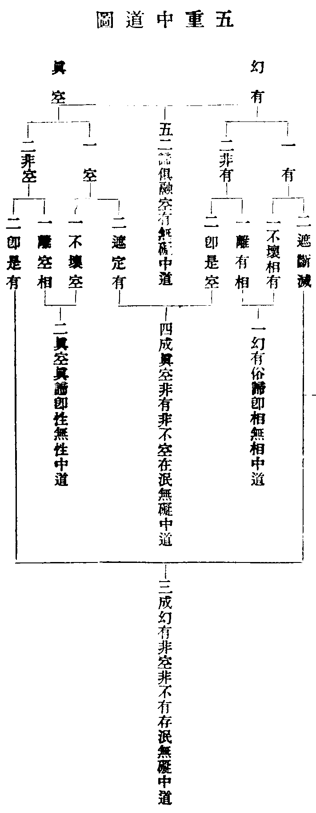

# 华严经谈玄抉择



> **藏经**：卍新纂大日本续藏经（新纂卍续藏）　**册次** 第 8 册（X08）　**编号** No. 235（X0235）　**部类** 华严部　**卷次** 5 卷　**篇幅** 146,915 字

> **卷／品**：5 卷 · 0 品



---



## 目录



- [大方广佛华严经谈玄决择卷第二](#大方广佛华严经谈玄决择卷第二)

- [大方广佛华严经谈玄决择卷第三](#大方广佛华严经谈玄决择卷第三)

- [大方广佛华严经疏谈玄决择卷第四](#大方广佛华严经疏谈玄决择卷第四)

- [大方广佛华严经谈玄决择卷第五](#大方广佛华严经谈玄决择卷第五)

- [大方广佛华严经谈玄决择卷第六](#大方广佛华严经谈玄决择卷第六)



---



## 大方广佛华严经谈玄决择卷第二



上京开龙寺圆通悟理大师



> 赐紫沙门鲜演述



疏：尽宏廓之幽宗者，尽字是教，餘皆是义。宏者，大也，即是广义，通収五教，若巨海遍纳於百川。廓者，空也，即是深义，别拣九宗，同天池独具於十德。或宏者，事法界。廓者，理法界。二字相合者，事理无碍法界。幽宗，事事无碍法界。或四字相合，同诠一真无障碍法界。斯则能被之教义也。



钞：真应权实者，智冥一理曰真，悲赴万根曰应。或本高而迹下、或本下而迹高，名权。本迹相称，名实。



▲言四十二众者，谓同生众有一菩萨也；异生众有三十九执金刚神，乃至大自在天王也；座内流出众、眉间流出众，故四十二。以配四十二位故。



▲言况口光所召者，即〈现相品〉众齿面门光召十方众。是故彼经云「有十亿佛刹微尘数菩萨摩诃萨，一一各有世界海微尘数诸菩萨众，前后围绕而来集会，乃至於其座上结跏趺坐。」



▲言毛光重现等者，亦是此品。谓即前所召十方世界海诸来菩萨身毛孔中皆有光明，一一光明中现无量菩萨。此诸菩萨皆於尘中亲近三世诸佛，以种种法门教化众生是也。又彼经云「如是坐已，其诸菩萨身毛孔中，一一各现十方界海微尘数一切宝色光明，一光中悉现十世界海微尘数诸菩萨」等。



钞：本即圆音者，拣非在根之教，得名为本。故下钞云「一音普应，但是教本，非是其教。」即其义也。



▲言经列二十者，一名最胜光遍照，状如摩尼宝形，乃至二十名妙宝焰。



▲言结有等者，经云「此一一世界各有十佛刹微尘数广大世界」是也。或独〈华藏品〉中，经云「诸佛子！彼一一切世界程，或须弥形、江河形，乃至云诸庄严具形，如是有世界海微尘数。」或是〈世界成就品〉文，彼有十程，经云「尔时普贤菩萨复告大众言：『诸佛子！世界海有种种差别形相，所谓或圆、或方，乃至云或如佛形，如是等有世界海微尘数。』」



▲言经云「佛演一妙音(一梵音故)，周闻十方刹(二遍闻一切，称法性故)，众音悉具足(三此一即多，事理融故)，法雨皆充满遍(四彼一一音雨多法雨)。一切言词海(五彼法各异一切言词)，一切随类音(六各同一切众生之音)，一切佛刹中(七此音各各遍一切处)，转於净法轮(八所说各显世净之义)。一切诸国土，悉见佛神变，听佛说法音(九普令一切各得见闻)，闻已趣菩提(十各各皆得究竟之益)。」具斯十义，方曰圆音。〈出现品〉中复有十喻，次下具引。



疏：主、伴重重，极十方而齐唱者。上句标举，下句释成。此意云：主、伴重重，作何事业？故下句云「极十方而齐唱也。」有力自在说法，名主；无力不自在说法，名伴。但是说法之中分成主、伴，非为听法得名为伴。夫主、伴者，必圆作事。主既说法，伴必说故。「何以得知」下，释成云：极十方而齐唱。唱者，显示果主、因伴。云：谓遮那处普光堂东方十佛刹尘数世界外，有金色世界文殊而来为伴。应问彼云：第二会文殊为伴，为说经耶？为听经耶？若云听经，违下经故，下经正明文殊说第二会故。若云说经，何云听法名伴？由此得知，主、伴虽殊，同说经也。



▲重重者，隣次相押，数多之义也。极者，尽也。十方者，穷法界之处也。齐者，同时也。唱者，宣唱也。此意云：说主、说伴，重重叠叠，尽十方界，一时宣畅《华严经》也。拣异随宜之教，或有国土说、或有国土不说故。



钞：举一为主，十方为伴，乃至云故曰重重者，略总释也。此意云：诸佛、菩萨随一为主，法界诸佛、菩萨咸为其伴。主唯是一，互为其主，至尚无数，伴即无边，互为其伴，伴宁知数？既主、伴无数，重重叠叠遍於法界，主既说经，伴必随说，那有一方不说《华严》？



▲言相犹难明下，广别释也。



▲言此一亦名辅翼者，胜劣齐平，但得称伴。以劣望胜，复名辅翼。谓净土中有十八圆满，今菩萨众即辅翼圆满也。此非局此界，〈名号品〉中他方菩萨疏科成六辅翼。



▲言不名因主果伴者，问曰：十玄门中主伴门云随举一法为主，餘一切法为伴。今何不尔？答曰：据义不同。彼约称性实义，此约教相轨义。故如臣作主，不可君为参佐也。若尔，准下疏云「主伴有三：一回向主伴(尔修善根，互相回向，故今成佛，边为主伴)、二同行主伴(同修禅、戒等行)、三如相主伴(二俱称性，居然相收)。」释曰：准彼所说，毗卢与彼菩萨递为主伴。岂非因果互为主伴耶？答曰：彼约昔时同修善根，互相回向，今随一成佛，餘作菩萨，而为其伴，故云递为主伴，非是因果互为主伴。又解：此约化仪，非因主而果伴。彼据称性，故因果而递互。



▲言隣次相押故曰重重者。此界、他界附近名隣次，若主、若伴互遍名相押。



▲言如佛佛既尔，佛主、菩萨伴亦然者，问曰：诸佛与遮那互为主伴，何云既尔？菩萨与遮那既无递互，何云亦然？答曰：约人即无，随界乃有。何者？应云此界佛为主、餘界佛为伴，餘界佛为主、此界佛为伴，即是果主、果伴递互也。此界佛为主，餘界菩萨为伴；餘界佛为主，此界菩萨为伴。岂非果主、因伴递互义也？



▲言二者遮那一佛为主等者，前望多佛互作主伴显重重义，此望一佛一往作主明重重义。如前释处中二义：一总将七递为能遍、二别将一递为能遍也。



▲言如长空等者，此释主移，伴亦移也。如西川内，月在其中，火星在西一丈许地，木星在东一丈许地。向东川内，星月相望，亦同其上，非谓月与木星相近，与火星远也。问：此递言移，上言不赴树王，岂不相违？答：彼约起而不起，此约不移而移，文虽有异，理归一途。又问：为但移人界耶？答：人界俱移，钞文甚显，学者自观。



▲言如是主佛至东一佛刹尘数界外至正当本金色世界处者，此是第十佛刹尘数主佛主界当第一金色世界，非谓第十主佛主界但当一佛刹尘数界内第十界已。请思，请思。问曰：主佛至彼金色世界，本娑婆界为有主佛？为复无耶？若有主佛，应成杂乱，财首伴菩萨亦在此界故。若无主佛，是则说主不遍一切，在彼金色处，本界处无故。答曰：此义亦难，幸希详审。但以为门不同，不应致难。何者？若约不移义，此界有主佛，财首伴菩萨无故。若约移义，此界有财首伴菩萨，劫无主佛则无杂乱，移与不移复不相碍，亦无不遍，是则前难一时都遣。



▲言如是主佛极於东方者，问曰：主佛之东，为更有世界耶？更无世界耶？若云更有，何得言极？极者，尽也。若云更无，是则世界有边，文殊不应从东而来。答曰：更有世界。若尔，后难善遣，前难如何？答：从此东方，凡有世界处，主佛必遍，所以言极，非谓世界有边。由此文殊亦从东来，如尽众生之愿门，但是众生但有佛性，无非所化，非是众生有化尽时。



▲言终不见文殊师利从西向东来近主佛者，此遮常情定相之解。恐有疑云：主佛在此娑婆，金色在东，彼界文殊从东向西来近主佛。今移主佛极於东方，越过金色，彼界文殊应从西向东来近主佛。所以遮云：终不见文殊师利从西向东来近主佛。何以故？主若移时，伴亦移故。



▲言亦不见文殊师利从佛前过向西近佛者，恐外疑云：虽不见文殊从西向东来近主佛，应是文殊从佛前过向东，却回向西来近主佛。故钞遮云「亦不见」等，以表主移伴亦移故。如恐未晓，复举喻明。如一法师市中作法，东门一僧而来佐法，乃从东向西，故法师移至东门之外，是则东门一僧必从西向东而来佐法。如或不然，应是东门一僧从师前过向东，却向西方而佐其法。遮此常情二解，故钞云尔。



▲言如人以十钱布地等者，问：前举十人为喻，今何重举？答：彼约递至主伴，此约一往主伴。若尔，星月之喻已显一往故。答曰：星月喻中未彰主佛周遍伴刹，故此重明。如人以十钱布地(标也)，未是已布於地。



▲钱心为主，钱缘为伴者，指配法合也。



▲第一钱当中者，对东西上押之钱名中。同本界不移之主伴，对东西各移之主伴名中。



▲则以第二钱押第一钱上近东一缘之地者，此意云复用第二钱押第一钱上。如何押耶？故释成云：渐近东展出一楞之地，喻第二重主、伴各移近东一界。



▲则开元、通宝等皆移近东一缘之地者，此显一移一切皆移也。



▲如是钱钱重重相押，皆渐近东者，法合云：如是主伴重重相押，皆渐近东。是知东方界界有主、界界有伴，无不周遍故。若至金色，但有十个主佛者，主佛有不遍世界之失。何者？界有十佛刹微尘数故。彼若救云：一佛主佛刹尘数世界无不遍失者。应第一主佛移近东一佛刹尘数界外第二佛刹微尘数界中，何故钞云向东一界？复违隣次之义也。



▲更以十钱近西亦然者，合前主移近西也。餘说云云，恐非正理。



▲言如第一会重重遍法界者，问：普光、忉利等处亦说第一会法门不？若说，何以经中但言菩提场说第一会，不言於餘？若彼不说，何以遍？答：有多解：一约佛德能，云遍法界；约根见、闻，云菩提场。故下疏云「但随见、闻说，有初成九会之别。」二据称性圆融义，云遍法界；据不坏相行布义，云菩提场。三就广融义，於菩提场全摄普光、忉利等法界处尽故，由此但在菩提场即是遍法界。经就能融，云菩提场。故经云「华藏世界所有尘，一一尘中见法界。」一尘尚然，况一处耶？四就普遍义，即菩提场遍普光、忉利等法界处也。既普光、忉利等法界处中皆有菩提场，是故但在菩提场说第一会，亦无普遍。若尔，第一会主与餘会主为相见不？若许相见，应成杂乱；若不相见，何以知遍？答：相即互亡不相见，相入双存许相见。虽许相见，有力、无力异，亦无杂乱。若尔，既云无力，应不名主。答：但约相入门之无力，非关主、伴门之无力也。若约主、伴，皆成有力，各对当会伴菩萨故。今约相入，互成无力，主佛自望更相入故。又解：或彼无力，即成其伴，同彼相、即二种玄门，有同体故。是故准知，九会教主若互相遍，分有、无力，却成主、伴，故无杂乱。餘会、餘佛等，准此应释。



▲言故有三两身等者，将时、处、根以显佛身不全昭著。



疏：虽空空绝迹，而义天之星像灿然者，肇公云：「大像隐於无形，故不见以见之；大音匿於希声，故不闻以闻之。」斯之谓矣。



疏：湛湛亡言者，上句直目无言，理本也；下句即目言之，事末也。教海佛音，本质教也；波澜根闻，影像教也。或分教义，而有异故。又解：上言湛者，遣言也；复云湛者，遣无言也。恐未兼亡，故致亡言，以遣能、所遣之迹也。意全当句，即绝也。教海者，即上亡言，理本也；波澜，即目言之，事末也。若尔，何云教海耶？答：言音实相，即法轮故。第十教体，海印炳现故。



钞：夫大像无形等者。语借老子意，目一真法界。或比类而言，以劣况胜也。道体浅近，尚无形言；真法深玄，岂有名相？希字结上无声，微字结上无形，绝、朕双结上二言。心绝动摇(离相)，言亡戏论(离言)。故《大般若经》「那伽室利分龙吉祥云：『我欲入城，为有情故，巡行乞食。』妙吉祥云：『随如意往。然於行时，勿得举足、勿得下足，勿屈、勿申，勿起於心，勿戏论，勿生路想、城邑聚落想、大小男女想想等。所以者何？菩提远离诸所有想，无高、无下，无卷、无舒，心绝动摇，言亡戏论，无有数量是也。』」



▲自入真赴(证圣)，何用广陈？言(教)相(义)，翻欲扰人(不顺本法名翻，引生倒解名扰)。此难近蹑说仪，周普远通，四段之中皆有相故。言无说(无言)、无示(无相)，或无能说言、无所示义，或无对初根说、无对久根示，或无声说、无名句示。



▲言无中无有二等者，此意於无相理中，无内、外，人、法等一切二也。



▲言无二亦复无者，为遣有二之相，假借无二之迹。於无相理中，何有无二？所以云无二亦复无。



▲言诸法无二、无不二者，无二，空也；无不二，空空也。



▲言谓若有有可有等者，此意云：真如理中，若有一种有相堪可定相实有，则许对彼乃有一种无相堪可定相实无。何所以耶？有无相待故。已上反释，自下顺释。今无彼有相堪可实有，验知亦无此无相堪可实无故。



▲言若无所得，当句即绝者，谓空空二字，分能所遣，迹终不尽。今言绝迹，性本自空，更不待遣，方符至理。若尔，上云空空，应无益用，有能所遣，如鸟履沙故。若许无用，何须言之？今谓通云众生悟法，难便造玄，先须由渐，故资遣拂。如彼真空绝相，观三句九门，拣情显解，方云泯绝无寄，令契真空。法多如是，学者准知。



▲言谓依晴空等者，喻依情空炳现星像，法依义天朗现法门。疏据影显云义天之星像灿然。



▲言若碍於言等者，良以无言有二：一者碍、二者不碍。如次可知。



▲言若碍於言，身子被呵等者，乃《净名．中卷》「舍利弗言：『天止此室，其已乃知。』答：『我止此室，如耆年解脱。』舍利弗言：『天止此久耶？』天曰：『耆年解脱亦如何久？』舍利弗默然不答。天曰：『如何耆年大智而默？』答：『解脱者无所言说，故吾於是不知所以云。』天曰：『言说文字皆解脱相。所以者何？解脱不内、不外、不在两间，文字亦不内、不外、不在两间。是故，舍利弗！无离文字说解脱也。所以者何？一切诸法皆解脱相。』」即其义也。



▲言不碍於言，文殊攸赞者，此亦《净名．入不二法门品》，意谓先三十二菩萨各说入不二法门，以言显理，犹滞於言。次文殊云：「如我意者，於一切法无言、无说，无示、无识，离诸问答，是为不二法门。」上三十二皆有言也。后维摩诘默然无言，显不二理，此则无言也。是故文殊赞净名曰：「善哉！善哉！乃至无有文字语言，是为真入不二法门。」故云「不碍於言，文殊攸赞」，斯之谓也。问曰：净名默住，以显绝言顿理，何云不碍言耶？答曰：但绝生灭虗妄言说，不碍真门如义言说。问曰：如义言说，为理？为事？若云事者，违自真门，事相本尽故。若云理者，复违此假理本，不碍事末故。今谓通云，文虽用彼，义乃稍别。是则用《净名》之文，成《华严》之义，妙之至也。



▲言况文字性离，即言亡言者，上句标，下句释。即言释上文字，亡言释上性离。或此意云，况文字真性俱离，彼即言亡言之两迹也。言流八音者，或体业具为后属依呼八转之声也。或最好、易了、调和、柔耎、不误、不女、尊慧、深远之八音也。



▲言至趣(无言、无相，理本也)非远(不碍言相，事来也)，心行得之(滞迹，心行取之也)则甚深(叵穷，边际也)。上句纵，下句夺也。



▲言像(有言、有相，事末也)非近(不碍，无言、无相，理本也)，灵怀体之(无漏，真智证之也)而目击(烂然可观也)。上句纵，下句夺也。肇公云：「道远乎哉？触事而真。圣远乎？体之则神。」即其义也。上云言像者，出《周易》。故易云「言者所以明象，得象而忘言；象者所以存意，得意而忘象。是故存言者，非得象者也；存象者，非得意者也。象生於意而存象焉，则所存者乃非其象也；言生於象而存言焉，则所存者乃非其言也。然则亡象者，乃得意者也；亡言者，乃得象者也。」今借此语用也。



▲言绝之理(无言)而非绝(不碍言也)，繁兴之籍(言也)而非兴(不碍无言也)。



▲言融常心，言无所遣矣者，表即妄同真也。下疏云「即凡心而见佛心，融常心也。」下经云「能令三界所有声，闻者皆是如来音。」融常言也。不有此语，恐谓唯佛心言与理无碍也。



疏：若乃千门潜注等，「若乃」二字，引句之词。「千门潜注」，与众典为洪源等者，此经所诠无障碍法界具无边异义，但以前之四根未堪具受，故我世尊随彼根宜，於无障碍法界中分四谛等义，以为小乘等教。随彼偏根所执，偏义是无；就彼法体所断，通义是有。仍属此经无障碍法界，故此云尔。问曰：本、末之义，云何曲三种？一云：小乘云末，大乘云本，故《法华经》云「除先修习学小乘」者，又云「我此九部法(小乘法也)，随顺众生说，入大乘为本」是也。二云：三乘为末，一乘为本，故《法华》云「於佛一乘，分别说三」是也。三云：前四偏教云末，第五圆教为本，故钞云《华严》为诸教之本源矣。又下钞云「前四因中即有，至果皆无」等是也。前之二本，餘教容有；后之一本，独我《华严》。



钞：如海潜等者，此借〈出现品〉喻义证教也。



▲言九流等者。正理云：《汉艺文志》云「一儒流(述唐、虞之故，宗仲尼之道)、二道流(陈尧、舜揖让之德，明南面为政之卫)、三阴阳流(顺天历象，敬授民时)、四法流(明赏敕法，助来制也)、五名流(正名列位，言顺事成)、六墨流(清庿净祀，养老惠施)、七纵横流(受命使手，专对权事)、八杂流(和大国体，事无不贯)、九农流(劝励耕桑，备陈食货)。」出《释氏六帖》。



▲言第五经等者，隋译经也，秦译当第六。



▲言始见我身者，即指圆根菩萨初始於菩提树下见我十身无碍毗卢佛身。



▲言闻我所说者。即前圆根菩萨闻我毗卢所说《华严经》。即皆信受者，无一圆根不信受也。若尔，何以鹿苑转四谛轮也？故经云「除先修习学小乘者」，此意但除却先来修习学小乘人不堪闻此根本法轮外，所有圆根众生尽皆信受。是知将根准教，既有小根，必有小教，故钞云「所说也，我今灵山会上，亦令前来小乘之人得闻是《法华经》，悟入根本华严佛慧也。」所谓初入佛慧，既是华严，复入佛慧，理有何疑？初成之说，非法华故。



疏：智周鉴而常静者，故肇公云：「夫圣人虗心冥照，理无不该。怀六合於胷中，灵鉴有餘；镜万有於方寸，其神常虗。」即斯义也。



钞：昔人云等者，所遮异释也。昔人将四不义所显：一理为体大，以微细、帝网二玄为相大，以神通、自在、相即、广狭、十世、隐显等玄门为用大。问曰：何以偏将二种玄门为相大，自餘玄门为用大耶？答曰：二种玄门约本具义，自餘玄门约新现义，故此云尔，理、实互通。问：此师既许事、事无碍，宁不许事、理无碍也？答：许事、理无碍。何为所遮异释也？今谓通云非彼不许，但文中不说为所遮故。



▲钞：显德相等者，问曰：此言德相为相大，与十所因中德相之门同异云何？答：有二解：一云：此即是彼。如将十玄就本具义属德相门，即是相大；就应根义属业用门，即属用大。故前钞云「二约事事无碍，十玄之相本自具足，即是别教之意，彼言本自具足，即德相门也。」又云「此言德相非德相门，勿谓名同，不分义异。」如佛证穷为德相门，岂佛证穷，唯证相大耶？由此知非。复举一喻以显深旨。如世一劒，先在匣中，本具体、相、用三(同德相文中本具三大也)，对贼便用(如临根业用门)，体、相、用三亦无所阙(三大无阙)。更宜思审。



▲言即能证、能观者，止为能证，观(去)为能观(平)。或地上止观为能证，地前止观为能观；或果中止观为能证，因中若观，皆通事、理也。故下疏云「定、慧虽多，不出二种：一事、二理。」制之一处，无事不办，事定门也；能观心性，契理不动，理定门也。明达法相，事观也；善了无生，理观也。诸经论中，或单说事定、或但明理定。二观亦然。或敌体事、理，止、观相对。或以事观对於理定，如《起信》云「止一切相，乃至心不可得为止，而观因缘生灭为观。」或以理观对於事定，下经云「一心不动入诸禅，了境无生名般若」是也。或俱通二，如下云「禅定持心常一缘，智慧了境同三昧」是也。或二俱泯，非定、非散。或即观之定，但名为定，如观心性名上定是也。或即定之观，但名为观，如以无分别智观名般若是也。或说双运，谓即寂之照是也。配释此文，学者可知。问曰：上明止、观，从境彰名，云事？云理？若论止、观自体，事、理何収？一云：或止为理，观为事；或观为理，止为事。何以止、观不双取事、理耶？答：文违大段，事、理无碍故。或止、观皆是始觉为体，故下钞云「皆生止、观。」科约三大云事、理无碍。



▲言权实无碍等者，谓达事止观名权，照理止观名实。此亦约当句明无碍也。



▲言若别对三大等者，此则将第四句能观止观之心对上三句所观体用之境。如对初句云冥真体(理也，体也，境也)生第四句常静(止心也)，万化之域(事也，用也，境也)生第四句周鉴(观心也)；对第二句显德相(事也，用也，境也)生第四句周鉴(观心也)，重玄之门(理也，体也，境也)生第四句常静(止心也)；对第三句用繁兴(事也，用也，境也)生第四句周鉴(观心也)，以恒如(理也，体也，境也)生第四句常静(止心也)。故钞云「各具体用，皆生止观。」今言观者，乃是缘事之观；止者，即是缘理之止。全同《起信》云云。







▲言若作三观释等者，能观之心分成三观。所观之境，开为三谛。对空观开真谛，属体大；对假观开俗谛，属用大；对中观开义谛，属相大。问曰：三谛之中，义谛为二谛之所依。三大之中，体大为二大之所依。义理相顺，何故体大为真谛空观所缘，相大为义谛中观所缘耶？今谓通云此言三谛，非取义谛，但取真俗及中道谛。但体大唯理法界，作真谛，生空观；用大多事法界，作俗谛，生假观；相大通四法界，作中道谛，生中道观。三大通所依，方是第一义谛一心本法也。或云：三大是用，义谛是体。二大与体别，论属真俗二谛。相大与体大合，论属第一义谛，更希刊定。问：其中道谛，为俗事耶？为真理耶？答：幻有中道即事，真空中道即理，俱融中道双通事理。问：行相云何？答：有五重故。问：何者是耶？一幻有中道、二真空中道、三真空成幻有中道、四幻有成真空中道、五俱融中道。贵令易晓，列图显示。



▲言三止、三观融为一心等者，问：一心之中，分止、观、谛，九法历然，行相云何？答：如依一镜，鉴现好、丑、中三影。影喻三谛，其理昭然。现好影之明，如空观；现好影之净，如体真止。现丑影之明，如假观；现丑影之净，如随缘止。现中影之明，如中道观；现中影之净，如离边止。三影、三明、三净，约义条别，究体唯是一镜。将喻对法，学者详悉。



疏：真、妄交彻，即凡心而见佛心者，上句标宽，下句释狭。



钞：真谓理也(唯性非相)、佛也(唯净非染，通性、通相)、涅槃也(唯净非染，通性、通相)。妄谓惑也(唯染非净，通性、通相)、生也(唯染非净，通性、通相)、生死也(唯染非净，通性、通相)。



▲言真该妄末者，真理即事门也。



▲言妄彻真源者，事法即理门也。



▲言谓无有不湿之波等者，上句妄彻真也，下句真彻妄也。



▲言如来不断性恶者，小教有二义：一佛前十五界是有漏，起他恶法故，生无比之贪，引央掘之嗔；二云示现爱语罗睺、叱呵调达故。始教示二义：一云真如昔日与恶而为实性，今至果位，恶法虽断，恶性常存故；二云示现，同前小教。终教亦有二义：一云昔日真如随缘以作说法，今至果位，无明既断，恶相虽无，随缘真性仍存故。如依静水，随风成波，风停波息成波，三性恒存故。如《龙树论》「独力随相，非所断故。」二云恶具二义：一不坏相，异真义(当缘生相有也)；二称性，即真义(当无性体空义)。今据后义，故云不断。顿教云：恶相本尽，更不待断；恶性本现，非所断故。圆教云：称性之恶，如镜中火，现而常虗，非所断故。虽通五教，正取能同终教，事理无碍。故下钞云「如来不恶性者，善恶同以心性为性。若断性恶，则断心性，性不可断，亦犹阐提不断性善。」又龙树云：「如斩眠士夫，岂悟士夫不伤」等。若尔，何故《涅槃经》说「如来无不善佛性」？答曰：彼据以理，从事即无；此据摄事，从理不断。又彼约现在为名，此据过去立号。故彼此文不相违背。



▲言又佛心中有众生等者，如和尚镜中弟子是也。



▲言今约不坏相者，一约不坏行布相。行布门中，众生可具其佛(如鑛具金、如璞具玉)，佛不可具其众生(如熟金而非鑛、如净玉而非璞)。二约不坏行布教相。闻凡即佛，於凡有益(引生趣求)；佛即是凡，令人妄解(引生倒解)。由此但云即凡心而见佛心。



▲言不离一心故者(十所因中，唯心所现故，出《起信论》)。



▲言妄揽真成，无别妄故者(依理成事门，出《起信论》、《胜鬘经》)。



▲言真随妄显，无别真故者(事能显理门)，真妄名异，无二体故(真理即事门，事法即理门)。真外有妄，理不遍故(返释理遍於事门)；妄外有真，事无依故(返释事遍於理门)。然或说妄空、真有(《唯识论》、《涅槃经》)，或说妄有、真空(三论、二谛义)，俱空(随俗说二谛，通《华严经》也)，俱有(《唯识》、《华严》)，双非(触物皆中，遮义也)，两是(真妄通二谛，或触物皆中，表义也)。



▲言净分同真(无漏依他，同圆成性)，染分为妄(有漏依他)。言净分之事，妄未尽故者，无漏依他，缘生幻有。故《金刚经》云「凡所有相，皆是虗妄。」又下钞云「谓如真如现依他时，设有净分，亦名为染。」如镜现像，不简净秽，皆非镜体。故唯能现，得名为净，所现皆染，即其义也。



▲言净分、圆成皆有者，净分即依他摩诃般若也，圆成即解脱法身也。



▲言若随俗说二谛，则真妄俱空者(三谛中料拣也，或三谛意、或终圆义)，妄法无性故空，真法无相故空。或真妄相待方有，真妄名生。如彼长短，故名俱空。或依手巾体，幻作兔儿相(体如真，相如妄)。若随愚夫说作兔儿，体相俱空(若随俗说二谛，则真妄俱空)。



▲言若约真妄通二谛，则真妄俱通空有者，一云在俗谛，真妄俱有，幻有、实有故；在真谛，真妄俱空，性空、相空故。二云在俗谛，真妄俱空(即前随俗说二谛，则真妄俱空)；在真谛，真妄俱有(故下钞云「真妄皆真，则本末一味，居然交彻。」)。



▲言约宗以明唯识等宗不得交彻者，问：三论、《涅槃》皆说交彻，何云不得？答：一云内等，不等《涅槃》及与三论。何以得知？等字在上，宗字在下故。一云亦等於彼。彼论、彼经虽说交彻，非正所宗。今我华严正以无障碍法界为宗，故钞云尔。



▲言情有即是理无者，问：理无之义，遍、圆二性为属何性？若属圆成，何云遍计有二义：一者情有、二者理无？若属遍计，何云情有即理无，妄彻真耶？答：义有两途：若与情有非一义，属圆成性；若与情有非异义，属遍计性。今约初义，故钞云真。又解：属遍计性，遍计性中通真、妄故，不同始教唯是妄故。依他之中无性之义，准此应释。



▲言此经云有净说生死等者，上半假立，谓待前流转生死立涅槃。烦恼名诤，触动善品，损害自他，故名为诤。此有漏法，诤随增故，名为有诤，有彼诤故。生死者，有漏为体。无彼烦恼，故称涅槃。下半双非，谓生死、涅槃俱因烦恼假立其名，何有真实？又二互相待故俱空，二互相夺故皆寂。上二句俱有交彻，二二句俱空交彻。或望能夺义俱有交彻，望所夺义俱空交彻也。



▲言故影公云等者，即是《中论．序》也。此一段文准下钞释，而有四对。



▲言以真谛故无有、俗谛故无无者，此是初对，定有无所在。我约真谛上说，空是无性空，不同无物空也。我就俗谛明有，此是缘有，非空性之有也。二真故无有，则虽无而有；俗故无无，则虽有而无。一对彰有无体相，是不坏有之无，不碍无之有，故成中道。三虽有而无，则不累於有；虽无而有，则不滞於无。一对彰有无之德，若是定性之有，此有则唯是有，不得即无；若是定性之无，此无即唯是无，不得即有。今二互相即，故不徧滞。



▲钞云「乃至」者，具足应云：不滞於无，则断灭见息；不存於有，则常著永消。俱、不俱等，何由而有？诸边都寂，故云皆离。此彰有、无离过。滞空则断，累有则常。既不滞、不累，故无断、常。又释：初对双离有、无，故云无有、无无，此成空观。第二对不坏有、无，故云虽有而无、虽无而有，此成假观。第三对明二谛相即，故不偏滞於有、无，故不为有边所动、无边所寂，成中道观。肇公亦云：「涉有未始迷虗，故常处有而不染」，此不累於有也。「不厌有而观虗，故恒观虗而不证」，此不滞於无也。第四离过，准前。又释：初对中，初对是真空义，下句是妙有义；第二对亦有亦无义；第三对非有非无义；第四对离过，则成具德四句也。又初对双离二过，一离有、二离无；第二对离非有非无；第三对离亦有亦无；第四对总明离过。故《起信》云「真如非有相、非无相，非非有相、非非无相，非有、无俱相。」即其义也。



▲言真妄皆真等者，问：妄法皈真，其义可尔。云何真法亦皈真耶？答：上言真妄，法体也；下言皆真，真谛也。又上言真，对妄之真；下言真，绝妄之真。又上约分相门，収妄之真故



疏：事、理双修，依本智而求佛智者，上标，下释也。依本觉理、智(释理修也)，求始觉事、智(释事修也)。



钞：亦由惑者执禅则依智性，乃至云并为偏执者，义当四病也。故《大方广圆觉经》说众生修行，当离四病：一者作病。但作有为事行，未识真如本心，尚不得生佛家，岂得冥合圆觉？故说为病(义当执法者也)。二者任病。生死既空，何劳除断？涅槃本寂，何假欣修？一切放纵身心，更不念其罪福，泯绝无寄，故成其病。差乎近代，多落此科。诵禅歌毁於法筵，虗寻名相；说理性非於塔寺，狂认福田。妄立宗途，悮惑含识，断除佛种，良足悲哉！凡佛真子当须屏远。殊不知：蓝墉适补，比丘寿增；寺础将移，天人目动。况复触事陟理，绝空色观空，不癈众缘，真宴坐矣！如《维摩经．菩萨行品》「佛告众香世界诸菩萨等：『菩萨行者，於远离不以为贵。不著己乐，癈於彼乐，在诸禅定如地狱想。』」等。斯则菩萨於禅实有所证，佛尚诫令不著，况未有所入，得妄著耶？且沙门敛念，诚为通规。其谁不然？妄自矜衒，兼投药失所，所损非细。故《智度论．九十六》说「弥勒菩萨知须菩提乐说空义，故教诫云：『不应新学菩萨前说。何以故？若有少福德善根者，闻毕竟空法，即便著空，遂作是念：「若一切法空无所有者，我为作何福德？」则应失前业。』」等。如是经论，如来劝令离病，弥勒诫物谈空。但有信心，不可警慎。三止病。真心绝念，动念即乖。若止妄念不生，真性自然显现。斯由不知妄念即真，贪嗔本道，而於妄外求真，何异除波觅水？故成其病。四者灭病。道由惑覆，惑尽道彰。故欲断惑求真，令得身心永寂。夫菩萨用心，利他为本。今欲避𮘵取寂，诚非大士。况乎不释动以求静、不怖惑而度生，真觉士也。今欲离障求寂，尚杂二乘狭见，岂能冥通圆觉？故说为病(此之三病，义当执禅者也)。如是四行，互闻即成非，齐运则无过。若能常作、常止，常任、常灭，易脱相资，无非有益。亦犹四大造色，递发有损，并力成功。今此事理双修，依本智而求佛智，并除前病。所谓执禅，则多落止、任、灭之三病；执法，则唯堕作之一病。故此双行，为真修矣。又下疏云「然今法学之者，多弃内而外求；习禅之者，好亡缘而内照。并为偏执，俱滞两边。」又云「勉旃求悟，不得徒自劳形(此遮执法者也)。努力修行，不得拨无因果(此遮执禅者也)。」



▲言无所求中，吾故求之者，暗引《方等经》乞士之语，上句释依本智，下句释求佛智也。故《方等经》中说佛为雷音说於昔因缘已，又云「过去有佛，名栴檀华。彼佛去世甚久，我於彼时，如汝无异。彼有菩萨，名曰上首，作一乞士，入城乞食。时有比丘，名曰恒伽，谓乞士曰：『汝从何来？』答曰：『我从真实中来。』又问：『何谓真实？』答曰：『寂灭相故，名为真实。』又问：『寂灭相中，有所求？无所求耶？』答：『无所求。』又问：『无所求者，何用求耶？』答：『无所求中，吾故求之。』」等，乃至云「恒伽闻已，卖身供养」，下疏释云「性、相双鉴，终日求而无所求也。」



疏：理随事变等者，一云：一者理也；多者，事也。或一与多，皆目事也。



疏：故得十身历然而相作者，历然行布，不坏相也；相作圆融，坏相也。终日不坏而坏、坏而不坏，名不思议，非谓体癈相存也。若谓能即体癈相存者，体据即义癈，不即义存，即与不即，二互无碍，存、泯莫拘，是不思议；相约即义尚存，不即极存，但一向存，应非无碍，是可思议。学者更审。



钞：一同时具足相应门等者，然此十门具於五对：一总、别对，初门是总，餘九为别；二法、喻对，第七是喻，餘九为法；三假、实对，第九是假，餘九为实；四全、分对，三、四是全，六、八为分；五增、微对，广显主增，狭隐伴微。不唯五对无碍，实乃举一全収。



▲言能以众生身作自身等者，问：此言众生，为取我等妄染众生耶？为众示现变众生耶？答：一云但取变化众生。若取我等妄染众生，应无所化，俱作能化十身故。又违此钞云「则於此身现如是形」，复违下钞「众生身」等，摄皈三身中化身故。二云但取我等妄染众生。何知？论三分中是染分故，三世间中众生世间故。若尔，前难何通？答：常作能化，不碍为所化故。就能悟门，取众生身作自菩萨身为能化；就迷门，取众生不作菩萨身为所化。



▲言则於此身现如是形者，约同体变化也。下皈化身者，岂不见下钞云「万化云云，皆是法身大用。」又经云「心佛与众生，是三无差别。」又果门摄法无遗。三云上二双取，引证同前。向明十身皆是佛身，恐滞常情，略伸区别。问：既俱佛身，唯应第七如来身摄，何分餘九？若就行布而有餘九，应非皆是佛身所摄耶？答：圆融不碍行布，故佛为能融，皆是佛身；不坏本相，故存餘九。二门双取，故说十身皆是佛身。若以餘九随一为门，具十亦然。今就佛门，是故云尔。问：前之七身作菩萨身，行相可知，具色相故。后之三身既非色相，云何作於菩萨身耶？下疏答云「入法智中，自然应现自己身故。」令於虗空忽见自身，故名为作。作餘亦尔。又问：餘之七身可作能化，具色相故。后之三身既非色相，云何化生而作能应耶？答曰：苟能得法契神，何必要因色相？是故彼三即为能应佛身，良以根、性、心、乐类非一故。



▲钞：言历然者，不坏相故者，历然即是不乱，不乱，钞指即是行布。验知不坏相，行布义，非圆融中体废相存也。



▲言如初发心时便成正觉，不坏初心之者，初心即妙觉，成佛义如常。即而不即，初心义存。二义双取，说得初心成佛，出〈梵行品〉文。良以初心即无其体，全揽妙觉体成故。如世指环，别无其体，全揽金成故。说指环当体即，金环相仍存故。



▲言十信摄於诸位，诸位十信历然者，十信摄於诸位，圆融也。诸位十信历然，行布也，出〈贤首品〉文。问：约圆融义，十信摄於诸位，为於信位实成佛耶？为实未成佛耶？若实成佛，住、行、向等便徒虗设。若实未成佛，信该果海，有言无义。有云：圆融门中已成佛，行布门中未成佛。若尔，后位但应行布修断，圆融门中已成佛故。若谓虽已成佛，不碍复有修断者，妙觉位后应更修断。若更修断，前佛应胜，后佛应劣，修断多少不同故。今谓通云六位互摄，如六面镜互现其影。信摄餘五位，如第一镜影现五镜影。信位有障，信摄诸位一切皆障，是知一障一切障。第一镜上尘垢昏坌，彼镜中影一切不现，是知一昏一切皆昏。如在信位修断其障，能摄之障既断，所摄之障一切皆除，是则一断一切皆断。如磨第一镜，尘垢皆除，不唯能之镜昏除，镜中之影昏障亦无，即是一磨一切皆磨，一现一切皆现。约信位中，诸位惑障皆断，岂不名佛？约第一镜，尘垢皆除，岂非明净？约住位中，诸位惑障全未断故，岂得名佛？约第二镜中，诸镜尘垢全不磨故，岂名明净？是知位位圆修圆断，譬如镜镜全磨全净。以喻对法，朗在目前。



疏：广大即入於无间等者，疏中影略，应云：无外广大身刹即入於无间尘毛，无间尘毛包纳於无外身刹。问：尘毛具二义：不坏相故狭，称性故广，可尔。无外身刹不坏相故广，岂称性故狭，名无碍也？答：亦不坏相故狭，称性故广。故经云「空生大觉中，如海一沤发。」空尚如沤，何况身刹？又云「十因各随义显」，今取法无定性，故大能小也。或亦称性故小，性非定大故。何以得知？全在一尘而包容故。



钞：虽有即、入，意取广、狭，拣滥释成也。问：广、狭无碍，别立玄门；凡、圣无碍，应别立也。染、净、依、正等，皆应别立。此若不尔，彼广、狭门应即入収，不应别立。答：许别立，但示方偶。且作是说，皆皆无量。



疏：炳然齐现等者，上句法，下句喻。问：隔瓶见物，岂不违肉眼九缘生义，阙空缘耶？瓶具质碍故。答：良由缾净，得见彼物。若尔，如对明镜，何不见障外之色耶？答：镜但表净，里不净故；琉璃，表、里皆莹净故；如水澄清，见鱼、鳖故。



钞：一能含多，皆曰相容者，下钞又云「法法皆尔，故云相容也。」微细之义，下释有三：一能含微细，一尘一毛故；二所含微细，不坏相故；三难知微细，小能含大，常情不测故。如对一释迦像，想彼像中含尽十方三世遍法界、虗空界无尽三宝。礼彼一像，即是徧礼无尽三宝也。供彼一像、念彼一像等，准前应知。如焚一炉香，想彼香中含一切香华、灯幢、伞盖、饮食、汤药、菓木、音乐、螺钹、宫殿、池沼等一切诸供养具，遍供如前一像中无尽三宝。随献餘供，含物亦然。曰：修此行，有何罪而不灭？有何福而不生？良以法虽本尔，心不相应，难获巨利。幸愿群英勉强而行！自餘玄门，倣此而修，滞相而修，百千万劫未及一眴之功。深思！深思！相入门中，当想自身遍入十方诸佛会里佛、菩萨、四众、八部身中。彼若说法，我亦说法；彼若闻法，我亦闻法；彼若断障，我亦断障；彼若证真，我亦证真；彼若发菩提心，我亦发菩提心；彼若化生，我亦化生；彼若拔苦与乐，我亦拔苦与乐；尽彼诸行善事，我亦行之。复想六道众生皆在自身之内，自若礼诵，彼一切众生悉皆礼诵等。自餘妙行，准此应知。



疏：隐、显俱成等者，如观一释迦像，於中乃有无尽佛、菩萨等身像也。但彼多像隐，一像显也。



钞：而明下有晦等者，上明异处，下辨同处，文理昭然。



▲言如东方入正定为一半等者，此意一菩萨全在东方入定，而不妨同时全在西方出定，是谓难思。问：何故入定为明，出定为晦耶？答：在定观根审法名明，出定涉有化生名晦。是故在定复得显加，出定但感冥加。明晦之义，昭然可悉。或约但见入定，不见出定故。



钞：影复现影，重重无尽者。此是其喻。法合云何？如一尘称性以作能含，一切刹土俱为所含之刹，皆揽尘成。尘复称性，复含其刹。是知能含尘，尘不尽；所含刹，刹无穷。是此门也。问：第一尘称性，含刹尽耶？舍刹不尽耶？若含刹不尽，是则彼尘不称其性。若云称性而含刹不尽，彼不含刹应在性外。若许含尽，彼第一尘所含之刹但作第二重能含，更有何刹为第二重所含耶？若递互合，与微细、相入二门何异？若云第一尘称性，含刹皆尽，彼所含刹亦乃称性作能含时，复更出生所含之刹者。问：所出生刹为本？为新？若本具者，应第一重尘却有含刹不尽之失；若新生者，德相门中应无帝网。此义极难，深宜用心。今谓通云：如莹一圆镜在东，莹一方镜在西。两镜互入，同相入门；一性而入，似微细门。今帝网门则不如是，如东圆镜现西方镜影全尽，无不尽之失；其方镜常入而不入，还在本位。其西方镜内却现东圆镜影，并圆镜内方镜之影全尽，亦无不尽之失，其西方镜并所现影已有三重。其东圆镜常入而不入，现在本位，复作能现，现西方镜并彼二影亦无不尽，其东圆镜并彼三影已有四重。其西方镜常入而不入，还在本位，复作能现，现东圆镜并彼三影无不尽失，其西方镜并彼四影已有五重。后后作法，准此应知。由重重无不尽之失及相滥之过，故钞云「亦如两镜互照，重重涉入，传耀相写，递出无穷。」即其义也。故下大钞(十七上半二十纸)云「又重重现故」者，双释普入及方网。言尘能受刹，刹以尘成，亦能受刹，重重皆入，名为普入。既交络入，九方入东，东入西时带餘九入，西入南时带东诸方而入於南，故成重重，即初地中如帝网差别故，为真实义故。



钞：以三世相因，互相摄故者，缘起相由故，时无别体，依法假立。如依昨日日轮立过去世、依今日日轮立现在世、依来日日轮立未来世。昨日日轮离今日、来日二轮之外，别无日轮，全揽今日、来日二轮，作昨日日轮上立过去世。彼日轮体既揽今日、来日二轮，所成果不异因，即是今日日轮应立现在世，复即来日日轮更立未来世。餘二因、二果，准此应知，方成九世。如揽尘成刹，归本是尘；如揽念成世，归本名念。一念本时摄九世末时，本、末双举，故云十世。问：一念即无量劫，应是相即门也？答：虽有即义，意取十世，如前广、狭门故。



▲言故庄生一梦身为蝴蝶者，《庄子》第二《齐物篇》云「昔者庄周梦为蝴蝶，挧挧然自喻适志，不知周也。方其梦为蝴蝶而不知周，则与死不殊异也。而所在无不适志，则当生而系生，有必能当死而恋死矣。由此观之，知失在生而哀死者，误也。俄然觉，则蘧蘧然周也。不知周之梦为蝴蝶欤？蝴蝶之梦为周欤？周与蝴蝶则必有分矣，此谓物化。」意云：昨日之梦，於今化矣。生死之变，岂异於此？又自周而言，蝴蝶称觉，未必非梦，此亦可以喻万法如梦矣。



钞：以随一事，即是无尽法界者。问：与相即门何别？答：但是相即门四句中，一即多之一句义也。同微细门，是相入门中，一摄多之一义也。或不同相即，彼行布门，一与多异；圆融门中，废一同多。今记事门、行布门中，体是一法。圆融门中，便是多法，非是废一同多，故不同也。如托一人，便显六亲，非废一人，方即六亲。况生其解，尤异相即。



钞：然有二意，故贤首改为广、狭等者。今代至相反难贤首云：若真理为广，事、相为狭，则是事理无碍。知无间尘毛名狭，无外身刹为广。此二门异，亦不成事事无碍。若无外身刹与无间尘毛无碍，即事事无碍义成。而复狭中存广，即相入门；狭中不存广，即相即门。贤首若云：虽有即、入，意取广、狭者，至相亦云：虽有即、入，意取纯、杂。彼此异因，不可得故。有云：二师理齐，清凉双取。但以贤首广、狭通一切法，至相纯、杂，但论其行。故钞云「今以至相但约行为小异，或广、狭中有无碍言，故异至相。」若尔，纯、杂中有具德语，何殊贤首？今云：通云至相所立纯、杂各异，致招多难。贤首所立广、狭是一，都无前妨。如将一尘称性，故广；不坏相，故狭。岂有相滥？若尔，同体广、狭可然，异体云何？答：初既不滥，后有何疑？何以得知？下释十玄次第，云广、狭蹑前事理无碍，为后八门之所以也。又下清凉会取纯、杂，云契理为纯，不坏相杂，是故得知。如无异意，贤首所难，还成自害。幸希详当！



钞：不信、不解、不顺、不入者，如次配教、理、行、果四法也。



▲言以不能生如来家者，进不至十地见性等家，退不生三贤解悟家。是知依权教修者，尚不至三贤，岂臻十地？若尔，何故下文云「别教十地证竟，但是圆家住尔」？答：彼宗自谈云：「证十地竟，圆宗断彼，义当住尔。」如寡闻比丘，自谓无学，小教断彼，实是凡夫。又如愚法二乘，谓证涅槃，始教断彼，但是择灭，回心已后，更经多劫，方至十信等也。



疏：扗视听於嘉会者。问：《文殊巡行经》云「五百声闻，闻而不信。法华不轻，亦令其闻。」何得此中不令其闻耶？答：为显不共故。故《智论》明般若有共、不共，指此不思议经不共二乘说故。又大圣化仪，其类不等，或闻而不信，以为远种，如上所引；或以威力，令其出会，如《法华》中五千拂席；或令在会，使其不闻，即如今经。《法华》渐教之终，将収败种，故加令其去，笃励在会，使其信受。此经顿教之始，为显深胜，留使不闻，令诸后学修见闻种。然嘉会之言，即《周易》乾卦〈文言〉矣。彼释乾，元、亨、利、贞四德云：「元者，善之长也；亨者，嘉之会也；利者，义之和也；贞者，事之干也。君子体仁，足以长人；嘉会，足以合礼；利物，足以和义；贞固，足以干事。君子行此四德，故曰乾，元、亨、利、贞。」今但借其嘉会之言尔。



钞：悉觉真谛等者，下疏曰「然此声闻皆是菩萨，欲显深法，托为声闻故。」所叹德言含本、迹言：悉觉真谛(迹云现观了四谛，本云觉第一义谛)，皆证实际(迹云入正性离生，本云能入无际际故)，深入法性(迹云所学已穷，本云穷二空源)，永出有海(迹云生分已尽，本云能入不染)，依佛功德(迹云逮得己利，本云依十力等)，离结、使、缚(迹云现行已离，本云不断不折)，住无碍处(迹云种子亡故，本云二无碍故)，其寂静犹如虗空(迹云心善解脱，本云处乱恒寂)，於诸佛处永断疑惑(迹云慧善解脱，本云未证无碍)，於佛智海深信趣入(迹云皆可回心，本云种智信入)。



▲言皆悉不见神者，神力(十力等)、严好(常光庄严等)、境界(悲智所缘等)、游戏(不坏本相等)、神变(重阁同空等)、尊胜(一切不能制)、妙行(悲智云切用等)、威德(谓命等十种自在)、住持(谓胜住持令有所作)、净刹(谓於娑婆见华藏等)、入(身遍刹尘智入诸法)、至(即新来众)诣(即此往彼)。



疏：见、闻为种，八难超十地之阶者，此意但说八难见，闻华严熏金刚种，非谓八难现身圣证。是故地狱转报生天，方登十地。故钞云「皆容见、闻为种之义。」未见明文说八难身得入见道。若许入见，何得名难？复违论说极忻非上二，极威非三涂，唯欲界人、天、佛出世现观。若云但障权教见道名为难者，劣道尚障，何况胜道？别教十地证竟，但是圆家住尔。八难未至，别教三贤岂许得证圆教初地？又准《天台止观》，乘急戒缓，许三涂身而得圣道。更宜思审。



钞：其有生疑、不信者，永不得闻如是义者。问：地狱天子由昔闻经，熏成坚种。不信、毁谤，堕阿鼻狱，彼虽不信，亦得闻经，熏成坚种。何故今文云「其有生疑、不信者，永不得闻如是义」？答：一云不信、毁谤，堕阿鼻狱，长劫不闻，故经云永，非谓毕竟不闻。二云但遮其不闻，言永不闻。三云不信虽闻，犹如不闻。问：地狱天子昔闻经时，不信、诽谤，不善心中云何得熏成佛坚种？若种坚种是成佛因，如何反堕阿鼻地狱？又不善心得熏坚种，应善心中却熏恶种。若许尔者，三乘圣人还堕恶趣。是则因、果杂乱，深违教理。有云：其不善心但熏恶趣，招地狱报。其《华严经》熏成坚种，作成佛因。良以在缠本觉为本，性住种性。经声入耳，熏彼本觉，用增胜故，名习所成种性。本新相合，共为坚种。故《法华》云「佛种从缘起，是故说一乘。」若尔，他经声为缘，无自善心为因。既阙因力，如何熏种？答：本觉为因故。若尔，闻他杀、盗等声，自生悲心，应熏恶种。亦有恶声为缘，本觉为因故。不可本觉唯与善种为因，颇有恶种不揽理成？今谓通云：闻经之心具二种义：一者神解义、二者暗钝义。由神解义解得华严语义，内心为因，经声为缘，因缘和合熏成坚种。由暗钝义诽谤华严语义，内心为因，经声为缘，因缘和合熏成地狱种。一念心中齐熏二种，实不思议。如谤不轻云：「我等何用如是虗妄授记？」由解彼言，记自成佛，熏金刚种。由不信故，熏地狱种。故《梵网》云「但解法师悟尽受得戒，彼受戒时亦熏坚种。傥若不解得熏坚种者，无一众生无坚种故。」准诸法显义体，无有一法非华严故，岂有众生不见闻耶？若皆有种，何故钞云由昔无因？外曰：文中但云见闻为种，何须要解？今复通云：若不解时，不名见闻。如舍利弗等在逝多园，所见世尊即是无尽身云佛，所见祇园即华藏界，所闻言教即是华严。但未了解，不名见闻。又云：见毗卢佛身，眼得清净。现今所见一切境界无非毗卢十身，何故一切众生眼得未清净耶？由此得知，未能解得并是佛身，不名为现。如人见金，解作其铁。外人问曰：「汝见金耶？」彼人答曰：「我不见金，但见其铁。」应知不解不名见闻，应知见闻必作其解。由解心故，顺本觉性；由顺本觉，熏成坚种。於理甚妙，更希刊削。



▲钞：中有一光，名清净功德者，故下疏(第八下半，六十九)云「第二举因对显者，为显胜故。」此有数重：一似相德深广，言不能备，故置之说好。二好德复多，以三十二相既有八十随好、十莲华藏之相，好弥多矣，且举其一。三一中置胜，但说劣者，故明足下。四足下一好复有多光，但说一光，亦不可说，故寄因显，因光成益。三重顿圆，况果一光。如是展转，况於诸相。况复总说如来诸德，果海绝言，亦斯义矣。



▲言了知如是悉是虗妄，乃至清净善根者，下疏(八下半，七十二)释云「后了知下能灭。」谓了惑本虗，居然不生。故晋经云「此诸烦恼，皆悉除灭。」除灭，故清净。惑亡智显，即自在光明善根成就。言香幢云者，即九地善根也。言若有众生见其盖者，至一恒河沙善根者。疏释云：准晋经云「种一恒河沙转轮圣王所植善根，所谓白净宝网轮王」等。是则多个轮王，非一轮王之多善也。梵本亦然。而言清净金网者，准《璎珞．上卷》，金轮在十回向初地已上，皆是琉璃轮，而增宝数为别。是知旧译为宝网者，胜金网也。故彼经云「欢喜地百宝璎珞、七宝相轮为四天王、一万子以为眷属，百法身、百佛国土中化十方天下。已后略无化之分齐宝数。一一增至七地十三宝相轮，八地但云大应宝相轮，九地云白云宝相轮，十地百万神通宝光璎珞无畏珠宝相轮。」若顺晋经白净之言，则是九地，即前香幢云自在光明。若然，彼但是所等，则金网无失。若取十地为清净金网，正当十地以无畏珠为清净义。又摄化分齐与上第十地摄报、果同，则证十地明矣。故下此王放光，遇者亦登十地。言一恒沙者，谓从九地已还，乃至住十铜轮。以此十地所化分齐比前诸位，此齐如恒沙矣。故晋经云宝网轮王等，等取前也。



钞：上二皆明证速者，指疏中二，则超十地之阶与圆旷劫之果。指钞中二，则善财童子及威光太子。



▲言又此经宗三生圆满者，非谓随生圆满，备经三生方得圆满。或一生身经历三生，如是闻经已，依解起行，随行证入。或多生身但在一生，如是闻经已，虽熏坚种，无真解行。圆因既阙，妙果曷成？纵经多劫，只是一生。三生之义，各在何位？准贤首说，长流凡夫见闻成种，名见闻生。四十心位，十地圣人真解真行，名解行生。妙觉如来因圆果满，名证入生。准清凉义，但取十地为证入生，餘同贤首。



▲言即上二句者，见、闻为种，并解行在躬。



▲言即下二句者，超十地之阶与圆旷劫之果。



钞：本悲为身(定所依身，悲所熏故。即悲为身，定依体故)，大悲为门(益生唯悲，令物入故。入定用悲，为能入故)，大悲为首(凡所益物，悲先导故。智定之中，悲增胜故)，以大悲法而为方便(入定益物，悲为方便。即智即定，悲无爱见)。又此四亦是从佛向机之渐次矣，充遍虗空(一广周故、二无缘故)。



▲言入师子频申三昧，旧经云奋迅者，即频申之义，俱是展舒四体通畅之状。总相释者，即用之体，寂而造极，则差别万殊，无非法界。即体之用，不为而普周，故小大相参，缘起无尽，名曰频申自在之义。又准《涅槃》，真师子王自知身力、牙爪、锋铓，乃至晨朝出穴，频申欠㰦，四向顾望，发声震动，为十一事。何等为十一？一者谓欲坏实非师子，诈作师子故；二为欲试自身力故；三为欲令住处净故；四为诸子知处所故；五为群辈无怖心故；六为眠者得觉悟故；七为一切放逸诸兽不放逸故；八为诸兽来附近故；九为调大香象故；十为教告诸子息故；十一为欲庄严自眷属故。一切禽兽闻师子吼，水陆之属潜没深渊，陆行之类藏伏孔穴，飞者堕落，大香象王怖走失粪。清凉以法义合彼师子，谓以同体大悲为身；以增上大悲为首；以即智大悲为眼；纯以智慧为牙爪；大悲方便为振尾；悲为方便，居然末故；方动，振动义故；总取四悲为足，依此立故；以法界三昧窟，所入证故；以无缘大悲为窟门，入出由此故；以体用无碍为频申，舒展自在故；以演法界法门为哮吼，决定宣说一切众生本与如来同法界故。如此师子随一一毛皆称法界。次言为十一事而频申者，一摧破魔军诈师子故；二示众神力、十力等力为身力故；三净法界土，佛住处故；四为邪见凡夫知归处故；五安抚生死怖群党故；六觉悟无明眠众生故；七为恶法兽舍放逸故；八令诸菩萨及邪见诸兽来依附故；九为诸外道及二乘香象令如盲聋舍放逸故；十教诸菩萨子息令顿证故；十一庄严正见四部眷属俱增威势，不怖一切邪党，一切邪党皆怖畏故。又野干随逐师子，百年不能作师子吼，二乘安处法会如盲如聋故。



▲言广说以十能入等者，经云「彼诸菩萨以种种解、种种道、种种门、种种入、种种理趣、种种随顺、种种智慧、种种助道、种种方便、种种三昧入如来等十不可说佛刹微尘数佛神返海方便门。」



疏：象王回旋，六千道成於言下者，文殊回观法器故，如象王回，身、首俱转，无轻举故。即六千比丘会，表六根清凉，可入法界故。问：此言成道，为当何位？答：唯居十信。何以知耶？故下大疏成彼化事中通有三会：一比丘会，显回小入大故；二诸来人会，通収诸权，入一实故；三善财会，显纯一乘根，一生成办故。又前二会表居信未久，尚不定；善财信终，可入证故。斯之谓矣。又《纲要》云「尔时，尊者舍利弗」下，成彼化事，通有三会：第一六千比丘会，显回小入大故；第二从第六十二经初至「复有无数众生於三乘中各得调伏」，即诸乘人会，表总収故；第三从「尔时福城人闻文殊师利童子」下，摄善财会。上三皆是十信，以信未入位，故有三类。此下善财纯一乘根，入位之后唯是一人，故尽经终唯明善财。文甚分明，幸勿餘惑！



钞：观文殊十德者，下疏云「一身相胜、二常光胜、三放光胜、四众会胜、五行路胜(表常依八正故)、六住处胜(举足、下足无非道场，随心转故)、七庄严胜(常观空、有二边，心地之下具如来藏恒沙性德，无二心亡，照任运寂，知而显现故)、八树林胜(树立万行，严法体故)、九自在胜(於我、无我得不二解，自在主中为最胜故)、十上摄胜(此有二意：一约事，心常上摄诸佛法故；二约表，诸佛显扬，皆依般若，究竟至於一切智故)。」



▲言令发十种无疲厌心者，所谓：积集一切善根，心无疲厌(一)；见一切佛承事供养(二)；求一切佛法(三)；行一切波罗蜜(四)；成就一切菩萨三昧(五)；次第入一切三世(六)；普严净十方佛刹(七)；教化调伏一切众生(八)；於一切刹、一切劫中成就菩萨行(九)；为成就一切众生，修行一切佛刹微尘数波罗蜜，成就如来一力。如是次第，为成就一切众生，成就如来一切力(十。后九皆有「无疲厌心」四字)。法门无尽，众生无边，取相而修，多生疲厌，厌则退堕二乘。若无爱、见而修，则无疲厌。虽无疲，则佛果非远，况我身耶？



▲言则得三昧，名无碍眼等者。下疏释云「略有三义：一能见离障故、二所见无拥故、三一具多用故。」虽具此能，而无见相，故名三昧。



▲言得此三昧至而为庄严，正明眼用也。



▲言及亦闻彼至悉皆解了者，天耳用也。亦能观察至诸根心欲者，他心用也。



▲言亦能忆念至十种辩才者，宿住用也。



▲言又即成就至一切佛法者，通显多门。上一定之用既尔，多门无尽例然。此显圆教摄根，创立大心，乃得十地之后十通之用，以始摄终故，如〈初发心功德品〉等辨。



疏：启明东庙者，即启菩提智明也。此菩提心为当何位？善财童子为圣？为凡？古有多释：一云地上菩萨，一云地前贤人，一云通二，地前、地上二位中收。此上诸释，皆非正义。故贤首云：「应是善趣信行中人。」依圆教宗，有其三位：一见闻位，即是善财次前生身，见闻如是普贤法故，成解脱分善根，如前叹德中辨。二是解行位，顿修如此五位行法，如善财童子此生所成，至普贤位是。三证入生即因位，穷终没同果海，善财来生是也。若尔，定是何位？谓以在信是信位、在住是住位，一身历五位，随在即彼收，以通一切故，如普贤位。此之一解，甚顺经宗。疏主自云：「谓历位而修，得见普贤一时顿具。地狱天子尚三重顿圆，何以善财尅定时分等？」此意，行则渐修，位即顿证，是今义矣。



钞：至福城东者，其城居人多有福德，故曰德城。城表防非，东为群方之首，亦启明之。初表顺福分善，入道初故；又表福智，入位本故。



▲住庄严幢娑罗林者，此云高远，以林木森耸故，表当趣万行庄严故。



▲大塔庙者，即归宗之所。日照三藏云：「此城在南天竺，城东大塔庙是古佛之塔，佛在世时已有此塔。」三藏亲到其所，其塔极高大，东面鼓乐供养，西面不闻，於今现在。此处居人多唱善财歌词，此城内人并有解脱分善根，堪为道器。此表所依法界本觉真性，诸佛同依，故云往昔诸佛曾所止住等。



▲言五百优婆塞等者，表五位证入故。



▲言别观善财者，解心顺理曰善，积德无尽曰财。知其不群，特回圣眷。



▲言又令忆念过去善根者，令忆宿善，使不自轻故。



▲言随文殊师利而说偈言等者，同飡妙旨，独颕众流，重法随师，说偈求度。故彼偈云「三有为城墎，憍慢为垣墙，诸趣为门户，爱水为池壍。愿轮大悲毂，信轴坚固辖，功德宝庄校，令我载此乘。」



▲言一百一十由旬者，为表十地及等觉地，一一皆具诸地功德。或不分等觉，即开十信，进退皆表一百一十也。始信该於极果，故曰遥申。随顺行成，故曰右手。



▲言若离信根至之所忆念者，九句经文，前七阙因：一阙行本故；二求小故心劣，处生死而忧悔；三横不具；四竖不进；五滞一善；六不广求；七不起无住行愿。后二阙缘。后不能了下，有十五句：前五约所知理事，后十约能知分齐。例前诸文，思之。



疏：寄位南求者，寄位即是寄修行相也。寄者，托也，依附之义。位者，次也，阶降之义。斯则行布圆融，寄渐显顿，寄人显法，寄相显性也。下疏云「且依古德，配为五相。」谓：四十一人名寄位修行相，寄四十一位，依人求解，显修行故。二从摩耶下，九会十一人，明会缘入实相，即会前住等，成普、别两行，契证法界故。初得幻智，后得幻住，该於中间如幻之缘，入一实故。三慈氏一人名摄德成因相，会前二门之德，并为证入之因故。故法门名三世不忘念，则摄法无边。四后文殊名智照无二相，谓行圆究竟，朗悟在怀，照前行等唯一圆智，更无前、后，明、昧等殊故。五普贤一人名显因广大相，始觉同本，圆觉现前，称周法界，无不包含故。其后四相亦得称为寄位。前三义同等觉，故摩耶、慈氏并入重玄之门。文殊表菩萨地尽，心无初相。普贤义同妙觉，才见普贤，便等佛故。今从别义，且为五相。此五亦是菩萨五种行相：一高行(历位上升)、二大行(同入一实)、三胜行(具上广大，成补处因)、四深行(般若绝相)、五广行(一一性称)。然南者，古有多义：初一约事，谓举一例诸，一方善友已自无量，况於餘方？餘四约表。二者明义，表舍暗向智故。南方之明，万物相见，圣人南面，盖取於此。三中义，离邪僻东西二边，契中正之实道故。四生义，南主其阳发生万物，表善财增长行故。北主其阴显示灭义，故世尊涅槃金棺北首。五随顺义，背左向右即随顺义，以西域风俗，城邑薗宅皆悉东向故。自东之南顺日月转，显於善财随顺教理故。此五义中，初一则通次一。后二，地前表契中道义，地后表之亦通地前正证离相。地中不以南表，地后显於业用不同地中。后文殊有示无方，表於般若加行有修、正证无二故。普贤无方无示，表法界普周故。有人唯取随顺一义非前诸释，谓正明之义出此方故。宁知西域南非明等，况通方之说言旨多含，故通五义矣。



钞：时善财童子至教化众生等者，自见己身等普贤化也。



▲言不於此刹没，彼刹现者(以没现相如法性故，此彼相即故)。



▲言与普贤等者，等因圆也。



▲与诸佛等者，等果满也。



▲一身充满至悉皆同等者，别显等相。若依通相，义当等觉，离言不可说故。



疏：尽众生之愿门者。问：众生当有成佛尽时不？设尔，何失？二俱有过。若云有尽，而生界便灭，佛界便增。又违《十地经》云「若众生界尽，我愿乃尽。而众生不可尽，故我此大愿善根无有穷尽。」又如来利他功德亦有尽时，是知最后众生定不成佛。从初发心，都无所化。入圣众生，利他行阙。因行不圆，岂得成佛？若云不尽，尽众生之大愿，但当虗发。又违《涅槃经》「凡是有心，定当作佛。」尽法界内，颇有一生无佛性耶？既是有性，迟速纵异，宁有一生不成佛耶？勿谓新新续起众生，是则众生有始。故《仁王经》云「三界外有别众生始起者，是外道大有经说。勿谓成佛已后再作众生，良以金无重矿，佛无再生。无明既尽，无重生理。」故龙树名为无始有终住地，由此得知进退非理。今谓通云：如世一人得长生术，飞行自在，踊在虗空(如有一人已成佛道)。应问：彼人之西，虗空多耶？彼人之东，虗空多耶？答：不可论其多少。何以故？虗空无边故(应问：此佛之前，成佛者多耶？此佛之后，未成佛者多耶？答：不可论其多少。何以故？生佛无边故)。此人用神通力，往东而行，一弹指顷，越过百千万里虗空(此佛运慈悲力，一念化了百千万类众生，皆成佛道)。是则此人，不老、不死，亦不暂住。如是而行，尽未来际，颇有东方一界虗空，此人不过越耶(是则此佛不迁、不灭，亦不暂住。如是而化，尽未来际，颇有一众生，此佛不化令成佛耶)？应知东方界虗空，彼人皆可越在西方(应知众生，一一皆可化度，令成佛道)，虽尽未来，如是而行，岂行尽东方虗空耶(虽尽未来，如是而化，岂化尽众生耶)？何以故？虗空无边故(何以故？众生无边故)。勿谓东方新生虗空，勿谓已越西方虗空，还来东方(勿谓众生新生，勿谓已成佛道，还作众生)。纵行无量劫，终不可说彼人之西虗空多，彼人之东虗空少(纵化无量劫，终不可说已成佛者多，未成佛者少)。是故诸难，一时顿尽。更请研寻，尤增义味。



钞：明时难遇者，《十地论》云「是中时者，无八难故。」如偈说「如王怀忧恼，病恚著诸欲，崄处无侍卫，谗佞无忠臣。如是八难时，智臣不应语，心王亦如是，非时不应说。」释曰：论但有偈，更无解释。今当释之：前一偈半是喻，但半偈合王，喻众生於所说法取舍自在故。一如人烦恼，言不入心；众生忧恼，法不入心。二病苦，喻众生有苦，法不入心。三恚、四欲，可知。五崄处，喻八难处。六无善法为侍。七近恶友谗佞。八无善友忠臣。此八皆为说法之难。今时反此，故云难遇。



▲言今值圣明天子者，即唐德宗皇帝也。



▲言敷陈五教者，或五经之教、或五帝之教、或小始等五教也。



▲言学肆者，肆，陈也。今时习学之处谓之学肆。周、孔云司市常以陈肆辨物。学中列列书史，如市陈列货物也。又《要览》云「因后汉张楷字公超，学徒随之，所居为市，故今学处而称肆焉。」



▲言诸佛祖师者，出《佛名经》。



▲言大圣虽周法界者，真身宽遍也。



▲摄机长在此山者，应身局处也。



▲应感普周，若百川影落，应身宽遍也。



▲清凉长在，犹素月澄空，真身局处也。意显真应，局无碍故。



▲言况大孚灵鹫，标乎圣等之名等者，案《感通传》云「今五台山东南三十里，现有大孚灵鹫寺，两堂旧迹犹存。南有花园，可二顷许，四时发彩，人莫究之。」或云是汉明所立，又云魏文所作，互说不同，如何会？答：俱是二帝所作。周穆王时，已有佛法。此山灵异，文殊所居，周穆王於中造寺供养。及阿育王，亦依置塔。汉明之初，摩腾天眼亦见有塔，请帝立寺。山形似於灵鹫，故号为大孚灵鹫寺。大孚者，弘信也。帝信佛理，立寺劝人。花园今在寺前，后之君王或改为大花薗寺。至则天大圣皇后与于阗三藏译《华严经》，见菩萨住清凉山，因改为大华严寺焉。



▲言不入餘人之手者，〈出现品〉经云「不入餘众生手，唯除不思议乘菩萨」也。



▲言积行菩萨等者，亦〈出现品〉，如前钞引。



▲言手舞何阶者，手舞之餘不能阶及也。手舞之言出《毛诗．序》，彼云「情动於中而形於言，言之不足故嗟叹之，嗟叹不足故歌咏之，歌咏不足不知手之舞之、足之蹈之也。」



钞：即总、别一对者，华字唯能严，大方广佛唯所严，严字通能、所故。



▲言无说者，性无言故。



▲离说者，应言方会故。



▲言一以万行饰其本体至非莹不明者。严，饰法也。修，显本果也。依本智之理修也。



▲二以万行至琢玉成像者，严成人也，修生新果也，而求佛智之事修也。



▲言又饰本体如铸金成像者，此喻金即是像，以表饰法即是成人，修显即是修生，因与果一故。



▲言以行成人，如巧匠成像者，下钞云「新佛旧成，曾无二体，以报就法，如出摸之像。像本旧成，故无二体。」言新成旧佛，法、报似分者，以法就报，如以金成像，金、像似分，以有未成像、金故。今成像竟，似分二矣。前对是、非异，此对是、非一。非一即非异，故言似分，意无二体。此喻像即是金，似表成人即是饰法，修生即是修显，缘为果异故。或前据法顿成，后约人渐成也。



▲言唯经举四义者，谓法也、贯也、摄也、常也。故《上生疏》云「生资教摄，永绝烦笼，理籍文贯，长离散灭，百灵长轨，千叶良规，利物诠真，目为经也。」



录摘文解



尽宏廓之幽宗　真应权实　四十二众　主伴重重等　如长空等　空空绝迹湛湛亡言　大象无形　九流　智周鉴而常静昔人以四不义所显体大　五重中道图　三止三观融为一心　如来不断性恶　情有即是理无　四病　无所求中吾故求之　故得十身历然相作　能以众生身作自身约同体变化　十信摄诸位　广大即入於无间　一能含多皆曰相容　影复现影重重无尽　以三世相因互相摄故　庄周梦为胡蝶　随一事即是无尽法界　不信不解不顺不入　杜视听於嘉会　悉觉真谛　见闻为种　其有生疑不信者永不得闻如是义　三生圆满　大悲为身　象王回旋　十无疲厌心　启明东庙　寄位南求尽众生之愿门　大圣虽周法界圣举四义



写本记云：



高丽国大兴王寺，寿昌二年(丙子)岁奉宣雕造。



大宋国崇吴古寺宣和五年(癸卯)岁，释安仁传写。



淳熈岁次(己酉)，释科点重看祖灯，眼疲也，莫罪莫罪。



------



## 大方广佛华严经谈玄决择卷第三



上京开龙寺圆通悟理大师



> 赐紫沙门鲜演述



疏：归命者，显归敬之相也。归者，依投趣向义；命者，总御诸根。一身之要，更无二焉。又准《西域记》云「天竺致敬之式，其仪有九：一发言问讯、二俯首示敬、三举手高揖、四合掌平拱、五屈膝、六长跪、七手肘据地、八五轮著地、九五体投地。」今言归敬，义兼八、九。又准清凉，而有十门：一我慢礼(如碓上下，无恭敬心)、二唱和礼(高声〔𠻤〕杂，词句浑乱，此二非义)、三恭敬礼(五轮著地，捧足殷重，此则小教及始教中相宗礼也)、四无相礼(入深法性，离能、所相，即始教中空宗礼，以顺空义故)、五起用礼(虽无能、所，普运身、心，如影普遍。礼不可礼，则终教礼，通理、事故)、六内观礼(但礼身内法身真佛，不向外求)、七实相礼(若内、若外，固一实故。此二顿教，无心是道，即心是佛，名之礼也。但礼心佛，无礼礼故)、八大悲礼(随一一礼，普代众生。次三圆教，此通终教，圆教一乘故。同体大悲，曲论有二：一同一理体、二同一事体。前则同教，后则别教。谓同体大悲，自礼即是他礼故)、九总摄礼(摄前六门，以为一观。上有八门，今言六者，不取前二，故但六也)、十无尽礼(入帝网境，若佛、若礼，重重无尽。经云「於一微尘中具一切诸佛，菩萨众围遶；法界尘亦然，一一如来所，一切刹尘礼。」若依此礼，一一礼即有无尽功德，岂可量哉？不依此观，徒自疲劳。又赖万行，一一皆尔。细思行心，看入阿门，勿自欺谩，一生虗度)。释曰：上言归敬，正当第十，傍兼前七，不唯上求於加护，抑又下设於轨仪。幸愿群英，勉旃行焉。



言无尽三宝者。何故此三通称宝名？准《心地观经》，具足十义：一坚固，如摩尼珠宝无人能破，佛、法、僧宝亦复如是，外道天魔不能破故。二者无垢，如世间胜宝清净光洁，不杂尘秽，佛、法、僧宝亦复如是，能速远离烦恼尘垢。三者与乐，如天德瓶能与安乐，佛、法、僧宝亦复如是，能与众生世、出世乐。四者难遇，如吉祥宝希有难得，佛、法、僧宝亦复如是，业障有情亿劫难遇。五者能破，如如意宝能破贫穷，佛、法、僧宝亦复如是，能破世间诸贫苦故。六者威德，如转轮王所有轮宝能伏诸怨，佛、法、僧宝亦复如是，具六神通，降伏四魔。七者满愿，如摩尼珠随身所求能与众宝，佛、法、僧宝亦复如是，能满众生所修善愿。八者庄严，如世间宝庄严王宫，佛、法、僧宝亦复如是，庄严法王菩提宫。九者最妙，如天妙宝最为微妙，佛、法、僧宝亦复如是，超诸世间最胜妙宝。十者不变，譬如真金入火不变，佛、法、僧宝亦复如是，世间八风不能倾动。佛、法、僧宝具足无量神通变化，利乐有情暂无休息，如是义故，佛、法、僧说名为宝。



言十号之一者，《瑜伽．八十三》解十号云：一如来(倣同先迹号)、二应供(堪为福田号)、三正遍知(达伪通真号)、七无上士调御丈夫(降生成道号)、八天人师(应根说法号)、九佛(三觉圆明号)、十世尊(处世独尊号)。今当第七，降生成道号也。



▲言法界，亦二义：一成上依处等者，清凉或以宽释狭，如今文是。上言尘刹狭，下言法界宽，以宽释狭，狭亦成宽。或以狭释宽，〈华藏品〉文云「华藏世界所有尘，一一尘中见法界，宝光现佛如云集，此是如来刹自在。」上言法界宽，下言宝光等狭，以下狭释上宽，宽亦称狭。宜细详审。



▲言十力者，一、处非处力等。



▲言无畏者，一、一切无畏等。



▲言百四十不共者，《瑜伽》云「谓诸如来三十二大人相、八十种随好、四一切种清净、十力、四无所畏、三念住、三不护、大悲、无应失法、永害习气及一切种妙智。」即其义矣。



▲言无尽之德者，故经云「刹尘心念可数知，大海中水可饮尽，虗空可量风可系，无能尽说佛功德。」



▲言承恩重者，旷劫积修难行苦行，本为众生故，隐实显权，成道说法，种种曲巧，处处开悟。故用大悲力，碎金刚体，祐及法界，留二十年福荫含灵，潜形护持，称性华严，令见闻者当成佛道。故清凉云：「一发心普被恩(始自发心，终〔护〕极果，普缘众生而为化境)、二者难行苦行恩(犹如慈母咽苦吐甘，谓舍头、目、髓、脑、国城、妻子、割身千灯、投形饿虎、香城粉骨、雪岭亡躯，如是身等事皆为众生)、三一向为他恩(曾无一念为於自己，由如慈母但念子，乐自然碎。经云『菩萨所修功德行，不为自己及他人，但为最上智慧心，利益众生故回向。』)、四垂形六道恩(为证灭道，应受无为寂灭之乐，而垂形六道，遍入三涂，以身救赎一切众生)、五随逐众生恩(上辨横遍六道。今约长刧不舍，如子见父，视父而已，无出离心。如来慈父，备将万行，随逐救摄等)、六大悲深重恩(故善财童子谓无忧德神云：『圣者！譬如有人，唯有一子，忧念情至，忽见被人害截支体，其心痛切不能自安』等)、七隐胜彰劣恩(十莲华藏微尘之相滴海难称，无尽之德并隐不彰，但云百劫修成三十二相、三十四心、断见修惑、五分法身。觉树初圆，如老比丘同五罗汉，故《法华》中脱珍饰服，著弊垢衣，执除粪器往到子所等)、八隐实施权恩(圆顿一乘隐而不说，乃以三乘人天小法教化众生。此上二恩，《净名．香积品》彼来菩萨赞云：『如世尊释迦牟尼佛隐其无量自在之力，乃以贫所乐法度脱众生』等)、九隐真现应恩(故《法华》云『若见如来常在不灭，便起憍慢而怀厌怠』等)、十悲念无尽恩(谓世尊同人中寿应受百年，留二十年福以庇末法弟子等，留三藏、八藏之教广益众生，依之修行，皆得成佛，形像塔庙、乃至舍利，一兴供养，千返生天等)。自顶至足、从生至死，皆佛之荫，斯之恩德何可报耶？得人小恩，常怀大报(即《涅槃经》)。不知恩者，多遭横死(即《华严经》)。具斯十义，故云恩重。」



言一约事，就义门，约别相。事体之上，各各随义，以成三宝。随一事体，义具三宝，故云同体。



▲言今举佛所住等者，属今文也，摄法从人故。



▲言二约会事，从理门，会三宝差别之事，归一真无差之理，故云同体。



▲言今佛举法等者，属今文也。



▲言三约理义，融现门者，约理体上，义开三宝，和融显现，故称同体。或理是佛法、义是法宝、融是僧宝，现通三宝。



▲言由此一门等者，属今文也。於所住中，三宝足矣。



▲言三门虽异，并称同体者，通释上三。



▲言力持身者，舍利等也。



▲言通於诸乘等者，小权实乘也。



▲言归胜非劣者，约乘名胜，一乘也；约宝名胜，同体也。



言以是海会之上首者，初普贤者，下疏云「体性周遍曰普，随缘成德曰贤。此约自体。又曲济无遗曰普，隣极亚圣曰贤，此约诸位普贤。又德周法界曰普，至顺调善曰贤，此约当位普贤。又果无不穷曰普，不舍因门曰贤，此约佛后普贤。位中，普贤悲、智双运佛后，普贤智海而满而运，即智之悲寂而常用，穷未来际。又一即一切曰普，一切即一曰贤，此约融摄。」又云：「而有十普：一所求普、二所化普、三所断普、四所行事行普、五所行理行普、六无碍行普、七融通行普、八所起用普、九所行处普、十所行时普。」故《新集称赞三宝六师文》云「普贤菩萨忏悔师者，冥真妙体，称性海遍尘方；应物严身，随缘起而相周。沙界灵山会上，后乘象王而来；觉树场中，先作师子之吼。皆彻果海，初心得号如来；总该因源，妙觉犹称菩萨。善心若发，应时现身。罪障纵深，暗中摩顶。如来光赞众刹，何异微尘？善财修因多劫，不喻毛孔。圆融三圣，独表显於真空；行布六师，偏忏除於妄有。或居坚固窟，谈具深真广之圆宗；或住峨嵋山，修即遍即常之胜行；或於宝威佛国，不来而来；或向华严法场，不遍而遍。神通叵测，群生而钦依。功德难思，得诸佛而敬礼。」钞标上首，诚不虗矣(上来所赞之事，并出众经)。



次文殊者，具足应曰曼殊室利。含有四义：一首，具摄诸位故；二胜，最极深胜故；三吉祥，示居此土，生有十徵故；四德，来自他，体含万德故。又《新集称赞三宝六师文》云「文殊菩萨轨范师者，诸佛胜母，大觉祖师。该信知之法门，彻始终之佛境。即权之实，捞生常遍於十方；即实之权，化物久居於五顶。善财暂遇，顿发菩提胜心；龙女才逢，速登阿耨正觉。执如意宝，满含诚之所求；乘师子王，施有情之无畏。果成先劫，号称龙种尊王；道证今时，名曰摩尼宝积。过去弘法，又目妙光；未来证真，后称普见。受阇王之坚请，变珍馔而供多圣贤；禀释迦之微言，宝钵而化诸天子。」既为佛陀祖师，岂非僧伽上首(广赞如彼，事出众经)？



钞：一切众生最胜良田者。良田之言，而有多种。故下疏云「於中，佛、塔、菩萨、知识、父母是恩由，亦敬田；众僧、二乘是德田，亦敬田；贫孤是悲田，亦苦田。此等皆能生福，如世之田。若敬田有病，亦敬亦悲，乃成四句。」故《智论．十四》云「若怜愍施，谓於贫穷、下贱及畜生；二恭敬施，谓於佛及法身菩萨等；三怜愍恭敬施，谓於老、病、贫穷、阿罗汉、辟支佛等。」总収为二，谓悲与敬。其非敬非悲，亦悲田摄，无德可敬故。然此二田，以理䘖心，则等无优劣。故《净名》曰「施最下乞儿，犹如如来福田无异，无所分别」等。若直就境论，则敬强悲劣，以恩深德厚故。如《校量功德经》说「若就於心，则悲田为胜，亲引悲故。」故敬则田强，而悲心弱；悲则田弱，悲心强。各有其羡，俱为良田。若当是敬田，恩则胜德。故《校量经》云「供百罗汉，不及一生身父母。」《阿含》中说「供养父母、供一生补处，功德齐等。」若同是恩，在家，则父母恩胜；出家，则师僧恩胜。如《舍利弗请问经》说「或约生色身及生法身」，则优劣可知矣。若同是德田，别不普故，如《梵网经》说「别请五百罗汉、菩萨僧，不如僧次一凡夫僧。」又由主则田异，感报胜劣，种种不同，恐繁不载。信知诸境福田同大地而原湿无间，仰推三宝胜德，若拔壤而作卤宁参。钞指良田，斯之谓欤！



言良以普贤该因、彻果，佛前、佛后者，该因遍六位之深因，彻果通五周之妙果。或该因得果，不舍因也。彻果初心，成正觉也。佛前，曲济无遗曰普，隣极亚圣曰贤。佛后，果无不极曰普，不舍因门曰贤。



▲言遮那心源者，性海果分也。



▲普贤行海者，缘起因分也。



▲言仰托三尊者，佛、法、僧也，或三圣也。



▲言疏中欲掩是非等者，通妨也。谓有难云：疏意欲指昔瑕，何不显说？故云疏中欲掩是非。既尔，钞中何说？传者须知得失，何须撰钞？诸徒诚请，难以违文，何须顿叙、长时弘传等？



▲言世路以多岐亡羊者，《列子．第八》曰「扬子之隣人亡羊，既率其党，又请扬子之竖(贱童)追之(追，求也)。扬子曰：『嘻(许其反。噫嘻，伤叹也)！亡一羊，何追者之众？』隣人曰：『多岐路。』既返，问：『获羊耶？』曰：『亡之矣。』曰：『奚(何也)亡之？』曰：『岐路之中，又有岐焉，吾不知所之，所以返也。』扬子蹙(七六反)然变容，不言者移时，不笑者竟日。门人恠之，请曰：『羊是贱畜，又非夫子之有，而损言笑者，何哉？』扬子不答(知问非也)，门人不获所命。弟子孟孙扬出，以告心都子。心都子他日与孟孙扬偕入而问曰：『昔有昆(兄也)弟三人，游齐、鲁之间，同师而学，进仁义之道而归。其父问曰：「仁义之道若何？」伯(长也)曰：「仁义使我爱身而后名(身体发肤，不敢毁伤)。」仲曰：「仁义使我杀身以成名(无求生以害仁，有杀身以成仁)。」叔曰：「仁义使我身名并全(既昭且哲，以保其身)。」彼三术相反，而同出於儒，孰是？孰非耶？』扬子曰：『人有滨河而居者，习於水，勇於泅(音囚，浮也。勇健於浮)，操舟鬻渡(贩卖渡人)，利供百口。褁粮就学者成徒(学浮者多)，而溺死者几半。本学泅，不学溺，而利害如此。若兹之类，孰是？孰非乎？』心都子嘿然而出。孟孙扬让之曰(让者，请也)：『何吾之问之迁，夫子答之僻？吾惑愈甚(心都子本会扬朱之不言，故问之仁义。扬朱本会心都子所问，故答以泅水。而孟孙扬不闲丧生之道，恠不答失羊之意，故迷惑甚也)。』」释曰：大道以多岐亡羊，学者以多方丧真，学本一而末异也。子长先生之门，习先生之道，而不达先生之况者，哀哉！



▲言各呈其能者，《文选》云「人人握灵蛇之珠，家家抱荆山之玉。」



▲言昔可尚也等者，意云：昔日章疏堪可尚重，我今何有言词？或云昔可尚重，多人同解，我今解释，何有难词？



▲言五百比丘等者，出《涅槃经》。



▲三十二菩萨等者，出《维摩经》。



▲言如折金杖等者，脇尊者语。



言故经云者，《金刚三昧经》也。



▲言况华严性海等者，上之所明犹通餘教，况我华严不彰心观？



▲言不贵宗通，唯攻言说者，宗通复二：一现量宗通。自获禅定，亲证法门，心冥至理，口为人说，则所教者多有证达。如解脱禅师得佛光观，又得无生忍，故所教八百餘人皆获禅定。二比量宗通。因依师教，达甚深理，比譬度量，於境不谬，解符妙趣，示导含灵，则所教者亦有证达。近代禅师之类也。故圭峰云：「微细习情，起灭彰於静虑；差别法义，罗列见於空心。虗隙日光，纤埃扰扰；清净水底，影像昭昭。岂比夫空守默之痴禅？但寻文之狂慧也。」



▲言唯攻言说者，心无妙解，口诵禅歌。念诸家章疏之文，状同缾鸿；昧一心寂照之理，势若云朦。以此诲人，岂获义利？苑公之类，即其人也。



▲言不能以圣教为明镜至照经幽旨者，破《刊定》也。如圭峰云：「迷之则触面向墙，悟之则万法临镜。若空寻文句，或信胷襟，於此一心性如何了会哉？」



▲言玄言理说等者，此经多有玄妙之言，称理之说，《刊定》并谓与随宜之谈雷同，以深为浅，失其大利也。合空廓自己有相心情以求宗趣，刊定铭目，自出情怀胷臆判断，以生灭心行说实相法门也。



▲言不知万行，令了自心者，如解脱长者诫善财云：「善男子！应以善法扶助自心，应以法水润泽自心，应於境界净治自心，应以精进坚固自心，应以忍辱坦荡自心，应以智证洁白自心，应以智慧明利自心，应以佛自在开发自心，应以佛平等广大自心，应以佛十力照察自心。」又《遗教经》云「汝等比丘已能住戒，当制五根，勿令放逸。」乃至云「此五根者，心为其主，是故汝等当好制心。心之可畏，甚於毒蛇、恶兽、怨贼、大火、猛焰，未足喻也。譬如有人手执蜜器，动转轻躁，但观於蜜，不见深坑。譬如狂象无钩，猿猴得树，腾跃跳踯，难可禁制。当急挫之，无令放逸。纵此心者，丧人善事。制之一处，无事不办。是故比丘当勤精进，折伏其心。」《刊定》反此，故云不知。



▲言一生駈駈，但数他宝者，〈问明品〉云「譬如贫穷人，昼夜数他宝，於法不修行，多闻亦如是。」



▲言或年事衰迈等者，如云「吾昔年来积学问，也曾讨疏寻经论，分别名相不知休，入海筭沙徒自困。」即其人也。



▲言岂唯抑乎佛心者，佛说经心，令依教而悟理，随悟理成而观。今废教求禅，故钞云尔。



▲言用以心传心之旨者，即达磨之旨，此心即是一切众生本觉心也。师资相望，立以传名。此意用禅门传心之旨，开华严佛证之门。



▲言会南北二宗之禅门者，圭峰云：「北宗意谓众生本有觉性，如镜有明性。烦恼覆之不见，如镜有尘暗。若依师言教，息灭妄念，念尽则心性觉悟，无所不知。如磨拂昏尘，尘尽则镜体明净，无所不照。故彼宗主神秀呈五祖偈云：『身是菩提树，心如明镜台。时时勤拂拭，莫遣有尘埃。』南宗意谓诸法如梦，诸圣同说，妄念本寂、尘境本空。空寂之心，灵知不昧。即此空寂之知，是达磨所传清净心也。任迷任悟，心本自知，不藉缘生、不因境起。迷时烦恼，知非烦恼；悟时神变，知非神变。然知之一字，众妙之门。由迷此知，即起我相、人相，计我、我所，爱恶自生。随爱恶心，即为善恶。善恶之报，受六道形，世世生生，循环不绝。若得善友开示，顿悟空寂之知。知且无念、无形，谁为我相？人相？觉诸相空，心自无念。念起即觉，觉之即无。修行妙门，唯在於此。故虽备修万行，唯以无念为宗。但得无念，则爱恶自然淡薄，悲智自然增明，罪业自然断除，功行自然精进。於解则见诸相非相，於行即名无修之修。烦恼尽时，生死即绝；生灭灭已，寂照现前。应由无穷，名之为佛。和前见性偈云：『菩提本无树，心境亦非台。本来无一物，何假拂尘埃？』即斯义也。」



▲言撮台、衡等者。天台智者、衡山思师，空、假中三观文也。言虽入先生之门至犹迷衣内之珠者，上半即《列子》中事，已见上引。下半即《法华》之意，今当略陈，即第四〈五百弟子授记品〉。譬如有人至亲友家，醉酒而卧。是时亲友官事当行，以无价宝珠系其衣里，与之而去。其人醉卧，都不觉知。起已游行，到於他国。为衣食故，勤力求索，甚大艰难等繁不委序而。



▲言善友者，唯下疏云「世之善友，略有七事：一遭苦不舍、二贫贱不轻、三密事相告、四递相覆藏、五难作能作、六难与能与、七难忍能忍。如来亦尔。为物随於六趣，苦而不舍；贫无法财，而不见轻；本性客尘，无不相告；善根未熟则以权覆实，堪真实化则以实覆虗；著弊垢衣，执持粪器，为难作能作；解髻明珠，为难与能与；生违佛化，乃至多劫，心无退动，为难忍能忍。」



▲言杂以邪宗者，迷真异执教也。



▲言使圆实不分，渐顿安辨者，真具分满教也。



▲



▲言即用之体不成者，业用既有，德相独无，即业用之德相不成故。



▲言交彻之旨宁就者，生佛交彻，义不成也。



▲言却令相用二门无由成异者，真如但是德相之因，云何通与业用为因？



▲言以缘起相由之玄旨(事理无碍义)，同理性融通之一门(事理无碍义)。



▲言大缘起者，具足十门，体周法界，拣非内外，故名为大。



▲言非是重古轻今者，《释氏六帖》云「重古经今。」注引《破邪》云「俗儒好长古而短今，谈前而薄后。不非古之虗美，责今之实论；信久远之伪辞，忽近今之实事；不知损马之要，而竟儒墨之谈。膏旨之病，故难治矣。」释曰：疏主不尔，故云非也。



▲言不欲欺诬亡没者，故《肇论．序》云「此实巨蛊之言，欺诬亡没，街巷陋音，未之足拾。」



言使质而不野者，出於《论语》。子曰：「质胜文则野(包曰：『野如野人，言鄙略也。』)，文胜质则史(包曰：『史者，文多而质少。』)。文质彬彬，然后君子(包曰：『彬彬，文质相半之貌。』)。」即其意也。言不分通局者，性相共有名通，一宗独有名局。



▲言或多用法相而复尽呼为权者，法相通权实故。言即当既别者，圆融行布别故。



言天之日月，易之乾坤者，显性相理齐，恐法相师是非心生故。或日明月暗，乾高坤下，意彰不齐故。



▲言三倒者，下疏云「见、想、心，三倒也。」谓於前诸事，起心分别常、无常等，名为心等。於常等境，取分齐相，名为想倒。於想执实，名为见倒。翻背正信，立以倒名。然小乘中，或说想、心、见三次第而起，或说一时义分前后，心、想非倒，由见乱故，立以倒名。虽诸说不同，皆依六识建立。若大乘中，亦有多说。一云依七识心，义分三倒。谓七识妄心，性是乖理颠倒之法，名为心倒。依是心故，便有一切妄境界生。如依梦心，有梦境起，即於彼境妄取其相，说为想倒。於所取法，执实分明，说为见倒。依此三倒，於为、无为境起常、无常等八种颠倒。诸宗异说，恐厌繁文，即斯义也。



▲言至如〈升兜率品〉等者，略示昔人不知之处。谓《佛地经》佛有二十一种功德，无著等菩萨立名解释。然观下疏，将论配经。若非贤圣，岂能如尔？〈法界品〉末又重引释，义转幽微。



▲言然於四十二位等者，下疏配五十二位，今云四十二，抄写者误。或摄十信入初住中。



▲言引六会经文等者，始从第二会至第七会，信、住、行、向、地及等、妙二觉而对释之。



▲言翻验昔解，臆说尤多者，弹《刊定》也。谓彼将十信却作十住等。



▲言五眼者，肉、天、慧、法、佛也。



▲言十眼者，加智眼、光明眼、出生死眼、无碍眼、一切智眼。



▲言六通者，他心、天眼、宿住、天耳、漏尽、神境通也。



▲言十通者，一他心、二天眼、三知过去劫、四知未来劫、五天耳、六不动往刹、七分别言词、八无数色身、九一切智、十灭定智通也。



▲言十信者，菩、愿、化、力、相、威、意、福、法、智也。



▲言四智者，大、平、妙、成也。



▲言九门六度等者，《瑜伽》九门别显六度，清凉采用以释此经十度。



▲言九门者，一自性(出行体)、二一切(能具行)、三难行(别显胜)、四一切(行差别)、五善士(作饶益)、六一切种(摄圣教)、七遂求(随所须)、八清净(摄成度)、九二世乐(现当益)。



▲言十通、十忍等者，十通，六通如前。



▲言十忍者，音、顺、无、幻、焰、梦、响、影、化、空。



▲言五忍者，伏、信、顺、无、寂。〈十通〉、〈十忍品〉中自会，须者应捡。



▲言十身融三身者，菩、愿、化、力、意，即化身也；相、威、福，兼报、化也，即法身；智通三身，局唯法、报。



▲言十智融三智者，十智者：一无依成事智、二体无增减智、三体均益生智、四用兴体密智、五灭惑成德智、六依持无碍智、七穷劫利乐智、八知无不尽智、九巧令留惑智、十性通平等智。



▲言三智者，真、俗、中智也。就十智中，达事之用融俗智，照理之用融真智，证无碍之用融中智也。



▲言十门涅槃者，一体性真常门、二德用圆备门、三出没常湛门、四亏盈不还门、五示灭妙存门、六随缘起尽门、七存亡互现门、八大用无涯门、九体离两边门、十结归无住门。



▲言四涅槃者，自性清净，有餘依、无餘依、无住处。十中，体摄性净，用摄餘三也。



▲言一智融於四智者，第四用兴体密，一智融大圆镜等四智也。



▲言三聚者，摄律仪、摄善法、摄众生也。良以二地三聚戒度成就，全离误犯之愚行，时蚁行分路等，故名离垢。



▲言八禅者，色、无色界各有其四，依定发慧，照了大乘无边妙法，故名发光。



▲言道品者，三十七种菩提分法也。



▲成无生之慧光者，发智大焰，烧烦恼薪，证无生理之慧也。



▲言诸谛者，一十五谛也。



▲言星罗十门，目满三观者，一有支相续门、二摄归一心门、三自业助成门、四不相舍离门、五三道不断门、六三际轮回门、七三苦集灭门、八因缘生灭门、九生灭系缚门、十随顺无所有尽门。随一门中而有三观：一相谛差别观、二大悲随顺观、三一切相智观。



▲言非是悬指昔三中乘所见者，拣异古人，谓昔人但指如中乘缘觉所观是也，今则不尔，依一乘解。或云非是悬指法华已前，昔日三乘中间独觉所观之境也。



▲言权实双行者，止、观齐駈。或即空方便智，发起有中殊胜行，理量双行。



▲言七分该罗者，谓集作地分、净忍分、得胜行分、净佛国土分、自在分、大胜分、释名分。



▲言无功之道者，故《唯识》云「法驶流中任运转故，十三住中无相、无功用故。」



▲言四十辩才者，法、义、词、乐四无碍辩，各有十相，故成四十。言十相者，一自相、二同相、三行相、四说相、五智相、六无我慢相、七大小乘相、八菩萨地相、九如来地相、十作住持相。



▲言方尽种智之深玄者，究竟始觉也。



言始成正觉等者，小教则修满三祇，三十四心断结，创圆五分，三十二相庄严。始教则历三贤而经十地，创过金刚之心，转八识而成四智，初得解脱之道。终教则觉心初起，妄念顿除，智理冥同，始本不二。顿教则咸遣如义之言，尽除寂静之念，初获得入，创合一心。圆教则真应无碍，一多自在，混四法界，摄三世间，时穷念劫，处尽刹尘，念念新新，常成常觉。故云以诸宗始成以会之。



▲言二智，理、量也。



▲言三智，真、俗、中也。



▲言四智，大、平、妙、成也。



▲言兔章者，一所依巾(真性)、二幻师术法(心识)、三所幻兔(依他)、四幻兔有即无(我法即空)、五痴执为实(迷执我法)。下疏中即是马章。然兔与马，随应皆得。



▲言分三影以别之者，下疏引《摄论》释云：一水月喻，喻於定地所引境界，以水有润滑、澄清性故。二光影喻，喻於诸识映光弄影，影成千差；於境牵识，识变万殊故。三镜像喻，喻非定地果报。好、丑影异，随质不同故；苦、乐果殊，由业有异故。



▲言刹平等，等出诸句以拣文者，准下疏释，则有五种四句。第一四句者，一刹相、二众生相、三刹无性理、四众生无性理。此四句为本。第二四句者，一刹相即无性，以事不存故；二刹相不即无性，以不坏事故；三刹无性即刹，以不守自性故；四刹无性不即刹，以性不变故(刹上事、理，分此四句)。第三四句者，众生无无性，亦同刹说。第四四句者，一刹无性即众生无性，以无二故；二刹无性不即众生无性，以无可即故；三刹相即众生相，理性融故；四刹相不即众生相，不坏相故。第五四句者，一刹相众生无性、二刹相不即众生无性、三众生相即刹无性、四众生相不即刹无性。后四重四句中，初及第三句是相融义，二、四两句当句为门，虽不相融，与彼相即同一缘起，故成无碍。然为门不同，有多差别，理、实诸句无不融通也。



▲言历境起愿，以横竖次位而彰之者，彼有三十一愿，大同〈净行〉。历多境显之，约横释；配六位彰之，约竖释也。



▲言普贤三昧等者，第三品也。其定体用也，普入一切佛平等性、能於法界示众影像、广大无碍同於虗空、法界海旋靡不随入、具无尽德等，故云穷妙中之妙。或是三十六〈普贤行品〉，抄写者误与〈出现品〉是平等因果故。彼品中明所治广多，一障一切障故；能治深妙，一断一切断故等。



▲言〈出现〉一品等者，故《纲要》云「然此一品，玄中之玄，妙中之妙，极物本源，罄佛渊海。」又下疏云「然此一品，文旨宏奥，能顿能圆，究众生之本源，罄诸佛之渊海。根本法轮之内，更处其心；生在金轮种中，复为嫡子。妙中之妙，玄中之玄，并居凡类之心，以小功而速证，安得自欺而不受，长沦生死之中？今闻能欣，尤须自庆昔善」等是也。



▲言至如法界等者，显疏包含也。法界观文(扗顺造)、华藏观文，旨归义理。分齐(贤首造)、开键(文超法师造)、关中(维摩疏)，开脉系表。应是生、肇、融、叡等诸法师所造章疏，皆是性宗开节，血脉网系表显之文也。



▲言三玄挌言，《周易》真玄、《老子》虗玄、《庄子》谈玄，儒道正妙之言不出於此。或挌言者，通指诗书也。



言上古妙义用而不言者，获盗法之𠍴也。故下疏(第九下半，四十二纸内)云「从他闻，言已解，为盗法。」《观佛三昧经》说「此人堕地狱，如箭射空。」后学诫也。



▲言如破娑婆，形如虗空者，〈藏品〉中广叙世界体形，至此界云形如虗空。而《刊定》破云「大小乘经论但说虗空无形状。」今既言如，译之误也。先师贤首在其译场之内，故清凉出古意云：「外书中说六合之空，状如圆帐。古就外况，故无失也。」如《法华》云「譬如梵王，是众生父。」如来岂不知妄计？但就常情所知尔。



▲言晋经失旨，致古释词枝者，晋经云「譬如河水，不至彼岸，不来此岸，不断中流」也。一远公云：「前不趣二处是离有，后不住中流是离无。」谓生死无处名中流，不住此无，故云不住中流也。二贤首云：「如东流水，不住南岸、不住北岸，亦得说言不断北岸、中流。以中无别体，约岸分故。」若尔，南岸亦得，何以不言涅槃中流？由所度众生在此岸故，所以偏就生死而说。今文分明。



▲何须叙昔者(此破《刊定》)，故唐经去譬如船师，不住此岸、不住彼岸、不住中流等。下疏释云「生死即此岸，涅槃合彼岸。」合上中流，亦言生死者，以发心之后、成佛之前，十地、三贤尚居二死，是以中流即是生死，故云生死中流。非生死、涅槃之中间名生死中也。有以烦恼为中流，约其漂溺，从因说也(即生公释《维摩》意也)。有以圣贤为中流，约受生死之人也(什公释《净名》意也)。有以中道为中流，约观行说(肇公意也)。斯皆清凉会餘师释中流之义也。



▲言毒蛇螫手，不得不斩者，通妨也。恐外难云：不许破他，清凉何故亦破他义？故此云尔。一云不得不斩於毒蛇，二云不得不斩於自手。若不斩之，毒气遍体，命难得济，表事之不已，不得轻浮。



言初、中、后善者。暗用经句，经云「初善、中善、后善，其义深远，其语巧妙」等。



疏：非以一缘等者。问：《法华》云「唯以一大事因缘故，如来出现。」今文非一。若谓通会，今为释云：此云非一，非一小因缘；彼经言一，是一大因缘故。或此言非一，表自一乘多缘；彼言唯一，拣他三乘多缘故。



钞：转势用之者，更段用之。彼以须弥合佛身、智合论、动合说，经亦通共与不共。今文须弥合身、智慧合海、动摇合说，但论不共，不通其共，故云转势。



▲言又於於经中等者。前解智通能、所，后解身亦通二。



疏：因十义等者，通有三释：一皆用华严即体之义为因、二皆用华严异体之义为因、三随应不定。且初即体之义为因者，应先问云：有何所以，佛说华严？一法应尔故。如火之热，非由别因，法尔合热。《大华严经》常说、遍说，非由别因，法尔合说故。二酬宿因故，但取经上能酬之义，非取所酬为因。三顺根感故，但取经上能顺根感之义，非取所顺为因。四为教本故，但取经上能为诸教根本之义，非取诸教为因。五显果德故，取能显义。六彰地位故，取能彰义。七说胜行故，取能说义。八示真法故，取能示义。九开因性故，取能开义。十利今后故，取能利义。皆华严即体之功，而为说经所以。



二异体之义为因。一法应尔故，准〈世界成就品〉。疏文云「二法如是」者，梵云达磨多，此云法尔，或云法性。若是法性，即以本识如来藏身为所依持，恒顿变起外诸器界(可证后义)。若云法尔者，谓有问言：何以诸佛众生起於刹土？答：法应如是，不可致诰(可证前义)。若会此二，谓法应如是，藏识变起。释曰：双会二义。彼论世界之因既尔，此辨起经之因亦然。但云法尔，准此应悉。二酬宿因，取所酬愿行为说经因。三顺根感，亦取所顺。四为教本，亦取诸教为因。如欲接梨，先裁扗橛，是知梨为扗橛之因。欲施末教，先示本法，是知末教却为本法之因。五显果德，取所显也。乃至十利，今后皆取所利故。



三随应不定。为教本取即体义为因利，今后多取即体之义为因，餘皆异体为因，或皆通二，学者更详。



疏：不待别因者，问：缘起法门既不退因，涉自然外道之义。答：非全无因，但用法尔一因故。若尔，下有九因，云何不待？答：此意假设更无别因。法尔一因足今说经，故云不待。或法尔因，据有体、有力，摄餘九因，故云不待。



疏：何以法尔如是转取即宿因深故等者，问：酬宿因义，即我世尊初成佛道，顿说《华严》，是知有始。云何释成法尔转耶？答：但约现在一佛，可许有始；逆推过去多佛，故成无始。或我世尊但传古事，非自新说。如世君王初登宝位，但行故道，非创新规，故成法尔。又据现在新佛即过去古佛，故云无始；又据现在一时即过去多时，故云无始。故疏云「时以刹那，坚穷劫海。」



疏：创蹑玄踪等者，释因果大也。一云：创蹑玄踪至顿朗万法，释因深；及以下二句，释果大也。一云：创蹑至齐周，释因深；是以至妙门，释果大。创蹑玄踪者，释初发事相菩提之心，游履一乘玄门踪迹也。捿神妙寂者，离一切相，契同寂理，捿止神思在微妙寂灭理中。上句存相菩提心，下句遣相菩提心，事理无碍，存泯莫拘，真发心也。或上句观，下句止，止观无碍，为真修也。



▲言悲智双运者，自、他俱利也。



▲言行愿齐周者，一一称性深无边际，一一等空广无边际。



▲言是以者，蹑前起后也。由此因深，故得果大。



▲言妄想弗剪而廓彻性空者，不断而断，悟大夜之重昏，如理之真智也。



▲言灵鉴匪磨而顿朗万法者，无修而修，朗万法之幽邃，如量之俗智也。乃用无障碍解脱智力宣阐此《华严》微妙法门也。上之二因并是德相，约法性力、约佛德能常遍说故。下之八因并是业用，验根示导故。或唯初一是德相因，中间八因是业用因，故疏云「乃以无障碍解脱阐斯妙门，神通解脱唯业用故。」最后一因通德相、业用。何以得知？前九是别，第十是总，总必摄别故。或初一亦通业用，钞引〈不思议品〉神通说故。



钞：依内现依、正等者，问：相入门中既有正中现依、依中现依、正应有依、正中现正及依中现正。然相入者，必更互故。若许尔者，应成八句，何但有六？今谓通云：理实可尔。且就显胜，一中现二，非取二中现一。如举尘毛之分现圆，非取身、刹之圆现分之例也。问：何故相即不同相入，而作六句耶？今加二句云：此佛依、正即彼佛之依，此佛之依即彼之正。今谓通云：上句不异四句中第一句唯有刹故，下句不异四句中第二句唯有正故。若更救云：彼四句中能、即成单，此后二句能、即成双，何云不异？后更通云：能、即，任单、任双，其体咸废；唯有所即，或刹、或身，故不异也。故钞云「相、即互亡，故无有六。」设更难云：此佛之依即彼佛依、正，此佛之正即彼佛正依，此之二句依、正双存，岂不异耶？若许异者，应成六句。今复通云：亦不异四句中第三句也。若尔，第三俱存句、第四俱泯句为相即耶？不相即耶？若云相即，云何身、刹二句有体、二俱无体？若不相即，云何即门足成句数？况缘起门有体，有体不并；无体，无体不俱。故今谓通云：身、刹之上各有有体、无体二义，有体之义为所即，无体之义为能即。说虽前、后，俱则同时。前之二句各取一有体、一无体，互为能、所即；第三句双取二所即；第四句双取二能即。所即各对彼能即，能即还对彼所即，非谓二有体并二无体俱故。或二有体是不即义，要由不即，方能即故。寻钞自知。



钞：体外无用，唯相即故等者，此意约体相即，据用相入。体、用互收，即、入互摄也。问：体既相即，用何不即？用既相入，体何不入耶？有师云：「法尔义异，不应齐责，勿将异门难异门也。」有师云：「可尔。体相即时，用亦相即；用相入时，体亦相入。」故疏云「随举一门，即摄一切。」今谓通云有体、无体，有用、无用，是缘起相由门，相即、相入乃是玄门。如佛全身在一尘中，分明显现，岂非幽玄？相入玄门已得成立，二俱有体，不成缘起。何以佛身在彼尘中？良以一尘有力作能摄，佛身无力为所摄，无力必假於有力、必资於无力，缘起义成作相入之所以也。此意但约有力作能、摄所入所以，无力作所、摄能入所以。其体相入，非谓唯用相入、体不相入也。如钏即金，金废；钏体，即是金体。此是相即玄门也。何以钏即是金？良以钏无别体，令揽金成；金有自体，能成其钏。是故其钏还即是金，是缘起相由作相即之所以也。此意有体能成，无体所成，但是缘起相由作相即玄门之所以，谓非唯体相即、用不相即也。今据缘起门中体、用互摄，故即入门亦更互全收也。



疏：一道至果者，释有二义：一者一因一果；二者万圣千贤同修万行，更无异路，皆一道义。



疏：若无此位，行无成故者，淮下疏释，略有十义：一依《唯识》等，而有五位：一资粮位，即是三贤，从初发心积集福、智为道资粮，为众生故，修解脱分善；二加行位，顺解脱分既圆满已，为入见道，复修加行，即四善根，亦名顺决择分；三通达位，即是见道，谓初入地二种见道；四修习位，始从初地第二位，乃至金刚无间心位，名为修道；五究竟位，金刚心后，解脱道中尽未来际皆此位摄。



二依《摄论．第六》，说有四位：一胜解行位，始从十信，终於地前；餘三见究竟，同五中后三。



三依《瑜伽．四十七》，说十三住者：一种性住，谓彼菩萨性自仁贤，性自成就菩萨功德，住持一切佛法种子，性离麤垢，不能现起上烦恼、缠；二胜解行住，谓从初发心乃至未得清净意乐所有一切菩萨行是；三极喜住；四增上戒；五增上心；六、七、八三名增上慧，分上三种，谓：六觉分相应增上慧住、七诸谛相应增上慧住、八缘起流转上息相应增上慧住；九无相有功用住；十无相无功用住；十一无碍解住；十二最上菩萨住；十三最上如来住。第二即是三贤。第三已去，如次十地。



四亦依《瑜伽》及《显扬．第七》，於十三住建立十地：一种性地；二胜解行地；三净胜意乐地，即前三住；四行正行地，谓从第四住乃至第九住；五决定地，即第十住；六决定行地，即第十一住；七已后二住，为到究竟地。前六唯菩萨，第七菩萨、如来杂立为地。



五依《仁王．下卷》，说十三法师各住一位者，一习种性；二性种性；三道种性；四善觉摩诃衍；五德慧；六明慧；七尔𦦨；八胜达；九常现真实；十玄达；十一等觉，即八地；十二慧光神变，即当九地；十三观佛、菩萨，义当十地及等觉，而佛非十三之数。



六依《仁王．上卷》，五忍者，谓伏忍、信忍、顺忍、无生忍、寂灭忍。各各有上、中、下，如次酬三贤、十地、等觉、境觉。



七亦依《仁王》，五十二位。



八依《璎珞》，四十二贤圣位，以不立十信，十信摄在十住中故。



九依《璎珞》六种者，一习种性，二性种性，三道种性，四圣种性，五等觉性，六妙觉性。又准下钞(十八上半第二纸)，复名六坚，谓信坚、法坚、修坚、德坚、顶坚、觉坚。复名六忍，谓信忍、法忍、修忍、正忍、无垢忍、一切智忍。复名六慧，闻慧、思慧、修慧、无相慧、照寂慧、寂照慧。名六观，谓住观、行观、向观、地观、无相观、一切种智观。亦有相承说於六定，《璎珞》无文。言六定者，一习相定、二性定、三道慧定、四道种慧定、五大慧定、六正观定。此五种六，皆以第五当於等觉(自此已下，还是前疏)。若依《楞伽》等，无复地位。



十依此经说四十二位，无别资粮、加行等名。然所说位，依法性立，行布、圆融二俱无碍。释曰：不唯此经独彰地经，寔乃餘教各显阶差，欲导含生同跻圣域故也。



钞：如第二会明信等者，信谓十信：一信心(信佛常住大乘教法，归宗不二，决定无碍)、二念心(於六念处忆念)、三精进心(如念而行，勤修止、观)、四慧心(双观人、法二种无我)、五定心(解空处寂，止心理静)、六不退心(止、观双融，心不退没)、七回向心(善会平等，回向於舍)、八护法心(解理坚固，受持不坏)、九戒心(善护身、心，三业齐清)、十愿心(以三业善，正求菩提)。



▲言三明住者。住谓十住：一发心住(观佛胜，缘佛十力，发菩提心。三种发心，即信成就发心)、二治地住(谓常随定，修诸行门，净心地故)、三修行住(巧观空有，增正行故)、四生贵住(生佛法家，种姓尊贵)、五具足方便住(带真随俗，习多善巧，化无住故)、六正心住(成就般若，闻彼赞毁佛、法、僧等，真正其心，念不同故)、七不退住(入於无生毕竟空性，心心常行空、无相、愿，止观双运，缘不坏故)、八童真住(心不生倒，不起邪魔，破菩提故)、九王子住(从法王教生，当绍佛位故)、十灌顶住(从上九住，当观空理，得无生心，最为尊上，诸佛法水灌心顶故)。



▲言四明行者，行乃十行：一欢喜行(三施皆能悦自他故)、二饶益行(三聚之戒皆饶益故)、三无违逆行(忍顺物理，无所违故)、四无屈挠行(勤无怠退，不屈弱故)、五离痴乱行(以慧资定，离沉掉故)、六善现行(慧能显发二谛之理，般若现故)、七无著行(不著事理，远离於我及无我故)、八难得行(大果可尊，又成大愿，方能得故)、九善法行(善巧说法，成物轨故)、十真实行(言行不虗，称二谛故)。



▲言五明向者，向即十向：一救护众生离众生相回向(大悲广济名为救护，大智无著故云离众生相)、二不坏回向(谓於三宝等得不坏信故)、三等一切佛回向(谓学三性佛所修回向故)、四至一切处回向(谓菩萨悲愿称周法界，令其善根供具悉周遍故)、五无尽功德藏回向(谓缘无尽境成无尽善根功德之行，得十无尽藏之果故)、六随顺坚固一切善根回向(谓所修事善皆悉随顺，入於坚固平等法性，一切善根皆悉坚固故)、七等随顺一切众生回向(谓以平等心随顺饶益一切众生故)、八真如相回向(谓善根合如同如，体相无尽得故)、九无缚无著解脱回向(谓不为相缚，不於见著，作用自在，故名解脱)、十入法界无量回向(谓以称性起周，以法界善根回向法界故)。



▲言六明地者，地谓十地：一欢喜地(谓初〔护〕圣性，具证二空，能益自他，生大欢喜)、二离垢地(具净尸罗，远离微细毁犯烦恼苦故)、三发光地(成就胜定大法总持，能发无尽妙慧光故)、四焰慧地(安住最胜菩提分法，烧烦恼薪，慧焰增故)、五难胜地(真俗二智行相互违，难合能合，极难胜故)、六现前地(住缘起智，引无分别最胜般若令现前故)、七远行地(至无相住功用后边，出过世间二乘道故)、八不动地(无分别智任运相续，相用烦恼不能动故)、九善慧地(成就微妙四无碍解，能遍十方善说法故)、十法云地(大法智云合众德水，蔽如虗空，麤重充满法身故)。



▲言七明等妙者，等谓等觉(体空大寂，安心平等，照齐种智，一相无二故)，妙即妙觉(圆照内融，穷鉴法性，体无始终，穷微尽极，故名妙觉)。虽委陈於体义备在本文，而略举於门名亦於兹处。然乐广之达识，无假预谈；虑好略之庸根，不觉大疏。如涉世路，尚须知道店之名，况诣觉场，岂不晓地位之号？唯希智者，勿责词技。



钞：此别明五位互摄者，信、住、行、向、地也。



▲钞：第十住满至亦灌顶成佛者，证相似也。以此二位功德圆满，同证诸佛智水灌心顶之妙果也。



▲言十行智度圆等者，行相似也。上虽略示总相，而言所修妙因名行、所获妙果名证。住行向地相梯，而言一一相似，各随相似，更互相摄也。



▲言海幢比丘顶出诸佛者，下疏释云「顶出诸佛者，尊极无上故。」就别彰法雨中，总有三十二种：前十二法雨为菩萨，餘为杂类。今初，一普知平等法雨，略有三等：一始觉同本，无复始、本之异；二等诸佛故；三生佛一性故。得此三等，转成妙觉。次十法雨即十住者，圆教经中，十住位满便成佛故。此前更无别位。此约以位摄，以非一乘宗，餘无此说。后一法雨即十信。释曰：初一妙觉，次十十住，后一十信。今据逆次，故云灌顶住。后即明佛者，即其事也。



▲言前唯约理、行圆融者，以理融、行圆融也。



▲言此兼明行证相似者，且约相似中圆融五长劫，唯摄长劫等也。



钞：文有三节者，引证也。三节疏文通证前理、行圆融也，后二节文兼证前行、证相似也。如第二信该果海，证理、行圆融，可知。若将信满功德该摄果满功德，亦证行、证相似。三第初发心时便成正觉，证理、行圆融，可知。但於住满佛中，密证行、证相似。



▲言以一例诸，位位皆然者，复有二义：一云一位具摄诸位功德等，一云一位具摄五十二位功德。后解为优。



言如〈贤首品〉中等者，此品正明十信之德，该摄后之四十二位故。就若常信奉，下五十颂半广明信中所具行位：初八颂半明所具行，以三十九颂明所具诸位，后三颂结叹功德。明具位中，初八颂半明具三贤，后三十颂半明具十地。於中，前十一颂半明具前九地；后十九颂明具第十地位，有五：初八颂三业殊胜功德，次四颂三业广大功德，三二颂辨得法结位，四三颂明三昧大尽受位分，五二颂明大用难测。今言灌顶而升位者，即后二颂明大用难测是也。故彼疏云「若蒙下二颂亦是进入佛地也。」



彼疏问曰：此既是初，何得乃具后诸行位及普贤德邪？古德释此，略有二门：一行布次第门，谓从微至著、从浅至深，次第相承，以阶彼岸，如《璎珞》、《仁王》、《起信》、《瑜伽》等说；二圆融通摄门，谓一位即其一切位等，如此经所说。今如《大品》等中，一行具一切行。此中具二门：一缘起相由门、二法界融摄门。



前中，普揽一切始终诸位无边行海，同一缘起，为普贤行德。良以诸缘相望，略有二义：一约用，由相待故，有有力、无力义，是故得相收及相入也；二约体，由相作故，有有体、无体义，是故得相即及相是也。此经之中，依斯义故，行位相收，总有四说：一或始具终，如此门中具一切行位普贤德海者是也；二或终具始，并在十地位后，如下文〈十定〉、〈十通〉等说；三或诸位齐收，并在十住等一一位中，各收一切，悉至究竟，如下文〈十住〉、〈十行〉等说。诸位皆泯，行德显然，如〈离世间品〉说。



二法界融摄门者，谓此诸位及诸修行皆不离普贤无尽法界。然此法界圆融无限，随在一位，即具一切。今在信门，收无不尽。下诸位中皆具一切者，并准此释。又云：如十味香，才烧一丸，如小芥子，十气齐发。若有闻香，十味齐得。若得沈气，则得檀气；若得酥合，则得龙脑等。十味丸药，服者齐得，亦淮此知。



又彼疏云「《占察经》渐次作佛，略有四种。何者为四？一者信满作佛，所谓依种性地，决定信诸法不生不灭，清净平等，无可愿求故；二解满作佛；三证满作佛，谓净心地；四一切功德行满作佛，究竟菩萨地。」《起信》依此，说信成就，发心能现八相作佛，文据照然。况圆融门中不依位次，寄终教说，信满即能因、果无碍。以因门取，常是菩萨；以果门取，即恒是佛；或双存、具泯，自在难思。故钞云「信该果海，如〈贤首品〉中」等。



又下疏云「然斯位满总有五重：一约信满，如〈贤首品〉说，便得灌顶而升位等；二约解满，如灌顶住及海幢处说；三约行满，如第十行入因陀罗网法界等；四善巧愿满，如此位辨；五约证满，如《十地》说。此五重内，随一成处，必具理行，内相应故，皆名位满。然信、解等殊，故不相滥。若约圆融，但一位满，即因究竟，更不待餘。又若得一，即得餘位。总一法界受职之位，随门差别，五位不同。法、体融通，全摄无碍，不同餘教。」



言初发心时便成正觉者，正明以初摄后者，问：上明初心成正觉，当因彻果海义，正明初心为所摄故。何此云以初摄后，初心复为能摄耶？答：彼据初心无体、无力义为所摄。此约初心有体、有力义还为能摄。各取一义，故不相违。



▲言如四十二字，初阿具后茶也者，即善财所遇第四十五众艺童子所得法门。一阿(上声，短呼)乃至一阿字者，是无生义，以无生之理统摄万法故。后四十一字，若言、若义，皆从此字而生出故。此四十二字表四十二位。初阿具后茶字，即来初发心住摄妙觉位。以初后圆融之义，以证钞中异位相望，以初摄后也。



▲言上来总有三义等者，如次指前三节引证文也。



▲言能与如是观行相应者，现观深玄也。



▲言於诸法中不生二解者，了性具足，万行齐修也。



▲言一切佛法者，大果无边，德用无际。



▲言疾得现前者，现在速证也。问：何时现前？初发心时。问：何法现前？即得阿耨多罗三藐三菩提也。下释菩提之相。



▲言知一切法即心、自性、觉他也。



▲言成就慧身，觉行圆满也。



▲言不由他悟，自觉也。或知一切法即心自性，释上於诸法中不生二解。成就慧身，不由他悟，释上一切佛法疾得现前也。



疏：行布是教相施设等者。今将教、义，理、事两对辨圆融行布也。斯则约教、约相论行布，显也；约理、约性论圆融，显也。非谓教之与相唯行布，理之与性唯圆融也。如世弟兄二人，兄孝，弟逆，约兄常和睦，约弟常乖违，仍兄与弟俱和、兄与弟俱违，非谓其兄独和，其弟独违。法合准之。又解：约教相，则所有圆融行布，随根、随相各不同故；约理性，则所有行布皆圆融，就义、就性成无碍故。细思有味。



隐隐然似有。问：此言隐隐然似有，为圆融门中似有耶？为行布门中似有耶？若圆融门有者，圆融门中无量为一，故不见多相，云何言有？若行布有者，行布门中一为无量，故多法历然，云何言隐隐耶？今为答云：将行布就圆融门说，故言隐隐然似有。如将不变在随缘门，故说真理，名之为隐。此之类也。圭峰云：「镜像千差，莫执好丑；镜明一相，莫忘青黄。千器一金，虽无阻隔，一殊千影，无不混和。」即斯义也。



疏：言六相圆融者。今为作对，贵令易晓。一、非一对(总、别也)，似、非似对(同、异也)，辨、非辨对(成、坏也)。随举一相，摄餘五相，总号圆融。



疏：〈普贤行品〉说「一断一切断」等故者。问：信心满位，圆断惑已，至住等位更断惑不？若有前位，不成圆断；若无后位，便徒施设。有师答云：但前已断之惑，智照体空，本清净故，说名圆断。约称法界缘起义边，假相常存，复说更互圆不断义。如镜中火，无实烧热。体之与用，似惑本空；假相常存，似惑假有。此意：智照体空，一切皆空，说名圆断；假相常存，后位惑有。已答前难。今应问彼：惑体空义，本清净义，为属断义？为不断义？若属斯义，违教理故。体空义边即同真体，具非所断。若云不断，云何智照体空，本清净故，说名圆断？更应问彼：所存假相是所断法。若是所断，前位应断，不应至后；若非所断，后位还无所断之惑。於此难中，应设功力。今为通云：如孤舟澄江看月，二舟在北，千里同看一月；二舟在南，千里同看一月。在北一月非南，在南一月非北。前位所断之惑，非后位所断之惑，非前行布也。在北二舟：一舟住观其月，全住其北；一舟南行，至南舟所看月处，其北所看之月随舟至南，与彼南月冥合作一。住北之月全住其北，而非分住，如前位惑全在前位，而非分住，行布义也。来南之月全来其南，而非分来，即后位惑全即后惑，而非分即，圆融义也。在南二舟：一舟住观其月，全住其南；一舟北行，直至北舟所看月处，其南所看之月随舟之北，与彼北月冥合作一。住南之月，全住其南，而非分住，如后惑全在其位，而非分住，行布义也。来北之月，全来其北，而非分来，即前位惑，全即前惑，而非分即，圆融义也。是知在北而有二月，旧住一月，新来一月，以新合本，同为一月。是知前位而有二义，惑本位一惑，后位即来一惑，后位即前惑，同为一惑。后位二惑，准此应知。在南而有二月，旧住一月，新来一月，以新合本，同为一月。在北之中，欲以掉挑其月。前位之中，欲以智断其惑。论彼月相本空，其性常湿，更不假挑，况挑与不挑无殊。论彼惑体本空，其性常真，更不待断，况断与不断常一。论彼月相假有，其状圆白，故须假挑，挑即成无，不挑乃有。论彼惑相假有，其状轮回，故须假断，断即成无，不断乃有。为除月相，方以掉挑。为除妄想，方起智断。在北掉挑其月时，非唯旧住北月独无，而从南新来到北之月亦无。前位智断其惑时，非唯本在前位惑独亡，而摄后惑至前位惑亦亡。是知一断一切断义得成。在南掉未挑月时，非唯旧住南月独存，而从北新来到南之月亦存。后位智未断惑时，非唯本在后位惑独存，而摄前位惑至后位惑亦存。是知一不断时，一切不断也。勿难前位断竟，后无所摄惑耶？无始常摄故。勿难在北挑竟，何有来南之月耶？前已来故。前来法喻，随节指配，皎如在掌，勿滞常门，趣轻笑也。



钞：若成此十者，故下经云「所谓：心不弃舍一切众生，乃至住一切世界，心无所著，是为十(此即劝修法也)。」



▲则顿成五十种行者，又经云「佛子！菩萨摩诃萨安住此十法已，则能具足十种清净、十种广大智、十种普入、十种胜妙心、十种佛法善巧智(释曰：经中广列，如是展转皆由成就始修十法，故此云尔)。」



▲言一念嗔心起，百万障门生者，故下〈普贤行品〉经云「佛子！我不见一法为大过失，如诸菩萨於他菩萨起嗔心者。何以故？佛子！若诸菩萨於餘菩萨起嗔恚心，即成就百万障门故。」(下疏第八下半)释云：既一惑成百万障门，则一障一切障义即惑惑皆然。今从重说，除嗔之外，更遍推求，无有一恶如嗔之重。故晋经云「起一嗔心，一切恶中无过此恶。」《决定毗尼经》云「宁起百千贪心，不起一念嗔。以违害大悲，莫过此故。」《菩萨善戒经》亦同此说。言於他菩萨者，若於菩萨起嗔，过尤重，以令菩萨废大行故。是以《大般若》中，天魔见诸菩萨互相是非，过常大喜。标虽百万，略列百门。古人寄位分五：初不见菩提障下四十，障十信行(准经，障字有三十三。后开八部，故成四十)；二不乐佛法障下九，障十住行；三不得菩萨诸根障下十一，障十行之行；四乐诽谤一切智语障下五，障十向行；五不乐与菩萨同住障下三十四，障十地行。故昔结云：菩萨万行不过此五，起一嗔心，一切顿障。此释非不有理。如贼心求法，岂独障於地耶？是知通障一切。信尚不起，况后位耶？又所障法界，如帝网重重，能障同所，亦皆无尽。故知百万犹是略明。



疏：不体理、事，行亦非真者，如梦时拜相(迷心修得大梵天王等位)，不及觉时作尉(悟时得入十信位也)；梦得七宝(迷时修无量功德也)，不及觉时百钱(悟时得入持五戒、十善也)。皆以一妄、一真，故不可类(诸教皆云：「施三千七宝，不如闻一句偈。」是此意也)。法喻昭然，学者可悉。



疏：包性德而为体者(五法中真如也，二依中此涅槃也)。



▲依智海以为源者(五法中正智也，二依中菩提也)。



▲但相变体殊者(迷真如，成名相)。



▲情生智隔者(失正智，成妄想)。



▲言今令者(正明开义)，知心(了名相本空)、合体(合真如本体)、达本(达本无住)、情亡(妄情亡，正智生)。



钞：达本无住者，即《净名．第二》推善、不善之本。故经云「『善、不善孰为本？』答曰：『身为本。』又问：『身孰为本？』答曰：『欲贪为本。』又问：『欲贪孰为本？』答曰：『虗妄分别为本。』又问：『虗妄分别孰为本？』答曰：『颠倒想为本。』又问：『颠倒想孰为本？』答曰：『无住为本。』又问：『无住孰为本？』答曰：『无住即无本。文殊师利！从无住本立一切法。』」叡公释曰：「无住即实相异名也。」



▲言真本不可以功成等者，罗什云：「立道不可以设功得，圣智不可以有心知，真谛不可以存我会，至功不可以营事为。唯亡言可与道合，虗怀可与理通，冥心者可与真一，遣智者可与圣同。」〈问明品〉疏钞具引，须者更捡。



▲言寂照双流者，即是止、观，理、智，体、用，菩提、涅槃也。



疏：以一言显示，令其知有二，使其修行悟入显现者，即是顿悟渐修也。恐理难明，故将喻况。如水(真心)被风激(无明迷心)，成多波浪(烦恼无边)，便有漂溺之殃(轮回六道)，或阴寒之气(无明、贪、爱之智性也)，结成冰凌(坚执四大质碍)，即阻溉(不能雨大法雨，滋润群生，润长道芽)、涤(不能落除烦恼罪垢)之用(不能起河沙妙用也)。然水之湿性，虽动静凝流，而未甞变易(贪、嗔时亦知，慈、济时亦知，忧、喜、哀、乐、种种变动未甞不知，故云不变)。今顿悟本常知，如识不变之湿性。心既不迷，即非无明，如风顿止。悟后，自然攀缘渐息，如波浪渐停。以定慧资熏身心，渐渐自在，神变无碍，普利群生，如春阳冰泮，溉灌洗溺，善利万物也。愚夫常云：「贪、嗔、慈、善，皆是佛性，有何别者？」如人但观湿性，始终无畏，不知济舟、覆舟功过悬殊也。



言开、示、悟、入佛之知、见等者，准下疏、钞，古有多释。一《法华论》释云「开者，无上义(论标名也)。」谓除一切智智，更无餘事(释所开即是一切智智。一切智是根本智，重云智是后得智。根本智名知，后得智名见。除此二事，更无有餘。能胜过此，故名无上)。即䨥开菩提、涅槃(释所开一切智智也)，谓知、见之性为涅槃，知、见之相为菩提(论䨥释开义也)。清凉释云：「众生本有(本有法性涅槃及本觉菩提之二也)，障翳不现。佛为开除，则本智显故。」慈恩释开云：「开者，出生显证之义(谓依本有四智菩提种，出生四智菩提故，显证理性涅槃故，即法相宗意。今法性宗，理则不然。知、见、法相并皆本有，大智光明遍照法界义故。即寂为知见性，照为知见相，在因为性相，在果为菩提、涅槃故。众生本有，障翳不现。智障障菩提、惑障障涅槃，二障俱无，菩提、涅槃一时俱显)。」示者，同义，二乘同法身故(别示知、见之性，以成涅槃)。悟者，不知义，不知唯一实事故，今令知成报身菩提故(一实事即是知、见，别示知、见相，以成菩提)。入者，令证无退转地故，即是因义，谓证初地已上为菩提、涅槃因故(登地证如为涅槃因，能证地智为菩提因)。



二喜祥法师云：「开、示约能化，悟、入约所化。能化有大开之与曲示(但说有性，名为大开。言此是凡夫性、此是圣人性，因、果、理、行，即名曲示)，所化有始悟之与终入(豁然了知，故名与悟，即顿悟上所明性也。修行契证，目之为入，即渐修证前所示因、果法也)。」又清凉云：「开除惑障，显示真理，令悟体空，证入心体。」



三禅门北宗云：「心不动是开，开者，开方便门也。不动是示。示者，示真实相。悟即妄念不生，入则万境常寂。」又释知、见云：「智用是知，慧用是见。心不起名智，智能知五根；不动名慧，慧能见是佛知、见。」



四南宗云：「众生佛智妄隔不见，但得无念，即本、末自性寂静为开。寂静上自有本智，以本智能见本来自体寂静名示。既得指示，即见本性佛与众生本来无异为悟。悟后於一切有为、无为，有佛、无佛常见本性，自知妄想无性，自觉圣智，故是菩萨前圣所知。转相传受，即是入义。」



言知、见者，下疏(十上三十一中)又云「知、见有二义：一别，知即是智(照事权智)，见即是慧(照理实智)；二通谓知、见二字俱是如来能证，如实知彼义故，即无障碍智。」若尔，何假重言？为拣比知，所以言见(非如比智见烟知火，不能照了诸相差别)；为拣肉眼见，所以言知(非如欲界肉眼见麤近色、细种〔违〕处，即不能知，但随他说)。



钞：正因佛性为因(理佛性也)，缘因佛性为缘(行佛性也)，了因所了为因(本性住种)，生因所生为缘(习所成种)。故彼经云「佛种(正因)从缘起(缘因)。」总论佛性，而有四种：一者正因佛性即是众生，如乳与酪作正因故；二者缘因佛性即是善友，正教万行如暖、如酵，方便等缘，故所办佛果如所成酪；三者正因佛性即前正缘二性，能生、修成佛果，皆是正因，如种生芽故；四者了因佛性但除第一义空，餘皆能显本有佛果，复号了因，如灯显宝故。故大疏云「能生佛果，故曰生因。」众生佛性有二种因：一者正因、二者缘因。正因者，谓诸众生，是故五阴即正因也；缘因者，谓六波罗蜜，非蕴相生名缘也。然即因缘即是了因，了因未必是於缘因，有亲、疎故。善友是缘因，而必是了因；佛性是於了因，未必是缘因。此约智慧性故(即是本故。《起信》云「有大智慧光明义故」等)。若以第一义空为佛性者，唯是正因，而非了因，但为了因所了，而非正因所生。若以智慧为佛性者，即是了因；若以五蕴为佛性者，名为正因，亦名正因。然复生必对了，正必对缘。又有四种，故经云「佛性有因、有因因、有果、有果果。」因者，即是十二因缘；因因者，名为智慧；果者，为大菩提；果果者，谓大涅槃。今言佛性，如应配释。



疏：〈出现〉又云「设有菩萨等」者，下疏释云「若不依此教，纵多劫修，尚非真实，况能疾得菩提？」此中设有之言，似当假设。望慈氏赞善财言：「餘诸菩萨於百千万亿那由他劫乃能满足菩萨愿行，今善财一生则能净佛刹」等。斯则举权显实，非假设也。若实有此不信人者，为在何位？文无定判，义当三贤，以入证圣必信圆故。若约教、道，三僧祇劫亦未入玄(彼钞释云「若约教、道，三祇亦未入玄」者，即古十玄中意。然历三祇，设未究竟，亦已入位。何以故得言未入玄耶？是故上云若约教、道，施设三祇，教既未真，则成佛义亦非真也，教不实故。若约证、道，三祇修行，必已剋证，修权既深，则能入实)。所以凡夫顿能信者，宿因、闻熏为种别故。今更不信，当来岂闻？



疏：当知此人生如来家者，谓初见心性，故名生家；四地寄出世，故生道品家；八地无功用，故生无生法忍家。今此通三麤，显凡夫解心亦名生家，因、果无碍故。



钞：约行分二，已是异前，但约时故者，此意利今后中兼行，顺根感中唯时，故二因别。问：顺根感中感者，善根岂非是行？故兜率偈云：「见佛亦复然，必假众善业。」十方诸佛告功德林言：「及诸菩萨众善根力故。」解脱月云：「此众无诸垢，志解悉明洁」等。何故钞云已是异前，但约时故？今谓通云感者，善根未闻经已有，不是所论利今后中起行，闻经已后方有：一见闻为坚种、二起行成证入。今据闻经后行，不通根、感，唯利今后。因论生论。见、闻华严熏成坚种，为有漏耶？为无漏耶？若是无漏，现是劫外凡夫，岂得无漏现行也？有漏不应熏无漏种，勿无漏心熏有漏种，彼此异因不可得故。若是无为，本自具足，不赖熏习。若是有漏、有为，云何要穿一切有为诸行烦恼身过，到於无为究竟智处耶？答：有二义：附相通途释、约性穷玄释。且初附相通途释者，圆经为缘，引生闻慧。虽是有漏，增上缘中资彼本有四智佛种，功德殊胜，名之坚种。性是无漏，当生佛果，尽未来际无有损废，故名坚种。故无性《摄论》云「此闻熏习虽是有漏，而是出世心种子性。」即其义也。后约性穷玄释者，《华严经》声木觉为体，性净本觉；四镜义中缘熏习镜，随染本觉。二种相中不思议业相，闻经之心了别语义，当神解义。本觉气分能熏，虽与染俱，性是无为，体非是漏。所熏成种，无漏、无为，於理何疑？问答云云，准前可知。更愿达识，善留心焉。故贤首《一乘教义分齐》云「问：夫论种性，必是有为，如何此教约真如为性种耶？答：以真如随缘，与染和合，成本识时，即彼真中有本觉无漏，内熏众生，为返流因，得为种性。」梁《摄论》说为梨耶中解性，《起信论》说梨耶二义中本觉是也。又彼论中，如来藏具足无漏，常熏众生，为净法因。又《宝性论》云「及彼真如性者，如六根聚经说。六根如是，无始时来，毕竟诸法体故。」解云：以真如遍一切法，今简去非情，故约六处众生数中，取彼毕竟真如理以为性种性。此与《瑜伽》所说名同，但彼约始教，以理从事，麤相而说，故约事中明性种性。故《地持》云「种性麤相，我已略说。」此之谓也。《宝性论》中，此约终教，以事从理，深细而说，故就真如明性种性。是故《佛性论》云「自性清净心，名为道谛。」又《涅槃经》云「佛性者，名第一义空。第一义空，名为智慧。」此等并就本觉性智，说为性种。其修习种，亦从真如所成。故《摄论》云「多闻熏习，从最清净法界所流出」等。又《起信》中，以真如体、相二大为内熏因，真如用文为外熏缘，以与无明染法合故。是故三大内外说熏，以熏力故，无明尽时，冥合不二，唯一真如也。释曰：由内外熏，即前性种功用增显，转名习种性也。



疏：成十种益者，问：起行益、速证益与造修益、顿得益何别？答：前二自利，后二利他，故各别也。又起行益显依此法，少作功力，疾得菩提；造修益拣依餘法，纵经多劫，不能真修；速证益约时，不淹留；顿得益据法，非渐次。细思其别，亦无相滥。



钞：有药王树等者，准《俱舍论》说「此瞻部州从中向北三处，各有三重黑山。过九黑山，有大雪山。於是山顶有药王树，名曰善见」等。释曰：上约通规，且云眼见、耳闻，况无六根，亦容觉知蒙益。故《首楞严经．第四卷》说「阿那律陀无目而见，䟦难陀龙无耳而听，殑伽女神非鼻闻香，骄梵钵提异舌知味，舜惹多神无身有触，摩诃迦叶久灭意根，圆明了知，不因心念。」



▲言初发心时便成正觉等者，准下疏释，有其二义：一约法，圆融初心，摄诸位故；二约见，性齐故，具诸佛法。竖论次位，优、劣非无。若尔，此与历别何异？请以喻显。若彼虗室，置之一灯，光周室内，加二、加三、乃至百千，各各重重遍於室内。虽同周遍，不妨后后益明初心等佛。若彼一灯，妙觉等初，同第百千。若器中盛灯，虽复百千，共置一室，互不相见。历别修行，类同此也。



▲言行多者二万一千，嗔、痴等分亦然者，即八万四千烦恼也。古有二释：一云：众生烦恼根本有十，然一惑有力，复各有十，即为一百。计应分为九品，但上品重故开为三品，中、下轻故各为一品，合为五百。复於内、外境起，谓自五尘为内、以他五尘为外，一一各具五百，即为五千。别迷四谛，则成二万，并本一千，则有二万一千。依三毒等，分成八万四千，经文自具。二云：以十恶为本，展转相成，一一各十，故成一百。迷自、他五尘为一千。正迷十谛法门，谓四谛、三谛、二谛、一谛。或迷说成谛等十谛(俗谛、义谛、相谛、差别谛、说谛、事谛、生起谛、尽无生谛、入道谛、成就谛)。或迷十善，故成一万。然迷十谛，空、有不同，分成二万。或迷十善、二谛，亦分二万，并本一千。餘如经辨。然二皆有理，任情去取，了惑本空，居然不起。



▲钞：〈出现品〉至所谓无性等者，谓理无二实，该多事而皆成也。如一明镜而现多影，镜遍多影，一影之中点药在镜，变铜镜而作金镜。是知众影之铜镜皆变成金镜也，镜无体故。且就佛门，故说一成一切皆成。若就生门，应说一不成，一切皆不成也。然一成一切皆成义，或约事事无碍说，或约事理无碍说。事事无碍，义有多门，且约即、入，略伸显示。摄众生身即是佛身，故说皆成；而不坏事相，复名一切。两门相合，说得一成一切皆成。初心成正觉，即其例也。摄众生身在佛身中，能摄有力，既得成佛；所摄无力，岂不成佛耶？如能现镜，既置高台，岂所现影不在高台耶？餘门准悉。事理无碍者，佛起始觉，证本觉时，了知众生妄想本空，唯是一觉，寂而复照，具德圆常，故说皆成。故经云「皆同一性，所谓无性；不坏事相，复名一切。」故经云「如来成正觉时，於其身中普见一切众生皆成」等。两门相合，方立一成一切皆成也。



钞：世尊本愿力故等者，酬宿因，彰地位；为教本，示真法；说胜行，顺机感；开因性，显果德。法应尔，如次配释也。



▲言神力是缘者，或是第三依主、或是第十依加者缘也。



钞：古今通至浩然大均者，出肇公《涅槃无名论》，具足应云：所以至人戢玄机於未兆，藏冥运於即化，总六合以镜心，一去来以成体。古今通，始终同，穷本极末，莫之与二。浩然大均，乃曰涅槃。释曰：彼以涅槃本无始终，今约冥会而亡时劫矣。



钞：初唯一念者，谓於一刹那者。案《俱舍论》，时之极少名一刹那，百二十刹那名一怛刹那，六十怛刹那为一赖缚，赖缚即是罗婆，三十罗婆为一牟呼栗多，牟呼栗多即是须臾，三十须臾为一昼夜。又准《仁王经》，九百生灭为一刹那，九十刹那为一念。钞据前文，故云一念即刹那也。



疏：九彼此相入者，钞释有二：一云彼异类异界时中，自同类劫相入、异类劫相入，自以念摄劫、自劫念重収；一云异类时与同类界时相入也。



▲言谓以非劫为劫故者，此非泯相归性名非劫，但是本刹之时离分限。



云：但以二门互释，如相即门中取二所即，二俱有体，恐成杂乱。入隐显门以义料拣，虽俱有体，一隐一显，故无杂乱。设更难云：隐显门中取二能摄，二俱是显，亦成杂乱。欲通此难，勿用餘门，却用相即玄门料拣一有体、一无体，故无杂乱。但用二门更互料拣诸过俱离，如空有二义更互而拣，令断常等过一切离。更希智者曲赐审详。



钞：谓有问言：餘佛说处与遮那佛为相见不者，此问意云：餘佛一一皆遍法界之处说华藏经，遮那亦遍法界处说华藏经，为相见耶？不相见耶？



▲言设尔，何失者，假令相见或不相见，有何过失？



▲言二俱有过者，见与不见皆有过失也。



▲言谓若相见即乖相遍者，此意云：谓若相见，分成主、伴；若成主、伴，即乖相遍。仍恐未晓，重复显示。如遮那在娑婆界为主，近东一界，阿閦佛等十方一切佛为伴，即许相见。如遮那主佛移近东一界，其阿閦佛等十方一切伴佛亦移近东一界。如近东既尔，近西等亦然。是故主佛到处还无伴佛，伴佛住处还无主佛。故钞云即乖相遍。



▲言若不相见，即乖主、伴者，此意遮那一佛能摄有体，阿閦等餘佛所摄无体，是则遮那独遍法界。或阿閦一佛能摄有体，遮那与餘一切佛所摄无体，此则阿閦独遍法界。餘一切佛各作能摄，其义皆尔。由此有体不俱，遍义虽成，主、伴义废。故钞云「若不相见，即乖主、伴。」



▲言主主不相见者，一佛为主、餘佛为主，义边体废，故云不相见也。



▲言伴伴不相见者，遮那一佛为伴，餘十方佛为伴，义边体废，既无双存，故云不相见也。



(祖灯七十二也。神疲眼昏，点科乃一时重览之意，虑有多不是，幸勿罪之，痛告㕛处)



录摘文解



归命十礼十喻教三宝。　十号。　十恩。　普贤文殊。　最胜良田。　多歧亡羊。　不知万行，令了自心。　陶南北二宗禅门。　虽入先生之门，犹迷衣内之珠。　见想心三倒九门。　始成正觉。　三音。　破娑婆形如虗空。　晋经失旨致古释词枝。　三义释因十义。　灵鉴匪磨而顿朗万法。　六句明依正。　体外无用，唯相即故。　一道至果。　十义释行无成故六坚六定。　十信、十心、十住、十行、十向、十地、等、妙。　行布是教相施设一断一切断。　三人共观一月。　一念嗔生百万障。　不体理事，行亦非真。　包性德而为体。　以言显示令其知有。　开示悟入佛之知见。　四因佛性利令后义。　初发心时便成正觉。　所谓无性等。　问答。法性身土。　净秽刹百亿阎浮等。　十住遍时不妨餘遍。　遮那餘佛见不见失。



本云：



(辛未)同三月一日，於大宋国一交了。



------



## 大方广佛华严经疏谈玄决择卷第四



上京开龙寺圆通悟理大师



> 赐紫沙门鲜演述



疏：夫真身等者，谓离妄别倒名真，依止积聚称身。此属自报及法二身相合为体。



▲言寥廓者，谓远色、远声，亡境、亡心，超言、超思，无为、无相也。



▲言与法界合其体者，谓能与自受用报体、所与理法界也。能、所冥合，共为真身之体。



▲言包罗无外者，显应用普周也。含容无外曰包。广，容也。该博无外曰罗，普遍也。



▲言与万化齐其用者，能与十重他报、三类化身，所与万类事法也。



▲言齐其用者，约融三世间及混四法界皆为佛身，是故万类幻化即是佛身应用。今据人、法有异，故假言齐，实无能、所差别故。



钞：即以如智共为真身者，摄贤首义。贤首大师自受用身，无彼色、声功德，但有大定、智、悲，如智冥合，共为体故。



▲言既智合如，则令色相、佛身、功德无不合如者，摄《刊定》义。《刊定》记主自受用身具有色、声，以佛身有十莲华藏尘数相故，无漏蕴界遍帝网刹，穷未来际故。《涅槃》云「灭无常色获常色」故。清凉双用，故钞云尔。



▲钞：混万化即真者，约法也。混融万化，即一真无障碍法界也。



▲言会精麤一致者，约人也。会同报化之精麤，归一法界无尽之身云也。



▲言三江者，《尚书注》韦招云「谓吴松江、钱塘江、浦阳江也。」然三江之源，出自昆仑积石之山也。今云岷山，即指此也。



▲钞：同共一法身云者，於中有五：一身一，所证法界，诸佛无别故。二心一，八识心王，俱不可知故。三智慧一，四智、三智、二智、一智皆无别故。四十力一，今承文便，粗陈十力。辨释有二：一释名出体、二列数解义。且释名出体者，释名复二：一者通名、二者别名。言通名者，能摧怨敌，自能胜他；不可屈伏，他须劣己。故此十种，通名为力。别名如下。二出体者，就其强胜，慧为体性。若据相应，四蕴为体，通论眷属，定、道共戒，无漏色等助为体故。若依此经，融一切法以为其性。二列数解义者，数有其十。问：如来唯一诸法实相智力，何以列十？答：从缘、境、用，故成十种。若尔，由时、品类相续分别，有无量力，岂但十种？答：度人因缘，以此十力足办其事，故不增多。一处非处智力，因、果相当，名之为处；因、果不相当，名之为非处。二过未现在业报智力，三世众生自作自受故。三根胜劣智力，谓等五根有软、中、上故。四种种解智力，染、净解欲，所好不同故。五种种界智力，内具五乘贪、瞋、痴等种性不同故。六一切至处道智力，有无漏因行至於果故。七禅定解脱三昧智力，示同三昧现神变故。八宿住随念智力，明记过去本生事故。九天眼智力，观缘未来，死此生彼故。十漏尽智力，自、他解脱，无疑惑故。上依大疏拣略以明。欲知其源，更应捡问。五无畏一，故《智度论》云「一总持无畏，於法记持，不惧忘失；二智根无畏，知根受法，不惧差失；三决疑无畏，随问能答，不惧不堪；四答难无畏，有难皆通，不惧疑滞是也。」



▲言详而辨之乃至所谓真法身也者，摄他报并化，归自报真佛也。通指无漏五蕴、二报、三化之身为体。



▲言若直指功德实相至非色像之谓也者。亦兼万行功德及无为法，法、报、化三身为体也。



▲言一约十地所得十身等者，随地各得一身故。一离诸邪曲，见性故；二清净戒故；三离嗔恚故；四常勤故；五见诸谛故；六观因缘理，非觉观所知故；七具足方便故；八离一切戏论，无烦恼故；九身相不可量，遍一切故；十成就一切种智故。如次释上十种身也。问：今论佛身、十地因身，岂相关预？答：以因彻果故。凡心尚即佛心，因身岂非佛身？或以分同圆故。如海十德，德德皆海故。十地十身，十身皆佛故。或据三世间，十身中菩萨身故。



钞：有世界名娑婆，其佛即毗卢遮那，故知相融也者，约处辨佛，即是化身；约名辨佛，乃是真身。明知真、应相融也。



言身不分异，亦非一故者，一多无碍也。故下疏云「其犹并安千器，数步而千月不同(一不碍多也)；一道澄江，万里而一月孤映(多不碍一也)。情隔则法身成异，心通而玄旨必指」云云。自他於佛何预？



钞：以一身全现，故非一、非多也者，言一身非多也，全现非一也。此言全现者，处处现故。



▲言故下〈光明觉品〉疏中明有同时同处见、异时异处见等者，彼疏云「一或多机异处各感见一；二或同处各见；三或异时别见；四或同时异见；五或同时异处见；六或同处异时见；七或异时异处见；八或同时同处见；九或一人於同、异交互时、处见多人所见；十或一人於同、异俱时、处见一切人所见，以见普眼机故。然佛不分身，无思普现也。」



菩萨尚不能思，况人、天能见耶者。问：下钞明见佛通、局，叙此宗云「不论凡、圣，通见十身。」又云「非唯见丈六化质，亦彻见法界身云。」今此不见，岂不相违？答：此约尽穷佛德，云不见；彼约分覩佛身，云见。又云：此约偏根，云不见；彼约圆根，云见。又此约以事就理，云不见；彼约以理从事，云见。又此拂迹，云不见；彼约寄迹，云见。又此约自利功德证道境界，云不见；彼约利他业用教道境界，云见。或此约下不测上，非自分境，云不见；彼约上加於下，承佛神力，云见。更希刊削！



钞：明前十身各有十相者，良以十身文虽频列，义亦常闻，恐昧体、相，略伸区别：一众生身(谓有漏五蕴为体，三界业、惑、五趣之报为相)、二国土身(即以微尘、真如、法界为体，乃以小、中、大、染、净、广、狭、倒、正普入一重平漫方网，重重无尽以为之相)、三业报身(谓业及烦恼以为其体，谓自相各各守其体性，共相固有苦、空等故，假名差别以为其体)、四声闻身(谓以向果圣人为体)、五缘觉身(谓以麟角部行为体)、六菩萨身(谓发心以去，等觉已还，贤圣为体。此上三身，同业报身，但以自、共之相，假名差别以之为相。此上四身，相皆同者，但有自相、共相差别，假名分别，实无我、人，餘亦假名偏语。此四者，业因尚假，苦果可知。圣人尚假，况於凡类？又三乘圣人方能知假，佛德超绝，不得云假也)、七如来身(即以究竟觉智、真如、法性以为其体。其相复以十身为相：一菩提身，觉树道成故。二愿身，愿生兜率，酬本愿故。三化身，应根化现佛相好等，拣异猿、猴、鹿、马等化，故云尔也。四力持身，遗形、舍利、塑、畫等类皆此身摄，诸佛神力住持在世，故名力持。此上四身，於三身中皆化身摄。五相好庄严身，具十莲华藏无边相好故，拣异三十二相等，於三身中实报身摄。六威势身，所有光明摄伏众生。故远公云：「善软众生慈光摄取，刚强众生威光伏取。」故云摄伏，即通报、化身也。七意生身，由得自在解脱，应彼地前、地上，若凡、若圣，同、异类等无量之身，随意俱生，故名意生。此通变化及他受用身。八福德身，所有不共二乘之福，能作广大利益因故。是故众生种少善根，当得佛果也。九法身，唯取如来性净圆明无漏身界所证法体。界是藏义生义，含无边德，生世、出世诸乐事故，故名法身。三身之中亦法身摄。十智身，谓以圆明、无漏、妙、平等四智以为身也。此通四身，智冥於理，同法性身。大圆镜智相应净识，能顿现於自受用身。平等性智现他受用身，成所作智起变化身。妙观察智亦通四身，通观四故，是则智身通於四也)、八知身(谓以三乘圣人能证之智以为其体，有十一：一善思量相，通於闻、思二慧。二如实决择相，即是修慧。上二俱通理教，约体分别也。三果行所摄相，即因果分别行，即是因通於三慧，果唯证入离前三慧也。四世、出世间差别相，此下俱约位分别。此相为总，谓世间俗智名之为世，三乘圣智名为出世。又见道前名世，见道已去名为出世。五三乘差别相，小乘即法类、四谛、他心、世俗及尽、无生等智，中乘即七十七智等，大乘权实无量。六共相、七不共相，於大乘中麤妙分别甚深般若，不共二乘相似般若，是则名共。八出离相、九非出世相，通就三乘缚解分别，於新熏种习未习故。十学相、十一无学相，通於三乘修习究竟分别。前行果中，中乘虽约学、无学，意在行果；小乘学中亦有果故；大乘位位容有果故。由此得知不同彼也)、九法身(其体即以三乘所证之法为体。其相有五：一平等相，即是理法，一法身生佛无二故。二不坏相，即是行法，谓称理起行故。三随时、随俗假名差别相，即是义法，随所化根相应时分说差别故。理本无言，假言显理，权实皆是假名。四众生、非众生法差别相，即熏显理法所遍之境。此通染、净，平等法身遍情、非情故。五佛法、圣僧法差别相，即是乘法，唯约於净，三乘同证第一义故。随智有异，三种不同，故所显理亦说浅深)、十虗空身(其体多以事空，义兼於理。其相谓：一无量故，芥子中空亦无分量故。二周遍故，遍至一切色非色处故。三无形故，不可见也。世人见者，但见空中光明之色，想心於中知无实物，作虗空解，便谓见空，其实不见。又此含无为空，故亦不可见也。四无异故，谓无障碍不同色法，彼此相异，有障碍故。五无边故，谓无始终起尽之边故。六现色身故，谓虗空宽广，能现一切诸色像等故。上之所明，附教采摝。义既胜妙，不可阙略。唯希达者，勿谓词技)。



▲言成正觉佛(菩提身)、愿佛(愿身)、业报佛(相好身)、住持佛(力持身)、涅槃佛(化身)、法界佛(法身)、心佛(威势)、三昧佛(福德身)、本性佛(智身)、随意佛(意生身)。



▲言所谓安住世间成正觉佛无著见者(无著自属正觉，非谓菩萨於彼不著。若菩萨於此不著，下九岂当著耶？是知皆就所见明见，亦不得半就所见、半就能见。言无著者，安住世间故，不著涅槃；成正觉故，不著生死。乘无住道，示成正觉，故名无著。称此而见，是见正觉，他皆依此)，愿佛出生见(乘愿出生见故，又乘此愿能生一切德故)、业报佛深信见(万行之因，深信为首)、住持佛随顺见(随顺众生，住持舍利等故)、涅槃佛深入见(深入涅槃故，能持灭深入)、法界佛普至见(法身充满於法界故)、心佛安住见(湛然安住真唯识性，是佛心故)、三昧佛无量无依见(寂然无依故三昧，触类皆寂故无量)、本性佛明了见(平等性智，了本性故；本觉真性，性本了故)、随乐佛普受见(随自他意，无身不受故)。依上十见，则见真佛。



钞：如摩尼、天鼓等者，摩尼雨宝，天鼓出声。



疏：四依起无碍者，所依能起海印定也，能依所起寂用故。问：上言寂用，已有其定，今言海印，岂非重并？答：有云：前依寂起用，此依照起用。此义不尔，若但依照，且非是定。今谓通云：前寂用无碍，依别未定而兴用；今依起无碍，依本总定而兴用。别定对总，咸作能依。又解云：前虽云定，意显无心，今方论定。故钞云「谓虽寂用无心，不妨皆依海印之力故。」



钞：随其所乐，悉令见者，谓色无定色，若金刚之合朱紫；形无定形，犹光显之住修短；相无定相，似明镜之对妍媸。故随乐皆见也。



钞：若分与圆异，分既有多，应有多个法界合成一身者。问：假令多个法界合成一身，复有何过？答：问军、林等是假非实，又性应非一故。问：若分与圆一，宁杂分、圆？答：圆融、行布二义不同。圆融，则分、圆常一；行布，即分、圆常异。如有分限事与无分限理更相遍也。若尔，行布门中应有多个法界合成一身，其过何免？答：全圆融之行布，故无前失。



钞：不染(不变体空)而染(随缘相有)、染而(随缘相有)不染(不变体空)。



▲言若转以喻显等者，前举真心随缘，喻世不见形；复举海水成波，喻以况深旨。故钞云「转以喻显。」



钞：非情即佛体故者，下疏释真如一百亿至九十六云无有少法而能坏乱，令其少分非觉性者。如遍非情，则有少分非是觉悟，况经云「佛性除於瓦石。」论云「在非情数中，名为法性；在有情数中，名为佛性。」明知非情非有觉性。故应释云：以性从缘，则情、非情异，为性亦殊，如涅槃等。泯缘从性，则非觉、不觉本，绝百非，亡四句。若性互融，则无非觉悟。《起信》云「以色性即智性，故名智身；以智性即色性，故说名法身遍一切处。」论云「菩提、菩提断俱名为菩提，说智及智处俱名为般若。」亦可证此。既二性相即，缘复即性，故无少分非觉悟者。况心为总相，又融摄重重者哉！



▲言若以佛身上十身，菩提、愿化、力持、意生，即三身中化身摄也；相好、威势、福德，义通报、化；法身，即法身；智身，义通三身；局唯法、报故者。问：何故下疏云「菩提、威势、福德，皆名报身；意生、相好、愿化，皆化身；法身、智身、力持，皆法身」？又彼钞云「菩提为总，亦是化身；餘九中，愿化、力持，此唯化身；意生、威势，通他受用及与变化；福、智、相好，通於二报及变化身；法局法性。」下钞又云「又显十身五体、五用，谓威势、福德、智、法、相好，此五法体，餘五为用。」体即是真，用即是应。真、应二身，融为一味。此、彼相戾，其故何耶？答：良以此宗圆融无碍，随摄无拘，故前、后门随应配摄。



疏：以此身云遍前时、处，常说华严者。问：既彼佛身含四法界，故钞释云「未有一法非佛身也。」何有所遍时、处也？答：佛门取之，一切皆佛；时、处取之，皆是时、处。全此全彼，无障无碍。



疏：约摄报说者，纳果名摄，酬因名报。谓十地菩萨各有四种果：一调柔果、二发趣果、三摄报果、四愿智果。初地菩萨摄报作阎浮王，乃至十地菩萨作第四禅王。既第十地菩萨为彼天王，明知说色究竟天成佛是约摄报果说。



钞：《起信论》云「又是菩萨功德成」等者，此一段文，人多异解。今引《心地观经》以为注解，贵令后学不生疑惑。



▲言又是菩萨功德成满，於色究竟处示一切世间最高大身(《心地观经》云「三僧祇劫所修万行，利益安乐诸众生已，十地满心，运身直往色究竟天，出过三界净名国土，坐无数量大宝莲华，而不可说海会菩萨前后围绕，以无垢缯系於顶上，供养、恭敬、尊重、赞叹。」如是名为后报利益)。已上经文全无加减，即是钞引《地论》云二者后报利益，摩䤈首罗智处生故。谓以一念相应慧，无明顿尽，名一切种智(《心地观经》云「尔时菩萨入金刚定，断除一切微细所知障，证得阿耨多罗三藐三菩提。」如是妙果，名现利益也)。已上经文亦无加减，即是钞引《地论》云一者现报利益，受佛位故。自然而有不思议业，能现十方利益众生者，利他业用，他报化身也。上所引文，相宗自报实成，终教他报示成，仍寄示成以显实成，故今双会。



▲言何故他受用报身在此天者等者。问：此他受用为菩萨现耶？为如来现耶？若菩萨现，何故《心地观经》云「一切如来为化十地诸菩萨众现於十重他受用身。」不言菩萨现耶？若如来现，何故钞云「然第十地寄当此天，即於彼身示成菩提故在彼天」？答：一云：唯如来现，隐自报实佛，故说天王菩萨示成菩提。如对小乘隐一心真见道，便说世第一无间引生苦法智忍也。二云：菩萨现，既许地前十信尚得现於化身，何不许十地得现报身耶？又十地既得平等性智，岂不能现化报身耶？



▲言餘义如别说者，《起信钞》。



▲释在彼天者，而有五义：一云：以二乘人报化身八相为真佛，不信别有圣人，又信第四禅是圣人生处。今欲令二乘知八相非真，故於彼天示成佛也。二由三灾不及故。三缘欲界色质麤重是有、无色界都无色质是无，表离有、无，契於中道故。四以摩䤈首罗面有三目，表证三德大涅槃故。五下界慧多定少，上界四空定多慧少，为表定、慧平等故。又依彼疏，重解前文。又是菩萨功德成满者，一因位穷也。故《地论》云「一者现报利益，受佛位故。」於色究竟处示一切世间最高大身者。二果位彰也。故《地论》云「二者后报利益，摩䤈首罗智处生故」也。何故他受用报身在此天者，一义云：以寄十王，显此十地。然第十地菩萨寄当此天，即於彼身示成菩提，故在彼天。餘义如别说。谓以一念相应慧者，谓一念始觉至心源时，契於本觉，无明顿尽，名一切种智。无明尽故，显照诸佛。亦可一念等皆无间道，名一切种智，是解脱道，即显上真心於此成也。上皆自利行满，下利他德显，便云自然而有不思议业，能现十方利益众生者，显上方便心，明不待功用也。又亦可初智净相，后不思议业相，皆是本觉随染所成也。



钞：十事功德者，经云「一者根深难可顿拔、二者自身生决定想、三者不观福田及非福田、四者修净佛土、五者灭除有餘、六者断除业缘、七者修清净身、八者了知诸缘、九者离诸怨敌、十者断除二边。」钞：引《涅槃经》高贵德王难，与此经〈问明品〉文殊、贤首二士难答，文意颇同。故彼疏文结成前难，云「谓若诸佛於因行法有具、不具，可有刹等不同。今皆同具，刹等那别？」答中意云：非唯因同，果德亦同。而见异者，随机感耳，非佛自位而有差别。何者？诸佛因、果具同、异故。谓同满行海，是同因也；将此同因随所调伏种种回向应根之果，是异因也。由此异因感差别果，由上同因同感真、应、身、土等果。是则约佛，即同能随异；约根，同处而见异。以生就佛，虽异而常同；以佛就生，虽同而见异；以佛望佛，能异之必同。其犹锦窠，常同常异。《瑜伽．三十八》「诸佛平等，唯除四法：一寿量、二名号、三族姓、四身相。」意明随机，故除此四事，餘皆等也。就果同中，自性身土一向体同，自受用者平等无二，相似名同。餘二身土亦相似名同，而随机见异。故《成唯识》云「自性身土，一切如来同所证故，体无差别。」自受用身及所依土，虽一切佛各变不同，而皆无边，不相障碍。餘二身土，随诸如来所化有情，有共、不共。所化共者，同处、同时，诸佛各变为身、为土，形状相似，不相障碍，展转相杂，为增上缘，令所化生自识变现，谓於一土有一佛身，为现神通，说法饶益。於不共者，唯一佛变，诸有情类属佛异故。



疏：若不融前义，亦失经宗者，此意若不融前权佛，权外立实，亦失华严无碍之宗。问：前之四教为有佛耶？为无佛耶？若云有佛，何故下钞云「前四因中即有，至果皆无」？大钞又云「别教十地证竟，但是圆家住尔。」〈出现品〉说「权教菩萨终不生如来家」故，岂有佛耶？若云无佛，何故疏云「若不融前义，亦失经宗」？权教无佛，不融何过？今谓通云：若依前四教，实行众生当不成佛，如前引教，是知无佛。若依圆教，修行已得成佛，为应权根示作权佛，此佛是有。若不融此，故失经宗。



疏：明将有说，必须静鉴前理者，《周易．系辞》云「尺蠖之屈，以求伸也。龙蛇之蛰，以存身也。精义入神，以到用也。」注云：精义，物理之微者也。入神，寂然不动，感而遂通者也。故能乘天下之微，会通其用也。斯之谓也。



钞：含前四意者，静、鉴二字具前第一、第二故。或以言略，应云：明将有说，必须静、鉴前理，受诸佛加，含前四意。



钞：入毗卢遮那藏身三昧者，毗卢遮那能观大智，如来藏身所观深理。以果拣因，毗卢遮那之如来藏身三昧定也。从境彰名，或即体为名。



▲言菩萨者，拣果也。言无量者，十住各摄多闻善巧。言方便者，任性能智观解善巧。



▲言入者，谓心诣於法。言善思惟者，巧顺理事拣无碍，无心成事。



▲言智光者，智即是体。光有三义：一正智前相、二断惑真用、三了境俗用。真俗二用，无碍明照理事法界。



▲言智慧光明者，照事名智、照理名慧，此二无碍，能破见惑及与无明。



▲言刹那者，时之极□也。言际者，时相都寂也。



▲言佛华严者，万行被敷严法身故。



▲言频伸者，缩展之义也。即用之体，寂而造极曰频。即体之用，不为而普周曰伸。通言入，或云住者，五识对境，意从门出，远境护根，意识却入，此通权小。今此经宗，即照之寂名入，即寂之照名出，入已未起名住。



▲言二不入者，末入位故者，〈问明〉等三，其义可尔。〈名号〉等三，其理如何？说佛三业，岂未入位耶？故下钞云「信求入位，许不入定。说佛三业，何不入定？以果从因，因即十信，十信不入，果亦不入，是十信中所说果故。」



▲言说世间法尚须入定者，〈世界成就品〉普贤入定是也。



钞：眉间放光者，通表一乘中正之道者，下疏释云「表离二边，故於体不许有、无二边，於义不著常、无常等诸法相边，於行不习苦、乐二边，於道不住邪、正二边，於人不执因、果二边，於教不说世、出世二边，於谛不见真、俗二边，於化不定权、实二边。是故为众放眉间光。」



钞：譬如暗中宝者，喻法显略。喻中五事：一暗、二宝、三无灯、四有眼、五不可见。喻阙有眼一事。法中五事：一障染、二心宝、三无人说、四有智慧、五莫能了。法阙(障染)一事，学者应知。



钞：言有情者，即含前佛、菩萨等者。问：佛、菩萨是情，佛非有情？若是有情，发弘愿云「有情无边誓愿度」，岂是佛所度耶？若非有情，何故钞云「言有情者，即含前佛」等？答：言有情者，通有三义：一情者，爱也；二情者，识也；三情者，性也。若约初义，佛非有情；若约后二义，佛是有情。六十二种有情中，佛是一数。或据示现，佛为有情，亦通初义，爱语罗睺故。



钞：五类法界，皆有说义者。问：第四既泯法界，既是人、法双亡，绝言绝相，何有说义？答：但因人、法双泯之义引生了解，便名为说，非要兴言。故《纲要》云「说者，则谖於万类，触物皆有表彰是也。」或泯不碍存，故有说义。问：准此所谈，能说之人通世间，与前依主复有何别？彼亦融三世间故。答：统体咸同，就义有异。彼据以佛为门，此据本位而说，故无相滥。



疏：七依听者，然准外典，而有三种。《文子》云：「上学神听，中心，下耳也。」



疏：即下诸众，略有十类，至文当明者，故下钞云「一影响众(若影之随形，响之应声)、二常随众(谓作辅翼，得圆满故，如贤首等)、三守护众(为守护如来，如执金刚等)、四严会众(为庄严，如道场神等)、五供养众(如偈赞，即行供养；若华、香、幢等，即财供养也)、六发起众(诸请叹者，即其事也)、七当根众(闻法获益，当根领悟)、八表法众(同名林等，表行；同名首等，表信)、九证法众(顺证佛、菩萨等，说证不虗故)、十显法众(即声闻不闻，显法不共故)。」对前十类辨(权、实)者，影响一众自有二类：一果德众，谓能加证法诸佛，互为主、伴，非权、非实。然权、实有其二类：一本高迹下，如佛为菩萨；二本下迹高，如菩萨为佛。今既是佛，则非迹下，实是如来；又非本下，即是实非权，无权可对故，亦非实因、果海故。若位极菩萨，影响一向是权。故有经云「昔为能仁师，今为佛弟子，二尊不并化，故我为菩萨」等，当根唯实。餘八通权、实。若辨地位影响，证法通因、果，餘皆为因。因位高、下，以难准定。



疏：除当根众，餘皆见缘者，此意当根之众即第三顺根感因，故此除之。若尔，何故《纲要》云「听者，则正在当根，傍兼影响」？今谓通云此约以人从法，当根属因。《纲要》约人、法别论感者，善相乃在因中，当根之人故在缘摄。故彼此文不相矛楯。



疏：然有二类：一者言请、二者念请。诸会有、无，〈现相品〉当辨者，故下疏云「四请问仪式复有二义：一约言、念；二约通、别。初中，请有二种：一言、二念。答亦有二：一言答、二示相。交络相望，应成九句，在文唯四。初会之中具二问答，谓〈现相品〉长行念声，供声言请。初光示法主，现华表义，现众表教，即示相答。〈三昧品〉中以言重请，下之三品亦以言答。第二会唯念请，如来示相答，菩萨言说答。佛心自在，不待兴言。佛力殊胜，现相能答。第八会言请、言答，此显菩萨不同佛故。第九会念请、示相答，显以心传心，唯证相应，离言说故。二通、别者，初、后二会别问通答，二、八两会别问别答。又初会亦得是别问别答，次文当明。」



疏：如第九会者，一云属上第会中，佛入师子频伸三昧，令大众顿证法界，义当说经。故疏云「师子奋迅众海，顿证於林中。」即其义也。二云属下第九会中，普贤、文殊等承佛神力说经故。三云属上九字误书，应是七字。第七会中，僧祇随好，佛自说故。四云属下第字应无，通指九会。因人说经，要假上加。



▲言不异前故略有无加者，谓第八会重总说五十二位故。



▲言不入定故无有加者，为第二、第七、第九三会说人不入定故。



钞：一切说是一说者，显法无异，故是一说。问：其第四句「我等诸佛亦如是说」，亦显法无异故，与此何别？答：彼就说人，体非一故，与此不同也。又准下钞云「然有四句：一一切处文殊同一说偈，故是一切即一；二但一文殊十节说偈，是一即一切；三各於佛所，即一唯是一；四诸处文殊各偈不同，即是一切中一切。」今此所论，即当初句。



疏：若尔，〈僧祇〉、〈随好〉应非一切者。此难影略，更云：应非同说，应非果海无言。或此难中通含三难：同说、一切说、果海无言，三义通表一经。〈僧祇〉、〈随好〉既佛自说，是知三义不能该摄一切，故云应非一切。



钞：唯佛能了，故佛自说者，文准下疏(第八下半，六十九纸)云「佛自说者，有二意故：一僧祇因终，此品果极故，二皆佛说；二好用劣相，而用难思，恐物不信，故佛自说。」



▲言欲拂前因、果之相，故佛自说者。一云：餘菩萨说表因分可说，对彼因分、果分名不可说；今佛自说，却表因分不可说。前对因分可说，果分名不可说；今表因分不可说，已无可说之迹，果分宁有不可说之迹？故钞云尔。二云：餘品菩萨因人说，如来果人不说，表因分可说、果分不可说。若不重遣，还成滞迹。今如来果人说、菩萨因人不说，表果分可说(但可总标，令人知有)、因分不可说(拂迹入玄，冥同性海)，无前因定可说、果定不可说之踪迹也。故贤首《义分齐》云「一性海果分，定是不可说义。何以故？不与教相应故，即十佛自境界也。」故《地论》云「因分可说、果分不可说」是也。二缘起因分，即普贤境是也。此二无二，全体遍收。其犹波水，思之可见。又下疏云「是地所摄有二种：一因分、二果分。」说者，谓解释一分者是因分，以於果分为一分故。然因、果二分，古有多释，全乖文旨者，今所不论。有可通者，正而用之。直望论意，即指义大为果分，故不可说(远公云：「三是所显证道之行、四是证道所表地法。」此二合为义大。以证依法成，法由证显，故合为义。贤首云：「一所依果海，如太虗空；二地智所证十重法界，如空中所尽之处；三根本地智能证法界，如前依尽相。」此三合为义大)。说大为因分，是则可说(远公云：「一是言教、二是所说教道之行。」此二合为说大。以行依言成，言依行发，故合为说。贤首云：「四诸地后得随事起行，悲智不住；五诸地加行所起解行，为趣地方便；六寄法显成诸地差别。」此三合为说大)。更以义取，略有二种：一唯就十地以明，以证智为果分，方便、寄法等并因分。此复二义：一以修证相对，则方便造修为因分，息修契实为果分；二以诠表相对，则以寄法显地差别为因分，真实证智为果分。如初三地寄同世间，次三寄二乘及禅支、道品等令众因。此表解地义为因，所表证智是此因之果，斯皆智言所不及，故不可说，如彼鸟迹同於虗空。方便、寄法可以言显，故云可说，如空中鸟迹约鸟说异。是以一迹通有二分，即可说、不可说也。二约究竟佛果，对普贤因说，义通一部，谓即此证智冥同究竟果海为果分，如鸟处之空不异大空，地相之因同普贤因。以广说，则有无量著别事，殊胜愿力复过於此故。是则迹处之空随於空处之迹亦有说义，地智亦可寄言标举故。问：上论云「是地所摄有二」，如何说为究竟果耶？答：岂不向言冥同果海？故上论云「此智是谁证？」偈言：「佛所行故。」又上加分云「不思议佛法。」又地影像分云「彼十大山因大海得名，大海亦因十山得名。」菩萨十地亦尔，同在一切智因得名，彼因、果相顺故。是知论主亦用究竟之果为十地摄。又且依一相不可指陈等，云不可说及与可说。若有因缘故，果可寄言，即事入玄，因亦叵说，故云说少分也，不可局执。上言因缘者，即四悉檀也。故下钞(十九上半，十纸内)云「果海离言，唯证相应，皆不可说。」有因缘故者，即四悉檀因缘，即得无说之说耳。因、果二分，别教要义，事希览者审细详悉。



钞：但有作用发起等者，故下疏(第九上半，三十一纸)云「第三入此三昧时下，明发起分。光明动地，警群根故；后显出声，令闻法故。」前皆有加而无发起，此有发起而无加分者，前表解可从他，故有他加；此表行因己立，故自力发起。又表行依解起，无别法故不加；摄解成行，亦须入定。圣旨多端，不可一准。



▲言冥常不舍，又有意加故者，释冥加有二义也。前约自他俱不知故，后据唯他不知故藏摄。



钞：以契对经，即名依主者，所契名契，若望能契，可作持业。或拣席经，拣别依主。



钞：如质多名心者，具云质多耶，即业起心也。泛言其心，通有四种，梵语名别，所目亦殊：一讫利他耶，此云肉团心，此是身中五藏也(具如《黄庭经》、《五藏论》〔讫〕也)。二讫㗚乃耶，此云缘虑心，此是八识俱能缘虑自分境故(谓色是眼识境，乃至根身、种子、器界是阿梨耶识之境，〔名〕缘一分，故云自分也)。三战栗陀耶，此云坚实心，亦云贞实心，是真心也。通上质多耶集起之心，故有四种焉。



▲言今谓若十二部修多罗至思之者，清凉出古意也。谓修多罗分通三藏，修多罗藏通十二分，分、藏互通，理趣既齐，无劳显示。但修多罗分通餘十一分，修多罗藏不通餘二藏。此义不齐，故须解释。一云：十二部帙不别，故修多罗分通餘十一；三藏部帙别，故修多罗藏不通餘二藏。二云：十二分三学无别许通，三藏三学隔别不通。今详不尔，但以餘十一分有契合义，无修多罗名，乃用第一修多罗分名贯通；餘之二藏虽有契合之义，然无修多罗藏名，仍具修多罗分名，不用修多罗藏名贯通。如京南二十里有百姓，是京官所管，彼处自无官长故；京北二十里虽有百姓，然非京官所管，自有押洲官长故。以喻对法，学者应悉故。钞自通释云「二藏之中有契合者，细思。」由此得知修多罗藏名是别，非总。古无总、别不分失。又解：修多罗分约名通於三藏，当分之中具三藏故。约名不通餘十一分，别得总名故、餘有别名故。约义通十一略相，修多罗义该十一故。所以者何？以彼十一分但重广释前略相故。修多罗藏约名通於十二分，当藏之中具十二故。约名所不通餘二藏，别得总名故、餘有别名故。约义不通餘二藏，俱具总相，不具略相故。何以故？餘之二藏亦非重，广释此故。细思细思，慎勿轻浮。故下钞云「其后一总别，彼为挺拔，今正破之。」彼意云：既契理合根名修多罗，则律与论皆有契合，岂得不名修多罗耶？故今示云：二藏有契合者，即十二部中修多罗尔。此约义该，何须更立两重总别？则三藏中修多罗唯局总相，十二分中却具三相，故从总相立於经藏，拣异二藏也。若兼顺义，经非敌对，古无敌对翻名失；拣异席经，借义助名，古无以义为名失。古既无失，过归《刊定》，故前钞中云「非是重古轻今，不欲欺诬亡没」是也。科云伸全纵、彰半夺者，一云：亦名四皆敌对，名全；约义，唯圣教一名敌对，餘三名非敌，称半。二云：但约名为难，《刊定》全是，古人全非，名全；更约义夺，古人半是、半非，名半。何者？约名，古人言：「线是敌对，一半是也；经非敌对，一半非也。」约义，古人言：「经非敌对，一半是；线是敌对，一半非。」故云半夺。三云：经、线俱敌对，名全；唯经从义，名非敌对，称半。是知古人亦知经、线约名，俱是敌对；经、线亦义，俱非敌对。言线是敌对，约名也。影取经亦敌对为线，明知言契经半从义耳，即其义也。



钞：儒则儒教，夫子为主者。《正理》云：儒也，在乎家治，长幼顺序，不娇不乱，尽忠尽孝，大则配天地，小则正身节用，施政闺门之内，流恩仆隷之下。



▲言墨翟为主者，《破邪论》云「窃闻八十老父，系坏而歌；十五少童，鼓腹为乐。耕能让畔，路不舍遗，孝子家承，忠臣满国。」然君王有难，则殉命以报讐；父母有疴，则终身以待侧。岂非曾参、闵子之友，庠序成林；墨翟、耿恭之俦，相承羽翊？



▲言五经者，谓《周易》、《毛诗》、《尚书》、《春秋》、《礼记》。九经者，《春秋》中开三(谓左氏、公羊、谷梁)，礼记开三(谓周礼、仪礼、曲礼)，并《周易》、《毛诗》、《尚书》，故成九也。



钞：蕴，即五蕴等者(色、受、想、行、识也)。十八界者(六根、六境、六识)。十二处(六根、六境)。十二因缘(无明、行、识、名色、六入、触、受、爱、取、有、生、老死)。四谛(苦、集、灭、道)。四食(〔临〕、触、意思、识)。四静虑(离生喜乐、定生喜乐、离喜妙乐、舍念清净)。四无量(慈、悲、喜、舍)。四无色(空无边处、识无边处、无处有处、非想非非想处也)。八解脱者(先释名，次出体)。初释名者，一有色观诸色解脱(未得无色定，未离色界染，观内、外色，作光明想)、二内无色想观外诸色解脱(已得空处，内离色染，而观外色，作少多等)、三净解脱身作证具足住(已得舍念，圆满清白，以此为依，修习清净，胜行圆满，名净解脱。身者，意身。作证者，由於智断，得作证故。前二意解疎远，名观。今此除障最胜，圣意亲取，名作证。由此圣者多住於此及於第八，此二胜故、二界边故。又四根本圆，八、九次备故)、四空无边处解脱(境空无色，故是境界，是能缘空无边之处也。下皆倣此)、五识无边处解脱(谓缘无边虗空之识而为境界)、六无所有处解脱(境空无色故，上界推求之时无少所得故)、七非想非非想处解脱(非想者，谓超无处，有麤想故。非非想者，非全无细想故)、八想受灭解脱。身作证具足住(由想、受二种强胜於餘，是心行故。厌患劳虑，暂未止息。止息此时，要断障得，名为解脱。为灭受想之解脱障，依主释也。上七持业，解脱障故，或以别拣通，即为依主)，已知名义。次显体性者，《俱舍论》说「前三无贪性，眷属五蕴性。」次以无色定善为性，大乘则世间、出世间正智为体，有漏者以分别中世间正智为体，无漏者即无分别智及后得智。唯慧为性，缘色、非色及真如境，离诸定障，引生胜德，非餘能故。若相应体，初七以四蕴为性，眷属五蕴性体。故《对法》云「若定、若慧，及彼相应诸心、心所，无色界中许有定道，无表色故。」第八解脱以二十二法厌心种子为体，即不相应行蕴所摄。八胜处(青、黄、赤、白、地、水、火、风)。十遍处(前八胜处上加於空、识)。三十七品，谓四念处(身、受、心、法)、四正勤(已恶令止、未恶令不生、已善令增、未善令生也)、四神足(欲、勤、心、观)、五根(信、进、念、定、慧也)、五力(即前五根魔不能伏)、七觉支(念择法、精进、喜、定、行、舍、轻安也)、八圣道(语、业、命、念、定、见、思惟、精进，皆正贯也)、四无碍(法、义、词、乐说也)。四意趣：一平等(法身平等)、二别时(戏塔成佛等也)、三别义(法无生灭)、四众生意乐(毁赞令进等也)。四随者：一随乐(将护彼意，称悦其心)、二随宜(随宿习化)、三随治(应病投药)、四随义(导根熟时闻即悟故)。亦名四悉檀：初则世界悉檀、二则为人悉檀、三则对治悉檀、四即第一义悉檀。梵云悉檀，此云义宗。



钞：并在〈十藏品〉中救之等者，然此十二分教，义绾一代，旨既幽遽，故今引释。故下疏云「旧名十二部经，恐滥部帙，改名分教。」名有二相，唯修多罗，或二、或三。修多罗者，此云契经。言二相者，一总相，谓《涅槃．十五》云「始从『如是我闻』，终至『欢喜奉行』，皆名修多罗。」二者别相，《杂集．第十一》云「谓长行缀缉，略说所应说义。」然更有异名。异名有四：一法本、二但名经、三直说、四圣教。言法本者，远公以五义释之：一教为理本、二经为论本、三总为别本、四初为后本、五略为广本。以彼立三修多罗故(以前五中，后三为修多罗相故)，一总相；二别相；三本相，亦名略相。总不异前(前二中总故)。别谓就前总相分出十一，餘不収者(即长行缀缉等)还复摄在修多罗中，名为别相。用斯别相望祇夜等为其本，故名初为后本(由长行未尽，方起祇夜故)。言本相者，於彼别相十二部中。初略标举，名修多罗；后广释者，随别名之。如言色者，即是根本略相；后云青、黄等者，是名广相。故云略为广本，然其后二(即别，略二)不违杂集、长行缀缉等。言即是十一处不摄者，如〈贤首品〉出「尔时，文殊师利说无浊乱清净行大功德已」等类。此是结集缀缉，非佛正说，故云十一所不摄者(然其后二等者，彼钞云以《刊定记》破，云隋远法师虽说修多罗总、别，略三：初顺涅槃、二无圣教亦乖正理、三违杂集。《杂集》云「修多罗者，谓长行缀缉。」略说所应说义。彼自释云：略说所应说义，即是长行缀缉，曾无先略标举，后广释之相。当知略者，总之异名。谓修多罗一分是总，餘十一分是别。今修多罗依藏部中总相业用而立其名，餘藏部名依藏部中别相业用。所以者何？修多罗业用能贯摄故。餘藏、餘部所诠、所化，由此贯摄，彼方成故。故《涅槃》云「始从『如是我闻』，终至『欢喜奉行』，皆修多罗摄。」释曰：此即彼之立破。由此《刊定》言违《杂集》，故令辨相却同《杂集》，故云不违。此正成别相，故云长行缀缉。是十一所不摄者，恐义未显，故引〈贤首品〉文示之)。其略说所应说义，即是略为广本。如欲显示菩提心功德故，即其类也(钞云：其略说所应说义者。通略相修多罗，即开《杂集论》文而为两段，出别、略之据。只用上〈贤首品〉一文，双证二义。如云「文殊师利说无浊乱清净行大功德已」者，但是长行缀缉。若云欲显示菩提心功德故，即是略相，标下文之所说故)。此第三略相，亦顺《成实》。《成实》名直说语言，总相而言名为直说，一一语言多义分别名非直说，斯则通十二分皆有此一(不同别相十一不摄)。若十二分中修多罗并通前三，若三藏中修多罗唯局总相，有不晓者妄非先贤，而云修多罗但依总相业用，则违诸论长行缀缉等。言二祇夜者，此云应颂，一显前未了故、二应后来根故。三授记者，梵云和伽罗那，亦云记别(一记生死因果、二记当来成佛事)。四伽陀者，此云讽诵，谓孤起颂(一云易诵持故、二云为乐偈者故)。五尼陀耶，此云因缘(一因请方说，为重法故，如三家五请等；二因事方说，如本末故，如观善财并因事制戒等)。六优陀耶，此云自说(一为令知而请法故，如十地本分等；二为令所化生慇重故，念佛慈悲为不请友故)。七本事，梵云伊帝目多伽(一说如来徃事，如说威光太子等；二说弟子〔性〕事，如说诸善友因缘故)。八本生，梵云阇陀伽，谓说昔受身(一说如来，如说威光太子数数转身值诸佛等；二说弟子，如诸善友等。然其本事但云其事，除所生事，本生要说受身等)。九方广，梵云毗佛略(一广大利乐故、二正法广陈故)。十未曾有，梵云阿浮达磨，亦云希法(一德业殊异故，如初生即行七步，斯经不起而升四天；二法体希寄故，谓说佛、菩萨不共功德，经文非一)。十一譬喻，梵云阿波陀那(一为深智说，似令直解故，如《法华》云「诸有智者以譬喻得解。」二为浅识，就彼取类诱令信故，如为誓人说二蕴等。此经所无，《杂集》通说，为令本义得明了故)。十二论义，梵云优波提舍(一以理深故；二义不了故，并须循环研核)。此之十二，於大、於小，为局？为通？若皆大者，则违《涅槃》等文。《涅槃．第三》云「护大乘者受持九部。」《法华．第一》云「我此九部法，随顺众生说。」《瑜伽》等论说声闻藏无有方广，然诸经论且约一相故作是说，如实说者大小皆有。且如《深密》中菩萨依十二分教修奢摩陀，《瑜伽．二十一》云「佛为声闻一一具演十二分教。」而《涅槃》说大但有九者，依三部中之小相故，谓因缘中取因事制戒，依譬喻中依为诱引，於论义中约非了。《法华》九部小者，三相大故，於记别中取记作佛，於自说中依不请友，方广之中依广大利益，其正法广陈，通大、通小。然契经望餘总相、略相则许通有，别相即无，应颂、讽颂，本事、本生互望并无，本事、本生望於记别亦是互无，自说因缘容得互有，如因事说，不由请故。除上所除餘皆互有。此经之中具足十二，已如上引。十二分教义已略周。



疏：离热恼因者(一灭业非、二灭烦恼)得清凉果者(三得灭果)。钞：定共、道共二戒者，禅定、圣道相应。现思在定，时道法尔，能遮恶法，功能殊胜，名戒。未入、已出，其戒即无，故名随心，散心位中不能遮故。



钞：小谓性罪等者。一云：佛未制时，世人已知是罪，名性；佛制已后，方知是罪，名遮。或分别烦恼所发三业过，非名性；俱生烦恼所发三业过，非名遮。是故三乘见道已去，远离性罪。



钞：论体、论处所等者，因明释云：一者论体，谓言生因立论之体。二者论处所，谓於王家证义者等论义处所(此有六种：一於王家；二执理家；三大众中；四於贤哲前；五於善解法义沙门、波罗门前；六於乐法义者前)。三者论据，谓论所依，即真能立及真似现比量等。其自性差别义为言诠，亦所依摄。四者论庄严，谓真能破。五者论负，谓似立、似破。六者论出离，将兴论时，立敌安处身、心之法。七者论多所作法，由具上六，能多所作。



疏：一者剋性等者。问：既约兼、正，通诠其三，何故尅性三、二、一别耶？答曰：望义别故。何者？经诠三学，俱尽其玄；律诠三学，二尽其玄；论诠三学，一尽其玄。故此云尔。如世三僧，各称三藏：一正、二兼。正称经僧，博通三藏；正称律僧，但精二藏；称论僧，唯穷一藏。以喻例法，昭然可悉。又解：经多诠三、律多诠二、论多诠一，所尚不同，又分兼、正。



钞：若不为说《毗伽罗论》，可名为藏者。藏者，悭秘也。故《法华》云「若以小乘化，乃至於一人，我则堕悭贪，此事为不可。」又解：隐匿名藏。故《涅槃经》「迦叶菩萨曰：『诸佛有密语，无密藏。』世尊赞之曰：『如来之言，开发显露，清净无翳。愚人不解，为之密藏；智者了达，则不名藏。』」释曰：待根成熟，若不为说大乘之法，则应名藏。若许尔者，乃与此文甚相乖反也。



疏：则唯十藏摄者。非是〈十藏品〉中十藏，但取十种玄门以为十藏故。疏释曰：「具足主、伴，显无尽故；十玄之中举初及后，影中间故。」问：十玄是义、十藏是教，岂相惬当？答：上疏云「以义拣教。」此意用十玄义拣能诠经，将教从义，故名十藏。如彼三藏，亦是以教从三学义，故名三藏。



▲言教义融故者，亦答前难。以义从教，但号十玄；以教融义，通称十藏。又解：亦是此经〈十藏品〉中十藏所摄。故《纲要》云「若依此经〈十藏品〉中自明信等十藏，十藏为实，摄於此经。」



疏：通相十二分教者，今、古诸师同禀故。



疏：夫教海冲深等者，四句如次配教、理、行、果之四法也。虽非钞意，消疏可得。准钞释者，教海、法云、智光，各上一字是法，下一字是喻。教深且广，近喻名海。云雨所说之法，故名法云。智如光故，名为智光。谓佛功德无有边际，犹赫日扬光，偏语其胜，故名为智。教海、法云通该前三，智光一种唯目佛果。



▲言智光无际者，日光合空，既亡限量，真智证如，故无边际。故下大疏以法对喻，略伸十义，广辨难思。一谓日与空，非即、非离(真空、智日，一异似同)。二非住、非不住(真理无相，名非住；正智契远，名非不住)。三而日善作破暗良缘，显空之要(冥蒙惑暗，待此方除。微妙真空，因兹始显)。四虽复灭暗显空，空无损益(智虽断证，理本凝然)。五理实无损。事以推之，暗蔽永除。性乃无增，空界所含，万像皆现(所依真理损益虽无，能德障显除仍有。斯乃不损益之损益，妙之至也)。六而此虗空，性虽清净，若无日则暗起(疑然真理，体本寂寥。智光不起，随缘障生)。七非虗空空，故自能除。暗若除者，必假日光(非真空绝相，能自破惑。惑若破时，须凭智日)。八日若无空，无光、无照；空若无日，暗不自除(智无真理，匪鉴匪明；真空无智，惑宁自灭)。九然此暗性，无来、无去，日之体相亦不生、不灭(惑染自性，尚无去来，觉智本然，宁有起灭？)。十但有日照空，则乾坤洞晓(智若明，则因、果、理、事等分明故)。



▲妙辩叵穷者，拂迹入玄，四辨八音，不可说也。



钞：四辩者，一法无碍辩、二义无碍辩、三词无碍辩、四乐说无碍辩。复於第四约义开七：一捷辩，须言即言故；二无断尽辩，谓相续连环，终无竭故；三迅辩，明於事、理，心无痴暗，言即迅疾，如悬河故；四应辩，应时、应根，无差异故；五无错谬辩，凡说契理，无错失故；六丰义味辩，名、数、事、理皆无量故；七一切世间最上妙辩。此有五德：一甚深如雷；二清彻远闻；三其声哀雅，如迦陵频伽；四能令众生入心爱乐；五其有闻者，欢喜无厌。具斯五义，故云无胜。上言八音者，一最好音(其音清雅，如伽陵鸟)、二易了声(言、词辨了)、三调和(大、小得中)、四柔软(言无麤犷)、五不误(言无失误)、六不女(其音雅朗)、七尊慧(言无战惧)、八深远(脐轮发声)。



疏：以无言(理体也)之言(事用也)。诠(事用)言绝之理(理体也)，以无变(一法门)之变(无量门)，此是能化言说多端也。



▲言无穷之根者，所化根感非一也。



钞：能广、能深、能高、能远者。或将教、理、行、果如次配释，或将教、海、冲、深等四句如次配释，或散叹深、广、高、远也。



钞：皆不能安等者。反表大海皆能，所谓安而不溢故、受而不浊故、摄而同名故、持而不尽故。



▲言大法明(闻思所了)、大法照(修慧所了)、大法雨(益他所作)。



▲言皆不能安等者，反表唯第十地菩萨方能，所谓安存而不舍，信受而不疑。上二约文包摄而不散，次一约义住持而不亡，次一双通文义。



钞：具缚凡夫能知等者，问：前说九地不知，今云具缚能知，岂不相违？今谓通云：前云九地不知，不能尽知；此云能知，少分知。故不相违。或前约证穷，此据信解。或前自力，下不测上；此据他力，上加於下。故不相违。



▲言仰推之智者，彼经「胜鬘白佛言：『三种善男子、善女人於甚深法义离自毁谤，生大功德，入大乘道。何等为三？谓若有善男人、善女人自成就甚深法智；若善男子、善女人成就随顺法；善男子、善女人於诸深法不自了知，仰推世尊：「非我境界，唯佛所知。」是名善男子、善女人仰推如来智。除此诸善男子、善女人已，餘诸众生於诸深法坚著妄说、迟背正法、习诸外道、腐败种子，当以王力及天、龙、鬼、神力而调伏之。』」



钞：四轮者，下疏云「然《庄严论》等六名四种不放逸轮。」先辨相者，各具五种因缘：一住好国土轮者，彼名胜土轮。言五缘者，一易求，谓四事易故；二善护，王如法故；三善地，处调和故；四善侍，同戒、见故；五善寂，无喧声故。二依止善人轮。五缘者，一多闻；二见谛；三巧说；四怜愍，不贪利故；五不退，无疲倦故。三集福德轮，当彼第四名先福轮。一可乐，谓由住胜世为因故；二无难，由值善人为因故；三无病、四三昧、五智慧，此三以自正轮为因。四发大誓愿轮，当彼第三名自正轮，故《成实论》名目发正愿轮。一善缘，妙法为缘故；二善聚，具福、智故；三善修，止、观诸行相应修故；四善说，无求利故；五善出，所有善法恭顺修故。然前二就果立称，后二从因立名。虽俱通因、果，影略互显。前二外缘，后二内因。愿是智因，福是福因。此四何缘受轮之称？依《成实论》，以此四轮能摧八难故。谓：初住善处，能除五难，即三涂、北洲及长寿；次依善人，除佛前、后难；三发大愿，除世智辨聪；四宿植善根，除生盲、聋、哑。前五是恶处，六是恶时、七是恶因、八是恶果。或彼四轮非此四轮，彼除八难之障，非判一代之教。多闻阙疑，未敢详定。



▲言四教者，藏、通、别、圆也。



钞：所谓解脱相等者，如次即是我、乐、净、常之四德也(不空如来藏之相大也)。



▲言我此九部法者，故《法华》云「或说修多罗，伽陀及本事，本主未曾有，亦说於因缘，譬喻并祗夜，优波提舍经」是也。



▲言如经说一无常等者，钞有六义，如次是小教、立相、破相、顿教、终教、圆教义也。



▲言生灭代谢者，由生待灭非常灭，由灭待生非常生，故名无常。



▲言无彼常故者，此依他法，无彼遍计常无相、无彼圆成常有相，名无常。



▲言不生灭者，谓但空真理，本来不生，名无；毕竟不灭，名常。或俗谛门中，常有生、灭，真谛无彼，故名无常。又准下疏义，引《庵提遮经》云「不生不灭是无常义，生灭即是常义。」钞释曰：此意正显性、相交彻，二义相成。生、灭相尽，无常即常，故不生不灭是无常义；随缘变易，常即无常，则生、灭是无常义也。又性即相，故不生不灭是无常义；相即性，故生、灭是常义。又远公用《中边论》意解曰：「不生不灭是彼无常实性，故名无常。」又生公释云：「常之为无，乃所以无；无常，故即不生不灭矣。」即诸行而不可得，故入中道，非常、非无常也。又肇公释《净名》云：「小乘观法，以生、灭为无常义；大乘之士，以不生、灭为无常义。无常名同，而幽致殊绝矣。其道虗彻，故非常情之所能测。妙得其旨，其唯《净名》乎！」遣常故者，无常非谓有无常。无常常无，故云不生不灭是无常义。又大乘法师云：「小乘以生、灭为无常，谓不生、灭为常。故今折彼，汝见有不生、灭为常者，此常还是无常。」故云不生不灭是无常义。



▲言无法可常者，绝待真理，无彼对待可常，故名无常。是故真门随顺，但具非常、非无常之言念。今遮可常，故名无常。言非常、非无常者，约圆融义，更互相即，故乃双非。不滞一边，以为中道。言又苦、集、灭、道等者，随藏、通、别、圆之四教，分生灭、无生、无量、无作之四谛也。言十二支者，一无明支(正唯分别，兼通俱生、世俗、胜义。二愚别发，下惑发上，上不发下)。二行支(自性为思，相应同聚，福与非福，不动业故)，初发次招，并为能引，寔通种现。三识支(唯第八识)、四名色支(业招五蕴，除后三支)、五六处支(业感六根)、六触支(业报触数)、七受支(业报受数)，上五咸为导引，熏感同时，义立前后，实唯种子未润已前，假通现行结生已后。八受支(正唯俱生，兼通分别)、九取支(或前爱增，或目四取，欲贪、见、戒、我语取故)，上二能润，实通种现，唯除不还，唯种润故。一发教润，不同无明初后位，别分爱、取二。十有支(识等五支，能招行种，爱、取润已，近有果故)。此三咸为能生，通前十支，或过、或现，并为其因，而破常见。十一生支(结生已去，少壮已还)、十二老死支(衰灭之位，五灭蕴为体)，此之二支，咸为所生，或现、或当，并为其果，而遣断见，实现假种。老非定有故、色非徧地故，合附为支。病非定徧忧、悲不顺，故不立支。行人於此而修观行，而有二种：一杂染安立观、二清净非安立观者，谓行麤、浅，安立施设，名曰安立。菩萨将故断除，先顺观之，从无明生行、行生识、乃至老死也。如是顺观生死相续，令生厌离。既顺观已，逆观其果从何而有，谓观老死果由谁有，谓由生。乃至行支由谁有？谓由无明。作四谛观，观老死支，苦、集、灭、道，乃至行支，准上可知。不观无明，以无因故，是故但作四十四智。非安立观者，无非分别智，体合如理，心、境二冥，非假施设，名非安立。诸惑永灭，故云清净。於中有二：一顺、二逆。先顺观者，由根本智见谛断惑，无明灭，行不生，乃至老死苦果不有。无明灭故，慧解脱相应；诸惑灭故，心解脱能发。无明既灭，故所发诸业亦亡。惑、业无故，后果不续，即得无学。得无学已，逆观所灭生死苦果由谁灭，乃能由无明灭。又作七十七智观十二支者，一一支中有三智：一观因智、二审因智、三法住智。观因智者，谓观老死从谁生，由生生。次审因智，重审观故。推审二智，别观三世法；法住一智，总观三世故。共有七智，唯除无明，义不异前。餘十一支，各有此七，成七十七智。缘生要义，经论多明，池鱼暂闻而生天、缘觉顿了而证圣。振毛张目，毕在疏文；举领提纲，粗如此说。



言又如《中论》偈云等者，偈有四句：初一句标法体，下三句释义。在境为三谛，在心为三观也。钞：依四教，具细显示。今束大纲，贵令易晓。一藏教释者，分折因、缘、果法，成无名空；藉托因、缘、果法，成有名假。由无，故离常；由有，故离断。合上空、假二义名中，如一品字具上三义，分彼三口离散品字，成无名空；假藉三口和合品字，方有名假。具上二义，离定有、无名中。二通教释者，约体真空，空也；就相妄有，假也；双离断、常，中也。如一空华，约体本空，空也；病眼见有，假也；都无荣枯之相，中也。三别教释者，缘生无性，空也；无性缘生，假也；空、假所依佛性妙理，中也。如彼镜像，实体无，故空也；假相有，故假也；空、假所依清净明镜，中也。四圆教释者，但将别教三种举一全收即是。上来大纲已竟。下随钞逐难释者。



▲言虽三句皆空者，假言空者，独立法无故；中言空者，断常法无故。



▲言尚不得成即空等者，举浅况深，拣定也。此意藏教所明三义尚不成破相，通教所明缘生无性，举体全真。第一真空浅观，何况别教所明无性缘生佛性妙理；第二、第三幻有中道深观也。



▲言不须破灭，体即是空者，形拣藏教，折法归空也。此教所明，妄缘生时，体实是空。如彼空华，病眼见时，体实本空。



▲言而不得即假、即中者，以彼破相空宗不存幻有之假相、未彰佛性之妙理。



▲言设作假、中，皆顺入空。空者，彼宗设纵作假、中二观，核其定实，还成空观。如作假观，审知万法随顺世俗，虗妄为有，称实是空。如作中观，了彼但空之理无断、常故，岂非是空？故钞云「假亦即空，假施设故；中亦即空，离断、常二边故。」



▲言进非别圆者，非同别圆，三观足具故。



▲言即空、即假、即中者，非是三谛互即，但是一种之法。生之法，即此三义。若云三谛互即，何异圆教？言即空者，约遍计也。即假者，约依他也。即中者，约圆成也。



▲言三种迤逦，各各有异者，空、假、中三，展转相望，各各不同也。如揽麻成绳，妄认作蛇，三义各别，蛇空绳假，麻为所依，以况中道。



▲言三种皆空者，义当三无性也。



▲无主故空者，无实我也。虗假故空者，无实法也。无边故空者，无断、常也。问：岂空、假二观不离断、常耶？何故中观独名无边故空？答：空多涉断，假多涉常。唯斯中观迥离断、常，故独名得。



▲言三种皆假者，同有名字故者，谓物无当名之实故，既无当名之实，岂非假也？如食油名，寔非食油。



▲言中真者，真谛之中，遍计空故。中根者，俗谛之中，化众生故。中实者，义谛之中，离虗妄故。所以三谛通名中者，俱离两边故。



▲言不住作、不作者。作即动也，不作静也。不住，彰动静无碍，即是寂用无碍义也。



▲言虽三而一者，行布不碍圆融也；虽一而三者，圆融不碍行布也。



▲言三种皆空者，标也。言思道断故者，释三谛绝迹，故皆空也。



▲三种皆假、三种皆中，文显可知。



钞：今分后二之语，不分初一者，此意但由后之二语故分教，非由初一故分教。若分教时，三语皆分。如世弟、兄三人，长者唯和孝，次唯转逆，少通孝、逆。若据长兄，不可分居；但据二弟，故乃分居。若分居时，三皆分居。分居之因唯后二，故不关初一。



疏：言有通、别，就显说故者，此潜通外妨。谓有问言：若细推寻，互、不互通？故此遮云：今就显说也。



疏：王之密语所谓别故者，此喻王言虽同，所要物殊，臣不分别，岂符王意？法令准之，佛言虽密，义有权实，若不分别，岂符佛意也？



钞：有四无常者，摄相说也。无常为门，苦、空、无我皆号无常，故云有四。



▲言若佛出世等者，经有五节：一寄佛宝，显无常观；二寄法宝，显苦观；三寄僧宝，显无我观。佛亦名僧，上首僧故。上三，所观唯属生死、能观唯属权行。次合水、盐、马三喻也。四四於空中显正解脱，所观唯属解脱、能观双通权实。但无二十五有，欲令比丘修学空想，通权行也。



▲言二十五有者，颂云「四洲四恶趣，梵王六欲天，无想五那含，四空并四禅。」广如《涅槃．十四》。而解脱中，空无我、空苦、空不净、空无常，遮此四种权行。能空之法，即是真常。解脱异名，密含三德，所谓不动是乐德、无想是净德、无变是常德，唯寔行也。虽含权、实之行，并合前器喻。五寄佛性，彰其妙有，兼显我德，即合前马喻。此五节经，前三节文，理显可知。后二节文，钞释有二：一云空是真空，遮诠显实(遮四权行)，佛性是妙有，表诠显实(显一实行)；二云两节经中含具四德、空中含三德，如文昭著。佛性中含我德，四德具矣。在境名德，在心名行。



▲言马又我义者，此钞言略，具足应云：最后佛性，彰其妙有，即含前马又是我义。此言又者，非是对前不自在马，但对空中三种异名，已具三德，佛性合焉，又是我德。两节文中，四德具矣。学者细思，勿滞旧闻，不生正解。



▲言是则此中具彰八行者，此一段经中具彰无常、苦、无我、空四种权行，常、乐、我、净四种实行，故名为八。



疏：以深为浅，失於大利者，类焦沅而鬻炭也。



▲言以浅为深，虗其功者，同蒸砂而求饭也。



钞：如言初发心时便成正觉等者，初心成佛，因彻果海，称性深义，若能善修，顿成佛果，理定无疑。如不分教，却同权宗。但是如来接引劣根，方便假说，致令行人不能正修，称性圆融发菩提心，高推圣境，非自分故。殊不知：自身包性德而为体，本是如来；依智海以为源，随缘流浪。有何得而不本具？有何行而不能修？若云：「如此妙行，贤圣所修，非我能辨」者，即是欺诬自身本具法身真佛，不唯失其大利，抑又妄招过罪。故《神变经》说「若有人见神呪功验殊胜，却云：『此是普贤、文殊等能为斯事，非我所能』者，断秘密乘命根，犯三昧耶净戒。何以故？良以欺诬自身本具法身真佛也。」上之过罪，并不分权、实尔。故下疏云「若谓久习无明，云何顿成大智？」者，岂不闻：冥室千年之暗，一灯倐忽顿除耶？夫机差教别，圣旨深玄，并未证真，同居学地，共详圣智，诚日戈难。且以浅为深，有符理之德；以深为浅，有谤法之𠍴。以远为近，则有益於行人；以近为远，法非我分。诸佛说教，贵在俯就物机。后辈学人，若欲高推圣境，傥失大利，岂不伤哉？旦夕钩磻溪，朝升台辅，岂谓夫明经常选，而语其优劣者哉？况才生王宫，贵极臣佐，宁同百战夷项，备历艰辛？况十千劫之功高，亦非聊尔人耳。是以语其智，等虗空而非类；论其德，碎尘刹而难量。极念劫之圆融，尽法门之重现。初心契於智海，岂有边涯？犹微滴入於天池，齐无终始。经云「发心毕竟二不别，如是二心先心难」等，即其义也。



▲言分折权(小、始二教)、实(后之三教)、取、舍、偏(前之四教)、圆(第五圆教)、迟(前三种教迟成佛果)、速(后二种教速成佛果)。



▲言三时者，有、空、中也。



▲言三轮者，转、照、持也。



▲言半满者，文显小乘名半，大乘名满；意通权教名半，实教名满。



▲言五味者，故《涅槃经》云「善男子！譬如从牛出乳，从乳出酪，从酪出生酥，从生酥出熟酥，从熟酥出醍醐。醍醐最上，若有服者，众病皆除，诸有诸药悉入其中。善男子！佛亦如是，从佛出於十二部经，从十二部经出修多罗，从修多罗出方等经，从方等经出般若波罗蜜，从般若波罗蜜出大涅槃，犹如醍醐。」问曰：十二部经总摄诸经，复云何言出修多罗等？故远公云：「以佛合牛，约应身佛。十二部经合乳，说小乘经。修多罗合酪，说大乘教。藉小开大，故名为出。复四俱大乘诠事之教，名修多罗，谓施、戒等事方等合生酥，即大乘中破相空教。因事显理，故名为出。以般若合熟酥，究竟离相证实之慧，名为般若。依理起慧，是故名出。约行辨教，亦得名出。《般若经》云『然此般若即是向前菩提体』也。以菩提合涅槃，般若了因，了彼无始法性涅槃，是故名出。约实教辨，亦得名出。」《涅槃经》，清凉释云：「佛自拣此经异於小乘，今牛出乳是大乘教耳。」若尔，何成五味？谓十二部经辨所说教。出修多罗者，十二分出生契理合机之义。修多罗出方等者，由契理故，显出真理，广陈为方等故。从方等出般若者，依理出生智故。般若出涅槃者，以智契理，成极果故。故云涅槃犹如醍醐。



▲言四门者，共与不共观照实相也。共者，三乘同禀。不共者，菩萨、独觉也。



疏：开则得多而失少者，理，开之十义为十种得，合之五义为五种失，故云得多而失少也。



▲合则得少而失多者，合之五义为五种得，开之十义为十种失，故云得少而失多也。问：合之五义为开之失者，其义未详。何者？且如开教家前之五义，对其合教一一夺之，云何有失？一云：理虽一味(从合教义也)，诠有浅深(夺归开教也)。此意今辨分教，何关其理？从理一味，不违教殊。由此得知，理本一味，不为开教之失。餘准例知。既尔，开教应全无失，云何失少？答：得意之流，任开、任合，皆无过失。迷昧之辈，见开、见合，皆生过失。如见开教，便谓理殊。佛音非一，佛意为多。佛言唯局淳源枝流，故为其失，非谓违人亦有其失。餘之得失，准此应思。



钞：顺下〈出现〉至有十义等者，彼疏云「一随类音(一无声不至、二无根不闻。经云『众生随类各得解。』是也)，帖遍降种种喻(婆竭罗龙王所兴云、电、雷、风、雨、四洲、六天，随类不同故)。二随乐欲音(前多类音，各随欲乐说种种法。经云『如来於一语言中演说无边契经海』是也。又『佛以一妙音，周闻十方国，众音悉具足，法雨皆充满。』通证上二也)，帖降注滋荣喻(阿那婆达多龙王遍阎浮提，普注甘雨，百谷苗稼，皆得生长等)。三随根解音(随前乐欲，所说一法，大小各闻。宝积云『佛以一音演说法，众生各各随所解。』是也)，帖天女妙声喻(善日天女出一妙音，与百千种乐相应)。四随时音(即上大、小之法，令闻、不闻皆自在，故云不失时。亦兼随闻一法，令欣、忧不同。宝积云『或有恐畏或欢笑。』是也)，帖梵声及众喻(宫中出声，梵众皆闻，各谓我语，不出众外)。上四多约即体之用，是圆音义；后六多约即用之体，显一音义。五外随缘招，我无生灭(应根感而谈有始终，称法性而言亡起尽)，帖谷响随缘喻。六内集缘成，何有主宰(就相有而修幻缘，约体空而无实我)？帖劫尽唱声喻(三灾将坏，虽无主我，次第有声。声初禅等，安乐殊胜。闻已进修，即生上界)。七甚深(欲言其一，万类殊应；欲言其异，一体无二。虽多差别，皆於甚深法界之所流出)，帖降雨难思喻(大庄严龙王不思议力，能降无边庄严雨等)。八纯称法界(但随生有差别韵，约体元无邪曲音)，帖众水一味喻(逐器分成异，本体未曾差)。九横入无断(遍入法界，化生无断)，帖天鼓开觉喻(无心出声，觉悟诸天，舍放逸等)。十坚归一极(声无变易，至於究竟，始渐成就，终令圆益)，帖渐降成一喻(摩那斯龙王将欲降雨，先兴大云，凝〔复〕七日，待作务已，乃降微细之雨)。」



▲又言六句者，一莫穷其边，故非量；二随根、随时，有闻、不闻，故非无量；三多缘集，故非有主；四纯一法界生，故非无主；五当体无生，故无能示；六巧显义理，故非无示。



▲言各得圆音一义者，菩提留支得第三随根解音，罗什法师得第七纯称法界音也。



▲言齐、楚俱失者，出《文选．第四．子虗赋》。



▲言并应夺之者，夺开教也。而与之耳者，纵合教也。言然并为教本，下又都夺耳者，夺归开教也。此意佛音但是教本，非是其教。今辨判教，何关其本？二师谈本，岂相惬当？故钞云「又都集耳。」



钞：《华严》、《梵网》等者，即师所立。唯《华严经》名平道教，《刊定》错认，将谓《梵网》亦为平道，由见《梵网》亦居莲藏舍那说故。



▲言皆是称性善巧者，拣异随宜方便也。



▲言一时顿演者，拣异前后渐说也。



▲言说於世尊餘处随根等者，如《法华》云「昔於波罗奈，转四谛法轮。」亦是指鹿苑所说，非是自说灵山法华会也。



▲言或有国土唯说三乘者，此显不说《法华》也。同此国土中，为说《华严》？为不说耶？若说《华严》，云何唯说三乘？《华严》之经是一乘故。若不说《华严》，何云「秘不见有一佛土，其中如来不说此法？」明是平道。答：若就德相，常遍说其《华严》。今从业用，云唯说三乘。若尔，就德相，《法华》亦常遍说故，何云《法华》亦有不说？若就业用，云有不说者，其《华严经》就业用门亦有不说，故钞云「或有国土，唯说三乘」故。今谓通云：若就德相，唯是《华严》，更无餘经。但就业用，曲巧随根，《华严经》中分出餘经。是故餘经德相乃无业用，方有说业用门，有说、不说。《华严》之经约德相门，常说、遍说。又解《法华经》唯是一乘，《解深密经》唯是三乘。其《华严经》非一、非三，能一、能三。语深名一乘，语广名无量乘。深即广，故非一乘；广即深，故非三乘。今云或有国土唯说三乘，但见不说《法华》唯一乘故，不遮《华严》非一乘故，是故《华严》无不说故。



钞：释迦为主，但是三身中化身；遮那为主，十身具显者。问：若准餘教，释迦唯化、遮那唯真，故清净法身毗卢遮那佛、千百亿化身释迦牟尼佛。若准此经〈名号品〉云「或名释迦牟尼、或名毗卢遮那。」云何偏言释迦唯化遮那十身？答：释迦唯化，约餘教说；遮那十身，约此经说。



疏：略云四异，异实有多者。钞列十门，而与贤首教义十异理亦相参。彼云：一时异(此经念、劫相收，餘经年、月尅定)、二处异(本、末相融，唯在娑婆)、三主异(具足十身，唯是化身)、四众异(同、异一乘众，权、小三乘众)、五所依异(侮印炳现，后智流出)、六说异(主、伴通方，有说、不说)、七位异(因、果交彻，贤、圣历别)、八行异(称性圆修，随相分齐)、九法门异(略举十种：一彼有三佛，此有十佛；二彼有六通，此有十通；三彼有三明，此有十明；四彼有八解脱，此有十解脱；五彼有四无畏，此有十无畏；六彼有五眼，此有十眼；七彼有三世，此有十世；八彼有四谛，此有十谛；九彼有四辩，此有十辩；十彼有十八不共法，此有十不共法。餘门无量，餘如经说)、十事异(触类之事，即法门故。依坐等事，但表法故)。应知《刊定》不唯破彼即公，抑又弹於本师。清凉扶昔，故伸叙释。



钞：五说教时分异者，问：与前教门仪式中一时顿演，有何异耶？答：彼得时而显仪，此正论时；或彼据一时，此兼十重。故不同也。



疏：偏方不定教者，一云：方者，法也。即偏为一类，非渐非顿根，说大乘法，故名偏方。二云：方者，处也。通途时、处，正弘於小，偏於一处，而说大乘，故名偏方。言不定者，渐、顿不摄，故名不定。



疏：或但分为二者，即是半满者。问：此言半满，与前牟谶立二教中半满何殊？答：前唯据法，此兼约时。故钞云「既破五时，四三二时皆已破竟也。」



疏：实义即空者，法空也。若云我空，无殊《俱舍》，故学者应悉。



钞：理绝百非者，所谓：有、无、亦有亦无、非有非无，成四句也。非有非无、亦非有亦非无、非非有、非非无，成八句也。一异同前，又成八句，共有十六句。随三世开，共成四十八。断、常各具，即有九十六。并本四句，乃成百非。



▲言故《智度论》云「一切实等者，如次配真谛、俗谛，双表中道，双遮中道」也。或有空俱非四句皆实，故云一切实；有空俱非四句皆非实；有空俱非四句皆亦实非实；空有俱非四句皆非实非非实。



又准大钞，有四重四句。初单四句，如向已明。



二复四句者，一有有有无(即是幻有门中所摄幻有真空)；二无有无无(真空为门所摄幻有真空)；三亦有亦无有、亦有亦无无(双照门中还摄有、无故)；四非有非无有、非有非无无(双遮门中亦摄有、无)。而言复者，四句之中皆说有无故。



第三具足四句者，四句之中皆具四句故。第一有句具四句者，谓：一有有；二有无；三有亦有亦无；四有非有非无(即是幻有为门，摄餘三句故也)。第二无句中四句者，一无有；二无无；三无亦有亦无；四无非有非无(有空为门，摄餘三句故)。第三亦有亦无具四句者，一亦有亦无有；二亦有亦无无；三亦有亦无亦有无；四亦有亦无非有非无(表句为门，摄餘三句故)。第四非有非无具四者，一非有非无有；二非有非无无；三非有非无亦有、亦无；四非有非无非有、非无(遮句为门，摄餘三句故)。上四四一十六句，为具足四句。



第四绝言四句者，一单四句外一绝言、二复四句外一绝言、三具足四句外一绝言，有三绝言。前三重四句乃属因门，第四绝言四句没同果海。又前三四句即是教道，绝言四句即是证道也。



▲言是知失意，则四句便成四谤；得旨，则四句即是四德也。故下钞(十八，上半)云「谓定有者，增益谤；若定无者，是损灭谤；亦有亦无，相违谤；非有非无，戏论谤。」一真如是有义，以迷、悟依故，不空义故，不可坏故；二真性是空，以离相故，随缘义故，对染说故；三真如亦有亦空，以具德故，逆、顺自在故，体融镕故；四真性非有非空，以二、不二故，定取不可得故。餘之四句，前已略明。又皆即有之空，方为具德之空；即空之有，方为具德之有。是则非有之有、非空之空为具德耳。又尽有之空、尽空之有方为具德。又随一句，必具餘三。若言亡虑绝，方为具德耳。如次证上谤德，可知。



钞：一切众生皆有佛性等者，言有，但有因性；言无，但无果性。



▲言伽毗罗城空者，各归四大故。大涅槃空者，各归三事故。



▲言非有如虗空、非无如兔角者，故彼经云「善男子！众生佛性非有非无。所以者何？佛性虽有，非如虗空。何以故？世间虗空虽以无量善巧方便不可得见，佛性可见，是故虽有，非如虗空。佛性虽无，不同兔角。何以故？龟毛兔角虽以无量善巧方便不可得生，佛性可生，是故虽无，不同兔角。」



钞：逆、顺、入、出等者，於色界四无色、四灭定、一九次第定。自下向上，名顺出、入；从上向下，名逆出、入。或顺，或逆，皆有全超、半超，以表自在故。此据小乘。若大乘所见，与此稍异。故《涅槃经．大众问品》云「尔时一切菩萨摩诃萨、天、人、杂类异口同音唱如是言：『奇哉，纯陀！成大福德，能令如来受取最后无上供养！而我等辈无福所致，所设供具则为唐捐。』尔时世尊欲令一切众望满足，於自身上一一毛孔化无量佛，一一诸佛各有无量诸比丘僧，是诸世尊及无量众生皆示现受其供养。」释迦如来自受纯陀所奉设者，「尔时纯陀所持粳粮米成熟之食，摩诃陀国满足八斛，以佛神力，悉皆充足一切大会。尔时纯陀见是事已，心生欢喜，踊跃无量；一切大众亦复如是」等。斯则一处见异，大、小竝彰矣。



钞：四大本净等者，悟彼性空，举体全真，故云本净。



▲言不(无)起(生)法忍者，七、八、九、三地也。言柔顺忍者，四、五、六地也。言须陀洹果，此云预流，乃是初果。



疏：拣去不定者。谓与所立教各相返者，皆名不定也。



钞：於中渐约不具者(谈有时不谈其空、云空时不云其有，故名不具)。



▲顿约具说者(空、有俱陈故)。



▲言不同延公大小相望成渐顿也者(延公大由小起名渐、大不由小起名顿，约根性以〔刺〕渐顿。此师空有具陈名顿、空有随阙名渐，约化仪以〔刺〕渐顿。故不同也)。又此顿渐而有多门，准下大钞，通有四句。文云：一顿悟渐修。如顿见九会之台，要须蹑阶而渐升。法亦如是，顿了心性，即心即佛，无法不具，而须积功遍修万行。此约解悟(扶桑赫日顿然出，芳草严霜渐尔消)。二者顿修渐悟。即如顿遍磨镜，色渐明净。万行顿修，悟则渐胜。此约证悟(习射，初心期中的调弓时，久近华心)。三者顿悟顿修。如利劒斩丝，千叶茎齐断。亦如染丝，一时齐染，一时成色。故万行齐修，一时朗悟(仙药一丸才点处，顽铜千两顿成金)。四渐修渐悟。犹如斩竹，节节不同(如临浡澥前前浅，似莹泥珠后后明)。又大钞引《楞伽经》，有四渐四顿，俱以喻显。一如庵萝菓，渐熟非顿(此喻十信)；二如陶家作器，渐成非顿(此喻十住)；三如大地，渐生非顿(此喻十行)；四如习艺，渐就非顿(此喻十向)。二四顿者，一明镜顿现喻(喻初地至七地)、二日月顿照喻(此喻八地已上)、三藏识顿知喻(此喻报佛)、四佛光顿照喻(亦喻法报，前喻报成，此喻顿照)。又《禅诠都序》云：「诸家有云：先因渐修功成，而豁然顿悟(犹如伐木，片片渐断，一时顿倒。亦如远诣都城，步步渐行，一日顿到)。有云：因顿修而渐悟(如人学射，此说运心顿修，不言功行顿毕)。有云：因渐修而渐悟(如登九层之台，足履渐高，所见渐远。故有人云：欲穷千里目，更上一层楼。)，皆说证悟也。有云：先须顿悟方可渐修者，此约解悟也(如孩子顿生，功业渐成)。故《华严》说『初发心时，即成正觉。』然后三贤十圣，次第修证。若未悟而修，非真修也(良以非真流之行，无以称真。何有饰真之行，不从真起？故彼经说『若未闻此法，多劫修六度行，毕竟不证真』也)。有云顿悟顿修者，此说上上智根性(根胜故悟)、乐欲(欲胜故修)俱胜，一闻千悟，得大总持，一念不生，前后际断(断障如斩丝，万条顿断。修行如染丝，万条顿色也。荷泽云：『见无念体，不逐物生。』又云：『一念与本性相应，便具恒沙功德。』八万四千波罗蜜门，一时齐用也)。此人三业，唯独自明了，餘人所不及(《金刚三昧经》云『空心不动，具六波罗蜜。』《法华》亦说『父母所生眼，彻见三千界』等也)。且就事迹而言之，如牛头融大师之类也。此门有二意，若因悟而修，即是解悟；若因修而悟，即是证悟。然上界只约今生而论。若远推宿世，则唯渐无顿。今顿见者，已是多生渐薰而发现也。有六法无顿渐，顿渐在根者，诚哉此理，固不在言。本只论机，谁言法体？顿渐义意，有此多门。内门有意，非强穿鉴。比见时辈论者，但有顿渐之言，都无分析。就教有化仪之顿渐(顿仪如《华严》，化仪如《法华》)、应根之顿渐(大不由小起名顿，大由小起名渐)。就人，有教授方便之顿渐(谈真空绝相名顿，谈事理无碍名渐)、根性悟入之顿渐(顿如华严本会，渐如华严末会)、发意修行之顿渐(趣真如门〔名〕，趣生灭门名渐)。於中唯云先顿悟，后渐修，以违返也。欲绝疑者，岂不见：猛风顿息，波浪渐停，诉良顿成，礼乐渐学(如高贵子孙，於少时乱，没落为奴，生来自不知贵。时清父母，论得当日全身是贵人，而行迹去就，不可顿改，故须渐学也)。是知顿渐之义，甚为要矣(勿谓顿渐多门似同，不许顿渐多义有异。请诸学者，善须体释)。」



钞：其第三亦约化法，拣异前二，从多分说。此释妨也。应有问言：第三亦约化法，何不疏云亦约化法？答：有二意：一顿、渐二名，恐滥延师，以义拣之，故偏云耳。第三圆教，前无师立，无相滥故，不云化法。二从多分说，文显，可知。



钞：若渐根生、熟俱渐者(桃儿，生、熟俱桃)，顿根生、熟俱顿(杏儿，生、熟俱杏)，则顿、渐可分(则桃、杏可分)。上举是也，下显非也。既云未熟名渐，已熟名顿(既云未熟名桃，已熟名杏)，此则於一渐根但生、熟为异，无别顿义(此则於一桃儿但生、熟为异，无别杏儿)。



▲言生必至熟者，渐具顿也。熟必从生者，顿具渐也。



▲言则第一难过失等者，过者，越也，其难过越矣。或过者，失也，其难错失。或是遣字，悮书过也。故钞云「为此一通，三难皆遣。」



▲言况初发心时便成正觉等者，纵合为一义，通释此意。既得正觉，尚名圆阶，何况分阶耶？问：若就行布，不名分阶；若就圆融，但名圆阶。是则进退不明，分阶云何合符？答：就圆融而成正觉，名阶佛境；约行布而存初心，名分。两义相合，名分阶佛境。或举胜况劣也。既初心而即成觉得名圆阶，若初心而即十地，岂非分阶耶？



疏：隋末唐初吉藏法师等者，问：《法华》为本？末耶？答：亦本，亦末。故对所摄而称本，对所归而称末。或唯是本。故钞云「又经但云『除先修习学小乘者』，明知经意不指《般若》等为枝末也。」《法华》为本，居然可知。



钞：俱无实证，名不上车者，故《弥勒所问经论》云「一切声闻、辟支佛人不能如实修四无量，不能究竟断诸烦恼，但能折伏一切烦恼故」也。又经云「汝等所得涅槃，非真灭度。」又经云「若不信此法得阿罗汉果，无有是处。」已上二乘无有实证。又〈出现品〉设有菩萨等文可证，菩萨无有实证。若尔，既无证，云何出界？今谓通云：非是三乘圣人全无所证，但彼所证实是一乘，都无其三，俯应权、根、假言三种。今约一乘良断，故无三乘实证。如彼三兽同渡一河，实无三河，非谓全无所渡之河，云何到岸？故贤首《义分齐》云「若望自宗，并皆得果；若不得者，云何出世？」今云俱不得者，以望一乘故。是以实映权，即方便相尽，故皆得无也。若欲逈彼三人入一乘故，以至自位究竟处故，后皆进入别教一乘故。



▲言并无体故者。所有法体夺归一乘，故说三乘无体，勿谓同兔角等无故。如分一品字而作三口，收归一品，三口无体故。



▲言无尽生智是二乘车体者，问：二乘无学，起此二智不？若起二智，云何不得？若不起二智，云何言出界？岂烦恼不尽而出界耶？答：起此二智，故得出界。但就一乘良断，夺归一乘，故云不得。又解：言出界者，就三乘自说。言不得车，据一乘傍断。但就三乘自说，亦得其车。但约一乘傍断，亦不出宅。故贤首《义分齐》云「若先以三乘引，后令得一乘，亦是三一和合，摄根成二益，故属同教。」此如《法华经》说。



▲言丈六权智等者，问：色天四智，岂非牛车？答：且据三乘共信，故作此指。或就寄化显报，作如是说。



▲言诸子皆索故者，问：喻中索权(故经云羊车、鹿车、牛车，愿时赐与)、法中索实(一乘根发，根宜扣圣，言义索者)，若为通会？答：喻就能索，故分其三；法从所索，故为其一。



▲言谓为究竟，不解索乘者。贤首《教义》云，摄益者，於中有三：一唯摄界内机，令得出世益，即以为究竟。此约三乘当宗说，亦如《瑜伽》等辨。二或摄界外机，令得出出世益，方为究竟。此有二种：若先以三乘令其得出，后乃方便得一乘者，此即一乘、三乘和合说，故属同教摄，亦名逈三入一教，此如《法华经》说。若先於一乘已成解行，后於出世身上证彼法者，即属别教一乘摄，此如〈小相品〉说。三或通摄二机，令得二益。此亦有二：若先以三乘引出，后令得一乘，亦是一、三和合，摄机成二益，故属同教，此如《法华经》说。若界内见闻，出世得法出，出世证成；或界内通见闻解行，出世唯解行出，出世唯证入。此等属别教一乘，此如《华严》说。今据初义，故云究竟也。



▲言三乘三根者，身子为上根，第一周法说即解故。四大声闻为中根，第二周喻说方解故。五百、千二百为下根，第三周，宿世因缘说始得解了故。



疏：以为方便者。问：此言方便，为实？非实耶？答：亦实，亦非实。故贤首《义分齐》中问曰：「临门三车，为实？不实耶？」答：「亦实，亦不实。何以故？是方便故。」由是方便，引子得出，非不实；由是方便，引故，非是实。此二不二，唯一相也。



钞：无虗妄咎者，彼得实益故，许劣与胜故。



疏：抑诸般若及诸大乘了义之经者，《般若》亦法了，故已有抑实之过。诸大乘了义之经，摄《华严》、《胜鬘》等乘法俱了，故成抑实之过也。



疏：会三为一者，问：此言会三为一，为存？为泯耶？答：二皆可通。故贤首《教义》云：一切三乘等，本来悉是彼一乘法。何以故？三乘望一乘，有二门故，谓不异、不一。初不异中亦二：一以三即一，故不异；二以一即三，故不异门。若据初门，三即一者，未知彼三为存？为坏？若存，如何唯一？若坏，彼三乘机更依何法而得进修？答：有四：一由即一，故不待坏；二由即一，故不碍存；三由即一，故无不坏；四由即一，故无可存。由初二义，三乘根得有所依；由后二义，三乘机得入一乘；由四句俱即一故，是故唯有一乘，更无餘也。



钞：此是光宅之意者，此是依光宅意，难清凉也。



▲言若依此宗难者，就此清凉义难清凉也。



▲言昔之权、实二义亦存者，此是清凉通释也。此意会二归一，昔实义存，无抑昔之过；会三归一，昔权义存，四乘义成。故云二俱有理。若尔，光宅若作是说，亦应无过。若许无过，清凉何得不依？今谓通云不依，《法华》定断一代时教何所摄耶？若三乘摄，有抑实之过；若一乘摄，在昔时故。彼立一乘，三后一故；昔时一乘，非三后故。彼师唯立《法华》为一乘，故疏云「若唯说《法华》为一实」等。彼若救云：昔日实教，四乘不称者，由比汝宗，不应依彼《法华》定断一代教法也。昔之实教，非所判也。



疏：若开权显实，则三是一，更无别一者，此是取昔之义，取昔三乘理、行、果也。昔说三乘閇於一实，今云无三，即是开权；反表有一，乃是显实。



▲言则三是一，更无别一者，则三乘理行果体便是一乘，离此更无一乘别体，故名会三为一，当取昔义也。



钞：三乘之因，同归一果故者，因字悮书，应是字。



▲言开会等言并通四种者，四字悮书，应是三字，捡钞自知。钞中但是理、行、果三，不言其教。



疏：若癈权立实等者，癈彼三乘权教，即所癈也。立此一乘实法(理、行、果也，即所立也)，能癈能立一乘教，即《法华经》也。



钞：三外无别一实之法，故云义说为四等者。问：前会三为一，当取昔义，故疏云「则三是一，更无别一；此会三归一，当癈昔义。」钞云「三外无别一实之法。」有何别耶？答：前约理、行、果也，故取；此约教，故癈。故不同也。或前约三乘有体，一乘无体，当取昔义；此约一乘有体，三乘无体，当癈昔义。



▲钞：即借《涅槃．第二》三点成伊喻者，文虽傍来，义乃要妙，故依〈出现〉。《疏钞》简略明其纪纲，贵令后学易知源矣。然大涅槃盖众圣归源冥会之所(总显深、广，包含无外)，寂寥无为，(显深也)，而广悉备(显广也)，形名绝朕，识智难思(复拂深、广之迹)。今以无名强名，亦为五别：一释名涅槃。正名为灭，取其义类，乃有多方(或云：无作、无起、无为、无相、不识、寂静、安隐、解脱，此等异名，皆是义翻，即多方也)。总以义翻，称为圆寂。以义充法界，德备尘沙，曰圆；体穷真性，妙绝相累，为寂。而言大者，横无不包，竖无初际。此约三德涅槃。若约义开，略明三义：一体大，自性清净故；二相大，方便修净，累方德备故；三用大，化用无穷故。



二出体性涅槃。既妙绝常数，恬怕希夷，虽逈出百非，而靡所不在。今以义求，不出三法，即摩诃般若、解脱、法身以为其体。所以三者，翻三杂染故(翻烦恼成般若，翻结业为解脱，翻苦依身即法身也)，成智断恩故(般若是智，解脱是断，法身是恩，兼应物恩故)。成法门身，般若也；法性身，法身也；应化身，解脱也。作用解脱故，能证大智冥，所证理累永寂故。然此三种不离一殊，德、用分异，即寂之照为般若、即照之寂为解脱，寂、照之体为法身，如一明净相离故。此三法不纵、不横，不并、不别(南北曰纵，〔纵〕即竖也，谓法身本有，次修般若，后得脱，则是〔纵〕义。东西曰横，谓同时异体故。合为一体曰并，各居一处曰别。滞在此四，并非涅槃，故皆云不。此意时则同异无碍，处则合离罔滞，体则一异莫拘。言思叵寄，故云耳尔)，如天之目i、如世之伊∵，名秘密藏，为大涅槃。



三显种类。虽理无统，义类尘沙。今自狭之宽，略分一、两：或唯说一，即大涅槃。或说有二，自有三门：一餘、无餘(小乘有二释：一有宗云涅槃体一，约时不同，得二名字。言体一者，於此宗中，烦恼、业、苦，以通力故，应起、不起、择灭、无为，是涅槃体。此体是一，约对身智，得二名字。身智未尽，说前涅槃，以为有餘；身智尽竟，向前涅槃，转名无餘。非身智灭，即名涅槃，以此身智起已谢灭，是无常故。若断因故，令后不起，是非择灭，故非涅槃。二依《成实》，涅槃体二：生死因尽，名一涅槃；生死果尽，名一涅槃。由有宗中，要道亲断，方称拣灭。身、口二业及生死果，非道亲断，故不取之。成实由断烦恼，餘不起故，见修断故，亦得拣灭，故名涅槃。然望大乘，皆名有餘，有变易故。若依大乘，远公自有四别：一云二死因尽，名曰有餘；二死果尽，名曰无餘。二曰分段因果尽，名曰有餘；变易因果尽，名曰无餘。三云分段因果及变易因尽，名曰有餘；变易果灭，名曰无餘。四者唯就变易因果为二，分段因果属小乘故。又《唯识》云「二有餘依涅槃，谓即真如出生死苦，烦恼说尽，餘依亦灭，众苦永寂，故名涅槃。」释曰：此通大小，而说真如为体，即异小乘。论下料拣云：如何善逝有有餘依？问也。虽无实依，而现似有。惑苦依尽，说无餘依；非苦依在，说有餘依。是故世尊可言具四，餘不繁引)。



二性净、方便净(本性净故，从因方便之所显故，亦如体用，餘如别说)。



三真与应。或分为三，此有二种：一约三乘、二即自性真应(上明真应，自性合真，二皆约净，今皆自性通於染净)。或分为四：一自性清净(《唯识》云「谓一切法相真如理，虽有客染，而本性净，具无数量微妙功德，无生死灭，湛若虗空，一切有情平等共有，与一切法不一不异，离一切相、一切分别，寻思路绝，名言道断。唯真圣者自内所证，其性本寂，故名涅槃。」)、二有餘依、三无餘依、四无住处(《唯识》次云「二有餘依、三无餘依，具如上说。四无住处涅槃，谓即真如出所知障，大悲般若常所辅翼，由斯不住生死涅槃，利乐有情，穷未来际，用而常寂，故名涅槃。一切有情皆有初一，二乘无学容有前三，唯我世尊独言具四。」也)。



四彰业用，囊括终古，道达群方，靡不度生，靡不成就。故《涅槃》云「能建大事，则出现法门。」皆斯用也。



更有餘义，并如第五，正释其文，恐繁不叙。故上钞云「大涅槃一章，必尽其体用。」诚不虗矣。



疏：实不兼权者，法了故实，乘不了故不兼权也。



钞：上通、别、圆等者，问：若据核其定实，唯成当教中义，云何通、别、圆耶？若据互有名通者，餘之三教亦应名通，皆互有故。又违前文云「还非二乘折法，进非别、圆，此是三兽渡河之意」等。今谓通云但以无性空义，别、圆亦有，各用当教餘义拣之，故无相滥。如彼终教，事理无碍；圆教亦具，但以事事无碍拣之成别。又解：别、圆教中所有通属义，皆通教故；餘虽互有，各随增强以立异名，不应别难。



▲钞：六位通者，一乾慧地(通三乘资粮位)、二性地(通三乘加行地)、三八人地(或通预流向，或唯苦法智忍)、四见地(通三乘见道位)、五薄地(一来果)、六离欲地(不还果)、七已办地(阿罗汉)、八辟支佛地(独觉果)、九菩萨地、十佛地。此之十地不唯一乘，故名位通。



▲言九无碍同也者，断九品惑，无间道也。



▲言九解脱者，证九品择灭之智也。



▲言二种涅槃者，有、无餘二涅槃也。



钞：苦有无量相等者，约一界中有十千名故。又经云「分别诸阴有无量相，悉是诸苦，非是声闻、缘觉所知。」



钞：略无无作四谛者，阴、入皆如，无苦可舍，烦恼即菩提；无集可断，生死即涅槃；无灭可证，边邪即中；无道可修，名无作也。



钞：一教别谓恒沙佛法者，谓诠恒沙俗谛理之佛所说教法也。



▲言藏识有恒沙俗谛理者，谓十梨耶、九相、六染、五意等也。上约多分，故钞云「别教多约俗谛。」即其义也。



▲言道种智者，断界外惑，历别假观之智也。



▲言正说中道者，表自义也。谈事即理故，谈理即事故，无不与实相相应故。



▲言教不偏者，拣他义也。通多约理、别多约事，故号其偏。



▲言一切种智者，一智、一切智、遍知之智也。



▲言不断而断者，非初、非中、后，名不断；前、中、后取，故名断。故经云「不断婬怒痴，亦不与俱。」



▲言自然而流入者，流入中道也。



▲言不踪(无前后故)、不横(非同胜也)、不并(非一体故)、不别(非异处也)。



钞：折至极微，都无实色者，问：小乘说彼极微是其实也，云何言都无实色？答：若更折时，便成空现，故云都无实色。或至极微，眼不得，故云都无实也。



▲言体法明空者，一云：体谓体性，体性本空，不须折破，如彼空华，体性空故。一云：体谓体达，体会了达本来空故。迷谓有体，达如空故。



▲言即三观迤逦，故成别教者，如观一有情，作斯三观：先观彼体缘生无性，举体常空。是故行人恒无爱见，唯修此观；恐沉空寂，故出此观。次观彼体无性缘生，不坏相有。是故行人恒不滞寂，唯修此观；又多流散，复出此观。次观彼体空、有无二，佛性中道。是故行人恒除边执，化而无化、无化而化。故下疏云「月映淮流，流水不将月去；月临潭上，万仞不见先沉。」喻菩萨常在中观，同世迁流，不漂生死；证真寂灭，不沉涅槃。又肇公云：「旋岚偃岳而常静，江河竟注而不流，野马飘鼓而不动，日月历天而不周。」斯亦动、寂无二矣。三观别观，故有别教起。



钞：「诸仁者！是身无常」等者，此约生、老、死、病四相配之。缘会初起名生，本无今有，故无常也；老夺盛色，故无强；为疾所侵，是无力；死来坏灭，故无坚。已约麤事无常也，亦云一期无常。速朽之法，不可信也者，此约细无常也，亦云刹那无常。若悟无常，可得四沙门果。



▲钞：《法华》无复兼但对带，唯说圆教者，问：《法华》云「三界无安，犹如火宅。」世界不牢固，如水沫泡焰，即藏教也。我等同入法性，即通教也。金色、三十、二十力、诸解脱同共一法中，而不得此事，大非小分，即别教也。何故言唯说圆教？答：皆是叙昔之义，而非所取。问：三草、二木不同，岂非是别？答：一时所生，一雨所润，故属圆教也。



▲言不断婬、怒、痴(缘生无性，故不可断)，亦不与俱(无性缘生，故可断可灭也)，不坏於身(十身历然行布成)，而随一相(十身相作圆融也)，不灭痴爱起於明脱者(妄想弗煎而廊彻性空，灵鉴匪磨而顿朗万法也)。



钞：新、旧医之喻者，彼云：譬如国王，暗钝少智。有一医师，往复顽嚚，而王不别，厚赐捧禄，疗治众病，纯以乳药，亦复不知病起根源。虽服乳药，复不善解，或有风病、冷病、热病，一切诸病悉教服乳。复有明医，晓八种术，善疗众病，知诸方药，从远方来，即为王说种种医方。王闻敬信，知旧痴𫘤，駈令出国，令众断乳，以种种药疗治众病，皆得安乐等是也。



▲言谓十善道者，不煞、不盗、不邪婬等也。



▲言晓八种术者：一知病体、二知病因、三知病相、四知病处、五知病时、六知病药、七知治者、八知禁者。



▲言五种得戒者，善来、见谛、三归、八敬、羯磨。言无作、有作者，即表、无表也。



▲言五部毗尼是也者，一大众、二法藏、三一切有、四饮光、五化地。



▲言八背舍者，即八解脱也。



▲言入九次第定等者，色界四、无色界四、及灭尽定也。



▲言六十二见者，一云：於色蕴上起四见：一我见、二我所见。僮仆一、璎珞二、窟宅三也。餘四蕴上各四，故成二十。三世别开，以成六十。并本身、边二见，成六十二见。此非正说。二云：《法苑》有〈六十二见章〉，常见四十、断见有七、邪见十五，须者应捡。



▲言十一智者：一法、二类、三苦、四集、五灭、六道、七他心、八世俗、九尽、十无生、十一如实也。



▲言三无漏根者，一当知、二已知、三俱知也。



钞：故《法句经》云等者，彼经六度，皆有其偈。布施偈云「说诸布施福，於中三事空，究竟不可得，施福如野马。」戒云「若说诸持戒，无善无威仪，戒性如虗空，持者为迷倒。」忍云「若见嗔恚者，以忍为[革*(立-一+可)]鞅，知嗔等阳焰，忍亦无所忍。」精进云「若起精进心，是妄非精进，若能心不妄，精进无有涯。」定云「若学诸三昧，是动非坐禅，心随境界流，云何名为定？」般若云「森罗及万像，一法之所印，云何一法中，而生种种见？一亦不为一，为欲破诸数，浅智之所闻，一见以为一。」结云「若有闻斯法，常修寂灭行，知行亦寂灭，是则菩萨道。」言般若无知者，无妄知也。



钞：谓三僧企耶别修六度，各有满时者，《俱舍论．第十八》说「於三无数劫，各供养七万。又如次供养，五六七千佛。三无数劫满，逆次逢胜观，然灯宝髻佛，初释迦牟尼。」释曰：此二偈中，初偈明法供养佛数，谓初无数劫供养七万五千佛，第二无数劫供养七万六千佛，第三无数劫供养七万七千佛。后颂明逢何佛。言逆次者，从第三无数劫向前以明，谓第三无数劫满，逢胜观佛；第二无数劫满，逢然灯佛；第一无数劫满，逢宝髻佛。最初发心逢释迦牟尼佛，发誓愿言：「愿我当作佛，一如今世尊。」上明小乘定历三祇，然后成佛。未审大乘时劫云何。准下钞云「且如娑婆方之安养，一劫名曰一日，则安乐世界乃经三无数日尔。更方袈裟幢刹未经岁月，况於后后以劫为日之刹耶？是则不可以此一方类定於成佛时、劫之数。」二果类刹者，即於一界即具诸界，互不相见，时、劫亦殊，安知修短？故朝菌不知晦、朔，况春、秋耶？况於大椿之岁也？《宝云经》云「善男子！菩萨不能思议如来境界不可思量，但为浅近众生说三僧祇修习所得菩提，而实发心已来不可计数。」贤首释云：「不可计者，不可计数阿僧祇也。」《义分齐》云「若依小乘，自有三人：下根者，谓诸声闻，极疾三生漏尽，得果极迟，经六十劫；中根者，谓独觉人，极疾四生，得果极迟，迳百劫；上根者，谓佛定满三僧祇劫。此中劫数，取水火等一劫为一数，十个一为第二数，如是展转至第六十为一阿僧祇，依此以数三僧祇也。若依大乘，修行成佛定迳三僧祇，但此劫数不同小乘。何者？此取水、火等大劫数至百千，数此复至百千为一俱梨，名第一数。数此俱梨复至俱梨为第二数。如是次第次取数等，能数至第一百名一阿僧祇，此即十大数中第一数也。依此数满三僧祇，仍说百劫修相好」等。《智度论》破此别修相好，不许三祇之外别修，即是实教之意。然实教之意自有二义：一定三僧祇、一方化仪故。又是实佛，故《起信论》云「或示超地速成正觉，以为怯弱众生故；或说我於无量阿僧祇劫当成佛道，以为懈怠众生故。」能示如是无量方便不可思议，而实菩萨种性根等、发心则等、所证亦等，无有超过方法，以一切菩萨皆经三阿僧祇劫故，斯则定也。二者不定，复有二意：一为通餘杂类世界故，如胜天王说，即前树形等是；二据佛德无限故，如《宝云经》。若约别教一乘融摄以说，如毗目仙人执善财手，时经多劫、处历无边，故不可以长短思之也。若显超胜，一生顿圆；若约甚深，多劫莫穷。故云不可定执，贵在入玄。



▲言三十四心者，十六心中八忍正断三界分别烦恼，兼断下八地俱生烦恼。於中八智证彼所显择灭无为，所谓苦法智忍一、苦法智二、苦类智忍三、苦类智四。苦谛有四既尔，集、灭、道谛各四亦然，故有十六。非想一地九品俱生烦恼无上可忻，世道不伏，前十六心不能断除别起，故九无间道断惑、九解脱道证理，并前十六共成三十四心。问：藏教之中说大乘故，天台不名小乘以为顺理者，清凉立作小教岂不违耶？答：天台但据所说有大乘故，清凉却据能说唯小乘故。且如佛说经谈外道义不名佛教耶？彼既不随所说，但就能说名为佛教，此何不尔？



钞：不诠别理者，不诠法空理也。



▲不断别惑者，不断所智障也。



▲言一相无相者，谓一真空相，无彼虗妄想故。



▲言又已得故者，前藏教初对旧医戒、定、慧故，创得新医戒、定、慧故，可立三藏之名。通教重得，故不建号，如极善地、预流果，从初建号故。或前教已得藏名，后教不可重立。若重立时，即有相滥故。



▲言异生灭三者，三学各具无量相故，三学同以一理统之故。



▲言不可得空者，带妙有之空故。



▲言虽说历别等者，此意纵圆教中有行布义，夺归圆融，但属圆教，不属别教。若尔，何故次段钞云「迷其行布谓为别教，但取圆融以为圆教」？答：彼师本意，带圆融行布夺归圆教，单行布义判属别教。《华严》一经具二行布：地前行布带彼圆融，判归圆教；地上行布不带圆融，判归别教故。问：何故圣教更互而说？答：有深所以。故贤首云：「谓如三乘中亦有说因陀罗微细」等。而主、伴不具，或亦说华藏世界，而不说十等。或一乘中亦有三乘法相，谓以十眼中亦具有五眼、十通中亦有六通等，而义、理皆别。此则一乘垂於三乘、三乘参於一乘，是则两宗交接，连缀引摄，成根欲性，令入别教一乘故。



疏：未明法空名别等者，谓唯说生空狭，故名别；复说法空宽，故名通。



钞：良以自谦者，故《周易．谦卦》云「谦，亨，君子有终。」彖曰：「谦，亨，天道下济而光明，地道卑而上行。天道亏盈而益谦，地道变盈而流谦，鬼神害盈而福谦，人道恶盈而好谦。谦尊而光，卑而不可逾，君子之终也。」释曰：众卦之内，唯彼卦而无咎。诸师立义，独此师而无非矣。



疏：二谓小乘於真如随缘不变等者，此疏言略，具足应云：於真如随缘不变二分义中唯得不变，故名一分；二空之中唯说生空所显之理，故名为半。



钞：儒教等者，优柔弘润，於物必济，曰儒。用之不匮，於物必通，曰道。其九流七经等，前文已具。



疏：既得不变一分，岂名为满者，问：彼据义别，立名故异。何得相从而伸其难？岂非异门难异门耶？答：约义虽殊，立名不便。何者？颇有智者呼五尺人为短长汉，望六尺人，故号其短；对四尺人，又号其长。亦就义别，不容他难者。准此所破，但破第三。何故科文云破后三？显破第三，影兼餘二。谓此分、满之名不立，餘二分、满之名岂成？又所对分、满二名不立，能对半、满两号宁存？科破后三，诚不虗矣。复有渐、顿安辨，偏、圆不晓等过。疏略不言，学者准知。



钞：岁次娵觜者，星名也。雅云：娵觜之口，营室东壁，四方似口，因立名也。若准阴阳，有年直、月直、日直、时直等，此或年直、月直也。



钞：前四名即衍公四宗，义在立宗之初者，下文云：一因缘宗，谓萨婆多(显正因缘，立有缘果之性)；二假名宗，谓即经部(破於定性，但从缘有。万法从缘，故无定实。如铁之坚，过火即镕；如水之湿，遇寒即坚。明知从缘即无定性，假名而有)；三不真宗，诸诸般若(第二但破於性，而有其相。如会指成拳，虽无定性，非无拳相。今复破之，明性、相俱空，为法空矣)；四真实宗，谓法性、真理、佛性等教(第三但除妄计，以显空义，未彰妙有不空真性。今此方显妙有之真性。又第一宗是因缘所生法；第三宗即我说〔即我说〕即是空；第二宗又为是假名；第四亦是中道义。故此不叙)。



录摘文解



真身。　与法界合其体等。　三江。　同一法身云。　约十地身十佛。　依起无碍。　非情佛体。　色究竟天菩萨示高大身。　十地功德。　若不融前义亦失经宗。　十类众。　因果二分古有多说。　十二部修多罗。　儒夫子为主。　三科、三十七品。　十二分。　教海冲深。　四辩。　八音。　四轮。　不生灭。　四谛、十二支。　初发心时便成正觉。　开得多失少。　出现十喻。　或有国土唯说三乘。　十异。　四句、四顿、四渐，俱以喻显。　会三为一。　三点成伊。　三僧祇修六度。　三十四心。　虽说历别。　衍公四宗。



大宋咸淳第七(辛未)岁春中月下七日，於宋朝湖州思溪法宝禅寺，借得行在南山高丽教寺之秘本，谨以写留之毕。



执笔沙门辨智



------



## 大方广佛华严经谈玄决择卷第五



上京开龙寺圆通悟理大师



> 赐紫沙门鲜演述



钞：玄飚才举，则无著牵羊者，《论语》云「微子玄之，箕子为之奴，比干谏而死(注云：微、箕，二国名。子，爵也。微子，纣之庶兄。箕子、比干，纣王诸父。微子见纣无道，早去之。箕子佯狂为奴，比干以谏见煞)。武王遂统杂兵，八百诸候不期而会，一陈交锋，纣军大败。纣王既败，左手执猫，右手牵羊，降伏之相也。」



▲言翊羽暂腾，则陈那乱辙。其乱辙之言，出於《春秋》。鲁庄公十年，齐师伐鲁。鲁庄公将战，鲁人曹[(虺-兀+(小/(几@示)))-虫+(利-禾)](音贵)请从(才用切)公与之乘(绳证反，共在兵车也)，战於长勺(上酌反，地名也)。公将鼓之，[(虺-兀+(小/(几@示)))-虫+(利-禾)]曰：「未可。」齐人三鼓，[(虺-兀+(小/(几@示)))-虫+(利-禾)]曰：「可矣。」齐师败绩。公将驰之，[(虺-兀+(小/(几@示)))-虫+(利-禾)]曰：「未可。」下视其辙，登轼而望之，曰：「可矣。」遂逐齐师。既克，公问其故。对曰：「夫战，用气也。一鼓作气，再而衰，三而竭。彼竭我盈，故克之。夫大国难则也，惧有伏焉。吾视其辙乱，望其旗靡，故逐之，知非诈也。」释曰：配合消文，可以意得。



钞：护法、难陀未有得圣之文者，难陀可尔，护法菩萨若准《唯识论枢要》云「菩萨临终之日，天乐霄迎，悲声动域，空中响报。波罗门曰：『此是贤劫千佛之一佛也。』」



钞：初时约依他说有者，四谛之中，灭谛是圆成故。七十五法中，三无为亦圆成故。但从多分，故作是说。



▲言初即相无性者，体相无故。



▲言次无自然性者，托因缘有故，自然性无故。



▲言后由远离前(遍计对依他名前)所执我法(二空生圆成门也，性也)。



钞：此中等者，指当段疏义。当钞中四门之内第二，约心、境、空、有，论了、不了也。遍计唯境，依圆通心。前第三时等者，指前段正显所立疏也，即是钞中四门之内第一门也。而言含者，初时不云约三性故有，次时不云约三无性故空，唯第三时方言三性、三无性，故云含也。



▲餘二门者，即一乘、三乘，成佛、不成佛也。



钞：二智光论师至无相大乘为真了义者，问：准此所明，空教、性教合为一种，何故圭峰性宗、空宗分成十异？故彼师云：「第一、第二，空、有相对；第三、第一，性、相相对。」皆迢然易见，唯第二、第三破相与显相对。讲者、禅者同迷，皆谓同是一宗、一教，皆以破相便为真性，故令广辨。空宗、性宗，有其十异：一法、义，真、俗异(空宗则未显灵知之性，但以一切差别之相为法，法是俗谛；照此诸法无为、无相、不增、不减等为义，义是真谛。故《智度论》以俗谛为法无碍辩，以真谛为义无碍辩。性宗则以一真之性为法，空、有等种种差别为义。故《华严．十地》云「法者，知自性；义者，知性灭。法者，知真谛；义者，知俗谛。」等。十番皆以法为真谛，以义为俗谛)。二心、性二名异(空宗一向目诸法本源为性，性宗多目诸法本源为心。目为性者，经、论多同，不必叙述。目为心者，《胜鬘》云「自性清净心。」《起信》云「一切诸法从本已来离言说、名字、心缘等相，乃至唯是一心。」)。三性字二体异(空宗以诸法无性为性，性宗以灵明常住不空之体为性。故性字虽同，而体异也)。四真智、真知异(空宗以分别为知，无分别为智，智深知浅。性宗以能证圣理之妙慧为智，以该於理智，通於凡圣之灵性为知，知通智局)。五有我、无我异(空宗以有我为妄，无我为真；性宗以无我为妄，有我为真。故《涅槃》云「无我者名为生死，有我者名为如来。」)。六遮诠、表诠异(遮谓遣其所非，表谓显其所是。又遮者拣却诸餘，表者直示当体。如诸经所说，其妙理性，每云不生、不灭，不垢、不净等，皆是遮诠。若云知见觉照灵鉴等，皆是表诠。若无智见等体，显何法为性？说付法不生灭等，如说水云不乾是遮，云湿是表。诸教每云绝百非者，皆是遮词。直显一真，方为表语。空宗之言，但是遮诠；性宗之言，有遮、有表。但遮者未了，兼表者乃的等)。七认名、认体异(谓一一法皆有名体。设有人问：「每闻诸经云『迷之即垢，悟之即净，纵之即，修之即圣，能生世出世间一切诸法。』此是何物？」举义用问也。答云：「是心。」举名答也。愚者认名，便谓已识。智者应更问：「何者是心？」彻其体也。答之即心，指其体也。以此而推，心之名体，各为一字，餘皆义用。知之一字，贯於贪、嗔、慈、忍、善、恶、苦、乐、万用万义之处。今时学禅人多疑云：「达磨但说心，荷泽何以说知？」答：「直须悟得心是名不是体，知是体不是名，即真妄垢净善恶，无义不通也。」空宗等恐浅根随言生执，故但标名而遮其非，广以义用而引其意。性宗令上根亡言认体，故以知之一言，直示其体)。八二谛、三谛异(空宗所说世、出世间一切诸法，不出二谛，学者皆知，不必引释。性宗则摄一切性、相及自体总三谛，以缘起色等诸法为俗谛，缘无自性诸法即空为真谛（与前宗同），一真心体非空、非色，能空、能色，为中道第一义谛（与前宗别）)。九三性空、有异(谓遍计所执性、依他起性、圆成实性。空宗云诸经每说有者，即约遍计依他；每说空者，即是圆成实性。三法皆无性也。性宗即三法皆具空有之义，谓徧计情有理无，依他相有性无，圆成情无理有、相无性有)。十佛德空、有异(空宗说佛以空为德，无有少法是名菩提，色见声求皆行邪道。性宗则一切诸佛自体皆有常、乐、我、净、十身、十智、真实功德、相好通光，一一无尽，性自本有，不待根缘)。此上所明，十异历然，二门焕矣，岂得二宗合为一教？今谓通云会、不会故，既师宗各异，何须会释？或总对相教、小教合为一宗，分别、分破相显性，开成二教，故不相违。如通论大、小二乘作声闻乘，权、实共为菩萨，大、小各开，如名可知。以彼例此，居然易见。



钞：宁起有见如须弥山，不起空见如芥子许者，良以空、有二见虽皆是病，存毁因果，轻重逈异，故此云尔。



▲言空、有相即者，问：既许空、有两法更互相即，能即、所即皆通有体、无体，岂不违能即无体、所即有体耶？答：此云空者，非无体法，但是真空故。或据二有体相即，能即有体癈，所即空存故。



▲言空、有二体既同，何要偏留依他，但空偏计者？谓绳、蛇同一麻体，何故偏遣其蛇，仍存绳耶？以喻显法，学者可知。



钞：随缘益物，何须和会者？如对冷病，赞附子而呵甘草；若遇热病，赞甘草而呵附子。何须和会？



▲言若约后门，则法性宗为了等者，智光意合无相、法性二宗同为一宗故。



▲言今观贤首之意等者，上依文述古，二宗理齐；下约意增新，两教义殊。



▲言摄生宽为了，不及约物唯大为了等者，此意根性虽多，不及益物殊胜；言故虽广，不及理趣增明。



▲言杂以无稽首者，故《尚书》云「无稽之言勿听，弗询之谋勿庸。」注云：无考、无信验，不询专独，终必无成，故诫勿听用矣。



▲言则四不了皆属前宗等者，四不了义：一摄生宽(化杂类故)、二言教具(无稽言教)、三益物劣(通三乘故)、四显理微(真未全故)。四种了义：一摄生狭(唯菩萨故)、二言教阙(但一来故)、三益物胜(减成佛故)、四显理增(尽缘相故)。言若经意则二众俱得至合之䨥美者，谓此上二教，据佛本意，虽不相违，然后学所传，多执文迷旨。或执一见，彼此相非；或二皆泛信，浑纯不晓。故龙树、提婆等菩萨依破相教，广说空义，破其执有，令洞然解於真空。真空者，是不违有之空也。无著、天亲等菩萨依唯识教，广说名相分折，性相不洞，染净各别，破其执空，令历然解於妙有。妙有者，是不违空之有也。虽各述一义，而举体圆具，故无违也。问：若尔，何故已后有清辨、护法等诸论师互相破也？答：此乃是相成，不是相破。何者？以未学人根器渐钝，互执空有故。清辨等破定有之相，令尽彻至毕竟真空，方乃成彼缘起妙有。护法等破断灭偏空，意存妙有。妙存故，方乃是彼无性真空。文即相破，意乃相成。由妙有真空有二义故：一者极相违义，谓互相害，全夺永尽；二极相顺义，谓冥合一相，举体全摄。若不相夺全尽，无以举体全収。故极相违，方极顺也。龙树、无著等就极顺门，故相成；清辨、护法等据极违门，故相破。违、顺自在，成、破无碍，於诸法无不和会尔。哀哉！此方两宗后学经论之者，相非相斥，不异仇讐，何时得证无生法忍？努力通鉴，勿偏局也。问：西域先贤相破既是相成，岂可此方相非便成相疾？答：如人饮水，冷暖自知，各各观心，各各察念。留药防病，不为徤人；立法防姧，岂为质士？《百喻》洗足之诲，讲者铭心；《涅槃》摸象之谈，学流书绅而已矣。



钞：小乘中说独佛一人有大觉等者，问：如《阿含》中亦与弥勒授记，若为通会？答：部执不同故。或虽授记，不明显故。或多分说独佛一人有大觉性，如小乘不说法空之例也。



钞：五段引经者，寻科自知。



▲言三论附出者，第四二论附，第五复一论附，即《地持》也。



▲言第四云虽未已入正性离生者，入谓证入，离谓远离、能离，是解脱无间、证理断惑之真智也。正性即所入真理也。生即所断之见惑也。



▲言已者，至见道已。言未者，见道断前也。



▲言若入见道，则名正定聚者，非是龙树所论三聚。此意但约小乘望於大乘，分可回心、不可回心而论定与不定。龙树唯论大乘三聚，而有三解脱。纵彼无学，尚是邪定聚，岂入见道名正定聚耶？细思可知。



▲言如入声闻见道，终无回心作菩萨者，问：《涅槃经》初果回心八万劫等，此云何通？答：根教异故，无有相违。《般若》应权，《涅槃》约实故。



疏：无性，《瑜伽》亦同此说者，无种性义，《瑜伽》亦同说，故《瑜伽》合为一，论前但云三。钞：六处殊胜者，言总意别，故内、外六处中，唯内六处中唯第六处。第六处中有八识，八识中有第八识。内四智、佛种、有为、无漏，故名殊胜。



钞：不乖所以大，故不无之者，贤首云：「虽权、实有异，同是菩萨所乘。」是故经云「唯此一事实，餘二即非真。」又云「息处故说二菩。」



▲言趣举二三者，趣者，意也，或是向义也。



钞：非自(不从因生)、非他(不从缘生)、非共(不从二生)、非离(不自然生)。此是四不生义，以显圣空。如彼镜缘，非自镜生(无质不现故)、非他质生(无境现故)、非二合生(无二影现故)、非离二生(自然无影故)。言《智度论》说法性、法界、法住、法位，皆真如异名者。故下钞云「谓法性、不虗妄性、不变异性、平等性、离生性、法定、法住、实际、虗空界、不思议界(已上《大般若》文)，真如、实有、空、不空性、胜义(已上《佛地论》、《摄论》也)，无相、无为、正性(已上《思益经》中)，法位、真性、无我性、真实性、心性、一心(《大品》、《华严》)，唯识性、无性、法印(第一回向云『以法界印印诸善根』)，寂灭(《智论》)。」三性中名圆成实性，三身中名法身，三净土中名法性土，三佛性中名自性住性，五法中名如如。五藏中名皆是，谓法界藏、法身藏、出世间上上藏、自性清净藏、如来藏。四胜二中名胜义，胜义亦通证得及道理灭谛(《瑜伽．十四》、大十)。六现观中名真谛，七谛通达中名法性(显扬)，二种佛性中名理佛性，十四谛中名胜义谛，三般若中名实相般若，三三宝中名一体三宝，三解脱中名空解脱(出《智论．七十四》)，二果中名智果，涅槃中名性净方便，二谛中名真谛、胜义谛，三谛中名空谛(《仁王经》中)，四谛中名灭谛、或名实谛(《显扬论》名一谛)、或名中道、或名解脱。《涅槃》中以一百门显解脱异名，或名不二法门、或名无二性、或名实性、或名实相、或名无量义，亦名第一义谛、亦名第一义空。释曰：上并真如异名也。



言因乖常理，成三界无常者，今有已有还无，故不可为有。泥洹以不生灭为实谛，三界以生灭为真谛。二理不偏，名中道义。彼问云：常、无常二理相反，云何而为中道不偏之理耶？答：二理虽殊，理自相资。何者？因乖常故，有三界无常；因解无常之实性，故成常智。所以经引二鸟，义自在此，二理不偏照，与犹悬镜高堂，万像斯鉴矣。清凉释曰：「悬镜高堂，即无心虗照；万像斯鉴，则不简奸媸。」故以绝常、无常之净心，照常、无常之圆理，即斯义也。上言因乖常理，成三界无常者，因根本无明，述乖真谛常之理，真妄和合，成三细六麤三界无常之法。问：根本无明假因缘不？若无因缘，便非释子，同自然外道者。若有缘，何者是耶？答：一云：本觉为因缘生故。若尔，本觉自性生，即随缘生耶？若自性生，佛果位中无明还生，有本觉故，本觉应是性染幻故。若随缘生，更随何缘生无明耶？设更有法与彼为缘，无明应非名根本故。今谓通云：但用前念根本无明熏动本觉，迷真也，不知也。生起后念根本无明，妄念生也，不觉念起也。无明之外更无有法，故号根本。设有难云：最初根本无明何法为缘者，此难违教。诸教同说无明无始，何得难言最初根本无明耶？如彼相宗有种子，但用前念为因缘故，生起后念。推之无始，故无诸难。又解：根本无明具二种义：一有体有力义、二无体无力义。恒具二义，非前、非后。望有体有力义恒作能熏，熏本觉故，迷真也、不如也；望无体无力义常为所生，依本觉故，妄念生也、不觉念起也。如一望多，望有体有力义常能生，望多无体无力义常是多生。缘起之法，理定如是。亦如相宗，心境相望。因义边而作能变，变彼境故；为果义边而作所牵，彼境牵故。应云：心所变境，同念之中还能牵心。心如无明，境如彼觉，比类可知。又解：无明之因而作能熏，熏本觉故，迷真也、不如也；无明之体而作所生，依本觉故，望念生也、不觉念起也。如彼相宗种子，是第八识功用而作能生，第八识现行自证分是本体，还为所生。亦如为教本，用为能起，体为所起故。又解：龙树说一念本法有为自在，迷真也、不如也；作彼五种有为，妄念生也、不觉念起也。如彼龙王尾，未出标岚也。又解：四相为缘，熏动本觉，迷真也、不如也；生起无明，妄念生也、不觉念起也。良以无明四相，无始法尔，俱时成就，互为缘故。龙树论说上下、下上二种因缘，即其义也。若尔，既互为缘，何分本末？答：麤细别故。又如炷生焰、焰其炷，虽互为缘，亦乃同时，不妨炷为其本，焰为其末故。此义幽隐，人多迷昧，輙依鄙见，粗伸区别，更愿群英，各垂清鉴。



▲言所谓解脱相等者，如次即是我、乐、净、常四德也。



▲言离诸苦缚者，苦即苦谛，缚即集谛。



▲言又云常寂灭相即性净涅槃者，重释前经，作涅槃解。



▲言解脱相者，有餘涅槃也，解脱烦恼故。



▲言离相者，无住处涅槃也，远离二迷也。



▲言灭相者，无餘依涅槃也，身智皆灭故。钞指一种，影取前三，学者应思。



钞：毕竟有二种者，因种之别名也。言究竟毕竟者，正因也；言世间毕竟者，有漏种子也；言出世间毕竟者，无漏种子也。又解：准彼《涅槃疏》释云「望小、大极，故名毕竟；因、果不同，故分二种。能因严果，故曰庄严；果德穷满，称曰究竟。世及出世，约位分异，十地已还，通名世间，皆是变易世间摄，故佛名出世。」是也。



▲言六波罗蜜者，此云彼岸到也。准《唯识》云「要七最胜之所摄受，方可建立波罗蜜多。一安住最胜，谓要安住菩萨种性(性宗新修，相宗本具)；二依止最胜，谓要依止大菩提心(三心五愿，前三曾发故)；三意乐最胜，要慈愍一切有情(现与利乐心故)；四事业最胜，谓要具行一切事业(随修餘行，以庄严故)；五巧便最胜，谓要无相智之所摄受(造三轮空，离二我相)；六回向最胜，谓要回向无上菩提(三处回向，略故言一)；七清净最胜，谓要不为二障间杂，即三时无悔，加行、根本、后起无悔。若七随阙，非到彼岸，实具无边，略云六度。」



今显圆数而彰其十：一施度，辍己惠人故，即以无贪及所起三业而为其性，具有财、法、无畏施故。二戒度，防非止恶故，即受学菩萨戒持三业为性，律仪摄善饶益生故。三忍度，堪受诸法䨥忍事理故，即以无顶精进审慧及所起三业为性，耐被怨害，安受苦楚，谛察诸法故。四进度，鍊心於法名之为精，进心务达目之为进，以动及所起三业为性，被甲摄善利乐三故。五禅度，梵云禅那，此云静虑，即以等持为性，谓安住引发办事三故(安住法乐引起诸道，办利生事为次第故)。六般若度，般若梵言，此翻为慧，推求谛理名之慧也。此及后四皆择法为体，生空、法空及俱空故。七方便度，方谓方法，便谓便宜，此具回向拔济二方便故。八愿度，即希求要誓，为愿求菩提，利乐自、他二种愿故。九力度，能摧怨敌不可屈伏，随思、随修，任运成就，名之为力，谓思择修习力故。十智度，如实觉了决断名智，谓受用法乐，成熟有情，成二种智故。此合后四，故但云。



▲言理运弥载者，问：真理湛然，焉能运载？答：岂不见：商人载宝，龙舟必仗於沧溟；贾容运珍，象驾须凭於陆地者乎？



▲言海有八德者，《三十二经》云「一者渐渐转深；二者深难得底；三者同一醎味；四者潮不过限；五者有种种宝藏；六者大身众生在中居住；七者不宿死尸；八者一切大雨注之，不增不减。」



▲言甘露以喻涅槃者，夫甘露，阴阳精气，天地灵液，其色润白，其味甘滑，食之即资色身而延寿命。其涅槃者，九流交归，众圣冥会，纤瑕必去，片善无遗，证之则圆法身而坚慧命，所以云尔。



钞：有净佛土出於三界者，此论说罗汉已生净土。何故《仁王经》云「三贤十圣住果报，唯佛一人居净土」？答：经据有漏皆除，纯净之土；论约烦恼尽断，分净之土。故不相违。净土多义，广如上说。



钞：影响其迹者，谓助佛传化，如影随形、如响应声，示现化迹。或取不实，是声如响应故。



▲言亦抑法华诸罗汉耳者，暗弹慈恩也。



▲言何得不依者，清凉结凭也。问：安国之难，此云何通？答：岂不论云「如〈不轻品〉中」等，此意但举昔时为例，是故言如，非是昔时菩萨预记今日声闻。又解：论但显声闻根熟、未熟悉皆得记。根熟得记者，今日灵山佛自与记是也。未熟得记者，昔日不轻菩萨与记是也。亦非昔时菩萨预记今日声闻也。



疏：不可不顺己宗，判论错者，故彼疏云「由趣寂者与增上慢合一处说，翻译之主同言根未熟，令其发心。」正义应言：趣寂者，根不熟故，佛不与记，菩萨与记，全令发信解大乘心故；增上慢者，根未熟故，佛不与记，菩萨与记，发趣向大乘心故。若趣寂者，后亦作佛，违《涅槃》等处处教文，即其义也。



钞：同引三卷者，二、四、七三卷也。彼经云「大慧：『何故复说入涅槃众生得成佛道？』佛言：『我为无餘涅槃界故，密劝令彼修菩萨行。』」又《密严经》云「般涅槃者，非是坏灭。若解脱者，众生界灭，即坏如来一切智性。譬如热铁投水，势热虽除，而体不坏。」又《十法经》云「若不信入无餘依界声闻成佛，过挑一切众生眼故。」钞云：明知定无趣寂也。



▲言但是三昧等者，问：入此三昧，是何位地人也？答：一云凡夫人也，下引论证增上慢故，寡闻比丘之类也。二云是阿罗汉，四声闻中决定声闻故。言第四为有定人说化灭喻等者，故彼疏云「有定人者，彼已得定诸有学凡夫人，今说往事，令忆念故。」此所起慢，或欲界分别，或上界烦恼。三昧城者，谓有学凡夫专心所求，在无学身尽无生智后，世间禅定所变解脱，离能变无，总名三昧。此定有漏，名为世间。此中意说：佛三事名大般涅槃，三乘同得择灭解脱，即是无学解脱道中所证生空理。由此后时，或苦不生，名为解脱。佛说此解，名为化城。生空智证，名为暂入，以息众苦，故言方便入涅槃城。后引至宝所，方至大般涅槃城。二乘之人，加行智永，变作此相，至於无学解脱道中，正证解脱，都无分别种种之相。出解脱道后，世间定心重缘所得，以心麤故，不知所证之法，但见加行所求涅槃、解脱相状，便谓涅槃谓有实灭，岂非假解是世间定？故言以有世间三，实无涅槃而生涅槃，起坚执心，作意欣趣。故今破云：说彼所证犹如化城，尚为不实，不应趣求，况在无觉假所变耶？问：此当第三宿世因缘，说彼下根五百、千二百并是罗汉，何云对治增上慢耶？答：正被下根罗汉兼治彼慢，故不相违。



▲言三昧者，正受也。三摩䟦提者，等至也。



疏：更受变易者。释此生死大分二段：初依相宗释、二依性宗释。且初依相宗释者，定性二乘不受变易。何以故？非彼境界故、厌生死切故、趣寂灭深故、阙智障缘故、不长时修故、不普化生故、不求大觉故、得少为足故、种性决定故、法尔如是故。不定二乘五果圣人，若在本乘，亦不能受；回心已后，皆许能受。二种无学决定便受，烦恼尽故、分段无故。初果圣人或时即受，或经一生、二生等受，极迟不过七大生后受；第二果人或时即受，或人、或天，一生、一往来已后方受；第三果人或时即受，或於上地一生、二生，极迟不过十六生后，决定当受，直往菩萨。若智增上，即於初地断尽分别，伏竟俱生，不受分段，便受变易。若悲增上，直至八地生空，观恒相续，烦恼不起，无理能受分段，方始受斯变易。已上三乘圣人，分别烦恼定，断俱生，烦恼或断、或伏皆尽，无容复受当分段身。恐癈长时修菩萨行，遂以无漏胜定愿力(此是无漏后智相应王所一聚，有分别业为变易因)，资现身因(资昔地前所造，故业招现身因，功能殊胜，凡、小不测)，令彼长时与果不绝(一云令彼业、种与果功能而不断绝；二云令彼报理与果功能而不断绝)。因既如是，果必殊胜。彼显报体，改麤令细、易短令长(改麤身成细身，易短命成长命)，数数如是，定愿资助，乃至成佛解脱道中，方弃舍故(觉其业势尽时，还用定头熏资)。烦恼种在，助愿润生，每一一资，稍得长时；烦恼种无，阙彼润缘，无一一资，时分仍促。问：变易报体，何法是耶？答：总报正体，第八识全，唯业果故、通一聚故。别报兼体，前六识中，唯取无记业所招者，又该根尘，具五蕴故。问：变易因体是何？答：约增胜论，无漏后得，有分别智相应定愿。据尽理论，通该一聚心王心所。问：变易缘体是何？答：所知障品。问：如何为缘？答：有三种：一悲愿缘，由所知障一类法执，执菩提可求，发起大愿；执情可度，发起大悲。欲求菩提、欲度有情，须赖所依果报之体，乃用定愿潜资故业，方受变易故。二所断缘，菩萨之人，本求种智，所知障品障彼智故。《唯识》云「由断碍解所知障故，得大菩提。」欲断彼障，故留身住，受斯变易故。三所依缘，一切生死染妄之法皆用智障而为所依。所依为无，生死难立。如无大地，草木奚存？赖彼为依，变易方受。故复依性宗释者，《起信钞》云「二乘无学通定、不定性(长时未回名定性，早发大心名不定性)。」由此二种妄心资熏无明，故有二种生死(暗用龙树论意)。岂可事识资熏枝末无明，令凡夫受分段苦时，彼业识等不资熏於根本无明耶(暗破相宗，舍分段后方受变易)？若令不熏，彼枝末从何所起？便失迷真，起妄道理(破转救也)。然此细苦无始来有，即六道凡夫二苦本具无明，熏真莫穷其始，上下熏力未甞不无(迷自义也)。今三乘众厌苦忻乐、息妄显真，变易既属妄苦，理合厌而舍之(表不故意，资感而受)。但为智行未及，何必资熏而受耶(结破相宗)？问：二死之体，随目何法为同？为异耶？若云同者，三乘圣人分段既舍，变易宁存？一体之法不应亦舍、亦存故，岂可一人亦死、亦活也？如斩眠士夫，岂悟士夫而不伤耶？若云体同用异，但舍麤用名舍分段者，亦不应理。三乘圣人同出宅，岂可难离烧燃之用，而不出於火宅之体耶？火宅之体即分段体。若言异者，二死顿具，应有二趣并生之过(分段既属趣生之体，变易岂非趣生体耶)。又云二苦本具变易，不赖资熏等因缘者，分段亦应不赖造业等因缘故、彼此异因不可得故。若具不赖，深违教理。诸教同说业系果故，不修善因应生天界、不造恶因应堕地狱，分段本具既赖造业等因缘，例准变易本具亦赖资熏等因缘故。今谓通释云：二种报体同一真界，全此、全彼，随缘转故。约性常一，无始顿具；约相不同，派成前后。分段缘合彼一真界全作分段报体，变易缘合彼一真界全作变易报体。《楞伽经》云「如来藏受苦乐与因俱，若生、若灭，犹如伎儿。」又《法身经》云「法身流转五道名曰众生。」又相宗但说阿赖耶为趣生报体，殊不知阿赖耶以如来藏为体。故《密藏经》云「如来清净藏，世间阿赖耶，如金与环，展转无差别。」仍恐未晓，借以喻明。如一团金(真界本一)，百鍊不轻，千理不改(四相莫迁、三世莫转)，善随良工作种种像(妙随众缘作一切法)。良工意铸人形，彼一团金随彼良工全作人体。复经多时，消镕人形即铸天形，彼一团金全作天体。复经多时，消镕天形改铸形状，种种差别准上可知(有同分段将此生彼)。复经多时，消杂类形铸菩萨形，彼金全作。故初虽麤，弱时出治，渐渐细好(有同变易，转麤令细)。复经异时，消菩萨形，铸作佛形，彼金全作故(如舍变易，得自受用)。论彼像体，本是一金，未作像时，一切皆具(论彼报体，本是一真，未作报时，一切皆具)。论彼像相，遇缘方有，前后不同(谈彼报果，随缘乃有，前后不同)。但以相宗约相，唯前后故；性宗彻性，亦顿具故。非唯本具，不赖招感等因缘也。何者是因缘？次引《无上依经》、《宝性》、《佛性论》等，可知。不唯二种生死，餘一切法，准此可知。故下钞云「法离於性，本无今有」者，性出自古，此为本有。法既离性，故本无今有。何遇耶？即虗空等本无众生，常生众生。若尔，法即於性，应非本无今有，何以论云「从无之有曰生，自有还无称灭」？释曰：缘会事显，则是本无今有。无始众生不可得言本无今有，即斯义也。更愿诸贤证心镜鉴，勿滞常闻，返生轻笑。贤首师意，寄彼六麤以显分段体，三细唯变易体。若尔者，二乘无学未断智相及相续相，云何已离分段苦耶？又分段体而无总报耶？又无色界那含圣人入灭尽定，应舍分段耶？细思贤首《义分齐》中，五教料拣，须者应舍。



钞：生缘惑者，所生变易体也、能生缘惑体也。生对缘惑之即可知(相宗所知障为体，性宗根本无明)。助感变易，故名为缘。障彼净德，乃号其惑。



言生因惑者，所生变易体也、能生因惑体也(相宗资感，性宗亲招)。力势强胜名因，障彼我德称惑。



▲言有者，一云：有此变易，故名有有。二云：有此细苦，故名有有。三云：生表现有，故名有有。言无有者，一云：无彼分段，故名无有。二云：无彼麤苦，故名无有。三云：灭表后无，名无有。上依义释竟。更依《佛性论．第三》略示名相者，一方便生死，谓生死缘，即无明住地惑能生新无漏业。譬如界内无明生行，以惑生智，非同类故，名为方便。二因缘生死，谓生死因，即上无明所生无漏有分别业。譬如无明所生行业，但感同类，故名因缘。三有有生死，即由前因缘感得变易异熟有果，如三界内以有漏业感六趣身。言有有者，未来生有，更有一生故。如上流般阿那含，第二生般涅槃故，亦云有此果，故名有有。四无有生死，即改变易脱。譬如生为缘，有老、死等过患，以其报谢后，更无有有，故名无有。名义稍稳，细寻可知。言缘无明住地者，缘之一字，义应在下，即前生缘惑也。因无明住地所起无漏行者，因之一字，义应在下，即前生因惑也。虽举因缘，意取报故。言种意生身者，声闻、缘觉、菩萨也。又准下疏云「然此身第四云：谓入於三昧，离种种心，寂然不动，心海不起转识波浪，了境心现，皆无所有。」云何觉法自性？谓了法如幻，皆无有相。心转所依，依如幻定及餘三昧，能现无量自在神通，如华开敷，速疾如意，如幻、如梦，如影、如像，非造与造相，以一切色相具足庄严，普入佛刹，了诸法性故。云何种类俱生无作行？谓达诸佛自证法相。释曰：初从所依定为名，次从所依智立称，三自证法相义。定、慧及法性相，故名种类。由此，故能随众生类种种，一时现生，任运而成，云无作行。若依地位，初则五地前，次即八地前，后即八地后等，即其义也。



▲言譬如四取者(〔或〕见、欲、贪、我语)。言三三有漏业为因者(三字在果，欲、色、无色；三字在因，福、非福、不动)。言起三种有者(三界各一故)。



▲言何无有等者，谓变易身为缘，刹那灭为体，如分段中生支为缘，老、死支为体故。



▲言无明住地，一切烦恼是其依处者(相宗所知障与四住烦恼障作依处，性宗智碍与九相烦恼碍作依处)。言因无明住地，起轻相惑，有虗妄行者，因字合在行字之下。言轻相惑者，拣异有漏。有虗妄行者，招生死故(一云：无漏之法非是其惑，由与惑俱，故名为惑，如矿金故。二无漏之法亦是其惑，由带其妄，故名为惑，即是不觉故)。



▲言缘无明住地等者，缘字合在字下，因字合在业字下，起字合在因字下，读者应审。言一切烦恼、诸业生难，如次因缘，杂三法也。言无明住地所起方便生死者，即生缘惑：一云种起现故、二云前起后故、三云用起体故、四云本起末故。缘从果以得名，生死之方便，依主释也，如分段中无明支也。



▲言因缘生死者，生因惑也。因得果名，故分段中行支也。言生报难，生支也。言过失难者，老、死支也。问：无漏业是道谛，变易体是苦谛。若许尔者，理应集谛证彼灭谛。彼既不尔，此云云何？然若皆许尔，是则四谛因果便成杂乱。今谓通云彼无漏业，通二谛収。约断漏义，得名道谛分证灭谛；约相有义，得名集谛招变易苦。故无前失。准上经论，十地菩萨已出分段。若依贤首《义分齐》中更有别理，不可不知。故彼文云「若直进中有二说：一谓寄显十地之中功用、无功用，麤、细二位差别相故，即说七地已还有分段，八地已上有变易。二就实报，即谈分段至金刚已还，以十地中烦恼障种未永断故，留至金刚故。」既有惑障，何得不受分段之身？故《十住经》中十地已还有中阴者，是此义也。八地已上一切菩萨於烦恼障永伏不行，以无流知果恒相续故。如阿罗汉既无现惑，何得更受分段身耶？答：若是凡夫，即以现惑润业受生；圣人不尔，但留惑种用以受生。故《杂集论》云「一切圣人皆以随眠力故结生相续。」又梁《摄论》云「异凡夫故永伏上心，异二乘故留彼种子。」解云：圣生非现润，彼复留种，如何不受分段身耶？若言八地已上以知障为缘受变易者，所留惑种即便无用，何不於此第八地初永害一切烦恼种子耶？彼既不尔，此云何然？若约回向菩提，声闻已断烦恼者，彼即可以所知障受变易身通诸位也。问：若尔，何故有圣教说八地已上，唯所知障为依止故受变易身？答：等为欲寄对二乘显其优劣，故作是说。又云：若准圆教不说变易，但分段身至於十地离垢定前，以至彼位得普见肉眼，故知是分段也。又如善财等以分段身穷於因位故也。



▲言下疏明四种生死，可捡於此。论者应平声呼之，即是说义，即是〈名号品〉疏也。



钞：大涅槃光所入毛孔者，云涅槃时，佛光入众生毛孔故；二云涅槃经教，光入众生心毛孔故。



▲言佛性略有五种者，谓善如清水性、不善如浊水性、无记如不太清不太浊水性、果如清净水性、理如水湿性。



▲言离欲善根人等者，得定凡夫离欲但伏其现，那含圣人离欲亦断其种。问：真妄交彻中，如来不断性恶，何故今云善根人无不善佛性耶？答：前约以相从性云不断，此约以性从相云无。又前据曾谈从旧得名云不断，此据现说新来离妄云无。又彼相宗复有四句：一因成果不成，为大悲菩萨；二果成因不成，有性断善恨人；三因果俱成，有性不断善根人；四因果但不成，无性断善根人。若约性宗，容有前三，但无第四。又准彼宗，第五无性有三梵名，翻译亦异：一阿阐底迦，此云不乐欲，不乐涅槃故。二云一阐提迦，此云乐欲，乐住生死故。此上二名亦通大悲及与断善二种人故。三云阿颠底迦，此云毕竟无，唯局无性，通断善根及与不断，但无三乘无漏种故。若准性宗，断善之人且就长时言毕竟无，或约大悲愿力故当不成佛，名毕竟无。



疏：若有众生不入涅槃，我亦不入涅槃者，故下钞云「一切如来因地发愿，度尽众生；生界不尽，不取正觉。」现是众生沉沦九有，故知诸佛未合有，成则违誓。古有多释：一云：本拟度生，未期成佛，积行淳熟，行催自成。如拨火杖，本欲烧草，不欲烧杖，拨草既多，任运烧尽。故三论师詺为不自在佛，不欲成佛而自成故。有云：成佛若不化生，可违本誓；成佛亦化众生，岂违本誓？难云：化生之义虽许得存，尽竟方成，真义何在？岂得不违。如实义者，诸佛皆有悲、智二门。以大悲故，穷未来际无成时故，菩萨阐提不成佛也；以大智故，念念速成。又欲化尽诸众生界，自须速成，方能广化，不惧违昔尽竟成言。又了众生之本如，故化而无化。是则当成，亦常不成；亦常化生，而常无化。悲、智自在，何局执耶？



钞：彼有十意者，一为引摄一类(引不定二乘，令依大乘涅槃故)；二谓任持所餘(即〔大〕住已前犹居退位，恐於大乘退思二乘故)；三法等故(行乘唯有异，而趣真无别)；四无我等故(若有实我，可有乘别；既无实我，故说一乘)；五解脱等故(三乘并於烦恼障中而得解脱，解脱无别故)；六性不同故(不定性人具大乘种，由有此性，故说一乘)；七佛於有情得同自体意乐故(此、彼相即，我既成佛，故彼亦成佛故)；八二乘於佛得同自体意乐，同名菩萨，得受记别故(谓於此会中，佛与二乘受佛记别，为令摄得如是意乐，我等与佛平等无二，菩萨名同，一得记别)；九化故(示同趣寂，后起得记，使彼不定信，舍寂求记)；十究竟故(由过此外无别胜乘，依理究竟，最为殊胜，故说为一)。



钞：义、语相违者，义当第二，语判第三故。



疏：理性定有，行性或无，斯言可尔者，纵彼相宗，所言契当也。此约言同，教作是说。若约本义，理性大同，行性全异。行者，相宗行性即目法尔无漏，四智本种；性宗行性即目所修善行，揽理所成以为其体。泛约言同，故言可尔。



钞：何以至今犹存无义者，清凉伤叹也。彼时经文未全，诸德言无可尔。今时文具，何存无义？



钞：能化便成无用者。疏云「即为调伏所化声闻、佛、菩萨等，自化其身为彼同类，於无餘依现般涅槃，经百千劫，躭寂灭酒，醉逸而卧。后从彼起，现受佛记，令诸不定种性二乘尽作是心。往昔耆尊入涅槃者，今皆复起，现受佛记。况我今者不希作佛，而入涅槃？」据上所说，即是有用，何故钞云便成无用耶？答：若相宗具大乘，不定性人假设不化，终不沉寂，故成《唯识》云「如诸异生拘烦恼」故。若定性人决定沉寂，终不可化。无用之难，其理昭然。



钞：然准法相立新熏者，亦说有五等者，准彼宗说，护月菩萨唯谈本有，设后熏习，但令增长，离本有种，更无别体。难陀菩萨唯用新熏，三乘无漏见道之种，世第一心新所熏成，建立五种性，但依二障可断、不可断义，非谓法尔有、无种异。若依烦恼障种可断义边利、钝差别，开成声闻及与独觉二类种性；若依二障皆可断除，立作决定大乘种性；若依二障单䨥不定，可作不定种性；若约二障毕竟不断，立作无种性，非无漏种法尔已来有、无差别故。有漏种子无始已来具能、所熏，立作断熏。其理可知。护法菩萨新本合用，本种遇缘，本种性现；新熏遇缘，新熏生现；二齐遇缘，二合性现。如一麦中多面尘故，能持识体无差别故。无漏种子法尔已来有、无类别，不许有漏世第一心熏无漏种；见道已去无漏现行，方许新熏有漏种子。具本，具新，其理昭然。但在第八识中自证分内生现功能以为其体，故具足六义，遮他表自以为其相。唯是有为，不通无为，与此性宗，其义全别。故钞云「今借其言，不依其义也。」



钞：如折金杖者。《俱舍疏》云「建陀罗国有王，名迦腻色迦。其王敬信、尊重佛教，味道忘疲，传灯是务。有日，请僧入宫供养。王因问道，僧说莫同。王甚恠焉，问脇尊者曰：『佛是同，理无异趣。诸德宣唱，奚有异乎？』尊者答曰：『诸部事兴，虽复方途，津梁一揆。』」是故大圣喻折金杖等，餘无钞同。



▲言况以争衣者，《俱舍论》云「过去迦叶佛父讫栗㭁王作十种梦，来白彼佛。佛言：『此衣当来，释迦如来遗法弟子之兆也。』其王梦见一衣，坚而且广，有十八人，各执少分，四向争挽，衣犹不破。此不表遗法弟子，分佛正法，成十八部。虽有少异轨，而真法尚在。依此修行，皆得解脱。」彼有十梦，此当第九梦矣，故钞云。



疏：以《深密》第二、第三时同许定性二乘俱不成佛者，问：前说《深密》第二时一向成佛，是为太过。云何此言定性不成佛耶？答：《深密》第二时文虽说一切成，意乃定性不成佛也。又彼依二以判三时：一约成佛、不成佛，故第二时一向成，第三时有成、不成；二约三性空、有，故第二时唯空，第三时中道皆许定性，无性不成佛故。今据三性空、有，云第二、第三定性不成佛也。问：第二空宗一味真空，云何说得不成佛耶？答：真谛皆空，成与不成俱泯；俗谛皆有，有成、不成故。



疏：顿诠此理，故名顿教等者，问：此门相本自尽，性本自现，无断、无缚。约法唯是绝待一如，约人唯有清净解脱者，何者能化？何者所化？何须设教？化之何益？又终教成佛，为实？为权耶？若实，何须顿教？若权，行相云何？今通此等多难，故立一章显示。盖闻真空缘相，无升沉之两岐；幻有随缘，派上下之二转。由是逮头横走，舍父虗贫，逐阳焰以捞鱼、趁空华而采菓。故我世尊与一子念，身云示遍於尘方；运同体悲，法雨宣流於沙界。虽开通於多路，复浅、复深；然绾摄於二门，乃顿、乃渐。其顿教也，诠即心即佛之旨，何假三祇？显无断无缚之宗，不登五位。似神仙术点瓦砾兮，即时成金；如菩萨通揽江河兮，顿然作乳。其渐教也，说从凡入圣之旨，定历三祇；阐断妄证真之宗，须经五位。类陶治匠炼金砂兮，渐渐成金；同放牧人执牛乳兮，微微得乳。匪唯顿、渐成株，抑又权、实不等。故龙树云：「欲开隔檀门，权显狂向位。」虽圣教而昭昭，同悬日月；奈凡情而漠漠，各说青黄。鲜演忝为佛使，滥作人师。丁迷昧之时，难嘿斐然之谈。是以时陈小喻，助显宏宗。但晓悟於童蒙，焉敢呈达识本意乎？欲提耳而告，拟指掌而示之，冀信心而受，获昭体而证之者欤！如世二人(渐顿两〔眼〕)，同在觉位(向真如门)，无病安健(相尽性见)；同在眠位(向生灭门)，梦见自身(妄认之体)，尫羸憔悴(凡夫下劣)，复萦重病(更缠厚障)。由惯习力，眠心变力(由熏习力，唯识变力)，而於梦中(生灭门内)遇自亲知(得逢是时，亲知世尊)，伺察二人(令时世尊观缘两根)，利钝有异(顿渐成别)。一人闻说本身无病，即便信受(如彼顿根)；一人闻说自体安健，未肯信受(如彼渐根)。是时亲知(尔时世尊)，随彼二人(应彼两根)利、钝有异(顿、渐成殊)，乃设二法(乃施两教)，为初人云(化顿根云)：「汝身自体无病(相本自尽)，本来安健(性本自现)，不须服药而疗治之(非赖修行而断除之)。汝今一切所见，皆是眠心。眠心生，则眠位一切法生；眠心灭，则眠位一切法灭(心生则种种法生，心灭则种种法灭)。眠心有也，多时尫羸；眠心息也，顿尔安健(心有也，旷劫而滞凡夫；心无也，刹那而登证觉)。」上所闻言，虽无眠中，乃谈觉位事，顺向觉位称实说故(上所闻教，虽在生灭门中，仍诠真如义，向真如门如如说故)。是时彼人(尔时顿根)成皆信受(总领顿教)，即生不羸不病之解，永於觉位故(顿起寂灭寂静之念，随顺於真如门)。未觉之时，恒如其上(未臻得入，但且同常)，䬃然得觉(顿尔得入)，所见亲知(所见世尊)、所闻言说(所闻顿教)、永觉之心(俱非心念)，一切皆离(说念成主)，省本安徤(悟本元佛)。为后人云(化渐根云)：「汝今尫羸(汝是凡夫)，身萦重病(体具多障)，汝病可差(非同阐提)，宜服良药(应修对治)，渐渐调治(渐渐断除)，方得安健(乃得成佛)。」是时彼人(尔时渐根)咸皆信受(总领终教)，虽受此言，未求良药(虽信佛语，未修对治，寄邪〔邪〕地)。复经少时(又历餘时)，从亲友所(向世尊逐)乞得良药(〔永〕得对治)，乍咽、乍吐(或修、不修)，正气才生，那气微损(觉心初发，灭相始立，寄十信位)，药力更盛，病势复痊(觉心转明，执计相除，寄三贤位)。勉强学行(同修十度，寄十地位)，平复如故(寄如来位)。虽得安徤，犹在梦中(虽成妙觉，而在生灭)，伺彼信解，还说前言(待彼根熟，却谈顿教)，方从梦眠以趣觉位(乃从生灭以入〔直〕门)。直就穷中，但论平复，不遮前位，皆求其觉(今论究竟，直论妙觉，不障餘位，皆许入顿)。义不异前，无繁再示。就觉位论(约〔直〕门说)，在眠二人自体(就相两〔眼〕己身)，所见良善亲知(所遇大慈世尊)、所闻权实两说(所听终、顿二教)，一味元无(平等真空)。就梦位论(约生门说)，二人自体(两〔眼〕己身)，所见亲知(所遇世尊)、所闻权实两说(所闻终、顿二教)，一向是有(皆总成幻)，以见二位皆各总摄一切法故(以此二门皆各总摄一切法故)。所以者何(何以故)？以此二位不相离故(以此二门不相离故)。既尔，二言皆齐，宁分权实(若尔，两教皆齐，何分顿渐)？答曰：就体无别，约诠有异(尅体〔不〕，随用分异)。一顺觉位，称实说故(一顺真门，如如说故)；一顺眠位，权假说故(一顺生门，虗妄说故)。是故得知权实有异(由此应信顿渐逈别)。虽眠觉之二位有异，然士夫之心体不殊(虽真生之二门有异，然法界而心性莫殊)。随眠位之种种妄解(多一识心)，在觉位之一向亲知(一一识心)。若顺眠位，认自病生，从微至著(常住心念)；认自病差，从重向轻(无常心念)，属眠位摄(生灭门摄)。若顺觉位，了本无病，达无新差(俱非心念)，属觉位摄(真如门收)。前就觉位，心念皆无(无一一法非真如故)。都约眠位，心念皆有(无一一法非生灭故)。今从所顺，各归一位(俱就所顺，各属一门)。外曰：认自病生，从微至著(常住心念)；认自病差，从重向轻(无常心念)。俱在眠位，眠心所摄(俱在生门，多一心摄)。理顺无惑(无劳被结)，了本无病，违无新差之(俱非心念)，眠心摄耶(多一心耶)？觉心摄耶(一一心邪)？若属眠心，顺觉位故(若属多一，是随顺故)；若属觉位，在梦眠故(若属一一，动念故)。今谓通云：据实，二位皆收(一一门齐摄)，但从所顺，别属觉位(唯从所顺，判归真门)。问答云云，准前咸悉。上来法喻，璨若星分，勿对旧见，不生新解。岂不知：愚痴农夫，守株待兔；智慧贾客，麻须易金。况乎依法不依於人，依义不依於文者哉？虽无显教之所凭，寔乃澄神之所得。幸愿群贤，俯赐镜鉴。



言以四教中皆有一绝言故者，四教之根，见道已去，所证真理，皆离言故。



钞：何得难言更何是教者，教字悮书，应是理字。或据返难，义亦可通。



▲言形虽入，岂智未升堂者，堂之与室，义一名异。意云：论其身，则以为入室之资，何殊十哲？量其智，则未是升堂徒，无异三千矣。又解：私𥨊在内称室，通宾处外堂。以况《刊定》，身已臻於内室，智未阶於外堂，尚难齐於七十，岂能预於四科者乎？言若不指一言等者，一言即知之一字也。故圭峰云：「性宗对久学及上根，令云亡言认体，故一言直示。」即知之一字也(达磨云：「指一言以直示，后人意不解，寻思何言是一言？若云即心是佛是一言者，此是四言，何名为一也？」)。



疏：圆教者，明一位即一切位等者，贤首《义分齐》中问曰：既一位中有一切位及信满心即得佛者，何须臾说后得？初则得后者，亦可后亦具初。既不得后，应亦不得初耶？答：实尔。但得初时，无不得后故。是故无有未得后而不得初也。问：若尔，云何得说诸位阶降次第？答：以此经中安立诸位有二善巧：一约相就门，分位前、后，寄同三乘，引彼便故，是同教也；二约体就法，前、后相入，圆融自在，异彼三乘，是别教也。但以不移门而恒相即，不坏即而恒前、后，是故二义融通，不相违也。问：若尔，是初门即一切者，何不说信位初心即得，而说满心等耶？答：若自别后教，即不依位成，令寄三乘终教位说。以彼教中信满不退，方得入位。今则寄彼得入位处，一时得此一切前、后诸位行相，是故不於信初心说，以未得不退、不成位相，但是行故。问：若尔，应云住位成佛，何名心满？答：由信成故，是行佛，非位佛也。餘义准之。



钞：欠二十五法者，心法欠七，心所欠五，谓：善中无痴一，根本中恶见一，大随中不正知、妄念、散乱三。不相应中欠十：流转与定异相应，并势、速、次第、时、方、数、和合、不和合。无为中欠三：不动念、受灭、真如。故二十五。



疏：说有百法者，夫百法者，瑜伽经纬，唯识宗挑，具义何限於万重，出体无过於百数。若曾习於彼教，罔假区分，虑但鍊於斯文，故伸标释。此一百法，勒为五门：一心法、二心所有法、三色法、四不相应行法、五无为法。心法有八：一眼识、二耳识、三鼻识、四舌识、五身识，诸识虽差，体性、行相了别是同。然此五识别了识等五尘为境，仍任运知俱得自性、现量性故。若入地后，许互缘故。自实他假，亦无根、境坏乱之失。随根立名建号，决定三性，逢顺等境，三受客俱。六位心所与识相应，谓遍行别境。善但具十，无轻安故。烦恼具三，贪、嗔、痴故。随惑之中，但俱中、大，无小，随十不定，全无界系。云何眼、耳、身三识色通界初禅，鼻、舌二识唯欲界一地？缘合不定，或俱、不俱。六意识得名作释，亦如前五，不同眠等别缘五尘。此识通能了一切法，仍非任运假、实俱得，亦通三性及与五受间忧、喜故。三涂实苦，三禅真乐，餘处苦、乐皆假说故。心所相应通五十一。界地差别，除无想天及无想、灭尽二定，极重、闷眠二位。此五位无，餘时无间。七末那识。末那，梵语，此翻云意。积集了别，劣餘七故；恒审思量，胜餘七故。独彰意号，不名心识。若据总名，理亦无遮。思量便为体性、行相。依异熟识，复恒缘彼执为内我，所变亲相真带质境，或本，或见，或别种生，有覆、无覆，性亦不定。心所相应具十八数，遍行五所别境中慧，根本四惑痴、见、慢、爱，随惑大八具足二执，唯是俱生有覆，无记性所摄故。三受之中唯具舍受，与第八识齐生、同系恒续无间，此染污名三乘无学种现永灭，有学灭定出世道中暂伏灭故。善无记法正漏体者，通此识惑恒行不共，长夜未醒独在无明也。八阿赖耶识，此翻云藏，具有能藏、所藏、执藏义故，谓与杂染互为缘故，有情执为自内我故。摄持因果以立自相，别业总根真异熟识，界趣生体变异异时，异类熟故名为果相。执持一切种子不失，立因相名。然此种子亦名因相，而有二类：一者本有法尔而有、二者始起熏习而有。又此种子而有六义：一刹那灭，才生即灭故；二果俱有，与俱生故；三恒随转，续至究竟故；四性决定，善等性定故；五待众缘，赖缘方生故；六引自果，色心各生故。此种势力生近正果名曰生因，引远残果令不顿绝即名引因。内种必由熏习生长，亲能生果是因缘性。何名熏习？所熏能熏各具四义。所熏四者：一坚位性、二无记性、三可熏性、四与能熏和合性。此上四义准此识具。能熏四有：一者生灭、二有胜用、三有增减、四与所熏和合。唯七转识及彼心所，具上四义可作能熏。此识行相任运了别，所缘之境而具三类，根身种子及器世间。前之二类是所执受，后之一种但为所依。无漏种子持而不缘，性相违故。若随业力唯变当地，惑约定通亦变餘地，二变之中因缘变故。三境之中性境所摄，心所同缘但分别变。三境之中独影境摄，故无六处受、熏、持、种六根身过，性唯无记亦无覆故。心所相应唯具遍行，五受之中唯舍受故。复与末那相依而转，如瀑流水，非断、非常，二乘、无学、八地菩萨方永舍故。然此八识自位说竟。具能缘多少云何？眼识九缘，谓空、明、作意、种子、根、境、明了第六、深净第七、根本第八。耳识其八，於前九缘不假其明。鼻、舌、身识各具七缘，复除其空，合中知故。第六具五种子、境界、作意，七、八为依。第七具三，根、境合一种子作意。第八具四，开根、境故。若加等无间，於前各增一。眼识九中不共眼根六、七、八识，四是所依，具四义故。调决定有境为主，令心、心所取自所缘故。餘五唯依，不具义故。餘之七识准此应悉。上所明义据有漏位。若论无漏，其义称异。二乘入见直至无学，唯转第六，唯生空故。大乘入地亦转第七，六入生空，七除我执，六入法空，七成无漏。五、八二识佛果方转，同境根故，为所熏故。前五后得许疎缘如，后三通本亦亲缘故。第八心王变自受用及持德种，餘之七识但故疎缘不容亲变，餘身、土及亲变之时亦不违理。第八净心如大圆镜，第七平等翻我立号。审根两法，六名观察，五识利生时名成事，实具遍别。善所相应通二十二，拣择力胜但彰智号。六识容间，七、八相续大同因位。神力难思许化四事，内之三分皆得互缘，实亦自缘成遍知故。但新旧缘变不变殊，无熏缘过。八非无记，七无增减，非能所熏更不新熏，故先后成佛德平等。



二心所有法。言心所者，谓恒依心起与心相应，许属於心故名心所，如属我物立我所名。心於所缘唯取总相，心所於彼亦取别相，助成心事得心所名，如畫师资作摸填彩。故《瑜伽》说「识能了别事之总相，作意了此所未了相，即诸心所取别相。触能了此可意等相，受能了此摄受等相，想能了此言说因相，思能了此正因等相。」餘处复说「欲亦能了可乐事相，胜解亦了决定事相，念亦能了惯习事相，定慧亦了得失等相。」故遍行等名心所法，诸心所法皆於所缘兼取别相。



虽诸心所名义无异，而有六位种类差别：一遍行，遍四一切故，谓遍三性及与九地，诸心起时必无前却。八识咸俱住在何位？一触令心心所触境为性，受相思等所依为业。二作意，警心为性，引心为业。三受，领顺等境为性，爱为业。四想，取像为性，施设名言为业。五思，造作为性，伇心为业。



次别境，谓缘所决定曾习观察别别之境，故名别境。



四一切中唯遍性地，起亦不定。五受咸俱：一欲恡望为性，勒依为业；二胜解印境为性，非转为业；三念明记为性，定依为业；四定专注为性，智依为业；五慧拣择为性，断疑为业。



善有十一，唯善心俱，得善所名。善者，顺益义，此世、他世俱顺益故，有寻、伺等，三地有故。唯除轻安，非欲界有，餘通三界。五受三中，唯除轻安，忧、苦不俱，餘具五受，此与别境皆得相应，不相违故。一信，於实德能深忍乐欲，心净为性，乐善为业；二惭，崇重贤善为性，止息恶行为业；三愧，轻拒暴恶为性，止息恶行为业；四无贪，於有、有具无著为性；五无嗔，於苦、苦具无恚为性；六无痴，於诸谛理明解为性，此三同以作善为业；七勤，善恶修断勇捍为性，满善为业；八轻安，调畅身心为性，转依为业；八不放逸，防修为性，成满善事为业；十行舍，令心平等为性，治掉静住为业；十一不害，不损有情为性，治害悲愍为业。此十一法，三是假有，谓不放逸、精进、三根。於此四法，修断事中皆能防修，名不放逸，非别有体，无异相故。行舍亦即此四法上，令心远离掉举等障，静住名舍，非有别静。不害即以无嗔一分，於诸有情不为损恼，假名不害，无嗔拔苦。不害与乐，麤相差别。餘八实有，相用别故。



四烦恼有六，此贪等六，性是根本，得烦恼名。一贪，於有、有具染著为性，能障无贪生苦为业。二嗔，於苦、苦具增恚为性，不安恶行所依为业。三痴，於诸理事迷暗为性，一切杂染所依为业。四慢，高举为性，生苦为业。五疑，诸谛犹预为性，能障善品为业。六恶见，此行相差别有五：一萨迦耶见，执我我所故；二边见，执断常故；三邪见，拨无因果故；四见取；五戒禁取，执自见、自戒是胜是净，能得涅槃故，无利、勤苦等以为其相。如是总别十烦恼中，六通俱生，十分别起。疑后三见唯分别起，贪为嗔疑定不俱生、贪与慢见惑得相应、嗔与慢疑惑得俱起。嗔与二取必不相应，此与三见惑得相应。慢於境定，疑则不然，无相应义。慢与五见皆容俱起，然与断见必不俱生，与身邪见一分亦尔。疑不审与见相违，定不俱起。五见展转必不相应，非一心中有多慧故。痴与九种皆定相应，诸烦恼生必由痴故。贪、嗔、痴三俱生分别，一切容与五受相应。分别慢唯四受相应，三涂无故。若俱生慢，亦苦俱故。疑后二见容四受俱，唯除苦受。俱生二见容五受俱，分别二见唯除苦受。三性之中嗔唯不善，损自他故。餘九通二。上二界者唯无记摄，定所伏故。若欲界系分别起者，唯不善摄，发恶行故。若是俱生发恶业者，亦不善摄，餘无记摄。三界系别，嗔唯在欲，餘通三界。六烦恼中见是假有，即慧分故。餘是实有，别有性故。



五随惑有二十，唯是烦恼分位差别，等流性故名随烦恼。此二十种类别有三，谓忿等十各别起故，名小随烦恼；无愧遍不善故，名中随烦恼；掉举等八遍染心故，名大随烦恼。但小随十：一忿，愤发为性，执杖为业；二恨，结怨为性，热恼为业；三覆，隐藏为性，悔恼为业；四恼，佷戾为性，䖧螫为业；五嫉，妬忌为性，忧戚为业；六悭，秘恡为性，鄙畜为业；七诳，诡诈为性，邪命为业；八谄，险曲为性，不受教悔为业；九害，损恼为性，遍恼为业；十憍，醉傲为性，染依为业。中随二者：一无惭，轻拒贤善为性；二无愧，崇重暴思为性，同长恶行为业。大随八者：一掉举，令心不静为性，能障止品为业；二昏沉，令心无堪为性，能障观品为业；三不信，心秽为性，惰依为业；四懈怠，修断事中懒惰为性，能障精进增染为业；五放逸，不能防修纵荡为性，增恶损善所依为业；六失念，不能明记为性，散乱所依为业；七散乱，令心流荡为性，恶慧所依为业；八不正知，谬解为性，毁犯为业。二十皆通俱生、分别。此二十中，小十展转定不俱起，互相违故；中二一切不善心俱，随应皆得小、大俱起；大随烦恼遍诸染心，展转小、中皆容俱起。中大全与五受相应。诳、谄、憍三，五受容俱。忿等七法但除其乐，唯欲界故。二十容与别境俱起，此中妄念、不正知、念、慧体者，容餘与四相得应故。通痴分者，五皆相应，忿与念俱，刹那去过曾习类故。散乱与定相应无失，染定之中亦疎扰故。中二大，十八烦恼俱。小十定非，见、疑俱起，麤细异故。忿等五法容慢、痴俱，非贪恚并是嗔分故。悭、痴、慢俱，非贪嗔并是贪分故。憍唯痴俱，与慢解别是贪分故。覆、诳与谄、贪、痴慢但行相无违，贪痴分故。小七中唯不善摄，小三大八亦通无记。小七中二唯欲界摄，诳谄欲色，餘通三界。此二十中，小十大三定是假有。忿、恨、恼疾害依嗔分立，覆、谄、诳三贪痴分立，悭、憍二法贪爱分立。放逸谓由懈怠及贪、嗔、痴不能防修，总名放逸，非别有体。餘皆实有。



六不定有四，於善、染等皆不定故，非如触等定遍心故、非如欲等定遍地故，立不定名。一悔，追悔为性，障止为业。二眠，昧略为性，障观为业。三寻，令心於境麤转为性。四伺，令心於境细转为性。此二俱以安、不安住身心分位所依为业。四中，寻、伺定不相应，麤细异故。依於寻、伺，有染、离染，立三地别，不依彼趣见起有无，故无杂乱。俱与前二容互相应，前二亦有互相应义。五受之中，恶作除喜、乐，唯戚行故。眠除乐受，唯欲界故。寻、伺通五受，遍初禅故。四皆容与别境俱起，行相所缘不相违故。悔、眠俱与十善容俱，此唯在欲无轻安故。寻、伺容与十一善俱，初静虑中轻安俱故。悔但容与无明相应，此行相麤贪等细故。睡眠、寻、伺十烦恼俱，彼此展转不相违故。悔与中大随惑容俱，非忿等十各为主故。睡眠、寻、伺二十容俱，眠等位中皆起彼故。此四皆通善等三性，於无记业亦追悔故。生得、加行二善咸通染净无记，后三皆通恶作非染，解麤猛故。四无记中，悔唯中二，行相麤猛，非定果故。眠除第四，非定引生。寻、伺除初，彼解微劣，不能伺察名等义故。寻、伺是假，思、慧合成。悔、眠是实，寻、伺因无漏。悔、眠唯有漏作，恶眠唯欲界有。寻、伺在欲及初静虑，餘界地法皆静妙故。此等心所望彼心王，依同、时同、所缘亦同，事各体一故，所及王得名相应故。



三者色法略有十一，谓五根、五境、法处所摄，质碍变坏名之为色。言五根者，一眼根、二耳根、三鼻根、四舌根、五身根。谓第八所缘不共，不共四大所造净色为体，能与五识作不共根故。言五尘者，一色、二声、三香、四味、五触。根境对论五识亲相，以总从别、以暗从明。第八所缘内外诸色亦在此收。法处所摄而有五类：一极略折俱碍色，至隣虗量故；二极逈折所碍色，至不可折故；三受所引生色，即无表戒；四定自在所生色，即定果色；五偏计所起色，意识所得，异前四种皆此所收。



四不相应行法略有二十四，谓不与心、心所色法相应，名不相应行。拣无为以立此名：一得，於一切法成就用故。二命根，现生第八亲名言种，随业世势力连持色心，一期决定差别用故。三众同分，人法自类相似用故。四异生性见所断种，令彼圣性不成用故。五无相定。六灭尽定，咸以遍别善王二十二法微微心种碍心功能以为其体，有漏、无漏，凡、圣所得二定别故。七无想异熟，彼定所熟，感长寿天中第六别报，遍别心王十一法种碍心功能中位无心以为其体。八名，诠自性故。九句，诠差别故。十文，为二所依，彰彼二位故。但依此土，依声假立；若通餘土，色等亦立。十一生，表先无故。十二住，表暂有故。十三异，表转变故。十四灭，表后无故。十五流转，因果续不断故。十六定异，因果各无杂故。十七相应，因果相顺故。十八势速，行转迅疾故。十九次第，因果各不俱故。二十方，约显色分剂故。二十一时，三世异故。二十二数，一多等别故。二十三和合。二十四不和合，有为诸行聚散缘别故。



五无为法略有六种。本性凝寂，无始体真。性离有无，岂存生灭？动作俱泯，故号无为。一虗空体，无色性，无碍容受故；二择灭，谓由慧力灭障显得故；三非择灭，缘阙不生，性本清净，伏惑所得故；四不动，不为苦乐行所动故；五想、受灭，想、受不行之所显故；六真如，离妄别倒，性常周遍故。前五是假，就义迳六故；后一是真，尅法本真故。前五亦容识变，后一唯目法性。法相要义，不可不知。愿诸后学，勿倦文繁。



钞：谓种子识等者，一云种子不离识故，名种子识，唯取种子体；二云识持种故，名种子识，唯取现体；三云种用识体，持业立名，种出现䨥取。今据初解。



钞：一本性住(唯法尔种)、二习所成(通本新故，本有〔重〕长，新熏熏生)。



疏：既所立识唯业、惑生者，第八识全前六识分，业、惑亲生，异熟法故；第七识全前六识分，业、惑疎生，依异熟故。



钞：分别缘所生者，一云虗妄义、二云缘虑义。



▲言净分依他亦圆成者，无漏有为而有二门：一常、无常门，此当无常依他性摄；二漏、无漏门，此当无漏圆成性摄。



▲言性显二空，非圆成实者，解性字也。二空但是所遣二我以为其门，能远离真性，方是圆成。今言其性即能远离，拣非所离，故此云尔。梵云舜惹，名空。梵云多，名性。是故得知性与二空其体甚异。言真如离有、离无性者，释上性也。意表真性任执有无，一切皆离故。



钞：依《唯识．第九》有四种胜义等者，别名略如其钞，释名、出体。今当粗陈：初释名，后出体。初文复二：初释总名，次释别名。释总名者，护法释云：「世谓隐覆可毁坏义，俗谓显现随世流义。」此谛理应名隐显谛。隐覆空理，有相显现。如结手巾为兔等物，隐本手巾，兔相显现。此亦如是。今随古名，名世俗谛。又复性堕起尽，名之为世；体相麤显，目之为俗。世即是俗，名为世俗。或世之俗，义亦无违。谛者，实义。有如实有，无如实无，有、无不虗，名之为谛。世俗即谛，世俗之谛。



二释如次胜。谓义有二种：一境界名、义；二道理名、义。第四胜义，诸论多说胜即是义。或四胜义，皆胜之义。论说依他、圆成二性，随其所应根本、后得二智境故。其无漏真智，随在何谛，亦以胜为义，真如为境，故通有财释。第四胜义，多分依於道理名、义，癈诠谈旨，非境界故。前三胜义，境界名、义。谛者，实义。事如实事，理如实理，事、理不谬，名之为谛。胜义即谛胜义之谛。



二释如前。如四圣谛，圣者能知有、无，事、理皆不虗设，目之为谛。次释别名。世间世俗者，隐覆真理，当世情有，堕虗伪中，名曰世间。凡流皆谓为有，依情立名，假说名为世俗。道理世俗者，随彼义立蕴等法，名为道理。事相显现，差别易知，名为世俗。证得世俗者，施设染、净，因、果差别，令其趣入，名为证得。有相可知，名为世俗。胜义世俗者，妙出众法，圣者所知，名为胜义。假相安立，非体离言，名为世俗。此中世间即世俗谛，乃至胜义即世俗谛，皆持业释。世间胜义者，事相麤显，犹可破坏，名曰世间。亦圣所知，过第一俗，名为胜义。道理胜义者，知断证修因果差别，名为道理。无漏智境，过前二俗，名为胜义。证得胜义者，圣智依诠，空门显理，名为圣得。凡愚不过前三俗，名为胜义。胜义胜义者，体妙离言，逈超众法，名为胜义。圣智内证，过前四俗，复名胜义。此中世间即胜义谛，乃至胜义谛皆持业释。或胜义之谛，依士无失。



次出体者。第一世俗体者，《显扬论》说「谓所安立瓶、军、林等、我有情等，或无实体实无，但有假名，都无体性。然通有用、无用二法，瓶等有用、我等无用。」《涅槃．第十三》云「有名无实，如我众生。」乃至施火之轮、及名句等五种世法，是名世谛。众生等用无，火轮等体无。



第二世俗体者，《瑜伽论》说谓「所安立蕴处界」等。《涅槃》亦言「诸阴界入，名为世俗。」即有无为诸法体事，有别体用，异於初俗。



第三世俗谛体者，《显扬论》说谓「所安立预流果等及所依处，即诸圣果四谛理」等。《涅槃》亦言「有八苦相名世俗谛。」



第四世俗谛体者，《瑜伽论》说「即所安立胜义谛性。」《涅槃》说言「若烧、若割，若死、若依，名为世俗。」由可烧、割等无有常、一、我、法等相，即二无我，名世谛也。第一俗体假名安立，后三俗体有相安立。



第一胜义体者，《成唯识》说谓蕴处等事。《涅槃》亦言有名有实名第一义，蕴处界等亦是胜义。



第二胜义体者，《成唯识》说谓四谛等因果体事。《涅槃》亦言苦、集、灭、道，名第一义谛。



第三胜义体者，《成唯识》说依诠门显二空真如。《涅槃》亦言无八苦相，名第一义。总观诸法为二无我，故无苦等名胜义也。



第四胜义体者，《瑜伽论》说谓非安立一真法界。《涅槃》亦言「实谛者，即是如来虗空佛性。」又言「无烧、割等名第一义，不依无我而显真故。」



前三胜义有相故安立，第四胜义无相非安立。初之一俗心外境无，依情立名名为世俗。第二俗谛，心所变事；后之二俗，心所变理。施设差别即前三真。其第四真唯内智证，非心变理，随其所应即是三性。



上来显名辨体境，更有餘门备在《法苑》。法相准绳，勿倦文繁。



疏：同时四相灭，表后无者。立，则四相同时；显，则灭独过去。但约相灭，众生异时。



疏：义说䨥观，决定别照者，一本后相从，义名䨥观；本后别论，实乃别照。二自证体同，义说䨥观；见分用异决定别照。三根本䨥断，义说䨥观；后得单断，决定别照。四后得遍智，义说䨥观；根本单缘，决定别照。五了俗由证真，义说䨥观；二智不融，二境不即，而常别照。



钞：世、出世断道者，谓后得智䨥缘事、理故。或后得智缘世间，故名世；性无漏，故名出世。



▲言断迷事理，即观理境等者，附性宗谈相宗义也。性宗说彼所断即所缘境，故云照惑本空。又龙树云：「麤中之麤，凡夫境界」等。相宗不尔，谓根本智唯缘真理，䨥断迷理、迷事二惑；后得智通缘理事，单断迷事一惑。故或根本智亲缘理境，能断迷理之惑；后得智亲缘事境，但断迷事之惑也。



▲言应云义说䨥断者，约本智也。而实别断者，约后得智也。



钞：一切种等者，一切种者，所观境也，或属能观类差别故。言心者，八识心也。言心所有法者，谓遍行五、别境五、善十一也。言及彼品类者，通该五蕴也。



▲言四念住者，身、受、心、法也。



▲言大圆境智成自受用等者，实乃第八净识，举隣近胜法故。不尔，应有二十二根身过，平等性智应根说法，故四智各别解也。



疏：少说法相等者，其犹说海，水多波少也，波浪之外有静水故，所有波浪皆是水性故。



钞：谓唯真不生者，问：佛果功德，岂非真性耶？答：此据妄识，非谓一地。如水静故，不赖风缘。又约举妄显真，亦非唯真性也。



疏：但以是真如等者，下疏释真如云「不变为真，顺缘曰如。」由不变故，与有为法有非一义；由顺缘故，与有为法有非异义。而《起信》云「无遣曰真，无立曰如。」唯约遮诠，顿彰其理，亦非真性也。



钞：如失湿性，将何随风等者，下疏释水有十种义，即同真性故：一水体澄清，喻自性清净心；二得泥成浊，喻净心不染而染；三虽浊，不失净性，喻净心染而不染；四若澄泥，净现直心，惑尽性显；五冷成氷，而有硬用，喻如藏与无明合成本识用；六虽成硬用，而不失软性，喻即事恒真；七暖融成软，喻本识还静；八随风波动，不改静性，喻如来藏随无明风波浪起灭而不变，自不生灭性；九随地高下，排引流注，而不动自性，喻真心随缘流注，而性常湛然；十随器方圆，而不失自性，喻真如性普遍诸有为法，而法失自性。略辨十义，少分似真，故多以水为喻。



疏：依他无性即是圆成者，钞虽已明，其理昭然。仍恐初学犹坏迷懵，强用情螺，荐斟义海，释兹三性，启彼二门：初直明正理，后决择残疑。且初明正理者，三性各有二义。真中二义者，一不变义、二随缘义。依他二义者，一似有义、二无性义。所执二义者，一情有义、二理无义。由真不变、依他无性、所执理无，由此三义，故三性一际，同无异也。此即不坏末而常本也。经云「众生即涅槃，更不灭也。」又约真如随缘、依他似有、所执情有，由此三义，亦无异也。此即不动本而常末也。经云「法身流转五道，名众生故也。」则由此三义与前三义是不一门也。是故真该妄微，妄彻真源，性相融通，无障无碍。问：依他似有等，岂同所执情有耶？答：由二义故，是故无异也。一以彼执，执似为实，故无异法；二若离所执，似无起故。真中随缘，当知亦尔，以无所执，无随缘故。问：如何三性各有二义不相违耶？答：以此二义无异性故。何者无异？且如圆成，虽随缘成於染、净，而恒不失自性清净；只由不失自性清净，故能随缘成染、净也。犹如明镜现於染、净，虽现染、净，而恒不失镜之明净；只由不失镜明净，故方能现染、净之相。以现染、净知镜明净，以镜明净知现染、净，是故二义唯是一性。虽现净法不增镜明、虽现染法不污镜净，非直不污，亦乃由此反现镜之明净。当知真如道理亦尔，非直不动性净成於染净，亦乃由成染净方显性净；非直不坏染净明於性净，亦乃由性净故方成染净。是故二义全体相收，一性无二，岂相违也？依他中虽复因缘似有显现，然此所有必无自性，以诸缘生皆无相故。若非无性，即不藉缘故，即非似有；似有若成，必从众缘；从众缘故，必无自性。是故由无自性，得成似有；由成似有，是故无性。故《智论》云「观一切法从因缘生，从因缘生即无自性，无自性故即毕竟空，毕竟空者是即般若波罗蜜。」此即由缘生故，即显无性也。《中论》云「以有空义故，一切法得成」者，此则由无性故，则明缘生也。《涅槃经》云「因缘故有，无性故空。」此则无性即因缘、因缘即无性，是不二法门故也。非直二义性不相违，亦乃全体相收，毕竟无二也。所执性中者，虽复当情称执现有，然於道理毕竟是无，以於无处横计有故。如於木杌横见有鬼，然鬼於木毕竟是无。如其於木鬼不无者，即不得名横计有鬼，以於木有鬼非由计故。今既横计明知理无，理无故得成横计，成横计故方知理无，是故无二，唯一性也。当知所执道理亦尔。



上来直名正理竟，后决择残疑者。问：遍计是无，依他幻有、圆成实有，其理逈异，如何相即耶？答：良以此宗本真唯一，圆成实性但随缘故成餘二性。何者？由诸识熏习故举体成依他，因妄心分别故举体作遍计。类麻体由细合等缘全成其绳，因迷倒情全作其蛇，据义有异分成三种，其体无殊故相即也。又解：通释由识熏习妄心分别成依、遍二性，但宿现别故。何者？谓从无始以久熏习及与分别故成彼依他，但从现在新新熏习及与分别复成遍计。如诞一子，本无名字，同圆成实也。乃为呼为扬家转习，经以自他定为(似依他也)。怱有一人乍呼扬家呼作赵家，众皆谓非(如遍计性)。随门有异而开三种，统体无差乃即相也。又解：若约彼本是虗妄成依他起，谓妄差即名遍计。如患冷病(同圆成实)、夜梦溺河(似依他起)、怖死求救(如遍计性)，分三相即义不殊前。又此三性各具四句：真约不变，依他就相，遍计据情，皆是其有；真约随缘，依他就性，遍计据理，咸是其空；俱存、䨥泯，如常可知。若具德有兹四句，若遮其非亦绝四句，反上思之无烦曲示，更有餘义准之应悉。三性之义二宗之要，一切性相咸以为源，幸希学者勿咎文繁。



钞：一因缘上三义具足等者，空即所执，假即依他，中即圆成。



钞：若言无者，智不应二者，何分理、量二也？若言有者，智不应一者，真智内证，应见相故。



▲言汝今无听者，不可思也。我今无说者，不可议也。无听、无说，即为一义、二义。由不思议，一、二之义，自在无碍也。或分汝、我，约俗二。无听、无说，约真名一。故言无相第一义；无自、无他作者，真谛也。上句标体，下句遣执。远离诸相，无相无所胜过，名第一真智。所缘名义，不赖自性谛等所作、不赖同类因所作、不赖单因所作，名无自作；不赖梵王、不赖异熟因等、不赖单缘，名无他作。因缘本自有，无自、无他作者，俗谛也；因缘之法，无始本有，非由自性谛等自所作也。



▲言三假者，法、受、名也。



▲言於解常自一者(独悲心平等，似明镜无名)。於谛常自二者(同怨亲人异，如好丑影别)。通达此无二者(一云通达真俗无二、二云通达心镜无二)。言而皆约事，令第八谛独居事外者，问：三科法中，法界、法处亦摄真理。四谛法中，灭谛亦摄真理。二空、真如全是真理。此如何通？答：离有其理，皆就诠论，咸云其事。唯第八谛癈诠谈旨，故居事外。



▲言二而不二者(结《仁王经》，境二心一)，未曾各(本唯一谛)，上句结《仁王》，下句结《涅槃》。



▲言一谛为真，四言成权矣者，一云：癈诠谈旨谛为一，二空真如等为四。二云：真谛为真，苦等四谛为权。三云：空有相即为一，四重二谛为四焉。



▲言中道妙旨，不唯约事者(形破相宗)，钞以性灭为灭，故得同时者，相灭异时，二宗同许；性灭同时，一宗独立。又下钞(第十一上半三十八纸末)云「若相融为四」者，揽缘名生，生即无性；空有无碍，虗相安立，名之为住，住即无住；圆融形夺，随缘转变，名之为异，异即无异；两相都尽，各无自性，名之为灭，灭即无灭。斯则即相而性，固无所得。



▲言一切法无生，我说刹那义者，一切法者，总目色、心等法。云无生者，万法缘生，无性耶空，空即理性，故云无生。我说刹那义者，由法即真，是故说云性灭。同时释成上也。



▲言以四相俱时而有，皆无自立者，龙树引经释云：「悟〈灭相品〉般若灭相位中而共俱时有，〈灭相品〉无时共俱时无」等。问：若俱时有者，有惑智俱成失，如明与暗得俱时耶？智有无功失，不断惑故；惑有无功失，不障智故。若俱时无者，有惑智不分失，岂黑象负而白象亦真耶？智有无功失，体已无故；惑有自无失，不假断故。良由惑有二义：一相有义，能障於智，是智所断，智方得有；二性空义，不障於智，非智所断，智亦本空。故无前过。今取本空，表灭同时也。



▲言所相法体等者，所相事体随不变随缘乃空有而自在，能相、事相随缘生无性亦生灭而无碍。



疏：不二而二，有能、所断者，约性是一，名为不二；就相差有，故名为二。如一瓮水，湿性无异(同一性也)，随寒漂缘，半结成氷(同妄惑也)；随烧煑缘，半热成汤(同真智也)。以汤消冰，有能、所消(同智断惑，分能、所断)。言二而不二，说为内证者，惑既即如，断便称澄。疏明断义，以以彰缘境。钞释如文。言照惑无本，即是智体者，烦恼即菩提，如火焚薪，还是火。



▲言照体无自，即是证如者，菩提即涅槃也。薪尽火灭，灰烬也。以喻对法，昭然可悉。



钞云「取一时，则不能断；三时总取，方说能断」等者，问：约性空义，若别、若总，皆不断；约相有义，若别、若总，皆断。此云何通？答：时别论，互不相资，非缘起义，以显性空，彰不断义；三时总取，更互相资，是缘起义，以显相有，彰断除义。故此云尔。故下大疏(第六上半三十一纸内)云「谓三时无断方说断，故云非初，非中、后。释此有二义：一约相翻、二约相续。言相翻者，谓无间道正断惑时，为智先起，惑灭耶？为惑先灭，智后生耶？为同时耶？此三惑、智各有两失，故不成断。为智先起，智有自成无漏过，不能灭惑过；烦恼后灭，烦恼有自灭过，不障圣道过。智后同时，各具四过，如灯不破暗，可以喻此。又《涅槃》云『毗钵舍那不破烦恼。』若尔，云何说断？若依《唯识．第九》明二真见道现在前时，彼二障种必不成就，犹明与暗定不俱生，如禅两头位升时等。诸相违法，理必应然。是故二性无俱成失者，此俱举法相一边，亦不违餘缘集断义。若望此宗，则有所遗，谓秤衡是一，位昂无妨。解惑不尔，岂得俱时？明暗之喻，虽则相倾，到与不到，俱不破暗，同时即相乖，异时不相预故。若此宗断结，要性相无碍。上明非先后俱，为显无性，无性缘成，则说断结。由能断无性，方为能断；所断本空，方成所断。若定有者，则堕於常，不可断故；若定无者，则堕於断，失圣智故。言相续者，不约惑智相对，但就一智，自有三时。论依此释。就此三时，复有二种：一约心究竟，通分三时；二约无间道中，刹那三时。经论并通此二。论云『此智尽漏』，为所智断？为中？为后？答云：非初智断，亦非中后，偈云『非初非中后』故。此上顺释偈文，兼定三时，唯约智说，故言是智断惑。若尔，三时无断，云何断耶？论云『如灯焰焰，非唯初中后，前中后取故。』此举与释成，谓实教断惑，必性相䨥明。经文证显证智，唯据甚深缘性不可说义，论主兼明断义，故性相䨥辨。非初中后辨，因缘无性，是断之不断；前中后取，即不坏缘相，是不断之断。故《大品》云『菩萨非初心得菩提，亦不离初心。后心亦尔，而得菩提。譬如燃灯，非初焰燋炷，亦不离初焰。后焰亦尔，而性实燋。』故龙树判云：『佛以甚深因缘答。』《涅槃二十九》亦云『众生五阴虽念灭，而有修道。如灯虽念念灭，而有光明。』上诸经论，皆显性相无碍，无断之断。又今经论及覆相成，谓若定断者，一念便足，何假三心？既并取方成，明知无性，无初中后。无初中后是无性故，方得成於初中后断。此则因缘故无性，无初中后无初中后是无性故，方得成於初中后断。此则因缘故无性，无性故因缘也。若云初念即能断，后念方究竟断者，不异《毗昙》一念有烧，始终方尽。若云初念独不能断，积经中后方能断者，不异《成实》一念不烧，相续方然。勿失旨(一念上能具足一切道品，何有不能断除烦恼？又但成於断惑之义，不知断而不断，不断烦恼入涅槃义。故结殚云：莫失宗旨)。上犹通实教。若依圆宗，所断之惑，一切迷故，一断一切断，无断无不断。若具显诸宗差别，如别行章。」义甚幽微，无厌繁文。



言若以智会如非证如矣者，乃拣权小也。故永嘉偈曰：「若以知知寂，非是无缘知，如手执如意，非无如意手。若知自知，亦无缘知，如手作於拳，非是不拳手。如虽不知寂，亦不自知知，不可谓无知，以性了然故，不同於木石。如手不执物，亦不作於拳，不可谓无手，以手安然故，不同於木石。」(释辛)曰：「上一即是权小证如，中则实教，下乃顿宗。」今据拣权，故此云尔。



疏：则有为、无为，非一、非异等者，下疏问：无取五蕴即有为、无漏，何以言不为相迁？答：约教异故。前是权小所明。若实教，定谈非为、无为，同真性故。但似蕴相现，立以蕴名。故《涅槃》「纯陀云：『善覆如来有为之相。』」应言如来同於无为，况一一融摄？钞云「然《杂集．第三》亦云无取五蕴。当言有为？言无为？答：彼不应言有为、无为。何以故？诸业、烦恼所不为故，不应言有为；随欲不现前故，不应言无为。所以者何？无取诸蕴，随所乐欲，若现前、若不现前。无为不尔，以常住故。」



钞：今言不异，明即是常者，问：《龙树论》释本觉常住心念，始觉无常住心念，何以此云明即是常？答：始觉具二种义：一与本觉非异义，即常住也；二与本觉非一义，即无常也。以据前义，彼据后义，故不相违。言义同有为者，义同相宗，定相有为故。



▲言不应宣说如来定是有为、定是无为者，故下疏(第九上半二十四纸内)云「是知寂然不动，未曾无为；应迹无方，未曾有为。岂可随於见、闻，以滞殊应之迹？」



疏：无佛、无不佛等者，钞有两解：一云单重遣拂也。二云无佛者，寂也；无不佛者，照也。无生者，一切法不生也，相本尽也；无不生者，般若生，性本现也。



钞：况心所变者，五蕴法也。故经云「心如工畫师，能畫诸世间，五阴悉从生，无法而不造。」



▲言离言说相等者，离三假相，满三实德，建立体真如也。离四种言说假相，满毕竟平等实德。离一种名字似相，满无有变易实德。离九种心缘假相，满不可破坏实德。



▲言唯是一心，故名真如者，结归能入门也。言亦通四法界，皆不可说故等者，问：顿教分齐，但彰理法界，何故此云四法界也？亦违上文云但诸经中一向辨真性处，即属顿教也。答：有二解：一云正辨理法界，餘三法界因便言之；二云摄四法界，咸归一理故。



▲钞：有一法非实相故者，仍恐未详，借一喻明。如众波浪(事法界也)，其水澄清(理法界也)，波水相収(事理无碍法界也)，诸波互藉(事事无碍法界也)，无非湿性(无非实相，归绝待理)。是知借圆崇信，成顿教义，妙之至也。



▲言谓以心传心等者，心即本觉一心也。心传者，师资相望也。故圭峰云：「然达磨西来，唯传心法。故自云：『我法以心传心，不立文字。』此心是一切众生清净本觉，亦名佛性，或云灵觉。迷起一切烦恼，亦不离此心。悟起无边妙用，亦不离此心。妙用烦恼，功过虽殊。在悟起迷，此心不异。欲求佛道，唯悟此心。故历代祖宗，唯传此也。然若感应相契，则虽一灯传百千灯，而灯灯无殊。若机教不授，则虽一音演法，而各随解。故诸宗异说，过在后人。」即其义也。



▲言心无心相即安心者，古师偈曰：「实相言思断，真如绝见闻。此是安心处，异学徒云云。」又又二祖白达磨曰：「我心未宁，是师与安。」师曰：「将心来，与汝安。」曰：「觅心了不可得。」师曰：「我与汝安心竟。」即思义也。



▲言念相都尽者，望念之相咸除也。或念自无明相，目四相也。



▲言寂照现前，岂不名佛者，始自发心，乃至成佛，唯寂唯照，不变不断。但随他位，名义稍殊。谓约了悟时，名为理智(理即寂也，知即照也)。终发心修时，名为止观(止即尘缘，契於寂也。观照性相，冥於照也)。约任运成行，名为定慧(因止缘功融定，定者寂然不变也。因观照功发是心，慧者照无分别也)。约烦恼都尽，功行圆满，成佛之时，名为菩提涅槃(菩提，梵语，此翻为觉，即是照也。涅槃，梵语，此翻为灭，即是寂也)。当始自发心，乃至成佛，唯寂唯照也。



▲言心有也，旷劫而滞，凡夫至刹那而登正觉者，直说难明，应举喻显。如有大官(佛性)，梦(迷也)在牢狱(〔二〕界)，身(本识)著枷鏁(贪爱)，种种忧苦(一切业报)，百计求出(问法勤修)。过人唤起(善知识教)，忽然觉悟(闻法开心)，方见自身(法身真我)元在自家(《净名》云毕竟空寂舍)，安乐(寂灭为乐)富贵(体上本有河沙功德)，与诸朝寮都别异(同诸佛性)。以在眠心之时，恒处狱中；暂得觉悟之后，即居高位。法喻相对，俱然可知。言非了心於了耳者，遮痴禅也。但不生於常、无常之解，岂不生於寂灭静之解耶？问：所生之解，从何而生？此门真理，唯不变故，通释此难。已上上章。



▲言还被无生之所缠缚者，故古人云：「无生终不性，万像徒流布。若作无生解，还被无生顾。」故即斯言也。



▲言唯亡言者可与道合等者，即什公《悟玄序》次前云「夫玄道不可以设功得，圣智不可以有心智，真谛不可以存我会，至功不可以营事为。」今钞即以下之言。此上二对，反显难思。钞文所引，即顺明难思亡者舍筌蹄也。



▲虗怀者，离取著也。冥心者，不己见也。遣智者，泯能证也。道理真圣，大同小异。然上三即法，后一约人。道者虗通，即前玄道。理以简於事，即前玉功所契。真简於俗，即前真谛。圣简於凡，即前圣智。故有心不契，遣智方知。若有契合，复应拂迹。故彼次云：虽云道合，无心於合，合者合焉。虽云圣同，不求於同，同者同焉。无心於合，则无合无散。不求於同，则无异起。非於百非之外，非所不能非焉；是於万是之内，是所不能是焉。非所不能非，则无非矣；是所不能是，则非是矣。无异、无同，故恶、亲无二。无是、无非，则毁誉常一。天然则机於道契。今略引二对，足令得意。言《净名》默住等者，问：默住无言，乃证顿教，岂相惬当？答：但令生解，即是其教，不须言说。清凉云：「语默视瞬皆说也。」



钞：十身、十忍、十眼、十通者，十身、十眼，已见上文。十定之名。今虽不标，名有本品，故略显示。言十定者，定谓心一境性，十是数之圆极。以普贤深定，妙用无涯，寄十以显无尽，故云十定。然此十定皆云大者，因满之定，性法界故。一普光大三昧(身、心业用包遍为普，智照自在名光)、二妙光大三昧(身、智遍照名光，胜用大映为妙)、三次第遍往诸国土大三昧(十方无餘之刹，皆至入定为遍。往往无杂乱，不碍时节，历然为次第。以智用如理，本自遍故)、四清净深心行大三昧(明达诸法本自清净，离於想念，契理深心。依此起用，遍供诸佛，请法起行，名之为行)、五知过去庄严藏大三昧(佛出劫刹等事皆名庄严，过去门中包此事，尽为藏)、六智光明藏大三昧(未来藏中包含诸佛及佛此等，名云为藏。智慧彻照，称曰光明)、七了知一切世界佛庄严大三昧(现在诸佛作用众会，身相益物，皆曰庄严。横遍十方，故曰一切。现可〔曰〕覩，故〔曰〕不云藏)、八知一切众生差别身大三昧(於差别众生，其身内、外，入定、起定皆自在。虽通三种，世间从多，但云众生。前、后诸定，皆从多说)。幻相如焰，受如梦，声如响，行如电，色如化。总观一切蕴界处等毕竟空故，犹如虗空。虽通此别意，经文之中总喻一切世间、出世间法，以皆从缘无自性故，如幻等虗而不实。虽无有实，非无幻化种种之相，如一切法虽空，不断、不坏假名，二而不二，喻中道义。若依《摄论．第五》，八喻皆喻依他起性，然并为遣疑，所疑不同，故所喻亦异。一以外人闻依佗起相但是虗妄分别，有非真实义，遂即生疑云：若无实义，何有所行境界故说如幻？谓幻者幻所作缘，六处岂有实非？二疑云：若无实，何有心心法转？故说如焰漂动，非水似水，妄有心转。三疑云：若无实，何有爱非爱用？故说如梦，梦中实无男女而有爱非爱用，觉时亦尔。四疑云：若无实，何有戏论言说？故说如响，实无有声，听者谓有。五疑云：若无实，何有善恶业果？故说如影，谓如镜影像，故亦非实。六疑云：若无实，何以菩萨作利乐事？故说如化，谓变化者虽知不实而作化事，菩萨亦尔。然彼论无空喻而有影喻，喻镜像。更有映质光影喻，喻种种识无实。又有水月喻，喻定地境界无实。今经以义类同故令在影中，经文当知。



疏：第四总相会通者，问：既贤首五教为是，餘师皆非是者，即収拣，何须委曲和会？答：良以古今开、合，或二，或三等，皆凭教理，悉非邪僻。但缘各皆党己为是，斥彼非彼。此礭定，故须和会。问：既皆非邪僻，即各任礭定，何须会之？答：经、道归一，精义无二，不应两存；经、道非边，了义不遍，不应单取。必会之之令皆妙。问：以氷杂火，势不俱全；将矛刾楯，功不双胜。诸宗所执既互相违，一是则有一非，如何会令皆妙？答：但存其法，俱遣其病，即皆妙也。谓法就人，即难；以人就法，即易。人多随情斥执，即相违。诚如氷、火相和，矛、楯相敌，故违难也。法本称理互通，通则互顺，自然疑流皆水，环、钏皆金，故亦也。举要而言，局之，则皆非；会之，则皆是。故立斯门，不徒然矣。



疏：一大善巧摄生方便者，摄五教而为一教也。故贤首《义分齐》云「诸教相收者，有二门：一以本收末门、二以末归本门。」初中，於圆教内或唯一圆教，以餘相皆尽故；或具五教，以摄方便故。顿教中或唯一顿教，亦以餘相尽故；或具四，以摄方便故。熟教中或一、或三。初教中或一、或二。小乘中或一。皆准上知。云以末归本中，小乘内或一，以据自宗故；或四，谓於后三教皆有作方便故。熟教中或一、或三，顿教或一、或二，圆教中唯一，皆准上知之。是诸教下所明义理交络分齐，此思摄是，则诸教本、末句结成网。大圣善巧，长养机缘，无不周尽。是故此经云「张大教网，洹生死海，涝天、人、龙，置涅槃岸。」此之谓也。



疏：或唯后一是不共一乘者，问：终、顿二教何所摄耶？若一乘摄，何异前解？前解后三，皆一乘故。若三乘收，中、顿二教非三乘故。答：实通三、一。今显别教具三乘摄。何以得知？故贤首《义分齐》云「二明三乘，亦五：一小乘中三，谓始、别、终同，以俱罗汉故；二始教中三，始、中俱别，以有入寂故；三终教中三，始、终俱同，并成佛故；四顿教中三，始、终俱离；五同教中三，始、终俱同，汝等所行是菩萨道」等故，故与皇朗法师云：「若因开而得悟者，圣教乌之开；若因合而得悟者，圣教乌之合。如其雨晓，总成甘露；若也双迷，俱成毒药。开、合随缘，事无恒准。」



钞：上来开、合遍收者，问：清凉判教，舍合后离，何故此云开、合遍收也？答：判虽依开，收乃通合，故次钞云「若准为一，难见浅、深，非判教也。」如依贤首五门判教，岂不收餘师义也？是知判、收不同，故无过失。言「行布即始、终之教」者，问：始教既属真实中摄，彼方便中大乘是何教也？答：始教一种，两处收摄。若对小乘，真实中摄；若对一乘，方便中摄。如分半、满，亦两处摄故。



▲言权实双明者，乘不了而法了也。



▲言带权说实者，带共般若说不共般若也。



▲言带实明权者，带实相而说观照也。



▲言相想俱绝宗者，破相始教与顿教也。



钞：此应广引者，故经云「譬如日出，先照须弥山等诸大高山(十大山王以严十地故)，次照黑山(喻缘觉者，无法空之光故)，次照高原(喻声闻者，不生佛法莲华故)，然后普照一切大地(此一种通合三聚：取决定能生处，喻正定聚；得缘方正，喻不定聚；沙卤等地，喻邪定聚。然亦不舍，故皆等照也)。曰不作是念：『我先照此、照彼。』但以山、地有高、下，故照有前、后」等。法合准之。



疏：更有一类不定根等者，问：与摄末归本根有何别耶？同据从浅至深故。答：彼约从浅至深决定，此约从浅至深不定故也。



钞：谓缘自得法及本住法者，缘自内证真实境界，不可显示一切众生故，此约证道也。本、末常住无碍法界，不由如来新所建立，此约本性，通二道也。



▲言二趣者，谓能说、所说，能想、所想，能名、所名之二相也。



▲言如来不说堕文字法者，文义相属，谓之为堕。佛知名无得物之功，物无当名之实也。



▲言四悲愿所成等者，问：第四、第五同约自利即无，利他方有，有何别耶？答：第四佛如明镜，根如物，身说如影，在佛心故。第五佛如天月，根如众水，身如如影，在根心故。细思甚别，慎勿相滥。



▲言悲愿所成，即兼因、果者，悲愿，因也；所成，果也。向言教、证二道，名虽常闻，义甚幽僻。今承文便，粗当显示。准下疏辨，总百九重：一教、行相对。言声为教，行德为证，犹下请中字义(义者，谓诸地胜妙行；字者，谓说十地差别相)。二地前、地上相对。以地前闻、思、修慧为教，地上行德为证(解行已前，依教证行名教；初地已上，离言合实为证)。三真、伪相对。即於地中闻、思、修慧，报生识智缘照之解，名曰阿含，真智出言为证(谓不与如合，堕世而修，名之为伪，契如为真。地上菩萨生来即有此智，故云报生识智。悲初证如，故属於教，可宣示故。真智出言，故名为证)。四修、成相对。一切地中真、伪合修为教，舍伪契真为证，犹下所明义、说二大(说大中有证智，故云真；有加行后得缘世法，故云伪。名真伪合修义。大中唯明证智，故云舍伪契真矣)。五相、实相对。世间修得彼证相名教，契本实相为证(相即前舍伪契真，有即得故。实相则违本离相，无所得故)。六体、德相对。就彼离相所成行中显本法性为证，依本成德为教。犹下炼金，金体与钏等(谓所成行体为证，成德为教故。以金喻证，显本性故。庄严其喻，教信等德是修成故)。七体、用相对。前体及德皆证，依体起教智之用为教。下珠放光，光喻於教，珠体喻证。八自分、胜身相对。自分所成体德及用皆证，进受佛教为教。下叹金刚藏二万妙智及辨名为证力，坚念教法为阿含。九约诠、就实相对。真智之体为证，约言分十为阿合。犹下述。



录摘文解



玄𩙪才举，无著牵羊。　智光立无相。　宁起有见如须弥等？《　智论》说法性、法界、法住、法位，皆真如异名。　因乖常理，成三界无常。　六波罗蜜，七最胜所摄。　海八德。　不可不顺己宗判论错。　但是三昧。　性相二宗。　受变易生死。　三种意生身。　众生不入涅槃，我亦不入。　诸相立新熏。　顿诠此理，故名顿教。　百法。　四种胜入。　同时四相灭表后无。　水有十义。　依他无性，即是圆成。　於解常自一等。　处虗空在喻证，空处之迹喻地阿含。　四相俱时而有。　照体无自，即是证如。　以智会如，非证如矣。　谓以心传心。　心无心相。　心有也，旷劫而滞凡夫。　亡言者可与道合。　十身、十忍、十眼、十通。　一大善巧，摄生方便。



------



## 大方广佛华严经谈玄决择卷第六



上京开龙寺圆通悟理大师



> 赐紫沙门鲜演述



疏：然此教海宏深等者，宏者，所摄义广也。深者，所摄义幽也。



▲言包含无外者，总显圆教所诠无障碍法界体义之外，更无别法当所依体事也。



▲言色空交暎者，约喻言也。色海、空天也。约法言之，色事空理也。摄色归空，理法界也，当摄归真实也。色空交暎，事理无碍法界，当彰其无碍也。



▲言德用重重者，德相业用十种现门，当周遍含容也。



▲言语其横收、全收五教者，能收即是圆教，所收即五教义，举教收义也。喻云必摄百川，举川取水也。言五教者，一云同常；二云除能摄圆教，加所摄人、天教也。如何摄义？不摄於教，大门别故。前门藏教所摄，即摄其教门；此门义理分齐，乃摄其义。故前疏云「已知此经总属圆教，未知圆义分齐云何？」言乃至人、天总无不包者，谓十地第二地中，经明十善，而有五种：一人天善、二声闻善、三缘觉善、四菩萨善、五佛善。就人天善复分三品，故彼疏(第六下半七十纸中)云「谓人善为下，欲天为中，色、无色界为上。」或由三时之心(欲行〔止〕作行已，三时俱重，名之为上；随一、二轻为中；三时俱轻为下)，或约境有胜、劣(如一不杀一畜，尤重心处，不获已而杀，心为三品之恶；三种不杀，即三品之善)，或自作、教他等(自作、但作为上，唯自作为中，唯教他为下)。细论其义，多品不同(将上四事交络相望，则成多品。如约人境是一重，更以重心则为二心，复三时重即为三重，更教人杀其四重，餘别可思)。问：若准《戒经》，修二乘行尚破禁戒，何况修於人天善耶？答：虽一十善，所用功异。故下大钞(十五上半十一纸中)引《庄子》第一〈逍遥篇〉云「惠子谓庄子曰：『魏王贻我大瓠之种，我树之，或而立五石以盛水浆，其坚不能自举也。剖之以为瓢，则瓠(镬吾反)落而无所容。非不呺(虗憍反)然大也，吾为其无用而掊(蒲包反)之。』庄子曰：『夫子固拙於用大矣。宋人有善为不龟手之药者，世世以洴澼絖为事(其药能令手不拘折，故常漂絮於水中也)。客闻之曰：「请买其方百金。」聚族而谋曰：「我世世为洴澼絖，不过数金。今一朝而鬻枝百金，请与之。」客得之，以说吴王。越有难，吴王使之将。冬，与越人水战，大败越人，裂地而封之。能不龟手之一也，或以封、或不免於洴澼絖，则所用之异也。今子有五石之瓠，落无所容，则夫子犹有蓬之心也夫(蓬非直达者也。此章言物各有宜，苟得其宜，安往而不逍遥哉)。』今借此言，一种十善，犹不龟手之药也。凡夫用之，兼济无外，则裂地而封矣。」释曰：下同人天，终殊权小。海滴之喻，思云可悉。钞：虽有戒善等者，拣滥也。恐外疑云：此经既有人天戒善，应是小乘教也。故今夺云是圆教戒善，乃至云以彼能事事无碍故。言其犹大海等者，此言乃略，应云：其犹大海，一滴之水尚异江河，况於沟洫？以喻圆教戒善尚异终顿，况於小始也？若准天台，而有四句，谓渐渐非圆渐，圆圆非渐圆。谓渐家亦有圆渐，圆家亦有圆渐。渐家渐者，如江出岷山，始於滥觞。渐家圆者，如大江千里。圆家渐者，如初入海，虽则渐深，一滴之水已过大江，况滥觞耶？圆家圆者，如穷海涯底。故今云渐是圆家渐，尚过渐家之圆，况渐家之渐？例此，可悉。「沟洫」二字出於《论语》，包氏注云「方里为井，井间有沟，沟广深四尺。十里为城，城间有洫，洫广八尺。」以不可将沟洫之水比大海之深广。法合，可知。



钞：先则总收者，圆教之中，有前四教义也。故疏云「大海必摄百川，圆必摄四。」后则总拣者，圆教之中无前四教义也。故疏云「虽摄百川，同一咸味(如月发焰，带微尘而共红；似水澄清，含轻云而俱〔缘〕)。」故随一滴，逈异百川；虽摄於四，圆以贯之。故十善、五戒亦圆教摄，尚非三、四，况初、二耶？



▲言如圆教中亦有小乘戒善等者，但有能同之义也，勿谓便有所同之义，是所拣故。



▲言水义同也者，释伏难也。恐有疑云：海中但有俱德醎水，唯是海水，何有百川水耶？答：水义同也。此意云：海中但有能同百川之水，故云海有百川之水。勿谓便有所同之水，是所拣也。(故法)合难云：圆教中但有无碍法界，唯是圆义，何有前四教义耶？答：义门同故。此意云：圆教之中但有能同四教之义，故此云尔。



疏：一乘有二等者，若就能同，即目此经；若约所同，乃通餘教。故贤首《教义分齐》云「次教摄乘者，有二：先一乘随教，有五：一别教一乘；二同教一乘；三绝相一乘，如《楞伽》，此顿教；四约佛性平等为一乘，此终教；五密意一乘，此约始教。二明三乘，亦五：一小乘中三，谓始别、终同，以俱罗汉故；二始教中三，始、终俱别，以有入寂故；三终教中三，终、始俱同，并成佛故；四顿教中三，始、终俱离；五同教中三，始、终俱同。汝等所行是菩萨道等，证此，可悉。」



疏：以别该同，皆圆教摄者，始开，则同、别有异；终合，则能同、别故。问：别教与圆教为同？异耶？答：有云：宽、狭异故。别教狭而圆教宽也，圆教双摄同、别故。今详不尔。表诠立名，约收建号，故名圆教；遮诠立名，约拣建号，故名别教。分相，则同、别乍异；相摄，则能同亦别。故疏云「今显别教一乘，略显四门」等。故钞云：即此同中必有别义，如事理无碍，必即事事无碍尔。犹彼江水，入海亦醎。



钞：七十五法等者，问：彼七十五法，当教谈有，即互相碍；圆教谈无，如何得为玄门体、事耶？答：就偏根所执，即互相碍；圆教谈无，不为体、事。就佛本意，於无障碍法界之中，应彼偏根派一分义，依之修行，证彼法门，其体非无，得为体、事。故上疏云「千门潜诠，与众典为洪源。」即圆教所诠无障碍法界之中千门异义暗流在众经，依之修行，无不获益，所益之法，还是圆教无障碍法界。如大海水潜流四天下，地有穿凿者，无不得水，所得之水皆是海水。言如、性双遣者，如是真如，性即无性；或如即寂义，性即照义。



钞：他心等十智者，他法数世集、苦、灭尽，无道也。



▲言七方便者，一五停心观：散乱数息、多贪不净、多瞋慈悲、多痴缘生、著我界分则。二别相念观：观身不净、观受是苦、观心无常、观法无我。三总相念观：苦、空、无常、无我是资粮位。四煖、五顶、六忍、七世第一，此是加行位，故成方便也。



▲言又此十对至以为十玄所依体事者，问：十对皆以五教出体，顿教之体唯是一理，如何得为玄门体事？答：言总意别故，或相从说故，或疎作体事故，或与摄归真实、真空绝相作所依故。



钞：不即断空等者，不不即无物断空，但即成物真空故。言青、黄不即真空等者，相有异真，色不即空也；无性同真，色即空也。言空即无色等者，以理夺事，故色不即空；事能显理，故色即空也。言以真理非青、黄，故非色等者，不变异色，故不即色；随缘同色，故即色也。言空是所依等者，体异用故不即色，体从用故即色也。



▲言第四泯绝无寄观者，前三门正当事理无碍生灭门义，与真空绝相而为由渐，此观正当真如门故。言不可言即色、不即色等者，不可言贯下四度读之。不可言即色者(空若即色，圣应同凡见妄色)，不可言不即空者(空若不即色，应成断灭空)，拂前第二门也。不可言即空者(色若即空，凡应同圣见真空)，不可言不即空者(色若不即空，凡夫见色，应不成迷)，拂前第一门也。一切皆不可者，拂结例一切法也。不可亦不可者，重拂前迹。此语亦不受者，重拂之语亦不受也。受者，领纳也。逈绝无寄者，照体独立。



疏：谓无分限之理等者，以不可分故、性无二故。若尔，何故下钞云「然以理融事，令事如理；以事显理，令理如事」？故云理非无分，谓理即事，事既有分，理亦有分。不尔，真理不即事故。准此，钞说理有分限。何故今云理无分限？答：彼约非一而一，此就非异而异，故不违。



钞：以非异故，全同等者，问：既云非异，云何说得理徧於事、事遍於理耶？答：此言非异，不约体一，但分量同，故无违理。又解：由非异故，遍义得成；由非一故，理、事得立。二义齐举，理、事互遍也。



疏：故〈出现品〉云至所谓无性等者，斯乃圆宗秘键，性海玄关。若未廓於通达，寔难臻於壸奥。欲彰邃旨，故引全文，贵令时根照然可解尔。故下疏云「此中之成，为理？为事？若是事成，何以释云同一性故？若是理成，何以此云成正觉耶？入涅槃耶？此是华严大节圆宗之义，不对诸宗，难以取解。然诸众生若於人、天位中观之，具足人、法二我。小乘唯是五蕴实法。大乘或说但心所现，或说幻有即空，人、法俱遣，或说唯如来藏具恒沙性德，故众生即在缠法身众生。义一名异，犹据理说。更有说言：相本自尽、性本自现，不可说言即佛、不即佛等。若依此宗，旧来成竟亦涅槃竟，非约同体，此成即是彼成。若尔，何以现有众生，非即佛耶？若就众生位看者，尚不见唯心即空，安见圆教中事？如迷东谓西，正执西故。若诸情顿破，则法界圆理无不己成，犹彼悟入，西处全东(钞云：以理融事，故事如理而融通，不可作理、事别解)。若尔，诸佛何以更化众生？不如是知，所以须化。如是化者，是究竟化；如是化者，无不化时。」故下结云「大悲相续，救度众生，随门不同，种种有异，约成佛门，一切成也。」钞释云：即类结餘，门杂有多，但略分四：一约性即一真法界；二约相即无尽事、法；三性、相交彻，显此二门不即不离；四以性融相，德、用重重。



初约体门者，问：体是佛不？答：是不无碍。应成四句：一是佛，以法性身无所不至故。经云「性空即是佛故。」二佛绝能、所，觉为其性故，平等真法界非佛、非众生故。三亦佛、亦非佛，以法性身无自性故。四双非性与无性，以泯绝故。经云「无中无有二，无二亦复无，三世一切空，是则诸佛见。」



二就相门，有二：一情、二非情，真心随缘变能、所故。然此二门各分深净，谓无明熏真如，成染缘起；真如熏无明，成净缘起。染成万类，净至成佛。以修净缘，断彼染缘，方得成佛。依此二义，则生、佛不同。於染缘中复有因、果，因有纯、杂，果有依、正。若约纯门，随一菩萨，尽未来际，唯修一行，一一皆然；若约杂门，万行齐修，尽未来际；若约因门，尽未来际，常是菩萨；若约果门，尽未来际，常是如来。经云「为众生故，念念新新成等正觉。」若双辨门，尽未来际，修因得果；若约双非，尽未来际，非因非果，便同真性。前前二门，双具悲、智，双融心境。



第三性相交彻门，曲有四门：一以性随相，同第二门。二会相归性，同第一门。三双存无碍，具上二门。依此则悲智双运，性相齐融，寂照双流，成不自在。四互夺双亡，则性相俱绝，没同果海，无成不成。



第四以性融相门，相虽万差，无不即性，性得无尽，全在相中。以性融相，相如於性，令上诸门皆无障碍，因果交彻，纯杂相融，事事相参，重重无尽。今就性门，四句之内是即佛门，不取餘三。就相门中，约有情门，是净非染、是果非因，是一分义，非此所用。就交彻门，佛则性相双融，生则会相归性。今经正约第四以性融相，一成一切皆成。谓以佛之净性融生之染相，以佛之一性融性之多相，令多染生，随一真性皆如於佛。已成佛竟，非唯有情，会万类相，融为佛体，无不皆成。故肇公云：「会万法而成己者，其唯圣人乎？」又云：「是故圣人空同其体，物无非我。」以佛之性，融於物性，同佛皆成；以物之性，融佛之相。故令三业等於万类，即今经意，而非餘门，故云随门不同今，是成佛门也。顿教多同约性四门，终教即同性相交彻。始教有二，幻有即空，同会相归性，但唯心现，多同第二，小乘人天皆同相门。由此有云：无情无佛，是约性相相融。以情之性，融无情相；以无情相，随性融同有情之相。故说无情有成佛义。若以无情不成佛义融情之相，亦得说言诸佛众生不成佛也。以成与不成、情与无情，无二性故。法界无恨故、佛体普周故、色空无二故、法无定性故、十身圆融故、缘起相由故、生界无尽故、为因周遍故、远离断常故、万法虗融故，故说一成一切成也。非谓无情亦有觉性同成佛。若许此成，则能修因，无情变情，情变无情，便同邪见。餘义具如前后广说。



二释中，先总释。同一无性，故得现成(谓既无二性，佛证一性，得成佛故。性随一性，皆成佛矣)。妄性本虗，生无是佛(生自有妄，见生非佛。佛了虗妄，生为非佛)。真性叵得，非今始成，故皆成也(若有可得成佛，证性叵得，佛非始成。佛非始成，佛本是佛。佛之本佛，何异生佛？是故一成一切皆成。亦可说言：若一不成，一切不成，同一性故。今是成门，故云一切皆不成也)。〈问明〉要义，不可不知。幸希达士，善圣心焉。



疏：一性、无性，即是佛性者，众生等有，故名一性；缘相本空，复名无性；觉照灵知，又名佛性。如一水性，一性也；无其波性，无性也；即是湿性，佛性也。



疏：佛性名第一义空等者，谓本觉体无所胜过，云第一真智，故缘云义，妄相本寂云空，而常照云第一义空，名为智慧。



钞：一性得、二修得者，如次，本、始二觉也，或正、缘二因也。



▲言无相智无碍者，如次，是本觉智净相、不思议业相也。



▲言今观所引正证，是岂如来藏义者，清凉意取能空真法，荐福意取所空妄法，故义别也。清凉之意，真如妙理，离妄名空，具德不空，一体莫殊也。



疏：心如工畫师等者，下疏释云「心者，总相之心也。诸世间，即诸彩色。」此句为总。下出诸相，即蕴、界、处，故云无性而不造。晋译云「造种种五蕴。」《正法念》云「心如工畫师，手畫出五彩：黑、青、黄、赤、白及白白。」故上文云「布诸彩色。」畫手喻心，六色如次，喻地狱、鬼、畜、修罗、人、天。若言种种，则十法界、五蕴等法，皆心所造。次二颂令前初偈下半。於中二：初一举例以令，犹成前诸言。谓如世五蕴，从心而造，诸佛五蕴亦然；如佛五蕴，餘一切众生亦然，皆从心造。然心是总相，悟云名佛，成净缘起；迷作众生，成染缘起。虽有染、净，心体不殊。然佛果契心，同真无尽，妄法有极，故不言之。若依旧译，云「心、佛与众生，是三无差别。」则三皆无尽。无尽，则无别之相。应云：心、佛与众生，体性皆无尽，以妄体本真，故亦无尽。又上三各有二义：总心二者，一染、二净。佛二义者，一应根随染、二平等违染。众生二者，一随流皆佛、二根熟感佛。各以初义成顺流无差，各以后义为反流无差。别无差之差，含尽、无尽。又三中二义各全体、相，收此三无差成一缘起。上约横论。若约一人，心则总相，佛则本觉，众生则不觉，乃本觉随缘而成。此二为生灭。下半即体性无尽，即真如门，随缘不失自真性故，正合前文大种无尽。若谓心、佛、众生三有异者，即是虗妄取异色也。



钞：有云影外有质，名半头唯识等者，小乘宗中除正量部，餘十九部说似自相，如镜中影，得名唯识。本质识外，不名唯识，取之不全，故号其半。大乘之义，若相、若质，皆从心变，咸名唯识，乃号其具。言譬如工畫师等者，如次心依计圆，配释可知。



疏：譬如谷响，从缘所起者，故叡公云：「响无所在，缘会发声，不知自我，喜怒交争。叩其心，事像万形，莫知其本，终日营营。」



疏：上之十事同一缘起者，前之十门勿谓历别，亦乃互资相待，举一全收，无有障碍，故成斯观。欲令易了，重复略示：一观佛法身遍自身中、二观自色身遍法身中、三观佛法身变作自身、四观自色身露现法身、五观佛法身夺尽色身、六观自色身隐映法身、七观佛法身即是色身、八观自色身本是法身、九观佛法身非是色身、十观自色身非是法身。如彼金体对彼环相：一观金体遍环相中、二观环相遍金体中、三观金体匠成环相、四观环相显出金体、五观金体夺尽环相、六观环相隐彻金体、七观金体不异环相、八观环相不异金体、九观金体是非环相、十观环相是非金体。以喻对法，昭然可知。自身既尔，他身亦然。有情如是，非情例之。然上十观，始习，则前、后别作；久鍊，乃首、尾总观。何有障而不寂？何有德而不具？但请群英谛晋心焉！



疏：有即、有离者，真理离相，故名为离。翻离云即。事、法不尔，故唯在彼，理望於事。



▲言有一有异者，事、法即理，具二种一：能、所即同，一种一也；二所即理同，二种一也。事、法非理，具二种异：一事别於理，一种异也；二事有万差，二种异也。理望於事，不具二种，故唯在彼。事望於理，细思有味。



钞：以相遍之义，义皆相似者，如相即二门，义亦相似，云何却会？答：餘对但约以理望事，或以事望於理、事，自类为对，各成二对，所谓成、坏，即离隐、显，一、异也。唯有相徧，自类无对，互望为对，义皆相似，故不会之。



▲言又相遍者，即后八门之所以故者，问：此之十门互为缘起，随举一门即与餘九而作所以，何故此云唯相遍义作餘所以？答：实则互通，但从初说故。



▲钞云尔言自他俱泯，义即真，理即事门者，问：自泯可然，能即癈体故。他泯难通，所即体存故。答：此意云：既是真理，所即之事，验事无体。如水即波，波无别体。故钞云「由其即故，而互泯也。」



疏：且依古德显十玄门者，钞释「依贤首所立也。」准此，钞指贤首新立广、狭，主、伴二门，以替至相纯、杂回转二门也。若尔，何故贤首《义分齐》中乃有纯、杂回转，即无广、狭，主、伴。其故何耶？应是贤首初依至相，后方改易，故钞云尔。



疏：同时相应，具足圆满者，问：佛果海中具苦、集不？若云具者，何云荡无纤尘耶？若云不具，即阙此玄。今谓通云：约佛自体，苦、集皆尽；融他众生，亦无不具。故前钞云「而圣不同凡，无烦恼故无。」又佛心中有众生等，如次证上，其理昭然。又解：以彼妄染有二种义：一者过患，即是所断；二者清净，即非所断。全此，彼亦无有。二若约初义，不断而断，佛无妄染；若约后义，断而不断，是故前难一时顿遣。故《净名经》云「阿难！有此四魔八万四千诸烦恼门，而诸众生为之疲劳，诸佛即以此法而作佛事。」斯良证也。又贤首《义分齐》中云「一切烦恼不可说其体性，但约其用，即甚深广大。」以所障法一，即一切具足主、伴等。彼能障惑亦如是也。是故不分使、习、现种，但如法界一得一切得故。是故烦恼亦一断一切断也。故〈贤首品〉明一障一切障，〈小相品〉明一断一切断，是此义也。又此断惑分齐，准上、下经，文有四种：一约证，谓十地中断；二约位，谓十住已去断；三约行，谓十信终心断；四约实，谓无可断，以本来清净故。广



彻者，此意有力之体为所入，无力之体为能入，非谓但用□□，他虽存而不可见，故有隐显门者，问：佛见不？若云不见□□□见者，应非是隐。若许非隐，应阙隐显一种玄门也。若□□□□门，应非通兴十玄作所以也。答：有二义。佛虽不见，而□□□□，良恐不尔。岂可佛智但是徧知，见无徧见耶？又解：今就因□□显门，佛皆遍见彼不见，不见摄所归能，佛具隐显。又□□□□门，不见彼显，非谓彼隐亦皆不见，故成遍知。若尔，不见彼显，还非遍知□？云：良以彼法具隐、具显，佛智遍知若隐、若显。且就隐义，不见其显，故云不见。各据当门，或隐、或显，一切皆见，故成遍知。如月半晦，但不见明，名之为隐，非谓彼晦亦皆不见。又解：以所观法，具彼可见、不可见义，亦成无碍。能观佛智双见可见、不可见义，可成遍智。若但见於可见、不见不可见者，应彼遍知。故下钞云「则无一处无有普贤」，今何不见？释有三意：一约权不见，是盲者过；二不见是见，见虗空身，以虗空不可见，若不见者，真见虗空；三亦遍不见处，故明见则不遍。何者？以可见、不可见，皆是普贤身。要令可见为身，则普贤身不周万有。释曰：义相当者，犹而作证，学者谛思。又解：此隐彼显、彼隐此显等五句，但是解境，隐显门成，非佛智境。五句皆绝，方是行境。遍智义立，安有隐显而当方寸？何得难言佛见、不见耶？此理甚邃，宜审详悉。



▲言故彼相在即相入也者，清凉意也。若尔，《刊定》何故德相但有相在而无相入耶？彼师意谓：从外至内名相入，本居其内名相在。既本居其内，居无相入，但具相在。若尔，清凉义云何通？答：行布门中常相出，圆融门中常相入。行布不碍圆融，故从外而至内也。



▲言又德相不能入作真如，则阙此德者，问：德相不能入作，但是事事无碍，何关真如耶？答：称性之事事既无，之理亦阙。又解：玄门乃是事事无碍，德相即是真界性德，故云尔耳。



▲言不应有普摄诸法之德等者，破转救也。教外救云：真如阙入作之德，有何过耶？故钞云「不应等光破阙相入救。」次破阙相作救，寻钞可悉。



▲言今明时无别体等者，问：行位一对，位无别体，何为所依？答：位有□体，理、智体故。或虽无别体，附行而说，得为所依，又非外道所执故。



钞：如具自十对既尔者(即是自体，义开十对)，彼一华叶具前十门亦然者(摄一切法，他十对故)。钞：今欲会取等者，纯、杂一门，古师建立，贤首改之，清凉会取。三师意取，略伸区别。古师立云：「一行名纯，万行名杂。纯不碍杂，杂不碍纯。若华开於锦□，名具德也。」贤首破云：「同一法界，故纯；不坏事相，故杂。即事理无碍。一行、长行故，纯不是其杂；不妨餘行故，杂不是其纯。」此但约事，而阙无碍。若一行、多行而无障碍者，一行之中，多行若存，滥相入门；一行之中，多行若泯，滥相即门。故贤首癈之，而立广、狭。若尔，广同纯义，狭同杂义，亦有上难。通答此难，已见上文。



钞：一即十时，一即显者，问：一既即十，一体不存，如何名显？答：此言一即十时，非谓癈一，但一正即十时，一法正显也。如世十人共作其事，一人正作十人，十人之事，一显餘隐也。



钞：西方从定起为隐者，问：既见出定，何名为隐？答：不见入定，故名为隐。如见暗处，不见其明，故名为隐，非谓彼暗亦不见也。又解：东方众生不见西方出定，故名为隐。寻钞可悉。



钞：又暗处非无明等者，上但约明上论隐、显，此通约明、暗两法上论隐、显也。



钞：三约难知微细。微尘不大，而刹不小，而能广容者，问：微尘不坏相义作能含耶？称性义作能含耶？若不坏相作能含者，更有何义作所含也？岂一小尘不坏事相，而含多种大事相也？若称性义作能含者，还是大能含小，何名难知？答：虽彼尘、毛不坏相，故小；而有力用，故能含大。如一尺镜，照现星、月。又解：虽彼称性而为所以，不坏小相而作能含，亦无违理。如彼事理无碍，得为事事无碍所以，不应便难令同事理无碍义也。



钞：若是真者，何异同时具足相应门耶者，此是清凉难《刊定》也。问：若将此难返破清凉，若为通含？答：同时门中具足十对，并下九门圆满无遗。微细玄门但摄相入，四句之中多入其一。一句之义，势若云泥，岂相滥耶？但由《刊定》错立，故带是难。故钞云：「此但当法，即具一切，炳然齐著，故滥同时门也。」



钞：第二重所含诸刹等者，问：第一重尘含尽一切刹耶？含不尽耶？答：含尽。何有第二重所含刹耶？若含不尽，第一重尘应不称性，性外无法故。若云称性含不尽者，彼不含刹应是性外，性外有法，事无依故。若更互含，与相入微细，有何别耶？答词已见上文。



钞：金色世界即是本性者，本性无染，与缘成器，为自体故，故名金色。言弥勒楼阁即是法门者，经云「时善财童子渐次南行，至毗卢舍那庄严藏大楼阁前，暂时敛念，白弥勒菩萨言：『唯愿大圣开楼阁门，令我得入。』弥勒弹指，其门即开，善财即入。入已，还閇，见一楼阁中有百千楼阁，彼百千楼阁中一一各现百千楼阁，一一楼阁前各有弥勒菩萨，一一弥勒前各有善财童子，一一善财童子皆悉合掌在弥勒前」等，此显楼阁即是法门，随一法门即是一切无尽法门。



▲言火聚、刀山，即般若无分别智者，经云「善财童子见彼胜热修诸苦行，求一切智。四面火聚，犹如大山，中有刀山，高峻无极。登彼山上，投身入火。」彼疏释云「四面火聚者，四句般若皆烧惑薪故。中有刀山者，无分别智最居中道，无不割故。高而无上，难可登故。投身入火者，从无分别智遍入四句，皆无滞故。」又释「刀是断德，无割故；火是智德，无不照故。投身下者，障尽证理故。」即刀山为能证，火聚为所证故。此火等即是法门，不须别表，现所用故，称性事故。此意甚深难解，不可轻尔。



钞：现在以可目覩，例同过、未，故云平等者，过、未是无，众所咸悉；现在是无，理难显示。故例过、未，说云平等，良以现在不住，过、未分故。急流度刃，其喻可知。缘生无性，其义无差，故云平等。



钞：谓如因过、未而有现在等者，如昨日日轮上立过去世、来日日轮上立未来世、今日日轮上立现在世，今日日轮自立现。揽二日轮，所以成离；二日轮无体，复立过、未。是知现在一世成就三世矣。餘二、三世，准此可悉。问：过、未之法有体耶？无体耶？答云：有体，还同小乘，复滞常见，违背如来一向说故。生必灭也，缘生之法，过去缘息，如何得存？未来缘阙，如何得有？若不藉缘，应非释子。若云无体，何殊法相？如何说得三世相因？无体之法不但作因、果故。若无体法得作因、果，龟毛、兔角应作因、果；若作因、果，龟应生毛，兔应生角。今谓通云：过去曾有，现在今有，未来当有。约自位论，皆有；约他位论，三世皆无，如曾有中无现、未故。餘例可知。又缘生义，自位皆有；无性之义，一切皆无。有、无双具，竝权、小。若就行布，三世之有，定不同时；若就圆融，三世之有，而得同时；融行布异时之有，而作同时之有也。如相入门，若就行布，异处之有，约圆融，同处之有也；融异处之有，而作同处之有也。故名相入。以处例时，其义昭然矣。又解：缘起门中过、未是无，已灭未生故；性起门中过、未是有，本来具足故。亦无诸难。



钞：是故依古别立玄门者，问：长、短劫即入，还是即入玄门？岂可顺古立时而作玄门耶？答：成门已竟，望义别故。由长劫即短劫，竟彼短劫，便表长劫法体；多劫即一念，一念便表多劫法体。彼时劫非幽玄耶？



钞：然其后千不异前千，但互举为首，带餘九所依，能、所相兼，有十所依，随一所依有十玄门，故成百门；餘九所依各各为首，成百亦然，故成千门。此是前千。如一玄门为首，带餘九门，能、所相兼，有十玄门，随一玄门有十所依，差别一门而成十种，所带九门各十所依，差别一门各成十种，故成百门；餘九玄门各各为首，成百亦然，故有千门。此是后千。依依各具十门，十门各具十依，门门互带、依依互带，实无二千，为头别故，如云三七二十一、七三二十一故。



疏：德用所由者，德相、业用，与彼玄门而作所因也。



钞：德相、业用者，一云：十种玄门自体本具名德相，蕴之在因故。故下钞云「谓真如既具过恒沙德，如所起事亦具德无量。」故知云门即是德相也。应根互现名业用，施之在外故。如世水、火，本性湿、热名德相，令人受用名业用。二云：德相是真界上性德之相，业用是解脱等益物之用。德相、业用非是玄门。若将玄门就性德论，法尔本具，便属德相；若将玄门就应用论，随根新现，便属业用。如世油、蜜，秤用㪷各不同故，或名一㪷、或名一秤。又解：德目真界上性德，业目解脱等功业。十种玄门名相、名用，就性德论名相，本具足故；就功业论名用，应根现故。如尖刀就劒，自体名相，锋锐之相故；就人执持为用，斫刾之用故。



疏：因广难陈，略提十类等者，此是表法无碍之所以名因，非是办果之法体名因，如比量三支中因支也。如上所立十玄无碍，恐人不信，生疑诘问：有何所以得知如是无碍耶？答：一唯心所现，故得知无碍也。此意：能变之心既许无碍，全心作境，境何有碍？不取心、境作义为因，但取心上无碍之义为因；亦不取境体作果，但取境上无碍之义为果。细思！细思！二法无定性，故得知无碍也，但取诸法无定性义与彼玄门而作所以。餘准可知。勿谓诸法本不无碍，由此十种令彼无碍，但令彼无碍、但令根信，故置令言。如人遥指树下有水，餘人不信，乃问前人：「何以得知树下有水？」前人答曰：「树有白鹭故。」方能令彼信知有水。勿谓水本是无，白鹭令有，但彼白鹭表有水因。今此亦示勿见令字，而乃封言，不生信解。



疏：七约起修，义通德相、业用者，约自利修，内证境界，名德相；约利他修，外示境界，名业用。或约始觉相修，名业用；本觉性修，名德相。



疏：约佛用，亦德、相等者，释非两别也。谓佛利生自然业用，即是德人本具之相。如刀有斫、刾餘物之用，归刀还是尖、薄之相。



▲言约根相亦称用等者，令生新见其相，相为利生之用；令物新触其刀尖薄之相，便是斫刾之用。



疏：即用之相，染、净双融者，如即影之明，好、丑容尽。



▲言即相之用能染能净者，如即明之影，能好、能丑。



钞：〈十定品〉山间、山上日影喻等者，彼释云：喻中有五：一明日光现影。七宝山者，即七金山，如十地末列名。但餘妙高及雪、香二山，山间有七香海，海现月影山，以净金能现影。二其宝山上下，明两影互现，正喻菩萨自、他互入。以彼影明净，如今之镜，故能互现。三或说月影下，正辨得名不同。谓水中本影现山上影时，此所现影从山上出，来入山间；若山上本影现水中影时，之所现影从山间出，入七山上。故正入时，即名为出。所喻可知。四但此月影下，明重现无尽，喻菩萨帝网身、土。五体性下，明体离二边，故能互现，而无杂乱。谓取不可得，故非有；影现分明，故非无。



疏：一切诸法，真心所现等者，圭峰云：「然象外之理，真说难证。」今以喻为衡镜，定诸宗之是非(注便随喻，以法合之；随文，以注对之。异法喻一一相照，易见览也。然初览时，但且一切读喻辨本末了，然后却以注文对详其理)。如一摩尼珠(一灵心也)，唯圆净明(空寂知也)，都无一切差别色相(此知本无一切分别，亦无一切善恶也)，以体名故，对外物时能现一切差别色相(以体知故，对诸缘时能分别一切是、非，好、恶，乃至经营造作世、出世间种种事数，此是随缘义也)，色相自有差别，明珠不曾变易(愚、智，善、恶，自有差别；忧、喜，爱、憎，自有起灭。能知之心，不曾间断。此是不变义也)。然珠所现，虽百千般，今具取与明珠相违之黑色，以况灵明知见，与黑暗、无明虽相违，而是一体(法、喻已具)。谓如珠现黑色时，彻体全黑，都不见明(灵知之心，在凡夫时，全是迷愚贪爱，都不觉如来知见大圆镜智。故经云「身心等相，智是无明也」)。愚痴孩子、或村野人见之直是黑珠(迷人但见，定是凡夫)。有人语言：「此是明珠。」炳然不信，却嗔前人，谓为欺诳，任说种种道理，终不听览(宗密频遇如此类者，向道：「汝今了了能知，现是佛心。」炳然不信，却云：「此是诱三婆二妇之言。」直不肯照察，但言：「某是钝根，实不能入。」此是大小乘及人天教中著相之人，意所见如此也)。纵有肯信所说是明珠者，缘目覩其黑，亦谓被黑色缠裹覆障，拟待麼拭揩洗，去却黑暗，方得明出现，始名亲见明珠(北宗见解如此)。复有一类人指示云：「即此黑暗，便是明珠。」明之体永不可见。欲得识者，即黑便是，乃至即青、黄，种种皆是。知令愚者的信此言，专记黑相，或认种种相以为明珠。或於异时，见黑槵子末吹青珠，乃至赤虎珀、白石瑛等珠，皆云是摩尼珠。或於异时见摩尼珠，都不对色时，但有明净之相，却不认之，以不见有诸色可识认故，疑恐局於一明相故(洪洲见解如此也。言愚者者，彼宗后学也。异时乃至黑槵子等者，心涉世间分别尘境时，见贪爱、嗔慢之念也。虎珀色瑛者，如慈善谦敬之念也。不对色时者，无所念也。但有明净者，了了自知无念也。疑局者，彼云唯认知是偏局也)。复有一类人，闻说珠中种种色皆是虗妄，彻体全空，即计此一颗珠都是其空，便云都无所得方是达人。认有一法，便是未了不悟色相皆空之处，乃至不空明莹之珠(牛头见解如此也。闻说空等者，诸部般若说空之经也。计此一颗等者，计本觉性亦空无所有。认有等者，闻说诸法空寂之处，了了能知是本觉真心，却云了了不知心体不空。不空者，《涅槃经》云「如缾空」者，谓缾中无物，名为缾空，非谓无缾。即明真心之中，无分别、贪、嗔等念，名为心空，非谓无心。言无心者，但为遣却心中烦恼也。故知牛头但遣其非，未显其是。从此已下，皆喻荷泽之意)。何如直云唯莹净圆明方是珠体(唯空寂知也。若但说空寂而不显知，则何异虗空？亦如圆颗莹净之慈，圆虽圆净，而无闻性，何名摩尼？何能现影？洪洲、牛头但说无一切不显灵知，亦如此也)？餘一切相，悉是虗妄(善恶分别，举动运为，如洪洲初认起心动念等悉是虗妄，故经云「凡所有相，皆是虗妄」等。当知彼宗认虗妄为真性也)。正见黑时，黑光不黑，但是其明。青元不青，但是其明。乃至赤、白、黄等，一切皆然，但是其明。既於诸色相处，一一但见莹净圆明，即於珠不惑(一切皆空，唯心不变。迷时亦知，知元不迷。念起亦知，知元〔无〕。乃至〔爱〕乐、喜、怒、爱、恶，一一皆知，知元空寂。空寂而知，即於心性了然不惑。此上皆逈异於诸宗也)。但於珠不惑，则黑即无黑，黑即是珠。诸色皆尔，即是有无自在，明暗融通，复何碍哉(此皆同彼二宗也。黑即无黑，同牛头、洪洲，俱此一切皆无。又黑即是珠已下，同洪洲云：「一切皆佛性，凡、圣，善、恶，都无所碍。」自此已下，喻意。再将荷泽本宗，结拣三宗云)？若不认得，明是能现之体，永无变易(荷泽)，但云黑等是珠(洪洲)，或拟离黑觅珠(北宗)，或言明黑都无者(牛头)，皆是未见珠(结也)。释曰：彼约禅门，随见解而浅深泛异，据法理而南北源同。此约圆宗，随事相而终行布，据心性而本末圆融。顿圆之义旨虽殊，法喻之意趣罔别。以顿成圆，妙之至矣。学者存心，非不晓乎？



钞：若尔，何以初异体门中云等者，钞约不相由义立同体，相由义立异体。疏释反此，故钞伸问。钞答文云：谓要由各异(疏家异体)，方得待缘(钞家异体)；要由遍应(疏家同体)，方自具德(钞家同体)。钞据直论，相由、异体，诸法互资故；不相由、同体，各自具德故。疏据所以相由是同体，所以因相由故，各自具德，乃是同体；不相由是异体，所以因各守自性，方始互待其缘，乃是异体。



钞：一钱当体自是本一等者，贤首云：「此且约现钱中，况彼一来缘起无尽陀罗尼法，非谓其法只如此也。」应可去情，如理思之。仍恐未晓，今复略陈：如一尊佛(乃本一也)，而应多根。物既异感，佛必殊形(即多一也)。虽应质不一，然本身无二(多一不碍本一也)。匪唯佛佛能尔，抑又法法皆然。故钞云「如十钱为喻，其法界差别，无尽法中各各遍应，故随一一各具法界差别法也。」恐封其喻，故劝去情，思之。



疏：七同体相入义等者，问：一体之法如何立相入玄门耶？夫相入者，自、他体在，但互涉入故。答：同体之法，凡夫见时，可定同体；圣智观智，同、异无碍，是故得立相入玄门也。如菩提场，世尊与忉利等处，世尊互相涉入，岂不得立相入门也？若尔，还是异体，何名同体耶？答：就本真体，全此全彼故；约凡夫解，唯一体故。若不许尔，云何异体之法相即门中许作一体法耶？彼、此异因，不可得故。又云何立得法？无定性故。同体相即，准此可知。



钞：亦如一人望父名子等者，但举喻用明，勿谓是法。



钞：异体相入，故令同体相入者，既忉利天根既入菩提场佛身，彼忉利天佛岂不入菩提场佛身中也？相即准知。



钞：冥同性海者，谓前五句属因分，有迹可说故；第六句属果分，绝待离言故。



钞：住一边应，故有广、狭至即前本门、第二门也者，若尔，但有遍应，广、狭宁成？答：斯则蹑前起后，不相离故。



▲言由此即彼，故此隐彼显者，问：能即无体，云何名隐？答：正能即无体时，不妨便为所即有体。此所即有体之法，在能即门隐也。又解：举难况易也。能即尚无，岂不名隐？如败军尚死，岂不为饯耶？



▲言又由异体相入带同体相入者，如忉利等毗卢佛身皆入菩提场毗卢佛身中，此菩提场毗卢佛身更入阿閦佛身中，既所入菩提场毗卢佛在阿閦佛身中，彼能入忉利等毗卢佛居然在阿閦佛身中也。



钞：后之七门促前三生者，前三生是缘起相由，所以后七乃是玄门将果显因也。



▲言约智显理等者，上两句因分，下两句果分。言说与不说，无碍难思者，因、果互融，其犹波、水相收也。又准下疏释，而有多门。义既幽微，理须委辨。幸愿群英，勿倦文繁。故彼疏云「初从义大，次约说大，后辨双融。义中有三：一约果海，可以总标，令人智有，名为可说；不可指斥示人，名不可说。二约证处，既此所证离相离名，还云此法不可说。以此遣言之言当彼法故，名为可说；有言斯遣，名不可说(如鸟迹所履之所，以喻所证。而言此处非有非无，即为可说；而迹处不可示，名不可说)。三约本智，谓以遮诠令解，故名可说；真诠不逮，故不可说。」《摄论》云「无分别智离五相故，谓睡眠、昏醉等。」以真诠不到，故约遮诠以示彼法(谓以空中之迹喻证智。说有空中之迹，即是可说；不可示其长、短、大、小，即是不可说。言五相者，一离无作意故、二离过有寻有伺地故、三离相受灭寂静故、四离色自性故、五离於真义异计度故。又准后钞，更有二义：一约自体，真法互相显现，名为可说；不可以此性、相别取，名不可说。二者情、实相对。以情望实，情外有真，可以谈说；据真就情，真外无情，用何起说)。二就说大中亦三：一约后得智，随事行相，可以言分别，是则可说；是出世间，故不可说(以后得智必由证真，故是出世，如何说乎)。二约加行智，谓是意言观故，是则可说；观中行相，言不至故，名不可说(以修中观必称性修，性出名言，故不可说。弥勒云：「种性麤相，我已略说。诸餘实义，唯我能知。」)。三约所寄法，可以寄此表示，令人解十地故，名为可说；不可以此即为十地，名不可说。三约双融中，此上六中，各说即无说，无说即说，无二俱融，准思可见。又果海离缘，故不可说；所证就缘，是即可说。二所证非修，故不可说；能证修起，是则可说。三正证离相，故不可说；后得带相，是则可说。四后得无分别，故不可说；寄法表示，是则可说。五加行观无分别，故不可说；寄法表示，是则可说。此上不可说，皆各不异於不可说，以缘、修无性故(真理不可说，以普遍於事，是则可说；缘、修即可说，无性故便同真理，即不可说也)。释曰：彼疏大门而有三义，今据后义云：说与不说，无碍难思。言庶几者，即《周易．系词》云「颜氏之子，其殆庶几乎？有不善未甞不知，知之未甞复行也。」注释云：殆者，近也。庶者，慕也。几者，事动之微也。谓圣人见几，贤人庶几。今令后学亚夫圣贤也。



钞：如所起事，亦具德无尽者，谓真如所起事法，必须称性，故德无尽。



▲言斯言未当耳者，此唯约但空之理也，阙事理无碍及不空之德也。



钞：今略举十四德者，准钞标列，而有十六，应是广、狭，微、细二中普摄诸法，合为一德；及相即、托事二中与一切法同其体性，合为一德，乃成十四。又钞中无有分限及与一切法恒共相应，经中即无，应是经中遍一切处无有边际，并与一切法无有相违二德。准经中昼、夜、年、劫，以为四德。此钞合论，但云二德，餘与经同。若依旧钞，标列虽同，似违经故。初、后之经，经各开二，钞合为一，学者详悉。



钞：枕上片时等者，此之两句，即是唐宋类诗中春梦诗也，乃古人岑参所作，具云「洞房昨夜东风起，遥忆美人湘江水。枕上片时春梦中，行尽江南数千里。」上之两句非此申，故钞不引。



▲言皆由如梦者，谓色心等法皆如梦境，所以即入等自在也。故叡公云：「长夜之内，大梦所成，皆由心畫，遍造众形。神传五道，修尽伶俜，若能悟之，即破无明。」



疏：六如影像者者，影字疑错，应是镜，寻钞自知。故叡公云：「形不入镜，光照而有；世亦如是，业影而受。不知此者，长婴其咎。若能悟之，还神气母。」或是影字，以况虗无自在之义，亦得。故叡公云：「光不照处，谓之为影。不照慧明，生生死长，永舍远夷途，而行榛梗；若能悟之，狂惑自醒。」



▲言略有二义者，准下疏文而有四义：一妄分别故、二诸识熏习故、三由无性不相知故、四真如随缘故。今云其二，故云略也。



疏：下经云「远物、近物虽皆影现，不随物而有远、近」等者，大钞(十八上半三十三纸)云「如执镜临池，池中月出，而此影不近。天上之月去地四万二千由旬，影落潭中，而亦不远。」以喻菩萨远在他方，恒住此故；虽住此处，常在彼故。安有远、近之异相耶？一切远、近，类此可知。



钞：但得成佛，法尔能尔者，释成唯德相也。



▲言前即德相，此则业用者，问：前疏料拣云：「八约果分，唯是德相。」今钞引证，何通业用？答：钞约利生，故通业用。疏约佛证，唯是德相。故疏中云「约佛用，亦德用，德上用故。」



钞：该取前三，故皆别教分齐者，以别该同也。



疏：随声取义，有五过失者。下疏释云「一不正信，以随言解，不称实故；二退勇猛，不能亡相，趣真实故；三诳他，以己谬解，为人说故；四者谤佛，指己谬解，是佛说故；五者轻法，以浅近解，解深旨故，谓法如言，不殷重故。」疏约未悟入，故名为兼者，谓地狱天子闻天鼓说法，顿超十地，乃是正为。今约前身熏种之时，故属兼为。问：彼时闻经不信，谤经即堕地狱，应属远为，何名兼为？兼为之根，约信向故。答：地狱天子而有二类：一者谤经，属远为摄；二者戒缦，当兼为收。故无其失。



疏：借其三乘行布之名等者，问：为即圆融之行布耶？为异圆融之行布耶？若异圆融之行布者，乃是抗行，非圆教义；若即圆融之行布者，是圆教义，应不名借。答：良以圆教兼具行布，正宗圆融，十宗之中具德宗，故十地之中隐其圆融，彰其行布。乍观名相，似唯行布所名借。又解：若就真证道，唯是圆融；若随根宜教，道通於行布。故上疏云「行布是教相施设，圆融是理性德用。」所以名借。



▲言权教极果，无实事故者，斯则暗用天台意也。故下钞云「智者虽说四教、三教果海处无有实事，但就教中施设有果，进入位后，果即便虗。」如别教说三贤、十地，修三贤位，则有何修？乃至证地，更无有别(此约证道)。别教十地证境，但是圆家住耳(此据教道，癈别就圆)。即由此义，圆教初住，自在过地。



疏：权为等者，谓佛、菩萨权作同类，方便为彼，故名为权。



▲言或在法会而聋盲彰其绝分者，以化将作声闻，亦显法深故。



▲言或示在道而起悟，知可逈心者，化己作声闻，兼彰法广故。



疏：堕无为坑者(无为正位，一堕难出，故喻深坑。又〔悲无〕水，取灰断故，如彼地狱)。言坏善根至贪爱之水等者(邪见拨无，贪爱浸烂，皆喻於水，不容善根。又阙土缘，非生处故)。言曾无厌舍者(上据现恶阙缘，令生厌怖，而同有佛性，久久当成，故不厌舍)。是知显恶无，则无恶必有。故《涅槃》云「一阐提人虽复断善，犹有佛性。若能发心，非阐提也。」问：后之所为，即前所拣。五类非器，收、拣相违。其犹水、火，若为通会？答：下疏云其犹棃庶，以对於贵贱悬隔(斯则拣也)。以王收人，则率土之内，莫非王人(斯则收也)。是以若约普收，则一切众生无不具有如来智慧，况於二乘无漏因果？若校优劣，则权教久行菩萨尚不信闻，况於二乘？二乘上首尚如聋盲，况凡夫外道？



钞：欲配前非器令尽者，问：但配前四，何名尽？答：以少从多故，权不乖实故。



疏：谤虽堕恶，犹闻历耳，终醒悟故等者，准下疏释，此则益深。《如来秘密藏经》明骂药，服之得力。骂沈，烧以还香；骂佛，犹胜供诸外道。若尔，岂无骂罪？骂罪非无，今语远益。故《法华》云「䟦陀婆罗等骂常不轻，千劫堕於阿鼻地狱，受大苦恼。毕是罪已，还过常不轻菩萨教化涅槃。」喻以毒涂之鼓，欲闻、不闻，无不死者。故菩萨之名，趣自闻谤之。曰：「谤尚远益，况深信耶？况解行耶？况证悟耶？」佛持之者，勉思此文。



疏：大海潜流至无不具有如来智慧等者，故下疏云「所以知佛智遍者，无一众生不有本觉，与佛体无殊故。」以上言潜流，则以佛智遍他众生；今显生生自有，故云遍尔。此有二意：一明无一众生不有，则知无性者非众生数，谓草、木等已过五性之见；二众生在缠之因已具出缠之果，佛故云有如来智慧。非但有性，后方当成，亦非理先智后。是知《涅槃》对昔方便且说有性，后学尚为谈有藏无，况闻等有果智，谁当信者？三彼因中之果智即他佛之果智，以圆教宗自、他因果无二体故。不尔，此说众生有果，何名说佛智耶？斯则玄又玄矣，非华严宗无有斯理。



▲言又破尘出经卷等者，下疏又云「如来藏经等说有九种喻，喻如来藏。」谓如青莲华在泥水中，未出泥水，人无贵者；又如贫女而怀圣胎；如大价宝垢衣所缠；如摩尼珠落在深厕；如真金像弊衣所覆；如庵罗树华实未成；亦如稻米在糠糩中；如金在矿；如像在摸。皆是尘中有佛身义。



钞：言被非情者，以所被情即非情故者，问：情即非情，情体既癈，何为所被？不可非情而为所被。纵为所被，都无觉、智，有何益用？不可能即，情体不癈也。体若不癈，不名即故。答：由常即而常不即，是故得名非情，亦是所被。



疏：前五唯体者，问：下疏料拣前三重体，云「然大、小诸宗虽通用四法，而理不同也。」准此，岂不通理也？何云唯体？答：前五重体本唯事、法，将后深义料拣前四，乃通其理，故无有失。又问：通取所诠体，岂不通理？答：约亲所诠故，或以少从多故，或以性从相故。



钞：於后三重料拣，则前前无后后等者，问：四通小，前七通三乘，前八约同教。既皆言通，应知通大、通一乘、通别教也。若许皆通，何云前前无后后耶？答：不据所料拣教体，前无后故；但约能料拣义，前无后故。小乘无后六，三乘无后三，同教无后二，故作是说。因论生论。问：海印炳现，体准还源，观指论本，觉岂同教？若作海印定体，唯属别教。以赞假者，可通诸众；若作万乘，唯目一人。



疏：谓佛语言乃至是谓佛教者，问：语路一种，或是意识、或是唇等，既非是声，何为教体？答：尅性乃非，相从可是故。



钞：正出今之教体等者，正出《婆沙论》体也。



钞：语教异名教等者，《正理》同意。语谓语者，音声为体故。谓言教亦即音声，色蕴所摄；名是不相应体，行蕴所摄。名与教言，其体条别。教何是名？问意约语即教故。后答意云语之教故，以名为体。如云佛子，非佛为体，但用弟子以为体故。



镜影由假发者，问：《正理论》说，麤、细俱实，云何名假？答云：但藉多尘，故名为假，非谓虗假。或云：本计是实，未计是假，义亦可通。



疏：大乘有三，大意同前者，小乘前二，或单取声、或单取名等；大乘不尔，取声必摄於名等，取名等亦摄於声故。



疏：成所引声者，圆成实性所引声也。



钞：若因受大种等者，谓因第八识执受有情四大种所造之声。餘二准知。



▲言若世所共成等者，如次依他、圆成、遍计三性所发之声也。言性圣言者，犹正也。



钞：天受非餘者，谓彼愚人，世无录用，唯天怜爱，方得自存。又世间所尊，莫过於天；世间所贱，莫越於愚。呼卑贱之愚夫，立尊高之天号。如呼奴为郎君，戏而调之，应云：「咄！天！汝甚可怜！」故云天爱，作如是说。非餘有智之人亦作如是说也。



▲钞：法、词二无碍解脱境有差别者，法缘名等，词缘於声。



▲言蕴、界、处摄亦各有异者，声与名等，色蕴、行蕴、声界、法界、声处、法处如次摄故。



▲言正理救云等者，本计声上屈曲，非名句文，未计云是。



▲言依一切位非自在者，依凡夫位非圣人故，十地菩萨於一字中显无量名句故。



▲言而体非显者，自差别义。字者，无改转。义者，理不诠义，不可翻译。如梵云菩提是名，此翻为觉。如但云菩是字，未有所属之义，不可翻译，故号不改转也。



▲言多刹那声集成一字等者，问：前一刹那声现在时，后一刹那声至现在时，前声已灭，如何集成其字？今谓通云：本质前后互不相见，影像连带，许同时现，故乃集成。又解：虽非同时，随其解心，攀前接后，假建立故。如施火轮，实非是轮，随心作轮。又如佛言：「昔日鹿王，今我身是。」名句问答，准字应知。



▲言自共相者，局附己体名自相，贯通他义名共相。色碍心缘各局己体，故名自相；空无我等遍一切，故名共相。此是体义对。复有宽狭对，色蕴名共相(宽也)，色处名自相等(狭也)。复有离言、带言对，乃至极微为共相(带言也)，离言不可说为自相(离言也)。复有增益、非增益对，此非缘境而有解行，贯通多法，名为共相(增益也)；现量缘境，行离动摇，局附本真，名为自相(非增益也)。复有有作用、无作用对，如因缘变境有作用，名为自相；如分别变境无作用，名为共相。



▲言一扇者，现凉凡故。二相好者，现大人故。三根形者，现男女故。四味者，应云盐现食味故，应云文现义味故。



钞：显无方理者，方，犹比也，无比道理也。或显义体无定方城，娑婆一方亦许色等为佛事故，不同唯识，此方定用音声为佛事故。



钞：七贤、四果者，三资粮(五停心观、别相念观、总相念观)、四加行(煖、顶、忍、世第一)为七贤也。预流、一来、不还、阿罗汉，四果也。言预流者。初预圣流，故见、爱定断，修惑不定，或一至五。前十五心，六人名向；第十六心，见、相、谛、圆，六皆名果。言一来者，依次初果，进断修惑，一至六品，六无间道。前五解脱，咸名为向；第六解脱，其心容预，得名为果。超越初果，先伏六、七及第八品，来登见道。前十五心，亦名此向；第十六心，超证此果。阙品证初，后证一来。经义可思，但就次第，约皆离欲。有下三品，润一往来，欲界生故，得名一来。超、证相从，亦复此名。言不还者，依次二果，进断欲惑后之三品，三种无间、二品解脱，咸名为向。第三解脱，方得名来。超前二果，先伏九品及上七地六十三品，来登见道。前十五心，名不还向；第十六心，证不还果。证果已后，必不还生欲。



还圣人色界中，有起智□□□□□□□□□□□□□□□本有，证得涅槃，得名生般。色界□□□□□□□□□□□□般。申事习力，不假加行，证得涅槃，名无行□□□□□□□□或超、或次，或半、或全，至色究竟，证得涅槃，名□□□□□□□禅定现法乐住。十三思法，若不思惟，即便退失；若思惟已，便不退失。十四护法，作意防护故。十五安住平等位，不炼、不退。十六堪能证达故。十七不动性，是利根，无上进，对下不退。十八慧解脱，但断慧障故。十九但解脱，复断定性故。



钞：以其被呵者，呵其乞食不平等也。言置钵欲出者，维摩诘问亡绝之理，须菩提不知所以，舍钵欲出其舍。言维摩诘言至即诸法也者，令须菩提了言相同幻、了幻化同真、了自身如化故。言一切诸法如幻、化相者，故叡公云：「众生如化，非有、非真，不达此者，转如车轮。解法清凉净，无我、无人，众垢消除，如日无云。」



▲言文字性离，无有文字者，一云上句标，下句释。此意云文字真性，本离文字之相。下句释云无有文字。又解长读两次，一云文字性离无文字、二云文字性离有文字，是则有无双遣。



▲言即亡言通圆顿意者，即言缘生也，亡言性空也。又即言随顺也，亡言得入也。



▲言但就教道则可见闻者，约真空顿教，随顺门也。就破相始教，俗谛门也。言念处者，照寂也。



钞：五行相者，或取蕴等相应语言，或取能说佛、菩萨等，皆能显义，故号於文。



▲言一地者，资粮、加行等。二相者，自相、共相等。三作意者，七作意。四依处者，三依处。五过患者，所毁厌法。六胜利者，所称赞法。七所对治法者，谓贪、嗔等。八能治者，谓不净观等。略广如名可知。



疏：而作佛事者，但为教体，摄化生众，断恶进善，名作佛事。



钞：非言说有性，有一切性耶等者，非字之上加一莫字，其义方显。此问意云：由能诠言说有性，知所诠一切法有性。或不加莫字，但是牒世尊言。最后耶字，疑问之词也。「佛告」下，答。初答法无其性，而有言说，遗法也。「又云」下，答无有言说，遣言也。大慧问意，言法必相须；世尊答意，意言法不相须。先明无法而有言，后明无言而有法。「是故」下，结言法不相须也。「大慧」下，举事释成也。



疏：既语嘿视瞬皆说者，问：嘿名为说，行相云何？复用何法而为教体？答：由其嘿住，令根生解，故名为说。或取彼人五蕴为体，约事相也。或取无言真如为体，约理性也。



钞：如声是色，即二所显影者，耳、意二识所现影也，或说、听二识所现影也。



疏：唯本无影者，如日舒光，新照本法也。



疏：复说五心集现者，非是五心法等现，但是经历五心影像，聚集显现。言五心者，一率尔心，创物遇境，都未作解；二寻求心，推求前境，仍犹预故；三决定心，了知前境，生印可故；四染、净心，既识前境，作善、作恶故；五等流心，同前善、恶，后念相续故。



疏：总十二心等者，散乱闻经也。专注闻经，但有八心，於行、常二字上除率尔、寻求二心故。



▲言十四相者，一云十四人影像相，一云是四声相，餘相依声假建立故。



钞：言其五心，初、后通六识，中三唯意识者，《法苑》云「第六具五随意转，亦是寻求有希望故。不尔，此心应非五摄，率尔一念决定未生。若非寻求，便为大失。决定意识既许多时染、净，自无势力可自引生，故果即具有势力缘故。」有义：八地已上，五识自在，前后相引，亦成染、净。许七、八识前能引后为染、净心，五何不尔？故知五识因亦具五。总结之者，前六具五心，七、八各四(但无寻求第八界，初第七转依，遇新境故，容有率尔。餘三可知)。此中有义：五识唯二，但有率尔及等流心。寻求等中五随生者，即等流心许乱生故。今据后义，故钞云尔。



▲言又前三是无记，后二通善、恶者，《法苑》云「《瑜伽论》说初三心是无记，第四、五通三性。」此依因位中容无乱境，五识中一与第六识连续生说。若在因位，境界强胜，诸识杂生，并生五心，皆通三性所摄。若无漏位，乃得自在，一切多善。



疏：唯影无本，谓大乘实教至是故圣教唯是众生心中影像者，问：若尔，何故下文说、听全收中，终教亦具四句，或唯说佛心现故等？今谓通云：彼宗以始同本，相尽成佛，宁有本质？但随妄心变现身说，岂非唯影？是则能现众生为听，所现影佛为说。本觉真心，体通二故，名说、听全收也。如人梦中一见法师升座说法，自听、他说，二义得成。唯影无本，其义亦立。又解：约自利内证(随染智净性，净前三镜)，名唯影无本也；约利他外现(随染不思议业相性，净缘熏习镜)，说、听全收也。



疏：此前四说至摄众生故者，如次圆融、行布二义也。或全收、全拣二义，或别教、同教二义也。



疏：说、听双存，二教齐立者，问：兴亦影、亦本，二教条别。今此可教，其体无殊，全此全彼，二门双取，故云齐立。



钞：唯明始、本不二，三大攸同，而是自心各各修证等者，譬如一珠，本性明净(如本觉也)，久埋泥中(在无明中)，莹新明净(如始觉也)，新本无殊(始、本不二)。轻重之体、圆明之相、出宝之用，一味无差(三大攸同)。普对多镜(齐对多心)，一镜磨时，至明至净，独照无殊。体、相、用三(一人心中光修，独证大三)。餘镜未磨，未照其殊(餘心未修，未证二大)。华严不尔也。磨、未磨二镜互入，故与前殊。问：摄境唯心中，唯本无影，是小乘义。何故前文四通小，后六唯大乘？答：唯本无影，非唯心义。为明四句，因便言之。故疏云「唯本无影。」谓即小乘不知唯识故，即斯义也。又问：说、听全收中，既有别教，何云前八同教？答：既无唯字，理有何妨？



疏：则随一圣教，俱非二心者，问：二心既泯，其教宁存？又问：心泯教存，何言摄境唯心耶？答：此言泯者，非谓落空，但约互夺，归一心故。无前二难。



疏：会缘入实体者，立相始教摄相，名会缘；从性，名入实。终教缘生无性，名会缘入实。顿教相尽性现，名会缘入实。圆教将缘起相，由归理、性融通，名会缘入实。义虽通尔，正唯始、顿。



疏：此方所说十住等，十方亦尔，即主、伴教也者，此意就能说之人分所说教成主、伴也。岂可将说、听者教分主、伴也？例知上文主、伴重重，极十方而齐唱，不关於听。



▲言即眷属教，虽不得为主，亦是伴类者，如因对果，亦不为主，但得为伴。何所以耶？以劣对胜故。问：法法称性，何分胜劣？答：就不坏相化生仪轨，故作是说。



钞：譬如书字，普入一切事等者，如书一切字，随目何法，皆能目故。言而无所住者，而作其法，无定目故。



疏：海印炳现体者，前九为别，此一为总。摄别归总，此定为体。如香海之万影，咸以香海为体。



疏：诸部论师，共惟不受者，受者，信也、纳也。



疏：八真空绝相宗者，一收破相始教、二摄顿教。问：何故终前顿后，列宗顿前终后？答：教约成佛迟、速，终迟在前，顿速在后；宗摄法宽、狭，顿狭在前(唯理法界)，终宽在后(通三法界)。又解：约无相义，正始兼顿，故在终前；约绝待义，唯顿义，故在终后。



疏：然此十宗、五教互有宽、狭等者，文义稍隐，今略指陈：一以经望宗、教料拣，教宽宗狭，一经容有多教(宽也)，一经唯是一宗(狭也)；二以宗、教望教料拣，一宗全摄多经(宗宽)，一教但摄一经少分(教狭)。又解：具数多、少论宽、狭，教宽宗教，一经容多教(教宽也)，一经唯一宗(宗〔教〕也)。摄经全、分论宽、狭，宗宽教狭，一宗全摄於多经(宗宽也)，一教分摄於经文(教狭也)。应举喻云：经如一国，宗如帝王，教如民类。一国容有多民(宽也)，唯有一王(狭也)；民类各别，不摄全国(狭也)，一王总摄全国(宽也)。思之！



疏：龙树指此为大不思议经者，同准此清凉宗中少一大字，如无大字，拣滥不尽。还同贤首答法界缘起等言，义同大字，以拣神通、解脱等不思议也。



疏：第二品会差别者，据文约简，摄义渊弘，纶综宏纲，研核妙趣也。且八十卷圆经浩渺，毕在斯门；况十万偈具本幽微，尽含此处。是以钞文控提首尾，沤派源流。随会会而来意先陈，依品品而正文次释。蹑前起后，历历分星布义天；辨趣开宗，昭昭兮月临性海。遵泣岐悲丝之诲，焉敢增华？凭争衣折杖之仪，叨辉润色。类五岳而𪩘崿，何让纤尘？同四海以汪洋，靡辞滴水。(鲜演)昔但讲宣之际，於兹尚欲书细；今当染翰之时，至此难缄狂简。不揆庸虗，粗伸重释。良以餘论餘经，显随宜乎但依一势；斯文斯义，表称性乎转变多端。由是附大疏十例之科判，状若星分；收圆经一部之真诠，形同满月。



且初本部三分科者，肇兴弥天之判，终符《佛地》之文。今、古同导，华、梵共禀。洎从光统，迄至清凉，通将一经科为三分：〈妙严品〉为序分，〈现相品〉下为正宗，〈法界品〉内「时文殊从善住楼阁出」下为流通。所以三者，慈龙降雨，八方先布於密云；大圣谈真，三世始彰於严事。故受之以序分。医王治世，逢疴必赐於灵丹；善逝调根，遇器当宣於妙法。故受之以正宗。天池浩汗，派流横亘於四方；教海汪洋，传竖穷於三际。虽本会而周毕，贵末叶而叶叶传方；然佛日而潜辉，令法灯而灯灯续焰。故受之以流通。罗初、中、后之三善，始末可观；列孟、仲、季之三时，寒暄有序。



且初〈妙严品〉为序分者，总标六成就，显七处之圆宗遍严三世间，为九会之都序。以〈现相品〉下为正宗者，勒五十五卷之宝偈，日朗星缠；编三十八品琼章，连珠贯玉。粗衣品次，略辨宏纲。且由致既彰，正宗将阐。四十念兴於众海，举其问端；五重相现於如来，将其酬答。面门光召於众刹，表从佛生；眉间光瞩於普贤，示说法主。降神力而威加，震动刹网；垂祯祥而应现，警策群根。地涌妙色之华，显谈依果；毫出胜音之众，彰教佛流。为说法之端倪，故受之以〈如来现相品〉。二瑞相弥著，法主将宣。覩毫光而悬解毗卢之心，照法理而亲入藏身之定。内观事理，外鉴根宜；上感佛加，下为物轨。故受之以〈普贤三昧品〉。



三既入至定，感诸佛而赞扬；特沐胜缘，笃群根而信受。陈十方之依报，刹海庄严；揽十种之因缘，世界成就。故受之以〈世界成就品〉。



四已知大觉之通依，体同状异；未审本师之别刹，因净果严。庄严无尽，一一量等於虗空；妙胜难思，尘尘遍含於法界。故受之以〈华藏世界品〉。



五依报既彰，昔因宜显，犹根深而果茂，若源远而流长，修因号威光历事难思佛，尅果名遍照庄严无尽方，举果人而显因法，故受之以〈毗卢舍那品〉。



已上明所信因果为第一会，名举果劝乐生信分也。



六已知依报殊胜，无量庄严，未审正报难思，如何圆满？乃应物而成身，遍百亿四天之下，各随宜而立号，建百亿万种之名，故受之以〈名号品〉。



七普随物欲，广说法轮，一谛别名一十千，四谛通称四百亿，故受以〈四谛〉。



八显身智而两光，鉴事之二境，境既性相而无碍，光必色心而圆融，故受之以〈光明觉品〉。



九上四品为所信身、语、意之三业，下三品作能信、解、行德之三心。十首菩萨显解而互相激扬，十种甚深彰玄而往复徵诘，故受之以〈菩萨问明品〉。



十既有正解，复须胜行，类膏明而相助，犹足目而更资，历境造修，逢缘运观，转炼悲智，兼济自他，故受之以〈净行品〉。



十一妙解既发，净行复修，得具殊因，须获胜德，以圆功德而庄严，摄四十二位之贤圣，以圆力用而建立，化二十五有之众生。贤首说此，故受之以〈贤首品〉。



已上明第二会十信法门竟。



十二十信已周，十住将演，不动觉树而升释天。其犹澄江者一月，共观者三舟，随南北而不离中流，住中流而常随南北，应赴彼根，故受之以〈升须弥山顶品〉。



十三随根缘而如来月现，赞佛德而菩萨云臻，彰云体而深玄，显真空而寥廓，故受之以〈须弥山顶上偈赞品〉。



十四感应既交，根教相扣，明信满而得入正定，谈慧深而安住真空，故受之以〈十住品〉。



十五总位别行已彰，通修净行宜显，历十境之深观，运四等之妙心，赴十力之真智，生不二之胜解，初发心时便成正觉，故受之以〈梵行品〉。



十六位行既具，胜德须谈，且明初住之殊功，以况后位之胜德，强取世喻，但量等於虗空。若就圆宗，寔功齐於种智，故受之以〈初发心功德品〉。



十七下贤既满，性起中贤，说於妙慧明门，示於策心胜进，故受之以〈明法品〉。



已上明第三会十住竟。



十八十住已圆，将谈十行，亦须赴感，俯应其根，故受之以〈升夜摩天宫品〉。



十九主既赴感，伴必赞扬，显行体而深玄，依佛智而寥廓，故受之以〈夜摩宫中偈赞品〉。



二十由致既彰，正宗宜显，因修正行，位尅中贤，故受之以〈十行品〉。



二十一已圆中贤，将趣后位，蕴积众行，拟将圆回，故受之以〈十无尽藏品〉。已上明第四会十行竟。



二十二中贤既具，将阐上显，示应当根，说主赴感，故受之以〈升兜率天宫品〉。



二十三既主伴而咸集，伸总别之赞扬，显回向之愿门，依如来之智海，故受之以〈兜率宫中偈赞品〉。



二十四由渐既圆，本宗应显，分十向而无障无碍，回三处而难思议，故受之以〈十回向品〉。



上已明第五会竟。



二十五三贤具阐，十圣宜谈，趣佛智而四河同入於天池，秀德华而万物齐生於地面。类十德之大海，德德该通；同十德之宝珠，德德增胜。作菩萨之心阶，为如来之智业，故受之以〈十地品〉。



第六会竟。



二十六者，因地将满，正觉将成，建胜进之殊熏，立等觉之胜位，广辟多门，量同法界，略伸教义，分显深玄，光明妙定，彻究真源，善发神通，能生智慧，故受之以〈十定品〉。



二十七深定之用，至圣至灵，妙智之功，无拥无障，故受之以〈十通品〉。



二十八定力难思，神通门议，由智极而作本，假慧奥而为源，故受之以〈十忍品〉。



二十九定通智之三用，辨难量等数喻之三门，慧心莫测，重重校比，明等觉而难知，一一对量，况妙觉而微细？阿僧祇为大数之首，故受之以〈阿僧祇品〉。



三十念劫圆融，刹那间莫穷边际，尘刹该摄，极微有无尽普贤，略陈指示，粗显如来，以后刹而倍前时，以前劫而为后日，故受之以〈寿量品〉。



三十一上就实说，无尘不是佛所居，指事寄谈，有处堪为圣依心，故受之以〈菩萨住处品〉。



三十二等觉已周，妙觉应阐，明佛德而总超言念，显果位而悉扣冲玄，故受之以〈佛不思议法品〉。



三十三品身相普周，具十莲藏之尘数，功业宏廓，该三世间之分量，故受之以〈十身相海品〉。



三十四海品三十四大相既尔，随好更多，一一好中有多光明，一一光明有多神用，破阿鼻之地狱，生兜率之天宫，三重顿圆，十地速满，故受之以〈随好光明功德品〉。



上明差别因果，次辨平等因果，谓因无异果之因，果无异果之因，交彻而不一，因果历然而莫殊。因即普贤三行门三十五，故受之以〈普贤行品〉。果即如来之性起，三十六故受之以〈如来出现品〉。



上六会修因契果生解分竟。



三十七上契果而修因，该罗六位，今摄解而成行，融贯一时，云兴二百之问，掩义天之慧光，缾泻二千之酬，涨心地之法水，处世无染，故受之以〈离世间品〉。



第八会竟。



三十八上辨其行，今明其证，佛入嚬申之定，普现神通，众生逝多之林顿证法界，故受之以〈法界〉。本会上来多段，总是正宗已竟。



▲后流通者。文开五相之异，五星炳现於长空；义列五位之殊，五岳群分於率土。良以此之一品，大文有二：分本末之会筵，折因果之法界，剖顿渐之证入，辨总别之圆融。非顿无以显圆，非渐无以阶进，非本无以垂末，非末无以阶本，非人无以证法，非法无以成人。前明不异渐之顿，多门而众人同契；此明不异顿之渐，一人而历位圆修。今托人以修进，轨范后徒，使大教而弘通，法眼无缺，故受之以法界末会。上来多义不同，总是本部三分科竟。



二问答相属科者，或问、或徵，各举千钩之杵；或通或答，咸鸣万硕之钟。



三以文从义科者，分因果之五周，华敷实茂；摄文义之九会，月皎光辉。



四前后摄叠科者，舍后从前，折因源而为异派；开总成别，分一路而作多歧。



五前后钩鏁科者，或以前而蹑后，继武联踪；或以后而编前，连丝接缕。



六随品长分科者，开无尽之杂华，随品长分於十段；类莫限之刹海，辨处无越於十方。



七随其本会科者，前八各当其一科，时会名异；后一独开其两段，本末自殊。



八本末大位科者，总列六十四之雅会，尅果严因；别彰五十五之嘉筵，依人证法。



九本末遍収科者，总合百二十六之大分，法尽幽玄；别开三千大千之微尘，人皆善友。



十主伴无尽料者，一一会而一一品结通十方，一一义而一一文展遍三际。既主伴而互遍，一一难思；若自他之相资，重重莫尽。科列十审，条贯乎五周不紊；收归一揆，囊括乎四分无参。



由是七处九会之法苑，枝枝森茂；十玄六相之义林，藂藂蓊郁。幸冀良工，妙施斤斧。



钞：众等勤精进者，故《遗教经》云「汝等比丘！昼则勤心修习善法，无令失时，初夜、后夜亦勿有癈，中夜诵经以自消息，无以睡眠因缘令一生空过，无所得也。当念无常之火烧诸世间，早求自度，勿睡眠也。诸烦恼贼常伺杀人，甚於怨家，安可睡眠，不自惊悟？烦恼毒蛇睡在汝心，譬如黑蛇在室眠，当以持戒之钩早并除之。眠蛇既出，乃可安眠；不出而眠，是无惭人也。惭耻之衣，於诸庄严最为第一。惭如铁钩，能制人非法。是故比丘常当惭愧，无得暂替。若离惭耻，则失诸功德。有愧之人，则有善法；若无惭者，与诸禽兽无相异也。」



钞：地狱门前见一僧，云是地藏菩萨，乃教诵偈云等者，问：菩萨具四等心，何不普教耶？答：有缘、无缘，故业有定、不定，受苦有益、无益故。故下疏问：菩萨之苦，自业所招，自心所变。云何菩萨而能代耶？答：通诸代苦，有其七义：一以苦自妄增悲念故。《瑜伽．四十九》云「菩萨自胜解行地堕入净胜意乐地时，云何超过诸恶趣等？此问菩萨云何自离恶趣」等，此问菩萨云何自离恶趣？下答文广，意云：谓菩萨於世间清净虑已，善集资粮，於多苦有情修习哀愍，无餘思惟。由此修习，故得哀愍意乐及悲意乐，利恶趣有情，誓处恶趣如己舍宅。设住恶趣，能证菩提，亦能忍受。为除物苦，愿身代受，令彼恶业永不现行，一切善业常得现行。由此悲愿力故，一切恶趣、诸烦恼品、所有麤重，於自所依皆得除遣，得入初地。释曰：约此，但有悲愿意乐，身不能代。由悲决定，自获胜益。



二约菩萨本为利生，求法苦行已，名为代；后能为物，为增上缘，亦名代受。



三约菩萨留惑同事，受有苦身，为生说法，令不造苦因，因亡果丧，亦名代受。



四设有众生欲造无间等业，菩萨化此不从，遂断其命。菩萨自受恶趣苦报，令彼得免无间大苦，名为代受。此依梁《摄论．第十一》说。《涅槃》仙预国王亦同此义，非唯意乐而已。



五由菩萨初修正愿，为生受苦，至究竟位，愿成自在，常在恶趣，救代众生。如地藏菩萨及显庄严王等，乃至饥世身意大鱼皆其类也，或以光明照触，或以神力冥加，其事非一。



六由菩萨此愿契同真如，彼众生苦即同如性，以同如之愿，还潜至即真之苦。依此融通，亦名代受。



七由普贤以法界为身，一切众生皆是法界，即众生受苦常是菩萨，故名为代。



上来七义，初但意乐，次二但约为增上缘，四五二义实能身代，六、七二义理观融通。



问：若依四、五二义，应能普代，何故犹有众生受苦？答：此有三义：一有缘、无缘故，与菩萨有缘，即可代也；二业有定、不定故，不定者可代；三若受苦有益，菩萨令受，方能究竟得离苦故。如父母教子，附严师令治。如是密益，非凡小所知。但以圆经略本，该十万偈之真宗；大疏全文，尽一轴之奥致。应乐广之伟器，备彰九会之诠；接如略之煗根，唯阐八门之趣。今所释者，即斯文也。实可谓文布蜀锦，行行竞吐於芬芳；义贯骊珠，句句争呈於焕烂。包杂华之法宝，类天宫之贤瓶，出方广之圣财，同龙藏之如意。若穷妙旨，海墨难书；但竭愚诚，管毫可尽。初解题目，控举□提纲；次释文义，又委□於妙理；后障结束，复绾收於大节。倣经开初中后善，依僧分序正流科。故有斯文，不徒然矣。



释兹一疏，启彼四门：一总叙名意、二归敬请加、三开章释文、四谦赞回向。且初总叙名意者，总则略而咸周，叙则述而不作，名乃毗卢教藏，意乃普贤心胸。麤分四段，䫫四海而汪洋；细列十门，同十山而𪩘崿。标宗体而归法界，超言超思；欢能诠而属此经，具深具广。显教主而难思，有应一多而无碍；彰说仪而周普，横竖能所而该通。言该本末，等天池而能百川；旨趣玄微，似香海而印万像。权小莫测，积行菩萨□迷遍益，顿圆难报，含灵速证。暂闻暂见，熏五智而金刚；圆解圆修，结十身之妙果。文殊示教，利喜六千道成；毗卢自入，嚬呻众海顿证。或启明而东庙，智海初心；或寄位而南求，因圆毛孔。破妄想之纤尘，空空绝迹；取佛性之经卷，了了分明。在一尘而化一生，心心无倦；经多刹而历多劫，念念忘疲。结叹宏远者，比须弥而横海面，高掩群峰；方杲日而挂天心，光夺众彩。感庆逢遇者，久沉八苦之巨海，怱遇龙舟；永坠三觉之高山，顿驾仙鶴。感庆再三，忻欢千万。既抃跃不能阶也，非圣贤曷能知之？或略释於住题，彰五对义之妙理；或粗陈於品目，显三世间之庄严。虽控提於法门，分列十段；然总叙名意，收归一科。



二归敬请加者，归谓归投依托之貌，敬请敬□处恭之仪，请乃祈求之词，加乃护助之义。以我疏主清凉大师握管临牋，祐文布义，虑凡情而迷昧，恐四魔以侵凌，伏圣力以冥资，降六通而护祐，希无障而无难，愿有始而有终，言言调契於佛心，字字无乖於经意，使造解而成观，根根顿证於真源，令涉有而□空，念念没同於性海。陈制疏之十意，广有多文，并敬请之三门，束归一段。



三开章释文者，初标列於章门，如宣开於众库；后次第而别释，似□赐於名珍。同畫横而填彩，先后恒规；若铸而发明，古今常则。文分十段，斯辰以尽於八门；义列万途，此日总收其一会。



一教起因缘者，动须弥之□侧，实非小缘；激巨海而倾摇，诚为大事。现德山而胜智海，理不徒然；谈称性而阐通方，言无虗发。所起虽无胜劣，能起自有亲疎。随兼正而各殊，开因缘而逈异。初因十义者，应法尔之良观，穷晴穷处；酬宿因之妙用，能遍能常。顺根感则中秋玉兔，影下印於潭心；为教本则晨旦金乌，光先临於山顶。显果德而依正参融，即入无碍；彰地位而圆行自在，超思难思。说胜行也，分顿成与遍成，□开辟於天地；示真法也，融理界而事界，譬交参於阴阳。开因性者，或利今而利后，胜益难思；或得见而得闻，殊功叵测。刹那成於坚种，状若金刚；一念生佛家，形同王子。后缘者，依时也，竖穷念劫，始终延促而相融；依处也，横遍刹尘，染净通局而交彻。依主依应超情，依定而静乱岂测？现相乎瑞应种种，说人乎贤圣重重。听人则除当根之众会，德本则拣化主之昔因。依请乃有言念之两殊，依加乃具冥显之二异。率向多义，收归一果。咸为教起因缘，总辨说经所以。



二藏教所摄者，或藏教而各摄，兼正不同；或此彼而更收，全分有异。初藏摄者，二藏也，随半满字而区分，上乘、下乘；三藏也，依宽狭义而辨析，具分、具全。若藏摄於此，经有摄、不摄；若经收於彼，藏无收、不收。后教摄者，或华梵而咸同，通分十二；或古今而各异，别辨一多。大意离合者，离则浅深逈别，随草木而千差；合则大小攸同，本天雨而一味。



二古今违顺者、东土、西土之贤师，各张教网；性宗、相宗之英彦，互启玄关。觉爱则佛言具异，如善口之歌音；童寿则异自在根，似水形之任器。牟纤、陌延、唐印、刘乱四人，共立於二教；南中诸佛、光统、吉藏、多师，同建於三门。光宅四乘，已分折於权实；天台四教，复区别於偏圆。元晓、苑公亦开四类，波颇、贤首更立五重。戒贤则分有空并中道，显了三乘；智光则开实假与真空，终极一性。会了义而及不了，总具二门；辨性宗而与相宗，别有十义。



三五教开宗者，教分五教，由断证而不同；宗列十宗，因浅深而辨异。言五教者，悟单空而行自利，四谛缘生；修自利而证俱空，三乘五性。约幻有而与随缘，生佛有异；据体空而与不变，寂照无差。障则一断一切断，因则一修一切修，果则一成一切成，理则一证一切证。言十宗者，义在下门，无繁预叙。



四总相会通者，初通诸教，而浅深随缘益物；后会化仪，而前后逐性开迷。



三义理分齐者，具深、具广，明一乘而无量乘；全拣、全收，说同教而带别教。包四重之法界，四序无参；摄三重之观门，三光不乱。会色空之四句，不亡具源；分理事之十门，同一缘起。谈十种之玄门，总别有异；出十重所以，德用不同。既穷理而尽性，又彻果而该因。言念不可诠缘，牋毫那能载录？



四教所被根者，拣非器也，抑挫令其发心；彰所为也，褒扬令其听受。以根对教，量自力而有未任；以教对根，约佛心而无不被。所以蟾轮皎洁，落影不现於浑池；兔魄辉霞，流光逈照於浊水。轮王髻宝，岂赐无功之臣？亲友衣珠，密与醉卧之客。或拣、或为，良有以焉。



五教体浅深者，能所单双而有异，《俱舍》、《婆沙》；体用出没而不同，《深密》、《唯识》。或通摄於所诠，更兼十义；或尽收於能显，具足六尘。若本影而於对，有实、有权；若说听而全收，亦别。会缘入实之体，或摄末而或显如；理事无碍三门，或互存而或於即。事事无碍，圆音具足於十玄；海印禅那，教体总归於三昧。浅深行布，后二正是经宗；首尾圆融，前八无非教体。



六宗趣通局者，宗谓宗崇，□□□□而侍主；趣谓意旨，若子□而养亲。通谓总通於餘教，性相师而多同；局谓别属於此经，古今说而全异。玩诸师之各别，势若星分；仰疏主之孤圆，形同月满。依一题而用四句，至妙至深；随一句而列十门，难思难议。



七部类品会□。部谓部帙，或略本而或圆满；类谓□类，或相似而或派流。品者篇目不同，会者法筵亦异。八十卷之极谈，难陀翻译；十万偈之妙说，龙树流传。中、上二本，非阎浮提人所受，匿在龙宫。普眼一经，唯总持菩萨能知，空竭海墨。同说则遍同类之刹尘，不可结集；异说则该异类之世界，部类难量。主伴者重重齐唱，眷属者处处别谈。圆满者或举一而全收，无障无碍；或以多而互摄，超言超思。世亲、龙树释经，备在於西乾；灵辨、谦之造论，盛行於东夏。



八传译感通者，先译传乎有绪，使习学者无疑；后感应乎垂积，令见闻而仰信。虽历代而唯二译，并补阙而唯四经，各奉纶言，编入宝藏。或翻译而或书写，瑞应弥多；或读诵而或讲传，祯祥难录。(鲜演)首习唯识三能变，叵究其源；次览华严十所因，罔穷其邃。且挥麈传灯，肤受空惭於孟浪；操觚翰牍，散村实恶於□文。然承诸徒而劝请(偶因前夏，续启法筵。洎至初秋，列状扣请。其词曰「切以满规等五百学流，宿慕圆宗，时被□〔义〕。理事之异同莫辨，生佛之即离难分。昧因果而感酬，迷染净而断证。拟请於玄谈上下之内，据义门隐辟之间，略集记文，永为义释。」)，劳谦靡遑；凭众圣而潜加，强陈鄙作。傥片言而合理，唯愿钩深；或大义而违贤真，更希摝而已矣。回向偈曰：



> 已得冥加力，集成决择文，遍熏含识类，  

> 普入解脱门。

