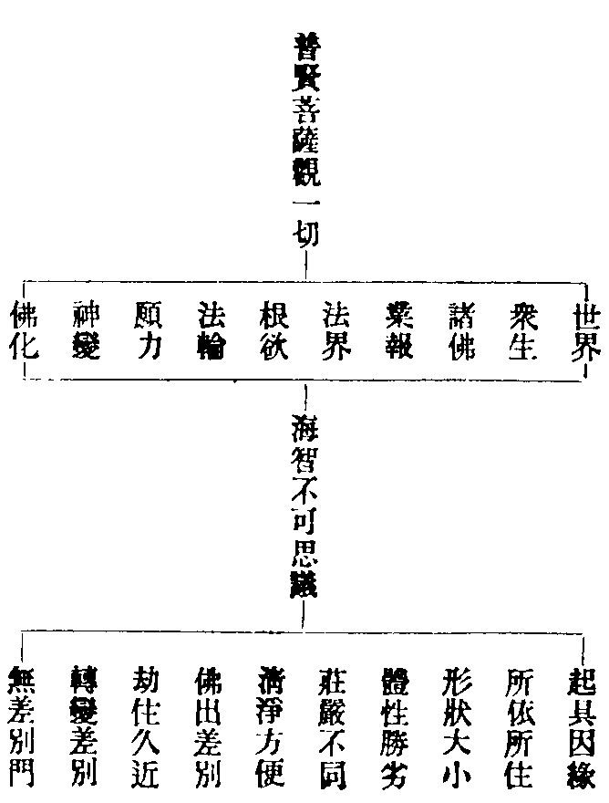
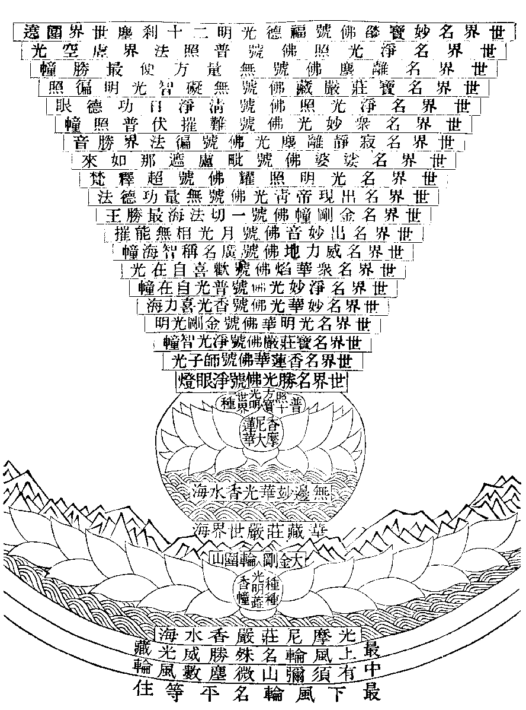
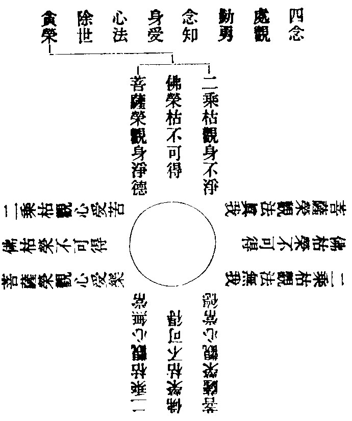
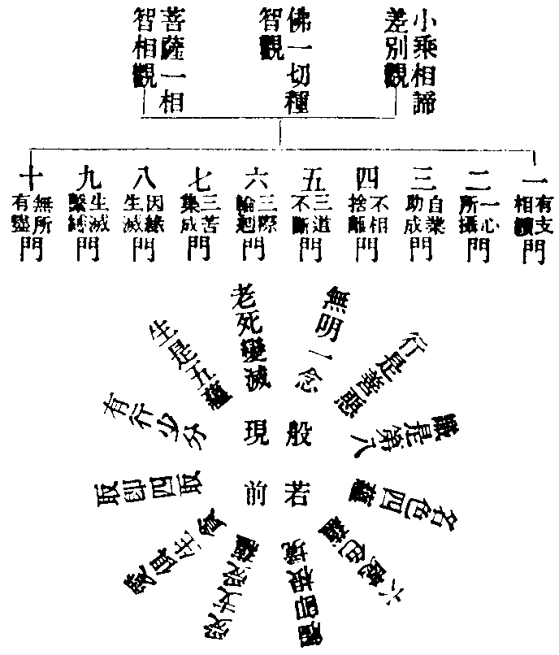
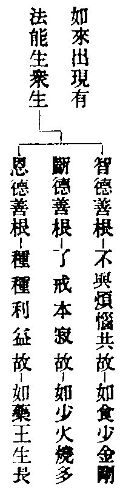

# 华严经吞海集



> **藏经**：卍新纂大日本续藏经（新纂卍续藏）　**册次** 第 8 册（X08）　**编号** X0239　**部类** 华严部　**卷次** 3 卷　**篇幅** 22,137 字

> **卷／品**：0 卷 · 2 品



---



## 目录



  - [No. 239-A 大方广佛华严经吞海集序](#no-239-a-大方广佛华严经吞海集序)

  - [No. 239-B 大方广佛华严经吞海集序](#no-239-b-大方广佛华严经吞海集序)



---



### No. 239-A 大方广佛华严经吞海集序



左朝散大夫直龙图阁知荆南军府事主



管荆湖北路安抚司公事马步军都总



管兼营田使陶恺撰



《大方广佛华严经》，具因果、行位、缘起、理事，以不思议为宗，无上乘也。以为同也，而横开百千法门，其总非同；以为异也，而会归实际理地，其别非异。即同即异，义极於融。故同中有异，鸟翔空而前后齐彰；异中有同，波生水而泯绝一致。万法各住自位，有如水火陵灭而不相容；至理不隔纤毫，或若尘芥含容而无所碍。此非器界之所能通，而思议之所可及也。然而非文字无以明义，非名句无以成文，则错综而华贯，行布而星分，此经之所以为经也。由文字、名句以求之，则法法相似，地地有差。其多也，百千万亿以为数，乃至不可为数而未脱於有数也；其大也，十方三际以为量，乃至不可为量而未离於有量也。经之为经，既托於文句，其妙不过如是而已。举世间极大不可穷尽者，则喻以海焉。所谓十海，若世界众生、诸佛业报、法界根欲、法轮愿力、神变佛化，皆生佛之极业，同名之海。而七处、九会、三十九品，悉波澜其间，无有能出者。其源无首，其流无尾，其边无旁，其下无底，则取海以为喻，是亦天下之极称欤！至求之天地之间，若形若器，能体融之义而曲当者，盖亦莫若海也。是经也，行於支那，自晋义熙始。其文浩博，其义渊微，其道宏大。志劣者怠於编秩之多，智浅者瞢於旨意之妙，器狭者骇於果德之极，诵其文已难其人，而况通其义，且践修是道欤？譬犹海中之一物，方为海所涵，讵能置海於度内耶？义熙距今几千岁，训释行於今者，独有枣柏长者论、清凉法师疏，其说益侈矣。偃台通老法师得华严三昧，虽受学於师，而取成其心。以广说之一句，而演之万言；以约说之一品，而摄以数句。万言而详味之，无一增语；数句而旁求之，无一缺义。计不待数，而人见其多；度不必量，而人识其大。法次地差，不相混滥。盖发挥在文句之表，而游戏於文句之间，卒不系於文字名句者也。取其约说传於世，凡万数千言，名之曰《吞海》。海可吞耶？众必以为诞矣。然有可吞之理者，能造海者也。通公约说，亦文句耳，奚造海之有？余所谓卒不系於文句者，学者绎其书而加思焉，当得之矣。噫！大千经卷，一尘所覆，唯智者能出之。华严法海，一嚃而不遗餘滴，唯知道者能信之。或出或纳，岂外至哉？在我𭊌吸之间耳。



------



### No. 239-B 大方广佛华严经吞海集序



讲华严楞严经唯识起信论



嗣祖比丘　道通述



伏以《华严》之为教也，朝宗众经；清凉之为疏也，贯暎前古。不有颖达，孰能发明？道通夙附真乘，穷居讲肆，论听宣益，经传妙空，退惭先哲，无裨后学。请问十年，开演三徧，屡经患难，倍觉衰迟，筑室庐山，苟延岁月。而二三学者，犹不我弃，日以是经相叩《华严》为事。因阅旧箧，得所编法义，名曰《吞海》，用贻晚俊。使品品之中，见无尽经；尘尘之内，明华藏海。於一毛端，忽然广博，岂曰小补之哉？不学而知，但闻其言，未见其人也。同心之士，母我诮焉。



No. 239  

大方广佛华严经吞海集卷上



河朔平原　道通述



一菩提场会



一世主妙严品部类区分



经中有三世间：一、智正觉世间主，能化佛；二、有情世间主，人王、天王；三、器世间主，诸类神。若能依正互融，则难思之境，俱是妙严。



意曰：世主差别相，妙严平等体。若世主之妙严，众生有佛德；若妙严之世主，佛德依众生。若世主即妙严，是法平等；若妙严即世主，则世间相常住。若具四句，则成佛德；若泯四句，为日用；若存泯无碍，生佛平等，法本如此，不劳修证。



如是。一、小乘，拣异外道经阿优。二、始教，信顺之辞。三、终教，不变曰如，随缘曰是。四、顿教，唯如为是。五、圆教，如包是徧。



我闻。一、小乘识外有声。二、始教识变，声相假我。三、终教净我，声尘即心。四、顿教无我，根尘俱尽。五、圆教一闻一切闻。



一时。一、小乘昼夜六时。二、始教时依识现。三、终教则不变随缘。四、顿教则般若现前。五、圆教则一时具一切时。



佛在。一、小乘丈六真身，二、始教千百亿化身，三、终教丈六即是常身，四、顿教丈六即是法身，五、圆教具足十身。



菩提树。一、小乘土石诸山；二、始教随机化迹；三、终教其地坚固；四、顿教一尘不立；五、圆教七处九会同一道场。



菩萨众。一、小乘不见闻，二、始教有四十二位，三、终教尽成佛，四、顿教无凡圣，五、圆教佛刹微尘数俱来集会。



经中释迦如来初成佛时，具足本有十身，於一切法成正觉。



意曰：始成正觉者，旧佛新成也。处於此座者，开悟之处，量等法界，如虗空具普徧、广容二义。量云：如来三业有法，正容常徧宗，平等无分别故因，譬如虗空於诸国土平等。随入一尘为座，则成等正觉。若一毛为座，则转大法轮。尘数菩萨围遶者，主伴互严。



经中列众，从内至外，偈赞佛德。从大自在天至普贤，海众云集。一、同生众有二十种：普贤至普光菩萨，海月光至智生菩萨。二、异生众十种：执金刚神、身众神、足行神、道场神、主城神、主地神、主山神、主林神、主药神、主稼神、主河神、主海神、主水神、主火神、主风神、主空神、主方神、主夜神、主昼神、阿修罗王、迦楼罗王、紧那罗王、摩睺罗王、夜叉王、龙王、鸠槃茶王、乾闼婆王、月天子、日天子、忉利天、夜摩天、兜率天、化乐天、他化天、大梵天、光音天、徧净天、广果天、大自在天。



经中列众，从内至外，偈赞佛德。从外至内，有十佛刹微尘数毗卢遮那佛，一一皆有六十众围遶，形色部类，各有区分，得佛解脱，平等无二。



二如来现相品说法仪式



经中佛放眉间光，右绕於佛，从足而入，有大莲华忽然出现，有胜音菩萨坐莲华上，偈赞如来，有十菩萨为伴。



意曰：实际理地主伴不立，生灭门中岂无问答？菩萨诸王作是思惟，从因至果有四十问，一部经文前后答。为断彼疑故，即於面门众齿之间放十种光明，一切菩萨蒙佛光明，诣如来所亲近供养。



三普贤三昧品非证不说



经中普贤见佛现相，承佛神力，入於如来藏身三昧，同於虗空。一一尘中有世界海诸佛，一一佛前有普贤，皆入此定。是时，十方诸佛而现其前，与普贤十种说法智，各舒右手摩普贤顶；一一尘中悉亦如是，从一三昧起时，即从一切三昧门起，得一切海云法，十方世界悉皆震动。



四世界成就品通明凡圣



经中且说世界海有十事，其众生海具十事准知。诸佛海等各有起、具、因缘、所依、所住等十事，各先长行后偈颂。一海有十事，十海有百事。



意曰：先观无尽境，便说无尽法，一切众生本来具足。







五华藏世界品别显本师



经中别明本师之所严净，状如仰安鴈口中齿，又似倒卓浮图。其中世界，各各依住，各各形状，各各体性，各各庄严，各各行列，有二十重。从此中央大莲华世界外，其次右旋，说百个二十重世界，十不可说世界种，准知尽在一尘毛中矣。







六毗卢遮那品往昔修因



经中修因广大，获果无穷。普贤说者，该因彻果故。乃往古世，有胜音劫，摩尼华枝轮大林之东，焰光大城，人王所都。有百亿城，周帀围遶。有百万亿门，一一门前，四十九宝尸罗幢。城中居人，乘空往来，心有所欲，应念而至。天城、龙城，右旋而列。华枝林中，有徧照道场一切功德山。须弥胜音佛，忽然出现，其身周普，等真法界。大威光太子，见佛光明，获十种法，颂赞佛德。从焰光城，百万亿众，乘空而往，俱来见佛。其佛为说《普集三世佛自在法经》。大威光菩萨，得一切法，悉入最初菩提心中。其佛受命，五十亿岁。彼佛灭后，有波罗蜜善眼佛，於大林中，成等正觉。大威光菩萨，即得念佛三昧，名无边海藏云。其佛为说《法界体性清净经》，闻已，获得清净智。其佛入灭，喜见王寻亦去世。大威光菩萨，受转轮王位。彼大林中，第三佛出，名最胜功德海大威光。从佛闻说《普眼光明行经》，得大福德三昧。彼大林中，复有佛出，名普闻莲华眼大威光。於此命终，生须弥山顶，为大天王，名离垢福德幢。如来为说《广大方便经》，获得普门欢喜藏三昧。



意曰：胜音劫中，有十须弥山微尘如来出兴於世，大威光菩萨一一供养，闻经得法，是因无尽。今有十不可说世界种，是果无穷。



二普光明殿会



七如来名号品身业周徧



经中妙悟皆满，二行永绝，叹佛二十一种功德。若世尊见愍我等，开示因中十问，果中三十问。世尊知诸菩萨心之所念，为现神通十首菩萨，来集普光明殿。



意曰：佛法大海，信为初首。一、小乘，但信佛一人成道。二、大乘，初教信一分半众生不成佛。三、终教，自信己性决定成佛。四、顿教，信生佛本无。五、圆教，无成无不成，一成一切成。



经中文殊言：诸佛身名不可思议，不应住於一法见佛身名。如来於此娑婆世界诸四天下，有种种名、种种身，色相、寿命、处所、众会种种不同。於此四天下，或名一切义成，或名圆满月，或名瞿昙氏，或名大沙门。於东方善护世界亦有十名，餘九世界各有十名，则其数十千名，能令众生各别知见。



意曰：佛有无尽名。森罗万像，举世立名，俱是佛名。於此住处，或名灯笼，或名卓子，或名香罏，或名翠竹，或名黄华。若能如此用心见佛，则步步释迦出世，念念弥勒下生，便见佛身名周於法界。



八四圣谛品语业该周



经中苦者三界报，集者三界因，灭者超出三界，道者戒定慧因，令知苦、断集、证灭、修道。佛之语业，随众生心，各别调伏。娑婆世界，每谛下有十名；餘九世界，四谛下各有十名。於苦谛下，或名可厌，或名逼迫，或曰不净。



意曰：一切名因逐业用变，名无得物之功、物无当名之实，但能假名生善，便是化佛语业无量。若说如来国土身语业，则风铃声、啼鸟声皆是如来说法，声无义语、说不二法，顿见本心俱离有无，便见佛之语业周於法界。



九光明觉品意业该周



经中世尊从两足轮下放光明，照此三千大千世界，有百亿阎浮提、百亿四王天乃至百亿色究竟天，其中所有悉皆明见。十方菩萨围绕，百亿文殊同时发声叹佛光明；若见放光照十方十世界，则有十百亿文殊叹佛光明；若见放光过十世界，则照十方百世界，有千百亿文殊叹佛光明；若见放光过百世界，则照十方千世界，有百万亿文殊叹佛光明；若放光过百千世界，则照百万；若放光明过百万，则照一亿；若放光明过一亿，则照十亿；若放光明过十亿，则照百亿。



意曰：光明是智用，用能随缘，大小不定，广狭临时，悉皆明见，觉悟自他。若穿针时，於针孔内，悉皆明见；若写字时，於笔端上，悉皆明见；若在一室，悉皆明见；若登高望，百里千里，悉皆明见，觉悟本心，令他知见。



十菩萨问明品智明生信



经中文殊菩萨长行问於九首，九首以偈答於文殊。



意曰：因问生明，或问中有明，智明生信，见诸法空，知心妄动，无前境界，修远离法，触目遇缘，自信己性，具有佛德，无障碍法，即得现前。



> 一心一种种差别问，觉首万法体虗显性答。  

> 二无实众生佛化问，财首离相寂灭归性答。  

> 三果报无我谁受问，宝首镜中现像一异答。  

> 四悟一说多相违问，德首一多相成无碍答。  

> 五田一果多不同问，目首心有高下报别答。  

> 六佛教有无利益问，勤首精进懈怠不同答。  

> 七受法新起烦恼问，法首不行非斥多闻答。  

> 八智正行助赞美问，智首万行皆智随心答。  

> 九道一果多不同问，贤首同中有异离见答。  

> 十九首复以佛境问，文殊生界法界无别答。



文殊智明生信，深入理观，自信己性，决定成佛。后起净行，事近旨远，念即无念，一念顿圆。



十一净行品触事净愿



意曰：有圆信者，具净行相。盖善用其心，於善、不善、无记境皆具净行，则八万四千尘劳皆净行也，世间万物皆净行也。且如见手时，当愿众生：具正信手，合掌向佛。若见足时，当愿众生：行真正道，无有休息。若闻鸟声，当愿众生：悟自闻性，不生不灭。若了味时，当愿众生：尝正法味，长养法身。若善用心，净行无间，获於胜妙功德，於一切佛法心无所碍，住去、来、今诸佛之道，当如普贤色像第一，而为众生第二导师。



经中一百四十种随缘行愿，所为在家孝事父母，出家坚持禁戒，妻子常乐，远离见施，舍於悭心，入寺诸师求请，剃发授戒，正身修定，举足下足，见闻觉知，无非广大行愿。



十二贤首品信心成德



意曰：若善用心，有胜妙功德，则事近旨远。信为三贤之首，万行之本，正明发起四弘誓愿，皆通空、假、中三观。虽见众生空，而化即佛之众生；虽见烦恼即菩提，而断即菩提之烦恼；虽见菩提不可求，无求中求矣；虽见万法离言，而学离言诸法。此四开发本有净心，自信己性，决定成佛。於眼根中入正定，於色尘中从定起者，是信心五对无碍之境：一、根境不碍一心，二、正定事定不碍理定，三、分别不碍无分别，四、入定不离出定，五、定体不碍定用。应云：根入根起，境入境起，根入意起，境入根起。方网三昧从信而入，信能必到如来地。经中喻云：世间福业尚如此，何况圆修真实法。



三忉利天宫会



十三升须弥山顶品不起而升



经中妙胜殿上敷置普光明师子座已，帝释遥见佛来，曲躬合掌：善来世尊！善来善逝！受请入殿，忽然广博量等虗空，一切阎浮提皆言佛在中，我等今见佛住於须弥顶，不起而升也。一即一切也。



十四须弥顶上偈赞品说诸法空



经中如来从两足指放光，法慧等十菩萨，各说偈赞佛，谈诸法空，见般若体，一句一偈，超情离见，开悟在人。



十五十住品直心正念真如法



经中法慧菩萨入於无量三昧，诸佛与智摩顶已，从定而起，告诸菩萨言：有十种住，则是信满住初，便成正觉。



一、发心住见佛闻法，或见剧苦而自开悟。如来十种智力：一、是处非处智；二、善恶业报智；三、诸禅三昧智；四、诸根胜劣智；五、种种解智；六、种种界智；七、种种道智；八、宿命智；九、天眼智；十、漏尽智。胜进心中应学，勤供养佛，乐住生死，心转增胜。



二、治地住，发利益十种心，应诵习多闻，虗闲寂静。



三、修行住，观一切无常，应观察众生界、世界明了法。



四、生贵住，从圣教生，应学十法，了知三世佛平等法。



五、具足方便住，护救众生，应学知众生无边无著。



六、正心住，闻赞毁三宝，心定不动，应学无相如幻。



七、不退住，三宝有无，心不退转，说一即多，多即一。



八、童真住，三业无失，随业受生，知刹动刹，供养诸佛。



九、王子住，知众生受生烦恼真谛法王善巧力持无畏。



十、灌顶住，震动世界智、三世佛法智、增长一切智。



意曰：应无所住而生其心，则念念契如为住，住有无量。开发本有菩提心时，有三种相，以三贤表之。今是下贤直心，有所闻法，即自开悟，不由他教。



尔时，佛神力故，六种十八相震动，雨天妙华极妙音声。



意曰：震即是声，动乃是色。从小至大，有六种相。所以震兼吼击，动兼起涌。六种相者，摇飏不安，动也；自下升高，起也；忽然腾跃，涌也；隐隐出声，震也；雄声郁遏，吼也；𫐒碣作声，击也。一切众生，见不超色，听不越声，迷昧本心，流转生死。《华严经》三天偈赞，句句之中，透过色声。即今见闻，一句一偈，为金刚种，能破於十法界圣凡色声，岂止铁城也。诸经震动，於此明矣。人皆罔测，更冀详之。



十六梵行品无相修因



意曰：净行至此，成熟正念天子问菩萨：依如来教染衣出家，云何而得梵行清净法慧？菩萨答：应以十法为缘，谓身语意业、佛法僧戒。如是观已，於身无所取、於修无所著、於法无所住，此世不移动、彼世不改更，梵行不可得，住无相法方便自在。应修十种智力，一一力中有无量义悉应諮问，於诸佛法不生二解，一切诸法疾得现前。初发心时即得成佛，盖为知一切法即心自性，成就慧身不由他悟。



十七初发心功德品校量显胜



经中天帝释白法慧言：开发菩提心，有几何功德？答：此义甚深，不可以世间乐具，及四禅乐、四空乐、四果乐可比。何以故？开发本有成佛心时，令如来种不断故，充满一切世界故，於一切法悉无餘故。



十八明法品照了真俗



意曰：开发心时，具有无量功德。精进菩萨问法慧言：云何修习佛法？答：应明了十种不放逸法、十种佛欢喜法、十种速入诸地法、十种所行清净法、十无尽藏法。



四夜摩天宫会



十九升夜摩天宫品不动而徧



经中於宝胜殿内，化作莲华师子座，有百万亿华奁、香箧、鬘盖、幢幡，周徧十方，供养於佛。



二十夜摩天宫偈赞品唯心所现



意曰：菩提心中，第二深心相，乐修诸善行。十林菩萨说：了知一切法，自性无所有。



二十一十行品深心乐修行



经中功德林菩萨，承佛神力，入善思惟三昧。十方佛加与智摩顶已，从定而起，告诸菩萨言：行不可思议与法界等有十种。



一、欢喜行，内外慧施，见来乞者，心生欢喜，我得善利。



一饶益行，宁舍身命护持禁戒，未曾一念心生欲想。



三、无违逆行，谦下恭敬，以阿僧祇器仗逼害，但生慈心。



四、无屈挠行，受苦无悔，心自庆幸，令一切众生安乐。



五、离痴乱行，坚固不动，入胎、住胎、遇魔境界，心不动。



六、善现行，三业清净，方便出生，暂同止住，悉不虗弃。



七、无著行、佛会闻法心生喜，具大方便而无所著。



八、难得行、了众生空，不住此岸、彼岸，中流无休息。



九、善法行，为世间作清凉地，以无碍辩才断一切疑。



十、真实行，如说能行作，不请友亲近者，悉令开悟。



二十二十藏品称性修行



意曰：蕴集十行，成此十藏，坚固生长，不可破坏。其有十种：一、信藏，则契理；二、惭藏，则崇重贤善；三、愧藏，则轻拒暴恶；四、戒藏，则防恶发善；五、念藏，则明记不忘；六、闻藏，则无所不知；七、施藏，则舍而不恡；八、慧藏，则拣择邪正；九、持藏，则住持不忘；十、辩藏，则说法利他。



大方广佛华严经吞海集卷上



大方广佛华严经吞海集卷中



河朔平原　道通述



五兜率天宫会



二十三升兜率天宫品一徧一切



经中有百万亿庄严，皆是回向心广大所致也。建百万亿幢，悬百万亿幡，垂百万亿带，然百万亿香，布百万亿鬘，持百万亿扇，执百万亿拂。有百万亿三贤菩萨、二十八天、八部众等，皆从回向起，俱来围遶。佛放膝轮光，徧照十方界，十幢菩萨俱来云集一切宝庄严殿。



二十四兜率天宫偈赞品



意曰：诸法无自性，即见般若体。



二十五十回向品悲心救护苦众生



意曰：妄亡已灭，则与万类而同回向三处：一真如实际是所证，二无上菩提是所求，三法界含识是所度。能回之心，所回善行。



经中金刚幢入智光三昧，受加与智，起定说法：一、救护众生相，十波罗蜜慈悲，虽救众生，离众生相。



二、不坏回向，一切处得不坏信，积善根回向众生。



三等一切佛回向，以世、出世乐回向众生，令入佛慧。



四、至一切处回向，所修一毫之善，同於实际供养。五、无尽功德回向，眼不见不净世界，不见异相众生。



六、坚固一切善根为大国王，以内外财六十门施。七、顺众生回向小善、广善，尽未来际回向一切众生。



八、真如相回向，真如有一百门，正念明了，生胜善根。



九、无著无缚回向，於一切善根，心生尊重，修普贤行。



十、等法界回向，广行法施，圆满梵行，见闻等於法界。说此回向已，各百万亿佛刹微尘世界六种震动。



六他化自在天宫会



二十六十地品寄相显实



意曰：地体亡言，将旨就诠，寄十地修行相，显不可思议地体，一念事行，三心齐具，可为玄矣。十地菩萨云集摩尼宝藏殿，将三贤作加行，无升天偈赞，用等觉为胜进。



经中金刚藏菩萨入大智慧光明三昧者，欲说不思议诸佛法光明，即十地法相。天亲菩萨造《十地论》，解《十地经》云：若金刚即藏名坚，量云：十地信、悲、慈、舍，有法不可破坏宗，坚实生长故因，由如树心。若金刚之藏名坚，量云：十地善行，有法不可破坏宗，坚实生长故因由，如胎孕在藏。意曰：经中说字是名、句、文，因十地名、句而起正解，因解而起正行，因行而入地智。天亲论主剏造六相义，令入智地为总相，餘九为别相。乃云：揽别为总，分总为别，同带总名，功用各异，共成一缘，各住自位。诸法常寂灭，坏也；世界常安立，成也。正同常异，正总常别，无碍之义，则可见矣。经中十方诸佛与智增辩，摩顶增威，从三昧起，告诸菩萨言：大愿决定，大善决定，无杂决定，不可见决定，广大决定，究竟决定。十地相也。若智光明，是最上道，随证智也。



意曰：十地，带数释也。若地之极喜，喜是加行智；若地即极喜，是根本智；若极喜之地，后得智；若极喜即地，泯同真界。餘九地各有四释准知。良由一切众生本有智光明地法，则金刚藏分别说也。於智光明中说十地名已，不复分别。



一、解脱怪默腾疑请法深难受止；二、解脱月叹众生闻请不堪有损止；三、解脱月如来护念请字母智根本；四、大众同声请；五、佛光说偈请。金刚藏云：此处难宣示，我今说少分。论中科为九分：一、三昧分入定，二、加分与智，三、起分事讫，四、本分略名，五、请分勤重，六、说分示相，七、地影像分，四、河十山大海宝珠，八、利益分见闻为种，九、重颂分。



意曰：十地中名句文有法，字字契如宗，难说难示故因，如空中鸟迹。谓空处之迹，迹处之空，互相属著，不相离性，以为地体。取空太宽，取迹太狭，言言见谛，是智行，非虑境也。



十地通行十行：一、信，二、悲，三、慈，四、舍，五、知诸经论，六、善解世法，七、惭愧，八、庄严，九、供养诸佛，十、如说修行。



一、极喜地，断异生性障，证徧行真如，於住地心中发起供养诸佛等十种大愿，见诸众生心堕邪见，慈心修舍，於内外财无所恡惜，推求后地相及得果，如鍊真金数数入火，多作阎浮提王，能动百佛世界。



二、离垢地十种方便，心入心中断邪行障，证最胜真如，於住心中修起十种善业：一、性不杀生；二、不偷盗；三、不邪婬；四、不妄语；五、不两舌；六、不恶口；七、不绮语；八、不悭恡；九、不瞋恚；十、不谤三宝。十善无二用心不同：一、下三品，修四大洲受生，有总别报胜劣，苦乐间起；二、中三品，修从四王至他化，欲心微薄，苦少乐多；三、上三品，修色界至有顶，舍念清净，无有欲想；四、上上品，修断分别是预流果，断俱生后三果；五、上胜品，修缘觉果，百劫鍊根入见不出，证无学果；六、上极品，修菩萨道，前伏二障俱生修道，渐断七不善业道故。意杀生等永断其因，因有三品：上品地狱因；中品畜生因；下品饿鬼因。后得为人有二种报等流：一者为短命；二者多病。故意偷盗：一者贫穷；二者共财不得用。故意邪婬：一妻不贞良；二者不得随意眷属。故意妄语：一者为他所诳；二者被人诽谤。故意两舌：一者眷属乖离；二者亲族弊恶。故意绮语：一者语不明了；二者言无人受。故意恶口：一者言多争讼；二者常闻恶声。故意悭恡：一者心不知足；二者多欲无厌。故意嗔怒：一者为他所害；二者求其长短。故意诽谤：一者生邪见家；二者心怀谄曲。永断其因不受其果。



三、发光地，起十种深心为加行，於入心中断暗钝障，证胜流真如；於住心中如说修行，乃得佛法。虽修世行，但随顺法故行，而无乐著。修起四禅、八地定，厌下地为苦麤障，忻上地为净妙利。用七种作意、四无间道，伏下欲界九品俱生惑迷事。用初禅、未至定为加行，入初禅根本定。四禅共有十八禅支，初禅、三禅有五支，二禅、四禅有四支。其定光明如鍊金法，出火秤两不减。此地多作忉利天王。



三界九地者：



△一、五趣杂居地。有四洲、六欲天，五受间起忧苦极多，喜乐舍少，嗔欲心俱，意有忧受，俱无轻安，乐报若修则有，故名散地。



△二、离生喜乐地三天：一、大梵，二、梵辅，三、梵众。用寻伺治欲界忧受，有五：寻、伺、喜、乐、一心。



△三、喜勇浮动地三：一、光；二、少光；三、无量光。用内净一心治去寻伺，有四：内净、喜、乐、一心。



△四、离喜妙乐地三：一、净，二、少净，三、徧净。治前喜受，开内净为舍，念正知识，身受乐一心。



△五、舍念清净地三：一、无云，二、福生，三、广果。凡圣杂居，上有五天，唯不还果人居：一、无烦，二、无热，三、善现，四、善见，五、色。究竟舍念、行舍、一心。



△六、空无边地，二乘及邪见人，居空想，治色想，唯有舍受、一心。



△七、识无边地，作无边想治於空，唯有舍受及一心。



△八、无所有地。四蕴与识皆尽治之，舍受、一心。



△九非非想地，无麤有细，八万劫报尽还来，舍受、一心。



四、焰慧地，观察众生界、法界为加行心，於入心中断烦恼障，证无摄受真如，住心中以大智慧观三十七品助道法。







佛於双林树间入般涅槃者，四枯四荣皆除，世间贪忧八倒俱无，若能观身净与不净俱不可得，即见佛不曾入般涅槃，常住世间，深观念处，即座道场，众生根异，更说餘法，於四正勤、四神足、五根、五力、七觉、八圣一一开解，众生於第六识中俱生二见，到此地中永不现行，更以大慈心知恩报恩，如真金作庄严具，多作须夜摩天王。



五难胜地，起十种平等心为加行，於入心中断下乘般涅槃障，证类无别真如，知真谛、俗谛无差别智，愍诸众生不能厌离，曲以五明工巧利益世间：一、内明知因识果，二、因明破邪立正，三、医方疗病，四、工巧书数，五、声明字错谬。如上妙真金，用砗磲磨莹，作知足天王。



六现前地，观十种平等法，而为加行心，於入心中断麤相现行障，证无染净真如，於住心中，以大悲为首，大悲增上，大悲满足，观三界十二因缘，无有自性，从无明支至老死支，皆是智光明，则身语意善不善行动用之中，皆是般若现前也。



经中金刚藏如星罗十门说十二支，天亲论主以月满三观释之。







若依《地论》相谛差别观中有支相续门，解经成答相，世间受生皆由著我者成也，不正思惟起於妄行答也，於第一义谛不了名无明相也。二一心所摄门，三界所有唯是一心归本也，如来於此一心分别十二有支流末也。若依一切智相观科经不同，一切种智观科经不同，文势多端不可具述。



意曰：能引无明行，所引识等五，能生爱取有，所生生老死，识、名色、六处、触、受种子是。前前世中多念薰下，忽然为无明行一念招聚，随业强者先润爱取有，润时则次第於一生总报中，生起此十支因二支果也。若三世说者，过去二支因，现在五支果，现在造爱取有因，本来世有生老死果，虽然因果无差，於此般若现前。



名色，支义也。贯起十二支，收一百法，知五蕴之多少，明缘性之宽狭。



△一、支性俱杂收九十三法。色蕴为色支，四蕴为名，除六无为、灭尽定。



△二、支杂性不杂收二十八法。支杂性，处、触、受，然是无记，不杂善恶性。想全三少分者，想是任运报生无记。色少分者，五根、五尘。行少分者，别境、五作意、睡眠。识少分者，前七识并意处、触、受。



△三支性俱不杂，收二十法。想蕴全色，少分五尘。行少分收别境五作意。睡眠识少分前七识。餘十一支，义理恐繁不述。此地善根，如真金用毗琉璃宝磨莹，多作善化天王。



七、远行地，起十种加行心，空中有方便慧，有中起殊胜行。虽善修空、无相、无愿，而慈悲不舍度生。於入心中，断微细现行障，证法无别真如。於住心中，以大悲智修起一切菩提分法。虽念念住无相中，少有功用，如转轮王游四天下。若是八地报得行，任运成就，如大梵天王游千世界，不假功用。从初地已来，但以愿力超过小乘；今七地中，以自力超过小乘，如王太子艺业成就。能念念入灭定，亦念念起，如以真金用妙宝间错，多作自在天王。



八、不动地，善修清净道，离心意识，得无生法忍为加行心，於住心中断无相中作加行障，证不增减真如相用，烦恼不能动，为深行菩萨，世出世间心念不生。诸佛世尊劝请七事汝未曾得，勿复放舍於此心门。是时菩萨一念所生智业，从初地至七地，用阿僧祇功德不及一分。何以故？先以一身起行修行，今此以无量身修行，以善巧智观一切境，於诸趣中示同其形，普现色身三昧而为说法，远离身想分别，以三世间而为十身。一切众生本来共有一身，若具九则十身有百也。且如一牛具有十身：一、还债是业报身，二、水艸不阙是众生身，三、皮毛筋角是国土身，四、从高而下是虗空身，五、步步踏实是智身，六、力困而卧是声闻身，七、见黄叶是缘觉身，八、举意利他是菩萨身，九、忽然亡已是法身，十一、具前九是如来身。若说修成，如来身上自具十身，谓菩提、愿、化力、庄严、威势、意生、福、法、智。此地菩萨成就佛身业自在，有金刚力士常随侍卫，如真金作大宝冠，置在阎浮提圣王顶上，多作大梵天王。



九、善慧地，以无量智观察境界为加行心，於入心中断利他门中不欲行障，证智自在真如，於住心中观众生稠林行皆如实知，以四十种辩才说三乘法教化众生。



意曰：在心为智，发言为辩。於一毛尘具四十种辩才，则前为所是法，后是能为义。词则训释不谬，乐说则听者开解。



△一、自相有二：总法、别义。



△二、同相有二：性、法相义。



△三、行相有二：现在法，过去义。



△四、说相有二略：说法、解义。



△五、智相有二：现量法、比知义。



△六、真谛法，俗谛义。



△七权三法一乘义。



△八教道法证道义。



△九、真身法应身义。



△十、住持智法行门义。



△佛说一百法皆具，万像皆具，不学而知，但闻其言，未见人哉。此地菩萨得十种总持，作大法师，处於法座，於一音中现种种音，令诸众会皆得解了，情无情物皆演妙音，成就如来语业自在，如真金为大宝冠，在转轮圣王顶上，为二千世界主。



十法云地，以无量智慧观察觉了，入受职位为加行心。於入心中得离垢三昧，断於法中未得自在障，证业自在真如。於住地心受胜职位，三昧现在前。时大莲华忽然出现，量等百亿世界。菩萨座此华时，大小相称，身诸毛孔普放光明。照法界已，从足下入，十方菩萨即知成佛。十方诸佛放眉间光入此菩萨顶，名曰受职，成就佛意业自在，具上上微细智，能安受摄持十方诸佛大法明、大法照，於一念顷周徧十方，示成正觉。解脱言：若菩萨神力能如是者，佛复云何？是时金刚藏菩萨入佛国土体性三昧，其身量等虗空。时诸大众见菩提树及一会菩萨俱在金刚藏身中，得未曾有。金刚藏言：菩萨神通如一块土，如来神通似大地土，不可云喻。如上妙真金以大宝庄严，置在大自在天王顶上，多作摩醯首罗天王。



△八、地影像分。地中行成智性，是所喻法。池、山、海、珠，是能喻依。依上之义，是影像也。是地之影像，以见边之喻，似地中教证也。池喻所修行愿，山喻修成功德，海喻无漏智德，珠喻转尽性德。池喻始则非一，终则非异。山喻能依非一，所依非异。上皆无差之差。海喻十德不同，德无别物，差即无差。珠喻唯一智性，前后增明，无差不碍差。池是圆家渐，山是圆中渐，珠喻渐圆，海喻圆圆。天台以《华严》为渐圆，位位成佛。以《法华经》为圆圆。上是法圆，不说地位；下机圆，普被声闻。华严以《法华经》为渐圆，会三乘归一乘大海；《华严》本法，因该果海为上圆，果彻因源为下圆。



一、愿、行、定、悲有法，不可破坏宗，无滞碍故因，如池流四河入海。



二、十行随地增有法，本无胜劣宗，差别得名故因，如大海十山。



三、十地无漏智有法，广大无边宗，称性修故因，如大海十德。



四十地智性有法，不生不灭宗，全真性故因，如宝珠十德。



七重会普光明殿



佛自入刹那际三昧者，无际之际信心，最初之际不见，刹那为短、多劫为长，诸法空故二行永绝，住於佛住得佛平等则无障处。普眼问者，欲见普法故，初则闻名不见、推求不见、观察不见、静座不见，后如来教起见方者，若舍境别求则未识普法真体，若见一法入於一切名曰普，一切入一名曰贤，乃真见也。



二十七十定品大用深广



普眼见普贤在如来前，告普眼言：有十大三昧。



一、普光明智三昧，用依於体。



二、妙光明智三昧，徧照身心。



三、往佛国土三昧，神通如意。



四，清净深心三昧，供佛之行。



五，过去庄严藏三昧，智之境。



六、未来藏三昧，如实了知。



七，现在庄严三昧，诸佛世界。



八、三世众生三昧，入出自在。



九、法界三昧，十八界。



十、无碍轮三昧，佛二十一功德。



二十八十通品大用难思



一、他心之智通，因中则知自心，知他人心皆变影像，不如实见，唯佛果位能徧知也，正见他心，常了自心。若佛智外别有众生心，则失具分唯识，只名半头唯识，他心本质即是自心。



二、天眼之智通，见六趣果报。



三、宿住之智通，得九世眼，如现在。



四、未来之智通，见因知果。



五、天耳之智通，远细皆闻。



六、无作即智通，大用度生。



七、言音之智通，众生之言音。



八、色身之智通，三说：一云佛无色，二云有色，三云若悲智双运无色。现色有四：一实色凡夫，二幻色初教，三性色终教，四妙色圆教。一色即一切色，经中说有一百三种，据实无尽。



九、真俗之智通，相待故空。性则非异，相则非不异。



十、灭尽之智通，虽见五蕴寂灭，常化寂灭之众生。



二十九十忍品智慧深玄



意曰：前二品业用广大，此品智慧深玄。忍体即智，前三忍法说，后七忍喻明。



一、音声忍，智解於教。



二、顺忍，止观起行。土二加行。



三、无生忍，是根本，从初地立。



四、如幻忍中，喻有为、无为法从因缘生，皆是所喻。喻有五重：一、巾喻真性，二、术喻业思，三、幻相喻报，四、生灭喻依他即圆成，五、愚小为有法。土五各有二义，以成四句：一、所依性有相无，俱存俱夺；二、业上用有体无，俱存俱夺；三、报上相有实无，俱存俱泯；四、幻报生即是死，俱存俱泯；五、愚小上情有理无，俱存泯。今令知术是起因，悟像果无实成；相即是性，遣愚小为有，归本来真性。量云：一切有为、无为法有法，非实有体宗，从因缘生因，同喻如幻事。



五、如焰忍：一、空地，喻如来藏；二、阳气，如无明；三、空与气合，心上现报；四、水即是无；五、凡小为有。一切世间有法，非实有体，言说显示如阳焰。



六、如梦忍：一、悟心如本识；二、眠如无明；三、梦如缘起法；四、梦非有似有；五、令梦者为实。一切世间有法，非实有体，想所现故，如梦所见。



七、如响忍：一、谷喻如来藏，二、声如机感，三、响应佛说法，四、有而非实，五、取著为有。量云：如来音声有法，定非实有宗，从缘感显故因，如谷响。



八、如影忍：一、镜喻真心，二、面如思业，三、影似所起报果，四、正有常无，五、当情为有。量云：业所招果有法，定非实有宗，从缘似有故因，如镜中现像。



九、如化忍：一、空喻真性因；二、悲心化者缘；三、无而忽有；四、用有实无；五、著相为有。菩萨变化有法，非实能度宗，似有度用化迹故因，如空中变化事。



十、如空忍。此空义不开五法者，为与无为双遣也。量云：世出世间有法，对待不实故宗，远有近无故因，如太虗空。



三十阿僧祇品尽一切数



意曰：等觉行德难思，经有一百二十四数，何故唯标僧祇之名？答：僧祇是十大数之初首。〈寿量品〉尽一切时，竖穷三际。〈住处品〉徧一切处，横徧十方。此品明尽一切数，校量等觉菩萨一念智德深玄，不究边际。何故心王问答，数不离心？佛自说者，唯佛方知。此有三等数：如此方黄帝算法，是下等数，十十倍之；二、中等数，则百百倍之，经云一百洛叉为一俱胝；三、上等数，则倍倍倍之，经云俱胝个俱胝为一阿庾多。以后用上等数之不可说个不可说，乃至一尘有十万个不可说。用此数，普贤一智德不尽，况一尘内有多普贤？



三十一如来寿量品竖穷三际



意曰：如来法身岂有寿也？答：应机而说有十种相，将前一劫为后一日一夜，至最后寿量等於刹海。其实如来在长常短、在短常长，存泯无碍，方为圆宗寿量穷於三际。



三十二诸菩萨住处品横徧十方



意曰：若心有住，则为非住，据实不徧住一方。经说住处，使后人标心有归。问：应非圆教所明。答：能住菩萨毛含刹海，住处尘容大千，何故心王说？答：心随智住。问：智依何住？答：前十依八方山海，后十二城邑杂居，无在不在，曲尽物机。



三十三佛不思议法品一念普现



意曰：是修生三贤十圣因家果也。法界体大，青莲华菩萨说者，於一念中示现一切佛事，体不可思议。问：经中何故重请？答：为说果满，何不言请？答：果海亡言，不可思议。然教说不同，或云佛有四十种不共功德，通权小说；或说五法摄大觉性，通权实说；或云一味实德，约顿教说；或云佛有无尽德，是此所明。佛德有二：一、修生信等；二者、本有智德。使八相该於法界，丈六徧尽十方，岂可思议也？



大方广佛华严经吞海集卷中



大方广佛华严经吞海集卷下



河朔平原　道通述



三十四如来十有相海品深广无涯



经中普贤说如来化身顶上有三十二大人相，兼餘身分共有九十七相。每相有五事：一、依处为如来化身，顶上有大人相；二、名字光明云，一化成家也；三、体性庄严不同；四、业用常放光明；五、利益生善灭恶。



意曰：餘九身上大人相岂可穷也？故经有如海之言，乃相大也。且菩提身上有大人相名布施云，用无贪三业为体，常放大慈光明，令诸众生生善灭恶，则八万四千波罗蜜皆是大人相。若如来国土身有大人相名笔云，用羊兔毛为体，常放黑摩尼光明，令诸众生书写善事。复有大人相名宝针云，用钢铁庄严，常放利焰光明，令诸众生补破遮寒。如此则世间所有皆是如来大人相也。



三十五随好光明功德品三重十地



经说三重顿圆十地者，是转益用大也，佛亲说者难信故。如来为菩萨时，足下有四十种光明，於圆满王好中放光照下地狱，有遇斯光者死生忉利天，闻天鼓音忏悔已，即时位登十地，先薰一乘种子也，此是正益。化作一万香云供养菩萨，若有众生身蒙香者，亦得灭除一切烦恼登於十地，一重转益也。化作一万盖云供养菩萨，若有众生见其盖者，种一清净金刚转轮王善根亦登十地，是第二重转益也。轮王顶上放大光明，若有众生遇斯光者，亦位登十地，第三转益也。难处不为难，闻薰种子熟，即得超十地。



三十六普贤行品因该果海



意曰：瞋心障大慈，慈用无瞋为体。若起一念瞋心，则扫尽菩萨行，一障一切障。所以经云：我不见一法为大过失。如此菩萨向彼菩萨起一念瞋心，则有百万障门。若一念瞋心息，则具一切菩萨行，一断一切断，为普贤行。



三十七如来出现品果彻因源



意曰：出现本有法，一切众生法身如理出现，报身障尽出现，化身随机出现，何故不云众生言如来出现？答：非唯佛也。如体不变，随缘名来，来即三身、十身出现之法，三业化用出现之法，众生省悟，即新成旧。佛如镕金成像，是不一义；新佛旧成，是不异义。如破模出像，使应即真，而真即应。吾今此身即是常身、法身，乃至艸木皆平等也。



一、出现因缘，悲智为因，众生为缘。有十喻，明法多因多缘，如大千兴造；说法应机，如大云降雨；随机便见，如云雨无从；教行不则，如大千雨滴；生善灭恶，如成劫大雨；大悲一味，如雨资百艸；先胜后劣，如成立世界；无有分别，如风轮建立；无碍慧身，如山林依地；饶益众生，如水陆空行。二、身相出现，应於一切色非色处见於如来。有十喻，明法身徧五无量界，如空徧色非色处；身无分别，如太虗空；光明照耀，如破暗作明；普照一切，如日出照山；无不利益，如日出分昼夜；四种奇特，如静月轮；无有差别，如大梵王；绝於思虑，如医王延寿；作大佛事，如摩尼珠；见者生喜，如如意宝。



三、口现语业。若以用从体，则不坏屈曲等於法界；若以体从用，则一一音含於法界。若用即是体，妙音常寂；若体即是用，则如长风随寂。如斯妙音非心识境，故以喻明：声体无我，如劫尽唱声；随缘现起，如山谷声；音无断绝，如天鼓开觉；闻者差别，如天女音；应时不失，如梵王声；无有邪曲，如一味水；普随心乐，如降雨资荣；无有变易，如渐成熟；难以情思，如龙王降雨；普徧一切，如雷电风雨。



四、意业出现，如来心意识俱不可得，遮诠显胜也。但以智无量，故知如来心，表诠显胜也。故以喻明十智：无依成事，如太虗空；不增不减，如法界性；用广体密，如四宝性；增益众生，如大海潜流；灭惑成德，如珠消海水；依持无碍，如空含受；穷劫利乐，如大药王树；知无不尽，如劫坏火烧；留惑润生，如劫风持坏；佛性果智，如大经潜尘妄覆真，小含大、一具多。众生本有果智即佛果智，何故作众生？答：妄想执著而不证得，智眼未开，复何怪哉？



五、境界出现，正明分齐境，兼明所缘境。十法界境界，具如来境界，乃至涅槃、真如无境界，皆是如来境界。所缘之境，如降雨无从；分齐之境，如大海无穷。



六、行出现，同如绝相。无碍行。金翅取龙，日月无私。



七、菩提出现，云何名成正觉？答：正拣小乘，成拣菩萨。问：以何法为体？答：二智二断为体。问：有几种菩提？答：或二或三，万像皆具十身。



寂照为体，如净日轮。印现万机，如大海水。性相甚深，离言论平等。三轮收万像，因果交彻。一成一切成有二：一、生之本佛与佛之本佛无异，故说一成一切成也；二、生佛是染净相，融同真界，故说一成一切成也。体离亏盈，如太虗空。相无增减，如化现无形。用该动寂，即一现多。同於法界，毛尘包徧。普徧诸心，众生有佛。果智不断，则生佛非一。不离，则生佛非异，则正不异时常不一，若生若佛，求不可得。



八、转法轮出现，有五：一、八正道为轮自性，二、闻、思、修为轮因，三、五蕴为助伴，四、四谛作境界，五、菩提、涅槃为轮果。今经有十：一、能转心证法不生，二、所转体即三轮寂，三、得果离断常，四、教不可说，五、本来清净，六、触言皆转，七、即用而寂，八、即一而多，九、横竖无碍，十、深广无涯。能令三界所有声，皆是如来说法音。



九、涅槃出现，有三：一、性入清净涅槃，二、真入圆寂涅槃，三、示入方便涅槃。皆以摩诃般若、解脱、法身三法为体，不纵不横，不竝不别，如天之目，如世之伊。有十种相：一、体性真常，与万法同；二、德用圆备，令应即真；三、出没常湛，应迹无方；四、亏盈不迁，法身常然；五、示灭妙存，处有不有；六、随世生灭，长短不定；七、有无互现，随机起灭；八、大用无涯，分布舍利；九、体离二边，非实非虗；十、结归无住，悲智双运。



十、见闻亲近能生众生三德善根。量云：







后明不信益者，如狂病人骂药，药入口中，亦得病去。今语远益，如不轻菩萨，谤尚远益，况解行在身？此经信与不信，俱得成佛，有何难哉？妄情未尽，不契本法，疑念消除，始知从来出现。今令外亡言象、内绝思求，则庶几於出现之旨。今能信者，宿因薰种，若更不信，当来岂闻？然此一品，文法玄奥，能顿能圆，究诸佛本，罄诸法源，根本法轮，更处其心，玄中玄也。



八三会普光明殿



三十八离世间品悲智无碍行



意曰：世即虗伪器及有情，或云分段、变易。离有四种：一、随是大悲，拣於小乘自利；二、离是大智，拣於凡夫染著；三、菩萨悲无不智，世无不离，智无不悲，离无不世；四、如来则境上世离两亡，心上则悲智双绝，能全随而常离。事离则不即世间，性离则即是世间。今事性二利为宗，顿成圆行为趣。普慧并问二百问，普贤并答二千答者，表位虗行实也。



九逝多园林会



三十九入法界品流通无尽经



意曰：法有五，谓有为、无为、俱存、俱泯、无障碍。界为性义、因义。入亦有五，信入有为法界、解入无为法界、修行入俱存、证入俱泯、圆入无障碍。



本会顿入法界，末会渐入法界。顿中有渐，本中有末。



经云：不离逝多林如来座前，化现种种身云，徧往一切村营城邑，以种种言音说四十二解脱法门。诸大声闻身厕祇园，何不见闻广大佛德，不见润益甚深德，如鬼见脓河，不见高显广大德，如梦游天宫。不见幽道难见德，如愚对雪山。不见秘藏难知德，如隐伏藏。不见迥绝难测德，如盲不见宝。不见智照难量德，如净眼明见。不见周徧难思德，如比丘入定。不见光显超世德，如妙药翳形。不见微妙难怀德，如二天随人。不见广大境界德，如灭定不行。



意曰：声闻劣而不见闻，菩萨胜而能顿证，力用交彻，胜劣互收，成大缘起，方是深玄。无差之差，则有三乘五性，差即无差，平等成佛。



末会有三：一、文殊从善住楼出，一切部类俱随智转。舍利弗等六千比丘随逐文殊，如象王回观。诸比丘叹文殊德，六千道成，言下心无疲厌，成就佛法，得无碍眼，入大法海，於文殊足下成道。



二、经历人间，至福城东，说《普照法界经》。一万诸龙发菩提心，三乘人会权归实。



三、善财会文殊，为说诸法空，善财开发本有菩提心，寂然常住。依此参善知识，令普贤行速得圆满。有十种心，发足南行，顺智光明。



一、德云比丘，住胜乐国，解行发心，踏著妙峰山顶，证佛二身行也，诸佛随念而现解也。



二、海云比丘，住海门国，净治心地，观於业海、心海、法海、十二支普眼法，离见闻觉知。



三、善住比丘，在楞伽道修行，住於法性空中，往来经行，诸天作礼，恭敬围遶。



四、弥伽居士，住达里国，从圣教生，说轮字法，妙音无碍，明利钝根，说二乘法。



五，解脱长者，住聚落中，以方便力，八相成道，现一切刹，自心如水，诸佛如影，一念具足。



六、海幢比丘，住阎浮提，正心入定，离出入息，从身出生十四类，彼此如梦，在法性中现。



七、休舍优婆夷，住海潮处，不退大心，众宝庄严，离忧安隐，演不可说方便门。



八、毗目瞿沙仙人，住那罗国，童真三业，执善财手，见十佛刹，放善财手，还住自位不动。



九、胜热婆罗门，住伊沙那，为法王子。逆行如火聚，刀山似万行，善财投身下，得善住三昧。



十、慈行童女，住师子城法水灌顶庄严宫殿，皆见法界诸佛，令我各异门入。



一、善见比丘，往三眼国，具三种施，常生欢喜，圆光一寻，一念之中悉见诸佛。



二、自在童子，在河渚中，广行饶益，持三聚戒，修学算数，悟入神通，智慧光明。



三、具足优婆夷，在海住城，心无违逆，身无缨络，唯一小器，随众生欲，饮食充满八万眷属。



四、明智居士，住大兴城，心无屈挠，仰视虗空随意出生，无量众生悉皆如意，仰视真精进。



五、宝髻长者，住师子城，心无痴乱，将善财入禅定宅，有十层八门，烧一元香，永离贫穷。



六、普眼长者，住藤根国，善现正位，方便出生合和一切香，唯用智波罗蜜普见一切佛。



七、无厌足王，住多罗城，身行无著，见瞋害行、逆行方便，一切众生皆如幻化，不恼一蚊一蚁。



八、大光王，住妙光城，以难得行建大慈幢，山川艸木悉回向，曲躬於王，愿力成就。



九、不动优婆夷，在安住国，用善法行供养修臂佛，不生念欲之心，求法无厌。



十、徧行外道，住都萨罗，行真实行，化诸异见，示同其形，说一切处菩萨行门。



一、鬻香长者，住广大国，救护众生，离众生相，别知一切香出处功能，有其十种。



二、婆施罗船师，不坏善根，将诸商人入佛法海，行安隐道，珍宝充足，还阎浮提。



三、无上胜，在可乐城，等一切佛理断事务，令舍非法，顺行善法，忍辱柔和。



四、师子频呻比丘尼，在迦陵林，以大精进，至一一处，徧坐宝树，众会不同，所说各异。



五、婆须蜜女，住险难国，无尽功德，在市鄽北，离贪欲际，众生见我，随乐皆现。



六、鞞瑟胝罗居士，在善度城，善根坚固，开栴檀佛塔，见三世诸佛，不曾入般涅槃。



七、观自在菩萨，随顺众生大悲行门，常在一切如来所，普现一切众生前。



八、正趣菩萨，从法性空中来，同如之行，有一百种，一念不移，普至十方，供佛闻法。



九、大天神，在堕罗城，以无著无缚力，舒四无碍手，取四大海法水，自洗其心，能净他心。



十、安住地神，住摩竭国，用等法界善根足，按转心地，诸宝涌出，不可破坏，自在如意。



一、婆珊婆演底夜神，在迦毗城，生大欢喜，三心齐具，见佛说法，成熟众生，如大云网。



二、普德净光夜神，以净戒力供佛说法，普游步解脱。



三、喜目观察众生夜神，发光明身，现相似身云，於众生前闻、思、修慧，说一切法。



四、普救众生夜神，如焰慧破四大空、息三恶，为妙德女修补故坏佛像，生在王家。



五、去此不远，有寂静音海夜神，性相互乖，於此得胜观佛毛孔作用无边，修十大法藏。



六、守护一切众生夜神，般若现前，得大总持，说缘生法，为法轮光比丘尼护持佛法。



七、开敷一切树华夜神，远行大行，佛昔因地尽皆明见，为宝光明女，信知他人功德。



八、大愿精进力夜神，普现色身，为善伏太子，救狱罪人，遇灯王佛，说圆满经。



九、妙德夜神，善慧说法，十种受生藏，我皆亲近。十、释女瞿波，能受云雨法，曾为妙德女，探兰修微行。愿见威德主，今日已圆满，谛观无厌足，如意得自在。



一、摩耶夫人，住此世界中，一切众生前，常现大愿身。三世诸佛，以愿智为母，我身不餘本，量等於虗空。曾为道场神，又为莲池神，及菩提树神，皆号我为母。



二、天王光，有净庄严，造立伽蓝，得清净念。



三、童子师徧友，都无言说，即得实无所得法。



四、善知众艺童子，唱持四十二字母，皆得般若现前。



意曰：从文殊至天王光，皆带义理。唱但是声，故为义母。表住四十二，其实无穷。且如唱喝字时，入般若门，名金刚王劒。唱咄字时，入般若门，名师子踞地。



五、贤胜优婆夷，住无依处道场，出生一切智光明。



六、坚固长者，住无著念清净，於十方佛求於正法。



七、妙月长者，住净光明，知佛德用无边，教化有情。



八、无胜军长者，住出生城，见佛十身无尽相庄严。



九、最胜寂静婆罗门，住城愿语，一切所作皆得成就。



十、德生有德，住妙意华门城，得一切如幻因缘所生。



一，慈氏菩萨，会缘入实相，住大庄严楼阁前，叹善财发菩提心，弹指出声，楼阁门开，善财得入，三世不忘念。



二、文殊菩萨，住普门城，智照无二相。昔受文殊教，历於一百一十城，即伸右手摩善财顶。若离信自心，则一切善法不得成就，信与智无二也。三、普贤菩萨，在如来前，於一一毛孔中，现无边光明云。善财见已，生大欢喜。彼一切微尘中，普贤即伸右手摩善财顶，言：我法海中，一文一句，未有不是舍转轮王身位而求得者。善财住自位，普贤摩顶已，证与诸佛等。



意曰：善财冥心得见三千大千微尘数善知识者，五根五尘皆善知识，略示一二以例诸法。



一、灯烛善知识，在如来座前，告善财言：我得解脱，名普照灯，於日没夜暗时作大佛事。若人见我，生欢喜心；若天见我，生快乐心；龙神见我，生敬仰心；声闻见我，生寂静心；菩萨见我，生慈悲心。如诸菩萨，其心如地，我岂能知！



二、卓子善知识，在如来前，告善财言：我得解脱，名普皆平等，於三世诸佛、一切众生，其心平等，无有高下，犹如大地不生分别，如诸菩萨普覆三界，我岂能知？



三、法堂善知识，在如来会上，告善财言：我得解脱，名普荫一切。若诸众生得见我者，生广大想，生清凉想，生奇特想，生听法想。一切凡圣常来此中，天龙围遶，闻法欢喜，作礼而退。



大方广佛华严经吞海集卷下

