# 佛学名相汇解(第54卷-第68卷)



> **藏经**：佛教大藏经（佛教大藏经）　**册次** 第 114 册（G114）　**编号** G2302　**部类** 经集部　**卷次** 8 卷　**篇幅** 108,671 字

> **卷／品**：0 卷 · 1 品



---



## 目录



  - [二序](#二序)



---



佛学名相汇解　卷第一



明．沙门寂照据𠡠重编集



(又名：一代经律论释法数)



起教佛祖



据佛本行经，此贤刼初建立已，有大转轮王，名众集置，亦名大众平章地生，亦名刹利王。王有长子名真实，子孙相承二十七世，各有千子，计二万七千，皆大转轮王，至大须弥王，子孙相继，至鱼王一十七世，子孙相绍，计一十七万三千二百八十四，皆小转轮王。鱼王有子，名真生。至大茅草王三十一世，计一百八，皆粟散王。茅草王亦名奢夷耆耶，亦名瞿昙；年老舍位出家，因射灭滴血入地，生甘蔗二茎：一化生男，一化生女；男再绍位，名甘蔗王。



　　众集置大转轮王（二十七世计二万七千王）┐  

　　┌──────────────────┘  

　　└大须弥小转轮王（一十八世计一十七万三千二百八十四王）┐  

　　┌──────────────────────────┘  

　　└真生粟散王（三十一世计一百八王）┐  

　　┌────────────────┘  

　　└茅草王（亦名瞿昙氏　亦名奢夷耆耶）─甘蔗王┐  

　　　　　　　　　　　　　　　　　　　　　　　　│  

　　　┌────────────────────┘  

　　　│┌第一妃一子─长寿王┌炬面王  

　　　││（名长寿王）　　　│  

　　　└┤　　　　　　　　　├金色王  

　　　　│　　　　　　　　┌┤  

　　　　└第二妃四子───┘├象众王  

　　　　　（炬面已下）　　　│  

　　　　　　　　　　　　　　└别成王──拘卢王一子──瞿拘卢一子┐  

　　　┌────────────────────────────┘  

　　　│　　　　　　　　　　　┌悉达多──出家成佛今释迦牟尼佛是也  

　　　│　　　　　　┌净饭王─┤  

　　　│　　　　　　│（二子）└难陀  

　　　│　　　　　　│  

　　　│　　　　　　│　　　　┌难提迦  

　　　│　　　　　　├白饭王─┤  

　　　│　　　　　　│（二子）└提婆唎迦  

　　　│　　　　　　│  

　　　└师子颊王──┤　　　　┌阿难多  

　　　　（四子一女）├斛饭王─┤  

　　　　　　　　　　│（二子）└提婆达多  

　　　　　　　　　　│  

　　　　　　　　　　│　　　　┌阿泥卢逗  

　　　　　　　　　　├甘露饭王┤  

　　　　　　　　　　│（二子）└摩诃那摩  

　　　　　　　　　　│  

　　　　　　　　　　└女甘露味



其第二妃四子，有大仁德，以上妃妬侫，父令出国，子母宫属臣民多众随往雪山下建国，城号迦毘罗，王称别成，远近钦伏。不久成大国。内外丰富，父知忆念故叹曰：我子释迦氏，王有子名拘卢。



一心



依起信论：约诸染法，从本起末，伦次行相，总有五重。



　　　（初唯一心为本源）  

　　┌─心真如门  

　　│（二依一心开二门）  

　　└─心生灭门  

　　　　　　　　　　　　┌觉义  

　　　（三依此识明二义）┤  

　　　　　　　　　　　　└不觉义  

　　　　　　　　　　　　┌业相  

　　　（四依后义生三细）┼转相  

　　　　　　　　　　　　└现相  

　　　　　　　　　　　　┌智相  

　　　　　　　　　　　　├相续相  

　　　　　　　　　　　　├执取相  

　　　（五依最后生六粗）┤  

　　　　　　　　　　　　├计名字相  

　　　　　　　　　　　　├起业相  

　　　　　　　　　　　　└业系苦相



一心者：起信论云：摩诃衍者，总说有二种：一者，法。二者，义。所言法者：谓众生心，是心则摄一切世间、出世间法，依於此心显示摩诃衍义。



心真如者：即是一法界大总相法门躰；所谓心性不生不灭，一切境界唯依妄念而有差别，若离心念，则无一切境界之相；乃至唯是一心，故名真如。



心生灭者：依如来藏故有生灭心；所谓不生不灭，与生灭和合，非一非异，名为阿赖耶识。



觉者：心躰离念；离念相者，等虗空界，无所不徧，法界一相，即是如来平等法身。依此法身，说名本觉；乃至依本觉故，而有不觉；依不觉故，说有始觉。



不觉者：不如实知真如法一故，不觉心起而有其念，念无自相不离本觉，犹如迷人依方故迷，若离於方则无有迷。众生亦尔，依觉故迷，若离觉性则无不觉。



业相者：以依不觉故心动，说名为业；觉则不动。动则有苦，果不离因故。



转相者：以依动故能见，不动则无见。



现相者：以依能见故境界妄现，离见则无境界。



智相者：依於境界，心起分别，爱与不爱故。



相续相者：依於智故，生其苦乐，觉心起念，相应不断故。



执取相者：依於相续，缘念境界，住持苦乐，心起著故。



计名字相者：依於妄执，分别假名言相故。



起业相者：依於名字，寻名取著，造种种业故。



业系苦相者：以依业受报，不自在故。



当知无明能生一切染法，以一切染法皆是不觉相故。



略以喻明：如人明了之心(真心)，忽有昧略之相(根本无明)，昧相与明心合，动彼明心，以成梦念(业相)，现(转相)种种境(现相大意，由不觉故，心动见境；说有前后，法乃同时)。又不了梦境自心所现，执有实躰，心起分别，爱与不爱(智相)；於爱憎境起苦乐心，相续不断(相续相)；於违顺境，深生取著(执取相)；於此颠倒所执相上，执为善恶，是亲是踈(计名字相)；於善於亲种种惠利，於恶於怨种种凌损(起业相)；或有报恩受乐，或有报怨受苦(业系苦相)。虽现种种，唯一梦心，梦时非无，觉无所得。谓本因不觉之力，生业相等种种梦念，动其心源，长眠三界，流转六道。今但一念不生，则三细六麄皆尽，照躰独立，便是果位真佛。此即顿悟、顿修、顿断、顿证，故无地位也。若翻妄行相，具如经论，此不烦云。



百法明门图



一切法无我；一切法者，略有五种：



第一心法略有八种——一、眼识。二、耳识。三、鼻识。四、舌识。五、身识。六、意识。七、末那识。八、阿赖耶识。



第二心所有法六——一、徧行有五：⒈作意。⒉触。⒊受。⒋想。⒌思。二、别境有五：⒈欲。⒉胜解。⒊念。⒋等持。⒌慧。三、善有十一：⒈信。⒉惭。⒊愧。⒋无贪。⒌无瞋。⒍无痴。⒎精进。⒏轻安。⒐不放逸。⒑行舍。⒒不害。四、根本烦恼有六：⒈贪。⒉嗔。⒊慢。⒋无明。⒌见。⒍疑。五、随烦恼有二十：⒈忿。⒉恨。⒊覆。⒋恼。⒌嫉。⒍悭。⒎诳。⒏謟。⒐害。⒑憍。⒒无惭。⒓无愧。⒔掉举。⒕昏沉。⒖不信。⒗懈怠。⒘放逸。⒙失念。⒚散乱。⒛不正知。六、不定有四：⒈恶作。⒉睡眠。⒊寻。⒋伺。



第三色法略有十一——一、眼。二、耳。三、鼻。四、舌。五、身。六、色。七、声。八、香。九、味。十、触。十一、法处所摄。



第四不相应行法有廿四——一、得。二、命根。三、众同分。四、异生性。五、无想定。六、灭尽定。七、无想报。八、名身。九、句身。十、文身。十一、生。十二、住。十三、老。十四、无常。十五、流转。十六、定异。十七、相应。十八、势速。十九、次第。廿、时。廿一、方。廿二、数。廿三、和合性。廿四、不和合性。



第五无为法六——一、虚空无为。二、择灭无为。三、非择灭无为。四、不动无为。五、受想灭无为。六、真如无为。



言无我者，略有二：



一、补特伽罗无我。  

二、法无我。



百法束为五门：谓心法八，心所有法五十有一，色法十有一，不相应行法二十有四，无为法六，其成一百也。



心法八，心即识心，谓眼识、耳识、鼻识、舌识、身识、意识、末那识、阿赖耶识。此八种识皆有分别之义，俱属於心，故名心法(梵语末那，华言意。梵语阿赖耶，华言藏识)。



宗镜录云：



一、眼识：谓眼以色为缘而生眼识，眼识依根而生，眼根因识能见，而能见者，是名眼识。



二、耳识：谓耳以声为缘而生耳识；耳识依根而生，耳根因识能听，而能听者是名耳识。



三、鼻识：谓鼻以香为缘而生鼻识，鼻识依根而生，鼻根因识能齅，而能齅者是名鼻识。



四、舌识：谓舌以味为缘而生舌识，舌识依根而生，舌根因识能尝，而能尝者是名舌识。



五、身识：谓身以触为缘而生身识，身识依根而生，身根因识能觉，而能觉者是名身识。



六、意识：谓意以法为缘而生意识，意识依根而生，意根因识而能分别。以能分别前五根所缘色等五尘境界，是名意识(五根者：眼根、耳根、鼻根、舌根、身根也。五尘者：色尘、声尘、香尘、味尘、触尘也)。



七、末那识：梵语末那，华言意，亦名相续识，又名分别识。此识本无定体，即第八识之染分。依第八识自证分而生，缘第八识见分而执为我，为第六识之主，执转第六识所缘善恶之境而为染净，皆因此识也。前第六识名意识，今此识亦名意者，谓第六识依根而得名，此识当体而立号；第六识虽能分别五尘好恶，而由此识传送相续执取也(依根者，根即意根也。当体者，即分别之体也)。



八、阿赖耶识：梵语阿赖耶，华言藏识。以其无法不含，无事不摄故也。此识染净同源，生灭和合，而具有四分，如摩尼珠，体本清净，又如明镜，能含万像。若以染分言之：无明依之而起，结业由之而生，具足烦恼尘劳，变现根身世界，即前七种识境皆是也；若以净体言之：即本觉心源，离念清净，在圣不增，在凡不减也。



(四分者：一、相分：即形相，谓此识能变现根身世界及诸法名义相状，皆由第八识此分而生，如镜中所现之影像也。二、见分：见即照了之义，谓此识能照烛一切诸法，及解了诸法义理，如镜中之明，能照万像也。三、自证分：自证所具之法，谓此识能持见分、相分，亲证无碍，如镜之圆体，能持其明，能含众像也。四、证自证分：证，即能证之体；自证，即所具之法。能持前自证分，见分、相分皆不离此分，是第八识本体，如镜之背也。梵语摩尼，华言离垢。根身者，即眼等诸根也。)



八识缘境广狭(出宗镜录，并瑜伽师地论)：



一、眼识缘唯实唯量境。谓眼见色时，即有识生，能缘青、黄、赤、白实有之色，名为性境；此识对境，名为现量。以其但能见色，未起分别，是故所缘之境狭也(性境者，谓现前所有实见之境也。现量者，谓见现前之色，而能量度也)。



二、耳识缘唯实唯量境。谓耳闻声时，即有识生，能闻言语等实有之声，名为性境；此识对境，名为现量。以其但能闻声，未起分别，是故所缘之境狭也。



三、鼻识缘唯实唯量境。谓鼻齅香时，即有识生，能齅好恶实有之香，名为性境；此识对境，名为现量。以其但能齅香，未起分别，是故所缘之境狭也。



四、舌识缘唯实唯量境。谓舌尝味时，即有识生，能尝咸、酸、苦、淡，实有之味，名为性境；此识对境，名为现量。以其但能尝味，未起分别，是故所缘境狭也。



五、身识缘唯实唯量境。谓身觉触时，即有识生，能缘细、滑、麤、强，实有之触，名为性境；此识所缘，名为现量。以其但能觉触，未起分别，是故所缘之境狭也。



六、意识徧缘一切，通彻假实三量。谓此识心，徧缘现前实有之境，於实境上，分别长、短、方、圆等相，名为假；是则此识三境皆缘，三量皆具。以其徧能分别假实诸境，是以所缘之境广也。(三境者：一、性境：说见上。二、独影境：谓思量过去之境，唯有影现於心。三、本质境：谓於现身境上分别质相。三量者：一、现量：说见上。二、比量：谓於现前物上，比度而知。如隔墙见烟，知彼有火。三、非量：谓追缘过去、未来之事。)



七、第七识见分唯假唯实。谓此识无别体相，依第八识为因而起，复缘第八见分而为相分，分别思量；常执第八为我能缘之心，是假所缘之境是实。以其唯起我执，生诸气习，不能徧缘诸境，是故所缘之境最狭也。(第八识者，即藏识也。见分者，谓能见之识也。相分者，谓所见之境相也。生诸气习者，谓我见等惑，气分熏习而生也。)



八、第八识缘根身器界，唯实唯量。根身者，即眼等诸根也。器界者，以世界如器也。谓此根本之识，染净同源，一切根身器界，依之而生；而此根界，是八识相分，皆为所缘，是实有现前之量，是故所缘之境最广也。(根本识，即第八藏识也。)



◉八义证有本识(出瑜伽师地论)：



谓第八识是出生一切善恶诸法之根本，故名本识。今论以此八义，证第八识之相也。



一、依止执受。谓此识能为染净诸法之所依止，执持不失，是名依止执受。



二、最初生起。谓此识最初於母腹托胎之时，如磁石吸铁，是名最初生起。(磁石喻识。铁喻父精母血。)



三、有明了性。谓此识於一切善、恶、无记三性诸法，皆悉明了分别，无有暗昧，是名有明了性。(无记性者，谓不善不恶之性也。)



四、有种子性。谓此识能住持世间、出世间诸法种子，令不散失，是名有种子性。



五、业用差别。此识随染缘而造恶业，随净缘而造善业，差别不同，是名业用差别。



六、身受差别，身以积聚为义。谓此能含藏一切诸法，故名为身；由能领受第七末那识染净之缘所熏，而於善恶诸法，不相混滥，是名身受差别。(梵语末那，华言意。)



七、处无心定。谓入无想定，或灭尽定，虽受想心灭，出入息断；而此识不灭，是名处无心定。(无心定者，即无想天定也。灭尽定者，谓受想心灭，身证此定，即阿罗汉所证之定也。)



八、命终时识，谓命将终时，冷触渐起，唯有此识能执持身，此识若舍，四大分散，是名命终时识。(四大者：地大、水大、火大、风大也。)



◉心所有法：五十一心所有法者，以对八识心王而言之也。此五十一合为六位：



徧行法有五：



一、作意(能警觉者为性，心未起，能警令起；心已起，能引趣境也。)



二、触(对境也。)



三、受(领纳前境也。)



四、想(於境取像也。)



五、思(起心造诸业也。)



此五种法起则同起，故云徧行也。别境法有五：



一、欲(希望乐境也。)



二、胜解(於理明了无碍也。)



三、念(於曾习境，记忆不忘也。)



四、等持(离昏沉掉举曰等；令心专注不散曰持也。)



五、慧(拣择善恶法也。)



此五种法起时各起，故云别境也。善法有十一：



一、信(於诸善法深乐不疑也。)



二、惭(耻己无德也。)



三、愧(羞为恶行也。)



四、无贪(於五欲境，心生厌离也。)



五、无瞋(於违情之境，不起怒心也。)



六、无痴(於事理明解决了也。)



七、精进(於诸善法，精勤修习也。)



八、轻安(远离昏乱也。)



九、不放逸(於不善法，心不染著也。)



十、舍(远离掉举也。)



十一、不害(於有情不加损恼也。)



此十一种法皆是善法，故总云善也。烦恼法有六：



一、贪(引取无厌也。)



二、瞋(忿怒不息也。)



三、慢(自恃陵他也。)



四、无明(於事理无所明了也。)



五、见(即邪见也。)



六、疑(犹豫不决也。)



此六种法能恼乱众生，故总云烦恼也。随烦恼法有二十：



一、忿(暴怒也。)



二、恨(怨恨也。)



三、覆(不令人知己过也。)



四、恼(外境违情不自安隐。)



五、嫉(心怀妬忌也。)



六、悭(於一切财不能惠施也。)



七、诳(诡诈不实也。)



八、謟(媚悦人意也。)



九、害(损恼有情也。)



十、憍(矜己傲人也。)



十一、无惭(不知羞耻也。)



十二、无愧(阴为不善也。)



十三、掉举(内心摇动也。)



十四、昏沉(心神迷惑也。)



十五、不信(邪见多疑也。)



十六、懈怠(身心不勤也。)



十七、放逸(纵恣欲境也。)



十八、失念(遗失正念也。)



十九、散乱(心常放逸也。)



二十、不正知(以妄为真也。)



此二十法，随逐前六种烦恼而生，故云随烦恼也。不定法有四：



一、恶作(或已作恶事因循，或不作善事，心皆追悔也。)



二、睡眠(谓人睡眠，识神昏昧，梦中见境，或善或恶，或不善不恶也。)



三、寻(寻即寻思心中所起之念，或善，或恶，或不善不恶也。)



四、伺(伺即伺察心中所起之念也。寻思之心麄而浮，伺察之心沉而细。二者皆是心念，但分麄细耳，亦通善恶，与不善不恶也。)



此四种法，於善恶无记三性不定而起，故云不定也。如是诸法，从阿赖耶藏识种子所生，依心所起，与心俱转相应，故皆名心所有法。(无记者，谓不善不恶，无所记录故也。)



◉色法十一：



色即质碍之义。谓眼耳鼻舌身五根，色声香味触五境，及法处所摄一分；此十一种法，皆有色相可见可对，故总名为色法。(法处：即意识所取之境，具有四分：一、心所法。二、不相应行。三、无为。四、无表色。今言法处所摄一分者，正是无表色也。无表色者，谓意识缘於过去所见之境，虽分别明了，而无所表对故也。)



◉五识(出法界次第)：



一、眼识：谓眼根由对色尘，即生其识。此识生时，但能见色，是名眼识。



二、耳识：谓耳根由对声尘，即生其识。此识生时，但能闻声，是名耳识。



三、鼻识：谓鼻根由对香尘，即生其识。此识生时，但能嗅香，是名鼻识。



四、舌识：谓舌根由对味尘，即生其识。此识生时，但能尝味，是名舌识。



五、身识：谓身根由对触尘，即生其识。此识生时，但能觉触，是名身识。



◉五种色法(出华严经随疏演义钞)：



色即质碍之义。凡依正色法不出此五也。(依正色法者，依是众生依报，即山河大地屋宇之类也；正是正报，即众生五阴之身也。此二种皆有形量、分段，故云色法也。)



一、极略色：谓於色上分析长短形相麤细，以至极微，故名极略色。



二、极逈色(亦名自碍色)：谓上见虚空青黄等色，乃是显色。若下望之，则此显色至远而为难见，是名极逈色。



三、受所引色：受，即领受；引，即引取。如受诸戒品，戒是色法，所受之戒即是受所引色。又如意识领声香味触等法，乃至忆念过去曾见境界，皆名受所引色。



四、徧计所起色：谓诸众生於诸识所变影像，及第六识所缘三世境界、空华水月等，悉生计著，是名徧计所起色。(第六识者，即意识也。三世者，过去、现在、未来也。)



五、定自在所生色：定，即禅定。自在所生色者，谓解脱静虑所缘境色也。如菩萨入定所现光明，及现一切色像境界，如入火定则有火光发现，是名定自在所生色。(菩萨，梵语具云菩提萨埵，华言觉有情。)



◉五尘(出法界次第)：



尘，即垢染之义。谓此五尘能染污真性故也。



一、色尘：谓眼所见青黄赤白，及男女形貌等色，是名色尘。



二、声尘：谓耳所闻丝竹环珮之声，及男女歌咏等声，是名声尘。



三、香尘：谓鼻所嗅栴檀、沉水、饮食、及男女身分，所有香等，是名香尘。



四、味尘：谓舌所尝，种种饮食、肴膳、美味等，是名味尘。



五、触尘：谓身所触男女身分，柔輭细滑，及上妙衣服等，是名触尘。



◉邻虚五尘(出决定藏论)：



尘，即色尘；谓眼耳鼻舌身五种胜义根，及色声香味触等法，乃至禅定中所发之色识心，缘想过去未来之境，皆是尘也。以此色尘微细难见，不可分析，邻於虚空，故名邻虚。然於此极微之中，又有五种不同，非人天之眼能见，乃慧眼等所见之色也。(胜义根者，即五根所具，能照境发识清净之色也。慧眼者，智慧之眼，即二乘所证之眼也。)



一、极微细：谓此色尘，分析至於至微至细之极，人天之眼所不能见，是为极微细也。



二、色边际：谓此色尘，分析至於微细色相之际，人天之眼所不能见，是为色边际也。



三、极略色：谓此细色，略之至极，无可与比，人天之眼所不能见，是为极略色也。



四、无方分：谓极微之色，无有影像，不碍方分，是为无方分也。



五、邻虚：谓诸识色，及定中色，无障无碍，似於虚空，而实非虚空，故名邻虚也。



◉不相应行法二十四：



一、得(於一切法造作成就也。)



二、命根(第八识种子，并出入息、煖气三者，连持不断也。)



三、众同分(如人之类，其形相似也。)



四、异生性(众生之妄性不同也。)



五、无想定(心想俱灭，外道所修之定也。)



六、灭尽定(受想之心灭尽，诸识不起也。)



七、无想报(外道修无想定，命终生无想天，寿命五百劫，想心不行，如冰夹鱼也。)



八、名身(依事立名，众名联合曰名身。)



九、句身(积言成句，众句联合曰句身。)



十、文身(文即是字，众字联合曰文身。)



十一、生(诸法生起也。)



十二、住(诸法未迁也。)



十三、老(诸法渐衰也。)



十四、无常(今有后无也。)



十五、流转(因果相续，流转不断也。)



十六、定异(善恶因果决定不同也。)



十七、相应(因果和合，不相违背也。)



十八、势速(诸法迁流，不暂停住也。)



十九、次第(编列有序也。)



二十、时(即时节也。)



二十一、方(即方所也。)



二十二、数(即数目也。)



二十三、和合(不相乖违也。)



二十四、不和合(互相乖违也。)



此二十四法，有名无体，不与心法、心所法，及色法相应，故云不相应行法。



◉无为法有六：



一、虚空无为(真空之理离诸障碍，犹如虗空，无所作为也。)



二、择灭无为(择即拣择，灭即断灭。以智灭惑，所显真理，理无作为也。)



三、非择灭无为(不假智力，断灭诸惑，性本清净，无所作为也。)



四、不动无为(即第四禅天，得不动地，所修出世之理，无所作为也。)



五、受想灭无为(受想心灭，所显真理，无所作为也。)



六、真如无为(不妄曰真，不异曰如。真如之理，无所作为也。)



盖前心法、心所有法，及色法、不相应行，皆是世间有为之法；此之六法，是出世间之法，故名无为。然百法不出乎色心，而色则由心造也，若摄末归本，唯心一法耳。



八识心王诸门料简



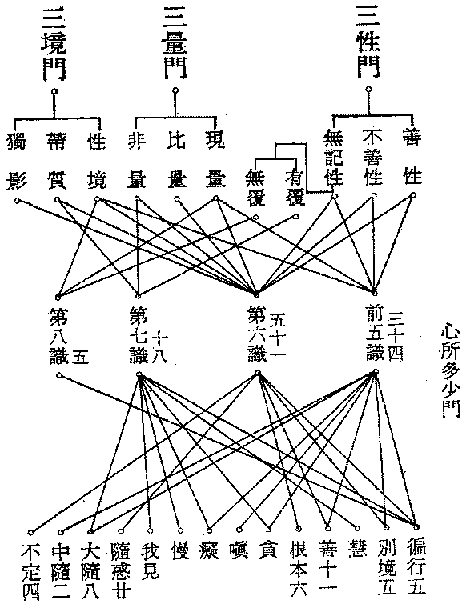



五受门



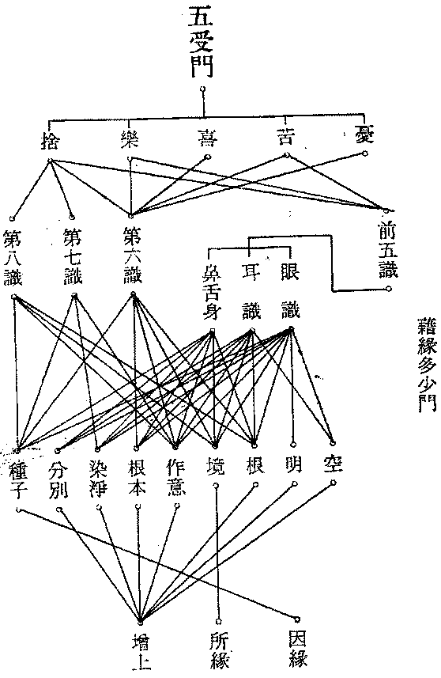



眼识九缘生，耳识唯从八；鼻舌身三七，  

若加等无间；从头各加一，后三五三四。



三科



一、五蕴(亦名五阴五众)——色、受、想、行、识(色相十一全，受想各当一；七十二行蕴，八王识蕴收。无为无积聚，不向蕴门摄；将旨就诠论，色行二蕴中。)



二、十二处(亦名十二入)——六根：眼根、耳根、鼻根、舌根、身根、意根；六尘：色尘、声尘、香尘、味尘、触尘、法尘。(根尘各五处，十色随自名；八王意处收，八十二皆法。)



三、十八界(六识及意根为七心界)——六根：眼根、耳根、鼻根、舌根、身根、意根；六尘：色尘、声尘、香尘、味尘、触尘、法尘；六识：眼识、耳识、鼻识、舌识、身识、意识。(根尘各五界，十色随自名；八王归七心，八十二皆法。)



因中四重量果——相分、见分、自证分、证自证分，为所量；见分、自证分、证自证分、自证分，为能量；自证分、证自证分、自证分、证自证分，为量果。



果中五重量果——自证分、证自证分、相分、相分、见分，为所量；见分、见分、自证分、证自证分、证自证分，为能量；自证分、自证分、证自证分、自证分、自证分，为量果。



陈那云：似镜相所量，能取相自证，即能量及果，此三体无别。无别体者，唯一识故，则离心无境。护法云：应有第四证自证分，若无此者，谁证第三？证自体者必现量故。第三四分既是现量，故得相证。永明云：镜像为相分，镜明为见分，镜面如自证分，镜背如证自证分；面依於背，背复依面，故得互证也。



一心(出华严经)



一心者，一念之心也。心性周徧，虚彻灵通，散之则应万事，敛之而成一念。是故若善若恶，若圣若凡，无不皆由此心。以心本具万法，而能成立众事。经云：「三界无别法，惟是一心作。」是也。(三界者，欲界、色界、无色界也。)



一心约教有异(出华严一乘教义分齐章)



谓：贤首祖师一宗判教有五。盖小教假四谛而说，心得悟解。始教约第八识心，了一切缘生之法皆空，各无自性而受异熟之果。终教言恒沙一切性妙功德，具於如来藏心。顿教即於一念不生之心，无染无净，顿显理性。圆教主伴圆融，法法无碍，一即一切，一切即一，卷舒自在，总该万有。然教虽有五而不出一心，是名一心约教有异。(第八识即藏识也。异熟果者，如以前世善恶之业为因，而感今世善恶之果，以其异生而熟，故名异熟也。)



一善心(出湼槃经)



心即以根对尘所起一念之心也。若起一念恶即消灭众善；若起一念善即破除众恶，故经云：「修一善心，破百种恶。」是也。



一人(出仁王护国经)



一人者，佛也。佛本於人中得道，故亦称人。世间出世间最尊最胜，故名一人。经云：「三贤十圣住果报，惟佛一人居净土。」是也。(三贤，即十住、十行、十回向，诸位菩萨也。十圣，即十地菩萨也。果报，即实报土也。净土，即常寂光净土也。)



一身(出华严经)



身，即法身也。盖十方诸佛无明之惑净尽，法性之体全彰，无有自他色相之异，故名一身。经云：「一切诸佛身，惟是一法身。」是也。



一虚(出普贤行愿品疏)



谓如来真身无形无相，犹若虚空，虽同一虚，万像森然，虽含万像，一相不立。疏云：「寂寥於万化之域，动用於一虚之中。」是也。



一月喻三身(出宝王论)



一、法身如月之体。



二、报身如月之光。



三、应身如月之影。



一月喻三身者：以月体喻法身；月光喻报身；月影喻应身也。盖由法身即是常住之理，理体惟一，不迁不变，而能出生诸法，统摄万事，犹如月体一轮在天，影含众水。报身即是寂照之智，智无自体，依理而发，明了一切，无有差谬；犹如月光，照临万像，无有隐形。应身即是变化之用，用无自性，从体而起，有感则通，无感不应；犹如月影，有水则现，无水不显。然此三身本是一体，从用立名，故有多种。论云：「法身如月之体，报身如月之光，应身如月之影。」是也。



一月喻三舟(出华严经疏)



一、南——南行者见月千里随南。



二、中——停舟者见月不移。



三、北——北行者见月千里随北。



谓：澄江一月，三舟共观。一舟停住，二舟向南北行。向南者见月随南，向北者见月随北，停舟者见月不移。盖譬如来智无不周，体无不在，无依无住，无去无来，皆由众生缘有生熟，故见如来有去住相；法身之体，本无去住也。一月喻佛，三舟喻世间；众生见佛不同，是名一月三舟喻也。



一法九喻(出湼槃经)



一法：佛眼观一切众生诸烦恼中，有佛智眼，有如来身，结跏趺坐，俨然不动。



九喻：



一、萎花喻：譬如萎变花(贪烦恼初乐后不乐)，其花未开敷，天眼者，观见如来身无染。(法身体也)



二、岩蜜喻：譬如岩树蜜(说一味去)，无量蜂围绕(为成蜜故嗔心啮人)，善方便者取，先除彼众蜂。



三、粳粮喻：譬如彼粳粮(说种种法)，糠糩未除荡(痴心不实)，贪者犹贱之，谓为可弃物。



四、金隐喻：譬如金在不净(真如不变)，隐没莫能见(身口意业增上三毒)，天眼者乃见，即以告众人。



五、贫人喻：譬如贫人家(无明住地)，内有珍宝藏(法身万德所依)，主既不知见，宝亦不能言。



六、果种喻：譬如庵罗果(见惑)，内实不毁坏(报化佛性)，种之於大地，必成大树王。



七、金像喻：譬如持金像(出缠法身)，行诣於他方，裹以秽弊物(思惑)，弃之於旷野。



八、贫女喻：譬如贫女人，色儿甚丑陋(八不净地垢)，而怀贵相子，当为转轮王(成报身)。



九、铸像喻：譬如大冶铸，无量真金像(成化身)，愚者自外观，但见焦黑土(八九十净地诸垢)。



一家宗旨



宗承——法性宗——梁肃云：嗣其学者，号法性宗。



宗旨——性具宗——别玄记云：只一具字，弥显今宗。



从一佛道说种种道



一种：所谓诸佛一道无二。



二种：定——慧。



三种：见道——修道——无学。



四种：见道——修道——无学——佛道。



五种：信行——法行——信解脱——见到——身证。



六种：初果——二果——三果——四果——支佛——佛道。



七种：念——择——进——喜——除安——定——舍——七觉支。



八种：正见——正思惟——正语——正业——正命——正精进——正念——正定——八正道。



九种：八圣道——信。



十种：十力。



十一种：十力——大慈。



十二种：十力——大慈——大悲。



十三种：十力——大慈——大悲——念佛三昧。



十六种：十力——大慈——大悲——念佛三昧——三念处。



二十种：十力——四无所畏——大慈——大悲——念佛三昧——三念处。



一台二妙



一、卫瓘——伯玉(尚书令)。



二、索靖——幼安(尚书郎)。



(晋人俱善草书，时语曰：一台二妙璠名闻，卫瓘索靖同时奋。)



一台二绝



一、伏曼容——公仪。



二、袁粲——景倩。



(南朝人公退共谈玄理，时称一台二绝也。)



一名四实



　　修多罗┐　　　　┌一、圣教。  

　　　　　│　　　　├二、席经。  

　　修妒路┼一名四实┤  

　　　　　│　　　　├三、井索。  

　　素怛览┘　　　　└四、线。



(彼方以花献佛，以线贯之，风吹不散。此方圣教，能持佛语似之，故以为喻。不贵线名，故翻契经，暗合席经，兼顺儒经，未免相浑，故加契字。)



一窗尘积至一由旬(出楞伽经)



一、七微尘成一窓尘。二、七窓尘成一兔毛头尘。三、七兔毛头尘成一羊毛头尘。四、七羊毛头尘成一牛毛头尘。五、七牛毛头尘成一虮。六、七虮成一虱。七、七虱成一芥。八、七芥成一大麦。九、七大麦成一脂节──七脂节成半尺，两半尺成一尺，二尺成一肘，四肘成一弓，五弓成一丈，二十丈名一息，八十息名一俱卢舍，八俱卢舍名一由旬。



一妙三麤(出四教仪)



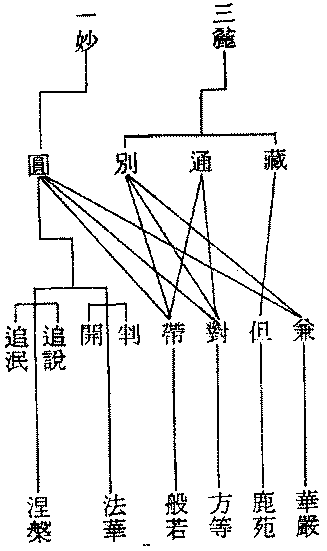



一实三假(出百法论)



　　声──一实──属色。  

　　名─┐  

　　句─┼三假──属不相应行。  

　　文─┘



一我四名(出净名经)



　　一、身无主如地┐  

　　　　　　　　　│  

　　二、身无我如水┤  

　　　　　　　　　├四大。  

　　三、身无寿如火┤  

　　　　　　　　　│  

　　四、身无人如风┘



一音五双



　　　　　　　┌一音说四谛五人闻──┐  

　　　　┌小乘┤　　　　　　　　　　├婆沙  

　　　　│　　└人语诸天闻天语───┘  

　　┌一┤  

　　│　│　　┌佛以一妙音徧满十方界┐  

　　│　└大乘┤　　　　　　　　　　├华严  

　　│　　　　└众音悉具足法雨悉充满┘  

　　│　　　　　　　　　　　　　　　┌圆信  

　　│　┌因──下地以一音令他闻一法┤  

　　│　│　　　　　　　　　　　　　└地前  

　　├二┤  

　　│　│　　　　　　　　　　　　　┌别地┐  

　　│　└果──佛以一妙音随类各得解┤　　├文句  

　　│　　　　　　　　　　　　　　　└圆住┘  

　　│　┌当分─成今经相待义边  

　　├三┤  

　　│　└跨节─成今经开权义边  

　　│  

　　│　┌显──不密须来佛边  

　　├四┤  

　　│　└密──密如向所说  

　　│  

　　│　┌定──定谓前顿后渐  

　　│　│  

　　└五┤　　┌不定该乎大小是果  

　　　　└不定┤  

　　　　　　　└所用当分显露也



大小一音(出起信论)



　　一、大乘──圆音一演，异类等闻。  

　　二、当分──即施权也。  

　　三、跨节──即开权也。  

　　　　　　　　　　　　　　　　　　　　　　　　　　┌伊祢┬───┬苦  

　　　　　　　　　　　　　　　　　　　　　　　　　　│　　└┐　┌┘  

　　　　　　　　　　　　　　　　　　　　　　　　　　│　　　└┬┘  

　　　　　　　　　　　　　　　　　┌佛为四王作圣语说│　　　┌┴┐  

　　　　　　　　　　　　　　　　　├四谛二解二不解　│　　┌┘　└┐  

　　四、小乘──毘昙一音，即是梵音┼佛又作毘罗语　　├祢祢┴───┴集  

　　　　　　　　　　　　　　　　　├说一解一不解──┤  

　　　　　　　　　　　　　　　　　└佛又作梨车语　　├蹋被─────灭  

　　　　　　　　　　　　　　　　　　　　　　　　　　└陀蹋被────道  

　　　　　　　　　　　　　　　　　　　　　　┌摩奢兜奢  

　　　　　　　　　　　　　　　　　　　　　　│  

　　　　　　　　　　　　　　　　　说四王俱解┼僧奢摩萨  

　　　　　　　　　　　　　　　　　　　　　　│  

　　　　　　　　　　　　　　　　　　　　　　└婆多思罗致



云门一字关



僧问：如何是云门剑？师云：祖凡有人问，皆以一字答之。丛林号一字关。



一法(出华严经)



法即轨则之义。谓诸佛菩萨，莫不轨则真如之法，修之而成正觉，故经云：「惟以一法而得出离，成阿耨多罗三藐三菩提。」是也。(梵语阿耨多罗三藐三菩提，华言无上正等正觉。)



一理(出法华经玄义)



一理者，诸法之本体也。理性容摄，其大无外，诸法虽殊，理元是一，理虽是一，而能统贯诸法，诸法虽殊，莫不本乎一理；事理融通，法法无碍，是则世间出世间法，皆不外乎此也。



一乘(出法华经)



一乘者，佛乘也。乘即运载之义。佛说一乘之法，为令众生依此修行，出离生死苦海，运至涅槃彼岸，故喻以七宝大车而导之以大白牛也。佛之出世，意欲直说法华，盖由众生机器不等，於是先说三乘之法而调熟之，故经云：於一乘道，分别说三，后至法华，会三乘之小行，归广大之一乘。又云：十方佛土中，惟有一乘法是也。(梵语湼槃，华言灭度。七宝者，金、银、瑠璃、玻瓈、砗磲、码碯，赤真珠也。三乘者，声闻乘、缘觉乘、菩萨乘也。)



一雨(出法华经)



一雨者，喻佛所说一乘之法也。盖佛说法华，惟谈圆教一实相理，纯一无杂，即是如来一音宣澍，一乘法雨，咸令众生开佛知见。经云「一雨所润」是也。



一味(出法华经并法华玄义)



一味者，喻法华一乘之教也。如来说法必称机宜，以其机有大小，故历四时三教，渐次调停，令其入大，然后高会灵山，纯谈一妙。开前四时三教之法，即是圆妙一乘，一乘之外更无别法，故经云：决了声闻法，是诸经之王。是以无垢藏王菩萨，於涅槃会上白佛言：佛说十二部经，譬如从牛出乳，盖喻初时说华严经也。次云：从乳出酪，喻华严经后，第二时说阿含经也。次云：从酪出生酥，喻阿含经后，第三时说净名、宝积等经也。次云：从生酥出熟酥，喻净名等经后，第四时说般若经也。次云：从熟酥出醍醐，喻般若经后，第五时说法华、涅槃经也。如此展转相从说者，据如来施化次第而言耳。若据法华开前诸教，诸乘即是圆妙一乘；则显乳酪二酥皆成一醍醐味。经云「一相一味」是也。(四时者：华严时、鹿苑时、方等时、般若时也。三教者：藏教、通教、别教也。十二部经者：一、契经，二、重颂，三、授记，四、孤起，五、无问自说，六、因缘，七、譬喻，八、本事，九、本生，十、方广，十一、未曾有，十二、论义也。)



一大事因缘(出法华经)



一，即一实相也。其性广博，故名为大。如来出世度生之仪式，故名为事。众生具此实相，而能成机感佛，故名为因。如来证此实相，而能起应度生，故名为缘。一切如来出现於世，皆为开示一切众生本有实相，令其咸得悟入佛之知见，舍此则非如来出世本怀。经云：「如来惟以一大事因缘故，出现於世。」是也。



一觉(出起信论)



一觉者，十界众生本性之觉也。谓六道众生业惑所覆，不能觉了，名为不觉。三乘之人，断惑证理，未能究竟，名随分觉。惟佛一人，诸惑净尽，彻见本性，名究竟觉。迷悟虽殊，觉体本一，论云：「本来平等，同一觉故。」是也。(十界者：佛界、菩萨界、缘觉界、声闻界、天界、人界、阿修罗界、饿鬼界、畜生界、地狱界也。佛亦名众生者，佛为无上众生也。六道者：天道、人道、修罗道、饿鬼道、畜生道、地狱道也。三乘者，先如辨。)



一道(出华严经)



一道者，一实之道，即佛所说最上乘之法也。若依此道而修，则能顿断诸惑，顿出生死，非如二乘等，次第超出。经云：「一切无碍人，一道出生死。」是也。(二乘者，缘觉乘、声闻乘也。)



一地(出法华经)



一地者，一实相地也。地有能生之义，一切草木种子，皆依於地而得生长，以譬人天、声闻、缘觉、菩萨，一切习因种子，皆依五阴之身增长成熟；至於法华会上，闻佛说一乘法，皆成菩萨法性，五阴则是一实相地。故经云：「一地所生。」是也。(习因者，所作之因，习续不断也。五阴者，色阴、受阴、想阴、行阴、识阴也。)



一门(出法华经)



门者，即能通之义。一谓一理，即是所通；门谓正教，即是能通。盖譬佛所说一乘之教，则能通於实相之理。经云：惟有一门是也。



第一义(出大集经)



第一义者，即无上甚深之妙理也。其体湛寂，其性虚融，无名无相，绝议绝思。经云：「甚深之理不可说，第一义谛无声字。」是也。(无声字者，谓离语言文字之相也。)



一实谛(出湼槃经)



谓一实相中道之理也。无有虚妄，无有颠倒，若圣若凡，性本不二，故名一实谛也。



一实相印(出法华玄义)



一实相者，谓：真实之理无二无别，离诸虚妄之相也。印者，信也。如世之公文，得印可信。盖如来所说诸大乘经，皆以实相之理印定其说，外道不能杂，天魔不能破。若有实相印，即是佛说；若无实相印，即是魔说。经云：「世尊说实道，波旬无此事。」是也。(梵语波旬，华言恶。释迦如来出世时，魔王名也。)



一实境界(出占察善恶业报经)



一实境界者，即一实相之理也。不变不异，无灭无生，自性清净，离虚妄相，犹如虚空，平等普徧，诸佛众生，无二无别也。



一法印(出宗镜录)



一法印者，谓：一念心含摄一切世间出世间法，无不悉备。然此诸法於一心中，炳然显现，如印印泥，文无前后。故云：「森罗及万像，一法之所印。」是也。



一法界(出起信论)



一法界，即一真如之理；体性虚融，平等不二也。



一真法界(出华严经随疏演义钞)



无二曰一，不妄曰真，交彻融摄，故曰法界。即是诸佛平等法身，从本以来，不生不灭，非空非有，离名离相，无内无外，惟一真实，不可思议，是名一真法界。



一藏(出华严经疏)



藏即含藏之义。谓法界之理，竖穷三际，横徧十方，无德不备，无法不摄，一一该罗，重重无尽。若世间法，若出世间法，无不含藏，故名一藏。(三际者：过去、现在、未来也。)



一会(出法华要义)



一会者，谓如来於灵山会上，与诸大众说法华经之时也。隋天台智者大师，於光州大苏山修法华三昧，诵法华经，至药王菩萨品中：「是真精进，是名真法供养如来」之句，身心豁然，寂而入定，彻见灵山一会，俨然未散是也。(梵语三昧，华言正定。)



一极(出普贤行愿品疏)



一极者，谓华严经广谈法界之旨，妙极无二也。盖如来出世，首为诸大菩萨说佛菩萨真实境界，不说二乘方便之法。是故声闻缘觉，虽在听次，有如聋聩，寂无所闻，故疏云：「一极唱高，二乘绝听。」是也。(二乘者，先如辨。)



一致(出华严经随疏演义钞)



一致者，谓佛乘宗极之趣，惟一也。如来设化，始随机宜不同，故有三乘之说，终归显实，但名佛乘一致之理。钞云：「退万化即真，会精麤一致。」是也。(三乘者，如先注)



一源(出华严经随疏演义钞)



一源者，甚深法界之体也。此体不变不迁，非真非妄，因随缘故，有真有妄。若随法性净缘，则能出生诸佛之法；若随无明染缘，则能出生众生之法。染净之缘虽别，法界之体无殊。譬如流水，流虽清浊有异，所出之源是一也。



一体(出法界观)



一体者，常住真心之体也。自性清净，一体无二，妄想忽生，境界顿现；於是有情众生，无情国土，从一真心，妄分为二。当知有情无情，皆是众生自心所变，实非外物，故颂云：「情与非情共一体。」是也。



一偈(出翻译名义)



一偈者，西域记云：旧曰偈，或曰偈他，梵音讹也。今从正音，宜云伽陀，华言颂。诸经虽五字七字为句不同，皆以四句为一偈也。



一句(出华严经)



一句者，谓经中所说普眼法门，一句功德不可思议也。经云：假使有人以大海量墨，须弥聚笔，书写此普眼法门，一品中一门，一门中一法，一法中一义，一义中一句，不得少分，何况能尽是也。(普眼者，眼外无法，名为普眼。)



一言(出圆觉经略疏)



一言者，谓圭峰密禅师，读圆觉经，未终其卷，於一言下，豁然开悟，乃知自心即是佛心，定当作佛，故疏序云：「一言之下，心地开通。」是也。



一语(出华严经疏)



一语者，如来之语也。经云：「如来於一语言中，演说无边契经海。」盖言於一语中，演说妙法无量无边，譬如泉之初发，细若一线，流之不已，为江为海，无有穷尽也。



一名(出湼槃经)



名即名字，谓理虽是一，假言施设，种种不同。如经中只一涅槃之名，如来随机演说，亦名无生，亦名无作，亦名无为，亦名解脱，亦名彼岸，亦名无退，亦名安处，亦名寂静，亦名无相，亦名无二，亦名一行，亦名清凉，亦名无诤，亦名吉祥。虽立多种之别，只是涅槃一名，是为一名。



一字(出大方广师子吼经)



一字者，一理之名字也。理本无名无字，超心意识，离性离相，无作无示，非诸众生所能思议，惟佛如来究尽明了。经云：「法惟一字，所谓无字」是也。



一义(出华严经)



义即义理，即一法中，或一句中之一义也。



一音(出维摩经)



一音者，佛之音声也。盖众生缘有浅深，根有利钝，故於一音之中，同听异闻。若是人天根器，则闻佛说五戒十善之法；若是声闻根器，则闻佛说四谛之法；若是缘觉根器，则闻佛说十二因缘之法；若是菩萨根器，则闻佛说六度等法，各得解了。经云：「佛以一音演说法，众生随类各得解。」是也。



(五戒者：不杀、不盗、不邪婬、不妄语、不饮酒也。十善者：不杀、不盗、不邪婬、不妄言、不绮语、不两舌、不恶口、不贪、不瞋、不痴也。声闻者，闻佛声教，悟真空理，故名声闻也。四谛者：苦谛、集谛、灭谛、道谛也。缘觉者，因观十二因缘，觉真空理，故名缘觉也。十二因缘者：一、无明，二、行，三、识，四、名色，五、六入，六、触，七、受，八、爱，九、取，十、有，十一、生，十二、老死也。菩萨者，梵语具云菩提萨埵，华言觉有情。六度者：一、布施，二、持戒，三、忍辱，四、精进，五、禅定，六、智慧也。)



一音教(出华严经疏)



一音教者，谓如来一代之教，虽有顿渐诸说不同，而皆不出一音也。故罗什法师云：「佛一圆音，平等无二，无思普应，机闻自殊。」是也。(梵语罗什，华言童寿。)



一宗(出华严经疏)



宗者要也。谓诸大乘经所说虽异，莫不同乎一理，如华严之谈法界，般若之谈佛母，法华之谈实相等，皆以一理为其宗要。钞云：「一宗容具多经」是也。



一相(出起信论)



谓：一真法界之相，从本以来，离虚妄相，离言说相，离名字相，离一切诸法之相，故名一相。



一合相(出金刚经)



一合相者，盖言众尘和合而为一世界也。世界本空，微尘不有，但众生不了，妄执为实；若是实有，即应世界不可分为微尘；若是实无，不应微尘合为世界。是知执有执无皆不当理。经云：「如来说一合相，即非一合相，是名一合相。」是也。



一性(出湼槃经)



一性者，即正因佛性也。谓一切众生皆具此性，但背觉合尘，常为烦恼之所覆障，若顺性而修，则能超脱生死，悟入涅槃，与佛所证无二无别也。(梵语湼槃，华言灭度。烦恼者，昏烦之法，恼乱心神也。)



一性(出华严经)



性以不变为义，上极诸佛，下至蠕飞蠢动，虽品类万差，莫不本乎一性；迷之则成生死，悟之而为涅槃。迷悟虽殊，其性本一，是为一性也。(蠕，而宜切，虫行貌。蠢，尺尹切，蠢动也。梵语湼槃，华言灭度。)



一因(出湼槃经)



一因者，谓圣凡平等之理体也。盖此理体，诸佛众生皆性本具，初无增减。然诸佛悟之而成妙果，众生迷之而流转诸趣。若全此一因而修圆顿之行，则能超出三乘所修之因，而证一乘之果也。



一如(出首楞严三昧经)



不二不异名曰一如，即真如之理也。所谓「真如界内，绝生佛之假名；平等性中，无自他之形相」，故经云：「魔界如佛界如，一如无二如」是也。



(魔，梵语具云魔罗，华言杀者，谓能夺人功德之财，杀人智慧之命也。佛，梵语具云佛陀，华言觉者，谓能自觉觉他，觉行圆满也。魔佛皆言如者，魔为修恶之极，佛为修善之极，善恶虽分，其性本一，故云一如无二如也。)



一行(出湼槃经)



一行者，如来所行之行也。行以进趣为义，能行此行，则能趣向佛果。虽名一行，而具足五行，故经明五行之后，乃云复有一行，是如来行。谓能於一心中行於五行，具足而无缺也。(五行者：圣行、梵行、天行、病行、婴儿行也。)



一行三昧(出文殊师利所说摩诃般若波罗蜜经)



梵语三昧，华言调直定，又云正定。一行三昧者，惟专一行，修习正定也。谓修行之人应处空闲，舍诸乱意，系心实理，想念一佛，专称名字，随佛方所，端身正向，能於一佛念念相续，不懈怠，於一念中，即能得见十方诸佛，获大辨才也。



一解脱(出湼槃经)



解脱者，无拘无碍，自在之谓也。一切众生，同有佛性，本来解脱，良由心生执著，妄自迷倒，受诸缠缚；若能一念反妄归真，了缚无缚，则与诸佛如来同一解脱，无有差别。经云：「同一解脱」是也。



一生(出法华经)



一生者，等觉菩萨无明之惑未尽，尚有一番变易生死，过此一生即登妙觉果佛之位，所以等觉菩萨称为一生补处。经云：「一生当得阿耨多罗三藐三菩提」是也。



(等觉者，望后妙觉，犹有一等，超前诸位，得称为觉。无明者，无所明了，即障理之惑也。变易者，即实报土生死也，因移果易，故名变易。生死妙觉者，自觉觉他，觉行圆满，不可思议也。)



佛学名相汇解　卷第一（终）



一空(出寂调音所问经)



一空者，谓一切诸法皆无自性，若色若心，若依若正，乃至圣凡因果之法，虽种种不同，求其体性，毕竟皆空。经云：「如瓦器中空，宝器中空，俱同一空，无二无别。」是也。(依者，依报，即国土也。正者，正报，即众生身也。)



一生(出华严经随疏演义钞)



谓：善财童子一生之内圆成佛果，故慈氏菩萨赞善财言：「餘诸菩萨，於无量刼乃能满足菩萨行愿；此长者子，於一生内，能净佛土，能化众生。」是名一生。(慈氏菩萨，即弥勒菩萨也。)



一师(出四分戒品)



师者，授道之师也。凡诸比丘同一师学，当须和合，欢喜无诤，犹如水乳，於佛法中，庶得增益，是名一师。(梵语比丘，华言乞士。)



一子(出湼槃经)



谓：菩萨修慈悲行，视诸众生犹如一子，若见众生修习善业，胜进圣道，心则欢喜；若见众生造作恶业，流转生死，心则愁恼。譬如父母见子安隐，心则欢喜；见子遇患，心则苦恼。经云：「视诸众生同於一子。」是也。



一念(出华严经)



念即心念。此之一念，有真有妄，若凡夫以根对尘所起之念，念念生灭，此妄念也。若离根尘真净明妙，虚彻灵通之念，即是如来正智之念也。此正智之念，非生非灭，不常不断，促一刹那，而非短延，无量刼而非长。经云：「一念普观无量刼。」是也。



(根者，眼耳鼻舌身意六根也。尘者，色声香味触法六尘也。梵语刹那，华言一念。劫，梵语具云劫波，华言分别时节。)



一刹那(出仁王护国经)



梵语刹那，华言一念。经云：「一念中有九十刹那，一刹那中有九百生灭。」俱舍论云：「时之极少者名刹那。」是也。(念有大小：一念者，大念也；一刹那者，小念也。)



一机(出楞严经)



机谓机关，即发起之处也。一机以喻耳之一根，一根返源，诸根解脱。经云：「虽见诸根动，要在一机抽。」是也。



一指(出楞严经)



一指，手一指。经云：「若我灭后，其有比丘发心决定修三摩提，能於如来形像之前，身然一灯，烧一指节，及於身上，𦶟一香炷，我说是人无始宿债，一时酬毕，长揖世间，永脱诸漏也。」



(梵语三摩提，华言等持。离昏沈掉举曰等，令心住一境性曰持，诸漏即三界生死也。)



一发(出摩诃僧祇律)



一发者，谓日晷过午一发许也。盖言修行之人持斋之法，日正当午，乃受饮食；若日过午一发许，则不当食也。



一毫(出普贤行愿品疏)



疏云：一字法门，海墨书而不尽；一毫之善，空界尽而无穷。此言华严大经，功德浩博，不可测量，不可称说，而虚空界有尽，一毫之善无穷也。



一毛(出楞严经)



经云：「於一毛端现宝王刹」，此是正报中现依报也。由佛具足不思议神通之力，故能依中现正，正中现依，依正融通，事理无碍，大小相含，一多平等，故於一毛之端能现宝王刹也。



一气(出圆觉经略钞)



一气者，道之所宗，阴阳天地之根本也。以喻自性清净之心未起染净已前，诸佛众生平等不二，一切诸法莫不皆由此心而生，故以一气喻一心也。



一瞬(出摩诃僧祇律)



瞬者，目动也。律云：二十瞬名一弹指。谓修行人持斋之法，日正当午乃受饮，若日过午一瞬，则不当食。



一默(出维摩经)



默者，无言也，默必对说，诸佛菩萨或说或默，皆能显於妙理，故经中三十二菩萨各谈不二法门竟，文殊师利问维摩诘言：「仁者当说！何等是菩萨入不二法门？」时维摩诘默然无言，文殊叹曰：「善哉善哉！乃至无有文字语言，是真入不二法门。」此即默而说，即说而默也。(梵语文殊师利，华言妙德。梵语维摩诘，华言净名。)



一时(出各经之首)



一时者，佛与弟子说听和合之时也。是故诸经之首，皆言一时。法华文句云「闻持和合非异时」是也。(闻持者，弟子从佛闻法而受持也。)



一食(出维摩诘所说经)



一食者，世间分段之食也。若能於此一食了达三谛，即成法食。然后运平等心，上供诸佛，中奉贤圣，下及六道等施无别。经云：「以一食施一切。」是也。



(三谛者：真谛、俗谛、中谛也。六道者：天道、人道、修罗道、饿鬼道、畜生道、地狱道也。)



一餐(出法华经)



一餐者，一餐之食也。盖言声闻之人，於般若会上，蒙佛加被，为诸菩萨说大乘法，声闻自谓小乘，而於大法不生喜乐，譬若见食而不能餐。经云：「而无希取一餐之意。」是也。



一处(出遗教经)



一处者，谓心专注一境而无他适也。修行之人若能摄心敛念，不涉餘缘，则所修行业，决可成办。经云：「制之一处，无事不办。」是也。



一刹(出翻译名义)



刹，梵语具云刹摩，华言土田，即国土也。谓一佛所化之境，以大千世界而为一刹也。



(大千世界者，一日一月绕一须弥山，照四天下为一世界，一千世界为小千世界，一千小千世界为中千世界，一千中千世界为大千世界也。)



一路(出首楞严经)



路，犹道也，即能通之义。谓诸佛如来，离於生死，入大涅槃，无不皆以首楞严大定而为正路，舍此则无由而入。经云：「十方薄伽梵，一路涅槃门。」是也。



(梵语湼槃，华言灭度。梵语首楞严，华言健相，又一切事究竟坚固。梵语薄伽梵，佛之总号，其义有六：自在、炽盛、端严、名称、吉祥、尊贵，为含多义，故不翻也。)



一尘(出华严经)



一尘者，一微尘也。经云：譬如有大经卷，量等大千世界而全住在一微尘中。一微尘既然，一切微尘皆亦加是。时有一人(谓佛也)智慧明达，有净天眼，见此经卷在微尘内，即以方便，破此微尘，出此经卷，令诸众生普得饶益。以譬一切众生身中，具有如来无碍智慧，但由众生妄想颠倒而不自觉，惟有诸佛乃能知之，即以方便令诸众生修於圣道，破除虚妄烦恼，显出如来真实智慧。故云：「一尘之内有大千经卷。」是也。



一沤(出楞严经)



沤者，水泡也。海本澄湛，因风飘鼓，发起水泡，以譬大觉之性，真净明妙，因心妄动，生起虚空世界，虚空世界，在大觉性中，如大海中之一沤耳。经云：「空生大觉中，如海一沤发。」是也。



一盖(出维摩诘所说经)



经云：「毗耶离城有长者子，名曰宝积，与五百长者子，俱持七宝盖来供养佛。佛之威神，令诸宝盖合成一盖，徧覆大千世界，而此世界广长之相，悉於中现。」五百盖者，表五阴也。合成一盖者，表一心也。以显五阴之法全是一心也。(梵语毗耶离，华言广博严净。五阴者：色阴、受阴、想阴、行阴、识阴也。)



一花(出梵网经)



经云：「我今卢舍那，方坐莲华台；(我者，释迦佛自谓也。梵语卢舍那，华言净满。诸惑究尽谓之净，众德悉圆谓之满也。方坐者，方正也；谓安住正法也。莲华者，华藏世界也；以其形似莲华，故以名之。台者，华藏世界之中央也。华严经云：『风轮持香海，香海出莲华，莲华持世界。』是也。)周帀千华上，复现千释迦；(莲华有千叶，故云千华；一华叶上现一释迦佛，故云复现千释迦。此千释迦，乃从卢舍那佛出现也。)一花百亿国，一国一释迦。」(於一花叶复现百亿国土，每一国土又现一释迦佛；则有千百亿国土，千百亿释迦佛。此千百亿释迦，乃从千叶上千释迦现出也。通而言之：卢舍那佛现出千释迦，千释迦佛现出千百亿释迦，今此四天下，乃是千百亿国土中之一土，释迦牟尼佛乃是千百亿释迦中之一佛也。)



一灯(出华严经)



谓：灯能破暗，以喻菩提之心能破烦恼之暗也。故经云：「譬如一灯，入於暗室，百千年暗，悉能破尽。菩提心灯，亦复如是，入於众生心室之内，百千万亿不可说刼，诸业烦恼，种种暗障，悉能除尽，故名一灯。」(梵语菩提，华言道。)



一来(出四教仪)



一来者，谓二果斯陀含，於欲界九品思惑中，前六品虽尽，后三品犹在，故更来欲界一番受生，是名一来。(梵语斯陀含，华言一来。九品者，上、中、下三品，每品中又分三品也。)



一修一切修(出华严经随疏演义钞)



一修一切修者，谓上根大智之人，全性起修，了修即性，修性不二，事理互融，烧香散华，无非中道；习禅诵经，尽是真如。是故一行修，则一切行无不修焉。



一断一切断(出华严经随疏演义钞)



一断一切断者，谓上根之人，断惑无渐次也。中下根人，不知妄惑即是真智，所以断惑有其渐次；上根之人，了惑即智，达妄即真，惑外无智，妄外无真，所以一断则一切断也。



一证一切证(出华严经随疏演义钞)



一证一切证者，谓上根之人，以圆妙之智，照了性境圆融，无始无终，非浅非深，不有不空，无法不备，无处不通；是故一处证入，则一切处皆证入矣！



一成一切成(出华严经疏)



一成一切成者，谓一佛成道，法界无非此佛之依正也。依即所依之土，正即能依之身。以其迷时，则众生国土皆迷；悟时则众生国土皆悟。盖约一人惟心即具而说。故楞严经云：「一人发真归源，此十方空皆悉消殒。」是也。



一位一切位(出华严经疏)



一位一切位者，谓上根之人，证一地位则具足一切地位之功德也。盖所证之位全是法性，法性徧周恒沙功德无不含摄，是故证一地位，则一切地位功德皆悉具足也。



一行一切行(出华严经疏)



一行一切行者，谓上根之人，依於一乘圆融之教，建立圆顿之行，圆顿行立契合一乘，故能於一行中具足一切诸行也。



一障一切障(出华严经随疏演义钞)



一障一切障者，谓造恶众生，一念瞋心起，百万障门开，一切善根皆悉消灭，一切业障同时增长，所以一障则一切障也。



一根(出楞严经)



一根，即耳根也。盖由此方之人，耳根最利，闻法易入，故文殊选拣圆通之门，取耳根为第一也。然以耳根为圆通门者，特假其通入而已，必期脱去声尘，反闻自性，然后为复本归源之至。一根既然，诸根亦寂。经云：「一根既返源，六根成解脱。」是也。



(六根者，先如辨。)



一色(出仁王经疏)



色者，眼根所对之色也。色即法界，具足三谛，以一切法，体性融通，互摄无碍；若一切色即一色，此是真谛，忘泯一切法也。若一色即一切色，此是俗谛，建立一切法也。若非一非一切，亦一亦一切，此是中谛，双遮双照，即中道也。尽理言之：非但色之一尘，具足三谛，声香味触法五尘莫不皆然；举色则一切法皆在於色，色外无法；举香则一切法皆在於香，香外无法。疏云：「一色一香，无非中道。」是也。



(法界者，法法皆以三谛而为界分，即是理也。双遮双照者，遮谓遮情，照谓照性，即双遮真俗，双照真俗也。)



一时一切时(出华严经疏)



一时一切时者，谓一时之间，即为无量刼也。盖如来智境圆融，延促无碍，故能促多刼为一时，延一时为多刼。经云：「一念普观无量刼。」是也。



一切(出翻译名义)



「一」是普及之言，「切」是尽际之语。又云：「究竟非二名一，其性广博名切。」故名一切。



一针(出梵网经)



经云：「一针一草，不得故盗。」谓持戒之人，虽是微细之物，不得故意盗取也。



一人(出法华经)



一人，有庆君也。经云：「唯我一人能为救护，佛也。」仁王护国云：「唯佛一人居净土。」楞严云：「若有一人发真归源，十方虚空悉消殒。」



一性(出华严、湼槃经)



涅槃经云：「一正因性。」又华严经云：「皆同一性，所谓无性。」即一真如性也。又云：「智照融通，法性常一。」又：「三谛一境，合名法身。」此彰一性也。



一佛(出法华经)



一佛成道，法界无非此佛之依正。又若思惟一佛，即见十方佛。



一身(出因果经)



经云：「众生徧五道，一身死，复受一身；诸佛则一身一智慧。」



一觉(出般若经)



金刚三昧云：「佛以一觉，转诸识入庵摩罗。谓觉众生皆成正觉。」



一师(出法华经)



经云：「有一导师，第十六释迦是。」又四分律云：「同一师觉。」



一法(出般若经)



无量义从一法生，所谓无相地。论云：「般若是一法，佛说种种名。」



一谛(出湼槃经)



涅槃：唯一实谛，文句：遣旁人是表一谛，一谛一切所归即中道。



一印(出智论)



论云：但有诸法实相一法印，法华实相印，若无此印即魔说。



一藏(出释论)



论云：或立一藏，谓法界法轮藏。又以经律论为一大藏教。



一妙(出四教仪)



华严、方等、般若之圆教，皆称一妙。鹿苑小教，则但麤无妙矣！



一麤(出四教仪)



谓：华严别教是一麤，方等般若前三麤，在鹿苑则但麤。



一道(出华严、法华经)



华严经云：「清净无为人，一道出生死。」法华经云：「但说无上道，正直一道也。」



一义(出无量义经)



经云：「是一义处出无量法，法华乃是收无量法入一义。」



一字(出楞伽经)



狮子吼云：「法唯一字。」楞伽云：「某夜成道，某夜涅槃，中间不说一字。」



一唱(出法华玄义)



谓：法华前三百会，秘而不谈；来至灵山会上，妙名一唱，待绝俱时。



一法(出湼槃经)



经云：「若人修集能净众生，灭除忧苦，逮得一法，所谓念佛三昧。」



一寂(出大意)



谓：於一寂理，不分而分，离开诸谛，权实道理，冷然可见。



一念(出法华经)



经云：「不生一念好乐之心。」又：念三千空假中，又：信心生一念。



一接(出法华玄义)



谓妙玄顺能诠教，约教道明，三接止观，为成观故，约证道唯一接。



一味(出楞严经)



憍梵钵提云：「如来示我一味清净心地法门，得入圆通。」



一际(出般若经)



谓：非色约体，非不色约用。则法报一际，体用无差。又：真应一际。



一门(出法华、楞严经)



法华经云：「唯有一门。」楞严经云：「一门超出妙庄严路。」妙乐佛以一门利物。



一寻(出观佛三昧海经)



谓：释迦身长丈六，圆光七尺，又：如来圆光一寻也。



一境(出法苑珠林)



即是一真如境。又云：「娑婆世界为一佛化境。」又云：「一境三谛。」



一夏(出法苑珠林)



佛念五人当往先度，故至波罗奈一夏调根，度陈如等五人。



一期(出湼槃经钞)



谓：五十年说法，谓之一期施化。又：四三昧常坐九十日，为一期等。



一坐(出法华经)



谓：一坐十小刼。又：六十小刼不起于座，加以佛威忘其久耳。



一化(出大意)



谓：说法五十年，为一化。法华为一化根源。又：功高一化，其法华乎？



一代(出佛祖统纪)



天台以五时八教，判释东流一代圣教。谓五十年说法为一代也。



一劫(出俱舍论)



谓：人寿十岁，增至八万四千岁。如是一增一减名一小刼，二十番增减为一中刼，成住坏空，各二十番增减为一大刼。如俱舍论，并刼章颂中广明。



一国(出法华、梵网经)



谓：以我此物，周给一国，犹尚不匮。梵网经云：「一国一释迦。」



一床(出净名经)



谓：以神力空其室，除去所有，及诸侍者，唯置一床，以疾而卧。



一室(出净名经)



谓：一室容三万二千师子座，无所妨碍。又：三天女同处一室也。



一力(出智论)



谓：十力，若总相说，佛唯一力，即一切种智，别说有千万亿力。



一珠(出法华经)



谓：独王顶上有此一珠，即髻珠喻。又：帝网一珠，互入众珠。



一铠(出宗镜录)



谓：法身徧在一切处，如此之铠，一铠一切铠。此乃圆教之铠也。



一类(出首楞严经)



谓外道计：尽虚空界十二类所有众生，皆我身中一类流出。



一伦(出首楞严经)



谓：一伦生死，首尾圆照，名想阴尽，起烦恼浊，首尾即始终。



一座(出珠林)



谓：世亲到兜率天，闻弥勒一座说法，旋绕即来人间，已三载已。



一家(出佛祖统纪)



天台大师，以五时八教，判释东流，一代圣教，故称一家教观。



一福(出俱舍论)



谓：大千盲人治差为一福，等百福乃成一相，如是积成三十二相。



一虚(出首楞严经)



谓：以清净目，观晴明空，逈无所有。孤山曰：理致一如也。



一分(出佛藏论)



谓：白毫相光，功德百千万亿，留一分供末世弟子无穷尽。



一手(出净名经)



谓：与众魔共一手，作诸劳侣，一手指天，一手指地，则成二手。



一受(出净名经)



谓：以斯妙法济群生，一受不退常寂然。言受妙法，不堕生死。



一想(出梵王经)



大梵王谓：餘梵是己造；餘梵亦各自谓：从梵王生。名异身一想。



一乐(出俱舍论)



谓三禅天，形无精麤，心无异想，所谓一乐想。又佛观三界无一乐。



一贯(出名义)



释光明题：既惑异端，孰能一贯？终云：佛元意故，当单法也。



一禅(出宗镜录)



永明寿师云：「吁嗟！末世诳说一禅，只学虚头，全无实解。」



一住(出摩诃僧祇律)



谓：新出家者，应谈一食一住，少食少饮，多觉少眠。



一相(出般若经)



谓：皆同一相，所谓无相。又：因修百福成一相，如是三十二百福，方成三十二相。



一成(出法华玄义)



谓：开权显实，无偏不圆，无麤不妙，花果同时，权实一体，十界咸开，一成一切成也。



一像(出楞伽经)



谓：诸最胜子，眷属围绕，同一像类。



一澄(出首楞严经)



谓：性入元澄，一澄元习，名超众生浊。



一流(出法华经)



谓：二千学无学人，同是一流，一时受记，同一名号。



一渧(出法华经)



谓：如海一渧。言七方便，於佛智慧，如海之一渧也。



一明(出净土指归)



谓：一明一切明，万法皆我自性。



一应(出指要详解)



谓：三千既已果满，随一应以徧收，约圆说也。



一途(出净土指归)



谓：权实之判，非止一途；自非具眼明师，未知何以甄别。



一佛乘(出法华经)



谓：是法皆为一佛乘故，又於一佛乘分别说三。



一子地(出湼槃经)



谓：菩萨修慈悲喜得一子地，修舍得空平等地。



一丈夫(出地持经)



谓：惟一丈夫，名无上士，又佛称调御丈夫。



一导师(出法华经)



谓：有一导师聪慧明达，善知险道通塞之相。



一宝珠(出华严经)



谓：有一珠名普集众宝，刼烧不能令海水减一滴。



一切法(出净名经)



谓：无住则无本。又：从无住本，立一切法。



一大车(出法华经)



云：各赐诸子等一大车，即大白牛车，喻一佛乘也。



一大宅(出法华经)



譬如长者有一大宅，即三界火宅也。



一世界(出净名经疏)



谓：一世界摄一切世界，一切世界亦然，名世界海。



一乘觉(出楞伽经)



谓：摄所摄妄想如实处，不生妄想，是名一乘觉。



一法界(出起信论)



谓：一法界大总相法门体。



一种子(出止观)



摩诃止观引婆娑论，超断八品，名一种子。



一陀那(出楞伽经)



一铢也。经云：「几摩沙陀那？」梵云「摩沙」，此云豆也。



一迦利沙那(出楞伽经)



一两也。经云：「复几陀罗那，为迦利沙那？」



一波罗(出楞伽经)



一斤也。经云：「几迦利沙那，为成一波罗？」



一舍利沙婆(出楞伽经)



一芥子也。经云：「为有几阿㝹，名舍利沙婆？」阿㝹，尘也。



一赖提(出楞伽经)



草子也。经云：「几舍利沙婆，名为一赖提？」



一弥楼(出楞伽经)



谓：此等积聚相，几波罗弥楼？言以几斤尘，积成此山也？



一摩沙(出楞伽经)



一豆也。经云：「几赖提为摩沙？」



一钵他(出楞伽经)



谓：钵他，此云一升也。



一阿罗(出楞伽经)



谓：阿罗，此云一斗也。



一独笼(出楞伽经)



谓：独笼，此云一斛也。



一那佉利(出楞伽经)



谓：那佉利，此云十斛也。



一勒叉(出楞伽经)



谓：一勒叉，此云一万也。



一举利(出楞伽经)



谓：一举利，此言一亿也。



一频婆罗(出楞伽经)



谓：一频婆罗，此言一乖也。



一旨一观(出净名经肇法师注)



谓：天地一旨，万物一观，邪正虽殊，真性不二。



一相一味(出法华经)



谓：如来说法，一相一味。一相即真如相，一味即一乘之理也。



一相一种(出法华经)



谓：皆是一相一种，圣所称叹。一相即实相，一种即种智也。



一句一偈(出法华经)



谓：闻一偈一句，皆与授记。荆溪云：「一句一偈，增进菩提。」



一色一香(出四念处)



谓：一色一香，无非中道。毗陵云：「一色一香，永无退转。」



一因一果(出𣵀槃经)



谓：一因一果，一甘露味，簿拘罗昔为医师，施一病比丘一诃梨勒果，九十一刼常生人天受快乐，今九十岁未曾病。



第一义谛(出阿含经)



谓：甚深至理不可说，第一义谛无声字。



一问一答(出金錍四十六)



问云：「子若能晓予之一问，则众滞自消。」客曰：「以一答徧答众问：何一问之有耶？」



一智(出起信论)



谓：只是一智，义用有殊，即真俗也。



一实(出法华经)



谓：唯此一事实，餘二则非真。



一城(出法华经)



化城喻品云：「化作一城。」方便品：「中止一城。」



一事(出法华经)



谓：唯此一事实，即一佛乘也。



一方(出法华经)



谓：一方所分之身，犹故未尽。



一善(出湼槃经)



谓：修一善心，破百种恶。



一奏



师子筋为琴弦，一奏众弦皆绝。人修念佛三昧，诸烦恼皆灭。



一箧



光明云：「犹如四蛇同一箧。」涅槃德王品：「如王以四蛇同一箧。」



一圆



兜率天有香，名先陀婆，於一生菩萨前烧一圆，香云遍覆法界。



一假



谓：一假一切假，空中皆假，立法也。



一中



谓：一中一切中，空假皆中，绝待也。此妙三观也。



一真



清凉云：「一真法界，总该万有。」



一土



谓：一佛化境也。净名云：「一土摄一切土。」



一权



华严圆兼一别，圆实别权，故云一权也。



一界



宝箧云：「佛界众生界，一界无别界。」



一器



佛言：「阿难所可闻法，喻如泻水，置之一器。」



一本



谓：从无住本，立一切法，故云一本。



一位



谓：圆十住位，一位具诸位功德，十行则转胜。



一髻



顶上一髻，名曰周罗，应法师云：「小髻也。」



一德



圆觉略释：「一人兼修众德，一德徧摄众人。」



一器



谓：诸天同一器食，而味有不同。



一间



谓：三缘具足，得名一间；三缘未足，但名那含。



一乳



涅槃中五味转变，只是一乳。



一宿



谓四十二章：「日中一食，树下一宿。」



一等



谓：望於妙觉，犹有一等，比下名觉，故名等觉。



一形



谓二禅天，形无优劣，心有若干，名一形异想。



一超



有人云：「一超直入如来地。如净土指归已破。」



一浪



谓：大海一浪，浪无别体，全水所成，水既无边，浪亦无际。喻观一念识，则德量亦无边。



一岁



谓：六月为一行，二行则十二月，为一岁。



一业



谓：若人作恶，自作自受，一业成则罪无边际。何况终身作恶耶？二六时中宜自慎之！



一日



华严三照，只是一日。龙舒居士云：「一日普照无量世界，众生心净，佛光来照。」



一声



古德云：「席上长吹大法螺，一声雄猛徧娑婆。」



一粒



春种一粒粟，秋收万颗子。善恶果报亦如此。



一月



黑月、白月，合为一月。楞严云：「但一月真。」龙舒云：「一月普现一切水，如众生念佛，则弥陀慈父不舍本愿，影现摄受。」



一识住



初禅除刼初，梵王刼初小梵自后合为一识住。



一种识



十种识，於九识中加一心识。佛告文殊：「我惟立一种。」



一来果



斯陀含人，还有人间一番受生，故名一来果。



一阐提



梵语也，此云「极恶」，又云「毕竟」。言此人毕竟无涅槃故。



一刹那



此云一念。毗昙云：「百二十刹那，为一怛刹那。」僧祇云：「二十念为一瞬。」



一咀刹那



此名一瞬。六十瞬为一息，僧祇云：「二十瞬为弹指。」



一弹指



壮士一弹指，六十五刹那。仁王云：「一刹那有九百生灭。」



一罗婆



此名一息。五十罗婆，为一摩𬑟罗。



一罗预



此即罗婆。二十罗预，为一须臾。



一由旬



此云限量。大八十里，中六十里，下四十里，如今之驿程。



一摩𬑟罗



此云须臾。三十须臾为一昼夜，计有六百三十八万刹那。佛言：「刹那造罪，殃坠无间，可不慎哉！」



一种身



身子立佛精舍，见螘子，谓须达长者曰：「过去毗婆尸等七佛，皆於此造立精舍，此螘九十一刼常受此一种身。」



一佛化境



谓：三千大千世界，为一佛化境。



一生补处



善慧菩萨居兜率天宫，名一生补处。今弥勒居此。



一佛净土



十疑云：「阎浮人心乱故，偏赞西方一佛净土。」



一清净道



从一清净道，施出二三四，施权当分义也。



一相三昧



十疑云：「专念弥陀，名一相三昧，亦即一行。」



一灯一水



一灯一水，福等虚空。



一礼一旋



一礼一旋，罪消尘刼。



一麻一麦



世尊六年苦行，日食一麻一麦。



一言一字



结集时，迦叶告阿难：「佛所说法，一言一字，勿使有缺。」



一金刚土台



如法师云：「只一金刚土台成道，四机所见不同耳！」



一心真见道



谓：断二障，证二空。虽多刹那，事方究竟，总名一心，当初地入心也。



一真法界



未明理事，不说有空，直指本觉灵源，故曰一真法界。



一乘顿教无位之位翻妄四位(圆觉)



一、信位——开十信，寄息灭相：造业、受报。



二、贤位——合次加二，寄息异相：执取、计名。



三、圣位——合见修二位，寄息住相：转现智续。



四、果位——妙觉，寄息生相：业。



一乘圆教融通地位有三(华严)



第一、略说五位——一、十住，二、十行，三、十向，四、十地，五、等觉。



第二、七位——一信、二住、三行、四向、五地、六等、七妙。



第三、广说五十二位——



十信：一、信心。二、念心。三、精进心。四、慧心。五、定心。六、不退心。七、护法心。八、回向心。九、戒心。十、愿心。



十住：一、发心住。二、治地住。三、修行住。四、生贵住。五、方便具足住。六、正心住。七、不退住。八、童真住。九、法王子住。十、灌顶住。



十行：一、欢喜行。二、饶益行。三、无嗔恨行。四、无尽行。五、离痴乱行。六、善现行。七、无著行。八、尊重行。九、善法行。十、真实行。



十向：一、救护一切众生离众生相廻向。二、不坏回向。三、等一切佛回向。四、至一切处回向。五、无尽功德藏回向。六、随顺平等善根回向。七、随顺等观一切众生回向。八、真如相回向。九、无缚解脱回向。十、法界无量回向——四加行位：煖位、顶位、忍位、世第一位。



十地：一、欢喜地。二、离垢地。三、发光地。四、熖慧地。五、难胜地。六、现前地。七、远行地。八、不动地。九、善慧地。十、法云地。



等觉位——妙觉位。



◉十信(出楞严经)



十信者，乃三贤之首，万行之先也。然欲从凡入圣，必以信为先导，始自信心，终至愿心，总为十信，以作菩萨真修之方便也。(三贤即十住、十行、十廻向诸位菩萨也。)



一、信心：谓心与理冥，决了无疑，妙信纯真，恒住中道。经云：「妙信常住，一切妄想灭尽无餘，中道纯真，名曰信心。」



二、念心：谓真信明了：过去未来刼中，出生入死，忆念无忘。经云：「无数刼中，舍身受身，皆能忆念，得无遗忘，名曰念心。」(刼，梵语，具云刧波，华言分别时节。)



三、精进心：不杂曰精，无间名进。谓唯以念心，精明进趣真净之地。经云：「唯以精明进趣真净，名精进心。」



四、慧心：善入佛法，造心分别为慧。谓精进之心，既已现前，则纯真之慧，自然发显。经云：「心精现前，纯以智慧，名曰慧心。」



五、定心：谓念虑皆忘，寂用无心，则慧性明彻，湛然不动。经云：「周徧寂湛，寂妙常凝，名曰定心。」



六、不退心：谓定光显发，慧心明彻，知道不远，进修无懈。经云：「定光发明，明性深入，唯进无退，名不退心。」



七、护法心：谓心进无退，则能保护任持一切佛法，而佛之气分与己相接。经云：「心进安然，保持不失，十方如来，气分交接，名护法心。」



八、廻向心：廻即廻转，向即趣向。谓以护法心微妙之力，感佛之光来照，又复回光以向於佛；犹如双镜交照，光辉互现也。经云：「觉明保持，能以妙力，回佛慈光，向佛安住，名廻向心。」



九、戒心：谓心廻向佛，则於净戒安住不失。经云：「心光密廻，获佛常凝，无上妙净，安住无为，得无遗失，名曰戒心。」



十、愿心：谓由心住净戒而得自在，故能徧游十方世，化导众生随其所愿，悉皆满足。经云：「住戒自在，能游十方，所去随愿，名曰愿心。」



◉十住(出楞严经)



谓菩萨约位进修，以妙觉为本。此觉由信而入，入则能住，故自发心住，至灌顶住，通为十种也。



一、发心住：谓由前十信相蹑进修，作真方便，显发十住之心，此心真精发本明耀，令彼十信之用，於明耀中徧互涉入，圆成一心之德。经云：「以真方便，发此十心，心精发辉，十用涉入，圆成一心，名发心住。」(十用，即十信之用也。)



二、治地住：谓由前所发之心，净如瑠璃；所证之理，显若精金；因此妙心契於理地。经云：「心中发明，如净瑠璃，内现精金，以前妙心，履以成地，名治地住。」



(梵语瑠璃，华言青色宝。履，即治也，亦造入之义。)



三、修行住：修行者，起行造心也。谓前发心、治地二住之智，俱已明了，由明了故，徧修诸行，皆无留碍。经云：「心地涉知，俱得明了，游履十方，得无留碍，名修行住。」



(十方者，四方四维上下也。)



四、生贵住：谓由前妙行，冥契妙理，将生佛家，为法王子，故曰生贵。经云：「行与佛同，受佛气分，如中阴身，自求父母，阴信冥通，入如来种，名生贵住。」



(中阴者，谓现身已谢，后身未生，於此之中，识未托胎之时也。)



五、方便具足住：谓由前妙行，既与佛同，则自行利他，善巧方便具足不缺。经云：「既游道胎，亲奉觉胤，如胎已成，人相不缺，名方便具足住。」



(道胎者，谓道果之胎，以喻菩萨之入圣道也。觉胤者，觉即是佛，谓佛之胤嗣也。)



六、正心住：谓前行相，虽与佛同，心相有异，未名正心。至此则心相不异，方名为正。经云：「容貌如佛，心相亦同，名正心住。」



七、不退住：谓前心行二相既与佛同，则佛身、佛心二种合成，日以滋益，渐渐增长，唯进无退。经云：「身心合成，日益增长，名不退住。」



八、童真住：体微曰童，谓其体虽微，已具佛十身灵妙之真相矣。经云：「十身灵相，一时具足，名童真住。」(十身者：菩提身、愿身、化身、力持身、相好庄严身、威势身、意生身、福德身、法身、智身也。)



九、法王子住：谓自发心，至生贵名入圣胎；自方便具足，至童真名长养圣胎；至此长养功成，名出圣胎；既出胎已，则为佛之真子，而继绍佛种也。经云：「形成出胎，亲为佛子，名法王子住。」



十、灌顶住：谓表菩萨既成佛子，堪行佛事，佛以智水而灌其顶，犹如刹利转轮王之子受职，而父王以大海水灌其顶也。经云：「表以成人，如国大王，以诸国事分委太子，彼刹利王世子长成，陈列灌顶名灌顶住。」(刹利，梵语具云刹帝利，华言田主。)



◉十行(出楞严经)



十行者，谓由前十住进修功满，已成佛子，自得己利，而利他之行未成，是故广行饶益，随顺众生，令其欢喜。然行有浅深，故始自欢喜，终至真实，而成十种也。



一、欢喜行：谓由前十住，进修功满，已成佛子，具佛妙德，能於十方刹土，随顺饶益众生，自他俱喜。经云：「成佛子已，具足无量如来妙德，十方随顺，名欢喜行。」



(刹，梵语具云刹摩，华言土田。)



二、饶益行：谓善推妙德，饶益众生，使得法利，不生厌想。经云：「善能利益一切众生，名饶益行。」



三、无瞋恨行：谓瞋恨生於违拒，既能自觉，又能觉他；自他之利兼成，则瞋恨自无也。经云：「自觉觉他，得无违拒，名无瞋恨行。」



四、无尽行：谓随众生之类，化现其身，转化无穷，而益物无尽，竖徧三际，横周十方，通达无碍。经云：「种类出生，穷未来际，三世法等，十方通达，名无尽行。」



(三际者，即过去、现在、未来三世也。)



五、离痴乱行：谓妙智了达一切，法门虽各不同，悉皆归於一理而无差误。经云：「一切合同，种种法门，得无差误，名离痴乱行。」



六、善现行：谓由无痴乱行故，能於同类中，显现异相。於异相中，不见有异，同异圆融，互现自在。经云：「则於同中显现群异，一一异相各各见同，名善现行。」



七、无著行：无著即无碍之义也。谓由善现之行充扩圆融，以满空微尘，一一尘中，现十方界，而尘相不坏，尘界交现，小大无碍。经云：「现尘现界，不相留碍，名无著行为。」



八、尊重行：谓前无著行中，现尘现界，皆是般若观照之力。然般若於六度中，称第一，可谓至尊至重矣！经云：「种种现前，咸是第一波罗蜜多，名尊重行。」



(梵语般若，华言智慧。六度者：一、布施，二、持戒，三、忍辱，四、精进，五、禅定，六、智慧也。梵语波罗蜜多，华言到彼岸。)



九、善法行：谓於妙观慧中，种种明现，以显圆融之德。十方诸佛，莫不依此圆融而为法则，经云：「如是圆融，能成十方诸佛轨则，名善法行。」



十、真实行：谓前圆融德相，一一皆是无为真实之性。然依性起修，则所修之行无非真实矣！经云：「一一皆是清净无漏，一真无为，性本然故，名真实行。」



◉十廻向(出楞严经)



廻即廻转，向即趣向。谓起大悲之心，救度众生；廻转十行之善，向於三处：一、真如实际是所证。二、无上菩提是所求。三、一切众生是所度。以能廻之心，及所廻善行，向彼万类，圆满梵行，等入法界也。(梵语菩提，华言道。)



一、救护一切众生离众生相廻向：谓由前修十行神通满足，成就诸佛所行事已，又当修此廻向之行。然廻向之行，以悲愿之心为最，化度众生而无能度之相；廻此无为之心，趣向寂灭之地。经云：「当度众生，灭除度相，廻无为心，向涅槃路，名救护一切众生离众生相廻向。」(梵语湼槃，华言灭度。)



二、不坏廻向：谓前离众生相则是可坏，今复坏前可坏，离於能离，则是不坏。坏即空，不坏即假，空假不二，正显中道，而归趣於本觉矣！经云：「坏其可坏，远离诸离，名不坏廻向。」(一念无相谓之空，无法不具谓之假，不一不异谓之中。本觉者，谓一切众生所具真如之性本来是觉也。)



三、等一切佛廻向：谓所向本觉之性，湛然常住，而能觉之智，齐於佛觉。经云：「本觉湛然，觉齐佛觉，名等一切佛廻向。」



四、至一切处廻向：谓前能觉之智，无处不徧，既齐佛觉，则所证真如之理地，如佛不异。经云：「精真发明，地如佛地，名至一切处廻向。」



五、无尽功德藏廻向：谓前至一切处是世界，等一切佛是如来。然如来则一切世界之如来，世界即一切如来之世界；世界如来涉入无碍，功德无尽。经云：「世界如来互相涉入，得无罣碍，名无尽功德藏廻向。」



六、随顺平等善根廻向：谓於诸佛理地，起万行真因，显证一乘寂灭之道，行从理起，故曰随顺，平等能生道果，故曰善根。经云：「於同佛地地中，各各生清净因，依因发辉，取涅槃道，名随顺平等善根廻向。」



七、随顺等观一切众生廻向：谓既修真因，善根成就，则知十方众生皆我本性；性既平等，故能成就一切众生善根，无有遗失，亦无高下。经云：「真根既成，十方众生皆我本性，性圆成就，不失众生，名随顺等观一切众生廻向。」



八、真如相廻向：离妄曰真，不异曰如。谓一切法，性本真如，不即不离，二俱无著，则真如相现。经云：「即一切法，离一切相，性即与离，二无所著，名真如相廻向。」



九：无缚解脱廻向：谓真如之相现前，则智慧明了，十界依正等法互摄圆融，自在无碍。经云：「真得所如，十方无碍，名无缚解脱廻向。」



(十界者：佛界、菩萨界、缘觉界、声闻界、天界、人界、修罗界、饿鬼界、畜生界、地狱界也。依正者，依，即所依之国土。正，即十界能依之色身也。)



十、法界无量廻向：谓所证性德，真如之理，圆满成就，含摄徧周，其量无外，十界差别之相了不可得。经云：「性德圆成，法界量灭，名法界无量廻向。」



◉十地(出楞严经)



十地者，谓菩萨所证之地位，一切佛法依此发生也。然地位有浅深故，始自欢喜，终於法云，分为十也。



一、欢喜地：谓菩萨智同佛智，理齐佛理，彻见大道，尽佛境界而得法喜，登於初地。经云：「於大菩提，善得通达，觉通如来，尽佛境界，名欢喜地。」



(得法喜者，谓於证得之法而生喜乐也。梵语菩提，华言道。)



二、离垢地：谓由尽佛境界，明了诸法异性而入於同；若见有同即非离垢，同性亦灭，斯为离垢。经云：「异性入同，同性亦灭，名离垢地。」



三、发光地：谓同异情见之垢既净，则本觉之慧，光明开发。经云：「净极明生，名发光地。」(情见者，谓依情分别之见也。)



四、熖慧地：谓慧明既极，则佛觉圆满，觉满则慧光发熖，如大火聚，烁破一切情见。经云：「明极觉满，名熖慧地。」



五、难胜地：谓由前熖慧，烁破一切情见，其同异之相，皆不可得，即是诸佛境界，无有能胜。经云：「一切同异所不能至，名难胜地。」



六、现前地：谓由前同异之相既不可得，则真如净性，明显现前。经云：「无为真如性净明露，名现前地。」



七、远行地：谓真如之境，广无边际，虽真如现前，分证则局，若尽其际，方为极到。经云：「尽真如际，名远行地。」(分证者，谓菩萨於真如之理，分分次第而证也。)



八、不动地：谓真如之理既尽其际，全得其体，则真常凝静，无能动摇。经云：「一真如心，名不动地。」



九、善慧地：谓既得真如之体，即发妙用；凡所照了，悉是真如。经云：「发真如用，名善慧地。」



十、法云地：谓菩萨至此第十地，修行功满，唯务化利众生，大慈如云，普能阴覆，虽施作利润，而本寂不动。经云：「慈阴妙云，覆涅槃海，名法云地。」



(梵语湼槃，华言灭度。谓之海者，以其深广，无法而不容也。)



◉等觉(出四教仪)等觉者，断第十一品无明，叶此位也。以此位云：一生补处位也。受职灌顶，即可成妙觉位，故云补处位也。受职灌顶者，十方佛来，以前佛智水，灌此等觉菩萨顶，汝已可成佛，授职位也。



◉妙觉(出四教仪)



妙觉者，断第十二品无明，叶此位也。此第十二品无明，云元品无明也。此位断尽一切烦恼，叶无碍清净位，云妙觉佛也。



佛学名相汇解　卷第二（终）



二法身(出华严疏)



一、理法身。



二、智法身。



理即性德也。谓性净明体，本来离念，等虚空界，无所不徧，诸佛众生，皆同一相，是名理法身。



智即修德也。谓究竟始觉之智，契合清净本觉之理，理智互融，色心不二，智所现故，是名智法身。



二色身(出佛地经论)



一、实色身。



二、化色身。



实即实有。谓诸如来，因中於无数刼所修相好等业，至于果成，感得无量相好庄严，其身周徧法界，是名实色身。



化即变化。谓诸如来，由大悲愿力，为大菩萨众，现种种身，种种相好，种种言音，随时随处，随众所宜，所现身形，其量不定，是名化色身。



二身(出华严疏)



一、真身。



二、应身。



真身者，真智与法身合，故名真身。起信论云：「自体有大智慧光明，徧照法界。」是也。



应身者，应周万物，化洽众生，随其心量，现种种身。譬如一月现於众水，而无去来之相。金光明经云：「应物现形，如水中月。」是也。



二佛身(出湼槃经)



一、生身。



二、法身。



生身者，谓从父母所生，即佛应化之身也。



法身者，谓本有法性之身。若佛出世，及不出世，常住不动，无有变易也。



二法身(出起信疏)



一、言说法身。



二、证得法身。



谓法身无相，本离言说，虽离言说，非言莫显，故名言说法身。



谓法身体徧，物物皆具，但以迷故，不能究显，若不造修，何由证得？故以始觉之心，契於本觉之理，始本不二，即究竟觉，是名证得法身。



二法身(出无著论)



一、智相法身。



二、福相法身。



谓具足智慧方能演说诸法，是则说法为智慧之相，由此智相得至法身住处，故名智相法身。



谓以大千世界七宝布施，不如受持一四句偈。故金刚经云：「於此经中受持，乃至四句偈等，为人演说，其福胜彼。」由此福相，得至法身住处，故名福相法身。



大小二化身(出华严经随疏演义钞)



一、大化身。



二、小化身。



谓佛被大乘菩萨之机，或现八万四千相好之身，或现微尘数相好之身，满虚空中，是名大化身。



谓佛被小乘及人天等机，或现三十二相，一丈六尺之身，是名小化身。



(三十二相者：足安平相、千辐轮相、手指纤长相、手足柔软相、手足缦网相、足跟满足相、足趺高好相、腨如鹿王相、手过膝相、马阴藏相、身纵广相、毛孔生青色相、身毛上靡相、身金色相、身光面各一丈相、皮肤细滑相、七处平满相、两腋满相、身如狮子相、身端直相、肩圆满相、四十齿相、齿白齐密相、四牙白净相、颊车如师子相、咽中津液得上味相、广长舌相、梵音深远相、眼色如金精相、眼睫如牛王相、眉间白毫相、顶肉髻成相也。)



二佛身(出湼槃经)



一、法性身。



二、生死身。



法性即法身也。谓此法性之身，徧满十方，无量无边，色像端正，相好庄严，以无量光明、无量音声，能度十方法身菩萨，是名法性身。



谓佛以方便力，现生现灭，示初出家，乃至成佛得道，一切恶法尽断，一切善法悉皆成就，次第说法，度诸众生，是名生死身。



二佛身(出湼槃经)



一、常身。



二、无常身。



常，如来常住解脱之身，众德悉备，万行俱圆；先百千万亿刼而不见其生，后百千万亿刼而不见其灭，是名常身也。



如来方便为欲度脱一切众生，示现生死之身，出家修道，成佛说法，入於涅槃，是名无常身。



佛二种十身(出华严疏)



一、融三世间为十身。



二、佛自具十身。



融，即融会之义。隔别名世，间差名间，即众生、国土、智正觉之三世间也。言融三世间为十身者，众生身、业报身、即众生世间。国土身即国土世间。声闻身、缘觉身、菩萨身、如来身、智身、法身、虚空身，即智正觉世间也。



佛自具十身者：一、菩提身，二、愿身，三、化身，四、力持身，五、相好庄严身，六、威势身，七、意生身，八、福德身，九、法身，十、智身也。(梵语菩提，华言道。)



二觉(出翻译名义)



一、自觉。



二、觉他。



谓觉知过去、未来、现在三世，一切诸法常无常等，悟性真空，了惑虚妄，功成妙智，能自开觉，故名自觉。



谓自既觉已，运无缘慈，广说诸法，开悟众生，皆令离生死苦，得涅槃乐，故名觉他。



二觉(出起信论)



一、本觉。



二、始觉。



谓众生心体，灵明虚廓，本来离念，等虚空界，无处不徧，即是如来平等法身，是名本觉。



谓众生本觉心源，由无明熏动，觉成不觉，多刼在迷，今始觉悟，是名始觉。始觉究竟，即成佛也。



二种佛境(出华严疏)



一、证境。



二、化境。



谓真如法性之理，是诸佛所证之境界，离念绝想，皆悉真如，是名证境。



化境谓：十方国土，皆是如来所化境界，是名化境。



二种身土(出佛地经论)



一、自受用身土。



二、他受用身土。



身，即能依之色身。土，即所依之国土。既有能依之身，必有所依之土，故名二种身土。



自受用身土者，谓自己修因之所感，称性受用，种种法乐，自在无碍，故身名自受用身，亦名圆满报身；土名自受用土，亦名实报庄严土。盖诸佛如来，历无数刼，修习无量善根，所感周徧法界身土为自受用。诸大菩萨但可得闻，而不能见也。



他受用身土者：谓他机之所感见也。盖诸佛如来，为令诸菩萨众受大法乐，进修胜行，随宜而现，或胜或劣，或大或小，转变不定，令他受用也。



悉达太子二相(出佛本行集经)



一、轮王相。



二、成佛相。



梵语悉达，华言顿吉，即佛幼时之名也。二相者：谓佛初生时，净饭王令相师占之，相师云：太子相好，具有轮王，及成佛之相也。



轮王相者：谓转轮圣王，亦具三十二相也。相师言：太子具足是相，若其在家，当作转轮圣王，王四天下也。(三十二相者，如前辨。四天下，即四洲：东弗于逮，南阎浮提，西瞿耶尼，北郁单越也。)



成佛相者，佛具三十二相，相师言：太子具足是相，若舍王位出家求道，必得成佛，名徧十方，化导一切也。



身土二不相离(出宗镜录)



一、法性属佛，为法性身。



二、法性属法，为法性土。



二不相离者：谓身土二法，皆不离法性也。



谓佛了悟真如法性，复以法性为身，故名法性属佛，为法性身。



谓真如法性之理，譬如虚空，徧一切处，乃是法身所证之体，即为所依之土，故名法性属法，为法性土。



二足(出金刚经纂要疏)



一、福足。



二、慧足。



谓佛於因中，修行布施、持戒、忍辱、精进、禅定、五度之福。今於果上成就应身，相好圆满，万德庄严，是为福足。



谓佛於因中，由修般若妙慧，成就法身，圆极真常，满菩提果，众智庄严，是为慧足。



二种神力(出智度论)



一、令远处见闻。



二、令各各见佛。



令远处见闻者：谓佛在一处说法，以神通力，令他方异土众生皆获见闻也。



令各各见佛者：谓佛在一处说法，能令一一众生，各自见佛在前说法，譬如日出，影现众水也。



二宿因力(出华严疏)



一、大愿力。



二、昔行力。



宿因力者：谓遮那世尊，宿世愿因，为化众生，发愿修行，而成佛果。为酬宿愿故，今出世悲智双运，行愿齐周；乃以无障解脱之智，顿阐华严一乘圆教法门，普令法界众生深悟如来智慧，然佛宿因虽多，略开二种焉。



大愿力：谓佛於因中发大誓愿，度诸众生，今已成佛，乘大愿力，示现十方世界，说法度生。现相品云：「毗卢遮那佛，愿力周法界；一切国土中，恒转无上轮。」是也。



(梵语毗卢遮那，华言徧一切处，亦云光明徧照。)



昔行力谓：佛昔於无量刼，依愿起行，行成得果，方能演说诸法，广化众生，故主山神偈云：「徃修胜行无有边，今获神通亦无量；法门广辟如尘数，悉使众生深悟喜。」是也。



二法(出华严疏)



一、胜义法。



二、法相法。



胜义法，即涅槃也。谓涅槃之法，其义㝡胜，故名胜义法。



法相法，即四谛法也。谓四谛之法，各有相状，是名法相法。(四谛者：苦谛、集谛、灭谛、道谛也。)



二种法性(出地持经)



一、实法性。



二、事法性。



法，即轨则之义；性，即不改之义。谓一切法性无改易，皆可轨则而修，故名法性。



实法性谓：一实之理，离虚妄相，本性平等，无有变易，一切诸佛，莫不轨此法性修之而成正觉，是名实法性。



事法性谓：世间种种诸法，皆依於理施设建立，所谓地水火风五阴等法，随俗所知所见，虽属於事，实不外乎法性之理，是名事法性。(五阴者：色阴、受阴、想阴、行阴、识阴也。)



二种舍利(出翻译名义)



一、生身舍利。



二、法身舍利。



梵语舍利，又云设利罗，华言骨身。谓如来应身灭度，既阇维后，所有舍利，其色有三：骨舍利色白，发舍利色黑，肉舍利色赤。体性坚固，椎击不碎坏，菩萨罗汉者，其色则同，而坚固不及。光明经云：「此舍利者，是戒定慧之所熏修，甚难可得，最上福田。故人能起塔供养，则得无量福报也。」(梵语阇维，华言焚烧。)



大论云：「经卷是法身舍利。」谓如来所说，中道实相之理，不迁不变，无灭无生，亘古今而恒存，弥天地而普覆，人能至心如法受持，即是得见如来法身，其所获福无量无边，故法华经云：「若经卷所住之处，皆应起塔供养，不须复安舍利，此中已有如来全身。」是也。



契经二义(出阿毗达磨大毗婆沙论)



一、结集义。



二、刊定义。



契者：上契诸佛之理，下契众生之机。经者：法也，常也。如来所说契经，有此结集、刊定，之二义也。



结集义谓：如来契经摄持众义，冠有情心令无忘失，犹结华鬘冠众生首，久无遗散也。



刊定义：谓如来契经，裁断众义，了别是非，去恶留善，犹匠绳墨，治彼众材，斲邪归正，去曲留直也。



二般若(出华严疏)



一、实相般若。



二、观照般若。



实相般若者：谓本觉之理，非寂非照，离虚妄相，名为实相；即一切种智也。



(非寂非照者：寂谓寂静；照谓照明。寂照皆言非者，用遮二边，以显中道实相之德也。)



观照般若者：谓观照之德，非照而照，了法无相，名为观照，即一切智也。



(非照而照者：谓理本非照，因观而照，以显观照之德也。)



金刚二义(出金刚经助显录)



一、坚义。



二、利义。



金刚者：金中最刚，故云金刚。而小品般若，以金刚立题者，具有坚利二义焉。



(梵语般若，华言智慧。)



坚义者：谓金刚之坚，万物不能碎坏，以喻般若之体，真常清净，不变不迁，烦恼不能乱，邪魔不能动，此即实相般若也。



利义者：谓金刚之利，能碎坏万物，以喻般若之用，能断惑著，照五蕴空，度诸苦厄，此即观照般若也。(五蕴者：色蕴、受蕴、想蕴、行蕴、识蕴也。)



法华二妙(出法华玄义)



一、相待妙。



二、绝待妙。



妙名不可思议，非诸菩萨心思口议故也。此之二妙，正论法华开权显实之意；妙名一唱，待绝俱时，故相待论判，则显法华出前四时三教之上，绝待论开，复能开前，令皆圆妙也。(开权显实者：开者，发也，柘也。声闻、缘觉，菩萨，三乘之法是权，佛乘是实，佛说法华正为开三乘之权，显一乘之实。故经云：「十方佛土中，唯有一乘法。」又云：「决了声闻法，是诸经之王。」四时者：华严时、鹿苑时、方等时、般若时也。三教者：藏教、通教、别教也。)



相待妙：彼此互形曰相，以彼望此曰待；彼此互形者，形即形比之义。谓以前四时三教所说之法为麤，形后法华所说之法为妙。以彼望此曰待者，待即对待，谓对前之麤，显后之妙也。



绝待妙：绝前诸麤，无复形待，谓法华开三乘之权，即是佛乘之实，实外无权，权外无实，实即是权，权即是实，故云绝待妙也。



二种庄严(出湼槃经)



一、智慧庄严。



二、福德庄严。



庄即端庄，严即严饰。谓智慧、福德，二种皆能庄严法身也。



谓诸菩萨从初发心，乃至究竟无明净尽，佛性现前，所有智慧，能显法身，是名智慧庄严。



谓诸菩萨修行六度万行，具足所有福德，能显法身，是名福德庄严。



(六度者：一、布施，二、持戒，三、忍辱，四、精进，五、禅定，六、智慧也。)



二种庄严(出金刚经纂要疏)



一、形相庄严。



二、第一义庄严。



金刚经云：「庄严佛土者，即非庄严。是名庄严。」非庄严者，即形相庄严也。是名庄严者，即第一义庄严也。



谓：人若分别佛土是有为形相，而言我能成就者，彼且住著色声等境，非真庄严，是名形相庄严。



谓：以无所住著，清净之心，依真实智慧，通达自性之土，唯心显现，此是正智成就佛土，是名第一义庄严。



二智(出观音玄义)



一、一切智。



二、道种智。



谓於一切内法内名，能知能解，一切外法外名，亦能知能解，是名一切智。即声闻缘觉之智也。(内法内名者：谓理内所诠法相，及能诠名字。盖佛教依理而说，故名理内也。外法外名者，即理外所诠法相，及能诠名字也。盖外道等，违理横计，故名理外也。)



道种智者：谓能用诸佛一切道法，发起众生一切善种，是名道种智，即菩萨之智也。



二经体(出华严经疏)



一、文是所依体。



二、义是能依体。



文是所依体者，文即文字，为一切义理所依，复为能诠契经之体也。



义是能依体者，谓一切义理皆依文字而显，故义是能依，而与文字同为能诠契经之体也。



二涅槃(出智度论)



一、有餘涅槃。



二、无餘涅槃。



谓见思烦恼已断，尚餘现受色身未灭，是名有餘涅槃。(见思烦恼，即见思感。於意识起诸分别，曰见惑；於尘境起诸贪爱，曰思感。)



谓见思二惑，与所受五众之身，俱得灭尽，无有遗餘，是名无餘涅槃。(五众即五阴，谓色、受、想、行、识也。)



二真如(出起信论疏)



一、离言真如。



二、依言真如。



谓真如之体，离名字相，离心缘相，离言说相，故名离言真如。



谓真如之体，性本虚融，不碍言说，以依言说，能显真如，故名依言真如。



二法(出楞伽经)



一、自得法。



二、本住法。



谓佛自行证得之法，与十方佛无增无减，是名自得法。



谓法界之法，本来常住，有佛无佛，性相常然，是名本住法。



二般若(出智度论)



一、共般若。



二、不共般若。



梵语：般若，华言：智慧。谓佛於般若会上，说通、别、圆三教之法，故有共不共般若之名也。



共般若者，即通教也。通即通共之义，谓声闻、缘觉、菩萨三乘之人，共依此教而修证也。



不共般若者，即别、圆二教也。谓此别圆二教，唯谈菩萨修行法，不与声闻缘觉之所共也。



般若二相(出地藏十轮经)



一、世间般若。



二、出世间般若。



谓诸菩萨，唯依读诵书写，为他演说三乘道教，劝正修行灭除烦恼惑业；不行寂静真



实般若，常行有见有相般若。如是般若有取有著，是名世间般若。



(有见有相般若，即世间之智，如劬宾大臣，分阎浮提七分，而能息诤。智满祖师云：「正取世间之智，为般若也。」)



谓诸菩萨，精勤修习菩提道时，随力听闻，为他演说三乘正法，而於其中，心如虚空，平等寂灭，离诸名相，如是般若，无取无著，是名出世间般若。



二种一乘(出华严疏)



一、同教一乘。



二、别教一乘。



一乘者：谓华严一乘圆教也，於此一乘有同有别，故云：二种一乘也。



同者，即同於终、顿二教也。然终教但诠一性一相，理事无碍。顿教但诠无二无三，言思斯绝。今此同教具诠一性一相，理事无碍，无二无三，言思斯绝，同彼二教，俱显一乘，故名同教一乘也。(无二者，无声闻缘觉也。无三者，兼无菩萨也。)



别者：即别异小、始、终、顿之四教也。然此别教，唯辨圆融具德，事事无碍，随举一法，即摄一切无尽法门，一一法门逈异餘教，故名别教一乘也。



二种般若庄严(出般若经并大智度论)



一、已庄严。



二、未庄严。



梵语般若，华言智慧。谓智慧能严饰法身，故名般若庄严。



谓人能修习智慧，如著美妙缨络，庄严其身，是名已庄严。



谓人未能修习智慧，如无缨络严饰其身，是名未庄严。



迹本二门(出法华玄义释签)



一、迹门。



二、本门。



门，即能通之义。谓由此门，皆能通至实相也。然此二门，唯法华一经明之。盖非本无以垂迹，非迹无以显本，本迹虽殊，皆不思议，故称为妙。诸经但论释迦近得成佛之迹，而不言久远已成之本，则显法华已、今、当说，最为第一，故得为经中王也。



(实相者：离虚妄相，名为实相，即中道真实之妙理也。已今当说者，般若之前，皆为已说，无量义经为今说，湼槃经为当说。)



法华经中，前十四品名为迹门。迹，犹足迹，譬如人之所居，则有行住之迹也。盖论释迦最初成道已来，及中间施化，节节唱生唱灭，以至于今成佛度生，皆是从本垂迹，故名迹门也。



法华经中后十四品，名为本门，本为根本，如树木之有根也。盖论释迦尘点刼前，已得成佛，故经云：「一切世间天人，及阿修罗皆谓：今释迦牟尼佛出释氏宫，去伽耶城不远，坐於道场，得成正觉。然我实成佛以来，无量无边百千万亿那由他刼，从是以来，我常在此娑婆世界，说法教化。」此是开迹显本，故名本门也。



(梵语：伽耶，华言：山城。梵语：那由他，华言：万亿。梵语：娑婆，华言：能忍。)



二如来藏(出大乘止观法门)



一、空如来藏。



二、不空如来藏。



如来者，即理性如来也。藏以含摄为义。谓一切众生烦恼心中，具足无量无边不可思议，无漏清净之业，如石中有金，木中有火，故云：垢藏之中，佛性满足。是名如来藏也。



谓此心性，虽随染净之缘，建立生死涅槃等法，然心体平等，离性离相，非唯所起染净等法皆空，而能起之心，亦不可得，是名空如来藏。



谓此心性，具足无漏清净功德，及诸有漏业惑染法，包藏含摄，无德不备，无法不现，故名不空如来藏。



二涅槃(出金光明经玄义)



一、性净涅槃。



二、方便净涅槃。



梵语涅槃，华言灭度。



谓：诸法实相之理，不可染，不可净；不染即不生，不净即不灭；不生不灭名性净涅槃。



(诸法实相者：十界因果之法，本来离虚妄相，相相皆实，故名实相。不可染不可净者：谓实相之理，惑不能染，智不能净，不染即不生者，既无惑染，岂有法生？不净即不灭者：既非智净，岂有法灭？是故名为不生不灭。)



方便犹善巧也。智既契理，即照群机；照必垂应，机感即生，此生非生，机缘既尽，应身即灭；此灭非灭，不生不灭，名方便净涅槃。



(此生非生者：谓机感即生，心常寂灭也。此灭非灭者：谓缘尽即灭，应用常兴也。)



二法相违(出瑜伽师地论)



一、烦恼。



二、涅槃。



谓：昏烦之法，恼乱心神，即无明贪爱之惑也。谓诸众生随顺烦恼，流转生死，故违涅槃之道也。



梵语：涅槃，华言：灭度。谓诸众生，厌生死苦，修习梵行，断诸烦恼，证大涅槃，故违烦恼之惑也。



二智(出华严经随疏演义钞)



一、如理智。



二、如量智。



谓：诸佛菩萨，以如实之智，彻见实际之理，妙极寂静，无增无减，是名如理智。



谓：诸佛菩萨，究竟通达一切境界，若见众生乖於理智，则成生死；若见众生称於理智，则得涅槃，是名如量智。



二智(出摄大乘论)



一、根本智。



二、后得智。



根本智亦名无分别智。谓此智不依於心，不缘外境，了一切法皆即真如，境智无异。如人闭目，外无分别，由此无分别智，能生种种分别，是名根本智。



谓：依止於心，缘於外境，种种分别，境智有异。如人开目，众色显现，以其於根本智后，而得此智，是名后得智。



二智(出大集经)



一、尽智。



二、无生智。



谓：阿罗汉断三界见思惑竟，即知我生已尽，梵行清净，是名尽智。



(梵语阿罗汉，华言无生，亦云无学。)



谓：阿罗汉断三界见思烦恼已尽，知诸缚解，更不三界受生，是名无生智。



二智(出华严经随疏演义钞)



一、观察智。



二、取相智。



谓：以智慧照了人法二空，所显真如之理，了知能证、所证，二俱不可得，是名观察智。(能证者：谓能证之智。所证者：谓所证之理。)



谓：善取法界之相，若事若理，以智慧照了，悉使法法圆融，事理无碍，是名取相智也。



二真如(出华严经随疏演义钞)



一、安立真如。



二、非安立真如。



体非伪妄曰真，性无改异曰如，即一实相之体也。谓：真如之体，能生世间、出世间，一切诸法而得安住。故名：安立真如。



谓：真如之法，从本已来，性自清净，离一切相，寂灭无为。故名：非安立真如。



二真如(出起信疏)



一、不变真如。



二、随缘真如。



谓：真如之体，从本已来，毕竟平等，无有变易，不可破坏，体恒寂静，无一异相。故名：不变真如。



谓：真如之性，本无生灭，然因无明熏动，起一切相，如水因风，妄波忽动，若风止息，动相元无。故名：随缘真如。



二心(出唯识论)



一、相应心。



二、不相应心。



应，即当也。谓：一念妄心，虚妄分别，而与烦恼诸惑相应，是名相应心。



谓：常住真心，古今一相，自性清净，而与烦恼诸惑，永不相应，是名不相应心。



二种心相(出占察经)



一、心内相。



二、心外相。



谓：心体本相，如如不异，清净圆满，无障无碍，微密难见，徧一切处，是名心内相。



谓：心随有所念，种种境界，皆悉现前，是名心外相。



二种性(出楞伽经)



一、圣种性。



二、愚夫种性。



种即能生之种，性即数习之性，非理性之性也。



圣种性谓：声闻观五阴苦空，厌恶生死，忻求涅槃，则成声闻种性。缘觉观五阴缘起，修远离行，则成缘觉种性。佛即觉了五阴等法，本来空寂，无生无灭，三惑俱遣，众德悉备，则成佛种性。经中不言菩萨种性者，菩萨所修之行，即成佛之种性，故不言也。



(三惑者：见思惑、尘沙惑、无明惑也。五阴者：色阴、受阴、想阴、行阴、识阴也。)



谓：愚痴凡夫於五阴诸法，及世间事，种种妄想分别，非有为有，无常计常，随事执著，则成愚夫种性也。



二种性(出大智度论)



一、总性。



二、别性。



谓：一切诸法，性本空寂，无生无灭，无来无去，无入无出，故名总性。



谓：人喜作恶事，则以恶为性；好集善事，则以善为性。如火以热为性，水以湿为性，故名别性。



二种性(出地持经)



一、有性。



二、无性。



谓四大、五阴、六根、六尘，乃至涅槃等，皆是世间假名施设，有自性法，是名有性。(四大见上卷，五阴见次上，六根、六尘、湼槃，见二卷注。)



谓四大，乃至涅槃等假名，毕竟空中一切悉无，是名无性。



二相(出起信论)



一、智净相。



二、不思议业相。



谓：依真如内熏之力，及教法外熏之力，如实修行，满足方便，破识心生灭之相，成纯净圆常之智，是名智净相。



谓：依智净相，能作一切胜妙境界，无量功德之相，常无断绝，随众生根，种种示现，令得利益，是名不思议业相。



二相(出起信论)



一、同相。



二、异相。



谓：染净二法，皆同真如性相，譬如种种瓦器，皆同微尘性相，故名同相。



谓：真如平等之理，随染净缘，显现一切差别之相，故名异相。



二相(出大智度论)



一、总相。



二、别相。



谓：说世间一切有为之法，皆是无常，故名总相。



谓：诸法虽皆无常，而各有别相，如地有坚相，水有湿相，火有热相，风有动相，各各不同，故名别相。



二相(旧名二识出宗镜录)



一、所缘境相。



二、能缘识相。



谓：心所缘色、声、香、味、触、法，六尘之境，其相显现于外，是名所缘境相。



谓：眼识，乃至意识，能缘六尘之境，其相显现于内，是名能缘识相。



(眼识乃至意识者：谓眼识、耳识、鼻识、舌识也。六尘者：见前卷注。)



二根(出楞严经义海)



一、浮尘根。



二、胜义根。



浮尘根者：根，即眼、耳、鼻、舌、身、意也。以其虚假不实，故名浮；无见、闻、觉、知之用，故名尘。经云：「眼如蒲萄朶，耳如新卷叶，鼻如双垂爪，舌如初偃月，身如腰鼓颡，意如幽室见。」是也。



胜义根者：谓眼等六根，有增上胜力，能照境发识以成根用，故名胜义。如眼能见色，耳能闻声，鼻能嗅香，舌能尝味，身能觉触，意能知法是也。



二种根本(出楞严经)



一、无始生死根本。



二、无始菩提涅槃，元清净体。



无始生死根本：谓众生经无穷刼，流转生死，求其初始，实不可得，但迷失本性，即随生死，故名无始。生死根本者，即是攀缘之心。经云：「用攀缘心为自性者。」是也。



无始菩提涅槃，元清净体：梵语菩提，华言道；梵语涅槃，华言灭度。谓：性净理体，虚融寂灭，不迁不变，无始无终，故名无始。菩提涅槃，不染烦恼，不涉生死，故号「元清净体。」即菩提涅槃清净之根本也。



二种识(出显识论)



一、显识。



二、分别识。



显识，即第八识。谓此识含藏一切善恶种子，而能显现一切境界，故名显识。(第八识即藏识。)



分别识，即第六意识。谓於显识中，分别五尘好恶等相，故名分别识。(五尘者：色尘、声尘、香尘、味尘、触尘也。)



阿赖耶二义(出宗镜录)



一、能摄一切法。



二、能生一切法。



梵语阿赖耶，华言藏。谓第八识能含藏诸法种故。



能摄一切法：摄谓摄持，即含藏之义。盖此识摄持一切善恶之法，犹如库藏含藏宝贝，而不遗失也。



能生一切法：生即发生也。谓此识既含藏善恶种子，则一切善恶诸法从此出生，犹如大地能发生草木万物也。



二行(出华严经疏)



一、顿成诸行。



二、徧成诸行。



顿成诸行者：即依圆融法门而修行也。谓诸菩萨，若断一惑，则一切惑俱断；若行一行，则一切行具足，故普贤行品云：「一断一切断。」等是也。



徧成诸行者：即依行布法门而修行也。谓诸菩萨始自发菩提心，终至等觉位中，次第历诸法门，徧修诸行，是名徧成诸行。(行布法门者：谓诸法门行列排布也。)



二道(出婆娑论并净土十疑论)



一、难行道。



二、易行道。



论云：「於五浊恶世，无量佛所，求阿鞞跋致，甚难可得。」盖言娑婆世尘境麤彊，五欲障蔽，难入於道，故名难行道。



(五浊者：劫浊、见浊、烦恼浊、众生浊、命浊也。梵语阿鞞跋致，华言不退转。梵语娑婆，华言能忍。谓於此世界，能忍受诸恶也。五欲者：色欲、声欲、香欲、味欲、触欲也。)



谓凭信佛语，修行念佛三昧，求生净土，复乘阿弥陀佛愿力摄持，决定徃生，故名易行道。(梵语阿弥陀，华言无量寿。)



二行(出华严经疏)



一、差别行。



二、普贤行。



谓：徧依诸位，各别而修，是名差别行。(诸位者：谓十住、十行、十回向、十地等诸位也。)



谓：依圆融法门，随修一行，即具一切诸行，是名普贤行。(一行者：即於四十二位之中，随修一行，即摄一切餘行也。)



二道(出文殊师利菩萨问菩提经论)



一、有漏道。



二、无漏道。



谓：布施、持戒、忍辱、精进、禅定，五波罗蜜，能成就世间有漏生死之果，是名有漏道。(梵语波罗蜜，华言到彼岸。)



谓：般若波罗蜜，能成就出世间无漏涅槃之果，是名无漏道。



二道(出止观辅行记)



一、教道。



二、证道。



教道有二：一谓别教菩萨，於十住、十行、十回向位中，依凭佛教方便修行，是名约行教道。二谓如来与住行向诸位菩萨，说登十地之法，是名约说教道。



(十住、十行、十回向、十地，见二卷图注。)



证道亦有二：一谓别教菩萨，於初地位中，破无明微细之惑，证中道真实之理，是名约行证道。二谓如来自说此十地法，我已亲证，是名约说证道。



二道(出析玄记)



一、无间道。



二、解脱道。



谓声闻初果之人，依於八忍，能断八谛下迷理之惑。此八忍不被见惑之所间隔，是名无间道。



(八忍者：苦法忍、苦类忍、集法忍、集类忍、灭法忍、灭类忍、道法忍、道类忍也。八谛：欲界四谛，色界、无色界四谛也。四谛者：苦谛、集谛、灭谛、道谛也。)



谓声闻初果之人，依於八智，能证八谛下无为之理。此八智已离惑缚，是名解脱道。



(八智者：苦法智、苦类智、集法智、集类智、灭法智、灭类智、道法智、道类智也。)



二门(出华严经疏)



一、行布门。



二、圆融门。



二门者：盖言华严一经，而具显行布、圆融二门，皆能通入法界也。



谓：经中广明十住、十行、十回向、十地、等觉、妙觉，四十二位法门，行列分布，令诸菩萨，修行证入，从浅至深，次第不同，故名行布门也。(四十二位者，见二卷图注。)



谓：经中广显法界之理，圆融无碍，令诸菩萨，於前四十二位之中，了知随举一位，即摄诸位功德，无障无碍，故名圆融门也。



二门(出大智度论)



一、福德门。



二、智慧门。



谓：布施、持戒、忍辱等是为福德门。入福德门，则一切罪业皆除，所愿皆得也。



谓：了知一切诸法即是实相，是为智慧门。入智慧门，则不厌生死，不乐涅槃也。



起信二门(出起信论)



一、心真如门。



二、心生灭门。



论云：依一心法，有二种门，皆各总摄一切诸法。盖真如门是染净通相，通相之外无别染净，故得总摄一切诸法。生灭门是染净别相，别相之中，无所不该，故亦总摄一切诸法。此二门所以分也。



心真如门：谓心性不生不灭，非染非净，毕竟平等，无有变异，惟是一心，故名心真如门。



心生灭门：谓不生不灭，真如之性，因无明熏动，故有生灭之心，此即觉成不觉也。觉与不觉复更互相熏。以不觉熏本觉故，则生诸染法，流转生死；以本觉熏不觉故，则生诸净法，反流出缠，成於本觉，故名心生灭门。



(熏即熏发击动之义。反流出缠者：谓旋反无明之流，而出离惑业之缠缚也。)



二种神力(出楞伽经)



一、现身面言说神力。



二、以手灌顶神力。



楞伽经云：「如来以二种神力，建立菩萨听受问义。」(建立犹加被也)



经云：「初菩萨地，住佛神力，入於大乘照明三昧。入是三昧已，十方世界一切诸佛，以神通力，为现一切身面言说。」是也。



(初菩萨地者：十地中，初欢喜地菩萨也。住佛神力等者：由佛神力加被，故能入住大乘照明三昧；即光明定也。梵语：三昧，华言：正定。由此定故，得见十方诸佛，现身说法也。)



经云：「初菩萨地，得三昧神力，於百千刼积集善根之所成就，次第入於诸地，乃至第十法云地，住大莲华微妙宫殿，坐大莲华宝师子座，众宝缨络庄严其身，如黄金薝卜日月光明。诸最胜子，从十方来，就大莲华宫殿座上，而灌其顶。」是也。



(梵语：薝卜，华言：黄花。)



二力(出华严疏)



一、思择力。



二、修习力。



思即思惟，择即决择。谓能思惟决择一切正行，对治诸障，不令再起，故名思择力。



修即修治，习即数习。谓因修习之力，能令一切善行坚固，决定成就，故名修习力。



二种性(出地持经)



一、性种性。



二、习种性。



种即种子，有发生之义；性即性分，乃自分不改之义。以由菩萨根性不定，故有二种之分也。



性种性者，即本性为性也。谓菩萨六入殊胜，分别一切诸法，悉皆明了也。



(六入者：谓眼入色、耳入声、鼻入香、舌入味、身入触、意入法也。殊胜者：菩萨根有胜力故，所见色等，一一殊胜也。)



习种性者，即数习为性也。谓菩萨从初发心，修习众善所得之性也。



二种如如(出佛性论)



一、如如智。



二、如如境。



谓：真如妙智本来清净，无明不能覆，烦恼不能染，照了诸法，平等不二，以其智如如境故，名如如智。



谓：真如妙境，常住一相，量等虚空，不迁不变，无灭无生，以其境如如智，故名如如境。



二心(出莲宗宝鉴)



一、真心。



二、妄心。



谓：自性清净之心，真净明妙，虚彻灵通，离虚妄想，故曰真心。



谓：全真成妄，随境生灭，念念不实，故曰妄心。



(随境者：随顺色、声、香、味、触、法，六尘之境也。)



识二分(出摄大乘论释)



一、相分。



二、见分。



论云：「於六识中，一分成相，一分成见，故名识二分。」



谓：於眼等六识，各各变异，成色等种种诸相，是名相分。(六识者，如前辨。)



谓：眼等六识，各能了别诸尘境界，是名见分。



二相别(出析玄记)



一、自相别。



二、共相别。



相即相状。谓「如身」是身自相，於此身中有能造、所造，根尘各别故。「如受」是受自相，於此受中，有苦受、乐受、不苦不乐受等，各别故。「如心」是心自相，於此心中有眼等六识，各别故。「如法」是法自相，於此法中，有五阴、十二入、十八界不同故。又如：观身以不净为自相，观受以苦为自相，观心以无常为自相，观法以无我为自相，故名：自相别。



(身、受、心、法，即四念处：身谓己身，受谓领纳诸事，心谓第六识，法谓善恶等法。六识者：眼识、耳识、鼻识、舌识、身识、意识也。五阴者：色阴、受阴、想阴、行阴、识阴也。十二入者：眼入、耳入、鼻入、舌入、身入、意入、色入、声入、香入、味入、触入、法入也。十八界者：眼界、色界、眼识界；耳界、声界、耳识界；鼻界、香界、鼻识界；舌界、味界、舌识界；身界、触界、身识界；意界、法界、意识界也。)



谓：但约苦、空、无常、无我四种行相，於身、受、心、法上共有，名为共相。而言别者，如观身为苦时，不能观空、无常、无我，乃至观身为无我时，不能观苦、空、无常；观身既尔，观受心法行相亦然，故名：共相别。



二德(出观音玄义)



一、智德。



二、断德。



二德者：在众生因心所具，则名缘、了二因；在诸佛果上所显，则成智、断二德。盖了因显，则成智德，缘因显，则成断德故也。



智即智慧。谓：照了一切诸法通达无碍，随众生机器大小，各各为其演说，无有差谬，是名智德。



断即断除。谓：断惑业净尽，随所调伏众生之处，恶不能染，纵任自在，无有累缚，是名断德。



二观行(亦名唯识观出宗镜录)



一、寻伺。



二、真如。



谓：推寻伺察，根尘相对，所起一念之心，即以三观观之，是名寻伺。



(麤心在缘曰寻，细心分别曰伺。三观者：空观、假观、中观也。)



真名不伪，如名不异。谓常以妙观，观於心性本具真如之理，速令显发，是名真如。



二谛(出翻译名义)



一、真谛。



二、俗谛。



真谛者：彰一性本实之理也。所谓实际理地，不受一尘，是非双泯，能所亡。指万象为真如，会三乘归实际也。



俗谛者：显一性缘起之事也。所谓佛事门中不舍一法，劝臣以忠，劝子以孝，劝国以治，劝家以和；弘善示天堂之乐，惩恶显地狱之苦也。



二种师子奋迅三昧(出法界次第)



一、入禅奋迅。



二、出禅奋迅。



师子奋迅者，借譬以显法，如世师子奋迅，为二事故：一、为奋除尘土。二、能前走却走捷疾，异於诸兽。此三昧亦如是：一、则奋除障定之惑。二、能出入诸禅捷疾无间，异於餘之三昧，而具出入二义焉。



入禅奋迅者：谓离欲界不善法，有觉有观，而入初禅。如是次第入於二禅、三禅、四禅、空处、识处、无所有处、非有想非无想处、灭受想定，是为奋迅入也。



(有觉有观者：初心在禅曰觉，细心分别禅味曰观。初禅、二禅、三禅、四禅，皆色界天也。空处、识处、无所有处、非有想非无想处，即无色界天也。灭受想定者，灭除受想之心而得定也。)



出禅奋迅者：从灭受想定起，还入非有想非无想定；从非有想非无想定起，还入无所有处定。如是识处、空处、四禅、三禅、二禅、初禅，乃至出散心中，是为奋迅出也。



二种超越三昧(出法界次第)



一、超入三昧。



二、超出三昧。



超越者：谓能超过诸地，自在入出，而具二义焉。



超入三昧者：谓离欲界不善法，有觉有观，入色界初禅；从初禅起，超入无色界非有想非无想处；非有想非无想处起，入灭受想定；灭受想定起，还入初禅；从初禅起，入灭受想定；灭受想定起，入二禅；二禅起，入灭受想定；灭受想定起，入三禅；三禅起，入灭受想定；灭受想定起，入四禅；四禅起，入灭受想定；灭受想定起，入空处；空处起，入灭受想定；灭受想定起，入识处；识处起，入灭受想定；灭受想定起，入不用处；不用处起，入灭受想定；灭受想定起，入非有想非无想处；非有想非无想处起，入灭受想定。是为诸佛菩萨超入三昧之相。若声闻之人，但能超入一定，而不能超入二定，况能如上所明自在超入也。(不用处，即无所有处也。)



超出三昧者：谓从灭受想定起，入散心中；散心中起，入灭受想定；灭受想定起，还入散心中；散心中起，入非有想非无想处；非有想非无想处起，住散心中；散心中起，入无所有处；无所有处起，住散心中；散心中起，入识处；识处起，住散心中；散心中起，入空处；空处起，住散心中；散心中起，入四禅；四禅起，住散心中；散心中起，入三禅；三禅起，住散心中；散心中起，入二禅；二禅起，住散心中；散心中起，入初禅；初禅起，住散心中。是为诸佛菩萨超出三昧之相。若声闻之人，但能超出一定，而不能超出二定，何况如上所明自在超出也。



二忍(出大智度论)



一、众生忍。



二、无生法忍。



忍即忍耐，亦安忍也。谓菩萨於一切众生不瞋不恼，如慈母爱子。若一切众生，以种种恶，而加於我，心不瞋恚。以种种恭敬供养於我，心亦不喜。是名众生忍。



理本不生不灭，今但言不生，故名无生。谓菩萨於无生之法，忍可忍乐，不动不退，是名无生法忍。



忍有二种相(出地藏十轮经)



一、世间忍。



二、出世间忍。



谓：菩萨能安忍世间有情、无情，种种苦恼之事。然心有广狭，根有胜劣，行有浅深，故分世间、出世间，二种之别也。(有情恼：谓蚊虻蚤虱等。无情恼：谓风寒雨湿等。)



谓：菩萨以有漏心，依诸福业，安忍世间，种种苦恼，违逆等事，是为世间忍也。



谓：菩萨但为利益一切有情，起平等大悲之心，安忍种种苦乐逆顺之境，而不见诸法生灭之相，是为出世间忍。



二忍(出地持经)



一、安受苦忍。



二、观察法忍。



谓：疾病、水火、刀杖等众苦所逼，即能安心忍受，恬然不动，是名安受苦忍。



谓：观察诸法，体性虚幻，本无生灭，信解真实，心无妄动，安然忍可，是名观察法忍。



二无我(出楞伽经)



一、人无我。



二、法无我。



无，即空也。人法之中，本无有我，但凡夫不了，於无我中，计我极盛，所谓：我身、我名、我衣物、我田宅、我行、我住。坐卧语言，不离於我，乃至我能布施持戒等，因此颠倒备起一切烦恼生死行业。声闻之人修四真谛，即了人法本空，我亦无有，故名二无我。(四真谛者：即苦、集、灭、道也。)



人无我：谓由揽五阴实法，而成假名之人。凡夫不了，复於假名之中，妄执为我；若了五阴之法本空，假名之人岂得定有？假名既不定有，则所执之我，亦不可得。故金光明经云：「何处有人，及以众生？」是名人无我。



(揽者，撮持也。五阴者：色阴、受阴、想阴、行阴、识阴也。五阴之身实有，故名实法；名字本来虚假，故名假名。)



法无我：谓由揽父母之遗体，四大假合，而成五阴之身。若一一分别推求，皆悉空无所有，凡夫不了，妄执此身为我，餘身非我。若了四大本空，五阴非有，则所执之我，亦不可得，故金光明经云：「五阴舍宅，观悉空寂。」是名法无我。



(四大者：地大、水大、火大、风大也。)



精进二种相(出地藏十轮经)



一、世间精进。



二、出世间精进。



谓：诸菩萨精进勇猛，勤修布施、持戒等诸福业。如是精进，依诸果报，依诸福业，有漏有取，是名世间精进。



谓：诸菩萨勇猛精进，於诸众生其心平等，除灭一切烦恼业苦。如是精进，无漏无取，无所依止，是名出世间精进。



二空(出止观)



一、但空。



二、不但空。



谓二乘之人，观一切法皆悉虚幻，但见於空，不见不空，故名但空。



谓诸菩萨，非但见空，兼见不空，不空即中道，故名不但空。



空有各具二义(出华严经疏)



一、真空二义。



二、幻有二义。



一、谓真空能灭幻有，若幻有不灭，即非真空。二、谓真空能成幻有，幻有若碍，亦非真空。是名真空二义。(幻有者：以迷真空之理，而成幻有之事，虚假不实，故名幻有。)



一、谓幻有必覆真空，幻有若现，真空则隐。二、谓幻有不碍真空，真空若显，幻有自灭。是名幻有二义。



空有二执(出宗镜录)



一、情有理无。



二、理有情无。



情有理无者：即空观对遣有执也。谓：观徧计所执，於情则有，於理则无。唯虚妄起，都无体用，正应除遣也。



理有情无者：即有观对遣空执也。谓：观依他圆成之法，於理则有，於情则无，理本是实，有体有用，正应存留也。



二加(出华严疏)



一、显加。



二、冥加。



加即加被。佛於华严会上，以三业神力，或冥或显，加被法慧等诸菩萨，各各说法，故有此二加也。(三业者：身业、口业、意业也。)



显加者：谓佛以平等大慈，常鉴众生，若有宿世善根成熟者，即以神力加被菩萨，为其说法；如身业摩顶以增其威，口业劝说以益其辩；显然可见，故曰显加。



(身业摩顶者：本以手摩，手属於身故也。)



冥加者：谓佛以意业神力加被菩萨，增其智慧，於大众中，为人演说，令无所畏；隐密难见，故曰冥加。



二种广利(出华严经疏)



一、利今。



二、利后。



谓：佛在世，当机之众，闻法悟道，获大利益，是名利今。



谓：佛灭后，一切众生，亦得闻经受法，修行悟道，获大利益，是名利后。



二种显示(出华严疏)



一、言显示。



二、使修行显示。



显即显露，示即晓示。谓：一切众生本性，具有因果理事等法，但相变体殊，情生智隔，不能显发，故谈华严大经，令其知心合体，智显情亡，故有二种显示也。



谓：佛以言说显示，令诸众生悉皆知有如来智慧德相。经云：「破一微尘，出大经卷。」等，是名言显示。



谓：众生既知性具如来之法，令其修行悟入显现，如法华经云：「为令众生，开示悟入佛之知见。」等，是名使修行显示。



二种说法(出宝性论)



一、细。



二、麤。



谓：如来为诸菩萨演说甚深微妙之法，以依第一义谛而说，故名为细。



(第一义谛者：如来所证，出世间之妙理也。)



谓：如来或时为诸众生演说诸法名字、章句，种种差别，以依世谛而说，故名为麤。



(世谛者：谓世间一切诸法也。)



论有二种(出阿毗达磨大毗婆沙论)



一、立自宗。



二、遮他宗。



论即辩明之义。谓造论者，或发明佛说大小二乘诸经之奥义，或发明自宗之道，辩证他宗之非，故曰论也。



立自宗者：立自家之本宗也。谓：如善说法者，立善说法宗；恶说法者，立恶说法宗；应理论者，立应理论宗；分别论者，立分别论宗也。



遮他宗者：遮止他家所立之宗也。谓：如善说法者，遮恶说法宗；恶说法者，遮善说法宗；应理论者，遮分别论宗；分别论者，遮应理论宗也。



佛学名相汇解　卷第三（终）



二种通相(出楞伽经)



一、宗通相。



二、说通相。



宗即心宗，亦要也。通即融通无碍。相即自心所得胜进之相。谓：依教思修，得意忘言，趣入自觉之地，觉智圆明，融通无碍，是名宗通相。



说即说法，通即辩说无碍，相即起用化他之相。谓：以方便随顺众生根器浅深，为其演说无有障碍，是名说通相。



二种无漏因果(出大湼槃经)



一、无漏因。



二、无漏果。



无漏因：谓二乘之人，由修戒定慧之因，能断三界生死之苦果，则戒定慧名无漏因，即道谛也。(二乘者：声闻乘、缘觉乘也。三界者：欲界、色界、无色界也。)



无漏果：谓二乘之人，既断三界生死逼迫之苦，证真空涅槃寂灭之乐，是真空涅槃，名无漏果，即灭谛也。



二假(出宗镜录)



一、无体随情假。



二、有体施设假。



宗镜录问云：「不了唯识之徒，妄执我法，圣教之内，云何复言有我法等？」答云：「对机设假，非同情执。」假有二种，故名二假。



谓：执我之法，本自无体，但因随顺机情，虚假施设，亦名我法，故名无体随情假。



谓：圣教所说，虽有法体，而非我法，体本无名，随缘施设，假名我法，故名有体施设假。



二无常(出析玄记)



一、刹那无常。



二、一期无常。



梵语：刹那，华言：一念。而言无常者：谓此一念之心，生、住、异、灭，四相迁流不停，是名刹那无常。



谓：众生受身，虽寿命长短不等，皆名一期。而言无常，谓诸众生一期受报之身，亦为生、住、异、灭，四相迁流，终归灭尽，是名一期无常。



二种常(出智论)



一、百岁至刼灭名常。



二、常住不坏名常。



百岁至刼灭名常者：谓诸菩萨，若住百岁，千万亿岁；若一刼，乃至八万刼后，方始入灭，是名为常。此乃久远住世为常，非不迁不变之常也。



常住不坏名常者：谓诸菩萨烦恼之惑已灭，则真常之理方显。真常之理，不生不灭，不坏不变，是名为常也。



二空(出法藏般若心经略疏)



一、人空。



二、法空。



人空，即我空也，亦曰生空。谓凡夫妄计五蕴是我，强立主宰，引生烦恼，造种种业；佛为破此计故，说五蕴无我。二乘悟之，入无我理，是名人空。



(五蕴者：色蕴、受蕴、想蕴、行蕴、识蕴也。二乘者：声闻乘、缘觉乘也。)



法空：谓二乘之人，未达法空之理，犹计五蕴之法实有，佛为破此执故，说般若深慧，彻见五蕴自性皆空，菩萨悟之，入法空理，是名法空。



二种我见(出起信论)



一、人我见。



二、法我见。



谓：凡夫之人，於五阴身，强立主宰，计我为人，作此妄见，故名人我见。



(五阴者，前卷注。)



谓：二乘之人，计一切法各有体性，虽得人无我智，犹自怖畏生死，妄取涅槃之法，於法起见，故名法我见。



二法执(出宗镜录)



一、俱生法执。



二、分别法执。



谓：无始时来，虚妄熏习，於一切法，妄生执著，恒与身俱，故名俱生法执。



谓：於邪教及邪师所说之法，分别计度，执为实法，故名分别法执。



二我执(出宗镜录)



一、俱生我执。



二、分别我执。



谓：於五阴等法中，强立主宰，妄执为我，与身俱生，是名俱生我执。



谓：於计我法中，分别我能行善、行恶等事，而起执著，是名分别我执。



二执(出金光明经文句记)



一、人执。



二、法执。



谓：众生於五阴等法中，强立主宰，计我为人。妄生执著，是名人执。



谓：众生不了五阴等法，从因缘生，如幻如化，计为我身，妄生执著，是名法执。



二方便(出无著论)



一、细作方便。



二、不念方便。



方便犹善巧也。谓：欲破众生执著色身之相，故佛假喻，微细分析，善巧而说，如金刚经云：「三千大千世界所有微尘，宁为多不？」等意。谓由微尘而成世界，世界本来不实，因四大而成色身，色身本来是假，是名细作方便。(三千大千世界，二之卷注。四大，见前。)



谓：欲破众生执著色身之相，已为假喻微细分析而说。又令众生於诸微尘，不生念想。故经云：「是诸微尘，如来说非微尘。」等，是名不念方便。



方便二种相(出地藏十轮经)



一、世间方便。



二、出世间方便。



谓：诸菩萨或为自利，或为利他，示现种种善巧方便。此之方便，依有所得，有所执著，是名世间方便。



谓：诸菩萨，但为利他，不为自利，示现种种善巧方便。此方便依无所得，无所执著，是名出世间方便。



二无常(出大智度论)



一、念念无常。



二、相续无常。



谓：一切有为之法，念念生灭，不停住故，名念念无常。



谓：相续法坏，名为无常，如人欲死，渐渐命尽；如火烧草木，渐渐烧尽，故名相续无常。



二因(出湼槃经)



一、生因。



二、了因。



生即发生。谓本具法性之理，则能发生一切善法，如谷麦等种，能生芽孽，是名生因。



了即照了。谓以智慧照了法性之理，如灯照物，了了可见，是名了因。



二因(出宗镜录)



一、能生因。



二、方便因。



谓：第八识，能生起眼等诸识，又为一切善恶种子之因，譬如谷麦等种，为发生芽孽之因，是名能生因。(第八识者，即藏识也。)



谓：眼等诸识，能为方便，引发第八识善恶之种，譬如水土，以为发生谷麦等芽孽之方便，是名方便因。



二因(出大智度论)



一、近因。



二、远因。



论问曰：「诸烦恼是恶法，云何能生善业？」答曰：「有二种因。」



谓：人为求后世富乐，故修布施等善，是为近因。



谓：人欲离欲界，衰恼不净之身，故修禅定之善，是为远因。



二因(出天台四教仪集注)



一、习因。



二、报因。



习，即数习之义。谓：如习贪欲，则贪欲增长，是名习因。



报，即果报。谓：行善恶之因，即得善恶之报，是名报因。



二因(出湼槃经)



一、正因。



二、缘因。



正谓中正。中必双照，三谛具足，故名正因。



(中正者：离於边邪也。双照者：照空照假也。空谓荡一切相，即是真谛；假谓立一切法，即是俗谛；非空非假，即是中谛。故云：三谛具足。)



缘即缘助。谓一切功德，善根资助，了因开发，正因之性，故名缘因。



(了因者：了即照了，谓以智慧照了正因也。)



二因(出瑜伽师地论)



一、牵引因。



二、生起因。



谓：由无明之惑，於先世时，造作善恶一切业行，由此业行为因，则能招引现生果报，如是展转牵连不断，故名牵引因。



谓：由无明之惑，於现世时，造作善恶一切业行；由此业行为因，则能感得后世果报。如是展转相生不绝，故名生起因。



二果(出宗镜录)



一、增上果。



二、异熟果。



谓眼、耳、鼻、舌、身五根，皆为识所依根，即增胜，名增上果。又第六意识能引生眼等五识，亦名增上果。又第七识前念为后念所依，亦名增上果。又第八识为第七识之所依故，亦名增上果。(第七识者：即分别识也。第八识者：即藏识也。)



异熟果者，谓果报异时成熟，即第八识也。以此识能含藏一切诸法种子，而成熟诸根识之果也。如眼等诸根，由昔作善恶之因，今报得苦乐之果；若今作善恶之因，亦感当来苦乐之果，是名异熟果。(诸根者：即眼、耳、鼻、舌、身、意，六根也。)



二果(出阿毗昙论)



一、习气果。



二、报果。



亦名所依果。谓：数习宿世善恶气分，感於果报也。如徃世修善胜故，则今世为善心重；修恶胜故，则为恶心重。是名习气果。



谓：由宿世善恶为因，感报今世之果也。如徃世作诸善业之因，则感今世富乐之果；作诸恶业之因，则感贫苦之果。是名报果。



二种爱语(出大智度论)



一、随意爱语。



二、随所爱法为说。



谓：菩萨为怜悯众生故，随顺其意而为说法，是名随意爱语。



谓：菩萨随顺众生所爱乐法，而为宣说。论云：「菩萨若已得道，随所应度，而为说法。」如高心富人，为赞布施，是人爱著名声福德，故心则喜乐，是名随所爱法为说。



二种语(出湼槃经)



一、世语。



二、出世语。



谓：如来为诸声闻、缘觉，说於世间有为之法，名为世语。



谓：如来为诸菩萨，说出世间无为之法，名为出世语。



二请(出华严经疏)



一、言请。



二、念请。



言请者：谓以言说而请问也。即华严第一会三昧品中，普贤菩萨以言重请下之三品是也。(三品者：世界成就品、华藏世界品、毗卢遮那品也。)



念请者：谓不兴言说，唯以念想而请问也。即第二会如来名号品中，世尊知诸菩萨心之所念，为现神通等，是名念请。



二决定义(出楞严经)



一、审因心果觉。



二、审烦恼根本。



决定者：断然不易之谓。如来令阿难甄别真妄：一以审因心果觉之异同。一以审烦恼根本之生起。故有二种决义也。



审因心果觉：佛语阿难：「若欲捐舍小乘，入佛知见，应当审观因地发心，与果地觉为同为异。」者，盖为阿难不知众生本具之因心，即如来所证之果觉；如来所证之果觉，即众生本具之因心。故令其谛审观察，决定知因心果觉，本来不异也。若能即此不异之心，而为立行进修之本，则无上菩提决定成就矣！



审烦恼根本：佛令阿难审详烦恼根本，发业润生，谁作谁受者，盖为阿难不知烦恼根本，随所作业，妄受生死，无解脱时，是故令其审观详察，决定知烦恼体性，及所作之业，所受之报，本来虚幻，不实也。若能穷此颠倒之源，则正行成立，而无上涅槃决定可证也。



二种观(出禅要呵欲经)



一、死尸臭烂不净观。



二、闻法忆想分别观。



观，即定心运想之谓也。修行之人，未得正定，於不净法，犹生染心，故作此二观，遣其著心也。



谓修行之人，於闲静处，运心观想死尸臭烂不净之相，心生厌恶我身不净，亦复如是。云何著是色欲，贪求无厌？况命如电逝，须臾难保，一息不来，与彼何异？由观臰烂不净，而贪著之心自息，是为死尸臰烂不净观。



谓修行之人，虽闻法要，未有空慧，贪爱因缘炽然未息故，须忆想自身，以骨为柱，以肉为泥，毛发爪齿、皮膜筋血，聚以为身，饥寒失调，百骸俱苦，分别身分，无一坚固，由此忆想分别观，而贪著之心自息。是为闻法忆想分别观。



二种观法(出占察经)



一、唯识观。



二、实相观。



谓於一切时、一切处，随身口意所有作业，知惟自心，於念念间，悉以三观观察所起之心，是名唯识观。(三观者：空观、假观、中观也。)



实相，即理也。谓思惟心性，无生无灭，不住见闻觉知，於念念间，悉以三观观於本心所具实相之理，是名实相观。



二见(出湼槃经)



一、住地分见。



二、究竟无见。



谓：十住等菩萨，破一品无明之惑，显一分三德，从浅至深，故名住地分见。



(三德者：法身德、般若德、解脱德也。)



谓：等觉菩萨，断最后品微细无明之惑，净尽无餘，即登妙觉果佛之位，本有性德，一时究竟显现，更无所见，故名究竟无见。



二见(出湼槃经)



一、相貌见。



二、了了见。



谓：因彼形相状貌而见，如人远见烟起，便言见火。虽不见火，亦非虚妄，是名相貌见。



谓人眼根，清净不坏，自观掌中阿摩勒果，了了分明，菩萨见於菩提涅槃之果，亦复如是，是名了了见。



(梵语阿摩勒，翻译名义不翻。言其树叶似枣花，白而小，果如胡桃，味酸甜，可入药。梵语菩提，华言道。梵语涅槃，华言灭度。)



二殊胜(出楞严经)



一、上合诸佛本觉妙心。



二、下合众生同一悲仰。



此言观音菩萨极证圆通，十方普应，上同诸佛，下合群生，妙用超越，故云殊胜。



本觉妙心，即诸佛本然觉了妙明真心也。谓菩萨极证寂灭，十方圆明，体同诸佛，故能起同体大慈，与众生乐，显应十方，现身说法，圣凡等度，有愿必从，是为殊胜。



下合众生，同一悲仰：谓菩萨所证圆通之理，与众生本有之心，迷悟虽殊，体元不二，故能起同体大悲，拔众生苦，冥应十方，等施无畏，设有所求，随愿满足，是为殊胜。



无明二义(出起信论疏)



一、无体即空义。



二、有用成事义。



谓：无明之惑，皆依众生妄心，违於真如而起，妄境元空，体本不有，故云：无体即空义。



谓：无明虽无自体，而能成办世间、出世间一切事业，故云：有用成事义。



二种护持事(出地藏十轮经)



一、护持佛种。



二、护持正法。



佛种者：佛之种性也。谓诸佛菩萨，以大悲心绍隆佛种，令诸众生舍俗出家，剃发染衣，修行圣道，使无断绝也。



正法者：即四谛等真正之法也。谓诸佛菩萨，以大悲心护持如来正法，使一切邪魔外道，无能恼乱，令诸众生正信乐闻，弘通流布，利益无穷也。



(四谛者：苦谛、集谛、灭谛、道谛也。)



二女(出湼槃经)



一、功德天。



二、黑暗女。



如来为诸众生，但欣生恶死，而不知出离之方，故以二女喻之。盖二女行止共俱，不相弃舍，亦犹生必有死，死必有生，未尝暂离也。



功德天，经云：「如有女人入於他舍，主即问言：『汝字何等？』答言：『我身即是功德大天。』又问：『为何所作？』答言：『我所至处，能与种种金银等宝。』闻已欢喜，敬爱礼拜供养。」此喻凡夫贪生，亦犹舍主贪爱财宝，而爱是女也。



黑暗女，经云：「复见一女，其貌丑陋，多诸垢腻，主即问言：『汝字何等？』答言：『我字黑暗。』又问：『为何所作？』答言：『我所行处，能令其家所有财宝，一切衰耗。』闻已持刀，作如是言：『汝若不去，当断汝命！』答言：『汝甚愚痴，无有智慧，汝之家中所供养者，即是我姊，我常与姊进止共俱，汝若驱我，亦当驱彼。』主人还入问功德天，实为是否？天言：『实是我妹，行住共俱，未曾相离，我常利益，彼常衰耗，若爱我者，亦应爱彼，若厌彼者，亦应厌我。』」此喻凡夫但知恶死，而不知生亦当恶，若恶其死，须恶其生，生死俱恶方为有智，所谓有智主人二俱不受也。



二种破著(出大智度论)



一、破欲著。



二、破见著。



谓：人於好色多起贪欲，若观色是无常不净等，则不生贪著之心，而得解脱之乐，是名破欲著。



谓：人虽观色无常不净，犹尚著法生见，若能了达色相本空，则不起於分别之见，是名破见著。



二教(出华严孔目)



一、化教通内外众。



二、制教唯内众。



谓：如来一代施化之教，通被内众受道弟子，及外众在俗之人，皆令依之修行，出离生死之苦，故名化教通内外众。



谓：如来说诸律仪，专为禁制内众受道弟子，令其如法受持，成就圣果。故名制教唯内众。



华严为诸教本有二(出华严经疏)



一、为开渐之本。



二、为摄末之本。



华严，即大方广佛华严经也。如来出现於世，初说此经，而后演说渐顿诸法。盖大小渐次诸教，皆从此华严性海流出，故此经能统摄该括，以为诸教之本也。



开谓开设，渐即渐次，即三乘之教也。佛初说华严根本一乘圆教，诸大菩萨信解证入如来智慧，时有三乘权浅之机，虽预法会，如聋若盲，不信不解，不顺不入。故卢舍那佛脱珍御服，著弊垢衣，乃开三乘渐次随宜之教，令彼声闻缘觉，及权教菩萨开解成熟，故华严为开渐之本也。(三乘，前卷注。梵语：卢舍那，华言：净满。)



摄谓收摄，末即支末，即前三乘教也。佛既为诸小乘之机，说三乘法，既成熟已，最后令其悟入佛慧，故大乘同性经云：「所有声闻法、辟支佛法、菩萨法、诸佛法，如是一切诸法，皆悉流入毗卢遮那智藏大海。」故华严为摄末之本也。



(梵语：毗卢遮那，华言：光明徧照。亦云：徧一切处。)



虬]二教>



刘虬二教(出华严经疏)



一、渐教。



二、顿教。



刘虬二教者：齐朝隐士刘虬谙达释书，亦立二教也。



谓：始自鹿苑，终於双树所说之经，从小至大，故名渐教。



谓：佛最初说华严经，如日初出，先照高山，故名顿教。



二种无心约教(出宗镜录)



一、澄湛令无。



二、当体是无。



约即要约，亦依约之义。谓如来之教，本离心缘言说之相。众生依教而修，舍离妄著之心，安住真实之理，则於圣道自然成就，故云：千经万论，莫不说离身心，破於执著是也。



谓诸众生，若能摄念安禅，澄神静虑，能令定体湛然，不为妄尘所挠，是名澄湛令无。



谓诸众生，直了心源本寂，法亦无生。以一念起处，了不可得，是名当体是无。



昙谶二教(出华严经疏)



一、半字教。



二、满字教。



昙谶二教者：西秦昙牟谶三藏，立此二教也。



半字教者：谓声闻藏谈理未徧，若字之有半也。



满字教者：谓菩萨藏谈理满足，若字之圆满也。



印师二教(出华严经疏)



一、屈曲教。



二、平等教。



印师二教者：唐初印法师，立此二教也。



谓：释迦如来所说之经，逐其机性，随计破著，方便委曲，令物生解，如涅槃经虽说圆通一极之理，或对权显实，或会异归同之类，是名屈曲教。(对权显实者：对藏、通、别三教之权，以显圆教一乘之实也。会异归同者：会三教之异，归圆教之同也。)



谓：卢舍那所说之经，随其法性平等而说，如华严经，虽有随诸众生各别调伏，皆是称性善巧，一时顿演，是名平等教。(梵语：卢舍那，华言：净满。即报身佛也。)



远师二教(出华严经疏)



一、渐教。



二、顿教。



远师二教者：隋朝远法师，立此二教也。



渐教者：谓约渐悟之机，大由小起，所设具有三乘之教也。



顿教者：谓约顿机直入於大，不由於小，顿令得悟也。



二句(出翻译名义)



一、文句。



二、义句。



句，即句逗也。又：众语和合成句；谓如来所说之经，必由文以载其义，由义以成其文，文义相成，是为句也。



文即字也。依类象形为字，形声相称曰文。谓一切契经，皆以文为身，文成语为句，诠显其义，必藉於文，是为文句。



义即义理。谓一切契经，皆诠义理，然义必依文，而得显文，因义而能成裁，断其文，必由乎义，是为义句。



二义(出圆觉经略疏)



一、了义。



二、不了义。



谓：诸大乘经宣说胜义，如「烦恼即菩提」、「生死即涅槃」之类，皆究竟显了，名为了义。



谓：诸经中，宣说世俗等事，或说「厌离生死」、「欣求涅槃」等种种文句差别，不为究竟显了，名不了义。



二种熏(出翻译名义)



一、熏习。



二、资熏。



熏，资熏击发之义也。盖言第八识，虽含藏一切善恶种子，若无染净二缘熏发，则不能成染净等事，如谷麦等种，虽有生芽之能，若不得水土资熏，芽亦不生，故名熏也。



(第八识，即藏识也。)



熏即熏发，习即数习。谓数习染净之缘，熏发心体，而成染净等事，故名熏习。



资，犹助也。谓现对尘境所起之心，及诸惑相资熏发，而成染净等事，故名资熏。



二答(出华严经疏)



一、言答。



二、示相答。



谓：华严经第一会至第八会，各有请问，皆以言说而答，是名言答。



谓：华严经第九会，入法界品，初起六十句问，如来自入师子频申三昧现相而答；盖佛心自在，不待兴言，佛力殊胜，现相能答，是名示相答。(频申：奋迅貌。)



二种生死(出唯识论)



一、分叚生死。



二、变易生死。



分即分限，叚即形叚。谓六道众生，随其业力所感，果报身则有长有短，命则有寿有夭，而皆流转生死，故名分叚生死。



因移果易，名为变易。谓声闻、缘觉、菩萨，虽离三界内分叚生死，而有方便等土变易生死。如初位为因，后位为果；又后位为因，后后位为果。以其因移果易，故名变易生死。(方便土者：修戒定慧方便之道，得生其中，名方便土。)



二食(出法华文句)



一、法喜食。



二、禅悦食。



谓：闻法欢喜，即得增长善根，资益慧命。犹世间之食，能养诸根，支持其命，是名法喜食。



谓：以禅法资其心神，而得禅定之乐，即得增长善根，资益慧命。犹世间之食，能养诸根，支持其命，是名禅悦食。



二断(出地持经)



一、缘缚断。



二、不生断。



谓：但断心中之惑，则於外尘境不起贪嗔；於境虽缘，不生染著，故名缘缚断。



谓：得法空之时，能令三途恶道苦果，永更不生，故名不生断。



(三途者：刀途、血途、火途也。)



二解脱(出宝性论)



一、性净解脱。



二、障尽解脱。



谓诸众生，常为业绳所缚，不能脱离，若解其缚，即得自在，故名解脱。



谓众生性本清净，而无系缚染污之相，是名性净解脱也。



谓众生由烦恼之惑，障蔽圣道，不得出离，若离此障，即得自在，是名障尽解脱也。



二解脱(出华严经疏)



一、有为解脱。



二、无为解脱。



谓：有作之戒，依师作法而受，如法而持，则能防非止恶，离诸惑业之缚，故名有为解脱。



谓：无作之戒，性自清净，体本无为，虽持戒法，无持犯相，心体既空，罪性亦泯，故名无为解脱。



二解脱(出成实论)



一、慧解脱。



二、心解脱。



谓以智慧，断除无明惑业之缚，而得解脱，故名慧解脱。



谓因此心，离於贪爱之缚，而得解脱，故名心解脱。



二摄(出净名经疏)



一、折伏摄。



二、调伏摄。



折即折挫，伏即摧伏。谓六道众生，於三界中，贪著五欲，流转生死，卒难度脱，故如来说诸善恶果报，及以地狱等种种苦切之言，折伏其心，而摄受之，是名折伏摄。



(六道、三界、五欲等者，见前卷注。)



调即调治，谓调伏见思烦恼，及根本无明之惑，皆顺正理，心心寂灭，不令再起，是名调伏摄。



二种入(出金刚三昧经)



一、理入。



二、行入。



谓：众生深信本有真性，不一不异，不有不无，无己无他，凡圣不二，寂静无为，无有分别。因此深信，能入於理，是名理入。



行，即依理起修行。谓行此行时，心不倾倚，无念无求，安住不动犹如大地，因行入理，是名行入。



二诠(出宗镜录)



一、遮诠。



二、表诠。



遮，即止其所非；诠，即能诠名字。谓如诸经所说，真如妙性，每云不生不灭，不垢不净，无因无果，无相无为，非凡非圣，非性非相等，皆是遣非荡迹，绝相祛情，是名遮诠。



(祛音驱，逐也，除也。)



表，即显其所是。谓如诸经所说：知见觉照，灵鉴光明，朗朗昭昭，堂堂寂寂等，是名表诠。



二种立题(出法华文句)



一、佛自立。



二、经家立。



二种立题者：谓凡诸经题目，有佛自立者，有结集经家之所立者。



佛自立者：谓诸经题目有佛自立，如金刚经云：「是经名为金刚般若波罗蜜，以是名字，汝当奉持。」是也。



经家立者：谓佛入灭后，诸经题目有阿难等结集之人所立，如妙法莲华等经是也。



(梵语：阿难，华言：庆喜。)



二宗释题(出四教仪集注，并华严疏)



一、天台通别释题。



二、贤首能所释题。



二宗释题者：谓天台、贤首二宗，解释诸经题目，有通别、能所之不同也。



陈隋间，天台智者大师，凡解一经题目，必以通别二义而判释之。如妙法莲华经上之四字是别，在此经故；经之一字是通，通於一切诸经故，餘经亦然，是为天台通别释题。



唐朝贤首国师，凡解一经题目，必以能诠之文，所诠之义而判释之。如大方广佛华严经，上之六字是所诠，经之一字是能诠，餘经亦然。是为贤首能所释题。



二种却魔法(出修习止观坐禅法要)



一、修止却魔。



二、修观却魔。



谓坐禅之人，正定未发，多有魔事，心生惊怖，破坏善根，若能端心正念，则邪不干正，魔自灭谢，故有二种却魔之法也。



谓坐禅之人，修定之时，或见父母、兄弟、诸佛形像，一切可爱之境，令人乐著。或见师子、虎狼、罗刹，一切可畏之形，令人怖惧。即当了达：此是诸魔惑乱之相，悉皆虚诳，不喜不怖，而唯息心寂静，则彼当自灭，是为修止却魔。(梵语：罗刹，华言：速疾鬼。)



谓坐禅之人，修定之时，於诸魔境修止，却之不去，即当反观能见之心，无有处所，彼何所恼？如是观时，即当谢灭。若迟迟不去，但当正心，勿喜勿惧，则正定现前，彼当自灭，是为修观却魔。



二种自在(出华严经疏)



一、观境自在。



二、作用自在。



谓：菩萨以正智慧照了真如之境，及能通达一切诸法圆融自在，是名观境自在。



谓：菩萨既以正智照了真如之境，即能从体起用，现身说法，化诸众生，而得自在，是名作用自在。



二种毕竟(出大湼槃经)



一、庄严毕竟。



二、究竟毕竟。



毕竟犹决定之义。谓一切众生，皆有一乘正性，应须修於六度庄严；设若不修，不得正性，是则六度决定，能为庄严之具，故疏云：以六度为庄严也。



(六度者：一、布施，二、持戒，三、忍辱，四、精进，五、禅定，六、智慧也。)



究竟犹至极之义，即一切众生所得一乘之性也。苟得此一乘之性，则能决定至於至极之地，故疏云：一乘为究竟也。



二种无量(出大智度论)



一、实无量。



二、不知为无量。



谓：涅槃佛性之理，譬如虚空实无限量，一切菩萨不能量度，故名实无量。



谓：如须弥山、大海之水，唯诸佛菩萨能知斤两、滴数多少。诸天世人，智力浅劣，所不能知，故名不知为无量。(梵语：须弥，华言：妙高。)



二种菩萨(出大智度论)



一、成就大力菩萨。



二、新发意菩萨。



论云：「菩萨常好中道，舍离二边，故不生边国；又於中国不生邪见家。又问曰：是菩萨大福德智慧力，应生边地邪见家而教化之，何以畏而不生？答曰：菩萨有二种。」



(二边者：有、无二边也。)



论云：「此菩萨为众生故，随所应度受用，不避边地及邪见家，是名成就大力菩萨。」



论云：「此菩萨初发心故，若生边地，及邪见家，既不能度人，又自败坏善根。譬如真金，在泥终不变坏；若是铜铁，在泥则坏。是故新发意菩萨，不生边地及邪见家。」



(真金喻大力菩萨，铜铁喻新发意菩萨。)



二种无碍(出华严疏)



一、智慧於境无碍。



二、神通作用无碍。



境，即法界之理也。谓：菩萨以平等智，证於法界理，理事融通无有障碍，故名智慧於境无碍。



谓：菩萨由内心证於法界之理，故能以种种神通，应现十方世界，随机化度，皆无障碍，故名神通作用无碍。



二花(出华严疏)



一、草木花。



二、严身花。



谓：凡草木之花，皆有开敷结实之义，以喻万行之因，则有成就佛果之能，故名草木花。



谓：世间金玉等花，皆能严饰其身，以喻神通相好，则能庄严法身，故名严身花。



二羯磨(出毗尼母论)



一、永摈羯磨。



二、调伏羯磨。



梵语：羯磨，华言：作法。谓：佛在世时，若比丘犯罪，不自见过，其性刚强，永无改悔，即作法白众，随即摈黜，尽此一身，不复再同僧事，是名永摈羯磨。



谓：比丘犯法，未曾忏悔，凡饮食、坐起、语言一切僧事，皆不得与众共，而使其心调停折伏，自能知过改悔，求僧忏罪，不复更作，是名调伏羯磨。



二羯磨(出四分律)



一、治罪羯磨。



二、成善羯磨。



梵语：羯磨，华言：作法。谓：比丘有罪，各共面对秉法，自首其罪也。



谓：比丘有犯戒者，大众作法，治定其罪，是名治罪羯磨也。



谓：比丘有犯戒罪，许容对众首露，其罪得灭，成就善根，是名成善羯磨也。



二等(出宗镜录)



一、断等。



二、得等。



谓：佛极解脱道，初发起时，一切众生所有无明之惑，一时究竟顿断。此举如来望众生界，无有一法而非清净，故名断等。



谓：佛初成道，得满始觉之时，一切众生始觉之智，皆得满足。此举众生望佛世尊所有无明等惑，皆悉清净，无所障碍，故名得等。



二种际(出华严经疏、并演义钞)



一、涅槃际。



二、生死际。



际即际畔。谓：生死涅槃，体性是一，本无际畔，不异而异，遂有生死、涅槃二际之分也。



涅槃际者：若以生死染缘，就涅槃实理而言：生死即涅槃，了无虚妄之可分别；无际之际，是名涅槃际。中论云：「涅槃之实际，及与生死际，无毫厘差别。」是也。



生死际者：若以涅槃实理，从生死染缘而言：涅槃即生死，非真寂静之可证，入无际之际，是名生死际。故晋译华严经云：「生死非杂乱，涅槃非寂静。」是也。



二转依(出楞严经义海)



一、转烦恼依菩提。



二、转生死依涅槃。



烦恼者：昏烦之法，恼乱心神，即一切众生无明妄惑也。梵语：菩提，华言：道。即一切诸佛所悟所证之道也。然菩提烦恼，其性是一，但由迷悟有别而分。众生迷故，即转菩提而为烦恼；诸佛悟故，即转烦恼而为菩提。若能了达烦恼即是菩提，念念修习，是名转烦恼依菩提也。



生死者：一切众生虚妄生灭也。梵语：涅槃，华言：灭度。即一切诸佛所悟所证之果也。然生死涅槃，性元是一，但由迷悟有别而分。众生迷故，即转涅槃而为生死；诸佛悟故，即转生死而为涅槃。若能了达生死即是涅槃，念念证入，是名转生死依涅槃也。



二种清净(出华严经随疏演义钞)



一、自性清净。



二、离垢清净。



谓：众生真如心体，性本清净，无所染碍，故名自性清净。



谓：众生自性清净心体，远离一切烦恼垢染，故名离垢清净。



菩萨二心(出大智度论)



一、大慈心。



二、大悲心。



慈名爱念，即与乐之心也。谓：菩萨爱念一切众生，常求乐事，随彼所求，而饶益之，是名大慈心。



悲名愍伤，即拔苦之心也。谓：菩萨愍念一切众生，受种种苦，常怀悲心，拯救济拔，令其得脱，是名大悲心。



二木(出法华经文句)



一、大树。



二、小树。



大树喻别教菩萨也。谓：此教菩萨，於法华会上，闻说一乘之法，受记作佛，普度一切众生，如彼大树，蒙一雨所润，而得增长，敷荣郁茂，则能普覆一切，是名大树。



小树喻通教菩萨也。谓：此教菩萨，亦於法华会上闻说一乘之法，受记作佛，而不及别教菩萨根器之大，化用之广，是名小树。



二种独觉(出析玄记)



一、部行。



二、麟喻。



大论云：「独觉出无佛世，观外因缘，无师自悟，故名独觉。」



(观外因缘者：谓观外物凋零，觉内心之生灭也。)



部，即部类。谓：此独觉稍有为人之心，如鹿行走，而能回顾后群，故名部行。谓：此独觉但欲自度，略无为人之心，譬如麒麟，唯有一角，故名麟喻。



利钝二根(出析玄记)



一、钝根名随信行。



二、利根名随法行。



析玄云：「见道行人，根有二种：谓须陀洹，初果之人，破惑见理，名为见道。」



(梵语：须陀洹，华言：入流。谓：预入圣人之流也。)



婆沙论云：「由彼依信，随信起行。」谓此一类行人，从来性多钝故，自不披阅教文，但信他人言说，而得悟道，故名随信行。



婆沙论云：「由彼依法，随法起行。」谓此一类行人，从来性多利故，不信他言，但自披阅教典而得悟道，故名随法行。



僧伽理事二和(出翻译名义)



一、理和。



二、事和。



梵语：僧伽，华言：和合众。谓与理和、事和也。



谓二乘之人，同断见思之惑，同证无为之理，是名理和。



事和有六义：谓内凡外凡之僧，戒和同修，见和同解，身和同住，利和同均，口和无诤，意和同悦，是名事和。



(内凡者：谓四善根位，即煖、顶、忍、世第一也。此位近於初果须陀洹圣位，故名内凡。外凡者：谓五停心：一、多贪者修不净观。二、多瞋者修慈悲观。三、多散者修数息观。四、愚痴者修因缘观。五、多障者修念佛观。此位进修之始，去圣位远，故名外凡。)



二天随人(出华严经)



一、同生天。



二、同名天。



经云：「如人生已，则有二天恒相随逐，一曰同生，二曰同名。」



同生天者：谓此天与人同时而生也。



同名天者：谓此天与人同其名字也。



二种健儿(出湼槃经、并水忏)



一、自不作罪。



二、作已能悔。



谓：自不作恶，既作而能忏悔，更不复作，乃是有力量人，故名健儿。谓此健儿，身口意业，常自清净，永无过恶，故名自不作罪。



谓：此健儿，虽先作恶，后能改悔，更不敢作，犹如浊水，置之明珠，以珠力故，水即为清，故名作已能悔。



二人出佛身血(出大智度论)



一、调达推山得罪。



二、祇域行针得福。



梵语：调达，华言：天热。谓其生重恶心，推山压佛，金刚力士为护佛故，以金刚杵反却掷之，碎石迸来，伤佛足指出血，而得罪报。



梵语：祇域，华言：故活。谓佛有疾，使祇域治之，因行针出血，疾得顿愈。虽出佛血，由治疾故，而得福报。



二亲(出法苑珠林)



一、父亲。



二、母亲。



二亲者，父母也。末罗王经云：「人受父母遗体乳哺养育之恩，或从地积珍宝，上二十八天，悉以施人，不如供养父母也。」



(二十八天：四天王天、忉利天、夜摩天、兜率天、化乐天、他化自在天、梵众天、梵辅天、大梵天、少光天、无量光天、光音天、少净天、无量净天、徧净天、无云天、福生天、广果天、无想天、无烦天、无热天、善见天、善现天、色究竟天、空处天、识处天、无所有处天、非想非非想处天也。)



父亲者：谓资形之始，有生成之德，自孩提以至长成，教诫抚字，其恩罔极也。



母亲者：谓资生之始，自怀担以至乳哺，鞠育护持，劬劳甚至，其恩罔极也。



二种病(出湼槃经)



一、身病。



二、心病。



谓：身因四大毒蛇，互不调适，以致诸病所生，故名身病。



(四大者：地大、水大、火大、风大也。以此四者徧满世界，故名为大。人揽外之四大，而成内四大之身。坚、湿、煖、动之性，在内交攻，不相和顺，毒害如蛇，故曰四大毒蛇。)



谓：心体灵明，虚圆湛寂，其或欢喜不胜而致踊跃，怯懦无勇而生恐怖，及忧愁苦恼愚痴昏昧；由此四者挠动于中，以致诸病所生，故名心病。



二种病(出大智度论)



一、先世行业病。



二、现世失调病。



谓：因先世好行鞭杖、拷掠、闭系，种种恶法恼害众生，感今世多病，是名先世行业病。



谓：因冷热风雨，不知将养其身，及饮食不节，卧起无常，以是事故，得种种病，是名现世失调病。



二种法施(出般若经)



一、世间法施。



二、出世间法施。



谓：菩萨虽为诸有情宣说开示，五神通等一切诸法，然未能出离世间，故名世间法施。(五神通者：一、足不履地。二、知人心命。三、回眼千里。四、呼名即至。五、石壁无碍也。)



谓：菩萨为诸有情宣说开示，三解脱门等一切圣法，依此而修，即得出离世间，故名出世间法施。(三解脱门者：一、空解脱门。二、无相解脱门。三、无作解脱门也。)



二种施(出法界次第)



一、财施。



二、法施。



财施者：谓以饮食、衣服、田宅、珍宝等，一切自己所有资身之具，悉能施与它人也。金光明最胜王经云：「财施之福，不出三界，唯伏贪爱，但济一世之贫，而不能令其得道，譬如灯光，止明一室。」是也。



法施者：谓从诸佛，及善知识，或从经卷，闻说世间、出世间善法，以清净心为人演说也。金光明最胜王经云：「法施兼利自他，能令众生出於三界。断诸烦恼，成就慧身，譬如日光，徧照大千世界。」是也。



(世间法者：即五戒十善，及治世之法也。出世间法者：即三乘所修四谛、六度等法也。)



二种胜(出地持经)



一、因胜。



二、果胜。



谓：菩萨所修出世善法，皆以菩提为因，胜於声闻缘觉，是名因胜。



谓：菩萨修行，既以菩提为因，终证菩提之果，胜彼二乘，是名果胜。



(二乘者：声闻乘、缘觉乘也。)



二藏(出庄严经论)



一、声闻藏。



二、菩萨藏。



藏即含藏之义。谓：佛说大小乘诸经，各各含藏一切文理，故名藏也。



闻佛声教，故曰声闻。谓：佛说阿含等经，含藏小乘声闻等，修因证果之法，是名声闻藏。(梵语：阿含，华言：无比法。)



菩萨，梵语具云：菩提萨埵；华言：觉有情。谓佛说华严、法华等经，含藏大乘菩萨，修因证果之法，是名菩萨藏。



二乘(出华严经疏)



一、临门三车。



二、露地牛车。



临门三车，喻小乘权教也。谓：法华经譬喻品中，三乘之人於火宅门外，索羊鹿牛三车，求出火宅，以喻三乘之人，依四谛、十二因缘、六度等法，修行得出生死，是名临门三车。



(三乘、四谛、六度等，见前注。十二因缘者：一、无明，二、行，三、识，四、名色，五、六入，六、触，七、受，八、爱，九、取，十、有，十一、生，十二、老死也。)



露地牛车，喻大乘实教也。谓：法华经譬喻品中，诸子既出火宅，到於四衢道中，露地而坐，等赐大白牛车，同归秘密理藏，是名露地牛车。



二乘(出天台四教仪集注)



一、声闻乘。



二、缘觉乘。



乘，即运载之义。谓二乘之人，乘四谛、十二因缘之法，运出三界生死，至於涅槃，故名为乘。



谓：闻佛声教，故曰声闻。谓此人以四谛为乘，知苦断集，慕灭修道。由观四谛，出离生死，至于涅槃，故名声闻乘。



谓：因观十二因缘，觉悟真空之理，名曰缘觉。谓此人以十二因缘为乘，由观因缘生灭，即悟非生非灭，出离生死，至於涅槃，故名缘觉乘。



二果二义(出析玄记)



一、一徃天上。



二、一徃人间。



二果：即斯陀含，华言：一徃来。而有二义焉。



谓第二果人，犹有欲界下三品惑，共润一徃来身。若於人中得第二果，则一徃天上，一来人间，便证第三果，是名一徃天上。



谓第一果人，若在天中得二果，则一徃人间，一来天上，便证第三果，是名一徃人间。



初果二义(出析玄记)



一、预流。



二、逆流。



初果即须陀洹，华言：预流，又云：逆流，故有二义焉。



预，入也。流，即流类。谓此圣人，得证初果，是入圣之流类，故名预流。



谓：初果圣人，背逆生死之流类，故名逆流。



二种医(出大智度论)



一、小医。



二、大医。



谓：但知病，知病因，知差病药，而不知一切病，不知一切病因，不知一切差病药。以譬声闻不能徧知药病，是名小医。



谓：一切病，一切病因，一切差病之药，皆能徧知；乃至徧知众生病因，差病药等，以譬菩萨无病不知，无药不识，是名大医。



二宗(出翻译名义)



一、龙树、提婆宗。



二、无著、天亲宗。



龙树，即南天竺国，大名德比丘也。作大庄严，大智度等论，号法性宗。明一切众生皆有佛性，一阐提等皆当作佛。梵语：提婆；华言：天。即龙树弟子，禀承其道，传流于世，是为龙树提婆宗。(梵语：一阐提，华言：信不具。)



翻译名义引三藏传云：「无著夜升覩史天宫，於慈氏菩萨所，受瑜伽师地等论，专弘一切法相，号法相宗；天亲乃无著之弟，相继其道，传流于世，是为无著天亲宗。」



(梵语覩史，又云兜率，华言知足。梵语瑜伽，华言相应。)



二种比丘(出出曜经)



一、多闻比丘。



二、寡浅比丘。



昔二比丘在山中学，其一多闻，其一寡浅。寡浅者，持戒诵经，唯通一句，日诵不辍，更无他学，天神赞善，愿乐欲闻。多闻比丘，见其神应，尽己所闻，高声讽诵，欲求赞美，而神默然。怒其神曰：「何厚於彼，而薄於我？」神曰：「汝不自责而反责我，彼虽少闻，言行相顾；汝虽能诵三藏，行与经违，故不称善也。」



(梵语比丘，华言乞士。三藏者：一、经藏，二、律藏，三、论藏。)



乐诵经典，旁搜广记，谓之多闻。比丘多闻固为可称，然学虽有餘，其心不诚，而行不逮，亦不足贵，此天神之所以不赞护也。



学道日浅，经教少通，谓之寡浅。比丘寡浅，固未足称，然学虽未至．其心则专，而行无杂，亦为可贵，此天神之所以赞护也。



佛学名相汇解　卷第四（终）



二护(出湼槃经)



一、内护



二、外护



内即自己身心也。谓佛所制大小乘戒，人若受持，则能防护身口意业之非，成就种智菩提之果，此禁戒所以为内护也。



外即族亲眷属也。谓人之修行，须屏绝缘务，凡有所需，衣服饮食汤药之类，必藉族亲、眷属、左右供给，庶得身心安稳，成办道业。此族亲眷属所以为外护也。



二种退(出地持经)



一、究竟退。



二、不究竟退。



究竟，犹决定也。谓修行之人，信根浅薄，始则勤修，后因他缘障碍道心即退，终不起菩提之愿，是名究竟退。



谓修行人，始则精进，中复懈堕，道心即退；心既退已，或遇善知识提奖劝诱，复能发起菩提之愿，是名不究竟退。



二难化(出大智度论)



一、欲天难化。



二、色天难化。



菩萨为化众生，而於世间常作转轮圣王，多生欲界，以天上著乐，故难化也。



谓欲界诸天，著於上妙五欲，难以教化，是名欲天难化。(五欲者：色欲、声欲、香欲、味欲、触欲也。)谓色界诸天，多味著世间禅定之乐，无厌恶心，不求出离，难以教化，是名色天难化。



二种受具戒法(出大宝积经)



一、受正平等戒。



二、受邪不等戒。



戒者，万善之根本也。谓能受正戒者，一切善法从此增长；受之不正者，著於邪见，堕於外道。故戒有二种不同也。



受正平等戒，谓修行人，能受持如来正戒，一切平等，不生分别差别之见，顿绝妄想邪思之心，戒体圆明，而得解脱，究竟至於无上菩提，无有退转也。



受邪不等戒，谓邪见之人，随逐恶知识，以分别心受持邪戒，而堕於人我、断常、憍慢、贪欲、瞋恚、愚痴，种种差别邪见，不知出要解脱之道也。



二种破戒人(出大智度论)



一、因缘不具足破戒。



二、因缘具足破戒。



谓贫穷之人，衣食之缘不能具足，是以心生偷盗，即破於戒，是名因缘不具足破戒。



谓人衣食之缘，虽皆具足，以心习恶故，好行恶事；於诸禁戒，多所毁犯，是名因缘具足破戒。



二种众生(出大智度论)



一、习爱众生。



二、习见众生。



习即数习，爱即贪爱，亦爱乐也。谓诸众生，於世间一切声、色、香等，五欲境界，多生贪爱，不能舍离，是名习爱众生。



见即分别有无等见也。谓诸众生，於一切法，计有计无，及计断常等见，是名习见众生。(断见者：执世间之法，皆悉断灭无常也。常见者：谓执此身，死已复生，相续不绝也。)



闻经二种非器(出华严经疏)



一、二乘非器。



二、众生非器。



谓佛说华严经时，一切二乘，根器狭劣，不能听闻，故出现品云：「一切二乘，不闻此经，何况受持，故虽在座，如聋如瞽，是名二乘非器。」



谓一切邪见众生，无信心故，非其根器，虽闻此经，闻即生谤，而堕恶道，是名众生非器。



二种(出法华安乐行义)



一、凡种。



二、圣种。



谓凡夫之人，不能觉了，因眼见色，生贪爱心，为爱造业，随业受报，轮廻生死，相续不断，是名凡种。



谓人因善知识得闻法义，善能觉了一切诸法，皆从妄念而生，观此妄心，犹如虚空。如是而修，不著诸法，能为圣果之种，是名圣种。



二种人咒术不能加(出摩登伽经)



一、断欲人。



二、死人。



经云：「阿难乞食，道逢摩登伽女取水，阿难渴乏，从之求饮，女心染著，归白其母，请以咒术致之，母云：世有二种人，虽咒术不能加也。」(梵语：阿难，华言：庆喜。梵语：摩登伽，华言：性。)



谓人能断欲，必自持戒，持戒之人，正念坚定，立行端方，神所呵护，妖邪莫挠，虽有咒术，不能加也。



谓人既死，识依业转，随处受形，况寿夭有限，死不复生，虽有咒术，不能加也。



二种有(出毗婆沙论)



一、实物有。



二、施设有。



谓五蕴等法成身，即是实有之物，故名实物有。(五蕴，见前卷注。)



谓世间之人，各各随业受报，因假父母遗体，便即施设，而有男女之名，故名施设有。



二种死(出湼槃经)



一、命尽死。



二、外缘死。



谓天命当尽，舍所受身，故名命尽死。然或有命尽，非是福尽；或有福尽，非是命尽；或有福命俱尽，皆为命尽死也。(福谓财物等也。)



谓不顺天命以丧其身，故名外缘死。如非分自害，或横遭他人所害，或二人怒气相加，自他俱死，皆为外缘死也。



二种布施(出大智度论)



一、净施。



二、不净施。



谓布施时，不求世间名誉福利等报，但为出世善根，及资助涅槃之因，以清净心，而行布施，故名净施。



谓以妄心，求於福报，而行布施。如般若经云：「或畏失财故施与，或恐诃骂故施与，或为求势故施与。如是种种因缘，与净相违，是名不净施。」



二种身行施(出大智度论)



一、生身行施。



二、法身行施。



谓菩萨以父母所生之身，能以一切宝物，及以身命布施，心不恡惜，是名生身行施。



谓菩萨舍生身已，得法身时，能於十方世界，以种种珍宝衣服饮食，给施一切众生。又能一时之顷，随众生音声，普为说法，是名法身行施。



二戒(出毗婆沙论)



一、道共戒。



二、定共戒。



谓於见道修道位中，不作意持，自然不犯，戒与道俱发，是名道共戒。此戒既是初果、二果、三果所得，即是无漏戒也。(见道即初果，修道即二果、三果也。无漏者：不漏落三界生死也。)



定共戒：谓发得初禅、二禅、三禅、四禅天定之时，不作意持，自然不犯，戒与定俱发，是名定共戒，此戒断惑未尽，未出生死，即是有漏戒也。



二戒(出湼槃经)



一、威仪戒。



二、从戒戒。



威仪戒者：谓受戒已，惟务修饰容止，诳惑於世。盖由好求名利，欲人恭敬者也。



从戒戒者：谓顺从佛制，清净三业。盖其内外相称，不为世事，但求真实利益，不要虚誉者也。(三业者：身业、口业、意业也。)



二戒(出华严疏)



一、随相戒。



二、离相戒。



随即随顺，相即形相。谓依如来教，染衣出家，乞食自活，不犯威仪，是名随相戒。



离即远离。谓持戒之人，心无所著，则一切戒犹如虚空，了无持犯之相，是名离相戒。



二戒(出湼槃经)



一、性重戒。



二、息世讥嫌戒。



谓杀、盗、淫、妄，皆性业也。不待佛制，持而不犯，性自是善；犯而不持，性自是罪。若犯之者，其罪极重，是名性重戒。



谓佛所制：出家之人，凡世间治生产业，及一切非道所宜之事，皆不应为，以止世人之所讥诮嫌疑，是名息世讥嫌戒。



出家二戒(出四教仪集注)



一、十戒。



二、具足戒。



谓一、不杀，二、不盗，三、不淫，四、不妄语，五、不饮酒，六、不坐高广大床，七、不著花鬘衣，八、不观听歌舞，九、手不捉金银财宝，十、不过中食。此十戒，是初出家沙弥所持，是为出家十戒。(梵语：沙弥，华言：息慈。息世染之情，慈济群生也。)



具足戒者：即二百五十戒也。谓波罗夷法，凡四条；(梵语：波罗夷，华言：极恶。)僧伽婆尸沙法，凡一十三条；(梵语：僧伽婆尸沙，华言：僧残。谓犯此戒，如人被他所残，命虽未尽，形已残废故也。)不定法，凡二条；(谓比丘犯非法语，或以波罗夷法治之，或以僧伽婆尸法治之，或以波逸提法治之，故名不定也。)尼萨耆波逸提法，凡三十条；(梵语：尼萨耆，华言：舍。谓因财物等，犯贪慢心，令舍入僧众故。梵语：波逸提，华言：堕。谓不舍，当堕地狱也。)波逸提法，凡九十条；波罗提提舍尼法，凡四条；(梵语：波罗提提舍尼，华言：向彼悔。僧祇律云：此罪应对众发露，故名向彼悔。)众学戒法，凡一百条；(此等戒法，令比丘众皆学，故名众学也。)灭诤法，凡七条。(谓有诤事起，即应除灭，故名灭诤法。)此二百五十戒，是出家比丘所持，是名出家具足戒。



在家二戒(出毗婆沙论)



一、五戒。



二、八戒。



谓不杀生、不偷盗、不邪淫、不妄语、不饮酒。此五戒是在家之人所持，故名在家五戒。



谓五戒之后，更加不坐高广大床、不著花鬘缨络、不习歌舞戏乐，此八戒，亦是在家之人所持，故名在家八戒。



邪正二戒(出四教仪集注)



一、邪戒。



二、正戒。



谓外道之人，执邪为道，非因计因，自计前世因，从鸡中来，便即独立，行於苦行。或计因从狗中来，便即噉食粪秽，行於苦行，是名邪戒。



谓佛未出世时，轮王亦教人行於不杀、不盗等十善，即此十善戒法，是名正戒。(十善者：不杀生、不偷盗、不邪淫、不妄语、不两舌、不恶口、不绮语、不贪欲、不瞋恚、不邪见也。)



二持(出华严经疏)



一、止持。



二、作持。



止，即制止。谓止身口，令不杀、不盗、不邪淫、不妄语等，是名止持。



作，犹行也。谓既不杀生，又能放生；既不偷盗，又能布施；既不邪淫，又能恭敬；既不妄语，又能实语；是名作持。



二种愿(出智度论)



一、可得愿。



二、不可得愿。



谓修福，可得人天中生；修戒定慧，可得阿罗汉，乃至佛果。是名可得愿。(梵语：阿罗汉，华言：无学。)



谓人以己智力，而欲筹量虚空，尽其边际，终不可得，是名不可得愿。



二种寂静(出释氏要览)



一、身寂静。



二、心寂静。



谓舍家恩爱，及众缘务，闲居静处，远离愦闹，身诸恶行，一切不作，是名身寂静。



谓於贪瞋痴等，悉皆远离，修习禅定，无有散乱，意诸恶行，一切不作，是名心寂静。



二种白法(出华严经随疏演义钞)



一、惭白法。



二、愧白法。



白法者：白净之法也。地狱等法，名为黑法；人天等法，名为白法。光明文句云：「白法须尚，黑法须舍。」是也。



谓内自羞惭，不敢作恶，修习善法，止息恶行，是名惭白法。



谓内自惶愧，发露罪瑕，更不敢作，修习善法，止息恶行，是名愧白法。



二种劝请(出智度论)



一、劝请转法轮。



二、劝请住世。



佛初成道，劝请转法轮者：谓佛初成道时，菩萨劝请言：我某甲请佛世尊，为众生转法轮，度脱一切；是名劝请转法轮。(某甲者，称自己名也。)



佛欲入灭，劝请住世，谓佛欲舍寿命，入涅槃时，菩萨劝请言：我某甲请佛世尊，久住世间，无央数刼，度脱一切众生，是名劝请住世。(刼，梵语具云：刼波，华言：分别时节。)



二种资粮(出宝积经)



一、福德资粮。



二、智德资粮。



资即资助，粮即粮食。如人欲涉远道，必假粮食，以为资助。盖譬菩萨修行，欲证佛果，必藉福智二法，以为资助，故名资粮也。



谓布施持戒等，所作善因；乃至具足修习一切佛法，是名福德资粮。



谓修习正观，心无杂乱，勤求妙智，无暂休息；乃至具足修习一切佛法，是名智德资粮。



二种供养(出普贤行愿品)



一、财供养。



二、法供养。



经云：「所有十方一切佛刹极微尘数中，一一各有一切世界极微尘数佛；一一佛所，各有菩萨海会围绕。我以普贤行愿力故，悉以上妙诸供养具而为供养；所谓华鬘、音乐、伞盖、衣服，及烧种种香，燃种种灯，一一如须弥山。以如是等诸供养具，常为供养，是名财供养。」(梵语：须弥，华言：妙高。)



经云：「诸供养中，法供养最。所谓如说修行供养、利益众生供养、摄受众生供养、代众生苦供养、勤修善根供养、不舍菩萨业供养、不离菩提心供养。以前财供养无量功德，比今供养一念功德，百分不及一，是名法供养。」



(利益众生、摄受众生，名法供养者，必因说法方能利益摄受，即是以法供养如来也。代众生苦，名法供养者：因发大悲之心，方能代众生苦，亦是以法供养如来也。勤修善根，即是勤修善法也。菩萨业者，即菩萨所修之法也。)



二种阐提(出楞伽经)



一、舍一切善根一阐提



二、於无始众生发愿一阐提



阐提，梵语具云：一阐提，华言：信不具：亦云：极恶。



舍善根者：楞伽经云：「谓谤菩萨藏，及作恶言，不肯随顺经律法，是名舍一切善根一阐提。」(菩萨藏者：藏即含藏也。谓诸大乘经典，含藏一切文理，是菩萨所修所证法，故名菩萨藏。)



谓世间众生，穷刼有之，无有初始，故名无始众生。菩萨发愿，度诸众生，以本愿力现为阐提，故楞伽经云：「菩萨以本愿方便，不般涅槃，是名於无始众生发愿一阐提。」



二利(出金刚般若经、取著不坏假名论)



一、自利。



二、利他。



谓於如来所说经典，自能受持读诵，听闻思惟，如理修习，成就胜果，是名自利。



谓能以己所受之法，展转为人演说，令其修习，断惑证果，是名利他。



客尘二义(出楞严经)



一、客义。



二、尘义。



谓见思等惑，皆由众生不了外尘之境，种种妄想而生。若以智慧观察，惑体本空，则法性理显，惑亦何有？经云：「不住名客。」是名客义。



谓微细之惑，而能染污清净真性。譬如：牖隙光流，诸尘相现，亦能乱於虚空之性。若智慧发明，了惑本无，则空理现前，尘亦何有？经云：「澄寂名空，摇动名尘。」是名尘义。



二种精进(出法界次第)



一、身精进。



二、心精进。



谓身勤修善法，昼夜行道，礼诵讲说，劝助开化，是名身精进。(劝助者：奖劝赞助也。开化者：说法开导，化度於人也。)



谓心勤行善道，心心相续，无有间歇，是名心精进。



二种精进心(出法华忏仪)



一、事中修一心精进。



二、理中修一心精进。



谓行人熏修忏法，即当剋取限期，破诸惑障；如修法华三昧，以三七日为期。於中礼佛忏悔，行道诵经，有事有理，俱当精进，故有二种心也。(梵语：三昧，华言：正定。三七日：二十一日也。)



谓行人於道场三七日中，行仪纯备，当礼佛时，一心虔恳，观想金容，端严殊妙，俨然在目，心不异缘，乃至忏悔行道，诵经坐禅，悉皆一心，令与行法相应，无有懈怠，是名事中修一心精进。



谓行人初入道场，乃至三七日满，於其中间所作行仪，常当照了，一心寂静。如礼佛时，即知能礼、所礼，本性空寂；虽曰空寂，而自然感应道交，不可思议。盖由理体平等，生佛不二，虽无能礼之人，而有我身；礼诸佛前，虽无所礼之佛，而有诸佛，随心显现。如是念念无有懈怠，是名理中修一心精进。(生佛者：众生、诸佛也。)



二种分别真伪禅相(出修习止观坐禅法要)



一、辨邪伪禅发相。



二、辨真正禅发相。



谓修禅之人，於禅定中，或觉自身如缚、如压，或时身轻欲飞，或欢喜躁动、忧愁悲思；如是种种邪伪之相，与禅俱发，心若爱著，即与鬼法相应，多失心颠狂。是故修禅定者，於此诸相，即当一心寂静，辨其邪伪，知彼虚诳，不爱不著，则自然灭谢，是为辨邪伪禅发相。



谓修禅之人，於禅定中，端心正念，离诸昏散，但觉身心安稳，泯然虚豁，空明清净，寂静无为，而与正定相应。如前所说一切邪伪之相，了无所见，是为辨真正禅发相。



二戒(出华严孔目)



一、性戒。



二、遮戒。



谓杀、盗、邪淫、妄语，此四，性自是戒，不待佛制。人若持之即得福，犯之即得罪，是名性戒。



遮即遮止：谓饮酒多有过失，能犯诸戒，是故佛特遮止，令不毁犯，乃能守护餘之律仪，是名遮戒。



二种忍辱(出智度论)



一、非众生数忍辱。



二、众生数忍辱。



谓菩萨若遇风寒、冷热、水雨等，无情之物，恼害之时，安然忍受，初不瞋恚，是名非众生数忍辱。



谓菩萨若遇有情众生，加恶於我，亦能忍受，略不瞋恨，是名众生数忍辱。



二种修行(出湼槃经)



一、真实修行。



二、不实修行。



谓依佛所说，能知涅槃佛性等相，而修诸行，是名真实修行。



谓不知涅槃佛性等相，而修诸行，是名不实修行。



二种心(出地持经)



一、安稳心。



二、快乐心。



谓菩萨为诸众生，造诸惑业，而受生死逼迫之苦，沉溺恶道，即为种种开示，除不善法，置之善处，令彼之心，各获安稳也。



谓菩萨为诸众生贫乏困苦，无所依怙，即起大慈之心，利济摄受，平等饶益，令彼之心，各得快乐也。



意业有二种心(出大乘理趣六波罗蜜经)



一、精进心。



二、退转心。



意业者：意根所起之业也。谓修行之人，於布施、持戒、忍辱、禅定、智慧等五度，非精进力不能成就；身、口、意，三善业，亦由精进力方得发生，然三业之中，意业最胜，故有二种心也。谓发菩提心，修习善业，昼夜禅诵，不令放舍，远离一切懈怠心也。



退转心：谓於诸善法不能进修，或暂时发心修行，辄生退屈，则不能到於涅槃彼岸也。



二善(出智度论)



一、未生善。



二、已生善。



谓戒定慧等诸善之法，未曾修习，是名未生善；善若未生，当勤修习，令其得生也。



谓戒定慧等，诸善之法，已曾修习，名已生善；善若已生，当勤修习，令其增长也。



二种因缘发起正见(出智度论)



一、外闻正法。



二、内有正念。



谓众生虽具正念，必从智人闻说正法，然后正见始得开发，譬如谷麦，内具种子，外滋雨泽，然后其芽始得生起。是故若欲正见开明，必须外闻正法。



谓众生虽闻正法，发起正见，实由内心正念本具，譬如洪鍾，虽待人扣，声非外有，是故若欲正见开发，必须内有正念。



鬼二生(出俱舍释论)



一、鬼胎生。



二、鬼化生。



论云：女饿鬼白目连云：「我夜生五子，昼时亦生五子，生已皆食尽，如此我无饱。」此鬼即是胎生也。



谓不从胎卵等生，但无而忽有，变现不测，此鬼即为化生也。



二种忏悔(出补助仪、并天台四教仪)



一、事忏悔。



二、理忏悔。



梵语：忏摩，华言：悔过。华梵兼举，故名忏悔。又忏名修来，悔名改往，谓修未来之善果，改已往之恶因也。



事即事仪。谓身则礼拜瞻敬，口则称唱赞诵，意则存想圣容。三业殷勤，求哀忏悔过去、现在，所作罪业，一依事仪，是名事忏悔。



理即理性。谓过现所作一切罪业，皆从心起；若了自心本性空寂，则一切罪相，亦皆空寂，是名理忏悔。



二种福田(出大智度论)



一、贫福田。



二、富福田。



论云：「施主有二种：一者贫，二者富，皆能於三宝中种福。」故名二种福田。(三宝者：佛宝、法宝、僧宝也。)



谓贫穷之人，虽无财物供养，若能礼事恭敬，亦得福报，是名贫福田。



谓富贵之人，既能礼事恭敬，又以财物供养，而得福报，是名富福田。



二种福田(出大方便佛报恩经)



一、有作福田。



二、无作福田。



田以生长为义。谓人於应供养者而供养之，则能获诸福报，如农服力田亩，而有秋成之利，故名福田。



谓於诸佛菩萨、父母、师长之所，生恭敬心，修诸供养，不惟得福，亦可成道。若有冀望福报之心，乃是有为而作，故名有作福田。



谓於诸佛菩萨、父母、师长之所，生恭敬心，修诸供养，不惟得福，亦可成道。若无冀望福报之心，乃是无为而作，故名无作福田。



二恶(出智度论)



一、已生恶。



二、未生恶。



已生恶谓：贪瞋痴及杀盗淫等，诸恶之法，已起於心，已见於事者，是名已生恶。恶若已生，速令除灭也。



未生恶谓：贪瞋痴及杀盗淫等，诸恶之法，於心未起，於事未见，是名未生恶。恶若未起，防令不生也。



二种见(出大智度论)



一、常见。



二、断见。



此二种见，即十使中之边见也。外道之人，於身见上，计我断常，执常非断，执断非常，随执一边，故名边见。(十使者：一、身见，二、边见，三、邪见，四、见取，五、戒取，六、贪，七、瞋，八、痴，九、慢，十、疑也。)



论云：「见五众常，即外道。自谓：色、受、想、行、识，今世虽灭，未来复生，相续不断，是名常见。」(五众者：即色、受、想、行、识，五阴也。)



论云：「见五众灭，即外道自谓：色、受、想、行、识，今世灭已，更不再生，是名断见。」



二烦恼(出瑜伽师地论)



一、根本烦恼。



二、随烦恼。



根本烦恼者：即无明惑也。谓此根本无明之惑，能出生一切烦恼也。



随烦恼者：即见思二惑也。谓此见思二惑，随於一切，违顺境上，起贪瞋痴等烦恼，随逐不舍也。



二烦恼(出智度论)



一、内著烦恼。



二、外著烦恼。



谓身见、边见等诸烦恼，於内心不了而起执著，故名内著烦恼。(身见者：谓众生妄执色、受、想、行、识，之五阴为自身也。边见者：妄於身见中，或执为断，或执为常。各执一边，名边见也。)



谓贪瞋痴等烦恼，於外境不了而起贪著，故名外著烦恼。



二烦恼(出华严疏)



一、随眠烦恼。



二、现行烦恼。



依附不舍曰随，五情暗冥曰眠。谓无明烦恼种子，潜伏第八藏识之中，能生一切妄惑，是名随眠烦恼也。(五情者：即眼、耳、鼻、舌、身，五根也。)



谓六根对六尘境，现起贪瞋痴等烦恼，是名现行烦恼也。(六根、六尘，见前卷注。)



二碍(亦名二障，出宗镜录、并演义钞)



一、烦恼碍。



二、智碍。



谓见思二惑，起种种昏烦之法，恼乱心神，以致障碍无漏法性，是名烦恼碍。



智碍(即所知障)，谓由根本无明之惑，覆蔽法性，而於中道种智，则成障碍，故名智碍。



二悭(出地持经)



一、财悭。



二、法悭。



谓恡惜财物，无怜愍心，见诸贫穷困乏，不能惠施，是名财悭。



谓悭惜佛法，怀妬嫉心，恐他胜己，不肯教导餘人，是名法悭。



二爱(出智度论)



一、欲爱。



二、法爱。



谓众生爱念妻子，及贪染五欲等，是名欲爱。(五欲者：以色、声、香、味、触五尘，能起人贪欲之心也。)



谓菩萨以平等心而生法喜，欲令一切众生皆至佛道，是名法爱。



世界二义(出楞严经)



一、世迁流义。



二、界方位义。



世迁流者：谓过去、现在、未来，三世迁流也。只如昨日是过去，今日是现在，明日是未来，如此迁移流动，无有间歇也。



界方位者：谓东、西、南、北、东南、西南、东北、西北、上、下十方，各有定位，不相混乱也。



二罪(出圆觉经略疏钞)



一、性罪。



二、遮罪。



性罪者：即杀、盗、淫、妄，四种重戒，不待佛制。性是恶故，犯之则有罪报也。



遮罪者：即酒戒也。谓佛制此酒戒，意为遮止无犯，守护餘戒，令不故犯，如有犯者，则获遮制之罪也。



二吉罗(出翻译名义)



一、身恶作。



二、口恶说。



梵语具云：突吉罗，华言：恶作恶说。



谓身行杀、盗、邪淫等恶，是名身恶作。



谓口出妄言、绮语、两舌、恶口等，是名口恶说。



二种恶事(出大智度论)



一、众生恶事。



二、土地恶事。



谓诸众生贪欲、瞋恚、愚痴，不依父母师长教诲，造种种恶，是名众生恶事。



谓土地之中，或有饥荒疾疫，毒气流行，无处不有，是名土地恶事。



二障(出天亲论)



一、烦恼障。



二、三昧障。



障即障碍，如金刚经中，须菩提得无诤三昧，盖由离此二障故也。(梵语：须菩提，华言：空生。)



烦恼即见思惑也。谓须菩提证得第四阿罗汉果时，见思二惑俱已断尽，心空寂静，诤从何起？是故得於无诤，实由离此烦恼障也。(梵语：阿罗汉，华言：无学。)



梵语：三昧，华言：正定。即无诤三昧也。谓须菩提证得第四果时，既得无诤三昧，若於此三昧，心有取著，即为有诤；是故得於无诤，实由离此三昧障也。



二障(出圆觉略疏)



一、理障。



二、事障。



谓本觉心源，湛然清净，由无明妄染，碍正知见，不达真如之理，是名理障。



谓众生由无明障覆，生死相续，无由脱离，是名事障。



二障(出楞严经义海、并宗镜录)



一、烦恼障。



二、所知障。



谓昏烦之法，恼乱心神，不能显发妙明真性，是名烦恼障。



所知障亦名智障。谓执所证之法，障蔽智慧之性，是名所知障。



二惑(出释签)



一、理惑。



二、事惑。



谓根本无明之惑，能障覆中道之理，不能显发，是名理惑。



谓尘沙惑，能障化导，则覆俗谛之法；见思惑能阻空寂，则覆真谛之法，是名事惑。



二惑(出华严经随疏演义钞)



一、现行惑。



二、种子惑。



谓六根对六尘，现起贪瞋痴等烦恼，令心昏迷，障诸善法，是名现行惑。(六根、六尘初卷注之。)



种子者：即根本无明也。谓因此无明，则能生一切烦恼，障诸善法，是名种子惑。



见思二惑(出四教仪集注)



一、见惑。



二、思惑。



惑，迷惑也。谓诸众生，於一切法，不了自性本空，妄生执著，惑於正道，流转生死，故名惑也。又名二缚，由此惑业缠缚，住著三界，不能脱离也。又名二结，结即缚之义也。



见惑分别曰见。谓意根对法尘，非理筹度，起诸邪见，如外道计断计常，乃至有无等见，是名见惑。



思惑贪爱曰思。谓眼耳鼻舌身五根，对於色声香味触五尘，贪爱染著，迷而不觉，是名思惑。



轻重二业(出湼槃经)



一、重业轻受。



二、轻业重受。



经云：「或有重业可得作轻，或有轻业可得作重，以人有智有愚故也。」



重业轻受者：谓有智之人，以智慧力，修习梵行，能令地狱重业，现世轻受也。



轻业重受者：谓愚痴之人，以愚痴故，增其业力，能令现世轻业，地狱重受也。



二业(出俱舍论)



一、引业。



二、满业。



谓若宿世善业引发，生於人中，则得珍宝丰足，多受快乐。若由宿世恶业引发，生於人中，则感贫穷困乏，受诸苦恼，是名引业。



谓由宿世修一善业，感一生中大富多财。乘此更修众善，展转生官贵家，乃至圆满究竟善果，是名满业。若由宿世造一恶业，感一生贫穷苦恼，乘此更造众恶，展转生贫穷家；乃至圆满极恶之果，是名满业。



束芦二义(出宗镜录)



一、互相依。



二、取中空。



谓如束芦，互相依倚，以譬六根六尘，更相由藉而成染惑也。以由根依尘故，而发妄知；尘依根故，而有幻相。是名互相依。



谓取芦苇，中本空虚，自性不实，以譬根尘中间，各无自性，一切皆空，是名取中空。



二种邪见(出中论)



一、破世间乐邪见。



二、破涅槃道邪见。



谓人若言无罪福报，亦无如来等贤圣。因起此邪见，舍善为恶，当堕苦趣，失人天乐，是名破世间乐邪见。



梵语：涅槃，华言：灭度。谓人贪著於我，分别有无，起善灭恶。因起善故，得世间之乐；因分别有无故，不得涅槃道，是名破涅槃道邪见。



二种妄见(出楞严经)



一、别业妄见。



二、同分妄见。



谓诸众生迷失真性，自起妄见，见有一切虚妄境界，或苦或乐，若人不失本真，即不见有虚妄境界。譬如一人病目，夜见灯光，别有圆影，五色重叠；不病目者，即不见灯别有圆影，是名别业妄见。



谓诸众生，迷失真性，同见一切虚妄境界，同受苦乐，同业所感。譬如一国之人，同见瘴恶不祥之事，是名同分妄见。



二种无知(出四教仪集注)



一、染污无知。



二、不染污无知。



染污无知者：即见思惑也。以无明为体，谓见思惑，能染污真性，无所明了也。



不染污无知者：即尘沙惑也。以劣慧为体，谓此惑是他人分上见思之惑，种数多故，如尘若沙，名为尘沙；既是他人之惑，不能染污我之真性。菩萨智慧广大，能令他人断见思惑，於菩萨分上，即是断尘沙惑。二乘之人，智慧狭劣，不能令他断见思惑，是名不染污无知。



二贫(出大智度论)



一、财贫。



二、法贫。



谓其先世不能布施，不作众善之福，是故现世乏於资生种种财物，是名财贫。



谓众生起诸邪见，不信正法，不修善行，则无功德之财，资於智慧之命，是名法贫。



二杀(出梵网经)



一、故杀。



二、误杀。



故杀者：谓作意故伤物命也。



误杀者：谓不作意，误伤物命也。



二杀(出梵网经)



一、自杀。



二、教他杀。



谓无慈悲之心，於诸物命，辄自杀害，是名自杀。



谓无慈悲之心，既自杀生，亦教他人杀生，是名教他杀。



二种颠倒(出楞严经)



一、众生颠倒。



二、世界颠倒。



谓众生不明自性，逐妄迷真，随顺妄惑，而造妄业。由此妄业，展转相生，轮转三界，不能返妄归真，故名众生颠倒。



世谓过去、现在、未来，迁流为世。界谓东、西、南、北，四方分位为界。以世涉方，故名世界。颠倒者：众生迷失真性，念念迁流，住妄境界，起诸倒见，故名世界颠倒。



二缘(出楞伽经)



一、外缘。



二、内缘。



谓众生所依世界，皆由妄想因缘而生，譬如：因泥团、柱轮、绳水等，诸方便缘，而有瓶生，是名外缘。(泥团柱轮绳水者：谓世之陶匠作瓶，以泥团为坏，以木为轮柱，以绳转轮，以水旋之，方能成瓶也。)



谓众生之身，因无明爱业等缘，出生阴界入法，是名内缘。



(无明者：无所明了也。爱者：於五阴之境，而起贪爱，以为惑也。业者：由心不了，遂动身口而作，以为业也。阴即五阴。谓色阴、受阴、想阴、行阴、识阴也。界即十八界：谓眼界、色界、眼识界、耳界、声界、耳识界、鼻界、香界、鼻识界、舌界、味界、舌识界、身界、触界、身识界、意界、法界、意识界也。入即十二入：谓眼入、耳入、鼻入、舌入、身入、意入、色入、声入、香入、味入、触入、法入也。)



二种有漏因果(出湼槃经)



一、有漏因。



二、有漏果。



漏即漏落生死也。因者，对界而言。谓众生由烦恼结业为因，而招三界生死苦果，是则烦恼结业，名有漏因，即集谛也。



果即果报之义。谓众生由有漏惑业为因，而感生死之果，名有漏果，即苦谛也



二报(出华严经疏)



一、依报。



二、正报。



依报亦名依果，即世界国土也。谓诸众生，各各随其果报之身，依之而住，故名依报。



正报亦名正果，即五阴之身也。谓诸众生随其所作善恶之业，各各感得此身，正受其报，故名正报。



二种杀生报(出法苑珠林)



一、短命。



二、多病。



短命者：谓因前世伤害物命，令其不得以尽天年，故感今生自身亦短命也。



多病者：谓因前世恼害众生，令其不得自在，故感今生自身亦多疾病也。



二种偷盗报(出法苑珠林)



一、贫穷。



二、不得自在。



贫穷者：谓因前世盗他财物，令彼空乏，故感今生自亦贫穷也。



不得自在者：谓因前世刼夺他财，而令他人不得自在，故感今生虽有财物，而属五家，不得自在受用也。(五家者：水、火、盗贼、恶子、官家也。)



二种婬报(出法苑珠林)



一、妇不贞洁。



二、得不顺意眷属。



妇不贞洁者：谓因前世犯他妻妾，邪行秽污，故感今生妇不贞良端洁也。



得不顺意眷属者：谓因前世邪淫，夺人所宠，令不如意，故感今生眷属常不顺意也。



二种妄语报(出法苑珠林)



一、多被诽谤。



二、为人所诳。



多被诽谤者：谓因前世不务诚实，妄语无信，故感今生多被他人诽谤也。



为人所诳者：谓因前世专以妄语欺诳於人，故感今生为人之所诳惑也。



二种两舌报(出法苑珠林)



一、得弊恶眷属。



二、得不和眷属。



谓向彼说此，向此说彼，斗构是非，离间和合，致令乖分，故名两舌。



得弊恶眷属者：谓因前世两舌，使人朋俦分离乖间，皆生怨恶，故感今生得弊恶眷属也。



得不和眷属者：谓因前世两舌，离间人之亲爱，使不和合，故感今生得不和眷属也。



二种恶骂报(出法苑珠林)



一、常闻恶音。



二、恒有诤讼。



常闻恶音者：谓因前世口无禁忌，发言麤恶，令不忍闻，故感今生常闻秽恶之音也。



恒有诤讼者：谓因前世恃力怙势，好诤健讼，恶逆无德，故感今生常致诤讼，而不和也。



二种邪见报(出法苑珠林)



一、生邪见家。



二、其心谄曲。



生邪见家者：谓因前世邪僻覆心，起诸妄见，故感今生不具正信之心，而生邪见之家也。



其心谄曲者：谓因前世邪见，心不正直，故感今生心常谄曲也。



二种无义语报(出法苑珠林)



一、人不信受。



二、不能明了。



人不信受者：谓因前世语言无义，即是虚妄，故感今生虽有言说，人亦不信受也。



不能明了者：谓因前世语言无义，皆因暗昧，故感今生有所言说，而亦不明了也。



二种贪报(出法苑珠林)



一、多欲。



二、无厌。



多欲者：谓因前世纵恣贪欲，心无止息，故感今生业习不忘，倍复增胜，而生贪著也。



无厌者：谓因前世贪求不已，展转驰逐，故感今生业习不忘，欲心转盛，用之无度，求之无厌也。



二种瞋报(出法苑珠林)



一、常为他人求其长短。



二、常为众人之所恼害。



常为他人求其长短者：谓因前世不能容物，稍不如意，即兴嗔恨，故感今生被人伺求长短，动辄得咎也。



常为众人之所恼害者：谓因前世瞋恼众人，令不安稳，故感今生，常被多人之所恼害也。



二世间(出翻译名义)



一、众生世间。



二、器世间。



世即隔别之义，间即间差之义，故名世间。



谓一切有情众生，皆假五阴和合，众共而生，名为众生。又复各各差别不同，故名众生世间。



谓一切无情世界，皆假山河大地而成，有侧有仰，名之为器。又复各各差别不同，故名器世间。



二种世间清净(出无量寿经论)



一、器世间清净。



二、众生世间清净。



论云：「若人一心专念阿弥陀佛，毕竟得生安乐国土，成就种种功德庄严，获此二种世间清净。」(梵语：阿弥陀，华言：无量寿。)



谓世界如器，隔别名世，间差名间，故名器世间。谓彼安养国土，广大无边，如太虚空，清净光明，如日月轮，具足珍宝庄严，是名器世间清净。



谓所化众生，隔别间差，故名众生世间。谓彼阿弥陀佛，於一佛土，身不动摇，於一切时，放大光明，悉能徧至十方世界，教化众生，令其如实修行，离诸染著，皆愿徃生我国，是名众生世间清净。



二种流(出湼槃经)



一、顺流。



二、逆流。



顺流者：流即生死流也。盖六道众生，顺从生死之流，唯务趣下，而不知返，所谓顺生死流，逆涅槃道也。(六道者：天道、人道、阿修罗道、饿鬼道、畜生道、地狱道也。)



逆流，谓初果须陀洹，依戒定慧，精勤修习，则能断三界见惑，出离四趣生死，而证真空涅槃。所谓逆生死流，顺涅槃道也。(梵语：须陀洹，华言逆流，亦曰入流。三界者：欲界、色界、无色界也。四趣者：修罗趣、饿鬼趣、畜生趣、地狱趣也。)



二身(出唯识论)



一、分段身。



二、变易身。



分，即分限；段，即形段。谓三界内，六道众生所受之身，支形分段，长短巨细，各各不同，是名分段身。



变即转变，易即改易。谓二乘等，虽出三界，尚受方便等土法性之身；因移果易，是名变易身。



二种存济(出阿毗达磨论)



一、有罪存济。



二、无罪存济。



存即存活，济即救济。谓以饮食存济其生也。



谓有一等之人，矫妄诡诈，而求饮食，如是得饮食已，欢喜受用，贪爱不舍，不见生死过患，不知出离之法，是名有罪存济。



谓非如前人矫妄诡诈，而求饮食，但以正道而乞饮食；得饮食已，如法受用，不贪不爱不著，能见生死过患。善知出离之法，是名无罪存济。



二种灭(出显扬圣教论)



一、暂时灭。



二、究竟灭。



谓如来出世，逗机设教，化导众生。大小乘人，皆得解脱，机缘既尽，更无可化，如来即便入灭。然如来法身之体，如如不动，实未尝灭，是名暂时灭。



谓如来妙觉圆明，一切烦恼，悉已断灭，净尽无餘，更不复生，是名究竟灭。



二种数(出华严疏)



一、数量数。



二、色心有为数。



数量数者，即一多之数量也。谓由一多之数，而能安立一切诸法也。



色即色身，心即所起之心，皆有生灭，名曰有为。此色心二法，别而言之，则有五阴、十二入、十八界等，数目不同，故名：色心有为数。



二种色(出大智度论)



一、净色。



二、不净色。



净色，谓清净美妙之色，能生贪欲，损坏道业，故修道之人，宜当远离也。



不净色。谓不净丑恶之色，能生憎恶，障蔽道业，故修道之人，亦宜远离也。



二种色(出宗镜录)



一、显色。



二、形色。



谓青黄赤白，光影明暗，云烟尘雾等，显然可见，是名显色。



谓长短方圆，麤细高下，正不正等，形相可见，是名形色。



二种色(出宗镜录)



一、内色。



二、外色。



内色者：谓眼识乃至意识，是名内色。又眼耳鼻舌身意，名内色，以其属内身故。



外色者：谓眼根，乃至身根，是名外色。又色声香味触五尘，名外色，以其属外境故。



二土(出宗镜录)



一、性土。



二、相土。



谓法性之理，非秽非净，非广非狭，犹如虚空，徧一切处，是名性土。



谓随诸众生心量所现，或净或秽，或广或狭。是以菩萨所见，无诸坑坎，众宝庄严，众生所见，荆棘瓦砾，秽恶充满，是名相土。



二土(出华严经随疏演义钞)



一、净土。



二、秽土。



谓其地纯以金刚所成，众宝间错，种种庄严，皆悉殊胜。即华藏世界，西方安养等世界也。以其无有四趣、五浊等秽恶，是名净土。(四趣：见前注。五浊者：刼浊、见浊、烦恼浊、众生浊、命浊也。)



谓其地坑坎堆阜，秽恶充满，即娑婆世界也。以其有四趣五浊等秽恶，是名秽土。(梵语娑婆，华言能忍。谓其土之人，堪能忍受众苦也。)



二食(出四教仪集注)



一、正命食。



二、邪命食。



谓出家之人，常乞食自资色身，清净活命，是名正命食。



谓出家之人，不依正命而食，则有五种：一、为利养故，现奇特相。二、为利养故，自说功德。三、卜相吉凶，为人说法。四、高声现威，令人畏敬。五、说所得供养，以动人心。是名邪命食。



二时(出智度论)



一、迦罗时。



二、三摩耶时。



梵语：迦罗，华言：实时。谓佛於律中，诫诸弟子，听时食，遮非时食，实有其时，故名实时。论云：毗尼结戒，是世界中实，非第一义中实是也。(梵语：毗尼，华言：善治。)



梵语：三摩耶，华言：假时，亦名：短时长时。论中广约三世无相，时法无实，故名假时。亦名短时长时者：谓不同外道定执，盖是假设长短而无其实，故若短若长，悉名三摩耶。



二求(出成实论)



一、得求。



二、命求。



谓诸众生，欲得诸乐，随意求取，虽经险难，不以为苦；如海吞流，心无厌足，是名得求。



谓诸众生取乐生爱，不能如实观察乐是苦因，反求长命，受此诸乐，是名命求。



佛学名相汇解　卷第五（终）



二边(出中论)



一、有边。



二、无边。



边即边际。谓世间一切事物，必假众缘具足，和合而生，皆无自性。虽无自性，不得言无，故名有边。



谓世间一切事物，既假众缘具足，和合而生，本无自性。若无自性，则一切法皆空，不得言有，故名无边。



二边(出摄大乘论释)



一、增益边。



二、损减边。



谓因缘所生之法，若分别推求，本无自性，众生不了，执之为有，是名增益边。(因缘所生法者：谓六根为因，六尘为缘，根尘相对，中间一念心起，即是所生法也。)



谓因缘所生之法，若分别定无，即是损减实有成就之性，是名损减边。



四蛇性异诸方亦二



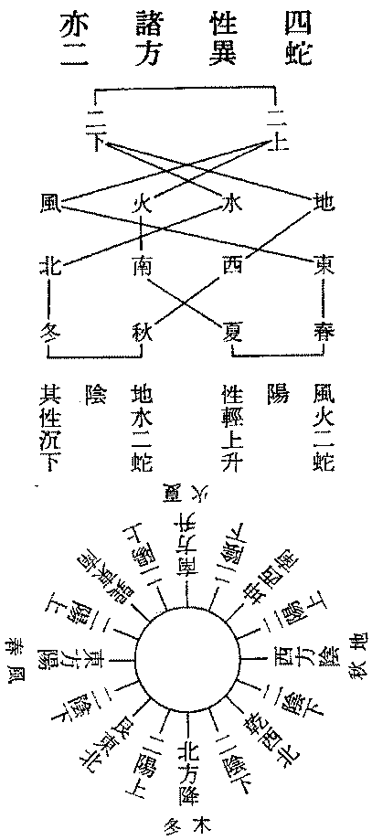



二上二下(光句)



　　地┐　　　　┌西┐  

　　　├下沉属阴┤　│  

　　水┘　　　　└北┤  

　　　　　　　　　　├诸方亦二  

　　火┐　　　　┌南┤  

　　　├上升属阳┤　│  

　　风┘　　　　└东┘



「四明云：四大对四方者，显内四大有四方性，四方升降验大相违，良由内外本一，故依正感名也。」



心识二性(空品)



　　┌善性┬──────┬心───集起───对数──前起  

　　│　　└┐　　　　┌┘│  

　　│　　　└┐　　┌┘　│　俱　　　　大  

　　│　　　　└┐┌┘　　│  

　　│　　　　　├┤　　　意───思量───能生──次起  

　　│　　　　┌┘└┐  

　　│　　　┌┘　　└┐　　　舍　　　　论  

　　│　　┌┘　　　　└┐  

　　└恶性┘　　　　　　└识───了别───分别──后了



「大论云：心意识三，一法异名。」



身心二病



　　　　　　　　　┌因风  

　　　　　　　　　│  

　　　　　　　　　├因水  

　　　　　　　　　│  

　　一、身病─五病┼因热  

　　　　　　　　　│　　　┌非分强作。  

　　　　　　　　　├杂病　│  

　　　　　　　　　│　　　├忘误堕落。  

　　　　　　　　　└客病四┤  

　　　　　　　　　　　　　├刀杖瓦石。  

　　　　　　　　　　　　　│  

　　　　　　　　　　　　　└鬼魅所著。



　　　　　　　　　┌踊跃。  

　　　　　　　　　│  

　　　　　　　　　├恐怖。  

　　二、心病─四病┤  

　　　　　　　　　├忧愁。  

　　　　　　　　　│  

　　　　　　　　　└愚痴。



二意不畅本怀(华严)



一者、教兼别故。



二者、二乘无分故。



四摄各二(净名什注)



　　　　　　　┌施下人以财。  

　　一、布施二┤  

　　　　　　　└施上人以法。  

　　　　　　　┌於下人以软语。  

　　二、爱语二┤  

　　　　　　　└於上人以法语。  

　　　　　　　┌下人方便令得法利。  

　　三、利行二┤  

　　　　　　　└上人方便令得法利。  

　　　　　　　┌同恶人诱以善法。  

　　四、同事二┤  

　　　　　　　└同善人令增善根。



支佛二四六种不同



　　　　　　　　　　　　　┌百刼种相好  

　　　　　　　　　　　　　│  

　　　　　值佛闻法┌大缘觉┼不现通小  

　　　　　　　│　│　　　│　　　　┌不说者小  

　　　　　　　│　│　　　└现通者大┤  

　　一、缘觉─┴─┤　　　　　　　　└说法者大  

　　　　　　　　　│  

　　　　　　　　　└小缘觉─先断见尽七生初果



　　　　　　　　　┌小独觉─先断见尽七生初果  

　　二、独觉─┬─┤  

　　　　　　　│　│　　　┌现通者大┐┌说法者大  

　　　　　　　│　│　　　│　　　　├┤  

　　　　　不值自悟└大独觉┼不现者小┘└不说者小  

　　　　　　　　　　　　　│  

　　　　　　　　　　　　　└─────百刼种相好



华严二种三名



　　一、母胎┐　　　寂场──三七日思惟最初顿说  

　　　　　　└┐  

　　　　　　　├┬─时长──钝根之人三处入法界  

　　　　　　┌┘└┐  

　　二、海空┘　　└尽未来际──华严末席始开於渐



二乘三种忏悔



　　　　┌作法　法华方等─┐　　　　┌作法　经藏轻重俱─┐  

　　　　│　　　般若各有　│　　　　│　　　许忏律不许　│  

　　　　│　　　事仪要制　│　　　　│　　　夷但许下四　├助  

　　大乘┼取相　期限方等　├助　小乘┼取相　阿含犯欲作　│  

　　　　│　　　十二梦王　│　　　　│　　　蛇口想罪即灭┘  

　　　　│　　　菩萨戒见　│　　　　│  

　　　　│　　　光见花等─┘　　　　└无生──析法空观──正  

　　　　└无生　端坐念实相─正



二处三会(法华)



　　一、灵鹫山┬───初──从序品至法师品  

　　　　　　　└┐  

　　　　　　　　└┬─中──宝塔虚空至嘱累  

　　　　　　　　┌┴┐  

　　二、多宝塔内┘　└后──药王品至尽经



二身三身开合



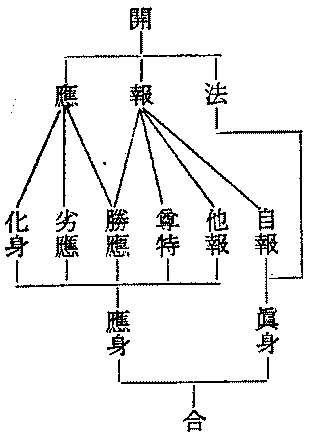



二因五见



　　　　　　┌无┐  

　　一、二因┤　├因──外道邪见  

　　　　　　└邪┘  

　　二、五见──────五利使



方便品中广略二开(法华)



　　　　　┌我以方便力示以三乘教──开权  

　　一、略┤  

　　　　　└诸佛法久后要当说真实──显实  

　　　　　┌总诸佛章┐  

　　　　　│　　　　│  

　　　　　├过去佛章┤  

　　　　　│　　　　│┌皆以无数方便演说诸法──开权  

　　二、广┼现在佛章┼┤  

　　　　　│　　　　│└是法皆为──一佛乘故──显实  

　　　　　├未来佛章┤  

　　　　　│　　　　│  

　　　　　└释迦佛章┘



二教被接按位升进



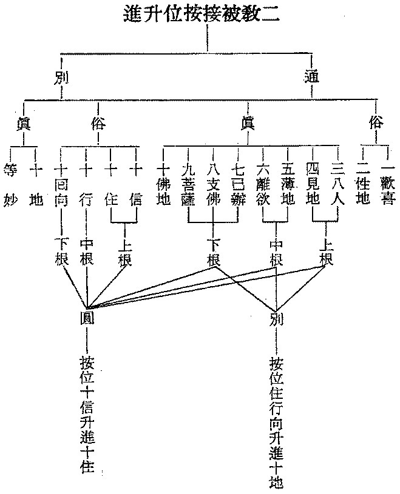



大小二乘停心治法



　　　　　　　┌一对治──如不净治贪，乃至念佛治障，一药治一病也。  

　　　　　　　├二转治──如不净治贪，非嗔转修慈心等。  

　　一、小乘五┼三不转治─病虽转，药终不转。  

　　　　　　　├四兼治──病兼一二，药亦兼用。  

　　　　　　　└五俱治──俱用上法，共治一病。  

　　二、大乘一───第一义治──如阿伽陀药，徧治众病。



二人造恶报有轻重(婆沙)



　　┌异生──非圣种──招恶趣苦───重利──凡庶┬二人  

　　│　　　　　　　　　（上法）　　（下喻）　　　├犯王  

　　└预流──是圣种──招人天轻苦──诃责──王子┴法度



圆人破惑两重能所(止观)



　　　　　　┌兵利──三止┐  

　　（开解）│　　　　　　├能观──谛　观──能破┐  

　　┌初重─┼权多──三观┘　　　　　　　　　　　├┐  

　　│　　　└身壮──三谛─所观──贼阴忘──所破┘│  

　　└次重─────────────────────┘  

　　（立行）



指要复加相砧之喻的，譬圆教两重能所，用在一时，故曰双明。



诸识有二种生住灭(楞伽)



　　　　　┌流注┐　┌三相种现不断，名流注；由无明起业识，名生。  

　　┌生二┤　　├生┤  

　　│　　└相─┘　└现识自种诸境，缘合生死，说为相生。  

　　│  

　　│　　┌流注┐　┌相续长刼，名流注住。  

　　├住二┤　　├住┤  

　　│　　└相─┘　└长刼熏习，名相住。  

　　│  

　　│　　┌流注┐　┌金刚定等觉一念，断本无明，名注灭。  

　　└灭二┤　　├灭┤  

　　　　　└相─┘　└从末向本渐伏，及断至七地满，名相灭。



外道佛法见假二名



　　　　　　　　　　　　　┌单复具足四见─┐  

　　　　　　　　┌外道诸见┤　　　　　　　│  

　　　　　　　　│　　　　└三中各一无言见┤  

　　一、从解得名┤　　　　　　　　　　　　├所生之惑┐  

　　　　　　　　│　　　　┌四教四门四见─┤　　　　│  

　　　　　　　　└佛法诸见┤　　　　　　　│　　　　│  

　　　　　　　　　　　　　└门门一绝言见─┘　　　　│  

　　　　　　　　┌─────────────────┘  

　　　　　　　　└利钝十使，历四谛下，增减不同，成八十八。



若历六十二见，各具八十八使及百单八见。



　　二、当体得名┐　　　　　　　　　　　　　┌法尘对意根念心起，因成。  

　　　　　　　　│　　　　　　　　　　　　　│  

　　┌─────┘　　　　　　　┌约心───┼前念后念次第不断，相续。  

　　│　　　┌单复具足四假　　　│　　　　　│  

　　│┌外道┤　　　　　　　因成┤　　　　　└待餘无心知有此心，相待。  

　　││　　└各有一绝言假　　　│  

　　└┤　　　　　　　　　　相续│　　　　　┌业托父母得有此身，因成。  

　　　│　　┌四教四门十六　　　│　　　　　│  

　　　└佛法┤　　　　　　　相待┤　　┌正报┼从胎相续讫至皓首，相续。  

　　　　　　└门门一绝言假　　　│　　│　　│  

　　　　　　　　　　　　　　　　│　　│　　└以此之身待於不身，相待。  

　　　　　　　　　　　　　　　　└约色┤  

　　　　　　　　　　　　　　　　　　　│　　┌如因四微而成柱，因成。  

　　　　　　　　　　　　　　　　　　　│　　│  

　　　　　　　　　　　　　　　　　　　└依报┼时节改变相续不断，相续。  

　　　　　　　　　　　　　　　　　　　　　　│  

　　　　　　　　　　　　　　　　　　　　　　└此柱待不柱长短大小等，相待。



心目二种为一经大旨(楞严)



　　　　　┌真┐  

　　　┌心┤　├┐  

　　　│　└妄┘│　　┌知┐　┌真空  

　　┌┤　　　　├辩真┤　├即┤  

　　││　┌内┐│　　└见┘　└妙有  

　　│└眼┤　├┘  

　　│　　└外┘  

　　│  

　　│┌七处徵心──穷┐　┌体无有根源  

　　└┤　　　　　　　├心┤  

　　　└八还辩见──究┘　└眼空花对待



净秽二土教主(四明)



　　　　　┌藏尘相须现  

　　　　　│　　　　　　　　（净）  

　　┌华严┼一台上须现　　　┌华严─藏尘───实报─尊特  

　　│　　│　　　　　　　　│  

　　│　　└二台下须现　　　├法华─三十二相─同居┐  

　　│　　　　　　　　　　　│　　　　　　　　　　├生身  

　　├法华─三十二相不须现　│　　┌八万相──净土┘  

　　│　　　　　　　　　　　└观经┤  

　　│　　┌一八万相须现　　（觉）└池上相─────化身  

　　└观经┤  

　　　　　└二池上相生身



空有二门贤圣位次



　　　　　　┌停心──┐　　　┌信行　法行─┐　　学人十八  

　　　　　　│　　　　│　　　│　　　　　　│  

　　　　　　├别相──┼外凡　└─────┐│  

　　　　　　│　　　　│　　　　　　　　　││  

　　　　　　├緫相──┘　　　┌信解　见得││┌─贤位┐  

　　　　　　│　　　　　　　　│身证　家家│││　　　│  

　　┌─七贤┼煖法──┐　　　│一种　　　│││┌──┘  

　　│　　　│　　　　│　　　│　　　　　││││  

　　│　　　├顶法──┤　　　│　　　　　││││  

　　│　　　│　　　　├内凡　│　　┌──┘│││成论  

　　├──┐├忍法──┤　　　│　　│　　　├┘│  

　　│　　││　　　　│　　┌┤初向┘初果　│　│  

　　│毗昙│└世第一─┘　　││二向　二果　│　│  

　　│　　│　　　　　　　　││三向　三果　│　│　　释签  

　　│有门│┌信行──┐　　││中般　生般　│　│  

　　│　　││　　　　├见道││有行　无行　│　│  

　　├──┘├法行──┘　　│└上流────┘　│  

　　│　　　│　　　　　　　│　　　　　　　　　│空门  

　　│　　　├信解──┐　　│┌忍法　护法─┐　│  

　　│　　　│　　　　│　　││　　　不退　│　└──┐  

　　└─七圣┼见得──┼修道┘├退法　住法　│　　　　│  

　　　　　　│　　　　│　　　│　　　　　　├──圣位┘  

　　　　　　├身证──┘　　　├不动　　　　│  

　　　　　　│　　　　　　　　│　　　　　　│  

　　　　　　├时解脱─┐　　　├进法　　　　│  

　　　　　　│　　　　├无学─┤　　　　　　│  

　　　　　　└不时解脱┘　　　├慧解脱　　　│  

　　　　　　　　　　　　　　　│　　　　　　│  

　　　　　　　　　　　　　　　└俱解脱───┘　　无学有九



二身徧应三土



　　　　　　　　　　　　　　┌非身是报┐　　　　┌实报─圆┐  

　　　　　　　　　　　┌非身┤　　　　│　　　　│　　┌别┤  

　　　　　　　　　　　│　　└无分齐相┤　　　　├方便┤　│┌佛住中理┐  

　　　　　　　┌上三能┤　　　　　　　├通应三土┤　　└圆┼┤　　　　├报身  

　　　　　　　│　　　├常寿┐　　　　│　　　　│　　┌圆┤└机依业识┘  

　　　　　　　│　　　│　　├同身──┘　　　　│　　├别┤  

　　　　　　　│　　　└无量┘　　　　　　　　　└同居┤　│  

　　初双明报应┤　　　　　　　　　　　　　　　　　　　├通┤┌机依事识┐  

　　　　　　　│　　　　　┌─身即生身┐　　　　　　　│　├┤　　　　├应身  

　　　　　　　│　　　┌身┤　　　　　│　　　　　　　└藏┘└佛住真理┘  

　　　　　　　│　　　│　└─有分齐相┤  

　　　　　　　└下三能┤　　　　　　　├但应同居  

　　　　　　　　　　　├无常┐　　　　│  

　　　　　　　　　　　│　　├同身──┘  

　　　　　　　　　　　└有量┘



　　　　　　　　　　　　　　　　　　　┌七百──┐  

　　　　　　　　　　　　┌一为有量之量┤　　　　├─事识但空生身──无常  

　　　　　　　　　　　　│　　　　　　└八十──┘  

　　二单示应身─有量二义┤  

　　　　　　　　　　　　│　　　　　　┌山斤海滴┐  

　　　　　　　　　　　　└二为无量之量┤　　　　├─业识不空─尊特─无常即常  

　　　　　　　　　　　　　　　　　　　└人天莫数┘



二断四超



　　　　　　┌任断──得初果已，不起加行，任经七生，断九品惑，即止观：  

　　一、次断┤　　　　旧婆沙对超之次也。既非断惑损生，无断惑缘。  

　　　　　　└次断──得初果已，不欲经生，起大加行，断二必三，断五必六，  

　　　　　　　　　　　大品惑尽而命终者，以断惑损生，三缘具足，得论家家。  

　　　　　　┌本断超─本在外道，修世禅时，用六行观断思，随本断品数多少，  

　　　　　　│　　　　入十六心。超果不同，有漏智弱，抑退一位，本得非想，  

　　　　　　│　　　　今但至三果，无成根缘。  

　　　　　　├小　超─是内弟子，因习定伏见思；今入初果断见惑，所伏思与见同断，  

　　二、超断┤　　　　超至五品，功齐四品。以五六共一生故，亦论家家。  

　　　　　　│　　　　至八品名一种子，乃至无学果向，超果不定。  

　　　　　　├大　超─本在凡地听法，闻唱善来，成阿罗汉，无受生缘。  

　　　　　　└大大超─如佛一念，正习俱尽。辅行云：正习尽，是三藏佛。



四明两重总别



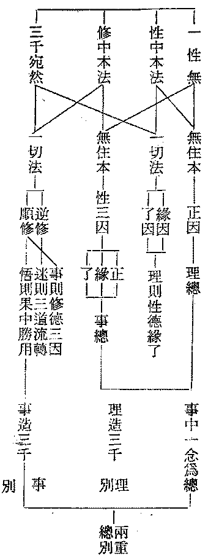



修度得二种果(无著)



　　　　　　　┌檀　那┐　┌大福。  

　　　　　　　├尸　罗┤　├自身具足，谓帝释梵王等。  

　　　　　　　├羼　提┤　├大伴助，大眷属。  

　　一、未来果┼毗利耶┼得┼果报等不断绝。  

　　　　　　　├禅　那┤　├生身不损坏。  

　　　　　　　└般　若┘　└诸根猛利，多诸悦乐，於人天中自在等。  

　　二、现在果─────得一切信敬供养，及现法涅槃等。



教部麤妙二义



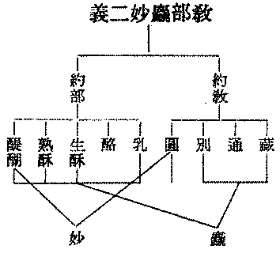



修行多种依二法门(显宗)



一、不净观治贪。



二、持息念活寻。



鹿苑显露定不定对



一、定———陈如得初果。



二、不定——八万诸天得无生忍。



叙出鹿苑显密二相(大论)



一、显──声闻八万一人。(据声闻见边，但可云得法眼净，不可云八万悟大。)



二、密──诸菩萨见无量阿僧祇人，得二乘等。



通示不定秘密二相(释签)



　　（金口）┌不定──互相知─┐  

　　同听──┤　　　　　　　　├异闻  

　　（梵音）└秘密──互不相知┘



鹿苑显密二相相对(别玄记、大经疏)



一、显──说生灭──钝根。



二、密──说常住──利根。(利根密去者，八万诸天是。)



一切法有二种缘相



　　一、外┐　┌泥团柱轮绳水木人工乃能成器。  

　　　　　├缘┤  

　　二、内┘　└无明爱业等法生阴界入法。



二正助道能通涅槃



　　┌一偏缘真谛┐　　　┌得小乘尽苦涅槃  

　　│　　　　　├修正助┤  

　　└二正缘中道┘　　　└到大乘大般涅槃



性相二空境观



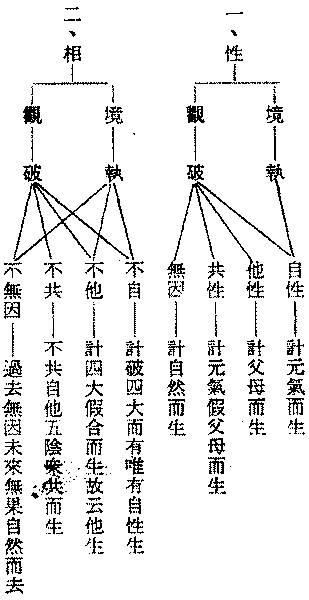



偈曰──诸法不自生，亦不从他生；不共不无因，是故说无生。



生法二空境观



　　　　　　　┌无　我┐　　　　　　┌性──俗┐  

　　　　　　　│　　　│　　　　　　│　　　　│  

　　　　　　　├无　人┤　　　　　　│　　　　│  

　　一、生空观┤　　　├生空境　假名┤　　　　├俗。  

　　　　　　　├无众生┤　　　　　　│　　　　│  

　　　　　　　│　　　│　　　　　　│　　　　│  

　　　　　　　└无寿者┘　　　　　　└相──真┘



(生法乃所执之境，性相属能执之情。)



　　　　　　　┌无　色┐　　　　　　┌性──俗┐  

　　　　　　　│　　　│　　　　　　│　　　　│  

　　　　　　　├无　受┤　　　　　　│　　　　│  

　　　　　　　│　　　│　　　　　　│　　　　│  

　　二、法空观┼无　想┼法空境　实法┤　　　　├真。  

　　　　　　　│　　　│　　　　　　│　　　　│  

　　　　　　　├无　行┤　　　　　　│　　　　│  

　　　　　　　│　　　│　　　　　　│　　　　│  

　　　　　　　└无　识┘　　　　　　└相──真┘



(二空即能空之观，真俗是所显之理。)



二身



一、生身



二、法身



涅槃云：「吾今此身，即是法身。」法华云：「微妙净法身，具相三十二。」又胜劣两应，皆有生法，利见法身，钝见生身。



　　┌真──法──自报──依观音报智立  

　　│　　　身  

　　│  

　　└应─────他报──据普门示现论



二觉



　　　　　┌一　┌始觉　┌所觉┐　　　　┌相  

　　┌等觉┤　　│　　　│　　│　　　　│  

　　│　　└生　│　　　│　　├─是──┤  

　　│　　┌极　│　　　│　　│（楞伽）│  

　　└妙觉┤　　│　　　│　　│　　　　│  

　　　　　└位　└本觉　└能觉┘　　　　└见



二应



一、胜应──尊特──丈六境本身现起，为华严教主，亦名他报。



二、劣应──丈六──苦行六年，树下以草为座成道，对胜名劣。



二始



一、大──寂场。



二、小──鹿苑。



(不动寂场，而游鹿苑，谓之双垂两相，二始同时。)



二乘



一、小乘──迦旃延於婆沙明三藏，法华：贪著小乘三藏学者；故大师指小乘为三藏。



二、大乘──通：意融三故大；别：依一法性显三故大；圆：三一无碍故大。故三教名大乘。



二教



　　┌救形之教为外──外经──外论──外律──外道  

　　│  

　　│　　二教论　　　智论　　仁王　　方等　　百论  

　　│  

　　└济神之典为内──内经──内论──内律──内道



二字



一、半字──悉昙章生字之根本，名半。



二、满字──餘章文字具足，名满。



------



### 二序



一、通序──经前五事等。



二、别序──请问发起等。



二权



一、同体──今经开显名同体。



二、异体──三教未开显名异体。



二典



一、内典──济神曰内。



二、外典──救形曰外。



二藏



一、声闻藏。



二、菩萨藏。



二圆



一、今圆──法华──诸味圆教更不须开。



二、昔圆──华严──方等般若三味之圆。



二门



　　┌小──藏为半字教，故小。　　┌权┐　　(净)  

　　│　　　　　　　　　　　　　　│　├不思议本  

　　└衍──通别圆为满字，故大。　└智┘　　(名)



二门



　　┌定门  

　　└慧门



法华云：仓库盈溢。仓是定，即百八三昧；库是慧，即十八空境，通别二种定慧。又仓库者，能包藏一切禅定智慧。



　　┌乘  

　　└戒



夭伤慧命是无戒门，亡失法身是无乘门，湼槃扶律谈常，二门具足。



二门



　　　　　┌法华前十四品是　┌福德─行施忍辱　┌理──识性真空是如理门  

　　┌迹门┤　　　　　　　　│　　　　　　　　│  

　　│　　└迹门开权显实　　│　　　　　　　　│  

　　│　　　　　　　　　　　│　　　　　　　　│  

　　│　　┌后十四品是本门　└智慧┐　　　　　└量──识相妙有是如量门  

　　└本门┤　　　　　　　　　┌─┘  

　　　　　└开迹显本　　　　　└知一切诸法实相般若波罗密



二门



　　┌折──释迦示苦折之　　┌忻──安养之乐  

　　└摄──弥陀摄归安养　　└厌──娑婆之苦  

　　┌事┐　　　　┌戒门──不许畜八不净物等  

　　│　├─即──┤  

　　└理┘（湼槃）└乘门──如来毕竟不入涅槃及遮外典等



二道



　　┌无碍  

　　└解脱



三藏菩萨以九无碍、九解脱，并八忍、八智，共三十四心，顿断见思习气，至树王下成佛，又无碍道断，解脱道证。



　　┌偏　┌有漏　┌正──内  

　　│　　│正理　│  

　　└圆　└无漏　└邪──外



二道



　　┌正  

　　│　　实观三十七品，三解及三解脱门，缘理慧行，得解观中诸对治法，及一切禅定等。  

　　└助  

　　┌教──别教地前  

　　│　　　　　　　　　　　本出地论，今家借用，以消别名。  

　　└证──登地即同圆初住



二心



　　┌发心──圆初住  

　　│　　　　　　　　涅槃云：发心究竟二不别，如是二心前心难。  

　　└究竟──妙觉  

　　┌忍  

　　│　　（四谛下八忍，八智世第一；后心用此断，见名十六心。）  

　　└智



二智



　　┌权智  

　　│　　　净名方便为父名权，智度为母名实。  

　　└实智  

　　　　　┌权智  

　　不思议┤　　　唯佛与佛乃能究尽，於种种法证本圆觉。  

　　　　　└实智  

　　┌中智──声闻缘觉  

　　│（湼槃）  

　　└上智──诸佛菩萨



二戒



一、道──解脱──七支无表思，由断惑得名。



二、事──别解脱──三业七支，各各防非，别别解脱。



二慧



一、实慧──观心本空。



二、方便──运用觉知。



二行



　　┌差别　　┌慧行─缘空直入─顿修　┌信─乐多闻─钝─声闻  

　　│　　　　│　　　　　　　　　　　│  

　　│（清凉）│（大集）　　　　　　　│  

　　│　　　　│　　　　　　　　　　　│  

　　└普贤　　└行行─带事兼修─渐修　└法─宗深观─利─支佛



(通论各有信法二行。)



二善(观经)



　　┌定──十六妙观  

　　│  

　　└散──三种净业  

　　┌已生──增长已生善如溉甘露栽  

　　│（婆沙）  

　　└未生──未生善为生如钻木出火  

　　┌真  

　　│　　法华云：不种善根，贫穷下贱，由不生真中二善，故无益。  

　　└中  

　　┌有漏  

　　│（婆沙）  

　　└无漏



二空



一、性空。



二、相空。



性谓性实，从境本立；相谓名相，约执观论；谓於生法境上起能执情，曰性相。用即空观荡性相执，则一空一切空，三观异名也。



二度



一、拙──声闻化人，头陀苦行等，未善行菩萨道。



二、巧──菩萨化人，观诸法实相，善行菩萨道故。



二理



　　┌权  

　　│　　如来藏中权实体同，随顺机宜，从一实理施出权理，故有四种差别教起。  

　　└实  

　　┌真─藏通诠真。  

　　│  

　　└中─别圆诠中。通教被接，真含二中。



二修(善导)



一、专──专礼专念，专想弥陀。



二、杂──散修诸善，回向庄严。



二修(地师)



　　┌真──登地──任运相应中道　　　　┌显──十二部三藏圣教  

　　│　　　　　　　　　　　　　　　今家┤  

　　└缘──别地前──作意缘修空假　　　└密──坛场作法诵咒



二忏



　　　　┌作法┐　　　　┌苦┐  

　　┌事┤　　├助┐　┌┤　├┐  

　　│　└取相┘　│　│└业┘│  

　　│　　　　　　├忏┤　　　├道  

　　│　　　　　　│　│　　　│  

　　└理─无生─正┘　└烦　恼┘



二翼(止观)



一、定。



二、慧。



(鼓两翊以高飞，喻定慧之竖彻。)



二轮



一、止。



二、观。



驰二轮而致远，喻止观以横周。荆溪祖师咨启尤溪尊者曰：某於畴昔之夜，梦被僧服，腋挟两轮而游於大河。尤溪曰：汝当以止观之道而度生乎？果签释止观，以开后人。



二伊



一、新。



二、旧。



如此方草书下字，细畫相连，不纵不横，喻圆教三德。(新)



横如烈火，竖如点水，各不相续，喻昔教三德不相即。(旧)



二观(记主)



一、事──从事专照起心。



二、理──从理唯达法性。



二造



一、事──三千六也。



二、理──三千即也。



天台引华严心造，荆溪作二造释，以并由理具，方有事用，只一心造，有事有理。



二现



一、须现──藏尘尊特。



二、不须──随所示现。



二法



一、无明──暗𨔝。



二、法性──明静。



荆溪曰：「若从事说：若见法性始，则见无明终；从见法性终，名见无明始。若从理者：应知二法俱始并终；况此二法，自无二法，俱无始终。是知：从理则真如同源，本无终始；从事乃迷悟敻隔，终始条然。」



二法



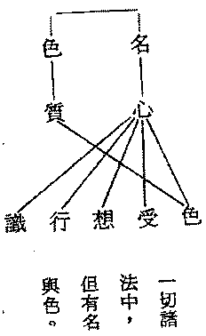



　　┌内法内名──理内┐　　　　　　　　　能解能知　┌胜义──择灭涅槃  

　　│（法华文句记）　├所诠法相及能诠名　　　　　　│（毗昙）  

　　└外法外名──理外┘　　　　　　　　　毗昙法相　└法相──通四圣谛



二法



　　┌止──定　　　　┌自得──不从他得　┌性──性以据内自分不改  

　　│　　　　（天台）│（楞伽）　　　　　│（妙玄）  

　　└观──慧　　　　└本住──了无所迁　└相──相以据外揽而可别  

　　┌染──一切烦恼具足性染事　　┌生  

　　└净──具足漏无漏性出障净法　└灭



二果



　　┌习气　　┌异熟　┌如来──智  

　　│（毗昙）│　　　│  

　　└报果　　└增上　└涅槃──断



二凡



一、内──煖顶忍第一法。



二、外──五停心总别相。



二谛



　　┌真　同归一念　┌非安立──胜义谛  

　　└俗　百界千如　└安立谛



二医



一、新──佛为三界大医王，故称新。



二、旧──轮王以五戒十善，化治名旧。



二相(净名)



　　┌─眼  

　　└─色



有佛世尊得真天眼，常在三昧，见诸不以二相。什曰：不为色作精麤二相。肇曰：真天眼谓法身无相之目，万色弥广，有若目前未常不定，未常不见，故无眼色之二相也。



　　┌生──以生┐　　┌住  

　　│（圭峰）　├摄　│  

　　└灭──以灭┘　　└异──四相



二宗



　　　　　┌龙树承文殊，明一切众生皆有佛性，名一性宗。  

　　一、性┼天亲承弥勒，三无二有，名五性宗。  

　　　　　└自龙树传天台贤首，以法性为宗承。  

　　二、相─自戒贤传至慈恩，以法相为宗承。



二出(桐江)



一、横──不历地位，但念弥陀，求生净土。



二、竖──三乘人依谛、缘、度万行地位而出。



二求(观音)



　　┌男┐　┌福德智慧之男  

　　│　├生┤  

　　└女┘　└端正有相之女



二息(安般)



　　┌安那┐　　┌遣来──入  

　　│　　├此云┤  

　　└般那┘　　└遣去──出



二贪



一、有力──以威势取



二、无力──但能从他乞索



二济



　　┌佛道──正─┐  

　　│（净名肇注）├济  

　　└外道──邪─┘



二领(法华经信解品)



一、齐──从机禀教得益之时。



二、行──ㄓ取佛称法鉴照之日。



二科



一、解。



二、行。



天竺众制云：「学者所志，此为先务；后生无知，事同公役。既不获已，须行严治；后之来者，宜自加勉。」



二障



一、事──於世间事处生著。



二、理──於真空义处生著。



二惑



　　　　　┌见─┐  

　　┌界内┤　　├通┐  

　　│　　└思─┘　│　┌有漏┐　　　┌三界┐　　　　　┌界内  

　　│　　　　　　　├润┤　　├业─招┤　　├生尘沙　通┤  

　　│　　┌尘沙┐　│　└无漏┘　　　└变易┘　　　　　└界外  

　　└界外┤　　├别┘  

　　　　　└无明┘



二惑



　　　　┌即见思通　　　┌八十八使身  

　　┌通┤　　　　　┌见┤  

　　│　└三乘人断　│　└见边见等　　　┌理┐　　　┌中道──种子  

　　│　　　　　　　│　　　　　　　　　│　├或迷　│  

　　│　┌无明尘沙　│　┌八十一品九地　└事┘　　　└三谛──现行  

　　└别┤　　　　　└思┤  

　　　　└别菩萨断　　　└各有九品贪等



二见



　　┌同分妄见──三千洲中，一国恶缘，感於不祥，餘国不见，喻无始妄见。  

　　└别业妄见──一人病目，见灯别有圆相，喻一人自悟之境。  

　　┌今见──住地  

　　└无见──究竟



二见



　　┌断  

　　│　　外道计六十二见此为根本  

　　└常  

　　┌生死  

　　│　　　思益云：「诸佛出世，不为令众生出生死入涅槃，但是度生死涅槃二见。」  

　　└涅槃  

　　　　　　　　　　　┌破戒拨  

　　┌内──妄想　┌断┤  

　　│　　　　　　│　└无因果  

　　│　　　　　　│  

　　│　　　　　　│　┌说於无  

　　└外──诸法　└灭┤  

　　　　　　　　　　　└常



二恶



　　┌见思  

　　│　　　不断见思无明二恶故有损  

　　└无明  

　　┌已生──断已生恶法犹如除毒蛇  

　　│(婆沙)  

　　└未生──断未生恶法如预防流水  

　　┌修┐  

　　│　│  

　　│　├─前念实相，盖体修恶即是性恶，性恶照明斯为慧月，修恶体虚如消霜露。  

　　│　│　(普贤行法经)  

　　└性┘



二境



　　┌内──识心──心──自──一念为内  

　　│（四念处　别行玄）　　　　┌阴色依正生佛　┌十不二门  

　　└外──阴色──佛众生──他┤　　　　　　　│  

　　　　　　　　　　　　　　　　└色心皆名为外　└会二处文



二恼



一、生──有情。



二、法──无情。(丈六劣应生身，能忍二恼故，喻弊垢之衣。)



二业(净名肇注)



一、智──决定审理。



二、慧──造心分别。



二业



　　┌黑──作不善业，地狱受苦，故名黑业。　　　　　┌引  

　　└白──作善报，处天堂受乐，自在明了，故名白。　└满



二轮



　　┌生┐┌两轮既具  

　　│　├┤  

　　└死┘└六趣斯游



二愚



一、无相作功用。



二、於相不自他。



二缚



　　┌子──见思烦恼┐  

　　│　　　　　　　├罗汉子缚已断，果缚犹在，名有餘涅槃。  

　　└果──五阴报质┘



二系



一、五尸系──不净观治爱魔，表五种不净。



二、系五处──如理治见魔，表五种观门。



二我



一、人──邪──推理见及发得见。



二、法──慢──举𧑃张鬐，努目自大。



二习



一、结。



二、佛法中爱──得无生忍，结习尽而未断爱故。



二记(法华)



一、通。(八部四众三乘等，在会闻法，灭后闻一句一偈。)



二、别。(迹门别授应记，本门别授法身记等。)



二处(安乐)



一、行处。



二、近处。



双王



一、兄──治男事。



二、妹──治女事。



(梵语：琰魔，此云：双王。又云：苦乐并受名双。兄妹并皆为大地狱主，名双王。)



二气(草庵)



一、清──升而上轮之，则成三善道。



二、浊──沉而下轮之，则成三恶道。



二仪



一、天。



二、地。



御制心经序云：「二仪久判，万物备周，四教仪集注云：元气未分，混而为一，两仪既判，清为天，浊为地。」



二应身



一、胜应──亦名他报。



二、劣应──即丈六身。



二行



　　┌日游在内北行┐  

　　│　　　　　　├一行为六月，二行合十二月，成一岁耳。  

　　└月游在外南行┘



二月



一、白──初一日至十五日。



二、黑──十六日至三十日。



(此喻如来智断二德。)



二报身



一、自报──亦名自受用，即修德法身。



二、他报──亦名他受用，即胜应身。



二如来



一、真身──乘如实道，来成正觉。



二、应身──来生三界，未成正觉。



二佛声



一、口密音──目连至极西方，闻佛声如对面。



二、不密音──人至佛边，方得闻。



二事



一、假。



二、实。



二字教



一、半──三藏九部。



二、满──大乘方等。



二秘密



一、至理──阿含甚深之理不可说，第一义谛无声字。



二、言词──诸佛咒虽立语言，词句人不能解。



二密语



一、自得法──修德。



二、本住法──性德。



经云：我於某夜成道，某夜涅槃，中间不说一字，依何密语？佛言：「依二密语。」



二秘密



一、隐秘──四时权谋隐覆曰秘，神用潜益曰密。



二、真秘──法华昔所未说曰秘，闻已无外曰密。



二法轮



一、显──见说生灭。



二、密──见说无常。



(鹿苑声闻见八万一人是显，菩萨见无量阿僧祇人得二乘、十地、一生补处是密，故知鹿苑亦有悟大，乃佛赴机之妙也。)



二种法(大经)



一、世法──无常无乐无我无净──二乘──外、有为、可得、人中十一部，此是坏法。



二、第一义──常乐我净──菩萨──内、无为、不可得、天中、方等，皆不坏法。



(湼槃云：若我弟子受持、读诵、书写、解说、供养，当知佛法不灭。)



二自性(楞伽)



一、名相。



二、自相。



二归戒(五分)



　　┌佛┐  

　　│　├佛初成道，为二贾客及女人须阇陀，并五人陈如等，皆授二归，此时未有僧宝故。  

　　└法┘



二尸罗



一、在家──三归五戒八戒斋。



二、出家──沙弥十戒乃至八万律仪。



二生忍



一、恭敬供养──於中能忍不著则不生憍逸。



二、嗔骂打害──於中能忍不生嗔恨怨恼。



二法忍



一、非心法──寒热、风雨、饥渴、老病死等。



二、心法──嗔恚、忧疑、淫欲、憍慢、诸邪见等。



二戒果



一、天乐。



二、菩提。



(智者但求菩提乐，不求天乐。)



二精进



一、始发──以始发心，精进习成一切善法。



二、终始──以终精进，分别一切法，不得自在。



二种义(净名什注)



　　┌识┐  

　　│　├所知义  

　　└智┘



二禅那



一、世间──根本四禅、四无量心、四无色定，是凡夫修。



二、出世──六妙门、十六特胜、乃至三明六通等。



二种法(净名什注)



一、文字语言。



二、法义。



二法相(大品)



一、有为──十八空智、八圣道智、十力无畏、世出世间等法。



二、无为──无生无灭、无住无异、无垢无净、无增无减、诸法自性。



二总持



一、心相应。



二、不相应。



二种师(湼槃)



　　┌善教──教以身口意善　┌初与出家  

　　│　　　　　　　　　　　│(律文)  

　　└恶教──教以诸不善业　└为授近圆



二和尚



一、亲教──受业师。



二、依止──禀学师。



二种僧(十轮)



一、胜义──佛菩萨二乘等。



二、住持──高僧传有十科。



二弟子



一、出世圣人──目连等闻微密音声。



二、世间凡夫──随其所近方闻佛声。



二开权



一、通──一切众生皆当作佛，通开九界咸成佛道。



二、别──法华会中当座得入。



二菩提



一、初心──初住。



二、后心──妙觉。



二果德(华严)



一、依──华藏世界。



二、正──十身舍那。



二中道



　　┌正觉　　┌但中──别接通  

　　└离正觉　└不但──圆接通



二种觉



　　┌四谛─┐  

　　│　　　├中觉  

　　└一切法┘



二种觉(楞伽)



一、真──观察。



二、妄──建立。



二神力(楞伽)



一、现身面。



二、手摩顶。



二乘出入(方等)



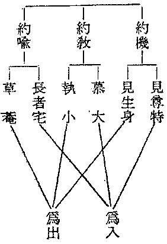



二平等



一、法──大慧所观之理。



二、众生──一切众生从因至果，同得佛慧。



二愚法(大经)



一、作罪。



二、覆藏。



二无为(安般)



　　　　　┌数息┐  

　　　　　│　　│  

　　　　　├随息┤  

　　　　　│　　│  

　　　　　├止─┤  

　　一、内┤　　├六妙门  

　　　　　├观─┤  

　　　　　│　　│  

　　　　　├还─┤  

　　　　　│　　│  

　　　　　└净─┘  

　　　　　┌眼不著色──一角大仙因著色故，颈骑淫女。  

　　　　　│  

　　　　　├耳不听声──五百仙人闻女歌声，皆失禅定。  

　　　　　│  

　　　　　├鼻不受香──爱莲华香，池神呵责。  

　　二、外┤  

　　　　　├舌不味味──沙弥味酪为酪中虫，何况酒肉等。  

　　　　　│  

　　　　　├身离细滑──术婆伽欲火内发，烧身为灰。  

　　　　　│  

　　　　　└意不妄念──人不得道者，思相秽念多故。



佛学名相汇解　卷第六（终）



内外二境



　　　　　　┌内──识心─内─　念处约五阴  

　　┌四念处┤  

　　│　　　└外──阴色─外─  

　　│  

　　│　　　　　　　　心─内┐  

　　│　　　　　　　　　　　│  

　　│　　　　　　　　依┐　├不二门  

　　│　　　　　　　　　│　│  

　　│　　　　　　　　正┤　│  

　　│　　　　　　　　　├外┘  

　　│　　　┌自　　　色┤  

　　└观音玄┤　　生　　│  

　　　　　　└他　　　心┘  

　　　　　　　　　佛　　　　　　别玄约三法  

　　　　　　　┌多著外色┐  

　　　　　　┌┤　　　　├下界  

　　　　　　│└少著内识┘  

　　（指要）│  

　　　　　　│┌少著外色┐  

　　　　　　└┤　　　　├下界  

　　　　　　　└多著内识┘



依报生佛及己色阴皆名为外，惟己心为内。



齐探二领(出法华文句)



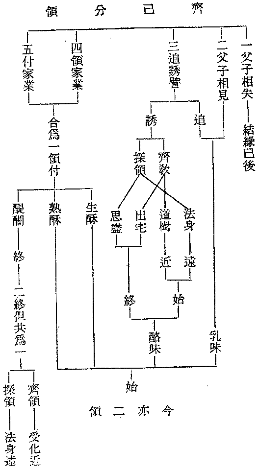



二种罗汉



　　┌时解脱──信行钝根缘具入道　┌慧──缘空直入但证无学  

　　│析玄　　　　　　　　　　　　│妙玄  

　　└不时解脱─法行利根不待缘具　└俱──带事兼修具三明八解  

　　　　　　　　　　　┌九　　　想┐  

　　　　　　烧灭骨人　│　　　　　│  

　　┌坏法──────┼八　　　念┤  

　　│　　　急取无学　│　　　　　│  

　　│　　　　　　　　└十　　　想┤  

　　│止观　　　　　　　　　　　　├观  

　　│　　　　　　　　┌八　背　舍┤  

　　│　　　来住骨想　│　　　　　│  

　　└不坏──────┼八　胜　处┤  

　　　　　　八色流光　│　　　　　│  

　　　　　　　　　　　├十一切处─┘  

　　　　　　　　　　　│  

　　　　　　　　　　　├九次第定──练  

　　　　　　　　　　　│  

　　　　　　　　　　　├师　　子──熏  

　　　　　　　　　　　│  

　　　　　　　　　　　└超　　越──修



二种方便



　　┌通──二十五法，通四种三昧故。  

　　│　　┌方等梦手  

　　└别─┤  

　　　　　└法华六时五悔──四三昧中，别於一种三昧用。



二净法



一、具足无漏性功德法。



二、具足出障净法。



二无诤(净名什注)



一、以三昧力将护众生，令不起诤心。



二、随顺法性，无违无诤。



二染法



一、具足染性。



二、具足染事。



二觉义



一、觉於自心，其躰无别。



二、净心自觉。



二无知



一、染污──无明为体。



二、不染污──劣慧为体。



二无明



　　　　　　　　　┌过去  

　　┌独头　润业─┤  

　　│　　　　　　└烦恼  

　　│  

　　└相应　润生──托胎时，於父母生憎爱。



二戏论



一、真实理生。



二、世间事生。



二即习



一、尘沙。



二、无明。



二缘习



　　┌有为┐  

　　│　　├缘习  

　　└无为┘



二老苦



一、念念。



二、至终。



二老苦



一、增长。



二、灭坏。



二死苦



一、病死。



二、外缘。



二痈疮



一、见求他过。



二、自覆己过。



宝积经中，痈疮毒箭二䌸谓之三双，喻观者宜自照之。中绳谓之君子；不中绳谓之小人。



二三毒



一、惑──任运起是昏烦法，恼乱心神名烦恼。



二、业──卒然而起，决定能动身口名业。



二毒箭



一、邪命为利。



二、好乐衣钵。



二治病



一、止──由心忆想，鼓作四大故病生；息心和悦病即差。



二、观──但观心想气。治者，即是观能治病。



二无色



一、虚空。



二、识性。



二种尽(净名)



一、无为──智慧断令灭，菩萨不住有无。



二、有为──无常迁变。



二种䌸



一、见䌸



二、利养䌸。



二种悔



一、因掉后生悔。



二、作大罪常怖畏悔，一箭入心不可拔。



二种魔



　　　　┌百怪　天台礼  

　　┌强┤  

　　│　└惧怖　文云强  

　　│  

　　│　┌爱诈　软消魔  

　　└软┤  

　　　　└亲善　寂照功



二天眼



一、报得。



二、修得──五道中，天眼从修得非报得，常忆念种种光明而得故。



二无漏(婆沙)



　　　　　┌八  

　　┌学─┤  

　　│　　└智  

　　│  

　　│　　┌尽智  

　　└无学┤  

　　　　　└无生智



二头鸟(本行)



一、一头名迦喽茶。



二、一头名优波迦喽茶。



(即共命鸟，缘载翻译名义备详)



二贱姓



　　┌吠奢──啇估  

　　│诸佛不生  

　　└首它──农田



二贵姓



一、刹帝利──尚尊贵时，佛於王种生。



二、婆罗门──尚多闻时，佛於净行生。



二种行(大经)



一、见──修慈悲。



二、爱──修喜舍。



二世界



　　　　　┌四圣  

　　┌十界┤  

　　│　　└六凡  

　　│  

　　│　　┌欲色  

　　└三界┤  

　　　　　└无色



二住处(真谛)



一、境界──游历之境，为化俗流。



二、依止──统出家众，即祇园也。



二如来藏(胜曼)



一、空──心体平等妙绝染净之相。



二、不空──具有染净二法以明不空。



二经同味(同一醐味)



一、法华大收。



二、涅槃捃舍。



二摩诃衍



一、法──即众生心，是摄一切世出世法。



二、义──依於此心，显示摩诃衍义。



离二趣(楞伽)



一、言说相。



二、文字相。



二种圣人(光句)



一、世间──天王人王等。



二、出世──诸佛菩萨等。



二种说法(大集)



一、一者开化人天福无量故。



二、二者为报施主恩故。



二种第一(净名什注)



一、佛──人中第一。



二、涅槃──法中第一。



二种正法(婆沙)



　　┌世俗──名句文身┐　┌经律论  

　　│　　　　　　　　├即┤  

　　└胜义──圣　　道┘　└根力觉道



二种大乘(寄归)



一、中观──俗有真中，体虚如幻。



二、瑜伽──外无内有，事皆唯识。



二种善机



一、感人天华报。



二、感佛道果报。



二种支佛



　　┌辟支迦罗──通──缘觉┐　┌内因缘禀佛教法──顺生佛世  

　　│　　　　　　　　　　　├观┤妙句引大论  

　　└毕勒支底迦─局──独觉┘　└外因缘无师自悟──出无佛世



二种如佛(辅行)



　　┌第十亦名菩萨，对共佛地故。　　　┌观行  

　　│　　　　　　　　　　　　　　　　│（释签）　此是圆教非通教意。  

　　└被接人，能八相作佛，似通佛故。　└相似



二种方便



一、解深空而不取相受证，义深功重，故称为父。



二、以实相理深，莫能信受，须此诱引。



二戒僧



一、说戒。



二、羯磨。



二种四教(湼槃)



　　一、追说──追分别众经，故具说四种四谛。　┌施权┐  

　　　　　　　　　　　　　　　　　　　　　　　│　　│　即四不可说  

　　二、追泯──追泯众经，俱寂四种四谛。　　　└开权┘



二须菩提



一、善现──舍卫国鸠留长者之子，解空第一。



二、天须菩提──喜著好衣，行本清净。



二种利他(南岳止观)



一、顺化。



二、逆化。



二种方便(止观)



一、远──五品观行等，去真犹远。



二、近──六根清净，相似近真。



又二种方便



一、二十五法为远方便。



二、十种境界为近方便。



二种三千(详解)



　　┌理体具足─┐　　　　　　　　　　　┌修善修恶  

　　│　　　　　├性具三千┐　　　　　　│  

　　├诸法宛然─┘　　　　│（金）　　　├理造三千  

　　│　　　　　　　　　　├─一念具足　│　　　　　六也即也  

　　├诸法趣一法┐　　　　│（錍）　　　├性善性恶  

　　│　　　　　├变造三千┘　　　　　　│  

　　└诸法宛然─┘　　　　　　　　　　　└事造三千



(理即迷逆是修恶，名字以去，顺性是修善，六即皆具事理二种三千也。)



两重总别(指要)



　　　　┌总　一念总具诸法┐　　　　┌一法咸具事理┐　┌总  

　　┌理┤　　　　　　　　├理具三千┤　　　　　　├理┤  

　　│　└别　所具诸法──┘　　　　└诸法宛然──┘　└别  

　　│  

　　│　┌总　一念能造诸法┐　　　　┌诸法咸趣一法┐　┌总  

　　└事┤　　　　　　　　├事用三千┤　　　　　　├事┤  

　　　　└别　所造诸法──┘　　　　└诸法宛然──┘　└别



两重能所(指要)



　　　　　┌能观──一心三观┐　　　　　　　　　　　一譬  

　　┌初重┤　　　　　　　　├能观┐　┌能槌┐  

　　│　　└所观──一境三谛┘　　├能┤　　├初重　双明  

　　│　　　　　　　一念妄心─所观┘　└所砧┘  

　　│　　　　　　　　　　　　　　　　　　　　　　　两重  

　　└次重─────────────所─朴──次重



二鸟双游



一、鸳。



二、鸯。



涅槃云：「何圣共行？娑罗迦邻提鸳鸯鸟也。」飞止不相离，故言俱游并息；以喻如来常、无常二用，生死是常无常，涅槃亦是。在下在高，双飞双息，理事相即，故曰双游，喻曰双游，法曰双即；事理体一故并息。虽是二鸟游息俱时，巧喻事理体一相即，其妙如此。盘谷云：「章安只言双游，竹庵兼言并息。」



二种断奠



一、法华──三周说法，断奠声闻，咸归一实。



二、涅槃──以胜三修，斥劣三修，断奠声闻，入秘密藏。



二种因果



一、世间──苦果集因。



二、出世──灭果道因。



二种三界(法华)



一、界内。



二、界外。



界外淮界内立三界名：中理未穷通名见惑；通三界变易土中，胜妙五尘名欲界；思不思议法尘为上界。思经云：不如三界见於三界。谓：不同二种三界众生，见於三界之相也。



二种顺化(南岳止观)



一、应身及摩㝹摩化身。



二、净土及杂染土。



二增上慢



一、大乘──自谓得罗汉果，不求大乘。



二、小乘──位在煖顶。



二种布施(大丈夫论)



一、人道中有──除众生身苦──为其作无尽钱财──为身得乐──为众生所爱──为愚人所爱──能与现乐。



二、大悲中有──除众生心苦──为能无尽智──为得心乐──为世间所敬──为智者所敬──能与涅槃乐。



二种施食(光句)



　　　　　　　　　┌得之则生┐  

　　┌依百味甘浆─┤　　　　├┐  

　　│　　　　　　└失之则死┘├事施  

　　└正身肉骨髓───────┘



律分二宗



一、资持。



二、会正。



二种行道(婆沙)



一、易──念佛乘弥陀愿力，决定往生。



二、难──五浊恶世求道，甚难可得。



二种修行



一、初行──三七日前方便。



二、久修──四安乐行。



二种修忏



一、事──礼念行道，悉皆一念，无分散意。



二、理──所作之心，心性不二，观见一切悉皆是心，不得心相。



二种解脱(净名什注)



一、解脱烦恼。



二、解脱於碍。



二种一心



一、事──行者初入道场，乃至一期满足，中间无分散意，一心精进。



二、理──行者从初至终，一期之内，常自照了，心性不二，不生灭，不得心相。



二长寿报(光明)



一、不杀。



二、施食。



二种一切



一、名字──一切皆畏死，无不畏刀杖，无色无身不畏刀杖。



二、实──内外法是二乘能知，不能用一切道超一切种。



二种饶益(净名什注)



　　┌即时┐  

　　│　　├法施  

　　└未来┘



二种远离(净名什注)



一、身栖事表。



二、心无累想。



二种涅槃



一、少分──胜鬘云：「知有餘苦，断有餘集；证有餘灭，修有餘道。」



二、究竟──大法鼓云：「乃至得一切功德、一切种智、大乘涅槃，然后究竟。」



二种依号(首楞)



　　　┌不觉　　┌菩提  

　　转┤　　　依┤  

　　　└生死　　└涅槃



二愚不及(通玄)



一、佛相随好无尽。



二、僧祇数量广大。



(菩萨智所不及，故谓之二愚。)



二种赴请(僧祇)



　　┌僧次┐　　　　┌归僧  

　　│　　├所得杂物┤  

　　└私请┘　　　　└归己



二种凡夫



一、婴儿──无智慧故。



二、愚暗──顽钝不可教故。



二种对法(毗昙)



一、对向──以乘无漏圣道之因，感趣涅槃。



二、对观──圆极之果，以净慧之心，观察四谛之法。



二种智法



一、不造诸恶。



二、作已忏悔。



二黑无异(楞严)



一、诸盲无眼──全见前黑，忽得眼光，还见前尘，见种种色，名眼见者。



二、有眼处暗室──全见前黑，忽获灯光，亦於前尘见种种色，应名灯见。



二种大刼(集解地持)



一、一者日月、昼夜、时节、岁数无量名阿僧祇，是菩萨大阿僧祇。



二、二者大刼无量。



二种身见(楞伽)



一、俱生。



二、妄想。



二无因论(首楞)



　　┌本┐外道  

　　│　├无因  

　　└末┘断见



佛陀二义(妙乐)



　　┌智者┐　┌迷┐  

　　│　　├对┤　├说  

　　└觉者┘　└悟┘



二惑开合



　　　　　　　┌见八十八使┐  

　　┌见思俱开┤　　　　　├三界九地  

　　│　　　　└思八十一品┘  

　　│  

　　│　　　　┌见八十八使┐  

　　├开见合思┤　　　　　├九十八使  

　　│　　　　└思　十　使┘  

　　│  

　　│　　　　┌见为一住─┐  

　　└开思合见┤　　　　　├四住  

　　　　　　　└思惑分三─┘



布施二摄



一、六度。



二、众生。



法空二句(金刚)



　　┌无　法　相──五　阴　空──阴空为药名法───空药亦遣  

　　└无非法相───五阴相空───阴有为病名非法──阴病既除



经有二训



　　┌法┬─凡圣之所轨则  

　　│　└┐  

　　├又─┼十界同遵三世不易  

　　│　┌┘  

　　└常┴─魔外不能改坏



二种无始(楞严)



一、生死根本──用攀缘心，为自性者。



二、菩提涅槃──元清净体，识精无明，能生诸缘。



光赞二义(般若)



一、光即光明。



二、赞即讲说。



(尔时世尊从其舌本，悉履佛土，而出无量百千光明；光中自然植金莲华，华上各有诸佛讲说此经。)



弥勒二名



　　┌梅怛丽┐　　┌慈氏  

　　│　　　├此云┤  

　　└阿逸多┘　　└无能胜



菩萨二种(通教)



一、利见不空──别圆来接。



二、钝见偏空──同三藏佛。



陀罗二字



　　┌持义──执持是自行  

　　│▆　诸经题上安此二字，是陀罗二字，谓执持流布也。如：义净能断金刚论。  

　　└流义──流布是化他



此方二教



一、儒。



二、道。



弥陀二义



一、光明无量。



二、寿命无量。



菩萨二法(净名)



　　┌轻新学不教诲  

　　│　　　　　　　　肇曰：「此学者之内患。」  

　　└於深法取相分别



净名二题



　　┌维摩诘所说──单人立题  

　　│　　　　　　　　　　　┌微远幽深──二乘┐　　　　┌测  

　　└不可思议解脱─单法立题┤　　　　　　　　├不能──┤　　名不可思议解脱  

　　　　　　　　　　　　　　└纵任无碍──尘世┘（肇师）└拘



净名二义



一、破佛见──外道六师是汝师，汝师堕汝亦随堕，乃可取食，若能谤佛毁法不入众数，如是入者，乃可取食。



二、破凡见──其施汝者不名福田，供养汝者，堕三恶道。上示：魔外同佛，不著佛求。下示：财法施空，不著果报。



涅槃二意



一、捃拾──为法华五千退去，人天被移，根未熟者，令具真常。



二、扶律谈常──为末代起断灭见者，谈一圆实，令法身常住。



佛法二柱(婆沙)



一、学问。



二、坐禅。



菩萨二相(净名)



　　┌好杂句文饰──新  

　　│　　　　　　　学  

　　│　　　　　　　修  

　　└不畏深义───久



菩萨二愿



一、总──四弘誓摄一切愿故。



二、别──法藏比丘四十八愿等。



本觉二相(起信)



一、智净──依法力熏习，如实修行，满足方便。



二、不思议业──依智净相，能作一切胜妙境界。



布萨二义



一、清净戒住。



二、增长功德。



托胎二见



一、大乘──见乘旃檀楼阁等。



二、小乘──见乘白象贯日之精。



总别二法(永嘉)



　　┌总──止观双修──同宗  

　　│  

　　│　　　　　　　　┌止是定  

　　└别──先止次观─┤  

　　　　　　　　　　　└观是慧



双垂两相



　　　　　　　　　　　　　　　　　　　　　　　　　　　　　　华  

　　┌舍那──不动寂场──脱珍──寝大───寝实───寝顿───大始┐  

　　│　　　　　　　　　　　　　　　　　　　　　　　　　　　严　　　│  

　　│（身　　处　　　　　衣　　　化仪次第　佛意法华　化仪）　　　　├二始同时  

　　│　　　　　　　　　　　　　　　　　　　　　　　　　　　三　　　│  

　　└丈六──而游鹿苑──著弊──施小───施权───施渐───小始┘  

　　　　　　　　　　　　　　　　　　　　　　　　　　　　　　渐



真应二身



　　─修　法　身┐  

　　　　　　　　├体─真─真─自┐  

　　　　　　┌自┘　　　　　　　│　　　　　　┌慈──拔三障苦──药  

　　　　　报│　　　　　　　　　├自证──益他┤  

　　　　　　└他┐　　　　　　　│　　　　　　└悲──与三德乐──珠  

　　　　　　　　├用─应─俗─他┘  

　　─性　应　身┘



心造二义(辅行)



　　┌约理造即是具　┌一过造於见过见造当──┐  

　　│　　　　　　　│　　　　　　　　　　　│  

　　│　　　　　　┌┼二见造於见即同业所感─┼─并由理具方有事用  

　　│　　　　　　││　　　　　　　　　　　│　　亦名事理二造  

　　└约事三世变造┘└三圣人变造令众生变心见┘



染净二用(不二)



　　┌因中三千┐　┌染用　┌理具三千┐　　┌为体  

　　│　　　　├起┤　　　│　　　　├俱名┤  

　　└果上三千┘　└净用　└变造三千┘　　└为用



生灭二相(起信)



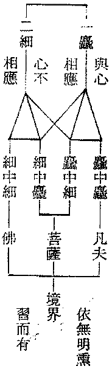



心性二字(大意)



　　┌不变随缘┐　┌心──即理之事  

　　│　　　　├名┤  

　　└随缘不变┘　└性──即事之理



真如二义(起信)



一、如实空。



二、如实不空。



事理二观



　　┌唯识历事──照於起心变造十界即空假中────┐┌内境  

　　│　　　　　　　　　　　　　　　　　　　　　　├┤  

　　└实相观理──即於识心体其本寂三千宛然即空假中┘└外境



止观二门



一、止一切境界相，随顺奢摩他。



二、分别因缘生灭相，随顺毗钵舍那。



通教二意



一、正为菩萨。



二、旁通二乘。



界外二教



一、别──独菩萨法，非二乘所知。



二、圆──经论说佛境界，不共二乘位次。



说听二难(中论)



　　┌真法及说者──乐说┐  

　　│　　　　　　　　　├难　（大经）  

　　└听者难得故──乐闻┘



出家二喜(什师)



一、见世功德，自然忻豫。



二、后得涅槃，心常安悦。



别教二义



一、别前藏通──独菩萨法。



二、别后圆教──隔历次第。



十地二义



一、能生诸佛智，住持不动。



二、能与无缘大悲，荷负一切。



通教二义



一、通前藏教──近。



二、通后别圆──远。



通断二习



　　┌见思习尽真谛究竟┐  

　　│　　　　　　　　├佛地  

　　└尘沙习尽俗谛究竟┘



界内二教



　　┌藏──小──拙──析┐  

　　│　　　　　　　　　　├色入空  

　　└通──大──巧──体┘



法轮二义



一、运转──文句：以佛心中化他之法，度入他心，名转法轮。



二、摧碾──辅行：以四谛转度与他，摧破结惑。



比丘二犯



　　　　　┌杀──┐  

　　　　　│　　　│  

　　┌身三┼盗──┤  

　　│　　│　　　│  

　　│　　└婬──┤  

　　│　　　　　　├七支  

　　│　　┌妄言绮┤  

　　│　　│　　　│  

　　└口四┤语两舌│  

　　　　　│　　　│  

　　　　　└恶口─┘



开权二意(法华)



一、腾昔施权──不指所开，无由说实。



二、为显实所──既显实已，权全是实。



饥浴二益(寄归)



一、身体清虚无垢秽。



二、痰癊消散能饮食。



冥显二益



一、观音──冥──无所见闻，三毒七难，皆离二求，两愿皆满。



二、普门──显──目覩三十三圣容，耳闻十九尊教。



经行二利(寄归)



一、痊疴。



二、消食。



密遣二人(法华)



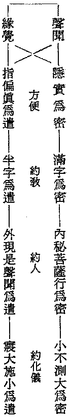



二不定法(戒经)



一、比丘屏处共女人坐，说非法语，自言犯是罪，於三法中应二治。



二、比丘露现处共女人坐，麤语比丘自言犯是罪，於二法中应二治。



(三法谓：弃残堕，二法谓：残堕。)



加被二人(般若)



一、空生──须菩提──解空。



二、身子──舍利弗──智慧。



(般若以空慧为主，故遣教菩萨。)



总持二义



一、总善不失。



二、持恶不生。



善法二业(净名什注)



　　　　　┌施┐  

　　　　　│　│  

　　┌福德┼戒┼致相好净土果报  

　　│　　│　│  

　　│　　└忍┘  

　　│  

　　│　　┌进┐  

　　│　　│　│  

　　└慧明┼禅┼得一切智业  

　　　　　│　│  

　　　　　└智┘



圆接别二



一、接俗不接真。



二、接贤不接圣。



动静二相(首楞)



　　┌闻┐　　┌能┐　┌动┐  

　　│　├即是┤　├属┤　├相  

　　└思┘　　└所┘　└静┘



偷兰二麤(明了)



一、重罪方便。



二、能断善根。



不依佛戒，故言麤过。



制戒二意(摄论)



一、为声闻自度──安居行则犯，不行不犯，为护生故。



二、为菩萨自度度他──不行则犯，行则不犯，为利生故。



二种世禅



一、根本净禅。



二、根本味禅。



世出世间之根本也。此有三品：禅也、等也、空也，即十二门禅。



出世二禅



一、出世间──六妙门三明六通等。



二、出世间上上──自性等九种大禅。



苾𫇴二染(百一)



一、不净。



二、饮食。



食未嗽口，设嗽刷已，尚有餘津腻是有染，不应互礼，违者越法。



净土二相



一、麤──变化土──即有二乘。



二、细──他受用土──纯是菩萨。



道人二贪(智度)



　　┌一、财贪　　┌财贪  

　　│　　　　　　│  

　　│　　　　　　│（瑜伽）　指归云：「道则通物之称，属三乘圣人所证。」  

　　│　　　　　　│  

　　└二、功德法　└智贪



烦恼二断(净名什注)



一、遮断──摧──灭。



二、永断──降四魔。



性相二宗



　　　　　　　　　　　　　　　　　┌天台┬─────性具宗─宗旨  

　　┌文殊─龙树─青目─清辨─智光┤　　└────┐  

　　│　　　　　　　　　　　　　　└贤首─────┴法性宗┐  

　　│　　　　　　　　　　　　　　　　　　　　　　　　　　├宗旨  

　　└弥勒─无著─法护─难陀─戒贤─唐玄奘─慈恩基─法相宗┘



初心二庆(法华)



一、庆己──事有理故，能庆己。



二、庆人──理有事故，能庆人。



(五品中随喜品云：初心知此，庆己庆人)



普请二法(清规)



一、为福田植净业。



二、为上下均力故。



净秽二土(垂裕)



一、染净净土──安养。



二、染净秽土──娑婆。(婆沙、净名)



若人种善根，疑则花不开；信心清净者，花开即见佛。身子见秽，梵王见净。



往生二行(十疑)



一、厌离──厌五欲轮回五道，而欲出离。



二、忻愿──忻净土庄严，愿欲往生。



赖耶二分



一、觉分──净心。



二、不觉──无明。



此二和合，说为本识。



逆顺二性(指要)



一、始自无间至别教教道以还皆名逆──四趣受苦，人天著乐，二乘沉空，菩萨著假，咸未达性，俱名逆修。



二、圆教始终皆名为顺。



逆有二法(消灾)



一、逆出世法──即不行此法之人。



二、逆世间法──即不能行仁义五常之人。



军迟二用



一、净用──甆瓦。



二、触用──铜铁。



生法二忍



一、生忍。



二、法忍。



蚊虻蚤虱、恶兽恶人、风雨寒暑、饥渴等恼。



新学二法



　　┌一闻深经惊怖生疑┐　┌法  

　　│　　　　　　　　├毁┤  

　　└二不亲近护持经人┘　└人



二种烦恼润业(法界次第)



　　┌四住地──招集分段生死┐　　　集  

　　│　　　　　　　　　　　├苦果  

　　└无明住地─招集变易生死┘　　　谛



妄境二种熏习(起信)



一、增长念。



二、增长取。



妄心二种熏习(起信)



一、业识根本。



二、增长分别事识。



龙有二报



一、正报似蛇，以畜生道摄故。



二、依报七宝宫殿，与诸天等。



旁生二义(婆沙)



一、形旁──身多横住。



二、行旁──心意不正。



脂那二音(婆沙)



　　┌支那┐　　┌文物国──赞美此方，衣冠文物。  

　　│　　├此云┤  

　　└指难┘　　└边鄙───言指此土，非是中国。



刹利二义



　　┌瞋恚──什曰：「此人有大力势，能大嗔恚，  

　　└忍辱──忍受苦痛，刚强难伏，因以为名。」



富有二种(大经)



一、象马种种畜生。



二、金银种种珍宝。



象马虽多，不敌一珠，众生亦尔。



富有二种(大经)



一、善富──如少金刚能坏须弥，亦如少火能烧一切。



二、恶富──多作众恶不行一善，修一善心破百种恶。



正法有二(法住)



一、证──说圣道法。



二、教──内法文字。



头陀二衣(大品律抄)



一、纳衣──好衣则四方追逐，堕邪命中，又招贼难等，故受纳衣。



二、三衣──行者知足，衣取盖形，不多不少，故受三衣。



二种力生净土



　　┌众生念┐  

　　│　　　├力  

　　└如来愿┘



世间解二



　　┌众生　　┌世间果　┌世间因  

　　└非众生　└出世灭　└出世道



现量有二



一、定位──定心澄湛，境皆明证。



二、散心──五识缘色等境体，分明显现。



世间依二(楞伽)



　　┌有┐　　　┌有名为性┐　　　┌性─┐　　┌有  

　　│　├计诸法┤　　　　├外道堕┤　　├故依┤  

　　└无┘　　　└无名非性┘　　　└非性┘　　└无



凡圣各二(维疏)



　　　　　┌恶众生──四趣───────────────┐  

　　┌凡二┤　　　　　　　　　　　　　　　　　　　　　　│  

　　│　　└善众生──人天　　　　　　　　　　　　　　　│  

　　│　　　　　　　　　　　　　　　　　　　　　　　　　├同居土  

　　│　　┌实──四果支佛通六地别十住圆──十信报身犹在│  

　　└圣二┤　　　　　　　　　　　　　　　　　　　　　　│  

　　　　　└权──圣者方便法身大士及妙觉──为利生故生─┘



二种心数法



　　┌一属见主名为想┐  

　　│　　　　　　　├意行  

　　└二属爱主名为受┘



二字合为语(大论)



一、菩。



二、提。



二字和合成菩提，若不合则无语。



觉不觉二相(起信)



一、同──无漏无明，同真如性相。



二、异──无漏无明，随染幻差别。



别圆接通二



一、接圣不接贤。



二、接真不接俗。



性类二种



　　　迷由  

　　┌迷众生─偏┐┌修恶九界┌逆修┐约性┌惑┐　　生时此种  

　　│　　　　　││　　　　│　　│　　│　│  

　　│无明　　　││　　　　│　　│苦─┤　├性种三法了逆为顺┐  

　　│　　　　　││　　　　│　　│　　│　│　　　　　　　　│  

　　└────┐│└───┐├三道┘恒开└业┘　　纯变为修　　│  

　　　　　　　││　　　　││　　　　　　　　　　　　　　　　│  

　　　　　染缘┘│　　阴等│└───┐　　　　　　　　　　　　│  

　　　　　　　　│　　　　│　　　　│　　　　　　　　　　　　│  

　　　　　　　　└──十境┘　　　　│　　　　　　　　　　　　│  

　　　　　　　　　　　　　　　┌返妄┘　　　　　　　　　　　　│  

　　性家之种　中道　　　　　　├───────────────┘  

　　　　　　　　　　　　　　　└归真┐  

　　　　　　　　┌──如来┐　　　　│  

　　　　　　　　│　　　　│　　　　│  

　　　　　净缘┐│　　六即│　┌──┘　　　　　　　　　　　┌智德  

　　　　　　　││　　　　│　├性─恶┐对修　　　　┌了因┐└──┐  

　　┌────┘│　　　　│　│　　　│　　　　　　│　　│　　　│  

　　│　　　　　│┌───┘┌┤　　　├全性─正因起│　　├修类果┤  

　　│闻教　　　││　　　　│└性┐　│　　　　　　│　　│　　　│  

　　│　　　　　││　　　　│　　├善┘方合　　　　└缘因┘法身─┤  

　　└解正觉─圆┘└性德十界└─修┘　　　　　　　　　　　　　　　│  

　　　　　　　　　　　　　　　　　　　　　　　　　　　　　　┌──┘  

　　　起行　　　　　　　　　　　　　　　　　　　　　　　　　└断德



二气



　　一、阴。  

　　　　　　　　┌静┐　　┌阴  

　　二、阳─太极┤　├而生┤  

　　　　　　　　└动┘　　└阳



(亦曰两仪，象曰：易有太极，是生两仪。)



两仪(亦曰两间)



　　┌一天┐　　┌轻清┐　┌上浮┐　┌天  

　　│　　├气之┤　　├者┤　　├为┤  

　　└二地┘　　└重浊┘　└下凝┘　└地



二用



　　┌用九─阳爻┐　　　┌九┐　┌阳┐  

　　│　　　　　├为　　│　├老┤　├之数  

　　└用六─阴爻┘　　　└六┘　└阴┘



参同契曰：「二用无爻位，周流行六虚。」



两揆



一、左相。



二、右相。



(揆，度也，古者道揆之官，谓以义理、度量、事物而制其宜。)



两制



一、内制──翰林学士。



二、外制──中书舍人知制诰。



(天子之言称制；翰林，制诏代言之官，故曰制。)



二史



一、左史──起居郎记言。



二、右史──起居舍人记事。



(书言动，皆曰：起居注。)



两府



一、东府──中书主文。



二、西府──枢密主武。



(三公所居曰府。)



佛学名相汇解　卷第七（终）



三界总图



　　三界┐┌──────────────二十五有颂云┐  

　　　　├┘　　　　　┌───┬──┐　　　　　　　│  

　　┌─┘　　　　　　├四部洲┤　　│　┌─────┘  

　　│　　　　┌天　道│　　　│　　│　│┌四洲四恶趣  

　　├欲界─┐├人　道│┌──┘　　│　└┼六欲并梵天  

　　│　　　│├修罗道││　　　　　│　　├四禅四空处  

　　│┌──┘├畜生道││┌东弗于逮│　　└无想及那含  

　　││　　　├饿鬼道│└┼西瞿耶尼│  

　　│├六道─┴地狱道│　├南阎浮提│  

　　││　　　　　　　│　└北郁单越│  

　　│├───────┤　　　　　　│  

　　││　　　┌四王天│　┌地狱趣　│  

　　││　　　├忉利天│┌┼饿鬼趣　│　　┌天　趣┐  

　　││　　　├夜魔天││├畜生趣　│　　├人　趣┤  

　　│└六欲天┼兜率天││└修罗趣　└五趣┼畜生趣┼─五趣杂染地┐  

　　│　　　　├化乐天│└────┐　　　├饿鬼趣┤　　　　　　│  

　　│　　　　└他化天└四恶趣──┘　　　└地狱趣┘　　　　　　│  

　　│　　　　　┌─────┐　　　　　　┌梵众天┐　　　　　　│  

　　├色界十八天┤┌无云天　│┌初禅三天─┼梵辅天┼─离生喜乐地┤  

　　│　　　　　││　　　　││　　　　　└大梵天┘　　　　　　│  

　　│┌────┘├福生天　││　　　　　　　　　　　　　　　　│  

　　│└四禅九天─┤　　　　││　　　　　┌少光天─┐　　　　　│  

　　│　　　　　　├广果天　└┼二禅三天─┼无量光天┼定生喜乐地┤  

　　│　　　　　　│　　　　　│　　　　　└极光天─┘　　　　　│  

　　│　　　　　　├无想天　　│　　　　　　　　　　　　　　　　│  

　　│　　　　　　│　　　　　│　　　　　┌少净天─┐　　　　　│  

　　│　　　　　　├无烦天┐　└三禅三天─┼无量净天┼离喜妙乐地┤  

　　│　　　　　　│　　　│　　　　　　　└遍净天─┘　　　　　│  

　　│　　　　　　├无热天┤　　　　　　　　　　　　　　　　　　│  

　　│　　　　　　│　　　└─────────────舍念清净地┤  

　　│　　　　　　├善见天　　　　　　　　　　　　　　　　　　　│  

　　│　　　　　　│　　　　　　　　　　　　　　　　　　　　　　│  

　　│　　　　　　├善现天　　　　　　　　　　　　　　　　　　　│  

　　│　　　　　　│　　　　　　　　　　　　　　　　　　　　　　│  

　　│　　　　　　└究竟天　　　　　　　　　　　　　　　　　　　│  

　　│　　　　　　　　　　　　　　　　　　　　　　　　　　　　　│  

　　│　　　　　　┌空无边处天────────────空无边处地┤  

　　│　　　　　　│　　　　　　　　　　　　　　　　　　　　　　│  

　　│　　　　　　├识无边处天────────────识无边处地┤  

　　└无色界四空天┤　　　　　　　　　　　　　　　　　　　　　　│  

　　　　　　　　　├无所有处天────────────无所有处地┤  

　　　　　　　　　│　　　　　　　　　　　　　　　　　　　　　　│  

　　　　　　　　　└非非想处天────────────非非想处地┘



加修罗名六趣，加仙道名七趣。



又初禅上下立三地，梵辅已下名有寻有伺地，大梵一天名无寻唯伺地，二禅已上名无寻无伺地。



九地亦名九有。



三界(出华严孔目)



界：限也，别也。谓三界分限，各别不同，故名界也。



一、欲界：欲有四种：一者、情欲。二者、色欲。三者、食欲。四者、淫欲。下极阿鼻地狱，上至第六他化天，男女相参，多诸染欲，故名欲界。



(梵语：阿鼻，华言：无间。第六他化天者：假他所化，而自娱乐也。)



二、色界：色即色质。谓虽离欲界秽恶之色，而有清净之色，始从初禅梵天，终至阿迦腻咤天，凡有一十八天，竝无女形，亦无欲染，皆是化生，尚有色质，故名色界。



(梵语：阿迦腻咤，华言：质碍究竟。一十八天者：如见图。)



三、无色界：谓但有心识，而无色质也。始从空处，终至非非想处，凡有四天，但有受想行识四心而无形质，故名无色界。(四天见图)



六道(出法华文句)



道即能通之义。谓六道生死展转相通，故名六道。



一、天道：天即天然自然，乐胜身胜，是名天道。



二、人道：人者忍也。於世苦乐之境，而能安忍，是名人道。



三、阿修罗道：梵语：阿修罗，华言：无酒。又言：无端正，又言：无天。此道或居海岸海底，或居半须弥山，岩窟、宫殿严饰。怀猜忌心，常好斗战，是名阿修罗道。



(无酒者：法华疏云：修罗於四天下采华，酝海为酒，鱼龙业力，其味不变，於是嗔妬誓愿断酒，故云无酒。无端正者：修罗种类，男丑女端，故云无端正。无天者：净名疏云：此神果报最胜，隣次诸天而非天，又无天德，故云无天。)



四、饿鬼道：谓此道或居海底，或在人间山林中，或似人形，或似兽形，不得饮食。业重者，饥火炎炎，不闻浆水之名；次者，伺求人间荡涤脓血粪秽；轻者，时薄一饱，是名饿鬼道。



五、畜生道：畜生亦云旁生。谓此道徧在诸处，披毛戴角，鳞甲羽毛，其类非一，互相吞噉，受苦无穷，是名畜生道。



(旁生者：婆沙论云：形旁行旁。形旁者：谓身形横生不正也；行旁者：谓其宿世所行之行，偏邪不正也。)



六、地狱道：谓此狱在地之下，而有镬汤剑树等苦，是名地狱道。



六欲天(出楞严经)



欲即色欲。四天王以形交为欲，忉利以风为欲，夜摩以抱持为欲，兜率以执手为欲，化乐以视笑为欲，他化但以视为欲也。谓之天者，天然自然乐胜身胜，亦名最胜，亦名光明。以其所欲不同，故名六欲天。



一、四天王天：东方持国天王：谓能护持国土，故居须弥山黄金埵。南方增长天王：谓能令他善根增长，故居须弥山瑠璃埵。西方广目天王：谓能以净天眼，常观拥护此阎浮提，故居须弥山白银埵。北方多闻天王：谓福德之名闻四方，故居须弥山水晶埵。



(梵语：须弥，华言：妙高。梵语：阎浮提，华言：胜金洲。)



二、忉利天：梵语：忉利，华言：三十三。大智度论云：昔有婆罗门，姓憍尸迦，与知友三十二人，共修福德，命终皆生须弥山顶。憍尸迦为天主，名帝释天；三十二人为辅臣，周围列居，而帝释独处其中。又净名疏云；昔迦叶佛灭后，有一女人发心修塔，报为天主；有三十二人助修，报为辅臣；君臣合之为三十三也。



(梵语：婆罗门，华言：净行。梵语：憍户迦，又云：释提桓因，华言：能天主。言帝释者：华梵双举也。三十三人名字经论不载，据正法念处经所载：三十三天各有住处，谓善法堂天、山峰天、山顶天、善见城天、钵私他天、俱咤天、杂殿天、懽喜园天、光明天、波利耶多天、离险岸天、谷崖岸天、摩尼藏天、旋行天、金殿天、鬘影天、柔软天、杂庄严天、如意天、微细行天、歌音喜乐天、威德轮天、月行天、阎摩那娑罗天、速行天、影照天、智慧行天、众分天、曼陀罗天、上行天、威德颜天、威德燄轮光天、清净天也。)



三、夜摩天：梵语：夜摩，华言：善时，亦名：时分；谓其时时唱快乐故。以莲华开合，分其昼夜。此天依空而居。



四、兜率天：梵语：兜率，华言：知足。谓其於五欲境，知止足故，此王依空而居。



五、化乐天者：谓自化五尘之欲，而娱乐故。此天依空而居。



六、他化自在天者：谓假他所化，以成己乐故。此天依空而居，即魔王天也。



四大部洲(亦名四洲，形量出长阿含经)



一、东弗于逮：梵语：弗于逮，亦云：弗婆提，华言：胜身。以其身胜南洲故也。又翻为初，谓日初从此出也。在须弥山东，其土东狭西广，形如半月，纵广九千由旬，人面亦如半月之形，人身长八肘；人寿二百五十岁。



(梵语：须弥，华言：妙高。梵语：由旬，亦云：逾缮那，华言：限量。大论云：由旬有三：大者八十里，中者六十里，下者四十里。肘以一尺八寸为一肘。)



二、南阎浮提：梵语：阎浮提，华言：胜金洲。阎浮是树，提是洲名，因树立称，故名阎浮提。在须弥山南，其土南狭北广，形如车箱，纵广七千由旬，人面亦像地形；人身多长三肘半，於中有长四肘者；人寿百岁，中夭者多。



三、西瞿耶尼：梵语：瞿耶尼，华言：牛货。为彼多牛，以牛为货，故名牛货。在须弥山西，其土形如满月，纵广八千由旬，人面亦如满月，人身长十六肘；人寿五百岁。



四、北郁单越：梵语：郁单越，华言：胜处。以其土胜三洲故也。在须弥山北，其土正方，犹如池沼，纵广一万由旬，人面亦像地形，人身长三十二肘；人寿一千岁，命无中夭。



二十五有(出四教仪)



二十五有：不出六道，有生有死，因果不亡之谓也。然梵王天、无想天、及五那含天，总在四禅天中，而别出其名者，以外道计梵王天为生万物之主；计无想天以无心为涅槃；计五那含天为真解脱。所以经教特立此三天为三有，以对破外道之计也。



一、四洲为四有，谓东弗于逮、西瞿耶尼、南阎浮提、北郁单越也。



二、四恶趣为四有，谓六道中，修罗、饿鬼、畜生、地狱四者，皆由愚痴贪欲，造诸恶业，故感斯趣也。



三、六欲天为六有，谓欲界六天也：一、四天王天，二忉利天，三、夜摩天，四、兜率天，五、化乐天，六、他化自在天。



(梵语：忉利，华言：三十三。梵语：夜摩，亦云：须燄摩，华言：善时分。梵语：兜率，华言：知足。)



四、梵天为一有，谓初禅中，大梵王天乃三千世界之主也。



五、无想天为一有，谓四禅中之无想天，此天以无心想为果故也。



六、五那含天为一有，那含，梵语具云：阿那含，华言：不还。谓四禅中无烦天、无热天、善现天、善见天、色究竟天，亦名五净居天。此之五天名位虽别，皆第三果圣人所居，故通为一有也。(第三果，即声闻阿那含果也。)



七、四禅天为四有，谓色界初禅天、二禅天、三禅天、四禅天也。



八、四空处天为四有，谓无色界空处天、识处天、无所有处天、非想非非想处天也。



二十八天(出天台四教仪)



一、欲界六天：一、四天王天：东方持国天王、南方增长天王、西方广目天王、北方多闻天王。二、忉利天：梵语：忉利，华言：三十三。住世三十三人同修胜业，同生此天。三、须夜摩天：梵语：须夜摩，华言：善时分。谓此天时时唱快乐故，又云：受五欲境知时分故。四、兜率陀天：梵语：兜率陀，华言：知足。谓此天於五欲境知止足故。五、化乐天：谓此天自化五尘而娱乐故。六、他化自在天：谓此天假他所化乐事，以成己乐，即欲界天主。



二、色界十八天：初禅三天：一、梵众天：梵，净也，以无染欲故。众，犹民也。谓此天是初禅天主之民众也。二、梵辅天：辅佐也。谓此天是初禅天主之辅佐臣僚也。三、大梵天：谓此天是初禅天之主也。名尸弃，刼初先生，刼尽后灭，主领三千大千世界也。(梵语：尸弃，华言：火。三千者：大千、中千、小千也。言三千大千者：总别双举也。)二禅三天：一、少光天：谓此天光明少故。二、无量光天：谓此天光明增胜无限量故。三、光音天：谓此天以光明为语音故。三禅三天：一、少净天：谓此天意识乐受清净故。二、无量净天：谓此天净胜於前，不可量故。三、徧净天：谓此天乐受最胜净周徧故。四禅九天：一、无云天：以前诸天空居，依云而住，此天在云之上，居无云之首，故号无云。二、福生天：谓此天修胜福力而生其中，从因得名故。三、广果天：谓此天果报广无能胜故。四、无想天：谓此天一期果报，心想不行故。(一期者：谓从生至死也。)五、无烦天：谓此天离欲界苦，及色界乐，苦乐两灭，无烦恼故。六、无热天：谓此天研究心境，无依无处，清凉自在，无热恼故。七、善见天：谓此天妙见十方世界圆澄无尘垢故。八、善现天：谓此天空无障碍，精见现前故。九、色究竟天：谓此天於诸尘几微之处，研穷究竟故。



无色界四天：一、空处天：谓此天厌於色身系缚，不得自在，心缘虚空，与无色相应，住空处定故。二、识处天：谓此天厌虚空无边，於是即舍虚空转心缘识，以识为处故。三、无所有处天：谓此天厌於识处无边，於是舍识入无所有处，亦名不用处，谓不用前空处、识处故。四、非想非非想处天：谓此天居无色界之极顶，非无所有处之无想，非识处之有想故。



九地(出释氏要览)



谓欲界五趣杂居一地，色界四禅分为四地，无色界四空分为四地，共为九也。地有持载之义，众生依之而住。此之九地，从忉利天已下，及四趣皆为地居；夜摩已上，以至非非想天，皆为空居。从所依处得名，故皆言地也。



一、五趣杂居地：五趣者，即欲界六天人饿鬼畜生地狱也，本该六趣，以阿修罗通於诸趣故，但言五杂居者：五趣虽果报苦乐不同，总居於欲界故也。



二、离生喜乐地者：即色界初禅天也。谓此天已离欲界欲恶之法，得觉观禅定，身心凝静而生喜乐。住於此定，一切苦恼皆不能逼也。



(觉观者：初心在缘曰觉，细心分别禅味曰观。)



三、定生喜乐地者：即色界二禅天也。谓此天已离初禅觉观动散，摄心在定，澹然凝静而生胜定喜乐，住於此定，如人从暗室中出，见日月光明，朗然洞彻也。



四、离喜妙乐地者：即色界三禅天也。谓此天已离二禅天，喜之踊动，因摄心谛观泯然入定，而得胜妙之乐。住於此定乐法增长，徧满身中也。



五、舍念清净地者：即色界四禅天也。谓此天舍二禅之喜，及三禅之乐，心无憎爱，一念平等，清净无杂。住於此定，空明寂静，万像皆现也。



六、空无边处地者：即无色界第一天也。谓此天厌色界色质为碍，不得自在，故加功用行灭一切色相，而入虚空处定。住於此定，其心明净，无碍自在也。



七、识无边处地者：即无色界第二天也。谓此天厌空处无边，转心缘识，与识相应，心定不动，三世之识，悉现定中；住於此定清净寂静也。



(三世者：过去、现在、未来也。)



八、无所有处地者：即无色界第三天也。谓此天厌空处、无边识处，三世流转无际，舍此二处，而入无所有处定。住於此定，怡然寂静，诸想不起也。



九、非非想处地者：非前识处之有想，非无所有处之无想，即无色界第四天也。谓此天厌无所有处如痴，故舍之而入非非想处定。住於此定，不见有无相貌，泯然寂绝，清净无为也。



三佛身(出宗镜录)



一、自性身。



二、受用身。



三、变化身。



一、谓诸如来具无边际真常功德，是一切法平等实性，即此自性亦名法身，是名自性身。



二、受用身有二种：一者、自受用身：谓诸如来修习无量福慧，所起无边真实功德，恒自受用广大法乐也。二者、他受用身：谓诸如来由平等智，示现微妙净功德身，居纯净土，为住十地诸菩萨众，现大神通，转正法轮，令彼受用大乘法乐也。



(十地者：二之卷具注。)



三、谓诸如来以不思议神力，变现无量随类化身，居净秽土，为未登地诸菩萨众，及二乘等，称其机宜现通说法，令其各得诸利乐事，是名变化身。



(二乘者：声闻乘、缘觉乘也。)



三身徧相(出华严经随疏演义钞)



一、法身如虚空徧。



二、智身如日光徧。



三、色身如日影徧。



一、谓法性之身，本体周徧，如太虚空，无有障碍，诸佛众生，平等具足，故名法身如虚空徧。



二、智身：即自报之身也。谓究竟始觉之智，能徧破无明暗，显发本有真身，譬如日光，无幽不烛，故名智身如日光徧。



三、色身：即应身也。谓究竟始觉之智，契於本觉法身之理，则能从体起用，徧应众机，譬如日光之影，不择高下，随处映现，故名色身如日影徧。



三身(出金光明经之玄义)



一、法身。



二、报身。



三、应身。



身即聚集之义，谓聚集诸法而成身也。所谓理法聚名法身，智法聚名报身，功德法聚名应身。



(理法聚名法身者，谓聚集法性之法，而成此身也。智法聚名报身者，智即能契法性之智，智与法性相合，而成此身也。功德法聚名应身者，由智契理，聚集一切功德之法，起用化他，随机应现，而成此身也。)



一谓：始从初住显出法性之理，乃至妙觉极果，理聚方圆，是名法身。



(初住者：即十住位中，初之一住也。妙觉者：自觉觉他，觉行圆满，不可思议，故名妙觉。理聚方圆者：妙觉所证法性之理，方始圆满也。)



二谓：始从初住，终至妙觉极果，智聚方圆，由智契理报得此身，故云报身。



三谓：始从初住，终至妙觉极果，功德法聚方圆，故能随机应现，说种种法，度诸众生，故名应身。



三身华梵(出法华经文句)



　　　　　　　　　　　　　　　　　┌性德┐  

　　一、毗卢舍那如来（徧一切处）─┤　　├法┐  

　　　　　　　　　　　　　　　　　└修德┘　│  

　　　　　　　　　　　　　　　　　　　　　　│  

　　　　　　　　　　　　　　　　　┌自┐　　│  

　　二、卢舍那如来──（此云净满）┤　├─报┼身。  

　　　　　　　　　　　　　　　　　└他┘　　│  

　　　　　　　　　　　　　　　　　　　　　　│  

　　　　　　　　　　　　　　　　　┌胜┐　　│  

　　三、释迦牟尼如来（能仁寂默）─┤　├─应┘  

　　　　　　　　　　　　　　　　　└劣┘



一、法身毗卢遮那如来：法名可轨，诸佛轨之，而得成佛。以法为身，故名法身。梵语：毗卢遮那，华言：徧一切处。以真如平等性相常然，身土无碍故也。如来者：金刚经云：「无所从来，亦无所去，故名如来。」是也。



二、报身卢舍那如来：修因感报名之为报，然有自报他报之别；自报即理智如如，他报即相好无尽，是名报身。梵语：卢舍那，华言：净满；谓诸惑净尽，众德悉圆。又云：光明徧照；谓内以智光照真法界(即自报身也)，外以身光照应大机(即他报身也)。如来者：转法轮论云：「第一义谛名如，正觉名来。」是也。



(第一义谛者：谓中道之理，无二无别也。)



三、应身释迦牟尼如来：智与体冥能起大用，随机普现说法利生，故名应身。梵语：释迦牟尼，华言：能仁寂默。寂默故不住生死，能仁故不住涅槃。如来者：成实论云：「乘如实道，来成正觉。」是也。



(智与体冥者：谓自报之智，与法身之体冥合也。梵语：湼槃，华言：灭度。)



三觉(出翻译名义)



一、自觉。



二、觉他。



三、觉行圆满。



觉有三义：谓自觉、觉他、觉行圆满也。唯妙觉果佛，具足三觉，故华严经云：「奇哉大导师，自觉能觉他。」是也。



一谓：觉知过去、未来、现在，三世一切诸法，常无常等，悟性真空，了惑虚妄，功成妙智，道证圆觉，故名自觉。



二谓：运无缘慈，度诸众生，皆令离生死苦，得涅槃乐，故名觉他。



三谓：三惑净尽，众德悉备，位登妙觉，行满果圆，故名觉行圆满。



(三惑者：见思惑、尘沙惑、无明惑也。)



佛化身三(出观佛三昧海经)



一、大化身千丈。



二、小化身丈六。



三、随类不定。



一、大化身千丈者：谓如来为应十地已前等诸菩萨，演说妙法，令其进修向於佛果，故化现千丈之身也。



二、小化身丈六者：谓如来为应二乘凡夫之人，说於四谛等法，令其舍妄归真，而得开悟，故化现丈六之身也。(二乘四谛，前前卷注。)



三、随类不定者：谓如来誓愿弘深，慈悲普覆，随诸种类有感即应，或现大身，满虚空中；或现小身，丈六八尺等也。



三身寿量(出法华经文句)



一、法身寿量。



二、报身寿量。



三、应身寿量。



一、法身寿量：法身者，师轨法性，还以法性为身。此身非色质，亦非心智，强指法性为法身耳。言寿量者：此非报得命根，亦非连持之寿，强指不迁不变，名之为寿。此寿非长量，亦非短量，经云：「亦无在世，及灭度者，非实非虚，非如非异等。」是也。



二、报身寿量：报身者，以如如智，契如如境，以境发智，以智照境，境智冥合，即是报身。言寿量者：境既无量无边，常住不灭，智亦如是，即此智慧，名为寿命。经云：「我智力如是，久修业所得；慧光照无量，寿命无数刼。」是也。



(如如者：境如即如智，智如即如境，盖言境智不二也。)



三、应身寿量者：应同万物为身也。言寿量者，应同连持为寿，应同长短为量也。智与体冥，能起大用。经云：「随所应度，处处自说，名字不同，年纪大小等。」是也。



三种神变(出大宝积经)



一、说法神变。



二、教诫神变。



三、神通神变。



神即神通，变即变化也。



一、谓如来无碍大智，知诸众生善恶业因，及善恶果报，或以声闻缘觉之法，及以大乘之法而得解脱，如是知已，则现一切神变而为说法，是名说法神变。



二、教即教诲，诫即警诫。谓如来教诸弟子：是应作，是不应作；是应信，是不应信；是应亲近，是不应亲近；是法杂染，是法清净；行如是道，得声闻乘；行如是道，得缘觉乘；行如是道，成就大乘。现诸神变，而为教诫，是名教诫神变。



三、谓如来为调伏憍慢众生故，或现一身而作多身，或现多身而作一身，山崖石壁，出入无碍，身上出火，身下出水，身下出火，身上出水，入地如水，履水如地等。现诸神变，调伏众生，是名神通。



三种常(出佛地论)



一、本性常。



二、不断常。



三、相续常。



一、本性常者，即法身也。谓法身本性常住，无生无灭也。



二、不断常者，即报身也。谓报身常依法身，无间断也。



三、相续常者，即应身也。亦名变化身，谓应身於十方世界，没已复现，化无穷尽也。



如来乞食三意(出法集经)



一、不贪珍味美恶均等。



二、为破我慢贵贱同游。



三、慈悲平等大作利益。



一、谓如来乞食入诸聚落，随施所得，不贪珍味，若美若恶而无分别，是名不贪珍味美恶均等。



二、谓如来乞食为破我慢自高，於富贵贫贱等家，皆无拣择，是名破我慢贵贱同游。



三、谓如来无有饥渴羸损瘦乏等苦，为众生故，以平等慈悲现行乞食，广作利益，是名慈悲平等大作利益。



三佛土(出华严疏)



一、法性土。



二、受用土。



三、变化土。



一、法性土者，即法身如来所依之土，乃理土也。谓以本识如来藏身为所依持，恒顿变现外诸器界，则法性土通为诸土之体也。(器界者，世界如器故也。)



二、受用土者，即报身如来受用之土也。受用有二：一者、若以相应净识。所修自利行满，从初成佛，尽未来际，相续变为纯净佛土，周圆无际，众宝庄严，是名自受用土。二、若以大慈悲力，所修化他行满，随十地菩萨所宜，变成净土，或大或小，或胜或劣等是也。



三、变化土者，即应身如来变化之土也。谓佛以不思议神力，随诸众生善恶之业，变现净秽之土，方便设化是也。



佛行离地三意(出佛说处处经并华严经随疏演义钞)



一、地有虫。



二、地有生草。



三、现神通力。



一、谓一切地上，皆有诸虫，或伏或走，佛以护生之心，恐伤其命，故行时足不至地。钞云：「世尊履地，去地四指。」是也。



二、谓一切地上，有草依之生长，佛欲全其生意，故行时足不至地也。



三、谓佛现神通之力，飞行自在，履空如地，故行时足不至地也。



佛三事入城(出金刚经疏)



一、为女人入城。



二、为病人入城。



三、欲令人见相好入城。



一、谓一切女人女子，皆为父母及夫主所拘，不得辄自出入，思仰如来，无由得见，是故如来入城，令彼女人皆得瞻敬。观佛三昧海经云：「若能暂见如来相好光明，除六十刼生死之罪，获无量福，未来生处，必见弥勒。」(梵语：弥勒，华言：慈氏。)



二、谓如来於病人所，常兴救济之心，令其离苦得乐，是故入城乞食之时，凡有病苦者，因得瞻视，令其病差，发菩提心。



三、谓如来福慧庄严，具足三十二相、八十种好，微妙难思，人得瞻仰，则罪灭福生，是故入城令人普见。



(三十二相：前注。八十种好：一、指爪狭长，二、手足指圆，三、手足各等无差，四、手足圆满，五、筋脉盘结，六、两踝深隐，七、行步正直，八、行步威容齐整，九、行步安平，十、行步有仪，十一、回身顾视，十二、支节殊胜，十三、骨节交结，十四、膝轮圆满，十五、隐处妙好，十六、身支润滑，十七、身容敦肃，十八、身支坚固，十九、身支安定，二十、身相端严，二十一、身有圆光，二十二、腹形方正，二十三、脐深右旋，二十四、脐厚妙相，二十五、肌肤匀净，二十六、手掌充满，二十七、手文深长，二十八、唇色红润，二十九、面门圆满，三十、舌相长广，三十一、发声威震，三十二、音韵美妙，三十三、鼻高修直，三十四、诸齿方整，三十五、诸牙明洁，三十六、目广清净，三十七、眼相修广，三十八、眼睫齐整，三十九、双眉修长，四十、双眉绮靡，四十一、双眉高朗，四十二、耳厚修长，四十三、两耳相好，四十四、容仪端丽，四十五、额广圆满，四十六、身分殊胜，四十七、首发修长，四十八、首发香洁，四十九、首发齐整，五十、首发坚固，五十一、首发光滑，五十二、身分坚实，五十三、身体庄严，五十四、诸窍清净，五十五、身力充美，五十六、身相严好，五十七、面轮修广，五十八、颜貌舒泰，五十九、面颜光泽，六十、身支严净，六十一、毛孔出香，六十二、面门出香，六十三、首相妙好，六十四、身毛纤柔，六十五、法音圆辩，六十六、顶相高妙，六十七、指网分明，六十八、行不履地，六十九、神力自持，七十、威德远震，七十一、音声和雅，七十二、观机说法，七十三、一音演说，七十四、次第说法，七十五、等观有情，七十六、先观后作，七十七、相好具足，七十八、顶骨坚实，七十九、颜容奇妙，八十、胸臆妙好。)



佛三密(出智度论)



一、身密。



二、语密。



三、意密。



密，即秘密。谓如来身口意三业，或现通，或说法，或思惟，皆非诸菩萨等之所思议，故名三密。



一、谓如来处大会中，众见佛身或黄金色，或白银色，或杂宝色，或长丈六，或长一里、十里，乃至现大神变，皆不可思议，故名身密。



二、语密，即口密也。谓佛说法之时，或一里外闻佛音声，或十里，或百千万里外闻佛音声。又一会中，或闻说布施，或闻说持戒等，各各随心所闻，皆不可思议，故名语密。



三、谓佛常处寂定，凡所思惟观察，皆不可思议，故名意密。



佛三不能(出景德传灯录)



一、不能免定业。



二、不能度无缘。



三、不能尽生界。



一、不能免定业者，谓佛能空一切相，断一切众生之恶，而不能自免定业也。



(定业者：决定之业，即木枪、马麦等报是也。)



二、不能度无缘者，谓佛能化导一切众生，而不能度无缘之人也。



三、不能尽生界者，谓佛能度世间一切众生，而不能令众生界尽也。



佛三语(出随疏演义钞)



一、随自意语。



二、随他意语。



三、随自他意语。



一、谓佛随顺自意，说自所证一实等法，故名随自意语。



二、谓佛一向随顺他机之意，说於方便之法，导引众生，故名随他意语。



三、谓佛为众生说法，半随自证之意，半随他机之意，名随自他意语。



三处不转法轮



一、我慢高山。



二、五欲淤泥。



三、邪见稠林。



一、我慢高山：谓外道之人，多起邪见，我慢贡高，如山峻耸，虽闻正法，非惟不信，复有谤法之过，招其恶报。是故不为转法轮也。



二、五欲淤泥：谓诸凡夫，贪著色声香味触五欲之境，沉溺污秽，如在淤泥，自非身心清净，则不能受法，是故不为转法轮也。



三、邪见稠林：谓外道凡夫，执种种见，有如稠林茂密，而於正法不能信受，是故不为转法轮也。



大乘三宝(出华严经疏钞、并三宝章)



一、大乘佛宝。



二、大乘法宝。



三、大乘僧宝。



三宝者，谓佛法僧可尊可贵，名之为宝。



一、佛：梵语具云：佛陀，华言：觉。谓自觉觉他，觉行圆满，具足三身十身，能现无边相好，是名大乘佛宝。



(三身者：法身、报身、应身也。十身者：菩提身、愿身、化身、力持身、相好庄严身、威势身、意生身、福德身、法身、智身也。)



二、法：即轨则之义。谓如来所说中道实相，及人法二空之理，乃至无量胜妙法门，能令众生轨则此法而成正觉，是名大乘法宝。



三、僧宝：梵语僧伽，华言：和合众。谓十住、十行、十回向、十地等菩萨，不著有无二边，而与中道之理和合，是名大乘僧宝。



小乘三宝(出华严三宝章)



一、小乘佛宝。



二、小乘法宝。



三、小乘僧宝。



一、谓如来隐其无量功德庄严之身，示现丈六紫金之相，以应声闻缘觉人天等机，是名小乘佛宝。



二、谓阿含等经，为声闻说四谛教；为缘觉说十二因缘教，令其依之而修，超凡入圣，是名小乘法宝。



(梵语：阿含，华言：无比法。四谛者：苦谛、集谛、灭谛、道谛。十二因缘者：一、无明，二、行，三、识，四、名色，五、六入，六、触，七、受，八、爱，九、取，十、有，十一、生，十二、老死也。)



三、谓依四谛十二因缘，而修断见思惑，证真空理，而成声闻四果、四向及缘觉之僧，是名小乘僧宝。



(见思惑者：意根对法尘而起分别，曰见惑；眼耳鼻舌身贪爱色声香味触，曰思惑。四果者：一、须陀洹，华言入流。二、斯陀含，华言一来。三、阿那含，华言不来。四、阿罗汉，华言无生。四向者：一、须陀洹向，二、斯陀含向，三、阿那含向，四、阿罗汉向。向者，谓未入此果，而将向入也。)



住持三宝(出华严随疏演义钞、并三宝章)



一、泥龛塑像为佛宝。



二、黄卷赤轴为法宝。



三、剃发染衣为僧宝。



一、泥龛塑像者：佛灭度后，以泥木雕塑为像，住世不绝，是为佛宝也。



二、黄卷赤轴者：即今大藏经卷是也，以其住世不灭，是为法宝也。



三、剃发染衣者：谓剃除须发，著染色衣，即世间之僧，以能流通佛法，是为僧宝也。



同体三寳(出华严随疏演义钞、并三宝章)



一、佛宝。



二、法宝。



三、僧宝。



谓佛法僧名虽有三，体性是一，故名同体三宝。



一、佛，梵语具云：佛陀，华言：觉；谓性体灵觉，照了诸法非空非有，是名佛宝。



二、法，即轨持之义；谓法性寂灭，而恒沙性德皆可轨持，是名法宝。



三、僧，梵语具云：僧伽，华言：和合众；谓恒沙妙德性相不二，理事和合，是名僧宝。



别相三寳(出华严随疏演义钞、并三宝章)



一、佛宝。



二、法宝。



三、僧宝。



别相者，谓三宝中，名相各各不同，故云别相三宝也。



一、谓佛具十身，名相差别不同，故名佛别相也。(十身者，已前注。)



二、谓佛说一大藏典，具教法、理法、行法、果法、名相不同，故名法别相也。



(教，即经教。理，即性理。行，即行业。果，即果位也。)



三、谓文殊普贤诸大菩萨，乃至三贤十圣，各各修证地位不同，故名僧别相也。



(三贤者：十住、十行、十回向诸位菩萨也。十圣者：十地菩萨也。)



别相三宝(亦名别体三宝，出释氏要览)



一、佛宝。



二、法宝。



三、僧宝。



谓佛法僧各各相别不同，故名别相三宝。



一、谓佛初於菩提树下成道，但示丈六之身，及说华严经时，现为卢舍那尊特之身，是为佛宝。



二、谓五时所说，大乘、小乘、经律论藏，是为法宝。



(五时者：华严时、鹿苑时、方等时、般若时、法华湼槃时也。)



三、谓禀佛教法，修因得果，即声闻缘觉菩萨，是为僧宝。



(声闻因闻佛声教而得悟觉，缘觉因观十二因缘而得觉悟。菩萨，梵语具云：菩提萨埵，华言：觉有情。)



三种奇特事(出过去现在因果经)



一、神通奇特。



二、慧心奇特。



三、摄受奇特。



一、谓佛世尊妙应群机，现大神变，不可思议，使一切众生，及诸邪魔外道，咸归正化，是为神通奇特。



二、谓佛之智慧，心光湛寂，照了一切诸法，成就一切种智，是为慧心奇特。



三、谓佛善知众生诸根利钝，随机摄受，开导教化，令彼咸闻法要，进修妙行，出离生死，是为摄受奇特。



三种大师(出本事经)



一、如来。



二、阿罗汉。



三、有学弟子。



一、如来，谓诸如来出现世间，阐扬大法，化诸众生，出离生死，令得无量义利安乐，是为众生之师范也。



二、梵语：阿罗汉，华言：无学。谓阿罗汉，诸漏已尽，梵行具足，出现世间，开示四谛，令诸众生，脱离生死，皆得无量义利安乐，是为众生之师范也。



三、有学者，烦恼未尽，有法可学也。谓初果须陀洹、二果斯陀含、三果阿那含，精修梵行，具足多闻，於诸经典，善知法义，出现世间，开示四谛，令诸众生出离生死，皆得无量义利安乐，是为众生之师范也。



三轮(出金光明经文句)



一、身轮。



二、口轮。



三、意轮。



轮即车轮，有摧碾之用，以譬如来身业现通，口业说法，意业鉴机，而能摧碾众生烦恼惑业，是故名为三轮也。



一、身轮：亦名神通轮。谓佛说法，必先现神通，警动众生机情，令生正信也。



二、口轮：亦名正教轮。谓佛所说之法，无不为令众生翻邪归正，依教修行也。



三、意轮：亦名记心轮。谓佛说法，先以意轮鉴知众生根器利钝，随宜演说，无有差谬也。



三藏(出翻译名义)



一、修多罗藏。



二、毗奈耶藏。



三、阿毗达磨藏。



三藏者：谓经律论，各各含藏一切文理，故皆名藏。



一、梵语：修多罗，华言：契经，契合也。谓上契诸佛之理，下契众生之机，故名契经也。



二、梵语：毗奈耶，华言：律，又云善治。谓能治众生之恶，如世法律，则能断决重轻之罪，故名律也。



三、梵语：阿毗达磨，亦名：阿毗昙，华言：论。论者，论议也。瑜伽论云：「问答决择诸法性相，故名论也。」(梵语：瑜伽，华言：相应。)



小乘三藏(出天台四教仪集注)



一、小乘经藏。



二、小乘律藏。



三、小乘论藏。



一、谓阿含等经，唯谈真空寂灭之理，诠示声闻缘觉修行证果之法，是名小乘经藏。



(梵语：阿含，华言：无比法。)



二、谓四分等律，唯制小乘之人，即声闻缘觉所持之戒，是名小乘律藏。



(四分者：一、比丘法，二、比丘尼法，三、受戒法，四、灭诤法也。)



三、谓俱舍等论，唯决择诠辩小乘声闻缘觉修证之法，是名小乘论藏。



(梵语：俱舍，华言：藏。谓有包含摄持之义也。)



大乘三藏(出华严经随疏演义钞)



一、大乘经藏。



二、大乘律藏。



三、大乘论藏。



藏，即含藏之义也。谓经律论三，各含文理，故名三藏。



一、经，法也，常也。谓华严等诸大乘经，唯谈法界中道之理，诠示大乘菩萨修行证果之法，是名大乘经藏。



二、律，即法也。谓梵网等经，唯制大乘菩萨所持之戒，是名大乘律藏。



三、论，即论议。谓起信等论，唯决择诠辩大乘菩萨修证之法，是名大乘论藏。



华严三圣(出翻译名义)



一、毗卢遮那佛。



二、普贤菩萨。



三、文殊师利。



一、梵语：毗卢遮那，华言：徧一切处。谓烦恼体净，众德悉备，身土相称，徧一切处，能为色相所作依止，具无边际真实功德，是一切法平等实性，即此自性，亦名法身。佛，梵语具云：佛陀，华言：觉。谓理性之体，本来觉了也。



二、普贤者：谓其居伏道之顶，体性周徧曰普；断道之后，邻於极圣曰贤。菩萨者，梵语具云：菩提萨埵，华言：觉有情。谓觉悟一切有情众生也。



(伏道者：伏即潜伏之义，谓普贤能伏初起微细无明，居等觉位，在众菩萨之首，故云伏道之顶。断道者：谓断初起微细无明惑也。隣者：近也。极圣者：佛也。)



三、梵语：文殊师利，华言：妙德。谓明见佛性，具足法身般若解脱三德，不可思议，故名妙德也。



三如来藏(出圆觉经略疏)



一、隐覆藏。



二、含摄藏。



三、出生藏。



如来者，即理性如来也。因中说果，故名如来。藏者，含藏之义，谓含藏一切善恶法也。的指其体即第八识，名如来藏也。



一、谓诸众生本真如法身理，在第八识中，为无明烦恼之所隐覆而不能见，故名隐覆藏。



二、谓第八识为染净之所依止，以能含藏一切善恶种子，故名含摄藏。



三、谓第八识为染净之本，遇缘熏习，则能出生世间出世间、有情无情等法，故名出生藏。



三藏诠三学(出四教仪)



一、经诠定学。



二、律诠戒学。



三、论诠慧学。



三藏：经、律、论也。三学：戒、定、慧也。三藏诠三学者：诠，具也；谓三藏具说三学之事理也。



一、谓阿含等经所明，皆是安心之法，依此摄心，即不散乱。又佛凡说经，必先入定，故云经诠定学。(梵语：阿含，华言：无比法。)



二、谓毗尼律藏，因事制戒，专用防止身口恶法。又戒是所诠之行，律是能诠之教，故云律诠戒学。(梵语：毗尼，华言：善治，又言：灭。)



三、谓阿毗昙等论，决择辩论一切法义，皆以智慧分别，故云论诠慧学。



(梵语：阿毗昙，华言：无比法。)



法华三周(出法华经玄义)



一、法说周。



二、譬喻周。



三、宿世因缘周。



法华三周者：谓佛说法华经，因声闻之人，根有利钝，悟有前后，故有三周不同焉。周者，周足之义也。



一、法说周者：佛为上根之人，作三乘一乘说；开三乘之权，显一乘之实，即方便品中所谈是也；即得记舍利弗一人。



二、譬喻周者：佛为中根之人，於上法说周中不悟，更作三车一车说，初许三车是施权，后等赐大车是显实，即譬喻品中所谈是也；四大弟子领解得记。



(三车者：羊车、鹿车、牛车也。)



三、宿世因缘周者：佛为下根之人，於上法譬二周之中不能解了，遂说宿世曾於大通智胜佛时，同下一乘之种，令其得悟，即千二百人得记作佛，化城喻品中所谈是也。



本迹莲华三喻(出法华玄义)



一、为莲故华。



二、花开莲现。



三、花落莲成。



莲华三喻者：良以妙法难解，假喻易彰；莲华则华果同时，妙法则权实一体，故取莲华以喻权实之法也。



一、为莲故华有二喻：一喻、为实施权：谓莲以喻实，华以喻权，盖譬如来为一乘之实，而施三乘之权，故经云：虽示种种道，其实为佛乘是也。二喻、从本垂迹：谓莲以喻本，华以喻迹，盖譬如来从久成佛之本，而施今日设化之迹。故经云：「我实成佛以来久远若斯，但教化众生作如是说，我少出家得三菩提。」是也。



(三乘者：菩萨乘、缘觉乘、声闻乘也。梵语：三菩提，华言：正道。)



二、花开莲现亦有二喻：一喻、开权显实：谓华开喻开权，莲现喻显实；盖譬如来开三乘之权，而显一乘之实，故经云：「开方便门，示真实相。」是也。二喻、开迹显本：谓花开喻开迹，莲现喻显本；盖譬如来开今日近成之迹，而显久远成佛之本。故经云：「一切世间皆谓我今始得道，我实成佛以来无量无边那由他刼。」是也。



(梵语：那由他，华言：万亿。)



三、花落莲成亦有二喻：一喻、废权立实：谓华落喻废权，莲成喻立实；盖譬如来废弃三乘之权，而建立一乘之实，故经云：「正直舍方便，但说无上道。」是也。二喻、废迹立本：谓华落喻废迹，莲成喻立本；盖譬如来废今日近成之迹，而立久远成佛之本，故经云：「诸佛如来，法皆如是；为度众生，皆实不虚。」是也。



亲光三分科经(出佛地论)



一、教起因缘分。



二、圣教所说分。



三、依教奉行分。



谓亲光菩萨造论，释佛地经科分三分也。



一、谓如来说教，必有发起因缘，此佛地经，佛告妙生菩萨有五种法，摄大觉地，而说是经，即教起因缘分。



(五种法者：一、清净法界智，二、大圆镜智，三、平等性智，四、妙观察智，五、成所作智也。)



二、谓因缘分后，正显圣教所说法门，此佛地经从妙生当知下，至令入圣教成熟解脱，即圣教所说分。



三、谓闻圣教所说，时众信受奉行，此佛地经从薄伽梵说是经已，至经尽文，即依教奉行分。



三分科经(出法华经文句)



一、序分。



二、正宗分。



三、流通分。



三分者：分，即分限。谓诸经中，皆有序分、正宗分、流通分也。始自晋道安法师判节诸经，皆具三分；尔后，亲光论自西天传至此土，果有三分之说，是故诸经皆以三分而科节也。



一、序即序述，亦次序也。有通序、别序。通序者，谓如是我闻，一时佛在某处，与某大众俱，此是通序。以一切经初同有此序，故名通也。别序者，盖佛说经，必有由致，如楞严经由阿难遭摩登伽幻术之缘，佛因提奖阿难，及摩登伽归来佛所，故说是经，是名别序。而言别者，以诸经所说，各有缘起不同，故名别也。虽分通别，总名序分。



二、宗即主也，亦要也。盖佛说经，必以正说为主，又正明一经要义故也。如楞严经第一卷，从阿难见佛顶礼悲泣下，徵心辨见分别真妄，会万法归如来藏，乃至说咒立坛，远离魔事，令阿难大众，除惑证道，至第十卷，重研五阴，知有涅槃，不恋三界等；此是一经正说，故名正宗分。



三、流则不滞，通则不壅。谓正说既陈，务传后世，利益众生，用使正法之源流通而不壅也。如楞严经，自阿难若复有人徧满十方所有虚空，盈满七宝，持以奉上微尘诸佛，至作礼而去；此乃较量持经福胜，劝赞读诵，流传无尽，故名流通分。



三经通别(出法华经玄义)



一、教经通别。



二、行经通别。



三、理经通别。



如来一代所说诸经之内，无不具此教行理三；无不以别而契於通，以通而应於别。通则通於诸经，别则别有所以，故教有通别，依教明行，行有通别，从行显理，理有通别也。



一、教即圣人对机所说一切言教也。夫教本应机，机宜不同，部部别异，故名教别；诸部虽异，通是佛说，故名教通。所谓从缘故教别，从说故教通也。



(部部者，经教部类也。)



二、行即依教修行，亦进趣之义也。泥洹真法宝，众生以种种门入，教既为门不同，行则所入亦异，所入之门虽异，所契之理则同；所谓从能契故行别，从所契故行通也。



(梵语：泥洹，亦云：湼槃，华言：灭度。)



三、理即一切言教所诠之义理也，理则不二，名字非一，故智论云：「般若是一法，佛说种种名；如或言实相，或言法界等。」名异故别，理一故通，所谓理从名故别，名从理故通也。



三轨弘经(出法华经文句)



一、慈悲室。



二、忍辱衣。



三、法空座。



三轨弘经者：弘传经教，必须具此三轨。轨，即轨范，亦轨则也。盖言弘经者，当以慈悲、忍辱、法空三法，为之范则，故法华经文句云：利物以慈悲为首，涉有以忍辱为基，说法以亡我为本，能行三法，庶可自利而利他也。



一、谓弘经之人，当须具大慈悲，覆护一切众生；以大慈故，则能与众生之乐；以大悲故，则能拔众生之苦。慈悲覆物，喻之如室，故经云：「大慈悲为室。」也。



二、谓弘经之人，当行忍辱之行，遮蔽一切众生恶障及烦恼等丑，喻之如衣故。经云：「柔和忍辱衣。」也。



三、谓弘经之人，当了一切法空，亦无我为能说，若安心於空，方能安他，安他安己，喻之如座，故经云：「诸法空为座。」也。



三德(出华严疏)



一、恩德。



二、断德。



三、智德。



一、谓如来乘大愿力，救护众生，犹如赤子，是为恩德。



二、断德，亦名解脱，谓如来断除一切烦恼惑业，净尽无餘，是为断德。



三、智即智慧，谓如来以平等智慧，照了一切诸法，圆融无碍，是为智德。



三德(出金光明玄义)



一、法身德。



二、般若德。



三、解脱德。



法身、般若、解脱，是为三；常、乐、我、净，是为德。



(常即不迁不变，乐即安稳寂灭，我即自在无碍，净即离垢无染。佛以此四者为德也。)



一、法即轨法，谓诸佛由轨法而得成佛，故名法身。此之法身，在诸佛不增，在众生不减，众生迷之而成颠倒，诸佛悟之而得自在；迷悟虽殊，体性恒一，具足常乐我净，是名法身德。



二、梵语：般若，华言：智慧。谓佛究竟始觉之智，而能觉了诸法不生不灭，清净无相，平等无二，不增不减，具足常乐我净，是名般若德。



三、不系名解，自在名脱。谓佛永离一切业累之缚，得大自在，具足常乐我净，是名解脱德。



翻三染成三德(出华严随疏演义钞)



一、翻苦身成法身德。



二、翻烦恼成般若德。



三、翻结业成解脱德。



翻即翻转之义。三染者：谓苦惑业也。以其皆能染污本性，不得清净故也。三德者：谓法身、般若、解脱，皆具常乐我净之德，名为三德。



(常乐我净者：不迁不变，常也；离生死苦，乐也；自在谓之我也；惑尽谓之净也。)



一、谓於生灭无常之身，若能观察五蕴本空，不生不灭，即成法身，故名翻苦身成法身德。



二、梵语：般若，华言：智慧。谓於意根所起诸惑，若能观察惑体本空，自性不实，於一切法，无不了达，即成智慧，故名翻烦恼成般若德。



三、解脱，即自在之义。谓於身口所作诸业，若能观察其性本空，则无系缚之相，於一切法无不自在，即成解脱，故名翻结业成解脱德。



三解脱门(出法界次第)



一、空解脱门。



二、无相解脱门。



三、无作解脱门。



解脱，即自在义也。门，即能通之义。谓由此三解脱门，则能通至涅槃，故名三解脱门。



一、谓观一切法，皆从因缘和合而生，自性本空，无我我所，若能如是通达，则於诸法而得自在，故名空解脱门。



(我者：众生於五阴身中，强立主宰，名之为我。我所者：众生妄执五阴之身，及男女资生等物，皆名我所。五阴者：色阴、受阴、想阴、行阴、识阴也。)



二、谓既知一切法空，故观男女一异等相，实不可得，若能如是通达诸法无相，即得自在，故名无相解脱门。



三、无作，又云无愿。谓若知一切法无相，则於三界无所愿求，若无愿求，则不造作生死之业，若无生死之业，即无果报之苦，而得自在，故名无作解脱门。



三善(出法华文句)



一、初善。



二、中善。



三、后善。



法华经云：「初中后善。」盖言圆顿教中，序、正、流通三分，理致圆备，故皆称善。(三分者：一、序分：谓序述一经之由。二、正宗分。谓正说一经之旨。三、流通分：谓流传此经，使后世通行也。)



一、初善者：序分居初，故名初善，如经序品，为序分是也。



二、中善者：正说分居中，故名中善，如经方便品，至分别功德品十九行偈，为正说分是也。



三、后善者：流通分居后，故名后善，如经分别功德品十九行偈，后至经尽，为流通分是也。



三大乘(出金光明玄义)



一、理乘。



二、随乘。



三、得乘。



一、谓理性虚通，自然荷运诸法，故名理乘。



(荷，负也；运，动也。无法不具，故名荷；能至极果，故名运。)



二、谓智随理境，如盖随函，随理荷运，故名随乘。



三、谓得者，得果得机也，谓得果故，自解脱；得机故，令他解脱；故名得乘。



(得果者：得妙觉极果，得机者：得所化之机众也。)



三涅槃(出金光明玄义)



一、性净涅槃。



二、圆净涅槃。



三、方便净涅槃。



梵语：涅槃，华言：灭度，又云：不生不灭。



一、谓诸法实相之理，不可染不可净；不染即不生，不净即不灭；不生不灭，名性净涅槃。



(诸法实相者：十界因果之法，本来离虚妄相，相相皆实，故名实相。不可染不可净者：谓实相之理，惑不能染，智不能净。不染即不生者：既无惑染，岂有法生？不净即不灭者：既非智净，岂有法灭？是故名为不生不灭。)



二、谓智极故名圆，惑尽故名净。据性而言，虽无染净；约修而说，惑智宛然。智若契理，惑毕竟不生，智毕竟不灭，不生不灭，名圆净涅槃。



(惑智宛然者：惑，即所断之烦恼；智，即能断烦恼之智慧也。)



三、方便，犹善巧也。谓智能契理即照群机，照必垂应，机感即生；此生非生，机缘既尽，应身即灭；此灭非灭，不生不灭，名方便净涅槃。



(此生非生者：谓机感即生，心常寂灭也。此灭非灭者：谓缘尽即灭，应用常兴也。)



三般若(出金光明玄义)



一、实相般若。



二、观照般若。



三、方便般若。



梵语：般若，华言：智慧。此三般若，体是圆常大觉也。即此一觉有三种德故，名三般若。



一、实相般若：谓本觉之体，非寂非照，离虚妄相，名为实相，即一切种智也。



(非寂非照者：寂谓寂静，照谓照明。寂照皆言非者，用遮二边以显中道实相之德也。一切种智者：谓知一切诸佛之道，知一切众生之因种也。)



二、观照般若：谓观照之德，非照而照，了法无相，名为观照，即一切智也。



(非照而照者：照，谓照明，谓理本非照，因观而照，以显观照之德也。一切智者：谓能知一切内法内名，一切外法外名也。)



三、方便般若：谓方便之德，非寂而寂，善巧分别诸法，名为方便，即道种智也。



(非寂而寂者：寂谓寂静，以寂静故，了一切法皆从因缘而生，性本空寂，以显方便之德也。道种智者：谓能用诸佛一切道法，发起一切众生善种故也。)



三菩提(出出生菩提经)



一、声闻菩提。



二、缘觉菩提。



三、诸佛菩提。



梵语：菩提，华言：道。经云：婆罗门白佛言：若已发菩提心有退失否？佛言：发菩提心已，则无退失。当知有三种菩提。(梵语：婆罗门，华言：净行。)



一、谓声闻之人发菩提心也，经云：「若人在於声闻行中，虽已自发菩提之心，而不劝化众生发菩提心，亦不习学大乘经义，以是行故，独得解脱，是名声闻菩提。」



二、谓缘觉之人发菩提心也。经云：「若人在於缘觉行中，虽已自发菩提之心，而不劝化众生发菩提心，亦不习学大乘经义，以是行故，独得解脱，是名缘觉菩提。」



三、谓诸佛於因中发菩提心。经云：「若人自发菩提心已，复能劝诸众生发菩提心，习学大乘法义，自既解脱，亦令众生解脱，是名诸佛菩提。」



三菩提(出金光明经玄义)



一、真性菩提。



二、实智菩提。



三、方便菩提。



一、谓真名不伪，性名不改，不伪不改，名为真性。以此真性为道，故名真性菩提。



二、谓能照真性之智，称理不虚，名为实智。以此实智为道，故名实智菩提。



三、谓善巧随机，化用自在，名为方便。以此方便为道，故名方便菩提。



佛学名相汇解　卷第八（终）



三转法轮(出法华文句)



一、示转。



二、劝转。



三、证转。



三转法轮者，以苦、集、灭、道四谛之法，三番而说，名为三转。世间车轮，则有摧碾之用，佛之说法，则能摧碾众生一切惑业，故名转法轮也。



一、谓示，即指示。如云：此是苦，此是集，此是灭，此是道，是名示转。



(苦者，生死逼迫之苦也。集者，积集烦恼惑业也。灭者，湼槃寂灭之乐也。道者，戒定慧之道也。)



二、谓劝，即劝勉也。如云：此是苦，汝应知；此是集，汝应断；此是灭，汝应证；此是道，汝应修，是名劝转。



三、谓证，验也，谓引己所证以验之也。如云：此是苦，我已知，不复更知。此是集，我已断，不复更断。此是灭，我已证，不复更证。此是道，我已修，不复更修，是名证转。



三学(出翻译名义)



一、戒学。



二、定学。



三、慧学。



如来立教，其法有三：一曰戒律。二曰禅定。三曰智慧。然非戒无以生定，非定无以生慧，三法相资，一不可缺，而皆称为学者，学犹饰也。器不饰则无以成美观，人不学则无以成圣德，故依此而修者，必证圣果也。



一、戒者，禁戒也。谓：能防止身口意所作之恶业，故名戒学。



二、定者，禅定也。谓能摄散澄神，见性悟道，故名定学。



三、慧者，智慧也。谓：断除烦恼，显发本性，故名慧学。



三慧(出成实论)



一、闻慧。



二、思慧。



三、修慧。



一、闻慧者，由於听闻而生智慧也。谓：从经论中闻，或从善知识处闻，以因闻故，能生无漏圣慧也。



二、思慧者，由於思惟而生智慧也。谓：若能思惟经论中，及善知识处，所闻法义，皆能生於无漏圣慧也。



三、修慧者，由於修习而生智慧也。谓：既已闻法思惟义趣，即当随顺修习，因此修习，能生无漏圣慧也。



三法印(出法华玄义)



一、无常印。



二、无我印。



三、涅槃印。



释论云：诸小乘经，若有无常、无我、涅槃三印，印定其说，即是佛说。若无此三法印印之，即是魔说。如世公文，得印可信，故名三法印。



一、谓：世间生死及一切法，皆是无常，众生不了，於无常法中，执为常想，是故佛说无常，破其执常之倒，是名无常印。



二、谓：世间生死及一切法，皆是因缘和合而有，虚假不实，本无有我，众生不了，於一切法强立主宰，执之为我，是故佛说无我，破其著我之倒，是名无我印。



三、谓：一切众生不知生死是苦，而更起惑造业，流转三界，是故佛说涅槃之法，令其出离生死之苦，而得寂灭之乐，是名涅槃印也。



三止(出止观)



一、体真止。



二、方便随缘止。



三、离二边分别止。



一、谓：体达无明颠倒之妄，即是实相之真，是名体真止。



二、方便犹善巧也，谓：随缘历境安心不动，是名方便随缘止。



三、谓：不分别生死涅槃，有无等二边之相，是名离二边分别止。



三陁罗尼(出智度论)



一、闻持陀罗尼。



二、分别陀罗尼。



三、入音声陀罗尼。



梵语陀罗尼，华言能持。谓：於一切善法能持令不散不失也。又翻总持，谓持善不失，持恶不生也。



一、谓得此陀罗尼者，於一切语言诸法，耳之所闻，皆不忘失，是名闻持陀罗尼。



二、谓得此陀罗尼者，於一切众生，一切诸法分别不错，是名分别陀罗尼。



三、谓得此陀罗尼者，闻一切众生恶言骂詈，心不憎恨。闻一切众生善言赞叹，心不摇动，是名入音声陀罗尼。



律有三名(出大藏一览并华严经疏)



一、毗尼。



二、尸罗。



三、波罗提木义。



一、梵语毗尼，华言善治。谓能治贪、瞋、痴等恶也。又言调伏，谓能调练三业，制伏过非也。(三业者：身业、口业、意业也。)



二、梵语尸罗，华言止得，谓能止恶得善也。又名戒，戒以防止为义，以能防止身口意诸不善业故也。



三、梵语波罗提木义，华言解脱。谓能远离惑业系缚，而得自在也。



三三昧(出法界次第)



一、有觉有观三昧。



二、无觉有观三昧。



三、无觉无观三昧。



梵语三昧，华言正定，亦云正心行处。谓众生之心，从无始已来，常不正直，得此三昧、心行正直，故名三昧。



一、谓初心在禅曰觉，细心分别禅味曰观，以空、无相、无作、相应心，入於初禅，则一切觉观皆悉正直，故名有觉有观三昧。(空、无相、无作，即三解脱门也。)



二、谓以空、无相、无作、相应心，将入二禅之时，觉知之心已亡，分别禅味之念犹在，一切定观皆悉正直，故名无觉有观三昧。



三、谓以空、无相、无作、相应心，入於三禅乃至灭受想定时，觉知之心，分别禅味之念俱亡，故名无觉无观三昧。



三三昧(出成实论)



一、分修三昧。



二、共修三昧。



三、圣正三昧。



一、谓定慧二分，随修一分也，或修定不修慧，或修慧不修定，是名分修三昧。



(梵语三昧，华言调直定，亦名正定、正受。)



二、谓修定亦兼修慧，修慧亦兼修定，是名共修三昧。



三、自初果须陀洹已去，圣位所修，名为圣正。谓以定修心，因慧能破烦恼，以慧修心，因定能破烦恼，定慧一时具足，故名圣正三昧。(梵语须陀洹，华言预流。)



三无碍(出宝积经)



一、总持无碍。



二、辩才无碍。



三、道法无碍。



一、谓菩萨获大总持，於种种善法，持令不失，种种恶法，持令不生，故一切言语，诸法分别悉知，皆不忘失，无所罣碍，是为总持无碍。



二、谓菩萨获大辩才，於大小乘种种诸法，随众生机，纵辩宣扬，悉使通达，皆无疑碍，是为辩才无碍。



三、谓菩萨获大智慧，於大小乘一切道法，及世间种种语言文字，悉能通达，照了无碍，是为道法无碍。



三无为(出俱舍论)



一、虚空无为。



二、择灭无为。



三、非择灭无为。



无为者，谓真空寂灭之理本无造作，故名无为。



一、虚空即无碍之义，谓真空之理，不为惑染之所障碍，故名虚空无为。



二、择即拣择，灭即寂灭，谓声闻之人用智拣择，远离见思系缚，即证寂灭真空之理，是名择灭无为。



三、谓声闻之人，证果之后，诸惑不复续起，自然契悟寂灭真空之理，不假拣择，故名非择灭无为。



三论(各出本论)



一、百论。



二、中论。



三、十二门论。



一、百论，僧肇法师云：佛入灭后八百餘年，外道纷然，异端竞起，邪辩逼真，殆乱正道，有提婆菩萨乃作斯论，所以防正闲邪，大明於宗极者矣，论有百偈，故名百论。



(梵语提婆，华言天，龙树弟子也。)



二、中论，即中观论也。僧叡法师云：论有五百偈，龙树菩萨之所造也，以中为名者照其实也，以论为称者尽其言也，实非名不悟，故寄中以宣之，言非释不尽，故假论以明之也。盖因修行之人，内心滞惑，或生於倒见，或执於偏悟，故作此论折之，以中道之理，令二边之相，即真俗之不二，故名中论。



(二边者，即空有二边也。真俗者，即真谛、俗谛也。)



三、十二门论，亦龙树菩萨所造也。而言十二者，总众枝之大数也。门者，开通无滞之称也。论者，欲以穷其源，尽其理也。故始自观因缘门，终至观门，总有十二，其中所明，则有无兼畅，事无不尽，理无不备，故名十二门论。



(十二门：一、因缘门。二、有无果门。三、缘门。四、相门。五、有无相门。六、异门。七、有无门。八、性门。九、因果门。十、作门。十一、三时门。十二、生门也。)



三归依(出法界次第)



一、归依佛。



二、归依法。



三、归依僧。



谓如来初成正觉，因为提谓长者，开受三归之戒，翻邪归正，以为入道根本，是故三乘行者，修因证果，皆以此为道也。华严经疏云：三宝吉祥，最胜良缘，有归依者，能办大事，生诸善根，离生死苦，得涅槃乐，是名三归依。



一、归依佛，梵语佛陀，华言觉，自觉觉他，故名佛也。归者，反还之义，谓反邪师，还事正师也。依者，凭也，凭佛大觉，得出三途，及三界生死，故经云：归依於佛，终不更归依其餘外道天神也。



(三途者：刀途、血途、火途也。三界者：欲界、色界、无色界也。)



二、归依法，法即轨则之义，谓佛所说，若教若理，可为众生修行轨则，故言法也。归者，反邪法还修正法也。依者，凭佛所说教法，得出三涂及三界生死。故经云：归依於法者，永离於杀害也。



三、归依僧，梵语僧伽，华言和合众，谓出家三乘之人，其心与佛所说事理之法和合，故名僧也。归者，反外道邪行之侣，归心出家，三乘正行之伴也。依者，凭信出家正行之伴，得出三涂及三界生死。故经云：归依於僧者，永不复更归依其餘外道也。



为三事故修奢摩他(出湼槃经)



一、不放逸。



二、庄严大智。



三、得自在。



梵语奢摩他，华言止，即禅定也。



一、谓修禅定，而能止诸散乱，调伏诸根，恶不善法，故心不放逸也。



二、谓修禅定，既得离诸散乱，则本性寂静之慧，自然照朗，内外洞彻，於诸佛法，无不通达，此之智慧，非定不发，是为庄严大智也。



三、谓修禅定，能灭一切烦恼散乱，即得身心寂静、安稳、快乐，而无罣碍，是为得自在也。



觉观三种发相(出释禅波罗蜜次第法门)



一、明利心中觉观发相。



二、半明半昏觉观发相。



三、一向沉昏觉观发相。



初心在缘曰觉，细心分别曰观。



一、谓修禅之人，宿无善根，现修定时，善法不起，但觉观攀缘，念念不住，三毒之中，或缘贪，或缘瞋，或缘痴，如是经年累月而不得定，此为明利心中觉观发相。



二、谓修禅之人於摄念时，虽了觉观烦恼，念念不住，但随所缘，或明或昏，明则觉观攀缘，起诸思想。昏则无记瞪矒，无所觉知，是为半明半昏觉观发相。



三、谓修禅之人，於修禅定时，心虽一向昏暗，犹如睡眠，然於昏昏之中，切切攀缘，觉观不住，是名沉昏觉观发相。



贪欲三种发相(出释禅波罗蜜次第法门)



一、外贪欲相。



二、内外贪欲相。



三、徧一切处贪欲相。



一、谓行人当修定时，於男於女，取其容貌，贪欲心生，念念不住，障诸禅定，是名外贪欲相。



二、谓行人当修定时，欲心忽生，或缘他身相，或自缘己身，念念染著，而起贪爱，障诸禅定，是名内外贪欲相。



三、谓行人贪著，如前内外之境，复於一切五尘境界，资生物等，皆起贪爱之心，障诸禅定，是名徧一切处贪欲相。



瞋恚三种发相(出释禅波罗蜜次第法门)



一、非理瞋相。



二、顺理瞋相。



三、诤论瞋相。



一、谓行人修禅定，瞋觉歘然而起，无问是理非理，他犯不犯，无故而发瞋恚，障诸禅定，是为非理瞋相。



二、谓行人修禅定时，外人实来恼我，以此为缘，生於瞋觉，相续不息，亦如持戒之人，见非法者，而生瞋恚，瞋虽顺理，亦障禅定，是为顺理瞋相。



三、谓行人修禅定时，著己所解之法为是，谓他所行所说，悉以为非，外人所说，不顺己情，即恼觉心生，而起瞋恨，障诸禅定，是为诤论瞋相。



愚痴三种发相(出释禅波罗蜜次第法门)



一、计断常痴相。



二、计有无痴相。



三、计世性痴相。



一、谓行人於修定时，忽然发邪思惟，分别我及诸法，为过去灭而有现在我耶？为过去不灭而有现在我耶？因是思惟，见心即发，推寻三世，若谓是灭，即堕断见，若谓不灭，即堕常见，如是痴觉念念不住，以此智辩，诤竞戏论，作诸恶行，障於正定，出世之法，是为计断常痴相也。



二、谓行人於修定时，忽尔思惟分别，谓我及阴等诸法，为定有耶？为定无耶？如是推寻，见心即发，随见生执，障於正定，是为计有无痴相也。(阴者，五阴也)



三、谓行人於修定时，忽作是念，因有五阴，便有四大，与夫假名，众生及诸世界，如是思惟，念念不住，即发智辩，能问能说，是非诤竞，离真实道，但执计世间之性，而不能发诸禅定，是名计世性痴相也。



三种病相(出释禅波罗蜜次第法门)



一、四大增动病相。



二、五脏生患之相。



三、五根中患相。



修禅定者，须善识病源，设或不知，则难於治疗，疾苦相仍，行道有妨；能明四大、五脏、五根，病发之相，善加调治，则身心安稳，不废修业矣。



一、谓四大：地、水、火、风也。一大不调，诸患并起，地大增故，肿结沉重，身体枯瘠等诸患生。水大增故，痰癊胀满，饮食不消等诸患生。火大增故，煎寒壮热，支节皆疼等诸患生。风大增故，虚悬战掉，呕吐气急等诸患生，是为四大增动病相。



二、谓五脏：心、肺、肝、脾、肾也。若患从心生者，身体胀满，四支烦疼，兼之鼻塞，肺主鼻故。患从肝生者，愁、忧、瞋、恚、头痛、眼疼，肝主眼故。患从脾生者，通身游风，㿇㿇痒闷，饮食失味，脾主舌故。患从肾生者，咽喉噎塞，腹胀耳满，肾主耳故，是为五脏生患之相。(㿇，私习切)



三、谓五根：眼耳鼻舌身也。身患者：四体卒痛，百节酸疼。舌患者：或疮或硬，饮食失味。鼻患者：鼻常齆塞，及流浓涕。耳患者：或痛或聋，或嘈嘈然作声。眼患者：或赤或疼，昏花翳暗。是为五根中患相。(齆：乌贡切。)



修定三障(出释禅波罗蜜次第法门)



一、沉昏暗蔽障。



二、恶念思惟障。



三、境界逼迫障。



一、谓行人修定之时，沉昏瞪矒，无所别知，由是障诸禅定，不得开发，名为沉昏暗蔽障。



二、谓行人修定之时，虽不沉昏，而恶念忽起，欲毁禁戒，作诸不善等事，因是障诸禅定，不得开发，是为恶念思惟障。



三、谓行人修定之时，虽无如上沉昏、恶念等事，而身或卒痛，魔恼竞起，或自见身陷入於地，火来烧身，高崖坠落，猛虎奔逐，乃至罗刹诸恶相现，逼恼行人，令生惊怖，障诸禅定，是名境界逼迫障。



三觉(出圆觉经疏并起信论)



一、本觉。



二、始觉。



三、究竟觉。



一、谓一切众生，自性清净心体，本来觉了，离诸妄念，故名本觉。



二、谓本觉之体，忽起妄念，而成不觉，今始觉了，一切诸法，即是真如平等不二，故名始觉。



三、谓究竟即决定终穷之义也，谓能觉了染心之源，究竟终穷，同於本觉，故名究竟觉。



三智(出楞伽经)



一、世间智。



二、出世间智。



三、出世间上上智。



一、谓凡夫、外道之智也。凡夫外道等，於一切法种种分别，执著有无，而不能出离世间，是名世间智。



二、谓声闻、缘觉之智也。声闻、缘觉以一切智修四谛行，而能出离世间，是名出世间智。(一切智者，谓一切诸法，皆能了达也。)



三、谓佛、菩萨之智也。由佛、菩萨观察一切诸法，寂静之相，不生不灭，得如来地，超出声闻、缘觉之智，是名出世间上上智。



三智(出观音玄义)



一、一切智。



二、道种智。



三、一切种智。



一、谓於一切内法内名，能知能解。一切外法外名，亦能知能解，是名一切智，即声闻、缘觉之智也。



(内法内名者，谓理内所诠法相，及能诠名字。盖佛教依理而说，故名理内也。外法外名者，即理外所诠法相，及能诠名字。盖外道等，违理横计，故名理外也。)



二、谓能用诸佛一切道法，发起众生一切善种，是名道种智，即菩萨之智也。



三、谓能以一种智，知一切道，知一切种，是名一切种智，即佛之智也。



(一切道者，一切诸佛之道法也。一切种者，一切众生之因种也。)



三性(出楞严经)



一、善性。



二、恶性。



三、无记性。



一、谓第六识所起一切善法之性也，善有世间、出世间不同，世间善者，即五常、十戒等是也。出世间善者，即四弘、六度等是也。此众善法，皆由意根所缘生成法则，故名善性。



(五常者：仁、义、礼、智、信也。十戒者，即十善，谓：不杀、不盗、不邪淫、不妄语、不两舌、不恶口、不绮语、不贪欲、不瞋恚、不邪见也。四弘者，即四弘誓愿也。谓：众生无边誓愿度，烦恼无尽誓愿断，法门无量誓愿学，佛道无上誓愿成。六度者：一、布施。二、持戒。三、忍辱。四、精进。五、禅定。六、智慧也。)



二、谓第六识所起一切恶法之性也，五逆十恶等法，皆由意根所缘生成法则，故名恶性。



(五逆者：弑父、弑母、弑阿罗汉、破和合僧、出佛身血也。十恶者：杀生、偷盗、邪淫、妄语、两舌、恶口、绮语、贪欲、瞋恚、邪见也。)



三、谓第六识所具一切不善不恶之性也，亦不属善，亦不属恶，初无记忆，皆由意根所缘生成法则，故名无记性。



三自性(出显扬圣教论)



一、徧计自性。



二、依他自性。



三、圆成自性。



一、谓众生迷惑，不了诸法本空，妄於我身及一切法，周徧计度，一一执为实有，故名徧计自性。



二、谓所有诸法，皆依众缘相应而起，都无自性，唯是虚妄，故名依他自性。



三、谓真如自性，不迁不变，圆满成就，故名圆成自性。



三无性(出成唯识论)



一、相无性。



二、生无性。



三、胜义无性。



一、谓一切众生於世间之相，处处计著执为实有，佛为除此妄执，说一切法皆无自性，故名相无性。



二、谓一切诸法，皆托因缘和合而生，本无自性，故名生无性。



三、谓前相无性生无性，因破众生妄执之情，假说无性，非性全无，是故佛说胜义无性者，谓真如胜义之性，远离徧计妄执之性，故名胜义无性。



三因佛性(出金光明经玄义)



一、正因佛性。



二、了因佛性。



三、缘因佛性。



梵语佛陀，华言觉，觉即三智圆明，徧一切处，无不照了，名大圆觉性，即不改之义，以大觉性不增不减，非变非迁，一切众生无不具此三因佛性，此因若显，即成三德妙果也。



(三智者：一切智、道种智、一切种智也。三德者：法身德、般若德、解脱德也。)



一、正谓中正，谓中必双照，三谛具足，名正因佛性。



(中正者，离於边邪也。双照者，照空照假也。空谓荡一切相，即是真谛，假谓立一切法，即是俗谛，非空非假，即是中谛，故云三谛具足。)



二、了谓照了，谓由前正因发此照了之智，智与理相应，故名了因佛性。



三、缘即缘助，谓一切功德善根资助了因，开发正因之性，故名缘因佛性。



三佛性(出华严经孔目)



一、自性住佛性。



二、引出佛性。



三、至得果佛性。



谓真性平等，犹如虚空，於诸凡圣无所限碍，故名佛性。



一、谓真如之理自性常住，无有变改，即是一切众生本有佛性，是名自性住佛性。



二、谓一切众生佛性虽具，必假修习智慧禅定之力，方能引发本有之性，是名引出佛性。



三、谓修因满足，则本有佛性，於证得果位之时，了了显发，是名至得果佛性。



三种缘慈(出佛地论)



一、有情缘慈。



二、法缘慈。



三、无缘慈。



缘，即缘系，慈，即爱念。盖言菩萨常以大慈之心，缘念一切众生，令其皆得安稳快乐，故名缘慈也。



一、有情缘慈，亦名众生缘慈，谓菩萨以平等智，观一切众生犹如赤子，运大慈心而弘济之，令其皆得安乐，是名有情缘慈。



二、谓菩萨以平等智，观一切法皆从因缘和合而生，了无自性，虽无自性，而能运大慈心，以弘济之，令其皆得安乐，是名法缘慈。



三、谓菩萨以平等智，无心攀缘一切众生，而於一切众生自然获益。故辅行云：运此慈悲徧覆法界，故能任运拔苦，自然与乐，是名无缘慈。



三种意生身(出楞伽经)



一、三昧乐正受意生身。



二、觉法自性性意生身。



三、种类俱生无行作意生身。



谓通教登地菩萨，得如幻三昧，能见无量自在神通，普入一切佛刹，随意无碍，意欲至彼身亦随至，故名意生身。



一、梵语三昧，华言调直定。又云：正受。盖三昧以定性为乐，异乎苦乐等受，故名正受。而言三昧乐正受者，华梵双举耳！通教第三、第四、第五地菩萨修三昧时，得真空寂灭之乐，普入一切佛刹，随意无碍，故名三昧乐正受意生身。



二、谓通教第八地菩萨，觉了一切诸法自性之性，如幻如化，悉无所有，以无量神力普入一切佛刹，迅疾如意自在无碍，是名觉法自性性意生身。



三、谓通教第九、第十地菩萨，觉知一切法皆是佛法，得一身无量身，一时普现如镜中像，随诸种类而得俱生，虽现众像而无作为，是名种类俱生无行作意生身。



三心(出宗镜录)



一、根本心。



二、依本心。



三、起事心。



一、谓第八识心王，能含藏善恶种子，出生染净诸法，故名根本心。



(第八识，即藏识也。)



二、谓第七识依根本而生，能与第八识传送染净等事，故名依本心。



(第七识，即末那识也。)



三、谓：眼、耳、鼻、舌、身、意之六识，对六尘之境，能起分别染净等事，故名起事心。



转三心成三身(出宗镜录)



　　┌根本┐　　┌第八识┐　　┌法┐  

　　├依本┼心即┼第七识┼转得┼报┼身  

　　└起事┘　　└第六识┘　　└化┘



一、根本心者，即第八识，谓善恶诸法依此出生，故名根本心。此识转时，一切烦恼断灭已尽，即得法身。



二、依本心者，即第七识，谓依於根本而生，故名依本心。此识转时，一切智慧无不具足，即得报身。



三、起事心者，即第六识，谓对六尘之境能起分别等事，故名起事心。此识转时，则能怜愍一切众生，随类设化，即得化身。



(六尘者：色尘、声尘、香尘、味尘、触尘、法尘也。)



如意通有三种(出智度论)



一、能到如意。



二、转变如意。



三、圣如意。



谓菩萨智慧具足，神变莫测，凡所作为，举念即成，无有障碍，故名如意通。



一、谓具此通者，虽长江、大海、重关、复岭千万里之远，俱无间隔，意欲到处身即随到，故名能到如意。



二、谓具此通者，能令世间所有诸物，大者作小，小者作大，一变为多，多变为一，故名转变如意。



三、谓具此通者，化现无方，应变不测，虽无生灭，而有机则生，无机则灭，虽无去来，而有感则现，无感则寂，如意自在，不可思议，故名圣如意。



三通力(出华严疏)



一、报得通力。



二、修得通力。



三、变化通力。



一、谓三界诸天，皆有五种神通，乃至鬼神亦有小通，虽则胜劣不同，俱能变现无碍，此之神通，乃由果报自然感得，是名报得通力。



(五通者：天眼通、天耳通、他心通、宿命通、如意通也。)



二、谓声闻、缘觉、菩萨等，由修戒定慧功行成就之时，发得六种神通，变现自在，隐显莫测，此之神通，由修而得，是名修得通力。



(六通者：於前五通，加漏尽一通也。)



三、谓佛、菩萨以神通力，则能种种变现，乃至现诸身相，或胜或劣，现诸国土，或净或秽等，是名变化通力。



三明(出杂阿含经)



一、宿命明。



二、天眼明。



三、漏尽明。



一、谓但知过去宿世受生之事，名宿命通。复知宿世从一生至百千万生，如是姓，如是名，如是受苦受乐等事，皆悉能知，是名宿命明。



二、谓但见死此生彼，名天眼通。复见我及众生死时生时，及身口意所作善恶之行，或生善道、恶道，皆悉能见，是名天眼明。



三、谓众生因三界见思之惑，堕落生死，故名为漏。惟罗汉断三界见、思惑尽，而得神通，名漏尽通。复知漏尽，以后更不受於生死，是名漏尽明。



三大(出起信疏)



一、体大。



二、相大。



三、用大。



一、谓真如之理，体性平等，无不容摄，故名体大。



(体性平等者，谓凡圣染净之法，皆依真如之体，其性无有高下也。)



二、谓相即德相，谓真如体上具足无量恒沙胜妙功德，一一功德，称体显露，故名相大。



三、谓真如之体，能生一切世间、出世间善因善果，故名用大。



(世间人天也，出世间声闻、缘觉、菩萨、佛也。)



三识(出楞伽经)



一、真识。



二、现识。



三、分别识。



识即心识也，以心有真有妄，故有三识之不同焉。



一、真识者，谓自性清净心也，盖第八阿赖耶识，通真通妄，妄即是染，真即是净，今言净分，故名真识也。



(梵语阿赖耶，华言藏识，谓能含藏一切善恶种子故也。)



二、现谓变现，即能生诸法之本也，此言第八识含藏一切善恶种子，变现根身世界，故名现识也。(根身者，眼等诸根也。)



三、分别识者，谓於六尘等种种诸境，而起分别也，此言由第七末那识，传送第六意识，能起分别，故名分别识也。(梵语末那，华言意，谓能分别思量也。)



三识(出翻译名义)



一、末那识。



二、阿赖耶识。



三、庵摩罗识。



一、梵语末那，华言染污意。染污者，谓：我痴、我见、我慢、我爱四惑，常俱意者，谓常思虑第八识度量为我，即第七识也。



二、梵语阿赖耶，华言藏识。谓此识能含藏善恶诸法种子，即第八识也。



三、梵语庵摩罗，华言清净识。翻译名义云：第八阿赖耶，若至我见，永不起位，即舍赖耶之名，别受清净之称，即第九识也。(我见永不起者，谓诸惑净尽也。)



三识缘境广狭(出宗镜录并瑜伽师地论)



一、缘境最广。



二、缘境最狭。



三、缘境广。



一、第八识缘境最广，谓此根本识，染净同依，能变能现种子根身，及器世间三种境故，是名缘境最广。



(种子者，一切善恶种子也。根身者，眼等诸根也。器世间者，谓世界如器也。)



二、第七识缘境最狭，谓此识无别体相，但依第八识为因而起，复缘第八识见分，而为相分，是名缘境最狭。



(见分者，谓能见之识也。相分者，谓分别相状也。)



三、第六识缘境广，谓此识能缘一切善、不善、无记三性之境，及能分别色心等一切法尘，是名缘境广也。(无记者，谓不善不恶，无所记录也。)



三种熏习(出华严孔目)



一、名言熏习。



二、色识熏习。



三、烦恼熏习。



熏即熏发也，习即数习惯习之义也，盖言第八识为无明染缘之所熏习，即从真而起妄也。



一、名即名字，言即言说，此分别名字，言说之识，即是第六意识。由第七识传送熏习第八种子之识，而能成就染分之相，故云名言熏习。



二、色即眼根所对诸色，因此诸色引生眼识，名为色识，於此分别，即是第六意识，亦由第七识传送熏习第八种子之识，而能成就染分之相，故云色识熏习。



三、烦恼即贪、瞋、邪见等烦恼也。此之烦恼，乃是第六意识所起，亦由第七识传送熏习第八种子之识，而能成就染分之相，故云烦恼熏习。



三种相(出成实论)



一、发相。



二、制相。



三、舍相。



一、发即策发，谓心昏沉时，应用精进之行，而策起之，故名发相。



二、制即禁制，谓心掉动时，应用寂静之法，而禁制之，故名制相。(掉者举也)



三、舍即舍置，谓心不沉不散，调适之时，即舍前发制二相，故名舍相。



三细相(出起信论)



一、业相。



二、见相。



三、境界相。



三细者，即根本无明之惑也，因对六麤，故名三细。



一、业相者，即从真起妄，初动之相也。然本觉心源，离念寂静，因无明故，觉成不觉，遂成业相。故起信论云：以依不觉故心动，说名为业是也。



二、见相者，见初动之相也。亦名转相，谓依初动业识转成能见之相也。



三、境界相者，即转相分别，初动之境界也，亦名现相，由前转相，则境界妄现也。



三种身(出大乘五蕴论)



一、名身。



二、句身。



三、文身。



身即聚集之义，瑜伽师地论云：佛、菩萨是能说者，语是能说相，名句文身是所说相，声名句文和合，即为此方能诠之教体也。



一、名即名字，楞伽经云：名身者，谓依事立名，盖一名非身，众名连合方名为身。又唯识论云：名诠自性，是为名身。(名诠自性者，谓诸法自性，由名而诠显也。)



二、句即句逗，逗，止也，住也。大智度论云：天竺语法，众语和合成句，如菩为一字，提为一字，是二不合，则不成语，若二和合，名为菩提。又唯识论云：句诠差别，是为句身。(句诠差别者，谓诸法差别之相，由句而诠显也。)



三、文即文字，为名句二法所依，故唯识论云：文即是字为二所依。又楞伽经：名为字身。谓声相有长短，音韵有高下，是为文身。



三不可尽(出宝积经)



一、经法不可尽。



二、文字之义不可尽。



三、所宣训诲不可尽。



一、谓如来所说经法，随其众生机乐不同，或广或略，虽一音宣演，而十方普被，故云经法不可尽。



二、谓如来所说经教妙义，横亘十方，竖彻三际，大无不周，细无所遗，是以小根浅智之人，不能窥其奥妙，故云文字之义不可尽。(三际者，过去、现在、未来也。)



三、谓如来所宣言教训诲众生，或说大乘，或说小乘，随类现形，种种设化，利益无量，故云所宣训诲不可尽。



三种三观(出宗镜录)



一、别相三观。



二、通相三观。



三、一心三观。



三种三观者，谓以观观心不出次第圆融之义，故有三种不同也。



一、别相三观者，即历别观於三谛也，谓若从假入空，但得观真尚不得观俗，岂得观中道？若从空入假，但得观俗未得观中道，若入中道正观，方得双照二谛，是名别相三观。



(从假入空者，谓观生死之假入湼槃真空也。观真、观俗、观中道者，真即真空之理，真谛也。俗即诸法宛然，俗谛也，中道即中谛也。)



二、通相三观者，即於一观中圆解三谛也，谓若从假入空，非但知俗假是空，真谛中道亦通是空。若从空入假，非但知俗假是假，真谛中道亦通是假。若入中道正观，非但知中道是中、俗、假真空，亦通是中，但以一观当名解心皆通，是名通相三观。



三、一心三观者，即於一念心而能圆观三谛也。谓观一念心为从何处来，去至何所？毕竟无有，净若虚空，名空观。能观之观，所观之境，历历分明，名假观。虽历历分明，而性常自空，空不定空，假不定假，名中观。即三而一，即一而三，是名一心三观。



天台三观(出金光明经玄义)



一、空观。



二、假观。



三、中观。



谓天台智者大师所立也，观即照了之义。观达一念之心，即具三谛之法也。若心空，则一切法皆空，即是真谛。若观心假，则一切法皆假，即是俗谛。若观心中，则一切法皆中，即是中谛。此之三观，全由性发，实匪修成，故於一心宛有三用，所谓一心三观也。



一、空者，离性离相之谓也，谓观一念之心不在内，不在外，不在中间，名之为空。由观一念空故，一空一切空，无假无中而不空，以三观皆能荡相故也。盖空荡见思之相，假荡尘沙之相，中荡无明之相，三相皆荡，即毕竟空，是名空观。



(见思、尘沙、无明，即三惑也。)



二、假者，无法不备之谓也，谓观一念之心，具足一切诸法，名之为假。由观一念假，故一假一切假，无空无中而不假，以三观皆能立法故也。盖空立真谛之法，假立俗谛之法，中立中谛之法，三法皆立，即为妙假，是名假观。



三、中即中正，绝二边对待之谓也。谓观一念之心，非空非假，即空即假，名之为中。由观一念中故，一中一切中，无空无假而不中，以三观当处皆能绝待故也。盖言空则空外无法，言假则假外无法，言中则中外无法，三皆绝待，即为圆中，是名中观。



法界三观(出华严法界观)



一、真空观。



二、理事无碍观。



三、周徧含容观。



法界三观者，乃帝心尊者依华严经而立也。法界即所观之境，三观即能观之观，此三种观，虽自下升上，渐次深广，然修之者，但一道竖穷，展转圆妙，非初观外别有二三，良以举一即三，全三是一故也。



一、谓非虚妄念虑曰真，非形碍色相曰空，故简情妄以显真性，使见色非实色，举体全是真空，令见空非断空，举体全是真性，如是则能廓情尘而空色无碍，泯智解而心境俱融，故名真空观。



二、谓性静明体曰理，形相分限曰事，故观广大之理，咸归一尘，即了一尘之色，通徧法界，是则融万象之虚相，全一真之明性，理事交彻，无碍圆融，故名理事无碍观。



三、谓无所不在曰周徧，无法不摄曰含容，故观全事之理随事，而一一可见，全理之事随理，而一一可融，是则一多无碍，大小相含，互摄互容，重重无尽，隐显自在，神用不测，真可谓入华严无尽法界之境，故名周徧含容观。



圆觉三观(出圆觉经略疏)



一、奢摩他。



二、三摩钵提。



三、禅那。



一、梵语奢摩他，华言止，止即止寂之义，谓欲求圆觉者，以净觉心取静为行，而於染净等境，心不妄缘，即是体真止，义当空观。故经云：由寂静故，十方世界诸如来心於中显现，如镜中像，此方便者，名奢摩他。



(体真止者，谓体达无明颠倒之妄，即是实相之真也。)



二、梵语三摩钵提，华言等持，昏沉、掉举，皆离曰等，令心专注一境曰持。谓欲求圆觉者，以净觉心，知觉心性，及与根尘皆因幻化，而有遂起幻修，以除诸幻，即是方便随缘止，义当假观。故经云：所圆妙行，如土长苗，此方便者，名三摩钵提。



(方便随缘止者，谓随缘历境，安心不动也。)



三、梵语禅那，华言静虑。静即定，虑即慧也。谓欲求圆觉者，以净觉心，不取幻化，及诸静相，便能随顺寂灭境界，即是息二边止，义当中观。故经云：自他身心所不能及，众生寿命皆为浮想，此方便者，名为禅那。



(息二边止者，谓不分别生死、湼槃，止息有无等二边之想也。)



南山三观(出止观辅行)



一、性空观。



二、相空观。



三、唯识观。



南山三观者，即终南山宣律师之所立也。



一、性即性分也，谓声闻、缘觉小乘之人，观因缘所生一切诸法，其性本空，皆无有我，常以此理照察自心，故名性空观。



(因缘者，六根为因，六尘为缘也。所生一切诸法者，即根尘相对所起诸心法也。)



二、相即相状也，谓藏通二教，菩萨观因缘，一切所生诸法，其相本空，但众生情执，妄见种种差别之相，常以此理照察自心，故名相空观。



三、识即心识也，谓别圆二教，大乘菩萨皆了世间一切外尘诸法，自性清净，本来无实，此理深妙，唯意缘知，故名唯识观。



三种观法(出止观义例)



一、托事观法。



二、附法观法。



三、约行观法。



三种观法者，谓修行用观之法也。前托事、附法二种，乃是天台智者大师讲法华经时，为座下听众有修观法者，随历一事皆以观法表对，令其修习，名托事观。或遇一切法相处，亦附彼法相立其观法，令其修习，名附法观。后之一种，专约行门，复说摩诃止观，兼明诸经所有行法，名约行观，故有三种之不同也。



一、谓托王舍、耆阇崛山等事而为观也，名从事立借事为观，以导执情，故名托事观。



(王舍等事表对观法者，王表心王，舍表五阴舍，即是令观五阴也。梵语耆阇崛，华言灵鹫，若表对者，灵表心王，鹫表受想行。山表色阴，亦是令观五阴也。)



二、谓附四谛等法入一念心以为观法故名附法观。



三、谓专约行门而修观也，故止观义例云：唯於万境观一心，万境虽殊，妙观理一，故名约行观。



三谛(出法华经玄义)



一、真谛。



二、俗谛。



三、中谛。



谛者，谛审也，谓谛审一切法即空、即假、即中。即空是真谛，即假是俗谛，即中是中谛，此三隔历，即是次第三谛，三一无碍，即是圆融三谛。



(隔历者，三谛不互融也。次第者，前真、次俗、后中，即别教三谛也。圆融者，举一即三，全三是一，即圆教三谛也。)



一、真即真空，泯一切法之谓也。盖诸法本空，众生不了，执之为实，而生妄见，若以空观荡之，则谓实之情自忘，情忘即能离於诸相，诸相若离，则真空之理自然谛了，故名真谛。



二、俗，即世俗，立一切法之谓也。诸法虽即本空，皆不可得，若以假观照之，则能谛了性具诸法，历历宛然，故名俗谛。



三、中，即中正，统一切法之谓也。诸法本来不离二边，不即二边，若以中观观之，则能谛了诸法非真非俗，即真即俗，清净洞彻，圆融无碍，即一而三，即三而一，不可思议，故名中谛。



三谛(出仁王护国般若经疏)



一、空谛。



二、色谛。



三、心谛。



谛，即审实之义，谓观世间、出世间一切诸法，不出空与色心。经云：我以三谛摄一切法是也。



一、空，即虚幻之义，谓谛审一切众生，及与世界等法，性相本空，虚假不实，是名空谛。



二、色，即质碍之义，谓谛审世间众生，色身及山河大地种种形，乃至意识所缘一切境界，皆是色法，是名色谛。



三、心谛，即第八识心王也。谓众生根身，虚空世界，乃至善恶一切诸法，皆由此心出生，是名心谛。



三假(出止观辅行)



一、因成假。



二、相续假。



三、相待假。



一、谓一切诸法，必有所因，和合方成，如诸众生，因於父母生成此身，是名因成。了达此身虚幻不实，是名为假，一切诸法，亦复如是，故名因成假。



二、谓众生心识念念相续，前念既灭，后念复生，是名相续。了此相续本无实体，是名为假。一切诸法，相续不断，亦复如是，故名相续假。



三、待，即对也，谓一切诸法各有待对，如对长说短，对短说长，对无说有，对有说无，是名相待。了此一切对待之法，本无实体，皆是假名，是名为假。又如众生，身中以生对死，以少对老，亦复如是，故名相待假。



三忏(出四教仪集注)



一、作法忏。



二、取相忏。



三、无生忏。



忏，梵语具云忏摩，华言悔过，谓改悔往昔之过非也。作法、取相二忏，属事。无生一忏，属理，理忏为正，事忏为助，若能正助合行，事理兼运，则无罪不灭，无福不生也。



一、谓身礼拜，口称唱，意思惟，三业所作，一依法度，披陈过罪，求哀忏悔，是名作法忏。



二、谓定心运想，取其现相，为期於道场中，或见佛来摩顶，或见光现，或见华飞，或梦中见诸瑞相，或闻空中声，於此诸相，随获一种，罪即消灭，是名取相忏。



三、谓一切罪业，皆从一念不了心生，若了心性本空，罪福无相，则一切法皆悉空寂，罪从何生？是名无生忏。



三悔法(出四教仪集注)



一、忏悔。



二、劝请。



三、回向。



一、梵语忏摩，华言悔过，华梵兼举，故称忏悔。忏名修来，悔名改往，谓修将来之善果，改往之恶因，是名忏悔。



二、劝请有二，一、谓十方世界，有佛将入涅槃者，劝请住世，利济众生。二、谓十方世界，有佛初成正觉者，劝请转於法轮，度诸众生，虽不面见诸佛，而虔心劝请，以达归敬之诚，是名劝请。



三、谓三业所修一切诸善，乃至忏悔、劝请，种种功德，回施法界一切众生，同证菩提，是名回向。



(三业者，身业、口业、意业也，梵语菩提，华言道。)



三宗(出宗镜录)



一、法相宗。



二、破相宗。



三、法性宗。



宗犹派也，圭峰密禅师云：大乘经教，统唯三宗。



一、法相宗，谓此宗说一切有漏妄法，及无漏净法，无始时来，各有种子在阿赖耶识中，遇缘熏习，即各从自性而起，都不关涉真如，故於色心诸法而建立种种名相，是名法相宗。



二、破相宗，谓此宗一向说凡圣染净之法，一切皆空，本无所有，设见一法过涅槃者，亦如梦如幻，彼且本不立真，何况於妄？真妄名相，一切俱无，故名破相宗。



三、法性宗，谓此宗说依真起妄，盖真如不变不碍随缘，如云法身流转五道，如来藏受苦乐等，若悟妄即真如，云知妄本，自真见佛即清净等，是名法性宗。



(五道者：天道、人道、饿鬼道、畜生道、地狱道也。)



佛学名相汇解　卷第九（终）



三渐次(出楞严经)



一、除助因。



二、刳正性。



三、违现业。



三渐次者，乃楞严经中，佛欲说修行地位，而先说此三等渐次，以为根本，以由一切地位，虽有浅深不同，而皆以此三种而为进行之本。故经云：如是渐修，随所发行，安立圣位是也。



一、除助因者，谓除众生助恶之因也，助恶之因，即五种辛也。五辛者，即葱、薤、韮、蒜、兴渠也。谓此五辛，食则能发淫恚，邪魅所著，天人远离，是故修行之人，欲得菩提，必先断除此五种辛菜也。故经云：是诸众生求三摩地，当断世间五种辛菜是也。



(兴渠，叶如蔓菁，根如萝卜，出土辛臭。梵语菩提，华言道，梵语三摩地，华言等持。)



二、刳，部也破也，正性即众生淫杀之性也，以一切盗、妄等恶，皆由淫杀而起，故指此为正性也。若欲修菩提者，当用剖破淫杀之性，勿令毁犯。故经云：是修行人，若不断淫，及与杀生，出三界者，无有是处是也。



三、违者，背也远也。现业，即现行六尘境界所起之业也。谓修菩提之人，既能断除五辛，不犯淫杀，则於现前六尘之境，违远而不相涉。故经云：如是清净持禁戒人，心无贪淫，於外六尘，不多流逸是也。



三方便(出净名疏)



一、自行方便。



二、化他方便。



三、自他方便。



疏云：方是智所诣之偏法，便是善权巧用之能，巧用诸法，随机利物，故云方便。



(偏法者，即小乘偏权之法也)



一、谓佛及四十一位心内所证，不思议二谛之理，是名自行方便。



(四十一位者：十住、十行、十回向、十地菩萨，及等觉菩萨也。等觉者，望后妙觉，犹有一等故也。二谛者，一、真谛，泯一切法也。二、俗谛，立一切法也。)



二、谓藏、通、别三教，及圆教有门，所明诸菩萨等，不断烦恼，照界内界外种种法门等，是名化他方便。



(藏、通、别、圆四教者：藏即三藏，教也；通谓通前藏教，通后别圆，故名通教。别谓别前藏通二教，别后圆教，故名别教。圆谓圆妙圆满，故名圆教，界内界外者，谓三界之内外也。)



三、谓前自行化他二种方便，相对合论，是名自他方便。



胜三修(出湼槃经)



一、常修。



二、乐修。



三、我修。



谓菩萨依佛胜教而修，破於声闻劣修，故名胜三修。



一、常即不迁不变之谓也。盖菩萨了知法身之体，本来常住无灭无生，以破声闻之人，不应於诸法中执为无常，是名常修。



二、乐即安稳寂灭之谓也。盖菩萨了知诸法之中，而有涅槃寂灭之乐，以破声闻之人，不应於诸法中执之为苦，是名乐修。



三、我即自在无碍之谓也。盖菩萨了知无我法中，而有真我得大自在，无有障碍，以破声闻之人，不应於诸法中执为无我，无我所，是名我修。



(我所者，谓五阴之身，及资生等物也。)



劣三修(出湼槃经)



一、无常修。



二、非乐修。



三、无我修。



谓声闻所修，比於菩萨所修则劣，故名劣三修。



一、谓声闻之人，不知法身常住之理，而观三界一切有为之法，皆悉生灭无常，是名无常修。



二、非乐即苦也，谓声闻之人，不知诸法之中，本有涅槃寂灭之乐，而观一切诸法，悉皆是苦，是名非乐修。



三、谓声闻之人，不知自在无碍之真我，而观五阴等法，皆空无我，无我所，是名无我修。



三等流(出宗镜录)



一、真等流。



二、假等流。



三、分位等流。



等流者，等即平等，流即流类也。



一、谓善性、恶性、无记性为因，所引善、恶、无记同类之果，果与因性真实是同，故名真等流。



二、谓前世杀生，令他命短，故感今世自亦短命，有相似义，假名等流，故名假等流。



三、谓眼等诸识，各随自类转变，如眼识乃至身识，皆从第八种子识而生，对於色等诸尘，名等流果，若第六识从种子识而生，起诸分别，亦名等流果，而识与尘分位各同，故名分位等流。



(种子识，即藏识也。等流果者，谓眼识与色尘，乃至身识与触尘，各为等流，而识与尘，皆名果也。第六识，即意识也。)



三种无常(出顺中论)



一、念念坏灭无常。



二、和合离散无常。



三、毕竟无常。



一、谓根尘相对所起心念，前念既灭，后念复生，生已还灭，念念不住，皆悉无常，是名念念坏灭无常。(六根、六尘者，在初卷注)



二、谓一切法皆由因缘和合而成，本无实体，若因缘别离，即便散坏，且如众生，由四大和合而成其身，若四大别离，即便散灭，是名和合离散无常。



三、毕竟犹决定也，谓决定了知一切诸法，皆假因缘和合而生，虚幻不实，终归坏灭，是名毕竟无常。



三受(出杂阿含经)



一、苦受。



二、乐受。



三、不苦、不乐受。



受者领纳也，谓六根之识领受六尘之境也。



(六根之识者，眼识、耳识、鼻识、舌识、身识、意识也。六尘者：色尘、声尘、香尘、味尘、触尘、法尘也。)



一、谓於六尘违情之境，而有逼迫之苦，是名苦受。



二、谓於六尘顺情之境，而有适悦之乐，是名乐受。



三、谓於六尘不违不顺之境，所受非苦非乐，是名不苦不乐受。



龙华三会(出法住记)



第一会度九十六俱胝声闻众。



第二会度九十四俱胝声闻众。



第三会度九十二俱胝声闻众。



弥勒下生经云：「弥勒菩萨即於出家之日，便得成佛，坐於龙华树下，花林园中，三会说法，故云龙华三会。」(梵语弥勒，华言慈氏。)



一、梵语俱胝，华言百亿。记云：「若诸国王、大臣、长者、居士、男女、一切施主，於今释迦牟尼佛正法中，能作佛事，自种善根，或教他种，以七宝金银𨱎石铜铁木石泥土，或以缯缕，或以彩畫，作佛形像，及窣堵波，若大若小，乃至最小如指节大，或以香花诸妙供具，而为供养，由如是善根力故，至弥勒如来成正觉时，善得人身，於第一会中，剃发出家，乘宿愿力，便得涅槃。」



(梵语窣堵波，华言高显，即塔也。梵语湼槃，华言灭度。)



二、记云：「若国王等，及以臣庶，於今释迦牟尼佛正法中，能为法事，谓於诸大乘经典，或律或论，若读若诵，或恭敬供养，或於经卷，以诸杂彩而严饰之，由是善根力故，至弥勒如来成正觉时，善得人身，於第二会中，剃发出家，乘宿愿力，便得涅槃。」



三、记云：「若诸国王，及臣庶等，於今释迦牟尼佛正法中，能为僧事自种善根，或教他种，於每月初一日，或初八日、十五日，设斋供养比丘、比丘尼，或供养修禅定者，或供养诸说法者，或施坐卧等具，供养僧众，由是善根力故，至弥勒如来成正觉时，於第三会中，剃发出家，乘宿愿力，便得涅槃。」



南中三教(出华严经疏)



一、渐教。



二、顿教。



三、不定教。



南中三教者，谓自齐朝以后，江南诸师，立此三教，判如来一代所说之法也。



一、谓佛说法，始自鹿苑，终至双树，从小至大，是名渐教。



二、谓佛最初为诸菩萨，说华严经，如日初出，先照高山，是名顿教。



三、谓别有经，虽非顿渐所摄，而明佛性常住，即胜鬘经及金光明经等，是名不定教。



岌法师三教(出华严经疏)



一、有相教。



二、无相教。



三、常住教。



岌，武丘人也。谓其以此三教，判如来一代所说之法也。



一、谓佛设教，於十二年，说阿含经以前，见有得道，是名有相教。



(见有得道者，谓二乘见一切法，是有不离色心，因而得道也。)



二、谓佛设教，於十二年，说阿含经以后，齐至法华，见空得道，是名无相教。



(齐即齐限，见空得道者，谓菩萨见一切法皆空，因而得道也。)



三、谓佛设教最后，有无双照，说一切众生，皆有佛性，一切阐提，皆得作佛，是名常住教。(梵语阐提，华言信不具。)



三支比量(出阿毘达磨杂集论)



一、立宗。



二、立因。



三、立喻。



比量者，谓以有为法与无为法，比类而量度也。



一、立宗，宗犹主也，要也。谓：如五蕴等法，皆假因缘而生，实无自性，於中求我，决不可得，故对执我论者，先说诸法无我也。



(五蕴者，色蕴、受蕴、想蕴、行蕴、识蕴也。)



二、立因者，谓破执有我者而立因也，若於五蕴等法，施设实有我者，此之五蕴既从众缘而生，皆是生灭之法蕴，既生灭，我不成就，若离五蕴，而於餘处施设有我者，我无所因，我亦无用，是则皆无有我也。



三、立喻者，谓以别法喻所立法也，如於现在世施设实有过去相者，此现在相已生未灭，不应於已生未灭法中，施设过去已灭之相，若离现在而於餘处施设过去相者，然过去世相既灭坏，不应施设有相，此过去相不可得，以喻诸法皆不可得也。



毘婆舍那三行(出深密解脱经)



一、相。



二、修行。



三、观。



梵语毘婆舍那，华言观，谓以寂静之慧，观察根尘内外诸法，令三昧成就，进趣菩提，故行有三焉。



(根者，即眼、耳、鼻、舌、身、意之六根也。尘者，即色、声、香、味、触、法之六尘也。梵语三昧，华言正定，梵语菩提，华言道。)



一、相即观境也，谓修观之时，於此心观之中，分别了知三昧境界之相，如净明镜，照彻一切影像，了了分明也。



二、修行者，谓既了知观法之相，则善能修习一切妙行，无有过失也。



三、观者，观察也，谓修观之时，於一一观法中，善能观察一一法相，而不证彼小乘寂灭解脱，直趣无上菩提也。



为三事故修毘婆舍那(出湼槃经)



一、观生死恶果报。



二、增长善根。



三、破诸烦恼。



梵语毘婆舍那，华言观，即智慧也。



一、谓修禅观，即能破诸昏暗，观察分别因缘生灭之相，故於善恶果报，悉皆明了，不起惑业也。



二、谓修禅观，能灭贪、瞋、痴等恶业暗障，本性之智，自然明发，故一切善根，悉皆增长也。



三、谓修禅观，了知生死过患，不为根尘所染，故一切烦恼，悉能破灭也。



三空(出金刚经刊定记)



一、我空。



二、法空。



三、俱空。



一、谓於五蕴之法，强立主宰，名为我执。若推求色、受、想、行、识之五法，皆无自性，不见我体，是名我空。



二、谓於五蕴之法，计为实有，名为法执。若推求五蕴之法，如幻如化，皆从缘生，无有自性，是名法空。



三、谓我法二执，既遣能空之空，亦除空执两亡，方契本性，是名俱空。



三科(出婆沙并阿毘达磨品类足论)



一、五蕴。



二、十二入。



三、十八界。



论云：若迷心不迷色，则合色开心，数为五蕴。若迷色不迷心，则合心开色，数为十二入。若心色俱迷，则心色各开，数为十八界，如此开合说者，为令众生於所迷处，委细而观，故有三科不同焉。



一、五蕴(亦名五阴)，蕴，积聚也，谓积聚色、受、想、行、识五法，以成身也。如来为迷心偏重者，合眼、耳、鼻、舌、身五根，但名为色，开意之一根为受、想、行、识，令其细观於心，是为合色开心，故说五蕴也。



二、入，涉入也，谓六根六尘，互相涉入也。如来为迷色偏重者，开色为眼、耳、鼻、舌、身，及以色、声、香、味、触，合受、想、行、识四种心法，但名为意，意之所对，唯一法尘，令其细观於色，是为开色合心，故说为十二入也。



(六根者，眼根、耳根、鼻根、舌根、身根、意根也。六尘者，色尘、声尘、香尘、味尘、触尘、法尘也。)



三、界即界限，亦隔别之义，谓此十八界各有别体，义无混滥也。如来为色心俱迷者，开为六根、六尘、六识，令其一一细观，是为心色俱开，故说为十八界也。



(六识者：眼识、耳识、鼻识、舌识、身识、意识也。)



三种至教(出显扬圣教论)



一、圣言所摄。



二、对治杂染。



三、不违法相。



一、谓修行之人，於如来及诸弟子，所说正法，当依凭正义，信解修习，遵崇圣制，不敢违越，是名圣言所摄。



二、谓修行之人，修善去恶，必有对治之法，如心散乱，则以禅定之法治之，如心贪染，则以不净观法治之，乃能息妄归真，得入正道，是名对治杂染。



三、谓修行之人，於如来所说正教，当遵其法相，如理思修精进，一心不敢违背，是名不违法相。



三忍(出华严疏)



一、耐怨害忍。



二、安受苦忍。



三、谛察法忍。



忍，耐也。又忍可也。谓於一切逆、顺、善、恶之境，而能忍受，安心不动，故名为忍。



一、谓人以怨憎毒害，而加於我，即能安心忍耐，而无返报之心，是名耐怨害忍。



二、谓疾病、水、火、刀杖等，众苦所逼，即能安心忍受，恬然不动，是名安受苦忍。



三、谓审察诸法，体性虚幻，本无生灭，信解真实，心无妄动，安然忍可，是名谛察法忍。



三因(出佛性论)



一、应得因。



二、加行因。



三、圆满因。



一、谓依真如空理，而修因行，应得菩提之果，故名应得因。



二、谓依菩提心，加功用行，以此为因，即能证得法身之果，故名加行因。



三、谓由加行故，因行圆满，故名圆满因。



三种圆满安乐(出瑜伽师地论)



一、成就加行圆满。



二、成就意乐圆满。



三、成就宿因圆满。



一、谓修菩萨行者，於净戒中不敢毁犯，於身语意清净无染，若有过失，即能忏悔，令其戒体圆满无亏，是名成就加行圆满。



二、谓修菩萨行者，为法出家，不为活命，但为求无上菩提，及求大涅槃乐，勇猛精进，不生懈怠之心，不杂众恶之法，不受当来生、老、病、死之苦，是名成就意乐圆满。



三、谓修菩萨行者，於宿世中，曾修福善，故於今生，种种资身之具，悉无匮乏，复能为他广行惠施，心不悭悋，是名成就宿因圆满。



三义欢喜(出观经妙宗钞)



一、遇人欢喜。



二、闻法欢喜。



三、得果欢喜。



观无量寿佛经疏，因释阿难及天龙等闻法欢喜，作礼而去，故以三义释之。



(梵语阿难，华言庆喜。)



一、人即佛也，谓佛具足四无碍智，说观彼佛之法，离於错谬，今遇此人，宁不欢喜？是名遇人欢喜。



(四无碍智者：法无碍智、义无碍智、词无碍智、乐说无碍智也。彼佛者，即阿弥陀，梵语阿弥陀，华言无量寿。)



二、谓所说观佛之法，一十六门，曲尽其妙，能令凡心，入深三昧，闻如是法，岂不欢喜？是名闻法欢喜。



(一十六观门者：日观、水观、地观、宝树观、八功德水观、总观、华座观、像观、佛真身观、观世音观、大势至观、普想观、杂想观、上辈生观、中辈生观、下辈生观。)



三、果即修观剋获之果也，谓韦提希等闻说观佛之法，依此修之，得分真果，侍女诸天得相似果，得如是果，岂不欢喜？是名得果欢喜。



(梵语韦提希，华言思惟。分真者，即证一分中道也。相似者，近於分真也。)



三断(出阿毘达磨品类足论)



一、见所断。



二、修所断。



三、非所断。



一、谓声闻初果之人，断惑见理，名为见道，因断三界八十八使见惑故，名见所断。



(三界者，欲界、色界、无色界也。八十八使者，一、身见。二、边见。三、见取。四、戒取。五、邪见。六、贪。七、瞋。八、痴。九、慢。十、疑。此十使历三界四谛下，增减不同，成八十八，谓欲界苦谛十使具足，集灭二谛各七使，除身见、边见、戒取、道谛，下八使，除身见、边见、四谛合为三十二，上色界、无色界，每四谛下，各除瞋使，餘皆如欲界，故上二界合为五十六，并前欲界三十二，共成八十八使也。)



二、谓声闻第二果、第三果，修真断惑，名为修道，因断三界十随眠惑，故名修所断。



(十随眠者，即是思惑，谓长时随逐潜伏覆蔽真性，故名随眠。欲界有四，谓贪、瞋、痴、慢。色界、无色界各三，谓贪、痴、慢，共为十也。)



三、谓声闻第四果，三界烦恼皆已断竟，得无漏果，无惑可断，故名非所断。



三断(出宗镜录)



一、自性断。



二、不生断。



三、缘缚断。



一、谓智慧起时，烦恼暗障，自性应断，故名自性断。



二、谓得法空之时，能令三涂恶道苦果，永更不生，故名不生断。



(三涂者，火涂、刀涂、血涂也。)



三、谓但断心中之惑，则於外尘境，不起贪瞋，於境虽缘不生染著，故名缘缚断。



菩萨三修学(出菩萨缨络本业经)



一、百刼顶寂定中修诸三昧。



二、千刼金刚定中学诸威仪。



三、万刼大寂定中学佛化行。



一、谓刼，梵语具云刼波，华言分别时节。梵语三昧，华言正定。顶寂定者，在众定之上，故名顶也。谓等觉菩萨住顶寂定，以大愿力，住寿百刼，修一切三昧，已入金刚三昧，与一切法性相应相冥，而得一合相也。



(等觉者，去佛之位一等也，金刚三昧者，金刚最坚至利，谓入此三昧，则一切诸惑无不断也。)



二、谓等觉菩萨，复住寿千刼，学佛一切威仪，象王观视师子游步，修佛无量不可思议神通化导之法，皆现在前，入佛行处，坐佛道场也。



三、谓等觉菩萨，复住寿万刼，学佛教化之行，现诸色相，教化众生，复现同诸佛常行中道，大乐无为也。



菩萨生兜率天三事胜(出湼槃经)



一、命胜。



二、色胜。



三、名胜。



菩萨当补佛处，故生兜率，梵语兜率，华言知足，谓於五欲境界，知止足故。



(五欲者：色欲、声欲、香欲、味欲、触欲也。)



一、谓菩萨已离三界生死，虽不修命业，而於彼天托生，天数寿命四千岁，天寿毕已，降生中国，以补佛处，是名命胜也。



二、谓菩萨虽不修色业，既生兜率，而妙色身光明照耀，自然庄严，异诸天众，是名色胜也。



三、佛本行集经云：菩萨既生兜率，其诸天众，即唤菩萨，名为护明，展转称唤，其声上彻净居，乃至色界天顶，是名名胜也。



(护明，释迦佛也，从迦叶佛时，护持禁戒，梵行清净，命终生天，不失本心，不忘宿行，故曰护明。)



阿罗汉三义(出翻译名义)



一、杀贼。



二、不生。



三、应供。



梵语阿罗汉，华言无生，亦云无学。谓三界生死已尽，是为无生，无法可学，是为无学。或言不翻者，名含三义故也。



一、贼即见、思惑也，以其刼人功德之财，夺人智慧之命，故名为贼。阿罗汉能断三界见、思之惑，故名杀贼。



二、不生，即无生也。谓阿罗汉既断见、思惑尽，更不受三界生，故名不生。



三、谓阿罗汉智断，功德既已具足，应受人天供养，故名应供。



(智谓得漏尽智，断谓断三界见、思惑尽也。)



三种发心(出起信论)



一、信成就发心。



二、解行发心。



三、证发心。



一、谓十信行满，信心成就，入十住位中，初发心住，故名信成就发心。



(十信、十住，在二卷注。)



二、解即解了，行即修行，谓十行位中，能解法性本空，顺修六度之行，发回向心，入十回向，故名解行发心。(十行、六度、十回向，在二卷注。)



三、证即证入，谓入初地乃至第十地，而此证者，无有境界，惟真如智，名为法身，法身显发，故名证发心。



三不退(出观经妙宗钞)



一、位不退。



二、行不退。



三、念不退。



一、谓别教菩萨，从初住位中，断见惑，二住至七住位中，断思惑，则永不退失超凡之位，故名位不退。



二、谓别教菩萨，从八住已去，至十行位中，伏断尘沙之惑，则永不退失菩萨之行，故名行不退。



三、谓别教菩萨，从初地已去，破无明惑，则永不退失中道正念，故名念不退。



三迦叶(出法华经文句)



一、优楼频螺迦叶。



二、伽耶迦叶。



三、那提迦叶。



梵语迦叶，华言光波，谓身光炎，涌暎餘光故也。毘婆尸佛时，三人共立刹柱，以是因缘，感报遂为兄弟。(梵语毘婆尸，华言胜观。)



一、梵语优楼频螺，华言木瓜林，谓其居处近於此林，故以名之。将护四众，供给四事，令无所乏，最为第一。



(四众者：一、比丘。二、比丘尼。三、优婆塞。四、优婆夷也。四事者：一、饮食。二、衣服。三、卧具。四、医药也。)



二、梵语伽耶，华言城，谓其居家在王舍城南七由旬，故以名之。观了诸法，都无所著，教化众生，最为第一。(梵语由旬，华言限量，一由旬，四十里也。)



三、梵语那提，华言河，谓其居止近於此河，故名之。心意寂然，降伏结业，精进修行，最为第一。



三贤(出仁王护国经疏)



一、十住。



二、十行。



三、十回向。



十住、十行、十回向诸位菩萨，皆称贤者，此就别教而论，盖诸位菩萨，但断见思惑尽，尚有无明惑在，未入圣位，故名贤也。



一、十住，会理之心，安住不动，名之为住。一、发心住。二、治地住。三、修行住。四、生贵住。五、具足方便住。六、正心住。七、不退住。八、童真住。九、法王子住。十、灌顶住。



二、十行，行即进趣之义，谓行此行则能进趣於果，名之为行。一、欢喜行。二、饶益行。三、无违逆行。四、无屈挠行。五、无痴乱行。六、善现行。七、无著行。八、难得行。九、善法行。十、真实行。



三、十回向，回因向果，名为回向。一、救诸众生离众生相回向。二、不坏回向。三、等一切诸佛回向。四、至一切处回向。五、无尽功德藏回向。六、入一切平等善根回向。七、等随顺一切众生回向。八、真如相回向。九、无缚无著解脱回向。十、入法界无量回向。



三处入法界(出华严疏)



一、十住初心入法界。



二、回向终心入法界。



三、初地入法界。



法界即一切众生本有之心，诸佛所证平等之理也，而云三处入者，由菩萨根有利钝，行有浅深，故所证入先后不定，遂分三处也。



一、谓利根菩萨即於初住位中，破无明惑，证入法界平等之理，得不退转，是名十住初心入法界也。



二、谓菩萨於十回向后心，众行纯熟，证入法界是名回向终心入法界也。



三、谓菩萨於前行向中，功德具足，至於初地即得证入法界，乃了三德，圆融三身自在，是名初地入法界也。



(三德者，法身德、般若德、解脱德也。三身者，法身、报身、应身也。)



文殊三名(出翻译名义)



一、文殊师利。



二、满殊尸利。



三、曼殊室利。



一、梵语文殊师利，华言妙德，谓具不可思议种种微妙功德，故名妙德。



二、梵语满殊尸利，华言妙首，谓具不可思议微妙功德，在诸菩萨之上，故名妙首。



三、梵语曼殊室利，华言妙吉祥，谓具不可思议微妙功德，最胜吉祥，故名妙吉祥。



三人观十二因缘(出湼槃经)



一、下智观。



二、中智观。



三、上智观。



三人者，谓通教声闻、缘觉、菩萨，虽同观十二因缘，然随智浅深，法成高下，故有三种之异也。



一、下智观，故得声闻菩提，梵语菩提，华言道，谓声闻之人，用体空之智，初观十二因缘生，次观十二因缘灭，观此生灭，即悟非生非灭，破见思之惑，证真空之理，是名下智观，故得声闻菩提。



(体空者，体达诸法性本空也，十二因缘者，一、无明。二、行。三、识。四、名色。五、六入。六、触。七、受。八、爱。九、取。十、有。十一、生。十二、老死也。因缘生者，即无明缘行，行缘识等是也。因缘灭者，即无明灭，乃至老死灭是也。)



二、中智观，故得缘觉菩提，谓缘觉之人，亦用体空之智，初观十二因缘生，次观十二因缘灭，观此生灭，即悟非生非灭，破见思之惑，更能侵除习气，以由能观之智，比於声闻稍胜，故所证真空之理亦深，是名中智观，故得缘觉菩提。



(侵除者，犹渐除也。习气者，见思餘习之气分也。)



三、上智观，故得菩萨菩提，谓菩萨之人，虽亦用体空之智，观十二因缘生灭，了悟非生非灭，而能顿断见思习气，以由能观之智，比於缘觉复胜，故所证真空之理最深，是名上智观，故得菩萨菩提。



(菩萨，梵语具云菩提萨埵，华言觉有情。)



声闻三道(出四教仪集注)



一、见道。



二、修道。



三、无学道。



一、谓声闻因断三界见惑，见真谛理，故名见道，即初果须陀洹也。



(见惑者，意根对法尘起诸分别曰见惑，梵语须陀洹，华言预流，谓预入圣道法流也。)



二、谓声闻得初果已，复缘真谛之理，断欲界九品思惑，名为修道，即二果斯陀含，三果阿那含也。



(思惑者，五根对五尘起贪染心曰思。九品者，於上中下三品，每一品中，又分三品，名为九品。梵语斯陀含，华言一来，谓来欲界，一番受生也。梵语阿那含，华言不来，谓不来欲界受生也。)



三、谓声闻断三界见思惑尽，真谛之理究竟无法可学，故名无学，即第四果阿罗汉也。(梵语阿罗汉，华言无学。)



阿难三名(出翻译名义)



一、阿难。



二、阿难跋陀。



三、阿难迦罗。



阿难是斛饭王之子，佛成道日生，以其能持法藏，有三种不同，随德受称，故有三名也。



一、梵语阿难，华言庆喜，生时合国欣庆欢喜故也。以其亲承佛旨，传以化人，即传持声闻藏也。



二、梵语阿难跋陀，华言喜贤，以其住於有学之地，得空、无相、无愿三解脱门，即传持缘觉藏也。



(空者，谓了达自性本空，无我我所也。无相者，谓一切法空，无男女相也。无愿者，谓了达诸法无相，无所愿求也。以能空此三者，即得自在无碍，故云解脱门也。)



三、梵语阿难迦罗，华言喜海，以其解了如来说法无说而说，说即无说，所谓「佛法大海水，流入阿难心」，即传持菩萨藏也。



结集三人(出付法藏因缘经)



一、阿难。



二、优波离。



三、迦叶。



一、阿难，梵语，华言庆喜，斛饭王之子，佛成道日生，生时举国欣庆，故云庆喜。随佛出家，得阿罗汉果，多闻第一，能持法藏，如来灭后，与文殊师利集诸大众，於铁围山等处，结集修多罗藏。(梵语修多罗，华言契经。)



二、梵语优波离，华言化生，或翻上首，以其持律第一，为众纪纲故也。如来灭后，与五百圣人於毕钵罗窟内，结集毘奈耶藏。



(毕钵罗，西域记云：即菩提树也。梵语毘奈耶，华言善治，即律也。)



三、梵语迦叶，华言饮光，谓其身光炎，涌能暎餘物故也。如来灭后，集诸大众於毕钵罗窟等处，结集阿毘昙藏。(梵语阿毘昙，华言无比法，即论也。)



三车(出法华经)



一、羊车。



二、鹿车。



三、牛车。



三车者，车即运载之义，喻三乘之人，各以所乘之法，运出三界，而至涅槃也。



一、羊车者，以羊挽车，故名羊车，喻声闻之人，修四谛行，求出三界，但欲自度，不顾他人，如羊之奔逸，竟不回顾后群，故以羊车喻之。经云：「如彼诸子，为求羊车，出於火宅」是也。



二、鹿车者，以鹿挽车，故名鹿车，喻缘觉之人，修十二因缘行，求出三界，而略有为他之心，如鹿之驰走，即能回顾后群，故以鹿车喻之。经云：「如彼诸子，为求鹿车，出於火宅」是也。



三、牛车，以牛挽车，故名牛车，喻三藏教菩萨之人，修六度行，但欲度人，出於三界，而不求自出，如牛之荷负，安耐一切普运，故以牛车喻之。经云：「如彼诸子，为求牛车，出於火宅」是也。



三草(出法华经文句)



一、小草。



二、中草。



三、上草。



草即药草也，药草既蒙云雨之润，即得生长，而能徧治众病，变体成僊，以譬五乘之人，既闻法华之教，无漏智慧，即得增长，能破无明之惑，开佛知见，故以三草喻之。



(五乘者：菩萨乘、缘觉乘、声闻乘、天乘、人乘也。)



一、小草喻人天也，谓法雨既沾，无不蒙润，而人天之机，根力微弱，未获大益，故名小草。



二、中草喻声闻、缘觉也，谓此二乘之人，蒙佛法雨，而於大乘根渐增长，故名中草。



三、上草喻三藏教菩萨也，谓此菩萨，蒙佛法雨，敷荣郁茂，自他饶益，故名上草。



三餘(出华严随疏演义钞)



一、烦恼餘。



二、业餘。



三、苦餘。



一、烦恼餘，亦名障餘，谓二乘之人，虽断三界内见思惑尽，尚有界外无明惑在，故名烦恼餘。



二、业餘，亦名道餘，谓二乘之人，虽断三界内业缚，尚餘界外变易生死之业，故名业餘。



三、苦餘，亦名果餘，谓二乘之人，已出三界分段生死，尚有变易生死之苦，故名苦餘。



三佛子(出华严疏)



一、外子。



二、庶子。



三、真子。



一、谓诸凡夫未曾入道，未能绍继佛种，是名外子。



二、谓声闻、缘觉，但禀小乘之教，生於法身，不从如来大法生，故是名庶子。



三、谓大乘菩萨禀受如来大法，生於法身，是名真子。



三兽渡河(出四教仪并法华经玄义)



一、象渡河。



二、马渡河。



三、兔渡河。



三兽喻三乘，河喻空理也。谓：通教声闻、缘觉、菩萨同出三界，取证空理，而根器有大小，行位有浅深，如象、马、兔同共渡河，而有浅深之异，故以此为喻也。



一、象渡河者，喻菩萨之人也。谓：菩萨修六度万行，利益众生，断见思惑，及断习气尽，而证菩提，如象之渡河，得其底也。



(见思惑者，意根对法尘而起分别，曰见惑。眼、耳、鼻、舌、身、贪爱色、声、香、味、触五尘，曰思惑。习气者，即见思餘习之气分也。)



二、马渡河者，喻缘觉之人也。谓：缘觉修十二因缘，断见思惑，虽兼断习气，未能净尽，而证真空之理，如马之渡河，虽不至底，而渐深也。



三、兔渡河者，喻声闻之人也。谓：声闻修四谛法，断见思惑，未能除断习气，而但证真空之理，如兔之渡河，但浮水而过，不能深也。



沙弥三名(出翻译名义)



一、驱乌沙弥。



二、应法沙弥。



三、名字沙弥。



梵语沙弥，华言息慈，谓息恶行慈也。



一、谓能驱遣乌鸟，即七岁至十二、三岁者，皆名驱乌沙弥。



二、谓能与出家之法相应，即十四岁至十九岁者，皆名应法沙弥也。



三、谓能止息诸恶，勤行众慈，可以沙弥名字称之，即二十岁以上，皆号名字沙弥也。



三乘(出法华经)



一、声闻乘。



二、缘觉乘。



三、菩萨乘。



乘，即运载之义，谓声闻、缘觉、菩萨，各以其法为乘，运出三界生死，同到真空涅槃，故名三乘。



一、声闻乘者，闻佛声教而得悟道，故曰声闻。谓其知苦、断集、慕灭、修道，故以此四谛为乘。



二、缘觉乘者，因观十二因缘，觉真谛理，故名缘觉。谓：始观无明缘行，乃至缘老死，此是观十二因缘生，次观无明灭，乃至老死灭，此是观十二因缘灭，观此因缘生灭，即悟非生非灭，故以此十二因缘为乘也。



三、菩萨乘，菩萨，梵语具云菩提萨埵，华言觉有情，谓觉悟一切有情众生也。菩萨行六度行，广化众生，出离生死，故以此六度为乘也。



三乘观门(出四教仪集注)



一、声闻观苦谛为初门。



二、缘觉观集谛为初门。



三、菩萨观道谛为初门。



一、苦即三界生死之苦也。谛即审实之义，谓声闻之人，知果苦而断集因，慕寂灭而修道品，谛观五阴生死之身，即是众苦之本，故观苦谛为初门。



二、集即招集之义，谓烦恼之因，则能招集生死之苦果也。缘觉之人，於十二因缘中，初从无明观起，无明即属集谛，了知苦果，实由集因而生，故观集谛为初门也。



三、道即六度也，谓菩萨为利他故，广行六度，化诸众生，故观道谛为初门也。



三种天(出湼槃经)



一、世间天。



二、生天。



三、净天。



天者，天然、自然、乐胜、身胜，故名天也。



一、谓十方世界，一切刹土中，诸大国王，虽处人中，享受天福，是名世间天。



二、生天者，即一切众生修行十善之因，受其果报，或生欲界天，或生色界天，或生无色界天，是名生天。



(十善者：不杀生、不偷盗、不邪淫、不妄语、不两舌、不恶口、不绮语、不贪欲、不瞋恚、不邪见也。)



三、谓声闻、缘觉断诸烦恼，获大神通，变化自在，清净无染，是名净天。



阎浮提人三事胜餘三洲(出长阿含经)



一、勇猛强记。



二、勤修梵行。



三、佛出其土。



梵语阎浮提，华言胜金洲，即南洲也。三洲者，东弗于逮、西瞿耶尼、北郁单越也。



一、谓南洲之人，於诸教法，勇猛读诵，记闻广博，心不忘失。其餘三洲，则不能然，所以胜之也。



二、谓南洲之人，於诸清净梵行，则能精勤修习，期证道果。其餘三洲，则不能然，所以胜之也。



三、谓南洲乃是中华文物之国，一切圣贤，皆出其中，其人易化，所以佛之降生，必在斯土。其餘三洲，则不示现，所以胜之也。



三事人胜诸天(出大毘婆沙论)



一、能勇猛。



二、能忆念。



三、能梵行。



一、诸天耽嗜欲乐，不复进修，是人虽不见当来之果，而能修诸苦行，精进不怠，是能勇猛胜诸天也。



二、诸天耽嗜欲乐，慧性常昏，是人能忆记曩久所作所说之事，了了分明，悉无忘失，是能忆念胜诸天也。



三、梵者净也，诸天耽嗜欲乐，不复增修善业，是人初发心时，能种殊胜善根，爱持戒律，行业清净，是能梵行胜诸天也。



初果三结(出四教仪集注)



一、身见结。



二、戒取结。



三、疑结。



结，即见惑，众生由此见惑，结缚不能出离生死，声闻之人，断此惑尽，即证初须陀洹果，故名初果三结。



(梵语须陀洹，华言预流，谓预入圣道法流也。)



一、谓众生於五阴等法中，妄计为身，强立主宰，恒起我见，是名身见结。



二、谓外道之人，於非戒中，谬以为戒，取以进行，如鸡狗戒等，是名戒取结。



(鸡狗戒者，谓外道计自身前世，从鸡中来，即便独立等，或计从狗中来，即便噉粪秽等是也。)



三、谓迷心背理，而於正法犹豫不决，不能深信，是名疑结。



三圆满(出瑜伽师地论)



一、行圆满。



二、果圆满。



三、师圆满。



一、谓听闻正法，依法修行，复能为他，如法演说，自利利他之行既周，是名行圆满。



二、谓由修行即能证涅槃之果，圆成满足，是名果圆满。



三、师即受道之师，谓能以佛所说之法，教诫於我，复能引发一切梵行，令得满足，是名师圆满。



三田喻三种人(出湼槃经)



第一田。



第二田。



第三田。



第一田，此田渠流便利，无诸沙卤、瓦石、棘刺，种一得百，以喻菩萨，根性猛利，智慧明了，利益众生，无有穷尽，是为第一田也。(卤，音鲁)



第二田，此田虽无沙卤、瓦石、棘刺，渠流险难，收实减半，以喻声闻，根性稍钝，虽得无漏，但能自利，不能度生，是为第二田也。



(无漏者，谓声闻惑业已断，无复漏落三界生死也。)



第三田，此田渠流险难，多诸沙卤、瓦石、棘刺，种一得一，为藁草故，以喻阐提之人，而於佛法，无有信心，今为说法，以种后世善种，是为第三田也。



(阐提，梵语具云一阐提，华言信不具，外道名。)



比丘三义(出智论)



一、破恶。



二、怖魔。



三、乞士。



梵语比丘，华言除馑，谓众生薄福在因，无法自资得报，多所馑乏。出家之人，戒行是良福田，能除因果之馑乏，故名除馑。或言不翻者，名含三义故也。



一、谓比丘修戒定慧之道，能破见思之恶，故名破恶。



二、魔，梵语具云魔罗，华言杀者。谓能杀人智慧之命也。比丘既能修道，魔即念言：此人非但出我界域，亦能转化於他，空我眷属，魔即惊怖，故名怖魔。



三、乞是乞求之名，士是清雅之称，谓比丘常当乞食，清净自活，上乞法以资慧命，下乞食以资色身，故名乞士。



三种僧(出湼槃经)



一、犯戒杂僧。



二、愚痴僧。



三、清净僧。



一、谓其虽持禁戒，为利养故，与破戒者常共亲附，同其事业，杂处熏习，因而破戒，是名犯戒杂僧也。



二、谓其虽在阿兰若处，诸根不利，暗钝愚鲁，经、律、论藏，不能解了，於诸弟子，或犯禁戒，亦不能教令清净忏悔，是名愚痴僧也。



(梵语阿兰若，华语闲静处。)



三、谓其本性清净，严持戒律，通达经论，不为诸魔之所沮坏，又能调伏利益一切众生，为说诸戒轻重之相，堪称护法无上大师，是名清净僧也。



律师三法(出善见毘婆沙律)



一、本毘尼藏。



二、坚持不杂。



三、受持不忘。



一、梵语毘尼，华言律，谓为律师者，必本於毘尼，讽诵通利，句义辩习，文字不忘，然后可以教授於人，所以称之为律师也。



二、谓为律师者，当怀惭愧，坚持法律，於毘尼藏所有文句义疏，悉皆通达。若有问者，次第而答，不为杂乱，所以称之为律师也。



三、谓为律师者，於毘尼藏所传之师，须知次第授受之由，若佛授优波离，如是次第，师师相承，乃至于今，於其名字，或能尽知，或知一二，而不忘失，所以称之为律师也。



三种人难报(出大毘婆沙论)



一、令出家者。



二、令知集法者。



三、令得漏尽者。



佛告比丘，我见有三种人，於诸有情，多获利益，其恩难报，假使尽其形寿，以诸上妙衣服、饮食、卧具、医药，及餘资缘，而供养之，亦不能报也。



一、谓若有人为其说法，劝令出家，剃发染衣，以正信心，受持净戒，乃至成就菩提，其恩难报也。



二、集，积集也，谓众生，积集烦恼惑业，而能招集生死之苦，若有人为其说法，令知烦恼过患，而灭除之，其恩难报也。



三、漏尽者，谓众生生死惑俱尽，不漏落三界也。若有人为其说法，令如法而修，破除烦恼，出离生死之苦，而证真空涅槃之乐，其恩难报也。



三报(出慈悲水忏)



一、现报。



二、生报。



三、后报。



一、谓现世作恶，现身即受恶报。现世作善，现身即受善报，是名现报。



二、谓此生作善作恶，来生方受善恶之报，是名生报。



三、谓或过去无量生中，作善作恶，於此生中，受善恶报，或在未来无量生中，受善恶报，是名后报。



三想(出智度论)



一、怨想。



二、亲想。



三、中人想。



般若经云：菩萨欲成无上道者，应起平等心，於一切众生，无有偏党，皆生亲爱之想，莫生怨心，莫生中人心，故名三想。



一、怨想者，谓有人加害於我，及害我父、母、兄、弟者，亦生亲爱之想也。



二、亲想者，谓於父母兄弟及亲戚朋友等，皆生亲爱之想也。



三、中人想者，谓於非怨非亲之人，亦生亲爱之想也。



三种示导(出般若经)



一、神变示导。



二、记说示导。



三、教诫示导。



示，开示。导，引导。谓：菩萨见诸有情，在地狱中，受极苦报，即起拯济之心，故有三种示导也。



一、谓菩萨悯彼地狱之苦，故现神通之力，灭除汤火刀剑种种苦具，令诸众生，藉此神变，从地狱出，生天人中，受诸快乐，是为神变示导。



二、谓菩萨悯彼地狱之苦，而於众生，念念记忆不忘，而为说法，令诸众生，藉此法力，从地狱出，生天人中，受诸快乐，是为记说示导。



三、谓菩萨悯彼地狱之苦，即发慈、悲、喜、舍之心，说法教诫，令诸众生，藉此教诫，从地狱出，生天人中，受诸快乐，是为教诫示导。



三福业(出增一阿含经)



一、施福业。



二、平等福业。



三、思惟福业。



一、谓修行之人，若遇贫穷之人来乞之时，须食与食，须衣与衣，乃至卧具、医药，随其所欲，皆悉施与，因施获福，是名施福业也。



二、谓修行之人，能持戒律，不兴恶想，梵行端严，语言和雅，以平等、慈悲、爱护之心，普覆一切有情，令得安稳，以平等心，而能致福，是为平等福业也。



三、谓修行之人，以智慧观察，了知出要之法，远离世间尘缘杂想，以此思惟，为出世善福之业，是为思惟福业也。



三福田(出优婆塞戒经)



一、报恩福田。



二、功德福田。



三、贫穷福田。



一、谓父母有养育之恩，师长有教诲之恩，若能供养恭敬，非惟报答其恩，抑且自然获福，是名报恩福田。



二、谓若能恭敬供养佛、法、僧三宝，非但成就无量功德，亦能获其福报，是名功德福田。



(佛，梵语具云佛陀，华言觉。僧，梵语具云僧伽，华言和合众。)



三、谓若见贫穷困苦之人，当起慈愍之心，以己所有资生等物，而给施之，虽不求报，则亦自然获福，是名贫穷福田。



三种清净(出大智度论)



一、心清净。



二、身清净。



三、相清净。



一、谓修学般若菩萨，不生染心，不生瞋心，不生憍慢心，不生悭贪心。不生邪见心，是名心清净。



二、谓修学般若菩萨，心既清净，再后受身，常得化生，是名身清净。



三、谓修学般若菩萨，身心既皆清净，则能具足相好庄严其身，故名相清净。



清净三业(出缨珞经)



一、身行清净。



二、口言真诚。



三、意专向道。



经云：须菩提问佛色身，佛即以三业答之。(梵语须菩提，华言空生，又云善现。)



一、谓身之所行，能防塞一切诸不善法，是名身业清净。



二、谓凡所言说，真实诚信，永离邪妄之语，是名口业清净。



三、谓收摄身心，常居寂定，无他异念，是名意业清净。



佛学名相汇解　卷第十（终）



三业供养(出法华经文句)



一、身业供养。



二、口业供养。



三、意业供养。



一、谓身至诚敬礼诸佛、菩萨，是名身业供养。



二、谓口发言称美诸佛、菩萨功德，是名口业供养。



三、谓端心正意想念诸佛、菩萨相好，是名意业供养。



三种净业(出观无量寿经)



一、孝养父母等业。



二、受持三归等业。



三、发菩提心等业。



经云：「韦提希白佛言：世尊！我今乐生极乐世界阿弥陀佛所，唯愿世尊，教我思惟，教我正受。」於是世尊，以三种净业答，思惟十六妙观酬正受。故知三种净业，乃往生净土之因也。



一、谓若能孝养父母，奉事师长，则必慈心不杀，修行十善，是为净业。



(韦提、弥陀，华梵，十六观、十善等，见十卷注。)



二、谓归依佛、法、僧宝，具足众戒，不犯威仪，是为净业。



三、谓梵语菩提，华言道，谓发无上道心，深信因果，诵大乘经，劝进行者，是为净业。



三业(出析玄记)



一、身业。



二、语业。



三、意业。



一、身业，即身所作之业也。有善有恶，若杀生、偷盗、邪淫，即身恶业也。若不杀、不盗、不淫，即身善业也。



二、语业，即口所说之业也。有善有恶，若妄言、绮语、恶口、两舌，即口恶业也。若不妄言、不绮语、不恶口、不两舌，即口善业也。



三、意业，即意所起之业也。有善有恶，若贪欲、瞋恚、邪见，即意恶业也。若不贪欲、不瞋恚、不邪见，即意善业也。



三供养(出普贤行愿疏)



一、财供养。



二、法供养。



三、观行供养。



一、谓以世间财宝，及以种种上妙诸供养具，供养诸佛、菩萨，是名财供养。



二、谓依佛所说教法，修於众行，乃至不舍菩萨业，不离菩提心，即是以法供养诸佛、菩萨，是名法供养。



三、谓依中道妙观，观於一念之心具足三谛之法，无有缺减，众生、诸佛、平等不二，烦恼生死，即是菩提涅槃，念念观之，即是供养诸佛、菩萨，是名观行供养。



(三谛者：真谛、俗谛、中谛也。)



三应供养(出增一阿含经)



一、如来所应供养。



二、阿罗汉所应供养。



三、转轮圣王所应供养。



一、谓如来出现世间，咸欲利乐一切众生，於天人中，最尊最上。不降伏者，而降伏之，无救护者，而救护之，未度脱者，而度脱之，以是因缘，一切天人所应供养。



二、梵语阿罗汉，华言无学，谓阿罗汉生死已尽，梵行已立，而能利益有情，为世福田，以是因缘，一切天人，所应供养。



三、谓：转轮圣王，恒以正法治化天下，使其人民不杀不盗，无诸过恶，咸被恩泽，各得其所，以是因缘，一切人民，所应供养。



三种发心(出观经妙宗钞)



一、至诚心。



二、深心。



三、发愿心。



观无量寿佛经云：「若有众生，愿生彼国者，发三种心，当得往生。」



一、至，专也。诚实也。谓：此土众生，欲生彼国，当发专至诚实之心，正念真如，求愿往生，故名至诚心。



二、谓求无上佛果，必须心契深理，欲契深理，必须厚种善根。涅槃经云：「深根难拔，故名深心。」



三、谓以真如实心，趣果善心，二心功德善巧，回向发愿，求生净土，速证法忍，广拔一切众生苦恼，故名发愿心。(法忍者，谓於无生之法，忍可忍证也。)



三发心(出释氏要览)



一、厌离有为发心。



二、所求菩提发心。



三、饶益有情发心。



一、谓人厌恶世间皆是有为之法，能招三界生死之苦，欲求出离此苦，即发心修行，是名厌离有为发心。



二、梵语菩提，华言道，谓人宿有善本，具正知见，欲求出世妙道，即发心修行，是名所求菩提发心。



三、有情即众生也，谓人起慈悲心，愍念世间一切众生，受生死苦，即发心修行，愿拔其苦，而与其乐，是名饶益有情发心。



三发心(出翻译名义)



一、发大智心。



二、发大悲心。



三、发大愿心。



一、谓欲以智慧广求一切佛法，普令众生皆得法喜之乐，是名发大智心。



二、谓慈愍一切众生轮廻生死，受种种苦，誓愿救拔，是名发大悲心。



三、谓依四弘誓愿，发无上菩提之心，上求佛道，下化众生，是名发大愿心。



(四弘誓愿者：「众生无边誓愿度，烦恼无尽誓愿断；法门无量誓愿学，佛道无上誓愿成。」是也。)



三种发菩提心(出起信论)



一、直心。



二、深心。



三、大悲心。



一、直心者，谓心常质直，离诸谄曲，能行正法，即是菩提之心也。



二、深心者，谓於正法心生深信，而复乐修一切善行，即是菩提之心也。



三、大悲心者，悲即悲愍，谓悲愍一切受苦众生，常思救护，令其安乐，即是菩提之心也。



太子三妃(出瑞应经并翻译名义)



一、瞿夷。



二、耶输。



三、鹿野。



经云：太子十七岁纳妃三人，以示同人法也。



一、梵语瞿夷，华言明女，其父名水光长者，女生之时，日将没，餘光照其室内皆明，因名瞿夷，是太子第一妃也。



二、梵语耶输陀罗，华言华色，是太子第二妃，即罗𬑟罗之母也，其父名移施长者。



三、鹿野是太子第三妃也，其父名释长者。



三善知识(出止观)



一、教授善知识。



二、同行善知识。



三、外护善知识。



知识者，闻名钦德曰知，覩形敬奉曰识。谓：修行之人，欲得道果，必由教授知识，以训诲同行知识，以策励外护知识，以资养三者俱备，方能成就其功，故名善知识也。



一、宣传圣言曰教，训诲於我曰授，即教授之师也。谓其人内外，方便通塞障碍，皆能决了，是名教授善知识。



二、谓修观行之人，互相策发，切磋琢磨，并心齐志，如乘一船，故名同行善知识。



三、护，犹助也，谓管理所须，以助修行之人，或有外侮，而能扞御，故名外护善知识。



三思(出华严经疏钞)



一、审虑思。



二、决定思。



三、动发思。



一、谓在意地筹量之时，未有所作，故名审虑思。



二、谓意既决定，乃有所作，是名决定思。



三、唯识论云：动身之思，名为身业，发语之思，名为语业，是名动发思。



三恶觉(出湼槃经并宗镜录)



一、欲觉。



二、恚觉。



三、害觉。



觉即知觉，宗镜录云：若唯修事定，但习世禅，虽曰修行，犹生恶觉，以不制意地，未断其原故也。经云：一切凡夫，虽善护身心，犹故生於三种恶觉是也。



一、欲，即贪欲，谓一切凡夫之人，不了五尘过患，而於顺情之境，种种贪求，而生恶觉，故名欲觉。



二、恚，即瞋恚，谓一切凡夫之人，不了五尘过患，而於违情之境，种种忿怒，而生恶觉，故名恚觉。



三、谓一切凡夫之人，常为觉观，怨贼之所侵害，故名害觉。



(觉观者，初心在缘曰觉，细心分别曰观。)



三善道(出四教仪集注)



一、天道。



二、人道。



三、修罗道。



三善道者，谓天、人、阿修罗，同修十善，虽有上、中、下品不同，皆名善道。



(十善者：不杀生、不偷盗、不邪婬、不妄语、不两舌、不恶口、不绮语、不贪欲、不瞋恚、不邪见也。)



一、天，即欲界、色界、无色界诸天也。谓：因修上品十善，复修世间禅定，得生其中，是名天道。



二、人，即四天下之人也。谓：因行五常、五戒，复行中品十善，得生其中，是名人道。



(四天下，即四洲：东弗于逮、西瞿耶尼、南阎浮提、北郁单越也。五常者，仁、义、礼、智、信也。五戒者，不杀、不盗、不邪婬、不妄语、不饮酒也。)



三、梵语阿修罗，华言无酒，谓虽行五常，欲胜他故，行下品十善，得生其中，是名修罗道，亦名仙道者，以修罗一道摄属不定故也。



(无酒者，修罗於四天下采花酝於大海，鱼龙业力，其味不变，遂瞋妬、誓断酒，故名无酒。)



三种礼佛(出华严孔目)



一、成过礼。



二、相似礼。



三、顺实礼。



一、谓礼佛时，身仪不正，而与轻慢相应，如碓上下。佛制有过，是名成过礼。



二、谓礼佛时，身仪虽似端正，而与杂觉相应，是名相似礼。



(杂觉者，谓觉知之念纷杂也。)



三、谓礼佛时，身仪端正，而与正智相应，随顺实理，是名顺实礼。



三行(出正法念处经)



一、福行。



二、罪行。



三、无动行。



一、谓因修十善等福报，生欲界天上人间，及阿修罗，享福受乐，故名福行。



二、谓因作五逆十恶等罪报，生畜生、饿鬼、地狱，责罪受苦，故名罪行。



(五逆者：一、杀父母。二、破和合僧。三、出佛身血。四、杀阿罗汉。五、破羯磨僧也。十恶者：杀生、偷盗、邪婬、妄语、两舌、恶口、绮语、贪欲、瞋恚、邪见也。)



三、无动行(亦名不动行)。谓：修世间禅定，报生色界、无色界天，心定不动，故名无动行。



三轮体空(出能断金刚经论)



一、施空。



二、受空。



三、施物空。



谓布施时，体达施者、受者，及所施物，皆悉本空，则能摧碾执著之相，是名三轮体空。



一、谓能施之人，体达我身本空，岂有我为能施？既知无我，则无希望福报之心，是名施空。



二、谓既体达本无，我为能施之人，亦无他人为受施之者，是名受空。



三、物即资财珍宝等物，谓能体达一切皆空，岂有此物而为所施？是名施物空。



三施(出智度论)



一、财施。



二、法施。



三、无畏施。



一、谓自能持戒，不侵他人财物，又能以己之财，施与他人，是名财施。



二、谓自能财施，又能为人说法，令其开悟，是名法施。



三、谓一切众生皆畏於死，持戒之人，无杀害心，令其无畏，是名无畏施。



三施(出华严经疏钞)



一、饮食施——下品施。



二、珍宝施——中品施。



三、身命施——上品施。



一、饮食施者，谓见饥饿之人，即以饮食济其困馁，是名下品施。



二、珍宝施者，谓见贫穷之人，即以财物珍宝周其窘乏，是名中品施。



三、身命施者，谓但割身肉，济於饥饿众生，名身施。若全身施与，命亦随尽，名命施。此施极难极重，是名上品施。



灭有三义(出华严演义钞)



一、灭业非。



二、灭烦恼。



三、得灭果。



华严疏云：梵语毘尼，或翻为灭，灭有三义。



一、谓戒能灭杀、盗等罪业之过非，故名灭业非。



二、谓戒能灭贪、瞋、痴等烦恼，故名灭烦恼。



三、谓因戒故，既灭业与烦恼，即得无为寂灭之果，故名得灭果。



三聚戒(出菩萨戒义疏法苑珠林)



一、摄律仪戒。



二、摄善法戒。



三、摄众生戒。



聚，集也。戒，禁戒也。此三种戒，能摄一切大乘诸戒，故名三聚戒。法苑珠林云：大圣度人，功唯在戒。庄严论云：初律仪戒，以禁防为体，后摄善、摄生二戒，以勤勇为体。



一、摄律仪戒者，谓一切律仪，无不聚摄也。律即法律，是禁止之义，仪即仪式，是轨范之义。法苑珠林云：摄律仪者，要唯有四。一者，不得为利养，故自赞毁他。二者，不得故悭不施前人(即外人也)。三者，不得瞋心打骂众生。四者，不得谤大乘经典。持此四法，无恶不离，故名摄律仪戒。



二、摄善法戒者，所行之行，能摄一切善法也。谓：身、口、意所作善法，及闻、思、修三慧，布施等六度之法，无不聚摄，故名摄善法戒。



(三慧者：一、闻慧。谓：闻法而生智慧也。二、思慧。谓：思惟而生智慧也。三、修慧。谓：修习而生智慧也。)



三、摄众生戒者，谓能摄受一切众生也。能摄之行，即是慈、悲、喜、舍。慈名爱念，能与众生乐故。悲名怜愍，能拔众生苦故。喜名喜庆，庆一切众生离苦得乐故。舍名无憎无爱，常念众生同得无憎无爱故，以此等法，摄诸众生也。



三事戒(出宝积经)



一、身净戒。



二、言净戒。



三、意净戒。



一、谓身受诸戒，无有阙漏，无有毁犯，是名身净戒。



二、谓一切所说语言，无有谀谄、虚诳、不实，是名言净戒。



三、谓蠲除恶觉，离诸贪欲，是名意净戒。



三种忍行(出诸经要集)



一、身忍行。



二、口忍行。



三、意忍行。



一、谓菩萨修行时，舍身命财，无有恡惜，虽被割截身体，而能忍受，是名身忍行。



二、谓菩萨修行时，虽被人轻嫌打骂，闻已能忍，不起斗诤，是名口忍行。



三、谓菩萨修行时，虽被人毁訾、骂辱、瞋恚、呵责，闻已能忍，不起忿恨之心，是名意忍行。



三种不坚易三坚法(出本事经)



一、不坚财贸易坚财。



二、不坚身贸易坚身。



三、不坚命贸易坚命。



一、谓一切世间财物，体非坚固，聚散无常，不可久保，若能持用布施，清净梵行之人，远求无上安乐涅槃。或求当来天人乐果，即为坚固之财，永久不坏矣，是为不坚之财，贸易坚财也。



二、谓父母所生之身，四大假合而成，危脆不实，体非坚固，生灭无常，不可久存，若能持守五戒，清净无染，修习菩提，无上之道，以证金刚不坏之身，是为以不坚身贸易坚身也。



(四大者：地大、水大、火大、风大也。五戒者：不杀、不盗、不邪婬、不妄语、不饮酒也。)



二、谓人所受之命，虽寿夭不齐皆同梦幻，体非坚固，倏忽无常，不可久保。若能了知四谛，修习正法，超越生死，以续常住不朽慧命，是为以不坚命贸易坚命也。



三种精进(出菩萨善戒经)



一、庄严精进。



二、摄善法精进。



三、利益众生精进。



一、庄即端庄，严即严饰，谓菩萨发心时，精勤修习一切梵行，庄严道果，复为化诸众生，於三界中，示现受生，乃至为慈悲故，入地狱中，代其受苦，心不休息，是名庄严精进。



二、谓菩萨既修六度梵行，不为烦恼恶业邪见之所倾动，摄持世间、出世间一切善法，心不放逸，是名摄善法精进。



三、谓菩萨於一切时，修习圣道，利益一切众生，以种种法而化导之，咸使断灭恶因，成就善果，虽历尘刼，心不疲倦，是名利益众生精进。



三种胜勇猛(出大乘庄严经论)



一、愿胜勇猛。



二、行胜勇猛。



三、果胜勇猛。



一、愿即誓愿，谓初修行之时，须发四弘誓愿，发大勇猛，成佛菩提，广化有情，知胜功德，是名愿胜勇猛。(四弘誓愿，见次上卷之注。)



二、行即所修之行，谓至心学道能行妙行，发大勇猛，决趣菩提，是名行胜勇猛。



三、果即修因所感之果，谓一心精进，修诸妙行，发大勇猛，决求成佛，於彼之时，与一切佛，平等无二，是名果胜勇猛。



三种定业轮(出地藏十轮经)



一、建立修定业轮。



二、建立习诵业轮。



三、建立营福业轮。



定，即禅定，业，即行业，轮有运转摧辗之义，谓如来以禅定诵习之法轮，摧辗一切烦恼惑业，而成无上菩提，亦令众生如说修行，而证道果，故说此三种定业轮也。



一、谓令众生修行，正观观察，无明烦恼起灭之相，及观察世间如幻如化，以安那般那，数息之法，修习静虑，则能摧破一切惑业，心住正定，是为建立修定业轮。



(梵语安那般那，华言出息入息，即数息观也。)



二、谓令众生习诵大乘经教，初、中、后夜，精勤无怠，心不散乱，则能摧破一切惑业，是为建立习诵业轮。



三、谓令众生修行布施、持戒、造像、建塔，供佛、法、僧，又营种种福报之事，则能摧破一切惑业，是为建立营福业轮。



三胜学(出瑜伽师地论)



一、增上戒学。



二、增上心学。



三、增上慧学。



一、谓具足受持大小乘戒，制伏过非，成就威仪，於诸戒法，而能增胜，是名增上戒学。



二、谓能舍欲界诸不善法，得入初禅，乃至入第四禅，於诸定心，而能增胜，是名增上心学。(初禅、四禅，即色界天也。)



三、谓於四圣谛等法，如实能知，是名增上慧学。



(四圣谛者：苦圣谛、集圣谛、灭圣谛、道圣谛也。)



三乐(出宝积经)



一、天乐。



二、禅乐。



三、涅槃乐。



一、天然自然乐胜，故名为天，修十善者，生於天上，而受种种殊胜妙乐，故名天乐。



二、谓修行之人，入诸禅定，一心清净，万虑俱寂，自然得其禅悦之趣，故名禅乐。



三、梵语涅槃，华言灭度，谓修行之人，既离生死之苦，得证涅槃之乐。经云：生灭灭已，寂灭为乐，故名涅槃乐。



欲界三欲(出翻译名义)



一、饮食欲。



二、睡眠欲。



三、淫欲。



一、谓凡夫之人，於种种美味饮食，多生贪爱，是名饮食欲。



二、谓凡夫之人，心多暗塞，不能勤修道业，唯躭睡眠，是名睡眠欲。



三、谓一切男女，互相贪染，起诸欲事，是名淫欲。



三苦(出析玄记)



一、苦苦。



二、坏苦。



三、行苦。



一、谓有漏五阴之身，性常逼迫，名苦。又与苦受相应，即苦上加苦，故名苦苦。



二、谓乐相坏时，苦相即至，名为坏苦，即乐极悲生是也。



三、行苦者，即有漏之法，四相迁流，常不安隐故也。



(四相者：生相、住相、异相、灭相也。)



三种证相不同(出法华忏仪)



一、下根证相。



二、中根证相。



三、上根证相。



谓修习法华三昧，於三七日中，一心精进，有三种证相之不同者，盖由所修之人，根性之有异也。(梵语三昧，华言正定。)



一、谓行人於三七日中，获得戒根清净，就中所证之相，亦有三品不同，若於三七日中，或得灵异好梦，或觉诸根明净，四大轻利，道心勇发，是下品戒根渐净之相。



若於三七日内，行道坐禅之中，忽见光华净色，闻妙香气，及微妙音声称赞，身心庆悦，得法喜乐，即是中品戒根净相。



若於三七日中，身心寂净，或自见其身，著净法服，威仪齐整，身相端严，信心开发，得法喜乐，无所怖畏，即是上品戒根净相。如是三品，总为下根行者所证之相。



二、谓行人於禅定中，所净定根清净，就中所证之相，亦有三品不同，若於坐禅之时，忽觉身心澄静，发诸禅定，觉观分明，喜乐一心，即是下品定根净相。



若於坐禅之时，身心安定，觉出入息长短细微，徧身毛孔出入无阂，或见自身诸不净相，因发禅定身心快乐，寂然正受，即是中品定根净相。若於坐禅之时，身心安静，缘自五阴之身，即觉无常、苦、空、梦、幻、不实，乃至一切诸法不生不灭，犹如虚空，寂静无为，厌离世间，悯念一切，即是上品定根净相。此之三品，总为中根行者所证之相。



三、谓行人於禅定中，所得慧根清净，就中所证之相，亦有三品不同，若於行坐念诵之中，忽觉身心，如云、如影、梦、幻、不实，因此觉心，则发智慧，了达诸法，无有障碍，於诸经论，随义解释，难问无滞，即是下品慧根法相。



若於行坐诵念之中，身心寂然，犹如虚空，於正慧中，面见普贤菩萨，与无量菩萨，而自围绕，悉现其前，於是得大智慧，於诸佛所说之法，通达妙义，说无穷尽，即是中品慧根证相。



若於行坐念诵之中，身心豁然清净，入深禅定，觉慧分明，得无碍总持，获六根清净，开佛知见，入菩萨位，即是上品慧根证相。此之三品，总为上根行者所证之相。



(六根者：眼根、耳根、鼻根、舌根、身根、意根也。)



三事无尽(出众德三昧经)



一、布施无尽。



二、持戒无尽。



三、博闻无尽。



一、谓菩萨好喜布施，不悋财物，乃至躯命悉能施与，心不疲厌，是名布施无尽。



二、谓菩萨护持禁戒，未曾违舍，见犯戒者，怜愍悲哀，见奉戒者，尊重爱敬，复以戒法，传化他人，心不疲厌，是名持戒无尽。



三、谓菩萨闻如是法，即当奉行，思欲化他，必须博学一切经典，与夫世间艺术，无不谙练，求闻禀听，心不疲厌，是名博闻无尽。



三障(出湼槃经)



一、烦恼障。



二、业障。



三、报障。



障，蔽也。诸众生被惑业障蔽，不见正道，善心不能生起，故名障也。



一、昏烦之法，恼乱心神，故名烦恼。谓：贪欲、瞋恚、愚痴等惑，障蔽正道，是名烦恼障。



二、业即业行，谓由贪、瞋、痴，起身、口、意，造作五无间重恶之业，障蔽正道，是名业障。



(五无间业者：一、杀父。二、杀母。三、杀阿罗汉。四、出佛身血。五、破和合僧也。)



三、报即果报，谓由烦恼惑业，生在地狱、畜生、饿鬼诸趣，因此障蔽正道，是名报障。



三种重障(出瑜伽大教王经)



一、我慢重障。



二、嫉妬重障。



三、贪欲重障。



一、谓：我慢、贡高、邪见执蔽，不能下心敬事诸佛、菩萨、师僧、父母，及不能学如来正法，是名我慢重障。



二、谓妬贤嫉能，自是他非，见人修善，反生嫉妬，而不能学如来正法，是名嫉妬重障。



三、谓多贪多欲，懒惰、睡眠、掉举、破戒，亦不能学如来正法，是名贪欲重障。



(掉者，动也。)



三障(出华严孔目)



一、皮烦恼障。



二、肉烦恼障。



三、心烦恼障。



一、皮烦恼障，即三界中思惑也。谓：贪、瞋、痴等烦恼，对外六尘而起，如皮在身外，故名皮烦恼障。



(三界者：欲界、色界、无色界也。思惑者：於一切法起贪爱心也。六尘者：色尘、声尘、香尘、味尘、触尘、法尘也。)



二、肉烦恼障，即三界中见惑也。谓：断常有无等见，皆属内心分别，如肉在皮内，故名肉烦恼障。



三、心烦恼障，即根本无明惑也。谓：此无明之惑，由迷真心，逐妄而起，故名心烦恼障。



三病用三药(出湼槃经)



一、贪病。



二、瞋病。



三、痴病。



一、谓贪爱之心，对一切顺情之境，著欲无厌，是为贪病。其病当以不净之观为药，而对治之，令其观於自他之身，一一不净，何所可贪？此观若成，此病即去，而心寂静矣。



二、谓瞋恚之心，对一切违情之境，热恼於怀，是为瞋病，其病当以慈心之观为药，而对治之，令其观於一切众生，皆吾眷属，应与其乐，何所可瞋？此观若成，此病即去，而心清凉矣。



三、谓迷惑之心，於一切事理无所明了，颠假妄想，是为痴病，其病当以因缘之观为药，而对治之，令其知生死轮转，因果相续，循环无际，何得而离？此观若成，此病即去，而心明了矣。



(因缘观，即观十二因缘也。十二因缘者：一、无明。二、行。三、识。四、名色。五、六入。六、触。七、受。八、爱。九、取。十、有。十一、生。十二、老死也。)



三病难治(出湼槃经)



一、谤大乘。



二、五逆罪。



三、一阐提。



一、大乘，即佛、菩萨所乘之法也。谓人宿无善种，不能信受如来之法，而於大乘经典，妄生谤毁，既无修种之因，当受地狱之报，如世重病，实难治也。



二、逆者，违悖天理也。谓：人於父母，当竭力孝养，以报其恩，而反害之。僧之和合，得成道业，利益於人，反离间而破散之。诸佛如来，出现世间，度脱一切众生，所当恭敬供养，反伤支体，以出其血。罗汉出离三界，为世福田，利益有情，所当礼敬，反加杀害。僧之羯磨，为人受戒，不一心奉事，禀受戒法，反以恶言，破毁其行。如是等人，永堕地狱，无有出期，如世极重之病，尤难治也。



(罗汉，梵语具云阿罗汉，华言无学。梵语羯磨，华言作法。)



三、梵语一阐提，华言信不具，谓此人拨无因果，颠倒邪见，不信现在、未来业报，不亲善友知识，不听诸佛所说教诫，当堕地狱，无有出期，如世重病，终难治也。



三善根(出阿毘达磨集异门足论)



一、无贪善根。



二、无瞋善根。



三、无痴善根。



一、谓於五欲之境，不贪不著，不爱不乐，此无贪法，是善种性，能为无量善法根本，故名无贪善根。(五欲者：色欲、声欲、香欲、味欲、触欲也。)



二、谓於一切众生，不生愤恚，不欲损恼，此无瞋法，是善种性，能为无量善法根本，故名无瞋善根。



三、谓於一切诸法，皆悉明了通达，知是善法，知是不善法，知有罪法，知无罪法，知应修法，知不应修法，此无痴法，是善种性，能为无量善法根本，故名无痴善根。



三因三果(出瑜伽师地论)



一、异熟因异熟果。



二、福因福果。



三、智因智果。



一、异世成熟，名为异熟，谓今世所作善恶之因，即感未来世善恶之果，是名异熟因异熟果。



二、谓布施、持戒、忍辱为因，即感现在及未来世，所作种种事业，皆得自在之果，是名福因福果。



三、谓修习一切智慧为因，能证三乘及以佛果，是名智因智果。



龙有三患(出诸经要集)



一、热风热沙患。



二、恶风暴起患。



三、畏金翅鸟患。



龙，鳞虫之长，能幽、能明、能大、能小，然有此三患也。



一、谓一切龙，若遇热风热沙著身之时，烧皮烧肉，及以骨髓，即受痛苦，故名为患。



二、谓一切龙，若遇恶风卒暴起时，其饰身宝衣，自然而失，龙身乃现，即受苦恼，故名为患。



三、谓一切龙，正娱乐时，被金翅鸟入于龙宫，搏取始生龙子食之，即生怖畏，故名为患。



三种鬼神魔(出释禅波罗蜜次第法门)



一、精媚鬼。



二、[怡-台+阜]惕鬼。



三、魔罗鬼。



魔能现诸形相，恼乱行人，障蔽禅定，若不预善分别，以祛除之，则使魔得其便，身心恐怖，有妨精进，而道业难成矣。



一、谓精神变化厌媚於人也，以十二时中，子鼠丑牛等兽，为种种相，或作少男少女，老宿之形，及可畏等相，恼乱行人，各当其时而来，善须别识，若多卯时来者，必是狐兔之类，说其名字，精媚即散，餘时之来者，类此可知，呼其名字，即皆消灭也。



二、[怡-台+阜]惕([怡-台+阜]音堆，惕音剔)。[怡-台+阜]惕即恶夜叉。摩诃止观云：拘那含佛末法之时，有一比丘，好恼乱众僧，为众摈出，遂发恶誓，常恼坐禅之人，此鬼亦作种种形貌，或如虫类，缘人头面，钻刺之状。或抱持於人，或复言说音声喧闹。及作诸兽之形，来恼行人，应即觉知，一心闭目，阴而骂之，作是言：「我今识汝，汝是阎浮提中食火嗅香等辈，喜破戒种，我今持戒，终不畏汝。」兼诵戒律，以除却之，彼鬼即便退去，无能恼乱也。



(梵语夜叉，华言勇健。梵语摩诃，华言大。拘那含，梵语具云拘那含牟尼，华言金寂。梵语比丘，华言乞士，梵语阎浮提，华言胜金洲。)



三、梵语魔罗，华言能夺命，以能夺行人智慧之命故也。此鬼多作三种形相恼乱行人。一、违情之事，即：丑、色、恶声等，可畏五尘，及虎、狼、狮子、罗刹等类。二、顺情之事，即：美色、娇声、可爱、五尘，及父母等形相之类。三、非违非顺之事，即：寻常所见五尘等类，以上三事，或令怖畏，或令爱著，皆能动乱行人之心，而使禅定，不得发也。



三种恶(出成实论)



一、恶。



二、大恶。



三、恶中恶。



一、恶即背理之谓，若杀盗等皆违理造作，是名为恶。



二、谓自杀亦教人杀，自悭亦教人悭等，是名大恶。



三、谓自恡法亦教人恡法，由一人恡法，则令多人堕於恶道，亦是断灭佛法，是名恶中恶。



饿鬼三障(出瑜伽师地论)



一、外障。



二、内障。



三、无障。



一、谓此饿鬼，常受饥渴，皮肉血脉，皆悉枯槁，头发鬔乱，其面黯黑，唇口乾焦，常以其舌，自舐口面，慞惶驰走，处处求食，所到泉池，便见其水变成脓血，自不欲饮，如是等鬼，由外障碍饮食，是名外障。



二、谓此饿鬼，咽或如针，口或如炬，其腹宽大，由此因缘，纵得饮食，不能噉饮，如是等鬼，由内障碍饮食，是名内障。



三、谓有饿鬼，名猛熖鬘，虽於饮食无有障碍，然随所饮噉之物，皆被烧然，变成火炭，由此因缘，饥渴大苦，是名无障。



三恶道(出四教仪集注)



一、地狱道。



二、饿鬼道。



三、畜生道。



道，即能通之义，谓一切众生，造作恶业，而生其处，故名恶道。



一、地狱道，谓此处在地之下，铁围山间，有八寒八热等狱，即造作极重恶业众生堕於此道，故名地狱道。



(八寒者：頞浮陀狱、泥赖浮陀狱、阿咤咤狱、阿波波狱、呕喉狱、郁波罗狱、波头摩狱、芬陀利狱也。八热者：想狱、黑绳狱、堆压狱、叫唤狱、大叫唤狱、烧炙狱、大烧炙狱、无间狱也。)



二、饿鬼道，有三种：一、谓罪业极重者，积刼不闻浆水之名。其次者，但伺求人间荡涤、脓血、粪秽。又其次者，时或一饱，即造作恶业众生，由悭贪故生於此道，故名饿鬼道。



三、畜生道，谓被毛戴角，鳞甲羽毛，四足多足，有足无足，水陆空行等，即造作恶业众生，由愚痴故生於此道，故名畜生道。



三途对三毒(出慈悲水忏)



一、火途对瞋忿。



二、刀途对悭贪。



三、血途对愚痴。



一、火途，即地狱道也。谓：其处受苦众生，常为镬汤炉炭等，热苦所逼故，四解脱经称为火途。盖由众生无慈悲心，常怀瞋忿致感斯报，故云火途对瞋忿。



二、刀途，即饿鬼道也。谓其处受苦众生，常受刀杖驱逼等苦故，四解脱经称为刀途。盖由众生无惠施心，常怀悭贪致感斯报，故云刀途对悭贪。



三、血途，即畜生道也。谓其处受苦众生，强者伏弱，互相吞噉，饮血食肉故，四解脱经称为血途。盖因众生无智慧心，愚痴不了，致感斯报，故云血途对愚痴。



三无明(出决定义经)



一、痴无明。



二、迷无明。



三、颠无明。



一、谓人愚痴暗钝，无所明了，而於正法，不能生信，唯逐邪师、邪教，妄执倒见，是名痴无明。



二、谓人昏迷不了，惑於五尘等境，不能观察其患，及起贪染之心，是名迷无明。



三、谓人无所明了，而於正法，起邪倒见，如常计无常，乐计非乐等，是名颠无明。



三随烦恼(出随疏演义钞)



一、小随烦恼。



二、中随烦恼。



三、大随烦恼。



谓昏烦恼乱之法，长时随逐不舍，故名随烦恼。



一、谓忿、恨、覆、恼、嫉、悭、诳、谄、憍、害十种，各别而起，行位局故，是名小随烦恼。



二、谓无惭、无愧二种俱生，非各别起行，通前之忿、恨、覆、恼等，唯徧在不善法中，是名中随烦恼。



三、谓掉举、昏沉、不信、懈怠、放逸、散乱、不正、失念八种，得俱生故，不可名小，染皆徧故，不得名中，二义既殊，故名大随烦恼。



三毒(出法界次第)



一、贪毒。



二、瞋毒。



三、痴毒。



毒者，毒害也。谓贪、瞋、痴皆能破坏出世善心，故名毒也。



一、引取之心，名之为贪，若以迷心对一切顺情之境，引取无厌，是名贪毒。



二、忿怒之心，名之为瞋，若以迷心对一切违情之境，便起忿怒，是名瞋毒。



三、迷惑之心，名之为痴，若於一切事理之法，无所明了，颠倒妄取，起诸邪行，是名痴毒。



三颠倒(出宗镜录)



一、心颠倒。



二、见颠倒。



三、想颠倒。



一、心即根尘相对，所起一念之心，谓心为群妄之原，起惑之始，因迷自性清净之心，种种分别，起诸颠倒，是名心颠倒。



(根者：眼、耳、鼻、舌、身、意六根也。尘者：色、声、香、味、触、法六尘也。)



二、谓眼是诸见之本，由不了外尘之境，皆悉虚幻，是以妄生执取，起诸颠倒，是名见颠倒。



三、谓想取六尘之想也。由不了六尘过患，伤失善根，是以妄生缘想，起诸颠倒，是名想颠倒。



三漏(出法华文句记)



一、欲漏。



二、有漏。



三、无明漏。



漏，失也，落也。谓：诸众生由起惑造业，漏落三界生死，不能出离也。然有因果之分，惑业为诸漏之因，生死为诸漏之果也。



一、谓众生因欲界见思二惑，造作诸业，而於欲界不能出离。故名欲漏。



(意根对於法尘，而起分别曰见惑。眼等五根对色等五尘，而起贪爱曰思惑。)



二、因果不亡曰有，即色界、无色界，见思烦恼也。谓众生因此烦恼，不能出离色、无色界，故名有漏。



三、无所明了，故曰无明，即三界痴惑也。谓众生因此无明漏落三界，故名无明漏。



三缚(出华严经孔目)



一、贪缚。



二、瞋缚。



三、痴缚。



一、引取之心，名为贪。谓众生於五尘可意之境，贪染生著，起诸惑业，因被缠系，不得解脱，故名贪缚。



二、忿怒之心，名为瞋。谓众生於五尘违意之境，忿怒生瞋，起诸惑业，因被缠缚，不得解脱，故名瞋缚。



三、迷惑之心，名为痴。谓众生於一切事理之法，无所明了，妄生邪见，起诸邪行，缠绵不息，故名痴缚。



三惑(出四教仪集注)



一、见思惑。



二、尘沙惑。



三、无明惑。



惑者，昏迷不了之义也。



一、见即分别也，谓意根对法尘，起诸邪见，故名见惑。思即思惟，又贪染也。谓眼、耳、鼻、舌、身五根，贪爱色、声、香、味、触五尘，而起想著，故名思惑。此见思惑，亦名通惑者，通声闻、缘觉、菩萨，三乘共断故也。



二、尘沙惑者，谓众生见思数多如尘，若沙乃他人分上之惑，菩萨之行，专为化他，若令众生能断见思之惑，於菩萨即是断尘沙惑，而亦名别惑者，别在菩萨所断故也。



三、无明惑者，谓於一切法无所明了，故曰无明。此惑乃业识之种子，烦恼之根本，声闻、缘觉不知其名，别在大乘菩萨定慧双修，万行具足，方断此惑，故亦名别惑也。



三杂染(出显扬圣教论)



一、烦恼杂染。



二、业杂染。



三、生杂染。



一、烦恼杂染者，亦名惑杂染，谓身见、边见，及贪、瞋、痴等一切烦恼，皆能染污心识，令不清净故也。



二、业杂染者，谓或因烦恼所生，或因烦恼缘助，动身口意，造作恶业，皆能染污真性，令不清净故也。



三、生杂染者，亦名苦杂染，谓因烦恼，及业故生，因生故苦，即生、老、病、死等苦，皆能染污真性，令不清净故也。



三退屈(出随疏演义钞)



一、菩提广大屈。



二、万行难修屈。



三、转依难证屈。



一、梵语菩提，华言道，谓闻无上菩提，广大深远，心便退屈，是名菩提广大屈。



二、谓闻布施等波罗蜜多，修之甚难，心便退屈，是名万行难修屈。



三、谓闻转烦恼依菩提，转生死依涅槃，极难可证，心便退屈，是名转依难证屈。



三时无悔(出四教仪集注)



一、加行心时。



二、根本心时。



三、后起心时。



三时无悔者，谓人造作五逆等罪，若於欲作、正作、作已三时之中，心无改悔者，是名上品极恶之业，即感地狱之报也。



一、加行犹方便也，谓人欲作恶业之时，必先起心，方便加行，是名加行心时。



二、谓人正作恶业时之心也，其心决定不可拔动，由此生於加行，是名根本心时。



三、谓人作恶业以后，复起心缘念，往所作事，是名后起心时。



三疑(出禅波罗蜜门)



一、疑自。



二、疑师。



三、疑法。



禅波罗蜜云：以疑覆故，於诸法中，不得定心，定心无故，於佛法中，空无所获，疑虽甚多，未必障定，今且明障定之疑，有三种焉。



一、疑自者，谓疑自身诸根暗钝，罪垢深重，非是受道之器，作此自疑，禅定不能发生也。



二、疑师者，谓疑受道之师，威仪相貌，皆不具足，自既无道，何能教我？作此疑慢，禅定不能发生也。



三、疑法者，谓疑所受之法，非正真之道，故不敬信受行，既不信受，禅定亦不能发生也。



三道(出金光明玄义)



一、苦道。



二、烦恼道。



三、业道。



道，即能通之义，谓三道更互相通，从烦恼通至业，从业通至苦，从苦复通至烦恼，展转相通，生死不绝，故名三道。



一、苦即生死之苦也，谓三界六道众生，生而复死，死已还生，故名苦道。



二、昏烦之法，恼乱心神，即见思等惑也。谓由此烦恼为因，致感生死之果，故名烦恼道。



三、业，即身口所作善恶业行也，谓由此诸业为因，致感生死之果，故名业道。



三才配三世间(出随疏演义钞)



一、天配正觉世间。



二、地配器世间。



三、人配众生世间。



世间者，隔别名世，间差名间，谓诸法间隔不同也。



一、正觉即佛也，谓天道广大，包万象以无餘，佛智弘深，极十方而普照，故以天配正觉世间也。



二、世界如器，名器世间，谓地有含藏之能，亦有负载之义，而为世界所依，十方世界无边刹土，亦为一切有情众生所依，故以地配器世间也。



三、人即六道之一道也，谓世界一切有情之类，皆名众生，以人与众生，皆有觉知之性，故以人配众生世间也。



三世业(出智度论)



一、过去世业。



二、现在世业。



三、未来世业。



一、谓过去世，若意起贪、瞋、痴等，即动身口作诸恶业，若意不贪、不瞋、不痴等，即动身口作诸善业，善恶之业虽殊，皆受现在、未来之报，是名过去世业。



二、谓现在世若意起贪、瞋、痴等，即动身口作诸恶业，若意不贪、不瞋、不痴等，即动身口作诸善业，善恶之业虽殊，皆受未来之报，是名现在世业。



三、谓未来世必由身、口、意造作善恶诸业，虽不现作，望於未来毕竟不无，是名未来世业。



三世(亦名三际。出阿毘达磨集异门足论)



一、过去世。



二、未来世。



三、现在世。



世即迁流之义，亦隔别之义也。



一、谓善恶诸行已起、已生、已转、已聚集、已出现、落谢变灭，过去所摄，是名过去世。



二、谓善恶诸行，未起、未生、未聚集、未出现、未来所摄，是名未来世。



三、谓善恶诸行现起、现生、现聚集、现出现、未转、未谢、未灭、现在所摄，是名现在世。



三种世间(出华严疏)



一、器世间。



二、众生世间。



三、智正觉世间。



一、谓世界如器，名器世间，乃是释迦如来所化之境，即三千世界也。



二、谓五阴和合，众共而生，间隔不同，故名众生世间，即释迦如来所化之机众也。



三、谓如来具大智慧，永离偏邪，深能觉了世间、出世间法，故名智正觉世间，即释迦如来能化之智身也。



三种世间(出智度论)



一、假名世间。



二、五阴世间。



三、国土世间。



隔别名世，间差名间，谓十界假名，五阴国土，三种一一差别不同，故名三种世间。



(五阴即众生身，以此身是色、受、想、行、识五阴所成故也。)



一、假名世间(亦名众生世间)。假名者，於十界五阴实法上，假立名字，各各不同，是为假名世间。



(实法者，谓十界五阴皆实有也。假立名字，谓十界名字，非实有也。既有十界五阴实法，即有十界众生假名，且如人界中，各各有身，即各各有名字也，餘界亦然也。)



二、五阴世间(亦名五众世间)。五阴者，色、受、想、行、识也。十界五阴各各差别，故名五阴世间。



(色即质碍之色，受即领纳诸尘，想即思想，行即造作，识即分别善恶，以此五者，阴覆真性，皆名为阴。)



三、国土者，即众生所依之境界也。既有能依之身，即有所依之土，十界所依，各各差别，故名国土世间。



三千世界(出长阿含经)



一、小千世界。



二、中千世界。



三、大千世界。



一、谓一日一月，绕一须弥山，照四天下，山腰是四天王天所居，山顶是三十三天所居，此天上有夜摩天、兜率天、乐变化天、他化自在天、梵世天，此名一世界。如此一千世界，一千日月，一千须弥山，一千四天下，一千四天王天，一千三十三天，一千夜摩天，一千兜率天，一千乐变化天，一千他化自在天。一千梵世天，总为第二禅天所覆，是名小千世界。



二、谓以一千个小千世界，则成中千世界，此中千世界中，共有百万日月，百万须弥山，百万四天下，百万四天王天，百万三十三天，百万夜摩天，百万兜率天，百万乐变化天，百万他化自在天，百万梵世天。一千二禅天，总为第三禅天所覆，是名中千世界。



三、谓以一千个中千世界，则成大千世界，此大千世界中，共有百亿日月，百亿须弥山，百亿四天下，百亿四天王天，百亿三十三天，百亿夜摩天，百亿兜率天，百亿乐变化天，百亿他化自在天，百亿梵世天，百万二禅天。一千三禅天，总为第四禅天所覆，是名大千世界。



(亿有四等：一、以十万为亿。二、以百万为亿。三、以千万为亿。四、以万万为亿。今言百亿者，则以千万为亿也。)



佛学名相汇解　卷第十一（终）



三相续(出楞严经)



一、世界相续。



二、众生相续。



三、业果相续。



一、经云：世为迁流，界为方位，东西南北，四维上下为界，过去、未来、现在为世，故名世界。由众生於清净心体，一念不觉而起妄明，妄明既立，空昧相形，形则摇动，故有风轮执持世界，明觉立坚，故有金轮保持国土，风金相摩，故有火光为变化性，宝明生润，火光上蒸，故有水轮含十方界，此之世界同诸众生业力，依空安立，而有成坏之刼。坏而复成，成而复坏，终始相续，无有断绝，故名世界相续。



(空昧相形者，空即明也，昧即暗也，明暗互相形影，动摇不定，故有风轮生也。执持世界者，金水土三轮，皆为所载持也。明觉立坚者，一念妄明，坚执不移，故有金轮生也。保持国土者，谓金体贵重，故云保持。火光为变化性者，谓火能变生为熟，变腐为坚等。宝明生润者，谓金能生水也。火光上蒸者，火性炎上，水性流下，如火蒸物，气汗流下，故有水轮含十方界，如上所明，乃是三轮相生次第。若论诸轮持於世界，最下空轮持於风轮，风轮持於水轮，水轮持於金轮。而不言土者，土与金同是坚性，故不言也。)



二、谓五阴诸法众共和合而生，名为众生。经云：同业相缠，合离成化流爱为种，纳想为胎，交遘发生，吸引同业，胎、卵、湿、化，更相变易，所有受业，逐其飞沉生死死生，无有断绝，故名众生相续。



(同业相缠，合离成化者，众生皆由六根对六尘，同造生死之业，故名同业。业相缠缚故，因缘和合而生。因缘别离而死，化犹变化，谓生死也。流爱为种，纳想为胎者，流注也，谓识之流，爱则为种，神之纳想，则为胎也。交遘发生，吸引同业者，遘，遇也。谓男女交相遇会情所发生，吸撮导引同业之类，而入胎也。更相变易者，四生受报，循业不定也。所有受业，逐其飞沉者，随其所受业报，或升或沉，无定趣也。)



三、谓众生有杀、盗、淫三种之业，而受其果报，故名业果。经云：汝负我命，我还汝债，经百千刼，常在生死。汝爱我心，我怜汝色，经百千刼，常在缠缚。惟杀、盗、淫三为根本，随业随报，无有穷尽，故名业果相续。



(汝负我命，我还汝债二句，文义互见，如云：「汝负我命，汝还我命，我负汝债，我还汝债。」此杀盗二种因果也。汝爱我心，我怜汝色二句，亦应互见，如云：「我爱汝心，汝怜我色。」此婬欲业果也。)



三阿僧祇劫(出天台四教仪)



一、初阿僧祇。



二、第二阿僧祇。



三、第三阿僧祇。



梵语阿僧祇刼，华言无数时，此三僧祇，且约释迦如来修菩萨道时，以论分限也。俱舍论问云：「既云无数，何复言三？答曰：言无数者，显不可数，非无数也。」



(梵语释迦，华言能仁。)



一、谓如来始从古释迦佛至尸弃佛，值七万五千佛，名初阿僧祇。



(大论云：释迦文佛，先世作瓦师，名大光明。尔时有佛名释迦文，到瓦师舍寄宿，瓦师以草座、灯明、石蜜浆，三事奉佛，发愿云：「我於当来作佛，如今佛名无异。」故今作佛亦号释迦文也。梵语尸弃，又云式弃，华言火。)



二、谓如来次从尸弃佛至然灯佛，值七万六千佛，名第二阿僧祇。



(然灯佛者，大论云：佛初生时，身光如灯，后至成佛，遂名然灯，彼时释迦佛号曰儒童，以五茎莲华献佛，及礼佛足，见地污湿，即解鹿皮衣覆之掩泥，不足乃解发覆地，令佛蹈而过之，佛因记曰：「汝自此后九十一劫，劫号为贤，汝当作佛，号释迦文。」)



三、谓如来次从然灯佛，至毘婆尸佛，值七万七千佛，名第三阿僧祇。



(梵语毘婆尸，亦名维卫，华言胜观。)



三时(出南岳祖师发愿文)



一、正法时。



二、像法时。



三、末法时。



谓：释迦如来入灭之后，其教法住世，有此三时不同也。



一、正犹证也，谓如来灭后教法住世，人有禀教者，即能修行，有修行者，即能证果，是名正法。举法住记云：「佛告阿难！我灭度后，正法一千年，由女人出家，减五百年。」又据善见论云：「后为比丘尼说八敬法，还得一千年。」又据法苑珠林云：「天人答宣律师曰：佛锡杖在龙窟中，四十年住，为如来灭后，有飞行罗刹，能说十二部经，诈为善比丘，食诸持戒者，为断此恶故，镇龙窟中，复令正法增住四百年，是则正法住世，总一千四百年。」



(梵语阿难，华言庆喜，梵语比丘，华言乞士。八敬法者：一、尼百岁礼初夏比丘足。二、不得骂谤比丘。三、不得举比丘过。四、从僧受具戒。五、有过从僧忏。六、半月从僧教诫。七、依僧三月安居。八、夏讫从僧自恣法也。梵语罗刹，华言速疾鬼，十二部经者：一、契经。二、重颂。三、讽颂。四、因缘。五、本事。六、本生。七、希有。八、譬喻。九、论议。十、自说。十一、方广。十二、授记也。)



二、像者，似也，有教有行，似正法时故也。谓如来灭后，教法住世，人有禀教，即能修行，多不能证果，是名像法。据法住记云：「佛告阿难！我灭度后，像法一千年。」又据法苑珠林云：「由佛锡杖在龙窟中因缘，复令像法增住一千五百年，是则像法住世，总二千五百年。」



三、谓如来灭后，教法垂世，人虽有禀教，而不能修行证果，是名末法。据法住记云：「佛告阿难！我灭度后，末法一万年。」又据法苑珠林云：「由佛锡杖在龙窟中因缘，复令末法，增住二万年，是则末法总三万年。」



三际时(出华严疏并演义钞)



一、热际时。



二、雨际时。



三、寒际时。



三际时者，西域一岁分为三际，即热时、雨时、寒时也。



一、西域记云：从正月十六日，至五月十五日，为热时也。



二、谓从五月十六日，至九月十五日，为雨时也。



三、谓从九月十六日，至正月十五日，为寒时也。



器世间说法有三义(出华严疏)



一、约通力说。



二、约融通说。



三、约显理说。



一、谓约犹依也，佛以神通力，令诸世间无情之物，皆能说法，故名约通力说。



二、谓依报之土，正报之身性本融通，身既说法，土亦能说，即一说一切说，故名约融通说。



三、谓菩萨触对诸境，皆能了知，如对色即显质碍、缘生、无常等义，触类成教，故名约显理说。



三苦对三界(出四教仪集注)



一、苦苦对欲界。



二、坏苦对色界。



三、行苦对无色界。



一、谓三界受生无非是苦，欲界诸境逼迫，苦中复苦，故云苦苦对欲界。



二、谓乐坏时苦，名为坏苦，如色界天受禅味之乐，报尽还於五道，受生死苦，故云坏苦对色界。



三、谓虽无苦乐之境，任运心有生灭，名为行苦，如无色界中，虽无质碍之色，而有漏心识自然是苦，故名行苦对无色界。



汤泉三缘(出稽古略)



一、神业。



二、鬼业。



三、热石。



中天竺国王，名迦胜，问婆舍斯多尊者曰：「此苑有泉，热不可探，未知何缘所致？愿为决之。」尊者曰：「此为汤泉，有三缘所致。」



一、神业，谓神不守其道，妄作祸福，以取飨祀，恶业贯盈，使其煎灼此泉，以偿滥祭。



二、鬼业，谓鬼方出罪所，游於人间，以餘业力，煎灼此泉，以偿宿债。



三、谓热石，其色如金，其性常炎，故其出泉如汤。



三种相(出随疏演义钞)



一、标相。



二、形相。



三、体相。



一、标即表也，谓如见烟即知是火等，是名标相。



二、形即形状，谓长短方圆等，是名形相。



三、体即体质，谓如火以热为质相等，是名体相。



三种相(出智度论)



一、假名相。



二、法相。



三、无相相。



一、谓世间一切事物，及以众生，虽因众缘和合而有种种名字，皆无自性，虚假不实，众生迷故，於此假名，起执取相，故名假名相。



二、谓五蕴、十二入、十八界等诸法，以肉眼观故，则见是有，以慧眼观故，则见是无，众生迷故，於此等法，起执取相，故名法相。(五蕴、十二入，十八界注前)



三、谓离上二相，但有无相，众生迷故，又於无相之中起执取相，故名无相相。



妙行三因缘(出阿毘达磨大毘婆沙论)



一、时因缘。



二、处因缘。



三、补特伽罗因缘。



一、时即时分，因缘者，能生为因，助成为缘。谓五浊不增时，诸有情类具大威德好修诸善，盖於彼时无诸浊恶，其人虽不乐为妙行，而亦自然能行也。



(五浊者：刼浊、见浊、烦恼浊。众生浊、命浊也。)



二、处即处所，谓中国也，人生中国，其性聪敏，志意调柔，能修善业，不生邪见其人虽不乐为妙行，而亦自然能行也。



三、梵语补特伽罗，华言有情，谓一类有情，得修妙行之众，同分而居，其性和雅能修善业，如住律仪，盖亲近妙行之众，其人虽不乐为众善，而亦自然能行也。



三辈事佛(出分别经)



一、为魔弟子事佛。



二、为天人事佛。



三、为佛弟子事佛。



一、经云：何谓魔弟子事佛？佛言：虽受佛戒，心乐邪业，不信正道，不知有罪恶之报，假名事佛，常与邪俱，是名魔弟子事佛。



二、经云：何谓天人事佛？佛言：受持五戒，行於十善，至死不犯，信有罪福，常念正法，是名天人事佛。



三、经云：何谓佛弟子事佛？佛言：奉持五戒，广学经法，修习智慧，知三界苦，心不乐著，欲得解脱，行於六度，知死有生，知生有死，不贪身命，不为邪业，是名佛弟子事佛。



三种光明(出瑜伽师地论)



一、外光明。



二、法光明。



三、身光明。



一、谓日月星光，及火珠灯炬等光，皆能破除昏暗，是名外光明。



二、谓随其所闻之法，观察修习，皆依法则，因此明心见性，破除愚痴之暗，显发本觉妙明，是名法光明。



三、谓诸佛、菩萨、二乘，及诸天等身皆有光，亦能破暗，是名身光明。



三净肉(出十诵律)



一、不见杀。



二、不闻杀。



三、不疑杀。



一、眼不见杀，谓自眼不见是生物，是人不为我故杀，是名不见杀。



二、耳不闻杀，谓於可信之人，不闻是生物，不为我故杀，是名不闻杀。



三、不疑杀，谓知此处有屠家，有自死者，亦知此人不为我故杀，是名不疑杀，如上三种，名为净肉，有病许食。



三不净肉(出十诵律)



一、见杀。



二、闻杀。



三、疑杀。



一、谓见是生物为我故杀，如是见者，名为见杀。



二、谓於可信之人，闻此生物为我故杀，如是闻者，名为闻杀。



三、谓此处无有屠家，亦无自死之物，是人必为我故杀，如是疑者，名为疑杀，如上三种，名不净肉，皆不许食。



三衣名义(出翻译名义)



一、僧伽棃。



二、郁多罗僧。



三、安陀会。



一、僧伽棃，梵语，华言合，又云重，谓割之而合成也。义净法师云：梵语僧伽胝，华言重复衣，宣律师云：此三衣名皆无正翻，今以义译之，大衣名杂碎衣，以条数多故也，若从用为名，则曰入王宫衣，又曰入聚落衣，谓於王宫说法时著，及聚落乞食时著也。萨婆多论云：大衣分三品，九条、十一条、十三条，名下品。十五条、十七条、十九条，名中品。二十一条、二十三条、二十五条，名上品。



二、梵语郁多罗僧，华言上著衣，即七条也。宣律师云：七条名中等衣，若从用为名，则曰入众时衣，礼诵斋讲时著也。



三、梵语安陀会，华言中宿衣，谓宿睡时常近身衣也。宣律师云：五条名下衣，若从用为名，则曰院内行道杂作衣也。



三有(出善戒经并智度论)



一、欲有。



二、色有。



三、无色有。



三有者，谓欲界、色界、无色界，六道众生，各随所作善恶之业，即感善恶之报，因果不亡，故名为有。



一、谓欲界天、人、修罗、畜生、饿鬼、地狱，各各随其业因，而受果报，故名欲有。



二、谓色界四禅诸天，由昔修习有漏禅定，报生此天，虽离欲界麤染之身，而有清净之色，故名色有。



三、谓无色界四空诸天，由昔修习有漏禅定，报生此天，虽无色质为碍，而亦随其所作之因，受其果报，故名无色有。



三种有(出智度论)



一、相待有。



二、假名有。



三、法有。



一、待即对待之义，谓如长短彼此等，实无长短，亦无彼此，以相待故，乃有长短等名，是则长因短有，短因长有，彼亦因此，此亦因彼，东西南北，皆亦如是，故名相待有。



二、假即虚假不实也，谓如㲲因毛缕而成，若无毛缕㲲则何有？是知毛缕因缘和合，假名为㲲。一切众生，四大和合，假名为身，亦复如是，故曰假名有。



三、谓一切诸法，皆从因缘而生，缘合则成，缘散则灭，本无自性，虽无自性，非如兔角龟毛，有名无实，故名法有。



三类境(出翻译名义)



一、种子境。



二、根身境。



三、器世间境。



三类境者，谓第八阿赖耶识，缘三种境，种子、根身即内境也，器世间即外境也。



一、谓第八识能徧任持世间、出世间诸法种子，故名种子境。



二、谓第八识觉明能了之心，发起内外尘劳之相，於一圆湛析出根尘，聚内四大而为身分，故名根身境。



三、世界如器，名器世间，谓从第八识转相而成现相，即有山河大地等境界，故名器世间境。



三境(出宗镜录)



一、性境。



二、独影境。



三、带质境。



一、性即实之义也，谓眼识乃至身识，及第八识等，所缘色等实境相分，不起名言，无筹度心，是名性境。



二、影即影像，是相分异名，谓如第六识缘空华兔角，及过去未来等所变相分，无种为伴，但独自有，是名独影境。



三、带即兼带，质即体质，谓以心缘心也，如第七识缘第八识见分境时，其相分无别种生，一半与本质同种生，一半与能缘见分同种生，是名带质境。



三种色(出阿毘昙论)



一、可见有对色。



二、不可见有对色。



三、不可见无对色。



一、可见有对色者，即一切色尘也，谓世间之色，眼则可见，有对於眼故也。



二、不可见有对色者，即五根四尘也，谓眼识不可见，而能对色，耳识不可见，而能对声，鼻识不可见，而能对香，舌识不可见，而能对味，身识不可见，而能对触，皆言胜义根也。四尘即声香味触也，此四亦不可见，而有对於耳鼻舌身故也。



三、不可见无对色者，即无表色也，谓意识缘於过去所见之境，名为落谢五尘，虽於意识分别明了，皆不可见，亦无表对故也。



三种色(出五蕴论)



一、显色。



二、形色。



三、表色。



一、显即明显，色即质碍之色，谓青、黄、赤、白、光、影、明、暗、烟、云、尘、雾、虚空等色，明显可见，故名显色。



二、形即形相，谓长短、方圆、麤细、高下，若正不正，皆有形相，故名形色。



三、表，显也，对也，谓行住坐卧，取舍屈伸，虽是所行之事，而有表对，显然可见，故名表色。



三量(出宗镜录)



一、现量。



二、比量。



三、圣教量。



一、现即显现，量即量度，是楷定之义也，谓眼识乃至身识，对於显现五尘之境，而能度量、楷定法之自相不错谬故，是名现量。



二、比即比类，谓以比类量度，而知有故，如远见烟，知彼有火，是名比量。



三、谓於圣人所说现量、比量之言教，皆不相违，定可信受，是名圣教量。



三生(出随疏演义钞)



一、见闻生。



二、解行生。



三、证入生。



一、见闻生者。谓八难众生，宿世见闻华严大经正法，不能信受，反生毁谤，故感八难之报，堕地狱中受诸极苦。今蒙如来放足下轮相，清净功德光明所照，由其宿有见闻华严大经善种，即得脱地狱苦，生兜率天，而得成道。於一生内超登十地也。



(八难者：地狱难、畜生难、饿鬼难、长寿天难、北郁单越难、盲聋瘖痖难、世智辨聪难、生在佛前佛后难也。梵语兜率，华言知足。)



二、解行生者。谓善财童子於福城东，初见文殊得蒙开发，而启信解。遂令参问诸善知识，皆获开示修行法门，乃至最后参见普贤，令其入於毛孔刹中，修行菩萨广大愿因，圆满诸佛无上道果。如此解行，即於一生而得圆满也。



三、证入生者：谓舍利弗於逝多林中，令海觉等六千比丘，观察文殊师利无量功德具足庄严。彼诸比丘闻是说已，心意清净，信解坚固，顶礼文殊，作如是言：「仁者所有色身相好，愿我悉得。」於是文殊为诸比丘开示，演说大乘之法，令诸比丘成就深信，获大智慧，於一生内证入法界也。



(梵语舍利弗，华言身子。梵语逝多，华言胜林。即给孤独园也。)



由旬三量(出翻译名义)



一、上八十里。



二、中六十里。



三、下四十里。



梵语由旬，亦云逾缮那，华言限量业。疏云：「乃是轮王巡狩一停之舍，犹如此方馆驿也。」大智度论明由旬有三种，故名由旬三量。



一、上者八十里。谓其中边山川平易，故量为八十里也。



二、中者六十里。谓其中边山川稍险，故量为六十里也。



三、下者四十里。谓其中边山川险阻，故量为四十里也。



三聚(出显宗论)



一、正性定聚。



二、邪性定聚。



三、不定性聚。



一、谓断贪瞋痴等，烦恼皆尽，心无邪伪。此性决定，聚集不散，是名正性定聚。



二、谓四恶趣及一切边邪等见，不信正法，皆名邪性。此性决定，聚集不散，是名邪性定聚。(四恶趣者，云修罗已下也。)



三、谓此性或可为邪，或可为正。定非一向，是名不定性聚。



三分别(出杂集论)



一、自性分别。



二、随念分别。



三、计度分别。



论云：「唯一意识，有三种分别也。」



一、谓意识对於现在六尘之境，自性而起分别，故名自性分别。



二、谓意识昔曾对於六尘之境，追念不忘，而起分别，故名随念分别。



三、谓意识於不现，见事计较，量度而起分别，故名计度分别。



三无差别(出华严疏)



一、心无差别。



二、佛无差别。



三、众生无差别。



谓心、佛、众生，虽在因在果迷悟不同，然其理性所具，本来平等，初无有异。故经云：「心、佛及众生，是三无差别。」



一、谓一念心体，凡圣不二，具足十界十如是等法，而与诸佛众生性元平等，初无有异。故经云：「游心法界如虚空，则知诸佛之境界。」是名心无差别。



(十界见前注。十如是者：如是相、如是性、如是体、如是力、如是作、如是因、如是缘、如是果、如是报、如是本末究竟等也。)



二、谓十方诸佛，了悟十界、十如是等法，而成正觉。即是悟本心之所具，亦是悟众生之所迷。迷悟虽殊，其体不二。故法华经云：「唯佛与佛，乃能究尽诸法实相。」是名佛无差别。



三、谓九界众生，各具十界、十如是等法，而与佛之所悟，本心所具之法，其体不二。故涅槃经云：「一切众生即是佛。」是名众生无差别。(九界者：十界中，但除佛界也。)



食三匙(出法苑珠林)



一、初下匙时。



二、次下匙时。



三、后下匙时。



大智度论云：「食为行道，不为益身。修道之人，正受食时，须作三愿。」



一、谓初下匙时，心须想念：愿我此生所有，身口意一切恶业，悉令断尽。



二、谓次下匙时，心须想念：愿我此生所修一切善法，悉令满足。



三、谓又次下匙时，心须想念：愿我此生所修善根，廻施众生，普共成佛。



食三德(出湼槃经)



一、清净。



二、柔软。



三、如法。



经云：「诸优婆塞，为佛及僧办诸食具，种种备足，皆是旃檀沉水之所成熟，其食甘美，有三德焉。」



(梵语优婆塞，华言近事男。梵语旃檀，华言与药。能除病故。八功德者：一、澄净；二、清冷；三、甘美；四、轻软；五、润泽；六、安和；七、饮时除饥渴等；八长养诸根也。)



一、谓奉佛供僧之食，当使精洁，无有荤秽，是名清净。



二、谓奉佛供僧之食，当须柔软，甘和而不麤涩，是名柔软。



三、谓奉佛供僧之食，当随时措办，制造得宜，是名如法。



三长物(出僧祇律)



一、衣长物。



二、钵长物。



三、药长物。



一、衣长物者。谓出家之人，若依佛制，但许畜三衣。三衣之外，若更再有，即名餘长物也。



二、钵长物者。谓出家之人，若依佛制，但许畜一钵。一钵之外，若更再有，即名餘长物也。



三、药长物者。谓出家之人，若依佛制，有诸疾病，则许服药调治。若病已瘥，更再畜者，即名餘长物也。



四教三根出假



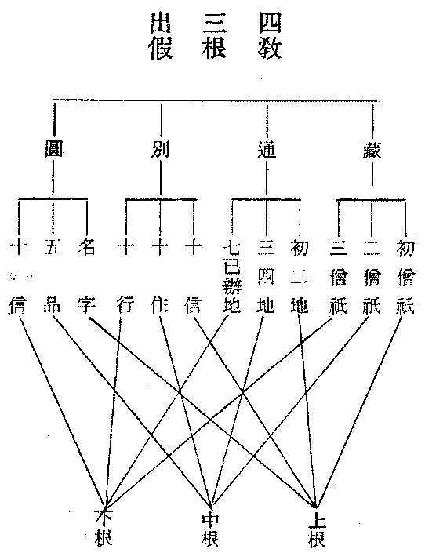



四教三不退



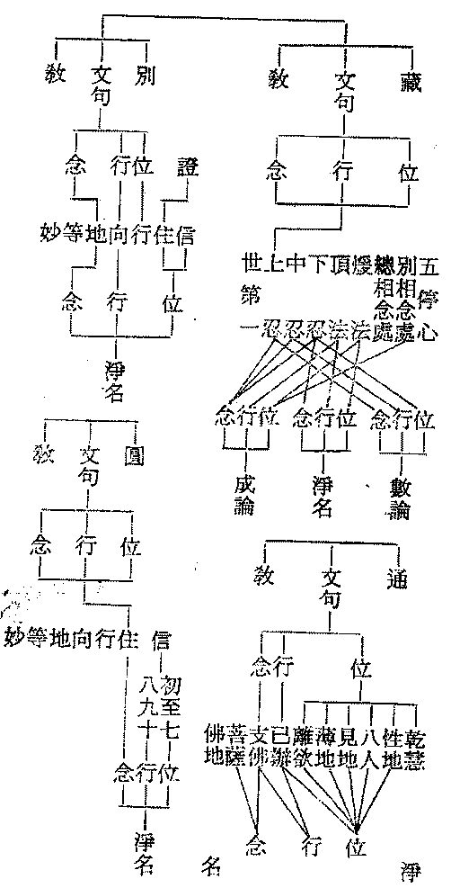



三类四身



　　┌自性身┐  

　　├自受用┼────三类身  

　　├他受用┘┌大化┐  

　　└变化身─┼小化┼三类化  

　　　　　　　└随类┘



诸文三德四德



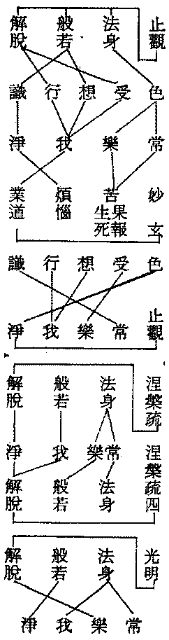



声闻三类摄四(会疏文入论中)



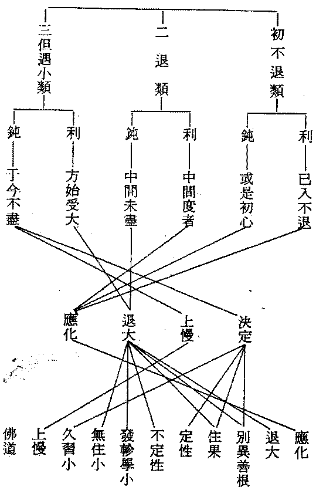



约四时明三三本摄



　　　　　　　┌正　月┐  

　　　　　　　│　　　│  

　　　　　　　├二　月┤  

　　　　　　春┤　　　│  

　　　　　　　├三　月┤  

　　　　　　　│　　　│  

　　　　　　　└四　月┤  

　　　　　　　　　　　│  

　　　　　　　┌五　月┤  

　　　　　　　│　　　│  

　　　　　　　├六　月┤  

　　　佛法　夏┤　　　├秋  

　　（光句）　├七　月┤  

　　　　　　　│　　　│  

　　　　　　　└八　月┤  

　　　　　　　　　　　│  

　　　　　　　┌九　月┤  

　　　　　　　│　　　│  

　　　　　　　├十　月┤  

　　　　　　冬┤　　　│  

　　　　　　　├十一月┤  

　　　　　　　│　　　│  

　　　　　　　└十二月┘



光句云：本时三月既废秋时，以秋之三月配入三时，时则四月，论本则三，论摄则一，故云三三本摄。记云：三时三月，以将其本，各摄一月，故言三三本摄也。具如本文。



　　　　　　　　┌二　月┐  

　　春─正月本摄┤　　　├春分┐  

　　　　　　　　└三　月┘　　│  

　　　　　　　　　　　　　　　│  

　　　　　　　　┌五　月┐　　│  

　　夏─四月本摄┤　　　├夏分┤  

　　　　　　　　└六　月┘　　│  

　　　　　　　　　　　　　　　├世法  

　　　　　　　　┌八　月┐　　│  

　　秋─七月本摄┤　　　├秋分┤  

　　　　　　　　└九　月┘　　│  

　　　　　　　　　　　　　　　│  

　　　　　　　　┌十一月┐　　│  

　　冬─十月本摄┤　　　├冬分┘  

　　　　　　　　└十二月┘



约五行消三三本摄



> 土秋金



　　　　　　　七　　　八　　　九  

　　　　　　　月　　　月　　　月  

　　火　六月┌────────┐月　十　土  

　　　　　　│寄　　　　　　王│  

　　　　　　│　　　　　　　　│  

　　夏　五月│　　　　土　　　│月一十　冬  

　　　　　　│　　　　　　　　│  

　　　　　　│四　　　　　　季│  

　　土　四月└────────┘月二十　水  

　　　　　　　月　　　月　　　月  

　　　　　　　三　　　二　　　正



> 木春土



土寄四季，正时为本三月并摄於土，故云三三本摄也。盖以主摄於客，客即是土也。



若二二说足满六时



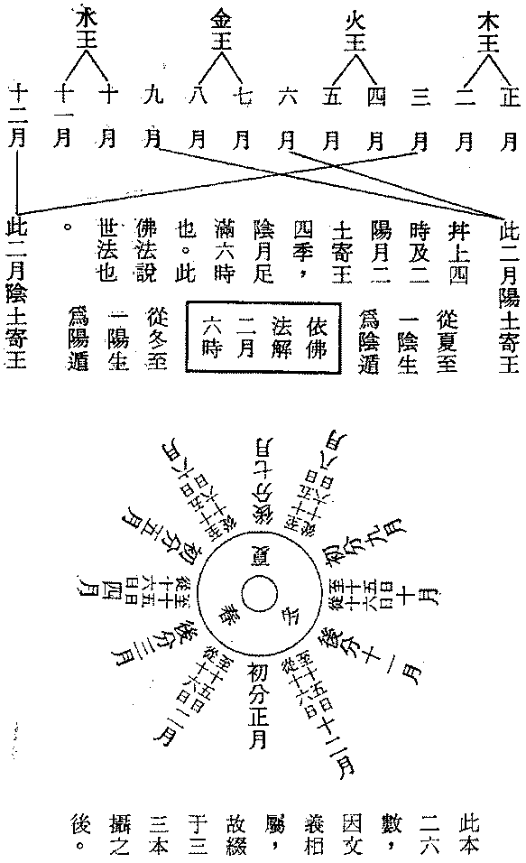



十六观三分大义



　　　　　　┌从如是我闻┬初证信序─经前五事  

　　一、序分┤　　　　　│  

　　　　　　└至清净业处┴二发起序─阇王杀逆　　　　　　　　　　　　　┌上生  

　　　　　　　　　　　　　　　　　　　　　　　　　　　　　　　　　　　│  

　　　　　　　　　　　　　　　　　　┌一者孝养父母（凡夫）　┌──上品┼中生  

　　　　　　　　　　　　┌初三种净业│　　　　　　　　　　　│　　　　│  

　　　　　　　　　　　　│答思惟三　┼二者受持三皈（其二乘）│　　　　└下生  

　　　　　　　　　　　　│　　　　　│　　　　　　　　　　　│  

　　　　　　　　　　　　│　　　　　└三者发菩提心（菩萨）　│　　　　┌上生  

　　　　　　┌从尔时世尊┤　　　　　　　　　　　　　　　　　│　　　　│  

　　二、正宗┤　　　　　│　　　　　┌初依报六──日观、　　│┌─中品┼中生  

　　　　　　└至发无上心┤　　　　　│水观、地观、树观、　　││　　　│  

　　　　　　　　　　　　│　　　　　│池观、总观　　　　　　││　　　└下生  

　　　　　　　　　　　　│　　　　　│　　　　　　　　　　　││  

　　　　　　　　　　　　└二十六妙观├二正报七──华座、　　││　　　┌上生  

　　　　　　　　　　　　　酬正受三　┤像观、佛身、观音、　　││　　　│  

　　　　　　　　　　　　　　　　　　│势至、普观、杂观　　　││┌下品┼中生  

　　　　　　　　　　　　　　　　　　│　　　　　　　　　　　│││　　│  

　　　　　　　　　　　　　　　　　　└三三辈　┌─上三品──┘││　　└下生  

　　　　　　　　　　　　　　　　　　　往生三─┼─中三品───┘│  

　　　　　　　　　　　　　　　　　　　　　　　└─下三品────┘  

　　　　　　┌从尔时阿难┬初王宫流通─问答劝修  

　　三、流通┤　　　　　│  

　　　　　　└座起至尽文┴二耆山流通─佛还重述



三种三聚门(衍论)



　　　　　　┌十信前，名邪定聚，不能信业果报等故。  

　　一、一者┼三贤十圣，名正定聚，决定安立，不退位故。  

　　　　　　└十种信心，名不定聚，或进或退，未决定故。



　　　　　　┌十信前并十信心，名邪定聚，皆无根故。  

　　二、二者┼无上大觉果，名正定聚，已满足故。  

　　　　　　└三贤及十圣，名不定聚，皆未究竟故。



　　　　　　┌十信前，名邪定聚，无乐求心故。  

　　三、三者┼十圣，名正定聚，已同真证故。  

　　　　　　└十信及三贤，名不定聚，未得正证故。



达磨门下三人得法浅深(指要)



　　┌尼总持　断─┐　　　┌证─┐　　　　　　　┌皮  

　　├道育　　迷即┼烦恼　├悟即┼菩提　师云得吾┼肉  

　　└慧可　　本无┘　　　└元是┘　　　　　　　└髓



今家以非二物合，及非背面相番，当体全是，方名为即。烦恼生死，既是修恶，全体即是性恶，故不须断除番转也。



三号



一、怛闼阿竭，此云如来。



二、阿罗诃，此云应供。



三、三耶三菩，此云正徧知。



一、如来之义有三：谓法身、报身、应身也。金刚经云：「无所从来，亦无所去。」此法身如来也。转法轮论云：「第一义谛名如，正觉名来。」此报身如来也。成实论云：「乘如实道，来成正觉。」此应身如来也。



二、谓万行圆成，福慧具足，应受天上人间供养，饶益有情，故号应供。



三、亦名正等觉。谓具一切智，於一切法无不了知，故号正徧知。以一切法平等开觉，一切众生成无上觉，故号正等觉。



三身



一、名身。



二、句身。



三、文身。



三经(妙玄)



　　┌教┐　　┌天魔外道不能改坏。  

　　├行┤　常┼真正不杂无能逾过。  

　　└理┘　　└湛然不动决无异趣。



三妙



一、佛法。



二、心法。



三、众生法。



一心具十法界，则该生佛。十界互具，成百界，故名妙。褒美词也。



三渐



一、初——鹿苑。



二、中——方等。



三、末——般若。



三轨



一、衣——著如来衣，修寂灭忍——忍辱。



二、座——坐如来座，修中空——法空。



三、室——入如来室，是无缘慈——慈悲。



三轨



一、资成。



二、观照。



三、真性。



三根



一、声闻钝。



二、缘觉钝。



三、菩萨利。



三人禀教修行，根有利钝，故断惑证果不同。



三戒



　　一、在家──八戒。  

　　二、出家──别解脱。  

　　　　　　　┌五戒。  

　　三、道俗共┤  

　　　　　　　└三聚。



三忍(法华)



一、苦行——而作比丘。



二、生忍——独处闲静。



三、第一义——乐诵经典。



「即自守节林间，恶人恶兽，忍耐不嗔。」



三心



　　┌贪┐  

　　├瞋┼三毒  

　　└痴┘



三心



一、志诚——志者专也，诚者实也。



二、深心——佛果高深，发心求往。



三、回向发愿——大悲拔苦也。



三怨



一、烦恼。



二、天魔。



三、外道。



三境(止观)



一、性德——观一念心具三千法。



二、修德——推本具心离四性计。



三、化他——解离四性无妨四说。



三缘



　　┌断惑┐  

　　├成根┼三缘具足方论家家  

　　└受生┘



三智(宝藏)



　　┌真智──体解无物，本来寂静，通违无涯，净秽不二。  

　　├内智──自觉无明，割断烦恼，心意寂静，灭无有餘。  

　　└外智──分别根门，识了尘境，博鉴古今，皆通俗事。



三念



一、佛如医王。



二、法如良药。



三、僧如瞻视。



三念



　　┌得供不高　　　　　　　┌无妄失法  

　　├逢毁不下　　　　　　　├永拔习气  

　　└不供不毁──不生惭戚　└一切种妙智



三愿



一、愿一切众生得证知法。



二、愿以无厌心为众生说法。



三、愿舍身命护持正法。



三明(大经)



一、菩萨——般若明。



二、诸佛——天眼明。



三、无明——毕竟空。



三慈(大经)



一、众生缘慈，观一切众生如父母想。



二、法缘慈，见一切法皆从缘生。



三、无缘慈，不住法相及众生相。



又云：慈悲喜舍，各具此三缘。



三行



一、身行——出入息属身故。



二、口行——先觉观，后有语言。



三、意行——以受苦乐，取相心发。



三我



一、见。



二、慢。



三、名字。



三因



一、正——九庵摩罗清净识——法身——苦道。



二、缘——七阿陀那转识——般若——业道。



三、了——八阿赖耶藏识——解脱——烦恼。



三福(观经)



一、孝养父母，奉事师长，慈心不杀。



二、受持三归，具足众戒。



三、发菩提心，深信因果，读诵大乘。



三种香(戒香)



一、枝。



二、根。



三、花。



三时



一、种——久远。



二、熟——宿世。



三、脱——今日。



佛化众生，时时不废而成熟之。华严会上，宿世根熟者是。



三类教



一、顿。



二、渐。



三、不定。



三才(亦曰三极，易曰三极之道。)



一、天——形而上者谓之天。



二、地——形而下者谓之地。



三、人——命於其两间者谓之人。



三朝(元旦)



一、岁朝。



二、月朝。



三、日朝。



三光



　　┌日┐┌亦曰三辰光  

　　├月┼┼传曰三辰旗  

　　└星┘└旗照其明也



三朔



一、平明——夏用之。



二、鸡鸣——商用之。



三、夜半——周用之。



三垣(天象之间有此三垣)



一、紫微垣。



二、太微垣。



三、天市垣。



十五星在天之中，十星在翼轸北，二十二星在房心东北。



三台



> 一、上台。上星为天子，下星为女中。亦曰泰阶。



> 二、中台。上星为公侯，下星为大夫。六符共六。



> 三、下台。上星为元士，下星为庶人。星两两而居。



大火三星(即心星)



> 一、中星。明堂天子位。



> 二、前星。太子。



> 三、后星。庶子。



三古



一、上古——伏羲时。



二、中古——周王时。



三、下古——孔子时。



三正



一、子为天正，周建之。



二、丑为地正，商建之。



三、寅为人正，夏建之。



此三正月，三代迭用之。自汉武帝以来并用。夏正建寅之月，为岁首。



三统



一、黄鍾为天统——十月。



二、林鍾为地统——六月。



三、太蔟为人统——正月。



三长月



一、正月寅。



二、五月午。



三、九月戌。



长音丈，俗志此三月不上官。



三伏



一、初伏。



二、中伏。



三、末伏。



夏至后，第三庚日为初伏。第四庚日为中伏。立秋后，初庚为末伏。



四时代谢，皆以相生。立春：木代水，水生木。立夏：火代木，木生火。立冬：水代金，金生水。独立秋以金代火，金畏火故，至庚日必伏。



三令节



一、中和节二月一日。



二、上巳节三月三日。



三、重阳节九月九日。



唐贞元中，詺三节日，在百寮选胜地追赏以为乐。



汉三辅



一、京兆中。



二、冯翊左。



三、扶风右。



辅翊之义，言此三州为京师翊卫也。



蜀三都



一、成都。



二、新都。



三、广都。



宋三辅



一、郑州。



二、滑州。



三、汝州。



宋都汴，以此三州为辅属京西北。



成都三市



一、蚕市。



二、药市。



三、七宝市。



唐三内(在长安城内)



一、西内。



二、东内。



三、南内。



皇城在西北隅。大明宫在西内隅。兴庆宫在东内隅。



三吴



一、东吴苏州。



二、中吴润州。



三、西吴湖州。



三亳



一、北亳——曹州考城县。



二、南亳——南京谷熟县。



三、西亳——西京偃师县。



三楚



一、南楚——江陵。



二、西楚——彭城即徐州。



三、东楚——吴郡即苏州。



三齐



一、东齐——临菑。



二、济北——博阳。



三、胶东——蓬州即墨。



三蜀



一、蜀都——即成都。



二、广汉——汉高分置。



三、犍为——汉武分置。



三晋



一、赵——都邯郸。



二、魏——都大梁。



三、韩——都郑。



三家皆晋卿。



三虢



一、北虢——大阳。



二、东虢——荣阳。



三、西虢——雍州。



三秦



项羽封秦降将三人於关中，号曰三秦。



一、雍王——章邯都废丘。



二、塞王——司马欣都㧰阳。



三、翟王——董翳都高奴。



三巴



一、中巴——巴县属渝州。



二、巴西——绵州。



三、巴东——归州夔州鱼复云安等处。



即古巴子国也。



三越(一作粤)



一、吴越——杭州。



二、闽越——福州。



三、南越——广州。



三河



一、河南——周都。



二、河内——商都。



三、河东——尧都。



汉书：收三河之士，又见后。



三湘



一、湘乡。



二、湘潭。



三、湘源。



在湖南，属潭州，又见后。



三韩



东夷国名，即号勾辰，国在海外。



一、马韩。



二、辰韩。



三、弁韩。



三种蛮(南方之夷)



一、黑齿蛮。



二、金齿蛮。



三、银齿蛮。



灊山三峰



灊一作潜，在安庆府怀宁县。



一、天柱山。



二、潜山。



三、皖山。



丽水三峰(在处州丽水县)



一、岑峰。



二、翠峰。



三、云峰。



海中三岛(神仙所居)



一、扶桑岛。



二、蓬莱岛。



三、昆仑岛。



三神山



一曰三壶，其形如壶，也在海中。



一、蓬莱山——亦曰蓬壶。



二、方丈山——亦曰方壶。



三、瀛洲——亦曰瀛壶。



闽中三山



一、越王山。



二、九仙山。



三、闽山(亦曰乌石山)。



福建郡城，三山鼎峙，故世谓福州为三山。



金华三洞(在婺州)



一、朝真。



二、冰壶。



三、双龙。



三涂(山名，涂道也)



一、伊阙——一作太行。



二、大谷——一作崤黾。



三、轘辕。



洋州三谷



一、褒谷。



二、骆谷。



三、子午谷。



此三谷，洋州之要地也。



钦州三海岩(有灵山县西)



一、钱岩。



二、月岩。



三、龟岩。



宜州三峡(在袁州)



一、牛阑峡。



二、昌山峡。



三、鍾山峡。



三峡



一、归峡。又曰巴峡，又曰瞿唐峡，又曰广泽峡。



二、巫峡。在峡州，又云在夔州巫山县。



三、西峡。即明月峡，在夔州之西，又曰黄牛峡。



在蜀口隘处也。夔州七百里，两岸连山，非午不见日。



三受降城



一、东城。在榆林县东北八里。元属振武。



二、西城。在丰州西北八十里，今天德军治於此。



三、中城。在榆林，汉元朔中更名九原。



唐张仁，原为朔方总管，筑三受降城。以拂云祠为中城，距东西两城各四百里，皆据冲要。



义阳三关



一、平靖关。



二、阳关。



三、广岘关。



在信阳军。



邺中三台



一、中台——铜雀。



二、南台——金兽。



三、北台——水井。



三台



一、苏台——姑苏台在苏州。



二、相台——铜雀台在相州。



三、滑台——测景台在滑州。



三川



一、河——一云泾。



二、洛——一云洛。



三、伊——一云渭。



三江



一、中江。自岷山入海。一云荆江——荆州。



二、南江。自豫章入江。一云松江——苏州。



三、北江。自汉入江。一云浙江——杭州。



唐仲初吴都赋注：松江下七十里，分流东北入海者，为娄江，东南流者，为东江，并松江为三江，禹贡三江既入，蔡氏止引此说以注之，云：「其地今亦名三江口是也。」



佛学名相汇解　卷第十二（终）



三亲



一、夫妇——有人民而后有夫妇。



二、父子——有夫妇而后有父子。



三、兄弟——有父子而后有兄弟。



(颜氏家训曰：「一家亲，此三者而已矣。自兹以往，至于九族，皆本於三亲焉。」)



三寿



此出庄子，若诗所谓三寿作朋，又别有义。



一、上寿百岁，一云上寿百二十岁。



二、中寿八十，一云中寿百岁。



三、下寿六十，一云下寿八十。



三殇



一、长殇——十六岁至十九岁。



二、中殇——十一岁至十五岁。



三、下殇——八岁至十一岁下，为无服之殇。



(未成人而死曰殇。)



三利



一、一年之利种谷。



二、十年之利种树。



三、百年之利种德。



(备数利字，皆作计字，见管子。)



水三等



一、山水上。



二、江水次。



三、井水下。



(陆羽茶经论：「水恶渟浸而喜泉源故井取，汲多者江水长，然众水杂故，次於山水。」)



妇有三不去



一、有所取无所归不去——始之嫁也，有所受命。今其去也，父兄俱无。



二、与更三年丧不去——与同服父母之丧。



三、前贫贱后富贵不去——糟糠之妻不下堂。



三不孝



孟子曰：「不孝有三，无后为大也。」



一、阿意曲从，陷亲不义，是一。



二、家贫亲老，不为禄仕，是二。



三、不取无子，绝先祖祀，是三。



孟子三乐



一、父母俱存，兄弟无故，是一。



二、仰不愧天，俯不怍人，是二。



三、得天下英才教育之，是三。



荣公三乐



荣启期自言有三乐。(见列子)



一、得为人，一乐。



二、得为男子，二乐。



三、行年九十，三乐。



女子三从(出礼记)



一、在家从父。



二、适人从夫。



三、夫死从子。



当官三事



一、清。



二、慎。



三、勤。



(吕氏童蒙训：当官之法惟此三事。)



官才三难



一、人物难知。



二、爱憎难防。



三、情伪难明。



(刘毅曰：「官使人才有此三难。」)



三达尊(孟子曰：天下有达尊三。)



一、爵——朝廷所尚。



二、齿——乡党所尚。



三、德——辅世长民。



三达德



一、知——生知安行。



二、仁——学知利行。



三、勇——困知勉行。



三德



一、至德——以为道本。



二、敏德——以为行本。



三、孝德——以知逆恶。



三行



一、孝行——以亲父母。



二、友行——以尊贤良。



三、顺行——以事师长。



(周礼：师氏以三德三行教国子。)



三孝



一、大孝尊亲。



二、其次弗辱。



三、其下能养。



三事



一、事父——有隐无犯。



二、事君——有犯无隐。



三、事师——无犯无隐。



(国语：民生於三事之如一，又见礼记。)



三不欺(见史记)



一、不能欺——郑子产。



二、不忍欺——宓子贱。



三、不敢欺——西门豹。



三农



一、山农。



二、泽农。



三、平地农。



(周礼：三农生五谷。)



三不吊



一、畏——死於兵。



二、压——死木石。



三、溺——死於水。



(问终曰吊。此三者不得正命而死，故不吊。)



三不幸(伊川语)



一、少年登高科。



二、席父兄势为美官。



三、有高才能文章。



唐人三绝



一、李白歌诗。



二、裴旻剑舞。



三、张旭草书。



(物之奇妙者，曰绝也。)



三不祥



一、幼不肯事长。



二、贱不肯事贵。



三、不肖不肯事贤。



(谓事之不善者也，见荀子。)



郑虔三绝



一、书绝。



二、诗绝。



三、畫绝。



(唐太宗时，虔自写其诗并书以献，帝署其尾曰：郑虔三绝。)



顾凯三绝



一、才绝。



二、畫绝。



三、痴绝。



东晋诗人。



李揆三绝



一、门地。



二、人物。



三、文章。



唐乾元中拜相，帝称其三绝也。



乐天三友



一、诗。



二、琴。



三、酒。



(谓与之周旋如友然。)



沈友三妙



一、笔妙。



二、舌妙。



三、刀妙。



(吴人。善作文，好武事、利口辩，时称三妙。)



王瞻三术



一、射。



二、棋。



三、酒。



(梁武帝时称其三术。)



太宗三鉴



一、以铜为鉴，可正衣冠。



二、以古为鉴，可知兴替。



三、以人为鉴，可明得失。



(唐太宗云：「魏徵死，朕亡一鉴矣。」)



湘东三笔



一、金管。忠孝全者，金管书之。



二、银管。德行纯粹者，银管书之。



三、班竹管。文章美者，竹管书之。



(梁湘东王录赏世文章，有笔三品。)



鲁恭三异



一、蝗不犯境。



二、化及鸟兽。



三、孺子有仁心。



(恭为中牟令，德政所施，致此三品。)



刘禹锡三癖



一、诗癖。



二、琴癖。



三、酒癖。



(意偏於所好为癖。)



董遇三餘



董遇力学，常以三餘读书。



一、冬者岁之餘。



二、夜者日之餘。



三、阴雨者时之餘。



王肃三反



魏人刘实言其有三反。



一、方於事上而好下[女*妄]己。



二、虽嗜荣贵而不求苟合。



三、吝惜财物而治身不秽。



东坡三适



东坡谪居海南，有三诗咏之。



一、旦起理发。



二、午窗坐睡。



三、夜卧濯足。



李谐三短



一、因瘿而举頥。



二、因跛而缓步。



三、因謇而徐言。



(后魏人善用其短。)



臧文仲三不仁



一、下展禽——知柳下惠而不与立。



二、废六关——六关禁来游者而废之。



三、妾织蒲——与民争利。



(鲁大夫。孔子尝言：「其不仁者三，不知者三。」)



臧文仲三不智



一、作虚器——为藏龟之室。



二、纵逆祀——逆祀僖公而不之禁。



三、祀爰居——海鸟止东门而祭之。



颜驷三不遇



一、文帝好文——臣好武。



二、景帝好美——臣貌丑。



三、武帝好少——臣已老。



(汉人。三世为郎，不遇於君。)



杨秉三不惑



一、酒不惑。



二、色不惑。



三、财不惑。



(后汉人。谓不为此三者所惑也。)



刘颕三不肯



一、不肯足。



二、不肯去。



三、不肯迁。



(魏人。为弘农太守，苛刻，民患之，题其门曰：「刘府君，三不肯。」)



马胤孙三不开



一、入朝印不开。



二、见客口不开。



三、归宅门不开。



(后晋人，为相不接宾客，时人目之为三不开。)



元次山三吾



一、浯溪——水。



二、峿台——山。



三、唐亭——屋。



(在永州，居潇湘二水之滨。制宇从水、从山、从屋皆曰吾，谓我擅而有之也。)



司空图三宜休



一、量才一宜休。



二、揣分二宜休。



三、耄而瞆三宜休。



(图作亭名休休)



古三皇



一、天皇氏。兄弟十二人。



二、地皇氏。兄弟十一人。



三、人皇氏。兄弟九人分长九州。



三皇



一、太昊——伏羲氏，风姓。



二、炎帝——神农氏，姜姓。



三、黄帝——轩辕氏，姬姓。



三代



一、夏后氏——都安邑。



二、商——亦曰殷。都亳，后迁耿，又迁相。



三、周——武王都镐京，平王迁于洛。



三王



一、夏禹——鲧之子，颛顼之孙。



二、商汤——契十四世孙。契帝喾子。



三、周文武——后稷十五世孙。稷亦喾子。



三国



一、魏——都邺后徙洛阳。



二、蜀——都成都。



三、吴——都建业。



(自汉以后，天下分为三国，而后并于晋。)



三后



一、伯夷——降典。



二、禹——平水土。



三、稷——降播种。



书吕刑云：「乃命三后，恤功于民。」



新室三公



一、甄邯。



二、王兴。



三、王邑。



殷三仁



仁者，天理之正，三人出处不同，而各安乎天下之正，故曰三仁。



一、微子。



二、箕子。



三、比干。



隋三帝



一、文帝——名坚。在位三十三年。改元二曰：开皇、仁寿。



二、炀帝——名广。文帝子，在位十二年。改元曰大业。为宇文化及所弑。



三、恭帝——名侑。文帝孙，在位二年。改元曰义宁。降于唐。



(姓杨氏。文帝受周禅，后平陈，混天下。三世三十七年，而唐代之。)



钩党三君



一、窦武——天下忠诚窦游平。



二、陈蕃——天下义府陈仲举。



三、刘淑——天下德弘刘仲承。



(君者，言一世之所宗也。此下至八厨，皆汉末党人。)



后周三主



一、太祖——名威。在位三年。改元广顺。



二、世宗——名荣。本柴氏，太祖妻兄之子，立以为嗣。在位六年。改元显德。



三、恭帝——名宗。训世宗子。在位半，未及改元。



(姓郭氏。太祖代汉，三主实二姓，凡十年，禅位于宋。)



周三后



　　┌大王。　诗曰　又尚书毕命┌周公  

　　├王季。　三后　云三后协心│君陈  

　　└文王。　在天　同底于道谓┴毕公



周三母



一、大姜——王季母。



二、大任——文王母。



三、大姒——武王母。



周三监



一、管叔。



二、蔡叔。



三、霍叔。



武王使三叔监纣子武庚之国。



鲁三桓



一、仲孙氏又曰孟叔。



二、叔孙氏。



三、季孙氏。



(三家皆桓公之后，世秉鲁政，号曰三桓。)



秦三良



一、子车奄息。



二、子车仲行。



三、子车钤虎。



(三人皆子车氏之子，殉秦穆公之葬者也。)



魏三师



一、卜子夏。



二、田子方。



三、叚于木。



文侯以此三人为师。



三刺客(见史记)



一、曹沫——齐人。



二、聂政——韩人。



三、荆轲——燕人。



楚三族



皆与楚同姓而分者也，故曰王族三姓。



一、昭。



二、屈。



三、景。



(屈原为三闾大夫，掌此三姓。)



三焦



水谷之道路，亦气之终始也。



一、上焦——在心下下鬲，在胃上口。



二、中焦——在胃中脘，不上不下。



三、下焦——在脐下，当膀胱。



脉三部



一、寸脉——上部，法天，主胸以上至头。



二、关脉——中部，法人，主鬲下至脐上。



三、尺脉——下部，法地，主脐已下至足。



三丹田



一、上丹田——眉间。



二、中丹田——心。



三、下丹田——脐下。



汉三杰



才过万人曰杰。



一、萧何。



二、张良。



三、韩信。



京兆三王



一、王尊。



二、王章。



三、王骏。



(三人皆为京兆，皆有能名。)



蜀汉三杰



一、诸葛亮——孔明。



二、关羽——云长。



三、张飞——益德。



(先主之臣。)



凉州三明



一、叚颕字纪明。



二、皇甫威字威明。



三、张奂字然明。



(三人并著名於凉州。)



陈氏三君



一、实——字仲弓大丘长。



二、纪——实子元方大鸿胪。



三、谌——纪弟季方司空掾。



京兆三休



一、金敞字元休。



二、第五巡字文休。



三、韦端字甫休。



(同郡齐名，并以光和元年察举。)



京兆三明



一、蔡谟字道明。



二、诸葛恢字道明。



三、许闿字道明。



(晋人。语曰：「京兆三明各有名，蔡氏儒术，葛许清。」)



会稽三康



一、孔愉字敬康。



二、张茂字伟康。



三、丁潭字世康。



王氏三少



一、王羲之。



二、王承。



三、王憁。



(晋人。)



洛中三嘏



一、刘粹字纯嘏。



二、刘宏字终嘏。



三、刘漠字冲嘏。



(晋人。语曰：「洛中雅稚，有三嘏焉。」)



吴郡三高



一、范蠡——越人。



二、张翰——晋人。



三、陆龟蒙——唐人。



(吴郡，今之平江府。)



浔阳三隐



一、陶渊明。



二、周续之。



三、刘遗民。



(浔阳汀洲，此三人同居庐山。)



三谢



一、谢灵运。



二、谢惠连。



三、谢玄晖。



(宋人。)



何氏三高



一、何求——小山。



二、何点——太山。



三、何胤——东山。



(宋人。兄弟皆隐居若邪山。)



台中三狗



一、何晏。



二、丁谧。



三、邓飏。



(魏人。并事曹爽，时人语曰：「三狗岸柴不可当，一狗凭默作疽囊。」默，爽小字也。)



三张



一、张载——孟阳。



二、张协——景阳。



三、张亢——季阳。



(晋人。兄弟并有才名。)



隋三将



一、杨素——猛将。



二、韩擒虎——斗将。



三、史万岁——骑将。



三珠树



一、王勔。



二、王勮。



三、王勃。



(文中子之孙三人，杜易简称为三珠树。)



畫家三祖



一、顾长康。



二、陆探微。



三、张僧繇。



三列宿



一、韦叔武——主爵郎中。



二、韦叔谐——库部郎中。



三、韦叔谦——吏部郎中。



(唐贞观中，韦氏兄弟三人同省，时号三列宿。取郎官上应列宿之义。)



三世司业



父子相继为司业。



一、孔颕达



二、孔志——颕达子。



三、孔惠元——志子。



三相张家



一、张嘉贞——相玄宗。



二、张延赏——相德宗。



三、张弘靖——相宪宗。



三刘



一、刘涣——疑之西涧先生。



二、刘恕——道原涣子也。



三、刘壮舆——义仲恕子。



(紫阳人。三世以清节著名。)



三苏



一、苏洵——明允，老泉先生。



二、苏轼——子瞻，洵子，东坡先生。



三、苏辙——子由，轼弟，颕滨先生。



(眉山人。时语云：「眉山生三苏，蜀中草亦枯。」)



三孔



一、孔文仲继父。



二、孔武仲常父。



三、孔平仲毅父。



(临江人。皆孔延之之子。)



三洪



一、洪适——景伯，号盘洲。



二、洪遵——景严，号小隐。



三、洪迈——景卢，号容斋。



(番阳人。皆洪皓子也。)



周三公



三公，论道之官，古者三公无职，汉以丞相以下为三公，失古意矣。



一、太师——道之教训。



二、太傅——傅之德义。



三、太保——保其身体。



(汉以丞相、太尉、御史大夫为三公。后又改丞相为大司徒，大尉为大司马，御史大夫为大司空。唐以太尉、司徒、司空为三公。)



三孤



一、少师。



二、少傅。



三、少保。



(亦曰三少，所以佐三公。)



三宅



一、常伯——牧民之长。



二、常任——任事公卿。



三、准人——守法有司。



(见尚书。)



三省



一、中书省——掌造命。



二、门下省——掌省驳。



三、尚书省——掌奉行。



(宋元礼定官制校，唐六典建三省。)



三馆



一、昭文馆。



二、史馆。



三、秘馆。



(掌经籍、国书，修撰国史，校勘文书。)



三学士



一、翰林院。



二、弘文馆。



三、集贤院。



三台



一、中台——尚书令。



二、外台——谒者。



三、宪台——御史。



(官舍之重者曰台。盖取严肃尊崇之义。)



御史三院



一、台院——侍御史居之。



二、殿院——殿中侍御史居之。



三、察院——监察御史居之。



(御史掌弹劾。院，周也。官府以墙垣周之。)



元朝三台



一、内台——大都。



二、西台——奉元。



三、南台——建康。



三司



一、盐铁使。



二、度支。



三、户部。



(司主也，理财之官。)



三独坐



后汉制，专席而坐，言其尊也。



一、尚书令。



二、司隶校尉。



三、御史中丞。



三寺(唐)



一、家令寺。



二、率更寺。



三、太仆寺。



三谏



一、大谏——谏议。



二、中谏——补阙，今司谏。



三、小谏——拾遗，今正言。



(谏者，以言正君也。)



三铨



一、尚书铨。



二、中铨。



三、东铨。



(掌选法故曰铨。尚书所掌，侍郎所掌分为二。)



三监



一、秘书监。



二、将作监。



三、国子监。



三府



一、明府——县令。



二、府丞。



三、少府尉。



(唐人所称。)



三紧官



一、大理卿。



二、拾遗。



三、评事。



(言吏部不轻铨应也。)



三卫



一、亲卫。



二、勋卫。



三、翊卫。



(唐制，以大臣子孙为之，轮番宿卫，而后授之禄仕。)



武臣三卫



一、殿前司。



二、侍御马军。



三、侍御步军。



(卫，府也。官之尊者建牙。牙，旗也。因谓官之所舍为牙，后易为卫。)



魏封王庶子三等



一、卿公——王庶子。



二、卿侯——嗣王之子。



三、亭伯——公庶子。



(王，谓天子之子也。嫡子嗣为王，庶子封号亦有三等矣。)



汉皇女封号三等



一、县公主——皇女仪服同列侯。



二、长公主——皇女尊崇者加号仪服同藩王。



三、乡亭翁主——诸王女仪服同乡亭侯。



(天子女也。)



后魏三长



一、邻长(五家为都)。



二、里长(五邻)。



三、党长(五里)。



三门(诸侯之制)



一、臯门——郭门。



二、应门——正门。



三、路门。



三朝(周制。天子朝群臣之所)



一、外朝——在臯门之内。



二、中朝——在应门之内，又谓之治朝。



三、内朝——在路门之内，又谓之燕朝，又曰路寝。



(唐制则以含元殿为大朝，即周之外朝。以宣政殿为正卫，即周之中朝，汉之前殿也。以紫宸殿为上阁，即周之内朝，汉之宣室也。)



三市



一、大市——日昃而市。



二、朝市——朝时而市。



三、夕市——夕时而市。



(周礼司市所掌。)



三社



一、大社——王为群姓立，诸侯曰国社。



二、王社——王自立，诸侯曰侯社。



三、毫社——亡国之社。



三台



一、灵台——以观天文。



二、时台——以观四时。



三、囿台——以观鸟兽。



三代学名



一、夏曰校。



二、殷曰序。



三、周曰庠。



汉三阁



一、石渠阁。



二、天禄阁。



三、麒麟阁。



(藏书同上，畫功臣。)



汉三雍



一、明堂。



二、灵台。



三、辟雍。



(光武立。)



宋三舍



一、外舍——生徒初入外舍，月一私试。



二、内舍——岁一公试，补内舍生。



三、上舍——间岁又一试，补上舍生。



陈三阁(后主所创)



一、临春阁——后主自居。



二、结绮阁——张妃居之。



三、望仙阁——龚孔二嫔居之。



三官



一、天子。



二、太后。



三、皇后。



汉明经三科



科，程也，中程度者取之。



一、甲科——郎中。



二、乙科——太子舍人。



三、丙科——文学掌故。



汉茂才三科



一、明经。



二、明律令。



三、能治剧。



本朝三科



一、高蹈丘园。



二、沉沦草泽。



三、茂才异等。



唐三科



一、生徒——由学馆进。



二、乡贡——由州县升。



三、制举——天子自诏，以待非常之才。



制擧三科



一、贤良方正，能直言极谏。



二、经义优深，可为师法。



三、详闲政理，达於教化。



(宋初制举凡三科。)



唐选人三科



一、德——度德居任。



二、才——量才受职。



三、劳——计劳升叙。



(沈既济议。)



三田



一、为乾豆——上杀中心，死最疾。



二、为宾客——中杀远心，死稍迟。



三、为充君之庖——下杀中脇，死益迟。三杀以死迟速为名。死速则肉鲜，死迟则肉恶。故分为三用。



(礼记：天子无事，则岁三田。)



唐三赋



一、租——有田则有租，租出米谷。



二、庸——有身则有庸，庸出绢。



三、调——有户则有调，调出缯纩布麻。



三征



一、布缕之征。



二、粟米之征。



三、力役之征。



(孟子曰：「君子用其一，缓其二。」)



将三等



一、勇将。



二、知将。



三、福将。



三军



一、前军。



二、中军。



三、后军。



(周制，万二千五百人为军，三军则三万七千五百人。)



兵三道



一、正兵。



二、奇兵。



三、伏兵。



三阵



一、天阵——星宿孤虚。



二、地阵——山川向背。



三、人阵——雁行弥缝。



(即太公三才阵。)



兵三急



一、得地形。



二、卒服习。



三、器用利。



(晁错曰：用兵之急者三。)



兵三官



一、鼓——所以作，所以起，所以进。



二、金——所以坐，所以退，所以免。



三、旗——所以立兵，所以利兵，所以偃兵。



(官，司也。兵之坐、作、进退，此三者，实司之。)



兵三威



一、鼙鼓金铎所以威耳(不可不清)。



二、旌旗摩帜所以威目(不可不明)。



三、禁令刑罚所以威心(不可不严)。



(吴子曰：「三者不立，必败於敌。」)



决胜三术



一、形——大体得失之数。



二、势——临时进退之宜。



三、情——心志可否之实。



(荀悦曰：「立策决胜之术有三。」)



战三亡



一、以乱攻治。



二、以邪攻正。



三、以逆攻顺。



(三者灭亡之道。)



甲三属(属，联也。)



一、上身一。



二、髀裈二。



三、踁缴三。



船三翼



一、大翼——广一丈五尺三寸，长十丈。



二、中翼——广一丈三尺五寸，长七丈。



三、小翼——广一丈二尺，长五丈六尺。



三射



一、大射——六耦在郊。



二、宾射——六耦在朝。



三、燕射——六耦在寝。



(周礼：天子三射，射各有六耦矣。)



周刑三典



一、轻典——刑新辟地立君之国。



二、中典——刑承平守成之国。



三、重典——刑簒弑叛逆之国。



(周礼，秋官司宼掌之。)



更三品(汉制戍卒之更代也)



一、卒更。



二、践更。



三、过更。



一、正卒无常人，皆当更迭为之，一月一更。



二、贫者欲得雇更钱，次直者出钱雇之，月二千。



三、戍边之调不可人人自行三日戍。又行者当自戍三日，不可便还，因一岁一更。诸不行者，出钱三百，入官以给戍者。



三赦(赦，舍也，谓放舍之，勿令坐。)



一、幼弱——不满八岁，非手杀人。



二、老耄——八十以上，非手杀人。



三、惷愚——生而痴𫘤童昏者。



三刺(七赐反杀也，三讯罪定则杀之。)



一、讯群臣。



二、讯群吏。



三、讯万民。



三宥



宥者宽也，稍宽纵之，谓未减也。



一、不识——愚人无识而犯。



二、过失——若过失杀人不坐死。



三、遗忘——若隔墙忘有在者，而以矢石投射之。



三就



书曰：五服三就，谓服刑就此三处。



一、原野——大罪列於原野。



二、朝——大夫於朝，公族於甸人。



三、市——士於市。



三居



一、四裔——大罪。



二、九州之外——次之。



三、千里之外——又次之。



(书曰：「五刑有宅，五宅三居。居此地也。」)



唐三大礼(杜甫尝献三大礼赋)



一、朝献大清宫。



二、朝享大庙。



三、有事於南郊。



鞭三等



一、刑鞭——生革廉成。



二、法鞭——生革去廉。



三、常鞭——熟靼不去廉，靼音之舌切。



梁武帝制。三鞭皆作挂头细长尺二寸，靶长二尺七寸，廉三寸，靶长二尺五寸。



杖三等



一、大杖——头围寸三分，小头八分半。



二、法杖——围寸二分，小头五分。



三、小杖——围寸一分，小头极秒。



(杖皆用生荆，长六尺。)



元朝律令三书



一、制诏。



二、条格。



三、断例。



枷三等(元朝制)



一、死罪二十五斤。



二、徒罪二十斤。



三、杖罪一十五斤。



三帛



一、诸侯世子执𫄸。



二、公之孤执玄。



三、附庸之君执黄。



三币(见管子)



一、上币——珠玉。



二、中币——黄金。



三、下币——刀布。



金三品(见禹贡)



一、金一云黄金。



二、银一云白金。



三、铜一云赤金。



三爵(饮酒器，三代异名。)



一、夏曰醆。



二、殷曰斝。



三、周曰爵。



三雅



饮器。刘表子所作。



一、伯雅——受一斗。



二、仲雅——受七升。



三、季雅——受五升。



三驾卤簿



一、大驾——八十一乘，郊祀用。



二、法驾——三十六乘，祀明堂用。



三、小驾——十二乘，祀宗朝用。



三舆



一、五色舆。



二、常乎舆。



三、腰舆。



(唐制：辇有七，舆有三。大驾卤簿皆先玉路以行。)



孔周三剑(见列子)



一、含光。



二、承影。



三、霄鍊。



三代冠名



　　┌夏曰收　　　　　　　　┌夏曰母追。  

　　├殷曰冔　已上为祭服。　├殷曰章甫。　(以上为常服。)  

　　└周曰弁　　　　　　　　└周曰委貌。



冠礼三加



一、始加缁布冠。



二、次加皮弁。



三、三加爵弁。



魏文三剑



魏文帝有宝剑三。



一、魏景。



二、流𥝞。



三、华𨦟。



三舃



一、赤舃——黑饰。



二、白舃——青饰。



三、黑舃——赤饰。



(周礼注：「王之舃三等，赤舃为上。冕服之舃也。」)



三大舞(唐)



一、七德舞——本秦王破陈乐。



二、九功舞——本功成庆善乐并太宗作。



三、上元舞——高宗作。



三坟



一、山坟——言君臣民物阴阳兵象。



二、气坟——言归藏生动长育生杀。



三、形坟——言天地日月山川云气。



(上古之书亡矣。今所传三坟书，乃伪书也。)



三易



一、连山——夏易，首艮。



二、归藏——商易，首坤。



三、周易——周易，首乾。



(周礼太卜掌三易，其经卦皆八，其别皆六十四。)



三兆



一、玉兆——颛帝之兆。



二、瓦兆——帝尧之兆。



三、原兆——有周之兆。



(周礼太卜掌三兆之法。)



三颂



一、周颂。



二、鲁颂。



三、商颂。



三子



一、老子——道德经。



二、庄子——南华经。



三、列子——冲虚经。



三礼



一、仪礼。



二、周礼。



三、礼记。



(朱子尝谓仪礼为经，礼记为传，合三礼之书作仪礼经传通解。)



三史(记事者为史)



一、史记。



二、西汉书。



三、汉书。



(或曰：「晋之乘，楚之梼杌，鲁之春秋，是谓三史。」)



三略



一、上略。



二、中略。



三、下略。



黄石公以授张子房者。



作史长三



一、才。



二、学。



三、识。



(刘知几论作史有二长。)



诗三偷(李远诗格)



一、偷语——最是钝贼。



二、偷意——事虽可用，情不可原。



三、偷势——才巧意精，各无朕迹。



学有三等



一、词章之学。



二、训诂之学。



三、义理之学。



(程子言：今之学者有三。)



三芝



一、石芝。



二、灵芝。



三、肉芝。



读书三到



一、眼。



二、口。



三、心。



(朱子言：三到之中，心到为切。)



三物



一、犬。



二、猪。



三、鸡。



(诗云：出此三物以诅尔斯。)



学者三多



一、看过多。



二、讲论多。



三、著述多。



(为学工夫三者不可缺。)



三臡(音泥，亦醢也。)



一、麋臡。



二、鹿臡。



三、麇臡。



(上音君。)



文章三易



一、易见事。



二、易识字。



三、易读诵。



(沈约言：「文章当从三易。」)



教学三益



一、绊己不出入(一益)。



二、授人数数已，亦了此文义(二益)。



三、常以教坏人才为忧，则不敢惰(三益)。



(张子云：「人教小学，有三益矣。」)



三牺



以祭天地宗庙者，谓之牺。亦曰三。



一、牛。



二、羊。



三、猪。



(三牲具，曰太牢。去牛，曰少牢。)



酒三等



一、圣——色清味重而饴。



二、贤——色如金味醇而苦。



三、愚——色黑味酸而漓。



三酒(周礼酒正)



　　一、醴（浊）。　　　　┌一曰事酒──有事而饮。  

　　二、醍（稍清）。　又云┼二曰昔酒──无事而饮。  

　　三、澄（清）。　　　　└三曰清酒──祭祀之酒。



鹤三变(鹤似鹳，长喙，仙禽也。)



一、七年小变。



二、十六年大变。



三、百六十年变止。



狐三德



一、其色中和。



二、小前大后。



三、处则首正。



三清三境



一、玉清圣境，元始居之。



二、上清真境，道君居之。



三、太清仙境，老君居之。



岁寒三友



一、梅。



二、竹。



三、松。



桂花三色



一、红为状元。



二、黄为榜眼。



三、白为探花郎。



蜡梅三种



一、狗蝇梅。



二、磬口梅。



三、檀香梅。



一曰以子种出，不经接。花小香淡，其品最下。



二曰经接，花踈，虽盛开，花常半含。



三曰最先开，色深黄如紫檀，花密香浓，此品景佳也。



三宝



　　一、道宝。　　　┌一、天宝君。  

　　二、经宝。　又云┼二、灵宝君。  

　　三、师宝。　　　└三、神宝君。



又老子曰：「我有三宝持而宝之。一曰慈；二曰俭；三曰不敢为天下先。」



三华



一、金华。



二、玉华。



三、九华。



(道书云：三华离便，大有妙庭。)



三乘



一、大乘。



二、中乘。



三、下乘。



三界



一、天界——一云上界。



二、地界——一云中界。



三、水界——一云下界。



三洞



一、洞真。



二、洞玄。



三、洞神。



三省(三天门下)



一、泰玄都省——张天师居之。



二、天枢省——许真君居之。



三、天机省——葛仙翁居之。



三元三官



一、上元——正月十五日天官赐福。



二、中元——七月十五日地官放罪。



三、下元——十月十五日水官解厄。



雷霆三省



一、张天师判都省。



二、葛仙翁判玄省。



三、许真君判泰省。



(浮丘三仙佥书三省事。)



三会



一、正月七日天会。



二、七月七日地会。



三、十月十五日水会。



三花



一、精。



二、气。



三、神。



(金丹诀云：「三花聚顶。」)



三师



　　一、天师──张道陵。　　┌一、经师。　　┌一、法师。  

　　二、嗣师──张衡。　　又┼二、籍师。　又┼二、威仪师。  

　　三、系师──张鲁。　　　└三、度师。　　└三、律师。



三茅君



一、大茅君名盈——为司命君。



二、次名固——为定录君。



三、小名衷——为定命君。



三天



一、清微天——天宝君所化。



二、禹餘天——灵宝君所化。



三、大赤天——神宝君所化。



三炁



一、始气青。



二、元气白。



三、玄气黑。



三车



一、聚火而心行气使以治病，曰使者车。



二、阴阳合，水火同静，上闻雷霆之声，曰雷车。



三、心为境役，感物气散，成衰老，且病而死，曰破车。



三河车



一、采药进火，添汞抽铅，曰小河车。



二、大药渐成，上补下鍊，曰大河车。



三、还丹炼形，合道入仙，曰紫河车。



三关



一、口为天关。



二、足为地关。



三、手为人关。



(黄庭经云：「三关之中清气深。」)



三善



一、语善。



二、视善。



三、行善。



(道书云：「人一日有三善，天必降之福。」)



三魂



一、台光。



二、爽灵。



三、幽精。



(亦曰三精。道书云：「身中三精，呼之则庆。」)



三灾



一、水。



二、火。



三、兵。



相和三调



一、瑟调。



二、清调。



三、平调。



皆周房中曲之遗声，汉世谓之三调。



又有楚调、侧调、与前三调，总谓之相和。谓按乐府瑟调三十八曲、清调六曲、平调七曲，亦谓之清商三调。



(「宋书礼乐志，相和汉旧曲，丝竹更相和，执节者歌。」)



佛学名相汇解　卷第十三（终）



三尸(亦曰三彭)



一、上尸——名彭琚。



二、中尸——名彭质。



三、下尸——名彭𫏋。



一云：上尸，名青姑，好伐人目；中尸，名白姑，好伐人五藏；下尸，名血姑，好伐人胃命。



一、居人头，令人多思欲，好车马。



二、居人腹，令人好饮食，轻恚怒。



三、居人足，令人好色，喜杀。



三山符箓



一、上清箓出茅山。



二、灵宝箓出合皂山。



三、正一箓出龙虎山。



三涂(亦曰三恶)



一、色欲门，上尸道，天涂界。



二、爱欲门，中尸道，人涂界。



三、贪欲门，下尸道，地涂界。



三句法门



一、无忆为戒。



二、无念为定。



三、无妄为慧。



(杜鸿渐问：「无住禅师无忆、无念、无妄，三句法门，是一是三？」师曰：「云云，非一非三也。」)



三玄门



一、体中玄——函盖乾坤句。



二、句中玄——随波逐流句。



三、玄中玄——截断众流句。



(古禅师云：「此三玄法门是佛祖正见，学人但得入玄，已具正见；若不达此三玄，别有悟解。皆是邪见。」)



三学



一、律——被於身为律。



二、法——说於口为法。



三、禅——行於心为禅。



三门



一、观音耳门。



二、文殊眼门。



三、普贤心门。



三印



一、印空。



二、印水。



三、印泥。



三纲



一、君为臣纲。



二、父为子纲。



三、夫为妻纲。



小三灾(出俱舍珠林等)



一、饥馑灾。



二、疾疫灾。



三、刀兵灾。



一、谓人寿八万四千岁时，历过百年，人寿减一岁；如是减至二十岁时，人长三尺，天不降雨。由大旱故，草木菜不生，思欲求水尚不可得，何况饮食乎？起饥馑灾七年七月七日；以是因缘，世间人民死者其数无量，是名饥馑灾。



二、谓人寿减至二十岁时，人长二尺，时有大疾疫，种种诸病，一切皆起，兴疾疫灾七月七日也；以是因缘，世间人民死者其数无量，是名疾疫灾。



三、谓人寿减至一十岁时，人长一尺，诸人各起斗诤，手执草木，即成刀仗，起刀兵灾极七日，由此器仗互相残害；以是因缘，世间人民，刀刼死者，其数无量，是名刀兵灾。过此灾便止，人寿复增，东西二洲有似灾起，谓瞋增盛，身力羸劣，数如饥渴，北洲总无之。



大三灾(出俱舍珠林等)



一、火灾。



二、水灾。



三、风灾。



一、谓刼尽坏时，火灾将起，一切人民皆作恶业，遂使天久不雨，故所种五谷不生，诸水泉源皆悉枯竭。久久之后，风入海底，取日宫殿於须弥山边，置日道中徧照世间，草木凋落。如是一日，乃至七日，次第而出，消竭海水，自大地烟起，乾坤洞然，直至梵天，悉皆荡尽，故有七日出现焉：一日出时，百草树木一时凋落。二日出时，四大海水从百由旬，乃至七百由旬内，自然枯涸。三日出时，四大海水千由旬，乃至七千由旬内，展转消尽。四日出时，四大海水深千由旬，亦皆乾竭。五日出时，四大海水，纵广七千由旬，亦皆竭尽。长阿含经云：「五日出已，其后海水转减，犹如春雨后，牛迹中水，遂至涸尽，不溃人物也。」六日出时，此地厚六万八千由旬，皆悉烟出，从须弥山，乃至三千大千世界，及八大地狱，无不烧灭，烟烬无餘；人民命终，及六欲诸天皆悉命终，宫殿皆空，一切无常，不得久住。七日出时，大地须弥山渐渐崩坏，百千由旬，永无遗餘，山皆洞然；诸宝爆裂，烈熖震动，至于梵天，一切恶道皆悉荡尽，是名火灾。



二、谓初禅天已下，七番火灾，坏於世间之后，世界复成。又於坏刼之时，渐降大雨，滴如车轴，更兼地下，水轮涌沸，上腾大千世界，乃至二禅天，水皆弥满，一切坏灭，如水消盐，是名水灾。



三、谓二禅天已下，七番水灾已后，又经七番火灾，坏於世间，至世界复成。又於坏刼之时，从下风轮有猛风起，兼以众生业力尽故，处处生风，大千世界，乃至三禅天，悉皆飘击，荡尽无餘，是名风灾。



三灾刼坏之图(俱舍)



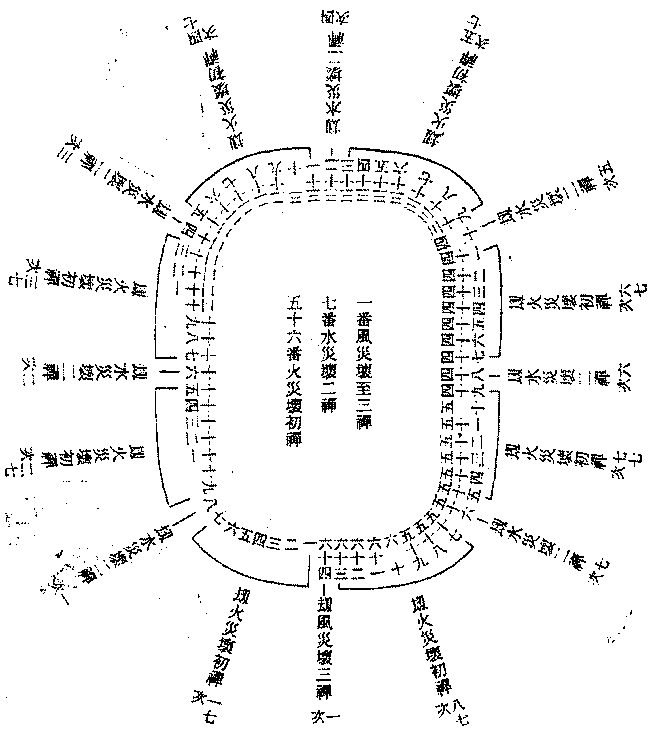



此大三灾逼有情类，令舍下地，集上天宫。初兴火灾，由七日现；次起水灾，由雨霖霪；后生风灾，由风相击。此三灾力，坏器世间，乃至极微亦无餘在。问：「所说三灾，云何次第？」答：「颂言要七火一水，七水火后风，必先无间起七火灾，其次定应兴一水灾，此后无间复七火灾，还有一水灾，如是乃至满七水灾，复有七火灾，后起风灾。如是总有八七火灾、一七水灾、一风灾，应知八七火灾，中间有七水灾，次第八七火灾，后有一风灾，计数总有六十四灾。」问：「何缘七火灾后，有一水灾？」答：「谓顺极光净天，寿八大刼，故谓缘水灾坏第二禅，既极光净天寿八大刼也。故第八灾方有水灾，坏第二禅也。」问：「何缘八七火灾后，方有一风灾？」答：「谓顺遍净天寿六十四大刼，故谓风灾起，坏第三禅，既遍净天寿六十四刼，故第六十四灾方是风灾，坏第三禅也。」故论云：由彼有情所修定因，於上渐胜，故感身寿其量渐长，由是所居，亦渐久住。由此善释施设足文遍净天寿六十四刼，总有六十四大刼，为大三灾始终之相也。



三刼



一、过去庄严——华光至毗舍浮佛，各一千佛。



二、现在贤刼——拘留孙至楼至佛，各一千佛。



三、未来星宿——日光至须弥相佛，各一千佛。



三刼



一、小刼——人寿十岁至八万四千岁，一增一减，为一小刼。



二、中刼——二十番增减为一中刼。



三、大刼——成住坏空各二十番增减为一大刼。



三灾刼数



　　　　　┌成（二十）刼　┌第一刼──从无岁减至┐  

　　　　　│　　　　　　　├第二刼┌──────┘  

　　┌庄严│　　　　　　　├第三刼├─八万岁金轮王───王四天下望威顺化  

　　│　　│　　　　　　　├第四刼├─六万岁银轮王───王三天下遣使方伏  

　　│　　│　　　　　　　├第五刼├─四万岁铜轮王───王二天下威震乃服  

　　│　　├住（二十）刼┐├第六刼└─二万岁铁轮王─┬─王一天下奋威始定  

　　│　　│　　　　　　│├第七刼　　　┌─────┘  

　　│　　│　　　　　　│├第八刼　　　│┌至极十年名─┐　　　┌饥馑──贪  

　　│　　│　　　　　　│├第九刼──┐└┤　　　　　　├小三灾┼疾疫──瞋  

　　├贤刼┤　　　　　　└┼第十刼─┐│　└为初一住小刼┘　　　└刀兵──痴  

　　│　　│　　　　　　　├十一刼　││  

　　│　　│　　　　　　　├十二刼　││┌八万岁减至六万岁────拘留孙佛  

　　│　　├坏（二十）刼　├十三刼　││├六万岁减至四万岁────拘那含牟尼佛  

　　│　　│　　　　　　　├十四刼　│└┼四万岁减至二万岁────迦叶佛  

　　│　　│　　　　　　　├十五刼┐│　└二万岁减至一百岁────释迦佛  

　　│　　│　　　　　　　├十六刼│└──八万四千岁减至八万岁──弥勒佛  

　　│　　│　　　　　　　├十七刼│  

　　└星宿│　　　　　　　├十八刼└───九百九十四佛相续出兴  

　　　　　│　　　　　　　├十九刼　┌──从十岁增至八万四千岁住刼满楼至佛本愿出增刼  

　　　　　└空（二十）刼　└二十刼─┘



三种法(净名什注)



一、观无常而厌身，是声闻法。



二、著身而不观无常，是凡夫法。



三、观无常而不厌身，是菩萨法。



三种禅(方等三昧)



一、现法乐住摄中道第一义谛三昧。



二、出生三昧摄真谛三昧。



三、利益众生摄俗谛三昧。



三念处(法次)



一、不一心听法不以为忧。



二、听者一心不以为喜。



三、常行舍心。



三发愿(弥陀)



一、已发愿。



二、今发愿。



三、当发愿。



三种愿



一、下——今世乐因缘。



二、中——后世乐因缘。



三、上——与涅槃乐因缘。



三种定(草庵)



一、理。



二、事。



三、即理而事。



三种礼



一、口礼——合掌问讯。



二、屈膝——互跪头不至地。



三、上礼——五体投地。



三恩义



一、君义。



二、父恩。



三、师义。



三种智(楞伽)



　　┌世间────一切外道凡夫计著有无。  

　　├出世间───一切二乘堕自共相希望计著。　　　┌生灭────应凡夫。  

　　└出世间上上─诸佛菩萨观所有法见不生灭。　　知┼自共相───道二乘。  

　　　　　　　　　　离有无品人法无我缘自得生。　　└不生不灭──类菩萨。



三种喻(圆觉)



一、一喻迷如空花。



二、二喻悟如梦醒。



三、三喻觉如虚空。



三根本(名数)



一、发菩提心。



二、清净心。



三、自性空断我见。



三种性(楞伽)



一、种性——五无间。



二、非种——外道。



三、心量——不定。



三坚法(净名肇注)



一、弃身获无极之身。



二、弃命获无穷之命。



三、弃财获无尽之财。



三习气



一、名言。



二、色识。



三、烦恼。



三品鬼(楞严)



一、上品大力鬼，杀报。



二、中品飞行夜义，杀报。



三、下品地行罗刹，杀报。



三必死



一、骡怀妊。



二、竹结实。



三、人抱疾。



三品魔(楞严)



一、上品魔王，婬报。



二、中品魔民，婬报。



三、下品魔女，婬报。



三种死(瑜伽)



一、寿尽。



二、福尽。



三、不避不平等。



(世尊说九因九缘，未尽寿而死。)



三邪道(楞严)



一、上品精灵，偷报。



二、中品妖魅，偷报。



三、下品邪人，偷报。



三练摩



一、引他况己。



二、省己增修。



三、行粗况妙。



三种鬼(正理)



一、无财——无福德不得食。



二、少财——少得净妙饮食。



三、多财——多得净妙饮食。



(三各三品，成九种鬼。)



三种贪(楞严)



一、欲——父母子孙，相生不断。



二、杀——胎卵湿化，递相吞食。



三、盗——羊死为人，互来相噉。



三种欲



一、饮食。



二、睡眠。



三、婬欲。



(三事希须名欲。)



三家习



一、见思家习。



二、尘沙家习。



三、无明家习。



三种相(大疏)



一、标——如见烟知火。



二、形——长短方圆。



三、体——事体理体。



三种相(出智度论)



一、假名相——如车如屋，如林如军，如人诸法和，故有无别车等。



二、法相——五众十二入、十八界等，肉眼观故有，慧眼观则无。



三、无相相——有入取是无相，相随逐取相还生，结使不应取。



三种方等



一、理方等——如普贤观称方等典——释签。



二、行理合论——四门入清凉池曰方，所契之理曰等——止观。



三、生酥调斥——此应属事——即五时中方等时也。



三世间



一、五阴一千——正。



二、众生一千——正。



三、国土一千——依。



(约十法界成二十世间，每一界有十，如是十界，成百界，百界成千，如是依正互具，成三千世间。)



三治贪(禅门)



一、外贪——男女身分互相贪著，用九想观。



二、内外——於他於己起贪，用八背舍。



三、徧一切处——次生五尘即众生处著，用大不净。



三治瞋(禅门)



一、非理——不问歘起，作生缘慈治。



二、顺理——人实来恼，作法缘慈治。



三、诤论——著己所解，作无缘慈治。



三种风(普门)



一、果报风至三禅。



二、恶业风通三界。



三、烦恼风通三乘人。



三种水(普门)



一、果报水至二禅。



二、恶业水通三界。



三、烦恼水大小乘。



三种火(普门)



一、果报火——从地狱至初禅天皆有火难。



二、恶业火——通三界，烧诸善根无过嗔火。



三、烦恼火——通三乘三界，因果犹如火宅。



三际时(泰法师云出俱舍论)



一、𦶟——二月十六至六月十五。



二、雨——六月十六至十月十五。



三、寒——十月十六至二月十五。



三焦义



一、上焦——从顶至心。



二、中焦——从心至腰。



三、下焦——从腰至足。



三种食



一、上根大士——深山绝世，菜根草果，随得资身。



二、常乞食——阿兰若处，头陀抖擞，随分自资。



三、檀越送食——僧中净食。



三种食(大论)



一、受请。



二、众僧。



三、常乞。



(前二种起诸漏因缘，故行乞食。)



三际时(俱舍)



一、十一月十六至三月十五为热。



二、三月十六日至七月十五为雨。



三、七月十六至十一月十五为寒。



(光法师云：西方诸国，时节不定，还随方俗，以立三际也。)



三种酒(大论)



一、谷——如常所酝者。



二、果——蒲菊枣等。



三、药——药草米面。



(犯三十六种过失，故佛不许饮酒。)



三种病



一、易治——可疗之病医之即愈。



二、难治——病至危笃医亦难差。



三、不可治——必死之病虽圣莫蠲。



佛三德



一、法身断德。



二、报身智德。



三、化身恩德。



三大部(天台毘陵)



一、止观——辅行释三部。



二、妙玄——释签释三部。



三、文句——句记释三部。



三种人能



一、佛能说。



二、菩萨能离。



三、众生能执。



三种大智



一、无师。



二、自然。



三、无碍。



内三术(止观)



一、即空治逆烦恼业。



二、即假治逆㝎见慢等。



三、即中治逆内破者。



外三术(止观)



一、莫受莫著治顺。



二、缩德露疵治顺。



三、一举万里治顺。



名誉利养眷属，妨蠹内侵枝叶尽，从外来破者。



除三恶(法炬)



一、心性狠弊不受善言。



二、常怀嫉妬惧佗胜己。



三、设知胜己耻而不问。



三喻显法(光明)



一、宝树。



二、清水。



三、箧器。



正三毒



一、欲——非妇不婬。



二、瞋——垦地不大。



三、愚——不计性实。



道共戒力任运如是，故称正三毒，不同见惑，烂漫无方，触境生著。



三品相海(约相)



一、上——十莲华藏微尘相好。



二、中——八万四千相好。



三、下——三十二相八十随好。



三陀罗尼



一、多字。



二、一字。



三、无字。



三品尊特(约教)



一、上——法华三十二相，相相达无边表，亦即法身。



二、中——十六观，八万四千相好。



三、下——华严树王下丈六尺，现起舍那。



三种佛界(别教)



　　　　　┌─信──外┐  

　　　　　│　　　　　│  

　　　　　├─住─┐　├凡  

　　┌理性┤　　　│　│  

　　│　　├─行─┼内┘  

　　│　　│　　　│  

　　│　　└─向─┘  

　　│  

　　├分证┐┌地─┐  

　　│　　├┤　　├分┐  

　　│　　│└等─┘　│  

　　│　　│　　　　　├圣  

　　│　　│　　　　　│  

　　└果头┴─妙──极┘



三种法身(净名什注)



　　┌法化生身即金刚身  

　　│  

　　├五分法身┬亦名法身  

　　│　　　　└────┐  

　　└诸法实相和合为佛相┘



三双感佛



　　┌藏┐  

　　│　├─修空观──用事识──见生身──住权理  

　　├通┘  

　　│  

　　├别┐  

　　│　├─修中观──用业识──见尊特──住实理  

　　└圆┘



三如来藏(南岳止观)



一、能藏——果德法身众生净心含藏染净二性，藏体平等名如，平等缘起名来。



二、所藏——真心为无明壳所覆藏，无异无相名如，备染净二用名来。



三、能生——如女胎能生子，此心亦下能生诸法，依染净二法熏力能生世出世法。



三轮设化



　　┌身──神通┐　　　┌现通┐　　┌三密  

　　├口──正教┼─轮　├说法┼亦名┼三不护  

　　└意──记心┘　　　└鉴机┘　　└三业



三如来藏



一、空如来藏——离不解脱一切烦恼。



二、不空如来藏——具河沙佛不思议法。



三、空不空如来藏——随为色空普应。



三德究竟(楞严)



一、妙庄严海是福究竟，即解脱德。



二、圆满菩提是智究竟，即般若德。



三、归无所得是理究竟，即法身德。



三种表相(首楞)



一、佛不自说表不离空体。



二、化佛现相表慧花开敷。



三、所说之咒表正闻戒法。



三经重沓



一、法护译正法华。



二、罗什译妙法莲华。



三、笈多译同名妙法。



三本华严



一、上——十三世界微尘数品。



二、中——四十九万八千八百偈。



三、下——十万偈四十八品。



三法被机(藏教)



一、四谛——声闻。



二、十二因缘——缘觉。



三、六度——菩萨。



三说相对



一、此座十方。



二、多人一人。



三、俱三相对。



一、谓此座说顿，十方说渐不定，顿座不闻十方，十方不闻顿座，或此座渐，十方顿不定，各各不相知闻。又：此显彼密，此密彼显。



二、谓或为一人说顿，多人说渐不定，为多人说顿，为一人说渐不定。各各不相知闻，互为显密。



三、谓或俱顿俱渐俱不定，各各不相知闻，互为显密。



三法通局(指要)



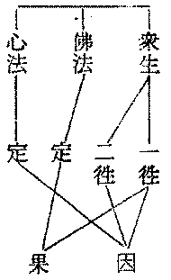



三种权实



一、自行权实。



二、化他权实。



三、自行化他权实。



三意未周(释签判昔部意)



　　┌华严─意在大根言涉於小─不摄小机┐  

　　│　　　　　　　　　　　　　　　　├二不开权─三不发迹  

　　├鹿苑─意　在　於　小──不摄大机┘  

　　│  

　　├方等─逗大逗小以大斥小─不明逗缘弹斥之意┐  

　　│　　　　　　　　　　　　　　　　　　　　│  

　　└般若─通被大小淘汰付财─无通被淘汰之意─┘



三法纵横(别教)



　　　　　　　　　　　　　　　　　┌修纵如上──────────┐  

　　　　　　　　　　　　　　　　　│　　　　　　　　　　　　　　│  

　　┌修纵─即修德三如来──┐　　├修横即果横　　　　　　　　　│  

　　│　　　　　　　　　　　│　　│　　　　　　　　　　　　　　│  

　　├性横─即性德三如来──┤　　├因纵如上──────────┤  

　　│　　　　　　　　　　　├别论┤　　　　　　　　　　　　　　├通论  

　　├因纵─智行理三次第资发┤　　├因横即性横　　　　　　　　　│  

　　│　　　　　　　　　　　│　　│　　　　　　　　　　　　　　│  

　　└果横─法报应二果中齐显┘　　├果纵法身本有般若修成解脱始满│  

　　　　　　　　　　　　　　　　　│　　　　　　　　　　　　　　│  

　　　　　　　　　　　　　　　　　└果横如上──────────┘



三陀罗尼(法华)



一、旋陀罗尼——转假如空证真谛。



二、百千万亿旋——从空入假，破尘沙显恒沙佛法，即俗谛。



三、法音方便——即二观方便，入中道第一义谛。



三德三种



一、有心者皆得作佛，即法身种，正因。



二、一切世智三乘解心，即般若种，了因。



三、一切低头举手即解脱种，缘因。



三业为机(普门)



一、二求是身机。



二、七难是口机。



三、三毒是意机。



三根出假(别教)



　　┌上──信　┌上──五品初  

　　│　　　　　│  

　　├中──住　├中──五品　　圆教  

　　│　　　　　│  

　　└下──行　└下──六根



三种方便(妙玄)



一、法用——法有方圆用有差会，三权是方一实是圆，体外之权非今品意。



二、能通——权略[王/火]引为实作门，虽有显实之功，亦无今品之意。



三、秘妙——妙达於方即是真秘，衣珠顶珠无异客作，人即长者子，如斯秘妙，方是今品正意。



三处焦炷(大论)



　　　　　　　　　　　　　　┌利─乾慧┐  

　　┌通┐　　　　　　　┌通┤　　　　├通当教  

　　│　├乾慧┐　　　　│　└钝─八人┘  

　　├别┘　　│　　　　│  

　　│　　　　├─初熖　├别─初地─别┐  

　　│　　　　│　　　　│　　　　　　├入通  

　　└圆─发真┘　　　　└圆─初住─圆┘



三时索车



一、方等——情索。



二、般若——机索。



三、法华——口索。



三种罗汉(楞伽)



一、得寂一乘道。



二、菩萨方便示道。



三、佛所变化。



三根被接(通教)



　　┌上──三四地───四五地　　　　　┌别──十向  

　　│　　　　　　　　　　　　　真位接入┤  

　　│　　　　　（辅行）　　　　　　　　└圆──十住  

　　├中──五六地───六七地  

　　│　　　　　　　　　　　　　　　　　┌别──初地  

　　│　　　　　　　　　　　　　似位接入┤  

　　└下──七八地───八九地　　　　　└圆──初住



三根解源(释签)



一、非漏非无漏——通——真俗。



二、空不空——别——但中。



三、一切法趣——圆——中道。



妙玄三法各对三人，明其行相即被接点示机缘领解之元意，机言取解教主点示。



三乘禀教(藏教)



一、声闻谛苦初门。



二、支佛缘集初门。



三、菩萨度道初门。



三因子义(法华)



一、正——心正为正因佛性。



二、缘——十六王子覆讲时闻法，今日解者是也。



三、了——今日闻法作佛名真子。



三法因果



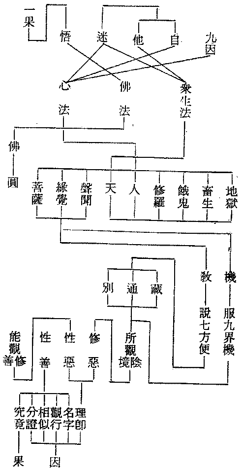



三种罗汉



　　┌慧─┐　　　　┌性┐　　　　┌一切智┐  

　　├俱─┼解脱　修┼共┼念处　破┼神通─┼外道  

　　└无疑┘　　　　└缘┘　　　　└文字─┘



三等上座(婆沙)



一、生年——长者具旧戒名真空。



二、世俗——知法富贵，大财大位大族大力，虽年少推为上座。



三、法性——阿罗汉。



三种长老



一、耆年——年腊高者。



二、法——内有智德深达法性。



三、作——假号之者。



三藏法师



　　┌经┐　　　　┌尊严而惮┐  

　　│　│弘此三藏│　　　　│  

　　│　│　　　　├耆艾而信┤  

　　├律┼─四术─┤　　　　├孙卿子  

　　│　│　　　　├说诵不陵┤  

　　│　│故称法师│　　　　│  

　　└论┘　　　　└知微而论┘



摩诃三义



一、大。



二、多。



三、胜。



三事行檀(智论)



一、有信心——三事和合。



二、有福田——心生舍法。



三、有财物——能破悭贪。



三处木叉(遗教)



一、身——节身时食，清净自活。



二、口——不得咒术仙药，结好外人。



三、意——当自端心，正念求度。



三种安居



一、前——四月十六日。



二、中——十七至五月十五。



三、后——五月十六日。



三种三昧



一、金刚——别在不动罗汉。



二、重空——通前五种罗汉。



三、电光——义通初果。



三种羯磨



一、心念法。



二、对首法。



三、众法。



发心会境口自传情，非谓不言而辨，前事各共面对同禀法也，四人已上秉於羯磨。



三种禅定(净名什注)



一、大乘——在禅如地狱。



二、小乘——独善求证。



三、凡夫——生高慢我心。



三种回向



　　　┌事┐　　┌理──真如实际  

　　回┼自┤　向┼他──庄严己他  

　　　└因┘　　└果──究竟三德



三种乐住(楞伽)



一、首楞定为能住之法。



二、常寂光为所住之处。



三、常寂光即三德涅槃。



人中三恶(大经)



一、一阐提。



二、诽谤大乘。



三、犯四重禁。



三止对观



一、奢摩佗以寂静为相，即空观。



二、三摩提以幻化为相，即假观。



三、禅那以离前二相，即中观。



三种止观(天台)



　　　　　　　　　　┌初浅后深─┐┌随佗─┐  

　　┌渐次─禅波罗密┤　　　　　├┤　　　│　　事虽差  

　　│　　　（十卷）└解顿行渐─┘└空──┤  

　　│　　　　　　　　　　　　　　　　　　├助  

　　│　　　　　　　┌前后更互解┐┌随自佗┤  

　　├不定─六妙门─┤　　　　　├┤　　　│　　殊同缘  

　　│　　　（一卷）└顿行或渐顿┘└假──┘  

　　│  

　　│　　　　　　　┌初后不二─┐┌随自─┐  

　　└圆顿─摩诃止观┤　　　　　├┤　　　├正　顿理  

　　　　　　（十卷）└行解俱顿─┘└中──┘



三科拣境(止观)



　　　　　　┌色  

　　　　　　│  

　　　　　　├受  

　　　　　　│　　┌见行┐  

　　一、五阴┼想　│　　├能招报  

　　　　　　│　┌┼发得┘  

　　　　　　├行││  

　　　　　　│　││  

　　　　　　└识┘└餘之分别方是今境  

　　二、十二入。  

　　三、十八界。



止观拣却界入，复於五阴又拣前四辅行，又拣二种能招报心，对境所有能分别者，方是今境。



三种止观(南岳)



一、渐次——初浅后深如梯隥。



二、不定——前后更互如金刚置於日中。



三、圆顿——初后不二如通者腾空。



三品听法(法苑)



一、神听上品。



二、心听中品。



三、耳听下品。



三品信善(仁王)



一、上——铁轮王——(化一天下。)



二、中——粟散王。



三、下——人中王。



三忏治病



一、作法如服姜桂——差病而已不能肥身。



二、取相如服五石——病差身充不能得道。



三、无生如服石芝——病除身飞升仙得道。



三种智慧。



一、声闻智慧——不净观乃至无生智。



二、支佛智慧——观十二因缘能侵习气。



三、佛智慧——六度破魔成佛入大涅槃。



三止所出



　　　　　　　　　　┌止息止──见思对断德─┐  

　　一、体　真　止─┼停止止──真谛对智德─┼体妄即真。  

　　　　　　　　　　└不止止──不当止与不止┘



　　　　　　　　　　┌止息止──尘沙对断德─┐  

　　二、方便随缘止─┼停止止──俗谛对智德─┼心随俗理。  

　　　　　　　　　　└不止止──不当止与不止┘



　　　　　　　　　　┌止息止──无明对断德─┐  

　　三、息二边分别止┼停止止──中谛对智德─┼不当空假。  

　　　　　　　　　　└不止止──不当止与不止┘



三重观门(华严法界)



　　　　　　　┌会色归空┌理如事门　　┌一摄一切一入一切  

　　　　　　　│　　　　│　　　　　　│  

　　　　　　　├明空即色├事如理门　　├一切摄一一切入一  

　　┌真空法界┤　　　　│　　　　　┌┤  

　　│（有四）├空色无碍├事含理门　│├一摄一一入一  

　　│　　　　│　　　　│　　　　　││  

　　│　　　　└泯绝无寄├通局无碍　│└一切摄一切一切入一切  

　　│　　　　　　　　　│　　　　　│  

　　│　　　　┌理徧於事├广狭无碍　│  

　　│　　　　├事徧於理│　　　　　│  

　　│　　　　├依理成事├徧融无碍　│　　达此三门则法界重重纵横达矣  

　　│　　　　├事能显理│　　　　　│  

　　├理事无碍┼真理即事├摄入无碍　│  

　　│（有十）├事法即理│　　　　　│┌摄一入一  

　　│　　　　├真理非事├交涉无碍　││  

　　│　　　　├事法非理│　　　　　│├摄一切入一  

　　│　　　　├以理夺事├相在无碍　└┤  

　　│　　　　└事能隐理│　　　　　　├摄一入一切  

　　│　　　　　　　　　├普融无碍　　│  

　　└周徧含摄─────┘　　　　　　└摄一切入一切  

　　　（有十）



三种念处(毘昙)



　　┌性┐　　┌缘无生空理发真断结──┐　┌慧解脱┐　┌一切智┐  

　　│　│　　│　　　　　　　　　　　│　│　　　│　│　　　│  

　　├共┼念处┤　具三明六通　　　　　├即┼俱解脱┼破┼五通─┼外道  

　　│　│　　│　　　　　　　　　　　│　│　　　│　│　　　│  

　　└缘┘　　└缘三藏十二部达根性四辩┘　└大罗汉┘　└韦陀─┘



三种佛事(净名什注)



一、善——光明神通说法。



二、无记——虚空。



三、不善——八万四千烦恼，以毒除毒。



三种起慈(净名什注)



一、凡夫为生梵天。



二、二乘为求功德。



三、菩萨求佛度生。



三种远离(净名什注)



一、离人众五欲。



二、离烦恼。



三、诸法性空。



三种秘密



一、真秘——法华四十年不谈。



二、隐秘——实隐在权。



三、秘密——前四时中。



三种法门(智论)



一、毘勒门——论议无穷。



二、毘昙门——佛说法弟子解。



三、空门——生法二空。



三处闲居



一、深山远谷永绝人踪。



二、头陀抖擞极近三里。



三、兰若伽蓝独自一房。



三种忏法(光句)



一、作法——七日七夜朝暮净心。



二、取相——於其坐处得见文殊普贤。



三、无生——五阴舍宅观悉空寂。



三种妙香(增一)



　　┌戒┐　　┌能生定慧──因。  

　　├闻┤　香┼解脱。  

　　└施┘　　└解脱知见──果。



三种事净(首楞)



一、闻所闻尽，尽闻不住，此是闻能所尽。



二、觉所觉空，空觉极圆，此是思能所尽。



三、空所空灭，生灭既灭，寂灭现前，此是修能所尽。



三决定义(首楞)



一、摄心为戒即闻门，摄心内观闻性不动，即真戒体。



二、因戒生定即思门，一念不生三世平等，即真定体。



三、因定发慧即修门，念念正观自他普利，即真慧体。



三无漏根



一、未知欲知根——九根和合，信法二人见谛中未知欲知。



二、知根——信解见得二人思惟中，九根和合转名知。



三、知已根——至无学中，九根转名知已。



三种行筹(业疏)



一、露头。



二、覆藏——以物覆筹。



三、耳语——耳畔劝勉。



三种乞人(净名什注)



一、沙门。



二、贵人。



三、下贱。



随其所求皆名乞人。



三忏功能(光明句记)



　　　　　　　　　　　　　　　　　　　　　　　　　　　┌怖畏┐  

　　┌作法┐　┌违无作罪─违戒┐　　┌三恶──┐　　┌┤　　│  

　　│　　│　│　　　　　　　│　　│　　　　│报障│└忧愁┤  

　　├取相┼灭┼性罪───犯定┼上罪┼人道──┼──┤　　　├烦恼  

　　│　　│　│　　　　　　　│　　│　　　　│业障├─四住┤  

　　└无生┘　└无明───犯慧┘　　└三界有漏┘　　└─无明┘



三种善根(仁王)



一、布施治贪——光明舍诸所重服节手足等。



二、慈悲治瞋——法华常柔和能忍慈悲於一切。



三、智慧治痴——遗教智慧是无明黑暗大明灯也。



三种善根(婆沙)



一、福分善根——能作人天种子，人中生豪贵家，作轮王，天中帝释梵王等。



二、解脱分善根——能作解脱种子，决定不退必至涅槃。



三、达分善根——煖法至世第一法。



三种善根(智论)



　　┌上──六欲天　　┌上分┐　　┌天道┐  

　　├中──人中富贵　├中分┼因缘┼人道┼果报  

　　└下──人中卑贱　└下分┘　　└修罗┘



三善伏道(解脱道论)



　　┌戒┐　┌初　　┌精进不退故喜跃猗乐故心定　┌戒┐　┌恶趣  

　　├定┼为┼中　善┼以定如实知　　　　　　　　├定┼除┼欲界  

　　└慧┘　└后　　└以如实知见厌患离欲解脱　　└慧┘　└一切有



三种发心



　　一、名字──肇论发僧那於始心终大悲以赴难──五品弟子。  

　　二、相似──仁王十善菩萨发大心长别三界苦轮海──十信六根。  

　　三、分证──华严初发心时便成正觉──初住已上。



三学倾惑(归敬)



　　一、戒如捉贼┐  

　　二、定如缚贼┼明喻乃三约贼唯一。  

　　三、慧如杀贼┘



三生解脱(正理)



一、初生植顺解脱分。



二、次生成熟。



三、三生起顺决择分即入圣道。



三处间静



一、深山绝人处。



二、杜多兰若处。



三、远白衣处清净伽蓝。



(此之三处可修禅定。)



三业摄礼



一、五轮著地——身业。



二、称佛名号——口业。



三、缘想圣境——意业。



三业真实(善导)



　　┌身礼拜┐名至  

　　├口称念┼彼佛  

　　└意观察┘诚心



三事生识(楞伽)



一、我和合而生。



二、根和合而生。



三、尘和合而生。



三种法相(瑜伽)



一、徧计所执相。



二、依他起相。



三、诸法圆成相。



一、谓一切法假名安立，自性差别，乃至为令，随起言说。



二、谓一切法缘生自性，此有故彼有，此生故彼生；无明缘行，乃至招集大苦蕴。



三、谓一切法平等真如，渐渐修习，乃至菩提，方证圆满。



三谛示体



一、初约非相，明真谛。经云：而如来藏，非心非空，非地非水云云。



二、二约即相，明俗谛。经云：即如来藏，即心即空，即地即水云云。



三、三约遮照，明中谛。经云：即如来藏，离即非即，是即非即云云。



三因大同(通教)



一、同断见思。



二、同出分叚。



三、同证偏真。



三科收行(名义)



一、十使十业——黑业报四恶。



二、五戒十善四禅四定——白业报人天。



三、三乘摩诃衍——报四圣。



三分真妄



　　┌唯真──自性清净心从本已来湛然常住┐  

　　│　　　　　　　　　　　┌─────┘  

　　├真妄和合──即第八识┐├体  

　　│　　　　　　　　　　├┤  

　　└唯妄────即前七识┘└用



三世无生



一、过去已灭。



二、未来未至。



三、现在不住。



三种懈怠



一、不安稳。



二、无味。



三、不知恐怖。



三种身苦(智论)



一、老。



二、病。



三、死。



三种相续(楞严)



一、负命还债常在生死。



二、爱心怜色常在缠缚。



三、杀盗婬三根本业果。



三品五逆



一、下生饿鬼。



二、中作畜生。



三、上堕地狱。



三种睡眠(遗教)



一、从食节起。



二、从时节起。



三、从心节起。



三种心苦



一、贪。



二、嗔。



三、痴。



三种死苦



一、业报。



二、恶封。



三、时节代谢。



三种非道(净名)



一、恶趣果报——行於非道。



二、恶趣行业——行於非道。



三、世俗善业果报——通达佛道。



三种五尘(小止)



一、作违情事是可畏五尘，令人恐惧，皆名为魔。



二、作顺情事是可爱五尘，令人心著，皆名为魔。



三、非违非顺事是平等五尘，动乱行人，皆名为魔。



三品无明(别记)



一、上。



二、中——回向后心。



三、下——初地。



(此於初地所破无明细分，三品中上虽破，犹在回向后心，至三品尽方入初地。)



三惑障理



一、见思阻乎空寂——真。



二、尘沙障乎化导——俗。



三、无明翳乎法性——中。



三等微尘



一、大——游尘可见。



二、中——诸天所见。



三、小——圣人天眼见。



三惑习气



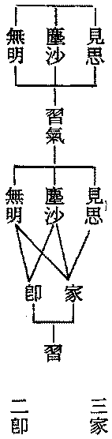



三品尘沙(别教)



　　　　　　　　　　┌初住断见  

　　　　　　　┌十住┼二住至七住断思  

　　　　　　　│　　├八九十住断───界　内─上品┐  

　　┌断惑分齐┤　　│　　　　　　　　　　　　　　│  

　　│　　　　├十行┤　　　　　　　　　　　┌中品┤  

　　│　　　　│　　├断───────界　外┤　　│  

　　│　　　　└十向┘　　　　　　　　　　　└下品┤  

　　│　　　　　　　　　　　　　　　　　　　　　　├尘沙  

　　│　　　　┌十住┐　┌生无生八门┐　　　┌上品┤  

　　│　　　　│　　│　│　　　　　│　　　│　　│  

　　└以惑从教┼十行┼破┼无量四门─┼断界外┼中品┤  

　　　　　　　│　　│　│　　　　　│　　　│　　│  

　　　　　　　└十向┘　└无作四门─┘　　　└下品┘



三种思惑



一、俱生——与形俱生，如男女托胎，妄於父母，生爱恶心，此是邪思，还皈见惑。



二、依见——如外道依见而起嗔，此利上钝，名背上使，见谛断时，正利去背亦去。



三、界系——即三界九品思，此名钝使，亦名事障，号正三毒。



三种见惑



一、俱生——五钝中有利，如虫兽凡夫，亦能起我，我即是利，从钝使背上起故属钝。



二、推理——未发禅来虽有世智，推理辩聪，见想犹弱，所有十使同属於钝。



三、发得——从因定发见心猛盛，所有十使，从强受名，皆属於利。



三惑取相(别记)



一、见思取生死相。



二、尘沙取涅槃相。



三、无明取二边相。



三合生知(外道)



一、根生知。



二、境生知。



三、我生知。



(此即前三事生识也。)



佛学名相汇解　卷第十四（终）



三变土田(出法华经)



初、变娑婆三千大千世界。



二、变八方二百万亿国。



三、变复八方二百万亿国。



经云：「尔时十方诸佛各告众菩萨言：善男子！我今应往娑婆世界，释迦牟尼佛所，并供养多宝如来宝塔。时娑婆世界，即变清净瑠璃为地，宝树庄严，黄金为绳，以界八道；无诸聚落、村营城邑、大海江河、山川林薮。烧大宝香，曼陀罗华，徧布其地；以宝网幔罗覆其上，悬诸宝铃。唯留此会众，移诸天人置於他土。是时，诸佛各将一大菩萨，以为侍者，至娑婆世界，各到宝树下。一一宝树高五百由旬，枝叶华果，次第庄严。诸宝树下，皆有师子之座，高五由旬，亦以大宝而校饰之。



「尔时诸佛，各於此座，结跏趺坐；如是展转，徧满三千大千世界，而於释迦牟尼佛一方所分之身，犹故未尽。时释迦牟尼佛，欲容受所分身诸佛故，八方各更变二百万亿那由他国，皆令清净，无有地狱、饿鬼、畜生，及阿修罗。及移诸天人置於他土所化之国，亦以瑠璃为地，宝树庄严，树高五百由旬，枝叶华果，次第严饰。树下皆有宝师子座，高五由旬，种种诸宝以为庄校。亦无大海江河，及目真邻陀山、摩诃目真邻陀山、铁围山、大铁围山、须弥山等诸山王。通为一佛国土，宝地平正，宝交露幔徧覆其上，悬诸旛盖；烧大宝香，诸天宝华徧布其地。



「释迦牟尼佛，为诸佛当来坐故，复於八方各变二百万亿那由佗国，皆令清净，通为一佛国土，十方诸佛皆悉来集，坐於八方。善哉善哉！释迦牟尼佛，快说是法华经，我为听是经故，而来至此。



「尔时，释迦牟尼佛以大音声，普告四众：谁能於此娑婆国土，广说妙法华经，今正是时，如来不久当入涅槃，佛欲以此妙法华经付嘱有在。」是也。



三种后苦



一、地狱。



二、饿鬼。



三、畜生。



三常不足(遗教)



一、衣——以舍好饰著坏色衣。



二、食——起得支身以除饥渴。



三、睡眠——修习善法无令失时。



　　　　┌上┐　┌天道┐  

　　三品│　│　│　　│  

　　　　├中┼感┼人道┼苦乐不同┐  

　　十善│　│　│　　│　　　　│  

　　　　└下┘　└修罗┘　　　　│  

　　　　　　　　　　　　　　　　├总名六道生死。  

　　　　┌上┐　┌地狱┐　　　　│  

　　三品│　│　│　　│　　　　│  

　　　　├中┼感┼畜生┼苦而无乐┘  

　　十恶│　│　│　　│  

　　　　└下┘　└饿鬼┘



三法自责(宝积)



一、是平等心非不平等心。



二、是正行所得非邪行得。



三、是无异行得非离行得。



三种食法(光句)



一、世间法味。



二、出世间法味。



三、出世间上上法味。



(皆法施也。)



三种刹那(俱舍)



一、色分析诸色至一极微。



二、名分析诸名至一字。



三、时分析时至一刹那。



(偈曰：「极微字刹那，名色时极少。」)



三种舍利



一、骨——白。



二、发——黑。



三、肉——赤。



(佛之舍利搥之不碎。)



三长斋月(四天王经)



一、正月。



二、五月。



三、九月。



天帝以大宝镜照四大洲，此三月正照南洲，故宜修福。



婆沙三义



一、广说。



二、胜说。



三、异说。



三种衣法



一、雪山大士一衣蔽形即足。



二、头陀粪扫不畜餘长。



三、多寒国土许一日一种物。



三教无我



一、儒——孔子以谦光之义。



二、释——佛观五蕴皆空。



三、道——老子以长而不宰。



三宗名教



一、儒——元命包云：教者俲也，上行下俲也。



二、释——四教仪云：说能诠理，化转物心。



三、道——老子云：处无为事，行不言教。



三种色身



一、内身——己。



二、外身——他。



三、内外——己他。



(前世不净业。)



三事受胎(毘婆)



　　┌父┐  

　　│　├俱起淫贪而共成合会┐  

　　├母┘　　　　　　　　　├和合成胎  

　　└中有─一会诚心即入其中┘



三仙计果(宗镜)



　　┌迦毗罗┐　　┌数术┐　　　　　　┌有果。  

　　├僧　伽┼此云┼休留┼仙。　计因中┼无果。  

　　└勒沙婆┘　　└苦行┘　　　　　　└亦有亦无。



三种夜叉



一、在地夜叉。



二、虚空夜叉。



三、天夜叉。



三种地狱



一、热——十八，此是根本。



二、寒——十八，此是根本。



三、边——轻系亦名孤独。



三等地狱



一、重者徧历百三十六狱。



二、中者不徧八正狱——重。



三、下者复减百二十八——轻。



三意名家(天台)



一、符定光悬记。



二、转平等志愿。



三、行道多在天台。



三家异论



一、支敏度心无义。



二、支道林即色义。



三、竺法汰本无义。



三等鬼神



一、人神曰鬼。



二、地神曰祇。



三、天神曰灵。



佛三种异



一、一切智异外道。



二、慈悲异二乘。



三、平等异菩萨。



三种六师



一、自称一切智——邪心见理，发於邪智，辩才无碍。



二、得五神通——得世间禅，发五神通，有慈忍力，刀割香涂，心无憎爱。



三、诵四韦陀典——博学多闻，四韦十八大经，天文地理无所不知。



三种阐提



一、阐底迦——乐欲生死，焚烧善根。



二、阿阐底迦——菩萨大悲，众生度尽方证觉果。



三、阿颠底迦——毕竟无涅槃性。



佛光三因



一、然灯施佛。



二、爱乐明经。



三、解人疑惑。



三代正朔



　　┌夏┐　┌十三月┐　　　　　　┌黑┐　┌平旦┐  

　　├殷┼以┼十二月┼为正。　色尚┼白┼以┼鸡鸣┼为朔。  

　　└周┘　└十一月┘　　　　　　└赤┘　└夜半┘



三代尚色



一、十一月阳气始养，根株黄泉之下万物皆赤，赤者盛阳之气，故周为天正，色尚赤。



二、十二月万物芽芽而白，白者阴阳气，故殷为地正，色尚白。



三、十三月万物始达，孚甲而出皆黑，人得加功，故夏为人正，色尚黑。



最初三宝



一、佛——如来大圣。



二、法——四谛法轮。



三、僧——五阿罗汉。



止观三德



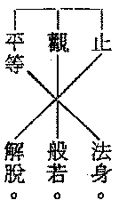



佛三种声



一者、先世种因缘故，能出种种妙声，一里乃至千世界徧满。



二者、神通力故，徧满三千大千世界，及十方河沙世界，已上菩萨亦有。



三者、佛音常能徧满十方虚空——此唯佛有。



通别三身



一、三谛一境，合名法身一性。



二、三智一心，合名报身二修。



三、三脱一体，合名应身二修。



涅槃三德



　　一、摩诃──大───法身。



　　二、般───灭┐┌─般若。  

　　　　　　　　　└┼┐  

　　三、涅槃那─度─┘└解脱。



分显三德(别教)



　　┌法身┐各┌常┐  

　　│　　│　│　│  

　　│　　│　├乐┤  

　　├般若┼三┤　├四德。  

　　│　　│　├我┤  

　　│　　│　│　│  

　　└解脱┘具└净┘



(登地已去，破一分无明，显一分三德，故曰分显。)



赞佛三德(首楞)



一、妙湛赞真谛，般若德，即三而一，故曰妙湛。



二、总持赞俗谛，解脱德，即一而三，故曰总持。



三、不动赞中谛，法身德，非三非一，故曰不动。



拣偏三德(永嘉)



> 一、有般若无解脱法身。  

> 二、有解脱无法身般若。　(有一无二故不圆)  

> 三、有法身无解脱般若。



> 一、有般若解脱无法身。  

> 二、有解脱法身无般若。　(有二无三故不圆)  

> 三、有法身般若无解脱。



圆具三德(永嘉)



　　　┌法身不痴┐　┌般若。  

　　一┼般若无著┼即┼解脱。　(二三例尔)  

　　　└解脱寂灭┘　└法身。



消灾三德(湛堂)



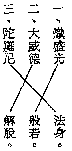



相似三觉



一、寂觉。



二、照觉。



三、双遮照觉。



发三种心(观经)



　　┌慈心不杀具诸戒行　┌孝养父母慈心不杀┐  

　　├读诵大乘方等经典　├受三归依不犯威仪┼皆得往生安乐世界。  

　　└修行六念回向发愿　└发菩提心劝进行者┘



息三暴恶(僧祇)



一、身——比丘入人舍，拽小鬼损物等。



二、口——诸王臣前谗侫良善。



三、意——屏处藏身异声怖人等。



化转三义



一、转恶为善。



二、转迷成解。



三、转凡成圣。



(说法诠理，化转物心，名之曰教。)



法华三分



一、序分——序品。



二、正宗——方便品至分别功德品，十九行偈凡十五品半。



三、流通——从偈后至尽文十一品半。



迹门三分



一、序分——序品。



二、正宗——方便品讫学无学品。



三、流通——法师品讫安乐行品。



本门三分



一、序分——涌出品讫弥勒问佛今答之半品。



二、正宗——佛告阿逸下讫分别十九行偈。



三、流通——偈后至讫经。



法华三始



一、迹门大通下种为始。



二、今日以初成为始。



三、本门以本因为始。



经具三义



　　┌久　┌由┐　康  

　　├通　├津┼─也  

　　└由　└通┘　乐



索车三意



一、机——鹿苑至方等，实有大益，有求大乘之义。



二、情——般若领知大法乐大心起，索情渐切。



三、口——来至法华，闻说方便，发言三请。



序分三义



一、次绪亦名通序——如是我闻等五事。



二、序述亦名别序——尔时世尊著衣持钵。



三、发起序——舍利弗从座而起白佛等。



弥天三分



一、序分。



二、正宗。



三、流通。



(分经雅合於亲光释姓颇同於增。)



小始三名



一、鹿苑——群鹿所居。



二、柰苑——从树立名。



三、仙苑——二仙所居。



建立三藏(达磨)



一、素怛览——经——对治疑烦恼。



二、毗奈耶——律——对治受用二边随烦恼。



三、阿毗达磨——论——对治自建取执随烦恼。



楞严三科



一、问客尘引其开解。



二、放光屈指辨其动摇。



三、双结会通责其迷失。



华严三约



一、约理曰法界。



二、约处曰寂场等。



三、约时曰三七日。



立时三事



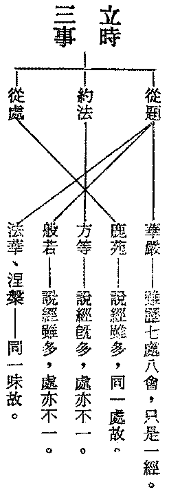



聋哑三义



　　┌显如┐　　　┌二乘之人，於三七日中，不见说法，但见嘿坐。  

　　├义如┼聋哑　├后分虽有声闻，不能乐说赞叹。  

　　└状当┘　　　└如荆溪释签文中所云。



说法三事



一、能说人清净——此是教主。



二、所说法清净——般若之法。



三、依法得果清净——得法之众。



说法三要(净名什注)



一、软善语——善行乐果。



二、刚强语——恶行苦果。



三、杂语——赞善毁恶。



秘藏三文(湼疏)



一、譬三点——如世伊字，此依言教。



二、喻三目——即天主眼，此是修行。



三、合三德——即是佛师，此约理也。



方便三要



一、善於自行而不取相成就众生。



二、不取证成就众生。



三、善化成就众生。



藏心三义



一、大——量廓沙界。



二、白——体绝妄染。



三、伞——用徧一切。



(摩诃萨怛多钵怛啰，此云「大白伞盖」，即藏心也。)



说法三分



一、染污分——土轮——以土喻分别性为生死染分，即七识。



二、清净分——金——以金喻真实性为涅槃净分，即九识。



三、染清净分——地界——以地喻依他性具染净二分，即八识。



四谛三义



一、四谛俱真——我昔与汝不见四真谛，久流生死。



二、四谛俱俗——灭尚非真，三谛安在。



三、一真三俗——三是无常，一是常。



菩萨三义



一、大道心众生。



二、大道成众生。



三、觉众生。



菩萨三名



一、大士——大道心众生。



二、开士——开众生信心。



三、高士——升出凡夫小乘。



法轮三益



　　┌过去┬─过去下种  

　　│　　└─现在重闻─得成熟益。  

　　├现在┬─┘  

　　│　　└┐未曾下种  

　　│　　　└现在成种  

　　└未来───────未来方益。



(「此三世益，皆因法轮，故我随喜众生得益，随他修善，喜他得成，故名三益。」)



文殊三佛



一、过去龙种上尊王佛。——(楞严)



二、现在欢喜藏摩尼宝积佛。——(央掘)



三、未来普现佛。——(弥勒上生经疏)



菩萨三大(十地)



一、愿大。



二、行大。



三、利生大。



(拣异小菩萨故称摩诃萨埵。)



菩萨三众



一、下方地涌。



二、他方来者。



三、此界旧住。



观音三现



一、八万四千烁迦罗首。



二、八万四千母陀罗臂。



三、八万四千清净宝目。



菩萨三忍(通教)



一、伏忍——乾慧。



二、柔顺——性地。



三、无生——三地至十。



(此别为菩萨立忍名如妙玄。)



四果三智



一、尽智——是解脱道智，即我知苦已等。



二、无生智——一切烦恼更不再生，即我知苦已，不复更知等。



三、正见——一切罗汉皆有正见，皆知我是罗汉。



菩萨三毒



一、广求佛法——贪。



二、呵恶二乘——瞋。



三、未了佛性——痴。



二乘三毒



一、忻涅槃——贪。



二、厌生死——瞋。



三、迷中道——痴。



久种三多(法华)



一、修福——若人有福。



二、供佛——曾供养佛。



三、闻法——志求胜法。



(支佛百刼种福、供佛、求法，故言三多。)



独觉三类(妙句)



一、知佛出世即先入灭，或被他土。



二、出无佛世。



三、虽生佛世，愿见佛故，亦不被移。



声闻三根(法华)



一、上——舍利弗。



二、中——四大弟子。



三、下——五百千二百人。



支佛三义(辅行)



一、具相名大，不具名小。



二、两大中现通者大，无通者小。



三、现通中说法者大，不说者小。



般舟三事



一、持佛威神力。



二、持佛三昧力。



三、持本功德力。



被接三义(通教)



一、舍中为发源。



二、点示为机要。



三、发习为根性。



毗尼三义



一、灭业非——灭恶故毗尼。



二、灭烦恼——伏三毒故制戒。



三、得灭果——戒净有智慧，便得第一道。



外凡三位



一、五停心——贪、嗔、散、痴、障、作、不净等观，亦名资粮位。



二、别相念处——即四念处是，亦名资粮位。



三、总相念处——身受心法皆不净、苦、空、无常、无我，亦名资粮位。



般若三力(梵师)



一、本有佛性力——烦恼心中有如来藏。



二、慧光摄取力——念佛众生摄取不舍。



三、念佛三昧力——忆佛念佛必定见佛。



别地三道(四义)



一、见道——初地见谛道。



二、修道——二地至六地。



三、无学——七地已去。



通教三义



一、因果俱通——通当教是。



二、因通果非通——被接者是。



三、通别通圆——藉通开导。



清净三轮(般若)



一、不执我为施者出世间。



二、不执彼为受者出世间。



三、不著施及施果出世间。



持戒三心(瑜伽)



一、厌有为心。



二、求趣菩提心。



三、悲愍有情心。



禅观三事



一、调身不缓不急。



二、调息不涩不滑。



三、调心不浮不沉。



(三事若调，禅观可获)



持戒三乐(瑜伽)



一、名誉。



二、利养。



三、死生天。



(明人能护戒，能得三种乐，名誉及利养，死得生天上。)



住相三轮(般若)



一、自想世间。



二、他想世间。



三、施想世间。



念处三依



一、依佛嘱——佛将涅槃，阿难问佛去后，比丘依何修道？佛言依四念处。



二、依经——大品云：声闻依四念处行道。



三、现前——止观云：行人受身谁不阴入。重担现前，是故念处居初。



定中三意(安乐)



一、定心——修摄其心。



二、定处——在於闲处。



三、定门——常好坐禅。



圆觉三期



一、长期一百二十日。



二、中期一百日。



三、下期八十日。



戒有三品(报恩)



　　　　　　　　┌徵品┐　　　　　　　┌徵品┐  

　　　　　　　三│　　│　　　　　　　│　　│  

　　一、下五戒─┼中品┼心。　受戒　得┼中品┼戒。  

　　　　　　　品│　　│　　　　　　　│　　│  

　　　　　　　　└上品┘　　　　　　　└上品┘  

　　　　　　　　　┌上品┐　┌五戒┐　┌上品┐  

　　二、中十戒┐各│　　│　│　　│　│　　│  

　　　　　　　├三┼中品┼得┼十戒┼是┼中品┼戒。  

　　三、上具戒┘品│　　│　│　　│　│　　│  

　　　　　　　　　└下品┘　└具戒┘　└下品┘



遗教三喻



一、放牛喻。



二、恶马喻。



三、刼贼喻。



一、谓牛喻五根，人喻比丘，五欲不起，正念成就，如牧牛不犯人苗稼。



二、谓若纵五根，起欲妨道，沉苦而无畔，如恶马无辔，牵人坠陷。



三、谓如被刼害，苦止一世，五根贼祸，殃及累世，可不慎哉！



遗教三行



一、求善知识。



二、求善护助。



三、不妄正念。



一心三观(圆教)



一、空——一空一切空，中假皆空——荡相。



二、假——一假一切假，空中皆假——立法。



三、中——一中一切中，空假皆中——绝待。



次第三观(别教)



一、先空——审实——真——从假入空——十住。



二、次假——虚妄——俗——从空入假——十行。



三、后中——不即二边——中——修中伏无明——十向。



次第三观(璎珞)



一、从假入空观，亦名二谛观。



二、从空入假观，亦名平等观。



三、因二空方便，入中道第一义观。



一境三谛



一、真泯一切法。



二、俗立一切法。



三、中统一切法。



心通三义(楞严)



一、证果——端坐百日得初果。



二、发解——决定自知成佛。



三、宿命——能记八万四千恒沙刼。



一心三智



一、一切智。



二、道种智。



三、一切种智。



(北齐尊者阅中论，悟三智一心中得。)



合有三种(金錍、佛言)



一、如鸟投树。



二、如羊相[魚-(烈-列)+午]。



三、如二指已合。



止观三义(湼槃)



一、能灭——奢摩他。此云止——涅槃名能灭，灭一切烦恼，故亦名寂静等。



二、正见——毗钵舍那。此云观——涅槃名正见，是名为慧。



三、平等——忧毕叉。此云止观平等——此具三德，通於法身。



愚根三乐



一、愚心为说五阴——开心合色。



二、愚色为说十二入——开色合心。



三、愚心色为说十八界——心色俱开。



(偈云：「愚根乐有三，故说蕴处界。」见后三利色心开合。)



法器三德(广百)



一、禀性柔和，无有偏党，常自审察，不贪己利。



二、常希胜解，求法无厌，不守己分，而生喜足。



三、为性聪慧，於善恶言，能正了知，得失差别。



忏悔三义



一、名——首伏白黑，改往修来，惭愧等名。



二、处——别教以次第三观为处，圆教以妙三观为处。



三、法——作法乃身口依法取相，乃相起为期，无生则罪福无主。



地前三义



一、疑空断灭，取断灭空。



二、疑空异色，取色外空。



三、疑空是物，取有为空。



心有三相(净名什注)



一、发动。



二、摄心。



三、舍苦。



上慢三失



一、障——罪根深重。



二、执——未证谓证。



三、慢——增上慢人。



证成三法(首楞)



一、观为闻体——闻该於浅，乃为观之门，观入於深，乃於闻之空。



二、世为思体——一念不动，即三际皆空，三世迁流，即思所流注。



三、音为修体——内持神咒，所以拔众生，外施珍宝，所以成己德。



法师三法(妙句)



一、慈悲——利物以慈悲为首。



二、忍辱——涉有以忍辱为𫓹。



三、妄我——济物以妄我为本。



(行此三法，大教宣通，天人依止，名曰法师。)



唯识三空



一、人无我。



二、因缘法体空。



三、真皈佛性。



持咒三七(首楞)



一、初七日持咒礼佛，即是摄心持戒，归依自性能闻之主。



二、二七日发愿无间断，即因戒生定，定中持一菩萨度人不断之愿，为所思寂体。



三、三七日镜中光承佛摩顶，即因定发慧，顶眼洞明，为修成之果。



安塔三意(十二因缘)



一、表人胜。



二、令他信。



三、为报恩。



众起三疑



一、世尊重出。



二、他方佛来。



三、阿难成佛。



(阿难身与佛相似，短佛三指，结集初升座时，众起三疑，及唱「如是我闻」，三疑即遣。)



圣智三相(楞伽)



一、无所有——二乘外道——修生。



二、诸佛自愿处——先佛——习生。



三、自觉圣智究竟——诸佛地处——行生。



现识三义



一、显现——拣七识果不显现故。



二、现在——拣非前后。



三、现有——拣假法体是实有方成种子。



心法三变



一、第八异熟识变。



二、第七思量识变。



三、第六了别识变。



(既唯识变，我法皆空，因此一空，契会玄旨。)



染净三品



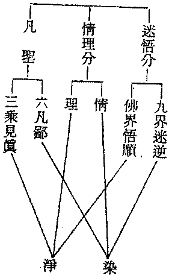



破斥三法(金錍、佛言)



一、空——若言空者有处无故。



二、实——若言实者空处无故。



三、空实——若言空实二处无故。



生天三念(杂宝)



一、念本所从来。



二、念定生何处。



三、念先修何业得生天。



世寿三品



　　　　　　┌四十──少夭  

　　┌下┐　│  

　　│　│　│　　　┌不少┐  

　　├中┼方┼八十─┤　　├佛　八十唱灭表住中也  

　　│　│　│　　　└不夭┘  

　　└上┘　│  

　　　　　　└百二十─太老



执持三义



一、执持根身令不烂坏。



二、执持种子令不散失。



三、执取结生相续(八识初念受生便属相续)。



辩梦三观(释签)



一、梦中修因得果梦事宛然——假。



二、求梦不可得——空。



三、梦之心性——中。



八识三藏



一、能藏——如库藏宝贝，此识能含藏杂染种子，亦即持义。



二、所藏——如库藏是宝等，所依此识是杂染法，所依处故。



三、执藏——如金银等为人坚守不舍，此识为染末那，坚执为我故。



梨耶三譬(释论)



　　┌染污分┐　┌地界──八　　┌八识──土──七识。  

　　│　　　└┬┘　　四念　　　│　　妙玄  

　　├清净分─┼─二金──九　　├六识──染──八识。  

　　│　　　┌┴┐　　　　　　　│　　光玄  

　　└染净分┘　└三土──六七　└九识──金──九识。



心有三名(婆沙)



一、心即意识如火名熖。



二、心即意识如火名炽。



三、心即意识如火烧薪。



八名心，七名意，前六名识。(百法疏。)



虚空三义(大经)



一、无变易喻佛法常无变易，非三世摄。



二、无边际喻众生佛性非内六入、外六入，合名中道。



三、无罣碍喻佛性如虚空无著。



虚空三喻(无著)



一、徧一切处——於住不住相中，福生生故喻假。



二、宽广——高大殊胜故喻空。



三、无尽——究竟不穷故喻中。



天子三义(光明)



一、处胎天护。



二、生已天护。



三、天与己德。



施有三法



一、上——送食至寺。



二、中——就家供养。



三、下——造舍乞食发心供养。



信有三别(唯识)



一、信实有——谓於诸法实事理中，深信忍故。



二、信有得——谓於三宝真实德中，深信乐故。



三、信有能——谓於一切世善深法中，信有力能，得能成起希望故。



夏腊三座(尼母)



一、下——无夏至九夏。



二、中——十夏至十九夏。



三、上——二十夏至四十夏。



(五十以上名耆宿，一切沙门之所尊敬。)



不眴三义(净名什注)



一、如天眼不眴。



二、敬爱佛身谛观不眴。



三、心无尘翳慧目常开。



出家三法(什师)



一、持戒能折伏烦恼，令其势微。



二、禅定能遮烦恼，如石山断流。



三、智慧能灭烦恼，毕竟无餘。



出家三等(三千威仪)



一、下等。



二、中等。



三、上等。



一、谓以十戒为本，尽形受持，虽舍家缘，执作与俗人等，名下等。



二、谓应舍作务，具受八万四千向道因缘，三业未能具足清净，心结犹存，名中等。



三、谓根心猛利，应舍结使、缚缠定慧力，心得解脱，净三业，出烦恼，得清凉，名上等。



出家三善(法炬)



一、远离嫉妬随喜教示。



二、为他作时不求果报。



三、不坏损他以成己善。



出家三事(三千威仪)



一、坐禅。



二、诵经。



三、劝化。



食离三过



一、上味起贪。



二、中味起瞋。



三、下味起痴。



离此三过方堪受食。



食体三法



一、香。



二、味。



三、触。



中阴三食(大经)



一、思食。



二、触食。



三、意食。



孝体三等(礼记)



一、大孝尊亲。



二、其次弗辱。



三、下者能养。



龙树三论



一、大悲方便论——明天文地理，作宝作药，利益世间。



二、大庄严论——明修一切功德法门。



三、大无畏论——明第一义，中观论是其一品。



神仙三论



一、僧法，此云数——谓诸法从数起，此乃刼初黄头仙造。



二、卫世师，此云胜——於诸论中胜故，此乃休留外道所造。



三、勒沙婆，此云苦行——以未知出世时节，但名以詺所造论也。



色界三有



一、梵王外道，计生万物主。



二、无想外道，计无心为涅槃。



三、五那含外道，计为真解脱。



(此三总在四禅，破外计故别出。)



有漏三种(婆沙)



一、加行得煖、顶、忍、世第一法。



二、离染得静虑、无色、无量解脱等。



三、生得谓生彼地，法尔所得。



僧中三支(僧传)



一、支谦——支即眼中黄形躯虽小是智囊。



二、支识。



三、支亮。



锡杖三分(义净)



一、上分锡。



二、中分木。



三、下分牙角。



涅槃三观



一、奢摩他。



二、毗钵舍那。



三、忧毕叉。



真谛三轮



一、转。



二、照。



三、持。



吉藏三轮



一、根本。



二、枝末。



三、摄末归本。



智光三时



一、境有心有。



二、境空心有。



三、心境俱空。



光统三教



一、渐。



二、顿。



三、圆。



戒贤三时



一、有相。



二、无相。



三、中道。



法安三绝(僧传)



一、风仪挺特。



二、鲜义穷深。



三、精进洁己。



莲华三义



一、人中华十叶。



二、天上华百叶。



三、菩萨华千叶。



互跪三义(湼疏)



一、右膝有力跪能安人。



二、右膝有力起止便易。



三、右膝躁动著地令安。



(三处翘耸，右膝著地，故名互跪。)



衣制三限(律文)



一、大衣五日成。



二、七条四日成。



三、五条二日成。



限日不成，尼犯堕，比丘突吉罗。



袈裟三色



一、青色——铜青。



二、黑色——杂泥。



三、木兰——树皮。



右绕三帀



一、一帀表敬三宝佛，灭三恶地狱。破三表贪。出三界欲。



二、二帀表敬三宝法，灭三恶畜生。破三表瞋。出三界色。



三、三帀表敬三宝僧，灭三恶饿鬼。破三表痴。出三界无色。



盋盋应三法



一、体——大要有二，谓泥及铁。



二、色——熏黑赤，或孔雀因色鸽色。



三、量——大受三斗，小受斗半，中者可知。



鼓声三因(大经)



一、皮和合出声。



二、人和合出声。



三、包和合出声。



托胎三事(大集)



一、命——出入息为命，即风大。



二、煖——业持火大地大等色而不烂坏。



三、识——此中心意名识，即刹那觉知心也。



寺院三门(佛地)



一、空门。



二、无相门。



三、无作门。



凡寺有开三门者，有但立一门，亦呼为三门者。论云：大宫殿三解脱门为所入处，宫殿喻法空涅槃。今之寺院，乃是持戒修道涅槃之人所居，故由三门而入。



众生三义(阿含)



一、最初——刼初光音天下生，男女尊卑共生。



二、受报——揽众阴而有。



三、流转——处处受生。



凡夫三行(净名什注)



　　一、善行。  

　　二、不善行。  

　　　　　　┌色界┐  

　　三、无作┤　　├行。  

　　　　　　└无色┘



地动三因(泥洹)



一、地依水，水依风，风依空，大风起则水扰地动。



二、得道沙门及神妙天现感应故动。



三、我作佛时前后已动。



人有三扰(沈约)



一、荣名势利。



二、妖妍靡曼。



三、甘旨肥浓。



(由此三事，心神昏惑，故不得道。)



人道三胜



一、勇猛。



二、忆念。



三、梵行。



(由此三胜故生天人。)



龙有三苦



一、虽食百味，最初一口，化为虾蟇。



二、夫妇相交，即变为二蛇。



三、背道布鳞，砂石生中，痛乃连心。



孤狱三别



一、山间皆有地狱。



二、水中皆有地狱。



三、旷野皆有地狱。



业行有三(法念)



一、福业行人天因。



二、罪业行三恶因。



三、无动行色界因。



作恶三时



一、欲作。



二、正作。



三、作已。



逆恶三品



一、约境善则於分不杀为上蚊蚋等，於胜不杀为下父母等，餘为中不善及此。



二、约心无间善不善，但猛心作为，上泛尔心作为，下餘为中。



三、约时通善不善，但三时无悔为上，作已方悔为中，正作能悔为下。



瑜伽三祖(统纪)



　　　　　　　　　　　　　┌龙门无畏法师。  

　　一、初祖金刚智灌顶国师┤  

　　　　　　　　　　　　　└大慧一行法师。



二、二祖不空灌顶国师。



三、三祖慧朗灌顶法师。



慈恩三祖(统纪)



一、初祖西天戒贤法师。



二、二祖三藏玄奘法师。



三、三祖慈恩窥基法师。



修罗三因



一、瞋。



二、慢。



三、疑。



(由此三因生修罗道。)



狐有三德(名义)



一、其色中和。



二、小前大后。



三、死则首丘。



今昔三宗



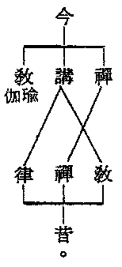



虎溪三咲



一、东林远法师。



二、处士陶渊明。



三、道士陆修静。



(「法师於庐山东林结莲社，修净业，未尝过溪。二士慕其高韵，徃造焉。三人谈道，相送不觉过溪，遂鸣掌大咲，人写为图，名虎溪三咲，传之后世焉！」)



临济三句(禅宗)



一、第一句——三要印开朱点窄，未容拟议主宾分。



二、第二句——妙解岂容无著问，沤和争负截流机。



三、第三句——看取棚头美傀儡，牵抽元是里头人。



云门三句(禅宗)



一、函盖乾坤句。



二、截断众流句。



三、随波逐浪句。



黄龙三关(禅宗)



一、人人有个生缘。



二、我手何似佛手。



三、我脚何似驴脚。



汾阳三诀(禅宗)



第一诀：接引无时节，巧语不能诠，云绽青天月。



第二诀：舒光辩贤哲，问答利生心，拔出眼中楔。



第三诀：西国胡人说，济水过新罗，北地用邠铁。



汾阳三句(禅宗)



一、问著力句，汾云嘉州打大象。



二、问转身句，汾云陕州灌铁牛。



三、问亲切句，汾云西河美师子。



富乐亲三



一、知足第一富。



二、涅槃第一乐。



三、善友第一亲。



开废会三(法华)



一、开权显实。



二、废权立实。



三、会三归一。



(「四时三教，当体圆实。开已俱实，无权可论。会於三乘，咸归一乘。」)



衣座室三(法华)



一、大慈悲为室。



二、柔和忍辱衣。



三、诸法空为座。



经云：「药王！若有善男子、善女人，如来灭后，欲为四众说是法华经者，云何应说是善男子、善女人，入如来室，著如来衣，坐如来座，尔乃应为四众广说斯经。如来室者，一切众生中大慈悲心是。如来衣者，柔和忍辱心是，如来座者，一切法空是。安住是中，然后以不懈怠心，为诸菩萨及四众，广说是法华经。药王！我於餘国，遣化人为其集听法众，亦遣化比丘、比丘尼、优婆塞、优婆夷，听其说法。是诸化人，闻法信受，随顺不逆。若说法者，在空闲处，我时广遣天、龙、鬼神、乾闼婆、阿修罗等，听其说法。我虽在异国，时时令说法者得见我身，若於此经忘失句逗，我还为说，令得具足。」



供养有三(十轮)



一、利益——四事等。



二、敬心——将花表情。



三、修行——若有持说，即是供养。



戒体有三



一、初克住出体无表思一法。



二、次相应出体同时二十二法。



三、后眷属出体身口意善业。



三无碍法界(圆觉)



一、奢摩他静观平等，为事无碍法界。



二、三摩地幻观徧，为理无碍法界。



三、禅那寂观无坏无证，为事事无碍法界。



明相有三



一、初日照阎浮树身，天作黑色。



二、二日照树叶，天作青色。



三、三日照过树，天作白色。



(取白色为正时。)



三种波罗蜜(楞伽)



一、世间——凡夫神通及生梵天，此六度是有漏法。



二、出世间——二乘行六度，乐自涅槃乐。



三、出世间上上——菩萨为众生故，修行六度。



佛学名相汇解　卷第十五（终）



三处阿兰若(苑师)



一、达磨阿兰若——华严初说本来湛寂，无起作义。



二、摩登伽阿兰若——[土*豕]间去村落，一俱卢舍，即牛鸣不及处。



三、檀陀迦阿兰若——砂𥖿之处。



三学摄道品



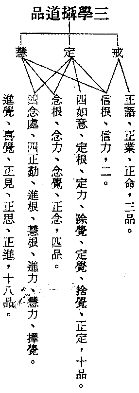



三释波罗夷



一、退没——由犯此戒，道果无分。



二、不共住——非但失道，不得於说戒羯磨，僧中共住。



三、堕落——舍此身已，堕阿鼻狱。



三乘同三法(通教)



一、同观无生四谛。



二、同体假入空观十二因缘。



三、同观六度见第一义。



三部约三法(指要)



一、妙玄约众生千如妙旨。



二、文句约佛法千如妙旨。



三、止观约心法千如妙旨。



不二门欲与止观同成观体，皆专约心法，故节节云；一念刹那等。



三种三摩地



一、有寻有伺——初禅，及未到定。



二、无寻唯伺——中间禅，梵天六天定力所感。



三、无寻无伺——二禅近分，乃至非非想。



诸法离三相(起信)



一、离名字相。



二、离言说相。



三、离心缘相。



三法招轻贱(毗奈)



一、无事多言语。



二、身著弊垢衣。



三、不请往他家。



三法即三学(首楞)



　　┌咒灵┐　┌戒  

　　├心了┼即┼定  

　　└能─┘　└慧



古德云：「以心持咒，其咒自灵；以咒摄心，心无不了。心咒相参，纯一无杂。」



三种须陀洹



一、下——七生证罗汉果。



二、中——三生或五生涅槃。



三、上——即一生得四果。



三归破三邪



一、归依佛，破诸外天神。



二、归依法，破杀害之业。



三、归依僧，破餘诸外道。



不忍有三苦(无著)



一、流转。



二、众生相违。



三、乏受用。



三种发心相(起信)



一、真心——无分别故。



二、方便——利众生故。



三、业识——微细起灭故。



菩萨三无猒(智论)



一、供佛无厌。



二、闻法无厌。



三、给僧无厌。



三衣断三毒(戒坛)



一、五条断贪——身。



二、七条断瞋——口。



三、大衣断痴——意。



三品五条衣(一百羯磨)



一、上——竖三肘，广五肘。



二、中——在上下之间。



三、下——减半。



大比丘三义



一、大——天王大人所敬故。



二、多——徧解内外经书故。



三、胜——出九十五种上故。



三处二十年(法华)



一、二十年中常令除粪——八忍、八智断见，合为一无碍、一解脱；九无碍、九解脱断思，共成二十年。



二、二十年中执作家事——住大乘位，转大乘教，名二十年执作家事。



三、自见子来已二十年——从有二乘之机，而来感佛，故云：自见子来已二十年。皆取二乘各有十智。



菩萨三事大(佛地)



一、数大，以无量故，名摩诃萨。



二、德大，住大乘故，名摩诃萨。



三、业大，能息众生烦恼故，名摩诃萨。



波罗蜜三翻(禅门)



一、到彼岸——诸经。



二、事究竟——大论。



三、度无极——瑞应。



沩仰三种生(禅宗)



　　┌想─┐  

　　├相─┼生　楞严  

　　└流注┘



式叉女三法



　　　　　　　　　　　　　　　　　┌染心相触┐  

　　　　　　　　　　　　　　　　　│　　　　│  

　　　　　　　　　　　　　　　　　├盗人四钱┤  

　　一、学根本──即四重禁戒　　　│　　　　│  

　　　　　　　　　　　　　　　　　├断畜生命┤  

　　二、学六法──即羯磨─────┤　　　　├六法　又见六数  

　　　　　　　　　　　　　　　　　├小妄语─┤  

　　三、学行法──一切大尼戒须学之│　　　　│  

　　　　　　　　　　　　　　　　　├非时食─┤  

　　　　　　　　　　　　　　　　　│　　　　│  

　　　　　　　　　　　　　　　　　└饮酒──┘



出家人三欲(大经)



一、恶欲——欲为一切大众上首，说法信受，大得供养等。



二、大欲——令四众知我得初住，至四无碍智，为利养故。



三、欲欲——比丘欲生梵天，乃至刹利家，得自在故。



菩萨三种禅



一、现法乐住。



二、出生三昧功德。



三、利益众生。



汾阳三师子(禅宗)



一、超宗异目。



二、齐眉共躅。



三、影响音闻。



安居离三过



一、无事游行，妨修出世业。



二、损伤物命，违慈实深。



三、所为既非，故招世谛。



行慈与三乐



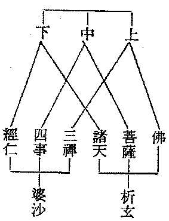



识有三种相(楞伽)



一、转相，五识该六识之相。



二、业相，六识该七识之相。



三、真相，七识该八识之相。



三相为生住灭之枢细，诸识之娸伐，唯智可明，故云：非思量所知。



修净土方便有三



一、善於自行而不取相。



二、不取证。



三、善化众生。



(具此三者，得生净土。)



方便土三义



一、真中——二乘三种菩萨证方便道，并属㝎边。



二、真似——别圆似解未修真修，皆名作意。



三、偏圆——并以三教，而为方便。



(虽通三义，正从真似，立方便名。)



曹山三种堕(禅宗)



一、披毛戴角是类堕。



二、不断声色是随堕。



三、不受食是尊贵堕。



三号三德三谛(妙宗)



一、正徧知——般若——真。



二、应供——解脱——俗。



三、如来——法身——中。



畜生三依处



一、水三品——重者，土内不见光明。



二、陆三品——中者，山林。



三、空三品——轻者，人所畜养。



畜生三类摄



一、昼行。



二、夜行。



三、昼夜行。



菩萨伏惑三义



一、为逗机生善。



二、为受生利物。



三、为防二乘疑。



三慧即是三门



一、闻初，即耳门。



二、思中，即心门。



三、修末，即中道观门。



三佛成道賖促



一、弥勒即出家日成道。



二、释迦苦行六年得道。



三、大通十刼佛法不现前。



默说相对三



　　　　　　　　┌或一座默十方说─┐  

　　┌初此座十方┤　　　　　　　　│  

　　│　　　　　└或十方默一座说─┤  

　　│　　　　　　　　　　　　　　│　　┌各不相知  

　　│　　　　　┌或对一人默多人说┼义加┤  

　　├二多人一人┤　　　　　　　　│　　└互为显密  

　　│　　　　　└或对多人默一人说┤  

　　│　　　　　　　　　　　　　　│  

　　└三但说默──或俱默或俱说──┘



三藏三学诠次



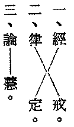



起教之次，阿含为先；修行之初，木叉为首。



一、谓：正明，因事制戒，防止身口恶法。又：戒是所诠，行毗尼是能诠教。



二、谓：经明，修行即是安心法，修行有绪，令不散乱。又：佛说经必先入定故。



三、谓：圣人智慧分别法义，若佛自分别法义，若弟子分别法义。



三真实破三法(楞严)



一、圆破外界，故云：譬如人静居，十方俱击鼓，十处一时闻，是圆真实。



二、通破内界，故云：隔垣听音响，遐迩俱可闻，五根所不齐，是通真实。



三、常破生灭，故云：声无既无灭，声有亦非生，生灭二圆离，是常真实。



三道是三德种



一、苦道——正因——法佛——法身。



二、烦恼——了因——报佛——般若。



三、业道——缘因——应佛——解脱。



三种障菩提法(十疑)



一、依智慧门，不求自乐，远离我心，贪著自身故。



二、依慈悲门，拔一切众生苦，远离无安众生心故。



三、依方便门，当怜愍一切众生，欲与其乐，远离恭敬供养自身心故。



三义降神兜率



一、表居中——大论取大梵共七天，是天主通上下故。



二、常说法——菩萨居内院，不著乐故。



三、遮轻慢——菩萨居此，为遮人天起轻慢故。



三种顺菩提法(徃生论文)



一、无染清净心，不为自身求诸乐故。



二、安清净心，为救众苦故。



三、乐清净心，欲令一切众生，得大菩提涅槃故。



念三身治三障(禅门)



　　　┌应┐　┌三十二相┐　┌昏沉暗塞┐　┌昏睡无言欲作逆恶等事┐  

　　念┼报┼身┼力无畏等┼治┼恶念思惟┼障┤　　　　　　　　　　├┐  

　　　└法┘　└空寂无为┘　└境界逼迫┘　│┌身卒痛──────┤│  

　　　　　　　　　　　　　　　　　　　　　└┤　　　　　　　　　││  

　　　　　　　　　　　　　　　　　　　　　　└水火灾──────┘│  

　　　　┌────────────────────────────┘  

　　　　│┌生┐　　　┌藏  

　　　　││　│　　　│  

　　　　│├应┤　　　├通  

　　　　└┤　├辅身行┤  

　　　　　├报┤　　　├别  

　　　　　│　│　　　│  

　　　　　└法┘　　　└圆



声闻人无三种善巧方便



一、必须软语，然后受法。



二、必须粗语，然后受化。



三、不软不粗，然后受化。



鹿苑三番度人



一、初为陈如，说四谛得道。



二、次为阿鞞跋提，说布施生天福乐同证果。



三、为迦叶俱利亦如前说，皆得圣道。



破三贼喻三惑(指要)



　　　　　　　　　　　　　　　　　　　　　　　　　┌见─┐  

　　　　┌器械钝┐　　┌三止┐┌先破二重─────┤　　│  

　　　　│　　　│　　│　　││　　　　　　　　　└思─┤  

　　别教┼身力羸┼次第┼三谛┼┤　　　　　　　　　　　　├┐  

　　　　│　　　│　　│　　││　　　　　　　　　　　　││  

　　　　└智谋少┘　　└三观┘└更整人物─方破第三─无明┘│  

　　┌──────────────────────────┘  

　　│  

　　│　　　　　　　　┌三谛─身壮┐  

　　│　　　　　　　　│　　　　　│  

　　└一日之中即破三重┼三止─兵利┼圆教  

　　　　　　　　　　　│　　　　　│  

　　　　　　　　　　　└三观─权多┘



修三慈治三瞋(禅门)



一、修众生缘慈，治非理瞋。



二、修法缘慈，治顺理瞋。



三、修无缘慈，治诤论瞋。



清信士具三德



一、意乐清净。



二、能作三宝事。



三、能引发同法。



三苦依三受生



　　　　　　　　　　　　　┌生在欲界苦等三途┐  

　　┌苦受───┐　┌苦苦┤　　　　　　　　│  

　　│　　　　　│　│　　└三界已苦欲界复苦┤  

　　├乐受───┼生┤　　　　　　　　　　　├通论三界，各具三苦。  

　　│　　　　　│　├坏苦─乐坏时苦等於三途┤  

　　└不苦不乐受┘　│　　　　　　　　　　　│  

　　　　　　　　　　└行苦─即处中苦通至无色┘



三品罪受三苦



一、上品杀父母、罗汉、支佛，受上苦阿鼻大地狱。



二、中品杀凡夫至阿那含，受中苦三恶道。



三、下品杀螘子一切畜生，受下苦地狱、饿鬼、畜生。



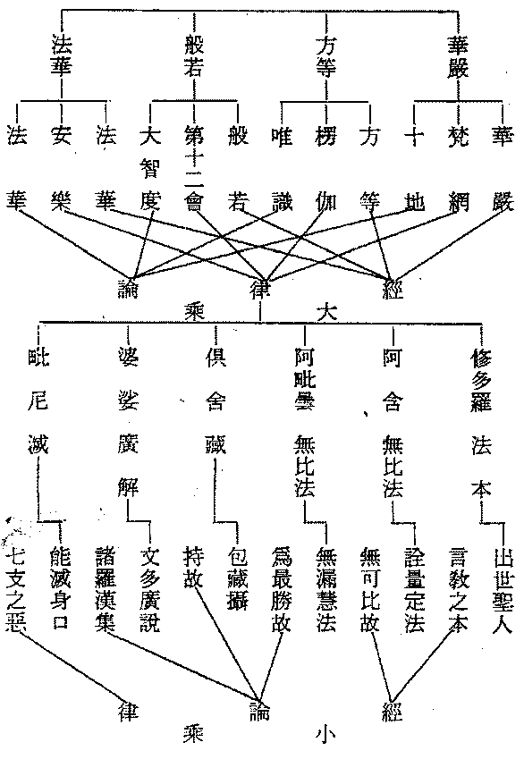



三种尽形服药



一、尽药形。



二、尽病形。



三、尽报形。



三种自利利他(南岳止观)



一、法身。



二、报身。



三、净土。



成佛后三修学



一、百刼顶寂定中，学诸相好。



二、千刼金刚定中，学诸威仪。



三、万刼大寂定中，学诸化行。



讲者须备三法



一、肃威仪，以临大众。



二、提大纲，以尽文义。



三、具宗眼，以示境观。



证果者得三法(楞伽)



一、即得三种生相净，为身业圆成。



二、次得一百八句圆，为语业清净。



三、后得三种意生身，入出自在，为意业神妙。



三种因缘得病(止观)



一、四大五脏不调，用止观三法治之。



二、鬼神所作，用彊心加咒治之。



三、业报，用修福忏悔治之。



三种在家二众



一、离欲——形虽在俗，元未婚娶，常随如来。



二、功勋——已曾婚娶，今持五戒，永断俗法。



三、善宿——俗法不亏，而持五戒八斋。



三种入不二法(净名)



一、三十一大士以有言言於无言。



二、文殊以无言言於无言。



三、维摩诘以无言无言。



阿难从佛乞三愿



一、不受佛故衣。



二、不随佛受别请。



三、二十年法请重说。



女有三事不得成佛(超日月经)



一、少制父母，不得自由。



二、出嫁制夫，不得自由。



三、长大难子，不得自由。



三转读文即三妙观(天台)



一、是相如等——如名不异即空义——约如明空一空一切空。



二、如是相等——点空性相名字施设即假义——点如明相一假一切假。



三、相如是等——如於中道实相之是即中义——就是论中一中一切中。



三不信心不求净土(次公)



一、吾当超佛越祖，净土不足生。



二、处处皆净土，西方不必生。



三、极乐圣域，我辈凡夫不能生。



(发此三心，不求生者，深为可惜。)



三忏属对三业三障



　　┌身──────────┐  

　　│　　　　　　　　　　　├障  

　　├口─业───作法─报─┤  

　　│　　　　　　　　　　　│  

　　│　┌事一心─取相─业─┤  

　　└意┤　　　　　　　　　│  

　　　　└理一心─无生─烦恼┘



生净土无三种过失



一、心无虚妄。



二、位无退转。



三、善无唐损。



三天下三种胜南洲(因本)



一、长寿。



二、色胜。



三、地胜。



三贤对治地前三障(通玄)



一、十住学生空观，治不信障。



二、十行作法空观，修自利利他行，治声闻自利障。



三、十向作法空观，起悲愿力，垂形六道度生，治独觉自度障。



三真实破三相续障(首楞)



一、圆破所障世界相续，皆本一圆空。



二、通破能障众生相续，皆本通无碍。



三、常破异障业果相续，皆本常不坏。



三家论罗汉退不退



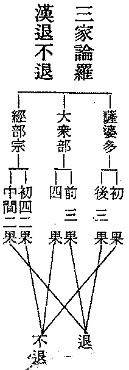



辅行引婆沙云：罗汉牵二三果，退者如井砂，上下有砖：上砖若頺，沙岂不頺？四果如上砖，二三果如中砂，初果如底，更无有退；初果若退，更无住处，正合初师之论。



三种人见佛不见佛



　　　　　　　┌三亿家见佛  

　　┌舍卫国┐│  

　　│　　　├┼三亿家闻而不见  

　　└九亿家┘│  

　　　　　　　└三亿家不闻不见



大乘宗受戒时三思



一、审虑思。



二、决定思。



三、发起胜思。



前二加行皆属心业，后一根本。



三身即三德三因发



一、慧身德，般若因，了因性开发。



二、妙法身德，法身因，正因性开发。



三、应一切德，解脱因，缘因性开发。



三谛可轨则名三轨(指要)



一、三千即空，观照轨。



二、三千即假，资成轨。



三、三千即中，真性轨。



因名三轨，果名涅槃。



约三义明三百由旬(妙句)



一、约生死处——三界果报。



二、约烦恼——见思。



三、约观智——空观。



三因三缘能感后有(本事)



一、无明未断——种子。



二、爱未弃——灌溉。



三、业未息——良田。



净土见树得三法忍



一、音响忍。



二、柔顺忍。



三、无生忍。



三意先度陈如五人(妙乐)



一、酬释尊行因本愿。



二、赴五人本愿先度。



三、报今日侍奉之劳。



称宗师者须具三眼



一、教眼——明识权实大小之法。



二、道眼——亲践诸行修证之门。



三、宗眼——深穷圆顿即具之旨。



文殊普贤三对表法



一、普贤即所信如来藏，文殊即能信之心。



二、普贤表所起万行，文殊表能起之解。



三、普贤未证出缠法界，文殊表能证大智。



一切灾难义该三障(消灾湛堂)



一、破犯五戒，是业障。



二、内身、外身、灾难等事，是报障。



三、烦恼为根本，是烦恼障。



浴佛钱当分作三分(刹头)



一、一分属佛——作佛形像用。



二、一分属法——塔寺房舍等用。



三、一分属僧——各分给与比丘。



调达三逆生入地狱(智度)



一、破僧得五百弟子。



二、推山压佛伤足指。



三、拳杀华色比丘尼。



僧为三寳种三等树(毘尼)



　　┌果┐  

　　├花┼树　有福无过  

　　└叶┘



夺害三亲即名三怨



　　　　　┌父母┐  

　　┌上亲┤　　├上怨  

　　│　　└师长┘  

　　│  

　　│　　┌兄弟┐  

　　├中亲┤　　├中怨  

　　│　　└姊妹┘  

　　│  

　　│　　┌朋友┐  

　　└下亲┤　　├下怨  

　　　　　└智识┘



约三意释三经通别



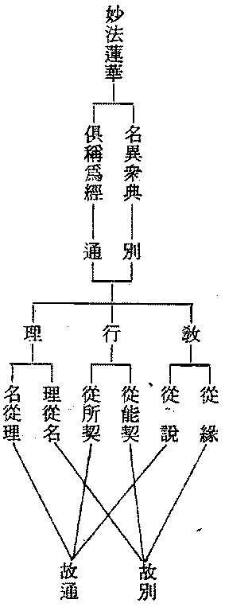



三转法轮度三根性



一、为声闻三转。



二、为支佛再转。



三、为菩萨一转。



此一往说耳，通论例皆三转。



法华涅槃三义是同



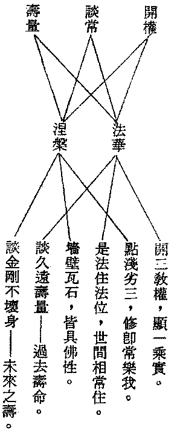



佛三意故向跋提河涅槃



一、河流奔注，如生死遄速。



二、金砂不动，喻佛性常住。



三、因地在此舍身，故此入灭。



三身单复名相



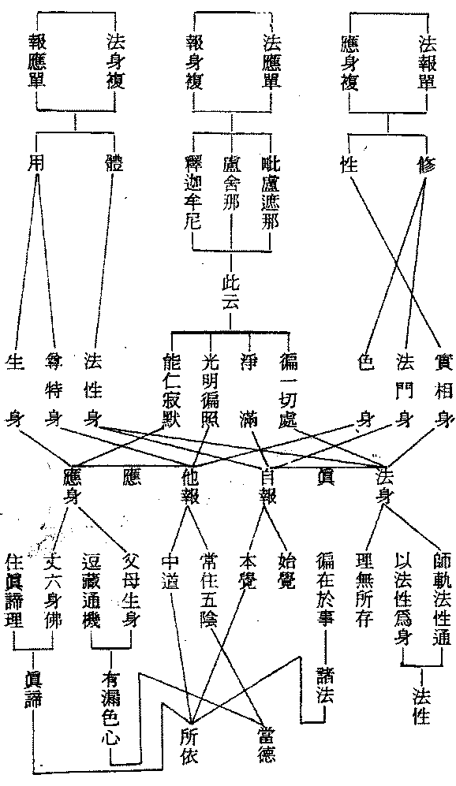



三观三学破业惑三谛成



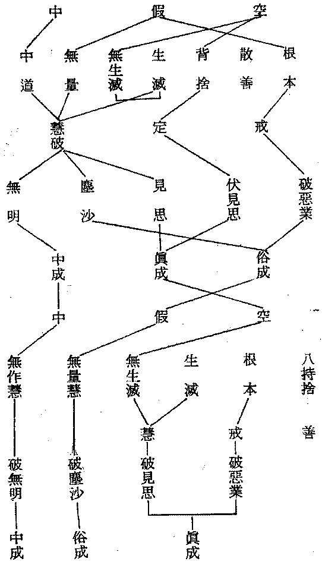



三藏菩萨格量声闻位次



　　┌初┐　　　　　　┌五停心总别相念处──外凡  

　　│　│　　　　　　│  

　　├二┼僧祇────┼煖位───────┐  

　　│　│　　　　　　│　　　　　　　　　│  

　　├三┘　　　　　　└顶位───────┤  

　　│　　　　　　　　　　　　　　　　　　│  

　　├六度满──────下忍───────┤  

　　│　　　　　　　　　　　　　　　　　　├内凡  

　　├入补处至降魔───中忍───────┤  

　　│　　　　　　　　　　　　　　　　　　│  

　　├一刹那──────上忍───────┤  

　　│　　　　　　　　　　　　　　　　　　│  

　　├又一刹那─────世第一──────┘  

　　│  

　　└三十四心顿断正习─初果至极果─────圣位



三科色心开合



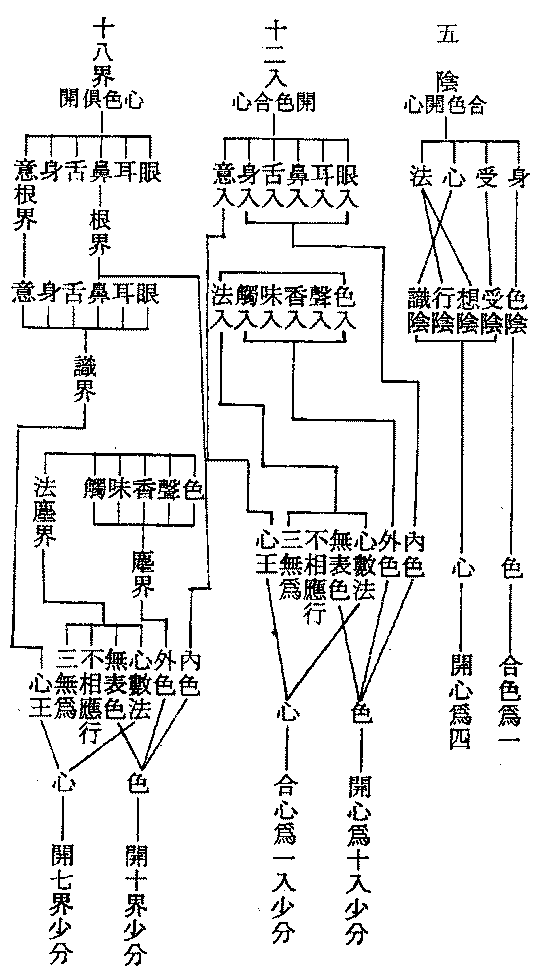



法华三周得记作佛



　　　　　┌──譬喻品初────────────────舍利弗  

　　　　　│  

　　　　　│　　　　　　┌────────────┐　┌摩诃迦叶　首座  

　　　　　│┌─授记品─┘　　　　　　　　　　　　│　│  

　　┌法说┘│　　　　　　　　　　　　　　　　　　│　├须菩提  

　　│　　　│　　　　　　　　　　┌─富楼那　　　└─┤  

　　│　　　│　　　　　　　　　　├─总记千二百人　　├迦旃延  

　　│　　　│┌五百弟子受记──┐├─别记陈如　　　　│  

　　│　　　││　　　　　　　　│├─别记五百人　　　└目犍连　　维那  

　　│　　　││　　　　　　　　│├─优楼频螺迦叶  

　　│　　　││　　　　　　　　│├─伽耶迦叶　　　　┌阿难　　　侍者  

　　│　　　││　　　　　　　　└┼─那提迦叶　　　　│  

　　├譬说─┘├授学无学品──┐　├─迦留陀夷　　┌─┼罗𬑟罗　　佛子  

　　│　　　　│　　　　　　　│　├─优陀夷　　　│　│  

　　│　　　┌┤　　　　　　　│　├─阿㝹楼陀　　│　└学无学二千人  

　　│　　　│├提婆达多品─┐│　├─离婆多乃至　│  

　　│　　　││　　　　　　││　└─周陀莎伽陀等│┌─提婆达多  

　　│　　　││　　　　　　│└─────────┘│  

　　└因缘─┘└劝持品─┐　└───────────┘┌婆阇比丘尼佛姨母  

　　　　　　　　　　　　│　　　　　　　　　　　　　　│  

　　　　　　　　　　　　│　　　　　　　　　　　　　┌┼六千学无学比丘尼  

　　　　　　　　　　　　└─────────────┘│  

　　　　　　　　　　　　　　　　　　　　　　　　　　　└耶输比丘尼罗云母



约三现释三品相好



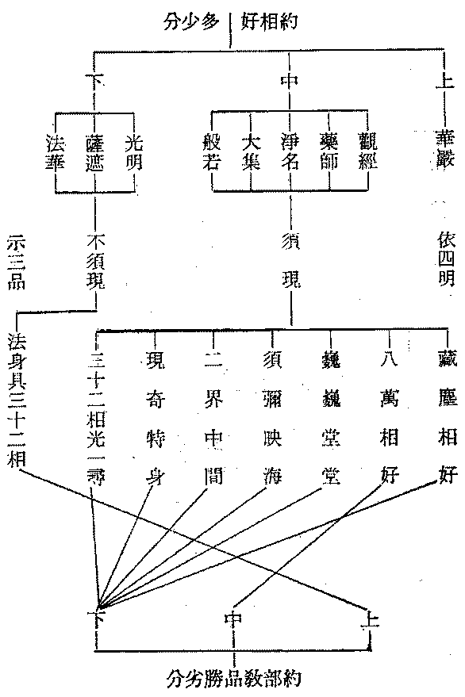



北峰：四明约须不须以通之，净觉以全现分现以释之，各据立宗，是否可核。



三自二他



　　　　　　　┌为自方便为己┐  

　　　　┌化他┤　　　　　　├随他意语  

　　　　│　　└非二乘法为他┘  

　　　　│  

　　　　│　　┌权实之智─皆名为己┐┌权实相即  

　　如来┼自行┤　　　　　　　　　├┤  

　　　　│　　└权实之照─皆名为他┘└随他意语  

　　　　│  

　　　　│　　┌照实为己┐┌权实相即  

　　　　└自他┤　　　　├┤  

　　　　　　　└照权为他┘└随自意语



三因四缘(释论)



　　┌生因─若法生时能与其　　　┌因　缘─具足三因　　　　报因即生因  

　　│　　　因如业为报因───┐│次第缘─心心数法  

　　│　　　　　　　　　　　　││　　　　次第而生  

　　├习因─如习贪欲贪欲增长─┼┘　　　　　　　　　成论　自分即习因  

　　│　　　　　　　　　　　　│　缘　缘─如识生眼识  

　　└依因─如心心数法依色香等┘　增上缘─诸餘缘也　　　　共因即依因



三宝约对四教



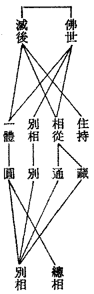



三宝是众生敬田，若能归敬者，长无量功德。



三照五味



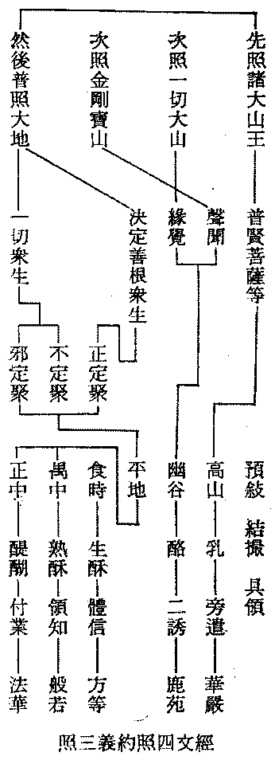



三观三惑三谛三理用对四教



　　藏┐　修三观┐　破三惑┐　诠三谛┐　证三理┐  

　　　│┌───┘┌───┘┌───┘┌───┘  

　　　├┤　　　　│　　　　│　　　　│  

　　　││　　空─┤　见思─┤　　真─┤　真─界内  

　　通┘│　　　　│　　　　│　　　　│  

　　　　│　　　　│　　　　│　　　　│  

　　别─┤　　假─┤　尘沙─┤　　俗─┤　俗┐  

　　　　│　　　　│　　　　│　　　　│　　├界外  

　　圆─┴──中─┴─无明─┴──中─┴─中┘



三双六只



　　　　　┌空中二观  

　　　　　│  

　　┌三双┼事业二识  

　　│　　│  

　　│　　└权实二理  

　　│  

　　│　　　　┌空观┐　┌事识┐　┌生身┐　┌权理  

　　└六只─修┤　　├用┤　　├见┤　　├住┤  

　　　　　　　└中观┘　└业识┘　└尊特┘　└实理



信解入出无难处，论三双六只，盖事业二识为见相之本。今二乘修空观，而能入见尊特者，功由业识故也。



三乘修行



　　　　┌声闻┐┌正化二乘  

　　┌藏┼缘觉┼┤  

　　│　└菩萨┘└旁化菩萨  

　　│　┌声闻┐┌正化菩萨  

　　├通┼缘觉┼┤  

　　│　└菩萨┘└旁化二乘  

　　├别┐  

　　│　├独菩萨法  

　　└圆┘



三慧收摄四信五品



　　　　　　　　　　　　　　┌初随喜品─┐  

　　　　　　┌初一念信解┐　│　　　　　│  

　　　　　　│　　　　　├闻┼二读诵品─┤  

　　　　　　├二略解言趣┘　│　　　　　│  

　　现在四信┤　　　　　　　└三说法品─┼灭后五品  

　　　　　　├三广为他说┐　　　　　　　│  

　　　　　　│　　　　　└思─四兼行六度┤  

　　　　　　└四深信观成┐　　　　　　　│  

　　　　　　　　　　　　└修─五正行六度┘



三种意生身(楞伽)



　　　　　┌一、三昧乐正受──┐  

　　　　　│　　　　　　　　　│  

　　┌宋译┼二、觉法自性性──┼意生身  

　　│　　│　　　　　　　　　│  

　　│　　└三、种类俱生无行作┘  

　　│　　　　　　　　　　　　　　　(天台依宋译称意生)  

　　│　　┌一、三昧乐正受──┐  

　　│　　│　　　　　　　　　│  

　　├魏译┼二、如实觉知诸法─┼意生身  

　　│　　│　　　　　　　　　│  

　　│　　└三、种俱生无行作─┘  

　　│　　　　　　　　　　　　　　　(荆溪依唐译名意成)  

　　│　　┌一、入三昧乐───┐  

　　│　　│　　　　　　　　　│  

　　└唐译┼二、觉法自性───┼意生身  

　　　　　│　　　　　　　　　│  

　　　　　└三、种俱生无行作─┘



三释意生身(诸文)



　　　　　┌一、安乐法────通─────空。  

　　　　　│  

　　┌妙玄┼二、三昧意────别─────假。  

　　│　　│  

　　│　　└三、自性意────圆─────中。  

　　│  

　　│　　┌一、入三昧意乐──三地至七地─空。  

　　│　　│  

　　├辅行┼二、觉法自性───八地────假。  

　　│　　│  

　　│　　└三、种类俱生无作─九地────中。  

　　│  

　　│　　┌一、三昧正受───通─────空。  

　　│　　│  

　　└净名┼二、觉法性────别─────假。  

　　　　　│  

　　　　　└三、无作意────圆─────中。



三种意生身(楞伽)



一、二乘意生身，尚有分段各三，无碍徧到。



二、菩萨意生身，妙能变化各三，无碍石壁。



三、大圣智乐意生身，得大究竟各三，无碍迅速。



三拜(智论)



　　身┐  

　　口┼业　佛法以心为本，身口次之。今但三拜，乃表身口意三业耳。  

　　意┘



三纲



　　┌上座  

　　├维那  

　　└典座



三目(大经)



天主摩醯首罗，面有三目，天台大师用譬涅槃三德；虽一点在上，不同点水之纵，三德亦尔。法身本有，不同别教之纵，虽二点在下，不同烈火之横，三德亦尔。二德修成，不同别教理体具足，而不相收，不相混二不相离，不纵不横，秘藏乃成。



流变三叠(楞严)



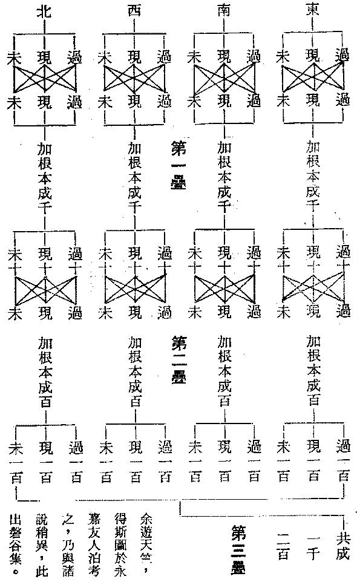



　　　　　　　　　　　　　　　　　　　　　　　　　　　　　　　　　　　　　　　┌意根十二┐  

　　　　　　　　　　　　　　　　　　　　　　　　　　　　　　　　　　　　　　　├身根八　┤逆  

　　┌第一叠依此间染心　　　　　┌法┐　　　　　┌发生　　　　　　　　　　　　├舌根十二┤  

　　│无如来发业润生（云云）　　├触┤　　　　　├迷理为咎痴爱　　　┌变一成十┤　　　　├─  

　　│当审详烦恼根本此　　　　　├味┤　　　　　├明（云云）由汝妄想└───┐├鼻根八　┤  

　　│六根更无他物（云云）应┌於┤　├起一染心┬┼故云迷晦即无　　　　　　　│├耳根十二┤修  

　　│轮转生死结根唯汝　　　│　├香┤　　　　│├乃成十二染心　　　　┌北┐│└眼根八　┘  

　　│识知俱生无明使汝　　　│　├声┤　　　　│├宛转各起一心　　　　├南┤│  

　　│经云告阿难言汝欲　　　│　└色┘　　　　│└於六尘境三四　┌三世┤　├┘  

　　│　　　　　　　　　　　│　　　　　　　　└────────┘　　├西┤  

　　│　　　　　　　　　　　│　　　　　　　　　　　　　　　　　　　　└东┘  

　　└───────────┴───────────────────────────────┐  

　　　　　　　　　　　　┌─────┐　　　　　　　　　　　　　　　　　　　　　　　　　　　│  

　　　　　　　　　　　　│　根尘同源│一随染缘逆修三叠　第一叠以无明染心──缘尘取著起背性修│  

　　依不变性即具随缘二义│心　　　　│　　　　　　　　　　　　　　　　　　　　　　　　　　　│  

　　　　　　　　　　　　│　缚脱无二│二随净缘顺修三叠　第一叠以圆解净心──研尘离著起顺性修│  

　　　　　　　　　　　　└─────┘　　　　　　　　　　　　　　　　　　　　　　　　　　　│  

　　┌───────────┬───────────────────────────────┘  

　　│　　　　　　　　　　　│　　　　　　　　　　　　　　　　　　　　　　　┌东┐  

　　│经云汝复欲知无上　　　│　┌色┐　　　　┌───────────┐　　├西┤  

　　│菩提令汝速证安乐　　　│　├声┤　　　　│┌─研六尘境三四　　　└三世┤　├┐  

　　│解脱寂静妙常亦汝　　　│　├香┤　　　　│├─宛转各修一心　　　　　　├南┤│┌眼根八　┐  

　　│六根更无他物（云云）若└於┤　├起一净心┴┼─乃成十二净心　　　　　　└北┘│├耳根十二┤顺  

　　│不审观烦恼根本则　　　　　├味┤　　　　　├─故云发明便解　　　　　┌───┘├鼻根八　┤  

　　│不能知虚妄根尘（云云）　　├触┤　　　　　├─脱（云云）知见无见　　└变一成十┤　　　　├─  

　　└第一叠依此起净心　　　　　└法┘　　　　　└─斯即湼槃　　　　　　　　　　　　├舌根十二┤  

　　　　　　　　　　　　　　　　　　　　　　　　　　　　　　　　　　　　　　　　　　├身根八　┤修  

　　　　　　　　　　　　　　　　　　　　　　　　　　　　　　　　　　　　　　　　　　└意根十二┘  

　　┌以成业云云造　　┌云云此即六根恶报其相如是　　　　　　　　　　　　东山释元操序  

　　│其习因熏婬自　　│落乘风堕无间狱云云皆是众生妄想所造终　　　　　　广如图烈矣治平甲辰  

　　│业所感口意三　　│时先见恶风吹坏国土亡者神识被吹上空旋　　　　　　无壅增数对论从略至  

　　│作杀盗二十恶　　│狱（云云）乃至六者思报招引恶果此思业交则命　　　对时方逆顺各三於理  

　　│故云身十恶乃　　│见猛火满十方界亡者神识飞坠成烟入无间　　　　　　何依今约染净二义略  

　　│成百三宛转各　　│出一者见报招引恶果此见业交则临终时先　　　　　　之心府苟无所据修者  

　　│造此六尘境四　　│恶故云一切众生六识造业所招恶报从六根　　　　　　此即一教之宏宗万行  

　　│　　　　　　　　│此十恶业感百恶庄严三四宛转乃成千二百　　　　　　文但部时方未闻对法  

　　│　　　　　　　　└───────────────────────┐楞严六根功德三叠雄  

　　└──────┐　　　　　　　　　　　　　　　　　　　　　　　　　│  

　　　　　　　依惑│　　　　　　　　　　　　　　　　　　　　　　　　　│  

　　逆起第二叠　　│　　　　　　　　　　　　　　　　　　　　　　　　　│  

　　　　　　　造业│　　　　　　┌─变十成百─┐　┌─第三叠　业成招报│　┌─变百成千─┐  

　　　　　　　　　│　　　　　　│　　　　　　│　│　　　　　众恶庄严│　│　　　　　　│  

　　┌──────┘　　　　　　│┌─────┘　│┌────────┘　│┌─────┘  

　　│　┌法┐　　　　　　┌未┐││┌意根百二十┐││　┌法┐　　　┌北┐││┌意根具千二百┐  

　　│　│　│　　　　　　│　││││　　　　　│││　│　│　　　│　││││　　　　　　│  

　　│　├触┤　　　　　　│　│││├意根八十　┤││　├触┤　　　│　│││├身根具八百　┤  

　　│　│　│　　　　　　│　││││　　　　　│││　│　│　　　│　││││　　　　　　│  

　　│　├味┤　　　　　　│　│││├舌根百二十┤││　├味┤　　　├南┤││├舌根具千二百┤  

　　└於┤　├造十恶　四方┼现┼┘└┤　　　　　├┘└於┤　├具百恶┤　├┘└┤　　　　　　├恶  

　　　　├香┤　　　　　　│　│　　├鼻根八十　┤　　　├香┤三　世│　│　　├鼻根具八百　┤  

　　　　│　│　　　　　　│　│　　│　　　　　│　　　│　│　　　├西┤　　│　　　　　　│  

　　　　├声┤　　　　　　│　│　　├耳根百二十┤　　　├声┤　　　│　│　　├耳根具千二百┤  

　　　　│　│　　　　　　│　│　　│　　　　　│　　　│　│　　　│　│　　│　　　　　　│  

　　　　└色┘　　　　　　└过┘　　└眼根八十　┘　　　└色┘　　　└东┘　　└眼根具八百　┘  

　　　　┌色┐　　　　　　┌过┐　　┌眼根八十　┐　　　┌色┐　　　┌东┐　　┌眼根具八百　┐  

　　　　│　│　　　　　　│　│　　│　　　　　│　　　│　│　　　│　│　　│　　　　　　│  

　　　　├声┤　　　　　　│　│　　├耳根百二十┤　　　├声┤　　　│　│　　├耳根具千二百┤  

　　　　│　│　　　　　　│　│　　│　　　　　│　　　│　│　　　├西┤　　│　　　　　　│  

　　　　├香┤　　　　　　│　│　　├鼻根八十　┤　　　├香┤　　　│　│　　├鼻根具八百　┤  

　　┌於┤　├修十善　四方┼现┼┐┌┤　　　　　├┐┌於┤　├具百功┤　├┐┌┤　　　　　　├功  

　　│　├味┤　　　　　　│　│││├舌根百二十┤││　├味┤德三世│　│││├舌根具千二百┤德  

　　│　│　│　　　　　　│　││││　　　　　│││　│　│　　　├南┤│││　　　　　　│  

　　│　├触┤　　　　　　│　│││├身根八十　┤││　├触┤　　　│　│││├身根具八百　┤  

　　│　│　│　　　　　　│　││││　　　　　│││　│　│　　　│　││││　　　　　　│  

　　│　└法┘　　　　　　└未┘││└意根百二十┘││　└法┘　　　└北┘││└意根具千二百┘  

　　│　　　　　　　　　　　　　││　　　　　　　││　　　　　　　　　　││  

　　└───────┐　　　　　│└─────┐　│└────────┐　│└─────┐  

　　　　　　　　　　│　　　　　│　　　　　　│　│　　　　　　　　　│　│　　　　　　│  

　　　　　　　依解　│　　　　　└─变十成百─┘　└─第三叠　行成感果│　└─变百成千─┘  

　　顺起第二叠　　　│　　　　　　　　　　　　　　　　　　　　众善庄严│  

　　　　　　　起行　│　　　　　　　　　　　　　　　　　　　　　　　　│  

　　　　　　　　　　│　　　　　　　　　　　　　　　　　　　　　　　　│  

　　┌───────┘　　　　　　　　　　　　　　　　　　　　　　　　│  

　　│　　　　　　　┌────────────────────────┘此三叠流变天台操师  

　　│此六尘境四三　│此十善业感百福庄严故月藏第五云十善者一　　　　　　综而为图近代说者咸  

　　│宛转各修十善　│善具十功德十善具百功德三四宛转乃成千二　　　　　　取於斯但文相宽博典  

　　│乃成百二十善　│百功德故云如是法门先过去世恒沙刼中微尘　　　　　　册难於编录舍之恐无  

　　│故云持此四种　│如来乘此心开得无上道识阴若尽则汝现前诸　　　　　　闻於后世今析为三段  

　　│律仪皎如冰霜　│根互用中能入菩萨金刚乾慧圆明精心於中法　　　　　　而入焉中间布棤虽少  

　　│苟不能生一切　│化如净琉璃内含宝月如是乃超十信（根似互用）十住　　不同所用文义略无毫  

　　│枝业心三口四　│十行十回向四加行心金刚十地等觉圆明（分具互用）　　发之间观者幸毋以列  

　　└生必无因　　　└入於如来妙庄严海究竟互用　　　　　　　　　　　　　次差别为疑也。



三和(首楞)



　　┌根┐  

　　│　├能  

　　├境┤　　识见杂三和，诘本称非相；自体先无定，云何获圆通。谓：根境和合，识生其中，能所合说。  

　　│　├所  

　　└识┘



三佛性



　　┌住自性　┌正因┐  

　　├引出性　├缘因┼佛性  

　　└至得果　└了因┘



三法



一、实知一法一切觉，即达智。



二、真如一法平等理，即所远境。



三、一心一法一法界，即所依体。



三法



　　┌心─能积集业──过──界──杂色如六道思──集起──八识┐　┌心  

　　│　　　　　　　　　　　　　　　　　　　　　　　　　　　　│　│  

　　│　入　　　　或　或　或　　　　　　　妙乐　　大　　　　　│　│  

　　│　　　　　　　　　　　　　　　　　　　　　　　　　　　　│　│  

　　├意─能广积集──未──入──系属五根属意──思量──七识┼名┼意  

　　│　　　　　　　　　　　　　　　　　　　　　　　　　　　　│　│  

　　│　楞　　　　云　云　云　　　　　　　俱舍　　乘　　　　　│　│  

　　│　　　　　　　　　　　　　　　　　　　　　　　　　　　　│　│  

　　└识─了别名识──现──阴──语想分别属识──了别──六识┘　└识



三法



　　┌善法┐┌人皆约　┌善─┐┌心王计我┐　┌心┐  

　　│　　││　　　　│　　││　　　　│　│　│  

　　├恶法┼┘法计我┌┼恶─┼┤　　　　├属┤　├念处摄  

　　│　　│　　　　││　　││　　　　│　│　│  

　　└无记┘　我能行┘└无记┘└心数计我┘　└法┘



三契(婆沙)



亿耳尊者，以三契声颂所解法。佛言：「善哉！音义。」云契者：一节一科。陈思王诵佛经，以为至道之宗极，乃制转读七声升降曲折之响为梵呗。



三幻(指要)



一、以性夺修。



二、但理随缘。



三、缘生无体。



体性圆具，徧发由熏，以性夺修，故修如幻。又云：然此尚非但理随缘之幻，岂同缘生无体之幻？方知：如幻名同，幻义各异。



三结(俱舍)



一、身见——边见。



二、戒取——见取。



三、疑使——邪见。



身摄边见戒摄取，邪见元从疑惑生；四钝皆由利使生，是故三结摄见尽。



三爱(大经)



一、欲爱住地，业因缘。



二、色爱住地，烦恼因缘。



三、无色爱住地，苦因缘。



三常(楞伽古注)



　　┌外道计四大性────┐愚夫  

　　│　　　　　　　　　　│  

　　├业习气相续得果不断故┼常  

　　│　　　　　　　　　　│  

　　└如来藏体真常住故──┘妄见



三痴(禅门)



一、计断常——过去诸法为灭有耶？现在诸法不灭有乎？推寻三世若灭即断，不灭即常。



二、计有无——我及阴等有耶无耶？如是乃至非有非无。



三、计世性——言由有微尘，乃有实法，乃有四大；有四大乃有假名众生世间，因慈思念而行邪道。



三掉(止观)



一、身——好喜游走，诸杂戏谑，坐不暂安。



二、口——好喜吟咏，竞争是非，无益言语等。



三、意——心情放逸，纵意攀缘，思惟文才技艺。



三报(大经)



一、顺现报。



二、顺生报。



三、顺后报。



一谓：明主孝慈训世，则祥云布，寿星现；思及物，则醴泉出，嘉苗秀，此为善之验也。樵夫指熊而臂落，酒客啖夕肉以皮穿，此为恶之验也。



二谓：今生行善恶因，来世受苦乐果。所以瓶沙转报於四天，有相改生於六欲。



三谓：因造今身，报终后世，伽咤七返，而享餘庆，那律久刼，而受远福。(以上三皆定业。)



三生(楞伽)



一、相生属所。



二、想生属能。



三、流注属业。



念起时，业极细，因流注，生成世界众生；注灭人世同根。



三细



一、业识相能见。



二、转识相能现。



三、现识相能取。



无明为缘生，三细不觉而起，名无明惑障中道。理修中观破之，其理自显。



三受(念处)



一、内受——缘内意根，各有顺受生乐受，是坏苦。



二、外受——缘外五根，各有违受生苦受，是苦苦。



三、内外——双缘六根，各有不违顺生不苦不乐，是行苦。



三真实(首楞)



一、圆——具——闻门。



二、常——摄——思门。



三、通——证——修门。



三惑(圆觉)



一、疑众生本来成佛，何故复有无明？佛以诸旋未息答之。



二、疑如来何时复生烦恼？佛以金鑛无重鑛答之。



三、疑众生本有无明，何缘佛说本来成佛？佛以翳花非待答之。



三渐次(圆觉)



一、思惟即三慧。



二、住持即三慧。



三、方便开悟即三慧。



三位



一、我爱执藏位——七地已前。



二、善恶业果位——凡夫至十地末心。



三、相续执待位——成佛至未来际。



三相



一、自——初阿赖耶识。



二、果——异熟。



三、因——一切种。



三相



一、生。



二、异。



三、灭。



藏教生灭四谛中云苦则三相迁移。



三际



一、先际。



二、中际。



三、后际。



波斯匿王言：「观身实相，观佛亦然。无前际、无后际、无中际。」



三士(四教)



　　┌上──雪山大士，不涉人间，无烦资助。　　　┌粪扫三衣  

　　├中──十二头陀，但畜三衣，不多不少。　律文┼百一  

　　└下──多寒国土，畜百一众物以助身。　　　　└餘长



　　　　┌上──有自利又利他。  

　　瑜伽┼中──有自利无利他。  

　　　　└下──无自利利他又利。



三僧祇



一、初地前三贤。



二、初地至七地。



三、八地至十地。



三统



一、天开於子，故周正建为天统。



二、地辟於丑，故商正建为地统。



三、人生於寅，故夏正建为人统。



三台(四教)



　　　　　　　　　　┌天曰三台  

　　┌上─太尉┐　　│  

　　│　　　　│　　├人曰三公  

　　├中─司徒┼三公┤  

　　│　　　　│　　├地应三台  

　　└下─司空┘　　│  

　　　　　　　　　　└故名天台



三加行



一、出入息——身加行。



二、寻伺——语加行。



三、受想——意加行。



三解脱(指要)



一、性本空假中，性净解脱，菩萨不实义。



二、修成空假中，实慧解脱，住此即实慧。



三、起用空假中，方便净解脱，能须弥纳芥等。



三实相(首楞)



一、寂色有情——能相。



二、照色无情——所相。



三、光主寂照中和，合中道三昧中所流。偈曰：「净极光通达，寂照含虚空；却来观世间，犹如梦中事。」



三不退



　　┌位──不生三恶道─────念处──下──煖法──空  

　　│  

　　│　妙　　　　　　　　　成　　　　数　　净  

　　│  

　　├行──不生边地根具男身──煖顶──中──顶法──假  

　　│  

　　│　句　　　　　　　　　论　　　　论　　名  

　　│  

　　└念──知宿命───────忍───上──三忍──中



三妙观



一、厌离有为心。



二、求菩提心。



三、度众生心。



三不护(法华)



一、知道者意。



二、开道者身。



三、说道者口。



三种慧(婆沙)



一、善——唯生得善。



二、染——唯修所断三毒相应。



三、无覆无记——异熟生意识相应。



三自性(楞伽)



一、名之自性，为因缘自性。



二、相之自性，为成自性。



三、妄想，为妄想自性。



我之所见，物物各具名之自性、相之自性，其中妄想为妄想自性，此三自性也。



三归戒(五分)



一、佛。



二、法。



三、僧。



佛於鹿苑度五俱邻，人间已有六罗汉。故次为耶舍父母，最初三归。



三福田



一、敬田三宝。



二、恩田父母。



三、悲田贫苦。



三种味



一、出家。



二、读诵。



三、坐禅。



「譬如甘蔗既被压已，滓无复味，壮年盛色亦如是，既被老压，无三种味。」



佛学名相汇解　卷第十六（终）



四身(成唯识论)



一、自性身。



二、自受用身。



三、他受用身。



四、变化身。



一、自性身者，即法身也。谓诸如来真净法界，湛然常寂。具足无边真实功德，是一切法平等实性也。



二、自受用身者，即自报身也。谓诸如来内智湛然，照真法界，尽未来际，常自受用广大法乐也。



三、他受用身者，为他机所感而现此身，即他报身也。谓诸如来，由平等智为十地菩萨，现大神通，转正法轮，令他受用大乘法乐也。



四、变化身者，谓无而忽有，名为变化，即应身也。谓诸如来，随顺机宜，变现此身也。



化应身四句(演义钞)



一、化身非应。



二、应身非化。



三、亦应亦化。



四、非应非化。



一谓：佛随类变现龙鬼等形，不为佛身，是名化身非应。



二谓：地前菩萨所见佛身，即是随机应现，非五趣摄，是名应身非化。



三谓：诸声闻所见佛身，见诸相好，皆因修成，名之为应，无而忽有，名之为化，是名亦应亦化。



四谓：佛法报二身，非属应化，是名非应非化。



佛四德(湼槃)



一、常德。



二、乐德。



三、我德。



四、净德。



四德者：如来所证「常、乐、我、净」之德也。谓如来心体本空，应用无染，离凡夫二乘菩萨偏邪之颠倒，故称为德。



一、常者：不迁不变之谓也。性体虚融，湛然常住，历三世而不迁，混万法而不变，故名常德。



二、乐者：安稳寂灭之谓也。离生死逼迫之苦，证涅槃寂灭之乐，故名乐德。



三、谓我者：自在无碍之谓也。然有妄我真我，若外道凡夫，於五阴身，强立主宰，执之为我，乃是妄我；若佛所具八自在称为我者，即是真我，故名我德。



四、净者：离垢无染之谓也。无诸惑染，湛然清净，如大圆镜，了无纤翳，故名净德。



出家四愿(出普曜经)



一、愿济众生困厄。



二、愿除众生惑障。



三、愿断众生邪见。



四、愿度众生苦轮。



出家四愿者：谓释迦如来，初欲出家，发此四誓愿，度脱众生也。



一谓：我设成正觉，得一切智时，众生困厄，被诸恼患，吾当济脱，令断恩爱也。



二谓：众生没在生死苦海，无明暗蔽，悉无所知，我当为其显示，如清净眼，内外无障，令其出离也。



三谓：众生在世，我慢自大，尊己贱彼，心存邪见，不慕圣道，我当开化，令入正真也。



四谓：众生处於生死之苦，轮转无际，灭智慧根，不能自济，我当为其说法，令得度脱也。



世医四法喻如来(出杂阿含)



一、善知病。



二、善知病源。



三、善知病对治。



四、善知治已更不动发。



一谓：世之良医，善能知人种种疾病，以喻如来，善知一切众生业惑等病也。



二谓：世之良医，善知疾病所起之由，或由风湿，或由冷热，乃至饮食色欲之类，发於众病，以喻如来善知众生，皆由无明烦恼为其根源，而有生死轮廻之病也。



三谓：世之良医，善知对治之方，如患冷病者，则以热药对治；患热病者，则以冷药对治；患不冷不热病者，则以温和之药对治。药若对病，病无不愈，以喻如来说法，若众生多贪欲者，则说不净之观治之；多嗔恚者，则说慈悲之观治之是也。



四谓：世之良医，善能应病与药，人若服已，其病即愈，病既愈已，身心安稳，不复更发，以喻如来为诸众生，善说法药，对治一切众生业惑之病，人能依而修之，则得出离生死之苦，成就涅槃之乐，一切业惑，不复发起矣！



天上四塔(出佛成道记并本行集经)



一、箭塔。



二、发塔。



三、盋塔。



四、佛牙塔。



一、经云：「太子年方十五，与诸释种角艺，太子一箭穿七金鼓，又一箭彻过七铁猪，复入于土，水泉迸出，遂名箭井。时帝释遂取其箭，於忉利天建塔供养。」



二、经云：「太子初出家时，自持宝刀而发愿云：『我今截落此发，誓与众生断除烦恼习障！』寻以发掷空中，时帝释接向天上，建塔供养。」



三、经云：「菩萨将诣道树，成等正觉，时有天人，告善生村主二女难陀、婆罗曰：『汝可最初施食。』於是二女以乳烹麋，用盋盛献。菩萨食已，以盋掷尼连河中，时帝释收归天上，建塔供养。」



(梵语：难陀，华言：喜。梵语：婆罗，华言：力；二女名也。尼连无翻。)



四、经云：「佛阇维时，天帝释持七宝瓶来请佛牙，其火即灭，宝棺自开，帝释乃取佛口舌颔一牙，於天上建塔供养。」(梵语：阇维，华言：焚烧。)



四处立塔(法苑珠林)



一、生处立塔。



二、得道处立塔。



三、转法轮处立塔。



四、涅槃处立塔。



一谓：诸佛降生之处，即应起塔，如今释迦牟尼佛在毗蓝园内，无忧树下降生，即於其处立塔也。(梵语：毗蓝，华言：解脱处。梵语：塔婆，华言：高显。)



二谓：如来得道，在摩竭提国菩提树下，即於其处立塔也。



(梵语：摩竭提，华言：善胜。梵语：菩提，华言：道。)



三谓：如来转法轮，其处不定，或在寂场，或在鹿苑，或在天上等，即於其处立塔也。



四、梵语：涅槃，华言：灭度。谓如来在俱尸那城，娑罗双树间入灭，即於其处立塔也。(梵：俱尸那，华言：角城。梵：娑罗，华言：坚固。)



身土四依(华严经疏)



一、色身依色相土。



二、色身依法性土。



三、法身依法性土。



四、法身依色相土。



一谓：如来随类应化，示现丈六等相好之身，即依娑婆等同居之土，以其有山河大地等色相，是为色身依色相土。



(梵语：娑婆，华言：能忍。同居者：凡圣同居也。)



二谓：如来丈六等相好之身，当体即是法性之身，所依之土，亦即常寂光土，是为色身依法性土。(常寂光土者：即佛所居之净土也。)



三谓：如来法性之身，非心非色，犹如虚空，徧一切处，所依之土即是常寂光土，是为法身依法性土。



四谓：如来法性之身，徧於刹尘之土，虽身土相摄，事理交互，色即非色，相即非相，而不离刹尘之土，是为法身依色相土。



佛四种希有(刊定记)



一、时希有。



二、处希有。



三、德希有。



四、事希有。



一、时希有者：谓佛出世之时，不常有也。一切众生从旷刼来，无明覆蔽，流转生死，无有穷尽，今值佛出世，闻说正法，依教修行，得免生死之苦，实为希有也。



二、处希有者：谓佛生於迦毗罗城，乃在三千世界之中，佛不於餘处出现，而於此处降生，实为希有也。(梵语：迦毗罗，华言：能仁住处。)



三、德希有者：谓佛具无量福慧，最胜第一，非诸菩萨等所可思议，实为希有也。



四、事希有者：谓佛降兜率，乃至入涅槃等事，天上人间，最为奇特，外道天魔无不归仰，用大慈悲，极巧方便，现多种身相，演无量法门，随众生根，普皆利益，实为希有也。



四无所畏(大智度论)



一、一切智无所畏。



二、漏尽无所畏。



三、说障道无所畏。



四、说尽苦道无所畏。



此四通言无畏者：由佛十力之智内充明了决定，故於大众中，凡有所说，则无恐惧之相，故名无所畏。



一、一切智者：於世间、出世间，一切诸法，尽知尽见也。无所畏者：如佛言：「我是一切正智人，故得安稳，得无所畏。在大众中作狮子吼，能转法轮，诸沙门婆罗门，若天魔梵，若复餘众，实不能转。」是一切智无所畏。



(梵语：沙门，华言：勤息。谓勤行众善，止息诸恶也。梵语：婆罗门，华言：净行。天魔梵者：天魔即他化自在天。梵：即梵天也。)



二、漏尽者：惑业生死俱尽也。无所畏者：如佛言：「我一切漏尽，故得安稳，得无所畏，在大众中作狮子吼，能转法轮，诸沙门婆罗门，若天魔梵，若复餘众，实不能转，是为漏尽无所畏。」



三、说障道者：说彼魔外，障蔽圣道之法也。无所畏者：如佛言：「我说障法，故得安稳，得无所畏。在大众中，作狮子吼，能转法轮，诸沙门婆罗门，若天魔梵，若复餘众，实不能转。」是为说障道无所畏。



四、说尽苦道者：说能尽诸苦之道法也。无所畏者：如佛言：「我所说圣道，能出世间，能尽诸苦，故得安稳，得无所畏。在大众中作狮子吼，能转法轮。诸沙门婆罗门，若天魔梵，若复餘众，实不能转，是为说尽苦道无所畏。」



四等(出楞伽经)



一、字等。



二、语等。



三、身等。



四、法等。



四等者：谓诸佛如来，名字言语，现身说法，平等不二，以显佛佛道同也。



一、字：即名字也。经云：若字称我为佛，彼字亦称一切诸佛，以我与彼字无差别，是名字等。



(我者：释迦如来自谓也。彼者：指一切诸佛也。谓诸佛皆称理立名，理性平等故同名佛也。)



二、语：即言语也。经云：谓我六十四种梵音，言语相生，无增无减，无有差别，与诸佛同一音故，是名语等。



三、经云：「我与诸佛，法身及色身相好，无有差别，是名身等。」



(法身者：即法性为身也。色身者：如来丈六之应身也。)



四、经云：「我及彼佛，同得三十七品菩提分法，无二无别，是名法等。」



四方行七步(佛本行集经)



一、东行七步。



二、南行七步。



三、西行七步。



四、北行七步。



谓如来初降生时，於四方面，各行七步，步步举足，出大莲华。行七步已，先观东方，口自出言：「世间之中，我为最胜，我从今日，生分已尽。」此是菩萨希奇之事，未曾有法，餘方悉然。



一、东行七步者：涅槃经云：示为众生而作导首也。



二、南行七步者：经云：示现欲为无量众生，作最上福田也。



三、西行七步者：经云：示现无尽，永断生死，是最后身也。



四、北行七步者：经云：示现已度诸有生死也。



四门游观(出佛本行集经)



一、东门见老人。



二、南门见病人。



三、西门见死人。



四、北门见沙门。



经云：「尔时，虚空有一天子，名曰作瓶。见悉达太子在於宫内，恐其著五欲乐，乃言：『我当为彼作於厌离之想。』即以威神感动，令其宫内所作音乐，皆为不顺，五欲之事，唯传涅槃微妙之声，欲令厌离世间，心生觉悟。太子闻是声已，遂发出游之心，即向迦毗罗城四门游观也。」(梵语：迦毘罗，华言：能仁住处。)



一、谓时太子欲向园林游观。净饭王闻之，於是敕令街巷洒扫严净，其有老病死亡之人，悉令驱逐，勿使太子见之，心有所厌。及太子出东门，作瓶天子以神通力，化作老人伛偻低头，倚杖呻吟，由脊傍行。太子见已，为驭者言：「我令此身亦当老耶？若有如是老弊之相，何暇向彼园林游戏？宜速还宫，我当思惟，作何方便，得免斯苦。」



二、谓时太子，又欲向彼园林游观。净饭王闻之，於是敕令街巷，洒扫严净。或有老病死亡之人，悉令驱逐勿使太子见之，复生厌离之心。及太子出南门，作瓶天子以神通力，化作一病患人，身体羸瘦喘气微弱，命在须臾，不能起举。太子见已，为驭者言：「若我此身，病亦不免，何暇向彼园林游戏？宜速还宫，我当思惟，作何方便，得免斯苦。」



三、谓时太子出西门，又欲向彼园林游观。净饭王闻之，於是敕令严净街道，复振铎言：莫令更有老病死亡之人，使太子见之，生於厌离。及太子出西门，作瓶天子以神通力，化作一死尸，卧在床上，众人轝行，有诸亲属，围绕哭泣。太子见已，心怀惨恻，为驭者言：「若我此身，同有死法，何暇向彼园林游戏，宜速还宫，我当思惟，作何方便，得免斯苦。」



四、谓时太子，又欲向彼园林游观，净饭王闻之，於是敕令严净街道，复振铎言：莫使更有老病死亡之人，令太子见，生厌离心。及太子出北门，作瓶天子以神通力，化作沙门，著僧伽黎，执锡擎钵，威仪整肃，行步安详。太子见已，心生爱乐，问言：「尊者！汝是何人？」沙门答言：「我名出家之人，世间诸行尽是无常，我今舍家求无上道，故名出家。」太子为言：「此业大善！」於是还宫，白净饭王曰：「世间一切众生皆有别离，我今志愿出家，乐求涅槃。」(梵语：沙门，华言：勤息。梵语：僧伽黎，华言：重复衣。)



四满成佛(出占察经)



一、信满成佛。



二、解满成佛。



三、行满成佛。



四、证满成佛。



一谓：依种性地，决定信於诸法，不生不灭，清净平等，无可愿求，是名信满成佛。



(种性者：种，即种子；性，即性分是也。)



二谓：依解行地，深解法性，无造无作，不起生死想，不起涅槃想，心无所怖，亦无所欣，是为解满成佛。(解行者：解即解了，行即所修之行也。)



三谓：依究竟菩萨地，能除一切无明诸障，菩提愿行，悉皆具足，是名行满成佛。



(究竟菩萨，即等觉菩萨也。)



四谓：依净心地，得无分别寂静法智，及不思议胜妙功德，是为证满成佛。



(净心地者：即妙觉佛位也。)



法四依(法界次第)



一、依法不依人。



二、依了义经不依不了义经。



三、依义不依语。



四、依智不依识。



法四依者：谓依凭正法，则能成就万行之因，满足菩提之果也。



一、依法者：谓依实相等法，修诸波罗蜜行，则能具足清净功德，能至菩提也。不依人者：如涅槃经云：「魔王尚能假化作佛，况能不作其餘之身。」是故虽是凡夫，若所说所行，与实相等法相应，则可依信，虽现佛身相好，若所说所行，违於实相法者，则不应依。(梵语：波罗蜜，华言：到彼岸。)



二、依了义经者：谓诸大乘经，皆明中道佛性，若依此而修，则万行成就，能见佛性也。不依不了义经者：谓小乘等经，不明中道佛性，若依此而修，则万行难成，不见佛性也。



三、依义者：义即中道之理，若依此理而修，则能成就万行，破诸颠倒，而显中道之理也。不依语者：语是世间言语文字，非出世法，若依此而修，则万行不成，颠倒不破，中道不显也。



四、依智者：照了之心名之为智，若依正观之智，於诸波罗蜜观察而修，则能破生死烦恼之业，必证大乘涅槃之果也。不依识者：妄想之心名之为识，若依妄识而修，则搆集生死烦恼之业，流转无穷，众苦不息也。



四法(大乘本生心地观经)



一、教法。



二、理法。



三、行法。



四、果法。



经云：「於法宝中，有其四种，引导众生，出生死海，到於彼岸。三世诸佛，依此修行，断一切障，得成菩提。」



一谓：一切无漏善法，教化众生，能破无明烦恼业障也。



二谓：一切教法所诠之义理也。



三谓：戒定慧等诸行之法也。



四谓：至果所证，无为涅槃等法也。



四法界(出华严法界观)



一、事法界。



二、理法界。



三、理事无碍法界。



四、事事无碍法界。



法界者：一切众生，身心之本体也。法：轨则也。界：有性、分二义。若约事说界，即是分义，谓随事分别故也。若约理说界，即是性义，谓诸法性不能变易故也。以此性分，互相交络，则成理事无碍法界，以理融事，一一融通，则成事事无碍法界也。



一谓：诸众生色心等法，一一差别，各有分齐，故名事法界。(分齐者，限量也。)



二谓：诸众生色心等法，虽有差别，而同一体性，故名理法界。



三谓：理由事显，事揽理成，理事互融，故名理事无碍法界。



四谓：一切分齐事法，称性融通，一多相即，大小互容，重重无尽，故名事事无碍法界。



四一(出法华经文句)



一、理一。



二、行一。



三、人一。



四、教一。



一、理：即中道一实相之理也。此实相之理，诸佛众生，体性平等，无有增减。但众生体虽本具，全体在迷，唯诸佛觉知如实之相，乘此实道，出应於世；要令众生得此实相。故经云：「是法非思量分别之所能解，唯有诸佛乃能知之。」又云：「诸佛唯以一大事因缘故，出现於世，为令众生开示悟入佛之知见。」佛之知见，即理一也。



(一大事因缘者：即一实相也。其性广博名大，诸出世之仪式，故名事。众生有此机感，故名因；佛乘机而应，故名缘。)



二、行：即所修一乘之妙行也。谓实相之理，自非一乘妙行莫能证得，故经云：「正直舍方便，但说无上道。」又云：「诸有所作，常为一事。」事即是行，故名行一也。



三、人：即所化之众生也。佛出世之意，但为教化菩萨，成就佛道。盖由机器不纯，不得已而权施三乘之教，渐令入大，故至法华，即开三乘之权，而显一乘之实。三乘之人，同是菩萨之人，故名人一也。



四、教：谓圆顿妙教，即一佛乘也。如来於前四时，随顺机缘，不得已而权说诸乘。至于法华，开显权即是实，故经云：「十方佛土中，唯有一乘法，无二亦无三。」故名教一也。



(四时者：华严时、鹿苑时、方等时、般若时也。无二者：谓无藏教、通教之二也。无三者：谓无藏教、通教、别教之三也。)



四种三昧(摩诃止观)



一、常坐三昧。



二、常行三昧。



三、半行半坐三昧。



四、非行非坐三昧。



欲登妙位，非行不阶，行法众多，略言其四。梵语：三昧，华言：正定，又云：调直定。众生心行，常不调、不直、不定，入此三昧，能调、能直、能定，故名三昧。



一、常坐三昧者：亦名一行三昧。文殊般若经：以九十日为期，独居静室，跏趺正坐，蠲除恶觉，舍诸乱想，不杂思惟，系缘法界，一念法界(系缘是止，一念是观，法法融摄，故曰法界。)，信一切法，皆是佛法，若坐疲极，或疾病所困，或睡盖所覆，或宿障发动，不能遣却，当专称一佛名号，以求加护。除经行、饮食、便利之外，时刻相续，无须臾废此之三昧。於一期中，若能精勤不懈，念念无间，则能破除障业，显发实相之理矣！



二、常行三昧者：亦名般舟三昧。梵语：般舟，华言：佛立。佛立有三义：一、佛威力，二、三昧力，三、行者本功德力。能於定中，见十方佛在其前立，故名佛立。以九十日为期，终竟三月，身常施行，不得休息，口常唱阿弥陀佛，心常想阿弥陀佛。或先想后唱，或先唱后想；想唱相继，无令休息。此之三昧，极能断除宿障，於诸功德，最为第一。



三、半行半坐三昧者：若依方等经，七日为期，唯诵祖持咒，旋百二十帀，一旋一咒，不迟不疾，旋竟却坐，思惟实相之理。若依法华经，三七日为期，但诵本经，故经云：「其人若行、若立，读诵是经，若坐思惟是经，我乘六牙白象，现其人前。」此等三昧，俱是半行半坐也。(梵语：祖持，华言：秘要。)



四、非行非坐三昧者：前之三种，俱用行坐，今言非行非坐者，虽非行坐，实通行坐，亦名随自意三昧。谓但於一切时中，一切事上，随意用观，不拘限期，心存止观，念起即觉是也。



智境四相(出圆觉经略疏)



一、我相。



二、人相。



三、众生相。



四、寿命相。



谓於有所证取之心，迤逦浅深，有此四相之异，故后之三相，皆因我相根本而立，与金刚般若四相，所言不同。盖彼於迷妄之心，执为四相故也。



一、我相者：谓众生於涅槃之理，心有所证，而其有所证取之心，执著不忘，认之为我，名为我相。经云：「是故证取，方现我体。」是也。



二、人相者：比前我相，已进一步，虽不复认证为我，而犹存悟我之心，名为人相。经云：「悟已超过一切证者，名为人相。」是也。



三、众生相者：比前人相已进一步。谓虽已超过我人之相，犹存了证了悟之心，名众生相。经云：「但诸众生，了证了悟，皆为我人，而我人相所不及者，存有所了，名众生相。」是也。



四、寿命相者：比前众生相，已进一步，谓心照清净於前众生相中，所存了悟之心，虽已觉知超过，然犹存能觉之知，如彼命根，潜续於内，名寿命相。经云：「觉所了者，不离尘故。」是也。



(不离尘者：谓此觉了之心，不离妄尘故也。)



四无碍智(法界次第)



一、义无碍智。



二、法无碍智。



三、辞无碍智。



四、乐说无碍智。



谓菩萨於此四法，智慧明了，通达无滞，故名四无碍智。亦以其辩说融通故也。



一谓：菩萨了知一切诸法，义理通达无滞故，名义无碍智。



二谓：菩萨通达一切诸法名字分别无滞，故名法无碍智。



三谓：菩萨於诸法名字、义理，随顺一切众生，殊方异语，为其演说，能令各各得解，辩说无滞，故名辞无碍智。



四谓：菩萨随顺一切众生，根性所乐，闻法而为说之，圆融无滞，故名乐说无碍智。



四念处(法界次第)



一、观身不净。



二、观受是苦。



三、观心无常。



四、观法无我。



念，即能观之观；处，即所观之境也。谓诸众生，於色受想行识，五阴起颠倒，於色多起净倒，於受多起乐倒，於想行多起我倒，於心多起常倒。为令众生修此四观，以除四倒，故名四念处也。



一谓：身有内外；己身名内身，他人之身名外身，此内外身皆揽父母遗体而成，从头至足，一一观之，纯是秽物，众生颠倒，执之为净，而生贪著，故令观身不净也。



二谓：领纳名受，有内受、外受，意根受名内受；五根受名外受。一一根有顺受、违受、不违不顺受。於顺情之境则生乐受，於违情之境则生苦受，於不违不顺之境则生不苦不乐受。乐受是坏苦，苦受是苦苦，不苦不乐受是行苦。众生颠倒，以苦为乐，故令观受是苦也。



(乐受是坏苦者：乐坏则苦生，即乐极悲生也。苦苦者：於苦身上，更加苦受，故名苦苦。行苦者：虽是不苦不乐，念念心有生灭，是故名行苦也。)



三谓：心即第六识也。谓此识心，体性流动，若麤若细，若内若外，念念生灭，皆悉无常，众生颠倒，计以为常，故令观心无常也。



四、法有善法、恶法。人皆约法计我，谓我能行善行恶也。善恶法中，本无有我，若善法是我，恶法应无我；若恶法是我，善法应无我。众生颠倒，妄计有我，故令观法无我也。



乘戒缓急四句(出演义钞)



一、乘急戒缓。



二、戒急乘缓。



三、乘戒俱急。



四、乘戒俱缓。



乘戒者：乘，即佛所说大小乘法也。戒，即佛所制轻重诸戒也。缓者：宽缓也，急者：急切也。



一谓：因戒缓故，堕於修罗、饿鬼、畜生、地狱四趣之中。由乘急故，还得闻法，如八部中，龙鬼等皆得预会闻法，是名乘急戒缓。



二谓：因戒急故，得生人天中，虽生人天中，由乘缓故，不乐闻法，是名戒急乘缓。



三谓：因戒急故，得生人天，由乘急故，亦得闻法悟道，是名乘戒俱急。



四谓：因戒缓故，永堕四趣，失天人身；以乘缓故，不得闻法，是名乘戒俱缓。



四世俗谛(出瑜伽师地论)



一、世间世俗。



二、道理世俗。



三、证得世俗。



四、胜义世俗。



一、俗即习俗，谓世间众生，安立舍宅，及治生等种种之事，皆悉虚假不实也。



二谓：五蕴等法，皆是假名安立，若依道理，一一推穷，皆无自体也。



三谓：观世俗假立之法皆空，证得预流等果也。(预流者：预入圣道之流，即初果也。)



四谓：於世俗假立之法，了达胜妙之义也。



四胜义谛(成唯识论)



一、世间胜义。



二、道理胜义。



三、证得胜义。



四、胜义胜义。



一谓：於世间五蕴虚妄之法，而说真如胜妙之义也。



二谓：声闻观苦集灭道四谛之理，即是胜妙之义也。



三谓：声闻证得二空真如之理，即是胜妙之义也。(二空者：人空、法空也。)



四谓：一真法界之理，唯有诸佛尽知尽证，乃胜义中之最胜义也。



四正勤(亦名四断法界次第)



一、已生恶令永断。



二、未生恶令不生。



三、已生善令增长。



四、未生善令得生。



正则不邪，勤则不怠。毗婆沙论云：「断已生恶法，犹如除毒虵；断未生恶法，如预防流水。增长已生善，如溉(居代切，灌也。)甘果栽(栽苗也)；未生善令生，如钻(祖官切，穿也。)木出火。」故名四正勤。(梵语：毘婆沙，华言：广解。)



一谓：五盖等烦恼覆心，离五种善根故，一心勤精进，方便断除，不令更生也。



(五盖：如辩后。五善根者：信根、精进根、念根、定根、慧根也。)



二谓：五盖等烦恼恶法，今虽未生，后若生时，能遮五种善根，故一心勤精进，方便遮止，不令生也。



三谓：五种善根，已生为令增长故，一心勤精进，方便修习，令不退失也。



四谓：五种善根，虽未生，为令生故，一心勤精进，方便修习，令得生也。



四正断(杂阿含经)



一、断断。



二、律仪断。



三、随护断。



四、修断。



一谓：所起恶不善法，断已复生，更须精进摄受，令不生起，断而又断，是名断断。



二谓：坚持戒律，慎守威仪，断一切恶，是名律仪断。



三谓：於无漏真实三昧相中，随顺守护，不令退没，是名随护断。



四谓：已起善法，增益修习，令其生长，诸不善法，自然断除，是名修断。



四种方便(出起信论)



一、行根本方便。



二、能止方便。



三、发起善根方便。



四、大愿平等方便。



论问云：「既说法界一相，佛体无二，何故不唯念真如，复假求学诸善之行？」答曰：「譬如大摩尼宝，体性明净，而有鑛(古猛切)秽之垢，若不以方便磨治，终不得净，故说四种方便。」(梵语：摩尼，华言：如意。)



一谓：一切法自性无生，离於妄见，不住生死，及观一切法因缘和合，业果不失，起大悲心，摄化众生，不住涅槃，以此为行，则能出生一切善法，故名行根本方便。



(因缘者：眼、耳、鼻、舌、身、意，六根为因，色、声、香、味、触、法，六尘为缘。缘助谓助於六根，能生六识也。梵语：湼槃，华言：灭度。)



二、止即遮止，谓惭愧悔过，能止一切恶法，不令增长，故名能止方便。



三谓：勤供养礼敬三宝，赞叹随喜，劝请诸佛，以爱敬三宝淳厚心故，信得增长，乃能志求无上之道。又因三宝护持力故，能令业障消除，善根增长，故名发起善根方便。



四谓：发广大誓愿，尽未来际，化度一切众生，皆令究竟，入於涅槃，故名大愿平等方便。



四悉檀(法华文句)



一、世界悉檀。



二、为人悉檀。



三、对治悉檀。



四、第一义悉檀。



悉，徧也。檀，梵语具云：檀那，华言：施。华梵兼称，故名悉檀。佛以此四说法，徧施一切众生，故名四悉檀也。



一、世，即隔别之义；界，即界分也。盖由众生根器浅薄，故佛随其所欲乐闻，为之次第分别而说，令生欢喜，是名世界悉檀。



二谓：佛欲说法，必先观众生机器之大小，宿种之浅深，然后称其机宜，而为说之，令生正信，增长善根，故名为人悉檀。



三谓：如众生贪欲多者，教观不净；瞋恚多者，教修慈心；愚痴多者，教观因缘。为对此等诸病，说此法药，徧施众生，故名对治悉檀。



四、第一义即理也。谓佛知众生，善根已熟，即为说法，令其得悟圣道，是名第一义悉檀。



起信四觉(出起信论)



一、本觉。



二、相似觉。



三、随分觉。



四、究竟觉。



一谓：一切众生自性清净，心源离於妄念，即寂而照，等虚空界，无所不徧，法界一相，即是如来平等法身，故名本觉。



二谓：圆教十信位中，由始觉之功，见思麤惑既已断竟，尚餘无明细惑未破，所觉之理，非真本觉，唯得名为相似，故名相似觉。



三谓：圆教十住、十行、十回向、十地、等觉位中，分破无明之惑，故得分分是真本觉，故名随分觉。



四谓：圆教极果妙觉位中，无明之惑既尽，本觉体全彰，明心见性，心即常住，是名究竟觉。



四如意足(法界次第)



一、欲如意足。



二、念如意足。



三、精进如意足。



四、思惟如意足。



一、欲者：希向慕乐庄严彼法，故名为欲。谓凡所修习一切诸法，若无乐欲之心，事必不遂，若能乐欲，所愿皆得，是为欲如意足。



(庄严彼法者：谓修希即心，令四念处身受心法之观成就也。)



二、念者：专注彼境，一心正住故名念。谓若非一心观法断绝，若能一心，所愿皆得，是为念如意足。



三、精进者：无杂曰精，无间曰进。谓唯专观理，使无间杂，故曰精进。凡所修习，一切诸法，若无精进，事必不成；若能精进，所愿皆得，是为精进如意足。



四、思惟者：思惟彼理，心不驰散也。谓凡所修习，若能思惟，所愿皆得，是为思惟如意足。



别教说听四句(华严经疏)



一、唯说无听。



二、唯听无说。



三、说听双存。



四、说听双寂。



别教者：圆融具德，异前诸教。



一谓：众生全在诸佛心中故，则果门摄法无遗，故所说教，唯佛所现，是名惟说无听。



二谓：佛全在众生心中故，则因门摄法无遗，故所说教，即众生心中自现，是名唯听无说。



三谓：生佛互在，则因果交彻，故众生心中之佛，为佛心中之众生；说法佛心中之众生，听众生心中之佛说法，是名说听双存。



四谓：众生全在佛，则同佛非众生；佛全在众生，则同众生非佛。两相形夺，二位齐融，则佛心中之众生无听，众生心中之佛无说，是名说听双寂。



同教说听四句(华严经疏)



一、唯说无听。



二、唯听无说。



三、说听双全。



四、说听双寂。



同教者：谓会三乘归一乘也。



一谓：佛真心外无别众生，以众生真心，即佛真心故，故所说教，唯佛所现，是名唯说无听。



二谓：众生心外，更无别佛，以佛真心，即众生真心故，故所说教，即众生自现，是名惟听无说。



三谓：佛真心现时，不碍众生真心现故，是名说听双全。



四谓：佛即众生故非佛，众生即佛故非众生；互夺双亡，则说听双寂，故净名经云：「其说法者，无说无示；其听法者，无闻无得。」是也。



四种涅槃(成唯识论)



一、本来自性清净涅槃。



二、有餘依涅槃。



三、无餘依涅槃。



四、无住处涅槃。



一谓：真如理，随缘变造一切诸法，虽有烦恼垢染，而本性清净，具足无量微妙功德，无生无灭，湛然若虚空，一切众生，平等共有，与一切法，不一不异，离一切相，无有分别，故名本来自性清净涅槃。



二谓：烦恼障虽灭，尚餘欲界五阴之身而为所依，故名有餘依涅槃。



三谓：烦恼既尽，所餘五阴之身亦灭，故名无餘依涅槃。



四谓：不住生死，不住涅槃，穷未来际，利乐有情，故名无住处涅槃。



涅槃四种大乐(出湼槃经)



一、无苦乐。



二、大寂静乐。



三、大知乐。



四、不坏乐。



一、无苦乐者：谓无世间之苦乐也。世间之乐即是苦因，故经云：「不断乐者，则名为苦，以断乐故，则无有苦，无苦无乐，乃名大乐。」此即涅槃之大乐也。



二谓：涅槃之性，是大寂静，以其远离一切愦闹法故，以大寂静，名为大乐。此即涅槃之大乐也。



三谓：诸佛如来，有大智慧，於一切法，悉知悉见，名为大乐，此即涅槃之大乐也。



四谓：如来之身，非烦恼无常之身，犹如金刚，不能毁坏；身不坏故，名为大乐。此即涅槃之大乐也。



经含四义(翻译名义)



一、法义。



二、常义。



三、贯义。



四、摄义。



一、法：即可轨可则之义。谓如来所说之经，十界同遵，无不轨则故也。(遵：依也。)



二、常：即不迁不变之义。谓如来所说之经，三世而不改易故也。



三谓：如来所说之经，贯穿一切深妙义理故也。



四谓：如来所说之经，摄持所化一切众生故也。



讲经四益(金光明经)



一、国土吉祥益。



二、辅臣和乐益。



三、国人富寿益。



四、法师自利利他益。



经云：「虚空菩萨梵释天等白佛言：若诸国土，有能讲说此金光明微妙经典，於其国土，获四利益。」



一谓：若有国土，讲说此经者，国王军众，势力强盛，无诸怨敌，疾疫消除，寿命修长，吉祥安乐，正法兴隆也。



二谓：若有国土，讲说此经，则辅相大臣，和悦无诤，王所敬爱，安稳丰乐，随心所愿，皆得满足也。



三谓：若有国土，讲说此经，则沙门弟子，及国邑人民，修行正法，多所利益，寿命延长，富逸安乐，於诸福田，悉得修立也。



四谓：若有国土，讲说此经，其说经之人，一切时中，身心调适，诸人民众，增加守护，慈悲平等，心无伤害；亦令一切众生，诚心皈仰，皆悉修习菩提之行也。



四藏(大智度论)



一、经藏。



二、律藏。



三、论藏。



四、咒藏。



四藏者：经、律、论、咒也。以其各各含藏一切文理，故名藏也。



一、经藏者：即如来所说一大藏，大小乘诸经也。经，法也。十界同遵，谓之法；三世不易，谓之常。又云：契经，谓上契诸佛之理，下契众生之机也。



二、律藏者：即如来所制大小乘戒律也。律，法也。谓能治众生贪、嗔、痴，种种之恶，如治世法律，则能断决重轻之罪也。



三、论藏者：即如来所说阿毗昙等论，及佛弟子所造诸论也。



四、咒藏者：即如来所说一切秘密心咒也。如诸陀罗尼，及凡经中，所有神咒是也。



(梵语：陀罗尼，华言：咒。)



论藏华梵四名(华严经疏)



一、摩怛理迦。



二、奢萨怛啰。



三、乌波儞舍。



四、阿毗达磨。



一、梵语：摩怛理迦，华言：本母。谓反覆论议，则能出生一切义理故也。



二、梵语：奢萨怛啰，华言：议论。谓评议辩论空有假实等法故也。



三、梵语：乌波儞舍，华言：近说。谓从近从略，说经中要义故也。



四、梵语：阿毗达磨，华言：对法。谓能对所问之法故也。



四种璎珞庄严(大方等大集经)



一、戒璎珞庄严。



二、三昧璎珞庄严。



三、智慧璎珞庄严。



四、陀罗尼璎珞庄严。



璎珞庄严者：谓菩萨以戒等四法庄严法身，如世璎珞，庄严於身也。



一谓：菩萨严持禁戒，於诸众生，无有恶害之心；若无恶害之心，一切众生常所乐见，身口意业，悉令清净，是名戒璎珞庄严。



二谓：菩萨於诸众生，运大慈心，质直柔软，乃至远离贪瞋痴行，修习一切三昧，是名三昧璎珞庄严。



三谓：菩萨心无疑网，远离颠倒，知苦断集，证灭修道，戒定慧聚，清净无著，观於世间，犹如梦幻，观於法界，无有去来，是名智慧璎珞庄严。



四、梵语：陀罗尼，华言：能持。谓菩萨能持诸善法，令不散不失。又云：总持。谓能持善不失，持恶不生，是名陀罗尼璎珞庄严。



四种秘密(阿毗昙杂集论)



一、令入秘密。



二、相秘密。



三、对治秘密。



四、转变秘密。



一谓：声闻之人，执著空法，谓一切法皆空，如来为说大乘之法，破其执空之见，令生胜解，得入圣教，是名令入秘密。



二谓：如来说一切法，皆无自性，无生无灭，为破诸外道凡夫邪执著有之相，是名相秘密。



三谓：如来宣说隐密之教，皆是对彼众生过失而调治之，如人有病，则应病与药，而治疗之，即获安适，是名对治秘密。



四、转变者：转彼不善，而变为善也。谓如来说一切隐密名言，皆为众生起散乱心者，令生寂静；起颠倒见者，令生正见；起烦恼者，令生清净。是名转变秘密。



四安乐行(法华文句)



一、身安乐行。



二、口安乐行。



三、意安乐行。



四、誓愿安乐行。



谓身无危险故，安心无忧恼故乐；身安心乐，乃能进行，故名安乐行。



一谓：身应当远离十种之事：一、远离豪势。二、远离邪人邪法。三、远离凶险嬉戏。四、远离旃陀罗。五、远离二乘众，妨修大乘之行故。六、远离欲想。七、远离不男之人。八、远离危害之处。九、远离讥嫌之事。十、远离畜养。既远离已，常好坐禅，修摄其心，是名身安乐行。(梵语：旃陀罗，华言：屠者。)



二谓：口应远离四种语：一、不乐说人，及经典过。二、不轻慢：谓不倚大乘，而轻蔑小乘也。三、不赞他，亦不毁他。四、不生怨嫌之心，善修如是安乐心故，是名口安乐行。



三谓：意应弃四种恶：一、不嫉謟。二、不轻骂，谓不应以大行，而诃骂小行之人也。三、不恼乱。四、不争竞，为一切众生平等说法。是名意安乐行。



四谓：由众生不闻不知不觉，於是起慈悲心，誓愿为说故。经云：「我得阿耨多罗三藐三菩提时，随在何地，以神通力、智慧力引之令得住是法中。」是名誓愿安乐行。



(梵语：阿耨多罗三藐三菩提，华言：无上正等正觉。)



四安乐行(华严经疏)



一、毕竟空行。



二、身口无过行。



三、心无嫉妬行。



四、大慈悲行。



此四安乐行者，乃清凉澄观国师，依法华经安乐行品而立。谓涅槃之果，名为安乐；修此行者，能趣涅槃，故名安乐行。又住此四行，则身静神定，外苦不干，故名安乐行。



一、毕竟空行者：心境两妄，空有双会也。法华经云：行处近处。谓以观照理，如理而行，名为行处。复观一切法空即近於理，名为近处。以行处近处终归於空也。



二、身口无过行者：谓身能远离杀盗等过；恶口能远离妄言、绮语等过恶。法华经云：「若读经时，不乐说人长短，及经典过。」是也。



三、心无嫉妬行者：谓见人修善，即能随喜劝修，证入菩提之道，远离嫉害妬忌等行。法华经云：「於后末世，法欲灭时，受持读诵斯经典者，无怀嫉妬谄诳之心。」是也。



四、大慈悲行者：谓起慈悲心，发大誓愿，愿拔众生之苦，与众生之乐。法华经云：「於在家出家人中，生大慈心，於非菩萨人中，生大悲心。」是也。



四陀罗尼(出瑜伽师地论)



一、法陀罗尼。



二、义陀罗尼。



三、咒陀罗尼。



四、忍陀罗尼。



梵语：陀罗尼，华言：总持。谓持善不失，持恶不生也。又翻遮持，谓遮空有二边之恶，持中道之善也。



一谓：诸菩萨得念慧力，持所闻法，经无量时，永不忘失，是名法陀罗尼。



二谓：诸菩萨持所闻无量义趣，经无量时，永不忘失，是名义陀罗尼。



三、咒，愿也。谓诸菩萨，获得如是总持，令其咒愿，悉皆神验，能除一切众生种种灾患，是名咒陀罗尼。



四、忍，即安忍。谓诸菩萨，成就坚固之行，於所闻法，得精进忍，是名忍陀罗尼。



四智(成唯识论)



一、大圆镜智。



二、平等性智。



三、妙观察智。



四、成所作智。



一谓：如来真智，本性清净，离诸尘染，洞彻内外，无幽不烛，如大圆镜，洞照万物，无不明了。是名大圆镜智。



二谓：如来观一切法，与诸众生，皆悉平等，以大慈悲心，随其根机，示现开导，令其证入，是名平等性智。



三谓：如来善能观察诸法圆融次第，复知众生根性乐欲，以无碍辩才，说诸妙法，令其开悟，获大安乐，是名妙观察智。



四谓：如来为欲利乐诸众生故，普於十方世界，示现种种神通变化，引诸众生，令入圣道，成本愿力所应作事，是名成所作智也。



佛学名相汇解　卷第十七（终）



四镜(出起信论)



一、如实空镜。



二、因熏习镜。



三、法出离镜。



四、缘熏习镜。



镜以明净鉴照为义。谓真如本觉之性，有空有不空，有体有用，故以四镜喻焉。



一谓：真如实相，体本空寂，离一切妄心境界之相，如明镜无染，故名如实空镜。



二谓：真如觉体，能作现法之因，复能熏习内心，而一切境界悉於中现，故名因熏习镜。



(已上二种明真如在缠，故有空不空之义也。缠者：烦恼业缚也。)



三谓：真如觉体之法，出离烦恼之尘，纯一明净，故名法出离镜。



四、缘即所化机缘。谓真如觉体出缠之时，随照物机，与彼众生作外缘熏力，令其修习善根，故名缘熏习镜。(已上二种明真如出缠，从体而起用也。)



藏教生灭四谛(出四教仪集注)



一、苦谛。



二、集谛。



三、灭谛。



四、道谛。



藏教者：经、律、论三藏之教也。生灭者：此教诠因缘生法，有生有灭也。四谛者：谛，即审实之义。谓声闻之人，用析空观，谛审苦集灭道之法，一一不虚，是名藏教生灭四谛。



(因缘生法者：六根为因，六尘为缘，根尘相对所起之心，名为生法。析空者：析即分析，谓分析五阴等法皆空也。)



一、苦：即逼迫之义，有三苦八苦。总而言之：不出三界生死，声闻之人，谛审生死实苦，故名苦谛。



二、集：即招集之义。谓声闻之人，谛审烦恼惑业，实能招集生死之苦，故名集谛。



三、灭：即寂灭。谓声闻之人，既厌生死之苦，谛审涅槃实为寂灭之乐，故名灭谛。



四、道：即能通之义。谓声闻之人，谛审戒定慧之道，实能通至涅槃，故名道谛。



通教无生四谛(出四教仪集注)



一、苦谛。



二、集谛。



三、灭谛。



四、道谛。



通教者：谓通前藏教，通后别圆也。无生四谛者：谓此教三乘之人，根利用体空观，体达五阴诸法当体即空，如幻如化，故云：苦无逼迫相，集无和合相，灭无生相，道不二相也。是名通教无生四谛。



(通前藏教者：谓此教钝根菩萨，但证真空之理，与前藏教是同也。通后别圆者。谓此教利根菩萨，即於真空之理，能知不空，证入中道之理，与后别圆二教是同也。)



一谓：此教三乘，用观巧故，审实五阴生死等苦，当体即空，而无逼迫之相，故名苦谛。



二谓：此教三乘，用观巧故，审实惑业之因，当体即空，了无惑业和合之相，故名集谛。



三谓：此教三乘，用观巧故，审实五阴生死等苦，昔本无生，今亦无灭，故名灭谛。



四、道即戒定慧之道，谓此教三乘，用观巧故，审实所破之集，能破之道，同一真空，无有二相，故名道谛。



别教无量四谛(出四教仪集注)



一、苦谛。



二、集谛。



三、灭谛。



四、道谛。



别教者：别前藏通，别后圆教也。无量四谛者。谓此教独菩萨法，菩萨所化，众生既无量，其所用法门，亦无有量。故云苦有无量相，十法界果报不同故；集有无量相，五住烦恼不同故；道有无量相，恒沙法门不同故；灭有无量相，诸波罗密不同故；是名别教无量四谛。



(别前藏通者：此教纯是菩萨所修之法，不同藏通二教，是三乘共修也。别后圆教者：此教所明法门行相，隔历次第，不同圆教一切圆融也。五住烦恼者：一切见住地惑、欲爱住地惑、色爱住地惑、有爱住地惑、无明住地惑也。梵语：波罗蜜，华言：到彼岸。生死为此岸，湼槃为彼岸也。)



一谓：此教菩萨，谛审十界众生生死诸苦，一一不虚，故名苦谛。



(十界众生，佛亦在列者，大论云：众生无上者，即佛是也。)



二谓：此教菩萨，谛审十界众生惑业，实能招集生死之苦，故名集谛。



三谓：此教菩萨，谛审无量道法，实能自利利他，故名道谛。



四谓：此教菩萨，谛审六度之行，实能证於涅槃寂灭之理，故名灭谛。



圆教无作四谛(出四教仪集注)



一、苦谛。



二、集谛。



三、道谛。



四、灭谛。



圆教者：谓事理无碍，法法融摄也。无作四谛者：大乘菩萨，圆观诸法，事事即理，无有造作，故云：「阴入皆如，无苦可舍；尘劳本清净，无集可除；边邪皆中正，无道可修；生死即涅槃，无灭可证。」是名圆教无作四谛。



(阴入皆如者：阴即色、受、想、行、识，五阴也。入即六根、六尘，互相涉入，通为十二入也。此阴入之法，皆言如者，如，即理也。边邪皆中正者：谓空有二边邪倒之见，皆即中正也。)



一谓：此教菩萨，谛审五阴十二入之法，皆即真如，实无苦相可舍，故名苦谛。



二谓：此教菩萨，谛审一切烦恼尘劳，性本清净，实无招集生死之相，故名集谛。



三谓：此教菩萨，谛审一切诸法，皆即中道，离边邪见，实无烦恼之惑可断，亦无菩提之道可修，故名道谛。



四谓：此教菩萨，谛审生死涅槃，体元不二，实无生死逼迫之苦可断，亦无涅槃之寂灭之乐可证，故名灭谛。



四摄利益(出大集经)



一、佛摄利益。



二、天摄利益。



三、福摄利益。



四、智摄利益。



一谓：佛摄持众生，令其常得亲近诸佛，诸魔不得其便，故名佛摄利益。



二谓：诸天摄持众生，於说法之处，常乐听受，不为他缘所害，故名天摄利益。



三谓：福德庄严，於身有诸相好庄严；於口凡所演说，众生乐闻，庄严种姓，令生尊贵，故名福摄利益。



四谓：以智慧知众生根性，随宜说法，知众生病苦，随病施药，得大神通，游诸佛土，了了通达，法界之理，是名智摄利益。



华严四分(出法宝标目)



一、信分。



二、解分。



三、行分。



四、证分。



一谓：第一会菩提场中，说世主妙严品，至毗卢遮那品，名举果劝乐生信分。盖举扬如来依、正二报，难思之果，劝励当机，闻而乐欲生其净信，故名信分。



二谓：第二会，普光明殿，说十信法；第三会，忉利天宫说十住法；第四会，夜摩天宫说十行法；第五会，兜率陀天说十回向法；第六会，他化自在天宫说十地法；第七重会，普光明殿说十定等法，名修因契果生解分。盖进修六位之圆因，契证十身之妙果，令生胜解分，故名解分。



(十定者：普光大三昧、妙光大三昧、次第徧往诸佛国土大三昧、清净深入行大三昧、知过去庄严藏大三昧、智光明藏大三昧、了知一切世界佛庄严大三昧、众生差别身大三昧、法界自在大三昧、无碍轮大三昧也。六位者：十住、十行、十回向、十地、等觉、妙觉也。)



三谓：第八会普光明殿，普贤说离世间一品，具二千行法，名托法进修成行分。盖於差别因果之法，既生解已，今乃寄托前法，摄解成行，随举一行，六位顿修，故名行分。



(二千行法者：即普慧菩萨二百问，普贤菩萨二千答是也。)



四谓：第九会，逝多林说入法界品，名依人证入成德分。盖由前大行既具，随事显理，而善财童子历事善知识，随所见闻无不证入，故名证分。



(梵语：逝多，华言：胜林。)



四种教授(出瑜伽师地论)



一、无倒教授。



二、渐次教授。



三、教教授。



四、证教授。



一谓：不颠倒宣说法义，令其受持读诵修学，是名无倒教授。



二谓：称其根机，宣说法义，先教习小，后令入大，是名渐次教授。



三谓：或从如来，或从佛弟子所闻正教，即如其教，不增不减，教授他人，是名教教授。



四谓：自己所证之法，为欲令他得证方便教授，是名证教授。



四种授记(出菩提资粮论)



一、未发菩提心授记。



二、共发菩提心授记。



三、隐覆授记。



四、现前授记。



圣言说与曰授，果与心期曰记。



一谓：诸佛世尊，观诸众生根机利钝，其有具增上信者，佛则令其发菩提心，而为授记当得作佛，是名未发菩提心授记。(增上，犹增胜也。)



二谓：诸菩萨善根成熟，得增上行，但欲度脱一切众生，同诸众生共发菩提心，誓愿同成正觉，蒙佛授记，是名共发菩提心授记。



三谓：此人修行精进，固当授记，恐其自闻授记，则志满足，不复更发精进之心，如不授记，复恐众人生疑，而谓此人修行精进，不蒙授记，故佛以威神之力，密为授记，当得作佛，使他人闻，不使其自闻，是为隐覆授记。



四谓：诸菩萨成熟出世善根，得不动地，即时蒙佛授记，是为现前授记。



四种真实义(出菩萨善戒经)



一、世流布真实义。



二、方便流布真实义。



三、净烦恼障真实义。



四、净智慧障真实义。



一谓：世间之法，悉同其名，众生见地，即言是地；见火，即言见火；终不言是水是风。至於见苦，终不言乐；见乐，终不言苦。虽假名立相，而称认皆同，是为世流布真实义。



二谓：世间有智之人，先以心意筹量，随宜方便造作经书论议，开导於人，是为方便流布真实义。



三谓：声闻缘觉，以无漏道，破诸烦恼结业，得无碍智，是为净烦恼障真实义。



四谓：佛菩萨於声闻缘觉所得无碍之智，以能障中道之理，不能显发，故名智慧障。今佛菩萨断此之障，则中道之理，自然显现，是为净智慧障真实义。



四种对治(出俱舍论)



一、厌患对治。



二、断对治。



三、持对治。



四、远分对治。



对即敌对，治即攻治。譬如人有此病，即用此药治之，故名对治。



一谓：众生见欲界生死之苦，烦恼惑业之集，深生厌恶，起大加行，修於圣道，对治苦集，故名厌患对治。



二谓：众生知一切烦恼惑业，能招生死之苦，於是修无间道，断除惑业，故名断对治。(无间道者：观道相续，无有间断也。)



三谓：从无间道后起解脱道，则能摄持所断烦恼，不令更起，故名持对治。



(解脱道者：不系名解，自在名脱。谓解脱一切惑业之缚也。)



四谓：从解脱道后，起胜进道，能令所断之惑，永永远离，故名远分对治。



(胜进道者：犹增进之意也。)



四德处(出成实论)



一、慧德处。



二、实德处。



三、舍德处。



四、寂灭德处。



论云：「若近善人，则闻正法，闻正法已，则具四德处。」



一谓：由闻正法，生大智慧，故名慧德处。



二谓：以是智慧，见真谛空，故名实德处。



三谓：见真空，即得离诸烦恼，故名舍德处。



四谓：烦恼尽故，心得寂灭，故名寂灭德处也。



四法施(出宝积经)



一、一切万物皆归无常。



二、一切所有悉为苦毒。



三、一切诸法皆无有我。



四、一切有形悉至於空。



法施者：谓如来以此四法施诸众生，令依此法修证，不起邪见也。



一谓：众生愚惑，不知世间有情无情等物，悉皆有生有灭、有成有坏，毕竟无常，而反计有常。如来说法，为断此计，故曰：一切万物皆归无常。



二谓：众生愚惑，不知五阴等法，是众苦之本，计想有乐，如来说法，为断此计，故曰：一切所有悉为苦毒。



三谓：众生愚惑，不了一切法空，计着有我，如来说法，为断此计，故一切诸法，皆无有我。



四谓：众生愚惑，不知一切有形相者，终归於空，反计为有，如来说法，为断此计，故曰：一切有形悉至於空。



四无记(出宗镜录)



一、能变无记。



二、所变无记。



三、分位无记。



四、胜义无记。



谓不能记别当来之果，又於善恶法中，无所记别，故名无记。



一谓：第八识心王，是无记性，与心所五法相俱，则能变现色等一切境界，而无所分别，故名能变无记。



二谓：根身种子器世间三类之境，皆由本识之所变现。以此三境无分别性，故名所变无记。



三谓：於不相应行中，假无记法，立诸分位，由此诸法，不属善恶，不与心相应，不与色相应，无所记别，故名分位无记。



四谓：虚空无为，非择灭无为，有胜义故，而无所作为，故名胜义无记。



赖耶四分(翻译名义)



一、相分。



二、见分。



三、自证分。



四、证自证分。



梵语：阿赖耶，华言：藏识。谓第八识，能含藏一切善恶种子，而有此四分之义焉。



一、相：即形相。有三种：一、境相名相，谓此识能与根心而为境界故。二、相状名相，谓世间有为之法，皆有相状，惟是此识之所变现故。三、义相名相，即能诠教下所诠义理之相，亦是此识之所变现故。此之三相，通名相分。



二、见即照了之义，有五种：一、证见名见，即根本智见分是也。二、照烛名见，此通根心俱有照烛义故。三、能缘名见，即通内三分俱能缘故。四、念解名见，以念解所诠义理故。五、推度名见，即比量心推度一切境故。此五种见，通名见分。



(根本智者：即第八识也。内三分者：即见分、自证分、证自证分也。)



三、自证者，自证所具之法也。谓此识能持见分相分，以能亲证自见分故，缘於相分不谬，是名自证分。



四、证即能证之体，自证即所具之法。谓能持前自证分、见分、相分，即是此识之本体。以能亲证自证分故，缘见分不谬，是名证自证分。



四种意识(出宗镜录)



一、定中独头意识。



二、散位独头意识。



三、梦中独头意识。



四、明了意识。



四种意识不出三境：一、性境，二、带质境，三、独影境。性境者：谓意识与眼耳鼻舌身五识，同缘五尘，初心取境，未有分别，是名性境。意识於五尘境上，分别方圆长短好恶；以有尘相可分别故，是名带质境。意识不与五识同缘，而独缘法尘，谓缘过去未来变现之相，或缘空华水月等相，以无境可对，是名独影境也。



一谓：意识独缘定境，不与五识同缘，而无一切尘境作对，是名定中独头意识。



二谓：意识不缘五尘之境，但散乱徧计诸法，或缘空华水月等诸色相，或缘过去现在未来一切诸法，此非定中，又非梦境，是名散位独头意识。



三谓：不对诸尘，而於梦中见种种境界。此亦心主性境变现而有诸相，是名梦中独头意识。



四谓：意识依五根与五识，同缘五尘，明了取境好恶长短，悉皆现前，是名明了意识。



识境四相(金刚经论)



一、我相。



二、人相。



三、众生相。



四、寿者相。



谓众生於此四法，不了虚假，而於心识之境，妄生邪见，执着取相，故名识境四相。



一谓：众生於五阴法中，若即若离，计我我所之实，是名我相。



(若即若离者：谓计即阴是我，离阴是我也。我我所者：我即假名，我所即五阴也。)



二谓：众生於五阴法中，妄计我是人，我生人道，异於餘道，是名人相。



三谓：众生於五阴法中，妄计色受想行识众共而生此身，是名众生相。



四谓：众生於五阴法中，妄计我受一期寿命，或长或短，是名寿者相。



(一期者：谓从生至死也。)



四缘(出智度论)



一、因缘。



二、次第缘。



三、缘缘。



四、增上缘。



一谓：六根为因，六尘为缘也。如眼根对於色尘时，识即随生；餘根亦然，是名因缘。



二谓：心心所法，次第无间，相续而起，名次第缘。



(心心所法者：心即心王，心所即受想行也。此心王心所，对於诸尘，念念不停，是名次第相续也。)



三谓：心心所法，由托缘而生，还是自心之所缘虑，名为缘缘。



(托缘者：谓依托色声香味触法之缘也。)



四谓：六根能照境发识，有增上力用，诸法生时，不生障碍，名增上缘。



(诸法生者：谓根尘相对则有一念心起，名诸法生。不生障碍者：根尘相对之时，随对随起，悉无所障也。)



四相约位(出圆觉经略疏)



一、十信觉灭相。



二、三贤觉异相。



三、十圣觉住相。



四、位满觉生相。



四相：即生住异灭也。此之四相，乃是本觉心源，无明初起一念之相，而有四种之别。以其细微难见，故约信、住、行、向、地、等觉、妙觉，从浅至深，次第觉了麤细分齐之相以明之。此之四法，起则从生至灭，觉则从灭至生，故以灭异住生，而为次第也。



一、十信觉灭相者：谓菩萨修行证此信位，则能觉了心中，念念灭相分齐也。



二、三贤觉异相者：三贤即十住、十行、十回向也。谓菩萨修行，证此三贤位，则能觉了心中念念异相分齐也。(异者：变异也。)



三、十圣觉住相者：十圣，即十地也。谓菩萨修行，证此十圣位，则能觉了心中念念住相分齐也。



四、位满觉生相者：位满即佛位果满也。谓大菩萨修行满足，证佛果位，则能觉了心中一念初生之相分齐也。



四种颂(华严经疏)



一、阿耨窣覩婆。



二、伽陀。



三、祇夜。



四、缊䭾南。



一、梵语：阿耨窣(苏骨切)覩婆，华言。颂。谓此颂不用长行与偈，但字数满三十二字，即为一颂也。(长行者：即经中散文也。)



二、梵语：伽陀，华言：讽颂，或名不颂颂，谓不颂长行也。或名直颂，谓直以偈说法也。



三、梵语：祇夜，华言：应颂。谓应前长行而颂也。



四、梵语：缊(音蕴)䭾南，华言：集施。谓以少言摄集多义，施令他人，诵习受持也。



四圣言(异门足论)



一、不见言不见。



二、不闻言不闻。



三、不觉言不觉。



四、不知言不知。



四圣言者：圣，正也，即正直之言也。



一谓：眼识所受，眼识所了，则可言见，若实眼识未受、未了，则不可言见，是名不见言不见。



二谓：耳识所受，耳识所了，则可言闻。若实耳识未受未了，则不可言闻，是名不闻言不闻。



三谓：鼻觉香，舌觉味，身觉触也。若鼻识、舌识、身识，所受所了，则可言觉；若实三识未受未了，则不可言觉。是名不觉言不觉。



四谓：意识所受，意识所了，则可言知。若实意识未受未了，则不可言知。是名不知言不知矣！



真空观四句(演义钞)



一、会色归空。



二、明空即色。



三、色空无碍。



四、泯绝无寄。



真空者：法界之理也。依理而观，故名真空观。



一、会即融会，色即根身世界也。谓根身世界，本是真如一心，与生灭和合而有。今观此色都无实体，归於真心之空，故云会色归空。



(根者，谓眼等诸根，身即色身也。)



二、明即明了，谓了真空之理，不异於色，色无自性，不异於空，故云明空即色。



三谓：色之体全是真空，真空之体，不异於色。若色是实，色即碍於空；空是断，空即碍於色。今既色是幻色，故不碍空；空是真空，故不碍色；故云色空无碍。



四、泯即亡，泯绝即寂绝。寄犹依也。谓所观真空之理，不可言即色是空，亦不可言离色是空，空不空皆不可得，非言思所及，亦无所依，故云泯绝无寄。



共不共四变(出宗镜录)



一、不共中不共变。



二、不共中共变。



三、共中共变。



四、共中不共变。



问云：「本识变现根身器世间等，为是自变，为是共变？」答：「有四种不同也。」



(本识，即藏识也。)



一谓：如眼等五根，唯自己第八识中，最初一念，托父母遗体时变现，名不共。出胎之后，唯自己受用，复名不共。如眼识惟依眼根而发，乃至身识唯依身根而发，不相混杂，是为不共中不共变。



二谓：内浮尘根，初唯自己第八识变现，名不共变，生已后，他人亦有受用之义，复名为共，是为不共中共变。



(浮尘根者：谓眼耳等诸根，皆由色香味触四尘所成，故名浮尘。楞严经云：眼如葡萄朵等是也。他人受用者：谓自己浮尘根能见之境，他根亦能见，而亦得同受用也。)



三谓：如山河大地，由多人之识同所变现，名之为共。变已亦与一切同用，复名为共，是名共中共变。四谓：如己田宅，不与人共，又如一水，人见是水，饿鬼见是猛火、脓血等物，是名共中不共变。



四枯(出宗镜录)



一、常计无常。



二、乐计非乐。



三、我计无我。



四、净计不净。



四枯者：表二乘四倒也。所言枯者，以二乘观无常苦空无我等，则烦恼有朽灭不生之义，故名为四枯也。



一、常者，即法身常住之义；无常者，即变异也。谓声闻缘觉，为无明之惑所覆，於如来常住法身中，妄计有变异相，是为无常颠倒。



二、乐者，即涅槃清净之乐；非乐者，即苦义。谓声闻缘觉为无明之惑所覆，於如来涅槃清净乐中，妄计是苦，是为非乐颠倒。



三、我者，即佛性真实之我也。无我者，谓佛性中无有我也。谓二乘为无明之惑所覆，不了无我法中而有真我故，於佛性真我之中，妄计无我，是为无我颠倒。



四、净者，即是如来常住之身，非杂食身，非烦恼身，非血肉身，非是筋骨缠缚之身。不净者，二乘为无明之惑所覆，但观世间一切诸色，皆为不净；不了如来常住之净，是为不净颠倒。



四荣(亦名凡夫四倒，出宗镜录。)



一、非常计常。



二、非乐计乐。



三、非我计我。



四、不净计净。



四荣者：佛於拘尸那城、娑罗双树间入灭，东西南北各有双树，每面双树一荣一枯，故名四荣四枯；以表凡夫二乘，常无常等八倒也。此四荣正表凡夫四倒而言。荣者，以凡夫由此四倒，增长惑业，有荣茂之义，故名四荣也。



(树间入灭者：谓双树中间，用表非常非无常，即中道也。)



一谓：凡世间一切有为等事，皆悉无常，虚幻不实，岂能长久？凡夫妄计是常，即成常颠倒。



二谓：世间五欲之乐，皆是受苦之因，凡夫不了，妄计为乐，即成乐颠倒。



三谓：此身皆因四大假合，本无有我。若一大是我，三大应非我；若四大俱是我，应有多我，毕竟是谁为我？故知我不可得。凡夫不了，於自身中，强作主宰，妄计为我，即成我颠倒。



四谓：己身他身，具有五种不净，凡夫不了，妄生贪著，执以为净，即成净颠倒。



(五种不净者：种子不净、住处不净、自体不净、外相不净、究竟不净也。)



四不可说(出拾遗记)



一、生生不可说。



二、生不生不可说。



三、不生生不可说。



四、不生不生不可说。



涅槃经中，明四教之理，但可智证，不可言说，以其理本无说故也。



一生生者：能生所生也。谓根尘相对，是为能生。由此根尘相对之时，一念心起，分别好恶，是为所生。即心法也。能所兼言，故名生生。此是藏教所诠，实有生灭之法，法虽生灭，理本无言，故云不可说也。



二、生者：即前根尘相对所生之法也。不生者：了此所生之法，当体即空也。既达所生之法本空，故云生不生也。此是通教所诠之理也。理本无言，故云不可说也。



三、不生者：即真空之理也。生者从空出假，而起度生之用也。此言别教之人，於十住位中，修习空观，了法无生，故云不生，而又不住於空。复於十行位中，而修假观，起十界度生之用，故复云生也。此是别教所诠之理，理本无言，故云不可说也。



四谓：理本不生，事即理故，事亦不生，是名不生不生。又惑体本空故不生，智用亦泯故不生，是名不生不生。又无因可修故不生，无果可证故不生，是名不生不生。此是圆教所诠之理，理本无言，故云不可说也。



翻译四例(翻译名义)



一、翻字不翻音。



二、翻音不翻字。



三、音字俱翻。



四、音字俱不翻。



一、翻字不翻音者：谓如诸咒字，是此方之字；音，是彼土之音是也。



二、翻音不翻字者：谓如卍字，以此方万字之音翻之，而卍字之体犹存梵书是也。



三、音字俱翻者：谓诸经文，音与字二者，皆就此方言音字体翻之是也。



四、音字俱不翻者：谓西来梵夹，音与字二者，未经此方翻译是也。



化仪四教(四教仪)



一、顿教。



二、渐教。



三、秘密教。



四、不定教。



化仪者：如来出世，一代化物之仪式也。



一谓：不谈小乘，直说大法，故名顿教，即华严经也。



二、渐即渐次，有渐初、渐中、渐末之不同，谓如来初於鹿苑，破斥邪法，建立正教，专为二乘，此名渐初，即阿含经也。次於方等会上，弹斥二乘小机，令其归向大法，此名渐中，即净名等经也。后於般若会上，广谈空慧之法，淘汰二乘执小之情，会一切法，皆归大乘，此名渐末，即般若经也。如是自浅至深，次第而进，故名渐教。



三谓：如来不思议智慧神通之力，能令大众，同会听法，所闻各异，彼不知此，此不知彼，隐密赴机，故名秘密教。



四、不定者：谓如来不思议智慧神通之力，能令听法之众，或闻小法而证大果，或闻大法而证小果，彼此相知，得益不定，故名不定教。



化法四教(四教仪)



一、藏教。



二、通教。



三、别教。



四、圆教。



化法者：佛化众生方法也。



一、藏即含藏之义，谓经律论各含一切文理，故名藏教。



二谓：通前藏教，通后别圆，故名通教。



(通前藏教者：谓此教钝根菩萨，虽观无生四谛，但证真空之理，与前藏教是同也。通后别圆者：谓此教利根菩萨，证真空之理时，能於真空了达不空，即入后之别教；若知空不空具一切法，即入后之圆教也。)



三、别即隔别不同之义，谓别前藏通，别后圆教，故名别教。



(别前藏通者：谓此教独被菩萨，不涉二乘所修也。别后圆教者：谓此教所谈法门行相，隔历次第而不圆融也。)



四、圆即不偏之义。谓此教所诠中道之理，性相圆融，事理无碍，法法具足，故名圆教。



四病(圆觉经疏)



一、作病。



二、任病。



三、止病。



四、灭病。



一、作者：即生心造作之谓也。谓若有人，言我於本心作种种行，欲求圆觉，彼圆觉性，非作得故，说名为病。



二、任者：即随缘任性之谓也。谓若有人，言我等今者，不断生死，不求涅槃，任彼一切欲求圆觉，彼圆觉性，非任有故，说名为病。



三、止者，即止妄即真之谓也。谓若有人，言我今永息诸念，寂然平等，欲求圆觉，彼圆觉性，非止得故，说名为病。



四、灭者：即寂灭之谓也。谓若有人，言我今永灭一切烦恼，身心根尘虚妄境界，一切永寂，欲求圆觉，彼圆觉性非灭相故，说名为病。



光宅四乘(出华严疏)



一、羊车。



二、鹿车。



三、牛车。



四、大白牛车。



光宅者：梁、光宅寺、云法师也。立四乘教：谓临门三车为三乘，即权教也。四衢所授大白牛车，为第四乘，即实教也。



一谓：声闻之人，以析空观，观於生灭四谛，破见思烦恼，证真谛理，得离三界生死，如乘羊车，出於火宅，故法华经云：「为求羊车，出於火宅。」是也。



(析空观者：谓於五阴等法，观察分析，离其著心也。)



二谓：缘觉之人，以析空观，观十二因缘生灭，破见思烦恼，觉了真谛之理，得离三界生死，如乘鹿车，出於火宅，故法华经云：「为求鹿车，出於火宅。」是也。



三谓：三藏教菩萨，发四弘誓，修六度行，化导众生，同出三界，生死究竟，至於真空涅槃，如乘牛车出於火宅。故法华经云：「为求牛车，出於火宅。」是也。



四谓：大乘菩萨，以圆融三观，观於诸法实相之理，顿破无明烦恼，而成一切种智，如乘大白牛车，至於宝所，故经云：「有大白牛车，肥壮多力，行步平正，其疾如风。」是也。



(一切种智者：佛智也。宝所者：喻实相之理也。)



生公四轮(出演义钞)



一、善净法轮。



二、方便法轮。



三、真实法轮。



四、无为法轮。



生公者：即罗什法师之弟子也。立此四轮者：轮有摧灭之义，能摧灭众生惑业，而超出三界也。



一谓：修五戒十善之法，摧灭四恶趣业，而得天人果报，是为善净法轮。



二谓：修四谛十二因缘方便之道，而证二乘之果，是为方便法轮。



三谓：修中道实相之观，摧灭无明烦恼之业，而证一乘佛果，是为真实法轮。



四谓：修三德妙观，摧灭五住烦恼，而证涅槃无为之果，是为无为法轮。



(五住烦恼者：见惑为一住，思惑分三住，尘沙无明惑合为一住。因此五者，住著三界，故名住也。)



晓公四教(华严经疏)



一、三乘别教。



二、三乘通教。



三、一乘分教。



四、一乘满教。



唐元晓法师，海东新罗人，来此弘宗，亦立四教，判释诸经，故称晓公四教焉。



一谓：如四谛缘起经等，声闻、缘觉、菩萨，三乘之所共学。於中二乘未明法空，即是别相，故云三乘别教。



二谓：如般若深密经等，声闻、缘觉、菩萨，三乘之所共学。於中说诸法空，即是通相，故云三乘通教。



三谓：如梵网经等，菩萨不与二乘共学，名为一乘。於中未显法之周普，名为随分。故云一乘分教。



四谓：如华严经等，其中具明法界之理，圆融周普，故云一乘满教。



苑公四教(出华严疏)



一、迷真异执教。



二、真一分半教。



三、真一分满教。



四、真具分满教。



苑公，唐贤首藏法师弟子也。因宝性论有四种众生不识如来藏，遂立四教焉。



(四种众生者：一、凡夫，二、声闻，三、辟支，四、初心菩萨也。)



一谓：诸外道凡夫，迷於真性，广起异计，故云迷真异执教。



二谓：声闻辟支二人，於真如随缘、不变，二分义中，但得随缘，不得不变，故名一分。於随缘分中，唯说生空所显之理，不说法空，故名为半，合而言之，故云真一分半教。



(随缘不变者：即真如之理，随染净缘变造诸法，而其本体则不变易也。生空：即人空也。)



三谓：初心菩萨，但得不变，不得随缘，故名一分。於不变分中，双辩二空之理，故名为满。合而言之，故云真一分满教。(二空者：人空、法空也。)



四谓：菩萨由具随缘、不变二分之义，显真实理，识如来藏，故云真具分满教。



四众(法华文句)



一、发起众。



二、当机众。



三、影响众。



四、结缘众。



一、发起众者：开端发起之众也。谓激扬发动，使如来有所说，使大众有所闻，乃至发起问答等是也。



二、当机众者：当座之机众也。谓宿植德本，缘合时熟，不起于座，闻即得道也。



(植者：种也。德本者：众善之根本也。)



三、影响众者：谓古往诸佛菩萨，隐其圆极之果，示同机众，匡辅法王，如影之随形，响之应声；又如众星遶月，虽无作为，而有大益也。



(匡者：正也。辅者：助也。言古佛菩萨，隐大现小，而来匡辅释迦法王也。)



四、结缘众者：谓结闻法因缘之众也。盖由过去根浅，三慧不生，现世虽见佛闻法，而未能获益，但作未来得度因缘也。(三慧者：闻慧、思慧、修慧也。)



文义四用(出法华文句记)



一、有文有义。(常人用之)。



二、无文有义。(智人用之)。



三、有文无义。(暗者用之)。



四、无文无义。(迷者用之)。



一谓：凡立言立论，有文字可证据，有义理可依凭，此寻常之人皆能用，故云常人用之。



二谓：凡立言立论，虽无文字可证据，而有义理可依凭，此唯智者能用，故云智人用之。



三谓：凡立言立论，虽有文字可证据，而无义理可依凭，此暗昧之人，不明义理，而强自用，故云暗者用之。



四谓：凡立言立论，既无文字可证据，又无义理可依凭，此愚迷之人，不了文义，而强自用，故云迷者用之。



四种寻思(阿毗达磨集论)



一、名寻思。



二、事寻思。



三、自体假立寻思。



四、差别假立寻思。



一谓：於诸法之中，推求一切名字，皆悉不实，是为名寻思。



二谓：於诸法之中，推求五阴等事，生灭无常，皆悉不实，是为事寻思。



三谓：於诸法能诠名字，及所诠义理中，推求自体，惟是假立名言，皆悉不实，是为自体假立寻思。



四谓：於诸法能诠之中，推求差别，惟是假立名言，皆悉不实，是为差别假立寻思。



四种性行(出佛本行集经)



一、自性行。



二、愿性行。



三、顺性行。



四、转性行。



一、经云：若诸菩萨，本性已来，贤良质直，顺父母教，信敬沙门，及婆罗门，善知家内尊卑亲踈，恭敬承事无失，具足十善，复更广行其餘善业，是名菩萨自性行。



二、经云：若诸菩萨，发如是愿：我於何时，当得作佛，十号具足是名菩萨愿性行。



三、经云：若诸菩萨，随顺修行六波罗密，是名菩萨顺性行。



四、经云：如我供养然灯世尊，依彼因缘，读诵经典，转凡成圣，是名菩萨转性行。



(如我者：释迦如来自谓也。)



阿难四问(出湼槃经后分)



一、佛灭度后，恶性车匿云何共住？



二、佛灭度后，我等以何为师？



三、佛灭度后，我等依何法住？



四、一切经初当安何语？



佛将入灭，语阿难大众言：「我灭度后，汝当精勤教诫我诸眷属，早求出离，此生空过，后悔无追。」时阿难闻佛语已，悲哽呜咽，举体迷闷。时阿泥楼豆安慰阿难曰：「如来灭度时至，今日则有，明日则无，汝依我语，諮启四问。」阿难问已，佛言：「汝致四问，为最后问，大能利益一切世间，汝等谛听，吾当为说！」



(梵语：阿泥楼豆，又名：阿㝹楼驮，即阿那律，华言：如意。谓於过去九十一刼天人之中，受如意乐，故名如意。)



一、佛答言：「车匿比丘，其性鄙恶，我灭度后，汝当依我教法，调伏其心，舍本恶性，不久自当得证道果。」



(车匿：无翻。西域记云：正音阐释迦，亦释种，太子出家，令车匿牵犍陟。犍陟，马名，译云纳。)



二、佛答言：「汝问以何为师者，当知尸波罗戒是汝大师，依之修行，能得出世甚深定慧。」(梵语：尸波罗，华言：戒。)



三、佛答言：「汝问依何法住者，当知依四念处严心而住：一、观身性相同於虚空，名身念处。二、观受不在内外，不住中间，名受念处。三、观心但有名字，名字性离，名心念处。四、观法不得善法，不得不善法，名法念处。一切比丘应当依此四念处住。」



(观受者：受即领纳之义，谓眼耳鼻舌身意六根，领纳色声香味触法六尘之境也。不在内外者：心不在六根名内，不在六尘名外，根尘之中，名为中间。)



四、佛答言：「汝问一切经初当安何语者，当知如来灭后，结集法藏，一切经初，当安如是我闻：一时佛住某方、某处、与某等大众而说是经。」



龙树四教(出演义钞)



一、有门。



二、空门。



三、亦有亦空门。



四、非有非空门。



龙树论师，乃西天第十三祖，尝立四教，判释诸经论，故云龙树四教也。



一谓：阿含小乘等经，说一切因果之法，悉皆实有，是为有门。



二谓：大品般若等经，说真空实相之理，荡除众生情执，是为空门。



三谓：深密等诸大乘经，说有谈空，互相无碍，是为亦有亦空门。



四谓：中论等说一切法，皆即空之有是非有，即有之空是非空，互泯互融即第一义，是为非有非空门。



四不生(中论)



一、不自生。



二、不他生。



三、不共生。



四、不无因生。



龙树菩萨造中观论云：因诸外道计一切法，或从自生，或从他生，或从自他共生，或从无因生，故说偈破云：「诸法不自生，亦不从他生；不共不无因，是故知无生。」



一、自即六根，谓根尘相对则有一念心起，若无所对六尘，则一念之心毕竟不生，故不自生也。



二、他即六尘，谓虽有六尘，若无六根相对，则一念之心亦毕竟不生，故名不他生。



三谓：六根六尘和合名之为共，前云：不自生则是根不能生。又云：不他生则是尘不能生。根尘各各既不能生，根尘相共，又焉得生？故名不共生。



四谓：不因根尘而生也。既离根尘，则一念心无有生处，故名不无因生。



四种问答(十住毗婆沙论)



一、定答。



二、分别答。



三、反问答。



四、置答。



一谓：决定以实答也。如一比丘问佛云：「色受想行识常不变异否？」佛答言：「无有色受想行识常不变异。」盖言五阴之法本空，实非常不变异。是名定答。



二谓：分别果报而答也。如梵志问佛云：「人作身口意业，受何果报？」佛答言：「若作苦业，即受苦报；若作乐业，即受乐报；若作不苦不乐业，即受不苦不乐报。」是名分别答。(梵语：梵志，华言：净裔。)



三谓：反问於他而使其答也。如先梵志问佛已，佛言：「我还问汝，随汝意答！色是如来否？受想行识是如来否？」梵志答曰：「非也！」佛又问云：「离色受想行识是如来否？」梵志又答言：「非也！」盖如来之法不即五阴，不离五阴，梵志不达，故皆答言非也。是名反问答。



四谓：弃置而不答也。如外道或计世间常、世间无常、世间亦常亦无常、世间非常非无常、世间有边、世间无边、世间亦有边亦无边、世间非有边非无边。又计如来灭后有、如来灭后无、如来灭后亦有亦无、如来灭后非有非无。然如来实无此理，凡若此问，佛皆置而不答，是名置答。



大四相(起信论疏)



一、生相。



二、住相。



三、异相。



四、灭相。



大四相者：此就始终一期受报而言也。



一谓：一念托胎，十月满足，此身即生，是为生相。



二谓：既出胎已，住於世间，是为住相。



三谓：少则颜红体润，老则发白面皱，是为异相。(皱，侧救切。)



四谓：业尽命终，身亦坏灭，是为灭相。



小四相(起信论疏)



一、生相。



二、住相。



三、异相。



四、灭相。



小四相者：此就一念而论也。



一谓：以根对尘，一念心生，是为生相。



二谓：一念之心，𫏐尔相续，是为住相。



三谓：一念之心，初后不同，是为异相。



四谓：尘境既忘，心念亦灭，是为灭相。



四衍众(翻译名义)



一、声闻。



二、缘觉。



三、菩萨。



四、佛。



衍者，乘也。



一谓：闻佛声教，依四谛法，修道证真，是名声闻。



二谓：禀佛教法，观十二因缘，觉真谛理，是名缘觉。



三、菩萨，梵语，华言：觉有情。谓自行成就，则能觉悟一切有情众生，是名菩萨。



四、佛，梵语具云：佛陀，华言：觉。觉具三义：一者、自觉：谓悟性真常，了惑虚妄。二者、觉他：谓运无缘慈，度有情众。三者、觉行圆满：谓历刼修因，行满果圆，是名为佛。



(无缘慈者：谓无心攀缘一切众生，而能自然现益也。)



人四依(法华玄义)



一、五品十信为初依。



二、十住为二依。



三、十行十回向为三依。



四、十地等觉为四依。



依，即依止也。谓从五品位，至等觉菩萨，堪为世间众生之所依止，能令众生闻法开解，修行证果，故名人四依。



一、五品十信，皆圆教位次也。谓此位之人，观慧明了，达如来秘密之藏，能令众生闻法开解，修行证果，而可依止，故为初依也。



二、十住亦圆教位次也。谓此位之人，惑破理显，功用转深，能令众生，闻法开解，修行证果，而可依止，故为二依也。



三、十行、十回向亦圆教位次也。谓此位之人，无明渐尽，利祐转深，能令众生，闻法开解，修行证果而可依止，故为三依也。



四、十地亦圆教位次也。等觉者，去后妙觉位，犹有一等，故名为等；胜前诸位，故称为觉，即最后心菩萨也。谓此菩萨，渐尽无明之源，将满圆极之果，胜用具足，能令众生，闻法开解，修行证果，而可依止，故为四依也。



佛学名相汇解　卷第十八（终）



菩萨四事入於法门(出宝积经)



一、入禅思门。



二、入智慧门。



三、入总持门。



四、入辩才门。



一谓：菩萨说法开导众生，必先入定思惟，观其根器，或大或小。大者即说大法，小者即说小法，方便随宜，称机合道，是为入禅思门。



二谓：菩萨说法，以智慧照了，於章句义理，通达无碍，悉令一切众生悟解明了，破诸痴暗，生法喜心，是为入智慧门。



三谓：菩萨入诸善法，持令不忘，遮诸恶法，持令不生。於诸众生，运大慈与乐之心，即持善也；起大悲拔苦之心，即遮苦也。是为入总持门。



四谓：菩萨於诸佛法之义，分明决了，辩说无碍，开发一切众生之心，令得皆入正道，是为入辩才门。



菩萨四净(出菩萨善戒经)



一、身净。



二、缘净。



三、心净。



四、智净。



一谓：菩萨断除惑业，身器清净，成无上道，生灭自在，是名身净。



二谓：菩萨为摄化众生，故现种种神通，出没自在，诸缘无碍，是名缘净。



三谓：菩萨修习梵行，离诸烦恼，於一切法，不生取著之心，是名心净。



四谓：菩萨善知世间、出世间之法，得清净智，无有罣碍，是名智净。



四无所畏(大智度论)



一、能持无所畏。



二、知根无所畏。



三、决疑无所畏。



四、答报无所畏。



无所畏有二种：一、佛无所畏，二、菩萨无所畏。今此四无所畏者，皆言菩萨也。盖菩萨具诸智慧，明了决定，而於众中说法，则无恐畏之相，故名无所畏。



一、能持者：谓菩萨闻一切法，常能受持，忆念不忘，故於众中说法，得无所畏也。



二、知根者：谓菩萨知一切众生，诸根利钝，随其所应而为说法，故於众中说法，得无所畏也。



三、决疑者：决剖一切众生之疑难也。谓凡有一切来难问者，菩萨悉能如法剖决而答，故於众中说法，得无所畏也。



四、答报者：以言辞应答酬报其所问也。谓凡一切众生听受问难，菩萨悉能随意如法而答，故於众中说法得无所畏也。



菩萨行有四难(出华严疏)



一、背己利世难。



二、行相唯苦难。



三、处经诸有难。



四、时刼无量难。



一谓：修菩萨行者，其心专为利益一切众生，而无一毫为己之念，非如世人但求自利，而不能利他，是为背己利世难。



二谓：修菩萨行者，不乐世间种种欲乐，爱护身命，唯为利益众生，以满本愿，修行苦行，是为行相唯苦难。



三谓：修菩萨行者，其心但为利益众生，诸有苦处，无不经历，示现出生，代受其苦，是为处经诸有难。



四、刼，梵语具云：刼波，华言：分分时节。华梵双称，故名时刼。谓修菩萨行者，唯求无上佛果，兼修利他之行，所经时刼不可限量，是名时刼无量难。



四事胜(出地持经)



一、根胜。



二、道胜。



三、巧便胜。



四、果胜。



一谓：菩萨根性聪利，胜於一切声闻缘觉，是名根胜。



二谓：菩萨以慈悲心修行六度，既自度已，复能度脱一切众生，胜於声闻缘觉，但能自度，不能度他，是名道胜。



三谓：菩萨善巧方便，悉能了知一切诸法，胜於声闻缘觉，但能了知五阴等法，是名巧便胜。



四谓：菩萨修因满足，即证佛果菩提，胜於声闻缘觉所证之果，是名果胜。



四向(成实论并法华玄义)



一、须陀洹向。



二、斯陀含向。



三、阿那含向。



四、阿罗汉向。



一、梵语：须陀洹，华言：入流。谓此人将入须陀洹道，未至本位，不称为果，但称为向，言其从此向初果也。



二、梵语：斯陀含，华言：一来。谓此人将入斯陀含道，未至本位，不称为果，但称为向，言其从此向第二果也。



三、梵语：阿那含，华言：不来。谓此人将入阿那含道。未至本位。不称为果，但称为向，言其从此向第三果也。



四、梵语：阿罗汉，华言：无学。谓此人将入阿罗汉道，未至本位，不称为果，但称为向，言其从此向第四果也。



灭尽定与无想定四义不同(出宗镜录)



一、约得人异。



二、祈愿异。



三、感果不感果异。



四、灭识多少。



灭尽定者：谓受想心灭，出入息尽，身证此定，能断见思烦恼，而证圣果。无想定者：谓能於定中，心想不起，如冰鱼蛰虫，不能断惑，证入圣果，故此二定，有四种胜劣之义也。



(见思：即见思二惑也。谓意根对法尘，起诸分别，名见惑；眼等五根对色等五尘，起诸贪爱，名思惑也。)



一谓：罗汉圣人，由受想心灭，而证灭尽之定。外道凡夫，由妄计无想，以为至道，而证无想之定。此之二定，有世间、出世间之不同，故云约得人异也。



(受想者：受谓领受，想谓想像，即五阴中之二也。)



二谓：入灭尽定者，则息诸想念，断除贪爱之心，唯求出世功德。入无想定者：则妄计心无想虑，以为解脱，唯求世间乐果，故云祈愿异也。



三谓：无想定是有漏业，能感无想天果报；灭尽定是无漏业，不感三界生死果报。故云：感果不感果异也。



四谓：灭尽定既灭第六识已，兼能灭第七识染分。无想定但灭第六识分别之见，而诸邪见则未能尽断，故云灭识多少也。



(第六识即意识，第七识即传送识，又云：执我识染分者，我痴、我见、我慢、我爱之四惑也。)



四禅变化(大智度论)



一、初禅天二变化。



二、第二禅天三变化。



三、第三禅天四变化。



四、第四禅天五变化。



变即转变，化即幻化。谓此四禅诸天，於五欲胜妙之境，悉能次第种种变化也。



一、初禅天二变化者：一者、能於初禅天中变化。二者、能於欲界变化也。



二、第二禅天三变者：一者、能於二禅天中变化。二者、能於初禅天中变化。三者、能於欲界变化也。



三、第三禅天四变化者：一者、能於三禅天中变化。二者、能於二禅天中变化。三者、能於初禅天中变化。四者、能於欲界变化也。



四、第四禅天五变化者：一者、能於四禅天中变化。二者、能於三禅天中变化。三者、能於二禅天中变化。四者、能於初禅天中变化。五者、能於欲界变化也。



四天华梵(法华文句)



一、提头赖咤天王。



二、毗留勒叉天王。



三、毗留博叉天王。



四、毗沙门天王。



四天，即四天王，皆帝释之外臣也。又称护世者，以能护持世间故也。



一、梵语：提头赖咤，又云：提多罗咤，华言：持国。谓能护持国土也。亦云安民，谓令人民悉得安隐也。居须弥山东黄金山。



二、梵语：毗留勒叉，又云：毗流离，华言：增长。谓能令自他善根增长也。居须弥山南瑠璃山。(梵语：瑠璃，华言：青色宝。)



三、梵语：毗留博叉，又云：毗流波叉，华言：广目。谓以其目广大，过於人眼故也。居须弥山西白银山。



四、梵语：毗沙门，华言：多闻。谓福德之名，闻於四方故也。居须弥山北水精山。



帝释四苑(大毘婆沙论)



一、众车苑。



二、麤恶苑。



三、杂林苑。



四、喜林苑。



梵语：释提桓因，华言：能天主。言帝释者，梵华兼举也。须弥山顶，是诸天所住之处，有城名曰善现，乃帝释所都。城有千门，严饰壮丽，中有殊胜殿种种妙宝具足庄严其城。四隅有四台观，金银等宝所成，甚可爱乐。城外四面，面各一苑，形皆正方，中央各有一如意池，八功德水盈满其中，是彼诸天游戏之处也。



一谓：帝释诸天若欲游玩，随天福德之力，种种宝车於此苑中，自然出现。



二谓：帝释诸天，若欲斗战之时，随其所须，甲仗等器，於此苑中，自然出现。



三谓：帝释诸天，若游此苑，於诸众妙之境所玩皆同俱生胜喜。



四谓：帝释诸天，若游此苑，极妙欲尘种种皆集，历观徧览，喜乐无穷，而不生厌。



西域四姓(翻译名义)



一、婆罗门。



二、刹帝利。



三、毗舍。



四、首陀。



谓四种人，妄计我从梵天而生，故称梵生。婆罗门自计从梵天口生，刹帝利自计从梵天脐生，毗舍自计从梵天胁生，首陀自计从梵天脚生。以此贡高，自谓第一，实非第一也。



一、梵语：婆罗门，华言：净行。或在家，或出家，世世相承，以道学为业，自称是梵天苗裔，守道居贞，洁白其操，故谓之净行。



二、梵语：刹帝利，华言：田主，为世间大地之主，即王种也。



三、梵语：毗舍，亦云：吠奢，即商贾种也。



四、梵语：首陀，亦云：戌陀罗，即农人种也。



四辈(翻译名义)



一、比丘。



二、比丘尼。



三、优婆塞。



四、优婆夷。



一、梵语：比丘，华言：乞士。乞，是乞求之名士，是清雅之称谓。出家之人，上乞法以资慧命，下乞食以资色身，故名乞士。



二、梵语：尼，华言：女。佛初不度女人出家，成道之后，因姨母摩诃波阇波提恳求出家，佛乃度之，故名比丘尼。



(梵语：摩诃波阇波提，华言：大爱道。)



三、梵语：优婆塞，华言：清净士。谓虽在家，能持五戒，清净自守。又云：近事男，谓能持戒，可亲近承事诸佛法，故名优婆塞。



四、梵语：优婆夷，华言：清净女。谓虽在家，亦能坚持五戒，清净自守，故名优婆夷。



人四生(法苑珠林)



一、卵生。



二、胎生。



三、湿生。



四、化生。



人四生者：谓世间之人，亦具卵胎湿化四种之生也。



一、卵生者：谓依壳而出也。婆沙论云：「昔有商人入海，得一雌鹤，遂生二卵，卵渐湿熟，生二童子，端正聪明，年长出家，得阿罗汉，大名世罗，小名邬波世罗。」是也。



二、胎生者：谓含藏而生也。谓世间之人，含藏於母胎之中，满足十月而生是也。



三、湿生者：谓假湿而生也。贤愚经云：「於过去世，有大国王，名曰善住，其顶上歘生一疱(皮教切)，后转转大，便生童子，颜貌端正，即顶生王是也。」又，经律异相云：「昔维耶离国有梵志家种：一、柰树生，一、榴节节生。一枝去地七丈，杪生诸枝，形如偃盖，即作栈阁，登而视之，见偃盖中，即有池水，有一女儿在池水中。」是也。



(梵语：维耶离，华言：广严。梵语：梵志，华言：净裔。)



四、化生者：谓无而忽有也。涅槃经云：「佛与四众游行，有比丘尼，名阿罗婆，忽於地中化生。」又：刼初人皆是化生是也。



四法不得菩提(出地持经)



一、无善友。



二、谬受学。



三、不精进。



四、不调伏。



一谓：修行之人，虽有精进之心，而无善友知识为其说法开导，终不能得佛果菩提也。



二谓：修行之人，虽值善友知识，种种说法，而禀性愚钝，於所受法，错谬领解，亦不能得佛果菩提也。



三谓：修行之人，虽於受学之际，不谬领解，但自己懈怠，不能勇猛精进，则亦不得佛果菩提也。



四谓：修行之人，虽闻正法，精进勤修，然善根未熟，久远已来，不能调伏其心，则亦不得佛果菩提也。



四种人(出成实论)



一、常没。



二、暂出还没。



三、出观。



四、得度。



一谓：人不能修习涅槃之法，则不得出离生死大海，故名常没。



二谓：人或生世间，於信等五种善根不能坚固，还复退失，流转生死，故名暂出还没。



三谓：人没於生死之河，而能随顺涅槃之法，欲求出离，如人既没，思欲得济，故先观看方向，故名出观。



四谓：人具足修习涅槃之法，则能截生死流，到涅槃岸，故名得度。



四人果报(出法苑珠林)



一、先苦后乐。



二、先乐后苦。



三、先苦后苦。



四、先乐后乐。



一谓：或有人先生卑贱家，衣食不充，受诸困苦，然心无邪见，自念我於宿世不行布施，不修福德，恒值贫贱，即便忏悔，改往所作。修於善行，后生人中，多饶财宝，无所缺乏，是名先苦后乐。



二谓：或有人先生富贵之家，衣食充足，受诸快乐，然心怀邪见，不能布施修福，多造恶业，后生地狱，受种种苦；若生人中，贫穷丑陋，无有衣食，是名先乐后苦。



三谓：或有人先生贫贱家，衣食不充，受诸逼迫，复怀邪见，习诸恶法，后堕地狱，受种种苦；若生人中，又极贫贱，衣食不充，是名先苦后苦。



四谓：或有人先生富贵家，多诸财宝，受诸快乐，复能敬重三宝，布施修福，后生人天中，恒受富贵，多饶财宝，称意自在，是名先乐后乐。



五根有四事增上(五事毗婆沙论)



一、庄严身。



二、导养身。



三、生识。



四、不共事。



五根者：眼、耳、鼻、舌、身也。增上者：犹增胜也。



一、庄严：端庄严饰也。谓眼耳鼻舌庄严於身，然后完美，於此诸根若阙一者，便成残陋；若不阙者，全美增胜，是为庄严身也。



二、导养者：导引资养也。谓眼能见安危色，耳能闻美恶之声，鼻能嗅香臭之气，舌能尝甜苦之味。如是等诸识，於色声气味，若好若恶，皆能分别，导引於身，就好避恶，令身增胜，是为导养身也。



三、识即分别之义。谓眼对色，耳对声，鼻对香，舌对味，身对触，而能生於分别识，及相应法，俱得增胜，是为生识也。



四、谓眼惟见色，耳惟闻声，鼻惟嗅香，舌惟尝味，身惟觉触。如是诸根各有所用，不相杂乱，於本根相应之法，自能增胜，是为不共事也。



四力(出地持经)



一、自力。



二、他力。



三、因力。



四、方便力。



一谓：世间之人，宿有善种，不假他人教诫，而自能以精进勇猛之力，发菩提心，是名自力。



二谓：世间之人，或因他人教诫，或因他事感动，遂发菩提之心，则是藉他之力，是名他力。



三谓：世间之人，先世修习大乘之法，今因见佛，及诸菩萨，叹说无上佛道，遂发菩提之心，是名因力。



四谓：世间之人，於现世中，亲近善友知识，闻其善巧方便说法，遂发菩提之心，是名方便力。



四胎相(出俱舍论)



一、正知入不正知住出。



二、正知入住不正知出。



三、俱正知入住出。



四、俱不正知。



一谓：转轮王宿世曾修广大之福，其业最胜，但知入胎，不能正知住胎、出胎也。



(正知，犹明知也。)



二谓：独觉之人，久习多闻，其智最胜，但正知入胎、住胎，不能正知出胎也。



三谓：菩萨旷刼修行，福德智慧胜故，能正知入胎、住胎、出胎也。



四谓：六道众生有情之类，若福微薄者，入母胎时，或见大风大雨，或众声威逼。遂见己身，入於密草稠林，住在此中，复从此出。若福厚大者，入母胎时，自见己身，或处妙好园林，或居胜台殿，住在此中，复从此出，於入住出胎，皆不能知也。



四增盛(毗婆沙论)



一、寿量增盛。



二、有情增盛。



三、资具增盛。



四、善品增盛。



一谓：刼末时，此赡部洲人寿减至十岁，后复渐增，展转增至八万岁，是名寿量增盛。



二、有情即众生也。谓刼末时，此赡部洲，惟餘万人，后复渐增，展转无数。於刼增时，其地广博严净，人民淳善福德。以其人民加众是名有情增盛。



三、资具者：资生之具也。谓刼末时，此赡部洲，人民饥馑，以稊稗等为上妙食。至刼增时，安隐丰乐，种种地味自然出生，乃至谷果等类渐渐充足，是名资具增盛。



四、善品者：善人所修诸道品也。谓刼末时，世间有情，广造十恶之业，不修善道。至刼增时，人民广修十善，及诸道品，是名善品增盛。



四恩(本生心地观经)



一、父母恩。



二、众生恩。



三、国王恩。



四、三宝恩。



一、经云：「父有慈恩，母有悲恩。盖父母长养之恩，广大无比。若有男女，背恩不顺，死即堕於地狱、饿鬼、畜生；若有男女，孝养父母，承顺无违，常为诸天护念，福乐无尽。纵能一日三时割自身肉以养父母，尚未能报一日之恩也。」



二、经云：「即无始来，一切众生轮转五道，於多生中，互为父母。以互为父母故，一切男子即是慈父，一切女人即是悲母。以是因缘，诸众生类，亦有大恩，犹如现在父母，等无差别也。」



三、经云：「国王福德最胜，虽生人间，得自在故，於其国界山河大地，尽属国王；一人福德，胜过一切众生之福。又以正法治世，能使众生悉皆安乐。若王国内，一人修善，其所作福，七分之中，修善之人自得五分，国王常获二分，以依於王而得修善故也。王若以善法化世，诸天善神常来守护；若有恶人而生逆心，於须臾顷福自消灭，命终当堕地狱，备受诸苦。所以者何？是诸众生，由不知国王恩故，起诸恶逆，得如是报。若有人民能行善心，敬辅仁王，尊重如佛，是人现世安隐丰乐，所以者何？一切国王，於过去时，曾受如来清净禁戒，常为人王，安隐快乐，以是因缘，违顺果报，其速如影随形，如响应声也。」



四、三宝即佛、法、僧，可尊可贵，名之为宝。经云：「三宝利乐众生，无有休息，功德宝山，巍巍无比，福德甚深，犹如大海，智慧无碍，等於虚空。一切众生，由烦恼业障，沉沦苦海，生死无穷，三宝出世，作大船师，能截爱流，超升彼岸，故恩难报也。」



四恩(释氏要览)



一、国王恩。



二、父母恩。



三、师友恩。



四、檀越恩。



一谓：出家之人，国王听许，方得出家。又蒙治化之力，无强弱陵逼之忧，而得安居山林，进修道业，兼复饮食，水土皆属国王，是为国王恩。



二谓：禀父母遗体而得成人，其生成养育之恩，如天罔极；复令出家，进修道业，是为父母恩。



三谓：出家之人，蒙师剃度教诲，授以经业，及得善友讲明妙道，开发慧性，是为师友恩。



四、梵语：檀，华言：施。谓出家之人，凡所资身饮食、衣服等物，皆由施者供给，遂得安身办道，是为檀越恩。



四难(法华文句)



一、值佛难。



二、说法难。



三、闻法难。



四、信受难。



一谓：众生因无始惑业，轮廻六道之中，四趣不得见佛闻法，固不在言。设得人身，若生在东西北三洲者，佛不出现於彼，皆不见佛。得生南洲而或居边地，或著邪见，佛虽出世，如是等人，亦不得见佛。而况佛不常出，值遇良难。故经云：「诸佛兴出世，悬远值遇难。」此举人之值佛难也。



二谓：如来出世，本欲便说大乘之法，盖缘机器不纯，不得已而权说三乘之法，委曲调停，方堪入实，所以历四十餘年，更三百餘会，最后至於法华会上，方显真实，故经云：「正使出於世，说是法复难。」此举大法之难说也。



三谓：一乘圆顿之法，微妙甚深，难解难入，非利根上智之士，闻则惑耳惊心，生疑起谤，如法华会上五千人等，虽梵音盈耳，犹乃退席而去，故经云：「无量无数刼，闻是法亦难。」此举闻法难也。



四谓：一乘圆顿之法，唯谈中道实相之理，乃是果佛所证，非彼三乘所知。然如来出世，直欲人人信受此法，以致四十餘年渐次调停，后至法华会上。佛初为上根之人作法说，唯身子得悟；次为中根之人作譬喻说，唯四大弟子得悟；又次为下根之人作宿世因缘说，千二百声闻方始得悟。故经云：「能听是法者，斯人亦复难。」此举信受难也。



(法说者：作三乘一乘而说。譬喻说者：作三车一车而说。故文句云：上根已悟，中下未了，故须作喻，还譬上法也。宿世因缘者：如为陈如明系珠缘而领解，阿难引空王缘而授记之类。四大弟子者：即须菩提、迦叶、迦旃延、目犍连也。)



四事不可久保(出曜经)



一、常必无常。



二、富贵必贫贱。



三、会合必别离。



四、强健必死。



经云：「有一孤母而丧其子，忧恼失意，来白於佛，佛即以此四事告之。」



一、世间之相，一一无常，假令万刼之久，铁石之坚，须弥之高，大海之广，终为无常之所坏灭，是故常不可久保也。



二、世间之事，盛必有衰，盈必有亏，此理之必然也。盖富贵虽命於天，而理有不可常者。故今之富贵，安知异时而不贫贱？故富之与贵，亦不可久保也。



三、人之生世，离必有会，合必有离，此理之自然，而非人意之所能必。故今之会合，安知异时而不别离，故会合亦不可久保也。



四、人之处世，生必有死，此理之常，是故年虽强健，终归坏灭，岂山石空海之所可避耶？是故强健亦不可久保也。



(山石空海者：经云：「非空非海中，非入山石间；无有地方所，脱之不受死。」是也。)



四不可得(诸经要集)



一、常少不可得。



二、无病不可得。



三、长寿不可得。



四、不死不可得。



佛告诸比丘：「世有四事，不可得免，古今已来，天地成立，无免此苦，以斯四苦，佛兴于世，令诸众生，咸得脱离。」



一谓：年幼之时，发黑齿白，形貌光泽，众人瞻戴，莫不爱敬。一旦老耄，头白齿落，短气呻吟，欲使常少，不至老者，终不可得。



二谓：身体强健，行步轻便，一旦疾病，伏著床枕，不能动转，欲使常安无病，终不可得。



三谓：欲求长寿，五欲自恣，放心逸意，将期永久；无常卒至，忽然命终，欲求长寿，终不可得。



四谓：父母兄弟，妻妾子息，欢娱笑乐，意可常得；无常卒至，鬼神独逝，欲求不死，终不可得。



四山(别译杂阿含经)



一、老山。



二、病山。



三、死山。



四、衰耗山。



佛在给孤独园，语波斯匿王云：「有大石山，上连於天，下连於地，从东方来，所历之处，卉木丛林，有生之类，悉皆摧碎。南西北方，亦复如是。」以此四山，喻众生老病死衰之四相也。(梵语：法斯匿，华言：胜军。)



一谓：人之老迈，形色枯悴，精神昏昧，发白面皱，逮将不久，则彼少年端美之相，悉皆变坏。如彼大山来时，摧损於物，不可免者，故经言：「老山能坏一切壮年盛色也。」



二谓：人之四大不调，或寒或热，生种种病，能使身力疲败，精神减损，如彼大山来时，损一切物，莫可避者。故经言：「病山能坏一切强健也。」



三谓：人身始命终，四大诸根悉归磨灭，如彼大山来时。万物一时摧碎，莫可御者。故经言：「死山能坏一切寿命也。」



四谓：人之生迫於衰耗，势力既去，赀财亦空，名称不闻，志意消沮，如彼大山来时，损坏於物，莫可逃者，故经言：「衰耗之山，能坏一切荣华富贵也。」



四种自在(大乘庄严经论)



一、得无分别自在。



二、得刹土自在。



三、得智自在。



四、得业自在。



一谓：菩萨住第八不动地，即舍一切功用之行，得无功用法，於一切法，远离一切分别之相，而得自在，故名得无分别自在。



(不动地者：以无生智慧，舍於三界性，无动移故也。)



二谓：菩萨住不动地，深心清净，於诸刹土，亦得清净，出生自在，故名得刹土自在。(刹，梵语具云：刹摩，华言：土田，即国土也。)



三谓：菩萨住第九善慧地，得无碍智慧，演说诸法，称理自在，故名得智自在。



(善慧者：谓已得真如之体，显发真如之妙慧也。)



四谓：菩萨住第十法云地，於诸烦恼业缚，悉能通达，更无障碍，故名得业自在。



(法云地者：谓菩萨以大慈悲，普覆一切众生，如云之普覆万物也。)



大乘四果(大乘庄严经论)



一、初地生如来家，是须陀洹果。



二、八地得授记，是斯陀含果。



三、十地得受职，是阿那含果。



四、佛地，是阿罗汉果。



大乘者：谓通教中菩萨，於当教中，对声闻缘觉小乘，故得称为大乘也。四果者：本是声闻所证果位，今菩萨历於十地，修行证果，亦有浅深始终不同，故借小乘四果之位，以区别之，是名大乘四果。



一、梵语：须陀洹，华言：入流。又云：预流。谓菩萨入初乾慧地时，断惑证理，即是证佛所证，故云生如来家。因借声闻初果以区别之，故云是须陀洹果。



二、梵语：斯陀含，华言：一来。谓菩萨於第八辟支佛地中，蒙佛授记，而得作佛，因借声闻第二果以区别之，故云是斯陀含果。



(辟支，梵语具云：辟支迦罗，华言：缘觉。)



三、梵语：阿那含，华言：不来。谓菩萨於第十佛地中，而得受如来职，犹如别圆二教，等觉之位，因借声闻第三果以区别之，故云是阿那含果。



四、梵语：阿罗汉，华言：无觉，又云：无生。佛地即通教中果佛也。菩萨已断见思，习气俱尽，而得成佛，因借声闻第四果以区别之，故云是阿罗汉果。



声闻四果(金刚经疏)



一、须陀洹果。



二、斯陀含果。



三、阿那含果。



四、阿罗汉果。



一、梵语：须陀洹，华言：入流，又名：预流，即初果也。谓此人断三界见惑尽，而预入圣道法流，故名入流。



二、梵语：斯陀含，华言：一来。即第二果也。谓此人於欲界九品思惑中，断前六品尽，后三品犹在，须更来欲界一番受生，故名一来。



(思惑者：谓眼等五根，对色等五尘，心起贪爱，迷惑不了也。九品者：於上中下三品中，又各分三品也。)



三、梵语：阿那含，华言：不来，即第三果也。谓此人断欲界后三品思惑尽，更不来欲界受生，故名不来。



四、梵语：阿罗汉，华言：无学，即第四果也。谓此人断色界、无色界、思惑尽，四智已圆，已出三界，已证涅槃，无法可学，故名无学。



(四智者：我生已尽，梵行已立，所作已办，不受后有也。梵语：湼槃，华言：灭度。)



四种声闻(法华文句)



一、决定声闻。



二、退菩提声闻。



三、应化声闻。



四、增上慢声闻。



一谓：其久习小乘之法，故今闻小乘教而得证果，既证小果之后，再不进求大乘之法，是名决定声闻。



二、梵语：菩提，华言：道。谓此声闻，本是菩萨，曾发菩提之心，积刼修道，忽因疲厌生死，退失大心，而证小果，是名退菩提声闻。



三、应谓应现，化即变化。谓此声闻，本是诸佛菩萨内秘真实之行，外现声闻之身，而能引接前之二种声闻，归於大乘，及广化众生，令入佛道，是名应化声闻。



四谓：自得增上之法，而轻慢於他。此种声闻，厌恶生死，欣乐涅槃，因修戒定慧之道，少有所得，便谓证果。此即未得谓得，未证谓证，是名增上慢声闻。



罗汉四智(出湼槃经)



一、我生已尽。



二、梵行已立。



三、所作已办。



四、不受后有。



一谓：阿罗汉断见思惑尽，更不受三界生死，故云我生已尽。



二、梵行，即净行也。谓：阿罗汉由戒定慧之行，成就得证此果，故云梵行已立。



三谓：阿罗汉本求出离三界，修诸梵行，生死既尽，梵行既立，故云所作已办。



四谓：阿罗汉生死惑业既尽，更不受后世之身，故云不受后有。



四种变易(成唯识论)



一、变易生死。



二、不思议身。



三、意成身。



四、变化身。



变易者：因移果易，故名变易。谓修一分之因，即感一分之果，此从变易生死一种中，开出后之三种也。



一谓：菩萨以无漏智力，断其麤惑，所感殊胜细异熟果，以因移果易，而为生死，故名变易生死。



(漏即漏落生死。今言无漏者：谓菩萨依大智慧而修，不漏落生死，故名无漏智。麤惑者：即尘沙等惑也。)



二谓：菩萨以无漏定力，及以愿力，身所示现，妙用难测，故名不思议身。



三谓：声闻、缘觉、菩萨，以无漏定力，於十方世界，随其意愿成身，故名意成身。



四谓：声闻缘觉菩萨，以无漏定力，於十方世界变现其身，故名变化身。



四加行(出析玄记)



一、煖加行。



二、顶加行。



三、忍加行。



四、世第一加行。



此四通言加行者：谓此行人，欲求见道，革凡成圣，遂起煖等四心，修四谛观，以定资慧，加功用行，故名四加行。见道即初果须陀洹也。



一、煖者：从喻得名，谓如人以木钻火，火虽未出，先得煖相；譬此加行位中，以智慧火烧烦恼薪，虽未得无漏之智，已得智火之前相，故名煖加行。



二、顶者：谓观行转明，在煖之上，如登山顶，观瞩四方，悉皆明了，故名顶加行。



(观瞩四方者：谓观四谛也。)



三忍有二义：一者、印可义，谓於此位中，即能印可四谛之理。谓苦谛实是苦，乃至道谛实是道也。二者、决定义，谓此善根，决定无退，故名忍加行。



四谓：此位中，观四谛理，虽未能证，而於世间最胜，故名世第一加行。



四种僧(出十轮经)



一、胜义僧。



二、世俗僧。



三、痖羊僧。



四、无惭愧僧。



一谓：诸佛世尊，及诸菩萨缘觉声闻等众，其德尊高，於一切法，通达无碍而得自在，是名胜义僧。



二谓：剃除须发，被服袈裟，成就出家威仪，能持佛之禁戒，是名世俗僧。



三谓：愚痴鲁钝，不能了知根本等罪，犯与不犯，及於微小之罪，不能发露忏悔，是名痖羊僧。(根本等罪，即杀盗淫妄也。)



四谓：若有人投佛出家，得出家已，於所受持，佛之禁戒，一切毁犯无惭无愧，不畏后世苦果，是名无惭愧僧。



四种沙门(出瑜伽师地论)



一、胜道沙门。



二、说道沙门。



三、坏道沙门。



四、活道沙门。



梵语：沙门，华言：勤息。谓勤行众善，止息诸恶也。



一谓：禀佛出家，能灭贪瞋痴等烦恼，得证胜道，是名胜道沙门。



二谓：已调伏贪瞋痴等烦恼而能宣说正法，为令众生，入於佛道，是名说道沙门。



三谓：破诸禁戒，行诸恶法，非是梵行，自称梵行，是名坏道沙门。



四谓：能调伏贪瞋痴等，勤修正行所有善法，堪能生长智慧命根，是名活道沙门。



四种天(大智度论)



一、世间天。



二、生天。



三、净天。



四、义天。



一谓：世间国王，虽居人世，受享天福，是名世间天。



二谓：三界诸天，因修戒善等福，兼习禅定，得生此天，是名生天。



三谓：二乘之人，因修空观，断见思惑净尽，是名净天。



四谓：十住菩萨，善解诸法之义，是名义天。



四轮王(长阿含经)



一、铁轮王。



二、铜轮王。



三、银轮王。



四、金轮王。



此四轮王，长阿含经唯言金轮王有金轮宝现。若据俱舍论，则四王各有轮现也。



一、大智度论以人寿一增一减为一小刼。谓人寿八万四千岁时，历过百年，寿减一岁；如是减至十岁则止；复过百年又增一岁。如是增至二万岁时，有铁轮王出，独领南阎浮提一洲，诸国有不顺化者，王则现威列阵，令其降伏。然后於彼劝化人民修十善道，是名铁轮王。



二谓：人寿增至四万岁时，有铜轮王出领东弗于逮，及南阎浮提二洲，诸国有不顺化者，王至彼国宣威布德，令其归顺。於是劝化人民，修十善道，是名铜轮王。



(梵语：弗于逮，华言：胜身。)



三谓：人寿增至六万岁时，有银轮王出领东弗于逮、南阎浮提、西瞿耶尼三洲，诸国有不顺化者，王至彼国，威严所加，即便臣伏。於是劝化人民，修十善道，是名银轮王。



(梵语：瞿耶尼，华言：牛货。)



四谓：人寿增至八万四千岁时，有金轮王出，统领北郁单越等四洲，以十五日沐浴升殿，有金轮宝忽现於前；轮有千辐，光色具足。若王欲往东方，轮则东转；王乃将诸兵众，随其后行；金轮宝前，又有四神引导。轮所住处，王即止驾。南西北方，随轮所至，亦复如是。於四天下，普劝人民，修十善道，是名金轮王。



(梵语：郁单越，华言：胜处。)



轮王四德(出楼炭经)



一、大富。



二、端正姝好。



三、无疾病。



四、长寿。



一谓：转轮王有珍宝田宅、奴婢珠玉、象马众多，天下之人，无有能及，是为第一德。



二谓：转轮王端正姝好，颜色无比，天下之人，无有能及，是为第二德。



三谓：转轮王常安隐无病，天下之人，无有能及，是为第三德。



四谓：转轮王常安隐长寿，天下之人，无有能及，是为第四德。



四主(法苑珠林)



一、东人主。



二、南象主。



三、西宝主。



四、北马主。



四主者：谓世间无轮王应运之时，赡部洲地有四主焉。



一、人主之国，风俗机变，仁义昭明。其地和畅多人，故名人主。



二、象主之国，人则躁烈，多习异术，亦能清心释累，出离生死。其地暑湿宜象，故名象主。



三、宝主之国，人无礼义，唯重财贿。其地临海，多产宝贝，故名宝主。



四、马主之国，人则犷暴，情忍杀戮。其地寒劲宜马，故名马主。



四王生八子(出释迦谱)



一、净饭王生二子。



二、白饭王生二子。



三、斛饭王生二子。



四、甘露饭王生二子。



四王同出，师子颊王各生二子，故通有八子也。



一、其第一子，梵语名：悉达多，华言：顿吉。以其生时，诸吉祥瑞顿出现故，即释迦牟尼佛也。第二子，梵语名：难陀，华言：善欢喜。从初慕道为名，欢喜中胜，故云善欢喜。



二、第一子，梵语名：调达，华言：天热。以其生时人天等众，心皆惊热故也。第二子，梵语名：阿难，华言：欢喜，又云：庆喜，以其生时举国欣庆故也。从佛出家，持三藏教。



三、第一子，梵名：摩诃男(无翻)。从佛出家，即於鹿苑中，最初得度。第二子，梵名：阿那律，华言：无灭，又云：无贫。从佛出家，所谓天眼第一者是也。



四、第一子，梵语名婆娑(无翻)。第二子，梵语名：䟦提，华言：小贤。从佛出家，即於鹿苑中，最初得度是也。



四报定不定(法苑珠林)



一、时定报不定。



二、报定时不定。



三、时报定不定。



四、时报俱不定。



四报定不定者：又於前无报中，开出四种也。



一、时，即时节；报，即果报。谓於三时决定不改，由业有可转故，受报不定，是名时定报不定。(三时者：谓现报、生报、后报也。)



二谓：业力定故，报不可改，然时有可转，故时节不定，是名报定时不定。



三谓：由业报定故，时节亦定，是名时报俱定。



四谓：由业不决定故，时报亦不定也。盖因众生之业有轻有重，故受报之时，有远有近。随其因缘先后不定，是名时报俱不定。



四有(出宗镜录)



一、生有。



二、本有。



三、死有。



四、中有。



因果不亡曰有。谓众生作业感果，果必由因，因果相酬，则有生死；既有生死，必有色身；既有色身，必经中阴，轮转不息，则成四有。



(中阴者：谓人初死之后，未曾托生，故名中阴。)



一谓：从中阴来托母胎，一念识心相续，五蕴由此生起，是名生有。



二谓：已生之后，未死之前，於其中间所有五蕴色身，是业报之本，是名本有。



三谓：本有之后，中有之前，五蕴业果色身，一时坏灭，是名死有。



四、中有：即中阴也。谓已死之后，未生之前，於其中间，识未托胎，是名中有。



四种业报(法苑珠林)



一、现报。



二、生报。



三、后报。



四、无报。



一、现报者：谓今生作极善极恶之业，即於今生，现受善恶之果报也。



二、生报者：谓今生作善恶业，来世身中，受善恶果报也。



三、后报者：谓今身造业，来世未受，多生之后乃受果报也。



四、无报者：谓由无记业而受不善不恶之果报也。



四种死(毗婆沙论)



一、寿尽财不尽死。



二、财尽寿不尽死。



三、寿尽财尽死。



四、寿不尽财不尽死。



一谓：如有人由宿业故，报寿既短，於现生中，复不积善作福，但经营生理，多求财物，其寿已尽，积蓄尚多，是名寿尽财不尽死。



二谓：如有人不能经营生理，少有财物，寿虽未尽，积蓄素无。或因饥饿，或由冻苦，遂致於死，是名财尽寿不尽死。



三谓：如有人作短寿业，又不能经营财物，一旦寿尽，其财亦尽，是名寿尽财尽死。



四谓：如有人广作寿业，广作财业，其财未尽，其寿未尽，以餘因缘，忽遭横死，是名寿不尽财不尽死。



四种死生(杂阿含经)



一、从冥入冥。



二、从冥入明。



三、从明入冥。



四、从明入明。



波斯匿王白佛言：「云何为婆罗门死，还生婆罗门家，及刹帝利、毗舍、首陀家耶？」佛言：「当知死生有四种不同。」



一、冥即暗也。谓世人生卑贱家，或旃陀罗家，及餘种种下贱之家；贫穷活命，形体顦顇，而复作卑贱之业，名之为冥处。此冥中复行身口意恶业，死堕恶趣，是为从冥入冥。



(梵语：旃陀罗，华言：屠者。恶趣者：即饿鬼、畜生、地狱也。)



二谓：世人生卑贱家，乃至作诸鄙恶之业，名之为冥。於此冥中，能行身口意善业，身坏命终，生於人天，是为从冥入明。



三谓：世人生富贵家，若刹帝利、婆罗门长者家，受身端正，多财多智，名之为明。於此明中，行身口意恶业，身坏命终，当生恶趣，受无量苦，是为从明入冥。



四谓：世人生富贵家，乃至形相端严，名之为明，於此明中，行身口意善业，勤修福德，身坏命终，天上受生，是为从明入明。



四仙避死(出出曜经)



一、入海。



二、入山。



三、隐空。



四、居廛。



昔有梵志，兄弟四人，各得五通，自知命促，却后七日，皆当命终，共相议言：我等既得五通，以己神力，何所不办，岂不能避此难也？四人虽各往避，死终不免。佛以道眼观见其死，终不可避，而说偈曰：「非空非海中，非入山石间；无有地方所，脱之不受死。」



(梵语：梵志，华言：净裔。五通者：一、足不履地，二、知人心命，三、回眼千里，四、呼名即至，五、石壁无碍也。)



一、入海者言：「吾入大海，上不至表，下不至底，正处中间，无常杀鬼，焉知我处？」七日期满，命亦终尽。



二、入山者言：「吾入须弥山，擘山两开，入中还合，无常杀鬼，焉知我处？」七日期满，命亦终尽。



三、隐空者言：「吾踊身虚空中，隐形无迹，无常杀鬼，焉知我处？」七日期满，自空堕地而死；犹如果熟，自然脱落。



四、居廛者言：「吾当隐居大市之中，众人猥闹，各不相识，无常杀鬼，随得一人，何必取吾？」七日期满，於众人中，亦自命终。



四种信心(出起信论)



一、信根本。



二、信佛。



三、信法。



四、信僧。



一谓：真如之法，诸佛所师，众行之源。能爱乐者，即是信根本，故云信根本。



二谓：信佛有无量功德，常念亲近，供养恭敬，发起善根，求一切智，故云信佛。



三谓：信受诸佛所说之法，有大利益，常念修行，故云信法。



四谓：信僧能正修行，自利利他，常乐亲近，求学其道，故云信僧。



佛学名相汇解　卷第十九（终）



四无量心(法界次第)



一、慈无量心。



二、悲无量心。



三、喜无量心。



四、舍无量心。



四无量心者：慈、悲、喜、舍也。通名无量者，谓菩萨利他之心广大也。所缘众生既无量，而能缘之心亦无量也。



一、慈名爱念，即与乐之心也。谓菩萨爱念一切众生，常求乐事，随彼所求而饶益之，故名慈无量心。



二、悲名愍伤，即拔苦之心也。谓菩萨愍念一切众生，受种种苦，常怀悲心，拯救济拔，令其得脱，故名悲无量心。



三谓：菩萨庆他众生，离苦得乐，其心悦豫，欣庆无量，故名喜无量心。



四谓：菩萨於所缘众生无憎爱心，名之为舍。复念一切众生，同得无憎无爱，无瞋无恨，无怨无恼，故名舍无量心。



菩萨四心(金刚经论)



一、广大心。



二、第一心。



三、常心。



四、不颠倒心。



菩萨，梵语具云：菩提萨埵，华言：觉有情。谓菩萨发此四种心，度诸众生，故天亲颂曰：「广大第一常，其心不颠倒。」是也。



一谓：菩萨发心度生，欲令三界四生之类，普皆济度，无一众生而不度者，所度众生无量无边，是名广大心。



二谓：菩萨度脱三界四生之类，不欲令证声闻小果，要皆令入无餘涅槃，是名第一心。(无餘湼槃者：惑业与身俱灭，名曰无餘。)



三谓：菩萨度无量无数无边众生，了知众生本来空寂，实无众生得灭度者，虽无众生可度，而度生之心常无懈倦，是名常心。



四谓：菩萨度生，若有我人等相，即非菩萨；菩萨了知我人等相，本来皆空，无能度者，是名不颠倒心。



(我人者：於色受想行识五阴上，强立主宰，名我。复计为人，名人也。)



四摄法(法界次第)



一、布施摄。



二、爱语摄。



三、利行摄。



四、同事摄。



此四通言摄者，摄即摄受也。谓菩萨欲化导众生，必须以此四法摄受，使其依附，然后导以大乘正道故。维摩经云：「先以欲钩牵，后令入佛智。」是也。



一谓：菩萨以财法二种布施，摄众生也。若众生乐财，即以财施摄之；若众生乐法，即以法施摄之。众生既蒙二施利益，因是生亲爱心，依附受道，得住真理，故名布施摄。



二谓：菩萨随顺众生根性，善言慰喻，则一切众生乐闻善言，因是生亲爱心，依附受道，得住真理，故名爱语摄。



三谓：菩萨起身口意善行，利益一切众生，因是生亲爱心，依附受道，得住真理，故名利行摄。



四谓：菩萨以法眼明见众生根性，随其所乐，即分形示现，同其所作，使其各沾利益，因是生亲爱心，依附受道，得住真理，故名同事摄也。



四善法(出湼槃经)



一、近善知识。



二、能听受法。



三、能思惟义。



四、如说修行。



一谓：善知识常谈善法，若人亲近，则得灭除一切恶法，增长一切善根也。



二谓：既亲近善知识，又能听受正法，生长善根也。



三谓：既闻正法，即当思惟微妙之义，而契会於心也。



四谓：既能思惟正法之义，当如所说而修其行，则能脱烦恼生死之苦，证真空寂灭之道也。



四弘誓(止观大意)



一、众生无边誓愿度。



二、烦恼无尽誓愿断。



三、法门无量誓愿知。



四、佛道无上誓愿成。



弘，广也；誓，制也。谓菩萨广发誓愿，要制其心，志求满足也。



一、此愿依苦谛境而发誓也。谓菩萨徧观六道众生等类，无量无边，皆被生死诸苦所逼，一一不虚；故发誓愿，欲度脱之，令出三界，故云「众生无边誓愿度。」



二、此愿依集谛境而发誓也。谓菩萨谛审烦恼惑业无量无边，能招集生死苦果，流转三界，无有穷尽；故发誓愿欲断除之，而使六道众生悉亦断除，令出三界，故云「烦恼无尽誓愿断」。



三、此愿依道谛境而发誓也。谓菩萨谛审一切道法无穷无尽，能通至涅槃。自既知已，亦令一切众生证知，故云「法门无量誓愿知。」



四、此愿依灭谛境而发愿也。谓菩萨谛审菩提之果最胜，无有过上。自成就已，普愿一切众生咸皆成就，故云「佛道无上誓愿成。」



四弘誓愿(法界次第)



一、未度者令度。



二、未解者令解。



三、未安者令安。



四、未涅槃者令得涅槃。



一、度，即超度也。谓众生未度生死苦，令其得度也。



二、解，即解脱也。谓众生未解烦恼业缚者，令其得解也。



三、安，即安住也。谓众生未能安住於戒定慧而修行者，令其得安住也。



四谓：众生未灭生死之苦者，令其灭之而得证於涅槃也。



菩萨四弘誓(陀罗尼杂集)



一、心如大地。



二、心如桥船。



三、心如大海。



四、身如虚空。



一谓：愿我心如大地，长养众生道芽善种，皆成圣果。



二谓：愿我心如桥船，运度众生，不滞中流，达於彼岸。



三谓：愿我心如大海，涵育众生，同得真源，沾於法味。



四谓：愿我身如虚空，包含万物，与诸众生平等无二，同证法性。



四缘发菩提心(出地持经)



一、见闻为增上缘。



二、闻法为增上缘。



三、护法为增上缘。



四、发心为增上缘。



一、增上即增进之义。谓世间之人，或见或闻诸佛菩萨，有不可思议神通变化之事。既见闻已，即发是念：「是佛菩萨，功行具足，能为如是诸变化事。」以此见闻，为增上缘故，乐佛大智，发菩提心。



二谓：世间之人，虽不见闻诸佛菩萨神通变化，但闻说法赞叹菩提，及大乘法。彼人闻已，则懽喜信乐，以此闻法为增上缘故，乐佛大智，发菩提心。



三谓：世间之人，虽不闻法，或见法欲灭之相，遂作是念：「无量众生造诸恶业，当遭大苦，我今修菩萨道，护持正法，为诸众生，灭无量苦。」以此护法为增上缘故，乐佛大智，发菩提心。



四谓：世间之人，虽不见灭法之相，但见恶世众生，为烦恼所障，不能出离生死，遂作是念：「於此恶世，尚不能发二乘愿，况能志求无上菩提！我当发心，亦令他发。」以此发心为增上缘故，乐佛大智，发菩提心。



菩萨四法(瑜伽师地论)



一、善修事业。



二、方便善巧。



三、饶益於他。



四、无倒廻向。



一谓：修菩萨行者，於种种财法，惠施众生，无所吝惜；诸佛戒律，坚守护持，遇诸苦难忍受无悔，诸正法行精进无怠，安住禅定心不散乱，以正智慧照了诸法，乃至种种行业皆悉修习，是为善修事业。



二谓：修菩萨行者，於诸有情，或於圣教，有未入者令其趣入，已趣入者令其成熟，已成熟者令其解脱，乃至诸戒律仪受持毁犯，种种方便，令诸有情皆得利益，是为方便善巧。



三谓：修菩萨行者，於诸有情，或以布施，或以爱语，或作利他之行，或与随类同事，令其皆得安乐，是为饶益於他。



四谓：修菩萨行者，於己所修一切善业，及方便善巧，饶益之行，以净信心廻向於他，而求无上正等菩提。终不以此所集善根，倒求世间果报，是为无倒廻向。



四种法为菩萨实德(大宝积正法经)



一、入空解脱门。



二、入无我无愿门。



三、巧施方便。



四、施不求报。



一谓：菩萨观一切法，皆从因缘和合而生，无作无受，如是通达，名空解脱，是为菩萨实德。



二谓：菩萨观一切法，皆无有我，而於三界之中无所愿求；虽得涅槃，恒起大悲，乐度众生，是为菩萨实德。



三谓：菩萨广运慈悲之心，於三界中巧施方便，不住涅槃，仍复出入生死，化度众生，是为菩萨实德。



四谓：菩萨广运慈悲之心，愍诸有情，广行给施，平等无厌。了达性空，而不求於果报，是为菩萨实德。



菩萨四法门(如来不思议秘密大乘经)



一、智门。



二、慧门。



三、陀罗尼门。



四、无碍解门。



一谓：菩萨以大智慧，善知一切众生根性，随顺调伏，令其解脱，是为菩萨智门。



二谓：菩萨以大妙慧，为诸众生分别宣说深法句义，亦欲令其开发慧性，照了万法本来空寂，是为菩萨慧门。



三、梵语：陀罗尼，华言：总持。以其持善不散，持恶不生也。盖菩萨以总持之法，随顺一切众生言音开导正信，令其灭诸恶心，而行一切善法，是为菩萨陀罗尼门。



四谓：菩萨以无碍智解，为诸众生宣说无尽甚深法义。亦欲令其获无碍解，是为菩萨无碍解门。



四法集善根(大宝积正法经)



一、乐住林间。



二、四事摄物。



三、舍身求法。



四、勤行精进。



一谓：修菩萨行者，当离愦闹，住於山林空闲之处，寂静宴默，思惟正道，而广集一切善根也。



二、四事者：布施、爱语、利行、同事也。谓修菩萨行者，自行既充，必须外引众生同己所行之道。是以常行布施，周其贫乏，复以爱语安慰开谕，起诸利行，同其事业，而广集一切善根也。



三谓：修菩萨行者，乐求大乘之法，其心勇猛。虽弃舍身命，亦复无所顾惜，而广集一切善根也。



四谓：修菩萨行者，誓欲成就佛果，是以勤加精进，无少懈怠，而广集一切善根。



在家人四种具足法(杂阿含经)



一、信具足。



二、戒具足。



三、施具足。



四、慧具足。



一谓：在家之人，於如来所，起敬信心，闻胜妙法，心开意解，不生疑谤，信根坚固，故是名信具足。



二谓：在家之人，起净信心，受佛禁戒，不杀、不盗、不邪淫、不妄语、不饮酒。持此五戒，一无毁犯，是名戒具足。



三谓：在家之人，受前戒法，能於一切所有之财，不悭不惜，施济贫乏，修是舍行，是名施具足。



四谓：在家之人既受戒行施，当以智慧观察，此身虚假不实，由贪瞋痴起诸烦恼，招集无量生死之苦，能修善道，证涅槃乐，是名慧具足。



四梵福(出增一阿含经)



一、未起塔处起塔。



二、补治故寺。



三、和合圣众。



四、劝转法轮。



一、塔，梵语具云：塔婆，华言：高显。谓人能起塔者，当来之世受初禅天福。经云：「若有善信男子、女人，求梵天福者，未曾起塔婆处，於中能起，是为初受梵天之福也。」



二谓：修补破坏故寺，当来之世，受二禅天福。经云：「补治故寺，是为第二受梵天之福也。」



三谓：修习圣道之众，常令和合，不使离散，当来之世受三禅天福。经云：「和合圣众，是为第三受梵天之福。」



四谓：闻佛成道，即当劝请，转於法轮，利益众生，当来之世受四禅天福。经云：「菩萨初转法轮，若人能劝转者，是为第四受梵天之福也。」



四法生福(大宝积正法经)



一、恒行法施。



二、起大悲心。



三、化诸有情。



四、忍辱救护。



一谓：修菩萨行者，当以如来所说正法，广为一切众生而作利益，於己之心无复悋惜，是以无量福德，由此而生也。



二谓：修菩萨行者，常运大悲心，利益一切。於诸破戒众生，方便遮止，不令为恶，是以无量福德，由此而生也。



三谓：修菩萨行者，常以利他为心，广化一切有情，令发菩提之心，修习妙行，成就佛果，是以无量福德，由此而生也。



四谓：修菩萨行者，常应广运大悲之心，於诸下劣不善之人，设以横逆而加於我，不惟忍受其辱，抑且方便救护，使其改恶迁善，是以无量福德，由此而生也。



四事行(阿难陀自佉尼阿离陀经)



一、身常恭谨。



二、言常至诚。



三、意常柔顺。



四、善权方便。



一谓：修菩萨行者，当谨守身业，毋令放逸，所谓杀、盗、淫等，一切恶法，断而不行，及诸不善律仪，亦皆无犯，是为身常恭谨。



二谓：修菩萨行者，欲修无上正真之道，当守护口业，诚实不虚，所谓妄语、绮语、恶口、两舌之过，悉皆远离，是为言常至诚。



三谓：修菩萨行者，欲成菩提，当防护意业，调和柔顺，离诸邪念。所谓贪欲、瞋恚、愚痴，皆悉断除，是为意常柔顺。



四谓：修菩萨行者，当善权方便，救护一切众生。所谓或生天上，乃至或入地狱，不舍生死，随类现形。但为利乐有情，不为自求度脱，是为善权方便。



入道四行(出正宗记并稽古略)



一、报冤行。



二、随缘行。



三、无所求行。



四、称法行。



达磨大师谓二祖可大师曰：「夫入道多涂，要而言之，不出理行而已。」谓理入者，则藉教悟宗，深信含生同一真性，但为客尘妄想所覆，不能显了；若舍妄归真，则圣凡一等，无有分别。若以行入者，乃有四焉。



一、凡修道之人，若受苦时，当念我从往昔刼中，弃本逐末，流浪诸有，多起冤憎，违害无限，今虽无犯，是我宿殃，恶业果熟，所以甘心忍受，都无怨恨。作是观时，与理相应，体冤进道，故名报冤行。



二谓：众生无我，皆由业转；苦乐齐受，皆从缘生。若得胜报荣誉等事，皆是过去宿因所感，缘尽还无，何喜之有？得失从缘，心无增减，喜风不动，冥顺於道，故名随缘行。



三谓：愚人长迷，处处贪著，智者悟真，安心无为，万有皆空，无所希冀，三界久居犹如火宅，有身皆苦，谁得所安？若了达者，息念无求。经云：「有求皆苦，无求乃乐；是则无求，真为道行，故名无所求行。」



四谓：性净之理，因之为法，此理众相皆空，无染无著，无此无彼。故经云：「法无有我，离我垢故。智者信解此理，应当称法而行。法体无悭，於身命财，行檀舍施，心无悭惜。达解三空，自利利他，庄严菩提之道，为除妄想，修行六度，而无所行，故名称法行。」(三空者：施者、受者、及所施之物，三相皆空也。)



四事供养(出增一阿含经)



一、衣被。



二、饮食。



三、卧具。



四、医药。



佛在舍卫国、祇树给孤独园，为波斯匿王说法。王即请佛及比丘僧，三月供养，遂於宫门之外，作大讲堂，悬缯旛盖，及办一切供给所须，衣被饮食、卧具医药，故云四事供养。



(梵语：舍卫，华言：丰德。祇树给孤独园者：谓祗陀太子舍树给孤长者，买园建立精舍，请佛而住也。梵语：波斯匿，华言：胜军。)



一、衣：即袈裟。而有三品：上品：二十五条，及九条。中品：七条。下品：五条。被：即覆身之物。此皆可以蔽形骸，御寒暑，严肃威仪，以成道业，是以供养佛僧也。



(梵语：袈裟，华言：不正色。)



二、饮：即种种浆水，如果浆、蜜浆、醍醐、甘蔗，蒲萄等。浆食即米面、酥酡、肴馔等味，此皆可以资色身，进道业，而证菩提，是以供养佛僧也。



三、卧具：即床褥枕席之类。此可以调摄身心，将养劳苦，以进道行，是以供养佛僧也。



四、医药：即冷热、甘苦、辛酸、草木诸剂，及金石丹砂之类。此皆可以治温、寒、湿、燥之病，藉以固身延命，成就道业，是以供养佛僧也。



四种施俱得净报(出湼槃经)



一、施净受不净。



二、施不净受净。



三、施受俱净。



四、施受俱不净。



谓：菩萨达性相空，观一切众生无非福田，不见持戒、毁戒，及施受果报之异，名为净善。所以施受虽俱不净，亦俱得净报也。



一谓：能施之人，持戒多闻，知有慧施，及施果报。受者破戒邪见，言无慧施，及施果报，是名施净，受不净也。



二谓：能施之人，著於邪见，言无慧施，及施果报。受者持戒多闻，知有慧施，及施果报，是名施不净受净也。



三谓：施者、受者，俱能持戒多闻，在智慧知有所施，及施果报，是名施受俱净也。



四谓：施者、受者，俱破戒无闻，著於邪见，言无有施，及施果报，是名施受俱不净。



施有四事(诸经要集)



一、施多得福少。



二、施少得福多。



三、施少得福少。



四、施多得福多。



一谓：饮酒、歌舞等事，费用极多，而无福报，是名施多得福少。



二谓：能以慈心供养道德之人，彼人受已，精进学道，施物虽少，其福弥大，是名施少得福多。



三谓：以悭贪恶意，施邪见外道，施物既少，得福亦少，是名施少得福少。



四谓：能觉世无常，发心舍财，起立塔寺，供养三宝，所获福报，如众河入于大海，流注不断。施物既多，其福亦多，是名施多得福多。



四施(出菩萨善戒经)



一、笔施。



二、墨施。



三、经施。



四、说法施。



一谓：见人发心书写经典，当以笔施之，坚固其心，助成善缘也。



二谓：见人书写经典，当以墨施之，坚固其心，助成善缘也。



三谓：刊造经板，或印施与人，劝其读诵，令发菩提之心也。



四谓：若有人乐闻正法，即当随其根机方便演说，使之闻法，领解修因证果也。



四种施处(瑜伽师地论)



一、有苦者。



二、有恩者。



三、亲爱者。



四、尊胜者。



一谓：贫穷、乞丐、盲聋、残疾、无依倚者，如是等类，名为有苦，故宜施之。



二谓：凡於我有恩德者，故宜施之。此施非是菩萨之行，菩萨行施，岂分有恩无恩也。



三谓：凡於我有亲情眷爱者，故宜施之。此施亦非菩萨之行，菩萨行施，怨亲平等，岂分亲与不亲也。



四谓：世间之人，推为贤善者，及能离贪欲瞋恚愚痴而修行者，如是等类，名为尊胜，故宜施之。此施亦非菩萨之行，菩萨行施，见卑劣者愈当施与，岂分胜与不胜。



四戒(华严孔目)



一、解脱戒。



二、定共戒。



三、道共戒。



四、断戒。



一谓：身不杀、盗、淫，口不妄言、绮语、恶口、两舌，则自然远离惑业之缚，而得自在，是名解脱戒。



二谓：因修习禅定，发得初禅、二禅、三禅、四禅天定之时，不作意持，自然不犯，而戒与定俱发，是名定共戒。



三谓：声闻之人，於见道修道位中，不作意持，自然不犯，而戒与道俱发，是名道共戒。



四谓：断贪瞋痴等烦恼，得成道果，是名断戒。



四种持戒(杂阿毗昙心论)



一、悕望戒。



二、恐怖戒。



三、顺觉支戒。



四、清净戒。



一、悕，即悕求；望，即期望。谓求生天，及餘善处，坚持禁戒，是名悕望戒。



二谓：畏堕恶趣，畏恶名称，坚持禁戒，是名恐怖戒。



三谓：随顺七觉支，庄严其心，坚持禁戒，是名顺觉支戒。



(七觉支：即七觉分也。)



四谓：无漏戒能离烦恼染垢，是名清净戒。



(无漏戒：即声闻、缘觉，无漏道品所发戒也。)



四种观行(慈悲水忏)



一、观因缘。



二、观果报。



三、观自身。



四、观如来身。



谓修行忏悔者，自念烦恼深厚，覆盖慧眼，令无所见，断除众善，不能出离苦果。今既发露众恶，投诚忏悔，须作四种观行，为灭罪之方便也。



一谓：修行忏悔者，当观我之此罪，由无明所覆，无正观力，不识其过，远离善友，随逐魔行，如蛾赴火，自烧自烂。以是因缘不能自出，是为观因缘。



二谓：修行忏悔者，当观所有诸恶不善之业，三世轮转，苦果无穷，沦溺生死，大海冥然无涯；如抱石沉渊，求出应难，是为观果报。



三谓：修行忏悔者，当观自身，虽有正因灵觉之性；而为烦恼黑暗之所覆蔽，无了因力，不能得显，是为观自身。(正因者：即本有正性也。了因者：即解了诸法也。)



四谓：修行忏悔者，当观如来之身，众德具足，湛然常住，虽复方便入於灭度，而慈悲拔救众生之心，未曾暂舍。常如是观，乃灭罪之良津，除障之要行，是为观如来身。



(灭度者：谓大患永灭，超度三界也。)



四忍(华严经随疏演义钞)



一、得无生忍。



二、得无灭忍。



三、得因缘忍。



四、得无住忍。



忍：即忍可，亦安忍也。思益经云：「梵天菩萨有四忍法，善出毁犯禁戒之罪。」



一谓：一切诸法，自性空寂，本来不生，菩萨证知此法，则能超出毁犯禁戒之罪，是为得无生忍。



二谓：一切诸法，昔本不生，今亦无灭，菩萨证知此法，则能超出毁犯禁戒之罪，是为得无灭忍。



三谓：六根为因，六尘为缘。菩萨了知，一切诸法，皆从因缘和合而生，本无自性，则能超出毁犯禁戒之罪，是为得因缘忍。



四、住即停住，菩萨心不住著而无异念相续，则能超出毁犯禁戒之罪，是为得无住忍。



四种定学(成唯识论)



一、大乘光明定。



二、集福王定。



三、贤守定。



四、健行定。



一谓：此定所发智慧，即能照了大乘理教行果，故名大乘光明定。



(理教行果者：理即所诠之理，教即能诠之教，行即所修之行，果即所证之果也。)



二谓：此定自在，即能聚集无边福德，如王势力，无有等比，故名集福王定。



三谓：此定即能守持世间、出世间贤善之法，故名贤守定。



四谓：佛菩萨以精进大健之力，修行胜行而得此定，故名健行定。



四种念佛(出普贤行愿记)



一、称名念佛。



二、观像念佛。



三、观想念佛。



四、实相念佛。



一谓：称念阿弥陀佛名号，於昼夜间一心专注，或一万声，乃至十万声。如是岁月既久，则念念不断，纯一无杂，临命终时，定见彼佛，现身迎接，决得往生极乐世界矣。



二谓：观阿弥陀佛形像相好，口称佛名，则心不散乱；心不散乱，则本性佛从而显现。如是则念念不断，纯一无杂，临命终时定见彼佛，现身迎接，决得往生极乐世界矣！



三谓：端坐正念，面向西方，心作妙观，或想阿弥陀佛眉间白玉毫相光，乃至足下千辐轮相。如是从上至下，从下至上，展转观之。观想纯熟，三昧现前，临命终时，决得往生极乐世界矣！



四谓：念阿弥陀佛法性之身，即得实相之理，无形无相，犹如虚空心，及众生本来平等。如是之念即是真念，念念相续，三昧现前，决得往生极乐世界矣！



四魔(出瑜伽师地论)



一、蕴魔。



二、烦恼魔。



三、死魔。



四、天魔。



魔，梵语具云：魔罗，华言：能夺命。又云杀者，谓能夺智慧之命，而杀害出世善根故也。



一、蕴：犹积聚也。谓色受想行识等积聚而成生死苦果，此生死法，能夺智慧之命，故云蕴魔。



二谓：三界中，一切烦恼妄惑修行之人，为此妄惑恼乱心神，不能成就菩提，是名烦恼魔。



三、死者：谓四大分散，夭丧殒没也。修行之人，为此夭丧，不能续延慧命，是名死魔。



四谓：此魔即欲界第六天也。若人勤修胜善，欲超越三界生死，而此天魔，为作障碍，发起种种扰乱之事。令修行人不得成就出世善根，是名天魔。



(第六天，即他化自在天也。)



外道四论(出瑜伽师地论)



一、常论。



二、边无边论。



三、不死矫乱论。



四、无因见论。



一谓：外道计我，及世间之法，皆是常住。又见诸识流转相续，从此世间，至彼世间，无断绝故，发起常见，是名常论。



二谓：外道若忆念坏刼，坏诸世间，即於世间起有边想；若忆念成刼成诸世间，即於世间起无边想，是名边无边论。



三谓：诸外道，若有人问世间善不善法，或问世间苦集灭道四谛等法，便自称言：我依不死净天，不乱诘问。即於彼所问假托餘事，以言矫乱，是名不死矫乱论。



(净天：即梵天外道计梵天不死，故云不死净天。不乱诘问者：谓梵天常居静定，故不杂乱，而辩问也。)



四谓：外道计我，及世间之法，皆无因而起。或见大风卒起，於一时间寂然止息；或见暴河弥漫，於一时间宛然空竭；或见果木敷荣，於一时间飒然衰落。由如是故，起无因见，立无因论，是名无因见论。



外道四见(华严经疏)



一、计一。



二、计异。



三、计亦一亦异。



四、计非一非异。



疏云：「外道所计，不出四见，谓数论计一、胜论计异、勒娑婆计亦一亦异、尼犍陀若提子计非一非异。」



(梵语：勒娑婆，华言：苦行。梵语：尼犍陀，华言：离系。若提：母名，母子兼称，故名若提子。)



一谓：数论师计因中有果，因果不异，故名计一。



二谓：胜论师计因中无果，因果不同，故名计异。



三谓：勒娑婆论师计因中有果名一，因中无果名异，有无双计，故名亦一亦异。



四谓：尼犍陀若提子计因果亦非是一，亦非是异，不同计一计异，故名非一非异。



四韦陀(出摩登伽经并翻译名义)



一、阿由。



二、殊夜。



三、婆磨。



四、阿达婆。



梵语：韦陀，华言：智论，即婆罗门所作邪论也。以世间之智，造养生等书，而有四种不同，故名四韦陀典。其书不曾传至东土。



一、梵语：阿由，华言：方命，亦曰：寿。谓养生、缮性之书也。(缮者：治也。)



二、梵语：殊夜(无翻)，谓祭祀、祈祷之书也。



三、梵语：婆磨(无翻)，谓礼仪、占卜、兵法、军阵之书也。



四、梵语：阿达婆(无翻)，谓异能、技数、禁咒、医方之书也。



鸟四生(出起世因本经)



一、卵生。



二、胎生。



三、湿生。



四、化生。



金翅鸟王与龙之类，皆具卵胎湿化四种而生。经云：「大海之北，有一大树，名曰居咤奢摩离。其树高一百由旬，枝叶徧覆五十由旬，此鸟王与龙等，皆依此树四面而住；其四面各有宫殿，纵广六百由旬，七重垣墙，七宝庄严。」



(梵语：居咤奢摩离，华言：鹿聚。)



一、卵生金翅鸟王居树东面。欲啖龙时，飞往东枝之上，观大海水，乃即飞下，以两翅扇大海水，令水自开二百由旬，取龙食之。此鸟王惟能取卵生龙，不能取胎湿化三生龙也。



二、胎生金翅鸟王居树南面，欲取龙时，飞往树上，乃即飞下，令水开四百由旬，取龙食之。此鸟王惟能取卵胎二生龙，不能取湿化二生龙也。



三、湿生金翅鸟王居树西面。欲取龙时，即向树西海取之，水开八百由旬。此鸟王惟能取卵胎湿生之龙，不能取化生龙也。



四、化生金翅鸟王居树北面。欲取龙时，向树北海取之，水开一千六百由旬，彼诸龙等，皆为此鸟王之所食啖。楼炭经云：「四生金翅鸟，还食四生龙。」是也。



龙四生(出起世因本经)



一、卵生。



二、胎生。



三、湿生。



四、化生。



一、卵生龙居咤奢摩离树东面，所居宫殿，皆七宝庄严。



二、胎生龙居树南面，所居宫殿，皆七宝庄严。



三、湿生龙居树西面，所居宫殿，皆七宝庄严。



四、化生龙居树北面，所居宫殿，皆七宝庄严。



阿修罗四生(出楞严经)



一、卵生。



二、胎生。



三、湿生。



四、化生。



梵语：阿修罗，华言：非天。以其果报最胜，邻次诸天，而非天也。



一谓：若於鬼道，以护法力乘通入空。此阿修罗从卵而生，鬼趣所摄。



二谓：若於天中，降德贬坠生於彼天，其所卜居，邻於日月。此阿修罗从胎而出，人趣所摄。



三谓：别有一分下劣修罗，生大海心，沉水穴口，旦游虚空，暮归水宿。此阿修罗因湿气而有，畜生趣所摄。



四谓：有阿修罗执持世界，势力无畏，能与梵王，及天帝释、四天王争权。此阿修罗因变化而有，天趣所摄也。



四人有障(出究竟一乘宝性论)



一、一阐提不信障。



二、外道执我障。



三、声闻畏苦障。



四、独觉舍悲障。



障者：覆障也。谓一阐提等四人，各有所障，不能生正信入理，沉滞空寂，故言四人有障。



一谓：此人不信有因有果，毁谤大乘，是名一阐提不信障。



二谓：其所执神我之见，多在理外，名为外道。我者，即於五阴身中，强立主宰，名之为我。此外道谓罪福苦乐，自有定因，要当必受；执著我见，不信佛法，是名外道执我障。



三、闻佛声教，故曰声闻。谓声闻之人，怖畏世间生死之苦，乐著真空，是名声闻畏苦障。



四谓：其出无佛世，独宿孤峰，观物变易，自觉真空，故名独觉。此独觉之人，但能自度，而不能起大悲心，利益一切众生，是名独觉舍悲障。



四识住(出宝积经)



一、色识住。



二、受识住。



三、想识住。



四、行识住。



一、色：即眼根所对之色。谓内意识缘於外色之时，识於色中生喜住著，故名色识住。



二、受：即领纳之义。谓意识领纳六尘之时，识於受中生喜住著，故名受识住。



(六尘者：以其能染，故名尘也。)



三、想：即思想。谓意识想起六尘相貌之时，识於想中生喜住著，故名想识住。



四、造作之心，名为行。谓意识起诸行时，识於行中生喜住著，故名行识住。



四欲(法苑珠林)



一、情欲。



二、色欲。



三、食欲。



四、淫欲。



一谓：欲界众生，多於男女情爱之境，而起贪欲，故名情欲。



二谓：欲界众生，多於男女娇媚等色，而起贪欲，故名色欲。



三谓：欲界众生，多於味美饮食，而起贪欲，故名食欲。



四谓：欲界众生，多於男女，互相染著，行於欲事，故名淫欲。



四无明(出宗镜录)



一、缠无明。



二、随眠无明。



三、相应无明。



四、独头无明。



无明者：於第一义无所明了，故曰无明。即惑是也。



一、缠即缠缚。谓由此无明之惑缠缚，不能出离生死，故曰缠无明。



二谓：无明烦恼，长时随逐，眠伏第八藏识之中，故曰随眠无明。



三谓：意识缘於六尘之境，识与境相应，而起无明烦恼，故曰相应无明。



四、独头无明：亦名不共无明。谓未有六尘之境相对，而意识独缘想诸尘之境，识与境不相应，故曰独头无明。



四取(出佛性论)



一、欲取。



二、见取。



三、戒取。



四、我语取。



一、欲即贪欲，取即取著。谓於彼欲界色声香味触五尘之境，贪欲取著，故名欲取。



二、邪心分别，名之为见。所谓身见、边见等。因见取著，故名见取。



(身见者：於五阴等法，妄计为身也。边见者：於断常二见中，随执一边也。)



三谓：於非戒中，谬以为戒，取著成行，故名戒取，如外道鸡狗等戒是也。



(鸡狗戒者：外道妄计我身前世从鸡中来，故今学寒鸡独立为行。若妄计从狗中来，即噉粪秽等是也。)



四、华严钞云：我见我慢，名为我语。云何此二，独名我语？由此二种说有我故。又云：随假言说，起於我执，随执取著，故名我语取。



(我见者：於五阴等法中，不了虚假，妄计有我也。我慢者：谓以我为胜，而轻慢於他也。)



四缚(亦名四结鞞婆沙论)



一、欲爱身缚。



二、瞋恚身缚。



三、戒盗身缚。



四、我见身缚。



缚者：束缚也。又：连续也。谓众生由欲爱等业束缚，流转生死，速续不断，故名四缚。



一谓：欲界众生，於五欲顺情等境，心生贪爱，起诸惑业，束缚於身，不得解脱，故名欲爱身缚。



二谓：欲界众生，於五欲违情等境，心生瞋恚，起诸惑业，束缚於身，不得解脱，故名瞋恚身缚。



三、戒盗亦名戒取，本非是戒，强以为戒，名为戒盗。又取以进行，复名戒取。如外道诸戒是也。由此邪戒，增长惑业，束缚於身，不得解脱，故名戒盗身缚。



四、我见，即见取也。谓於非涅槃法中，妄自分别，以为涅槃，生心取著，名为见取。由此我见，增长惑业，束缚於身，不得解脱，故名我见身缚。



四流(出成实论)



一、见流。



二、欲流。



三、有流。



四、无明流。



流而不返，谓之流。谓众生由三惑之所流转，漂泊三界，而不能返於涅槃彼岸也。又名四暴河者，以其惑业暴涌成河，漂没众生也。亦名四轭者，谓众生为惑业所缠，若牛之缚轭以驾车，而不能脱离也。



一、见即三界见惑也。谓意根对法尘起分别见。因此见惑流转三界，不能出离，故名见流。



二、欲者，即欲界思惑也。谓五根贪爱五尘，故名为思惑，即贪瞋慢也。因此思惑，流转欲界，不能出离，故名欲流。



三、有即因果，不亡为有。谓色界无色界思惑，即贪慢也。因此思惑流转色界、无色界，不能出离，故名有流。



四、无所明了，故曰无明。即三界思惑中痴惑也。由此无明流转生死，不能出离，故名无明流。



四障(出海意菩萨所问净印法门经)



一、惑障。



二、业障。



三、报障。



四、见障。



一谓：诸众生由贪欲、瞋恚、愚痴等惑，根性昏钝，障蔽正道，是名惑障。



二谓：诸众生由贪瞋痴等惑，於诸善法不能勤行，而随身口意造作恶业，障蔽正道，是名业障。



三、报即果报。谓诸众生，由烦恼惑业为因，而感地狱、畜生、饿鬼诸趣之报，不闻正道，是名报障。



四谓：众生由不闻正法，起诸邪见，随逐魔事，失菩提心，是名见障。



四土(出妙宗钞)



一、同居土。



二、有餘土。



三、果报土。



四、常寂光土。



一、同居土者：有秽有净。谓如此土娑婆世界，沙砾充满，即同居秽土也。西方安养世界，金宝庄严，无四恶趣，即同居净土也。虽净秽有异，皆是凡圣共住，故名同居也。



二、有餘土者：谓二乘等已断三界见思惑尽，出生彼土，尚餘无明之惑未尽，故名有餘也。



三、果报土者：亦名实报土。即别教十地，圆教十住、十行、十回向，乃至等觉诸菩萨所居之土也。观无量寿佛经疏云：「行真实法，感得胜报。」是也。



四、常寂光土者：即理性土也。常，即法身；寂，即解脱；光，即般若。此以不迁不变名常，离有离无名寂，照俗照真名光。即妙觉究竟果佛所居之土也。净名疏云：「修於圆教愿行之因，因极果满道成妙觉，居常寂光。」是也。



四土(出华严疏)



一、自性身依法性土。



二、自受用身依自受用土。



三、他受用身依他受用土。



四、变化身依变化土。



一、自性身者：以真如自性为身，即法身也。法性土者：即理土也。谓此身土，体无差别，俱非色相所摄，譬如虚空，徧一切处，是名自性身依法性土。



二、自受用身者：谓自受用法喜之乐，名自受用身，即自报身也。自受用土者：即实报土也。谓佛以相应净识所修成就，从初成佛，尽未来际，相续变为纯净佛土，周圆无际，众宝庄严，自受用身常依而住，是名自受用身依自受用土。



(法喜之乐者：闻法欢喜而快乐也。)



三、他受用身者：谓因他机感扣而现此身，即胜应身也。他受用土者：亦即实报土也。谓佛以大慈悲力，随十地菩萨所宜，变为净土，或小或大，或劣或胜；他受用身依之而住，是名他受用身依他受用土。



四、变化身者：改转不定名之为变，无而忽有名之为化；即劣应身也。变化土者：谓佛以大慈悲力，随诸有缘众生所宜，化为佛土，或大或小，或净或秽，佛变化身依之而住，是名变化身依变化土。



世界四持(华严经疏)



一、能持风轮。



二、所持香海。



三、海出莲华。



四、华持刹海。



经云：「彼须弥山微尘数风轮最在上者，名殊胜威光，能持普光摩尼庄严香水海；有大莲华，名种种光明蘂香幢庄严世界海，住在其中。」



一谓：此风轮能持香水海而使安住，故曰能持风轮。



二谓：此香水海，因为风轮所持，而得安住，故曰所持香海。



三谓：此香水海中，出生大莲华，为世界种，十方刹土皆为大莲华之所含摄，故曰海出莲华。



四谓：此大莲华能持世界刹海，安住其中，四方均平，清净坚固，故曰华持刹海。



(刹，梵语具云：刹摩，华言：土田。)



舍卫四德(出译名义)



一、具财宝德。



二、妙五欲德。



三、饶多闻德。



四、丰解脱德。



梵语：舍卫，华言：闻物，亦云：丰德。以其具四德故也。



一谓：舍卫国中，多出一切珍宝，胜於餘国，是名具财宝德。



二谓：舍卫国中，五欲胜妙，非餘国所及，是名妙五欲德。



三、饶益也、谓舍卫国中，财宝具足五欲胜妙，闻於四方，是名餘多闻德。



四、丰盛也。谓舍卫国中之人，多修道行，而得解脱，是名丰解脱德。



世间四义(出析玄记)



一、可破坏。



二、有生灭。



三、隐真理。



四、性有漏。



世间者：即三藏教，四加行中，最后世第一位也。以其是有漏法，故名世间；於中最胜，故名第一。有四义焉。



一谓：世间有漏烦恼等法，体本虚妄，自性不实，皆是无常，故名可破坏也。



二谓：世间一切诸法，皆从因缘和合而生，皆从因缘别离而灭，故名有生灭也。



三谓：世间有漏烦恼等法，障覆真空之理，不能显发，故名隐真理也。



四谓：世间烦恼等法，其性实能招集有漏生死之果，故名性有漏也。



佛学名相汇解　卷第二十（终）



海底四宝(出华严经)



一、日藏光明大宝。



二、离润光明大宝。



三、火焰光光明大宝。



四、尽无餘光明大宝。



经云：「譬如大海有四炽然光明大宝布在其底，性极猛热，常能饮缩百川所注无量大水，是故大海无有增减。以譬如来大智慧海，亦有四种大智慧宝，具足无量威德光明，能令众生竭爱欲流，破愚痴暗。」故以此四宝喻之。



一、日藏光明大宝者：譬如来有灭一切散善波浪大智慧宝。由此光明触彼菩萨，令舍一切散善波浪，持心一境，住於三昧也。



二、离润光明大宝者：譬如来有除一切法爱大智慧宝。由此光明触彼菩萨，令舍离三昧味著，起广大神通也。



三、火熖光光明大宝者：譬如来有慧光普照大智慧宝。由此光明触彼菩萨，令舍所起广大神通。住大明功用行也。



四、尽无餘光明大宝者：譬如来有平等无边功用大智慧。由此光明触彼菩萨，令舍大功用行，及息一切功用，令无有餘也。



日照四洲(法苑珠林)



一、南阎浮提，日正中时。



二、西瞿耶尼，日正中时。



三、东弗婆提，日正中时。



四、北郁单越，日正中时。



起世经云：「刼初世间黑暗，尔时忽然出生日月及诸星宿，便有昼夜、年岁时节。日从东方出，绕须弥山半腹而行，照于四洲，遂有昼夜不同。」



一谓：南阎浮提日正中时，东弗婆提日则始没，西瞿耶尼日则初出，北郁单越正当半夜。



二谓：西瞿耶尼日正中时，南阎浮提日则始没，北郁单越日则始出，东弗婆提正当半夜。



三谓：东弗婆提日正中时，北郁单越日则始没，南阎浮提日则初出，西瞿耶尼正当半夜。



四谓：北郁单越日正中时，西瞿耶尼日则始没，东弗婆提日则初出，南阎浮提正当半夜。



四河(长阿含经)



一、殑伽河。



二、信度河。



三、缚刍河。



四、徙多河。



一、梵语：殑伽，华言：天堂来。以见其从高处而来也。又名：恒河。此河从阿耨达池东面，银牛口流出，绕池一帀，入东南海。



(梵语：阿耨达，华言：无热恼。在香山之南，大雪山之北，周围八百里，金、银、琉璃、玻璃、铜、铁等以饰其岸也。)



二、梵语：信度，华言：验河。此河从阿耨达池南面，金象口流出，绕池一帀，入西南海，又名辛头河。



三、梵语：缚刍，华言：青河。此河从阿耨达池西面，瑠璃马口流出，绕池一帀，入西北海。(梵语：瑠璃，华言：青色宝。)



四、梵语：徙多，华言：冷河。此河从阿耨达池北面，颇胝迦师子口流出，绕池一帀，入东北海。或曰潜流地下，出积石山，为中国之河源也。



(梵语：颇胝迦，华言：水精，即玻璃也。)



四光喻智(出法华文句并华严经随疏演义钞)



一、日光喻佛智。



二、月光喻菩萨智。



三、星光喻缘觉智。



四、萤光喻声闻智。



一谓：日光照世，无幽不烛，以喻佛之智慧，无事不了，无理不照，故云日光喻佛智。



二谓：月之光明有亏有盈，以喻菩萨虽具智慧，而惑业尚未尽断，则其智慧或亏或明，故云月光喻菩萨智。



三谓：星虽有光，其照不远。以喻缘觉之人，虽观十二因缘，悟真空理，而於中道深远之义，不能明了，故云星光喻缘觉智。



四谓：萤火之光，只能自照，不能照物。以喻声闻之人，虽观四谛，悟真空理，只能自度，不能度人，故云萤光喻声闻智。



四种心(翻译名义)



一、肉团心。



二、缘虑心。



三、积聚精要心。



四、坚实心。



一、肉团心者：即父母所生血肉之团，状似莲华开合，乃意识所依之处也。



二、缘虑心者：即缘持思虑之心。此通第八识而言，谓眼缘色，乃至第八缘根身、种子、器世间故也。



(通第八识者：此缘虑心，以第八藏识为体故也。根身者：根，即眼等诸根；身，即色身也。)



三、积聚精要心者：谓诸经中，积集一切要义，名为文心。如般若心经，为大品六百卷中之精要是也。



四、贤实心者：谓坚固真实，乃众生本有之性，诸佛所证之理，即第一义心也。



息有四种相(坐禅法要)



一、风。



二、喘。



三、气。



四、息。



息，即鼻中出入之气也。谓坐禅之人，若欲摄心入定，必先行数息之法。息有四种不同，故须拣其麤，而守其细也。



一谓：鼻中之气，出入有声为风。坐禅之人，若依之而数，则心散难调，故须拣而不用也。



二谓：鼻中之气，虽无声相，而结滞不通者为喘。坐禅之人，若依之而数，则心结难定，故须拣而不用也。



三谓：鼻中之气虽无风喘之相，而出入不细者为气。坐禅之人若依之而数，则心劳难定，故须拣而不用也。



四谓：鼻中之气无前三种麤相，而出入绵绵，若存若亡者为息。坐禅之人依之而数，则资神安隐，情抱悦豫，其心易定，故须守而不舍也。



四威仪(菩萨善戒经)



一、行。



二、住。



三、坐。



四、卧。



谓修道之人心不放逸，若行若坐常在调摄其心，成就道业。虽久於行坐，亦当忍其劳苦，非时不住，非时不卧；设或住卧之时，常存佛法正念，如理而住。於此四法，动合规矩，不失律仪，是为四威仪也。



一谓：修道之人，举止动步，心不外驰，无有轻躁，常在正念，以成三昧，如法而行也。



二谓：修道之人，非时不住，若或住时，随所住处，常念供养三宝，赞叹经法，广为人说，思惟经义，如法而住也。



三谓：修道之人，加趺宴坐，谛观实相，永绝缘虑，澄湛虚寂，端肃威仪，如法而坐也。



四谓：修道之人，非时不卧，为调摄身心，或时暂卧，则右胁宴安，不忘正念，心无昏乱，如法而卧也。



四空处定(法界次第)



一、空处定。



二、识处定。



三、无所有处定。



四、非有想非无想定。



此四通言空处定者，以其定体无形色故，名之为空；各依所证之境，名之为处；境法持心，心无分散，故名定也。



一谓：行者厌患色质，有如牢狱，心欲出离，修观智，灭三种色，故不念种种相，入无边虚空处心，与虚空之法相应，是名空处定。



(三种色者：可见有对色、不可见有对色、不可见无对色也。)



二谓：行者复厌虚空无边，缘多则散，能破於定，即舍虚空，转心缘识，心与识法相应，是名识处定。



三谓：行者复厌心识无边，缘多则散，能坏於定，唯有无心识处，心无依倚乃名安隐。如是知已，即舍识处，系心无所有处，心与无所有法相应，是名无所有处定。



四、前识处是有想，无所有处是无想，至此舍前有想，名非有想；舍前无想，名非无想。谓行者复厌无所有处定，如痴如醉，如眠如暗，无可爱乐。於是一心加功，忽然真实定发，不见有无相貌，泯然寂绝，清净无为，是名非有想非无想定。



四种资粮(出瑜伽师地论)



一、福德资粮。



二、智慧资粮。



三、先世资粮。



四、现法资粮。



一谓：由宿世修诸福德，而於今生丰饶财宝，遇善知识离诸障碍，能勤修行，是名福德资粮。



二谓：由宿世修习智慧，而於今生聪慧明敏，解了法义，是名智慧资粮。



三谓：由宿世积集善根，而於今生诸根完具，家财富足，是名先世资粮。



四谓：於今世有善法故，善根成熟，具戒律仪，是名现法资粮。



四种意趣(出杂集论)



一、平等意趣。



二、别时意趣。



三、别义意趣。



四、众生意乐意趣。



一、意即心意，趣即趣向。谓菩萨於往昔因中，修平等行而成正觉，今於现世化诸众生，与昔无异，是名平等意趣。



二谓：众生现世修习净业，求生极乐世界者，命终皆即徃生，得不退转。盖现种是因，则在他时成熟，是名别时意趣。



三谓：一切法无有自性，不可执文取义，当离文字相，别求义趣，是名别义意趣。



四谓：菩萨见众生修得一善者，赞叹其善，增彼勇猛；见多贪者，赞叹佛土清净殊胜，除彼贪欲；见懈怠者，赞叹诸佛精勤不息，除彼懈怠。皆令心生信乐，发其趣向，是名众生意乐意趣。



四种法为善友(大宝积正法经)



一、求菩提者。



二、作大法师。



三、闻思修慧。



四、求佛法者。



一谓：诸众生若有发心乐求菩提之道者，是为菩萨之善友也。



二谓：人深达妙义，作大法师，为众演说，以其正行，令彼进修，是为菩萨之善友也。



三谓：人以闻思修之三慧，倍策精进，出生一切善根者，是为菩萨之善友也。



四谓：人修习梵行，志求佛法，则能离诸烦恼，超出世间，是为菩萨之善友也。



四种作意(瑜伽师地论)



一、调练心作意。



二、滋润心作意。



三、生轻安作意。



四、净智见作意。



一、调练者：调停练习也。谓於可厌患之法，调停练习，令心厌离，是名调练心作意。



二、滋润者：滋长沃润也。谓於可欣尚之法，滋长沃润，令心忻乐，是名滋润心作意。



三、轻安者：即身轻心安也。谓於可厌法，令心厌离；於可欣法，令心欣乐。安住寂静，对治身心麤重，生起身心轻安，是名生轻安作意。



四、净智者：即清净智慧也。谓以此智慧，照了诸法皆空，即得内心寂静。由寂静故，见真实理，是名净智见作意。



四种白法(梵天所问经论)



一、欲白法。



二、行白法。



三、满足功德白法。



四、证白法。



谓修菩萨行者，当习一切白净善法，远离四趣诸恶之黑法也。



一谓：修菩萨行者，闻佛正教理趣深远，心生乐欲，而不暂舍，故名欲白法。



二谓：修菩萨行者，勤行六度之行，唯在利益世间一切众生，而不求於自身果报，故名行白法。



三谓：修菩萨行者，精进勇猛，徧修众行，令诸功德圆满具足，故名满足功德白法。



四谓：修菩萨行者，净行已成，功德已圆，得证佛果，故名证白法。



四法离魔道(大宝积正法经)



一、不离菩提心。



二、无恼害心。



三、明了诸法。



四、不生轻慢。



一谓：菩萨修习众善之行，常欲度脱一切众生，而不离於菩提之心，是以邪魔之道悉远离也。



二谓：菩萨修习慈善之行，於一切众生，常怀悲愍，不起恼害之心，是以邪魔之道，悉远离也。



三谓：菩萨以智慧照察，於一切法明了通达，正直无碍，是以邪魔之道，悉远离也。



四谓：菩萨了达诸法平等，於诸有情，常行不轻之行，而无憍慢之心，是以邪魔之道悉远离也。



四事先苦后乐(出增一阿含经)



一、修习梵行先苦后乐。



二、诵习经文先苦后乐。



三、坐禅念定先苦后乐。



四、数出入息先苦后乐。



一、梵，即净也。谓人不辞劳苦，修习净行；净行既立，则能证於道果，而得涅槃之乐，故名修习梵行先苦后乐。



二谓：人不辞劳苦，口诵经文，心习其义，其义习熟，则能如说修行，证於道果，而得涅槃之乐，故名诵习经文先苦后乐。



三谓：人不辞劳苦，坐禅念定；由禅定力，则能次第入诸三昧，证於道果，而得涅槃之乐，故名坐禅念定先苦后乐。



四谓：人不辞劳苦，数出入息，自然摄诸散乱心，得寂静安住正理，与定相应。由此证於道果，而得涅槃之乐，故名数出入息先苦后乐。



有无四句(出华严疏)



一、有句。



二、无句。



三、亦有亦无句。



四、非有非无句。



一谓：外道或计我与五蕴之身皆有，是名有句，即著常见。



二谓：外道或计我与五蕴之身皆无，是名无句，即著断见。



三谓：外道欲离上二过故，计我与五蕴亦有亦无，即堕有无相违之见。



四谓：外道欲避上有无相违，立俱非句故，计我与五蕴非有非无，则又成戏论之见。



常等四句(出华严疏)



一、常句。



二、无常句。



三、亦常亦无常句。



四、非常非无常句。



一谓：外道计过去世之我，即是今世之我，相续不断，执之为常，即堕常见，是名常句。



二谓：外道计我今世始生，不从过去之因，执为无常，即堕断见，是名无常句。



三谓：外道见上二执皆有过失，便计我是常，身是无常。若尔，离身则无有我，此亦成过，是名亦常亦无常句。



四谓：外道计身有异，故非常我；不异，故非无常。若尔，离身亦无有我，此亦成过，是名非常非无常句。



一异四句(成唯识论)



一、执有法与有等性，其体定一。



二、执有法与有等性，其体定异。



三、执有法与有等性，亦一亦异。



四、执有法与有等性，非一非异。



外道所计不出断常二见，或执为有，即是常见，或执为无，即是断见。於有见中，乃计一异，遂有四句。



一、执有法者：谓外道於五阴等法，执为实有也。有等性者：谓执五阴等法，皆有自性也。其体定一者：谓法之与性，其体各无差别，故云定一。



二谓：外道执法与性，其体各自不同，故云定异。



三谓：外道执法与性，其体亦同亦不同，故云亦一亦异。



四谓：外道执法与性，其体非同非不同，故云非一非异。



四种法离菩萨行(大宝积正法经)



一、疑惑佛法。



二、我见贡高。



三、嫉他利养。



四、不敬信。



一谓：人宿无善种，於佛法中，心生疑惑而不爱乐，是以离於菩萨行也。



二谓：人妄执我见，心怀贡高，瞋恚一切众生，是以离菩萨行也。



三谓：人见他所得利养，妄起贪爱，而复憎嫉，是以离於菩萨行也。



四谓：人心著邪见，於佛菩萨不生敬信，亦不称赞，而复毁谤，是以离於菩萨行也。



说法四谤(华严经随疏演义钞)



一、定有是增益谤。



二、定无是损减谤。



三、亦有亦无是相违谤。



四、非有非无是戏论谤。



一、定有者：谓不知真如之理，离相寂灭，性本不有，而言真如决定是有者，则成增益谤也。



二、定无者：谓不知真如之理，不可变坏，性本不空，而言真如决定是无者，则成损减谤也。



三、亦有亦无者：谓不知真如之理，是即有之空，即空之有；而言真如亦有，是不知即空。又言真如亦无，是不知即有。二边共执，则成有无相违谤也。



四、非有非无者：谓不知真如之理，具有无之德，而言真如非有；又言真如非无。二边不定，则成戏论谤也。



有漏四种过失(瑜伽师地论)



一、不寂静过失。



二、内外变异过失。



三、发起恶行过失。



四、摄受因过失。



有漏者：谓漏落三界生死也。



一、谓诸众生，随逐根尘，起诸妄想、颠倒、散乱，而无禅定之功，不能断惑证果，是为不寂静过失。



二、谓诸众生，由内心乱想，外境迁流，心境相应，更互变异。所谓心随境起，境逐心生，烦恼缠绵，不能解脱，是为内外变异过失。



三、谓诸众生，由烦恼妄惑，造诸杀盗婬妄，种种恶业，轮转生死，无有出期，是为发起恶行过失。



四、谓诸众生，由造种种恶业之因，摄取未来苦果，展转轮廻，不能解脱，是为摄受因过失也。



四种食(出瑜伽师地论)



一、显色贪。



二、形色贪。



三、妙触贪。



四、承事贪。



一、谓於他人身分，及青、黄、赤、白等显现之色，而起贪著也。修行之人，观色作青瘀、肿胀等想而生厌离，令心清净。



二、谓於长短、娇媚等形相之色，而起贪著也。修行之人，观此形相作烂坏想，而生厌离，令心清净。



三、触即触著。谓於自他身分，细软光滑等触而起贪著也。修行之人，观此身分，作虫蛆想，而生厌离，令心清净。



四、谓於他人趋承服事、折旋俯仰等，而起贪著也。修行之人，观彼趋承服事，自作死想，犹如枯木而生厌离，令心清净矣！



四刼(佛祖统纪)



一、成刼。



二、住刼。



三、坏刼。



四、空刼。



刼，梵语具云：刼波，华言：分别时节。谓人寿八万四千岁时，历过百年则寿减一岁，如是减至人寿十岁则止。复过百年则增一岁，如是增至八万四千岁。此一增一减名为一小刼。如是二十增减名为一中刼，总成住坏空四中刼，名为一大刼。



一、成刼者：谓世界初成立也，有二十小刼。第一小刼，因过去刼坏空之后，第二禅光音天空中，布金色云，注大洪雨，积风轮上，结为水轮。有大风起，吹水生沫，而成须弥等山。时一切有情，皆集光音天中，天众既多，居处迫窄，其福减者，下生世间。最初有一天子，从光音天没，来生大梵天中，是为梵王，其寿六十小刼。第二小刼，光音诸天，来生初禅，梵世天中，为梵辅天，其寿四十小刼。第三小刼，光音诸天，复有来生梵世天中，为梵众天，其寿二十小刼。如是渐渐下生欲界天中，时光音诸天，有福尽者，化生为人，飞行自在，无有男女之相。地涌甘泉，味如酥蜜，因试尝之，遂生味著，失其神通，及以身光。世间大暗，黑风吹海，漂出日月，置须弥山腹，照四天下，乃有昼夜。彼时众生，由躭地味，颜色麤悴，复食自然稉稻，残秽在身，为欲蠲除，便生二道，成男女根；宿习力故，便生淫欲，夫妻共住。光音诸天后，来生者，入母胎中，遂有胎生。时自然稉稻，朝割暮熟，割复随生，米长四寸，后因人多贪取，渐生糠𫞷，割已不生。第四小刼，乃至第二十小刼，皆悉一增一减，名为成刼。



二、住刼者：谓世界安住也，有二十小刼。第九小刼，人寿减至五万岁时，第一拘留孙佛出世；减至四万岁时，第二拘那含牟尼佛出世；减至二万岁时，第三迦叶佛出世；减至一百岁时，第四释迦牟尼佛出世。第十小刼，人寿减至八万岁时，第五弥勒佛出世。第十五小刼於减刼中，第六师子佛，乃至欲乐佛，凡九百九十四佛相继出兴，说法度人。第二十小刼，於增刼中，楼至佛出世，满足一千也。已上二十小刼，皆悉一增一减，名为住刼。



三、坏刼者：谓世界坏灭也；有二十小刼。如火灾起时，坏至初禅天，始从地狱终至梵天。有情众生，经十九增减刼，次第坏尽，唯器世间空旷而住，乃至一切有情都尽。最后一增减刼方坏器世间，有七日从海底出，大海尽竭，须弥崩坏，风吹猛燄，烧上梵天，悉成灰烬。乃至三千世界一时烧尽，名为坏刼。



四、空刼者：谓世界空虚也；有二十小刼。坏刼之后，自初禅梵世已下，世界空虚，犹如墨穴，无昼夜日月，唯大黑暗，名为空刼。



四风轮(出华严经)



一、安住风轮。



二、常住风轮。



三、究竟风轮。



四、坚固风轮。



经云：此四风轮能持水轮，水轮能持大地，令不散坏。以譬如来出现，依无碍慧光明，而起四种大智风轮，能持一切众生善根也。



一谓：三千大千世界，依此风轮而得安住，以譬如来大智风轮，普摄众生，皆令欢喜安住也。



二谓：三千大千世界依此风轮而得常住，以譬如来大智风轮，建立正法，常住世间，令诸众生，皆生爱乐也。



三谓：三千大千世界，依此风轮而为究竟极际，以譬如来大智风轮，具一切方便，通达无漏究竟之道也。



四谓：三千大千世界，依此风轮而得坚固，以譬如来大智风轮，守护一切众生善根，令不断坏也。



四轮持世界(出佛祖统纪)



一、金轮。



二、水轮。



三、风轮。



四、空轮。



轮，取持载之义。华严经云：三千大千世界，依於水轮、风轮、空轮。不言金轮者，文略也。(三千者：小千、中千、大千也。今言三千大千者，总别兼称也。)



一、大地之下有金轮。起世因本经云：「水上有风，吹转此水，於上成金，如熟酥生膏，是名金轮。」



二、金轮之下有水轮。菩萨藏经云：「最上风轮为水轮之所依止，其水量高六十八百千由旬。」



三、水轮之下有风轮。菩萨藏经云：「风轮量高六万八千俱胝。」



(梵语：俱胝，华言：百亿。)



四、风轮之下有空轮。华严经云：「空无所依，虽无所依，然由众生业感，世界次第安住。」



依正四句(出演义钞)



一、依内现依。



二、正内现正。



三、正内现依。



四、依内现正。



依正者：依即所依国土，正即能依之身也。



一、依内现依者：谓於国土中，又现一切国土也。如成就品云：「一一尘中难思刹，随众生心普现前；一切刹海靡不周，如是方便无差别。」是也。



二、正内现正者：谓於一身中，复现一切身也。如现相品云：「如来一一毛孔中，一切刹尘诸佛坐；菩萨众会共围绕，演说普贤之胜行。」是也。



三、正内现依者：谓於身中现一切国土也。如现相品云：「如来安坐菩提座，一毛示现多刹海；一一毛现悉亦然，於是普周於法界。」是也。



四、依内现正者：谓於国土现一切身也。如现相品云：「一切刹土微尘数，常现身云悉充满；普为众生放大光，各雨法雨称其心。」是也。



净秽四句(出华严经疏)



一、唯染。



二、唯净。



三、染净俱。



四、非染净。



净秽者：谓佛说华严经，或在清净之土，或在秽恶之土也。



一、染即秽染。谓佛於娑婆世界，摩竭提国等处，而说是经，隐覆净相，故名唯染。



(梵语：娑婆，华言：能忍。梵语：摩竭提，华言：善胜。)



二、净即清净。谓佛於华藏世界而说是经，其地金刚，无有染相，故名唯净。



三、谓佛随於一处而说是经，随其机器大小，所见有异，或见是染，或见是净，故名染净俱。



四、谓佛随於一处而说是经，大乘之机不见染净之相，同一法界，故名非染净。



通局四句(出华严疏)



一、或局。



二、或通。



三、或俱。



四、或泯。



一谓：佛说华严经，或局在娑婆世界内摩竭提国故也。



二谓：佛说华严经，或通十方世界故也。



三谓：佛说华严经，或在摩竭提国，及十方世界故也。



四谓：佛说华严经，处染净二相，皆尽同一法界故也。



一境四心(出摄大乘论释)



一、天见是宝严地。



二、人见是水。



三、饿鬼见是脓血。



四、鱼见是住处。



譬如一水本无有异，盖因天人、饿鬼、畜生果报不同，故於一水而见有四相分别之异也。



一谓：诸天福德胜故，其所见水悉成瑠璃众宝庄严之地。二谓：世间之人，所见之水，清浊虽异，皆是水也。



三谓：由宿世悭贪，罪障深重，堕饿鬼中，长刼不闻浆水之名。既因饥渴所逼，望见河水，意欲饮之，速趋岸傍，皆是脓血也。



四住处，即窟宅也。谓鱼以水而为住处，潜跃游泳，不见水相也。



四事不可思议(出增一阿含经)



一、众生不可思议。



二、世界不可思议。



三、龙境界不可思议。



四、佛境界不可思议。



一谓：世间众生为从何来，复从何起？从此命终，当从何生？皆是不可思议，故云众生不可思议。



二谓：一切世界，皆由众生业力而成，成而复坏，坏而复成，始终相续，无有断绝，故云世界不可思议。



三谓：龙降雨非从口出，亦不从眼耳鼻出，但龙有大神力，意之所念，若善若恶，皆能作雨，故云龙境界不可思议。



四谓：如来之身，清净无染，不可漠测，不可言长，不可言短。与夫梵音深远，智慧辩才，现通说法，一切人天，二乘等众，皆莫能测，故云佛境界不可思议。



一名四实(出湼槃经)



一、水。



二、盐。



三、器。



四、马。



一名谓先陀婆，四实谓水、盐、器、马。如是四法，皆同此一名，此是大王密语。经云：譬如大王告诸群臣，先陀婆来有智之臣，善知此名。若王心欲水时，口索先陀婆者智臣善知王意，即以水奉之；索后三物亦称先陀婆智臣即以三物随意奉之。以譬如来密语甚深难解，诸大乘经亦复如是，若说四无常，大乘菩萨应当善知，此是如来为诸众生，说无常、苦、空、无我之相，今得证於涅槃解脱之道。



一、经云：若王欲洗时，索先陀婆智臣即便奉水，谓水无定性，在方器则方，在圆器则圆。以譬如来为诸众生说入涅槃，大乘菩萨即知：此是如来为计常者说无常相，欲令众生修无常想也。



二、经云：若王欲食时，索先陀婆智臣即便奉盐，谓盐味苦，以譬如来或说正法，当灭大乘，菩萨即知此是如来为计乐者说於苦相，欲令众生多修苦想也。



三、经云：若王食已，将欲饮浆，索先陀婆智臣，即便奉器，谓器中本空，以譬如来或说空者，是正解脱，大乘菩萨，即知此是如来说正解脱，欲令众生修学空想也。



四、经云：若王欲游，索先陀婆智臣即便奉马，谓马由人策，不得自在，以譬如来或说我今病苦，大乘菩萨即知：此是如来为计我者，说无我相，欲令众生修无我想也。



四机(法华文句)



一、人天机。



二、二乘机。



三、菩萨机。



四、佛机。



四机者：机即机器，又机缘也。有可发之义，故名为机。



一谓：诸恶莫作，众善奉行，是名人天机。



二谓：厌畏生死，忻尚涅槃，是名二乘机。



三谓：先人后己，慈悲仁让，是名菩萨机。



四谓：一切诸法中，悉以等观入，一切无碍人，一道出生死，是名佛机。



(等观者：即非空、非假，平等中道观也。一道出生死者：以中道观顿断诸惑，顿出生死。)



四念珠(金刚顶瑜伽念珠经)



一、一千八十珠为上品。



二、一百八珠为最胜。



三、五十四珠为中品。



四、二十七珠为下品。



念珠者：佛令众生欲灭烦恼，当持数珠，常随其身，专心系念诸佛名号，故说数珠之多少，功德之胜劣，而有四种之不同也。金刚萨埵菩萨偈云：「念珠功德有四种：上品最胜及中下；一千八十以为上，一百八珠为最胜；五十四珠以为中，二十七珠为下类。手持念珠当心上，静虑离念心专注；设安顶髻或挂身，或安颈上及安臂。由安顶髻净无间，由带颈上净四重，手持臂上除众罪，能令行人悉清净。」



(净无间者：无间地狱之业得清净也。净四重者：杀生、偷盗、婬欲、妄语之业得清净也。)



一谓：此珠为上品者，以其数多。若持此珠念佛名号，则功德利益，极为上品。准校量数珠功德经云：「此珠若以木槵为者，或掐一过得福千倍，莲子为者得福万倍，水晶为者得福千亿倍，菩提子为者得福无量也。」



二、此珠为最胜者，以其数次於上品，若持以念佛名号，则功德利益为最胜也。若以木槵、莲子、水晶、菩提子为者，其持掐所得之福，亦如前也。



三、此珠为中品者，以其数又次於前，若持以念佛名号，则功德利益为中品也。若以木槵、莲子、水晶、菩提子为者，其持掐所得之福，亦如前也。



四谓：此珠为下品者，以其数又次於前，若持以念佛名号，则功德利益为下品也。若以木槵、莲子、水晶、菩提子为者，其持掐所得之福，亦如前也。然此皆以珠数多寡，而分四品之别，若能专心持念，则功德平等而无异也。



怀胎死四(出出曜经)



一、芭蕉生实。



二、芦开华。



三、竹生米。



四、[姬-女+馬][馬*(虎-儿+丘)]姙。



谓调达比丘染著世利，於阿难所，求学神通，能於虚空作十八变涌没自由。时阿阇世王太子见其神变，日给五百釜食，随时供养。於是世尊告诸比丘：「汝等勿学调达，贪著供养，自陷於罪，亦陷他人。」遂说偈喻云：「芭蕉以实死，竹芦实亦然[姬-女+馬][馬*(虎-儿+丘)]坐姙死，士以贪自丧。」



(梵语：调达，华言：天热。梵语：阿难，华言：庆喜。梵语：阿阇世，华言：未生怨。[姬-女+馬][馬*(虎-儿+丘)]即骡也，妊即孕也。)



一谓：芭蕉本是危脆之物，若更开华生实，不久即枯死。以喻人身无常，亦不坚实，若更要求名誉，贪著利养，则自陷於罪，亦陷他人也。(此下三喻义同。)



二谓：芦苇亦是危脆之物，若更开华，不久即枯死也。



三谓：一切竹若根力衰败，枝则生米，不久即枯死也。



四谓：[姬-女+馬][馬*(虎-儿+丘)]若怀姙，即母子俱丧也。



四食时(法苑珠林)



一、天食时。



二、法食时。



三、畜生食时。



四、鬼神食时。



一、天食时者：谓清旦时，即诸天所食之时也。



二、法食时者：谓三世诸佛皆以午时为法食时，过此即非时也。



三、畜生食时者：谓日暮时，即是畜生所食之时也。



四、鬼神食时者：谓昏夜时，即是鬼神所食之时也。



四食(出演义钞)



一、段食。



二、触食。



三、思食。



四、识食。



一、段即分段，食有资益之义。谓以香、味、触三尘为体，入腹变坏，资益诸根，故言段食。古译经律，皆为抟食，以手团曰抟，后译复言浆饮等不可抟，遂译为段食。



二、触即对也。谓六识所对色等诸尘，柔软细滑、冷煖等触，而生喜乐，俱能资益诸根，故名触食。



(按：翻译名义注释云：见色爱著名食，岂非触食义耶？设非触食，何以观戏剧等，终日不食而不饥也。)



三、思即意思。谓第六识思於可爱之境，生希望意，而能润益诸根，如人饥渴，至饮食处，望得饮食而身不死，故名思食。



四、识以执持为义，即第八识也。由前三食势分所资，能令此识增胜，执持诸根。



(按：翻译名义注释云：识食地狱众生，及无色界中，无边识处天等，皆用识持，以为其食。)



四利须食(释氏要览)



一、资身为道。



二、养身中虫。



三、生施者福。



四、破饿外道。



一谓：修行之人，若无饮食，则身疲力倦。命且不支，岂能进道？若得饮食，资益於身，则心安体健，乃可进道，故须食也。



二谓：人身中多诸有虫，若缺饮食，则虫钻刺，身亦不安，必当及时进食而调养之，故须食也。



三谓：修行之人持戒清净，专心修道，则能福利人天。若有檀越施以饮食，使其成就道业，能令施者亦获福报，故须食也。



(梵语：檀，华言：施。称檀越者：谓人行施，能越贫穷苦也。)



四谓：外道自以吞饥忍饿，为解脱法即自饥饿，而不知徒受困苦，安能解脱。故修行之人，日中受食，资其进道，兼破外道不应饥饿，故须食也。



四邪命食(出大智度论)



一、下口食。



二、仰口食。



三、方口食。



四、维口食。



谓诸比丘，当以乞食清净自活，不应以下口、仰口、方口、维口，四种邪命之食，以自活命也。



一谓：种植田园合和汤药，以求衣食而自活命，是名下口食也。



二谓：仰观星宿、日月风雨、雷电霹雳、术数之学，以求衣食，而自活命，是名仰口食也。



三谓：曲媚豪势，通使四方，巧言多求，以自活命，是名方口食也。



四、维即四维也。谓学种种呪术、卜算吉凶，以求衣食，而自活命，是名维口食也。



乞食四分(出宝云经)



一、一分奉同梵行者。



二、一分与穷乞人。



三、一分与诸鬼神。



四、一分自食。



乞食之法，一日止以七家为限，为无多贪故也。出家之人，常行乞食，复分作四分，故名乞食四分。



一、同梵行者：谓同修净行之人也。凡乞食时，必有同修之人看守房舍，或有老病，不便行履者，得食归时，则以一分奉之，令其饱满，亦得安心修道也。



二、与穷乞人者：谓乞得食时，遇有穷苦求乞之人，当起怜悯心，作自饥想，亦以一分施之，令其饱满，劝他修善也。



三、与诸鬼神者：谓乞得食时，即以净器，盛贮一分，待日晡时，则然香讽呪加持，普施一切鬼神，令其饱满，出离苦趣，悉得解脱也。



四、自食者：谓乞得食时，除前三分之外，唯留一分，或多或少，则自食之。食已安心行道，庶不虚受信施也。



四梦



一、无明习气梦。



二、善恶先徵梦。



三、四大偏增梦。



四、巡游旧识梦。



一谓：由无明烦恼积习气分，覆蔽真如之性，无所明了，以致心神颠倒，形於梦想也。



二谓：人凡有善恶吉凶之事，必先形於梦寐，以为徵验也。



三谓：人由地、水、火、风四大而成於身，若地大增，身则沉重；水大增，身则浮肿；火大增，身则床热；风大增，身则急胀。四大不调，则身心不安，心不安则形於梦寐也。



四谓：人平昔游历之处，或有所见所闻，若美若恶，系念不舍，而形於梦也。



四梦(善见毗婆沙律)



一、四大不和梦。



二、先见梦。



三、天人梦。



四、想梦。



一谓：或梦山崩，或梦自身飞腾虚空，或梦虎狼及贼追逐，此因地、水、火、风，四大不调，心神散逸，故有此梦，是名四大不和梦。



二谓：日间先见男女苦乐等境，夜则随梦，犹如日间所见，是名先见梦。



三谓：若人修善，乃感天人为现善梦，令其善根增长；若人作恶，亦感天人为现恶梦，令其怖恶生善，是名天人梦。



四谓：若人前世，或有福德，或有罪障。有福德者，多思想善事，则现善梦；有罪障者，多思想恶事，则现恶梦，是名想梦。



行四依(四分律藏)



一、著粪扫衣。



二、常行乞食。



三、树下坐。



四、用陈腐药。



谓出家之人，依此四法而修，则能成就圣道也。



一、著粪扫衣者：谓视同粪土，扫除不用，即世人所弃弊垢之衣也。修道之人，当收拾净洗，补凑穿著，如此则心无所恋，能成道业矣。



二、乞食者：谓出家之人，常以乞食自活其命也。



三、树下坐者：谓出家之人，不宜营治舍宅，当於树下，或石窟中，随便而居，修习禅定也。



四、用陈腐药者：谓出家之人，若患病时，当用陈年朽腐之药而调治之，病瘥即止。不得贪乐新好药物而预积蓄也。



四种我(出圆觉经略疏)



一、凡夫妄计我。



二、外道神我。



三、三乘假我。



四、法身真我。



一谓：世间凡夫之人，不了五阴等法皆空，於中妄计我身，强立主宰，造作诸业，流转生死，无有休息，是为凡夫妄计我。



二谓：外道之人，於五阴中，妄计识神，如麻豆等，或计徧身，起於我见，坠堕边邪，轮廻生死，是为外道神我。



三谓：三乘之人，了知一切五阴等法，虚假不实，悉无有我，是为三乘假我。



四谓：如来法身，量等虚空，无所不徧，故於无我法中，明八自在我，是为法身真我。



四大(出圆觉经)



一、地大。



二、水大。



三、火大。



四、风大。



四大者：谓人之身，揽外地水火风四大而成内身四大，因对色香味触四微，故称为四大也。



一、地以坚碍为性。谓眼耳鼻舌身等，名为地大，若不假水，则不和合。经云：「发毛爪齿、皮肉筋骨等，皆归於地。」是也。



二、水以润湿为性。谓唾涕津液等，名为水大，若不假地，即便流散。经云：「唾涕脓血、津液涎沫、痰泪精气、大小便利，皆归於水。」是也。



三、火以燥热为性。谓身中煖气，名为火大，若不假风，则不增长。经云：「煖气归火。」是也。



四、风以动转为性。谓出入息，及身动转，名为风大。此身动作，皆由风转，经云：「动转归风。」是也。(动转归风者：凡身动转，皆属风也。)



四微(出金光明经文句记)



一、色微。



二、香微。



三、味微。



四、触微。



四微者：谓色香味触也。因对四大，称为四微。又复四大，皆由四微所成，故大智度论云：「地有色香味触重故，自无所作；水少香故，动作胜地；火少香味，故势胜於水；风少色香味故，动作胜火。」



一、色者：谓眼所见种种诸色也，以其微细，故名色微。



二、香者：谓鼻所嗅种种诸香也，以其微细，故名香微。



三、味者：谓舌所尝种种诸味也，以其微细，故名味微。



四、触者：谓身分所觉种种诸触也，以其微细，故名触微。



四华(翻译名义)



一、分陀利华。



二、优钵罗华。



三、钵特摩华。



四、拘勿投华。



一、梵语：分陀利，华言：白莲华。



二、梵语：优钵罗，华言：青莲华。



三、梵语：钵特摩，华言：红莲华。



四、梵语：拘勿投，亦云拘某陀，华言：黄莲华也。



四华(法华文句)



一、曼陀罗华。



二、摩诃曼陀罗华。



三、曼殊华。



四、摩诃曼殊沙华。



一、梵语：曼陀罗，华言：适意，又云：白华。



二、梵语：摩诃，华言：大，即大适意，亦云：大白华。



三、梵语：曼殊沙，华言：柔软，又云：赤华。



四、梵语：摩诃曼殊沙，华言：大柔软，亦云：大赤华也。



四不成(因明入正理论)



一、两俱不成。



二、随一不成。



三、犹豫不成。



四、所依不成。



一谓：声是无常，非眼所见。若言声是眼见，而声与眼俱不能成，是名两俱不成。



二谓：声是所作性故，以声显论，声是实法，若不将名句文等，共相为用，则不成其论矣。是名随一不成。



三谓：如见云雾等，即起疑惑，以为是火非火？疑心不决，是名犹豫不成。



四谓：虚空实有，为万物所依。若言虚空定无，则万物无所依，是名所依不成也。



佛学名相汇解　卷第二十一（终）



四不寄附(出优婆塞戒经)



一、老人。



二、远处。



三、恶人。



四、大力。



经云：「佛言：善男子！受优婆塞戒者，先学世事，既学通达，如法求财；若得财物，应供父母妻子眷属，其餘藏积俟用，不应寄附四处也。」



(梵语优婆塞，华言清净士。)



一谓：年老之人，死日渐近，故所有财物不应寄附於彼也。



二谓：道路隔远之处，缓急要用，取讨难及，故所有财物，不应寄附於彼也。



三谓：不善之人，禀性凶恶，若见财物，恐生贪夺之心，故不应寄附於彼也。



四谓：豪强之人，倚恃势力，若见财物，恐生贪夺之心，故不应寄附於彼也。



四求(出法集经)



一、欲爱。



二、色爱。



三、无色爱。



四、无有爱。



一谓：於欲界五尘而起贪爱也。因贪爱故，推求不已，是名欲爱。



二谓：於色界禅定而起贪爱也。因贪爱故，推求不已，是名色爱。



三谓：於无色界禅定而起贪爱也。因贪爱故，推求不已，是名无色爱也。



四、无有即空也。谓於涅槃真空之法而起贪爱也。因贪爱故，推求不已，是名无有爱。



四求不得(庄严经论)



一、名求不得。



二、物求不得。



三、自性求不得。



四、差别求不得。



求者，推求也。论云：菩萨以四种求，诸法皆不可得，不可得即是空也；故名求不得。



一、名即假名。谓若有是物则有是名，以此推之：物则为主，名则为客。名既为客，则是假名，推求实义，了不可得。故论云：推名於物是客，故云名求不得。



二、物即事物。谓虽有其物，若无其名，物不自显，以此推之，名亦是主，物亦是客；物既是客，亦成虚假，故论云：推物於名是客，故云物求不得。



三谓：名之与物各有自体之性，若推名之自性，及物之自性，但有虚假之名，皆无真实之义，故论云：推名自性，及物自性，知俱是假，故云自性求不得。



四谓：於名於物，各有差别之相，一一分别，推求悉归於空，皆不可得。故论云：推名差别，及物差别，知俱空故，悉不可得。故云差别求不得也。



四种无(出湼槃经)



一、未有名无。



二、灭已名无。



三、异相名无。



四、毕竟名无。



一谓：梵志妄计涅槃之法，在众生烦恼心中不可说有，譬如瓶未出泥，名为无瓶。盖外道不知众生烦恼心中，实具涅槃之德，故佛答言：如是涅槃，非是先无，同泥无瓶。



二谓：梵志妄计灭烦恼已，名为涅槃，涅槃即无，譬如瓶既坏已，名为无瓶。盖外道不知烦恼灭，涅槃即显。故佛答言：亦非灭无，同瓶坏已。



三谓：梵志妄计烦恼涅槃，其相即异。谓烦恼中无涅槃，涅槃中无烦恼。譬如牛中无马，马中无牛。盖外道不知转烦恼即是涅槃，转涅槃即是烦恼。故佛答言：虽牛中无马，不可说言牛亦是无；虽马中无牛，不可说言马亦是无。如此则不可言烦恼中无涅槃，涅槃中无烦恼也。



四谓：梵志妄计涅槃之法，毕竟无有，名之为无。譬如龟毛兔角，实不可得。盖外道不知涅槃之德，其性常住，不可毁坏，故佛答言亦非毕竟无，如龟毛兔角。



四知(出佛说骂意经)



一、天知。



二、地知。



三、傍人知。



四、自知。



一谓：人一念心起，若善若恶，虽未形现，天神已自知之，照临於上矣。



二谓：人一念心起，若善若恶，虽未形现，地神已自知之，鉴察於下矣。



三谓：人作善作恶於隐僻之处，自谓无人知，而不知傍人已知之矣。



四谓：心欲作善作恶，人虽未知，自意已先知之矣。



四不见(圆觉经钞)



一、鱼不见水。



二、人不见风。



三、迷不见性。



四、悟不见空。



一谓：鱼以水为窟宅，游泳水中，悉无所障，故云鱼不见水。



二谓：风发於万窍，但有声响可闻，而无形相可见，故云人不见风。



三谓：灵明觉知之性，人人本具，但为烦恼无明覆障，迷而不了，故云迷不见性。



四谓：修行之人，既能觉了灵知之性本来空寂，而此空性亦不可得，故云悟不见空。



虹蜺四缘(出法集经)



一、地大生黄。



二、水大生青。



三、火大生赤。



四、风大生轮。



经中因明菩萨善根业行，因缘而有，胜妙果报不同，故立多种譬喻，此虹蜺为一也。谓诸菩萨因於善根业行，而有香华种种技乐音声，於虚空中自然而作，以为供养。然彼业行因缘，虽不至於技乐音声之中，而亦因彼善业而有种种胜妙供养果报也。譬如虚空杂色虹起，而因地水火风四大因缘而生。然四大虽不至於虹蜺之中，亦因四大而有种种色相显现，故说虹蜺四缘也。



一谓：虹蜺体具众色，其中黄色乃假地大而能映现。盖土之色，性本黄虹，必依地而起，故云地大生黄也。



二谓：虹蜺体具众色，其中青色乃假水大照映而起。盖水之色，性本青虹，必因雨而有，故云水大生青也。



三谓：虹蜺体具众色，其中赤色乃因火大而能显发。盖火之色，性本赤虹，必因日照而现，故云火大生赤也。



四谓：虹蜺随处现起，初无实体，因假风大之力所持，而体如轮晕之相。盖风之体性本能运动，故云风大生轮也。



四葬(法苑珠林)



一、水葬。



二、火葬。



三、土葬。



四、林葬。



此四葬法皆西域殡葬之法也。



一、水葬者：谓弃置江河，以饲鱼鳖也。



二、火葬者：谓积薪而焚，灭诸有相也。



三、土葬者：谓埋藏岸傍，以取速朽也。



四、林葬者：谓露置寒林，饲诸禽兽也。



(寒林即西域弃尸处。僧祇律云：谓多死尸，凡入者可畏毛寒，故名寒林。)



四兵(长阿含经)



一、象兵。



二、马兵。



三、车兵。



四、步兵。



谓转轮王出游之时，即集此四兵，随从而卫护也。



一谓：转轮王出游之时，其军士皆乘象也。



二谓：转轮王出游之时，其军士皆乘马也。



三谓：转轮王出游之时，其军士皆乘车也。



四谓：转轮王出游之时，其军士皆带甲胄，随从步行也。



四导师略因缘(出法华经)



一、上行菩萨。



二、无边行菩萨。



三、净行菩萨。



四、安立行菩萨。



经云：尔时他方国土，诸来菩萨摩诃萨，过八恒河沙数，於大众中，起立合掌，作礼而白佛言：「世尊！若听我等，於佛灭后，在此娑婆世界勤加精进，护持读诵书写供养是经典者，当於此土而广说之。」



尔时，佛告诸菩萨摩诃萨众：「止！善男子！不须汝等护持此经，所以者何？我娑婆世界，自有六万恒河沙等菩萨摩诃萨，一一菩萨各有六万恒河沙眷属，是诸人等，能於我灭后护持读诵广说此经。」佛说是时，娑婆世界三千大千国土，地皆震裂，而於其中有无量千万亿菩萨摩诃萨同时涌出；是诸菩萨身皆金色，三十二相无量光明。先尽在娑婆世界之下，此界虚空中住。是诸菩萨，闻释迦牟尼佛所说音声，从下发来。是菩萨众中有四导师：一名上行，二名无边行，三名净行，四名安立行。是四菩萨於其众中，最为上首唱导之师。



尔时，弥勒菩萨及八千恒河沙诸菩萨众，皆作是念：「是诸大威德，精进菩萨众，谁为其说法，教化而成就？从谁初发心？称扬何佛法？受持行谁经？修习何佛道，如是诸菩萨，神通大智力，四方地震裂，皆从中涌出。世尊我昔来，未曾见是事；愿说其所从，国土之名号。我常游诸国，未曾见是事；我於此众中，乃不识一人；忽然从地出，愿说其因缘。今此之大会，无量百千亿；是诸菩萨等，皆欲知此事。是诸菩萨众，本末之因缘；无量德世尊，唯愿决众疑。」



尔时，佛告弥勒菩萨：「善哉善哉！阿逸多！乃能问佛如是大事，汝等当共一心被精进铠，发坚固意，如来今欲显发宣示诸佛智慧，诸佛自在神通之力、诸佛师子奋迅之力、诸佛威猛大势之力。当精进一心，我欲说此事，勿得有疑悔，佛智叵思议，汝今出信力，住於忍善中；昔所未闻法，今皆当得闻。我今安慰汝，勿得怀疑惧；佛无不实语，智慧不可量。所得第一法，甚深叵分别；如是今当说，汝等一心听。阿逸汝当知，是诸大菩萨；从无数刼来，修习佛智慧；悉是我所化，令发大道心。此等是我子，依止是世界；常行头陀事，志乐於静处。舍大众愦闹，不乐多所说；如是诸子等，学习我道法，昼夜常精进。为求佛道故，在娑婆世界；下方空中住，志念力坚固。常勤求智慧，说种种妙法；其心无所畏，我於伽耶城，菩提树下坐，得成最正觉，转无上法轮，尔乃教化之，令初发道心，今皆住不退，悉当得成佛。我今说实语，汝等一心信，我从久远来，教化是等众。」



尔时，弥勒菩萨摩诃萨，及无数诸菩萨等，心生疑惑，怪未曾有，而作是念：「云何世尊於少时间，教化如是无量无边阿僧祇诸大菩萨，令住阿耨多罗三藐三菩提？如此之事世所难信，譬如有人色美发黑，年二十五，指百岁人，言是我子。其百岁人亦指年小，言是我父，生育我等。是事难信佛，佛昔从释种；出家近伽耶，坐於菩提树，尔来尚未久，此诸佛子等，其数不可量，久已行佛道，住神通智力，善学菩萨道；不染世间法，如莲华在水。从地而涌出，皆起恭敬心，住於世尊前，是事难思议。云何而可信，佛得道甚近，所成就甚多，愿为除众疑，如实分别说。」



尔时，佛告诸菩萨，及一切大众：「诸善男子！汝等当信解如来诚谛之语。」复告大众：「汝等当信解如来诚谛之语。」又复告诸大众：「汝等当信解如来诚谛之语。」是时，菩萨大众，弥勒为首，合掌白佛言：「世尊！唯愿说之！我等当信受佛语。」如是三白已，复言：「唯愿说之！我等当信受佛语。」



尔时，世尊知诸菩萨三请不止，而告之言：「汝等谛听！如来秘密神通之力，一切世间天人及阿修罗，皆谓今释迦牟尼佛出释氏宫，去伽耶城不远，坐於道场，得阿耨多罗三藐三菩提。然善男子，我实成佛以来，无量无边百千万亿那由他刼。诸善男子！如来见诸众生乐於小法，德薄垢重，为是人说我少出家，得阿耨多罗三藐三菩提。」譬如良医，智慧聪达，明练方药，善治众病。其人多诸子息，若十、二十，乃至百数。以有事缘远至餘国，诸子於后饮他毒药，药发闷乱，宛转于地。是时其父还来归家，诸子饮毒或失本心，或不失者，遥见其父，皆大欢喜，拜跪问讯，善安稳归，我等愚痴，误服毒药，愿见救疗，更赐寿命。父见子等苦恼如是，依诸经方求好药草，色香美味皆悉具足，捣筛和合，与子令服而作是言：「此大良药，色香美味皆悉具足。汝等可服，速除苦恼，无复众患。」其诸子中不失心者，见此良药色香俱好，即便服之，病尽除愈；餘失心者，见其父来，虽亦欢喜问讯，求索治病。然与其药而不肯服，所以者何？毒气深入，失本心故，於此好色香药而谓不美。父作是念：「此子可愍，为毒所中，心皆颠倒。虽见我喜，求索救疗，如是好药而不肯服。我今当设方便，令服此药。」即作是言：「汝等当知，我今衰老，死时已至，是好良药，今留在此，汝可取服，勿忧不差。」作是教已，复至他国，遣使还告汝父已死。是时诸子闻父背丧，心大忧恼而作是念：「若父在者，慈愍我等，能见救护。今者舍我，远丧他国，自惟孤露，无复恃怙。」常怀悲感，心遂醒悟，乃知此药色香味美，即取服之。毒病皆愈。其父闻子悉已得差，寻便来归，咸使见之。



尔时，千世界微尘等菩萨摩诃萨从地涌出者，皆於佛前一心合掌，瞻仰尊颜而白佛言：「世尊！我等於佛灭后，世尊分身所在国土灭度之处，当广说此经，所以者何？我等亦自欲得是真净大法，受持读诵，解说书写而供养之。」尔时，佛告上行等菩萨大众：「若我以是神力，於无量无边百千万亿阿僧祇刼，为嘱累故，说此经功德犹不能尽。以要言之：如来一切所有之法、如来一切自在神力、如来一切秘要之藏、如来一切甚深之事，皆於此经宣示显说，是故汝等於如来灭后，应当一心受持读诵，解说书写如说修行。」是也。



四象(易曰：两仪生四象矣。)



一、太阳——阳中之阳。



二、少阳——阴中之阳。



三、太阴——阴中之阴。



四、少阴——阳中之阴。



又邵康节皇极经世书，以日月星辰，为天之四象。水火土石，为地之四象。



四德(易乾卦)



一、元——於时为春——在人曰仁。



二、亨——於时为夏——在人曰礼。



三、利——於时为秋——在人曰义。



四、贞——於时为冬——在人曰智。



四时



一、春——正月二月三月属木。



二、夏——四月五月六月属火。



三、秋——七月八月九月属金。



四、冬——十月十一月十二月属水。而土则运行于四季之中，每季土旺一十八日，今历日土王用事属土也。



四孟



一、孟春——正月。



二、孟夏——四月。



三、孟秋——七月。



四、孟冬——十月。



四仲



一、仲春——二月。



二、仲夏——五月。



三、仲秋——八月。



四、仲冬——十一月。



四季



一、季春——三月。



二、季夏——六月。



三、季秋——九月。



四、季冬——十二月。



四天(见于尔雅)



一、春为苍天。



二、夏为昊天。



三、秋为旻天。



四、冬为上天。



四府



一、春为生物之府。



二、夏为长物之府。



三、秋为收物之府。



四、冬为藏物之府。



皇极经世书云：昊天之四府者，春夏秋冬之谓也。



四气



一、春为青阳。



二、夏为朱明。



三、秋为白藏。



四、冬为玄英。



尔雅云：「四气和，谓之玉烛矣。」



四极(四方极远之国，见于尔雅，下同。)



一、东至泰远。



二、西至邠国。



三、南至濮沿。



四、北至祝栗。



四荒(在四极之内，荒昧之地也。)



一、觚竹。(北)



二、比户。(南)



三、玉母。(西)



四、日下。(东，疑即日本。)



四方(方，向也四正方也。)



一、东。(左)



二、西。(右)



三、南。(前)



四、北。(后)



四维(维，角也，地之四角也。)



一、东南。



二、西南。



三、东北。



四、西北。



四夷



一、东夷。



二、西戎。



三、南蛮。



四、北狄。



在中国外。



唐四辅



一、同州。



二、华州。



三、岐州。



四、蒲州。



(唐都长安，以此四州为辅。)



宋四京(京，大也，天子所居，谓之京师。)



一、东京——开封府。



二、西京——河南府。



三、南京——应天府。



四、北京——大名府。



四川



一、成都——西川。



二、潼州——东川。



三、利州——北川。



四、夔州——南川。



当以西川、东川、北川、南川正书，而以成都、潼州、利州、夔州分注其下为当，今姑从旧本刻之。



秦四关



一、函谷关——东。



二、武关——南。



三、散关——西。



四、萧关——北。



洛阳四关



一、成臯关——东。



二、伊阙关——南。



三、函谷关——西。



四、孟津关——北。



四渎(尔雅云：渎者，发源注海者也。)



一、江——出岷山，今松江。



二、河——出昆仑山，今西国。



三、淮——出桐栢山，今唐州。



四、济——出王屋山，今孟州。



四海龙宫



一、清华宫——东海。



二、丹陵宫——南海。



三、素灵宫——西海。



四、玄冥宫——北海。



庐江四胜



一、紫微山。



二、汤泉。



三、石洞。



四、冷泉。



无为军。



禅寺四绝(见九域志)



一、齐州灵岩。



二、荆州玉泉。



三、润州栖霞。



四、台州国清。



四亲



一、祖父。



二、祖母。



三、父。



四、母。



汉宣帝尝立四亲庙。



泰山四观(在山绝顶)



一、日观——鸡鸣见日出。



二、泰观——望见长安。



三、兴观——望见会稽。



四、周观——望见嵩高。



四端(见于孟子)



一、恻隐之心，仁之端。



二、羞恶之心，义之端。



三、辞让之心，礼之端。



四、是非之心，智之端。



四父



一、父。



二、所后。



三、所生。



四、继父。



丧服四制(礼记)



一、恩——恩深者服重，子为父是也。



二、义——贵贵尊尊，义之大者，臣为君服，斩衰是也。



三、节——三日而食，三月而沐是也。



四、权——权制有八，详见八条个处。



四民(民有四等)



一、士——为上。



二、农——次之。



三、工——又次之。



四、商——居下。



四穷民(孟子)



一、鳏——老而无妻。



二、寡——老而无夫。



三、孤——幼而无父。



四、独——老而无子。



四奸(左传)



一、聋——耳不听五声之和。



二、昧——目不别五色之章。



三、顽——心不则德义之经。



四、嚣——口不道忠信之言。



四杀



一、贪残。



二、奸酗。



三、狡侫。



四、讦愎。



四者，杀身之道也。



四孽



一、背恩。



二、恃己。



三、狎不肖。



四、妬贤人。



四者，身之妖孽也。



四体



一、头。



二、身。



三、手。



四、足。



一云：两手两足，又曰四肢。



四计



一、一日之计在晨。



二、一年之计在春。



三、一生之计在勤。



四、一家之计在身。



立身四好



一、读好书。



二、近好人。



三、说好语。



四、行好事。



四时脉



一、春弦——濡弱而长。



二、夏钩——来疾去迟。



三、秋毛——轻虚似浮。



四、冬石——沉濇而滑。



脉应时者无病。



病四在(谓受病之处，见史记。)



一、在腠理——汤熨所及。



二、在血脉——针石所及。



三、在肠胃——酒醪所及。



四、在骨髓——药不能及。



医四妙



一、神——望而知之谓之神。



二、圣——闻而知之谓之圣。



三、工——问而知之谓之工。



四、巧——切脉而知之谓之巧。



医四难



一、自用不在医。



二、将身不谨。



三、骨节不疆。



四、好逸恶劳。



居乡四约



一、德业相劝。



二、过失相规。



三、礼俗相交。



四、患难相恤。



蓝田吕氏乡约。



摄生四要(张南轩语)



一、少思以养神。



二、少欲以养精。



三、少劳以养力。



四、少言以养气。



学者四时



一、朝受业。



二、昼讲读。



三、夕习复。



四、夜计过。



处穷四味



一、无事以当贵。



二、早寝以当富。



三、安步以当车。



四、晚食以当肉。



东坡云：「吾闻战国策中有处穷方，其药有四味，若此者，可谓善处穷矣。」



君子四时(郑子产云：君子有四时，节宣其宜。)



一、朝以听政。



二、昼以访问。



三、夕以修令。



四、夜以安身。



御家四教(王凝御家以此四教)



一、勤以治生。



二、俭以足用。



三、恭以持己。



四、恕以待人。



圣门四教(论语：子以四教。)



一、文——学诗书六艺。



二、行——修孝弟忠信。



三、忠——尽己之心。



四、信——以实待人。



守官四字(张观参政曰：某自守官以来，常持四字。)



一、勤不至於怠惰。



二、谨不至於踈旷。



三、和不至於乖戾。



四、缓不至於躁急。



妇四职(孟母曰：妇人职，四者而已。)



一、精五饭。



二、幂酒浆。



三、养舅姑。



四、缝衣裳。



妇四德



一、言——辞令。



二、德——贞顺。



三、功——丝麻。



四、容——婉娩。



吴祐四行



一、敦厚。



二、质朴。



三、逊让。



四、节俭。



汉桓帝时，人举孝廉，以四行迁胶东相。



康节四不赴



一、公会不赴。



二、中会不赴。



三、广会不赴。



四、醵会不赴。



康节四不出



一、大寒不出。



二、大暑不出。



三、大风不出。



四、大雨不出。



康节四无妄(即孔子四勿意)



一、耳无妄听。



二、目无妄视。



三、口无妄言。



四、心无妄虑。



魏公四无益(张浚封魏公，戒子语。)



一、无益之言勿听。



二、无益之事勿为。



三、无益之文勿观。



四、无益之友勿亲。



王伯大四留(伯大号留耕先生)



一、留有餘不尽之巧，以还造化。



二、留有餘不尽之禄，以还朝廷。



三、留有餘不尽之利，以还百姓。



四、留有餘不尽之福，以还子孙。



山谷四印



一、百战百胜，不如一忍。



二、万言万当，不如一默。



三、无可拣择眼界平。



四、不藏秋毫心地直。



(山谷云：我提养生之四印，即忍、默、平、直也。)



孙昉四休(昉号四休居士。山谷有云：此安乐法也。)



一、麄茶淡饭饱即休。



二、补破遮寒暖即休。



三、三平二满过即休。



四、不贪不妬老即休。



杨震四知



一、天知。



二、地知。



三、子知。



四、我知。



(震故人怀金遗之，辞以四知而不受之也。)



吴四主



一、太帝。



二、会稽王。



三、景帝。



四、乌程侯。



姓孙氏，起于孙策，其弟权，据有江东之地，四主五十九年，为西晋所灭。



一谓太帝，名权，在位三十一年，改元六曰：黄武、黄龙、嘉禾、赤乌、大元、神凤。



二谓会稽，王名亮，太帝子，在位七年，改元二曰：五凤、大宁。为孙𬘭所废。



三谓景帝，名休，太帝子，在位六年，改元永安。



四谓乌程侯，名皓，太帝孙，在位十六年，改元八曰：元兴、甘露、宝鼎、建衡、凤皇、天册、天玺、天纪，降于晋。



梁四主



一、武帝。



二、简文帝。



三、元帝。



四、敬帝。



姓萧氏，齐之踈族，武帝受齐禅，据江表，四世五十五年，为陈所篡。



一谓武帝，名衍，在位四十二年，改元七曰：大监、普通、大通、中大、通大、同中、大同、大清。



二谓简文帝，名纲，武帝子，在位三年，改元大宝。为侯景所弑。



三谓元帝，名绎，武帝子，在位三年，改元曰承圣。为西魏所杀。



四谓敬帝，名方智，元帝子，在位二年，改元者二，曰：绍泰、太平。禅于陈，后为所弑。



后唐四主



一、庄宗。



二、明宗。



三、闵帝。



四、潞王。



姓李氏，本沙陀朱邪氏，归唐赐姓，起于李克用。子庄宗灭梁，三姓四世一十三年，为后晋所灭。



一谓庄宗，名存勗，在位三年，改元曰同光，为其下所弑。



二谓明宗，初名邈佶烈，本胡人，为克用养子，更名嗣源。庄宗被弑，入嗣位，更名亶，在位七年，改元二：天成、长兴。



三谓闵帝，名从厚，明宗子。在位半年，改元应顺，为潞王所篡。



四谓潞王，名从珂，本姓王氏，明宗养子，在位三年，改元曰清泰。为石敬塘所篡。



燧人四佐



一、明由晓升级——等差政所先后。



二、必育受税俗——受赋税，及徭役所宜施为。



三、成传受古诸——古诸侯职业。



四、陨丘受延嬉——延，长也；嬉，农也。主受此职。



(燧人，古帝王也。燧人出天四佐，出洛、出天，天所生也。出洛，地所生也。)



少昊四叔



一、重——句芒木。



二、该——蓐收金。



三、修——玄冥水。



四、熈——同上。



左传云：实能金木及水，世不失职矣。



羲和四子



一、羲仲——春。



二、羲叔——夏。



三、和仲——秋。



四、和叔——冬。



(孔安国云：即尧四岳。)



文王四邻



一、闳大。



二、太公望。



三、南宫括。



四、散宜生。(一作秦颜)



(邻，近也。文王所亲近者也)



四凶



一、共工——左传谓之穷奇。



二、驩兠——浑沌。



三、三苗——饕餮。



四、鲧——梼杌。



(左传所载四凶之名，与尚书、孟子不同。)



秦四贵



一、魏冉——穰侯。



二、芉戎——华阳君；芉，音米。



三、嬴巿——高陵君。



四、嬴悝——泾阳君。



昭襄王时，范睢曰：四贵备而国不危，未之有也。



战国四豪



一、孟尝君齐田文。



二、信陵君魏公子无忌。



三、春申君楚黄歇。



四、平原君赵。



(豪，侠也。言为一世之豪侠也。)



齐四臣



一、檀子。



二、盼子。



三、黔夫。



四、种首。



威王之臣，有此四人。



汉四相



一、萧何。



二、曹参。



三、魏相。



四、丙吉。



史臣曰：高祖开基，萧曹为冠；孝宣中兴，丙魏有声。



商山四皓



一、东园公。



二、绮里季。



三、夏黄公。



四、角里先生——或以绮里季夏为一人。



(皓，白也；言其年老而白首也。)



新室四辅



一、王舜。



二、平晏。



三、刘秀。



四、哀章。



(王莽篡位，按金匮封拜，此十二人号十二公。)



新室四将



一、甄丰。



二、王兴。



三、孙建。



四、王盛。



(王莽篡位，按金匮封拜，此十二人号十二公。)



杨氏四公



一、震——字伯起，司徒太尉。



二、秉——震子叔节，太尉。



三、赐——秉子伯献，司徒太尉。



四、彪——赐子文先，司徒太尉。



(父子以德业相继，为四公。)



颕川四长



一、荀淑当涂长。



二、韩韶嬴长。



三、陈实大丘长。



四、鍾皓林虑长。



(四人皆颖川人，并以德行故称。)



文帝四友



一、司马懿——仲达。



二、陈群——长文。



三、朱铄——彦才。



四、吴质——季重。



吴太子四友



一、诸葛恪——左辅。



二、张休——右弼。



三、顾谭——辅正。



四、陈表——翼正。



(孙登为太子时，以此四人为友)



蜀四英(千人之秀曰英)



一、诸葛亮。



二、蒋琬——公琰。



三、费袆——文伟。



四、董允——休昭。



孙吴四将



一、周瑜——公瑾。



二、鲁肃——子敬。



三、吕蒙——子明。



四、陆逊——伯吉。



孙权之臣。



晋四伯



一、谷伯——江晨能食。



二、苯伯——史畴大肥。



三、猾伯——张疑狡妄。



四、琐伯——羊[弓*冉]狠戾。



相古四凶。



灵运四友



一、谢惠连。



二、何长瑜。



三、羊璇之。



四、荀雍。



唐四杰



一、杨烱。



二、王勃。



三、卢照邻。



四、骆宾王。



(文章齐名，时称四杰。)



唐四相



一、房玄龄——梁公。



二、杜如晦——蔡公。



三、姚崇——梁公。



四、宋璟——广平公。



(唐世贤相，前称房杜，后称姚宋。)



文章四友



一、崔融。



二、李峤。



三、苏味道。



四、杜审言。



唐四夔



一、崔造。



二、韩会。



三、卢东美。



四、张正则。



见韩文。



庆历四谏



一、余靖——安道。



二、欧阳修——永叔。



三、蔡襄——君谟。



四、王素——仲仪。



(仁宗时，御笔除四人谏官。)



嘉祐四真



一、仁宗朝，富弼，真宰相。



二、仁宗朝，欧阳修，真学士。



三、仁宗朝，包拯，真中丞。



四、仁宗朝，胡瑗，真先生。



四学士



一、黄庭坚——鲁直。



二、晁补之——无咎。



三、秦观——少游。



四、张来——文潜。



(四人同游东坡之门，号四学士。)



庐陵四忠一节



一、欧阳文忠公——修。



二、胡忠简公——铨。



三、杨忠襄公——邦文。



四、周文忠——心大。



杨文节(万里)。



四贤一不肖



一、范仲淹。



二、余靖。



三、尹洙。



四、欧阳修。



已上为四贤。高若讷，一不肖。



(仁宗时，石介作四贤一不肖诗。)



中兴四将



一、刘光世——鄜王。



二、张俊——循王。



三、韩世忠——靳王。



四、岳飞——鄂王。



(高宗中兴，有此四将。)



锦江四俊



一、姚勉。



二、胡仲云。



三、刘元高。



四、黄梦炎。



瑞阳人。



四邻



一、左辅。



二、右弼。



三、前疑。



四、后丞。



(邻，亲也、近也。亦曰四辅。)



四色宪卫



一、御史大夫。



二、侍御史。



三、殿中侍御史。



四、监察御史。



(宋初武臣兼带)



四辖(辖者：统辖之义。宋制。)



一、监文思院。



二、监左藏库。



三、榷货务——都茶场。



四、杂卖务——杂卖场。



四曹(东晋制，即秦之尚书。)



一、常侍曹。



二、二千石曹。



三、民曹。



四、主客曹。



庶人在官四等(周制)



一、府——治藏。



二、史——掌文书。



三、胥——读如谞，有才智。



四、徒——卒徒。



四厢(宋制，官舍廊谓之厢。)



一、捧日四厢。



二、天武四厢。



三、龙卫四厢。



四、神卫四厢。



宋四学(南朝，宋文帝立。)



一、儒学——雷次宗立。



二、玄学——何尚之立。



三、史学——何承天立。



四、文学——谢元夫立。



四书院



一、嵩阳书院。



二、岳鹿书院。



三、睢阳书院。



四、白鹿洞书院。



衡州应天府南康。



(宋初，四书院之名闻天下，盖是时学校未广也。)



唐四阁



一、凝晖阁——置浑仪。



二、凌烟阁——图功臣。



三、秘书阁——藏书。



四、蓬莱阁——待士。



唐四馆



一、弘文馆。



二、崇文馆。



三、广文馆。



四、修文馆。



汉四科



一、贤良。



二、孝廉。



三、孝弟。



四、茂才。



宋四殿



一、观文殿。



二、资政殿。



三、端明殿。



四、保和殿。



各置大学士，以大臣为之。



汉辟召四科



一、德行高妙，志节清白科。



二、学通行修，经中博士科。



三、明习法令，足以决疑，能按章覆问，文中御史科。



四、刚毅多略，遭事不惑，明足决断，材任三辅县令科。



唐选人四事



一、身——体貌丰伟。



二、言——辞论辨正。



三、书——揩法遒美。



四、判——文理优长。



(选，铨官也。凡铨官，以此四事。)



考课四善



课：试也。考试贤才，以此四善。(唐制)



一、德义有闻。



二、清谨明著。



三、公平可称。



四、恪勤匪懈。



四时猎名



一、春搜——搜索取不任者。



二、夏苗——为苗稼除害。



三、秋狝——顺杀气。



四、冬狩——得兽取之无所择。



(田猎四时取禽，其名不同也。)



宋四赋



一、谷——其品有七，曰：粟、稻、麦、忝、秽、菽、杂子。



二、帛——其品有十，曰：罗、绫、绢、纱、绝、䌷、杂析、丝线、线、麻葛。



三、金铁——其品有四，曰：金、银、铜、铁。



四、物产——其品有六，曰：六畜、齿革、翎毛、茶塭、竹木、杂草、刍菜、果药、油纸、薪炭、漆蜡、麻物。



兵四机



一、气机——作士卒之气。



二、地机——因险要而用机。



三、事机——因事而用其机。



四、力机——因器械兵骑利而有餘力以用其机。



兵法四种



一、权谋。



二、形势。



三、阴阳。



四、技巧。



法令四门



一、律——治於已然谓之律。



二、令——禁於未然谓之令。



三、格——设於此，以待彼之至，谓之格。



四、式——设於此，使彼效之，谓之式。



四时祭名



一、春祠。



二、夏礿——亦作禴薄祭也。



三、秋尝——尝新谷。



四、冬蒸——进品物。



(祭，享也。四时享先王之庙也。)



四笏



一、天子以球玉。



二、诸侯以象。



三、大夫以鱼须文竹。(须，音班。)



四、士竹本。



四器



一、规圆。



二、矩方。



三、准平。



四、绳直。



齐四量



一、豆——四升。



二、区——四豆。



三、釜——四区六斗四升。



四、鍾——十釜六石四斗。



(豆音斗，区音欧。)



四代车名



一、鸾车——有虞氏之路。



二、钩车——夏后氏之路。



三、大路——殷路。



四、乘路——周路。



见明堂位。



禹乘四载(尚书)



一、陆乘车。



二、水乘舟。



三、泥乘楯。



四、山乘樏。



佛学名相汇解　卷第二十二（终）



四金(周礼)



一、金𬭚以和鼓。



二、金镯以节鼓。



三、金铙以正鼓。



四、金铎以通鼓。



四弩



一、夹弩。



二、廋弩。



三、唐弩。



四、大弩。



(周礼夏官司弓矢，掌六弓、四弩、八矢之法。)



四夷之乐



一、昧——东夷乐。



二、南——南夷乐。



三、株离——西夷乐。



四、禁——北夷乐。



汉乐四品



一、大予乐——郊庙用。



二、雅颂乐——辟雍乡射用。



三、黄门鼓吹乐——天子宴群臣用。



四、短箫铙歌乐——军中用。



四书



一、论语。



二、大学。



三、中庸。



四、孟子。



四诗



一、齐诗——辕固。



二、鲁诗——申公。



三、韩诗——韩婴。



四、毛诗——毛长。



(古之言诗者，四家其后，齐、鲁、韩三家亡，今所存者，毛氏而已。)



诗四始



一、关睢为风始。



二、鹿鸣为小雅始。



三、文王为大雅始。



四、清庙为颂始。



又郑氏引诗纬泛历枢云：「大明在亥，水始也；四牡在寅，木始也；嘉鱼在巳，火始也；鸿雁在申，金始也。」是谓四始。(泛历枢纬，书篇名也。)



唐四库书



一、甲部经录其类十一。



二、乙部史录其类十三。



三、丙部子录其类十七。



四、丁部集录其类有三。



甲部者：易、书、诗、礼、乐、春秋、孝经、论语、纤纬、经解、小学也。



乙部者：正史、编年、伪史、杂史、起居注、故事、职官、杂传记、仪注、刑法、目录、谱牒、地理也。



儒、道、法、名、墨、纵横、杂、农、小说、天文、五行历等、兵书、杂艺类书、明堂经术、医术，是丙部也。



楚辞别集、宋玉、司马相如等是也。又七百三十六家矣。



(以甲乙丙丁为次，列经史子集四库也。)



四声



一、平——开口初声为平。



二、上——第二声为上。



三、去——第三声为去。



四、入——第四声为入。



(字之声音，其类有四，今之韵书是也。平为平声，上去入皆侧声。)



摹印四法(李阳冰云)



一、神——功侔造化，冥受鬼神。



二、奇——笔墨之外，得微妙法。



三、工——艺精于一，规矩方圆。



四、巧——繁简相参，布置不紊。



诗四法



一、起——贵乎直。



二、承——要舂容。



三、转——要变化。



四、合——要渊永。



(范德机诗法也)



诗四妙



一、理高妙。



二、意高妙。



三、想高妙。



四、自然高妙。



(姜白石诗法也)



诗四失(同上)



一、气象欲其浑厚，其失也俗。



二、体面欲其弘大，其失也狂。



三、血脉欲其贯穿，其失也露。



四、韵度欲其飘逸，其失也轻。



作史四例(迁固作史之例)



一、从实之例——有是事而书是事。



二、变法之例——无是事而书是事。



三、省文之例——有事相重而不复书。



四、存阙之例——无事相涉而则有特书。



读书四等(程子语也)



一、有读了后，全然无事者。



二、有读了后，知好之者。



三、有读了后，其中得一两句喜者。



四、有读了后，真有不知手之舞之，足之蹈之者。



历法四纪(班固汉书律历志)



一、章——十九年为一章。



二、会——二十七章为一会，计五百二十一年。



三、统——三会八十一章为一统，计一千五百三十九年。



四、元——三统二百四十三章为一元，计四千六百一十七年。



章会统元，运於无穷。



又按范晔后汉书则曰：「十九岁为一章(至朔同日谓之章)，七十六岁为一蔀(至朔同在日首谓之蔀，计四章)，千五百二十岁为一纪(二十蔀计八十章)，四千五百六十岁为一元(三纪计二百四十章)。」此前后二书之不同也。



四灵



一、龙——鳞虫之长。



二、凤——羽虫之长。



三、龟——介虫之长。



四、麟——毛虫之长。



四兽



一、青龙——东方。



二、白虎——西方。



三、朱雀——南方。



四、玄武——北方。



四骏(汉武帝四马名)



一、蒲捎。



二、龙文。



三、鱼目。



四、汗血。



四饮



一、清——醴之清者。



二、医——醴之浊者。



三、浆——今之酨浆。



四、酏——今之粥。



凤四文



一、首文曰德。



二、翼文曰礼。



三、膺文曰仁。



四、背文曰义。



(采也。凤，羽虫之长，霍鸟也。)



麟四状



一、麕身。



二、牛尾。



三、狼项。



四、马蹄。



(麟，毛虫之长，瑞兽也。)



四炁



一、天之气。



二、地之气。



三、日之气。



四、月之气。



唐四瑞



一、景星庆云为大瑞。



二、白狼赤兔为上瑞。



三、苍兔赤鹰为中瑞。



四、嘉禾芝草木连理为下瑞。



(唐时大瑞表贺，餘瑞岁终礼部以闻。)



蔗四色(洪景卢五笔所载也)



一、杜蔗——[此/米]嫩味极佳，专用作霜。



二、西蔗——可作霜，色浅不甚贵。



三、芳蔗——本草所谓荻蔗，可作沙糖。



四、红蔗——本草名昆仑蔗，止可生啖而已。



四种异类(尔雅)



一、有足谓之虫。



二、无足谓之豸。



三、二足而习禽。



四、四足而毛曰兽。



四时成岁(名义)



一、春谓制俎逻——吠舍佉——逝瑟咤月——正月十六日至四月十五日。



二、夏谓頞沙茶——室罗伐拏——婆达罗钵多月——四月十六日至七月十五日。



三、秋谓頞温缚廋阇——迦剌底迦——末伽始罗月——七月十六日至十月十五日。



四、冬谓报——磨袪——頞勒窭拏月——十月十六日至正月十五日。



四代明时(尔雅)



一、唐虞曰载，取物终更始。



二、夏曰岁，取岁星行一次。



三、商曰祀，取四时祭祀一讫。



四、周曰年，取年谷一熟。



周礼四官



一、东方曰寄，通称象胥氏。



二、南方曰象，通称象胥氏。



三、西方曰狄鞮，通称象胥氏。



四、北方曰译，通称象胥氏。



今翻西语而诸经皆云译者，从其通称也，亦犹象胥能通四方之称。



天子四隣(尚书大传)



一、前疑——天子有门无对贵之疑。



二、后丞——可忘而不忘贵之丞。



三、左辅——可正而不正贵之辅。



四、右弼——可扬而不扬贵之弼。



王母四侍女



一、黄双成。



二、许飞琼。



三、婉陆华。



四、段安香。



四辅



一、太真。



二、太平。



三、太清。



四、正一。



天曹四司



一、司命。



二、司禄。



三、司非。



四、司危。



地府四司



一、司命。



二、司录。



三、司功。



四、司杀。



四大



一、道大。



二、天大。



三、地大。



四、王大。



四极



一、东华。



二、南极。



三、西灵。



四、北真。



四恩



一、为天下。



二、为国王。



三、为师尊。



四、为父母。



四界



一、天界。



二、地界。



三、水界。



四、阳界。



(见佛经中，无阳界，止称三界。)



四身



一、法身。



二、真应二身。



三、法报应三身。



四、法报应化四身。



四圣(释论)



一、佛四衍众。



二、菩萨四衍众。



三、缘觉四衍众。



四、声闻四衍众。



四欢喜法



一、俭素欢喜能引少欲乐。



二、积习梵行欢喜，能引远离乐。



三、无悔欢喜，能引三摩地乐。



四、乐断乐修欢喜，能引三菩提乐。



四静虑



一、初禅有寻有伺。



二、二禅无寻惟伺。



三、三禅无寻无伺。



四、四禅舍念法事。



四大部经(共六十四函)



一、大般若经六百卷(四十函。)



二、大宝积经一百二十卷(十二函)。



三、大涅槃经四十卷(四函。)



四、大方广佛华严经八十卷(八函)。



四神定



一、定根——深自幽远。



二、定觉——寂而常照。



三、定力——魔不能动。



四、正定——入佛三昧。



四佛(楞伽、宗镜)



一、化佛随机赴感。



二、报生佛酬其往因。



三、如如佛理体无二。



四、智慧佛本觉显照。



四蛇(空品)



　　┌地┐┌二　象┐　┌生死  

　　│　││　　　│　│  

　　│　│├缘　藤┤　├命根  

　　│　││　　　│　│  

　　├水┤├入　井┤　├无常  

　　│　││　　　│　│  

　　│　├┼二　鼠┼喻┼日月  

　　│　││　　　│　│  

　　├火┤├四　蛇┤　├四大  

　　│　││　　　│　│  

　　│　│├三　龙┤　├三毒  

　　│　││　　　│　│  

　　└风┘└蜂蜜酒┘　└五欲



四蛇同箧而性各异，天台大师释曰：二升上是阳，二沉下是阴，何故相违，犹其性别，性别那能和合成身。故大集曰：「昔有一人避二醉象(生死)，缘藤(命根)入井(无常)，有黑白二鼠(日月)啮藤将断，旁有四蛇欲螫(四大)，下有三龙吐火，张爪拒之(三毒)。其人仰望，二象已临井上，忧恼无托，忽有蜂过，遗蜜滴口(五欲)；是人唼蜜全忘危惧。智人见此，各宜修行，速脱此难。」



四法



一、声相。



二、名身。



三、句身。



四、文。



一谓：八音四辩梵音声相，此方真教体清净在音闻，属不可见有对色。



二、梵语：那摩，此云：名。依字立名曰名身。名能诠义，即是教体。



三、梵语婆陀，此云句，即句逗；众字和合名句。即是句身。



四、梵语：便善那，此云：文身。依类像形为字，形声相称曰文，为名句依而显所表。



四事(法华)



一、示——示人善应行，恶不应行，生死为丑，涅槃为乐，分别三乘六度等。



二、教——教言：汝可舍恶行善等。



三、利——为未得善法，心退没者，说法引导令出，汝莫因时不求果，汝虽勤苦，果报出时，大得利益。



四、喜——随其所行而赞叹之，以此四事庄严说法。



四义



一、扇显风凉。



二、相好显大人。



三、根形显男女。



四、盐显味。



喻文身能显理。



四忍



一、伏忍。



二、顺忍。



三、无生忍。



四、寂灭忍。



四味(大经)



一、出味。



二、离欲味。



三、寂灭味。



四、道味。



迦叶菩萨从佛闻法，多得法味。



四智



一、道慧智——见道实性，实性中得开佛知见。



二、道种智——知十法界诸道种别解惑之相，一一皆示佛知见。



三、一切智——知一切法一相寂灭，即悟佛知见。



四、一切种智——知一切法一相寂灭，种种行见皆知，即入佛知见。



四答(智论)



　　一、定答┐  

　　　　　　│  

　　二、分别│  

　　　　　　├亦名四记。  

　　三、反问│  

　　　　　　│  

　　四、置答┘



四因



一、有因。



二、无因。



三、有无因。



四、非无有因。



四辩(光明大辨)



　　┌义─┐　┌显了诸法之义　┌小─┐  

　　│　　│　│　　　　　　　│　　│  

　　├法─┤　├称说法之名字　├大─┤  

　　│　　├辨┤　　　　　　─┤　　├辨  

　　├词─┤　├能说名之语言　├双─┤  

　　│　　│　│　　　　　　　│　　│  

　　└乐说┘　└必须乐说前三　└无量┘



四心(净名)



一、直心是道场，无虚假故。



二、发行心是道场，能辨事故。



三、深心是道场，增功德故。



四、菩提心是道场，无错谬故。



四道



一、加行道。



二、无间道。



三、解脱道。



四、胜进道。



四信(净名)



　　　┌常信佛　　┌佛──病愈信药妙──见谛烦恼除。  

　　　│　　　　　│  

　　　├欲听法　　├法──药妙心由师──三宝能皆妙。  

　　乐┤　　　　信┤  

　　　├供养众　　├僧──要由看病人──三宝能皆妙。  

　　　│　　　　　│  

　　　└离五欲　　└戒──能消息信我──戒清净在我。



四相(圆觉)



一、我相——如针加病体，直至证佛，我相未忘。



二、人相——心存妙悟。



三、众生相——证悟所不及。



四、寿者相——觉所了业，智所不自见。



四喻(不二)



一、梦喻慧行即智德——众德元具，示如梦勤加意。



二、空喻即断德——万惑本空，示空名惑绝意。



三、幻喻智断始为因——因无能感，故如幻。



四、像喻智断终为果——果非所克，故如像。



四受(净名)



一、欲受。



二、我受。



三、戒受。



四、见受。



四重



　　一、杀┐  

　　　　　│  

　　二、盗│  

　　　　　├波罗夷根本罪。  

　　三、淫│  

　　　　　│  

　　四、妄┘



四行(净名)



　　　　┌难┐  

　　┌苦┤　├学地未知┐  

　　│　└易┘　　　　│  

　　│　　　　　　　　├所行所断。  

　　│　┌难┐　　　　│  

　　└乐┤　├无学悉知┘  

　　　　└易┘



四住



　　┌见为一住─欲界  

　　│  

　　│　　　　┌欲界  

　　│　　　　│  

　　└思惑分三┼色界  

　　　　　　　│  

　　　　　　　└无色



四知



一、知一切法种。



二、知一切说法。



三、知涅槃正道。



四、知漏尽智断。



四漏



　　┌欲　　┌引┐  

　　│　　　│　│  

　　├有　　├起┤  

　　│　　　│　├漏  

　　├无明　├缘┤  

　　│　　　│　│  

　　└见　　└杂┘



四心



一、贪三毒。



二、瞋三毒。



三、痴三毒。



四、等分三心杂沓而起。



四惑(亦名四烦恼)



一、我痴。



二、我见。



三、我慢。



四、我爱。



(前之六识从根得名，此第七识当体立号；四惑常俱故名染污，常审思量名之为意。)



四执



一、生执不生。



二、不灭执灭。



三、断执不断。



四、不常执常。



四碍



一、染碍。



二、隔碍。



三、情碍。



四、田界碍。



四世



一、圣世。



二、正世。



三、像世。



四、末世。



四神(长含)



一、地神。



二、水神。



三、火神。



四、风神。



四断



一、自相断。



二、相应断。



三、离缚断。



四、不生断。



四生(瑜伽)



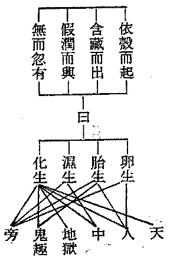



(人旁生具四，地狱及诸天；中有唯化生，鬼通胎化二。)



四马(阿含)



一、见鞭影即惊——喻比丘闻他聚落无常即惊。



二、触毛乃惊——如闻己聚落无常生厌。



三、触肉始惊——如闻己亲无常生厌。



四、彻骨方觉——如己身病苦生厌。



四海



一、六蛮——南。



二、七戎——西。



三、八狄——北。



四、九夷——东：一、玄搜。二、乐浪。三、高丽。四、满饰。五、凫叟。六、索当。七、东屠。八、倭人。九、夭部。



四法寳



一、经。



二、律。



三、论。



四、咒。



四种论



一、摩怛理迦此云本母——取出生义也。



二、奢萨怛啰此云议论——议详空有，论量假实。



三、邬波儞舍此云近说——略说经中要义，不次第故。



四、阿毗达磨此云对法——能对，所对论也。



四佛语(金刚)



　　┌真─┐　┌加不诳语  

　　│　　│　│  

　　├实─┤　│  

　　│　　├语┤  

　　├如─┤　│  

　　│　　│　│  

　　└不异┘　└显四语不诳



四法印



一、一切行无常。



二、一切行苦。



三、一切法无我。



四、涅槃寂灭。



四种意(摄论)



一、平等意。



二、别时意。



三、别义意。



四、众生乐欲意。



四种禅(楞伽)



一、愚夫所行禅——二乘外道观人无我性，自相共骨鏁无常、苦、不净相等。



二、观察义禅——人无我自共相，外道自他俱无性，已观法无我彼地相，义渐增进。



三、攀缘如禅——妄想二无我，妄想如实处，不生妄想。



四、如来禅——入如来地行，自觉圣智，三种乐住，成办众生不思议事。



四种禅(宗镜)



一、作异计忻上厌下而修，是外道禅。



二、信正因果，亦以忻厌而修，是凡夫禅。



三、了生空理证偏真道而修，是小乘禅。



四、达人法二空而修，是大乘禅。



四神足



一、集定断行具神足。



二、心定断行具神足。



三、精进定断行具神足。



四、我定断行具神足。



四住地



一、见一切住地。



二、欲爱住地。



三、色爱住地。



四、有爱住地。



四种门(四金)



一、文字门——大品四十二字。



二、观行门——释论三三昧等。



三、智慧门——法华其智慧门。



四、理门——大品无生无来无去。



四无畏(智论)



一、总持——一切智无畏。



二、知根——漏尽无畏。



或云



三、决疑——说障道无畏。



四、答报——说苦尽无畏。



四刼数



一、大刼。



二、母拏。



三、散地。



四、贤刼。



四圣种(俱舍)



一、圣所得衣治贪。



二、随所得食治贪。



三、随得卧具治贪。



四、乐修乐断治放逸。



四倒见(金刚)



一、我见——於五蕴中计我我所。



二、人见——妄计我生人中，转展取於餘趣。



三、众生见——妄计五蕴和合而生。



四、寿者见——妄计我受一期果报。



亦名四相。



四种人(十诵)



一、麤人。



二、浊人。



三、中间人。



四、上人。



(瓶沙王呼佛弟子为上人。外有胜行，内有智德，在人之上，故称上人。)



四种色



一、受色——受戒时得律仪。



二、止色——恶不善业止之。



三、用色——众僧受用檀越施物。



四、不用色——餘无用之色。



四食法



　　┌一者、上人大士，深山绝世，草菓资身。　　　　┌有烦恼。  

　　│　　　　　　　　　　　　　　　　　　　　　　│  

　　├二者、头陀乞食，能破四邪命。　　　　（净名）├离烦恼。  

　　│　　　　　　　　　　　　　　　　　　　　非─┤  

　　├三者、阿兰社处，檀越送食。　　　　　　　　　├入定意。  

　　│　　　　　　　　　　　　　　　　　　　　　　│  

　　└四者、於僧中结净食。　　　　　　　　　　　　└起定意。



四种食(什师)



一、抟食——盛作一器。



二、愿食——如见沙囊，命不绝也。



三、业食——如地狱无食而活。



四、识食——无色众生，色想相续。



四种龙(别行)



一、守天宫殿，持令不落。



二、兴云致雨，益人间者。



三、地龙，决江开渎者。



四、伏藏龙，守轮王大福人藏者。



四种阿含(妙玄)



　　┌增一──明人天因果┐　　　　┌知苦──断集  

　　│　　　　　　　　　│　　　　│  

　　├中──明真寂深义─┤　　　　│  

　　│　　　　　　　　　├通说无常┤  

　　├杂──明诸禅定──┤　　　　│  

　　│　　　　　　　　　│　　　　│  

　　└长──破外道───┘　　　　└证灭──修道



四齐月



　　　　　┌八日  

　　┌白月┤  

　　│　　└十五  

　　│  

　　│　　┌八日  

　　└黑月┤  

　　　　　└十四或十五



四谛智



一、苦谛智。



二、集谛智。



三、灭谛智。



四、道谛智。



四果断止八地七十二品思，四智已圆。



四种药(律抄)



一、时药——从旦至终，听服无罪。



二、非时——诸浆对病，内外开服限。



三、七日——从以日限，用疗深益。



四、尽形——势力既微，故听久服。



离四句(楞伽)



　　┌一异┐　　┌一异亦异亦不异，非异非不异  

　　│　　│　　│  

　　├有无┼四句┼有无亦有亦无，非有非无  

　　│　　│　　│  

　　└常等┘　　└常无常，亦常亦无常，非常非无常



俱即亦异亦不异，不俱即非异非不异；外道正坐此见，唯圣者能离此四句。



四转依



一、能转道——伏道——断道。



二、所转依——持种依——悟迷依。



三、所转舍——断舍——弃舍。



四、所转得——显得——生得。



麤四相(亦名一期四相)



一、生——夭寿不定——成。



二、老——色力衰损——住。



三、病——四大不调——坏。



四、死——识随业走——空。



细四相(亦名刹那四相)



一、生——资粮内因力。



二、住——菩萨善友力。



三、异——有四作意力。



四、灭——胜力资粮力。



四修多罗(月灯)



　　┌诸行┐　　　　┌是因缘生法───┐　┌藏┐  

　　│　　│　　　　│　　　　　　　　│　│　│  

　　├诃责┤（章安）├是体知过罪───┤　├通┤  

　　│　　├─私释─┤　　　　　　　　├即┤　├义  

　　├烦恼┤　　　　├无烦恼即无智慧─┤　├别┤  

　　│　　│　　　　│　　　　　　　　│　│　│  

　　└清净┘　　　　└举净任运有常乐我┘　└圆┘



断常四见(首楞)



一、断见——二无因论。



二、常见——四圆常论。



三、双亦——一分无常一分常。



四、双非——乃至死后俱非。



外道诸见。



四教四佛



一、藏——三十四心，正习俱尽，现丈六身，为三乘说谛缘度。



二、通——现带劣胜应身，树下一念相应，断餘残习。



三、别——单现尊特身，坐莲华台上受佛职。



四、圆——隐前三相，唯示不思议如虚空相，法华开前三佛即是圆佛。



四方四佛(光明)



一、东方香积世界阿閦佛。



二、南方欢喜世界宝相佛。



三、西方安乐世界无量寿佛。



四、北方莲华庄严世界微妙声佛。



四种记论(楞伽)



一、一向——随问而答。



二、反诘——反问而答。



三、分别——简辨而答。



四、止论——置而不答。



四教四依(藏教)



初依、小乘内凡——地前——五品六根。



二依、初果——初地至六地——十住。



三依、二、三果——七地——十行十向。



四依、四果——八地至十地——十地等觉。



通教则三教摄。



四种大教(长含)



一、从佛闻。



二、和合众闻。



三、多比丘闻。



四、一比丘闻。



但同有四，非即藏等一徃语耳，然教定体，与今不同。



此四在小乘中有名无义，在大乘中有义无名，今家藏通别圆备矣。



四教沙门(无裕)



一、藏——息界内恶。



二、通——息界内恶。



三、别——次第息内外恶。



四、圆——一心徧息内外恶。



四等名僧



一、等戒。



二、等见。



三、等智。



四、等众。



四种僧伽(大论)



一、有羞——不破戒身口清净，能别好丑，未得道果。



二、无羞——破戒身口不清净，无恶不作。



三、哑羊——虽不破戒，根钝无慧，不知轻重，二人共争，不能剖决，如羊被杀不声。



四、实僧——四果四向，学无学人。



四大弟子(法华)



一、须菩提——此云空生，又云妙生善吉。



二、迦旃延——此云文饰，善论议故。



三、摩诃迦叶——此云大龟氏，亦云饮光。



四、目犍连——此云赞诵，亦云采菽氏。



四种和尚(婆沙)



一、有法无衣食。



二、有衣食无法。



三、有法有衣食。



四、无法无衣食。



四种阿难(妙句光句)



一、欢喜——藏——贤。



二、贤——通——持。



三、典藏——别——海。



四、海——圆——海。



四种比丘(大经)



一、毕竟到道比丘——阿罗汉——无学果。



二、示道比丘——三果圣人——初二三果。



三、受道比丘——初果向——通内外凡。



四、污道比丘——凡夫破戒——犯四重者。



四种上座(律文)



一、僧坊上座——即律三纲上座。



二、僧上座——坛上或堂中首座。



三、别房上座——禅居诸寮首座。



四、住家上座——即计斋席上座。



四依对位(大经)



一、五品十信初。



二、住行向为二。



三、十地以为三。



四、等觉妙觉四。



以此四人并能化他，故以释於因人功用。



四姓出家(增一)



　　一、刹帝利──王种┐  

　　　　　　　　　　　│  

　　二、婆罗门──净行│  

　　　　　　　　　　　├同名释氏。  

　　三、吠　奢──啇估│  

　　　　　　　　　　　│  

　　四、首　陀──农田┘



晋道安法师云：「师莫过佛，宜称释氏。」后增一阿含经来云：「四姓出家，但言释子，无复本姓，故云：四河入海，同一醎味，四姓出家，同名释氏」云云。



四类出家(蕴足)



一、身出家心不出家——身叅法侣，心犹顾恋。



二、身在家心出家——妻子受用，不生躭染。



三、身心俱能出家——於诸欲境，心无顾恋。



四、身心俱不出家——妻子受用，深生躭染。



四种道品



　　　　　　　　　　　　　　　　　　　　　　　　┌四念┐　┌念处位  

　　　　　　　　　　　　　　　　　　　　　　　　│　　│　│  

　　　　　　　　　　　　　　　　　　　　　　　　├四勤┤　├煖位  

　　┌当分──多人所修，当分得道故。　　　　　　│　　│　│  

　　│　　　　　　　　　　　　　　　　　　　　　├四意┤　├顶位  

　　├相摄──法门相摄，各各能摄诸法门故。　　　│　　│　│  

　　│　　　　　　　　　　　　　　　　　　　　　├五根┼对┼忍位  

　　├对位──对当位次─────────────┤　　│　│  

　　│　　　　　　　　　　　　　　　　　　　　　├五力┤　├世第一  

　　└相生──三四二五、单七双八，次第相生不乱。│　　│　│  

　　　　　　　　　　　　　　　　　　　　　　　　├七觉┤　├二三果  

　　　　　　　　　　　　　　　　　　　　　　　　│　　│　│  

　　　　　　　　　　　　　　　　　　　　　　　　└八正┘　└初果



四品根源(法华)



一、方便。



二、诸法实相。



三、寿量。



四、如来知见。



名体宗用也，若以理言之：文文结妙名、句句具体等，岂但此四而已。



四种饶益(慈云)



一、示现相好，令观者发菩提心。



二、示现说法，令闻者开悟入道。



三、示现化事，令闻者获诸法门。



四、名流十方，令闻者系念得脱。



四法不坏(楞伽)



一、修行者正受——出世间。



二、金刚——世间。



三、佛舍利——出世间。



四、光音天宫殿——世间。



四月照世(域记)



四论主分照於四方。



一、东马鸣——其本即大光明佛，其因即八地内住菩萨。



二、南提婆——此云天，是龙树弟子，降伏外道，重兴佛法。



三、西龙猛——其母树下生之，以龙成其道，造三论，号无畏论师。



四、北童寿——梵云鸠摩罗逻多，此云童受。



四释消经(文句)



一、因缘。



二、约教。



三、本迹。



四、观心。



四品学法(学法)



一、上品——备戒行多闻，能化度人。



二、中品——真学成学法。



三、下品——依福学。



四、外品——行三事，号散侍。



四法不断(净名)



一、正念。



二、正定。



三、总持。



四、辩才。



(此四法是大士之要用，故恒不断。)



四有为相(金刚)



一、自性相——此见相二识为体，生死根本，故星喻见，翳喻相等。



二、著所住味相——器世间六尘境界，种种差别，幻境无实。



三、随顺过失相——随顺身受，即过失，如露电等喻。



四、随顺出离相——顺人法二空真智，出二种生死。



四阶成道



一、初阿僧祇。



二、二阿僧祇。



三、三阿僧祇。



四、百刼种相好。



四不可得(无行)



一、观身——毕竟无。



二、观受——内外空。



三、观心——无所有。



四、观法——但有名。



四解脱味(净名什注)



一、出家离五欲。



二、行禅离愦乱。



三、智慧离妄想。



四、涅槃离生死。



四种行愿



一、礼忏门——礼佛忏悔，净除业障，身心皎洁，如净良田。



二、十念门——执持圣号，立愿要期，植徃生因，如下种子。



三、系缘门——爱护长养，滋发芽茎，如注以膏雨。



四、众福门——助成繁茂，使速成花果，如灌以肥腻。



四师数息(禅门)



一、师数出息，不急不胀，身则轻利，易入三昧。



二、师数入息，随息内敛。



三、师出入无在，但取所便。



四、师依四时用数。



(今家正依三师，又不许出入俱数，恐生病故。)



四德种子(摄论)



一、信乐大乘是大净种子。



二、般若波罗蜜是大我种子。



三、虚空品三昧是大乐种子。



四、大悲是大常种子。



四大本空(空品)



　　┌地无坚性  

　　│　　　　　请  

　　├水性不住  

　　│　　　　　观  

　　├风性无碍  

　　│　　　　　音  

　　└火假缘生



四句立法(妙记)



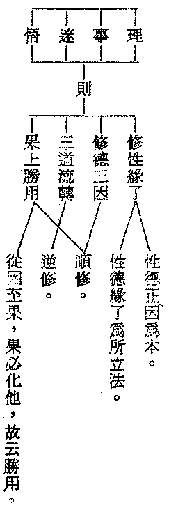



(四重不出事理三千，各有本法，修有逆顺，因必剋果故，有四重立法。)



四句推欲



一、为从根生——未对尘时，心应自起。



二、为从尘生——尘既是他，於我何预。



三、为从共生——若共生者，应起两心。



四、离生——若无因生，无因不可。



四第一偈(庄严论偈)



一、无病第一利。



二、知足第一富。



三、善友第一亲。



四、涅槃第一乐。



四种建立



一、非有相建立。



二、非有见建立。



三、非有因建立。



四、非有性建立。



四种平等(楞伽)



一、相非相平等。



二、因果平等。



三、我无我平等。



四、人与所修法平等。



四事受记(净名生注)



一、以人为主。



二、以体如为本。



三、在无量生。



四、在一生中得。



四施果用(弥勒问论)



一、有果无用——有至心施，虽得果报，不得受用。



二、有用无果——自不能施见他施，起随喜心，虽得受用，而自无果。



三、有果有用——至心施不轻施，得果复得受用。



四、无果无用——布施已，因即灭尽，或为出世圣道障故，犹如远离烦恼圣人。



四事自侵(四自)



一、夙夜不学。



二、老不止淫。



三、得财不施。



四、不受佛语。



(四者出心，还自苦身)



四种重恩(正法)



一、母生身故须报。



二、父生身故须报。



三、如来大师。



四、说法师。



(若能供养此四人，得无量福，未来得佛道。)



四种情执(指归)



一、有佛执。



二、无佛执。



三、亦有亦无执。



四、非有非无执。



(随执一种，即邪见也，若於四种融通无碍，皆成三昧。)



四种观世(大论)



一、观时——人寿百岁，佛出时到。



二、观土地诸国——佛常於中国生。



三、观种姓——佛在刹利、净行二种生。



四、观生处——何等母人，能怀菩萨。



四种四谛(湼槃、胜曼)



一、生灭——藏——有作四谛。



二、无生——通——有量四谛。



三、无量——别——无作四谛。



四、无作——圆——无量四谛。



四教对谛



一、藏——苦。



二、通——集。



三、别——灭。



四、圆——道。



四教对位



一、藏——声闻。



二、通——支佛。



三、别——菩萨。



四、圆——佛。



四教对谛(竖诠)



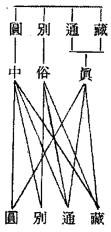



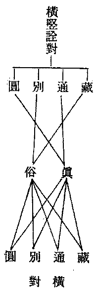



四教用观



一、藏用析空观。



二、通用体空观。



三、别用次第三观。



四、圆用一心三观。



四谛初门



　　┌藏┬声闻─苦┐  

　　│　│　　　　│  

　　│　├支佛─集│  

　　│　│　　　　├谛为初门─界内  

　　│　└菩萨─道│  

　　│　　　　　　│  

　　├通─菩萨─灭┤  

　　│　　　　　　│  

　　├别─菩萨─道┤  

　　│　　　　　　├谛为初门─界外  

　　└圆─菩萨─灭┘



四教修观



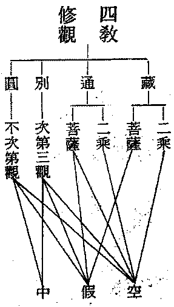



四教对观



　　┌藏┐　　　┌见思  

　　│　├空┐　│  

　　├通┘　│　│  

　　│　　　├破┼尘沙  

　　├别─假┤　│  

　　│　　　│　│  

　　└圆─中┘　└无明



四教对身



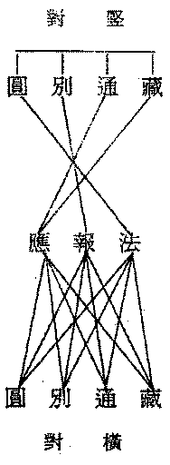



四教对土



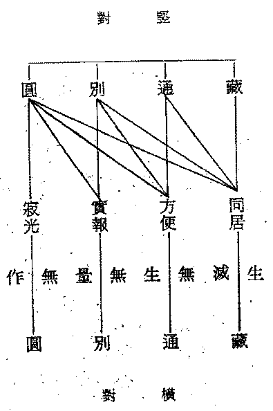



四教四句



　　┌藏──因缘所生法┐  

　　│　　　　　　　　│  

　　├通──我说即是空┤  

　　│　　　　　　　　├三观（中论）  

　　├别──亦名为假名┤  

　　│　　　　　　　　│  

　　└圆──亦名中道义┘



四教造法



　　　　　　　┌地狱┐  

　　　　　　　│　　│  

　　　　　　　├饿鬼┤  

　　　　　　　│　　│  

　　　　　　　├畜生┤  

　　┌藏通造六┤　　├六凡  

　　│　　　　├修罗┤  

　　│　　　　│　　│  

　　│　　　　├人道┤  

　　│　　　　│　　│  

　　│　　　　└天道┘  

　　│  

　　│　　　　┌声闻┐  

　　│　　　　│　　│  

　　│　　　　├缘觉┤  

　　└别圆造四┤　　├四圣  

　　　　　　　├菩萨┤  

　　　　　　　│　　│  

　　　　　　　└佛界┘



佛学名相汇解　卷第二十三（终）



四种教证



　　　　　　　　┌教─住行向──地相──道观双流地相现前───三十心  

　　　　　┌约行┤  

　　　　　│　　└证─登──地─地实──登地已去初地即初住──登地  

　　　　　│  

　　┌古师┤　　　　┌信住行向─┐  

　　│　　│　　┌教┤　　　　　├教门方便─辅行云始终属教──一教始终  

　　│　　│　　│　└地等妙──┘  

　　│　　└约说┤  

　　│　　　　　└证─十地────是妙觉已证十地之法即证道┐  

　　│　　　　　　　　　　　　　　　　　　　　　　　　　　├─十地已证  

　　│　　　　　┌教─地前三十心─说所证法十地自证权门自开┘  

　　│　　┌约行┤  

　　│　　│　　└证─登地一位──初地即初住不可谓之两涉  

　　└泽山┤  

　　　　　│　　┌教─十地始终──为地前人说十地始终  

　　　　　└约说┤  

　　　　　　　　└证─妙──觉──辅行云断十二品无明称为妙觉



四熏习义(起信)



　　　　　　　　　　　　　　┌自体相─┐  

　　┌一、净法名为真如二──┤　　　　│  

　　│　　　　　　　　　　　└用───┤  

　　│　　　　　　　　　　　　　　　　│  

　　│　　　　　　　　　　　┌根──本┤  

　　├二、一切染因名为无明二┤　　　　│  

　　│　　　　　　　　　　　└所起见爱┤  

　　│　　　　　　　　　　　　　　　　├熏习。  

　　│　　　　　　　　　　　┌业识根本┤  

　　├三、妄心名为业识二──┤　　　　│  

　　│　　　　　　　　　　　└分别事识┤  

　　│　　　　　　　　　　　　　　　　│  

　　│　　　　　　　　　　　┌增长念─┤  

　　└四、妄境界即六尘二──┤　　　　│  

　　　　　　　　　　　　　　└增长取─┘



四人观世(法华楞严)



一、凡夫观三界乐——欢喜游戏，不觉不知。



二、二乘观三界苦——三界无安，犹如火宅。



三、菩萨观三界空——见缘想相，犹如空花。



四、诸佛观三界唯心——世间诸物，皆妙明心。



四种远到(法界)



一、飞行。



二、此没彼出。



三、移远令近不徃而到。



四、一念徧到十方。



四本止观(天台)



一、圆顿止观——在荆州玉泉寺说，章安说为十卷，摩诃止观是。



二、渐次止观——在瓦官寺说，章安治为十卷，即禅波罗蜜是。



三、不定止观——陈尚书令毛喜请说一卷，六妙门是。



四、小止观——为兄陈针，出修习止观坐禅法要是。



四空所依(首楞)



一、厌色依空——空处。



二、厌空依色——识处。



三、空识灭依识性——无所有。



四、依识性灭穷研不得真性——非非想。



四业天报(三界差别)



一、过色想入空处定。



二、过空处定入识处定。



三、过识处定入无所有处定。



四、过无所有定入非非想定。



四方大将(光明)



一、北方散脂。



二、东方乐欲。



三、南方檀帝。



四、西方善现。



(此四大将各有五百眷属，统领二十八部护持佛法。)



四种世人(阿含佛说)



一、从冥入冥——冥处下贱，复作众恶，还入於冥。



二、从冥入明——身生卑下，身口意善，入明生天。



三、从明入冥——富乐聪明，身口意恶，死入恶趣。



四、从明入明——生富乐家，三业行善，命终生天。



四事地动(李论)



一、大众得道。



二、智人出现。



三、世间灾变。



四、得道欢喜。



四缘堕龙



一、多布施。



二、嗔恚。



三、轻伤人。



四、自贡高。



四缘生识(楞伽)



一、息现摄受不觉。



二、无始虚妄习气。



三、计著识性自性。



四、欲见种种色相。



(水流处藏识转识浪生，如眼识随次境界生亦如是。)



四人出世



一、先丑后妙——谓生处卑陋而作善，死得生天。



二、先妙后丑——谓生处尊荣作不善，死入恶道。



三、先后俱丑——谓生处无福复作恶，死入恶道。



四、先后俱妙——谓生处有福，有能积善，死得生天。



四事可化(大乘)



一、根。



二、心。



三、心所。



四、业果。



(小乘有可不可。)



地论四家



一、般若——别。



二、谛——圆。



三、舍烦恼——通。



四、苦清净——藏。



四种圣塔



一、佛塔十三层，七宝庄严，上有相轮。



二、支佛十一层皆七宝饰。



三、罗汉四层皆七宝饰。



四、轮王无层级亦七宝成。



四颠倒性(楞严)



　　┌变恒生灭增减有无　　　　有无分出┬┐  

　　│　　　　　　　　　　　　┌───┘│  

　　├除无之餘无所言说　　　　│二　　　│  

　　│　　　　　　　　　　　　│　　单计├不死矫乱徧计虚论  

　　├除是之餘无所言说　　　　│三　　　│  

　　│　　　　　　　　　　　　│　　　　│  

　　└亦有即亦无亦无不是亦有　└四　双亦┘



四颠倒见(首楞)



　　┌初观人我及一切众生─正报┐　　　　┌常─┐　　┌一分常论  

　　│　　　　　　　　　　　　├对　　佗┤　　│　　│  

　　├次观国土刼坏不坏──依报┘　　　　└无常┤　　│  

　　│　　　　　　　　　　　　　　　　　　　　├外道┤  

　　├三观我身及心──────┐　　　　┌常─┤　　│  

　　│　　　　　　　　　　　　├约自色心┤　　│　　│  

　　└四计阴等为常灭尽无常──┘　　　　└无常┘　　└一分无常



四种疑问(楞严)



一、疑问物我见障。



二、疑问广狭见障。



三、疑问是非见障。



四、疑问断常见障。



四大不调(光明)



一、窭鲁——地增令身沉重——沉重。



二、爕跛——水积涕涶乖常——痰疴。



三、毕哆——火盛头胸壮热——热重。



四、婆哆——风动气息冲击——气发。



四种常住(律钞)



一、常住常住——众僧府库寺舍众具花果树林田园仆畜，但得受用，不通分卖，故重言之。



二、十方常住——僧家供僧常食体通十方唯局本处。



三、现前现前——僧得施物唯施此处现前僧故。



四、十方现前——如亡五众轻物也，若未羯磨从十方僧得罪，若已羯磨望见前僧得罪。



(已上二种名四方僧物，后二种名现前僧物。)



四分律



一、初分说比丘戒。



二、二分说比丘尼并受戒犍度。



三、三分说安居犍度。



四、四分说房舍犍度等。



四药支身(事钞)



一、时药——五种正食𪎊饭等。



二、非时——豆麦等汁得饮。



三、七日——酥油食蜜等。



四、尽形——胡椒荜茇呵梨等。



四大造色(楞伽)



　　　　　　　大种为能造  

　　┌津润┐　　　　　　　┌水┐  

　　│　　│　四大为所造　│　│  

　　├堪能┤　　　　　　　├火┤  

　　│　　├妄想大种生内外┤　├界  

　　├飘动┤　　　　　　　├风┤  

　　│　　│　正报为内　　│　│  

　　└断截┘　　　　　　　└地┘  

　　　　　　　依报为外



四洲地狱



一、东洲有边无正。



二、西洲有边无正。



三、南洲有正有边。



四、北洲边正俱无。



(正狱在地下二万由旬，旁者在地上铁围山间，三洲人造罪皆来南洲正狱，及东西南洲边狱中，受其苦报。)



佛应四处



一、降生迦维卫。



二、成道摩竭提。



三、说法波罗奈。



四、入灭拘尸那。



四徧常论(首楞)



　　┌穷心境性二处无因┐　　　　　　┌─二万刼中─┐  

　　│　　　　　　　　│　　　　　　│　　　　　　│  

　　├穷四大元四性常住┼─修习能知─┼─四万刼中─┼众生  

　　│　　　　　　　　│　　　　　　│　　　　　　│  

　　├穷尽六根恒常──┘　　　　　　└─八万刼中─┘  

　　│  

　　├既尽想元生理更无流止运转生灭　┌生灭循环不失┐  

　　│　　　　　　　　　　　　　　　│　　　　　　│  

　　└想心今已永灭理中自然成不生灭─┼生灭体恒不散┼外道常见  

　　　　　　　　　　　　　　　　　　│　　　　　　│  

　　　　　　　　　　　　　　　　　　└循环本来常住┘



经训四义(名义)



一、常则道轨百王。



二、法乃德模万乘。



三、摄谓集斯妙义。



四、贯之御彼庸生。



法华四字



一、开佛知见，住。



二、示佛知见，行。



三、悟佛知见，向。



四、入佛知见，地。



普贤四一



一、自在是理，一常。



二、神通是行，一乐。



三、威德是人，一我。



四、名闻是教，一净。



四有边论(首楞)



一、过未为有现生相续为无——自外道所计。



二、无闻见名无众生处名有——他外道所计。



三、彼见我知中我不知彼知性计彼性有边——自他外道所计。



四、一切众生半生半灭，世界半有边半无边——重计他依止外道所计。



涅槃四德



一、无二生死——常——不迁不变。



二、不受二边——乐——离二死苦。



三、具八自在——我——得大自在。



四、三业清净——净——三惑净尽。



四法驭马(湼槃)



一、毛说触毛，喻生令受佛语而受出离。



二、皮说触毛皮，喻生老令受佛语而受出离。



三、肉说触毛皮肉，喻生老病令受佛语而受出离。



四、骨说触毛皮肉骨，喻生老病死令受佛语而受出离。



楞伽四法



一、五法。



二、三自性。



三、八识。



四、二无我。



如诸数下开此略。



瑜伽四法



一、乘。



二、境。



三、行。



四、果。



瑜伽此云相应，谓与一切乘境行果相应。



涅槃四法



一、近善知识。



二、听闻正法。



三、思惟其义。



四、如说修行。



(具此四法乃名丈夫)



华严四科



一、信——初一会名举果劝乐生信分，从妙严止遮那品。



二、解——次六会名修因契果生解分，从名号止出现品。



三、行——第八会名托法进修成行分，离世间品。



四、证——第九会名依人证入成德分，入法界品。



尸罗四义(资粮)



一、清凉义——离心热恼故。



二、安隐义——能为他世乐因故。



三、安静义——能建立止观故。



四、寂灭义——得涅槃乐因故。



呪具四悉



一、世界悉檀——呪是鬼神王名，称王名则部落敬主，不敢为非，是世界义。



二、为人悉檀——呪如军中密号，相应无所呵问，不相应即执治，是为人义。



三、对治悉檀——如贱人奔他国诈称王子，因以公主妻之，多嗔。人从国来，以法止嗔，对治也。



四、第一义悉檀——诸佛密语，唯圣乃知，如王索先陀婆一名具四实，群下莫晓第一义也。



毗尼四义(婆多)



一、是佛法中平地，万善由之而生。



二、一切佛弟子皆依戒住，一切众生依戒而有。



三、是趣涅槃之初门。



四、乃佛法璎珞，能庄严佛法故。



摄心四戒(首楞)



一、先断心淫——心有少爱，即为欲本。



二、次断心杀——心嗔为杀，故入神道。



三、三断心偷——诈匿为邪，贪而不舍。



四、四断妄语——自言得圣人法，名妄。



救脱四愿(七佛)



一、心如大地，发生万物。



二、心如桥船，度人无厌。



三、心如大海，容内众流。



四、身如虚空，包容万物。



菩萨四轮(成论)



一、生中国轮，摧三途北洲长寿天难。



二、修正愿轮，摧世智辩聪难。



三、植善轮，摧盲聋瘖痖难。



四、近善人轮，摧佛前佛后难。



(欲摧八难当习四轮)



舍戒四缘(婆沙)



一、舍所学——即舍戒。



二、二形生——男变女女变男。



三、断善根——受恶戒邪见。



四、舍众同分——身死。



比丘四法(观佛三昧)



一、昼夜六时说罪忏悔。



二、常忆念佛不诳众生。



三、修六和敬心不恚慢。



四、具修六念如救头然。



又四法(超日明经)



一、常念如来立佛形像。



二、闻经深义即信奉行。



三、虽不见佛晓了本元。



四、知十方佛则一法身。



罗汉四名



一、无学——无法可学。



二、无生——怖魔受称。



三、杀贼——破恶得名。



四、应供——乞士成德。



初果四名



一、预流——预入圣流。



二、入流——而无所入。



三、逆流——逆生死流。



四、抵债——不受业债。



法师四法(十住婆沙)



一、广博多闻，能持一切言辞章句。



二、决定善知世、出世间诸法生灭之相。



三、得禅定智，於诸经法随顺无诤。



四、不增不损，如所说行。



比丘四法(净名肇注)



一、净乞食。



二、破烦恼。



三、净持戒。



四、能怖魔。



(天竺一名，该此四义，秦无以译，故存义名。)



天台四教



　　　　┌正化二乘┐  

　　┌藏┤　　　　│  

　　│　└旁化菩萨┤  

　　│　　　　　　├┐  

　　│　┌正化菩萨┤│┌空┐　┌见思┐　┌真┐　┌般若  

　　├通┤　　　　│├┤　│　│　　│　│　│　│  

　　│　└旁化二乘┘│└假┼破┼尘沙┼显┼俗┼证┼解脱  

　　│　　　　　　　│　　│　│　　│　│　│　│  

　　├别─独菩萨法─┘　　│　└无明┘　└中┘　└法身  

　　│　　　　　　　　　　│  

　　└圆─佛　　法───中┘



八种四教



　　一、渐中开四──如破清凉不识教体之妨，谓法华是渐圆，华严是顿。  

　　二、方等中四──四教并谈曰方，四机普被曰等。  

　　　　　　　　　┌十信　　┌生灭──藏  

　　　　　　　　　│　　　　│  

　　　　　　　　　├十住　　├无生──通  

　　三、别教竖入四┤　　　修┤  

　　　　　　　　　├十行　　├无量──别  

　　　　　　　　　│　　　　│  

　　　　　　　　　└十向　　└无作──圆  

　　四、十行横学四─别教十行化他心切，横出四四一十六门。  

　　　　　　　　　┌生生────不可说藏。  

　　　　　　　　　│  

　　　　　　　　　├生不生───不可说通。  

　　五、涅槃追泯四┤  

　　　　　　　　　├不生生───不可说别。  

　　　　　　　　　│  

　　　　　　　　　└不生不生亦─不可说圆。  

　　六、涅槃追说四─有因缘故亦可得说四句如前，但义同施权，却更分别前四教也。  

　　七、法华施出四─从法华实理施四时三教权理明无量义，从一清净道施出二三四。  

　　八、法华开显四─开四时三教归今法华，救多归一也。



圆名四释



一、妙——三谛圆融，不可思议。



二、满——三一相即，无有缺灭。



三、足——圆见事理，一念具足。



四、顿——体非渐成，故名圆顿。



诸法四句



　　┌一　　　　　┌唯染　　┌常　　　┌通　　┌通　　　┌唯依  

　　│　　　　　　│　　　　│　　　　│　　　│　　　　│  

　一├异　　　　染├唯净　常├无常　通├局　有├无　　大├唯正  

　　┤　　　　　　┤　　　　┤　　　　┤　　　┤　　　　┤  

　异├亦一亦异　净├或俱　等├双亦　局├俱　无├双亦　疏├俱  

　　│　　　　　　│　　　　│　　　　│　　　│　　　　│  

　　└非一非异　　└或泯　　└双非　　└泯　　└双非　　└泯



权实四句



一、一切法皆权——如是性相等。



二、一切法皆实——诸法从本来云云。



三、一切法亦权亦实——所谓诸法实相。



四、一切法非权非实——非如非异非实非虚。



无生四句(中论)



一、不自生——诸法不自生。



二、不从他生——亦不从他生。



三、不共生——不共不无因。



四、不无因生——是故说无生。



(破四性执计以明无生)



观法四句(法华三昧)



一、为因心故心。



二、为不因心故心。



三、为亦因心亦不因心故心。



四、为非因心非不因心故心。



无量四句



一、实有量而言无量——弥陀是。



二、实无量而言量——光明是。



三、实无量而言无量——涅槃——唯佛与佛其寿无量是。



四、实有量而言量——八十唱灭是。



麤妙四句(妙玄)



一、能通粗所通亦粗。



二、能通妙所通粗。



三、能通粗所通妙。



四、能通妙所通亦妙。



境观四句(中论)



一、因缘所生法——所观之境，生生不可说。



二、我说即是空——能观三观，生不生不可说。



三、亦名为假名——能观三观，不生生不可说。



四、亦名中道义——能观三观，不生不生亦不可说。



色空四句(心经)



一、色不异空。



二、空不异色。



三、色即是空。



四、空即是色。



(受想行识例此可知)



广略四句(心经)



一、文广义略。



二、文略义广。



三、文广义广。



四、文略义略。



忍具四乐(金刚忍仙)



一、忍辱故乐。



二、寂灭故乐。



三、愍他故乐。



四、自利故乐。



头陀四食(律钞)



一、乞食。



二、不作餘食法。



三、坐食。



四、抟食——一器盛也。



头陀四位(律钞)



一、衣——衲衣三衣二种。



二、食——乞食一座等。



三、处——兰若冢间树下等。



四、常坐——此无次第。



羯磨四法



一、法。



二、事。



三、人。



四、界。



禅有四类



一、有漏——四禅定。



二、无漏——九想八背等。



三、亦有亦无——六妙通明等。



四、非有非无——首楞中道理定。



金喻四德(真谛)



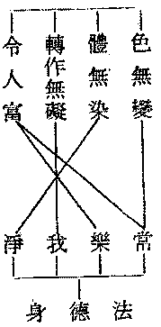



转经四义(妙句)



一、看文曰读。



二、不忘为诵。



三、信心故受。



四、念力故持。



觉体四义(起信)



一、如实空镜——远离一切心境界相，无法可现，非觉照义故。



二、因熏习镜——如实不空，一切世境於中现常住一心，即真实性故。



三、法出离镜——不空法出烦恼碍智碍，离和合淳净明故。



四、缘熏习镜——依法出离故，照众生心、令修习善根故。



圆教四门



一、空门——一空一切空——开佛知见。



二、有门——一有一切有——示佛知见。



三、亦空亦有——一切亦空亦有——悟佛知见。



四、非空非有——一切非空非有——入佛知见。



文句四释(法华)



　　　　　　┌住─────开。  

　　　　　　│  

　　　　　　├行─────示。  

　　一、约位┤  

　　　　　　├向─────悟。  

　　　　　　│  

　　　　　　└地─────入。  

　　　　　　┌空─────开。  

　　　　　　│  

　　　　　　├有─────示。  

　　二、约门┤  

　　　　　　├两亦────悟。  

　　　　　　│  

　　　　　　└双非────入。  

　　　　　　┌道慧─┐　┌开。  

　　　　　　│　　　│　│  

　　　　　　├道种─┤　├示。  

　　三、约智┤　　　├智┤  

　　　　　　├一切─┤　├悟。  

　　　　　　│　　　│　│  

　　　　　　└一切种┘　└入。  

　　　　　　┌三谛之理不可思议，名开。  

　　　　　　│  

　　　　　　├三谛之理宛然不滥，名示。  

　　四、约观┤  

　　　　　　├三一一三相即，名悟。  

　　　　　　│  

　　　　　　└三谛俱亡，三谛俱照，名入。



(位门、智门，皆以开示悟入四字对释)



根本四禅



　　┌世间根本味禅──┐　　　　　　　　　　　　　　　　　　烧灭骨人  

　　│　　　　　　　　│  

　　├世出世根本净禅┐│　　　　　　　　　　　　　　　　　　急取无学  

　　│┌──────┘│┌一、九想┐  

　　││┌──────┘│　　　　│  

　　│││┌初四禅　　　├二、八念┼观─得解之观治重烦恼──坏法  

　　││││　　　　　　│　　　　│  

　　││└┼三四无量心　├三、十相┘  

　　││　│　　　　　　│  

　　││　└三四无色定　├四、八背舍─┐  

　　││┌初六妙门　　　│　　　　　　│  

　　│││　　　　　　┌┼五、八胜处─┼──观─发无漏智  

　　│└┼二十六特胜　││　　　　　　│　　　　断三界惑┐  

　　│　│　　　　　　│├六、十一切处┘　　　　　　　　│  

　　│　└三通明观　　││　　　　　　　　　　　　　　　│  

　　│　　　　　　　　│├七、九次第定───练─修练观禅│┌来生骨相  

　　│　┌九种大禅　　││　　　　　　　　　　　令纯熟故┼┤  

　　│　└─────┐││　　　　　　　　　　　　　　　│└不坏法  

　　├─出世间无漏禅├┘├八、师子奋迅三昧─熏─熏诸观禅│  

　　│　　　　　　　│　│　　　　　　　　　　　令通利故┤  

　　└─出世间上上禅┘　│　　　　　　　　　　　　　　　│  

　　　　　　　　　　　　└九、超越三昧───修─此具修一┘  

　　　　　　　　　　　　　　　　　　　　　　　　切法门　　　八色流光



授记四意(法华)



一、昔未记二乘而今须记。



二、中下未悟，以记勉之。



三、令闻者结缘。



四、满其本愿，故与之记。



四华表位(法华)



一、曼陀罗华，此云小白，表习种性——十住——开佛之知见。



二、摩诃曼陀罗，此云大白，表性种性——十行——示佛之知见。



三、曼殊沙华，此云小赤，表道种性——十向——悟佛之知见。



四、摩诃曼殊沙，此云大赤，表圣种性——十地——入佛之知见。



内凡四位



一、煖，亦名四加行、四善根。



二、顶，亦名四加行、四善根。



三、忍，亦名四加行、四善根。



四、世第一，亦名四加行、四善根。



息缘四意(二十五方便)



一、治生——不作有为事业。



二、世缘——断绝人事往来。



三、工巧技艺——不作工匠呪筭等。



四、学问——不读诵听学等。



净名四意



　　一、弹偏──菩萨品。  

　　　　　　　　　　　┌通┐  

　　　　　　　　　　　│　│  

　　　　　　　　　　　├别┼诃目连。  

　　二、折小──弟子品┤　│  

　　　　　　　　　　　├圆┘  

　　　　　　　　　　　│  

　　　　　　　　　　　└圆─诃身子。  

　　三、叹大──观众生品。  

　　四、褒圆──叹文殊及居士。



圣人四倒



一、常为无常。



二、乐为苦。



三、我为无我。



四、净为不净。



散脂四密(光明)



一、名密。



二、行密。



三、智密。



四、理密。



寿量四喻(光明)



一、山斤。



二、海滴。



三、地尘。



四、空界。



(四佛降信相室，举此四喻皆有穷尽，而佛寿无量。天台云：若从信相疑，应言有量；若四佛释疑应言无量。)



法入四类



一、无表色——色。



二、心所法——心。



三、不相应行——非色非心。



四、三无为——非三聚摄。



总别四句(念处)



一、境别观别——别相念处。



二、境别观总——总相方便。



三、境总观别——总相方便。



四、境观俱总——总相念处。



凡夫四倒



一、身起净倒。



二、受起乐倒。



三、心起常倒。



四、法起我倒。



内法四相



一、生。



二、住。



三、异。



四、灭。



先非有暂有用非疑然后是无。



(亦名刹那四相。)



名体四句(详解)



一、名转体不转，三道即三德，生死即涅槃。



二、体转名不转，转生死五阴为法性五阴。



三、名体俱不转，十二因缘非佛、天、人、修罗所作，本自有之。



四、名体俱转，无明复为法性明。



生空四相



一、无我相——我是自在之名。



二、无人相——人为主宰之目。



三、无众生相——众生取续前义。



四、无寿者相——寿者取接后名。



(四为人执，故须空之。)



真妄四义



一、唯真心——唯一心名真如——起信。



二、唯妄心——种种识浪翻腾转生——楞伽。



三、从真起妄——如来藏是善不善因——楞伽。



四、指妄即真——烦恼是如来种——净名。



八识四义



一、实。



二、常。



三、徧。



四、无杂。



故名真异熟识。



空有四种(光明)



一、灭色入空——藏。



二、即色是空——通。



三、灭边入空——别。



四、即边是空——圆。



求法四想(华严)



一、应於自身生病苦想。



二、应於善知识生医王想。



三、应於所说法生良药想。



四、应於所修行生除病想。



量果四义



一、现量——前五识与第八识，见闻虽是现量，以外缘故，即非量果。



二、内缘——七识虽是内缘，亦非量果。



三、不变影——果中后得现分，虽是现量内缘，时变影缘故非量果。



四、是心体——四义具足方为量果。



种相四义



一、种相处——须於南洲佛出世时，以男子身缘佛身种，餘不得种。



二、种相业——以意二三餘五一，不能令别故。



三、种相初——相因缘和合时便。



四、种相福——一切人破正见，一人能正见，如是等为一福，百一切一相。



降伏四魔



一、得无生忍，烦恼永断，故降欲魔。



二、得法身则更不得身，故降身魔。



三、无此身则无诸苦恼，故降死魔。



四、无三魔则波旬不得便，故降天魔。



现相四义(石磵)



一、欢喜发心——辅行云：为见色生喜。



二、免苦得乐——法次云：随有应见，得大免苦。



三、见相息恶——辅行云：身非一者，三恶心息。



四、成就佛乘——如止九见相，发心具明。



释相四义(石磵)



一、相体——即所证之理。



二、相业——乃能修之因。



三、相果——即所现之相。



四、相用——是利他之德。



法离四执(净土指归)



　　一、果有乎？──┐  

　　　　　　　　　　│  

　　二、果无乎？　　│  

　　　　　　　　　　├─曰皆非也。  

　　三、亦有亦无乎？│  

　　　　　　　　　　│  

　　四、非有非无乎？┘



恒河四义



一者、人多识之。



二者、入得福。



三、入河中大。



四、是佛生处。



(佛说法，多以为喻，亦四悉义也。)



天台四土



　　┌常寂光──┬法身所居法性土┐  

　　│　　　　　│　　　　　　　│  

　　├实报土─┐└自报身居自受用│  

　　│　　　　│　　　　　　　　├贤首四土。  

　　├方便土┐└─他报身居他受用│  

　　│　　　│　　　　　　　　　│  

　　└同居土┴──变化身居变化土┘



双树四喻(湼槃)



一、东方双喻常无常。



二、南方双喻乐无乐。



三、西方双喻我无我。



四、北方双喻净不净。



迦耶四名



一、迦耶，此云积聚。



二、设利罗，此云积聚。



三、弟诃，此云积聚。



四、应伽，此云积聚。



瑜伽云：「周徧积聚故名为身，是积聚义，及依止义，亦名支分。」楞严云：「身如鼓颡。」安般云：「骨肉为身。」



人有四相(长含)



一、生——五阴兴起，已得命根。



二、老——生寿向尽，餘命无几。



三、病——众痛迫切，存亡无期。



四、死——风先火次，诸根散坏。



唱导四宜(僧传)



一、声——非声无以警众。



二、辨——非辨无以适时。



三、才——非才则言无可采。



四、愽──非愽则语无依据。



四种亿



一、十万为亿，则大千有万亿日月。



二、百万为亿，则大千有千亿日月。



三、千万为亿，则大千有百亿日月。



四、万万为亿，则大千有十亿日月。



光明经：百亿日月等，正用第三数也。



舍离四法(宝积)



一、利养。



二、恶友。



三、恶众。



四、同住多戏笑嗔斗等。



迦叶云：有此四法，急走舍离百由旬外。



弃舍四法



一、有漏善。



二、异熟无记。



三、劣无漏。



四、变易生死。



众生四病



一、增增——低下人也，若与说法更起谤，如善星调达等。



二、增损——如尸利掬多。



三、损增——四禅比丘，临终见生处，谤无涅槃，即堕地狱，退法人亦然。



四、损损——身子等得道之人。



治病四种(维疏)



一、增增——从初服药，增而不损，终无差理。



二、增损——疾虽困笃，方治即愈。



三、损增——或有服药，初虽渐损，而后更增。



四、损损——从初渐损，乃至平复。



无色四苦



一、如疮——空处。



二、如痈——识处。



三、如病——无所有处。



四、如箭入体——非非想处。



法偃四绝(僧传)



一、克。



二、义。



三、诗。



四、书。



自然四德(金七十论)



一、法。



二、慧。



三、离欲。



四、自在。



迦毗罗仙人从空而生，自然有此四德。



跪有四名



一、胡跪——胡人敬相，存其本缘，葱岭以东名胡，西曰梵。



二、互跪——左右两膝交互跪地，三处翘耸。



三、翘跪——翘举一足，身则危也。



四、长跪——两膝据地，以足支身，尼女体弱，佛听长跪。



普贤四悉(法华)



一、见身欢喜——世界悉檀。



二、精进得法——为人悉檀。



三、无人能坏——对治悉檀。



四、具普贤道——第一义悉檀。



忏法四义(光句)



一、释忏悔名。



二、示忏悔处。



三、辩忏悔法。



四、明忏悔位。



乞食四意(肇师)



一、福利群生。



二、折伏憍慢。



三、知身有苦。



四、除去滞着。



天位四端(天传)



　　　　┌主──梵释四王君主号令之权。  

　　一、┤  

　　　　└客──功德寄北天大辩居山泽。  

　　　　┌男──梵释四王是男。  

　　二、┤  

　　　　└女──功德辩才是女。  

　　　　┌本──密迹眷属皆大菩萨本也。  

　　三、┤  

　　　　└迹──现居神像护法是迹也。  

　　　　┌显──功德大辩处客示女能扬佛法为显。  

　　四、┤  

　　　　└晦──餘虽影响而言行不扬是晦。



能熏四义



一、有生灭义。



二、有增减义。



三、有胜用义。



四、与和合同义。



所熏四义



一、坚住义。



二、无记义。



三、可熏义。



四、与能和合义。



锡杖四名



一、声杖，声锡锡声。



二、锡杖，声锡锡声。



三、智杖，彰智行功德。



四、德杖，彰智行功德。



修行四法



一、宁失身命不舍菩提心。



二、亲近善友。



三、不舍忍辱。



四、依寂静处。



朱陵四择(南岳)



一、道俗劝讲——初似好心，后即忿怒。



二、强劝令讲——初似好心，后即忿怒。



三、学士诈亲——亦不可信。



四、诸王刹利——亦复如是。



天眼四异



　　　　┌报──梵王报得，在肉眼中。  

　　一、┤  

　　　　└修──那律修得，居肉眼外。  

　　　　┌总──梵王是总相，见见不分别。  

　　二、┤  

　　　　└别──那律是别相，见见则了了。  

　　　　┌自──梵王自住处则见，餘方不见。  

　　三、┤  

　　　　└他──那律随所至处，皆见三千。  

　　　　┌通──梵王天眼，是通非明。  

　　四、┤  

　　　　└明──罗汉天眼，是通是明。



人具四生



一、胎如世人。



二、卵如毗舍佉母。



三、湿如奈女。



四、化如刼初人。



说法四谤



一、有说增益谤。



二、无说损减谤。



三、双亦相违谤。



四、双非戏论谤。



渔父四患(管子)



一、叨——好经大事，变更易常，以挂功名，叨滥人也。



二、贪——专知檀事，侵人自用，贪夫也。



三、很——见过不更，闻谏愈甚，很戾人也。



四、矜——人同於己，虽恶而善，不同於己，虽善而恶，矜夸人也。



淫欲四过(日子)



一、远离佛法僧。



二、不孝父母。



三、恒多邪见。



四、虚诳求财利。



(「因日子王淫恚，佛为说女人虚诳丈夫之过」。)



辞请四愿(大师)



一者、虽好禅学，行不称法，愿勿以禅法见欺。



二者、身暗痒序，口拙揎凉，愿不责其规矩。



三者、为法传灯，愿勿嫌其去就。



四者、若丘壑念起，愿放饮啄终餘年。



(隋晋王请授戒，三辞不免，乃立此四愿。)



四根本烦恼



一、贪。



二、瞋。



三、痴。



四、我慢。



四分优婆塞(四分)



一、无分——但受三归。



二、少分——或受一戒。



三、多分——受二三四。



四、满分——具受五戒。



临济四喝



一、有时一喝如金刚王宝剑。



二、有时一喝如踞地师子。



三、有时一喝如探竿影草。



四、有时一喝不作一喝用。



汾阳四句(禅宗)



一、如何是接物初机句？汾阳云：汝是行脚僧。



二、如何是辩衲僧句？汾阳云：西方日出卯。



三、如何是正令行句？汾阳云：千里特来呈旧面。



四、如何是定乾坤句？汾阳云：北俱卢洲长粳米，食者无嗔亦无喜。



不净观四



一、显色——青黄赤白，以青瘀不净观治之。



二、形色——长短方圆，以坏烂不净观治之。



三、妙触——细软光滑，以虫蛆不净观治之。



四、供养——拆旋俯仰，以死尸不净观治之。



入出胎四



一、轮王——正知入，不正知出。



二、支佛——正知入住，不正知出。



三、菩萨——俱正知入住出。



四、有情——俱不正知。



四法灭四罪(金忏)



一、亲近诸佛说一切罪，灭菩萨律仪，犯极重罪。



二、劝请诸佛说深妙法，灭於大乘经，心生诽谤。



三、随喜众生所有功德，灭於自善根，不能增长。



四、所有善根，回向菩提，灭贪著三有，无出离心。



四句释贪爱(圭峰觉疏)



一、贪非爱——如人贪忙，非是爱忙。



二、爱非贪——如人爱看相打相杀，谁是贪求。



三、亦贪亦爱——即名利财色。



四、非贪非爱——即违情之境。



分位有四(首楞温陵)



一、三际。



二、见闻。



三、彼我。



四、生灭。



於分位中生计度者，是人堕入四有边论。



决择四经(宣律师问，韦将军答。)



一、何等为般若？但是无相离我我所，即入般若。



二、何等为华严？但是诸度万行，悲智摄益，即入华严。



三、何等为法华？但是授声闻等记作佛，即入法华。



四、何等为涅槃？但是决择邪正，一切众生皆有佛性，即入涅槃。



报应身四(大疏)



一、应而非报——化身。



二、报而非应——自受用身。



三、亦应亦报——他受用身。



四、非应非报——法身。



三观具四法



一、一相不立等。



二、一空一切空等。



三、即空是般若，清净义；即假是解脱，自在义；即中是法身，究竟义。



四、空、彰、荡、相等。



四谛降四魔



一、断集谛是降烦恼魔。



二、知苦谛是降阴魔。



三、修道谛是降天魔。



四、证灭谛是降死魔。



佛学名相汇解　卷第二十四（终）



四种三寳物



一、佛受用物——殿堂、衣服、床帐等，佛曾受用，只安塔内，不得移易互用。



二、施属佛物——佛物不得移至他等犯弃，若僧尽去，白僧，僧听将去无罪。



三、供养佛物——供佛花多听卖买，香油犹多者更卖，著无尽财中，幡多施主不许不得餘用。



四、献佛物——供养塔食，治塔人得食；佛前饭，侍比丘得食。法物不可别用，僧物亦然。



四义释无子



一、无等——一切众生无与佛等。



二、无碍——佛是法王於法自在。



三、无子复有二义：⒈就理——佛能体悟无生真理；⒉就事——如来生死种子已尽；故名无子。



四、无子亦有二义：⒈般若名佛母，佛菩萨支佛四果七子中佛居长；⒉无明蔽中无智慧种子；故名无子。



(古人立义，释智论中无子佛。)



十善生四洲(大经)



一、下善生北洲。



二、中善生西洲。



三、上善生东洲。



四、上上生南洲。



四不可思议(阿弥陀经)



一、依报——同居即寂光。



二、正报——应身即法身。



三、修因——七日持名即感圣果。



四、感果——七日持名即感圣果。



善知识四法(华首)



一、能令人入善法中。



二、能障诸不善法。



三、能令人住於正法。



四、常能随顺教化。



薄伽梵四名(大论)



一、有德。



二、巧分别诸法。



三、有声名。



四、能破淫怒痴。



临济四料拣



一、夺人不夺境。



二、夺境不夺人。



三、人境俱夺。



四、人境俱不夺。



方等正开四



一、藏。



二、通。



三、别。



四、圆。



方等保证二不见性。



临济四宾主



一、宾中宾。



二、宾中主。



三、主中宾。



四、主中主。



永明四料拣



一、有禅无净土，十人九差路；阴境若现前，瞥尔随他去。



二、无禅有净土，万修万人去；但得见弥陀，何愁不开悟。



三、有禅有净土，犹如戴角虎；见世为人师，来生作佛祖。



四、无禅无净土，铁床并铜柱；万刼与千生，没个人依怙。



十行横学四







临济四照用



一、先照后用。



二、先用后照。



三、照用同时。



四、照用不同时。



四句喻疑显正







曹山四禁语



一、莫行心处路。



二、不挂本来衣。



三、何须任心麼。



四、切忌未生时。



圆位开合四



一、开前合后——如大经三十三天，开住行向为三，十位合十地等妙为三位。



二、合前开后——如仁王十四般若，合三十心为三，开十地为十，等觉为一，总十四忍转入佛心，名之为智。



三、前后俱开——如大品四十二字，对四十二位。



四、前后俱合——如法华开示悟入，及游四方对四十位。



涅槃追说四



一、藏。



二、通。



三、别。



四、圆。



涅槃当四通入佛性，亦追泯四。



事理差别四句(玉冈)



一、事差理无差——理本无差，差约事用。



二、理差事无差——如来藏中具有差别，此是理差。世间相是事，常住是无差。



三、事理俱差——理无所存，徧在於事。



四、事理俱无差——如波喻湿，性不异也。



四教广狭胜劣



　　　　┌别┐  

　　┌广┤　├四谛之境是十法界  

　　│　└圆┘  

　　│  

　　│　┌藏┐  

　　├狭┤　├四谛之境是六法界  

　　│　└通┘  

　　│  

　　│　┌别┐  

　　├胜┤　├谛境巧  

　　│　└圆┘  

　　│  

　　│　┌藏┐  

　　└劣┤　├谛境拙  

　　　　└通┘



境观四句总别之图







寂静四句料拣(要览)



一、身欲寂静心不寂静——谓贪欲比丘林下坐禅。



二、心寂静而身不寂静——谓无贪瞋比丘亲近王臣。



三、身俱寂静——诸圣人。



四、身心俱不寂静——凡夫。



谦下获四功德(文殊佛利)



一、远离恶趣不受旁生身。



二、不被轻毁。



三、常为人天恭敬。



四、恶友怨敌不能没突。



四教诠理化物



　　　　　　　　　　　　　　　　　┌畜生┐  

　　　　　　　　　　　　　　　　　│　　│  

　　　　　　　　　　　　　　　　　├饿鬼┤　　　┌声闻  

　　┌藏┐　　　　　　　　　　　　│　　│　　　│  

　　│　│　　　　　　　　　　　　├地狱┤　　　├缘觉  

　　│　│　　　　　　　　┌───┤　　├成四圣┤  

　　│　├诠真┐　　┌六凡┘┌畜生├修罗┤　　　├菩萨  

　　│　│　　│　　│　　　│　　│　　│　　　│  

　　│　│　　│　　│　　　├饿鬼├人─┤　　　└佛  

　　├通┘　　│　　│　　　│　　│　　│  

　　│　　　　│　　│　　　├地狱└天─┘  

　　│　　　　│　　│　　　│  

　　│　　　　├理化┤　　　├修罗  

　　│　　　　│　　│　　　│  

　　│　　　　│　　│　　　├人  

　　├别┐　　│　　│　　┌┤  

　　│　│　　│　　│　　│├天  

　　│　│　　│　　│　　││  

　　│　├诠中┘　　└十界┘├声闻  

　　│　│　　　　　　　　　│  

　　│　│　　　　　　　　　├缘觉  

　　└圆┘　　　　　　　　　│  

　　　　　　　　　　　　　　├菩萨  

　　　　　　　　　　　　　　│  

　　　　　　　　　　　　　　└佛



四运四性四观



　　　　┌从理唯达法性───┐  

　　　　│　　　　　　　　　│　　　┌在内─┐  

　　　　│　　　　　　　未起┤　　　│　　　│  

　　　　│　　　　　　　　　│　　　├在外─┤  

　　　　│　　　　　　　欲起┼四性执┤　　　├┐  

　　观心┼┬四运境　　　　　│　　　├两中间┤│  

　　　　│└─────┐正起┤　　　│　　　││  

　　　　│　　　　　　│　　│　　　└常自有┘│  

　　　　│　　　　　　│起已┘　　　　　　　　│  

　　　　│　　　　　　│　　　　　　　　　　　│  

　　　　└从事专照起心┘　　　　　　　　　　　│  

　　　　┌──────────────────┘  

　　　　│　　　┌不在内┐┌无性亦无  

　　　　│　　　│　　　││  

　　　　│　　　├不在外┤│  

　　　　└四观推┤　　　├┤  

　　　　　　　　├不中间┤│  

　　　　　　　　│　　　││  

　　　　　　　　└不常有┘└即是空相  

　　　　┌事理二观，无不推破自他四性，若分二观之相，须取推运不推运，方为允当也。  

　　竹庵│  

　　──┘(出楞严补注)



用四身收十身(华严)



　　┌众生身┐　　　　┌菩萨身─┐  

　　│　　　├──┐　│　　　　│  

　　├国土身┘　　│　├愿　身─┤  

　　│　　　　　　│　│　　　　├化身┐  

　　├业报身─化身│　├化　身─┤　　│  

　　│　　　　　　│　│　　　　│　　│  

　　├声闻身┐　　│　├力时身─┘　　│荆  

　　│　　　│　　│　│　　　　　　　│  

　　├支佛身┤　　│　├相好严身┐　　│  

　　│　　　├应身┘　│　　　　│　　│  

　　├菩萨身┤　　　　├威势身─┼应身├  

　　│　　　│　　　　│　　　　│　　│  

　　├佛　身┘　　　　├意生身─┘　　│  

　　│　　　　　　　　│　　　　　　　│溪  

　　├智　身─报身　　├福德身─┐　　│  

　　│　　　　　　　　│　　　　├报身│  

　　├法　身┐　　　　├生　身─┘　　│  

　　│　　　├法身　　│　　　　　　　│  

　　└虚空身┘　　　　└智　身──法身┘



别教竖入四



　　　　　　　　┌生灭  

　　一、十住─修┤  

　　　　　　　　└无生  

　　二、十行─修─无量。  

　　三、十向─修─无作。  

　　四、登地─证─无作。



别教次第，后见佛性。



四愿不可常保(四愿)



一、空爱身命，死则委去。



二、财产官禄。



三、亲属知识。



四、不能守意正行，淫於五乐。



学者四事堕落(法律三昧)



一、学不知善权方便，轻慢师友，无有一心，其意数转。



二、学不精进，无有道力，但贪名誉，望人敬侍。



三、学所事师，不念勤苦，当得成就，虚饰贡高。



四、好学道及持异术，比佛深经，言道同等。



声闻四人有相(出分别功德论)



一、身子七相。



二、目连五相。



三、阿难二十相——银色。



四、难陀三十相——金色。



菩萨四自在法(自在王经)



一、戒。



二、神通。



三、智。



四、慧。



妙高四寳所成(域记)



一、东——黄金。



二、南——琉璃。



三、西——白银。



四、北——颇黎。



(在大海中，据金轮上，日月之所回泊，诸天之所游舍，七山七海，环峙环列，水同宝色。)



施灯四种功德



一、临终见口轮，圆满涌出。



二、见净月轮，圆满涌出。



三、见诸天众，一处而坐。



四、见於如来，正徧知坐。



境观四种总别



　　┌境　┌身──不净　┌境　　┌身受心法──不净┐  

　　│　　│　　　　　　│　　　│　　　　　　　　│  

　　├观　├受──是苦　├总　境├受身心法──是苦┤观  

　　┤　　┤　　　　　　┤　　─┤　　　　　　　　├─  

　　├俱　├心──无常　├观　总├心身受法──无常┤别  

　　│　　│　　　　　　│　　　│　　　　　　　　│  

　　└别　└法──无我　└别　　└法身受心──无我┘







　　　┌不净是苦无常无我──身┐  

　　　│　　　　　　　　　　　│  

　　观├是苦不净无常无我──受┤境  

　　─┤　　　　　　　　　　　├─  

　　总├无常不净是苦无我──心┤别  

　　　│　　　　　　　　　　　│  

　　　└无我不净是苦无常──法┘



四佛对教住理



　　一、生身─藏─劣应身──丈六身──住真理。  

　　　　　　　　　　　　　┌丈六┐  

　　二、应身─通─带劣胜身┤　　│合─双住真中。  

　　　　　　　　　　　　　└尊特┘  

　　三、报身─别─圆满报身─单现尊特─住俗中。  

　　四、法身─圆─清净法身─法身───住中道第一义谛。



四觉配二识(起信)



　　┌本　觉──凡夫──（十信）──┐  

　　│　　　　　　　　　　　　　　　├事┐  

　　│　　　┌─二乘观智（不如转现）┘　│  

　　├相似觉┤　　　　　　　　　　　　　├识  

　　│　　　└─初发意菩萨（住行向）┐　│  

　　│　　　　　　　　　　　　　　　│　│  

　　├随分觉──法身菩萨十地────┼业┘  

　　│　　　　　　　　　　　　　　　│  

　　└究竟觉──妙　　　　觉────┘



四教诸文戒体



　　　大经防护十愿　大经五文（玄签引）　（大论十戒）止观引  

　　　　　　　　　　　　　　　　　　　　　　　　　　　┌因缘所生法──戒  

　　　　　　　　　　　　　　　　　　　　　　　　　　　└───┐  

　　　　┌禁　戒┐┌具足根本　┌不缺─四重───┬─散┐　　　│  

　　　　│　　　││业清净戒┐│　　　　　　　　│┌─┘　　　│  

　　　　├得清净┼┤　　　　├┼不破─士[文/水] ┤└律仪┐　　│  

　　┌藏┤　　　│└前后眷属││　　　　　　　　│　　　├凡夫┘  

　　│　├善　戒┘　餘清净戒┘└不穿─提等───┘┌定共┘  

　　│　│　　　　　　　　　　　　　　　　　　　　└───初果┐  

　　│　└不缺戒──非诸恶觉　　　　　　　　　　　　　　　　　│  

　　│　　　　　　　觉清净戒──不杂────定──────┐　│  

　　│　　　　　　　　　　　　　　　　　　　　　　　　　　│　├─即空┐  

　　├通─不折戒──护持正念　┌随道─顺理─道共─────┘　│　　　│  

　　│　　　　　　　念清净戒─┤　　　　　　　　　　　　　　　│　　　│  

　　│　　　　　　　　　　　　└无著─破思────────三果┘　　　│  

　　│　┌大乘戒┐　　　　　　　　　　　　　　　　　　　　　　　　　　│  

　　├别┤　　　│　　　　　　　　　　　　　　　　　　　　　　　　　　│  

　　│　└不退戒┤　　　　　　　　　　　　　　　　　　　　　　　　　　├乘  

　　│　　　　　│　　　　　　┌智所赞┐　　　　　　　　　　　　　　　│  

　　│　┌随顺戒┤　　　　　　│　　　├──化他─────菩萨──即假┤  

　　│　│　　　├─回向具足　├自在─┘　　　　　　　　　　　　　　　│  

　　└圆┼毕竟戒┤　无上道戒─┤　　　　　　　　　　　　　　　　　　　│  

　　　　│　　　│　　　　　　├随定─┐　　　　　　　　　　　　　　　│  

　　　　└具足波┤　　　　　　│　　　├──中道─────大根性─即中┘  

　　　　　　　　│　　　　　　└具足─┘  

　　　　　罗密戒┘



外道四种涅槃(楞伽)



一、性自性非性涅槃。



二、种种相性非性涅槃。



三、自相自性非性觉涅槃。



四、诸阴自共相相续流注断涅槃。



顿部顿教四句



　　一、是顿部非顿教──华严┐  

　　　　　　　　　　　　　　│  

　　　　　　　　　　　┌方等│  

　　二、是顿教非顿部─┤　　│  

　　　　　　　　　　　└般若├五时判名  

　　　　　　　　　　　　　　│  

　　三、是顿教是顿部──法华│  

　　　　　　　　　　　　　　│  

　　四、非顿教非顿部──鹿苑┘



韶国师四料拣



一、闻闻故。



二、闻不闻收。



三、不闻闻明。



四、不闻不闻瞎。



菩萨修行四法(楞伽)



一、善分别自心现。



二、观外性非性。



三、离生住灭见。



四、得自觉圣智善乐。



成就威仪四法(十住断结)



一、不染三有知之为苦。



二、我与彼人苦乐俱然。



三、常行忍辱。



四、在上不慢在下不耻。



四种言说妄想相(楞伽)



一、相言说——从自妄想色相计著生。



二、梦言说——先所经境界，随忆念生。



三、过妄想计著言说——先怨所作业，随忆念生。



四、无始妄想言说——无始虚伪计著过，自种习气生。



人间四事必定别离(正法念处)



一、少年。



二、安稳。



三、寿命。



四、具足。



智者常须观察。



善知识应离四病(圆觉)



　　┌作┐  

　　│　│　┌作种种行欲求圆觉，彼圆觉性非作得故，  

　　├任┤　│涅槃生死无起灭相，任彼一切随诸法性，  

　　│　├病┘我今自心永息诸念，得一切性寂然平等，  

　　├止┤　　永断烦恼身心无有，何况根尘虚妄境界，  

　　│　│　　一切永寂，如是求者皆名为病。  

　　└灭┘



如来藏四义喻海(楞严长水)



一、永绝百非，如海甚深。



二、包含万有，如海广大。



三、无德不备，如海珍宝。



四、无法不现，如海现影。



单复具足四见



　　　　　　┌执有　　　　　　　┌有有有无  

　　　　　　│　　　　　　　　　│  

　　　　　　├执无　　　　　　　├无有无无  

　　单四见─┤　　　　　　复四见┤  

　　　　　　├亦有亦无见　　　　├亦有亦无有，亦有亦无无。  

　　　　　　│　　　　　　　　　│  

　　　　　　└非有非无　　　　　└非有非无有，非有非无无。  

　　　　　　┌有有，有无，有亦有亦无，有非有非无。  

　　　　　　│  

　　　　　　├无有，无无，无亦有亦无，无非有非无。  

　　具足四见┤  

　　　　　　├亦有亦无有，亦有亦无无，亦有亦无亦有亦无，亦有亦无非有非无。  

　　　　　　│  

　　　　　　└非有非无有，非有非无无，非有非无亦有亦无，非有非无非有非无。



太子得四愿不出家



一、不老。



二、无病。



三、不死。



四、不别。



太子白父王曰：能与四愿即不出家。王答曰：此愿世难得之。



四种决定清净明诲(首楞)



一、断淫不落魔道——魔王上——魔民中——魔女下。



二、止杀不落神道——大力鬼上——飞夜叉中——地罗刹下。



三、不偷不落邪道——精灵上——妖魅中——邪人下。



四、不妄不落三苦海——地狱——饿鬼——畜生。



凡夫所修六度四过



一、计我我所，则无度生之念。



二、著於二边，不达中道彼岸。



三、为求胜报，则不免於生死。



四、乐著六尘，则非无住相施。



成就四法得法华经







约修性四德明寂光



　　　　　　　　　　　　　　　　　┌能依之法身─┐  

　　　　　　　┌本有┐　　┌为所依┤　　　　　　├本┐  

　　　　　　　│　　│　　│　　　└所依之寂光─┘　│  

　　修性分能所│　　├四德┤　　　　　　　　　　　　├觉  

　　　　　　　│　　│　　│　　　┌能依究竟报身┐　│  

　　　　　　　└修得┘　　└为能依┤　　　　　　├始┘  

　　　　　　　　　　　　　　　　　└所依究竟报土┘



四土对四教论横竖







四土只一处论横竖







止观会同诸文四悉



　　　禅经四通┐　智度四悉　　智度五复次　　止观五缘  

　　　　　　　│  

　　┌────┘  

　　│随乐欲──世界差别益──明菩萨种种行─发大心  

　　│随便宜──为人生善益──增念佛三昧──修大行  

　　│　　　　　　　　　　　┌说跋致相见──感大果  

　　│随对治──对治破恶益─┤  

　　│　　　　　　　　　　　└拔弟子恶邪──起大教  

　　└随第一──第一义入理益─说第一义───归大处



四不思议无作妙德(观音圆通)



一、现首臂目，得大自在，属应形益。



二、形咒无畏，施诸众生，属应声益。



三、众生舍身，以求哀愍，对机因相。



四、乃至涅槃，所求皆遂，对机果相。



缘觉独觉各有四名



　　　　┌愿行──愿生佛世，值佛成罗汉，不值佛名独觉。  

　　　　│  

　　　　├部行──钝根者，常以部党而行。  

　　缘觉┤  

　　　　├定信──若缘人入声闻数即合，声闻出无佛世，全决定性  

　　　　│  

　　　　└变化──变化缘觉，宜应现者，现缘觉身。



　　　　┌麟角──利根於无觉中，独自而出，喻世间麟头一角。  

　　　　│  

　　　　├犀角──由后证得名犀角，以其行时在诸兽后，故以为喻。  

　　独觉┤  

　　　　├彗星──如有德王兴，岂彗不没，王喻支佛。  

　　　　│  

　　　　└部行──此独觉亦有部类故也。  

　　　　　　┌向─十五心────────┐  

　　一、初果┤　　　　　　　　　　　　　├见道。  

　　　　　　└果─十六心────────┘  

　　　　　　　　┌上上品────────┐  

　　　　　　　　│　　　　　　　　　　　│  

　　　　　　　　├上中品────────┤  

　　　　　　　　│　　　　　　　　　　　│  

　　　　　　┌向┼上下品────────┤  

　　　　　　│　│　　　　　　　　　　　│  

　　　　　　│　├中上品────────┤  

　　二、二果┤　│　　　　　　　　　　　│  

　　　　　　│　└中中品────────┤  

　　　　　　│　　　　　　　　　　　　　├修道。  

　　　　　　└果─中下品────────┤  

　　　　　　　　　　　　　　　　　　　　│  

　　　　　　　　┌下上品────────┤  

　　　　　　┌向┤　　　　　　　　　　　│  

　　　　　　│　└下中品────────┤  

　　三、三果┤　　　　　　　　　　　　　│  

　　　　　　└果─下下品────────┤  

　　　　　　　　　　　　　　　　　　　　│  

　　　　　　┌向─断上八地七十一品思惑─┘  

　　四、四果┤  

　　　　　　└果─断非非想九品中最后一品─无学道。



十二类生依四食住(首楞)



一、鬼依叚食住——饿鬼针咽，见水为火，生分叚想。



二、畜依触食住——不辩触净，以触为味。



三、天依思食住——於所思想，宝食自至。



四、人依识食住——恣情取味，不知厌足。



具四实行离四种病



一、心不住相，离作。



二、不著二乘境界，离止。



三、虽现尘劳心光清净，离灭。



四、示诸有过，叹梵行，不令众生入不律仪，离任。



制不纵逸有四种益(清规)



一、不污清众生恭敬故。



二、不毁僧形循佛制故。



三、不扰公门省狱讼故。



四、不扬外配护宗细故。



弟子以四心看和尚



一、亲爱师。



二、敬顺师。



三、畏难师。



四、尊重师。



(侍养承接，如臣子之事君父，如是展转相敬，尊重瞻视，能令正法久住。)



食竟说法有四事益(婆沙)



一、为消信施。



二、为报恩。



三、令欢喜清净善根成就。



四、在家人财施，出家人法施。



戒品四等生处不同



　　　　　　　　　┌畜生。  

　　一、破戒三──┼饿鬼。  

　　　　　　　　　└地狱。  

　　二、下持戒一──人道。  

　　三、中持戒一──六欲天──又能兼行──四禅四空──定生色──无色界。  

　　　　　　　　　┌下罗罗。  

　　四、上持戒三─┼中支佛。  

　　　　　　　　　└上佛道。



比丘具戒四分义摄(决定藏论)



一、受具足谓：白四羯磨。



二、随具足谓：从此向后，随二戒常持覆护。



三、护他心具足谓：比丘一分威仪具足，名护他心。



四、具足守戒谓：於小罪见畏不犯，若有犯，当发露。



外道执四空为涅槃



　　　　┌空　处┐　┌无身────┐  

　　　　│　　　│　│　　　　　　│  

　　　　├识　处┤　├无边意───┤  

　　─执┤　　　├为┤　　　　　　├涅槃──佛说为生处非真解脱故。  

　　　　├无所有┤　├净聚────┤  

　　　　│　　　│　│　　　　　　│  

　　　　└非非想┘　└世间空窣覩婆┘



如来乘有四无间种性相(楞伽)



一、自性法无间种性，妙体圆明。



二、离自性法无间种性，不守自性。



三、得自觉圣无间种性，不从外得。



四、外刹殊胜无间种性，平等法界。



通士四奇高人四难(阮瑀)



一、言多方者，中难处也。



二、术饶津者，要难求也。



三、意弘愽者，情难足也。



四、性明察者，下难事也。



质士四短遣人四安(阮瑀)



一、少言词者政不烦也。



二、寡知见者物不扰也。



三、专一道者思不散也。



四、混蒙薎者民不备也。



方等四教知常不知常



　　┌藏┐  

　　│　├────┐  

　　├通┘　　　　├不知常。  

　　│　┌信住行向┘  

　　├别┤  

　　│　└登地已上┐  

　　│　　　　　　├知常。  

　　└圆─────┘



通明四禅四空定



　　┌初禅六支──觉支、观支、喜支、乐支、安支、定支。  

　　│  

　　├二禅三支──喜支、安支、定支。  

　　│  

　　├三禅五支──念支、舍支、慧支、安支、定支。  

　　│  

　　├四禅四支──念支、舍支、不苦不乐支、定支。  

　　│  

　　├空处定──观身厌患，远离身相，身喜乐触色阴。  

　　│  

　　├识处定──比丘修观，自知是身，不受三受，是名识处定。  

　　│  

　　├少处定──比丘观三世空，求断此识，是名少处定。  

　　│  

　　├非有想非无想处定──思惟苦漏等，能断非想，是名寂静。  

　　│  

　　└灭尽定──比丘修圣道，厌四禅四空处，观灭庄严之道，入灭尽定。



四禅天支林功德(根本禅)



　　　　　　　　　┌觉──初心在缘。　　　　　　　┌内净─心无浑浊。  

　　　　　　　　　│　　　　　　　　　　　　　　　│  

　　　　　　　　　├观──细心分别。　　　　　　　├喜──欣心自庆。  

　　　　　　　　　│　　　　　　　　　　　　　　　│  

　　一、初禅五支─┼喜──欣庆心生。　二、二禅四支┤  

　　　　　　　　　│　　　　　　　　　　　　　　　├乐──恬然静虑。  

　　　　　　　　　├乐──生怡悦心。　　　　　　　│  

　　　　　　　　　│　　　　　　　　　　　　　　　└一心─澄停不动。  

　　　　　　　　　└一心─心与定一。



　　　　　　　　　┌舍──舍二禅喜。　　　　　　　┌不苦。  

　　　　　　　　　│　　　　　　　　　　　　　　　│  

　　　　　　　　　├念──爱念三禅。　　　　　　　├不乐─内心湛然。  

　　　　　　　　　│　　　　　　　　　　　　　　　│  

　　三、三禅五支─┼慧──善巧解慧。　四、四禅四支┼舍──离乐不悔。  

　　　　　　　　　│　　　　　　　　　　　　　　　│  

　　　　　　　　　├乐──受乐安快。　　　　　　　├念──正念分明。  

　　　　　　　　　│　　　　　　　　　　　　　　　│  

　　　　　　　　　└一心─受乐心息。　　　　　　　└一心─泯然凝寂。



四无常偈(仁王)



一、无常理——刼火终讫，乾坤洞然，须弥巨海，都为灰飏，天龙福尽，於中凋丧，二仪尚殒，国有何常。



二、说苦理——生老病死，轮转无际，事与愿违，忧悲为害，欲深祸重，疮疣无外，三界皆苦，国有何赖。



三、说空理——有本自无，因缘成诸，盛者必衰，实者必虚，众生蠢蠢，都如幻居，声响俱空，国土亦如。



四、说无我——识神无形，假乘四蛇，无明保养，以为乐车，形无常主，神无常家，形神尚离，岂有国邪。



仁王经：昔斑足太子欲登王位，受外道教，应取千王头，以祭家神。自登位得九百九十九王，少一王，即北行万里，得一王名普明，白斑足言：「愿听一日，饭沙门、礼三宝。」斑足许之。时普明即依过去七佛法，请百法师，敷百高座，一日二时讲般若波罗蜜八万偈竟，第一法师为王说如上偈。



菩萨四倒



一、亦常亦无常。



二、亦乐亦苦。



三、亦我亦无我。



四、亦净亦不净。



四科十哲(孔门)



　　　　　　┌颜渊  

　　　　　　│  

　　　　　　├闵子骞  

　　一、德行┤  

　　　　　　├冉伯牛  

　　　　　　│  

　　　　　　└仲弓  

　　　　　　┌宰我  

　　二、言语┤  

　　　　　　└子贡  

　　　　　　┌冉有  

　　三、政事┤  

　　　　　　└季路  

　　　　　　┌子游  

　　四、文学┤  

　　　　　　└子夏



四阴十六相(同前)



　　┌自　　固　　身┐　┌色是我。  

　　│　　　　　　　│外│  

　　├我见圆舍徧国土┤　├我有色。  

　　│　　　　　　　├云┤  

　　├前缘随我回复─┤　├色属我。  

　　│　　　　　　　│计│  

　　└我依行中相续─┘　└我在色。



色阴既尔，受想行亦然成十六，行阴未破，故不言识。



四阴八非相(楞严)



一、色——观有非有——三阴无亦如行阴有。



二、受——观有非有——三阴无亦如行阴有。



三、想——观有非有——三阴无亦如行阴有。



四、行——观无不无——行阴有亦如三阴无，四阴各二，故名八非相，落在外道也。



四王四天四方四成







四疑对破八还(首楞)



一、物我疑，即对明暗还，照物则明，执我即暗。



二、广狭疑，即对通塞还，广客则通，狭局即壅。



三、是非疑，即对缘空还，是则成缘，非即皆空。



四、断常疑，即对尘霁还，常缘为尘，自然为霁。



阿难所起四疑，即是对破八还之惑。



四阴八无相(同前)



　　┌色┐　　┌形固无因。  

　　│　│外道│  

　　├受┤　　├无复连缀。  

　　│　├灭─┤  

　　├想┤　　├心无所系。  

　　│　│所计│  

　　└行┘　　└生理亦灭。



(见现在因亡未来果灭因果合论故成八相坠入死无)



四处十六会(般若)



一、王舍城鹫峰中四会山顶三会。



二、给孤园七会。



三、他化天摩尼宝殿一会。



四、竹林园白鹭池侧一会。



四时取火



一、春取榆柳之火。



二、夏取枣杏之火。



三、季夏取桑枷之火。



四、秋取柞楢之火。



五、冬取槐檀之火。



佛学名相汇解　卷第二十五（终）



五种法身(出演义钞)



一、法性生身。



二、功德法身。



三、变化法身。



四、虚空法身。



五、实相法身。



一谓：此法性体本圆常，该通万有，如来之身由此出生，故名法性生身。



二谓：如来以万行功德为因，而成法身之果，故名功德法身。



三谓：如来法身无感不形，无机不应，如千江月，随水现影，影虽有殊，月本是一，故名变化法身。



四谓：如来法身融通三际，包括大千，一性圆明，诸尘不染，故名虚空法身。



五谓：如来法身离诸虚妄，会极真如，不生不灭，故名实相法身。



五教佛身(出一乘教义分齐章)



一、小教丈六金身。



二、始教千百亿化身。



三、终教丈六即真身。



四、顿教丈六即法身。



五、圆教具足十身。



五教者：即小、始、终、顿、圆也。佛身即如来之身也。如来之身徧一切处，本无大小形量，但为众生根器利钝不同，故曲垂方便，演说种种法门，示现种种身相，即有五教佛身之异也。



一谓：如来示现降生出家成道，於鹿野苑说四谛生灭之法，专化二乘，而二乘但见丈六金身，故名小教丈六金身也。



二谓：如来次说大乘之法，广谈法相，於千百亿世界中，示现种种色身，正化菩萨，兼化二乘，以众生所见各各不同，故名始教千百亿化身也。



三谓：如来次说大乘终极之理，会一切法，咸归实性；二乘阐提悉得成佛，机缘既熟，所见如来丈六之身，即是真常之体，故名终教丈六即真身也。



四谓：如来不从渐次，唯谈圆顿之理，空有两亡，色心无碍，大乘菩萨，了一切法无非法身，故名顿教丈六即法身也。



五谓：如来称性宣扬圆融法界之理，法法互融，尘尘无碍；统诸教差别之身，全法界平等之体，菩提愿智等身无不具足，故名圆教具足十身也。



五部教主(出大乐金刚不空真实三昧耶经理趣释)



一、中方灌顶部。



二、东方金刚部。



三、南方宝生部。



四、西方莲华部。



五、北方羯磨部。



部谓部类，教谓言教，主即主宰。此之五部乃是如来金刚不空真实三昧法门也。而依五方立五部以五佛为主者各有所表也。中方毗卢遮那，即释迦如来也；四方四佛乃释迦化现，以表诸佛同一法身也。以如来入种种三摩地，说种种陀罗尼门，虽各分部类，各有坛法，而皆与般若理趣相应也。然此法门为令众生三业清净，得金刚智三摩地而行慧施，不为烦恼染污，成就无上菩提，而证清净法身也。



(金刚智者：如来智慧无法不知，无惑不断，如金刚至坚至利，故云金刚智也。)



一谓灌顶喻也，如轮王太子受储君位，轮王乃取四大海水灌太子顶，加以宝冠，以喻毗卢遮那已得一切如来灌顶，受佛职位而为三界法王。以清净法界智，演说般若相应陀罗尼，加持众生身口意业，悉得清净，亦受灌顶之位，而证清净法身，是为灌顶部；故中央以毗卢遮那为教主也。



二、金刚部者：谓如来证得佛地，观众生藏识中，烦恼习气坚固难舍，以大空金刚智三摩地而摧破之，不离大圆镜智，而演说般若相应陀罗尼；令诸众生得清净三业，而悟本有不坏金刚佛性，是为金刚部。故东方以阿閦佛为教主也。



(烦恼习气者：烦恼餘习气分也。大空者：即毕竟空也。梵语阿閦，华言不动。)



三、宝生部者：谓如来得三界法王位，入金刚宝三摩地，愍念众生而行慧施，心无悋惜，三轮清净。以平等性智说诸陀罗尼，令诸众生所求一切伏藏皆得现前，而证得河沙功德，是为宝生部。故南方以宝生如来为教主也。



(三轮清净者：谓能施之人、所施之物、及受施之人，皆无取著也。)



四、莲华部者：谓如来得自性清净法身而住杂染浊恶世界，不被一切烦恼染污，犹如莲华入清净三摩地，以妙观察说诸陀罗尼，令诸众生证悟清净法界，如莲华不染诸垢，具足一切无漏善法，是为莲华部，亦名法部。谓以此法门加持极乐世界，水鸟树林皆演法音，故西方以阿弥陀佛为教主也。



五、梵语：羯磨，华言：作法。又云：办事。谓佛持一切如来智印，入大悲三摩地，以成所作智诸说陀罗尼，加持一切众生，得无碍身语意业，令藏识中杀害杂染种子悉尽无餘；一切事业皆悉成就，是为羯磨部，故北方以不空成就如来为教主也。



佛观五事降生(出因果经)



一、观诸众生，熟与未熟。



二、观时至未至。



三、观诸国土，何国处中。



四、观诸种族，何族最盛。



五、观过去因缘，谁最真正，应为父母。



佛於兜率天宫将欲降生，先观五事而后托胎也。



一谓：如来将欲降生，先观众生根机熟与未熟，以此土众生根机成熟可度，故现降生也。



二谓：如来将欲降生，先观众生可度之时至与未至，以度生时至故现降生也。



三谓：如来将欲降生，先观世界何国居中，以迦毗罗国居大千世界之中，故於此国现降生也。(梵语：迦毗罗，华言：黄色。)



四谓：如来将欲降生，先观种族贵盛，以刹帝利种族极贵最盛故，於此族现降生也。



五谓：如来将欲降生，观过去因缘，谁可为其父母？以净饭王摩耶夫人真正无邪，宿有因缘，可为父母，故於此王宫现降生也。(摩耶，梵语具云：摩诃摩耶，华言：大术。)



佛五姓(释氏要览)



一、瞿昙。



二、甘蔗。



三、日种。



四、舍夷。



五、释迦。



西域记云：姓所以系统百世使不别。佛祖统纪云：世人皆知如来为刹帝利之主种，而不知瞿昙释迦前后立姓之由。瞿昙之义有四：或云纯淑，或云地最胜，此从本德而称也。或云甘蔗，或云日种，此就本缘而言也。释迦之义有三：据德立号则曰能仁，依处称名则曰舍夷直林。然释迦立姓之由，虽因甘蔗王之四子，而实出自瞿昙也。瞿昙、释迦，称虽有异，姓即是一。或加日种、甘蔗、舍夷，列为五姓，则本末相分，源流一致，是知舍夷、释迦二姓，出自甘蔗；甘蔗出自瞿昙，其实皆刹帝利王之一姓也。



一、梵语：瞿昙，华言：纯淑。又云：地最胜。谓於人类中，此族最胜故也。十二游经云：「刼初有王名大茆艸王，禅位於臣，往师瞿昙仙人修道，遂受其姓，名小瞿昙。后裔相承为姓，故云瞿昙也。」



二谓：本行经云：大茆艸王(即小瞿昙)得成王仙，寿命极长，老不能行。时诸弟子出外乞食，恐师有虎狼之患，遂以艸笼盛之，悬於树上。猎人遥见谓彼是鸟乃射之，滴血於地，生二甘蔗，日炙开剖，一出童男，一出童女。大臣闻之，迎归王宫，养育长成；男名善生，以王种故，遂立为王，号甘蔗。后裔相承为姓，故云甘蔗也。



三谓：甘蔗王由日炙甘蔗而生，遂以日为种，故云日种。



四谓：甘蔗王第四子名别成，为父摈出，至雪山直树林住，其后建国名舍夷，遂以其处为姓，故云舍夷。



五、本行经云：甘蔗王第一妃善贤生子名长寿，第二妃生四子；一名炬面，二名金色。三名象众，四名别成。时善贤妃欲立长寿，白王摈遣四子出国，至雪山北，住直树林中，其第四子别成，为王自立城居，以德化人，即为强国。父王追悔，遣使往召，辞过不还，父王叹曰：「我子释迦！」遂以德为姓，故云释迦也。



佛有五事(增一阿含)



一、当转法轮。



二、与父说法。



三、与母说法。



四、当与凡夫立菩萨行。



五、当授菩萨莂。



一、当转法轮者：谓如来出世，既成道已，当转法轮，度脱有情，饶益一切，如转四谛法轮，先度五比丘等是也。



二、与父说法者：谓如来既成道已，惟念父恩最重，当与说法，令其享寿无穷，正法治化。及得远离尘垢，得法眼净，是故还於本国，与父说法。普曜经云：佛出家时，与父母誓，若得佛道还度父母。今得佛道，必当还国说法度脱，不违本誓也。



三、与母说法者：谓如来成道已，惟念母恩育养情深，况有誓愿还度父母；是故为其说法，令得解脱，如升忉利天宫，为母说法是也。



四、当与凡夫立菩萨行者：谓如来出世，既成道已，当度一切有情，故说六度万行之法，与诸凡夫成立菩萨大乘之行，转度一切同成正觉也。



五、当授菩萨莂者：莂即记莂。佛授菩萨记，分别当来成佛刼国名号也。谓如来既成道已，观诸大乘机器，若行菩萨道，已成熟者而为说法，即授其记，令彼当来皆得作佛也。



如来五种说法(出思益梵天所问经)



一、言说。



二、随宜。



三、方便。



四、法门。



五、大悲。



一、言说者：以言音而说法也。谓如来或说过去、未来、现在之法，或说世间出世间法，悉为化导众生，乃至恒河沙刼说无穷尽。虽如是说而不坏法性，亦不著法性也。



二、随宜者：随顺众生之所宜也。谓如来所说种种诸法，或偏或圆，或顿或渐，皆是随顺众生之机，称其根器令开解也。



三、方即方法，便即便宜，犹善巧也。谓如来说布施得大富，说持戒得生天，说忍辱得离诸瞋恚，说精进得具诸功德，说禅定得息诸散乱，说智慧得舍诸烦恼。如是种种方便开化众生，莫不为令超脱苦轮，得诸法乐也。



四、法者：如来所说之法也。门以出入为义，谓如来说诸妙法，开解脱门，普令一切有情，皆得出离生死苦趣，而入解脱清净之域也。



五、悲，愍伤也。谓如来愍众生故，兴大悲心为之说法，而拔其苦也。若众生著贪爱者，为说不净；著瞋恚者，为说慈悲；乃至染著法者，说一切离染之法；乐著众苦不净而居家者，为说出离之法。如来作如是种种说者，莫不为令一切众生脱离众苦也。



五不赴请(根本说一切有部毗奈耶)



一、为宴默而居。



二、为诸天说法。



三、为观察病。



四、为看诸卧具。



五、为制其学处。



根本毗奈耶云：有一长者，请佛及僧就家设供，比丘皆去，惟世尊独留在寺，令人取食，不赴其请。故说此五种因缘也。



一、为宴默而居者：谓如来深入禅定，寂然宴默，故不赴请。



二、为诸天说法者：谓如来为诸天众，宣说法要，故不赴请。



三、为观察病者：谓时有病僧，如来为瞻察调理，故不赴请。



四、为看诸卧具者：时有商人施僧妙㲲，比丘得㲲，制新卧具，弃旧卧具，狼籍於地。佛欲待比丘去，往彼瞻看，故不赴请。



五、制谓制立，学处即当学戒也。以比丘不应制新卧具，弃掷旧者，佛欲制其学戒，故不赴请。



五种甚深(出法华论)



一、义甚深。



二、实体甚深。



三、内证甚深。



四、依止甚深。



五、无上甚深。



甚深者：即如来所证真如理智境界也。以此五法深妙难解，非声闻缘觉之所能知故也。



一、义甚深者：谓如来所证种智性义微妙，不可思议也。



二、实体甚深者：谓如来所证实相，理体不空不有，非如非异，不可思议也。



三、内证甚深者：谓如来所证所得一切智慧甚深无量，其智慧门难解难入，不可思议也。



四、依止甚深者：谓如来所证真如法体徧一切处，无染无净，不变不迁，於一切法不即不离，不可思议也。



五、无上甚深者：谓如来所证阿耨多罗三藐三菩提，而一切声闻辟支佛等所不能思议也。



(梵语：阿耨多罗三藐三菩提，华言：无上正等正觉。辟支，梵语具云：辟支迦罗，华言：缘觉。)



五所依土(圆觉经略疏钞)



一、法性。



二、实报。



三、色相。



四、他受用。



五、变化。



一谓：如来清净法身所依之土，以真如为体。然此身土体无差别，不变不迁离相寂灭，是名法性土。



二谓：如来圆满报身所依之土，以无漏五蕴为体。此由往昔修习十力四无所畏等功德，成就无碍庄严境智融泯称实感报之所招感，是名实报土。



三谓：如来微尘相海身所依之土，以自行后得智为体，此由万德成就，众宝庄严，周圆无际，是名色相土。



(自行后得智者：谓如来自行满足，觉体圆明，后起妙用之智也。)



四、他受用者：他机感见而受用也。谓如来他受用身所依之土，以利他后得智为体。此由修德成就，随住十地菩萨所宜变现，以大慈悲力而现大小胜劣种种净土，是名他受用土。



五、改易不常为变，无而忽有为化。谓如来变化身所依之土，以利他成事智为体，此由往昔修习利他之行，故能随众生心变现净秽种种国土，是名变化土。



五法(出楞伽经)



一、名。



二、相。



三、妄想。



四、正智。



五、如如。



一、名即假名也。谓一切圣凡，情与无情，若根若尘，各有自相逐体称呼，是为名也。



二、相即色相也。谓三界一切品类，洪纤妍丑，情与无情，及根尘诸法各有形状，是为相也。



三、妄想者：分别虚妄之念也。谓由前名相二法起分别心，认假名为自己，执幻相为本身；则有心心数法种种攀缘，是为妄想也。



(心心者：心即心王。心数法者：即受想行等法也。)



四、正智者：如来明了正见之智也。谓了前诸法如幻如化，非断非常，超过一切凡夫小乘偏邪异见，是为正智也。



五、如如者：不变不异真如之理也。谓由前正智观察名相皆悉如幻，非有非无，名相本空，即真如理也。理因智明，智因理发，以智如理，以理如智，是为如如也。



五类说法(华严疏)



一、佛说。



二、菩萨说。



三、声闻说。



四、众生说。



五、器界说。



一、佛说者：谓一切经法皆是佛说也。然华严一经，亦通菩萨声闻等共说。此言佛说者，如阿僧祇品、随好品，乃是如来亲口宣说也。



二、菩萨说者：谓诸大菩萨互相宣说，以显主伴互融也。如华严经中十住、十行、十廻向等品，皆是菩萨所说也。



三、声闻说者：谓声闻之人佛力加被，亦能说法也。如华严经中法界品初，即是声闻所说也。



四谓：众生亦能说法者，由众生诸佛，体本不二。佛所说法即是众生说；众生说法即是诸佛说，是名众生说也。



五、器界者：世界如器，即国土也。谓器界亦能说法者，即如来不思议神力而变现也。如华严经菩提树等，能作佛事。又如极乐国土，水鸟树林、云台宝网，皆演玅音是也。



(菩提树等能作佛事者：谓菩提树，及光明宝网，皆能演说法音也。)



经五义(出华严疏)



一、涌泉义。



二、出生义。



三、显示义。



四、绳墨义。



五、结鬘义。



亦云经五名。



一、涌泉义者：谓如来正教义无穷尽，犹如涌泉注而无竭也。



二、出生义者：谓如来正教义理深长，展转出生而无尽也。



三、显示义者：谓如来正教显示事理，无有隐覆而能开悟群迷也。



四、绳墨义者：谓如来正教，如彼绳墨，楷定正邪，令诸众生归於正道也。



五、谓结鬘因线，线能贯华，结以成鬘者，取贯摄之义。以喻如来正教，贯穿诸法，摄化众生也。



五人说经(智论)



一、佛说。



二、弟子说。



三、仙说。



四、诸天说。



五、化人说。



一、谓如来出现於世，为度众生，广说种种诸经，但自金口所宣者，是名佛说。



二、弟子即声闻、缘觉、菩萨等诸大弟子也。谓佛在世时，承佛加被，各运神通，随机演教，化度众生，是名弟子说。



三、仙即佛会之中，诸大仙人也。谓其从佛入道，誓弘佛化，宣扬正法，饶益有情，是名仙说。



四、天即梵释等诸天也。谓如帝释，每於善法堂上，常为忉利诸天演说般若大经等，是名诸天说。



五、化人即三乘圣人，随机现化者也。谓如罗𬑟罗化作金轮王而度城东老母，先赞福果因缘，后说大乘妙法，是名化人说。



五种不翻(翻译名义)



一、秘密不翻。



二、多含不翻。



三、此方无不翻。



四、顺古不翻。



五、尊重不翻。



翻，即翻译。谓译彼梵音，而成此华言也。不翻者，以此五种不可翻故也。



一、微妙深隐曰秘，互不相知曰密。谓诸陀罗尼是佛秘密之语，经中悉存梵语，是为秘密故不翻也。



二谓：如梵语薄伽梵，具含自在、炽盛、端严、名称、吉祥、尊贵等六义，经中但存梵语，是为多含义故不翻也。



三谓：如梵语阎浮提，华言胜金洲。西域有树名阎浮，树下有河，河有金沙，故名胜金。今不言胜金者，以此方无此树故，诸经中但存梵语，是为此方无故不翻也。



四谓：如梵语阿耨多罗三藐三菩提，华言无上正等正觉。虽有此翻，然自汉摩腾法师已来，经中但存梵语，是为顺古故不翻也。



五谓：如梵语般若，华言智慧。大智度论云：般若实相甚深尊重，智慧轻薄。是故但云般若，而不言智慧。是为尊重故不翻也。



华严五周因果(华严经疏)



一、所信因果。



二、差别因果。



三、平等因果。



四、成行因果。



五、证入因果。



一谓：华严第一会菩提场说如来依正果报法门，自第一卷至第十一卷，共六品。前五品显舍那依正果德，后一品明佛本因令人信乐，故名所信因果也。



(梵语：菩提，华言：道。谓如来成道说法之处，故云菩提场六品者：世王妙严品、如来现相品、普贤三昧品、世界成就品、华藏世界品、遮那品也。)



二谓：第二会普光明殿，至第七会重会普光明殿，说十信、十住、十行、十回向、十地、等觉，差别因果之法门。自十二卷至四十八卷，共二十九品，前二十六品辩因，后三品明果，亦名生解因果，故名差别因果也。



(普光明殿者：其殿众宝所成，光明照暎也。十信、十住、十行、十回向、十地、等觉，前注。二十九品者：一、如来名号品，二、四圣谛品，三、光明觉品，四、菩萨问明品，五、净行品，六、贤首品，七、升须弥山顶品，八、须弥山顶偈赞品，九、十住品，十、梵行品，十一、初发心功德品，十二、明法品，十三、升夜摩天宫品，十四、夜摩宫中偈赞品，十五、十行品，十六、十无尽藏品，十七、升兜率天宫品，十八、兜率天宫偈赞品，十九、十回向品，二十、十地品，二十一、十定品，二十二、十通品，二十三、十忍品，二十四、阿僧祇品，二十五、如来寿量品，二十六、诸菩萨住处品，二十七、不思议法品，二十八、如来十身相海品，二十九、如来随好光明功德品也。)



三谓：第七重会，普光明殿说平等因果，自第四十九卷至第五十二卷，共二品。前普贤行品，辩因该果海；后如来出现品，明果彻因源。因果不二，故名平等因果也。



四谓：第八会重会普光明殿说成行因果，离世间法，自第五十三卷至第五十九卷共一品，初明五位因，后明八相果，故名成行因果也。



(五位者：十住、十行、十回向、十地、等觉也。八相如后辩。)



五谓：第九会逝多林说证入法界妙门，自第六十卷至第八十卷共一品。初明佛果大用，后显菩萨起用修因，谓因果二门俱时证入，故名证入因果也。



华严五为(华严疏)



一、正为。



二、兼为。



三、引为。



四、权为。



五、远为。



一谓：华严出现品云：「此经不为餘众生说，唯为不思议乘菩萨说。」又云：「非餘境界之所能知，普贤行人方能得入。」是名正为。



二谓：此经兼为未悟入众生，闻者而能信向成种。经云：如人食少金刚终竟不消，故地狱众生十地顿超，而大海刼火不能为障，是名兼为。



三谓：权教菩萨不受圆融之法，於十地中寄位显胜，借其三乘行布之名，引导熏习方能信入圆融，是名引为。



(寄位显胜者：谓以三乘之名，安寄十地之位，令权教菩萨修之渐显圆融之法胜也。)



四谓：二乘之人既不能闻，况於受持。故诸菩萨权示声闻，或在法会如聋如盲，彰其绝分，或示在道而能启悟，知可回心，是名权为。



(绝分：犹言无分也。在道则闻法而不为聋盲之状也。)



五谓：诸凡夫外道阐提悉有佛性，今虽不信，尚知有法可谤。因其知有法故，后必当入，是名远为。



五种般若(出刊定记)



一、实相般若。



二、观照般若。



三、文字般若。



四、境界般若。



五、眷属般若。



一、实相即般若体也。谓明了一切诸法皆空，离一切虚妄之相，故名实相般若。



二、观照即般若之智用也。谓因观照明了法无相悉皆空寂，以显即体之用，故名观照般若。



三、文字是能诠之文，般若是所诠之法；能所合成，以语言文字，性本空寂，故名文字般若。



四、境界即诸法之境界也。谓境无自相，由智显发。以根本后得二智，照了一切诸法境界悉本空寂，从境得名，故名境界般若。



(根本智者：即菩萨亲证本有之智也。后得智者：谓证根本智后，所起化他之智也。)



五、眷属者：即煖、顶、忍、世第一，及戒定慧解脱，解脱知见也。谓此诸法，皆是观照慧性之属，故名眷属般若。



(煖者：如木钻火，未见火出，先得煖相。以喻加行位人，未得智火，烧烦恼薪，已见煖相。顶者：观行转明，如登山顶，皆悉明了。忍者：即忍可之义。於苦集灭道之法，忍可而乐修也。世第一者：於理虽未能证，而於世间最胜也。戒即戒律；定即禅定；慧即智慧；解脱，解缚得脱自在之谓也；解脱知见者：知，谓智也；见，谓眼也。智眼照了，诸法皆空，无有障碍，得其自在也。)



法华五重玄义(法华玄义)



一、法喻为名玄义。



二、实相为体玄义。



三、一乘因果为宗玄义。



四、断疑生信为用玄义。



五、无上醍醐为教相玄义。



天台智者大师凡释诸经，皆立五重玄义。所谓：一、释名，二、辩体，三、明宗，四、论用，五、判教相。故此法华一经，亦有五重玄妙之义也。



一谓：法即妙法，喻即莲华。妙法者：妙名不可思议，法即十界十如权实之法。良以妙法难解，假喻易彰。妙法则权实一体，莲华则华果同时。故以法喻为名也。



二谓：中道实相，为此经所诠妙体，故名实相为体也。



三、一乘，即一实相也。宗，即要也。谓修此实相之行为因；证此实相之理为果，故名一乘因果为宗也。



四、用即力用。谓以大乘妙法开示圆机，在迹门令断权疑而生实信；在本门令断近疑而生远信，故名断疑生信为用也。



五、圣人垂训之谓教，分别同异之谓相。此经纯圆极妙，异乎偏小诸教，喻如醍醐，上味不同乳酪生熟二酥，故名无上醍醐为教相也。



天台五时(出四教仪)



一、华严时。



二、鹿苑时。



三、方等时。



四、般若时。



五、法华涅槃时。



天台五时者：乃天台智者大师，以如来所说一代圣教，判为五时也。谓如来成道，最初为大菩萨说华严经；次於鹿苑，为接引二乘说四阿含等经；次於方等，说楞伽等诸大乘经，令诸二乘耻小乘而慕大法；次说般若经，遣除二乘执情；后说法华涅槃二经，开示众生，咸得作佛，故为五时也。



(天台，山名。智者大师，乃隋炀帝所赐之号，讳智𫖮，以栖身入寂於天台山，遂以此处命其名也。二乘者：声闻乘、缘觉乘也。四阿含者：增一阿含、中阿含、长阿含、杂阿含也。)



一、华严即华严经名也。时者，谓初说此经，如日照高山之时也。盖如来初为大乘根熟者，首谈此经，唯是无尽法界，性海圆融，空有齐彰，色心俱入。湛森罗於海印，现刹土於毫端。但化大乘菩萨，是名华严时也。



(海印者：即三昧之名，喻佛智也。谓如来之智，鉴照诸法，如海能现万像也。刹，梵语具云：刹摩，华言：土田，此云：刹土者，华梵兼举也。)



二、鹿苑，即鹿野苑，是如来说阿含经之处也。时者，谓次说此经，如日照幽谷之时也。盖如来为小乘於前大法不见不闻，犹如聋瞽。於是寝大化而施小化，故於鹿苑之中说四谛法，演四阿含等经，是名鹿苑时也。



三、众机普被曰方，四教并谈曰等。时者：谓次说方等诸经，如日照平地之时也。盖由前鹿苑中说小乘法，二乘之人得少为足，便谓究竟。故假维摩居士以呵斥之，使其耻小慕大，故说维摩楞伽等经。是名方等时也。



四、梵语般若，华言：智慧，经名也。时者，谓次说此经，如日照禺中之时也。盖由小乘既被弹呵，回心向大，然其执情未能顿泯，由是广谈般若空慧之法而淘汰之，是名般若时也。(禺中时，巳时也。)



五、法华、涅槃，二经名也。时者，谓正说此经，如日轮当午之时也。盖如来於前四时，调机纯熟，故於灵山会上称性而谈，令其会权归实，了妄即真。演长远之寿量，显至道之幽微，上中下根咸蒙授记，此法华一经所以说也。犹有餘机未尽，故说涅槃一经而捃拾之，是名法华涅槃时也。



(捃拾者：即收拾遗餘之意也。)



涅槃五味(约教相生次第，约机得益浓淡)



　　一、乳味──华严──凡夫──不变凡情──聋哑──乳味。  

　　二、酥味──鹿苑──二乘──转凡成圣──藏益──酪味。  

　　三、生酥──方等──菩萨──通益──生酥。  

　　四、熟酥──般若──菩萨──别益──熟酥。  

　　　　　　┌─法华─┐  

　　五、醍醐┤　　　　├佛───圆益──醍醐。  

　　　　　　└─涅槃─┘



如来因无垢藏王菩萨，称叹涅槃法胜，乃说此五味，而以醐醍比法华涅槃也。隋朝天台智者大师，因此约如来所说一代圣教，次第立为五时，以对教之相生，机之利钝，譬犹五味之有浓淡焉。



一、乳味从牛而出，以喻十二部经从佛而宣说也。谓如来最初时说华严圆顿之教，唯被大机，不摄二乘。盖由此经最初开演麤妙混融，故譬之以乳味也。



(十二部经者：一、契经，二、重颂，三、讽颂，四、因缘，五、本事，六、本生，七、希有，八、譬喻，九、论议，十、自说，十一、方广，十二、授记也。)



二、酪味从乳而生，以喻九部经从十二部经中而出也。谓如来第二时，於鹿苑说阿含等经，接引二乘，断见思惑，证真空理，乃从顿施渐，故譬之以酪味也。



(九部者：上十二内除后三部也。)



三、生酥从酪而出，以喻九部后而说大乘方等法也。谓如来第三时，於方等会上，说楞伽、楞严诸大乘经，赞叹大法，呵责小教，令诸小乘耻小慕大，故譬之以生酥味也。



(梵语：楞伽，华言：不可往。唯神通人方能至也。梵语：楞严，具云：首楞严，华言：健相分别。)



四、熟酥从生酥而出，以喻方等之后而说般若也，谓如来第四时，说诸般若空慧法门，荡除二乘疑执，付之以大乘法财，令其心渐通泰，故譬之以熟酥味也。



五、醍醐从熟酥而出，以喻般若之后而说法华涅槃也。谓如来第五时，於灵山会上说法华经，开前四味三乘之权，归於一乘圆妙之实，令诸众生咸得作佛。复说涅槃扶戒律而谈常住之理，故譬之以醍醐味也。



修大涅槃得五事(湼槃)



一、不闻得闻。



二、闻已利益。



三、能断疑惑。



四、慧心正直。



五、能知如来密藏。



涅槃，梵语具云：摩诃般涅槃那，华言：大灭度。大即法身，灭即解脱，度即般若。此即大乘涅槃也。



一谓：大涅槃甚深微密之义，一切众生心中无不具足。以由旷大刼来，无明覆故而不得闻，今者修习大涅槃法，达於如来性常之理，昔所不闻而能得闻，是为不闻得闻也。



二谓：闻是大涅槃微妙经已，思惟其义，复能书写读诵，为他广说，令彼开解，自利利他，则为一切天人之所敬仰，不久得证佛果菩提，是名闻已利益也。



三谓：闻是大涅槃甚深之法，悉能断除疑惑之心。疑有二种：一、疑名，二、疑义。言听是经者疑名之心即断，能思惟者疑义之心即断，是名能断疑惑也。



四、正则不邪，直者不曲，谓闻是大涅槃甚深之法，则智慧增明，造理真实，心无邪曲，是为慧心正直也。



五谓：闻是大涅槃微妙之法，则知一切众生有佛性，乃至造极恶业，谤法阐提，悉得成於佛道。如是等义秘密甚深全能了，是为能知如来密藏也。



五部律(翻译名义)



一、昙无德部。



二、萨婆多部。



三、迦叶遗部。



四、弥沙塞部。



五、婆蹉富罗部。



五部律者：如来所说律藏也。而分为五者，世尊成道三十八年，赴王舍城，国王斋食讫，令罗𬑟罗洗钵，因失手破为五片。是日有多比丘皆白佛言：「钵破五片。」佛言：「表我灭后，初五百年，诸恶比丘分毗尼藏为五部也。」后优波毱多果有五弟子，各执一见，遂分如来一大律藏为五部焉。



(梵语罗𬑟罗，华言覆障。梵语比丘，华言乞士。梵语毗尼，华言善治。即律藏也。梵语优波毱多，华言大护。又云近护。)



一、昙无德部(亦名昙摩毱多)，梵语昙无德，华言法密。密即隐覆之义。又云法藏，即四分律也。大集经云：「我涅槃后，有诸弟子受持如来十二部经，书写读诵，颠倒宣说，以倒说故，隐覆法藏是为昙无德部。」



(四分律者：一、比丘法，二、比丘尼法，三、受戒法，四、灭诤法也。)



二、梵语萨婆多，华言一切有，即十诵律也。谓此部计三世有实之法。大集经云：「我涅槃后，我诸弟子受持如来十二部经，而复读诵外典，善能论议，凡所问难悉能答对，是为萨婆多部。」



(十诵者：优波离十番诵出此律，故名十诵。梵语优波离，华言近执，以佛为太子时，能亲近执侍故也。)



三、梵语迦叶遗，华言重空观，即解脱律也。大集经云：「我涅槃后，我诸弟子受持如来十二部经，说无有我，及以受者，转诸烦恼，犹如死尸，是为迦叶遗部。」



(转诸烦恼犹如死尸者：谓转弃妄惑，如死尸也。)



四、梵语弥沙塞，华言不著有无观，即五分律也。大集经云：「我涅槃后，我诸弟子受持如来十二部经，不作地水火风相、虚空识相，是为弥沙塞部。」



(五分律：一、比丘戒，二、比丘尼戒，三、受戒法，四、灭诤法，五、僧法。)



五、梵语婆蹉富罗，华言犊子。谓因上古有仙，染犊生子，自后种姓，皆名犊子。其部中计我非即五蕴，亦不离五蕴，而有实我，律本不来此土。大集经云：「我涅槃后，我诸弟子受持如来十二部经，皆说有我，不说空相，是为婆蹉富罗部也。」



五摄论(法宝标目)



一、无著摄论。



二、天亲摄论。



三、无性摄论。



四、梁摄论。



五、唐摄论。



摄论者，即摄大乘论也。谓收摄一切大乘圣教法门要义，集而辨之也。此论乃无著菩萨所造，天亲、无性二菩萨，各作论释申通其义。梁真谛、唐玄奘二法师翻译不同，故通名五摄论也。



一谓：无著菩萨造大乘摄论，三卷成文，是为无著摄论。



二谓：天亲菩萨，因无著菩萨造大乘摄论，复造论释申明论议，名大乘摄论释，一十五卷成文，是为天亲摄论。



三谓：无性菩萨，因无著摄论，亦造论释申通其义，为摄大乘论释，十卷成文，是为无性摄论。



四谓：梁朝真谛三藏法师，译天亲所造之论释，流传此土，是为梁摄论。



五谓：唐朝玄奘法师，译无著菩萨论，及无性菩萨所造论释，是为唐摄论。



五藏(出六波罗密经)



一、素呾缆藏。



二、毗奈耶藏。



三、阿毗达磨藏。



四、般若波罗密多藏。



五、陀罗尼藏。



藏，即含藏之义，谓经律论等，皆能含藏无量法义故也。



一、梵语素呾缆，即修多罗，华言契经。谓上契诸佛之理，下契众生之机也。经者法也、常也。十界同遵之谓法，三世不易之谓常。经云：「若彼有情，乐处山林，常居闲寂，修静虑者，而为彼说素呾缆藏。」是也。



二、梵语毗奈耶，华言律，律者法也。谓能断决重轻之罪也。经云：「若彼有情，乐习威仪，护持正法，一味和合，令得久住，而为彼说毗奈耶藏。」是也。



三、梵语阿毗达磨，华言无比法，即论藏也。谓圣人智慧分别法义，最胜无比也。经云：「若彼有情乐说正法，分别法相，循环研核，究竟甚深，而为彼说阿毗达磨藏。」是也。



四、梵语般若，华言智慧。梵语波罗密，华言到彼岸，即慧藏也。谓众生由迷般若，居生死，名此岸；菩萨由修般若，到涅槃，名彼岸。经云：「若彼有情，乐习大乘真实智慧，离於我法执著分别，而为彼说般若波罗密多藏。」是也。



五、梵语陀罗尼，华言能持，亦云呪，即秘藏也。谓集种种善法，持令不失。经云：「若彼有情，不能受持契经调伏对治。或复有情造诸恶业，种种重罪，使得消灭，速疾解脱，顿悟涅槃，而为彼说诸陀罗尼藏。」是也。



五种藏(出演义钞)



一、如来藏。



二、自性清净藏。



三、法身藏。



四、出世间上上藏。



五、法界藏。



一、藏即含藏也。谓真如法性之体，不离一切众生色心，具足圆满染净诸法，是名如来藏。



二、谓：一切众生，自性清净心，从无始以来，三智四德，具足无缺；烦恼垢缠，不能染污，是名自性清净藏。



(三智者：一切智、道种智、一切种智也。四德者：常、乐、我、净也。)



三谓：圣人自性清净法身，为无上菩提河沙功德之所依止，是名法身藏。



四谓：圣人已得无量胜妙功德，圆满无上菩提，显示一切总持法门，而能超过二乘及诸菩萨，是名出世间上上藏。



五谓：法界之理，通因彻果，外持一切染净有为，内含一切恒河性德，是名法界藏。



五觉(出起信论)



一、本觉。



二、始觉。



三、相似觉。



四、随分觉。



五、究竟觉。



一、本即真性，觉即智慧。论云：「所言觉义者，谓心体离念，离念相者，等虚空界，无所不徧，即是如来平等法身，依此法身说名本觉。」



(心体离念者：谓本觉心源之体，离於妄念也。等虚空界，无不徧者：虚空无边，以譬本觉之性体量充廓也。平等法身者：诸佛悟之不为高，众生迷之不为下，生佛不二也。)



二、始觉者：谓本觉心源之体，从真起妄，而成不觉。若能返妄归真，本觉体显，说名始觉。



三谓：十信位人，以舍麤分别执著相故，无明之惑将破，本觉之体将显，虽未真证而似於真，是名相似觉。



(舍麤分别执著相者：谓於色声香味触法六尘之境，不分别好恶，不起贪瞋等执著之相也。)



四谓：初住菩萨，乃至等觉位中，各破一品无明之惑，随觉一分法性之理，觉道未圆，是名随分觉。



五谓：妙觉佛，菩萨地尽，满足方便，觉心初起，心无初相，以远离微细念故，得见心性，心性即常住，是名究竟觉。



(觉心初起者：谓觉知第八识心，初起无明之妄惑也。心无初相者：此至究竟位中，达法性之底，穷无明之源，离念寂静则心无初动之相也。得见心性者：妄既穷源，则见本觉真心之性矣。心即常住者：心源既极，了无起灭，湛然常住也。)



五行(出湼槃经)



一、圣行。



二、梵行。



三、天行。



四、婴儿行。



五、病行。



一、圣即正也。谓菩萨依戒定慧所修之行，故名圣行。



二、梵即净也。谓菩萨无空有二边爱著之染，名之为净，以此净心，运於慈悲，与众生乐，拔众生苦，故名梵行。



三、天即是第一义天。谓菩萨由天然之理，而成妙行，故名天行。



四、婴儿以喻人天小乘也。谓菩萨以慈悲之心，示同人天、声闻、缘觉，小善之行，故名婴儿行。



五谓：菩萨以平等心，运无缘大悲，示同众生，同有烦恼，同有病苦，故名病行也。



五种菩提(出智度论)



一、发心菩提。



二、伏心菩提。



三、明心菩提。



四、出到菩提。



五、无上菩提。



一、梵语菩提，华言道。谓十信菩萨，於无量生死中，为阿耨多罗三藐三菩提故，而发大心，名为发心菩提。



二谓：十住、十行、十回向位菩萨，折诸烦恼，降伏其心，行诸波罗密，利益众生，是名伏心菩提。



三谓：登地菩萨，观三世诸法本末总相、别相，分别筹量，得诸法实相，清净明了，与般若波罗密相应，是名明心菩提。



(登地菩萨者：即登初欢喜地菩萨也。)



四谓：第八不动地、第九善慧地、第十法云地，三位菩萨於般若波罗密中得方便力，故亦不著般若波罗蜜，灭一切烦恼，见一切十方诸佛，得无生法忍，出离三界，到萨婆若，是名出到菩提。



(无生法忍者：谓忍可一切诸法性相本空，毕竟无生也。)



五谓：等觉妙觉坐於道场，断诸烦恼，成阿耨多罗三藐三菩提，是名无上菩提也。



五种性(出四教仪)



一、习种性。



二、性种性。



三、道种性。



四、圣种性。



五、等觉性。



种者：能生之义，性者：不改之义。性有三种不同：有理性之性、有性分之性、有数习之性。此之五种，乃数习性分之性也。以由菩萨修观断惑，证理历位，从十住至於等觉，次第浅深不同，故有五种之性也。



一谓：十住菩萨，研习空观，破见思惑，是名习种性。



二谓：十行菩萨，不住於空，而能教化众生，分别一切法性，故名性种性。



三谓：十回向菩萨，因修中道，妙观通达一切佛法，是名道种性。



四谓：前之十住、十行、十回向，皆名为贤。此是十地菩萨，由修中道妙观，破无明惑，证入圣位，故名圣种性。



五谓：此位菩萨，望后妙觉，犹有一等，胜前诸位，得称为觉，是名等觉性。



五性成佛(出华严疏)



一、不定性半成佛。



二、无种性不成佛。



三、声闻性不成佛。



四、缘觉性不成佛。



五、菩萨性全成佛。



一、不定性者，根性不定也。谓若近声闻则习声闻法，若近缘觉则习缘觉法，若近菩萨则习菩萨道。习声闻缘觉之法者，沉滞小果，不乐度生，不求佛道，故不成佛。习菩萨利生之行者，取证菩提而得成佛，故名不定性半成佛。



二谓：无有正信善根，拨无因果，不受化度，甘溺生死，不求解脱，故名无种性不成佛。



三、声闻者：闻佛声教而悟道之人也。谓声闻根性，惟习生灭四谛之法，而证真空涅槃之果。乐著空寂，怖畏生死，不能起行度生，进求佛道，故名声闻性不成佛。



四、缘觉者：由观因缘，觉悟真理也。谓缘觉根性，唯观十二因缘之法，而证真空涅槃之果。固执偏空，不求佛道，故名缘觉性不成佛。



五谓：菩萨能自觉已，复能觉诸众生也。菩萨悲智双运，冤亲等观，广集众因，证菩提果，故名菩萨性全成佛矣！



寄位五相(出随疏演义钞)



一、寄位修行相，遇文殊等四十一人。



二、会缘入实相，遇摩耶已下十一人。



三、摄德成因相，遇弥勒一人。



四、智照不二相，再遇文殊一人。



五、显因广大相，遇普贤一人。



一谓：善财初见文殊，寄十信之位，智明生信，发菩提心，依之而起净行，参诸善友，修远离法，见诸法空，顿圆自性，发足南行，顺智光明，是名寄位修行相。



二、缘即一切事法也。实即一真之理也。谓善财见摩耶，至弥勒善知识，寄等觉之位，现大愿身，等於虚空，一切众生三世诸佛，而各住自法，安住不动，不餘本量。会众事缘归於实理，是名会缘入实相。



(不餘本量者：本体之量，广大无外，一切含摄，而无所遗餘也。)



三、德即果德，因即修因。谓善财见德云，至瞿波，寄三贤十圣之位，显不可思议摄三世圣贤事行之德，成一念悉具之因，是名摄德成因相。



(梵语瞿波，华言女。)



四、智即实智，照即照了。谓善财初见文殊，后历百一十城，参诸善知识，信自己心一切善法，悉得成就。复见文殊，不异初心，智与理冥，始终不二，是名智照无二相。



五谓：善财见普贤菩萨在如来前，於一一毛孔中，现无边光明云，即摩顶言：「我法海中微尘诸法，一文一句，未有不是舍转轮王位而求得者。」善财住自位已，与诸佛所证同等，是名显因广大相。



佛学名相汇解　卷第二十六（终）



五品(法华文句)



一、随喜品。



二、读诵品。



三、说法品。



四、兼行六度品。



五、正行六度品。



品者：次序之义。谓於圆教外凡位中，而有浅深次序之别，故分五品也(外凡者：因未登圣位，心居理外也。)



一、随喜者：随他修善，喜他得成也。谓佛转法轮，众生得益，我助彼喜，是名随喜品。经云：「若闻是经，而不毁訾，起随喜心。」是也。



二、看文曰读，背文曰诵。谓内修圆观，更加读诵，如膏助火，心观益明，是名读诵品。经云：「何况读诵受持之者。」是也。



三、说法品(亦名解说品)：说法者，宣传圣言也。谓由读诵故内解转胜，而复外资讲说，导利於人，化功归己，心倍胜前，是名说法品。经云：「若有受持读诵，为他人说。」是也。(他功归己者，谓以说法广济於他，其功则归於己矣。)



四、六度者：布施、持戒、忍辱、精进、禅定、智慧也。谓前观心虽熟，未遑涉事。今正观稍明，旁兼利物，福德力故，倍增观心，是名兼行六度。经云：「况复有人能持是经，兼行布施等。」是也。



五、正行六度者：谓圆观稍熟，事理将融，涉事不妨於理，在理不隔於事，自行化他，事理具足，观心无碍，转胜於前，是名正行六度品。经云：「若人读诵为他人说，复能清净持戒等。」是也。



五停心(出四教仪)



一、多贪众生不净观。



二、多瞋众生慈悲观。



三、多散众生数息观。



四、愚痴众生因缘观。



五、多障众生念佛观。



停者，止也。谓修此五法，以止其五种过失之心也。



一谓：多贪欲之人，於男女身分，互相染著；须假作九想不净之观治之，令其贪著之心不起，故云多贪众生不净观。



二谓：多瞋恚之人，於诸违情之境，輙生忿怒；当用慈悲观治之，爱念愍伤一切众生，不於彼而起瞋心，故云多瞋众生慈悲观。



三谓：心多散乱之人，当用数息观治之。数息者：以鼻中出入之息，或数出息，或数入息，端心正念，从一至十，不多不少，周而复始，令心不散乱，故云多散众生数息观。



四谓：愚痴不了之人，当以因缘观治之。因缘观者：即观十二因缘也。以其迷倒，拨无因果，执著断常二见，故令观此十二因缘，三世相续，不断不常，以破愚痴之心，故云愚痴众生因缘观。



五谓：障重之人，当用念佛观治之。障有三种：一、昏沉暗塞障，当想念应身佛三十二相，相相分明，以治於昏沉也。二、恶念思惟障，当想念报身佛，十力四无所畏治之。三、境界逼迫障：当想念法身佛空寂无为治之。故云多障众生念佛观。(境界逼迫者：谓火焚、水溺之类也。)



五忍(出仁王护国经)



一、伏忍。



二、信忍。



三、顺忍。



四、无生忍。



五、寂灭忍。



一、伏即隐伏，忍即忍可，又安忍也。谓地前三贤之人，未得无漏，未能证果，但有智故，能伏烦恼而不能断，故名伏忍。



二、信者，随顺不疑也。谓初地、二地、三地菩萨，得无漏信，故名信忍。



三、顺即随顺，亦从也。谓四地、五地、六地菩萨，顺菩提道，趣向无生之果，故名顺忍。



四谓：七地、八地、九地菩萨，妄惑已尽，了知诸法悉皆不生，故名无生忍。



五谓：第十法云地、等觉菩萨、妙觉果佛，诸惑断尽，清净无为，湛然寂灭，故名寂灭忍。(等觉者：以去佛位，犹有一等，胜前诸位，得称为觉也。妙觉者：智照圆明，不可思议也。若论四十二位，则开十住、十行、十回向、十地、等觉、妙觉，各为一位。今但论四十位，则以等觉、妙觉，摄於法云地也。)



观身五种不净(出析玄记)



一、种子不净。



二、住处不净。



三、自体不净。



四、外相不净。



五、究竟不净。



一谓：种子不净有二：一者、内种：谓观此身从昔烦恼业生。二者、外种：谓揽父母遗体而成此身。以此观之，此身内外因种，实为不净。大智度论云：「是身种不净，非餘妙宝物；不从白净生，但从秽中出。」是也。



二、住处不净者：谓观此身，十月在母胎生藏之下，熟藏之上，臭秽中住，实为不净。大智度论云：「是身如臭秽，不从华间生；不因瞻卜有，又不出宝山。」是也。



三、自体不净者：谓观此身，以四大不净所成，犹如世间饮食不可久停，终成不净。设以四大海水倾洗此身，终无香洁。大智度论云：「地水火风质，能变成不净；倾海洗此身，不能令香洁。」是也。



四、外相不净者：谓观此身，现见外相，皆是不净，九孔常流，种种秽恶，如眼出眵泪，耳出结聍，鼻出脓涕，口出涎唾，大小便道不净常流，如破皮囊满盛不净。大智度论云：「种种不净物，充满於身中；常流出不止，如漏囊盛物。」是也。



五、究竟不净者：谓观此身，非唯现在不净；审实思惟，至於死后捐弃冢间，烂坏臭秽，尤极不净。大智度论云：「审谛观此身，必归於死处。」是也。



五蕴(大乘广五蕴论)



一、色蕴。



二、受蕴。



三、想蕴。



四、行蕴。



五、识蕴。



蕴者，积聚之义。谓众生由此五法积聚成身，复因此身积聚有为烦恼等法，能受无量生死也。亦名五阴者：阴即盖覆之义。谓能盖覆真性也。翻译名义云：「积集有为，盖覆真性。」是也。



一、色即质碍之义。谓眼耳鼻舌身诸根，和合积聚，故名色蕴。



二、受即领纳之义。谓六识与六尘相应，而有六受和合积聚，故名受蕴。(六识、六尘、六受者：眼识受色尘，耳识受声尘，鼻识受香尘，舌识受味尘，身识受触尘，意识受法尘也。)



三、想即思想之义。谓意识与六尘相应，而成六想，和合积聚，故名想蕴。(六想者：谓意识著色想色，著声想声，著香想香，著味想味，著触想触，著法想法也。)



四、行即迁流造作之义。谓因意识思想诸尘，造作善恶诸行，和合积聚，故名行蕴。



五、识即了别之义。谓以眼耳鼻舌身意，六种之识，於诸尘境上，照了分别，和合积聚，故名识蕴也。



五蕴实相(出般若经)



一、色蕴实相。



二、受蕴实相。



三、想蕴实相。



四、行蕴实相。



五、识蕴实相。



五蕴，即色受想行识也。蕴者：积聚之义。谓由积聚色等五法，以成色身也。实相者：真如无妄之理也。即此五蕴而是实相之理，故名五蕴实相也。



一、色即质碍之义。谓色是质碍幻色，实是般若真空，即幻色而明真空，是名色蕴实相。



二、受即领纳之义。谓受是六根幻受，实是般若真空。即幻受而明真空，是名受蕴实相。



三、想即思想之义。谓想是缘思幻想，实是般若真空。即幻想而明真空，是名想蕴实相。



四、行即造作之义。谓行是造作幻行，实是般若真空。即幻行而明真空，是名行蕴实相。



五、识即分别之义。谓识是分别幻识，实是般若真空。即幻识而明真空，是名识蕴实相。



五蕴喻(大庄严经)



一、色如聚沫喻。



二、受如水泡喻。



三、想如阳燄喻。



四、行如芭蕉喻。



五、识如幻事喻。



五蕴以积聚为义。谓一切众生，皆由此五法积聚而成身也。故佛为瓶沙王说世间诸法，皆非坚实，而以此五种为喻焉。(梵语瓶沙，亦名频婆娑罗，华言摸实。谓身摸充实也。)



一、色即众生色身，沫即水沫。谓沫因风吹水成聚，虚有相状，体本不实，以譬众生色身亦如聚沫，虚假不实也。



二、受即领受之义。水泡即浮沤也。谓水因风动，或因物系，忽尔成泡，须臾即没。以譬众生所受苦乐之事，亦如水泡，起灭无常也。



三、想即想念之义。阳燄即日光也。谓远望旷野，日光发燄，如水溶漾，而实非水，渴者想为水故，以譬众生妄想，亦如阳燄，本无实体，因念成想，皆是虚妄也。



四、行即造作之义。谓芭蕉体是危脆之物，无有坚实，以譬众生造作诸行，亦如芭蕉之虚脆而无坚实也。



五、识即分别之义。幻事即幻术之事也。谓如幻巾为马，幻草木为人，皆幻力所成，本无实体。以譬众生识心分别诸法，皆随境生灭，亦无有实也。



转五蕴成五分法身(出请观音经疏)



一、转色蕴成戒身。



二、转受蕴成定身。



三、转想蕴成慧身。



四、转行蕴成解脱身。



五、转识蕴成解脱知见身。



蕴即积聚之义。五蕴即色、受、想、行、识也。五分法身，身亦聚集之义。即戒、定、慧、解脱、解脱知见也。谓众生若能持戒，修习定慧，行诸净业，则能转此五蕴色身，而为五分法身也。涅槃经云：「因灭是色，获得常色；乃至受想行识，亦复如是。」是也。



一、色蕴者：即眼耳鼻舌身诸根积聚之名。戒，防止身三口四之法。谓众生若能持戒坚固，得身清净，则戒体成就，无持无犯，此即转色蕴而成戒身也。



二、受蕴者：即六识领纳六尘积聚之名。定，即正定也。谓众生若能修习无漏禅定，则根尘泯净，离诸散乱，此即转受蕴而成定身也。



三、想蕴者：即意识思想六尘积聚之名。慧，即智慧也。谓众生若能悟诸妄想，皆是虚妄生灭，则意地明净，照了无碍，此即转想蕴而成慧身也。



四、行蕴者：即造作种种诸业，积聚之名。因此业行而有累缚也。解脱即自在之义。谓众生若能不作诸业，则脱其累缚，而得自在，此即转行蕴而成解脱身也。



五、识蕴者：即和合积聚之名。解脱知见者，知属智知，见属眼见，即无生智眼自在照了也。谓众生若能照了识心皆是虚妄分别，则无生之智眼，自在明了，此即转识蕴而成解脱知见身也。



转五蕴成三德(摄大乘论)



一、转色蕴成法身。



二、转受蕴成解脱。



三、转想蕴成解脱。



四、转行蕴成解脱。



五、转识蕴成般若。



五蕴：同前。三德者：法身、般若、解脱也。法身即真如之理，般若即会真之智，解脱即自在之用。此之三德，皆由转五蕴而成也。(解脱即自在之义，谓解脱业惑之缚。)



一、色即质碍之义。谓佛身相好，无边音声，无见顶相，悉由转色蕴而成，故云转色蕴成法身也。



二、受即领受之义。谓佛无量广大自在法乐，悉由转受蕴而成，故云转受蕴成解脱也。



三、想即想念之义。谓如来以无碍智辩，说一切诸法之相，无不自在，悉由转想蕴而成，故云转想蕴成解脱也。



四、行以迁流生灭为义。谓如来神通变现，以清净法，摄化大众生，令得自在。悉由转行蕴而成，故云转行蕴成解脱也。



五、识即了别之义。梵语般若，华言智慧。谓如来大圆镜智、平等性智、妙观察智、成所作智，无不自在。以由转识蕴而成，故云转识蕴成般若也。



色蕴有五种相(出显扬圣教论)



一、自相。



二、共相。



三、所依能依相。



四、受用相。



五、业相。



一、自相者：即色身诸法自相，谓坚是地相，湿是水相，煖是火相，动是风相，各别不同故也。



二、共相者：即色身诸法和合之相也。谓此色身，皆从地水火风和合为相也。



三、所依能依相者：谓色身四大种子是所依相，四大造色是能依相也。(四大者：地大、水大、火大、风大也。造色者：即眼、耳、鼻、舌、身诸根也。)



四、受用相者：谓眼等诸根，有增上力故，而外诸色尘境界得生，即有苦乐逆顺受用之相也。



五、业相者：即业行之相，谓色身能作种种业行之相，故一切业行，皆依色身摄受增长也。



五受(出析玄记)



一、忧受。



二、喜受。



三、苦受。



四、乐受。



五、舍受。



受者：领纳也。谓六根之识，领受六尘之境也。



一谓：心於违情之境，而受煎逼之忧，是名忧受。



二谓：心於顺情之境，而受忻悦之喜，是名喜受。



三谓：身於违情之境，而受逼迫之苦，是名苦受。



四谓：身於顺情之境，而受安逸之乐，是名乐受。



五谓：心於不违不顺之境，而受无苦无乐、无憎无爱之舍，是名舍受。



五根(法界次第)



一、信根。



二、精进根。



三、念根。



四、定根。



五、慧根。



谓修行之人，修四念处观，虽善萌微发，根犹未生，根未生故，善萌易坏，今修五法使善根生，故以根为名也。



一谓：信於正道，及助道法，则能出生一切无漏禅定解脱，是名信根。(正道者：即四念处观也。助道者：即五停心观也。)



二谓：既信四念处正观，及诸助道善法，倍策精进，勤求不止，是名精进根。



三谓：但念正道及诸助道，一心观想，不令邪妄得入，是名念根。



四谓：摄心正道，及诸助道，一心寂定，相应不散，是名定根。



五谓：四念处之慧，为定法所摄，内性自照，不从他知，是名慧根。



五力(法界次第)



一、信力。



二、精进力。



三、念力。



四、定力。



五、慧力。



止观辅行问云：「名同於根，何须更立？」答：「善根虽生，恶犹未破，更须修习，令根增长，根成恶破，复名为力。」



一谓：信正道及助道法，若信根增长，则能遮诸烦恼，不为偏小诸疑所动，故名信力。



二谓：行此正道及助道法时，若精进根增长，则能除身心懈怠，成办出世之法，是为精进力。



三谓：念正道及助道法，若念根增长，则能破诸邪想，成就一切出世正念功德，是为念力。



四谓：摄心正道及助道法，若定根增长，则能破诸乱想，发诸事理禅定，是为定力。(事理禅定者：事即色界、无色界禅定也。理即声闻等，依理修习，所发禅定是也。)



五谓：四念处之慧，照了一切诸法，若慧根增长，则能除一切邪妄之执，破一切偏小之慧，故名慧力。



五通(大智度论)



一、天耳通。



二、天眼通。



三、宿命通。



四、他心通。



五、神足通。



天耳通者：谓於世间一切众生苦乐忧喜，种种音声，悉能闻也。



二、天眼通者：谓於世间一切种种形色，及诸众生，死此生彼苦乐之相，悉能见也。



三、宿命通者：谓於自身他身，多生所行之事，悉能知也。



四、他心通者：谓於他人心中，思惟种种善恶之事，悉能了知也。



五、神足通(亦名如意通)：神足通者，谓随意变现，飞行自在，一切所为，无有障碍也。



五种通(出宗镜录)



一、道通。



二、神通。



三、依通。



四、报通。



五、妖通。



一、道即道理。谓证中道之理，而能起用，无心应物，缘化万有，犹如影像水月空华，无有定体，是名道通。



二、神即心神。谓静心照物，宿命记持，种种分明，皆随定力，无有障碍，是名神通。



三、依即依凭。谓依凭术法，任意无碍，如乘符往来，药饵灵变之类，是名依通。(乘符往来、药饵灵变，皆神仙之术也。)



四谓：鬼神先知，诸天变化，中阴了生，神龙隐变，是名报通。(中阴了生者：谓人死之后，未曾托生，於中阴中，即能了知托生之处也。)



五谓：狐狸老变，木石精化，附傍人神，聪慧奇异，是名妖通。



五神通(出菩萨处胎经)



一、足不履地。



二、知人心命。



三、回眼千里。



四、呼名即至。



五、石壁无碍。



神名天心，通名慧性。天然之心彻照无碍，故名神通。经云：妙胜菩萨白佛言：「世尊！菩萨修习何法，得神通道？」佛遂为说欲界之中，五通焉。



一谓：身能飞行，履空如地，是名足不履地。



二谓：能知他人之心，行善行恶，生善处恶处，是名知人心命。



三谓：於天下众生之类，若好若丑，城郭屋舍、山岩树木，回眼之时，无有远近，皆能见，是为回眼千里。



四谓：於天下男女，及象马巨细等声，无不能闻。若有呼其名者，或远或近，随即悉而至，是为呼名即至。



五谓：於天下周施往来，山河石壁，无所障碍，是名石壁无碍。



五轮三昧(出释禅波罗蜜次第法门)



一、地轮三昧。



二、水轮三昧。



三、风轮三昧。



四、金沙轮三昧。



五、金刚轮三昧。



轮有运转摧碾之义。梵语三昧，华言正定。谓行者修习禅定三昧，亦必勇猛精进，摧破惑业，从浅至深，从凡入圣，亦犹轮之义也。



一、地有二义：一、住持不动，二、出生万物。谓行者修习禅定三昧，若证未到地定，顿觉身心相空，泯然入定，定法持心如地不动，由未到地出生初禅，种种功德，亦犹地之能生物也，是名地轮三昧。(未到地定者：谓於欲界中修禅，身虽未到初禅，而已得初禅定也。)



二、水有二义：一、润渍生长，二、体性柔软。谓行者修习禅定三昧，於地轮中，若证水轮三昧，即发诸禅种种功德，定水润心，善根增长，即润渍之义。由得定故，身心濡软，折伏高慢，随顺善法，即柔软之义。是名水轮三昧。



三、风有三义：⒈游空无碍，⒉鼓动万物，⒊能破坏。谓行者修习禅定三昧，发相似智慧，无碍方便，如风游空，一切无碍。既得智慧无碍方便，即能击发种种出世善根，功德生长，如风之鼓动万物，由此之智慧无碍方便，即能摧破一切诸见烦恼；亦由风之破坏於物，是名风轮三昧。(相似智慧者：谓於初果以上所得智慧，由未真证，故名相似。)



四、金则譬真，沙喻无著。谓行者修习禅定三昧，若破见思惑，明发真慧，无染无著，则得道果。若是菩萨，即能破一切尘沙烦恼，是名金沙轮三昧。(果即初果、二果、三果也。)



五、金刚体坚用利，能摧碎诸物。谓行者修习禅定三昧，不为妄惑所侵，能断一切结使，成阿罗汉。若在菩萨，即能破无明惑，证一切种智，是名金刚轮三昧。(结使，即三界见思惑也。梵语阿罗汉，华言无学。一切种智，即佛智也。)



五因(出湼槃经)



一、生因。



二、和合因。



三、住因。



四、增长因。



五、远因。



一、生因者：即业惑也。谓诸众生因业惑而生此身，如诸草木种子，依地而生也。



二、和合因者：如善法与善心和合，不善法与不善心和合，无记法与无记心和合也。



三、住因者：谓如屋有柱，则不倾堕；山河树木因大地故，而得住立。盖谓一切众生，皆依四大烦恼而住也。



四、增长因者：谓众生因衣服饮食等，能令身根增长，如外草木种子，火所不烧，鸟所不食，则得增长。又如因父母故，子得增长也。



五、远因者：谓如人因呪力，鬼不能伤，毒不能中。依凭国王，无有盗贼，如水钻人。为酥远因；如名色等，为识远因；父母精血，为众生远因也。(水钻人者：谓取酥时，以水和乳，而人用钻揽之，三事备具，然后成酥也。)



五种果(出显扬圣教论)



一、异熟果。



二、等流果。



三、离系果。



四、士用果。



五、增上果。



一谓：诸众生现世作不善业，则招来世恶趣之果；若作有漏善业，则招来世善趣之果。以其异世成熟，是名异熟果。(不善法者：杀、盗、婬、妄也。恶趣者：修罗、饿鬼、畜生、地狱也。有漏善法者：漏，即三界之惑。虽修人天之善，未能断惑故也。善趣者：人天二道也。)



二、等即等同，流即流类。谓诸众生由修不善故乐住不善，则不善之业转多；若修善法故乐住善法，则善法增长。果随业转，业与果同，业果相似，是名等流果。



三、离系者：远离系缚也。谓诸众生因修八正道，而远离烦恼，不受果报，是名离系果。



四、士用者：士夫所用也。谓於世间诸法，随依一种，起士夫用。如营农、商贾、书算、计数等事，由依此故，农者因稼而成熟；商者因货而获利，是名士用果。



五增上者：谓根身有增上胜力也。如眼根虽有见性，若无眼识缘境，则无照用之力，是故根识和合，而成一切事果。耳鼻舌身意诸根识，亦由和合照境而成诸事，是故诸根各有增上胜力，是名增上果。



现在五果(华严疏并演义钞)



一、识。



二、名色。



三、六入。



四、触。



五、受。



谓以十二因缘，分为三世因果：无明与行二者，是过去之因；爱、取、有三者，是现在之因；生、老死二者，是未来之果。识与名色、六入、触、受五者，是现在五阴之身，故名现在五果也。



一、识者：谓初入胎，阿赖耶现行之识种也。以由过去无明业行为因，而此识与父母三缘和合，乃有色身增长，是为胎中现在果也。



二、名即识心，色即羯逻蓝也。此之名色，是胎中初七日之形位，诸根未成之称；即五蕴肉团之体，是为胎中现在果。(梵语羯罗蓝，华言凝滑。)



三、六入者：即六根也。谓四七日后，六根渐渐增长满足，此之六根能入诸尘，故名为入，是为胎中现在果。



四谓：六根成就，十月满足而出於胎，身根触风而知寒热，故名为触。是为出胎现在果也。



五谓：出胎之后，诸根领纳前境好恶等事，故名为受。是为出胎现在果也。



五后得智(出摄大乘论释)



一、通达。



二、随念。



三、安立。



四、和合。



五、如意。



后得智者：菩萨行满化他之智也。谓菩萨起行度生，分别显示而能觉了，通达诸法忆持不失，建立正教令他修行，观一切法随缘和合，随意所欲无不满足，故有五种之别也。



一、通达者：谓菩萨由此后得智，而能於观心中所知所见境界，一切诸法，皆悉无碍也。



二、随念者：亦名忆持。谓菩萨由后得智，於前观心中，通达诸法境界之相。出观之后，皆能随念忆持不失也。



三、安立亦名成立。谓菩萨由后得智，於所通达诸法境界，能立正教，令他修行也。



四、和合亦名相杂。谓菩萨由后得智，於先所缘一切诸法和合相杂境界，而能观察照了。由此观察，即得转一切烦恼，而依菩提也。



五、如意者：谓菩萨由后得智，既得转烦恼依菩提故，於一切所欲，皆悉随意，如转大地，作黄金等是也。(转，犹变也。)



解脱有五义(出演义钞)



一、生死不能缚。



二、境相不能缚。



三、现惑不能缚。



四、有不能缚。



五、惑不能缚。



一谓：生死即五阴起灭轮转之相也。众生为生死所缚，菩萨不为生死所缚，故云生死不能缚。



二、境相即一切境界之相也。菩萨离凡，虽见一切境界而不生著，故云境相不能缚。



三、现惑即现前分别之见也。菩萨於所见之境不著，而能见之心亦无，故云现惑不能缚。



四、有即一切有为之法，皆所见之相也。菩萨离凡，所见皆空，而无所著，故云有不能缚。



五、惑即无明烦恼也。菩萨了妄即真，无明即是菩提，无著无不著，故云惑不能缚。



贤首五教(华严疏)



一、小教。



二、始教。



三、终教。



四、顿教。



五、圆教。



贤首国师，唐则天时，於王宫讲华严经，感五云凝空，四华垂地，因赐以贤首之号。师以如来所说之法而有浅深不同，乃约义立此五种之教。以华严一经，是佛称性宣扬，圆融法界之性，判为一乘圆教。餘经律论，判属小、始、终、顿四教，故名贤首五教。(五云者：五色之云也。四华者：四色之华也。)



一谓：此教以随机故，但说人空，不明法空；纵少说法空，亦不明显。但依六识三毒，建立染净根本，未尽法源，唯论小乘，名为小教。



二、始教(亦名分教)：此教未尽大乘法理，名之为始，不言定性声闻，无性阐提作佛，故亦名分。於中广说法相，少说法性，决择分明，是大乘之初，名为始教。



三、终教(亦名实教)：此教言定性声闻，无性阐提悉当成佛，方尽大乘至极之说，名之为终。以称实理，亦名为实。於中少说法相，多说法性，虽说法相，亦会归性，是大乘之终极，名为终教。



四、此教明一念不生，即名为佛，不依地位渐次而说，名之为顿。於中不说法相，唯明真性，一切所有，唯是妄想；一切法界，唯是绝言，名为顿教。



五、此教所说，唯是无尽法界，性海圆融，缘起无碍，相即相入，如帝网珠，重重无尽。於中明一位即一切位，一切位即一位，故十信满心，即成正觉，名为圆教。(帝网珠者：谓帝释殿前，千珠宝网，光相交暎，互摄无碍也。)



慧观五教(出华严疏并演义钞)



一、有相教。



二、无相教。



三、抑扬教。



四、同归教。



五、常住教。



上元道场寺僧慧观，以如来所说一代圣教，约施化次第，而立此五种之教，是为慧观五教也。



一谓：如来於十二年前广制众戒，皆是因果实有之法，小乘於此得道，是名有相教。(十二年前者：即说阿含等经之时也。)



二谓：如来说四阿含经后，即说般若空慧法门，空诸有相，小乘解空得道，是名无相教。



三谓：如来说净名思益等经，抑挫小果声闻，褒扬大乘菩萨，是名抑扬教。



四谓：如来说般若之后，涅槃之前，说法华经，以会三归一，万善悉向菩提，是名同归教。(会三归一者：会合声闻缘觉菩萨三乘，而归於一佛乘也。梵语菩提，华言道。)



五谓：如来说涅槃经，明一切众生皆有佛性，一阐提辈皆得作佛，广谈佛性，賸演圆常，是名常住教。(阐提，梵语具云：一阐提，华言信不具。)



波颇五教(华严疏)



一、四谛教。



二、无相教。



三、观行教。



四、安乐教。



五、守护教。



波颇，梵语具云波颇蜜多，华言明支。中天竺三藏沙门也。唐贞观年间，於大兴善寺，译星陀罗尼经等，以如来所说诸经圣教，约其义趣浅深不同，令众生修行有序，而立五教，故名波颇五教。(中天竺，即西土之国之名也。)



一谓：佛於阿含经，说苦集灭道四谛之法，为令声闻之人修此而悟真空涅槃之理，是名四谛教。



二谓：佛於般若经中，说诸空慧法门，空诸有相，为令二乘悟大乘法空，是名无相教。



三谓：佛於华严经中，说诸观行法门，行列排布种种修因证果之理，为令众生观察修行，是名观行教。



四谓：佛於涅槃经中，说常乐我净四德，常住寂灭之理，为令众生得大安乐，是名安乐教。



五谓：佛於大集经中，说守护正法，为令众生保持不失，是名守护教



刘虬五教(华严疏)



一、人天教。



二、有相教。



三、无相教。



四、同归教。



五、常住教。



齐朝隐士刘虬，以如来所说一代圣教，始自成道，终至涅槃，亦约其渐顿浅深次第，立为五教，故名刘虬五教。



一谓：如来始初成道，先为提谓长者说人天戒善，乃是因缘果报实有之法，是名人天教。



二谓：如来说阿含经时，广制众戒，皆是因果实有之法，小乘之人持之而得道果，是名有相教。



三谓：如来说四阿含经后，谈般若空慧法门，空诸有相，为令小乘之人解空得道，是名无相教。



四谓：如来於般若之后，涅槃之前，说法华经以会三归一，万善悉向菩提，是名同归教。



五谓：如来说涅槃经，明一切众生皆有佛性，一阐提辈皆得作佛，广谈佛性，賸演圆常，是名常住教。



不分教五意(出华严疏)



一、理本一味殊途同归。



二、一音普应一雨普滋。



三、原佛本意为一事故。



四、随一一文众解不同。



五、多种说法成枝流故。



不分教五意者：唐清凉国师推原佛教，有此五种意也。



一谓：佛所说诸法，理本无二，随机异解，故有殊途，机见虽殊，终归一实，故不分也。



二谓：佛一音说法，平等普应，大小机器，皆得利益，如大地草木，一雨普滋，故不分也。



三谓：佛本为大事因缘出现於世，开示众生，咸得作佛。法华经云：「我此九部法，随顺众生说；入大乘为本。」佛意如斯，故不分也。



四谓：如佛说无常法，或以生灭为无常，或以不生不灭为无常，法本是一，机解不同，故不分也。



五谓：法欲灭时，有多种异说，恐混纯源之一味，成差别之枝流，故不分也。



大乘五位(出随疏演义钞)



一、资粮位。



二、加行位。



三、通达位。



四、修习位。



五、究竟位。



一谓：十住、十行、十回向诸位菩萨，以福德智慧为助道资粮，故名资粮位。



二谓：四加行位菩萨，由得福智资粮，加功用行而入见道，住真如性，是名加行位。(四加行者：煖顶忍世第一也。见道，即欢喜地菩萨位也。)



三、通达位(亦名见道位)：谓初地菩萨，体会真如，智照於理，得见中道，故名通达位。



四谓：第二地至第十地菩萨，得见道已，为断除障，而复修习根本之智，故名修习位。(根本智者：即菩萨亲证本有之智也。)



五谓：妙觉佛证此果位，最极清净，更无有上，故名究竟位。



菩萨有五种生(出地持经)



一、息苦生。



二、随类生。



三、胜生。



四、增上生。



五、最后生。



一谓：菩萨以愿力自在力，於饥馑世受大鱼等身，以肉救济一切众生；於疾病世，为大医王，救治众生；於刀兵世，为大力主，以善方便诚信之言，等心救济，息於战诤；於系缚鞭打逼迫之处，为息恼故，生於王家，以正法化邪见众生；於外道奉事天神，造诸恶行之家，亦生彼处，断彼邪见及诸恶行。如是无量生处，悉皆往生，是名息苦生。



二谓：菩萨以愿力自在力，於种种众生天龙鬼神阿修罗等，及诸外道邪见恶行等类，菩萨悉生其中，为其导首，引令入正，及以善法广为宣说，是名随类生。



三谓：菩萨示现受生於寿命色力果报，胜过一切天人，是名胜生。



四谓：菩萨从净心住，乃至最上菩萨住，在所受生而独殊胜，於阎浮提自在受生，乃至大自在究竟地，一切受生处，於中最为奇特，是名增上生。(净心住者：即十地中第七地也。此地菩萨离诸惑业，故名净心。最上菩萨住即第十法云地也，居九地之上，故名最上。梵语阎浮提，华言胜金洲。大自在究竟地者，即色界天主所住处也。)



五谓：最上菩萨住受生时，求证菩提，万行满足，生刹利婆罗门家，得阿耨多罗三藐三菩提，作一切佛事，是名最后生。



菩萨五种自在(出大宝积经)



一、寿命自在。



二、生自在。



三、业自在。



四、觉观自在。



五、众具果报自在。



菩萨悲智并运，万行满足，其於寿命受生等事，故得自在无碍也。



一谓：菩萨成就法身寿命，了无生死寿夭；延万刼不为长，促一念不为短。但为度脱有情，以诸方便而随机示现长短寿命之相，其心无所罣碍，是为寿命自在。



二谓：菩萨为度脱有情，以大悲心随类受生，饶益一切。处天宫不为乐，入地狱不为苦，去住无碍，是名生自在。



三谓：菩萨万行具足，悲智双运，或现神通，或说妙法，或入禅定，或修苦行，所作行业，但为利他，纵任无碍，是为业自在。



四、初心曰觉，细心曰观。谓菩萨或修禅观之行，或起利生之心，虽有思惟，离诸散乱，随愿度生，平等无碍，是为觉观自在。



五谓：菩萨因行深广，果报殊胜。於一切所须之具，不假营为，自然周足，心无染碍，是为众具果报自在。



菩萨五种相(出庄严经论)



一、怜愍相。



二、爱语相。



三、勇健相。



四、开手相。



五、释义相。



一谓：菩萨以慈悲菩提之心，愍念一切众生，广行方便，饶益摄受，是为怜愍相。



二谓：菩萨能於一切佛法，巧妙宣说，柔言软语，令诸众生而得正信，是为爱语相。



三谓：菩萨为众生故，於诸难行苦行，而悉行之，不生退屈，是为勇健相。



四、开手者，开手以物与人也。谓菩萨悲愿深重，能行布施，济贫拔苦，而以财慧普摄一切，是为开手相。



五谓：菩萨为众生故，施无碍辩，解经释义，以最上法而摄受之，是为释义相。



五怖畏(出百法论钞并毗婆沙论)



一、不活畏。



二、恶名畏。



三、死畏。



四、恶道畏。



五、大众威德畏。



一谓：初学菩萨，虽行布施之行，而不能尽己所有，又恐自己不能过活，是名不活畏。



二谓：初学菩萨虽欲与众生同事而摄化之，入诸酒肆等，恒惧讥谤，不得似大菩萨安行自若，是名恶名畏。(同事者：同其所作，即酒肆等事也。若大菩萨证果之后，以同事摄诸众生，逆行顺化，屠坊酒肆，无往不可，所以安行自若。)



三谓：初学菩萨，虽欲运广大心，内外俱施，然有时施以财物，而於身命顾惜，不能自舍，是名死畏。(内外施者：内则身命等，外则财物等也。)



四谓：初学菩萨，惧生恶道。於不善法分别对治，令其不生，是名恶道畏。



五谓：初学菩萨，或於王庭执理之处，或於善解法义人前，申宗敌论，唯恐有失，是名大众威德畏。



小乘五位(出四教仪)



一、资粮位——五停心别相总相。



二、加行位——煖顶忍世第一法。



三、见道位——十六心断八十八使。



四、修道位——十六心断八十一品。



五、无学位——灭尽定得四果。



一、资粮位者：如人远行，必赍粮以为路资也。其位有三：⒈五停心，⒉别相念，⒊总相念。若欲出於三界，必以此三种观法而为资粮也。(五停心者：一、多贪众生不净观。二、多瞋众生慈悲观，三、多散众生数息观，四、愚痴众生因缘观，五、多障众生念佛观。别相念、总相念者：谓四念处：一、观身不净，二、观受是苦，三、观心无常，四、观法无我。若各观察，则名别相念，若总观察，则名总相念。)



二、加行位者：其位有四：⒈煖位：如木钻火，未见火出，先得煖相。以喻加行位人，未见智火，已得煖相。⒉顶位：观行转明，如登山顶，悉皆明了。⒊忍位：忍即忍可之义。谓於苦集灭道四谛之法，恐可而乐修也。⒋世第一位：於理虽未能证，而於世间最胜。谓此四位加功用行，取证道果也。



三、见道位者：即声闻初果也。谓断三界见惑，而见真空之理，故名见道也。(初果即须陀洹也。)



四、修道位者：谓修四谛道法，断欲界思惑，而证第二、第三果，故名修道也。(第二果，即斯陀含。第三果，即阿那含也。)



五、无学位者：即声闻第四果，阿罗汉也。此位断三界见思惑尽，真理究竟，无法可学，故名无学也。



初度五人(翻译名义)



一、阿若憍陈如。



二、頞鞞。



三、跋提。



四、十力迦叶。



五、拘利太子。



谓佛初出家，入山修道，父王思念，乃命陈如等五人寻访随侍，及佛成道，因念五人当先度脱，故在鹿苑先调其根性，为说苦集灭道四谛之法，而得解脱，是为初度五人也。



一、梵语阿若，华言已知。此其名也。梵语憍陈如，华言火器，此其姓也。以其是婆罗门种，由先世事火，故云火器，乃佛之舅氏也。(梵语婆罗门，华言净行。事火者，法华文句云：火有二义：照也、烧也。照则暗不生，烧则物不生。所以事之。因为姓也。)



二、梵语頞鞞，华言马胜，亦云马师。乃佛之家族也。



三、梵语䟦提，华言小贤，乃佛之家族也。



四、梵语迦叶，又云婆敷(无翻)，亦佛之舅氏，非大迦叶，亦非三迦叶也。(大迦叶，即摩诃迦叶，三迦叶即优楼频罗迦叶、那提迦叶、伽耶迦叶也。)



五、拘利太子，乃斛饭王之长子，即佛之从兄弟也。



五性(出随疏演义钞)



一、定性声闻。



二、定性缘觉。



三、菩萨性。



四、不定性。



五、无种性。



一、因果不易，名曰定性；闻佛声教而得觉悟，名曰声闻。谓惟习声闻之因，而证声闻之果，更不进求佛道，是名定性声闻也。



二谓：观因缘生灭之法，觉悟真空之理，故曰缘觉。谓唯习缘觉之因，而证缘觉之果，更不进求佛道，是名定性缘觉也。



三、菩萨，梵语具云菩提萨埵，华言觉有情。谓菩萨悲智双运，冤亲等观，广利众生，证菩提果，是名菩萨性也。



四谓：遇缘熏习，修行不定，若近声闻而习声闻法，若近缘觉而习菩萨法，各随所习而成其性，是名不定性也。



五、无种者，无善种也。谓人拨无因果，不受化度，甘溺生死，不求解脱，是名无种性。(换者，绝也。)



五种声闻(法华文句)



一、决定声闻。



二、退道声闻。



三、应化声闻。



四、增上慢声闻。



五、大乘声闻。



一谓：久习小乘，积刼功圆，而证得小果，是名决定声闻。



二谓：此声闻，本习大乘，积刼修道，中间为厌生死，退大道心，取证小果，是名退道声闻。



三谓：诸佛菩萨，为前二种声闻故，内秘佛菩萨之行，外见声闻之形，引诱小乘，令入大乘，是名应化声闻。



四谓：厌居生死，欣乐涅槃，修习小乘，以少为足，未得谓得，未证谓证，是名增上慢声闻。



五谓：以佛道声，令一切闻，不住化城，终归宝所，是名大乘声闻也。(化城者：无而倐有名化，防非御敌名城。以喻小乘湼槃，能防见思之非，而御生死之敌也。宝所者，即大乘实相理也。)



五分法身(法华玄义释签)



一、戒身。



二、定身。



三、慧身。



四、解脱身。



五、解脱知见身。



五分法身者：分即分齐，法者戒定慧诸法也。身者，聚也。聚集诸法，以成其身也。(聚集诸法者，谓聚集色受想行识之法也。)



一谓：二乘因持无作戒，戒法成就，证得此身，故名戒身。(无作戒者：不作意持，任运无犯，名无作戒也。)



二谓：二乘因修无漏净禅证此身，故名定身。(净禅者：谓因修禅定，能断诸漏。漏即三界烦恼，既无烦恼，心则清净，故名无漏净禅也。)



三谓：二乘因修无漏智慧得证此身，故名慧身。(无漏智慧者：即是观十二因缘，及观四谛之智慧也。修此智慧者，即能断三界烦恼，出离有漏生死也。)



四、解缚得脱，故名解脱。有二种：一者、有为解脱：谓以无漏智慧，断有漏烦恼。二者、无为解脱：谓一切烦恼灭尽无餘，烦恼既尽，理本无为，由二种解脱，得证此身故名解脱身。



五、知以智知，见以眼见。谓二乘因此智眼，於一切法知觉照了，当体即空，悉皆如幻，得证此身，故名解脱知见身。



佛学名相汇解　卷第二十七（终）



五果回心(出湼槃经)



一、初果八万刼回心。



二、二果六万刼回心。



三、三果四万刼回心。



四、四果二万刼回心。



五、五果十千刼回心。



五果：须陀洹、斯陀含、阿那含、阿罗汉、辟支佛所证之果也。谓此五人经刼不等，断尽烦恼，回心向大，证取菩提，故名五果回心。



一、初果：即须陀洹也。谓断三结之惑而得此果，超四恶趣，於人天中七返受生，方断诸苦，入於涅槃；过八万刼当得无上正等菩提，是名初果回心。(梵语须陀洹，华言预流。谓出凡流而预圣流也。三结者：身见、戒取、疑，即三界见惑也。四恶趣者：修罗趣、畜生趣、地狱趣、饿鬼趣也。七返者：天上人间共七番也。)



二、二果即斯陀含也。谓断欲界六品思惑而得此果。於天人中下番受生，方断诸苦，入於涅槃，过六万刼，当得无上正等菩提，是名二果回心。(梵语斯陀含，华言一徃来，谓一生天上，一生人间得证湼槃也。六品思惑者：眼耳鼻舌身五根，对色声香味触五尘而起贪爱之心曰思。此惑有九品，今云六品者，谓断九品中，前之六品也。)



三、三果即阿那含也。谓断五下分结而得此果，更不受生，过四万刼，当得无上正等菩提，是名三果回心。(梵语阿那含，华言不来，谓不来欲界受生也。五下分结者：即欲界贪、瞋、身见、戒取、疑也。)



四、四果：即阿罗汉也。谓永断三界贪欲、瞋恚、愚痴惑而得此果，过二万刼当得无上正等菩提，是名四果回心。(梵语阿罗汉，华言无生。谓断见思惑尽，更不受三界生也。)



五、五果：即辟支佛也。谓永断三界贪欲、瞋恚、愚痴之惑，而得此果。过十千刼当得无上正等菩提，是名五果回心。(辟支，梵语具云辟支迦罗，华言缘觉。)



五种阿那含(出湼槃经)



一、中般涅槃。



二、生般涅槃。



三、有行般涅槃。



四、无行般涅槃。



五、上流般涅槃。



梵语阿那含，华言不来，又云不还。谓不还来欲界受生，即第三果也。以其根有利钝，行有勤怠，於证阿罗汉果有先后之不同，故分为五也。(梵语阿罗汉，华言无学，又云无生。)



一、中即中阴，亦名中有，以人死之后，未得托生之识身也。梵语般涅槃，华言灭度。谓此阿那含，从欲界没，生色界时，於色界中有身便断上地餘惑，证阿罗汉，得般涅槃也。(上地，即无色界也。)



二、生者，於色界受生也。谓此阿那含於欲界得第三果已，从欲界没，生於色界，便断上地餘惑，得阿罗汉，入般涅槃也。



三、有行，即加功用行也。谓此阿那含，於欲界得第三果已，从欲界没，生於色界，不能速疾趣涅槃果，更经多时勤修加行，方断上地餘惑，得阿罗汉，入般涅槃也。



四、无行即不加功行也。谓此阿那含，於欲界得第三果已，从欲界没生於色界，更经多时不能加功用行，懈怠慢纵，任运经久，方断上地餘惑，得阿罗汉，入般涅槃也。



五、止即无色界，流即流行。谓此阿那含从欲界没，生於色界，不能便证涅槃，要须流行色界餘天之中，次第生已，方断上地餘惑，得阿罗汉，入般涅槃也。(餘天，即色界初禅后，二禅、三禅、四禅天也。)



五论师(翻译名义)



一、阿湿缚窭沙论师。



二、那伽曷树那论师。



三、提婆论师。



四、鸠摩罗逻多论师。



五、室利逻多论师。



一、梵语阿湿缚窭沙，华言马鸣。摩诃衍论云：「过去世中，有一大王，名曰轮陀，有千白鸟皆悉好声。若鸟出声，大王增德；若不出声，大王损德。如是诸鸟，若见白马，则出其声；若不见时，常不出声。尔时大王，徧求白马，终日不得，作如是言：『若外道众，能令此鸟鸣者，都破佛教；若佛弟子能令此鸟鸣者，都破外道。』尔时菩萨，用神通力，现千白马，令千鸟皆鸣，绍隆正法，令不断绝。是故世尊，字此菩萨，名曰马鸣。」又本传云：「此师说法时，能感群马悲鸣，故号马鸣；以其造起信论、大乘庄严等论，故称论师。」



二、梵语那伽曷树那，华言龙猛，旧翻龙树。其母於树下生之，因龙成其道，故号曰龙树。辅行云：「龙树之学广通，天下无敌。欲谤佛经，龙接入宫，一夏但诵七佛经，自知佛法深妙，遂出家，降伏外道，明第一义。以其作中观、大智度等论，故称论师也。」



三、梵语提婆，华言天，乃龙树弟子也。以其造百论、大丈夫等论，故称论师。



四、梵语鸠摩罗逻多，华言童受，以其阐扬论义，故称论师。



五、梵语室利逻多，华言胜受。谓此论主，如日照世，能破诸暗，故称论师也。



五种法师(法华文句)



一、受持法师。



二、读经法师。



三、诵经法师。



四、解说法师。



五、书写法师。



法者，轨则也。师者，匠也。法虽可轨，体不自弘，弘之在人，是故五种弘经之人，皆得称为法师也。



一、信力故受，念力故持。谓於如来言教，以坚固深信受之，於己忆持不忘，是为受持法师。



二、对文曰读。谓正心端坐，目覩经文，口宣句读，是为读经法师。



三、背文曰诵。谓习读既熟，不须对文，自然成诵，是为诵经法师。



四、谓圣教之义难解，若能分明解释训授於人，是为解说法师。



五、谓於诸佛经典，若能书写广传，流通大法，是为书写法师。



五种阿阇黎(出四分律)



一、出家阿阇黎。



二、受戒阿阇黎。



三、教授阿阇黎。



四、受经阿阇黎。



五、依止阿阇黎。



梵语阿阇黎，华言轨范。谓其能为人轨范，故云阿阇黎也。



一、出家阿阇黎者：即比丘剃度之师也。谓出家者，必须依师而得剃度。律云：「所依得出家者。」是也。



二、受戒阿阇黎者：即比丘受戒之师也。谓既得出家，必须依师求受戒法，律云：「於受戒时，得作羯磨者。」是也。(梵语羯磨，华言作法。)



三、教授阿阇黎者：即比丘教授之师也。谓既得戒法，必须得师教授威仪，律云：「从教授得威仪者。」是也。



四、受经阿阇黎者：即比丘受经之师也。谓出家者，必须依师受习经文，解说义理。律云：「从所受经，得读修妬路，若说义乃至一四句偈等。」是也。(梵语修妬路，又云修多罗，华言契经。)



五、依止阿阇黎者：即比丘依止之师也。谓比丘度夏，当依师住，或依止作宿。律云：「乃至依住一宿者。」是也。



五种大师功德(瑜伽师地论)



一、戒行无失。



二、善建立法。



三、善制立所学。



四、善断疑惑。



五、教授出离。



一谓：比丘於如来所制戒律，常能坚守执持，无有毁犯过失，具是功德，方宜为人戒法之师也。



二谓：比丘於诸戒律，善能建立一切法则，令人修学，无所违越。具是功德，方宜为人戒法之师也。



三谓：比丘於律仪中当学之法，善能裁制安立，令无差谬，具是功德，方能宜为人戒法之师也。



四谓：比丘於所建立法则，及所当学，或众有所疑，善能广为开说，断除其惑，令得如式修持，具是功德，方宜为人戒法之师也。



五谓：比丘以如来所制戒法，教授於人，令其如法受持，成就圣道，出离生死，具是功德，方宜为人戒法之师也。



五种僧(出显宗论)



一、无耻僧。



二、痖羊僧。



三、朋党僧。



四、世俗僧。



五、胜义僧。



亦名五僧差别。



一谓：毁犯禁戒，不守真风，形预僧流，行过俗务，是名无耻僧。



二谓：於三藏教，无所了达，譬如痖羊，无辩说用，是名痖羊僧。



三谓：好於游散，惟务斗诤，善生机巧，结构朋党，是名朋党僧。



四谓：昏昏度日，兀兀延生，心想闲缘，身营世务，是名世俗僧。



五谓：解慧有餘，辩才无碍，随机演教，接物利生，是名胜义僧。



僧五净德(出诸德福田经)



一、发心离俗。



二、毁其形好。



三、永割亲爱。



四、委弃躯命。



五、志求大乘。



一谓：出家之人，发勇猛心，脱离凡俗，习佛菩提，而能怀佩道妙，为世福田，是为初净德也。



二谓：出家之人，剃除须发，毁坏相好，去世俗之尘衣，著如来之法服，具佛威仪，为世福田，是为第二净德也。



三谓：投佛出家，割绝父母亲爱之情，一心精勤修道，以报父母生成之德，兼能为世福田，是为第三净德也。



四谓：出家之人，能委弃身命，无所顾惜，惟务一心，求证佛道，兼能为世福田，是为第四净德也。



五谓：出家之人，常怀济物之心，专志勤求大乘之法，度脱一切有情，为世福田，是为第五净德也。



比丘入众五法(出四分僧羯磨)



一、修慈愍物。



二、谦下自卑。



三、善知坐处。



四、说於法语。



五、见过默然。



旧名入众五心。



一谓：比丘入大众中，应修慈心，怜愍於物，严净律仪，整束身心，精勤学道，是为修慈愍物。



二谓：比丘入大众中，常用谦和，永绝憍慢，应自卑下，如拭尘巾，是为谦下自卑。



三谓：比丘入大众中，动止有时，若见上座，不应安坐；若见下座，不应起立，是为善知坐处。(上座者：谓戒腊在前，道德闻达之比丘也。)



四谓：比丘入於大众中，不宜杂说论世俗事，若自说法，若请人说法，是为说於法语。



五谓：比丘入大众中，若见僧中有不如理之事，若便言说，恐致别异，故当安忍默而不言，是为见过默然。



五众(翻译名义)



一、比丘。



二、比丘尼。



三、式叉摩那。



四、沙弥。



五、沙弥尼。



一、梵语比丘，华言乞士。乞是乞求之名，士是清雅之称。谓上乞法以资慧命，下乞食以资色身，净命自活，福利众生，破憍慢心，谦下自卑，以成清雅之德也。(净命者，以清净之食，自活其命也。)



二、梵语尼，华言女。大智度论云：尼得无量律仪，故应次於比丘。佛以仪法，嫌於混杂，令在沙门后，故名比丘尼。(女人出家，始於佛姨母大爱道也。梵语沙门，华言勤息。)



三、梵语式叉摩那，华言学法女。行事钞云：「式叉尼具学三法：⒈根本：谓不作四重。(即杀盗婬妄也。)⒉学六法。(一、不染心相触，二、不盗四钱，三、不断畜生命，四、不小妄语，五、不非时饮食，六、不饮酒。)⒊学行法。(即大尼所行一切行法也。)为学此三法，故名式叉摩那。」



四、梵语沙弥，华言息慈。谓息世染之情，以慈济群生也。盖出家之人，初入佛法，多存俗情，故须息恶行慈。是名沙弥。



五、玄奘法师云：梵语室利摩拏理迦，华言勤策女。谓勤行善法，策进功德，故名沙弥尼也。



苾𫇴草五德(翻译名义)



一、体性柔软。



二、引蔓旁布。



三、馨香远闻。



四、能疗疼痛。



五、不背日光。



苾刍，雪山香草，谓其有五种德，以喻比丘亦具此德，故称为苾刍也。



一、体性柔软者，以喻比丘能折伏身语意业之麤犷也。



二、引蔓旁布者，以喻比丘传法度人，延绵不绝也。



三、馨香远闻者，以喻比丘戒德芬馥，为众所闻也。



四、能疗疼痛者，以喻比丘能断烦恼毒害之痛苦也。



五、不背日光者，以喻比丘正见思惟，常向佛日而不背也。



乞食遮五处(出显扬圣教论)



一、唱令家。



二、婬女家。



三、酤酒家。



四、王宫。



五、旃陀罗。



谓比丘乞食，此之五处，当避嫌疑，不可往也。



一、唱令家者：谓歌唱曲令，但取欢娱，能乱禅定。比丘若行乞食，此处不可往也。



二、婬女家者：行止不洁，声名不正，色欲因缘，障道根本。比丘若行乞食，此处不可往也。



三、酤酒家者：谓酒是起罪因缘，能生过失。比丘若行乞食，此处不可往也。



四、王宫者，贵戚之处，严禁之所，非可干冒。比丘若行乞食，此处不可往也。



五、旃陀罗(又作旃荼罗)；梵语旃陀罗，华言屠者。谓屠者之家，杀心盛大，恼害众生，见者伤慈，坏善根本。比丘若行乞食，此处不可往也。(旃荼罗者，华言严帜。谓此屠者，恶业自严，行时摇铃持竹为标帜，以使人知其为恶者也。)



沙门受食五观(大藏一览)



一、计功多少量彼来处。



二、忖己德行全缺应供。



三、防心离过贪等为宗。



四、正事良药为疗形枯。



五、为成道业应受此食。



梵语沙门，华言勤息。谓勤行善法，息灭恶事，凡受食时，先作五观，然后方食，故名沙门受食五观也。



一、计功多少者：智度论云：「此食垦植收获舂磨，淘汰炊煮，及成，工用甚多。」量彼来处者：僧祇律云：「施主减其妻子之分，求福故施，凡受食时，当作此观。」



二、忖己德行全缺应供者：毗尼母律云：若不坐禅诵经，营三宝事，及不持戒，受人信施，为施所堕，则不宜受食；德行若全，则可应供受食。凡受食时，当作此观。



三、防心离过贪等为宗者：明了论疏云：出家先须防心三过，谓於上味食起贪，下味食起瞋，中味食起痴。以此不知惭愧，堕三恶道。凡受食时，当作此观。



四、正事良药为疗形枯者：谓饥渴为主病，四百四病为客病，故须以食而为医药，用资其身，凡受食时，当作此观。(四百四病者；人身假地水火风四大所成，一大不调，则生百一种病，四大共成四百四病也。)



五、为成道业应受此食者：谓不食则饥渴病生，道业何成？增壹阿含经云：「多食致苦患，少食气力衰，处中而食者，如秤无高下。」凡受食时，当作此观。



五法退菩提(出湼槃经)



一、乐在外道出家。



二、不修大慈之心。



三、好求法师过罪。



四、常乐处在生死。



五、不喜读诵经典。



一谓：人之出家，当从正法，修习善业，成菩提果；若从外道，则增诸邪见，作不善业，而菩提之心未有不退失者矣！



二谓：修菩萨行者，当以平等大慈之心，爱念一切众生，与其清净法乐，然后得成菩提之果。若非此行，而菩提之心未有不退失者矣！



三谓：修菩萨行者，奉承师长，如事父母，听受其教，则菩提之果可成。若窥伺以求其过，则不惟无听受之诚，且亏事师之道，而菩提之心，未有不退失者矣！



四谓：修菩萨行者，当勤精进，以求出离，则菩提之果可成，若躭著五欲，造诸恶业，於诸生死，心无厌离，而菩提之心未有不退失者矣！



五谓：修菩萨行者，当信受如来所说经典，诚心读诵，求其妙义，依解进修，成菩提果。若不喜乐受持读诵，则所修之行，无所依据，而菩提之心未有不退失者矣！



五种邪命(大智度论)



一、诈现异相。



二、自说功能。



三、占相吉凶。



四、高声现威。



五、说所得利以动人心。



谓以此五种邪法，用求利养而自活命，为比丘者，当深戒之。



一、谓诸比丘，违佛正教，於世俗人前，诈现奇特之相，令其心生敬仰，而求利养，是为邪命。



二、谓诸比丘，以辩口利词，抑人扬己，自逞功能，令所见者心生信敬，而求利养，是为邪命。



三、谓诸比丘，攻学异术，卜命相形，讲谈吉凶，而求利养，是为邪命。



四、谓诸比丘，大语高声，诈现威仪，令人畏敬，而求利养，是为邪命。



五、谓诸比丘，於彼得利，於此称说；於此得利，於彼称说，令人动心，而求利养，是为邪命。



五法不得授人戒(出四分律)



一、无信。



二、无惭。



三、无愧。



四、懒惰。



五、多忘。



谓比丘当深信因果，常生惭愧，戒行精进，法义无忘，方堪授人戒法；若不能如是者，则不可也。



一、信为万善之本，众德之基。比丘若不具足正信，则於戒法自必不能持守，何况为师而授人戒也。



二、惭谓惭耻，比丘之心，若无惭耻，自必肆情纵欲；戒行有亏，故不可为师而授人戒也。



三、愧谓羞愧。比丘之心，若无羞愧，自必毁犯戒法，不能悔过，故不可为师而授人戒也。



四、谓比丘懒惰恣纵，则自於戒律，必不能坚守，何况为师而授人戒也。



五、谓比丘於诸法义，不能强记，心多忘失，则自於戒检，必有所遗，故不可为师而授人戒也。



五不退(起信论疏)



一、信不退。



二、位不退。



三、证不退。



四、行不退。



五、烦恼不退。



一谓：十信位菩萨，发大信心，笃信中道圆妙之理，常住平等，不迁不变，信行满足而无退转也。



二谓：菩萨十信满足，入十住位，乃至十行、十回向位，即得分见法身，住正定位而不退转也。



三谓：菩萨三贤位满，即入初地，乃至七地，证徧满法身，生无边佛土而不退转也。(徧满法身者：谓法身之体，徧满一切处也。)



四谓：菩萨七地功德满足，入於第八无功用地，一切功行，永无退失也。(第八无功用地，即不动地也。)



五谓：菩萨十地满足，入等觉位，了烦恼即是菩提，岂更有烦恼之可退转也。(等觉位者：去后妙觉位，犹有一等，胜前诸位，得称为觉。)



五乘(出分齐章)



一、佛乘。



二、菩萨乘。



三、缘觉乘。



四、声闻乘。



五、小乘。



一、佛，梵语具云佛陀，华言觉。乘即运载之义，谓如来以一乘实相之法，运诸众生，同到涅槃彼岸，故名佛乘。



二、菩萨，梵语具云菩提萨埵，华言觉有情。谓菩萨之人，以六度万行为乘，运诸众生，同出三界，故名菩萨乘。



三、谓缘觉之人，因观十二因缘，除於我执，而悟真空涅槃之理。以此之法，运出三界，故名缘觉乘。



四、谓声闻之人，闻佛声教，修苦集灭道四谛之法，而悟真空涅槃之理，以此之法，运出三界，故名声闻乘。



五、小乘者：即人天乘也。谓人天以五戒十善为乘，运出四趣，故名小乘。



五乘(出分齐章)



一、佛乘。



二、缘觉乘。



三、声闻乘。



四、天乘。



五、梵乘。



佛、缘、声乘之三乘，如上注。四天即色界也。谓彼诸天修根本有漏禅观，欲惑不染，以此根本禅定，运出欲界，是名天乘。(有漏者；谓漏落生死也。根本禅，即色界禅，谓能出生一切禅定故也。)



五、梵，即净也。谓诸菩萨以慈悲喜舍四无量心，运诸众生，出生死海，是名梵乘。(慈悲喜舍者：慈能与乐，悲能拔苦，喜则离苦得乐，舍则冤亲平等。此四无量心，以由众生无量，故菩萨之心亦无量也。)



五乘(出盂兰盆经疏)



一、人乘。



二、天乘。



三、声闻乘。



四、缘觉乘。



五、菩萨乘。



乘即运载之义。谓人天等，各以所修之法为乘，运载至其所至之处，故有五乘也。



一、人者忍也。於世间违顺情境，悉能安忍故也。谓人以三归五戒为乘，运出四趣，生於人道，故名人乘。(三归依者；归依佛、归依法、归依僧也。)



二、天者：谓天然自然乐胜身胜也。天以十善为乘，运出五道，得生欲天。於修十善时，更能修习禅定，即生色界、无色界天，故名天乘也。(声、缘、菩萨三乘，见上注。)



五事生天上(出辩意经)



一、慈心。



二、贤良。



三、贞洁。



四、诚信。



五、不醉酒。



谓诸众生，能行此五事，则得生於天上也。



一谓：人不杀众生，爱惜物命，令众得安，是名慈心。



二谓：人不盗他人财物，布施无悭，济诸穷乏，是名贤良。



三谓：人不犯外色，护戒奉斋，是名贞洁。



四谓：人不欺於人，护口四过，永无谄佞，是名诚信。(口四过者；妄言、绮语、两舌、恶口也。)



五谓：人尊崇善法，坚修梵行，不酗於酒而发狂乱，是名不醉酒。



始生天有五种相(出正法念处经)



一、光明覆身相。



二、欲见园林相。



三、见天女生惭相。



四、见天生疑相。



五、升空生怖相。



一谓：人初生天时，光明覆身，身无衣服，心作是念：勿令他天见我裸露。即於念时，他见有衣而实无衣，是为第一相。



二谓：人初生天时，已见天上所有之物，生希有心，而於园林等则未曾见，故欲见之而徧观看，是为第二相。



三谓：人初生天时，见天中女，颜色羞惭，未敢正看，是为第三相。



四谓：人初生天时，若见餘天，虽欲前近，心生疑虑，意志不定，是为第四相。



五谓：人初生天时，欲升虚空，心生怖畏，设飞不高，去则不远，或傍城壁，或依附地，是为第五相。



五净居天(出楞严经)



一、无烦天。



二、无热天。



三、善见天。



四、善现天。



五、色究竟天。



五净居天者：谓声闻之人，断欲界九品思惑尽，证第三阿那含果而居其中，亦名五不还天。若据俱舍图言：此五天次第而上。若据楞严经言：此五天皆横在第四禅天中，彼四禅天，但能闻此五天之名，而不能知见，如世间圣地道场，多有罗汉所居，而人不能见也。(九品者：欲界思惑三品中，每品又各分上中下三品，故言九品也。)



一谓：此天苦乐两灭，心境不交，则无烦恼，故名无烦天也。(苦乐两灭者：离欲界苦及色界乐也。心境不交者：心与境不交接也。)



二、热即热恼。谓此天机括独行，研交无地，故名无热天也。(机括独行者：机谓弩牙，括与筈同。谓箭所受弦之处，皆取可发之义，以喻於心也。前苦乐之境虽灭，犹存能灭之念，故云机筈独行，至此天中，研究此心与境交接之念，无依无处，则无热恼，故云所交无地也。)



三谓：此天於十方世界，妙见圆澄，更无尘象，及一切沉垢，故名善见天也。(十方世界等者：谓一心在定，定能发慧。於慧心中，见十方界，圆徧澄凝，更无世界内外尘象，及无心地昏沉之垢也。)



四谓：此天精见现前，陶铸无碍，故名善现天也。(精见现前陶铸无碍者，范土曰陶，镕金曰铸，以妙精明见，陶铸一切像，空无障碍故也。)



五谓：此天究竟群几，穷色性性，入无边际，故名色究竟天也。(究竟群几者；几谓几微，言究尽诸色几微之处也。穷色性性，入无边际者，色性所依之性，故云性性，性本无边，若研穷之，则入於无边际矣。)



欲天五婬(出四教仪)



一、地居二天形交成婬。



二、夜摩天勾抱成婬。



三、兜率天执手成婬。



四、化乐天对笑成婬。



五、他化天相视成婬。



一谓：四天王天居须弥山腹，忉利天居须弥山顶，故名地居。此二天男女和合，与世无异也。



二、梵语夜摩，华言善时分。此天於诸欲境知时分故，不以形交，但勾抱也。



三、梵语兜率，华言知足。此天於诸欲境，知止足故，而不勾抱，但执手也。



四谓：此天欲心微薄，亦不执手，但对笑也。



五谓：此天欲念渐尽，亦不对笑，但相视也。



初禅天定五支功德(法界次第)



一、觉支。



二、观支。



三、喜支。



四、乐支。



五、一心支。



支即支分，如树之根干是一，枝条有异。禅支之义亦尔，从一定心出生五支故也。又支持之义，谓定心浅薄，易於摇动；若得觉观等法支持，则定心安隐牢固也，故名支。



一、初心在缘为觉，谓行者於定中发初禅，清净色法触其身根，心大惊悟。尔时初觉此触，故名觉支。



二、细心分别为观。谓行者既证初禅，即以细心分别禅中诸妙功德，境界分明，故名观支。



三、欣庆之心为喜。谓行者获得初禅天定，利益甚多，如是思惟，欢喜无量，故名喜支。



四、怡悦之心为乐。谓行者喜心既息，则恬然静虑，受禅之乐，故名乐支。



五、心与定法相应为一。谓行者初证禅时，心依觉观喜乐之法，故有细微散乱，若喜乐心息，自然心与定一，故名一心支。



三禅天定五支功德(法界次第)



一、舍支。



二、念支。



三、慧支。



四、乐支。



五、一心支。



一、离喜不悔之心为舍。谓行者欲离二禅时，以种种因缘诃责於喜，喜既灭谢，三禅即发。若证三禅之乐，则舍二禅之喜，不生悔心，故名舍支。



二、念即爱念。谓行者既发三禅之乐，乐从内起，应须爱念，乐则增长，故名念支。



三、解知之心为慧。谓行者既发三禅之乐，此乐微妙，若非善巧解慧，则不能方便长养，故名慧支。



四、怡悦之心为乐。谓行者发三禅乐已，若能善用舍念慧三支，将获此乐，乐则徧身，若离三禅，餘地更无徧身之乐，故名乐支。



五、心与定法相应为一。谓行者受乐心息，则心与定一，澄渟不动，故名一心支。



天小五衰相(法苑珠林)



一、乐声不起。



二、身光忽灭。



三、浴水著身。



四、著境不舍。



五、眼目数瞬。



一、谓诸天音乐，不鼓自鸣，衰相现时，其声自然不起，是为小衰相也。



二、谓诸天众，身光赫奕，昼夜昭然；衰相现时，其光不现，是为小衰相也。



三、谓诸天众，肌肤香腻，妙若莲华，不染於水；衰相现时，浴水沾身，停住不乾，是为小衰相也。



四、谓诸天众，欲境殊胜，自然无有躭恋；衰相现时，取著不舍，是为小衰相也。



五、谓诸天众，天眼无碍，普观大千；衰相现时，其目数瞬，是为小衰相也。



天大五衰相(出法苑珠林)



一、衣服垢秽。



二、头上华萎。



三、腋下汗流。



四、身体臭秽。



五、不乐本座。



一、谓诸天众，铢衣妙服，光洁常鲜；福尽寿终之时，自生垢秽，是为大衰相也。(铢衣者；十黍重曰铢。诸天之衣，重六铢，故名铢衣。)



二、谓诸天众，宝冠珠翠，彩色鲜明；福尽寿终之时，头上冠华，自然萎悴，是为大衰相也。



三、谓诸天众，胜体微妙，轻清洁净；福尽寿终之时，两腋自然流汗，是为大衰相也。



四、谓诸天众，妙身殊异，香洁自然；福尽寿终之时，忽生臭秽，是为大衰相也。



五、谓诸天众，最胜最乐，非世所有；福尽寿终之时，自然厌居本座，是为大衰相也。



五种梵音(长阿含经)



一、正直音。



二、和雅音。



三、清彻音。



四、深满音。



五、周徧远闻音。



梵音者：即大梵天王所出之声，而有五种清净之音也。



一、谓诸梵天，禅定持身，无诸欲行，而其音声端正质直而不邪曲，是名正直音。



二、谓诸梵天，心离欲染，爱乐律仪，而其音声柔和典雅，离诸麤犷，是名和雅音。



三、不浊曰清，透明曰彻。谓诸梵天，戒行清净，心地圆明，而其音声清净明彻，是名清彻音。



四、谓诸梵天，净行圆满，心光湛寂，而其音声，幽深充满而不浅陋，是名深满音。



五、足备曰周，普通曰徧。谓诸梵天，心光莹净，普映十方，而其音声周徧远闻而不迫窄，是名周徧远闻音。



五事生人中(出辩意经)



一、布施。



二、持戒。



三、忍辱。



四、精进。



五、忠孝。



谓诸众生，能行此五事，则得於人中受生也。



一、谓人常行仁慈，不恡财宝，赈济贫穷，是名布施。



二、谓人心常念戒，忆持无忘，不作诸恶，是名持戒。



三、谓人若遇非理相干，能以情恕，安忍不动，是名忍辱。



四、谓人直心向道，勤行众善，无有懈怠，是名精进。



五、谓人秉心端正，事君能致其身，事亲能竭其力，是名忠孝。



生净土五不退(出净土十疑论)



一、大悲摄持不退。



二、佛光照烛不退。



三、常闻法音不退。



四、善友同居不退。



五、寿命无量不退。



一、谓众生得生净土者，以阿弥陀佛大悲愿力，摄持不舍，故得不退转也。



二、谓众生得生净土者，常被佛光照烛，故菩提之心，日得增长，而不退转也。



三、谓众生得生净土者，闻诸水鸟树林风声乐响，皆说苦空无我之法，是以常起念佛念法念僧之心，而不退转也。



四、谓众生得生净土者，以由彼国纯诸菩萨，以为胜友。内无烦恼惑业之累，外无邪魔恶缘之境，故一生之后，即不退转也。



五、谓诸众生，得生净土者，即得寿命无量，与佛菩萨，平等无二，故一生之后，即不退转也。



众生五事恃怙(出出曜经)



一、恃怙年少。



二、恃怙端正。



三、恃怙力势。



四、恃怙才器。



五、恃怙贵族。



恃怙，犹倚赖也。佛为愚痴众生，恃怙所有，不念世相无常，恣意放逸，不求出世无为之道，故说此五事以警发之。



一、谓人倚赖年少，血气刚强，随情任意，恣作非为，而不顾衰老之逼身也。



二、谓人倚赖形貌端正，娇媚於人，取相生欲，不自羞愧，而不顾老丑之逼身也。



三、谓倚赖势力强盛，任作威福，陵蔑於他，无所畏忌，不顾衰患之逼身也。



四、谓倚赖才调器量，超越卓异，妄自尊大，轻藐於人，而不顾祸患之逼身也。



五、谓人倚赖种族尊贵，阀阅高显，憍傲纵恣，侮慢於人，而不顾衰败之相寻也。



国王五种可爱乐法(出王法政论经)



一、恩养苍生可爱乐法。



二、英勇具足可爱乐法。



三、善权方便可爱乐法。



四、正受境界可爱乐法。



五、勤修善法可爱乐法。



佛为优填大王说此五种爱乐法。



一、谓国王能布德施仁，利济群生，使各遂其性，咸归治化，是以普天之下，咸被恩泽，无不爱乐也。



二、谓国王英武神授，智勇天锡，德覆万邦，威加四海，未降伏者能降伏之，已降伏者能摄护之。是以普天之下，畏威怀德，无不爱乐也。



三、谓国王智谋机变，神用莫测，於柔顺服从者，方便而保爱之；强戾梗化者，则方便而制伏之。是以普天之下，畏威怀德，无不爱乐也。(梗化者：谓强梗弗顺化也。)



四、谓国王善能筹量府库储蓄多寡，以仁爱心，锡与亲族人民。凡疾病者令医治之，贫乏者悉赈济之。是以普天之下，咸被恩泽，无不爱乐也。



五、谓国王具足净信，能信过去未来，善不善业，人天果报，修习正因，以证圣果。是以普天之下，尊仰效慕，无不爱乐也。



人有五苦(五苦章句经并法苑珠林)



一、母人怀妊从死得生。



二、老人颜色败坏。



三、病人困劣。



四、人死风刀断脉。



五、犯罪人束缚送狱。



一、谓人托胎，居母腹中，生脏之下，熟脏之上，迫迮倒悬，苦痛无量。及至出胎，热风触身，如履刀剑，失声大叫，顿昧前因，是为生苦。



二、谓人老年，发白齿落，目昏耳瞆，四大不调，百节疼痛，头低腰屈，起坐呻吟，是为老苦。



三、谓人以四大为体，一大不调，百一病生；四大不调，四百四病，同时俱作。形骸苦痛，如被杖楚，手足不仁，气力虚竭，起坐须人，是为病苦。



四、谓人临命终时，四大分散，痛毒辛酸，慈亲孝子，莫能相救，风刀解身，苦不可忍，是为死苦。



五、谓人违国正法，冒犯罪愆，枷锁萦身，系闭牢狱，受诸刑罚，苦不可言，是为狱苦。



五识(起信论疏)



一、业识。



二、转识。



三、现识。



四、智识。



五、相续识。



一、业识者：即根本无明之惑也。谓本觉心源，初无动相，以不觉故，动为业识。论云：「以依不觉故心动，说名为业。」是也。



二、转识者：亦名见相。谓依前业识，初动之相，转成能见；即此能见初动之相，是名转识。论云：「以依动故能见，不动则无见。」是也。



三、谓有能见，则一切境界妄现，此之境界，如镜之明，能现色像，是名现识。论云：「以依能见，故境界妄现。」是也。



四、谓於前现识之相，不了自心所现，故起分别染净之智，是名智识。论云：「依於境界，心起分别。」是也。



五、谓依前分别境界，起念相续，无有间断，是名相续识。论云：「依於智故，生其苦乐，觉心起念，相应不断。」是也。



五种不男(出法华文句记)



一、生不男。



二、犍不男。



三、妬不男。



四、变不男。



五、半不男。



法华经云：「菩萨不应亲近五种不男之人，以为亲厚。」正谓此五种也。



一、谓人从生来，男根不满，是名生不男。



二、犍谓人以刀去其男根，是名犍不男。



三、谓男根似无，见他行婬，因生妬心，遂或有根，是名妬不男。



四、谓根能变现也。遇男则变为女，遇女则变为男，是名变不男。



五、谓半月能男，半月不能男，是名半不男。



结胎五位(出析玄记)



一、揭逻蓝。



二、頞部昙。



三、闭尸。



四、健南。



五、钵罗賖佉。



一、梵语揭逻蓝，华言杂秽。谓人於胎位中，初七日内，受质之相，状如凝酥，是名揭逻蓝。



二、梵语頞部昙，华言疱。谓人於胎位中，二七日内，形成之相，状如疮疱，是名頞部昙。



三、梵语闭尸，华言凝结。谓人於胎位中，三七日内，形成之相，状如厚肉，是名闭尸。



四、梵语健南，华言凝厚。谓人於胎位中，四七日内，形成之相，状渐坚硬，是名健南。



五、梵语钵罗賖佉，华言形位。谓人於胎位中，五七日之后，四支诸根，形分具足，是名钵罗賖佉。(四支者；二手、二足也。诸根者；眼耳鼻舌身意也。)



五人非器(出华严疏)



一、无信非器。



二、违真非器。



三、乖实非器。



四、陿劣非器。



五、守权非器。



谓此五人，皆非受道之器也。



一、谓有众生，溺於邪见，闻於大经而生疑谤，堕诸恶道，是为无信非器。



二、谓有众生，心自违真逐妄，依傍经法，以求名利，不净说法，集诸邪行，是为违真非器。



三、谓有众生，乖於实道，多无正见，但依言取文，随声取义，超情至理，不入於心，是为乖实非器。(超情至理者：谓超越情量至极之理也。)



四、华严出现品云：「一切二乘，不闻此经，何况受持，故虽在座，如聋如瞽。」是为陿劣非器。



五、谓三乘共教诸菩萨等，随宗所修行布行位权小之法，不信圆融具德之道，是为守权非器。(共教者：三乘共学般若之教也。随宗者：随三乘所宗之法也。行布行位者：谓行列排布行位之次第也。)



女有五障(出法华经)



一、不得作梵天王。



二、不得作帝释。



三、不得作魔王。



四、不得作转轮圣王。



五、不得作佛。



法华经中：谓舍利弗不知龙女是大乘根器，宿习圆因而得成佛，以为例同报障女流，故说女人有五种障也。然说此五障者，欲令女人知有此障，即当发菩提心，行大乘行，早求解脱也。



一谓：梵天因中，修持戒善，得获胜报，而为天王。若女人身器欲染，则不得作梵天王。



二谓：帝释勇猛少欲，修持戒善，报为天主。若女人杂恶多欲，则不得作帝释也。



三谓：魔王因中十善具足，尊敬三宝，孝奉二亲，报生欲界他化自在天而作魔王。若女人轻慢嫉妬，不顺正行，则不得作魔王也。



四谓：转轮圣王，因中行十善道，慈愍群生，报作轮王。若女人无有慈愍净行，则不得作转轮圣王也。



五谓：如来行菩萨道，愍念一切，心无染著，乃得成佛。若女人身口意业，情欲缠缚，则不得作佛也。



五行(出圆觉钞)



一、布施。



二、持戒。



三、忍辱。



四、精进。



五、止观。



五行者：於六度中，合定慧二度为止观一门，故名五行也。



一、布施者：谓内外资财，以清净心，悉能施之，而无吝惜也。(内资财即身命法也。外资财即世间财物也。)



二、持戒者：即防非止恶之义。谓奉持如来戒律，则能防止身口所作之恶也。



三、忍辱者：谓於违逆之境，遇诸毁骂恼害之事，皆能安忍，心无恚恨也。



四、精进者：谓修诸善道，精勤无怠，心心相续，不自放逸也。



五、止观者：止是禅定之胜因，观是智慧之由藉。谓若能成就二法，自然定慧圆明也。



修行五门(起信论疏)



一、修行施门。



二、修行戒门。



三、修行忍门。



四、修行进门。



五、修行止观门。



一、施有三义：谓若见一切来求索者，所有财物，随力施与；舍自悭贪，令彼欢喜，即资生施也。若见厄难恐怖危逼，随己堪任，方便救济，令彼无畏，即无畏施也。若有众生来求法者，随己所解，方便为说，不为贪求名利恭敬，唯念自利利他，回向菩提，即法施也。是名修行施门。



二、谓不作众恶，远离愦闹，修头陀行，乃至小罪，心生怖畏，惭愧改悔，不轻如来所制禁戒，常护讥嫌，防止过失，故名修行戒门。(梵语头陀，华言抖擞。谓抖擞尘劳也。)



三、谓能忍受他人损恼，心不怀报，亦当忍於利衰毁誉称讥苦乐等八法，故名修行忍门。



四、谓於诸善事，心不懈退，立志坚强，勤修一切功德，自利利他，速离众苦，是名修行进门。



五、止谓遮止一切境界散乱之相，随顺奢摩他故。观谓分别因缘生灭之相，随顺毗钵舍那故。以此二义，渐渐修习，不相舍离，令得成就，是名修行止观门。(梵语奢摩他，华言止；梵语毗钵舍那，华言观也。)



五戒(出增壹阿含经)



一、不杀戒。



二、不偷盗戒。



三、不邪婬戒。



四、不妄语戒。



五、不饮酒戒。



一、谓人若於彼众生，妄加杀害而夺其命，死堕恶道，或生人中，亦寿命短促。若不作是事，名不杀戒。



二、谓人若於有主物，不与而窃取之，死堕恶道，或生人中，亦受贫乏报。若不作是事，名不偷盗戒。



三、谓人若婬泆无度，好犯他人妻妾，死堕恶道，或生人中，妻妾亦不贞良。若不作是事，名不邪婬戒。



四、谓人若妄造虚言，隐覆实事，诳惑众听，死堕恶道，或生人中，亦口气臭恶，为人所憎。若不作是事，名不妄语戒。



五、谓人若饮酒，则纵逸狂悖，昏乱愚痴，无有智慧。若不饮者，是名不饮酒戒。



五戒配五常五行(仁王经疏)



一、不杀配仁。



二、不盗配智。



三、不邪婬配义。



四、不妄语配信。



五、不饮酒配礼。



一、慈爱好生曰仁；五行之木亦主於仁，仁则不杀，故以不杀配仁也。



二、邪正明了曰智；五行之水亦主於智，智则不盗，故以不盗配智也。



三、制事合宜曰义；五行之金亦主於义，义则不邪婬，故以不邪婬配义也。



四、真实不欺曰信；五行之土亦主於信，信则不妄语，故以不妄语配信也。



五、处事有则曰礼；五行之火亦主於礼，礼则防於过失，故以不饮酒配礼也。



佛学名相汇解　卷第二十八（终）



施果感五不死(出付法藏经)



一、置𨫼不死。



二、釜煮不死。



三、水溺不死。



四、鱼吞不死。



五、刀割不死。



经云：「毗婆尸佛时，有一比丘患头痛，薄拘罗尊者持一诃棃勒果施彼食之，其病即愈。因施果故，九十一刼天上人间享福快乐，未尝有病，最后生婆罗门家，其母早亡，父娉后妻，苦厌拘罗，五度加害，皆无所损。及年既长，出家学道，得阿罗汉果。」(梵语毗婆尸，华言胜观。梵语薄拘罗，华言善容。梵语诃棃勒，华言天主持来。刼，梵语具云刼波，华言分别时节。梵语婆罗门，华言净行。梵语阿罗汉，华言无学。)



一、谓薄拘罗年幼，后母作饼，从而索之。后母憎嫉，掷置𨫼上，𨫼虽焦热，不能烧害也。



二、谓薄拘罗后母煮肉，从而索之，母益瞋恚，寻掷釜中，釜虽极热，亦不能害也。



三、谓薄拘罗，后母向河，从而逐去，母即嫌恶，寻掷水中，水虽深而不能溺也。



四、谓薄拘罗，由掷水中，虽大鱼吞之，而不能害也。



五、谓薄拘罗，被鱼吞之，其鱼亦遭捕入市，遇父买归，将剖鱼腹，拘罗尚活，告父安庠，无致伤儿，父既见子，喜抱而出，即无损伤也。



布施离五种法(出优婆塞戒经)



一、不选有德无德。



二、不说善恶。



三、不择种姓。



四、不轻求。



五、不恶口骂。



一、谓菩萨行慧施时，平等普济，不择冤亲，於有德人生爱敬心，於无德人起怜愍心，是名不选有德无德。



二、谓菩萨行慧施时，以平等慈，於善不善，各随所愿，普皆饶益，是名不说善恶。



三、谓菩萨行慧施时，无分种姓贵贱，凡有所需，普皆施与，是名不择种姓。



四、谓菩萨行慧施时，见来乞者，起殷重心，而给所须，以济其乏，是名不轻求。



五、谓菩萨行慧施时，凡有求索者，不出丑恶之语而毁辱之，是名不恶口骂。



施食获五福报(出施食获五福报经)



一、施命。



二、施色。



三、施力。



四、施安。



五、施辩。



一、谓人七日不得食则死，若能以食施之，即为施命。其施命者，得世世长寿，财富无量报。



二、谓人不得食，颜色顦悴，若能以食施之，即为施色。其施色者，得世世端正，人见懽喜报。



三、谓人不得食，身羸力弱，若能以食施之，即为施力。其施力者，得世世多力，终无耗减报。



四、谓人不得食，心愁身危，不能自安，若人以食施之，即为施安。其施安者，得世世安隐，不遇灾患报。



五、谓人不得食，困不能言，若能以食施之，即为施辩。其施辩者，得辩慧通达，闻者喜悦报。



忍辱五种功德力(出法集经)



一、能忍所打。



二、能忍所恼。



三、能忍所瞋。



四、八法不动。



五、烦恼不染。



一、谓菩萨以得如响平等智力，虽被人捶打，而能忍受，不加报也。(如响者：谓如空谷之答众响也。)



二、谓菩萨以得镜像平等智力，虽被人恼害，而能忍受，不加报也。(镜像者：谓如明镜之现众像也。)



三、谓菩萨以得如幻平等智力，虽被人瞋呵，而能忍受不加报也。(如幻者：谓如变幻而不实也。)



四、八法者：利衰毁誉称讥苦乐也。谓菩萨以得清净平等智力，故世间八法皆不能动也。



五、谓菩萨以得世法清净平等智力，故一切烦恼皆不能染也。



修忍五相(出菩萨善戒经)



一、众生相。



二、法相。



三、无常相。



四、苦相。



五、无我我所相。



忍即安忍。菩萨为化度一切众生，而诸众生，虽以种种诸恶加我，悉无瞋恨，故有五种相也。



一、菩萨若被他人打骂，即观宿世流转生死之时，一切众生皆我父母师长，当生恭敬。由此观故，灭怨憎相，生亲友相。如是修於慈忍，成就众生，是为众生相。



二、菩萨修慈忍时，谛观世间一切诸法，皆即法界真实之理，无取无舍，无瞋无喜，平等一相。由是观故，灭众生相，成就法相，是为法相。



三、菩萨修慈忍时，思惟一切众生，及诸万物，皆悉无常；谁是骂者？谁是受者？言语性空，刹那不住。由是观故，破於常相，成就忍心，是为无常相。(梵语刹那，华言一念。)



四、菩萨修慈忍时，观察众生皆有生死之苦，若遭其辱，不应瞋恚，当救彼苦；我若瞋恚，其苦转增。由能修忍，断诸苦恼，成无上道，是为苦相。



五、我，主宰之义，即众生所执之假名也。我所，即五阴之身。菩萨以智慧观察四大本空，五阴非有，则我及我所俱不可得，是为无我我所相。



菩萨听法五种想(出瑜伽师地论)



一、作宝想。



二、作眼想。



三、作明想。



四、作大果胜功德想。



五、作无罪大适悦想。



一谓：菩萨听法，当念正法尊贵，希有难得，是名作宝想。



二谓：菩萨听法，当念此法如眼，开我昏暗，令生智慧，是名作眼想。



三谓：菩萨听法，当念正法如日光明，一切等照，是名作明想。



四谓：菩萨听法，当念此法，令我能得涅槃及大菩提胜功德果，是名作大果胜功德想。



五谓：菩萨听法，当念於现法中，虽未证得涅槃及大菩提，即当於法如实修行止观，离诸罪垢，得大悦乐，是名作无罪大适悦想。(止观者：止即止息散乱，观即观照昏暗也。)



听法五种不作异意(出瑜伽师地论)



一、於坏戒不作异意。



二、於坏族不作异意。



三、於坏色不作异意。



四、於坏文不作异意。



五、於坏美不作异意。



论云：谓诸菩萨欲从善友听闻法时，於说法师有五种处，不应作异意，当以纯净心，属耳而听也。



一谓：若听法时，须一心信受，不可起念：此说法师破戒，不住律仪，我今不应从彼听法，是名於坏戒不作异意。



二谓：若听法时，须一心信受，不可起念：此说法师，种姓微贱，我今不应从彼听法，是名於坏族不作异意。



三谓：若听法时，须一心信受，不可起念：此说法师，容貌丑陋，我今不应从彼听法，是名於坏色不作异意。



四谓：若听法时，须一心信受，不可起念：此说法师，言辞不文，我今不应从彼听法，是名於坏文不作异意。



五谓：若听法时，须一心信受，不可起念：此说法师，多怀忿恚，不以美言宣说诸法，我今不应从彼听法，是名於坏美不作异意。



治五种染(出华严疏)



一、持戒治破戒染。



二、入禅治贪欲染。



三、神通治邪归依染。



四、四无量治妄行功德染。



五、四无色定治妄修解脱染。



一谓：修菩萨行者，能持诸戒律以净身心，制伏过非，则离一切破戒之污染也。



二谓：修菩萨行者，修习禅定，安心理境，寂静无为，则离一切贪欲之污染也。



三、妙用不测谓之神，自在无碍谓之通。若诸众生归依邪师邪行者，菩萨能以神通摄化，令其舍邪归正，则无邪妄归依染也。



四谓：四无量即慈悲喜舍之心也。妄行谓所行非正也。功德谓所求邪福也。若诸众生淫祀求福，妄修功德者，菩萨能以此四心摄化，令其依於正法修诸善业，则无妄行功德染也。



五、四无色定者，即无色界中空处定、识处定、无所有处定、非非想处定也。若诸外道以有漏心，妄修邪定，以求解脱者，菩萨能以此四无色定摄化，令其依於正法，修证解脱，则无妄修解脱之染也。



说法五福德(贤者五福德经)



一、长寿。



二、多财。



三、端正无比。



四、名誉远闻。



五、聪明大智。



一谓：前世说法时，上中下语，一一皆善，若好杀者，以闻法故而能止杀，是故今世得长寿福德。(上中下语，即经之序分、正宗分、流通分也。)



二谓：前世说法时，上中下语，教人布施，若盗窃者，闻法不盗，便能行施，是故今世得多财福德。



三谓：前世说法时，上中下语，随顺正法，令闻法者，和气安心，颜色悦怿，自生光泽，是故今世得端正无比福德。



四谓：前世说法时，上中下语，以善及人，令闻法者，归敬三宝，相从者众，是故今世得名誉远闻福德。



五谓：前世说法时，上中下语，乐说无吝，令闻法者，妙慧开解，是故今世得聪明大智福德。



五心(出宗镜录)



一、率尔心。



二、寻求心。



三、决定心。



四、染净心。



五、等流心。



一、率尔犹卒然也。谓人一念之心，初对於境，卒然任运而起，未分别善恶，是名率尔心。



二谓：人一念之心，既对於境明了，即推寻求觅而生分别，是名寻求心。



三谓：人一念之心，於所缘境法既能分别，则审知善恶决定不谬，是名决定心。



四谓：人一念之心，於法既审知是善是恶，则染净自然而分，是名染净心。



五、等谓平等，流即流类。谓人一念之心，於善恶法染净既分，则各随类相续，於善法则继净想，於恶法则继染想，念念相续，前后无异，是名等流心。



修净土五念门(出无量寿经论)



一、礼拜门。



二、赞叹门。



三、作愿门。



四、观察门。



五、回向门。



一谓：修净土之人，清净身业，面对阿弥陀如来，一心翘勤，恭敬礼拜，愿生彼国，是名礼拜门。



二谓：修净土之人，清净口业，称叹如来名号功德光明智相，如实修行，求生彼国，是名赞叹门。



三谓：修净土之人，清净意业，发大誓愿，如实修行奢摩他，求生彼国，是名作愿门。(梵语奢摩他，华言止。谓止息散乱之心也。)



四谓：修净土之人，用观观察，则有三种：1观察彼佛国土功德庄严，2观察阿弥陀佛功德庄严，3观察彼诸菩萨功德庄严。如实修行毗婆舍那，求生彼国，是名观察门。(梵语毗婆舍那，华言观。谓观破昏暗之心也。)



五谓：修净土之人，观察一切世间苦恼众生，愿同生彼国土，所有自己功德善根，悉以回向一切众生，共证无上觉，是名回向门。



五种忏悔(小弥陀忏)



一、不必礼拜应常忆念第一义空。



二、孝养父母恭敬师长。



三、正法治国不邪枉人民。



四、於六斋日𠡠诸境内令行不杀。



五、深信因果知佛不灭。



普贤观经云：若国王大臣欲忏悔者，当修行五事。即是名忏悔也。



一谓：不必拘於礼诵之功，但当存心忆念正理，不谤三宝，不於修梵行人作恶留难，是即忏悔也。



二、梵网经云：孝名为戒，亦名制止。既能孝养父母，恭敬学法受戒之师，则无悖逆之罪，是即忏悔也。



三谓：以正顺之道治安邦国，亦常教化人民，敬信三宝，修持戒善，勿以邪法枉屈於人，是即忏悔也。



四、六斋日者：即每月初八、十四、十五、二十三、二十九、三十日。以此六日，四天王差遣使者巡察世间，若遇修善人民，注禄增寿，不善人民，即降灾殃。若能𠡠诸境内令行不杀，则合国常臻福善，永享安荣，是即忏悔也。



五、所作为因，感报为果。谓若信因果不虚，则无造恶之过；若知法身常住，则无断灭之见，是即忏悔也。



五悔(出四教仪)



一、忏悔。



二、劝请。



三、随喜。



四、回向。



五、发愿。



五种皆称悔者，以其皆能灭罪故也。忏悔则灭身口意所作之业，劝请则灭波旬请佛入灭之罪，随喜则灭嫉他修善之愆，回向则灭求生三界之心，发愿则灭修行退志之过也。(梵语波旬，华言恶。)



一、忏，梵语具云忏摩，华言悔过。华梵兼举，故称忏悔。忏名修来，悔名改往，谓修将来之善果，改已往之恶因，是为忏悔。



二、劝请有二：一谓：十方世界，有佛将入涅槃者，劝请住世，利济众生。二者：谓十方世界，有佛初成正觉者，劝请转法轮，度诸众生，虽不面见诸佛，而虔心劝请，以达归敬之诚，是为劝请。



三谓：随他修习善因，喜他得成善果，是为随喜。



四谓：三业所修一切诸善，乃至忏悔劝请随喜种种功德，回施法界一切众生，同证菩提，是为回向。



五谓：发誓愿要制其心，凡所修行，期证道果，若不要心，或恐退失，所谓若不发心，万事不成。是故诸佛菩萨，莫不发诸誓愿而成正觉，是为发愿。



忏悔五法(出圆觉略疏钞)



一、袒右肩。



二、右膝着地。



三、合掌。



四、礼足。



五、说罪名。



忏，梵语具云忏摩，华言悔过。今云忏悔者，华梵兼称也。谓比丘有罪，须请大比丘为证，具此五法，而行忏悔也。



一谓：行忏悔时，须着袈裟，当袒右肩，以便执侍作务使令也。



二谓：行忏悔时，当右膝着地，以显翘勤恳切之诚也。



三谓：行忏悔时，须合掌当胸，以表诚心之不乱也。



四谓：行忏悔时，当顶礼大比丘足，以见卑下至敬之礼也。



五谓：行忏悔时，当说自身所犯罪名，或得僧残罪，或波逸提罪之类，对众发露，不得覆藏也。(僧残罪者，如人被斫犹有咽喉，故名为残，若犯此罪，僧作法除故也。梵语波逸提，华言堕，谓死堕地狱也。)



礼拜五功德(出增一阿含经)



一、端正。



二、好声。



三、多财饶宝。



四、生长者家。



五、身坏命终生善处天上。



一谓：因见佛相好，发懽喜心而生渴仰。以此因缘，来世即得相貌端正也。



二谓：因见如来相好已，三称佛号南无如来。以此因缘，来世得好音声也。(梵语南无，华言归命。)



三谓：於如来所而作大施，散华然灯而供养之。以此因缘，来世获大财宝也。



四谓：若见如来相好，心无染着，长跪叉手，至心礼佛。以此因缘，来世得生长者家也。



五谓：由恭敬礼拜如来，所获功德，来世得生善处，及於天上也。



内五法(难提释经)



一、舍不信意。



二、舍不净行。



三、舍悭贪心。



四、舍愚痴心。



五、莫乐不闻。



经云：佛於俱舍犂国坐夏将竟，难提以久不见佛，特往瞻礼。佛告难提云：汝若见我，若不见我，常当行内五法。然此五法，亦名内五事。皆称内者，以此五法，皆从心发故也。



一谓：佛弟子当於如来之法，常存正信之意，则无量法门，皆可从此而入，所谓信者道之源，功德母也。设有不信之意，悉当除去，是为舍不信意。



二谓：佛弟子当受持如来戒法，常令三业清净，则一切烦恼不能染污，设有不净之行，悉当除去，是为舍不净行。



三谓：佛弟子当以财法，广施於人。盖财以资人之生，法以资人慧命，於此二者，时常乐行，则能饶益一切。设有悭贪之心，悉当除去，是为舍悭贪心。



四谓：佛弟子当以智慧之心，照了诸法，通达无碍，不为惑业之所覆蔽。设有愚痴之心，悉当除去，是为舍愚痴心。



五谓：佛弟子常当亲近善友，於诸法要，广学多闻，究明其义，设若远离知识，则独学寡闻，无所开悟，而於诸行不能进修，是为莫乐不闻。



五种善根发相(修习止观坐禅法要)



一、息道善根发相。



二、不净观善根发相。



三、慈心善根发相。



四、因缘观善根发相。



五、念佛善根发相。



一谓：修禅之人，由先数息而修止观，故得身心调适，妄念皆止，因是自觉，渐渐入定，泯然空寂，或经一日二日，乃至一月二月，不退不失，即於定中忽觉身心运动，而发痛痒冷煖等触，触相发时，身心安定，悦豫清净，不可为喻，是为息道善根发相。



二谓：修禅之人，於其定中，身心虚寂，忽然见他男女身死，死已坏烂，白骨狼藉，其心悲喜，厌患所爱，是为不净观善根发相。



三谓：修禅之人，於其定中，忽然发心慈念众生，或缘亲人，或缘怨人，乃至五道众生得乐之相，即发深定，悦乐清净，不可为喻，是为慈心善根发相。



四谓：修禅之人，於其定中，忽然觉悟心生，推寻三世，无明行等诸因缘中，不见人我之相，即离断常，破诸邪见，得定安隐，解慧开发，心生法喜，是为因缘观善根发相。



五谓：修禅之人，於其定中，忽然忆念诸佛功德相好，及神通变化，无碍说法，悉皆不可思议。作是念时，敬爱心生，三昧开发，身心快乐，清净安隐，无诸恶相，是为念佛善根发相。



孝顺五善根(不孝反此)



一、少病。



二、端正。



三、有大威势。



四、生上种族。



五、多有资生。



一、少病者：谓诸众生，若能孝养敬顺父母，则感病苦不侵，身得安乐也。



二、端正者：谓诸众生，若能孝养敬顺父母，则感颜貌端正，无诸陋劣也。



三、有大威势者：谓诸众生，若能孝养敬顺父母，则感势力增胜，威德盛大也。



四、生上种族者：谓诸众生，若能孝养敬顺父母，则感生於大姓种族，不生贫贱之家也。



五、多有资生者：谓诸众生，若能孝养敬顺父母，则感财宝具足，资生丰盛，无诸乏少也。



瞻病五德(出四分律)



一、知病人可食不可食。



二、不恶贱病人大小便利唾吐。



三、有慈愍心不为衣食。



四、能经理汤药物等。



五、能为病人说法。



僧祇律云：有比丘久病，佛因见之，躬与阿难为其洗身及衣，又为说法。问云：「汝曾看病否？」答：「不曾！」佛言：「汝既不看，谁当看汝？」佛乃制戒，自今以后，令诸弟子，应看病比丘。若欲供养我，应供养病人，故说瞻病有五德也。



一谓：供给病人饮食所须，当看其可食者则与之，不可食者则不与也。



二谓：若看病人，所有大小便利唾吐臭秽，但尽心亲近，为其洗涤，无起恶贱之心也。



三谓：或有病比丘死，佛令常视病者，受其衣物，时有略曾瞻病者，亦取衣物。佛言：「不应如是。」故看病人，但当以慈愍为心，不可为衣食也。



四谓：病人若喜服药，及别所须，当如实语之，应服与服，不应服则不与也。



五谓：看病之人，当为说法，能令病者懽喜，亦令自己善法有所增益也。



慈有五利(出檀持罗经)



一、刀不伤。



二、毒不害。



三、火不烧。



四、水不没。



五、瞋恶见喜。



慈即爱念一切众生之心也。



一、谓由慈心，愍诸物故，无害他念，即刀不能伤也。



二、谓由慈心，起饶益念，奉行众善，利济群生，即一切恶毒不能害也。



三、谓由慈心，内无热恼，外得清凉，即火不能烧也。



四、谓由慈心，内无贪爱，远离欲流，即水不能没也。



五、谓由慈心，常行利乐，普济众生，无冤亲想故，瞋恶之人，见则生喜也。



五道(出正法念处经)



一、天道。



二、人道。



三、地狱道。



四、饿鬼道。



五、畜生道。



五道者：天、人、地狱、饿鬼、畜生也。若言六道，则加阿修罗。此不言者，以阿修罗一道，摄於天、人、畜生、饿鬼，诸趣之中故也。



一、天者：最高最上，极大极尊，受用出於自然，快乐莫非如意，由昔广修净行，故感此报，是名天道。



二、人者忍也。谓能安忍世间苦乐之境也。又仁也，如梵摩喻经云：「清信善人，守仁不杀，知足不盗，贞洁不婬；执信之人，言不欺诳；忠孝之人，不嗜醉酒。」盖天地所生，惟人为贵，由习善行，报感此身，是为人道。



三、地狱者：谓在地之下也。婆沙论云：「赡部洲下，过五百逾缮那，乃有地狱。」然此地狱，其量大小不同，其寿延促各异，皆由众生造极恶业，报尽命终，至此受苦也。



四谓：此鬼类羸瘦丑恶，见者畏惧，穷年卒岁，不遇饮食，或居海底，或近山林，乐少苦多，寿长刼远。由昔悭贪所执，获此身也。



五、畜生亦名旁生。婆沙论云：畜谓畜养，谓其横生，覆身而行，禀性愚痴，不能自立，为他畜养，故名畜生。又名旁生者，谓其形旁而行不正，徧在诸处。由昔恶业，报生此道也。



方色喻五道(圆觉经略疏钞)



一、白色喻天。



二、黄色喻人。



三、黑色喻地狱。



四、青色喻饿鬼。



五、赤色喻畜生。



经云：「譬如清净摩尼宝珠，暎於五色，随方各现。」以其体性莹净，绝无瑕颣，以喻圆觉净性，在於五道，随类各应，故以方色喻五道也。(梵语摩尼，华言如意。)



一谓：天因纯善白业所感，乃得为天，故以西方白色而喻之也。



二谓：人由持五戒功德所感，乃得为人。以人不在四趣之苦，不在诸天之乐，处得其中，故取中方黄色以喻之也。



三谓：地狱由上品十恶黑业所感，乃获斯报，故取北方黑色以喻之也。(十恶分上中下三品者，谓欲作、正作、作已。此三时，心无悔者，名上品；作已能悔者，名中品；正作能悔者，名下品也。)



四谓：饿鬼由中品十恶之业所感，身常饥瘦，面多青色，故取东方青色以喻之也。



五谓：畜生由下品十恶之业所感，常为刀杖之所伤害，受报血涂，故取南方赤色以喻之也。



五无间狱(出地藏经)



一、趣果无间。



二、受苦无间。



三、时无间。



四、命无间。



五、形无间。



五无间狱者：谓法界有情众生，随所造业，受此苦报，无间断也。



一、趣即向也。谓诸有情，不问男子女人，老幼贵贱，及天龙神鬼，罪业所感，悉同受之，故名趣果无间。



二、谓诸有情，於剑树刀山、镬汤罏炭、洋铜铁汁，备受诸苦，无有休歇，故名受苦无间。



三、谓诸有情，堕此地狱，历刼受罪，无时间歇，故名时无间。



四、谓诸有情，堕此地狱，从初入时，至百千万刼，一日一夜，万死万生，受苦无间，故名命无间。



五、谓此地狱，纵广八万由旬，一切有情，於中受苦，一人亦满，多人亦满，故名形无间。



龙五不能隐形(出僧护经)



一、生不能隐形。



二、死不能隐形。



三、婬不能隐形。



四、瞋不能隐形。



五、睡不能隐形。



经云：佛与众僧在给孤独园，有海龙王变为人形，来求出家，诸比丘不知是龙，即度出家。时龙比丘摄心坐禅，龙性多睡，即便睡眠，不能隐形，身满房中。同住比丘，后来入房，见龙大惊，唤众比丘，龙闻唤声，即便觉悟，还为比丘，跏趺坐禅。大众云集，但见比丘，不见龙形，众大惊疑，即往白佛。佛言：「此非人也，乃是龙王。」遂唤龙比丘来，为其说法，令还龙宫。后不许比丘度龙出家，故佛说此五种因缘也。



一、生不能隐形者，谓龙初生之时，但是本形，不能化为异类之身也。



二、死不能隐形者，谓龙报终之时，必是本形，不能化为异类之身也。



三、婬不能隐形者，谓龙交遘之时，必是本形，不能化为异类之身也。



四、瞋不能隐形者，谓龙瞋怒之时，必是本形，不能化为异类之身也。



五、睡不能隐形者，谓龙睡眠之时，必是本形，不能化为异类之身也。



犯戒五衰(出释氏要览)



一、求财不遂。



二、设得衰耗。



三、众不爱敬。



四、恶名流布。



五、死入地狱。



一、求财不遂者：谓犯戒之人，既违佛制，梵行全亏，所求赀财皆不遂意也。



二、设得衰耗者：谓犯戒之人，既缺净行，纵使苦求，所得赀财，福薄难消，悉皆衰耗也。



三、众不爱敬者：谓犯戒之人，威仪既缺，细行全无，众所憎嫌，而不爱敬也。



四谓：犯戒之人，恶友常从，善人皆离，既无戒德，恶声日著，远近流布也。



五谓：犯戒之人，既无戒行，万善俱亏，临命终时，堕无间狱也。



破戒五过(出四分律)



一、自害。



二、为智所诃。



三、恶名流布。



四、临终生悔。



五、死堕恶道。



一谓：毁戒之人，身口意业，悉皆不净，常受贫穷，福不归身，善神远离，是名自害。



二谓：毁戒之人，诸善比丘，皆悉诃责而常畏避，如恶死尸，是名为智所诃。



三谓：毁戒之人，三业不净，与不善人共住，善人亦不喜见，不善之名闻於远近，是名恶名流布。



四谓：毁戒之人，老死临期，恶境现前，追悔无及，是名临终生悔。



五谓：毁戒之人，既绝梵行，全无善因，福尽苦至，即堕恶趣，是名死堕恶道也。



五逆(华严孔目)



一、杀父母。



二、破和合僧。



三、出佛身血。



四、杀阿罗汉。



五、破羯磨僧。



一谓：父母养育，恩同天地，为子者当竭力孝养奉事，以报其恩，况行杀逆。若行此事，是为逆罪，即堕地狱。四分律云：「若杀父母者，不许出家受具足戒也。」(具足戒者，即二百五十戒也。)



二谓：比丘集众行布萨时，和合作法，若后来者，当随顺寂默，或当出避。若以瞋恶之心，破其法事，令不和合，是为逆罪。律云：「破和合僧者，不许出家受具足戒也。」(梵语布萨，华言净住。)



三谓：佛是一切众生慈父，能令众生悟明自心，出离苦趣，众生历刼供养，不能报其恩德万一，而况出其身血。若行此事，是为逆罪。兴起行经云：「提婆达多推山掷佛，山神接之，迸一小石，伤佛足指，即有血出，以此因缘，后堕地狱。」



四、梵语阿罗汉，华言无学，谓无法可学。又名应供，应受人天供养故也。众生即当供养恭敬，以为种福之田，况行杀逆。若行此事，是为逆罪。律云：「杀阿罗汉者，不许出家受具足戒也。」



五、梵语羯磨，华言作法办事。谓比丘受具足戒，或行忏悔法时，当依和尚阿阇黎，行羯磨法，作法成就方为得戒。若有人见者，当随顺寂默，或当出避，若以恶心破其作法，令不得戒，是为逆罪。律云：「破羯磨者，不许出家受具足戒也。」(和尚，梵语邬波遮迦，于阗国翻和尚，华言力生。梵语阿阇黎，华言轨范。)



五见(出湼槃经)



一、身见。



二、边见。



三、邪见。



四、戒取见。



五、见取。



一谓：於五阴中，妄计有身，强立主宰，恒起我见，执我我所，是名身见。(执我我所者：计执一阴为我，餘四阴为我所也。)



二谓：计我身或断或常，执断非常，执常非断，但执一边，是名边见。



三谓：邪心取理，颠倒妄见，不信因果，断诸善根，作阐提行，是名邪见。



四谓：於非戒之中，谬以为戒，强执胜妙，希取进行，是名戒取见。



五谓：於非真妙法中，谬计涅槃，心生取著，妄计所得为胜，是名见取。



五篇配五刑(翻译名义)



一、波罗夷配死。



二、僧残配流。



三、波逸提配徒。



四、提舍尼配杖。



五、突吉罗配答。



一、梵语波罗夷，华言极恶。此即根本极恶之戒也。谓修行之人，若犯此戒，道果无分，死堕地狱。四分律云：「譬如断人头，不可复生。若犯此法，不复成比丘。」以由此罪极重，故以死配之。



二、毗尼母云：「僧残者，如人为他所斫，残有咽喉，故名为残。」盖言人若犯此罪，僧作法除，庶几戒德可复，犹如斫残，咽喉未断，早救尚可，以由此罪稍轻於前，故以流罪配之。



三、梵语波逸提，华言堕。十诵律云：「堕在烧煮覆障地狱，八热通为烧煮，八寒黑暗，通为覆障。」以由此罪轻於僧残，故以徒罪配之。



四、梵语提舍尼，华言向彼悔。从对治境以立名，僧祇律云：「此罪应发露也。」盖言此罪轻於前之三罪，乃容对众发露悔过，故以杖罪配之。



五、善见律中，梵语突吉罗，华言恶作。四分律本中，梵语式叉迦罗尼，华言应当学。谓餘戒罪重易持，此戒难持易犯，常须念学，故不列罪名，但言应当学。此又轻於前，故以笞罪配之。



五结(阿毗达磨集论)



一、贪结。



二、恚结。



三、慢结。



四、嫉结。



五、悭结。



结即系缚之义。谓众生因烦恼妄惑，造诸恶业，而为众苦系缚，流转三界，不能出离，故云结也。



一谓：众生贪著三界生死之法，广行不善，由此能招未来苦果，不得解脱，是名贪结。



二谓：众生心有恼害，广行不善，由此能招未来苦果，不得解脱，是名恚结。



三、自恃凌他曰慢。谓众生常起我慢、邪慢等，广行不善。由此能招未来苦果，不得解脱，是名慢结。(我慢者：恃己之能，凌侮於他也。邪慢者：不礼塔庙，不敬三宝，不诵经典也。)



四谓：众生躭著未来苦果，不得解脱，是名嫉结。



五谓：众生躭著利养，而於资生等物，其心恡惜，不能惠施贫乏，广行不善。由此能招未来苦果，不得解脱，是名悭结。



五上分结(出四教仪集注)



一、色爱结。



二、无色爱结。



三、掉结。



四、慢结。



五、无明结。



上分结者：即色界、无色界之结惑也。



一、色爱者：即色界思惑也。谓色界众生，虽无欲界麤染贪爱，而於上妙五欲，取著无厌，由此爱惑系缚，不能出离，故名结也。



二、无色爱者：即无色界思惑也。谓无色界众生，虽无色质，而於受想等法，未能舍离，取著四空禅定欲乐境界。由此爱惑系缚，不能出离，故名结也。



三、掉者动也。谓上二界众生，心念散动，退失禅定。由此掉心系缚，不能出离，故名结也。(上二界者，色界无色界也。)



四、慢者：自恃轻他也。谓上二界众生，爱染未断，慢心不息，由此慢心系缚，不能出离，故名结也。



五、无明者：无所明了也。谓上二界，众生躭著禅定，而於真性无所明了。由此无明系缚，不能出离，故名结也。



五下分结(出四教仪集注)



一、贪结。



二、瞋结。



三、身见结。



四、戒取结。



五、疑结。



下分结者，即欲界之结惑也。



一、贪者：贪著无厌也。谓欲界众生，於顺情境上，起於贪心，无有厌足。由此贪惑，系缚三界，无有出期，故名结也。



二、瞋者：忿怒之心也。谓欲界众生於违情境上，起於瞋心，而不自已。由此瞋惑，系缚三界，无有出期，故名结也。



三、身见者：谓欲界众生，於名色五阴、十二入、十八界，妄计为身。由此见惑，系缚三界，无有出期，故名结也。(名色者：名，即心也。色，即色身也。五阴、十二入、十八界，见于前注。)



四、戒取者：谓诸外道，於非戒中取以为戒，即邪戒也。由此邪执，系缚三界，无有出期，故名结也。



五、疑者：迷心乖理，狐疑不决也。谓欲界众生，由此疑惑，迷真逐妄，背觉合尘。由此疑惑，系缚三界，无有出期，故名结也。



五住地惑(出随疏演义钞)



一、一切见住地惑。



二、欲爱住地惑。



三、色爱住地惑。



四、有爱住地惑。



五、无明住地惑。



五住者：谓三界见惑为一住，三界思惑分为三住，根本无明为一住，共成五住也。由此五惑，能令众生住著生死，故名住地也。(根本无明者：能生见思二惑，故名根本也。)



一、一切见者：即三界分别见惑也。谓诸众生，由意根对法尘分别起诸邪见，住著三界，故名一切见住地惑。



二、欲爱者：即欲界思惑也。谓诸众生，由五根对五尘境，起贪爱心，而於欲界，住著生死，故名欲爱住地惑。



三、色爱者：即色界思惑也。谓诸众生，不了此惑，住著色界禅定，不能出离，故名色爱住地惑。



四、有爱者：即无色界思惑也。谓诸众生，不了此惑，住於禅定，不能出离，故名有爱住地惑。



五、无明者：即根本无明惑也。谓声闻缘觉未了此惑，沉滞真空，即住方便土，大乘菩萨，方能除断，由餘惑未尽，住实报土，故名无明住地惑。(方便土者：谓修方便道，断见思惑，即声闻缘觉所居之土也。实报土者：称实感报故也。谓菩萨断惑相有未尽者，居此土也。)



五利使(出四教仪集注)



一、身见使。



二、边见使。



三、邪见使。



四、见取使。



五、戒取使。



利即快利之义。谓此五种妄惑，动念即生，造次恒有也。使即驱役之义，谓诸众生，为此五种妄惑驱役心神，流转三界，无有出期，故名使也。



一、身见者：谓诸众生，於名色五阴十二入十八界中妄计为身也。由此身见，驱役心神，流转不息，故名为使。



二、边见者：谓诸众生，於前之身见，或执为断，或执为常，各执一边也。由此边见，驱役心神，流转不息，故名为使。



三、邪见者：谓诸众生，邪心取理，拨无因果，断灭一切善根也。由此邪见，驱役心神，流转不息，故名为使。(拨者绝也。)



四、见取者：谓诸众生，於非真胜法中，谬计涅槃，生心取著；於邪见中，执为正见也。由此见取，驱役心神，流转不息，故名为使。



五、戒取者：谓诸外道，於非戒中，谬以为戒，如鸡狗等邪戒，以为真戒，取以进行也。由此戒取，驱役心神，流转不息，故名为使。



五钝使(出四教仪集注)



一、贪欲使。



二、瞋恚使。



三、无明使。



四、慢使。



五、疑使。



五钝者：钝即迟钝也。谓五种妄惑，由推前身见等五种利使而生，对利说钝，故名钝使。



一、贪即引取无厌也。谓诸众生，贪著世间色欲财宝，恣纵心情而无厌足，由此贪惑之所驱役，流转三界，故名为使。



二、瞋即忿怒。谓诸众生，於违情境上，起诸瞋恚，恼乱自他。由此瞋惑之所驱役，流转三界，故名为使。



三、无明即迷惑不了，乃痴惑也。谓诸众生，以迷心缘境，於一切法，不能明了。由此痴惑之所驱役，流转三界，故名为使。



四、慢即自恃轻他也。谓诸众生，自恃种姓富贵，有德有才，轻蔑於他。由此慢心之所驱役，流转三界，故名为使。



五、疑即犹豫不决也。谓诸众生，迷心乖理，不能通达法相。由此疑惑之所驱役，流转三界，故名为使。



五悭(出成实论)



一、住处悭。



二、家悭。



三、施悭。



四、称赞悭。



五、法悭。



一、谓有众生，心作是念：於此之处，唯独我住，不容餘人。是名住处悭。



二、谓有众生，心作是念：独我出入此家，不容餘人；设有餘人，我当於中为胜。是名家悭。



三、谓有众生，心作是念：我於此中，独得布施，勿与餘人，设有餘人，勿令过我。是名施悭。(过我者，谓所施过多於我也。)



四、谓有众生，心作是念：独称赞我，勿赞餘人，设赞餘人，勿令胜我。是名称赞悭。



五、谓有众生，心作是念：独我能知诸经深义，秘惜隐藏，不为人说。是名法悭。



五欲(出四教仪)



一、色欲。



二、声欲。



三、香欲。



四、味欲。



五、触欲。



止观云：五尘非欲，而其中有味，能起行人须欲之心，故言五欲。常能牵人入诸魔境故也。



一谓：男女形貌端庄，及世间宝物，玄黄朱紫，种种妙色，能令众生乐著无厌，故名色欲。



二谓：丝竹环珮之声，及男女歌咏等声，能令众生乐著无厌，故名声欲。



三谓：男女身香，及世间一切诸香，能令众生乐著无厌，故名香欲。



四谓：种种饮食肴饍等美味，能令众生乐著无厌，故名味欲。



五谓：男女身分，柔软细滑，寒时体温，热时体凉，及衣服等种种好触，能令众生乐著无厌，是名触欲也。



又五欲(出随疏演义钞)



一、财欲。



二、色欲。



三、饮食欲。



四、名欲。



五、睡眠欲。



一、财即世间一切赀财也。谓人以财物为养己之资，故至贪求，恋著不舍，是为财欲。



二、色即世间青黄赤白，及男女等色也。谓人以色，悦情适意，故至贪求恋著，不能出离三界，是为色欲。



三、饮食即世间肴饍众味也。谓人必假饮食资身活命，故至贪求乐著无厌，是为饮食欲。



四、名即世间之声名也。谓人因声名，能显亲荣己，故至贪求乐著，而不知止，是为名欲。



五、睡眠即情识昬昧而睡眠也。谓人之睡眠，亦有时节，若怠惰放纵，乐著无厌，是为睡眠欲。



五盖(法界次第)



一、贪欲盖。



二、瞋恚盖。



三、睡眠盖。



四、掉悔盖。



五、疑盖。



盖即盖覆之义。谓诸众生，由此贪等五惑，盖覆心识，而於正道不能明了，沉滞三界，不得出离也。



一、贪欲者：引取无厌曰贪，希须乐慕为欲。谓诸众生，贪爱世间男女色声香味触法，及财宝等物，无有厌足。以此贪欲盖覆心识，禅定善法不能发生，沉滞三界，不得出离，故名盖也。



二、瞋恚者：即忿怒之心也。谓诸众生，或於违情境上，或追忆他人恼我，及恼我亲，而生忿怒。以此瞋恚，盖覆心识，禅定善法不能发生，沉滞三界，不得出离，故名盖也。



三、睡眠者：意识惛熟曰睡，五情暗冥曰眠。谓诸众生，以此睡眠，盖覆心识，禅定善法不能发生，沉滞三界，无有出期，故名盖也。(五情者，即眼耳鼻舌身五根也。)



四、掉悔者：掉，动也。身无故游行为掉。掉已思惟，心中忧恼为悔。谓诸众生，以此掉悔，盖覆心识，禅定善法不能发生，沉滞三界，无有出期，故名盖也。



五、疑者：犹豫不决之义，即痴惑也。谓诸众生，无明暗钝，不别真伪，犹豫之心，常无决断。以此疑惑盖覆心识，禅定善法不能发生，沉滞三界，无有出期，故名盖也。



佛学名相汇解　卷第二十九（终）



五苦(出析玄记)



一、生老病死苦。



二、爱别离苦。



三、怨憎会苦。



四、求不得苦。



五、五阴盛苦。



一谓：众生初受生时，在母腹中，窄隘不净。及出胎时，冷风触身，如被物刺；至於衰老，气力羸劣，动止不宁，复有疾痛寒热所恼，至於命终，四大分离，神识三散。此等因缘，悉皆是苦，是为生老病死苦。



二谓：常所亲爱之人，乖违离散，不得共处，是为爱别离苦。



三谓：常所憎恶之人，欲其远离，而反共聚，是为怨憎会苦。



四谓：於世间色声之境，及一切利养，种种可爱乐者，心欲而不能得，是为求不得苦。



五、五阴者：色受想行识也。阴即盖覆之义。谓能盖覆真性，不令显发也。盛即盛大之义，谓前诸苦，皆是五阴之所聚集，是为五阴盛苦。



五妄想(出楞严经)



一、坚固妄想。



二、虚明妄想。



三、融通妄想。



四、幽隐妄想。



五、颠倒妄想。



一、坚固妄想者：即色阴也。谓诸众生，体因想生，心因想起，命因想传，诸想交固，以成色身。经云：「汝现色身，名为坚固第一妄想。」



二、虚明妄想者：即受阴也。谓诸众生，欲想登高，足先酸涩，违顺二相，损益现驰，是则受阴无体，虚有所明。经云：「汝今现前，顺益违损，二现驱驰，名为虚明第二妄想。」



三、融通妄想者：即想阴也。谓众生念虑是虚情，色身是实质，虽虚实不伦，而能相使者，由想融之也。心生虚想，形取实物，其心形异用，而能相应者，由想通之也。至於寤寐心境，相随而无间断者，皆妄想也。经云：「则汝想念，摇动妄情，名为融通第三妄想。」



四、幽隐妄想者：即行阴也。谓众生一期色身生化之理，自幼至衰，无暂停息，运运密移，体迁无觉。经云：「则汝诸行，念念不停，名为幽隐第四妄想。」



五、颠倒妄想(亦名微细精想)，颠倒妄想者：即识阴也。谓众生识精之湛，非真湛然，如急流水，望似恬静，其实流急，细不可见。经云：「则湛了内，罔象虚无，名为第五颠倒微细精想。」



五散乱(华严孔目)



一、自性散乱。



二、外散乱。



三、内散乱。



四、麤重散乱。



五、思惟散乱。



一、自性散乱者：谓五识不守自性，随逐外境，念念变易也。



二、外散乱者：谓意根驰动，随逐外尘，起种种分别也。



三、内散乱者：谓心生高下，念念迁流不定也。



四、麤重散乱者：谓计我我所等麤重之法，不得解脱。(计我者，谓於色身之中，妄计为我也。我所者，色身及财宅眷属也。)



五、思惟散乱者：谓弃舍大乘，忆念小乘，不得寂静也。



五心裁(出成实论)



一、疑佛。



二、疑法。



三、疑僧。



四、疑戒。



五、疑教化。



一、疑佛者：谓众生心作如是念：佛为大耶？富兰那等为大耶？由此疑念，不信佛是智人，恶口谗谤，裁断自心善根，故名心裁。(梵语富兰那，无翻，即空见外道。谓一切法无所有，如虚空不生灭也。)



二、疑法者：谓众生心作如是念：佛法为胜耶？韦陀等法为胜耶？由此疑念，不信正法，恶口谗谤，裁断自心善根，故名心裁。(梵语韦陀，华言智论，即外道邪智之论也。)



三、疑僧者：谓众生心作如是念：佛之弟子为胜耶？富兰那弟子为胜耶？由此疑念，不信三宝，恶口谗谤，裁断自心善根，故名心裁。



四、疑戒者：谓众生心作如是念：佛所说戒为胜耶？鸡狗等戒为胜耶？由此疑念，不信正戒，毁破律仪，恶口谗谤，裁断自心善根，故名心裁。(鸡狗戒者，即外道所持之戒。谓如鸡独足而立，如狗噉粪秽，依此而行苦行，以为持戒也。)



五、疑教化者：谓众生心作如是念：为佛所教化为正耶？富兰那等教化为正耶？由此疑念，不信正教，恶口谗谤，裁断自心善根，故名心裁。



土有五种(华严经疏)



一、唯性土。



二、双泯土。



三、俱性相土。



四、融三世间土。



五、总摄土。



一、唯性者：即如来所证法性之体也。谓如来之体，身外无土，土外无身，身土不殊，唯一法性，是名唯性土。



二谓：如来身土一如，融通无碍，犹若虚空，性相俱寂，是名双泯土。



三谓：如来以如实智，变化无边相海，众宝庄严，随众生心，示现国土境界种种性相，是名俱性相土。



四、隔别名世，间差名间。三世间者：有情世间、器世间、智正觉世间也。谓如来法界之身，徧一切处，以一切众生国土，即是如来清净法身。如来之身，能为众生身及国土虚空身，交彻混融，无障无碍，是名融三世间土。(有情世间即众生世间，器世间即国土世间，智正觉世间即佛世间。)



五谓：如来所证十身四智，一一圆融，称性周徧，言一土则融一切土，举一身则摄一切身，法法互融，尘尘无碍，是名总摄土。



土体五重(出随疏演义钞)



一、真如。



二、真智。



三、本识。



四、四尘。



五、诸事。



一、真如者，乃真实无妄之理，即法性土之体也。此清净法身所依之土，以由法身无相，土亦如是。身土虽分，体原不二，故真如为体也。



二、真智者，乃根本无分别智，即实报土之体也。此是如来圆满报身所依之土，以由实智功圆，万德成就，体无分别，境智一如，故以真智为体也。(根本无分别智者，如来惑业净尽，亲证本有圆明之智，此智照了万法，不待分别也。)



三、本识者，乃根本清净识心，即色相土之体也。此是如来微尘相海身所依之土，以由福慧无边，相好具足，庄严悉备，性相如如，故以本识为体也。



四、四尘者，色香味触也。此之四尘，乃后得智所现之色相，即他受用土之体也。此是如来他受用身所依之土。以由利他行满，随诸菩萨所宜变化，而现种种上妙色相诸尘境界，故以四尘为体也。(后得智者，即根本智后所得之智也。他受用者，因他机感见而受用也。)



五、诸事者，乃成事智，即变化土之三也。此是如来化身所依之土，以由往昔修习利他因缘故，能随诸有情心之所宜，而现种种净秽国土，令其成办众事。



五行



一、水——天一生水。



二、火——天二生火。



三、木——地三生木。



四、金——地四生金。



五、土——天五生土。



以相生言之，则水生木，木生火，火生土，土生金，金生水。以相克言之，则水克火，火克金，金克木，木克土，土克水。



五星



一、岁星——木。



二、荧惑——火。



三、太白——金。



四、辰星——水。



五、镇星——土。



亦曰五纬，长子曰：五纬，五行之精气也。



五方天帝



一、苍帝灵威仰——东方。



二、赤帝赤熛怒——南方。



三、白帝白招拒——西方。



四、黑帝恊光纪——北方。



五、黄帝含枢纽——中央。



五帝内座，五星在太微垣之中。



五帝



一、大皡——春。



二、炎帝——夏。



三、黄帝——中。



四、少皡——秋。



五、颛顼——冬。



月令谓之五人帝，以配天之五方五帝。



五神(见于月令)



一、勾芒——春。



二、祝融——夏。



三、后土——中。



四、莀收——秋。



五、玄冥——冬。



五气



一、温——木气。



二、凉——金气。



三、寒——水气。



四、燥——火气。



五、湿——土气。



五云(见于周礼)



一、青为虫。



二、白为丧。



三、赤为兵荒。



四、黑为水。



五、黄为丰年。



保章氏以五云之物，观吉凶水旱。注云：以二至二分观云色以诏敕政。



五夜



一、甲夜一更。



二、乙夜二更。



三、丙夜三更。



四、丁夜四更。



五、戊夜五更。



亦谓之五更，又曰五鼓。



吴五洲



一、交洲治安南。



二、广洲治南海。



三、荆洲治江陵。



四、郢洲治江夏。



五、扬洲治丹阳。



吴北据江南，尽海置州五，有郡四十三。



禹贡五服



一、甸服。



二、侯服。



三、绥服。



四、要服。



五、荒服。



每服五百里，五服计二千五百里也。



五管



一、广管。



二、桂管。



三、容管。



四、邕管。



五、琼管。



管，统摄之名，谓统沿边溪，洞在岭南。



北方五狄



一、月支。



二、𢕺貃。



三、匈奴。



四、单于。



五、白屋。



五溪蛮(在武陵)



一、雄溪蛮。



二、𣗊溪蛮。



三、酉溪蛮。



四、𣲘溪蛮。



五、辰溪蛮。



南岳五峰



一、祝融。



二、紫盖。



三、石囷。



四、芙蓉。



五、天柱。



衡山七十二峰，其最大者有五。



灵隐五峰(在钱塘)



一、飞来。



二、白猿。



三、稽留。



四、月桂。



五、莲花。



崇安五峰(在建宁府崇安县)



一、金鹅。



二、莲华。



三、青湖。



四、石畬。



五、石廪。



天台五峰(在国清寺侧)



一、八桂——北。



二、灵禽——东北。



三、祥云——东南。



四、灵芝——西南。



五、映霞——西北。



临川五峰(在抚州之城中)



一、青云岭。



二、逍遥岭。



三、盐步岭。



四、萧家岭。



五、天庆岭。



大廋五岭



一、大廋。



二、永明。



三、白芒。



四、临源。(一作越岭)



五、腊岭。



又广州记云：五岭者，大廋、始安、临贺、桂阳、揭阳。



五狱(山之尊者曰岳字一作岳)



一、东岳泰山兖州。



二、南岳衡山衡山。



三、西岳华山华州。



四、北岳恒山定州。



五、中岳嵩山西京。



渤海五山



一、岱舆。



二、圆峤。



三、方壶。



四、瀛洲。



五、蓬莱。



列子：渤海东有五山。



五赤壁



一、黄州。



二、嘉鱼。



三、江夏。



四、汉阳。



五、汊川。



江汉间，言赤壁者五，周瑜破曹操处，惟江夏近是。



汉五陵(天子所葬之地)



一、长陵高帝。



二、安陵惠帝。



三、阳陵景帝。



四、茂陵武帝。



五、平陵昭帝。



五陵(见于尔雅)



一、东陵阠。



二、南陵息慎。



三、西陵威夷。



四、北陵西隃。



五、中陵朱滕。



五地



一、山林。



二、川泽。



三、丘陵。



四、坟衍。



五、原隰。



周礼：地官大司徒以土会之法，辨五地之所生。



五涂



一、径——广容牛马行。



二、畛——容大车。



三、涂——容车一轨。



四、道——容车二轨。



五、路——容车三轨。



遂上有径，沟上有畛，江上有涂，浍上有道，川上有路，以通行者也。



五沟



一、遂——深广各二尺。



二、沟——深广各四尺。



三、洫——深广各八尺。



四、浍——广二寻深二仞。



五、川——受遂沟洫浍水。



周礼：夫间有遂九夫为井，井间有沟百夫为成，方十里成间有洫万夫为同，方百里同间有浍以入於川。



石头五城



一、石头城。



二、治城。



三、台城。



四、苑城。



五、新城。



唐，韩滉所筑。



齐安五关(在黄州)



一、虎头。



二、黄土。



三、白沙。



四、木陟。



五、大城。



燕山五关



一、松亭关——景州之北。



二、古北关——顺州之北。



三、居庸关——昌平之西。



四、金坡关——易州西北。



五、隃关——平州之东。



「燕山之北有此五关，盖天以此限蕃汉也。」



南五台



一、迦叶。



二、宝积。



三、紫铜。



四、五峰。



五、归宗。



即盱眙军藕山也，此亦有五台，故以南别之。



宣春五台(在袁州)



一、宜春。



二、化城。



三、仙女。



四、湖罡。



五、钩台。



安州五金



一、紫金山。



二、金峰。



三、千金坊。



四、万金桥。



五、金口湖。



取其同以金名。



五宗



一、大宗——百世不迁。



二、继高祖小宗。



三、继曾祖小宗。



四、继祖小宗。



五、继祢小宗——自继高祖以下皆五世迁。



五湖(诸家说五湖之名者甚多，各执一说，今皆不录也。)



一、太湖——一名震泽，一名笠泽，一名具区。



二、谢阳湖——一作射阳。



三、洞庭湖——又名青草，又曰云梦。



四、丹阳湖。



五、官亭湖——一名彭蠡泽，今鄱阳湖。



五湖之名不一，周礼扬州其浸五湖，按张勃吴录曰：五湖者，大湖之别名，以其周行五百里，三万六千顷，故以五湖名之，此说良是。



五伦



一、父子。



二、君臣。



三、夫妇。



四、长幼。



五、朋友。



亦曰五品，书曰：五品不逊是也。



五常(亦曰五德)



一、仁——木之德。



二、义——金之德。



三、礼——火之德。



四、智——水之德。



五、信——土之德。



五典(亦曰五教)



一、父子有亲。



二、君臣有义。



三、夫妇有别。



四、长幼有序。



五、朋友有信。



五服(凶礼)



一、斩衰——三年。



二、齐衰——周年。



三、大功——九月。



四、小功——五月。



五、缌麻——三月。



服制令云：「父斩衰三年，母齐衰三年，祖父母、伯叔父母、姑兄姊齐衰周年，同堂兄弟大功九月，再从伯叔父母，姑兄姊小功五月，三从伯叔父母姑兄姊，缌麻三月，此谓五服。」



五仪(匹也、等也，人之高下有此五等)



一、圣人——无所不通。



二、贤人——才德出众。



三、君子——成德之士。



四、士人——儒者。



五、庸人——中常之才。



五士(见于王制)



一、秀士命乡选。



二、选士升之司徒。



三、俊士升之学。



四、造士不征。



五、进士升之司马而官之。



五福(洪范)



一、寿。



二、富。



三、康宁。



四、攸好德。



五、考终命。



五体



一、筋。



二、脉。



三、肉。



四、骨。



五、皮毛。



佛书所谓：五体投地，则指头及两手两足。



五官(官，司也，五者各有所司。荀子曰：心居中，以治五官。)



一、耳司听。



二、目司视。



三、鼻司嗅。



四、口司言。



五、形司动。



五会



一、百会。



二、胸会。



三、听会。



四、气会。



五、臑会。



五指



一、将指——大指。



二、食指——第二指。



三、中指。



四、无名指——第四指。



五、小指。



五计



一、生计——十岁，父母保养以须成立。



二、身计——二十，问津名利。



三、家计——二十至四十，位欲高，财欲厚，门欲大，子孙欲盛。



四、老计——五十之年，善力而藏。



五、死计——六十以上，内观于心，要使丝毫无愧。



朱新仲云：人生有五计，语人以身计家计则喜，以老计则不答，以死计则大笑，曰：子之计拙矣！



五藏(配五行。藏，去声，一作藏。)



一、肝为木藏。



二、心为火藏。



三、脾为土藏。



四、肺为金藏。



五、肾为水藏。



五液(五藏所化成液)



一、心为汗。



二、肝为泪。



三、肺为涕。



四、脾为涎。



五、肾为唾。



五藏所主



一、心主臭。



二、肝主色。



三、肺主声。



四、脾主味。



五、肾主液。



五藏所藏



一、心藏神。



二、肝藏魂。



三、肺藏魄。



四、脾藏意。



五、肾藏志。



五藏所通



一、心通舌。



二、肝通目。



三、肺通鼻。



四、脾通口。



五、肾通耳。



五藏之气



一、肺气热。



二、心气次之。



三、肝气凉。



四、脾气温。



五、肾气寒。



周礼：疾医以五气、五声、五色明其死生，此即五气。



五藏所好



一、肺病好哭。



二、脾病好歌。



三、肾病好呻吟。



四、肝病好叫呼。



五、心病好妄言。



此即周礼所谓五声。



五运



一、甲己土。



二、乙庚金。



三、丙辛水。



四、丁壬木。



五、戊癸火。



养生五难



一、喜怒。



二、声色。



三、滋味。



四、神浮。



五、精散。



有一于此，於养生为难。



五学



一、博学。



二、审问。



三、慎思。



四、明辨。



五、笃行。



中庸。程子曰：五者废其一，非学也。



妇五等(见于曲礼)



一、天子妃曰后。



二、诸侯曰夫人。



三、大夫曰孺人。



四、士曰妇人。



五、庶人曰妻。



又曰：天子有后，有夫人，有世妇，有妻，有妾，凡五等。公侯有夫人，有世妇，有妻，有妾，凡四等。



女有五不取(音娶)



一、逆家之子不取，为其逆德也。



二、乱家之子不取，为其乱人伦也。



三、世有刑人不取，为其弃於人也。



四、世有恶疾不取，为其弃於天也。



五、丧父长子不取，为其无所受命也。



五不祥



一、损人益己——身不祥。



二、弃老取幼——家不祥。



三、释贤任不肖——国不祥。



四、老不教少不学——俗不祥。



五、圣人伏匿愚者擅权——天下不祥。



五不孝(孟子云)



一、惰其四支，不顾父母之养。



二、愽弈好饮酒，不顾父母之养。



三、好货财私妻子，不顾父母之养。



四、从耳目之欲，以为父母之戮。



五、好勇斗狠，以危父母。



又曾子曰：



一、居处不庄非孝。



二、事君不忠非孝。



三、涖官不敬非孝。



四、朋友不信非孝。



五、战陈无勇非孝。



虞世南五绝(见于贞观政要，唐太宗时人称其有五绝。)



一、德行。



二、忠直。



三、博学。



四、文词。



五、书翰。



任布五知(布字应之，宋庆历中拜枢副，归休洛中而作堂扁曰五知矣。)



一、知恩。



二、知命。



三、知足。



四、知道。



五、知幸。



渊材五恨



一、恨时鱼多骨。



二、恨金橘带酸。



三、恨莼菜性冷。



四、恨海棠无香。



五、恨曾子固不能诗。



彭渊材尝云有此五恨。



李泌五不可



一、遇太早。



二、用太重。



三、恩太深。



四、功太高。



五、迹太奇。



唐肃宗时，李泌求去云：臣有五不可住。



韩退之五穷(穷，困也。退之作送穷之文。)



一、智穷。



二、学穷。



三、文穷。



四、命穷。



五、交穷。



刘孝摽五交(交，友也。孝摽作於绝交论。)



一、势交。



二、贿交。



三、谈交。



四、穷交。



五、量交。



五帝



一、少昊——金天氏——黄帝之子。



二、颛顼——高阳氏——黄帝之孙。



三、帝喾——帝辛氏——黄帝曾孙。



四、帝尧——陶唐氏——帝喾之子。



五、帝舜——有虞氏——颛顼六世孙。



五伯(音霸)



　　一、齐桓公　　　　┌夏昆吾。  

　　二、晋文公　　　　│商大彭。  

　　三、秦穆公　亦一云┤豕韦。  

　　四、宋襄公　　　　│齐桓。  

　　五、楚庄王　　　　└晋文。



五胡



一、匈奴——刘氏汉。



二、羯——石氏赵。



三、鲜卑——慕容氏燕。



四、氐——符氏秦。



五、羗——姚氏后秦。



五代



一、梁——都汴迁洛。



二、唐——都汴迁洛。



三、晋——都汴。



四、汉——都汴。



五、周——都汴。



魏五主



一、文帝。



二、明帝。



三、齐王。



四、高贵乡公。



五、元帝。



姓曹氏，起于曹操，至子不受汉禅，有中原，尊操为武皇帝，五世四十六年，为晋司马炎所篡。



一、文帝名丕，在位七年，改元黄初。



二、明帝名叡，文帝子，在位十三年，改元三曰：太和、青龙、景初。



三、齐王名芳，明帝养子，在位十五年，改元二曰：正治、嘉平。为司马师所废。



四、高贵乡公，名髦，文帝孙，在位六年，改元二曰：正元、甘露。为司马昭所弑。



五、元帝名奂，武帝孙，在位五年，改元二曰：景元、咸熙。禅位晋。



陈五主



一、武帝。



二、文帝。



三、废帝。



四、宣帝。



五、后主。



谓姓陈氏，武帝受梁禅，据江表，五世三十三年，为隋所灭。



一、武帝名霸先，在位三年，改元曰永定。



二、文帝名蒨，武帝之子，在位六年，改元二曰：天喜、大康。



三、废帝名伯宗。文帝子，在位三年，改元光大，被废。



四、宣帝名顼。武帝子，在位十四年，改元大建。



五、后主名叔宝，宣帝子，在位七年。改元二曰至德、祯明。降于隋。



北齐五主



一、文宣。



二、废帝。



三、孝昭。



四、武成。



五、后主。



姓高氏，起于高欢，至子洋，受东魏禅，五主二十八年，为后周所灭。



一、文宣名洋，在位十年，改元曰天保。



二、废帝名殷，文宣子，在位一年，改元曰乾明，为常山王演所弑。



三、孝昭名演，文宣弟，废殷而代立，在位一年，改元皇建。



四、武成名湛，孝昭弟，废演子百年而代立，在位四年，改元二曰：大宁、河清。



五、后主名纬，武成子，在位十三年，改元三曰：天统、武平、隆化。为周武帝所灭。



后周五主



一、闵帝。



二、明帝。



三、武帝。



四、宣帝。



五、静帝。



姓宇文氏，起于宇文泰，至于觉，受西魏禅，五主二十五年，为隋所灭。



一、闵帝名觉，在位一年，为宇文护所弑。



二、明帝名毓，闵帝兄，在位三年，改元武成。



三、武帝名邕，明帝弟，在位十八年，改元四曰：保定、天和、建德、宣政。



四、宣帝名赞，武帝子，在位一年，自称大元皇帝，传位子阐，改元曰大成。



五、静帝名阐，宣帝子，在位二年，改元曰大象，禅位于隋杨坚。



舜有臣五人(论语)



一、禹。



二、稷。



三、契。



四、皐陶。



五、伯益。



晋五俊



一、薛兼。



二、纪瞻。



三、闵鸿。



四、顾荣。



五、贺循。



晋五士



一、狐偃。



二、赵衰。



三、颠颉。



四、魏犫。



五、司空季子。



晋文公之臣叔向曰：生十七年，有士五人矣。



王氏五侯



一、王谭——平阿侯。



二、王商——成都侯。



三、王立——红阳侯。



四、王根——曲阳侯。



五、王逄时—高平侯。



成帝同日封舅，五人为侯。



东汉五侯



一、单超——新丰侯。



二、徐璜——武原侯。



三、左琯——上蔡侯。



四、具瑗——东武阳侯。



五、唐衡——汝阳侯。



桓帝时，五人以诛梁异功同日受封，号五侯。



五处士(后汉隐士)



一、豫章徐穉——孺子。



二、彭城姜肱——伯淮。



三、京兆韦著——休明。



四、汝南袁闳——夏甫。



五、颖川李昙——子云。



袁氏五公(四世五三公)



一、安——字邵公——司徒。



二、敞——安子——司空。



三、汤——敞子——司徒。



四、逄——汤子——司空。



五、隗——逄弟——司空太尉。



马氏五常(马良，字季常，兄弟五人，并有才名也。)



一、季常。



二、伯常。



三、仲常。



四、次常。



五、幼常。



炖煌五龙



一、索靖。



二、汜𠂻。



三、张甝。



四、索紒。



五、索永。



五人俱诣大学，驰名海内，号炖煌五龙。



汝南五龙



一、子舆——居宗里，重合令。



二、子羽——居东观里，乐阳令。



三、子仲——居宜唐里，东海太守。



四、子明——居西商里，兖州刺史。



五、子良——居遂兴里，颕阳令。



汝南周少智，五子号五龙，各居一里也。



公沙五龙



一、绍——子起。



二、孚——允慈。



三、恪——允让。



四、逵——义则。



五、樊——义起。



北海公沙穆五子，并有令名京师，号曰五龙。



宋五臣(文帝之臣)



一、谢弘微。



二、王华。



三、王昙。



四、殷景仁。



五、刘湛。



隋五贵



一、苏威。



二、宇文述。



三、裴矩。



四、裴蕴。



五、虞世基。



五人参掌朝政，号五贵。



唐五王



一、桓彦范——扶阳郡王。



二、敬晖——平阳郡王。



三、崔晖——博阳郡王。



四、张柬之——汉阳郡王。



五、袁恕己——南阳郡王。



南唐五鬼



一、冯延己。



二、冯延鲁。



三、陈觉。



四、魏岑。



五、查文微。



翰林五凤



一、宋白。



二、贾黄中。



三、李至。



四、吕蒙正。



五、苏易简。



太宗时，五人同拜学士，时有诗曰：「五凤同飞入翰林。」



五老榜



一、刘象年六十餘。



二、曹松年七十餘。



三、王希羽年七十餘。



四、柯崇年六十餘。



五、郑希颜年六十餘。



唐人，同年进士，俱高年，故号五老榜也。



睢阳五老



一、杜衍——祁国公。



二、冯平——驾部郎中。



三、王焕——礼部侍郎。



四、朱贯——兵部郎中。



五、毕世长——司农卿。



咸以耆德挂冠，优游冠乡里，为睢阳五老会。



伏羲五官(官，主也，谓有所司主也。伏羲以龙纪官，故号龙师。)



一、青龙——春官。



二、赤龙——夏官。



三、白龙——秋官。



四、黑龙——冬官。



五、黄龙——中官。



炎帝五官(神农以火纪官，故号曰火师也。)



一、大火——春官。



二、鹑火——夏官。



三、西火——秋官。



四、北火——冬官。



五、中火——中官。



黄帝五官(黄帝以云纪官，故号曰云师也。)



一、青云——春官。



二、缙云——夏官。



三、白云——秋官。



四、黑云——冬官。



五、黄云——中官。



少昊五官(少昊以鸟纪官，故号曰鸟师也。)



一、凤鸟氏——历正。



二、玄鸟氏——司分燕也。



三、伯赵氏——司至伯劳。



四、青鸟氏——司启鷃也。



五、丹鸟氏——司闭𩦉雉。



五鸠



一、祝鸠氏——司徒。



二、睢鸠氏——司马。



三、鸤鸠氏——司空。



四、爽鸠氏——司寇。



五、鹘鸠氏——司事。



左传五鸠，鸠民者也，注云：鸠，聚也。



五雉



一、𫜄雉西方——攻木之工。



二、鶅雉东方——抟埴之工。



三、翟雉南方——攻金之工。



四、鵗雉北方——攻皮之工。



五、翚雉伊洛之南——设色之工。



左传：五雉为五工正利器，用正度量平民者也。



颛顼五官



一、木正——春官。



二、火正——夏官。



三、金正——秋官。



四、水正——冬官。



五、土正——中官。



颛顼为民师也。



啇五官



一、司徒。



二、司马。



三、司空。



四、司士。



五、司寇。



典司五众，众谓群臣也。



南朝五省



一、尚书省。



二、中书省。



三、门下省。



四、秘书省。



五、集贤省。



隋五省



一、内侍省。



二、尚书省。



三、门下省。



四、内史省。



五、秘书省。



隋五监



一、少府监。



二、长秋监。



三、国子监。



四、将作监。



五、都水监。



唐五监



一、国子监——掌五学训导。



二、少府监——掌百工。



三、将作监——掌宫室营造。



四、军器监——掌兵器。



五、都水监——掌河渠。



五局(唐制宦官掌之)



一、掖庭——主宫嫔簿最。



二、宫闱——扈门阑。



三、奚官——治宫中疾病死丧。



四、内仆——主供张灯烛。



五、内府——主中藏给纳。



五坊(唐○主养禽兽以供时狩)



一、鹰坊。



二、鹘坊。



三、鹞坊。



四、雕坊。



五、狗坊。



五兵曹



一、中兵。



二、外兵。



三、骑兵。



四、别兵。



五、都兵。



五兵之名，出於周礼司兵。魏置五兵尚书，晋太康中，又分中兵外兵，分为左右，遂有七兵尚书。



侍御史五曹(汉制)



一、令曹——掌律令。



二、印曹——掌印。



三、供曹——掌齐祀。



四、尉马曹——掌廐马。



五、乘曹——掌车驾。



五仗(凡朝会之仪，三卫番士分为五仗，号卫内五卫，唐制。)



一、供奉仗，以左右卫为之。



二、亲仗，以亲卫为之。



三、勋仗，以勋卫为之。



四、翊仗，以翊卫为之。



五、散手仗，以亲卫翊卫为之。



诸仗皆列坐东西廊下，每用以四十六人立内廊合外，号内仗。



周爵五等



一、公——地方五百里。



二、侯——方百里。



三、伯——三百里。



四、子——五十里。



五、男——五十里。



五门(天子之制)



一、皐门。



二、库门。



三、雉门。



四、应门。



五、路门。



明堂五室(见月令)



一、青阳。



二、明堂。



三、总章。



四、玄堂。



五、太庙太室。



吴中五门



一、阊门。



二、胥门。



三、匠门。



四、盘门。



五、齐门。



春秋诸国门皆止一字，今楚与越皆亡矣，惟吴中五门如旧。按吴中今添娄门，共六门也。



周五学



一、大学辟雍——承师问道，受成告讯馘於此。



二、东学东序——春夏学干戈，秋冬学羽籥养老乞言於此。



三、西学瞽宗——秋学礼祀先贤於此。



四、南学成均——大合乐於此。



五、北学上庠——冬学书於此。



宋五学



一、国子学。



二、大学。



三、武学。



四、律学。



五、𥮅学。



将五材(有用曰材)



一、勇。



二、智。



三、仁。



四、信。



五、忠。



元朝五事



一、户口增。



二、田野辟。



三、词讼简。



四、盗贼息。



五、赋役均。



正统初以五事考校县令，而为升殿，五事备者，为上选三事，有成者为。中选五事，俱不举者黜。后又增以常平得法为六事也。



五要(五要，简官事也)



一、废兵之冗食。



二、蠲法之挠人。



三、省官之不急。



四、去物之无用。



五、罢事之非要。



五术



一、听谣诵审其哀乐。



二、纳市贾观其好恶。



三、讯薄书考其争讼。



四、览车服等其俭奢。



五、省作业察其趣舍。



唐德宗遣黜陟使巡行天下，陆贽说之以五术、八计、六德、五要。五术省风俗。



五御



一、鸣和鸾。



二、逐水曲。



三、过君表。



四、舞交衙。



五、逐禽左。



御，谓使马者，此六艺之一。



一、和在式鸾在衡，升车则马动，马动则鸾鸣，鸾鸣则和应。



二、御车随水之势，屈曲而不坠水也。



三、若毛诗传云：褐缠旃以为门，裘缠质以为染，间容握驱而入，击则不得入。君表则褐缠旃也。



四、衢，道也。御事在交道，车旋应於舞。



五、御其逆之车，逆驱禽兽使在左，当人君以射也。



五阵



一、直阵——属木。



二、锐阵——属火。



三、圆阵——属土。



四、方阵——属金。



五、曲阵——属水。



即黄帝五行阵。



将五慎



一、理——治众如治寡。



二、备——出门如见敌。



三、果——临敌不怀生。



四、戒——虽克如好战。



五、约——法令省而不烦。



吴子曰：将之所慎者五。



将五危



一、必死可杀。



二、必生可虏。



三、忿速可侮。



四、廉洁可辱。



五、爱民可烦。



孙子曰：将有五危矣。



兵五鼓(兵以鼓进)



一、鼓整兵。



二、鼓习阵。



三、鼓趋食。



四、鼓严办。



五、鼓就行。



兵五教(谓训练也)



一、形色之旗以教其目。



二、号令之数以教其耳。



三、进退之度以教其足。



四、长短之利以教其身。



五、赏罚之诚以教其心。



佛学名相汇解　卷第三十（终）



五兵



一、义兵。



二、应兵。



三、忿兵。



四、贪兵。



五、骄兵。



兵本器名，人之所执，因号人为兵，国动大众，曰用兵也。



一、义兵者，救乱诛暴者也。



二、应兵者，不得已而起。



三、忿兵者，争恨细故。



四、贪兵者，利人之土地。



五、骄兵者，见威於敌也。



此汉书，魏相对宣帝语也。又吴子曰：救暴禁乱曰义兵，恃众以伐人曰强兵，因怒兴师曰刚兵，弃礼贪利曰暴兵，国乱人疲，举事动众，曰逆兵矣。



战五胜



一、胜者帝——舜征苗是也。



二、胜者王——汤征葛是也。



三、胜者伯——齐桓是也。



四、胜者弊——汉武伐匈奴是也。



五、胜者亡——秦是也。



吴子云：以数战得天下者少，亡者众乎！



兵五习(诸葛武侯教令之篇)



一、目习。



二、耳习。



三、心习。



四、手习。



五、足习。



一、目见旌旗之号，则知指挥之变，识从发之意。



二、耳闻金鼓之声，则知动静之宜，合行止之节。



三、心会教令之事，则知刑罚之严，趋功赏之利。



四、手习五兵之器，则知长短之用，精战斗之机。



五、足习赴引之利，则知坐作之节，熟进退之路。



兵五法(孙子)



一、度——因地形势而度之。



二、量——量其进退。



三、数——知其远近人数也。



四、称——称量人己孰胜。



五、胜——可胜而后进。



兵五事



一、道——道之政令。



二、天——得天之时。



三、地——得地之利。



四、将——将得其人。



五、法——兵有其法。



兵五间(间，隙也。乘敌人之间隙而用之。)



　　因┐  

　　内│  

　　反├间。  

　　死│  

　　生┘



火五攻



一、火人。



二、火积。



三、火辎。



四、火库。



五、火队。



孙子云：火攻有五矣。



秦五刑



一、黥。



二、劓。



三、斩左右趾。



四、枭首。



五、葅其骨。



五长技



一、平源易地轻车突骑。



二、劲弩长㦸射疏及远。



三、坚甲利刃游弩往来。



四、材官驺发矢道同的。



五、下马地斗剑㦸相接。



晁错言：中国之长技五。



五戎(曰五兵○兵戎之器也)



一、予。



二、㦸。



三、弓。



四、剑。



五、戈。



又周礼注谓：



一、戈。



二、殳。



三、㦸。



四、酋予。



五、夷予。



(此车之五兵也，若步卒则无夷，予有弓矢)



五射(此射法也，六艺其一。)



一、白矢——矢贯侯过，见其镞白。



二、参连——前放一矢，后三矢连续而去。



三、剡注——羽头高镞低而去，剡剡然。



四、襄尺——襄音让，臣与君射，不敢并立，让君一尺而退。



五、井仪——四矢贯侯，如井之容仪。



射五物(以此五物询於众，庶有贤能者。)



一、和——闺门之行。



二、容——容貌也。



三、主皮——能贯革。



四、和容——容读作颂，谓能为乐。



五、兴舞——谓能为六舞。



五禁(禁，制也。设禁于此五处，使人勿犯也。)



一、宫禁——王宫。



二、官禁——官府。



三、国禁——城中。



四、野禁——田野。



五、军禁——军中。



五戒(土师所掌，以左右刑罚也。)



一、誓用之军旅。



二、诰用之会同。



三、禁用之田役。



四、紏用之国中。



五、宪用之都鄙。



五刑(周官：司寇以五刑紏万民。注紏犹察异之。)



一、野刑上功紏力。



二、军刑上命紏守。



三、乡刑上德紏孝。



四、官刑上能紏职。



五、国刑上愿紏暴。



古之五刑(即肉刑也)



一、墨——黥也，先刻其面，以墨涂之。



二、劓——截其鼻。



三、剕——断其足，亦曰刖。



四、宫——丈夫割势，女子幽闭，今官男女也。



五、大辟——死刑闭，亦曰杀。



后世五刑



一、笞刑五。



二、杖刑五。



三、徒刑五。



四、流刑三。



五、死刑二。



一、笞，击也。自一十至五十用笞。



二、杖，持也。持以击人者，自六十至一百用杖。



三、徒，奴也。谓奴辱之，一年、一年半、二年、二年半、三年，凡五等也。



四、书曰：流宥五刑。谓不忍杀，宥之于远也，二千里、二千五百里、三千里，凡三等。



五、绞斩。



五听



一、辞听——观其出言不直则烦。



二、色听——观其颜色不直则赧。



三、气听——观其气息不直则喘。



四、耳听——观其听聆不直则惑。



五、目听——观其眸子不直则眊。



(周礼：小司寇以五声听狱讼，而审其曲直。)



五过(吕刑曰：五刑不报正于五过矣。)



一、官——威势。



二、反——报德怨。



三、内——女谒。



四、货——贿赂。



五、来——千请。



五祀(见千月令)



一、春祀户。



二、夏祀灶。



三、秋祀门。



四、冬祀行。



五、季夏祀中霤。



(又祭法：诸侯立五祀曰：司命、中霤、国门、国行、公厉。)



死罪五等(后周之制)



一、磐。



二、绞。



三、斩。



四、枭。



五、裂。



五则(法也，法度之器。)



一、规。



二、矩。



三、权。



四、衡。



五、绳。



五畤



一、密畤祠——青帝。



二、上畤祠——黄帝。



三、下畤祠——炎帝。



四、畦畤祠——台帝。



五、北畤祠——黑帝。



(音止，为坛以祭天，言神灵所依止也。按汉书注：五畤皆在雍秦，宣公及灵公、献公，相次所作。)



凶礼五(以凶礼哀邦国之忧)



一、丧礼——哀死亡。



二、荒礼——哀凶札。



三、吊礼——哀祸灾。



四、禬礼——哀围败。



五、恤礼——哀寇乱。



军礼五(以军礼同邦国)



一、太师之礼——用众。



二、太均之礼——恤众。



三、太田之礼——简众。



四、太役之礼——任众。



五、太封之礼——合众。



五权(权，穪锤也。所以权轻重也。)



一、铢——百黍为一铢，一龠十二铢。



二、两——二十四铢。



三、斤——十六两。



四、钧——三十斤。



五、石——四钧百二十斤。



五度(所以度布帛也)



一、分——自一十为忽，忽十为丝，丝十为毫，毫十为厘，厘十为分。



二、寸——十分。



三、尺——十寸。



四、丈——十尺。



五、引——十丈。



五量(音亮，所以量谷粟也。)



一、龠——六十四黍为圭，二四为撮，千二百黍为龠。



二、合——合龠谓两龠。



三、升——十合。



四、斗——十升。



五、斛——十斗又曰石。



五贝(古者货贝，五贝为朋。)



一、大贝。



二、牡贝。



三、公贝。



四、小贝。



五、不成贝。



五金



一、金。



二、银。



三、铜。



四、铁。



五、锡。



五爵(酒器有大小异)



一、爵——一升。



二、觚——二升。



三、觯——三升。



四、角——四升。



五、散——五升。



五几(凭者曰几)



一、王几。



二、彤几。



三、雕几。



四、漆几。



五、素几。



土后五路(周制)



一、重翟。



二、厌翟。



三、安车。



四、翟车。



五、辇车。



一、重翟，雉之羽后，从王祭祀所乘。



二、厌翟，次其羽使相迫厌於涉切后，从王宾享诸侯所乘。



三、安车，坐乘车后，朝见於王所乘。



四、翟车，不重不厌，以翟饰车侧后所乘以出桑。



五、辇车，不用饰漆之，而已后居宫中所乘也。



五路(周制：路，大也。亦作辂，大车之名。)



一、玉路——以祀。



二、金路——以封同姓。



三、象路——以封异姓。



四、革路——以封四卫。



五、木路——以封藩国。



丧车五乘(天子丧服之车)



一、木车——不漆，始遭丧所乘。



二、素车——以白土垩车卒哭所乘。



三、藻车——以苍土饰车既练所乘。



四、[馬*(厂@龍)]车——车侧边有漆饰大祥所乘。



五、漆车——黑漆车禅所乘。



服车五乘(服事者之车也)



一、夏𫂤——孤所乘，五采畫毂言琢也。



二、夏缦——卿所乘，亦五采畫无琢。



三、墨车——大夫所乘，不畫也。



四、[示*戔]车——士所乘，不革鞔而漆之。



五、役车——庶人所乘，方箱可载，任器以供役。



五席(藉者曰席)



一、莞席。



二、藻席——藻一作缫，削蒲蒻展之，编以五采也。



三、次席——桃枝席有次列成文。



四、蒲席。



五、熊席。



五色



一、青——东方色。



二、赤——南方色。



三、黄——中央色。



四、白——西方色。



五、黑——北方色。



此为五方正色，若论间色则：



一、东方木，木色青，木克土，土色黄，故绿色青黄为间色。



二、南方火，火色赤，火克金，金色白，故红色赤白为间色。



三、中央土，土色黄，土克水，水色黑，故柳黄之色黄黑为间色。



四、西方金，金色白，金克木，木色青，故碧色青白为间色。



五、北方水，水色黑，水克火，火色赤，故紫色赤黑为间色。



五冕



冕，冠也。大裘之冕无旒，故止曰五冕耳。



一、衮冕——享先王。



二、𫜁冕——享先公上音鳖。



三、毳冕——祀四望山川。



四、希冕——祭社稷五祀上音止。



五、玄冕——祭群小祀。



又云：



一、公——衮冕九章。



二、侯伯——𫜁冕七章。



三、子男——毳冕五章。



四、孤——希冕三章。



五、卿大夫——玄冕一章。



大裘之冕祀昊天。



五旒



一、天子十二旒。



二、诸侯九旒。



三、卿七旒。



四、大夫五旒。



五、士三旒。



五鍾(管子云：黄帝作五鍾。)



一、大音——青。



二、重心——赤。



三、洒地——黄。



四、隐常——白。



五、景鍾——黑。



越王五剑



一、纯钩。



二、湛卢。



三、豪曹。



四、鱼肠。



五、巨阙。



越王尝聘欧冶子作此五剑也。



琴五弄



一、游春。



二、渌水。



三、幽居。



四、坐愁。



五、秋思。



蔡邕善琴，作五弄，并宫调。



五声



一、宫——土声最浊，为君。



二、商——金声次浊，为君。



三、角——木声半清半浊，为民。



四、徵——火声微清，为事。



五、羽——水乐最清，为物。



唐五舞



一、徤舞。



二、软舞。



三、花舞。



四、字舞——亚身田地布成字也。



五、马舞。



五经



经，常也。五经所载，日用常行之道也。



一、易。



二、书。



三、诗。



四、春秋。



五、礼记。



此即今日之所称五经者。



汉儒以诗、书、礼、乐、易、春秋为六经。后世乐书亡，故止称五经，亦有以周礼合称六经者。



五际



大明在亥，为革命，一际也。



亥又为天门，出入候听，二际也。



天保在卯，为阴阳交际，三际也。



采𦬊在午，为阳谢阴兴，四际也。



祈父在酉，为阴盛阳微，五际也。



郑氏六艺论，引春秋纬演孔图云：诗含五际六情。



春秋五始



一、元者——气之始。



二、春者——四时之始。



三、王者——受命之始。



四、正月者——政教之始。



五、公即位者——一国之始。



五传



一、左氏传。



二、公羊传。



三、糓梁传。



四、邹氏传。



五、夹氏传。



孔子作春秋，五家各为之传，其后邹夹二家亡。今所存者，左氏、公羊、糓梁三家之传而已。



春秋五例



一、微而显。



二、志而晦。



三、婉而成章。



四、尽而不污。



五、惩恶而劝善。



五子



一、老子——老聃作。



二、庄子——庄周作。



三、荀子——荀况作。



四、杨子——杨雄作。



五、文中子——王通作。



五礼(周礼太宗伯所掌)



一、吉礼——祭祀。



二、凶礼——丧吊。



三、宾礼——朝觐。



四、军礼——军旅。



五、嘉礼——冠婚。



五数



一、一——数之始。



二、十——数之终。



三、百——十十为百。



四、千——十百为千。



五、万——十千为万。



物生而后有象，象而后有滋，滋而后有数，滋众也，物生既众数之所由以起也。



诗五俗(严沧浪云：诗要去於五俗。)



一、俗体。



二、俗意。



三、俗句。



四、俗字。



五、俗韵。



五牲



一、麋。



二、鹿。



三、麕。



四、狼。



五、兔。



五鼎(汉书注)



一、牛。



二、羊。



三、豕。



四、鱼。



五、麋。



五石(药中用)



一、石胆。



二、丹砂。



三、雄黄。



四、𬒈石。



五、磁石。



五谷



一、禾。



二、麻。



三、粟。



四、麦。



五、豆。



一云：



一、黍。



二、稷。



三、麻。



四、麦。



五、豆。



月令四时所食。



五果



一、桃。



二、李。



三、杏。



四、枣。



五、栗。



五辛



一、葱。



二、薤。



三、蒜。



四、韭。



五、胡荽。



又五菜谓：



一、葵。



二、藿。



三、薤。



四、葱。



五、韭。



五药



一、草。



二、木。



三、虫。



四、石。



五、谷。



五芝



一、龙伯芝。



二、参成芝。



三、燕服芝。



四、夜光芝。



五、玉芝。



似交龙相负，赤色而有光，色紫，夜视如月光。



五虀(凡醢酱所和，细切而为虀。)



一、昌本——昌蒲根。



二、脾析——牛百叶。



三、蜃——大蛤。



四、豚柏——柏音博，曾也。



五、深蒲——蒲蒻入水深者。



五齐



一、泛齐。



二、醴齐。



三、盎齐。



四、缇齐。



五、沈齐。



音才细切，周礼：酒正辨五齐之名。齐者，每有祭祀以度量节作之。



一、泛齐成而滓浮泛泛然，如今宜成酒。



二、醴齐成而滓汁将，如今恬酒。



三、盎齐成而翁然苍白色，如今酂白，翁音翁，酂音嵯。



四、缇齐成而红赤，如今下酒。



五、沈齐成而滓沉，如今造清。



五饭



一、春——食麦。



二、夏——食菽。



三、季夏——食稷。



四、秋——食麻。



五、冬——食黍。



五虫



一、毛虫。



二、羽虫。



三、鳞虫。



四、介虫。



五、倮虫。



五味(见于洪范)



一、咸——水味。



二、苦——火味。



三、酸——木味。



四、辛——金味。



五、甘——土味。



五臭(气也，见月令。)



一、膻。



二、腥。



三、香。



四、焦。



五、朽。



鸡五德



一、头戴冠——曰文。



二、足持距——曰武。



三、见敌敢斗——曰义。



四、见食相呼——曰仁。



五、鸣不失时——曰信。



蝉五德



一、头上有緌——曰文。



二、含气饮露——曰清。



三、黍稷不享——曰廉。



四、不巢居——曰俭。



五、应候鸣——曰信。



鼯鼠五技(荀子云：鼯鼠五技而穷也。)



一、能飞——不能过屋。



二、能缘——不能穷水。



三、能游——不能度谷。



四、能穴——不能掩身。



五、能走——不能先人。



华佗五禽



一、虎戏。



二、鹿戏。



三、熊戏。



四、猿戏。



五、鸟戏。



谓效其跳踯如戏舞状，则气血流通而无病矣。



李昉五客(李昉作五客堂，畫五禽於壁间。)



一、白[閉*鳥]闲客。



二、孔雀南客。



三、鹦鹉陇客。



四、鹤仙客。



五、白鹭雪客。



汉五瑞(汉时以此五物为瑞)



一、黄龙。



二、白鹿。



三、嘉禾。



四、甘露。



五、木连理。



五炁(天地之始气也)



一、东分青九。



二、南受丹三。



三、西成白七。



四、北归玄五。



五、中主黄一。



五腊



一、正月一日——天腊。



二、五月五日——地腊。



三、七月七日——道德腊。



四、十月一日——民岁腊。



五、十二月腊日——王侯腊。



五仙(仙有五等)



一、鬼仙——鬼关无姓，三山无名，不入轮回难蓬莱。



二、人仙——多安少疾，迟老晚死。



三、地仙——不老而在人间。



四、神仙——谢绝尘俗，以游三山。



五、天仙——功行满足，历位天界。



五等道士



一、天真道士——高玄皇人之流。



二、神仙道士——杜仲尹轨之俦。



三、山居道士——许由巢父之比。



四、出家道士——宋偷彭谌之类。



五、在家道士——黄琼篯鉴之伦。



五殿(高上神霄，天中有此五殿。)



一、东曰蘂珠。



二、西曰碧玉。



三、北曰青华。



四、南曰凝神。



五、中曰长生。



一本作东青华，北蘂珠。



五刼(配于五行)



一、龙汉属木。



二、赤明属火。



三、上皇属土。



四、延康属金。



五、开皇属水。



五太



一、太虚。



二、太无。



三、太素。



四、太质。



五、太极。



五力



一、忠孝君亲。



二、正身处物。



三、慈救众生。



四、先人后己。



五、薄味戒荤。



五苦



一、色累——苦心门。



二、爱累——苦神门。



三、贪累——苦形门。



四、华竞——苦精门。



五、身累——苦魂门。



五方(方位)



一、东。



二、南。



三、西。



四、北。



五、中。



五时(节令)



一、春。



二、夏。



三、秋。



四、冬。



五、季夏。



五星(在天)



一、岁星。



二、荧惑。



三、太白。



四、辰星。



五、镇星。



五运



一、太易——未见气时。



二、太初——元气始散。



三、太始——气形之端。



四、太素——形变有质。



五、太极——质形已具。



五镇



一、东沂山。



二、南会稽山。



三、中霍山。



四、西吴山。



五、北医巫间山。



五湖(出义兴记)



　　太┐　　　　┌长塘　　┌胥　　┌茭┐  

　　射│　　　水│射贵　韦│蠡　史│游│  

　　贵│湖。　　┤上湖　　┤洮　　┤汉├皆太湖东岸五湾为五湖。  

　　阳│　　　经│滆湖　昭│阳　义│贡│  

　　洮┘　　　　└太湖　　└太　　└咡┘



又太湖(虞翻)



　　东─┐　┌长洲松江  

　　南　│　│安吉霅川  

　　西　├通┘宜兴荆溪  

　　北　│　　晋陵滆湖  

　　西南┘　　嘉兴韭溪



陆龟蒙云：太湖上禀咸池之气，一水而五名。



五谷



一、黍——粟、稷。



二、菽——众豆。



三、麻。



四、麦——大麦、小麦。



五、稻——粳糯。



五狄



一、月支。



二、岁貊。



三、匈奴。



四、单于。



五、𣍝屋。



五方大帝(消灾汉书)



一、东方苍帝——灵威仰神。



二、南方赤帝——赤熛怒神。



三、中央黄帝——含枢纽神。



四、西方白帝——白招拒神。



五、北方黑帝——叶光纪神。



王臣居处五



一、天子——君临天下。



二、诸侯——五等分地建国。



三、卿大夫——九卿有家二十七大夫采地。



四、士人——元士邑。



五、庶人——里。



五嚼食(寄归)



一、根。



二、茎。



三、叶。



四、花。



五、果。



五噉食(寄归)



一、饭。



二、麦豆饭。



三、面。



四、肉。



五、饼。



若已食五噉，必不食五嚼，若先食五嚼，后随意食五噉无妨。



五风



一、持风。



二、养风。



三、受风。



四、转风。



五、调风。



日月宫城乃五风所持，环照四天下矣。



五贪妒



一、法。



二、利养。



三、住。



四、为善。



五、名闻。



五身(璎珞)



一、如如智法身。



二、功德法身。



三、自法身。



四、变化法身。



五、虚空法身。



五藏(大众)



一、修多罗藏。



二、毗奈耶藏。



三、阿毗昙藏。



四、杂藏。



五、禁咒藏。



五力(赖耶)



一、定力。



二、通力。



三、大愿力。



四、法威德力。



五、借识力。



五智(湼槃)



一、本际智。



二、声闻智。



三、缘觉智。



四、菩萨智。



五、佛智。



五篇(僧祇)



一、夷——四波罗夷：杀、盗、淫、妄——比丘四条、尼八条。



二、残——十三僧残——比丘十三条、尼十七条。



三、提——三十尼萨耆、九十波逸提——比丘百二十条、尼二百八条。



四、尼——四提舍尼——比丘四条、尼八条。



五、吉——突吉罗即一百众学——比丘一百条、尼一百条。



比丘二百五十条，尼三百五十条，今止四十一条者，更加二不定，七灭诤俱至五十条，又见七数中七聚、六聚。



五念(永嘉)



一、故起——起心思惟世间五欲病。



二、串习——无心故忆忽尔思惟病。



三、接续——知心驰散不致复续病。



四、别生——知心散乱生间改悔病。



五、即静——初坐时不思世间善恶等药。



五念息时，名为一念相应，灵知自性也。



五思(婆沙)



一、离杀。



二、劝导。



三、赞美。



四、随喜。



五、回向。



百福即百思，菩萨先以五十思治身器，谓十善各有五思，成五十思，后心复起五十思，令圆成百福。



五色法



一、极逈。



二、极略。



三、徧计。



四、受引。



五、定果。



五阴



　　色┐　　┌五蕴　阴是盖覆┐  

　　受│　　│　　　　　　　│  

　　想├亦名┤　　　蕴者积聚├义  

　　行│　　│　　　　　　　│  

　　识┘　　└五众　众乃和合┘



五相(首楞)



一、五阴——五阴如前。



二、六入——六根。



三、十二处——根尘。



四、十八界——加六识。



五、七大——四大加空觉识。



五障(法华)



一、欺为信障。



二、怠为进障。



三、瞋为念障。



四、恨为定障。



五、怨为慧障。



五心所



　　作意者─能警心─────┐　　┌於所缘境引心┐  

　　触者──令心心所触境　　│　　│受想思所依　│  

　　受者──领纳违顺俱非境相├为性┤起爱　　　　├为业。  

　　想者──於境取像　　　　│　　│施设种种名言│  

　　思者──令心造作────┘　　└於善品等役心┘



五分论(楞伽新说)



　　一、宗┐┌三支比量  

　　二、因├┘  

　　三、喻┘　拣别邪正  

　　四、舍┐  

　　五、结┴─合结成之



五色衣



一、赤色——通达理味，开导利益，表发殊胜——出昙无德部。



二、皂色——博通敏达，导以法化，各应其色——出萨婆多部。



三、水兰——精勤勇猛，快摄众生，各应其色——出迦叶遗部。



四、青色——思入玄微，究畅幽密，各应其色——出弥沙塞部。



五、黄色——勤学众经，宣讲真义，以处居众——出摩诃僧祇部。



五纳衣



　　有施主衣　　　┌道路弃　　　┌火烧  

　　无施主衣　　　│粪扫处　　　│水渍  

　　往还衣　┌五种┤河边弃　又五┤鼠咬  

　　死人衣　│　　│螘穿破　　　│牛嚼  

　　粪扫衣─┘　　└破碎衣　　　└妳母弃



已上天竺人忌讳故弃之，取而衲之成衣，即同粪扫。



五佛子(阿含)



一、初果。



二、二果。



三、三果。



四、四果。



五、支佛。



法华云：更与作字名之为儿。



五种佛声



一、甚深如雷。



二、清彻远闻。



三、听者无厌。



四、入心爱敬。



五、谛了易解。



五种三归



一、飜邪。



二、五戒。



三、八戒。



四、十戒。



五、具戒。



五种性(火宅)



一、正因。



二、了因。



三、缘因。



四、果性。



五、果果。



於三因上，加后二种。或云加因性，及因因性，为五种性。



五性宗(相宗)



　　　　┌阐提┐  

　　三无┤声闻├俱无佛性不得作佛  

　　　　└缘觉┘  

　　　　┌不定┐  

　　二有┤　　├俱有佛性未来成佛  

　　　　└菩萨┘



祖於弥勒宗於天亲析薪於玄奘克荷於慈恩。



五小部(大师)



一、观音玄——玄记。



二、观音疏——疏记。



(四明)



三、观经疏——妙宗。



四、光明玄——玄记。



五、光明文句——句记。



五天竺



一、东印度。



二、南印度。



三、中印度。



四、西印度。



五、北印度。



「梵语印度，此云月。五印度境，周回九万餘里，三垂大海，北背雪山，北广南狭，形如半月，迦维卫国居大千世界之中，故佛佛於此降生说法。」



五种龙(广雅)



一、有鳞曰蛟龙。



二、有翼曰应龙。



三、有角曰虬龙。



四、无角曰螭龙。



五、未升天曰蟠龙。



通五时



一、华严——莲华藏海通至涅槃，况前教而不通乎？



二、鹿苑(阿含)——从初鹿苑至涅槃夜所说戒定慧，结为修妬路。



三、方等——先於王城授声闻记后，於祇陀林复授声闻记。



四、般若——始从得道夜，终至泥洹夜，常说般若。



五、法华——身子我等从佛闻如是法，见诸菩萨受记作佛。



六、涅槃——从初发心常观涅槃行道。



别五时



一、华严——三七日说。



二、阿含——十二年说。



三、方等——八年说。



四、般若——二十二年说。



五、法华——八年说。



涅槃——一日半夜说。



偈曰：



华严最初三七日，  

阿含十二方等八；  

二十二年般若谈，  

法华涅槃共八年。



(名五十年说法)



五时四教筌罤鱼兔



　　　　　　　┌前四时───┐  

　　一、约部义┤　　　　　　│  

　　　　　　　└今法华──┐│  

　　　　　　　　　　　　　││  

　　　　　　　┌前三教──┼┼筌罤  

　　二、约教义┤　　　　　││  

　　　　　　　└今圆教──┤│  

　　　　　　　　　　　　　││  

　　　　　　　┌言说教──┼┤  

　　三、约解义┤　　　　　││  

　　　　　　　└契妙理──┤│  

　　　　　　　　　　　　　││  

　　　　　　　┌玄句开解─┼┤  

　　四、约行义┤　　　　　││  

　　　　　　　└止观立行─┼┼鱼兔  

　　　　　　　　　　　　　││  

　　　　　　　┌释名宗用教┼┘  

　　五、玄义分┤　　　　　│  

　　　　　　　└诸部经体─┘



约麤妙四句判五时







五时八教(化判仪)







五时八教对会(化仪)







五时麤妙







五时半满







五时收经



一、华严——华严经、梵网经。



二、鹿苑——四阿含等诸小乘经。



三、方等——除四时外，通收诸大乘经。



四、般若——诸部般若经。



五、法华——无量义法华普贤观。涅槃——大涅槃经、像法决疑经。



五时结经



一、华严——梵网经。



二、鹿苑——遗教经。



三、方等——璎珞经。



四、般若——仁王经。



五、法华——普贤观。



涅槃——像法经。



五石五芝



　　白瑛┐  

　　紫瑛│  

　　石膏├五石　光明句记  

　　鍾乳│  

　　石脂┘



五色灵芝



五五百岁



　　初┐　　　┌解脱┐  

　　二│　　　│禅定│  

　　三├五百岁┤多闻├坚固  

　　四│　　　│塔寺│  

　　五┘　　　└斗诤┘



长水云：坚固之言，但就增胜而说，非不相通也。如佛灭二百年，阿育王造八万四千塔，岂局第四，餘亦例此。



五佛会同(法华)



　　初、总诸┐  

　　二、过去│  

　　三、未来├佛章  

　　四、现在│  

　　五、释迦┘



五种涅槃(大经)



　　色┐  

　　受│  

　　想├解脱。  

　　行│  

　　识┘



五处开权(法华)



　　方便┐　┌约教────┐  

　　譬喻│　│约行　　　　│  

　　信解├品┤约人　　　　├开三显一。  

　　药草│　│差无差论权实│  

　　化城┘　└约理────┘



五分法身



　　一、戒────防非止恶─────┐  

　　二、定────息虑静缘　　　　　├从因显德。  

　　三、慧────破惑证真─────┘  

　　四、解脱───正习俱断──尽智─┐  

　　　　　　　　　　　　　　　　　　├就果彰能。  

　　五、解脱知见─了了觉照──无生智┘



五分戒律



一、波罗夷法。



二、尼波罗夷法。



三、受戒衣药食法等。



四、灭诤法等。



五、破僧法、杂法等。



离五障得五种功德



一、生人天离恶道五障。



二、生贵家离贫穷五障。



三、男子身离女身五障。



四、根具离形残五障。



五、知宿命离喜妄五障。



不遇违缘，初僧祇即离五障，得五功德。若遇违缘者，直至三僧祇方乃得离。



五等亲族(法华)



一、亲族——十方法身菩萨，影响多是释迦伯叔之行。



二、国王——部中尊权为王教，即部内教主为王。



三、大臣——等觉。



四、刹利——十心。



五、居士——三十心。



五门辩土



　　　　┌体─寂光为体┐  

　　一、│　　　　　　├释签  

　　　　└用─三土为用┘  

　　　　┌事┬寂光是理┐  

　　二、│　│　　　　├净名疏  

　　　　└理┴三土是事┘  

　　　　┌能─三土能成┐  

　　三、│　　　　　　├净名记  

　　　　└所─寂光所成┘  

　　　　┌凡┬同居六凡乃至寂光佛果──横误为竖┐  

　　四、│　│　　　　　　　　　　　　　　　　├杂编。  

　　　　└圣┴同居有十乃至寂光唯一──竖误为横┘  

　　　　┌净┬诸土为秽┐  

　　五、│　│　　　　├净名疏  

　　　　└秽┴寂光是净┘



五处供养(弥沙)



一、父。



二、母。



三、亲教师。



四、轨范师。



五、病人。



佛言：「比丘尽心尽寿，供养父母。」又云：「我听五处，纵极破戒亦应供养。」



五方便门(大)



一、凝心禅——行者观佛，住心一境。



二、制心禅——制散还定，谛观金相。



三、体真禅——体观本空，无佛无念。



四、方便禅——从空入假，万法洞明。



五、息二边分别禅——谛观静乱，本无相㒵。



佛学名相汇解　卷第三十一（终）



大刼五喻(出大藏一览)



一、草木喻。



二、沙细喻。



三、芥子喻。



四、碎尘喻。



五、拂石喻。



一、谓大千世界，草木皆寸斩为筹，人间百年，但取一筹，取尽此筹，乃为一刼，是名草木喻。



二、谓殑伽河广四十里，满中沙细如面，人间百年，但取一粒，取尽此沙，乃为一刼，是名沙细喻。(梵语殑伽，华言天堂来，谓其从高处流来也。)



三、谓有城，四方而各百里，其中满堆芥子，人间百年，但取一粒，取尽此芥子，乃为一刼，是名芥子喻。



四、谓以大千世界碎为微尘，人间百年，但取一尘，取尽此尘，乃为一刼，是名碎尘喻。



五、谓一石，广二由旬，厚半由旬，兜率天一百年，以六铢衣拂一徧，拂尽此石乃为一刼，是名拂石喻。(六铢衣者，谓衣重六铢也。)



末法五乱(法苑珠林)



一、当来比丘，从白衣说法。



二、白衣居上座，比丘处下。



三、比丘说法，不行听受。



四、魔说为真，正法为伪。



五、当来比丘，畜养妻子。



一、梵语比丘，华言乞士，谓末法之时，白衣诈称师范，无识比丘，反从彼而受学也。



二、谓末法之时，白衣诈言我解大乘，坐当居上，比丘行微，坐宜处下也。



三、谓末法之时，比丘说法不行承受而听，白衣所说之法，受而不舍也。



四、谓末法之时，魔之所说以为真道，而以佛之正法，反为不真也。



五、谓末法之时，比丘不持戒律，畜养妻子，与俗无异也。



五五百年(出随疏演义钞)



一、第一五百年解脱坚固。



二、第二五百年禅定坚固。



三、第三五百年多闻坚固。



四、第四五百年塔寺坚固。



五、第五五百年斗诤坚固。



五五百年者，乃如来出世，正、像、末法之年数也。谓：正法一千年，像法一千年，末法一万年，今以二千五百年分为五者，其初二五百年为正法之时，有修证、解脱、禅定之人。次二五百年为像法之时，人虽有修行而无证果，唯有多闻、布施之者。后五百年，乃末法一万年之初五百年也，此时之人，无修无证，但以斗诤而为正修，以法有盛衰不同，故分此五百年也。



一、解脱即自在之义，谓诸比丘，於正法五百年中，不攻异学，唯务大乘利益众生，解脱自在，坚固不变也。



二、谓诸比丘，於正法五百年中，厌居生死，求证涅槃，顿息攀缘，深修禅定，坚固不变也。



三、谓诸比丘，於像法五百年中，少持戒律，怠习禅定，唯尚多闻，依语生解，坚固不变也。



四、谓诸比丘，於像法五百年中，少习禅定，喜种福田，广结善缘，多修塔寺，坚固不变也。



五、谓诸比丘，於末法五百年中，不修戒律，唯尚斗诤增长，邪见坚固不变也。



依次五百年(毗尼母律)



一、第一一百年，得坚固解脱。



二、第二一百年，得坚固定。



三、第三一百年，得坚固持戒。



四、第四一百年，得坚固多闻。



五、第五一百年，得坚固布施。



五百年者，像法后末法之初之五百年也。此五百年中，比丘虽云无修无证，亦有解脱、禅定、持戒、多闻、布施者，佛知其法渐衰，故说其次第也。



一、谓此一百年中，比丘唯务智理，说法利生，悟明大乘，解脱自在，坚固不变也。(智理者，以智慧昭了於理也。)



二、谓此一百年中，比丘乐修禅定，顿息外缘，悟明自心，得证道果，坚固不变也。



三、谓此一百年中，比丘少习禅定，惟乐持戒，不犯律仪，无诸放逸，坚固不变也。



四、谓此一百年中，比丘於禅定戒律，不勤修习，唯乐博览群典，多闻解义，坚固不变也。



五、谓此一百年中，比丘不修戒定，虽有修持，少证道果，但习善缘，多行布施，坚固不变也。



末世五法令正法不灭(出十诵律)



一、尊重正教。



二、止息嗔恶。



三、敬事上座。



四、爱乐正法。



五、善诲初习。



一、谓诸比丘，唯依正教进修，远离小乘，及诸外道偏邪之说，是故能令正法不灭。



二、谓诸比丘，常行忍辱，不生瞋恚，德誉远闻，令人归仰，是故能令正法不灭。



三、谓诸比丘，於大德之人居上座者，恭敬顺事，勤求法要，是故能令正法不灭。



四、谓诸比丘，於上座所，闻说妙法，深生爱乐，欢喜奉行，是故能令正法不灭。



五、谓诸比丘，於大乘法，方便演说，令初心习学之人，有所依凭，进修於道，是故能令正法不灭。



五浊(法苑珠林)



一、众生浊。



二、见浊。



三、烦恼浊。



四、命浊。



五、刼浊。



一、谓众生多诸弊恶，不孝敬父母尊长，不畏恶业果报，不作功德，不修斋法，是名众生浊。



二、谓正法已灭，像法渐起，邪法转生，邪见增盛，不修善道，是名见浊。



三、谓众生多诸爱欲，悭贪斗诤，谄曲虚诳，摄受邪法，恼乱心神，是名烦恼浊。



四、谓往古世时，人寿八万四千岁，今时人寿转减百岁者稀，以恶业增故，寿数短促，是名命浊。



五、刼，梵语具云刼波，华言分别时节，谓减刼中，人寿减至三十岁时，饥馑灾起，减至二十岁时，疾疫灾起，减至一十岁时，刀兵灾起，世界众生，无不被害，是名刼浊。



日行五风(出起世因本经)



一、持。



二、住。



三、随顺转。



四、波罗诃迦。



五、将行。



经云：佛告诸比丘：日天宫殿纵广五十一由旬，上下四方悉皆正等，墙壁栏楯，皆以金、银、瑠璃所成，宫殿之形，四方远看似圆，宫殿之中，有五种风吹转而行，故名日行五风也。(月宫亦有五风，众宝严饰，种种墙壁栏楯，与日宫无异，但纵广止有四十九由旬也。)



一、持者任持也，谓日宫殿，因风任持，行於空中，而不坠落也。



二、住者安住也，谓日宫殿，因飞任持之力，而於空中得安住也。



三、谓日宫殿，因风所吹，而於空中任运随转也。



四、梵语波罗诃迦，月宫殿中，亦有五风，餘风名义皆同，唯第四一种名摄，疑此日宫波罗诃迦，亦是摄之义也。摄者摄持也，谓日宫殿，因风摄持而行也。



五、谓日宫殿，因风将助，能於空中速疾而行也。



世间五种难得寳(出四分律)



一、佛出世间。



二、闻佛说法，为他人说。



三、闻法信解。



四、如法而行。



五、得信乐者。



世之珍宝，虽世间希有，求之易得，若值佛出世，及闻正法，又能闻法信解，如法而行，展转教化人，能信乐此之五种，尤为世间希有，故皆名难得宝也。



一、谓诸佛世尊，虽法身常住不灭，众生盲冥，难可得见，今佛出现世间，为令一切众生，成就大事因缘，甚为希有，是为世间难得之宝。



二、谓诸众生，既得见佛闻法，复为他人随力演说，令其出离生死，成无上道，甚为希有，是为世间难得之宝。



三、谓诸众生，既闻法已，又能起正信心，思惟其义，依教修行，甚为希有，是为世间难得之宝。



四、谓诸众生，既信受正法，思惟其义，复能如法精进修行，当得无上菩提之道，甚为希有，是为世间难得之宝。



五、谓诸众生，为人演说正法，而得其人信乐不疑，则其教法流通，展转获益，甚为希有，是为世间难得之宝也。



五精舍(翻译名义)



一、给孤独园。



二、鹫岭。



三、猕猴江。



四、庵罗树园。



五、竹林精舍。



释迦谱云：息心所栖，故曰精舍，行者精练之所也。



一、给孤独，长者之名，以其仁而聪敏，积而能散赈之济贫，哀孤恤独，时美其德，号给孤独，尝侧金布地，以买祇陀太子园，遂名给孤独园，因建精舍奉佛，佛於其中说法也。(梵语祇陀，华言战胜。)



二、鹫岭，山名也，以其山形似於鹫鸟，故以名焉。中为精舍，佛居此而说法也。



三、猕猴江者，以猕猴尝於此江沐浴，故以名焉。大智度论云：「毗耶离有一精舍，名猕猴池，佛曾於此说法。」翻译名义云：那兰陀池旁，建伽蓝即其处也。(梵语毗耶离，华言广严，梵语那兰陀，华言施无厌，佛昔行菩萨道时，为大国王，建都此地，怜愍众生，好乐周给，时美其德，号施无厌。伽蓝，梵语具云僧伽蓝，华言众园。)



四、梵语庵罗，华言奈，果名也，此树开华，华生一女，国人叹异，以园封之，园既属女，女人守护，故言庵罗树园。此女以宿善冥熏，见佛欢喜，以园奉佛，佛即受之，於中建立精舍，而说法也。



五、大智度论云：「竹林精舍，在耆阇崛山中，其地平坦严净，胜於餘处，佛曾於中说法，故有精舍。」或云：「迦兰陀竹园」是也。(梵语耆阇崛，华言灵鹫，迦兰陀，无翻。)



五种结界相(善见毗婆沙律)



一、方相。



二、圆相。



三、鼓形相。



四、半月形相。



五、三角相。



五种结界相者，乃是如来制比丘结界之法也。谓：比丘若作法事，若行布萨，若建塔寺，或於空地，或在山林，或於水边，随其形量，广狭大小，必须结界，以立界相，故说此五种之名相也。(梵语比丘，华言乞士，梵语布萨，华言净住，谓比丘当每月二番，聚众宣说戒法，以净身口意三业，故云净住也。)



一、方相者，谓结界之地，其形方正也。以其四方，或一方有长流之水，则以水为界相。若是无源不常流者，则不可为界相，或有树，则以树为界相。若是枯朽之树，及不相连者，亦不可也。或有路，则以路为界相，若是断绝之路，亦不可也。或有石，则以石为界相，若是散漫之石，亦不可也。此处若无水、树等，则当立石，或种树於四边，以为界相也。



二、圆相者，谓结界之处，其形团圆也，以此处或水、树等，其势周围圆绕，或立石种树以为界相也。



三、鼓形相者，谓结界之处如鼓之形也。以此处或水或路等，生势状如鼓形，或立石种树，以为界相也。



四、半月形相者，谓结界之处，如半月之形也。以此处或水或路等，生势状如半月，或立石种树，以为界相也。



五、三角相者，谓结界之处，其形三角也。以此处水、路等三角围绕，或立石种树，以为界相也。



扫地五种胜利(亦名扫地五德，出根本一切有部毗奈耶律。)



一、自心清净。



二、令他心净。



三、诸天欢喜。



四、植端正业。



五、命终之后，当生天上。



「亦名自除心垢，亦名除他垢，亦名去憍慢垢，亦名调伏心，亦名长功德。」



根本部云：给孤长者，每於晨朝，往逝多林，礼世尊足，礼已扫寺内地，后於一时，长者他缘，不遑入寺，世尊经行，见地不净，即自执篲(徐醉切)，竹扫帚也，扫於林中，时舍利子等，悉皆执篲，共扫园林。时佛世尊，及圣弟子，徧扫除已，入食堂中就座而坐。佛告诸苾刍：凡扫地者，有五胜利。故说此五种功德也。



一、谓：若人扫於寺地，因地净故，心得清净，是名自心清净。



二、谓：若人扫於寺地，因地净故，他人见无尘垢，心得清净，是名令他心净。



三、谓：若人扫於寺地，即是去其憍慢尘垢，诸天观见地净无尘，生欢喜心，是名诸天欢喜。



四、谓：若人净扫寺地，即是调伏自心，植立端正福业，他世必获相貌端正，是名植端正业。



五、谓：若人净扫寺地，因净地故，功德增长，而於命终，当生天上。



五种不男



一、扇搋——生。



二、留拏——剧。



三、尸利沙掌拏——妬。



四、半释迦——变。



五、愽叉——半。



五种不女



一、螺。



二、筋。



三、鼓。



四、角。



五、脉。



五义辩度



一、对治：悭、恶、嗔、怠、乱、痴是所破之蔽善戒。



二、相生：舍家持戒，遇辱须忍，忍已精进，进已调根等善戒。



三、果报：富具色力寿安辩。又经云：施、报、富等善戒。



四、互摄：檀义摄於六，餘五度互摄可知——弥勒。



五、譬喻：菩萨以般若为母，檀为乳母等——华严。



五阴妄想(首楞)



一、色身——诸想交固名第一坚固妄想。



二、顺违——二现驱驰名第二虚明妄想。



三、想念——摇动妄情名第三融通妄想。



四、诸行——念念不停名第四幽隐妄想。



五、见闻觉知——四象虚无名第五颠倒微细想。



五种世法(湼槃)



　　一、名世──男女、瓶衣、车乘、屋舍等。───────────┐  

　　二、句世──四句一偈等。　　　　　　　　　　　　　　　　　　│  

　　三、缚世──卷合、结束、合掌等。　　　　　　　　　　　　　　├┐  

　　四、法世──鸣椎集僧，严鼓诫兵，吹具知时。　　　　　　　　　││  

　　五、执着──如望远人见染衣，想是沙门，绳横身上，想是婆罗门。┘│  

　　　　　　　┌─────────────────────────┘  

　　　　　　　└是名世谛，於此五法，心不颠倒，是名第一义谛。



五涅槃论(首楞)



一、以欲界为正转依，观见圆明生爱慕故。



二、以初禅性无忧故。



三、以二禅心无苦故。



四、以三禅极悦随故。



五、以四禅苦乐二亡不受轮回生灭住故。



(由此计度，五现涅槃，随落外道，惑菩提性。)



五戒生天(正法念处)







五离怖畏(华严)



一、贪火不烧。



二、嗔毒不中。



三、惑刀不伤。



四、有流不漂。



五、诸觉观烟不能熏害。



五浊阴蕴(首楞)



一、刼浊——空觉相织妄成，即色阴蕴。



二、见浊——四大壅觉，即受阴蕴。



三、烦恼浊——六尘习性，即想阴蕴。



四、众生浊——世还界流，即行阴蕴。



五、命浊——性用同异共准，即识阴蕴。



以上生於四大，四大本於虚空，不生灭性，即是虚空，因必成果。



五阴边际(首楞)



一、色——以色空。



二、受——以触离。



三、想——以记心。



四、行——以生灭。



五、识——以湛合。



生因识有为际灭从色除。



五欲过患



一、色——如𦶟金丸，执之则烧。



二、声——如涂毒鼓，闻之则死。



三、香——如憋龙气，嗅之则病。



四、味——如沸密汤，舌之则烂。



五、触——如卧狮子，近之则啮。



又见六尘。名僧诗云：香味颓高志，声色丧躯龄，远之易为士，近之难为情。



五种灾难(消灾)



一、五星陵逼。



二、妖星灾难。



三、宿怨谋害。



四、诸恶横事。



五、厌祷咒诅。



五事利益(僧祇)



一、建立佛法。



二、令法久住。



三、不欲有疑请问他人。



四、僧尼犯罪者为依怙。



五、欲游化诸方而无有碍。



五法助戒(湼槃)



一、信。



二、惭。



三、愧。



四、善知识。



五、宗敬戒。



五不应为(塞戒)



一、罗网。



二、卖毒药。



三、酿皮。



四、摴蒱棋愽。



五、种种伎乐。



五分法香(璎珞)



一、戒香——摄身。



二、定香——摄意。



三、慧香——摄乱。



四、解脱——摄倒见。



五、知见——摄无明。



五种生苦(湼槃)



一、受胎。



二、至终。



三、增长。



四、出胎。



五、种类。



五事摄天(金刚附录)



　　　　　　　　　　　　　　　┌─四生──┐  

　　欲──┬───────欲界┘　　　　　│  

　　　　　│　　　　　　　　　　　　　　　│  

　　色──┼──────┐　　┌─有色　　│  

　　　　　│　　　　　　│　　│　　　　　│  

　　想──┴─┬空处─┐└色界┘┌无色　　│  

　　　　　　　│　　　│　　　　│　　　　├三界。  

　　无想──┐└识处　│　　　　│有想　　│  

　　　　　　│　　　　├┐　　┌┤　　　　│  

　　非有想┐├─无所有││　　││无想　　│  

　　　　　├┤　　　　│└无色┘│　　　　│  

　　非无想┘└─非非想┘　　　　└非有非无┘



五种乘性(圆觉)



一、声闻性。



二、缘觉性。



三、菩萨性。



四、不定性。



五、外道楞伽无性性。



五种正食(四分)



一、面。



二、饭。



三、乾饭。



四、鱼。



五、肉。



五方五色



　　东尼罗────青──甲乙──木──岁星┐  

　　　　　　　　　　　　　　　　　　　　　│  

　　南阿卢那───赤──丙丁──火──荧惑│  

　　　　　　　此　　　　　　　　　　　　　│  

　　中犍陀罗───黄──戊己──土──镇星├五星。  

　　　　　　　云　　　　　　　　　　　　　│  

　　西叔离────白──庚辛──金──太白│  

　　　　　　　　　　　　　　　　　　　　　│  

　　北讫栗瑟拏──黑──壬癸──水──辰星┘



五不正食(四分)



一、枝。



二、叶。



三、花。



四、果。



五、细末磨食。



五不还果



一、中般般那含。



二、生般般那含。



三、有行般那含。



四、无行般那含。



五、上流般那含。



五种观人



一、身善口意不善——但念其善，不念其恶。



二、口净身意不净——亦念净不净，以规诫我三业。



三、意净身口不净——净以规我意，不净规我身口。



四、三业皆不净——常痛念之，使治三业。



五、三业皆净——常念此人，以训自己。



五种水罗(百一)



一、方罗——用绢三尺，或二尺，随时大小作。



二、法瓶——阴阳瓶也。



三、军迟——以绢系口绳悬水中，待满引出。



四、酌水罗——但取密绢方一搭手，或系瓶口。



五、衣角罗——或钵中滤水。



五种财施(法苑)



一、至心施。



二、信心施。



三、随时施。



四、自手施。



五、如法施。



降生五瑞(迦谱)



一、放光普照大千。



二、大地十八相动。



三、魔宫隐蔽。



四、日月无光。



五、八部悉皆震动。



经前五事



一、如是——所闻法体。



二、我闻——能持之人。



三、一时——机应和合。



四、佛住某处——从佛闻法之所。



五、与大众俱——闻持伴侣。



五种净地(寄归)



一、起心作——初造寺时，定基石已，一比丘应起心，於此一寺，或可一房为僧作净厨。



二、共印持——定寺基时，一比丘告众比丘言：诸具寿用心印定於此一寺，或可一房为僧作净厨。



三、如牛卧——其寺房舍，犹如牛卧房门，无有定所，纵元不作法，此处亦净。



四、故废处——经久僧舍废处，如重来者，至旧触处，便为净也。



五、秉法作——秉白二羯磨结界也，如百一羯磨中说。



灵鹫五山



一、天主穴。



二、七叶穴。



三、中鹫峰。



四、蛇神穴。



五、独力山。



天台云：「佛好居中，所以升中天，降中国，中日生，中夜灭，居中山，说中道也。」



法华五章(大师)



一、法喻为名——妙法是法，莲华为喻。



二、实相为体——十界十如之法，一一离虚妄相。



三、一乘因果为宗——众善为因，自行言果，是佛自行因果。



四、断疑生信为用——迹门开显，断权疑生实信，本门开显，断近疑生远信。



五、无上醍醐为教相——此经纯圆，故喻醍醐，逈异偏小餘味故。



约行五章(法华)



一、名——见灯明本光，知佛说法华。



二、体——今佛放光明，助发实相义。



三、宗——佛当雨法雨，充足求道者。



四、用——二乘人有疑，佛当为除断。



五、教相——药王品大如海，高如山云云。



约教五章(法华)



一、名——如来所有一切之法——名。



二、体——如来一切秘要之藏——体。



三、宗——如来一切甚深之事——宗。



四、用——如来一切自在神力——用。



五、教相——同上宗章——教。



「名有在缠出缠之异，用居第二、第四之殊。」



权实五义(法华)



一、因果——前七如是属因，是权果报等属实。



二、九一——餘花麤喻九界十如因果，此花妙喻佛界十如因果。



三、今昔——以昔为权奖令之实，经云虽示种种道，其实为佛乘。



四、真俗——空智照真为实，假暗照俗为权，中双照为双，亦中双亡为双非。



五、本迹——指久远之本果，喻之以莲会，不二之圆道，喻之以华。



楞伽五章(具庵)



一、法喻为名。



二、第一义心为体。



三、了妄显性为宗。



四、斥小辩邪为用。



五、方等大乘为教相。



金刚五章(具庵)



一、法喻为名——金刚是喻，般若是法，金刚能碎万物，此经能断众生疑执。



二、实相为体——即一实相理。经云：若人得闻是经，则生实相。



三、无住为宗——宗者要也。经云：应无所住，多以无住破著故。



四、断疑为用——由经力用能断妄执。



五、大乘熟酥为教相——经云：为发大乘者说，为发最上乘者说。



心经五章(具庵)



一、单法为名。



二、实相为体。



三、观照为宗。



四、度苦为用。



五、大乘熟酥为教相。



光明五章(大师)



一、金光明为名——依文立题，方为亲切。此经是法，非譬故也。



二、法性为体——依义则以法身为体，依文则以法性为体，今以佛所游入法性为体。



三、三身常果为宗——释迦是果人，寿量是果法，果人克果法，冥乎法性故。



四、灭恶生善为用——忏悔是灭恶，赞叹是生善，空品是导成，下去例然。



五、方等生酥为教相——五味名义，当第三生酥味，摄通教中带别明圆也。



光明五义



一、示通别——诸经皆是文字是通，金光明三字是别。



二、明翻译——修䟦拏番金，婆颇婆番光，郁多摩番明。



三、约譬喻——古师以金光明三字，譬三德，天台立十种三法而广破之。



四、依经立名——经云：是金光明诸经之王。



五、当体受称——法性尊贵名金，寂而常照名光，大悲能多利益名明。



观经五章(大师)



一、单人为名。



二、实相为体。



三、修心妙观为宗。



四、生善灭恶为用。



五、大乘生酥为教相。



弥陀五章(佛海)



一、单人为名。



二、实相为体。



三、劝修行愿为宗。



四、舍苦得乐为用。



五、大乘生酥为教相。



兰盆五章(竹庵)



一、兰盆为名。



二、法供为体。



三、救亲为宗。



四、灭恶为用。



五、大乘为教相。



楞严五章



　　人法──┐　┌名──人　　法──人　　法──名。  

　　　　　　│　│  

　　如来藏　│　├体──常住真心──禅那显理──体。  

　　　　　　│　│　　孤　　　　　印  

　　首楞大定├为┼宗──圆通妙境──甄别真妄──宗。  

　　　　　　│　│　　山　　　　　海  

　　破疑生信│　├用──返妄归真──广破性恶──用。  

　　　　　　│　│  

　　醍醐──┘　└教相─醍　　醐──大乘生酥──教相。



圆觉五章(栢庭)



一、理教单法名。



二、大圆觉性体。



三、因地发行宗。



四、离病破邪用。



五、方等兼摄教。



三见文殊章，二见贤善首章，文曰：是经名顿教，大乘顿机从此悟，亦摄渐修一切群品。



涅槃五章(章安)



一、大般涅槃为名。



二、妙微三法为体。



三、常住佛性为宗。



四、置毒五味为用。



五、无上醍醐为教相。



四教五章(义立)



一、人法为名。



二、真中二理为体。



三、常无常为宗。



四、破惑显理为用。



五、五味为教相。



十妙五章(指要)







圆观五略(大意)



一、发圆心——发大心。



二、修圆行——修大行。



三、感圆果——感大果。



四、起八教——裂大网。



五、归三德——归大处。



大乘五义



一、诸法毕竟不生不灭是无常义。



二、五阴洞达空无所起是苦义。



三、诸法究竟无所有是空义。



四、於我无我而不二是无我义。



五、法本不生今则无灭是寂灭义。



持斋五福(杂譬)



一、少病。



二、身安。



三、少淫。



四、少睡。



五、生天知宿命。



「佛言：一日持斋，有六十万岁粮，复有五福。」



出家五法(五德福田)



一、发心出家，怀佩圣道。



二、毁其形好，应被法服。



三、委弃身命，尊崇法道。



四、永割亲爱，毋适毋莫。



五、志求大乘，为度众生。



净名五意



一、褒圆——以一掌时，化自他国土，互融无碍智境。



二、叹大——以一默无言，容纳古今诸圣诠说，不二真法。



三、病(一经正目)——为众生病，故我亦病。此表大悲智同佛见。



四、弹偏——以大辩决破佛会大众，理事差互之途，偏劣之见。



五、拆小——受魔所供三天女，教之得无尽灯法门悟入。



佛地五法



一、清净法界。



二、大圆镜智。



三、平等性智。



四、妙观察智。



五、成所作智。



起信五分



一、因缘分。



二、立义分。



三、解释分。



四、修行信心分。



五、劝修利益分。



比丘五德



一、怖魔。



二、乞士。



三、净戒。



四、净命。



五、破恶。



施法五喻(金刚长水)



一、空——真如四法。



二、色——性德四法。



三、暗——烦恼四法。



四、日——智四法。



五、目——智四法。



多食五患



一、大便频。



二、小便数。



三、多睡眠。



四、身重妨修业。



五、多患不消化。



头陀五处(律抄)



一、阿兰若。



二、冢间。



三、树下。



四、露坐。



五、随坐威仪。



跏趺五利(大论)



一、最安稳。



二、心不散。



三、魔王怖。



四、异外道。



五、心易止。



调达五法(辅行大论)



　　粪扫衣──┐不受五味──┐  

　　常乞食　　│断肉　　　　│  

　　一坐食┌─┼断盐　　　　├正五法理  

　　常露坐┼┐└不受割截衣　│  

　　不受盐┘└─不居聚落边寺┘



以此五法，将五百新学，往伽耶山自共羯磨，目连、身子说法，将五百人还佛所，调达遂生嗔恨。



内外五明(内教)



　　一、声明──声明┐  

　　二、医方──医方│  

　　三、咒术──咒术├外道。  

　　四、工巧──工巧│  

　　五、因明──符印┘



入堂五法



　　一、须慈敬尊重於人──修慈愍物┐  

　　二、应自卑下如拭尘巾─谦下自卑│  

　　三、知坐起俯仰得时──善知坐起├入众五法。  

　　四、在彼僧中不为襍语─说於法语│  

　　五、不可忍事应默然──见过修默┘



尼有五衣(寄归)



一、僧伽知——与大僧同。



二、嗢怚罗僧伽——与大僧同。



三、安怚婆娑——与大僧同。



四、僧脚崎——与大僧同。



五、裙——裙片有别。



睡眠五过(发轸引律)



一、恶梦。



二、诸天不护。



三、心不入法。



四、不思明相。



五、喜出精。



依人五德



一、求闻令闻。



二、闻已令清净。



三、能为决疑。



四、能令通达。



五、除邪见得正见。



「具此五德，乃可依之。」



识相五意



一、业识——无明力不觉心动。



二、转识——依於动心能见相。



三、现识——五尘至即现如镜像。



四、智识——分明染净法。



五、相续识——以念相应不断。



意识五缘



一、定中独头——意缘定境定中有事理，事中有极略色，极逈色，及定自在所生法处诸色。



二、散位独头——缘受所引色，及徧计所起诸法处色，如缘空花镜像所生者，并法处摄。



三、梦中独头——缘梦中境。



四、明了意识——依五根门与前五识同缘五尘。



五、乱意识——是散意识於五根中，狂乱而起，如患𦶟病见青为黄，非是眼识，是此缘故。



造论五义(庄严)



一、如金成器令信向故。



二、如花开敷开示彼故。



三、如食美饍得法味故。



四、如解文字令修习故。



五、如开宝箧实证得故。



陶师五事(止观)



一、先择良处——喻具五缘。



二、息除际务——喻诃五欲。



三、治身内疾——喻弃五盖。



四、调於洈轮——喻调五事。



五、作而不废——喻行五法。



「得此前意，则二十五方便如指诸掌。」



一花五叶(传灯)



达磨传法偈：



「我本来兹土，  

传法救迷情；  

一花开五叶，  

结果自然成。」



曹洞五位



一、正如偏。



二、偏如正。



三、正如来。



四、兼如至。



五、兼如则。



戒荤五章(统纪)



一、名体会异——荤而非辛，如臭菜阿魏是也。辛而非荤，如姜芥是也。是荤是辛，即五辛是也。



二、大乘永制——楞伽云：「臭秽不净，能障圣道，亦障人间，人天净处，何况诸佛净土？」梵网、楞严、涅槃等大乘经，并皆不许。



三、小乘病开——报应经云：七众不食肉、荤、辛，有病开在伽蓝外，白衣家服，满四十九日，香汤澡浴读诵，不犯罪。



四、方便救过——楞严云：持此咒时，众破戒罪，无问轻重一时消，纵经饮酒，食啖五辛，佛、菩萨、天仙，不将为过。



五、三教事证——昙猷礼天台石梁，因母怀姙[廿/ㄙ/心]地上行，不可住寺。天竺人食肉五辛者，驱出城外，诵黄庭，忌五辛等。



仁王五忍



一、伏忍——下品十住——中品十行——上品十向——所依土五法性土。



二、顺忍——下品欢喜——中品离垢——上品发光——所依土五实报土。



三、信忍——下品焰慧——中品难胜——上品现前——所依土五色相土。



四、生忍——下品远行——中品不动——上品善慧——所依土五他受用土。



五、寂灭——下品法云——中品等觉——上品妙觉——所依土五变化土。



断善五义



一、极恶意乐。



二、恶友为缘。



三、上慢邪见。



四、不畏恶道。



五、无悲愍心。



生死五苦(五苦章句)



一、诸天寿尽苦。



二、人中生老病苦。



三、畜生吞噉苦。



四、饿鬼饥渴苦。



五、地狱焦然苦。



日月五障



一、烟。



二、尘。



三、云。



四、雾。



五、修罗手。



大经五戒



一、具足根本业清净戒——十善戒中善根本，为无漏心持故清净，能为道地根本。



二、前后眷属餘清净戒——偷兰等是前眷属，十三等是后眷属，诸经制者，名餘戒。



三、非诸恶觉觉清净戒——尸罗清净佛法现前，能灭恶觉，名定共戒。



四、护持正念念清净戒——即四念处观理念处，能发真道，成道共戒。



五、具足回向无上道戒——於诸戒中，具四弘、六道、回向菩提，名大乘戒。



海有五德(净名肇注)



一、澄净不受尸。



二、多出奇妙宝。



三、受大雨不溢。



四、风日不能竭。



五、渊深难可测。



才有五备(什答远书)



一、福。



二、戒。



三、愽问。



四、辩才。



五、深智。



财属五家(宝积)



一、水。



二、火。



三、盗贼。



四、县官。



五、恶子。



「善安梵王太子语父母曰：金、银、琉璃、水晶等宝，宁可藏乎？欲济贫乏，一切财业，非是真宝，五家有分耳！」



龙有五种(须弥藏经)



　　一、象龙───────┐  

　　　　　　　　　　　　　│  

　　二、马龙　　　　　　　│  

　　　　　　　　　　　　　├旁类。  

　　三、鱼龙　　　　　　　│  

　　　　　　　　　　　　　│  

　　四、虾蟇龙──────┘



　　五、蛇龙──五龙之长──正类。



「梵王太子白双亲：财宝将来施与贫、水、火、盗、官、八牙、逆子、王家、有分尽来分。」



天下五难(四十二章)



一、贫穷布施难。



二、豪贵学道难。



三、判命不死难。



四、得覩佛经难。



五、生值佛世难。



善人五禅



一、不味着。



二、慈心俱。



三、悲心俱。



四、喜心俱。



五、舍心俱。



马有五种(净名什注)



　　见鞭影┐　　　　┌一但见他──┐　　　　　┌便悟（前一）  

　　得鞭乃│　　　　│二见知识　　│　　　　　│  

　　锥刺皮├调伏。喻┤三见兄弟亲戚├无常。其心┤  

　　锥穿肌│　　　　│四见父母　　│　　　　　│  

　　锥彻骨┘　　　　└第五自身──┘　　　　　└乃悟（后四）



五嚼五过(四分)



一、口气臭。



二、不别味。



三、癊不消。



四、不引食。



五、眼不明。



食辛五失



一、生过——熟食发淫，生噉增恚。



二、天远——纵能说法，诸天远离。



三、鬼近——鬼舐舌吻，常与鬼住。



四、福消——福德日消，长无利益。



五、魔集——魔来说法，非毁禁戒。



度五比丘(妙句)







颂曰：「頞鞞䟦提并俱利，此三属在父之亲；陈如十力母之亲，初转法轮先度此。」



传教五德(四明)



一、旧学天台，勿事兼讲。



二、研精覃思，远於浮伪。



三、戒德有闻，正己待物。



四、慧远荣誉，不屈吾道。



五、词辩兼美，敏於将导。



徐陵五愿(统纪)



一、临终正念。



二、不堕三途。



三、人中托生。



四、童真出家。



五、不堕流俗之僧。



「陈仆射徐陵，听天台讲经，立此五愿，后果为六祖法花尊者云。」



五因缘不退(净土)



一、弥陀愿力摄持。



二、佛之光明常照。



三、水鸟树林说法。



四、纯诸菩萨为友。



五、寿命永刼长远。



十疑：彼佛愿力摄持。佛光照道心增。鸟树演法念三宝。善人为友无恶境。生者寿与佛等。



五种菩萨行(人印)



　　一、羊───┐　　┌前二不决定。  

　　二、象　　　│　　│  

　　三、日月神通├乘行┤  

　　四、声闻神通│　　│  

　　五、如来神通┘　　└后三必不退。



五道自尔法



　　一、地狱色断还续。  

　　二、畜生能飞虚空。  

　　三、饿鬼施抟食时能来到人中。  

　　　　　　　┌勇健──不见果而广修因。  

　　四、人中有┤念力──久远所作而能忆。  

　　　　　　　└梵行──得解脱达分正决定。  

　　五、天中有自然随意所须即得。



佛学名相汇解　卷第三十二（终）



五种眷属(法华玄义)



一、理性眷属。



二、业生眷属。



三、愿生眷属。



四、神通眷属。



五、应生眷属。



五种眷属者：谓如来说法，必假彼缘，缘即受道之人也。人受道已，因法为亲，即成眷属；譬如父母遗体，揽以成身，得为天性，天性亲爱，更相敬顺，故名眷属也。



一谓：诸佛众生，理性平等，自然相关，法华经云：「我於众圣中尊，世间之父，一切众生，皆是吾子。」是则未曾受道者，亦得称为眷属，故名理性眷属也。



二谓：由往昔闻法之善业，复生佛世，受道得度，故名业生眷属。



三谓：昔由闻法结缘，未得证果，曾发誓愿，务在得道，今乘宿愿，见佛闻法，故名愿生眷属。



四谓：先世值佛，破惑见理，或生他方，因佛出世，以神通力，来生此界，辅佛行化，故名神通眷属。



五谓：菩萨既破无明之惑，已得法身之本，即能起用化他，应入生死，导引众生，令向佛道；如净饭王、摩耶夫人，是千佛之父母，罗𬑟罗是千佛之子，诸声闻内秘菩萨行，是皆应生於此，故名应生眷属。



五体(出随疏演义钞)



一、右膝。



二、左膝。



三、右手。



四、左手。



五、首顶。



凡礼敬三宝，必须五体投地，所以折伏憍慢，用表虔诚故也。



一、疏云：「愿我右膝著地之时，令诸众生，得正觉道也。」



二、疏云：「愿我左膝著地之时，令诸众生，於外道法，不起邪见，悉得安立正觉道中也。」



三、疏云：「愿我右手著地之时，犹如世尊坐金刚座，地震现瑞，证大菩提也。」



四、疏云：「愿我左手著地之时，令诸众生，远离外道难调伏者，以四摄法而摄取之，令入正道也。」



五、疏云：「愿我首顶著地之时，令诸众生，离憍慢心，悉得成就无见顶相也。」



出世五食(出华严疏)



一、念食。



二、法喜食。



三、禅悦食。



四、愿食。



五、解脱食。



谓世间之食，但能资益生死之身，修行之人，於世美味，心不贪嗜，常持正念，以禅悦法喜等为食，则能长养善根，出离生死，成就菩提，故有出世间五种食也。



一谓：修圣道之人，常持正念，长养一切善根；如世之食，资益身根，是为念食。



二谓：修出世行人，受乐大法，资长道种，心生懽喜，是为法喜食。



三谓：修出世行人，由得定力，自资长养寿命，道品圆明，心常喜乐，是为禅悦食。



四谓：修圣道之人，以愿持身，不舍万行，长养一切善根；如世之食，资益身根，是为愿食。



五、解脱，即自在之义也。谓修圣道之人，离诸业缚，於法自在，即得长养一切菩提善；如世之食，资益身根，是为解脱食。



五种净食(根本有部毗奈耶律)



一、火净。



二、刀净。



三、爪净。



四、蔫乾净。



五、鸟啄净。



佛制诸禁戒，令诸比丘，勿啖生气，若有草菜瓜果，当以火刀爪等先净之，方可得食，故有此五种净食也。



一谓：一切瓜果等物，先当以火烧煮令熟，后方食之，是名火净。律云：「以火触著。」是也。



二谓：一切瓜果等物，先当以刀去其皮核，然后食之，是名刀净。律云：「以刀损坏。」是也。



三谓：一切瓜果等物，先当以爪甲去其皮壳，然后食之，是名爪净。律云：「以爪甲伤损。」是也。



四、蔫乾者：物不鲜也。谓一切瓜果等物，自蔫自乾，不堪为种，比丘当食，是名蔫乾净。律云：「自蔫乾不堪为种。」是也。



五谓：一切瓜果等物，若因鸟啄残损，比丘可食，是名鸟啄净。律云：「鸟嘴啄损。」是也。



五种净肉(出楞严经会解)



一、不见杀。



二、不闻杀。



三、不疑为我杀。



四、自死。



五、鸟残。



一谓：眼不曾见杀者，是为净肉。



二谓：耳不曾闻杀声者，是为净肉。



三谓：知彼为祠天等故杀，而不专为我杀，是为净肉。



四谓：诸鸟兽命尽自死者，是为净肉。



五谓：鹰鹞等所食鸟兽餘残者，是为净肉。



五辛(出梵网经)



一、大蒜。



二、茖葱。



三、慈葱。



四、兰葱。



五、兴渠。



首楞严经云：「是五辛，熟食发淫，生啖增恚，十方天仙，嫌其臭秽，咸皆远离；诸饿鬼等，䑛其唇吻，常与鬼住，福德日销；大力魔王，现作佛身，来为说法，非毁禁戒，赞淫怒痴，命终为魔眷属，永堕无间地狱。是故求菩提者，当断世间五种辛菜也。」(梵语首楞严，华言健相分别。)



一、大蒜者，至荤至辛之物也。



二、茖葱者，薤也。其形似韭，类山葱也。



三、慈葱者，乃葱之正名也。



四、兰葱者，即小蒜也。杂阿含经云：非小蒜，木葱是也。木葱即韭也。



五、兴渠者，叶如蔓菁，根如萝卜，生熟皆臭如蒜，出于阗国，华夏不产，故不翻也。



五眼(大智度论)



一、肉眼。



二、天眼。



三、慧眼。



四、法眼。



五、佛眼。



眼即照烛之义。谓瑜伽师地论云：「能观众色，故名为眼。」眼是总名，从用分别，则有五种。



一、肉眼者：假父母气血所成也。即人中能见之眼，见近不见远，见前不见后，见内不见外，见昼不见夜，见上不见下，因有色质障碍故也。



二、天眼者：谓诸天因修禅定而得也。此眼远近、前后、内外、昼夜、上下，皆悉能见，以无色质障碍故也。



三、慧眼者：谓二乘之人，以所得慧眼，观一切法皆空，不见有众生相，及灭一切异相，舍离诸著，不受一切法也。



四、法眼者：菩萨为度众生，以清净法眼，徧观一切诸法，能知能行。谓因行是法，得证是道，亦知一切众生种种方便门，令修令证也。



五、佛眼者：谓具前四眼之用，无不见知，如人见极远处，佛见则为至近；人见幽暗处，佛见则为显明。乃至无事不见，无事不知，无事不闻，闻见互用，无所思惟，一切皆见也。



五种不应施(出法苑珠林)



一、非理求财。



二、酒及毒药。



三、罝罗机网。



四、刀杖弓箭。



五、音乐女色。



一谓：不顺理所得财物是不净物，故不应施与人也。



二谓：酒及毒药，能令众生狂乱失命，故不应施与人也。



三、罝，菟网也。罗，鸟网也。机，机弩也。网，即网罟也。皆设以掩取禽兽者心，谓是恼害众生之器也，故不应施与人也。



四谓：刀杖弓箭，是杀害众生之器，故不应施与人也。



五谓：音乐女色，而能惑乱众生正性，故不应施与人也。



五果(翻译名义)



一、核果。



二、肤果。



三、壳果。



四、𫞷果。



五、角果。



律戒比丘不噉生物，谓如枣杏等果，必以火熟之方食，肤壳之果，须以刀去其皮，然后食，故说此五果之名也。



一、核果者：谓枣杏等是也。



二、肤果者：谓棃奈等是也。



三、壳果者：谓椰子、胡桃、石榴等是也。



四、𫞷果者：谓松柏等子是也。



五、角果者：谓大小诸荳等是也。



五种比量(出显扬圣教论)



一、相比量。



二、体比量。



三、业比量。



四、法比量。



五、因果比量。



比量者：谓思惟决择，推度境界，定其理也。



一谓：随其所有相貌相属，或由现在，及先所见，推度境界；如以见幢故，比知有车，以见烟故，比知有火。如是以王比国，以夫比妻，以角犎(音封，即橐𫘞也。)比牛，以形輭(软同)发黑，轻举色美，比知是少；以面皱发白等，比知是老。以具如来微妙相好，智慧寂静，胜行辩才，比知如来应正等觉，具一切智。诸如是等，名相比量。



二谓：由现见彼自体性故，比类彼物不现见体，或现见一分自体，比类餘分；如以现在比类去来，或以过去比未来事，或以现近事，比现远事。又以一分成熟，比餘熟分，如是等类，名体比量。



三谓：以作用，比业所依，如见远物，无有动摇，鸟集其上，如是等类，比知是杌。若有动摇等事，比知是人，若见迹步宽长，比知是象；身曳地行，比知是蛇；见比於眼，闻比於耳等。又若见瞑目执杖，蹎(音颠)蹷失路等，比知是盲；高声侧听，比知是聋；以所作业，比知正信聪睿；如是等类，名业比量。



四谓：於一切相属著法，以一比餘，如属无常，比知有苦；以属苦故，比空无我，以属生故，比有老法。以属老故，比有死法，以属有色有见有碍，比有处所及有形质；属有漏故，比知有苦，属无漏故，比知无苦；属有为故，比知是生住异灭之法；属无为故，比知非生住异灭之法。如是等类，名法比量。



五谓：因果相比，如见物行，比有所至；见有所至，比先有行。若见有人如法事王，比知当获广大禄位；见大禄位，比知先已如法事王。若见备善作业，比知必当获大财富；见大财富，比知先已备善作业；若见修道，比知当获圣果；见获圣果，比知先已修道。如是等类，名因果比量。



五梦法(出随疏演义钞)



一、热气多见火。



二、冷气多见水。



三、风气多见飞坠。



四、闻见多熟境。



五、天神与心灵所感。



一谓：如人钻火得火，复理火事，以煖相分多，煖想即生，故梦於火，是则热气多而见火也。



二谓：如人凿井得水，复理水事，以冷相分多，冷想即生，故梦於水，是则冷气多而见水也。



三谓：如人乘风登高，运转初息，以动相分多，动想即生，故梦飞坠，是则风气多而见飞坠也。



四谓：如人坐禅诵经，调练身心，以惯习分多，所习之想即生，故梦熟境，是则闻见多而见熟境也。



五谓：如人平昔向善，喜奉神天，以敬奉故，念想不忘，故梦天神，是则天神与心灵所感也。



五奇特梦(出过去现在因果经)



一、梦卧大海。



二、梦枕须弥。



三、梦海中一切众生入我身内。



四、梦手执日。



五、梦手执月。



世尊往昔因中，在山修道，号善慧比丘，得五种奇特梦，走白普光如来，请为解说所梦之相。



一、普光云：「梦卧大海者，汝身现居生死海中，未到彼岸，未证涅槃也。」



二、普光云：「梦枕须弥者，以表出生死海，登於彼岸，将证涅槃也。」



三、普光云：「梦大海中，一切众生入身内者，以示当於尘劳海中，为诸众生作归依处，济度有情，超於彼岸也。」



四、普光云：「梦执日者，以表智慧光明，普照法界，开导昏迷，归正觉路也。」



五、普光云：「梦执月者，以表方便之智，入於生死尘劳界内，用清凉法，化导众生，令离热恼也。」



五种乐(出随疏演义钞)



一、出家乐。



二、远离乐。



三、寂静乐。



四、菩提乐。



五、涅槃乐。



一、出家乐者：谓世间之人，多诸业惑烦恼，出家达道，永断是苦也。



二、远离乐者：即初禅天之乐也。谓初禅能远离欲界爱染烦恼，得觉观禅定，而生喜乐也。(觉观者，初心在缘曰觉，细心分别禅味曰观也。)



三、寂静乐者，即二禅天之乐也。谓二禅离初禅觉观散动，澄心寂静，乃发胜定之乐也。



四、梵语菩提，华言道。谓菩萨无漏果成，自受菩提之乐；以慈心故，复以此乐转施众生也。



五、梵语涅槃，华言灭度。谓菩萨息化归真，入无餘涅槃，获最寂静，是名涅槃乐也。(无餘者，色身与惑灭尽，而无所遗餘也。)



五位无心(出成唯识论)



一、睡眠。



二、闷绝。



三、无想定。



四、无想报。



五、灭尽定。



无心谓无分别识心也。非全无心，但分别识心不行，故言五位无心也。



一谓：众生睡眠之时，六识昏昧，不能见闻觉知，是名睡眠无心。



二谓：诸众生惊倒闷绝，六识昏昧，见闻觉知，一时顿息，是名闷绝无心。



三、无想定者，即色界无想天所修之定也。谓修无想定时，身心俱灭，念虑灰凝，诸想不起，是名无想定无心。



四谓：因中厌生灭心，习无想定，故感报生无想天，经五百刼，心想不行，是名无想报无心。



五谓：入此定时，一切受领思想之心，一时灭尽，都无见闻觉知，出入之息亦尽，是名灭尽定无心。



洗浴五利(出十诵律)



一、身除垢。



二、身清凉。



三、除寒冷。



四、除身中风。



五、得安隐。



十诵律云：佛在舍卫国，时有比丘癞病，求治於药师耆域，耆域告病比丘言：「汝可洗浴，病即得瘥。」比丘言：「佛未听入浴室。」诸比丘以是事白佛，佛遂听入洗浴，故说此五种利也。(梵语舍卫国，华言丰德。梵语比丘，华言乞士。梵语耆域，华言能活。)



一、身除垢者：谓澡浴身体，则诸垢秽悉皆除去也。



二、身清凉者：谓澡浴身体，垢秽既除，则身体清凉也。



三、除寒冷者：谓澡浴身体，则清净和畅，一切寒冷自除也。



四、除身中风者：谓澡浴身体，得无寒冷，则风邪等病自除也。



五、得安隐者：谓澡浴身体，既无风邪，则四支自得安隐也。



五不应答(法苑珠林)



一、试问不答。



二、无疑问不答。



三、不为悔所犯故问不答。



四、不受语故问不答。



五、语难故问不答。



一谓：此人心怀轻慢，或先自晓了，而作念言：「我且设问，试彼为解不解。」若作此试问者，不应为答也。



二谓：凡所演说，为令众生开其昏迷，解释疑网，彼既不疑，假设为问者，不应为答也。



三谓：此人既知於所犯，不生悔过之心，设为他故而问者，不应为答也。



四谓：此人先曾为说，彼不听受，今又故意设为问辞者，不应为答也。



五谓：此人作意而言：「此语难晓，他必不解，我且设问，为能答否？」如是而故问者，不应为答也。



五力不可到(出诸经要集)



一、定力。



二、通力。



三、大愿力。



四、法威德力。



五、借识力。



俱舍论云：若人舍命，应至无量世界外受生，此中阴识神，游空而去，俄顷即到。所生之处，皆由业力所持，虽禅定神通等力而不能遮其不往，亦不能令其住於餘道，故名力不可到也。(中阴者，谓诸众生，身死之后，未曾托生，是名中阴也。)



一、定力者：即诸佛大定之力也。谓诸众生中阴识神，往於他界受生之时，以由业力所持，速疾而去，即生彼处；虽诸佛大定之力，亦不能遮其不生，故云不可到。



二、通力者：即诸佛神通之力也。谓诸众生中阴识神，往於他界受生之时，以由业力所持，速疾而去，即生彼处；虽诸佛神通之力，亦不能遮其不生，故云不可到。



三、大愿力者：即诸佛大誓愿之力也。谓诸众生中阴识神，往於他界受生之时，以由业力所持故，速疾而去，即生往处；虽诸佛大愿之力，亦不能遮其不生，故云不可到。



四、法威德力者：即佛法威德之力也。谓诸众生中阴识神，往於他界受生之时，以由业力所持，速疾而去，即生彼处；虽诸佛威德之力，亦不能遮其不生，故云不可到。



五、借识力者：即二禅以上，无有寻伺语言。若欲说法应用，则假初禅之识，而为己用也。谓诸众生中阴识神，往於他界受生之时，以由业力所持，速疾而去，即生彼处；虽借识之力，亦不能遮其不生，故云不可到。(二禅以上者，即三禅四禅天也。)



五力难判(出宗镜录)



一、定力。



二、通力。



三、借识力。



四、愿力。



五、法威德力。



五难判者：谓定等五种之力，唯识论中不能判摄也。然三界唯心，万法唯识，而不能判此五力者，由斯五种乃圣人不思议境界，不与心识相应，此所以为难判。宗镜录云：「有五力唯识不判。」是也。



一、定力者：即如来大寂定力也。谓此定力，无染无净，非空非有，生死不能拘，结业不能缚。不起此定而能普应十方，不与识法相应，是故唯识难判也。



二、通力者：即如来神通之力也。谓此通力变化无穷，随感而应，不谋而知，彻照万法，非思议之可及，岂识法之相应，是故唯识难判也。



三、借识力者：谓如二禅以上，无有寻伺语言，若欲说法应用，则借初禅眼耳身三识，以成己用。由此假他之用，非因本起，不属唯识，是故唯识难判也。(借初禅三识者，由初禅不著香味。二尘已无鼻舌二识，惟有眼耳身三识。二禅以上，不著五尘，故五识俱无，若欲应用，则借初禅三识也。)



四、愿力者：即如来大愿之力也。而此愿力，非因爱见，不假思惟，乃是圣人旷刼度生功用而成，非思议之可及，岂识法之相应！是故唯识难判也。(刼，梵语具云刼波，华言分别时节。)



五、法威德力者：即如来应化威德之力也。谓此威德之力，乃是圣人不思议境界。如演一音则普应群机，施一法则众魔皆伏；利生无尽，功德难量，不与识法相应，是故唯识难判也。



五印度论师



一、东——龙树。



二、南——提娑。



三、中——马鸣。



四、西——罗什。



五、北——室利多罗。



五无间种性(楞伽)



　　一、声闻──┐  

　　二、缘觉　　│  

　　三、如来　　├无间种性。  

　　四、不定　　│  

　　五、各别外道┘



「佛及众生同一法性，初无有间，机缘有异，故分为五。」



五双十德(天台五双)



　　　　　　┌自解┐  

　　定慧双得┤　　│  

　　　　　　└入定│  

　　　　　　　　　│  

　　　　　　┌弘法│  

　　显晦俱美┤　　│  

　　　　　　└隐居│  

　　　　　　　　　│  

　　　　　　┌国师│  

　　人法皆尊┤　　├十德。  

　　　　　　└御讲│  

　　　　　　　　　│  

　　　　　　┌王礼│  

　　君臣咸伏┤　　│  

　　　　　　└官赞│  

　　　　　　　　　│  

　　　　　　┌玄悟│  

　　心口并通┤　　│  

　　　　　　└说辩┘



五宗



一、临济宗。



二、沩仰宗。



三、云门宗。



四、曹洞宗。



五、法眼宗。



佛家五宗，今惟临济独盛。



五教



一、贤首教。



二、天台教。



三、慈恩教。



四、南山教。



五、密教。



五禅



一、凡夫禅。



二、外道禅。



三、小乘禅。



四、大乘禅。



五、最上乘禅。



五运



一、生。



二、老。



三、病。



四、死。



五、苦。



五事生卑贱(辩意)



一、憍慢。



二、於二亲刚强无恪。



三、放逸不礼事三宝。



四、窃盗以为生活。



五、负债不还。



「行此五者，生在人中，卑贱下使。」



五事生人中(辩意)



一、至诚不欺人。



二、诵经。



三、护戒。



四、教人远恶就善。



五、不求人长短。



「口气香洁，身心安乐，为人称誉，不为诽谤。」



一、常无至诚，欺诈於人。



二、众中说法者，而诽谤之。



三、见诸同学，而轻试之。



四、不见他事，而为作过。



五、斗、乱、两舌。



「被人谤憎，形体丑恶，心意不安，怀於恐怖。」



五富寿人敬(辩意)



一、布施贫穷。



二、持戒不恶。



三、忍辱不乱。



四、精进劝化。



五、奉孝尽忠。



「行此五者，生人中富寿，人所恭敬仰向。」



五事生尊贵(辩意)



一、施惠普广。



二、敬礼三宝长者。



三、忍辱无嗔。



四、柔和谦下。



五、博闻经戒。



旋绕有五事(三千威严)



一、低头视地。



二、不得踏虫。



三、不左右视。



四、不得唾地。



五、不与人语。



五事生畜生(辩意)



一、犯戒私窃。



二、负债不还。



三、杀生。



四、不喜听受经法。



五、常以因缘难阻齐会。



犯五戒被五星陵逼(消注)



　　　　┌杀戒┐　　┌木┐　　　┌夭伤身命。  

　　　　│盗戒│　　│金│　　　│贫穷下贱。  

　　昔犯┤淫戒├今被┤火├星陵逼┤王法加刑。  

　　　　│妄语│　　│土│　　　│出语不信。  

　　　　└饮酒┘　　└水┘　　　└愚痴聋塞。



上下五分结(三界结惑有二)







　　　　有见┐┌身───────身见┬┐┌───五利使─┬─┐  

　　　　　　││　　　　　　　　　　│││┌──────┘　│  

　　　　　　││戒取─────┐┌─┘│││　　　　　　　　│  

　　　　　　││　┌────┐│└边见│││　　　　┌───┘  

　　下五分结├┤疑┘　痴┐　││　　　│││　　见惑│牵生四趣。  

　　　　　　││　　┌─┘　││┌见取├┘│　　　　└───┐  

　　　　　　││贪┐│贪┐　│││　　│　│　　　　　　　　│  

　　　　　　││　├┤　│　││└─┐│　│　　　　　　　　│  

　　　　有思┘└嗔┘└嗔├┐│└戒取┘│　│┌─五钝使───┘  

　　　　　　　　　　┌─┘││　　　　│　││  

　　　　　　　　　　└慢　│└─邪见─┘　││　　　┌牵生欲界。  

　　　　　　　　　　　　　└─┐┌────┘│　　　└──┐  

　　　　　　　　　　　　　　　││贪─┐　　│┌欲界思──┘  

　　　　　　　　　　　　　　　││　　│　　││  

　　　　　　　　　　　　　　　││嗔　│　　││  

　　　　　　　　　　　　　　　││　　│　　││  

　　　　　　　　　　　　　　　││痴　├──┘│思惑  

　　　　　　　　　　　　　　　││　　│　　　│  

　　　　　　　　　　　　　　　│└慢　│　　　│  

　　　　　　　　　　　　　　　│　　　│　　　│  

　　　　　　　　　　　　　　　│　疑─┘　　　│  

　　　　　　　　　　　　　　　└───────┘



偈曰：



「身摄边见戒摄取，邪见元从疑惑生；四钝皆由利使生，是故三结摄见尽。」



「痴起贪嗔二生慢，举二摄二生欲思；无明即痴染即贪，掉举徧三俱定摄。」



修止观五意(小止)



　　一、对治初心麤散┐  

　　二、对治心沉浮病│  

　　三、随便宜　　　├故修止观。  

　　四、对治定中细心│  

　　五、为均齐定慧─┘



旋绕得五福(提谓)



一、后世得端正好色。



二、得好声。



三、得生天上。



四、生王侯家。



五、得泥洹道。



入俗舍五法(律文)



一、入门小语。



二、摄身口意。



三、卑躬。



四、善护诸根。



五、威仪庠序令人生善。



世出世五蕴(世间五蕴)



　　一、色戒───┐  

　　二、受定　　　│  

　　三、想慧　　　├出世五蕴。  

　　四、行解脱　　│  

　　五、识解脱知见┘



说法五福报(五福)



一、生长寿——由听者不杀故。



二、得大富——由听者不盗故。



三、得端生——由听者和气故。



四、得名誉——由听者归依三宝故。



五、得聪明——由听者晓了妙慧故。



大小乘五宗(贤首)



一、随相法报宗——小乘诸师依阿含等经造小乘论。



二、真空无相宗——龙树、提婆，依般若等经造中观等论。



三、唯识法相宗——无著、世亲，依解深密等经造唯识等论。



四、如来藏缘起宗——马鸣、坚慧，依楞伽等经造起信等论。



五、圆融具德宗——事事无碍主伴俱足，重重无尽即华严也。



五位等妙单复(首楞)



　　信┐  

　　住│  

　　行├五位各十。  

　　向│  

　　地┘  

　　等┐  

　　　├等妙十二。  

　　妙┘



初乾慧地，如是重重单复十二，方尽妙觉，成无上道，五位中各具十。又等、妙为十二，或单举一位，亦名十二。或举大数，乃名重重，此表无尽也。(出长庆注)



持咒须断五事(尼集)



一、食肉。



二、饮酒。



三、食五辛。



四、行欲。



五、得於不净家食。



五种随顺觉性(圆觉)



一、凡夫。



二、未入地菩萨。



三、已入地菩萨。



四、如来。



五、不起妄不息妄真妄皆入。



入圣位离五怖(婆沙)



一、不活怖——尚不爱身，何况财物？



二、恶名怖——不求供养，专施众生。



三、大众怖——世无与等，何况有胜？



四、死怖——远离我见，无有我想。



五、恶道怖——自知死已，决不离佛。



弘经获五胜果(光明)



一、一期受报连持不断——寿。



二、颜色鲜白——色。



三、勇猛精进——力。



四、乐说无碍——辨。



五、六根调适——安。



五事死入地狱(辩意)



一、不信三宝毁谤正道。



二、破坏佛寺。



三、转相诽谤，不计殃罪。



四、不敬君、臣、父、母。



五、已得为道，贡高慢师。



五难障修净业(十疑)



一、外道相善，乱菩萨法。



二、无赖恶人，破他胜德。



三、颠倒善果，能坏梵行。



四、声闻自利，障於大慈。



五、唯有自力，无他力持。



五义伸方便题(净注)



一、彰绝待双美。



二、显开废一致。



三、约名体不转。



四、彰方便有显实之功。



五、从第一义悉檀立名。



修多罗五义译



一、经。



二、论。



三、法本。



四、线。



五、善教语。



天台以经为正，如周孔之五经，故以经翻修多罗，餘为旁义。



持律得五功德



一、戒品牢固。



二、善胜诸怨。



三、於众中决断无畏。



四、疑悔者能开解。



五、善持戒令正法久住。



安居须离五过



一、太远聚落求须难得。



二、太近城市妨修道业。



三、多蚊螘𠾱啮践伤彼命。



四、无可依人。(其人具五德乃可依之。)



五、无施主施饮食汤药。



菩萨施具五心



一、知施实相——三轮皆空。



二、起慈悲心——拔苦与乐。



三、发顺——得无上果。



四、回向——回施法界。



五、具足方便——徧修诸行。



「餘之五度例此皆具五心」



五戒属对五阴



一、不杀——对色阴。



二、不盗——对受阴。



三、不淫——对想阴。



四、不妄语——对行阴。



五、不饮酒——对识阴。



五戒对摄十善(消注)



　　不杀─┐  

　　不盗　├─身三。  

　　不淫─┘  

　　不妄语──口四──不妄语、不绮语、不两舌、不恶口。  

　　不饮酒──意三──不贪、不嗔、不痴。



袈裟五种功德



第一、入我法中，犯重邪见等，於一念中，敬心尊重，必於三乘受记。



第二、天龙鬼神，若能敬此袈裟少分，即得三乘不退。



第三、若有鬼神、诸人得袈裟，乃至四寸，饮食充足。



第四、若有众生共相违，皆念袈裟，力寻生慈心。



第五、若持此少分，恭敬尊重，常得胜他，乃至龙披一缕，皆免金翅鸟难。



布施五种相对(要集)



　　　　　　┌田胜财劣──如童施土与佛。  

　　　　　　│  

　　　　　　│财胜田劣──如以宝施贫。  

　　一、田财┤  

　　　　　　│田财俱胜──如以宝施佛。  

　　　　　　│  

　　　　　　└田财俱劣──如以草施畜。  

　　　　　　┌心重财轻──贫女一㲲施大众得福多。  

　　　　　　│  

　　　　　　│财重心轻──王夫人慢心以宝施僧福少。  

　　二、轻重┤  

　　　　　　│三┐  

　　　　　　│　├类前可知。  

　　　　　　└四┘  

　　　　　　┌施者清净，受者不清净。┐  

　　　　　　│　　　　　　　　　　　│  

　　　　　　│施者不净，受者清净。　├─直解一句，餘三可知，何等三俱？清净者，  

　　三、染净┤　　　　　　　　　　　│　如宝积佛寄花奉上释迦牟尼佛。  

　　　　　　│施受俱净。　　　　　　│  

　　　　　　│　　　　　　　　　　　│  

　　　　　　└施受俱不净。─────┘  

　　　　　　┌空心不空境──虽学空观照，惜财不施，还得贫报。  

　　　　　　│  

　　　　　　│空境不空心──知其财施，得富弘多，乐舍得福。  

　　四、空有┤  

　　　　　　│三┐  

　　　　　　│　├例前可知。  

　　　　　　└四┘  

　　　　　　┌施多得少福──愚人祭祀，用多福少。  

　　　　　　│  

　　　　　　│施少得多福──慈心供道人，施少福多。  

　　五、多少┤  

　　　　　　│施少得少福──恶意施邪人，施少福少。  

　　　　　　│  

　　　　　　└施多得福多──建塔奉佛，施多福多。



五星总对五恶业相(消注)



　　　　┌亡身失命┐　┌杀生┐  

　　　　│神气穷困│　│偷盗│  

　　陵逼┤亲离幽厄├是┤淫欲├业相。  

　　　　│诬枉证谤│　│妄语│  

　　　　└丧失财产┘　└饮酒┘



受菩萨戒获五种利



一、十方佛愍念常守护。



二、命终时正见心欢喜。



三、生生处为诸菩萨友。



四、功德聚戒度悉成就。



五、今后世性戒福慧满。



菩萨十善各有五心



一、下心。



二、中心。



三、上心。



四、上上心。



五、上中上心。



「初发五心，乃至具足五心，如是百心，名为百福，成於一相，至三十二相，名身清净。」



五度校量持经功德(金刚)



外财二度——一、以一大千界宝施，不及持说福胜。二、以无量大千界宝施，不及持说福胜。



内财二度——一、以一恒河沙身命布施，不及持说福胜。二、以无量恒河沙身命布施，不及持说福胜。



佛因一度——以如来因地供佛功德，不及持说福胜。



人有五惑不求净土(指归)



一、知出家美，不愿往生。



二、愿参知识，不欲见佛。



三、既亲丛林、不慕海众。



四、流转促景，迷彼长年。



五、以己凡品，拟大菩萨。



阿罗汉遇五违缘退



　　一、长病。　　　┌乐多事。  

　　二、远行。　　　│乐说世事。  

　　三、谏诤。　大论┤乐睡眠。  

　　四、营事。　　　│乐近在家。  

　　五、读诵。　　　└乐多游行。



初度五人者有五意



一、人先见谛故。



二、人是现见人为证故。



三、佛所行事业与人同故。



四、诸天从人中得善利故。



五、人中有四众故。



四大弟子具领五时(湼槃)



　　　　┌乳味┐　　┌华严┐　　　　┌即遣旁人等┐　　┌如聋若痖。  

　　　　│酪味│　　│鹿苑│　　　　│密遣二人等│　　│破见思惑。  

　　五味┤生酥├五时┤方等├信解具领┤心相体信等├声闻┤心渐纯熟。  

　　　　│熟酥│　　│般若│　　　　│长者有疾等│　　│受𠡠转教。  

　　　　└醍醐┘　　└法华┘　　　　└直付家业─┘　　└开示悟入。



五品静虑生五净居



一、下品生无烦天。



二、中品生无热天。



三、上品生善见天。



四、上胜品生善现天。



五、上极品生色究竟天。



声闻乘与大乘五意(大庄严论)



　　　　　　　　　┌发心┐　　　　　　　┌住持亦少  

　　发心┐　　　　│　　│　　　　　　　│  

　　　　│　┌声闻┤教授├皆为自得涅槃故┤福智聚小  

　　教授│　│　　│　　│　　　　　　　│  

　　　　│　│　　└方便┘　　　　　　　└时节亦少──三生得解脱等  

　　方便├异┤  

　　　　│　│　　┌发心┐　　　　　　　┌住持亦多  

　　住持│　│　　│　　│　　　　　　　│  

　　　　│　└菩萨┤教授├皆为利他故──┤福智聚大  

　　时节┘　　　　│　　│　　　　　　　│  

　　　　　　　　　└方便┘　　　　　　　└时节亦多──经三阿僧祇刼。



敬礼佛得五种功德



一、端正——见相好生尊上故。



二、得好声——歌咏佛等正觉故。



三、多饶财——以香花为供养故。



四、生处高贵——以膝著地长跪礼故。



五、生天上——以念佛功德法应尔故。



五停心观诸文列次







午后不食得五种利(增一)



一、少淫。



二、少睡。



三、得一心。



四、无下风。



五、身安无病。



五识随根立名五义



一、依。



二、发。



三、属。



四、助。



五、如依。



持食施僧五种福德



一、色。



二、力。



三、命。



四、安。



五、辨。



上座应颂云：施者受者俱获五常，色力命安，得无碍辨。



弟子五事师当教诃(毘奈)



一、不信。



二、懈怠。



三、恶口。



四、情无羞耻。



五、近恶知识。



五法有一，皆须教诃。教诃五法：



一、不共语。



二、不教授。



三、不同受用。



四、遮其善事不与依止。



五、不与同房。



佛法速灭有五因缘(四分)



　　　　　　┌佛。  

　　　　　　│法。  

　　比丘不敬┤僧。　　（以此，正法不得久住。）  

　　　　　　│戒。  

　　　　　　└定。



师长以五事视弟子(长含)



　　一、顺法调御。　　　　　┌度令出家。  

　　二、诲其未闻。　　　　　│与其受戒。  

　　三、随闻令解。　庄严论出┤禁断诸恶。  

　　四、示其善友。　　　　　│摄持以财。  

　　五、诲授不恡。　　　　　└教授以法。



大乘止观五番建立



　　一、┐　　　┌依止。  

　　二、│　　　│境界。  

　　三、├明止观┤体状。  

　　四、│　　　│断得。  

　　五、┘　　　└作用。



弟子以五事事师长(尸迦越经)



　　一、当敬难之。　　　┌给侍所须。  

　　二、当知其恩。　　　│礼敬供养。  

　　三、所教随之。　长含┤尊重戴仰。  

　　四、恩念不厌。　　　│师教无违。  

　　五、当后称誉。　　　└闻法不忘。



大比丘五事故经营



一、报佛恩故。



二、长养佛法故。



三、灭凡劣众自贡高故。



四、将来弟子折伏憍豪故。



五、发启将来福业故。



(律中比丘自营精舍)



沙弥有五事不白师(寄归)



一、嚼齿木。



二、饮水。



三、大便。



四、小便。



五、界内四十九寻内制底畔睇。



「除此五事不白，餘一一白乃行。」



五戒优婆塞五种不应作(报恩)



一、不得贩卖畜生。



二、不得贩卖弓箭刀杖。



三、不得沽酒。



四、不得压油——天竺麻有虫，无虫处则无过。



五、不得大色染业——外国染法伤虫。



圆家五品拟三藏五停心



　　随理除於疑散┐　　　┌数息┐　┌散┐  

　　读诵除於杂染│　　　│不净│　│贪│  

　　说法治彼法恚├圆五品┤慈悲├停┤嗔├三藏五停心。  

　　六度治无明暗│　　　│因缘│　│痴│  

　　理观除於事相┘　　　└念佛┘　└障┘



藏通三乘五同



　　声闻┐　┌断四住。  

　　　　│　│出三界。  

　　缘觉├同┤证偏真。  

　　　　│　│行三百由旬。  

　　菩萨┘　└入化城。



行五无间业即入无间狱(楞伽)



　　一、杀父──┐  

　　二、害母　　│  

　　三、坏罗汉　├名外无间。  

　　四、破和合僧│  

　　五、出佛身血┘



「如调达出佛身血，杀阿罗汉，破羯磨转法轮僧，教阇王杀父害母，五逆俱犯，一日行至王舍城边，地自然裂，火车来迎生入地狱。」



行五无间业不入无择狱(楞伽)



　　　┌无明──┐　┌杀父──┐  

　　　│贪爱　　│　│杀母　　│  

　　断┤微细习使├名┤害阿罗汉├内无间。  

　　　│彼阴集　│　│破和合僧│  

　　　└七种识佛┘　└出佛身血┘



「此名即证无间等真实法也。」



五法即三自性(楞伽)



　　　　┌名─┐  

　　　　│　　├缘起───┐  

　　　　│相─┘　　　　　│  

　　　　│　　　　　　　　│  

　　五法┤妄想─妄想　三性├自性　开合异耳  

　　　　│　　　　　　　　│  

　　　　│正智┐　　　　　│  

　　　　│　　├成────┘  

　　　　└如如┘



五乘一性(圆觉)



一、未成佛是凡夫性。



二、未断理障是二乘性。



三、发愿断障是成佛菩萨性。



四、根无大小皆成佛果是如来性(佛性摄顿渐二不定)。



五、遇邪见者是外道种性。



此五性中，性虽差别，本一觉性。



五阴对三因



　　一、色──正──法身┐  

　　二、受┐　　　　　　│  

　　三、想┼─缘──解脱├转阴成德。  

　　四、行┘　　　　　　│  

　　五、识──了──般若┘



五阴对四德







五别三借







圆门五法(安乐)



一、闻远生信。



二、深心。



三、直心。



四、多闻心。



五、为他说。



「品中於此无有疑者，此於本地圆门仍具五法，方乃断疑。」



旧约五义拣判慧俱罗汉



　　　　　　　┌慧人修性念处┐  

　　一、约性共┤　　　　　　├─四教仪。  

　　　　　　　└俱人修共念处┘  

　　　　　　　┌慧人正道断结┐┌光句。  

　　二、约正助┤　　　　　　├┤  

　　　　　　　└俱人兼修助道┘└四教仪。  

　　　　　　　┌慧人直缘真理┐  

　　三、约事理┤　　　　　　├─止观。  

　　　　　　　└俱人带事兼修┘  

　　　　　　　┌慧人十四变─┐  

　　四、约神变┤　　　　　　├─妙句。  

　　　　　　　└俱人十八变─┘  

　　　　　　　┌慧人则无──┐  

　　五、约明解┤　　　　　　├妙句。  

　　　　　　　└俱具三明八解┘



五法摄三身(亦名五智)







具修五心名为六度







五略九广以配五章十妙(止观)







磐谷云：事法观心非直显，所修乘境本同伦；十门不是谈从行，正为开明托附人。



通序五六七事开合







击钟五事七法(三千威仪)



　　　　┌一、常食时──说四羯磨讲法等集五十四下讲之一通  

　　　　│二、旦食时──八下即小食时也  

　　五事┤三、昼食时──同上一通即中食时  

　　　　│四、暮投盘时─同上一通如今昏钟投盘疑是梵语  

　　　　└五、无常───多少随时谓人临终闻钟声生善  

　　　　┌一、县官┐  

　　　　│二、大火│  

　　　　│三、大水├──至。　此四通时长短  

　　七法┤四、盗贼┘  

　　　　│五、会沙弥───三下。  

　　　　│六、会优婆塞──二下。  

　　　　└七、呼私儿──一下。



离五事障获五功德证三不退







五眼(法华)



　　肉─父母所生　　┌梵王报得┐　┌大千。  

　　　　　　　　　　│　　　　│　│  

　　天┬见大千界内外┤小罗汉　│　│小千。  

　　　│　　　　　　│　　　　├见┤  

　　慧┴见众生业因缘│大罗汉　│　│大千。  

　　　　　　　　　　│　　　　│　│  

　　法─其目甚清净　└辟支佛─┘　└百佛世界。  

　　佛─见大千业净伏障中道无明惑



五耳(法华)



　　　　　　┌肉─父母所生。  

　　闻六道声┤  

　　　　　　└天─能闻内外。  

　　闻二乘声─慧─听之不著。



　　闻菩萨声─法─悉能分别。



　　闻佛声──佛─一时互闻。



五鼻(法华)



一、父母所生——肉鼻。



二、闻大千内外诸香——天鼻。



三、不染不著——慧鼻。



四、分别不谬——法鼻。



五、一时互用——佛鼻。



五舌(法华)



　　一、作六道语─肉┐  

　　　　　　　　┌天│  

　　二、作二乘语┤　│  

　　　　　　　　└慧├舌。  

　　三、作菩萨语─法│  

　　　　　　　　　　│  

　　四、一时互用─佛┘



五身(法华)



一、世界所有於身中现肉身。



二、上至有顶於身中现天身。



三、二乘於身中现慧身。



四、菩萨於身中现法身。



五、佛於身中现佛身。



五意(法华)



一、治生产业皆顺正法——人意净。



二、天心所行天所动作——天意净。



三、因缘实相不相违背——慧意净。



四、一月即一乘——菩萨意净。



五、有所筹量皆先佛经说——佛意净。



佛学名相汇解　卷第三十三（终）



六坚法(出本业经)



一、信坚。



二、法坚。



三、修坚。



四、德坚。



五、顶坚。



六、觉坚。



一谓：别教菩萨於十住位中，修习空观，信一切法，皆即真谛，无能毁坏，故名信坚。



二谓：别教菩萨，於十行位中，修习假观，知一切法，皆即俗谛，无能毁坏，故名法坚。



三谓：别教菩萨，於十回向位中，修习中观，了一切法，皆即中谛，无能毁坏，故名修坚。



四谓：别教菩萨，於十地位中，因修中观，破一分无明，显一分三德，无能毁坏，故名德坚。



五谓：别教等觉菩萨，居十地顶，惑破德显，无能毁坏，故名顶坚。



六谓：别教妙觉果佛，觉了一切法，皆即中道，无能毁坏，故名觉坚。



六忍法(出本业经)



一、信忍。



二、法忍。



三、修忍。



四、正忍。



五、无垢忍。



六、一切智忍。



一谓：别教菩萨，於十住位中，修习空观，信一切法，皆悉空寂，能於空法忍可忍证，故名信忍。



二谓：别教菩萨，於十行位中修习假观，虽知一切法，空无所有，而能假立一切法，化诸众生，於假法中忍可忍证，故名法忍。



三谓：别教菩萨，於十回向位中，修习中观，知一切法事理和融，於中道中忍可忍证，故名修忍。



四谓：别教菩萨，於十地位中，正破无明之惑，而於中道之理，忍可忍证，故名正忍。



五谓：别教菩萨，於等觉位中，断除无明惑染，而於自性清净心体忍可忍证，故名无垢忍。



六、智者知也。谓别教妙觉果佛，断一十二品无明惑尽，徧知一切中道之法，而於此法忍可忍证，故名一切智忍。



六受法(出大集法门经)



一、眼触受。



二、耳触受。



三、鼻触受。



四、舌触受。



五、身触受。



六、意触受。



一、触即触著，亦对也。受，领纳也。谓眼与好恶之色相触对时，即生苦乐之受，是名眼触受。



二谓：耳与好恶之声相触对时，即生苦乐之受，是名耳触受。



三谓：鼻与香臭之物相触对时，即生苦乐之受，是名鼻触受。



四谓：舌与美恶之味相触对时，即生苦乐之受，是名舌触受。



五谓：身与美妙麤恶之境相触对时，即生苦乐之受，是名身触受。



六谓：意分别五尘好恶妍丑之境，即生苦乐之受，是名意触受。



六慧法(出本业经)



一、闻慧。



二、思慧。



三、修慧。



四、无相慧。



五、照寂慧。



六、寂照慧。



一谓：别教菩萨於十住位中，因闻中道之理，知一切法，离二边相，故名闻慧。



二谓：别教菩萨，於十行位中，思惟中道之理，发生一切智慧，故名思慧。



三谓：别教菩萨，於十回向位中，修习中道之理，发生一切智慧，故名修慧。



四谓：别教菩萨，於十地位中，证知中道之理，空无性相，发生一切智慧，故名无相慧。



五、照即中道之用，寂即中道之体。谓别教等觉菩萨，以中道之观慧，照中道之理体，故名照寂慧。



六谓：别教妙觉果佛之智慧，能於中道之理，即寂而照，即照而寂，寂照不二，定慧平等，故名寂照慧。



六念法(别译杂阿含经)



一、念佛。



二、念法。



三、念僧。



四、念戒。



五、念施。



六、念天。



一谓：念佛具足十号，大慈大悲，智慧光明，神通无量，能拔众苦。我以清净质直之心，得亲近佛，心生欢喜；以欢喜故，身得快乐；以快乐故，其心得定；以得定故，其心平等。修念佛观，必趣涅槃，是名念佛。



二谓：法是如来所有功德，即十力四无所畏等，我以清净质直之心，得亲近法，心生欢喜；以欢喜故，身得快乐；得快乐故，其心得定；以得定故，其心平等。修念法观，必趣涅槃，是名念法。



三谓：僧是如来弟子，得无漏法，具戒定慧，能为世间众生，作良福田，应当恭敬，我以清净质直之心，得亲近僧，心生欢喜；以欢喜故，身得快乐；得快乐故，其心得定；以得定故，其心平等。修念僧观，必趣涅槃，是名念僧。



四谓：念诸禁戒，能遮诸恶烦恼。我以清净质直之心，得亲近戒，心生欢喜；以欢喜故，身得快乐；以快乐故，其心得定；以得定故，其心平等。修念戒想，必趣涅槃，是名念戒。



五谓：念己所施，获得善利，一切世间，为悭嫉所覆，我於今者，得离如是悭贪之垢，住舍心中；於一切物，心无恡惜，持用布施；既布施已，我心应喜；以喜心故，身得快乐；以快乐故，其心得定；以得定故，其心平等。修念施想，必趣涅槃，是名念施。



六谓：念欲界天等，悉因往昔戒施善根，得生彼处，受天快乐。我亦见有如是戒施功德，舍命之时，必生彼天；以念天故，离於恶法，心生欢喜；心欢喜故，身得快乐；得快乐故，其心得定；以得定故，其心平等。修念天想，必趣天道，是名念天。



薄伽梵六义(出随疏演义钞)



一、自在义。



二、炽盛义。



三、端严义。



四、名称义。



五、吉祥义。



六、尊贵义。



梵语薄伽梵，亦云婆伽婆。名具六义，佛地论云：「自在炽盛与端严，名称吉祥及尊贵；如是六德义圆满，是故彰名薄伽梵。」唐玄奘法师明五种不翻中，第二多含不翻，即薄伽梵是也。



一谓：如来永不属诸烦恼之所系缚，故曰自在。



二谓：如来猛燄智火，洞达无际，故曰炽盛。



三谓：如来三十二相，庄严妙好，故曰端严。



四谓：如来圆满一切殊胜功德，十方世界无不闻知，故曰名称。



五谓：如来既具胜妙之德，故一切世间赞叹供养者，亦获吉祥，故曰吉祥。



六谓：如来始从兜率天中降生王宫，及出家已，而登极果之位，方便利益一切众生，故曰尊贵。



如来胜德六义(阿毘达磨杂集论)



一、自性义。



二、因义。



三、果义。



四、业义。



五、相应义。



六、差别义。



一谓：诸佛法身，皆依真如理体而为自性，是名自性义。



二谓：诸佛於无量无数刼中，修习胜果之因，是名因义。



三谓：诸佛永断一切烦恼等障，证得无上菩提之果，是名果义。



四谓：诸佛以清净身业，现大神通；清净口业，演大法义；清净意业，种种调伏，方便导引可化众生，令其出离生死，证大菩提，是名业义。



五、应，当也。谓诸佛因中，能行种种难行苦行，所生十力四无所畏等功德，而与法性之理相应，故名相应义。



六谓：诸佛说法，度诸众生，则现法报应三身差别之相，故名差别义。



如来功德六种相(出瑜伽论)



一、圆满。



二、无垢。



三、不动。



四、无等。



五、能作有情利益。



六、功能。



功德者：如来万行之因，法身之果德也。为令众生如佛修行，皆得成就无上道果，故说六种相也。



一、谓诸如来，万行具足，种智圆明，於世间、出世间一切功德，皆悉成就，超过声闻、缘觉、菩萨之上，故曰圆满。



二、谓诸如来，由证常乐我净之德，而无一切烦恼污染，故名无垢。



三、谓诸如来，由证大寂灭定，所有功德，一切外道魔军盗贼亲属，乃至火水风等，皆不能挠乱变坏，故曰不动。



四、谓诸如来，所有种种功德，广大尊胜，威力自在，一切有情，乃至菩萨，无与比者，故曰无等。



五、谓诸如来，成就无上功德，方便示现利他之行，度脱有情，令成圣道，故曰能作有情利益。



六、谓诸如来，於所作利益有情之事，无所作愿，无所取舍，而自然圆就，故曰功能。



六即佛(出妙宗钞)



一、理即佛。



二、名字即佛。



三、观行即佛。



四、相似即佛。



五、分证即佛。



六、究竟即佛。



六即佛者：约事故明六，约理故明即。即者，其体不二，名之为即。然明此六即者，或显法门高深，或明修行次第。若论六者，位次高下有序，则修行之人不生上慢；若论即者，理体初后皆是，则修行之人不生退屈。以理言之：即处常六，六处常即，盖由事理不二故也。



一谓：众生本具佛性之理，与诸如来无二无别，故涅槃经云：「一切众生即是佛。」是为理即佛。



二谓：或从知识处闻，或从经卷中见，知此理性即佛之名；於名字中，通达解了，一切诸法，皆是佛法，是为名字即佛。



三谓：既知一切法皆是佛法，必须心观明了，理慧相应，所行如所言，所言如所行，是为观行即佛，此五品位也。(理慧相应者，理即所观之理境，慧即能观之智慧。应者当也，谓境智相当，则言行一致也。)



四谓：於观行即中，愈观愈明，愈止愈寂，虽未能真证其理，而於理彷佛，有如真证，是为相似即佛，此十信位也。(愈观愈止者，观即观照，以观观昏也。止即止息，以止止散也。)



五谓：无明之惑，有四十一品，至此破一品无明，证一分中道，是为分证即佛。此十住、十行、十回向、十地、等觉位也。



六谓：道穷妙觉，种智俱圆，是为究竟即佛，此极果妙觉佛也。



六观法(出本业经)



一、住观。



二、行观。



三、向观。



四、地观。



五、无相观。



六、一切种智观。



一、心会於理为住。谓别教菩萨於十住位中，修习空观，故名住观。(空观者，谓观一切法，性相皆空也。)



二、行即进趣之义。谓别教菩萨，於十行位中，修习假观，故名行观。(假观者，谓观一切法，无不具足。)



三、向即回因向果之义。谓别教菩萨，於十回向位中，修习中观，故名向观。(中观者，谓观一切法，非空非假，即中道也。)



四、地即能生佛智住持不动之义。谓别教菩萨，於十地位中，修习中观，能生佛智，故名地观。



五、谓别教菩萨，於等觉位中，修习中观，了知惑染，性相本空，故名无相观。



六、种即能生之义。谓别教妙觉果佛，中道观成，能知一切道种差别，故名一切种智观。



六行观(禅波罗蜜次第法门)



一、厌苦观。



二、厌麤观。



三、厌障观。



四、忻胜观。



五、忻妙观。



六、忻出观。



谓厌下苦麤障，欣上胜妙利，各有因果，依此六法修行，是名六行观。



一谓：思惟身中，所起心数，缘於贪欲，不能出离，是为因苦。复思欲界报身，饥渴寒热，病痛刀杖等，种种所逼，是为果苦。苦因苦果，皆须厌恶也。(心数者，受想行也。)



二谓：思惟欲界五尘，能起众恶，是为因麤。复思此身，为三十六物，屎尿臭秽之所成就，是为果麤，麤因麤果，皆须厌恶也。(三十六物者，外相十二：谓发毛爪齿眵泪涎唾屎尿垢汗也。身器十二：谓皮肤血肉筋肪骨髓肪骨脑膜也。内含十二：谓肝胆肠胃脾肾心肺生藏熟藏赤痰白痰也。)



三谓：思惟烦恼，障覆真性，不能显发，是为因障。复思此身，质碍不得自在，是为果障。因障果障，皆须厌恶也。



四谓：既厌欲界下劣贪欲之苦，即忻初禅上胜禅定之乐，是为因胜。复厌欲界饥渴等苦，即忻初禅禅味之乐，是为果胜。得乐胜苦，皆须忻喜也。



五谓：既厌欲界贪欲五尘之乐，心乱驰动为麤，即忻初禅禅定之乐，心定不动，是为因妙。复厌欲界臭秽之身为麤，即忻受得初禅之身，如镜中像，虽有形色，无有质碍，是为果妙。得妙胜麤，皆须忻喜也。



六谓：既厌欲界烦恼盖障，即忻初禅，心得出离，是为因出。复厌欲界之身，质碍不得自在，即忻初禅，获得五通之身，自在无碍，是为果出。得出胜障，皆须忻喜也。



法华六瑞(法华文句)



一、说法瑞。



二、入定瑞。



三、雨华瑞。



四、地动瑞。



五、众喜瑞。



六、放光瑞。



谓法华一经，妙理玄微，人难信受，故先以瑞相警变常情，常情既变，而生渴仰，则闻法染心，妙道易阶，密有所表，故具明六瑞焉。



一、谓佛将说法华，先说无量义经而为法华作序。从一法说无量义，会无量义归於一法，故无量义经为法华会多归一之序。经云：「说大乘经，名无量义。」是也。且说法乃佛之常仪，何得为瑞？盖佛说无量义经虽竟，时众不散，待於后闻，此事奇特，与常说异，故名说法瑞。



二谓：佛将说法华，而欲会多归一，故先入此无量义处定。经云：「入於无量义处三昧。」是也。且入定亦佛之常仪，何得为瑞？盖佛虽入开定，意在合定，与常入定有异，故名入定瑞。(开定者，即无量义处定也，合定者，即法华会多归一之定也。)



三谓：佛将说法华，故天雨四华，以表十住、十行、十回向、十地诸菩萨当获成佛之因，故名雨华瑞。经云：「天雨曼陀罗等四华。」是也。



四谓：佛将说法华，故地六种震动，以表圆教十住、十行、十回向、十地、等觉、妙觉，六番破无明惑也。为无明盘礴，未曾侵毁，方将破坏，故先动地以表之，故名地动瑞。经云：「普佛世界，六种震动。」也。



五谓：大众既见雨华动地，知佛世尊必说大法，欣跃内充，以表大机当发。经云：「大众得未曾有，欢喜合掌，一心观佛。」是也。且喜怒人之常情，何得为瑞？盖天华悦眼，地动震心是外瑞；心喜是内瑞。非常之喜昔虽曾有，而不为喜所动，今为喜动，而能一心观佛，故名众喜瑞。



六谓：佛将说法华，先放毫光，照於此土，以至他土，与常放光有异，故名放光瑞。经云：「佛放眉间白毫相光，徧照东方万八千世界。」是也。



妄尽还源观六门(出华严还源观)



一、显一体。



二、起二用。



三、示三徧。



四、行四德。



五、入五止。



六、起六观。



此观门者，乃唐贤首国师，以华严大经之义，富博宏深，览之者讵究其源，寻之者罕穷其际。由是统收玄奥，囊括大宗，述此六门，令诸后学修习观法，断除诸妄，复归真源也。



一、一体即自性清净圆明之体也。盖此体性，从本以来，圆明湛寂，在尘劳而不垢，处涅槃而非净，在圣不增，居凡不减，烦恼覆之则隐，智慧了之则显，故云显一体也。



二、二用者，谓依前净体起於二用也。一者、海印森罗常住用：谓入海印三昧，照真如性，妄尽心澄，众德并现，犹如大海，风息水澄，万像齐鉴，森然交罗，常住不动也。二者、法界圆明自在用：谓入华严三昧，照法界体，众德具足，万行庄严，光明照彻，圆融无碍也。



三、三徧者：即依前二用，一一普周法界也。一者一尘，普周法界徧，谓尘无自性，揽真理而成立；真既无边，尘亦随尔，故一一尘中，皆见法界。二者、一尘出生无尽徧，谓尘无自体，起必依真，真如既具，恒沙众德，依真起用，万法繁兴，无有穷尽。三者、一尘合容空有徧：谓尘无自性，即空也；幻相宛然，即有也。真空不空，妙有不有，事理该罗，容纳无碍也。



四、四德者：即依前一尘能徧之境，而修行四德也。一者、随缘妙用无方德：谓随顺机缘，起诸妙用，万别千差，神变不测也。二者、威仪住持有则德：谓行住坐卧，整肃威仪，阐扬教法，拯物导迷，堪忍住持，可轨可范也。三者、柔和质直摄生德：谓慈悲平等，调柔和顺，言行相符，质直无伪，唯以正法摄化众生也。四者、普代众生受苦德：谓诸众生受苦无量，常怀悲悯，拯拔救济，亦复出生入死，为其说法，咸令得乐也。



五、五止者：即依前能行四德之心而修五止也。一者、照法清净离缘止：谓观照真俗二谛之法，空有不二，清净虚廓。能缘之智既寂，而所缘之境亦亡也。二者、观人寂泊绝欲止：谓观五蕴身，诸法本空，寂然淡泊，诸欲皆尽，无愿无求也。三者、性起繁兴法尔止：谓依体起用，名为性起；应用万差，故曰繁兴；任运常然，名法尔也。四者、定光显现无念止：谓入此止三昧中，光明炳现，内外洞彻，无思无虑也。五者、理事玄通非相止：谓真性之理，幻相之事，隐显俱融，性相双泯也。



六、六观者：即依前五止而修，即止之六观也。一者、摄境归心真空观：谓观世间一切诸法，唯一心造，心外更无一法可得，境本空寂，而无有实体也。二者、从心现境妙有观：谓依体起用，具修万行，庄严佛土，成就报身也。三者、心境秘密圆融观：所言心者，谓无碍心，诸佛证之以成法身也。境者：谓无碍境，谓诸佛证之以成净土也。然如来报身，及所依净土，圆融无碍，或身中现土，土中现身，心境双融，了无迫隘也。四者、智身影现众缘观：谓智体唯一，能鉴众缘，犹如日轮照现，逈处虚空，有目之流，无不亲见也。五者、多身入一镜像观：谓以大止妙观法力加持故，得一身作多身，多身入一身，如镜现像，无有障碍也。六者、主伴互现帝网观：谓毗卢遮那自身为主，十方诸佛菩萨为伴，或以一身为主，多身为伴，主伴互现，重重无尽，如帝网珠，光光交映，无有穷尽也。



六事明经意(出五苦章句经)



一、正道。



二、善权。



三、至教。



四、诱导。



五、福德。



六、禁戒。



经云：佛有三达之智，来今往古，靡不通焉。佛经众多，以虚空为量；佛智弘深，以无造为原。经中所演，不可思议，或有反覆，难了难明，麤以六事，可知其意。(三达即三明：宿命明、天眼明、漏尽明也。)



一、谓佛所说之经，旨意深奥，无作无为，无行无得，自然合道，是为正道。



二、谓佛说经善权变化，无有方所，或出或处，皆顺机宜，随类开演，令人悟解，悉得证入，是为善权。



三谓：如来说经，为诸众生，指示罪福，令知作如是因，得如是果，未有作善得罪，作恶得福，其事明白，至为易晓，是为至教。



四谓：如来说经，盖为蒙昧愚痴之人，难便开化，故以现世可获福报因缘等，劝诱引导，令其欢喜顺从，而生正信，是为诱导。



五谓：佛说经，为令众生修习布施、持戒、忍辱、精进、禅定、智慧等行，调伏诸根，无所放逸，则得天人果报，长乐无穷，是为福德。



六谓：佛说经，制诸禁戒，令一切众生，摄持身口意业，清净不犯，即能超脱三恶趣苦，是为禁戒。



六种本迹(出宗镜录)



一、理事本迹。



二、理教本迹。



三、教行本迹。



四、体用本迹。



五、权实本迹。



六、今已本迹。



本谓根本，如树之有根也。迹犹足迹，如人依处则有行迹，故名本迹。



一、谓从实相真谛之理为本，出生一切诸法，俗谛之事为迹。此迹虽名为事，乃理中所具之事，亦属於理，故名理事本迹。(真谛者：谓泯绝一切法也。俗谛者：谓建立一切法也。)



二、谓如上理之与事，俱不可说，皆名为本，本即理也，说理说事，皆名为迹。迹谓教也，故名理教本迹。



三、谓如上理事之教，皆名为本，禀教修行，名之为迹，故名教行本迹。



四、谓如上禀教修行契理，证於法身之体为本，即法身之体，起应身之用为迹，故名体用本迹。



五、谓最初实得法应二身，皆名为本，中间化度众生，数数唱生唱灭，种种权施法应二身，皆名为迹，故名权实本迹。(最初者：得法应二身。谓佛於过去无数刼前，最初破无明惑，证法性身而起应用也。中间者：谓过去世初成佛时，乃至于今菩提树下示成正觉之中间也。)



六、今即是本，谓法华经从地涌出品以后，所说久远理事乃至权实，皆名为本。已即是迹，谓法华经从安乐行品以前，及华严鹿苑方等般若，已说事理权实等法，皆名为迹，故名今已本迹。



六离合释(出随疏演义钞)



一、依主释。



二、持业释。



三、有财释。



四、相违释。



五、带数释。



六、邻近释。



谓一名之中，有能所等互相混滥，故须明此六种之释，复以依主等皆有离合之意，故云六离合释。(离合意者，如依主释中，以眼与识分说为离，眼识通说为合。持业中，藏与识；有财中，金刚与人，相违中，眼与耳，带数中，五与蕴，邻近中，念与慧。其意皆与此同。)



一谓：所依为主，如言眼识：眼是所依为胜，识是能依为劣，将劣依胜，故名眼之识。如臣依主，能所相彰，是为依主释。(眼之识，若云眼即识，即属持业释也。)



二、持谓任持，业谓业用。如说第八藏识，识是本体，藏是业用，摄用归体，体能持用，藏即是识，故名藏识。体持业用，是为持业释。



三谓：从他所有，以得其名。如言金刚，金刚本是护法之神，因执金刚宝杵，得金刚名。又如梵语俱舍，华言藏。藏有含藏之义，以其含藏文义，犹如世之库藏，能积聚财物，故名藏。将他名以显己是为有财释。



四谓：如说眼及耳等，体性各别，皆自为主。犹如水火不相随顺，两别双举，故名相违释。



五谓：法上度量，以数显义也。如说五蕴，因数有五，带起本数，即名五蕴。乃至二谛等法，无不皆然，体带数量，故名带数释。



六谓：从邻近为名。如说四念住，本是以慧观察身受心法，今云念者，慧即拣择照了，念即明记不忘，以念与慧，其义邻近，故隐慧之名而言四念，所谓隐己从他也。又如意与识之类皆然，故名邻近释。(四念住，即四念处：一、观身不净，二、观受是苦，三、观心无常，四、观法无我也。)



六成就(出华严疏)



一、信成就。



二、闻成就。



三、时成就。



四、主成就。



五、处成就。



六、众成就。



六成就者，即如是我闻等六事，乃诸经之通序也。佛将入灭，阿难问云：「世尊灭后，诸经之首，当安何语？」佛答言：「当安如是我闻，一时佛在某处，为某众等。」盖言佛所说法，以此六事和合，方能成就，故名六成就。



一、信即如是也。言如是者，乃诸经之法体也。大智度论云：「佛法大海，唯信能入。」信者，言是事如是，不信者言是事不如是。谓如是之法，是佛所说，信受不疑，故名信成就。



二、闻即我闻也。言我闻者，谓如是之法，阿难自言：我曾亲从佛闻，故名闻成就。



三、时即一时也。言一时者，法王启运嘉会之时也。谓众生有缘能感，佛即现身垂应，感应道交，不失其时，故名时成就。



四、主即佛也。佛，梵语具云佛陀，华言觉。即自觉、觉他、觉行圆满也。谓佛为世间、出世间说法化导之主，故名主成就。



五、处即佛说法之处也。谓或在天上，或在人间，或摩竭提国，或舍卫国等，即是其处，故名处成就。



六、众即菩萨二乘天仙等诸大众也。谓佛说法，必有菩萨等大众云集同听，故名众成就。



六事成就(出庄严论)



一、供养。



二、学戒。



三、修慧。



四、勤善。



五、离諠。



六、乐法。



论云：菩萨为成就六度故，决定应行六事也。



一、供养者：谓因成就檀度，故兴供养，若不长时供养三宝，则檀度不得圆满也。



二、学戒者：谓因成就戒度故，学习持戒；若不长时学戒，则戒度不得圆满也。



三、修悲者：谓因成就忍度故，修习大悲心，饶益众生；若不长时忍受，及不饶益众生，则忍度不得圆满也。



四、勤善者：谓因成就进度故，勤修众善；若心放逸，不修诸善，则进度不得圆满也。



五、离諠者：谓因成就禅定，故离諠闹；若在聚落，斗诤杂乱，则禅定不得圆满也。



六、乐法者：谓因成就智度故，爱乐佛法，若不徧历十方，承事诸佛，听法无厌，如海纳流，无时盈溢，则智度不得圆满也。



六度(六度集经)



一、檀那。



二、尸罗。



三、羼提。



四、毗棃耶。



五、禅那。



六、般若。



一、梵语檀那，华言布施。施有二种：一者、财施：谓以饮食衣服田宅珍宝，及一切资身之具，悉能施之。二者、法施：谓从诸佛及善知识，闻说世间、出世间善法，以清净心，转为他说也。



二、梵语尸罗，华言性善。谓好行善道，不自放逸，此据义而译也。正翻止得，谓止恶得善也。又翻为戒，谓戒能防止身口所作之恶也。



三、梵语羼提，华言忍辱。忍辱有二种：一者、生忍：谓於恭敬供养中，不生憍逸，於嗔骂打害中不生怨恨也。二者、法忍：谓於寒热风雨饥渴等法，恼害之时，能安能忍，不生嗔恚忧愁也。



四、梵语毗棃耶，华言精进。精进有二种：一者、身精进：谓若勤修善法，行道礼诵，与夫讲说，不自放逸也。二者、心精进：谓若勤行善道，心心相续，不自放逸也。



五、梵语禅那，华言静虑。专心敛念，守一不散之谓也。禅有二种：一者、世间禅：谓色界无色界，凡夫所修禅也。二者、出世间禅：谓声闻、缘觉等所修禅也。



六、梵语般若，华言智慧，谓照了一切诸法，皆不可得，而能通达一切无碍，为诸众生种种演说也。



六妙门(法界次第)



一、数息门。



二、随息门。



三、止门。



四、观门。



五、还门。



六、净门。



妙名涅槃，门名能通。修此六法，则能通至涅槃，故名六妙门。前三是定，后三是慧，定爱慧策，能发真明，出离生死。(定爱慧策者：爱谓爱乐於禅，策谓策进真行也。真明者：真性之明也。)



一、数息者：修行之人，调和气息，不涩不滑，安详徐数，从一至十，摄心在数，不令驰散。盖欲界众生，心多驰动，麤散难摄，故须数息，制其散乱，是为入定之要，故以数息为初门也。



二、随息者：细心依随息之出入，住而不散也。谓修行之人，虽因前数息，心暂得住，而禅定未发。若犹存数，则有起念之失，故须舍数修随；心随於息，入时知入，出时知出，心安明净，禅定自发，故以随为门也。



三、止者：摄心静虑也。谓修行之人，虽因前随息心安明静，而定犹未发。若心依随，则微有起想之乱，苟欲澄渟安隐，莫若於止，故次舍随修止，凝心寂虑，禅定自发，故以止为门也。



四、观者：分别观察之心也。谓修行之人，虽因前止，证诸禅定，而解慧未发。若心住定，则有味著之失，是故不著於止，起观分别，则无漏方便，因此开发，故以观为门也。(无漏方便者：漏谓因见思惑，漏落生死也。将断此惑，而证无生，故名无漏方便。)



五、还者：转心反照也。谓修行之人，虽修前观，分别观察，而真明未发。即当舍观修还，反照能观之心，念念皆不可得，不加功力，任运返本还源，故以还为门也。



六、净者：心无所依，不起妄想分别之垢也。谓修行之人，虽修前还，而真明犹未能发，即当舍还修净；净心成就，即发三乘圣道，故以净为门也。



六神通(法界次第)



一、天眼通。



二、天耳通。



三、知他心通。



四、宿命通。



五、身如意通。



六、漏尽通。



璎珞经云：「神名天心，通名慧性。」天然之慧，彻照无碍，故名神通。



一、谓能见六道众生，死此生彼，苦乐之相，及见一切世间，种种形色，无有障碍，是名天眼通。



二、谓能闻六道众生，苦乐忧喜语言，及世间种种音声，是名天耳通。



三、谓能知六道众生，心中所念之事，是名他心通。



四、谓能知自身一世、二世、三世，乃至百千万世宿命，及所作之事。亦能知六道众生，各各宿命，及所作之事，是名宿命通。



五、谓身能飞行山海无碍，於此界没，从彼界出；於彼界没，从此界出。大能作小，小能作大，随意变现，是名身如意通。



六、漏尽通者：漏即三界见思惑也。谓罗汉断见思惑尽，不受三界生死，而得神通，是名漏尽通。



六种性(出本业经)



一、习种性。



二、性种性。



三、道种性。



四、圣种性。



五、等觉性。



六、妙觉性。



种性者：种别性分也。种即种子，有发生之义。性即性分，乃自分不改之义。璎珞经对别教十住、十行、十回向、十地、等觉、妙觉而论，故有六种性。然性通六位，种局在因，故前之四位名种，等觉虽在因，然胜前得称为觉，故不言种也。(局在因者，谓十住十行十回向十地皆属因位故也。)



一、谓十住菩萨，研习空观，破见思惑，故名习种性。



二、谓十行菩萨，虽证本性真空之理，不住於空，而能分别一切诸法，化诸众生，故名性种性。



三、谓十回向菩萨，因修中道，妙观通达，一切佛法，故名道种性。



四、谓前诸位皆名贤位，十地菩萨由修中道妙观，破无明惑，证入圣地，故名圣种性。



五、谓望后妙觉，犹有一等，胜前诸位，得称为觉，是名等觉性。



六、谓自觉觉他，觉行圆满，不可思议，故名妙觉性。



六聚戒名义(翻译名义)



一、波罗夷。



二、僧伽婆尸沙。



三、偷兰遮。



四、波逸提。



五、波罗提提舍尼。



六、突吉罗。



聚者，集也。由众生罪有重轻，故佛制诸戒，结罪不一，因随其重轻，集分六类，故云六聚也。



一、梵语波罗夷，华言弃。谓犯此罪者，永弃於佛法之外也。又云：极恶释义有三：一者、由犯此戒，道果无分。二者、不与僧中共住。三者、舍此身已，当堕地狱。故名极恶。



二、梵语僧伽婆尸沙，华言僧残。谓犯此罪者，如人被他斫残，命虽未尽，形已残废，小有可救之理，僧为作法除此之罪，故名僧残。



三、梵语偷兰，善见律云：偷兰名大，遮是华言，谓遮障善道，此华梵兼举也。谓犯此罪者，大障善道，堕於恶趣也。(善道者：人天也。恶趣者：饿鬼、畜生、地狱也。)



四、梵语波逸提，华言堕。谓犯此罪者，当堕八寒八热地狱也。



五、梵语波罗提提舍尼，华言向彼悔。僧祇律云：「此罪应对众发露忏悔。」是也。



六、善见律云：梵语名突吉罗，华言恶作。谓身口所作之恶也。四分律本云：梵语名式叉迦罗尼，华言应当学。谓此戒难持易犯，常须念学，故不列罪名，但云应当学。



六因(大智度论)



一、相应因。



二、俱有因。



三、同类因。



四、徧行因。



五、异熟因。



六、能作因。



一应，当也。谓心王与心所共相应故，如亲友知识，和合成事，故名相应因。(心王即第八识也。心所即受想行也。)



二、俱有因，亦名共因。谓心与心所，更相佐助，如兄弟同生，互相成济，故名俱有因。



三、同类因，亦名自种因。谓过去善法，与现在善法为因；现在善法，与未来善法为因，故名同类因。恶、无记法，亦复如是。(恶无记法者：恶，即恶法。无记，即不善不恶之法也。)



四、徧行因，谓苦集二谛下惑也。此惑徧二谛，故名徧行因。(苦谛下惑，十使具足，即身见、边见、见取、戒取、邪见、贪、嗔、痴、慢、疑也。集谛下惑，但有七使，除身见、边见、戒取也。)



五、谓行善恶因，得善恶报，异世而熟，故名异熟因。



六、谓眼与色为缘，能生眼识；乃至意与法为缘，能生意识等，皆名能作因。



六种因(出楞伽经)



一、当有因。



二、相续因。



三、相因。



四、作因。



五、显示因。



六、待因。



一谓：现在六根，对於六尘所作之法为因，此因能招未来当有之果，故名当有因。



二谓：因一念之心，攀缘根尘，以成善恶之业，而招未来之果；於未来果，复起善恶之业，展转无有断绝，故名相续因。



三谓：以所作善恶业相为因，由因感果，无有断绝，故名相因。



四、谓作胜因，已获胜报，於胜报上，更作胜因，故名作因。



五谓：一念妄想若生，必有所作，善恶业相，如灯照物，显然可见，故名显示因。



六、待即对也。谓妄想灭时还作，作时还灭，若相续念断则妄想不生。以妄对不妄，故名待因。



六相(出分齐章)



一、总相。



二、别相。



三、同相。



四、异相。



五、成相。



六、坏相。



六相者：谓一真法界之体，而有六种名义之相也。然法界体同，本无异相，由法入於义，遂有六名。名虽有六，不离一体，交彻融通，一多无碍故也。



一、一即具多为总。谓一法界之体，能具多种之义也。如人之身，能具眼耳等诸根，而为一体，故云总相。



二、多即非一为别，谓理体虽一，而有种种差别之义也。如身体虽一，而眼耳鼻舌诸根，各各不同，故云别相。



三、义不相违名同。谓义虽有种种差别，而同一法界缘起故也。如眼耳等诸根虽各不同，而共一身，不相违背，故曰同相。



四、多异相望为异，谓种种差别之义，虽同一体，而各适其宜，不相混滥也。如眼耳等诸根，各得其用，而不杂乱，故云异相。



五、一多缘起和合为成。谓种种缘起之义，共成法界总相之体也。如眼耳等诸根共成一身之用，故云成相。



六、诸法各住本位为坏。谓诸法之义，各各自住本位，则总相不成也。如眼耳等诸根，各住自位，一体不成，故云坏相。



六种调伏(出菩萨善戒经)



一、性调伏。



二、众生调伏。



三、行调伏。



四、方便调伏。



五、熟调伏。



六、熟调伏印。



一谓：菩萨宿有善根种性故，能修习善法，调伏身心诸烦恼障，由是得证菩提，是名性调伏。



二谓：菩萨善能调伏一切众生，若有声闻性者，令得声闻道；有缘觉性者，令得缘觉道；乃至有人天性者，令其得人天乐。是名众生调伏。



三谓：菩萨以万行调伏诸烦恼故，而能具足佛道。复为众生故，修习苦行，心无悔恨，是名行调伏。



四谓：菩萨以种种方便，调伏众生，如初发心者，教持禁戒，脱离生死；已发心者，教令亲近善友，受持经法，是名方便调伏。



五谓：菩萨为诸众生，无善根者，说人天乐，令其发菩提心；有善根者，说出世法，令其增长成熟善果。是名熟调伏。



六、印即法印，以法自印其心也。印有三种：一谓：菩萨专念菩提，其心柔软，未能清净，名下熟调伏印也。二谓：菩萨虽得清净，未能具足最大寂静，名中熟调伏印。三谓：菩萨修行多刼，具足清净，获大寂静，道品圆满，名上熟调伏印也。



种子识六义(出成唯识论)



一、刹那灭义。



二、果俱有义。



三、恒随转义。



四、性决定义。



五、待众缘义。



六、引自果义。



种即能生之义也。谓於八识之中，随一识起时，能生一切善恶之法，故名种子识。



一、梵语刹那，华言一念。谓眼等诸识，种子一念才生，生则随灭，念念不停，刹那变异，耳鼻舌身意等诸识种子，各各亦复如是，是为刹那灭义。



二、果即识与根也。谓识与根，同时俱起，以成力用也。如眼根照色境时，眼识随即同缘；耳根照声境时，耳识随即同缘。於诸实境分明显了，鼻舌身意，亦复如是，是为果俱有义。



三谓：诸识起时，种子随转，如眼根照境时，眼识种子随即相续，无有间隔，耳鼻舌身意等诸识各各起时，亦复如是，恒随相续，是为恒随转义。



四谓：诸识各各所缘善、恶、无记三性，无有间杂也。如眼识缘恶境，则成恶法，不能成善法；如缘善境则成善法，不能成恶法；若缘无记，则不能成善恶二法。诸识起时，亦复如是，是为性决定义。



五谓：识非一因而生，必假众缘而后成就，如眼识种子，须得空明根境等缘，方得显发；耳鼻舌身意等诸识种子，亦待众缘而得成就，是为待众缘义。(空即无壅，明即光明。)



六谓：诸识各引自体果用，非是色心交互而成也。如眼根照时，眼识即缘所对实境，而不混於声香之别体；耳鼻舌身意等诸识，亦复如是。是为引自果义。



六种决定(庄严经论)



一、财成决定。



二、生胜决定。



三、不退决定。



四、修习决定。



五、定义决定。



六、无功用决定。



论云：菩萨由六度增上，得六种决定。



一谓：菩萨由布施力，必定常得大财成就，是名财成决定。



二谓：菩萨由持戒力，必定常得贵胜之家，随意受生，是名生胜决定。



三谓：菩萨由忍辱力，所修善法，必定常不退失，是名不退决定。



四谓：菩萨由精进力，常时修习善法，必定无有间息，是名修习决定。



五谓：菩萨由禅定力，成就众生正定之业，必定永不退失，是名定业决定。



六谓：菩萨由智慧力，不加功行，必定自然住理，是名无功用决定。



六轮对位(出菩萨璎珞本业经)



一、铜宝轮对十住位。



二、银宝轮对十行位。



三、金宝轮对十向位。



四、瑠璃宝轮对十地位。



五、摩尼宝轮对等觉位。



六、水精宝轮对妙觉位。



轮有二义：一、运转，二、摧碾。谓佛菩萨，转於法轮，则能摧碾众生惑业，故以六轮对诸位次也。



一、铜似金色，不具金用，虽无铁之麤垢，而犹有渣滓，若鍊磨攻冶，则能成诸器皿，济用於世。谓十住菩萨，已断见思之惑，如离麤垢，於四十一品之无明之惑，未能尽断，如铜犹有渣滓。惑既分断，德亦分显，故能从体起用，随类现形，化诸众生；如器成济世，故以铜宝轮对十住位也。



二、银体莹洁，不受尘垢，虽经镕鍊，性恒不变。谓十行菩萨，不加功力，任运分断无明之惑，显发本然清净之性，如银之莹洁，镕鍊不变，故以银宝轮对十行位也。



三、金体贵重，济用极大，土埋火煆，其色不变。谓十回向菩萨，功行加深，教化亦广，虽混众尘，而不为尘垢所染，虽居五欲，而不为欲火所烧，故以金宝轮对十回向位也。



四、梵语瑠璃，华言青色宝，出须弥山，一切众宝皆不能坏。谓十地菩萨，所证真实，不为外魔之所动坏，故以瑠璃宝轮对十地位也。



五、梵语摩尼，又云末尼，华言离垢。此宝光净，不为尘垢所染，若以青物裹之投水，水色即青；红黄赤白，亦复如是。谓等觉菩萨，无明之惑将尽，位居十地之上，其随类现形，化用自在，故以摩尼宝轮，对等觉位也。



六、水精内外暎彻，无物不现。谓妙觉果佛，诸惑净尽，万德圆明，常住湛然，有感则应，故以水精宝轮对妙觉位也。



六轮



一、铁轮对十信位。



二、铜轮对十住位。



三、银轮对十行位。



四、金轮对十向位。



五、瑠璃轮对十地位。



六、摩尼轮对等妙位。



佛学名相汇解　卷第三十四（终）



六种住(出地持经)



一、种性住。



二、解行住。



三、净心住。



四、行道迹住。



五、决定住。



六、究竟住。



六种住者，约别教位次而论也。以此六人所证之位皆不退失，故名为住。



一、种即能生之义，性即自分不改之义。谓别教菩萨，於十住十行位中，道种成就，无有退失，数数增进，故名种性住。



二、解即解了，行即修行。谓别教菩萨，於十回向位中，修习中观，为入初地之方便，故名解行住。



三谓：别教菩萨，於初地断根本见惑，得出世间心，离凡夫我相障，故名净心住。(初地即欢喜地也。根本见惑者，即三界外见惑，以界内诸惑由之而生也。凡夫我相者，谓凡夫之人，於五阴身执为我也。)



四、迹犹足迹。谓别教菩萨，从二地至七地，修习中观，皆断根本思惑，而有证入之迹，故名行道迹住。



五谓：别教菩萨，从八地九地，已得真实之行，不还不退，故名决定住。



六谓：此非圆教妙觉果佛之究竟，乃是别教第十地，菩萨觉行满足，究竟不退，故名究竟住。



六种摄(出地持经)



一、顿摄。



二、增上摄。



三、取摄。



四、久摄。



五、不久摄。



六、后摄。



摄即摄取，亦摄受也。谓菩萨以此六种摄诸众生，过去已摄，现在今摄，未来当摄，乃至历尘数刼，无有疲厌，故名六种摄。



一、顿，遽也。谓菩萨从初发心，於一切众生作父母想，随力所能，直以一切乐事，饶益而摄取之，是名顿摄。



二、增上犹增胜也。谓菩萨既已发心，若於父母起尊重心，种种方便，劝修善法，随时供养，知恩报恩。若於妻子眷属，教修善法，令其胜进，或菩萨为王，即摄受人民，如法正化，不加非罚，以财以法而为饶益，随其力能，教诸众生，令修善法，是名增上摄。



三谓：菩萨常以二种摄取众生：一者、常以舍心，以财饶益一切众生，令其离於贫穷。二者、常以慈悲心，以法饶益一切众生，拔恶邪见，教修正法，是名取摄。



四谓：菩萨摄取众生，多历时数，久久教化，乃得成熟，是名久摄。



五谓：菩萨摄取众生，教化不久，即得成熟，是名不久摄。



六谓：菩萨於前五摄之后，摄取众生，於此生内，即能成熟，是名后摄。



六种阿罗汉(法华玄义)



一、退法阿罗汉。



二、思法阿罗汉。



三、护法阿罗汉。



四、住法阿罗汉。



五、进法阿罗汉。



六、不动法阿罗汉。



梵语阿罗汉，华言无生，又云无学。谓三界生死已尽，故名无生；无法可学，故名无学。



一谓：因遇违缘，退失所得道法，即第四果退至初果，故名退法。(违缘者，涅槃经明五缘：一、乐多事，二、乐说世事，三、乐睡眠，四、乐近在家，五、乐多游行，皆名违缘也。第四果即阿罗汉，初果即须陀洹也。)



二谓：常自思惟所得之法，恐有退失，故名思法。



三谓：於所证之法，心生爱乐，善加守护，故名护法。



四谓：住於所证之法，不退不进，故名住法。



五谓：能加功进行至不动法，故名进法。



六谓：不被烦恼之所动乱，故名不动法。



六法师(大智度论)



一、信力故受。



二、念力故持。



三、看文为读。



四、不忘为诵。



五、宣传为说。



六、难晓须释。



法华文句云：「法者，轨则也，师者训匠也。」谓师於妙法，自行成就，又能以妙法训导於他，故称法师。



一、信，信向也；受，领纳也。谓以信向之力，听闻正法，乃至一句一偈，领纳在心，故名信力故受。



二、念，忆念也；持，执持也。谓所闻之法，由忆念之力，执持不失，故名念力故持。



三谓：目视经卷之文，以口习宣演，故名看文为读。



四谓：习读既熟，不假看文，自然成诵，无有忘失，故名不忘为诵。



五、宣，扬也；传，转也。谓自己所得之法，展转为他人说，故名宣传为说。



六、谓佛所说经教，义趣深远，卒难晓了，必须解释，方能解悟，故名难晓须释。



六和敬(法界次第)



一、同戒和敬。



二、同见和敬。



三、同行和敬。



四、身慈和敬。



五、口慈和敬。



六、意慈和敬。



和敬者，和同爱敬也。此六者通名和敬，盖外同他善谓之和，内自谦卑谓之敬。今称僧为六和，盖出於此。



一谓：比丘通达实相正理，知罪不可得，为欲安立众生於实相正理，以方便善巧，同持戒品，无有乖诤；亦知众生同此戒善，未来必得菩提大果，是以敬之如佛，故名同戒和敬。



二谓：比丘通达实相正理，而能了知诸法本无所得，亦无所知见，为欲安立众生於实相正见，以方便善巧，同一切知见，无有乖诤，亦知众生，因此知见必得种智圆明，是以敬之如佛，故名同见和敬也。



三谓：比丘通达实相正行，而能了知无作无行，为欲安立众生於实相正行；以方便善巧，同修诸行，无有乖诤。亦知众生同此诸行，渐积功德，当成佛道，是以敬之如佛，故名同行和敬也。



四谓：比丘住平等大慈以修其身，常与众生一切乐事，无有乖诤。亦知众生悉有佛性，未来必得金刚之身，是以敬之如佛，故名身慈和敬也。



五谓：比丘住平等大慈，以修其口；常与众生说一切法，令其得乐，无有乖诤。亦知众生，悉有佛性，未来必得上上清净口业，是以敬之如佛，故名口慈和敬也。(上上，谓佛也。)



六谓：比丘住平等大慈，以修其意，常知众生诸根性欲，与众生乐，无有乖诤。亦知众生悉有佛性，未来必得心如佛心，是以敬之如佛，故名意慈和敬也。



六群比丘(毗婆沙论)



一、阐陀。



二、迦留陀夷。



三、三文陀达多。



四、摩醯沙达多。



五、马师。



六、满宿。



梵语比丘，华言乞士。谓此等比丘，於佛世时聚集成众，作诸非威仪事，群出队入，故名六群比丘。



一、阐陀，又云阐那，即车匿。



二、迦留陀夷车匿，又云阐释迦(无翻)，是释种也。梵语迦留陀夷，华言麤黑。以其颜貌麤黑故也，是婆罗门种，此二人性多贪痴，不受人语，住迦尸黑山聚落，作诸非威仪事。时黑山聚落诸优婆塞来白佛言：「六群比丘於彼聚落，作诸非法。」佛令阿难同六十比丘，往彼作驱出羯磨，二人知之，便出一由旬外迎请阿难，即求忏悔言：「我所作非善，从今以去，不敢复作。」即同阿难，还至佛所。后迦留陀夷，因入婆罗门家说法，被贼打杀。



三、三文陀达多，又云难陀。



四、摩醯沙达多，又云跋难陀；梵语三文陀达多，摩醯沙达多(无翻)，此二人是释种，性多愚痴，不受人语，住黑山聚落，作诸非威仪事。闻佛令阿难来作驱出羯磨，二人便走，到於王道聚落，后三文陀达多，以猪祠庙生天。



五、马师又云马宿。



六、满宿马师性多愚痴，满宿性多嗔恚。此二人本是田夫，亦释种也。共议我等作田辛苦，可共出家，於佛法中衣食自然。复更筹量就谁出家？即到舍利弗、目犍连所，求欲出家。既出家已，住鸡𨹏山聚落，不受人语，作诸非威仪事，於六群比丘中最为上首，后二人因多愚痴嗔恚，堕生龙中。



三宝有六义(出诸经要集)



一、希有义。



二、离垢义。



三、势力义。



四、庄严义。



五、最胜义。



六、不改义。



三宝者：佛法僧也。乃四生之导首，六趣之舟航，为世所贵，故名为宝。



一谓：如世珍宝，贫穷之人所不能得；三宝亦尔，薄福众生百千万世不能值遇，故名希有。



二谓：如世珍宝，内外莹彻，体无瑕秽；三宝亦尔，诸漏净尽，无有垢染，故名离垢。



三谓：如世珍宝，除贫去毒，有大势力；三宝亦尔，具六神通，拔济众生，出离苦趣，故名势力。



四谓：如世珍宝，严饰身首，令人姝好；三宝亦尔，能以正法严饰行人，令得身心清净，故名庄严。



五谓：如世珍宝，诸物中胜；三宝亦尔，一切世间，最为殊胜，故名最胜。



六谓：如世真金，烧打磨鍊，不能变改；三宝亦尔，不为世间八法之所变易，故名不改。(八法者：一、利，二、衰，三、毁，四、誉，五、称，六、讥，七、苦，八、乐也。)



六界聚(中阿含经)



一、地界聚。



二、水界聚。



三、火界聚。



四、风界聚。



五、空界聚。



六、识界聚。



界即界分，聚即聚集。谓人之身，聚集六法，各有分齐，故名六界聚。



一、地以坚碍为性。谓人之身，有内地界而受於生，即发毛爪齿麤细皮肤骨肉筋肾心肝脾肺之类，是名地界聚。



二、水以润湿为性。谓人之身，有内水界而受於生，即脑髓眼泪汗涕唾脓肪血涎痰之类，是名水界聚。



三、火以燥热为性。谓人之身，有内火界而受於生，即热身煖身烦闷身温壮身及能消饮食之类，是名火界聚。



四、风以动转为性。谓人之身，有内风界而受於生，即出息入息及掣缩等风之类，是名风界聚。(掣缩风者，凡人动转，皆属於风故也。)



五、空以无碍为性。谓人之身，有内空界而受於生，即眼空耳空鼻空口空咽喉动摇食消下过之类，是名空界聚。



六、识以分别为性，即心识也。所谓乐识苦识喜识忧识，是名识界聚。



六亲(善见毗婆沙律)



一、父——六亲——伯、叔、兄、弟、儿、孙。



二、母——六亲——舅、姨、兄、弟、儿、孙。



三、兄。



四、弟。



五、姊。



六、妹。



父六亲者：



谓佛令比丘，避於讥嫌，不得於非亲之女，及比丘尼洗浣故衣，若父母之亲，可使洗浣，故说父六亲及母六亲也。



一、伯者，即父之伯，於己为伯祖也。



二、叔者，即父之叔，於己为叔祖也。



三、兄者，即父之兄，於己为伯也。



四、弟者，即父之弟，於己为叔也。



五、儿者，即父之子，於己为兄弟也。



六、孙者，即父之孙，乃兄弟之子，於己为姪男也。



母六亲：



一、舅者，即母之舅，乃外祖母之兄弟，於己为舅公也。



二、姨者，即母姨，乃外祖母之姊妹，於己为姨婆也。



三、兄者，即母之兄，於己为舅也。



四、弟者，即母之弟，於己亦为舅也。



五、儿者，母之女，於己为姊妹也。



六、孙者，即母之孙，乃兄弟之子，於己为姪女也。



六难(出涅槃经)



一、佛世难遇。



二、正法难闻。



三、善心难生。



四、中国难生。



五、人身难得。



六、诸根难具。



一谓：诸佛不常出世，众生悬远难遇，而况众生不修胜因，不行众善，虽佛出世，亦不得遇，故云佛世难遇。



二谓：虽值佛出世，或缘有违逆，身有障难，根有愚钝，不能听受。又若佛灭后，或有说正法处，身为他人制伏，不能往听；或生邪见，虽听不能信受，故云正法难闻。



三谓：人生世间，宿习垢重，恶缘易染，而况邪惑蔽心，生诸贪著；若不遇善知识劝教，则终不能发心修习善行，故云善心难生。



四谓：中华之国，圣人出生其中，仁义昭明，佛法流布，实为文物之地；若非持戒修福，不得生此，故云中国难生。



五谓：因行五常五戒，出离四趣，方得人身。经云：「得人身者，如爪上士；失人身者，如大地土。」以其得少失多，故云人身难得。



六谓：虽得人身，或有盲聋瘖痖，则为残废，六根完具，是亦难得，故云诸根难具。



人死六验(诸经要集)



一、验生人中。



二、验生天上。



三、验生饿鬼中。



四、验生旁生中。



五、验生地狱中。



六、验入涅槃。



谓人生世间，作善作恶，罪福昭然，纤毫无隐，及临终时，将感来生善恶果报，先有六验。



一谓：若作善之人，将死之时，先从足冷至脐，脐上犹温，然后气尽者，即生人中。



二谓：若作善之人，将死之时，头顶皆温，然后气尽者，即生天上。



三谓：若作恶之人，从顶冷至腰，腰下犹温，然后气尽者，即生饿鬼中。



四、旁生即畜生也。谓若作恶之人，从顶冷至膝，膝下犹温，然后气尽者，即生旁生中。



五谓：若作极恶之人，从顶冷至足，足底犹温，然后气尽者，即生地狱中。



六谓：若罗汉圣人，入於涅槃，或心及顶，数日皆温者是也。



广六度行(亦名六德行也，出成具光明定意经。)



一、广施。



二、广戒。



三、广忍。



四、广精进。



五、广一心。



六、广智慧。



一、旷大曰广，舍财曰施。谓行施者，既怀广大之心，应当知身非常，四大不净，会归败坏，知身既不我有，财物亦是虚幻，乃至世间万物，皆悉无常。由是观身非身，观物非物，纵心恣施，了无罣碍。复能广弘法施，开化愚蒙，故曰广施。



二、戒，律也。戒品虽多，不出身口意之三业。谓或见众宝珍琦，凡诸可意之物，身虽贫乏，不妄贪取。或见细妙之色，内观朽烂，生厌离心，乃至不杀不盗不婬等，皆身戒也。或以恶言加己，乃以善言和语，至诚而答，乃至不妄言、不绮语、不两舌，皆口戒也。复能思惟生死，常怀解脱。又能修习道品之要，深入无为之理，乃至不贪、不瞋、不痴等，皆意戒也。修行之人，於此三业之戒，自既坚持不犯，复能展转化他，广弘戒法，故曰广戒。



三、忍者耐也。谓菩萨修行之时，若人骂詈，知其从声而出，於此观了，言语性空，意亦如是，视诸慙辱，空无所有，如此则瞋恚不生，忍行可进。身既能尔，复能展转化他，令行忍耐，故曰广忍。



四谓：菩萨修行道品，当勤精进，节其饮食，除於睡卧，晨夜惺惺，莫令怠惰，乃至为人广说法要，不以为烦；开教愚顽，不辞劳倦。自既能尔，复能展转化他，令其精进，故曰广精进。



五、一心者，心不杂乱也。谓菩萨修行禅定之时，一心寂静，离诸散乱，於孝事父母，尊敬师友，断爱远俗，空闲寂寞，皆当专一其心，乃至多欲多诤，多作多恼，或誉或毁，或利或失，於是等处，并当专一其心，不挠不动。自既能尔，复能展转化他，於一切时处，皆一其心，故曰广一心。



六、智慧者，照了万法，通达无碍也。谓菩萨修行之时，若堕见闻，则有一切尘境所蔽。当以智慧，一一照了，观其所起，察其所灭；处爱欲中，心在道品之藏；寄浊恶界，心游清净之乡；入险隘路，心思方便之道，故能绝三界之妄想，证涅槃之真空。自既能尔，复能展转化他，令修智慧，故曰广智慧。



六种戒(出瑜伽师地论)



一、回向戒。



二、广博戒。



三、无罪欢喜戒。



四、恒常戒。



五、坚固戒。



六、尸罗庄严具相应戒。



一、回向戒者：谓菩萨利他心大，则以持戒善利，普皆回向一切众生，同成佛果也。



二、广博戒者：谓菩萨运心，广大普博，虽持一戒，而能广摄一切所学诸戒也。



三、无罪欢喜戒者：谓菩萨远离五欲，而於诸戒无所毁犯，故得欢喜之乐也。



四、恒常戒者：谓菩萨於所学诸戒，虽尽形寿，亦不弃舍也。



五、坚固戒者：谓菩萨持戒时，一切利养恭敬及诸贪瞋烦恼，悉皆不能惑动，而毁坏也。



六、梵语尸罗，华言清凉。以能除破戒热恼故也。谓菩萨持戒，则能庄严一切所修善法，而具足一切诸相应戒也。(相应戒者，谓与戒法相应也。)



六斋日(四天王经并增一阿含经)



一、每月初八日。



二、每月十四日。



三、每月十五日。



四、每月二十三日。



五、每月二十九日。



六、每月三十日。



六斋日者，据毗婆沙论所说：凡遇持斋之日，则过中不食。



一谓：帝释𠡠四天王各治一方，至此日，四王遣辅臣观察世间人民善恶。



二谓：此日，四天王遣太子按行天下，伺察人民善恶。



三谓：此日四天王亲自按行天下，有慈孝父母，恭敬三宝，及尊长者；并修六度，持八斋戒者，诸天相庆，则降善福，注禄增算。如不修善持斋，唯造恶业，诸天忧戚，降以不祥，减禄除算。(八戒者：不杀生、不偷盗、不邪婬、不妄语、不饮酒、不坐高广大床、不着华鬘璎珞、不习歌舞戏乐也。斋者，过午不食也。)



四谓：此日四天王遣辅臣观察，与初八日同。



五谓：此日四天王遣太子观察，与十四日同。



六谓：此日四天王躬自按行观察，与十五日同。



六相应想(出大集法门经)



一、眼相应想。



二、耳相应想。



三、鼻相应想。



四、舌相应想。



五、身相应想。



六、意相应想。



一谓：眼根对色时，与识相应，而起想念，是名眼相应想。



二谓：耳根闻声时，与识相应，而起想念，是名耳相应想。



三谓：鼻根闻香时，与识相应，而起想念，是名鼻相应想。



四谓：舌根尝味时，与识相应，而起想念，是名舌相应想。



五谓：身根觉触时，与识相应，而起想念，是名身相应想。



六谓：意根分别诸法之时，与识相应，而起想念，是名意相应想。



六种巧方便(出地持经)



一、随顺巧方便。



二、立要巧方便。



三、异相巧方便。



四、逼迫巧方便。



五、报恩巧方便。



六、清净巧方便。



一谓：菩萨欲为众生说法，先以善巧方便，随顺教诫，令生信乐之心，然后以如来甚深法义，分别解说，令其易解易入，获大利益，是名随顺巧方便。



二、要即誓约也。谓若有众生，来从菩萨求索田宅饮食钱财种种资生之具，菩萨与立要誓之言：「汝能供养父母、沙门、婆罗门，及受持禁戒，我当施与；如其不能，则不施与。」彼诸众生，既闻如是要誓，即能如说修行，满所愿欲，是名立要巧方便。



三谓：菩萨既教众生供养父母、沙门、婆罗门，及受持禁戒者，或有不顺其教，菩萨则现乖异瞋责之相，令彼有所畏惧，舍恶从善，是名异相巧方便。



四谓：菩萨於自眷属作是教言：「若我眷属，有不供养父母，乃至犯诸禁戒者，我当断其供给，或加谪罚，或至摈斥！」彼诸眷属，畏其谪罚，即修众善，断诸恶法。彼虽不乐，逼令修习，是名逼迫巧方便。



五谓：菩萨先有恩德及於众生，施以财物，或脱诸苦难，及免诸恐怖，救疗众病，令得安乐。而众生知恩欲酬报者，菩萨则不欲其世间财利，但观其供养父母，乃至受持禁戒，是名报恩巧方便。



六谓：菩萨住究竟地，生兜率天，从兜率天来生世间，或生王宫，舍上妙乐，出家学道，令诸众生舍离高慢，及成无上菩提。又令众生坚固信乐，同求佛道，所有惑染，悉皆清净，是名清净巧方便。



起塔有六意(出华严经疏)



一、为表人胜。



二、令生净信。



三、令标心有在。



四、令供养生福。



五、为报恩行毕。



六、生福灭罪。



一谓：如来三界至尊，最胜无比，故建塔以表之，令人瞻礼而归敬也。



二谓：建造佛塔，盖令一切众生瞻仰顶礼，而生崇重正信之心也。



三谓：建造佛塔，盖令一切众生心有所向，而敬慕归依也。



四谓：建造佛塔，盖令一切众生，至心恭敬供养，则能生诸福利也。



五谓：建造佛塔，非惟利益於己身，盖将答报四恩，而毕无边之行愿也。(四恩者：国王、父母、师友、檀越也。)



六谓：建造佛塔，非惟生自己之福，灭自己之罪，盖令一切众生，凡瞻覩顶礼者，无不生一切福，灭一切罪也。



思修六意(摄大乘论)



一、广大意。



二、长时意。



三、欢喜意。



四、有恩德意。



五、大志意。



六、善好意。



一谓：菩萨修行，发广大心，历无数刼而得菩提。於此时刼，常舍身命，及以恒河沙数世界，满中七宝，供施如来。从初至终，其心犹不满足，是名菩萨广大意。



二谓：菩萨修行，从初发心，乃至成佛，心不放舍，常行布施持戒，历无数刼，无有厌足，是名菩萨长时意。



三谓：菩萨修行，常行六度之行，利益一切众生，而於自他，皆生无等欢喜，是名菩萨欢喜意。



四谓：菩萨修行，常行六度之行，利益一切众生，虽见彼於我有大恩德，而不见自身於彼有恩，是名菩萨有恩德意。



五谓：菩萨修行，常行六度之行，其所生功德善根，以无著心回施一切众生，令彼皆得可爱果报，是名菩萨大志意。



六谓：菩萨修行，常行六度之行，所生功德善根，令一切众生平等皆得，仍复为彼回向无上菩提，是名菩萨善好意。



六种意乐(摄大乘论)



一、广大意乐。



二、长时意乐。



三、欢喜意乐。



四、荷恩意乐。



五、大志意乐。



六、纯善意乐。



谓菩萨修习一切法门，皆须作意欣乐也。



一谓：菩萨以满恒河沙等世界七宝，奉施如来，复能持戒忍辱精进禅定智慧，乃至现世得证佛果，犹无厌足，是名广大意乐。



二谓：菩萨行於六度，乃至现世得证佛果，心常好乐，无有间息，是名长时意乐。



三谓：菩萨能以六度饶益有情，由此所作，心生欢喜，是名欢喜意乐。



四、荷，负也。谓菩萨以此六度，饶益有情，不见自身於彼有恩，是名荷恩意乐。



五谓：菩萨即以如是六度所集善根功德，回施一切众生，令其同得胜果，是名大志意乐。



六谓：菩萨复以如是六度所集善根功德，共诸众生，回求佛果，心无间杂，是名纯善意乐。



六法令他欢喜(根本说一切有部毗奈耶杂事)



一、身业行慈。



二、语业行慈。



三、意业行慈。



四、如法利养。



五、受持戒法。



六、能生正见。



一、谓於诸贤圣及同修梵行人处，起慈善心；以为礼敬烧香散华种种供养，若见其病苦，随时供给，令他欢喜，是名身业行慈。(梵行即净行也。)



二、谓於诸贤圣，及同修梵行人处，起慈善心；以语赞叹，彰其实德。他不闻者，令他得闻，复读诵经典，昼夜精勤，令他欢喜，是名语业行慈。



三、谓於诸贤圣，及同修梵行人处，起慈善心，不生妬害悭嫉之想。於诸众生，起悲愍心，起利益心，令他欢喜，是名意业行慈。



四、谓凡所有资生之物，乃至得少饮食，於同修梵行之人，情无彼此，悉皆共他受用，令他欢喜，是名如法利养。



五、谓於所受戒法，始终坚持，不毁不犯，而於同修梵行之人，不生轻鄙，令他欢喜，是名受持戒法。



六、谓於一切道法，发起正见，无有疑惑，而与同修梵行之人，共同此见，令他欢喜，是名能生正见。



外道六师(陀罗尼集经并翻译名义)



一、富兰那迦叶。



二、末伽黎拘賖黎。



三、删阇夜毗罗胝。



四、阿耆多趐舍钦婆罗。



五、迦罗鸠䭾迦旃延。



六、尼犍陀若提子。



邪心见理，发於邪智，不禀正教，故名外道。辅行云：「六师元祖，是迦毗罗，支流分异，遂为六师。」(梵语迦毗罗，华言黄色。)



一、梵语富兰那，字也(无翻)：迦叶，因母之姓，而为姓也。其人起邪见，谓一切法断灭，无君臣父子忠孝之道，名为色空外道。以色破欲界有，以空破色界有，谓空为至极故也。



二、梵语末伽黎，华言不见道，字也。梵语拘賖黎(无翻)，因母之名而为名也。其人起邪见，谓众生苦乐，不由自行而得，皆是自然而有。此计自然者，即是无因，亦邪见也。



三、梵语删阇夜，华言正胜，字也。梵语毗罗胝，华言不作，因母之名而为名也。其人起邪见，谓道不须求，经生死刼数，苦尽自然而得。又云：八万刼满，自然得道也。



四、梵语阿耆多趐舍，字也。梵语钦婆罗，麤衣名，因以为名也(无翻)。其人起邪见，非因计因，著麤弊衣，自拔其发，以烟熏鼻，及五热炙身，修诸苦行为道，自谓今身并受诸苦，则后身常得乐也。(非因计因者，本非得乐之因，而妄计此因能得乐也。五热者：四面火聚，更加头上有日，故云五热炙身。)



五、梵语迦罗鸠䭾，华言牛领，字也。梵语迦旃延，华言剪发姓也。其人谓诸法亦有相亦无相，即邪见也。(有相即常见，无相即断见。)



六、梵语尼犍陀，华言离系，此外道出家之总名。梵语若提(无翻)，因母之名而为名也。其人谓：罪福苦乐本有定因，要当必受，非行道所能断。如是计者，即邪见也。



六苦行外道(出涅槃经)



一、自饿外道。



二、投渊外道。



三、赴火外道。



四、自坐外道。



五、寂默外道。



六、牛狗外道。



一谓：外道修行，不羡饮食，长忍饥虚；执此苦行，以为得果之因，是名自饿外道。



二谓：外道修行，寒入深渊，忍受冻苦；执此苦行，以为得果之因，是名投渊外道。



三谓：外道修行，常热炙身及熏鼻等，甘受热恼；执此苦行，以为得果之因，是名赴火外道。



四谓：外道修行，常自裸形，不拘寒暑，露地而坐；执此苦行，以为得果之因，是名自坐外道。



五谓：外道修行，於尸林冢间以为住处，寂默不语；执此苦行，以为得果之因，是名寂默外道。



六谓：外道修行，自谓前世从牛狗中来，即持牛狗戒，龁草噉污，唯望生天；执此苦行，以为得果之因，是名牛狗外道。



六蔽心(大智度论)



一、悭心。



二、破戒心。



三、瞋恚心。



四、懈怠心。



五、乱心。



六、痴心。



一谓：众生由此悭悋，蔽覆於心，不能行於布施；纵行布施，亦不能以好物与人，是名悭心。



二谓：众生由贪瞋痴等烦恼蔽覆於心，行於恶行，不能坚持禁戒，是名破戒心。



三谓：众生由瞋恨忿恚蔽覆於心，历事对境，常怀恼害于他，而无忍辱之行，是名瞋恚心。



四谓：众生由懈怠蔽覆於心，不能精进勤修圣道之行，是名懈怠心。



五谓：众生由散乱蔽覆於心，妨於禅定，如风中灯，虽有光明，不能照物，是名乱心。



六谓：众生由愚痴蔽覆於心，而无智慧，於一切事，皆不能知，受著邪法，不起正见，是名痴心。



六染心(出起信论)



一、执相应染。



二、不断相应染。



三、分别智相应染。



四、现色不相应染。



五、能见心不相应染。



六、根本业不相应染。



六染心者：谓心体本净，离诸妄染，以依不觉，忽起无明，由无明熏习力故，遂有六种染心之相。



一谓：於苦乐等境，不了虚无，妄起执著，与心相应，见思烦恼之惑，污其净心，故名执相应染。即是六麤中第三执取相，第四计名字相也。(见思者，见即分别也。谓意根对法尘起诸邪见，故名见惑；思即思惟也。又贪染曰思，谓眼耳鼻舌身五根，贪爱色声香味触五尘而起想着，故名思惑。六麤有：智相、相续相、执取相、计名字相、起业相、业系苦相也。)



二、不断即相续也。谓於苦乐等境，与心相应，数数起念，相续不断，故名不断相应染。即是六麤中第二相续相也。



三谓：能分别世间出世间诸法染净，故云智也。此智分别，亦是法执，与心相应，故名分别智相应染。即是六麤中第一智相也。



四、现色者：谓依根本无明，熏动净心，令现境界之相。虽现境界之相，而根本无明，最极微细，不与心王心所相应，故名不相应染。即是三细中第三现相也。(根本无明者：谓其能生见思等惑也。心王者：即第八识也。心所者：受想行也。三细者：业相、转相、现相也。)



五、能见心者：谓根本无明动故，能令心有所见，虽令心有所见，而不与心王心所相应，故名不相应染。即是三细中第二转相也。



六、根本业者：即根本无明也。谓以无明力故，不觉心动，动即成业；虽动成业，而不与心王心所相应，故名不相应染。即是三细中第一业相也。



六著心(孔目并演义钞)



一、贪著心。



二、爱著心。



三、瞋著心。



四、痴著心。



五、欲著心。



六、慢著心。



一、引取之心为贪。谓於六尘等顺情之境，引取无厌，恋著不舍，故名贪著心。



二、贪取之心为爱。谓於六尘等顺情之境，而生爱欲，恋著不舍，故名爱著心。



三、忿怒之心为瞋。谓於一切违情之境，即起忿怒，不能舍去，故名瞋著心。



四、迷惑之心为痴。谓於一切事理诸法，无所明了，妄生邪见，执著不舍，故名痴著心。



五、乐取之心为欲。谓於可爱之境而起乐欲，恋著不舍，故名欲著心。



六、自恃轻他之心为慢。谓自恃种姓高贵，有多才能，轻蔑於他，不能舍去，故名慢著心也。



六种散乱(出杂集论)



一、自性散乱。



二、外散乱。



三、内散乱。



四、相散乱。



五、麤重散乱。



六、作意散乱。



一谓：五识自性，驰逐外缘，乖於静定，故名自性散乱。



二谓：正修善时，於五欲境上，其心驰散，不能寂静，故名外散乱。



三谓：修定时，发起沉掉及於诸尘而生味著，退失静定，故名内散乱。(沉掉者：沉即昏沉，掉即掉举，谓动散也。)



四谓：欲令他人，信己有德，诈见修善之相，由此因缘，所修善法，渐更退失，故名相散乱。



五谓：修善法时，起我我所执，及我慢等邪见，由此邪执麤重力故，所修善法，永不清净，是名麤重散乱。(我者：於色受想行识五阴中计有我也。我所者：即色身及财宅眷属。)



六谓：或依餘乘，或依餘定，作意修习，不能证悟发起散乱，是名作意散乱。(餘乘者：谓人天乘也。餘定者：谓世间禅定也。)



六麤相(出起信论)



一、智相。



二、相续相。



三、执取相。



四、计名字相。



五、起业相。



六、业系苦相。



六麤者：谓由业转现三细而生，故名六麤。(业转现，即第八藏识中初起之三相，以其微细，故名三细也。)



一谓：依三细中第三境界相不了自心所现，妄起分别染净之相，於净境则爱，於染境则不爱，是名智相。(境界相，即三细中之现相也。)



二谓：依前智相分别，於爱境则生乐，於不爱境则生苦，觉心起念，相应不断，是名相续相。



三谓：依前相续，缘念苦乐等境，心起著故，是名执取相。



四谓：依前妄执，分别假名言说之相，是名计名字相。(假名者，虚假之名。谓依前执取相上更立假名也。以上四相皆论起惑。)



五谓：依前名字，执取生著，造种种业，是名起业相。



六、苦，即生死之苦也。谓业系缚，则有生死逼迫之苦，不得自在，是名业系苦相。



六种俱生惑(大乘百法明门论)



一、贪惑。



二、嗔惑。



三、痴惑。



四、慢惑。



五、疑惑。



六、觉惑。



惑即昏迷不了之义。谓贪瞋等惑与身俱生，故名俱生惑。



一、谓於五尘顺情境上，引取无厌，昏迷不了，是名贪惑。



二、谓於五尘违情境上，忿怒暴起，昏迷不了，是名嗔惑。



三、谓於一切事理之法，无所分别，颠倒妄执，起诸邪见，昏迷不了，是名痴惑。



四、谓我能他不能，我解他不解，因此起轻慢心，凌傲於人，昏迷不了，是名慢惑。



五、谓无正信之心，於正法中，犹豫无决，昏迷不了，是名疑惑。



六、谓无正知正见，而於五尘之境，常起恶觉，染爱生著，昏迷不了，是名觉惑。



六欲(出释禅波罗蜜次第法门)



一、色欲。



二、形貌欲。



三、威仪姿态欲。



四、言语音声欲。



五、细滑欲。



六、人相欲。



一谓：若见青黄赤白，及男女等色，无智愚人，不知其患，心生贪著，是名色欲。



二谓：若见端容美貌，无智愚人，不知其患，心生贪著，是名形貌欲。



三谓：若见行步轻徐，举止详缓，扬眉顿脸，含笑娇盈，无智愚人不知其患，便生爱染，是名威仪姿态欲。



四谓：若闻巧言美语，称情适意，音声清雅，歌咏赞叹，无智愚人不知其患，便生爱著，是名言语音声欲。



五谓：男女身分，软细滑泽等，无智愚人，不知其患，躭染没溺，是名细滑欲。



六谓：若男若女，必得所爱之人，互相贪染，是名人相欲。



六烦恼(出瑜伽师地论)



一、贪烦恼。



二、瞋烦恼。



三、慢烦恼。



四、无明烦恼。



五、疑烦恼。



六、不正见烦恼。



谓贪瞋等昏烦之法，恼乱心神，名为烦恼。



一、贪即贪爱。谓於五欲顺情等境，求而未获，爱而不舍，以不舍故，即起烦恼，故名贪烦恼。



二谓：於五欲违情等境，即起瞋恚忿恨，缠结记忆在心，而生烦恼，故名瞋烦恼。



三、慢即轻慢。谓自任其能，轻凌於他，起不敬心，傲慢结缚，而生烦恼，故名慢烦恼。



四谓：於一切诸法，无所明了，故曰无明。以不了故，起贪瞋痴等烦恼，故名无明烦恼。



五、犹豫不决为疑。谓因前无明不了，即起疑惑，以乱真心，或是或非，或善或恶，展转缠结而生烦恼，故名疑烦恼。



六谓：因前疑心不了，所见不正，以不正故，遂起邪见，含藏结缚而生烦恼，故名不正见烦恼。



六垢法(华严孔目并显宗论)



一、诳。



二、谄。



三、憍。



四、恼。



五、恨。



六、害。



垢，即秽也。谓此六法，皆能秽污真心，故名为垢。



一、诳、虚妄也。谓以不实之言，欺己欺人也。



二、谄，佞也。谓以巧言取悦於人，使其亲厚於己也。



三、憍，慢也。谓重己轻人，而无谦让之德也。



四、恼，侵挠也。谓其无利乐之行，常怀侵挠之心，使人不安其所也。



五、恨，怨恨也。谓有一言怍意，即起瞋忿之心，常怀怨恨也。



六、害，伤害也。谓无慈悯之心，而行惨毒之行，伤害於物也。



六触生爱(出发智论)



一、眼触生爱。



二、耳触生爱。



三、鼻触生爱。



四、舌触生爱。



五、身触生爱。



六、意触生爱。



触，即触著，亦对也。



一谓：眼能触对一切世间所有青黄赤白等种种之色，贪爱不舍，是名眼触生爱。



二谓：耳能触对一切世间所有丝竹歌咏等种种之声，贪爱不舍，是名耳触生爱。



三谓：鼻能触对一切世间所有栴檀沈水等种种之香，贪爱不舍，是名鼻触生爱。



四谓：舌能触对一切世间所有珍羞美馔等种种之味，贪爱不舍，是名舌触生爱。



五谓：身能触对男女身分柔软细滑，及世间所有种种上妙衣服等，贪爱不舍，是名身触生爱。



六谓：意能触对一切世间所有色声香味触等种种之法，贪爱不舍，是名意触生爱。



六种论(出瑜伽师地论)



一、言论。



二、尚论。



三、诤论。



四、毁谤论。



五、顺正论。



六、教导论。



谓决择是非，议论得失，故名为论。



一谓：以一切言说，决择是非，辩论得失，故名言论。



二、尚，高也，尊也。谓世间一切事理，随所尊尚，随所应闻，决择是非，辩论得失，故名尚论。



三、诤，止也。谓以言论，互止其失也。或因诸欲更相侵夺而起；或因身口恶行，互相讥毁而起；或因有无等见，彼此执著而起，皆由未离欲界贪瞋痴惑，坚执缚著，更相发忿而起斗诤，兴种种论，故名诤论。



四谓：人怀恨发愤，或以麤恶语，或以不逊语，或以不实语等，更相毁谤，故名毁谤论。



五谓：人随顺正法，为诸众生，研究义理，决择是非，令断疑惑，故名顺正论。



六、教即教训，导即导引。谓决择是非，辩论得失，教导於人，令其开悟真实之智。心未定者，令心得定；心已定者，令得解脱，故名教导论。



僧用六物(僧祇律并翻译名义)



一、僧伽黎。



二、郁多罗僧。



三、安陀会。



四、漉水囊。



五、钵多罗。



六、尼师坛。



一、梵语僧伽黎，华言合，又云重。谓割之合成而重叠也，此衣於说法时著。



二、梵语郁多罗僧，华言上著衣，谓加於安陀会之上也。此衣於八众礼诵时著。



三、梵语安陀会，华言中宿衣。谓於宿睡，及作务时著。



四、会正记云：西方用白㲲，东土宜用密绢，若是生绢，小虫直过，可取熟绢为之。此护生之具，故比丘用之。



五、梵语钵多罗，华言应器。发轸钞云：应法之器也。谓体色量三者，皆须与法相应。体有二：泥及铁也。色者，熏作黑赤色，或孔雀咽色、鸽色。量者，大受三斗，小受一斗半，故名应器。



六、梵语尼师坛，华言坐具，或云坐衣。业疏云：「长四尺，广三尺。」是也。



六种身风(出显宗论)



一、入息风。



二、出息风。



三、发语风。



四、除弃风。



五、随转风。



六、动身风。



一谓：诸众生处胎卵位时，先於脐中有业风起，穿身成穴，如藕根茎。复有外风渐从口鼻相续而入，名入息风。



二谓：入息风适至身内，有风续出，名出息风。



三谓：从脐中生，流转冲喉，鼓动唇舌，由此势力而能发声，名发语风。



四谓：有别风蠲内秽物，心生苦受，欲除弃之，以风引出；因此风力，令身安稳，名除弃风。



五谓：有别风徧随身支，诸毛孔转，名随转风。



六谓：身动转皆属於风，名动身风。



佛学名相汇解　卷第三十五（终）



六入(法界次第)



一、眼入。



二、耳入。



三、鼻入。



四、舌入。



五、身入。



六、意入。



入即趣入之义。谓六根为六识所依，能入六尘，故名六入。



一谓：眼根为识所依，能入於色，故名眼入。



二谓：耳根为识所依，能入於声，故名耳入。



三谓：鼻根为识所依，能入於香，故名鼻入。



四谓：舌根为识所依，能入於味，故名舌入。



五谓：身根为识所依，能入於触，故名身入。



六谓：意根分别五尘，能入於法，故名意入。



六尘(出涅槃经)



一、色尘。



二、声尘。



三、香尘。



四、味尘。



五、触尘。



六、法尘。



尘即染污之义，谓能染污情识，而使真性不能显发。涅槃经中，称此六尘，名六大贼，以能劫夺一切善法故也。



一谓：青黄赤白之色，及男女形貌色等，是名色尘。



二谓：丝竹环佩之声，及男女歌咏声等，是名声尘。



三谓：旃檀沉水饮食之香，及男女身分所有香等，是名香尘。



四谓：种种饮食肴饍美味等，是名味尘。



五、触即著也。谓男女身分柔软细滑，及妙衣上服等，是名触尘。



六谓：意根对於前五尘，分别好丑，而起善恶之诸法，是名法尘也。



六种力(出增一阿含经)



一、小儿啼为力。



二、女人瞋为力。



三、沙门忍为力。



四、国王憍慢为力。



五、罗汉专精为力。



六、诸佛慈悲为力。



一谓：小儿欲有所求，不能言语，唯事啼哭，故名小儿啼为力。



二谓：女人柔弱，有所争说，必依瞋恚而起，故名女人瞋为力。



三、梵语沙门，华言勤息。谓沙门常以忍辱为心，而能御诸恶境，无所瞋恚，故名沙门忍为力。



四谓：国王威势尊重，天下归伏，故名国王憍慢为力。



五、罗汉，梵语具云阿罗汉，华言无学。谓罗汉修行精进勇猛，心不放逸，故名罗汉专精为力。



六、佛，梵语具云佛陀，华言觉。谓佛运慈悲之心，弘益一切众生，无所障碍，故名诸佛慈悲为力。



六识(法界次第)



一、眼识。



二、耳识。



三、鼻识。



四、舌识。



五、身识。



六、意识。



六识者：眼耳鼻舌身意各有识也。谓依五根，能见五尘而为五识；於五尘境而起分别为第六识。



一谓：眼根若对色尘即生眼识，眼识生时但能见色而未起分别也。



二谓：耳根若对声尘即生耳识，耳识生时，但能闻声，而未起分别也。



三谓：鼻根若对香尘即生鼻识，鼻识生时但能齅香而未起分别也。



四谓：舌根若对味尘即生舌识，舌识生时但能尝味而未起分别也。



五谓：身根若对触尘即生身识，身识生时但能觉触而未起分别也。



六谓：意根若对法尘即生意识，意识生时即能於五尘之境分别善恶好丑也。



六种味(出俱舍论)



一、淡味。



二、咸味。



三、辛味。



四、酸味。



五、甘味。



六、苦味。



谓凡调和饮食之味，各有所宜，无出此之六种。虽进修道行之人，不尚於味，然滋益色力，亦由於此，所谓身安则道隆，故有六味之须也。



一、淡，薄味也。味之淡者，是受诸味之体也。



二、咸，盐味也。其性润，能滋於肌肤，故味之调者，必以盐为首。



三、辛，辣味也。其性热，能煖腑藏之寒，故味之辣者为辛。



四、酸，酢味也。其性凉，能解诸味之毒，故味之酢者为酸。



五、甘，甜味也。其性和，能和脾胃，故味之甜者为甘。



六、苦，苦味也。其性冷，能解腑藏之热，故味之冷者为苦。



六漏(出杂集论)



一、漏自性。



二、漏相属。



三、漏所缚。



四、漏所随。



五、漏随顺。



六、漏种类。



漏，即失也，落也。谓因烦恼惑业，漏落三界生死也。



一谓：六根对於六尘，而起贪瞋痴等烦恼诸惑，由惑造业，遂招三界生死，是则惑自性业，为有漏之因，是名漏自性。



二谓：有漏之法，属心心所及眼等诸根相应而有，是名漏相属。(心心所者：心即第六识心，心所即受想行也。)



三谓：有漏善法，相续不断，招后世生，是名漏所缚。(有漏善法，即天人所修五戒十善等法也。)



四谓：如在欲界天人生死中，亦为餘界诸有漏法之所随逐，是名漏所随。(餘界者：即十界中修罗界、饿鬼界、畜生界、地狱界也。)



五谓：虽为有漏烦恼所随，然能顺於正道，决择对治，建立无漏，是名漏随顺。



六谓：阿罗汉现世惑业虽已断尽，尚餘有漏五蕴之身，亦由前世烦恼所起，是名漏种类。



依正无碍六句(出华严疏)



一、依内现依。



二、正内现正。



三、正内现依。



四、依内现正。



五、依内现依正。



六、正中现正依。



依谓依报，即世间国土也；为身所依，故名依报。正谓正报，即五阴身也；正由业力感报此身，故名正报，既有能依身，即有所依土，故国土亦名报也。六道众生，因有漏业而感生死之身，即依秽恶国土而住；诸佛菩萨，因无漏清净业而感法性之身，即依清净国土而住。今云依正无碍者，盖言诸佛居常寂光土，而於果后示现下三国土，及九界身，化诸众生。以不思议神通之力，或身中现土，土中现身，身土圆融，变现自在，故名依正无碍。



(有漏业者：谓六道众生，由所作业，漏落生死也。无漏业者：谓二乘菩萨，由修戒定慧清净之业，不漏落生死也。常寂光土者：常即法身，寂即解脱，光即般若也。下三国土者：同居土、方便土、实报土，以对上常寂光土，故云下也。九界者：菩萨界、缘觉界、声闻界、天界、人界、阿修罗界、饿鬼界、畜生界、地狱界也。)



一、依内现依者：谓於一国土复现一切国土也。如成就品偈云：「一一尘中难思刹，随众生心普现前；一切刹海靡不周，如是方便无差别。」是也。(刹，梵语具云刹摩，华言土田。今略言刹，即国土也。)



二、正内现正者：谓於一身中复现一切身也。如僧祇品偈云：「於一微细毛端处，有不可说诸普贤；如一毛端一切尔，如是乃至徧法界。」是也。



三、正内现依者：谓於一身中复现一切国土也。如经偈云：「於一微细毛孔中，不可说刹次第入；毛孔能受彼诸刹，诸刹不能徧毛孔。」是也。



四、依内现正者：谓於一切国土复现一切身也。如现相品偈云：「一切刹土微尘数，常现身云悉充满；普为众生放大光，各雨法雨称其心。」是也。



五、依内现依正者：谓於国土微尘中现无数佛身，复现一切佛刹。如现相品偈云：「一一尘中无量身，复现种种庄严刹。」是也。



六、正中现正依者：谓於自身中即现诸佛身，复现诸佛国土。如成就品偈云。「一切刹土入我身，所住诸佛亦复然；汝应观我诸毛孔，我今示汝佛境界。」是也。(所住诸佛即现正也，示佛境界即现依也。)



六种动相(大乘同性经并大智度论)



一、东涌。



二、西没。



三、南涌。



四、北没。



五、中涌。



六、边没。



相即涌没之相；涌谓涌起，没谓隐没也。以东西南北中边，互而言之，故有六种焉，亦名六种震动。



一、谓於世界东方而涌也。



二、谓於世界西方而没也。



三、谓於世界南方而涌也。



四、谓於世界北方而没也。



五、谓於世界中间而涌也。



六、谓於世界边际而没也。



六种震动(出华严经疏)



一、动。



二、起。



三、涌。



四、震。



五、吼。



六、击。



六种震动者：动起涌三种是形，震吼击三种是声。於形声中各举一种，故言震动。六种中复各有三相，遂成十八种震动之相也。



一、动者，摇飏不安之谓。动有三相：一方独动名动，四方俱动名徧动，八方齐动名普徧动。



二、起者，自下渐高之谓起，有三相：一方独起名起，四方俱起名徧起，八方齐起名普徧起。



三、涌者：忽然腾举之谓涌，有三相：一方独涌名涌，四方俱涌名徧涌，八方齐涌名普徧涌。



四、震者，隐隐出声之谓震，有三相：一方独震名震，四方俱震名徧震，八方齐震名普徧震。



五、吼者，雄声猛烈之谓。吼有三相：一方独吼名吼，四方俱吼名徧吼，八方齐吼名普徧吼。



六、击者，砰磕发响之谓击，有三相：一方独击名击，四方俱击名徧击，八方齐击名普徧击。(砰，披萌切。磕，克合切。水激石曰砰，石相筑曰磕。)



六种梦(出演义钞)



一、正梦。



二、噩梦。



三、思梦。



四、寤梦。



五、喜梦。



六、惧梦。



一、正梦者：谓内心无所感动，而自形於梦也。



二、噩梦者：谓因内心有所惊愕，而形於梦也。(噩，韵会作愕。)



三、思梦者：谓因内心有所思惟，而形於梦也。



四、寤梦者：谓因昼有所见，夜则形於梦。



五、喜梦者：谓因内心有所欣喜，而形於梦也。



六、惧梦者：谓因内心有所怖惧，而形於梦也。



龟藏六(出法句譬喻经)



一、头喻眼。



二、前左足喻耳。



三、前右足喻鼻。



四、后左足喻舌。



五、后右足喻身。



六、尾喻意。



佛在世时，有一道人，在河边树下学道，十二年中，想念不除，六根贪染，曾无宁息，不能入道。佛知其可度，化作沙门，至彼寄宿。须臾月明，有龟从河中出来至树下，复有水狗饥行求食，便欲噉龟，龟乃缩其头尾，及与四足，藏於甲中，遂不能噉。於是道人问沙门曰：「此龟有护命之铠，水狗不能加害。」沙门答云：「吾念世人不如此龟，不知无常，放恣六情，外魔得便，即说颂曰：『藏六如龟，防意如城，慧与魔战，胜则无患。』」(六情即六根也。)



一、头喻眼者，谓龟以头藏於甲中，以譬众生收摄眼根，不令观色，则不被一切色尘之所害也。



二、前左足喻耳者，谓龟以前左足藏於甲中，以譬众生收摄耳根，不令闻声，则不被一切声尘之所害也。



三、前右足喻鼻者，谓龟以前右足藏於甲中，以譬众生收摄鼻根，不令齅香，则不被一切香尘之所害也。



四、后左足喻舌者，谓龟以后左足藏於甲中，以譬众生收摄舌根，不令尝味，则不被一切味尘之所害也。



五、后右足喻身者，谓龟以后右足藏於甲中，以譬众生收摄身根，不令觉触，则不被一切触尘之所害也。



六、尾喻意者，谓龟以尾藏於甲中，以譬众生收摄意根，不令知法，则不被一切法尘之所害也。



六根(首楞严经)



一、眼根。



二、耳根。



三、鼻根。



四、舌根。



五、身根。



六、意根。



根即能生之义。谓六根能生六识，故名六根。



一谓：眼能於色境尽见诸色，瑜伽论云：「能观众色。」是也。



二谓：耳能听闻众声，瑜伽论云：「数由此故，声至能闻。」是也。



三谓：鼻能齅闻香气，瑜伽论云：「数由此故，能齅於香。」是也。



四谓：舌能尝於食味，瑜伽论云：「能尝众味，数发言论。」是也。



五谓：身为诸根之所依止，瑜伽论云：「诸根积聚。」是也。



六谓：意於五尘境界，若好若恶，悉能分别也。



六根互用(出楞严经)



一、阿那律陀无目而见。



二、跋难陀龙无耳而闻。



三、殑伽神女非鼻闻香。



四、憍梵钵提异舌知味。



五、舜若多神无身觉触。



六、摩诃迦叶圆明了知不因心念。



六根互用者，谓眼等六根更互而有其用也。如涅槃经云：「如求一根，则能见色闻声，齅香别味，觉触知法，一根既尔，餘根亦然。」此真六根互用也。若据法华经，法师功德品中所明，谓人以持经力故，得胜根用，虽未入初地，亦能一根具五根用，此相似六根互用也。若此言阿那律陀无目而见等，为六根互用者。经云：「不由前尘所起知见，明不循根，寄根明发，由是六根互相为用。」是也。



(明不循根者，谓真妙觉明，不循根境，即不逐缘生，不因境起，了然自觉也。寄根明发者：谓真妙觉明，不依根尘而始显发，特寄於根尘而显发耳。由此寄故，互相为用也。)



一、梵语阿那律陀，华言如意。谓其於过去世以一食施辟支佛，感九十一刼受如意乐。增一阿含经云：「佛在给孤独园为众说法，那律於中睡眠，佛以偈呵曰：『咄咄何为睡，螺蛳蚌蛤类；一睡一千年，不闻佛名字。』那律闻已，达晓不眠，遂失眼根，获天眼通；观三千世界，犹如掌果。」故云无目而见。(辟支，梵语具云辟支迦罗，华言缘觉。掌果者，掌中之果也。)



二、梵语䟦难陀，华言善欢喜。谓其能护国土，雨泽以时，瓶沙王年为一会以报之，百姓闻皆欢喜故也。以其无耳能听，故云无耳而闻。(梵语瓶沙，又云频婆娑罗，华言模实，以身模充实也。)



三、梵语殑伽，华言天堂来。河名，谓此河源自雪山，顶无热恼池流出故也。此女即主河之神，遂以为名，以其无鼻能闻，故云非鼻闻香。



四、梵语憍梵钵提，华言牛呞。法华文句云：「昔五百世曾为牛王，牛若食后，常事虚噍，盖其餘报未除，舌尝味时，亦事虚噍，故人称为牛呞。」以其异舌而能尝味，故云异舌知味。



五、梵语舜若多，华言虚空，即主空神也。纂要云：「但无麤相之身，亦有微妙之色。」经云：「如来光中暎令暂现，其质如风。」以其无身而能知触，故云无身觉触。



六、梵语摩诃迦叶，华言大饮光。谓其修灭尽定，意根已灭，虽灭意根，而能了知一切诸法，故云圆明了知，不因心念。(灭尽定者，受想心灭，身证此定也。)



六根功德(首楞严经)



一、眼根——八百功德。



二、耳根——千二百功德。



三、鼻根——八百功德。



四、舌根——千二百功德。



五、身根——八百功德。



六、意根——千二百功德。



六根功德者：六根所具之功德也。而此功德虽具，於六根之内，而涉乎世界而成，故有一千二百之数量。所谓世为迁流，界为方位，三世四方，宛转十二，流变三叠，一十百千是也。(三世者：过去、现在、未来也。四方者：东、西、南、北也。宛转十二者：以四方涉三世，三世涉四方，而成十二也。流变三叠，一十百千者：乃以三世迁流变易之数，而成三叠也。初从三世涉於四方，叠成十二之数，一叠也。又以此十二之数，变一为十，则叠成一百二十，二叠也。复以此一百二十之数，变十为百，则叠成一千二百，三叠也。故云流变三叠，一十百千也。)以此方世一千二百之数，而成乎六根功德者，盖由众生六根织妄相成，世界相涉，而所缘境量不出三世四方故也。然此六根功德，以体具言之，则各有一千二百；以了别功用言之，则优劣全缺不同。是故眼鼻身三根，惟有八百功德，耳舌意三根，则具有一千二百也。(织妄者：根尘相织，妄有诸相也。)



一谓：众生一身方位，具前后左右四方，若以一千二百功德定其数量，则四方各具三百之数，共成一千二百，今眼根惟八百者，以眼但能见前方三百，左右各二百五十，共成八百之数也。所谓三分言功，一分无德，故知眼根惟八百功德。



二谓：耳能周听，随彼声之动处，虽则有近有远；耳若静听，则十方无遗，故知耳根圆满一千二百功德。



三谓：鼻能齅闻，通出入息，息出则能取香，息入则能闻香，出入之中无能，故曰而阙中交。所谓三分言功，而缺中交一分之德，故知鼻根惟八百功德。



四谓：舌能宣扬世间、出世间一切诸法，言说虽有限量，其理则无穷尽，此但论其言说，不论尝味，以其尝味之功劣，言说之德胜，故知舌根圆满一千二百功德。



五谓：身能觉触，了知逆顺苦乐之境，以其与物合时，则有知觉，与物相离，则不知觉。所谓三分言功，一分无德，故知身根惟八百功德。



六谓：意根静默，一切世间法、出世间法，无不包容，故知意根圆满一千二百功德。(世间法，即人天所修之法；出世间法，即三乘人所修之法。)



文昌六星



一、上将。



二、次将。



三、贵相。



四、司中。



五、司命。



六、司禄。



(在北斗魁前，天之六府也。)



六合



一、上。



二、下。



三、东。



四、西。



五、南。



六、北。



六诏



一、蒙隽诏。



二、越析诏。



三、浪穹诏。



四、邆晱诏。



五、施浪诏。



六、蒙舍诏。



(即南诏南蛮国之名也，国人称王为诏。)



仪真六峰



一、寒山。



二、师子。



三、双鸡。



四、夫容。



五、高玅。



六、石人。



(在真州六合县)



隐山六洞



一、朝阳。



二、夕阳。



三、平华。



四、北牗。



五、嘉莲。



六、白雀。



(在静江府西湖之隐山)



六乡



一、北——五家。



二、间——五北。



三、族——四间。



四、党——五族。



五、州——五党。



六、乡——五州。



(周礼：此在于郊内，大司徒所掌。)



六遂



一、邻——五家。



二、里——五邻。



三、酂——四邻。



四、鄙——五酂。



五、县——五鄙。



六、遂——五县。



(此在王国百里之外，遂人所掌之者也。)



蜀山六图



一、峨眉山。



二、青城山。



三、锦屏山。



四、剑门山。



五、巫山。



六、赤甲白盐山。



(蜀人绘此六山以为屏障)



六亲



一、父子。



二、兄弟。



三、姑姊。



四、舅甥。



五、婚媾——妻之父曰婚，重婚曰媾。



六、姻娅——壻之父曰姻，两壻相谓曰娅矣。



六纪(出风俗通)



一、诸父。



二、兄弟。



三、族人。



四、诸舅。



五、师长。



六、朋友。



六顺(出左传)



一、君义。



二、臣行。



三、父慈。



四、子孝。



五、兄爱。



六、弟敬。



六母



一、嫡母——父正室。



二、继母——父再娶。



三、慈母——所生母亡别妾恩养。



四、养母——无子养同宗之子称养母。



五、庶母——父之妾。



六、乳母——父妾无子养正室子。



(又有出母嫁母谓之八母)



六戚



一、父。



二、母。



三、兄。



四、弟。



五、妻。



六、子。



六情(见白虎通)



一、喜。



二、怒。



三、哀。



四、乐。



五、好。



六、恶。



(情者，性之动也)



从服六条(礼记)



一、有属从。



二、有徒从。



三、有从有服而无服。



四、有从无服而有服。



五、有从重而轻。



六、有从轻而重。



一、属有所系也，若子为母之党服是也。



二、徒无所系也，若臣为君之党服是也。



三、谓若公子为其妻之父母是也。



四、谓若公子之妻，为公子之外兄弟是也。



五、谓若为妻之父母是也。



六、谓若公子之妻，为其皇姑是也。



服术六条(礼记)



一、[立*見]亲——父母为首。



二、尊尊——君为首。



三、名——伯叔母之属。



四、出入——姑姊妹女子，子出家及归家。



五、长幼——殇与成人之服。



六、从服——从服有六详见上条。



六府



一、大肠为肺之府。



二、小肠为心之府。



三、胃为脾之府。



四、胆为肝之府。



五、膀胱为肾之府。



六、三焦为外之府。



(府，一作腑，五藏各有一府，添入三焦为六府。)



六脉



一、心脉——寸口。



二、肝脉——关上。



三、肾脉——尺中——已上左手。



四、肺脉——寸口。



五、脾脉——关上。



六、命门——尺中——已上右手。



六疾



一、阴淫——寒疾。



二、阳淫——热疾。



三、风淫——寒疾。



四、雨淫——腹疾。



五、晦淫——惑疾。



六、明淫——心疾。



六气



一、太阳寒水。



二、太阴湿土。



三、少阳相火。



四、少阴君火。



五、阳明燥金。



六、厥阴风木。



病六不治



一、骄恣不论理。



二、轻身重财。



三、衣食不适。



四、藏气不定。



五、形羸不能服药。



六、信巫不信医。



(谓难疗也，见史记扁鹊传。)



治目六物



一、损读书。



二、减思虑。



三、专内视。



四、简外观。



五、早晚起。



六、夜早眠。



(晋范𡩋患目，就张湛求方，湛告之以此。)



六德



一、智——明於事。



二、仁——爱人以及物。



三、圣——通而先识。



四、义——能断时宜。



五、忠——言以中心。



六、和——不刚不柔。



(周礼：大司徒以卿三物教万民，一曰六德。)



六行



一、孝——善事父母。



二、友——善於兄弟。



三、睦——亲於九族。



四、婣——亲於外戚。



五、任——信於朋友。



六、恤——振恤贫穷。



(同上一曰六行)



六本



一、立身以孝为本。



二、丧纪以哀为本。



三、战陈以勇为本。



四、治政以农为本。



五、居国以嗣为本。



六、生财以力为本。



(家礼孔子曰：行己有六本焉。)



李邕六绝(唐玄宗时人)



一、义烈。



二、英迈。



三、正直。



四、词辨。



五、文章。



六、书翰。



六朝(并都建业)



一、吴。



二、东晋。



三、宋。



四、齐。



五、梁。



六、陈。



莱公六悔



一、官行私曲——失时悔。



二、富不俭用——贫时悔。



三、艺不少学——过时悔。



四、见事不学——用时悔。



五、醉发狂言——醒时悔。



六、安不将息——病时悔。



(冠莱公云：人生有此六悔。)



横渠六有



一、言有教。



二、动有法。



三、昼有为。



四、宵有得。



五、瞬有养。



六、息有存。



(尹和靖取此语以名其斋。)



东坡六无



一、食无肉。



二、出无友。



三、居无台。



四、病无毉。



五、冬无炭。



六、夏无寒泉。



(东坡谪海南，贻书朝中之士友言如此。)



荀子六生



一、公生明。



二、偏生暗。



三、端悫生通。



四、诈伪生塞。



五、诚信生神。



六、夸诈生惑。



(此六生者，君子慎之，而禹桀之所以分也。)



伏羲六佐



一、金提主化俗——化风俗。



二、鸟明主建福——福利民也。



三、视默主灾恶——为民除害。



四、纪通为中职——主内职。



五、仲起为海陆——主平地兼海。



六、阳侯为江湖——主江湖。



(伏羲不及燧人故增二佐六佐出世人所生也。)



黄帝六相



一、蚩尤明天道。



二、太常察地理。



三、苍龙辨东方。



四、祝融辨南方。



五、风后辨西方。



六、后土辨北方。



(黄帝得六相而天下治，神明至。)



黄帝六术



一、羲和占日。



二、常义占月。



三、史区占星气。



四、伶伦造律。



五、隶首作筭数。



六、大挠作甲子。



周六卿



一、召公——冢宰。



二、芮伯——司徒。



三、彤伯——宗伯。



四、毕公——司马。



五、卫侯——司寇。



六、毛公。



商六臣



一、伊尹汤臣。



二、伊陟大戊臣。



三、臣扈同上。



四、巫咸同上。



五、巫贤祖乙臣。



六、甘盘武丁臣。



晋六卿



一、赵氏。



二、范氏。



三、智氏。



四、荀氏。



五、魏氏。



六、韩氏。



(卿，官名也，六族世为晋卿，同执国政。)



隋六儒



一、马光。



二、张仲逊。



三、孔庞。



四、窦士荣。



五、张买奴。



六、刘祖仁。



(开皇初，召山东文学之士，并授大学博士号文学。)



竹溪六逸



一、李太白。



二、孔巢父。



三、张叔明。



四、陶沔。



五、韩准。



六、裴政。



(六入居徂徕山，日与沉饮，号竹溪六逸。)



汾阳六客



一、杜鸿渐。



二、张镒。



三、乔琳。



四、陈少游。



五、杜黄裳。



六、高郢。



(郭子仪幕中六客，后皆为相矣。)



六先生



一、周惇颐——茂叔——濂溪先生。



二、程颢——伯淳——明道先生



三、程颐——正叔——伊川先生。



四、张载——子厚——横渠先生。



五、邵雍——尧夫——康节先生。



六、司马光——君实——涑水先生。



(朱文公有六先生賛。)



商六太



一、太宰。



二、太宗。



三、太史。



四、太祝。



五、太士。



六、太卜。



(司六典之官；典，法也。)



商六府



一、司土。



二、司木。



三、司水。



四、司草。



五、司器。



六、司货。



(典司六职，主藏六物税者。)



商六工



一、土工。



二、金工。



三、石工。



四、木工。



五、兽工。



六、草工。



(工，官也，六工所以制六材。)



周六工(即司空所掌，见周礼。)



一、攻木之工。



二、攻金之工。



三、攻皮之工。



四、设色之工。



五、刮摩之工。



六、抟埴之工。



六卿



一、冢宰——天官掌治。



二、司徒——地官掌教。



三、宗伯——春官掌礼。



四、司马——夏官掌兵。



五、司寇——秋官掌刑。



六、司空——冬官掌工。



(亦曰六官，三公无职，常以六卿兼之，后世亦有三公六卿，其职掌与古不同。)



宋六卿



一、右师。



二、左师。



三、司马。



四、司徒。



五、司城。



六、司寇。



(宋先代之后，故备六卿。)



唐六省



一、尚书。



二、门下。



三、中书。



四、秘书。



五、殿中。



六、内侍。



六部



一、吏部——掌文武铨选。



二、户部——掌户口贡赋。



三、礼部——掌礼仪制度。



四、兵部——掌兵戎征伐。



五、刑部——掌律令刑法。



六、工部——掌城地工作器械金宝。



(部，分也。谓其并列而分掌其事，亦曰六曹，曹局。)



六院(宋制)



一、登闻鼓院。



二、登闻检院。



三、进奏院。



四、官告院。



五、干办诸司诸军审计院。



六、干办诸司诸军粮料院。



六尚



一、尚食。



二、尚药。



三、尚衣。



四、尚舍。



五、尚乘。



六、尚辇。



魏六尚



一、尚官。



二、尚仪。



三、尚服。



四、尚食。



五、尚寝。



六、尚工。



(尚，主也，凡主天子物者皆曰尚。)



六寝(帝王所居)



一、一路寝(正寝也，以治事。)



二、五燕寝(一曰小寝，以时燕息)



「皇后所居曰六宫。前一宫(象王之正寝)后五宫(象王之燕寝)。」



唐六学



一、国子学生徒三百人。



二、大学五百人。



三、四门学千三百人。



四、律学五十人。



五、书学三十人。



六、算学三十人。



(国子监领之生徒二千一百十人，州县生徒各有差。)



宋六阁



一、龙图阁——藏太祖太宗御笔。



二、天章阁——藏真宗御笔。



三、宝文阁——藏仁宗英宗御笔。



四、显谟阁——藏神宗御笔。



五、徽猷阁——藏哲宗御笔。



六、敷文阁——藏徽宗御笔。



(皆累朝所建，以藏宸翰之所也。)



后又增立焕章、宝谟为八阁。



金陵六馆



一、显仁馆处高丽使。



二、集雅馆处百济使。



三、显信馆处吐蕃使。



四、来远馆处瓀瓀使。



五、职方馆处尉佗使。



六、行人馆处北方使。



(在建康以处夷狄使人。)



宋学六斋



一、贵仁。



二、大雅。



三、明贤。



四、六爱。



五、怀德。



六、升俊。



(宋时崇学有此六斋。)



唐六科



一、秀才。



二、明经。



三、进士。



四、明法。



五、明书。



六、明算。



马六闲



一、飞黄武后改为飞龙。



二、吉良武后改为祥麟。



三、龙媒武后改为凤苑。



四、𫘦𬳿武后改为鹓鹭。



五、𩧫𫘨武后改为吉良。



六、天苑武后改为群鸾。



(闲，廐也。唐制天子之马，左右六闲，摠十有二闲。)



制擧六科(天圣七年增为六科)



一、贤良方正能直言极谏。



二、博通坟典明於教化。



三、才识兼茂明於体用。



四、详明文理可使从政。



五、识洞韬略运筹决胜。



六、军谋宏达材任边寄。



六计



一、廉善。



二、廉能。



三、廉敬。



四、廉正。



五、廉法。



六、廉辨。



(周礼：小宰以听官府之六计弊，群吏之治弊断也，既断以本事，又必以廉为本。)



六职



一、治职。



二、教职。



三、礼职。



四、政职。



五、刑职。



六、事职。



小宰以官府之六职辨邦治，此下并见周礼。



六柄



一、生。



二、杀。



三、富。



四、贵。



五、贫。



六、贱。



(柄者，人君所执以御下也，周礼后同。)



六军(见于周礼)



一、伍——五人。



二、两——五伍。



三、卒——四两。



四、旅——五卒。



五、师——五旅。



六、军——五师。



号令六物



一、角。



二、革。



三、金。



四、麾。



五、旗。



六、帜。



(六物者，三军耳目之所属，先王建此以齐众志者也。)



李靖六花阵



一、中军。



二、左虞侯。



三、右虞侯。



四、左一厢。



五、右一厢。



六、左二厢。



七、右二厢。



(中军居中，分阵外向，故曰六花，其实七阵。)



射六侯(侯者张皮以为的也)



一、虎侯——王太射宾射用之。



二、熊侯。



三、豹侯——二侯太子诸侯通用。



四、麋侯——孤卿大夫用之。



五、豻侯——士用之。



六、兽侯——王以燕射。



佛学名相汇解　卷第三十六（终）



刺史六条问事



第一条者：强宗豪右，田宅逾制，以强凌弱，以众暴寡。



第二条者：二千石不奉诏书，遵承典制，背公向私，侵渔百姓，聚敛为奸。



第三条者：二千石不恤疑狱，风厉杀人，烦扰刻暴，剥载黎元，山崩石裂，殀祥讹言。



第四条者：二千石选署不平，苟阿所爱，蔽贤宠顽。



第五条者：二千石子弟恃时荣势，请托所监。



第六条者：二千石违公损下，阿附豪强，通行货贿。



(汉制部刺史，以六条察於州郡，非条所问不省。)



六察



一、察官吏善恶。



二、察藉帐赋役。



三、察农桑仓库。



四、察妖猾盗贼。



五、察德行孝弟。



六、察黠吏豪宗。



(唐制六察御史，公察尚书六司为内。六察御史十五人巡按州郡，是为外六察。)



后周六条



一、清心——心不清净，则思虑妄生，见理不明，是以治之要，在於清心而已！



二、敦教化。



三、尽地利。



四、擢贤良。



五、䘏狱讼。



六、均赋役。



(文帝命苏绰为六条之制，牧守令长，非通六条，不得居官。)



六赃



一、强盗赃。



二、窃盗赃。



三、枉法赃。



四、不枉法赃。



五、受所监临赃。



六、坐赃。



(受财曰赃，有六等也。)



古律六篇



一、盗法——今贼盗律。



二、贼法——今诈为律。



三、囚法——今断狱律。



四、捕法——今捕亡律。



五、杂法——今杂律。



六、具法——今名例律。



(魏文侯师李悝著律书六篇)



六宗



一、泰昭——祭四时。



二、坎坛——祭寒暑。



三、王官——祭日。



四、夜明——祭月。



五、幽宗——祭星。



六、雩宗——祭水旱。



(书舜典禋于六宗。六宗之说不一，今据祭法所说如此。)



六宗之说，孔光刘歆以为：乾坤之六子。郑玄以为：星也、辰也、司中也、司命也、风师也、雨师也。贾逵以为：天宗三：日也、月也、星也；地宗三：河也、海也、岱也。刘邵以为：太极冲和之气，为六气之宗。张髦以为：三昭三穆。后魏孝文以为：天皇大帝及五帝。其不同如此。



嘉礼六



一、饮食之礼——亲宗族兄弟。



二、昏冠之礼——亲成男女。



三、宾射之礼——亲故旧朋友。



四、飨燕之礼——亲四方宾客。



五、脤膰之礼——亲兄弟之国。



六、贺庆之礼——亲异姓之国。



(以嘉礼亲万民)



六祝



一、顺祝——祝丰年。



二、年祝——求永贞。



三、吉祝——祈福祥。



四、化祝——弭灾兵。



五、瑞祝——逆时雨宁国旱。



六、䇲祝——远罪疾。



(大祝掌六祝之辞，以事鬼神示，祝，之秀切。)



六祈



一、类——祭上帝。



二、造——祭祖祢。



三、禬。



四、禜——日、月、星、晨、山、川之祭。



五、攻。



六、说。



(大祝所掌为有灾变，号呼告神以求福，类造禬禜四者，皆有牲攻说用币而已。)



六辞(当作辞谓辞令)



一、词。



二、命。



三、[言*苦]。



四、会。



五、祷。



六、诔。



(大祝作六辞以通上下亲疏远近。)



六号



一、神号——若云皇天上帝。



二、鬼号——若云皇祖伯某。



三、祗号——若云后土地祇。



四、牲号——若云牛元大武。



五、齍号——若云黍曰香合。



六、币号——若玉曰嘉玉币曰量币。



(大祝辨六号，号为尊其名，更为美穪焉。)



六瑞



一、镇圭——王所执。



二、桓圭——公所执。



三、信圭——侯所执信(音申)。



四、躬圭——伯所执。



五、谷璧——子所执。



六、蒲璧——男所执。



(信也，以玉为信也，朝见时所执。)



尚书舜典辑五瑞，自桓圭以下，无镇圭故也。



六器(皿也，此器礼神用之。)



一、苍璧礼天方。



二、黄琮礼地方。



三、青圭礼东方。



四、赤璋礼南方。



五、白琥礼西方。



六、玄璜礼北方。



六玺



一、皇帝行玺。



二、皇帝之玺。



三、皇帝信玺。



四、天子行玺。



五、天子之玺。



六、天子信玺。



(天子之玉印谓之玺)



六摰



一、诸侯——执皮帛。



二、卿——执羔。



三、大夫——执雁。



四、士——执雉。



五、庶人——执鹜。



六、工商——执鸡。



又礼记云：天子鬯，诸侯圭，卿羔，大夫雁，士雉，庶人鹜。



(周礼大宗伯以禽作六摰。摰，握持也，诸臣所持以见君也。)



妇人六摰



一、椇。



二、榛。



三、脯。



四、修。



五、枣。



六、栗。



(妇人无外事，相见以食物。)



六尊(见于周礼，下同。)



一、献尊——畫牛於尊。



二、象尊——饰以象骨。



三、壶尊——以壶为尊。



四、著尊——以其无足著上音直略。



五、大尊——大古尊也上音泰。



六、山尊——畫山云形。



六彜



一、虎彜——畫虎形。



二、蜼彜——畫蜼形(谈季切)。



三、鸡彜——畫鸡形。



四、鸟彜——畫凤形。



五、斝彜——畫禾稼。



六、黄彜——黄金为目。



(亦尊也，以盛欝鬯也。)



王后六服(周礼)



一、祎衣——祎当作翚，音晖，即雉也，其色玄。



二、榆狄——榆当作摇，狄当作翟，即摇翟也，其色青。



三、阙狄——阙与屈音相近，其色赤，刻绘为雉形不畫。



四、鞠衣——其色如菊黄，象桑叶始生。



五、展衣——色白(展，音陟战切)。



六、缘衣——缘当作线(吐乱切)其色黑。



六鼓(周礼)



一、雷鼓——八面，祀天神。



二、灵鼓——六面，祭地神。



三、路鼓——四面，享宗庙。



四、鼖鼓——长八尺，鼓军事。



五、鼛鼓——长丈二，鼓役事。



六、晋鼓——长六尺六寸，鼓金奏。



六弓(周礼)



　　一、王弓┐  

　　　　　　├以上二弓，往体多，来体少。  

　　二、弧弓┘  

　　三、夹弓┐  

　　　　　　├以上二弓，往体少，来体多。  

　　四、庾弓┘  

　　五、唐弓┐  

　　　　　　├以上二弓，往体来体若。  

　　六、大弓┘



弓六材(出考工记)



一、干。



二、角。



三、丝。



四、漆。



五、筯。



六、胶。



孙吴六剑



一、白虹。



二、紫电。



三、辟邪。



四、流星。



五、青冥。



六、百里。



(吴大帝有宝劒六)



畫六法



一、气韵生动。



二、骨力用笔。



三、应物象形。



四、随类赋色。



五、经营置位。



六、转移模写。



六乐



一、云门——黄帝乐。



二、大咸——尧乐。



三、大磬——舜乐。



四、大夏——禹乐。



五、大濩——汤乐。



六、大武——武王乐。



(乐者五声、八音，总名，王者功成作乐。)



坐部伎六曲



一、燕乐。



二、长寿乐。



三、天授乐。



四、龙池乐。



五、小破陈乐。



六、鸟歌万岁乐。



(唐曲堂上坐奏，谓之坐部伎也。)



周六舞(周礼：春官乐师所掌。)



一、帗舞——音弗，裂五采为之。



二、羽舞——祈羽为之。



三、皇舞——杂五采如凤毛。皇作[羽/玉]，音同。



四、旄舞——以牦牛尾为之。



五、千舞——执千戚以舞，即兵舞。



六、人舞——以手舞而无执，用手袖为威仪。



六爻



一、上。



二、五。



三、四。



四、三。



五、二。



六、初。　(畫卦自下起，故以下爻为初也。)



(亦曰六位，每卦六爻，六十四卦，计三百八十四爻，爻下之辞，皆周公作焉。)



尚书六体(尚书之作有此六体)



一、典。



二、谟。



三、训。



四、诰。



五、誓。



六、命。



(增入贡歌征范为十例。)



诗六义



一、风——民俗歌谣之诗。



二、赋——直陈其事。



三、比——以彼状此。



四、兴——托物兴词。



五、雅——朝廷燕亨之诗。



六、颂——宗庙祭祀之诗。



(诗歌者，古者诗歌之作，其体有三，风雅颂是也。而诗歌之所以作，其体亦有三，赋比兴是也。)



周礼六官



一、天官冡宰。



二、地官司徒。



三、春官宗伯。



四、夏官司马。



五、秋官司宼。



六、冬官考工记。



(周公所作缺冬官，后人以考工记足之。)



周官六典



一、治典。



二、教典。



三、礼典。



四、政典。



五、刑典。



六、事典。



(典，常也，施於天下可常行者也。)



六韬(太公所作)



一、文韬。



二、武韬。



三、虎韬。



四、豹韬。



五、龙韬。



六、犬韬。



六家之指(指言其要大也。)



一、阴阳家——取其序四时之大顺。



二、儒家——取其叙父子君臣之礼，列夫妇长幼之别。



三、墨家——取其强本节用。



四、法家——取其正君臣上下之方。



五、名家——取其能有名实。



六、道家——使人精神专一。



六艺(艺者，能也。)



一、礼——五礼之文。



二、乐——六乐之舞。



三、射——五射之法。



四、御——五御之节。



五、书——六书之品。



六、数——九数之计。



六礼



一、冠。



二、婚——二者嘉礼。



三、丧——凶礼。



四、祭——吉礼。



五、乡——乡饮酒。



六、相见——三者宝礼。



(此见礼记：王制於五礼，缺军礼，盖别而言之。)



婚姻六礼



一、纳采。(谓纳其采择。)



二、问名。



三、纳吉。



四、纳徵。



五、请期。



六、亲迎。



(成姻之序，有此大礼。)



字六体(汉以此试学童)



一、古文——孔壁之书。



二、奇字——古文而异者。



三、篆书——谓小篆。



四、隶书——程邈所献王於徒隶从简便也。



五、缪书——其文屈曲缠绕所以摹印章。



六、虫书——为虫鸟之形所以书幡信。



六书(古人制字有此六义)



一、指事——上下之类，人在一上为上，人在一下为下，各有所指事得其宜也。



二、象形——日月之类象日月之形体为之。



三、谐声——形声一也，如江河之类，以水为形，工可为声。



四、会意——武信之类，止戈为武，人言为信，会合人意也。



五、转注——考老之类，建类一首，支意相受，左右相注是也。



六、假借——令长之类字两用也。



诗六对(唐上官仪云)



一、正名——天地日月是也。



二、同类——花叶草木是也。



三、连珠——萧萧赫赫是也。



四、双声——黄槐绿柳是也。



五、叠韵——徬徨於旷是也。



六、双拟——春树秋池是也。



六历



一、黄帝历。



二、颛顼历。



三、夏历。



四、殷历。



五、周历。



六、鲁历。



(刻编铭云：课六历之疎密。)



六兽



一、麋。



二、鹿。



三、狼(一作熊)。



四、麕。



五、豕。



六、兔。



六畜



一、马。



二、牛。



三、羊。



四、豕。



五、犬。



六、鸡。



(亦曰六牲。周礼：养之曰畜，用之曰牲。)



六膳



一、牛——宜黍。



二、羊——宜稷。



三、豕——宜稷。



四、犬——宜粱。



五、雁——宜麦。



六、鲁——宜苽。



六禽(周礼庖人注)



一、雁。



二、鹑。



三、鷃。



四、雉。



五、鸠。



六、鸽。



又东都赋注云：



一、凫。



二、雁。



三、雉。



四、鹑。



五、𫛤。



六、鹅。



六马



一、种马。



二、戎马。



三、齐马。



四、道马。



五、田马。



六、驽马。



(周礼：校人辨六马之属。)



六谷



一、黍，穄也。



二、稷，果也。



三、稻，一作稌，晚禾也。



四、梁，糯粟。



五、苽，雕胡，音孤。



六、麦。



六饮



一、水。



二、浆。



三、醴。



四、䣼(一作京)。



五、医(音以)。



六、酏(音[爿*台])。



(亦曰六清。周礼：膳夫饮用六清。)



作酒六材(礼记)



一、𥝰稻必齐。



二、曲蘗必时。



三、湛饎必洁。



四、水泉必香。



五、陶器必良。



六、火齐必得。



凤六像(似也)



一、头象——天。



二、目象——日。



三、背象——月。



四、翼象——云。



五、足象——地。



六、尾象——纬。



六龟(周礼)



一、天龟曰灵，属俯者灵。



二、地龟曰绎，属仰者绎。



三、东龟曰果，属前弇果。



四、西龟曰靁，属左傀靁。



五、南龟曰猎，属后弇猎。



六、北龟曰若，属右倪若。



南斗六司



一、天枢。



二、天机。



三、司录。



四、司命。



五、天梁。



六、天同。



六时(六时行道)



一、寅。



二、卯。



三、巳。



四、午。



五、申。



六、酉。



(为六时)



六气



一、春食朝霞——日始出赤黄气。



二、夏食朝阳——南方日中气。



三、秋食沦阴——日没后赤黄气。



四、冬食沆瀣——北方夜半气。



并天玄地黄之气为六气。



(楚辞云：飡六气而饮沆瀣。)



六气(导引六字)



一、呬主肺。



二、呵主心。



三、嘘主肝。



四、呼主脾。



五、吹主肾。



六、嘻主三焦。



六神(黄庭经云)



一、心神——丹元字守灵。



二、肝神——龙烟字含明。



三、脾神——常在字魂停。



四、肺神——皓华字虚成。



五、肾神——玄冥字育婴。



六、胆神——龙曜字威明。



六职



一、高功。



二、都讲。



三、监斋。



四、侍经。



五、侍香。



六、侍灯。



六律



一、太蔟——正月。



二、姑洗——三月。



三、甤宾——五月。



四、夷则——七月。



五、无射——九月。



六、黄鍾——十一月。



六吕



一、夹鍾——二月。



二、仲吕——四月。



三、林鍾——六月。



四、南吕——八月。



五、应鍾——十月。



六、大吕——十二月。



六服



一、王畿。



二、侯。



三、甸。



四、绥。



五、要。



六、荒。



六宗(史记)



一、阴阳——序四时之大顺不可失也。



二、儒者——序君臣父子之礼不可易也。



三、墨者——俭而难遵，然强本节用不可废也。



四、名者——使人俭而失真，然其证名实不可不察也。



五、法者——严而少恩，然而正君臣上下之分不可改也。



六、道德——使人精神专一，动合无形，明阴阳之大顺也。



六臣



一、圣臣——前世未现见存亡之机。



二、大臣——进善通道功归於君。



三、忠臣——毕身进贤称古行事，以励主意。



四、智臣——明察毕见终无忧患。



五、贞臣——守文奉法饮食廉节。



六、直臣——犯颜力诤身死国安。



岁分六时



一、渐𦶟时——正月十六日——三月十五日。



二、盛𦶟时——三月十六日——五月十五日。



三、雨时——五月十六日——七月十五日。



四、茂时——七月十六日——九月十五日。



五、渐寒时——九月十六日——十一月十五日。



六、盛寒时——十一月十六日——正月十五日。



六大(行法)



一、地大——坚凝质碍。



二、水大——润下滋爱。



三、火大——炎上生嗔。



四、风大——鼓籥懆动。



五、空大——不见边表。



六、识大——万法本源。



(亦名六界)



六情



一、眼情。



二、耳情。



三、鼻情。



四、舌情。



五、身情。



六、意情。



六即(指要)







　　三千无改无明即明┐  

　　　　　　　　　　├约理明即。  

　　三千并常俱体俱用┘



六念(涅槃)



一、念佛者——慈悲导师。



二、念法者——三世佛母。



三、念僧者——人天福田。



四、念天者——长寿安乐。



五、念戒者——清净身心。



六、念施者——普济贫穷。



六时(域记)



一、一百二十刹那为一咀刹那。



二、六十咀刹那为一腊缚。



三、三十腊缚为一牟呼栗多。



四、五十牟呼栗多为一时。



五、六时为一日一夜。



六念(显宗)



　　一、数──从一生十为一念，摄心在息，从一至十──数─────┐  

　　　　　　　　　　　　　　　　　　　　　　　　　　　　　　　　│  

　　二、随──系心随入出息，细心随息，知出知入──随　　　　　　│  

　　　　　　　　　　　　　　　　　　　　　　　　　　　　　　　　│  

　　三、止──安止其心，观息住身，息心静虑，名为止──止　　　　│  

　　　　　　　　　　　　　　　　　　　　　　　　　　　　　　　　├┐  

　　四、观──具观五蕴以为境界，分别推析，名为观──观　　　　　││  

　　　　　　　　　　　　　　　　　　　　　　　　　　　　　　　　││  

　　五、转──缘息风觉安置后，后胜善根中，转心返照，名为还──还││  

　　　　　　　　　　　　　　　　　　　　　　　　　　　　　　　　││  

　　六、净──升进八见道，名转尽智，心无所依，妄波不起──净──┘│  

　　　　　　　┌─────────────────────────┘  

　　　　　　　└六妙门。　法界次第　(又见后出)



六喻(金刚)



一、梦——𥧌中神游，如善见四梦等。



二、幻——如工幻师，依草木作种种幻，一切众生，若干形相，起诸妄想。



三、泡——上水滴下水，上为因下为缘，得有泡起，斯须即无。



四、影——无明行业，遮理智光，则报身影现业异，从生至死，流动非一。



五、露——人生处世，奄忽何期？如阳才照薤露即晞。



六、电——取速疾之象，令悟无常之法性，通达者起修心焉。



六喻(净名)



　　一、幻──┐  

　　　　　　　├速灭。（诸法新新不停）  

　　二、电──┘  

　　三、梦──┐  

　　　　　　　│  

　　四、炎　　│  

　　　　　　　├妄想。（诸法皆妄想生）  

　　五、水中月│  

　　　　　　　│  

　　六、镜中像┘



六疑(亦名俱生惑)



一、贪。



二、瞋。



三、痴。



四、慢。



五、疑。



六、觉。



六根



一、眼——如蒲萄朶又如秋泉池——喜怒视相。



二、耳——如新卷荷又如卷华皮——听审相续。



三、鼻——如双垂瓜又如盛针筒——爱憎香臭。



四、舌——如初偃月又如偃月刀——尝味甘苦。



五、身——如腰鼓颡又如主㦸槊——贪嫌澁滑。



六、意——如幽室见托於肉团心——恒审思量。



六尘



一、眼——如热金丸执之则烧——形显质碍。



二、耳——如涂毒鼓闻之必死——返闻成迷。



三、鼻——如憋龙气嗔之则病——薰莸惑知。



四、舌——如沸蜜汤舌之则烂——醎淡迁怒。



五、身——如又如涂蜜刀䑛之则伤——醎淡迁怒。



六、意——如卧师子近之则啮——冷暖劳苦。



(万像纷纭。)



六识



一、眼识——玄黄不真。



二、耳识——苦乐音异。



三、鼻识——观气旋光。



四、舌识——辨说邪正。



五、身识——随机现像。



六、意识——缘虑旋官。



六河(涅槃)



一、生死河。



二、涅槃河。



三、烦恼河。



四、佛性河。



五、善法河。



六、恶法河。



六触



一、眼触——离则名见。



二、耳触——远近全闻。



三、鼻触——闻香即知。



四、舌触——味合即觉。



五、身触——不合不觉。



六、意触——宜契诸相。



六谛



一、陀骠谛——此云主谛——五大及时方神意此主为万物所依故。



二、求那谛——此云依谛——为色等五尘依故。



三、羯摩谛——此云作谛——俯仰、屈伸、出入、去来等，故名作。



四、三摩若谛——此云总相谛——为总相万法如一有故名。



五、略尸沙谛——此云别相谛——如森罗万像，各各不同故。



六、摩波夜谛——此云为五尘成就不相妨碍等。



(此与二十五谛皆出助文三四纸。)



六贼(空品)



　　一、色──眼┐  

　　　　　　　　│  

　　二、声──耳│  

　　　　　　　　│  

　　三、香──鼻│  

　　　　　　　　├贼媒。(亦名六衰)  

　　四、味──舌│  

　　　　　　　　│  

　　五、触──身│  

　　　　　　　　│  

　　六、法──意┘



(首楞佛言：则汝现前，眼耳鼻舌身意六为贼媒，自刼家宝。观经疏云：能损慧命，伤坏法身，故名为贼。)



六物(律宗)



一、僧伽胝——此云：复衣。又云：九条。



二、嗢咀啰僧伽——此云：上衣。又云：七条。



三、安咀婆娑——此云：内衣。又云：五条。



四、波嗢啰——此云：钵。又云：滤水囊。



五、尼师但那——此云：坐卧具。又云：应量器。



六、钵里萨啰伐拏——此云：滤水罗。又云：随坐具。



六漏



一、漏自性——根随烦恼。



二、漏相应——同时王所。



三、漏所依——第七俱所知障。



四、漏所引——三界业异熟果。



五、漏所发——因中五识。



六、漏所集——前六三性王所。



六对法



一、自性——净慧。



二、随行——眷属。



三、方便——有漏四慧。



四、资粮——论教。



五、境界——四谛。



六、果——涅槃。



六妙行(色界初禅)



　　　　┌苦。  

　　厌下┤麤。  

　　　　└障。  

　　　　┌净。  

　　忻上┤妙。  

　　　　└出。



六种性(地持)



一、种性——摄信住行。



二、解行——摄回向。



三、净心——摄初地。



四、行道——摄二地至七地。



五、决定——摄八九地。



六、究竟——摄十地。



六种性(梵网)



一、习种性——十住。



二、长养性——十行。



三、性种性——十向。



四、不可坏——十地。



五、道种性——等觉。



六、正法性——妙觉。



六种历缘(止观)



一、行。



二、住。



三、坐。



四、卧。



五、作。



六、言语。



六交报(出楞严经)



一切众生六识造业所招恶报从六根出



　　　　　　┌明见──见恶生畏┐　　　　┌听┐　┌镬汤洋铜  

　　　　　　│　　　　　　　　│　　　　│　│　│  

　　　　　　│　　　　　　　　│　　　　│息│　│黑烟紫焰  

　　　　　　│　　　　　　　　│　　　　│　│　│  

　　第一见报┤　　　　　　　　├见火─烧┤味├为┤焦圆铁糜  

　　　　　　│　　　　　　　　│　　　　│　│　│  

　　　　　　│　　　　　　　　│　　　　│触│　│热灰炉炭  

　　　　　　│　　　　　　　　│　　　　│　│　│  

　　　　　　└暗见──寂然生恐┘　　　　└心┘　└星火迸洒  

　　　　　　┌开听──种种闹乱┐　　　　┌闻┐　┌责诸  

　　　　　　│　　　　　　　　│　　　　│　│　│  

　　　　　　│　　　　　　　　│　　　　│见│　│雷毒  

　　　　　　│　　　　　　　　│　　　　│　│　│  

　　　　　　│　　　　　　　　│　　　　│息│　│雨虫  

　　第二闻报┤　　　　　　　　├闻波─注┤　├为┤  

　　　　　　│　　　　　　　　│　　　　│味│　│脓秽  

　　　　　　│　　　　　　　　│　　　　│　│　│  

　　　　　　│　　　　　　　　│　　　　│触│　│畜鬼  

　　　　　　│　　　　　　　　│　　　　│　│　│  

　　　　　　└闭听──寂无所闻┘　　　　└意┘　└电雹  

　　　　　　┌通闻──恶气薰心┐　　　　┌息┐　┌质履  

　　　　　　│　　　　　　　　│　　　　│　│　│  

　　　　　　│　　　　　　　　│　　　　│见│　│火炬  

　　　　　　│　　　　　　　　│　　　　│　│　│  

　　　　　　│　　　　　　　　│　　　　│听│　│没溺  

　　第三嗅报┤　　　　　　　　├嗅气─冲┤　├为┤  

　　　　　　│　　　　　　　　│　　　　│味│　│馁爽  

　　　　　　│　　　　　　　　│　　　　│　│　│  

　　　　　　│　　　　　　　　│　　　　│触│　│绽烂  

　　　　　　│　　　　　　　　│　　　　│　│　│  

　　　　　　└塞闻──不通闷绝┘　　　　└思┘　└灰瘴  

　　　　　　┌吸气──结冰冻裂┐　　　　┌尝┐　┌承忍  

　　　　　　│　　　　　　　　│　　　　│　│　│  

　　　　　　│　　　　　　　　│　　　　│见│　│然金石  

　　　　　　│　　　　　　　　│　　　　│　│　│  

　　　　　　│　　　　　　　　│　　　　│听│　│利兵刃  

　　第四味报┤　　　　　　　　├尝味─历┤　├为┤  

　　　　　　│　　　　　　　　│　　　　│息│　│大铁笼  

　　　　　　│　　　　　　　　│　　　　│　│　│  

　　　　　　│　　　　　　　　│　　　　│触│　│弓箭  

　　　　　　│　　　　　　　　│　　　　│　│　│  

　　　　　　└吐气──为火焦烂┘　　　　└思┘　└热铁雨  

　　　　　　┌合触──山合逼体┐　　　　┌触┐　┌厅案  

　　　　　　│　　　　　　　　│　　　　│　│　│  

　　　　　　│　　　　　　　　│　　　　│见│　│烧热  

　　　　　　│　　　　　　　　│　　　　│　│　│  

　　　　　　│　　　　　　　　│　　　　│听│　│撞击  

　　第五触报┤　　　　　　　　├合触─历┤　├为┤  

　　　　　　│　　　　　　　　│　　　　│息│　│栲缚  

　　　　　　│　　　　　　　　│　　　　│　│　│  

　　　　　　│　　　　　　　　│　　　　│尝│　│耕钳  

　　　　　　│　　　　　　　　│　　　　│　│　│  

　　　　　　└离触──身心𢉜裂┘　　　　└思┘　└煎炙  

　　　　　　┌不觉──迷极荒走┐　　　　┌思┐　┌方所  

　　　　　　│　　　　　　　　│　　　　│　│　│  

　　　　　　│　　　　　　　　│　　　　│见│　│鉴证  

　　　　　　│　　　　　　　　│　　　　│　│　│  

　　　　　　│　　　　　　　　│　　　　│听│　│冰霜  

　　第六思报┤　　　　　　　　├邪思─结┤　├为┤  

　　　　　　│　　　　　　　　│　　　　│息│　│火车火槛  

　　　　　　│　　　　　　　　│　　　　│　│　│  

　　　　　　│　　　　　　　　│　　　　│尝│　│大叫唤  

　　　　　　│　　　　　　　　│　　　　│　│　│  

　　　　　　└不迷──觉知则苦┘　　　　└触┘　└大小



六种持(涅槃)



一、地能持众生非众生。



二、山能持地不倾动。



三、眼能持光。



四、云能持水。



五、人能持法。



六、母能持子。



六实相



一、三轮体空——施。



二、罪不可得——戒。



三、心能安忍——忍。



四、勤修善法——进。



五、不乱不味——定。



六、非境非智——慧。



六种缘具



一、衣。



二、食。



三、床具。



四、处所。



五、说法。



> 六、同学。(七圣位时解脱是信行钝根待时及缘具入道。)



六聚华梵



一、波罗夷——此云：弃——小乘云：不可忏。大乘云：他胜处。



二、僧伽婆尸沙——此云：众残——如断人头，气喉在故。



三、偷兰遮——此云：丑恶。



四、波逸提——此云：堕——因畜财犯舍堕，未忏故。



五、波罗提提舍尼——此云：可呵。



六、突吉罗——此云：恶作——恶说——六聚加恶，说为七聚。



六种佛声(元明)



一、其音清彻。



二、妙如梵声。



三、狮子吼声。



四、大雷震声。



五、迦陵频伽。



六、孔雀之声。



六乱妄想



一、动——有声。



二、声——有色。



三、色——有香。



四、香——有触。



五、触——有味。



六、法——知法。



六种宴坐(净名)



一、不於三界现身意。



二、不起灭定现诸威仪。



三、不舍道法现凡夫事。



四、心不住内亦不住外。



五、诸见不动修行道品。



六、不断烦恼而入涅槃。



犯触六病(光句)



　　　┌一、坐。  

　　　│  

　　　│二、睡。  

　　　│  

　　　│三、行。  

　　多┤  

　　　│四、倚。  

　　　│  

　　　│五、语。  

　　　│  

　　　└六、淫。



六缘生受



一、眼——缘所生受光非照境。



二、耳——缘所生受顺音分辩。



三、鼻——缘所生受熏修顿圆。



四、舌——缘所生受辛酸何依。



五、身——缘所生受放逸无逸。



六、意——缘所生受想念不忘。



食有六病(光句)



一、过量。



二、少食。



三、过饥。



四、逆时。



五、未饥。



六、有妨。



佛学名相汇解　卷第三十七（终）



六根清净(法华)



　　一、眼┐　　　　　　　┌眼┐  

　　　　　│　　　　　　　│　│  

　　二、耳│　　　┌八　百┼鼻│  

　　　　　│　　　│　　　│　│  

　　三、鼻│　　　│　　　└身│  

　　　　　├清净得┤　　　　　├功德。  

　　四、舌│　　　│　　　┌耳│  

　　　　　│　　　│　　　│　│  

　　五、身│　　　└千二百┼舌│  

　　　　　│　　　　　　　│　│  

　　六、意┘　　　　　　　└意┘



经云：「若善男子善女子，受持是法华经，若读，若诵，若解说，若书写，是人当得八百眼功德；千二百耳功德；八百鼻功德；千二百舌功德；八百身功德；千二百意功德。以是功德，庄严六根，皆令清净，是善男子善女人，父母所生清净肉眼，见於三千大千世界，内外所有山林河海，下至阿鼻地狱，上至有顶，亦见其中一切众生，及业因缘果报生处，悉见悉知，是名六根清净。」



六度华梵



　　一、檀　那┐　　┌布施┐　┌悭贪┐  

　　　　　　　│　　│　　│　│　　│  

　　二、尸　罗│　　│持戒│　│破戒│  

　　　　　　　│　　│　　│　│　　│  

　　三、羼　提│　　│忍辱│　│嗔恚│  

　　　　　　　├此云┤　　├治┤　　├六敝。(善戒)  

　　四、毗梨耶│　　│精进│　│懈怠│  

　　　　　　　│　　│　　│　│　　│  

　　五、禅　那│　　│静虑│　│散乱│  

　　　　　　　│　　│　　│　│　　│  

　　六、般　若┘　　└智慧┘　└愚痴┘



六度相生(善戒)



一、舍家——佛菩萨身财无悋。



二、持戒——便能受持禁戒。



> 三、遇辱须忍——护戒故便修忍辱。(深蜜)



四、忍已精进——修忍已能发精进。



五、进已调五根——精进已办静虑。



六、根调故知法界——静虑已得出世慧。



六度果报(善戒)



一、施报富——富。



二、戒报具色——善道。



三、忍报力——端正。



> 四、进报寿——神通。(诸经云)



五、禅报安——生天。



六、智报辩——破烦恼。



六度互摄



　　一、檀　那──檀义摄於六资生无畏法。此中一二三名为修行住。(出弥勒颂)  

　　二、尸　罗─┐  

　　三、羼　提　├中四度互摄例知。  

　　四、毗梨耶─┘  

　　五、禅　那──中四度互摄例知。  

　　六、般　若──施戒忍精定，及此五之餘，方愿力智度，皆由慧度故。(出资粮论)



六度譬喻(华严)



(诸菩萨以)



一、般若为母。



二、檀为乳母。



三、尸罗为养母。



四、忍为庄严具。



五、勤为养育者。



六、禅为浣濯人。



六度满相(教仪)



一、尸毗王代鸽——檀满。



二、普明王舍国——尸满。



三、羼提仙人被割无恨——忍满。



四、大施太子抒海并赞佛——进满。



五、尚阇黎鹊巢顶上——禅满。



六、劬嫔大臣分地息诤——智满。



六度摄生(净名)



一、资生无量——摄诸贫民。



二、奉戒清净——摄诸毁戒。



三、以忍调行——摄诸恚怒。



四、以大精进——摄诸懈怠。



五、一心禅寂——摄诸乱意。



六、以决定慧——摄诸无智。



六心具度(不退)



一、信解心具足施度。



二、不疑心具足戒度。



三、不动心具足忍度。



四、不退心具足进度。



五、不散乱心具足禅度。



六、无分别心具足慧度。



(经云：「受持此经，为他人说，当知具足六波罗蜜，能令生信解等心故。」)



六事即度(庄严)



一、香华供养——名檀那波罗蜜。



二、三业不恼生——名尸罗波罗蜜。



三、忍不害生——名羼提波罗蜜。



四、善心相续——名毗梨耶波罗蜜。



五、心不散乱——名禅那波罗蜜。



六、坛场法正——名般若波罗蜜。



(一修道场，六度圆满。)



六根对境(止观)



一、眼对色。



二、耳对声。



三、鼻对香。



四、舌对味。



五、身对触。



六、意对法。



六权教门(十二)



　　一、威德自在┐　┌色┐　　　　　　　┌舍度─身心俱舍入空三观。  

　　　　　　　　│　│　│　　　　　　　│  

　　二、辩　　音│　│声│　　　　　　　│戒度─互用诸观透出声尘。  

　　　　　　　　│　│　│　　　　　　　│  

　　三、净诸业障│　│香│　　　　　　　│忍度─净诸业障忍力成就。  

　　　　　　　　├寄┤　├尘表门（因中）┤  

　　四、普　　觉│　│味│　　　　　　　│进度─具四实行离四种病。  

　　　　　　　　│　│　│　　　　　　　│  

　　五、圆　　觉│　│触│　　　　　　　│禅度─妙触入禅是名圆觉。  

　　　　　　　　│　│　│　　　　　　　│  

　　六、贤善首─┘　└法┘　　　　　　　└慧度─为十二部经之眼目。



六实教门(圆觉)



　　一、文　殊─┐　┌眼┐　　　　　　　┌舍度─专破理障。  

　　　　　　　　│　│　│　　　　　　　│  

　　二、普　贤　│　│意│　　　　　　　│戒度─断事障之本。  

　　　　　　　　│　│　│　　　　　　　│  

　　三、普　眼　│　│耳│　　　　　　　│忍度─三无碍法界。  

　　　　　　　　├寄┤　├根表门（果中）┤  

　　四、金刚藏　│　│鼻│　　　　　　　│进度─三惑净。  

　　　　　　　　│　│　│　　　　　　　│  

　　五、弥　勒　│　│身│　　　　　　　│定度─五乘一性。  

　　　　　　　　│　│　│　　　　　　　│  

　　六、清净慧─┘　└舌┘　　　　　　　└慧度─五种随顺见性。



式叉女六法



　　一、染心相触┐  

　　　　　　　　│  

　　二、盗人四钱│  

　　　　　　　　│  

　　三、断畜生命│  

　　　　　　　　├不得犯。  

　　四、小妄语　│  

　　　　　　　　│  

　　五、非时食　│  

　　　　　　　　│  

　　六、饮酒──┘



六即拣位



　　一、理即─理性本具─┐  

　　二、名字─全性起修　│  

　　三、观行┐　　　　　├因中三千。  

　　四、相似├初住平等觉┘  

　　五、分证┘  

　　六、究竟─妙觉────果上三千。



六种三昧(法次)



　　一、顺入超─┐  

　　　　　　　　│  

　　二、逆入超　├超入三昧┐  

　　　　　　　　│　　　　│  

　　三、顺逆入超┘　　　　│  

　　　　　　　　　　　　　├合六种超越三昧。  

　　四、顺超出─┐　　　　│  

　　　　　　　　│　　　　│  

　　五、逆超出　├超出三昧┘  

　　　　　　　　│  

　　六、顺逆超出┘



僧伽六和



一、戒和同修。



二、见和同解。



三、身和同住。



四、利和同均。



五、口和无诤。



六、意和同悦。



六种具足(金刚)



一、佛地净具足——我当庄严佛土等——以上二地。



二、无上智净具足——有肉眼不等——佛地。



三、福自在具足——若有人满三千七宝等——佛地。



四、身具足——佛可以具足色身等——佛地。



五、语具足——汝勿谓如来说法等——佛地。



六、心具足——佛得菩提乃至正说竟——佛地。



二乘六同(妙句)



一、出三界。



二、尽无生。



三、断正使。



四、得有餘。



五、得一切智。



六、名小乘。



六种相似(宝性)



一、世间难得相似——无善根众生百千万刼不能得故。



二、无垢相似——离一切有漏法故。



三、威德相似——具足六通不可思议威德自在故。



四、庄严相似——能庄严出世间故。



五、胜妙相似——出世间故。



六、不可改异相似——无漏法世八法不能动故。(六相似故名佛法僧三宝也。)



障转六梦(法华)



一、梦入十信。



二、梦入十住。



三、梦修十行。



四、梦悟十向。



五、梦入十地。



六、梦入妙觉。



六种金刚(谛译)



一、青色——能消灾厄，喻般若能除业障。



二、黄色——随人所须，喻般若无漏功德。



三、赤色——对日出火，喻般若出无生智火。



> 四、白色——能清浊水，喻般若能清疑浊。(十八住中佛地)



五、空色——令人空中行坐，喻般若破法执。



六、碧色——能消诸毒，喻般若除三毒。



五欲六喻



一、无益如狗啮骨。



二、增争如乌竞肉。



三、烧人如逆风执炬。



四、害人如践恶蛇。



五、无实如梦所得。



六、不久如假借须臾。



六天寿数



　　四王天五百岁─┐　┌等活┐　　　　　　　　　┌九百万岁。  

　　　　　　　　　│　│　　│　　　　　　　　　│  

　　忉利天一千岁　│　│黑绳│　　　　　　　　　├三千六百万岁。  

　　　　　　　　　│　│　　│　　　（寿数如次）│  

　　夜摩天二千岁　│　│众合│　　　　　　　　　├一亿四千四百万岁。  

　　　　　　　　　├为┤　　├地狱　一昼夜当人间┤  

　　兜率天四千岁　│　│嘷叫│　　　　　　　　　├五亿七千六百万岁。  

　　　　　　　　　│　│　　│　　　（对於六天）│  

　　化乐天八千岁　│　│大叫│　　　　　　　　　├二十三亿四百万岁。  

　　　　　　　　　│　│　　│　　　　　　　　　│  

　　他化一万六千岁┘　└炎𦶟┘　　　　　　　　　└九十二亿一千六百万岁。



六天时分



　　　　┌五　　十┐　　┌四王┐　　　　　　　┌五百岁。  

　　　　│　　　　│　　│　　│　　　　　　　│  

　　　　│一　　百│　　│忉利│　　　　　　　│一千岁。  

　　　　│　　　　│　　│　　│　　　　　　　│  

　　　　│二　　百│　　│夜摩│　　　　　　　│二千岁。  

　　人间┤　　　　├年为┤　　├天一昼夜。天寿┤  

　　　　│四　　百│　　│兜率│　　　　　　　│四千岁。  

　　　　│　　　　│　　│　　│　　　　　　　│  

　　　　│八　　百│　　│化乐│　　　　　　　│八千岁。  

　　　　│　　　　│　　│　　│　　　　　　　│  

　　　　└一千六百┘　　└他化┘　　　　　　　└一万六千岁。



六动表位(法华)



　　一、动──摇动不安┬─┐　┌住┐  

　　　　　　　　　　　│　│　│　│  

　　二、起──自下升高┼─┼形│行│  

　　　　　　　　　　　└┐│　│　│  

　　三、涌──𡑝垅凹凸─┘│　│向│  

　　　　　　　　　　　　　├表┤　├六畨破无明。  

　　四、震──殷殷有声┐　│　│地│  

　　　　　　　　　　　│　│　│　│  

　　五、吼──砰磕发向┼─┼声│等│  

　　　　　　　　　　　│　│　│　│  

　　六、觉──令物觉悟┴─┘　└妙┘



六境界风(楞伽)



一、青赤等色能起眼识。



二、珂珮等声能起耳识。



三、檀乳等香能起鼻识。



四、甘淡等味能起舌识。



五、美乐等具能起身识。



六、花果等法能起意识。



六种贪欲(大论)



一、著色——赤、白、黄、黑等色。



二、著形容——修眉高目等形。



三、著威仪进止——行住礼拜，亲近按摩等。



四、著言语——善声美词，应意承旨。



五、著细滑——柔肤软肌，𦶟时体凉，寒时体温。



六、著人相——男女形相，手姿美貌。



六种治病(止观)



　　一、对　治─┐　　┌如不净对贪等──对治─────────────┐  

　　　　　　　　│　　│　　　　　　　　　　　　　　　　　　　　　　　│  

　　二、转　治　│　　│病转药亦转───转治　　　　　　　　　　　　　│  

　　　　　　　　│　　│　　　　　　　　　　　　禅门更有药病俱不转，　│四教仪  

　　三、不转治　├小乘┤病转药不转───不转治─名不转治，如不净治贪，│  

　　　　　　　　│　　│　　　　　　　　　　　　不息更用大不净治之。　│  

　　四、兼　治　│　　│病兼三药亦一──兼治　　　　　　　　　　　　　│  

　　　　　　　　│　　│　　　　　　　　　　　　　　　　　　　　　　　│四念处  

　　五、具　治─┘　　└具用五法治一病─亦对亦转亦不转亦兼治　　　　　│  

　　　　　　　　　　　　　　　　　　　　　　　　　　　　　　　　　　　│  

　　六、第一义治─大乘─如阿伽陀药徧治众病──────────────┘



六气治病



一、吹——肾。



二、呼——脾。



三、嘻——三焦。



四、呵——心。



五、嘘——肝。



六、呬——肺。



(六息皆於唇口中想心方便转侧而用之。)



(偈曰：「心配属呵肾属吹，脾呼肺呬圣皆知；肝脏𦶟来嘘字至，三焦雍处但言嘻。」)



六群比丘



　　一、难　陀─┐  

　　　　　　　　├善算数、阴阳、说法、论义，而性多欲，大权示现。  

　　二、䟦难陀─┘



　　三、迦留陀夷┐  

　　　　　　　　├通射道、解毗尼，而性多痴，起后教故。  

　　四、阐　　陀┘



　　五、马　　师┐  

　　　　　　　　├善音乐、戏咲、说法、论义，而性多嗔。  

　　六、满　　宿┘



六入各二种(初门)



　　　　┌正报可见色──众生身色青黄色等。  

　　色入┤  

　　　　└依报可见色──外无知青黄赤白色等。  

　　　　┌从正报色出声─众生语言音声。  

　　声入┤  

　　　　└从依报色出声─无知色中声。  

　　　　┌正报色处香──众生身中香臭。  

　　香入┤  

　　　　└依报色处香──无知色中所有香。  

　　　　┌正报色处味──众生身中六味。  

　　味入┤  

　　　　└依报色处味──外无知色中六味。  

　　　　┌正报色处触──众生心中冷煖等十六触。  

　　触入┤  

　　　　└依报色处触──外无知十六触。  

　　　　┌心法─────是中除心王但取相应诸心数法。  

　　法入┤  

　　　　└非心法────即过去未来色香及心不相应行三无为。



六因四缘







六能四句







众和六法(净名什注)



一、以慈心起身业。



二、以慈心起口业。



三、以慈心起意业。



四、若得食，先分供上座一，下座二人。



五、持戒清净。



六、漏尽智慧。



六祖问答(禅宗)



一、达磨一只履——九年冷坐无人识，五叶花开徧界香。



二、二祖一只臂——看看三尺雪，令人毛骨寒。



三、三祖一罪身——覔之不可得，本自无瑕类。



四、四祖一只虎——威雄振十方，声光动寰宇。



五、五祖一株松——不图标境智，且要壮家风。



六、六祖一张碓——踏著关捩子，方知有与无。



佛有六姓



　　一、瞿昙──此云纯淑，又云地最胜。即大芧草王之姓也。  

　　二、甘蔗┐  

　　　　　　├─大芧草王老而无子，传位大臣，出家学道，成王仙弟子，以笼盛悬树上，  

　　三、日种┘　猎人射之，滴血於地，出二甘蔗，日炙，出一男一女，即善生与妃。  

　　四、释迦──此云能仁，昔甘蔗王斥四子於雪山北，以德化人成大国，父王叹曰：  

　　　　　　　　「我子释迦。」  

　　五、舍夷──贵姓也，以住释迦大树林，故名舍夷祈耶，此以处立姓。  

　　六、刹利──王种也，此云田主，劫初人食地味，人情渐伪，各有封植，乃立有德者  

　　　　　　　　主之。



文殊六名



一、妙德——大经云：了了见佛性，犹如妙德等。



二、妙首——无行经名满殊师室利，此云：妙首。



三、普首——出观察三昧井大净法门经。



四、濡首——出阿目佉并普超经。



五、敬首——出无量门微密经。



六、妙吉祥——曼殊室利，此云：妙吉祥。



述作六意(不二)



一、为结成妙解——结此十妙，归乎十门。



二、显教行一辙——一期纵横，不出一念三千。



三、以行成解——以十乘行，成乎十妙。



四、以解成行——以十妙解，成其妙行。



五、彰一念具法——一念徧见，己他生佛。



六、指心为观境——心色法，法相摄，成观境故。



心法六义(百法)



一、集起名心——唯属第八集诸种子，起现行故。



二、积集名心——属前七转能熏七集，诸法种故。



三、缘虑名心——俱能缘虑，自分境故。



四、或名为识——了别义故。



五、或名为意——等无间故。



六、或第八名心，第七名意，前六名识(入楞)——藏识名心，思量名意，了诸相名识。



佗土六瑞(法华)



一、见六趣——六道众生。



二、见诸佛——现在诸佛。



三、见闻佛说法——所说经法。



四、见四众得道——修行得道者。



五、见菩萨行行——因缘信解相貌等。



六、见诸佛湼槃——湼槃后舍利起塔。



四教六即







圆教六即



一、理即——一切众生皆有佛性——动静理全是，行藏事尽非；冥冥随物去，杳杳不知归。



二、名字——知识经卷闻名知字——方听无生曲，始闻不死歌；今知当体是，畨恨自蹉跎。



三、观行——依教修行即五品位——念念照常理，心心息幻尘；徧观诸法性，无假亦无真。



四、相似——相似解发即十信位——四住虽先脱，六尘未尽空；眼中犹有翳，空里见花红。



五、分证——分破分证初住至等——豁尔心开悟，湛然一切通；穷源犹未尽，常见月朦胧。



六、究竟——智断圆满即妙觉位——从来真是妄，今日妄皆真；但复本时性，更无一法新。



藏教六度(大论)



一、舍依正名施。



二、防七支名戒。



三、打骂不报名忍。



四、为事始终名进。



五、四禅八定名定。



六、分地息诤名慧。



通教六度(大论)



一、施受及物三事皆空名施。



二、不见持犯名戒。



三、能忍所忍不可得名忍。



四、身心不动名进。



五、不乱不味名定。



六、非智非愚名慧。



别教六度(大论)



若六度修之，皆有十利，具如䟽文，此别教明六度也。



圆教六度(大论)



以第一义熏修，若行若舍攀缘，舍攀缘不犯，於境界不生疮疣，不舍离著之行，於事中不放逸，於诸法体性无生是：



一、施——於阴舍——於界舍。



二、戒——不计念阴——於界不扰触。



三、忍——於阴无我想——於界舍因缘。



> 又云又云



四、进——於阴起怨想──於界数数舍。



五、禅——於阴不炽然——於界不起发。



六、慧——於阴毕竟弃——於界如幻想。



赞颂六意(寄归)



一、能知佛德之深远。



二、体制文文次第。



三、令舌根清净。



四、得胸脏开通。



五、则处众不惶。



六、乃长命无病。



金刚六译



　　一、姚秦鸠摩罗什┐  

　　二、元魏菩提流支├金刚般若波罗蜜经。  

　　三、陈真谛───┘  

　　四、隋达磨笈多──金刚能断般若波罗密经。  

　　五、唐玄奘───┐  

　　　　　　　　　　├能断金刚般若波罗蜜经。  

　　六、唐义净───┘



光明六本(只是五译)



一、中天竺昙无谶於北凉译一部四卷，一十八品，名金光明经。



二、西天竺耶舍崛多同阇那崛多於后周武朝译一部五卷。



三、西天竺真谛於梁武朝译一部七卷，二十二品。



四、北天竺阇那崛多同达磨笈多於隋朝译一卷二品。



五、隋大兴善寺宝贵览前四译芟繁补缺合一部八卷二十四品。



六、唐义净译一部十卷，名金光明最胜王经。



地中六相(通玄)



　　　　　┌一切众生  

　　一、总┤  

　　　　　└人身具足  

　　　　　┌愚智区分  

　　二、别┤  

　　　　　└手足眼耳  

　　　　　┌皆同佛智  

　　三、同┤  

　　　　　└一空无体  

　　　　　┌随报业异  

　　四、异┤  

　　　　　└应用有殊  

　　　　　┌作业受报  

　　五、成┤  

　　　　　└共成一身  

　　　　　┌心无所依  

　　六、坏┤  

　　　　　└无体无相



(李长者合论：欢喜地中，一切字一切法，皆有此六相。若善见者，得智无碍总持门，於诸法不滞，此六字缺一即理不圆。此地中观通，世间一切法门，此六有三对，谓：总、别、同、异、成、坏，不可癈一留一，不可双立双舍。)



僧具六寳



一、讲僧——具戒定慧，有大辩才。



二、禅僧——顿悟自心，超凡入圣。



三、高僧——行解双运，不入世流。



四、文章僧——见闻深实，举古验今。



五、主事僧——知因识果，慈威并行。



六、常僧——精勤功业，长养圣胎。



空生六重信法(金刚)



一、闻法悲啼。



二、信生实相。



三、对彰难易。



四、明无我人。



五、法执兼亡。



六、尽成佛故。



八识六处舍报



一、顶上——成圣。



二、眼中——生天。



三、肉心——生人。



四、腹中——鬼趣。



五、漆上——畜生。



六、足下——地狱。



禅宗六祖



初祖——达磨圆觉禅师。



二祖——慧可大祖禅师。



三祖——僧璨镜智禅师。



四祖——道信大医禅师。



五祖——弘忍大满禅师。



六祖——慧能大鉴禅师。



六度对治六蔽(此又见前六度华梵)



　　一、施──悭贪┐  

　　　　　　　　　│  

　　二、戒──嫉恶│  

　　　　　　　　　│  

　　三、忍──嗔恚│  

　　　　　　　　　├六蔽。  

　　四、进──懈怠│  

　　　　　　　　　│  

　　五、定──散乱│  

　　　　　　　　　│  

　　六、慧──愚痴┘



六种不可思议(月灯)



　　一者诸行道识┐  

　　　　　　　　│  

　　二者有为道识│  

　　　　　　　　│  

　　三者无为道识│  

　　　　　　　　├不可思议。  

　　四者有住道识│  

　　　　　　　　│  

　　五者无住道识│  

　　　　　　　　│  

　　六者皆空──┘



六度摄对三学(解脱)







东林影堂六事



一、陆修靖异教者，与语必过溪，不以人而弃其言也。



二、陶渊明湎于酒，而招之入社，盖𫈉小节而取其达也。



三、䟦陀高僧异说，被摈而反延誉之，盖重有道而矫嫉贤也。



四、谢灵运以心杂不取，而果殁於刑，盖识其器而知其终也。



五、虑循欲叛，而执手求旧，盖自信於义也。



六、植玄振威，而杭对不屈，盖自固於节也。



六用门中功德优劣



　　一、眼亏半见┐　　　┌止┐　┌八　百┐  

　　二、鼻缺中交├故┐　│　│　│　　　│  

　　三、身触相离┘　│　│　│　│　　　│  

　　　　　　　　　　├皆┤　├具┤　　　├功德。  

　　四、耳能圆闻┐　│　│　│　│　　　│  

　　五、舌宣无尽├则┘　│　│　│　　　│  

　　六、意融万法┘　　　└全┘　└千二百┘



圆六根清净即十信对前位次



　　　　　　　　　　　　　┌藏初果────┐  

　　初信─────断见──┤通八人见　　　│  

　　　　　　　　　　　　　└别初住　　　　│  

　　　　　　　　　　　　　　　　　　　　　│  

　　　　　　　　　　　　　┌藏通二佛　　　├齐。  

　　二信至七信──断思尽─┤　　　　　　　│  

　　　　　　　　　　　　　└别七住　　　　│  

　　　　　　　　　　　　　　　　　　　　　│  

　　八信至十信──断界内外　　　　　　　　│  

　　　　　　　　　尘沙尽──别八九十住行向┘



六种罗汉性果四句论退不退







六度十八任持相摄



　　　　　　　　　　　┌财───┐　　　　┌身─────┐  

　　施──船底────┤无畏　　├施┐　┌┤心　　　　　│  

　　　　　　　　　　　└法───┘　│　│└善　　　　　│  

　　　　　　　　　　　　　　　　　　│　│　　　　　　　│  

　　　　　　　　　　　┌摄律仪─┐　│　│┌善　　　　　│  

　　戒──船旁────┤摄善法　├戒│　├┤菩提　　　　│  

　　　　　　　　　　　└饶益有情┘　│　│└悲　　　　　│  

　　　　　　　　　　　　　　　　　　│　│　　　　　　　│  

　　　　　　　　　　　┌耐怨害─┐　│　│┌不舍有情　　│  

　　忍──船舍────┤安受苦　├忍│　├┤舍下劣心　　│  

　　　　　　　　　　　└谛察法─┘　│　│└无生法忍　　│  

　　　　　　　　　　　　　　　　　　├摄┤　　　　　　　├任持。(定慧融合即名五行)  

　　　　　　　　　　　┌被甲──┐　│　│┌善根方便　　│  

　　进──[打-丁+皋]棹┤摄善　　├进│　├┤善根圆满　　│  

　　　　　　　　　　　└利乐──┘　│　│└善根无尽　　│  

　　　　　　　　　　　　　　　　　　│　│　　　　　　　│  

　　　　　　　　　　　┌安住──┐　│　│┌无厌倦　　　│  

　　禅──硾石────┤引发　　├定│　├┤诸所思事成满│  

　　　　　　　　　　　└办事──┘　│　│└御众业　　　│  

　　　　　　　　　　　　　　　　　　│　│　　　　　　　│  

　　　　　　　　　　　┌加行──┐　│　│┌证入大地　　│  

　　慧──捎工────┤根本　　├慧┘　└┤引发佛法　　│  

　　　　　　　　　　　└后得──┘　　　　└建立佛事──┘



六度开为十度以对别教十地



　　　┌布施──欢喜┐  

　　　│　　　　　　│  

　　　│持戒──离垢│  

　　　│　　　　　　│  

　　　│忍辱──发光│  

　　　│　　　　　　│  

　　　│精进──熖慧│  

　　　│　　　　　　│  

　　　│禅定┌─难胜│  

　　┌┼──┘　　　├地。  

　　│└智慧┌─现前│  

　　│　　　│　　　│  

　　│┌──┘┌远行│  

　　││方便─┘　　│  

　　││　　　　　　│  

　　│└智度──不动│  

　　│　　　　　　　│  

　　│┌愿度──善慧│  

　　└┤　　　　　　│  

　　　└力度──法云┘



(翻译名义云：「六度通大小十度，唯在大一徃亦通藏。通以权立三智，故禅开出愿力，般若开出方智，根本定一切智，各守本度名。」)



六重本迹通对诸义







六种性配六寳位扶三观(璎珞大品)



　　　　　┌铁宝──信┐  

　　习种性┤　　　　　├从假入空观─习种性。  

　　　　　└铜宝──住┘



　　性种性─银宝──行─从空入假观─道种性。



　　道种性─金宝──向─修中道正观─性种性。  

　　　　　　　　　　　　　　　　　　　　　　　(大品三观)  

　　圣种性─琉璃──地┐　　　　　┌圣种性。  

　　　　　　　　　　　│　　　　　│  

　　等觉性─摩尼──等├证中道实相┤等觉性。  

　　　　　　　　　　　│　　　　　│  

　　妙觉性─水晶──妙┘　　　　　└妙觉性。



六法平等智力(摄制自心)



　　一、如　响┐  

　　二、如镜像│  

　　三、如　幻├平等智力。  

　　四、清　净│  

　　五、世　法│  

　　六、集因缘┘



六种罗汉约性果非先以论退法与不退



　　┌约┐┌┬进┐　　　┌约┐┌┬退─┐  

　　│　│││　│　　　│　│││　　│  

　　│性││├思┤　　　│果││├思─┤  

　　│　│││　│　　　│　│││　　│  

　　│论││├护┼退　　│论││├护─┼退  

　　│　│││　│　　　│　│││　　│  

　　│退││├住┘　　　│退││├住─┤  

　　│　│││　　　　　│　│││　　│  

　　│不││└进┐　　　│不││└进─┘  

　　│　││　　│　　　│　││　　　┌不动  

　　└退┘└不动┴不退　└退┘└─不动┘















佛学名相汇解　卷第三十八（终）



七佛(翻译名义)



一、毗婆尸佛。



二、尸弃佛。



三、毗舍浮佛。



四、拘留孙佛。



五、俱那含牟尼佛。



六、迦叶佛。



七、释迦牟尼佛。



七佛者：谓过去庄严刼中三佛，现在贤刼中四佛也。(刼，梵语具云刼波，华言分别时节。庄严刼者：谓此刼中，多所庄严也。贤刼者：谓此刼中，多贤人也。)



一、梵语毗婆尸，华言有四：以其如月圆智满，则云徧见；魄尽惑亡，则云净观；既圆且净，则云胜观、胜见。是为七佛之首也。



二、梵语尸弃，华言火，又云持髻。谓无分别智最为尊上，处於心顶也。过毗婆尸佛三十刼后，而成正觉。(无分别智者：即根本智，谓为众智之本也。)



三、梵语毗舍浮，华言徧一切自在。谓烦恼断尽，於一切处无不自在。而为庄严刼中，千佛之最后一佛也。(烦恼者，无明也。)



四、梵语拘留孙，华言所应断。谓断一切烦恼，永尽无餘。於贤刼中第九减刼，人寿减至六万岁时，出世成佛，为千佛首。



五、梵语俱那含牟尼，华言金寂。谓金则明现，寂则无碍也。大智度论，又名迦那迦牟尼，华言金仙人，谓身金色故也。人寿减至四万岁时，於阎浮提出世成佛。



六、迦叶，梵语具云迦叶波，华言饮光。谓身光显赫，能饮蔽一切光明故也。人寿减至二万岁时，出世成佛。



七、梵语释迦牟尼，华言能仁寂默；能仁是姓，寂默是字，以寂默故不住生死；以能仁故不住涅槃。悲智双运，利物无穷，故立此号也。人寿减至一百岁时出世，为贤刼中第四佛。



婆伽婆七义(出涅槃经)



一、能破烦恼。



二、能成就诸善法。



三、善解诸法义。



四、有大功德无能胜。



五、有大名闻徧十方。



六、能种种大惠施。



七、无量阿僧祇刼吐女根。



婆伽婆者：总万德至极之名也。经云：婆伽婆，具此七义，不翻华言者，多含义故。即五种不翻之一也。



一、破者：裂断也。烦恼者：昏烦之法，恼乱心神也。谓如来断诸烦恼，乃至无明之惑，净尽无餘，故云能破烦恼。



二谓：如来於往昔无量刼中，恭敬父母和尚诸师上座，乃至修行六度四无量等一切善法，故云能成就诸善法。



三谓：如来於无量刼中，修习信进念定慧善根，常为法利，不为食利。若读若诵，而於诸法义理，无不通达晓了，故云善解诸法义。(信进念定慧，名为五根，亦名五力。谓信则信於正道助道之法。进则於正助之道，精进勤修也。念则观想思念正助之道也。定则摄心在定。慧则内性自照也。)



四谓：如来於无量刼，常修出世间心，及出家心、无为之心、无诤讼心，而能成就无上大菩提心，故云有大功德无能胜。



五谓：如来能具十力、四无所畏、常乐我净之德，大千世界无不闻知，故云有大名闻徧十方也。



六谓：如来於无量刼中，常为众生而行布施，乃至衣服珍宝、头目髓脑，无所悋惜，故云能种种大惠施。



七、梵语阿僧祇刼，华言无数时。吐者，不受之义，即出离也。谓如来於初阿僧祇刼尸弃佛时，已离女身，永不复受，故云吐女根也。



七种无上(出菩萨地持经)



一、身无上。



二、道无上。



三、见无上。



四、智无上。



五、神力无上。



六、断障无上。



七、住无上。



一谓：如来以三十二相、八十种好庄严其身，世出世间，无有超过其上，是名身无上也。



二谓：如来以慈悲之道，自利利他，度脱无量无边诸天世人，世出世间，无有超过其上，是名道无上也。



三谓：如来以正戒、正见、正威仪、正命之法成就其身，如此之见，世出世间，无有超过其上，是名见无上也。



四谓：如来具法无碍智、义无碍智、辞无碍智、乐说无碍智，故能徧知一切诸法，辩说融通，了无凝滞，世出世间，无有超过其上，是名智无上也。(法无碍者：谓通达诸法，分别无滞也。义无碍者：谓了知诸法义理，通达无滞也。辞无碍者：谓於诸法义理，随顺众生，为其演说也。乐说无碍者：谓随顺众生，所乐闻法而为说也。)



五谓：如来神通之力，不可思议，世出世间所有神力，无有超过其上，是名神力无上也。



六谓：如来能断一切烦恼业障，永尽无餘，世出世间，无有超过其上，是名断障无上也。



七谓：如来本住大寂灭定，而复有三种住：一者、住圣人之位，二者、多於天中住，三者、多於净土中住。世出世间，无有超过其上，是名住无上也。



如来七胜事(出优婆塞戒经)



一、身胜。



二、法住胜。



三、智胜。



四、具足胜。



五、行处胜。



六、不可思议胜。



七、解脱胜。



一谓：如来身真金色，相好光明而自庄严，一切无比，众生乐见，无有厌足，是名身胜。



二谓：如来既於诸法自得利益，住於真如法位。又复怜愍一切众生，皆欲令其安住於此，与己无异，是名法住胜。(真如法位者：谓一切诸法，皆以真如理性而为位也。)



三谓：如来所具智慧，无量无边，非诸声闻缘觉所及，是名智胜。



四谓：如来於行命戒见四者，无不具足，非诸声闻、缘觉所及，是名具足胜。(行者：六度梵行也。命者：正命也。戒者：大小戒品也。见者：清净正见也。)



五谓：如来所修百千三昧，九种大禅，一切胜行，具足圆满，非诸声闻缘觉菩萨所及，是名行处胜。



六谓：如来所有神通道力，万行圆成，诸法具足。声闻缘觉菩萨，不能测其少分，是名不可思议胜。



七、解脱者：离诸系缚，自在无碍也。谓如来一切烦恼惑业，净尽无餘，自在无碍，超胜一切，故名解脱胜。



如来有七种语(出涅槃经)



一、因语。



二、果语。



三、因果语。



四、喻语。



五、不应语。



六、世流布语。



七、如意语。



一谓：如来於现在因中，说未来果，如云：「众生乐杀，乃至乐行邪见，以此为因，是人当受地狱果报；若不乐杀生，乃至不行邪见，以此为因，是人当受天人果报。」是名因语。



二谓：如来於现在果中，说过去因，如云：「贫穷众生，颜貌丑陋，不得自在。此之果报，皆由是人前世破戒瞋妬，无有惭愧之心而为其因。若见众生多财巨富，诸根完具，威德自在。此之果报，皆由是人前世持戒布施，精勤惭愧，无有瞋妬之意，而为其因。」是名果语。



三谓：如来说众生现在六入触等之果，乃由过去之业为因，如来亦说六入触等，能起惑业，为未来之因，而招未来之果，是名因果语。



四谓：如来说法，为众生根钝，非由譬喻，则不能领解。如师子王，以喻佛身；乃至大象王、大龙王、波利质多罗树、七宝聚、大海、须弥山、船师、导师；若是等喻，皆名喻语。(梵语波利质多罗，华言圆生。以其枝叶四布也。)



五谓：如来说法，必依真俗二谛之理。真则言一切法离性离相，皆即中道；俗则言世间出世间之法，法法宛然，不可断灭。如是说者，无不於理相应。言不应者，如云天地可合，河不入海。如是等说，於理不然，故名不应语。



六谓：如来随顺众生，凡所演说，即同世间流布之语。如说男女大小车乘房舍，乃至城邑僧坊之类，是名世流布语。



七谓：如来於诸众生，凡所教诫，悉如其意，方便而说。如云：我所诃责毁禁之人，令彼自责，护持禁戒。乃至说诸众生悉有佛性，为令不放逸故之类，是名如意语。



大乘七种大义(大乘庄严经论)



一、缘大。



二、行大。



三、智大。



四、勤大。



五、巧大。



六、畏大。



七、事大。



一谓：菩萨修行大乘之法，由无量修多罗广大法义而以为缘，故名缘大。



二谓：菩萨修行大乘，既能自利，复能利他，自利利他，妙行具足，故名行大。



三谓：菩萨修行大乘，常以智慧观察，了知人法无我，於一切境，善能分别，故名智大。



四谓：菩萨修行大乘，由旷大刼来，发广大心，精修无间，期登圣果，成就菩提，故名勤大。



五谓：菩萨修行大乘，由善巧方便，化导於他，不舍生死，垂形诸趣，於生死中，去住自在，故名巧大。



六、畏即无所畏也。谓菩萨修行大乘，智力内充，明了决定；於大众中，广说一切法义，既决定无失，则无所恐惧，故名畏大。



七谓：菩萨修行大乘，为令一切众生，了其大事因缘，故数数示现世间，演大妙法，入大涅槃，故名事大。



周行七步(出涅槃经)



一、南行七步。



二、西行七步。



三、北行七步。



四、东行七步。



五、四维行七步。



六、上行七步。



七、下行七步。



周者：周帀四方上下四维也。经云：如来於阎浮提林微尼园示现，从母摩耶而生，生已，即周行七步，唱如是言：「我於天人阿修罗中，最尊最上。」父母人天，见已惊喜，生希有心，而诸人等，谓是婴儿，而我此身无量刼来，久离是法。如来身者，即是法身，非是肉血筋脉骨髓之所成立，随顺世间众生法，故示为婴儿也。(梵语林微尼，或云蓝毗尼，华言解脱处。摩耶，梵语具云摩诃摩耶，华言大术，佛母也。婴儿者，小儿也。)



一、南行七步者，示现欲为无量众生，作上福田故也。



二、西行七步者，示现生尽，永断老死，是最后身故也。



三、北行七步者，示现已度诸有生死故也。



四、东行七步者，示为众生而作导首故也。



五、四维者：东南、东北、西南、西北也。四维行七步者，示现断灭种种烦恼四魔种性，成於如来应正徧知故也。(正徧知者：即如来十号之一也。)



六、上行者：谓升虗空而行也。上行七步者，示现不为不净之物之所染污，犹如虗空故也。



七、下行者：谓从虗空而下也。下行七步者，示现法雨，灭地狱火，令彼众生受安隐乐，为毁禁戒者，示作霜雹，而能净洗其故也。



华严七处说(出演义钞)



第一处、菩提场。



第二处、普光明殿。



第三处、忉利天。



第四处、夜摩天。



第五处、兜率天。



第六处、他化天。



第七处、逝多林。



华严者：因行如华，庄严果德也。七处者：佛说华严经之处也。所谓人间三处，即菩提场、普光明殿、逝多林；天上四处，即忉利天、夜摩天、兜率天、他化天也。



一、梵语菩提，华言道。谓佛在摩竭提国阿兰若菩提场中，始成正觉，於此处说如来依正果报法门，其六品十一卷：一、世主妙严品，二、如来现相品，三、普贤三昧品，四、世界成就品，五、华藏世界品，六、毗卢遮那品也。(梵语摩竭提，华言善胜，又云无恼。梵语阿兰若，华言闲静处。菩提场者，如来成道之场也。)



二、普光明殿者：谓其殿众宝所成，光明映照也。又佛於中说法，普放光明故也。此处凡三畨聚会，共说十八品经。初於此处说十信等法门，共六品经：一、如来名号品，二、四圣谛品，三、光明觉品，四、菩萨问明品，五、净行品，六、贤首品。次於此处说等觉法门，凡十一品经：一、十定品，二、十通品，三、十忍品，四、阿僧祇品，五、寿量品，六、菩萨住处品，七、佛不可思议品，八、十身相海品，九、如来随好光明品，十、普贤行品，十一、如来出现品。后於此处说离世间法，即经中离世间品也。



三、梵语忉利，华言三十三，即须弥山顶，帝释所居之处也。此处说十住等法门，共六品经：一、升须弥山品，二、山顶偈赞品，三、十住品，四、梵行品，五、发心功德品，六、明法品也。(梵语须弥，华言妙高。帝释，梵语释提桓因，华言能天主。今名帝释者，华梵双举也。)



四、梵语夜摩，华言善时。谓此天时时唱快乐故也。此处说十行等法门，共四品经：一、升夜摩天品，二、夜摩偈赞品，三、十行品，四、十无尽藏品也。



五、梵语兜率，华言知足。谓於五欲境上，知止足故也。此处说十回向等法门，共三品经：一、升兜率天品，二、兜率偈赞品，三、十回向品也。(五欲者：色欲、声欲、香欲、味欲、触欲也。)



六、他化者：诸欲乐境，不劳自化，皆由餘天所化，而自在受用故也。此处说十地法门，即经中十地品也。



七、梵语逝多，华言胜林，即给孤独园。此处说入法界法门，即经中入法界品也。(给孤独园者：即给孤长者，买祇陀太子之园，以造堂奉佛。)



华严经题七字义(出华严经大疏)



一、大义。



二、方义。



三、广义。



四、佛义。



五、华义。



六、严义。



七、经义。



一、大即当体得名，常徧为义，谓旷兼无际，体不变易，竖穷三际，横亘十方也。(三际者：即过去、现在、未来三世。)



二、方即就法得名，轨持为义，谓双持体相，十界常规，能令一切众生师轨而生解也。(双持体相者：体即是性，谓持性与相也。)



三、广即从用得名，包博为义，谓称性而周，用无有尽，包容法界，普徧十方也。



四、佛即就人得名，觉照为义。谓觉斯玄妙，开解一切，悟大夜之重昏，朗万法之幽邃也。



五、华即从喻得名，感果严身为义。谓行敷荣，心华开觉，万行圆成，众德备体也。



六、严即功用得名，资粧为义。谓旷刼修成，众法悉备，资广大之体用，粧真应之佛身也。



七、经即能诠得名，贯摄为义。谓蕴无穷之性相，注无竭之涌泉，贯玄凝之妙义，摄无边之海会也。



观心释华严经题七字(出华严疏)



一、大是心体。



二、方是心相。



三、广是心用。



四、佛是心果。



五、华是心因。



六、严是心功。



七、经是心教。



一、大即常也，徧也。体即心体也。谓此心体，含容法界，称性周徧，平等广博，不变不迁，无外无际，故云大是心体。



二、方即方法，相即轨持也。谓无边法相，恒沙性德，皆由此心轨持含摄，故云方是心相。



三、广即包博，用即业用也。谓此心业用，广博无际，而能出生万法，应用无尽，故云广是心用。



四、佛即觉也，果即菩提之果也。谓能离诸烦恼，觉了万法，具一切智，而得无上菩提。乃是证此心之果，非从外得，故云佛是心果。



五、华即喻也，因即行也。谓以种种万行之因华，皆由此心而能开觉，故云华是心因。



六、严即庄严，功即功用也。谓能以万行因华，庄严法身果体，皆由此心运用之功，故云严是心功。



七、经即能诠之名，教即言量也。谓於一文一句，诸法众理，行布圆融，地位法门，皆由此心诠量该通，故云经是心教。



七种立题(出四教仪集注)



一、单人立题。



二、单法立题。



三、单譬立题。



四、人法立题。



五、法譬立题。



六、人譬立题。



七、具足立题。



隋天台智者大师，谓一大藏经题，不出人法譬三者而已。因以单复具足不同，遂立为七种也。



一、单人者：如佛说阿弥陀等经是也。谓释迦佛为能说之人，阿弥陀佛为所说之人，此经以两土果人立名，故云单人立题。(两土果人者：释迦佛为娑婆国土之果人，弥陀佛为极乐国土之果人也。)



二、单法者：如大般涅槃等经是也。谓大般涅槃以法立名，故云单法立题。(梵语般涅槃，华言灭度。谓大患永灭，超度生死，是究竟之法也。)



三、譬者：比喻之义，如梵网等经是也。谓梵网以譬喻立名，故云单譬立题。(梵网者：谓梵天宝网，其目不同，以譬戒律之目，亦各各不同也。)



四、人法者：如文殊问般若等经也。谓文殊是人，般若是法，以二者合言，故云人法立题。



五、法譬者：如妙法莲华等经是也。谓妙法是法，莲华是譬，以二者合言，故云法譬立题。



六、人譬者：如如来师子吼等经是也。谓如来是人，师子是譬，以二者合言，故云人譬立题。



七、具足者：如大方广佛华严等经是也。谓大方广是法，佛是人，华严是譬也。以三者具足，故云具足立题。



大乘七善(法华文句)



一、时节善。



二、义善。



三、语善。



四、独一善。



五、圆满善。



六、调柔善。



七、无缘慈善。



夫七善之法，乃通大小。今依法华所明，是圆顿大乘之七善也。



一谓：法华一经具乎序、正、流通三分，即初善、中善、后善也。盖如来演说圆顿一乘之法，虽该序正流通，皆是当机得益之时，是名时节善。



二谓：法华一经所说之法，其义深远，即是顿教了义之理，非声闻缘觉所能测其边底，是名义善。



三谓：法华一经所说之法，其语巧妙，乃如来金口梵音，会理直说，菩萨之心，无不欢喜。即圆顿一乘妙教之文，是名语善。



四谓：法华一经所说之法，纯一无杂，独为菩萨，不共二乘，即圆顿一乘妙教，是名独一善。



五谓：法华一经所说之法，具明世间出世间满足之理，即圆顿一乘妙教，是名圆满善。



六谓：法华一经所说之法，清净洁白，唯谈中道之理，而无空假二边瑕秽之相，即圆顿一乘妙教，调和柔顺，是名调柔善。



七谓：法华一经所说之法，备有梵行之相，即无缘慈也。言无缘者：心不攀缘一切众生，而於一切众生自然现益，是名无缘慈。



法华七喻(法华文句)



一、火宅喻。



二、穷子喻。



三、药草喻。



四、化城喻。



五、衣珠喻。



六、髻珠喻。



七、医子喻。



一、火譬众生五浊等苦，宅譬三界。谓三界众生，为五浊八苦之所煎逼，而不得安隐，犹大宅被火所烧，而不能安居，故以火宅为喻也。



二谓：二乘之人，无大乘功德法财之所庄严，犹贫穷之子，缺乏衣食之资以活身命，故以穷子为喻也。(功德法财者，即六度万行也。)



三、药草者：譬三乘人根性也。草有三种，谓小草、中草、大草。小草喻天人，中草喻声闻缘觉，大草喻藏教菩萨。药草虽有大小不同，若蒙云雨沾润，皆得敷荣郁茂，能治众病；以喻三乘之人，根器虽高下不同，若蒙如来慈云法雨润泽，则能成大医王，普救群品，故以药草为喻也。



四、无而忽有名化，防非御敌名城；以喻涅槃能防见思之非，御生死之敌也。谓如有人欲至宝所，而於中途退还，有聪慧导师，权化作城暂止息，然后令其得至宝所；以譬二乘之人，初闻大教，中即忘失，流转生死，故世尊权设方便，令其先断见思烦恼，而暂证真空涅槃以为稣息，然后到於究竟宝所，故以化城为喻也。(宝所者，喻实相之理，即究竟大涅槃也。)



五、衣珠者，衣中之珠也。谓如有人至亲友家，醉酒而卧，亲友即以宝珠系其衣内，而不觉知，自受贫苦，后因亲友告言：「汝身衣内，自有无价宝珠，何为衣食乃至如是？」其人於是得珠，受用无极。以喻二乘之人，昔於大通佛所，曾下大乘之种，因无明所覆，不能觉了，后因如来方便开示，遂乃得证大乘之果，利乐无穷，故以衣为喻也。



六、髻珠者：轮王髻中之珠也。轮王喻如来，髻喻二乘权教，珠喻一乘实理。珠在髻中，犹实理为权所隐也。此谓如来於法华会上，开权显实，授记二乘而得作佛，犹轮王解髻中之珠，以与功臣，故以此为喻也。



七、医喻如来，子喻三乘人也。喻诸子无知，饮他毒药，心即狂乱，父设方便，令服好药以瘥其病；此譬三乘之人，信受权教，不得正道，如来设诸方便，令服大乘法药，速除苦恼，无复众患，故以医子为喻也。



七处徵心(楞严)



一、在内。



二、在外。



三、潜根。



四、在暗内。



五、随所合处。



六、在中间。



七、无著。



七处徵心者：佛於楞严会上，徵诘阿难心目所在之处也。此由阿难遭摩登伽之幻术，佛敕文殊将咒往护，提奖阿难，归来佛所。佛问其发心出家之始，阿难以见佛胜相而答，佛遂徵其心目所在，阿难答以目在外而心在内，及佛徵其心不在内，又计之在外；如是展转穷逐徵诘，至於无所著处，使其妄心无所依止。盖由阿难不知妙净明心，徧一切处，无在无不在，而妄认缘尘，分别影事，以为心相。佛欲破其妄想缘心，显其妙净明体，故有七处徵心之说也。(梵语摩登伽，华言本性。)



一、在内者：谓阿难因佛徵问心目所在，阿难答云：心居身内，目在於外。佛遂问云：「汝心若在身内，则应先见身中心肝脾胃等物，然后能见外境。若不先见身中之物，汝心岂在身内。」故云：「汝言觉了能知之心，住在身内，无有是处。」



二、在外者：谓阿难被佛徵心非内，则又计之於外，故以灯光譬之。谓众生心在身外，不见身中，如灯光在室外，不能照於室内也。佛又问云：「汝心若在身外，则身心两异，各不相知，若相知者，云何在外？故云汝言觉了能知之心，住在身外，无有是处。」



三、潜根者：谓阿难被佛徵心非外，则又计为潜伏根里(根谓眼根)，故以瑠璃笼眼为喻。谓眼合於心，如瑠璃笼於眼上，若眼见物时，心即随能分别，无有障碍，如瑠璃合眼，不碍於见物也。佛乃责其法喻不齐，汝若以瑠璃喻眼，则眼亦可见，眼若可见，即同於境矣。眼若同境，则心境各异，岂可云心潜伏根内，随即分别耶？故云：「汝言觉了能知之心，潜伏根里，无有是处。」



四、在暗内者：谓阿难被佛徵诘，心不在根里，则又计云：「诸众生身，腑藏在中，穷穴居外，如我今者，开眼见明为见外；闭眼见暗为见内。」佛乃问其：「汝当闭眼见暗之时，此暗境界，与眼对否？若与眼对，暗在眼前，云何成内？若不对者，云何成见？」故云：「汝言见暗，名见内者，无有是处。」



五、随所合处者：谓阿难被佛徵诘，不在暗内，则又计之，随所合处，心则随有。佛乃问云：「汝言随所合处，心随有者，是心无体，则无所合；心若有体，则汝以手自挃其身，汝心必能知觉。此知觉心为复内出，为从外来？若於内出，则见身中，若从外来，先合见面。既非内外，则无出入，出入既无，体性何有？若无有体，谁为随合？」故云：「随所合处，心随有者，无有是处。」



六、在中间者：谓阿难被佛徵诘，心非随所合处而有，则又计心在於根尘中间，佛又问云：「汝心若在根尘之中，此之心体，为复兼於根尘，为不兼於根尘？若兼於根尘，则根有知而尘无知，成敌两立，云何为中？若不兼者，不属根尘，即无体性，中何有相？」故云：「当在中间，无有是处。」(成敌两立者，谓根与尘而成敌对，有知与无知而成两立也。)



七、无著者：谓阿难被佛徵诘，心不在中间，则又计之，一切无著，名之为心。佛又问云：「汝言不著名为心者，如世间虚空水陆飞行一切物象，汝心不著，此等物象，为有为无？若言无者，则同龟毛兔角，云何更有不著之物而言不著？若言有者，物在则心亦在，云何无著？」故云：「一切无著，名觉知心，无有是处。」



七真如(出瑜伽师地论)



一、流转真如。



二、实相真如。



三、唯识真如。



四、安立真如。



五、邪行真如。



六、清净真如。



七、正行真如。



一、流转者，即运动之义。真如者，真名不伪，如名不异也。谓诸众生，造作一切行业，流转生死，而真如之体本无动摇，然亦不妨随缘转变。论云：「一切行无先后性。」是也。(无先后性者：谓於一切行业，不离真如之理性故也。)



二、无虚妄相，故名实相。谓一切法中无人法二执也。人执者：於诸法中计著假名，执以为我。法执者：於五阴身，执为实法，计我所有。若能了此二执皆空，即是实相真如之理也。论云：「一切法补特伽罗无我性，及法无我性。」是也。(梵语补特伽罗，华言人，又云数取趣。)



三、识即心也。谓一切行业，皆由识心而起，而此识心，全由真如之理变现，是名唯识真如。论云：「了别一切行，唯是识性。」是也。



四、安立即建立之义。谓如来所说一切众生，色身业行有为之法，迷真逐妄，受生死苦，皆依真如之体建立，是名安立真如。论云：「我所说诸苦圣谛。」是也。(苦圣谛者：圣，正也；谛，即审实不虚之义。谓谛了生死实是苦也。)



五谓：如来所说一切烦恼妄惑邪行之法，虽是邪妄，不离真如之体，是名邪行真如。论云：「我所说诸集圣谛。」是也。(集圣谛者：集即招集之义，谓惑业招集生死之苦也。)



六、清净者：不垢不染之义。谓如来所说涅槃清净寂灭之理，本无染污，是名清净真如。论云：「我所说诸灭圣谛。」是也。(灭圣谛者：谓灭生死之苦，而证涅槃寂灭之乐也。)



七谓：如来所说一切道品正行之法，皆依真如理体而立，是名正行真如。论云：「我所说诸道圣谛。」是也。(道品者：即三十七道品。总而言之，不出戒定慧也。道圣谛者：道即能通之义，谓修道品而能通至涅槃也。)



七辩(出华严疏)



一、捷辩。



二、迅辩。



三、应辩。



四、无疏谬辩。



五、无断尽辩。



六、多丰义味辩。



七、最上妙辩。



一谓：菩萨智慧，通达诸法名字，分别无滞，捷如影响，故名捷辩。



二谓：菩萨明於事理，心无疑暗，善赴机缘，随问即答，语言迅疾，犹若悬河，故名迅辩。



三谓：菩萨以一切文字名义，庄严种种法语，应时应机，无有差异，随其所问，应答无穷，故名应辩。



四谓：菩萨随一切众生根性所乐闻法而为说之，皆契真理，无有差失，故名无疏谬辩。



五谓：菩萨於一字中，能说一切字；一语中能说一切语；一法中能说一切法，相续连环不断，故名无断尽辩。



六谓：菩萨能知名数事理，其义无碍，其味无穷，答问辩说，皆无有量，故名多丰义味辩。



七谓：菩萨所说诸法，分别明了，清彻远闻，声如频伽，众生乐听，最胜无比，故名最上妙辩。(频伽，梵语具云迦陵频伽，华言妙声鸟。)



七常住果(出楞严经)



一、菩提。



二、涅槃。



三、真如。



四、佛性。



五、庵摩罗识。



六、空如来藏。



七、大圆镜智。



常住者：无灭无生，不迁不变之谓也。果者：在修曰因，在证曰果。谓此七种，即诸佛所证法身之果德也。以其清净圆满，体性坚凝，皆名常住果也。



一、梵语菩提，华言道。即诸佛所得清净究竟之理也。以其无灭无生，不变不迁，是为常住果。



二、梵语涅槃，华言灭度。即如来所证究竟法身之果，以其无灭无生，不迁不变，是为常住果。



三、离妄曰真，不异曰如。即诸佛所证真实无妄之德。以其无灭无生，不迁不变，是为常住果。



四、佛性者：觉性也。即诸佛所证真觉湛明之性，无染无净，离过绝非，以其无灭无生，不迁不变，是为常住果。



五、梵语庵摩罗，华言清净。又云：白净无垢。此识即诸佛清净本源心体，湛若太虚，纤尘不立，非生死之所拘，非涅槃之能寂，以其无灭无生，不迁不变，是为常住果。



六、空如来藏者：含摄万法而无所积聚也。即诸佛所证清净法身之体，烦恼荡尽，应用无穷，以其无灭无生，不迁不变，是为常住果。



七、大圆镜智者：洞照万法，无所不知，即诸佛所得本有圆明觉照之智，应物无迹，体不动摇，以其无灭无生，不迁不变，是为常住果。



七种定名(翻译)



一、三摩呬多。



二、三摩地。



三、三摩钵底。



四、䭾那演那。



五、质多翳迦阿羯罗多。



六、奢摩他。



七、现法乐住。



定即禅定也。禅有二种：一者、世间禅，二者、出世间禅。而定名不出此七种也。(世间禅者，即色界四禅、无色界四无色定等也。出世间禅者，即八背舍、八胜处等也。)



一、梵语三摩呬多，华言等引，远离沉掉曰等，发生功德曰引。谓能修此定，则离诸烦恼，而引发胜妙功德也。(沉即昏沉，掉即掉举，谓动也。)



二、梵语三摩地，华言等持，又云正心行处。谓众生心行，从无始来，常曲不直，能修此定，心则端直，安住一境而不动也。



三、梵语三摩钵底，华言等至。谓能修此定，正受现前，大发光明，庆快殊胜，处染不染，无有退转也。



四、梵语䭾那演那，华言静虑。谓澄神息虑，专思寂想也。



五、梵语质多翳迦阿羯罗多，华言心一境性。谓摄心一境，策励正勤而修习也。



六、梵语奢摩他，华言止。谓止息诸根恶不善法，能灭一切散乱烦恼故也。



七、现法乐住者，谓修习禅定，离一切妄想，身心寂灭，现受法喜之乐而安住不动也(法喜者：谓因闻法而得欢喜也。)



七空(入楞伽经)



一、相空。



二、性自性空。



三、行空。



四、无行空。



五、一切法离言说空。



六、第一义圣智大空。



七、彼彼空。



由凡夫执著妄想自性故，如来为说空法以破之。诸经所说空义不一，今言七种者，乃赴一时之机，如应病与药也。



一谓：一切诸法之性，自他共离之相皆空，是为相空。(一切性者：即自他共离之四性也。谓如计一念心，从根生即自性，从尘生即他性，根尘合生即共性，离根尘生即离性。於此四性之相，皆不执着，是名皆空。)



二谓：於当念观一切所生之法，悉由因缘和合而成，本无自生之性，是为性自性空。



三谓：五阴之身，本无有我，亦无我所，众生不了，执阴成我，从我起行，若能顺性推求，则五阴之法，了不可得，是为行空。(我者：谓於五阴中，强立主宰，执之为我也。我所者：即五阴之身是也。)



四谓：不离前所作行，而能了达诸阴展转缘起，无有自性可得，亦无所作之行，是为无行空。



五谓：一切法皆是妄想而成，本无自性，离诸言说，是为一切法离言说空。



六谓：佛自觉圣智，能空一切见过习气，所空既空，能空亦空，是为第一义圣智大空。(自觉圣智者：佛所证第一义心也。见过者：一切见惑之过失也。习气者：即见过餘习之气分也。)



七谓：彼外道所计之空，但能空於彼，而不能空於此，是为彼彼空。(空於彼而不能空於此者：谓能空於境，而不能空於心也。)



七方便(亦名七贤，出四教仪集注。)



一、五停心。



二、别相念。



三、总相念。



四、煖位。



五、顶位。



六、忍位。



七、世第一位。



方谓方法，便谓便宜，犹善巧也。谓一切众生，欲出三界，断除烦恼惑业，而证真空涅槃之理，必先以此七种法门而为方便也。



一、停，止也，住也。心即虑知心也。谓众生多贪者，以不净观治之；多瞋者，以慈悲观治之；多散者，以数息观治之；愚痴者，以因缘观治之；多障者，以念佛观治之。修此五法，能止住五种妄心，故名五停心。



二、别谓各别，相谓行相，念即观也。谓四念处：观身不净、观受是苦、观心无常、观法无我，四种行相各别不同，故名别相念。



三、总相者：以身受心法四种，一念俱观，如观身不净，则知受心法皆不净；乃至观法无我，则知身受心亦无我，故名总相念。



四、煖者，从喻立名。以前别相总相念处，观於四谛之境，能发相似之解，伏烦恼惑，得佛法气分；犹如钻木求火，火虽未现，先得煖气，故名煖位。(相似解者：谓於真空之理，虽未真证，已有相似之解也。)



五、顶者，谓修四谛法所得相似之解，转复增胜，定观分明，在於煖位之上；如登山顶观望四方，悉皆明了，故名顶位。



六、忍者，忍可也。谓由前所得相似之解，增进善根，於四谛境，堪忍乐欲，故名忍位。



七、世即世间也。谓修四谛行，至此渐见法性，将入初果，虽未得於圣道，而於世间称为第一，故名世第一位。



七觉分(法界次第)



一、择法觉分。



二、精进觉分。



三、喜觉分。



四、除觉分。



五、舍觉分。



六、定觉分。



七、念觉分。



觉即觉了，谓觉了所修之法，是真是伪也。分即支分，谓此七种法，各有支派分齐，不相杂乱，故名七觉分，亦名七觉支。择进喜三觉分属慧，除舍定三觉分属定，念觉分兼属定慧，故摩诃止观云：「修此七觉，即得入道。」是也。



一、择即拣择。谓用智慧观察诸法之时，善能简别真伪，而不谬取虚伪之法，故名择法觉分。



二、不杂名精，无间名进，谓修诸道法之时，善能觉了，不行无益苦行，而於真正法中，常能用心专一，无有间歇，故名精进觉分。



三、喜即懽喜，谓心契悟真法，得懽喜时，善能觉了，此喜不从颠倒法生，住真法喜，故名喜觉分。



四、除即断除，谓断除诸见烦恼之时，善能觉了，除去虚伪之法，增长真正善根，故名除觉分。



五、舍即舍离，谓舍离所见念著之境，善能觉了虚伪不实，永不追忆，故名舍觉分。



六、定即禅定，谓发禅定之时，善能觉了诸禅，不生烦恼妄想，是名定觉分。



七、念即思念，谓修诸道法之时，善能觉了，常使定慧均平，若心昏沉之时，当念用择法精进喜三觉分，观察诸法，令不昏沉；若心浮动之时，当念用除觉分，除身口之过非，用舍觉分舍於观智，用定觉分入正禅定，摄其散心，令不浮动，是名念觉分。



七知(出涅槃经)(亦名大乘七丈夫也)



一、知法。



二、知义。



三、知时。



四、知足。



五、知自。



六、知众。



七、知人尊卑。



七知者：谓佛於涅槃会上，告诸菩萨，住於大乘知七善法，名具足梵行是也。



一、知法者：谓知十二部经能诠之法也。



二、知义者：谓知十二部经中，一切文字语言所诠之义理也。



三、知时者：谓善知如是时中，任修寂静；如是时中，任修精进；如是时中，任修舍定；如是时中，任供养佛；如是时中，任供养师；如是时中，任修布施忍辱，乃至般若等也。(任者：堪也，当也。)



四、知足者：谓於饮食衣药、行住坐卧、睡寤语默之类，常知止足也。



五、知自者：谓自知我有如是信、如是戒、如是多闻、如是舍、如是慧、如是正念、如是善行，皆悉明了也。



六、知众者：谓知如是等是刹利众、婆罗门众、居士众、沙门众。应知是众如是坐起，如是说法，如是问答，皆悉明了也。



七、知人尊卑者：人有二种：一者、信，二者、不信。信者为善人，知其为尊；不信者为恶人，知其为卑。又如二乘之人，但能自度，不能度他，知其为卑；若菩萨之人，不愿自度，但求度他，而能以慈悲之心，利益安乐一切众生，则知其为尊也。



七种性自性(入楞伽经)



一、集性自性。



二、性自性。



三、相性自性。



四、大种性自性。



五、因性自性。



六、缘性自性。



七、成性自性。



性即不迁变之义。此不迁变性，是如来之自性，故云性自性。(虽有七种之名，不出如来第一义心也。)



一、集即聚也。其性自性乃是万善聚集之因也。此约圣而论，故经云：即三世如来性自性第一义心也。



二谓：由前第一义心所集万善之因，各有自性，存於内故，是名性自性。



三、览而可别曰相。谓由前第一义心，所集万善之因，各有自相，形於外故，是名相性自性。



四、大种即地水火风，四大之种子也。无处不有，故名为大。言大种性自性者：谓四大种各有自性也。大种本通凡圣，今约圣报而言，即此大种性自性，是法性五阴之果，是名大种性自性。(言法性五阴者：谓如来转生死五阴而成法性五阴，盖即色是真常之色，乃至即识是真常之识是也。)



五、因即能生为因。谓前所证大种之果，必有所起之因，即是第一义因心也。是名因性自性。



六、缘即缘助。谓证第一义自性果德虽由因心，须假众缘助显而成，是名缘性自性。(因心者：即因中智慧之心也。众缘者：即万行也。)



七、成即成就。谓因缘合而成果也。盖成就如来第一义果德之性，是名成性自性。



七种第一义境界(入楞伽经)



一、心境界。



二、慧境界。



三、智境界。



四、见境界。



五、超二见境界。



六、超子地境界。



七、如来自到境界。



七种境界者：即诸佛菩萨所证所得之境界也。而皆云第一义者，乃约究竟极处而言。然此七种有通别之异，前六种通於佛及菩萨，后一种乃如来自到境界也。



一谓：中道之理，无二无别，即诸佛菩萨心之所造至极之处，是名心境界。



二谓：至极之理，心既能造，即发通明慧性，以此慧性，分明照了，是名慧境界。



三谓：既发慧明，则成智用，智力现前，於一切法无所不知，是名智境界。



四谓：智用既成，则发正见，正见现前，则无诸邪妄，是名见境界。



五谓：正见现前，则能超过断常二见，是名超二见境界。(断常二见者：谓外道妄计此身灭已，再不更生，是名断见。复计此身灭已，后当更生，是名常见也。)



六、子地即登地菩萨，等视众生，犹如一子。谓诸佛菩萨，能以第一义心，发明智慧，正见现前，则超於十地而成正觉，是名超子地境界。



七谓：诸如来以性自性第一义心，成就世间出世间上上之法，是名如来自到境界。(如来性自性者：性，即不迁不变之义。谓如来以此之性而为自性也。成就世间出世间者：世间，即示同人法而化他也。出世间，即同声闻缘觉菩萨之三乘也。上上法者，唯佛与佛能究竟自到也。)



七财(未曾有因缘经并十诵律)



一、信财。



二、进财。



三、戒财。



四、惭愧财。



五、闻财。



六、舍财。



七、定慧财。



财者，信等七种出世间之法财也。一切众生行此七法，资成道果，故谓之财。



一、信即信心。谓信能决定受持正法，以为成佛之资，故名信财。



二、进即精进。谓未能见真谛理，而一心精进，求出离道，以为成佛之资，故名进财。



三、戒即戒律。谓戒为解脱之本，能防身口意之非，止身口意之恶，以为成佛之资，故名戒财。



四、惭者惭天，愧者愧人。谓既能惭愧，则不造诸恶业，以为成佛之资，故名惭愧财。



五、闻为三慧之首，闻必能思，思必能修。谓若能闻佛声教，则开发妙解，如说而行，以为成佛之资，故名闻财。



六、舍即舍施。谓若能运平等心，无憎无爱，身命资财，随求给施，无所悋惜，以为成佛之资，故名舍财。



七、定慧即止观也。定则摄心不散，止诸妄念；慧则照了诸法，破诸邪见，以为成佛之资，故名定慧财。



佛学名相汇解　卷第三十九（终）



七净华(翻译名义)



一、戒净华。



二、心净华。



三、见净华。



四、断疑净华。



五、分别净华。



六、行净华。



七、涅槃净华。



不染曰净，华乃对果而言，即因中所修之行也。谓二乘修习无漏之业，以七种净行为华，而证道果，故言七净华也。维摩经云：「定水湛然，满布以七净华。」是也。



一、戒净华者：谓摄律仪等戒，即正语正业正命也。谓二乘持守戒法，摄身口意业；若戒行清净，则道果自成也。(摄律仪者：谓一切戒法无不聚摄也。正语正业正命者：即身口意三业也。正即不邪也，若三业不邪，则戒体清净也。)



二、心净华者：即精进正念正定也。谓二乘修习禅定，当精勤正念；若内心清净，则道果自成也。



三、见净华者：即正见正思惟也。谓二乘修无漏行，常正思惟，则正见现前；若所见清净，则道果自成也。



四、断疑净华者：即见道也。谓初果须陀洹，修无漏行观，断除疑惑，见道分明，则内心清净，道果自成也。



五、分别净华者：谓二果斯陀含、三果阿那含，修无漏行，断除思惑，於真空理，善能分别，则内慧清净，道果自成也。



六、行净华者：谓二果三果，修无漏行，断除思惑，则智见分明，慧行清净，道果自成也。



七、梵语涅槃，华言灭度。涅槃净华者：即无学道也。谓四果阿罗汉，既断见思二惑，无法可学，知见清净，则涅槃之果自成也。



藏教七阶(四教仪注)



一、四弘誓愿。



二、三祇修六度。



三、百刼种相好。



四、六度相满。



五、兜率降生。



六、降神出家。



七、菩提树下成道。



藏教者：即小乘经律论三藏教也。阶者：阶级次第也。谓藏教菩萨修行之次第也。



一、弘者：大也。誓者：要制其心也。愿者：志求满足也。谓菩萨从初发心，观四谛境，发四弘誓：一、未度者令度，即众生无边誓愿度；此观苦谛境。二、未解者令解，即烦恼无数誓愿断；此观集谛境。三、未安者令安，即法门无量誓愿学；此观道谛境。四、未得涅槃者令得涅槃，即佛道无上誓愿成；此观灭谛境也。



二、三祇者：三阿僧祇刼也。六度者：布施、持戒、忍辱、精进、禅定、智慧也。度，越也，越生死流到涅槃岸也。谓菩萨既发心已，必须行六度行，填满本愿，是为三祇修六度。



三、刼，梵语具云刼波，华言分别时节。百刼种相好者：一增减为一小刼，凡历二十番增减为一中刼，八十番增减为一大刼。谓菩萨於百刼中种诸相好，用百福德成一相好，如是至三十二相具足，而身清净也。



四、六度相满者：谓菩萨修行六度之相圆满也。如尸毗王代鸽，即檀度满也；普明王舍国，即戒度满也；羼提仙人被歌利王割截身体，慈忍不动，血变为乳，即忍度满也；大施太子抒海，即精进度满也；尚阇黎鹊巢顶上，即禅度满也；劬嫔大臣分阎浮提为七分，城邑山川均等，故能息诤，即智度满也。如上六人，皆释迦往昔所修之行，是为六度相满也。



(梵语尸毗，华言与。代鸽者：遍割身肉与鹰，以代鸽命，身肉俱尽，不恼不死，自誓真实，感身平复也。梵语羼提，华言忍辱。梵语歌利，华言恶世无道。大施太子求如意珠济贫，得珠堕海，抒海取之，言欲酌海乾而取之也，筋骨断坏，终不懈废，诸天见而问之，答曰：「吾生生不休！」诸天愍之，助其抒海，海水减半，龙恐海乾，令夜叉送珠还之。尚阇黎者：螺髻仙人名，此人得四禅定，出入息断，鸟谓为木，於髻生卵，定起欲行，恐鸟母不来，即更入定，待鸟飞去，方始出定也。)



五、梵语兜率，华言知足。降生者：谓菩萨将补佛处，出世度生，即从兜率天降生人间以补其处，是为兜率降生。(菩萨，即释迦佛也。补佛处者：前佛既灭，而此菩萨即补其处也。)



六谓：菩萨既降神出胎，厌生老病死之苦，而欲脱离，故求出家，入山修道，是为降神出家。



七、梵语菩提，华言道。谓菩萨自知成道时至，於菩提树下破诸魔众，魔王败绩，鬼兵退散，菩萨安坐不动，即成佛道，是为菩提树下成道。(菩提树者：谓佛於此树下成道，故名菩提树也。)



菩萨有七种大(出菩萨地持经)



一、法大。



二、心大。



三、解大。



四、净心大。



五、众具大。



六、时大。



七、得大。



一、法即诸佛所说之法也。谓菩萨能受持十二部经之法，最上最大，故名法大。



二、心即诸佛广大之心也。谓菩萨能发阿耨多罗三藐三菩提心，故名心大。



三、解谓解了。谓菩萨由解十二部经，了知诸法义理悉无疑碍，故名解大。



四谓：菩萨既能解了十二部经，依而行之，则能离诸惑染，超过一切解行，心得清净，故名净心大。



五谓：菩萨所修福德智慧，皆是成佛之具，毕竟证得无上菩提，故名众具大。



六、时即时数。谓菩萨历三阿僧祇刼修行六度，毕竟当得无上菩提，故名时大。



七谓：菩萨由前六种功德为因，证得无上菩提之果，故名得大。



善友七事(出华严疏)



一、遭苦不舍。



二、贫贱不轻。



三、密事相告。



四、递相覆藏。



五、难作能作。



六、难与能与。



七、难忍能忍。



谓菩萨常为利乐一切众生，示现世间，而作善友，劝导诱掖，开示教他也。



一谓：菩萨运大悲心，怜悯六道众生，受诸苦恼故，随类现形，种种开示，令得出离；虽代受其苦，心无弃舍，是为遭苦不舍。



二谓：菩萨运平等心，见一切众生，虽乏功德法财以自庄严，而知其本有法身无德不备，是以心常爱念，不生轻慢，是为贫贱不轻。



三谓：菩萨见诸众生，本性圆明，众德元具，无始以来为一切客尘烦恼之所隐覆，不能显现，故委曲相告，令其断除，开发本性，是为密事相告。(客尘者：谓无明之惑，暂自外至，名之为客。以能染污真性，名之为尘也。)



四谓：菩萨见诸众生，善根未熟，未能深信实道，故覆实理而以权法示之；及其善根既熟，堪任实化，故覆其权法而以实理示之，是为递相覆藏。



五谓：菩萨但为诱掖众生，人所难为者，悉能为之，故虽著弊垢衣，不以为贫；执除粪器，不以为贱，是为难作能作。



六谓：菩萨以自己所悟真实之理，方便教化，亦令一切众生，皆得本有真实之性，犹解髻中明珠，而以与人，心无悋惜，是为难与能与。



七谓：菩萨见诸众生，违佛教化，作不善业，生诸恶道，即起哀悯之心，方便度脱，虽经多刼，心无退转，是为难忍能忍。



菩萨七相怜愍(出瑜伽师地论)



一、无畏怜愍。



二、如理怜愍。



三、无倦怜愍。



四、无求怜愍。



五、无染怜愍。



六、广大怜愍。



七、平等怜愍。



一谓：菩萨於诸有情，以无畏力，起怜愍心，随顺众生身语意业，利益安乐，是名无畏怜愍。



二、理即法也。谓菩萨於诸有情，如法怜愍，利益一切，而终不以非法非律非贤善行劝化有情，乖违於理，是名如理怜愍。



三谓：菩萨於诸有情，慇懃怜愍，随其所宜，发起一切饶益事业，曾无厌倦，是名无倦怜愍。



四谓：菩萨於诸有情，不待求请，自起怜愍，为作利益，是名无求怜愍。



五谓：菩萨於诸有情，无爱染心而起怜愍，广饶益他，不祈恩报，亦不希望当来之果，是名无染怜愍。



六谓：菩萨於诸有情，起怜愍心，至广至大，虽遭一切不饶益事，宁自身受苦，终不弃舍，令其安乐，是名广大怜愍。



七谓：菩萨以如上种种怜愍众生功德相状，普於一切平等饶益，无有分限，是名平等怜愍。



七识住(阿毗昙论)



一、欲界人天识住。



二、初禅天识住。



三、二禅天识住。



四、三禅天识住。



五、空处天识住。



六、识处天识住。



七、无所有处天识住。



识即心识。住者：谓此识随所感报而安住也。论中不及四禅天、非想非非想天者，偈曰：「善处在欲界，及色界三地；无色界亦然，是说为识住。」(色界三地者：初禅、二禅、三禅也。无色界亦然者：谓亦有三地：空处、识处、无所有处也。)



一谓：欲界中人若初受生，此识即托母胎，遂依母息出入，及出胎后依身而住。又若因修戒善，感报而生欲天，此识即依化生之身而住，是为欲界人天识住。(戒善者：五戒十善也。)



二谓：於欲界修习禅定之时，忽觉身心凝然，运运而动，如云如影，感报而生色界初禅天。此识即依化生之身而住，是为初禅天识住。



三谓：厌初禅觉观动散，因摄在定，澹然澄静，觉观即灭，乃发胜定之喜，感报而生色界二禅天。此识即依化生之身而住，是为二禅天识住。(觉观者：初心在缘曰觉，细心分别曰观也。)



四谓：厌二禅喜心涌动，定不坚固，因摄心谛观，喜心即谢，泯然入定，绵绵之乐，从内心发，感报而生色界三禅天。此识即依化生之身而住，是为三禅天识住。



五谓：既得三禅天定，犹厌身色系缚，乃转加功力，观察色身，犹如罗縠，内外通彻，一心念空，无诸色相，感报而生无色界空处天。此识即依空处而住，是为空处天识住。



六谓：既得空处天定，识缘虚空，定心复散乱，即舍虚空，转心缘识，心定不动，感报而生无色界识处天。此识即依识处而住，是为识处天识住。



七谓：既得识处天定，此心缘识，无量无边，能坏於定，惟有无心识处，心无依倚，乃为安隐，感报而生无色界无所有处天。此识即依无所有处而住，是为无所有处天识住也。



七众(仁王护国经并翻译名义)



一、比丘。



二、比丘尼。



三、沙弥。



四、沙弥尼。



五、式叉摩那。



六、优婆塞。



七、优婆夷。



七众者：谓出家五众：比丘、比丘尼、沙弥、沙弥尼、式叉摩那。在家二众：优婆塞、优婆夷也。



一、梵语比丘，华言乞士。谓上乞法以资慧命，下乞食以资色身也，亦名苾刍。盖苾刍，雪山香草名，草有五义以喻比丘五德。



二、比丘尼(亦名苾刍尼)，梵语尼，华言女。大智度论云：「尼得无量律仪，故应次於比丘。」又佛以仪法不便，故在比丘之后。



三、梵语沙弥，又云室利摩理洛迦，华言息慈。谓止息世染之情，慈济群生也。以初入佛法之时，多存俗情，故须息恶行慈，是名沙弥。



四、梵语沙弥尼，又云室利摩理迦，华言勤策女。谓精勤策进佛法功行故也。



五、梵语式叉摩那，华言学法女。行事钞云：「式叉尼具学三法：一、学根本，二、学六法，三、学行法，是名学法女。」(根本者：谓不杀、不盗、不婬、不妄语也。六法者：不染心相触、不盗人四钱、不断畜生命、不小妄语、不非时食、不饮酒也。行法者：谓大尼之戒行也。)



六、梵语优婆塞，华言清净士。梵语旧云邬波索迦，华言近事男。谓其自行清净，亲近承事佛法也。



七、梵语优婆夷，华言清净女。梵语旧云邬波斯迦，华言近事女。谓其自行清净，亲近承事佛法也。



七种人(出涅槃经)



一、第一人入水则没。



二、第二人虽没还出，出已还没。



三、第三人没已即出，出更不没。



四、第四人入已便没，没已还出，出已即住，徧观四方。



五、第五人入已即没，没已还出，出已即住，住已观方，观已即去。



六、第六人入已即去，浅处即住。



七、第七人既至彼岸，登上大山，离诸冤贼，受大快乐。



师子吼菩萨问佛言：「若一切众生既有佛性，何须更习八圣道耶？」佛言：「性虽本具，要须修习圣道方见佛性，譬如恒河边有七种人，或为洗浴，或畏贼寇，或为采花，则入河中。河喻生死大河，浴喻出家受戒清净，贼喻烦恼，采花喻七净花以为其因，而求涅槃之果也。」(入河者，既言出家，合云出河？而言入者，要於生死之中而求涅槃故也。)



第一人入水则没。此一种羸无势力，不习净故，以喻一阐提也。阐提之人亲近恶友，听受邪法，以恶业重故，又无信力，没生死河，不能得出，故云入水则没。(梵语一阐提，华言信不具。由过去无宿善因，故譬羸劣无力，现在无信心，故譬不习浮，无善无信，则不能出於生死大河矣！)



第二人虽没还出，出已还没。此一种以喻人天将进而退者也。为断善根，没生死河，故云没。复能亲近善友，能生信心，虽没而出，故云还出。既得出已，又遇恶友，听受邪法，仍没生死大河，故云出已还没。



第三人没已即出，出更不没。此一种以喻内凡之人，发意欲度生死大河，由昔断善根，没生死河，故云没；今因亲近善友，能生信心，虽没而出，故云没已即出；复能坚持净戒，读诵书写解说经典，后证道果，故云出更不没。(内凡者：已入佛法名内，未登圣位名凡也。)



第四人入已便没，没已还出，出已即住，徧观四方。此一种以喻四果之人，昔断善根，故云没；亲近善友而得信心，故云出。由信心故，受持书写解说经典，修习智慧；以利根故，心不退转，故云住；证得四果，故云徧观四方。(四果者：须陀洹、斯陀含、阿那含、阿罗汉也。)



第五人入已即没，没已还出，出已即住，住已观方，观已即去。此一种以喻缘觉之人，没出住等义，与前第四人同。言即去者，以其根利，过於四果，心求前进，得证缘觉，无有退转，但能自度，不能度人，怖畏生死，故云即去也。



第六人入已即去，浅处即住。此一种以喻菩萨，由利根故，坚住信心，而断诸烦恼也。言入已即去者，谓菩萨为度他故，虽入生死而不住於生死；浅处则住者，谓虽入生死，而又不为生死所溺也。



第七人既至彼岸，登上大山，离诸冤贼，受大快乐。此一种以喻佛也，由利根故，坚住信心，无有退转，即便前进；既前进已，得度生死大河，到於彼岸而登涅槃大山，离诸烦恼冤贼，得大快乐也。



小乘七种圣(又名七士夫趣，亦名七丈夫。四教仪集注)



一、随信行。



二、随法行。



三、信解。



四、见得。



五、身证。



六、时解脱。



七、不时解脱。



圣，正也。舍凡性入正性故名为圣。贤首宗立为七士夫趣，亦名七丈夫，名异义同也。



一、行即进趣之义。谓钝根之人，凭他生解，依信而行，进趣於道，故名随信行。



二谓：利根之人，自以智力，依法而行，进趣於道，故名随法行。



三谓：前信行之人，转入修道，以钝根故，依凭信力，起发真解，故名信解。(修道者：谓二果斯陀含、三果阿那含也。)



四谓：前法行之人，转入修道，以利根故，见法得理，故名见得。



五谓：受想心灭，现身即证涅槃寂静之定，故名身证。



六谓：前信行钝根之人，欲待时节，及以缘具，方堪入道，故名时解脱。(缘具有六，谓衣、食、床具、处所、说法人、同学人也。)



七谓：前法行利根之人，能於一切时中进修善业，不待时节，及以缘具，而入於道，故名不时解脱。



华严宗七祖(出佛祖统纪)



一、马鸣尊者。



二、龙树尊者。



三、帝心法师。



四、云华法师。



五、贤首法师。



六、清凉法师。



七、圭峰法师。



一、马鸣乃西土十一祖也。东天竺国人，说法时，能感群马得解悲鸣，故曰马鸣。依百本大乘经造起信论，是为初祖。



二、龙树乃西土十三祖也。南天竺国梵志之裔，始生之日，在於树下，因入龙宫而得成道，故号龙树。申明起信论义，是为二祖。(梵语梵志，华言净裔。)



三、帝心，号也。姓杜，讳法顺。世间聋哑者遇之，必能闻能语。唐太宗诏谓之曰：「朕苦劳热，师之神力，何以蠲除？」师曰：「圣德御宇，微恙何忧，但须大赦，圣躬自安。」上从之，疾遂瘳，因锡号曰帝心。作法界观门，专弘华严，是为三祖。



四、云华，寺名也。师居是寺，因以名之，姓赵，讳智俨，得帝心之亲传，以授贤首，其教大行，是为四祖。



五、贤首，谥号也，讳法藏。其先康居国人，唐则天诏於大原寺开华严宗旨，感白光自口而出，须臾成盖，万众懽呼。召对长生殿，指殿隅金师子，以喻法界体用而为说法，则天领解，遂著其说为金师子章，是为五祖。



六、清凉，号也。姓夏侯氏，讳澄观，会稽人，造华严大疏。唐德宗诞节，召对内殿，能以妙法，清凉帝心，遂赐号清凉。宪宗问华严宗旨，豁然有得，加号大统清凉国师。文宗开成三年示寂，凡历九朝，为七帝门师，是为六祖。(九朝者：唐玄宗、肃宗、代宗、德宗、顺宗、宪宗、穆宗、敬宗、文宗也。七帝者：即代宗以下七帝也。)



七、圭峰，终南山之别名也。师居是山，因得是名。姓何，讳宗密，果州人。清凉尝谓之曰：「毗卢华藏，能随我游者，其汝乎！」遂著圆觉华严等疏钞。唐文宗诏问佛法大意，赐号大德，是为七祖。(毗卢，梵语具云毗卢遮那，华言徧一切处。华藏即华藏世界也。)



七流(华严孔目)



一、见谛所灭流。



二、修道所灭流。



三、远离所灭流。



四、数事所灭流。



五、舍所灭流。



六、护所灭流。



七、制伏所灭流。



流者，即见思二惑也。此惑能漂流众生，入生死海故也。谓四果之人，因修四谛之法，能断见思之惑，而不流转三界，故有七流之义焉。



一谓：初果之人，见真谛理，能断欲界见惑，因灭此惑不流转欲界，故云见谛所灭流。



二谓：第二果、第三果之人，因修四谛之观，能断欲界思惑。因灭此惑，不为欲界漂流，故云修道所灭流。



三谓：第四果之人，因修四谛之观，而於见思之惑，断尽无餘，则能远离三界，不复流转，故云远离所灭流。



四、数事，即五蕴十二入十八界等法也。谓第四果之人，能观五蕴等法，皆悉空寂，而见思之惑俱尽，不复流转三界，故云数事所灭流。



五谓：第四果之人，已空五蕴等法，所空之法既无，能空之心亦舍；能所两亡，无憎无爱，一味平等，证於无学，不复流转三界，故云舍所灭流。



六谓：第四果之人，见思惑尽，而证无学，於己所证，恐有退失，善加守护，令见思习气，更不再起，不复流转三界，故云护所灭流。(见思习气：谓见思惑之餘习气分也。)



七谓：第四果之人，见思惑缚已断，色身果缚犹在。应须制伏，令见思习气永不复起，三界流转即得止息，故云制伏所灭流。(缚，犹束系也。谓由色身所系，不得自在也。)



世间七丈夫(出华严疏)



一、长寿。



二、妙色。



三、无病。



四、非半择迦。



五、智慧。



六、威肃。



七、大宗叶。



谓能制心离欲，身无过恶，心怀道德，修诸梵行，具此七法，名为世间丈夫也。



一、长寿者：谓寿命延长，久住世间，能修梵行，故名丈夫。



二、妙色者：谓形仪英伟，色相端严，能修梵行，故名丈夫。



三、无病者：谓宿福深厚，无病少恼，能修梵行，故名丈夫。



四、梵语半择迦，华言变。谓有能变男女之形，即五种不男之一也。今言非者，非是不男，非仆非女，能修梵行，故名丈夫。



五、智慧者：谓有智慧，信受正法，身心猛利，能修梵行，故名丈夫。



六、威肃者：谓威容整肃，发言人所信服，能修梵行，故名丈夫。



七、大宗叶者：谓其家世贵盛，宗支奕叶，流芳永久，能修梵行，故名丈夫也。



七法不可避(法苑珠林)



一、生不可避。



二、老不可避。



三、病不可避。



四、死不可避。



五、罪不可避。



六、福不可避。



七、因缘不可避。



一谓：人受生皆由前世善恶业；若前世作善，今生善处；前世作恶，今生恶处。若欲避恶报而求生善处，欲辞善处而从恶报者，皆不可得，故云生不可避。



二谓：人年幼颜色鲜泽，发黑齿白，气力坚强。一旦老耄，头白齿落，气短呻吟，形神昏昧，欲使不老，终不可得，故云老不可避。



三谓：人强健之时，行步轻捷，饮食自恣；若四大不调，或业缘所感，疾病卒至，眠伏床枕，不能起离，欲使常安无病，终不可得，故云病不可避。



四谓：人生於世，一期果报，或夭或寿，皆由前定，毫发无差，业尽报终，岂容逃免，故云死不可避。



五谓：人愚痴邪见，不信三宝，不忠不孝，多造恶业，生遭刑法，死堕恶道，如影随形，欲求脱免，了不可得，故云罪不可避。



六谓：人先世敬重三宝，持戒修善，常行惠施，忠孝君亲；於后世时，生人天中，安乐富贵，随意受用。如此福报，似响应声，毫发无失，故云福不可避。



七、能生为因，助成为缘。由前生依如是因，则今世遇如是缘，所谓父母兄弟妻子田宅产业等，或得如意，或不如意，皆由前生作善恶业因，今世则招贫富苦乐业缘之报，故云因缘不可避。



七种不净



一、种子不净。



二、受生不净。



三、住处不净。



四、食噉不净。



五、初生不净。



六、举体不净。



七、究竟不净。



谓修行之人，恐於自他身分而起贪著，妨於正道，故令假作此不净之想，破其著心，故有七种也。



一、种子有二：一、内种：谓人之身，从昔烦恼业因而生。二、外种：谓此身受父母遗体而生，故名种子不净。



二谓：人之生，父母交遘，赤白和合，以成其身，故名受生不净。



三谓：女人之体，是不净聚，处胎十月，居生熟二脏之间，故名住处不净。(生熟二脏者：谓初受饮食为生，饮食变坏为熟也。)



四谓：处於胎中，唯食母血以资其身，故名食噉不净。



五谓：十月满足，头向产门，流血淋漓，腥秽狼籍，故名初生不净。



六谓：此身薄皮所覆，从头至足，纯是秽物，故名举体不净。



七谓：业尽报终，捐弃冢间，如朽败木，大小不净，流溢於外，肨胀烂坏，骨肉纵横，故名究竟不净。(大小者，如以身为大也，四肢为小也。)



七种礼佛(法苑珠林)



一、我慢礼。



二、求名礼。



三、身心礼。



四、智净礼。



五、徧入法界礼。



六、正观修诚礼。



七、实相平等礼。



谓天竺勒那三藏，覩此方俗，不习礼佛之仪，遂传此七种之法。虽通云礼佛，而有是非浅深不同，盖欲令人知我慢求名二种之非，而归於身心礼等五种之正。从浅至深，修行获益，故有七种礼佛之名也。(勒那，梵语具云勒那摩提，华言宝意，中印度人也。)



一、谓人礼佛身，虽设拜无有敬心，外覩似恭，内怀我慢，是名我慢礼。



二、求名礼(又名唱和礼)：谓人礼佛，但为要其修行名誉，诈现威仪，常行礼拜，而实无慇重之心，是为求名礼。又名唱和礼者：谓口虽称唱佛名，心实驰求外境，是名唱和礼。



三、谓人礼佛，口唱佛名，心存相好，身业翘勤，恭敬供养，无有异念，是名身心礼。



四、谓人礼佛，慧心明利，达佛境界，内外清净，虚通无碍，礼一佛时，即是礼一切诸佛；礼一切诸佛，即是礼一佛。以诸佛法身，体本融通，故礼一拜，徧通法界。礼佛如是，礼法礼僧亦然，是为发智清净礼。



五、谓人礼佛，想自己身心等法，从本以来，不离法界。诸佛不离我心，我心不离诸佛，性相平等，本无增减。今礼一佛，即徧通诸佛，如一室中悬百千镜，有人观镜，镜皆现像，镜无不照，影无不现。如是正观，则功归法界，德用无边，是名徧入法界礼。



六、谓人礼佛，摄心正念，虽对佛身，即是自礼自身佛也。盖由一切众生本有觉性，与佛平等，为随染缘，迷於己性，妄认为恶，无始以来，未曾将一灯一香一礼供养己身佛性，若能返照本觉，则解脱有期，故维摩经云：「观身实相，观佛亦然。」是名正观修诚礼。



七、谓人礼佛，前正观中，犹存有礼有观，自他两异。今此一礼，无自无他，凡圣一如，体用不二，若见佛可尊可敬，见凡可卑可慢，起此之心，即成邪执，故金刚经云：「是法平等，无有高下。」能礼所礼，其性空寂，是名实相平等礼。



七种忏悔心(慈悲水忏)



一、生大惭愧心。



二、恐怖心。



三、厌离心。



四、发菩提心。



五、冤亲平等心。



六、念报佛恩心。



七、观罪性空心。



忏，梵语具云忏摩，华言悔过。华梵兼举，故云忏悔。忏名修来，悔名改往。若欲忏悔者，先当起七种心也。



一、惭即惭天，愧即愧人。谓自惟我与释迦如来同为凡夫，而今世尊成道以来，已经刼数，而我等轮转生死，未有出期，此实可惭可愧，当以此心而行忏悔也。



二谓：我等既是凡夫，身口意业，常与罪相应，以是因缘，命终之后，应堕地狱畜生饿鬼，受无量苦，如此实为可惊可恐，可怖可惧；当以此心而行忏悔也。



三谓：我等当观生死之中，虚假不实，如水上泡，速起速灭，往来流转，犹如车轮。此身众苦所集，一切皆是不净，甚可厌离，当以此心，而行忏悔也。



四、梵语菩提，华言道。谓欲得如来身者，当发菩提心，救度众生，於身命财无所悋惜；当以此心而行忏悔也。



五、谓於一切众生，无冤无亲，起慈悲心，无彼我相，平等救度，当以此心普为忏悔也。



六、谓如来往昔於无量刼中，为我等故，修诸苦行，舍头目髓脑等，如此恩德，实难酧报，我等欲报如来恩者，须於此世勇猛精进，不惜身命，广度众生，同入正觉，当以此心而行忏悔也。



七、谓我罪性本空，无有实体，但从因缘颠倒而生，当知罪性不在内外，不在中间，本来是空，罪亦何有，若能运此心观，即是真忏悔也。



七周行慈(出四教仪集注)



一、上品亲。



二、中品亲。



三、下品亲。



四、中人。



五、下品冤。



六、中品冤。



七、上品冤。



周者周徧也。佛为多瞋众生，令修众生缘慈之观，而对治之，不出七境。先亲而后冤者，从易而至难也。若以平等之心观之，何冤何亲？於此七境，境境悉以三乐与之，使冤亲无间，故先假作此观以破瞋障，而於众生实未得其乐也。(多瞋者：谓於违情之境，多所忿恨也。众生缘慈者：谓缘念一切众生，如父母等想，慈愍爱念，而与其乐也。从易至难者：谓亲与乐则易，而冤则难也。三乐者：谓佛之乐为上乐，菩萨之乐为中乐，诸天之乐为下乐也。)



一、上品亲，谓己之父母师长也。



二、中品亲，谓己之兄弟姊妹也。



三、下品亲，谓己之朋友知识也。



四、中人谓非己之冤，非己之亲也。



五、下品冤，谓曾害己之朋友知识者也。



六、中品冤，谓曾害己之兄弟姊妹者也。



七、上品冤，谓曾害己之父母师长者也。



外道七种无常(入楞伽经)



一、作已而舍无常。



二、形处坏无常。



三、即色无常。



四、色转变中间无常。



五、性无常。



六、性无性无常。



七、一切法不生无常。



一、作，即造也。舍者，舍前造作之相也。谓外道计地水火风四大和合而造，后见四大相异，如地坚、水湿、火煖、风动，各各不同，遂执为无常，故云作已而舍无常。



二、形处即形状也。谓外道计四大造色，能造所造，色体毕竟不坏，但观形状长短变坏等相，以为无常，故云形处坏无常。



三、谓外道计前形处，见其变坏，以为无常；今谓此形色即是无常，故云即色无常。



四、色转变者：谓生住异灭也。生即生相，住即成相，异即变相，灭即无相。如金作庄严之具，金性不坏，中间相续，转变无常，自然异灭，故云色转变中间无常。



五、谓外道计自心妄想，非常非无常，性自性不坏，而能坏诸法自性，故云性无常。(性自性者，谓本体之自性也。)



六、谓外道计四大之性，皆无自性，能造及所造之相，皆归变坏，故云性无性无常。(能造者：地水火风四大也。所造者：色香味触四微也。)



七、谓外道计一切法皆本不生，故云一切法不生无常。



七有(出长阿含十报法经)



一、地狱有。



二、畜生有。



三、饿鬼有。



四、天有。



五、人有。



六、业有。



七、中有。



因果不亡曰有，谓由身口意所作善恶之因，能招六趣生死之果，因果相续，故名七有。



一、地狱有(亦名不可有)：地狱者，此狱在地之下也。谓众生由过去恶逆之因，感现在地狱之果，因果不亡，故名地狱有。



二、畜生者，禽兽之类也。谓众生由过去愚痴之因，感现在畜生之果，因果不亡，故名畜生有。



三、饿鬼者，常受饥饿也。谓众生由过去悭悋之因，感现在饥饿之果，因果不亡，故名饿鬼有。



四、天者，天然自然乐胜身胜也。谓众生由过去戒定之因，感现在快乐之果，因果不亡，故名天有。



五、人者，忍也。於世违顺之境，能安忍故。谓众生由过去戒善之因，感现在人伦之果，因果不亡，故名人有。



六、业有(亦名行有)：业者，谓身口意所作善恶之业因，能招未来善恶之业果，因果不亡，故名业有。



七、中有，亦名中阴。谓诸众生此身死后，识未托胎，现在所作善恶业因，必取当来善恶诸趣之果，因果不亡，故名中有。



七见(华严孔目)



一、邪见。



二、我见。



三、常见。



四、断见。



五、戒盗见。



六、果盗见。



七、疑见。



分别曰见。谓外道於诸法中执己为是，以正为非，迷惑不解，失於正理，故有七种之见也。



一谓：无正信，诽谤正法，而於善恶果报，及正因缘所生善法，一切拨以为无，是为邪见。(正因缘者：谓眼等六根为因，色等六尘为缘，能生一切诸法，非如外道计从梵天生，或计从微尘生，此则为邪因缘也。)



二谓：不知此身五蕴所成，虚假不实，妄计为身，强立主宰，恒执为我，是为我见。



三谓：不知己身及诸外物，皆悉无常，终归坏灭，而反妄计为常，是为常见。



四谓：不知诸法，本性空寂，常住不坏，而反起断灭之见，妄计此身死已，不复更生，是为断见。



五、戒盗见(亦名见取)：谓不知如来正戒，而於邪戒中，妄自分别，取以进行，如牛狗等戒，执取为实，得少功德，自以为足，私窃邪计，不修正因，是为戒盗见。



六谓：不知正因正果，於不善事，生妙善想，勤加精进，如以寒热涂灰卧棘等事，执为正行。小有所得，私窃邪计，以为极果，是为果盗见。(寒热涂灰卧棘者：谓外道寒则躶形自冻，热则五热炙身。或以灰涂身，或眠卧荆棘，自以为苦行而求得果也。五热者：谓四方是火，上则日也。)



七谓：於诸法或执有我，或执无我，或执为常，或执非常等，心生犹豫，不能决了，是为疑见。



七遮罪(亦名七逆罪，梵网经。)



一、出佛身血。



二、弑父。



三、弑母。



四、弑和尚。



五、弑阿阇黎。



六、破羯磨僧。



七、弑阿罗汉。



遮谓遮障圣道，逆谓不顺於理。行此七罪不复成就善根，经云：「法师不得与七逆人现身受戒。」是也。



一、佛是一切众生慈父，能令众生悟明自心，出离苦趣。众生当历刼供养以报其恩，况复出其身血？如兴起行经云：「提婆达兜举石掷佛，迸石小片伤佛足指，即破出血，后堕地狱。」是也。



二、弑者：下弑上也。谓父者子之所天，即当竭力孝养以报恩德，岂宜悖戾，妄加弑害？地藏经云：「若有众生不孝父母，或至杀害者，当堕无间地狱，千万亿刼，求出无期。」是也。



三谓：母之恩德，不异於父，即当恭敬供养，以期报答，岂宜悖戾，妄加杀害？所以经云：「犯者得波罗夷罪。」



四、和尚，梵语邬波迦，于阗国翻为和尚，华言力生，即亲教师也。谓出家者，因师之力，生长法身，出功德财，养智慧命，功莫大焉。即当恭敬供养，以报其恩，岂宜悖戾，妄加杀害？若以恶心瞋心而杀之者，得波罗夷罪。



五、梵语阿阇黎，华言轨范。言堪为后学之轨范，即得戒教授等师也。必当亲事恭敬供养以报其恩，岂宜悖戾，妄加杀害？若以恶心瞋心而杀之者，得波罗夷罪。



六、梵语羯磨，华言作法。谓比丘俱集一处，和合作法，若以恶心瞋心破之，令其不和合者，得波罗夷罪。



七、梵语阿罗汉，华言无学。谓无法可学也。又名应供，谓应受人天供养也。即当恭敬供养以种其福，岂宜悖戾，妄加杀害？若以恶心瞋心而杀之者，堕无间地狱，求出无期也。



七聚(翻译名义)



一、波罗夷。



二、僧残。



三、偷兰遮。



四、波逸提。



五、提舍尼。



六、突吉罗。



七、恶说。



聚即类聚。谓聚众律以成其类，随犯而制之，故名七聚也。



一、梵语波罗夷，华言极恶。有三义：一者、退没：由犯此罪，道果无分，没溺恶道。二者、不共住：谓非但失道而已，不得於说戒羯磨僧中共住。三者、堕落：舍此身已，堕在阿鼻地狱也。



二、残者：如人被破，命虽未尽，而身已伤残也。谓若犯此罪，僧为作法，忏除其过，故名僧残。



三、梵语偷兰，华言大遮，即遮障善道，华梵兼称，故云偷兰遮。谓大障一切善根也。



四、梵语波逸提，华言堕。谓犯此罪，死堕地狱也。



五、梵语提舍尼，华言向彼悔。僧祇律云：「此罪应对众发露忏悔。」是也。



六、梵语突吉罗，华言恶作恶说。谓身恶作，口恶说也。四分律本又名式叉迦罗尼，华言应当学。谓此罪微细难持，令其随学随守，是名应当学也。



七、恶说者：谓口好恶说，多诸论议也。即突吉罗中，开出恶说以成此七聚也。



七支(法界次第)



一、杀生。



二、偷盗。



三、邪淫。



四、妄言。



五、绮语。



六、恶口。



七、两舌。



支即支分，身三支，谓杀盗淫。口四支，谓妄言绮语两舌恶口。总名七支，即十恶中七也。



一谓：断一切众生之命，故名杀生。



二谓：潜起恶心取他财物，故名偷盗。



三谓：非己妻妾而行欲事，故名邪淫。



四谓：以虚诞之言欺诳他人，故名妄言。



五谓：绮即文饰也。谓绮饰言语，取悦於人，故名绮语。



六谓：以恶言加彼，令他受恼，故名恶口。



七谓：搆合是非之言，向此说彼，向彼说此，令其争斗，故名两舌。



七垢(出瑜伽师地论)



一、欲垢。



二、见垢。



三、疑垢。



四、慢垢。



五、憍垢。



六、随眠垢。



七、悭垢。



一、欲即希求之义。垢者尘也，污也。谓人於诸所有功德，不求他知，若欲令他知我成就如是功德，是名欲垢。



二、见者：执著分别也。谓人於诸所有功德，无执著分别之见，若生执著，是名见垢。



三、疑者：迷惑不了也。谓人於诸所有功德，若或疑惑为功德耶？为过失耶？如是疑者，是名疑垢。



四、慢者：恃己凌他也。谓人不以己之所有功德，与他校量而生轻慢。若生轻他之心，是名慢垢。



五、憍者：矜夸自高也。谓人不以己之所有功德，而生忻喜；若生忻喜贡高之心，是名憍垢。



六、依附不舍曰随，五情暗冥曰眠。谓人於诸所有功德，常加护念，不为随眠烦恼之所盖覆，若烦恼习气未断，是名随眠垢。



七、谓人於诸所有功德，回施一切众生，无悋惜心，若生悭惜之念，是名悭垢。



七随眠(亦名七使)(出毗婆沙论)



一、贪随眠。



二、瞋随眠。



三、爱随眠。



四、慢随眠。



五、无明随眠。



六、见随眠。



七、疑随眠。



烦恼妄惑依附不舍曰随；五情暗冥曰眠。以无明种子潜伏藏识，而能生起一切烦恼结业，故名随眠。又名七使者，使犹驱使也。由此妄惑驱使心神，流转三界故名。



一、贪者：引取无厌也。谓此贪欲之惑，潜伏藏识，随附不舍，而为种子，能生一切贪染之欲，故名贪随眠。



二、瞋者：忿怒不息也。谓此瞋恚之惑，潜伏藏识，随附不舍，而为种子，能起一切麤重忿怒，故名瞋随眠。



三、爱者：於顺情境上，爱著不舍也。谓此爱惑种子，潜伏藏识，随附不舍，能生三界麤重爱欲，故名爱随眠。



四、慢者：恃己凌他也。谓慢惑种子潜伏藏识，随附不舍，能生种种麤重憍慢，故名慢随眠。



五、无明者：无所明了也。谓此无明种子，潜伏藏识，随附不舍，能生种种麤重烦恼，故名无明随眠。



六、见者：分别执取也。谓此分别妄惑种子，潜伏藏识，随附不舍，能生三界种种妄见，故名见随眠。



七、疑者：犹豫不决也。谓此疑惑种子，潜伏藏识，随附不舍，能生三界麤重疑惑，故名疑随眠。



七种慢(楞严经并毗婆沙论)



一、慢。



二、过慢。



三、慢过慢。



四、我慢。



五、增上慢。



六、卑劣慢。



七、邪慢。



谓诸众生无明妄惑障覆於心，而生执取，恃己凌他，贡高自大，於佛法中自谓满足。所计不同，故有七种也。



一、慢者：谓同类相傲也。如於相似法中，执己相似，又於下劣中执己为胜也。



二、过慢者：谓於同类相似法中，执己为胜，或复他人胜於己处执为相似，言我与他同也。



三、慢过慢者：於胜争胜也。谓他本胜於己，而执己为胜，言我定能胜於他也。



四、我慢者：恃己凌他也。谓倚恃己之所能，欺凌於他也。



五、增上慢者：未得谓得也。谓未得上圣之法，自谓已得；未证上圣之理，自谓已证也。



六、卑劣慢者：以劣自夸也。谓己但有下劣少分之能，反自矜夸，以彼多分之能，不及於我也。



七、邪慢者：谓实无德，妄为有德，执著邪见，不礼塔庙，不敬三宝，不诵经典也。



悭法七报(出成实论)



一、生盲报。



二、愚痴报。



三、生恶家报。



四、胎夭报。



五、物恐报。



六、善人远离报。



七、无恶不作报。



财法不能惠施曰悭。此专言悭悋於法，而不施与人者，得七种报：



一谓：从母胎出，便不能见日月光明，名为生盲。由其宿世悭悋法故，於现生中而得此报也。



二谓：於诸法中迷惑不了，名为愚痴。由其宿世悭悋法故，於现生中而得此报也。



三谓：不信三宝，造作重罪，名为恶家。又有冤之家，亦名恶家，由其宿世悭悋法故，於现生中而得此报也。



四、胎夭者：胎中夭死也。由其宿世悭悋法故，於现生中而得此报也。



五、物恐者：谓为一切恶物恐怖也。由其宿世悭悋法故，於现生中而得此报也。



六、善人远离者：谓贤善之人，悉皆远离，而不亲近。由其宿世悭悋法故，於现生中而得此报也。



七、无恶不作者：谓於一切恶无所不作也。由其宿世自既悭法，亦教人悭法，灭佛法种，三世十方诸佛以为冤贼，是以於现生中而得此报也。



佛学名相汇解　卷第四十（终）



七海(出法集名数经)



一、盐水海。



二、乳海。



三、酪海。



四、酥海。



五、蜜水海。



六、吉祥草海。



七、酒海。



一、金刚三昧经云：「海有金刚轮，随时转故，令大海水同一咸味。」故名盐水海。



二谓：世有一海，其味如乳，故名乳海。



三谓：世有一海，其味如酪，故名酪海。



四谓：世有一海，其味如酥，故名酥海。



五谓：世有一海，其味如蜜，故名蜜水海。



六谓：世有一海，生吉祥草，故名吉祥草海。



七谓：世有一海，其味如酒，故名酒海。



轮王七宝(出修行本起经)



一、金轮宝。



二、白象宝。



三、绀马宝。



四、神珠宝。



五、玉女宝。



六、典财宝。



七、主兵宝。



长阿含经云：「增劫中则有轮王出世，以一增一减为一小劫，人寿增至八万四千岁，历过百年，寿减一岁。或云子倍父寿，(若父十岁，子则二十岁。)名为增劫。如是增至八万四千岁时，则有金轮王出生在王家，绍灌顶位，於十五日香汤沐浴，受持斋戒，升高台殿，臣僚辅翼，东方忽有金轮宝现，舒妙光明来应王所。若王欲往东方，轮即东转，王则将诸兵众随其后行。金轮宝前有四神导引，轮所住处，王即止驾。南西北方，随轮所至，亦复如是。」於四天下，普劝人民修十善道，是名金轮王，亦名转轮圣王，而具足七宝焉。(金轮王太子绍位之时，取四大海水以灌其顶，方绍父位，以为金轮王，名灌顶位。)



一、金轮宝(亦名胜自在)：金轮者，其轮千辐，径一丈四尺，具足毂辋，雕文刻镂，众宝间错，光明洞达，天匠所成，非世所有也。谓转轮圣王既得此轮，随王心念，轮则为转，案行天下，须臾周帀，是为金轮宝。



二、白象宝(亦名青山)：白象者，谓转轮圣王清旦升殿，有白象宝忽然出现，其身纯白，其首杂色，口有六牙，牙七宝色，力能飞行；若王乘时，一日之中，周徧天下，朝往暮回，不劳不疲；若行渡水，水不动摇，亦不濡足，是名白象宝。



三、绀马宝(亦名勇疾风)：绀马者：青赤色马也。谓转轮圣王清旦升殿，有绀马宝忽然出现，髦鬣贯珠，洗刷之时，珠则堕落，须臾之间，更生如故，其珠鲜洁，色胜於前，鸣声远闻一由旬内，力能飞行；王若乘之，案行天下，朝去暮回，力不疲极，马脚触尘，皆成金沙，是名绀马宝。



四、神珠宝(亦名光藏云)：神珠者，谓转轮圣王清旦升殿，有神珠宝忽然出现，其色莹洁，无有瑕类，夜悬空中，随国大小，明照内外，如昼无异，是名神珠宝。



五、玉女宝(亦名净妙德)：玉女者，谓颜貌端正，色相具足，身则冬温夏凉，於诸毛孔出旃檀香，口出青莲华香，言语柔輭，擧动安详，食自消化，非同世间女人，有诸不净，是名玉女宝。



六、典财宝(亦名大财)：典财，又曰典宝藏臣。谓转轮圣王欲得七珍宝时，典藏臣擧身向地，地出七宝，是为典财宝。阿含经又云：「居士宝其人宿福深厚，眼能彻见地中状藏，有主无主皆悉见知，其有主者为之卫护，其无主者取供王用。」是也。



七、主兵宝(亦名离垢眼)：主兵又曰典兵臣。谓转轮圣王意欲得四种兵，若千若万，乃至无数；顾视之间，兵即已办，行阵严整，是为主兵宝。阿含经又云：「其人智谋雄猛，韬略独出，即诣王所白言：『大王！有所讨伐，不足为忧，若欲象马车步四种兵者，我自能办。』」是也。



七寳(翻译名义)



一、苏伐罗。



二、阿路巴。



三、琉璃。



四、颇黎。



五、牟婆洛揭拉婆。



六、摩罗伽隶。



七、钵摩罗伽。



七宝，诸经所载不同，旧出二种，其间名同而华梵不一，今依翻译名义，亦列二种，皆以梵语为名，而用华言各释其下也。



一、梵语苏伐罗，华言金。大智度论云：「金出山石沙赤铜中，而有四义：一者，色无变，二者、体无染，三者、转作无碍，四者、令人富。」以是等义故名为宝。



二、梵语阿路巴，华言银。大智度论云：「银出烧石中，世名白金。亦有四义与前金同。」故名为宝。



三、梵语琉璃，华言青色宝。观经疏又云吠瑠璃耶，华言不远。谓西域有山，去波罗奈城不远，山出此宝，故以名之。此宝青色，一切众宝皆不能坏，色体坚莹，世所希有，故名为宝。(梵语波罗奈，华言鹿苑。)



四、梵语颇黎，或云塞颇胝迦，华言水玉，即苍玉也。或云水精，体色莹润，世所希有，故名为宝。



五、梵语牟婆洛揭拉婆，华言青白色宝，即砗磲也。其状如车之渠，车之牙辋也，因以名焉。以其体坚色明，世所希有，故名为宝。



六、梵语摩罗伽隶，华言码碯。其色赤白，如马之脑，因以名焉，以其可琢成器，世所希有，故名为宝。



七、梵语钵摩罗伽，华言赤真珠。佛地论云：「赤虫所出。」大智度论云：「此宝出鱼腹蛇脑中，其色明莹，最为殊胜，故名为宝。」



又七寳(翻译名义)



一、钵攞娑。



二、阿湿摩揭婆。



三、摩尼。



四、甄叔迦。



五、释迦毗棱伽。



六、摩罗伽陀。



七、䟦折罗。



一、梵语钵攞娑，华言珊瑚。大智度论云：「海中石树也，谓西南涨海中去七八里许，有珊瑚洲，洲底有磐石，此宝生其上，人以铁网取之，世所希有，故名为宝。」



二、梵语阿湿摩揭婆，华言琥珀。其色红莹，世所希有，故名为宝。



三、梵语摩尼，又云末尼，华言离垢，即珠宝也。此宝光净，不为垢秽所染，故圆觉钞又云：「如意谓意中所须，财宝衣服饮食种种之物，此珠悉能出生，令人皆得如意。」故名为宝。



四、梵语甄叔迦，华言赤色宝。西域传云：「甄叔迦树名，其花赤色，形大如手。」此宝色如此花，故以名焉。



五、梵语释迦毗棱伽，华言能胜。谓此宝能胜一切世间众宝，世所希有，故名为宝。



六、梵语摩罗伽陀，大智度论云：「绿色珠，此宝出金翅鸟口边，能辟一切诸毒。」世所希有，故名为宝。



七、梵语跋折罗，华言金刚。此宝出於金中，色如紫英，百鍊不销，至坚至利，可以切玉，世所希有，故名为宝。



七种受胎(善见毗婆沙律)



一、相触受胎。



二、取衣受胎。



三、下精受胎。



四、手摩受胎。



五、见色受胎。



六、闻声受胎。



七、齅香受胎。



一谓：女人月水生时，喜乐男子，若男子以身触其身分，即生贪著而便怀胎，是名相触受胎。



二谓：如优陀夷，共妇出家，分别已久，优陀夷往到妇处，两情欲爱不止，各相发问，欲精污衣，尼得此衣，后即怀胎，是名取衣受胎。(梵语优陀夷，华言出现，日出时生故。)



三谓：往昔有一道士，小便与精俱下，鹿母饮之，遂便怀胎，生鹿子道士，是名下精受胎。



四谓：如睒菩萨，父母俱盲，帝释遥知，下至其所，为言宜合阴阳，当生儿子。答言：「夫妇既出家，为道法故，不得如此。」帝释复言：「不合阴阳，当以手摩脐下，即便怀胎。」果如其言，而生睒子，是名手摩受胎。(睒音闪，目暂见。)



五谓：有女人月华水成，不得男子交合，欲情极盛，唯视男子即便怀胎，是名见色受胎。



六谓：如白鹭鸟，悉雌无雄，到春来时，阳气始布，雷声初鸣，雌鹭一心闻声，即便怀胎，鸡亦有闻雄鸡声，亦得怀胎，是名闻声受胎。



七谓：如𤚩牛母，但齅犊气，而亦怀胎，是名齅香受胎。(𤚩，牛名。犊，牛子也。)



七金山(翻译名义)



一、双持山。



二、持轴山。



三、檐木山。



四、善见山。



五、马耳山。



六、障碍山。



七、持地山。



七金山者：谓山皆有金色光明故也。七重环绕须弥山外，高广形量，次第减半，如须弥山高八万四千由旬，双持山止高四万二千由旬之类是也。



一、双持山者：谓二山相倚也。又言持双者，文互用耳。此山高广各四万二千由旬。



二、持轴山者：谓山峰上耸形如车轴也。高广各二万一千由旬。



三、檐木，树名。以山形似此树，故名檐木。高广各一万五百由旬。



四、善见山者：谓见者称善也。高广各五千二百五十由旬。



五、马耳山者：谓状如马耳也。高广各二千六百二十五由旬。



六、障碍山者：谓此山有障碍神故，又名象鼻山，形如象鼻故也。高广各一千三百一十二由旬半。



七、持地山者：谓与地相持故。又名地持者，文互用耳。又名鱼觜山者，以海中有鱼，觜尖，其山形如彼鱼故也。又名持边山者，以此山护持围绕内六山故也。高广各六百五十六由旬零。



七种生死(翻译名义)



一、分叚生死。



二、变易生死。



三、流入生死。



四、反出生死。



五、因缘生死。



六、有后生死。



七、无后生死。



一、分即分限，叚即形叚。谓三界果报，寿有长短分限，身有大小形叚，皆不免於生死，是为分叚生死。



二、因移果易，名为变易。谓阿罗汉辟支佛菩萨，既离三界生死，出生方便等土，就其断惑证果之时，因移果易，论为生死，是名变易生死。(因移果易者：如初果为因，二果为果；二果为因，三果为果；三果为因，四果为果是也。方便土者：二乘之人，修方便道，断见思惑，而居此土也。)



三谓：众生有识之初，迷真逐妄，流入生死苦海，漂溺不息，是为流入生死。



四谓：众生若发心修行，背妄归真，则能反出生死，至於𣵀槃，是为反出生死。



五谓：初欢喜地已后诸位菩萨，皆以所观不思议理为因，能观真无漏智为缘，共破无明之惑，复为化众生故，示现生死，是为因缘生死。(真无漏智者：即菩萨智慧也。由此智慧断诸惑业，而不漏落生死，以对二乘之智，名为真耳。)



六谓：第十法云地菩萨，因有最后一品无明未断，尚有一番变易生死，是为有后生死。(最后一品者：谓无明惑，有四十二品，今是最后之一品也。)



七谓：等觉菩萨，破最后一品无明烦恼，究竟永尽，入妙觉位，不受后身，是为无后生死。



七大(出楞严经)



一、地大。



二、火大。



三、水大。



四、风大。



五、空大。



六、见大。



七、识大。



大即体性圆融，周徧无外之义。盖由万法不离地水火风而成，依空建立，因见有觉，因识有知，擧此七种，则自他依正色心，一切万法无不摄矣。然以众生迷失本心，根尘对起，知见妄分，听不出声，见不超色，但於日镜和合处见火起，月珠和合处见水生，各不相容，执相成碍。殊不知如来藏中，水火性空，本周法界，随众生心，循业发现，故世尊於楞严会上，开悟阿难及诸大众，会七大万法皆归如来藏，故说此七大之相也。(依正色心者：依即所依国土，正谓正受果报，即能依之身也，色即色身，心即心识也。)



一、麤为大地，细为微尘，析则成空，合聚为地，众生昏迷，但见其相，不知地性融通，徧周法界，随众生心，循业发现，清净本然，宁有方所，故名地大。(循业即随业也。)



二、火性无我，寄於诸缘，如执镜艾，对日火生，众生昏迷，但见其相，不知火性融通，徧周法界，随众生心，循业发现，如一处执镜，一处火生，徧法界执，满世间起，起徧世间，宁有方所，故名火大。(火性无我者，言火性无体也。)



三、水性不定，流息无恒，如执珠盘，对月出水，众生昏迷，但见其相，不知水性融通，徧周法界，随众生心，循业发现；如一处执珠，一处水出，徧法界执，满法界生，生满世间，宁有方所，故名水大。



四、风性无体，动静不常，如人整衣，则有微风拂他人面，众生昏迷，但知微风，不知风性融通，徧周法界，随众生心，循业发现；如一人整衣，有微风出，徧法界拂，满国土生，周徧世间，宁有方所，故名风大。



五、空性无形，因色显发，如人凿井，出土一尺，中间则有一尺虚空；众生昏迷，但见此空，不知性觉真空，徧周法界，随众生心，循业发现；如一井空，空生一井，十方虚空，亦复如是，圆满十方，宁有方所，故名空大。



六、见觉无知，因色空有，如朝明夕昏，一切色相因见分析，众生昏迷，但见明暗之相，不知性见精明，徧周法界，随众生心，循业发现；以由色空既徧，见亦周徧，六根互用，闻听觉知，亦复如是，圆满十虚，宁有方所，故名见大。(六根互用者：谓如眼见色，亦能闻声、齅香、知味、觉触之类也。十虚，即十方虚空也。)



七、识性无源，因於六种根尘而出，如根尘对起，分别妄生，众生昏迷，但随分别，不知性识明知，徧周法界，随众生心，循业发现，以由根境无边，识亦无尽，含吐十虚，宁有方所，故名识大。(六种根尘者：根即眼耳鼻舌身意六根也；尘即色声香味触法六尘也。十虚者：十方虚空也。)



地动七因(出华严疏)



一、令诸魔生怖。



二、令众生心不散乱。



三、令放逸者生觉知。



四、令众生知法相。



五、令众生观说法处。



六、令成熟者得解脱。



七、令随顺问正义。



一、魔有多种，故曰诸魔。令生怖者：谓佛成道时，必须地动，令邪魔恐怖而回正念也。



二、令众生心不散乱者：谓佛欲说法时，必先地动，令诸众生恭敬严谨，心不散乱，而能信受也。



三、令放逸生觉知者：谓佛说法时，或有放逸之人不能毕集，必须地动令其觉知，皆来谛听也。



四、令众生知法相者：谓佛说法微妙难知，必先地动，普令一切众生心生警悟，觉了诸法之相也。



五、令众生观说法处者：谓佛说法时，欲令十方世界，统为一佛国土，必须地动，令诸众生得见说法殊胜之处也。



六、令成熟得解脱者：谓佛说法时，若有根缘成熟众生来闻正法，必须地动，令其觉悟而得解脱也。



七、令随顺问正义者：谓佛说法时，为诸众生不解正义，必须地动令其警觉，随顺请问，各得开解也。



七难(出观音玄义疏)



一、火难。



二、水难。



三、罗刹难。



四、刀杖难。



五、鬼难。



六、枷鎻难。



七、冤贼难。



难，即厄难苦恼之处也。谓火有焦身绝命之忧，故为初难；水有沉有浮，故为二难；罗刹虽暴，绶於火水，故为三难；刀杖非随得随戮，必须研罪虚实，故为四难；鬼取非的，命衰逢害，故为五难；枷鎻系身，未为失命，故为六难；怨贼觅宝，与宝即脱，故为七难。而此七难，一一皆有果报恶业烦恼三种，今但明人中果报之一种也。有以罗刹难中风难，足为八难者，非也。



一、观音经云：「若有持是观世音菩萨名者，设入大火，火不能烧。」盖持者，口为诵持，心为秉持，言其执持无少懈也。设入者，不定之辞。若人遭此难者，一心称名，必得解脱。如应验传云：「晋元康中，竺长舒居於洛阳时，为延火将及草屋，在於下风，岂有免理？一心称菩萨名，即风回火转。狭识浅见者，以为偶尔，后因风燥之日，故掷火烧之，三掷三灭，其人即叩头谢罪。如此应验，非一而已。」



二、经云：「若为大水所漂，称其名号，即得浅处。」盖水言大而不言小者，小不为难也。若遭此难，称菩萨名，即得浅处，如应验传云：「海盐郡有溺水者，同伴皆沉，此人称观世音菩萨，忽遇得一石，困倦如眠，梦见两人乘船唤入，即时觉悟，开眼果见人船，送至岸上，则不复见矣！」



三、梵语罗刹，华言暴恶。经云：「若有众生，为求金银等宝，入於大海，假使黑风吹其船舫，漂堕罗刹鬼国，其中若有一人称观世音菩萨名，是诸人等皆得解脱罗刹之难。」盖罗刹者，食人鬼也。一人称名，悉得解脱者，忧戚休咎，众所共之，口不同称，心亦覔福，故获均济，如应验传云：「外国百餘人，从师子国泛海向扶南，忽遇恶风漂堕鬼国，其罗刹鬼便欲尽食，一船众人皆称观音，中有一小乘沙门，不信观音，不肯称名，鬼即索此沙门，沙门学称菩萨名号，亦得免脱。」



四、经云：「若复有人，临当被害，称观世音菩萨名者，彼所执刀杖，寻段段坏而得解脱。」如应验传云：「晋太元中，彭城有一人，被枉问为贼，临刑，将旧所供养观音金像，带在髻中，后伏法刀下，但闻金声，刀即三折，头终不伤，解髻看像，像有三痕，由是得脱。」



五、经云：「若三千大千国土，满中夜叉罗刹，欲来恼人，闻其称观世音菩萨名者，是诸恶鬼，尚不能以恶眼视之，况复加害。」盖鬼所以畏观音名者，以观音有威有恩，若非怀恩则是畏威，闻名尚不能恶眼相视，岂复生於伤害之心耶？



六、经云：「若复有人，若有罪，若无罪，杻械枷鎻，检系其身，称观世音菩萨名者，皆悉断坏，即得解脱。」盖杻械枷鎻，刑狱之具也。系即系䌸，检即封检。其人若能称观世音菩萨者，重关自开，铁木断坏，如应验传云：「盖护，山阳人，系狱应死，三日三夜称菩萨名，心无间息，即见观音放光照之，鎻脱关开，寻光而去，行二十里，光明方息。」



七、经云：「有一商主，将诸商人，赍持重宝，经过险路，遇诸冤贼，乃至其中一人作是唱言：『诸善男子！勿得恐怖，汝当一心称观世音菩萨名号。』众商人一称其名，故即得解脱。」盖冤本夺命，贼本求财，今冤为贼，必财命两图，由菩萨力，故得解脱，如应验传云：「僧慧达，於晋隆安二年，北陇上掘甘草，于时羗饿捕人食之，达为羗人所获，闭在栅中，择肥者先食，达即一心称名诵经，餘人已尽，唯达并一小儿，准拟明日命尽，达竟夜称诵不辍，向晓羗来取之，忽见一虎从草跳出咆吼，羗人惊走，虎因啮栅作一穴而去，达将小儿走窜得免。」



七灾难(出仁王护国经)



一、日月失度难。



二、星宿失度难。



三、灾火难。



四、雨水变异难。



五、恶风难。



六、亢阳难。



七、恶贼难。



七灾难者：谓佛为十六大国波斯匿王等而说也。若国土中有此七种灾难，当讲读仁王般若波罗蜜经，其难即灭，万姓安乐也。



一谓：日月失其所缠之度，时序不调，或赤日出，或黑日出，或二三四五日出，或日蚀无光，或日轮一重现，乃至四五重现，是为日月失度难。



二谓：二十八宿，及金星、彗星、火星、水星、风星、刀星、南斗、北斗等星，各各失其所躔之度，是为星宿失度难。



三谓：火灾起时，万姓烧尽，或鬼火、龙火、天火、山神火、人火、树木火、贼火，如是种种灾异，是为灾火难。



四谓：阴阳不顺，大水漂没，冬雨夏雪，冬行雷电，夏雨霜雹，或雨赤黑等水，或雨土石沙砾，江河逆流，如是种种灾异，是为雨水变异难。



五谓：大风起时，山河树木，一时吹坏，或黑风、赤风、青风、天风、地风、火风，如是种种灾异，是为恶风难。



六、亢，极也。谓天地亢阳，炎火洞然，百草枯瘁，五谷不登，如是种种灾异，是为亢阳难。



七谓：四方贼来侵扰境界，或内外贼起，火贼、水贼、风贼、鬼贼，百姓惊惶，刀兵竞起，如是种种灾异，是为恶贼难。



法没时七秽行(出出曜经)



一、百岁持戒为恶所破。



二、久行慈心为瞋所坏。



三、薄贱不随师教。



四、互诤胜负。



五、鬭乱彼此。



六、贪著利养。



七、凡圣皆被毁辱。



一谓：法将灭时，有人持戒满百岁已，一弹指顷，遂为恶知识之所破坏，是为法没时之秽行。



二谓：法将灭时，有人久行平等慈忍，未尝少息，一旦逆境现前，不能安忍，瞋恚倏起，坏灭善根，是为法没时之秽行也。



三谓：法将灭时，善行寡少，为此道者，悉皆轻薄污贱之徒，不修威仪，进止不顺，师长教诲，耽习下流，无所闻见，是为法没时之秽行也。



四谓：法将灭时，正教不行，人我妄兴，是此者则非彼，是彼者则非此，交相毁诤，以求胜负，唯务较短量长，不思反邪归正，是为法没时之秽行也。



五谓：法将灭时，出家之人，或居城郭村落，贪求利养，我慢贡高，悖理乱常，争长竞短，向彼说此，向此说彼，互相毁谤，争鬭不已，惟知搆造其非，不解弘持其教，是为法没时之秽行也。



六谓：法将灭时，出家之人，多贪利养，广殖田园，惟思口体之奉，不以勤苦为劳，遂致身多疾病，不能流通佛教，是为法没时之秽行也。



七谓：法将灭时，教道不明，以伪乱真，以邪混正，是非不明，凡圣无别，故自凡夫之僧至阿罗汉，一概被人轻贱毁辱，既辱其徒，何有其教？是为法没时之秽行也。



七曜



一、日。



二、月。



三、木。



四、火。



五、土。



六、金。



七、水。



(亦曰七政。书曰：在璇玑玉衡以齐七政。)



(今术家增入月孛、紫炁、罗睺、计都为十一曜。而月孛、紫炁、罗睺、计都谓之四餘星。)



北斗七星



一、枢。



二、璇。



三、玑。



四、权。



五、衡。



六、开阳。



七、摇光。



(一至四为魁，五至七为杓，在大微北七政之枢机，运乎天中临制四方，以建四时而均五行也。)



蜀七桥



一、万里桥。



二、安乐桥。



三、建昌桥。



四、尾星桥。



五、笮桥。



六、永平桥。



七、升仙桥。



(蜀太守李氷所造，以应七星。)



青溪七桥(在建康)



一、东门桥。



二、鸡鸣桥。



三、募土桥。



四、菰首桥。



五、尹桥。



六、中桥。



七、大桥。



七情(见礼记)



一、喜。



二、怒。



三、忧。



四、惧。



五、爱。



六、恶。



七、欲。



水七品(刘伯刍论水有七品)



一、第一杨子江。



二、第二惠山石泉。



三、第三虎丘石井。



四、第四丹阳寺井。



五、第五杨州大明寺井。



六、第六松江。



七、第七淮水。



七教



一、父子。



二、兄弟。



三、夫妇。



四、君臣。



五、长幼。



六、朋友。



七、宾客。



(王制曰：明七教以兴民德。)



七技(王制)



一、祝。



二、史。



三、射。



四、御。



五、医。



六、卜。



七、百工。



七表脉



一、浮。



二、芤。



三、滑。



四、实。



五、弦。



六、紧。



七、洪。



(左手三部寸关尺，受之属阳。)



七国



一、秦。



二、楚。



三、燕。



四、齐。



五、赵。



六、魏。



七、韩。



(秦昭襄五十二年灭周，七国分治，号为战国。)



妇有七去



一、不顺父母去，为其逆德。



二、无子去，为其绝世。



三、淫去，为其乱族。



四、妬去，为其乱家。



五、有恶疾去，为其不可洪粢盛。



六、多言去，为其离亲。



七、窃盗去，为其犯义。



皮日休七爱



　　一、真相┐  

　　　　　　├谓房杜二相。  

　　二、真相┘  

　　三、真将，谓李晟。  

　　四、真隐，谓卢徵君为鸿。  

　　五、真吏，谓元鲁山德秀。  

　　六、真才，谓李翰林白。  

　　七、真乐，谓白太传居易。



(作诗以咏之，谓己之所伤悼者。)



嵇康七不堪(晋嵇康与山涛书)



一、卧喜晚起而当关，呼之不置，一不堪。



二、抱琴弋钓而吏卒守之，不得妄动，二不堪。



三、裹章服以揖上官，三不堪。



四、不喜作书而人间多事，堆案盈几，四不堪。



五、不喜吊丧而人道以此为重，五不堪。



六、不喜俗人而当与之共事，六不堪。



七、心不耐烦而官事鞅掌，七不堪。



齐七主



一、高帝。



二、武帝。



三、郁林王。



四、海陵王。



五、明帝。



六、东昬侯。



七、和帝。



姓萧氏，高帝受宋禅，有江表之地，七世二十四年，为萧衍所篡。



一、高帝，名道成，在位四年，改元曰建元。



二、武帝，名赜，高帝子，在位十二年，改元曰永明。



三、郁林王，名昭业，武帝孙，在位一年，被废，改元萨昌。



四、海陵王，名昭文，武帝孙，在位四日，改元延兴，为萧鸾所篡。



五、明帝，名鸾，高帝兄子，废郁林、海陵而代立，在位五年，改元曰建武。



六、东昬侯，名宝卷，明帝子，在位二年，被弑，改元曰永元。



七、和帝，名宝融，明帝子，在位一年，改元中兴，禅于梁，被弑。



黄帝七辅(州选擧翼佐帝之德)



一、风后受金法——能决是非。



二、天老受天箓——天，勅命也。



三、五圣受道级——级，次第也。



四、知命受纠俗——纠，正也。



五、窥纪受变复——有过变能补复。



六、地典受州络——络，维络也。



七、力墨受准斥——凡事也，一作力牧。



(以上并见陶渊明四八日所载。)



舜七友



一、雄陶。



二、方回。



三、续牙。



四、伯阳。



五、东不訾。



六、秦不虚。(一作不空)



七、灵甫。



(并为历山雷泽之游)



郑七穆



一、子罕。



二、子驷。



三、子良。



四、子国。



五、子游。



六、子印。



七、子丰。



(穆公之子七人，同任国政，故曰七穆。)



建安七子(建安，献帝年号。)



一、孔融——文举。



二、𤦪琳——孔璋。



三、王粲——仲宣。



四、徐干——伟长。



五、阮瑀——元瑜。



六、应㻛——德琏。



七、刘桢——公干。



竹林七贤



一、阮籍——嗣宗。



二、嵇康——叔夜。



三、山涛——巨源。



四、向秀——子期。



五、刘伶——伯伦。



六、王戎——濬仲。



七、阮咸——仲容。



(魏晋间人，并居河内山阳，为竹林之游。)



元祐七老



一、来光复。



二、孙谕。



三、吴师道。



四、梁宏。



五、贾亨彦。



六、张叔达。



七、唐俞。



(元祐中，七人同时挂冠，五月一集，饮酒赋诗。)



汉七馆(武帝作)



一、飞廉。



二、平乐。



三、迎风。



四、寒露。



五、储胥。



六、射熊。



七、茧馆。



僧七科



一、讲经科。



二、讲论科。



三、表白科。



四、文章应制科。



五、声賛科。



六、持念科。



七、禅科。



道七科



一、经法科。



二、讲论科。



三、表白科。



四、文章应制科。



五、声賛科。



六、焚修科。



七、道科。



七祀(祭法天子立七祀)



一、司命。



二、户。



三、灶。



四、中霤。



五、国门。



六、泰厉。



七、国行。



七科谪



一、吏有罪。



二、亡命。



三、赘壻。



四、贾人。



五、故有市籍。



六、父母有市籍。



七、大父母有市籍。



(汉武帝时有此七科。)



军七政(司马法)



一、人——因人心以为战。



二、正——征者正也。



三、辞——奉辞伐罪。



四、巧——因机设权。



五、火——火攻。



六、水——水攻。



七、兵——坚田利兵。



七杀



一、谋杀。



二、斗杀。



三、故杀。



四、误杀。



五、戏杀。



六、刼杀。



七、过失杀。



(杀人有此七等，法家以七杀定於罪。)



七辇



一、六凤辇。



二、大芳辇。



三、仙游辇。



四、小轻辇。



五、芳亭辇。



六、大玉辇。



七、小玉辇。



弓干七材



一、柘——为上。



二、檍——次之。



三、檿桑——又次之。



四、橘——又次之。



五、木瓜——又次之。



六、荆——又次之。



七、竹——为下。



七始



一、黄鍾——天始宫。



二、林鍾——地始徵。



三、大簇——人始商。



四、姑洗——春角。



五、蕤宾——夏变徵。



六、南吕——秋羽。



七、应鍾——冬变宫。



清商七曲



一、子夜。



二、前溪。



三、鸟夜啼。



四、石城乐。



五、莫愁乐。



六、襄阳乐。



七、王昭君。



琴七弦(琴乐器名)



一、宫——第一弦。



二、商——第二弦。



三、角——第三弦。



四、羽——第四弦。



五、徵——第五弦。



六、少宫——第六弦。



七、少商——第七弦。



七纬



一、易纬。



二、书纬。



三、诗纬。



四、礼纬。



五、乐纬。



六、春秋纬。



七、孝经纬。



(纬所以释经者，经之有释，如织之有纬，故以名之。)



武经七书



一、孙子。



二、吴子。



三、司马法。



四、唐太宗李卫公答问。



五、尉缭子。



六、黄石公三略。



七、太公六韬。



(论兵者，以此七书合为一书。)



七略



一、辑略。(诸书之总要)



二、六艺略。



三、诸子略。



四、诗赋略。



五、兵书略。



六、术数略。



七、方伎略。



(汉刘歆所授辑)



七马



一、追风。



二、白兔。



三、蹑影。



四、追电。



五、飞翮。



六、铜雀。



七、晨凫。



(秦始皇有七马)



七志



一、经典志——六艺八史。



二、诸子志——诸子百家。



三、文翰志——诗赋。



四、军书志——兵法。



五、阴阳志——阴阳图纬。



六、艺术志——方伎。



七、图谱志——地域。



(南齐王俭撰)



七录



一、经典录六艺。



二、记传录史传。



三、子兵录子书兵书。



四、文集录诗赋。



五、伎术录方伎。



六、佛经。



七、仙道。



(梁阮孝绪，采录诸事以为书，故曰录。)



历卜七家



一、五行家。



二、堪舆家。



三、建除家。



四、丛辰家。



五、历家。



六、天文家。



七、太一家。



(见史汉纪载，楮先生之言。)



阴符七术



一、威神法——五龙。



二、养志法——灵龟。



三、实意法——螣蛇。



四、分威法——伏能。(能音奴来切。)



五、散势法——鸷鸟。



六、转圜法——猛兽。



七、捐兑法——灵蓍。



七菹



一、韭菹。



二、菁菹——蔓菁。



三、茆菹——凫葵(上音卯)。



四、葵菹。



五、芹菹——楚葵。



六、菭菹——水中鱼(衣上音苔)。



七、笋菹——竹萠。



七醢



一、醓醢——肉酱。



二、蠃醢——蠃蝓也(音移俞、上音蜾)。



三、蠯醢——蛤也(上音排)。



四、蚳醢——鱼子。



五、鱼醢。



六、兔醢。



七、鴈醢。



凤七德(白氏六帖)



一、首戴德。



二、颈揭义。



三、背负仁。



四、心入信。



五、翼挟礼。



六、足履文。



七、尾系武。



柿七绝(叶名)



一、寿。



二、多阴。



三、无鸟巢。



四、无虫。



五、霜叶可爱。



六、嘉实。



七、落叶肥大。



七音



一、宫。



二、徵。



三、商。



四、羽。



五、角。



六、变徵。



七、变宫。



按五声：宫与商，商与角，徵与羽，相去各一律。角与徵，羽与宫，相去乃二律。相去一律，则音节和；相去二律，则音节远。故角徵之间，近徵收一声，比徵少下，故谓之变徵；羽宫之间，近宫收一声，少高於宫，谓之变宫。



一宫、黄鍾之数，八十一分，三分损一，以下生徵。



二徵、三分益一，以上生商。



三商、三分损一，以下生羽。



四羽、三分益二，以上生角。



五角、以三分之不尽一算不可行，此声之所以止於五也。



七录



　　一、经　典┐  

　　二、传　说│  

　　三、子兵书├内篇。  

　　四、文　集│  

　　五、术　伎┘  

　　六、佛　法┐  

　　　　　　　├外篇。  

　　七、仙　道┘



约域以世间为内，出世为外。约教以治心为内，治身为外。孔子曰：彼游方之外者也，丘游方之内者也。南山以佛、道为方外篇。



七贤(书经)



一、伯夷。



二、叔齐。



三、虞仲。



四、夷逸。



五、朱张。



六、少连。



七、柳下惠。



七漏(李论)



一、见——自性。



二、诸根——相应。



三、忘——所依。



四、恶——所引。



五、亲近——所发。



六、爱——所襍。



七、念——所知障。



七聚



　　一、弃　┐  

　　二、众残│  

　　三、丑恶│  

　　四、堕　├六聚（四分）。  

　　五、可呵│  

　　六、恶作│  

　　七、恶说┘



增辉云：若正结罪，各能招当果即五篇，太少不说偷兰七聚，太多剩於恶说，止於六矣。



七喻(法华)



　　一、火宅┐　┌设三种车┐　　┌赐大车─┐  

　　二、穷子│　│雇作已前│　　│体业已后│  

　　三、药草│释│三草二木│　　│一地一雨│  

　　四、化城├喻┤为疲设化├施权┤引至宝所├显实。  

　　五、系珠│签│得少为足│　　│示衣珠　│  

　　六、顶珠│　│随功赏赐│　　│解髻与珠│  

　　七、医子┘　└父去留药┘　　└其父还来┘



七善法(涅槃)



一、知法——十二部经。



二、知义——文字语言。



三、知时——以时修六度等。



四、知足——饮食衣药等。



五、知自——自知我有信戒等。



六、知众——行来坐起说法问答。



七、知尊卑——行者善，不信者不善等。



佛学名相汇解　卷第四十一（终）



法华三周七喻



　　　　　　　　┌一、正说  

　　　　　　　　│二、领解  

　　说　法　周─┤三、述成┌─譬喻品──火宅┐  

　　　　　　　　│四、授记│　信解品──穷子│  

　　　　　　　　└五、欢喜│　药草品──药草│  

　　譬　喻　周┐┌一、正说┘┌化城品──化城├喻。  

　　　　　　　││二、领解　│五百授记─衣珠│  

　　　　　　　└┤三、述成　│安乐行──顶珠│  

　　宿世因缘周┐└四、授记　│寿量品──医子┘  

　　　　　　　│┌一、正说─┘  

　　　　　　　└┤  

　　　　　　　　└二、授记



七难(药师)



一、人众疾疫难。



二、他国侵逼难。



三、自界叛逆难。



四、星宿变怪难。



五、日月薄蚀难。



六、非时风雨难。



七、过时不雨难。



七趣(首楞)



一、能想即飞生天趣。



二、飞心中兼福慧、净愿者生仙趣。



三、情少想多者，为飞仙及鬼神趣。



四、情想均等，不升不坠者生人趣。



五、情多想少，流入毛羽横生趣。



六、七情三想，沉为鬼趣。



七、九情一想，入风火无间地狱趣。



此众同分中，恶业所招，皆有因地，凡入七趣，从自业所感，先受地狱，乃入鬼畜。复还为人，修仙生天，复坠入修罗，皆菩萨心中妄见所生。



七觉支



　　一、念─┐　　　┌─用择进喜以起之┐  

　　二、择─┤　　　│　　　　　　　　│  

　　三、进─┼─心沉┘┌轻安除身口之麤│  

　　四、喜─┘　　　┌┘　　　　　　　├亦名七菩提分。  

　　五、轻安┐　　　├─定心入禅　　　│  

　　六、定─┼─心浮┤　　　　　　　　│  

　　七、舍─┘　　　└─舍於观智───┘



七财宝(净名)



　　一、信┐  

　　二、戒│  

　　三、闻├宝。  

　　四、舍│  

　　五、慧┘  

　　六、惭┐  

　　　　　├守人。  

　　七、愧┘



信善故持戒，持戒故止恶，行善要由多闻，闻法故能舍，能舍则生慧，五者为宝。守人主财，故名七财。



七识住(净名)



　　　　┌劫初梵王及小梵合为一识住。  

　　初禅┤  

　　　　└梵王谓餘梵是己造，餘亦言是王生，异身一想，名第二识住。  

　　二禅─形无优劣，心有若干，名三识住。  

　　三禅─形无精麤，心无异想，是四识住。  

　　　　┌空处五识住。  

　　四禅┤识处六识住。  

　　　　└无所有处七识住。



七最胜



一、安住最胜。



二、依止最胜。



三、意乐最胜。



四、事业最胜。



五、巧便最胜。



六、回向最胜。



七、清净最胜。



佛母七子(般若)



一、佛。



二、菩萨。



三、支佛。



四、四果。



五、三果。



六、二果。



七、初果。



七大性



一、法大性。



二、心大性。



三、信解大性。



四、净心大性。



五、资粮大性。



六、时大性。



七、果报大性。



七种礼(勒那三藏)



　　一、我慢┐　┌依位次，无恭敬心。  

　　二、唱和│　│高声喧襍，词句混乱。  

　　三、恭敬│　│五轮著地，捧足殷勤。  

　　四、无相├礼┤深入法性，离名字相──空观。  

　　五、起用│　│虽无能所，普运身心，如影普徧，礼不可礼──假观。  

　　六、内观│　│但礼身内，法身真佛，不向外求──中观。  

　　七、实相┘　└若内若外，同一实相──三谛一境。



七丈夫(瑜伽)



　　　　　┌一、长寿。　　　　　　┌随信行  

　　　　　│　　　　　　　　　　　│  

　　　　　│二、妙色。　　　　　　│随法行  

　　　　　│　　　　　　　　　　　│  

　　　三　│三、无病。　　　　　　│信解  

　　　　　│　　　　　　　　　　　│  

　　约世间┤四、非半择迦。　二小乘┤见至　　三大乘─（瑜伽七地即七贤圣）  

　　　　　│　　　　　　　　　　　│  

　　　种　│五、智慧。　　　　　　│身证  

　　　　　│　　　　　　　　　　　│  

　　　　　│六、威肃。　　　　　　│慧解脱  

　　　　　│　　　　　　　　　　　│  

　　　　　└七、大宗业。　　　　　└俱解脱  

　　　　　　　　　　　　　　　　　　　　　　　┌法  

　　　　　　　　　　　　　　　　　　　　　　　│  

　　　　　　　　　　　　　　　　　　　　　　　│义  

　　　　　　　　　　　　　　　　　　　　　　　│  

　　　　　　　　　　　　　　　　　　　　　　　│时  

　　　　　　　　　　　　　　　　　　　　　　　│  

　　又─（璎珞六位及信）　又知（有云即七善法）┤足  

　　　　　　　　　　　　　　　　　　　　　　　│  

　　　　　　　　　　　　　　　　　　　　　　　│自  

　　　　　　　　　　　　　　　　　　　　　　　│  

　　　　　　　　　　　　　　　　　　　　　　　│众  

　　　　　　　　　　　　　　　　　　　　　　　│  

　　　　　　　　　　　　　　　　　　　　　　　└尊卑



七灭诤法(四分)



　　　　┌一、现前毗尼┐　　┌现前毗尼。  

　　　　│二、忆念毗尼│　　│忆念毗尼。  

　　　　│三、不痴毗尼│　　│不痴毗尼。  

　　应与┤四、自言治　├当与┤自言治。  

　　　　│五、多觅罪相│　　│多覔罪相。  

　　　　│六、觅罪相　│　　│覔罪相。  

　　　　└七、如草覆地┘　　└如草覆地。



诸大德！是七灭诤法，半月半月说，戒经中来，若比丘有诤事起，即应除灭。



七方便人



　　一、人。  

　　二、天。  

　　三、声闻─┐  

　　　　　　　├二乘。  

　　四、缘觉─┘  

　　五、藏──┐  

　　六、通　　├菩萨。  

　　七、别地前┘



七无上道(十住婆沙)



　　一、身──┐　　┌相好。  

　　二、受持　│　　│自利利他。  

　　三、具足　│　　│到彼岸。  

　　四、智慧　├无上┤四无碍。  

　　五、不思议│　　│波罗蜜。  

　　六、解脱　│　　│大𣵀槃。  

　　七、行──┘　　└圣行梵行。



七种为食(增一)



一、眼以眠为食。



二、耳以声为食。



三、鼻以香为食。



四、舌以味为食。



五、身以细滑为食。



六、意以法为食。



七、𣵀槃以不放逸为食。



七种广施



一、兴立佛图僧房堂阁。



二、园果浴池树木清凉。



三、常施医药疗救众病。



四、作坚牢舡济度人民。



五、安设桥梁过度羸弱。



六、近道作井渴乏得饮。



七、造作圊厕施便利处。



(行此七福，生天受乐。)



七不可避(譬喻)



一、生。



二、老。



三、病。



四、死。



五、罪。



六、祸。



七、因缘。



琉璃王伐释种，目连以四方便救免不可得。佛告目连！众生有七不可避，五千人在虚空钵中，皆无免者。



七种义句(金刚无著)



　　一、种性不断──护念付嘱。  

　　二、发起行相──申请赞许。  

　　三、行所住处──十八住┐┌信行┐  

　　四、对治──邪行正行　││　　│  

　　　　　　　　　　　　　├┤净心├地  

　　五、不失──不失中道　││　　│  

　　六、地───成贤圣地─┘└如来┘  

　　七、立名──由前六种智慧坚利，故名金刚。



七断灭论(首楞)



　　人┐  

　　　├─身─┐  

　　天┘　　　│  

　　初禅─欲尽│  

　　二禅─苦尽├灭。  

　　三禅─极乐│  

　　四禅┐　　│  

　　　　├极舍┘  

　　四空┘



如是循环，穷尽七际，现前泯灭，灭已无复；由此计度，死后断灭，堕落外道，惑菩提性，名心颠倒。



七摄受事



一、父母事。



二、妻子事。



三、奴婢仆使事。



四、用友兄弟眷属事。



五、田宅店肆物业事。



六、福业及方便作业事。



七、库藏事。



浴僧七物(温室)



一、然火。



二、净水。



三、澡豆。



四、苏膏。



五、渟灰。



六、杨枝。



七、内衣。



浴除七病(温室)



一、四大轻安。



二、除风。



三、除温痺。



四、除寒冰。



五、除热气。



六、除垢秽。



七、身体轻，眼目清。



七种次寳(尼犍轮王)



一、剑。



二、龙王皮。



三、林。



四、园。



五、屋舍。



六、衣。



七、足所用宝。



七种珍寳(四文明宝)



　　　　┌金　　　　　　　┌金　　　　　┌金  

　　　　│银　　　　　　　│银　　　　　│银  

　　　　│琉璃　　　　　　│琉璃　　　　│珊瑚  

　　佛地┤颇梨　　无量寿经┤颇梨　恒水经┤真珠　　(出大论同佛地)  

　　　　│砗磲　　　　　　│珊瑚　　　　│砗磲  

　　　　│玛瑙　　　　　　│玛瑙　　　　│明月珠  

　　　　└赤真珠　　　　　└砗磲　　　　└摩尼珠



医家七喻(大经)



一、病人喻诸菩萨。



二、医者喻善知识。



三、医方喻方等经。



四、受教喻善思惟。



五、合药喻修道品。



六、病差喻灭烦恼。



七、安乐喻得𣵀槃。



七种二谛







七周九周行慈







七周行慈







颂七难为十二难







大集七喻



　　　　　　　┌生。  

　　一、二醉象┤  

　　　　　　　└死。  

　　二、缘藤──命根。  

　　三、入井──无常。  

　　　　　　　┌日。  

　　四、二鼠─┤  

　　　　　　　└月。  

　　五、四蛇──四大。  

　　六、三龙──三毒。  

　　七、蜂蜜──五欲。



经云：昔有一人避二醉象，缘藤入井，有黑白二鼠啮藤，将断，旁有四蛇欲螫，下有三龙吐火张爪拒之。其人仰望二象已临井上，忧惧无托，忽有蜂过，遗蜜滴入口，是人唼蜜，全忘危惧。此与前四蛇同。



集僧七法



一、量形。



二、破竹作声。



三、作烟。



四、吹贝。



五、打鼓。



六、打犍椎。



七、唱诸大德布萨时到。



七大供养(名数)



一、礼拜。



二、供养。



三、忏悔。



四、随喜。



五、劝请。



六、发愿。



七、回向。



地持七地



　　一、种　性┐  

　　二、解　行│  

　　三、净　心├菩萨地。  

　　四、行　迹│  

　　五、决　定│  

　　六、决定行┘  

　　七、毕　竟─菩萨佛共地。



净名七喻(什注)



一、丘井喻生死。



二、醉象喻无常。



三、毒龙喻恶道。



四、五蛇喻五阴。



五、腐草喻命根。



六、二鼠喻日月。



七、蜜滴喻五欲。



昔有人得罪於王，怖罪逃走，王令醉象逐之，其人急投枯井，半井得一腐草，以手执之，下有恶龙吐火向之，旁有五毒蛇复欲加害，二鼠啮草甚急，蜂过蜜滴口中，著味而忘怖。喻诸众生，著五欲而忘苦逼也。



浴僧七福(温室)



一、四大无病，所生常安。



二、所生清净，面目端严。



三、身体常香，衣服净洁。



四、肌体濡泽，威光德大。



五、饶人侍从，拂拭尘垢。



六、口齿香好，所说肃用。



七、所生之处，自然衣服。



七种树寳(大阿弥陀)



　　一、┐　　　　　┌根茎枝叶花果，皆以一宝。  

　　二、│　　　　　│根茎枝叶花果，间以二宝。  

　　三、│　　　　　│根茎枝叶花果，间以三宝。  

　　四、├宝为一树者┤根茎枝叶，各以一宝，花果同根茎。  

　　五、│　　　　　│根茎枝叶花，各以一宝，果同於根。  

　　六、│　　　　　│根茎枝叶花果，各以一宝。  

　　七、┘　　　　　└亦复如是，唯加其节，益用一宝。



圆法七释



一、伏——伏五住烦恼。



二、信——圆常正信。



三、断——断五住烦恼。



四、行——一行一切行。



五、位——位位相摄。



六、自在庄严——妙用庄严故云自在。



七、建立众生——四悉普益故云建立。



七事随身(大智)



一、三衣。



二、一钵。



三、香合。



四、拂子。



五、尼师坛。



六、纸被。



七、浴具。



神智住灵山六年，将退间，请水堪首座继席，什物并留方丈，时称七事随身，过草堂及观首座，一纸今衣而已。



七事发人心(净名什注)



一、施。



二、戒。



三、生天果报。



四、说味药味也。



五、果报过患。



六、教厌离世间。



七、叹𣵀槃功德。



道品七类(楞伽雷奄)



　　一、对治颠倒┐　　┌四念处┐　　　　　　　┌种子。  

　　二、断诸懈怠│　　│四正勤│　　　　　　　│种植。  

　　三、引发神通│　　│四神足│　　　　　　　│抽芽。  

　　四、现观方便├道即┤五根　├如（法性如地）┤生根。  

　　五、亲近现观│　　│五力　│　　　　　　　│茎叶增长。  

　　六、现观自体│　　│七觉分│　　　　　　　│开七觉华。  

　　七、现观后起┘　　└八正道┘　　　　　　　└结八正果。



云有七德(法华)



一、含水。



二、电光。



三、雷声。



四、欢喜。



五、掩蔽。



六、普覆。



七、清凉。



风触七处



　　一、顶。  

　　二、龂。　　　　出入息┐　┌身┐  

　　三、齿。　　　　　　　│　│　│  

　　四、唇。　论云　受　想├是┤心├加行。  

　　五、舌。　　　　　　　│　│　│  

　　六、喉。　　　　寻　伺┘　└语┘  

　　七、胸。



偈曰：「风名优陀那，触脐而上去；是风触七处，项及龂齿唇。舌喉及以胸，是中语言生。」



天台禅门曰：优陀那，此云丹田，去脐下二寸半。



惑润七生



　　　　　　　　　　　　　　┌上上品─────┬一┐  

　　　　　　　　　　　　　　│　　　　　　　　│　│  

　　　　　　　　　　　　┌上┤上中品────┐└二│  

　　　　　　　　　　　　│　│　　　　　　　│　　│  

　　　　　　　　　　　　│　│上下品───┐│　　│  

　　　　　　　　　　　　│　│　　　　　　│└─三│  

　　　　　　　　　　　　│　│中上品──┐│　　　│  

　　　　　　　　　　　　│　│　　　　　││　　　│  

　　（以惑润生）　大三品│中┤中中品─┐│└──四├生　（经生损惑）  

　　　　　　　　　　　　│　│　　　　││　　　　│  

　　　　　　　　　　　　│　│中下品─┤└───五│  

　　　　　　　　　　　　│　│　　　　└───┐　│  

　　　　　　　　　　　　│　│下上品┐　　　　│　│  

　　　　　　　　　　　　│　│　　　│　　　　└六│  

　　　　　　　　　　　　└下┤下中品┤　　　　　　│  

　　　　　　　　　　　　　　│　　　│　　　　　　│  

　　　　　　　　　　　　　　└下下品┴─────七┘



颂曰：「初品润二生，二三四各一；五六共润六，第七断三品。」



佛不以七事咲(心明)



　　　┌以　欲┐  

　　　│以　嗔│  

　　　│以　痴│  

　　不┤放　逸├咲。　(授三乘人记别乃咲)  

　　　│利　欲│  

　　　│荣　贵│  

　　　└为富饶┘



胎中七位



　　初┐　　┌歌罗逻─┐　　┌凝滑┐  

　　二│　　│頞部昙　│　　│疱　│  

　　三│　　│蔽尸　　├此云┤凝结├胎中五位。  

　　四├七日┤健男　　│　　│凝厚│  

　　五│　　│钵罗奢佉┘　　└形─┘  

　　六│　　│发毛爪齿位  

　　七┘　　└具根位────────五根圆满。



世间七妇(玉耶)



　　一、如母──┐　┌爱夫如母────┐  

　　　　　　　　│　│　　　　　　　　│  

　　二、如妹　　│　│敬夫如兄　　　　│  

　　　　　　　　│　│　　　　　　　　│　　┌常有显名。  

　　三、如善知识│　│诃夫过教夫善　　├五善┤  

　　　　　　　　│　│　　　　　　　　│　　└后得生天。  

　　四、妇　　　├妇┤诚事夫和为贵　　│  

　　　　　　　　│　│　　　　　　　　│  

　　五、婢　　　│　│妇节不妒如事大家┘  

　　　　　　　　│　│  

　　六、怨家　　│　│见夫不欢常如寄客┐　　┌常得恶名。  

　　　　　　　　│　│　　　　　　　　├二恶┤  

　　七、夺命──┘　└毒心相向毒药害之┘　　└后入三涂。



莲社七祖(统纪)



一、始祖庐山辨慧正觉圆悟法师慧远——师道安法师。



二、二祖长安光明法师善导——云是弥陀化身。



三、三祖南岳般舟法师承远。



四、四祖长安五会法师法照——光明后身师远公。



五、五祖新定台岩法师少康。



六、六祖永明智觉法师延寿。



七、七祖昭庆圆净法师省常——又长芦宗颐禅师则称八祖。



七种般那含(大论)



　　一、中般──一中般┐  

　　二、生般──二生般│  

　　三、有行──三有行│  

　　四、无行──四无行├七种。(俱舍)  

　　五、上流──五上流│  

　　六、现般──七现般│  

　　七、无色──六无色┘



荆溪特指第六一种者，以对止观六种那含，位在其中也。



持律获七功德



一、能持佛内藏。



二、能善断诤。



三、持戒。



四、外道顶住以律故。



五、不咨他於众说戒无畏故。



六、能断有疑故。



七、能令正法久住故。



七佛说七咒



　　一、毗婆尸──┐　　┌梵音决定───┐  

　　二、尸弃　　　│　　│除一切欝蒸热恼│  

　　三、毗舍浮　　│　　│金鼓　　　　　│  

　　四、拘留孙　　├佛说┤金刚幢　　　　├咒。  

　　五、拘那含牟尼│　　│名声振十方　　│  

　　六、迦叶　　　│　　│拯济群生　　　│  

　　七、释迦牟尼─┘　　└金光照𪸩───┘



偏赞净土七经



　　一、清净平等觉经┐  

　　二、大弥陀经　　├同出宝积部。  

　　三、无量寿经──┘  

　　四、观无量寿佛经  

　　五、小弥陀经──┐  

　　　　　　　　　　├二经文旨同。  

　　六、称赞净土经─┘  

　　七、鼓音王咒经──弥陀佛土说此咒。



七贤修观行相(亦名七方便位)



　　一、五停心───观破贪等五障。  

　　二、别相念┬──唯观三界苦谛。  

　　三、总相念┘┌─具观三界四谛，修十六行。  

　　四、煖───┤┌下忍，上二界同一定地，合一四谛。并欲界四谛，通观八谛三十二行。  

　　五、顶───┘├中忍，减缘行至一行二刹那在，名中忍满，即入上忍。  

　　六、忍────┴上忍，此有一行二刹那在，前一刹那尽，即入世第一。  

　　七、世第一───一行一刹那，引入见道。



三界七种那含(俱舍)



　　色究竟　善现　善见　无热　无烦　无想　广果　福生　无云　徧净　无量　少净　光音　无量　少光　大梵　梵辅　梵众  

　　●───●──●──●──●──○──●──●──●──●──○──●──●──●──●──○──●──●┐  

　　●───●─────●──●──○──●──●──●──●──○──●──●──●──●──○──●─●┐│  

　　●─────────────────────────────────────────────────●┐││  

　　　　　　　　　　　　　　　┌─全超──────────────────────────────────┘││  

　　　　┌─见般　┌杂修乐慧─┤　半超───────────────────────────────────┘│  

　　　　│　　　┌┤　　　　　└─徧没────────────────────────────────────┘  

　　欲界┘┌中般│└不杂修乐定┐┌全超。  

　　　　　│　　│　　　　　　└┤半超。  

　　　　　│生般│　　　　　　　└徧没。  

　　　　　│　　│  

　　色界─┤有行│　┌生般┐  

　　　　　│　　│　│　　│  

　　　　　│无行│　│有行│  

　　　　　│　　│┌┤　　├从欲界没，径生无色。  

　　无色┐└上流┘││无行│  

　　　　│　　　　││　　│  

　　　　└─无色─┘└上流┘



此与杂修大同小异，超半超徧没故大同，不生五净居故小异，虽往非想，只是色般根性。



七圣对道果向(妙玄)



　　　　　　　　　┌────┐  

　　一、随信行─┐│┌初┬向┴行中─见道。  

　　　　　　　　├┘│　│  

　　二、随法行─┘　│　└果┬住果┐  

　　　　　　　　　　│　　　│　　│  

　　三、信　解─┐┌┤二┬向└胜进│  

　　　　　　　　├┘│　│　　　　│  

　　四、见　得─┘　│　└果┬住果│  

　　　　　　　　　　│　　　│　　├修道。  

　　五、身　证───┴三┬向└胜进│  

　　　　　　　　　　　　│　　　　│  

　　六、时解脱─┐　　　└果┬住果│  

　　　　　　　　│　　　　　│　　│  

　　七、不时解脱┴──四┬向└胜进┘  

　　　　　　　　　　　　│  

　　　　　　　　　　　　└果─住果─无学道。



七义伸方便品题意(法华)



一、权有显实之功，决了声闻法，是诸经之王。



二、名偏义圆，若标真实则违方便，今权实双美。



三、名体俱不转，如云我等今者，真是声闻。



四、显开权绝待，为彰绝待之功，故号方便。



五、彰诠迷之教，指迷染之心，即自行方便，则有诠迷之力。



六、施开一致，昔施即实之权，今开权即是实。



七、拣异昔经，净名报恩体外之权，今是同体方便。



七种布施得大果报(尊那)



一、园林池沼，充四方僧，经行游止。



二、於中建立精舍，众僧安止。



三、於精舍内，布施床椅坐具，受用之物。



四、复施财谷，供养众僧。



五、复於往来众僧，施所须之物。



六、复於病苦者，能布施及看病者，亦行布施。



七、雨雪寒冷，施饮食汤药，衣被鞋履，供给众僧。



(若人具足此法，七种无尽功德，获大果报不虚。)



念佛功德有七种胜



一、词少易行胜——一句弥陀，诸人可念。



二、缘念佛境胜——一心念佛，专缘净境。



三、离难获安胜——佛圣护念，无难安庆。



四、称名灭罪胜——一声灭八十亿劫罪。



五、持念获福胜——一声胜以宝供佛僧。



六、果感见佛胜——众生念佛，必定见佛。



七、亲迎往生胜——化佛、菩萨，放光接引。



人生世间七事不齐(中阿含经)



一、短寿——无慈杀生故。长寿——慈心不杀故。



二、多病——触娆众生故。少病——不娆众生故。



三、不端正——多恼嗔恚故。端正——性坦无嗔故。



四、无威德——他物生妒故。有威德——不怀嫉妒故。



五、卑贱——骄慠大慢故。尊贵——性不憍慢故。



六、无财物——悭悋不施故。有财物——布施给使故。



七、恶智——不亲有智故。善智——亲近有智故。



(欲知过去因，今生受者是；欲知来世果，今生作者是。)



声闻缘觉三同七异



　　　　┌断障──┐  

　　三同┤证理　　├同。  

　　　　└自利──┘  

　　　　┌利根钝根┐  

　　　　│依佛自出│  

　　　　│藉教观理│  

　　七异┤观谛缘起├异。  

　　　　│一果四果│  

　　　　│鍊根时节│  

　　　　└说法神通┘



佛学名相汇解　卷第四十二（终）



如来八相(出释迦谱)



一、降兜率相。



二、托胎相。



三、降生相。



四、出家相。



五、降魔相。



六、成道相。



七、说法相。



八、𣵀槃相。



如来八相者，法华经中，明释迦如来无量劫前，已成正觉，因大悲愿力，利益众生，数数於十方国土，示生示灭，处处不同，岂但於此南阎浮提一方出现而已！今论出现本末，则具有八相，皆所以示同人法也。



一、梵语兜率，华言知足。以此天於五欲境，知止足故。谓菩萨从兜率天将降神时，观此阎浮提内，迦毗罗国最为处中，往古诸佛出兴，皆生於此。尔时，菩萨即现五瑞：一者、放大光明，二者、大地震动，三者、诸魔宫殿隐蔽不现，四者、日月星辰无复光明，五者、天龙等众悉皆惊怖。现此瑞已，於是下生，是名降兜率相。(菩萨即释迦如来。梵语迦毗罗，华言黄色)。



二谓：菩萨将托胎时，观净饭王，性行仁贤，摩耶夫人前五百世曾为菩萨母，应往彼托胎。大机之人见乘栴檀楼阁，小机之人见乘六牙白象，与无量诸天作诸伎乐。从右脇入，身暎於外，如处琉璃，是名托胎相。



三谓：四月八日，日初出时，摩耶夫人在毗岚园，手攀无忧树枝，菩萨渐渐从右脇出。于时树下生七茎莲华，大如车轮，菩萨处於华上，周行七步，举右手而言曰：「我於一切天人之中，最尊最胜。」尔时，难陀龙王、䟦难陀龙王，於空中雨温凉二水，灌太子身，身黄金色，三十二相，放大光明，普照三千大千世界，是名降生相。(毗岚，梵语具云岚毗尼，华言解脱处。梵语难陀，华言欢喜。梵语跋难陀，华言善欢喜。此二龙王即兄弟也。)



四谓：太子年至十九时，出游四门，见老病死之相，厌世无常，心思出家，往白父王，愿听出家，父王不许。於二月七日，身放光明，照四天王宫，乃至净居天宫，诸天见已，到太子所，头面礼足，白言：无量劫来所修行愿，今正成熟。时太子遂於后夜，乘马逾城，至跋伽仙人苦行林中，剃除须发，是名出家相。



五、魔，梵语具云：魔罗，华言能夺命。谓菩萨於菩提树下将成道时，大地震动，放大光明，隐蔽魔宫。时魔波旬即令三女乱其净行，菩萨以神力故，变其魔女皆成老母。魔王大怒，徧敕部从，上震天雷，雨热铁丸，刀轮器仗，交横空中，挽弓放箭，箭停空中，变成莲华，不能加害，群魔忧戚，悉皆迸散，是名降魔相。



六谓：菩萨降伏魔已，放大光明，即便入定，悉知过去所造善恶，死此生彼之事，於腊月八日明星出时，豁然大悟，得无上道，成最正觉，是名成道相。



七谓：菩萨既成道已，便欲说法度诸众生，即自思惟：「无能信受者，若我住世，於事无益，不如入於𣵀槃。」尔时，梵天前白佛言：「世尊！今日法海已满，法幢已立，润济开导，今正是时，云何欲舍一切众生，入於𣵀槃而不说法？」是时，如来受梵王请已，即往鹿野苑中，先为憍陈如等五人转四谛法轮，及说大小乘种种教法，是名说法相。(五人者：憍陈如、马胜、䟦提、十力迦叶、拘利太子也。)



八、梵语𣵀槃，华言灭度。谓如来度人已竟，将入𣵀槃，二月十五日，於拘尸那城娑罗双树间，卧七宝床，其林忽然变白，犹如白鹤；尔时，佛受纯陀长者最后供已，与文殊师利等言：「诸善男子！但当自修其心，慎莫放逸。」遂於中夜而入𣵀槃，诸天人等，以千端㲲缠裹其身，七宝为棺，盛满香油，积诸香木，以火焚之，收取舍利，以为八分，起塔供养，是名𣵀槃相。(梵语拘尸那，华言角城，其城三角故也。梵语娑罗，华言坚固，谓冬夏不改色也。)



八分分如来舍利(出涅槃经后分)



一、拘尸城。



二、波肩罗婆国。



三、师伽罗婆国。



四、阿勒遮国。



五、毗耨国。



六、毗离国。



七、遮罗迦罗国。



八、摩伽陀国。



释迦如来於拘尸城茶毗已竟，诸国起兵夺取舍利，时有婆罗门为息相夺诤故。分作八分，八国起塔供养也。(梵语茶毗，华言焚烧。梵语舍利，华言骨身。)



一谓：拘尸城诸力士得一分舍利，即於国中起塔供养。



二谓：波肩罗婆国力士得一分舍利，归国起塔供养。



三谓：师伽那婆国拘楼罗众得一分舍利，归国起塔供养。



四谓：阿勒遮国诸刹帝利得一分舍利，归国起塔供养。



五谓：毗耨国诸婆罗门得一分舍利，归国起塔供养。



六谓：毗离国诸黎车得一分舍利，归国起塔供养。



七谓：遮罗迦罗国诸释子得一分舍利，归国起塔供养。



八谓：摩伽陀国阿阇世王得一分舍利，归国起塔供养。



八大灵塔(出八大灵塔经)



一、在迦毗罗城龙弥你园。



二、在摩伽陀国泥连河边。



三、在波罗奈城。



四、在舍卫国祇陀园。



五、在曲女城。



六、在王舍城。



七、在广严城。



八、在拘尸那城。



佛之灵塔有八，经云：「若人发大信心，修建塔庙，承事供养，得大利益，获大果报，具大名称，是人命终即得生天。」然佛之舍利，人间天上，建塔甚多，此经所载，乃如来降生等处所建之塔也。



一、梵语迦毗罗，华言黄色。梵语龙弥你，又云岚毗尼，华言解脱处。佛之降生即此园也。乃造宝塔，以表灵迹焉。



二、梵语摩伽陀，华言善胜。梵语泥连，未见翻译。佛於此河边，菩提树下而成正觉，故建塔於此，以供养焉。



三、梵语波罗奈，华言鹿苑。佛於此处为声闻缘觉说四谛法，故建塔以供养焉。



四、梵语舍卫，华言丰德。梵语祇陀，或云祇洹，华言战胜。佛於此园说法度生，故建塔以供养焉。



五、曲女城，此城由往昔大树仙人，咒九十九女一时腰曲，故名曲女。佛从忉利天说法下降於此，故建塔以供养焉。



六、王舍城，此城往昔由千王共居，故名王舍。佛於此处说法度生，故建塔以供养焉。



七、广严，此城广博严净，故名广严。佛於此处思念筹量，故建塔以供养焉。



八、梵语拘尸那，华言角城，此城三角故也。佛於此城娑罗双树间，入般𣵀槃，故建塔以供养焉。



八大自在我(出涅槃经)



一、能示一身以为多身。



二、示一尘身满大千界。



三、大身轻擧远到。



四、现无量类常居一土。



五、诸根互用。



六、得一切法如无法想。



七、说一偈义经无量劫。



八、身徧诸处犹如虚空。



我即自在之义。谓如来有大神力，有大智慧，故能随机示现，自在巧妙。经中谓：如来常乐我净之我，具此八义，故称我德。



一谓：一身多身者，於一身中现无量身也。经云：「如来身数犹如微尘，充满十方无量世界。」盖如来所证法身之体，徧一切处，全此之体，起於应用，故能一多自在也。



二、一尘身满大千界者：谓如来法身，体无不徧，故一尘之身，与法身之量，同一广大，大千世界悉皆充满，自在无碍也。



三、大身轻擧远到者：谓如来广大之身，飞行轻擧，无远不到，自在无碍也。经云：「如来能以满大千世界之身，轻擧飞空，过於二十恒河沙等诸佛世界，而无障碍。」是也。



四、现无量类，常居一土者：谓如来虽为众生现众类之身，而所居常在一土，自在无碍也。经云：「如来之心，安住不动，而能随诸众生，现无量形类。」又云：「如来之身，常住一土，而令他土一切悉见。」是也。



五、诸根互用者：谓如来眼等诸根，互相为用，自在无碍也。经云：「如来一根亦能见色、闻声、嗅香、别味、觉触、知法。一根既然，诸根亦尔。」是也。



六、得一切法，如无法想者：谓如来知一切法，本性空寂，若言有法而可证得，则为虚妄，故虽有所证，而无能证之想，於法融通自在无碍也。经云：「若是有者，可名为得；实无所有；云何名得？」以自在故，非得而得是也。



七、说一偈义，经无量刼者：谓如来智慧辩才演说，一偈之义，虽经多劫，无有穷尽，称性宣扬，自在无碍也。经云：「如来演一偈之义，经无量劫，义亦不尽。」是也。



八、身徧诸处，犹如虚空者：谓如来为诸众生，处处现身说法，犹如虚空，了无形相可得，随缘应化，自在无碍也。经云：「虚空之性，不可得见，如来亦尔，实不可见，以自在故，令一切见。」是也。



八藏(出随疏演义钞)



一、经藏。



二、律藏。



三、论藏。



四、咒藏。



五、经藏。



六、律藏。



七、论藏。



八、咒藏。



藏即含藏之义。谓含藏诸法文理，而有经律论咒之不同。经者，法也，常也。凡圣之所轨则曰法，魔外不能变坏曰常。律者法也；谓分判轻重持犯之罪，如世之法律。论者论议也；谓论议种种诸法甚深之义也。咒者愿也；谓祈愿种种如意殊胜等事也。盖以声闻缘觉大小乘之不同，故有八藏之名焉。(魔外者：天魔外道也。)



一、经藏者：即四阿含经是也。



二、律藏者：即四分十诵律等是也。



三、论藏者：即阿毗昙等论是也。(梵语阿毗昙，华言无比法。谓圣人分别法义，不可比也。)



四、咒藏者：即除一切疾病陀罗尼，辟除诸恶陀罗尼等是也。(已上经律论咒，是声闻四藏也。)



五、经藏者：即妙法莲华经、大方广佛华严等经是也。



六、律藏者：即菩萨善戒经、梵网戒等经是也。



七、论藏者：即大智度论、十地经等论是也。



八、咒藏者：即楞严咒、大悲等咒是也。(以上经律论咒，菩萨四藏也。)



八藏(出处胎经)



一、胎化藏。



二、摩诃衍藏。



三、中阴藏。



四、戒律藏。



五、菩萨藏。



六、杂藏。



七、金刚藏。



八、佛藏。



藏，即含藏之义。谓佛灭度后，阿难结集如来所说经法，以此八藏类摄无遗也。



一、胎化藏者：谓佛说胎中化现等事，如菩萨处胎等经是也。



二、梵语摩诃衍，华言大乘。摩诃衍藏者：即佛所说法华、𣵀槃、华严等诸大乘经是也。



三谓：此色身死后，未托生前，名为中阴。中阴藏者：如佛所说中阴等经是也。



四、戒律藏者：谓佛所制在家出家，及大乘小乘诸品戒法，如僧祇等律部是也。



五、菩萨藏者：谓佛所说大乘诸经，明诸菩萨修因证果之法是也。



六、杂藏者：谓佛所说大小乘经，共明声闻缘觉菩萨，及诸天人修因证果等法是也。



七、金刚藏者：谓佛所说等觉菩萨，修因证果之法，以其破惑之智最为坚利，能断极后微细无明之惑，故名等觉菩萨为金刚心是也。



八、佛藏者：谓佛所说大乘诸经，明一切诸佛所说之法，及神通变现，导利众生等事是也。



八支语(出显扬圣教论)



一、上首语。



二、美妙语。



三、显了语。



四、易解语。



五、乐闻语。



六、无依语。



七、不逆语。



八、无边语。



一、首，始也。谓佛凡有所说，必以趣向𣵀槃之道而为首先，故名上首语。



二、谓佛所说法，言辞柔輭，嘉美微妙，令人乐闻，故名美妙语。



三、谓佛说法随机演畅，於诸事理，显白明了，故名显了语。



四、谓佛说法，善巧方便，令诸众生即得解悟，故名易解语。



五、谓佛说法，称适机宜，语音宣畅，事理该明，当机之众，无不喜乐听闻，故名乐闻语。



六、谓佛说法，随机开导，无所依著，亦不希望他人信已而后为说，故名无依语。



七、谓佛说法，知诸众生根量，随顺不违，使其各得获益，故名不逆语。



八、谓佛说法，具大智慧，具大辩才，称性宣演，无有穷极，故名无边语。



八音(法界次第)



一、极好音。



二、柔輭音。



三、和适音。



四、尊慧音。



五、不女音。



六、不误音。



七、深远音。



八、不竭音。



八音者：谓如来所出音声，言辞清雅，令诸众生闻即解悟，而有此八种也。



一谓：一切诸天、二乘菩萨，虽各有好音，未足为极，唯佛音声，闻者无厌，得入妙道，好中之最，故名极好音。



二谓：佛以慈善为心，所出音声巧顺物情，能令闻者喜悦，皆舍刚强之心，故名柔輭音。



三谓：佛常居中道，妙解从容，所出音声，和雅调适，能令闻者心皆融释，因声会理，故名和适音。



四谓：佛德位尊高，慧心明彻，所出音声，能令闻者尊重，慧解开明，故名尊慧音。



五谓：佛住首楞严定，有大雄之德，所出音声，能令一切闻者敬畏，天魔外道莫不归伏，故名不女音。(梵语首楞严，华言健相分别，谓能降伏一切魔也。)



六谓：佛智圆明，照了无碍，所出音声，谛审真实，无有差谬，能令闻者各获正见，故名不误音。



七谓：佛智幽深，行位高极，所出音声，自近而远，彻至十方，令近闻非大，远闻不小，皆悟甚深幽远之理，故名深远音。



八谓：如来愿行无尽，住於无尽法藏，所出音声，闻者寻其语义，无尽无穷，故名不竭音。



八部般若(出般若经)



一、大品般若。



二、小品般若。



三、放光般若。



四、光赞般若。



五、道行般若。



六、金刚般若。



七、胜天王般若。



八、文殊问般若。



梵语般若，华言智慧。佛於第四时中，所说之经既多，法亦不一，故有八部之名焉。



一、谓佛演说五蕴、十二入、十八界、三十七道品等法，皆从六波罗蜜生，其般若波罗蜜最大最胜，最为第一；餘之五度，若无般若导达，则不得名为波罗蜜也。以其卷帙多故，是名大品般若。



二、谓与前大品所说之法，大要是同，因对大品以其卷帙少故，是名小品般若。



三、谓世尊入于三昧，从足千辐轮相放大光明，上至肉髻及诸毛孔中，皆放光明，徧照十方国土，为诸菩萨而说此经，是名放光般若。



四、光即光明，赞即讲说。谓佛从舌本出无数光明，照三千界，其光明中，自然而现无数金莲华，其莲华上，各有诸佛讲说此经，是名光赞般若。



五、谓佛说法，令诸众生，闻者喜乐，展转相告，於中受学，成就道行，是名道行般若。



六、金刚，喻也；般若，法也。以金之刚贞，至坚至利，能断难断，能碎万物，譬喻般若空慧，能断诸众生难断之惑，是名金刚般若。



七、胜天王问佛云：「菩萨摩诃萨，云何修学一法，通达一切法？」佛即答云：「菩萨摩诃萨，修学般若波罗蜜经，则能通达檀波罗蜜，乃至智波罗蜜等。」此经由胜天王发问而说，是名胜天王般若。



八、文殊师利白佛言：「我观如来不异相，不动相，不作相，无生相，无灭相，不有相，不无相等。」佛即答云：「若能如是见於如来，心无所取，亦无不取等，甚为希有！」此经因文殊发问而说，是名文殊问般若。



八还辩见(出楞严经)



一、明还日轮。



二、暗还黑月。



三、通还户[牖-片+爿]。



四、壅还墙宇。



五、缘还分别。



六、顽虚还空。



七、郁𡋯还尘。



八、清明还霁。



还者，复也。辩者，分别也。见即能见之性也。八还辩见者：以所见八种可还之境，而辩能见之性不可还也。此由阿难不知尘有生灭，见无动摇，而妄认缘尘，随尘分别，故如来以心境二法，辩其真妄，言心则曰：「今当示汝无所还地。」言境则曰：「吾今各还本所因处。」此显所见之境可还，而能见之性不可还也。遂以八种变化之相以辩之。



一、经云：「此大讲堂洞开，东方日轮升天，则有明曜。」而言还者，谓此讲堂，日出则明，无日则暗，是则明因於日，故复还於日也。然明是所见之尘境，非能见之性也。以尘境则有生灭，见性元无生灭，是故所见之明则可还，能见之性不可还也。若能见之性亦可还者，则不明时，无复见其暗矣！故曰明还日轮。



二、经云：「中夜黑月，云雾晦冥，则复昏暗。」而言还者，以由白月则明，黑月便暗，是则暗因黑月，故复还於黑月也。当知所见之暗则可还，能见之性不可还也。若能见之性亦可还者，则不暗时无复见其明矣！故曰暗还黑月。



三、经云：「户[牖-片+爿]之隙，则复见通。」而言还者，以有户[牖-片+爿]则见通，若无户[牖-片+爿]则不见通，是则通属户[牖-片+爿]，故复还於户[牖-片+爿]也。当知所见之通则可还，能见之性不可还也。若能见之性亦可还，则不通处无复见其壅矣！故曰通还户[牖-片+爿]。(隙者，户牖空处。)



四、经云：「墙宇之间，则复观壅。」而言还者，以有墙宇则见壅，若无墙宇则不见壅，是则壅属墙宇，故复还於墙宇也。乃知所见之壅则可还，能见之性不可还也。若能见之性亦可还者，则无壅处不复见其通矣！故曰壅还墙宇。



五、经云：「分别之处，则复见缘。」而言还者，谓有分别所对之处，则有所缘之相；若无所对五尘之境，则无缘相而可分别。是则缘属分别，故复还於分别也。当知所缘分别之相可还，而能分别之性不可还也。若能分别之性亦可还者，则不缘境时无复知其无分别矣！故曰缘还分别。(缘者：系也。谓心缘系色声香味触之五尘也。所对之处，即五尘之境也。)



六、顽者：无知也。顽虚者：谓无形相，顽然无有知觉也。经云：「顽虚之中，徧是空性。」而言还者，谓无形相之碍，则徧是虚空；若有形相，则不见其虚矣。是则顽虚即空，故复还於空也。当知所见之虚则可还，能见之性不可还也。若能见之性亦可还者，则不虚时，无复见其形相矣！故曰顽虚还空。



七、郁者：滞也。𡋯者：气盛貌。经云：「郁𡋯之象，则纡昏尘。」而言还者，以有尘象，则见郁𡋯，无尘则不见其昏滞，是则郁𡋯属於尘象，故复还於尘象也。当知所见郁𡋯之象则可还，能见之性不可还也。若能见之性亦可还者，则无尘时不复见其清明矣！故曰郁𡋯还尘。(纡者：萦也。)



八、经云：「澄霁敛氛，又观清净。」而言还者，以澄霁则见清净，昏暗则不能见其明净矣！是则清明属霁，故复还於霁也。当知所见清明之象可还，而能见之性不可还也；若能见之性亦可还者，则不明时无复见其昏暗矣！故曰清明还霁。



涅槃八味(方等般泥洹经)



一、常住。



二、寂灭。



三、不老。



四、不死。



五、清净。



六、虚通。



七、不动。



八、快乐。



𣵀槃，梵语具云摩诃般𣵀槃那，华言大灭度。大即法身，灭即解脱，度即般若，是乃三德秘密理藏也。此之理藏在诸佛不增，在众生不减，而有八种法味，故泥洹经立此八味之名也。(法味者：谓诸法中之义味也。)



一谓：此𣵀槃之理，彻三际以常存，亘十方而常在，故曰常住。



二谓：此𣵀槃之理，寂绝无为，大患永灭，故曰寂灭。(大患者：生死也。)



三谓：此𣵀槃之理，不迁不变，无增无减，故曰不老。



四谓：此𣵀槃之理，从本不生，今亦不灭，故曰不死。



五谓：此𣵀槃之理，安住清凉，诸障悉净，故曰清净。



六谓：此𣵀槃之理，虚彻灵通，圆融无碍，故曰虚通。



七谓：此𣵀槃之理，寂然不动，妙绝无为，故曰不动。



八谓：此𣵀槃之理，无生死逼迫之苦，有真常寂灭之乐，故曰快乐。



大海八不思议喻涅槃(出涅槃经)



一、渐渐转深。



二、深难得底。



三、同一咸味。



四、潮不过限。



五、有种种宝藏。



六、大身众生居住。



七、不宿死尸。



八、万流大雨不增不减。



一谓：如来所说𣵀槃之法，随顺众生，根性利钝大小，无不令其各各获益，次第修证，而至于究竟之地。如经所说优婆塞戒、沙弥戒、比丘戒、菩萨戒、须陀洹果，乃至菩萨果、佛果之类，犹如大海之流，从浅而至深也。



二谓：如来所说𣵀槃之法，理智圆融，妙不决定，一切二乘菩萨，皆莫测其所至，如经云：或说我无我，或说常无常，或说净不净，或说空不空，乃至或说五阴即是佛性之类，於如是等法，说无穷尽，犹如大海之深，难得底也。



三谓：如来所说𣵀槃之法，虽有四教之异，莫不为令众生同得实相之理，同跻大学之地，如经所说：一切众生同有佛性，同一解脱，同一因果，乃至一切同得常乐我净之类，犹如大海，虽纳百川，同一咸味也。



四谓：如来说𣵀槃之时，扶律谈常，制诸禁戒，令诸弟子如法受持，不得逾越，如经所说：制诸比丘，不得受畜八不净物之类，犹如海潮，朝夕往来，不过其限也。(八不净物者：一、置买田宅，二、种植根栽，三、贮聚谷粟，四、畜养奴婢，五、畜养群畜，六、藏积金银财宝，七、藏积象牙刻镂等物，八、藏积铜铁金镬以自煑㸑也。)



五谓：如来所说𣵀槃之法，为世珍宝，可尊可贵；凡众生窘於法财者，令其修习，悉得免离逼迫之苦，而成出世饶益之乐，如经所说宝者：谓四念处、四正勤，乃至如来功德智慧之类，无所不具。犹如大海，种种诸宝，皆悉含藏也。



六谓：如来所说，𣵀槃之法，甚深无量，一切佛及菩萨莫不依此而住，如经所说：佛菩萨有大智慧大神通，乃至大慈悲之类，无非圣法之所含摄，犹如大海一切鲲鲸大身之类，咸依之而居也。



七谓：如来所说𣵀槃之法，专为扶持戒律而谈常住，不令众生起断灭见，於末法中生清净正信之心，离一切邪恶之人，如经所说：阐提诽谤方等，非法说法，法说非法，受畜八种不净之物，佛物僧物随意而用，或於比丘比丘尼，所作非法事，皆为死尸，是经离如是等，犹大海之不宿死尸也。



八谓：如来所说𣵀槃之法，广谈佛性，盛演圆常，平等清净，不生不灭，众生诸佛，同一觉源，曾无有异，如经所说无边际故，无始终故，常住不生不灭故，一切众生悉平等故，一切佛性同一性故，犹万流大雨之归大海，而不增不减也。



八背舍(亦名八解脱，出禅波罗蜜。)



一、内有色相外观色。



二、内无色相外观色。



三、净背舍身作证。



四、虚空处背舍。



五、识处背舍。



六、无所有处背舍。



七、非有想非无想处背舍。



八、灭受想背舍。



背谓违背，舍即弃舍。大智度论云：「背此净洁五欲，舍此著心，故名背舍。」修此观故，发无漏智慧，断三界见思惑尽，证罗汉果，即转名八解脱也。(净洁五欲者：若欲界色声香味触，即名麤弊五欲，名为不净，若色界无色界，色声香味触，即名净洁五欲也。)



一谓：行人先观自己色身相状，坏烂不净，不可爱乐，一心静定。更想皮肉脱落，但见白骨有八色光明，故云内有色相。又为欲界贪欲难断，虽已自观内色不净，故须复以不净观於他人之色，令生厌恶，以求断除，故又云外观色，此即初背舍位，在初禅天定。(八色光明者：谓见地色，如黄白净地；见水色，如渊中澄清之水；见火色，如烟薪清净之火；见风色，如无尘清风；见青色，如金精山；见黄色，如薝卜花；见赤色，如春朝霞；见白色，如珂雪也。)



二谓：行人为入二禅，已灭内身色相，故云内无色相。又为欲界贪欲难断故，犹观外不净之相，令生厌恶，以求断除，故又云外观色，此即第二背舍位，在二禅天定。



三、净即缘於净相也。谓行人於第二背舍后，除弃外色不净之相，但於定中练习八色光明，清净皎洁，犹如妙宝之色，故云净背舍。心既明净，乐渐增长，徧满身中，悉皆怡悦，故又云身作证，此即第三背舍位，在三禅天定。



四谓：行人於欲界后，已除弃自身不净之色，初背舍后，又除弃内身白骨之色；第二背舍后，又除弃外身一切不净之色，尚餘八种净色，皆依心住。若心舍色，色即谢灭，一心缘空，与空相应，即入无边虚空处定，故云虚空处背舍。此即第四背舍位，在四禅天定。



五谓：行人若舍虚空处，一心缘识，入定时，即观此定，依五阴等，悉皆无常苦空无我，虚诳不实，心生厌背而不受著。故云识处背舍。(无常者：谓五阴之身，终归坏灭也。苦者：谓身有生死逼迫等苦也。空者：谓身由四大假合而成，本来空也。无我者：谓四大各离，谁是我耶。)



六谓：行人若舍识处，一心缘无所有处，入定时，即观此定，依五阴等，悉皆无常苦空无我，虚诳不实，心生厌背而不受著，故名无所有处背舍。



七谓：行人若舍无所有处，一心缘非有想非无想，入定时，即观此定，依五阴等，悉皆无常苦空无我，虚诳不实，心生厌背而不爱著，故名非有想非无想背舍。



八、受即领纳，想即思想。即五阴中受想二心也。谓行人厌恶此心散乱，欲入定休息，故背灭受想诸心，是名灭受想背舍。



八胜处(禅波罗蜜)



一、内有色相，外观色少，若好若丑，是名胜知胜见。



二、内有色相，外观色多，若好若丑，是名胜知胜见。



三、内无色相，外观色少，若好若丑，是名胜知胜见。



四、内无色相，外观色多，若好若丑，是名胜知胜见。



五、青胜处。



六、黄胜处。



七、赤胜处。



八、白胜处。



八胜处者：谓修八背舍后，观心纯熟，转变自在，若净若不净，随意能破也。禅波罗蜜云：「初二胜处位在初禅，第三第四胜处位在二禅，第五至第八胜处位在四禅。三禅不立胜处者，以三禅天乐多心钝，故不立也。」



一谓：行人先观自己色身相状，坏烂不净，不可爱乐，一心静定。更想皮肉脱落，但见白骨有八色光明，故云内有色相。又以观道未增，若观多色，恐难摄持，故观少色。是以自观己身不净，亦观所爱之人身亦不净，故云外观色少。若好若丑者：谓观外诸色，善业果报故名好，恶业果报故名丑。或时系心一处，观欲界中色，能生贪欲者，是净色名为好，能生瞋恚者，是不净色名为丑。胜知胜见者：谓观心纯熟，於好色中，心不贪爱；於丑色中，心不瞋恚也。



二谓：行人先观自己色身相状，坏烂不净，不可爱乐，一心静定，更想皮肉脱落，但见白骨有八色光明，故云内有色相。观於内身色相既熟，则观外色虽多，亦无妨碍，所谓谛观一死尸，至十百千万等死尸；若观一肨胀时，悉见一切肨胀；乃至坏烂青瘀剥落，亦复如是，故云外观色多。若好若丑者：谓观外诸色，善业果报故名好，恶业果报故名丑。或时系心一处，观欲界中色，能生贪欲者，是净色，名为好，能生瞋恚者，是不净色，名为丑。胜知胜见者：谓观心纯熟，於好色中，心不贪爱，於丑色中，心不瞋恚也。



三谓：行人入二禅，已灭内心色相，故云内无色相。又以观道未增，若观多色，恐难摄持，故观少色，是以自观己身不净，亦观所爱之人身亦不净，故云外观色少。若好若丑者：谓观外诸色，善业果报故名好，恶业果报故名丑，或时系心一处，观欲界中色，能生贪欲者，是净色，名为好，能生瞋恚者，是不净色，名为丑。胜知胜见者：谓观心纯熟，於好色中，心不贪爱，於丑色中，心不瞋恚也。



四谓：行人入二禅，已灭内身色相，故云内无色相。观内身色相既无，则外观色相虽多，亦无妨碍，所谓谛观一死尸至千万死尸，若观一肨胀，悉见一切肨胀；乃至坏烂剥落，亦复如是。若好若丑者：谓观外诸色，善业果报故名好，恶业果报故名丑。或时系心一处，观欲界中色，能生贪欲者，是净色，名为好，能生瞋恚者，是不净色，名为丑。胜知胜见者：谓观心纯熟，於好色中，心不贪爱，於丑色中，心不瞋恚也。盖行人为欲界烦恼难破，故於第二禅中，重修第三第四胜处，除灭欲界烦恼，令无遗餘，亦令观道增进，牢固不失，工力转胜也。



五谓：行人观青色照耀，胜於背舍，八色光明中，所见青相，亦不起法爱，故名胜处。



六谓：行人观黄色照耀，胜於背舍，八色光明中，所见黄相，亦不起法爱，故名胜处。



七谓：行人观赤色照耀，胜於背舍，八色光明中，所见赤相，亦不起法爱，故名胜处。



八谓：行人观白色照耀，胜於背舍，八色光明中，所见白相，亦不起法爱，故名胜处。



八正道(法界次第)



一、正见。



二、正思惟。



三、正语。



四、正业。



五、正命。



六、正精进。



七、正念。



八、正定。



谓此八法，不依偏邪而行，故名为正。复能通至𣵀槃，故名为道。



一谓：人修无漏道，见四谛分明，破外道有无等种种邪见，是为正见。



二谓：人见四谛时，正念思惟，观察筹量，令观增长，是为正思惟。



三谓：人以无漏智慧，常摄口业，远离一切虚妄不实之语，是为正语。



四谓：人以无漏智慧，修摄其心，住於清净正业，断除一切邪妄之行，是为正业。(清净正业者：谓戒定慧等出世之善业也。)



五谓：出家之人，当离五种邪命利养，常以乞食自活其命，是为正命。



六谓：不杂名精，无间名进。谓人勤修戒定慧之道，一心专精，无有间歇，是名正精进。



七谓：人思念戒定慧正道，及五停心助道之法，堪能进至𣵀槃，是名正念。



八谓：人摄诸散乱，身心寂静，正住真空之理，决定不移，是名正定。



八法(楞严义海)



一、地大。



二、水大。



三、火大。



四、风大。



五、色微。



六、香微。



七、味微。



八、触微。



八法者：地水火风名为四大，以其四种无处不有故也。色香味触名为四微，以其四种体性微细故也。谓人之身，因四大假合而有，此之四大亦由四微而成，故总称为八法也。



一、地以坚碍为性，谓眼耳鼻舌身等名为地大，圆觉经云：「发毛爪齿皮肉筋骨等皆归於地。」是也。



二、水以润湿为性，谓唾涕津液等名为水大，圆觉经云：「唾涕脓血津液涎沫痰泪精气大小便利皆归於水。」是也。



三、火以燥热为性，谓身中暖气名为火大，圆觉经云：「暖气归火。」是也。



四、风以动转为性，谓出入息及身动转名为风大，圆觉经云：「动转归风。」是也。



五谓：眼所见种种诸色，以其微细，故名色微。



六谓：鼻所齅种种诸香，以其微细，故名香微。



七谓：舌所尝种种诸味，以其微细，故名味微。



八谓：身分所觉种种诸触，以其微细，故名触微。



八智



一、苦法智。



二、苦类智。



三、集法智。



四、集类智。



五、灭法智。



六、灭类智。



七、道法智。



八、道类智。



一、苦是欲界生死之苦，法是所证真如之理；智是能证之智。谓观欲界生死之苦，真智发而证真如之理，是名苦法智。



二谓：观欲界苦谛之后，复观上二界苦谛，真智明发，是欲界苦法智之流类，是名苦类智。



三谓：观欲界集谛见惑，真智明发而证真如之理，是名集法智。



四谓：观欲界集谛之后，复观上二界集谛，真智明发，是欲界集法智之流类，是名集类智。



五谓：观欲界灭谛，灭前苦集，真智明发而证真如之理，是名灭法智。



六谓：观欲界灭谛之后，复观上二界灭谛，真智明发，是欲界灭法智之流类，是名灭类智。



七谓：观欲界道谛，修三十七道品，真智明发而证真如之理，是名道法智。



八谓：观欲界道谛之后，复观上二界道谛，真智明发，是欲界道法智之流类，是名道类智。



大人八念(中阿含经)



一、道从无欲非有欲得。



二、道从知足非无厌得。



三、道从远离非聚会得。



四、道从精勤非懈怠得。



五、道从正念非邪念得。



六、道从定意非乱意得。



七、道从智慧非愚痴得。



八、道从不戏乐非戏行得。



阿那律陀在枝提瘦水渚林中，宴坐思惟，心作是念：道从无欲，非有欲得，乃至道从智慧，非愚痴得。於是世尊以他心智，知彼心中所念，而现其前，为说大人八念也。



一谓：比丘修道，当於一切尘境，不生希欲之心，虽自得无欲，而不令他知，此所以能得道也；是名道从无欲，非有欲得。



二谓：比丘修道，衣但覆形，食但支命，一切所需，悉当知足，此所以能得道也；是名道从知足非无厌得。



三谓：比丘修道，於世间诸法及己身心，俱当远离，此所以能得道也；是名道从远离，非聚会得。



四谓：比丘修道，当常行精进，断恶不善，修诸善法，恒自起意，专一坚固，不舍方便，此所以能得道也；是名道从精进，非惭怠得。



五谓：比丘修道，当观察身心内外诸法，悉皆空寂，无有邪念，此所以能得道也；是名道从正念，非邪念得。



六谓：比丘修道，当远离诸恶之法，凝心禅定，无有散乱，此所以能得道也；是名道从定意，非乱意得。



七谓：比丘修道，当观察世间兴衰之法，而得智慧明达，分别晓了，悉除惑业，尽生死之苦，此所以能得道也；是名道从智慧，非愚痴得。



八谓：比丘修道，当常寂静，远离嬉戏之乐，游观之行，安住无为之理，正意而解，此所以能得道也；是名道从不戏乐，非戏行得。



八念(大智度论)



一、念佛。



二、念法。



三、念僧。



四、念戒。



五、念舍。



六、念天。



七、念出入息。



八、念死。



念者，内心存忆也。论云：「佛诸弟子，於闲静处，乃至山林旷野，善修不净等观，厌患其身，忽生惊怖，及为恶魔作种种恶事恼乱，其心忧惧转增，是故如来为说八念法，若存心於此，恐怖即除也。」



一谓：修禅观之人，若遭恐怖障难之时，应念诸佛慈悲，救济众生，功德无量。如是一心，念念不舍，怖障即除也。



二谓：修禅观之人，若遭恐怖障难之时，应当念法，法力广大，通达无碍，能灭烦恼。如是一心念念不舍，怖障即除也。



三谓：修禅观之人，若遭恐怖障难之时，应当念僧。僧是佛之弟子，能修正道，能证圣果，为世福田。如是一心念念不舍，怖障即除也。



四谓：修禅观之人，若遭恐怖障难之时，应当念戒，戒是无上菩提之本，能遮诸恶，得安隐处。如是一心念念不舍，怖障即除也。



五谓：修禅观之人，若遭恐怖之时，应当念舍。舍有二种：一、舍施能生大功德。二、舍烦恼因此得大智慧。如是一心念念不已，怖障即除也。



六谓：修禅观之人，若遭恐怖障难之时，应当念四天王天，乃至他化自在天，如是等天，果报清净，利安一切。如是一心念念不舍，怖障即除也。



七、息，即鼻中出入之气。念出入息者：谓修禅观之人，若遭恐怖之时，应当念息，息是治散乱之良药，入禅定之捷径。如是念念不已，则心不驰散，怖障即除也。



八谓：修禅观之人，若遭恐怖障难之时，应当念死，死有二种：一者、自死：谓报尽而死。二者、他缘死：谓遇恶缘而死。此二种死，从生以来，常与身俱，无可避处，如是一心念念不已，怖障即除也。



八忍(出四教仪集注)



一、苦法忍。



二、苦类忍。



三、集法忍。



四、集类忍。



五、灭法忍。



六、灭类忍。



七、道法忍。



八、道类忍。



一、苦即欲界生死之苦，法即真如之理，忍即忍可，亦印证之义也。谓於四善根位中，因观欲界生死之苦，至世第一后心，真如理显，生无漏法忍，是名苦法忍。



二、苦即色界无色界生死之苦。类即流类。谓观欲界苦谛之后，复观上二界苦谛，亦生无漏法忍，是欲界苦法忍之流类，是名苦类忍。



三、集即招集之义，谓观欲界集谛见思之惑，真如理显，生无漏法忍，是名集法忍。



四谓：观欲界集谛之后，复观上二界集谛，生无漏法忍，是欲界集法忍之流类，是名集类忍。



五、灭即灭无之义。谓观欲界灭谛，灭前苦集，真如理显，生无漏法忍，是名灭法忍。



六谓：观欲界灭谛之后，复观上二界灭谛，生无漏法忍，是欲界灭法忍之流类，是名灭类忍。



七、道即三十七道品。谓观欲界道谛，修此道品，真如理显，生无漏法忍，是名道法忍。



八谓：观欲界道谛之后，复观上二界道谛，生无漏法忍，是欲界道法忍之流类，是名道类忍。



八觉(出华严疏)



一、欲觉。



二、瞋觉。



三、恼觉。



四、亲里觉。



五、国土觉。



六、不死觉。



七、族姓觉。



八、轻侮觉。



觉，犹念也。因此八种，引起一切烦恼即恶觉也。



一、欲即贪欲，谓贪欲心起，常念可意之事，故名欲觉。



二、瞋即瞋恨。谓瞋恚心起，常念忿恨於他，故名瞋觉。



三、恼即恼害。谓憎嫉心起，常念恼害於他，故名恼觉。



四谓：常忆念亲戚乡里，故名亲里觉。



五谓：常念国土安危，故名国土觉。



六谓：因多财资养，常念不死，故名不死觉。



七、族即世族，姓即种姓。谓矜诞心起，常念世族种姓，有高有下，故名族姓觉。(矜诞者：夸大之谓也。)



八、侮即慢也。谓恃己才德，常念轻慢於人，故名轻侮觉。



八大人觉(出佛遗教经论)



一、少欲觉。



二、知足觉。



三、寂静觉。



四、正念觉。



五、正定觉。



六、精进觉。



七、正慧觉。



八、无戏论觉。



觉即觉悟。谓此八法，乃是菩萨缘觉声闻大力量人之所觉悟，故名八大人觉。



一、谓人寡欲，乃得心安，是则卧觉一榻之宽，覆觉一衾之温，食觉一餐之饱，处觉容膝之适，心无过想，是名少欲觉。



二谓：人虽贫乏，常知止足，是则虽服麤弊，而有狐狢之温；虽食藜糗，而有膏梁之美；虽居蓬荜，而有厦屋之安，是名知足觉。



三谓：人离众愦閙，闲居独处，厌世缠䌸，思灭贪欲之苦本，而能断除烦恼，寂静其心，是名寂静觉。



四谓：人思念正道，一心专注，无有间杂，不起邪想，是名正念觉。



五谓：人修习禅定，摄诸乱想，而得身心寂静，三昧现前，是名正定觉。



六谓：人勇猛精勤，修习善法，不令间断，则道业日进，无有退失，是名精进觉。



七谓：人欲入道者，必须从闻而思，从思而修。以此三者而自增益，则智慧真正，离诸邪见，断惑证果，是名正慧觉。



八、以言嘲谑，名为戏论。谓人欲得𣵀槃寂静之乐，必须清净口业，舍诸戏论，一循正语，是名无戏论觉。



佛学名相汇解　卷第四十三（终）



八犍度(八犍度论)



一、杂犍度。



二、结使犍度。



三、智犍度。



四、行犍度。



五、四大犍度。



六、根犍度。



七、定犍度。



八、见犍度。



梵语犍度，华言法聚。谓佛弟子迦旃延，以诸法门各从其类，分为八聚，故名八犍度。(梵语迦旃延，华言不定。佛十大弟子中之一也。)



一谓：如经为声闻说四善根，及四圣果，有餘无餘𣵀槃等法不一，故名杂犍度。



二、结即缠䌸；使即驱役也。谓三结五盖、上五分、下五分等惑，总而言之：不出百八烦恼也。因此烦恼惑业缠䌸驱役行人心神，流转三界，故名结使犍度。



三、智即智慧。谓初果、二果、三果、四果之人，因修戒定慧道品，断除惑障，所发无漏之智慧也。



四、行即身口意三业所起善恶诸行也。善行者：身不杀盗婬，口不妄言绮语两舌恶口，意不贪瞋痴；恶行者：身行杀盗婬，口起妄言绮语两舌恶口，意起贪瞋痴，故名行犍度。



五、四大即地水火风也。以其无处不有，称之为大。约过去未来现在三世，论四大所造善色恶色，故名四大犍度。



六、根即六根、五根等法。约四果及三世而说，故名根犍度。



七、定即欲界天定、色界天定、无色界天定，及声闻缘觉所修之定，种种不同，故名定犍度。



八、见即凡夫外道断常二见，及六十二见等种种不同，故名见犍度。



八成立因(出阿毗达磨杂集论)



一、立宗。



二、立因。



三、立喻。



四、合。



五、结。



六、现量。



七、比量。



八、圣教量。



一、宗犹主也，要也。以所立之法为宗要也。谓如五蕴等法，皆假因缘而生，实无自性，於中求我决不可得，故说诸法无我，以破执我立论者，是名立宗。



二、因即因由，亦所依之义。立因所以破执有我者之论也。谓若於五蕴等法，施设实有我者，此之五蕴既从众缘而生，皆是生灭之法；蕴既生灭，我不成就。若离五蕴，而於餘处施设有我者，我无所因，我亦无用，是知皆无有我，是名立因。



三、喻即譬喻，以别法喻所立之法也。谓如现在相中，施设实有过去相者，盖此现在相已生未灭，不应於现在未灭法中，施设过去已灭之相；若离现在而於餘处施设过去相者，然过去世之相既已灭坏，不应施设有相。此言过去之相不可得，以喻诸法中求我决不可得，是名立喻。



四、合即相合之义，引餘义合此正说之理也。谓如五蕴法中，本无有我，而人颠倒，妄执有我，既遮破已，即知无我；既知无我，则知常等亦无，是名合。



五谓：结前无我究竟之理，决定无异，是知五蕴，皆是无我，乃至无常，是名结。



六、现即显现，量即量度，揩定之义也。谓眼识乃至身识，对於显现五尘之境，离妄分别，无筹度之心，而能於境度量，揩定诸法自性相而不错谬，是名现量。



七、比即比类。谓以第六意识比类量度，知有诸境，如远见烟知彼有火，是名比量。



八谓：圣人所说现量之言教，皆不相违，定可信受，是名圣教量。



菩萨八种因果(出地持经)



一、寿因寿果。



二、色因色果。



三、种姓因种姓果。



四、自在因自在果。



五、信言因信言果。



六、大力因大力果。



七、丈夫因丈夫果。



八、力因力果。



一、寿即寿命。谓不杀物命，无伤害心，是名寿因；由不杀故，长寿住世，是名寿果。



二、色即色身。谓施灯明供佛，及以净物施人，是名色因；由施灯明及净物故，则得颜容光泽，身形端正，是名色果。



三、种即种类；姓即族姓。谓舍离憍慢之心，是名种姓因；由离憍慢故，则得生於上族，是名种姓果。



四谓：能以床敷卧具饮食汤药及种种所须之物，惠施於人，令他自在，是名自在因；由惠施故，即得大富大财大众大眷属，凡所作为，无不遂意，得大自在，是名自在果。



五谓：口不妄言绮语两舌恶口，是名信言因：由离口过，凡所出言，人皆信听，是名信言果。



六、力即力用。谓作大功德，立大誓愿，恭敬三宝，孝养父母，是名大力因；由恭敬三宝等故，即得大名称、大福德、大智慧，有大势力，为一切人之所敬重，是名大力果。



七谓：乐丈夫法，厌女人法，复能说丈夫法饶益他人，是名丈夫因；由成就丈夫法故，来世即得男子之身，堪为一切功德法器，是名丈夫果。



八谓：於他人有如法之事，随其力能，悉往营助，是名力因；由成就力因故，即得少病少恼，有力堪任，修诸善法，是名力果。



八种异熟因果(华严)



一、寿量圆满。



二、色相圆满。



三、种族圆满。



四、自在圆满。



五、信言圆满。



六、大势圆满。



七、丈夫相圆满。



八、勇力圆满。



谓现生所作之因，而於异世成就其果也。盖业通三世，如前世所作之因皆善，则现世受其福报；所作之因不善，则现世受其恶报。又如今世所作善恶之因不同，后世成熟善恶果报亦异，故此异熟因果，凡有八种焉。



一谓：菩萨修行，於诸众生起大慈悯，无杀害心，以此为因，异生感果，即得寿命长远，无诸损减，修习善法，利己利人，是名寿量圆满。



二谓：菩萨修行，於诸如来菩萨形像之前，及诸黑暗之处，施以灯烛，令其光明。以此为因，异生感果，即得色相具足，识见高明，众人爱敬，而不生轻慢；是名色相圆满。



三谓：菩萨修行，於诸同类忍辱柔和，心常谦下，以此为因，异生感果，即得生於豪贵之家，为世宗重，令诸众生随顺言教，是名种族圆满。



四谓：菩萨修行，於贫乏之人，随其所欲而行给施，以此为因，异生感果，得大财位及大眷属，所作随心，无不自在，是名自在圆满。



五谓：菩萨修行，常以真实和輭之语教化众生，以此为因，异生感果，即得出言诚谛，凡所决疑，人必信受，是名信言圆满。



六谓：菩萨修行，於佛法僧父母师长之前，常生卑下之心，敬事孝养，以此为因，异生感果，即得豪贵自在，有大势力，令诸众生咸从正化，是名大势圆满。



七谓：菩萨修行，於诸佛菩萨，心生敬乐，於女人身，心常厌弃，以此为因，异生感果，即得男子之身，诸根完具，无有残缺，是丈夫相圆满。



八谓：菩萨修行，恒以自己身力，供事一切众生，及施以饮食之物，令其色力增盛；以此为因，异生感果，即得勇猛道力，修集一切善法，复能教化一切众生，勇猛精进，求无上道，是名勇力圆满。



立颂八意(出华严疏)



一、少字摄多义。



二、赞叹多以偈颂。



三、为钝根重说。



四、为后来之徒。



五、为随喜乐。



六、为易受持。



七、增明前说。



八、长行未说。



一、谓於一字中包摄多义也。如圆觉经长行文中，佛为普眼菩萨，说四大和合各离之相，文义甚长，至於重颂，则以四句收摄多义。偈云：「身相属四大，心性归六尘；四大体各离，谁为和合者。」等是也。(长行者：经之散文。重颂者：经之偈文也。)



二谓：诸经中，凡菩萨等称赞叹美佛之功德，多以偈颂也。



三谓：佛为弟子说长行经竟，有根钝不能解悟，更为重说偈颂也。



四谓：佛为弟子说长行经竟，或有新来之众，未闻前说，佛则更为重说偈颂也。



五谓：佛随众机有喜乐偈颂者，即为演说偈颂也。



六谓：佛因长行文句繁多，恐难受持，故说偈颂，令人记忆，如为槃特说偈云：「守口摄意身莫犯，如是行者得度世。」等是也。(槃特，梵语具云槃陀伽，华言继道。)



七谓：初於长行文中，说义未尽，后於重颂，广明其义也。



八谓：不说长行而直说偈颂，如金光明经空品是也。



八种喻(出涅槃经)



一、顺喻。



二、逆喻。



三、现喻。



四、非喻。



五、先喻。



六、后喻。



七、先后喻。



八、徧喻。



一谓：佛说法随顺世谛次第，从小向大而为喻也。如经云：天降大雨，沟渎皆满，沟渎满故小坑满，小坑满故大坑满，如是渐次，乃至大海满；如来法雨亦复如是，众生戒满，乃至解脱满；解脱满故𣵀槃满。是名顺喻。



二谓：佛说法逆於世谛次第，从大向小为喻也。如经云：「大海有本，所谓大河；大河有本，所谓小河；小河有本，所谓大池；如是乃至沟浍有本，所谓大雨。如来亦复如是，𣵀槃有本，所谓解脱；乃至持戒有本，所谓法雨。」是名逆喻。



三谓：如来说法，为令众生易解，即以现前之事而为喻也。如经云：「众生心性犹如狝猴，狝猴之性舍一取一，众生之性亦复如是，取著色声香味触法，无暂住时。」是名现喻。



四谓：如来说法，假设其辞为喻，而非实有其事，如经中佛告波斯匿王云：「有亲信人从四方至，各作是言：『有大山从四方来，欲害人民。』王若闻者，当设何计？」王言：「世尊！设有此来，无逃避处。」佛复告言：「四山即是众生生老病死，常来逼人，云何大王不修戒施之类？」是名非喻。



五谓：如来开示众生，先设譬喻，而后以法合也。如经云：「譬如有人贪著妙花，采取之时，为水所漂；众生亦尔，贪爱五欲，为生死水之所漂没。」是名先喻。



六谓：如来开示众生，先说法而后设喻以显之也。如经所说：「莫轻小罪，以为无殃；水滴虽微，渐盈大器。」是名后喻。



七谓：如来开示众生，先后所说皆是譬喻之意。如经云：「譬如芭蕉，生果则死，愚人得养，亦复如是；如骡怀妊，命不久全。」是名先后喻。(得养者，得其利养也。)



八谓：如来说法，如未皆假喻以显之也。如经云：「三十三天，有波利质多罗树，其根入地，深五由延，枝叶四布，叶熟则黄，黄必堕落，落必变色，变必生疱，疱必生觜，觜必开剖，开剖之时，香气周徧，光明普照，诸天随见，即生欢喜，夏三月时，在下受乐。」皆譬喻佛之弟子也。叶黄喻欲出家，叶落者喻剃除须发，乃至夏三月者喻三三昧；三十三天受快乐者，喻诸佛住大𣵀槃，得常乐我净也。是名徧喻。(三十三，即忉利天也。梵语波利质多罗，华言圆生，即天树王也。梵语由延，又曰由旬，华言限量。梵语三昧，华言正定。三三昧者：空三昧、无相三昧、无愿三昧也。)



阿难八不思议(出𣵀槃经)



一、不受别请。



二、不受故衣。



三、见不非时。



四、见女人不生欲心。



五、法不再问。



六、知佛所入定。



七、知众会得益。



八、悉知佛所说法。



梵语阿难，华言庆喜。经云：「佛语文殊师利言：阿难事我二十餘年，具足八种不可思议，是故我称阿难比丘为多闻藏。」



一谓：阿难事佛二十餘年，虽多闻第一，出诸弟子之上，动必随众，未尝受别施主之请，背众而食也。



二谓：阿难事佛，虽如来陈故衣服，亦不敢受也。



三谓：阿难为佛侍者，见必以时，如佛对机说法之时，或代众发问之类，则至佛所；非此之时，则不往见也。



四谓：阿难事佛，远离贪爱，无诸欲想，随侍应供，出入见诸女人及天龙女，不生染著之心也。



五谓：阿难事佛，闻所说十二部经，一经於耳，即能解悟，不假再问，如泻各瓶之水，置之一瓶，皆能受持也。



六谓：阿难事佛，虽未获得知他心智，常知如来所入诸定，鉴何等机而说何等法要也。



七谓：阿难事佛，凡一切众生，到於佛所，闻说法要，有现在能得圣果者，及有后时得者；有得人身天身者，随其获益，所证不同之相，悉能知之也。



八谓：阿难事佛，闻如来所说之法，虽根器有大小不同，教法有偏圆之异，而秘密之意，悉能了知也。



阿难具八法(出𣵀槃经)



一、信根坚固。



二、其心质直。



三、身无病苦。



四、常勤精进。



五、具足念心。



六、心无憍慢。



七、成就定意。



八、从闻生智。



梵语阿难，华言庆喜。经云：「佛语文殊师利言：阿难具足八法，能持十二部经，是故阿难为多闻藏。」



一、信即信顺，根即能生之义。谓阿难闻如来所说十二部经，信受坚固。由信心故，则能生长一切善法功德。华严经云：「信是道源功德母，长养一切诸善法。」是也。



二、质即质朴之义。谓阿难闻如来所说十二部经，其心质直，常依正法而住，永离虚妄邪曲之见，故名其心质直。



三谓：若世间之人，能以药物施人者，所感果报，尚得一生少病，何况阿难累劫熏修，其利他之行，莫可测知，岂得现身有於病苦，故名身无病苦。



四、不杂名精，无间名进。谓阿难闻如来十二部经，所说一心受持，如法修习，无有懈怠，故名常勤精进。



五谓：阿难闻如来所说十二部经，心常忆念思惟，不令忘失，故名具足念心。



六谓：阿难闻如来所说十二部经，皆能忆持，而心不放逸，亦不敢憍慢於众，故名心无憍慢。



七谓：阿难既闻如来所说十二部经，能依此法，修摄其心，得发禅定，故名成就定意。



八谓：阿难闻如来所说十二部经，义趣无量，则智慧增明，无不了达，故名从闻生智。



八位胎脏(法苑珠林)



一、羯罗蓝。



二、遏部昙。



三、闭尸。



四、健南。



五、钵罗奢佉。



六、毛发爪齿位。



七、根位。



八、形位。



一、梵语羯罗蓝，华言凝滑。谓初受胎七日，父母二气凝聚，状如凝酥，故名羯罗蓝。



二、梵语遏部昙，华言疱。谓受胎二七日，状如疮疱，故名遏部昙。



三、梵语闭尸，华言凝结。谓受胎三七日，状如就血，或云聚血，或云輭肉，故名闭尸。



四、梵语健南，华言凝厚。谓受胎四七日，渐已坚厚，虽有身意二根，眼耳鼻舌四根未具，故名健南。



五、梵语钵罗奢佉，华言形位。谓受胎五七日，肉团增长，四支身分之相初现，故名钵罗奢佉。



六谓：受胎六七日，毛发爪齿初具，故名毛发爪齿位。



七谓：受胎七七日，眼耳鼻舌诸根圆满，故名根位。



八谓：受胎八七日以后，在胎藏中形相具足，故名形位。



八种变化(法界次第)



一、能作小。



二、能作大。



三、能作轻。



四、能作自在。



五、能有主。



六、能远到。



七、能动地。



八、随意所欲尽能得。



一谓：菩萨以变化力，能化自他之身而作小身，或化世界内所有小物，皆如微尘，是名能作小。



二谓：菩萨以变化力，能化自他之身而作大身，或化世界内所有大物，乃至满虚空中，是名能作大。



三谓：菩萨以变化力，能令自己身轻，亦能令人身轻，或使世界及所有物悉令轻如鸿毛，是名能作轻。



四谓：菩萨以变化力，能以大为小，以小为大，以长为短，以短为长，如是等相，种种自在无碍，是名能作自在。



五、主即主宰也。谓菩萨以变化力，能化为大人而作主宰，降伏摄受一切众生而得自在，是名能有主。



六谓：菩萨以变化力而能远到，凡有四主：一、飞行远到，二、此没彼出，三、移远令近，不往而到，四、一念徧到十方。是名能远到。



七谓：菩萨以变化力，能令大地六种震动，是名能动地。



八谓：菩萨以变化力，能令一身作多身，多身作一身，通岩透石，履水蹈空，地作水，水作地，火作风，风作火，金作石，石作金，是名随意所欲尽能得。



春秋八王日(出法苑珠林引提谓经)



一、立春。



二、春分。



三、立夏。



四、夏至。



五、立秋。



六、秋分。



七、立冬。



八、冬至。



春秋八王日者：是天地阴阳交代之日也。此之八日，帝释辅臣案行天下，比校善恶，定生注死，增减罪福。乐善者若能避禁持斋，致生善处也。



一、立春则三阳交泰，天气下降，地气上升，万物萌生，是日持斋修道，即能致福也。



二、春分则天地和煦，万物长茂，是日持斋修道，即能致福也。



三、立夏则草木盛长，百物怀孕，是日持斋修道，即能致福也。



四、夏至则日长之极，生物繁盛，是日持斋修道，即能致福也。



五、立秋则秋令之始，生物将遂，是日持斋修道，即能致福也。



六、秋分则秋律平分，万物成遂，是日持斋修道，即能致福也。



七、立冬则天气始肃，万物敛藏，是日持斋修道，即能致福也。



八、冬至则一阳初生，履长之始，是日持斋修道，即能致福也。



闻经八种功德(大庄严经)



一、端正好色。



二、力势强盛。



三、心悟通达。



四、得妙辩才。



五、获诸禅定。



六、智慧明了。



七、出家殊胜。



八、眷属强盛。



一、端正好色者：谓人以正信之心，严洁其身，听闻佛经。以是功德报得色身端正，而无丑恶之相也。



二、力势强盛者：谓人以精进勇猛之力，听闻佛经。以是功德报得福力威势，降伏一切而不怯弱也。



三、心悟通达者：谓人听闻佛经，解知义趣深远，理与心会，无不通达，以是功德，故能彻悟一切法相，了无罣碍也。



四、得妙辩才者：谓人听闻佛经，深达一切法相。以是功德，得妙辩才，能以一句之义，演说无穷也。



五、获诸禅定者：谓人听闻佛经，思惟甚深妙义。以是功德，即能摄心敛念，妄想不生，寂然入定也。



六、智慧明了者：谓人听闻佛经，广解其义。以是功德，开发本有智慧，照彻无碍也。



七、出家殊胜者：谓人听闻佛经，厌恶尘俗。以是功德，即出家学道，复能以所闻之法，传化於人，为世导师也。



八、得法之人称为眷属。谓人听闻佛经，复能依经为人演说。以是功德，生他法身，即成眷属，展转流布，日强日盛也。



八关斋戒(杂阿含经、毗婆沙论)



一、不杀生。



二、不偷盗。



三、不邪婬。



四、不妄语。



五、不饮酒。



六、不坐高广大床。



七、不著花鬘璎珞。



八、不习歌舞戏乐。



关者，禁也。谓禁闭杀盗婬等八罪，使之不犯故也。论云：夫斋者，过中不食也。以八戒助成斋法，共相支持，故又名八支斋法。每月初八日、十四日、十五日、二十三日、二十九日、三十日，是为六斋日。於此六日能修行此八斋戒者，诸天相庆，即为注福禄增寿算也。



一、不杀生者：谓不断一切众生之命也。自不杀生亦不教人杀生。



二、不偷盗者：谓不窃取他人财物也。自不偷盗，亦不教人偷盗。



三、不邪婬者：谓於非己妻妾，不行婬欲之事也。



四、不妄语者：谓自不妄言，亦不可以虚妄之言，而诳於他也。



五、不饮酒者：谓酒是乱性之本，起过之门，故不可酣饮也。



六、高广大床者：阿含经云：「床高一尺六寸非高也，阔四尺非广也，长八尺非大也，但过此量者，名高广大床，不宜坐也。」



七、不著花鬘璎珞者：谓不以花为鬘，珠玑为璎珞，而作身首之饰也。



八、不歌舞戏乐者：谓自不习歌舞戏乐，及不得辄往他处观听，亦不教人歌舞戏乐也。



八种人起塔(翻译名义)



一、如来塔。



二、菩萨塔。



三、缘觉塔。



四、阿罗汉塔。



五、阿那含塔。



六、斯陀含塔。



七、须陀洹塔。



八、转轮王塔。



一、如来有三义：若云无所从来，亦无所去，此法身义也。第一义谛名如，正觉名来，此报身义也。乘如实道来成正觉，此应身义也。谓如来万德悉备，三觉俱圆，天上人间，所共尊仰，是故灭后应当起塔供养。



二、菩萨，梵语具云菩提萨埵，华言觉众生，又云觉有情。谓菩萨上求佛道，下化众生，悯物情重，随类现身，度脱无量，是故灭后应当起塔供养。



三谓：观十二因缘，觉真谛理，故名缘觉。以其三界生死已尽，能为人天而作福田，应当起塔供养。



四、梵语阿罗汉，华言无生，又云无学，又云应供。谓三界生死已断，故名无生；以其烦恼已尽，无法可学，故名无学；以其应受人天供养，为世福田，故名应供。是故灭后应当起塔供养。



五、梵语阿那含，华言不来。谓断欲界惑尽，不来欲界受生，故名不来。以其应受人天供养，为世福田，是故灭后应当起塔供养。



六、梵语斯陀含，华言一来。谓欲界有九品思惑，前之六品已断，后之三品尚在，更须欲界一番受生，故名一来。以其应受人天供养，为世福田，是故灭后应当起塔供养。



七、梵语须陀洹，华言预流。谓断三界见惑已尽，预入圣道法流，故名预流。以其应受人天供养，为世福田，是故灭后应当起塔供养。



八谓：转轮圣王，虽未断惑，未出三界，然以福德之力，治四天下，又以十善化育群生，为世之所尊敬，是故灭后应当起塔供养。



尼八弃戒(出楞严义海)



一、杀。



二、盗。



三、婬。



四、妄。



五、触。



六、八。



七、覆。



八、随。



梵语尼，华言女。弃，却也。谓尼犯此八罪，弃却於佛法之外也。



一、杀即损伤物命也。谓一切有情皆惜身命，尼若不能悯彼，反更伤残，是故为众所弃也。



二、盗即窃取他物也。谓尼於他人所有财物，生贪乐心，不与而取，是故为众所弃也。



三、婬即染欲也。谓尼不能以礼自防，以戒自守，贪著色欲，污犯净行，是故为众所弃也。



四、妄乃虚妄不实也。谓尼隐覆实事，虚言诳他，是故为众所弃也。



五、触即触著。谓尼若与男身相触，起染欲心，是故为众所弃也。



六、八者八事也。谓尼与染心男子，两手相捉，或捉其衣，或同入屏处，或屏处共坐，或共语，或共行，或相倚，或与相期。犯此八事，是故为众所弃也。(屏处者：僻静处也。)



七、覆即遮覆也。谓尼与大众说戒作法之时，遮覆他罪，不肯对众陈露，是故为众所弃也。



八、随即依也。谓尼於大僧众中，未与作共住法而随彼共住，是故为众所弃也。



尼八敬戒(翻译名义引会正记)



一、尼百岁礼初夏比丘足。



二、不得骂谤比丘。



三、不得擧比丘过。



四、从僧受具戒。



五、有过从僧忏。



六、半月从僧教诫。



七、依僧三月安居。



八、夏讫从僧自恣。



中本起经云：佛成道后，姨母大爱道，求出家学道，佛不许，阿难白佛：愿听出家。佛言：「止止！无使女人入我法中为沙门也。譬如族姓之家，多女少男，即知其家衰弱，不得强盛。」阿难再请，佛乃说八敬法，若能依此，听许出家。大爱道顶戴信受，遂度为尼。



一、梵语比丘，华言乞士。谓比丘尼寿虽百岁，若见初受戒比丘，才经一夏者，即当礼拜於足下也。



二谓：比丘尼当恭敬比丘，不得妄加骂詈谤毁也。



三谓：比丘有过，比丘尼不得擧；比丘尼若有过，听比丘擧，当自省察也。



四谓：比丘尼奉持具足禁戒，应从大德比丘处求受也。



五谓：比丘尼有过失，应在比丘众中忏悔自首，以除憍慢之心也。



六谓：比丘尼每月当二次於大德比丘处求教诫法，以自策进道业也。



七谓：比丘尼结夏三月，禁足安居，当与比丘同处，朝夕諮问法义，增益见闻，以自修习也。



八、自即自陈己过，恣即恣他举罪，谓从四月十五日安居，至七月十五日夏竟，应从比丘众中行自恣法，有过则对众忏悔也。



八种言(出瑜伽师地论)



一、可喜乐言。



二、开发言。



三、善释难言。



四、善分析言。



五、善顺入言。



六、引餘证言。



七、胜辩才言。



八、随宗趣言。



言即言音。瑜伽师地论云：「为法师者，处众宣说，当具八种言也。」



一谓：法师说法，须有经文证据，其未解者，更为譬喻而说，文句清雅，言词显了，人若听者，无不欣喜好乐，故名可喜乐言。



二谓：法师说法，开发深隐之义，令其显了；复开发麤浅之义，令解深妙，使大小之机获益，故名开发言。



三、释即解释，难即疑难。谓法师说法，人若有疑难諮问，须善解释，令义理分明，易得开解，故名善释难言。



四谓：法师说法，辩才无碍，能以善巧言词，於一法中分析无量义理，故名善分析言。



五谓：法师说法，须随顺佛经，显了解释，令其闻者咸皆信顺，入於正道，终不引餘外道邪论，以惑於人，故名善顺入言。



六谓：法师说法，义或未能通畅，当引餘经之言，证己所说，令人信受，故名引餘证言。



七谓：法师说法，以胜妙辩才，分别一切义理，皆无疑难，故名胜辩才言。



八、宗即宗要，趣即理趣。谓法师说法，须随顺所宗义趣，如理解释，令诸众生，悟明法要，故名随宗趣言。



凡小八倒(出湼槃经)



一、非常计常。



二、非乐计乐。



三、非我计我。



四、不净计净。



五、常计无常。



六、乐计非乐。



七、我计无我。



八、净计不净。



凡即凡夫；小即小乘；倒即颠倒。谓凡夫著有，妄於无常法中计常，苦中计乐，无我计我，不净计净。及小乘之人，但著於空，常计无常，乐计非乐，我计无我，净计不净，故有凡小八倒之名焉。



一、非常计常者：谓世间一切有为之事，皆悉无常，虚幻不实，岂能长久？凡夫妄计是常，即成常颠倒。



二、非乐计乐者：谓世间五欲之乐，皆是招苦之因，凡夫不了，妄计为乐，即成乐颠倒。



三、非我计我者：谓此身皆因四大假合而成，本无有我。若一大是我，三大应非我；若四大俱是我，应有多我，毕竟是谁为我？故知我即不可得。凡夫不了，於自身中，强生主宰，妄计为我，成我颠倒。



四、不净计净者：谓己身他身，具有五种不净。(以上四计，是凡夫四倒也。)



五、常即法身常住之义。无常即变异之义。谓声闻缘觉为无明所覆，於如来常住法身，妄计有生灭变异之相，是名无常颠倒。



六、乐即𣵀槃清净之乐；非乐即苦也。谓二乘为无明所覆，於如来清净𣵀槃，妄计是苦，是名非乐颠倒。



七、我即佛性真实之我；无我即佛性中无有我也。谓二乘为无明所覆，不了无我法中而有真我，故於佛性真我之中，妄计无我，是名无我颠倒。



八、净即如来常住之身，非杂食身，非烦恼身，非血肉身，非是筋骨缠裹之身。二乘为无明所覆，但观世间一切诸色，皆为不净；不了如来常住法身之净，是名不净颠倒。(以上四计，是小乘四倒。)



八定(禅波罗蜜)



一、初禅天定。



二、二禅天定。



三、三禅天定。



四、四禅天定。



五、空处天定。



六、识处天定。



七、无所有处天定。



八、非想非非想处天定。



定，即摄散归静之义。色界、无色界各有四定，故云八定也。



一谓：人於欲界中修习禅定之时，忽觉身心凝然，运运而动，如云如影；又觉徧身毛孔气息悉皆出入，入无积聚，出无分散，是名初禅天定。



二谓：既得初禅天定已，心厌初禅，觉观动散，因摄心在定，澹然澄静，觉观即灭，乃发胜定之喜；如人从暗室中，出见日月，光明朗然洞彻，是名二禅天定。



三谓：既得二禅天定已，而又厌二禅喜心涌动，定不坚固；因摄心谛观，喜心即谢。於是泯然入定，绵绵之乐，从内心发，乐法增长，徧满身中，於世间乐，最为第一，是名三禅天定。



四谓：既得三禅天定已，又觉三禅乐法扰心，令不清净，一心厌离，加功不止，即得安隐，出入息断，空明寂静，如明镜离垢，净水无波，湛然而照，万像皆现，绝诸妄想，正念坚固，是名四禅天定。



五、空即虚空也。谓既得四禅天定已，犹厌身色系䌸不得自在，乃转加功力，观察己身犹如罗縠，内外通彻，一心念空，惟见虚空，无诸色相，其心明净，无碍自在，如鸟出笼，飞腾自若，是名空处天定。



六、识即心也。谓既得空处天定已，即以识心徧缘虚空，而虚空无边；以无边故，定心复散。於是舍虚空转心缘识，与识相应，心定不动，现在过去未来之识，悉现定中，与定相应，心不分散。此定安隐，清净寂静，是名识处天定。



七谓：离上空处识处，故名无所有处。得识处天定已，以心缘现在过去未来之识，无量无边，能坏於定，惟有无心识处，心无依倚，乃为安隐。於是即舍识处，专系心於无所有处，精勤不懈，一心内净，怡然寂静，诸想不起，是名无所有处天定。



八谓：前识处是有想，无所有处是无想，至此则舍前有想名非想，舍前无想名非非想。盖此天既得无所有处天定已，又知此处如痴如醉，如我如暗，以无明覆蔽，无所觉了，无可爱乐。於是一心专精，即於非有非无，常念不舍，则无所有处定便自谢灭，加功不已，忽然真实定发，不见有无相貌，泯然寂绝，清净无为，三界定相无有过者，是名非想非非想处天定。



八部鬼众(出翻译名义)



一、乾闼婆。



二、毗舍阇。



三、鸠槃茶。



四、薜茘多。



五、诸龙众。



六、富单那。



七、夜叉。



八、罗刹。



一、梵语乾闼婆，华言香阴。谓不噉酒肉，唯香资阴，是帝释天乐神也。(阴，即身也。)



二、梵语毗舍阇，华言噉精气。谓其噉人精气，及五谷之精气也。



三、梵语鸠槃茶，华言瓮形。以其阴似瓮故，即厌魅鬼也。



四、梵语薜茘多，华言饿鬼。以其长劫不闻浆水之名故也。



五、诸龙众者：谓龙有四种：一、守天宫殿、持令不落。二、兴云致雨，利益人间。三、地龙决江开渎。四、伏藏龙守转轮王，大福人宝藏也。



六、梵语富单那，华言臭饿鬼。是主热病鬼也。



七、梵语夜叉，华言勇健，有三种：一、地夜叉，二、虚空夜叉，三、天夜叉也。



八、梵语罗刹，华言速疾鬼，又云可畏。以其暴恶可畏故也。



八福田(出梵网经并菩萨戒义疏)



一、佛福田。



二、圣人福田。



三、僧福田。



四、和尚福田。



五、阇黎福田。



六、父福田。



七、母福田。



八、病福田。



八福田者：谓佛、圣人、僧，三种，名敬田。和尚阿阇黎生我法身者，父母生我肉身者，此四名恩田。救济病人名病田，亦名悲田。此八种皆堪种福，故名田也。若人能尽力从事此八种者，亦犹农之力田，则获秋成之利也。



一、佛，梵语具云佛陀，华言觉。谓觉道俱圆，位登极果，世出世间，最胜无比，人能恭敬供养，岂但获一切福，亦能灭一切罪，故名佛田。



二谓：菩萨、缘觉、声闻，出离三界，证悟圣道，具足无量功德智慧，人能恭敬供养，即获胜福，故名圣人田。



三、僧，梵语具云僧伽，华言和合众。谓处众和同，敬顺无诤，是佛弟子，人能恭敬供养，即获福利，故名僧田。



四、和尚，梵语邬波遮迦，于阗国译云和尚，华言力生，即教授师也。谓出家者，因师教诲之力，生长法身，其恩实重，人能供养恭敬，即获福利，故名和尚田。



五、阇黎，梵语具云阿阇黎，华言正行。以能纠正弟子之行，即教授得戒等师也。因依此戒得生禅定智慧，其恩实重，人能供养恭敬，即获福利，故名阇黎田。(纠，督责也。)



六、父为资形之始，有生成之德，自孩提以至於长，教诫育养，其恩罔极，为人子者，固当竭力奉养，岂有求福之念？设若心之至孝之纯，则亦自然获福，故名父田。



七谓：母始自怀孕分娩，以至乳哺鞠育，护持长养，愍念劬劳，其恩罔极，为人子者，固当竭力奉养，岂有求福之念？设若心之至孝之纯，则亦自然获福，故名母田。



八谓：见人有病，即当念其苦楚，用心救疗，给与汤药，则能获福，故名病田。



八福田



一、旷路义井。



二、建造桥梁。



三、平治险隘。



四、孝养父母。



五、恭敬三宝。



六、给事病人。



七、救济贫穷。



八、设无遮会。



此八福田，盖言救人之危，济人之乏，恭敬三宝，孝事父母，与夫普度幽灵，脱离苦趣，亦皆种福之事也。



一、谓於旷远道路，穿凿义井，以济往来渴乏之人，是为福田。



二、谓於通津断港之处，修造桥梁，用济往来之人，以免病涉之苦，是为福田。



三、谓道路巇崄之处，则平坦之；窄隘之处，则开辟之。以免往来颠坠之患，是为福田。



四、谓父母为形生之本，教养鞠育爱念切至，子当竭力奉养，顺适亲意，以报劬劳之恩，是为福田。



五、三宝者：佛法僧也。可尊可贵，称之为宝，以其具大功德，普济群生，超登觉岸，故当归依恭敬，是为福田。



六、谓病患之人，众苦集身，实可悲悯，当给施汤药，及所须之物，使其四大调和，身得安乐，是为福田。



七、谓贫穷之人，所须缺乏，饥馁逼切，无所哀告，当起慈悯之心，随其所须皆周给之，是为福田。



八、无遮即周徧之义。谓修设普度大会，使一切沉魂滞魄，悉仗三宝慈力，皆得脱离苦趣，而获超升善道，是为福田。



八福生处(出瑜伽师地论)



一、人中富贵。



二、四天王天。



三、忉利天。



四、夜摩天。



五、兜率天。



六、化乐天。



七、他化天。



八、梵天。



谓修五戒十善，兼行布施福业，优劣不等，故感报所生之处，则亦高下不同，故名八福生处。



一、人中富贵者：谓天地所生，惟人为贵。既得为人，而又富贵，则其所修福业必胜餘人，故於今生得此报也。



二、四天王天者：东方持国天王、南方增长天王、西方广目天王、北方多闻天王。此四天王，居须弥腹，由修施戒二种最胜福业，是以感报得生其中也。



三、梵语忉利，华言三十三。昔有三十三人，同修胜业，同生此天，居须弥山顶，四角各有八宫，中有帝释殿。帝释，即天主。此天由修施戒二种福业胜四天王天，是以感报得生其中也。



四、梵语夜摩，华言善时。谓时时唱快乐故也。此天由修施戒二种福业胜忉利天，是以感报得生其中也。



五、梵语兜率，华言知足。谓於上妙五欲，知止足故也。此天由修施戒二种福业胜夜摩天，是以感报得生其中也。



六、化乐天者：谓欲得五欲乐时，皆自变化，以相娱乐故也。此天由修施戒二种福业胜兜率天，是以感报得生其中也。



七、他化天者：谓欲得乐境之时，他天为其变化，假他所成以为己乐故也。此天即欲界天主，由修施戒二种福业胜化乐天，是以感报得生其中也。



八、梵，净也。谓离欲界垢染，上升色界，故名为净。若大梵天即娑婆世界主，由修施戒二种福业胜他化天，又兼修禅定，是以感报得生其中也。



八不正见(出大集经)



一、我见。



二、众生见。



三、寿命见。



四、士夫见。



五、常见。



六、断见。



七、有见。



八、无见。



一谓：众生於五阴法中，妄计有我、我所，执之为实，强立主宰，是名我见。



二谓：众生妄计五阴众共和合而生，是名众生见。



三谓：众生於五阴法中，妄计我受一期果报，寿命有长有短，是名寿命见。



四谓：众生妄计我有士夫之用，而能商贾书算营农等事，是名士夫见。



五谓：众生於五阴之身，妄计今世虽灭，后世复生，相续不断，是名常见。



六谓：众生於五阴之身，妄计今世灭已，更不再生，则成断灭，是名断见。



七谓：众生妄计一切诸法，实从因缘和合而生，执之为有，是名有见。(因缘者：眼等六根为因，色等六尘为缘也。)



八谓：众生於一切诸法，妄计皆无自性，执之为无，是名无见。



佛学名相汇解　卷第四十四（终）



珠宝八功德(出正法念处经)



一、能作光明。



二、能济渴乏。



三、随顺王意。



四、体具众色。



五、能离病苦。



六、能降甘雨。



七、能生诸物。



八、往处利益。



此珠即转轮圣王七宝中之神珠宝也。以其具八种功德，故分别之。



一谓：此珠於夜暗中能作光明，徧照百由旬，如秋月行空，远离云翳。又能昼日热时放冷光明，除诸热恼，而得清凉也。



二谓：此珠於旷野无水之处，人众渴乏，能令发清净水，解一切渴也。



三谓：此珠若转轮王忆念水时，即能随顺王意，流清净水，以济世之乏少也。



四谓：此珠八楞具足，而一一楞放种种色，青黄赤白等，靡不鲜明也。(楞，角也。)



五谓：此珠能令百由旬内，人皆离病，心行正直，一切所欲，无不随愿也。



六谓：此珠势力，能令恶龙不降恶雨，若其降者，必清凉甘雨也。



七谓：此珠於无水处，及无草木处，能令花木繁茂，池水流涌，无不随愿也。



八谓：此珠所在之处，人无夭阏，不相杀害，离诸瞋恚，常自和悦也。



八热地狱(出显宗论)



一、相地狱。



二、黑绳地狱。



三、堆压地狱。



四、叫唤地狱。



五、大叫唤地狱。



六、烧炙地狱。



七、大烧炙地狱。



八、无间地狱。



在地之下，故名地狱。婆沙论云：南赡部洲下，过五百逾缮那，乃有其狱。然此地狱，有大有小，大则八寒八热，小则一一大狱四门，各有四小狱，共为十六小狱，名为游增狱。谓受罪众生，游彼狱时，其苦转增故也。



一、此狱俱舍论中，亦名等活地狱。显宗论云：其中众生，手生铁爪，其爪长利，互相瞋忿，怀毒害想，以爪相攫，肉即堕落，或被斫刺磨捣，想为已死，冷风吹之，皮肉还生，寻复活起。故名想地狱。



二谓：此狱中狱卒，以热铁绳，絣牵罪人，然后斩锯。复有恶风吹热铁绳，笼络其身，烧皮彻肉，焦骨沸髓，苦毒万端，故名黑绳地狱。



三、此狱亦名众合地狱。狱中有大石山，罪人入至其中，山自然合，堆压其身，骨肉糜碎，故名堆压地狱。



四谓：受罪众生，既至此狱，狱卒以其罪人掷大镬中，沸汤烹煑，受诸痛苦，号咷呌唤，故名呌唤地狱。



五谓：狱卒既将罪人沸汤烹煑已，业风吹活，又捉向热铁𨫼中煎熬，痛苦极切，发声大呌，故名大呌唤地狱。



六谓：此狱以铁为城，烈火猛燄，内外烧炙，皮肉糜烂，痛苦万端，故名烧炙地狱。



七谓：狱卒将彼罪人置铁城中，烈火烧城，内外俱赤，烧炙罪人。又有火坑，火燄炽盛，其坑两岸，复有火山，捉彼罪人，贯铁叉上，著於火中，皮肉糜烂，痛苦万端，故名大烧炙地狱。



八谓：有罪众生，至彼受苦，无有间歇，故名无间。此於八热中，又为最重之狱也。成实论明五种无间：一者，趣果无间：谓有极重罪者，即向彼狱受其果报，无有间歇。二者：受苦无间：谓至彼狱受诸痛苦，无有间歇。三者、时无间：谓至彼狱受苦时节，无有间歇。四者、命无间：谓彼地狱寿命一中劫，无有间歇。五者、形无间：谓彼地狱，受罪众生，生而复死，死已还生，身形无有间歇也。



八寒地狱(翻译名义)



一、頞浮陀地狱。



二、泥赖浮陀地狱。



三、阿咤咤地狱。



四、阿波波地狱。



五、呕喉地狱。



六、郁波罗地狱。



七、波头摩地狱。



八、芬陀利地狱。



一、梵语頞浮陀，或云頞部陀，华言疱。谓受罪众生，因寒苦所逼，皮肉疱起也。



二、梵语泥赖浮陀，或云泥剌部陀，华言疱裂。谓受罪众生，因寒苦所逼，疱即拆裂也。



三、梵语阿咤咤，或云嚯嚯(皆无翻)。谓受罪众生，由寒苦增极，唇不能动，唯於舌中作此声也。



四、梵语阿波波，或云唬唬婆(无翻)。谓受罪众生，寒苦增极，舌不能动，唯於唇间作此声也。



五、呕喉地狱者：谓受罪众生，由寒苦增极，唇舌俱不能动，但於咽喉内振气而作此声也。



六、梵语郁波罗，或云嗢钵罗，华言青莲华。谓受罪众生，由寒苦增极，皮肉开拆，似此华也。



七、梵语波头摩，或云钵特摩，华言红莲华。谓受罪众生，由寒苦增极，肉色大拆似此华也。



八、梵语芬陀利，华言白莲华。谓受罪众生，由寒苦增极，皮肉脱落，其骨之色，似此华故。或云摩诃钵特摩地狱，梵语摩诃钵特摩，华言大红莲华，皮肉冻拆，似此华也。



此八寒地狱，有前地狱傍焉。



八难(维摩诘所说经)



一、在地狱难。



二、在畜生难。



三、在饿鬼难。



四、在长寿天难。



五、在北郁单越难。



六、盲聋瘖痖难。



七、世智辩聪难。



八、生在佛前佛后难。



八难者：八处障难也。此之八处，虽感报苦乐有异，而皆不得见佛，不闻正法，故总称为难也。



一谓：南赡部洲之下，过五百由旬，有八寒八热等狱，皆名地狱。众生因恶业所感，堕於彼处，长夜冥冥，受苦无间，障於见佛闻法，故名地狱难。



二谓：畜生种类不一，亦各随因受报，或为人畜养，或居山海等处，常受鞭打杀害，又或互相吞噉，受苦无穷，障於见佛闻法，故名畜生难。



三谓：饿鬼有三种：一、其业最重者，长劫不闻桨水之名。二、其业次重者，唯在人间，伺求荡涤脓血粪秽。三、其业轻者，时或一饱，加以刀杖驱逼，填河塞海，受苦无量，障於见佛闻法，故名饿鬼难。



四谓：此天以五百劫为寿，即色界第四禅中无想天也。言无想者，以其心想不行，如氷鱼蛰虫，外道修行，多生其处，障於见佛闻法，故名长寿天难。



五、梵语郁单越，华言胜处。谓此处感报，胜东西南三洲也。其人寿一千岁，命无中夭，为著乐故，不受教化，是以圣人不出其中，不得见佛闻法，故名北郁单越难。



六谓：虽生中国，而业障深重，盲聋瘖痖，诸根不具，值佛出世，而不能见；佛虽说法，亦不能闻，故名盲聋瘖痖难。



七谓：世间之人，邪智聪利者，唯务耽习外道经书，不信出世正法，故名世智辩聪难。



八谓：佛出现於世，为大导师，令诸众生离生死苦，得𣵀槃乐，人有缘者，乃得值遇。其生在佛前佛后者，由业重缘薄，既不见佛，亦不闻法，故名生在佛前佛后难。



八憍配八鸟(法华文句)



一、盛壮憍如鸱。



二、姓憍如枭。



三、富憍如雕。



四、自在憍如鹫。



五、寿命憍如乌。



六、聪明憍如鹊。



七、行善憍如鸠。



八、色憍如鸽。



憍，即矜也，谓人矜夸自己，有胜於他，如鸟有凌高下视之过，故文句引文殊问经，八憍配八种鸟也。



一、谓人恃己强盛壮大，凌他劣弱，如鸱鹞之鸟，恃强凌弱，故名盛壮憍如鸱。



二、谓人恃己种姓强大，凌慢於他，如枭不孝之种，而食其母，故名姓憍如枭。



三、谓人恃己富有财物，凌慢於他，如雕有势力，执伏众禽，故名富憍如雕。



四、谓人恃己长大，称意所作，而得自在，凌慢於他，如鹫食宿山林，去住自由，故名自在憍如鹫。(鹫，鸟名，其鸟黑色，多子，西域多有此鸟。)



五、谓人恃己寿高，凌慢於他，如乌是反哺之鸟，命长不死，故名寿命憍如鸟。



六、谓人恃己聪利明达，凌慢於他，如鹊性至聪，能报人吉凶，故名聪明如憍如鹊。



七、谓人恃己能行少善，便即凌慢有德之人，如鸠性虽钝，不知自拙，故名行善憍如鸠。



八、谓人恃己颜容美妙，凌憍於他，如鸽类多种，以色取胜，况复多婬，故名色憍如鸽。



八苦(出涅槃经)



一、生苦。



二、老苦。



三、病苦。



四、死苦。



五、爱别离苦。



六、怨憎会苦。



七、求不得苦。



八、五阴盛苦。



一、生苦有五种：一者、受胎：谓识托母胎之时，在母腹中，窄隘不净。二者、种子：谓识托父母遗体，其识种子，随母气息出入，不得自在。三者、增长：谓在母腹中，经十月日，内热煎煑，身形渐成，住在生脏之下，熟脏之上，间夹如狱。四者、出胎：谓初生下，有冷风热风吹身，及衣服等物触体，肌肤柔嫩，如被物刺。五者：种类：谓人品有贵富贫贱，相貌有残缺妍丑，是名生苦。



二、老苦有二种：一者、增长：谓从少至壮，从壮至衰，气力羸少，动止不宁。二者、灭坏：谓盛去衰来，精神耗减，其命日促，渐至朽坏。是名老苦。



三、病苦有二种：一者、身病：谓四大不调，众病交攻；若地大不调，擧身沉重；水大不调，擧身肨肿；火大不调，擧身蒸热；风大不调，擧身倔强。二者、心病：谓心怀苦恼，忧切悲哀，是名病苦。



四、死苦有二种：一者、病死：谓因疾病寿尽而死。二者：外缘：谓或遇恶缘，或遭水火等难而死，是名死苦。



五谓：常所亲爱之人，乖违离散，不得共处，是名爱别离苦。



六谓：常所怨雠憎恶之人，本求远离，而反集聚，是名怨憎会苦。



七谓：世间一切事物，心所爱乐者，求之而不能得，是名求不得苦。



八、五阴者：色受想行识也。阴，即盖覆之义。谓能盖覆真性，不令显发也。盛，即盛大之习。谓前生老病死等众苦聚集，故名五阴盛苦。



八部(翻译名义)



一、天。



二、龙。



三、夜叉。



四、乾闼婆。



五、阿修罗。



六、迦楼罗。



七、紧那罗。



八、摩𬑟罗伽。



夫佛之垂化也，道济百灵；法之传世也，慈育万有。三乘贤圣，既肃尔以归依；八部鬼神，亦森然而翊卫。故诸经中，多列八部之众也。



一、天者：天然自然，乐胜身胜，清净光明，尊胜无比，故名为天。列位虽多，必以大梵帝释为首。盖大梵是大千世界之主，帝释是三十三天之主故也。



二、龙者，神灵之物，孔雀经及大云等经，各列诸龙，并龙王，名字不一，皆言其能护持佛法也。



三、梵语夜叉，华言勇健，亦名暴恶。有三种：一者、在地，二者、在虚空，三者、在天。地夜叉不能飞腾。虚空与天二夜叉皆能飞行也。



四、梵语乾闼婆，华言香阴。阴，即身也。不噉酒肉，惟香资阴，故名香阴。是帝释天主乐神，在须弥山南金刚窟住，天主欲作乐时，即上天也。



五、梵语阿修罗，华言无端正。以男多丑，而女端正，故又云非天。谓此神果报最胜，邻次诸天，而行非天也。其所居宫殿城郭器用，降于地居天一等，亦有婚姻男女法式，略如人间。



六、梵语迦楼罗，华言金翅，即金翅鸟神，其翮金色故也。两翅相去三百三十六万里，颈有如意珠，以龙为食。



七、梵语紧那罗，华言疑神。似人而头有角，亦帝释天主乐神也。



八、梵语摩𬑟罗伽，华言大腹行。罗什法师云：「是地龙而腹行。」又云：「是大蟒神而腹行。」也。



八妄想(出宗镜录)



一、自性妄想。



二、差别妄想。



三、摄受积聚妄想。



四、我见妄想。



五、我所妄想。



六、念妄想。



七、不念妄想。



八、念不念俱相违妄想。



一谓：妄执根尘等法，各有体性，不相混滥，是名自性妄想。



二谓：妄计色等有可见可对之色，有不可见可对之色，有不可见无对之色，是名差别妄想。



三谓：妄计色受想行识五蕴之法，摄持聚集而成一切众生，是名摄受积聚妄想。



四谓：於色受想行识五蕴法中，妄计有我，是名我见妄想。



五谓：於色受想行识五蕴法中，妄执我身，及所受用之物，皆为我所，是名我所妄想。



六谓：妄分别可爱净境，缘念不断，是名念妄想。



七谓：妄分别可憎之境，不起缘念，是名不念妄想。



八谓：於念不念爱憎之境，违理分别，是名念不念俱相违妄想。



地动八缘(出增一阿含经)



一、因水火风动故地动。



二、菩萨处母胎故地动。



三、菩萨出母胎故地动。



四、菩萨成道故地动。



五、佛入𣵀槃故地动。



六、比丘欲现神通故地动。



七、诸天舍本形位得作天主故地动。



八、饥馑刀兵将起故地动。



一、经云：此阎浮提地，南北阔二万一千由旬，东西阔七千由旬，厚六万八千由旬，地下有水，厚八万四千由旬；水下有火，厚八万四千由旬；火下有风，厚六万八千由旬；风下有金刚轮，厚三亿二万由旬。过去诸佛舍利咸在其中。或有时大风忽动，火亦随动；火既动已，水复随动；水既动已，地即随动，故云因水火风动故地动。



二、经云：菩萨从兜率天降神来处母胎，是时地亦大动。



三、经云：菩萨出母胎时，是时地亦大动。



四、经云：菩萨出家学道，成无上正觉，即名为佛，是时地亦大动。



五、梵语𣵀槃，华言灭度。是时地亦大动。



六、梵语比丘，华言乞士。经云：有大神通比丘，欲现多种变化，或分一身为千百身，还复为一，飞行虚空，山石无碍，涌没自由，是时地亦大动。



七、经云：诸天有大神通，神德无量，从彼命终，还生彼处。由佛德力，舍本天形，得作帝释，或作梵主，是时地亦大动。



八、经云：若众生命终福尽，或互相攻伐，或值饥馑，或遇刀兵，是时地亦大动。



八种粥(出十诵律)



一、酥粥。



二、油粥。



三、胡麻粥。



四、乳粥。



五、小豆粥。



六、摩沙豆粥。



七、麻子粥。



八、薄粥。



佛在迦尸国竹园中，与诸比丘一处安居。尔时诸居士作种种粥，持诣竹园，以施佛僧，故有八种之名。



一、酥粥者：谓以牛马等酥，和於米粟，煑为粥也。



二、油粥者：谓以荏酥麻等油，和於米粟，煑为粥也。



三、胡麻粥者：谓取胡麻子，和於米粟，煑为粥也。



四、乳粥者：谓以牛马等乳，和於米粟，煑为粥也。



五、小豆粥者：谓以绿豆赤豆等，和於米粟，煑为粥也。



六、摩沙豆，疑即大豆也。盖梵语摩诃，华言大。今云摩沙者，乃梵音远近不同也。谓以此豆，和於米粟，煑为粥也。



七、麻子粥者：谓以黄麻子，和於米粟，煑为粥也。



八、薄粥者：或用米，或用粟，煑为稀粥也。



八功德水(出称赞净土经)



一、澄净。



二、清冷。



三、甘美。



四、轻輭。



五、润泽。



六、安和。



七、除患。



八、增益。



八功德水：谓阿弥陀佛，极乐净土池中之水，有八种功德也。



一、谓其水澄渟洁净，是为澄净功德。



二、谓其水清滢凉冷，是为清冷功德。



三、谓其水甘甜嘉美，是为甘美功德。



四、谓其水轻浮柔輭，是为轻輭功德。



五、谓其水滋润泽物，是为润泽功德。



六、谓其水人若饮时，身心即得安隐调和，是为安和功德。



七、谓其水人若饮时，能除饥渴等患，是为除患功德。



八、谓其水人若饮时，即能长养善根，增益四大，是为增益功德。



八不净物(出随疏演义钞)



一、置买田宅。



二、种植根栽。



三、贮聚谷粟。



四、畜养奴婢。



五、畜养群畜。



六、藏积金银钱宝。



七、藏积象牙刻镂等物。



八、藏积铜铁金镬以自煑㸑。



佛在世时，诫诸弟子，乞食自活，少欲知足，不许畜此等物，以其能生贪恋计著之心，染污梵行，故有此八不净之名也。



一谓：比丘当依众居止，勤修出世清净无为之道，若私置田宅，以图自足，是为不净。



二谓：比丘当勤修道业，於世间资生之事，不生贪著，若不为众，私自种植田园，内妨行业，是为不净。



三谓：比丘当乞食资身，清净活命，若不为众，私自藏贮谷粟米麦，是为不净。



四谓：比丘当闲居净处，修摄其心，行安乐行，若不为众，畜养奴婢，驱使作务，是为不净。



五谓：比丘当持禁戒，慈心不杀，若畜养牛马等畜孽生之类，以污梵行，是为不净。



六谓：比丘当以清雅为高，安贫乐道，身无长物。若贪积世间所重金银资财等物，资生求利，计算出纳，有乖道行，是为不净。



七谓：比丘当奉佛戒，志尚俭素，於诸玩好，心不贪恋，布衣草座，常怀知足，若贪世间稀有雕饰之物，是为不净。



八谓：比丘与众居止，当与众同飡，或乞食自活，励精梵行，成就道业，若藏积金镬以自煑㸑，别众而食，是为不净。



八风(亦名八法出佛地经论)



一、利。



二、衰。



三、毁。



四、誉。



五、称。



六、讥。



七、苦。



八、乐。



谓此八法，世间所爱所憎，而能扇动人心，名之为风。苟心所有主，安住正法，不为爱憎之所惑乱，即八风不能动也。



一、利者：利益。谓凡有益於我者，皆名为利。要览云：「得可意事曰利。」是也。



二、衰者：减也。谓凡有减损於我者，皆名为衰，要览云：「失可意事曰衰。」是也。



三、毁者：毁谤也。谓因恶其人构合异语，潜地而讪谤之。要览云：「阴为毁讪曰毁。」是也。



四、誉者：即赞誉。谓因喜其人，虽不对面，亦必潜以善言，而赞誉之。要览云：「阴为赞美曰誉。」是也。



五、称即称道。谓因推重其人，凡於众中，必称道其善以美之。要览云：「阳为赞美曰称。」是也。



六、讥者：诽也。谓因恶其人，本无其事，妄为实有，对众明说。要览云：「阳为诽刺曰讥。」是也。



七、苦即逼迫之义。谓或遇恶缘恶境，身心受其逼迫。要览云：「逼恼身心曰苦。」是也。



八、乐即欢悦之意。谓或遇好缘好境，身心皆得欢悦。要览云：「适悦身心曰乐。」是也。



八依(出瑜伽师地论)



一、施设依。



二、摄受依。



三、住持依。



四、流转依。



五、障碍依。



六、苦恼依。



七、适悦依。



八、后边依。



一、施设，犹建立也。谓人依五蕴中假用言说，施设我及众生，各各不同，有如是生类，如是种姓，如是名字，如是饮食，如是苦乐寿夭等，是名施设依。



二、摄受，含摄容受也。谓人依於父母妻子奴婢僮仆等，以为我所摄受，故名摄受依。



三谓：人依叚触思识四种之食，则能摄养诸根，住立支持，故名住持依。



(叚食者：叚，即分叚。谓以香味触三尘为体，入腹变坏，资益诸根也。触食者：谓眼识等所对色等，诸尘柔輭细滑等触，而生喜乐，资益诸根也。思食者：谓第六意识，思於可爱之境，生希望意，而润益诸根也。识食者：识即第八识也。谓由前三食势分所资，能令此识增胜，执持诸根也。)



四谓：人依五蕴中，受想行识四心，起诸烦恼业因，流转三界生死，故名流转依。



五谓：诸天魔外道，随有修善法处，即往其前为作障碍，故名障碍依。



六谓：人依於欲界，领受一切忧苦，不生厌离之心，故名苦恼依。



七谓：人依诸禅定静息思虑，身心湛寂，得法喜乐，故名适悦依。



八谓：阿罗汉三界惑业已尽，更不受生，其最后身，依有餘𣵀槃而住，故名后边依。



八风(出白虎通)



四十五日(冬至)



一、条风——东北。(亦作融风)



二、明庶风——东。(亦作谷风)



三、清明风——东南。



四、景风——南。(亦作凯风)



五、凉风——西南。



六、阊阖风——西。



七、不周风——西北。



八、广莫风——北。



八风各四十五日，则共成三百六十日，成一岁。



八卦



一、乾——西北属金。



二、坎——北属水。



三、艮——东北属土。



四、震——东属木。



五、巽——东南属木。



六、离——南属火。



七、坤——西南属土。



八、兑——西属金。



此以后天方位言之，若先天方位，则乾南，坤北，离东，坎西，兑东南，震东北，巽西南，艮西北，与此不同。



八卦(易经)



≡——乾——天。



☷——坤——地。



☲——离——火。



☵——坎——水。



☳——震——雷。



☶——艮——山。



☱——兑——泽。



☴——巽——风。



八节



一、立春。



二、春分——启。



三、立夏。



四、夏至——阳极阴生。



五、立秋。



六、秋分——闭。



七、立冬。



八、冬至——阴极阳生。



都峤八峰(客州都峤山)



一、兠子。



二、马鞍。



三、八叠。



四、云盖。



五、香炉。



六、仙人。



七、中峰。



八、丹[霝/黽]。



南方八蛮



一、天竺。



二、咳首。



三、僬侥。



四、跂踵。



五、穿胸。



六、儋耳。



七、狗轵。



八、旁脊。



八埏



一、东方沙海。



二、东南沆泽。



三、南方浩泽。



四、西南舟泽。



五、西方泉泽。



六、西北海泽。



七、北方塞泽。



八、东北无通泽。



(音延，又音蝉，际也，边也。谓九州之外边际之处。)



八纮



一、东北之纮，曰荒土。



二、东方之纮，曰桑野。



三、东南之纮，曰众安。



四、南方之纮，曰反户。



五、西南之纮，曰火土。



六、西方之纮，曰混野。



七、西北之纮，曰沙所。



八、北方之纮，曰委羽。



(音弘，文选注：纮，纲纪也，言为天下纲纪也。)



八极(极，穷也，地穷尽处也。)



一、方土之山，曰苍门——东北。



二、东极之山，曰开明门——东方。



三、波母之山，曰阳门——东南。



四、南极之山，曰暑门——南方。



五、编驹之山，曰白门——西南。



六、西极之山，曰阊阖门——西方。



七、不周之山，曰幽都门——西北。



八、北极之山，曰寒门——北方。



八陉



一、轵关陉——在清源县。



二、大行陉。



三、白陉——皆在河内。



四、涂陉——对邺西。



五、井陉——在常山。



六、飞狐陉。



七、蒲阴陉——在中山。



八、军都陉——在幽州。



(连山中断曰陉，地之险也。)



洋州八关



一、白椒。



二、水碓。



三、桐木。



四、蒻岭。



五、三岭。



六、重阳。



七、华阳。



八、青座。



汉八关



一、伊阙。



二、函谷。



三、广城。



四、大谷。



五、轘辕。



六、旋门。



七、平津。



八、孟津。



关中八水



一、覇水。



二、浐水。



三、涯水。



四、渭水。



五、丰水。



六、镐水。



七、涝水。



八、潏水。



(亦曰八川。上林赋云：八川分流是也。)



灵池八泉



一、涌泉。



二、甘泉。



三、温泉。



四、震泉。



五、龙泉。



六、玉泉。



七、灵泉。



八、翁泉。



(灵池山，在翁源县，上有八泉也。)



宋复古八景图



一、洞庭暮霭。



二、庐阜秋云。



三、平沙鴈落。



四、远浦帆归。



五、雨暗江村。



六、雪藏山麓。



七、泉岩古栢。



八、石岸孤松。



吕昌朝得宋复古畫八景图，东坡为之赋诗曰：「聊将八咏继东吴。」即谓此。



潇湘八景(在湖南)



一、潇湘夜雨。



二、洞庭秋月。



三、山市晴岚。



四、渔村落照。



五、江天暮雪。



六、烟寺晚钟。



七、远浦归帆。



八、平沙落鴈。



燕山八景(在燕京)



一、蓟门飞雨。



二、瑶岛春阴。



三、大液秋风。



四、卢沟晓月。



五、居庸叠翠。



六、玉泉垂虹。



七、道陵夕照。



八、西山晴雪。



关中八景(在长安)



一、渭城朝雨。



二、骊山晚照。



三、灞桥风雪。



四、辋川烟雨。



五、杜曲春游。



六、咸阳晚渡。



七、蓝水飞琼。



八、终南叠翠。



桃源八景(今常德府)



一、桃川仙隐。



二、白马云涛。



三、绿萝晴昼。



四、梅溪烟雨。



五、浔阳古寺。



六、楚山春晚。



七、沅江夜月。



八、童坊晓渡。



湟川八景(今楚州南轩有赋)



一、双溪春涨。



二、龙潭飞雨。



三、楞伽晓月。



四、静福寒林。



五、中峰远眺。



六、秀岩滴翠。



七、圭峰暮霭。



八、岩湖叠𪩘。



万川八景(在万州，郡守赵公有诗。)



一、岑公洞。



二、西山。



三、秋屏。



四、鲁池。



五、江会楼。



六、天生桥。



七、娥眉碛。



八、古练石。



权制八条(礼记)



一、父在为母齐衰期。



二、妇人童子不杖。



三、言而后事行者杖而起。



四、身自执事而后行者面垢而已。



五、秃者不髽。



六、伛者不祖。



七、跛者不踊。



八、老病者不止酒肉。



八会



一、府会太仓。



二、藏会季脇。



三、髓会绝骨。



四、筋会阳陵泉。



五、血会鬲俞。



六、骨会大杼。



七、脉会大渊。



八、气会三焦。



言八者，皆有会合之穴也。扁鹊曰：会气闭而不通谓此。



八里脉



一、微。



二、沉。



三、缓。



四、濇。



五、迟。



六、伏。



七、濡。



八、弱。



右手三部寸关尺受之属阴。脉经云：此七表八里之脉皆客邪之脉，非主位之脉。



奇经八脉



一、阳维脉。



二、阴维脉。



三、阳𫏋脉。



四、阴𫏋脉。



五、冲脉。



六、督脉。



七、任脉。



八、带脉。



奇，异也，此八脉与十二经脉，不相拘制，别道而行，与正经异，故曰奇经，一说奇音基。



吴人八绝



一、吴范相风。



二、刘惇占气。



三、赵达算。



四、皇象书。



五、严昭碁。



六、宋寿占梦。



七、曹不兴畫。



八、郑姥相。



三国吴人，各有一绝。



柳子厚八愚



一、愚溪。



二、愚丘。



三、愚泉。



四、愚沟。



五、愚池。



六、愚堂。



七、愚亭。



八、愚岛。



子厚谪永州，居冉溪之上，更其名曰愚溪。作八愚诗，纪于溪石上。



杜子美八哀



一、司空王思礼。



二、司徒李光弼。



三、汝阳王进。



四、左仆射严武。



五、秘书少监苏源明。



六、台州司户郑虔。



七、秘书监李邕。



八、左仆射张九龄。



作诗以哀之，谓己之所伤悼者也。



八元



一、伯奋。



二、仲堪。



三、叔献。



四、季仲。



五、伯虎。



六、仲熊。



七、叔豹。



八、季貍。



高辛氏才子八人，天下之人，谓之八元。



八恺



一、苍舒。



二、𬯎敳。(音頺开)



三、祷㪦。



四、大临。



五、庞降。



六、庭坚。(臯陶字)



七、仲容。



八、叔达。



高阳氏才子八人，天下之人，谓之八恺。



宋八主



一、武帝。



二、少帝。



三、文帝。



四、孝武帝。



五、废帝。



六、明帝。



七、后废帝。



八、顺帝。



姓刘氏，自武帝受晋禅，有江表之地，八世六十年，为萧道成所篡。



一、武帝名裕，在位三年，改元曰永初。



二、少帝名义符，武帝子，在位二年，改元景平。



三、文帝名义隆，武帝子，在位二十九年，改元元嘉。



四、孝武帝名骏，文帝子，在位十二年，改元二曰：孝建、大明。



五、废帝名子业，孝武子，在位二年，改元景和，为臣下所弑。



六、明帝名或，文帝子，在位七年，改元者二：曰泰始，曰泰豫。



七、后废帝名昱，明帝养子，在位五年，改元元徽。



八、顺帝名准，在位三年，改元升明，禅于齐，被弑亡。



周八士



一、伯达。



二、伯适。



三、仲突。



四、仲忽。



五、叔夜。



六、叔夏。



七、季随。



八、季䯄。



成王时人，或曰宣王时人，一母四乳，而生八子也。



异姓八王



一、楚王——韩信。



二、淮南王——英布。



三、梁王——彭越。



四、韩王——信。



五、赵王——张耳。



六、长沙王——吴芮。



七、燕王——减茶。



八、燕王——卢绾。



淮南八公



一、苏飞。



二、李尚。



三、左吴。



四、田由。



五、雷被。



六、毛被。



七、伍被。



八、晋昌。



淮南王安好客，招致方术之士，号八公。



东汉八使



一、光禄大夫周擧。



二、光禄大夫杜乔。



三、光禄大夫周栩。



四、尚书栾巴。



五、青州刺史冯羡。



六、侍御史张纲。



七、兖州刺史郭遵。



八、太尉长史刘班。



(顺帝时遣八使巡行天下)



八俊



一、李膺天下模楷李元礼。



二、荀昱天下好文荀伯将。



三、杜密天下良辅杜周甫。



四、王畅天下英秀王叔茂。



五、刘祐天下稽古刘伯祖。



六、魏朗天下忠贞魏少英。



七、赵兴天下才英赵仲经。



八、朱㝢天下冰凌朱季陵。



(俊者，言为人中之英也。)



八顾



一、郭泰天下和雍郭林宗。



二、刘孺天下瑶金刘叔材。



三、尹勋天下英藩尹伯元。



四、巴肃天下卧虎巴恭祖。



五、宗慈天下通儒宗孝初。



六、夏馥天下慕恃夏子治。



七、蔡衍天下雅志蔡仲喜。



八、羊陟天下清苦羊嗣祖。



(顾者，言能以德行引人也。)



八及



一、张俭海内忠公张元节。



二、范滂海内謇谔范孟博。



三、岑晊海内𤪙好岑公孝。



四、苑康海内彬彬苑仲真。



五、刘表海内所称刘引升。



六、陈翔海内贵𤪙陈子鳞。



七、孔昱海内才𤪙孔世元。



八、檀敷海内通士檀文友。



(及者，言能导人追於宗也。)



八厨



一、度尚海内清明度博平。



二、张邈海内俨俨张孟章。



三、王孝海内依怙王文祖。



四、刘翊海内光光刘子相。



五、秦周海内贞良秦平王。



六、蕃向海内修整蕃嘉景。



七、王章海内贤智王伯义。



八、胡母班海内珍奇胡母季皮。



(厨者，言能以利救於人也。)



荀氏八龙



一、俭——伯慈。



二、绲——仲慈。



三、靖——叔慈。



四、焘——慈光。



五、正——孟慈。



六、爽——慈明。



七、肃——敬慈。



八、敷——幼慈。



颕川荀叔八子，并有才名，于时号八龙。



曹魏八达



一、伯达——朗。



二、仲达——懿。



三、叔达——孚。



四、季达——馗。



五、显达——恂。



六、惠达——进。



七、雅达——通。



八、幼达——敏。



司马氏八人，皆知名，时号八达。



晋八公



一、司马孚——太宰。



二、郑冲——太傅。



三、王祥——太保。



四、司马望——太尉。



五、何曾——司徒。



六、荀𫖮——司空。



七、石苞——大司马。



八、陈骞——大将军。



(武帝时人，史臣曰：八公同辰，攀鳞附翼。)



晋八王



一、汝南王——亮。



二、楚王——玮。



三、赵王——伦。



四、齐王——冏。



五、长沙王——义。



六、成都王——颕。



七、河间王——颙。



八、东海王——越。



(首乱者也)



晋八伯



一、宏伯——阮放。



二、方伯——郗鉴。



三、达伯——胡母辅之。



四、裁伯——下壶。



五、朗伯——蔡谟。



六、诞伯——阮孚。



七、委伯——刘绥。



八、䵬伯——羊曼。



(拟古八俊)



晋八达



一、董昶——仲道。



二、王澄——平子。



三、阮瞻——千里。



四、胡母辅之——彦国。



五、谢鲲——幼舆。



六、廋凯——子嵩。



七、沙门于法龙。



八、光逸——孟祖。



范质诗云：南朝称八达，千载秽青史。即谓此八人皆从事於酒，遗落世事而放达者也。



河东八裴



一、裴徽——文秀。



二、裴楷——叔则徽子。



三、斐康——仲豫徽子。



四、裴绰——季舒楷弟。



五、裴瓒——国宝楷子。



六、裴遐——叔道瓒子。



七、裴颜——逸民楷孙。



八、裴邈——景初楷孙。



裴王二族，盛於魏晋之世，时以八裴方八王。



竟陵八友



一、萧衍——梁武帝。



二、沈约——休文。



三、谢眺——玄晖。



四、王融——元长。



五、范云——彦龙。



六、萧琛——彦喻。



七、任昉——彦升。



八、陆倕。



齐竟陵王子良，招文学之士，号八友。



琅邪八王



一、王祥——休徵。



二、王衍——夷甫。



三、王绥——万子。



四、王澄——平子。



五、王敦——处仲。



六、王导——茂弘。



七、王戎——濬仲。



八、王玄——眉子。



陈留八俊



一、格辅元。



二、王孝逸。



三、樊师元。



四、靖君亮。



五、郑祖威。



六、郑师善。



七、李行简。



八、卢协。



八司马



一、刘禹锡——朗州。



二、程异——柳州。



三、陈谏——台州。



四、柳宗元——永州。



五、韩泰——虔州。



六、韩烨——饶州。



七、凌准——连州。



八、韦执谊——崖州。



元和初附王叔文进者八人，叔文败，皆贬远州司马。



饮中八仙(见杜诗)



一、贺知章。



二、汝阳王——(琎)。



三、李适之。



四、崔宗之。



五、苏晋。



六、李太白。



七、张旭。



八、焦遂。



佛学名相汇解　卷第四十五（终）



八座(后汉制以六曹尚书并令仆为八座)



一、尚书令。



二、仆射。



三、三公曹(孝诔州郡)。



四、吏部曹(选擧词祀)。



五、民曹(缮修工作)。



六、客曹(护驾朝贵)。



七、二千石曹(词讼)。



八、中都官(水火盗贼)。



魏制以五曹尚书(吏部曹、左民曹、客曹、五兵曹、度支曹)二仆射、一令，为八座。(宋齐与魏同。)隋以吏礼兵刑户工六部，尚书左右仆射及令为八座。(唐与隋同。)



凡历代尚书有五曹，则兼以三仆射一令为八座。有六曹，则以左右仆射为八座，兼令为八座。若但有五曹，而无左右仆射，则不备矣。



八貂



左散骑常侍二人。



侍中二人(以上为左貂)。



右散骑常侍二人。



中书令二人(以上为右貂)。



貂似鼠大而黄黑也，出东北夷，古今注侍中之冠，以貂为饰焉。



汉八校



一、中垒校尉。



二、屯骑校尉。



三、步兵校尉。



四、越骑校尉。



五、长水校尉。



六、胡骑校尉。



七、射声校尉。



八、虎贲校尉。



武帝置矣。胡骑不当置，故又曰校尉。



元爵八等



一、王——食邑万户。



二、郡王——五千户。



三、国公——三千户。



四、郡公——二千户。



五、郡候——一千户。



六、郡伯——七百户。



七、县子——五百户。



八、县男——三百户。



公文八体



一、策书。



二、制书。



三、诏书。



四、诫书。(以上天子下书四)



五、章。



六、奏。



七、表。



八、议。(以上臣下上书四)



唐制上之逮下，其制有六：一曰制，二曰敕，三曰册，天子用之。四曰令，皇太子用之。五曰教，亲王公主用之。六曰符，省下於州，州下於县，县下於乡。下之达上，其制有六：一曰表，二曰状，三曰牋，四曰启，五曰疏，六曰牃。



八计(八计听於吏治)



一、视户口丰耗以稽抚字。



二、视垦田嬴缩以稽本末。



三、视赋役薄厚以稽廉冐。



四、视案籍烦简以稽听断。



五、视囚系盈虚以稽决滞。



六、视奸滥有无以稽禁御。



七、视选擧众寡以稽风化。



八、视学校兴废以稽教导。



八职



一、正掌官法以治要。



二、师掌官成以治凡。



三、司掌官法以治目。



四、旅掌官常以治数。



五、府掌官契以治藏。



六、史掌官书以賛治。



七、胥掌官叙以治叙。



八、徒掌官令以治令。



太宰掌百官府政令，辨其八职。



八法



一、官属——六官之属各六十。



二、官职——六官各有其职。



三、官联——连事通职相佐助。



四、官常——各领官之常职。



五、官成——官府之成事品式。



六、官法——职所主之法度。



七、官刑——司刑所掌。



八、官计——三年大计群吏之治而诛赏之。



(力宰以八法治官府。)



八柄



一、爵以驭贵。



二、禄以驭富。



三、予以驭幸。



四、置以驭行。



五、生以驭福。



六、夺以驭贫。



七、废以驭罪。



八、诛以驭过。



(太宰以八柄诏王驭群臣)



八则



一、祭祀驭神。



二、法则驭官。



三、废置驭吏。



四、禄位驭士。(谓学士也。)



五、赋贡驭用。



六、礼俗驭民。



七、刑赏驭威。



八、田役驭众。



(法也，太宰以八则治都鄙。)



八政



一、饮食。



二、衣服。



三、事为。



四、异别——五方用器不同。



五、度——丈尺。



六、量——斗斛。



七、数——百千。



八、制——布帛幅广狭。



(事也，王制曰：齐八政以防淫也。)



八统



一、亲亲——若尧亲九族。



二、敬故——不忘旧。



三、进贤——贤有善行者。



四、使能——能多才艺者。



五、保庸——安有功。



六、尊贵——天下达尊。



七、达吏——察擧勤劳小吏。



八、礼宾——宾客诸侯。



(总也，太宰以八统诏王驭万民。)



洪范八政



一、食——勤农业。



二、货——日用物。



三、祀——敬鬼神。



四、司空——主空土以居民。



五、司徒——主教民以礼义。



六、司宼——主无纵以奸盗。



七、宾——礼宾客。



八、师——简师所任必良，士卒必练。



任民八事



一、任农以耕事——贡九谷。



二、任圃以树事——贡草木。



三、任工以节材事——贡器物。



四、任商以市事——贡货贿。



五、任牧以畜事——贡鸟兽。



六、任嫔以女事——贡布帛。



七、任衡以山事——贡山物。



八、任虞以泽事——贡泽物。



(此地官闾师之所掌)



八阵



一、天。



二、地。



三、风。



四、云。



五、虎翼。



六、蛇蟠。



七、飞龙。



八、鸟翔。



风后所制战法也。八阵布左右前后中心，零者大将握之，故曰握奇，又曰握机。奇音基。



吴起八阵



一、车箱阵。



二、车轮阵。



三、曲阵。



四、锐阵。



五、直阵。



六、卦阵。



七、冲阵。



八、鹅鹳阵。



孙子八阵



一、方阵。



二、圆阵。



三、牝阵。



四、牡阵。



五、冲方阵。



六、罘罝阵。



七、车轮阵。



八、鴈行阵。



(握机之外，别有八阵。)



孔明八阵



一、洞当阵。



二、中黄阵。



三、龙腾阵。



四、鸟翔阵。



五、连衡阵。



六、握机阵。



七、虎翼阵。



八、折冲阵。



八印



一、台印。



二、随从印。



三、左巡印。



四、右巡印。



五、监仓印。



六、监库印。



七、监察印。



八、出绶印。



(唐台仪有此八印。)



八刑



一、不孝之刑。



二、不睦之刑。



三、不婣之刑。



四、不弟之刑。



五、不任之刑。



六、不恤之刑。



七、造言之刑。



八、乱民之刑。



(大司徒以乡八刑纠万民。)



八辟



一、议亲之辟。



二、议故之辟。



三、议贤之辟。



四、议能之辟。



五、议功之辟。



六、议贵之辟。



七、议勤之辟。



八、议宾之辟。



(周礼：小司宼以八辟丽邦，法辟亦法也。)



八成(汋音酌，桥音绞。)



一、邦汋——谓斟酌盗取国家密事。



二、邦赋——为逆乱者。



三、邦谍——为异国反间。



四、犯邦令——于冒教令。



五、桥邦令——称诈以有为者。



六、为邦盗——窃取国之宝藏。



七、为邦朋——朋党相阿。



八、为邦诬——诬罔失实。



(律也，行事有八篇，郑司农曰：若今决事比。)



宾礼八



一、朝——春见。



二、宗——夏见。



三、觐——秋见。



四、遇——冬见。



五、会——时见。



六、同——殷见。



七、问——时聘。



八、视——殷𫖯。



(以宾礼亲邦国)



律例八字



一、以——以盗除名。



二、准——准罪复职。



三、皆——无首从。



四、各——俱加罪。



五、及——连上文。



六、其——反后意。



七、即——文同义殊。



八、若——会上意。



(刑赋云：刑异五等，例分八字。)



八蜡



一、先啬——神农。



二、司啬——后稷。



三、农——田畔。



四、邮表畷——田畯於田表畔，指连之所为屋，以督约百性。



五、猫虎。



六、坊——所以蓄水，亦以障水。



七、水庸——沟也，受水亦以泄水。



八、昆虫——一本无昆虫，分猫虎为二。



(伊祈氏始为蜡祭。蜡者，索也，岁十二月合聚万物而索祭之也。)



八神祠



一、天齐——天主祠。



二、泰山梁父——地主祠。



三、蚩尤——兵主祠。



四、三山——阴主祠。



五、之罘山——阳主祠。



六、盛山——日主祠。



七、之莱山——月主祠。



八、琅邪山——四时主祠。



(史言秦皇东游海上，祠名山及八神。)



八宝



一、神宝——以镇中国。



二、受命宝——以封禅行礼。



三、皇帝行宝——以报王公书。



四、皇帝之宝——以劳王公。



五、皇帝信宝——以召王公。



六、天子行宝——以报四夷书。



七、天子之宝——以劳四夷。



八、天子信宝——以召兵。



(唐改玺为宝。)



八节



一、玉节——守邦国者用之。



二、角节——守都鄙者用之。



三、虎节——使山国者用之。



四、人节——使土国者用之，土乎地也。



五、龙节——使泽国者用之。



六、符节——司门关者用之。



七、玺节——主货财者用之。



八、旌节——使者所执道路用之。



(周礼：掌节，掌守邦节而辨其用。)



八材



一、骨曰切。



二、象曰瑳。



三、玉曰琢。



四、石曰磨。



五、木曰刻。



六、金曰缕。



七、革曰剥。



八、羽曰析。



(周礼：天官大宰百工，饬化八材。)



八矢



一、枉矢。



二、洁矢——以上二矢，利火射。



三、杀矢。



四、𬭤矢——以上二矢，田猎用之。



五、矰矢。



六、茀矢——以上二矢，弋射用之。



七、恒矢。



八、库矢——以上二矢，习射用之。



(周礼：夏官司弓矢，掌六弓四弩八矢之法。)



畫八格



一、石老而润。



二、水淡而明。



三、山要崔嵬。



四、泉宜洒落。



五、云烟出没。



六、野迳迁回。



七、松偃龙蛇。



八、竹藏风雨。



八仙(唐人)



一、铁拐。



二、风僧歌。



三、鍾离先生。



四、吕洞宾。



五、蓝采和。



六、悬壶子。



七、曹国舅。



八、韩令。



棋八势



一、蛟龙玩珠。



二、彩凤翻身。



三、蝴蝶遶园。



四、鱼归石洞。



五、老鹘打兔。



六、骊龙抱珠。



七、猛虎奔林。



八、群鸦打凤。



(奕棋如对敌，故以势言之。)



八音



一、金——鍾镈。



二、石——磬。



三、丝——琴瑟。



四、竹——箫管。



五、匏——笙。



六、土——埙。



七、华——鼓鼗。



八、木——祝敔。



(乐，音也，众音并作，然后成乐。故曰单出为声，杂比成音。)



立部伎八曲



一、安舞。



二、太平乐。



三、破陈乐。



四、庆善乐。



五、大定乐。



六、上元乐。



七、圣寿乐。



八、光圣乐。



(唐曲，堂上立奏，谓之部伎。)



八阕(葛天氏之乐)



一、载民。



二、玄鸟。



三、遂草木。



四、奋五谷。



五、敬天常。



六、建天功。



七、依地德。



八、总万物之极。



八龟(史记)



一、北斗龟。



二、南辰龟。



三、五星龟。



四、八风龟。



五、二十八宿龟。



六、日月龟。



七、王龟。



八、九州龟。



八卦



一、乾为父。



二、坤为母。



三、震为长男。



四、巽为长女。



五、坎为中男。



六、离为中女。



七、艮为少男。



八、兑为少女。



(伏羲所畫，以卜筮者也。)



史记八书



一、礼书。



二、乐书。



三、律书。



四、历书。



五、天官书。



六、平准书。



七、河渠书。



八、封禅书。



(司马迁作史记，有八书。)



书八体



一、大篆。



二、小篆。



三、刻符。



四、虫书。



五、摹印。



六、署书。



七、殳书——随殳躰八觚而书之也。



八、隶书。



自秦坏古文，有此八体。



永字八法



一、丶。(点谓之侧)法曰：侧蹲鸱而坠石。



二、一。(书谓之勒)勒缓纵以藏机。



三、〡。(竖谓之努)努弯环而势曲。



四、亅。(挑谓之趯)趯峻快以如飞(一作锥)。



五、㇀。(左上为策)策依稀而似勒。



六、丿。(左下为掠)掠彷佛以宜肥。



七、㇒。(右上为啄)啄腾波而速进。



八、ㄟ。(右下为磔)磔抑背以迟移。



又曰：侧不贵明，勒常患平，努过直而力败，趯宜存而势生，策仰收而暗揭，掠左出而𨦟轻，啄仓皇而疾掩，磔𫎱趞而开撑。



(以永字为例，蔡邕得之异人相传，至张旭以授李阳冰。)



书字八决(欧阳询云)



一、丶，如高峰之坠石。



二、乚，如长空之新月。



三、一，如千里之阵云。



四、〡，如万岁之枯藤。



五、乚，如岭松之挂石壁。



六、𠃌，如万钧之弩发。



七、丿，如利劒截断之角。



八、ㄟ，如波常三过笔。



临池八诀(卢俊云)



一、用纸笔。



二、认势。



三、𮖐束。



四、真如立行如行。



五、草如走。



六、上稀。



七、中均。



八、下密。



书字八要(姜白石云)



一、人品高。



二、师法古。



三、纸墨佳。



四、险劲。



五、高明。



六、润泽。



七、向背得宜。



八、时出新意。



诗八名(同上)



一、诗——守法度曰诗。



二、引——载始末曰引。



三、行——体如行书曰行。



四、歌——放情曰歌。



五、歌行——兼二体曰歌行。



六、吟——悲如蛩螀曰吟。



七、谣——通乎俚俗曰谣。



八、曲——委曲尽情曰曲。



诗八病



一、平头。



二、上尾。



三、蜂腰。



四、鹤膝。



五、大韵。



六、小韵。



七、旁纽。



八、正纽。



(沈约云：诗有八病，惟上尾、鹤膝最忌，餘病亦皆通用。今按八病之说，无足取者，故存其名，不注其事。)



唐八历



一、戊寅元历——武德。



二、用子元历——麟德。



三、大衍——开元。



四、五纪——宝应。



五、正元——建中。



六、观象——元和。



七、宣明——长庆。



八、崇玄——景福。



(唐历凡八变。)



八骏



　　一、曰绝地──足不践土。　　　　　┌骅骝。  

　　二、曰翻羽──行越飞禽。　　　　　│绿耳。  

　　三、曰奔霄──夜行万里。　　　　　│赤骥。  

　　四、曰越影──逐日而行。　　　　　│白牺。  

　　五、曰逾辉──毛色炳耀。　又列子云┤渠黄。  

　　六、曰超光──一形十影。　　　　　│逾轮。  

　　七、曰腾雾──乘云而趍。　　　　　│盗骊。  

　　八、曰挟翼──身有肉趍。　　　　　└山子。



(周穆王得八骏马，游行天下矣。)



八端捡束



一、身。



二、心。



三、耳。



四、目。



五、鼻。



六、口。



七、手。



八、足。



八珍



一、淳熬——音谆敖，煎醢加稻沃之以膏。



二、淳母——音谆谟，煎醢加𥞫沃之以膏。



三、炮豚——上音庖，实枣豚腹中，涂而炮之。



四、炮牂——音藏，牝羊也。



五、捣珍——取牛羊麋麕肉捣柔。



六、渍——新肉薄切湛酒为之，湛音浸。



七、熬——编龿布肉屑姜桂以盬之。



八、旰膋——音耶，取狗肝为之，以膋濡炙之。



(此礼记内则文，及周礼注。)



后世八珍则曰：



一、龙肝凤髓。



二、兔胎。



三、鲤尾。



四、鸮炙。



五、猩唇。



六、熊掌。



七、酥。



八、酪蝉(羊胎为之)。



真观八能(僧传)



一、义。



二、导。



三、书。



四、诗。



五、辩。



六、貌。



七、声。



八、棋。



芍药八品(王观芍药后谱)



一、御衣黄——黄色深而叶踈类黄楼子。



二、黄楼子——五七层间以金线。



三、胡缬——红色深浅相间。



四、袁黄冠子——如髻子。



五、峡石黄冠子——如金线冠子。



六、鲍黄冠子——色类鹅黄。



七、杨花冠子——心黄叶红间以金线。



八、黾池红——品萼或三类。



八门(上开八门飞天法轮)



一、生门——仙道为生门。



二、休门——释道为休门。



三、景门——神道为景门。



四、开门——人道为开门。



五、死门——鬼道为死门。



六、杜门——业道为杜门。



七、伤门——地狱为伤门。



八、惊门——畜生为惊门。



八难



一、饥。



二、渴。



三、寒。



四、暑。



五、水。



六、火。



七、刀。



八、兵。



一云即三涂五苦是也。



八自在



一、真常。



二、真乐。



三、真我。



四、真净。



五、真无常。



六、真无乐。



七、真无我。



八、真无净。



八胜处



　　一、净相┐  

　　二、色境│  

　　三、内外│  

　　四、真空├超胜。  

　　五、妙识│  

　　六、空无│  

　　七、非想│  

　　八、想定┘



八灾患



一、忧。



二、苦。



三、喜。



四、乐。



五、寻。



六、伺。



七、出息。



八、入息。



渔人八疵(管子)



一、非其事而事之，谓之总——总者滥也，非是己事，强知叨滥。



二、莫之顾而进之，谓之佞——强进忠言，人不采顾。



三、希意导言，谓之謟——希望前人意气，而导达其言。



四、不择是非而言，谓之谀——谓苟顺物，不择是非。



五、好人之恶，谓之谗——闻人之过，好扬显之。



六、析交离亲，谓之贼——人有亲交，輙欲离析，斯助害也。



七、称誉诈伪以贩恶人，谓之匿——与己亲者，虽恶而誉；与己踈者，虽善而毁。



八、不择善否两容颜适偷拔所欲，谓之险——善恶两容，和颜悦色，偷拔其意之所欲，随而佞之。



(此八疵者：外以乱人，内以伤身，君子不友，明君不臣，人其戒之！)



八记(璎珞)



一、己知他不知。



二、众知己不知。



三、己众俱知。



四、己众俱不知。



五、近觉远不觉。



六、远觉近不觉。



七、俱觉。



八、俱不觉。



八教



一、顿教——不从渐来，直说於大，如世药方。



二、渐教——中间三味，次第调停，如世药方。



三、秘密教——同听异闻，互不相知，如世药方。



四、不定教——闻小证大，闻大证小，如世药方。



五、藏教——经律论三，各含文理，如辨药味。



六、通教——三乘共行，钝同三藏，利通别圆，如辨药味。



七、别教——独菩萨法，次第修证，如辨药味。



八、圆教——八法满足，一切圆融，如辨药味。



(非化仪，无以判；非化法，无以释。)



八智(涅槃)



一、疾智。



二、士智。



三、利智。



四、深智。



五、解脱智。



六、不共智。



七、广普智。



八、毕竟智。



八慢



一、慢。



二、慢慢。



三、不如慢。



四、增上慢。



五、我憍。



六、邪慢。



七、憍慢。



八、大慢。



(涅槃七慢，章安云：成论大慢足前成八慢。)



八诫(分别善恶)



一、传远踈通诫於大察。



二、笃信守一诫於雍蔽。



三、勇猛刚毅诫於暴乱。



四、仁爱温良诫於不断。



五、广心浩大诫於狐疑。



六、沉静安舒诫於后时。



七、刻削隘急诫於熛疾。



八、多人长辞诫於无实。



八味



一、甘。



二、辛。



三、咸。



四、苦。



五、酸。



六、淡。



七、澁。



八、不了。



八喻



一、幻土。



二、阳焰。



三、所梦



四、影像。



五、光影。



六、谷响。



七、水月。



八、变化。



八喻



一、王喻魔。



二、箧喻身。



三、四蛇喻四大。



四、五怨贼喻五阴。



五、空聚落喻六入。



六、恶贼喻六尘。



七、河喻生死。



八、善知识喻佛、菩萨。



(昔有人得罪於王，王欲密杀之。箧盛四毒蛇，使其守护。有五怨贼拔刀守之。善知识语之令走，其人即空聚落中止，知识复言：「此是贼处，丧汝身财。」教之以筏度河乃得安。隐喻佛菩萨，教众生离魔弃四大，舍五阴，免怨贼；乘八正筏，度生死河已，坦然无为，无复众患也。)



八魔



一、五阴魔。



二、烦恼魔。



三、死魔。



四、天魔。



五、无常魔。



六、苦空魔。



七、无我魔。



八、不净魔。



八义明量(因明)



一、能立。



二、能破。



三、似能立。



四、似能破。



五、现量。



六、比量。



七、似现量。



八、似比量。



八相迁物(指要)



　　大四相──生本。  

　　　　　　　住本。  

　　　　　　　异本。  

　　　　　　　灭本。  

　　小四相──生随。  

　　　　　　　住随。  

　　　　　　　异随。  

　　　　　　　灭随。



(相为能迁，物为所迁。若相在物前，物在相前，则不被迁也。今相物不分前后，故被其迁。心具三千，亦复如是。三千如八相，一心如本法。)



八轮喻道



　　一、正见─┐  

　　二、正思惟│  

　　三、正精进├似轮。  

　　四、正念─┘  

　　五、正语─┐  

　　六、正业　├似毂。  

　　七、正命─┘  

　　八、正定──似辋。



(三事具足，可乘转於通衢，又名八筏；如欲济川，先应取筏，至彼岸已，舍之而去。金刚经云：「如筏喻者，法尚应舍，何况非法。」)



八义名人



一、聪明。



二、为胜。



三、意微细。



四、正觉。



五、智慧增上。



六、能别虚实。



七、圣道正器。



八、聪明业所生。



盆美八珍



一、米食。



二、面食。



三、盐味。



四、醋味。



五、李果。



六、柰果。



七、芥菜。



八、姜菜。



八功德水







菩萨八法



一、乃至失命不说他过。



二、化人令归依三宝。



三、安置一切於菩提心。



四、梵行不染。



五、造佛像安花座上。



六、能除众生忧恼。



七、於贡高人常自谦下。



八、不恼他人。



(大宝积云：「菩萨成就八法，於诸佛前，莲花化生。」)



净土八法(维摩)



一、饶益众生，而不望报。



二、代一切众生受诸苦恼，所作功德，尽以施之。



三、等心众生，谦下无碍，於诸菩萨，视之如佛。



四、所未闻经，闻之无碍。



五、不与声闻，而相违背。



六、不嫉彼供，不高己利，而於其中调伏其心。



七、常省己过，不讼彼短。



八、恒以一心，求诸功德。



(众香世界菩萨问曰：「菩萨成就几法，於此世界，行无疮疣，生于净土？」维摩答曰：「成就八法，於此世界，行无疮疣，生于净土。」)



真俗八谛







大小八相







藏教八法



　　一、教┐　　┌禀四谛教。支佛禀十二因缘。菩萨禀六度教。  

　　二、理│　　│理在正使外。支佛理在习气外。菩萨理在正习外。  

　　三、智│　　│用总相智。支佛用别相智。菩萨用总别相智。  

　　四、断├声闻┤断正使惑。支佛更侵习气。菩萨断正习。  

　　五、行│　　│自修戒定慧。支佛为自修乐独善寂。菩萨为他修六度。  

　　六、位│　　│住学无学位。支佛住无学位。菩萨三僧祇登道场。  

　　七、因│　　│带果行因。支佛望果行因。菩萨伏惑行因。  

　　八、果┘　　└断正如烧木成炭。支佛断习如烧木为灰。菩萨正习尽如烧木无灰。



通教八法



一、教——三乘同禀，无生四谛。



二、理——因缘即色，是曰空理。



三、智——诸法不生，般若不生。



四、断——初果若智若断，是无生忍。



五、行——一切法皆摩诃衍。



六、位——同行十地。



七、因——同学般若。



八、果——同到萨婆若。



别教八法



一、教——佛日光照菩萨。



二、理——三谛隔历。



三、智——三智次第。



四、断——三惑前后。



五、行——五行差殊。



六、位——位不相摄。



七、因——一因逈出。



八、果——一果不融。



圆教八法



一、教——言教不偏。



二、理——中道即一切法。



三、智——三智一心。



四、断——三惑圆断。



五、行——一行一切行。



六、位——一位摄诸位。



七、因——圆修三观。



八、果——圆显三德。



(满足顿妙，一切圆融。)



圆教八位



一、五品弟子——外凡——法华。



二、十信——内凡——璎珞。



三、十住——圣初——璎珞。



四、十行——璎珞。



五、十向——璎珞。



六、十地——璎珞。



七、等觉——因位末——璎珞。



八、妙觉——果位——璎珞。



昔佛八子(法华)



一、有意。



二、善意。



三、无量意。



四、宝意。



五、增意。



六、除疑意。



七、响意。



八、法意。



(表八正道)



(昔佛八子，今佛一子，数虽不等，俱出同居，一八赴缘，各有所表。)



无色八苦



一、空处——如疮。



二、识处——如㿈。



三、无所有处——如病。



四、非非想处——如箭入体。



五、无常。



六、苦。



七、空。



八、无我。



翻译八备(琮师)



一、诚心受法，志在益人。



二、将践胜场，先牢戒足。



三、文诠三藏，义贯五乘。



四、旁涉文史，工缀典词，不过鲁拙。



五、襟抱平恕，器量虚容，不好专执。



六、沉於道术，淡於名利，不欲高衒。



七、要识梵言，不坠彼学。



八、传阅苍雅，粗谙篆隶，不昧此文。



方等八意



　　一、弹┐  

　　　　　├┐  

　　二、偏┘│  

　　　　　　├佛令弟子诣净名问疾，皆述昔被诃，密弹也，礼座去花，当座诃也。  

　　三、折┐│  

　　　　　├┘  

　　四、小┘  

　　五、叹┐  

　　　　　├┐  

　　六、大┘│  

　　　　　　├如观众生品，称叹文殊净名。  

　　七、褒┐│  

　　　　　├┘  

　　八、圆┘



无常八喻(宗镜)



一、东逝长波。



二、西垂残照。



三、击石火星。



四、骤隙迅驹。



五、风里微灯。



六、草头朝露。



七、临崖朽树。



八、烁目电光。



声有八转



一、补沙——体声，是直指陈声，如人斫树，指说其人，即体声。



二、补卢衫——业声，是所作业声，如所斫树，故云业也。



三、补卢山思拏——具声，是能斫具，如由斧斫，故云具也。



四、补卢沙耶——为声，是所为声，如为人斫，故云为也。



五、补卢沙𫖰——从声，如因人造舍等，从即因也。



六、补卢杀娑——属声，是所属声，如奴属主，故云属也。



七、补卢铩——於声，是所於声，如客依主，於即依义。



八、楔补卢沙——呼声，是呼召之声。



无著八支



一、二十唯识论。



二、三十唯识论。



三、摄大乘论。



四、对法论。



五、辩中边论。



六、缘起论。



七、大庄严论。



八、成业论。



陈那八论



一、观三世论。



二、观总相论。



三、观境论。



四、因门论。



五、似因门论。



六、理门论。



七、取事施设论。



八、集量论。



八事法灭相(摩耶)



一、好乐衣服。



二、纵逸嬉戏。



三、奴为比丘。



四、婢为比丘尼。



五、不乐不净观。



六、毁谤毗尼。



七、袈裟变白不受染色。



八、贪用三宝物等。



行阴八义(首楞)



　　一、迁流──┐　　　　　　　　　　┌变。  

　　二、相续　　│　　　　　　　　　　│恒。  

　　三、见所见　│（由此计度矫乱虚无）│生。  

　　四、不见见　│　　　　　　　　　　│灭。  

　　五、相续不断├────处名────┤增。  

　　六、中所离　│　　　　　　　　　　│减。  

　　七、各各生　│（堕落外道惑菩提性）│有。  

　　八、互互亡─┘　　　　　　　　　　└无。



(四种颠倒，不死矫乱，徧计虚无，论观变化，源见迁流处。)



界外八难



　　一、有餘中三十心，为三恶道。───┐  

　　二、住无我法，名为北洲。　　　　　│  

　　三、地前法爱，如长寿天。　　　　　│  

　　四、未有初地十种六相，名诸根不具。├即二乘住理八难  

　　五、地前智浅，如世智辩聪。　　　　│  

　　六、不穷中理，如佛前佛后。────┘



畜生八寿(甘露味论)



一、一弹指顷。



二、半日。



三、一日。



四、一月。



五、一岁。



六、十岁。



七、百千万亿岁。



八、乃至一劫。



无作八法



　　一、作俱┐　┌如作善恶，与作方便齐生。  

　　二、形俱│　│如善恶律仪，形灭戒失。  

　　三、事在│　│如施僧坊、塔像、桥井等物，功德常住。  

　　四、从用├无┤如著施衣入定，施者得福，恶缘幻力，倒此可知。  

　　五、异缘│　│如身造口业，发口无作，口造身业，发身无作。  

　　六、助缘│　│如教人盗，随命断处，教者得罪。  

　　七、要期│　│亦名愿无作，如人发愿，作会作衣寻施等。  

　　八、随心┘　└有定慧心，无作常生，亦名心俱。



八炎𦶟地狱



一、炭坑。



二、沸屎。



三、烧林。



四、剑林。



五、刀道。



六、铁刺林。



七、醎河。



八、铜橛。



八触发根本禅(南岳)



一、重触。



二、轻触。



三、冷触。



四、𦶟触。



五、澁触。



六、滑触。



七、软触。



八、粗触。



八法信重袈裟



一、应起塔想。



二、应起寂灭想。



三、应起慈想。



四、应起悲想。



五、应起如佛想。



六、应起惭想。



七、应起愧想。



八、应起令我来世，离三毒，具沙门想。



(经云袈裟，圣人表式，随顺寂灭，行慈悲心，未得沙门，行此八法。)



八忍八智断见



　　　　　　　┌苦类忍三　　　　　　　　　　　　　┌苦法忍一  

　　　　　┌苦┤　　　　　　　　　　　　　　　┌苦┤  

　　　　　│　└苦类智四　　　　　　　　　　　│　└苦法智二  

　　　　　│　┌集类忍七　　　　　　　　　　　│　┌集法忍五  

　　　　　│集┤　　　　　　　　　　　　　　　│集┤  

　　上二界┤　└集类智八　　　　　　　　　欲界┤　└集法智六  

　　　　　│　┌灭类忍十一　　　　　　　　　　│　┌灭法忍九  

　　　　　│灭┤　　　　　┌─见道┐　　　　　│灭┤  

　　　　　│　└灭类智十二│　　　├有门　　　│　└灭法智十  

　　　　　│　┌道类忍十五┘┌修道┘　　　　　│　┌道法忍十三  

　　　　　└道┤　　　　　　│　　　　　　　　└道┤  

　　　　　　　└道类智十六─┴见道─空门　　　　　└道法智十四



(忍因智果，亦名无碍道解脱道。)



优婆塞具八支(阿含)



一、信。



二、戒。



三、施。



四、听法。



五、受持。



六、解义。



七、如说。



八、修行。



见思惑八异名



一、见思——分别曰见，贪爱曰思，从解得名。



二、见修——初果断见名见道，二三果断思名修道。



三、四住——见为一住，思牵生三界分为三住。



四、染污无知——染污生死，无所觉知。



五、取相惑——取生死相，障𣵀槃空。



六、枝末无明——对根本无明，故云枝末。



七、通惑——通三乘人断故。



八、界内惑——在三界内断故。



转八识成四智(楞伽)



　　含藏───八识┐　┌大圆镜┐  

　　传送──┐　　│　│　　　│  

　　意──┐└七识│　│平等性│  

　　身┐　│　　　├为┤　　　├智。  

　　舌│　│　　　│　│　　　│  

　　鼻├┐└─六识│　│妙观察│  

　　耳││　　　　│　│　　　│  

　　眼┘└──五识┘　└成所作┘



(此八识转为四智，四智束为三身，三身即一身，一身了不可得，即是如来所成无门法门心宗之法也。)



辩八识转四智成三身(天台)







(唯识宗云：「六七因中转，五八果上移。」约自行化他说也。六即见思，七乃尘沙，即自行先破眼耳鼻舌身为五识。第八无明识，自行三惑既尽，复起化他之用，故云果上移也。四智文出佛地论。)



八种住处摄十八住对住行向十地佛地



　　　　　　　　　　　　　┌─一住───┐  

　　一、摄住处──────┘　　　　　　└十住。  

　　　　　　　　　　　　　┌─二住──┐  

　　二、波罗蜜净住处───┘　　　　　└─一行至六行。  

　　　　　　　　　　　　　　┌三住──┐  

　　三、欲住处───────┤　　　　└─七行。  

　　　　　　　　　　　　　　└四住┬─┐  

　　四、离障碍住处────┐┌五住┤　│  

　　　　　　　　　　　　　││六住│　│  

　　五、净心住处────┐││七住│　└─八九十行。  

　　　　　　　　　　　　│││八住│  

　　六、究竟住处──┐　│││九住├───如次配十向。  

　　　　　　　　　　│　│└┤十住│  

　　七、广大┐　　　└┐└┐│十一│┌──煖顶。  

　　　　　　├各摄前八│　││十二││  

　　八、甚深┘　　　　│　││十三││  

　　　　　　　　　　　│　││十四┘│┌─忍世第一。  

　　　　　　　　　　　│　││十五─┘│  

　　　　　　　　　　　│　│└十六──┘┌初地。  

　　　　　　　　　　　│　└─十七───┘  

　　　　　　　　　　　└───十八────二地至佛地。



八相五时瑞应







八想治四贪(显宗)



　　一、青瘀┐  

　　　　　　├治显色┐  

　　二、黑赤┘　　　│  

　　　　　　　　　　│  

　　三、被食┐　　　│  

　　　　　　├治形色│  

　　四、分离┘　　　│  

　　　　　　　　　　├贪。  

　　五、破坏┐　　　│  

　　　　　　├治妙触│  

　　六、骸骨┘　　　│  

　　　　　　　　　　│  

　　七、肨胀┐　　　│  

　　　　　　├治供奉┘  

　　八、脓烂┘



兴道下八祖



一、兴道道邃法师。



二、至行广修法师。



三、正定物外法师。



四、妙说元琇法师。



五、高论清竦法师。



六、螺溪义寂法师。



七、宝云义通法师。



八、法智知礼法师。



(颂曰：兴道传修修授外，外传琇竦尽湮微；螺溪宝云才续焰，中兴教观四明师。)



佛学名相汇解　卷第四十六（终）



华严九会说(出华严经随疏演义钞)



一会、菩提场。



二会、普光明殿。



三会、忉利天宫。



四会、夜摩天宫。



五会、兜率天宫。



六会、他化天宫。



七会、普光明殿。



八会、普光明殿。



九会、逝多林。



华严者：谓如来以万行因华，庄严法身果德也。九会说者：如来与菩萨四众，天龙八部，於菩提场等处九番聚会，而广说此法也。



第一会、此会菩提场，普贤菩萨说如来依报，因果法门，自第一卷至十一卷共六品经。



第二会、此会普光明殿，文殊师利菩萨等说十信等法门，自第十二卷至十五卷共六品经。



第三会、此会忉利天宫，法慧菩萨说十住等法门，自第十六卷至十八卷共六品经。



第四会、此会於夜摩天宫，功德林菩萨说十行等法门，自第十九卷至二十一卷共四品经。



第五会、此会兜率天宫，金刚幢菩萨说十回向等法门，自第二十二卷至三十三卷共三品经。



第六会、此会他化天宫，金刚藏菩萨说十地法门，自第三十四卷至三十九卷共一品经。



第七会、此会复於普光明殿，毗卢遮那如来说阿僧祇数量法门，普贤菩萨亦说十大三昧等及等觉法门，自第四十卷至五十二卷共十一品经。(十大三昧者：普光大三昧、妙光大三昧、次第徧往诸佛国土大三昧、清净深入行大三昧、知过去庄严藏大三昧、智光明藏大三昧、了知一切世界佛庄严大三昧、众生差别身大三昧、法界自在大三昧、无碍轮大三昧也。)



第八会、此会复於普光明殿，普贤菩萨说离世间法门，自第五十三卷至五十九卷共一品经。(离世间法者：谓超越世间大乘之法也。)



第九会、此会逝多林，文殊师利菩萨等说入法界法门，自第六十卷至八十卷共一品。(法界者：交彻融摄，故曰法界。即诸佛平等法身之理也。)



佛具九恼(出兴起行经并大智度论)



一、六年苦行。



二、孙陀利谤。



三、木枪。



四、马麦。



五、流离王杀释种。



六、乞食空钵。



七、旃茶女谤。



八、调达推山。



九、寒风索衣。



如来已离一切障碍，成就无量诸胜功德，岂有如是种种业报之实？盖亦善巧方便，令诸众生知造善恶业因，必有苦乐果报，故说此九种恼事也。



一、佛言：「往昔波罗奈城边，有婆罗门子，名火鬘。复有瓦师之子，名护喜。二子少小心相敬念，护喜谓火鬘曰：『共见迦叶如来。』火鬘答曰：『何用见此髠道人？』如是至三，后日护喜复曰：『可共暂见。』答曰：『何用见此髠头道人，何有佛道？』於是护喜捉火鬘头曰：『为汝共见如来！』火鬘惊怖，心念此非小缘，必有好事耳。即曰：『今放我头，我共汝去。』既至佛所，礼迦叶足，护喜白佛：『火鬘不识三宝，愿佛开化。』火鬘覩佛相好，心生欢喜，出家学道。时火鬘者即我身是；护喜者，我为太子逾城出家时，作瓶天子导我者是。我往昔以恶言道迦叶佛，故受诸苦报，由此餘殃，今欲临成佛时，复受六年苦行也。」(梵语波罗奈，华言江遶城。作瓶天子，即色界净居天也。)



二、佛言：「往昔波罗奈城，有博戏人，名净眼。时有婬女，名鹿相。净眼诱此女人，共车出城，至树园中，共相娱乐。时彼园中，有辟支佛修行道法，净眼待辟支佛入城乞食，遂杀鹿相，埋辟支佛庐中。后累辟支佛将至死地，净眼见已，即起悲心，我所造作，自当受之，故自说罪因，国王即杀净眼。时彼净眼者，则我身是，彼鹿相者，孙陀利是。以是因缘，无数千岁受无量苦，今虽得佛，由此餘殃，故获孙陀利女谤也。」



三、佛在罗阅祇竹园精舍，入城乞食，忽有木枪，迸在佛前，心自念言：「此是宿缘，我当受之。」众见惊愕。佛复心念：「现偿宿缘，使众人见，不敢造恶。」便踊身虚空，去地一仞，木枪逐佛，乃至七由延，枪亦随之；佛於空中化一青石，厚阔十二由延，佛立石上，枪即穿石，出在佛前；又化地水火风，各厚阔十二由延，佛立其上，枪亦穿过；佛复上四天王宫，次第乃至梵天，枪亦次第而上，至於佛前，所过诸天，与说宿缘。佛复从梵天下，至罗阅祇城，枪亦寻下。国人随从，看此因缘，佛恐众人见偿此缘，皆闷死，是故佛语：「众人各自还乡。」亦敕诸比丘众。各还房已，佛便心念：「当偿宿缘。」遂叠大衣，敷座而坐，即展右足，木枪便从足趺彻过。舍利弗等皆至佛所，礼拜慰问，为说宿缘：往昔有两部主贾客，入海取宝，后遇水涨争船，第二部主与第一部主格战，第二部主以镩矛镩第一部主脚过，即便命终。佛告舍利弗：「尔时，第二部主者，即我身是；第一部主者，今提婆达兜是。我时镩彼脚，以是因缘，受诸苦报；今虽得佛，由此残缘，故受木枪刺脚也。」(梵语罗阅祇，华言王舍城。梵语由延，即由旬，华言限量。梵语舍利弗，华言鹙子。梵语提婆达兜，亦云提婆达多，又云调达，华言天热也。)



四、佛言：「过去世时，有比婆叶如来，在槃头摩䟦城中，与大比丘众俱。有槃头王，与诸臣民请佛供养及比丘僧，佛默然许之。王还，具馔已毕，即执香炉启曰：『唯愿屈尊，来受我供。』佛敕大众往诣王宫，食毕各还，时为病比丘取食而归。尔时，城中有婆罗门，教五百童子，佛从婆罗门所过。时婆罗门见食香美，便起妬意：此髠沙门，正应食马麦，不应食甘馔。亦教童子言：此等师主，皆食马麦。时婆罗门者，即我身是，五百童子者，五百罗汉是。我时言他食马麦故，受诸苦报；今虽得佛，由此残缘，我及众等於毗兰邑食马麦九十日也。」



五、佛在世时，波斯匿王新绍王位，使臣求亲於迦毗罗国释种之家。时摩诃男婢生一女，颜貌端正，送与波斯匿王。后生一子，名曰流离。及年八岁，与梵志子好苦，诣摩诃男家。时迦毗罗国新起一讲堂，欲请如来於中供养。尔时流离太子往至讲堂，即升师子之座，时诸释种见之骂言：「此婢生物，敢入中坐。」於是出语梵志子好苦曰：「此诸释种，捉我毁辱乃至於此，我后绍王位时，汝当告我此事。」流离太子后绍王位，好苦以前事告之，流离集兵往伐释种。佛告比丘：「往昔之时，此罗阅城有捕鱼村，时世饥俭。彼村有池多鱼，时城中人，向於池中捕鱼食之。池中有二种鱼：一名麸，二名多舌，各怀报怨。时有一小儿，在岸见鱼跳而喜，以杖打彼鱼头。尔时罗阅人者，今释种是；麸鱼者，今流离王是；多舌鱼者，今梵志好苦是；小儿者，即我身是。以是因缘，故流离王杀释种也。」



六谓：佛尝入婆罗门聚落中，乞食不得，空钵而还。



七、佛言：「往昔有佛，名尽胜如来。会中有两种比丘：一名无胜，一名常欢。时波罗奈城有大爱长者妇名善幻，两种比丘往来其家，以为檀越。无胜比丘为断漏故，供养无乏；常欢比丘，结使未除，供养微薄。常欢比丘兴嫉妬心，诽谤无胜与善幻通，不以道法供养，乃恩爱耳。时常欢者，则我身是，善幻妇者，今旃荼是。(旃荼亦名旃沙)我时谤无胜故，受诸苦报，今虽得佛，由此餘殃，我为外道比丘王臣说法之时，却被多舌童女系盂起腹，来至我前谤曰：『沙门何以不说家事，乃说他事？今汝自乐，不知我苦。汝先共我通，使我有身，今当临月，事须酥油，以养小儿，尽当给我。』尔时，众会皆低头默然。时释提桓因化作一鼠，入其衣里，啮盂系断，忽然落地。众等见已，皆大欢喜。(旃荼，梵语具云旃荼罗，华言严帜，又云屠者。谓恶业自严，行时摇铃持竹为标帜也。梵语檀，华言施，言檀越者，华梵兼擧耳。谓能行施，则超越贫穷之海也。断漏者，言断生死之漏也。结使者，即惑业也。梵语释提桓因，华言能天主。)」



八谓：佛往昔於罗阅祇城，有长者名须檀，家富多财。子名须摩提，其父须檀命终已后，摩提异母弟名修耶舍，摩提不欲与弟分财。一日与弟执手共登耆阇崛山，将至高崖，便推置崖底，以石搥之，其弟命绝。佛告舍利弗：「长者须檀者，我父王白净是也；须摩提者，则我身是；修耶舍者，今提婆达多是也。以是因缘，我於耆阇崛山经行，为提婆达多擧崖石，以掷我头，山神以手接石，石边小片，迸中我脚拇指，破而血出。」(梵语耆阇崫，华言鹫头，即灵鹫山也。)



九、佛於阿罗婆伽林中，冬至前后八夜，寒风破竹，尝索三衣御寒。



大乘九部(出大智度论)



一、修多罗。



二、祇夜。



三、伽陀。



四、伊帝目多。



五、阇多伽。



六、阿浮达磨。



七、优陀那。



八、毗佛略。



九、和伽罗。



谓佛所说大乘诸经，无因缘论议譬喻之三部，故云九部也。以大乘直说大法，不假因缘，唯谈圆理，故绝论议，独显真常，不待譬喻，是以大乘诸经，唯存方广等九部也。别论虽尔，若通而言之，凡大小乘经，无不具有十二部也。



一、梵语修多罗，华言契经。契者：上契诸佛之理，下契众生之机也。经：法也，常也，乃圣教之总名。今言修多罗，即经中长行之文也。谓直说法相，随其义理长短，不以字数为拘，是为长行。



二、梵语祇夜，华言应颂，又云重颂，或云偈。谓应前长行之文，重宣其义也。或二句四句六句八句，乃至多句等，皆名为颂。



三、梵语伽陀，华言讽颂。谓不颂长行之文，但直说偈句，如金光明经中空品等是也。亦名孤起，如楞严经中阿难赞佛偈云：「妙湛总持不动尊。」等是也。(楞严，梵语具云首楞严，华言健相分别。)



四、梵语伊帝目多，华言本事。谓如来说诸菩萨等因地所行之事也。如法华经中说：「药王菩萨，曾於日月净明德佛所，得法欢喜，然身然臂以为供养，行诸苦行求菩提道。」等是也。



五、梵语阇多伽，华言本生。谓佛说菩萨等本地受生之事，及自说为菩萨时修诸苦行等事。如𣵀槃经云：「比丘当知！我於过去作鹿，作熊，作麞，作兔，作粟散王，转轮圣王，龙，金翅鸟。」诸如是等，行菩萨道时，所受身之类是也。



六、梵语阿浮达磨，华言未曾有，亦云希有。如佛生时，即行七步，足迹之处，皆有莲华，放大光明，徧照十方世界，而发是言：「我是度一切众生生老病死者。」地大震动，天雨众华，树出音声，作天妓乐。如是等无量希有之事，是名未曾有。又四众等，凡有闻所未闻，见所未见，皆名未曾有。



七、梵语优陀那，华言自说。谓无有人问，如来以他心智，观众生机而自宣说。如楞严会上，说五十种魔事，不待阿难请问。又如阿弥陀经，无有缘起，自告舍利弗等是也。(五十种魔事者：谓於色受想行识五阴中，各有十种也。)



八、梵语毗佛略，华言方广。正理名方，包富名广。谓大乘方等经典，其义广大，犹如虚空，即诸经之理体也。



九、梵语和伽罗，华言授记。谓如来为诸菩萨缘觉声闻授作佛记，如法华经云：「汝阿逸多，於当来世而成佛道，号曰弥勒。」等是也。(梵语阿逸多，华言无能胜。)



小乘九部(出大智度论)



一、修多罗。



二、祇夜。



三、伽陀。



四、尼陀罗。



五、伊帝目多。



六、阇多伽。



七、阿浮达磨。



八、婆陀。



九、优波提舍。



部即部类。谓佛所说经，有大乘小乘不同，故分十二部及九部之别也。小乘诸经，於十二部中，无方广授记无问自说之三部，故云九部。法华经云：「我此九部法，随顺众生说。」是也。别论虽尔，若通而言之，凡大小乘经，无不具有十二部也。(无方广部者：方广乃大乘常住之理，以小乘惟说生灭之法，故无也。无授记者，以小乘之人，未得作佛，故无也。无问自说者，以小乘之人说必假缘，故无也。假缘者，假问答发起之缘也。)



一、梵语修多罗，华言契经。契者，上契诸佛之理，下契众生之机也。经：法也，常也，乃圣教之总名。今言修多罗，即经中长行之文也。谓直说法相，随其义理长短，不以字数为拘，是为长行也。(法者：十界同遵也。常者：三世不易也。)



二、梵语祇夜，华言应颂，又云重颂，或云偈。谓应前长行之文，重宣其义也。或二句四句六句八句，乃至多句等，皆名为颂。



三、梵语伽陀，华言讽颂。谓不颂长行之文，直说偈句，如金光明经中空品等是也。亦名孤起，如楞严经中，阿难赞佛偈云：「妙湛总持不动尊。」等是也。



四、梵语尼陀罗，华言因缘。如诸经中有人问，故为说是事；律中有人犯是事，故制是戒。凡一切佛语缘起之事，皆名因缘，如法华经化城喻品，说宿世因缘等是也。



五、梵语伊帝目多，华言本事。谓如来说诸菩萨等因地所行之事也。如法华经中说：「药王菩萨，曾於日月净明德佛所，得法欢喜，然身然臂以为供养，行诸苦行求菩提道。」等是也。



六、梵语阇多伽，华言本生。谓如来说诸菩萨等本地受生之事，及自说为菩萨时，修诸苦行等事。如𣵀槃经云：「比丘当知！我於过去作鹿、作罴、作麞、作兔、作粟散王、转轮圣王、龙、金翅鸟。」诸如是等，行菩萨道时所受身等之类是也。



七、梵语阿浮达磨，华言未曾有，亦云希有。如佛生时，即行七步，足迹之处，皆有莲华，放大光明，徧照十方世界，而发是言：「我是度一切众生生老病死者！」地大震动，天雨众花，树出音声，作天妓乐。如是等无量希有之事，是名未曾有。



八、梵语婆陀，华言譬喻。谓如来说法，为钝根者未能即解，放假譬喻以晓示之，令其易悟，是名譬喻。如法华经中火宅药草等喻是也。



九、梵语优波提舍，华言论议。谓诸经中问答辩论诸法之事，是为论议。如法华经提婆达多品中，智积菩萨与文殊师利相见，论说妙法等是也。



九种大禅(出地持经)



一、自性禅。



二、一切禅。



三、难禅。



四、一切门禅。



五、善人禅。



六、一切行禅。



七、除恼禅。



八、此世他世乐禅。



九、清净净禅。



禅，梵语具云禅那，华言静虑。谓菩萨既凭弘誓利益众生，则当进修深广大行。然深广之行，莫若禅定。言禅则一切皆摄，所谓若诸菩萨成道转法轮，入𣵀槃胜妙功德，思惟修法，利生方便，皆在其中。是故说此九种禅定之相也。



一、谓於菩萨藏，闻思从前所行世间出世间善，一心安住，或止分，或观分，或俱分，无不摄也。(菩萨藏者：菩萨所修之法藏也。闻思从前所行世间出世间善者：闻持思念以往所行世间出世间一切善法也。止分者：谓摄心不散，即定也。观分者：谓分别照了，即慧也。俱分者：谓止观双修，定慧平等也。分者位也，谓安於止观相应位分也。菩萨於所修法藏，闻持思念过去所行一切善法，一心安住止观平等大慧，利益众生也。而言自性者：谓菩萨所修之禅，观心实相，不从外得，即本有之定也。)



二谓：修此禅定，则自行化他一切诸法无不摄也。名有三种：



㈠者、现法乐住禅：谓离一切妄想，身心止息，第一寂灭，舍离味著及一切相，现得法喜之乐而住於定也。



㈡者、出生三昧功德禅：谓出生种种不可思议，无量无数，一切三昧功德也。



㈢者、利益众生禅：谓众生所作，皆与同事，复以法义开导饶益，莫不令其离苦得乐也。(舍离味著及一切相者：谓内於禅定之味，外及一切诸相，心能舍离，而不乐著也。梵语三昧，华言正定。同事者：谓随诸众生，同其行事，而饶益之也。)



三、难禅者：谓此禅定不易修也。名有三种：第一难禅：谓久习胜妙禅定，於诸三昧心得自在，哀愍众生欲令成就，舍第一禅乐而生欲界也。第二难禅：谓依此定，出生无量无边，不可思议诸深三昧，出过声闻辟支佛上也。第三难禅：谓依此定得无上菩提也。(第一禅乐者：即胜妙禅定之乐也。)



四、门即出入之义。谓一切禅定，皆由此门而出，名有四种：



㈠者、有觉有观禅：谓初心在缘名觉，细心分别禅味曰观。即色界初禅定也。



㈡者、喜俱禅：谓得此禅定，喜心共发，即第二禅也。



㈢者、乐俱禅：谓得此禅定，则发胜妙之乐，即第三禅也。



㈣者、舍俱禅：谓入此禅，则心平等，而无善恶憎爱之意，即第四禅也。



五谓：一切善法，无所不摄，乃大善根众生之所共修，名有五种：



㈠者、不味著：谓於禅定之味，不乐著也。



㈡者、慈心俱：谓爱念众生之心与禅俱发也。



㈢者、悲心俱：谓悲愍众生之心，与禅俱发也。



㈣者、喜心俱：谓欢喜众生离苦得乐之心，与禅俱发也。



㈤者、舍心俱：谓无憎无爱平等之心，与禅俱发也。



六谓：大乘一切行法，无不含摄，名有十三种：



㈠者、善禅：谓此禅定，能摄一切善法也。



㈡者、无记化化禅：谓不待作意思惟，自然能於定中，作种种变化而无穷也。



㈢者、止分禅：谓摄心不散，与定相应也。



㈣者、观分禅：谓分别照了，与慧相应也。



㈤者、自他利禅：谓正定现前，则能自利利他也。



㈥者、正念禅：谓於定中正念思惟，无诸杂想也。



㈦者、出生神通力功德禅：谓得此大定，则一切神通功德，悉皆由之而出生也。



㈧者、名缘禅：谓於一切诸法名相因缘，悉得通达无碍也。



㈨者、义缘禅：谓於一切诸法义理因缘，悉能通达晓了也。



㈩者、止相缘禅：谓於寂静因缘之相，圆明洞彻，永离一切散乱也。



(十一)者、擧相缘禅：谓能照了诸法起灭因缘，悉皆清净无碍也。



(十二)者、舍相缘禅：谓於一切善恶法相因缘，悉皆舍离，清净而无染著也。



(十三)者、现法乐住第一义禅：谓因此定，现得法喜之乐，而安住於第一义也。



七谓：修此禅定，能除灭众生种种苦恼，名有八种：



㈠者、呪术所依禅：谓因此定，能以呪术之力，除诸毒害霜雹寒热鬼病一切苦患也。



㈡者、除病禅：谓因此定，能除地水火风四大所起众病也。



㈢者、云雨禅：谓因此定，能兴致甘雨，销灭灾旱，救诸饥馑也。



㈣者、等度禅：谓因此定，能济诸恐难，及一切水陆人非人怖也。



㈤者、饶益禅：谓因此定，能以饮食饶益旷野饥渴众生也。



㈥者、调伏禅：谓因此定，能以财物调伏众生也。



㈦者、开觉禅：谓因此定，能觉悟迷惑众生也。



㈧者、等作禅：谓因此定，能令众生所作，悉皆成就也。(非人者，即龙鬼之类也。)



八谓：修此禅定，能令众生悉得现在未来一切之乐。名有九种：



㈠者、神足变现调伏众生禅：谓因此定，而能变现种种神足通力，调伏一切众生也。



㈡者、随说调伏众生禅：谓因此定，而能随顺说法，调伏一切众生也。



㈢者、教诫变现调伏众生禅：谓因此定，能以正法教诲诫谕，调伏一切众生也。



㈣者、为恶众生示恶趣禅：谓因此定，能为恶业众生，示现修罗饿鬼畜生地狱等趣，令其改恶迁善也。



㈤者、失辩众生以辩饶益禅：谓因此定，而於众生不能辩说正法者，即以辩才而饶益之，令其心识开悟也。



㈥者、失念众生以念饶益禅：谓因此定，而於众生失正念者，能以正念而饶益之，令其邪见不生也。



㈦者、造不颠倒论微妙赞颂摩得勒伽为令正法久住世禅：谓因此定，开发妙慧，心不颠倒，能造微妙赞颂摩得勒伽之论，而令正法流通，久住於世也。



㈧者、世间技术义饶益摄取众生禅：谓因此定，能以书数筹计资生方法，如是等种种众具，摄取饶益一切众生也。



㈨者、暂息恶趣放光明禅：谓因此定，放大光明，暂令修罗等趣，息其苦恼也。(神足者：谓神通满足也。梵语摩得勒伽，亦云摩怛理伽，华言本母，即论名也。谓能兴立教义，为本为母故。)



九谓：依此禅定，一切烦恼惑业，悉皆断尽，即得大菩提清净之果，名为清净。重言净者，以清净之相，亦不可得也。名有十种：



㈠者、世间清净净不味不染污禅：谓依此定，於一切天人所修世间禅定，悉不味著，亦不见有染污之相，名为清净。重言净者，以此净相，亦不可得也。



㈡者、出世间清净净禅：谓依此定，於一切声闻缘觉所修出世间禅定，悉无染碍，名为清净。重言净者，以此净相，亦不可得也。



㈢者、方便清净禅：谓依此定，能善巧方便，演说无量妙法，化度一切众生，悉无染碍，名为清净。重言净者，以此净相，亦不可得也。



㈣者、根本清净净禅：谓依此定，於色界四禅根本之定，悉无染碍，名为清净。重言净者，以此净相，亦不可得也。



㈤者、根本上胜进清净净禅：谓依此定，於色界四禅根本，虽得最上殊胜增进之定，悉无染碍，名为清净。重言净者，以此净相，亦不可得也。



㈥者、入住起力清净净禅：谓依此定，或入或住，或起力用自在，无染无碍，名为清净。重言净者，以此净相，亦不可得也。



㈦者、舍复入力清净净禅：谓依此定，舍而复入，力用自在，无染无碍，名为清净。重言净者，以此净相，亦不可得也。



㈧者、神通所作力清净净禅：谓依此定，能以种种神通力用，变现自在，利益一切，悉无染碍，名为清净。重言净者，以此净相，亦不可得也。



㈨者、离一切见清净禅：谓依此定，而於断常有无一切诸见，悉皆远离，而无染碍，名为清净。重言净者，以此净相，亦不可得也。



㈩者、烦恼智障断清净净禅：谓依此定，於见思等诸烦恼惑，及障理之智，皆已断灭，悉无染碍，名为清净。重言净者，以此净相，亦不可得也。(根本定者：谓四禅之定，为诸禅之根本，能出生一切禅定也。断常者：谓外道妄计此身灭已，更不再生，名断见。复计此身，灭已还生，名常见也。障理之智者：谓声闻虽得人空之智，若大乘菩萨以此智，即是障理之惑故也。)



九次第定(法界次第)



一、初禅次第定。



二、二禅次第定。



三、三禅次第定。



四、四禅次第定。



五、虚空处次第定。



六、识处次第定。



七、无所有处次第定。



八、非想非非想次第定。



九、灭受想次第定。



九者：自初禅至灭受想定，凡九种也。次第者：谓人若入禅时，智慧深利，能从一禅又入一禅，如是次第而入，心心相续，不生异念，无间无杂。定者：摄心不乱也。



一谓：人修禅定，离欲界恶不善法，有觉有观，离生喜乐，定观均齐，其心次第而入，无有杂念间隔也。(有觉有观者：初心在缘曰觉，细心分别禅味曰观，即是初禅之定相。离生喜乐者：庆悦之心名为喜，恬淡之心名为乐，初禅既离欲界恶不善法，故生此喜乐也。定观均齐者：观即是慧，所谓定慧平等也。)



二谓：人修禅定，从初禅入二禅时，一心无觉无观，定生喜乐，其心次第而入，无有杂念间隔也。(无觉无观者：既入二禅，即离初禅觉观动散也。定生喜乐者：既无觉观，摄心在定，则生喜乐，此即二禅之定相也。)



三谓：人修禅定，从二禅入三禅时，离喜行舍而受身乐，唯圣人能说，而复舍念行乐，其心次第而入，无有杂念间隔也。(离喜行舍者：谓厌离二禅大喜动散，摄心不受也。受身乐者：既离二禅之喜，而身受三禅之乐也。圣人能说者：此乐极胜，起过一切之乐，非凡夫所知也。舍念行乐者：谓能舍二禅之喜念，而行三禅之乐也。)



四谓：人修禅定，从三禅入四禅时，断喜乐故，不喜不乐，其心次第而入，无有杂念间隔也。(断喜乐者：谓断二禅之喜，及三禅之乐也。不喜不乐者：谓心无善恶，寂然平等，即是四禅之定相也。)



五谓：人修禅定，从色界入无色界，则灭一切色相，不念种种异相。入无边虚空处，其心次第而入，无有离念间隔也。(灭一切色相者：谓灭根境可见可对一切色相也。既得四禅定已，犹厌色界色质为碍，不得自在，於是心求出离，灭一切色相，而修虚空处定，心与虚空之法相应，则不念种种异相也。)



六谓：人修禅定，既得虚空处定已，心缘虚空，虚空无边，缘多则散，能破於定，即舍虚空，转心缘识；心与识法相应，则过一切无边虚空处，入一切无边识处，其心次第而入，无有杂念间隔也。(过一切无边虚空处者：既入识处，则超过虚空处也。)



七、无所有处者：即不缘一切内外境界也。谓人修禅定既得识处定已，三世心识，无量无边，缘多则散，能破於定，即舍所缘之识，转心缘无所有处，其心次第而入，无有杂念间隔也。(内外境者：内即识处，外即虚空处也。)



八、非想者：非识处之有想也；非非想者：非无所有处之无想也。谓人修禅定，既得无所有处定已，深知无想处如痴，有想处如痈如疮，即舍无所有处，缘念非有想非无想之法，其心次第而入，无有杂念间隔也。(如痴者：譬无心想也。如痈如疮者：有痛即觉，譬有心想也。)



九、灭受想者：即受想心灭而不复起也。谓人修禅定，从非有想非无想入灭受想定时，其心明利，次第而入，无有杂念间隔，是为灭受想次第定；若得此定，不久即证阿罗汉果也。



九识(出宗镜录)



一、眼识。



二、耳识。



三、鼻识。



四、舌识。



五、身识。



六、意识。



七、末那识。



八、阿赖耶识。



九、庵摩罗识。



识以了别为义。谓能照了分别一切诸法故也。



一谓：眼与色为缘而生眼识。眼识依根而生，眼根因识能见，是能见者名为眼识。



二谓：耳与声为缘而生耳识。耳识依根而生，耳根因识能听，是能听者名为耳识。



三谓：鼻与香为缘而生鼻识。鼻识依根而生，鼻根因识能齅，是能齅者名为鼻识。



四谓：舌与味为缘而生舌识。舌识依根而生，舌根因识能尝，是能尝者名为舌识。



五谓：身与触为缘而生身识。身识依根而生，身根因识能觉，是能觉者名为身识。



六谓：意法为缘而生意识。意识依根而生，意根因识即能分别。以能分别前五根所缘色等五尘境界，是名意识。若断此识即成声闻缘觉。



七、梵语末那，华言意，亦名相续识，又名分别识。此识本无定体，即第八识之染分，依第八识自证分而生，缘第八识见分而执为我，为第六识之主，执转第六识所缘善恶之境而成染净，皆由此识也。前第六识名意识，今此识亦名意者，谓第六识依根而得名，此识当体而立号。第六识虽能分别五尘好恶，而由此识传送相续也。若断此识即成菩萨。(依根者：根即意根也。当体者：即分别之体也。)



八、梵语阿赖耶，华言藏识。此识染净同源，生灭和合，而具有四分，如摩尼珠，体本清净；又如明镜，能含万像。若以染分言之：无明依之而起，结业由此而生，具足烦恼尘劳，变现根身世界，即前七种识境皆是也。若以净体言之：即本觉心源，离念清净，等虚空界，即后之庵摩罗识是也。无法不含，无事不摄，是名藏识。若转此识，即成佛果。(四分者：一、相分：谓此识能变现根身世界，及诸法名义相状，皆由第八识此分而生；如镜中所现之影像也。二、见分：见即照了之义。谓此识能照烛一切诸法，及解了诸法义理；如镜中之明，能照万像也。三、自证分：自证取具之法。谓此识能持见分相分，亲证无碍；如镜之圆体，能持其明，能含众像也。四、证自证分：证即能证之体，自证即所具之法，能持前自证分见分相分，皆不离此分，是第八识本体，如镜之背也。梵语摩尼，华言离垢。根身者：眼等诸根色身也。)



九、梵语庵摩罗，华言清净识，亦云白净无垢识。此识乃一切众生清净本源心地，诸佛如来所证法身果德，在圣不增，在凡不减，非生死之能覊，非𣵀槃之能寂；染净俱泯，纤尘不立，明同皎月，湛若太虚，是名清净识。



九缘生识(出成唯识论并宗镜录)



一、明缘。



二、空缘。



三、根缘。



四、境缘。



五、作意缘。



六、根本依缘。



七、染净依缘。



八、分别依缘。



九、种子缘。



缘即助成之义。九缘生识者：谓明空根境等九种之缘，生眼耳鼻舌等八种之识也。以眼耳鼻舌身五识，依第八识相分建立；由第八识种子而生，揽明空诸境而为相也。第六识缘第八识相分而得生，取五尘境界而分别，依第七识而能执取也。第七识缘第八识见分而得起，转第六识染净而为依也。第八识为众识之根本，含诸法之种子，依第七识而能转托五根识而为相也。由是而知：识藉缘生，缘因识有，更互为依，递相倚托，而有多少不同，故言九缘生识也。(相分者：相即形相，分谓分齐，谓世间种种色像境界也。凡有名相者，皆是第八识之相分也。)



一、明者：日月之光，能显诸色相也。谓眼因明而见，无明则不能发於眼识，故明为眼识之缘也。



二、空者：荡然无碍，而能显诸色相也。谓眼以空而能见，耳以空而能闻，无空则不能发眼耳之识，故空为眼识耳识之缘也。



三、根者：眼耳鼻舌身五根也。谓眼识依眼根而能见，耳识依耳根而能闻，鼻识依鼻根而能齅，舌识依舌根而能尝，身识依身根而能觉，若无五根，则五识无所依，故五根为五识之缘也。



四、境者：色声香味触五尘之境也。谓眼等五根，虽具见闻齅尝觉等五识，若无色等五种尘境作对，则五识无由能发，故境为五识之缘也。



五、作意者：即心所法，有警察之义。谓如眼初对色时，便能觉察，引领趣境，使第六识即起分别善恶之念。及耳鼻舌身初对境时，亦能如是觉察引领，是以徧行一切识境，皆由作意，故作意为眼等六识之缘也。



六、根本即第八阿赖耶识。依即倚托也。谓第八识是诸识之根本，眼等六识依第八识相分而得生，第八识相分托眼等六识而得起，故根本依为六识，及第八识之缘也。



七、染净依者：即第七末那识也。谓一切染净诸法，皆依此识而转也。谓眼耳等六识，於色声等六尘境上，起诸烦恼惑业，则转此烦恼染法，归於第八识而成有漏。若六识修诸道品白净之业，则转此道品净法，归於第八识而成无漏，故名染净依也。然此第七识，亦依第八识而能转，第八识依第七识而随缘，更互为依，递相倚托，故染净依为眼等八种识之缘也。



八、分别者：即第六识也。此识能分别善恶有漏无漏色心诸法，以眼等五根，虽能取境，然皆依此识而有分别也。是知五根境之好恶，由分别而生；第七识之染净，由分别而知。第八识之相分，由分别而显。故分别依为眼等八种识之缘也。



九、种子：即眼等八种识之种子也。谓眼识依眼根种子而能见色，耳识依耳根种子而能闻声，鼻识依鼻根种子而能闻香，舌识依舌根种子而能尝味，身识依身根种子而能觉触，意识依意根种子而能分别，第七识依染净种子而能相续，第八识依含藏种子而能出生一切诸法。以诸识各依种子而生，故种子为眼根等诸识之缘也。



如来藏九喻(出宝性论)



一、萎华佛身喻。



二、岩蜂淳蜜喻。



三、糠𫞷稉米喻。



四、粪秽真金喻。



五、贫家宝藏喻。



六、庵罗内实喻。



七、弊衣金像喻。



八、贫女贵胎喻。



九、焦模铸像喻。



如来藏，即是众生本源清净心地，诸佛法身之果德也。具足诸法，包含万像，诸佛证此藏心，利益群生，应用无尽。众生迷此藏心，常为无明烦恼障覆，业惑之所缠䌸，而不能证得，佛令众生修行一切善法，断除烦恼无明，显出自己如来藏清净法身之体，故说此九种譬喻也。



一、萎，枯顇也。萎华譬无明烦恼，佛身譬如来藏也。谓一切众生烦恼身中，本有功德庄严如来藏身，而为无明贪惑所覆而不能见也。论云：「功德庄严佛，住在萎华中。」是也。



二、岩蜂譬烦恼，蜜以譬如来藏。谓蜂为人所触，则放毒螫，人为境所逆，则生瞋害也。盖一切众生如来藏中，具有功德法味，而为无明瞋恚之所缠绕，不得其用，犹彼淳美之蜜，而为群蜂之所围遶，而不能得其味也。论云：「上妙美味蜜，为群蜂围遶。」是也。



三、糠，谷皮。𫞷，糠之麤者，譬烦恼也。稉米譬如来藏法身之体也。盖如来藏法身之体，隐在众生无明痴惑之中，不得受用，犹稉米在糠𫞷之内，而不可充食也。论云：「谷实在𫞷中，无人能受用。」是也。



四、粪秽譬烦恼，真金譬如来藏性。谓法身本净，犹如真金，为烦恼粪秽覆污而不明洁。盖一切众生飘流三界，而迷失如来藏性於烦恼之中，亦犹人遗弃真金於粪秽之内也。论云：「如人行远路，遗金粪秽中。」是也。



五、贫家譬众生，宝藏譬如来藏性。谓一切众生无明烦恼身中，而有如来藏性，犹贫人屋内而有珍宝之藏也。贫人虽有宝藏，为地所覆，而不能见；众生虽具法身，为无明烦恼所覆，而不能显也。论云：「譬如贫人舍，地有珍宝藏。」是也。



六、庵罗，梵语具云庵摩罗，华言奈，果名也。内实者，即果内之种子。果譬烦恼妄惑，内实譬如来藏中菩提种子。谓诸众生烦恼妄惑之中，而有如来藏菩提种子，安住不动，犹庵罗果内而有种子，含藏不朽也。论云：「如种种果树，子芽不朽坏。」是也。



七、弊衣，即破垢之衣，譬烦恼。金像即佛身之像，譬如来藏。谓如来藏清净法身，为无明弊垢之所缠覆，堕在生死道中，犹弊垢之衣，缠裹真金之像，弃於道路也。论云：「弊衣缠金像，在於道路中。」是也。



八、贫女，譬无明烦恼。贵胎者，即贫女胎中所怀贵人，譬如来藏。谓一切众生，无明烦恼之中，而有如来清净法身之体，而不能见，如贫女怀贵人之胎，而不自知也。论云：「譬如孤独女，身怀转轮王。」是也。



九、焦模者：焦土所为之模范，譬烦恼。铸像者：所铸金像，譬如来藏。谓如来藏性，在众生无明暗惑之中，犹镕真金铸像在於焦模之内，而不能显见也。论云：「如人镕真金，铸在泥模中。」是也。



金刚九喻(出金刚经论释)



一、星喻。



二、瞖喻。



三、灯喻。



四、幻喻。



五、露喻。



六、泡喻。



七、梦喻。



八、电喻。



九、云喻。



金刚九喻者：乃是金刚般若经中，九种譬喻也。此经有三译：一、姚秦鸠摩罗什法师译。二、魏菩提流支法师译。三、陈真谛法师译。此九种譬喻，乃是魏时所译之文，所谓：「一切有为法，如星瞖灯幻，露泡梦电云，应作如是观。」是也。(梵语鸠摩罗什，华言童寿。梵语菩提流支，华言觉希。)



一谓：星宿夜则明朗，日光一照，众星皆隐。以譬众生昏迷，执著诸见，自为明了，若以正智之心照之，则众见皆灭也。论云：「譬如星宿，为日所映而不现故，智日心法，亦复如是。」



二谓：人目有障瞖，则见空华等相，以譬众生无明覆障，则见一切有为虚妄之境界也。论云：「如目有瞖，则见空华；观有为法，亦复如是。」



三谓：灯因膏油，而焰焰无穷，以譬众生妄识，依贪爱境界，而生生不绝也。论云：「譬如灯光，识亦如是；依止贪爱，诸法住故。」



四谓：诸幻化之事，无而忽有，体本不实，皆因幻师呪术之力，假作种种形相；以譬世间山河大地，皆是虚妄幻化，以因众生惑业力故，而妄有种种境界也。论云：「譬如幻事，所依住处，亦复如是，以器世间，无实体故。」



五谓：露沾於草木，体不久停，为风所吹，须㬰即落；以譬众生幻身，虽於世间暂尔留住，为无常风所吹，倐忽变灭也。论云：「譬如朝露，身亦如是，暂时住故。」



六、泡，水沤也。谓水泡因渧水风三者和合而成，以譬众生根境识三法和合，而有苦乐受用之境也。论云：「譬如水泡，所受用事，亦复如是，根境识等，三法合故。」(渧水点也。根境识者，根即眼等六根，境即色等六尘，识即眼等六识也。)



七谓：昼缘诸境，夜则感梦，本无实体，惟因想生；以譬众生，缘念过去，造作诸事，境虽已灭，缘想即现。盖言一切有为之法，皆因妄想而成，亦如梦境也。论云：「又如梦境，过去诸法，亦复如是。」



八谓：雷电之光，刹那不住；以譬一切现在诸法，犹如电光，倐忽则灭也。论云：「譬如电光，刹那不住，现在诸法，亦复如是。」



九谓：云能降雨泽，又能变现不常；以譬众生阿赖耶识，含藏诸法，能持未来种种境界，变现不定也。论云：「譬如云影，未来诸法，亦复如是。」阿赖耶识与一切法为种子根本故。



菩萨修行九种差别(大乘庄严经论)



一、善行生死。



二、善行众生。



三、善行自心。



四、善行欲尘。



五、善行三业。



六、善行不恼众生。



七、善行修习。



八、善行三昧。



九、善行般若。



一谓：菩萨成就道业，为化导有情，虽出没於生死中，不为生死染著；譬如病人，服苦澁药，但为除病，不生嫌弃也。



二谓：菩萨於诸众生，起大悲心，设有病苦常行救济，不生疲怠；譬如良医，亲近病者，心无厌舍也。



三谓：菩萨能调伏自心，破除烦恼，增长菩提；譬如有智之人，善能调伏奴仆之类也。



四谓：菩萨虽处欲尘而不染著，精修梵行，增长法财；譬如商人，善於贩卖，获大利益也。



五谓：菩萨精修於身口意三者之业，思惟策励，悉令清净；譬如善浣衣人，能除秽垢也。



六谓：菩萨於诸众生，常起怜悯之心，虽有加恶於我，不生瞋恼；譬如慈父，爱念小儿，虽有秽垢，不生憎恶也。



七谓：菩萨修习菩提之道，勇猛精勤，心无间断；譬如以木钻火，未热不息也。



八谓：菩萨修习正定，不乱不昏，遂使功德资长；譬如出财与人，得人保息，方获利益也。



九谓：菩萨以清净智，照了世间一切诸法，心无疑惑；譬如幻师，知诸幻事，悉由幻作，求其真实，皆不可得也。



九种横死(出药师经)



一、得病无医。



二、王法诛戮。



三、非人夺精气。



四、火焚。



五、水溺。



六、恶兽啖。



七、堕崖。



八、毒药呪咀。



九、饥渴所困。



谓人生於世间，当勤修佛法，敬依国化，不作诸恶，奉行众善，斯能尽其天年；不然则必遭横逆而死，故有此九种也。



一谓：人得病虽轻，然无医药，及看病者；或遇常医而不投以良药。又有不知正法，惟信世间邪魔外道、妖孽之师，妄说祸福，便生恐动，卜问吉凶，杀诸众生，求神请福，欲希延年，终不能得。以此而丧其生，皆为横死。



二谓：人妄作非为，遭罹国宪，被王法之所诛，是为横死。



三谓：人或畋猎嬉戏，或躭淫嗜酒，放逸无度，横为非人鬼怪之类，夺其精气而死，是为横死。



四谓：人或被火焚烧而丧其命，是为横死。



五谓：人或因堕水沉溺，而丧其命，是为横死。



六谓：人或於山林，因被虎狼恶兽之所啖食，是为横死。



七谓：人或於山间坠堕岩崖颠仆而丧其命，是为横死。



八谓：人或被毒药，及呪诅厌魅，起尸鬼等之所中害而丧其生，是为横死。(起尸鬼者：谓呪死尸起而人厌也。)



九谓：人或被饥渴之所困逼，不得饮食而丧其命，是为横死。



九住心(大乘庄严经论)



一、安住心。



二、摄住心。



三、解住心。



四、转住心。



五、伏住心。



六、息住心。



七、灭住心。



八、性住心。



九、持住心。



一谓：修行之人，於习禅时，或数息或观心，当须系缘一境，念念相续，安住其心，不令散乱也。



二谓：修行之人，於习禅时，摄心宁静，则禅定可成。若觉一念稍动，即便摄持，令心安住也。



三谓：修行之人，於习禅时，既解知觉观之心攀缘外广，即当收敛安住也。



四谓：修行之人，於习禅时，觉心既息，不妄摇动，得静定功，转乐安住也。



五谓：修行之人，於习禅时，心住静定，久或生厌，随而折伏，益加精进也。



六谓：修行之人，於习禅时，忽觉内心动乱而生过失，於一念间即令止息也。



七谓：修行之人，於习禅时，或由外缘，忽起贪爱等念，即当猛省，方便灭除，无令增长也。



八谓：修行之人，於习禅时，既能息诸妄念，则知心性本来明静，任运安住也。



九谓：修行之人，於习禅时，功行纯熟，安住正定，不由作意任运，持善不失，持恶不生也。



佛学名相汇解　卷第四十七（终）



九病(出长阿含经)



一、寒病。



二、热病。



三、饥病。



四、渴病。



五、大便病。



六、小便病。



七、欲病。



八、饕餮病。



九、老病。



经云：人寿增至四万岁时，其人作是念言：我等由修善故，寿命延长，今可更增少善，即孝养父母，敬事师长，延於寿命，至八万岁。当此之时，人已有此九种之病也。



一谓：人必寒温得宜，则身体安乐，若为寒冻所逼，则成一切病也。



二谓：人必温凉得宜，则身体和畅，若为热毒所中，则成一切病也。



三谓：人必假饮食以资其身，则诸根强健，若不得食，则虚弱而成一切病也。



四谓：人必假浆水以养其体，若不得浆水之饮，则肠胃枯焦而成一切病也。



五谓：人必假饮食资益诸根，入腹变坏，须便利以时，若强忍过当，即能生一切病也。



六谓：人必得汤水资润色身，入腹之后，须便利以时，若强忍过当，即能生一切病也。



七谓：人贪於婬欲，则能成痨怯虚弱一切病也。



八、饕餮即贪食也。谓人必须饮食以养其身，若贪食过度，即能生一切病也。(饕，他刀切。餮，他结切。)



九谓：人年老则筋力衰弱，或起居食息不能中节，即成一切病也。



外道计九执生世间(出演义钞)



一、执时。



二、执方。



三、执微尘。



四、执空。



五、执大种。



六、执神我。



七、执胜妙。



八、执自在天。



九、执大梵天。



谓诸外道，不了法本无生，法亦无灭，因缘和合虚妄有生，因缘别离虚妄名灭，生灭随缘，本无自性，却乃随情计度，妄生执著，以为一物而能出生世间万物，故有九种邪见之论也。



一、时即时节。谓时散外道执一切物皆从时生，如种植等物，有时生果，有时不生，遂以时有作用，或舒或卷，令彼枝条，随时荣枯。时虽微细，固不可见，以节气华实之类，故知有时。是故执时是常是一，是万物因，是𣵀槃因也。



二、方即方所。谓方论师计东西南北四方皆能生人，人生天地，灭后还入於方。盖谓尽虚空界，无不是方是所，一切人物，或生或死，不离方所。故执方是常是一，是万物因，是𣵀槃因也。



三、微尘：极细之尘也。谓路伽耶论师计色心等法，皆从极细所生，谓四大极细是常，能生麤色，虽是极微，而体实有；以世间麤物无常，极微之因不坏，是故执极微是常是一，是万物因，是𣵀槃因也。(梵语路伽耶，华言顺世。)



四、空即虚空。谓口力论师执虚空为万物因，以为从空生风，从风生火，从火生煖，煖生水，水生冻，冻坚作地，地生五谷，五谷生命，命没还归虚空。是故执空是常是一，是万物因，是𣵀槃因也。



五谓：顺世外道执地水火风四大种子，是能生万物之因。以为世间万物，从四大生，灭后还归四大。如身根坚相是地，湿相是水，热相是火，动相是风，乃知身与万物，不离四大。是故执四大种是常是一，是万物因，是𣵀槃因也。



六、神我者：外道执第八藏识为神我也。谓迦毗罗外道，论二十五谛之主，以为冥初生觉，从觉生我心，从我心生色声香味触五尘，从五尘生地水火风空五大，从五大生眼、耳、鼻、舌、身、意、手、足、口、大遗、小遗十一根。并神我共成二十五谛。以前二十四谛从神我而生，依神我为主。谓神我常觉明了，安处其中，常住不坏，摄受诸法。是故执神我是常是一，是万物因，是𣵀槃因也。(梵语迦毗罗，华言黄色。谓其头如金色，尝作僧佉论者是也。冥初者，又曰冥谛。谓外道能观八万劫事，八万劫前，则冥然不见故也。觉者，即知觉也。我心者，即外道我慢之心也。)



七、胜妙者：谓那罗延天最胜最妙也。盖韦陀论师，执那罗延天能生四姓，谓口生婆罗门，两臂生刹利，两䏶生毗舍，两脚生首陀。盖那罗延脐中生大莲华，莲华之上生梵天，梵天能生万物；乃以此天是梵天之主，最胜最妙。是故执此是常是一，是万物因，是𣵀槃因也。(梵语那罗延，华言钩鎻力，又云坚固。梵语韦陀，华言智论。)



八、自在天者：即色究竟天，三千世界之主也。此涂灰外道并诸婆罗门，共执自在天是万物之因。谓此天有四德：一、体实，二、徧，三、常，四、能生诸法。又计此天有三身：一者、法身：谓体常周徧，量同虚空，能生万物。二者、受用身：谓在色天之上。三者、变化身：谓随形六道，教化众生。是故执此天是常是一，是万物因，是𣵀槃因也。



九、大梵天：色界初禅天也。即韦陀论师所执，那罗延天能生四姓；又从脐中生大莲华，莲华之上有梵天祖翁，梵天能生一切有命无命之物。是故执此天是常是一，是万物因，是𣵀槃因也。(祖翁者：谓梵天是万物之祖也。)



九种转变(出楞伽经)



一、形处转变。



二、相转变。



三、因转变。



四、成转变。



五、见转变。



六、性转变。



七、缘分明转变。



八、所作分明转变。



九、事转变。



转即运动，变即改易。此是外道妄计形相等九种，各有迁变之不一也。盖外道不了法从缘生，本无自性，一切境界起灭唯心，而妄计有无，遂成邪执。如来恐诸末世一切众生堕斯等见，故於楞伽会上，对大慧菩萨说此九种邪计之相也。(梵语楞伽，华言不可往。)



一、形处即四大，诸根形质之处也。外道见其形质随时变异，衰谢不常，遂计为转变也。



二、相即诸法生灭之相，外道见念念之间，生住灭相，迁流不停，遂计为转变也。



三、因即所作之因也。外道见一切所作之因，渐渐成熟，熟必感果，展转相因，遂计为转变也。



四、成即所成之果也。外道见果藉因成，成必有坏，因是相仍，遂计为转变也。



五、眼能观色曰见。外道以见能随物迁改，未曾暂停，遂计为转变也。



六、性即根性。外道计自性随业流转，生生不息，无有穷尽，遂计为转变也。



七、缘即一切事缘。分明者见处明了也。外道见一切因缘之事，分明晓了，皆从变灭，遂计为转变也。



八、所作即一切造作也。外道见世间诸所作为，分明晓了，生灭不定，遂计为转变也。



九、事即有为之世事也。外道见诸世事，迁换无常，新新不住，遂计为转变也。



九斋日(出释氏要览并四天王经)



一、正月。



二、五月。



三、九月。



四、每月初八日。



五、每月十四日。



六、每月十五日。



七、每月二十三日。



八、每月二十九日。



九、每月三十日。



斋犹戒也。过中不食为斋，谓外道有以终日不食为戒者。世间之人，又有饮食无度，放逸自恣者，皆不得中道。佛令比丘日中一食，清净自活，端肃身心，安禅入道，以为修行之常法，本无月日之数，今言正五九之三月，及每月之六日为九斋日者，以天帝释及四天王等於此月日察人善恶，人当食素持斋以修善福。此亦如来随机摄化，善巧方便也。



一谓：天帝释以大宝镜，正月照南赡部洲，而察人之善恶也。又北方毗沙门天王，巡察四洲，正月在南洲，亦如镜之所照。故南洲人宜於此月食素持斋修善也。



二谓：天帝释以大宝镜，从正月照南赡部洲，二月照西瞿耶尼，三月照北郁单越，四月照东弗于逮，至五月复照此洲，而察人善恶也。北方毗沙门天王巡察四洲，五月至南洲，亦如镜之所照，故此洲之人，宜於此月食素持斋修善也。



三谓：天帝释以大宝镜，从五月照南赡部洲，而六月七月八月，次第轮照，察餘之三洲；至九月复照此洲，而察人之善恶也。北方毗沙门天王巡察四洲，亦如镜之所照。故此洲之人，宜於此月食素持斋修善也。(以上为年三长斋月。)



四谓：天帝释敕四天王各治一方，至此日，四王遣辅臣观察世间人民善恶。人於此日，宜加修善，是名斋日。



五谓：此日四天王遣四太子按行天下，伺察人民善恶。人於此日，宜加修善，是名斋日。



六谓：此日四天王亲自按行天下，有慈孝父母，恭敬三宝，及尊事长上，并修六度等行者，诸天相庆，则降善赐福，注禄增算；如不修善持斋，惟造恶业，诸天忧戚，降以不祥，减禄除算。人於此日，宜加修善，是名斋日。



七谓：此日四天王遣辅臣观察，与初八日同。



八谓：此日四天王遣太子观察，与十四日同。



九谓：此日四天王躬自按行观察，与十五日同。(以上为六斋日。)



九结(阿毗达磨集论)



一、爱结。



二、恚结。



三、慢结。



四、无明结。



五、见结。



六、取结。



七、疑结。



八、嫉结。



九、悭结。



结即系䌸之义。谓一切众生，因此妄惑造作诸业，而为众苦系䌸，流转三界不能出离，故云结也。



一谓：诸众生为贪爱故，广行不善。由此遂招未来生死之苦，流转三界不能出离，是名爱结。(广行不善者：谓广作杀盗婬妄等恶业也。)



二谓：诸众生为瞋恚故，广行不善。由此遂招未来生死之苦，流转三界不能出离，是名恚结。



三谓：诸众生为慢、过慢、慢过慢、我慢、增上慢、下劣慢、邪慢故，广行不善。由此遂招未来生死之苦，流转三界不能出离，是名慢结。



四谓：诸众生为无明所覆，於苦法集法不能解了，广行不善。由此遂招未来生死之苦，流转三界不能出离，是名无明结。(苦法者：三界生死众苦之法也。集法者：积集三界有为之法，即惑业也。)



五谓：诸众生於身见边见邪见，妄兴执著，广行不善。由此遂招未来生死之苦，流转三界不能出离，是名见结。



六、取即取著。谓诸众生於见取、戒取，妄计执著，广行不善。由此遂招未来生死之苦，流转三界不能出离，是名取结。



七谓：诸众生於佛法僧宝，妄生疑惑，不修正行，广行不善。由此遂招未来生死之苦，流转三界不能出离，是名疑结。



八谓：诸众生躭著利养，见他荣富起心嫉妬，广行不善。由此遂招未来生死之苦，流转三界不能出离，是名嫉结。



九谓：诸众生躭著利养，於资生具，其心悋惜，不能舍施，广行不善。由此能招未来生死之苦，流转三界不能出离，是名悭结。



鬼分九类(阿毗达磨顺正理论)



一、炬口鬼。



二、针口鬼。



三、臭口鬼。



四、针毛鬼。



五、臭毛鬼。



六、瘿鬼。



七、希祀鬼。



八、希弃鬼。



九、大势鬼。



赡部洲南边直下，深过五百逾缮那，有琰魔王都，纵广之量亦尔。其处有三种鬼：一者、无财，二者、少财，三者、多财。无财复有三种：一者、炬口，二者、针口，三者、臭口。少财亦有三种：一者、针毛，二、臭毛，三者、瘿鬼。多财亦有三种：一者、希祀，二者、希弃，三者、大势。合之而有九类也。(梵语琰魔，华言静息。)



一谓：此鬼口中常吐猛焰，炽然不息，身如被燎，多罗树形。盖其因中极悭，故招如是苦果也。(梵语多罗，华言岸形。如此方椶橺树也。)



二谓：此鬼腹大量如山谷，咽如针孔，虽见种种上妙饮食，不能吞咽，饥渴难忍也。



三谓：此鬼口中，恒出极恶腐烂臭气过於粪秽，恶气自薰恒空呕逆，设遇饮食亦不能受，常被饥渴所恼也。(已上三类无财鬼也。)



四谓：此鬼身毛，坚刚铦利，不可附近，内钻自体，外射他身，如鹿中箭，毒脪(香靳切)狂走，苦痛难忍，时逢不净，少济饥渴也。(毒脪者：毒气脪痛也。)



五谓：此鬼身毛，臭过粪秽，熏烂饥骨，蒸坌(蒲闷切)肠腹，冲喉变呕，荼毒难忍，攫(厥缚切)体拔毛，伤裂皮肤，转加剧苦，时逢不净，少济饥渴也。



六谓：此鬼由恶业故，於咽上而生大瘿，犹如痈肿，热脪酸疼，更相㓟(普碑切)𫅅(子礼切，手搦也。)，臭脓涌出，争共取食，少得充饥也。(以上三种，少财鬼也。)



七谓：此鬼恒时向祠祀中，飨受他祭，能历异方，如鸟凌空，往还无碍。盖由先世积集赀财，心常悭悋，不能布施，故生此鬼中。又由先世预起希望，谓我若命终，诸子孙等必常祀我资具饮食，故为此鬼，住本舍边便秽等处，希望子孙追念，以时祭祀也。



八谓：此鬼时常希望他人所弃吐残等物，用充其食，由彼宿生悭悋，是以於有饮食之处，或见秽物，或复见空，或乐净物，而又见秽。此类之鬼，随其宿业厚薄不同，所求之食，或得丰饶也。



九谓：诸药叉及逻刹娑、恭畔茶等，或依树林，或住灵庙，或居山谷，或处空宫，所受富乐，与诸天同，其势大也。(以上三类，多财鬼也。梵语药叉，亦云夜叉，华言男健。梵语逻刹娑，华言护土。梵语恭畔茶，即鸠槃茶，华言瓮形。)



九想(出禅波罗蜜门)



一、肨胀想。



二、青瘀想。



三、坏想。



四、血涂漫想。



五、脓烂想。



六、虫噉想。



七、散想。



八、骨想。



九、烧想。



谓佛为众生贪著世间五欲以为美好，躭恋沉迷，轮回生死，无有出期，是故令修此九种不净观法。想念纯熟，心不分散，若得三昧成就，自然贪欲除灭，惑业消尽，得证道果。此之九种，虽是假想作观，然用之能成大事，譬如大海中死尸，溺人附之，即得度也。



一、肨胀想：(肨，普降切。胀，知亮切。)谓修行之人，心想死尸，见其肨胀，如韦囊盛风，异於本相，是为肨胀想。(韦囊者：皮囊也。囊本空虚，盛风则满，以譬死尸肨胀之状也。)



二、青瘀想：(瘀，依据切。)谓修行之人，观肨胀已，复观死尸，风吹日曝，皮肉黄赤，瘀黑青黤(依槛切)，是为青瘀想。



三谓：修行之人，观青瘀已，复观死尸，风日所变，皮肉裂坏，六分破碎，五藏腐败，臭秽流溢，是为坏想。(六分者：头身手足也。)



四谓：修行之人，既观坏已，复观死尸，从头至足，徧身脓血流溢，污秽涂漫，是为血涂漫想。



五谓：修行之人，观涂漫已，复观死尸，身上九孔，虫脓流出，皮肉坏烂，狼籍在地，臭气转增，是为脓烂想。



六谓：修行之人，观脓烂已，复观死尸，虫蛆(子余切)唼(色甲切)食，鸟兽咀(在吕切)嚼(疾雀切)，残缺剥落，是为虫噉想。



七谓：修行之人，观虫噉已，复观死尸，为禽兽所食，分裂破散，筋断骨离，头足交横，是为散想。



八谓：修行之人，既观散已，复观死尸，形骸暴露，皮肉已尽，但见白骨狼籍，如贝如珂，是为骨想。(贝：海中甲虫也，珂，螺之类也。)



九谓：修行之人，既观骨已，复观死尸，为火所烧，爆裂烟臭，白骨俱然，薪尽火灭，同於灰土，是为烧想。



九种食(增壹阿含经)



一、段食。



二、触食。



三、思食。



四、识食。



五、禅悦食。



六、法喜食。



七、愿食。



八、念食。



九、解脱食。



食有长养资益之义。言九种者，世间之食有四，以其能资养生死色身也。出世间之食有五，以其能资益法身慧命也。「经云：佛告诸比丘：当共专念，舍除世间四种之食，求办出世间之食。」盖令众生，但以世间之食，资养色身，不当贪著；须求出世间之法食，增长菩提慧命也。(慧命者：以智慧为命也。)



一、段即形段，食有资益之义。谓以香味触三尘为体，入腹变坏，资益诸根，故名段食。佛地论云：「任持名食。」谓能任持色身，令不断坏故也。古译经律皆云抟食。



二、触即触对。谓六识所对色等诸尘，柔輭、细滑、冷煖等，触而生喜乐，俱能资益诸根，故名触食。又第六识触对可爱之境而生喜乐，长养诸根，亦名触食。(按翻译名义注释云，见色爱著名食，岂非触食义耶？设触非食，何以观戏剧等，终日不食而不饥也。)



三、思即意思。谓第六识思於可爱之境，生希望意，而能润益诸根。如人饥渴，至饮食处，望得饮食，而身不死，故名思食。



四、识以执持为相，即第八识也。由前三食势分所资，能令此识增胜，执持诸根，故名识食。(以上四种，名世间食，按翻译名义注释云：识云识食，地狱众生及无色界中无边识处天等，皆用识持以为其食。)



五谓：修行之人，以禅法资其心神，而得禅定之乐，即能增长善根，资益慧命。犹世间之食，能养诸根，支持其命，故名禅悦食。



六谓：修行之人，闻法欢喜，即得增长善根，资益慧命。犹世间之食，能养诸根，支持其命，故名法喜食。



七、愿即誓愿。谓修行之人，发弘誓愿，度脱众生，欲断烦恼而证菩提，以愿持身，常修万行，即得增长善根，资益慧命。犹世间之食，能养诸根，支持其命，故名愿食。



八、念即护念，亦忆念也。谓修行之人，常当忆持所得出世善法，存心定意，护念不忘，即得增长善根，资益慧命。犹世间之食，能养诸根，支持其命，故名念食。



九、解脱即自在之义。谓修行之人，因修出世圣道，断除烦恼惑业之䌸，不受生死逼迫之苦，即得增长善根，资益慧命。犹世间之食，能养诸根，支持其命，故名解脱食。(以上五种，即出世间食也。)



九净肉(出涅槃经)



一、不见杀。



二、不闻杀。



三、不疑为己杀。



四、不为己杀。



五、自死。



六、鸟残。



七、生乾。



八、不期遇。



九、前已杀。



九净肉者，律中但开不见、不闻、不疑，三种。楞严要解，加自死、鸟残，为五种。而此经复加不为己等，是为九净肉也。然如来护生戒杀，而听比丘食此净肉者，盖因地多沙石，草菜不生之处，听以活命，此亦权巧方便耳！若大慈利物，皆所应断，故此经复制诸比丘悉不得食也。



一谓：眼自不曾见其杀也。



二谓：耳自不曾闻其杀，亦不从无信人前闻其语，为我故杀也。



三、僧祇律云：比丘於檀越家见羊，后再往彼，见其头脚在地，即生疑而问言：前所见羊为在何处？若言为阿阇黎杀，则不应食；若言我为祠天故杀，是名不疑为己杀也。



四谓：因於他事，或为他人而杀，不专为我而杀也。



五谓：非因人故杀，亦非为他物之所伤害，乃其命尽报终而死也。



六谓：於山林间，而为鹰鹯等之所伤害者也。



七谓：不由汤火而熟，亦非鹰鹯之所伤残，乃因死已日久自乾也。



八谓：不因期约，偶然相遇而食也。



九谓：非今时因我而杀，乃是前时先已杀者也。



九心成轮(出宗镜录)



一、有分心。



二、能引发心。



三、见心。



四、寻求心。



五、贯彻心。



六、安立心。



七、势用心。



八、返缘心。



九、有分体心。



谓众生一念之心，缘於尘境，随有九种之相，如轮旋转，周而复始，无有休息，故云九心成轮也。



一、有分，即心本有之分。谓如众生初受生时，心虽未能分别，亦有自然任运缘境之分也。



二谓：众生一念之心，既有境对，遂於此境能引发分别也。



三谓：此一念之心，於所缘之境，既能引发分别，则内外照瞩，一一明见也。



四谓：此一念之心，於境既能明见，即起希慕追寻求觅也。



五谓：此一念之心，於境既能求觅，则贯透通彻，知其善恶也。



六谓：此一念之心，於境既已通达善恶，遂能安立言语，分别是非也。



七谓：此一念之心，既於善恶有所安立，遂起动作之势用也。



八谓：此一念之心，动作既兴，遂休废道业，返缘所作之事也。



九谓：此一念之心，既返缘已，还归前有分之体，任运缘境，相续无已也。



月行九道



　　青道二┐　　　┌东。  

　　　　　│并黄道│  

　　赤道二│　　　│南。  

　　　　　├出黄道┤  

　　白道二│　　　│西。  

　　　　　│为九道│  

　　黑道二┘　　　└北。



(日所行为黄道，日月之行有迟有速，不可以一术齐也。故因其所行分为数段，每段各以一色名之。欲以别算位而已，非真有所道也。)



九天(出淮南子)



一、皡天——东方。



二、阳天——东南。



三、赤天——南方。



四、朱天——西南。



五、成天——西方。



六、幽天——西北。



七、玄天——北方。



八、变天——东北。



九、钧天——中央。



九宫(此出洛书)



一、白——正北。



二、黑——西南。



三、碧——正东。



四、绿——东南。



五、黄——中宫。



六、白——西北。



七、赤——正西。



八、白——东北。



九、紫——正南。



九宫九星(出唐会要)



一、天蓬——太一坎水白。



二、天芮——摄提坤土黑。



三、天冲——轩辕震木碧。



四、天辅——招摇巽木绿。



五、天禽——天符中土黄。



六、天心——青龙乾金白。



七、天柱——咸池兑金赤。



八、天任——太阴艮土白。



九、天英——太乙离火紫。



大九州



一、东南曰神州。



二、正南曰次州(一曰迎州)。



三、西南曰戎州。



四、正西曰拾州。



五、中央曰冀州。



六、西北曰括州(一曰桂州)。



七、正北曰玄州(一曰齐州)。



八、东北曰薄州(一曰咸州)。



九、正东曰阳州。



(邹衍谓：中国之於天下，八十一分居其二分耳，中国曰神州赤县自有九州，即禹贡之九州也。)



尧九州



一、冀州——帝都。



二、兖州——济河。



三、青州——海岱。



四、徐州——海岱及淮。



五、扬州——淮海。



六、荆州——荆及衡阳。



七、豫州——荆河。



八、梁州——华阳黑水。



九、雍州——黑水西河。



(中古之地，但为九州，尧使禹治水时，水因其旧。)



殷九州



一、冀州——两河间。



二、豫州——河南。



三、雝州——河西。



四、荆州——汉南。



五、扬州——江南。



六、兖州——济河。



七、徐州——济东。



八、幽州——燕北。



九、营州——齐。



(见尔雅。郭璞曰：此殷制也，无青梁并。)



周九州



一、扬州——东南。



二、荆州——正南。



三、豫州——河南。



四、青州——正东。



五、兖州——河东。



六、雍州——正西。



七、幽州——东北。



八、冀州——河内。



九、并州——正北。



(见周礼职方氏无徐梁营。)



周九服



一、侯服——禹之甸服。



二、甸服。



三、男服——禹之侯服。



四、采服。



五、卫服——禹之绥服。



六、蛮服。



七、夷服——禹之要服。



八、镇服。



九、藩服——禹之荒服。



(服，属也，从也，言服从天子之事也。)



东方九夷(东方之夷，有九种矣。)



> 一、畎夷。玄菟。  

> 二、子夷。乐浪。  

> 三、方夷。高丽。  

> 四、黄夷。满节。  

> 五、白夷。　一云　凫更。　(是为九种)  

> 六、赤夷。索豕。  

> 七、玄夷。东屠。  

> 八、风夷。倭人。  

> 九、阳夷。天鄙。



桐柏九峰(在桐栢山)



一、玉女。



二、卧龙。



三、紫霄。



四、翠微。



五、玉泉。



六、莲花。



七、华琳。



八、香琳。



九、玉霄。



彭门九陇



一、伏陇。



二、豆陇。



三、秋陇。



四、龙奔陇。



五、走马陇。



六、千秋陇。



七、骆驼陇。



八、较车陇。



九、横檐陇。



(在彭门西九山连结)



九疑峰



一、朱明——一曰丹朱。



二、石城。



三、石楼。



四、娥皇——有二妃庙。



五、舜源。



六、女英——下有舜基。



七、萧韶。



八、桂林——一曰华盖。



九、梓林——一曰巴林。



(在道州营道县，九峰相似难辨，故曰九疑。)



九山(周礼职方氏九州镇山也)



一、会稽山——扬州。



二、衡山——荆州。



三、华山——豫州。



四、沂山——青州。



五、岱山——兖州。



六、岳山——雍州。



七、旧无闾山——幽州。



八、霍山——冀州。



九、恒山——并州。



(今按尔雅所载，九山与此小异，有梁山留都山昆仑墟，而无衡山岳山恒山，又以沂山为斤山，盖字误也。)



九塞



一、大汾——晋。



二、渑阨——弘农。



三、荆阬——楚。



四、方城——楚。



五、殽阨——渑池。



六、井陉——常山。



七、令疵——辽西。



八、句注——鴈门。



九、居庸——上谷。



九溪(在沅州)



一、郎溪。



二、㵲溪。



三、雄溪。



四、辰溪。



五、龙溪。



六、叙溪。



七、武溪。



八、桂溪。



九、酉溪。



九达(道路名，见尔雅。)



一达、谓之道路(长道)。



二达、谓之岐旁(岐道旁出)。



三达、谓之剧旁(三道交侵，一岐旁出。)。



四达、谓之衢(交道四出)。



五达、谓之康(史记所谓康衢)。



六达、谓之庄(左传所谓：得庆氏之木百车於前。)。



七达、谓之剧骖(三道交复，有一岐出。)。



八达、谓之崇期(四道交出)。



九达、谓之逵(四道交出，复有旁通。)。



九河(见于尔雅)



一、徒骇。



二、太史。



三、马颊。



四、覆鬴。



五、胡苏。



六、简。



七、洁。



八、钩盘。



九、鬲津。



蔡九峰以简洁为一河，而以其一为河之通流也。未详是否。



九川(见于禹贡)



一、弱水。



二、黑水。



三、河水。



四、汉水。



五、江水。



六、沇水。



七、淮水。



八、渭水。



九、洛水。



九江



一、乌江。



二、蜯江。



三、乌白江。



四、嘉靡江。



五、畎江。



六、原江。



七、廪江。



八、提江。



九、菌江。



蔡九峰以为九江者，洞庭之别名。今沅水、渐水、𣲘水、痕水、叙水、酉水、澧水、资水、湘水，皆合於洞庭，意以是名九江也。



一云：



一、浙江——杭州。



二、扬江——润州。



三、松江——苏州。



四、吴江——苏州。



五、楚江——江州。



六、湘江——潭州。



七、荆江——荆州。



八、汉江——利州。



九、南江——洪州。



(寻阳记云：皆在荆州。今按九江之名不一，未详孰是。)



九泽(见于禹贡)



一、大陆——冀州。



二、雷夏——兖州。



三、孟诸——豫州。



四、荣泽——豫州。



五、大野——徐州。



六、彭蠡——扬州。



七、震泽——扬州。



八、云梦——荆州。



九、荷泽——豫州。



武夷九曲



一曲、升真洞。



二曲、玉女峰。



三曲、仙机岩。



四曲、金鸡岩。



五曲、铁笛亭。



六曲、仙掌峰。



七曲、石唐寺。



八曲、鼓楼岩。



九曲、新村市。



(在建宁府武夷山，有溪九曲。)



河水九名



一、凌解水——正月。



二、桃花水——二、三月。



三、麦黄水——四月。



四、苽蔓水——五月。



五、矾石水——六月。



六、荻苗水——七、八月。



七、登高水——九月。



八、复糟水——十月。



九、蹙凌水——十一、十二月——水断复结，蹙起成层。



(黄河水一岁之中有九名)



九族



一、高祖。



二、曾祖。



三、祖。



四、父。



五、己身。



六、子。



七、孙。



八、曾孙。



九、玄孙。



一说谓父族四：父之本族，姑之夫家，姊妹之夫家，女子夫家。



母族三：母本族，母之母族，及姨母之家。



妻族二：妻之本族，妻之母族。



九德



一、宽而粟。



二、柔而立。



三、愿而恭。



四、乱而敬。



五、扰而毅。



六、直而温。



七、简而廉。



八、刚而塞。



九、疆而义。



(尚书云：亦行有九德。)



九容



一、足容重。



二、手容恭。



三、目容端。



四、口容止。



五、声容静。



六、头容直。



七、气容肃。



八、立容德。



九、色容庄。



(礼记云：君子之容舒迟。)



九道脉



一、长——乾——大肠。



二、短——坤——脾。



三、虚——离——心。



四、促——坎——肾。



五、结——兑——肺。



六、代——中——土。



七、牢——震——肝。



八、劲——艮——小肠。



九、细——巽——胆。



(天有九星，地有九州，人有九藏，故立九道脉，以应天地阴阳之数也。)



九藏



　　正藏五┐  

　　又有胃│  

　　膀胱　├是为九藏  

　　大肠　│  

　　小肠─┘



周礼：疾医参之以九藏之动也。



九窍



　　目二┐  

　　　　│  

　　耳二│  

　　　　├上为阳窍七  

　　鼻二│  

　　　　│  

　　口一┘  

　　大便┐  

　　　　├上为阴窍二  

　　小便┘



(同上两之以九窍之变也。)



佛学名相汇解　卷第四十八（终）



九思



一、视思明。



二、听思聪。



三、色思温。



四、貌思恭。



五、言思忠。



六、事思敬。



七、疑思问。



八、忿思难。



九、见得思义。



论语，子曰：君子有九思。



太叔九无



一、无始乱。



二、无怙富。



三、无恃宠。



四、无违同。



五、无傲礼。



六、无骄能。



七、无复怒。



八、无犯非义。



九、无谋非德。



(郑子太叔告赵简子以九言。)



君子九能



一、建邦能命龟。



二、田能施命。



三、作器能铭。



四、使能造命。



五、升高为能赋。



六、师旅能誓。



七、山川能说。



八、丧纪能诔。



九、祭祀能语。



(毛诗传云：君子能此九者，可以为大夫。)



隋爵九等



一、国王。



二、郡王。



三、国公。



四、郡公。



五、县公。



六、县候。



七、县伯。



八、县子。



九、县男。



唐爵九等



一、王——食邑万户。



二、郡王——五千户。



三、国公——二千户。



四、开国郡公——二千户。



五、开国县公——千五百户。



六、开国县候——千户。



七、开国县伯——七百户。



八、开国县子——五百户。



九、开国县男——三百户。



辽九主



一、太祖。



二、太宗。



三、世宗。



四、穆宗。



五、景宗。



六、圣宗。



七、兴宗。



八、道宗。



九、末主。



姓耶律氏，太祖兴于朱梁之世，本号契丹，后改号辽，九世二百四十八年，为金所灭。



一、太祖名阿保机，在位十一年，改元二曰：神策、天賛。



二、太宗名德光，太祖子，在位二十年，改元二曰：天显、会同。



三、世宗名元欲，太祖孙，东舟王子，在位四年，改元天禄。



四、穆宗名述律，太宗子，在位十八年，改元曰应历。



五、景宗名明记，世宗子，在位十四年，改元二曰：保宁、乾亨。



六、圣宗名隆绪，景宗子，在位四十七年，改元三曰：统和、开泰、天平。



七、兴宗名宗真，圣宗子，在位二十四年，放元二曰：景福、重熙。



八、道宗名洪基，兴宗子，在位四十六年。改元五曰：清宁、咸禧、天宁、大安、寿昌。



九、末主名延禧，号天祚，道玄孙，在位二十三年，改元三曰：乾统、大广、保太，为金所执死。



金九主



一、太祖。



二、太宗。



三、熙宗。



四、炀王。



五、世宗。



六、章宗。



七、东海候。



八、宣宗。



九、哀宗。



姓完颜氏，太祖灭辽逐宋，南徙有中原之地。九世百二十七年，为大元所灭。



一、太祖名阿骨打，更名旻，在位八年，改元曰天辅。



二、太宗名昊乞买，更名晟，太祖弟，在位十二年，改元天会。



三、熙宗名亶，太祖之孙，在位十五年，被弑，改元二曰：天眷、皇统。



四、炀王名亮，太祖之孙，在位十一年，被弑，改元三曰：天德、贞元、正隆。



五、世宗名雍，太宗之孙，在位三十年，改元曰大定。



六、章宗名璟，世宗之孙，在位十七年，改元三曰：明昌、承安、大和。



七、东海侯名允济，世宗别子，在位五年，改元三曰：大安、重庆、至宁。



八、宣宗名珣，章宗庶兄，在位十一年，改元三曰：真祐、兴定、元光。



九、哀宗名守绪，宣宗子，在位十年，改元三曰：正大、开兴、大兴。元兴，宋夹攻之，义真焚死。



舜命九官



一、禹——司空。



二、弃——后稷。



三、契——司徒。



四、皐陶——士。



五、垂——共工。



六、益——虞。



七、伯夷——秩宗。



八、夔——曲乐。



九、龙——纳言。



(刘向曰：舜命九官，济济相让。)



刘氏九王



一、荆王——贾。



二、楚王——交。



三、代王——喜。



四、齐王——肥。



五、梁王——恢。



六、吴王——濞。



七、燕王——建。



八、淮阳王——友。



九、淮南王——长。



(高祖定天下，立刘氏九王。)



香山九老



一、白居易——刑部尚书年七十四。



二、胡果——怀州同马年八十九。



三、吉旼——卫尉卿年八十八。



四、郑据——龙武长史年八十五。



五、刘嘉——慈州刺史年八十七。



六、卢真——侍刺史年八十三。



七、张浑——永州刺史年七十七。



八、狄兼谟——秘书监年未七十。



九、卢真——河南尹年未七十。



(唐人皆高年不仕者，同为燕集。)



至道九老



一、张好问——太子左允年八十五。



二、李运——太常少卿年八十。



三、宋琪——故相吏部尚书七十九。



四、武允成——节度副使年七十九。



五、僧賛宁——吴人年七十九。



六、魏丕——郢州刺史年七十六。



七、杨徽之——谏议大夫年七十五。



八、朱昂——水部郎中年七十一。



九、李昉——故相司空年七十一。



(宋李文正公，昉罢相居京师，与诸交游，继唐白乐天九老会，相与晏集，为至道九老会。)



九扈



一、春扈——鳻鶞相五土之官，趣民耕种者也。



二、夏扈——窃玄趣民耘苗者也。



三、秋扈——窃蓝趣民收敛者也。



四、冬扈——窃黄趣民盖藏者也。



五、棘扈——窃舟为巢驱鸟者也。



六、行扈——唶唶昼为农驱鸟者也。



七、宵扈——啧啧夜为农驱兽者也。



八、桑扈——窃瞋为蚕驱雀者也。



九、老扈——鷃鷃趣民收麦令不得晏起者也。



(左传：九扈为九农正扈，民无淫者也。)



九府(周礼掌财帛官)



一、太府。



二、玉府。



三、内府。



四、外府。



五、泉府。



六、职岁(一作天府)。



七、职内。



八、职金。



九、职币。



虞九官



一、司空——禹。



二、后稷——弃。



三、司徒——契。



四、士——臯陶。



五、共工——垂。



六、虞——益。



七、典礼——伯夷。



八、典乐——夔。



九、纳言——龙。



(刘向曰：舜命九官，济济相让。)



汉九卿



一、奉常——掌礼乐，后更名大常。



二、光禄勋——掌郎卫，后更为郎中令。



三、卫尉——掌官中徼巡之事。



四、太仆——掌舆马。



五、廷尉——掌平狱刑或名大理。



六、大鸿胪——即秦之典客或名大行令。



七、宗正——掌亲属。



八、大司农——掌糓货，即秦治粟内史。



九、少府——掌山海地泽之税。



唐九寺



一、太常寺——掌礼仪。



二、宗正寺——掌宗室。



三、光禄寺——掌膳羞。



四、卫尉寺——掌军卫器仗。



五、太仆寺——掌辇辂廐牧。



六、大理寺——掌鞠狱定刑。



七、鸿胪寺——掌宾客。



八、司农寺——掌仓场园苑。



九、大府寺——掌库藏出纳。



宋道官九品



一、元士——正五品。



二、高士——从五品。



三、大士——正六品。



四、方士——从六品。



五、上士——正七品。



六、居士——从七品。



七、逸士——正八品。



八、隐士——正九品。



九、志士——从九品。



(政和中，令学校诸生於大经外，随所愿分治道经，以黄帝内经、道德经，为大经；庄子、列子，为中经。其中选人增置士名，分入官品。)



九门



一、关门。



二、远郊门。



三、近郊门。



四、国门。



五、臯门。



六、库门(又曰中门)。



七、雉门。



八、应门(又曰南门，亦曰正门。)



九、路门(又曰毕门，亦曰虎门。)



(此以远近言之，前五门则王宫之门也。)



长安九廐(马肆也，在未央官，汉制。)



一、翠华廐。



二、大辂廐。



三、果马廐。



四、轭梁廐。



五、骑马廐。



六、大宛廐。



七、胡河廐。



八、𫘦𬳿廐。



九、大廐。



(又天子车驾所在曰都廐，皇后车驾所在曰中廐。)



九职



一、三农——生九糓。



二、园囿——毓草木。



三、虞衡——作山泽之材。



四、薮牧——养鸟兽。



五、百工——饬化百财。



六、商贾——通货贿。



七、嫔妇——治丝枲。



八、臣妾——聚敛䟽材，谓草根实可食者。



九、闲民——无常职。



(太宰以九职任万民)



九命



一、命受器——治职事。



二、命受服——受玄冕之服。



三、命受位——受列位於王，为王臣。



四、命受器——始得有祭器。



五、命赐则——地未成国之名。



六、命赐官——使得自置臣治家邑。



七、命受国——由就侯伯之国。



八、命作牧——一州之牧。



九、命作伯——长诸侯为方伯。



(命者，君所以畀诸臣也，每命异仪贵贱位以正春秋。左氏传曰：名位不同，礼亦异数。)



九锡



一、车马——太辂戎辂各一玄牡二驷。



二、衣服——衮冕赤舃。



三、乐县——轩县之乐六佾之舞。



四、朱户。



五、纳阶。



六、虎贲——二百人。



七、𫓧钺——各一。



八、弓矢——彤弓彤矢玈弓玈矢。



九、秬鬯圭瓒。



(赐也，位极人臣则膺此殊锡，自汉以来始有之。)



九拜(周礼大祝辨九拜焉)



一、稽首——头至地缓地。



二、顿首——头叩地即起。



三、空首——头至手即至手。



四、振动——以两手相击。



五、吉拜——拜而后稽颡。



六、凶拜——稽颡而后拜。



七、奇拜——先屈一膝，今雅拜。



八、褒拜——再拜，褒音报。



九、肃拜——但俯下手，今之揖。



(一说振动，谓恐悚维蹙而下手。奇，不偶也，只一拜也。肃拜，如今妇人拜。)



九式



一、祭祀。



二、宾客。



三、丧荒。



四、羞服。



五、工事。



六、币帛。



七、刍秣。



八、匪，颁——匪，分也。颁与班同。谓班赐群臣也。



九、好用——燕好所赐予。



(九式：用财之节也。周礼太宰以九式均节财用。)



(工作器用者，所以赠劳宾客养牛马。)



九两



一、牧以地得民——牧，州长也。九州各有封域。



二、长以贵得民——诸侯也。一邦之贵，民所仰也。



三、师以贤得民——师氏有德行以教民者。



四、儒以道得民——保氏有六艺以教民者。



五、宗以族得民——宗继别为大宗收族者。



六、主以利得民——主谓公卿大夫之世。



七、吏以治得民——吏，小吏，在乡邑者。



八、友以任得民——友谓同井相台偶助耕者。



九、薮以富得民——薮亦有虞为之厉禁。



(两，犹偶也，所以协偶万民，比天官太宰所掌也。)



九等田赋



　　一、上上──雍┐　　┌冀┐  

　　二、上中──徐│　　│豫│  

　　三、上下──青│　　│荆│  

　　四、中上──豫│　　│青│  

　　五、中中──冀├州田┤徐├州赋。  

　　六、中下──兖│　　│雍│  

　　七、下上──梁│　　│杨│  

　　八、下中──荆│　　│梁│  

　　九、下下──杨┘　　└兖┘



(禹别九州而田有九等，赋亦有九等。田谓野赋，谓野之所出以供上者。)



九赋



一、邦中之赋——城郭。



二、四郊之赋——百里。



三、邦甸之赋——百里。



四、家削之赋——三百里。



五、邦县之赋——四百里。



六、邦都之赋——五百里——以上皆平民。



七、关市之赋。



八、山泽之赋。



九、币餘之赋——占卖国中斥币，以上皆未节。



(赋，敛也，谓上人敛之於下者也。)



九贡



一、祀贡——牺牲包毛之属。



二、嫔贡——丝枲。



三、器贡——银铁石币丹𣷚。



四、币贡——玉马皮帛。



五、材贡——[禾*熏]𠏉括栢筿簜。



六、货贡——金玉龟贝。



七、服贡——𫄨纻。



八、斿贡——燕好珠玑琅玕。



九、物贡——杂物鱼塩橘柚。



(下之所供，谓之贡。周礼：太宰以九贡致国之用。)



兵九地



一、散地——诸侯自战其地者。



二、轻地——入人之地，而不深者。



三、争地——我得亦利，彼得亦利。



四、交地——我可以往，彼可以来者。



五、衢地——诸侯之地，三属先至，得天下之众者。



六、重地——入人之地，深背城邑多者。



七、圮地——山林险阻，阻泽凡难行之道。



八、围地——所由入者隘，所从归者迁，彼寡可以击吾之众者。



九、死地——疾战则存，不疾战则亡者。



(孙子云：用兵之法有九地。)



九伐



一、眚——四面削其地。



二、伐——兵入其地。



三、坛——音善，置之空坛，出其君，立其次贤者。



四、削——削其地。



五、侵——兵加其境。



六、正——执而治其罪。



七、残——杀之也。



八、杜——塞之，使不得与邻国交通。



九、灭——诛灭之也。



(周礼：大司马掌九伐之法。)



九献



一、献王用蜼彜欝鬯，灌地以降神，是为初果。



二、献后用蜼彜欝鬯，灌地以降神，是为亚祼。



三、献王酌大尊泛，齐以献尸，名曰朝践之献。



四、献后用大尊醴，齐以亚献，亦谓之朝践。



五、献王酌山尊盎，齐以献尸，是为馈献。



六、献后亦用山尊醍，齐以亚献，亦谓之馈献。



七、献王更酌朝践之泛，齐以酳尸，是谓朝献。



八、献后更酌馈献之缇，齐以亚酳，是谓再献。



九、献诸臣为宾者，亦用山尊沉，齐以献尸，是谓九献。



(宗庙之祭具，九献之礼，郊祝天地无二祼，故曰七献。)



汉律九篇(萧何所定)



一、盗法——今贼盗律。



二、贼法——今诈为律。



三、囚法——今断狱律。



四、捕法——今捕亡律。



五、杂法——今杂律。



六、是法——今名例律。



七、户婚。



八、檀兴。



九、厩库。



崇宁九鼎



一、帝鼐——中央。



二、宝鼎——北方。



三、牡鼎——东北。



四、苍鼎——东方。



五、风鼎——东南。



六、彤鼎——南方。



七、阜鼎——西南。



八、晶鼎——西方。



九、魁鼎——西北。



(宋徽宗崇宁三年，用方士言，铸九鼎，寘於九成宫也。)



神霄九鼎



一、大极飞云洞劫之鼎。



二、苍壶祀天贮醇之鼎。



三、山岳五神之鼎。



四、精明洞渊之鼎。



五、天地阴阳之鼎。



六、混沌之鼎。



七、浮光洞天之鼎。



八、云光晃耀鍊神之鼎。



九、苍龟大蛇虫鱼金轮之鼎。



(宋政和七年，铸鼎寘神霄殿，合崇宁所铸十八鼎。)



九服(王之吉服有九)



一、大裘冕。



二、衮冕。



三、𫜁冕。



四、毳冕。



五、希冕。



六、玄冕。



七、韦弁服。



八、皮弁服。



九、冠弁服。



九章



一、龙。



二、山。



三、华虫——雉也。



四、火。



五、宗彜——以上五章绘於衣。



六、藻。



七、粉米。



八、黼——作斧形。



九、黻——状如亚——以上四章绣於裳。



(章，文也，舜衣裳十二章，后世升日月星辰於旗，故但九章。)



九旗



一、日月为常——王建之。



二、交龙为旗——诸侯建之。



三、通帛为𭥆——谓大赤从周正色无饰，孤卿建之。



四、杂帛为物——以帛素饰其侧，大夫士建之。



五、熊虎为旗——师都建之。



六、鸟隼为旟——州里建之。



七、龟蛇为旐——县鄙建之。



八、全羽为旞——道车载之，下音遂。



九、折羽为旌——游车载之。



(帜也，所以为尊卑、贵贱之表识。)



九夏(周之乐歌)



一、王夏——王出入奏。



二、肆夏——尸出入奏。



三、昭夏——牲出入奏。



四、纳夏——四方宾来奏。



五、章夏——臣有功奏。



六、齐夏——夫人祭奏。



七、族夏——族人侍奏。



八、裓夏——客醉而出奏。



九、鳌夏——公出入奏。



(齐侧皆切，裓音陔。)



琴九引(引曲名)



一、烈女引——樊姬作。



二、伯妃引——鲁伯妃作。



三、贞女引——漆室女作。



四、思归引——卫女作。



五、霹雳引——楚商梁作。



六、走马引——樗里子作。



七、琴引——屠门高作。



八、楚引——楚龙子高作。



九、箜篌引——霍里子高妻丽玉作。



九经



一、孝经。



二、论语。



三、孟子。



四、毛诗。



五、尚书。



六、周易。



七、礼记。



八、周礼。



九、春秋——带左氏传。



(又有合公羊、谷梁二传，称十一经。)



九筮(巫)



一、更——巫筮同，更谓迁都邑。



二、咸——咸同也，谓筮众心欢否。



三、式——制作法式。



四、目——事众筮其要所当也。



五、易——筮所改易。



六、比——与众和北。



七、祠——筮牲与日。



八、参——筮御与右。



九、环——筮可致师否也。



(周礼：筮人辨九筮之名，国有大事，先筮而后卜。)



九流



一、儒家。



二、道家(清虚)。



三、阴阳家(时日)。



四、法家(赏罚)。



五、名家(名仁礼数)。小说家(街谈时语)。



六、墨家。



七、杂家。



八、纵横家。



九、农家。



(水行谓之流，史术诸子九自原也。司马迁目诸子十家，其可观者九家。)



用笔九生法(翰林禁经云)



一、生笔——纯毫为心，软而能徤。



二、生纸——新出箧笥，润滑易书。



三、生砚——临用注水，不可浸润。



四、生水——义在新汲，不可久停。



五、生墨——随要旋研，多则泥钝。



六、生手——适携执劳，腕则无准。



七、生神——凝神静思，不可烦燥。



八、生目——废思滴悟，光朗分明。



九、生景——天气清明，人心舒悦。



九数



一、方田以所田畴界域。



二、粟布以御交质变易。



三、衰分以御贵贱廪税。



四、少广以御积幂方圆。



五、商功以御功程积实。



六、均输以御远近劳费。



七、盈朒以御隐杂互见。



八、方程以御错揉正负。



九、勾股以御高深广远。



(计筭之法，有此九数，亦曰九章，九艺之一也。)



洪范九畴



一、五行——水火木金土。



二、五事——貌言视听思。



三、八政——食货祀司空司徒司宼宾师。



四、五纪——岁月日星辰历数。



> 五、皇极。六极(凶短折疾忧贫恶弱)。



六、三德——正直刚克柔克。



七、稽疑——雨霁蒙驿克贞悔(凡七十五占用二)。



八、庶徵——雨旸燠寒风时。



九、五福——寿富康宁攸好德考终命。



(洪，大也；范，法也；畴，类也。亦曰九章，法龟文也。)



九逸(汉文帝有良马九矣)



一、浮云。



二、赤电。



三、绝群。



四、逸骠。



五、紫燕。



六、绿螭。



七、龙子。



八、𬴊驹。



九、绝尘。



凤九包(六帖云)



一、口包命。



二、心合度。



三、耳聪达。



四、舌屈伸。



五、彩色光。



六、冠距丹。



七、距锐钩。



八、音激扬。



九、腹户行。



九谷(周礼：三农生九糓)



一、黍。



二、稷。



三、稻。



四、梁。



五、麻。



六、麦。



七、秫。



八、苽。



九、豆。



又按尔雅翼云：梁者，黍稷之总名；稻者，既种之总名；菽者，众豆之总名。三糓各二十种，为六十蔬果之属，助糓各二十种，凡百糓。



(五糓者，以五行之所属而言。九糓者，以三农所生而言。百糓者，以其多而言。)



北斗九星



一、贪浪。



二、巨门。



三、禄存。



四、文曲。



五、廉真。



六、武曲。



七、破军。



八、左辅。



九、右弼。



又北斗七星名曰：



一、魁。



二、[魅-未+勾]。



三、𩵄。



四、䰢。



五、魓。



六、𩳐。



七、魒。



九气



一、始气生混混——气苍。



二、混生洞洞——气赤。



三、洞生皓皓——气青。



四、元气生旻旻——气绿。



五、旻生景景——气黄。



六、景生递递——气白。



七、玄气生融融——气紫。



八、融生炎炎——气碧。



九、炎生演演——气黑。



九天



　　郁单天┐  

　　兜率天├以上三天属清微。  

　　不骄天┘  

　　禅善天┐  

　　梵辅天├以上三天属禹餘。  

　　应声天┘  

　　须延天┐  

　　高虚天├以上三天属大赤。  

　　无想天┘



佛学名相汇解　卷第四十九（终）



修真九戒



一者、敬让——孝养父母，曰初真戒。



二者、克勤——忠於君主，曰念真戒。



三者、不杀——慈救众生，曰持真戒。



四者、不淫——正身处物，曰守真戒。



五者、不盗——推义损己，曰保真戒。



六者、不嗔——凶怒凌人，曰修真戒。



七者、不诈——謟贼害善，曰成真戒。



八者、不骄——傲忽至真，曰得真戒。



九者、不二——奉戒专一，曰登真戒。



九霄



一、神霄。



二、青霄。



三、碧霄。



四、丹霄。



五、景霄。



六、玉霄。



七、琅霄。



八、紫霄。



九、太霄。



九灵



一、天生。



二、无英。



三、玄珠。



四、正中。



五、子丹。



六、回回。



七、丹元。



八、大渊。



九、灵童。



(道书云：身中九灵，召之则吉。)



九转还丹



一、十一月第一转，如桃核入土。



二、十二月二转，如桃核生芽。



三、正月三转，如桃树抽条。



四、三月四转，如桃树发英。



五、四月五转，如桃树敷叶。



六、五月六转，如桃树生花。



七、六月七转，如桃花落带受宂子。



八、七月八转，如桃萼结子。



九、九月九转，如桃实红熟。



又云：



一转、降。



二转、交媾。



三转、养阳。



四转、养阴。



五转、换骨。



六转、换肉。



七转、换五藏六府。



八转、育火。



九转、飞升。



此论火候，除二八月木金旺，防危故，至九月九转，十月胎圆，超凡入圣，药物以𧏞蜋转丸，为比九转，则丸裂蝉飞。



九狱



一、东方风雷。



二、南方火翳。



三、西方金刚。



四、北方溟冷。



五、中央普掠。



六、东南铜杜。



七、西南屠割。



八、西北火车。



九、东北镬汤。



九斋



一、太真。



二、金箓。



三、黄箓。



四、明真。



五、自然。



六、三元。



七、涂炭。



八、洞神。



九、神咒。



又七斋之名，无太真、洞神、神咒，而有八节。



学道九患



一、有志无时。



二、有时无友。



三、有友无志。



四、有志(不遇其师)。



五、遇师不觉。



六、觉师不勤。



七、勤不守道。



八、守道不固。



九、固不能久。



学仙九难



一者——衣食逼迫。



二者——尊长邀难。



三者——恩爱拘缠。



四者——名利拘绊。



五者——灾害横生。



六者——首师约束。



七者——议论差别。



八者——心志懈怠。



九者——日月蹉跎。



九功(书经)



　　水─┐  

　　火　│  

　　金　│  

　　木　├六府。  

　　土　│  

　　谷─┘  

　　正德┐  

　　利用├三事。  

　　厚生┘



九人生方便土(四教)



　　　　┌声闻┐  

　　　┌┤　　│  

　　藏┘└缘觉│  

　　　　　　　│  

　　　　┌声闻│  

　　　　│　　│  

　　通─┤缘觉│  

　　　　│　　│  

　　　　└菩萨├生方便土。  

　　　　　　　│  

　　别┐┌十住│  

　　　││　　│  

　　　└┤十行│  

　　　　│　　│  

　　圆┐└十向│  

　　　│　　　│  

　　　└─十地┘



天子九寺



一、太常——音乐。



二、光禄——珍羞。



三、大理——刑名。



四、宗正——皇族。



五、太府——库藏。



六、司农——种植。



七、鸿胪——番使。



八、太仆——马息。



九、卫尉——仪仗。



九类生(金刚)



　　一、胎┐  

　　　　　│  

　　二、卵│  

　　　　　├四生。  

　　三、湿│  

　　　　　│  

　　四、化┘  

　　五、有色。  

　　六、无色。  

　　七、有想。  

　　八、无想。  

　　九、非有想非无想。



九祖



　　始┐　┌无畏论主龙树尊者一相┐  

　　二│　│建立中观北齐尊者圆悟│  

　　三│　│圆证法华南岳尊者止观│  

　　四│　│天台智者法空宝觉灵慧│  

　　五├祖┤结集教藏章安尊者总持├大师。  

　　六│　│传持教观法华尊者圆达│  

　　七│　│传持教观天宫尊者全真│  

　　八│　│传持教观左溪尊者明觉│  

　　九┘　└天台记主荆溪尊者圆通┘



颂曰：初祖龙树二北齐，第三南岳四天台；章安法华居五六，七宫八左九荆溪。



九无间　九解脱







九有



　　欲界┐  

　　　　└合为一地┐  

　　四禅┐　　　　├九地。  

　　　　├为八地─┘  

　　四定┘



(即三界是。或名三有，或名九有，或名二十五有，因果不忘，故名为有也。)



九类







九横(九横)



一、不应饭而饭——食不可意，满腹不调，更食。



二、不量食——不节。



三、不习食——往他处未知食性，便强食。



四、不出食——食未消复食。



五、止熟——强制大小便。



六、不持戒——犯五戒成疾，及遭官法等。



七、近恶知识。



八、入里不时——非时入城市及人家，太早太夜。



九、可避不避——奔牛、逸马、驼车、醉人、恶犬等。



九恼(净名)







(一世为三，三世为九。又云九结。)



九爱(大经)



一、如债有餘。



二、如罗刹女妇。



三、如花茎毒蛇。



四、如不便食强食。



五、如婬女。



六、如摩罗迦子。



七、如疮中瘜肉。



八、如暴风。



九、如彗星。



(凡夫有苦无谛，故为所缠。)



九等礼



> 一、发言慰问。一、稽首。  

> 二、府首示敬。二、顿首。  

> 三、擧手高揖。三、空首。  

> 四、合掌平拱。四、振动。  

> 五、屈膝。（域记）　五、吉拜。　（周礼）  

> 六、长跪。六、凶拜。  

> 七、手膝踞地。七、奇拜。  

> 八、五轮俱屈。八、褒拜。  

> 九、五体投地。九、肃拜。



九恼







九断智



一、乾慧地，五停心总别相念处。



二、性地，煖顶忍世第一，已上伏见思。



三、初果——断三界八十八使见惑尽，见真谛。



四、二果——断欲界九品思惑。



五、三果——断欲界残思尽。



六、四果——断三界见思尽。



七、支佛——断见思尽更侵习气。



八、菩萨——断三界正使尽修六度行。



九、佛位——顿断三界见思残习，坐木菩提树下，生草为座，成劣应身。



九想观(禅门)







九种罗汉(婆沙)



　　　　　　　　　┌下下┐  

　　退法─┐　　　│　　│  

　　　　　│　　┌┼下中│  

　　忆法┐└成就┘│　　│  

　　　　│　　　　├下上│  

　　护法│　　　　│　　│  

　　　　│　　　　│中下│  

　　等住│　　　　│　　│  

　　　　│　　　　│中中├根。  

　　能进├┐　　　│　　│  

　　　　││　　　│中上│  

　　不动││　　┌┤　　│  

　　　　││　　││上下│  

　　辟支│└成就┘│　　│  

　　　　│　　　　│上中│  

　　佛─┘　　　　│　　│  

　　　　　　　　　└上上┘



九种罗汉诸文同异







色界九种般那含图







即於色般合五为三有，行无行皆生般摄，即开三为九，释签引论备释。



阿罗汉九六二五种开合不同(九种)







九地九品思惑







持咒结坛九事表法(首楞)



　　云山白牛粪─────┐　┌纯白不动，戒力所生净相，和合栴檀，即是以戒  

　　平原穿地五尺以下　　│　│入定。  

　　十种香罗为粉　　　　│　│透徧五阴浊蕴。  

　　合成真一方圆丈六为坛│　│十波罗蜜。  

　　坛心金银铜木莲华　　├表┤八识转为二八之智。  

　　钵　　　　　　　　　│　│四智开敷之花。  

　　八月露水　　　　　　│　│圆收一器。  

　　八圆镜十六莲花十六　│　│八识秋成收收气。  

　　　香炉十六乳器酥蜜等│　│智识所转。　　┌佛─┐　┌戒。  

　　室中设佛菩萨神天像─┘　└进修戒定慧三法┤菩萨├主┤定。  

　　　　　　　　　　　　　　　　　　　　　　└神天┘　└慧。  

　　又於空中悬八镜，与坛中镜形影相涉，以空摄用也。



九品往生妙观(观经)



　　　　　　　　　　　　　┌上生──发三种心，愿生彼国。  

　　　　　　　　　　　　　│  

　　　　┌上辈三品（上品）┤中生──深信因果，不谤大乘。  

　　　　│　　　　　　　　│  

　　　　│　　　　　　　　└下生──亦信不谤，发心求生。  

　　　　│  

　　　　│　　　　　　　　┌上生──受持斋戒，无诸过患。  

　　　　│　　　　　　　　│  

　　三辈┤中辈三品（中品）┤中生──一日一夜斋戒，威仪不缺。  

　　　　│　　　　　　　　│  

　　　　│　　　　　　　　└下生──孝养父母，行世仁慈。  

　　　　│  

　　　　│　　　　　　　　┌上生──作恶谤经，临终称佛。  

　　　　│　　　　　　　　│  

　　　　└下辈三品（下品）┤中生──犯戒偷盗，终闻佛法。  

　　　　　　　　　　　　　│  

　　　　　　　　　　　　　└下生──五逆十恶，临终十念。



天台观经疏曰：此经九品，为令识位。上中下即大本三辈约位也。孤山云：彼三辈但斋此六品纯善不及恶人故也。灵芝云：三辈皆曾发心，只对上品。



(大本三辈，今经九品。)



九执大天(消灾)



　　一、　日┐  

　　　　　　│  

　　二、　月│  

　　　　　　│  

　　三、荧𤉹│  

　　　　　　│  

　　四、辰星│  

　　　　　　│  

　　五、岁星├九曜。　(孔雀)  

　　　　　　│  

　　六、大白│  

　　　　　　│  

　　七、镇星│  

　　　　　　│  

　　八、罗𬑟│  

　　　　　　│  

　　九、彗星┘



九通明禅(初门)



　　　　　　　　　　　　┌觉  

　　初禅六支─────┐│  

　　　　　　　　　　　││观  

　　二禅三支──┐┌喜││  

　　　　　　　┌┴┤　││喜  

　　三禅五支─┤　│安└┤  

　　　　　　　│　│　　│乐  

　　四禅四支┐│　└定　│  

　　　　　　││　　　　│安　　　　(即前四空四禅)  

　　空处┐　││　┌念　│  

　　　　│　││　│　　└定  

　　识处│　││　│舍  

　　　　│　││　│　　┌念  

　　少处├定│└─┤慧　│  

　　　　│　│　　│　　│舍  

　　非想│　│　　│安┌┤  

　　　　│　│　　│　││不苦不乐  

　　灭尽┘　│　　└定││  

　　　　　　└────┘└定



九种恶报(忏法)



一、闻法两舌乱他，堕耽耳狗中。



二、闻法心不飡采，堕长耳驴中。



三、悭贪独食，堕饿鬼中，出生为人贫饿。



四、恶食饲人，堕猪㹠蜣蜋中。



五、刦夺人物，堕羊中，人生剥皮噉肉。



六、喜盗人物，堕牛马中，出生为人下使。



七、喜作妄语传人恶，堕地狱烊铜灌口，拔舌犁耕。



八、喜饮酒醉，堕沸屎泥犁，出为猩猩，为人顽愚。



九、为上鞭下，无所告诉，堕地狱，出为水牛，贯鼻负重偿殃。



浮山九带(禅宗)



一、佛正法眼藏带。



二、佛法藏带。



三、理贯带。



四、事贯带。



五、理事从横带。



六、屈曲垂带。



七、妙叶兼带。



八、金针双鎻带。



九、平怀常实带。



九根乐法







三教九流



　　儒──儒流──顺阴阳，陈教化，述唐虞之政，宗仲尼之道焉。  

　　释  

　　道──道流──守弱自卑，陈尧舜揖让之德，奉周易之谦恭也。  

　　　　　阴阳──顺天历象，敬爱民时耳。  

　　　　　法流──明赏𠡠法，以顺礼制耳。  

　　　　　名流──正名列位，言顺事成矣。　　　　　　　　　　　　（班固汉书）  

　　　　　墨流──清庙宗祀，养老施惠也。  

　　　　　纵横──受名赐专，对权事也。  

　　　　　杂流──兼儒墨之铨，含名法之训，知国大体，事无不贯矣。  

　　　　　农流──劝励农桑，备陈食货耳。



意生身开九七五种







(经但三种，祖文有五七九人，但是开合之异耳。须知以观从人，则九七五不同；以人从观，不出三种如前。)



寿未尽死有九种因缘(瑜伽)



一、食过度量。



二、食於不宜。



三、不消复食。



四、生而不吐。



五、熟而持之。



六、不近医药。



七、不知於己若损若益。



八、非时非量。



九、行非梵行。



(名非时死)



九因一果



法华文句云：照九界机说七方便。







指要云：权是九界七方便，实则佛法圆乘。



佛学名相汇解　卷第五十（终）



佛十无碍(出演义钞)



一、用周无碍。



二、相徧无碍。



三、寂用无碍。



四、依起无碍。



五、真应无碍。



六、分圆无碍。



七、因果无碍。



八、依正无碍。



九、潜入无碍。



十、圆通无碍。



谓卢舍那佛说华严经，现法界无尽身云，真应相融，一多无碍。虽常在此处，而不离他处，虽远在他方，而恒住此方。身虽不异，而亦非一，同时异处，而是一身。盖佛之体用与法界同，故混万化而即真，会精麤而一致，圆融无碍，随机教异耳。(梵语卢舍那，华言净满，亦云光明徧照。真应者：即真身应身也。)



一谓：佛於刹尘等处，现法界身云，起无边业用。故经云：「一一微尘中，能证一切法；如是无所碍，周行十方国。」又云：「佛演一妙音，周闻十方国，众音悉具足，法雨皆充满。」如是等用，无量无边，法界微尘，无不周徧，是为用周无碍。



二谓：佛於十方一切世界无量佛刹种种神变，皆有如来示现受生之相，随现一相，众相皆具，万德斯圆，是为相徧无碍。



三谓：佛常住三昧为寂，无妨利物为用，即定即用，无碍自在。经云：「如来境界不可量，寂而能演徧十方。」是为寂用无碍。



四谓：佛虽寂用无心，而能依海印三昧之力，即起无碍之用。经云：「众生形相各不同，行业音声亦无量；如是一切皆能现，海印三昧威神力。」是为依起无碍。(海印三昧：谓香海澄渟，湛然不动，一切形像，皆於中现，如印印文；以喻如来智海无心，一切众生皆在其中顿现也。)



五、真即遮那真身也。应即释迦应身也。真身是体，应身是用，全体起用，用即是体，故释迦遮那，圆融自在，本无二体。经云：「如来真身本无二，应物分形满世间。」是为真应无碍。



六、分即支分，圆即全身，谓支分不碍全身，全身不碍支分，故遮那一一身分手足眼耳乃至一毛，皆有舍那全身。经云：「佛身一切相，悉现无量佛。」是为分圆无碍。



七谓：佛往昔本生，行菩萨行，修习波罗蜜因，而证遮那佛果，故所受报身及所成事业，亦现十方一切菩萨身云，自在无碍。经云：「佛以本愿现神通，一切十方无不照；如佛往昔修治行，光明网中皆演说。」是为因果无碍。



八、依谓依报，即佛所依之国土；正谓正报，即佛能依之色身。依正相入，二皆无碍。经云：「或作日月游虚空，或作河池泉井水。」是为依正无碍。



九谓：佛智潜入众生心内，即名如来藏，虽作众生，不失自性，如大海水，因风成波，而不失湿性。佛亦如是，随众生所感，万类殊形，而不失自性。经云：「汝应观佛一毛孔，一切众生悉在中。」是为潜入无碍。



十谓：佛融大法界而为其身，理无不具，事无不摄，故一多依正，人法因果，此彼无碍。经云：「一身为无量，无量复为一；了知诸世间，现形徧一切。」是为圆通无碍。



如来十身(华严教门指掌)



一、菩提身。



二、愿身。



三、化身。



四、力持身。



五、相好庄严身。



六、威势身。



七、意生身。



八、福德身。



九、法身。



十、智身。



一、梵语菩提，华言道。谓如来於菩提树下，降伏外魔，朗然大悟，成等正觉，是名菩提身。



二谓：如来本愿，徧周法界，誓度一切众生，故从兜率降生人间，说法利生，酬宿因愿，是名愿身。



三谓：如来随类化现，普应群机，若月临众水，是名化身。



四谓：如来神力，任持全身碎身，永久不坏，作众生福田，是名力持身。(全身即如来真身也。碎身即如来化身、灭后舍利也。)



五谓：如来证得微尘数相好庄严实报之身，是名相好庄严身。



六谓：如来处於众会道场，威德广大，一切天魔外道无不归伏，如月光明，掩映众星，是名威势身。



七谓：如来随自他意，处处受生，度诸有情，意有所往，身即随到，是名意生身。



八谓：如来福德具足，犹如大海，无不涵容，是名福德身。



九谓：如来法性真常，湛然清净，周徧法界。经云：「佛以法为身，清净如虚空。」是名法身。



十谓：如来妙智圆明决了，诸法通达无碍，是名智身。



十号(出佛说十号经)



一、如来。



二、应供。



三、正徧知。



四、明行足。



五、善逝。



六、世间解无上士。



七、调御丈夫。



八、天人师。



九、佛。



十、世尊。



此十号义，若总略释之，则无虚妄，名如来；良福田，名应供；知法界，名正徧知；具三明，名明行足；不还来，名善逝；知众生国土，名世间解；无与等，名无上士；调他心，名调御丈夫；为众生眼，名天人师；知三聚，名佛；具兹十德，名世间尊。祖师所述经教，皆依此义而释，今此经中，合世间解、无上士以为一号，虽开合不同，其义则一，故两存之。



一、如来之义有三：谓法身、报身、应身也。金刚经云：「无所从来，亦无所去。」此法身如来也。转法轮论云：「第一义谛名如，正觉名来。」此报身如来也。成实论云：「乘如实道，来成正觉。」此应身如来也。



二谓：万行圆成，福慧具足，应受天上人间供养，饶益有情，故号应供。



三、正徧知(亦名正等觉)：谓具一切智，於一切法无不了知，故号正徧知。以一切法平等，开觉一切众生成无上觉，故号正等觉。



四、明，即三明也。行足者：谓身口意业，正真清净，於自愿力一切之行，善修满足，故号明行足。



五、善逝者：即妙往之义也。谓以无量智慧，能断诸惑，妙出世间，能趣佛果，故号善逝。



六、世间解者：谓世间出世间因果诸法，无不解了也。无上士者：谓业惑净尽，更无所断，於三界天人凡圣之中，第一最上无等，故号世间解无上士。



七谓：具大丈夫力用，而说种种诸法，调伏制御一切众生，令离垢染，得大𣵀槃，故号调御丈夫。



八谓：非独与四众为师，所有天上人间魔王外道释梵天龙，悉皆归命，依教奉行，俱作弟子，故号天人师。



九、佛，梵语具云佛陁，华言觉。谓智慧具足，三觉圆满，故号为佛。



十谓：以智慧等法，破彼贪瞋痴等不善之法，灭生死苦，得无上觉，天人凡圣，世间出世间，咸皆尊重，故号世尊。



如来十恩(出随疏演义钞)



一、发心普被恩。



二、难行苦行恩。



三、一向为他恩。



四、垂形六道恩。



五、随逐众生恩。



六、大悲深重恩。



七、隐胜彰劣恩。



八、隐实施权恩。



九、示灭令慕恩。



十、悲念无尽恩。



一谓：如来最初发菩提心，修习胜行，成就功德，皆为普被法界群生，咸令利益安乐，是为发心普被恩。



二谓：如来往昔因中，舍头目、髓脑、国城、妻子，剜身千灯，投形饲虎，雪岭亡躯，如是难行苦事，积劫行之，皆为利乐众生，是为难行苦行恩。



(剜身千灯者：菩萨本行经云：佛昔以刀剜身肉千处，注以酥油，然作千灯，求闻一偈。时婆罗门为说偈曰：「常者皆尽，高者皆堕，合会有离，生者有死。」是也。投形饲虎者：谓佛昔为萨埵太子，游山见虎饥饿，投身虎前，以济之也。雪岭亡躯者：谓佛昔为婆罗门，於雪山修行，有罗刹唱云：「诸行无常，是生灭法。」闻已，欲求全偈，罗刹饥渴，必得肉血食之，乃肯为说，因得后半偈云：「生灭灭已，寂灭为乐。」遂徧书树石，乃以身施之也。劫，梵语具云劫波，华言分别时节。)



三谓：如来积劫修诸功德，不顾自身，但为度脱一切众生，未曾一念自为於己，是为一向为他恩。



四谓：如来垂化身形，於天人、修罗、地狱、畜生、饿鬼六道之中，救济众苦，令得安乐，是为垂形六道恩。



五谓：如来见诸众生，无有出离生死之心，长劫不舍，故运平等大慈，随逐救济，令其离苦得乐，是为随逐众生恩。



六谓：如来见众生造恶，如割支体，心生痛切，不能自安，复覩众生堕三恶道，受种种苦，心大忧恼，即起大悲而救护之。苦见作善，生大欢喜。是为大悲深重恩。



七谓：如来为大乘小乘之机，而起胜应劣应之用，如说华严，则为普贤等诸大菩萨，示现实报胜应之身，有十莲华藏世界海微尘数，微妙相好无尽胜德。若说三乘之教，则隐胜妙之相，但彰三十二相劣应之身，二乘及小教菩萨方蒙利益也。法华经云：「脱珍御服，著弊垢衣，执除粪器，往到子所，是为隐胜彰劣恩。」(小教菩萨者：即小始终顿圆五教中，小教之菩萨也。)



八谓：如来观诸众生根器狭劣，隐蔽大乘实教，乃以人天三乘权法，诱引众生而令成熟，然后以大乘而度脱之，是为隐实施权恩。



九谓：如来若久住於世，薄德之人，不种善根，不生难遭之想，是故示现灭度，令诸众生知佛出世，难可值遇，心怀恋慕，便种善根，是为示灭令慕恩。(灭度者：谓大患永灭，超度三界也。)



十谓：如来悲念一切众生，故留餘福教以救济之。如示同人寿，住世百年，而八十即入灭者，则留二十年餘福以荫末法弟子。复留三藏教法，广令众生依之修行，皆成胜果，悲愍爱念，利益无穷，是为悲念无尽恩。



十种佛(出华严经)



一、成正觉佛。



二、愿佛。



三、业报佛。



四、住持佛。



五、𣵀槃佛。



六、法界佛。



七、心佛。



八、三昧佛。



九、本性佛。



十、随乐佛。



佛，梵语具云佛陀，华言觉。谓自觉、觉他、觉行圆满也。



一谓：佛於菩提树下，降伏诸魔，朗然大悟，证无上果，是名成正觉佛。



二谓：佛从兜率下生人间，说法度生，酬宿因愿，是名愿佛。



三谓：佛修万行，清净业因，感相好庄严果报，是名业报佛。



四谓：佛真身及於舍利，住持世间，永久不坏，是名住持佛。



五、梵语𣵀槃，华言灭度。谓佛应身，化事既终，示现灭度，是名𣵀槃佛。



六谓：佛证一真法界无漏之体，有大智慧，放大光明，徧照一切，是名法界佛。



七谓：佛心体离念，虚彻灵通，本来真觉，寂然独照，是名心佛。



八、梵语三昧，华言正定。谓佛常住大定，如如不动，了知一切，是名三昧佛。



九谓：佛具大智慧，照了自性本来是佛，具足恒沙性妙功德，是名本性佛。



十谓：佛随机乐欲，如意速疾，即为现身说法，令其行业成就，是名随乐佛。



如来十力(出圆觉略钞并大智度论)



一、知是处非处智力。



二、知过现未来业报智力。



三、知诸禅解脱三昧智力。



四、知诸根胜劣智力。



五、知种种解智力。



六、知种种界智力。



七、知一切至处道智力。



八、知天眼无碍智力。



九、知宿命无漏智力。



十、知永断习气智力。



如来证得实相之智，了达一切无能坏、无能胜，故名力也。



一谓：如来於一切因缘果报，审实能知，如作善业，即知定得乐报，名知是处；若作恶业，得受乐报，无有是处，名知非处。如是种种，皆悉徧知，故名知是处非处智力。



二谓：如来於一切众生，过去未来现在三世业缘果报生处，皆悉徧知，故名知过现未来业报智力。



三谓：如来於诸禅定，自在无碍，其浅深次第，如实徧知，故名知诸禅解脱三昧智力。



四谓：如来於诸众生根性胜劣，得果大小，皆实徧知，故名知诸根胜劣智力。



五谓：如来於诸众生种种欲乐善恶不同，如实徧知，故名知种种解智力。



六谓：如来於世间众生，种种界分不同，如实徧知，故名知种种界智力。



七谓：如来於六道有漏行所至处，𣵀槃无漏行所至处，如实徧知，故名知一切至处道智力。



八谓：如来证知天眼清净，见诸众生死时生时，端正丑陋，善恶业缘，皆悉无碍，故名知天眼无碍智力。



九谓：如来於种种宿命，一世乃至百千万世，一劫乃至百千万劫，死此生彼，死彼生此，姓名饮食，苦乐寿命，如实徧知，故名知宿命无漏智力。



十谓：如来於一切惑餘习气分，永断不生，如实徧知，故名知永断习气智力。



佛十种化不失时(出华严经)



一、成等正觉化不失时。



二、成熟有缘化不失时。



三、授菩萨记化不失时。



四、示现神力化不失时。



五、示现佛身化不失时。



六、住於大舍化不失时。



七、入诸聚落化不失时。



八、摄诸净信化不失时。



九、调恶众生化不失时。



十、现佛神通化不失时。



一谓：如来出现世间，成佛道已，随机应感，适彼时缘而起化导，是为成等正觉化不失时。



二谓：如来了知众生善根成熟，随时化度，咸令解脱，是为成熟有缘化不失时。



三谓：如来能知菩萨久修梵行，功业成就者，即与授菩提之记，是为授菩萨记化不失时。



四谓：如来随其众生所宜，示现威神之力，令生信乐而得开解，是为示现神力化不失时。



五谓：如来随顺众生所宜，而现相好之身，令其咸获利益，是为示现佛身化不失时。



六谓：如来修无著行，具大舍心，随顺时缘，化利一切众生，而不见有能化所化之相，是为住於大舍化不失时。



七谓：如来以大悲心随顺时缘，摄化一切众生，徧入城邑聚落，普作饶益，是为入诸聚落化不失时。



八谓：如来具无碍智，能知众生清净信心，随顺时缘而摄化之，是为摄诸净信化不失时。



九谓：如来以大威神之力，调伏暴恶众生，令其舍恶迁善，不失时宜，是为调恶众生化不失时。



十谓：如来以不思议力，示现神通，於一念中，饶益一切众生不失时宜，是为现佛神通化不失时。



说徧十处(出演义钞)



一、说徧阎浮提。



二、说徧百亿同类一界。



三、说徧异类树形等刹。



四、说徧刹种。



五、说徧华藏。



六、说徧餘刹海。



七、说徧前六类刹尘。



八、说徧尽虚空界。



九、说徧犹帝网。



十、餘佛同。



谓毗卢遮那如来，现法界无尽身云，徧周微尘刹海，常说华严大经，令诸众生咸归性海也。



一谓：如来於阎浮提七处九会，为诸大众演说此法，而徧满十方法界阎浮提亦同一时而说，故云说徧阎浮提。



二、同类一界者：以百亿世界，与一世界同类也。谓如来於一百亿世界说法时，而一一世界之中，各有百亿阎浮提，乃至百亿色究竟天，於此之时，悉见如来坐莲华藏师子之座，为十佛刹微尘数诸菩萨众之所围绕而演说法，故云说徧百亿同类一界。



三谓：树形世界，江河形世界，廻转形世界等，一切异类形相不同，而如来徧於其中转斯法轮，故云说徧异类树形等刹。



四、刹，梵语具云刹摩，华言土田。谓最中无边妙华光香水海中有世界，名普照十方炽然宝光明，而为世界之种，摄二十重佛刹微尘数世界，乃至不可说佛刹微尘数世界，而如来徧於其中常演说法，故云说徧刹种。(世界种者：种犹本也。谓含摄无尽刹海也。)



五、华藏者：谓香水海莲华上含藏诸世界也。谓一华藏世界，有十不可说佛刹微尘数世界种，每一种中，含摄二十重佛刹微尘数世界，乃至各有不可说佛刹微尘数世界布列安住此诸世界。如来往昔因中，修行严净，故於其中恒说斯经，故云说徧华藏。



六谓：华藏世界之外，十方各有无尽法界刹海，而一一刹海，如来徧於其中常说斯经，故云说徧餘刹海。



七、谓上六种，各是一类，彼诸刹土，皆以尘成，一一尘中皆有佛刹，是故如来徧彼尘内刹中，常演斯法。经云：「华藏世界所有尘，一一尘中见法界。」故云说徧前六类刹尘。



八谓：於此不论成刹之尘，唯取尽虚空界，但可容一毛端之处，各有无边刹海，如来於中常转法轮。经云：「一毛端处所有刹，其数无量不可说；尽虚空量诸毛端，一一处刹悉如是。」故云说徧尽虚空界。



九谓：如来演说此法，徧诸刹尘，犹如帝网无尽也。盖前诸类一一微尘，各摄无边刹海，此之刹海所有微尘，彼诸尘内复有刹海，是则尘尘不尽，刹刹无穷；犹如帝释殿上珠网交光，重重无尽，而如来徧於其中常演说法，亦复如是，故云说徧犹帝网。



十谓：如来徧前九类微尘刹海，常演斯法，调伏众生，令归性海。一佛既尔，餘十方佛，亦复如是徧诸刹海，恒演斯法，故云餘佛同。



佛十宿缘(佛说兴起行经)



一、孙陀利谤佛缘。



二、奢弥跋谤佛缘。



三、佛患头痛缘。



四、佛患骨节烦疼缘。



五、佛患背痛缘。



六、佛被木枪刺脚缘。



七、佛被掷石出血缘。



八、佛被旃沙系盂谤缘。



九、佛食马麦缘。



十、佛经苦行缘。



谓佛在摩竭提国竹园中阿耨大泉，与大比丘众俱。时舍利弗问佛孙陀利等十事宿缘，佛答：「皆从往劫造众恶因，无数千岁，受无量苦报，餘残未尽，於成道后，复偿宿对。」复告舍利弗：「汝观如来众恶皆尽，万善普备，犹不免此宿缘者，盖欲示人凡造恶业，果报难逃，故说是宿缘也。」



一、佛言：往昔波罗奈城有博戏人，名净眼，时有婬女，名鹿相。净眼诱此女人，共车出城，至树园中共相娱乐。时彼园中，有辟支佛修行道法，待其入城乞食，净眼遂杀鹿相，埋其庐中。后累辟支佛将至死地。净眼见已，即起悲心，我所造作，自当受之，故自说罪，因被国王杀。时彼净眼者，则我身是；彼鹿相者，孙陀利是。以是罪缘，无数千岁，受无量苦；今虽得佛，由此餘殃，故获孙陀利女之谤也。



二、佛言：过去远劫，有婆罗门，名延如达，常教五百童子。复有一梵天婆罗门妇，名净音，为延如达作檀越，饮食衣服，皆悉供养。后有辟支佛入城乞食，净音见已，即请供养。自是以后，日具美食而供养之，延如达自觉薄己厚彼，便兴嫉妬，复令童子谤此道士，无有净行，与净音通。后辟支佛现神变入灭，众人乃知延如达虚妄。时延如达者，则我身是；净音者，奢弥跋是；五百童子者，五百罗汉是。我时起嫉妬心，受诸苦报；今虽得佛，由此餘殃，故受奢弥跋之谤也。



三、佛言：过去远世，罗阅祇城谷贵人饥，掘百草根以续微命。时彼城东，有吱(九支切)越村，人民众多，村东有多鱼池，故彼村人各将妻子诣止池边，捕鱼食之。时捕鱼人取鱼，在岸而跳，我为小儿，以杖打彼鱼头。时池中有两种鱼：一名䴸(音夫)鱼，一名多舌。自相语曰：「我等不犯人横见苦，我等后世当报！」时吱越村人，则今释种是；小儿者，则我身是；䴸鱼者，流离王是；多舌鱼者，婆罗门恶舌是。尔时鱼跳，我以小杖打彼鱼头，以是因缘，受诸苦报；今虽得佛，由此残缘，流离王伐释种时，我即头痛也。



四、佛言：往昔罗阅祇城有长者子，得病甚困，即呼城中大医子曰：「为我治愈，大与卿财。」医即治之，病既差已，不报其功。於后复病，又治之。差至三，不报。后复得病，续呼治之，医子曰：「前已三治三差，而不见报，见欺如此，今我治彼，当令断命。」即与非药，病遂增剧而死。时医子者，则我身是；病子者，今提婆达兜是。我时与非药致死，以是因缘，受诸苦报，今虽得佛，由此残缘，故有骨节烦疼也。



五、佛言：往昔罗阅祇国节日聚会，有两力士：一刹帝利种，一婆罗门种，时共相扑。婆罗门语刹帝利曰：「卿莫扑我，当与卿财。」刹帝利便不尽力，二人得称，皆受王赏，后婆罗门不报所许，到后节会，复聚相扑，亦求如前，得赏如上，复不相报。如是至三。刹帝利力士念曰：「此人数欺我，今当使其死。」便右手捺头，左手捉腰蹵之，挫折其脊，扑地即死。王大欢喜，赐金钱十万。时刹帝利者，则我身是；婆罗门者，提婆达兜是。我时贪财瞋恚，扑杀力士，以是罪缘，受诸苦报；今虽得佛，由此残缘，故有背痛也。



后五句上，佛具九恼之句内。六年苦行、木枪、马麦、旃茶女谤、调达推山，斯五句同焉。



融三世间十身(出华严疏)



一、众生身。



二、国土身。



三、业报身。



四、声闻身。



五、独觉身。



六、菩萨身。



七、如来身。



八、智身。



九、法身。



十、虚空身。



融者，通也，会也。三世间者：一、有情世间，二、器世间，三、智正觉世间也。谓菩萨知诸众生心，随其所乐，融会三种世间以为十身，复以十身及自身，递互相作，融通无碍，是名融三世间十身也。(隔别名世，间差名间。有情世间即众生世间，器世间即国土世间。谓世界如器故也。智正觉世间，即佛世间。以其一一隔别间差，故通称为世间也。递互相作者，谓菩萨如以众生身作自身，亦作国土身，乃至虚空身之类。此之十身，与菩萨自身一一递互相作，融通无碍也。)



一、众生身者：谓五蕴众共和合而生其身，即有情世间诸众生身也。菩萨知诸众生心之所乐，即以众生身作自身，亦作国土身，乃至虚空身也。



二、国土身者：谓山河大地，诸器世间，刹土身也。菩萨知诸众生心之所乐，即以国土身作自身，亦作众生身，乃至虚空身也。



三、业报身者：谓烦恼为因，所感业报身也。菩萨知诸众生心之所乐，即以业报身作自身，亦作众生身，乃至虚空身也。



四、声闻身者：谓闻佛声教，悟真谛理，所证声闻身也。菩萨知诸众生心之所乐，即以声闻身作自身，亦作众生身，乃至虚空身也。



五、独觉身者：谓出无佛之世，独宿孤峰，观物变化，无师自悟，所证独觉身也。菩萨知诸众生心之所乐，即以独觉身作自身，亦作众生身，乃至虚空身也。



六谓：菩萨於有情众生之中，既自觉悟，亦能觉他有情，所证菩萨身也。菩萨随彼心之所乐，即以自身现众生身，乃至虚空身也。



七、如来身者：谓乘如实道，来成正觉，为如来身也。菩萨随诸众生心之所乐，即以如来身作自身，亦作众生身，乃至虚空身也。



八、智身者：谓智慧圆明，一切诸法皆能决了，为智慧身也。菩萨随诸众生心之所乐，即以智身作自身，亦作众生身，乃至虚空身也。



九、法身者：谓所证无漏法界之体而为法身也。菩萨知诸众生心之所乐，即以法界身作自身，亦作众生身乃至虚空身也。



十、虚空身者：谓非众生国土诸有量身，乃是无名无相之虚空身也。菩萨随彼心之所乐，即以虚空身作自身，亦作众生身，乃至法身也。



十种见佛(出华严疏)



一、安住世间成正觉佛无著见。



二、愿佛出生见。



三、业报佛深信见。



四、住持佛随顺见。



五、𣵀槃佛深入见。



六、法界佛普至见。



七、心佛安住见。



八、三昧佛无量无依见。



九、本性佛明了见。



十、随乐佛普授见。



谓菩萨修殊胜行，离诸障碍，称佛所行，得见十佛，了了分明，如是见者，乃名真见，故云十种见佛也。



一谓：如来乘如实道，示成正觉，安住世间，而不著𣵀槃，不著生死，菩萨称佛无著而见，是名安住世间成正觉佛无著见。



二谓：如来乘愿出生，无处不现，菩萨称佛出生而见，是名愿佛出生见。



三谓：如来修万行善业之因，感相好庄严之报，盖此净业果报，皆由因中深信而起，菩萨称佛深信而见，是名业报佛深信见。



四谓：如来随顺众生，以身舍利住持世间，永久不坏，菩萨称佛随顺而见，是名住持佛随顺见。



五谓：如来化身，示现灭度，皆由深入𣵀槃生死境界，故能示现。菩萨称佛深入而见，是名𣵀槃佛深入见。



六谓：如来之身充满清净法界，无所不至，菩萨称佛普至而见，是名法界佛普至见。



七谓：如来之心，湛然不动，安住真性，菩萨称佛安住而见，是名心佛安住见。



八谓：如来清净无量三昧，寂然常照，无念无依，恒现在前，菩萨称佛无量无依而见，是名三昧佛无量无依见。



九谓：如来本觉真性，清净湛然，洞彻明了，菩萨称佛明了而见，是名本性佛明了见。



十谓：如来随自他意之乐欲，普授一切之身，菩萨称佛普授而见，是名随乐佛普授见。



玄门无碍十因(出华严疏)



一、唯心所现。



二、法无定性。



三、缘起相由。



四、法性融通。



五、如幻梦。



六、如影像。



七、因无限。



八、佛证穷。



九、深定用。



十、神通解脱。



玄门者：即十玄门也。以此十法性德为因，起大业用，令彼玄门诸法，混融无碍，重重无尽，故云玄门无碍十因也。(玄者，妙也。)



一谓：世间出世间一切诸法，唯是真心所现。然法唯心现，全法是心，心既圆融，法亦无碍。经云：「知一切法，即心自性。」是也。



二谓：一切诸法，既唯心现，从缘而起，无定性也。所谓小非定小，於一微尘能含太虚；大非定大，轮围无数入毛端中。经云：「金刚围山数无量，悉能安置一毛端。」是也。(轮围者：金刚轮围山也。)



三谓：缘起之法，递相由藉，然法界缘起，义门无量，略擧十义，缘起方成，故云缘起相由也。



四谓：法界之性，圆融通达无碍，然一切事法，依性建立，不异真性，性既融通，事亦如之，故一一微尘，各含法界。经云：「华藏世界所有尘，一一尘中见法界。」是也。



五、幻者，犹如幻师，能以一物为种种物，幻种种物而为一物。梦者，如一梦中所见广大事业，自谓历时久远。经云：「如人睡梦中，造作种种事；虽经亿千岁，一夜未终尽。」是也。



六谓：一切法从心所现，而能含明了性，犹如明镜，各各互现诸法影像也。经云：「远物近物，虽皆影现，影不随物，而有远近。」是也。



七谓：往昔因中，称法界性，修无量殊胜之因，故今得果，妙用无边。经云：「往修胜行无有边，今获神通亦无量。」是也。



八、佛证穷者：谓佛证果穷极也。故三觉圆明，六通自在，称法界性，说圆满经。经云：「佛住甚深真法性，所流圆满修多罗。」是也。



九、深定用者：谓入甚深大定而起妙用也。盖以海印等诸三昧力，令一切法炳然齐现，无碍圆融。经云：「入微尘数诸三昧，一一出生尘等定。」是也。(海印三昧者：梵语三昧，华言正定。海印是喻，三昧是定。一切诸法炳然齐现大寂定中，犹如香海，湛然不动，一切色相，历历显现，如印印文也。)



十、解脱即自在之义。谓佛以神通不思议解脱之力，令一切法於一法中建立，显现圆融自在。经云：「於一尘中，建立三世一切佛法。」是也。



十玄门(出演义钞)



一、同时具足相应门。



二、广狭自在无碍门。



三、一多相容不同门。



四、诸法相即自在门。



五、秘密隐显俱成门。



六、微细相容安立门。



七、因陁罗网境界门。



八、托事显法生解门。



九、十世隔法异成门。



十、主伴圆明具德门。



玄者，妙也。门即能通之义。谓玄妙之门，能通莲华藏海故也。盖此十门，乃晋云华尊者，依华严大经一乘圆顿妙义而立也。



一谓：擧一法时，顿具一切诸法，一法既具，法法亦然，交互同时，皆得相应，具足圆满。经云：「一切法门无尽海，同会一法道场中。」是也。



二谓：大而无外名广，小而无内名狭。然大非定大，置毛端而不窄；小非定小，含太虚而有餘。所谓事得理融，自在无碍。经云：「能以小世界作大世界，大世界作小世界等。」是也。



三谓：一佛土与十方一切佛土，互相容纳而不坏一多之相，名为不同，经云：「以一佛土满十方，十方入一亦无餘。」是也。



四谓：一切诸法，互融互即，不相妨碍，如一法舍己同他，则擧体全是於彼；若一法摄他同己，则令彼一切即是己体。经云：「一即是多，多即一。」是也。



五谓：一切诸法，互摄无碍，如一法摄多法，则一法显而多法隐；如多法摄一法，则多法显而一法隐。显中有隐，隐中有显，名为俱成。由此隐显，体无前后，不相妨碍，名为秘密。疏云：「如初八夜月，半隐半显，隐显同时，不同晦月，唯隐无显，望月唯显无隐。然其半隐半显之月，非但明与暗俱，而明下有暗，暗下有明也。」



六谓：一能含多，名曰相容；一多不杂，乃称安立。然所含微细，如琉璃瓶盛多芥子，炳然齐现，不相妨碍。经云：「於一尘中，一切国土，旷然安住。」是也。



七、梵语因陁罗，华言天珠。天即帝释天也，珠即珠网。盖帝释殿珠网覆上，於一明珠内，万像俱现，众珠尽然，互相现影，影复现影，递互交光，重重无尽。今此法门，亦复如是：一一法中，一一位中，一一世界，互相交参，重重无尽。经云：「诸佛知一切世界，如因陁罗网世界。」是也。



八谓：寄托一事，即显无尽法门，令人深生信解。疏云：「自在即称为王，润益即名法云，金色世界即是本性，弥勒楼阁即是法门，胜热婆罗门，火聚刀山，即是般若。」是也。



九谓：三世各三为别，一念为总，故名十世。三世区分，不相杂乱，故云隔法；三世互在，递相成立，乃称异成。经云：「菩萨有十种说三世：过去说过去、过去说现在、过去说未来、现在说过去、现在说平等、现在说未来、未来说过去、未来说现在、未来说无尽。」又云：「无量无数劫，解之即一念。」是也。(平等者：谓现在中现在，望前后过去未来，得平等故也。无尽者：谓未来中未来，於未来际，无有尽故也。)



十谓：如来说圆教之法，理无孤起，必眷属随生，故十方诸佛菩萨，互为主伴，重重交参，同时顿唱圆教法门。如净空明月，列星围绕，净器百川，近远炳现，名主伴圆明。一一法会所说法门，称性极谈，具足众德，名为具德。经云：「法界修多罗，以佛刹微尘数修多罗以为眷属。」是也。



缘起十义(出华严疏)



一、诸缘各异义。



二、互徧相资义。



三、俱存无碍义。



四、异体相入义。



五、异体相即义。



六、体用双融义。



七、同体相入义。



八、同体相即义。



九、俱融无碍义。



十、同异圆满义。



缘起者：谓诸法所起因缘，递相摄持，涉入无碍，分为十种，以释前十玄门之义也。



一、诸缘各异者：谓诸法缘起各不同也。盖诸法递互相望，要须体用各别，不相杂乱，方成缘起。经云：「多中无一性，一亦无有多。」是也。



二、互徧相资者：谓诸法所起，更互周徧，相应资助，方成缘起也。如一缘徧应多缘，此一则具多，一若不多，一则应不徧，不成缘起。当知此法界中，一缘具多，法法皆尔，无不互徧相资。经云：「知以一故众，知以众故一。」是也。



三、俱存无碍者：谓凡是一缘，要具前之二义，方成缘起无碍也。然必由各异方得待缘，必由徧应，方自具德，是故自一多一，自在无碍。经云：「诸法无所依，但从和合起。」是也。(自一多一者：谓如十数中，以一为自一，以自一应餘九为多一。)



四、异体相入者：谓诸法异体，递相涉入也。盖诸法力用，递相依持，方成缘起，如一持多，则多入一内；如多持一，则一入多内也。



五、异体相即者：谓诸法异体，更互相望，全体形夺也。然具有体无体，方成缘起，若一缘有体，能起诸缘，即是一缘。若一缘无体，所起之缘，即是诸缘。一缘有体无体既尔，诸缘有体无体亦然。经云：「一即是多，多即一。」是也。(全体形夺者：谓有无之体，更互形比与夺也。一缘者：即一法之因缘也。)



六、体用双融者：谓会前异体相入相即二种，皆融通也。盖诸法体用，交涉无碍，方成缘起。以体无不用，故擧体全是用；以用无不体，故擧用全是体，互不相碍，交彻圆融也。



七、同体相入者：谓一缘多缘无别体，故名为同体。若一缘有力，则能持多一；若多一无力，则依彼一缘。是故一能摄多，多便入一，多能摄一，一便入多也。



八、同体相即者：谓本一多一，同是一体，故相即也。盖本一有体，能作多一，多一无体，由本一成，多一即本一也。故本一有体，则多一无体，多一有体，则本一无体也。(本一者：谓多数中随其所用之一即为本也。)



九、俱融无碍者：谓融前同体相入相即二种，皆无碍也。盖体无不用，则有同体相入，而无相即之义；用无不体，则有同体相即，而无相入之义。今既全体全用，则亦入亦即也。



十、同异圆满者：谓前九义有同有异，总合为一，成大缘起，令多义门同时具足，皆悉圆满也。



华严十类经(出华严经疏)



一、略本经。



二、下本经。



三、中本经。



四、上本经。



五、普眼经。



六、同说经。



七、异说经。



八、主伴经。



九、眷属经。



十、圆满经。



谓毗卢遮那如来，以本愿力，现法界无尽身云，徧一切处，常转无上法轮，令诸众生入华藏海，无有穷尽，故知此经，难可限量。然自狭至宽，略明十类，故现相品云：「毗卢遮那佛，愿力周法界；一切国土中，恒转无上轮。」是也。



一谓：此经一部三十九品八十卷文，现传世间，乃是下本十万偈中之四万五千偈，未得具足，故名略本经。



二谓：此经盖文殊与阿难结集已，龙神收入龙宫，后因龙树菩萨入龙宫，见此大不思议经，具有上中下三本，下本十万偈，四十八品，龙树遂记出流传于世，故名下本经。(龙树者：本传云：其母树下生之。又因龙接入宫以成其道，遂以为号。大智度论云：「大不思议经即华严经也。」)



三谓：此经龙树於龙宫所见，有四十九万八千八百偈，一千二百品，故名中本经。



四谓：此经龙树於龙宫所见，有十个三千大千世界微尘数偈，一四天下微尘数品，故名上本经。



五谓：此经中普眼法门，於一法之中，能见无量之法，即海云比丘所持，以大海为墨，须弥聚笔，书此法门一品中一门，一门中一法，一法中一义，一义中一句，不得少分，何况能尽！故名普眼经。



六谓：佛约百亿同类世界，徧於虚空，皆有主伴，同说无尽法轮。不思议品云：如一佛身，转如是无尽法轮。如是尽虚空界，一一毛端分量之处，一一化身皆如是说，音声文字句义，一一充满法界，故名同说经。



七谓：佛约树形等异类世界，其中众生报类亦别，於彼现身说法，化导群生，施设不同，故名异说经。(树形者：谓世界之形如树也。)



八谓：毗卢遮那与十方佛，互为主伴，重重无尽而说此经。如此方遮那为主，说此法时，十方诸佛为伴，彼方为主，此方为伴。如此方说十住时，十方来证，皆言我等国土皆说此法。则知十方国土一切诸方，互为主伴，皆说此经，故名主伴经。



九谓：佛随顺机宜之教，是此经之眷属。盖下劣之机，不能闻圆顿一乘大法，故佛随宜说三乘教，作胜方便，引入此门。经云：「普眼修多罗，以佛刹微尘数修多罗以为眷属。」故名眷属经。



十谓：此经名圆满因轮，融上九经为一，无尽修多罗海，随一会一品一文一句，皆摄无尽法海，圆满具足。经云：「显现自在力，为说圆满经；无量诸众生，悉授菩提记。」故名圆满经。(因轮，即根本法轮也。根本法轮若转，一切法轮皆转也。)



性虚空十义(出宗镜录)



一、无障碍义。



二、周徧义。



三、平等义。



四、广大义。



五、无相义。



六、清净义。



七、不动义。



八、有空义。



九、空空义。



十、无得义。



谓真如性体，广博无量，犹若虚空，有斯十义也。



一谓：真如性体，於一切诸法圆融通达，悉无障碍也。



二谓：真如性体，於一切处，无不周徧也。



三谓：真如性体，於一切法，等无有异也。



四谓：真如性体，广而无边，大而无外也。



五谓：真如性体，圆明寂绝，离诸色相也。



六谓：真如性体，湛然莹彻，无所染污也。



七谓：真如性体，圆常凝静，不迁不变也。



八谓：真如性体，本来空寂，能灭一切有为之法也。



九谓：真如性体，本来空寂，於诸空相，亦不可得也。



十谓：真如性体，诸佛众生本来具足，虽有能证之智，而所证之理，体元寂绝，亦不可得也。



十种教体(出华严疏)



一、音声语言体。



二、名句文身体。



三、通取四法体。



四、通摄所诠体。



五、诸法显义体。



六、摄境唯心体。



七、会缘入实体。



八、理事无碍体。



九、事事无碍体。



十、海印炳现体。



教者：谓如来所说一大藏教也。体即体性，教之本也。然如来所说之教，诠显权实义趣，浅深不同，故分十体，收摄一切，教法罄无不尽也。



一谓：言音语业为教体也。故佛唱号言辞，评量论说，是为教体。楞严经云：「此方真教体，清净在音闻。」是也。



二、名者：依事立名。句者：众语合成。文者：联合众义。皆言身者，身即聚集之义。谓此三者，长短高下，次第行布，而能诠显教法之体也。



三谓：通取声名句文四法而为能诠教体也。净名经云：「通用四法，为佛教体。」是也。



四谓：经文通摄所诠义理为教体也。盖文是所依，义是能依，文是能诠，义是所诠。此明文义相成也。经云：「文随於义义随文。」是也。



五谓：世间一切诸法，能显义理，皆为教体也。净名经云：「或有佛土，以佛光明而作佛事，香积世界，餐香饭而三昧显；极乐佛国，水鸟树林皆宣妙法；华严性海，云台宝网同演法音，毛孔光明皆作佛事。」是也。(香积，佛国土名也。香饭者：即维摩诘遣化人诣彼国所取之香饭也。)



六谓：以前五种一切诸法，唯心所现，故摄为教体也。起信论云：「所言法者：谓众生心，是心则摄一切世间、出世间法。」是也。



七谓：会前六门缘起差别教法，同入真如一实之体也。盖诸圣教，皆从真如流出，故因缘事相本空，全是真如体性也。



八谓：真如是理，教法是事。此二无碍，为教体也。盖一切教法，虽全体即真如，而不碍事相宛然；虽真如全体为一切教法，而不碍理性明现。二互交彻，无碍融通也。



九谓：一切法，文义圆融，以无障碍法界为教体也。盖所起教，称性融通，事事无碍，遂令一言一音，一文一义，一因一果，一毛一尘，含摄法界，圆融无碍，递互交参，重重无尽。经云：「佛以一妙音，周闻十方国；众音悉具足，法雨皆充满。」是也。



十谓：海印三昧为教体也。然海印是喻，三昧是定。如来说华严经时，入是三昧，一切诸法，炳然齐现，大寂定中，犹如香海澄渟，湛然不动。四天下中，一切众生，色身形像，皆於其中历历顿现，如印印文。其差别无尽教法，及所化机，虽大小不同，亦同缘起，炳现定中。经云：「或现童男童女形，天龙及以阿修罗；乃至摩睺罗伽等，随其所乐悉令见。众生形相各不同，行业音声亦无量；如是一切皆能现，海印三昧威神力。」是也。



佛学名相汇解　卷第五十一（终）



教起十因(出华严疏)



一、法应尔。



二、酬宿因。



三、顺机感。



四、为教本。



五、显果德。



六、彰地位。



七、说胜行。



八、示真法。



九、开因信。



十、利今后。



谓如来出现说华严经，必有因缘，故出现品云：「非以一缘，非以一事，如来出现。」以无量因缘而得成就，令斯教兴，故以因缘二字，各开十义，以显无尽，先彰十因，后显十缘，故云教起因缘也。



一、法应尔者，理本当然也。谓如来出现，法应说此华严经故，所以诸佛皆於无尽世界，常转无尽法轮，令诸众生返本还源；佛佛道同，法皆如此也。



二、酬宿因者：谓如来说法，为酬宿世愿因也。盖如来於因中精修道行，愿度众生，今既成佛，当酬宿愿，是以悲智双运，行愿齐周，说广大法，度诸众生也。



三谓：如来说教，必由机缘所感；若无当机之众，虽说无益，所以说者，必随顺机宜也。



四谓：如来先说此一乘圆顿之法，为诸教之本，然后渐施末教，调停小机，根器既熟，使其悟入如来智慧。(末教者，即声闻缘觉小教也。)



五谓：如来显扬妙果胜德，令人信乐，若不知佛果德，安能渴仰恳求？故佛擧扬华藏世界微妙十身依正果德，盖为此也。(依正果德有二种：一、依果，即华藏世界也。二、正果，即如来十身也。)



六谓：此经彰显菩萨修行地位，从因至果，有阶差也。然有二种：一、行布位：即排布行列，次第升进也。二、圆融位：即一位摄一切位也。如初地等，一地之中，具摄一切诸地功德是也。



七谓：如来宣说殊胜妙行，令人信向也。盖欲登妙位，非行不阶，故说无量胜行，使一切菩萨及诸众生依教立行，造修证入也。



八谓：如来出世，宣示真实大法，令人开解也。盖欲修诸胜行，决须解了法理，不达法理，行亦非真。经云：「不了真实法，诸佛故兴世。」是也。



九谓：如来开示一切众生本有性德也。盖以如上真法，胜行因果，皆众生性中本有，但相变体殊，情生智隔，不能觉了，故谈斯经，令其开悟也。(相变体殊者：谓生佛之相既变，理性之体亦殊也。)



十谓：如来说法，利益今世后世一切众生也。经云：「我等诸佛护持此法，令未来世一切菩萨，皆悉得闻，获大利益。」是也。



教起十缘(出华严经疏)



一、依时。



二、依处。



三、依主。



四、依三昧。



五、依现相。



六、依说人。



七、依听人。



八、依德本。



九、依请人。



十、依能加。



一、时即说经时分也。谓如来心冥至理，则混一古今，一念与多劫圆融，本无时分可限，今以无时之时，略显十时，恒演此经。经云：「诸佛得菩提，实不计於日。」是也。(十时者：一念时、尽七日时、徧三际时、摄同类劫时、收异类劫时、以念摄劫时、劫念重收时、异类界时、彼此相入时、以本收末时也。)



二、处即说经处所也。诸佛菩萨於十方尽虚空徧法界微尘刹海，乃至容一一毛端之处，皆有七处九会，顿演此经，犹如帝网，重重无尽故云依处也。



三、主即说经教主也。谓毗卢遮那佛，现法界无尽身云，周徧十方微尘刹海，常说华严。经云：「如於此处见佛坐，一切尘中亦复然。」故云依主也。



四谓：佛说经，必先入三昧定，静鉴法理，权实分明，然后从定而起，应机而说，故云依三昧也。



五、现相即说经之初现瑞相也。谓或放光动地，华雨香云，皆为说法之瑞。故於诸会将欲说法，必先放光，警动物机，故云依现相也。



六、说人即说法之人也。谓法无废兴，弘之由人。经云：「佛法无人说，虽慧莫能了。」故云依说人也。



七、听人即听法之人也。谓佛说法，若无听者，终无有说，故云依听人也。



八、德本谓谈经必以智慧行愿为本也。若内无德本，外岂能谈，故佛告金刚幢菩萨言：「由汝智慧清净故。」告普贤菩萨言：「亦以汝修诸菩萨行愿故，令汝入於三昧而演说法。」故云依德本也。



九、请人即諮请法要之人也。谓说法之人，慈悲深厚，虽无人请问，而或自谈；若敬法重人，要须诚请而后为说，故云依请人也。



十、能加谓如来以神力加被菩萨而说经也。然加有二种：一者、显加：即佛以三业神力显然加被。二者：冥加：即佛密与智慧令他说法，故云依能加也。



教被十机(出华严疏)



一、被无信机。



二、被违真机。



三、被乖实机。



四、被狭劣机。



五、被守权机。



六、被正为机。



七、被兼为机。



八、被引为机。



九、被权为机。



十、被远为机。



教者，谓华严一乘圆顿之法也。盖毗卢遮那如来演说此经，化被群机，通有十类，故云教被十机也。



一谓：邪见众生，无有善根，不能信受；或时闻已，反生诽谤，堕诸恶道。虽堕恶道，由闻名故，熏成其种，是名被无信机。



二谓：人违圆教真法，而依傍此经，以求名利，不净说法，集邪善因。虽违真教，佛作饶益，曾无厌舍，是名被违真机。



三谓：人执著文言，即乖违实理，而圆妙义门，不入其心。虽乖实理，由熏闻成种，是名被乖实机。



四谓：二乘之人，根器狭小故，虽在法会，如聋如哑，不闻此经。根虽狭劣，宿种蒙熏，是名被狭劣机。



五谓：权即权巧方便，机即所化之机。谓权教之人，执守三乘之法，次第证修，不信圆融具德之教。虽执权小之教，然蒙佛饶益，终能醒悟，是名被守权机。



六谓：佛正为一乘圆机，说此具德之教，使其闻而信解，修行悟入，即运不思议之妙乘，游入莲华藏海，是名被正为机。(游入华藏海者，以喻所证法界之理，无不周徧而含摄也。)



七谓：人闻此经，虽未悟入，而能信受，成坚固种。经云：「如人食少金刚，终竟不消。」此约未证悟者，称之为兼，是名被兼为机。



八谓：前权教菩萨，不信圆融具德之法，故於十地之中，以六相圆融之义，借其三乘行布之名，寄位增胜，诱引演说，令彼信受，即入圆融，是名被引为机。



九谓：二乘聋瞽不闻者，乃是诸大菩萨权示声闻之行，在於法会，假言不闻，及至逝多林中，却顿悟法界，示小乘根，亦可得入，是名被权为机。



十谓：久远之机，令其成熟也。盖凡夫外道，无性阐提，及未来世一切众生，悉有佛性，咸是所被，今虽不信，后必当入，远熏成种，是名被远为机。



十宗收教(出华严疏)



一、我法俱有宗。



二、法有我无宗。



三、法无去来宗。



四、现通假实宗。



五、俗妄真实宗。



六、诸法但名宗。



七、三性空有宗。



八、真空绝相宗。



九、空有无碍宗。



十、圆融具德宗。



唐贤首法藏国师，为宗计不同，乃开十宗，判五教，收释一代圣教，理无不尽。故前六宗收小乘教，第七宗收始教，第八宗收顿教，第九宗收终教，第十宗收圆教，故云十宗收教也。



一谓：此宗执著有我，及计有无等法，悉皆是有，是为我法俱有宗。



二谓：此宗计诸法是有，不离色心，而於我相，了不可得，是为法有我无宗。



三谓：此宗计一切现在法是有，计过去未来之法俱无，是为法无去来宗。



四谓：此宗计现在法通假通实也。通实者，计五蕴法以为实有；通假者，计十二处十八界以为虚假，是为现通假实宗。(十二处者：眼、耳、鼻、舌、身、意、色、声、香、味、触、法处是也。)



五谓：此宗计世俗之法，皆是虚妄；出世之法，皆是真实。是为俗妄真实宗。



六谓：此宗计一切诸法唯有假名，无实体性，是为诸法但名宗。



七谓：此宗但说徧计一种性是空，依他圆成二种性是有，是为三性空有宗。(徧计性者：谓众生迷惑，不了诸法本空，妄於我身及一切法，周徧计度也。依他性者：谓所有诸法，皆依众缘相应而起，都无自性也。圆成性者：谓真如之性，不迁不变，圆满成就也。)



八谓：此宗说真空实相之中，绝一切虚妄假名之相，故般若心经云：「是故空中无色，无受想行识。」等，是为真空绝相宗。



九谓：此宗说空，是即有之空，故不碍有；谈有，是即空之有，故不碍空。二互交彻，圆融无碍，是为空有无碍宗。



十谓：此宗说一切诸法，称性圆融，具足众德，周徧含融，事事无碍，主伴无尽，是为圆融具德宗。(主即佛也，伴即菩萨也。)



十妙(法华玄义)



一、境妙。



二、智妙。



三、行妙。



四、位妙。



五、三法妙。



六、感应妙。



七、神通妙。



八、说法妙。



九、眷属妙。



十、利益妙。



不可思议名妙，即实相之理也。实相之理，精微玄妙，清净寂绝。经云：「是法不可示，言辞相寂灭。」是也。总论因果自他，故具明十妙，妙体无殊也。



一、境即理境也。谓十如是等境，心佛众生，三无差别，不可思议。经云：「唯佛与佛，乃能究尽诸法实相。」所谓诸法如是相等是也。



二、智即全境所发之智也。以境妙故，智亦随妙，函盖相应，不可思议。经云：「我所得智慧，微妙最第一。」是也。(函盖相应者：函喻境，盖喻智。应，当也。)



三、行即所修之行也。以智妙故，智导於行，行亦随妙，不可思议。经云：「行此诸道已，道场得成果。」是也。



四、位，即修行所历之位次也。谓十住十行十回向十地等诸位。以行妙故，所证之位亦妙，不可思议。经云：「乘是宝乘，游於四方。」是也。(四方即东西南北，即表四十位也。)



五、三法即真性观照资成之三法也。真性是理，观照是慧，资成是定。此之三法，是佛所证，不可思议。经云：「佛自住大乘，如其所得法，定慧力庄严。」是也。(资成者：谓定力能资助成就智慧也。)



六、感即众生，应即佛也。谓众生能以圆机感佛，佛即以妙应应之。如水不上升，月不下降，而一月普现众水。不可思议经云：「一切众生，皆是吾子。」是也。



七、天心名神，慧性名通。天然慧性，彻照无碍名为神通。谓如来无谋之应，善权方便，称适机宜，变现自在，不可思议。经云：「今佛世尊入于三昧，是不可思议现希有事。」是也。



八谓：说大小乘偏圆之法，咸令众生悟入佛之知见，一音宣演，不可思议。经云：「如来能种种分别，巧说诸法，言辞柔輭，悦可众心。」是也。(偏圆者：谓小乘之法，所谈之理非中，名偏；大乘之法，所谈之理具足圆满，名圆也。)



九谓：佛出世十方诸大菩萨皆来赞辅，或以神通而来生者，或以宿愿而来生者，或以应现而来生者，皆名眷属，俱不可思议。经云：「但教化菩萨，无声闻弟子。」是也。



十谓：佛说法，一切众生，咸得开悟本性，入佛知见，犹如时雨普洽，大地蒙益，不可思议。经云：「现在未来，若闻一句一偈者，我皆与授阿耨多罗三藐三菩提记。」是也。



十不二门(法华玄义释签)



一、色心不二门。



二、内外不二门。



三、修性不二门。



四、因果不二门。



五、染净不二门。



六、依正不二门。



七、自他不二门。



八、三业不二门。



九、权实不二门。



十、受润不二门。



十门何为而设也？盖荆溪大师，因释法华玄义，其中广明十妙之旨，法相该博，学者难入，故於迹本二门之间，对前十妙立此十门；复於门门之下，结归一念。为令修学之人，於一念心，开妙解，立妙行，故云不可不了十妙大纲。故撮十妙为观法大体。然此十门，皆以不二命名者，盖法华以前，四时三教所谈色心等十，一一隔异，名之为二；至于法华，开显四时三教所谈偏权之法，皆即圆实实理。既彰色心等法，圆融自在，互摄无外，咸名不二。十门既对，十妙而立，妙即不二，不二即妙，故此十门，不二为目，门即能通之义。盖欲以十门之易，而通十妙之难也。(偏权圆实者，谓藏通别三教为偏为权，圆教为圆为实也。)



一、有形质碍法，而无知觉之用，既异於心，故称为色。虽有知觉之用，而无质碍可见，以能缘虑，名之为心。诸文有云：名色者，心不可见，但有其名，名即心也。故智度论云：「一切诸法中，但有名与色；更无有一法，出於名色者。」然以情见言之，色心二法有异，以理而论，一切诸法，唯心本具，即是妙色妙心，心即是色，色即是心，心外无色，色外无心，互具互摄，故名不二。此之不二，不出一念，故心法妙所以为门也。



二、此就内外二境论内外二观也。谓众生诸佛，及以依报，名为外境；自己心法，名为内境。於此内外二境，皆以三观观之，即名内外二观也。然若论修观次第，必先观内心，若论机入不同，故须内外并列，复为显其妙义。必须内外互融，随观一境，皆能徧摄，故名不二。此之不二，不出一念，故心法妙所以为门也。



三、修谓修治造作，即随缘变造之事也。性谓本有不改，即真如不变之理也。性德不出色心，修德莫非三观，今示全性起修，则诸行无作，全修在性，则一念圆成，是则修外无性，性外无修，互泯互融，故称不二。此之不二，不出一念，故心法妙所以为门也。(泯，绝也，亡也。论性则修全在於性；性外无修，修泯亡也。论修则性全在於修，修外无性，性泯亡也。融即圆融。性不碍修，修不碍性，性即是修，修即是性也。)



四、因即从迷而言，果乃就悟而说。始从人天，终至等觉菩萨，皆名为因；唯妙觉佛，独称为果。良以九界众生，无明惑覆，实相之理未显，名因；唯妙觉佛，无明净尽，实相之理究竟显发，随机应现，设化无方，乃名果也。十众迷悟虽殊，实相始终理一，故名不二。此之不二，不出一念，故心法妙所以为门也。



五、无明之用为染，法性之用为净。无明法性，体本不二，用乃有殊。迷则全法性而为无明，全起无明之用；以在缠心，变造诸法，念念住著，名之为染。悟则全无明而为法性，全起法性之用；以离障心，应赴众缘，念念舍离，名之为净。然在缠染心，本具妙理，与净不殊，故名不二。此之不二，不出一念，故心法妙所以为门也。(在缠心者：缠即缠缚，谓众生心识，为惑业之所缠缚也。离障心者：障即障碍，谓佛心想惑业净尽，离乎障碍也。)



六、依者：依止之处，即所依之土也。正者：正受其报，即能依之身也。如佛果后示现下三国土，名为依报，示现前三教主及九界身，名为正报。法华开显三土即是寂光，九界无非圆佛，寂光即所依之土，圆佛乃能依之身。以寂光圆佛，理本无二，故能依中现正，正中现依，果既依正不二，因亦复然。由理同故，即知诸佛众生，体用不二。此之不二，不出一念，故心法妙所以为门也。(下三国土者：同居土、方便土、实报土，以对常寂光土在上，故名下也。前三教主者：即藏通别三教果佛也。九界身者：即菩萨等九界之身也。)



七、自即自己，他谓他机，此就三法论也。佛法众生法，皆名为他，唯己心法，名之为自。以由十界互具，则心佛众生各有生佛，若己生佛显，则与他佛生佛同，俱为能化，唯他众生生佛而为所化，故云他生他佛尚与心同，况己心生佛，宁乖一念？既同一念，自他岂殊？故名不二。此之不二，不出一念，故心法妙所以为门也。



八、三业者：如来果后垂化，清净身口意业也。谓身轮现通，口轮说法，意轮鉴机，当知身尚无身，说亦非说，身口平等，等彼意轮，心色一如，故名不二。此之不二，不出一念，故心法妙所以为门也。(身口意轮者：轮有摧碾之用，喻佛鉴机现通说法，皆能摧碾众生惑业，故名轮也。心色一如者：心即意，色即身口，谓身口意三业皆同一性，无有别也。)



九、权谓权谋，即九界七方便之法也。实谓真实，即佛界圆乘之法也。盖法华已前，四时未会，权实不融，至法华开显，九界七方便之权，即是佛界圆乘之实，实即是权，权即是实，实外无权，权外无实，皆称秘妙，故云不二。此之不二，不出一念，故心法妙所以为门也。



十、受润者：从喻而立名也。受即领纳，以三草二木喻七方便众生，为能受也。润即沾润，谓如来说前四时三教之法，如云注雨，为能润也。法华开前四时三教之法，皆即圆法，七方便众生，咸蒙授记作佛，譬如三草二木，皆一地所生，一雨所润，无复差降，故名不二。此之不二，不出一念，故心法妙所以为门也。(三草二木喻七方便者：下草喻人天，中草喻声闻缘觉，上草喻藏教菩萨，小树喻通教菩萨，大树喻别教菩萨也。此七方便，因对下草故列人天而合藏通两教二乘，但为二也。上之七方便，因对论权实之法，故不及人天也。)



十乘(摩诃止观)



一、观不思议境。



二、发真正菩提心。



三、善巧安心。



四、破法徧。



五、识通塞。



六、道品调适。



七、对治助开。



八、知位次。



九、安忍。



十、离法爱。



十乘者：十乘观法也。此十通名乘者，乘即运载之义，如世车乘，堪能运载也。盖言修行之人，依此十法修之，则能运出生死之苦，到於𣵀槃彼岸也。数至十者，由修观之人，上中下根不等。上根者，唯观初不思议境，即得破惑显理。其次者，於初种观法，修之不入，须用第二发心，乃至第七对治助开，方能破惑显理。又其次者，於前七种观之不入，须用第八知位次，乃至第十离法爱，方能破惑显理。故止观大意云：「上根唯一法，中根二或七，下根方具十。」又为知妙境，为九乘之本，称本修九，方堪入於初住，是故备论此十乘也。



一、观即能观，境即所观。所观者何？不出色心，色从心造，全体是心，故经云：「三界无别法，唯是一心作。」即众生日用现前，以根对尘，所起一念之妄心也。此心既全真成妄，今达妄即真，即此妄心，具足诸法，无有缺减，即心是一切法，一切法是心，非一非异，不前不后，玄妙寂绝，非识所识，非言所言，故指此心为不思议境也。於此一心，念念以即空即假即中三观观之。若观一法即一切法，假观也；观一切法即一法，空观也；非一非一切，而一而一切，中观也。空观破见思惑，证般若德；假观破尘沙惑，证解脱德；中观破无明惑，证法身德。三观既即一而三，三惑岂前后而破，三德非次第而证，说之次第，理非次第，由证三德，即入初住。所谓上根之人，唯用一法，即指此初观也。(不前不后者，一心不在前，诸法不在后也。空假中者，离性离相谓之空，无法不备谓之假，非空非假谓之中也。非一非一切者，中观双遮空假也。而一而一切者，中观双照空假也。见思惑者，谓意根对法尘而起分别曰见惑，眼等五根对色等五尘起诸贪染曰思惑。尘沙惑者，谓众生之惑，种类数多，如尘若沙也。无明惑者，谓於中道之理，无所明了也。)



二谓：初起大志，造趣所期，名之为发。不依偏权之教，而依圆实中道妙境，名曰真正。菩提即所期之果，妙境即所行之路，心即能行能趣之心也。盖由中根之人，观上妙境不悟，须再加发心。於静心中，思惟彼我，痛悯自他，无量劫来，深沦生死，纵发小志，迷菩提心，我今虽知，行犹未备，故依前妙境，发四弘誓，谓「众生无边誓愿度，烦恼无数誓愿断」，此二誓，下化众生也；「法门无尽誓愿知，佛道无上誓愿成」，此二誓，上求佛道也。发此誓愿，如理思惟，豁然悟理，入凡圣位，是为发真正菩提心也。(弘誓者：弘，广也。誓，制也。谓发愿广制其心也。凡圣位者：凡即五品十信之位，圣即十住等位也。)



三、善巧安心者：善以法性自安其心也。以法性为所安，以寂照为能安，寂即是止，照即是观也。若信此心，但是法性，则起是法性起，灭是法性灭，了其实不起灭，妄谓起灭。如是体达功成，法界俱寂，是名为止。若观察此心体是无明，无明痴惑即是法性，无明法性本来皆空，空亦不可得，法界洞朗，名之为观。若离法性，无安心处；若离止观，无安心法，由上发心不悟，故用此方便善巧，令心得安也。



四、破法徧者：谓以三观能破之法，徧破诸惑也。藏通二教，但用空观，破见思惑，不得言徧。别教先以空观破见思惑，次以假观破尘沙惑，后以中观破无明惑，无明未尽，亦不得言徧。今圆顿教，三观祇在一心，心空故一空一切空，即诸法皆空，空则三惑俱破也。心假故一假一切假，即诸法皆假，假则三谛皆立也。心中故一中一切中，即诸法皆中，中则无惑不破，无理不显，故名徧也。若上善巧安心，惑破理显，不俟更破，由未安故，故须此破法徧也。(三谛皆立者，谓真谛、俗谛、中谛之法，皆建立也。)



五、通即通达，谓菩提𣵀槃六度等法，其性虚通，而能显发实相之理，皆名为通。塞即蔽塞，谓生死烦恼六蔽等法，其性昏暗，以能蔽塞实相之理，不能显发，皆名为塞。若一概言之，如前破法徧中所破诸惑为塞，能破之法为通；若别途言之，於能破观法复起爱著，亦名为塞。所谓於通起塞，此塞须破，於塞得通，此通须护。但破塞存通，如除膜养珠，破贼护将，由上破法徧中修之未悟，复恐於通起塞，於塞无通，所以立此通塞一门，捡彼破法徧，令於塞得通，於通无塞，故名识通塞也。(除膜养珠者：膜谓眼中所翳之膜，珠即眼中睛也。)



六、道即能通之义。品类不同，故名道品。谓三十七道品而能通至𣵀槃也。调适者：调谓调停，亦调试也；适，当也，宜也。从别言之：故有三十七品；若从总而言：此三十七品，不出戒定慧，即是以戒定慧而调适也。若修四念处，能生正勤，正勤发如意足，如意足生五根，五根生五力，五力生七觉，七觉入八正道，是为调停适当也。若随人根性，於诸道品何者相应，可以入理，是为调试适宜也。当知道品即四谛之道谛也，今依圆教无作四谛，三十七品成於一心三观也。於上破法徧及识通塞，若不以道品调适，何能疾与真法相应？故大论云：三十七品是行道法，修道之人，若欲破惑入理，必须此道品调适也。



七、对即对待，治即攻治。谓行人正修观时，忽或邪倒心起，障於正行，不能前进，随所著心，须以相应之法而对破之。著心既息，则正行可进，实理可显，如世医治病之术，药必对病而用。其患冷病者，必以热药治之；患热病者，必以冷药治之，药力若效，其病即愈。病既愈已，身即安康，今论对治之法亦犹是也。而言助开者，盖由邪倒之心，障蔽正行，而使解脱之门不开，今修此对治助道之法，助於正观之行，开彼解脱之门，故名对治助开。试就六蔽六度言之：若人修上道品调适，解脱不开，而悭贪忽起，激动观心，於身命财，守护保著，当用舍施之法而对治之；若破戒心起，乖违净禁，当确持戒律而对治之；若瞋恚暴怒，常生忿恨，当用忍辱而对治之；若放逸懈怠，恣纵闲荡，当用精进而对治之；若浮掉驰骋，散乱不定，当用禅定而对治之；若沉昏暗塞，愚痴迷惑，当用智慧而对治之。前之六种观法，皆名正行；六度等法，名为助道。𣵀槃经云：「众生烦恼非一种，佛说无量对治门。」是也。



八、位即行行所历之地位，次即次第。谓所历之位，高下浅深，不相混杂也。若修行之者，不知位次，下根障重，非惟正助不明，却生上慢，谓己均佛，未得谓得，未证谓证。故小乘经中，四禅比丘谓得四果；大乘经中，魔为菩萨授记。若知位次，则无如是之失，故须知位次也。(正助者：正即所修正观之行，助即六度等道之行，以助助於正也。授记者：圣言说与曰授，果与心期曰记也。)



九、安即不动，忍即忍耐。谓修观之人，初观不思议境，至第八知位次，或入五品，障转慧开，神智爽利，本不听学，能解经论，欲释一义，辩不可尽。或说一两句法，或说一两则禅，初对一人，传诵渐广，则外招名利，内动宿障，宿障纵少，名利弥至，为众围绕，废损自行，非惟正行不进，障道还兴，惟当自勉，於名利心安然不动。复须忍耐内外荣辱，策励其心，故名安忍。(障转者：谓惑业之障，转成解脱也。慧开者：谓观理之智开明也。一两则，犹一两段也。宿障者：谓宿世过去之业也。内外荣辱者：谓内心外身之荣辱也。)



十、离法爱者：谓於中道之法，远离爱著之心也。盖言修行之人，修前九种观法，已过内外二障，应入初住，而不入者，由住六根清净之位，爱著中道相似之法，所以不能进入也。此相似位，无内外障，唯有法爱，法爱若断，即得发真中道，入於初住，故名离法爱也。第八第九第十三种，皆为下根之人修前七种观法，不能入理，故须明之，所谓下根方具十也。(内外障者：内即惑业，外即名利等，皆能障蔽正行故也。六根清净者：谓眼耳鼻舌身意，已离惑业染污之法，而获清净功德也。相似法者：谓於中道之理未能真证，而发相似之解也。)



十境(摩诃止观)



一、阴境。



二、烦恼境。



三、病患境。



四、业相境。



五、魔事境。



六、禅定境。



七、诸见境。



八、慢境。



九、二乘境。



十、菩萨境。



十境一一皆前十乘观法所观之境。若论十境生起，由观阴入，发下九境，能所相扶，次第出生，故成於十。若论下之九境，互发不定，则无复次第。当知阴境常自现前，若发不发，恒得为观。下之九境发，则皆用十乘观法观之，不发不观也。(阴入者：谓五阴十二入也。能所相扶者：如初阴境能生烦恼，阴为能生，烦恼为所生，餘境展转相生亦然。互发者：更互发起也，如正观病境，或发烦恼，或发餘境，餘境互发亦然。)



一、阴，覆盖之义。即色受想行识五阴也。亦名五蕴，蕴即积聚之义。若言覆盖一切善法，此就因得名；若言积聚无量生死，此就果得名。十境以阴居初者有二义：一、现前，二、依经。现前者：谓人受一期果报之身，即是五阴。五阴重担，常自现前，是故初观。依经者：大品般若云：「声闻依四念处行道，五阴即四念所观之境。」又经中凡列法门，无不以五阴为首，是故初观。此且就五阴通总而言，若专论所观之境，必须於五阴中除却前四，的取第五识阴为所观之境也。(重担者：生重沓名重，人所荷负名担。四念处者：观身不净、观受是苦、观心无常、观法无我。故云五阴即四念处所观之境。除却前四者，谓除色受想行也。)



二、昏烦之法，恼乱心神。又贪瞋等法，与心作烦，令心得恼，故云烦恼。谓无始以来，积集重惑，今因用观，观察阴境，烦恼即发；譬如流水，寻常不觉其急，若概之以木，流即奔迸，莫能止遏，是时应舍阴境，而观烦恼境也。



三、病起之因虽多，不出四大增损，致有患生。又由观阴惑激动四大，致有患生，身若染病，废修圣道，若能观察，弥益用心。复须识其病之原由，宜以何法治之？或内观力，或术或医，其病若愈，圣道可修，为是须观病患境。(谓人揽外四大，而成内身四大，皮肉筋骨等属地，涕唾涎沫等属水，煖气属火，转动及出入息属风。言增损者：水增则火损，火增则水损，风增则地损，地增则风损，四大不调，病即生也。阴惑者：阴即阴境，惑即烦恼境也。)



四、业即身口所作之业。谓修行之人，无量劫来，所作善恶诸业，或已受报，不复更发，或未受报，於静心中忽然俱发。盖善业将受报故发，恶业来责报故发，於此善恶业相现时，勿喜勿怖，弥须用观，令业谢行成，一心取道，为是须观业相境也。



五、魔，梵语具云魔罗，华言杀者。谓能夺人智慧之命故也。言魔事者，大论云：「魔以破人善法为事。」又：「天魔正以顺生死，贪五欲，退菩提为事，故名魔事。」此由观前诸境，惑虽未破，天魔犹恐出其境界，而复化度於他，失我民属，空我宫殿。又虑夫得大神通，得大智慧，必当调伏控制於我，我今应预破之，坏彼善根，故有魔事发也。治魔之法有三：初、觉察诃弃，如守门人遮恶不进。二、当从头至足，一一谛观，身心了不可得，魔从何来？欲恼何等？如恶人入舍，处处照捡，不令得住。三、观之不去，即当强心抵捍，以死为期，一心用观，令道行成就，为是须观魔事境也。



六、禅，梵语具云禅那，华言静虑。谓魔事已过，而且真明未显，以修观故，发过去习诸禅纷现，当置魔事，用观观之。良以禅乐美妙，喜生躭味，虽免魔害，更为定缚，如避火堕水，无益正行，为是须观禅定境也。



七、非一曰诸，邪解曰见。谓推理不当，而偏见分明，作决定解，名为见也。此之诸见，或因禅发，或因闻发。因禅发者，谓初因心静，后观转明，见解通彻，有如妙悟。因闻发者，谓听本不多，广能晓悟，见解分明，问答聪辩，虽因禅因闻而发，既推理不当，皆属邪见，实非辩悟。此等见发，即须用观观之，令达正道，不为所障，为是须用观诸见境也。



八、自恃轻他之心名慢。谓既伏诸见，妄执之心则息，无智者谓为𣵀槃，滥叨高位，起大轻慢，慢心既发，废於正行，为是须观慢境也。



九谓：声闻缘觉，以四谛之法而修，则能运出生死之苦，名之为乘。谓见慢之心，既因修观而息，则先世所习小志，因静而生。盖小志溺於空寂，不能至于大乘究竟之地，所谓「宁起疥癞野干心，勿学声闻缘觉行」，故二乘境界若发，亦须用观观察，毋令生著，为是须观二乘境也。(野干似狐而小，形色青黄如狗，群行夜鸣如狼。)



十、菩萨，梵语具云菩提萨埵，华言觉有情。天台大师解云：「用诸佛道，成就众生。」谓由上见慢之心既息，或发先世所习，若忆本愿，则不堕二乘之境，而发三教菩萨境界之心。今修观者，既依大乘圆顿妙教，开解立行，故藏等三教菩萨境界若发，亦须观察毋令生著，为是须观菩萨境也。



十如是(法华玄义)



一、如是相。



二、如是性。



三、如是体。



四、如是力。



五、如是作。



六、如是因。



七、如是缘。



八、如是果。



九、如是报。



十、如是本末究竟等。



不异名如，无非曰是。谓十法界，始自地狱，终至佛界，各具十如是因果之法。天台大师依义读文，凡有三转：一云：是相如，是性如，乃至是报如。如名不异，即空之义也。二云：如是相，如是性，乃至如是报。名字施设，各各不同，即假之义也。三云：相如是，性如是，乃至报如是。如於中道实相之是，即中之义也。



一、相即相貌，相以据外，览而可别。谓始自地狱，终至佛界，各各相貌不同，是名如是相。(相据外者：谓相在外而可依据也。)



二、性即性分，性以据内，自分不改。谓始自地狱，终至佛界，其性各各不同，是名如是性。



三、体即体质。谓始自地狱，终至佛界，俱以色身而为体质，是名如是体。



四、力即力用。谓始自地狱，终至佛界，皆有力用功能，是名如是力。



五、作即造作。谓始自地狱，终至佛界，皆能运为造作，是名如是作。



六、因即习因。谓始自地狱，终至佛界，善恶业因，皆由自种而生，习续不断，是名如是因。



七、缘即缘助。谓始自地狱，终至佛界，各有缘起法，助成习因，是名如是缘。



八、果即习果。谓始自地狱，终至佛界，皆由习因，习续於前，习果尅获於后，是名如是果。



九、报即报果。谓始自地狱，终至佛界，皆由习因习果而感其报，是名如是报。



十、谓初相为本，后报为末，此之本末皆同，实相一理，平等无二，是名如是本末究竟等。



十普门(观音玄义)



一、慈悲普。



二、弘誓普。



三、明修行普。



四、断惑普。



五、入法门普。



六、神通普。



七、方便普。



八、说法普。



九、供养诸佛普。



十、成就众生普。



普，徧也。门即能通之义。谓菩萨以圆融中道妙观，通入常住实际理地，故立此十门也。



一、慈能与乐，悲能拔苦。盖菩萨即於一念之中，徧观十界善恶苦乐，而起慈悲与拔之想，普令众生离一切苦，得一切乐，故名慈悲普。



二、弘者，广也，誓者，制也。广求胜法，制御其心也。谓菩萨依四谛境，发弘誓愿，若见苦谛，逼迫楚毒之相，缘此起誓，故言未度者令度。若见集谛，迷惑系缚，甚可哀伤，约此起誓，故言未解者令解。若见清净之道，能出生死至安乐地，欲示众生行此道，故乃言未安者令安。若见灭烦恼处，名为𣵀槃，约此起誓，故言未得𣵀槃者令得𣵀槃，故名弘誓普。



三、行有五种不同：一者、圣行：谓戒定慧。二者、梵行：谓慈悲喜舍。三者、天行：谓证第一义天，由理成行故。四者、婴儿行：谓示同三乘七方便人所修之行。五者、病行：谓示为六道之身，现有三障之相。此之次第五行，虽菩萨所修，而未名为普，如𣵀槃经云：「复有一行，名如来行，所谓大乘大般𣵀槃。」大乘是圆因，𣵀槃是圆果，菩萨能修此之一行，故名修行普。



四谓：圆教菩萨，即观中道，正破无明，无明既破，一切见思尘沙之惑，自然先断，故名断惑普。



五谓：二乘之人，若入一法门，则不能入二。此即历别之行，证有阶差。今菩萨圆修三谛，则无量法门，悉入其中，故名入法门普。



六、神名天心，通名慧性；天然之性，彻照无碍，名为神通。谓罗汉天眼，见大千世界；辟支佛见百佛国土，小教菩萨见河沙佛土，皆是限量之神通。圆教菩萨徧见法界而无限极，所发六通，自在变现，无有限量，故名神通普。



七、方即方法，便即便宜。修方便道，普化众生也。谓二乘及小教菩萨，方便化他则止，齐其所得，未名为普。圆教菩萨以真俗二谛为方便，照真则以真身益物，照俗则以应身赴机，资发中道，利十界机，故名方便普。



八谓：二乘及小教菩萨，不能一时徧答众问，未得名普；今圆教菩萨，一音演法，殊方异类，皆悉得解，故名说法普。



九谓：菩萨之所供养，非止一佛一国土，微尘诸佛，能以身命财及一切供具，周至十方，供养诸佛，乃至不可说不可说佛无不供养，故名供养诸佛普。



十谓：圆教菩萨，饶润成熟一切众生而无限量，譬如大雨，四方俱下，一切卉木丛林，徧令生长华果，悉皆成就，故名成就众生普。



十双贴释观音普门(观音玄义)



一、人法。



二、慈悲。



三、福慧。



四、真应。



五、药珠。



六、冥显。



七、权实。



八、本迹。



九、缘了。



十、智断。



天台智者大师，通释妙法莲华经一部之外，复以观世音菩萨普门品世多持诵，故别立玄疏，详释此品。品题之中，乃约人法等十双之义，该括自行化他，始因终果之法，故历陈之，助显其义，可谓无餘蕴矣。(玄即玄义，通释品题，玄谓幽微难见，义则别有所以也。疏即义疏，别解品内之文。疏，通也，决也。谓令经文所诠义理，通决而无壅碍也。)



一、人即观世音，法即普门。观世音者：谓此菩萨，以中道妙智，观於世间众生，受苦求救之声，一时皆令解脱也。普门者：普，徧也。门即能通之义。谓实相妙理，互通徧摄，无所障碍也。此品具两问答，依前问答，论观世音人，故经云：「以是因缘，名观世音。」依后问答，论普门示现，种种说法，故经云：「方便之力，其事云何？以人能秉法，故言人法。」(前后问答者：无尽意初问，以何因缘，名观世音？佛答云：若有无量百千万亿众等是也。次问：云何游此娑婆世界等？答云：若有国土众生，应以佛身等是也。)



二、慈即爱念。谓以爱乐欢喜，起大慈心，能与他乐也。悲即愍伤，谓恻怆怜愍，起大悲心，能拔他苦也。今依前问答，论观世音大悲拔苦，百千苦恼，皆得解脱也。依后问答，论普门示现，大慈与乐，即应以得度而为说法也。良由观音之人，观於普门之法，达於实相之理，愍诸众生理具情迷，枉受众苦，失於本性之乐，是以即起慈悲，誓拔其苦而与其乐，故以慈悲次人法而明之也。



三、福即福德。谓布施、持戒、精进、忍辱、禅定五度也。慧即智慧，谓般若一度也。五资於慧，慧导於五，犹目与足，不可互阙。今观世音，智慧庄严也。普门，福德庄严也。以智慧庄严，则大悲誓满，拔苦义成；以福德庄严，则大慈誓满，与乐义成，故以福慧次慈悲而明之也。



四、真即真实，谓真身也。应即应现，谓应身也。真身是体，应身是用。今观世音中道妙智，契於实相之境，即是真身，普门说法，随所应现，即是应身。若福资於慧，显出真身，慧导於福，显出应用，故真应次福慧而明之也。



五、药即药树，珠即如意珠。药能愈病，喻观世音真身益物，以真身冥理，理显则三惑皆消。珠能雨宝，喻普门应身益物，以应身对机，机感则众善普会。故药珠次真应而明之也。(如意珠者：天上胜宝，状如芥粟，能出众宝，随心降雨也。冥理者：契合於理也。)



六、冥即冥密，显即显现。谓观世音真身被物，冥作利益，以众生不见不知，称之为冥。普门应身，对机说法，显作利益，以众生有见有知，称之为显。故以冥显次药珠而明之也。



七、权即权巧权智也，实即真实实智也。今观世音随自意以实智照之，众生即得冥益，普门随他意以权智照之，众生即得显益。如是冥显获益不同者，盖由二智之力，权巧无方，赴机允当，不失其宜，故以权实次冥显而明之也。



八、本犹根本，迹犹足迹。譬人所居之处，则有行往之迹，今观世音不动本际，而能实智益物，普门曲垂迹化，而能权智益物。观音既是过去正法明佛，其本已高，所作权实之迹则妙，故以本迹次权实而明之也。



九、缘谓缘助，了谓晓了。即性德本具缘了二因也。前之八双，从人法至真应，是自行次第；药珠至本迹，是化他次第。此乃顺论生起也。今挹流寻源，逆而推之，则真身智慧悲誓及观音之人，皆是性德了因种子而显发也。应身福德慈誓及普门之法，皆是性德缘因种子而显发也。自行次第既尔，化他次第亦然，谓本证实智冥益，药树属乎了种，迹化权智显益，珠王功归缘种，故缘了次八双之后而明之也。(缘助者：以缘资了也。本具缘了二因者：谓缘了二因，一切众生本性元具也。若顺性而修，了因显，至果则成智德；缘因显，至果则成断德。缘了二因皆名种子者，种有发生之义，谓果上智断二德之显，皆从因中缘了二因而发生也。)



十、智能照理，断能断惑。即果上所显智断二德也。智德即般若，断德即解脱，亦𣵀槃也。前明缘了，是却讨因源，此明智断，是顺论究竟。所谓始则起自了因，终至菩提大智，始则起自缘因，终至𣵀槃断德。若入𣵀槃，众行梵息，故居第十也。(却讨者：却，退也。谓从果德之中却退，推讨因德之源。)



顺流十心(出摩诃止观)



一、无明昏暗。



二、外加恶友。



三、善不随喜。



四、三业造罪。



五、恶心徧布。



六、恶心相续。



七、覆讳过失。



八、不畏恶道。



九、无惭无愧。



十、拨无因果。



顺即随顺，流即流转。谓诸众生，因此十心，则随顺烦恼，流转生死故也。



一谓：诸众生从无始来，暗识昏迷，无所明了，烦恼所醉，於一切法，妄计人我，起诸爱见，想计颠倒，起贪瞋痴，广造诸业，是以流转生死也。



二谓：诸众生内具烦恼，外值恶友，扇动邪法，劝惑於我，倍加隆盛，无由开悟进修善业，是以流转生死也。



三谓：诸众生内外恶缘既具，即内灭善心，外灭善事，又於他人所作善事，不生随喜之心，是以流转生死也。



四谓：诸众生恣纵身口意三业，起杀盗淫妄贪瞋等过，无恶不为，是以流转生死也。



五谓：诸众生虽所造恶事不广，而为恶之心，徧布一切处所，欲以恼害於人，是以流转生死也。



六谓：诸众生唯起恶心，增长恶事，昼夜相续，无有间断，是以流转生死也。



七谓：诸众生所作恶行，讳忌人知，不自发露，无悔改心，是以流转生死也。



八谓：诸众生心性险狠，不知戒律，於杀盗淫妄种种恶事，无不为之，而於恶道恬然不畏，是以流转生死也。



九谓：诸众生愚痴所蔽，造诸恶业，上不惭天，下不愧人，虽自隐覆，是以流转生死也。



十谓：诸众生不具正信之心，但生邪恶之见，而於一切善恶因缘果报，悉皆拨以为无，是以流转生死也。



佛学名相汇解　卷第五十二（终）



逆流十心(摩词止观)



一、深信因果。



二、生重惭愧。



三、生大怖畏。



四、发露忏悔。



五、断相续心。



六、发菩提心。



七、断恶修善。



八、守护正法。



九、念十方佛。



十、观罪性空。



谓修行之人，由前顺流十分，昏倒造恶，积集重累，生死浩然而无际畔，今欲忏悔，应当逆此罪流，用十种心翻除恶法也。



一谓：修行之人，先须正信因果，业种虽久，终不败亡，岂有自作他人受果，是以深信善恶果报，不生疑惑，以此翻破拨无因果之心也。



二谓：修行之人，尅责往昔无羞无耻，弃舍净业，习诸恶行，天见我之隐罪，是故惭天；人知我之显过，是故愧人。以此翻破无惭无愧之心也。



三谓：修行之人，自念人命无常，一息不存，千载长往，幽途緜邈，无有资粮，苦海悠深，那得不怖？因是苦切忏悔，不惜身命，以此翻破不畏恶道之心也。



四谓：修行之人，所有过失，不可隐覆，即当发露忏悔，以此翻破覆讳过失之心也。



五谓：修行之人，所作恶行，既忏悔已，即须决断，不可更作，以此翻破恶念相续之心也。



六、梵语菩提，华言道。谓修行之人，往昔专起恶念，徧恼一切；今则广发兼济之心，徧虚空界，利益於他，以此翻破徧布之恶心也。



七谓：修行之人，昔因恣纵身口意业，造作诸恶，不计昼夜；今则策励不休，断诸恶行，修功补过，无善不为，以此翻破三业造罪之心也。



八谓：修行之人，昔自灭善，见他行善，而生嫉妬，无随喜心；今则守护正法，方便增广，以此翻破善不随喜之心也。



九谓：修行之人，昔亲狎恶友，信受其言，起诸邪见；今则念十方佛，有大福慧，能救拔我，以此翻破随顺恶友之心也。



十谓：修行之人，从无始来，不知诸法本性空寂，广造诸恶。今则了知贪瞋痴等，一切恶行，起於妄念，妄念起於颠倒，颠倒起於人我之见。今既了达我心本空，罪性无依，以此翻破无明昏暗之心也。



理事无碍十门(出华严经疏)



一、理徧於事门。



二、事徧於理门。



三、依理成事门。



四、事能显理门。



五、以理夺事门。



六、事能隐理门。



七、真理即事门。



八、事法即理门。



九、真理非事门。



十、事法非理门。



理者，一真法界之性也；事者，一切世间之相也。葢真如不守自性，随缘成一切法，故一切法全理，而不碍众相之发挥；真理全事，而不碍一性之明现。十回向品云：「於有为界，示无为法，而不灭坏有为之相；於无为界，示有为法，而不分别无为之性。」理事相望，融通无碍，互有不同，开为十门也。



一、理徧於事门者：谓一真法界之理，徧在一切事法也。然理无分限，事有分限，事既即理，亦无分限，故一一微尘，具足真理。经云：「法性徧在一切处，一切众生及国土；三世悉在无有餘，亦无形相而可得。」是也。



二、事徧於理门者：谓理既徧於事，而事亦徧於理。以有分限之事，而具无分限之理，故一微尘即徧法界也。



三、依理成事门者：谓依於真如之理，而成世间之事，事无别体，全揽理成，如波依水，全水成波也。(水，喻理也；波，喻事也。)



四、事能显理门者：谓理无形相，即事而明，事既依理而成，理乃藉事而显，如波相尽，水体全现也。



五、以理夺事门者：谓事相既虚，全体是理，故一切事法，了不可得。般若心经云：「是故空中无色，无受想行识。」是也。



六、事能隐理门者：谓真理既随缘而成事相，遂令事显而理不现。如水成波，动显静隐。经云：「法身流转五道，名曰众生。」是也。



七、真理即事门者：谓真如理性，即是事法，非理之外而别有事。如水即是波，非波之外而别有水。般若心经云：「空即是色。」是也。



八、事法即理门者：谓世间一切事法，本无自性，皆由因缘会集而有，擧体即是真性，而不出乎事法之外。般若心经云：「色即是空。」是也。



九、真理非事门者：谓事即真理，而非是事。盖理绝诸相，真妄有异，即妄之真，异於妄故，如水湿性，则非波之动相也。(即妄之真，犹如即事之理。异於妄故者，谓理异於事也。)



十、事法非理门者：谓全理之事，而非是理。葢以事有差别，性相异故，是以擧体全理，而事相宛然，如波之动相，非是水之湿性也。



十门释经(出华严经疏)



一、教起因缘。



二、藏教所摄。



三、义理分齐。



四、教所被机。



五、教体浅深。



六、宗趣通局。



七、部类品会。



八、传译感通。



九、总释经题。



十、别解文义。



唐清凉国师，将欲解释华严大经，故先总启十种义门，列於经前，悬谈一经大意，使知教法兴起，有所自来。然圣人言不虚发，说必有由，非大因缘，莫宣斯典，故第一论教起因缘。因缘既兴，有所起教，不出三藏十二分教，故第二论藏教所摄。然藏教皆通权实，今拣权取实，唯圆教收，故第三论义理分齐。既知圆义包含广博，未审被何根器，故第四论教所被机。虽知正被圆机，未知能诠何为教体，故第五论教体浅深。已知教体该罗，未知所宗尊崇何义，故第六论宗趣通局。既知旨趣冲深，未委能诠文言广狭，故第七论部类品会。既知部类广则无尽，略乃百千，而亦未知何年传译，有何感应，使宗承有绪，故第八论传译感通。大旨既陈，随文解释，先明总目，故第九论总释经题。总意虽知，在文难晓，故第十论别解文义，故云十门释经也。(百千者：十万也。此经有十万偈，故摄论谓此经，名百千经也。)



一、教起因缘者，明此经教法兴起之因缘也。谓如来出现，最初欲说甚深大法，即从眉间白毫相中放大光明，以清净智眼，普观法界一切众生，具有如来智慧德相，但以妄想执著，不知不见；於是称法界性而说此经，令诸众生修习圣道，永离妄想执著，自於身中得见如来广大智慧，与佛无异。此则开示众生等有佛智因缘，而令斯教兴也。



二、藏即含藏之义。谓经律论之三藏，各能包含无量义理也。教即契经、重颂、授记、讽颂、自说、因缘、譬喻、本事、本生、方广、希有、论议，十二分教也。所摄者：谓此经与彼三藏十二分教，互相摄也。若彼摄此，於三藏中属经藏摄，十二分中属契经、方广二分所摄。若此摄彼，则三藏十二分教皆属此经摄也。盖此经一法，能含无尽法门，而况法法圆融，重重无尽。经云：「一切法门无尽海，同会一法道场中。」是也。



三、义即圆教所诠玄妙之义，理即法界所显圆融之理。谓此经所诠义理，正属圆教，说一法则诸法皆摄，谈一位则诸位咸收。是故尘含法界，念摄僧祇，一切法门，同归华严性海也。分齐者：以圆教所明事事无碍法界，及一切尘毛称性圆融所显之理，正是此经分齐也。



四、教所被机者，谓此圆融具德之教，正被一乘圆顿之机，诸大菩萨及无信等从类收摄，略有十机，令其信解悟入，同游华严性海。经云：「我等诸佛护持此法，令未来一切菩萨，未曾闻者，皆悉得闻，乃至深入如来境界。」是也。



五、教体浅深者：谓如来说教，必有其体，若演华严之教，则以海印三昧及事事无碍为体。今通论一大藏教，从浅至深，略而明之，有十体也。



六、语之所尚曰宗，宗之所归曰趣。通者，总论一代时教，从狭至宽，以为十宗。局者，别局一经也。此经总以因果缘起理实法界不思议为宗，故所谈所尚之语不出乎此。盖令人寻宗归趣，称性起修，证入法界，成佛果德。若餘诸经，则说法各异，归趣不同也。



七、部即诸部，类即流类。谓从此经部内流出别行之经也。盖此经教海难思，无穷无尽，从狭至广，略显十类。一略本经，即今所传之经，一部三十九品八十卷文，九会所谈四万五千偈。其餘九类，部品会数，广略各不同也。



八、传译者，谓西天传至东土，译彼梵语，成此华言也。盖此经前后凡二译：一、晋义熙十四年，北天竺僧，佛度䟦陀罗，於扬州谢司空寺译梵本，为三万六千偈，成六十卷。二、唐证圣元年，于阗国僧，实叉难陀，於东都佛授记寺再译旧文，兼补诸阙，增益九千偈，共前四万五千偈，成八十卷，即今流传者是也。感通者，佛度跋陀罗译经之时，感龙王遣二青衣童子每日从池而出，以给瓶砚之水；实叉难陀译经之时，感天降甘露，徵应良多，备载传记也。(梵语佛度䟦陀罗，华言觉贤。梵语实叉难陀，华言喜觉也。)



九、总释经题者，谓总以妙义解释大方广佛华严经之题目也。盖大方广者，所证法也。佛华严者，能证人也。又云：大以体性包含，方广乃业用周徧，佛谓果圆觉满，华喻万行披敷，严乃饰法成人，经谓贯穿常法；故一经体用，尽大方广五周因果，皆佛华严。斯乃人法双标，法喻齐擧，具体具用，有果有因，理尽义圆，统摄无外，为一部之宏纲也。(业用者：谓佛不思议功德之业，称体之力用也。五周因果，见上。)



十、别解文义者，谓既总释经题，则当别解经文，使妙义之不壅也。此经文富义博，一文一句，包含法界，科释难尽。略而言之：大科三分。盖圣人设教，必有其渐，将说微言，先显因由，故此经从世主妙严品为序分；因缘既彰，当机受法，故此经从如来现相品至入法界品，为正宗分；正宗既陈，务於流通，复令末叶传芳，法灯永耀，故此经从入法界品内，尔时文殊师利从善住楼阁出已下，为流通分。故祖师作疏述钞，尝释其义焉。



十波罗蜜(出华严经)



一、檀那波罗蜜。



二、尸罗波罗蜜。



三、羼提波罗蜜。



四、毗梨耶波罗蜜。



五、禅那波罗蜜。



六、般若波罗蜜。



七、方便波罗蜜。



八、愿波罗蜜。



九、力波罗蜜。



十、智波罗蜜。



梵语波罗蜜，华言到彼岸。谓菩萨修此十法，化度众生，超生死海，到𣵀槃岸也。



一、梵语檀那，华言布施。运心普周曰布，辍己惠人名施。经云：「菩萨为令众生心满足故，内外悉舍而无所著，是名檀那波罗蜜。」



二、梵语尸罗，华言清凉。谓离热恼得清凉故，亦云防止。谓调练三业，止过防非，好行善道，不自放逸也。又戒经云：「菩萨具持众戒而无所著，是名尸罗波罗蜜。」



三、梵语羼提，华言忍辱。他人加恼为辱，於辱安受曰忍。谓内心能安忍外所辱也。经云：「菩萨悉能忍受一切诸恶，於诸众生其心平等，无有摇动，是名羼提波罗蜜。」



四、梵语毗梨耶，华言精进。练心於法曰精，精心务达名进。谓勤修善法，心无懈怠也。经云：「菩萨普发众业，常修靡懈，诸有所作，恒不退转，是名毗梨耶波罗蜜。」



五、梵语禅那，华言静虑。谓念虑皆忘，安心理境，又名智生。谓依定生智也。经云：「菩萨於五欲境，无所贪著，诸次第定，悉能成就，是名禅那波罗蜜。」



六、梵语般若，华言智慧。决定审理名智，造心分别名慧。谓照了一切诸法，皆不可得，故通达无碍也。经云：「菩萨於诸佛所，善观诸法，得实相印，普入一切智门，是名般若波罗蜜。」(实相即一实相也。无相之相，名为实相。印即印定，一切法皆无相故。)



七、方即方法，便即便宜。谓善巧方便，随机利物，称适缘宜也。经云：「菩萨教化众生，而不厌倦，随其心乐，而为现身说法，是名方便波罗蜜。」



八、愿即誓愿，志求满足也。谓上求佛道，下化众生，尽未来际，成就行愿也。经云：「菩萨成就一切众生，供养一切诸佛，尽未来劫，证得如来智慧，是名愿波罗蜜。」



九、力即力用。谓行满功成，万境无动，能善办众事也。经云：「菩萨具深心力，无有杂染，乃至具加持力，令信解领受，是名力波罗蜜。」



十、智即智慧。谓决断无惑，证法怡神，善入佛慧，明了无碍也。经云：「菩萨知一切法真实，知一切如来力，普觉悟法界门，是名智波罗蜜。」



十种智(出华严经)



一、三世智。



二、佛法智。



三、法界无碍智。



四、法界无边智。



五、充满一切世界智。



六、普照一切世间智。



七、住持一切世界智。



八、知一切众生智。



九、知一切法智。



十、知无边诸佛智。



十种智者：即三世诸佛一切种智也。如来为令一切菩萨，应当修学而自得开解也。



一谓：於过去现在未来三世之法，皆悉通达，圆明显了，是名三世智。



二、佛，梵语具云佛陀，华言觉。谓觉法自性，善出世间，现诸威仪，说法度生，是名佛法智。



三谓：知一切众生本具法界之体，事理融通，性分交彻，互不相碍，是名法界无碍智。(性即理也。分谓分限，即事也。)



四谓：知众生色心诸法，即是法界；充徧一切世间，无有边际，是名法界无边智。



五谓：如来从定而起广大妙用，徧满世间无不照了，是名充满一切世界智。



六谓：如来有大智慧光明，普能照了无量世界，是名普照一切世间智。



七谓：如来有大神力，住持世界，知诸众生机器大小而摄化之，是名住持一切世界智。



八谓：如来知所化一切众生，善恶因缘，皆悉明了，是名知一切众生智。



九谓：如来既知所化众生，亦复能化诸法，是名知一切法智。



十谓：如来知无边诸佛出现世间，说法教化一切众生之事，悉能明了，是名知无边诸佛智。



十种智明(出华严经)



一、知众生业报智明。



二、知一切境界寂灭智明。



三、知一切所缘唯是一相智明。



四、能以妙音普闻十方智明。



五、普坏染著心智明。



六、能以方便受生智明。



七、舍离想受境界智明。



八、知一切法无相无性智明。



九、知众生缘起本无有生智明。



十、以无著心济度众生智明。



智明者：智慧明了也。谓以十种善巧之智，明了通达一切众生境界，教化调伏，令出生死苦海，而成正觉也。



一谓：菩萨以善巧智明，了达一切众生造诸恶业而受苦报，是名知众生业报智明。



二谓：菩萨以善巧智明，了达世间一切境界清净寂灭，无诸杂染，是名知一切境界寂灭智明。



三谓：菩萨以善巧智明，了知一切众生所缘诸法，唯是一实相理，皆如金刚，不可破坏，是名知一切所缘唯是一相智明。



四谓：菩萨以善巧智明，了知众生虽空，而能以无量妙音，演一切法，徧十方界，无不闻知，是名能以妙音普闻十方智明。



五谓：菩萨以善巧智明，普能灭坏一切众生爱欲染著之心，是名普坏染著心智明。



六谓：菩萨以善巧智明，能於十方世界，种种方便，示现受生，化导有情，是名能以方便受生智明。



七谓：菩萨以善巧智明，於一切想念受用境界，悉能舍离，是名舍离想受境界智明。



八谓：菩萨以善巧智明，了知世间一切诸法，皆悉非相非无相，一性无性，离诸分别，是名知一切法无相无性智明。(非相者：谓一切法本空也。非无相者：谓一切法即有也。一性无性者：谓理不决定。虽云一性而无定一之性也。)



九谓：菩萨以善巧智明，了达一切众生受生因缘，所起之法，悉皆空寂，本来无生，是名知众生缘起本无有生智明。



十谓：菩萨以善巧智明，了知一切众生，虽皆空寂，而恒起无著之心，说法教化，令其度生死苦海，成无上正觉，是名以无着心济度众生智明。



十种通(出华严疏)



一、他心通。



二、天眼自在清净通。



三、宿住智通。



四、知劫通。



五、天耳智通。



六、无体性智通。



七、善分别言音通。



八、色身智通。



九、一切法智通。



十、灭定智通。



通即神通也。妙用难测曰神，自在无壅曰通。



一谓：世间出世间所有诸法，若种若类，与夫他人所起心念，皆悉能知，是名他心通。



二谓：天眼离诸垢障，清净无碍，於所见境而得自在，无边世界差别之相，若净若染，一一种类，悉能明见，是名天眼自在清净通。



三、宿即过去，住即现在。谓过去已往之事，明了记忆，皆随念知，如见现在，等无有异，是名宿住智通。



四、劫，梵语具云劫波，华言分别时节。谓无量世界，无央数劫，非有际限，若现在因缘，若当来果报，称实皆知，是名知劫通。(央者，尽也。)



五谓：十方三世，语言音声，一时领览，悉彻其源，明了知闻，皆无障碍，是名天耳智通。



六谓：以无体性无作功用，同理平等，悉能普徧，故随念即形现有作用，不动本处，而随所诣广利群生，是名无体性智通。



七谓：一切言辞，若美不美，若近若远，悉能明了，是名善分别言音通。



八谓：知色即空，故能现众色，空即色故，无色现色，了无留碍，是名色身智通。



九、法即理事等法。谓即事常理，故无得物之功，即理常事，故无缘起之性，寂用无碍，体绝去来，无法不知，是名一切法智通。



十、灭即寂灭也。谓若事灭，不能即定起用，今证理灭，故得定散无碍。由即事而理，故不碍灭，即理而事，故不碍用。起念入念，悉无障碍，不起寂定，现诸威仪，是名灭定智通。



十种修三昧法(出大集贤护经)



一、摧折我慢。



二、知恩念报。



三、心无嫉妬。



四、断除疑惑。



五、深信不坏。



六、精勤无倦。



七、常行乞食。



八、少欲知足。



九、乐无生法忍。



十、常念三昧。



一、我即我见，慢即憍慢。谓修行之人，当先摧灭我慢之心，而於佛法僧三宝及一切众生之前，皆起恭敬也。



二谓：修行之人，当知天地盖载，国王水土，父母养育，师长训诲，皆有恩德，於一切时，念念不忘，以报其恩也。



三谓：修行之人摄化有情，心无偏倚，於他所有名誉财宝，如同己有，不生嫉恶妬忌之心也。



四谓：修行之人，当以诸佛正知正见，断除疑惑，而於善恶诸境，皆无障碍也。



五谓：修行之人，须发深信之心，於佛正法，系念思惟，坚固持守，如金刚不坏也。



六谓：修行之人，当精进勤敏，无有倦怠，使得成就道果也。



七谓：修行之人，当行乞食，折我慢心，益彼福德，设有请者，则依时赴之，不可更赴别请也。



八谓：修行之人，当离尘寡欲，不可多求财利而起贪染，常自知足，调伏诸根，以增长善法也。



九、无生法，即不生不灭之理。忍即安忍。修行之人，於不生不灭之法，起希乐心，安忍不退，以期必证乎此也。



十谓：修行之人，应当事彼能证三昧法者，即作佛想，念念於此三昧，精勤修习，无有退失也。



十徧处定(法界次第)



一、青徧一切处定。



二、黄徧一切处定。



三、赤徧一切处定。



四、白徧一切处定。



五、地徧一切处定。



六、水徧一切处定。



七、火徧一切处定。



八、风徧一切处定。



九、空徧一切处定。



十、识徧一切处定。



智度论云：「八背舍为初门，八胜处为中行，徧一切处为成就。」谓三种观具足，禅体始得成就。此定谓之徧一切处者，从所观境徧满得名也。



一谓：於定中还取八背舍八胜处中所见青色，使徧一切处皆青，故名青徧一切处定。



二谓：於定中还取八背舍八胜处中所见黄色，使徧一切处皆黄，故名黄徧一切处定。



三谓：於定中还取八背舍八胜处中所见赤色，使徧一切处皆赤，故名赤徧一切处定。



四谓：於定中还取八背舍八胜处中所见白色，使徧一切处皆白，故名白徧一切处定。



五谓：於定中还取八背舍八胜处中所见地色，使一切处无不周徧，故名地徧一切处定。



六谓：於定中还取八背舍八胜处中所见水色，使一切处无不周徧，故名水徧一切处定。



七谓：於定中还取八背舍八胜处中所见火色，使一切处无不周徧，故名火徧一切处定。



八谓：於定中还取八背舍八胜处中所见风色，使一切处无不周徧，故名风徧一切处定。



九谓：於定中还取八背舍八胜处中所见空色，使一切处无不周徧，故名空徧一切处定。



十谓：於定中还取八背舍八胜处中所见识色，使一切处无不周徧，故名识徧一切处定。



十种行观一切法(华严)



一、观一切法无常。



二、观一切法苦。



三、观一切法空。



四、观一切法无我。



五、观一切法无作。



六、观一切法无味。



七、观一切法不如名。



八、观一切法无处所。



九、观一切法离分别。



十、观一切法无坚实。



谓华严经十住品内，第三修行住中，令此位菩萨，以十种行，观一切法也。



一谓：此菩萨，但观一切诸法，念念不停，刹那生灭，而未会得法身真常之理，是名观一切法无常。



二谓：此菩萨，观五蕴诸法，有生有灭，皆能逼迫於人，而未证得𣵀槃之乐，是名观一切法苦。



三谓：此菩萨，观一切诸法，皆悉空寂，而未能得真善之法，是名观一切法空。(真善法者，即出世之善法，而非世间人天之善也。)



四谓：此菩萨，观一切诸法皆空，即能趣入无我之境，而未证得八自在之真我，是名观一切法无我。



五谓：此菩萨，观一切诸法，既念念无常，於是了知诸法，无有造作之相，是名观一切法无作。



六谓：此菩萨，观一切诸法，既皆是苦，即无快乐之味，息诸贪爱之念，是名观一切法无味。



七谓：此菩萨，观一切诸法，无有实体，但有假名，是名观一切诸法不如名。



八谓：此菩萨，观五蕴法中，一一推求我相，了不可得，故彼五蕴之法，亦无处所，是名观一切法无处所。



九谓：此菩萨，观一切诸法，了知即空，离诸虚妄分别取著之相，是名观一切法离分别。



十谓：此菩萨，观一切诸法，既离分别，则知此之诸法，悉皆虚妄，而不坚实，是名观一切法无坚实。



十种忍(华严指掌)



一、音声忍。



二、顺忍。



三、无生忍。



四、如幻忍。



五、如焰忍。



六、如梦忍。



七、如响忍。



八、如影忍。



九、如化忍。



十、如空忍。



忍即安忍，亦忍可也。谓菩萨既断无明之惑，证无生理，了达诸法本来寂灭，是故见色闻声，如幻如化，不起妄念而分别也。然此忍体虽一，而随事立名则有十种也。



一、音声忍者：谓闻佛深教，即能晓了忍可，而不惊怖也。



二、顺忍者：谓於理於事，悉能随顺，谛审忍可，而无违逆也。



三、无生忍者：谓了达诸法本来无生，亦无有灭，谛审忍可，而妄念不起也。



四、如幻忍者：谓了达诸法，皆从因缘和合而生，犹如幻化，性本空寂，谛审忍可，而无执著也。



五、如熖忍者：谓了知一切境界，悉如阳燄，无有真实，谛审忍可，而不执著也。



六、如梦忍者：谓了诸妄心，皆如梦境，无有真实，谛审忍可，而不执著也。



七、如响忍者：谓世间一切语言音声，皆由因缘和合而成，犹如谷响无有真实，谛审忍可，而不执著也。



八、如影忍者：谓了达色身，由五蕴积聚而成，本无实体，谛审忍可，而不执著也。



九、如化忍者：谓世间诸法，无而忽有，有即还无，体非真实，谛审忍可，而不执著也。



十、如空忍者：谓了达世间出世间种种诸法，悉如虚空，无有色相，谛审忍可，而不执著也。



十种不思议法(出菩萨藏正法经)



一、最胜身相不思议。



二、妙好音声不思议。



三、最上大智不思议。



四、微妙光明不思议。



五、圆满戒定不思议。



六、广大神足不思议。



七、如来智力不思议。



八、无所畏不思议。



九、大悲心不思议。



十、不共法不思议。



思即心思，议即口议。谓十种法，皆不可心思口议也。



一谓：如来身相最胜清净，积集无量福智，严具一切胜妙功德，如大圆镜，现众色像，如虚空界，普摄一切，令诸众生，超越分别，离诸疑悔，信解清净，发希有想，故名最胜身相不思议。



二谓：如来於众会之中，所出音声，随宜说法，皆为调伏一切众生，作诸善利；令其各得解了，咸生爱乐，心意适悦，如师子吼，具足最胜，故名妙好音声不思议。



三谓：如来以最上大智，无碍知见，说一切法，令彼众生，信解清净，发希有想，故名最上大智不思议。



四谓：如来所有光明，广大微妙，徧照十方世界，超出诸天光曜，令一切世界众生，见光明者，信解清净，超越分别，离诸疑悔，身心喜悦，发希有想，故名微妙光明不思议。



五谓：如来身口意业，悉皆清净，大寂灭定，常自安住，圆成满足，令诸众生，发希有想，亦能清净三业，修诸禅定，即得最上波罗蜜多，故名圆满戒定不思议。



六谓：如来神通具足，於诸众中最为第一，若目连，若声闻，若菩萨，所有神力，皆无与如来等者，故名广大神足不思议。



七谓：如来具足最胜智慧之力，於天人世间作狮子吼，转妙法轮，所有一切天人魔梵，悉不能与如来等者，令一切众生，如实了知，超越分别，离诸疑惑，故名如来智力不思议。



八谓：如来成无上正觉，具无上胜智，於诸众中作狮子吼，转妙法轮，得大自在，故名无畏不思议。



九谓：如来不舍一切众生，心常悲愍，无有限量，而诸众生於无住法中，不能了知，如来即运大悲之心，令其悉得觉了，信解清净，生希有想，故名大悲心不思议。



十谓：如来具足一切功德智慧，於大众中作狮子吼，转妙法轮，诸沙门婆罗门，天人魔梵，悉不能转，令诸众生，超越分别，断诸疑惑，信解清净，发希有想，故名不共法不思议。



十无尽句(出华严䟽)



一、众生界无尽。



二、世界无尽。



三、虚空界无尽。



四、法界无尽。



五、𣵀槃界无尽。



六、佛出现界无尽。



七、如来智界无尽。



八、心所缘无尽。



九、佛智所入境界无尽。



十、世间转法转智转无尽。



华严经十地品中说，初欢喜地菩萨，发广大如法界之愿，以十无尽而得成就。若此十句乃有尽者，我愿有尽，以此十句而无尽故，我之大愿亦无有尽。是名十无尽句也。



一谓：诸众生皆依世界而住，其中众生，无有尽故，是名众生界无尽。



二谓：一切世界皆依虚空而住，其中世界无有尽故，名世界无尽。



三谓：十方一切虚空，徧至一切色非色处，皆有是空，无有穷尽，是名虚空界无尽。



四谓：一真法界，体性无尽，称此体故，说无量法，化诸有情，安置𣵀槃，亦无有尽，是名法界无尽。



五谓：如来度生既毕，入𣵀槃界，入而复出，出而复入，无穷无尽，是名𣵀槃界无尽。



六谓：如来出现，度生说法，巧妙方便，神通智慧，无有尽故，是名佛出现界无尽。



七谓：如来智慧，能知自心所缘法界，无有尽故，是名如来智界无尽。



八谓：如来心之所缘，即是智慧所照之境，无有尽故，是名心所缘无尽。



九谓：佛之智即是真性，了了常知，能入无尽境界，是名佛智所入境界无尽。



十、世间转者：谓展转摄前众生界、世界、虚空界也。法转者：谓展转摄前法界、𣵀槃界、佛出现界也。智转者：谓展转摄前如来智界、心所缘、佛智所入境界也。盖此三转皆言无尽者，以世法智之三种，展转含摄，无有穷尽，是名世间转法转智转无尽。



十想(大智度论)



一、无常想。



二、苦想。



三、无我想。



四、食不净想。



五、世间不可乐想。



六、死想。



七、不净想。



八、断想。



九、离想。



十、尽想。



一、想即观想。谓观诸众生及诸世界一切有为之法，迁流代谢，皆悉无常。作是想者，智慧相应，得断生灭，是名无常想。



二谓：观五阴之身，一切有为之法，常为诸苦之所逼迫。作是想者，智慧相应，得灭众苦，是名苦想。



三谓：观一切诸法，毕竟空寂，皆无有我。作是想者，智慧相应，得灭我想，是名无我想。



四谓：观诸欲食，皆从不净因缘而生。如肉从精血水道所生，实为脓虫住处；又如酥乳及酪，血所变成，与烂脓无异；厨人汗垢，种种不洁。作是想者，智慧相应，断不净食，是名食不净想。



五谓：观世间一切色欲、滋味、车乘、服饰、宫室、园苑，皆是恶事，心生厌离，不可乐著。作是想者，智慧相应，得断贪乐，是名世间不可乐想。



六谓：观此身念念无常，刹那生灭，迁谢不停。作是想者，智慧相应，得灭死相，是名死想。



七谓：观此身从烦恼业种为因，父母不净为缘，和合成就；内有三十六物，外则九窍常流，皆悉不净。作是想者，智慧相应，远尘离垢，是名不净想。



八谓：观有餘𣵀槃之相，断诸结使，得无漏道。作是想者，智慧相应，得断三毒，是名断想。



九谓：观𣵀槃之相，远离烦恼，离结使缚。作是想者，智慧相应，得离爱欲，是名离想。



十谓：观无餘𣵀槃之相，灭一切苦，尽诸结使，一切烦恼不复更生。作是想者，智慧相应，得尽诸漏，是名尽想。



十法界(佛祖统纪)



一、佛法界。



二、菩萨法界。



三、缘觉法界。



四、声闻法界。



五、天法界。



六、人法界。



七、阿修罗法界。



八、鬼法界。



九、畜生法界。



十、地狱法界。



法界者：诸佛众生本体也。然四圣六凡，感报界分不同，故有十法界焉。



一、佛，梵语具云佛陀，华言觉。觉具三义：一者、自觉：谓悟性真常，了惑虚妄。二者、觉他：谓运无缘慈，度有情众。三者、觉行圆满：谓万行具足，为三界师，是名佛法界。



二、菩萨，梵语具云菩提萨埵，华言觉有情。谓自行成就，而能觉悟一切众生，是名菩萨法界。



三、缘觉者：谓禀佛教法，观十二因缘，觉悟真空之理，是名缘觉法界。



四、声闻者：谓闻佛声教，依四谛法，而修证真空，是名声闻法界。



五、天者：天然自然，乐胜身胜，清净光明，世间无比。三界共有二十八天，因修上品十善，兼修禅定，感报而生，是名天法界。



六、人者，忍也。於世违顺之境，皆能安忍也。谓人生於四洲之中，能行仁义礼智信之五常，能持不杀、不盗、不邪婬、不妄语、不饮酒之五戒，具修中品十善，感报而生，是名人法界。



七、梵语阿修罗，华言非天。净名疏云：「此神果报最胜，隣次诸天，而非天也。」在因之时，怀猜忌心，虽行五常，欲胜他故，作下品十善，感报而生，是名阿修罗法界。



八谓：此鬼类徧於诸趣，有福德者，作山林冢庙神，无福德者，居不净处，不得饮食，受苦无量；在因之时，謟诳心意，作下品五逆十恶，感报而生，是名鬼法界。



九、畜生者：亦云旁生。此类徧在诸处，披毛戴角，鳞甲羽毛，四足多足，有足无足，水陆空行，互相吞噉，受苦无穷；宿由愚痴贪欲，作中品五逆十恶，感报而生，是名畜生法界。



十、地狱者：在地之下也。谓八寒八热等狱，其中众生，受苦无穷，经劫无量，因作上品五逆十恶重罪，感报而生，是名地狱法界。



十种因(瑜伽)



一、随说因。



二、观待因。



三、牵引因。



四、生起因。



五、摄受因。



六、引发因。



七、定异因。



八、同事因。



九、相违因。



十、不相违因。



一谓：於欲界色界无色界，一切惑业系缚之法，及不系缚之法，随所见闻觉知，起诸言说，是名随说因。(不系缚法者：即出世之道法也。)



二、待即对待之义。谓诸有情，欲求三界有系缚之乐，及出世间不系缚之乐，於彼诸缘，或为求得，或为受用，观彼对此，是名观待因。



三谓：由净不净业，熏习三界善恶诸行，於可爱不可爱趣中，牵引可爱不可爱之自体，是名牵引因。(趣即六趣。言可爱不可爱者：谓於六趣之中，天、人二趣可爱，修罗、饿鬼、畜生、地狱四趣不可爱也。自体即行业之自体也。)



四谓：三界可爱不可爱，一切惑业系缚之法，各从自种而生。爱即能润，种即所润，由此所润，先所牵引可爱不可爱之自体，遂得生起，是名生起因。



五谓：三界惑业系缚之法，及不系缚之法，悉依真实之见之所摄受，是名摄受因。



六谓：欲界系缚善法，能引欲界系缚诸胜善法也。又能引色界无色界系缚及不系缚善法，乃至无色界系缚善法，能引无色界诸胜善法及不系缚善法等，是名引发因。



七谓：三界系缚诸法及不系缚法，自性功能有差别故，是名定异因。



八谓：由自性功能和合，而生三界系缚之法，及不系缚法，亦得成办和合，是名同事因。



九谓：三界系缚之法，及不系缚法，将得生时，若障碍现前，便不得生，是名相违因。



十谓：三界系缚之法，及不系缚法，将得生时，若无障碍现前，即便得生，是名不相违因。



菩萨修十种念处(出除盖障菩萨所问经)



一、身念处。



二、受念处。



三、心念处。



四、法念处。



五、境界念处。



六、阿兰若念处。



七、都邑聚落念处。



八、名闻利养念处。



九、如来学问念处。



十、断诸烦恼念处。



念即能念之智，身即所念之处，智即能观之观，处即所观之境。菩萨於十种法，常自观察，是为十种念处也。



一、身以积聚为义，谓积聚诸根而成身也。菩萨观察所有身中，从我所起诸不善法，皆悉远离。又当从顶至踵，徧观其身而悉无我，是身不净，臭秽可恶。作是观时，身中所起贪爱诸欲，及计我想等执，悉不可得，则能成就一切善法，远离一切恶法也。



二、受以领纳为义，谓六根受六尘也。菩萨思惟所有诸受，皆悉是苦，愚人颠倒，计以为乐，贪爱染著，不肯暂舍。菩萨自既勤行，断苦受已，复教他人亦如是观，知受是苦，不生贪染也。



三、心亦以积聚为义，又虑知也。谓能积聚一切善恶之法，於一切法，复能思虑而觉知也。菩萨思惟，心实无常，计执为常，无我谓我，不净谓净，是心动摇，如风如火，不得暂停。一切法中，心为先导，心若调伏，即一切法悉得调伏也。



四、法即意根所起之法。菩萨於贪瞋痴等诸不善法，如实了知过患，勤断除已，即能於诸善法，心生爱乐，住正念处，而於彼法求所成办，自能行已，复教他人，亦如是而修也。



五谓：菩萨於诸可意及不可意，色声香味触诸境界中，观察思惟，皆是虚假，不生贪恚。又作是念：我今不应於此空法之中，而起贪恚。作是观时，不为境坏，不著所得，自能行已，复教他人，亦如是而修也。



六、梵语阿兰若，或云阿练若，华言闲静处。谓不作众事名闲，无愦閙处名静。或翻无诤，谓不与世诤也。菩萨修无诤行及寂静行，即名为阿兰若处；应当远离不如理作意，於如理法中，心生爱乐，增广修习，自能行已，复教他人，亦如是而修也。



七谓：菩萨若入都邑聚落，常加精专，行菩萨行，於诸博奕、酒肆、欢宴、歌舞，及餘一切非应行处，即当远离，是故菩萨不为声色所惑，尘劳所染也。



八谓：菩萨道德既隆，名闻流布，故人多归向。当念所受利养等事，但为施主作福田故，而乃受之，不可贪著，执为己有。随其所得，即与众共，不使有一毫矜悋之心也。



九谓：菩萨思惟过去现在未来三世诸佛，皆如是学，得成正觉，转大法轮，入般𣵀槃。我当起净信心，尊敬勤修，亦复成就，与佛无异。



十谓：菩萨以正念故，而能了知一切烦恼杂染等法，皆由六根为因，六尘为缘之所生起。以了知故，而悉远离，故得六根清净，而无所染著也。



佛学名相汇解　卷第五十三（终）



十无尽藏(出华严经)



一、信藏。



二、戒藏。



三、慙藏。



四、愧藏。



五、闻藏。



六、施藏。



七、慧藏。



八、念藏。



九、持藏。



十、辩藏。



藏者：含摄也。此之十藏，乃功德林菩萨，於华严会上，为诸菩萨演说，欲令其普入一切佛法之门，成就无上菩提，饶益一切众生。以其各能含摄无尽法海故，皆名为无尽藏也。



一谓：菩萨净信坚固，解诸法空，心不退转，生如来家，增长信解，闻持一切佛法，为众生说，皆令信解，是名信藏。



二谓：菩萨奉持三世诸佛无尽净戒，具足圆满，无所毁犯。念诸众生颠倒破戒，我成菩提，说真实法，令离颠倒，同得此戒，是名戒藏。



三谓：菩萨忆念过去，不知慙天，於诸眷属备造众恶，今为诸佛所知，而生於慙。是故发露忏悔，修行梵行，证得菩提，为诸众生，说真实法，令修於慙，是名慙藏。



四谓：菩萨自愧往昔及诸众生，於五欲境具行恶法，感垢秽身。今为诸佛所知，而生於愧。是故发露忏悔，修行梵行，速成菩提，为诸众生，说真实法，令修於愧，是名愧藏。



五谓：菩萨闻世间出世间一切诸法，故於诸佛菩萨缘觉声闻出现入灭，皆悉能知。念诸众生无有多闻，不能了知此一切法，我当持多闻藏，证得菩提，为众生说，是名闻藏。



六谓：菩萨禀性仁慈，常行十施，无有一念悔恨之心，亦不求於果报，但为利益法界众生，是名施藏。



七谓：菩萨智慧具足，了知世间出世间一切诸法，皆从业报诸行因缘所造，悉皆是虚假，无有坚固，欲令众生知其实性，广为宣说，是名慧藏。



八谓：菩萨舍离痴惑，得具足念，能忆知一生乃至无量百千生成住坏空，一劫乃至无数劫一切诸佛出世，各说诸佛名号授记修多罗等十二分经，及众会根性等，尽能记忆，是名念藏。



九谓：菩萨具大威力，於诸佛所说修多罗法，文句义理，一生受持乃至无数生受持，及诸佛名号、劫数、授记、修多罗等，无量无尽，皆能受持，无有忘失，是名持藏。



十谓：菩萨具大辩才，广为众生演说诸法，或说一品法乃至无数品法，或一日说乃至无数劫说，劫数可尽，一文一句义理难尽，随众生根，皆令满足，是名辩藏。



十门叙密咒功德深广(出显密圆通成佛心要集)



一、护持国王安乐人民门。



二、能灭罪障远离鬼神门。



三、除身心病增长福慧门。



四、凡所求事皆不思议门。



五、利乐有情救脱幽灵门。



六、是诸佛母教行本源门。



七、四众易修金刚守护门。



八、令凡同佛如来归命门。



九、具自他力现成菩提门。



十、诸佛如来尚乃求学门。



一、宝星陀罗尼经云：「一切国土中，所有陀罗尼流行之地，令其人王常得拥护势力自在，亦能拥护王之政教，一切不祥之事，皆悉断灭，复令财谷丰饶，人民安乐也。」(梵语陀罗尼，华言呪。呪即愿也。亦云总持，即真言也。)



二、菩提场庄严陀罗尼等经云：「若书写陀罗尼，置佛像中、塔中、杵中，或书在幢上、纸素竹帛等上，有众生得覩视者，或身手触者，或顶戴之者，乃至书于钟鼓铃铎之上，有闻声者，纵有五无间罪，悉皆灭尽，鬼神天魔，悉皆驰散，无能侵害也。」



三、圣六字陀罗尼等经云：「行人持诵陀罗尼，能除种种身心病苦，及一切贪瞋痴心自然消灭，凡所出言人皆信受，一切经论并世间典籍自然通晓，纵其自身不作福业，十方如来所有功德悉与此人，增长一切福慧也。」



四、观自在仪轨等经皆说：行人欲求所愿成就时，用四种物：一者、弓箭及数珠、袈裟等。二者、雌黄等种种药物。三者、河岸上土，作狮子、孔雀等禽兽之形。四者、或塑畫雕刻佛菩萨明王等像，置于坛中，如法诵呪。若得火焰出时，或手执或涂身等，即得飞腾虚空，游诸世界供养诸佛，随心所乐悉皆成就，不可思议也。



五、大宝楼阁等经说：若有众生得见持呪人身者，或闻语音者，或影中过者，尽灭十恶五逆之罪，来世生诸佛国。又无垢净光等经皆说：若人广造恶业，死堕三涂，得持呪人，称亡人名字，专心诵尊胜随求等呪，亡者即离恶趣，生於天上也。



六、楼阁经云：「真言是诸佛之母，成佛种子。若无真言，终不能成无上正觉。」又三藏教尽从陀罗尼所出。又仪轨经云：「唵字即是无相法界，无相法界全是真言。」是知真言总含万行，即三藏之本源也。



七谓：一切四众行住坐卧四威仪中，易於诵习，不假备通教典。所以曼茶罗疏云：「念如来之神呪，心心暗契如来心；讽菩萨之密言，愿愿冥符菩萨愿。何生死之不逃？何𣵀槃而不得？」又大悲心陀罗尼经云：「诵持陀罗尼者，是无畏藏善神龙王、金刚密迹常随卫护，不离其侧也。」



八、大悲心陀罗尼经云：「诵持陀罗尼者，口中所出言音，若善若恶，一切天龙闻者，皆是清净法音。」又偈云：「譬如灵丹药，点铁成金宝；诵持陀罗尼，变凡作贤圣。」又佛顶偈云：「十方世界诸如来，护念归念受持者。」是也。



九、十住论云：「一、自力门：谓修六度万行等，如人陆地步行千里，其到则迟。二、他力门：谓念佛等，如人水路船行千里，其到则疾。今真言中，密具自他二力。」又诸经中说：「真言行者，现世能成无上菩提。」故楼阁经云：「我於无量百千劫，虽行苦行，犹不得菩提；由才闻陀罗尼故，加行相应，便成正觉。」是也。



十、大乘庄严宝王经云：「诸佛亦求神呪，何况凡夫而不持诵耶？」



大乘十喻(法界次第)



一、如幻喻。



二、如焰喻。



三、如水中月喻。



四、如虚空喻。



五、如响喻。



六、如乾城喻。



七、如梦喻。



八、如影喻。



九、如镜中像喻。



十、如化喻。



一谓：如幻师幻作种种诸物及男女等相，体虽无实，然有幻色可见。一切诸法，亦复如是。无明幻作，迷心不了，妄执为实；修空观者，於诸幻法，心无所著，皆悉空寂，故说如幻。



二谓：无智之人，初见阳焰，妄以为水。诸烦恼法，亦复如是。无智不了，於结使中，妄计我相；智者了知虚诳不实，皆是妄想，故说如焰。



三谓：月在虚空，影现於水，诸愚小儿见水中月，欢喜欲取，智人见之则笑。以喻无智之人，於五阴中，妄起我我所见，执为实有，於苦法中，而生欢喜。然得道智人，愍之而笑，故说如水中月。



四谓：虚空但有其名，而无实体，愚人不了，执之为实。一切诸法，亦复如是，空无所有。若无智之人，於虚空中计为实有，起彼我执。修空观者，了一切法皆无所有，故说如虚空。



五谓：深山幽谷，及空舍中，若语声，若击物声，随声相应，而有响生，愚人不了，以为实有。一切音声语言，亦复如是。若有智之人，了知语音无实，心不生著，故说如响。



六、乾城即乾闼婆城。梵语乾闼婆，华言香阴。谓日初出时，见城门楼橹宫殿，行人出入，日高渐灭，但可眼见，而无实有。一切诸法，亦复如是。若智者，则能了知诸法皆虚假，不生执著，故说如乾城。



七谓：人梦中，本无实事，妄执为实，觉还自笑。一切诸法，亦复如是。一切结使烦恼，皆是虚妄，而人不了，执之为实。若得道觉悟，乃知虚妄，亦复自笑，故说如梦。



八谓：影但可见而不可捉，一切诸法亦复如是。如眼耳等诸根，虽有见闻觉知，求其实体即不可得，故说如影。



九谓：镜中之像，非镜作，非面作，非镜面和合而作，亦非无因缘作。虽非实有，然亦可见，故无智不了，执之为实，而生分别。一切诸法亦复如是，从因缘生，无有实体，但有名字而起分别，诳惑凡夫，生诸烦恼。若有智之人，虽复见闻，了知无实，而不执著，故说如镜中像。



十谓：若诸天仙得神通者，变化诸物，虽有男女等相，而无生老病死苦乐之实。一切诸法，亦复如是，无有生灭，如化而成，亦无有实。如人之生，但从先世之因而有，今世之身，悉皆虚假，何实之有？故说如化。



水喻真心有十义(宗镜)



一、水体澄清。



二、得泥成浊。



三、虽浊不失净性。



四、泥澄净现。



五、遇冷成冰而有硬用。



六、虽成硬用不失濡性。



七、煖融成濡。



八、随风波动不改静性。



九、高下流注不动自性。



十、随器方圆不失自性。



一谓：众生真如之心，自性清净，圆湛明彻，本来无染；犹水之澄清也。



二谓：众生真如之心，性虽清净，而为无明之所染污，觉成不觉；犹水本清净，得泥成浊也。



三谓：众生真如之心，虽为无明所染，而清净本然之性初不变异；犹水虽浊，而其净性则不失也。



四谓：众生真如之心，为无明所覆，其体昏昧。若能除去无明之惑，则本然清净之性，自然澄现；犹水之浊，澄去其泥，则净体现矣！



五谓：众生真如之心，与无明合，则能随诸染缘，变造九界之法，而成本识之用；犹水之遇冷成冰，而有坚硬用也。



六谓：众生真如之心，虽随无明之缘起诸染用，然即事恒真，其不变之性，未始不存；犹水虽成坚硬之用，而其濡性未尝有失也。



七谓：众生真如之心，虽随无明之缘而起染用。然无明若尽，则本识还净；犹水之成冰，遇煖而融，濡性自成也。



八谓：众生真如之心，随无明风而波浪起灭。然其不生不灭之性，则自然不变；犹水之随风波动，而静性不改也。



九谓：众生真如之心，随缘流注，而性常湛然不动；犹水随地高下，排引流注，而不动自性也。



十谓：众生真如之心，普徧诸有为法，而自性不失；犹水之随器方圆，而不失自性也。



海印三昧有十义(出宗镜录)



一、无心能现。



二、现无所现。



三、能现所现非一。



四、能现所现非异。



五、无去来。



六、广大。



七、普现。



八、顿现。



九、常现。



十、非现现。



海印是喻。梵语三昧，华言正定。从喻立称，故名海印。三昧谓大海澄渟，湛然不动，万象皆现，如印印物。如来智海，清净湛然，一切众生心念根欲，悉在如来三昧智中，犹海现像也。



一谓：如来三昧，法性平等，离诸名相，不加功用，而能显现一切诸相，是名无心能现。



二谓：如来三昧，随众生心现种种相，如光如影，了不可得，是名现无所现。



三谓：如来三昧，能现之智与所现之境，一念圆融，十方普应，是名能现所现非一。



四谓：如来三昧，能现之智所现之境，虽十方普应不同，莫不本乎一念，是名能现所现非异。



五谓：如来三昧，万法现於自心，彼亦不来，身相徧於法界，我亦不去，是名无去来。



六谓：如来三昧，普徧包容，无法不备，众生世界，不离一心，是名广大。



七谓：如来三昧，一切世界於一心中，不简巨细，皆悉能现，是名普现。



八谓：如来三昧，一切世界当念即现，无前无后，色相宛然，是名顿现。



九谓：如来三昧，於诸法相无有不现之时；非如明镜，像对则现，不对则不能现，是名常现。



十谓：如来三昧，寂然不动，为众生故，於非应中随感而应；犹如明镜，无心现物，而像对即现，是名非现现。



菩萨修十法见涅槃(出涅槃经)



一、信心具足。



二、净戒具足。



三、亲近善知识。



四、乐於寂静。



五、精进。



六、念具足。



七、輭语。



八、护法。



九、供给同行。



十、具足智慧。



经云：师子吼问佛言：「菩萨成就几法，能见如是无相𣵀槃，至无所有？」佛言：「成就十法，则明见𣵀槃无相，至无所有处。」



一谓：修菩萨行，须发起圆常正信之心，信一切法皆是佛法，一切众生皆有佛性。如经所云：「深信十方诸佛方便示现，一切众生及一阐提，悉有佛性。亦信如来，永无生老病死，乃至信於如来毕竟不入𣵀槃。」之类，是名信心具足。



二谓：修菩萨行，当须身心清净，受持禁戒，专为成就佛果菩提。如经所说：「清净持戒而不为戒，不为利养，乃至不为声闻辟支佛，唯为最上第一义故，护持禁戒。」是名净戒具足。



三谓：修菩萨行，当远离诸恶邪见，亲近善友知识。如经所云：「若有能说信戒多闻，布施智慧，令人受行，即须亲近，恭敬供养。」是名亲近善知识。



四谓：修菩萨行，即当离诸喧閙，澄神息虑，以求佛道。如经所说：「身心寂静，观察诸法甚深境界。」是名乐於寂静。



五谓：修菩萨行，即当一心勇猛，安住止观，毋令退失。如经所说：「系心观於真谛，设使头上火然，终不放舍，是名精进。」(止观者：谓止息散乱，观照昏沉也。)



六谓：修菩萨行，即当存心三宝，思惟实理，不忘戒施。如经所说：「念佛、念法、念僧、念戒、念天、念舍。」是名念具足。



七谓：修菩萨行，当清净口业，发言诚谛，调柔和美，离诸謟诳。如经所说：实语妙语，先意问讯，时语真语等。是名輭语。



八谓：修菩萨行，即当弘持正法，宜说妙义，展转流布，不断佛种。如经所说：爱乐正法，常乐演说，读诵书写，思惟其义，广宣敷扬，令其流布之类。是名护法。



九谓：修菩萨行，凡同事者有所不足，即当推己之有以济其无，使得安心成办道业，而无驰求之患。如经所说：「若见同学同戒，有所乏少，转从他乞，所谓薰钵染衣，瞻病、所须衣服、饮食、卧具、房舍而供给之。」是名供给同行。



十谓：修菩萨行，常以妙观之智，观察一切诸法，悉皆明了，通达无碍。如经所说：观於如来，常乐我净，一切众生，悉有佛性。乃至观法二相，所谓空、不空；常、无常；乐、无乐；我、无我；净、不净之类。是名具足智慧。



修十种善法如师子王(出宝雨经)



一、得不惊怖。



二、得无怯惧。



三、心无退屈。



四、如师子吼。



五、得无所畏。



六、游行园林。



七、依止岩窟。



八、得无所取。



九、能破诸魔。



十、守护法苗。



菩萨因修善法，得无上正真之道，为天人师，令一切邪魔外道，见者无不调伏；如师子王，有大威力，而能摄伏诸兽，所向无不自在，故以为喻也。



一谓：菩萨以勇猛精进，得最上乘，於诸法中无与等者，故能游戏生死，不惊不怖，得大自在；如师子王，於百兽中莫能与等，游行之处，无所惊怖也。



二谓：菩萨具大智辩才，於一切诤论之时，无少怯惧，亦不矜胜；如师子王，闻彼野干诸恶兽声，终无怯惧也。(野干：似狐而小，形色青黄，群行夜鸣，如狼声。)



三谓：菩萨具大智辩才，勇猛精进之心，如金刚山不可迁动，设於众中有所诤论，其心勇猛，终无退屈；如师子王，虽令近人，终无退避也。



四谓：菩萨为诸有情说大乘法，能令一切外道天魔惊怖解散；如师子王哮吼之时，能令恶兽野干之属，悉皆惊骇驰走而去也。



五谓：菩萨具平等智，得大自在，於诸有情界中，威仪寂静，得无所畏；如师子王，游行诸处，独行绝侣，心无所畏也。



六谓：菩萨自性寂静，智慧融通，常能游戏无碍善法之林；如师子王，自性无畏，能现威势，游诸园林也。



七谓：菩萨以禅定智慧而为岩窟，行住坐卧依止其中；如师子王，常於高岩邃窟之中，而为依止也。



八谓：菩萨以勇猛精进之心，舍弃一切烦恼，永无所取；如师子王，弃舍所有藏积，悉无所取也。



九谓：菩萨成等正觉，坐於菩提道场，独一无二，而能摧破诸魔军众；如师子王，勇猛势力，而能慑伏诸恶兽也。



十谓：菩萨於诸示现之处，一切有情所种善法之苗，悉为守护，不令邪魔外道之所损坏；如师子王，所游行处，一切恶兽无能亲近於彼，而坏人之禾苗也。



日喻菩萨十种善法(出宝雨经)



一、破无明暗。



二、能觉悟有情。



三、光耀十方。



四、出现善法。



五、诸漏灭尽。



六、能作光明。



七、映蔽外道。



八、能示高下。



九、发起善业。



十、善人爱乐。



菩萨出世，能以智慧方便，令诸有情改恶迁善，舍迷就悟。如日出现世间，照临万物，一切幽暗之处悉皆明朗，故取为喻。



一谓：菩萨出现於世，以智慧之光，破除一切有情无明黑暗；如日行空，威光𬊤(昌善切)赫，能令世间一切幽暗之处，悉得明朗也。



二谓：菩萨出现於世，以智慧方便，开导有情，咸使觉悟；如日行空，融和明丽，能令一切池沼莲华，悉得开敷也。



三谓：菩萨出现於世，以智慧光明，普照十方世界，一切有情咸获利益；如日行空，光耀十方，一切万物无不蒙照也。



四谓：菩萨出现於世，以智慧力开示善法，化导有情，咸登正觉；如日行空，以大光明普照一切，飞潜蠢动咸遂其生也。



五、漏即漏落。谓漏落生死也。菩萨以智慧力，所有一切烦恼悉皆灭尽，则能永断生死诸漏；如日没时，光明隐灭，则群动皆息也。



六谓：菩萨出现於世，放智慧光明，说种种法，破除一切有情愚痴暗障；如日行空，放大光明，破除幽暗，照临万象也。



七、映，明相，照也；蔽，障也，盖也。菩萨出现於世，凡所说法，莫不为令有情舍邪归正，则能映蔽外道诸邪异论；如日行空，赫然照临，萤爝之光自然不现也。



八、菩萨出现於世，於诸有情，若善若恶，无不摄受，令其瞻觐，示以正法；如日行空，照临万故，若高若下，悉能显示也。



九、菩萨出现於世，方便开示，能令一切有情发起善心，修行善业；如日出时，能令世人，各营生业也。



十、菩萨出现於世，一切聪慧之人知有利益，心生爱乐，念念皈依；其无智愚人，及诸邪魔外道，未免憎嫉。如日行空，内外明朗，凡诸善人，无不忻爱；至若盗贼等辈，为恶之人，未免憎嫉也。



月喻菩萨十种善法(除盖障菩萨所问经)



一、皆生欢喜。



二、众所乐见。



三、善法增长。



四、恶法损减。



五、咸皆称赞。



六、体相清净。



七、乘最上乘。



八、常自庄严。



九、游戏法乐。



十、具大神通。



菩萨尘缘净尽，体性圆明，慧光普照，有情归仰，咸令发菩提心，成就种智。如月天子，离诸翳染，圆明朗彻，光照一切，功德无边，故取以为喻焉。



一谓：菩萨初出世时，令诸有情，悉得远离烦恼，而生喜乐；如月初出，见者皆得清凉，心生悦乐也。



二谓：菩萨初出世时，诸根清净，种子洁白，於诸威仪无不具足，令诸有情目睹心乐；如月初出，皎洁圆明，见者无不爱乐也。



三谓：菩萨从初发心，於一切善法，精进勤修，渐渐增长，乃至坐於道场，一切胜相皆悉圆满，即智德成就也；如白分月，其光明增，至十五日，盛满圆具矣。



四谓：菩萨具出世智时，一切恶法日减日损，乃至坐於道场，净尽一切，无复遗餘，即断德成就也；如黑分月，其光明日减日损，至於晦日，一切不现也。



五谓：菩萨初出世时，一切天人阿修罗等，咸悉称赞；如月初出时，世间一切大小人民，咸悉瞻仰，无不赞美也。



六谓：菩萨修远离行，体相无染，清净化生，非假父母遗体不净所生；如月天子，胜业感果，体相清净，洁白无染也。



七、最上即无上乘，犹车乘有运载之义，是大乘菩萨所乘，名最上也。菩萨得最上乘，广为一切有情，转大法轮，使其开悟，超出三界；如月天子，乘清净轮，照四天下，令诸见者，离暗得明也。



八谓：菩萨所修胜妙功德，常自庄严，不假外饰；如月天子，本相清净，常自庄严，不待澡沐而光洁也。



九、法乐者：以法而自喜乐也。菩萨常所游戏胜妙法乐，不染世间诸欲境界；如月天子，常受天乐，而离夫翳染也。



十谓：菩萨神通自在，威德无量，普令有情，离诸垢暗；如月天子，清净圆明，具大神通，有大威德，徧四天下，物无不照也。



海导师喻菩萨十种善法(除盖障菩萨所问经)



一、得他信许。



二、为他所敬。



三、善作指引。



四、为他依止。



五、能为济命。



六、善备资粮。



七、富有财宝。



八、希取无足。



九、为作先导。



十、善到一切智城。



大海浩瀚无边，须凭人导引乃能顺济。然诸商众，若非一心，敬信其言，随所指示，则何以护安隐而致利益哉？菩萨於生死大海，作大导师，令诸有情，皆得远离险难恶趣，证入真空𣵀槃，故以海导师为喻。



一谓：菩萨於一切善法，悉能了悟，精进勤修，为诸佛缘觉声闻及诸弟子，信顺许可；如海导师，乃得国王宰辅，及一切人民，悉皆信许。



二谓：菩萨以道行具足，乃得一切声闻缘觉，及诸天人龙鬼夜叉乾闼婆等，恭敬供养；如海导师，得国王宰辅一切人民，恭敬供养。



三谓：菩萨能於生死险难之中，为诸有情，方便指示引导，令出一切烦恼恶道，悉获安隐；如海导师，能於险难之中，为作指引，令其安隐。



四谓：菩萨善巧方便，能为天人，及诸外道而作依止，令其得出生死大海，险难恶道；如海导师，为诸商众、孤露困苦之人，而作依止，令於险难之中，有所恃赖也。



五谓：菩萨能为耽著生死诸有情类，设以方便，令其发起菩提之心，续延智慧之命；如海导师，能为世间人众，凡有所须，皆悉供给，以济其命也。



六谓：菩萨善备福智诸行资粮，欲摄受广多有情，发菩提心，积集善行，出离生死恶道，悉到一切智城；如海导师，善备资粮，令诸商众，出离险恶道路，到彼城邑，得安隐也。



七谓：菩萨欲止一切智城故，广集诸佛无上最胜法宝之行，令诸有情，随愿咸获，得大饶富；如海导师，随所止处，富有财宝资生缘具等物，凡所匮乏，悉能周赡也。



八谓：菩萨於圣法财，广能积集，希求进取，心不自足；如海导师，於一切财宝，常生希取之心，而未尝自满足也。



九谓：菩萨於一切功德之法，善自增益，而能以诚实语，导引一切有情，出离生死苦海，而登𣵀槃彼岸；如海导师，谙通水陆之路，能以輭爱之语，摄受诸商人众，复能为之先导，凡所指示之处，无不获其利也。



十谓：菩萨於一切法，无所不知，名到一切智城。智能破惑显理，城能防恶御敌，故菩萨积集无量功德，具足殊胜力能，故得到一切智城；如海导师，具足力能，故得到彼城邑也。



水喻菩萨十种善法(同上)



一、流润赴下。



二、植善法种。



三、信乐欢喜。



四、坏烦恼根。



五、自体无襍清净。



六、息烦恼热。



七、止欲渴爱。



八、深广无涯。



九、高下充满。



十、息诸尘坌。



夫水之为德，本体清净，澄湛凝寂。尤能滋长万物，涤除众垢，炎热遇之而清凉，枯渴饮之而沃润。今取以为喻者，菩萨业惑清净，身心寂静，能以法水，普济群生，令其善芽增长，罪垢荡除，离生死之热恼，息贪爱之枯渴，成就菩提，超登觉岸也。



一谓：菩萨常行平等之慈，柔和善顺，能以清净法水，调熟众生，溥得沾溉，令其一切善根，悉皆增长；譬如大水徧行地中，流润於下，一切萌蘗，无不滋长也。



二、植，种也。菩萨广植一切菩提种子，常以定水灌溉，令得增长而成妙果；譬如大地，种植一切药树谷果，由水滋溉增长，然后繁茂而结实也。



三谓：菩萨自性，信顺三宝，乐求出世间法。心清净故，即生欢喜，复能令他一切有情，亦皆信乐，而生欢喜；譬如大水，自性流润，复能润物也。



四谓：菩萨以禅定之水，浸渍一切有情烦恼根种，悉令败坏，无复续生；譬如大水，浸渍大地，而草木诸根，悉皆坏烂也。



五谓：菩萨为离贪瞋痴等杂染之法，守护诸根，悉令清净；譬如大水，其源不杂，而本清净也。



六谓：菩萨以清净法水，悉除一切有情烦恼炎热逼迫之苦；譬如夏月，地极炎蒸，人亦烦热，得水除解，悉皆清凉也。



七、欲即五欲。渴爱者：於诸尘境而生爱著，如渴而思饮浆水也。菩萨因一切有情，渴爱所逼，即为开示，令於欲尘之境，不生爱著；譬犹清凉之水，能除一切焦渴之苦也。



八谓：菩萨由修一切善法，胜智积集，深广无涯，诸魔外道不能测其边际；譬如大水，众流合会，既深且广，孰能知其涯涘哉！



九谓：菩萨以大悲心，於一切有情，随其根器高下，方便开示，悉使获益，充溢满足，而无损恼；譬如大水，流注一切地方，随其高下，悉能充足而无所损害也。



十、息诸尘坌(房吻切，又步寸切。)坌，尘塕也(塕，乌孔切，尘起貌。)。菩萨以定慧之水，普润一切有情，令其去麤恶之习，而发柔輭之心，永息烦恼之尘，同入清净之境；譬如大水，流润一切尘坌麤恶地方，悉使润泽，而复清净也。



火喻菩萨十种善法(同上)



一、烧烦恼薪。



二、成熟佛法。



三、乾烦恼淤泥。



四、如大火聚。



五、作光明照。



六、能使惊怖。



七、能作安慰。



八、利与众共。



九、人所供养。



十、人不轻慢。



煆炼陶镕，必假其力，起灭变化，莫测其由。至若尽群有而归一空，破诸暗而昭万象，是皆火之德也。菩萨修行，以智慧火，了妄即真，煆凡成圣，破有著而归空，照昏迷而为朗，故以火喻焉。



一、智慧如火，烦恼如薪，菩萨以智慧观察，灭除贪瞋痴等烦恼，净尽无餘；譬如大火能烧大地草木诸类，净尽无餘也。



二、菩萨修行，以智慧观察，成熟一切佛法，既已成熟，历劫不坏；譬如火性之热，能使依地所生一切种子，及诸药等，悉能成熟也。



三谓：若心著烦恼，性则昏昧而不明；犹身染淤泥，体则污秽而不洁，故名烦恼淤泥。菩萨修行，能以智慧观察，断除烦恼之垢，复本明净之性；譬如大火，能乾一切湿物，及淤泥也。



四谓：诸有情为烦恼所苦，有若寒病所逼，菩萨以智慧力，种种开示，令其离苦得乐；如大火聚，人若向之，即得脱於寒逼之苦，而获温煖之乐也。



五、菩萨修行，以智慧光明普照，令一切有情於其昏暗未觉悟者，咸使觉悟；譬如有人，於雪山顶，然大火聚，光明徧照，则无幽而不烛也。



六谓：菩萨有大智威德，光明烜赫，能令天魔外道，悉生惊怖，离彼地方，退伏远去；譬如大火，所有一切恶兽，皆生惊怖，离己窟穴，四散驰去也。



七谓：诸有情昏迷不觉，沉沦诸趣，受苦无穷，菩萨乃能说法，种种安慰，令离烦恼之稠林，趣菩提之正路；譬犹远道之人，夜行旷野，迷失方所，心生恐怖，若见火聚，即诣其所，心得安慰也。



八谓：菩萨随得利养受用资具，悉能与众共之，若贵若贱，等无有异；譬如大火，光明普照一切，无分彼此也。



九谓：菩萨慈悲无量，化导亦广，一切世间天人阿修罗等，皆悉奉事供养，如诸佛想；譬如世间之火，诸婆罗门刹帝利民庶等，皆悉奉事也。



十谓：菩萨於大乘中，虽初发心，能令世间天人阿修罗等，不敢轻慢。盖天人等，知彼菩萨，不久当得无上佛果；譬如小火，人不敢轻，所谓星火虽微，亦能燎原，其可忽哉！



莲华喻菩萨十种善法(同上)



一、离诸染污。



二、不与恶俱。



三、戒香充满。



四、本体清净。



五、面相熙怡。



六、柔輭不涩。



七、见者皆吉。



八、开敷具足。



九、成熟清净。



十、生已有想。



一谓：菩萨修行，能以智慧观察诸境，於一切法不生贪爱，虽处五浊生死流中，而不为生死过失所染；譬如莲华出於水中，而不为淤泥所染也。



二谓：菩萨修行，唯欲灭一切恶，生一切善，於身口意守护清净，不与纤毫之恶共俱；譬如莲华，虽微滴之水，而不停留也。



三谓：菩萨修行，於诸戒律，坚持无犯，以戒能灭身口之恶，犹香能除粪秽之气。故经云：「戒香芬馥，广布充满，譬如莲华开敷，妙香广布，遐迩皆闻也。」



四谓：菩萨因持戒故，身心清净，虽处五浊之中，而能无染无著；譬如莲华生时，虽处淤泥浊水之中，自然洁净，而无所染也。



五、熙，和乐貌；怡，喜悦也。菩萨心常禅悦，则面无颦蹙，诸相圆满，见者悉皆欢喜；譬如莲华开时，令诸见者心意快然，而生喜悦也。



六、柔輭则随顺，不涩则无滞。谓菩萨修慈善之行，复於诸法无所滞碍，充於内则形於外，故体常清净柔輭，细妙而不麤涩；譬如莲华，体性柔輭，而复润泽也。



七谓：菩萨善行成就，形相美妙，凡所见者，咸获吉祥；譬如莲华，芬馥美妙，人或眼见，及梦见者，皆吉祥也。



八谓：菩萨修行功成，智慧福德，庄严具足；譬如莲华开敷，而其华果具足也。



九谓：菩萨修因既圆，妙果成熟，而慧光发现，能使一切有情见闻之者，咸得六根清净；譬如莲华成熟，若眼睹其色，鼻闻其香，则诸根亦得清净也。



十谓：菩萨初生之时，诸天人等，咸乐护持，以其必能修习善行，证菩提果；譬如莲华初生之时，虽未见花，凡诸人众，咸生已有莲华之想也。



妙高十义喻十住菩萨行(出华严疏)



一、体妙。



二、相妙。



三、色妙。



四、德妙。



五、眷属妙。



六、依持妙。



七、作业妙。



八、生果妙。



九、为首妙。



十、坚固妙。



妙高，即须弥山也。以其四宝所成，出七金山之上，故名妙高。如来说华严经时，以自在神力升此山顶，加被法慧菩萨，说十住菩萨之法行，有此十喻焉。



一谓：此山以四宝所成，其体胜妙，以喻菩萨由闻思修解四法而为妙体也。(闻谓闻受佛法，思谓思惟佛法，修谓修习佛法，解谓解了佛法。)



二谓：此山有八方四级，其相胜妙，以喻菩萨具足四德八圣之妙相也。



三谓：山之北金色，东银色，南瑠璃色，西水精色。一切草木鸟兽等物，随所至处，则同其色，自常不变。以喻菩萨四辩为色，令物所解皆同，而自智不变也。



四谓：此山八方猛风所吹，不能令动；以喻菩萨八法不能动也。



五谓：七金山，七重围绕，及七香水海，海印旋流，犹如眷属；以喻菩萨七支奉戒，如金山围绕，七识流转，如海印旋流也。(海印者：大集经云：「阎浮提一切众生，身及与外色，大海中皆有印像，故名海印。」七支戒者：不杀生、不偷盗、不邪婬、不妄语、不绮语、不恶口、不两舌。七识即意识，谓意识流动不息也。)



六谓：此山唯诸天及得神通者之所依止居住；以喻菩萨第一义天依持而住，可以神会，非有情能升也。(第一义天，即第一义谛之理也。)



七谓：此山不离本处而镇四洲，映蔽日月而成昼夜；以喻菩萨不离本处，徧应十方，映蔽佛日及菩萨月，而成𣵀槃生死昼夜也。(日月於山腰旋转而成昼夜，故云映蔽日月也。)



八谓：此山有波利质多罗树，能利益天众而生妙果；以喻菩萨生教行果，而犹妙树也。(波利质多罗，梵语：华言圆生。谓枝叶四布，香气周徧五十由旬，在山顶三十三天善法堂之东北，诸天於树下游乐，故云利益天众。)



九谓：此山於世界成时，四洲之中最为先成，是名为首妙；以喻菩萨世界初成之时，先出於世，为诸众生现种种资具也。



十谓：此山於世界坏时，铁围等山悉皆灭坏，而此山坏在最后，名为坚固；以喻菩萨若世界将坏，最后灭度，为诸众生而说上定，令免三灾也。(上定：无色界定也。三灾：风灾、水灾、火灾也。)



菩萨修十种得地三昧



一、广大无边。



二、存济众生。



三、恩不望报。



四、普能容受。



五、众生依止。



六、能生善种。



七、如大宝器。



八、能出众药。



九、不可倾动。



十、不惊不畏。



梵语三昧，华言正定。盖地之为德，傅厚平静，物无不载，生育滋长，不自为功，包含摄受，周徧无量，於净於秽，了无憎爱。菩萨修行，得其三昧，有似於地，故名得地三昧。



一谓：菩萨功德智慧不可思议，庄严愿行无量无边；譬如大地，周徧十方，无有界限也。



二谓：菩萨以广大慈悲之心，徧行六度，於法界一切有情，悉能存济，得所依止，凡有所需，若法若财，悉如其意，随时随处，无有限碍；如地广大，了无边际，一切众生皆能容受，随其种性，各得依止，而能生长也。



三谓：菩萨以慈愍爱之心，利益一切有情，未了悟者令得了悟，未解脱者令得解脱，恩德普被，而心不希报；譬如大地，生育万物，而亦无所望报也。



四谓：菩萨於诸佛所说之法，虽无量无边不可思议，悉能一心受持，无有遗失；譬如大地，天降洪雨，无量无边，悉能容受也。



五谓：菩萨能为一切有情，作归依处，凡所修习一切善法，乃至得入𣵀槃，皆以菩萨为之依止；譬如大地，能为一切万物之所依止也。



六谓：菩萨以方便力，能令一切有情所有善根种子，皆因法雨而生；譬如大地，世间所有一切种子，皆依於地而得生也。



七谓：菩萨以方便力，能令一切有情，修习一切功德善法之宝，随其根器，皆因菩萨而得成就；譬如大地，能为众宝之器也。



八谓：菩萨善巧说法，能除一切有情烦恼等病；譬如大地，出生一切众妙之药，可以疗治一切病也。



九谓：菩萨以禅定之力，安忍逆顺二境，不生瞋爱，而於一切内外诸缘，莫能扰动；譬如大地，万古宁静，不因他缘，倾覆摇动也。



十谓：菩萨以定慧之力，心恒寂静，安住正理。或遇邪魔外道，用彼种种妖邪之术，故相侵挠，乃至欲行伤害，菩萨晏然，无少惊畏；譬如大地，虽遇烈风雷电，崖倾海沸，而地自若也。



十受生藏(出华严经)



一、供养诸佛受生藏。



二、发菩提心受生藏。



三、观诸法门修行受生藏。



四、深心普照三界受生藏。



五、平等光明受生藏。



六、生如来家受生藏。



七、佛力光明受生藏。



八、观普智门受生藏。



九、普现庄严受生藏。



十、入如来地受生藏。



受生，即生如来家也。藏，即含藏之义，含藏所修所证之理也。谓善财童子，於华严会上，第三十九参妙德夜神，问言：「云何修菩萨行，生如来家？」答言：「善男子！菩萨有十种受生藏，若能修习圆满，即入毗卢遮那如来无量受生藏海。」愿一切菩萨示现受生我皆亲近，是名受生藏也。



一谓：菩萨愿常恭敬供养一切诸佛，深信爱乐，修诸功德无有厌足，即得生如来家。是名供养诸佛受生藏。



二谓：菩萨发无量菩提心，恒起大悲，救护众生，摄化成就，即得生如来家。是名发菩提心受生藏。



三谓：菩萨观察一切法门，修学普贤诸行愿海，教化调伏一切众生，即得生如来家。是名观诸法门修行受生藏。



四谓：菩萨具清净增上深心，得如来菩提光明，普能照耀过去现在未来三世诸障碍山，即得生如来家。是名深心普照三界受生藏。(障碍山者：喻众生惑业高厚，如山不易动拔也。)



五谓：菩萨成就诸佛法忍，光明平等，照耀一切世间，见者欢喜，咸蒙利益，即得生如来家。是名平等光明受生藏。



六谓：菩萨生如来家，随诸佛住，得甚深法门，具广大行愿，同佛善根，共一体性。是名生如来家受生藏。



七谓：菩萨生如来家，入佛智力，得大光明，游诸刹海，供养承事一切诸佛。是名佛力光明受生藏。



八谓：菩萨生如来家，住童真位，普能观察一一智慧法门，尽无量劫，演菩萨行。是名观普智门受生藏。



九谓：菩萨生如来家，能以种种庄严无量佛刹，化一切身周流法界，成熟众生。是名普现庄严受生藏。



十谓：菩萨生如来家，入如来所，受灌顶法，预在佛数，能知一切行，及知一切众生，随顺调伏。是名入如来地受生藏。



佛学名相汇解　卷第五十四（终）



十种自在(出华严经)



一、命自在。



二、心自在。



三、资具自在。



四、业自在。



五、受生自在。



六、解自在。



七、愿自在。



八、神力自在。



九、法自在。



十、智自在。



自在者，神通无碍也。谓菩萨修行，得此十种法故，於诸世间教化调伏一切众生，圆满诸佛广大菩提，示现神通自在也。



一谓：菩萨得长寿慧命，经无量阿僧祇劫，住持世间无有障碍，是名命自在。



二谓：菩萨智慧方便，调伏自心，能入无量诸大三昧，游戏神通无有障碍，是名心自在。



三、资具即资生之具。谓菩萨能以无量珍宝，种种资具，严饰一切世界，清净无碍，是名资具自在。



四谓：菩萨能随诸业，应时示现，受诸果报，无障无碍，是名业自在。



五谓：菩萨随其心念，能於诸世界中，示现受生，无障无碍，是名受生自在。



六谓：菩萨胜解成就，能现种种色身，演说妙法，无障无碍，是名解自在。



七谓：菩萨随所愿欲，於诸刹中，应时出现，成等正觉，无障无碍，是名愿自在。



八谓：菩萨神通广大，威力难量，於世界中，示现变化，无障无碍，是名神力自在。



九谓：菩萨得大辩才，於诸法中，广能演说无边法门，无障无碍，是名法自在。



十谓：菩萨具足智慧，於一念中，能现如来十力无畏，成等正觉，无障无碍，是名智自在。



十金刚心(华严)



一、觉了诸法。



二、化度众生。



三、庄严世界。



四、善根廻向。



五、奉事大师。



六、实证诸法。



七、广行忍辱。



八、长时修行。



九、自行满足。



十、令他愿满。



金刚是喻。金刚心者：谓菩萨之心坚固不动，犹如金刚也。



一谓：菩萨发大愿心，誓欲了知无量无边不可穷尽一切微妙法门，无有遗餘，故云觉了诸法。



二谓：菩萨以无上𣵀槃之道，度脱十方无量无边一切众生，悉得出离诸趣，故云化度众生。



三谓：菩萨谓十方世界，无量无边不可穷尽，我当以诸佛国土最上庄严之具而庄严之，故云庄严世界。



四谓：菩萨以种种修行善根，皆悉廻向无上佛果菩提，普及法界众生，故云善根廻向。



五、大师即佛也。谓菩萨以所修善根功德，承事供养无量无边一切诸佛，悉令周徧，无所阙少，故云奉事大师。



六谓：菩萨於诸法实相之理，非实非虚，非有非无，悉皆真实证知，故云实证诸法。



七谓：菩萨或被众生诃骂，或被楚挞，或截手足，或割耳鼻，或挑其目，或级其头，如是一切皆能忍受，无有瞋恨，故云广行忍辱。



八、菩萨谓未来世劫，无量无边不可穷尽，我当尽彼之劫，行菩萨道，教化众生，永无疲倦，故云长时修行。



九谓：菩萨建立妙行，以心为本，心体清净，则能圆满一切功德善根，具足无上大菩提道，故云自行满足。



十谓：菩萨自行既满，慈悲之心转更增上，故为求解脱者，说於𣵀槃之道，为求佛法者，说於大乘之法，悉皆令其愿心满足，故云令他愿满。



十地寄报(华严)



一、阎浮提王。



二、转轮圣王。



三、忉利天王。



四、夜摩天王。



五、兜率陀天王。



六、善化天王。



七、自在天王。



八、大梵天王。



九、大梵天王。



十、摩醯首罗天王。



十地寄报者：谓十地菩萨，寄生诸天王等报也。昔金刚藏菩萨，为众说十地菩萨修行法门，自行化他，成大功德，感报多作诸天王等，威力自在，化导众生，令修善法也。



一、梵语阎浮提，华言胜金洲。谓欢喜地菩萨，修行初地法门，成大功德，多作阎浮提王。掌护正法，诸所作业念佛法僧，能大惠施，周给孤露，以法化世，一切众生令修善行。统领阎浮，故云阎浮提王。



二谓：离垢地菩萨，修行二地法门，成就功德，多作转轮圣王。为大法主，王四天下，有自在力，能除众生破戒之垢，以善方便令其安住十善道中。为大施主，周徧给济，诸所作业念佛法僧，在大众中为首为胜。受金轮宝，统领四洲，故云转轮圣王。



三、梵语忉利，华言三十三，即帝释天主，居须弥山顶。谓发光地菩萨，修行三地法门，成大功德，多作三十三天之主。以大方便，化诸众生及诸天众，舍离贪欲，住於善道，故云忉利天王。



四、梵语夜摩，华言时分。以其时时唱快乐故也。谓熖慧地菩萨，修行四地法门，具大功德，多作夜摩天王。以善方便除众生惑，令住正见，诸所作业念佛法僧，统领天众，随所应度，不失於时，故云夜摩天王。



五、梵语兜率陀，华言知足。以其於五欲尘境，能知足故也。谓难胜地菩萨，修行五地法门，集诸功德，多作兜率陀天王。能伏一切外道邪见，令诸众生住实谛中，诸所作业念佛法僧，统领天众，常令自他恒念知足，故云兜率陀天王。



六谓：现前地菩萨，修行六地法门，成就功德，多作善化天王。所作自在，一切声闻难问，无能退屈，统领天众，善能教化，令他除灭我慢之心，故云善化天王。



七谓：远行地菩萨，修行七地法门，具足菩提功德大愿，多作自在天王。善为众生说所证法，令其得入无有退转，统领天众，善行教化，皆得自在，故云自在天王。



八、梵，梵语具云梵迦夷，华言净身。谓不动地菩萨，修行八地法门，成大功德，多作第二禅大梵天王。主千世界，能为声闻辟支佛等，善说诸义，普运慈心，放大光明，照千世界，令诸众生得大自在，故云大梵天王。



九谓：善慧地菩萨，修行九地法门，获大神通，多作第三禅大梵天王。主二千世界，能为声闻缘觉及菩萨众，分别演说波罗蜜行，所有难问，无能屈者。身出光明，照二千界，除诸昏暗，饶益众生，故云大梵天王。



十、梵语摩醯首罗，华言大自在。谓法云地菩萨，修行十地法门，具足众德，多作第四禅摩醯首罗天王。主三千世界，於法自在，能授声闻独觉一切菩萨波罗蜜道，所有难问，无能屈者。以自光明，能令众生身心清凉，皆得安隐，故云摩醯首罗天王。



十地断障证真(出华严吞海集并华严经疏)



一、欢喜地断障证真。



二、离垢地断障证真。



三、发光地断障证真。



四、燄慧地断障证真。



五、难胜地断障证真。



六、现前地断障证真。



七、远行地断障证真。



八、不动地断障证真。



九、善慧地断障证真。



十、法云地断障证真。



一谓：菩萨见诸众生，心堕邪见，皆成障碍，故发起大愿慈心而修舍行，於内身外财，无所悋惜。由因感果，而登初地，心生欢喜，即断异生性障，而证徧行真如。是名欢喜地断障证真。(异生性障：性，即凡夫之性，障即执著我法，障於初地功德也。徧行真如者：谓此真如，由人法二空所显，无有一法而不在也。)



二谓：菩萨见诸众生，造十恶业，心堕邪行，故发慈心，修十善业，远离欲垢，舍念清净，即断邪行之障，证最胜真如。是名离垢地断障证真。(邪行障者：谓身口意误犯禁戒也。最胜真如者：谓此真如，具无边德，於一切法，最为胜也。)



三谓：菩萨见诸众生，迷惑昏暗，障诸善法，皆无明了，故加功用行，发起深广之心，如法修行，智慧光发，即断暗钝之障，证胜流真如。是名发光地断障证真。(暗钝障者：谓忘失闻思修三慧，照法不能显现也。胜流真如者：谓此真如，流出教法，於餘教法极为胜也。)



四谓：菩萨见诸众生，堕於烦恼，故发大慈，具修三十七品道法，发起慧燄，即断微细烦恼现行障，证无摄受真如。是名燄慧地断障证真。(微细烦恼现行者：谓无明微细之惑现起也。无摄受真如者：谓证此真如，无所系属也。)



五谓：菩萨见下乘人，滞有餘𣵀槃，乐独善寂，故发慈心，修习平等加行，悟真俗二谛无差别智，无有能胜，即断下乘𣵀槃障，证类无别真如。是名难胜地断障证真。(下乘者：即声闻乘、缘觉乘也。梵语𣵀槃，华言灭度。言有餘𣵀槃者：谓见思二惑断尽，尚餘色身未灭也。真谛者：谓於一切法，谛审真空，无法可得也。俗谛者：谓於一切法，谛审法法宛然也。无差别智，即平等之智也。类无差别真如者：谓生死𣵀槃，其类平等，无有差别也。)



六谓：菩萨见诸众生，堕於生死，发大悲心，加修平等利生之行，智慧现前，即断麤相现行障，证无染净真如。是名现前地断障证真。(麤相者：谓於四谛中，执苦集为染，执道灭为净也。无染净真如者：谓此真如，本性无染，亦不可言后方净也。)



七谓：菩萨誓愿度生，发慈悲心，加修一切菩提分法，悟空无相无愿三昧，即断细相现行障，证法无别真如。是名远行地断障证真。(言菩提分法者：即三十七品之分也。空者：谓一切法皆空也。无相者：谓不见世间男女一异等相也。无愿者：谓於三界无所愿求也。细相现行者：谓於一切法，执有缘生，及执无相也。法无别真如者：谓了种种教法，同一真如，无别相也。)



八谓：菩萨不舍度生，加修清净道行，离心意识，得无生法忍，一切烦恼所不能动，即断无相中作加行障，证不增减真如。是名不动地断障证真。(心意识者，入楞伽经云：心能积聚业，意能广积集，了别故名识。祇是一心，有二差别。无生法忍者：谓一切诸法，性本不生，而於此法，忍可印证也。无相中作加行者：无相即指上第七地，谓於无相中加功用行也。不增减真如者：谓此真如不随净染有增减也。)



九谓：菩萨以无量智，观察众生境界，皆如实知，得无碍智慧，徧说诸法，普令获益，即断利他门中不欲行障，证智自在真如。是名善慧地断障证真。(不欲行者：谓第八地，於无相中舍离功用也。智自在真如者：谓得此真如已，於四无碍智得自在也。)



十谓：菩萨以无量智慧，观察觉了，三昧现前，得大法故，以法身为云，普周一切众生，具足自在，即断诸法中不得自在障，证业自在真如。是名法云地断障证真。(业自在真如者：谓一切业惑悉得解脱，而与真如之理相应也。)



十地寄乘(出华严疏)



一、欢喜地寄人乘。



二、离垢地寄欲界天乘。



三、发光地寄色界无色界天乘。



四、焰慧地寄须陀洹乘。



五、难胜地寄阿罗汉乘。



六、现前地寄缘觉乘。



七、远行地寄菩萨乘。



八、不动地寄显一乘。



九、善慧地寄显一乘。



十、法云地寄显一乘。



十地寄乘者：谓十地菩萨，寄於人天等诸乘，进修而为因行，以显真实智证之果分也。所以欢喜、离垢、发光三地，寄於世间人天乘；焰慧、难胜、现前、远行四地，寄於出世间三乘；惟不动、善慧、法云三地，超於世间出世间，即是寄显一乘法也。



一谓：初地菩萨，明修布施之行，而复示现生於世间，以作人王，故云欢喜地寄人乘。



二谓：二地菩萨，明修十善之行，而复示现生於欲界天上，以作天王，故云离垢地寄欲界天乘。



三谓：三地菩萨，明修八禅定行，同於色界四禅，无色界四空处，故云发光地寄色无色界天乘。



四、梵语须陀洹，华言预流。谓四地菩萨初断俱生身见，观於道品，同於初果须陀洹，故云焰慧地寄须陀洹乘。(俱生身见者：谓见惑与形俱生，即初托胎之时也。)



五、梵语阿罗汉，华言无学，亦云无生。谓五地菩萨，观於四谛之行既终，同於四果阿罗汉，故云难胜地寄阿罗汉乘。



六、缘觉者，由观因缘而觉悟真空也。谓六地菩萨，观於十二因缘生灭之行，同於缘觉，故云现前地寄缘觉乘。



七、菩萨，梵语具云菩提萨埵，华言觉有情。谓七地菩萨，明修菩提分法之行，方便涉有，不舍度生，同於菩萨，故云远行地寄菩萨乘。(涉有者：有即因果不亡之义，谓菩萨涉入三界化诸众生也。)



八、一乘者：即佛乘也。谓八地菩萨，具证阿含德及不住道，而所修之行契合实理，离相离言，超於世间出世间，是一乘法，故云不动地寄显一乘。



九谓：九地菩萨，以无量智观察无边境界，说法教化众生，超於世间出世间，是一乘法，故云善慧地寄显一乘。



十谓：十地菩萨，以法身为云，普覆众生，观察觉了，受胜职位，意业自在，超於世间出世间，是一乘法，故云法云地寄显一乘。(胜职位，即佛之位也。)



通教十地(出天台四教仪)



一、乾慧地。



二、性地。



三、八人地。



四、见地。



五、薄地。



六、离欲地。



七、已办地。



八、辟支佛地。



九、菩萨地。



十、佛地。



通教即四教中之一也。通前藏教，通后别圆，故云通也。



一谓：三乘之人，初居外凡位时，未得真空理水所润，故名乾慧地。(外凡者：谓心居理外也。)



二谓：三乘之人，居内凡位时，於无漏真空法性之理，颇有解心，故名性地。(内凡位者：谓心居理内而未证得也。)



三谓：三乘之人，体达三界，见惑本空，在无间三昧中，八忍具足，止观云：「人者忍也。」故名八人地。



四谓：三乘之人，同见第一义无生四谛之理，故名见地。(第一义者：即真俗不二也。无生者：谓了一切法皆无生。)



五谓：三乘之人，断欲界六品思惑，欲惑稍轻，得真谛理，故名薄地。(六品者：谓欲界思惑分为九品，此即前之六品也。)



六谓：三乘之人，断欲界下三品思惑尽，即离欲界生死，故名离欲地。(下三品者：即九品中，后之三品也。)



七谓：三乘之人，断色界无色界思惑尽，发真无漏，智断功毕，故名已办地。(真无漏者：第四阿罗汉果之所证也。若前初果须陀洹等，虽证而生死犹未能尽，未得名真也。智断功毕者：智即破惑之智慧，断者即所断之惑业。因此之智，而毕断惑之功也。)



八、辟支，梵语具云辟支迦罗，华言缘觉。谓缘觉之人，发真无漏，功德力大，福慧深利，以能侵除见思习气，故名辟支佛地。(侵除者：谓侵入习气之内而除断之也。见思习气者：谓见思惑餘习之气分也。)



九、菩萨，梵语具云菩提萨埵，华言觉有情。谓菩萨从空入假，深观真俗二谛，进断见思习气与尘沙惑，得法眼净，成道种智，故名菩萨地。(从空入假者：谓菩萨从𣵀槃空，出生死假，而化众生，示同生死，故名假也。真谛者：亡泯一切法也。俗谛者：建立一切法也。尘沙惑者：谓众生见思之惑，种类数多，如尘若沙也。法眼净者：谓菩萨之眼，观一切法而无染碍也。道种智者：谓菩萨化他，以一切道，起众生一切善种也。)



十、佛，梵语具云佛陀，华言觉。谓佛有大功德力，资利智慧，而与一念相应，观真谛究竟，习气亦究竟，觉果圆满，故名佛地。



大海十相(出华严疏)



一、次第渐深。



二、不受死尸。



三、餘水入失本名。



四、普同一味。



五、无量珍宝。



六、无能至底。



七、广大无量。



八、大身所居。



九、潮不过限。



十、普受大雨。



海以深广为名，以喻如来智海，深广无涯，故经中以大海十相，喻十地菩萨修行，而得入於佛之智海也。



一、此喻欢喜地菩萨修行，入於智海，渐次而进，而能成就大愿也。



二、此喻离垢地菩萨修行，入佛智海，获功德清净，离诸垢染也。



三、此喻发光地菩萨修行，入佛智海，获平等功德，舍离世间一切假名也。



四、此喻焰慧地菩萨修行，入佛智海，获无差别功德，与佛如来同一体相也。



五、此喻难胜地菩萨修行，入佛智海，获广大无量方便，利益众生也。



六、此喻现前地菩萨修行，入佛智海，获甚深功德，利益众生，无穷尽也。



七、此喻远行地菩萨修行，入佛智海，获无量功德，以广大觉慧，观察诸法，无有穷尽也。



八、大身即鲲鲸之类。此喻不动地菩萨，修无功用行，入佛智海，获住一切功德，以无量身，现广大庄严也。(无功用行者：谓虽加功用行，以顺性而修，而无功用之相也。)



九、此喻善慧地菩萨修行，入佛智海，获护世功德，利於世间，随机授法，不差根器也。(护世者：谓护念世间之人。)



十、此喻法云地菩萨修行，入佛智海，获护世功德，能受如来大法云雨，而无厌足也。



十山王(出华严疏)



一、雪山王。



二、香山王。



三、鞞陀棃山王。



四、神仙山王。



五、由乾陀山王。



六、马耳山王。



七、尼民陀罗山王。



八、斫迦罗山王。



九、计都末底山王。



十、须弥卢山王。



十山皆称王者，谓依海而住，高出一切诸餘小山；以喻十地菩萨修行，同入如来智海，高出一切二乘诸行也。



一谓：此山中具诸药草，能疗众病，取不可尽；以喻欢喜地菩萨，圣智法药，用之无竭，以破无明，超前行位，如雪山王也。



二谓：此山中一切诸香，皆悉充满；以喻离垢地菩萨，戒行威仪，功德妙香，徧熏一切，如香山王也。



三、梵语鞞陀棃，华言种种持。谓此山纯宝所成，持种种宝；以喻发光地菩萨，禅定神通解脱三昧诸法，可贵可宝，如鞞陀棃山王也。



四谓：此山中多神仙所居，以喻焰慧地菩萨，超出世间，得大自在，如神仙山王也。



五、梵语由乾陀，华言持双。谓此山纯宝所成，诸夜叉王咸住其中；以喻难胜地菩萨，如意神通，善巧自在，如由乾陀山王也。



六谓：此山纯宝所成，一切诸果咸产其中；以喻现前地菩萨，从於理体，起诸妙用，化导众生，以证声闻之果，如马耳山王也。



七、梵语尼民陀罗，华言持边。谓此山纯宝所成，大力龙神咸在其中；以喻远行地菩萨，方便智慧，化诸有情，证缘觉果，如尼民陀罗山王也。



八、梵语斫迦罗，华言轮围。谓此山金刚轮围，纯宝所成，诸自在仙咸在其中；以喻不动地菩萨，无功用道，得心自在，化菩萨众，如斫迦罗山王也。(无功用道，即无功用行也。谓菩萨顺性而修，虽加功用行，而能离於行相也。)



九、梵语计都末底，华言幢慧。谓此山纯宝所成，大威德阿修罗王咸在其中；以喻善慧地菩萨，善巧摄生，大力智行，如计都末底山王也。



十、梵语须弥卢，华言妙高。谓此山纯宝所成，大威德天咸在其中；以喻法云地菩萨，具如来力，成就无畏，以不共法为众宣说，问答无尽，如须弥卢山王也。(不共法者：谓如来法，而与三乘之法逈别也。)



十大弟子(翻译名义)



一、摩诃迦叶——上行第一。



二、阿难陀——多闻第一。



三、舍利弗——智慧第一。



四、须菩提——解空第一。



五、富楼那——说法第一。



六、目犍连——神通第一。



七、迦旃延——论议第一。



八、阿那律——天眼第一。



九、优波离——持戒第一。



十、罗睺罗——密行第一。



一、梵语摩诃迦叶，华言大龟氏。其先代学道，灵龟负僊图而应，从德命族，故名大龟氏。能行头陀上行，故称上行第一。(梵语头陀，华言抖擞。)



二、梵语阿难陀，华言庆喜。佛成道时，斛饭王遣使来，白净饭王言：「贵弟生男。」王闻欢喜，语来使曰：「是男当安名庆喜。」后投佛出家。能持三藏之教，故称多闻第一。



三、梵语舍利弗，华言鹙子。其母眼如鹙鹭，从母立字，故名舍利弗。善解诸法，故称智慧第一。



四、梵语须菩提，华言善吉，亦云空生。其生之日，家室宝藏俱空，父母惊异，请相师占云：「此是吉相。」因名善吉。又名空生。禀性慈善，不与物诤，及其出家，悟空得道，故称解空第一。



五、梵语富楼那，华言满愿。父於满江祷梵天求子，正值江满。又梦七宝器，满中盛宝，入於母怀，以遂父愿，故名满愿。佛弟子中，善解说法，故称说法第一。



六、梵语目犍连，华言胡豆。上古仙人好食此物，乃以为姓。目犍连，即姓也。因姓立名，故号目犍连。佛弟子中，得大神通，故称神通第一。



七、梵语迦旃延，华言不空。罗什法师云：「南天竺婆罗门姓也。」善解论议，故称论议第一。



八、梵语阿那律，华言无灭。昔因施食，得生人天中受乐，至今不灭，名无灭。是佛从弟。获天眼通，故称天眼第一。



九、梵语优波离，华言上首，或云近执。佛为太子时，曾为亲近执事之臣。出家持律，为众纪纲，故称持戒第一。



十、梵语罗睺罗，华言宫生。是佛亲子。佛出家时，以手指其妃腹，因而有娠。佛已出家，在宫而生，因名宫生。佛弟子中，能行密行，故称密行第一。(密行者：微密之行，人所不能知者也。)



法师十德(出华严经疏)



一、善知法义。



二、能广宣说。



三、处众无畏。



四、无断辩才。



五、巧方便说。



六、法随法行。



七、威仪具足。



八、勇猛精进。



九、身心无倦。



十、成就忍力。



华严经十地品中，第九善慧地菩萨，修行一切功德行愿，作大法师，善能守护如来法藏，以无量善巧智慧辩才，能与大众而演说法，令诸众生得大安乐。具兹十德，名为法师。



一、善知法义者：谓菩萨无碍之智，善知一切诸法句义差别也。



二、能广宣说者：谓菩萨能以智慧，广为众生宣扬如来微妙之法也。



三、处众无畏者：谓菩萨处大众会，善说法要，随他问难，悉能酬答，而无所畏也。



四、无断辩才者：谓菩萨辩才无碍，说一切法，经无量劫，相续不断也。



五、巧方便说者：谓菩萨善巧方便，随顺机宜，说大说小，一切法门，令他通解也。



六、法随法行者：谓菩萨说法，令一切众生如说而行，随顺无违，修诸胜行也。



七、威仪具足者：谓菩萨於行住坐卧四威仪中，有威可畏，有仪可则，无有缺犯也。



八、勇猛精进者：谓菩萨发勇猛心，精进修习一切善法，化导众生，无有退转也。



九、身心无倦者：谓菩萨整肃身心，修诸胜行，常起慈心，摄化众生，无有懈倦也。



十、成就忍力者：谓菩萨修习一切诸忍辱行，成就无生法忍之力也。(无生法忍者：谓一切诸法本来不生，於此法中，忍可印证也。)



十科(续高僧传)



一、翻译。



二、解义。



三、习禅。



四、明律。



五、感通。



六、遗身。



七、读诵。



八、护法。



九、兴福。



十、杂科。



一、翻译者：谓翻梵语而为华言也。又译之为言易也。以华夏之言，易彼梵语，俾大法以流通；如摩腾初至於汉，译四十二章经之类是也。



二、解义者：谓善解如来所说诸经甚深法义也。盖依解以立行，修行以契理，则可以弘大教，可以证菩提；如佛弟子迦旃延，善解契经是也。



三、禅，梵语具云禅那，华言静虑。谓人从无始以来，逐妄迷真，起惑造业，展转沉溺，若能息心静虑，修习禅定，一旦慧光发生，则了妄显真，返本还源也。



四、明律者：谓明晓如来所制律法，防非止过，调练身口意之三业也。盖修行之人，须深明戒律持犯之相，坚固守护，无毁无缺，则能止恶迁善，出离苦趣，而生善道也。



五、感通者：谓神妙不测，感之斯应也。盖修行之人，既证道果，内性明了，则无感而不通。故智论云：「通有四义：一、身能飞行，二、移远能近，三、彼没此出，四、一念即至。」如唐之万回，与元珪禅师者是也。(万回兄戍安西，久无消息，母忧之。回即朝往，际晚而归，持兄书至，报云平善。往复万里，故称万回。元珪禅师居嵩山时，尝为岳神授五戒，感岳神乞效神力报谢，为移北岫树木，植之东岭为屏障也。)



六、遗身者：谓重法亡躯，发勇猛心，奋精进力，务求佛道，故弃身若弗有。如世尊宿舍全身而求半偈，神光参达磨，断臂以求安心是也。(𣵀槃经云：佛昔作婆罗门时，於雪山修行，释提桓因化作罗刹，唱过去佛所说偈云：「诸行无常，是生灭法。」时婆罗门闻偈心喜，即曰：「汝说偈未备，请为说竟。」罗刹曰：「我饥不能说，若得汝腝肉热血食之，乃可为擧全偈。」时婆罗门许以身施，罗刹即说后半偈云：「生灭灭已，寂灭为乐。」婆罗门以所闻偈，徧书于石树上讫，於高木投身而下，以施罗刹也。传灯录云：达磨大师在少林时，神光晨夕参求其法。师曰：「诸佛妙道，旷劫精勤，岂小智轻心，欲冀真乘？」光即取刀断臂师前。师许之，为易名惠可。可曰：「我心未宁，乞师为安。」师曰：「将心来，与汝安！」可曰：「覔心了不可得。」师曰：「为汝安心竟！」)



七、看文曰读，背文曰诵。谓一大藏教，佛祖至言，若读诵受持者，可以灭罪生福，或因言悟旨，而得心地开明，显发智慧也。



八、护法者：谓诸佛所说教法，弘护在人，故如来於灵山会上，付嘱国王大臣，为法护卫。然出家奉佛者，尤当勉力精进，作世舟航，渡诸沦溺，以护佛法，而令久住也。



九、兴福者：谓兴造福利，事非一端，如来历劫苦行，福慧兼修，称两足尊。此之十科，自第八以前，多言修慧，至此第九，乃言修福。故修行之人，能从事於八福田，及写经造像，凡有利於物者，不惮艰辛，勉而行之，则福之所由兴也。



十、杂者，不一也。谓前九科，各专一事，至此一科，则兼前九科进修之事，傍及世间经书，治世语言，礼乐文章，制度典故，无不兼通也。



十种补特伽罗(出地藏十轮经)



一、不种善根。



二、未修福业。



三、杂染相续。



四、随恶友行。



五、不畏后世苦果。



六、猛利贪欲。



七、猛利瞋恚。



八、猛利愚痴。



九、其心迷乱。



十、守恶邪见。



梵语补特伽罗，华言有情。又云人。佛为有情之类，罪业深重，轮廻生死，难得人身，故说此十种差别也。



一、谓诸有情，於宿世中及现在世，不种菩提善根，惟作恶行，所以轮廻诸趣也。



二、谓诸有情，於宿世中及现在世，未曾修习布施持戒等福德之业，多诸恶行，所以轮廻诸趣也。



三、谓诸有情，於宿世中及现在世，为贪瞋痴等杂乱染污，相续不绝。由此恶行，所以轮廻诸趣也。



四、谓诸有情，於宿世中及现在世，随顺恶友，习诸不善恶行，所以轮廻诸趣也。



五、谓诸有情，於现在世，但造恶业，不畏未来生死苦报。由此恶行，所以轮廻诸趣也。



六、谓诸有情，不知世间诸欲是众苦之本，但勇猛贪求，无有厌足。由此恶行，所以轮廻诸趣也。



七、谓诸有情，於世间一切违逆之境，不能安心忍受，而但忿怒瞋恚，不知止息。由此恶行，所以轮廻诸趣也。



八、谓诸有情，於一切境，迷惑不了，起诸邪见，蔑裂正法。由此恶行，所以轮廻诸趣也。



九、谓诸有情，心无所主，迷惑狂乱，纵身口意，作不善业。由此恶行，所以轮廻诸趣也。



十、谓诸有情，不信如来正教，坚执外道邪见。由此恶行，所以轮廻诸趣也。



长者十德(出翻译名义)



一、贵姓。



二、位高。



三、大富。



四、威猛。



五、智深。



六、年耆。



七、行净。



八、礼备。



九、上叹。



十、下归。



一、贵姓者：谓勋戚尊贵，世称阀(房越切)阅(欲雪切)之族也。(明其等曰阀，积其功曰阅。)



二、位高者：谓居卿相台辅，为百辟之长也。



三、大富者：谓宝货丰饶，所须具足也。



四、威猛者：谓威严厚重，人所敬畏也。



五、智深者：谓智虑深远，越格超群，所谋皆当也。



六、年耆者：谓齿高望重，为物仪表，人所尊仰也。



七、行净者：谓持心律己，廉公洁白，所行如言，皆无玷也。



八、礼备者：谓威仪庠序，世所式瞻也。



九、上叹者：谓才德兼备，言行可则，为在上者所叹服也。



十、下归者：谓谦以处己，宽以御众，为在下者所归向也。



菩萨十施(华严)



一、分减施。



二、竭尽施。



三、内施。



四、外施。



五、内外施。



六、一切施。



七、过去施。



八、未来施。



九、现在施。



十、究竟施。



一谓：菩萨仁慈，好行惠施，若得美妙饮食，分与众生，然后乃食。复念身中八万尸虫，依我身住，愿令普得充满。於凡所受之物，悉亦如是，是名分减施。



二谓：菩萨得上妙饮食香华衣服资生之具，或有人言：「汝今所有，悉当与我。」菩萨自念：「应为饶益诸众生故，随所有物，一切尽施，乃至身命，亦无所恪。」是名竭尽施。



三谓：菩萨年方少盛，端正美好，始受转轮王位，七宝具足，王四天下。或有人言：「我今衰老，茕独羸顿，若得王身手足血肉头目骨髓，我命存活。」菩萨念言：「我后必死，今当施之，以济众生。」心无所悔，是名内施。



四谓：菩萨年盛色美，众相圆满，始受转轮王位，七宝具足。或有人言：「我今贫窭，惟愿仁慈，以施於我。」菩萨念言：「荣盛必衰，我今宜应随彼之意。」即便施之，而无所悔，是名外施。



五谓：菩萨形相端正，处轮王位，或有人言：「此轮王位，愿舍与我，并及王身为我臣仆。」菩萨念言：「我身王位，悉是无常。」即便施之，乃至以身恭勤作役，心无所悔，是名内外施。



六谓：菩萨身盛美妙，处轮王位，或有无量贫穷人言：「大王垂慈，各随所求。」或乞国土，或乞妻子，或乞手足血肉肝脑。菩萨心念：「一切恩爱，会当别离。」即以一切，悉皆施与，心无悔恨，是名一切施。



七谓：菩萨闻过去诸佛菩萨所有功德，不贪不著，见法如梦，但为教化取著众生，成熟佛法，即为说之。观过去法，都不可得，毕竟皆舍，是名过去施。



八谓：菩萨闻未来诸佛所修之行，了达非有，不以己之善根回向於彼，亦不於彼而退己之善根，常勤修行，摄化众生。观未来法，皆不可得，毕竟皆舍，是名未来施。



九谓：菩萨闻四天王众天，三十三天，乃至色究竟天王众天，及声闻缘觉，具诸功德，闻已不迷，但观诸行，如梦不实，不生贪著，但令众生舍离恶趣，修行於道，成就佛法，是名现在施。



十谓：菩萨见无量众生，无眼耳鼻舌身手足，来至我所告言：「我身薄祐，诸根残缺，惟愿仁慈，舍己所有。」菩萨闻知，即便施与。假使经阿僧祇劫，不生悔惜。但念此身危脆不坚，应以施彼，愿我成就清净智身，是名究竟施。



布施十种利益(出月灯三昧经)



一、降伏悭悋。



二、舍心相续。



三、同其资产。



四、生豪富家。



五、生处施心现前。



六、四众爱乐。



七、入众不怯。



八、胜名流布。



九、手足柔輭。



十、不离知识。



布施是破悭贪之前阵，入正道之初门，菩萨能行此者，则获十种利益也。



一谓：修菩萨行者，若能布施，则悭鄙悋惜之心，自然降伏，不复萌动矣。



二谓：修菩萨行者，行於布施，财虽匮乏，而喜舍之心，无有间断也。



三谓：修菩萨行者，施心无量，观诸众生，与己无异，所有财产，平等受用，无有彼此也。



四谓：修菩萨行者，於一切财物，常行惠施，心无悋惜，则当来果报，必生豪富之家，财宝具足，受用无穷矣。



五谓：修菩萨行者，此生既能行於布施，则感后世随其所生之处，而他人施与之者，皆无悭悋之心矣。



六谓：修菩萨行者，既能常怀惠施，无所悭嫉，则四众之心，常生爱乐，而无嫌恨也。



七谓：修菩萨行者，既能布施，而为四众之所爱乐，故入大众之中，自无畏怯之心也。



八谓：修菩萨行者，能无所求而行布施，则人多称赞，胜妙名闻，流布遐迩也。



九谓：修菩萨行者，好行布施，济人缺乏，能感手足柔輭，相好圆满之报也。



十谓：修菩萨行者，自初发心行施以来，常得亲近诸佛菩萨善知识等，获闻法要，未尝远离也。



菩萨十戒(华严)



一、普饶益戒。



二、不受戒。



三、不住戒。



四、无悔恨戒。



五、无违诤戒。



六、不恼害戒。



七、不杂戒。



八、不贪求戒。



九、无过失戒。



十、无毁犯戒。



谓菩萨奉持三世诸佛十种净戒，具足清白，无有缺犯；念诸众生颠倒破戒，我成正觉，为说真法，令离颠倒，得净戒法，是名菩萨十戒。



一谓：菩萨受持净戒，广为利益一切众生也。



二谓：菩萨不受外道诸戒；但自精进，奉持诸佛平等净戒也。



三谓：菩萨受持戒时，不求於彼欲界、色界、无色界受生而住也。



四谓：菩萨不作重罪，不行谄诈，不破净行，安住正戒，心不悔恨也。



五谓：菩萨於佛所制禁戒，心常持护，无所违犯，亦不鬭诤，触恼一切众生；但愿常生欢喜，奉持於戒也。



六谓：菩萨不学邪幻呪术，及造作方药恼害众生；但为救护一切，而持於戒也。



七谓：菩萨不著边见，不惑外道所计；但观诸法缘起不实，一心专持出离生死之戒也。



八谓：菩萨不现异相，彰己有德，起贪求心；但为满足出离生死死法，故而持於戒也。



九谓：菩萨不自贡高言我持戒，见破戒人，亦不轻毁令他愧耻；但一其心，而持於戒也。



十谓：菩萨受持净戒，无所毁犯，永断十恶，具足十善；恒念众生，皆由颠倒，毁犯於戒，当为说真实妙法，令离颠倒，成就菩提也。



菩萨十戒(出梵网经)



一、不杀戒。



二、不盗戒。



三、不婬戒。



四、不妄语戒。



五、不酤酒戒。



六、不说过罪戒。



七、不自赞毁他戒。



八、不悭戒。



九、不瞋戒。



十、不谤三宝戒。



一、不杀戒者：谓慈心怜愍，不断一切命也。经云：「一切有命者，不得故杀；应起常住慈悲心、孝顺心，方便救护一切众生。而反自恣心快意杀生者，是波罗夷罪。」(梵语波罗夷，华言极恶。)



二、不盗戒者：谓不攘窃他人一切财物也。经云：「一针一草，不得故盗；应生佛性孝顺心慈悲心，常助一切人，生福生乐。而反更盗人财物，是波罗夷罪。」



三、不婬戒者：谓守礼自防，不应行欲事也。经云：「应生孝顺心，救度一切众生，净法与人。而反更起一切人婬，不择亲属，是波罗夷罪。」



四、不妄语戒者：谓言当诚实，不应虚妄诳他也。经云：「应生正语正见，亦生一切众生正语正见。而反更起一切众生邪语邪见邪业，是波罗夷罪。」



五、不酤酒戒者：谓酒能昏神乱性，故不应酤也。经云：「一切酒不得酤，是酒起罪因缘，菩萨应生一切众生明达之慧。而反更生一切众生颠倒之心，是波罗夷罪。」



六、不说过罪戒者：谓不应说他人好恶长短也。经云：「闻外道恶人，说佛法中非法非律，常生慈心，教化是辈，令生善信。若反更自说他人罪过，是波罗夷罪。」



七、不自赞毁他戒者：谓不自矜伐，不谤他人也。经云：「若自扬己德，隐他人好事，令他人受毁者，是波罗夷罪。」



八、不悭戒者：谓心无鄙悋，悉舍所有也。经云：「见一切贫穷人来乞者，随人所须，一切给与。而以恶心瞋心，乃至不施一钱一针一草，有求法者，不为说一句一偈一微尘许法，而反更骂辱者，是波罗夷罪。」



九、不瞋戒者：谓不应生忿怒之心也。经云：「应生一切众生善根无诤之事，常生悲心孝顺心。而反更於一切众生中，以恶口骂辱，加以手打及以刀杖，意犹不息，前人求悔，善言忏谢，犹瞋不解者，是波罗夷罪。」(前人，即被打之人也。)



十、不谤三宝戒者：谓於佛法僧所，常当恭敬尊重，不应谤毁也。经云：「见外道及以恶人，一言谤佛音声，如三百矛刺心，况口自谤，不生信心、孝顺心，而反更助恶人邪见人谤，是波罗夷罪。」



持戒十种利益(出月灯三昧经)



一、满足智愿。



二、如佛所学。



三、智者不毁。



四、不退誓愿。



五、安住正行。



六、弃舍生死。



七、慕乐𣵀槃。



八、得无缠心。



九、得胜三昧。



十、不乏信财。



持戒是菩提之根本，入道之要门，菩萨能坚守护持，则获此十种利益也。



一谓：修菩萨行者，能持禁戒，则身心清净，慧性明了，一切智行，一切誓愿，无不满足也。



二谓：佛初修道时，以戒为本，而得证果；菩萨修行，若能坚持净戒，是亦如佛之所学也。



三谓：修菩萨行者，戒行清净，身口无过，凡有智之人，喜乐赞叹，而不毁訾也。



四谓：修菩萨行者，坚持净戒，求证菩提，誓愿弘深，勇猛精进，而不退转也。



五谓：修菩萨行者：坚持戒律，则身口意业悉皆清净，而於正行安住而不舍也。



六谓：修菩萨行者，受持净戒，则无杀盗婬妄等业，而能出离生死，永脱轮廻之苦也。



七、梵语𣵀槃，华言灭度。谓修菩萨行者，坚持戒律，绝诸妄想，故能厌恶生死之苦，而欣慕𣵀槃之乐也。



八谓：修菩萨行者，戒德圆明，心体光洁，一切烦恼业缘，悉皆解脱，而无缠缚之患也。



九、梵语三昧，华言正定。谓修菩萨行者，持戒清净，心不散乱，则得三昧成就，定性现前，而超诸有漏也。



十谓：修菩萨行者，持守戒律，於诸佛法，具正信心，则能出生一切功德法财，而不匮乏也。



佛学名相汇解　卷第五十五（终）



沙弥十戒(翻译并沙弥十戒法)



一、不杀戒。



二、不盗戒。



三、不婬戒。



四、不妄语戒。



五、不饮酒戒。



六、离高广大床戒。



七、离花鬘等戒。



八、离歌舞等戒。



九、离金宝物戒。



十、离非食时戒。



梵语沙弥，华言息慈。初受十戒，名为沙弥；后受具足戒，名为比丘也。(具足戒者：即二百五十戒。梵语比丘，华言乞士。)



一谓：常念有情，皆惜身命，应当怜愍，慎勿伤害，是名不杀戒。



二谓：物各有主，虽一针一草，亦不当攘窃，是名不盗戒。



三谓：清净自守，不犯色欲，是名不婬戒。



四谓：言说诚实，不以虚言诳他，是名不妄语戒。



五谓：酒能昏神乱性增长愚痴，应当绝饮，是名不饮酒戒。



六谓：所坐之床，高不过尺六，广不过四尺。若过此量者，名高广大床，则不当坐，是名离高广大床戒。



七谓：不著花鬘璎珞，不用香油涂身，是名离花鬘等戒。



八谓：不自歌舞，亦不辄往观听歌舞，是名离歌舞等戒。



九谓：金银钱宝，不当蓄积，亦不许手执，是名离金宝物戒。



十谓：佛制午时为食时，若过午则不当食，是名离非食时戒。



大论十种戒(智论)



一、不缺戒。



二、不破戒。



三、不穿戒。



四、不杂戒。



五、随道戒。



六、无著戒。



七、自在戒。



八、智所赞戒。



九、随定戒。



十、具足戒。



一谓：修行之人，毁犯净戒，如器已缺，无所堪用。若能恒自守护，如爱明珠，则能摄一切戒，是名不缺戒。



二谓：修行之人，毁犯戒法，如器破裂，不堪为用。若能持护不犯，无有破损，是名不破戒。



三谓：修行之人，毁犯戒法，如器穿漏，不堪受物。若能持护无毁，是名不穿戒。



四谓：修行之人，或毁定共戒，念破戒事，名之曰杂。若能护持不毁，欲念不起，是名不杂戒。(定共戒者：即禅定与戒法相应也。)



五谓：声闻初果，须陀洹人，随顺谛理，能破见惑，无所分别，是名随道戒。



六谓：二乘之人，见真谛理，能成圣道，於诸思惑，无所染著，是名无著戒。



七谓：菩萨化他妙用，於诸世间，而得自在无碍，是名自在戒。



八谓：菩萨於诸世界化导众生，为智者之所赞叹，是名智所赞戒。(智者，即诸佛也。)



九谓：菩萨随首楞严定，现诸威仪，导利众生，虽威仪变现，而任运常静，是名随定戒。(梵语首楞严，华言徤相分别。)



十谓：菩萨持中道第一义谛戒，用中道慧，徧入诸法，无戒不备，是名具足戒。



十善(法界次第)



一、不杀生。



二、不偷盗。



三、不邪婬。



四、不妄语。



五、不两舌。



六、不恶口。



七、不绮语。



八、不贪欲。



九、不瞋恚。



十、不邪见。



善即顺理之义。谓行此十法，皆顺理故。然有二种：一者止，二者行。止者则止息己恶，不恼於他；行者则修行胜德，利安一切也。



一、不杀者：谓不害一切物命，即是止杀之善。既不杀已，当行放生之善也。



二、不偷盗者：谓不窃取他人财物，即是止盗之善。既不盗已，当行布施之善也。



三、不邪婬者：谓不行邪婬欲事，即是止婬之善。既不邪婬，当行清净梵行之善也。



四、不妄语者：谓不起虚言，诳惑他人，即是止妄语之善。既不妄语，当行实语之善也。



五、不两舌者：谓不向两边说是谈非，令他斗诤，即是止两舌之善。既不两舌，当行和合利益之善也。



六、不恶口者：谓不发麤犷恶言，骂辱他人，即是止恶口之善。既不恶口，当行柔和輭语之善也。



七、不绮语者：谓不庄饰华丽之言，令人乐闻，即是止绮语之善。既不绮语，当行质直正言之善也。



八、不贪欲者：谓不贪著情欲尘境，即是止贪之善。既不贪欲，当行清净梵行之善也。



九、不瞋恚者：谓不生愤怒之心，瞋恨於人，即是止瞋之善。既不瞋恚，当行慈忍之善也。



十、不邪见者：谓不偏邪异见，执非为是，即是止邪见之善。既不邪见，当行正信正见之善也。



每月十斋日(珠林)



一、初一日。



二、初八日。



三、十四日。



四、十五日。



五、十八日。



六、二十三日。



七、二十四日。



八、二十八日。



九、二十九日。



十、三十日。



一谓：此日四天王太子下降，按行人间，比校善恶。若念定光佛名号，则灭一切罪，增一切福。



二谓：此日摩醯首罗天王下降，按临人间，观察善恶。若念药师琉璃光佛名号，则灭一切罪，增一切福。(梵语摩醯首罗，华言大自在。)



三谓：此日摩醯首罗天王下降，按临人间，观察善恶。若念贤劫千佛名号，则灭一切恶，生一切善。



四谓：此日四天王太子下降，按临人间，观察善恶。若念阿弥陀佛名号，则灭生死罪，得寂灭乐。



五谓：此日四天王太子使者下降，观察人间，比校善恶。若念地藏菩萨名号，则灭除罪业，增延福寿。



六谓：此日摩醯首罗天王下降，按察人间，比校善恶。若念大势至菩萨名号，则增长福利，灭除罪恶。



七谓：此日四天王太子下降，按行人间，观察善恶。若念观世音菩萨名号，则灭除众苦，长养诸善。



八谓：此日四天王使者下降，观察人间，比校善恶。若念卢舍那佛名号，则灭烦恼罪，得智慧乐。



九谓：此日摩醯首罗天王下降，亲临人间，比校善恶。若念药王菩萨名号，则灭一切恶，生一切善。



十谓：此日四天王使者下降，按行人间，观察善恶。若念释迦牟尼佛名号，则增长福利，成就菩提。



十忍(仁王护国般若经疏)



一、戒忍。



二、智见忍。



三、定忍。



四、慧忍。



五、解脱忍。



六、空忍。



七、无愿忍。



八、无相忍。



九、无常忍。



十、无生忍。



忍即忍可，亦安忍也。谓通教菩萨，观五阴三界因果、二谛等法，成就十忍也。



一谓：由观色阴，而不犯禁制，即得戒忍；以作无作戒体，皆是色摄故也。(作无作戒者：谓初受戒时，有所作为，执守坚持，名为作也。持守既久，虽不作意，而任运无所毁犯，名无作。)



二谓：由观识阴，了知一切诸法邪正之见，皆从识心而生，即得知见忍；以了别识，与此知见相类故也。(了别识即意识，以识有分别之义故也。)



三谓：由观想阴，不起乱思，即得定忍；以从颠倒妄想，能入於定故也。



四谓：由观受阴，无苦乐相，即得智慧忍；以分别诸法，皆悉空寂，智慧即生故也。



五谓：由观行阴，无造作相，即得解脱忍；以行皆悉无常，无有结缚也。



六谓：由观三界苦果，无有实体，即得空忍也；以生死苦谛，性本空寂故也。



七谓：由观三界苦因，皆悉空故，即得无愿忍；以烦恼集谛，性本清净故也。



八谓：由观三界因果之法皆空，即得无相忍；以因果之相，本空无有故也。



九谓：由观俗谛之境，一切有为之法，悉皆虚幻，即得无常忍；以一切诸法，迁灭不停故也。(俗谛者：谓建立一切法也。)



十谓：由观真谛之境，是无为法，诸念不生，即得无生忍；以真空之理，本无生灭故也。(真谛者：谓泯绝一切法也。)



慈忍十种利益(出月灯三昧经)



一、火不能烧。



二、刀不能割。



三、毒不能中。



四、水不能漂。



五、为非人护。



六、身相庄严。



七、闭诸恶道。



八、随乐梵天。



九、昼夜常安。



十、不离喜乐。



慈即爱念，忍即安忍。谓修菩萨行者，於一切违顺等境，皆能慈忍，故获此十种利益也。



一谓：修菩萨行者，但为利益众生，常怀慈忍之心，於一切违逆之境，了知身心自性本空，悉无所恼。是以瞋恚之火，所不能烧也。



二谓：修菩萨行者，但为利益众生，常怀慈忍之心，於一切横逆之境，了知自身体性空寂，悉无所畏。是以瞋恚利刀，所不能割也。



三谓：修菩萨行者，但为利益众生，常怀慈忍之心，人或有所加害，了知身心本空，不以为意。是以贪瞋毒药，所不能中也。



四谓：修菩萨行者，但为利益众生，常怀慈忍之心，一切顺情之境，了知诸法本空，悉无所染。是以贪爱之水，所不能漂也。



五、非人即鬼神之类。谓修菩萨行者，但为利益众生，常怀慈忍之心，於一切时处，鬼神之类，悉皆护卫也。



六谓：修菩萨行者，但为利益众生，常怀慈忍之心，爱念於人。是以能感色身相好庄严之报也。



七谓：修菩萨行者，但为利益众生，常怀慈忍之心，成就善法。是以恶道之门，自然闭而不开也。



八、梵天，即色界初禅天也。谓修菩萨行者，慈忍具足，梵行无亏，故报尽命终，随其意乐，而得生於梵天也。



九谓：修菩萨行者，常行慈忍之心，利益有情，而不恼害，故得身心寂静，昼夜常安也。



十谓：修菩萨行者，常怀慈忍之心，利益众生，令其各获安隐。是以自之身心，亦不离於喜乐也。



精进十种利益(同上)



一、他不折伏。



二、得佛所摄。



三、为非人护。



四、闻法不忘。



五、未闻能闻。



六、增长辩才。



七、得三昧性。



八、少病少恼。



九、得食能消。



十、如优钵罗华。



谓修菩萨行者，於诸梵行，念念进修，精勤无怠，故有十种利益也。



一谓：菩萨慧解精勤，行业成就，则不为一切邪论妄计之所折伏也。



二谓：菩萨於诸梵行，精进无怠，则为诸佛之所摄受而不舍也。



三、非人即鬼神之类。谓菩萨於诸梵行，精进无怠，於一切时处鬼神之类，悉加卫护也。



四谓：菩萨於诸梵行，精进无怠，则於所闻之法，常能忆持，而不忘失也。



五谓：菩萨於诸梵行，勇猛精进，乐法之心，无有厌足，则昔所未闻，今皆得闻也。



六谓：菩萨於诸梵行，精进无怠，则法义皆通，辩才增长，随问随答，皆无疑碍也。



七谓：菩萨於诸梵行，精进无怠，则身心寂静，定性现前，不为世相之所变迁也。



八谓：菩萨於诸梵行，精进无怠，虽昼夜不息，而善能调适身心，是以常得轻安，少病少恼也。



九谓：菩萨於诸梵行，精进无怠，而於饮食，不节不恣，是以食已即消，而无停滞之患也。



十、梵语优钵罗，华言青莲华。以其出於淤泥而无染污，世人见之即生希有之想。谓菩萨於诸梵行，精进无怠，虽处生死，不为烦恼之所染著；犹如此华，见者亦生希有之心也。



禅定十种利益(同上)



一、安住仪式。



二、行慈境界。



三、无烦恼。



四、守护诸根。



五、无食喜乐。



六、远离爱欲。



七、修禅不空。



八、解脱魔羂。



九、安住佛境。



十、解脱成熟。



谓修菩萨行者，善能修习禅定，则万缘俱息，定性现前，故获此十种利益也。



一谓：菩萨习诸禅定，心须整肃威仪，一遵法式，行之既久，则诸根寂静，正定现前，自然安住，无所勉强，是为安住仪式。



二谓：菩萨习诸禅定，常存慈爱之心，而无伤杀之念，於诸众生，悉令安隐，是为行慈境界。



三谓：菩萨习诸禅定，诸根寂静，则贪瞋痴等一切烦恼自然不生，是为无烦恼。



四谓：菩萨习诸禅定，常当防卫，眼等诸根，不为色等诸尘所动，是为守护诸根。



五谓：菩萨习诸禅定，既得禅悦之味以资道体，虽无饮食之奉，而自然欣豫，是为无食喜乐。



六谓：菩萨修习禅定，寂默一心，不令散乱，则一切爱欲之境，悉无染著，是为远离爱欲。



七谓：菩萨习诸禅定，而获诸禅功德，虽证真空之理，而不堕於断灭之空，是为修禅不空。



八谓：菩萨习诸禅定，则能远离生死，一切魔网悉皆不能缠缚，是为解脱魔羂。



九谓：菩萨习诸禅定，开发无量智慧，通达甚深法义，於佛知见，自然明了，心心寂灭，住持不动，是为安住佛境。



十谓：菩萨习诸禅定，一切惑业不能挠乱，行之既久，则无碍解脱，自然圆就，是为解脱成熟。



般若十种利益(月灯)



一、一切舍不取施想。



二、持戒不缺而不依戒。



三、住於忍力而不住众生想。



四、行於精进而离身心。



五、修禅而无所住。



六、魔不能扰。



七、於他言论其心不动。



八、达生死海底。



九、起增上悲。



十、不乐二乘道。



梵语般若，华言智慧。谓菩萨由此智慧，通达无碍，故获十种利益也。



一谓：菩萨修行般若，照了万法俱寂。是故虽行布施，而无能施之想，不著所施之物，不见受施之人，是为一切舍不取施想。



二谓：菩萨修行般若，虽坚持净戒，无所毁缺，然以空慧照之，则不见有能持能犯之相，是为持戒不缺而不依戒。



三谓：菩萨修行般若，安住忍力，度诸众生，然以空慧照之，而终不起众生得度之想，是为住於忍力而不住众生想。



四谓：菩萨修行般若，於诸梵行，虽勇猛精进，然以空慧照之，而不见有身心精进之相，是为行於精进而离身心。



五谓：菩萨修行般若，虽在禅定，然以空慧照之，而於一切诸禅功德，不生味著，是为修禅而无所住。



六谓：菩萨修行般若，能以空慧照了诸法本性空寂，复知魔佛体元不异，魔虽发现，即无所怖，是为魔不能扰。



七谓：菩萨修行般若，於世间出世间一切诸法，无不通达明了，故於他人言论，悉能辨其邪正是非，不为所惑，是为於他言论其心不动。



八谓：菩萨修行般若，照了诸法洞彻生死渊源，不为轮转所溺，是为达生死海底。



九谓：菩萨修行般若，虽观一切性空，常以广大悲愍之心，誓拔一切众生之苦，令得解脱，是为起增上悲。



十谓：菩萨修行般若，而能了知声闻缘觉小乘之法，沉滞空寂，未为究竟，而不欣乐；唯求大乘无上之道，而得解脱，是为不乐二乘道。



坐禅人十种行(解脱道论)



一、令观处明净。



二、徧起观诸根。



三、晓了於相。



四、制令心调。



五、折伏懈怠。



六、心无味著。



七、心欢喜。



八、心定成舍。



九、近学定人。



十、乐著安定。



一谓：修行之人，欲修禅定，先须调适饮食，不饥不饱；次须随顺时节，不先不后；又当整肃威仪，无有懈怠。修此三行，用观分明，则诸缘屏息，心常寂静，安於禅定，是为观处明净。



二谓：坐禅之人，欲修禅定，当周徧观察，信等五根不令消减，与定相应心无懈怠，即得远离疑盖等过，三昧现前，是为徧起观诸根。



三谓：坐禅之人，欲修禅定，必当晓了意识想念之相，令其不急不宽，调适得中；则妄想不生，禅定易入，是为晓了於相。



四谓：坐禅之人，欲修禅定，当起精进，制伏其心，调停适中，勿使过度增长乱意，则得定相现前，三昧成就，是为制令心调。



五谓：坐禅之人，若以不得胜定，令心无味，故成懈怠，而欲睡眠；於是之时，必当谛观诸禅功德，策励精进，则定相现前，三昧可得，是为折伏懈怠。



六谓：坐禅之人，欲修禅定，以慧根迟钝，及少方便，不得寂静；故於胜定，无所乐著，是为心无味著。



七谓：坐禅之人，於诸胜定，心若无味，当观生老病死，及诸恶趣，令生恐怖；然后念佛法僧等诸功德，策进身心，令欣得禅定，是为心欢喜。



八谓：坐禅之人，欲修禅定，当调伏诸根，如理思惟，安住寂静，而舍一切非正之行，是为心定成舍。



九谓：坐禅之人，欲修禅定，应当远离不修威仪，及不习寂静之人；而常亲近安住寂静、威仪整肃、心源泯净者，依其教诫，成就正定道业，是为近学定人。



十谓：坐禅之人，欲修禅定，於彼得定、善解缘起、入寂静处者，即当爱乐恭敬，求其开导，以起定心，是为乐著安定。



闻经十益(出华严经䟽)



一、见闻益。



二、发心益。



三、造修益。



四、顿得益。



五、灭障益。



六、摄位益。



七、起行益。



八、称性益。



九、转利益。



十、速证益。



谓毗卢遮那如来，现法界无尽身云，徧一切处，与十方佛互为主伴，称性圆融而说此经。令诸菩萨一切大众，及未来世法界众生，皆悉得闻，信解悟入，生如来家，乃至深入毗卢性海。若人闻是经，得无量无边利益，今束为十，故云闻经十益也。



一、见闻益者：谓见闻如来常说徧说此之大经，佛佛道同，法应如是，令诸众生入佛境界，成见闻益。(常说者：过去现在穷未来际，恒说此法也。徧说者：十方无尽世界，皆说此法也。)



二谓：闻如来说本因中大愿大行，誓度众生，是以遂发信心，学佛行愿，成发心益。



三谓：闻如来说此大经，发起当机智慧善业，令诸众生如法进修，成造修益。



四谓：闻如来初成正觉，即说此经，为根本法轮，义理玄妙，具含众德，令诸众生即能开悟，成顿得益。



五谓：闻如来说此大经，广明依正二果胜德庄严，是以信乐修行，灭烦恼障，成灭障益。(依正二果者：一、依果，谓华藏世界。二、正果，谓如来十身也。)



六谓：闻此经显说圆融地位，即一位中，具摄诸位功德，期心证入，成摄位益。



七谓：闻此经广说圆融妙行，即一行顿成诸行，是以起深信解，发意修行，成起行益。



八谓：闻说此经，称性极谈，真实之法，决须解了，依性起修，成称性益。



九谓：闻此经，说一切众生皆具如来智慧，乃展转与人演说，皆得饶益，成转利益。



十谓：总具前诸法门，故广修众德，则能速出生死，顿证菩提，成速证益。



十法行(辩中边论)



一、书写。



二、供养。



三、施他。



四、谛听。



五、披读。



六、受持。



七、开演。



八、讽诵。



九、思惟。



十、修习。



一、谓於佛所说经律论文，书写流通，使不断绝也。



二、谓於佛经典所在之处，如佛塔庙，皆应恭敬尊重供养也。



三、谓所闻之法，为他演说，或施与经卷，不专自用，但欲利他也。



四、谓闻他人读诵解说一切经法，深生爱乐，而专心审听也。



五、谓於诸佛所说之经，时常披阅看读，不释手也。



六、谓於诸佛所说教法，从师禀受，持而弗失也。



七、谓於如来所说正法，时常开示演说，令人信解也。



八、谓於如来所说一切道法，讽诵宣扬，梵音清彻，令人乐闻也。



九、谓於如来所说一切法义，思惟筹量，忆念不忘也。



十、谓依如来所说之法，精修数习，以成道果也。



十种行愿(出华严行愿品)



一、礼敬诸佛。



二、称赞如来。



三、广修供养。



四、忏除业障。



五、随喜功德。



六、请转法轮。



七、请佛住世。



八、常随佛学。



九、恒顺众生。



十、普皆回向。



普贤菩萨，於华严会上逝多林中，称叹如来胜功德已，告诸菩萨及善财言：「如来功德，十方诸佛经刹尘劫说不能尽，若欲成就此功德门，应修十种广大行愿也。」



一谓：一心运想十方诸佛如对目前，恭敬慇懃，五体投地，故云礼敬诸佛。



二谓：爱乐佛之功德，以微妙舌根，出无尽音声，称扬赞叹，故云称赞如来。



三谓：诸佛如来，为最上福田，当起正信，悉以上妙财法等，所谓最胜华鬘涂香，赀财众具，及以勤修善根菩提妙法，皆悉无量，以用供养，故云广修供养。



四、忏，梵语具云忏摩，华言悔过。今言忏悔，华梵兼擧也。谓之忏者，陈露先罪；悔者，改往修来。若欲忏除业障，即当自念无量劫中，由贪瞋痴作诸恶业，障蔽真性，今当清净三业，於诸佛菩萨众前，诚心忏悔，不敢覆藏，故云忏悔业障。



五谓：佛从初发心，不惜身命，舍头目髓脑，修诸苦行，以至成道灭度所有功德，乃至六趣四生、声闻辟支佛、一切菩萨等，种种所有诸善功德，我皆随顺欢喜，故云随喜功德。



六谓：十方刹土诸佛，成等正觉，我以身口意业，慇懃劝请转妙法轮，普雨法雨，自他沾润，故云请转法轮。



七谓：诸佛菩萨、声闻缘觉、诸善知识，将欲入灭，我悉劝请，久住於世，利乐众生，故云请佛住世。



八谓。佛从初发心，精进不退，不惜身命，剥皮为纸，析骨为笔，刺血为墨，书写经典，积如须弥；乃至成道，说法度生，所有法行，悉愿随顺修学，故云常随佛学。



九谓：常於一切众生，承事供养，如奉师长，如敬父母；凡有病苦，为作良医，乃至贫穷令得饶富。如是平等随顺利乐，故云恒顺众生。



十谓：发广大心，从初礼敬诸佛，乃至恒顺众生所有一切广大功德，普皆回向法界众生，愿令常得安乐，乃至究竟成就菩提，故云普皆回向。



十度各三行(唯识)



一、施度三行。



二、尸度三行。



三、忍度三行。



四、进度三行。



五、禅度三行。



六、慧度三行。



七、方便度三行。



八、愿度三行。



九、力度三行。



十、智度三行。



度者：超度也。谓此十度，各有三种殊胜行门，菩萨修行此法，则能自利利他，度诸众生，离生死此岸，越烦恼中流，到𣵀槃彼岸，同证无上菩提。



一谓：施度有三种：一、财施：谓以己所有财物，施与他人，令其安乐。二、法施：谓以佛法，为诸众生演说，令其开悟。三、无畏施：谓於诸众生，无杀害心，令其无所怖惧。是为施度三行。



二、尸，梵语具云尸罗，华言清凉，又翻为戒。此戒度有三种：一、摄律仪戒：谓持佛戒律，具众威仪。二、摄善法戒：谓身口意所作善法皆悉摄持。三、饶益有情戒：谓以慈悲喜舍之心，与众生乐，拔众生苦，平等利益。是为尸度三行。



三、忍度有三种：一、耐怨害忍：谓若遇怨憎毒害，安然忍耐，无返报心。二、安受苦忍：谓若遇水火刀杖，众苦所逼，恬然忍受。三、谛察法忍：谓谛审诸法，体性虚幻，而本无生灭，安然忍可。是为忍度三行。



四、进度有三种：一、被甲精进：谓起大誓愿心，修诸胜行。二、摄善精进：谓修方便行，进趣无上菩提。三、利乐精进：谓勤化众生，咸修於道。是为进度三行。



五、禅，梵语具云禅那，华言静虑。此禅度有三种：一、安住静虑：谓乱想不起，深入禅定。二、引发静虑：谓智慧现前，生诸功德。三、办事静虑：谓功行圆成，利益众生。是为禅度三行。



六、慧度有三种：一、生空无分别慧：谓平等照了俗谛之法，无生灭相。二、法空无分别慧：谓平等照了真谛之法，悟性本空。三、俱空无分别慧：谓全照中道，超前二空，悉皆平等。是为慧度三行。



七、此方便度有三种：一、进趣果向方便：谓修诸功德，回向佛果。二、巧会有无方便：谓能善巧融会真俗二谛之理。三、不舍不受方便：谓拔济众生，了达能所皆空，而不舍离。是为方便度三行。



八、愿度有三种：一、求菩提愿：谓自求佛果。二、利乐他愿：谓救度一切众生。三、外化愿：谓外化有情，亦起自利利他之愿。是为愿度三行。



九、力即力用。谓此力度有三种：一、思择力：谓思惟拣择一切善法，而得其力。二、修习力：谓修行数习殊胜妙行，证得其力。三、变化力：谓神通力用，化度众生。是为力度三行。



十、此智度有三种：一、无相智：谓观达一切诸法，性本自空。二、受用法乐智：谓修行证得一切种智，恒自受用，得大自在。三、成熟有情智：谓教化饶益一切众生，成熟道果。是为智度三行。



十种发心(出演义钞)



一、发地狱心。



二、发畜生心。



三、发饿鬼心。



四、发下品十善心。



五、发中品十善心。



六、发上品十善心。



七、发欲界主心。



八、发世智心。



九、发梵心。



十、发无漏心。



十种发心者：谓诸众生迷妄失真，念念起心，贪著诸境，业报不同，苦乐有异，皆因发心不纯也。



一谓：众生念念起贪瞋之心，日增月甚，造上品十恶，行火涂道，是名发地狱心。(上品者：谓人作恶，於欲作、正作、作已，三时之中，俱不能悔也。火涂道者：即地狱道也。谓地狱中，受火床罏炭等苦也。)



二谓：众生念念起心，欲多眷属，如海吞流，愚痴贪著，趣中品十恶，行血涂道，是名发畜生心。(中品者：谓作恶已，后起少悔心也。血涂道者：即畜生道也。谓畜生常被互相吞啖之苦也。)



三谓：众生念念，欲得名闻四远，八方称扬，内无实德，虚比圣贤，唯行谄诳，起下品十恶，行刀涂道，是名发饿鬼心。(下品者：谓作恶之时，即能悔也。刀涂道者：即饿鬼道也。谓饿鬼中常受刀杖逼迫之苦也。)



四、下品者：於作善之时，即生悔心也。十善者：不杀生、不偷盗、不邪婬、不妄语、不两舌、不恶口、不绮语、不贪欲、不瞋恚、不邪见也。谓众生念念欲胜於人，轻他重己，而外扬仁义，行修罗道，是名发下品十善心。



五、中品者：於作善已后，起少悔心也。谓众生念念，忻乐世间，修行五戒，行人之道，是名发中品十善心。



六、上品者：於十善欲作、正作、作已，三时之中，心俱不悔也。谓众生念念，知三恶道苦，及知人间苦乐相间，唯天上纯受诸乐，而求生彼故，闭摄内根，不著外尘，修行天道，是名发上品十善心。(内根者，即意根也。)



七、欲界主者：即他化自在天主也。谓众生若念念张大威势，夺他所化，以自娱乐，而行魔罗道，是名发欲界主心。



八谓：众生念念，欲得利智辩聪，高才明哲，鉴达古今，不信出世教法，而行尼犍道，是名发世智心。(梵语尼犍，华言离系。即外道也。)



九谓：众生念念，厌下欲界尘境，忻上梵天胜妙之乐，而行色无色之道，是名发梵心。



十、无漏者：不漏落生死也。谓众生念念，厌离世间生死之苦，断除贪瞋痴之妄惑，常修无漏之因，而行二乘之道，是名发无漏心。



十种有依行轮(出地藏十轮经)



一、具足净信。



二、具足惭愧。



三、安住律仪。



四、安住慈心。



五、安住悲心。



六、安住喜心。



七、安住舍心。



八、具正归依。



九、具足精进。



十、常乐寂静。



有依行者：有可凭依之行业也。轮以摧碾为义。佛谓众生依此行业而修菩提，则能摧破一切烦恼惑业，故曰轮也。



一谓：众生具足清净信心，则於一切善恶业缘，受报因果，皆无所疑，此为有依行也。



二谓：众生具足惭愧之心，凡有所作身口过非，而能内自羞耻，发露向人，悉不覆藏，此为有依行也。



三谓：众生若能摄身口意业，安住净戒，则於杀盗婬妄等诸律仪，悉无毁犯，此为有依行也。



四谓：众生若能安住平等慈爱之心，则於一切有情，悉与其乐，不加恼害，此为有依行也。



五谓：众生若能安住平等悲悯之心，则於一切有情，见其受苦，普为救拔，令其安稳，此为有依行也。



六谓：众生若能安住欢喜之心，见诸有情离苦得乐，了无憎嫉之意，此为有依行也。



七谓：众生若能安住舍离之心，则於一切有情，冤亲平等，无憎无爱，此为有依行也。



八谓：众生发心修行之初，必须归向依止佛法僧宝，则所修所证，有所凭据，而不惑於外道邪魔之见，此为有依行也。



九谓：众生於如来一切善法，若能随顺修学，勇猛精勤，始终不懈，此为有依行也。



十谓：众生修习禅定，当远离愦闹，寂默一心，如理思惟，绝诸妄想，此为有依行也。



多闻十种利益(出月灯三昧经)



一、知烦恼助。



二、知清净助。



三、远离疑惑。



四、作正直见。



五、远离非道。



六、安住正路。



七、开甘露门。



八、近佛菩提。



九、为作光明。



十、不畏恶道。



谓修菩萨行者，於世间出世间，一切邪正之法，无不闻知，故获此十种利益也。



一谓：修菩萨行者，以多闻故，则知自身及诸众生，所有一切烦恼之惑，皆能资助业因而受当来果报，故求出离，而不为所惑也。



二谓：修菩萨行者，以多闻故，悉知一切清净梵行，皆能资助菩提之道。是以精勤修习，以证无上佛果也。



三谓：修菩萨行者，以多闻故，则於世间出世间一切诸法，及外道邪魔等论，悉皆明了通达而无所疑惑也。



四谓：修菩萨行者，以多闻故，则於一切邪正之法无不明了。若有众生邪见邪论者，为作正直知见，而格其非心也。



五谓：修菩萨行者，以多闻故，则於善恶果报、诸法同缘无不明了。故杀盗等一切非法之道，皆能远离而不为也。



六谓：修菩萨行者，以多闻故，则於一切邪正诸法，无不明了。故不为非道所惑，而於如来正法，常得安住而不退也。



七谓：修菩萨行者，以多闻故，则能深入如来之藏，了知无上法味，而复以此普润众生，令其善根增长，是为开甘露门也。



八谓：修菩萨行者，以多闻故，常勤修习，则知戒定慧行能趣圣果。是以心常在道，精勤无怠，而於佛果菩提为不远也。



九谓：修菩萨行者，以多闻故，知诸众生皆为无明所覆，常受长夜之苦，而能以智慧之灯，作诸光明，令其出离幽暗，而获清升之乐也。



十谓：修菩萨行者，以多闻故，晓了万法，体本空寂，无苦无乐；是以发广大心，随类化度一切众生，而於险难恶道悉无所畏也。



十行仙(楞严)



一、地行仙。



二、飞行仙。



三、游行仙。



四、空行仙。



五、天行仙。



六、通行仙。



七、道行仙。



八、照行仙。



九、精行仙。



十、绝行仙。



一、谓其服食药饵，能驻一期之寿，而不能轻擧，故名地行仙。



二、谓其飡食黄精松柏之类，久而身轻，故名飞行仙。(黄精，药名。松柏者：谓松柏之叶也。)



三、谓其久服还丹，化形易骨，游戏人间，故名游行仙。(还丹者：谓神仙九还之丹也。)



四、谓其乘阴阳动静，调气固精，腾身履空，故名空行仙。



五、谓其能鼓天池，咽津液，不交世欲，故名天行仙。(天池，即口也。)



六、谓其吞吸日月精华，作意存变，以延身命，岁久功成，遂有异见，通世物情，故名通行仙。



七、谓其以呪术持身，术力成就，故名道行仙。



八、谓其能系念一境，澄凝精思，积久功成，照用显发，故名照行仙。



九、谓其内以坎男离女为四配，外即采阴助阳，摄卫精气，故名精行仙。



十、谓其存想世间，有为功用，运想化理，超绝世间，故名绝行仙。



十念(诸经要集)



一、念佛。



二、念法。



三、念僧。



四、念戒。



五、念施。



六、念天。



七、念休息。



八、念安般。



九、念身。



十、念死。



谓於佛等十境，起修十念，摄伏乱心，勿使妄动，则正念现前，佛道可期矣。



一谓：於如来相好功德，时常专心系想，念念不忘，是名念佛。



二谓：诸佛教法，为修行之轨则，能除爱欲尘劳，诸结使缚。於此时常专心系想，念念不忘，是名念法。



三谓：菩萨罗汉圣僧，咸具种种功德，为世福田。於此时常专心系想，念念不忘，是名念僧。



四谓：佛所制之戒，能息诸恶，成就道品，犹如璎珞，可以严身。於此时常专心系想，念念不忘，是名念戒。



五谓：布施能破悭贪，生长福果，及所施之后，无有悔心，亦不求报，但起慈心利益一切。於此时常专心系想，念念不忘，是名念施。



六谓：诸天善业成就，感报胜身，众福具足，而我亦当修如是善业，感如是身。於此时常专心系想，念念不忘，是名念天。



七谓：於寂静之处，闲居独处，屏息一切缘务，则可修习圣道。於此时常专心系想，念念不忘，是名念休息。



八、安般，梵语具云安那般那，华言遗来遗去。即出入息也。谓摄心静虑，数出入息，觉知长短，则能除诸妄想。於此时常专心系想，念念不忘，是名念安般。



九谓：此身头目手足皮肉骨髓，何者是身？从何处来？为谁所造？於此终后，当生何处？了知因缘假合，毕竟不实，即须昼夜精进，修习净行。於此时常专心系想，念念不忘，是名念身。



十谓：人之生犹如梦幻，诸根不久终当散坏，即须昼夜精进，以求出离。於此时常专心系想，念念不忘，是名念死。



念佛十种心(宝积)



一、无损害心。



二、无逼恼心。



三、乐守护心。



四、无执著心。



五、起净意心。



六、无忘失心。



七、无下劣心。



八、生决定心。



九、无杂染心。



十、起随念心。



弥勒菩萨白佛言：「如佛所说，阿弥陀佛极乐世界功德利益，若有众生发十种心，随一一心，专念彼佛，是人命终，当得往生也。」



一谓：念佛之人，於诸众生，常起大慈之心，不加损害，令得快乐，是名无损害心。



二谓：念佛之人，身心安静，於诸众生，常起大悲之心，深加愍伤，令得脱苦，是名无逼恼心。



三谓：念佛之人，於佛所说正法，当须不惜身命，守护爱惜，是名乐守护心。



四谓：念佛之人，常以智慧观察，於一切法不生执著，是名无执著心。



五谓：念佛之人，能离世间杂染之法，复於利养等事，常生知足之心，是名起净意心。



六谓：念佛之人，求生净土，成佛种智，於一切时念念不舍，是名无忘失心。



七谓：念佛之人，常行平等之心，於诸众生，尊重恭敬，不生轻慢，是名无下劣心。



八谓：念佛之人，不著世间言论，於无上菩提之道，深生正信，毕竟不惑，是名生决定心。



九谓：念佛之人，修习功行，种诸善根，心常远离一切烦恼杂染，是名无杂染心。



十谓：念佛之人，虽观如来相好，而不生爱著之心，於无念中常念彼佛，是名起随念心。



十种方便(晋译华严)



一、布施方便。



二、持戒方便。



三、忍辱方便。



四、精进方便。



五、禅定方便。



六、智慧方便。



七、大慈方便。



八、大悲方便。



九、觉悟方便。



十、转不退法轮方便。



一谓：修菩萨行者，心无悭吝，於身命财悉皆喜舍，但欲利益众生，不求人之恩报。是为布施方便也。



二谓：修菩萨行者，坚持禁戒，行头陀行；威仪具足，不轻他人；於诸尘境，心无染著。是为持戒方便也。(梵语头陀，华言抖擞。)



三谓：修菩萨行者，远离颠倒瞋恚，而无彼我之想；於诸众生，设有横逆侵加於己，悉能忍受，心无所动。是为忍辱方便也。



四谓：修菩萨行者，於诸梵行，即当捍劳忍苦，勇猛无怠；其所得法，念念思惟，不令忘失。是为精进方便也。



五谓：修菩萨行者，远离一切五欲及诸烦恼；而於禅定解脱等法，锐意修习，求证佛果。是为禅定方便也。



六谓：修菩萨行者，远离愚痴烦恼，长养一切功德，欢喜爱乐，心无厌足，开发慧解，成就菩提。是为智慧方便也。



七谓：修菩萨行者，运平等大慈之心，利乐一切众生，虽历尘劫，而不疲厌。是为大慈方便也。



八谓：修菩萨行者，虽了知诸法，元无自性，而能以平等大悲之心，代一切众生受诸苦恼，虽历尘劫，而不疲厌。是为大悲方便也。



九谓：修菩萨行者，以无碍智慧，开示一切众生，令其了悟本有觉性，无所疑惑。是为觉悟方便也。



十谓：修菩萨行者，转无上法轮，化导一切众生，令其依教修学，增长菩提，行位不退。是为转不退法轮方便也。



佛学名相汇解　卷第五十六（终）



粥有十利



一、资色。



二、增力。



三、益寿。



四、安乐。



五、辩说。



六、除风。



七、消宿食。



八、辞清。



九、除饥。



十、消渴。



律云：佛住舍卫城时，难陀母作食，先饭比丘，然后自食。复作釜饭，逼上饭汁自饮，即觉身内风除，宿食顿消。由是多水少米合煎，复用胡椒荜茇调和，以奉世尊。由是佛听比丘，从今日后，许食粥，有十种利。时世尊即说偈曰：「持戒清净人所奉，恭敬随时以粥施，十利饶益於行者：色力寿乐辞清辩，宿食风除饥渴消。是名为药佛所说。欲生人天常受乐，应当以粥施众僧。」(梵语难陀，华言善欢喜。)



一谓：资益身躯，颜容丰盛，故云资色。



二谓：补益尫羸，增长气力，故云增力。



三谓：补养元气，寿筭增益，故云益寿。



四谓：清净柔輭，食则安乐，故云安乐。



五谓：滋润喉吻，论议无碍，故云辩说。



六谓：调和通利，风气消除，故云除风。



七谓：温煖脾胃，宿食消化，故云消宿食。



八谓：气无凝滞，辞辩清扬，故云辞清。



九谓：适充口腹，饿馁顿除，故云除饥。



十谓：喉吻沾润，渴想随消，故云消渴。



十魔(出演义钞)



一、蕴魔。



二、烦恼魔。



三、业魔。



四、心魔。



五、死魔。



六、天魔。



七、善根魔。



八、三昧魔。



九、善知识魔。



十、菩提法智魔。



魔，梵语具云魔罗，华言能夺命。谓能夺众生智慧之命。又翻作障，能於修道之人而作障难故也。



一谓：色受想行识五蕴为魔也。盖贪著五蕴之法，起惑造业，障碍正道，遂失智慧之命，是名蕴魔。



二谓：一切烦恼之惑为魔也。盖贪著五尘之境，起诸烦恼，障碍正道，遂失智慧之命，是名烦恼魔。



三谓：一切恶业为魔也。盖杀盗婬妄诸罪恶业，障碍正道，遂失智慧之命，是名业魔。



四谓：一切我慢之心为魔也。盖心怀贡高，常生憍慢，障蔽正道，遂失智慧之命，是名心魔。



五谓：人寿尽命终为魔也。盖业报已毕，舍离现生之处，障蔽修道，遂失智慧之命，是名死魔。



六谓：欲界第六他化自在天为魔也。盖此天为欲界之主，见人修道，以为失我眷属，空我宫殿，即兴魔事，恼乱行者，令人障蔽正道，遂失智慧之命，是名天魔。



七谓：著所修一切善法为魔也。盖修行之人，或得一善，即生取著之心，更不加修，由是障蔽正道，遂失智慧之命，是名善根魔。



八谓：著於所得禅定为魔也。盖修禅之人，得一三昧，久味躭著，不求升进，障蔽正道，遂失智慧之命，是名三昧魔。



九谓：悭吝於法而为魔也。盖於一切诸法，起执著心，不能开导於他，障蔽正道，令人遂失智慧之命，是名善知识魔。



十谓：著一切法而为魔也。盖修行之人，於菩提之法，起智执著，坚守不舍，障蔽正道，遂失智慧之命，是名菩提法智魔。



十种鬼(出楞严经)



一、怪鬼。



二、魃鬼。



三、魅鬼。



四、蛊毒鬼。



五、疠鬼。



六、饿鬼。



七、魇鬼。



八、魍魉鬼。



九、役使鬼。



十、传送鬼。



一谓：此鬼宿因多贪，於物非理而取；故受此报，还托於物，即金银草木等精怪也。



二谓：此鬼宿因多婬，为色动乱身心，如风鼓物；故受此报，还托於风而成魃鬼也。(魃，即旱魃。)



三谓：此鬼宿因多诈，唯凭诈伪，惑乱於人；故受此报，托附畜类，以成其质，即狐狸等精，能魅惑人者也。



四谓：此鬼宿因多怨，结怨在心，怀恶不舍；故受此报，假托毒类，以成其质，即蛇虺等毒蛊，能蛊於人者也。



五谓：此鬼宿因多瞋，心常忿恚；故受此报，遇人年灾命衰者，便入其身，兴诸苦恼，如疠疫传尸骨蒸之类也。



六谓：此鬼宿因多慢，内无实德，空腹高心，陵人傲物；故受此报，寓气为质，不逢饮食，常困饥虚，是名饿鬼。



七谓：此鬼宿因多诳，常怀异谋，诈现有德，欺罔於人；故受此报，凭虚托暗，迷惑昏睡之人，是名魇鬼。



八谓：此鬼宿因邪见，妄生执著，自谓明悟；故受此报，寓山川以托其形，为木石之怪，是名魍魉鬼。



九谓：此鬼宿因多枉，劳心役思，常行不正，挠害无辜；故受此报，寓明显境，托以成形，而为担沙负石走使之类，是名役使鬼。



十谓：此鬼宿因争讼，藏覆己罪，为人所讼；故受此报，托附於人，传送吉凶福祸之言，是名传送鬼。



十恶(法界次第)



一、杀生。



二、偷盗。



三、邪婬。



四、妄语。



五、两舌。



六、恶口。



七、绮语。



八、贪欲。



九、瞋恚。



十、邪见。



恶即乖理之行。谓众生触境颠倒，纵此惑情，於身口意，动与理乖，成此十恶也。



一、杀生者：谓自杀，亦教人杀，断害一切众生之物命也。



二、偷盗者：谓窃取他人一切财物也。



三、邪婬者：谓非己妻妾，而行欲事也。



四、妄语者：谓好造虚言，诳惑他人也。



五、两舌者：谓向此说是，向彼说非；或向彼说此，向此说彼，而使彼此乖诤也。



六、恶口者：谓言语麤犷，毁辱他人，令其受恼也。



七、绮语者：谓乖背真实，巧饰言辞，令人好乐也。



八、贪欲者：谓於顺情之境，贪著乐欲，心无厌足也。



九、瞋恚者：谓於违情之境，不顺己意，心生忿怒也。



十、邪见者：谓拨无因果，行邪见道，心无正信也。



十恶果报(华严)



一、杀生果报。



二、偷盗果报。



三、邪婬果报。



四、妄语果报。



五、两舌果报。



六、恶口果报。



七、绮语果报。



八、贪欲果报。



九、瞋恚果报。



十、邪见果报。



谓众生前世造十恶业，感饿鬼、畜生、地狱，三恶道报。受是苦尽，若生人中，餘业未尽，每一恶中，复受二种果报。故名十恶果报也。



一谓：杀生之罪，能令众生堕三恶道；若生人中，得二种果报：一者、短命，二者、多病。是名杀生果报。



二谓：偷盗之罪，亦令众生堕三恶道；若生人中，得二种果报：一者、贫穷，二者、共财，不得自在。是名偷盗果报。



三谓：邪婬之罪，亦令众生，堕三恶道；若生人中，得二种果报：一者、妻不贞良，二者、不得随意眷属。是名邪婬果报。



四谓：妄语之罪，亦令众生堕三恶道；若生人中，得二种果报：一者、多被诽谤，二者、为他所诳。是名妄语果报。



五谓：两舌之罪，亦令众生堕三恶道；若生人中，得二种果报：一者、眷属乖离，二者、亲族弊恶。是名两舌果报。



六谓：恶口之罪，亦令众生堕三恶道；若生人中，得二种果报：一者、常闻恶声，二者、言多诤讼。是名恶口果报。



七谓：绮语之罪，亦令众生堕三恶道；若生人中，得二种果报：一者、言无人信，二者、语不明了。是名绮语果报。



八谓：贪欲之罪，亦令众生堕三恶道；若人生中，得二种果报：一者、心不知足，二者、多欲无厌。是名贪欲果报。



九谓：瞋恚之罪，亦令众生堕三恶道；若生人中，得二种果报：一者、常被他人求其长短，二者、常被於他之所恼害。是名瞋恚果报。



十谓：邪见之罪，亦令众生堕三恶道；若生人中，得二种果报：一者、生邪见家，二者、其心谄曲。是名邪见果报。



十缠(翻译名义)



一、无惭。



二、无愧。



三、嫉。



四、悭。



五、悔。



六、睡眠。



七、掉擧。



八、昏沉。



九、瞋忿。



十、覆。



缠者缚也。谓一切众生，被此十法缠缚，不能出离生死之苦，证得𣵀槃之乐也。



一、惭即惭天。谓人於屏处，作诸过恶，不自惭耻也。



二、愧即愧人。谓於人所见处，为诸过非，不知羞愧也。



三、嫉者妬也。谓见他人荣富，心生妬忌也。



四、悭者吝也。谓人於世间赀财，及出世间法财，不肯惠施也。



五、悔者恨也。谓所作之过，蒂(音帝)芥胸臆，不能自安也。(蒂芥者：谓刺鞭也。)



六、睡眠者：谓人昏懵不惺，常乐睡眠，无所省察也。



七、掉擧者：摇动也。谓心念动摇不能摄伏，於诸禅观无由成就也。



八、昏沉者：昏钝沉坠也。谓神识昏钝，懵然无知，不加精进之功，遂致沉坠苦海也。



九、瞋忿者：恚怒也。谓人於违情之境，不顺己意，便发恚怒而忘失正念也。



十、覆者藏也。谓隐藏所作过恶，惟恐人知，不能悔过而迁善也。



十使(法界次第)



一、贪使。



二、瞋使。



三、痴使。



四、慢使。



五、疑使。



六、身见使。



七、边见使。



八、邪见使。



九、见取使。



十、戒取使。



使即驱役之义。谓此贪等十使，皆能驱役行者心神，流转三界生死也。



一、引取之心名为贪。谓於一切物，及顺情之境，引取无厌，是为贪使。



二、忿怒之心名为瞋。谓於一切违情之境，即起忿怒，是为瞋使。



三、迷惑之心名为痴。谓於一切事理，无所明了，妄生邪见，起诸邪行，是为痴使。



四、自恃轻他之心名为慢。谓由恃己种姓，富贵才能，轻蔑於他，是为慢使。



五、迷心乖理名为疑。谓若修戒定等法，不别真伪，暗钝无明，犹预无决，是为疑使。



六谓：於名色阴入界中，妄计有身，强立主宰，恒起我见，是为身见使。



七谓：於断常中，执断非常，执常非断，但执一边，是为边见使。



八谓：邪心取理，不信因果，断诸善根，作一阐提行，是为邪见使。



九谓：於非真胜法中，谬计𣵀槃，心生取著；及行道之时，虽入种种观门，而真明未发，谬计所得，为真为胜，心生取著。是为见取使。(真胜法者：谓佛之正法，为真为胜也。真明未发者：谓本性之明，未显发也。)



十谓：於非戒中，谬以为戒，取以进行；如外道妄持鸡狗等邪戒，执为正戒，是为戒取使。



十习因(楞严)



一、婬习因。



二、贪习因。



三、慢习因。



四、瞋习因。



五、诈习因。



六、诳习因。



七、冤习因。



八、见习因。



九、枉习因。



十、讼习因。



一、习即数习之义。婬习因者：谓婬习交接，研磨不休，故有火光於中发动；婬习交然，故有铁床、铜柱、八热地狱之报也。



二、贪习因者：谓贪习之心，往来计算，发於相吸，吸揽不止，则感於水，积风为寒，结水为氷，故有寒氷地狱之报也。(吸，入息也。)



三、慢习因者：谓慢习交陵，发於相恃，憍纵驰骋，流逸不止，积致恶毒，故有血河、毒海、灌吞之报也。



四、瞋习因者：谓瞋习交冲，发於相忤，故心热发火，铸气为金，此业所感，故有宫割、斩斫等报也。(铸气为金者：谓热恼不息，气忿成坚也。宫，即五刑中之宫刑也。)



五、诈习因者：谓诈习交诱，发於相调，诈伪之心，引起不住，此业所感，故有杻械、鞭杖等报也。(调者：戏也，弄也。)



六、诳习因者：谓诳习交欺，发於相罔，诬罔不止，其心飞扬，如风鼓尘，使人无见，故有腾掷、飞坠、漂沦等报也。



七、冤习因者：谓冤习交嫌，发於御恨，加阴毒人，心怀毒恶，此业所感，故有投掷、击射等报也。



八、见习因者：谓见习交明，邪悟诸业，各执己见，互相是非，其事发於违拒，故有勘问权诈、拷讯推鞫(音菊)等报也。



九、枉习因者：谓枉习交加，发於诬谤，如谗贼人，通枉良善，此业发现，故感拘押按捺、迫蹙其体、沥漉其血等报也。



十、讼习因者：谓诤讼交喧，其事发於隐覆，如鉴照烛，不能隐藏，故有业镜火珠、披露宿业、对验等报也。



十种见(瑜伽)



一、萨迦耶见。



二、边执见。



三、邪见。



四、见取。



五、戒禁取。



六、贪见。



七、恚见。



八、慢见。



九、无明见。



十、疑见。



一、梵语萨迦耶，华言身见。谓於五蕴法上，妄生执取，计我我所，是名萨迦耶见。



二谓：外道之人，於五蕴身见之中，执断执常，随执一边，我见增长，是名边执见。



三谓：外道之人，不了四谛因果之法，邪心推度，谓无此理，因断灭出世善根，是名邪见。(四谛因果者：苦谛集谛，世间因果也；灭谛道谛，出世间因果也。)



四谓：外道之人，於六十二见，一一别计，为最为上，为胜为妙，坚固取执，随起言说：唯此谛实，餘皆虚妄。自谓由此见故，能得清净解脱，而得出离。是名见取。



五谓：外道之人，於所受持，若戒若禁，妄计为最为上，为胜为妙，随起言说：唯此谛实，餘皆虚妄。自谓由此戒禁，能得出离。是名戒禁取。



六谓：於欲界、色界、无色界，一切顺情之境，躭染取著，而起诸见，是名贪见。



七谓：於一切违情之境，以忿怒心损他有情，及於他所爱起不饶益，於他所不爱而作饶益，是名恚见。



八谓：心生憍慢，计己为胜，视他为劣，是名慢见。



九谓：於真实理地，无所明了，执著邪见，是名无明见。



十谓：於诸谛之理，心怀犹豫，无决定见，是名疑见。(诸谛理者：谓苦集灭道四谛之理也。)



十不增长业(瑜伽)



一、梦所作业。



二、无知所作业。



三、无故思所作业。



四、不利不数所作业。



五、狂乱所作业。



六、失念所作业。



七、非乐欲所作业。



八、自性无记业。



九、悔所损业。



十、对治所损业。



一、梦所作者：谓梦中所为，非意思所起，亦非身口所作，是名不增长业也。



二、无知所作者：谓无所知觉之人，所作之业，皆非意思所起，是为不增长业也。



三、无故思所作者：谓身口所作之业，非故意所思而起，是为不增长业也。



四、不利不数所作者：谓不以利养而作，亦不数数而作，是为不增长业也。



五、狂乱所作者：谓痴狂昏乱之人，於身口所作，本非故意，亦非知觉，是为不增长业也。



六、失念所作者：谓人既失正念，即同迷痴，凡所作业，不由意地而起，是为不增长业也。



七、非乐欲所作者：谓凡所作业，必从乐欲心起，若其所作，既非乐欲，是为不增长业也。



八、自性无记者：谓无记性所作，非善因缘，亦非不善因缘，是为不增长业也。



九、悔所损者：谓先所作业，既生惭愧，悔过迁善，其业即损，是为不增长业也。



十、对治所损者：谓所作业，方便对治，如瞋心起时，即以慈悲治之，其业损减，是为不增长业也。



十种说三世(华严)



一、过去世说过去世。



二、过去世说未来世。



三、过去世说现在世。



四、未来世说过去世。



五、未来世说现在世。



六、未来世说无尽。



七、现在世说过去世。



八、现在世说未来世。



九、现在世说平等。



十、现在世说三世即一念。



十种说三世者：谓三世各三，乃分九别，会别归总，摄在一念。故以一融九，虽九而常一，虽一而常九，一九无碍，十世圆融。经云：「无量无数劫，解之即一念；知念亦无念，如是见世间。」是名十种说三世也。



一谓：过去世中，说过去世之事也。



二谓：过去世中，说未来世之事也。



三谓：过去世中，说现在世之事也。



四谓：未来世中，说过去世之事也。



五谓：未来世中，说现在世之事也。



六谓：未来世中，说未来世，未来之后，复有未来无穷尽之事也。



七谓：现在世中，说过去世之事也。



八谓：现在世中，说未来世之事也。



九谓：现在世中，说现在世之事也。以现在为平等者，例过去未来之现在，前后均齐也。



十谓：世由积念而成，故三世各三而成九世，摄九世归三世，摄三世即一念。故合论云：「十世古今，始终不离於当念也。」



食肉十过(珠林)



一、众生是己亲。



二、见生惊怖。



三、坏他信心。



四、行人不应食。



五、罗刹习气。



六、学术不成。



七、生命同己。



八、天圣远离。



九、不净所出。



十、多堕恶道。



一谓：一切众生，轮廻五道，互相生育递为眷属，以是因缘，今所食肉无非亲者，故云众生是己亲。



二谓：一切众生护身惜命，与人无别，若见食肉之人，惊怖远离，故云见生惊怖。



三谓：世间行善之人，见沙门食肉者，即生毁谤而言：「佛法中无有真实沙门修梵行者。」故云坏他信心。



四谓：菩萨为求出离生死，当修慈悲之行，少欲知足，若其食肉，则不能出离，故云行人不应食。



五、梵语罗刹，华言速疾鬼。习气者：先世餘习气分也。谓沙门宿世曾作罗刹眷属，今虽出家，在佛法中，由昔餘习，见食肉者，欢喜亲近，故云罗刹习气。



六谓：学道之人，若好食肉，则污染梵行，於如来无上圣道、出世解脱，不得成就，故云学术不成。



七谓：学道之人，应起慈心，谛观一切众生，惜命畏死，与己无别，须当护惜，故云生命同己。



八谓：食肉之人，诸天圣人，悉皆厌恶远离而不亲近，故云天圣远离。



九谓：一切畜生，宿因不净之业，以成不净之身，其所食噉，又多不净。学道之人，欲修梵行而食彼肉，则亦不净，故云不净所出。



十谓：食肉之人，必多害物命，恶业日积，是以命终之后，应生恶道，故云死堕恶道。



饮酒十过(四分律藏)



一、颜色恶。



二、下劣。



三、眼视不明。



四、现瞋恚相。



五、坏田业资生。



六、致疾病。



七、益鬭讼。



八、恶名流布。



九、智慧减少。



十、命终堕恶道。



一谓：饮酒之人，颜貌容色，因此变常，无有善相也。



二谓：饮酒之人，威仪不整，动止轻薄，人所贱恶也。



三谓：恣饮狂痴，瞻视昏瞀，而色境莫辨也。(瞀，音务，目不明也。)



四谓：醉酒之人，行不善法，不顾亲属贤善，恣肆忿怒也。



五谓：恣饮放逸，破费产业，资财散失也。



六谓：饮酒过度，身体失调，以致疾病也。



七谓：醉酒发狠，与人争竞，不惜身命，而鬭讼益增也。



八谓：躭饮纵恣，弃舍善法，而丑名恶声，远近流布也。



九谓：饮酒昏迷，狂𫘤(语𫘤切)愚痴，而智慧减少也。



十谓：朋狎饮酒，善行不修，恶业日增，命终之后，而堕恶道也。



十大数(出华严经)



一、阿僧祇。



二、无量。



三、无边。



四、无等。



五、不可数。



六、不可称。



七、不可思。



八、不可量。



九、不可说。



十、不可说不可说。



十大数者：华严经阿僧祇品，心王菩萨问佛：「云何阿僧祇乃至不可说不可说？」佛即为说算数无尽之法，积成十种大数也。然数法有三等：一、下等数法：十十变之，即一变十，十变百，百变千，千变万等也。二、中等数法：百百变之，即一百洛叉，为一俱胝等也。三、上等数法：倍倍变之，即俱胝俱胝，为一阿庾多等也。此之数法，唯佛能了，故佛自说算数之法，无穷无尽，以算诸佛清净功德，及菩萨所入诸行愿海，乃至世间一切无尽法也。(梵语洛叉，华言十万。梵语俱胝，华言百亿。梵语阿庾多，亦云那由他，华言万亿。)



一、梵语阿僧祇，华言无数。谓从一百洛叉为一俱胝，乃至至至为一阿僧祇也。(至至者，数也)



二谓：从阿僧祇阿僧祇，为一阿僧祇转，阿僧祇转阿僧祇转，为一无量也。



三谓：从无量无量，为一无量转；无量转无量转，为一无边也。



四谓：从无边无边，为一无边转；无边转无边转，为一无等也。



五谓：从无等无等，为一无等转；无等转无等转，为一不可数也。



六谓：从不可数不可数，为一不可数转；不可数转不可数转，为一不可称也。



七谓：从不可称不可称，为一不可称转；不可称转不可称转，为一不可思也。



八谓：从不可思不可思，为一不可思转；不可思转不可思转，为一不可量也。



九谓：从不可量不可量，为一不可量转；不可量转不可量转，为一不可说也。



十谓：从不可说不可说，为一不可说转；不可说转不可说转，为一不可说不可说也。



十干(干一作干)



一、甲。



二、乙。



三、丙。



四、丁。



五、戊。



六、己。



七、庚。



八、辛。



九、壬。



十、癸。



以二气言之：则甲丙戊庚壬属阳，乙丁己辛癸属阴。以五行言之：则甲乙属木，丙丁属火，戊己属土，庚辛属金，壬癸属水。以相合言之：则甲与己合，乙与庚合，丙与辛合，丁与壬合，戊与癸合。



十𪸩



一、祲𪸩——音浸，阴阳气相侵。



二、象𪸩——如赤鸟之类。



三、镌𪸩——音携，日旁云气刺日。



四、监𪸩——云气临日。



五、暗𪸩——日月食。



六、瞢𪸩——音孟，日月无光。



七、弥𪸩——云气贯日而过。



八、叙𪸩——云气次序如山在日上。



九、𬯀𪸩——升气也。诗曰：朝𬯀于西。谓虹也。



十、想𪸩——杂气有可以形想。



(𪸩，音运，日旁之光气也。见周礼：𦕑祲掌十𪸩法以观妖祥，辨吉凶。)



十干岁阳



一、甲曰阏逄(阏音烟)。



二、乙曰旃蒙。



三、丙曰柔兆。



四、丁曰彊圄(圄音语)。



五、戊曰著雍。



六、己曰屠维。



七、庚曰上章。



八、辛曰重光。



九、壬曰玄黓(黓音弋，一作默)。



十、癸曰昭阳。



(此据小雅，与史记少异。)



史记：



一、甲曰阏逄。



二、乙曰端蒙。



三、丙曰浮记。



四、丁曰彊梧。



五、戊曰徒维。



六、己曰祝犂。



七、庚曰商横。



八、辛曰昭阳。



九、壬曰横艾。



十、癸曰尚章。



十干月阳



一、甲曰毕。



二、乙曰橘。



三、丙曰修。



四、丁曰圉。



五、戊曰厉。



六、己曰则。



七、庚曰窒。



八、辛曰塞。



九、壬曰终。



十、癸曰极。



明通十穴(达州明通县井岐中，其穴有十。)



一、虾蟆柱穴。



二、巾子山穴。



三、五丈椎穴。



四、大阁穴。



五、石桶穴。



六、荼毒穴。



七、凤凰穴。



八、修溪穴。



九、般洞穴。



十、垂勾穴。



唐十道



一、关内道。



二、河南道。



三、河东道。



四、河北道。



五、山南道。



六、陇右道。



七、淮南道。



八、江南道。



九、劒南道。



十、岭南道。



(太宗并省州郡，姑因州川形，便分为十郡。)



玄宗开元初又分为十五道：



一、京畿道——治西京城内。



二、都畿道——合东都。



三、关内道——京官遥领。



四、河南道——治陈留。



五、河东道——治河东。



六、河北道——治魏郡。



七、陇右道——治西平。



八、山南东道——治襄阳。



九、山南西道——治汉中。



十、江南东道——治吴郡。



十一、江南西道——治豫章。



十二、劒南道——治蜀郡。



十三、淮南道——治广陵。



十四、黔中道——治黔中。



十五、岭南道——治南海。



十大洞天



一、洛京王屋山，小有清虚之天。



二、台州委羽山，大有生明之天。



三、梁州西城山，大玄极真之天。



四、华州西玄山，三玄极真之天。



五、蜀州青城山，宝仙九台之天。



六、台州云台山，上清玉平之天。



七、循州罗浮山，未明极真之天。



八、润州句曲山，金匮华阳之天。



九、洞庭林屋山，左神幽灵之天。



十、处州栝苍山，神德隐玄之天。



十洲



一、瀛洲——一名环州，在东海中。



二、玄洲——在北海中。



三、长洲——在南海中。



四、流洲——在西海中。



五、元洲——在北海中。



六、生洲——在东海中。



七、祖洲——在东海中，秦始皇使徐福入海求蓬莱，至祖洲不返。



八、炎洲——在南海中，汉时曾通中国。



九、凤麟洲——在西海中，出续弦胶。



十、聚窟洲——在西海中，出返魂香，秦时尝通中国。



(八方巨海之中有此十洲，并是人疏希绝之处。)



十薮



一、鲁之大野。



二、晋之大陆。



三、秦之扬𨺈。



四、宋之孟诸。



五、楚之云梦。



六、齐之海隅。



七、郑之圃田。



八、燕之昭金祁。



九、周之焦护。



十、吴越之间有贝区。



此尔雅所载，按周礼职方氏，九州之薮泽与此略同，无大陆海隅焦护，而有弦蒲㨙养凡九薮。



西湖十景(在钱塘)



一、苏堤春晓。



二、平湖秋月。



三、花港观渔。



四、柳浪闻莺。



五、两潭印月。



六、三峰出云。



七、南屏晓鍾。



八、雷峰落照。



九、曲院荷风。



十、孤山梅雪。



龙阳十景



一、朝阳洞。



二、龙门峡。



三、明月潭。



四、溅珠亭。



五、瀑布。



六、太白台。



七、巢云阁。



八、蹑翠亭。



九、云根亭。



十、月泉。



(在龙州，太守赵善龄有十诗。)



姑熟十咏(在太平州，太白有诗。)



一、姑孰溪。



二、丹阳湖。



三、谢公宅。



四、凌敲台。



五、桓公井。



六、慈母竹。



七、望夫石。



八、牛绪矶。



九、灵墟山。



十、天门山。



梅川十景



一、金精山。



二、筫[竺-二+富]谷。



三、甘泉岩。



四、东阳岩。



五、熙台。



六、青阳山。



七、蒙山。



八、桃林寺。



九、苍山。



十、梅洞。



(在宁都宋鲁楚山赋十咏，近时滕玉霄亦有十绝句。)



周十乱



一、周公旦。



二、召公奭。



三、太公望。



四、毕公。



五、毛公。



六、闳夭。



七、泰颠。



八、南宫适。



九、散宜生。



十、文母(大姒或曰邑姜)。



(乱，治也，治事之臣也。武王曰：予有乱臣十人。)



大姒十子



一、伯邑考。



二、武王发。



三、管叔鲜。



四、周公旦。



五、蔡叔度。



六、成叔武。



七、霍叔处。



八、曹叔振铎。



九、康叔封。



十、聃季载。



(太史公曰：大姒十子，周以宗强，成叔武王，本作七叔圉。)



孔门十哲(分为四科)



一、颜渊。



二、闵子骞。



三、冉伯牛。



四、仲弓。(以上四人德行科)



五、宰我。



六、子贡。(二人言语科)



七、冉有。



八、季路。(二人政事科)



九、子游。



十、子夏。(二人文学科)



方外十友



一、卢藏用。



二、陈子昂。



三、陆餘庆。



四、杜审言。



五、宋之问。



六、毕称。



七、郭袭微。



八、司马承祯。



九、赵真固。



十、释怀一。



武将十哲



一、田穰苴。



二、孙武。



三、吴起。



四、白起。



五、乐毅。



六、张良。



七、韩信。



八、诸葛亮。



九、李靖。



十、李𪟝。



唐肃宗尊太公为武成王，以历代良将十人配享，比孔门十哲。



大历十才子(大历，代宗年号。)



一、卢纶。



二、吉中孚。



三、韩翊。



四、钱起。



五、司空曙。



六、苗发。



七、夏侯审。



八、崔峒。



九、耿𣲗。



十、李端。



旰江十贤(巩布肇)



一、陈彭年。



二、李太伯。



三、曾子固。



四、曾子宣。



五、曾子开。



六、王无咎。



七、吕南公。



八、邓伯温。



九、朱京。



十、宋彦。



(旰江，今建昌，有十贤堂也。)



唐十率府



　　　　┌卫。  

　　　　│司御。  

　　左右┤清道。  

　　　　│监门。  

　　　　└内侍。



凡总人者曰帅，通作率，率府五总统之义也。



宋十卫



一、左金吾卫上将军。



二、右金吾卫上将军。



三、左金吾卫大将军。



四、右金吾卫大将军。



五、左卫上将军。



六、右卫上将军。



七、诸卫大将军。



八、诸卫将军。



九、率府率。



十、率府副率。



十恶



一、谋反。



二、谋大逆。



三、谋叛。



四、恶逆。



五、不道。



六、大不敬。



七、不孝。



八、不睦。



九、不义。



十、内乱。



(恶大者其目有十，赦所不原也。)



棋十诀



一、不得贪胜。



二、入界宜援。



三、攻彼顾我。



四、弃子争先。



五、舍小就大。



六、逢危须弃。



七、慎勿欲速。



八、动须相应。



九、彼强自保。



十、我弱取和。



(奕棋有此十法，故以诀言之。)



胡角十曲



一、黄鹄。



二、陇头。



三、出关。



四、入关。



五、出塞。



六、入塞。



七、折杨柳。



八、黄覃子。



九、赤之杨。



十、望行人。



唐十部乐



一、燕乐伎。



二、清商伎。



三、西凉伎。



四、天竺伎。



五、高丽伎。



六、龟慈伎。



七、安国伎。



八、疏勒伎。



九、康国伎。



十、高昌伎。



十翼



一、彖上。



二、彖下。



三、象上。



四、象下。



五、系辞上。



六、系辞下。



七、文言。



八、说卦。



九、序卦。



十、杂卦。



(孔子所作，以赞易者也。)



书十体



一、古文——黄帝史仓颉作。



二、大篆——国史作。



三、籕文——史籕作，与古文大篆小异。



四、小篆——秦丞相李斯作。



五、八分——秦上谷人王次仲作。



六、隶书——秦下邦人程邈作。



七、章草——汉史游作。



八、行书——后汉刘德升作。



九、飞白——后汉左中郎将蔡邕作。



十、草书——汉兴有草书，不知作者姓氏。



(此记古今字体之变。)



用笔十法(张怀[王*翟]云)



一、偃仰向背。



二、阴阳相应。



三、鳞羽参差。



四、峰峦起伏。



五、真草偏枯。



六、邪正失则。



七、迟澁飞动。



八、射空玲珑。



九、尺寸规度。



十、随字转变。



筭法十书



一、九章(李淳风释注)。



二、海岛。



三、孙子。



四、五曹。



五、五经。



六、周髀。



七、缀术。



八、缉古。



九、张丘建。



十、夏侯阳。



佛学名相汇解　卷第五十七（终）



十龟(尔雅)



一、神龟——龟之神者。



二、灵龟——龟之灵者。



三、摄龟——小龟。



四、宝龟——传国所宝。



五、文龟——甲有文采。



六、筮龟——在蓍丛下。



七、山龟——生山中者。



八、泽龟——生泽中者。



九、水龟——生水中。



十、火龟——生火中。



十骥



一、腾霜白。



二、皎雪騘。



三、凝露騘。



四、悬光騘。



五、决波𩨈。



六、飞霞骠。



七、发电赤。



八、流星䯄。



九、翔鳞紫。



十、奔虹赤。



(唐太宗骨利干献十马)



曾端伯十友



一、荼䕷韵友。



二、茉莉雅友。



三、瑞香殊友。



四、荷花浮友。



五、岩桂仙友。



六、海棠名友。



七、菊花佳友。



八、芍药艶友。



九、梅花清友。



十、栀子禅友。



(曾端伯取友於十花，各为之词)



十魔



一、六贼魔。



二、富魔。



三、贵魔。



四、六情魔。



五、患难魔。



六、刀兵魔。



七、恩爱魔。



八、仙乐魔。



九、骄奢魔。



十、贫贱魔。



十世界



一、银色世界。



二、妙色世界。



三、莲华色世界。



四、簷卜色世界。



五、优钵罗华色世界。



六、金色世界。



七、宝色世界。



八、金刚色世界。



九、颇黎色世界。



十、平等色世界。



十智



一、无碍智。



二、无著智。



三、无断智。



四、无痴智。



五、无异智。



六、无失智。



七、无量智。



八、无胜智。



九、无解智。



十、无夺智。



十王



一殿——秦广王。



二殿——楚江王。



三殿——宋帝王。



四殿——五官王。



五殿——阎罗王。



六殿——卞城王。



七殿——泰山王。



八殿——平等王。



九殿——都市王。



十殿——转轮王。



十身



一、自身。



二、众生身。



三、国王身。



四、业报身。



五、声闻身。



六、圆觉身。



七、菩萨身。



八、智身。



九、法身。



十、虚空身。



十习义



一、婬习——即所发之业，具足贪痴。



二、贪习——即是爱根本之数。



三、慢习——恃已陵他，高擧为性。



四、瞋习——𦶟恼居怀，性不安隐。



五、诈习——矫设具仪，謟曲为性。



六、诳习——矫现有德，邪命为业。



七、怨习——怀恶不舍，结冤为性。



八、见习——因五见生六十二见。



九、枉习——逼压良善，害所摄也。亦是瞋类。



十、讼习——相论得失，忿恨为先。



十苦(菩萨藏经)



一、生苦。



二、老苦。



三、病苦。



四、死苦。



五、愁苦。



六、怨苦。



七、苦受苦。



八、忧苦。



九、痛恼苦。



十、生死流转苦。



十定(华严)



　　一、普光明──────┐　　┌身土重重相入，周徧广大，无尽限故。  

　　　　　　　　　　　　　│　　│  

　　二、妙光明　　　　　　│　　│明自他境界，身心无碍。  

　　　　　　　　　　　　　│　　│  

　　三、次第徧往佛国神通　│　　│以如幻智应物动寂，依根本智恒无往来，  

　　　　　　　　　　　　　│　　│复此延促。  

　　四、清净身心行　　　　│　　│过阿僧祇世界诸佛所，花香供养，勤求妙法。  

　　　　　　　　　　　　　│　　│  

　　五、知过去庄严藏　　　│　　│知过去诸佛出现劫刹，度生寿命次第。  

　　　　　　　　　　　　　├三昧┤  

　　六、智光明藏　　　　　│　　│未来劫中诸佛，已未说法，皆悉能知。  

　　　　　　　　　　　　　│　　│  

　　七、了知一切世界佛庄严│　　│能徧入十方世界，见一切佛教化庄严。  

　　　　　　　　　　　　　│　　│  

　　八、一切众生差别身　　│　　│人身入夜叉身出，乃至刹那入三世起等。  

　　　　　　　　　　　　　│　　│  

　　九、法界自在　　　　　│　　│自身毛孔入此三昧而作佛事，得法界自在。  

　　　　　　　　　　　　　│　　│  

　　十、无碍轮──────┘　　└住无碍三业佛土，成众生智，转净法轮，  

　　　　　　　　　　　　　　　　　绍诸佛种。



十种三法(光玄)



　　一、三德──法身、般若、解脱为三，各具常、乐、我、净名德。┐  

　　　　　　　　　　　　　　　　　　　　　　　　　　　　　　　│  

　　二、三宝──至理可尊名法，觉理之智可尊名佛，此和可尊名僧，│  

　　　　　　　　乃是果上一体三宝。　　　　　　　　　　　　　　│  

　　　　　　　　　　　　　　　　　　　　　　　　　　　　　　　│  

　　三、三身──以悟显迷理必报应为三身。　　　　　　　　　　　├修性各三，为六离。  

　　　　　　　　　　　　　　　　　　　　　　　　　　　　　　　│  

　　四、三智──实相般若即一切种智，观照般若即一切智，　　　　│  

　　　　　　　　文字般若即道种智。　　　　　　　　　　　　　　│  

　　五、三识──九庵摩罗、八阿梨耶、七阿陀那，玄云：识名了别，│  

　　　　　　　　是智慧之异名。　　　　　　　　　　　　　　　　│  

　　六、三道──苦道即法身，烦恼即般若，业道即解脱，　　　　　│  

　　　　　　　　指事即理也。─────────────────┘  

　　七、三因──了因云智，与理相应；缘因云功德，善根资助；──┐  

　　　　　　　　觉智开显正性。　　　　　　　　　　　　　　　　│  

　　八、三菩提──真性菩提，以理为道。实智菩提，以智慧为道。　│  

　　　　　　　　　方便菩提，以善巧逗会为道。　　　　　　　　　│  

　　　　　　　　　　　　　　　　　　　　　　　　　　　　　　　├修二性一，为四合。  

　　九、三大乘──理性虚通名理乘。智随於境名随乘。　　　　　　│  

　　　　　　　　　得果得机名得乘。　　　　　　　　　　　　　　│  

　　十、三𣵀槃──修因契理，名圆净涅槃。寂而常照，机感即生，　│  

　　　　　　　　　名方便净𣵀槃。此约契理应机，二修对本净一性。┘



(修性各三，则离三为九，故云修九合。九为三故，九只是三，谓修三性一也。)



十思(止观)







十寳山(妙高处中，九山围之。)



一、须弥山。



二、雪山。



三、目真隣陀。



四、大目真隣陀。



五、香山。



六、宝山。



七、金山。



八、黑山。



九、铁围山。



十、大铁围山。



十禅



一、出家清净禅。



二、近善知识清净禅。



三、阿兰若处禅。



四、离戏论愦闹禅。



五、身心柔软禅。



六、智慧寂静一切音声禅。



七、七觉八道禅。



八、离味著诸烦恼禅。



九、通明清净禅。



十、内智方便游戏神通禅。



十智(仁王)



一、世俗智。



二、法智。



三、类智。



四、苦智。



五、集智。



六、灭智。



七、道智。



八、他心智。



九、尽智。



十、无生智。



十妙(妙玄)



　　　┌─境─┐  

　　　│　　　│  

　　　├─智─┤  

　　因┤　　　├始─┐  

　　　├─行─┤　　│  

　　　│　　　│　　├自行。  

　　　└─位─┘　　│  

　　　　　　　　　　│  

　　果──三法─末─┘



　　　┌─说法┐  

　　　│　　　│  

　　自┼─神通┼能化┐  

　　　│　　　│　　│  

　　　└┬感应┘　　├化他。  

　　　　│　　　　　│  

　　他─┼眷属┐　　│  

　　　　│　　├所化┘  

　　　　└利益┘



十持(华严)



　　一、佛─┐  

　　　　　　│  

　　二、法　│  

　　　　　　│  

　　三、僧　│  

　　　　　　│  

　　四、业　│  

　　　　　　│  

　　五、烦恼│  

　　　　　　├持。  

　　六、愿　│  

　　　　　　│  

　　七、供养│  

　　　　　　│  

　　八、行　│  

　　　　　　│  

　　九、刦　│  

　　　　　　│  

　　十、智─┘



十烦恼



　　一、忿──┐  

　　　　　　　│  

　　二、恼　　│  

　　　　　　　│  

　　三、恨　　│  

　　　　　　　│  

　　四、覆　　│  

　　　　　　　│  

　　五、謟　　│  

　　　　　　　├此名小随烦恼，各别起故。  

　　六、诳　　│  

　　　　　　　│  

　　七、憍　　│  

　　　　　　　│  

　　八、害　　│  

　　　　　　　│  

　　九、嫉　　│  

　　　　　　　│  

　　十、悭──┘  

　　一、无惭─┐  

　　　　　　　├此二名中随烦恼，徧不善故。  

　　二、无愧─┘



　　三、不信─┐  

　　　　　　　│  

　　四、懈怠　│  

　　　　　　　│  

　　五、昏沉　│  

　　　　　　　│  

　　六、抱叹　│  

　　　　　　　├此八名大随烦恼，徧染心故。  

　　七、放逸　│  

　　　　　　　│  

　　八、失念　│  

　　　　　　　│  

　　九、心乱　│  

　　　　　　　│  

　　十、不正知┘  

　　一、贪──┐  

　　　　　　　│  

　　二、瞋　　│  

　　　　　　　│  

　　三、痴　　│  

　　　　　　　│  

　　四、慢　　│  

　　　　　　　│  

　　五、疑　　│  

　　　　　　　├此名十使，亦─名十烦恼。  

　　六、身见　│  

　　　　　　　│  

　　七、边见　│  

　　　　　　　│  

　　八、邪见　│  

　　　　　　　│  

　　九、见取　│  

　　　　　　　│  

　　十、我取─┘



十烦恼大地法



　　┌一、不信。  

　　│  

　　│二、懈怠。  

　　│  

　　│三、妄念。  

　　│  

　　│四、乱。  

　　│  

　　│五、无明。  

　　│  

　　│六、邪慧。  

　　│  

　　│七、邪忆。  

　　│  

　　│八、邪解脱。  

　　│  

　　│九、掉。  

　　│  

　　└十、放逸。



十双权实(法华)



　　┌一、事理。  

　　│  

　　│二、理教。  

　　│  

　　│三、教行。  

　　│  

　　│四、缚脱。  

　　│  

　　│五、因果。  

　　│  

　　│六、体用。  

　　│  

　　│七、渐顿。  

　　│  

　　│八、开合。  

　　│  

　　│九、通别。  

　　│  

　　└十、悉檀。



十界权实(详解)



　　一、畜生┬──┐  

　　　　　　│　　│  

　　二、饿鬼│　　│  

　　　　　　├四趣│  

　　三、地狱│　　│  

　　　　　　│　　│  

　　四、修罗┘　　│  

　　　　　　　　　│  

　　五、人　　　　├权。  

　　　　　　　　　│  

　　六、天　　　　│  

　　　　　　　　　│  

　　七、声闻　　　│  

　　　　　　　　　│  

　　八、缘觉　　　│  

　　　　　　　　　│  

　　九、菩萨───┘



　　十、佛─────实。



(妙玄约众生法者，文释法字，先约五差别，权实五差者，四趣人天等五也。)



十种色(初门)



　　　　　┌色  

　　　　　│  

　　　　　│香  

　　┌四微┤  

　　│　　│味  

　　│　　│  

　　│　　└触  

　　│  

　　│　　┌地  

　　│　　│  

　　│　　│水  

　　├四大┤  

　　│　　│火  

　　│　　│  

　　│　　└风  

　　│  

　　│　　　　　┌眼  

　　│　　　　　│  

　　│　　　　　│耳  

　　│　　┌四根┤  

　　│　　│　　│鼻  

　　│　　│　　│  

　　└根微┤　　└舌  

　　　　　│  

　　　　　│  

　　　　　└身根



十恶数



　　┌一、恚。  

　　│  

　　│二、恨。  

　　│  

　　│三、谗。  

　　│  

　　│四、诳。  

　　│  

　　│五、娇。  

　　│  

　　│六、忿。  

　　│  

　　│七、怒。  

　　│  

　　│八、悭。  

　　│  

　　│九、痴。  

　　│  

　　└十、嫉。



十善数



　　┌一、信。  

　　│  

　　│二、进。  

　　│  

　　│三、念。  

　　│  

　　│四、定。  

　　│  

　　│五、慧。  

　　│  

　　│六、喜。  

　　│  

　　│七、猗。  

　　│  

　　│八、舍。  

　　│  

　　│九、觉。  

　　│  

　　└十、戒。



通大地数



　　一、想──想┐  

　　　　　　　　│  

　　二、欲┐　　│  

　　　　　│　　│  

　　三、触│　　│  

　　　　　│　　├九。  

　　四、慧│　　│  

　　　　　│　　│  

　　五、念│　　│  

　　　　　├─行┘  

　　六、思│  

　　　　　│  

　　七、脱│  

　　　　　│  

　　八、忆│  

　　　　　│  

　　九、定┘



　　十、受──观受是苦。



(於大地中，除受者在观，受是苦摄，於九心数中，想即想摄。餘八数譬行。)



十境三障四魔(止观)







十种境界(普贤)



　　一、普贤┐  

　　　　　　│  

　　二、释迦│  

　　　　　　├四圣。  

　　三、分身│  

　　　　　　│  

　　四、多宝┘



　　五、眼─┐  

　　　　　　│  

　　六、耳　│  

　　　　　　│  

　　七、鼻　│  

　　　　　　├六根清净。  

　　八、舌　│  

　　　　　　│  

　　九、身　│  

　　　　　　│  

　　十、意─┘



十种神力(法华)



　　一、出广长舌┐  

　　　　　　　　│  

　　二、通身放光│  

　　　　　　　　│  

　　三、摄舌放光├正明现在流通本迹。  

　　　　　　　　│  

　　四、俱共弹指│  

　　　　　　　　│  

　　五、六种震动┘



　　六、普见大会┐  

　　　　　　　　│  

　　七、空中唱声│  

　　　　　　　　│  

　　八、发言皈命├总表未来不已。  

　　　　　　　　│  

　　九、遥散宝物│  

　　　　　　　　│  

　　十、世界无碍┘



十神力无碍用(华严)



　　一、多世界置一尘。────────────┐  

　　　　　　　　　　　　　　　　　　　　　　　│  

　　二、一尘现多佛刹。　　　　　　　　　　　　│  

　　　　　　　　　　　　　　　　　　　　　　　│  

　　三、众海水置一毛孔，往返十方，不娆众生。　│  

　　　　　　　　　　　　　　　　　　　　　　　│  

　　四、多世界内，自身中示现一切神通。　　　　│  

　　　　　　　　　　　　　　　　　　　　　　　│  

　　五、一毛系多金刚山，持行十方，令众不怖。　│  

　　　　　　　　　　　　　　　　　　　　　　　├无碍用。  

　　六、多刦作一刦，一刦作多刦，示现成坏差别。│  

　　　　　　　　　　　　　　　　　　　　　　　│  

　　七、多世界现四大变坏，不恼众生。　　　　　│  

　　　　　　　　　　　　　　　　　　　　　　　│  

　　八、多世界三灾坏时，不损众生。　　　　　　│  

　　　　　　　　　　　　　　　　　　　　　　　│  

　　九、一手持多世界，掷如是界外，不惊众生。　│  

　　　　　　　　　　　　　　　　　　　　　　　│  

　　十、说一切刹同虚空，令众生悟解。─────┘



菩萨十力(大论)



　　一、发一切智心坚固┐  

　　　　　　　　　　　│  

　　二、不舍众生大慈　│  

　　　　　　　　　　　│  

　　三、具足大悲　　　│  

　　　　　　　　　　　│  

　　四、信一切佛法精进│  

　　　　　　　　　　　│  

　　五、思行禅定　　　│  

　　　　　　　　　　　├力。  

　　六、除二边智慧　　│  

　　　　　　　　　　　│  

　　七、成熟众生　　　│  

　　　　　　　　　　　│  

　　八、观法实相　　　│  

　　　　　　　　　　　│  

　　九、入三解脱门　　│  

　　　　　　　　　　　│  

　　十、无碍智────┘



力度十力(华严)



　　一、深心─┐　┌无有杂染。  

　　　　　　　│　│  

　　二、深信　│　│无能摧伏。  

　　　　　　　│　│  

　　三、大悲　│　│不生疲厌。  

　　　　　　　│　│  

　　四、大慈　│　│所行平等。  

　　　　　　　│　│  

　　五、总持　│　│持一切义。  

　　　　　　　├力┤  

　　六、辩才　│　│众生欢喜。  

　　　　　　　│　│  

　　七、波罗蜜│　│庄严大乘。  

　　　　　　　│　│  

　　八、大愿　│　│永不断绝。  

　　　　　　　│　│  

　　九、神通　│　│出生无量。  

　　　　　　　│　│  

　　十、加持─┘　└信解领受。



咒心十种力用(楞严)



　　一、成佛─┐　　　　　　┌诸毒不侵。  

　　　　　　　│　　　　　　│  

　　二、降魔　│　　　　　　│金刚藏王随护，破戒皆净。  

　　　　　　　│　┌四种妙用┤  

　　三、应刹　│　│　　　　│男女福慧，长命应求。  

　　　　　　　│　│　　　　│  

　　四、转法轮│　│　　　　└恶星灾灭，此呪力自然┐  

　　　　　　　│　│　　　　　　　　　　　　　　　│  

　　五、授记　│　│┌──────────────┘  

　　　　　　　├力┘│┌上入圣位为力。┐  

　　六、拔苦　│　　└┤　　　　　　　├皆神妙难思，思所不及┐  

　　　　　　　│　　　└下救众生为用。┘　　　　　　　　　　│  

　　七、嗣法　│　　┌───────────────────┘  

　　　　　　　│　　│  

　　八、摄诸乘│　　│　　　　┌释梵四王。  

　　　　　　　│　　│　　　　│  

　　九、入𣵀槃│　　│　　　　│药叉鬼神。  

　　　　　　　│　　└四种神护┤  

　　十、传持─┘　　　　　　　│山海诸神。  

　　　　　　　　　　　　　　　│  

　　　　　　　　　　　　　　　└金刚藏菩萨。



十种无碍(净土指归)



一、心境一如——心外无法，法外无心。



二、修性不二——全性成修，全修在性。



三、因果理同——心、佛、众生，三无差别。



四、真俗双泯——空则心佛回得，假故心佛宛然。



五、依正互融——依正庄严，惟心发现。



六、胜劣同体——应机大小，法体不动。



七、一多相即——见一佛，即见十方佛。



八、广狭自在——应同法界，刹不离尘。



九、古今无间——观彼久远，犹若今日。



十、寂用无碍——不起灭定，现诸威仪。



十种信心(同上)



一、信佛所说法，金口诚言，真实不虚。



二、信凡夫在迷，识神不灭，六趣循环不息。



三、信此土修行，未得道果，不免轮廻。



四、信未出轮廻，虽生天上，不免堕落。



五、信极乐世界，众生生者，永无退转。



六、信众生发愿，愿生净土，决定往生。



七、信一称佛名，能灭八十亿劫生死重罪。



八、信念佛之人，阿弥陀佛神通光明，摄取不舍。



九、信念佛之人，十方佛同以神力，时常护念。



十、信既生净土，寿命无量，一生当得无上菩提。



十科行轨(诸忏)



一、严净道场。



二、行者净身。



三、三业供养。



四、奉请三宝。



五、赞佛陈意。



六、礼佛。



七、忏悔。



八、施绕。



九、诵经。



十、坐禅。



十邪计空(金錍)



一、无色。



二、色法。



三、住处。



四、次第。



五、三法。



六、作法。



七、无碍处。



八、与有并合。



九、如器中空。



十、所指之处。



(从因缘生，皆是无常。)



十百明门(摄论)



　　一、於一刹那顷，证百三摩地。───┐  

　　二、以净天眼，见百佛国。　　　　　│  

　　三、以神通功能，动百佛世界。　　　│  

　　四、能往百佛世界，教化众生。　　　│  

　　五、能以一身化百类身形，令有情见。├初地尚尔，  

　　六、能成就百类所化有情。　　　　　│地地倍胜。  

　　七、若为利益，能留身住世百劫。　　│  

　　八、能知前后际百劫事。　　　　　　│  

　　九、能以智慧入百法明门，洞达晓了。│  

　　十、能以身观百类眷属。──────┘



十种供养(法师)



一、华。



二、香。



三、璎珞。



四、粖香。



五、涂香。



六、烧香。



七、幡盖。



八、衣服。



九、伎乐。



十、合掌等。



十事摄生(净名)



　　一、布施──┐　┌贫穷。  

　　二、持戒　　│　│毁禁。  

　　三、忍辱　　├摄┤嗔恚。  

　　四、精进　　│　│懈怠。  

　　五、禅定　　│　│乱意。  

　　六、智慧──┘　└愚痴。  

　　七、说除难法┐　┌八难者。  

　　　　　　　　├度┤  

　　八、以大乘法┘　└乐小乘。  

　　九、以诸善根济无德者。  

　　十、常以四摄成就众生。



十种喻身(净名)



　　一、聚沫┐　┌不可撮摩。  

　　二、泡　│　│不得久立。  

　　三、炎　│　│从渴爱生。  

　　四、芭蕉│　│中无有坚。  

　　五、幻　├喻┤从颠倒起。  

　　六、梦　│　│为虚妄见。  

　　七、影　│　│从业缘现。  

　　八、响　│　│属诸因缘。  

　　九、浮云│　│须臾变灭。  

　　十、电─┘　└念念不住。



十疏通经(孤山)



　　一、文殊般若─┐  

　　二、佛遗教　　│  

　　三、般若心　　│  

　　四、瑞应　　　│  

　　五、四十二章　├经疏。　(世称十本疏主)  

　　六、不思议法门│  

　　七、无量义　　│  

　　八、普贤观　　│  

　　九、阿弥陀　　│  

　　十、首楞严──┘



十法观身



一、是身不实——如犬为家。



二、是身为空——离我我所。



三、是身无知——如草木瓦砾。



四、是身无作——风力所转。



五、是身不净——秽恶充满。



六、是身虚伪——必归磨灭。



七、是身为灾——百一病恼。



八、是身如丘井——为老所逼。



九、是身无定——为要当死。



十、是身如毒蛇怨贼空聚——阴界诸入，所共合成。



此十种法，并上十喻、四大，共有二十四法，皆可厌患，当乐佛身。



支佛十义(妙句)



　　一、行因久近，久百刦，近六十刦。  

　　二、利根钝根。  

　　三、从师自悟。  

　　　　　　　　　　　┌声闻如羊惊走。  

　　四、无悲鹿羊───┤  

　　　　　　　　　　　└支佛如鹿驰顾。  

　　五、有相无相。  

　　六、观法广略。  

　　　　　　　　　　　┌能令人得四果。  

　　七、能说法不能说法┤  

　　　　　　　　　　　└不能令得煖法。  

　　八、在佛世不在佛世。  

　　九、顿证渐证。  

　　十、多现通，少说法。声闻不定。



通玄十教(合论)



一、小乘有教——诸小乘经。



二、破有明空——般若经。



三、和会空有——解深蜜经。



四、明假即真——楞伽经。



五、即俗恒真——维摩经。



六、引权归实——法华经。



七、舍权向实——𣵀槃经。



八、圆融教——华严经。



九、共不共教——大乘经，声闻在华严座如聋痖。



十、不共共教——华严会上，诸来菩萨虽异，共会说法。



十畜生因(业报)



　　一、身┐  

　　二、口├恶。  

　　三、意┘  

　　四、┐　┌贪┐  

　　五、├从┤嗔├起恶。  

　　六、┘　└痴┘  

　　七、毁骂众生。  

　　八、恼害众生。  

　　九、施不净物。  

　　十、邪婬。



十如来种(净名)



　　一、有身──┐  

　　二、无明有爱│  

　　三、贪恚痴　│  

　　四、颠倒　　│  

　　五、盖　　　├为如来种。  

　　六、入　　　│  

　　七、识处　　│  

　　八、邪法　　│  

　　九、恼处　　│  

　　十、不善道─┘



十处结集(逸堂)



　　一、毕钵罗窟─最初迦叶集三藏，通大小乘。  

　　二、┐　┌内─迦叶与五百罗汉集僧祇、上座部小乘。  

　　　　├窟┤  

　　三、┘　└外─百千人别集为五藏，名大众部，此亦小乘。  

　　四、阿育王──如阿育王经具出结集之义。  

　　五、香山───如妙玄引大论云云。  

　　六、祇园戒坛─南山戒坛经引迦叶、阿难问答云云。  

　　七、王舍城┐  

　　　　　　　├─大小乘有共二乘，不共二乘说，故两处不同。  

　　八、铁围山┘  

　　九、毗舍离──佛灭后百年，有跋阇子比丘说十事，七百罗汉羯磨。  

　　十、重集王城─四百年后，迦呢咤王请僧，论道不同，往王城更集三藏。



持地十法(宝云)



一、广大。



二、众生依。



三、无好恶。



四、受大雨。



五、生草木。



六、种子所依。



七、生众宝。



八、生众药。



九、风不动。



十、师子吼不惊。



经云：菩萨有十法名持地三昧，如世间地云云。



十事生病(医经)



一、久坐。



二、不卧。



三、食无贷。



四、忧。



五、愁。



六、疲极。



七、婬佚。



八、嗔恚。



九、忍大小便。



十、制上下风。



精进十事(弥勒问经)



一者、所有无所爱惜。



二者、珍宝无所爱惜。



三者、国土无所爱惜。



四者、妻妾无所爱惜。



五者、子息无所爱惜。



六者、血肉无所爱惜。



七者、手足无所爱惜。



八者、头目无所爱惜。



九者、髓脑无所爱惜。



十者、身命无所爱惜。



佛语：「阿难！我大精进，以此十事，超越九刦，在弥勒前，得无上正真之道。」



十种魔军(小止)



一、贪欲。



二、忧愁。



三、饥渴。



四、渴爱。



五、睡眠。



六、怖畏。



七、疑悔。



八、瞋恚。



九、利养。



十、自高慢。



菩萨十知(华严)



一、知诸安立。



二、知诸语言。



三、知诸谈议。



四、知诸轨则。



五、知诸称谓。



六、知诸制令。



七、知其假名。



八、知其无尽。



九、知其寂灭。



十、知一切空。



静虑十义



一、统之则如。



二、权之则相。



三、敝之则脱。



四、依之则神。



五、行之则印。



六、检之则念。



七、聚之则善。



八、流之则解。



九、阶之则次。



十、肆之则徧。



楞严十义(标目)



一、七处徵心。



二、八还辩见。



三、剖析诸相。



四、会相归源。



五、六解一忘。



六、选择圆通。



七、呪心妙用。



八、地位进修。



九、五十种魔。



十、五阴中想。



权实十义(妙乐)



一、法华之理本。



二、诸教之端首。



三、释义之关键。



四、众生之依止。



五、发心之凭仗。



六、权谋之用体。



七、迷悟之根源。



八、果德之理本。



九、一化之周穷。



十、五时之终卒。



乞食十利



一、自用活命(自偶不属他。)。



二、施我者(命住三宝，然后当食。)。



三、长生悲心。



四、随顺佛教。



五、易满易养。



六、破憍慢法。



七、无见顶善根。



八、见我乞食，餘者效我。



九、不与男女大小有诸事故。



十、次第乞生平等心。



纳衣十利(十诵)



一、在麤衣数。



二、少所求索。



三、随意可坐。



四、随意可卧。



五、浣濯易。



六、少虫坏。



七、易染。



八、难坏。



九、更不餘衣。



十、不失求道。



制戒十益(僧祇)



　　一、摄僧──────────┐  

　　二、极摄僧　　　　　　　　　│  

　　三、令僧安乐　　　　　　　　│  

　　四、折伏无羞人　　　　　　　│  

　　五、有惭愧者得安隐住持　　　├故。  

　　六、不信者令得信　　　　　　│  

　　七、正信者增益　　　　　　　│  

　　八、於现法中得漏尽　　　　　│  

　　九、未生诸漏令不生　　　　　│  

　　十、正法久住为诸天人开甘露门┘



翻译十条(琮师)



一、句韵。



二、问答。



三、名义。



四、经论。



五、歌颂。



六、呪功。



七、品题。



八、专业。



九、字部。



十、字声。



论束十支



　　一、略陈名数支──百法─┐  

　　　　　　　　　　　　　　├天亲造。  

　　二、粗释体义支──五蕴─┘



　　三、总包众义支──显扬─┐  

　　　　　　　　　　　　　　├无著造。  

　　四、总摄大乘义支─摄大乘┘



　　五、分别名数支──杂集。



　　六、离僻处中支──中边。



　　七、摧破邪山支──二十唯识。



　　八、高建法幢支──三十唯识。



　　九、庄严体义支──大庄严。



　　十、摄散归观支──瑜伽。



出世长者十德(妙句)



一、姓——佛从三世真如实际中生。



二、位——功成道著，十号无极。



三、富——法财万德，悉皆具满。



四、威——十力雄猛，降魔制外。



五、智——一心三智，无不通达。



六、年——早成正觉，久远若斯。



七、行——三业随智，运动无失。



八、礼——具佛威仪，心大如海。



九、上——十方种觉，所共称誉。



十、下——七种方便，而来依止。



法身无十相



一、色相。



二、声相。



三、香相。



四、味相。



五、触相。



六、生相。



七、异相。



八、灭相。



九、男相。



十、女相。



坐禅十事(三千威仪)



一、当随时——四时也。



二、得安床——禅床也。



三、软座——毛座也。



四、间处——山间林下。



五、得善知识——好伴也。



六、善檀越——不外求也。



七、善意——能观也。



八、善药——伏意也。



九、能服药——不念方物也。



十、得善助——畜禅带也。



大科十意(小止)



一、具缘。



二、诃欲。



三、弃盖。



四、调和。



五、方便。



六、正修。



七、善发。



八、觉魔。



九、治病。



十、证果。



十如是兼属色心(指要)







本迹十妙因果开合







十乘立意略有十条(义例)



　　一、┐　　┌乘体无发无到。  

　　二、│　　│乘体通因通果。  

　　三、│　　│圆乘具於十法。  

　　四、│　　│大车唯喻十法。  

　　五、├须知┤诸法皆具十乘。  

　　六、│　　│诸教门门具十。  

　　七、│　　│开显唯妙十法。  

　　八、│　　│简体与具度别。  

　　九、│　　│观心立十法义。  

　　十、┘　　└白牛异黑牛故。



慧俱罗汉十种五义



　　　　　　　　┌一、性　共──一、性　　共┐  

　　　　　　　　│　　　　　　　　　　　　　│  

　　　　　　　　│二、正　助┐　　　　　　　│  

　　　　　　　　│　　　　　│　　　　　　　│  

　　　　　　　　│三、想　背│　　　　　　　│  

　　　　　　　　│　　　　　└─二、正　　助│  

　　　　　　　　│四、坏不坏　　　　　　　　│  

　　　　　　　　│　　　　　　　　　　　　　│  

　　　　　　　　│五、灭不灭　　　　　　　　│  

　　（假名）十种┤　　　　　┌─三、事　　理├五义。（古云）  

　　　　　　　　│六、电　禅│　　　　　　　│  

　　　　　　　　│　　　　　│　　　　　　　│  

　　　　　　　　│七、大　小│　　　　　　　│  

　　　　　　　　│　　　　　│┌四、禅　　变│  

　　　　　　　　│八、事　理┘│　　　　　　│  

　　　　　　　　│　　　　　　│　　　　　　│  

　　　　　　　　│九、尽　无　│　　　　　　│  

　　　　　　　　│　　　　　　│　　　　　　│  

　　　　　　　　└十、变　通─┘五、三明八解┘



律师十法(宝云)



　　　　　　　　　　┌所起。  

　　　　┌毗尼─┐　│  

　　　　│　　　│　│甚深处。  

　　　　│　　　│　│  

　　　　│　　　│　│微细事。  

　　　　│声闻┐│七│  

　　　　│　　│└─┤此事得。  

　　善解┤　　│　　│  

　　　　│　　│　　│彼事不得。  

　　　　│支佛├─┐│  

　　　　│　　│三││性重戒。  

　　　　│　　│　││  

　　　　│　　│　│└制起因缘。  

　　　　└菩萨┘　│  

　　　　　　　　　└─毗尼。



佛学名相汇解　卷第五十八（终）



受戒发十大愿



　　　　　　　　　　　┌能常念佛亲善知识────┐  

　　　　　　　　　　　│能舍一切恶知识　　　　　│  

　　　　　　　　　　　│乃至失命因缘不犯戒　　　│  

　　　　　　　　　　　│能读诵大乘典问甚深义　　│  

　　　　　　　　　　　│能於无上菩提生信心　　　│  

　　师问：佛子从今已去┤若见众生受苦恼时能救护　├否？答云：能焉。  

　　　　　　　　　　　│能随力供养三宝　　　　　│  

　　　　　　　　　　　│能孝顺父母教事善知识　　│  

　　　　　　　　　　　│能舍诸懈怠勤求佛道　　　│  

　　　　　　　　　　　└於五尘上烦恼生时能制伏心┘



十戒对九圣位次(止观大论)



　　死夷──不缺（持四重）─┐  

　　　　　　　　　　　　　　│  

　　流残──不破（持十三）　├散持┐  

　　　　　　　　　　　　　　│　　│  

　　徒堕┐┌不穿（持波逸等）┘　　│  

　　　　││　　　　　　　　　　　├凡夫。  

　　杖提├┤　　　　　　　　　　　│  

　　　　││　　　　　　　　　　　│  

　　笞吉┘└不杂（持定共戒）─定持┘



　　　　　┌随道（随顺谛理）────初果。  

　　空──┤  

　　　　　└无著（持戒不染）────三果。



　　　　　┌智所赞（佛赞）────┐  

　　假──┤　　　　　　　　　　　├菩萨。  

　　　　　└自在（世间自在）───┘



　　　　　┌随定（任运常静）───┐  

　　中──┤　　　　　　　　　　　├大根性。  

　　　　　└具足（无戒不备）───┘



十戒对四句作境观(止观)



> 一、不缺



> 二、不破



> 三、不穿



　　四、不杂─因缘所生法─境。  

　　五、随道┐  

　　　　　　├我说即是空┐  

　　六、无著┘　　　　　│  

　　　　　　　　　　　　└空┐  

　　七、智赞┐　　　　　　　│  

　　　　　　├亦名为假名┐　│  

　　八、自在┘　　　　　└假├观。  

　　　　　　　　　　　　　　│  

　　九、随定┐　　　　　　　│  

　　　　　　├亦名中道义─中┘  

　　十、具足┘



四教约十义定教旨



　　　　┌观─析空。　　┌观─体空。　　┌观─假观。　　┌观─中道。  

　　　　│　　　　　　　│　　　　　　　│　　　　　　　│  

　　　　│惑─见思。　　│惑─见思。　　│惑─尘沙。　　│惑─无明。  

　　　　│　　　　　　　│　　　　　　　│　　　　　　　│  

　　　　│理─真谛。　　│理─含真中。　│理─但中。　　│理─圆中。  

　　　　│　　　　　　　│　　　　　　　│　　　　　　　│  

　　　　│人─三乘。　　│人─三乘。　　│人─菩萨。　　│人─菩萨。  

　　　　│　　　　　　　│　　　　　　　│　　　　　　　│  

　　　　│机─九界。　　│机─九界。　　│机─十界。　　│机─十界。  

　　藏约┤　　　　　通约┤　　　　　别约┤　　　　　圆约┤  

　　　　│造─六界。　　│造─六界。　　│造─十界。　　│造─十界。  

　　　　│　　　　　　　│　　　　　　　│　　　　　　　│  

　　　　│法─生灭。　　│法─无生。　　│法─无量。　　│法─无作。  

　　　　│　　　　　　　│　　　　　　　│　　　　　　　│  

　　　　│佛─劣应。　　│佛─带劣。　　│佛─报身。　　│佛─法身。  

　　　　│　　　　　　　│　　　　　　　│　　　　　　　│  

　　　　│成─菩提。　　│成─宝树。　　│成─究竟天。　│成─寂场。  

　　　　│　　　　　　　│　　　　　　　│　　　　　　　│  

　　　　└座─生草。　　└座─天衣。　　└座─华台。　　└座─虚空。



远离十法(安乐)



　　一、┐　┌豪势。  

　　　　│　│  

　　二、│　│邪人法。  

　　　　│　│  

　　三、│　│儿戏。  

　　　　│　│  

　　四、│　│旃陀罗。  

　　　　│　│  

　　五、│　│二乘众。  

　　　　├远┤　　　　　(亦名十种恼乱)  

　　六、│　│欲想。  

　　　　│　│  

　　七、│　│不男。  

　　　　│　│  

　　八、│　│危害。  

　　　　│　│  

　　九、│　│讥嫌。  

　　　　│　│  

　　十、┘　└畜养。



十种识(衍论)



　　一、眼───┐  

　　　　　　　　│  

　　二、耳　　　│  

　　　　　　　　│  

　　三、鼻　　　│  

　　　　　　　　│  

　　四、舌　　　│  

　　　　　　　　│  

　　五、身　　　│  

　　　　　　　　├识。  

　　六、意　　　│  

　　　　　　　　│  

　　七、末那　　│  

　　　　　　　　│  

　　八、阿赖耶　│  

　　　　　　　　│  

　　九、庵摩罗　│  

　　　　　　　　│  

　　十、一切一心┘



六识十名(宗镜)



　　初、┐　┌六──┐　┌从根得名────┐  

　　　　│　│　　　│　│　　　　　　　　│  

　　二、│　│意　　│　│能筹量是非　　　│  

　　　　│　│　　　│　│　　　　　　　　│  

　　三、│　│攀缘　│　│能应涉尘境　　　│  

　　　　│　│　　　│　│　　　　　　　　│  

　　四、│　│巡旧　│　│徧缘五尘　　　　│  

　　　　│　│　　　│　│　　　　　　　　│  

　　五、│　│波浪　│　│念念流散　　　　│  

　　　　├名┤　　　├识┤　　　　　　　　├故。  

　　六、│　│分别事│　│能辨前境　　　　│  

　　　　│　│　　　│　│　　　　　　　　│  

　　七、│　│人我　│　│所在坏他　　　　│  

　　　　│　│　　　│　│　　　　　　　　│  

　　八、│　│四住　│　│爱业牵生　　　　│  

　　　　│　│　　　│　│　　　　　　　　│  

　　九、│　│烦恼障│　│令正解不生　　　│  

　　　　│　│　　　│　│　　　　　　　　│  

　　十、┘　└分段死┘　└感报终尽心境两别┘



七识十名(同上)



　　初、┐　┌七─┐　┌六后得名─────────┐  

　　　　│　│　　│　│　　　　　　　　　　　　　│  

　　二、│　│转　│　│根尘不会　　　　　　　　　│  

　　　　│　│　　│　│　　　　　　　　　　　　　│  

　　三、│　│妄想│　│不觉习气忽然念起　　　　　│  

　　　　│　│　　│　│　　　　　　　　　　　　　│  

　　四、│　│相续│　│无间生灭　　　　　　　　　│  

　　　　│　│　　│　│　　　　　　　　　　　　　│  

　　五、│　│无明│　│障理不明　　　　　　　　　│  

　　　　├名┤　　├识┤　　　　　　　　　　　　　├故。  

　　六、│　│解　│　│返迷从正能断四住烦恼　　　│  

　　　　│　│　　│　│　　　　　　　　　　　　　│  

　　七、│　│行　│　│与涉玄途顺理生善　　　　　│  

　　　　│　│　　│　│　　　　　　　　　　　　　│  

　　八、│　│无畏│　│三界生死尽是我心更无外法　│  

　　　　│　│　　│　│　　　　　　　　　　　　　│  

　　九、│　│现　│　│然了分明如镜显像　　　　　│  

　　　　│　│　　│　│　　　　　　　　　　　　　│  

　　十、┘　└智障┘　└法既妄起恃智为境令真性不显┘



八识十名(同上)



　　初、┐　┌八───┐　┌七后得名┐  

　　　　│　│　　　　│　│　　　　│  

　　二、│　│和合　　│　│真伪杂用│  

　　　　│　│　　　　│　│　　　　│  

　　三、│　│藏　　　│　│蕴积诸法│  

　　　　│　│　　　　│　│　　　　│  

　　四、│　│熏变　　│　│住持起法│  

　　　　│　│　　　　│　│　　　　│  

　　五、│　│出生　　│　│凡成圣　│  

　　　　├名┤　　　　├识┤　　　　├故。  

　　六、│　│金刚智　│　│藏体无断│  

　　　　│　│　　　　│　│　　　　│  

　　七、│　│寂灭　　│　│体非寂乱│  

　　　　│　│　　　　│　│　　　　│  

　　八、│　│体　　　│　│中实非假│  

　　　　│　│　　　　│　│　　　　│  

　　九、│　│本觉　　│　│藏体非迷│  

　　　　│　│　　　　│　│　　　　│  

　　十、┘　└一切种智┘　└功德圆满┘



九识十名(同上)



　　初、┐　┌真───┐　┌自体非伪────┐  

　　　　│　│　　　　│　│　　　　　　　　│  

　　二、│　│无相　　│　│体非有无　　　　│  

　　　　│　│　　　　│　│　　　　　　　　│  

　　三、│　│法性　　│　│轨用不改　　　　│  

　　　　│　│　　　　│　│　　　　　　　　│  

　　四、│　│佛性真　│　│真觉常存体非隐显│  

　　　　│　│　　　　│　│　　　　　　　　│  

　　五、│　│实际　　│　│性绝虚假　　　　│  

　　　　├名┤　　　　├识┤　　　　　　　　├故。  

　　六、│　│法身　　│　│大用无方　　　　│  

　　　　│　│　　　　│　│　　　　　　　　│  

　　七、│　│自性清净│　│随流不染　　　　│  

　　　　│　│　　　　│　│　　　　　　　　│  

　　八、│　│阿摩罗　│　│此翻无垢　　　　│  

　　　　│　│　　　　│　│　　　　　　　　│  

　　九、│　│真如　　│　│体非一异　　　　│  

　　　　│　│　　　　│　│　　　　　　　　│  

　　十、┘　└不可名目┘　└胜妙绝待────┘



不杀得十功德(月藏)



一、於一切众生得无所畏。



二、於众生得大慈心。



三、断恶习业。



四、少病。



五、长命。



六、非人所护。



七、无恶梦。



八、无怨。



九、不畏恶道。



十、命终生善道。



经明十善各十功德，今擧其初耳。不盗等九善各十，具如本经。



十等法数(箕经)



一、亿。



二、兆。



三、京。



四、秭。



五、垓。



六、壤。



七、沟。



八、涧。



九、正。



十、载。



宴坐十益(月灯)



一、其心不浊。



二、住不放逸。



三、诸佛爱念。



四、信正觉行。



五、於佛智不疑。



六、知恩。



七、不谤。



八、善防禁。



九、到调伏地。



十、证无碍智。



乞食十法(宝雨)



一、为摄受诸有情。



二、为次第。



三、为不疲厌。



四、知足。



五、为分布。



六、为不躭嗜。



七、为知量。



八、为善品现前。



九、为善根圆满。



十、为离我执。



善恶十业(万善同归)



　　一、瞋恚邪婬┐　┌地狱┐  

　　　　　　　　│　│　　│  

　　二、悭贪不施│　│饿鬼│  

　　　　　　　　│　│　　│  

　　三、愚痴暗蔽│　│畜生│  

　　　　　　　　│　│　　│  

　　四、我慢贡高│　│修罗│  

　　　　　　　　│　│　　│  

　　五、坚持五戒│　│人道│  

　　　　　　　　├即┤　　├业。  

　　六、精修十善│　│天道│  

　　　　　　　　│　│　　│  

　　七、证悟人空│　│声闻│  

　　　　　　　　│　│　　│  

　　八、知缘性离│　│缘觉│  

　　　　　　　　│　│　　│  

　　九、度行齐修│　│菩萨│  

　　　　　　　　│　│　　│  

　　十、真慈平等┘　└佛─┘



善人十相(法华)



　　　　　　　┌利根是现在　强识──现┐  

　　　　┌过现┤　　　　　又　　　　　│  

　　　　│　　└植善是过去　见诸佛─过│  

　　　　│　　　　　　　　　　　　　　│  

　　　　│　　┌修慈是愍下　　　　　　│  

　　　　│上下┤　　　　　　　　　　　│  

　　　　│　　└恭敬是尊上　　　　　　│  

　　　　│　　　　　　　　　　　　　　│  

　　　　│　　┌舍恶亲善是外求　　　　│  

　　五双┤内外┤　　　　　　　　　　　├十双。  

　　　　│　　└持戒如珠是内护　　　　│  

　　　　│　　　　　　　　　　　　　　│  

　　　　│　　┌质直敬佛是自行　　　　│  

　　　　│自他┤　　　　　　　　　　　│  

　　　　│　　└譬喻说法是化他　　　　│  

　　　　│　　　　　　　　　　　　　　│  

　　　　│　　┌四方求法是请益之始　　│  

　　　　└始终┤　　　　　　　　　　　│  

　　　　　　　└顶受专修是依凭之终──┘



法华譬喻品末偈，有五双十双二，云：如是之人，乃可为说，善人之相也。善相甚多，略擧此十，以示流通也。



不修十失(净土指归)



一、不信佛言。



二、不遵圣教。



三、不信因果。



四、不重己灵。



五、不求胜进。



六、不求善友。



七、不求解脱。



八、甘受轮回。



九、不畏恶道。



十、甘同魔事。



返尔而求之者，则得十种胜利，智者思之。



娑婆十难(慈云)



一、不常值佛。



二、不闻说法。



三、恶友牵缠。



四、群魔恼乱。



五、轮回不息。



六、难逃恶趣。



七、尘缘障道。



八、寿命短促。



九、修行退失。



十、尘劫难成。



净土十易(慈云)



一、常得见佛。



二、常闻法音。



三、圣贤会集。



四、远离魔事。



五、不受轮回。



六、永离恶道。



七、胜缘助道。



八、寿命无量。



九、入正定聚。



十、一生行满。



净土十疑(天台)



一、无大慈悲疑。



二、诸法无生疑。



三、佛土平等疑。



四、偏念西方疑。



五、具缚厚重疑。



六、即得不退疑。



七、不求兜率疑。



八、十念往生疑。



九、劣弱人生疑。



十、作何行业疑。



(具如释论。)



安养十胜(慈恩弥陀通赞)



一、化生所居胜。



二、所化命长胜。



三、国非界系胜。



四、净方无欲胜。



五、女人不居胜。



六、修行不退胜。



七、净方非秽胜。



八、国土庄严胜。



九、念佛摄情胜。



十、十念往生胜。



(天宫十种皆劣。)



智度十知(华严)



一、知贪欲行。



二、知瞋恚行。



三、知愚痴行。



四、知等分行。



五、知修学地。



六、知无边众生。



七、知无边众生心。



八、知一切法真实。



九、知一切如来力。



十、普悟法界门。



治病十法(小止)



一、信——此法必能治病。



二、用——随时常用。



三、勤——用之专精不息，取差为度。



四、常住缘中——细心念念，依法不异缘。



五、别病因起——如文中所说。



六、方便——吐纳运心缘想不失其宜。



七、久行——用之未益，常习不废。



八、知取舍——益即勤，损即舍。



九、持护——善识异缘触犯。



十、识遮障——得益不向外说，未损不生疑谤。



十种治病(法华)



一、病增无损，或一时致死——此喻空见外道恣意行恶，教人起邪法，身亡慧命死。



二、不增不损——譬有见苦行外道，修善不得定，不断结，是即无损不断，善即不增。



三、损而无增——但世医所治，差已还生，即修定断结外道。



(以上即大经中旧医用乳药也。)



四、能令差已不发——即二乘人，止治有缘一、二而已，不能徧治一切。



五、虽能兼徧，而无巧术治其苦病——释论呼为拙度，即是六度，菩萨慈悲广治也。



六、以妙术治令无病——但不能治必死之人，喻通菩萨治有反复凡夫，不能治焦种二乘。



七、虽治难愈之病，不能一时治一切病——此即别菩萨也。



八、能一时治一切病，不能令平复如本——即圆教后心人也。



九、能一时治一切病，应病与药，令其平复如本——即等觉也。



(以上并客医无术者，但用无常、苦、空等法，用辛苦酢药也。)



十、能一时治一切病，即能平复，又使过本——此即如来耳。



(此今之明医，通八种术。)



鬼趣十类(楞严)



　　　┌物┐　　　　　　　┌物┐　　　　┌恠鬼─┐　　　　　　┌物消┐  

　　　│　│　　　　　　　│　│　　　　│　　　│　　　　　　│　　│  

　　　│色│　　　　　　　│风│　　　　│魃鬼　│　　　　　　│风消│  

　　　│　│　　　　　　　│　│　　　　│　　　│　　　　　　│　　│  

　　　│惑│　　　　　　　│畜│　　　　│魅鬼　│　　　　　　│畜死│  

　　　│　│　　　　　　　│　│　　　　│　　　│　　　　　　│　　│  

　　　│恨│　　　　　　　│虫│　　　　│蛊毒鬼│　　　　　　│蛊灭│  

　　　│　│　　　　　　　│　│　　　　│　　　│　　　　　　│　　│  

　　　│忆│　　　　　　　│衰│　　　　│疠鬼　│　　　　　　│衰穷│  

　　贪┤　├为罪是人罪毕遇┤　├成形名为┤　　　├──────┤　　├┐  

　　　│慠│　　　　　　　│气│　　　　│饿鬼　│（畜趣十类）│气消││  

　　　│　│　　　　　　　│　│　　　　│　　　│　　　　　　│　　││  

　　　│罔│　　　　　　　│幽│　　　　│魇鬼　│　　　　　　│幽消││  

　　　│　│　　　　　　　│　│　　　　│　　　│　　　　　　│　　││  

　　　│明│　　　　　　　│精│　　　　│魍魉鬼│　　　　　　│和消││  

　　　│　│　　　　　　　│　│　　　　│　　　│　　　　　　│　　││  

　　　│成│　　　　　　　│明│　　　　│役使鬼│　　　　　　│明灭││  

　　　│　│　　　　　　　│　│　　　　│　　　│　　　　　　│　　││  

　　　└党┘　　　　　　　└人┘　　　　└传送鬼┘　　　　　　└人亡┘│  

　　┌────────────────────────────────┘  

　　│  

　　│　　　　　　　　┌枭类┐　　　　　　┌顽┐  

　　│　　　　　　　　│　　│　　　　　　│　│  

　　│　　　　　　　　│咎徵│　　　　　　│异│  

　　│　　　　　　　　│　　│　　　　　　│　│  

　　│　　　　　　　　│狐类│　　　　　　│庸│  

　　│　　　　　　　　│　　│　　　　　　│　│  

　　│　　　　　　　　│毒类│　　　　　　│狠│  

　　│　　　　　　　　│　　│　　　　　　│　│  

　　│　　　　　　　　│蛔类│　　　　　　│微│  

　　└报尽生於世间多为┤　　├酬足为人参合┤　├类。  

　　　　　　　　　　　│食类│（人趣十类）│柔│  

　　　　　　　　　　　│　　│　　　　　　│　│  

　　　　　　　　　　　│服类│　　　　　　│劳│  

　　　　　　　　　　　│　　│　　　　　　│　│  

　　　　　　　　　　　│应类│　　　　　　│文│  

　　　　　　　　　　　│　　│　　　　　　│　│  

　　　　　　　　　　　│休徵│　　　　　　│明│  

　　　　　　　　　　　│　　│　　　　　　│　│  

　　　　　　　　　　　└循类┘　　　　　　└达┘



(此鬼趣十类，皆自妄想业所招，若悟菩提时，则本无酬债越人分者，还复为人返徵其剩，不闻止法，尘劳轮转。)



真如十名



　　一、徧行────┐  

　　　　　　　　　　│  

　　二、最胜　　　　│  

　　　　　　　　　　│  

　　三、胜流　　　　│  

　　　　　　　　　　│  

　　四、无摄受　　　│  

　　　　　　　　　　│  

　　五、类无别　　　│  

　　　　　　　　　　├真如。  

　　六、无染净　　　│  

　　　　　　　　　　│  

　　七、法无别　　　│  

　　　　　　　　　　│  

　　八、不增减　　　│  

　　　　　　　　　　│  

　　九、智自在所依　│  

　　　　　　　　　　│  

　　十、业自在等所依┘



大乘十种殊胜



　　一、所知依──┐  

　　　　　　　　　│  

　　二、所知相　　│  

　　　　　　　　　│  

　　三、入所知相　│  

　　　　　　　　　│  

　　四、彼入自果　│  

　　　　　　　　　│  

　　五、彼因果修别│  

　　　　　　　　　├殊胜。  

　　六、增上戒　　│  

　　　　　　　　　│  

　　七、增上心　　│  

　　　　　　　　　│  

　　八、增上慧　　│  

　　　　　　　　　│  

　　九、彼果断　　│  

　　　　　　　　　│  

　　十、彼果智──┘



受生十时(瑜伽)



　　一、膜─┐  

　　　　　　│  

　　二、泡　│  

　　　　　　│  

　　三、疱　├胎中五时。  

　　　　　　│  

　　四、肉团│  

　　　　　　│  

　　五、五支┘



　　六、婴孩┐  

　　　　　　│  

　　七、童子│  

　　　　　　│  

　　八、少年├人中五时。  

　　　　　　│  

　　九、盛壮│  

　　　　　　│  

　　十、衰老┘



得人不可爱有十法(僧祇)



一、不相习近。



二、轻数习近。



三、为利习近。



四、他爱者不爱。



五、他不爱者爱。



六、谛言不受。



七、好预他事。



八、实无威德而欲𣣋人。



九、好与人屏处私语。



十、多所求欲。



师子奋迅三昧十种功德



一、分别他根熟不熟，清净不清净。



二、以佛法轮，教未度者悉入法律。



三、弘誓满十方，音声亦尔。



四、转无上轮，教化众生。



五、能示出家，剃发持戒。



六、性行合空。



七、放光示灭，示隐相好。



八、降伏四魔。



九、令他得入至要。



十、增长如来见者，即佛眼照也。



具十法名上座(十诵)



一、有住处——道及果空。



二、无畏——三摩地，能令身心不动故。



三、无烦恼。



四、有知识。



五、多闻。



六、辩言具足。



七、义趣明了，闻者信受。



八、善能安详入他家。



九、能为白衣说法，令舍恶从善。



十、自具四谛法乐，无有所乏。



修十百福(瑜伽)



　　　　┌少分。  

　　　　│  

　　　　│多分。  

　　　　│  

　　　　│全分。  

　　　　│  

　　　　│少时。  

　　　　│  

　　　　│多时。  

　　善成┤　　　　(论云：十善各十个，十成百。)  

　　　　│尽形。  

　　　　│  

　　　　│自作。  

　　　　│  

　　　　│教化。  

　　　　│  

　　　　│赞叹。  

　　　　│  

　　　　└庆快。



善知识十功德(瑜伽)



　　一、调伏──戒相应，由根调┐  

　　　　　　　　　　　　　　　│  

　　二、寂静──定相应，由内摄│  

　　　　　　　　　　　　　　　│  

　　三、惑除──慧相应，烦恼断│  

　　　　　　　　　　　　　　　│  

　　四、德增──戒定慧具不缺　│  

　　　　　　　　　　　　　　　│  

　　五、有勇──利益他时不倦　│  

　　　　　　　　　　　　　　　├故。  

　　六、经富──多闻　　　　　│  

　　　　　　　　　　　　　　　│  

　　七、觉真──了实义　　　　│  

　　　　　　　　　　　　　　　│  

　　八、善说──不颠倒　　　　│  

　　　　　　　　　　　　　　　│  

　　九、悲深──绝希望　　　　│  

　　　　　　　　　　　　　　　│  

　　十、离退──於一切时恭敬─┘



女身十恶(玉耶)



一、初生父母不喜。



二、举养视无滋味。



三、心常畏人。



四、父母忧嫁。



五、父母生离。



六、畏夫喜怒。



七、怀产甚难。



八、小为父母检录。



九、中为夫制禁。



十、老为儿孙所制。



十如三轨







释十界十如是



> 约五



　　┌妙玄────────────┐  

　　│　　　　　　　┌相┐　　　　│┌恶┐　┌畜生┐  

　　│　差释　　　　│　│　　　　││　│　│　　│  

　　│　　　　　　　│性│　　　　││　└─┤饿鬼├三　恶┐  

　　│　　　┌十界┐│　│　　　　││　　　│　　│　　　│  

　　│　　　│　　││体│　　　　││善┐　└地狱┘　　　│  

　　│　　　│　　││　│　　　　││　│　　　　　　　　│  

　　│　　　│　　││力│　　　　││　│　┌修罗┐　　　│  

　　│　约四│佛界││　│　　　　││　│　│　　│　　　│  

　　│　　　│　　││作│　　　　││　└─┤人　├三　善│  

　　├文句─┤　　├┤　├甚深境界└┤二乘┐│　　│　　　│  

　　│　　　│　　││因│　　　　　│　　│└天─┘　　　├┐  

　　│　番释│离合││　│　　　　　│　　│　　　　　　　││  

　　│　　　│　　││缘│　　　　　│　　│┌声闻┐　　　││  

　　│　　　│　　││　│　　　　　│　　└┤　　├二　乘││  

　　│　　　│　　││果│　　　　　│菩萨┐└缘觉┘　　　││  

　　│　　　└约位┘│　│　　　　　│　　│　　　　　　　││  

　　│　　　　　　　│报│　　　　　│　　└─菩萨┐　　　││  

　　│　　　　　　　│　└──┐　　│　　　　　　├菩萨佛┘│  

　　│　约四　　　　└本末究竟┘　　└佛───佛─┘　　　　│  

　　│　　　　　　　　　　　　　　　　　　　　　　　　　　　│  

　　└止观──┐　　　　　　　　　　　　　　　　　　　　　　│  

　　　　　　　│　　　　　　　　　　　　　　　　　　　　　　│  

　　　　类释　└──────────────────────┘



礼佛获得十种功德



一、得妙色身。



二、出言人信。



三、处众无畏。



四、佛所护念。



五、具大威仪。



六、众人亲附。



七、诸天爱敬。



八、具大福德。



九、命终往生。



十、速证𣵀槃。



(业报差别经云：礼佛一拜，从膝下至金刚轮际，一尘一轮王位。)



十方称赞净土(大弥陀经)



一、东方。



二、南方。



三、西方。



四、北方。



五、东南。



六、西南。



七、西北。



八、东北。



九、下方。



十、上方。



各有恒河沙数世界诸佛，出广长舌，放光称赞阿弥陀功德不可思议。



(小本止有六方)



十心向佛命尽往生(宝积)



一、於众生起大慈，无损害心。



二、於众生起大悲，无逼恼心。



三、於佛法不惜身命，乐守护心。



四、於一切法，发生胜忍，无执著心。



五、不贪利养敬重，净意乐心。



六、求佛种智，於一切时无忘失心。



七、於众生尊重恭敬，无下劣心。



八、不著世论，於菩提分生决定心。



九、种诸善根，无有杂染，清净之心。



十、於诸佛舍离诸相，起随念心。



十种障难不得念佛(出群疑论)



一、不遇善友，无劝念理。



二、业苦缠身，不遑念佛。



三、徧风失语，不能称佛。



四、狂乱失心，注想难成。



五、或遭水火，不暇至成。



六、遭遇豺狼，无复善友。



七、临终恶念，坏彼信心。



八、饱食过度，昏迷致死。



九、军阵斗战，奄忽而亡。



十、忽遇高岩，伤坏性命。



此十种人，临终断然不得念佛，应须预修，令净业成就，纵有难缘，必蒙救护而接引也。



念佛十种胜利



一、昼夜常得一切诸天，大力神将，隐形守护。



二、常得如观音等二十五大菩萨，而为守护。



三、常为诸佛昼夜护念，弥陀常放光接引此人。



四、一切恶鬼、夜叉、罗刹，皆不能害，毒蛇、毒药，悉不能中。



五、水、火、怨贼、刀、箭、杻、械、牢狱、横死，悉皆不受。



六、先所作罪，悉皆消灭，所杀怨命，皆蒙解脱，更无执对。



七、夜梦吉祥，见弥陀佛胜妙色像。



八、心常欢喜，颜色光泽，气力充盛，所作吉利。



九、常为一切世间人民，恭敬礼拜，犹如敬佛。



十、命终心无怖畏，正念现前，三圣金台，接生净土，受胜妙乐。



慈云曰：三界大师，归者罪灭，敬者福生，诸经具说。若能受持一佛名，见获此报。



高声念佛诵经获得十种功德(业报差别)



一、能排睡眠。



二、天魔惊怖。



三、声徧十方。



四、三途息苦。



五、外声不入。



六、勇猛精进。



七、诸佛欢喜。



八、念心不散。



九、三昧现前。



十、往生净土。



十香涂坛(楞严)



一、栴檀。



二、沉水。



三、苏合。



四、薰陆。



五、欝金。



六、白胶。



七、青木。



八、零陵。



九、甘松。



十、鸡舌。



以此十种，细罗为粉，合土成泥，以涂场地，方圆丈六，为八角坛。此十种皆表福慧，捣为粉一一混融，表百福之严也。



涅槃十戒



　　一、禁─┐  

　　二、清净│　┌论取缺坏。  

　　三、善　│　│不任故对。  

　　四、不缺│　│根本经取。  

　　五、不析├戒┤微有缺损。  

　　六、大乘│　│故对不杂。  

　　七、不退│　│五支十戒。  

　　八、随顺│　│与论十戒。  

　　九、毕竟│　│和会同异。  

　　十、具足┘　└具在释签。



汾阳十智同真



一、同一质。



二、同大事。



三、总同参。



四、同真智。



五、同徧普。



六、同具足。



七、同得失。



八、同生杀。



九、同音吼。



十、同得入。



南堂辩验十门(禅门)



一、须信有教外别传。



二、须知有教外别传。



三、须会无情说法，与有情说法无二。



四、须见性如观掌上，了了分明，二田地稳密。



五、须具择法路。



六、须行鸟道玄路。



七、须文武兼济。



八、须摧邪显正。



九、须大机大用。



十、须向异类中行。



十信五品开合



　　　┌一、信┐  

　　　│　　　├随　　喜┐  

　　　│二、信┘　　　　│  

　　　│　　　　　　　　│  

　　　│三、信┐　　　　│  

　　　│　　　├读　　诵│  

　　　│四、信┘　　　　│  

　　　│　　　　　　　　│  

　　　│五、信┐　　　　│  

　　开┤　　　├说　　法├合。  

　　　│六、信┘　　　　│  

　　　│　　　　　　　　│  

　　　│七、信┐　　　　│  

　　　│　　　├兼行六度│  

　　　│八、信┘　　　　│  

　　　│　　　　　　　　│  

　　　│九、信┐　　　　│  

　　　│　　　├正行六度┘  

　　　└十、信┘



文殊生时十事吉祥



一、光明满室。



二、甘露盈庭。



三、地涌七珍。



四、神开伏藏。



五、鸡生凤子。



六、猪娩龙豚。



七、马产麒麟。



八、牛生白泽。



九、仓变金粟。



十、象具六牙。



十种三法对六即位



　　　　　┌苦　道┐  

　　三　道┤烦　恼│┌─理──┐  

　　　　　└业　道││　　　　│  

　　　　　　　　　├┘　　　　└本有位┐  

　　　　　┌庵摩罗│　　　　　　　　　│  

　　三　识┤阿梨耶│　　　　　　　　　│  

　　　　　└阿陀那┘　　　　　　　　　│  

　　　　　　　　　　　　　　　┌───┘  

　　　　　┌正┐　　　┌名字┐│  

　　三佛性┤了├因─┐│　　││  

　　　　　└缘┘　　││　　││  

　　　　　　　　　　││　　│└因  

　　　　　┌实　相┐││　　│  

　　三般若┤观　照│││　　│  

　　　　　└文　字│││　　│  

　　　　　　　　　│││　　│  

　　　　　┌真　性│└┤观行│  

　　三菩提┤实　智│　│　　│  

　　　　　└方　便│　│　　│  

　　　　　　　　　│　│　　├─现有位┐  

　　　　　┌理┐　│　│　　│　　　　│  

　　三大乘┤随├乘├┐│　　│　　　　│  

　　　　　└得┘　││└相似│┌───┘  

　　　　　　　　　││　　　││  

　　　　　┌法┐　││　　　││  

　　三　身┤报├身││　　　││  

　　　　　└应┘　││　　　│├果  

　　　　　　　　　││　　　││  

　　　　　┌性　净││　　　││  

　　三𣵀槃┤圆　净││　　　││  

　　　　　└方　便┘└─分证┘│  

　　　　　　　　　　　　　　　│  

　　　　　┌佛┐　　　　　　　└───┐  

　　三　宝┤法├宝┐　　　　　　　　　│  

　　　　　└僧┘　│　　　　　　　　　│  

　　　　　　　　　├┐　　　　　　　　│  

　　　　　┌法　身││　　　　　当有位┘  

　　三　德┤般　若│└究竟  

　　　　　└解　脱┘



辅行颂曰：



道识性般若，菩提大乘身；𣵀槃三宝德，一一皆三法。然此十三，转展相对，其义不殊；义虽不殊，生起次第，不无前后。无始流转，不出三道。流转由识，识内具性，照性由智，智满成道，道由乘至，至故身显，显必𣵀槃，𣵀槃故称为三宝，宝必具德。是故始终，具列此十法。



十种珍寳以为脚足(光句)



　　施┐　┌初地┐  

　　　│　│　　│  

　　戒│　│二地│  

　　　│　│　　│  

　　忍│　│三地│  

　　　│　│　　│  

　　进│　│四地│  

　　　│　│　　│  

　　禅│　│五地│  

　　　├为┤　　├脚足。  

　　慧│　│六地│  

　　　│　│　　│  

　　方│　│七地│  

　　　│　│　　│  

　　愿│　│八地│  

　　　│　│　　│  

　　力│　│九地│  

　　　│　│　　│  

　　智┘　└十地┘



登十地断十障证十真(华严)



　　初地┐　┌异生──┐　　　┌徧行──┐  

　　　　│　│　　　　│　　　│　　　　│  

　　二地│　│邪解　　│　　　│最胜　　│  

　　　　│　│　　　　│　　　│　　　　│  

　　三地│　│暗钝　　│　　　│圣流　　│  

　　　　│　│　　　　│　　　│　　　　│  

　　四地│　│细惑现行│　　　│无受　　│  

　　　　│　│　　　　│　　　│　　　　│  

　　五地│　│下乘𣵀槃│　　　│无分别　│  

　　　　├断┤　　　　├障，证┤　　　　├真如。  

　　六地│　│粗相现行│　　　│染净　　│  

　　　　│　│　　　　│　　　│　　　　│  

　　七地│　│细相现行│　　　│智所依　│  

　　　　│　│　　　　│　　　│　　　　│  

　　八地│　│无相加行│　　　│不增减　│  

　　　　│　│　　　　│　　　│　　　　│  

　　九地│　│不欲利他│　　　│所依　　│  

　　　　│　│　　　　│　　　│　　　　│  

　　十地┘　└法未自在┘　　　└法无分别┘



十种微细心数



　　一、受┐　┌识受。  

　　　　　│　│  

　　二、想│　│识想。  

　　　　　│　│  

　　三、行│　│法行。  

　　　　　│　│  

　　四、触│　│意触。  

　　　　　│　│  

　　五、思│　│法思。  

　　　　　├谓┤  

　　六、欲│　│欲入出定。  

　　　　　│　│  

　　七、解│　│行法解。  

　　　　　│　│  

　　八、念│　│於三昧。  

　　　　　│　│  

　　九、定│　│心如法住。  

　　　　　│　│  

　　十、慧┘　└慧根慧力。



(此是无色法，即细烦恼。)



十义喻如来藏满足



　　一、石┐　┌玉。  

　　　　　│　│  

　　二、木│　│火。  

　　　　　│　│  

　　三、地│　│水。  

　　　　　│　│  

　　四、乳│　│酪。  

　　　　　│　│  

　　五、麻│　│油。  

　　　　　├中┤  

　　六、子│　│禾。  

　　　　　│　│  

　　七、藏│　│金。  

　　　　　│　│  

　　八、模│　│像。  

　　　　　│　│  

　　九、孕│　│胎。  

　　　　　│　│  

　　十、云┘　└日。



依烦恼身观如来身，烦恼藏中佛性满足。



十种小刼



一、时。



二、年。



三、月。



四、半月。



五、日。



六、夜。



七、刹那。



八、怛刹那。



九、腊缚。



十、目呼剌多。



十重罪四义分轻重(宝梁)







约十乘妙观消咒心十因



　　　　　　　　　　┌因┐　　　┌得正徧知──不思议境┐  

　　　　　　　　　　│　│　　　│　　　　　　　　　　│  

　　　　　　　　　　│执│　　　│降魔制外──真正发心│  

　　　　　　　　　　│　│　　　│　　　　　　　　　　│  

　　　　　　　　　　│乘│　　　│应微尘国──巧安止观│  

　　　　　　　　　　│　│　　　│　　　　　　　　　　│  

　　　　　　　　　　│含│　　　│转大法轮──徧破诸惑│  

　　　　　　　　　　│　│　　　│　　　　　　　　　　│  

　　　　　　　　　　│持│　　　│蒙佛授记──精识通塞│  

　　（楞严）十方如来┤　├此咒心┤　　　　　　　　　　├十乘观法。（印海）  

　　　　　　　　　　│依│　　　│拔济群苦──道品调适│  

　　　　　　　　　　│　│　　　│　　　　　　　　　　│  

　　　　　　　　　　│随│　　　│为法王子──对治助开│  

　　　　　　　　　　│　│　　　│　　　　　　　　　　│  

　　　　　　　　　　│行│　　　│令小不怖──知位次　│  

　　　　　　　　　　│　│　　　│　　　　　　　　　　│  

　　　　　　　　　　│诵│　　　│入大𣵀槃──能安忍　│  

　　　　　　　　　　│　│　　　│　　　　　　　　　　│  

　　　　　　　　　　└传┘　　　└付法严戒──无法爱─┘



略疏云：今此十因，即楞严咒王之形貌相状，四明约天台十乘妙观而消通之，此咒心即十乘之体，十乘即咒心之相。



总会楞严十义之图







　　　　心┐　┌寂┌相┐　┌外尘眼中┐　┌空花┌歇乃人法俱空  

　　十　　├主┤　│　├为┤　　　　├之┤　　│  

　　　　眼┘　└照┘源┘　└内歇心地┘　└不动┘空乃歇中具眼



　　　　空为观门┐　┌体，咒┐　┌摄相归心┌境┐　┌阴界┐　┌相  

　　义　　　　　├之┤　　　├则┤　　　　│　├主┤　　├之┤  

　　　　观即空觉┘　└相，位┘　└空中见别┘想┘　└佛地┘　└细┐  

　　┌─────────────────────────────┘  

　　└─境魔能辨，方乃眼圆，想细入真，大心乃密。故此十义之分，不能离心眼二法。  

　　　　心为真空，眼为妙有，寂照二门，皆须中道和会，故以五阴会之。心眼主色，源相主受，  

　　　　色有空对，受有歇障。惟空观主想，歇中有眼，眼想如梦，心想如幻，止观之中，  

　　　　是为中道。次咒位主行，流注归阴，境想主识，入大寂灭。其寂照中道观成者，  

　　　　乃有光明照于十方，犹如化佛说咒之时，顶上放光是，乃首楞严三昧顶法成就也。



转大法轮有十种事(华严)



一、具足清净四无畏。



二、出生四辩，随顺音声。



三、善解开阐。



四、随顺诸佛，无碍解脱。



五、能令众生心皆净信。



六、所有言说，皆不唐捐。



七、大悲愿力之所加持。



八、随出音声，徧满十方。



九、於阿僧祇刦，说法不断。



十、随所说法，悉皆生起根力、觉道三昧等法。



十愿



一、无限善根愿。



二、爱法增上愿。



三、亲近增上愿。



四、护法神通愿。



五、自证正智愿。



六、令他了解愿。



七、摄受正法愿。



八、广利群生愿。



九、荷负众生正法愿。



十、如说修行愿。



佛学名相汇解　卷第五十九（终）



十一智(出般若经)



一、世俗智。



二、法智。



三、类智。



四、苦智。



五、集智。



六、灭智。



七、道智。



八、他心智。



九、尽智。



十、无生智。



十一、如实智。



一谓：世间有漏之智，不能出离生死，故名世俗智，亦云名字智。谓但有其名，而无其理也。



二谓：欲界苦集灭道四谛下，苦法等无漏之智，能断欲界见惑烦恼，故名法智。



三谓：色界无色界四谛，以欲界四谛比类而观，从是断上二界见惑，发苦类等无漏之智，故名类智。



四、苦即逼迫之义。谓观五阴等法，以无常苦空无我，得无漏智，故名苦智。



五、集即招集之义。谓观见思烦恼之因，而能招集生死之果，得无漏智，故名集智。



六、灭即断灭之义。谓断灭见思烦恼，得无漏智，故名灭智。



七、道即能通之义。谓戒定慧之道，能通至𣵀槃，依此而修，得无漏智，故名道智。



八谓：知欲界色界现在心心所法，及知无漏心心所法，故名他心智。



九谓：我见苦已，断集已，证灭已，修道已，如是念时，得无漏智，故名尽智。



十谓：我见苦已，不复更见；我断集已，不复更断；我证灭已，不复更证；我修道已，不复更修。如是念时，得无漏智，故名无生智。



十一谓：於一切法，如实正如，无有罣碍，是佛之智，故名如实智。



佛十一持(华严)



一、佛持。



二、法持。



三、僧持。



四、业持。



五、烦恼持。



六、时持。



七、愿持。



八、供养持。



九、行持。



十、劫持。



十一、智持。



一谓：如来色相之身，住持世间，能令众生，佛种不断，是名佛持。



二谓：如来法性之法，住持世间，能令众生法种不断，是名法持。



三谓：如来应化菩萨圣僧，住持世间，能令众生僧种不断，是名僧持。



四谓：如来见诸众生，造作恶业，故现威猛势力，逼令修善；如无厌足王，假现恶业之行，化诸众生，是名业持。



五谓：如来见诸众生，行於邪行，贪著烦恼，故随彼类，示行贪欲；如婆须蜜多女，假行欲事，令他入於三昧而断烦恼，是名烦恼持。



六谓：如来最初发心之时，菩提大愿而为其体，时时润泽，无有间断，是名时持。



七谓：如来往昔因中，发大誓愿，修诸功德，持令不失，是名愿持。



八谓：如来往昔修行之时，以诸供具，持奉十方如来而为供养，是名供养持。



九谓：如来往昔勤修一切殊胜妙行，无量无边，恒不厌足，是名行持。



十、劫，梵语具云劫波，华言分别时节。谓如来於无量劫中，具修梵行功德而证道果，住持经劫，化诸众生，是名劫持。



十一谓：如来行满功圆，证得一切种智，复以智慧辩才，说种种法，调伏众生，不令退失，是名智持。



合九十五种外道为十一宗(出演义钞)



一、数论师计冥谛生。



二、卫世师计六句生。



三、涂灰计自在天生万物。



四、围陀论师计那罗延天生四姓。



五、安茶论师计本际生。



六、时散外道计物从时生。



七、方论师计方生人人生天地。



八、路伽耶计色心法皆极微作。



九、口力论师计虚空为万物因。



十、宿作论师计苦乐随业。



十一、无因论师计自然生。



宗即泒也。外道教文，传习西域，不出十一宗，而九十五种外道，无不尽摄也。



一谓：从数起论，名为数论。又论能生数，名为数论。其造数论，及学数论者，皆名数论师。计冥谛生者：百论云：从冥生觉，乃至神我，共成二十五谛。以前二十四谛，从神我而生，依神我为主，谓神我常觉明了，常住不坏，摄受诸法。是故执神我是常是一，是万物因，是𣵀槃因也。



二、梵语卫世，华言无胜。其人在佛前八百年出世，时人以其昼避声色，匿迹山薮，夜绝视听，方行乞食，有似鸺鹠鸟，故名鸺鹠仙人。及获五通，遂说论十万偈，谓证菩提，便欣入灭。六句生者：一者、实：谓诸法体实，为德业所依。二者、德，即道德也。三者、业：即作用也。四者、大有：谓实德业，同一有也。五者、同异，谓如地望地是同，望水即异；水火风等亦然。六者、和合，谓诸法和合，如鸟飞空，忽至树枝，住而不去，法亦如是，由和合故，令有住也。



三、涂灰：即外道名。谓此外道，计欲界第六自在天，能生万物。



四、梵语围陀，华言智论。梵语那罗延，华言钩鎻力士。谓其骨节钩鎻而有力也。那罗延天，能生四姓，谓口生婆罗门，两臂生刹利，两䏶生毗舍，两脚生首陀。(梵语婆罗门，华言净行。刹利，梵语具云刹帝利，华言田主，即王种也。梵语毗舍，华言商贾。梵语首陀，华言农人。)



五、梵语安茶(无翻)，本际者：即过去世之初际也。谓此外道，计世间最初有大水时，有大安茶出生，形如鸡卵，后为两段，上为天，下为地，中生一梵天，复能出生一切有命无命之物。故计梵天，是生万物之主也。



六谓：此外道自见草木等物，有时生华，有时生果，有时作用，或舒或卷，令彼枝条随时荣枯，时虽微细不可见，以此华实等，则知有时也。



七、方即四方。谓此外道，计四方能生人，人能生天地，灭后还入於方也。



八、梵语路伽耶，华言顺世。谓此外道，计色心等法，皆从四大极微，能生麤色；虽是极微，其体实有，以世间麤物无常，极微之因不坏也。



九谓：此外道，计从空生风，从风生火，从火生煖，煖生水，水生冻坚作地，地生五谷，五谷生命，命没还归虚空也。



十谓：此外道计一切众生受苦乐报，皆随宿世本业所作，若有持戒精进，受身心苦，能坏本业，本业既尽，众苦亦灭，众苦灭故，即得𣵀槃。是故计宿世所作，为一切因也。



十一谓：此外道计一切万物，无因无缘，皆自然生，皆自然灭也。



十一声(出演义钞)



一、执受大种声。



二、不执受大种声。



三、执受不执受大种声。



四、世所共成声。



五、成所引声。



六、可意声。



七、不可意声。



八、俱相违声。



九、徧计所执声。



十、圣言声。



十一、非圣言声。



一、执即执持，受即领受。谓人於内四大种，有所执受也。而言声者，如手相击及语言等声，皆由内四大种而出，故名执受大种声。(内四大种者：谓人身中地水火风是也。)



二谓：人於外四大种，无所执受。而言声者，如风林驶水等声，皆由外四大而出，故名不执受大种声。(外四大种者：谓世间地水火风也。)



三谓：如以手击鼓等声，手属执受大种，鼓属不执受大种，故名执受不执受大种声。



四谓：世俗之人，或因谈说或因问答而成於声，故名世所共成声。



五谓：诸圣人所说法音，皆为引导众生出离生死而成於声，故名成所引声。



六谓：欢乐之声，可适其意，故名可意声。



七谓：愁苦之声，违逆情意，故名不可意声。



八谓：不苦不乐之声，亦不适意，亦不违情，与前可意不可意声相反，故名俱相违声。



九谓：外道於一切法，徧计有无，及常无常等，执著所说，而成於声，故名徧计所执声。



十、圣即正也。谓见即言见，不见言不见；闻即言闻，不闻言不闻等。此因正直而成於声，故名圣言声。



十一谓：见言不见，不见言见；闻言不闻，不闻言闻等。此因非正直而成於声，故名非圣言声。



十一色(广五蕴论)



一、眼。



二、耳。



三、鼻。



四、舌。



五、身。



六、色。



七、声。



八、香。



九、味。



十、触。



十一、无表。



色以质碍为义。谓眼耳鼻舌身无表六种，即内色也；色声香味触五种，即外色也。凡有十一种之别焉。



一谓：眼根有形质可见，故名色也。



二谓：耳根有形质可见，故名色。



三谓：鼻根有形质可见，故名色。



四谓：舌根有形质可见，故名色。



五谓：身根有形质可见，故名色。



六谓：眼根所见青黄赤白等色也。



七谓：丝竹环珮等声，以其实可听闻，故名色。



八谓：栴檀沉水及饮食等香，以其实可嗅闻，故名色。



九谓：甘淡咸苦等味，以其实可尝知，故名色。



十谓：妙衣上服柔輭细滑等触，以其实有触对，故名色。



十一、无表者：谓不可显示之色也。如四禅天定中色，眼中一分净色，皆不可见，不可显示。又如意识缘想过去种种境界，虽无表对，想境实见，故名无表色也。(一分净色，即眼识也。)



师子吼喻十一事(𣵀槃)



初、破坏诈师子。



二、试自身力。



三、令住净处。



四、令诸子知处所。



五、令群辈无怖。



六、眠者得觉悟。



七、令诸兽不放逸。



八、令诸兽依附。



九、调大香象。



十、教告子息。



十一、庄严眷属。



如来说法，每以师子吼为喻者，盖表如来於大众中无畏而说，有此十一事也。



一谓：如来无畏宣说正法，则彼邪魔外道之说自然摧破；犹真师子王震吼，则彼诈作师子者自失声矣。



二谓：如来无畏说法以示如实智用，通达一切，了了分明，无有能坏，亦无能胜；犹师子震吼，亦欲试其自身之力也。



三谓：如来无畏说法专为开示一切众生，令知诸佛所行清净境界；犹师子震吼，而自振其尾，令所住之处，除去尘垢，而得清净也。



四谓：如来无畏说法，专为开示一切邪见众生，反邪向正，有所归依；犹师子震吼，亦令诸子，知其所住之处也。



五谓：如来无畏说法，为令一切众生出离生死而无怖畏；犹师子震吼，亦令群辈无怖心也。



六谓：如来无畏说法，为令一切众生，为无明迷惑之所覆障者，悉皆开晓；犹师子震吼，令群辈睡眠，皆得觉悟也。



七谓：如来无畏说法，为令一切众生，守护身语，心不放逸，若有行恶法者，悉知惭愧而生悔心；犹师子震吼，令一切诸兽，皆不放逸也。



八谓：如来以无畏力，宣说正法，为欲开示一切邪见众生，悉令正信，不为外道所惑；犹师子震吼，能令诸兽离彼窟穴，悉来依附也。



九谓：如来无畏说法，亦为破坏富兰那等憍慢之心，令其调伏而生正信；犹师子震吼，调伏大香象也。



十谓：如来无畏说法，为令声闻缘觉，自耻小乘之证，而向慕大乘之道；犹师子震吼，教告子息，令其跳跃，增进勇猛也。



十一谓：如来无畏说法，教诸菩萨，发广大心，圆满十力，亦令四部离诸邪见，不生怖畏，犹师子震吼而自庄严其眷属也。



十一善(成唯识论)



初、信。



二、惭。



三、愧。



四、无贪。



五、无瞋。



六、无痴。



七、勤。



八、安。



九、不放逸。



十、行舍。



十一、不害。



一、信者：谓於一切善法，忍可乐欲而不疑也。有三种：一信实有：谓於诸法实事理中，深信忍故。二、信有德：谓於三宝真净德中，深信乐故。三、信有能：谓於世间出世间一切善法，深信力故，能得能成。起希望故，是名为信。



二、惭即惭天。谓心常知惭，崇重贤善，耻昔过恶，则能对治无惭，息诸恶行也。



三、愧即愧人。谓心常知愧，不为暴恶，悔昔过非，则能对治无愧，息诸恶业也。



四谓：於五欲顺情等境，心生厌离，无所染著也。



五谓：於五欲违情等境，心常忍辱，不起忿怒也。



六谓：於一切理事等法，明解决了，无所迷惑也。



七谓：於一切善法，精进修习，不生懈怠，圆满善业也。



八、安即轻安。谓远离麤重恼乱，及除障定之法，调畅身心，转安适也。(麤重恼乱者：即贪瞋痴等是也。障定法，即散乱是也。)



九谓：精进三业，於所断之惑，所修之善，加功勇猛，速令成满世间出世间一切善法，而无放逸也。



十谓：精进三业，令心平等寂静而住，一切掉擧昏沉等障，悉皆舍离也。(掉者，动也。)



十一谓：於一切有情众生，无所损恼，不加瞋恚，常运慈悲之心，拔其危苦，与其安乐也。



月有十一事喻如来(𣵀槃)



初、能破暗。



二、令见道非道。



三、令见道邪正。



四、除郁蒸得清凉。



五、破坏萤火高心。



六、息盗贼想。



七、除畏恶兽心。



八、开敷优钵罗华。



九、合莲华。



十、发行人进路心。



十一、令众生受乐。



一谓：月盛满之时，清光普照，能使一切大地悉皆明朗；犹如来种种说法，能破一切众生无明大暗也。



二谓：月盛满之时，普照大地，凡是路非路，令诸众生悉皆明见；犹如来说法，开示正道邪道，人悉分别而知其可行不可行也。



三谓：月盛满之时，普照大地，凡路之邪正险夷，令诸众生皆悉明见；犹如来开示生死邪险之途，令趋𣵀槃平正之道也。



四谓：月盛满之时，虽遇炎暑郁结蒸热，其或对之，自觉清凉之气袭人；犹如来说法，令人悉能远离贪欲瞋恚愚痴生死之苦，而获𣵀槃清凉之乐也。



五谓：月盛满之时，一切山河大地，无不普照，而萤火之光，悉皆不现；犹如来出世，正法昭著，一切外道邪见光明，悉皆破坏也。



六谓：月盛满之时，一切幽暗，无不朗耀，盗贼窃取之想，自然屏息；犹如来说法，令诸众生，破无明暗，一切烦恼，皆不复生也。



七谓：月盛满之时，一切幽暗无不照烛，令诸旷野夜行之人，恶兽出没，悉能明见而无怖畏之心；犹如来说法，开示众生正见，烦恼盖障，悉皆除灭也。



八、梵语优钵罗，华言青莲。谓月盛满之时，其光照故，华乃开敷；犹如来说法，开示明了一切众生所有心华，悉皆敷荣也。



九谓：月盛满之时，其光照故，莲华开而复合；犹如来说法，开示明了，众生五欲覆盖之心，不令发起也。



十谓：月盛满之时，一切道路邪正夷险，悉皆明白，行者之心，欢喜前进；犹如来说法，开示明了，令诸众生勇猛进修，趣向大𣵀槃之道也。



十一谓：月盛满之时，令人赏玩，生娱乐心；犹如来说法，开示明了，令诸众生修习禅定，破诸烦恼，而得解脱之乐也。



十一圣师



　　风　后──黄　帝┐  

　　老　彭──颛　顼│  

　　祝　融──帝　喾│  

　　务成昭──帝　尧│  

　　纪　后──帝　舜│  

　　墨　如──夏　禹├师。　(出王符潜夫论)  

　　伊　尹──成　汤│  

　　吕　望──周文武│  

　　庶　秀──周　公│  

　　老　聃──孔　子┘



文武皆师吕尚，故曰十一圣人师也。



武功爵十一级



一、造士。



二、闲舆卫。



三、良士。



四、元戎士。



五、官首。



六、秉铎。



七、千夫。



八、乐卿。



九、执戎。



十、攻戾庶长。



十一、军卫。



汉武帝诏令，民得买爵赎罪，置赏官名，曰武功爵级，十七万买爵，至千夫，先除为吏。



宋爵十一等



一、王。



二、嗣王。



三、郡王。



四、郡公。



五、开国公。



六、开国郡公。



七、开国县公。



八、开国侯。



九、开国伯。



十、开国子。



十一、开国男。



麒麟阁功臣十一人



一、霍光——大司马大将军。



二、张安世——卫将军。



三、韩增——车骑将军。



四、赵充国——后将军。



五、魏相——丞相。



六、丙吉——丞相。



七、杜延年——御史大夫。



八、刘德——宗正。



九、梁丘贺——少府。



十、萧望之——太传。



十一、苏武——典属国。



宣帝以戎狄宾服，思股肱之美，乃图其人於此阁矣。



井田十一法



一、步——六尺。



二、畮——百步。



三、夫——百亩。



四、屋——三夫。



五、井——三屋。



六、通——十井。



七、成——十通。



八、终——十成。



九、司——十终。



十、封——十司。



十一、畿——十封。



十一种造像功德(造像)



一、世世眼目清洁。



二、生处无恶。



三、常生贵家。



四、身如紫磨金色。



五、珍玩丰饶。



六、生贤善家。



七、生得为王。



八、作金轮王。



九、生梵天寿一劫。



十、不堕恶道。



十一、后生还敬三宝。



佛十一号华梵(梵语)



　　多陀阿伽陀───┐　　┌如来。  

　　阿罗诃　　　　　│　　│应供。  

　　三藐三佛陀　　　│　　│正徧知。  

　　鞞多遮罗那三般那│　　│明行足。  

　　修伽陀　　　　　│　　│善逝。  

　　路伽惫　　　　　├此云┤世间解。  

　　阿耨多罗　　　　│　　│无上士。  

　　富楼沙昙藐婆罗提│　　│调御丈夫。  

　　舍多提婆摩㝹赊喃│　　│天人师。  

　　佛陀　　　　　　│　　│觉。  

　　路伽那陀────┘　　└世尊。



十一空



　　法界──┐  

　　　　　　│  

　　法　　　│  

　　　　　　│  

　　不虚妄　│  

　　　　　　│  

　　不变异　│  

　　　　　　│  

　　平等　　│  

　　　　　　│  

　　离生　　├性空。  

　　　　　　│  

　　法定　　│  

　　　　　　│  

　　法住　　│  

　　　　　　│  

　　实际　　│  

　　　　　　│  

　　虚空界　│  

　　　　　　│  

　　不思议界┘



十一空(涅槃)



　　内──┐  

　　　　　│  

　　外　　│  

　　　　　│  

　　内外　│  

　　　　　│  

　　有为　│  

　　　　　│  

　　无为　│  

　　　　　│  

　　无始　├空。　(若菩萨得此空，即住空平等地。)  

　　　　　│  

　　性　　│  

　　　　　│  

　　无所有│  

　　　　　│  

　　第一义│  

　　　　　│  

　　空　　│  

　　　　　│  

　　大──┘



十一瞋(法华)



　　蚖──猛利┐  

　　　　　　　│  

　　蛇──被恼│  

　　　　　　　│  

　　蝮──报怨│  

　　　　　　　│  

　　蝎──现相│  

　　　　　　　│  

　　蜈蚣─害毒│  

　　　　　　　│  

　　蚰蜓─不断├瞋。  

　　　　　　　│  

　　守宫─嫉妬│  

　　　　　　　│  

　　百足─烦惋│  

　　　　　　　│  

　　鼬──秋切│  

　　　　　　　│  

　　貍──愤杀│  

　　　　　　　│  

　　鼷鼠─潜计┘



十一徧使



一、不信。



二、懈怠。



三、不惭。



四、不愧。



五、多贪。



六、多瞋。



七、多痴。



八、昏沉。



九、放逸。



十、悭悋。



十一、毒害。



放牛十一事(大论)



　　　　　　　　┌知四大造色。  

　　解色与相应二┤  

　　　　　　　　└善别愚智相。



　　　　　　　　┌摩刷六情根。  

　　摩刷覆疮痍二┤  

　　　　　　　　└善覆十善相。



　　　　　　　　┌传所诵为烟。  

　　放烟井茂草二┤  

　　　　　　　　└四意止茂草。  

　　　　　　　　　　　　　　　　(比丘亦如是)  

　　　　　　　　┌十二部安处。  

　　安隐及度处二┤  

　　　　　　　　└八圣道度处。



　　　　　　　　┌莫受轻贱请。  

　　时宜留取餘二┤名曰知时宜。  

　　　　　　　　└知足为留餘。



　　将护於大牛一─敬护是将护。



十一义对四教







佛学名相汇解　卷第六十（终）



十二因缘兼属色心(指要)







大集十二因缘







四种十二因缘



　　┌思议生灭────藏。  

　　│  

　　│  

　　│  

　　│思议不生灭───通。  

　　│  

　　│  

　　│  

　　│不思议生灭───别。  

　　│  

　　│  

　　│  

　　└不思议不生灭──圆。



二世十二因缘(法界次第)



　　　　　　　┌无明─歌罗逻时，有命识煖七日，一变名为寿命。  

　　　　　　　│行──息出入名身，息从觉生名意，和合出声名口，是为行三。  

　　　　　　　│识──三行因缘，故有识生。  

　　　　　　　│名色─识因缘故，四阴及色阴。  

　　　　　　　│六入─五阴因缘，识行六处。  

　　现在十支─┤触──眼识相对名触，乃至意法亦如是。  

　　　　　　　│受──触因缘故，念色乃至法名受。  

　　　　　　　│爱──贪著於色，乃至法名爱。  

　　　　　　　│取──爱因缘故四方求覔。  

　　　　　　　└有──取因缘故受於后身。  

　　　　　　　┌生──有因缘故有生。  

　　未来二支─┤  

　　　　　　　└老死─生因缘故老死种种诸苦。



三世十二因缘











无明爱取三烦恼，行有二支属业道，从识至受并生死，七事同名一苦道。从惑生惑爱生取，从惑生业取生有；及以无明生於行，故云从惑生惑业，从业生事行生识，及以有支生於生。俱舍论中如此明，故云从业生於事；从事生事识至受，及以从生生老死，从事生惑受生爱，故云从事事惑生。有此十二因缘支，理唯如此分别之；圆观三世非古今，月堕秋潭影移移。



十二因缘三世连环



　　　　　　　　　　　　　　　　　　┌───┐



　　　　　　　　┌无明┐　　无明┐　│识─┐└过去┐  

　　　　　　　┌┤　　├─┐　　├─┘名色│　　　│  

　　　　┌二因│└行─┘　│行─┘　　六入│　　　│  

　　　　│　　│　　　　　│　　　　　触　│　　　│  

　　　　│　　│┌识─┐　│　　　　　受　│　　　│  

　　　　│过去┘│　　│　│　　　　┌爱　├─现在├过去。  

　　　　│　　　│名色│　│　　　　│　　│　　　│  

　　　　│　　　│　　│　└────┤取　│　　　│  

　　　　│五果┌┤六入│　┌生─┐　│　　│　　　│  

　　　　│　　││　　├─┤　　├┐└有─┘┌未来┘  

　　　　│　　││触　│　└老死┘└────┘  

　　现在┤现在┤│　　│  

　　　　│　　│└受─┘　┌无明┐  

　　　　│　　│　　　　┌┤　　├────┐  

　　　　│三因│┌爱─┐│└行─┘┌识─┐└─过去┐  

　　　　│　　││　　││　　　　│名色│　　　　│  

　　　　│　　└┤取　├┘┌───┤六入│　　　　│  

　　　　│未来┐│　　│　│　　　│触　│　　　　│  

　　　　│　　│└有─┘　│　　　└受　├──现在├未来。  

　　　　│　　│　　　　　│　　　　爱　│　　　　│  

　　　　└二果│┌生─┐　│生─┐　取　│　　　　│  

　　　　　　　└┤　　├─┘　　├┐有─┘　　　　│  

　　　　　　　　└老死┘　　老死┘│　　　┌─未来┘  

　　　　　　　　　　　　　　　　　└───┘



十二因缘(出天台四教仪)



一、无明。



二、行。



三、识。



四、名色。



五、六入。



六、触。



七、受。



八、爱。



九、取。



十、有。



十一、生。



十二、老死。



谓无明等展转感果名因，互相由藉为缘，三世相续无间断也。(三世相续无间断者：谓由过去世无明行为因，感现在世识，乃至受五者为果；由现在果，起爱取有三者，为现在因；由现在因，感未来世老死之果。如是循环无间断也。)



一谓：过去世烦恼之惑，覆於本性，无所明了，故曰无明。



二谓：过去世身口造作一切善不善业，是名为行。



三谓：由过去惑业相牵，致令此识投托母胎，一刹那间，染爱为种，纳想成胎，是名为识。



四、名即是心。谓心但有名，而无形质也。色即色质，即是身也。谓从托胎以后，至第五个七日，名形位。生诸根形，四支差别，是名为色。



五谓：从名色以后，至第六个七日，名发毛爪齿位。第七七日，名具根位。六根开张，有入六尘之用，是名六入。



六谓：出胎以后，至三四岁时，六根虽触对六尘，未能了知生苦乐想，是名为触。



七谓：从五六岁至十二三岁时，因六尘触对六根，即能纳受前境好恶等事，虽能了别，然未能起淫贪之心，是名为受。



八谓：从十四五岁至十八九岁时，贪於种种胜妙资具及婬欲等境，然犹未能广徧追求，是名为爱。



九谓：从二十岁后，贪欲转盛，於五尘境四方驰求，是名为取。



十谓：因驰求诸境，起善恶业，积集牵引，当生三有之果，是名为有。(因果不亡为有。三有者：欲有、色有、无色有，即三界也。)



十一谓：从现世善恶之业，后世还於六道四生中受生，是名为生。



十二谓：从来世受生以后，五阴之身熟已还坏，是名老死。



十二行法轮







三种十二因缘



　　三世┐　　　　┌过去二支因┐┌─三世十二┐　┌断常。  

　　　　│　　　　│　　　　　││　　　　　│　│  

　　　　│　　　　│现在五支果││　　　　　│　│  

　　　　│　　　　│　　　　　├┘　　　　　│　│  

　　　　│　　　　│现在三支因│　　　　　　│　│  

　　　　│　　　　│　　　　　│　　　　　　│　│  

　　二世├十二因缘┤未来二支果┘┌─二世十二├破┤著我。  

　　　　│　　　　│　　　　　　│　　　　　│　│  

　　　　│　　　　│现在有十─┐│　　　　　│　│  

　　　　│　　　　│　　　　　├┘　　　　　│　│  

　　　　│　　　　│未来有二─┘　　　　　　│　│  

　　　　│　　　　│　　　　　　　　　　　　│　│  

　　一念┘　　　　└现在一念心起即具十二一念┘　└性实。



　　　　┌过去┐　┌常。  

　　　　│　　│　│  

　　又云┤现在├破┤断。  

　　　　│　　│　│  

　　　　└未来┘　└双。



十二门禅(初门)



　　初┐  

　　　│  

　　二│  

　　　├禅（禅也）。  

　　三│  

　　　│  

　　四┘



　　慈┐  

　　　│  

　　悲│  

　　　├无量志（等也）。  

　　喜│  

　　　│  

　　舍┘



　　空──┐  

　　　　　│  

　　识　　│  

　　　　　├处定（空也）。  

　　无所有│  

　　　　　│  

　　非非想┘



十二息(小止)



　　一、上─┐　┌沉重。  

　　二、下　│　│虚悬。  

　　三、满　│　│枯瘠。  

　　四、焦　│　│肿满。  

　　五、增长│　│羸损。  

　　六、灭坏├治┤增盛。  

　　七、煖　│　│冷。  

　　八、冷　│　│𦶟。  

　　九、冲　│　│壅塞不通。  

　　十、持　│　│战动。  

　　十一、和│　│四大不和。  

　　十二、补┘　└资四大衰。



十二喻(楞伽)



　　┌风水出声。  

　　│渴鹿阳熖。  

　　│乾闼婆城。  

　　│如梦中境。  

　　│畫像高下。  

　　│翳目垂发。　(愚夫外道妄见)  

　　│火轮非想。  

　　│水泡摩尼。  

　　│水中树影。  

　　│明镜色像。  

　　│日照洪波。  

　　└咒术机发。



偈曰：「明镜水净眼，摩尼妙宝珠。」如来颂之以表圆成之性，随缘不变，不同愚夫外道之妄见。



十二真如(大品)



　　┌真如。  

　　│法界。  

　　│法性。  

　　│不虚妄性。  

　　│不变异性。  

　　│平等性。　　(亦名十二空)  

　　│离生性。  

　　│法定。  

　　│法住。  

　　│实际。  

　　│虚空界。  

　　└不思议界。



十二住对治十二障



　　五─┐　　　┌慢障。  

　　六　│　　　│少闻。  

　　七　│　　　│攀缘。  

　　八　│　　　│舍众生。  

　　九　│　　　│散乱。  

　　十　├住。离┤无巧便。　　　(金刚经十八住中出)  

　　十一│　　　│福资粮不具。  

　　十二│　　　│乐味懈怠利养。  

　　十三│　　　│不能忍苦。  

　　十四│　　　│智资粮不具。  

　　十五│　　　│不自相。  

　　十六┘　　　└无教授。



十二不律仪



一、屠羊。



二、贩鸡。



三、捕鸟。



四、罝兔。



五、盗贼。



六、魁脍。



七、守狱。



八、谗刺。



九、断狱。



十、缚象。



十一、咒龙。



十二、贩猪。



十二圆觉



一、了了见佛性——妙德。



二、无尽行愿王——普贤。



三、明三法无差——普眼。



四、坚固於众德——金刚藏。



五、慈德最胜者——弥勒。



六、诸法相无染——清净慧。



七、智断力用成——威德自在。



八、异解能辨了——辩音。



九、了障无垢净——净诸业障。



十、自他悉开晓——普觉。



十一、法不外觉性——圆觉。



十二、贤善有始终——贤善首。



以十二名彰十二德，是十二德摄无量德。以见佛性言之，十二大士皆妙德也。以有始有卒言之，十二大士皆贤善首。德外无餘人，人外无剩法，其德乃彰。



法华十二处结益



　　法说───┐  

　　譬说　　　│  

　　因缘　　　├六处结经益。  

　　寿量竟分别│  

　　嘱累　　　│  

　　劝发　　　│  

　　药王　　　│  

　　妙音　　　│  

　　观音　　　├六处结品益。  

　　陀罗尼　　│  

　　妙庄严　　│  

　　普贤───┘



十二倒



　　　　　　　　　┌身┐　┌净─┐  

　　　　　　　　　│　│　│　　│  

　　　　　　　　　│受│　│乐　│  

　　┌凡夫四倒．於┤　├起┤　　│  

　　│　　　　　　│心│　│常　│  

　　│　　　　　　│　│　│　　│  

　　│　　　　　　└法┘　└我　│  

　　│　　　　　　　　　　　　　│  

　　│　　　　　　┌常┐　┌无常│  

　　│　　　　　　│　│　│　　│  

　　│　　　　　　│乐│　│苦　│  

　　├圣人四倒．以┤　├为┤　　├倒。  

　　│　　　　　　│我│　│无我│  

　　│　　　　　　│　│　│　　│  

　　│　　　　　　└净┘　└不净│  

　　│　　　　　　　　　　　　　│  

　　│　　　　　　┌常┐　┌无常│  

　　│　　　　　　│　│　│　　│  

　　│　　　　　　│乐│　│苦　│  

　　└菩萨四倒．亦┤　├亦┤　　│  

　　　　　　　　　│我│　│无我│  

　　　　　　　　　│　│　│　　│  

　　　　　　　　　└净┘　└不净┘



理须非於一一倒，方为常乐我净，佛之德也。



十二大士所证各有一妙(圆觉)



　　文殊眼空─┐　┌梦┐  

　　　　　　　│　│　│  

　　普贤心离　│　│幻│  

　　　　　　　│　│　│  

　　普眼法界　│　│观│  

　　　　　　　│　│　├前六实┐  

　　金刚藏起息│　│化│　　　│  

　　　　　　　│　│　│　　　│  

　　弥勒身智　│　│愿│　　　│  

　　　　　　　│　│　│　　　│  

　　清净慧说法│　│种┘　　　│  

　　　　　　　├为┤　　　　　├不离大光明藏  

　　威德三观　│　│妙┐　　　│  

　　　　　　　│　│　│　　　│  

　　辩音五观　│　│用│　　　│  

　　　　　　　│　│　│　　　│  

　　净业除我　│　│主│　　　│  

　　　　　　　│　│　├后六权┘  

　　普觉择法　│　│伴│  

　　　　　　　│　│　│  

　　圆觉尅期　│　│证│  

　　　　　　　│　│　│  

　　普首兼摄─┘　└教┘



授戒法十二科



　　　　　　　　　　┌得戒师释迦。　┌───────────┐  

　　一、开　导　　　│羯磨师文殊。　│┌常念佛亲善知识。　　│┌归依佛。  

　　二、请五师───┤教授师弥勒。　││舍一切恶知识。　　　└┤归依法。  

　　三、归依三宝─┐│尊证师诸佛。　││失命因缘不犯戒。　　　└归依僧。  

　　四、发十大愿┐│└同学侣诸大士。││诵大乘问深义。  

　　五、问　难┐│└────────┘│於无上菩提生信心。　　┌不出佛身血┐  

　　六、请三宝│└──────────┤见众生苦能救护。　　　│不杀父　　│  

　　七、忏　悔└──────────┐│随力供养三宝。　　　　│不杀母　　│  

　　八、四弘愿─┐┌众生无边誓愿度。││孝父母事善知识。　　┌┤不杀和尚　├七否遮  

　　九、羯　磨┐││烦恼无尽誓愿断。││舍懈怠求佛道。　　　││不杀罗汉　│  

　　十、受　戒│└┤法门无量誓愿学。│└五尘上烦恼能制伏心。││不破和合僧│  

　　十一、赞戒│　└佛道无上誓愿成。└───────────┘└不杀圣人─┘  

　　十二、回向│　┌第一─┐　　　　┌─妙善戒法注於身心。  

　　　　　　　└─┤第二　├─羯磨─┤　戒法徧空集於顶上。  

　　　　　　　　　└第三─┘　　　　└─戒法入法心内外明洁堪受戒法。



沙弥十二无犯(寄归)



一、不分别衣。



二、离衣宿。



三、触火。



四、足食。



五、害生种。



六、青草上弃不净。



七、輙上高树。



八、触宝。



九、食残宿食。



十、坏地。



十一、不受食。



十二、损生苗。



十二宫神(消灾)



　　天秤（辰郑）┐  

　　　　　　　　├金。  

　　金牛（酉越）┘



　　人马（寅燕）┐  

　　　　　　　　├木。  

　　双鱼（亥衡）┘



　　阴阳（申晋）┐  

　　　　　　　　├水。  

　　双女（巳楚）┘



　　天蝎（卯宋）┐  

　　　　　　　　├火。  

　　白羊（戌鲁）┘



　　魔竭（丑吴）┐  

　　　　　　　　├土。  

　　宝瓶（子齐）┘  

　　巨蟹（未秦）─太阴─水。  

　　狮子（午周）─太阳─火。



十二支(支一作枝)



　　┌子。  

　　│丑。  

　　│寅。  

　　│卯。  

　　│辰。  

　　│巳。　(又曰十二辰)  

　　│午。  

　　│未。  

　　│申。  

　　│酉。  

　　│戌。  

　　└亥。



以二气言之，则子寅辰午申戌属阳。丑卯巳未酉亥属阴。以五行言之，则寅卯属木，巳午属火，申酉属金，亥子属水，辰戌丑未属土。以相合言之，则子与丑合，寅与亥合，卯与戌合，辰与酉合，巳与申合，午与未合，此名六合。又有三合，则寅午戌合，巳酉丑合，申子辰合，亥卯未合。而所属五行，则又不同，寅午戌属火，巳酉丑属金，申子辰属水，亥卯未属木。



十二属



　　┌子──鼠。  

　　│丑──牛。  

　　│寅──虎。  

　　│卯──兔。  

　　│辰──龙。  

　　│巳──蛇。  

　　│午──马。  

　　│未──羊。  

　　│申──猴。  

　　│酉──鸡。  

　　│戌──狗。  

　　└亥──猪。



十二月卦







十二月律



　　正─┐　┌大簇。  

　　二　│　│夹钟。  

　　三　│　│姑洗。  

　　四　│　│中吕。  

　　五　│　│蕤宾。  

　　六　├月┤林钟。  

　　七　│　│夷则。  

　　八　│　│南吕。  

　　九　│　│无射。  

　　十　│　│应钟。  

　　十一│　│黄钟。  

　　十二┘　└大吕。



在阳月者为律，在阴月者为吕，故曰：六律六吕。



十二月建



　　正─┐　┌寅。  

　　二　│　│卯。  

　　三　│　│辰。  

　　四　│　│巳。  

　　五　│　│午。  

　　六　├月┤未。　(以斗柄初昏所指言之)  

　　七　│　│申。  

　　八　│　│酉。  

　　九　│　│戌。  

　　十　│　│亥。  

　　十一│　│子。  

　　十二┘　└丑。



十二月名



　　正─┐　　┌陬。  

　　二　│　　│如。  

　　三　│　　│寎。  

　　四　│　　│余。  

　　五　│　　│皐。  

　　六　├月为┤且（子余反）。  

　　七　│　　│相。  

　　八　│　　│壮。  

　　九　│　　│玄。  

　　十　│　　│阳。  

　　十一│　　│辜。  

　　十二┘　　└涂。



十二岁名



一、子曰困敦(音顿)。



二、丑赤奋若。



三、寅摄提格。



四、卯曰单阏(音遏)。



五、辰曰执徐。



六、巳大荒落。



七、午曰敦牂。



八、未曰协洽(音柄)。



九、申曰涒滩。



十、酉曰作噩。



十一、戌曰阉茂。



十二、亥曰大渊卢。



十二时



一、半夜——子。



二、鸡鸣——丑。



三、早旦——寅。



四、日出——卯。



五、食时——辰。



六、禺中——巳。



七、日中——午。



八、日昳——未。



九、晡时——申。



十、日入——酉。



十一、黄昏——戌。



十二、人定——亥。



一日十二时，分为百刻，时得八刻又三分刻之一。



十二辰所次



　　一、玄枵──子。  

　　二、星纪──丑。  

　　三、析木──寅。  

　　四、大火──卯。  

　　五、寿星──辰。  

　　六、鹑尾──巳。　(日月所会之次是谓辰)  

　　七、鹑火──午。  

　　八、鹑首──未。  

　　九、实沈──申。  

　　十、大梁──酉。  

　　十一、降娄─戌。  

　　十二、娵訾─亥。



十二宫分



一、宝瓶——子。



二、磨竭——丑。



三、人马——寅。



四、天蝎——卯。



五、天秤——辰。



六、双女——巳。



七、狮子——午。



八、巨蟹——未。



九、阴阳——申。



十、金牛——酉。



十一、白羊——戌。



十二、双鱼——亥。



十二辂



一、苍辂。



二、青辂。



三、朱辂。



四、黄辂。



五、白辂。



六、玄辂——以上六辂通漆之，不用它物饰。



七、玉辂。



八、碧辂。



九、金辂。



十、象辂。



十一、革辂。



十二、水辂——以上六辂，以六色漆而畫之，用碧玉等为饰。



车轸前横木为辂，因谓车为辂。车则上下通穪，辂为天子穪之。



十二章(见尚书)



一、日。



二、月。



三、星辰。



四、山。



五、龙。



六、华虫——以上六章作绘。



七、宗彜。



八、藻。



九、火。



十、粉米。



十一、黼。



十二、黻——以上六章𫄨绣。



十二律



一、黄鍾。



二、大簇。



三、姑洗。



四、蕤宾。



五、夷则。



六、无射——以上六律属阳(阳六为律)。



七、大吕。



八、夹鍾。



九、仲吕。



十、林鍾。



十一、南吕。



十二、应鍾——以上六吕属阴(阴六为吕)。



摴𥱴十二采(出摴𥱴经)



一、枭。



二、犊。



三、雉。



四、卢。



五、开。



六、塞。



七、进。



八、退。



九、獭。



十、黑。



十一、鷢。



十二、鸡。



梁十二雅



　　皇┐  

　　彻│  

　　寅│  

　　介│  

　　需│  

　　雍├雅。　梁武帝制乐章，名十二雅。  

　　牷│  

　　𫍯│  

　　献│  

　　禋│  

　　俊│  

　　涤┘



琴十二操



　　将归─┐　┌孔子作。  

　　猗兰　│　│孔子作。  

　　龟山　│　│孔子作。  

　　越裳　│　│周公作。  

　　拘幽　│　│文王作。  

　　岐山　├操┤周公为文王作。　(操，曲名也。言困厄穷迫，不失其操。)  

　　履霜　│　│尹伯奇作。  

　　雉朝飞│　│牧犊子作。  

　　别鹤　│　│商陵牧子作。  

　　残形　│　│曾子作。  

　　水仙　│　│伯牙作。  

　　襄陵─┘　└伯牙作。



篆十二家



　　古文┐  

　　飞白│  

　　卷云│  

　　垂露│  

　　柳叶│  

　　薤叶├篆。　(此记篆书之异。)  

　　悬针│  

　　龙爪│  

　　回鸾│  

　　雕虫│  

　　填　│  

　　叠─┘



隶十二种



　　龙虎┐  

　　麒麟│  

　　花草│  

　　芝英│  

　　鍾鼎│  

　　幡信├隶。　(此记隶书之名。)  

　　仙人│  

　　玉女│  

　　凤鱼│  

　　科斗│  

　　龟　│  

　　鸾─┘



梁庾元威论隶，又有云隶虫隶。



书法十二意



　　一、平──横也。  

　　二、直──纵也。  

　　三、均──间也。  

　　四、密──际也。  

　　五、锋──未也。  

　　六、力──骨体。　(梁武帝观鍾繇书。)  

　　七、轻──屈折也。  

　　八、决──牵掣也。  

　　九、补──谓不足。  

　　十、损──谓有余。  

　　十一、巧─布置也。  

　　十二、称─大小也。



舜十二州



　　冀┐  

　　兖│  

　　青│  

　　徐│  

　　扬│  

　　荆├州。  

　　豫│  

　　梁│  

　　雍│  

　　并│  

　　幽│  

　　营┘



舜即位以冀青地广，始分冀为幽州、并州，分青为营州，是为十二州。



魏十二州



　　司隶┐　┌治河南。  

　　豫　│　│治谯。  

　　荆　│　│治襄阳。  

　　兖　│　│治武威。  

　　青　│　│治临菑。  

　　徐　├州┤治彭城。　(魏据中原，有州十二，领郡县六十有八。)  

　　凉　│　│治天水。  

　　秦　│　│治上邽。  

　　冀　│　│治赵代郡。  

　　幽　│　│治范阳。  

　　并　│　│治晋阳。  

　　杨─┘　└寿春。



春秋十二国



> 一、鲁。  

> 二、卫。  

> 三、晋。  

> 四、郑。  

> 五、曹。  

> 六、蔡。　(周平王以后为春秋之世，其大国有十二。)  

> 七、燕。  

> 八、齐。  

> 九、陈。  

> 十、宋。  

> 十一、楚。  

> 十二、秦。



元十二省



　　都省(治腹里路分总十一行省)  

　　河南┐　　┌汴梁。  

　　湖广│　　│武昌。  

　　浙江│　　│杭州。  

　　江西│　　│龙兴。  

　　陕西│　　│京兆。  

　　四川├行省┤成都。  

　　云南│　　│中庆。  

　　辽阳│　　│辽阳。  

　　镇东│　　│高丽。  

　　甘肃│　　│甘州。  

　　岭北┘　　└和州。



元建中书省十二，辖天下州郡。



巫山十二峰



> 一、望霞。  

> 二、翠屏。  

> 三、朝云。  

> 四、松峦。  

> 五、集仙。  

> 六、聚鹤。　(在燕门)  

> 七、净坛。  

> 八、上升。  

> 九、起云。  

> 十、栖凤。  

> 十一、登龙。  

> 十二、圣泉。



圣泉峰有神女庙，阳云台高一百二十丈。



十二经脉



　　足厥阴──肝──┐  

　　足太阴──脾　　│  

　　足少阴──肾　　│  

　　足少阳──胆　　│  

　　足阳明──胃　　│  

　　足太阳──膀胱　├之经。  

　　手太阴──肺　　│  

　　手少阴──心　　│  

　　手阳明──大肠　│  

　　手太阳──小肠　│  

　　手少阳──三焦　│  

　　手厥阴──心包络┘



凡人两手两足，各有三阴三阳之脉，合而为十二经脉。



唐律十二篇



一、名例。



二、卫禁。



三、职制。



四、户婚。



五、廐库。



六、檀兴。



七、贼盗。



八、鬪讼。



九、诈伪。



十、杂律。



十一、捕亡。



十二、断狱。



十二入(法界次第)



　　一、眼─┐  

　　二、耳　│  

　　三、鼻　│  

　　四、舌　│  

　　五、身　│  

　　六、意　│  

　　七、色　├入。  

　　八、声　│  

　　九、香　│  

　　十、味　│  

　　十一、触│  

　　十二、法┘



入即涉入之义，谓：六根六尘，互相涉入，故名十二入也。



一谓：眼根对色，即能见色，是名眼入。



二谓：耳根对声，即能闻声，是名耳入。



三谓：鼻根对香，即能嗅香，是名鼻入。



四谓：舌根对味，即能尝味，是名舌入。



五谓：身根对触，即能觉触，是名身入。



六谓：意根对法，即能分别於法，是名意入。



七谓：一切可见之色，而对於眼，是名色入。



八谓：一切可闻之声，而对於耳，是名声入。



九谓：一切可嗅之香，而对於鼻，是名香入。



十谓：一切可尝之味，而对於舌，是名味入。



十一谓：一切可觉之触，而对於身，是名触入。



十二谓：一切可分别之法，而对於意，是名法入。



十二恶律仪



　　一、屠羊─┐  

　　二、养鸡　├恶律仪。  

　　三、养猪─┘  

　　四、捕鸟─┐  

　　五、捕鱼　│  

　　六、猎师　│  

　　七、作贼　│  

　　八、魁脍　├恶律仪。  

　　九、守狱　│  

　　十、咒龙　│  

　　十一、屠犬│  

　　十二、伺猎┘



恶律仪者：谓法所不应作之律仪也。



一、屠者杀也。谓人或以自食而常宰杀，或因取利贩卖而常宰杀，是为恶律仪。



二谓：因嗜其肉味以充口体，常自畜养，意图烹杀，是为恶律仪。



三谓：或因自欲充於口腹，或因贩卖求利，以资其生，而畜养之者，是为恶律仪。



四谓：以杀心故，网捕禽鸟，或食或卖，伤害生命，是为恶律仪。



五谓：以杀心故，而用网罟取捕诸鱼，或食或卖，伤害物命，是为恶律仪。



六谓：以杀心故，猎捕一切禽兽，或食或卖，伤害物命，是为恶律仪。



七谓：见一切物，常怀劫盗之心，不思物各有主，妄行攘窃，贼害於人，是为恶律仪。



八、魁脍者：为官操刃行刑之人。谓人本同类，彼虽犯法，理固当死，然习为操刃之业以害其生，实为恶行，是为恶律仪。



九谓：为狱吏守其牢狱，以杻械枷鎻，非理陵虐罪囚，无慈善心，是为恶律仪。



十谓：习诸邪法咒术，咒於龙蛇，以为戏乐，是为恶律仪。



十一谓：杀犬以资利养，是为恶律仪。



十二谓：作猎主伺捕禽兽，以利其生，而自积罪业，是为恶律仪。



十二头陀行(出十二头陀经)



一、住阿兰若处。



二、常行乞食。



三、次第乞食。



四、一食。



五、节量食。



六、过中不饮浆。



七、著弊衲衣。



八、但三衣。



九、冢间坐。



十、树下坐。



十一、露地坐。



十二、但坐不卧。



梵语头陀，华言抖擞。谓能抖擞烦恼之尘垢也。盖比丘当离愦闹，不乐饰好，心绝贪求，无诸憍慢，清净自活，以求无上正真之道，故有十二种之行焉。



一、梵语阿兰若，华言寂静处。谓比丘当住於空闲寂静之处，身离愦闹，心离欲尘，永绝攀缘，求无上道，是为头陀行也。



二谓：比丘离诸贪求，不受他请，常行乞食以资色身，助成道业。若得食时，或好或恶，不起分别增减之念；若不得食，亦无嫌恨，得与不得，心常平等，是为头陀行。



三谓：比丘乞食之时，不著於味，不轻众生，不择贫富，常平等一心，次第而乞，是为头陀行也。



四谓：比丘修道，应作是念：我求一食，尚多有所妨，何况小食后食？若不自损，则失半日之功，不能一心行道，是故断数数食，受一食法。是为头陀行也。(小食者：晨时食也。后食者：过中食也。)



五谓：比丘所乞食，当作三分，若见渴乏者，以一分施乏，又减一抟食至空静处，置净石上，施诸禽兽。若不见困乏者，但食三分之二，亦留一分，不得尽食。如此则身轻安隐，易消无患，不废行道。若贪心极噉，则腹胀气塞，妨损道业，是故节食为头陀行也。



六、浆即果浆蜜浆之类。谓比丘修道，於种种浆，日若过中，悉不得饮；若饮者，则心乐著，贪求无厌，不能一心修习善法；是故过中不饮浆，为头陀行也。



七谓：比丘不贪服饰，不求好衣，但於聚落中舍陈旧废弃之物，浣濯令净，作为衲衣，覆除寒露而已。若贪新好，则多追求以损道行，又能招致贼盗。是故著弊衲衣，为头陀行也。



八、三衣者：九条七条五条袈裟之衣也。谓比丘少欲知足，衣取盖形，不多不少，如白衣之人，畜种种衣，及外道苦行，裸形无耻，皆不合中道。是故佛弟子舍此二边，但受三衣，为头陀行也。



九谓：无常苦空之观，是佛法之初门，能令厌离三界。比丘住於冢间，常见死尸，臭烂狼籍，火烧鸟啄，则无常不净之想，易得成就。是故冢间坐为头陀行也。(无常者：谓五阴之身，终归坏灭也。苦者：谓由此身而受生死逼迫等苦也。空者：谓此身由四大假合而成，毕竟不有也。)



十谓：比丘於冢间不得道者，当至树下，思惟求道。如佛生时、成道、转法轮、般𣵀槃，皆在树下，有如是因缘，是故比丘，如佛所行，当树下坐，为头陀行也。



十一谓：比丘在树下坐，如住半舍，荫覆凉乐，故生爱著；又虑雨漏湿冷，鸟屎污身，毒虫所扰。於是思惟露地而坐，随意快乐，月光徧照，令心明利，易入空定。是故露地坐，为头陀行也。



十二谓：比丘四威仪中，坐为第一，食易消化，气息调和，可以入道。若懈怠睡眠，诸烦恼贼，常伺其便；若行若立，心动难摄。是故比丘，常当安坐，胁不至席，为头陀行也。(四威仪，即行住坐卧之威仪也。)



十二类生(楞严)



一、卵生。



二、胎生。



三、湿生。



四、化生。



五、有色。



六、无色。



七、有想。



八、无想。



九、非有色。



十、非无色。



十一、非有想。



十二、非无想。



谓诸有情，由颠倒妄想，起惑造业，随业感报，各各不同，故有十二类也。



一、卵生者：从壳而出生也。谓此类有情，因虚妄颠倒之惑，起飞沉乱想之业，惑业和合，故感此生之报。即鱼鸟龟蛇之类是也。(飞沉者：若想念浮擧，则为飞禽；若情念沉重，报为鱼蛇之类也。)



二、胎生者：从胞胎而出生也。谓此类有情，因爱欲杂染之惑，起横竖乱想之业，惑业相滋，故感此生之报。即人畜龙仙之类是也。(横竖者：人身竖而畜生横也。因行正道，得为人类，故身竖；因行邪道，感生畜类，故身横也。)



三、湿生者：从湿处而受生也。谓此类有情，因颠倒执著之惑，起翻覆乱想之业，惑业和合，故感此生之报。即含蠢蠕动之类是也。(翻覆即飞伏也。因违义背信，翻覆任情，遂感蠢蠕飞伏之类也。)



四、化生者：无而忽有也。又离此旧形，易彼新质，为化生也。谓此类有情，因颠倒变易之惑，起舍故取新乱想之业，惑业和合，故感此生之报。即转蜕飞行之类是也。(转蜕飞行者：如蚕蜕形为蛾，如雀化蛤之类。)



五、有色者：有形碍明显之色也。谓此类有情，因颠倒障碍之惑，起精耀乱想之业，惑业显著，故感此生之报。即休咎精明之类是也。(休咎精明者：如星辰吉者为休，凶者为咎，爝火蚌珠，皆精明之类，爝火即萤火也。)



六、无色者：无有形色也。谓　此类有情，因颠倒销散之惑，起阴隐乱想之业，惑业暗昧，故感此生之报。即空散销沉之类是也。(空散销沉者：色尽心亡，厌空绝想，沉冥幽隐，即无色界外道之类是也。)



七、有想者：从忆想所生也。谓此类有情，因颠倒罔象之惑，起潜结乱想之业，惑业和合，故感此生之报。即神鬼精灵之类是也。(罔象者：似有似无也。潜结者：潜即隐伏，结即凝滞也。)



八、无想者：想心昬迷，无所觉了也。谓此类有情，因顽钝愚痴之惑，起枯槁乱想之业，惑业和合，故感此生之报。即精神化为土木金石之类是也。(精神化为土木金石者：如华表生精，如黄头外道化为石是也。)



九、非有色者：谓虽有形色，而假他所成也。谓此类有情，因虚伪相待之惑，起因依乱想之业，惑业相染，故感非有色相成色之报。即水母以虾为目之类是也。(非有色相成色者：如水母本无自类之色相故，曰非有色相；以水沫为身，以虾为目，故曰成色也。)



十、非无色者：因声呼召而能成形也。谓此类有情，因相引妄性颠倒之惑，起呼召乱想之业，惑业相附，故感非无色相无色之报。即咒诅厌生之类是也。(非无色相无色者：如虾蟇等，从自类生，不假他成，故曰非无色相，藉声得生，故曰无色。咒诅厌生者：咒诅亦呼召耳，厌即祷也。如虾蟇以声附卵，然后生长，非声则坏。又孔雀雌者闻雄者鸣，即有娠生雏，此等物类，若由厌祷而生也。)



十一、非有想者：谓借他身以成自类也。谓此类有情，因诬罔颠倒之惑，起回互乱想之业，惑业和合，故感非有想相成想之报。即蒲卢等异质相成之类是也。(诬罔即诳惑也。回互犹转换也。蒲卢，蜾羸也。取青虫以为己子，乃诬罔回互之义也。非有想相成想者：如青虫非蒲卢之类，故曰非有想相。而能成己之子，故曰成想也。)



十二、非无想者：谓虽亲而成怨害也。谓此类有情，因怨恨颠倒之惑，起杀害妄想之业，惑业和合，故感非无想相无想之报。即土枭等附块为儿，及破镜鸟以毒树果抱为其子，子成，父母皆遭其食之类是也。(非无想相无想者：父母有爱，故曰非无想相，后时成大，父母遭食，故曰无想也。土枭：食母鸟也。破镜：食父兽也。形如䝙而虎眼，今云鸟者，恐译误耳。)



十二分经(智论)



一、修多罗。



二、祇夜。



三、伽陀。



四、尼陀罗。



五、伊帝目多。



六、阇多伽。



七、阿浮达磨。



八、婆陀。



九、优婆提舍。



十、优陀那。



十一、毗佛略。



十二、和伽罗。



一、梵语修多罗，华言契经。契者上契诸佛之理，下契众生之机。经者：法也，常也。十界同遵曰法，三世不易曰常，此圣教之总名也。又修多罗，即是长行，直说法相，随其义理长短，不以字数为拘也。



二、梵语祇夜，华言应颂，又云重颂。谓应前长行之文，重宣其义，或六句四句三句二句，皆名颂也。



三、梵语伽陀，华言讽颂。谓不颂长行，直说偈句，如金光明经中空品等是也。



四、梵语尼陀罗，华言因缘。如经中有人问，故为说是事，如律中有人犯是事，故制是戒。如来所说一切根本缘起之事，皆名因缘，如法华经中化城喻品，说宿世因缘等是也。



五、梵语伊帝目多，华言本事。谓说诸菩萨弟子，因地所行之事，如法华经中本事品云：药王菩萨於日月净明德佛所，得法欢喜，即然身臂，以为供养，修诸苦行，求菩提等是也。



六、梵语阇多伽，华言本生。谓说佛菩萨本地受生之事，如𣵀槃经云：比丘当知我於过去作鹿熊麞兔龙，及作金翅鸟粟散王、转轮圣王之类是也。



七、梵语阿浮达磨，华言未曾有，亦云希有。谓如佛初生时，即行七步，足迹之处，皆有莲华放大光明，徧照十方世界，而发是言：我是度一切众生生老病死者。地大震动，天雨众华，树出音声，作天妓乐。如是等无量希有之事是也。



八、梵语婆陀，具云阿波陀那，华言譬喻。谓如来说法，为钝根者假譬喻以晓示之，令其开解，如法华经中火宅药草等喻是也。



九、梵语优婆提舍，华言论议。谓诸经中问答辩论诸法之事，如法华经提婆达多品中，智积菩萨与文殊师利论说妙法等是也。



十、梵语优陀那，华言自说。谓无有人问，如来以他心智，观众生机而自宣说，如楞严会上说五十种魔事，不待阿难请问。又如弥陀经无有缘起，自告舍利弗等是也。(五十种魔者：谓色受想行识五阴各有十种也。)



十一、梵语毗佛略，华言方广。方者法也，广者大也。又正理曰方，包富曰广。谓大乘方等经典，其义广大，犹如虚空也。



十二、梵语和伽罗，华言授记。谓如来为诸菩萨、辟支佛、声闻，授作佛记，如法华经云：汝阿逸多於当来世而成佛道，号曰弥勒等是也。



颂曰：「长行重颂并孤起，譬喻因缘与自说；本生本事未曾有，方广论议及记别。」



十二妄想(楞伽)



　　一、言说──┐  

　　二、所说事　├妄想。  

　　三、相　　　│  

　　四、利───┘  

　　五、自性──┐  

　　六、因　　　│  

　　七、见　　　│  

　　八、成　　　├妄想。  

　　九、生　　　│  

　　十、不生　　│  

　　十一、相续　│  

　　十二、缚不缚┘



经云：当说妄想，自性分别，随境有异，一切愚夫，计著有无，故有十二种也。



一谓：计著种种妙音歌咏之声，以为有性，是名言说妄想。



二谓：凡所说事，穷其自性，惟圣智所知。凡愚不了，但依彼事而生言说，是名所说事妄想。



三谓：随事起见，犹如渴鹿，奔逐阳熖，作於水想。如於地水火风，执有坚湿煗动之性。然不知性本融通，於一切法相，虚妄计著，是名相妄想。



四谓：乐著世间种种金银珍宝等财利，而不知此物，本是虚幻。凡夫不了，而起贪著，是名利妄想。



五谓：执持诸法，起自性见，以自为是，餘皆为非，是名自性妄想。



六谓：於因缘所生之法，起有无等见，妄想分别，成生死因，是名因妄想。



七谓：於五阴等法，妄计有无一异，起诸邪见，执著分别，是名见妄想。



八谓：於假名实法上，计我我所而起言说，成决定论，是名成妄想。



九谓：计一切法，若有若无，皆从缘起而生分别，是名生妄想。



十谓：一切法皆先有体，不假因缘而生，是名不生妄想。



十一谓：於一切诸法，执此与彼，递相系属，计著分别，无有断绝，是名相续妄想。



十二谓：於一切法，以情生著故，则成系缚，若离妄想，则无系缚。凡夫不了，於此无缚解中而生计著，是名缚不缚妄想。



药师如来十二大愿(出药师如来本愿功德经)



一、正报庄严。



二、身光破暗。



三、智慧资生。



四、导入大乘。



五、得戒清净。



六、得身健美。



七、安康乐道。



八、转女成男。



九、魔外归正。



十、解脱忧苦。



十一、得妙饮食。



十二、得妙衣服。



文殊师利菩萨白佛言：「惟愿演说诸佛名号，及本昔所发殊胜大愿。」佛言：「东方过此十恒沙等佛土之外，有世界，名净瑠璃。彼土有佛，名药师瑠璃光如来，本行菩萨行时，发十二大愿。」



一谓：愿我来世於佛菩提得正觉时，自身光明炽然，照曜无量无数无边世界，三十二相、八十种好，以为庄严。我身既尔，令一切众生如我无异。



二谓：愿我来世得菩提时，身如瑠璃，内外清净，无复瑕垢，光明广大，威德炽然，身善安住，燄网庄严，过於日月。若有众生昏暗，及夜莫知方所，以我光故，随意所趣，作诸事业。



三谓：愿我来世得菩提时，以无边无限智慧方便，令无量众生受用无尽，莫令一人有所乏少。



四谓：愿我来世得菩提时，诸有众生行异道者，一切安立菩提道中，行声闻辟支佛道者，皆以大乘而安立之。



五谓：愿我来世得菩提时，若有众生，於我法中修行梵行，此诸众生，无量无边，一切皆得不缺减戒，具三聚戒，无有破戒起恶道者。



六谓：愿我来世得菩提时，若有众生，其身下劣，诸根不具，丑陋顽愚，聋盲跛躄，身挛背伛，白癞癫狂，若复有餘种种身病，闻我名已，一切皆得诸根具足，身分成满。



七谓：愿我来世得菩提时，若有众生，诸患逼切，无护无依，无有住处，远离一切资生医药。又无亲属，贫穷可愍。此人若得闻我名号，众患悉除，无诸痛恼，乃至究竟无上菩提。



八谓：愿我来世得菩提时，若有女人，为诸恶之所逼恼，厌离女身，愿舍女形，闻我名已，转女人身，成丈夫相，乃至究竟无上菩提。



九谓：愿我来世得菩提时，令一切众生解脱魔网，若堕种种异见稠林，悉当安立置於正见，次第示以菩萨行门。



十谓：愿我来世得菩提时，若有众生，种种王法，系缚鞭挞，牢狱应死，无量灾难，悲忧煎迫，身心受苦，此等众生，以我福力，皆得解脱一切苦恼。



十一谓：愿我来世得菩提时，若有众生饥火烧身，为求食故，作诸恶业，我於彼所，先以最妙色香味食，饱足其身，后以法味，毕竟安乐。



十二谓：愿我来世得菩提时，若有众生贫无衣服，寒热蚊䖟日夜逼恼，我当施彼随用衣服，种种杂色，如其所好。亦以一切宝庄严具，华鬘涂香，鼓乐众妓，随诸众生所须之具，皆令满足。



十二随眠(出众事分阿毗昙论)



一、欲贪。



二、瞋恚。



三、色贪。



四、无色贪。



五、无明。



六、身见。



七、边见。



八、邪见。



九、见取。



十、戒取。



十一、慢。



十二、疑。



谓欲等烦恼，长时随逐，眠伏藏识之中，故名随眠。



一谓：於可意之境，爱染念著，而生悦乐也。



二谓：於不可意境，无所爱乐，而自生瞋忿也。



三谓：於色界爱乐净法，贪著禅味也。



四谓：於无色界识处等定，爱乐可意，心生味著也。



五谓：於事理等法，无所明了，覆真性也。



六谓：於五阴等法中，强立主宰，妄计为身也。



七谓：於身见上，计我或断或常，随执一边也。



八谓：由计断常，不信因果，以为无作无得，起见诽谤也。



九谓：因此见而能通至非非想天，信此非餘，执劣为胜。



十谓：执邪为道，非因计因，如持鸡狗等戒，以为可得清净解脱是也。



十一谓：贡高自擧，轻慢他人也。



十二谓：於谛理不能解了，心生犹豫，是非不决也。(谛理者：即苦集灭道四谛之理也。)



佛学名相汇解　卷第六十一（终）



日冷十三缘(长阿含经)



一缘、谓须弥山、佉陀罗山，二山中间有水，广八万四千由旬，其水生优钵罗等杂华，互相照触，日光为之生冷。



二缘、谓佉陀罗山、伊沙陀罗山，二山中间有水，纵广四万二千由旬，其水生诸杂华，互相照触，日光为之生冷。



三缘、谓伊沙陀罗山、树提陀罗山，二山中间有水，广二万由旬，其水生诸杂华，互相照触，日光为之生冷。



四缘、谓善见山、树提山二山中间有水，广一万二千由旬，其水生诸杂华，互相照触，日光为之生冷。



五缘、谓善见山、马祀山，二山中间有水，广六千由旬，其水生诸杂华，互相照触，日光为之生冷。



六缘、谓马祀山、尼弥陀罗山，二山中间有水，广一千二百由旬，其水生诸杂华，互相照触，日光为之生冷。(梵语尼弥陀罗，华言抱持。)



七缘、谓尼弥陀罗山，调伏山，二山中间有水，广六百由旬，其水生诸杂华，互相照触，日光为之生冷。



八缘、谓调伏山、金刚轮山，二山中间有水，广三百由旬，其水生诸杂华，互相照触，日光为之生冷。



九缘、谓金刚轮山、阎浮提地，二处中间有水，映於日光而日生冷。



十缘、谓南阎浮提河少，西拘耶尼水多，其水映於日光而日生冷。



十一缘、谓西拘耶尼河少，东弗于逮水多，其水映於日光而日生冷。



十二缘、谓东弗于逮河少，北欝单越河多，其水映於日光而日生冷。



十三缘、谓日宫殿，光照大海水，水映日光而日生冷。



十三事法



一、住正戒。



二、住正威仪。



三、住正命。



四、住正觉。



五、依法。



六、依时。



七、依处。



八、依次。



九、离贪。



十、离瞋。



十一、离取著。



十二、离麤犷。



十三、离憍慢。



一谓：出家之人，入於聚落乞食，当收摄身心，安住正戒，勿令毁犯也。



二谓：出家之人，乞食之时，当须正其容貌，端其威仪，令一切人生敬信心也。



三谓：出家之人，当依佛制，乞食自活，资身进道，离於五种邪命之食也。



四谓：出家之人，当须觉了，身为苦本，甚可厌恶，为正道故，而行乞食，随得支身，以除饥渴，勿令多贪，妨进道业也。(以上乞食四事。)



五谓：出家之人，或於道场中经行，或於聚落内乞食，当须行步徐缓，遵其法则也。



六谓：出家之人，当念无常迅速，昼夜深自警悟，不可眠卧，妨损道业。遗教经云：「昼则勤心修习善法，无令失时，初夜后夜，亦勿有废。」是也。



七谓：出家之人，欲求寂静无为之乐，当离愦(古对切)闹之处，独处闲居，思灭苦本也。



八谓：出家之人，於大众中，当依戒腊资次而坐，勿令搀越。梵网经云：「先受戒者在前坐，后受戒者在后坐。」是也。(以上威仪四事。)



九谓：出家之人，已住正戒，当制五根，勿令放逸。五欲之害，甚於毒蛇，不应贪著也。



十谓：出家之人，当以慈悲为本，忍受恶骂之毒，如饮甘露，无令瞋恨。瞋之为害，甚於猛火，常当防护，勿令得入也。



十一谓：出家之人，常以智慧，观察己身及以外物，皆悉虚幻，不应妄取执著。遗教经云：「持净戒者，不得贩卖贸易，安置田宅，及诸财宝，皆当远离。」是也。



十二谓：出家之人，当须柔软和顺，以成清雅之德，不应麤暴猛犷，有失和敬之仪也。(和敬者：谓外同他善，内自谦卑。)



十三谓：出家之人，当须谦敬卑下，折己慢幢，精进修道，不应自恃有德，憍傲侮慢，贡高於人也。(以上离烦恼五事。)



十三种生身(净名)



　　无量功德智慧┐  

　　戒定等五分　│  

　　慈悲喜舍　　│  

　　施戒忍进禅慧│  

　　方便　　　　│  

　　六通　　　　│  

　　三明　　　　├生如来身。  

　　三十七道品　│  

　　止观　　　　│  

　　力无畏不共法│  

　　断不善集善法│  

　　真实　　　　│  

　　不放逸───┘



阿弥陀佛十三名号



　　无量寿─┐  

　　无量光　│  

　　无边光　│  

　　无碍光　│  

　　无对光　│  

　　光炎王光│  

　　清净光　├佛。　(大弥陀经)  

　　欢喜光　│  

　　智慧光　│  

　　不断光　│  

　　难思光　│  

　　无称光　│  

　　超日月光┘



楞严结坛十三种表法(印海)



一、雪山牛粪和栴檀——牛粪表妙智之洁、栴檀表妙定之熏。



二、穿地五尺——地表法身之实，破高原表修造之廑，五尺表五道，取黄土表中道之理。



三、十种香——栴檀、沉水、苏合、熏陆，欝金、白胶、青木、零陵、甘松、鸡舌表福慧。祷之为粉，一一混融，表百福之庄严也。



四、方圆丈六——表三十二大人相，一一百福，成三千二百福也。



五、八角坛——表八解。



六、金银铜木莲华——四物表四轮，华表妙止。



七、钵——表妙止——方便随缘。



八、八月露水——表妙奢摩佗体寂离净。



九、八圆镜八方——表触向对面无不湛寂而等照也。



十、十六莲华——表慧。



十一、十六香炉——表定。



十二、十六器——表十六行。



十三、妙糖油饼乳糜酥合蜜姜纯酥纯蜜七种——表七觉不出定慧表助道——各各十六者，妙行互具也。又上覆悬八镜者，表上同诸佛，重重无尽。



十三资具(律文)



一、僧伽胝——复衣。



二、嗢咀啰僧伽——上衣。



三、安咀婆娑——内衣。



四、尼师但那——坐具。



五、裠。



六、副裙。



七、僧却崎——掩腋衣。



八、副僧却崎。



九、拭身巾。



十、拭面巾。



十一、剃发衣。



十二、覆疮疥衣。



十三、药资具衣。



医十三科



　　大方脉─────┐  

　　小方脉　　　　　│  

　　风　　　　　　　│  

　　妇人　　　　　　│  

　　产　　　　　　　│  

　　口齿　　　　　　│  

　　咽喉　　　　　　├科。  

　　金镞　　　　　　│  

　　伤折　　　　　　│  

　　疮　　　　　　　│  

　　眼　　　　　　　│  

　　针灸　　　　　　│  

　　禁咒（又曰祝由）┘



耆英会十三人



一、富弼——彦国，年七十九。



二、文彦搏——宽夫，年七十九。



三、席汝言——君从，年七十七。



四、王尚恭——安之，年七十六。



五、赵丙——正南，年七十五。



六、冯行巴——萧之，年七十五。



七、刘几——伯寿，年七十五。



八、王慎言——不疑，年七十二。



九、楚建中——正叔，年七十二。



十、张问——昌言，年七十。



十一、张焘——景元，年七十。



十二、王拱辰——君贶，年七十。



十三、司马光——君实，年未七十——路公重其人，特请入会。



文路公留守西都，慕唐九老会，乃集洛中公卿大夫为耆英会。



汉十三部(汉分天下为十三部，部置刺史，领天下郡国一百三。)



一、司隶校尉(领京兆、扶风、冯翊、弘农、河东、河内、河南，七郡。)



二、豫州刺史(领颕川、汝南、沛郡、梁国、鲁国，五郡。)



三、冀州刺史(领魏郡、鉅鹿、常山、清河、广平、真定、中山、信都、河间、赵国，十郡。)



四、兖州刺史(领陈留、东郡、山阳、济阴、泰山、城阳、淮阳、东平，八郡。)



五、徐州刺史(领琅琊、东海、临淮、泗水、楚国，五郡。)



六、青州刺史(领平原、千乘、济南、齐郡、北海、东莱、胶东、高密、菑川，九郡。)



七、荆州刺史(领南阳、南郡、江夏、桂阳、武陵、零陵、广陵、长沙，八郡。)



八、扬州刺史(领庐江、九江、会稽、丹阳、豫章、六安，六郡。)



九、益州刺史(领汉中、广汉、巴郡、蜀郡、犍为、越嶲、牂牁、益州，八郡。)



十、凉州刺史(领安定、北城、陇西、武威、金城、天水、武都、张掖、酒泉、敦煌，十郡。)



十一、并州刺史(领太原、上党、上郡、西河、朔方、五原、云中、定襄、鴈门，九郡。)



十二、幽州刺史(领涿郡、渤海、代郡、上谷、渔阳、右北平、辽西、辽东、广阳、乐浪、玄菟，十一郡)



十三、交州刺史(领南海、欝林、苍梧、交趾、合浦、九真、月南，七郡。)



十四冕服(唐武德中，著衣服令，天子冕服凡十有四。)



一、大裘冕——祀天地。



二、兖冕——践践飨庙元日朝贺。



三、𫜁冕——有事远出。



四、毳冕——祭海岳。



五、𫄨冕——祭社稷。



六、玄冕——蜡祭朝日夕月。



七、通天冠——冬至朝贺燕群臣诸老。



八、缁布冠——始冠。



九、武弁——讲武出征。



十、弁服——朔日受朝。



十一、黑介帻——拜陵。



十二、白纱帽——视朝听讼宴见宾客。



十三、平巾帻——乘马。



十四、白祫——临丧。



元十四世



一、太祖。



二、太宗。



三、定宗。



四、宪宗。



五、世祖。



六、成宗。



七、武宗。



八、仁宗。



九、英宗。



十、晋王。



十一、明宗。



十二、文宗。



十三、宁宗。



十四、顺帝。



姓奇渥温氏。太祖起於北方，至太宗灭金。世祖平宋，混一南北。都燕。十四世，一百六十三年。



一、太祖，名铁木真，在位二十二年。



二、太宗，名窝濶台，太祖子，在位十三年。



三、定宗，名贵由，太宗子，在位三年。



四、宪宗，名蒙哥，太祖之孙，睿宗之子，在位九年。



五、世祖，名忽必烈，宪宗之弟，混一天下，始建元曰中统，曰至元，在位三十五年。



六、成宗，名铁木耳，世祖之孙，裕宗之子，在位十三年，改元二曰：元真、大德。



七、武宗，名海山，世祖之孙，顺宗之子，在位四年，改元曰至大。



八、仁宗，名爱育黎拔力八达，武宗母弟，在位九年，改元二曰：皇庆、延祐。



九、英宗，名硕德八剌，仁宗之子，在位三年，改元曰至治。



十、晋王，名也孙帖木儿，世祖之孙，显宗之子，在位五年，改元二曰：泰定、致和。



十一、明宗，名和世㻋，武宗之子，在位八阅月，未改元而崩。



十二、文宗，名图帖木儿，明宗之弟，在位四年，改元二曰：天历、至顺。



十三、宁宗，名懿璘质班，明宗之子，在位两阅月，未及改元。



十四、顺帝，名妥懽帖木儿，宁宗之兄，在位三十六年而亡，改元三曰：元统、至元，至正。自世祖丙子年平宋，至此凡九十三年而尽。



按史：晋王书泰定帝，文宗顺帝名木儿，书睦尔，以音同也。



十四种金



　　销┐  

　　拍│  

　　镀│  

　　织│  

　　砑│  

　　披│  

　　泥├─金。　(五金惟黄金之用多)  

　　缕│  

　　撚│  

　　抢│  

　　圈│  

　　贴│  

　　嵌│  

　　𮖐┘



十四重数(筭经)



　　一至十为第一重数，其餘类推。  

　　百二  

　　千三  

　　万四─┐  

　　亿五　│  

　　兆六　│　　　　　　　　┌下等十十变之┐  

　　京七　│　　　　　　　　│　　　　　　│  

　　垓八　│　　　　　　　　│　　　　　　│  

　　𥞑九　├万数已上三等倍法┤中等百百变之├黄帝造  

　　壤十　│　　　　　　　　│　　　　　　│  

　　沟十一│　　　　　　　　│　　　　　　│  

　　涧十二│　　　　　　　　└上等倍倍变之┘  

　　正十三│  

　　载十四┘



十四种色(初门)



　　　　┌眼。  

　　　　│耳。  

　　五根┤鼻。  

　　　　│舌。  

　　　　└身。



　　　　┌地。  

　　　　│水。  

　　四大┤火。  

　　　　└风。



　　　　┌色。  

　　　　│声。  

　　五尘┤香。  

　　　　│味。  

　　　　└触。



十四变化(初门)



　　　　　　　　┌一、初禅化┐  

　　　　　　　┌┤　　　　　│  

　　　　　　　│└二、欲界化│  

　　　　　　　│　　　　　　│　　　┌自地。  

　　初禅二变化┘┌一、二禅化│　　　│下地。  

　　　　　　　┌┤二、初禅化│　　　│自地。  

　　　　　　　│└三、欲界化│　　　│初禅地。  

　　　　　　　│　　　　　　│　　　│欲界地。  

　　二禅三变化┘┌一、三禅化│　　　│自地。  

　　　　　　　　│二、二禅化├能变化┤二禅地。  

　　　　　　　┌┤三、初禅化│　　　│初禅地。  

　　三禅四变化┘└四、欲界化│　　　│欲地。  

　　　　　　　　　　　　　　│　　　│自地。  

　　　　　　　　┌一、四禅化│　　　│三禅地。  

　　　　　　　　│二、三禅化│　　　│二禅地。  

　　四禅五变化─┤三、二禅化│　　　│初禅地。  

　　　　　　　　│四、初禅化│　　　└欲地。  

　　　　　　　　└五、欲界化┘



无而歘有，有而歘无，故名变化，四禅俱有。上能化下，下不能化上，故至数渐增也。



十四无畏(出楞严经)



谓观世音菩萨，以金刚三昧无作妙力，与诸十方三世六道一切众生，同一悲仰，令诸众生，获得十四种无畏功德也。



一、不自观音以观观者：不自观音者：谓不随声尘所起知见也。以观观者：谓返照自性也。不起知见，则无所妄；返照自性，则一切真寂，无复苦恼。故令受苦众生，蒙此真观，即得解脱，是为无畏。经云：「观其音声，即得解脱。」是也。



二、知见旋复：在心曰知，在眼曰见，知见性热，则属於火。谓菩萨能旋转知见，以复真空；能令众生，设入火难，自不能烧，是为无畏。经云：「设入大火，火不能烧。」是也。



三、观听旋复：观听性动，则属於水。谓菩萨能旋转观听，以复真空；能令众生，设为大水所漂，自不能溺，是为无畏。经云：「大水所漂，水不能溺。」是也。



四、断灭妄想，心无杀害：妄想作业，以杀为首。谓菩萨能证悟实性，断灭妄想，大慈心发，无杀害念；能令众生，入彼罗刹鬼国，鬼自灭恶，是为无畏：经云：「入诸鬼国，鬼不能害。」是也。



五、熏闻成闻，六根销复，同於声听：谓熏闻属思，思其所闻，无性可得，则成真闻。六根害人，兵刃无异，菩萨六根，既皆销灭，以复真空，一切尘境，同於声听；能令众生，当被害者，刀刃所加，段段折坏，是为无畏。经云：「临当被害，刀段段坏。」是也。



六、闻熏精明，明徧法界：谓菩萨从闻熏习，所成慧性，既得精明，明照十方，周徧法界，幽暗即消；能令众生，虽被药叉诸幽暗者来近其侧，目受明夺，自不能视，是为无畏。经云：「药叉罗刹鸠槃茶鬼，虽近其傍，目不能视。」是也。



七、音性圆消，观听返入：谓受虚妄声尘系缚，不异禁系枷锁。菩萨以动静之性俱灭，则其观听，返妄入真，声尘解脱；能令众生禁系等事，不能著身，是为无畏。经云：「禁系枷锁，所不能著。」是也。



八、灭音圆闻，徧生慈力：谓菩萨消灭音声，圆成闻慧，则徧生慈力，能以大利，令彼得乐；是以众生经於险路，如行坦途，或遇恶寇，自不能劫，是为无畏。经云：「经过险路，贼不能劫。」是也。



九、熏闻离尘，色不能劫：谓菩萨以思慧熏闻成性，离诸尘妄，不被色尘所劫；能令一切性多淫人，贪欲不生，是为无畏。经云：「能令一切多婬众生，远离贪欲。」是也。



十、纯音无尘，根境圆融：谓菩萨音性纯净，离诸妄尘，根境相入，圆融无碍；能令怀忿恨人，瞋恚不生，是为无畏。经云：「能令一切忿恨众生，离诸瞋恚。」是也。



十一、销尘旋明：谓菩萨除暗销尘，旋复性明；能令一切昏钝无善心人，痴暗远离，是为无畏。经云：「能令一切昏钝性障诸阿颠迦，永离痴暗。」是也。(梵语阿颠迦，华言无善心。)



十二、融形复闻：谓融形则碍灭，复闻则性真，故涉入世间，而不坏世间之相。能徧十方，供养微尘数佛，禀承其法，各为法子，以此无畏，施诸无子众生，欲求男者，令得生男。经云：「能令无子众生，欲求男者，诞生福德智慧之男。」是也。



十三、六根圆通，明照无二：谓菩萨六根圆融，通达无碍，含摄法界，如大圆镜，明照无二。由此故能承顺法门，受领无失，以此无畏，施诸无子众生，欲求女者，即得生女。经云：「能令法界无子众生，欲求女者，诞生福德柔顺，众人爱敬，有相之女。」是也。



十四、我一名与六十二恒河沙名等无有异：谓菩萨得真圆通，能令求福众生，但持我之名号，与彼俱持无数菩萨名号之人，较量所得福德，等无有异，是为无畏。经云：「能令众生，持我名号，与彼共持六十二恒河沙诸法王子二人福慧，正等无异。」是也。



念诵忌十五地(出一字佛顶轮王经)



　　一、神龙所护─┐  

　　二、药叉罗刹住├地。  

　　三、尸陀林──┘  

　　四、无佛去──┐  

　　五、虎狼住　　│  

　　六、多蚊虫　　│  

　　七、无雨　　　│  

　　八、饶风　　　│  

　　九、贼住　　　├地。  

　　十、屠杀住　　│  

　　十一、酤酒住　│  

　　十二、卖经像　│  

　　十三、卖凶具　│  

　　十四、卖女　　│  

　　十五、众难──┘



念诵即想念持诵神呪也。忌者犹不宜也。经云：如来告金刚密迹主菩萨：「若诸有情，为欲调他怨恶之心回伏者，欲消除一切灾障者，或求满足如意者，当择空寂幽闲胜处，结界建坛，净身语意，供养圣像，诵持佛顶轮王呪，加持作法，若得成就，则所愿满足。不可於神龙所护及药叉罗刹等地，结界作法。若在此等不善之处，则鬼神得便而来扰乱，使所作行法不得成就。」是故当忌十五地也。



一谓：有神龙护持之处，忌於结界建坛诵呪作法，恐其侵恼，令所作行法，不得成就也。



二谓：有药叉等鬼神所住之处，忌於结界建坛诵呪作法，恐其伺於方便，扰乱行法，令不成就也。



三、梵语尸陀，华言寒林。谓有死尸积聚之处，忌於结界建坛诵呪作法，以其臭秽不净，妨於净行，作法难成也。



四谓：如来正教所不到处，忌於结界建坛诵呪作法，以无正教之法，善神不来守护，行法难成也。



五谓：有虎狼猛兽之处，忌於结界建坛诵呪作法，以其威猛毒害，非吉祥空闲之地，难以安住作法也。



六谓：有蚊蚋聚集之处，忌於结界建坛诵呪作法，以其能喧閙，又能𠯗人，不得寂静，作法难成也。



七谓：多旱无雨之处，忌於结界建坛诵呪作法，以其泉源枯竭，人多渴乏，绝於助缘，行法难成也。



八谓：风常起之处，忌於结界建坛诵呪作法，以其飘荡多寒，妨於道行，作法难成也。



九谓：有盗贼所住之处，忌於结界建坛诵呪作法，以其多损害心，妨於道行，难以安住作法也。



十谓：屠儿杀者所住之处，忌於结界建坛诵呪作法，以其无慈悲心，非吉祥空闲之地，行法难成也。



十一谓：卖酒之处，忌於结界建坛诵呪作法，以酒是起罪因缘，能令众生心生颠倒，妨於道行，作法难成也。



十二谓：贩卖经卷佛像之处，忌於结界建坛诵呪作法，以其不信因果，无有善心，非吉祥空闲之地，难以安住作法也。



十三谓：贩卖刀杖弓箭杀生器具之处，忌於结界建坛诵呪作法，以其多杀害心，非吉祥空闲之地，难以安住作法也。



十四谓：衒卖女色之处，忌於结界建坛诵呪作法，以其秽污不洁，妨於道行，作法难成也。



十五谓：水火刀兵险难之处，忌於结界建坛诵呪作法，以凶险多难，非吉祥空闲之地，难以安住作法也。



十五种无明(鞞婆沙论)



一、根本无明：谓从无始之际，一念之不觉，长夜昏迷，不了真理，能生一切诸惑烦恼，是为根本无明。



二、枝末无明：谓心心所法，相应而起，即有贪瞋慢疑见等烦恼，是为枝末无明。



三、共无明：谓一切结使共相造作一切诸业，是为共无明。



四、不共无明：谓第七识，无别体相，妄起染心，障蔽无漏圣法，恒不间断，是为不共无明。



五、相应无明：谓第七识，恒与贪痴见慢四惑相应而起，是为相应无明。



六、不相应无明：谓第七识，不与餘识外缘麤显之境相应，是为不相应无明。(麤显之境者：谓色等五尘之境也。)



七、迷理无明：谓根本无明，障於中道之理，不能显发，是为迷理无明。



八、迷事无明：谓见思烦恼，障蔽生死之事，不能出离，是为迷事无明。



九、独头无明：谓妄觉之心，不缘外境，孤然生起，生已增广，是为独头无明。



十、俱行无明：谓心心所法，常相随逐，曾不舍离，是为俱行无明。



十一、覆业无明：谓一切结使，覆蔽诸业，不令人知，恐失名誉利养恭敬等，是为覆业无明。



十二、发业无明：谓贪痴我见慢等，悉能发生一切恶业，是为发业无明。



十三、种子子时无明：种子者，谓第八藏识，含藏一切染净种子也。子时者：子为十二时之首，以喻藏识为诸识之首也。盖染习种子蕴在藏识之中，未发显时，是为种子子时无明。



十四、行业果无明：谓於十二因缘中，无明、行、爱、取、有五者烦恼，是业因，识等七者是苦果，是为行业果无明。



十五、惑无明：谓俱生分别及根本随烦恼等惑，是为惑无明。(俱生分别者：谓最初托胎，一念之识，与形俱生，即有分别也。根本随烦恼者：即前根本无明也。)



五经博士十五人



一、施雠(长卿)。



二、孟喜(长卿)。



三、梁丘贺(长翁)。



四、京房(君明)。——以上易四家。



五、欧阳生(和伯)。



六、夏侯胜(始恩、号大夏侯)。



七、夏侯建(长公、号小夏侯)——以上书三家。



八、齐后苍。



九、鲁申公。



十、韩婴。



十一、毛苌(为献王博士)。——以上诗四家。



十二、戴德(号大戴)。



十三、戴圣(号小戴)——以上礼二家。



十四、严彭祖(公子)。



十五、颜安乐(公孙)。——以上春秋二家。



晋十五帝



一、武帝。



二、惠帝。



三、怀帝。



四、愍帝。



五、元帝。



六、明帝。



七、成帝。



八、康帝。



九、穆帝。



十、哀帝。



十一、废帝。



十二、简文帝。



十三、孝武帝。



十四、安帝。



十五、恭帝。



姓司马氏。起于司马懿。懿二子：师、昭，昭子炎，受魏禅，尊懿为宣皇帝。师为景皇帝，昭为文皇帝。其后灭吴，混一天下，两晋合一，百五十五年。



一、武帝，名炎，在位二十五年，改元三曰：大始、咸宁、太康。



二、惠帝，名衷，武帝子，在位十七年，改元七曰：永熙、元康、永康、永宁、太安、永兴、光熙。



三、怀帝，名炽，武帝子，在位六年，改元曰永嘉。



四、愍帝，名业，武帝孙，在位四年，改元建兴。为汉刘渊所灭，自武帝至此四世五十二年，为西晋，都于洛阳。



五、元帝，名睿，宣帝曾孙，中兴晋室，迁都江表，在位六年，改元三曰：建武、大兴、永昌。



六、明帝，名绍，元帝子，在位三年，改元曰太宁。



七、成帝，名衍，明帝子，在位十七年，改元二曰：咸和、咸康。



八、康帝，名岳，成帝弟，在位二年，改元曰建元。



九、穆帝，名珊，康帝子，在位十七年，改元二曰：永和、升平。



十、哀帝，名丕，成帝子，在位四年，改元二曰：隆和、兴宁。



十一、废帝，名奕，哀帝弟，在位六年，改元太和，为桓温所废。



十二、简文帝，名显，元帝子，桓温迎入立之，在位一年，改元咸安。



十三、孝武帝，名昌明，简文子，在位二十四年，改元二曰：宁康、太元。



十四、安帝，名德宗，孝武子，在位二十四年，改元三曰：隆安、元兴、义熙。为刘裕所弑。



十五、恭帝，名德文，安帝弟，为刘裕所立，在位二年，改元曰：元熙。禅於宋。自元帝至此十一世，一百五年，为东晋，迁都于建康。



十五僭国



一、楚主林士弘。



二、夏王窦建德。



三、魏公李密。



四、秦主薛擧。



五、定杨刘武周。



六、梁主梁师都。



七、梁主萧铣。



八、凉主李䡄。



九、郑主王世充。



十、凉主沈法兴。



十一、吴主李子通。



十二、楚王朱粲。



十三、汉东刘黑闼。



十四、燕王高开道。



十五、宋王辅公祐。



(此皆隋末僭伪之国)



造佛像塔得十五种功德



一、清净念心。



二、得顺法心。



三、得惭愧心。



四、得见如来。



五、发净信心。



六、能持正法。



七、如说修行。



八、得亲诸佛。



九、佛国受用。



十、大姓人敬。



十一、得念佛心。



十二、魔不能乱。



十三、能护正法。



十四、诸佛覆护。



十五、成就法身。



佛学名相汇解　卷第六十二（终）



十六国(蜀、赵、秦、燕、凉、夏六国)



一、蜀：李特据广汉，弟雄，入成都称帝，国号汉。传兄子班，至李期，为雄弟寿所篡。寿卒，子蛰立，后为桓温所篡。六主四十六年。



二、前赵：刘渊据平阳称帝，国号汉。子和，为弟聪所篡。聪子粲为靳准所弑，刘曜代立，改国号赵，后为石勒所灭。四主三十五年。



三、后赵：石勒据襄国称帝，子弘，为石虎所篡。虚子世为遵所弑。遵又为石鉴所篡。六世二十二年，为丹闵所灭，闵改称魏而立。



四、秦：符健据长安称帝，子生为符坚所篡。坚败，子丕为西燕所杀，符登复称帝，后为后秦主兴所灭。五主四十四年。



五、后秦：姚苌起于北地，自称秦王。后灭符坚，入长安称帝。传子兴，兴子泓，为晋刘裕所灭。三主三十四年。



六、西秦：乞伏国仁据陇西，自称西秦王。传弟乾归，乾归子炽盘，至其子自称为夏主，赫连定所灭。四主四十六年。



七、燕：慕容皝据辽东，晋封为燕王。至子俊称帝，俊子𬀩为符坚所灭。三世三十四年。符坚败，皝幻子垂复称帝于中出，垂子宝为魏所灭。三主凡二十四年。



八、南燕：慕容德据广固称帝，是为南燕。传兄子超，为刘裕所灭。二主十二年。



九、西燕：慕容冲起兵平阳称帝，是为西燕。后被弑，立段随又杀随，立慕容忠又杀忠，立慕容永，后为燕主垂所杀。



十、北燕：慕容盛据龙城称帝，是为北燕。后为其下所弑。立慕容燕又杀燕，立高云为其臣冯跋所篡，跋弟弘为魏所灭。



十一、凉：张轨初为凉州牧，西平公传子寔，寔弟茂反寔，子骏，骏子重华始称凉王。子曜灵被弑，立张祚，张玄觌立张天赐，为符坚所灭。九主七十六年。



十二、后凉：吕光据凉明自称凉天王。子绍为庶兄篡所篡。吕超又弑篡而立其兄隆，后为秦姚兴所灭。四主一十三年。



十三、南凉：秃发乌孤起河西号南凉。传弟利鹿孤，至搙檀为西秦乞伏炽盘所灭。三主一十五年国亡。



十四、西凉：李暠据炖煌称西凉王。后徙酒泉，传子段业，为北凉沮渠蒙逊所灭。二主二十四年。



十五、北凉：段业据张掖自称凉王。沮渠蒙逊弑业而代立。后徙姑臧，子牧犍为魏所灭。二主凡三十九年。



十六、夏：赫连勃勃据朔方自称大夏天王。后取长安称帝。子昌为魏所杀，赫连定复称帝於平凉，为吐谷浑所灭。三主二十三年而亡。



魏十六主



姓拓跋氏，至孝文改姓元氏。历百四十九年，而分为东西二国。



一、道武：名珪，初为代王，后改称魏，在位二十三年，改元四曰：登国、皇始、天兴、天赐。



二、明元：名嗣道，武子，在位十五年，改元三曰：永兴、神瑞、泰常。



三、太武：名焘，明元子，在位二十八年，改元五曰：始光、神龙、兴光、太延、太平真君。



四、文成：名濬，太武孙，在位十四年，改元四曰：兴安、兴光、太安、和平。



五、献文：名弘，文成子，在位五年，传世於子，自称太上皇帝，改元二曰：天安、皇兴。后为母冯太后所弑。



六、孝文：名宏，献文子，在位二十八年，改元三曰：延兴、承明、太和。



七、宣武：名悋，孝文子，在位十六年，改元者四曰：景明、正始、永平、延昌。



八、孝明：名诩，宣武子，在位十二年，改元五曰：熙平、神龟、正光、孝昌、武泰。



九、孝庄：名子攸，孝文姪，在位三年，改元曰永安，为尔朱氏所弑。



十、长广王：名晔，魏之宗室，在位一年，改元建明，为尔朱氏所废。



十一、节闵：名恭，孝文之姪，在位一年，改元普庆，为高欢所废。



十二、孝武：名修，孝文姪孙，在位三年，改元永熙，迁长安，是为西魏，为宇文泰所弑。



十三、文帝：名宝炬，在位十七年，改元大统。



十四、废帝：名钦，文帝子，在位三年，为宇文泰所废。



十五、恭帝：名廓，文帝子，在位三年，改元绍泰。禅于周，自孝武至此四世，为西魏，凡二十四年而亡。



十六、孝静：名善见，为高欢所立，在位十七年，改元四曰：天平、元象、兴和、武定。禅于北齐，被弑。孝静一帝为东魏。



宋十六帝



姓赵氏。太祖受周禅，都沛。至钦宗为金人所陷，高宗南渡，都杭。至少帝十六世，为大元所灭。



一、太祖：名匡胤，在位十七年，改元三曰：建隆、乾德、开宝。



二、太宗：名匡义，更名炅，太祖弟，在位二十二年，改元五曰：太平兴国、雍熙、端拱、淳化、至道。



三、真宗：名恒，太宗子，在位二十六年，改元五曰：咸平、景德、大中、祥符、天禧、乾兴。



四、仁宗：名祯，真宗子，在位四十二年，改元九曰：天圣、明道、景祐、宝元、康定、庆历、皇祐、至和、嘉祐。



五、英宗：名𥌓，太宗曾孙立为仁宗子，在位四年，改元曰治平。



六、神宗：名顼，英宗子，在位十八年，改元二曰：熙宁、元丰。



七、哲宗：名胞，神宗子，在位十五年，改元三曰：元祐、绍圣、元符。



八、徽宗：名佶，神宗子，在位二十六年，改元六曰：建中、靖国、崇宁、太观、政和、重和、宣和。



九、钦宗：名桓，徽宗子，在位二年，改元靖康，为金人所执，自太祖至此百六十七年。



十、高宗：名构，徽宗第九子，二帝北狩，遂即帝位，迁于杭，在位三十六年，改元二曰：建炎、绍兴。



十一、孝宗：名眘，太祖七世孙，立为高宗子，在位二十八年，改元三曰：隆兴、乾道、淳熙。



十二、光宗：名惇，孝宗子，在位五年，改元曰绍熙。



十三、宁宗：名扩，光宗子，在位三十年，改元四曰：庆元、嘉泰、开禧、嘉定。



十四、理宗：名的，太祖十世孙，嗣立为宁宗子，在位四十一年，改元八曰：宝庆、绍定、端平、嘉禧、淳祐、宝祐、开庆、景定。



十五、度宗：名睿，理宗犹子，在位七年，改元曰咸淳。



十六、少帝：名㬎，度宗子，在位一年，改元德祐，降于大元，至上都，封瀛国公。自高宗至此，又百五十年，前后合三百一十七年而亡。



十六王子佛(法华)



　　　　┌阿閦佛。  

　　东方┤  

　　　　└须弥顶佛。  

　　　　┌师子音佛。  

　　东南┤  

　　　　└师子相佛。



　　　　┌虚空住佛。  

　　南方┤  

　　　　└常灭佛。



　　　　┌帝相佛。  

　　西南┤  

　　　　└梵相佛。



　　　　┌阿弥陀佛。  

　　西方┤  

　　　　└度一切世间苦恼佛。



　　　　┌多摩罗跋栴檀香神通佛。  

　　西北┤  

　　　　└须弥相佛。



　　　　┌云自在佛。  

　　北方┤  

　　　　└云自在王佛。  

　　东北─坏一切世间怖畏佛。  

　　娑婆─释迦牟尼佛。



十六种恶律仪



一、诸儿。



二、魁脍。



三、养猪羊。



四、捕鱼。



五、猎师。



六、网鸟。



七、捕蛇。



八、养鸡狗。



九、呪龙。



十、作贼。



十一、捕贼。



十二、狱吏。



十三、婬女家。



十四、酤酒家。



十五、洗染家。



十六、压油家。



十六种恶(大经)



一、为利，𫗪食羔羊，肥已转卖。



二、为利，买已屠杀。



三、为利，𫗪养猪豚，肥已转卖。



四、为利，买已屠杀。



五、为利，𫗪养牛犊，肥已转卖。



六、为利，买已屠杀。



七、为利，养鸡令肥，肥已转卖。



八、为利，买已屠杀。



九、钓鱼。



十、猎师。



十一、刦夺。



十二、魁脍。



十三、网捕飞鸟。



十四、两舌。



十五、狱卒。



十六、呪龙。



十六三昧(法华)



　　妙幢相────┐  

　　法华　　　　　│  

　　净德　　　　　│  

　　宿王戏　　　　│  

　　无缘　　　　　│  

　　智印　　　　　│  

　　解一切众生语言│  

　　集一切功德　　├三昧。  

　　清净　　　　　│  

　　神通游戏　　　│  

　　慧炬　　　　　│  

　　庄严王　　　　│  

　　净光明　　　　│  

　　净藏　　　　　│  

　　不共　　　　　│  

　　日旋─────┘



十六心见谛



　　　　　　　┌苦类忍三　苦忍智果，　　　　┌苦法忍一。  

　　　　　┌苦┤　　　　　亦名无碍道　　┌苦┤  

　　　　　│　└苦类智四　解脱道。　　　│　└苦法智二。  

　　色界┐│　　　　　　　　　　　　　　│  

　　　　││　┌集类忍七　　　　　　　　│　┌集法忍五。  

　　　　│├集┤　　　　　　　　　　　　├集┤  

　　　　││　└集类智八　　　　　　　　│　└集法智六。  

　　　　├┤　　　　　　　　　　　欲界─┤  

　　　　││　┌灭类忍十一　　　　　　　│　┌灭法忍九。  

　　　　│├灭┤　　　　　　　　　　　　├灭┤  

　　　　││　└灭类智十二　　　　　　　│　└灭法智十。  

　　无色┘│　　　　　　　┌见道┐　　　│  

　　　　　│　┌道类忍十五┘　　├有门　│　┌道法忍十二。  

　　　　　└道┤　　　　　┌修道┘　　　└道┤  

　　　　　　　└道类智十六┴见道─空门　　　└道法智十四。



世第一后心，苦忍真明於八谛下，发八忍八智，总十六心。有门以十五心名见道为初果，至十六是修道为初果空门。十六心名见道二果，去名修道，已见前八数。



十六行观



　　　　　　　　　┌无常─五阴因缘新新生灭。  

　　苦谛┐　　　┌┤苦──观五阴为无常所逼。  

　　　　│　　　││空──五受阴一相异相无故空。  

　　　　│　　　│└无我─五受中我我所不可得故。  

　　　　│　　　│  

　　　　│　　　│┌集──烦恼有漏能招苦果。  

　　集谛│　　　├┤因──观六因生苦果名因行。  

　　　　│　　　││缘──观四缘生苦果名缘行。  

　　　　│　　　│└生──还受后有五阴身故。  

　　　　├下四行┤  

　　　　│　　　│┌尽──观𣵀槃种种苦尽。  

　　灭谛┤　　　├┤灭──观𣵀槃烦恼火灭。  

　　　　│　　　││妙──𣵀槃一切中第一。  

　　　　│　　　│└离──𣵀槃离世间生死法。  

　　　　│　　　│  

　　　　│　　　│┌道──三十七品能至𣵀槃。  

　　道谛┘　　　└┤正──三十七品非颠倒法。  

　　　　　　　　　│迹──三十七品是一切圣人去处。  

　　　　　　　　　└乘──道品能运行人至三解脱。



能趣四实理故名行，或时从理得名，即十六谛。



圆位对十六观九品修证



　　　　┌──────────────────────┐┌日观────┐  

　　　　│　　　　　　　　　　　　　　　　　　　　　　└┤（结冰）─┐│  

　　　　│　　　　　　　　　　　　　　┌初心─────┐└水　　　　│└下品下生┐  

　　　　│　　　　　　　　　　　　　　│（初二品）　　│　（琉璃）┐│　　　　　│  

　　　　│　　　　　　　　　　　　　　│　　　　　　　│　　　　　│└─下品中生├下三品（十六观）  

　　理即┤┌───五品───伏　忍─┐│　　　　　　　│┌地观─┐│　　　　　　│  

　　　　││　　　　　　　　　　　　└┤中心────┐││　　　│└──下品上生┘  

　　　　││┌──十信─┐　　　　　　│（三四品）　│└┤树观　├┐  

　　名字┘││　　　　　│　　　　　　│　　　　　　│　│　　　│└──中品下生┐  

　　　　　││　　　　　│　　　　　　│　　　　　　│　└池观─┘　　　　　　　│  

　　　　　││　　　　　│　　　　　　└后心───┐└──总观─────中品中生├中三品（十五观）  

　　　　　││　┌十住┐│┌信　忍─┐　（第五品）└───华座───┐　　　　　│  

　　观行─┘│　│　　│││　　　　│　　　　　　┌───像观──┐└─中品上生┘  

　　　　　　│　│十行│└┤　　　　│┌初信┐　　│　　┌佛身─┐│  

　　　　　　│　│　　│　│　　　　││　　│　　│┌─┤观身　│└──上品下生┐  

　　相似──┘┌┤十向├┐└柔顺忍┐└┤至　├──┘│　│势至　├┐　　　　　　│  

　　　　　　　││　　││　　　　│　│　　│　　　│　└普观─┘└──上品中生├上三品（十四观）  

　　　　　　　││十地││　　　　│　└七信┘　　　│　┌杂观─┐　　　　　　　│  

　　分证───┘│　　│└─无生忍│　　　　　　　　│┌┤上三品├───上品上生┘  

　　　　　　　　└等觉┘　　　　　│　┌八九信───┘││中三品│  

　　　　　　　　　　　　　　　　　└─┤　　　　　　　│└下三品┘  

　　究竟─────妙觉───寂灭忍　　└十信─────┘



十六观门(出观无量寿佛经)



韦提希夫人，愿生西方极乐世界，兼为未来世众生欲往生者，请佛世尊说其修行之法，故佛令其观彼依正之境，托境显性，了境唯心，即得往生，此十六观门所以说也。(梵语韦提希，华言思惟。依正者：依即弥陀所依之土，正即阿弥陀佛相好之身也。)



一、日观：谓正坐西向，谛观落日，令心坚住，专想不移，见日欲没，状如悬鼓；既见日已，闭目开目，皆令明了，是名日观。



二、水观：谓作水想；想水成已，当作冰想；既见冰已，作瑠璃想；此想成已，见瑠璃地，内外映彻，是名水观。



三、地观：谓前想成时，开目闭目，不令散失，如此想者，即名麤见极乐国地；见已分明，是名地观。



四、宝树观：谓作七重行树，想一一树，高八千由旬，七宝映饰，珠网覆上，行行相当，叶叶相次，生诸妙华，成七宝果，其叶千色，有大光明，照映三千世界十方国土，悉於中现，是名树观。



五、八功德水：观八功德水者：一、澄净，二、清冷，三、甘美，四、轻软，五、润泽，六、安和，七、除患，八、增益也。谓想极乐国土有八池水，一一池水，从如意珠王生，分为十四支。一一支作七宝妙色，黄金为渠，杂色金刚以为底沙。一一水中，有六十亿七宝莲华。一一华，团圆正等十二由旬。其摩尼水流注华间，演说苦空无常无我诸波罗蜜微妙法音。其八池水，皆具八种功德，是名八功德水观。



六、总观：谓众宝国土，一一各有五一百亿宝楼，楼中有无量诸天，作众妓乐。又有乐器，悬处虚空，如天宝幢，不鼓自鸣。此众音中，皆悉念佛念法念僧；此想成已，名见极乐世界宝树宝地宝池，是为总观。



七、华座观：谓当作七宝莲华想，一一华叶，作百宝色，纵广二百五十由旬。一一华叶，有百亿摩尼珠王以为映饰，放千光明，毗楞伽宝以为其台。台上有四宝幢，幢上宝幔，如夜摩天宫，是名华座观。(毗楞伽，梵语具云释迦毗楞伽，华言能胜。)



八、像观：像即佛像。谓欲想彼佛，先当想像，如阎浮檀金色，坐彼华上。见像坐已，心眼得开，明见极乐国土，七宝庄严，宝地宝池，宝树行列。复想一大莲华，在佛左边，一大莲华，在佛右边，观世音大势至二菩萨，坐左右华上，皆放光明。一一树下，亦有三莲华，各有一佛二菩萨像，徧满彼国。此想成已，是名像观。(梵语阎浮，华言胜金，树名，其树林中有河，河底有金沙，名曰阎浮檀金也。)



九、佛真身观：谓观无量寿佛身相光明，身如百千万亿夜摩天阎浮檀金色，佛身高六十万亿那由他由旬。眉间白毫，右旋宛转，如五须弥山。佛眼如四大海水，青白分明，身诸毛孔，流出光明，如须弥山。彼佛圆光，如百亿三千大千世界。於圆光中，有百万亿那由他恒河沙化佛，有众多化菩萨以为侍者。无量寿佛，有八万四千相；一一相，有八万四千随形好；一一好，复有八万四千光明；一一光明，徧照十方世界。欲观无量寿佛者，从一相好入，但观眉间白毫，极令明了，见眉间白毫者，八万四千相好，自然当现，见无量寿佛者，即见十方无量诸佛，是名佛真身观。(梵语那由他，亦云阿廋多，华言万亿。)



十、观世音观：谓想观世音菩萨，身长八十万亿那由他由旬，身紫金色，顶有肉髻，项有圆光。其圆光中，有五百化佛，一一化佛，有五百化菩萨，无量诸天以为侍者。擧身光中，五道众生，一切色相，皆於中现。毗楞伽宝以为天冠，冠中有一立化佛，高二十五由旬。菩萨面如阎浮檀金色，眉间毫相，流出八万四千种光。光有无量化佛，一一化佛，有无数化菩萨以为侍者，譬如红莲华色。手掌作五百亿杂莲华色，一一指端，有八万四千畫，犹如印文，以此宝手，接引众生。足下有千辐轮相。其餘身相，众好具足，如佛无异。唯顶上肉髻，及无见顶相，不及世尊，是名观世音观。



十一、大势至观：谓想大势至菩萨，身量大小，亦如观世音菩萨。圆光面各百二十五由旬。擧身光明，照十方国，作紫金色，有缘众生，皆悉得见。但见此菩萨一毫孔光，即见十方无量诸佛净妙光明，是故号为无边光。以智慧光，普照一切，令离三涂，得无上力，是故号为大势至菩萨。天冠有五百宝华，一一宝华，有五百宝台，十方佛国广长之相，皆於中现。於肉髻上，有一宝瓶，盛诸光明，普现佛事。餘诸身相，如观世音，等无有异，是名大势至观。



十二、普想观：谓前想成已，当起自心生於西方极乐世界，於莲华中结跏趺坐，作莲华合想，作莲华开想。莲华开时，有五百色光来照身想，作眼目开想，见佛菩萨满虚空中，水鸟树林，及与诸佛所出音声，皆演妙法。见此事已，名见无量寿佛极乐世界，是为普想观。



十三、杂想观：谓若欲至心生西方者，先观丈六佛像在池水上，阿弥陀佛神通如意，於十方国变现自在，或现大身，满虚空中，或现小身，丈六八尺。所现之形，皆真金色，圆光化佛及宝莲华，如上所说。观世音及大势至，於一切处，身同众生，但观首相，知是观世音，知是大势至，是名杂想观。



十四、上辈生观：(此观於上品中，又分上中下三品。)上辈上品上生者：谓欲生彼国，当发三心：一者、至诚心，二者、深心，三者、回向发愿心。具三心者，必生彼国。复有三种众生，当得往生：一者、慈心不杀，具诸戒行。二者、读诵大乘方等经典。三者、修行六念，回向发愿，愿生彼国。此人精进勇猛故，阿弥陀佛与观世音大势至，无数化佛，百千比丘，执金刚台至行者前。阿弥陀佛放大光明，照行者身，与诸菩萨授手迎接。行者自见其身，乘金刚台，随从佛后，如弹指顷，往生彼国。生彼国已，见佛闻法，即得悟无生法忍也。上辈上品中生者：谓能於第一义，心不惊动，深信因果，不谤大乘，以此功德，求生极乐国土。命欲终时，阿弥陀佛与观世音大势至无量大众，持紫金台至行者前，授手迎接。行者自见坐紫金台，合掌赞佛，如一念顷，即生彼国七宝池中。佛及菩萨俱时放光，照行者身，经於七日，得无生忍也。上辈上品下生者：谓亦信因果，不谤大乘，但发无上道心，以此功德，求生乐国。命欲终时，阿弥陀佛及观世音大势至与诸菩萨，持金莲华来迎行者，坐已华合，即生七宝池中，七日乃得见佛，三七日后，於诸佛前，闻甚深法，经三小劫，住欢喜地也。



十五、中辈生观：(此观於中品中，亦分上中下三品。)中辈中品上生者：谓受持五戒及八斋戒，不造五逆，无众过患，以此善根，求生极乐世界。命欲终时，佛与比丘，於金色光，至其人所，演说苦空无常无我，赞叹出家，得离众苦。行者欢喜，自见己身，坐莲华台，合掌为佛作礼，即得往生极乐世界。莲华寻开，闻众音声，赞叹四谛，即得阿罗汉道也。中辈中品中生者：谓若一日一夜持八斋戒，或持沙弥戒，或持具足戒，威仪无缺，以此功德，愿生极乐世界。命欲终时，见阿弥陀佛放金色光，持七宝莲华至行者前，授手迎接。行者自见坐莲华上，莲华即合，生宝池中。七日华敷，合掌叹佛，闻法欢喜，得须陁洹，经半劫已，成阿罗汉也。中辈中品下生者：谓或有众生，孝养父母，行世仁慈，此人命欲终时，遇善知识，为其广说佛国乐事，亦说四十八愿，闻已命终，即生西方极乐世界，经七日已，遇观世音大势至，闻法欢喜，得须陁洹，过一小劫，成阿罗汉也。



十六、下辈生观：(此观於下品中，亦分上中下三品。)下辈下品上生者：谓或有众生，作诸恶业，虽不谤经，多造恶法，无有惭愧。命欲终时，遇善知识，为说大乘十二部经首题名字，除却千劫极重恶业，复教合掌称南无阿弥陀佛；称佛名故，除五十亿劫生死之罪。尔时彼佛即遣化佛及化菩萨，至行者前，授手迎接。行者即见化佛光明，徧照其室，即便命终，乘宝莲华，生宝池中。经七七日，莲华乃敷，二大菩萨，放大光明，为说甚深十二部经。闻已信解，发无上道心，经十小劫，得入初地也。下辈下品中生者：谓或有众生，毁犯五戒八戒及具足戒，不净说法，无有惭愧；以恶业故，应堕地狱，命欲终时，地狱众火，一时俱至。遇善知识，以大慈悲，即为赞说阿弥陀佛十力威德，广赞彼佛光明神力。此人闻已，除八十亿劫生死之罪，地狱猛火，化为清凉之风，吹诸天华，华上皆有化佛菩萨，迎接此人。如一念顷，即得往生七宝池中莲华之内，经於六劫，莲华乃敷。二大菩萨，以梵音声，为说大乘甚深经典，应时即发无上道心也。下辈下品下生者：谓或有众生，作不善业，五逆十恶，具诸不善，应堕恶道，受苦无穷。临命终时，遇善知识，为说妙法，教令念佛。彼人苦逼，不遑念佛。善友告言：汝若不能念彼佛者，应称无量寿佛。如是至心，令声不绝，具足十念，於念念中，除八十亿劫生死之罪，见金莲华，犹如日轮，住其人前。如一念顷，即生极乐世界。满十二大劫，莲华乃开。二大菩萨，以大悲音声，为其广说诸法实相，除灭罪法，即发菩提之心也。(梵语南无，华言皈命。十念者：以十称佛号为一念，十念即百称佛号也。)



十六特胜(法界次第)



十六特胜者：胜於四念处等诸禅观也。始从调心，终至非想，地地皆有观照，能发无漏善业，而无厌恶自害之失，故受特胜之名也。



一、知息入特胜：息即鼻中气息。谓数息调心之法，若暗心而数，则观慧不明，今既觉知息入，则照息分明，故解慧易发，是为特胜。



二、知息出特胜：谓数息调心之法，若暗心而数，则观慧不明，今既觉知息出，则照息分明，故解慧易发，是为特胜。



三、知息长短特胜：谓调心既静，而照了渐明，即便觉息入出长短之相，是为特胜。



四、知息徧身特胜：谓从欲界定证未到地定时，即觉身及定法，悉皆虚假，息之入出，徧身微微，如有如无，是为特胜。(未到地定者：谓於欲界修色界定，身虽未到於彼，而心已先证彼定也。)



五、除诸身行特胜：谓从未到地，若发初禅觉观之法，则身心豁然开朗，所证境界，悉皆虚假，空无我人；既无我人，谁作诸事，谁受禅定？是则颠倒所起身业，皆悉坏灭，是为特胜。



六、受喜特胜：谓既与观慧相应，若证初禅喜支，即能照了，而此喜支，则无过失，是为特胜。(支：分也。)



七、受乐特胜：谓既与观慧相应，若证初禅，得乐支时即能觉了，便於乐支不起见著，以无所受而受乐触，是为特胜。



八、受诸心行特胜：谓既与观慧相扶，若证初禅一心支时，即能照了一心，不起颠倒，於一心中获得正受，是为特胜。



九、心作喜特胜：谓离初禅入二禅时，常自照了，若发二禅内净之喜，则此心真喜，从观慧而生，是为特胜。



十、心作摄特胜：谓既因观慧，得二禅一心支，即照了一心，摄诸乱想，颠倒不起，是为特胜。



十一、心作解脱特胜：谓离二禅入三禅时，常有观慧，即能照了，虽得妙乐，心不躭著，无累自在，是为特胜。



十二、观无常特胜：谓离三禅入四禅时，常修观慧，发不动定，了达定中心识虚诳，念念生灭，是为特胜。



十三、观出散特胜：谓从四禅入虚空处时，加修观慧，内外照了，而证空定，能离色界缘空之识，自在消散，即能了达空定虚诳不实，心不爱著，是为特胜。



十四、观离欲特胜：谓离虚空处定，入识处时，常以观慧，内自推捡离虚空处离欲之心，於是发识处定，即能了达识定虚诳不实，心不爱著，是为特胜。



十五、观灭特胜：谓离识处，入无所有处时，常以观慧，照了所修境能修之心，於是发无所有处定，即能了达无所有处虚诳不实，心不爱著，是为特胜。



十六、观弃舍特胜：谓离无所有处，修非有想非无想定时，常以观慧，观察所修之法能修之心，於是发非想处定，即能了达非想处犹有细想，虚诳不实，非是𣵀槃安乐之法，心不爱著，是为特胜。



十六大力(出三昧弘道广显定意经)



佛赴阿耨达龙王请，为说无欲法，令诸菩萨修於清净之行，当得此十六大力，调摄身心，而化众生也。



一、志力：谓菩萨心志，善能总持诸佛一切所说之法，化导众生，是名志力。



二、意力：谓菩萨心意，同佛所行，於诸众生未得度者，悉愿度脱，是名意力。



三、行力：行即进趣之义。谓菩萨能以精进之行，通达一切所说甚深法义，是名行力。



四、惭力：谓菩萨以能惭愧故，远离一切罪行，兴起种种善法，是名惭力。



五、强力：谓菩萨於一切障难之中，而能坚忍，不为非行，是名强力。



六、持力：谓菩萨於所受持之法，悉能宣演开导，而无遗忘，是名持力。



七、慧力：谓菩萨有大智慧，照了诸法皆空，虽亿千魔兵而不能恼，是名慧力。



八、德力：谓菩萨修无欲行，具诸功德，离诸染著，是名德力。



九、辩力：谓菩萨有大辩才，於百千劫随解诸法，所说无碍，是名辩力。



十、色力：谓菩萨色相端正，若帝释梵王及四天王，诣菩萨所，一见之顷，默然无色，是名色力。



十一、身力：谓菩萨之身，坚固清净，犹如金刚，火不能烧，刀不能断，於外道中最胜独尊，是为身力。



十二、财力：谓菩萨於众珍宝，随所念愿，应时即至，是名财力。



十三、心力：谓菩萨知诸众生性欲，能一其心而顺化之，是名心力。



十四、神足力：谓菩萨化导众生，能以神通具之力，即现神变而度脱之，是名神足力。



十五、弘法力：谓菩萨於诸佛法，能广为一切众生宣说，使其闻之而不断绝，信受奉行，等除众苦，是名弘法力。



十六、降魔力：谓菩萨修习禅定，承顺佛旨，能伏众魔，是名降魔力。



十六知见(大智度论)



谓未见正道之人，於五阴等法，强立主宰，妄计有我我所。计我之心，历於诸缘，即有十六知见之别也。



一、我：谓於五阴等法中，无明不了，妄计有我我所之实，故名为我。



二、众生：谓於五阴等法和合中，妄计众共而生，故名众生。



三、寿者：谓於五阴等法中，妄计有我，受一期果报，命有长短，故名寿者。



四、命者：谓於五阴等法中，妄计有我，命根成就，连持不断，故名命者。



五、生者：谓於五阴等法中，妄计我能生起众事，及计我来人中受生，故名生者。



六、养育：谓於五阴等法中，妄计我能养育他人，及计我从生已来，为父母养育，故名养育。



七、众数：谓於五阴等法中，妄计我有五阴十二入十八界等众法有数，故名众数。



八、人：谓於五阴等法中，妄计我是能修行人，异於不能之人，及计我生人道，异於餘道，故名为人。



九、作者：谓於五阴等法中，妄计我有身力手足，能有所作，故名作者。



十、使作者：谓於五阴等法中，妄计我能役使於他，故名使作者。



十一、起者：谓於五阴等法中，妄计我能起造后世罪福之业，故名起者。



十二、使起者：谓於五阴等法中，妄计我能令他起后世罪福之业，故名使起者。



十三、受者：谓於五阴等法中，妄计我之后身，当受罪福果报，故名受者。



十四、使受者：谓於五阴等法中，妄计我当令他受诸苦乐果报，故名使受者。



十五、知者：谓於五阴等法中，妄计我有五根，能知五尘，故名知者。



十六、见者：谓於五阴等法中，妄计我有眼根，能见一切色相，又计我能起诸邪见正见，故名见者。



十六大阿罗汉(出法住记)



梵语阿罗汉，华言无学。谓其生死已尽，无法可学。又云无生，谓其断见思惑尽，无复三界受生。又云应供，谓其应受人天供养。又云杀贼，谓其能杀烦恼之贼。以其皆具三明六通无量功德，故称为大。此阿罗汉，承佛𠡠故，以神通力，延自寿量，住於世间，守护正法，至今犹未入灭。若遇世间，设大施无遮会时，即同诸眷属，蔽隐圣仪，同於凡流，密受供养，令施者得胜果报，饶益有情，是为十六大阿罗汉也。



一，宾度罗跋啰惰阇尊者：梵语宾度罗，华言不动，字也。梵语跋啰惰阇，华言捷疾，姓也。此尊者与千阿罗汉，多分住在西瞿耶尼洲。



二，迦诺迦伐蹉尊者：(无翻。)此尊者与五百阿罗汉，多分住在北方迦湿弥罗国。



三，迦诺迦跋厘惰阇尊者：(无翻。)此尊者与六百阿罗汉，多分住在东胜身洲。



四、苏频陁尊者：(无翻。)此尊者与七百阿罗汉，多分住在北俱卢洲。



五、诺讵罗尊者：梵语诺讵罗，华言鼠狼山。此尊者与八百阿罗汉，多分住在南赡部洲。



六、跋陁罗尊者：梵语跋陁罗，华言好贤。此尊者与九百阿罗汉，多分住在躭没罗洲。



七、迦哩迦尊者：(无翻。)此尊者与千阿罗汉，多分住在僧伽茶洲。



八、伐阇罗弗多罗尊者：(无翻。)此尊者与一千一百阿罗汉，多分住在钵剌拏洲。



九、戌愽迦尊者：(无翻。)此尊者与九百阿罗汉，多分住在香醉山中。



十、半托迦尊者：(无翻。)此尊者与一千三百阿罗汉，多分住在三十三天。



十一、啰怙罗尊者：梵语啰怙罗，华言执日。此尊者与一千一百阿罗汉，多分住在毕利飏瞿洲。



十二、那伽犀那尊者：(无翻。)此尊者与一千二百阿罗汉，多分住在半度波山。



十三、因揭陁尊者：(无翻。)此尊者与一千三百阿罗汉，多分住在广胁山中。



十四、伐那婆斯尊者：(无翻。)此尊者与一千四百阿罗汉，多分住在可住山中。



十五、阿氏多尊者：(无翻。)此尊者与一千五百阿罗汉，多分住在鹫峰山中。



十六、注茶半托迦尊者：(无翻。)此尊者与一千六百阿罗汉，多分住在持轴山中。又难提蜜多罗、宾头卢入，谓十八罗汉。



十六游增地狱(出经律异相，并诸经要集。)



谓八寒八热大狱，每狱有四门，门各有四狱。受苦众生，於此诸狱，次第游历，其苦转增，故名十六游增地狱也。



一、黑沙地狱：谓热风吹热黑沙，沙著於身，皮骨燋烂，久受苦已，方出此狱，复到沸屎地狱。



二、沸屎地狱：谓沸屎铁丸，自然满前，驱逼罪人，使抱铁丸，烧其身手，复使撮著口中，从咽至腹，通彻下过，无不燋烂；有铁觜虫，唼肉达髓，苦毒无量。久受苦已，方出此狱，复到铁钉地狱。



三、铁钉地狱：谓狱卒捉罪人偃热铁上，舒展其身，以钉钉其手足，周徧身体，尽五百钉，苦毒无量。久受苦已，方出此狱，复到饥饿地狱。



四、饥饿地狱：谓狱卒捉罪人，扑热铁上，镕铜灌口，从咽至腹，通彻下过，无不燋烂。久受苦已，方出此狱，复到渴地狱。



五、渴地狱：谓狱卒将热铁丸，著罪人口中，烧其唇舌，通彻下过，无不燋烂。久受苦已，方出此狱，复到一铜镬地狱。



六、一铜镬地狱：谓狱卒捉罪人，倒投镬中，随汤涌沸，上下回旋，身已坏烂。久受苦已，方出此狱，复到多铜镬地狱。



七、多铜镬地狱：谓狱卒捉罪人，倒投镬中，擧身烂坏，以铁钩取置餘镬中，苦毒无量。久受苦已，方出此狱，复到石磨地狱。



八、石磨地狱：谓狱卒捉彼罪人，扑热石上，舒展手足，以大热石，压其身上，回转揩磨，骨肉糜散，苦毒无量。久受苦已，方出此狱，复到脓血地狱。



九、脓血地狱：谓脓血沸涌，罪人於中东西驰走，汤其身体，头面烂坏，又取脓血食之，通彻下过，苦毒难忍。久受苦已，方出此狱，复到量火地狱。



十、量火地狱：谓有大火聚，其火燄然，狱卒驱逼罪人手执铁升，以量火聚，徧烧身体，苦毒热痛，呻吟号哭。久受苦已，方出此狱，复到灰河地狱。



十一、灰河地狱：谓纵广各五百由旬，灰河沸涌，恶气蓬㶿，洄波相搏，声响可畏。从底至上，铁刺纵横，岸有剑林，枝叶华实，皆是刀剑，罪人入河，随波上下，洄复沉没，铁刺刺身，内外通彻，苦痛万端。乃出灰河，至彼岸上，利剑割刺，身体伤坏。复有豺狼，来啮罪人，生食其肉。走上剑树，剑刃下向，下剑树时，剑刃上向，手攀手绝，足蹈足断，皮肉堕落，筋脉相连。有铁觜鸟，啄头食脑。罪人复入灰河，随波沉没，铁刺刺身，皮肉烂坏，脑血流出，惟有白骨漂浮於外。冷风来吹，寻便起立，宿对所牵，不觉忽至铁丸地狱。



十二、铁丸地狱：谓有热铁丸，狱卒驱其罪人撮之，手足烂坏，擧身火然。久受苦已，方出此狱，复到𬬱斧地狱。



十三、𬬱斧地狱：(𬬱音斤，谓𬬱锯也。)狱卒捉彼罪人扑热铁上，以热铁𬬱斧，斫其手足及耳鼻身体，苦毒无量。久受苦已，方出此狱，复到豺狼地狱。



十四、豺狼地狱：谓豺狼竞来䶩(音剂)啮罪人，肉堕骨伤，脓血流水，苦痛万端。久受苦已，乃出此狱，复到剑树地狱。



十五、剑树地狱：谓诸罪人，入彼剑林，有暴风起，吹剑树叶，堕其身上，头面身体，无不伤坏；有铁觜鸟，啄其两目，苦痛无量。久受苦已，乃出此狱，复到寒氷地狱。



十六、寒氷地狱：谓有大寒风，吹罪人身，擧体冻伤，皮肉堕落，苦毒呌唤。然后命终。皆因众生造极恶业，故堕此等诸地狱也。



大乘修多罗有十七种名(出妙法莲华经论)



大乘即佛乘也。梵语修多罗，华言契经。法华文句云：「论列十七种者，皆法华之异名，所以显示此经甚深微妙之理不可思议也。」



一、无量义经：谓佛欲说法华一实相理，故先说此无量义处。盖将以无量之义，会归於一实相之理，实相之中，妙义无穷，故名无量义经。



二、最胜修多罗：谓法华经，唯谈一乘实相之理，於三藏中最胜极妙，更无有比，故名最胜修多罗。



三、大方广：无外曰大，正理曰方，包富曰广。谓法华经，唯谈一乘实相之理，具此三义，故名大方广。



四、教菩萨法：谓法华经，唯谈一乘实相之理，如来以此教化一切善根成熟菩萨，随顺法器，令其得证佛果，故名教菩萨法。



五、佛所护念：谓法华经，唯谈一乘实相之理，是佛自所证得，虽欲开示，但为众生根钝，久默斯要，不务速说，故名佛所护念。



六、诸佛秘密法：谓法华经，唯谈一乘实相之理，此法甚深，唯佛能知，故名诸佛秘密法。



七、一切佛藏：谓法华经，唯谈一乘实相之理，一切如来功德三昧，无不含摄，故名一切佛藏。



八、诸佛秘密处：谓法华经，唯谈一乘实相之理，佛以善根未熟众生，非是受法之器，不即为其演说，故名诸佛秘密处。



九、能生一切诸佛经：谓法华经，唯谈一乘实相之理，三世诸佛，莫不由此而得成就大菩提果，故名能生一切诸佛经。



十、一切诸佛之道场：谓法华经，唯谈一乘实相之理，闻此法者，则能成就佛果菩提，故名一切诸佛之道场。



十一、诸佛所转法轮：谓法华经，唯谈一乘实相之理，诸佛出世，无不以此法门，摧破一切众生烦恼障碍，令得解脱，故名诸佛所转法轮。



十二、诸佛坚固舍利经：谓法华经，唯谈一乘实相之理，乃是诸佛真如法身舍利，亘古亘今，不迁不变，无有败坏，故名诸佛坚固舍利经。(梵语舍利，华言骨身，谓生身舍利。此云舍利，乃法身舍利也。)



十三、诸佛大巧方便经：谓法华经，唯谈一乘实相之理，诸佛由此法门，既成大菩提果已，复以广大善巧方便，为诸众生演说天人声闻缘觉诸菩萨法，令其悟入佛之境界，故名诸佛大巧方便经。



十四、说一乘经：谓法华经，唯谈一乘实相之理，显示诸佛菩提究竟之体，非彼声闻缘觉之所能证，故名说一乘经。



十五、第一义住：谓法华经，唯谈一乘实相之理，即是如来法身究竟所住之处，故名第一义住。



十六、妙法莲华：谓法华经，唯谈一乘实相之理，此之妙法，而独以莲华为喻者，盖妙法则权实一体，莲华乃华果同时，故名妙法莲华。



十七、最上法门：谓法华经，唯谈一乘实相之理，一切无量名句所诠法义，无不含摄，於诸经中最胜最上，故名最上法门。



十七种缘不应食肉(楞伽)



　　一、展转尝为六亲想─────┐  

　　二、牛马人畜屠杀杂卖　　　　│  

　　三、不净气分所生长　　　　　│  

　　四、如旃陁罗狗见憎恶吠　　　│  

　　五、贪行者慈心不生　　　　　├故。  

　　六、凡愚所嗜无善名称　　　　│  

　　七、贪呪术不成就　　　　　　│  

　　八、以杀者见形起识味著　　　│  

　　九、彼食肉者诸天所弃────┘  

　　十、含口气臭────────┐  

　　十一、多恶梦　　　　　　　　│  

　　十二、虎狼闻香　　　　　　　│  

　　十三、令饮食无节　　　　　　├故。  

　　十四、令修行不生厌离　　　　│  

　　十五、作食子肉想服药想　　　│  

　　十六、师子王食肉以至食人致叛│  

　　十七、杀者以利网捕众生杀害─┘



十七地(师地)



　　一、五识相应─┐  

　　二、意识相应　│  

　　三、有寻有伺　│  

　　四、无寻有伺　├地。  

　　五、无寻无伺　│  

　　六、三摩呬多─┘  

　　七、非三摩呬多┐  

　　八、有心　　　│  

　　九、无心　　　│  

　　十、闻所成　　│  

　　十一、思所成　│  

　　十二、修所成　├地。  

　　十三、声闻　　│  

　　十四、缘觉　　│  

　　十五、菩萨　　│  

　　十六、有餘依　│  

　　十七、无餘依─┘



十七史



　　一、史　记──司马迁────┐  

　　二、前汉书──班　固　　　　├作。  

　　三、后汉书──范　晔────┘  

　　四、三国志──陈　寿────┐  

　　五、晋　书──唐太宗　　　　│  

　　六、宋　书──沈　约　　　　│  

　　七、南齐书──萧子昱　　　　│  

　　八、梁　书──姚思廉　　　　│  

　　九、陈　书──姚思廉　　　　│  

　　十、北魏书──魏　收　　　　│  

　　十一、北齐书──李百药　　　├作。  

　　十二、后周书──令狐棻　　　│  

　　十三、南　史──李延寿　　　│  

　　十四、北　史──李延寿　　　│  

　　十五、隋　书──魏　徵　　　│  

　　十六、唐　书──欧阳修，宋祁│  

　　十七、五代史──欧阳修───┘



孟门十七弟子



一、公孙丑。



二、孟仲子。



三、公都子。



四、陈臻。



五、高子。



六、徐辟。



七、乐正子。



八、咸丘蒙。



九、孟季子。



十、陈代。



十一、彭更。



十二、万章。



十三、屋庐子。



十四、告子。



十五、桃应。



十六、充虞。



十七、周霄。



十七氏



　　一、五龙─┐  

　　二、燧人　│  

　　三、大庭　│  

　　四、栢皇　│  

　　五、中央　│  

　　六、卷湏　│  

　　七、栗陆　├氏。  

　　八、骊连　│  

　　九、赫胥　│  

　　十、尊卢　│  

　　十一、浑沌│  

　　十二、昊英│  

　　十三、有巢┘  

　　十四、朱襄┐  

　　十五、葛天│  

　　十六、阴康├氏。  

　　十七、无怀┘



(人皇之后有此十七氏，见于史记之索隐矣。)



仪礼十七篇



　　一、士冠───┐  

　　二、士昏　　　│  

　　三、士相见　　│  

　　四、乡饮酒　　│  

　　五、乡射　　　├礼。  

　　六、燕　　　　│  

　　七、大射　　　│  

　　八、聘　　　　│  

　　九、公食大夫─┘  

　　十、觐────┐  

　　十一、丧服　　│  

　　十二、士丧　　│  

　　十三、既夕　　│  

　　十四、士虞　　├礼。  

　　十五、特牲馈食│  

　　十六、少牢馈食│  

　　十七、有司彻─┘



士礼有冠、昏、相见、丧、夕、虞、特牲馈食七篇，他皆天子、诸侯、卿、大夫礼。



夏十七王



姓姒氏，禹受舜禅有天下，传至桀，凡四百五十九年。



一、禹：治水有功，舜禅以位，立十二年。



二、启：禹子，在位九年。



三、太康：启子，在位二十九年，盘游不返，为羿所废。



四、仲康：太康弟，在位十三年。



五、相：仲康子，立二十八年，为羿所废。羿又为寒浞所杀，浞篡位。后为少康所诛。



六、少康：相子，在位二十年。



七、杼：少康子，在位二十年。



八、槐：杼子，在位十七年。



九、芒：槐子，在位十八年。



十、泄：芒子，在位十六年。



十一、不降：泄子，在位五十九年。



十二、扃：不降弟，立二十一年。



十三、厪：扃子，在位二十二年。



十四、孔甲：不降子，立三十一年。



十五、皐：孔甲子，在位十二年。



十六、发：皐子，在位十九年。



十七、履癸：又名桀，发子，立四十三年，无道，遂为汤所伐，放之鸣条而死。



莲社十八贤



一、社主东林辩觉大师慧远。



二、鴈门法师慧持。



三、西林觉寂大师慧永。



四、天竺佛驮跋陁罗觉贤。



五、罽宾佛驮耶舍觉明。



六、东林普济大师道生。



七、昙恒法师。



八、僧叡法师。



九、昙顺法师。



十、道昺法师。



十一、昙铣法师。



十二、道敬法师。



十三、南阳张铨秀硕。



十四、鴈门周续之道但。



十五、彭城刘遗民仲思。



十六、豫章雷次宗仲伦。



十七、南阳张野菜民。



十八、南阳宗炳少文。



晋远公在庐山东林寺，有白莲池，同修净土，号白莲社。



随身十八种物



一、杨枝。



二、澡豆。



三、三衣。



四、瓶。



五、钵。



六、坐具。



七、锡杖。



八、香炉奁。



九、漉水囊。



十、手巾。



十一、刀子。



十二、火燧。



十三、镊子。



十四、绳床。



十五、经。



十六、律。



十七、佛像。



十八、菩萨像。



十八住(金刚)



　　一、发心─────────┐  

　　二、波罗蜜相应行　　　　　│  

　　三、欲得色身　　　　　　　│  

　　四、欲得法身　　　　　　　├住。  

　　五、於修道得胜中无慢　　　│  

　　六、不离佛出时　　　　　　│  

　　七、愿净佛土───────┘  

　　八、成熟众生───────┐  

　　九、远离随顺外论散乱　　　│  

　　十、色反众生身搏取中观破相│  

　　十一、供养给侍如来　　　　│  

　　十二、远离利养及疲乏热恼　│  

　　十三、忍苦　　　　　　　　├住。  

　　十四、离寂静味　　　　　　│  

　　十五、於证道时远离喜动　　│  

　　十六、求佛教授　　　　　　│  

　　十七、证道　　　　　　　　│  

　　十八、上求佛道──────┘



十八神变(法华)



一、右脇出水。



二、左脇出火。



三、右出火。



四、左出水。



五、身上出水。



六、身下出火。



七、身下出水。



八、身上出火。



九、履水如地。



十、履地如水。



十一、空没在地。



十二、地没升空。



十三、空中行。



十四、空中住。



十五、空中坐。



十六、空中卧。



十七、现大身满空。



十八、大复现小。



十八变(瑜伽)



　　一、震动────普动一切界。  

　　二、炽然────身上出火身下出水。  

　　三、流布────流光徧照。  

　　四、示现────随所欲示佛土恶趣，於地起冰解令成水。  

　　五、转变────於火亦然。  

　　六、往来────山石中往来无碍。  

　　七、卷┐  

　　　　　├────能舒卷雪山王等。  

　　八、舒┘  

　　九、众像人身──以现前大众大地纳己身中。  

　　十、同类往趣──能往彼同其色类。  

　　十一、隐┐  

　　　　　　├───或隐或显不可得。  

　　十二、显┘  

　　十三、所作自在─往来去住无碍。  

　　十四、制他神通─他现通悉能制伏。  

　　十五、能施辩才─能与一切有情辩才。  

　　十六、能施忆念─有情於法失念者能与之。  

　　十七、能施安乐─令听法人身心安乐。  

　　十八、放光───身放光明作诸佛事。



十八种震动相



　　动──┐  

　　徧动　├─播扬不安┐  

　　等徧动┘　　　　　│  

　　起──┐　　　　　│┌动即是形。  

　　徧起　├─自下渐高┼┤  

　　等徧起┘　　　　　│└形兼起踊。  

　　踊──┐　　　　　│  

　　徧踊　├─忽然腾擧┘  

　　等徧踊┘  

　　震──┐  

　　徧震　├─殷殷出声┐  

　　等徧震┘　　　　　│  

　　吼──┐　　　　　│┌震即是声。  

　　徧吼　├─振声大吼┼┤  

　　等徧吼┘　　　　　│└声兼吼击。  

　　击──┐　　　　　│  

　　徧击　├─砰磕发响┘  

　　等徧击┘　　　　　　(六种各三，成十八相。)



十八护伽蓝神(出七佛经)



一、美音。



二、梵音。



三、天鼓。



四、叹妙。



五、叹美。



六、摩妙。



七、雷音。



八、师子。



九、妙叹。



十、梵响。



十一、人音。



十二、佛妙。



十三、叹德。



十四、广目。



十五、妙明。



十六、彻听。



十七、彻视。



十八、徧视。



十八不共法(法界次第)



不共法者：谓诸佛之智，内充无畏之德，外显一切功德，智慧超过物表，不与凡夫二乘，及诸菩萨共有也。



一、身无失：谓佛从无量劫来，常用戒定智慧慈悲以修其身，此诸功德满足，故一切烦恼俱尽，是名身无失。



二、口无失：谓佛具无量智慧辩才，所说之法，随众机宜，皆得证悟，是名口无失。



三、念无失：谓佛修诸甚深禅定，心不散乱，於诸法中，心无所著，得第一安隐处，故名念无失。



四、无异想：谓佛於一切众生，平等普度，心无拣择，是名无异想。



五、无不定心：谓佛行住坐卧，常不离甚深胜定，是名无不定心。



六、无不知已舍：谓佛於一切法，悉皆照知方舍，无有一法不了知而舍之者，是名无不知已舍。



七、欲无减：谓佛具众善，常欲度诸众生，心无厌足，是名欲无减。



八、精进无减：谓佛身心，精进满足，常度一切众生，无有休息，是名精进无减。



九、念无减：谓佛於三世诸佛之法，一切智慧，相应满足，无有退转，是名念无减。



十、慧无减：谓佛具一切智慧，无边无际，不可尽故，随慧而说，亦无有尽，是名慧无减。



十一、解脱无减：谓佛远离一切执著，具二种解脱：一者、有为解脱：谓无漏智慧，相应解脱。二者、无为解脱：谓一切烦恼，净尽无餘，是名解脱无减。



十二、解脱知见无减：谓佛於一切解脱中，知见明了，分明无碍，是名解脱知见无减。



十三、一切身业随智慧行：谓佛现诸胜相，调伏众生，称智演说一切诸法，令其各得解悟证入，是名身业随智慧行。



十四、一切口业随智慧行：谓佛以微妙清净之语，随智而转，化导利益一切众生，是名一切口业随智慧行。



十五、一切意业随智慧行：谓佛以清净意业，随智而转，入众生心而为说法，除灭无明痴暗之膜，是名意业随智慧行。



十六、智慧知过去世无碍：谓佛以智慧，照知过去世所有一切，若众生法，若非众生法，悉能徧知无碍，是名智慧知过去世无碍。



十七、智慧知未来世无碍：谓佛以智慧，照知未来世所有一切，若众生法，若非众生法，悉能徧知无碍，是名智慧知未来世无碍。



十八、智慧知现在世无碍：谓佛以智慧，照知现在世所有一切，若众生法，若非众生法，悉能徧知无碍，是名智慧知现在世无碍。



十八空(出大智度论)



一、内空：内即内身。谓三十六种不净充满，九孔常流，净相不可得故，是名内空。



二、外空：外即外色。谓愚夫为欲染故，观所著色，妄以为净，求其净相，亦如我身，净相不可得故，是名外空。



三、内外空：谓我身不净，外亦如是，外身不净，我亦如是，一等无异，净相不可得故，是名内外空。



四、空空：谓内身外身内外身俱空，而犹执空成病，复以空法而破三空，是名空空。



五、大空：谓十方世界，是四大造色，假名日出处为东方，日没处为西方。如是方相，以世俗故有；若第一义中，则一法不可得，是名大空。



六、第一义空：谓诸法中最第一法，名为𣵀槃。𣵀槃之法，空无有相，是名第一义空。



七、有为空：谓五阴等法中，无我我所，及以常相皆不可得，是名有为空。



八、无为空：谓无所作为，则非有相，今对有为，故说无为。若有为法既不可得，则无为之法，何所可著，是名无为空。



九、毕竟空：谓以前八空，破一切法，令无遗餘，既无诸法，亦无空之可著，是名毕竟空。



十、无始空：谓世间众生，无有始相，如今生从前世因缘有，前世复从前世有。如是展转，无始亦不可得，是名无始空。



十一、散空：谓五阴和合，故有人相，若以智慧分别，破散五阴与人，则空无所有。如辐辋辕毂，众合为车，若离散各在一处，则失车名，是名散空。



十二、性空：谓一切诸法，自性本空，皆从因缘和合而生，若不和合，则无是法。如是诸法，性不可得，是名性空。



十三、自相空：谓一切法，有二种相：一者、总相：生灭不住，本无今有，已有还无，皆是无常。二者、别相：如地有坚相，水有湿相，火有热相，风有动相。如是二相皆空，是名自相空。



十四、诸法空：谓五阴十二入十八界等法，无有实相，一切皆空，无取无舍，能离一切诸见，是名诸法空。



十五、不可得空：谓一切诸法及因缘，毕竟皆空，不可得故，是名不可得空。



十六、无法空：谓诸法已灭，是灭亦无，名无法空。又谓过去未来法，名为无法，如是无法亦空，是名无法空。



十七、有法空：谓诸法从因缘和合，故有法生，是法体本不实，名有法空。又谓现在一切法及无为法，名为有法，如是有法皆空，亦名有法空。



十八、无法有法空：谓无法有法，相不可得，名无法有法空。又谓过去未来现在一切诸法，皆不可得，亦名无法有法空。



十八界(法界次第)



界即界分。谓众生心色俱迷，故开色为十界，开心为八界，令其观此色心二法，皆从虚妄因缘而生，起惑造业，轮转生死。若达此妄源，无有实体，绝名离相，则不为惑染所迷也。(开色为十界者：谓眼耳鼻舌身五根，色声香味触五尘，皆属於色，故开之为十也。开心为八界者：谓眼识耳识鼻识舌识身识意识及意根法尘，皆属於心，故开之为八也。)



一、眼界：谓能见之根，名为眼界。



二、耳界：谓能闻之根，名为耳界。



三、鼻界：谓能嗅之根，名为鼻界。



四、舌界：谓能尝味之根，名为舌界。



五、身界：谓能觉触之根，名为身界。



六、意界：谓能觉知之根，名为意界。



七、色界：谓眼所见一切色境，名为色界。



八、声界：谓耳所闻一切音声，名为声界。



九、香界：谓鼻所嗅一切香气，名为香界。



十、味界：谓舌所尝一切诸味，名为味界。



十一、触界：触即触著。谓身所觉冷煖细滑等触，名为触界。



十二、法界：谓意所知一切诸法，名为法界。



十三、眼识界：谓识依眼根而能见色，名眼识界。



十四、耳识界：谓识依耳根能闻诸声，名耳识界。



十五、鼻识界：谓识依鼻根能嗅诸香，名鼻识界。



十六、舌识界：谓识依舌根能尝诸味，名舌识界。



十七、身识界：谓识依身根能觉诸触，名身识界。



十八、意识界：谓识依意根而能分别一切法相，名意识界。



十八学人(出四教仪集注)



一、初果向：初果，即须陁洹所证之果也。谓此人修学，将入初果，虽未至本位，而已向於此果也。



二、初果：初果者，谓此人断三界见惑尽，预入圣道法流，即证此果也。



三、二果向：二果，即斯陁含所证之果也。谓此人修学，将入二果，虽未至本位，而已向於此果也。



四、二果：二果者，谓此人於欲界九品思惑中，断前六品尽，即证此果也。



五、三果向：三果，即阿那含所证之果也。谓此人修学，将入三果，虽未至本位，而已向於此果也。



六、三果：三果者，谓此人於欲界九品思惑，悉皆断尽，即证此果也。



七、四果向：四果，即阿罗汉所证之果也。谓此人修学，将入四果，虽未至本位，而已向於此果也。



八、随信行：随信行者，谓此人根钝，凭他所说起信修行，进趣於道也。



九、随法行：随法行者，谓此人根利，自以智力，随法修行，进趣於道也。



十、信解：信解者，谓此人根钝，而有信心起发真解也。



十一、见得：见得者，谓此人根利，若见於法，即能得理也。



十二、家家：家家者，受生处不一也。谓此人於欲界九品思惑中，若断三四品，或於天中三二家受生，或於人中三二家受生，方得证第二斯陁含果也。



十三、无间：无间者，谓此人断欲界思惑八品，但有一品未断而命终者，尚有一生间隔。若不命终，遂断一品餘惑，则无生死间隔，而证第三阿那含果也。



十四、中般：中即中阴，般即般𣵀槃也。谓此人於欲界死已，未至色界，即於中间阴身，显发圣道，而般𣵀槃也。



十五、生般：生般者，谓此人从欲界命终，生於色界，即般𣵀槃也。



十六、有行般：有行般者，谓此人生色界已，更能加功用行，断欲界思惑俱尽，而般𣵀槃也。



十七、无行般：无行般者，谓此人生色界已，不加功用行，自然断除欲界烦恼餘之思惑，而般𣵀槃也。



十八、上流般：流即流行之义。谓此人次第上行，色界诸天受生，而断欲界餘之思惑而般𣵀槃也。



十八支(法界次第)



支即支分也。如树根茎是一，枝条有异，禅中支义亦尔。谓色界初禅有五支，二禅四支，三禅五支，四禅四支，共为十八支也。



初禅天定五支：



一、觉支：初心在缘名觉。谓行者在欲界依未到地，发初禅色界诸净色法，触欲界身根，心大惊悟，即生身识，觉此色触也。(未到地者：谓在欲界修色界定故，以色界为未到地也。)



二、观支：细心分别名观。谓行者既证初禅功德，即以细心分别此禅定中色法，诸妙功德，境界分明，是欲界之所未有也。



三、喜支：欣庆之心名喜。谓行者初发禅时，乃有喜生，所舍欲界之乐甚少，今得初禅，利益甚多，如是思惟，欢喜无量也。



四、乐支：怡悦之心名乐。谓行者发初禅时，喜踊之心既息，则恬然静虑，而受怡悦之乐也。



五、一心支：心与定一名一心。谓行者初证禅时，心依觉观喜乐之法，故有细微之散；若喜乐心息，自然心与定一也。



二禅天定四支：



一、内净支：心无觉观之浑浊，名内净。谓行者欲离初禅，种种呵责觉观，觉观既灭，则心内净也。



二、喜支：欣庆之心名喜。谓行者初得内净时，得免觉观之患，而获胜定，内证之喜无量也。



三、乐支：怡悦之心名乐。谓行者喜踊之情既息，则怡然静虑，而受怡悦之乐也。



四、一心支：心与定一名一心。谓行者喜乐心息，则心与定一，澄渟不动也。



三禅天定五支：



一、舍支：离喜不悔名舍。谓行者欲离第二禅时，种种呵责二禅之喜，喜既灭谢，则发第三禅之乐；若证三禅之乐，则舍二禅之喜，不生悔心也。



二、念支：念即爱念。谓行者既发第三禅之乐，则乐从内起，应须爱念将息，则乐得增长也。



三、慧支：解知之心名慧。谓行者既发第三禅之乐，此乐微妙，难得增长，若非善巧解慧，则不能方便长养也。



四、乐支：怡悦之心名乐。谓行者发第三禅乐已，若能善用舍念慧之三支，将获此乐，乐则徧身；若离三禅，则餘地更无徧身之乐也。



五、一心支：心与定一名一心。谓行者受乐心息，则心自与定法为一，澄渟不动也。



四禅天定四支：



一、不苦不乐支：不苦不乐，中庸之心也。谓行者欲离第三禅时，种种呵责於乐，乐既谢灭，则不动之定与舍俱发，故内心湛然，无苦无乐也。



二、舍支：离乐不悔名舍。谓行者既得第四禅不动真定，则舍第三禅难舍之乐，不生悔心也。



三、念清净支：念即爱念。谓行者既得第四禅真定，当念下地之过，复念自己功德方便将养，令其不退，进入胜品也。(下地者：即三禅也。)



四、一心支：心与定一名一心。谓行者既得第四禅之定，用前舍念二支将护，则心无所依，泯然寂静，一心在定，犹如明镜不动，净水无波，湛然而照，万象皆现也。



丹法十九诀



一、采药(收舍身心，敛藏神气。)



二、结丹(凝气聚念不动。)



三、烹炼(玉符保神，金液炼形。)



四、固济(忘形绝念。)



五、武火(奋迅精神，驱除杂念。)



六、文火(专气志柔，含光默默；温温不绝，緜緜若存。)



七、沐浴(洗心涤虑。)



八、丹砂(有无交入，隐显相符。)



九、过关(果生枝上终期熟，子在包中岂有殊。)



十、分胎(鸡能抱卵，心常听蝉，到成形壳自分。)



十一、温养(知白守黑，神明自来。)



十二、防危(一念外驰，火候差失。)



十三、工夫(朝以暮来，日炼时熟。)



十四、交媾(念念相续，合成一片。)



十五、大还(对景无心，昼夜如一。)



十六、圣胎(蛰其神於中，藏其气於内。)



十七、九转(火候足时，婴儿自见。)



十八、换鼎(子又生孙，千百亿化。)



十九、太极(形神俱妙，与道合真。)



十九说法



　　　　┌佛────┐　　　　　　　┌佛───┐  

　　　　│辟支佛　　│　　　　　　　│辟支佛　│  

　　　　│声闻　　　│　　　　　　　│声闻　　│  

　　应以┤梵王　　　├身得度者，即现┤梵王　　├身而为说法。  

　　　　│帝释　　　│　　　　　　　│帝释　　│  

　　　　└自在天──┘　　　　　　　└自在天─┘  

　　　　┌大自在天─┐　　　　　　　┌大自在天┐  

　　　　│天大将军　│　　　　　　　│天大将军│  

　　　　│毗沙门　　│　　　　　　　│毗沙门　│  

　　　　│小王　　　│　　　　　　　│小王　　│  

　　　　│长者　　　│　　　　　　　│长者　　│  

　　　　│居士　　　│　　　　　　　│居士　　│  

　　应以┤宰官　　　├身得度者，即现┤宰官　　├身而为说法。  

　　　　│婆罗门　　│　　　　　　　│婆罗门　│  

　　　　│比丘等四众│　　　　　　　│比丘等　│  

　　　　│妇女　　　│　　　　　　　│妇女　　│  

　　　　│童男童女　│　　　　　　　│童男童女│  

　　　　│天龙八部　│　　　　　　　│天龙八部│  

　　　　└执金刚神─┘　　　　　　　└执金刚─┘



(法华普门只十九说，楞严圆通三十二说。)



佛学名相汇解　卷第六十三（终）



二十重华藏庄严世界海(出华严经)



谓此世界，住在香水海中莲华之上，种种妙宝庄严，含藏一切世界，深广无穷也。此世界海，有须弥山，微尘数风轮所持，此微尘数风轮最在上者，名殊胜威光藏，能持普光摩尼庄严香水海。此香水海，出大莲华，名种种光明蘂香幢。此世界海，住在其中，四方均平，清净坚固，金刚轮山，周帀围绕，地海众树，各有区别。金刚轮山内所有大地，一切皆以金刚所成，诸摩尼宝以为间错，普现如来所有境界，如天帝网，於中布列。此大地中，有十不可说佛刹微尘数香水海，一一妙宝充满其中；一一香水海，各有四天下微尘数香水河，右旋围绕；一一河，各有世界海微尘数庄严。此十不可说佛刹微尘数香水海中，有不可说佛刹微尘数世界种安住；一一世界种，复有不可说佛刹微尘数世界，各各依住，各各形状，各各庄严等。一一世界种，或作须弥山形，或作江河形，或作诸庄严等形，悉在此世界海中分布而住。其最中央香水海，名无边妙华光，以现一切菩萨形，摩尼王幢为底，出大莲华，名一切香摩尼王庄严，有世界种，名普照十方炽然宝光明。其二十重庄严世界，皆从此出。其最下重世界，名最胜光，徧照此上，过佛刹微尘数世界，有世界，名种种香莲华妙庄严。如是乃至最上第二十重世界，名妙宝焰。此第二十重世界自下而上，各有佛刹微尘数世界周帀围绕，各有佛出现，教化众生。娑婆世界，正当第十三重，即是毗卢遮那如来所出现之处。此二十重世界，皆在无边妙华光香水海中。此世界海，乃是毗卢遮那如来，往昔於世界微尘数劫修菩萨行时，亲近微尘数佛之所严净，故称所修实因，感报此庄严重重无尽世界也。



一、最胜光徧照华藏世界：此第一重世界，依众宝摩尼华而住，其状犹如摩尼宝形，一佛刹微尘数，世界围绕，佛号离垢灯。(如摩尼宝形者：谓摩尼状有八楞，似方不方，似圆不圆，世界如彼故也。离垢灯者：谓离烦恼所知二障，智眼清净，照世如灯故也。)



二、种种香莲华妙庄严华藏世界：此第二重世界，依宝莲华网而住，其状犹如师子之座，二佛刹微尘数世界围绕，佛号师子光胜照。



三、一切宝庄严普照光华藏世界：此第三重世界，依种种宝璎珞住，其形八隅，三佛刹微尘数世界围绕，佛号净光智胜幢。



四、种种光明华庄严华藏世界：此第四重世界，依众色金刚尸罗幢海住，其状犹如摩尼莲华，四佛刹微尘数世界围绕，佛号金刚光明无量精进力善出现。



五、普放妙华光华藏世界：此第五重世界，依一切树庄严宝轮网海住，其形普方，而多有隅角，五佛刹微尘数世界围绕，佛号香光喜力海。



六、净妙光明华藏世界：此第六重世界，依金刚宫殿海住，其形四方，六佛刹微尘数世界围绕，佛号普光自在幢。



七、众华焰庄严华藏世界：此第七重世界，依一切宝色焰海住，七佛刹微尘数世界围绕，佛号欢喜海功德名称自在光。



八、出生威力地华藏世界：此第八重世界，依种种宝色莲华座虚空海住，其状犹如因陀罗网，八佛刹微尘数世界围绕，佛号广大名称智海幢。(因陁罗网：即天帝网也。)



九、出妙音声华藏世界：此第九重世界，依恒出一切妙音声庄严云摩尼王海住，其状犹如梵天身形，九佛刹微尘数世界围绕，佛号清净月光相无能摧伏。



十、金刚幢华藏世界：此第十重世界，依一切庄严宝师子座摩尼海住，其状周圆，十佛刹微尘数世界围绕，佛号一切法海最胜王。



十一、恒出现帝青宝光明华藏世界：此第十一重世界，依种种殊异华海住，其状犹如半月之形，十一佛刹微尘数世界围绕，佛号无量功德海。



十二、光明照耀华藏世界：此第十二重世界，依华旋香水海住，状如华旋，十二佛刹微尘数世界围绕，佛号超释梵。



十三、娑婆华藏世界：此第十三重世界，依种种色风轮所持莲华网而住，其状犹如虚空，十三佛刹微尘数世界围绕，其佛即毗卢遮那如来世尊也。



十四、寂静离尘光华藏世界：此第十四重世界，依种种宝衣海住，其状犹如执金刚形，十四佛刹微尘数世界围绕，佛号徧法界胜音。



十五、众妙光明灯华藏世界：此第十五重世界，依净华网海住，其状犹如卍字之形，十五佛刹微尘数世界围绕，佛号不可摧伏力普照幢。



十六、清净光徧照华藏世界：此第十六重世界，依种种香焰莲华海住，其状犹如龟甲之形，十六佛刹微尘数世界围绕，佛号清净日功德眼。



十七、宝庄严藏华藏世界：此十七重世界，依光明藏摩尼藏海住，其形八隅，十七佛刹微尘数世界围绕，佛号无碍智光明徧照十方。



十八、离尘华藏世界：此第十八重世界，依众妙华师子座海住，状如珠璎，十八佛刹微尘数世界围绕，佛号无量方便最胜幢。



十九、清净光普照华藏世界：此第十九重世界，依无量色香焰须弥山海住，其状犹如宝华旋布，十九佛刹微尘数世界围绕，佛号普照法界虚空光。



二十、妙宝焰华藏世界：此第二十重世界，依一切诸天形摩尼王海住，其状犹如宝庄严具，二十佛刹微尘数世界围绕，佛号福德相光明。



二十诸天(出天传)



自古列十六天像，各有所主，以其有呵护之功也。后增日月，及娑竭罗龙王阎摩罗王者，谓日则破暗，月则照夜，龙则秘藏法宝，阎摩则掌於幽冥，故加此四天，通为二十天也。



一、梵天王：梵，梵语具云梵囕摩，华言离欲，又云清净。谓此天王，身心妙圆，威仪不缺，清净禁戒，加以明悟，总领梵众，即法华经称婆娑世界主尸弃大梵，主大千世界者是也。(梵语尸弃，华言顶髻，又云火由。修火定而悟道故也。)



二、帝释天主：帝即天帝，释，梵语具云释提桓因，华言能天主。言帝释者，华梵兼称也。此天居须弥山顶，即忉利天主也。谓此天往昔因中，迦叶佛灭时，有一女人发心修塔，复有三十二人助修，由是功德，女为忉利天主，其助修者皆作辅臣，合称为三十三天也。



三、毗沙门天王：梵语毗沙门，华言多闻。谓此天福德之名，闻於四方。即北方天王。居须弥山半，第四层之北水精埵，统领无量百千药叉，守护北方也。



四、提头赖咤：梵语提头赖咤，华言持国。谓此天能护持国土。即东方天王。居须弥山半，第四层之东黄金埵，领乾闼婆富单那等，守护东方也。(梵语乾闼婆，华言香阴，即帝释之乐神也。梵语富单那，华言主热病鬼。)



五、毗留勒叉天王：梵语毗留勒叉，华言增长。谓此天能令自他威德善根，悉皆增长。即南方天王。居须弥山半，第四层之南瑠璃埵，领鸠槃茶等无量百千鬼神，守护南方也。(梵语鸠槃茶，华言瓮形，即魇魅鬼也。)



六、毗留博叉天王：梵语毗留博叉，华言杂语。谓此天能作种种语言故。又云广目，以其目广大故。即西方天王。居须弥山半，第四层之西白银埵，领毗舍阇鬼等无量百千诸龙，守护西方也。(梵语毗舍阇，华言啖人精气。)



七、金刚密迹天：谓此天手执金刚宝杵，识达如来一切秘密事迹也。往昔有王，生一千有二子，千兄同诣佛所，发心修道，而二弟不知。一弟发愿：若千兄成道，我则为魔恼害之。一弟发愿：我为力士，护千兄法。即金刚也。领五百药叉神，皆是大菩萨等，居妙高峰，於贤劫千佛中，俱护其法也。



八、摩醯首罗天：梵语摩醯首罗，华言大自在，又翻威灵，或云三目，故为三界尊极之主。辅行记云：色界天，三目八臂，骑白牛，执白拂，有大威力，居菩萨住处，能知大千世界雨滴之数，统摄大千世界，於色界中此天独尊也。



九、散脂大将：散脂，梵语具云散脂修摩，华言密。陁罗尼集云：鬼子母有三男：长名唯奢文，次名散脂大将，次小名摩尼跋陁。能於十方世界，覆护一切众生，为除衰恼等患，常地居或空居，各有五百眷属，领二十八部鬼神，随是经典所流布处，与诸鬼神往至彼所，随逐拥护说法者，消灭诸恶，令得安隐，仍以身口意三密而加被之。谓众味精气，从毛孔入，此身密加被也；庄严言辞，辩不断绝，此口密加被也；心进勇锐等，此意密加被也。至令闻者受人天乐，疾得菩提，其於赏善罚恶，功亦大矣。



十、大辩天：谓得大智慧功德，成就大辩才也。此天或居山岩深险处，或在坎窟大树藂林在处，常翘一足，八臂庄严，常持弓箭刀矟(色肉切)，长杵铁轮。帝释诸天，常加供养赞叹，具无碍辩，於一切时，常自护世，济物利生，流通佛法，无所怠倦，以慧资福，故光明会上，列之在功德天之前也。



十一、功德天：此天𣵀槃经及陁罗尼集，名功德天。金光明经散脂品，名第一威德成就众事大功德天。於过去金山照明如来所，种诸善根，故感福报，相貌殊胜，能令众生福德成就，常居最胜园，名曰金幢。若说法者，随其所须，供给无乏，以福资慧，成出世因，则果满二严，依正殊胜也。(二严：即福慧二种庄严也。)



十二、韦天将军：韦，梵语具云韦䭾，华言智论。灵威要略曰：天神姓韦讳琨，即南方天王八将之一臣也。四王合三十二将，此为其首。生知聪慧，早离尘欲，清净梵行，修童真业，不受天欲。面受佛嘱，外护佛法，统护三洲，利物弘化，大济群生。故凡建伽蓝，皆设像崇敬，以彰护法之功也。(三洲者：南东西也。伽蓝：梵语具云僧伽蓝，华言众园，即佛寺也。)



十三、坚固地神：坚固者，理体不可坏，如金刚王，无能破也。地者：谓其利世之功，如大地持载万物，出生草木百谷珍宝等也。此天随是经典流布之处，常作卫护，隐形法座，顶戴说法者之足，令闻法者如服甘露，增益身力。地藏经，佛告地神云：「阎浮土地，悉蒙汝护，凡地所生，皆悉丰足。」利益一切，护佛教法，於世出世，其功大矣！



十四、菩提树神：梵语菩提，华言道。谓由此神，尝守护如来成道处菩提之树，因以立名。宿世因中自云：「我常念佛，乐见世尊，常作誓愿，不离佛日。」是知大权示迹，微妙难思，覆荫群生，现身利益，故诸经赞护，功德不可量也。



十五、鬼子母天：此天所生千子，最小名爱奴，极所怜惜，常食人子。佛为化彼，将爱奴藏之钵下，其母於天上人间，覔之不得。既归伏已，佛遂揭钵还之。其千子皆为鬼王，统数万鬼众，五百在天上，常娆乱诸天；五百在世间，常娆国界人民。佛为授五戒，归依正法，得须陁洹，住佛精舍，凡人家无子息者，求之得子，有疾病者，祷之则安，故为鬼主。母由受佛戒，亦呼千子，同依佛所，不恼天人也。



十六、摩利支天：梵语摩利支，华言阳焰，以其形相不可见，不可执，如彼阳焰也。此天常行日月之前，护国护民，救兵戈等难。大摩利支天经中，有最上心真言曰：「唵摩利支娑缚贺。」若人持此真言，无不感应，其不思议神力，诚可依凭也。



十七、日宫天子：谓此天宿因布施持戒，修善奉佛，得生其中。其宫殿城郭，皆百宝所成，五风运持，不令停住，环绕须弥山半，照四大洲。所谓南阎浮提日正中，东弗于逮日始没，西瞿耶尼日初出，北郁单越当夜半，是为一日。照四天下，除冥破暗，成熟万物，其功实大。法华经中名宝光天子，即此天也。



十八、月宫天子：谓此天宿因所修所证，与日宫天子同，故生其中。其宫殿百宝所成，五风运持，不令停住，环绕须弥山半，照四大洲。其圆缺者，白月初，日在前，黑月初，日在后。因日影覆射，故有圆缺，所谓近日自影覆，故见月轮缺。然月光阴滋万物，夜发光明，功次於日。法华经云：「明月天子」是也。



十九、娑竭罗：梵语娑竭罗，华言咸海，又翻龙王。即咸海中一百七十七龙王中第七龙王也。今独列此龙王者，谓是大权菩萨，位居十地之中，示现龙身，处於咸海。若降雨时，先布密云，端坐擧念，其雨普洽。常随佛会，护法护民，其利甚博。所居宫殿，七宝严饰，与天无异。



二十、阎摩罗王：梵语阎摩罗，华言双王，又云只王。谓由此王与妹皆作狱主，故云双。兄治男事，妹治女事，故云只。又云息诤，谓止罪人诤故。或云是菩萨，为利益众生故，变化所作。正法念经载阎罗王为人说偈云：「汝得人身不修道，好入宝山空手归；汝今自作还自受，叫唤苦者欲何为？」又十王经云：「阎王於未来世作佛，号普王如来。」谓菩萨变化者，良有以也。



二十空(出般若经)



一、内空：谓内之眼耳鼻舌身意六根，皆无自性，故名内空。



二、外空：谓外之色声香味触法六尘，皆无自相，故名外空。



三、内外空：谓六根六尘六识，都无自性，故名内外空。



四、空空：谓一切法皆空，此空亦空，故名空空。



五、大空：谓小乘四谛十二因缘诸法，皆空无有，故名大空。



六、小空：(亦名无性自性空。)谓须陁洹、斯陁含、阿那含、阿罗汉四果之相，皆空无有，故名小空。



七、胜义空：谓第一义之理，假立名言，悉同真性，本来空寂，故名胜义空。



八、有为空：谓欲界色界无色界烦恼惑业，本无有为之相，故名有为空。



九、无为空：谓生住灭三相皆空，无为寂静，不堕诸数，故名无为空。



十、毕竟空：谓有为无为诸法一切之相，悉皆空寂而不可得，故名毕竟空。



十一、无际空：谓一切诸法，灭无有终，起无有始，起灭之际，无从可得，故名无际空。



十二、散空：谓一切诸法，因缘假合而成，皆无和合之相，故名散空。



十三、无变异空，谓一切法，非常非灭，不变不异，法性如如，了不可得，故名无变异空。



十四、本性空：谓一切诸法，非常非灭，本性清净，离性离相，故名本性空。



十五、自相空：谓五蕴之法，虚幻不实，了无自相，故名自相空。



十六、共相空：谓一切诸法，彼此之相，非常非灭，本来空寂，故名共相空。



十七、一切法空：谓一切诸法，本性皆空，非常非灭，了不可得，故名一切法空。



十八、不可得空：谓过去现在未来三世，一切诸法，皆无所有，了无可求之相，故名不可得空。



十九、无性空：谓一切诸法，悉皆虚假，皆无实性，故名无性空。



二十、自性空：谓一切诸法，非常非灭，性本自空，故名自性空。



二十种小乘外道涅槃(出外道小乘涅槃论)



一、小乘外道论师：此外道师说：诸受阴尽，如灯火灭，种坏风止，名为𣵀槃。



二、外道方论师：此外道师说：最初生诸方，从诸方生世间人，从人生天地，天地灭没，还入彼处，名为𣵀槃。(诸方即四方也。)



三、外道风仙论师：此外道师说：风能生长命物，能杀命物，风造万物，能坏万物，名风为𣵀槃。(命物者：谓有命之物也。)



四、外道韦陁论师：此外道师说：从那罗延天脐中生大莲华，从莲华生梵天祖公，一切有命无命物，从梵天口中生；一切大地，即是修福德戒场。於中一切华草及猪羊驴马等，杀害供养梵天，得生彼处，名为𣵀槃。(梵语那罗延，华言钩鎻力士。)



五、外道伊赊那论师：此外道师眷属说：伊赊那论师尊者形相不可见，徧一切处，以无形相，而能生诸有命无命一切万物，名为𣵀槃。



六、倮形外道论师：此外道师说：分别见诸种种异相，名为𣵀槃。



七、外道毗世师论师：此外道师说：地水火风虚空微尘等物和合，而生一切世间知无知物。无和合者、即是离散。遂计离散，名为𣵀槃。(知无知物者：谓有知觉无知觉之物也。)



八、外道苦行论师：此外道师说：身尽福德尽，名为𣵀槃。



九、外道女人眷属论师：此外道师说：摩醯首罗作女人，生诸天人龙鸟及一切谷子蛇蝎蚊虫等，如是知者，名为𣵀槃。



十、外道行苦行论师：此外道师说：罪福尽德亦尽，名为𣵀槃。



十一、外道净眼论师：此外道师说：烦恼尽故依智，名为𣵀槃。



十二、外道摩陁罗论师：此外道师说：那罗延论师言：我造一切物，我於一切众生中最胜，我生一切世间有命无命物，从我作生，还没彼处，名为𣵀槃。



十三、外道尼犍子论师：此外道师说：初生一男一女，彼二和合，能生一切有命无命等物，后时离散，还没彼处，名为𣵀槃。



十四、外道僧佉论师：此外道师说：二十五谛自性因，生诸众生，名为𣵀槃。



十五、外道摩醯首罗论师：此外道师说：果是那罗延所作，梵天是因。所谓梵天那罗延，乃至自在天是生灭因，一切从自在天生，从自在天灭，名为𣵀槃。



十六、外道无因论师：此外道师说：无因无缘生一切物，无染因无净因，乃至棘刺之针，孔雀之色，皆无人作，自然而有，不从因生，名为𣵀槃。



十七、外道时论师：此外道师说：时熟一切大，时作一切物，时散一切物。是故我论中说，如被百箭射，时不到不死，时到则小草触即死，一切物时生，一切物时熟，一切物时灭，名为𣵀槃。



十八、外道服水论师：此外道师说：水是万物根本，水能生天地，生有命无命一切物，乃至水能生物，能坏物，名为𣵀槃。



十九、外道口力论师：此外道师说：虚空是万物因，最初生虚空，从虚空生风，从风生火，从火生暖，暖生水，水即冻凌，坚作地，从地生种种药草，乃至从五谷生命，食后时，还没虚空，名为𣵀槃。



二十、外道木生安茶论师：此外道师说：本无日月星辰虚空及地，唯有大水。时人安茶生，如鸡子，周帀金色，时熟破为二段：一段在上作天，一段在下作地。彼二中间生梵天，名一切众生祖公，作一切有命无命物等，散没彼处，名为𣵀槃。



二十种烦恼随眠(出瑜伽论并显扬圣教论)



烦恼者：谓见思无明，昏烦之法，恼乱心神也。由此烦恼，随逐众生，眠伏藏识之中，故名随眠。



一、不定地随眠：不定地即欲界也。谓欲界散乱，不修禅定，以散乱故，眼等诸根烦恼，随逐不舍，故名不定地随眠。



二、定地随眠：定地即色界无色界也。谓此二界能修禅定，虽修禅定离欲界苦，而於定地贪痴爱慢诸见烦恼，随伏不舍，故名定地随眠。



三、随逐自境随眠：谓於三界中各各自分境上，所摄诸见烦恼，随根起灭，潜伏不舍，故名随逐自境随眠。



四、随逐他境随眠：谓或在色界而起欲界烦恼，或在无色界而起色界烦恼，或在欲界而欣乐上二界禅定，而生味著，不知出离，故名随逐他境随眠。



五、被损随眠：谓众生常被欲界烦恼之所损害，而此烦恼，随伏不舍，故名被损随眠。



六、不被损随眠：谓已生色界，不被欲界烦恼之所损害，或未离欲界，虽不被烦恼所损，而烦恼随伏不舍，故名不被损随眠。



七、随增随眠：谓三界众生各於自住之境而起烦恼，随时增长，潜伏不舍，故名随增随眠。



八、不随增随眠：谓住於色无色禅定之中，不随他境增长烦恼，而其烦恼因未断故，潜伏不舍，故名不随增随眠。



九、具分随眠：谓诸众生於一切境起贪瞋痴等诸烦恼惑，无有缺减，故名具分随眠。



十、不具分随眠：谓声闻初果等，虽断三界见惑，而於思惑未能全断，故名不具分随眠。



十一、可害随眠：谓声闻之人，知苦集之法是可损害，乃修道品，断见思烦恼而证𣵀槃；虽断见思，而习气无明随伏不舍，故名可害随眠。



十二、不可害随眠：谓凡夫众生不能修习道品，而於烦恼之惑，无可损断，是以随伏不舍，故名不可害随眠。



十三、增上随眠：谓贪瞋痴等诸烦恼惑，渐渐增胜，随伏不舍，故名增上随眠。



十四、平等随眠：谓贪瞋痴烦恼之惑，平等共起，随伏不舍，故名平等随眠。



十五、下劣随眠：谓修行求离欲界之人，於诸色等尘念微薄，故名下劣随眠。



十六、觉悟随眠：谓能觉知一切烦恼与业果俱时流转，虽能觉悟而未能断，故名觉悟随眠。



十七、不觉悟随眠：谓一切烦恼缠缚，随逐根识，不相舍离，而无所知觉，故名不觉悟随眠。



十八、能生多苦随眠：谓欲界贪瞋等烦恼，能生种种诸苦，故名能生多苦随眠。



十九、能生少苦随眠：谓色界无色界禅定之中，虽无欲界众苦，而有欣上厌下之心，亦名烦恼，故名能生少苦随眠。(欣上厌下者：谓欣喜上二界禅定之乐，厌恶欲界生死之苦也。)



二十、不能生苦随眠：谓诸菩萨，虽离诸惑不生众苦，然常存自行利他之心，亦为烦恼，故名不能生苦随眠。



二十种烦恼现行(瑜伽)



一、随所欲缠现行：谓在家之人，未离诸欲，而於所欲之境，起种种缠缚之业，相续不舍，故名随所欲缠现行。



二、不随所欲缠现行：谓出家之人，不随世间欲乐之境，而生厌离之心，相续不舍，故名不随所欲缠现行。



三、无所了知现行：谓住恶说法之人，於善恶法，不生分别，於一切境界，无所了知。由此痴惑之心，相续不舍，故名无所了知现行。



四、有所了知现行：谓住善说法之人，於一切法而生分别，於善法令向，於恶法令舍。由此了知之心相续不舍，故名有所了知现行。



五、麤烦恼现行：谓贪瞋痴诸烦恼，各有增上麤重，或於顺境贪惑麤重，或於逆境瞋惑麤重，各起不同，故名麤烦恼现行。



六、等烦恼现行：谓贪瞋痴等诸烦恼惑，等分而起，无有轻重，故名等烦恼现行。



七、微烦恼现行：谓修行求离欲界之人，虽未证果，而於三界烦恼微细轻薄，故名微烦恼现行。



八、内门烦恼现行：谓修行求离欲界之人，虽不著於色等外尘之境，而内心所起习气，相续不舍，故名内门烦恼现行。



九、外门烦恼现行：谓未离欲界之人，随缘色等外尘诸欲境界，而起种种烦恼，相续不舍，故名外门烦恼现行。



十、失念烦恼现行：谓见圣道得果之人，忽遇餘缘，闻不正法，习气发现而失正念，故名失念烦恼现行。



十一、猛利烦恼现行：谓未得道果之人，勤加精进，起不正作意，发勇猛心，相续不舍，故名猛利烦恼现行。



十二、分别所起烦恼现行：谓人不信正法，於诸邪见而起分别，妄生种种执著，相续不舍，故名分别所起烦恼现行。



十三、任运所起烦恼现行：谓人起懈怠心，不求正行，而於五欲之境，自然而起诸惑，相续不舍，故名任运所起烦恼现行。



十四、寻思烦恼现行：谓人於禅定观法，常自思念觉察，妄起分别，相续不舍，故名寻思烦恼现行。



十五、不自在烦恼现行：谓人睡眠，梦境散乱，意识所缘，相续不舍，故名不自在烦恼现行。



十六、自在烦恼现行：谓人醒寤，所起恶慧之觉，徧缘诸境，相续不舍，故名自在烦恼现行。



十七、非所依位烦恼现行：谓如幼少之人，於一切境，不知好恶，起诸放逸，相续不舍，故名非所依位烦恼现行。



十八、所依位烦恼现行：谓修行根熟之人，依於正行之位，断诸烦恼，而能断之心，相续不舍，故名所依位烦恼现行。



十九、可救疗烦恼现行：谓人勤修道行，断生死惑业，如救疗众病，但知生死之病而可救疗，不知乐著𣵀槃之心，相续不舍，故名可救疗烦恼现行。



二十、不可救疗烦恼现行：谓人於生死惑业众病，不能修诸正行以为救疗，而诸烦恼相续不舍，故名不可救疗烦恼现行。



二十种随烦恼(出演义钞)



谓诸昏烦恼乱心神之法，随逐众生，造无量业，故名随烦恼也。



一、忿随烦恼：暴怒之心名忿。谓对现前一切违情之境，即发暴怒，恼乱其心，是名忿随烦恼。



二、恨随烦恼：恨即怨恨。谓由忿怒不舍，结诸怨恨，恼乱其心，是名恨随烦恼。



三、覆随烦恼：覆即隐覆。谓自作罪恶，不能忏悔，故意隐覆，惟恐人知，恼乱其心，是名覆随烦恼。



四、恼随烦恼：恼即热恼。谓外遇违情之境，热恼於心，不自安隐，是名恼随烦恼。



五、嫉随烦恼：嫉即嫉妬。谓持心不平，常怀嫉妬，恼乱於心，是名嫉随烦恼。



六、悭随烦恼：悋惜曰悭。谓於一切财宝，贪求积蓄，不能惠施，恒恐散失，恼乱於心，是名悭随烦恼。



七、诳随烦恼：诡诈不实曰诳。谓与世交接，语言虚诳，巧虑多谋，心不自安，而生恼乱，是名诳随烦恼。



八、謟随烦恼：谓謟佞阿谀，媚悦人意，心恒愧赧，而不自安，是名謟随烦恼。



九、害随烦恼：谓衔恨蓄怨，常欲损害於人，求快己意，恒恐不遂，恼乱其心，是名害随烦恼。



十、憍随烦恼：矜己慠他曰憍。谓心不谦下，常欲胜人，慠彼有德，恼乱其心，是名憍随烦恼。



十一、无惭随烦恼：谓屏处为非，不知惭天以自悔改，恼乱其心，是名无惭随烦恼。



十二、无愧随烦恼：谓阴为不善，不知愧人以自悔改，恼乱其心，是名无愧随烦恼。



十三、掉擧随烦恼：谓外境纷扰，身心动摇，不能摄伏，因而恼乱，是名掉擧随烦恼。



十四、昏沉随烦恼：谓心神昏暗沉迷，而於诸法，无所明了，恼乱其心，是名昏沉随烦恼。



十五、不信随烦恼：谓邪见多疑，於诸正法不生信心，因而恼乱，是名不信随烦恼。



十六、懈怠随烦恼：谓身心懒惰，於诸道业不能精进修习，因而恼乱，是名懈怠随烦恼。



十七、放逸随烦恼：谓纵恣自逸，躭著欲境，不能检束，因而恼乱，是名放逸随烦恼。



十八、失念随烦恼：谓心逐邪妄，正念遗失，遂致沦坠，恼乱其心，是名失念随烦恼。



十九、散乱随烦恼：心常放逸，名曰散乱。谓著诸缘境，令心流逸，恒不寂静，因而恼乱，是名散乱随烦恼。



二十、不正知随烦恼：谓於法邪解，远离正知，背觉合尘，以妄为真，恼乱其心，是名不正知随烦恼。



二十难(出四十二章经)



一、贫穷布施难：谓人自厄於贫乏，而能随力辍己济人，是为难也。



二、豪贵学道难：谓人处於豪贵，而能厌於乐欲，折节求道，是为难也。



三、判命必死难：谓人能尚义轻生，决志判命；或为法舍身，济彼饥苦；或为忠臣，以死殉节，是为难也。



四、得覩佛经难：谓人或生边地，不知出世之法，欲得见闻受持如来正教，是为难也。



五、生值佛世难：谓人不结胜因，不修众善，而欲值佛出世，是为难也。



六、忍色离欲难：谓人多为情欲所惑，而能制伏妄念，舍离欲心，是为难也。



七、见好不求难：谓人见彼富贵荣名，及可意等物而不乐求，是为难也。



八、有势不临难：谓豪势之人，居威福之地，而能好礼忘势，不凌侮人，是为难也。



九、被辱不瞋难：谓人被他凌辱，而能安忍不生忿恨，是为难也。



十、触事无心难：谓心本清静，触境而兴，若触事遇缘，而心不染著，是为难也。



十一、广学博究难：谓人根性迟钝，而欲广其学问，穷究义理，以博见闻，是为难也。



十二、不轻末学难：谓人多有好上之心，若自有学问，而於末学之人，不生轻慢，是为难也。



十三、除灭我慢难：谓人常怀我慢，或素来种姓富贵，而能不生骄傲轻他之心，是为难也。



十四、会善知识难：谓人修行，多为恶友所惑，若学道之时，得遇善知识劝奖诱掖，令其开解，是为难也。



十五、见性学道难：谓人迷於妄情，昧於爱欲，而能返妄归真，见性学道，是为难也。



十六、对境不动难：谓前尘妄境，迷惑真性，而能持心寂静，不为外物所转，是为难也。



十七、善解方便难：谓人能常怀大慈，爱念众生，以种种方便而作饶益，是为难也。



十八、随化度人难：谓众生根性，利钝不同，而能随机化导而度脱之，是为难也。



十九、心行平等难：谓痴冥之人，多执彼我之见，若能冤亲平等，心无分别，是为难也。



二十、不说是非难：谓两舌妄语，佛所禁戒，若能爱护口业，不说他人好恶长短，是为难也。



法华二处明二十年



　　　　　　┌真谛┐  

　　　┌约理┤　　├───────┐　　　　┌世智─┐  

　　　│　　└俗谛┘　　　　　　　│　　　　│忍智　│  

　　　│　　　　　　　　　　　　　│　　　　│类智　│  

　　　│　　┌见惑┐　　　　　　　│　　　　│苦智　│  

　　约│　　│思惑┘　　　　　　　│　　　　│集智　│  

　　诸┤约惑┤　　　　　　　　　　├为二十年┤灭智　├约智。  

　　义│　　│五下分┐　　　　　　│　　　　│道智　│  

　　对│　　│　　　├──────┤　　　　│他心智│  

　　　│　　└五上分┘　　　　　　│　　　　│灭尽智│  

　　　│　　　　　　　　　　　　　│　　　　└无生智┘  

　　　│　　┌八忍八智合一忍一智┐│  

　　　└约义┤　　　　　　　　　├┘  

　　　　　　└九无碍九解脱───┘



二乘各有十智成二十年。



本迹二十重妙(指要)







菩萨二十种法喻(华严)



一、般若为母。



二、方便为父。



三、檀为乳母。



四、尸罗为养母。



五、忍为庄严具。



六、勤为养育者。



七、禅为浣濯人。



八、善知识为教授师。



九、一切菩提分为伴侣。



十、一切善法为眷属。



十一、一切菩萨为兄弟。



十二、菩提心为家。



十三、如理修行为家法。



十四、诸地为家处。



十五、诸忍为家族。



十六、大愿为家教。



十七、满足诸行为顺家法。



十八、劝发大乘为绍家业。



十九、法水灌顶一生所系菩萨为王太子。



二十、成就菩提为能净家族。



唐二十帝



姓李氏，高祖平天下，都长安，传世二十，凡二百九十年，为后梁朱全忠所篡。



一、高祖：名渊，西凉王李暠之七世孙，在位九年，改元曰武德。



二、太宗：名世民，高祖之子，在位二十二年，改元曰贞观。



三、高宗：名治，太宗子，在位三十四年，改元十四曰：水徽、显庆、龙朔、麟德、乾封、总章、咸亨、上元、仪凤、调露、永隆、开耀、永淳、弘道。



四、中宗：名显，高宗子，即位改元嗣圣。母武后废之，立睿宗称制改元文明、光宅、垂拱、永昌。凡六年，又废睿宗，而自立，改国号周，改元曰天授，曰如意，曰长寿，曰延载，曰天册万岁、证圣，曰万岁登封，曰万岁通天，曰神功，曰圣历，曰久视，曰太足，曰长安。又十六年通前共二十二年，而后中宗返正，在位五年，改元二曰：神龙、景龙。



五、睿宗：名旦，中宗弟，即位五年，被废再立，二年改元二曰：景云、太极。



六、玄宗：名隆基，睿宗子，在位四十三年，改元三曰：先天、开元、天宝。



七、肃宗：名亭，玄宗子，在位七年，改元四曰：至德、乾元、上元、宝应。



八、代宗：名豫，肃宗子，在位十七年，改元三曰：广德、永泰、大历。



九、德宗：名适，代宗子，在位二十六年，改元三曰：建中、兴元、贞元。



十、顺宗：名诵，德宗子，在位一年，改元永贞。自称太上皇，传位子纯。



十一、宪宗：名纯，顺宗子，在位十五年，改元元和。为宦者所弑。



十二、穆宗：名恒，宪宗子，在位四年，改元长庆。



十三、敬宗：名湛，穆宗子，在位二年，改元宝历。为宦者刘克明所弑。



十四、文宗：名涵，敬宗弟，在位十四年，改元二曰：大和、开成。



十五、武宗：名炎，穆宗子，在位六年，改元曰会昌。



十六、宣宗：名忱，宪宗第十三子，在位十三年，改元曰大中。



十七、懿宗：名漼，宣宗子，在位四年，改元曰咸通。



十八、僖宗：名俨，懿宗子，在位十五年，改元五曰：乾符、广明、中和、光启、文德。



十九、昭宗：名杰，僖宗弟，在位十六年，改元六曰：龙纪、大顺、景福、乾宁、光化、天复。为朱全忠所弑。



二十、景宗：名祝、昭宗子，在位二年，改元曰：天祐，禅位于朱全忠，后为所弑。



律二十名(晋书明法掾张斐撰)



一、故——知而犯之。



二、非——意以为然。



三、谩——违忠欺上。



四、诈——背信藏巧。



五、不敬——亏礼废节。



六、鬪——两讼相趣。



七、戏——两和相害。



八、贼——无变斩击。



九、过失——不意误犯。



十、不道——逆节绝理。



十一、恶逆——陵上僭贵。



十二、戕——将害未发。



十三、造意——唱首先言。



十四、谋——二人对议。



十五、率——制众建议。



十六、强——不和。



十七、略——攻恶。



十八、群——三人以上。



十九、盗——取非其物。



二十、赃——货财之利。



戒体相应二十二法(金刚钞)



　　　　　　┌一、触。　　　　　┌一、欲。  

　　　　　　│二、作意。　　　　│二、胜解。  

　　徧行五─┤三、受。　　别境五┤三、念。  

　　　　　　│四、想。　　　　　│四、定。  

　　　　　　└五、思。　　　　　└五、慧。  

　　　　　　┌一、信。  

　　　　　　│二、精进。  

　　　　　　│三、惭。  

　　　　　　│四、愧。  

　　　　　　│五、无贪。  

　　善法十一┤六、无嗔。  

　　　　　　│七、无痴。  

　　　　　　│八、轻安。  

　　　　　　│九、不放逸。  

　　　　　　│十、行舍。  

　　　　　　└十一、不害。  

　　意识一──问时心王。



(皆有防恶发善动能)



净土二十四种乐事



一、栏楯遮防。



二、宝网罗空。



三、树阴通衢。



四、七宝浴池。



五、八水澄清。



六、下见金砂。



七、阶际光明。



八、楼台凌空。



九、四莲华香。



十、黄金为地。



十一、八音常奏。



十二、昼夜雨华。



十三、清晨策励。



十四、严持妙华。



十五、供养他方。



十六、经行本国。



十七、众鸟和鸣。



十八、六时闻法。



十九、存念三宝。



二十、无三恶道。



二十一、有佛变化。



二十二、树摇罗网。



二十三、千国同声。



二十四、声闻发心。



汉二十四帝



姓刘氏，高祖灭秦有天下，至孺子婴十二世为前汉；光武中兴，至献帝十二世，为后汉。合四百二十六年，有王莽篡位十五年在内。



一、高祖：名邦，元年为王，五年为帝，合十二年。



二、惠帝：名盈，高祖子，在位七年，母吕后立他人子为帝，称制者八年。



三、文帝：名恒，高祖子，在位二十三年，再称元年，故有后元。



四、景帝：名启，文帝子，在位十六年，三称元年，故有中元后元。



五、武帝：名彻，景帝子，在位五十四年，始建年号，改元者十一曰：建元、元光、元朔、元狩、元鼎、元封、太初、天汉、太始、征和、后元。



六、昭帝：名弗陵，武帝子，在位十三年，改元者三曰：始元、元凤、元平。



七、宣帝：名询，武帝曾孙，在位二十五年，改元七曰：本始、地节、元康、神爵、五凤、甘露、黄龙。



八、元帝：名奭、宣帝子，在位十六年，改元四曰：初元、永光、建昭、竟宁。



九、成帝：名骜，元帝子，在位二十六年，改元七曰：建始、河平、阳朔、鸿嘉、永始、元延、绥和。



十、哀帝：名欣，元帝孙，定陶恭王子，在位六年，改元二曰：建平、元寿。



十一、平帝：名衍，元帝孙，中山孝王子，在位五年，改元元始。为王莽酖死。



十二、孺子：名婴，宣帝玄孙，为王莽所立，莽摄政，改元居摄凡二年，莽篡位改国号新，凡十五年，改元者三，曰：始建国，曰天凤，曰地皇。为汉兵所诛。



十三、光武：名秀，景帝六世孙，帝兄演起兵兴复汉室，初立刘玄为帝，改元更始，凡三年，更始为赤眉所杀。帝立在位三十三年，改元者二：曰建武，曰中元。



十四、明帝：名庄，光武子，在位十八年，改元永平。



十五、章帝：名恒，明帝子，在位十二年，改元者三曰：建初、元和、章和。



十六、和帝：名肇，章帝子，在位十七年，改元二曰：永元、元兴。



十七、殇帝：名隆，和帝子，在位二年，改元曰建平。



十八、安帝：名祐，章帝孙，清河王庆子，在位十九年，改元五曰：永初、元初、永宁、建光、延光。



十九、顺帝：名保，安帝子，在位十九年，改元五曰：永建、阳嘉、永和、汉安、建康。



二十、冲帝：名炳，顺帝子，在位三月，改元曰永嘉。



二十一、质帝：名缵，章宗玄孙，渤海孝王子，在位一年，改元本初。为梁冀酖死。



二十二、桓帝：名志，章帝曾孙，在位二十一年，改元七曰：延和、和平、元嘉、永兴、永寿、延熹、永康。



二十三、灵帝：名宏，章帝玄孙，在位二十一年，改元五曰：建宁、熹平、光和、中平、光熹。



二十四、献帝：名恊，灵帝子，在位三十二年，改元四曰：初平、兴平、建安、建康。禅位于魏，以帝为山阳公。又十四年而卒。



汉世以高帝为太祖，文帝为太宗，武帝为世宗，宣帝为中宗，光武为世祖，明帝为显宗，章帝为肃宗，是谓七制之主。



二十四气



　　立春──正─┐　　┌雨水──正─┐  

　　惊蛰──二　│　　│春分──二　│  

　　清明──三　│　　│谷雨──三　│  

　　立夏──四　│　　│小满──四　│  

　　芒种──五　│　　│夏至──五　│  

　　小暑──六　│　　│大暑──六　│  

　　立秋──七　├月节┤处暑──七　├月中。  

　　白露──八　│　　│秋分──八　│  

　　寒露──九　│　　│霜降──九　│  

　　立冬──十　│　　│小雨──十　│  

　　大雪──十一│　　│冬至──十一│  

　　小寒──十二┘　　└大寒──十二┘



(十五日为一气，二气为一月，二十四气为一年。)



佛学名相汇解　卷第六十四（终）



二十五圆通(出楞严经)



性体周徧曰圆，妙用无碍曰通。乃是一切众生，本有之心源，诸佛菩萨所证之圣境也。而有二十五种者：谓诸菩萨及大罗汉，於六尘六根六识七大，各各悟入不同故也。此由阿难，於楞严会上，虽闻根尘同源，缚脱无二之旨，而未达圆通本根，请佛开示，如来於是问诸弟子，最初发心方便，令其各各自陈证悟之由，使阿难晓了圆通法门所入之处也。然论圆通，本无优劣，如来令文殊选择，而唯取观音耳根者，盖为此方之人，耳根聪利，闻法易解，当以音闻而为教体，故特取观音耳根，为入道之门也。然不取陈那音声者，以声本属尘，根有闻性，故拣陈那居初，观音极后，以见取舍之明，亦根尘首尾相贯之意也。



一、音声：音声即声尘也。谓憍陈那等在鹿苑中，闻佛说四谛之法，密悟圆理，了达一切声尘本然清净，无动无静，皆是常住圆妙之音。於是得入圆通，故云：「如我所证，音声为上。」(梵语憍陈那，华言已知。)



二、色因：色因即色尘也。谓优波尼沙陀，因多贪欲，佛令作不净观。於是观色身不净之相，生大厌离，悟诸色性归於虚空，空色两忘，本然清净。於是得入圆通，故云：「如我所证色因为上。」(梵语优波尼沙陀，华言尘性。)



三、香因：香因即香尘也。谓香严童子，闻如来教，於清净室修习禅定，见诸比丘烧沉水香，遂观此香气非木非空，非烟非火，即是本然清净妙香。於是开悟得入圆通，故云：「如我所证，香因为上。」



四、味因：味因即味尘也。谓药王药上二法王子等，於无始劫为世良医，一切草木金石之味，悉能徧知，承事如来，了知味性非空非有，非即身心，非离身心；皆是本然清净妙味。从是开悟，得入圆通，故云：「如我所证味因为上。」



五、触因：触因即触尘也。谓䟦陀婆罗，先於威音王佛所，闻法出家。於浴僧时，随例入室，忽悟水因，既不洗尘，亦不洗体，中间安然，得无所有，妙触清净，本来无染。於是得入圆通，故云：「如我所证，触因为上。」(梵语䟦陀婆罗，华言贤守。)



六、法因：法因即法尘也。谓摩诃迦叶等，因观世间六尘变坏，悟法性空，遂修灭尽定，以灭意根，受想不起，妙法开明，消灭诸漏，得无生灭，遂入圆通，故云：「如我所证，法因为上。」(梵语摩诃迦叶，华言大饮光。从憍陈那，至迦叶，是於六尘悟入圆通。)



七、见元：见元即眼根也。谓阿那律陀初出家时，常乐睡眠，被如来诃责，因是七日不眠，失其双目，世尊示以金刚三昧，遂得清净天眼。是故不因眼根，能观三千世界犹如掌果，於是悟入圆通，故云：「如我所证，旋见循元，斯为第一。」(旋见循元者：旋大千之见，循真性之元也。)



八、息空：息空即鼻根也。谓周利槃特迦於过去世为大法师，秘吝佛法，不肯教人，后感愚钝。亦以宿有善因，遇佛出家，以根钝故，忆持如来一句伽陀，经一百日终不能诵。佛令安居，数息摄心，因是观息出入，刹那生灭之相，豁然无碍，得入圆通，故云：「如我所证，反息循空，斯为第一」。(数息者：息即鼻中气息。谓从一至十，渐渐而数也。反息循空者：反背妄根，循依真空也。)



九、味知：味知即舌根也。谓憍梵钵提，於过去世轻弄沙门，有牛呞(音诗)病，佛为遮谤，赐之数珠，令常念佛，清净心地。又观舌根，知味之性，非体非物，应念得超世间诸漏，悟入圆通，故云：「还味旋知，斯为第一。」(梵语憍梵钵提，华言牛呞。以其宿世曾作牛王，餘习未除，故食后常虚噍也。还味旋知者：谓不著尘味，不随妄知也。)



十、身觉：身觉即身根也。谓毕陵伽婆蹉，闻佛说诸世间不可乐事，因行乞食，被刺伤足，擧身疼痛，即反观觉痛之心无有痛觉，本自清净。如是思惟，摄念未久，身心忽空，诸漏虚尽，得入圆通，故云：「如我所证，纯觉遗身，斯为第一。」(梵语毕陵伽婆蹉，华言餘习。纯觉遗身者：谓觉心纯净，而遗失妄身也。)



十一、法空：法空即意根也。谓须菩提於旷劫来，心得无碍，蒙佛开示，性觉真空，於是顿入如来宝明空海圆通境界，故云：「如我所证，诸相入非，非所非尽，旋法归无，斯为第一。」(梵语须菩提，华言空生。宝明空海者：即如来所证明妙之理，无碍深广也。非所非尽，旋法归无者：谓能非之心，所非之相，悉尽无餘，而转诸法尘，皆归寂灭也。从阿那律至须菩提，是於五根悟入圆通。)



十二、心见：心见即眼识也。谓舍利弗，於旷劫来，心见清净，后於路中逢迦叶波，宣说因缘，从佛出家，於一切法，照了无碍，悟入圆通，故云：「如我所证，心见发光；光极知见，斯为第一。」(心见发光光极知见者：由心见发明，而圆照万法也。)



十三、心闻：心闻即耳识也。谓菩萨已曾与恒沙如来为法王子，常用心闻，分别众生所有知见。若有众生，修普贤行，分身百千，皆至其处，摩顶拥护，令其成就心闻，圆通普贤境界，故云：「我说本因，心闻发明；分别自在，斯为第一。」



十四、鼻息：鼻息即鼻识也。谓孙陀罗难陀，从佛出家，虽具戒律，心多散动。世尊教其观鼻端白，遂观鼻中之气，出入如烟，身心内明，圆洞虚净，烟相渐消，鼻息成白，心开漏尽，诸出入息，化为光明，照十方界，即得圆通。故云：「我以消息，息久发明，明圆灭漏，斯为第一。」(梵语孙陀罗难陀，华言好爱欢喜。明圆灭漏者：真性明了圆融，灭诸有漏也。)



十五、法音：法音即舌识也。谓富楼那弥多罗尼子，从旷劫来辩才无碍，世尊知其有大辩才，以音声轮，教其发扬。於是助佛转轮，成师子吼，悟入圆通，故云：「我以法音，降伏魔怨；消灭诸漏，斯为第一。」(梵语富楼那弥多罗尼，华言满慈。是其父母名，因以称子。)



十六、身戒：身戒即身识也。谓优波离，最初随佛逾城出家，亲观如来六年勤苦，承佛教戒，乃至三千威仪，八万微细行业，悉皆清净，身心寂灭，悟入圆通，故云：「我以执身，身得自在；次第执心，心得通达；然后身心，一切通利，斯为第一。」(梵语优波离，华言上首。)



十七、心达：心达即意识也。谓目乾连，闻迦叶波宣说如来因缘深义，即顿发心，得大通达，如来惠其袈裟著身，须发自落，游於十方，无所罣碍。由是神通自在，圆明清净，故云：「我以旋湛，心光发宣；如澄浊流，久成清莹，斯为第一。」(梵语目乾连，华言彩菽氏。旋湛：谓旋复澄湛之性也。从舍利弗至目乾连，是於六识悟入圆通。)



十八、火性：火性即火大也。谓乌刍瑟摩，久远劫前，性多贪欲。有佛出世，名曰空王，说多婬人，成猛火聚，教其徧观百骸四支，诸冷煖气。由是谛观，神光内凝，化多婬心，成智慧火。因此火光三昧力故，得入圆通，故云：「我以谛观身心煖触，无碍流通，诸漏既消，生大宝焰，证无上觉，斯为第一。」(梵语乌刍瑟摩，华言火头。)



十九、地性：地性即地大也。谓持地菩萨於往昔时，普光如来出现於世，曾为比丘平填道路，造作桥梁，行诸苦行；后世复值毗舍浮佛出现，国王延佛设斋。尔时平地待佛，毗舍浮如来摩顶告言：「当平心地，则世界一切皆平。」因是即得心开，见身微尘，及与世界一切微尘，等无差别，即得悟入圆通，故云：「我以谛观，身界二微，等无差别，本如来藏；虚妄发尘，尘销智圆，成无上道，斯为第一。」(梵语毗舍浮，华言徧一切自在。)



二十、水性：水性即水大也。谓月光童子，往昔劫中，於水天佛所，修习水观。观於身中涕涶津液、大小便利，与世界外诸香水海，水性一同。是时初成此观，但见其水，未得无身；经无量佛，方得无身，与诸香水海性合真空，无二无别，悟入圆通，故云：「我以水性，一味流通，得无生忍，圆满菩提，斯为第一」。



二十一、风性：风性即风大也。谓瑠璃光法王子，往昔劫中，於无量声佛所，蒙佛开示妙明心体，及说世界众生皆是妄缘风力所转。即於尔时，观此世界，及与身心，各有所动，遂即觉了，此群动性，来无所从，去无所至，身心发光，洞彻无碍而入圆通，故云：「我以观察，风力无依，悟菩提心，入三摩地，斯为第一。」



二十二、空性：空性即空大也。谓虚空藏菩萨，於定光佛所，得无边身。尔时手执四大宝珠，照明十方微尘佛刹，化成虚空，身同虚空，不相妨碍，能善入微尘国土，广行佛事。由是谛观四大无依，虚空佛国，同一虚妄，於同发明，得入圆通，故云：「我以观察，虚空无边，入三摩地，斯为第一。」



二十三、识性：识性即识大也。谓弥勒菩萨，往昔劫中，於日月灯明佛所，而得出家，修习唯心识定，至然灯佛出世，方乃得成无上妙圆识心三昧，了一切如来国土，净秽有无，皆是我心变化所现，而悟入圆通，故云：「我以谛观十方唯识，识心圆明，得无生忍，斯为第一。」



二十四、净念：净念即根大也。谓大势至菩萨等，往昔劫中，於超日月光佛所，修念佛三昧，收摄六根，定心念佛。由是不假方便，自得心开，悟入圆通，故云：「我无选择，都摄六根，净念相继，得三摩地，斯为第一。」(从乌刍瑟摩至势至，是於七大悟入圆通。)



二十五、耳根：耳根者：谓观世音菩萨，往昔劫中，於观世音佛所，发菩提心，彼佛教其从闻思修，入三摩提。於是菩萨即於闻中入流亡所，所入既寂，动静二相了然，不生一念，顿空闻性，而入圆通矣。经中所谓「生灭既灭，寂灭现前」者，即圆通之体也。上合诸佛妙心，下同众生悲仰。而现乎三十二应，施以十四无畏等者：乃圆通之用也。故云：「我从耳闻，圆照三昧，缘心自在，成就菩提，斯为第一。」(梵语三摩提，即三摩地也。入流亡所者：不随声尘，顿入法流而亡其所入也。)



二十五护戒神(出法苑珠林)



护戒神者：谓五戒之中，各有五神为作卫护也。灌顶经云：「若持五戒者，有二十五善神卫护其身，在人左右，守於宫宅门户之上，使万事吉祥也。」



一、护不杀戒五神：一、茶𫇴毗愈陀尼：护持戒人身，辟除邪鬼。二、输多利输陀尼：护持戒人六情，悉令完具。三、毗楼遮那世波：护持戒人腹内，使五藏平调。四、阿陀龙摩坻：护持戒人血脉，悉令通畅。五、婆罗桓尼和婆：护持戒人爪指，无所毁伤。



二、护不盗戒五神：一、坻摩阿毗婆䭾：护持戒人出入往来，使得安宁。二、阿修输婆罗陀：护持戒人所噉饮食，悉使甘香。三、婆罗摩亶雄雌：护持戒人睡梦平安，觉寤欢悦。四、婆罗门地鞞哆：护持戒人不为蛊毒所中。五、邪摩呼哆耶舍：护持戒人不为雾露之毒所害。



三、护不邪婬戒五神：一、佛䭾仙陀楼哆：护持戒人口舌斗诤不行。二、鞞阇耶薮多婆：护持戒人不为瘟疟鬼所持。三、𣵀坭醯䭾多耶：护持戒人不为县官所得。四、阿逻多赖都耶：护持戒人舍宅四方，驱逐凶殃。五、波罗那佛昙：护持戒人平定舍宅。



四、护不妄语戒五神：一、阿提梵者珊耶：护持戒人不为冢墓鬼所娆。二、因台罗因台罗：护持戒人门户，辟除邪恶。三、阿伽风施婆多：护持戒人不为外气鬼神所害。四、佛昙弥摩多哆：护持戒人不为灾火所延。五、多赖叉三密陀：护持戒人不为偷盗所侵。



五、护不饮酒戒五神：一、阿摩罗斯兜嘻：护持戒人若入山林，不为虎狼所害。二、那罗门阇兜帝：护持戒人不为伤亡所娆。三、鞞尼乾那波：护持戒人除恶鸟鸣狐鸣。四、茶鞞斗毗舍罗：护持戒人除犬鼠变怪。五、伽摩毗那阇尼佉：护持戒人不为凶注所牵。(凶注者：谓阴司注写凶恶之事也。)



二十五三昧破二十五有(出法华玄义)



梵语三昧，华言正定。二十五三昧破二十五有者，约理对治，随义以立名也。盖欲色无色三界，虽苦乐不同，然实有生死执著，故以此无垢等三昧之法，一一破之，令诸众生出於诸有也。



一、无垢三昧破地狱有：谓菩萨由净诸业惑，证於无垢三昧。愍彼众生，受於地狱之苦，故以此三昧，令其修行，出离重垢所报之处也。



二、不退三昧破畜生有：谓菩萨修於持戒禅定，破诸恶业，自获不退，证於不退三昧。愍彼众生，受畜生苦，故以此三昧，令其远舍诸恶，永不退失善道也。



三、心乐三昧破饿鬼有：谓菩萨修戒定慧，破诸恶业，证於心乐三昧。愍彼众生，受饿鬼苦，故以此三昧，令其远离诸恶，而生喜乐也。



四、欢喜三昧破阿修罗有：谓菩萨修戒定慧，破於恶业等怖，证於欢喜三昧。愍彼众生，受阿修罗苦，故以此三昧，令其离诸猜疑怖畏也。



五、日光三昧破弗婆提有：谓菩萨修戒定慧，获一切智光，破诸恶业无明等暗，证於日光三昧。愍彼东洲众生，受诸生死，故以此三昧，令其破诸恶业等暗，而得出离也。



六、月光三昧破瞿耶尼有：谓菩萨修戒定慧，获一切智光，破诸恶业无明等暗，证於月光三昧。愍彼西洲众生，受诸生死，故以此三昧，令其破诸恶业等暗也。



七、热焰三昧破郁单越有：谓菩萨修戒定慧，破诸我执，证於热焰三昧。愍彼北洲众生，计著於我，永执难化，故以此三昧，令其远离妄我，计执不生，而得出离也。



八、如幻三昧破阎浮提有：谓菩萨修戒定慧，破诸虚幻惑业，证於如幻三昧。愍此南洲众生，果报杂杂，寿命不定，犹如幻化，故以此三昧，令其破於诸幻，而得出离也。



九、不动三昧破四天王有：四天王者：东方持国天王、南方增长天王、西方广目天王、北方多闻天王也。谓菩萨修戒定慧，破诸烦恼散乱，证於不动三昧。以此天游行世间，则有果报惑业等动，故以此三昧，令其悉破诸动惑业，亦得证此也。



十、难伏三昧破诸三十三天有：三十三天即忉利天也。谓菩萨修戒定慧，破一切惑业，证於难伏三昧。以此天是地居之顶，果报惑业难以折伏，故以此三昧，令其破诸难伏，亦得证此也。



十一、悦意三昧破焰摩天有：谓菩萨修戒定慧，破诸烦恼，证於悦意三昧。以此天处空为悦，而未有上界不动等悦，故以此三昧，令其舍离空处之悦，而证不动等悦也。



十二、青色三昧破兜率陀天有：谓菩萨修戒定慧，破诸烦恼，证於青色三昧。以此天果报，宫殿服玩，一切皆青，故以此三昧，令其舍离一切烦恼，亦得证此也。



十三、黄色三昧破化乐天有：谓菩萨修戒定慧，破诸烦恼，证於黄色三昧。以此天果报，宫殿服玩，一切皆黄，故以此三昧，令其舍离一切烦恼，亦得证此也。



十四、赤色三昧破他化自在天有：谓菩萨修戒定慧，破诸烦恼，证於赤色三昧。以此天果报，宫殿服玩，一切皆赤，故以此三昧，令其舍离一切烦恼，亦得证此也。



十五、白色三昧破初禅有：谓菩萨修戒定慧，证於白色三昧。以此天果报，一切皆白，故以此三昧，令其舍离一切烦恼，亦得证此也。



十六、种种三昧破梵王有：谓菩萨修戒定慧，证於种种三昧。以此天主领大千世界，种类既多，果报不等，故以此三昧，令其舍离种种果报，亦得证此也。



十七、双三昧破二禅有：谓菩萨修戒定慧，证双三昧。以此天独有内净支喜支二种定相，即果报双，而未见双空双假双中之理，故以此三昧，令其舍离净喜，而证双空等也。(双空者：谓见思二惑俱空也。双假者：谓见假思假，即见思惑，以此惑体，虚假不实故也。双中者：谓破见思惑，同入中道也。)



十八、雷音三昧破三禅有：谓菩萨修戒定慧，证於雷音三昧。以此天禅乐最深，如冰鱼蛰虫，著於果报之乐，故以此三昧而惊骇之，令其舍离诸乐，亦证於此也。



十九、注雨三昧破四禅有：谓菩萨修戒定慧，证於注雨三昧。以此天如大地，具诸种子，若不得雨，善芽不生，故以此三昧之雨，令其发生三谛之种，亦得证此也。



二十、如虚空三昧破无想天有：谓菩萨修戒定慧，证於如虚空三昧。以此天一期，心想不行，妄计果报非空，而为𣵀槃，故以此三昧，破彼非空，令其起修空净之行，亦得证此也。



二十一、照镜三昧破阿那含天有：即第三果，生於色界之天也。谓菩萨修戒定慧，证於照镜三昧。以此天虽得无漏净色，但是果报之净，未获究尽色空，故以此三昧，令其破彼报净之色，究竟真空之理，亦得证此也。



二十二、无碍三昧破空处有：谓菩萨修戒定慧，证於无碍三昧。以此天得出色笼，果报无碍，未是空假中无碍，故以此三昧，令其舍离果报，亦得证此也。(色笼者：谓色界色质笼罩也。)



二十三、常三昧破识处有：谓菩萨修戒定慧，证常三昧。以此天以识相续不断为常，此乃定报，即非无为等常，故以此三昧，令其舍离定报之常，亦得证此也。



二十四、乐三昧破不用处有：不用处，又名无所有处。谓菩萨修戒定慧，证乐三昧。以此天厌识处无边，入无所有处，以此处如痴，痴故是苦，故以此三昧，令其舍离於痴，亦得证此也。



二十五、我三昧破非想非非想处有：谓菩萨修戒定慧，证我三昧。以此天居无色界顶，谓是𣵀槃果报，犹有细烦恼等惑而不自在，故以此三昧，令其舍离烦恼，亦得证此也。



二十五种外道冥谛(出演义钞)



二十五种冥谛者：乃是迦毗罗外道之所计也。盖此外道，亦修禅定，有神通力，知八万劫中事；八万劫前，冥然不知，谓之冥谛。从冥初自性，生智大，乃至神我，开成二十五谛，合为九位也。(梵语迦毗罗，华言黄色。)



一、冥初自性：谓此外道，以八万劫前之事，冥然不知之处，昧为自性，故云冥初自性。



二、智大：智大亦名觉大，即增长之义。谓冥初之际，觉知增长，故云从冥初生智大。



三、我心：我心亦名我慢，即我执也。谓由觉知，生我慢心，故云从智大生我心。



四、五唯：唯即微也。五唯亦名五微，即色声香味触也。以色等五种，由我执之心方现，故云从我心生五唯。



五、五大：五大即地水火风空也。此五种性，徧一切处，故名为大，由极微而生，故云从五唯生五大。



六、五知根：五根即眼耳鼻舌身。谓之知者，以此五种，皆有知觉故也。因五大而成，故云从五大生五知根。



七、五作业根：五根即口与手足小便大便。谓之作业者，以此五种，能作业用故也。亦因五大而成，故云从五大生五作业根。



八、心平等根：心乃肉团心，即意根也。谓之平等者，以此根能徧一切根境而生分别也。此亦五大所成，故云从五大生平等根。并前五知、五作业，共为十一根也。



九、神我：神我即第八识也。外道执神我能生诸法，常住不坏，计为𣵀槃，是二十五谛之主也。



二十五便法



　　　　　　┌一、持戒清净──在家出家，大小不同。  

　　　　　　│二、衣食具足──蔽形即足，随食资身。  

　　一具五缘┤三、闲居静处──不作众事，名无愦闹。  

　　　　　　│四、息诸缘务──生活人事，工巧技术。  

　　　　　　└五、近善知识──多护同行，教授三种。  

　　　　　　┌一、诃色──男女形貌，玄黄朱紫。  

　　　　　　│二、诃声──丝竹环珮，男女謌咏。  

　　二诃五欲┤三、诃香──男女身香，饮食香等。  

　　　　　　│四、诃味──饮食肴膳，种种美味。  

　　　　　　└五、诃触──男女身分，及诸好触。  

　　　　　　┌一、贪欲──追昔五欲，忘失正念。  

　　　　　　│二、嗔恚──想他恼我，愤怒相续。  

　　三弃五盖┤三、睡眠──心神昏昧，乌暗沉黑。  

　　　　　　│四、掉悔──作无益事，心中忧悔。  

　　　　　　└五、疑───非障理疑，乃障定疑。  

　　　　　　┌一、调心不沉不浮──沉系鼻端，浮安心下。  

　　　　　　│二、调身不缓不急──挺动肢节，正头直项。  

　　四调五事┤三、调息不澁不滑──气息若调，则易入定。  

　　　　　　│四、调眠不节不恣──不可苦节，复不可恣。  

　　　　　　└五、调食不饥不饱──安身愈疾，处中得宜。  

　　　　　　┌一、欲──欲离妄想颠倒，欲得禅定智慧。  

　　　　　　│二、精进─持戒弃盖，初中后夜勤行精进。  

　　五行五法┤三、念──念世欺诳可轻贱，禅定智慧可重贵。  

　　　　　　│四、巧慧─筹量世间乐、禅定智慧乐得失轻重等。  

　　　　　　└五、一心─念慧分明，见世间可患，定慧可贵。



二十七断疑(金刚)



一、断求佛行施住目疑。



二、断因果俱深无信疑。



三、断无相云何得说疑。



四、断声闻得果是取疑。



五、断释迦然灯取说疑。



六、断严土违於不取疑。



七、断受得报身有取疑。



八、断持说未说苦果疑。



九、断能证无体非因疑。



十、断如得有得无得疑。



十一、断安得降伏存我疑。



十二、断佛因是有菩萨疑。



十三、断无因则无菩萨疑。



十四、断无人度生严生疑。



十五、断诸佛不见诸法疑。



十六、断福德例心颠倒疑。



十七、断无为何有相好疑。



十八、断无身何以说法疑。



十九、断无法如何修证疑。



二十、断所说无记非因疑。



二十一、断平等云何度生疑。



二十二、断以相比知真佛疑。



二十三、断佛果非关福相疑。



二十四、断化身出现受福疑。



二十五、断法身化身一异疑。



二十六、断化身说法无福疑。



二十七、断入寂如何说法疑。



空门二十七贤圣位(名广义狭)







毗昙有门七贤七圣(名狭义广)







二十七种善恶果报(忏法)







二十八天身衣寿量



　　有想无想寿八万四千┐  

　　不用处寿四万二千　│  

　　识处寿二万一千　　│  

　　空处寿一万　　　　│  

　　色究竟寿五千　　　│  

　　大善寿四千　　　　│  

　　善见寿三千　　　　├劫。  

　　无𦶟寿二千　　　　│  

　　无造寿一千　　　　│  

　　无想寿五百　　　　│  

　　果实三天寿四　　　│  

　　徧净三天寿三　　　│  

　　光音三天寿二　　　│  

　　梵迦夷三天寿一──┘



以上诸天，身衣随意，无男女婬欲，以禅定法喜为食。



魔身天，寿三万二千岁，身衣不载。以下皆有嫁娶之法如人间，唯北洲无我我所，树枝若垂，男女便合，无婚姻之礼。



他化天，身长六十由旬，衣半铢，一万六千岁，以人间一千六百岁为一日，暂视成阴阳。



化乐天，身长八由旬，衣一铢，寿八千岁，以人间八百岁为一日，熟视为阴阳。



兜率天，身长四由旬，衣二铢，寿四千岁，以人间四百岁为一日，执手成阴阳。



熖摩天，身长二由旬，衣三铢，寿二千岁，以人间二百岁为一日，相近成阴阳。



忉利天，身长一由旬，衣六铢，寿一千岁，以人间百岁为一日，抱成阴阳。修罗，身衣等同。



四王天，身长半由旬，衣半两，寿五百岁，以人间五十年为一日，交成阴阳。以上出阿含经。



二十八部



　　一方有四部┐  

　　六方二十四│  

　　四维各一部├┐　巡游世间赏善罚恶  

　　合为二十八┘│  

　　一方有五部┐├二说不出二十八部。  

　　地水火风空││  

　　四方则一十├┘　皆为散脂大将所管  

　　四王所领八┘



二十八宿(消灾)



　　东──角亢氐房心尾箕。　东──昴毕觜参井鬼柳。



　　南──井鬼柳星张翼轸。　南──星张翼轸角亢氐。  

　　　　　　　　　　　　　　　　　　　　　　　　　　　（孔雀）  

　　西──斗牛女虚危室壁。　西──房心尾箕斗牛女。



　　北──奎娄胃昴毕觜参。　北──虚危室壁奎娄胃。



二十八宿



周天三百六十五度四分度之一，列布二十八宿以定天体，宿音秀。



角木蛟　亢金龙　氐土貉　房日兔　心月狐　尾火虎　箕水豹　斗木獬　牛金羊　女土蝠　虚日鼠　危月燕　室火猪　壁水㺄　奎木狼　娄金狗　胃土雉　昴日鸡　毕月鸟　觜火猴　参水猿　井木豻　鬼金羊　柳土獐　星日马　张月鹿　翼火蛇　轸水蚓



自角至箕为东方苍龙之体，凡七十五度。



自斗至壁为北方玄武之体，凡九十八度四分度之一。



自奎至参为西方白虎之体，凡八十度。



自井至轸为南方朱鸟之体，凡一百一十二度。



二十八宿(出法苑珠林)



大集经云：佛告娑婆世界主大梵天王等言：「过去天仙，云何布置诸宿曜辰，摄护国土，养育众生？」大梵天王等白佛言：「过去天仙，分布安置诸宿曜辰，於四方中各有所主。如云角宿，主於众鸟；亢宿，主於出家求圣道等。」尔时佛告梵王等言：「我亦使诸曜星辰，摄护国土，养育众生。汝等宣告，令彼得知，如我所分国土众生，各各随分摄护养育。」故说二十八宿所属不同，各有威灵护卫也。



一、东方七宿：角宿主於众鸟，亢宿主出家求圣道者，氐宿主水主众生，房宿主行车求利，心宿主於女人，尾宿主洲渚众，箕宿主於陶师。



二、南方七宿：井宿主於金师，鬼宿主一切国王大臣，柳宿主雪山龙，星宿主巨富者，张宿主於盗贼，翼宿主於贵人，轸宿主须罗咤国。



三、西方七宿：奎宿主行船人，娄宿主於商人，胃宿主婆楼迦罗国，昴宿主於水牛，毕宿主一切众生，觜宿主鞞提诃国，参宿主於刹利。



四、北方七宿：斗宿主浇部沙国，牛宿主於刹利及安多钵竭那国，女宿主鸯伽摩伽陁罗国，虚宿主那遮罗国，危宿主著华冠，室宿主乾陁罗国输卢那国及诸龙蛇蝮行之类，壁宿主乾闼婆善乐。



商三十王



姓子氏，汤伐桀为天子，传至纣，凡六百四十五年。



一、汤：名太乙，一名履，在位十二年。



二、外丙：汤次子，在位一十年。



三、仲壬：外丙弟，在位四年。



四、太甲：汤孙，太丁子，立三十三年。



五、沃丁：太甲子，在位二十九年。



六、太庚：沃丁弟，在位三十五年。



七、小甲：太庚子，在位十七年。



八、雍己：小甲弟，在位十二年。



九、大戊：雍己弟，在位七十五年。



十、仲丁：大戊子，在位十三年。



十一、外壬：仲丁弟，在位十五年。



十二、河亶甲：外壬弟，在位七年。



十三、祖乙：河亶甲子，在位十九年。



十四、祖辛：祖乙子，在位十六年。



十五、沃甲：祖辛弟，在位二十五年。



十六、祖丁：沃甲子，在位三十二年。



十七、南庚：祖丁弟，在位二十五年。



十八、阳甲：祖丁子，在位七年。



十九、盘庚：阳申弟，在位二十八年。



二十、小辛：盘庚弟，在位二十一年。



二十一、小乙：小辛弟，在位二十八年。



二十二、武丁：小乙弟，在位五十九年。



二十三、祖庚：武丁子，在位七年。



二十四、祖甲：祖庚弟，在位三十三年。



二十五、廪辛：祖甲子，在位六年。



二十六、庚丁：廪辛弟，在位二十一年。



二十七、武乙：庚丁子，在位四年。



二十八、太丁：武乙子，在位三年。



二十九、帝乙：太丁子，在位三十七年。



三十、帝辛：又名受，又曰纣。帝乙子，无道，立三十三年，为周武王所弑。



商世以太甲为太宗，太戊为中宗，武丁为高宗，谓之三宗。



生净土三十种益(出净土群疑论)



一、徃生佛土益。



二、得大法乐益。



三、亲近诸佛益。



四、游十方供佛益。



五、亲闻佛说益。



六、福慧资粮速得圆满益。



七、速证菩提益。



八、诸天人等同会一处益。



九、无退转益。



十、无量行愿增进益。



十一、珍禽说法益。



十二、风树乐音益。



十三、水演苦空益。



十四、乐奏妙音益。



十五、四十八愿益。



十六、真金色身益。



十七、形无丑陋益。



十八、具足六通益。



十九、常住定聚益。



二十、无诸不善益。



二十一、寿命长远益。



二十二、衣食自然益。



二十三、唯受众乐益。



二十四、三十二相益。



二十五、实无女人益。



二十六、无有小乘益。



二十七、离於八难益。



二十八、得三法忍益。



二十九、身常有光益。



三十、得那罗延身方益。



三十心(梵网)



　　十发趣┐　┌十住。  

　　十长养├即┤十行。  

　　十金刚┘　└十回向。



三十一色法(出翻译名义)



三十一色者：谓青黄赤白光影明暗烟云尘雾空，此十三种各为显色，以其显现为色故也。长短方圆麤细高下正与不正，此十种名为形色，以其形量为色故也。取舍屈伸行住坐卧，此八种名为表色，以其表彰为色故也。



三十二应(出楞严经)



谓观世音菩萨，於往昔无数恒河沙劫，有佛名观世音，蒙彼如来授以如幻闻熏闻修金刚三昧，同佛慈悲，拔苦与乐，身成三十二应，入诸国土，化一切众生也。(声教熏习，故曰闻熏：闻而复修，故曰闻修。金刚有坚利之能，以喻三昧之力也。)



一、佛身应：谓若诸菩萨入三摩地，进修无漏胜解现圆，观世音菩萨，即应现佛身而为说法，令其解脱也。(梵语三摩地，华言等持。进修无漏胜解现圆：谓修无为之法，即趣入三摩地，得无漏胜解，究竟圆成也。)



二、独觉应：出无佛世，无师自悟，故名独觉。谓若诸有学，寂静妙明，胜妙现圆，菩萨即於彼前，应现独觉身而为说法，令其解脱也。(有学者：有所学也。谓第三阿那含果以前，俱属有学。胜妙现圆者：能妙万物以明自性，究竟圆成也。)



三、缘觉应：因观十二因缘，觉真谛理，故名缘觉。谓若诸有学，断十二因缘，缘断胜性，胜妙现圆，菩萨即於彼前，应现缘觉身而为说法，令其解脱也。(缘断胜性者：谓观因缘，得断烦恼，而证胜妙之性也。)



四、声闻应：闻佛声教，故曰声闻。谓若诸有学，得四谛空，修道入灭，胜性现圆，菩萨即於彼前，应现声闻身而为说法，令其解脱也。(修道入灭，胜性现圆者：谓从三果入灭，将登第四无学果位，胜妙之性，现前圆成也。)



五、梵王应：谓若诸众生，欲心明悟，不犯欲尘，欲身清净，菩萨即於彼前，应现梵王身而为说法，令其解脱也。



六、帝释应：谓若诸众生，欲为天王统领诸天，菩萨即於彼前，应现帝释身而为说法，令其成就也。



七、自在天应：自在天者：即欲界第五天也。谓若诸众生，欲身自在，游行十方，菩萨即於彼前，应现自在天身而为说法，令其成就也。



八、大自在天应：大自在天者：即欲界第六天主也。谓若诸众生，欲身自在，飞行虚空，菩萨即於彼前，应现大自在天身而为说法，令其成就也。



九、天大将军应：天大将军，即帝释天主之大将军也。谓若诸众生，爱统鬼神，救护国土，菩萨即於彼前，现天大将军身而为说法，令其成就也。



十、四天王应：谓若诸众生，爱统世界，保护众生，菩萨即於彼前，应现四天王身而为说法，令其成就也。



十一、四天王太子应：谓若诸众生，爱生天宫，驱使鬼神，菩萨即於彼前，应现四天王太子身而为说法，令其成就也。



十二、人王应：谓若诸众生，乐为人王，菩萨即於彼前，应现人王身而为说法，令其成就也。



十三、长者应：谓若诸众生，爱主族姓，世间推让，菩萨即於彼前，应现长者身而为说法，令其成就也。



十四、居士应：谓若诸众生，爱谈名言，清净自居，菩萨即於彼前，应现居士身而为说法，令其成就也。(名言者：名教典雅之言也。)



十五、宰官应：谓若诸众生，爱治国土，剖断邦邑，菩萨即於彼前，应现宰官身而为说法，令其成就也。



十六、婆罗门应：谓若诸众生，爱诸数术，摄卫自居，菩萨即於彼前，应现婆罗门身而为说法，令其成就也。(数术者：呪禁算艺、调养方法之类是也。摄卫者：收摄其心，卫护身口也。)



十七、比丘应：谓若有男子，好学出家，持诸戒律，菩萨即於彼前，应现比丘身而为说法，令其成就也。



十八、比丘尼应：梵语尼，华言女。谓若有女人，好学出家，持诸禁戒，菩萨即於彼前，应现比丘尼身而为说法，令其成就也。



十九、优婆塞应：梵语优婆塞，华言清净士。谓若有男子，乐持五戒，菩萨即於彼前，应现优婆塞身而为说法，令其成就也。



二十、优婆夷应：梵语优婆夷，华言清净女。谓若有女子，五戒自居，菩萨即於彼前，应现优婆夷身而为说法，令其成就也。



二十一、女主应：女主，天子之后也。谓若有女人，内政立身以修家国，菩萨即於彼前，应现女主身，及国夫人命妇大家而为说法，令其成就也。



二十二、童男应：谓若有众生，不坏男根，菩萨即於彼前，应现童男身而说法，令其成就也。



二十三、童女应：谓若有处女，爱乐处身，不求侵暴，菩萨即於彼前，应现童女身而为说法，令其成就也。



二十四、天应：谓若有诸天，乐出天伦，菩萨即应现天身而为说法，令其成就也。(伦：类也。)



二十五、龙应：谓若有诸龙，乐出龙伦，菩萨即应现龙身而为说法，令其成就也。



二十六、药叉应：谓若有药叉，乐度本伦，菩萨即於彼前，应现药叉身而为说法，令其成就也。



二十七、乾闼婆应：谓若乾闼婆乐脱其伦，菩萨即於彼前，应现乾闼婆身而为说法，令其成就也。



二十八、阿修罗应：谓若阿修罗，乐脱其伦，菩萨即於彼前，应现阿修罗身而为说法，令其成就也。



二十九、紧那罗应：梵语紧那罗，华言疑神，又云人非人，以头上有角似人而非人也。谓若紧那罗乐脱其伦，菩萨即於彼前，应现紧那罗身而为说法，令其成就也。



三十、摩呼罗伽应：梵语摩呼罗伽，华言大蝮行，即大蟒蛇也。谓若摩呼罗伽乐脱其伦，菩萨即於彼前，应现摩呼罗伽身而为说法，令其成就也。



三十一、人应：谓若诸众生，乐人修人，菩萨即於彼前，应现人身而为说法，令其成就也。



三十二、非人应：非人即鱼畜之类也。谓若诸非人，有形无形，有想无想，乐度其伦，菩萨即於彼前，皆现其身而为说法，令其成就也。



三十二相(出法界次第)



谓如来应化之身，具此三十二相，以表法身众德圆极，人天中尊，众圣之王也。



一、足安平相：谓足下安立，皆悉平满，犹如奁底也。(奁，力盐切。奁底者：即盒底也。)



二、千辐轮相：辐即车轮中之辐。谓足下毂网轮纹，众相圆满，有如千辐轮也。



三、手指纤长相：谓手指纤细圆长，端直𦟛好，指节参差，光润可爱，胜餘人也。



四、手足柔软相：谓手指极妙柔软，胜餘身分也。



五、手足缦网相：谓手指中间，缦网交合，文同绮畫，犹如鵞王之足也。



六、足跟满足相：跟，足踵也。谓足之踵，圆满具足也。



七、足趺高好相：谓足之趺高起，如真金之色，趺上之毛，青瑠璃色，种种庄饰，妙好圆满也。



八、腨如鹿王相：(腨，时兖切。)腨，股肉也。腨如鹿王相者：谓足腨渐次纤圆，如彼鹿王之腨，纤好第一也。



九、手过膝相：谓双臂修直，不俯不仰，平立过膝也。



十、马阴藏相：谓阴相藏密，犹如马阴，不可见也。



十一、身纵广相：谓身仪端正，竖纵横广，无不相称也。



十二、毛孔生青色相：谓身诸毛孔，一孔一毛，生相不乱，右旋上向，青色柔软也。



十三、身毛上靡相：谓身诸毫毛，皆右旋向上而偃伏也。



十四、身金色相：谓身皆金色，光明晃曜，如紫金聚，众相庄严，微妙第一也。



十五、身光面各一丈相：谓身放光明，四面各一丈也。



十六、皮肤细滑相：谓皮肤细腻滑泽，不受尘水，不停蚊蚋。



十七、七处平满相：谓两足下两手两肩项中，七处皆平满端正也。



十八、两腋满相：谓左右两腋，平满而不窊也。(窊，乌瓜切，不满貌。)



十九、身如师子相：谓身体平正，威仪严肃，如师子王也。



二十、身端直相：谓身形端正，平直不伛曲也。(伛，委羽切，不伸也。)



二十一、肩圆满相：谓两肩圆满，而丰腴也。



二十二、四十齿相：谓常人但有三十六齿，唯佛具足四十齿也。



二十三、齿白齐密相：谓四十齿皆白净齐密，根复深固也。



二十四、四牙白净相：谓四牙最白而大，莹洁鲜净也。



二十五、颊车如师子相：谓两颊车隆满如师子王也。



二十六、咽中津液得上味相：谓咽喉中常有津液，上妙美味，如甘露流注也。



二十七、广长舌相：谓舌广而长，柔软红薄，能覆面而至于发际也。



二十八、梵音深远相：谓音声和雅，近远皆到，无处不闻也。



二十九、眼色如金精相：谓眼目清净明莹，如金色精也。



三十、眼睫如牛王相：睫，目旁毛也。谓眼睫殊胜如牛王也。



三十一、眉间白毫相：谓两眉之间，有白玉毫，清净柔软，如兜罗绵，右旋宛转，常放光明也。(梵语兜罗绵，华言细香。)



三十二、顶肉髻成相：谓顶上有肉，高起如髻，亦名无见顶相。谓一切人天二乘菩萨，皆不能见故也。



宿因成就三十二相(宝女)



一、持净戒故得足下平满。



二、修施业故得千辐轮相。



三、不欺众生故得足跟𦟛相。



四、护正法故得指纤长相。



五、不坏他众故得网缦相。



六、妙服奉施故得手足软相。



七、净饮食施故得七处满相。



八、喜闻佛法故得鹿王腨相。



九、覆载他过故得阴马藏。



十、修善法故得身如师王。



十一、善化众生故得缺骨平相。



十二、救护怖畏故得臂肘𦟛。



十三、见事乐助故得手摩膝。



十四、常修十善故得清净身。



十五、常施病药故得食至喉现。



十六、庄严善法故得师子颊。



十七、於生心等故得四十齿相。



十八、和合诤讼故得齿密相。



十九、珍宝施故得齿齐相。



二十、三业净故得四牙白相。



二十一、护口过故得广长舌。



二十二、成就功德故得味中上味。



二十三、常软语故得梵音相。



二十四、修慈心故得绀色目。



二十五、至心求道故得牛王睫。



二十六、赞他功德故得白毫相。



二十七、敬父母师故得顶肉髻。



二十八、乐说法故得身软柔。



二十九、施敷具故得金光相。



三十、离说世事故得孔毛生相。



三十一、受友师教故得身毛上靡。



三十二、不恶众生故得发色金精。



常修三昧，得身如尼拘陀相。作佛像，故得那罗延身。



八谛三十二行



> 上二界（定地）：



　　　　　　┌苦行二十八。  

　　　　　七│空行二十七。  

　　　　苦─┤无常二十六。  

　　　　　　└无我二十五。



　　　　　　┌集行二十。  

　　　　　五│因行十九。  

　　　　集─┤缘行十八。  

　　　　　　└生行十七。



　　　　　　┌灭行十二。  

　　　　　三│尽行十一。  

　　　　灭─┤妙行十。  

　　　　　　└离行九。



　　　　　　┌道行四。  

　　　　　一│正行三。  

　　　　道─┤迹行二。  

　　　　　　└乘行一。



> 欲界（散地）：



　　　　　　┌苦行三十二。  

　　　　　八│空行三十一。  

　　　　苦─┤无常三十。  

　　　　　　└无我二十九。



　　　　　　┌集行二十四。  

　　　　　六│因行二十三。  

　　　　集─┤缘行二十二。  

　　　　　　└生行二十一。



　　　　　　┌灭行十六。  

　　　　　四│尽行十五。  

　　　　灭─┤妙行十四。  

　　　　　　└离行十三。



　　　　　　┌道行八。  

　　　　　二│正行七。  

　　　　道─┤迹行六。  

　　　　　　└乘行五。



三十二天



　　无色四天─┐  

　　色界十八天├如前已列。  

　　欲界六天─┘  

　　日月星宿天─空居（因本）。  

　　常　憍　天┐  

　　持　鬘　天├须弥山下三级如次居之。  

　　坚　首　天┘



三十三天(出灌顶呪经)



一、近际天。



二、普观天。



三、快见天。



四、无结爱天。



五、色究竟天。



六、净光天。



七、普等天。



八、爱胜天。



九、福爱天。



十、极妙天。



十一、广妙天。



十二、微妙天。



十三、守妙天。



十四、净明天。



十五、徧净天。



十六、约净天。



十七、水应梵天。



十八、水无量梵天。



十九、水微梵天。



二十、水行梵天。



二十一、摩诃梵天。



二十二、梵辅禄天。



二十三、梵众妙天。



二十四、化自在天。



二十五、化应声天。



二十六、不憍乐天。



二十七、兜率陀天。



二十八、盐摩罗天。



二十九、忉利天。



三十、毗沙门天。



三十一、惟睒闻天。



三十二、毗娄勒天。



三十三、提头赖叉天。



佛学名相汇解　卷第六十五（终）



三十三天(帝释四方)



中住善法堂天，四峰三十二天：



一、住峰天。



二、住山顶天。



三、善见城天。



四、钵私陀天。



五、住俱咤天。



六、杂殿天。



七、欢喜园天。



八、光明天。



九、波利树天。



十、险岸天。



十一、杂险岸天。



十二、摩尼藏天。



十三、旋行天。



十四、金殿天。



十五、鬘影处天。



十六、柔软地天。



十七、杂庄严天。



十八、如意地天。



十九、微细行天。



二十、歌音乐天。



二十一、威德轮天。



二十二、月行天。



二十三、阎摩婆罗天。



二十四、速行天。



二十五、影照天。



二十六、智慧行天。



二十七、众分天。



二十八、住轮天。



二十九、上行天。



三十、威德颜天。



三十一、威德炎轮天。



三十二、清净天。



(一方八天)



三十三过



　　　　┌现　量┐  

　　　　│圣　教│  

　　　　│世　间├相违。  

　　　　│比　量│  

　　宗九┤自　语┘  

　　　　│相　符┐  

　　　　│能别不├极成。  

　　　　│所别不│  

　　　　└俱别不┘  

　　　　　　　　　　　　　┌随一───┐  

　　　　　　　　　　　　　│所依　　　│  

　　　　　　　　　　　　┌┤两俱　　　├不成。  

　　　　　　　　　　　　││犹豫───┘  

　　　　　　　　┌初相四┘│  

　　　　　　　　│　　　　│同分异全─┐  

　　　　　　　　│一徧　　│异分同全　│  

　　　　十　　　│是宗　　│俱品一分转├不定。  

　　因───三相┤法性　　│共　　　　│  

　　　　四　　　│有三　　│不共　　　│  

　　　　　　　　│　　　　│决定相违─┘  

　　　　　　　　│　　　　│  

　　　　　　　　└后二十─┤法自相──┐  

　　　　　　　　　　　　　│法差别　　│  

　　　　　　　　　　　　　│有法自相　├相违。  

　　　　　　　　　　　　　└有法差别─┘  

　　　　　┌所立┐  

　　　　　│　　│  

　　　　　│能立├不成。  

　　　　　│　　│  

　　同喻五┤俱─┘  

　　　　　│  

　　　　　│无─┐  

　　　　　│　　├合。  

　　　　　└倒─┘



　　　　　┌能立┐  

　　　　　│　　│  

　　　　　│所立├不遣。  

　　　　　│　　│  

　　别喻五┤俱─┘  

　　　　　│  

　　　　　│不─┐  

　　　　　│　　├离。  

　　　　　└倒─┘



楞伽云：五分论多过，此指宗因喻，三过也。谓法不生法，空法无自性，皆不应立宗分。



三十四心断结成佛(出四教仪集注)



谓三藏教菩萨，扶惑润生，历劫具修六度梵行，饶益有情，最后至於菩提树下，一念相应，慧发真无漏之时，以八忍、八智、十六心、九无碍、九解脱、十八心，顿断见思习气而成正觉，故云三十四心断结成佛也。(扶惑润生者：谓此教菩萨虽已离见思之惑，为欲化度众生故。伏惑不断，而示同三界生死也。)



一、八忍：忍即忍可印证之义。一、苦法忍：谓观欲界苦谛之法，而能忍可也。二、苦类忍：谓以色界无色界苦谛之法，比类欲界苦谛观之，而能忍可也。三、集法忍：谓观欲界集谛烦恼之法，而能忍可也。四、集类忍：谓以色界无色界集谛烦恼之法，比类欲界集谛观之，而能忍可也。五、灭法忍：谓观欲界灭谛之法，而能忍可也。六、灭类忍：谓以色界无色界灭谛之法，比类欲界灭谛观之，而能忍可也。七、道法忍：谓观欲界道谛之法，而能忍可也。八、道类忍：谓以色界无色界道谛之法，比类欲界道谛观之，而能忍可也。



二、八智：智即明了之义。一、苦法智：谓因观欲界苦谛，而断见惑之智明发也。二、苦类智：谓以色界无色界苦谛，比类欲界苦谛观之，而断上二界见惑之智明发也。三、集法智：谓因观欲界集谛，而断见惑之智明发也。四、集类智：谓以色界无色界集谛，比类欲界集谛观之，而断上二界见惑之智明发也。五、灭法智：谓因观欲界灭谛，而断见惑之智明发也。六、灭类智：谓以色界无色界灭谛，比类欲界灭谛观之，而断上二界见惑之智明发也。七、道法智：谓因观欲界道谛，而断见惑之智明发也。八、道类智：谓以色界无色界道谛，比类欲界道谛观之，而断上二界见惑之智明发也。



三、九无碍道：无碍者：谓念念修观断惑，不为惑所碍也。盖欲界为一地，色界初禅二禅三禅四禅为四地，无色界空处、识处、无所有处、非想非非想处为四地；则三界共为九地，每地各有九品思惑，於一一地修此无碍道以断之也。(思惑言九品者：谓因此惑难断，遂分上中下之三品，於三品中又各分三品，共九品也。)



四、九解脱道：解脱即自在之义。谓惑业断离，无所系缚而得自在。盖欲界一地，色界四地，无色界四地，共为九地。每地各有九品之思惑，此惑既断，即证解脱道也。



饮酒犯三十五种失(智论)



一、现世财物虚竭。



二、众病之门。



三、鬪诤之本。



四、裸露无耻。



五、丑名恶露人所不敬。



六、无复智慧。



七、所应得不得已得物散失。



八、伏匿之事尽向人说。



九、种种事业废不成办。



十、醉为愁本以多失故醒乃惭愧。



十一、身力转少。



十二、色身败坏。



十三、不知敬父。



十四、不知敬母。



十五、不敬师长。



十六、不敬婆罗门。



十七、不敬伯叔一切尊长。



十八、不尊敬佛。



十九、不敬法。



二十、不敬僧。



二十一、结党恶人。



二十二、踈远贤人。



二十三、作破戒人。



二十四、恒无惭愧。



二十五、不守六情。



二十六、纵色放逸。



二十七、人所憎恶不喜见之。



二十八、贵重亲识共所摈弃。



二十九、行不善法。



三十、弃舍善法。



三十一、明人智士所不用信。



三十二、远离𣵀槃。



三十三、狂痴因缘。



三十四、身坏命终堕三恶道。



三十五、若得为人，所生之处，常愚痴暗钝。



饮酒犯三十六种失(四分)



一、不孝父母。



二、轻慢长友。



三、不敬三宝。



四、不信经法。



五、诽谤沙门。



六、讦露人罪。



七、恒说妄语。



八、诬人恶事。



九、传言两舌。



十、恶口伤人。



十一、生病之根。



十二、鬪诤之本。



十三、恶名流布。



十四、人所憎嫌。



十五、排斥圣贤。



十六、怨黩天地。



十七、废忘事业。



十八、破散家财。



十九、恒无惭愧。



二十、不知羞耻。



二十一、无故捶打奴仆。



二十二、横杀众生。



二十三、奸婬他妻。



二十四、偷人财物。



二十五、踈远善人。



二十六、狎近恶友。



二十七、常怀恚怒。



二十八、日夜忧愁。



二十九、牵东引西。



三十、持南著北。



三十一、倒沟卧路。



三十二、堕车坠马。



三十三、逢河落水。



三十四、持灯失火。



三十五、暑月热亡。



三十六、寒天冻死。



三十六物(演义)



　　发┐　　　　　┌皮┐　　　　　┌肝─┐  

　　毛│　　　　　│肤│　　　　　│胆　│  

　　爪│　　十　　│血│　　十　　│肠　│　　十  

　　齿│　　　　　│肉│　　　　　│胃　│  

　　眵│（尺之切）│筋│　　　　　│脾　│  

　　泪│　　　　　│脉│　　　　　│肾　│  

　　涎├─外相──┤骨├─身器──┤心　├─内含。  

　　唾│　　　　　│髓│　　　　　│肺　│  

　　屎│　　二　　│肪│　　二　　│生藏│　　二  

　　尿│　　　　　│膏│　　　　　│熟藏│  

　　垢│　　　　　│脑│　　　　　│赤痰│  

　　汗┘　　　　　└膜┘　　　　　└白痰┘



切韵三十六字母



司马温公切韵图，以唇、舌、牙、齿、喉五音取之。



> 见溪群疑（四字属牙音）　端透定泥（四字属舌头音）  

> 知彻澄娘（四字属舌上音）帮滂并明（四字属唇音重）  

> 非敷奉微（四字属唇音轻）精清从心斜（五字属齿头音）  

> 照穿床审禅（五字属正齿音）影晓匣喻（四字属喉音）  

> 来日（二字属半舌半齿音）



周三十七王



姓姬氏，文王三分天下有其二。至子武王，始克商而有天下。传至赧王，凡八百六十七年。



一、武王：名发，文王子，在位六年。



二、成王：名诵，武王子，立三十七年。



三、康王：名钊，成王子，立二十六年。



四、昭王：名假，康王子，立五十一年。



五、穆王：名满，昭王子，立五十五年。



六、共王：名繄扈，穆王子，立十二年。



七、懿王：名囏，共王子，立二十五年。



八、孝王：名辟，懿王弟，立十五年。



九、夷王：名爕，懿王子，立十六年。



十、厉王：名胡，夷王子，立三十七年。无道，国人[丹*半]之，王流于彘。周召二公为政，号曰共和者，十五年而王崩。



十一、宣王：名静，厉王子，立四十六年。



十二、幽王：名宫湼，宣王子，立十一年，无道，伐申，遂为申侯大夫戌所杀。



十三、平王：名宜臼，幽王子，立五十一年。



十四、桓王：名林，平王孙，立二十三年。



十五、庄王：名佗，桓王子，立十五年。



十六、厘王：名胡齐，庄王子，立五年。



十七、惠王：名闵，厘王子，立三十五年。



十八、襄王：名郑，惠王子，立三十二年。



十九、顷王：名壬臣，襄王子，立六年。



二十、匡王：名粧，顷王子，立六年。



二十一、定王：名瑜，匡王弟，立二十二年。



二十二、简王：名夷，定王子，立十四年。



二十三、灵王：名泄心，简王子，立二十七年。



二十四、景王：名贵，灵王子，立二十五年。



二十五、悼王：名猛，景王子，在位一年。



二十六、敬王：名丐，悼王子，立四十四年。



二十七、元王：名仁，敬王子，在位六年。



二十八、贞定王：名介，元王子，立二十八年。



二十九、哀王：名去疾，贞定王子，立三月。



三十、思王：名叔带，哀王弟，立五月。



三十一、考王：名嵬，思王弟，立十六年。



三十二、威烈王：名午，考王子，立二十四年。



三十三、安王：名骄，威烈王子，立二十六年。



三十四、烈王：名喜，安王子，立七年。



三十五、显王：名扁，烈王子，立四十八年。



三十六、慎靓王：名定，显王子，立六年。



三十七、赧王：名延，慎靓王子，立五十九年，为秦所灭。



三十七道品(出法界次第)



道即能通之义，品犹类也。合四念处等法门，为三十七，皆是入道浅深之气类，故云道品也。



一、四念处：念即想念，处即身受心法也。一、身念处：谓观此色身，皆是不净也。二、受念处：谓观领受好恶等事，悉皆是苦也。三、心念处：谓观此识心，生灭无常也。四、法念处：谓观诸法从因缘生，皆无有我也。



二、四正勤：正谓不邪，勤谓不怠。一、已生恶令永断：谓一切恶法，若已生者，当精勤一心决剔，令其永断除也。二、未生恶令不生：谓一切恶法，若未生时，当精勤一心遮止，令其不复萌生也。三、未生善令生：谓诸善法，若未生时，当精勤一心勇猛，令其发生也。四、已生善令增长：谓诸善法，若已生者，当精勤一心修习，令其增长也。



三、四如意足：谓所修之法，如愿满足也。一、欲如意足：谓希慕所修之法，如愿满足也。二、精进如意足：谓於所修之法，专注一心，无有间杂，如愿满足也。三、念如意足：谓於所修之法，记忆不忘，如愿满足也。四、思惟如意足：谓心思所修之法，不令忘失，如愿满足也。



四、五根：根即能生之义。谓此五根，能生一切善法也。一、信根：谓信於正道也。二、精进根：谓修正法，无间无杂也。三、念根：谓於正法，记忆不忘也。四、定根：谓摄心不散也。五、慧根：谓於诸法，观照明了也。



五、五力：力即力用。谓能破恶成善也。一、信力：谓信根增长，能破诸疑惑也。二、精进力：谓精进根增长，能破身心懈怠，成办出世之事也。三、念力：谓念根增长，能破诸邪念，成就出世正念功德也。四、定力：谓定根增长，能破诸乱想，发诸禅定也。五、慧力：谓慧根增长，能遮止三界见思之惑，发真无漏也。(真无漏者：谓阿罗汉断见思惑尽，不漏落三界生死，异於初果等，故名真也。)



六、七觉分：觉即觉了，分即支分。谓此七法各有支派分齐也。一、择觉分：谓拣择诸法之真伪也。二、精进觉分：谓修诸道法无有间杂也。三、喜觉分：谓契悟真法得懽喜也。四、除觉分：谓断除诸见烦恼也。五、舍觉分：谓舍离所见念著之境也。六、定觉分：谓觉了所发之禅定也。七、念觉分：谓思惟所修之道法也。



七、八正道：不邪曰正，能通曰道。一、正见：谓能见真理也。二、正思惟：谓心无邪念也。三、正语：谓言无虚妄也。四、正业：谓白净善业也。五、正命：谓依法乞食活命也。六、正精进：谓修诸道行，无间杂也。七、正念：谓专心忆念善法也。八、正定：谓一心住於真空之理也。



三十七道品漏无漏(止观)







三十七品对位



　　四念处──四念位┐　一、相生（次第不乱）┐  

　　四正勤──煖　位│　　　　　　　　　　　│  

　　四如意──顶　位│┌二、对位（如上所对）│  

　　五　根──忍　位├┘　　　　　　　　　　├四种道品  

　　五　力──世第一│　三、当分（品品得道）│  

　　七觉支──修　道│　　　　　　　　　　　│  

　　八正道──初　果┘　四、相摄（一能摄餘）┘



六度摄三十七道品







三十七品三学广略







妙音现三十八凡圣身(出法华经)



三十四凡身：



一、梵王身。



二、帝释身。



三、自在天身。



四、大自在天身。



五、天大将军身。



六、毗沙门天身。



七、转轮圣王身。



八、诸小王身。



九、长者身。



十、居士身。



十一、宰官身。



十二、婆罗门身。



十三、比丘身。



十四、比丘尼身。



十五、优婆塞身。



十六、优婆夷身。



十七、长者居士妇女身。



十八、宰官妇女身。



十九、婆罗门妇女身。



二十、童男身。



二十一、童女身。



二十二、天身。



二十三、龙身。



二十四、夜叉身。



二十五、乾闼婆身。



二十六、阿修罗身。



二十七、迦楼罗身。



二十八、紧那罗身。



二十九、摩睺罗伽身。



三十、人非人等身。



三十一、地狱身。



三十二、饿鬼身。



三十三、畜生身。



三十四、乃至后宫变女身。



四圣身：



一、声闻身。



二、辟支佛身。



三、菩萨身。



四、佛身。



作无作三十九法(论文)



　　　　　　┌本法──善恶诸业─┐  

　　一刹那─┤大得──得前业法　├三法现在成。  

　　　　　　└小得──得於大得─┘  

　　　得  

　　　　　　┌三大得──得初三得┐  

　　　　　　│　　　　　　　　　├六法过去成。  

　　二刹那─┤二小得──得五大得┘  

　　　　　　│  

　　　　　　└同时起一无作法及大小得┐  

　　　　　　　┌──────────┘  

　　　　　　　└三法现在成，作六无作三，通有九法，并初念三成十二法。  

　　　得  

　　　　　　┌士天得──大小各三得前无作┐┌作法十八无作长┐  

　　　　　　│　　　　　　　　　　　　　├┤　　　　　　　├┐  

　　　　　　│士下得──大小各九得前作法┘└共二十四过去成┘│  

　　三刹那─┤┌──────────────────────┘  

　　　　　　│└作法通有二十七，无作通前十二，共成三十九。  

　　　　　　│  

　　　　　　└同时亦起一无作法及大小得──三法现在成。



四菩萨宣说四十位(华严)



　　法　慧┐　┌十住  

　　　　　│　│  

　　功德林│　│十行  

　　　　　├说┤　　　四菩萨说此位时，并云佛力，故说名遣。  

　　金刚幢│　│十向  

　　　　　│　│  

　　金刚藏┘　└十地



四十一位(出梵网经)



　　十住──十发趣。  

　　十行──十长养。  

　　十向──十金刚。  

　　十地──十地。  

　　等觉──等觉。



四十二字门(出华严经)



众圣所由，名之为门。智论云：「四十二字，是一切字之根本。因字有语，因语有名，因名有义。从此字门，则能入於无相之智。」般若经云：「一字皆入四十二字，四十二字亦入一字。」故华严经中，善知众艺童子告善财言：「我恒唱持此之字母，入般若波罗蜜门。」所以众圣皆由之而入於实相之慧也。



一、阿字门：阿，梵语具云阿提阿耨波陀，华言不生。谓一切法本来不生也。经云：「唱阿字时，入般若波罗蜜门，名菩萨威力入无差别境界。」疏云：「阿者，入无生理。无生之理，总该万法，菩萨得此无生之旨，则能达诸法空，断一切障也。」



二、多字门：多，大品般若经作罗，梵语具云罗阇，华言垢。谓一切法本来清净，离诸染污也。经云：「唱多字时，入般若波罗蜜门，名无边差别。」疏云：「是清净无染，离尘垢义。」



三、波字门：波，梵语具云波罗末陀，华言第一义。谓圣智自觉所得，非言说妄想境界故也。经云：「唱波字时，入般若波罗蜜门，名普照法界。」疏云：「诸法皆等，即普照法界。」



四、者字门者：大品般若经作遮，梵语具云遮黎夜，华言行。谓知一切法皆不可得，亦知一切诸行皆非行故也。经云：「唱者字时，入般若波罗蜜门，名普轮断差别。」疏云：「诸法无有，诸行既空，徧摧差别。」(普轮者：普即普徧之义，轮有摧碾之用。言此字门，能摧碾一切差别之法。)



五、那字门：梵语那，华言不。谓知一切法，离名离相，不得不失，不来不去故也。经云：「唱那字时，入般若波罗蜜门，名得无依。」疏云：「诸法无有言说名字，性相双亡，故无所依。」



六、逻字门：逻，梵语具云逻求，华言轻。谓知一切法，离轻重相故。经云：「唱逻字时，入般若波罗蜜门，名离依止无垢。」疏云：「悟一切法，离世间惑染故。」



七、柁字门：梵语柁，又云陀摩，华言善。谓知一切法善相善心生故。经云：「唱柁(轻呼)字时，入般若波罗蜜门，名不退转方便。」疏云：「悟一切法，调伏寂静，真如平等，无分别故。」



八、婆字门：(婆，蒲我切。)婆，梵语具云婆陀，华言缚。谓知一切法，无缚无解故。经云：「唱婆字时，入般若波罗蜜门，名金刚场。」疏云：「悟一切法，离缚解故，方入金刚场。」(金刚场，即金刚心等觉菩萨位也。)



九、茶字门：(茶，徒解切。)茶，梵语具云茶阇他，华言不热。谓知一切法无热恼相故。经云：「唱茶字时，入般若波罗蜜门，名曰普轮。」疏云：「悟一切法，离热恼秽，得清凉故。是普摧义，谓轮能摧碾一切烦恼也。」



十、沙字门：(沙，朱我切。)梵语沙，华言六。谓知人身六根之相，皆自在故。经云：「唱沙字时，入般若波罗蜜门，名为海藏。」疏云：「悟一切法，无罣碍故，如海含容万像。」(皆自在者：如眼根任运观色，自在无碍，五根随用，亦复如是也。)



十一、嚩字门：嚩，大品般若经作和，梵语具云和波陀，华言语言。谓知一切法，离语言相故。经云：「唱嚩字时，入般若波罗蜜门，名普生安住。」疏云：「悟一切法，言语道断，能徧安住。」



十二、哆字门：(哆，丁可切。)哆，大品般若经作多，梵语具云多他，华言如。谓入诸法真如之相不动故。经云：「唱哆字时，入般若波罗蜜门，名圆满光。」疏云：「悟一切法，真如不动，圆满显现。」



十三、也字门：(也，以可切。)也，梵语具云夜他跋，华言实。谓知色心等一切诸法，入实相中，不生不灭故。经云：「唱也字时，入般若波罗蜜门，名差别积聚。」疏云：「悟如实不生故，则诸乘积聚，皆不可得。」



十四、瑟咤字门：瑟咤，大品般若经作咤，梵语具云咤婆，华言障碍。谓知一切法，无障碍故。经云：「唱瑟咤字时，入般若波罗蜜门，名普光明，息烦恼故。」



十五、迦字门：迦，梵语具云迦逻，华言作者。谓知诸法之中，无有作者。经云：「唱迦字时，入般若波罗蜜门，名无差别云。」疏云：「作业如云，皆无差别。」



十六、娑字门：(娑，苏我切。)娑，梵语具云婆娑，华言一切。谓入一切法时，皆不可得故。经云：「唱娑字时，入般若波罗蜜门，名降霪大云。」疏云：「即平等性。」



十七、麼字门：麼，梵语具云磨磨迦逻，华言我所。谓知一切法，离我所故。肇法师曰：「我为万物主，万物为我所。」经云：「唱麼字时，入般若波罗蜜门，名大流湍激，众峰齐峙。」疏云：「即我所执性，若众峰齐峙，长流湍激。」



十八、伽字门：伽，梵语具云伽陀，华言底。谓知一切诸法根底不可得故。经云：「唱伽字时，入般若波罗蜜门，名不安立。」疏云：「即一切法行取性。」



十九、他字门：(他，他可切。)他，梵语具云多他阿伽陀，华言如去。谓入诸法处不可得故。经云：「唱他字时，入般若波罗蜜门，名真如平等藏。」



二十、社字门：社，大品般若经作阇，梵语具云阇提阇罗，华言生。谓知诸法之生不可得故。经云：「唱社字时，入般若波罗蜜门，名入世间海清净。」



二十一、鎻字门：梵语鎻，大品般若经作簸(无翻)。谓知一切法不可得故。经云：「唱鎻字时，入般若波罗蜜门，名念一切佛庄严。」疏云：「即安隐性。」



二十二、驮字门：驮，梵语具云驮摩，华言法性。谓知一切法中法性不可得故。经云：「唱驮字时，入般若波罗蜜门，名观察拣择一切法聚。」



二十三、奢字门：(奢，尸荷切。)奢，大品般若经作赊，梵语具云赊多，华言寂灭。谓知诸法皆寂灭相不可得故。经云：「唱奢字时，入般若波罗蜜门，名随顺一切佛教轮光明。」疏云：「即寂静性。」



二十四、佉字门：梵语佉，华言虚空。谓知诸法，犹如虚空，不可得故。经云：「唱佉字时，入般若波罗蜜门，名修因地智慧藏。」疏云：「即如虚空性。」



二十五、叉字门：叉，梵语具云叉耶，华言尽。谓入诸法尽性不可得故。经云：「唱叉字时，入般若波罗蜜门，名息诸业海藏。」疏云：「犹言尽空业海。」



二十六、娑多字门：娑多，大品般若经作哆，梵语具云迦哆度求那，华言是事边得何利。谓知诸法边，得何所和故。经云：「唱娑多字时，入般若波罗蜜门，名蠲诸惑障，开净光明。」(蠲：除也。)



二十七、壤字门：壤，大品般若经作若，梵语具云若那，华言智。谓知一切法中无智相故。经云：「唱壤字时，入般若波罗蜜门，名作世间智慧门。」



二十八、曷攞多字门：梵语曷攞多，又云阿施，大品般若经作施，华言义。谓知一切法义不可得故。经云：「唱曷攞多字时，入般若波罗蜜门，名生死境界智慧轮。」



二十九、婆字门：(婆，蒲饿切。)婆，梵语具云婆伽，华言破。谓知一切法不可得破坏相故。经云：「唱婆字时，入般若波罗蜜门，名一切智宫殿圆满庄严。」



三十、车字门：车，梵语具云伽车提，华言去。谓知一切法无所去故。经云：「唱车字时，入般若波罗蜜门，名修行方便藏各别圆满。」



三十一、娑麼字门：(娑，苏纥切。)娑麼，大品般若经作魔，梵语具云阿湿麼，华言石。谓知诸法坚牢如金刚石，不可坏故。经云：「唱娑麼字时，入般若波罗蜜门，名随十方现见诸佛。」



三十二、诃婆字门：诃婆，大品般若经作火，梵语具云火夜，华言唤来。谓虽知一切法无音声相，亦可呼召无缘令其有缘。经云：「唱诃婆字时，入般若波罗蜜门，名观察一切无缘众生，方便摄受，令出生无碍力。」



三十三、縒字门：(縒，七可切。)縒，大品般若经作嗟，梵语具云末嗟罗，华言悭。谓知一切法无悭无施相故。经云：「唱縒字时，入般若波罗蜜门，名修行趣入一切功德海。」



三十四、伽字门：伽，梵语具云伽那，华言厚。谓知诸法不厚不薄故。经云：「唱伽字时，入般若波罗蜜门，名持一切法云坚固海藏。」疏云：「即平等性，犹言厚薄平等，如云普覆。」



三十五、咤字门：咤，大品般若经作他，梵语具云他那，华言处。谓知诸法无住处故。经云：「唱咤字时，入般若波罗蜜门，名随愿普见十方诸佛。」



三十六、拏字门：(拏，妳可切。)拏，梵语，华言不。谓入诸法不来不去故。经云：「唱拏字时，入般若波罗蜜门，名观察字轮。」疏云：「即离诸諠诤，无往无来，行住坐卧，常观字轮。」



三十七、娑颇字门：(娑，苏纥切。)梵语娑颇，又云颇罗，大品般若经作颇，华言果。谓知一切法因果性空故。经云：「唱娑颇字时，入般若波罗蜜门，名化众生究竟处。」疏云：「即徧满果报。」



三十八、娑迦字门：梵语娑迦，又云歌大，大品般若经作歌，华言众。谓知五众等法不可得故。经云：「唱娑迦字时，入般若波罗蜜门，名广大藏无碍辩光明轮徧照。」(五众者：即色受想行识。谓此五法，众共相生而成身也。亦名五阴，又名五蕴。)



三十九、也娑字门：(也，夷可切。娑，苏可切。)梵语也娑，大品般若经作醝(无翻)经云：「唱也娑字时，入般若波罗蜜门，名宣说一切佛法境界。」



四十、室者字门：室者，大品般若经作遮，梵语具云遮罗地，华言动。谓知一切法不动相故。经云：「唱室者字时，入般若波罗蜜门，名於一切众生界法雷徧吼。」



四十一、侘字门：(侘，耻可切。)侘，大品般若经作咤，梵语具云多罗，华言岸。谓知一切法，此岸彼岸，不可得故。经云：「唱侘字时，入般若波罗蜜门，名以无我法开晓众生。」



四十二、陀字门：陀，大品般若经作茶，梵语具云彼茶，华言必。谓知一切法必不可得故。过此茶字，后无字可说也。经云：「唱陀字时，入般若波罗蜜门，名一切法轮差别藏。」疏云：「即究竟含藏一切法轮。」



佛学名相汇解　卷第六十六（终）



四十八愿(出大阿弥陀经)



谓阿弥陀佛，最初因中，名法藏比丘，彼时於世自在王佛前，白佛言：「我发无上菩提之心，愿作佛时，身相光明，刹土殊胜，宁可得否？」彼佛知其智识高明，心愿广大，乃以二千一百万佛刹，善恶麤妙之相，随其心愿，悉令显现。法藏即一其心，遂得天眼，莫不彻见，复白佛言：「我已摄取如上佛刹，所以庄严国土清净之行，愿有敷陈，惟佛听察。」遂发此四十八愿也。



一、愿我刹中，无地狱饿鬼禽畜，以至蜎飞蝡动之类，不得是愿，终不作佛。



二、愿我刹中无女人，无数世界诸天人民，以至蜎飞蝡动之类，来生我国者，皆於七宝水池莲华中化生，不得是愿，终不作佛。



三、愿我刹土中人，欲食时，七宝钵中百味饮食，化现在前，食已器用自然化去，不得是愿，终不作佛。



四、愿我刹土中人，所欲衣服，随念即至，不假裁缝捣染浣濯，不得是愿，终不作佛。



五、愿我刹土中，自地以上，至於虚空，皆有宅宇宫殿楼阁池流华树，悉以无量杂宝百千种香而共合成，严饰奇妙，殊胜超绝，其香普熏十方世界；众生闻是香者，皆修佛行，不得是愿，终不作佛。



六、愿我刹土中人，皆心相爱敬，无相憎嫉，不得是愿，终不作佛。



七、愿我刹土中人，尽无婬泆瞋怒愚痴之心，不得是愿，终不作佛。



八、愿我刹土中人，皆同一善心，无惑他念，其所欲言，皆预相知意，不得是愿，终不作佛。



九、愿我刹土中人，皆不闻不善之名，况有其实，不得是愿，终不作佛。



十、愿我刹土中人，知身如幻，无贪著心，不得是愿，终不作佛。



十一、愿我刹土中，虽有诸天，与世之人异，而其形容，皆一类金色，面目端正净好，无复丑异，不得是愿，终不作佛。



十二、愿假令十方无数世界诸天人民，以至蜎飞蝡动之类，皆得为人，皆作缘觉声闻，皆坐禅一心，共欲计数我年寿几千亿万劫，无有能知者，不得是愿，终不作佛。



十三、愿假令十方各千亿世界，有诸天人民，以至蜎飞蝡动之类，皆得为人，皆作声闻缘觉，皆坐禅一心，共欲计数我刹土中人数有几千亿万，无有能知者，不得是愿，终不作佛。



十四、愿我刹土中人，寿命皆无数劫，无有能计知其数者，不得是愿，终不作佛。



十五、愿我刹土中人，所受快乐，一如漏尽比丘，不得是愿，终不作佛。



十六、愿我刹土中人，住正信位，离颠倒想，诸根寂静，尽般泥洹，不得是愿，终不作佛。(般泥洹，即般涅槃。)



十七、愿我说经行道，十倍诸佛，不得是愿，终不作佛。



十八、愿我刹土中人，尽通宿命，知百千亿那由他劫事，不得是愿，终不作佛。



十九、愿我刹土中人，尽得天眼，见百千亿那由他世界，不得是愿，终不作佛。



二十、愿我刹土中人，尽得天耳，闻百千亿那由他诸佛说法，悉能受持，不得是愿，终不作佛。



二十一、愿我刹土中人，得他心智，知百千亿那由他世界众生心念，不得是愿，终不作佛。



二十二、愿我刹土中人，尽得神足，於一念顷，能超过百千亿那由他世界，不得是愿，终不作佛。



二十三、愿我名号，闻於十方无数世界诸佛，各於大众，称我功德及国土之胜。诸天人民，以至蜎飞蝡动之类，闻我名号，慈心喜悦者，皆令来生我国，不得是愿，终不作佛。



二十四、愿我顶中光明，妙胜如日月之明百千亿万倍，不得是愿，终不作佛。



二十五、愿我光明，照诸无数天下幽冥之处，皆当大明。诸天人民，以至蜎飞蝡动之类，见我光明，莫不慈心作善，皆令来生我国，不得是愿，终不作佛。



二十六、愿十方无数世界诸天人民，以至蜎飞蝡动之类，蒙我光明触其身者，身心慈和，过诸天人，不得是愿，终不作佛。



二十七、愿十方无数世界诸天人民，有发菩提心，奉持斋戒，行六波罗蜜，修诸功德，至心发愿，欲生我国，临寿终时，我与大众，现其人前，引至来生，作不退转地菩萨，不得是愿，终不作佛。



二十八、愿十方无数世界诸天人民，闻我名号，烧香散花，然灯悬缯，饮食沙门，起立塔寺，斋戒清净，益作诸善，一心系念於我；虽止一昼夜，亦必得生我国，不得是愿，终不作佛。



二十九、愿十方无数世界诸天人民，至心信乐，欲生我国，十声念我名号，必遂来生；惟除五逆，诽谤正法，不得是愿，终不作佛。



三十、愿十方无数世界诸天人民，以至蜎飞蝡动之类，前世作恶，闻我名号，即忏悔为善，奉持经戒，愿生我国，寿终不经恶道，径遂来生，一切所欲，无不如意，不得是愿，终不作佛。



三十一、愿十方无数世界诸天人民，闻我名号，五体投地，稽首作礼，喜悦信乐，修菩萨行，诸天世人，莫不致敬，不得是愿，终不作佛。



三十二、愿十方无数世界，有女人闻我名号，喜悦信乐，发菩提心，厌恶女身，寿终之后，不复为女，不得是愿，终不作佛。



三十三、愿凡生我国者，一生遂补佛处，惟除本愿欲往他方设化众生，修菩萨行，供养诸佛者，即自在往生。我以威神之力，令彼教化一切众生，皆发信心，修一切善行，不得是愿，终不作佛。



三十四、愿我刹土之人，欲生他方者，如其所愿，不复坠於恶道，不得是愿，终不作佛。



三十五、愿我刹土中菩萨，以香华幡盖，真珠缨络，种种供具，欲往无量世界，供养诸佛者，一食之顷，即可徧至，不得是愿，终不作佛。



三十六、愿我刹土中菩萨，欲以万种之物，供养十方无数诸佛，即在其前，供养既徧，是日未午，即还我刹，不得是愿，终不作佛。



三十七、愿我刹土中菩萨，受持经法，讽诵宣说，必得辩才智慧，不得是愿，终不作佛。



三十八、愿我刹土中菩萨，能演说一切法，其智慧辩才，不可限量，不得是愿，终不作佛。



三十九、愿我刹土中菩萨，得金刚那罗延力，其身皆紫磨金色，具诸相好，说经行道，无异於佛，不得是愿，终不作佛。



四十、愿我刹土清净，照见十方无量世界，菩萨欲於宝树中见一切严净佛刹，即时应现，犹如明镜，覩其面相，不得是愿，终不作佛。



四十一、愿我刹土中菩萨，虽少功德者，亦能见我道场树，高四千由旬，不得是愿，终不作佛。



四十二、愿我刹土中诸天世人及一切万物，悉皆严净光丽，形色殊特，穷微极妙，无能称量者，众生虽得天眼，不能辨其名数，不得是愿，终不作佛。



四十三、愿我刹土中人，随其志愿所欲闻法，皆自然得闻，不得是愿，终不作佛。



四十四、愿我刹土中菩萨声闻，皆智慧威神，顶中皆有光明，语音鸿畅，说经行道，无异於佛，不得是愿，终不作佛。



四十五、愿他方世界诸菩萨，闻我名号，皈依精进，皆逮得清净解脱三昧。住是三昧，一发意顷，供养不可思议诸佛而不失定意，不得是愿，终不作佛。



四十六、愿他方世界诸菩萨，闻我名号，皈依精进，皆逮得普等三昧，至于成佛，常见无量不可思议一切诸佛，不得是愿，终不作佛。(普等者：谓於一切法皆平等也。)



四十七、愿他方世界诸菩萨，闻我名号，皈依精进，即得至不退转地，不得是愿，终不作佛。



四十八、愿他方世界诸菩萨，闻我名号，皈依精进，即得至第一忍第二忍第三忍，於诸佛法永不退转，不得是愿，终不作佛。(三忍：即忍位中，上忍中忍下忍也。)



四十八不得轻戒(出梵网经)



一、不得不敬师友。



二、不得饮酒。



三、不得食肉。



四、不得食五辛。



五、不得不教悔罪。



六、不得不供给请法。



七、不得懈怠不请法。



八、不得背大向小。



九、不得不看病。



十、不得畜杀生具。



十一、不得国使。



十二、不得贩卖。



十三、不得谤毁。



十四、不得放火焚烧。



十五、不得僻教。



十六、不得为利倒说。



十七、不得恃势乞求。



十八、不得无解作师。



十九、不得两舌。



二十、不得不行放救。



二十一、不得嗔打执仇。



二十二、不得憍慢不请法。



二十三、不得憍慢僻说。



二十四、不得不习学佛。



二十五、不得不善知众。



二十六、不得独受利养。



二十七、不得受别请。



二十八、不得别请僧。



二十九、不得邪命自活。



三十、不得不敬好时。



三十一、不得不行救赎。



三十二、不得损害众生。



三十三、不得邪业觉观。



三十四、不得暂念小乘。



三十五、不得不发愿。



三十六、不得不发誓。



三十七、不得冒难游行。



三十八、不得乖尊卑次序。



三十九、不得不修福慧。



四十、不得拣择受戒。



四十一、不得为利作师。



四十二、不得为恶人说戒。



四十三、不得无惭受施。



四十四、不得不供养经典。



四十五、不得不化众生。



四十六、不得说法不如法。



四十七、不得非法制限。



四十八、不得破法。



第五十人(出法华)



谓三藏四门，一一门有比丘等四众，并沙弥沙弥尼合六人，四门则二十四人。更约信法二行，则有四十八人，最初最后，合五十人。通则四门，例此圆门数法有小七大七，大七有七七四十九人，皆是师弟子，转展相教，各具自行化他之德；唯最后一人，但是自解，无化他之德。



五十年说法度生



三七日说华严经——譬如日出先照高山。



十二年说四阿含等——度陈如五比丘等。



八年说方等经——四教并谈四机普被。



二十二年说般若经——二乘转教菩萨。



八年说法华经——十界咸开无不成佛。



一日半夜说𣵀槃经——度须跋陁罗等。



首楞严五十种禅魔



色阴十种：



一、身能出碍。



二、拾出蛲蛔。



三、空中闻法。



四、心光见佛。



五、空成宝色。



六、暗见如昼。



七、烧斫不觉。



八、佛国无碍。



九、遥见远语。



十、形体迁改。



受阴十种：



一、悲心过分。



二、勇功陵率。



三、枯渴沉忆。



四、慧力过定。



五、忧心求害。



六、喜悦不止。



七、大我慢起。



八、随顺轻安。



九、拨无因果。



十、爱极发欲。



想阴十种：



一、锐思贪巧。



二、游荡思历。



三、绵脗求合。



四、物化求元。



五、悬应求感。



六、乐寂求静。



七、爱研宿命。



八、贪取神通。



九、爱灭求空。



十、贪求长寿。



行阴十种：



一、计度本末无因论。



二、计四徧常论。



三、四颠倒论。



四、四有边论。



五、四不死论。



六、死后有论。



七、死后无论。



八、死后俱非论。



九、七断灭论。



十、五𣵀槃论。



识阴十种：



一、因所因执生外道种。



二、能非能执生大慢种。



三、常非常执生倒圆种。



四、知无知执生倒知种。



五、生无生执生颠化种。



六、归无归执生断灭种。



七、贪非贪执生妄延种。



八、真非真执生天魔种。



九、定性声闻生缠空。



十、定性辟支不回心者，迷正知见。



五十二数(俱舍)



始为一



一十为十



十十为百



十百为千



十千为万



十万为洛叉



十洛叉为度洛叉



十度洛叉为俱胝



十俱胝为末陀



十末陀为阿臾多



乃至十大跋罗搀为阿僧祇，阿僧祇即当最后五十二数也。



善财五十三参(出华严经)



经云：善财童子初入胎时，於其宅内，自然而出七宝楼阁；其楼阁下有七伏藏，地自开裂，生七宝牙。童子处胎十月，然后诞生，形体支分，端正具足，一切众宝，自然出现，一切库藏，悉皆充满；以此事故，父母亲属及善相师，共呼此儿，名曰善财。后因文殊师利菩萨至福城东，住庄严幢娑罗林中，为众说法，善财与五百童子，诣文殊所，顶礼其足，白言：「惟愿圣者，广为我说菩萨应云何学菩萨道，乃至应云何令普贤行速得圆满？」文殊告言：「善男子！汝已发阿耨多罗三藐三菩提心，若欲成就一切智智，应决定求真善知识，勿生疲懈；见善知识，勿生厌足；於善知识所有教诲，皆应随顺；於善知识善巧方便，勿见过失。」文殊遂令善财往於南方，先参德云比丘。次第展转指示，终叅普贤菩萨，即得一切佛刹微尘数三昧门。善财如是历一百十城，叅五十三善知识，是为五十三叅也。



一叅、善财最初受文殊教，往胜乐国妙峰山，叅德云比丘，至彼求覔，经于七日，见彼比丘，在别山上徐步经行。於是善财往诣，顶礼白言：「我已先发菩提心，而未知菩萨云何学菩萨行，乃至应云何於普贤行疾得圆满？」时德云比丘为说忆念一切诸佛境界智慧光明普见法门已，乃云：「如诸菩萨，无边智慧清净行门，而我云何能知能说？」复令叅海云比丘。



二叅、善财承教，向海门国，叅海云比丘，为说诸佛菩萨行光明普眼法门已，乃云：「如诸菩萨，深入一切菩萨行海等，而我云何能知能说？」复令叅善住比丘。



三叅、善财承教，至楞伽道边，海岸聚落，叅善住比丘。见此比丘，於虚空中来往经行，为说普速疾供养诸佛，成就众生无碍解脱门已，乃云：「如诸菩萨，持大悲戒，乃至离垢戒等，如是功德，而我云何能知能说？」复令叅弥伽大士。(梵语楞伽，华言不可往。)



四叅、善财承教，至达里鼻茶国自在城，叅弥伽大士，为说妙音陀罗尼光明法门已，乃云：「如诸菩萨，普入一切众生种种想海等功德，我今云何能知能说？」复令叅解脱长者。(梵语达里鼻茶，华言消融。)



五叅、善财承教，渐次游行十有二年，至住林城，叅解脱长者，为说如来无碍庄严解脱门已，乃云：「如诸菩萨，得无碍智，乃至而於己身及诸世界不生二想，如是妙行，而我云何能知能说？」复令叅海幢比丘。



六叅、善财承教，至阎浮提𱓩和伽罗国，叅海幢比丘，为说般若波罗蜜三昧光明已，乃云：「如诸菩萨，入智慧海净法界境等，而我何能知其妙行，辩其功德？」复令叅休舍优婆夷。



七叅、善财承教，至海潮处普庄严国，叅休舍优婆夷，为说离忧安隐幢解脱门已，乃云：「如诸菩萨，其心如海，悉能容受一切佛法等，而我云何能知能说？」复令叅毗目瞿沙仙人。(毗目瞿沙，梵语具云毗多罗涅瞿沙，华言最上无恐怖声。)



八叅、善财承教，向那罗素国叅毗目瞿沙仙人，为说菩萨无胜幢解脱已，乃云：「如诸菩萨，成就一切殊胜三昧等法，而我云何能知能说？」复令叅胜热婆罗门。(梵语那罗素，华言不懒惰。)



九叅、善财承教，至伊沙那聚落，叅胜热婆罗门，见彼胜热修诸苦行，求一切智，四面火聚，犹如大山，中有刀山高峻无极，登彼山上投身入火，语善财言：「汝今若能上此刀山，投身火聚，诸菩萨行悉得清净。」尔时善财即登刀山，自投火聚，未至中间即得菩萨善住三昧，才触火燄又得菩萨寂静乐神通三昧。时胜热婆罗门告善财言：「我唯得此菩萨无尽轮解脱，如诸菩萨，大功德燄等法，而我云何能知能说？」复令叅慈行童女。(梵语伊沙那，华言长直。)



十叅、善财承教，至师子奋迅城，叅慈行童女，为说般若波罗蜜普庄严门已，乃云：「如诸菩萨，其心广大，等虚空界，入於法界，福德成满等法，而我云何能知能说？」复令叅善见比丘。



十一叅、善财承教，至三眼国，叅善见比丘，为说菩萨随顺灯解脱门已，乃云：「如诸菩萨，於如来家真正受生等法，而我云何能知能说？」复令叅自在主童子。



十二叅、善财承教，至名闻国河渚中，叅自在主童子，为说一切工巧大神通智光明法门已，乃云：「如诸菩萨，能知一切众生数，及能知一切诸法差别等，而我何能说其功德，示其所行？」复令叅具足优婆夷。



十三叅、善财承教，至海住大城，叅具足优婆夷，为说菩萨无尽福德藏解脱门已，乃云：「如诸菩萨，一切功德，犹如大海，甚深无尽等，而我云何能知能说？」复令叅明智居士。



十四叅、善财承教，至大兴城，叅明智居士，为说随意出生福德藏解脱门已，乃云：「如诸菩萨，成就宝手，徧覆一切十方国土，以自在力普雨一切资生之具，而我云何能知能说？」复令叅法宝髻长者。



十五叅、善财承教，至师子大城，叅法宝髻长者，为说菩萨无量福德宝藏解脱门已，乃云：「如诸菩萨，得不思议功德宝藏等法，而我云何能知能说？」复令叅普眼长者。



十六叅、善财承教，至藤根国普门城，叅普眼长者，为说令一切众生普见诸佛欢喜法门已，乃云：「如诸菩萨，如大药王，若见若闻，乃至安住平等寂灭之乐，而我云何能知能说？」复令叅无厌足王。



十七叅、善财承教，至多罗幢城，叅无厌足王。至彼城已，问无厌足王所在之处。诸人答言：「此王今者在於正殿坐师子座，宣布法化，调御众生，可治者治，可摄者摄，罚其罪恶，决其诤讼，抚其孤弱，皆令永断杀盗邪淫。」时善财依众人语，寻即往诣，乃见其王将诸罪人，或断手足，乃至或以汤煮，或以火焚。善财念言：「我为利益一切众生求菩萨行，今者此王灭诸善法，作诸恶业，云何於此而欲求法，救护众生？」作是念时，空中有天告言：「善男子！汝莫厌离。」善财即礼其足，王令入於宫中，徧观所住宫殿广大无比，皆以妙宝之所合成。王复告言：「我若实作如是恶业，云何而得如是果报，如是色身，如是眷属，如是富赡，如是自在？」遂为善财说菩萨如幻解脱已，乃云：「如诸菩萨，得无生忍，乃至普入一切平等三昧，而我云何能知能说？」复令叅大光王。



十八叅、善财承教，至妙光城，叅大光王，为说菩萨大慈为首，随顺世间三昧门已，乃云：「如诸菩萨，慈心普荫诸众生等法，而我云何能知其行，能说其德？」复令叅不动优婆夷。



十九叅、善财承教，至安住国，叅不动优婆夷，为说求一切法无厌足三昧光明已，乃云：「如诸菩萨，如金翅鸟游行虚空，无所障碍，能入一切众生大海，见有善根已成熟者，即便执取，置菩提岸等法，而我云何能知能说？」复令叅徧行外道。



二十叅、善财承教，至都萨罗城，叅徧行外道，为说至一切处菩萨行已，乃云：「如诸菩萨，身与一切众生数等，乃至以无我智，周徧照耀，而我云何能知能说？」复令叅鬻香长者。



二十一叅、善财承教，至广大国，叅鬻(音育，卖也。)香长者，名优钵罗华。为说调和一切香法已，乃云：「如诸菩萨，远离一切诸恶习气，不染世欲，断烦恼等，而我何能知其妙行，说其功德？」复令叅婆施罗船师。(梵语婆施罗，华言自在。)



二十二叅、善财承教，至楼阁大城，叅婆施罗船师，为说大悲幢行已，乃云：「如诸菩萨，善能游涉生死大海，乃至能以神通度众生海，而我云何能知能说？」复令叅无上胜长者。



二十三叅、善财承教，至可乐城，叅无上胜长者，为说至一切处修菩萨行清净法门已，乃云：「如诸菩萨，具足一切自在神通，悉能徧往一切佛刹等，而我云何能知能说？」复令叅师子频申比丘尼。



二十四叅、善财承教，至轮那国迦陵迦林城，叅师子频申比丘尼，为说成就一切智解脱已，乃云：「如诸菩萨，心无分别，普知诸法等，而我云何能知能说？」复令叅婆须蜜多女。(梵语输那，华言勇猛。梵语迦陵迦，华言相鬪战。)



二十五叅、善财承教，至险难国宝庄严城，叅婆须蜜多女，为说菩萨离贪际解脱已，乃云：「如诸菩萨，成就无边巧方便智，而我云何能知能说？」复令叅鞞瑟胝罗居士。(梵语鞞瑟胝罗，华言缠裹。)



二十六叅、善财承教，至善度城，叅鞞瑟胝罗居士，为说菩萨所得不般𣵀槃际解脱已，乃云：「如诸菩萨，以一念智，普知三世，一念徧入一切三昧等，而我云何能知能说？」复令叅观自在菩萨。



二十七叅、善财承教，至补怛洛迦山，叅观自在菩萨。既至彼山，处处求覔，见其西面嵓谷之中，泉流莹映，树林蓊郁，香草柔輭，右旋布地。时观自在菩萨，於金刚宝石上，结加趺坐，无量菩萨恭敬围绕，为说大悲行门已，乃云：「如诸菩萨已净普贤一切愿，已住普贤一切行等，而我云何能知能说？」复令叅正趣菩萨。(梵语补怛洛迦，华言海岛，又云小自华。)



二十八叅、善财承教已，尔时东方有一菩萨，名曰正趣，从空中来，放身光明，映蔽一切日月星电。观自在菩萨遂令善财叅礼，时正趣菩萨为说菩萨普疾行解脱已，乃云：「如诸菩萨，普於十方无所不至，智慧境界，等无差别，而我云何能知能说？」复令叅大天神。



二十九叅、善财承教，至堕罗钵底城，叅大天神，为说菩萨云网解脱已，乃云：「如诸菩萨，犹如帝释，已能摧伏一切烦恼阿修罗军等，而我云何能知能说？」复令叅安住地神。(梵语堕罗钵底，华言有门。)



三十叅、善财承教，至摩竭提国菩提场中，叅安住地神，为说不可坏智慧藏法门已，乃云：「如诸菩萨，常随诸佛，能持一切诸佛所说等，而我云何能知能说？」复令叅婆珊婆演底主夜神。(梵语婆珊婆演底，华言春主。)



三十一叅、善财承教，至摩竭提国迦毗罗城，叅婆珊婆演底主夜神，为说菩萨破一切众生暗法光明解脱门已，乃云：「如诸菩萨，成就普贤无边行愿等，而我何能知其妙行，说其功德？」复令叅普德净光主夜神。



三十二叅、善财承教，至摩竭提场内，叅普德净光主夜神，为说菩萨寂静禅定乐普游步解脱门已，乃云：「如诸菩萨，具足菩萨所有行愿，了达一切无边法界等，而我云何能知能说？」复令叅喜目观察众生主夜神。



三十三叅、善财承教，即於菩提场右边，叅喜目观察众生主夜神，为说大势力普喜幢解脱门已，乃云：「如诸菩萨，於念念中，普诣一切诸如来所，疾能趣入一切智海等，而我云何能知能说？」复令叅普救众生妙德夜神。



三十四叅、善财承教，即於会中叅普救众生妙德夜神，为说普现一切世间调伏众生解脱门已，乃云：「如诸菩萨，集无边行，生种种解等，而我云何能知能说？」复令叅寂静音海主夜神。



三十五叅、善财承教，叅寂静音海主夜神，为说念念出生广大喜庄严解脱门已，乃云：「如诸菩萨，深入一切法界海等，而我云何能知能说？」复令叅守护一切众生主夜神。



三十六叅、善财承教，即於菩提场，如来会中，叅守护一切众生主夜神，为说甚深自在妙音解脱门已，乃云：「如诸菩萨，能知能说一切语言自性，於念念中，自在开悟一切众生等，而我云何能知能说？」复令叅开敷一切树花主夜神。



三十七叅、善财承教，即於此佛会中，叅开敷一切树花主夜神，为说出生广大光明解脱门已，乃云：「如诸菩萨，亲近供养一切诸佛，入一切智大愿海等，而我云何能知能说？」复令叅大愿精进力救护一切众生夜神。



三十八叅、善财承教，即於会中，叅大愿精进力救护众生夜神，为说教化众生令生善根解脱门已，乃云：「如诸菩萨，超诸世间，现诸趣身等，我今云何能知能说？」复令叅妙德圆满神。



三十九叅、善财承教，至岚毗尼园，叅妙德圆满神，为说菩萨於无量劫徧一切处示现受生自在解脱门已，乃云：「如诸菩萨，能以一念为诸劫藏等，而我云何能知能说？」复令叅释迦瞿波女。(梵语岚毗尼，华言乐胜圆光。梵语释迦，华言能仁。梵语瞿波，华言女。)



四十叅、善财承教，至迦毗罗城，叅释迦瞿波女，为说观察菩萨三昧海解脱门已，乃云：「如诸菩萨，究竟无量诸方便海等，而我云何能知能说？」复令叅摩耶夫人。



四十一叅、善财承教，一心欲诣摩耶夫人所，作如是念：「此善知识，远离世间，住无所住，如是之人，我今云何而得亲近？」时有宝眼神及莲华法德等神，住虚空中，种种赞叹摩耶夫人。复有罗刹鬼王，语善财言：「汝应普礼十方，求善知识。」时善财受行其教，即时现见大宝莲华从地涌出，摩耶夫人在於座上，於一切众生前现净色身，遂为善财说菩萨大愿智幻解脱门已，乃云：「如诸菩萨，具大悲藏，教化众生等，我今云何能知能说？」复令叅王女天主光。



四十二叅、善财承教，遂往天宫，叅王女天主光，为说无碍念清净庄严解脱已，乃云：「如诸菩萨，出生死夜，朗然明彻等，而我云何能知能说？」复令叅徧友童子师。



四十三叅、善财承教，从天宫下，至迦毗罗城，叅徧友童子师，别无指示，但言：「可问善知众艺童子，当为汝说。」



四十四叅、善财承教，即於会中，叅善知众艺童子，为说四十二字母法门已，乃云：「如诸菩萨，能於一切世出世间，善巧之法，以智通达，到於彼岸等，而我云何能知能说？」复令叅贤胜优婆夷。



四十五叅、善财承教，至摩竭提国婆怛那城，叅贤胜优婆夷，为说无依处道场解脱门已，乃云：「如诸菩萨，一切无著功德行，而我云何尽能知说？」复令叅坚固解脱长者。



四十六叅、善财承教，至沃田城，叅坚固解脱长者，为说无著念清净庄严解脱已，乃云：「如诸菩萨，获无畏大师子吼，安住广大福智之聚，而我云何能知能说？」复令叅妙月长者。



四十七叅、善财承教，即於本城，叅妙月长者，为说净智光明解脱门已，乃云：「如诸菩萨，证得无量解脱法门，而我云何能知能说？」复令叅无胜军长者。



四十八叅、善财承教，至出生城，叅无胜军长者，为说菩萨无尽相解脱已，乃云：「如诸菩萨，得无限智无碍辩才，而我云何能知能说？」复令叅最寂静婆罗门。



四十九叅、善财承教，至城南法聚落，叅最寂静婆罗门，为说菩萨诚愿语解说已，乃云：「如诸菩萨，与诚愿语行止无违等，而我云何能知能说？」复令叅德生童子及有德童女。



五十叅、善财承教，至妙意华门城，叅德生童子及有德童女二人，为说菩萨幻住解脱已，乃云：「如诸菩萨，善入无边诸事幻网，彼功德行，我等云何能知能说？」复令叅弥勒菩萨。



五十一叅、善财承教，至海岸国大庄严园，其中有一广大楼阁，名毗卢遮那庄严藏。善财於楼阁前，恭敬顶礼，赞叹称扬，一心愿见弥勒菩萨。时弥勒菩萨，从别处来，为说种种法要，善财白言：「唯愿大圣，开楼阁门，令我得入。」弥勒弹指出声，其门即开，命善财入。见其楼阁，广愽无量，同於虚空，闻不可思议微妙法音，善财即得无量诸总持门，住菩萨不可思议自在解脱。复令叅文殊师利菩萨。



五十二叅、善财承教，到普门国苏摩那城，思惟观察，希欲奉觐文殊师利。是时文殊师利，遥伸右手，过一百一十由旬，按善财顶，为说妙法，令得成就阿僧祇法门，具足无量大光明，乃至令入普贤行道场，及置善财自所住处。文殊师利还摄不现，於是善财渴仰欲见普贤菩萨。(梵语苏摩那，华言悦意。)



五十三叅、善财於文殊师利所，得三昧已，普摄诸根，一心求见普贤菩萨，起大精进，心无退转，即见普贤菩萨在如来前众会之中，坐宝莲华师子之座，身诸毛孔，出光明云，令诸众生生大欢喜。善财见已，踊跃无量，普贤菩萨即伸右手摩触其顶，为说诸法，善财即得一切佛刹微尘数三昧门。



五十七位(首楞)



　　乾慧──未接法流。



　　十信────────┐  

　　　　　　　　　　　　│  

　　十住　　　　　　　　│  

　　　　　　　　　　　　│  

　　十行　　　┌─煖　　│  

　　　　　　　│　　　　│  

　　十回向　　│　顶　　├五十五位，真菩提路。  

　　　　　　┌┤　　　　│  

　　四加行─┘│　忍　　│  

　　　　　　　│　　　　│  

　　十地　　　└─世第一│  

　　　　　　　　　　　　│  

　　等觉────────┘



　　妙觉──究竟极果。



六十圣位



　　三渐次───┐  

　　　　　　　　│理─┐  

　　乾慧地──┐│　　│  

　　　　　　　││　　│  

　　十　信─┐│└名字│  

　　　　　　││　　　│  

　　十　住┐││　　　│  

　　　　　││└─观行│  

　　十　行││　　　　│  

　　　　　││　　　　├即。  

　　十回向│└──相似│  

　　　　　├┐　　　　│  

　　四加行││　　　　│  

　　　　　│└──分证│  

　　十　地│　　　　　│  

　　　　　│　　　　　│  

　　等　觉┘┌──究竟┘  

　　　　　　│  

　　妙　觉─┘



六十二见两种不同



　　　　　　　　　　　　┌色大我小我在色中─────┐┌过去。  

　　　　　　　　　　　　│　　　　　　　　　　　　　││  

　　　　┌断┐　　　　　│我大色小色在我中　　　　　││  

　　身边┤　├┐┌色┐┌┤　　　　　　　　　　　　　├┤现在。  

　　所摄└常┘││　│││离色是我（四种见）　　　　││  

　　　　　　　││受│││　　　　　　　　　　　　　││  

　　　　　　　││　││└即色是我─────────┘└未来。  

　　　　　　　├┤想├┤  

　　　　　　　││　││  

　　　　　　　││行││┌如去──不如去──亦如去亦┐┌过去。  

　　　　┌有┐││　│││不如去──非如去非不如去　││  

　　边邪┤　├┘└识┘││　　　　　　　　　　　　　││  

　　所摄└无┘　　　　└┤常──无常──亦常亦───┼┼现在。  

　　　　　　　　　　　　│无常──非常非无常　　　　││  

　　　　　　　　　　　　│　　　　　　　　　　　　　││  

　　　　　　　　　　　　└有边──无边──亦有边──┘└未来。  

　　　　　　　　　　　　　亦无边──非有边非无边



一阴具四见，五阴成二十见，历三世成六十见，断常二见根本，成六十二见也。



六十四种梵音(出蜜迹力士经)



　　　　　　　┌体┐　　　　┌调和─┐  

　　　　　　　│　│　　　　│　　　│  

　　　　　　　│业│　　　　│柔软　│  

　　　　　　　│　│　八八成│　　　│  

　　　　　　　│具│　　　　│谛了　│  

　　　　　　　│　│　　　　│　　　│  

　　　　　　　│为│　　　　│易解　│  

　　佛声有八转┤　├各具八德┤　　　├声。  

　　　　　　　│从│　　　　│无错谬│  

　　　　　　　│　│　　　　│　　　│  

　　　　　　　│属│　　　　│无雌小│  

　　　　　　　│　│　六十四│　　　│  

　　　　　　　│於│　　　　│广大　│  

　　　　　　　│　│　　　　│　　　│  

　　　　　　　└呼┘　　　　└深远─┘



六十四种梵音(出不思议秘密大乘经)



佛告寂慧菩萨言：「如来非於唇齿舌喉，及其面门，出诸音声。当知如来音声，从虚空出，具有六十四种殊妙之相。」



一、流泽声：谓如来音声，流演润泽也。



二、柔輭声：谓如来音声，温柔和輭也。



三、悦意声：谓如来音声，欢悦一切众生意也。



四、可乐声：谓如来音声，巧妙而可爱乐也。



五、清净声：谓如来音声，清净而不杂染也。



六、离垢声：谓如来音声纯妙，远离诸垢染也。



七、明亮声：谓如来音声，明显流亮也。



八、甘美声：谓如来说法音声，甘和美妙，能使听者，得法喜之味也。



九、乐闻声：谓如来说法音声，称机浅深，令众生乐闻而不舍也。



十、无劣声：谓如来音声，希有殊胜，而不陋劣也。



十一、圆具声：谓如来说法，於一音中而具足一切音也。



十二、调顺声：谓如来音声，随机说法，调伏众生，使其信顺也。



十三、无澁声：谓如来音声，融通和畅，而无澁滞也。



十四、无恶声：谓如来说法，音声嘉美，而不麤犷也。



十五、善柔声：谓如来说法音声，柔和善顺，而不卒暴也。



十六、悦耳声：谓如来说法音声，悦可人意，而爱听无厌也。



十七、适身声：谓如来说法音声，能令闻者支体调适，而得轻安也。



十八、心生勇锐声：谓如来说法音声，令人发起勇猛之心而进修也。



十九、心喜声：谓如来法音美妙，能令闻者心生欣喜也。



二十、悦乐声：谓如来说法之音，能使闻者欢喜而快乐也。



二十一、无热恼声：谓如来法音，使诸闻者，消除热恼，而得清凉也。



二十二、如教令声：谓如来演说如法教诫命令，而能启发蒙昧也。



二十三、善了知声：谓如来法音，善解决了，徧知一切诸法也。



二十四、分明声：谓如来法音，於诸事法如理分析，无不明了也。



二十五、善爱声：谓如来以善法音，开化一切众生，令其爱乐也。



二十六、令生欢喜声：谓如来说法之音，令人生欢喜之心也。



二十七、使他如教令声：谓如来法音，能使闻者，展转启发於人，皆如教令也。



二十八、令他善了知声：谓如来法音，能使闻者善解一切诸法也。



二十九、如理声：谓如来所发音声，皆契真如之理也。



三十、利益声：谓如来说法之音，能利益一切有情也。



三十一、离重复过失声：谓如来所出音声，契合理趣，从始至终，皆无重复过失也。



三十二、如师子音声：谓如来音声，一切闻者，自然信伏，如师子一吼，百兽畏伏也。



三十三、如龙音声：谓如来法音，清彻幽远，如龙之吟也。



三十四、如云雷吼声：谓如来说法，唯以一音，远近普及，如雷之吼也。



三十五、如龙王声：谓如来说法，音韵清远，如龙王所发之声也。



三十六、如紧那罗妙歌声：梵语紧那罗，华言歌神。谓如来所出梵音，如彼歌音美妙，适悦一切也。



三十七、如迦陵频伽声：梵语迦陵频伽，华言妙声鸟。谓如来法音美妙，如彼禽之声也。



三十八、如梵王声：谓如来所说法音，如梵王之清净声音也。



三十九、如共命鸟声：共命鸟者：一身二头之鸟也。谓如来所说法音，吉祥如彼禽之声也。



四十、如帝释美妙声：谓如来说法之音，如天帝释之美妙音声也。



四十一、如振鼓声：谓如来音声，震响如鼓，远近皆闻也。



四十二、不高声：谓如来演说圆音，声不高大，得中道也。



四十三、不下声：谓如来演说圆音，声不卑下，亦得中道也。



四十四、随入一切音声：谓如来说法之音，普入群机，融通众音也。



四十五、无缺减声：谓如来法音，圆满具足也。



四十六、无破坏声：谓如来凡所演说，真实不虚，无能破坏也。



四十七、无染污声：谓如来所说法音，纯圆独妙，离诸烦恼，无染著也。



四十八、无希取声：谓如来说法，利乐一切众生，无所希望，离取著也。



四十九、具足声：谓如来所演法音，称性而说，妙理具足也。



五十、庄严声：谓如来所演声教，如实之谈，端庄而严肃也。



五十一、显示声：谓如来演妙法音，显现妙理，开示众生，无有隐晦也。



五十二、圆满一切音声：谓如来说法，音声圆满，具足一切音也。



五十三、诸根适悦声：谓如来所演妙法音声，众生一闻，诸根适悦也。



五十四、无讥毁声：谓如来法音，不讥毁一切众生，凡有言说，皆信顺也。



五十五、无轻转声：谓如来圆音，普摄一切，不轻浮迁转也。



五十六、无动摇声：谓如来所说法音，得无所畏，而诸外魔不能动摇也。



五十七、随入一切众会声：谓如来法音，普入众会，随机得闻也。



五十八、诸相具足声：谓如来说法之音，具足一切诸相也。



五十九、令众生心意懽喜声：谓如来所出语言，普令十方一切世界众生心意欢喜，皆谓所说从如来口门而出，亦无互相重复，而诸众会各随音声，晓了诸法，然实非如来口门中出也。



六十、说众生心行声：谓一切众生其数无量，行亦无量，如来所说众生心行，略有八万四千种类，但为根性下劣众生，令其易得解入故也。



六十一、入众生心意声：谓如来具秘密智，所出语言，随入一切众生心意，然不从如来口门中出，正所谓从虚空而出者也。



六十二、随众生信解声：谓如来所出语言，随诸众生种种信解，心意成熟，普使随应而得了知也。



六十三、闻者无分量声：谓如来音声，无有分量，世间一切天人魔梵沙门婆罗门等，虽能闻之，亦不能知其边际分量也。



六十四、众生不能思惟称量声：谓如来音声妙轮，出种种声，宣说法时，假使徧满三千大千世界，一切众生，皆居缘觉之地，亦不能思惟称量也。



佛学名相汇解　卷第六十七（终）



六十五见



　　┌色┐　　　　　　　　　　　　　┌璎珞。  

　　│受│　　　　　　　　　　　　　│  

　　│想├─一阴为我──四阴为我所─┤僮仆。  

　　│行│　　　　　　　　　　　　　│  

　　└识┘　　　　　　　　　　　　　└窟宅。



(偈曰：「一阴为我四我所，四各具三成十二；我我所合十三法，五阴五论六十五。」)



七十二候



五日为一候，三候为一气，六候为一月，七十二候为一年。



一、东风解冻。



二、蛰虫始振。



三、鱼上冰。



四、獭祭鱼。



五、候鴈北。



六、草木萌动。



(以上为正月六候)。



七、桃始华。



八、仓庚鸣。



九、鹰化为鸠。



十、玄鸟至。



十一、雷乃发声。



十二、始电。



(以上为二月六候)。



十三、桐始华。



十四、田鼠化为𫛪。



十五、虹始见。



十六、萍始生。



十七、鸣鸠拂其羽。



十八、戴胜降于桑。



(以上为三月六候)。



十九、蝼蝈鸣。



二十、蚯蚓出。



二十一、王瓜生。



二十二、苦菜秀。



二十三、靡草死。



二十四、麦秋至。



(以上四月六候)。



二十五、螳螂生。



二十六、鵙始鸣。



二十七、反舌无声。



二十八、鹿角解。



二十九、蜩始鸣。



三十、半夏生。



(以上五月六候)。



三十一、温风至。



三十二、蟋蟀居壁。



三十三、鹰乃学习。



三十四、腐草为萤。



三十五、土润溽暑。



三十六、大雨时行。



(以上六月六候)。



三十七、凉风至。



三十八、白露降。



三十九、寒蝉鸣。



四十、鹰乃祭鸟。



四十一、天地始肃。



四十二、禾乃登。



(以上七月六候)。



四十三、鸿鴈来。



四十四、玄鸟归。



四十五、群鸟养[恙-心+(母-(、/、)+〡)]。



四十六、雷乃收声。



四十七、蛰虫坯户。



四十八、水始涸。



(以上八月六候)。



四十九、鸿鴈来宾。



五十、雀入水为蛤。



五十一、菊有黄华。



五十二、豺祭兽。



五十三、草木黄落。



五十四、蛰虫咸俯。



(以上九月六候)。



五十五、水始冰。



五十六、地始冻。



五十七、雉入水为蜃。



五十八、虹藏不见。



五十九、天气上腾地气下降。



六十、闭塞成冬。



(以上十月六候)。



六十一、鹖且不鸣。



六十二、虎始交。



六十三、荔挺出。



六十四、蚯蚓结。



六十五、麋角解。



六十六、水泉动。



(以上十一月六候)。



六十七、鴈北乡。



六十八、鹊始巢。



六十九、雉雊。



七十、鸡乳。



七十一、征鸟厉疾。



七十二、水泽腹坚。



(以上十二月六候)。



小乘七十五法(出圆觉经䟽钞)



小乘七十五法，摄为五类，谓色法十有一，心法一，心所有法四十有六，不相应行法十有四，无为法三也。



色法十一：色即质碍之义。谓眼耳鼻舌身五根。色声香味触五境，及法处所摄一分，此十一种，皆有色相可见可对，故总名为色法。(法处即意识所取之境，具有四分：一、心所法，二、不相应法，三、无为，四、无表色。今言法处所摄一分者，正是无表色也。无表色者：谓意识缘於过去所见之境，虽分别明了，而无所表对故也。)



心法一：心法者：谓心虽无形质，而有觉知之用，以能缘虑分别，名之为心，即意识也。(此专言意识者，盖小乘之人，唯知心王是第六意识，而不知有第七第八二种之识也。)



心所有法四十六：心所有法者，以对意识心王而言之也。此四十六合为六位，徧大地有十：一、受(领纳前境也。)，二、想(於境取像也。)，三、思(起心造作诸业也。)，四、触(对境也。)，五、欲(希望乐境也。)，六、慧(拣择善恶法也。)，七、念(记忆不忘也。)，八、作意(能警觉者为性，心未起，能警令起，心已起，能引趣境也。)，九、胜解(於理明了无碍也。)，十、三摩地(梵语三摩地，华言等持。离沉掉曰等，令心专注不散曰持。)。此之十法，通善通恶，徧一切心，故云徧大地也。大善地有十：一、信(於善法深乐不疑也。)，二、勤(於诸善法，精进修习也。)，三、舍(远离掉擧也。)，四、惭(耻己无德也。)，五、愧(羞为恶行也。)，六、无贪(於五欲境，心生厌离也。)，七、无瞋(於违情之境，不起愤怒也。)，八、不害(於诸有情，不加损恼也。)，九、轻安(远离昏乱也。)，十、不放逸(於不善法，心不染着也。)。此之十法，不通於恶，唯是善业，能通至无漏圣道，故云大善地也。大烦恼有六：一、痴(於事理迷惑不了也。)，二、放逸(纵恣欲境也。)，三、懈怠(身心不勤也。)，四、不信(邪见多疑也。)，五、昏沉(心神迷惑也。)，六、掉擧(内心摇动也。)。此之六法，依五识第六识第七识而起，不通於善，唯是恶法，故云大烦恼也。大不善有二：一、无惭(不知羞耻也。)，二、无愧(阴为不善也。)。此之二法，谓人无惭愧，则无恶不造，故云大不善也，小烦恼有十：一、忿(暴怒也。)，二、覆(不令人知己过也。)，三、悭(於一切财，不能惠施也。)，四、嫉(心怀妬忌也。)，五、恼(外境违情，不自安忍也。)，六、害(损恼有情也。)，七、恨(怨恨也。)，八、谄(媚悦人意也。)九、诳(诡诈不实也。)，十、憍(矜己傲他也。)。此之十法，但依第六识而起，故云小烦恼也。不定法有八：一、悔(或作恶事或不作善事，心皆追悔也。)，二、睡眠(谓人睡眠，神识昏昧，梦中见境或善或恶，或不善或不恶也。)，三、寻(寻即寻思，即心中所起之念，或善或恶，或不善或不恶也。)，四、伺(伺即伺察，亦心中所起之念也。心麤而浮曰寻，心细而沉曰伺，二者皆是心念，但分麤细耳。亦通善恶不善不恶也。)，五、贪(引取无厌也。)，六、瞋(愤怒不息也)，七、慢(自恃陵他也。)，八、疑(犹豫不决也。)。此之八法，通於善恶无记三性，故云不定法也。



不相应行法十四：一、得(於一切法，造作成就也。)，二、非得(於一切法，不能成就也。)，三、众同分(如人之类，其形相似也。)，四、无想异熟(此即无想报外道，修无想定，命终生无想天。以其果报异世成熟，故曰异熟。)，五、无想定(外道所修之定，想心俱灭故也。)六、灭尽定(得此定者，受想之心灭尽，诸识不起也。)，七、命根(第八藏识种子，并出入息，煖气三者，连持不断也。)，八、生(诸法生起也。)，九、住(诸法未迁也。)，十、异(诸法渐衰也。)，十一、灭(诸法消尽也。)，十二、名身(依事立名，众名联合，故曰名身。)，十三、句身(积言成句，众句联合，故曰句身。)，十四、文身(文即文字，众字联合，故曰文身。)。此之十四法有名无体，不与色法、心法，及心所有法相应，故云不相应行法也。



无为法三：一、择灭无为(择即拣择，灭即断灭。以智灭惑，所显真理，理无作为也。)，二、非择灭无为(不假智力，断灭诸惑，性本清净，无所作为也。)，三、虚空无为(真空之理，离诸障碍，犹如虚空，无所作为也。)。盖前色法、心法，及心所有法，不相应行，皆是世间有为之法。此之三法，是出世间之法，故名无为。然七十五法，不出乎色心，而色则由心造也；若摄末归本，唯心一法耳。



八十随形好(出演义钞)



一、指爪狭长，如赤铜色，薄而细泽。



二、手足指圆长胜餘人。



三、手足各等，无差无异。



四、手足圆满，柔软胜餘。



五、筋脉盘结，通畅柔软。



六、两踝深隐，於外不现。



七、行步正直，犹如鹅王。



八、行步威容，如师子王。



九、行步安平，犹如奁(音连)底。



十、行步有仪，威震一切。



十一、回身顾视，犹如象王。



十二、支节殊胜，一切满修。



十三、骨节交结，犹如钩锁。



十四、膝轮圆满，坚著妙好。



十五、隐处妙好，犹如马王。



十六、身支润滑，净洁柔软。



十七、身容敦肃，正直不曲。



十八、身支坚固，不透不𨒶。



十九、身支安定，平正徧足。



二十、身相端严，不黑不黡。



二十一、身有圆光，长各一丈。



二十二、腹形方正，而无横文。



二十三、脐深右旋，圆满妙好。



二十四、脐厚妙相，不凸不凹。



二十五、肌肤匀净，容貌不挠。



二十六、手掌充满，端直不乱。



二十七、手文深长，不断明直。



二十八、唇色红润，如频婆果。(梵语频婆，华言相思，果色丹润。)



二十九、面门圆满，不大不小。



三十、舌相长广，丹赤而薄，能至发际。



三十一、发声震威，如狮子吼。



三十二、音韵美妙，声分具足。



三十三、鼻高修直，而孔不现。



三十四、诸齿方整，白净根深。



三十五、诸牙明洁，团圆锋利。



三十六、目广清净，眼睛黑光。



三十七、眼相修广，睫毛次第。



三十八、眼睫齐整，犹如牛王。



三十九、双眉修长，黑泽细软。



四十、双眉绮靡，绀瑠璃色。



四十一、双眉高朗，犹如半月。



四十二、耳厚修长，轮埵成就。



四十三、两耳相好，绮丽齐平。



四十四、容仪端丽，见者无厌。



四十五、额广圆满，平正殊特。



四十六、身分殊胜，上下匀等。



四十七、首发修长，绀青稠密。



四十八、首发香洁，柔润光泽。



四十九、首发齐整，不乱不杂。



五十、首发坚固，永无断落。



五十一、首发光滑，尘垢不著。



五十二、身分坚实，逾那罗延。



五十三、身体庄严，长大端直。



五十四、诸窍清净，尘垢不染。



五十五、身力充美，无与等者。



五十六、身相严好，众所乐观。



五十七、面轮修广，净如满月。



五十八、颜貌舒泰，光显含笑。



五十九、面颜光泽，远离尘垢。



六十、身支严净，恒无垢秽。



六十一、诸毛孔中，常出妙香。



六十二、面门常出，微妙之香。



六十三、首相妙好，周圆平等。



六十四、身毛纤柔，绀青光泽。



六十五、法音圆辩，随机普应。



六十六、顶相高妙，无能见者。



六十七、手足指网，分明严整。



六十八、行不履地，去地四指，而地现印文。



六十九、神力自持，不待他卫。



七十、威德远震，善类悦闻，魔外慴伏。(慴，质涉切。)



七十一、音声和雅，悦可众心。



七十二、观机浅深，随类说法。



七十三、一音演说，随类得解。



七十四、次第说法，各随机缘。



七十五、等观有情，冤亲平等。



七十六、所为先观后作，各赴机宜。



七十七、相好具足，瞻视无尽。



七十八、顶骨坚实，穷劫不坏。



七十九、颜容奇妙，常若少年。



八十、手足胸臆，吉祥德相，妙好具足。



住世八十年



颂曰：十九逾城六苦行，五岁游历三十成；说法度生五十年，是则共当八十寿。



般若名相八十一科(一览)



一、五蕴。



二、六根。



三、六尘。



四、六识。



五、六触。



六、六缘所生。



七、四缘。



八、六大。



九、十二因缘。



十、六度。



十一、我者。



十二、生者。



十三、寿者。



十四、命者。



十五、有情者。



十六、养育者。



十七、众数者。



十八、作者。



十九、使作者。



二十、起者。



二十一、使起者。



二十二、受者。



二十三、使受者。



二十四、见者。



二十五、知者。



二十六、二十空。



二十七、四谛。



二十八、真如。



二十九、法界。



三十、法性。



三十一、不虚妄性。



三十二、不变易性。



三十三、平等性。



三十四、离生性。



三十五、法定。



三十六、法住。



三十七、实际。



三十八、虚空界。



三十九、不思议界。



四十、四静虑。



四十一、四无量。



四十二、四无色定。



四十三、八解脱。



四十四、八胜处。



四十五、九次第定。



四十六、十徧处。



四十七、四念。



四十八、四正勤。



四十九、四神通。



五十、五根。



五十一、五力。



五十二、七觉支。



五十三、八圣道支。



五十四、空解脱门。



五十五、无相解脱门。



五十六、无愿解脱门。



五十七、菩萨十地。



五十八、五眼。



五十九、六通。



六十、十力。



六十一、四无畏。



六十二、四无碍。



六十三、大慈。



六十四、大悲。



六十五、大喜。



六十六、大舍。



六十七、十八不共法。



六十八、无妄失法。



六十九、恒住舍性。



七十、一切智。



七十一、道相智。



七十二、一切相智。



七十三、一切陁罗尼门。



七十四、一切三摩地门。



七十五、预流。



七十六、一来。



七十七、不还。



七十八、阿罗汉果。



七十九、独觉菩提。



八十、一切菩萨摩诃萨行。



八十一、诸佛无上正等菩提。



大品八十一科



色。



心。



五阴。



十二入。



十八界。



四谛。



十二因缘。



十八空。



六度。



四智。



八十一品思惑(出四教仪集注)



思惑者：谓眼等五根对色等五尘，而起贪瞋痴慢四惑也。言八十一品者：以欲界为一地，色界初二三四禅为四地，无色界空处、识处、无所有处、非想非非想处为四地，共为九地。欲界一地具九品贪瞋痴慢四惑，所谓上上、上中、上下、中上、中中、中下、下上、下中、下下也。色界四地，无色界四地，亦各有九品贪痴慢三惑。但除瞋恚，以上二界不行瞋故。是则九地各有九品思惑，共成八十一品也。(三界思惑分九品者：以此惑难断，故细分之，令二果斯陁含、三果阿那含、四果阿罗汉，次第断除之也。)



八十八使(出四教仪集注)



使，即驱役之义。谓此见惑，能驱役一切众生，流转三界生死故也。言见惑者：以意根对法尘起诸分别也。凡有十种：



一、身见：谓於色受想行识五阴之中，妄计为身也。



二、边见：谓於身见计断计常，随执一边也。



三、见取：谓於非真胜法中，谬见𣵀槃，生心而取也。



四、戒取：谓於非戒中，谬以为戒，取以进行也。



五、邪见：谓无明不了，邪心取理也。



六、贪：谓於诸欲境，引取无厌也。



七、瞋：谓於逆情之境，而起愤怒也。



八、痴：谓於事理之中，迷惑不了也。



九、慢：谓自恃才德富贵，轻蔑於他也。



十、疑：谓迷心乖理，犹豫不决也。



此之十使，历三界四谛下增减不同，共成八十八使。盖欲界苦谛下十使具足，集灭二谛下各有七使，除身见边见戒取三使，道谛下有八使，除身见边见二使，则四谛合为三十二使也。色界无色界四谛下皆如欲界，只於每谛下又除瞋使，故一界有二十八使，二界合为五十六使，并前欲界三十二使，总成八十八也。(集灭二谛，各除身见边见戒取者：谓此三使，皆依苦谛而起，而此二谛则无也。道谛除身见边见者：谓此二使亦苦谛所起，而此则无也。然不除戒取者，谓外道执取邪戒妄为正道，故於此不除也。上二界除瞋使者，以上二界无瞋故也。)



四谛八十八使亲踈







偈曰：「见谛欲界三十二，色无色各二十八；三界共成八十八，俱舍广明如此义。」



九十八使(出四教仪集注)



谓欲界有贪瞋痴慢四种思惑，色界无色界各有贪痴慢三种思惑。三界思惑，共为十使，并前见惑八十八使，合之而为九十八使也。



离四句绝百非



问：「常言离四句，绝百非，且四句者何？」答：「但擧一对，或擧一字，便成四句。且如有无一对，作四句者：有、无、亦有亦无、非有非无，便是四句也。」问：「如何是百非？」答：「凡作四句，有本末三世，已起未起，积成百句，皆非得真，故云百非也。」



请示法之。答：「其真实理，若云有，是增益谤；若云无，是损减谤；若云亦有亦无，是相违谤；若云非有非无，是戏论谤。此是本四句也。复此四句，每句有四，且有中四句者：有有、有无、有亦有亦无、有非有非无。无中四句者：无有、无无、无亦有亦无、无非有非无。亦有亦无中四句者：亦有亦无有，亦有亦无无，亦有亦无亦有亦无，亦有亦无非有非无。非有非无中四句者：非有非无有，非有非无无，非有非无亦有亦无，非有非无非有非无。已上四句，每一句成四句，则成四四十六句也；三世皆有此十六句，成四十八；此四十八句皆有已起，未起，成九十六句，搭上本四句，则成百句也。餘法四句皆倣此。」



五蕴摄百法



　　色──色摄十一全。  

　　受。  

　　想──受想各当一。  

　　行──七十三行蕴。  

　　识──八王识蕴收，无为无积聚，不向蕴门摄，将旨就诠论，色行二蕴中。



百谷苗稼(法华)



　　梁┐　┌黍稷┐  

　　　│　│　　│  

　　稻├者┤溉种├之总名──三各二十为六十种┐  

　　　│　│　　│　　　　　　　　　　　　　│  

　　菽┘　└众豆┘　　　　　　　　　　　　　│  

　　　　　　　　　　　　　　　　　　　　　　├共成百谷。  

　　　　　　　　　　　　　　　　　　　　　　│  

　　蔬┐　　　　　　　　　　　　　　　　　　│  

　　　├──之类──助谷──二各二十为四十种┘  

　　菓┘



法华注云：取五谷喻五乘，能生百善也，若从因乃百善生，五乘十善互严，乃成万善也。



百八见等



　　眼──色┐  

　　　　　　│  

　　耳──声│┌好┐┌阴┐┌过去┐　　┌六根具三十六。  

　　　　　　││　││　││　　│　　│  

　　鼻──香││　││　││　　│　　│  

　　　　　　├┤恶├┤　├┤现在├刹那┤五十校计。  

　　舌──味││　││　││　　│　　│  

　　　　　　││　││　││　　│　　│  

　　身──触│└平┘└集┘└未来┘　　└三世合一百八。  

　　　　　　│  

　　意──法┘



　　身┐　　　　　　　　┌色┐  

　　　│　　　　　　　　│　│  

　　耳│┌乐　受──好┐│声│┌过去┐　　┌六根各三受三尘。  

　　　││　　　　　　││　││　　│　　│  

　　鼻││　　　　　　││香││　　│　　│  

　　　├┤苦　受──恶├┤　├┤现在├果报┤大论辅行。  

　　舌││　　　　　　││味││　　│　　│  

　　　││不苦　　　　││　││　　│　　│  

　　身│└　　受──平┘│触│└未来┘　　└六六三世为百八。  

　　　│　不乐　　　　　│　│  

　　意┘　　　　　　　　└法┘



百八烦恼(出四教仪集注)



昏烦之法，恼乱心神，故名烦恼。谓眼耳鼻舌身意六根，对色声香味触法六尘，各有好恶平三种不同，则成十八烦恼。又六根对六尘好恶平三种，起苦受、乐受、不苦不乐受，复成十八烦恼，共成三十六种。更约过去未来现在三世，各有三十六种，总成一百八烦恼也。(好恶平三种不同者：如色尘有好色，有恶色，其不好不恶之色，名为平也。声香味触法五尘亦然。受即领纳之义，苦受对恶尘而起，乐受对好尘而起，不苦不乐受对平尘而起。)



百八句(出楞伽经)



从一有一无为对，便有不有不无为第三句，又有即有即无为第四句，对待生起，成一百八句。得心宗眼明者，句句皆真。又句非言句之句，以百不思为正句也。始则不生句生句，终於字句非字句。大慧！是百八句，先佛所说，汝及诸菩萨当修学。



百八三昧(大论)



一、首楞严三昧：梵语首楞严，华言徤相分别。梵语三昧，华言正受，亦云正定。谓菩萨住是三昧，则於诸三昧行相，多少浅深，悉能分别了知，而一切魔恼，不能破坏故。



二、宝印三昧：谓住是三昧，於一切三昧，悉能印证。然诸宝中法宝为最，今世后世乃至𣵀槃，能为利益。



三、师子戏三昧：住是三昧，於一切三昧中，出入迟速，皆得自在，於诸外道，强者破之，信者度之；譬犹师子戏时，而能制伏诸群兽也。



四、妙月三昧：谓菩萨入是三昧，能除无明暗蔽诸法邪见；譬犹满月清净，无诸障翳，而能除破黑暗也。



五、月幢相三昧：菩萨入是三昧，一切诸法，通达无碍，皆悉顺从；譬犹大将，以宝幢作月之像，人见此相，悉皆随从也。



六、出诸法三昧：住是三昧，能令一切三昧出生增长；譬犹时雨之降，而草木皆生也。



七、观顶三昧：谓菩萨入是三昧，能徧见一切三昧，如住山顶，悉见众物。



八、毕法性三昧：谓诸法体性，无量无二，难可执持。菩萨入是三昧，则能决定知诸法性，而得定相；譬犹虚空，无能住者，得神足力，则能处之。



九、毕幢相三昧：住是三昧，则能决定持诸三昧法幢，於诸三昧最为尊胜，譬犹大将得幢，表其尊大之相。



十、金刚三昧：住是三昧，则智慧坚固，能破诸三昧；譬犹金刚，坚固不坏，而能碎诸万物。



十一、入法印三昧：谓如人入国，有印得入，无印则不得入。菩萨住是三昧，即能入於诸法实相。



十二、三昧王安立三昧：住是三昧，则於一切诸三昧中而得安住；譬犹大王，安住正殿，召诸群臣，皆悉从命。



十三、放光三昧：住是三昧，则能放种种光明，照诸三昧，悉皆明了。



十四、力进三昧：住是三昧，於诸三昧得自在力，常能神通变化，度诸众生。



十五、高出三昧：菩萨住是三昧，所有福德智慧，皆悉增长，诸三昧性，从心而出。



十六、必入辩才三昧：菩萨住是三昧，则能辩说一切三昧，悉知众生语言次第，及经书名字等，悉能分别无碍。



十七、释名字三昧：菩萨住是三昧，则能释诸三昧名字，及诸法义，令人得解。



十八、观方三昧：菩萨住是三昧，出入自在无碍，故能以慈悲怜愍平等之心，观於十方众生，皆得度脱。



十九、陁罗尼印三昧：梵语陁罗尼，华言总持。谓菩萨住是三昧，则能持诸三昧印，分别诸三昧，皆有陀罗尼。



二十、无诳三昧：菩萨住是三昧，不生爱恚无明邪见，於诸三昧，都无迷闷之事。



二十一、摄诸法海三昧：菩萨住是三昧，则三乘法皆摄入是三昧中，如一切众流，皆归於海。



二十二、徧覆虚空三昧：菩萨住是三昧，以三昧力，能徧覆无量无边虚空，或放光明，或以音声充满其中。



二十三、金刚轮三昧：菩萨住是三昧，则能持诸三昧，於一切法中，所至无碍；譬犹金刚轮，所往无有障碍。



二十四、宝断三昧：菩萨住是三昧，则能断除一切三昧烦恼诸垢，如有真宝，能治诸宝，令得洁净。



二十五、能照三昧：菩萨住是三昧，则能以智慧照了诸法；譬犹日出，普照世间，事皆显了。



二十六、不求三昧：菩萨住是三昧，则能照了诸法，皆如幻化，三界爱欲悉断，都无所求。



二十七、无住三昧：菩萨住是三昧，则能照了诸法，念念无常，无有住相。



二十八、无心三昧：菩萨住是三昧，则心心数法，悉皆不衍。(心即心王，心数法即受想行法也。不行者：谓此诸法皆不起也。)



二十九、净灯三昧：菩萨住是三昧，则能离诸烦恼之垢，而智慧之灯，清净明发。



三十、无边明三昧：菩萨住是三昧，则能以智慧光明，普照十方无边世界众生，及无量诸法，皆悉明了。



三十一、能作明三昧：菩萨住是三昧，则能照明诸法；譬犹暗中然炬，无不明了。



三十二、普照明三昧：菩萨住是三昧，即能普照诸法种种三昧门；譬如轮王宝珠，光照四边。



三十三、坚净诸三昧：菩萨住是三昧，则能令诸三昧，清净坚牢，不为一切垢法之所染坏。



三十四、无垢明三昧：菩萨住是三昧，能离一切诸三昧垢，破除一切无明爱欲烦恼，亦能照了一切三昧。



三十五、欢喜三昧：菩萨住是三昧，能生无量无边法欢喜乐。



三十六、电光三昧：菩萨住是三昧，於无始世来所失之道，还复能得，如电光暂现，行者得路。



三十七、无尽三昧：菩萨住是三昧，灭诸法无常等相，即入不生不灭真实之理。



三十八、威德三昧：菩萨住是三昧，则得无量威德自在庄严。



三十九、离尽三昧：菩萨住是三昧，则能见诸三昧，无有穷尽，而於无量阿僧祇劫，善本功德，果报不失，离於一切断灭之见。



四十、不动三昧：菩萨住是三昧，能知诸法实相，毕竟空寂，智慧与三昧相应，於一切三昧，及一切法，都不戏论。



四十一、不退三昧：菩萨住是三昧，常不退转，即是阿鞞䟦致。(梵语阿鞞䟦致，华言不退转。)



四十二、日灯三昧：菩萨住是三昧，则能照了种种法门及诸三昧；譬犹日出，能照一切世界；又如灯明，能破暗室。



四十三、月净三昧：菩萨住是三昧，则智慧清净，利益众生。又能破诸三昧无明，如月圆明，破诸黑暗。



四十四、净明三昧：菩萨住是三昧，则能明了诸法，无有障碍。



四十五、能作明三昧：菩萨住是三昧，则与般若之智相应，能於诸三昧门，而作光明。



四十六、作行三昧：菩萨住是三昧，则能发起先所得诸三昧。



四十七、知相三昧：菩萨住是三昧，则见一切诸三昧中，有实智慧之相。



四十八、如金刚三昧：菩萨住是三昧，则能破一切烦恼结使，无有遗餘；譬犹金刚，能破诸物，灭尽无餘。



四十九、心住三昧：谓心相轻疾，难制难持，菩萨住是三昧，则能摄诸散乱，心不动转。



五十、普明三昧：菩萨住是三昧，於一切法，见光明相，无诸黑暗，以神通力，普照世间，了了无碍。



五十一、安立三昧：菩萨住是三昧，於一切诸功德善法中，安立坚固，如须弥山，安立不动。



五十二、宝聚三昧：菩萨住是三昧，则能转一切所有国土，皆成七宝。



五十三、妙法印三昧：菩萨住是三昧，得诸佛菩萨深妙功德智慧之法，印诸三昧。



五十四、法等三昧：菩萨住是三昧，则照了众生，及一切法悉皆平等。



五十五、断喜三昧：菩萨住是三昧，能观苦空无常无我不净等相，於一切世间，心生厌离，不起乐著之想。



五十六、到法顶三昧：菩萨住是三昧，则能以般若方便之力，而到於法山之顶。



五十七、能散三昧：菩萨住是三昧，即与空慧相应，而能破散诸法。



五十八、分别诸法句三昧：菩萨住是三昧，则能分别一切诸法语言文句，为众生演说，词无滞碍。



五十九、字等相三昧：菩萨住是三昧，观诸字诸语，悉皆平等，呵骂赞叹，无有憎爱。



六十、离字三昧：菩萨住是三昧，不见字在义中，亦不见字在字中。



六十一、断缘三昧：菩萨住是三昧，则能於乐中不生喜，苦中不生瞋，不苦不乐中不生不知舍心。於此三受，远离不著，则心灭缘断。



六十二、不坏三昧：菩萨住是三昧，则能了法性毕竟空寂，戏论不能破，无常不能转。



六十三、无种相三昧：菩萨住是三昧，了法无相，而不见诸法种种之相。



六十四、无处行三昧：菩萨住是三昧，则能知三毒火然三界故，心不依止；𣵀槃毕竟空故，亦不依止。



六十五、离朦昧三昧：菩萨住是三昧，则能於诸三昧中，微翳无明等，悉皆除尽。



六十六、无去三昧：菩萨住是三昧，则不见一切诸法去来之相。



六十七、不变异三昧：菩萨住是三昧，能观一切诸三昧法，不见有变异之相。



六十八、度缘三昧：菩萨住是三昧，於六尘中，诸烦恼缘，悉皆尽灭，能度六尘大海，亦能超过一切三昧，缘生智慧。



六十九、集诸功德三昧：菩萨住是三昧，修集一切善根功德，初夜后夜，无有休息；譬犹日月，运转不停。



七十、无心三昧：菩萨住是三昧，但随智慧，不随於心，而住於诸法实相之中。



七十一、净妙华三昧：菩萨住是三昧，则能於诸三昧中，开诸功德华，以自在庄严；如树华开敷，树自严饰。



七十二、觉意三昧：菩萨住是三昧，令诸三昧，变成无漏，与七觉相应。



七十三、无量辩三昧：菩萨住是三昧，得无量辩才，乐说一句，经无量劫，而不穷尽。



七十四、无等等三昧：菩萨住是三昧，观一切众生，皆如於佛；观一切法，皆同佛法。与无等等般若波罗蜜相应。(无等等者：诸诸佛般若，世无与等，而一切众生平等共有，故曰无等等。)



七十五、度诸法三昧：菩萨住是三昧，则能入三解脱门，超出三界，度三乘众生。



七十六、分别诸法三昧：菩萨住是三昧，则能分别诸法善不善，有漏无漏，有为无为等相。



七十七、散疑三昧：菩萨住是三昧，则能於一切法中，疑网悉断，得一切诸法实相。



七十八、无住处三昧：菩萨住是三昧，则不见诸法，定有住处。



七十九、一庄严三昧：菩萨住是三昧，则能观见诸法皆一，或一切法有相故一，或一切法无相故一，或一切法空故一，皆以一相智慧庄严。



八十、生行三昧：菩萨住是三昧，能观种种行相入相住相出相，如是诸相皆空，亦不可见。



八十一、一行三昧：菩萨住是三昧，与毕竟空相应，更无餘行次第。



八十二、不一行三昧：菩萨住是三昧，不见诸三昧一相，以此三昧，而能兼行诸餘观行。



八十三、妙行三昧：菩萨住是三昧，不见诸三昧二相，即是毕竟空相应三昧，一切戏论皆不能破。



八十四、达一切有底散三昧：菩萨住是三昧，能以无漏智慧，通达三有，乃至非有想非无想之底，一切诸有皆悉令其散坏。(底者，即非有想非无想天，以其难到，故名底也。)



八十五、入名语三昧：菩萨住是三昧，则能识一切众生，一切物，一切法名字，一切语言，无不解了。



八十六、离音声字语三昧：菩萨住是三昧，观一切诸法，皆无音声语言，常寂灭相。



八十七、然炬三昧：菩萨住是三昧，则能以智慧炬，照明一切诸法，无错无著，如然炬夜行，不堕险处。



八十八、净相三昧：菩萨住是三昧，则能清净具足庄严三十二相。又能如法观於诸法总别之相，又能观诸法无相清净。



八十九、破相三昧：菩萨住是三昧，则不见一切法相，何况於诸三昧之相。



九十、一切种妙足三昧：菩萨住是三昧，则能以诸功德，种种庄严，禅定智慧，悉皆具足清净。



九十一、不喜苦乐三昧：菩萨住是三昧，能观世间之乐，多过多患，虚妄颠倒，非可爱乐。观世间之苦如病，如箭入身，心不喜乐，以一切法虚诳故，乐尚不喜，何况於苦。



九十二、无尽相三昧：菩萨住是三昧，则能观一切法，不断不常，无坏无尽。



九十三、陁罗尼三昧：菩萨住是三昧，则能持诸三昧，而闻持等诸陀罗尼，皆自然而得也。(闻持者：陀罗尼名也。谓得此陀罗尼者，一切语言诸法，耳所闻者，皆不忘失也。)



九十四、摄诸邪正相三昧：菩萨住是三昧，於正定聚邪定聚不定聚一切众生，都无所弃，一心摄取，而不见有邪正等相。



九十五、灭憎爱三昧：菩萨住是三昧，则能灭诸憎爱，於可善法中而不生爱，可恶法中而不生瞋也。



九十六、逆顺三昧：菩萨住是三昧，则能於诸法中，逆顺自在，能破一切邪逆众生，能顺一切可化众生，而又不著逆顺之相。



九十七、净光三昧：菩萨住是三昧，於诸三昧光明清净，诸烦恼垢，皆不可得。



九十八、坚固三昧：菩萨住是三昧，而於诸法实相，智慧相应，皆悉坚固，犹如虚空，不可破坏。



九十九、满月净光三昧：菩萨住是三昧，则净智光明具足，灭爱恚等火，清凉功德，利益众生；譬犹秋月圆满，破诸黑暗，清凉可乐。



一百、大庄严三昧：菩萨住是三昧，则大庄严成就，见十方如恒河沙等世界，以七宝华香庄严佛处，如是等庄严功德，而心无所著。



百一、能照一切世间三昧：菩萨住是三昧，则能照众生世间、住处世间、五众世间一切诸法。



百二、三昧等三昧：菩萨住是三昧，则能观诸三昧，不见有深浅之相，观一切有为之法，皆从因缘而生，与三昧相，悉皆平等，无有定乱。



百三、摄一切有诤无诤三昧：菩萨住是三昧，则能於一切法中，通达无碍，不见是法如是相，不见是法不如是相。於众生中，亦无好丑诤论，但随其心行，而摄受度脱之。



百四、不乐一切住处三昧：菩萨住是三昧，则不乐住世间，以世间无常故，不乐住非世间，不著於空。



百五、如住定三昧：如，即有无不二之义，又即空也。谓菩萨住是三昧，则知一切法如实相，不见有法过此如者。



百六、坏身衰三昧：身衰者：谓血肉筋骨等和合为身，是身多患，常为饥寒疾病所逼，以致身衰。菩萨住是三昧故，以智慧力，分分破坏身诸衰相，乃至不见不可得相。



百七、坏语如虚空三昧：菩萨住是三昧，不见诸三昧语业，依声而有，如虚空，如幻化，不生憎爱。



百八、离著虚空不染三昧：菩萨修行般若波罗蜜，观诸法毕竟空，不生不灭，犹如虚空。虽得是三昧，而於此虚空三昧之相，亦不染著。



百八法明门(出佛本行集经)



法明门者，为令众生破除昏暗，通达一切智慧也。故护明菩萨，在兜率天宫，欲下人间托生，即於师子座上，宣说此百八门，留与诸天以作忆念，然后下生也。



一、正信法明门：谓不破坚牢心故。



二、净心法明门：谓无秽浊故。



三、欢喜法明门：谓安隐心故。



四、爱乐法明门：谓令心清净故。



五、身行正行法明门：谓三业清净故。



六、口行净行法明门：谓断四恶故。



七、意行净行法明门：谓断三毒故。



八、念佛法明门：谓观佛清净故。



九、念法法明门：谓观法清净故。



十、念僧法明门：谓得道坚牢故。



十一、念施法明门：谓不望果报故。



十二、念戒法明门：谓一切愿具足故。



十三、念天法明门：谓修广大心故。



十四、慈法明门：谓随所生处，善根摄胜故。



十五、悲法明门：谓不杀害众生故。



十六、喜法明门：谓舍一切不喜事故。



十七、舍法明门：谓厌离五欲故。



十八、无常观法明门：谓观三三界欲故。



十九、苦观法明门：谓断一切愿故。



二十、无我观法明门：谓不染著我故。



二十一、寂定观法明门：谓不扰乱心意故。



二十二、惭愧法明门：谓内心寂定故。



二十三、羞耻法明门：谓外恶灭故。



二十四、实法明门：谓不诳天人故。



二十五、真法明门：谓不诳自身故。



二十六、法行法明门：谓随顺法行故。



二十七、三归法明门：谓净三恶道故。



二十八、知恩法明门：谓不舍善根故。



二十九、报恩法明门：谓不欺负他故。



三十、不自欺法明门：谓不自誉故。



三十一、为众生法明门：谓不毁呰他故。(呰与訾同。)



三十二、为法法明门：谓如法而行故。



三十三、知时法明门：谓不轻言说故。



三十四、摄我慢法明门：谓智慧满足故。



三十五、不生恶心法明门：谓自护护他故。



三十六、无障碍法明门：谓心无疑惑故。



三十七、信解法明门：谓决了第一义故。



三十八、不净观法明门：谓舍欲染心故。



三十九、不诤鬭法明门：谓断瞋讼故。



四十、不痴法明门：谓断杀生故。



四十一、乐法义法明门：谓求法义故。



四十二、爱法明法明门：谓得法明相故。



四十三、求多闻法明门：谓正观法相故。



四十四、正方便法明门：谓真正行故。



四十五、知名色法明门：谓除诸障碍故。(名即心，色即身也。)



四十六、除因见法明门：谓得解脱故。



四十七、无怨亲心法明门：谓於怨亲中生平等故。



四十八、除方便法明门：谓知诸苦故。



四十九、诸大平等法明门：谓断於一切和合法故。



五十、诸入法明门：谓修正道故。



五十一、无生忍法明门：谓证灭谛故。



五十二、身念处法明门：谓诸法寂静故。



五十三、受念处法明门：谓断一切诸受故。



五十四、心念处法明门：谓观心如幻化故。



五十五、法念处法明门：谓智慧无翳故。



五十六、四正勤法明门：谓断一切恶成诸善故。



五十七、四如意足法明门：谓身心轻故。



五十八、信根法明门：谓不随他语故。



五十九、精进根法明门：谓善得诸智故。



六十、念根法明门：谓善作诸业故。



六十一、定根法明门：谓心清净故。



六十二、慧根法明门：谓现见诸法故。



六十三、信力法明门：谓过诸魔力故。



六十四、精进力法明门：谓不退转故。



六十五、念力法明门：谓不共他故。



六十六、定力法明门：谓断一切念故。



六十七、慧力法明门：谓离二边故。



六十八、念觉分法明门：谓如诸法智故。



六十九、择法觉分法明门：谓照明一切诸法故。



七十、精进觉分法明门：谓善知觉故。



七十一、喜觉分法明门：谓得诸定故。



七十二、除觉分法明门：谓所作已办故。



七十三、定觉分法明门：谓知一切法平等故。



七十四、舍觉分法明门：谓厌离一切法故。



七十五、正见法明门：谓得漏尽圣道故。



七十六、正分别法明门：谓断一切分别无分别故。



七十七、正语法明门：谓断一切名字音声语言，知如响故。



七十八、正业法明门：谓无业无报故。



七十九、正命法明门：谓除灭一切恶道故。



八十、正行法明门：谓至彼岸故。



八十一、正念法明门：谓不思念一切法故。



八十二、正定法明门：谓得无散乱三昧故。



八十三、菩提心法明门：谓不断三宝故。



八十四、依倚法明门：谓不乐小乘故。



八十五、正信法明门：谓得最胜佛法故。



八十六、增进法明门：谓成就一切诸善根法故。



八十七、檀度法明门：谓念念成就相好庄严佛土，教化悭贪诸众生故。



八十八、戒度法明门：谓远离恶道诸难，教化破戒诸众生故。



八十九、忍度法明门：谓舍一切瞋恚我慢，谄曲调戏，教化如是诸恶众生故。



九十、精进度法明门：谓悉得一切诸善法，教化懈怠诸众生故。



九十一、禅度法明门：谓成就一切禅定及诸神通，教化散乱诸众生故。



九十二、智度法明门：谓断无明黑暗，教化愚痴诸众生故。



九十三、方便法明门：谓随众生所见威仪，而示现教化，成就一切诸佛法故。



九十四、四摄法法明门：谓摄受一切众生得菩提已，施一切众生法故。



九十五、教化众生法明门：谓自不受乐不疲倦故。



九十六、摄受正法法明门：谓断一切众生诸烦恼故。



九十七、福聚法明门：谓利益一切诸众生故。



九十八、修禅法明门：谓满足十力故。



九十九、寂定法明门：谓成就如来三昧具足故。



一百、慧见法明门：谓智慧成就满足故。



百一、入无碍辩法明门：谓得法眼成就故。



百二、入一切行法明门：谓得佛眼成就故。



百三、成就陀罗尼法明门：谓闻一切诸佛法，能受持故。



百四、得无碍辩法明门：谓令一切众生皆欢喜故。



百五、顺忍法明门：谓顺一切诸佛法故。



百六、得无生法忍法明门：谓得受记故。



百七、不退转地法明门：谓具足往昔诸佛法故。



百八、从一地至一地智法明门：谓灌顶成就一切智，乃至得成阿耨多罗三藐三菩提故。(从一地至一地智者：谓从等觉菩萨之智，至妙觉果佛之智也。灌顶者：谓等觉菩萨将入妙觉之位，如转轮王太子受王位时，以四海水灌其顶也。)



百二十重妙



颂曰：本迹二门各十妙，心佛众生成六十；相待绝待又加之，是乃成乎百二十。



广智增数论一百二十重遣非



　　　　┌总体宗┐  

　　名─┤用三各├成二十七法┐  

　　　　└有九法┘　　　　　│  

　　　　　　　　　　　　　　│  

　　体┐┌三法各┐　　　　　│  

　　宗├┤　　　├成二十七法├┐  

　　用┘└有九法┘　　　　　││  

　　　　　　　　　　　　　　││  

　　　　┌判体宗┐　　　　　││  

　　教相┤用三各├成二十七法┘│  

　　　　└有九法┘　　　　　　│  

　　┌────────────┘  

　　└五章合论之共有八十一法各遣两重非更加共遣┐  

　　　　┌──────────────────┘  

　　　　│┌释名九法┐  

　　　　└┤体宗用九├成二十七法。  

　　　　　└教相九法┘



共各论一百八，加根本九法，於九法中，加体宗用三，总成一百二十重也。



比丘二百五十戒(四分)



四波罗夷法——四重。



十三僧伽婆尸沙法——僧残。



二不定法。



三十尼萨耆波逸提法。



九十波逸提法。



四波罗提提舍尼法。



一百众学法。



七灭诤法。



比丘尼二百七十七戒(出僧祇律)



八波罗夷法——八重。



十九僧伽婆尸沙。



三十尼萨耆。



百四十一波逸提。



八波罗提提舍尼。



六十四众学法。



七止诤法。



比丘尼三百五十戒



八波罗夷法。



十七僧伽婆尸沙法。



二不定。



二百八尼萨耆波逸提。



八提舍尼。



一百众学法。



七灭诤法。



(诸部但无二不定，则止三百四十八戒。)



千二百五十人(出因果经)



谓耶舍长者子，朋党五十人，优楼频螺迦叶师徒五百人，那提迦叶师徒二百五十人，伽耶迦叶师徒二百五十人，舍利弗师徒一百人，大目犍连师徒一百人。此千二百五十人，并先事外道，勤苦累劫，而无所证，承佛化导，即得证果。於是感佛之恩，一一法会，常随不舍，故诸经首列众皆云千二百五十人俱者，以此也。



三千妙境



　　　　　　┌地狱┐　　┌地狱┐　　　　　　　　┌性─┐  

　　　　　　│　　│　　│　　│　　　　　　　　│　　│  

　　　　　　│饿鬼│　　│饿鬼│　　　　　　　　│相　│  

　　　　　　│　　│　　│　　│　　　　　　　　│　　│  

　　　　　　│畜生│　　│畜生│┌─成百界此┐　│体　│  

　　　　　　│　　│　　│　　││　　　　　│　│　　│　　　　┌五阴一千┐  

　　　　　　│修罗│　　│修罗││　　　　　│　│力　│　　　　│　　　　│  

　　　　　　│　　│　　│　　││　　　　　│　│　　│　　　　│　　　　│  

　　　　　　│人道│　　│人道││　　　　　│　│作　│┌成千　│　　　　│  

　　　　　　└─┐│　　└─┐││┌────┘　│　　││　　　│　　　　│  

　　一心具十法界┘├十界各具┘├┘└百界各各┐┌┤因　├┘　　┌┼众生一千┼共成三千世界  

　　　　　　┌──┤　　┌──┤　　　　　　│││　　│　如是┘│　　　　│  

　　　　　　│天道│　　│天道│┌─────┘││缘　│　　　　│　　　　│  

　　　　　　│　　│　　│　　││　　　　　　││　　│　　　　│　　　　│  

　　　　　　│声闻│　　│声闻││　　　　　　││果　│　　　　│　　　　│  

　　　　　　│　　│　　│　　││　　　　　　││　　│　　　　└国土一千┘  

　　　　　　│缘觉│　　│缘觉│└具十如是──┘│报　│  

　　　　　　│　　│　　│　　│　　　　　　　　│　　└┐  

　　　　　　│菩萨│　　│菩萨│　　　　　　　　│本末┐│  

　　　　　　│　　│　　│　　│　　　　　　　　│　　├┘  

　　　　　　└佛界┘　　└佛界┘　　　　　　　　└究竟┘



三千实相(出法华经)



法华云：诸法实相，即性相等十如是之法也。谓十法界中，一界具十界，界界互具，则成百界。一界具十如，是则成千如，是故云百界千如。五阴一千，正报一千，依报一千，则成三千世间。此三千法，不离现在一念妄心，即此为能观，即此为所观；寂而常照，照而常寂，境观俱妙，斯为实相。



三千威仪(纂要)



　　四重───┐　　　　　　　　┌行┐  

　　　　　　　│　　　　　　　　│　│  

　　十三僧残　│┌二百五十戒┐　│　│　　　　┌过去┐  

　　　　　　　││　　　　　│　│　│　　　　│　　│  

　　二不定　　││　　　　　│　│住│　　　　│　　│  

　　　　　　　││　　　　　│　│　│　　　　│　　│  

　　三十尼萨耆││　　　　　│　│　│　　　　│　　│  

　　　　　　　├┘┌────┘┌┤　├合为一千┤现在├循三世为三千  

　　九十波逸提│　│　　　　　││　│　　　　│　　│  

　　　　　　　│　│　　　　　││　│　　　　│　　│  

　　四提舍尼　│　│　　　　　││坐│　　　　│　　│  

　　　　　　　│　│　　　　　││　│　　　　└未来┘  

　　一百众学　│　└各有四威仪┘│　│  

　　　　　　　│　　　　　　　　│　│  

　　七灭诤──┘　　　　　　　　└卧┘



将此三千分配身口七支，为二万一千；复约对治三毒，及等分为八万四千矣。



一万二千九百六十种般那含(释签引阿毗昙)



　　梵众────┐  

　　梵辅　　　　│  

　　大梵天主我慢│　　　　　　　　　　　　　　　　　　┌退─┐  

　　少光　　　　│　　　　　　　　　　　　　　　　　　│　　│  

　　无量光　　　│　　　　　　　　　　　　　　　　　　│　　│  

　　光音　　　　│　　　　　　　　　　　　　　　　　　│思　│  

　　少净　　　　│　　　　　　　　　　　　　　　　　　│　　│  

　　无量净　　　│　　　　　　　　　　　　　　　　　　│　　│  

　　徧净　　　　├除大梵天主我慢及无想外道所居成十六人┤护　├┐  

　　无云　　　　│　　　　　　　　　　　　　　　　　　│　　││  

　　福生　　　　│　　　　　　　　　　　　　　　　　　│　　││  

　　广果　　　　│　　　　　　　　　　　　　　　　　　│住　││  

　　无想外道居　│　　　　　　　　　　　　　　　　　　│　　││  

　　无烦　　　　│　　　　　　　　　　　　　　　　　　│　　││  

　　无热　　　　│　　　　　　　　　　　　　　　　　　│进　││  

　　善见　　　　│　　　　　　　　　　　　　　　　　　│　　││  

　　善现　　　　│　　　　　　　　　　　　　　　　　　│　　││  

　　色究竟───┘　　　　　　　　　　　　　　　　　　└不动┘│  

　　┌────────────────────────────┘  

　　│　　　　　┌上根┐　　　　　　　┌──────上上品┐  

　　│　　　　　│　　│　　　　　　　│　　　　　　上中品│  

　　└成九十六人┤中根├二百八十八人┐│　　　　　　上下品│  

　　　　　　　　│　　│　　　　　　││　　　　　　中上品│  

　　　　　　　　└下根┘　　　　　　└┤（九离欲人）中中品├┐  

　　　　　　　　　　　　　　　　　　　│　　　　　　中下品││  

　　　　　　　　　　　　　　　　　　　│　　　　　　下上品││  

　　　　　　　　　　　　　　　　　　　│　　　　　　下中品││  

　　　　　　　　　　　　　　　　　　　└──────下下品┘│  

　　┌───────────────────────────┘  

　　└成二千五百九十二人┐┌中般┐  

　　　　　　　　　　　　││生般│  

　　　　　　　　　　　　└┤有行├总一万二千九百六十种  

　　　　　　　　　　　　　│无行│  

　　　　　　　　　　　　　└上流┘



八万细行(首楞)



　　　行┐　　　　　　　　　　　　　　　　　┌身┐  

　　　　│　　　　　　　　　　　　　　　　　│　│  

　　　住│　　　　　　成　　　　　　　成　　│口│  

　　　　├各二百五十戒一对三聚戒各一千三配─┤　├成二万一千复配┐  

　　　坐│　　　　　　千　　　　　　　千　　│七│　　　　　　　│  

　　　　│　　　　　　　　　　　　　　　　　│　│　　　　　　　│  

　　　卧┘　　　　　　　　　　　　　　　　　└支┘　　　　　　　│  

　　┌─────────────────────────────┘  

　　│┌贪─┐  

　　││　　│  

　　││嗔　│  

　　└┤　　├四烦恼为八万四千──此即八万四千律仪。今言八万者，擧大数耳。  

　　　│痴　│  

　　　│　　│  

　　　└等分┘



八万四千(楞严)



　　烁迦罗道──法身──金刚不坏┐  

　　　　　　　　　　　　　　　　│  

　　母陀罗臂──解脱──有提拔力├故。  

　　　　　　　　　　　　　　　　│  

　　清净宝目──般若──目能照明┘



(皆云八万四千者，即障显德也。障即八万四千尘劳也，如下明。)



八万四千尘劳(出华严孔目)



八万四千尘劳者：尘即染污之义。谓种种邪见烦恼，能染污真性也。劳即劳役也。谓众生被邪见烦恼劳役不息，轮转生死，无有尽时。论其尘劳根本，不出十使，於十使中，随以一使为头，则九使为助，遂成一百；约三世各有一百，共成三百；而现在世一百时促，不论相助；於过去未来二世二百，又各各以一使为头，九使为助，共成二千；合前现在世一百，共成二千一百。又约多贪多瞋多痴等分四种众生，各有二千一百，共成八千四百。又约四大六衰，各有八千四百，总成八万四千尘劳也。



八万四千法门(出贤劫经)



八万四千法门者：昔佛告喜王菩萨：修习行法，自第一光耀，乃至分舍利，凡三百五十度无极法门，一一法门，各有布施持戒忍辱精进禅定智慧之六度，共成二千一百度无极。於诸贪婬瞋恚愚痴等分四种众生，各以此二千一百度无极，教化而开觉之，合成八千四百度无极。一变为十，总成八万四千度无极法门。此之法门，为三界无上良药，为百千种人除八万四千尘劳也。



度无极者：谓事理行满，度生死流，登涅槃岸，无有穷极也。三百五十度无极者：光耀度无极、世度无极、为众生故行度无极、住度无极、生死度无极、所著度无极、益他人度无极、处所度无极、道度无极、慧度无极、已修立行度无极、逮得度无极、念度无极、离世度无极、造有所作业度无极、休息道度无极、不置远度无极、应顺度无极、造作度无极、无作度无极、意度无极、勤修度无极、正真度无极、行捷疾度无极、深奥度无极、杂度无极、清净度无极、无际度无极、信道度无极、为众生厄故行度无极、法故度无极、寂乐度无极、乐观寂度无极、一切所入度无极、说处度无极、无害度无极、无败度无极、贫度无极、不回还度无极、回转度无极、严净度无极、坚彊度无极、兴盛度无极、充满度无极、为世度无极、度世度无极、无上度无极、不乱度无极、无怨度无极、怨敌度无极、摄持度无极、无所摄持度无极、报应度无极、无报度无极、自然度无极、无所有度无极、广普度无极、华度无极、无量度无极、慕求度无极、所厌度无极、妙乐度无极、无乐度无极、乐闻持度无极、生死长度无极、无断度无极、乐纯淑度无极、禅度无极、神通度无极、世巧便度无极、慈愍护度无极、行哀度无极、欢喜度无极、劝护度无极、劝邪见度无极、劝正见度无极、劝住见度无极、劝无住度无极、劝无倚度无极、劝意度无极、劝忍度无极、造业度无极、无所造业度无极、有餘度无极、无餘度无极、佛兴盛度无极、明度无极、持住明度无极、佛兴成就度无极、意不忽度无极、佛兴立在家度无极、出家来度无极、愍哀博闻来度无极、出家不断戒度无极、住神通度无极、神通意不断度无极、入欲度无极、立度无极、应进度无极、众报度无极、无报度无极、无乐度无极、时进度无极、光明度无极、无量光度无极、报安光度无极、不回还度无极、娱乐度无极、鲜洁度无极、成世法度无极、净世度无极、成种度无极、来成眷属度无极、不坏眷属度无极、除尘来净度无极、观土度无极、宣誓度无极、无放逸度无极、周旋度无极、灭度度无极、豪贵度无极、理眷属度无极、无所忘失度无极、三十二相度无极、顺时度无极、知时度无极、分别度无极、顺世度无极、边际度无极、蠲除度无极、金刚度无极、造救度无极、自然度无极、伏魔度无极、无退度无极、一时度无极、无所著度无极、三昧度无极、训诲度无极、佛道度无极、一切智度无极、无餘度无极、有餘度无极、可止度无极、诸佛度无极、方便度无极、愁戚度无极、开化真陀度无极、异度无极、四意断度无极、四神足度无极、四禅度无极、四意止度无极、四谛度无极、信根精进根意根智慧根定根度无极、信力精进力意力定力智慧力度无极、七觉意度无极、八品道行度无极、寂然度无极、所观度无极、乐明度无极、来解脱度无极、比丘圣众度无极、八部会度无极、归解度无极、分别度无极、别度度无极、系解法度无极、分别顺理度无极、辩才度无极、无厌度无极、六度度无极、眼耳鼻舌身心度无极、愍他劝助度无极、愍已度无极、法度无极、宜度无极、剖判度无极、劝乐度无极、三脱门度无极、异行度无极、解他度无极、勤用意度无极、十种力度无极、四无所畏度无极、大哀度无极、肉眼天眼慧眼法眼佛眼度无极、自在度无极、娱乐度无极、难得自归度无极、十八不共诸佛之法度无极、晓了方便度无极、纯淑度无极、见自然度无极、三界行度无极、观清自行度无极、法种度无极、八等度无极、道迹往来不还无著度无极、缘觉度无极、菩萨度无极、尽慧度无极、无所生慧度无极、建立慧度无极、致天眼天耳心智自在见过世事知他心念神足漏尽六通度无极、威仪度无极、愍伤度无极、行空度无极、捐舍度无极、灭度度无极、变化度无极、布法教度无极、分舍利度无极。然此中名有重出者，乃经中所载旧文也。



佛学名相汇解　卷第六十八（终）

