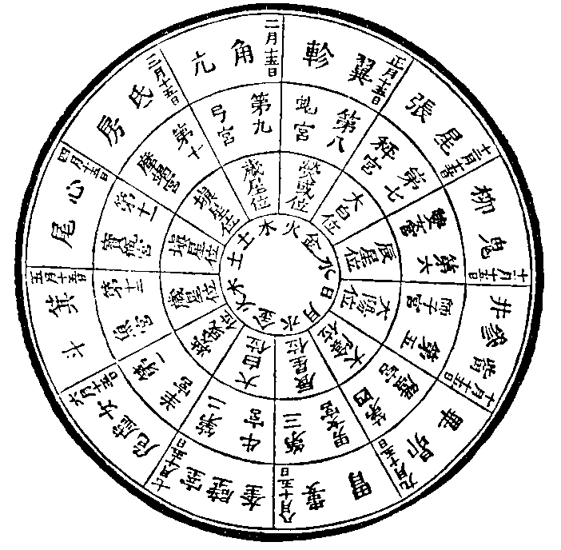
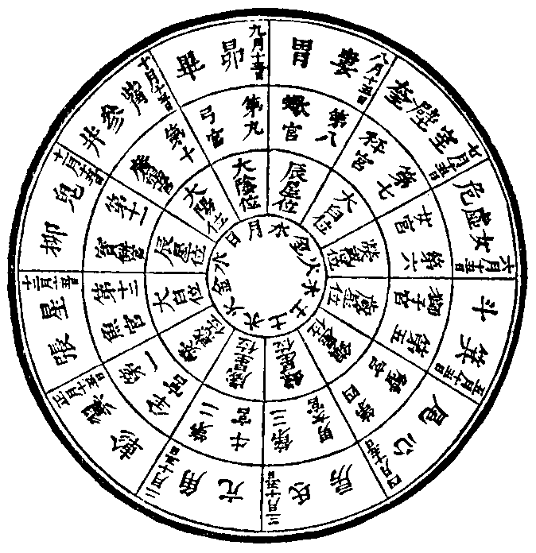

# 文殊师利菩萨及诸仙所说吉凶时日善恶宿曜经



> **藏经**：大正新修大藏经（大正藏）　**册次** 第 21 册（T21）　**编号** No. 1299（T1299）　**部类** 经集部　**卷次** 2 卷　**篇幅** 19,592 字

> **卷／品**：0 卷 · 8 品



---



## 目录



  - [宿曜历经序分定宿直品第一](#宿曜历经序分定宿直品第一)

  - [宿曜历经序日宿直所生品第二](#宿曜历经序日宿直所生品第二)

  - [宿曜文殊历序三九秘宿品第三](#宿曜文殊历序三九秘宿品第三)

  - [宿曜历经序七曜直日品第四](#宿曜历经序七曜直日品第四)

  - [宿曜历经秘密杂占品第五](#宿曜历经秘密杂占品第五)

  - [宿曜历经序黑白月分品第六](#宿曜历经序黑白月分品第六)

  - [宿曜历经序日名善恶品第七](#宿曜历经序日名善恶品第七)

  - [宿曜历经七曜直日历品第八](#宿曜历经七曜直日历品第八)



---



文殊师利菩萨及诸仙所说吉凶时日善恶宿曜经卷上



开府仪同三司特进试鸿胪卿肃国公食邑三千户赐紫赠司空谥大监正号大广智大兴善寺三藏沙门不空奉　诏译



弟子上都草泽扬景风修注



和上以乾元二年翻出此本，端州司马史瑶执受纂集，不能品序，使文义烦猥，恐学者难用，於是草泽弟子扬景风，亲承和上指挥，更为修注，笔削以了缮写奉行，凡是门人各持一本。于时岁次玄枵大唐广德之二年也。



------



### 宿曜历经序分定宿直品第一



天地初建，寒暑之精化为日月，乌兔抗衡生成万物，分宿设宫管标群品。日理阳位，从星宿顺行，取张、翼、轸、角、亢、氐、房、心、尾、箕、斗、牛、女等一十三宿，迄至于虚宿之半，恰当子地之中，分为六宫也。但日月天子俱以五星为臣佐，而日光炎猛，物类相感，以阳兽师子为宫神也。月光清凉，物类相感，以阴虫巨蟹为宫神也。



又日性刚义、月性柔惠，义以济下、惠以及臣，而日月亦各以神宫均赐。五星以速至迟，即辰星、太白、荧惑、岁镇排为次第，行度缓急於斯彰焉。凡十二宫，即七曜之躔次，每历示祸福经纬灾祥。又诸宫各有神形，以彰宫之象也。又一宫配管列宿九足，而一切庶类相感。



月广五十由旬，得系命以京吉凶，大体属於日月。



日广五十一由旬风精，太白广十由旬空精，　岁星广九由旬月精，辰宿广八由旬火精，　荧惑广七由旬日精，土星广六由旬，星宿小者广一俱卢舍。



日宫下面颇梨之宝，火精之质也，温舒能照百物。月宫下面琉璃之宝，清凉能照万物。日月诸曜，众生业置於空中，乘风而止，当须弥之半，逾健陀罗之上，运行於二十七宿十二宫焉。宫宿之分今具说之，更为图书耳。



第一、星四足，张四足，翼一足，大阳位焉。其神如师子，故名师子宫。主加官得财事。若人生属此宫者，法合足精神、富贵孝顺，合掌握军旅之任也。



第二、翼三足，轸四足，角二足，辰星位焉。其神如女，故名女宫。主妻妾妇人之事。若人生属此宫者，法合难得心腹，多男女、足钱财、高职，故合掌宫房之任。



第三、角二足，亢四足，氐三足，太白位焉。其神如秤，故名秤宫。主宝库之事。若人生属此宫者，法合心直平政、信敬多财，合掌库藏之任。



第四、氐一足，房四足，心四足，荧惑位焉。其神如蝎，故名蝎宫。主多病剋禁分身之事。若人生属此宫者，法合饶病薄相恶心妬忌，合掌病患之任。



第五、尾四足，箕四足，斗一足，岁星位焉。其神如弓，故名弓宫。主喜庆得财之事。若人生属此宫者，法合多计策足心谋，合掌将相之任。



第六、斗三足，女四足，虚二足，镇星位焉。其神如磨竭，故名磨竭宫。主鬪诤之事。若人生属此宫者，法合心麁五逆、不敬妻子，合掌刑杀之任。



右已上六位，总属太阳分。已下六位，总属大阴分。



第七、虚二足，危四足，室三足，镇星位焉。其神如瓶，故名瓶宫。主胜彊之事。若人生属此宫者，法合好行忠信、足学问富饶，合掌学馆之任。



第八、室一足，壁四足，奎四足，岁星位焉。其神如鱼，故名鱼宫。主加官受职之事。若人生属此宫者，法合作将相无失，脱有学问富贵忠直，合掌吏相之任。



第九、娄四足，胃四足，昴一足，荧惑位焉。其神如羊，故名羊宫。主有景行之事。若人生属此宫者，法合多福德长寿又能忍辱，合掌厨饍之任。



第十、昴三足，毕四足，觜二足，太白位焉。其神如牛，故名牛宫。主四足畜牧之事。若人生属此宫者，法合有福德、足亲友、长寿、得人贵敬，合掌马厩之任。



第十一、觜二足，参四足，井三足，辰星位焉。其神如夫妻，故名婬宫。主胎妊子孙之事。若人生属此宫者，法合多妻妾、得人爱敬，合掌户钥之任。



第十二、井一足，鬼四足，柳四足，太阴位焉。其神如蟹，故名蟹宫。主官府口舌之事。若人生属此宫者，法合恶性欺诳、聪明而短命，合掌刑狱讼之任。



上古白博叉二月春分朔，于时曜躔娄宿，道齐景正，日中气和，庶物渐荣，一切增长。梵天欢喜，命为岁元(景风曰：大唐以建寅为岁初，天竺以建卯为岁首。然则大唐令月皆以正月二三四至于十二，则天竺皆据白月十五日夜太阴所在宿为月名，故呼建卯为角月、建辰为氐月，则但呼角氐心箕之月，亦不论建卯建辰及正二三月也。此东西二之异义，学者先宜晓之，今又二详释如左也)。



> 角月(景风曰：唐之二月也，斗建卯位之辰也)氐月(景风曰：唐之三月也，斗建辰位之辰也)



> 心月(景风曰：唐之四月也，斗建巳位之辰也)箕月(景风曰：唐之五月也，斗建午位之辰也)



> 女月(景风曰：唐之六月也，斗建未位之辰也)室月(景风曰：唐之七月也，斗建申位之辰也)



> 娄月(景风曰：唐之八月也，斗建酉位之辰也)昴月(景风曰：唐之九月也，斗建戌位之辰也)



> 觜月(景风曰：唐之十月也，斗建亥位之辰也)鬼月(景风曰：唐之十一月也，斗建子位之辰也)



星月(景风曰：唐之十二月也，斗建丑位之辰也)　翼月(景风曰：唐之正月也，斗建寅位之辰也)



(新演如左。景风曰：以梵本初翻，学言隐密。唐之迷惑，不晓其由，自非久习致功，卒难行用。今请演旧为新。取历月日列为立成，成前更为大唐月建十二辰图，参之以宫名、会之以宿次，然后则晓然可观、义理不隐。庶当代高才知此意也。



大唐月建图　每十二月日数。



正月、二月、三月、四月、五月、六月、七月、八月、九月、十月、十一月、十二月。



> 一日　虚室奎胃毕参鬼星翼角氐心



> 二日　危壁娄昴觜井柳张轸亢房尾



> 三日　室奎胃毕参鬼星翼角氐心箕



> 四日　壁娄昴觜井柳张轸亢房尾斗



> 五日　奎胃毕参鬼星翼角氐心箕牛



> 六日　娄昴觜井柳张轸亢房尾斗女



> 七日　胃毕参鬼星翼角氐心箕牛虚



> 八日　昴觜井柳张轸亢房尾斗女危



> 九日　毕参鬼星翼角氐心箕牛虚室



> 十日　觜井柳张轸亢房尾斗女危壁



> 十一日　参鬼星翼角氐心箕牛虚室奎



> 十二日　井柳张轸亢房尾斗女危壁娄



> 十三日　鬼星翼角氐心箕牛虚室奎胃



> 十四日　柳张轸亢房尾斗女危壁娄昴



> 十五日　星翼角氐心箕牛虚室奎胃毕



> 十六日　张轸亢房尾斗女危壁娄昴觜



> 十七日　翼角氐心箕牛虚室奎胃毕参



> 十八日　轸亢房尾斗女危壁娄昴觜井



> 十九日　角氐心箕牛虚室奎胃毕参鬼



> 二十日　亢房尾斗女危壁娄昴觜井柳



　二十一日　氐心箕牛虚室奎胃毕参鬼星



　二十二日　房尾斗女危壁娄昴觜井柳张



　二十三日　心箕牛虚室奎胃毕参鬼星翼



　二十四日　尾斗女危壁娄昴觜井柳张轸



　二十五日　箕牛虚室奎胃毕参鬼星翼角



　二十六日　斗女危壁娄昴觜井柳张轸亢



　二十七日　牛虚室奎胃毕参鬼星翼角氐



　二十八日　女危壁娄昴觜井柳张轸亢房



　二十九日　虚室奎胃毕参鬼星翼角氐心



> 三十日　危壁娄昴觜井柳张轸亢房尾



)仙人问言：凡天道二十七宿有阔有狭，皆以四足均分别，月行或在前后，验天与说差互不同，宿直之宜如何定得？菩萨曰：凡月宿有三种合法，一者前合、二者随合、三者并合，知此三则宿直可知也。云何前合？奎、娄、胃、昴、毕、觜六宿为前合也。



云何为并合？参、井、鬼、柳、星、张、翼、轸、角、亢、氐、房十二宿为并合。



云何为随合？心、尾、箕、斗、女、虚、危、室、壁九宿为随合。



凡宿在月前、月居宿后为前合。月在宿前、宿在月后，如犊随母为随合。宿月并行，为并合也(景风曰：凡天象之法，西为前、东为后。如月在宿东、宿在月西，则是宿在月前、月在宿后。他皆倣此也)。



颂曰：



> 六宿未到名前合，十二宿月左右合，  

> 九宿如犊随从母，奎宿直应当知耳。



------



### 宿曜历经序日宿直所生品第二



昴图。昴六星，形如剃刀，火神也，姓某尼裴苦，食乳酪。此宿直日，宜火作煎煮、计算畜生、合和酥药、作牛羊坊舍、种莳、入宅、伐逆除暴、剃头并吉。若用裁衣必被火烧。此宿直生人，法合念善、多男女、勤学问、有容仪。性合悭澁、足词辩(景风曰：中国天文，昴七星，主胡兵，西方之宿也。然今案经文，说星多不与中国相符，览者遽生疑惑，今请依中国天文二图，其星於脚下发，读之者高明则心无所昧矣)。



毕图。毕五宿，形如半车，钵阇钵底神也，姓瞿昙，食鹿肉。此宿直日，宜农桑种莳、修理田宅、通决沟渠、修桥道作诸安久之事，不宜放债及出财纳谷米。若用裁衣，必多饶事务。此宿直生人，法合多财产、足男女，性聪明、好布施、有心路、省口语、心意不翻动、行步如牛王、有容仪(景风曰：中国天文毕八星，主边兵，西方之宿也)。



觜图。觜三星，形如鹿头，月神也，姓婆罗堕阇，食鹿肉。此宿直日，宜作舍屋及造旌纛、床帐家具、入新宅、嫁娶、沐浴装束、入坛祭星曜除灾害吉。此日裁衣，被鼠咬。此宿生人，法合有名闻景行、美容貌、心肚慎净、爱服药必得力、心口隐密举动不轻燥，为人好法、用爱礼仪(中国天文，觜三星，主军之士，西方之宿也)。



参图。参一星，形如额上点，鲁达罗神，姓卢醯底耶，食血。此宿直日，宜求财及穿地、卖乳酪、煮酥、押油及诸刚猛之事。若用裁衣，终慎鼠厄。此宿生人，法合猛恶梗戾嗜瞋、好合口舌、毒害心硬、临事不怯(景风曰：中国天文，参十星，主将军，西方之宿也)。



井图。井二星，形如屋栿，日神也，姓婆私瑟咤，食苏饼。此宿直日，宜惠施贫穷必获大果，凡有所作必得成就。又宜祭天、宜嫁娶纳财。不宜合药服食。若用裁衣，必相分离。此宿生人，法合钱财或有或无，情爱声名、作人利官，纵有官厄还得解脱，受性饶病亦多男女。高故议有急难，若论景行稍似纯直(景风曰：中国天文，井八星，主天门，南方之宿也)。



鬼图。鬼三星，形如瓶，蘖利诃馺拨底神也，姓谟阇耶那，食蜜，𩚙糖，稻谷华及乳粥。此宿直日，宜作百事誉长寿。若理王事及诸严饰之相，拜官升位入坛受镇。学密法吉。若用裁衣，必有吉祥胜事。此宿生人，法合分相端政、无耶僻、足心力、合多闻、有妻妾丰饶财宝、能检校处分又足亲(景风曰：中国天文，鬼五星，主官寮，南方之宿也)。



柳图。柳六星，形如蛇，神也，姓曼陀罗耶，食蟒蛇肉。此宿直日，宜作刚猛断决、伐逆除恶、攻城破贼、吞害天下。若用裁衣，后必遭失。此宿生人，法合软眼、饶睡性虚、梗戾嗜瞋、不伏人欺，又好布施亦好解脱，耽著情事、难得心腹(景风曰：中国天文，柳八宿，主厨饍之任，南方之宿)。



星图。星六星，形如猛，薄伽神也，姓瞿必毘耶那，食卒日消。此宿直日，宜种莳杂物亦宜种五谷、宜修宅舍祭祀先亡。若用裁衣，后必损失。此宿生人，法合爱𠲜竞、不能自押捺𭋦瞋怒，父母生存不能孝养、死后方崇祭飨追念，亦足奴婢畜乘资产，有名闻，足却泡亦多兼却泡，一生之间好祈祷神庙(景风曰：中国天文，星七星，主衣服，南方之宿也)。



张图。张二星，形如杵，婆薮神也，姓瞿那律耶，食乳粥。此宿直日，宜喜庆事，求女婚娶、修宅、拜官、作新衣、受长密法、学道承仙并吉。若用裁衣，必被官夺。此宿生人，法合足妻妾、多男女，出语惬人意甚得人爱，少资财智策亦不多业，合得人财(景风曰：中国天文，张六星，南方之宿也)。



翼图。翼二星，形如跏趺，利耶摩，姓遏咥黎，食栗苏。此宿直日，宜所作皆吉，买田宅、筑墙穿堑、修农业种莳，凡诸安久之事并吉。若用裁衣，后必更得财。此宿生人，法合爱骑乘鞍马、驾驭车牛，布施吃用、触处游从，为人稳口语，受性爱音乐(景风曰：中国天文，翼二十二星，主府县事，南方之宿也)。



轸图。轸五星，形如手，毘婆怛利神也，姓跋蹉耶那，食乳粥。此宿直日，宜急速事，远行外国、修理衣裳、学艺业、婚娶、开园圃并吉。此宿生人，法合有诸宝物业，合游历州县。禀姓嫉妬、为人少病，能立功德兼爱车乘(景风曰：中国天文，轸四星，主车乘骑，南方之宿也)。



角图。角二星，形如长幢，瑟室利神也，姓僧伽罗耶那。此宿直日，宜严饰、造衣裳、宝物锦绣之事，观兵行军、祭祀天神、赏赐将士并吉。若用裁衣，终当逃亡。此宿生人，法合善经营、饶六畜，所作事多合。又手巧，所作惬人情。只合二男(景风曰：中国天文，角二星，主天门，东方之宿也)。



亢图。亢一星，形如火珠，风神也，姓苏那，食大麦、饮菉豆酥。此宿直日，宜调象马，又宜教击鼓，婚娶、结交、种莳并吉。若用裁衣，后必得财。此宿生人，法合统领头首、辩口词，能经营、饶财物，净洁装束、爱吃用、造功德，足心力、益家风(景风曰：中国天文，亢四星，主兵，东方之宿也)。



氐图。氐四星，形如牛角，因伽陀罗祇尼神也，姓逻怛利，食乌麻杂华。此宿直日，宜种莳五谷菓木、酝酒，不宜起动房舍车马之事。若用裁衣，多逢亲识。此宿生人，法合有分相、好供养天佛、心性解事，受性良善，承君王优宠、富饶财物、利智、足家口(景风曰：中国天文，氐四星，主侵害，东方之宿也)。



房图。房四星，形如帐，布密多罗神也，姓多罗毘耶，食酒肉。此宿直日，宜交婚姻、喜庆吉祥之事，及受戒律、入坛受灌顶、修仙学道升位并吉。若用裁衣，后必更裁。此宿生人，法合有威德、足男、女饶钱财，合快活、绍本族、荣家风(景风曰：中国天文，房四星，主天道，东方之宿也)。



心图。心三星，形如阶，因陀罗神也，姓僧讫利底耶那，食粳米蔬乳。此宿直日，宜作王者所须事，兼宜严服升位、登坛拜官职、畜乘、案摩理身、修功德并吉，不宜出财及放债。若用裁衣，必遭死亡盗贼。此宿生人，法合处族众得爱敬，承事君王多蒙礼侍，摧恶奖善、运命得所(景风曰：中国天文，心三星，主明堂印政，东方之宿也)。



尾图。尾二星，形如师子顶毛，儞律神也，姓迦底那，食乳菓花草。此宿直日，宜沐浴、厌呪、置宅、种树、合药、散阿伽陀药并入坛并吉。若用裁衣，必遭烂坏。此宿生人，法合足衣食、多库藏。性悭澁、志恶戾诤竞，合得外财力，性爱花药(景风曰：中国天文，尾九星，主后宫士，东方之宿也)。



箕图。箕四星，形如牛步，水神也，姓刺婆耶尼，食瞿陀甜苦味。此宿直日，宜穿地造舍、决渠开水、种花药、修园圃、酝酒酱并吉。若用裁衣，后必得病。此宿生人，法合游涉江山、经营利闺，为人耐辛苦，立性好婬逸妇人、饶病、爱酒(景风曰：中国天文，箕四星，主妃后，东方之宿也)。



斗图。斗四星，形如象步，毘说神，姓毘耶罗那，食蜜𩚙稻花。此宿直日，宜著新衣及安久之事，置库藏、修理园林、造车乘、营田宅、造寺宇、作兵器并吉。若用裁衣，多得美味。此宿生人，法合爱鞍马、历山林，爱祈祷祀、结交贤良、多伎能、足钱财(景风曰：中国天文，斗六星，主江湖，北方之宿也)。



牛图。牛宿吉，甚吉祥。其宿三星，形如牛头，风梵摩神也，姓奢拏耶那，食乳粥香花药。此宿生人，法合福德所作不求(景风曰：案天竺以牛宿为吉祥之宿，每日牛时直事，故天竺以牛时为吉祥之时也。瞿昙氏以历经者，牛宿吉祥女图术是也。今说牛星，又与中国亦别。案中国天文，牛宿六星，主开渠河，北方之宿也)。



女图。女三星，形如梨格，毘薮幻神也，姓目揭连耶那，食新生酥及鸟肉。此宿直日，宜为公事、置城邑、立卿相、发兵、造战具，并学伎能、穿耳、理发案摩并吉。不宜初著新衣，或因之致死。又不宜诤竞。若用裁衣，必足病痛。此宿生人，法合足心力、少病、好布施、守法律、勤道业、荣祖宗(景风曰：中国天文，女四星，主藏府土，北方之宿也)。



虚图。虚四星，形如诃梨勒，娑婆神也，姓婆私迦耶，食於大豆喻沙。利上云：和水煮如乳状，为喻沙相也。此宿直日，宜建急事、学问，及沐浴乞子法、供养婆罗门、置城邑、营兵马，及初著新衣、严饰冠带并吉。若用裁衣，多得粮用。此宿生人，法合足谷、多贮积、长命富胜、蒙君王宠爱，又好响祷神庙、终身快乐、不合辛苦(景风曰：中国天文，虚二星，主宰相位，北方之宿也)。



危图。危一星，形如花穗，婆鲁拏神也，姓丹茶耶，食羝羊肉。此宿直日，宜合药避病、穿池种麻、商人出行、纳财、造船、酝酒并吉。若用裁衣，心遭毒厄。此宿生人，法合嗜酒耽婬、耐辛苦、心胆硬，与人结交必不久长、无终始。又能处分事务、解药性、多嗔(景风曰：中国天文，危三星，主坟墓，北方之宿也)。



室图。室二星，形如车辕，阿醯多陀难神，姓阇耶尼，食一切肉。此宿直日，宜为刚猛事，勘罪人、捕奸捉非。若为吉事，不宜。若用裁衣，必遭水厄。此宿生人，法合决猛恶，性嗜嗔、爱劫夺、能夜行不怕虑，性轻燥毒害、无慈悲(景风曰：中国天文，室二星，主宗庙，北方之宿也)。



璧图。壁二星，形如立竿，尼陀罗神也，姓瞿摩多罗，食大麦饭酥乳。此宿直日，宜造城邑、婚娶，永久长寿增益吉庆。不宜南行。若用裁衣，多得财物。此宿生人，法合承君王恩宠，为姓慎密悭澁、有男女爱、供养天佛亦好布施、不多爱习典教(景风曰：中国天文，壁二星，主图书秘法，北方之宿也)。



奎图。奎三十二星，形如小艇，甫涉神也，姓曼茶鼻耶，食肉及饮𩚙。此宿直日，造仓库及牛马坊，挍算、畜牧、酝酒、镕糟、冠带、出行并吉。若用裁衣，必得宝器。此宿生人，法合有祖父产业，及有经营得钱财，物合用尽后更得之，事无终始。为性好布施，亦细澁业。合游荡、足法用、慕善人作胜律仪之事、无终始、赏男女、受教学典教(景风曰：中国天文，奎十六星，主武库，西方之宿也)。



娄图。娄三星，形如马头，乾闼婆神也，姓河说耶尼，食乌麻杂苽。此宿直日，宜为急速之事，合和服药、内牛马吉。若用裁衣，必增益衣服。此宿生人，法合多技能、少疾病、妙解医方。性好和合、布施，足田畴、多游仆从，合事君王。受性勤公务、禀志慎密(景风曰：中国天文，娄三星，主林苑，西方之宿也)。



胃图。胃三星，形如三角，阇摩神也，姓粟笈婆，食乌麻稻米蜜肉。此宿直日，宜为公事及王侯修善事并吉。用刚猛伐逆取叛、除凶去奸非并吉。若用裁衣，必损减资福。此宿生人，法合胆硬、恶性灵、耽酒嗜肉、爱驱策劫夺强暴。禀志轻躁、足怨敌、饶男女、多仆从(景风曰：中国天文，胃三星，形如角，主兵军，西方之宿也)。



凡毕、翼、斗、壁为安重宿，等直日，宜造宫殿、伽蓝、馆宇、寺舍，种莳、修园林、贮纳仓库、收积谷米、结交朋友、婚姻、荣命时相、造家具、设学、供养、入道场及安稳，并就师长入坛受灌顶法，造久长之事并吉。唯不宜远行、索债、无保进路、造酒、剃头剪甲、博戏。若此宿生人，法合安重威肃、正福德、有大名闻。



凡觜、角、房、奎为和善宿，此宿直日，宜入道场、问学技艺、习真言、结斋戒、立道场受灌顶、造功德、设音乐，及吉祥事喜庆、求婚、举放、对君王参将相、冠带出行、服药合和并吉。若此宿生人，法合柔软温良，聪明而爱典教。



凡参、柳、心、尾为毒害宿，此等宿直日，宜围城破营、设兵掠贼、交阵破敌、劫盗攎蒱、射猎并吉。若此直日生人，法合碜毒、刚猛恶性。



凡鬼、轸、胃、娄为急速宿，此等宿直日，宜放债贷钱、买卖交关、进路出行、调六畜、乘习鹰鹞、设斋行道、入学受业、服药、入道场受灌顶、市买并吉。此宿生人，法合刚猛而捷疾，有筋力。



凡星、张、箕、室为猛恶宿，此等宿直日，宜守路设险、劫掠相攻、攎蒱、博戏、造兵器、谋断、决囚徒、放药、行酪、射猎、祭天祀神、承兵威并吉。此宿生人，法合凶害猛杀，宜舍身出家作沙门。



凡井、亢、女、虚、危五星为轻燥宿，又为行宿。此等宿直日，宜学乘象马、骄射驰走、浮江泛舟、奉使绝域和国入蕃，又劝行礼乐、兰阅兵马、种莳、造酒、合和药并吉。此宿生人，法合浇薄，不然则质直平稳。



凡昴、氐为刚柔宿，此等宿直日，宜锻鍊炉治、修五行家具，及造瓦、买卖之事。又宜设斋、送葬、钻鍊酥乳、计算畜生、入宅、王者作盟会并吉。此宿生人，法合为性宽柔而猛，君子之人流也(景风曰：会经文言语，多有中国之俗，如攎蒱戏、和国入蕃之类也，并是飜异西言译同东语，庶览之者悉之，幸不以文害意旨也)。



------



### 宿曜文殊历序三九秘宿品第三



一九之法　命宿　荣宿　衰宿　安宿　危宿　成宿　坏宿　友宿　亲宿



二九之法　业宿　荣宿　衰宿　安宿　危宿　成宿　坏宿　友宿　亲宿



三九之法　胎宿　荣宿　衰宿　安宿　危宿　成宿　坏宿　友宿　亲宿



此法以定人所生日为宿直、为命宿、为第一，次以荣宿，又次衰宿，及安宿、危宿、成宿、坏宿、友宿、亲宿，如是九宿为一九之法。其次则以业宿为首，以下九准前，为二九之法。次则以胎宿为首，以下九准前。三九之法而周二十七宿，众为秘密(景风曰：假如有人二月五日生者，其人属毕宿，即以毕宿为第一命，以次觜宿为荣宿、参为衰宿、井为安宿、鬼为危宿、柳为成宿、星为坏宿、张为友宿、翼为亲宿。轸为业宿，角为荣宿、亢为衰宿，并同友直。如女胎宿，虚为荣宿，已下准前，是为三九之法。他皆准此)。



和上云：凡与人初结交者，先须看彼人命宿押我何宿，又看我命宿押彼人何宿，大抵以荣、安、成、友、亲为善，堪结交；自餘并恶，不可与相知。以为秘法耳(景风曰：案太史有旧飜九执宿命，古殊未有此法，今则新译，庶用传之流行万代耳)。



凡命、胎宿直日，不宜举动百事。业宿直日，所作皆吉祥。衰、危、坏宿日，并不宜远行，出入迁移、买卖裁衣、剃头剪甲并不吉。坏日，又宜压镇降伏怨雠及讨伐暴恶。安日，移动远行、修园宅卧具、作坛场并吉。危日，宜结交婚姻、欢会宴聚吉。成日，修学问道、合药求仙吉。友、亲日，宜结交朋友大吉。



凡日月直，星没。



犯逼守命、胎之宿，此人是厄会之时也，宜修功德、持真言念诵、立道场以禳之。



若犯业宿及荣、安、成、友、亲等宿，并所求不遂、百事迍邅，亦宜修福念善。



若犯衰、危、坏等宿者，则所求称意、百事通达(景风曰：凡欲知五星所在分者，据天竺历术推知何宿，具知也。今有迦叶氏、瞿昙氏、拘摩罗等三家天竺历，并掌在太史阁。然今之用，多用瞿昙氏历，与大术相参供奉耳)。



------



### 宿曜历经序七曜直日品第四



夫七曜，日、月、五星也。其精上曜于天，其神下直于人，所以司善恶而主理吉凶也。其行一日一易，七日一周，周而复始。直神，善恶言具说之耳(景风曰：推求七曜直日法，今具在此经卷末第八历算法中具备足矣)。



日精日，太阳直日，宜策命拜官、观兵习战、持真言、行医药、放群牧、远行、造福设斋祈神、合药、内仓库、入学、论官并吉。不宜诤竞、作誓、行奸、对阵不得先起。若人此曜直日生者，法合足智策、端政美貌、孝顺短命。若五月五日得此曜者，则其岁万物丰熟。若有亏蚀地动者，则万物莫实，不千日为殃。



月精日，大阴直日，宜造功德成就、作喜乐僚、教女人、裁衣服、造家具、安床、穿渠、修井灶、买卖财物、仓库内财、洗头割甲、著新衣并吉。不宜婚嫁、入宅、结交、私精出行大凶。奴婢逃走难捉得、囚系者出迟。不宜杀生及入阵，并凶。此日生人，合多智策、美貌、乐福田、好布施、孝顺。若五月五日得此曜者，岁多疾病、秋足霜冷。若有亏蚀地动者，则岁中饶疾死。



火精日，荧惑直日，宜决罚罪人、国取盗贼、作欺诳事、买金宝牛羊、动甲兵、修戎具教旗，剋贼必胜、诉讼先起，合药、种莳、割甲、结婚。不得出财徵债，禁者难出、病者必死。若此直日生人，法合丑陋恶性、妨亲害族，便弓马多嗔。若五月五日得此曜者，则岁中多诤竞。若亏蚀地动者，则岁中多有兵马损伤。



水精日，辰星。辰星直日，宜入学事师长、学工巧伎能、攻城，又宜举债、出行、怨敌伏雠得财，唯不宜修造宅舍、对战鬪敌、作贼妄语并凶。被囚者，即后必有阴谋，说动当时。若五月五日得此曜者，则岁中有水灾。亏蚀地动，则百物不熟、人多瘴疠耳。



木精日，岁星。岁星直日，宜策命使王及求善知识，并学问、礼拜修福、布施、嫁娶，作诸吉事、请谒，及结交、入宅、著新衣、沐发、种菜木、调伏象马、买奴婢并吉。若为凶事则大凶。若人此日生者，法合贵重荣禄。若五月五日得此曜者，岁中丰熟。若有亏蚀地动，则公王必死。



金精日，太白。太白直日，宜见大人官长、沐浴冠带、求亲结婚，良友罪馔宜入宫至并吉。逃亡难得、畋猎并战不吉。若人此直日生者，法合短命好善，人皆钦慕。若五月五日得此直日者，则下田不牧，岁中惊扰之事。若亏蚀地动者，则六畜多损伤耳。



土精日，镇星。镇星直日，宜修园圃、买卖田地弓马、合药、伏怨、放火、立精舍、作井灶吉。唯不宜结婚冠带及出行。若人此日生者，法合少病、足声名、少孝顺、信朋友。若五月五日得此直者，则合岁中多土功。若亏蚀地动者，则国中人民不安泰(景风曰：茫茫大造化乃为阴阳，精曜运天、灵神直地，吉凶之应唯人信之。故译出此法，为伐秘密经，庶传习者幸无谬矣。凡人出行，不得面冲七曜。若冲日曜，当遭大厄；若冲月曜，亲眷多伤；若冲木曜，家人背心；若冲土曜，必有死厄；若冲金曜，则灾祥并至)。



乃为颂曰：



日火月建，德贵神眷，岁背镇死，金冲并至。



------



### 宿曜历经秘密杂占品第五



凡如七曜运天犯著人六宫宿者，必有灾厄，一者命宿、二者事宿、三者意宿、四者聚宿、五者同宿、六者克宿。从命数第十为事宿，第四为意宿，第十六为聚宿，第二十为同宿，第十三为克宿(景风曰：有人属娄宿者，向前数第四得毕为意宿，第十得星则为事宿，十三得轸则为克宿也。皆准此求即得也)。



若七曜犯命宿则亡失钱财必多灾厄，若犯事宿则招殃咎，若犯意宿则必多愁苦，若犯聚宿则亡失财囚闭，若犯同宿则离坼不安家口衰耗，若犯克宿亡财失官势力衰损。若七曜总不犯此六处者，则所为皆得(景风曰：皆须共三九秘宿相参，然后定灾厄也)。



颂曰：



> 十事规求镇不来，四意愁烦因恼也，  

> 十六聚失灾厄形，二十同路相乖背，  

> 十三剋挫势力名。



七曜与此宿不犯者，则百恶澄清。



凡日在本宫及第三第六第十位为果大吉。荧惑守本宿，大有灾厄耳。月在本命宫及第六第七第三宫即为果吉。岁星与在第三第七劣九宫者吉。辰与氐第四第十宫者并吉。太白在本命宫者，合有大厄。凡人有灾厄时，可持真言立道场而用禳之。若有人不记得本所属宿而来问我者，何以答之？日皆先须看人初来之时触著处而断之，则可知耳。若先触头者则属昴宿，若先触额者则属毕宿，若先触眉者则属觜宿，若先触眼者则属参宿，若触两颊及耳者则属井宿，若先触牙及胸者则属鬼宿，若触齿者则属柳宿，若触项者则属星宿，若触右肩则属张宿，若触左肩则属翼宿，若触手者则属轸宿，若触颏颐者则属角宿，若触𡙇盆及项下胸上者则属亢宿，若触臆者则属氐宿，若触右臂则属房宿，若触左臂则属心宿，若触心脾骨者则合属尾宿，若触右胁者则属箕宿，若触左胁者则属斗宿，若触脐者则属牛宿，若触腹肚者则属女宿，若触小膓下者则属虚宿，若触胯腿及后分者则属危宿，若触右腿髀者则属室宿，若触左腿髀者则属壁宿，若触膝胢者则属奎宿，若触胫者则属娄宿，若触脚者则属胃宿(景风曰：若人不得本生月日者，则知本所属宿用此法以定之。和上以此法门为秘密耳)。



凡轸星大阳直，毕宿大阴直，星宿土直，尾宿火直，柳宿水直，鬼宿木直，房宿金直，此等七日名为甘露吉祥日，宜学道求法，受密印及习真言。



凡尾宿大阳直，心宿大阴直，壁宿火直，昴宿水直，井宿木直，张宿金直，亢宿土直，此等七日名为金刚峰日，宜降伏魔怨，持日天子真言。



凡胃宿大阳直，鬼宿大阴直，翼宿火直，参宿水直，氐宿木直，奎宿金直，柳宿土直，右此等七日名为罗刹日，不宜举动百事，唯射猎及诸损害之事也。



------



### 宿曜历经序黑白月分品第六



凡月有黑白两分，从一日至十五日为白月分，从十六日至三十日为黑分。每月白月一日三日五日七日十日十一日十三日，黑月一日三日五日七日十日十一日十三日，所向皆成就，名为吉祥日。



又白月四日夜、八日昼、十一日夜、十五日昼，黑月三日夜、七日昼、十日夜、十四日昼，为凶恶时，所作不成就。



又白月二日六日九日十二日，又黑月二日六日九日十二日十四日，此等平平时，随立宿曜为吉凶。



又白月四日十一日夜、八日十五昼，黑月三日十日夜、七日十四日昼，凶恶气生时，所作反招殃咎。



凡凶恶之日，日中已后却成吉时；凶恶之夜，夜半已后却成吉时。乃为颂曰：



> 一三五七十，十一与十三，  

> 於二白黑分，所作皆成就。  

> 黑三夜七昼，十夜十四昼，  

> 白四夜八昼，一夜十五昼，  

> 於此白黑分，昼夜不成就，  

> 日中夜已后，所求皆成就。



------



### 宿曜历经序日名善恶品第七



从一日至十六日(景风曰：一日即是白月之一日也，十六即黑月之一日也。今恐读者难会，故略云黑白之言，直裁日数之尔)，名为建、名日。梵天下，宜为善业、学道求仙及事师尊宿并吉，唯不宜远出行耳。



凡二日十七日，名为得财日，造化神下，宜合药、按摩、工巧、出行、结交、婚亲、增益田宅并吉。



凡三日十八日，名为威力日，那罗延下，宜摧敌除逆、习战畜兽、奖训下人、营田种莳大吉。



凡四日十九日，名为猛武日，阎罗天下，宜作恶业、杀害残贼、摧伏叛逆则吉，为善事却凶。



凡五日二十日，名圆满日，日天子下，宜为善业，修营床帐及车乘衣服、营田宅、结婚并吉。



凡六日二十一日，名为求名日，童子神下，宜为久长安定事，营宅宇、寝庙，及建国邑、伽蓝、牛马坊廐等并吉；不宜出行。



凡七日二十二日，名为友朋日，北斗天下，宜结交、庆喜、安定、和药，王者初服及造旌旗帷帐并吉；唯不宜远行。



凡八日二十三日，名为大战日，婆薮天下，宜为力用之事，造兵仗、城垒、穿濠堑并吉。



凡九日二十四日，名为凶猛日，毘舍阇鬼下，宜围城缚敌、进途伐逆；不宜入宅及削发并凶。



凡十日二十五日，名为善法日，善法神下，宜安久之事及急速飞捷，穿凿井灶、修道、作功德、伽蓝顺法之事并大吉。



凡十一日二十六日，为慈猛日，自在天下，宜新立宅舍、营建城庙馆宇厩𡐋，及设大祭、祀天神并吉。



凡十二日二十七日，为名闻日，日天子下，宜作久长安国之事，及车乘仓库并吉；唯不宜放债。



凡十三日二十八日，为最胜日，大魔王下，宜所作皆急速皆吉，及著衣服华鬘、金玉装畫，又宜嫁娶、修车乘、入坛场学法求道吉。



凡十四日二十九日，为勇猛日，药叉大将下，宜擒缚掩捕、诡诈相谋害大吉；唯不宜远行。



凡十五日三十日，为吉祥日，魂灵神下，宜祭先亡、作婆罗门大祭求福、布施供养师僧尊长、学戒、善事、求法大吉。



文殊师利菩萨及诸仙所说吉凶时日善恶宿曜经卷上



文殊师利菩萨及诸仙所说吉凶时日善恶宿曜经卷下



开府仪同三司特进试鸿胪卿肃国公食邑三千户赐紫赠司空谥大鉴正号大广智大兴善寺三藏沙门不空奉　诏译



西国每一月，分为白黑两分。



入月一日至十五日，为白月分(以其光生渐明白之谓也)。入月十六日至三十日，为黑月分(以其光渐减黑之谓也)。文殊师利菩萨说时日偈云：



> 一三五七十，十一与十三，  

> 於二黑白分，所作皆成就。  

> 黑三夜七昼，十夜十四昼，  

> 白四夜八昼，一夜十五昼。



　(所谓一夜者，十一夜也。勒颂者贵省文也)



> 於此黑白月，昼夜不成就，  

> 日中及中夜，已后皆通吉。



择日



每入月，一日十六日、三日十八日、五日二十日、七日二十二日、十日二十五日、十一日二十六日、十三日二十八日。



已上是吉日，所作吉祥事必成就。



择时



入月，四日夜八日昼、十一日夜十五日昼、十八日夜二十二日昼、二十五日夜二十九日昼。



已上日昼夜之时，所作皆不吉，为事不成。恶犹不可作，何况善事，如於咸卤之地种物不生。



入月，二日六日、九日十二日、十四日十七日、十九日二十一日、二十三日二十四、日二十七日三十日。



已上平日，若与好宿好曜并者即吉，如与恶宿恶曜并者即凶。夫凶恶昼日中已后通吉用，凶恶夜半已后亦通吉用。



白黑月所宜吉凶历



每月一日十六日，梵云钵阇钵底下(唐云梵王)，是建名日，宜为善业、学伎艺、苦节修行布施等事，及作爱敬、增益长久之事并吉；不宜远行。



二日十七日是得财日，梵云苾利诃馺钵底神下(唐云造化神下)，宜按摩、合药、作工巧法、远行进路、结交婚姻。



三日十八日是威力日，梵云毘纽神下(亦云那罗延天下)，宜摧敌除逆、调习象马四足诸畜等，及训将恶人下贱之类，营田种莳有大为作事皆吉。十八日夜恶，中夜已后还吉。



四日十九日是猛武日，梵云阎谟神下(唐云阎罗王下)作恶业日，是杀害日，与一切不善事残酷业皆悉相应，宜摧敌破逆吉。餘不吉。四日夜不吉，中夜已后吉。



五日二十日是圆满日，梵云苏谟神下(唐云月天子下)，宜修福善业，作卧具床座、衣服庄饰物及车舆等物，营田宅、结婚姻，凡诸庆乐事并吉。



六日二十一日是求名日，梵云摩罗神下(唐云童子天下)，宜诸久长安定之事，营田宅及天庙、福舍、伽蓝、建城邑，立牛马坊、诸畜坊厩并吉；不宜远行进路。



七日二十二日是朋友日，梵云七婆怛沙耶仙神下(唐云北斗也)，宜结朋友、安定之事，王者服新衣，及纛帜床座卧具、大宝严饰之物并吉。二十二昼恶，午后吉。



八日二十三日是力战日，梵云婆娑善神下(唐云婆薮天下)，宜力用之事，宜修造攻战之具、置边冲险固城垒冢堑、调乘象马等事并吉。八日昼恶，午后吉。



九日二十四日是凶猛日，梵云噜达啰尼神下(唐云毘舍阇鬼王下)，宜围城缚敌、进途伐逆取毒；不宜入宅、修理发凶。



十日二十五日是善法日，梵云苏达谟神下(唐云善法神下)，宜作久长事及急速事，置井、穿凿坑堑、行法修道，又作功德福舍、伽蓝，凡诸顺法及爱敬等事皆吉。二十五日夜不吉，半夜已后通吉。



十一日二十六日是慈猛日，梵云噜捺𠰷神下(唐云自在天下)，宜新立宅舍、营天庙、城邑、官曹馆室、伽蓝殿塔，及火祭室、功德福舍并吉。十一日夜恶，中夜后还吉。



十二日二十七日是名闻日，梵云阿逸都神下(唐云曰天子下)，宜作久长安定事，及修辇舆、严饰头发、置仓生藏等吉；不宜放债取债。



十三日二十八日是最胜日，梵云钵折底神下(唐云天魔下)，所为急速事，又宜敬爱之事、取妇人及乘车舆等，并入坛场习行道术并吉。



十四日二十九日是勇猛日，梵云药𫇴神下(唐云药叉将下)，宜往擒缚、相诡诳事、暴虐恶人、作非法之物，宜行诈妄诡诱怨敌，彼必信受；不宜远行进路。二十九日昼恶，午后吉。



十五日三十日是吉相日，梵云必多卢神下(唐云魂灵神下)，宜祭先亡、宜作婆罗门大祠求安隐法，及布施、供养父母尊者诸天，持斋戒施食，及诸祭祠吉。十五日昼恶，午后吉。



右每月日所宜用吉凶如前，必审用之，万不失一。其昼夜善恶，并如前嘉释。



二十七宿十二宫图(唐用二十八宿，西国除牛宿，以其天主事之故。十二宿，犹唐十二次。又说云：西国以子丑十二属记年，以星曜记日，不用甲子者，以宿曜於人无功、於事尤当故。经云：日有一倍力，宿有四倍力，曜有八倍力，好时之力万倍焉)



西国皆以十五日望宿，为一月之名。故二月为角月(西国以二月为岁首，以其道齐景正、日夜停分，时淑气和、草木荣茂，一切增长，故梵天折为历元)。



三月名氐月，四月名心月，五月名箕月，六月名女月，七月名室月，八月名娄月，九月为昴月(梵语昴星名迦提。西国五月十五日雨安居，至八月十五日满已，后五月十五日满已，后至九月十五日已来自恣，故号为迦提，但取星名而已。今中国迦提，即是事而妄者别为训释，盖大谬焉)，十月名觜月，十一月名鬼月，十二月名星月，正月名翼月。夫欲知二十七宿日者，先须知月望宿日。欲数一日至十五日已前白月日者，即从十五日下宿逆数之可知。欲知十六日已后至三十日，即从十五日下宿顺数即得。但依此即定(假如二月十五日是角日，十四日是轸日，十三日是翼日。若求十五日已后者，即十五日是角日，十六日是亢日，十七日是氐日。他皆倣此)。











夫欲求人所属宿者，即於图上，取彼生月十五日下宿，从此望宿逆顺数之，至彼生日止，则求得彼人所属宿也。



又法略算求人本命宿，先下生日数，又虚加十三讫，即从彼生月望宿，用上位数顺除，数尽则止，即得彼人所属命宿(假令有人二月十七日生者，则先下十七日为位，又虚加十三，共得三十。即从二月望宿角亢氐房二十七宿一周法除之讫，餘三等，即角除一，亢除二，氐除三，则彼人是氐宿生。他皆倣此)。



夫取宿直者，皆月临宿处，则是彼宿当直。又月行有迟疾，宿月复有南北，前后随合如何可知，则以后颂言求之可解。颂曰：



> 六宿未到名合月，十二宿月左右合，  

> 九宿如犊随母行，从奎宿数应当知。



颂言六宿未到名合月者，则从奎、娄、胃、昴、毕、觜此六宿，月未至宿，月则名彼宿直也。十二宿月左右合者，即参、井、鬼、柳、星、张、翼、轸、角、亢、氐、房等，此十二宿日，临彼宿上及前后南北，并取属彼宿用得也。九宿如犊随母行者，则配月为母、配宿为犊，则月居宿前、宿居月后，如犊母之像也。当以此颂复验之於天，则宿月用之无差，此皆大仙密说也。



二十七宿所为吉凶历



昴宿，宜火，则煎煮等事、检算畜生即畜生、融酥和合、作牛羊诸畜坊舍及牧放、入温室、种莳黄色赤色等物、入宅及名金作等吉。宜伐逆除怨、作剃剪之具、卖物、求长寿、求吉胜事。不宜修理鬓发及远行道路。宜庄饰冠带、佩服金雕等宝物。



毕宿，宜农桑种莳、修田宅嫁娶、作厨舍、作食、作畜生舍、通决渠河、修桥梁、作诸安定之事、作衣服并吉。不宜取债放债。宜纳谷及酒食杂物。不宜生财。



觜宿，作急要事及和善事并吉。宜种莳白汁树草等，又宜王者作舍作纛床座，又入新宅、嫁娶、修理发、洗浴，作求吉胜法、著新衣、严饰、作喜乐、调畜生，作除灾谨身呪术坛场之法，祭星曜、作髻并吉。



参宿，宜求财及诸刚严事，穿地、卖有乳畜生、造熟酥、押油、酝酒、押甘蔗、种甘蔗、畋猎及置关津等并吉。



井宿，有所惠施必获大果，有所置事必成就。宜作诸祭婆罗门、祭法天法，宜嫁娶及纳妇人，必子息繁盛。此宿所作事皆成吉，唯不宜合药服。



鬼宿，所作皆吉。求声誉、长寿，若为生事及诸端严相将其服拜官胜位，有所为求并皆吉祥福德增长。又宜远行进路、修理发、著新衣，及洗浴等事并吉。



柳宿，宜严拭事，是伐逆围城、掩袭封潜、窃诡誓、诈敌人。时此宿雨者必蚊虻、苗稼滋盛。七星宿凡诸种莳皆吉，唯不宜种虋。宜种五谷等、种芸薹，又宜修宅、祭先亡、将五谷入宅，作诸住定业并吉，亦宜修理鬓发。



张宿，宜喜庆事，求女嫁娶、修理宅、作衣服、严饰物、作爱敬法等并吉。



翼宿，所作皆吉，置宅垣墙、穿壕作市、作城邑、作车舆、修农、商业、种莳、嫁娶，凡作诸安定之事并吉。



轸宿，宜诸急速事，远行向外国、修理鬓发、取象调象乘象、学伎艺、求女人、嫁娶、服著衣裳、穿池修园圃、造垣墙等吉，除荡窃逆南行大吉。



角宿，宜严饰事，取杂色衣、作安膳那、服药，及取珊瑚金银赤铜摩尼金刚诸宝物等诸珍帛，初王者严服观兵，及进路作求安隐、祭祀天神、赏赐将士金银百谷衣物、入城，作花鬘卧具、歌舞咏唱并餘伎艺等并吉。



亢宿，宜调马骡驴等，必易驯快利。宜教击诸鼓乐等、嫁娶、结朋友。宜发遣怨雠，宜不自行动，宜种莳树木、种谷小豆大豆乌麻等皆吉。



氐宿，宜作农具，种大麦小麦稻粟等，并种莳诸菓树并吉。



凡诸有大为作事并不可作，宜酝酒浆、宜种虋栽树甘蔗等并吉。



房宿，宜结朋友、婚姻。凡和诸善事喜乐吉祥事，充好往还及摄清，受戒布施、发使置官、修道、学艺、工巧等吉。



心宿，宜作王者所须事，并宜严服升位，及取捉象马调乘诸畜等。宜按摩，必得身分润满。宜事王者及取左右驱使人等，宜修鬓发、作农桑业。唯除营功德事，自餘不可，辄出财与人，及放债凶。



尾宿，宜作服著事，莳树种根及取煎吉。又宜刚严事，洗浴、除灭压呪、种押蒲桃甘蔗、置宅置藏、作爱喜事、合汤及散阿伽陀药，并坛场事并吉。



箕宿，宜刚严事，又掘沟渠、穿池井、通决河流、种水生花及根实者、修园圃、酝酒浆，及作桥梁等并吉。



斗宿，宜著新衣及安久事，置藏、修理园林、造车舆等乘载之物、营田宅城邑福舍寺等，作战具及诸用物并吉。



女宿，凡为公事皆吉。出城外发教命、除逆敌、置城邑、立宰辅、发兵、作战具取与，及呈学伎艺，穿耳，修理鬓发，按摩并吉。不宜著新衣及竞财穿池等。宜供养尊者、诸天、父母及诸贵胜。



虚宿，宜诸急速事，宜学问及夜浴、作求子法，其法不宜昼作，主产阉官。宜供养婆罗门，置城邑及置兵官财等。又宜还人财物、卖畜生、著衣著庄严具、作商业、新置伎艺并吉。



危宿，宜合药、取药、服药并大吉。又宜严峻破恶之事，穿河池等及种麻豆等，发遣商人、纳财、置吏、取医、置藏、造舟船、酝酒浆等，及估卖商皈吉。不宜出财。



室宿，宜作端严事，勘逐罪非、除灭凶逆、诳诡敌人；诸事并不宜作。



壁宿，宜作求长寿增益法，不宜南行。宜造城邑、取衣取财、嫁娶婚姻等喜善事皆吉。



奎宿，取珍宝，宜造仓库及牛羊坊，挍算畜生、造酒融酥，及作堤堰、研服药、著新衣、服饰庄严、远行进路，作和善事、急速事并吉。



娄宿，宜诸急速事，与药、取药、调乘象马及出卖等并吉。



胃宿，宜为公事及王者之善事，亦宜作严整之事，伐逆除凶并调训在下及马等畜生并吉。



安重，毕、翼、斗、壁。此四是安重宿，宜造庄宅、宫殿、寺观、义堂，种莳裁接、修立园林、贮纳仓库、收积谷麦、纳交投友、成礼为婚，册君王、封将相、授官荣、锡班职，造装具、设斋供、入道修行及祈安隐，并就师学、入坛场受灌顶，造一切久长事务悉须为之皆吉。唯不宜举债、充保、远行进路、造酒、剃毛发、除爪甲、结仇嫌恨雠隙、习婬欲、学擹蒲等并凶。



和善，觜、角、房、奎。此等四是和善宿，宜入道、问学、伎艺，能习呪法、结斋戒、入坛受灌顶、建功德、设音乐，吉祥事、庆善业，成礼求婚、还钱举债，见君王、参宰相，服饰新衣裳、冠带好珠宝、作交关、营家业、进途、结亲友、服汤药、医疗眼、造一切稳善事务悉须为之吉。



毒害，参、柳、心、尾。此等四是毒害宿，宜围城破营、徵兵吃贼、欺诳鬪争、烈阵交锋、申决烈破、和合行盗劫、设誓、攎蒱博戏、造械具战具、阅兵马点募健儿、采觇寇敌、渐决凶逆、诛戮罪人、施毒药、施碜害、调习象马、练禄鹰犬，一切猛浪事务悉须为之吉。其尾宿日，宜种莳苗稼、栽接树木、营造宅屋、立园林，一切严固鬪竞刚柔猛浪辛苦等事并宜作之。



急速，鬼、轸、牛、娄。此等四是急速宿，宜放钱贷债、卖交关、行途进路、往使征伐、估客上道、商主过碛、调伏畜生、教习鹰犬、设斋行施、习读经书、教人典诰、学诸伎能、服食汤药并受佩持护身之术、竖幢建旌麾、造扇障营盖伞、入坛场受灌顶、骑象马乘舆，一切事务悉须为之。



猛恶，胃、星、张、箕、室。此五是猛恶宿，宜守路崄、行劫行盗、构鬪端、起设诳、博戏攎蒱、强梁侵夺、奸非婬秽、国城斫营、造械具战具、书兵谋、放毒药、施碜害、斩决怨敌、诛戮罪逆、穰祭星辰、祈祷军福、一切艰难事务悉须为之。



又张宿，宜作爱敬法。又其箕宿，宜凿井穿坑、填水渠、开河路，一切劳扰事务悉须为之。



轸。井、亢、女、虚、危。此等五是轻宿，或名行宿，宜学乘骑象马驴骡驼𩨇及水牛等诸畜，调习野兽并捉乘骑，泛舟系棹、渡水浮江，奉使骋域、说敌和怨、徵纳庸调、收敛租税，观音乐、看大礼、买卖兴贩、营造车、乘点阅兵士，一切轻捷事务悉须为之。又其危、井宿直，宜营稼谷、造酒醴、穿坑、通决河渠、合汤药并吉。



刚柔，昴、氐。此二是刚柔宿，或名平等宿，兼善恶、带刚柔，辛苦之务稳善之事悉须为之。又宜锻鍊铁、销铄金银、打钏钿环珮、造作五行调度、烧瓶瓦器、设斋造葬、焚尸埋殡、钻燧变火、击酪出酥、压蒲桃、搦粆糖，放牛行礼、遣马逐群、检幸厩牧、点数畜生，造车器械具、从域出庄返城，移入新宅、弃劫旧墟室，笞责非为、决戮罪过并王者盟誓结信，一切如此事务悉须为之吉。又其氐宿，宜种莳花药、栽接树木吉。



行动禁闭法



日属轸宿，不得向北路行(纵吉时亦不可行)。



日属女宿，不得向东行(纵吉时亦不可行)。



日属鬼宿，不得向西行(纵吉时亦不可行)。



日属娄宿，不得向南行(纵吉时亦不可行)。



第七秤宫(取角、亢日)



第十一瓶宫(取危、室日，已上东行大吉)



第五狮子宫(取星、张日)



第九弓宫(取尾、箕、斗日，已上西行大吉)



第八蝎宫(取互、房、心日)



第十二鱼宫(取壁、奎日，已上向南行大吉)



第六女宫(取翼、轸日)



第四蟹宫(取鬼、柳，日已上向南行大吉)



第三男女宫(至参、井日，东行大吉)



第十摩竭宫(至女、虚日，南行大凶)



第一羊宫(至娄、胃、昴日，西行大凶)



第二牛宫(至毕、觜日，北行大凶)



右犯此辰宫宿日，越路发行，纵兵健人众，不免输他损失。



裁缝衣裳服著用宿法



> 昴必火烧，毕饶事务，觜必鼠咬，  

> 参必逢厄，井必分相，鬼必吉祥，  

> 柳必弃失，星必丧服，张必官夺，  

> 翼必获财，轸必恒久，角必安隐，  

> 亢得美食，氐必覩友，房必益衣，  

> 心必盗贼，尾必坏烂，箕必得病，  

> 斗得美味，女必得疾，虚必得粮，  

> 危必毒厄，室必水厄，壁必获财，  

> 奎必获宝，娄必增衣，胃必减衣。



虚、奎、鬼、井、娄、毕、轸、角、亢、氐、房、翼、斗、壁、此以上宿、可裁缝衣著衣裳、餘并失。



三必秘要法



初九，毕(命)觜(荣)参(衰)井(安)鬼(危)柳(成)星(坏)张(友)翼(亲)。



二九，轸(业)角(荣)亢(衰)氐(安)房(危)心(成)尾(坏)箕(友)斗(亲)。



三九，女(胎)虚(荣)危(衰)室(安)壁(危)奎(成)娄(坏)胃(友)昴(亲)。



三九法者，皆从本所属宿为初九，第一命宿，依次第二为荣宿，第三衰宿，第四安宿，第五危宿，第六成宿，第七坏宿，第八友宿，第九亲宿(即初九一行也)。



次第十宿，为二九行头为业宿，第十一复为荣宿，第十二衰宿，第十三安宿，第十四危宿，第十五成宿，第十六坏宿，第十七友宿，第十八亲宿(即是二九行了)。次第十九宿，即为三九行头为胎宿，第二十为荣宿，第二十一衰宿，第二十二安宿，第二十三危宿，第二十四成宿，第二十五坏宿，第二十六友宿，第二十七亲宿(即三九行了)。



此则是二十七宿，周而复始，是为三九之法。三九之法宿者秘要之术，所欲兴事营求、入官拜职、移徙远行，所为所作一一自看。从己身所属宿，今日复是何宿，於三九中复善恶如何？与我本生宿，善恶相宜否？如是勘已，即看后占。



若荣宿日，即宜入官拜职、对见大人、上书表进献君王、兴营买卖、裁著新衣、沐浴及诸吉事并大吉。出家人剃发、割爪甲、沐浴、承事师主、启请法要并吉。



若安宿日，移徙吉，远行人入宅、造作园宅、安坐卧床帐、作坛场并吉。



若危宿日，宜结交、定婚姻，欢宴聚会并吉。



若成宿日，宜修道学问、合和长年药法，作诸成就法并吉。



若友宿日、亲宿日，宜结交、定婚姻，欢宴聚会并吉。



若命宿日、胎宿日，不宜举动百事。值业宿日，所作善恶亦不成就，甚衰。



若危坏日，并不宜远行出、入移徙、买卖、婚姻、裁衣、剃头、沐浴并凶。



若衰日，唯宜解除诸恶、疗病。



若坏日，宜作镇压、降伏怨雠及讨伐阻坏奸恶之谋，餘并不堪。



此所用三九法，於长行历纵不是吉相，己身三九若吉，但用无妨。



又一说云：命宿、胎宿、危宿、坏宿，此宿日不得进路，及剃发、裁衣、除爪甲并凶。



夫五星及日月陵犯守逼命、胎之宿，即於身大凶，宜修功德造善以禳之。若陵逼业宿者及荣、安、成、友、亲之宿，即所求不遂，诸途迍坎，亦宜修福。福者，谓入灌顶及护摩，并修诸功德。如五星陵犯守逼衰、危、坏等宿，即身事并遂、所作称心，官宦迁转求者皆遂。如此当须问知司天者，乃知此年此月荧惑、镇岁、辰星、太白及日月等在何宿。以此知之，其法甚妙，宜细审详也，以见至理。



------



### 宿曜历经七曜直日历品第八



夫七曜者，所谓日、月、五星下直人间，一日一易，七日周而复始。其所用，各各於事有宜者、不宜者，请细详用之。忽不记得，但当问胡及波斯并五天竺人总知。尼乾子末摩尼，常以密日持斋，亦事此日为大日。此等事持不忘，故今列诸国人呼七曜如后。



日曜，太阳，胡名蜜，波斯名曜森勿，天竺名阿儞(泥以反)底耶(二合)。



月曜，太阴，胡名莫，波斯名娄祸森勿，天竺名苏上摩。



火曜，荧惑，胡名云汉，波斯名势森勿，天竺名粪盎声哦啰迦盎。



水曜，辰星，胡名咥(丁逸反)，波斯名掣森勿，天竺名部(引)陀。



木曜，岁星，胡名鹘勿，波斯名本森勿，天竺名勿哩诃娑跛底(丁以反)。



金曜，太白，胡名那歇，波斯名数森勿，天竺名戌羯罗。



土曜，镇星，胡名枳院，波斯名翕森勿，天竺名赊乃以室折啰。



右件七曜，上运行於天、下直於人间，其精灵神验，内外典籍具备。自南西北三方诸国一，太阳直日，月与轸合。大阴直日，月与毕合。火曜直日，月与尾合。水曜直日，月与柳合。木曜直日，月与鬼合。金曜直日，月与房合。土曜直日，月与星合。已上名甘露日，是大吉祥，宜册立、受灌顶法、造作寺宇及受戒、习学经法、出家修道，一切并吉。



大阳直日，月与尾合。太阴直日，月与心合。火曜直日，月与壁合。水曜直日，月与昴合。木曜直日，月与井合。金曜直日，月与张合。土曜直日，月与亢合。已上名金刚峰日，宜作一切降伏法，诵日天子呪及作护摩，并诸猛利等事。



大阳直日，月与冒合。太阴直日，月与鬼合。火曜直日，月与翼合。水曜直日，月与参合。木曜直日，月与底合。金曜直日，月与奎合。土曜直日，月与柳合。已上名罗刹日，不宜举百事，必有殃祸。



七曜占



太阳直日



其日宜册命、拜官受职、见大人、教旗鬪战申威，及金银作、持呪、行医、游猎、放群牧，王公百官等东西南北远行，及造福、礼拜、设斋、供养诸天神，所求皆遂。合药服食、割甲、洗头、造宅、种树、内仓库、捉获逃走、入学经官，理当并吉。其日不宜诤竞作誓，行奸必。败不宜先战、不宜买奴婢。此日生者，足智端正、身貌长大，性好功德、孝顺父母、足病短命。若五月五日得此曜者，其岁万事丰熟。其日若日月蚀及地动者，其处万物不生。



大阴直日



其日宜造功德，必得成就。作喜乐朋僚、教女人裁衣服、造家具、安坐席、穿渠、造堤塘、修井灶、买卖财物、仓库内财、洗头割甲、著新衣并大吉。



其日不嫁娶、入宅、结交，私情出行不问近远行大凶。奴婢逃走难得、禁者出迟，杀生行恶、入贼者必凶。此日生者，多智美貌、乐福田、好布施、孝顺。若五月五日遇此曜者，其年多疫疾，秋多霜冷，加寒。其日若日月蚀并地动，其转无休息，至日月在时，未来世已来年月日亦然常转无尽。



荧惑直日



其日宜决罚罪人、园取盗贼、作诳事、买金宝、置牛羊群、动兵甲、修甲仗、教旗打贼、入阵必胜、奸盗者成、作誓何畏。宜出猎，先经官府者胜。宜种田及种菓木、调马、疗病合药并吉。不宜下血者。其日成亲、著新衣、洗头割甲、入宅、结交，火下出财皆不吉。宜徵债，禁者难出、病者必重。其日生者，丑漏恶，性妨眷属，便弓马、能言语、勇决难养。若五月五日遇此曜者，其年多鬪诤，后兵贼、饶疫病、畜生死损。此日若有日月蚀及地动，其年多兵马，伤者多死。



辰星直日



其日宜入学，及学一切诸工巧皆成，收债本利具获、割甲剃头、远行者则宜伏怨敌。不宜修造宅舍、遇战敌勿先鬪、看十问因必谩语、作誓并凶。被禁自出失物及逃走必获。其日生者，饶病不孝、妨财物。长成已后财物自足、有智长命、能言语、有词辩、得人畏敬。若五月五日遇此曜者，其年江水泛溢，百物不成，加寒。若此日日月蚀并地动，岁多饥俭。



岁星直日



其日宜册命及求善知识并学论议、受法礼拜、造功德、布施、谒官、成亲、交喜乐、入宅、著新衣、洗头、宅内种菓木、修仓库内财、调马、买奴婢及嫁娶、内象马、造宅，作诸事并吉。不宜作誓，作贼必败，妄语争竞必凶。其日亡者，未得出埋。不宜祭亡人、吊死、问病。其日生者，宜与人养，长命成收之。长有智，心善，得大人贵重。於父母有相，钱财积聚。若五月五日遇此曜者，其岁万物丰、四时调顺。如此日日月蚀及地动，王公已下灾厄。



太白直日



其日宜见大人及诸官长，洗头、著新衣冠带、成亲、平章婚事、结交友、会朋流、置宅舍、逃走难得、勿畋猎并战阵不吉。系者出迟、生者短命、好善孝顺，人皆钦慕。五月五日遇此曜者，人畜例惊失，必狂贼扰乱，候取良，从东击胜。此日日月蚀及地动者，其岁足风，复有雷电，损多少田苗。



镇星直日



其日宜修园圃、买卖田地、买口马，宜合药、伏怨家、放野烧、打墙作灶，一切事总合作。将入宅吉、举哀葬吉。鞍马上槽、内仓库并吉。不宜结婚、作喜乐、服新衣及远行。其日生，少病、足有声名、乐善孝顺、信於朋友。若五月五日遇此曜者，有土功，威重事。此日日月蚀及地动者，世界不安，威重人厄。



七曜直日与二十七宿合吉凶日历



> (曜与宿合者，假如正月十五日是轸宿，其忽是太阳直，即是好日。他皆倣此)。



一切皆悉用之。出入行来、用兵出阵、学艺及一切举动，无不用其宿曜时日。唯东大唐一国，未审知委。其曜亦每日分为八时，平明即是所直之曜，乃至酉戌，则八时而周。夜亦分为八时，转到明日晓时，即次后曜当直。如是细解，用之万不失一。



释大白所在八方天上地下吉凶法



凡有：



　一日　十一日　二十一日(大白　常在东方)



　二日　十二日　二十二日(常在东南)



　三日　十三日　二十三日(常在南方)



　四日　十四日　二十四日(常在西南)



　五日　十五日　二十五日(常在西方)



　六日　十六日　二十六日(常在西北)



　七日　十七日　二十七日(常在北方)



　八日　十八日　二十八日(常在东北)



　九日　十九日　二十九日(常在中央入地)



　十日　二十日　三十日(常在天上)



右太白，如上一月转者，每月亦然，恒常随天。年疫死后多虚耗，太白是鬪战大将军，常须顺行，勿令逆之。若准人出入、移徙、远行及嫁娶、拜官、鬪战，世间杂事等造用行用，皆如上日时顺行用者，大胜吉利。如逆行，不顺此太白所在行法者皆凶，战不胜，所有移徙、远行等亦无利益。常须顺之，凡举事皆吉。



文殊师利菩萨及诸仙所说吉凶时日善恶宿曜经卷下

