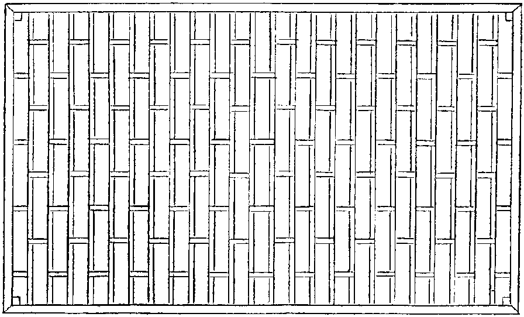
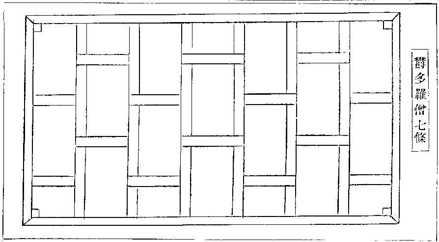
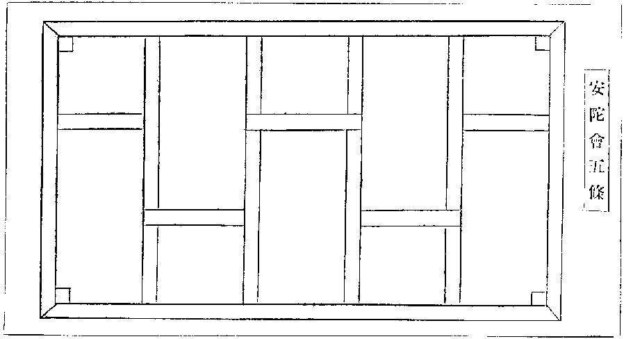
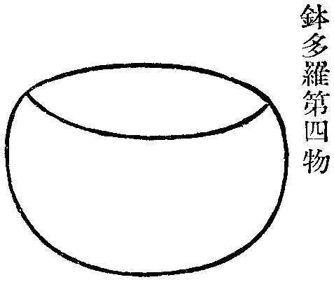
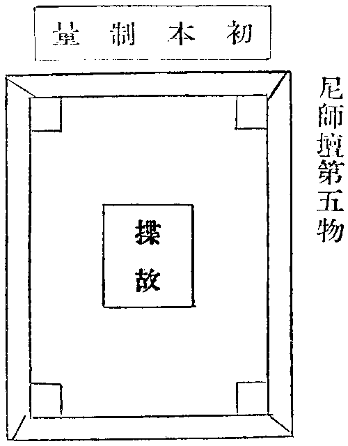
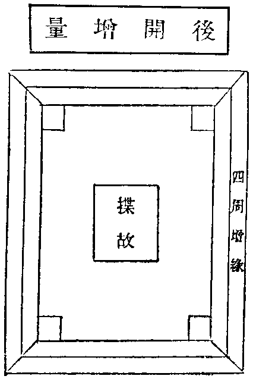
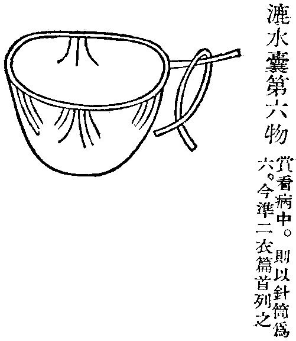

# 佛制比丘六物图



> **藏经**：大正新修大藏经（大正藏）　**册次** 第 45 册（T45）　**编号** No. 1900（T1900）　**部类** 经集部　**卷次** 1 卷　**篇幅** 6,786 字

> **卷／品**：0 卷 · 0 品



---



佛制比丘六物图



大宋元丰三年夏首餘杭沙门元照於天宫院出



初明三衣为三物



(此衣九品，且示)僧伽梨大衣(上品，餘准减作。)







欝多罗僧七条







安陀会五条







比见乐学戒者，欲置法服，不知所裁，既昧律仪，多承妄习。然其制度，遍在诸文，故撮其大要，兼所见闻。还宗旧章，且分十位。援引正教，庶令事有准承；指斥非滥，所谓不看他面。



初、制意。



《钞》云：「何名为制？谓三衣六物，佛制令畜，通诸一化，竝制服用，有违结罪。」《萨婆多》云：「欲现未曾有法故。一切九十六道无此三名，为异外道故。」《四分》云：「三世如来，竝著如是衣。」《僧祇》云：「三衣是贤圣沙门标识(音志)。」《杂含》云：「修四无量，服三法衣。是则慈悲者之服。」《十诵》云：「以刀截故，知是惭愧人衣。」《华严》云：「著袈裟者，舍离三毒。」《四分》云：「怀抱於结使，不应披袈裟。」《贤愚经》云：「著袈裟者，当於生死疾得解脱。」《章服仪》云：「括其大归，莫非截苦海之舟航，夷生涯之梯隥也。」所以须三者，《分别功德论》云：「为三时故，冬则著重，夏则著轻，春则服中。」《智度论》云：「佛弟子住中道，故著三衣。外道裸形无耻(住断见故)，白衣多贪重著(住常见故)。」《多论》云：「一衣不能障寒，三衣能障」等。《戒坛经》云：「三衣断三毒也。五条（下衣）断贪身也，七条（中衣）断嗔口也，大衣（上衣）断痴心也。」(世传七条、偏衫、裙子为三衣者，谬矣。)天台智者制法第一条云：「三衣六物，道具具足。若衣物有阙，则不同止。」清凉国师十誓第一云：「但三衣一钵，不畜餘长。」



历观经论，遍览僧史，乃知圣贤踵迹，华竺同风；今则偏竞学宗，强分彼此。且削发既无殊态，染衣何苦分宗？负识高流，一为详鉴。况大小乘教，竝广明袈裟功德，愿信教佛子依而奉行。



二、释名



有二。



初、通名者。总括经律，或名「袈裟」(从染色为名)，或名「道服」，或名「出世服」，或名「法衣」，或名「离尘服」，或名「消瘦服」(损烦恼故)，或名「莲华服」(离染著故)，或名「间色服」(三色成故)，或名「慈悲衣」，或名「福田衣」，或名「卧具」，亦云「敷具」。(皆谓相同被褥。)



次、别名者。一、梵云「僧伽梨」，此云「杂碎衣」(条相多故)，从用则名「入王宫聚落衣」(乞食、说法时时著)。二、欝多罗僧，名「中价衣」(谓财直当二衣之间)，从用名「入众衣」(礼诵、斋讲时著)。三、安陀会，名「下衣」(最居下故，或下著故)，从用名「院内道行杂作衣」(入聚、随众则不得著)。若从相者，即五条、七条、九条，乃至二十五条等。义翻多别，且提一二。



三、明求财



分二。



初、明求乞离过。由是法衣，体须清净。西梵高僧，多舍粪扫衣。今欲如法，但离邪求。《事钞》云：「兴利、贩易得者，不成。」《律》云：「不以邪命得(下引《疏》释)；激发得(说彼所得，发此令施)；现相得(诈现乏少，欲他怜愍)；犯舍堕衣(三十诸衣戒等)；竝不得作。」《业疏》云：「邪命者，言略事含。大而言之，但以邪心，有涉贪染，为利卖法，礼佛、诵经、断食诸业，所获赃贿，皆名邪命。」今人囊积盈餘，强从他乞；巧言谄附，饷遗污家。凡此等类，竝号邪利。



次、明对贸离过。若本净财贸得，最善。必有犯，长钱宝，将贸衣财。准《律》：「犯舍衣，贸得新衣，但悔先罪，衣体无染，可以例通。若自贸物，不得与白衣争价高下，同市道法。遣净人者，亦无所损。」有云：「净财手触，即为不净。」此非律制，人妄传耳(但犯捉宝，非污财体)。



四、明财体



分二。



初、明如法。《律》中犹通绢、布二物，若准《业疏》诸文，绢亦不许。《疏》云：「世多用绢䌷者，以体由害命，亦通制约。今五天竺及诸胡僧，俱无用绢作袈裟者。」又云：「以衣为梵服，行四无量。审知行杀而故服之，义不应也。」《感通传》中，天人赞云：「自佛法东传，六七百年；南北律师，曾无此意。安用杀生之财，而为慈悲之服？」广如《章服仪》明之。义净《寄归传》辄责为非，盖大慈深行，非彼所知，固其宜矣。



次、简非法。然其衣体，须求厚密，离诸华绮。《律》云：「若细薄、生疎(蕉葛、生纻并不可用)、绫罗、锦绮、纱縠、䌷绡等，并非法物。」今多不信佛语，贪服此等诸衣。《智论》云：「如来著麁布僧伽梨。」此方南岳山众及自古有道高僧，布衲艾絮，不杂一丝，天台唯被一衲，南山缯纩不兼，荆溪大布而衣，永嘉衣不蚕口，岂非慈恻之深，真可尚也！今时纵怠，加复无知，反以如来正制之衣，用为孝服。且僧无服制，何得妄行？《释氏要览》、《辅教．孝论》相循讹说，慎勿凭之。近见白布为头绖者，斯又可怪。法灭之相，代渐多有。识者宜为革之，则法得少留矣。



五、明色相



《律》云：「上色染衣不得服，当坏作袈裟色(此云不正色染)，亦名坏色。」即《戒本》中三种染坏，皆如法也。一者、青色(《僧祇》谓铜青也。今时尼众青褐，颇得相近)；二者、黑色(谓缁泥涅者。今时禅众深黪，竝深苍褐，皆同黑色)；三、木兰色(谓西蜀木兰，皮可染作赤黑色。古晋高僧多服此衣，今时海黄染绢，微有相涉。北地浅黄，定是非法)。



然此三色，名滥体别，须离俗中五方正色(谓青、黄、赤、白、黑)及五间色(谓绯、红、紫、绿、碧，或云磂黄)。此等皆非道相，佛竝制断。《业疏》云：「法衣顺道。锦色斑绮，耀动心神，青黄五彩，真紫上色，流俗所贪，故齐削也。」



末世学律，特反圣言，冬服绫罗，夏资纱縠。乱朱之色，不厌鲜华；非法之量，长垂髀膝。况复自乐色衣，妄称王制，虽云饰过，深成谤法。祖师所谓「何虑无恶道分！悲夫！」(《多论》「违王教，得吉」者，谓犯国禁令耳。)



六、明衣量



有二。



初、准通文，不定尺寸。《律》云：「度身而衣，取足而已。」《五分》肘量不定，佛令随身分量，不必依肘。今时衣长一丈二三，言取通文者，无乃太通乎？又言此是度身者，其身甚小而衣甚长，无乃度之不细乎？然度身之法，人多不晓。《业疏》云：「先以衣财，从肩下地，踝上四指，以为衣身，餘分叶相，足可相称。」



次、明局量。《钞》引通文已，续云：「虽尔，亦须楷准。」故《十诵》、《僧祇》各有三品之量。今准《萨婆多》中：「三衣，长五肘、广三肘。(每肘一尺八寸。准姬周尺，长九尺，广五尺四寸也。)若极大者，长六肘，广三肘半。(长一丈八寸，广六尺三寸。有人局执极量。既分三品，何得局一？借令依此，亦不至丈二，思之。)若极小者，长四肘，广二肘半。(长七尺二，广四尺五。)若过量外态说净，不者，犯舍堕。」《四分》云：「安陀会，长四肘，广二肘(长七尺二，广三尺六)。欝多罗僧，长五肘，广三肘，僧伽梨，亦然(长九尺，广五尺四寸)。」



上引佛言示量，下引祖教显非。



《章服仪》云：「减量而作，同俭约之仪；过限妄增，有成犯之法。文云：『四肘二肘，不为非法，与佛等量，便结正篇。』即其证也。」又云：「顷载下流，骄奢其度；至论俭狭，未见其人。」又云：「衣服立量，减开过制者，俱抑贪竞之情也。」(好大者，请详此诸文。)



《钞》文「佛衣戒」云：「佛身倍人。佛长丈六，人则八尺。」佛衣长姬周尺丈八，广丈二，常人九尺、六尺也。(有执极量者，　谓佛衣倍人六肘，则二丈一尺六寸。盖未读此文故也。)然佛世之人，身多伟大，准前为量，足覆形躯。今时劫减，人身至大，不过六尺。而衣长丈二，往往过之，及论广量，不至五尺。前垂拕膝，步步吉罗。可谓颠之倒之，於斯见矣。



故《业疏》云：「前垂一角，为象鼻相，人不思罪，习久谓法。何必如许，烦恼我执，无始常习，可是圣法耶？闻义即改，从谏若流。斯上人也。」(《疏》文)慈训若此，那不思之？



七、明条数多少



下衣五条，一长一短。中衣七条，两长一短。大衣三品：下品有三，九条、十一条、十三条，并两长一短；中品三者，十五、十七、十九条，并三长一短；上品三者，二十一、二十三、二十五条，并四长一短。《钞》云：「准此为大准，随力辨之。」(九品中，随财体多少，得一受持。)《羯磨疏》云：「所以极至二十五者，欲为二十五，有作福田故。所以唯只非双者，沙门仁育，同世阳化，故非偶数。所以长短者，如世稻畦随水处，高下别也。又为利诸有，表圣增而凡减，喻长多而短少也。」今时禅门多著九条，或三长、四长，随意而作，此非法也。《疏》云：「长短差违，乖慈梵故，随步越仪，一一结罪。」矧又色带长垂，花排细刺，山水毳衲，损业废功。真诚学道，不舍寸阴，自非无所用心，何暇专功於此？



次、明条叶之相。《僧祇律》中：「广应四指(四寸)，挟如𪍿麦。」《疏》云：「今多广作，浇风扇也。」《章服仪》云：「此见条叶，不附正仪，三寸四寸，任情开阔，浸以成俗，弥开华荡之源」等。又刺缀条叶，须开下边。《章服仪》云：「裁缝见叶，表其割相。今并缝合，无相可分。」《钞》云：「刺一边，开一边。」「若两边俱缝者，但同缦衣。」世中相传，号曰「明孔」，又言「明相」(《律》中天晓，谓之明相)，又云「漏尘」等，俱是讹谬。



八、明重数



《律》云：「不得细薄。大衣，新者二重。餘二衣，并一重。」《十诵》中：「大衣，故者四重。餘二衣，并二重。」《萨婆多》中：「大衣，三重。一重新，二重故。」



次、明重法。然重复之相，诸出不同。若准《多论》：「重缝三衣，有缘，摘分持行。」据此但是全衣合缀，祖师所著亦不殊此。至《感通传》天人方示别制，人多疑之，今为具引：「彼云『大衣重作，师比行之。然於叶下乃三重也，岂得然耶？』即问其所作，便执余衣以示之。『此叶相者，表稻田之塍疆也。以割截衣段，就里刺之，去叶𪍿麦许。此则条内表田、叶上表渠相，岂不然耶？今则通以布缦，一非割截，二又多重，既非本制，非无著著之失。』」(已上《传》文。然《多论》异此者，但是闻见不等。然天人示法，并谓亲承佛世。此方教文不决之事，如诸经律「座具著肩」，唯此《传》文令安左臂。又如后引「增座具法」，今皆准用，何独疑此？况非割、多重二难，理自显然。)



三、明成不。《业疏》云：「下二随时。若是大衣，必须重复。今多单作，是非法服，得行受持服用得罪。」



九、明作衣法



三衣并须割截。财少难辨，则听揲叶。五条一种，复开𫌇叶。《四分》中：「大衣，五日不成，尼提、僧吉。」(准《鼻柰耶》：「七条四日，五条二日。」)《十诵》：「须却刺，不得直缝。」前去缘四指，施䩙(音弦钩也)。后去缘八指，施纽。今时垂臂，前八后四，俱颠倒也。



又安钩约处，揲以方物，本在助牢，而目云「坛子」，非也。《三千威仪》云：「四角安揲。」《四分》云「挽令角正」等。世云「四天王」者，亦非也。《四分》：「肩上须揲，障垢腻处。」



次、明正从者。大衣九品，本须割截。衣财不足，则开揲叶。二九则成十八种衣。犹不足者，听七条为从衣。如是次第，开至缦衣(言缦者，无条相故)。三衣正从，各有二十四种。大衣：正有十八种(割、揲名九)，从则有六(二七条，三五条，一缦衣)。七条：正衣有二(割、揲二也)，从有二十二(大衣十八，五条三，缦衣一也)。五条：正衣有三(割、揲、𫌇也)，从有二十一(大衣十八，七条二，缦衣一)。总计七十二品。缦通三用，然本是沙弥衣。《律》制：「沙弥著二缦衣，一当七条入众，一当五条作务。」(衣相未正故，但云「当」。「当」字去呼。)



今时剃发，即著五条，僣滥大僧，深乖本制，师长有识，请依圣教。及至受戒，多无衣钵，律令师辨，谁复依行？但至临时，从人借受瓦盆油钵、陈朽大衣。沙弥不识是非，阇梨何曾检校？《律》云：「若无若借，不名受具。」岂得惜少许资财，令一生无戒，虚食信施，沈流万劫？实可悲痛！虽往者不可谏，而来者犹可追。



十、加法行护



初、加法者。必从次第，先加五条(准《十诵》文)：「大德一心念！我比丘某甲，此安陀会，五条衣受，一长一短，割截衣持。(三说。揲叶、𫌇叶随改。)」中衣则云：「此欝多罗，七条衣受，两长一短，割截衣持。」大衣则云：「此僧伽梨，二十五条衣受，四长一短，割截衣持。」餘词同上。



次、明舍法。(准《僧祇》文。)「大德一心念！我某甲，此安陀会，是我三衣，数先受持，今舍。(一说。餘二准改。并须求明律者，对首作之。)」



次、明行护。《十诵》：「护三衣如自皮，钵如眼目。著大衣，不得摙木石土草。扫地等种种作务，不应为之。」《决正二部律论》：「著大衣入村，见师僧上座别人，不得礼。(得礼佛及众僧。)」《十诵》：「所行之处与衣钵俱，无所顾恋犹如飞鸟。若不持三衣入聚落，犯罪。」《僧祇》云：「当如塔想。」祖师云：「诸部竝制随身，今时但护宿者，不应教矣。」



(於此须明摄护，略分四门。)



初、明衣界。《律》云：「若人、衣异处越宿，得舍堕罪。此衣须舍忏。」(言堕罪者，堕众合地狱一昼夜，当人间岁数十四亿四十千岁。)《律》明离护，竝约界论。界有多别，大略分二：



一者、作法摄衣界；(谓伽蓝中结界，宽於院相，须加摄衣羯磨。结已，除无村聚，通界护衣。)



二者、自然护衣界。本宗、他部总有十五种：



僧伽蓝界一；(谓垣墙、篱棚，四面周匝，虽结界处，望不结摄衣，亦号「自然衣界」。)



村界二：(男女所居名村，即俗舍也。四相同上。准舍界中更有六种别相：)



一者、聚落界，(谓村邑分齐处也。一者别界，如一聚落止有一家，齐聚落外，鸡飞及处已外，名异界。二、同界者，谓多聚相涉。《多论》：「四聚中间，车梯四向相及，衣在四聚不失。」《僧祇》：「卧四聚中，头足两手各在一界。衣在头底，天明头离，犯舍。手脚相及，不犯。」《多论》：「安衣二界中，身卧二界上，不失，各有身分故。」)



二者、家界，(谓一聚内有多家者，亦有同别。若父母兄弟同处同业，名同界。异食异业名别界，即下族界也。)



三者、族界，(谓一家中异食异业，亦有同别。各有住处，则名一界。若在二处及作食、便利等，众处皆失。)



四、外道舍，(若同见同论，则同一界。若异见者，身衣二处，及在门屋中庭，众处竝失。)



五、游行营处，(诸戏笑等人暂止之处。若属一主，名同界。异主，则彼此众处等皆失。)



六、重舍；(即多重楼阁等。同主则人衣互上下，不失，异主则失。若单楼阁，　《僧祇》：「梯隥道外二十五肘。」《了论》：「衣在下，身在上者失，反此不失。」)



树界三：(极小下至与人身等，足荫加趺，此有五别：)一、独树，(取日正中影覆处，雨时水不及处。)二、相连大林，(《十诵》：「一拘卢舍。」即二里，六百步。)三、四树小林，(《善见》：「十四肘。」计二丈五尺二寸。)四、藤蔓架，(浦萄、瓜瓠等。《僧祇》：「四面各取二十五肘。」计四丈五尺，谓从人身已去，非架外也。)五、明上下；(衣在树下，身在上，失衣。若衣在上，身在下，不失，有落义故。)



场界四；(村外空静、治五谷处，随场广狭为限。)



车界五；(住车，取回转处。行车，前后车杖相及，不失，不及则失。)



船界六；(住船，取回转处。行船，多有住处，不通来往，则有别界，反此通护。)



舍界七；(谓村外、空野别舍。《四分》无相。若准《僧祇》，楼阁则取二十五肘。若准《四分》，库藏则取四周内地。两相随用。)



堂界八；(前多敞露。)



库界九；(积藏众物。)



仓界十；(储积谷米处。上三竝约内地为界。)



兰若界十一；(即空逈处，八树中间，计五十八步四尺八寸。)



道行界十二；(《善见》：「前后四十九寻。」内计三十九丈二尺。)



洲界十三；(《善见》：「十四肘内。」计二丈五尺二寸。)



水界十四；(《僧祇》：「水中道行，二十五肘。」计四丈五尺。若衣在船上，入水即失。若衣在岸上，两脚入水即失，一脚不失。)



井界十五。(《僧祇》：「道行露地，井边宿，二十五肘。」亦四丈五尺内为界。衣在井中，应绳连垂手入井，不失，与上界别故。餘坑窨亦然。)



二、明势分者。作法衣界则无，必须入界，方乃会衣。(势分是自然，与作法界体异故。)十五种自然并随界量外例加一十三步，计七丈八尺。(《善见》：「不健不羸人，　尽力掷石落处。」古德评之：约一十三步为准。)但入势分，即成会衣，不必入界。(若有染、隔、情三碍在界，　即无势分。)



三、明四碍。(如上诸界，随有失衣。)一者、染碍；(女人在界，恐染净行，衣须随身。)二者、隔碍；(水陆道断、门墙阻障等。)三者、情碍；(国王、大臣、幻师、乐人入界，夺失等想，及人家兄弟分隔，各有分齐之处。)四者、界碍。(彼此不相通，如身在道中，衣者在树下，即失衣等。)



四者、明失否之相。《律钞》有三断：「一者《律》中夺、失、烧、漂、坏五想(即情碍也)，水陆道断，若贼、恶兽、命、梵等难(此是隔碍)。必有上缘，但失爱法，不犯舍堕。二者若先慢不护，后虽难缘，失法犯罪。三者若恒怀领受，诸难忽生，往会不及，亦不失法，亦无有罪。(事须真实，不可倚滥。)」又「问曰：『忘不持衣外行，至夜方觉，取会无缘，失衣以否？』答：『彼人恒自将随身，忽忘，例同长衣开之。』(长衣忘不说净，不犯，更开十日。)」



三、明著法。《律》令「齐整著三衣」。《三千威仪》：「著时，不得向佛塔、上座、三师，亦莫背，不得口衔及两手奋。」《鼻柰耶》：「应挑著肩上，不得垂臂肘。」此是前制。《感通传》天人所告，凡经四制：「初度五人已来，竝制袈裟左臂，座具在袈裟下。次为年少美貌，入城乞食，多为女爱，遂制衣角在左肩，以坐具镇之。复次，因比丘为外道难云：『岂得以所座之布而居法衣之上？』从此还制，令著左臂，座具在下。最后，因比丘著衣不齐整，外道讥云：『如婬女，如象鼻。』由此始制上安钩纽，令以衣角达于左臂，置於腋下，不得令垂，如上过也。」今则宜从后制，不然搭於肩上，若垂肘臂，定是非法，以众学中制罪故也。



四、明补浣。《十诵》：「衣服常须净洁，如法不尔，则人非人诃。」《善见》：「大衣七条，广边八指，长边一搩手，内穿，不失受。五条广边四指，长边一搩手，内穿，不失；餘处穿，如小指甲许，失受。补竟受持。」《多论》：「但使缘断，则失受。」《善见》：「袈裟若大，减却；若小，以物裨之；若浣，若增色，若脱色、上色，皆不失受」等云云。



钵多罗第四物







初、明制意。《僧祇》：「钵是出家人器，非俗人所室。」《十诵》云：「钵是恒沙诸佛标志，不得恶用。」《善见》云：「三乘圣人皆执瓦钵，乞食资生，四海为家，故名比丘。」古德云：「钵盂无底，非廊庙之器。」



二、释名者。梵云「钵多罗」，此名「应器」。有云：「体、色、量三，皆应法故。」若准《章服仪》云：「堪受供者用之，名应器。」故知钵是梵言，此方语简，省下二字。



三、明体者。《律》云：「大要有二，泥及铁也。」《五分律》中：「用木钵，犯偷兰罪。」《僧祇》云：「是外道标故，又受垢腻故。」《祖师》云：「今世中有夹纻、漆油等钵，竝是非法，义须毁之。」



四、明色者。《四分》：「应熏作黑色、赤色。」《僧祇》：「熏作孔雀咽色、鸽色者，如法。」《善见》：「铁钵五熏，土钵二熏。」《律》中：「听作熏钵𬬻」等。(此间多用竹烟，色则易上。)



五、明量者。《四分》中：「大钵受三斗(姬周三斗，即今唐斗一斗)，小者受斗半(即今五升)。」中品可知。(大小之间，有执律文「量腹」之语，不依斗量，非也。《钞》云：「既号非法，不合爱净。」)



六、明加法。(准《十诵》文：)「大德一心念！我某甲，此钵多罗应量受，常用故。」(三说。舍法，应云：「先受持，今舍。」一说。)



七、行护。《五百问》云：「一日都不用钵食，犯堕(本宗应吉)，重病者开。若出界经宿，不失受(但得吉罪)。」《善见》：「若穿如粟米大，失受。若以銕屑补塞已，更须受。」若偏斜破，不成受。



尼师坛第五物











初、制意。《四分》中：「为护身、护衣、护僧卧具故。」



二、释名。梵云「尼师坛」，此云「随座衣」，亦云「座具」，如此方隥褥之类。愚者迷名，云因尼师故制。又不识中间贴，故呼为「坛子」。因合召为「尼师坛」者，取笑於时，不学故也。



三、定量。《四分》：「长佛二搩手，(准《五分》：『佛一搩手。』周尺二尺，则长四尺也。量时尺寸须定，微出量外，律结正犯。)广一搩手半(即三尺也)。」上是本制量。《律》云：「时迦留陀夷身大，尼师坛小，对佛说之，便听更增广、长各半搩手。」(各增一尺。)此是后听。《戒疏》云：「更增者，开缘也。还从本制，限外别增。」(有执增量为制，非也。)又云：「即世为言，衣服、座具皆乐广大，食饮、受用并乐华厚。」(云云。)然舍制从开，理虽通得，但迦留极大，止加半搩，今时卑陋，岂是初量不容耶？苟曰不然，请以诚证。《钞》云：「如法作者，准初量已，截断施缘。若座时，膝在地上者，依增量，一头一边接裨之。此是定教正文。」(故知膝不出地，亦不在增。或言「初量是废前教」，非也。)然前代但於长头、广边各增一尺，后天人告祖师云：「纵使四周具贴，不违半搩之文。但翻译语略，云『各半搩』耳，十字而论，即是四周之义。」坐具四贴，由此始矣。



四、制造。法色同袈裟。《十诵》：「新者，二重；故者，四重。不得单作。」《鼻奈耶》云：「应安缘。」《五分》：「须揲四角。」《四分》：「作新者，须以故物纵广一搩手揲之。(亦准佛一搩，方二尺也。不揲入手，犯舍堕罪。若得已成新者，并财体一经身用，则不须揲。)」又不得「不截，通取增量」，此跋阇妄法。



五、加法。云：「大德一心念！我某甲，此尼师坛应量作，今受持。」(三说。舍法，改下句云：「今舍。」一说。)《十诵》：「离宿，吉罗。」亦不失法。行用大同钵耳。



(寄此略辨祇支、覆肩二衣。)



初、制意者。尼女报弱，故制祇支。披於左肩，以衬袈裟。又制覆肩，掩於右膊，用遮形丑，是故尼众必持五衣。大僧亦有畜用，但是听衣耳。



二、释名者。梵语「僧祇支」，此云「上狭下广衣」。(此据《律》文以翻，全乖衣相。若准应法师《音义》，翻云「掩腋衣」，颇得其实)覆肩，华语，末详梵言。



三、明衣相。《僧祇》：「二衣，竝长四肘、广二肘。」故知亦同袈裟畟方，但无条叶耳。



四、明著用。世多纷诤，今为明之。此方往古，并服祇支。至后魏时，始加右袖，两边缝合，谓之偏衫，截领开裾，犹存本相。故知偏衫左肩即本祇支，右边即覆肩也。今人迷此，又於偏衫之上复加覆肩，谓学律者必须服著。但西土人多袒膊，恐生讥过，故须掩之。此方袄褶重重，仍加偏袖，又覆何为？纵说多途，终成无据。(若云生善者，是僧应著，何独律宗？餘宗不著，岂不生善？况轻纱紫染，体色俱非，佛判俗服，全乖道相，何善之有？或云「分宗途」者，佛教但以三学分宗，而谓形服异者，未之闻矣。)且三衣，大圣严制，曾未沾身；覆肩，祖师累斥，坚持不舍。良以弊风一扇，历代共迷。复由於教无知，遂使闻义不徙。更引明证，请试详之。《章服仪》云：「元制所兴，木唯尼众。今僧服者，僣通下位。」又《住法图赞》云：「阿难报力休壮，圆满具足。士女咸兴爱著，乃至目悦净色，心醉神昏，系子颈而沈杀者，由此曲制，令著覆肩之衣。今则侥幸而妄服者，滥矣！」(据此乃斥内无偏衫，单覆者耳。若今重覆，彼时既无，不涉言限。且单覆犹为侥幸，况今重覆，非法何疑？广如别辨。)



漉水囊第六物(赏看病中，则以针筒为六，今准〈二衣篇〉首列之。)







初、制意。《钞》云：「物虽轻小，所为极大。出家慈济，厥意在此。今上品高行，尚饮用虫水，况诸不肖，焉可言哉？」《四分》：「不得无漉袋行半由旬(二十里也)。无者，僧伽梨角漉。」



二、漉法者。《萨婆多》云：「欲作住处，先看水中有虫否。有者，作餘井。犹有者，舍去。凡用水法应清净者，如法漉置一器中，足一日用，令持戒审悉。漉竟，著净器中，向日谛视看。故有者，如前说。」(即作餘井舍去。)然水陆空界，无非皆是有情依处。《律》中且据漉囊所得，肉眼所见，以《论》持犯耳。



三、作囊法。《多论》：「取上细㲲一肘作囊。」(此间宜用密练绢作。)《僧祇》：「虫太细，三重作。」《四分》：「作漉水袋，如杓形，若三角，若作宏㨯，若作漉瓶。若患细虫出，安沙於囊中。漉讫，还著水中。」(此是私用者。若置於众处，当准《寄归传》式样：用绢五尺，两头立柱，钉钩著带系上，中以横杖撑开，下以盆盛等。)《钞》云：「今有不肖之夫，见执漉囊者，言『律学唯在於漉袋』。然不知所为处深、损生妨道者，犹不畜漉袋，纵畜而不用，虽用而不泻虫，虽泻而损虫命。且存杀生一戒，尚不遵奉，餘之威仪、见、命，常没其中。」(不加受者，轻小物故。或常持故，如《律》「无者，不得行半由旬」，是也。)昔孤山尝著《漉囊志》，乃云「悬於草堂，以备法物之数。如用之，则未能也。余谓中庸子知教，孰不知教来」者，幸无取焉。



《智论》云：「受持禁戒为性，剃发染衣为相。」然浊世凡庸，鲜能修奉。且凭仪相，用光遗教。苟内外都亡，则法灭无日。愿诸上德，同志持危。即《华严》云：「具足受持威仪教法，能令僧宝不断。」受佛遗寄，得其人矣。



佛制比丘六物图

