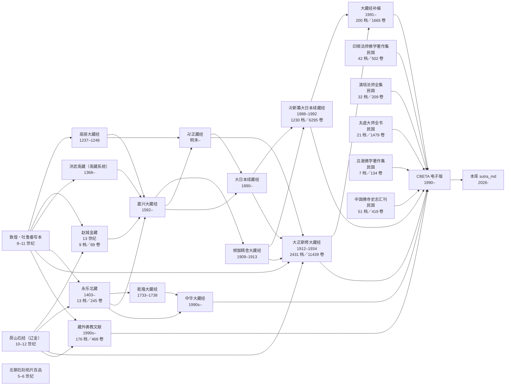
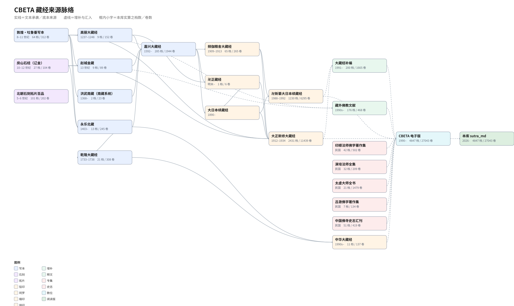

# 藏经来源脉络

> 本图由 `sutra_lib_tool` 之 `md archify` 生成：谱系（承袭／底本）依 CBETA 各藏实际编纂关系，
> 分布（档数／卷数）自 `sutra_md/index.json` 与 `sutra_meta.jsonl` 实算。

## 一、脉络图

## 二、谱系表

| 藏经 | 时期 | 类别 | 底本／来源 | 本库档数 | 本库卷数 |
| --- | --- | --- | --- | ---: | ---: |
| 敦煌・吐鲁番写本（D） | 8–11 世纪 | 写本 | 敦煌三界寺、吐鲁番三堡等出土写本；唐宋未入藏之经由此得传 | 64 | 312 |
| 房山石经（辽金）（F） | 10–12 世纪 | 石刻 | 北京房山云居寺、 Thunder 山藏经洞；辽金石刻写本 | 27 | 104 |
| 北朝石刻拓片百品（I） | 5–6 世纪 | 拓片 | 北朝造像碑铭拓片，非写本藏经 | 101 | 202 |
| 高丽大藏经（K） | 1237–1248 | 写本 | 高丽海印寺，以中国写本为底本，纸墨俱精 | 9 | 152 |
| 赵城金藏（A） | 13 世纪 | 写本 | 山西赵城广胜寺所出金代写本 | 9 | 89 |
| 洪武南藏（南藏系统）（U） | 1368– | 写本 | 明初南京写本；南宋刻本之系统 | 2 | 23 |
| 永乐北藏（P） | 1403– | 写本 | 北京刻经处，明代官刻之北系 | 13 | 245 |
| 乾隆大藏经（L） | 1733–1738 | 写本 | 北京经厂重刻，明北藏之系统 | 21 | 308 |
| 嘉兴大藏经（J） | 1592– | 写本 | 浙江嘉兴刊刻；兼采磧砂藏、南藏、北藏，文献最富 | 285 | 1944 |
| 频伽精舍大藏经（G） | 1909–1913 | 铅印 | 上海频伽精舍铅印，以磧砂藏、嘉兴藏为底本 | 65 | 265 |
| 卍正藏经（M） | 明末– | 铅印 | 日本佛书院《卍正藏》，采中国诸藏及日藏 | 1 | 6 |
| 卍新纂大日本续藏经（X） | 1988–1992 | 缩印 | 新文丰缩印《续藏》全 168 册，并收《卍正藏》及日藏资料 | 1230 | 6295 |
| 大正新修大藏经（T） | 1912–1934 | 珂罗 | 东京大藏经株式会 Trim 编，汇宋元明清诸藏及敦煌、房山 | 2431 | 11439 |
| 大藏经补编（B） | 1991– | 增补 | 补《卍续藏》未收之宋元明清著述，兼收敦煌、房山释文 | 200 | 1665 |
| 藏外佛教文献（ZW） | 1990s– | 释文 | 敦煌、吐鲁番、房山等写本之释文、录文与研究 | 176 | 468 |
| 印顺法师佛学著作集（Y） | 民国 | 专集 | 印顺法师著述及讲记 | 42 | 502 |
| 演培法师全集（YP） | 民国 | 专集 | 演培法师著述及讲记 | 32 | 209 |
| 太虚大师全书（TX） | 民国 | 专集 | 太虚大师著述 | 21 | 1479 |
| 吕澂佛学著作集（LC） | 民国 | 专集 | 吕澂先生著述 | 7 | 134 |
| 中国佛寺史志汇刊（GA） | 民国 | 史志 | 方豪等辑录之佛寺史志 | 51 | 419 |
| 中华大藏经（C） | 1990s– | 排印 | 中华书局影印之诸本 | 11 | 137 |
| CBETA 电子版（CB） | 1990– | 数位 | 汇各藏原文数字化，统一编码 TEI P5 | 4847 | 27043 |
| 本库 sutra_md（M2） | 2026- | 阅读版 | 4,847 档 Markdown：卷品切块、偈颂标记、繁简转换 | 4847 | 27043 |

## 三、CBETA 各藏经分布

| 藏经代码 | 藏经 | 档数 | 分卷数 | 涉及部别数 |
| --- | --- | ---: | ---: | ---: |
| T | 大正新修大藏经 | 2431 | 11439 | 26 |
| X | 卍新纂大日本续藏经 | 1230 | 6295 | 21 |
| J | 嘉兴大藏经（新文丰版） | 285 | 1944 | 11 |
| B | 大藏经补编 | 200 | 1665 | 14 |
| ZW | 藏外佛教文献 | 176 | 468 | 15 |
| I | 北朝佛教石刻拓片百品 | 101 | 202 | 4 |
| G | 佛教大藏经 | 65 | 265 | 6 |
| D | 国家图书馆善本佛典 | 64 | 312 | 15 |
| GA | 中国佛寺史志汇刊 | 51 | 419 | 4 |
| Y | 印顺法师佛学著作集 | 42 | 502 | 1 |
| N | 汉译南传大藏经（元亨寺版） | 38 | 593 | 7 |
| YP | 演培法师全集 | 32 | 209 | 1 |
| F | 房山石经 | 27 | 104 | 8 |
| L | 乾隆大藏经（新文丰版） | 21 | 308 | 7 |
| TX | 太虚大师全书 | 21 | 1479 | 1 |
| P | 永乐北藏 | 13 | 245 | 5 |
| C | 中华大藏经（中华书局版） | 11 | 137 | 6 |
| A | 赵城金藏 | 9 | 89 | 5 |
| K | 高丽大藏经（新文丰版） | 9 | 152 | 4 |
| LC | 吕澂佛学著作集 | 7 | 134 | 1 |
| CC | CBETA 选集 | 6 | 31 | 3 |
| GB | 中国佛寺志丛刊 | 2 | 6 | 2 |
| S | 宋藏遗珍（新文丰版） | 2 | 5 | 1 |
| U | 洪武南藏 | 2 | 23 | 2 |
| M | 卍正藏经（新文丰版） | 1 | 6 | 1 |
| ZS | 正史佛教资料类编 | 1 | 11 | 1 |

**合计 26 藏、4847 档、27043 卷。**

## 四、本库各部别之藏经构成

| 部别 | T | X | J | B | ZW | I | G | D | GA | Y | N | YP |
| --- | ---: | ---: | ---: | ---: | ---: | ---: | ---: | ---: | ---: | ---: | ---: | ---: |
| `1_阿含部` | 1 | 0 | 0 | 0 | 0 | 0 | 0 | 0 | 0 | 0 | 0 | 0 |
| `2_本缘部` | 1 | 1 | 0 | 1 | 1 | 0 | 0 | 1 | 0 | 0 | 1 | 0 |
| `3_般若部` | 1 | 1 | 1 | 0 | 1 | 0 | 0 | 1 | 0 | 0 | 0 | 0 |
| `4_法华部` | 1 | 1 | 0 | 0 | 1 | 0 | 0 | 0 | 0 | 0 | 0 | 0 |
| `5_华严部` | 1 | 1 | 1 | 1 | 1 | 0 | 0 | 1 | 0 | 0 | 0 | 0 |
| `6_宝积部` | 1 | 1 | 0 | 0 | 0 | 0 | 0 | 0 | 0 | 0 | 0 | 0 |
| `7_涅盘部` | 1 | 1 | 0 | 0 | 1 | 0 | 0 | 0 | 0 | 0 | 0 | 0 |
| `8_大集部` | 1 | 0 | 0 | 0 | 0 | 0 | 0 | 0 | 0 | 0 | 0 | 0 |
| `9_经集部` | 1 | 1 | 0 | 1 | 1 | 0 | 1 | 1 | 0 | 0 | 1 | 0 |
| `10_密教部` | 1 | 1 | 1 | 0 | 1 | 0 | 0 | 1 | 0 | 0 | 0 | 0 |
| `11_律部` | 1 | 1 | 0 | 0 | 0 | 1 | 0 | 1 | 0 | 0 | 0 | 0 |
| `12_释经论部` | 1 | 0 | 0 | 1 | 0 | 0 | 0 | 0 | 0 | 0 | 0 | 0 |
| `13_毗昙部` | 1 | 1 | 0 | 1 | 1 | 0 | 0 | 1 | 0 | 0 | 1 | 0 |
| `14_中观部` | 1 | 0 | 0 | 0 | 0 | 0 | 0 | 0 | 0 | 0 | 0 | 0 |
| `15_瑜伽部` | 1 | 1 | 1 | 1 | 0 | 0 | 1 | 1 | 0 | 0 | 0 | 0 |
| `16_论集部` | 1 | 1 | 1 | 1 | 0 | 0 | 1 | 1 | 0 | 0 | 1 | 0 |
| `17_经疏部` | 1 | 1 | 1 | 1 | 1 | 1 | 1 | 1 | 0 | 0 | 1 | 0 |
| `18_律疏部` | 1 | 1 | 0 | 0 | 1 | 0 | 0 | 0 | 0 | 0 | 0 | 0 |
| `19_论疏部` | 1 | 1 | 1 | 0 | 0 | 0 | 0 | 1 | 0 | 0 | 0 | 0 |
| `20_诸宗部` | 1 | 1 | 1 | 1 | 1 | 1 | 1 | 1 | 1 | 0 | 1 | 0 |
| `21_史传部` | 1 | 1 | 1 | 1 | 0 | 0 | 0 | 1 | 1 | 0 | 1 | 0 |
| `22_事汇部` | 1 | 1 | 0 | 1 | 1 | 0 | 0 | 1 | 0 | 0 | 0 | 0 |
| `23_外教部` | 1 | 0 | 1 | 1 | 0 | 0 | 0 | 0 | 0 | 0 | 0 | 0 |
| `24_目录部` | 1 | 1 | 1 | 1 | 1 | 0 | 0 | 1 | 1 | 0 | 0 | 0 |
| `25_古逸部` | 1 | 1 | 0 | 0 | 0 | 0 | 0 | 0 | 0 | 0 | 0 | 0 |
| `26_疑似部` | 1 | 1 | 0 | 0 | 1 | 0 | 0 | 0 | 0 | 0 | 0 | 0 |
| `27_近代撰述` | 0 | 0 | 0 | 1 | 1 | 1 | 1 | 0 | 1 | 1 | 0 | 1 |
